# SAS 实验设计与分析示例


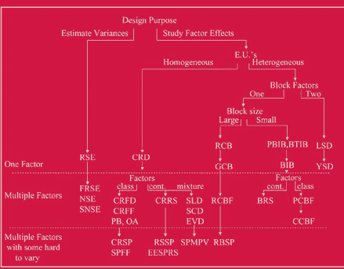


## 前言

学习实验设计后，研究人员或统计学家应能够：(1) 选择适合手头研究问题的实验设计；(2) 构建设计（包括进行适当的随机化并确定所需的重复次数）；(3) 执行计划以收集数据（或建议同事执行）；(4) 确定适合数据的模型；(5) 将模型拟合到数据；以及 (6) 解释数据并以有意义的方式呈现结果，以回答研究问题。本书的目的是将研究目标与所需的实验设计类型相联系，描述创建设计和收集数据的实际过程，展示如何进行适当的数据分析，并说明结果的解释。通过依赖统计软件包，将计算机制的阐述降至最低。

随着现代统计计算软件包的普及，数据分析变得容易得多，并在统计方法书籍中得到了充分的覆盖。在实验设计与分析的书籍中，不再需要展示现代计算出现之前所需的所有计算公式。然而，有必要仔细解释如何从计算机软件包中获得适当的分析。大多数统计软件执行的默认分析假设数据来自完全随机设计。在实践中，这往往是一个错误的假设。本书强调实验单位、处理随机分配到实验单位的方式以及数据分析中适当的误差项之间的联系。

全书使用 SAS 统计分析系统来说明实验设计的构建和数据分析。选择该软件进行说明，是因为它在创建设计和分析数据方面具有广泛的功能，其命令语言在三十多年来一直保持稳定，并且在工业界广泛使用：文本中使用了 SAS 9.2 版本，书中示例的所有 SAS 代码可在 http://lawson.mooo.com 获取。本书中使用的 ODS 图形需要 9.2 或更高版本。在早期版本的 SAS 中，可以使用旧版 SAS/GRAPH 例程创建类似图形，相关代码也可在网站上获取。本书介绍了 SAS 数据步编程和 IML 的示例，并说明了 SAS Stat、SAS QC 和 SAS OR 中的过程。

由于用于计算公式的页面较少，我试图


花更多时间讨论以下内容：(1) 研究项目的目标如何导致选择合适的设计，(2) 创建设计或待执行实验列表的实际方面，(3) 执行实验的实际方面，以及 (4) 对计算机数据分析结果的解释。项目 (1)-(3) 最好通过提供许多实际要求读者自行进行实验的实验和练习示例来教授。

本书试图对实践中最常用的实验设计和设计概念给予均衡的覆盖，而不是专注于专业领域。主题的选择基于我本人在制药行业，以及农业和工业化学品、机械行业的研发（R&D）和制造方面的工作经验。每章末尾都会呈现一个图表，以帮助识别各种设计应在何处使用。书中的示例来自各种应用领域。重点在于样本量、实验单元分配到处理因素水平组合（误差控制）以及处理因素组合的选择（处理设计）将如何影响估计值的方差和偏差以及结论的有效性。

预期读者 本书面向统计学一年级研究生或打算从事将使用实验设计领域工作的高年级本科生。为了充分理解本书，使用本书的学生应之前修读过微积分、统计学入门、基本统计理论、应用线性模型（如 Kutner et al. (2004) 和 Faraway (2004)）的课程，并对 SAS 有一定了解。全书均使用线性模型分析的矩阵表示法，学生应至少熟悉 Kutner et al. (2004) 第 5 章中所示程度的矩阵运算。

然而，对于来自应用科学或工程领域且不具备所有这些先修条件的学生，仍可从本书中获益良多。本书包含许多用于创建和分析实验的 SAS 代码示例，以及大量关于 (1) 诊断实验环境以选择正确设计，以及 (2) 解释和展示分析结果的示例。具备基本 SAS 理解能力的人应该能够跟随这些示例并对其进行修改，以完成本书中的练习并解决其自身研究中的问题，而无需了解每个程序的详细理论依据。

供教师参考 本书可用于一学期或两个季度的实验设计课程。除非学生具备上述所有先修条件，否则一学期课程的内容过多。本书前四章涵盖了实验设计的经典思想，任何面向没有设计实验背景的学生的课程都应讲授这些内容。后续章节从基础开始，但会深入特定主题的最新研究，并包含实现所有这些想法的代码。教师可以从这些剩余主题中挑选讲授，尽管如果有时间讲完全书，我建议按顺序讲解主题。

一些不打算讲完全书的教师可以考虑讲授第 3 章的因子实验、第 6 章的分数因子实验和第 9 章的响应面方法，遵循 20 世纪 70 年代开发的杜邦实验策略短期课程确立的模式。我选择本书的章节顺序，使得第 5 章的方差成分设计能在描述实践中非常普遍的分割区实验之前讲授。我这样做是因为我认为，在研究存在多个误差项的设计之前，理解随机因素很重要。

## 致谢

本书是多年来咨询和教学所启发思考的结晶。如果我不感谢我的布里格姆杨大学（BYU）导师 Melvin Carter，那将是我的过失，他是四十多年前向我介绍实验数据计算机分析的人，他对设计实验这一主题的热情激发了我对该领域的终身兴趣。我也要感谢 FMC 公司的老板兼导师 John Erjavec，他在 Box、Hunter 和 Hunter 的原著《面向实验者的统计学》出版很久以前就向我介绍了他们的思想。我还要感谢多年来向我提出有趣问题的众多咨询客户，以及要求我更清晰地解释事项的众多学生。特别感谢我以前的学生 Gore 公司的 Willis Jensen 和宝洁公司的 Michael Joner，他们对我手稿进行了仔细审阅并提出意见，以及 Seyed Mottaghe-inejad，他提供了解答手册并发现了文本中的许多笔误和不清晰之处。最后，感谢我的妻子 Francesca 在本书撰写期间给予的持续支持与鼓励。

## 引言

### 1.1 统计学与数据收集

统计学被定义为从数据中收集、分析并得出结论的科学。数据通常通过抽样调查、观察性研究或实验来收集。

当数据收集的目的是在不进行全面普查的情况下估计有限总体的某些属性时，通常使用抽样调查。例如，如果有兴趣了解某个投票区赞成某项提案的登记选民比例，可以通过对随机选民样本进行民意调查来估计该比例，而不是询问该投票区的每一位登记选民。

另一方面，观察性研究和实验通常用于确定概念总体中两个或多个测量量之间的关系。概念总体不同于有限总体，可能仅存在于我们的脑海中。例如，如果有兴趣了解未来温室气体排放与未来平均全球温度之间的关系，该总体不同于投票区的登记选民，无法进行抽样，因为它尚未存在。

引用已故 W. 爱德华·戴明的话，统计方法的价值在于做出可以作为行动基础的预测。为了对受控环境下将要发生的事情做出准确的未来预测，必须假设因果关系。例如，要在温室气体排放受控于某一水平的前提下预测未来平均全球温度，我们必须假设温室气体排放与全球温度之间存在因果关系。观察性研究与实验的主要区别就在于此。在观察性研究中，数据在其自然环境中被观察，而在实验中，环境受到控制。在观察性研究中，无法证明检测到的关系是因果关系。两个观察变量之间可能存在相关性，因为它们都受到未被观察或记录的第三个变量变化的影响，而基于观察性研究中发现的关系所做的任何未来预测都必须假设过去存在的变量间相互关系在未来也将存在。另一方面，在实验中，一些变量被故意改变，而其他变量保持不变。这样，由故意改变的变量引起的影响就可以

### 1.2 统计计划实验的开端

实验有许多目的。一些示例包括：确定过去观察到的测量响应变化的原因；找出产生最大或最小响应的条件；比较可控变量不同设置下的响应；以及获得用于预测未来响应值的数学模型。

当前计划的实验被应用于许多不同的领域，例如工程设计、质量改进、工业研究与制造、物理和生物科学基础研究、社会科学、心理学、商业管理和市场营销研究等。然而，现代实验设计方法的根源在于 R. A. Fisher 在英格兰哈彭登附近罗斯塔德实验站进行的农业实验工作。

Fisher 是一位天赋异禀的数学家，他在剑桥大学本科期间的第一篇论文介绍了似然性理论。后来他获得了大学学院的一个职位，但婉拒了，于 1919 年加入罗斯塔德的工作人员。在那里，受到每天与农业研究接触的启发，他不仅在作物产量、田间试验和遗传学等领域的实验研究方面做出了贡献，还以惊人的速度发展了理论统计学。他还提出了实验计划和分析的思想，这些思想至今仍被用作各个应用领域有效推断和预测的基础。Fisher (1926) 首先在论文《田间试验的安排》中发表了他关于实验计划的思想；九年后，他出版了其著作 *实验设计* 的第一版，Fisher (1935)。

Fisher 面临的挑战是农业和生物实验中大量的变异常常使结果混淆，以及实验耗时且成本高昂的事实。这促使他寻找能够：

- 尽可能消除自然变异
- 防止未消除的变异混淆或偏倚正在检验的效应
- 用最少的实验努力检测因果关系。

### 1.3 定义与预备知识

在开始详细讨论实验设计和实验计划之前，我将先定义将频繁使用的术语。


- 实验（也称为运行）是实验者改变至少一个正在研究的变量，然后观察其行为效果的动作。请注意，被动收集观察数据不属于实验。

- 实验单位是受研究且对其进行某种改变的项目。这可能是原材料、人体受试者，或仅仅是一个时间点。

- 子样本、子单位或观测单位 当实验单位被分割后，在对其采取行动之后，这被称为子样本或子单位。有时只能分别对每个子单位测量某个特征；因此它们常被称为观测单位。对同一实验单位的子样本或子单位进行的测量通常是相关的，在数据分析前应取平均值，而不应将其视为独立结果。当子单位可以被视为独立，并且有兴趣确定子样本测量的方差，同时又不希望混淆处理因素上的F检验时，应使用第5.8节中描述的混合模型，而不应简单地对子样本取平均值。

- 自变量（因子或处理因子）是在任何给定实验中受控制或处于某个目标值或水平附近的研究变量之一。水平会以某种系统的方式从一次运行到下一次运行发生变化，以确定它对响应有什么影响。

- 背景变量（也称为潜在变量）是实验者不知晓或无法控制，且可能影响实验结果的变量。在精心设计的实验方案中，这些潜在变量的影响应相互抵消，以免改变研究结论。

- 因变量（或用Y表示的响应）是在每次实验或运行后测量的实验单位特征。响应的大小取决于自变量或因子以及潜在变量的设置。

- 效应是由因子或自变量的变化引起的响应变化。在实验设计的运行完成后，可以通过计算观察到的响应数据来估计效应。这个估计称为计算效应。在实验进行之前，研究人员可能知道效应应有多大才具有实际重要性。这称为实际效应或实际效应的大小。

- 重复运行是指使用相同因子或自变量设置但不同实验单位进行的两次或多次实验。由于潜在变量的变化和实验单位的固有差异，重复运行中测量的因变量可能会有所不同。

- 重复测量是指对同一实验单位在一次运行或实验中进行的重复测量。由于测量误差，重复测量之间测量的因变量可能会有所不同，但在数据分析中，这些重复测量应取平均值，而不应视为单独的响应。

- 实验设计是在实际执行之前预先规划的一组实验或运行。实验设计中选择的特定运行将取决于设计的目的。

- 混淆因素是指实验者在运行之间对一个因子所做的每次变化，都与对另一个因子的相同变化相耦合时产生的情况。在这种情况下，无法确定是哪个因子导致了响应或因变量中观察到的任何变化。

- 偏倚因素是指实验者在背景变量或潜在变量发生变化的精确时刻对自变量进行更改时产生的结果。当一个因子被偏倚时，无法确定响应的变化是由该因子的变化引起的，还是由其他背景变量或潜在变量的变化引起的。

- 实验误差是特定实验的观察响应与在相同自变量或因子设置下进行的所有实验的长期平均值之间的差异。它被称为“误差”这一事实不应让人认为这是一个错误或失误。实验误差并不全都等于零，因为背景变量或潜在变量会导致它们从一次运行到下一次运行发生变化。实验误差大致可分为两类：偏倚误差和随机误差。偏倚误差在实验设计的运行中倾向于保持不变或以一致的模式变化，而随机误差则以不可预测的方式从一个实验变化到另一个实验，并且平均值为零。随机实验误差的方差可以通过在实验设计中包含重复运行来获得。

牢记这些定义，观察性研究与实验之间的差异可以更清晰地解释。在观察性研究中，变量（包括自变量和因变量）被观察，而不尝试改变或控制自变量的值。因此，响应或因变量中观察到的任何变化不一定能归因于自变量中观察到的变化，因为背景变量或潜在变量可能是原因。然而，在实验中，自变量是故意变化的，并且运行的进行方式是为了平衡任何变化的背景变量的影响。这样，响应的平均变化就可以归因于自变量中所做的变化。

### 1.4 实验设计的目的

使用实验设计是成功应用科学方法的处方。科学方法包括对以下步骤的迭代应用：（1）观察自然状态，（2）推测或假设所观察现象的机制，然后（3）收集数据，以及（4）分析数据以证实或拒绝推测。统计实验设计提供了一种收集数据的计划，使数据可以以统计方式分析以证实所涉推测。当使用实验设计时，必须明确陈述推测，并预先提出一份实验清单以提供测试假设的数据。这是一种有组织的方法，有助于避免研究问题上的错误开端和不完整答案。

使用实验设计方法的另一个优势是能够避免混淆因素效应。当研究假设未明确陈述且未构建计划来调查它时，研究人员倾向于采用试错方法，即同时改变许多变量以试图实现某些目标。当采用这种方法时，目标有时可能实现，但无法重复，因为不知道实际导致改进的变化是什么。

费舍尔对实验规划的早期贡献之一是推广一种称为随机化的技术，它有助于避免由于背景变量或潜在变量的变化而引起的混淆或偏倚。作为我们所说的偏倚的一个例子，即“史上最大的健康实验”，Meier (1972)，其中一项脊髓灰质炎疫苗试验在超过180万名儿童身上进行测试。最初的计划是向参与学校所有二年级儿童提供疫苗接种，并跟踪一至三年级儿童的脊髓灰质炎情况。一年级和三年级组将作为“对照”组。然而，该计划被拒绝，因为医生会知道疫苗仅提供给二年级学生。大多数脊髓灰质炎病例的诊断存在不确定性，脊髓灰质炎的发热和无力症状也常见于许多其他疾病。医生的诊断可能会因其知道患者是否接种疫苗而受到不当影响。在这个计划中，故意变化的因素（接种或未接种）受到潜在变量（医生对治疗的了解）的偏倚影响。

在进行物理实验时，响应通常会因实验单位不同而在重复运行中有所变化。这就是上一节中我们定义的实验误差。实验设计的主要目的之一是尽量减少实验误差的影响。能够做到这一点的设计方面，如随机化、重复和区组，被称为误差控制方法。统计方法用于判断变化实验因素的平均效应与这些效应可能完全由实验误差引起的可能性。实验设计的另一个目的是突出因素效应


(或信号)。能够实现此目的的设计方面，例如因子水平数量和间距的选择以及因子方案，称为处理设计方法。具体做法将在后续章节中解释。

### 1.5 实验设计的类型

实验设计有多种类型。应使用哪种类型取决于实验的目标。我们可以将目标分为两大类。第一类是研究变异源，第二类是建立因果关系。当在被测变量中观察到变异时，实验的一个目标可能是确定该变异的原因。但在研究因果关系之前，必须确定自变量列表。通过理解变异源，研究人员往往会推断出要研究哪些自变量或因子。因此，研究变异源的实验通常是许多研究计划的起点。用于分类变异源的实验设计类型将取决于正在研究的源的数量。这些替代方案将在第 5 章中介绍。

用于研究因果关系的适当实验设计将取决于多种因素。在整本书中，各种设计均与实验目的、处理因子的类型和数量、实验单元的同质化程度、随机化的难易程度以及将实验单元分组为更同质化的组的能力相关进行描述。在介绍完所有设计后，第 13 章描述了如何在序贯实验策略中使用它们，知识通过不同的实验阶段不断增加。初始阶段涉及发现哪些处理因子很重要。随后，量化改变处理因子的影响，在最终阶段，可以确定最佳操作条件。不同类型的实验设计适用于这些阶段中的每一个。

当研究人员对因果关系了解甚少，且许多潜在自变量正在研究时，使用筛选实验。这种类型的实验通常在研究计划早期进行，以识别重要因子。这是一个关键步骤，如果跳过此步骤，许多研究计划的后续阶段将会失控，因为重要变量未得到控制或记录。

在筛选阶段识别出最重要的因子后，研究人员的下一个目标将是选择受约束优化或无约束优化（参见 Lawson, 2003）。在受约束优化中，通常研究六个或更少的因子，目的是量化因子的影响、因子的交互或联合影响，并识别实际测试的因子组合中的最佳条件。

当仅研究少数定量因子且与响应可能存在非线性关系时，可以通过在实际测试的因子水平内插值来识别改进的操作条件。如果这是目标，则实验的目标称为无约束优化。在无约束优化目标下，研究人员通常试图绘制一个或多个响应与五个或更少定量因子之间的关系。

随着本书的深入，将介绍实验各阶段的具体实验设计方案。

图 1.1 显示了实验目标、实验设计以及可以得出的结论之间的关系。研究计划的目标决定了应采用哪种类型的实验设计。实验设计方案反过来规定了应如何收集数据以及应拟合哪种数学模型，以便分析和解释数据。最后，数据类型和数学模型将决定可以从实验中得出哪些可能的结论。这些步骤是不可分割的，并且相互依赖。许多研究错误是由于试图割裂这些步骤而造成的。如果不知道使用了哪种实验设计以及数据是如何收集的，就无法完成适当的数据分析；如果结论没有得到适当建模和分析的支持，则结论不可靠。

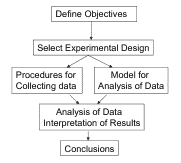

### 1.6 规划实验

有效的实验设计计划应包括以下项目：(1) 目标的清晰描述，(2) 保证因子效应不混淆且无偏的适当设计方案，(3) 收集数据的规定，以便估计实验误差的方差，以及 (4) 收集足够数据以满足目标的要求。Bisaard (1999) 建议制定正式提案，以确保计划包含所有这些要素。提案应包含规划实验的检查清单。以下是与 Bisaard 类似的检查清单。

本节将在讨论一个简单实验时，举例说明此检查清单中的一些步骤。

- 1. 定义目标。定义研究的目标。首先，此陈述应回答为何要进行实验的问题。其次，确定实验是为了分类变异源，还是为了研究因果关系。如果是后者，确定是筛选实验还是优化实验。对于因果关系研究，决定效应应有多大才能被检测到具有意义。

- 2. 识别实验单元。声明将要改变的对象。它是动物或人体受试者、某种加工操作的原材料，还是仅仅是某一时间点或试验中存在的条件？识别实验单元有助于理解实验误差和实验误差的方差。

- 3. 定义有意义且可测量的响应或因变量。定义每次运行后可以测量和记录的实验单元特征。此特征应最能代表因子变化所引起的预期差异。

- 4. 列出自变量和潜在变量。声明你希望研究哪些自变量。石川因果图（参见 SAS Institute, 2004b）在此步骤中通常很有用，有助于组织被认为会影响实验结果的变量。确保所选研究的自变量在单次运行中可控，并且可以在不同运行之间变化。如果对某个变量感兴趣，但它无法控制或变化，则不能将其作为因子。被假设会影响响应但无法控制的变量称为潜在变量。适当的实验设计计划应防止这些变量的不可控变化对正在研究的因子效应产生偏差。

- 5. 运行预试验。进行一些预试验，以确保可以控制和变化所选因子，可以测量响应，并且相同或相似实验单元的重复测量是一致的。无法准确测量响应或控制因子水平是实验无法产生预期结果的主要原因。如果预试验失败，请返回步骤 2、3 和 4。如果这些测试成功，则使用相同因子水平的少量重复测试的响应测量值将产生可用于获取实验误差方差初步估计的数据。

- 6. 为每次运行绘制实验程序流程图。这将确保所遵循的程序被理解，并将在设计的所有运行中标准化。

- 7. 选择实验设计。选择适合您特定实验目标的实验设计。这将包括将要研究的因子水平的描述，并将确定如何


实验单元应分配给因子水平或因子水平组合（如果有多个因子）。本书中描述的方案之一几乎总是合适的。实验设计的选择也将决定应使用什么模型来分析数据。

- 8. 确定所需的重复次数。基于实验误差的预期方差和实际差异的大小，重复运行的次数将使研究人员有较高概率检测到具有实际重要性的效应。

- 9. 将实验条件随机分配给实验单元。根据所使用的特定实验设计，有一种规定的方法将实验条件随机分配给实验单元。这种做法的方式会影响数据的分析方式，描述和记录所做的工作很重要。最好的方法是提供一份按实验采集随机顺序排列的数据采集工作表。对于更复杂的实验设计，Bisgaard (1999)建议使用一张纸，描述每次运行的条件，并留有输入响应数据和记录运行观察结果的空白。然后应将所有这些纸按将要执行的顺序装订成小册子形式。

- 10. 描述数据分析方法。这应是分析步骤的大纲。对模拟数据进行实际分析通常有助于验证拟议的大纲是否可行。

- 11. 完成实验所需资源的时间表和预算。实验需要时间，制定并遵守时间表将提高按时完成研究的机会。Bisgaard (1999)建议使用甘特图（参见 SAS Institute, 2004a），这是一种简单的图形显示，显示过程的步骤以及日历时间。应为所需的费用和资源制定预算大纲。

### 1.7 执行实验

在实验中，仔细规划和执行计划是最重要的步骤。正如墨菲定律所说，凡是可能出错的事都会出错，而数据分析永远无法弥补搞砸的实验。为了说明可能出现的潜在问题，请考虑 Box et al. (1978) 描述的一位业余园丁进行的简单实验。其目的是确定肥料混合物的变化是否会导致其番茄植株产量的变化。十一株番茄植株种植在一行中，肥料类型（A或B）有所变化。本实验中的实验单元是番茄植株及其种植的土壤，处理因子是施用的肥料类型。Easterling (2004)讨论了在规划和进行此类简单实验时应考虑的一些细微差别。将这些与上一节中提出的检查清单结合起来思考是很有启发性的。

在定义本实验的目标时，实验者需要预先考虑他可能得出的结论的可能影响。在这种情况下，可能的结论是（1）决定肥料对番茄产量没有影响，或（2）得出一种肥料产量更大的结论。如果家庭园丁发现产量没有差异，他可以选择使用较便宜的肥料。如果他发现有差异，他将不得不决定产量的增加是否抵消了更好肥料成本的任何增加。这可以帮助他确定他应该寻找多大的产量差异以及他的研究中应该包括多少株番茄植株。这个问题的答案在规划实验时至关重要，对于商业种植者和后院爱好者来说可能大不相同。

本实验的实验单元在上一段中已定义，但在识别它们时，实验者应考虑植物的相似性或均一性，以及他将在地面上将番茄植株间隔多远种植。间距是否足够远，以使施用于一株植物的肥料不会渗漏并影响其邻居？

在本实验中，定义可测量的有意义响应可能很棘手。单株植物上的番茄并非同时成熟。因此，为了以番茄重量来衡量产量，描述实验如何进行的检查清单和流程图必须非常精确。是某一日期植物上所有番茄的重量，还是随着番茄成熟随时间采摘的累积重量？对响应定义的精确性以及在进行测量时遵守定义的一致性至关重要。

本实验中有许多可能的潜在变量需要考虑。浇水、除草、杀虫处理、肥料施用方法和时间以及施用肥料量的任何差异都肯定会影响产量；因此，实验者必须仔细关注这些变量以防止偏差。Easterling (2004)还指出，行位似乎也影响了产量（如图1.2所示）。将肥料随机分配给植物和行位应该使两种肥料的这些差异相等。这是Box et al. (1978)用此示例说明的事情之一。如果使用方便的施肥方法（例如行首施A，随后施B）来代替随机分配，行位效应可能会被误认为处理效应。如果在规划实验之前就知道这种行位效应，相邻的地块对可以分组成对，并随机将一种肥料分配给每对中的一个地块，以防止行位效应带来的偏差。这种技术称为区组，将在第4章中详细讨论。

Easterling (2004)还提出了一个问题：为什么研究中只使用了十一株植物（五株施用肥料A，六株施用肥料B）？通常从苗圃购买的番茄植株盘每盘有

### 图 1.2 按行位划分的产量图 - 番茄实验

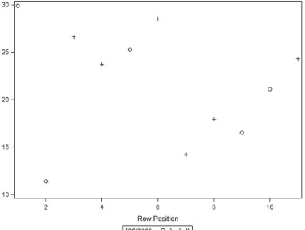

十二。是否有一株植物因为看起来不健康或在搬运过程中受损而被移出研究？所使用的十一株植物中第二行位（见图1.2）的植株产量明显低于同种肥料种植在相邻行位的其他植株。这株植物也是不健康或受损的吗？

实验过程中出现的任何问题都应仔细观察、记录，并作为检查清单第9步中所述数据采集表上的评论进行记录。也许如果对番茄实验这样做了，第二行位的低产量就可以得到解释。

对非常简单实验的这一讨论有助于强调仔细考虑第1.6节中提出的检查清单每个步骤的重要性，以及严格遵循该检查清单第6步中描述的实验流程图的重要性。未能考虑检查清单的每一点，以及在进行实验和记录结果时不一致，可能导致原本有用的研究项目夭折。

### 1.8 使用SAS软件

费舍尔关于实验设计的原始书籍清楚地阐述了实验的逻辑原则，但实验设计的用户需要对最有用的设计及其伴随方案有更详细的描述。咨询统计学家需要系统地解释实验设计与最小二乘和线性假设统计理论之间的关系，并需要对设计进行枚举以及


关于每种设计最适用的实验条件的描述。

这些需求通过 Cochran and Cox (1950) 和 Kempthorne (1952) 的著作得到了满足。然而，Cochran and Cox 与 Kempthorne 的著作均出版于计算机时代之前，两者都强调大量的设计表、丰富的公式和数值示例，描述了实验数据手动分析方法以及构建某些类型设计的数学技术。自这些书籍出版以来，实验设计的应用已远远超出最初采用的农业研究领域，关于该主题的新书也大量出版。尽管用于设计和分析实验数据的计算机和软件已广泛可用，但较新的实验设计书籍中仍有很大比例遵循 Cochran and Cox 与 Kempthorne 确立的传统模式，即呈现大量的设计表和手工计算公式以及构建设计的方法。

本书的目标之一是打破传统，用计算机代码和输出取代冗长的公式和表格。这样将在文本中留出更多空间，以讨论各种设计方案的适用性以及解释和展示实验结果的方法。本书中举例说明的特定计算机软件是 SAS，最初开发于 1972 年。其语法相对稳定且应用广泛。SAS 可能拥有用于实验设计和实验数据分析的最广泛的通用过程种类，包括用于实验设计的 proc plan、proc factex、proc optex 和菜单驱动的 SAS ADX，以及用于实验数据分析的 proc glm、proc varcomp、proc mixed 和许多其他过程。这些过程可在 SAS/Stat 和 SAS/QC 软件中使用。

### 1.9 重要概念回顾

本章描述了实验设计的目的。为了确定因果关系是否存在，必须进行实验设计。在实验设计中，研究中的因素会被有意地改变并观察结果。这与观察研究或抽样调查不同，后者收集数据而不试图控制环境。为了在环境受控的情况下预测未来会发生什么，必须依赖因果关系。从观察研究或抽样调查中获得的关系，在需要控制环境时并不可靠地用于预测未来结果。

实验设计最初在农业研究中开发，但现在应用于所有使用科学方法的场景。本章给出了实验设计中使用的基本定义和术语，并附有实验规划清单。在实践中，可以使用多种不同类型的实验设计。在特定情况下使用哪种设计取决于研究目标和实验单位。图 1.3 是一个图表，说明本书中描述的不同实验设计应在何时使用。随着后续章节中介绍不同的实验设计，将回到此图表以参考设计应使用的时间。

### 图 1.3 设计选择路线图

| | 估计方差 | 研究因素效应 |
|---|---|---|
| **实验单位 (E.U.'s)** | 同质 | 异质 |
| **区块因素** | 一个 | 两个 |
| **区块大小** | 大 | 小 |
| **设计** | RCB, GCB | PBIB, BTIB, LSD |
| **单因素** | RSE | CRD |
| **多因素** | class. cont. mixture | cont. class. |
| **设计** | CRFD CRFF CRFD CRRS SLD SCD EVD RCFB BRS PCBf CCBF PBIB BTIB LSD BIB YSD | |
| **有些难以改变的多因素** | CRSP SPFF RSSP EESPRS SMPV RBSP | |

### 1.10 练习

- 1. 进行了一系列试验，以确定洗手实验中洗涤水温和洗涤剂浓度如何影响受试者手掌上的细菌计数。
  - (a) 确定实验单位。
  - (b) 确定因素。
  - (c) 确定响应。

- 2. 说明与练习 1 中描述的实验相关的实验单位与子样或子单位之间的区别。

- 3. 说明与练习 1 中描述的实验相关的子样与重复样之间的区别。

- 4. 描述你经验范围内（你的工作、爱好或学校）的一个情境，你可能希望预测某项未来行动的结果。解释实验设计（而非观察研究）如何增强你做出此预测的能力。

- 5. Kerry and Bland (1998) 描述了集群随机研究的分析，其中一组受试者被随机分配到相同的治疗。例如，当某些随机选定的地区的女性接受乳腺癌筛查而其他地区的女性不接受筛查时，或者当一些全科医生被随机分配接受一门或多门特殊培训课程而其他医生不接受培训时。在集群试验中，响应（患者的某些特征）必须对每个患者进行测量，而不是对整个群体进行测量。这种研究中的实验单位是什么？你将如何描述患者的个别测量值？

## 单因素完全随机设计

### 2.1 引言

在单因素完全随机设计（简称 CRD）中，n 个实验单位被随机分为 t 组。然后，每组接受处理因素的唯一水平或值之一。如果 n = tr 是 t 的倍数，则因素的每个水平将应用于 r 个唯一的实验单位，并且每个具有相同处理因素水平的运行将有 r 个重复。如果 n 不是 t 的倍数，则每个因素水平的重复数量不相等。所有其他已知的自变量保持不变，以免它们偏差效应。当只有一个因素在研究中且实验单位是同质的时，应使用此设计。

例如，在确定发酵时间对面团高度影响的实验中，一批同质面团将被分成 n 个面包模，每个模中放入等量的面团。然后，这些面团模将被随机分为 t 组。每组将发酵一个独特的时间，并测量并记录每个面包发酵后的高度。处理因素是发酵时间，实验单位是单个面包，响应是测量的高度。虽然已知温度等其他因素会影响发酵面团的高度，但它们将保持不变，每个面包将在相同条件下发酵，仅发酵时间不同。

### 2.2 重复与随机化

重复与随机化由 Fisher 推广。这些是第 1.4 节中解释的误差控制类别下的第一批技术。

重复技术规定，在每个 t 个发酵时间处测试 r 个面包，而不是每个发酵时间处测试一个面包。通过在处理因素的每个水平中设置重复实验单位，可以从数据中计算实验误差的方差，并将此方差与处理效应进行比较。如果处理均值之间的变异性不大于实验误差方差，则处理差异可能归因于分配给每个处理的实验单位之间的差异。如果没有重复，就无法判断处理差异是真实的，还是研究中使用的特定实验单位的随机表现。第 1 章中描述的子样或重复测量不能替代重复。

将实验单位随机分组称为随机化，它是保证实验有效性免受其他潜在变量引起的偏差影响的程序。在面包发酵实验中，随机化将防止潜在变量（例如，不同面包之间酵母的变异性以及随时间推移的测量技术趋势）偏差发酵时间的效应。

当实验单位被随机分配到处理因素水平时，可以使用随机化检验来精确检验处理效应为零的假设，而通常用于实验数据分析的广义线性模型中参数的检验是随机化检验的一个良好近似。

构建随机数据收集表的一种简单方法是将 n 个实验单位分为 t 个处理组，可以使用 SAS 数据步骤命令来完成。例如，在面包发酵实验中，如果实验者想要检查三个不同的发酵时间（35 分钟、40 分钟和 45 分钟），并在每个发酵时间处测试四个重复面包，则以下 SAS 命令将创建列表。

```
/* The unrandomized design */
data unrand;
   do Loaf = 1 to 12;
      if (Loaf == 4) then time=35;
      if ( 5 <= Loaf <= 8 ) then time=40;
      if ( Loaf > 9 ) then time=45;
      dough_height=.;
      output;
   end;
run;
/* Sort by random numbers to randomize */
proc sort data=unrand out=crd; by u;
run;
/* Put Experimental units back in order */
data list;
   set crd;
run;
/* Print the randomized data collection form */
proc print double; var time dough_height; id Loaf;
run;
```

这些命令按顺序创建因素（发酵时间）的水平，使用 ranuni() 函数创建额外的随机数列，创建变量 dough_height（在输出列表中包含用于记录结果的空格），然后按随机数对文件进行排序以创建随机排序的列表。在第二个数据步骤中，文件 crd 被复制到名为 list 的文件中，实验单位（面包）被重新按顺序排列。proc print 语句使用双行距打印 SAS 数据文件 list，以便在实验运行后留出书写响应数据的空间，并为每个


与变量 Loaf 所在行。运行这些命令后，SAS 输出窗口中将包含一个数据收集表单，如下所示。

| 面包批次 | 时间 | 面团高度 |
|---|---|---|
| 1 | 45 | -------- |
| 2 | 45 | -------- |
| 3 | 35 | -------- |
| 4 | 45 | -------- |
| 5 | 45 | -------- |
| 6 | 35 | -------- |
| 7 | 35 | -------- |
| 8 | 40 | -------- |
| 9 | 40 | -------- |
| 10 | 35 | -------- |
| 11 | 40 | -------- |
| 12 | 40 | -------- |

此列表表明，第一和第二个面包批次（或实验单位）应发酵 45 分钟。第三个面包批次（或实验单位）应发酵 35 分钟，以此类推。如果运行相同的命令，由于您获得的特定随机数不同，可能会得到不同的随机顺序。

除了数据步骤外，还可以方便地使用两个 SAS 过程（proc plan 和 proc factorial）来创建随机数据收集表单。这些过程将在即将到来的章节中用于创建更复杂的设计，因此此处仅作简单介绍。对于完全随机设计，可以使用 SAS proc plan 来随机化包含处理指示符的文件。下面的代码清单随机化了上面第一个列表中在文件 unrand 中创建的列表。

SAS proc plan 会自动随机化文件 crd 中实验单位的顺序，因此无需按随机数排序。

```
/* Randomize the design with proc plan*/
proc plan seed=27371;
    factors Loaf=12
    output data=unrand out=crd;
run;
/* Put Experimental units back in order */
proc sort data=crd;
    by Loaf;
/* Print the randomized data collection form */
proc print double; var time dough_height; id Loaf;
run;
```

第二个数据步骤将实验单位重新按顺序排列，以便处理水平在打印的数据收集表单中显示为随机顺序。

另一种替代方法是使用 proc factex。下面的行调用 proc factex 来创建文件 crd。

```
/* Creates CRD in random order using proc factex */
proc factex;
    factors time=nlev=3;
    output out=crd time nvals=(35 40 45) designrep=4 randomize;
    /* Add experimental unit id and space for response*/
    data crd;
        set crd;
        length _n_ $20;
        _n_ = _n_;
    run;
    /* Print the data Collection form */
    proc print data=crd;
        var time _n_;
        id _n_;
    run;
```

此过程允许指定因子的水平值并随机化列表顺序。designrep=4 指定输出文件中应包含每个因子水平的四个重复。或者，可以使用电子表格中的 `rand()` 函数和排序菜单来构建随机列表。这将生成一个电子工作表，除可在实验执行期间用于记录响应数据外，之后还可读入 SAS 进行分析。

### 2.3 历史示例

为了说明规划实验的检查清单，请考虑一个取自 1937 年罗瑟姆斯特德实验站报告（未知，1937）的历史示例。这说明了费舍尔在开发实验设计和方差分析思想方面的早期工作，以便在研究站用于农业实验。

### 目标

该研究的目的是比较播种时间和播种前施用混合人工肥料（NPK）的方法对甜菜产量的影响。通常，肥料施用和种子播种应在土壤可耕作时尽早进行。

### 实验单位

实验单位是地块与在每个地块中种植的特定种子的组合。

### 响应变量或因变量

因变量将是以英担/英亩计量的甜菜产量。

### 自变量和潜在变量

感兴趣的自变量是施用混合人工肥料的时间和方法。处理因子的四个水平如下所选：

- 1. (A) 未施用人工肥料
- 2. (B) 一月施用人工肥料（犁入）
- 3. (C) 一月施用人工肥料（撒施）
- 4. (D) 四月施用人工肥料（撒施）

可能导致地块间甜菜产量差异的潜在变量包括地块本身肥力的差异、各地块使用的甜菜种子的差异、地块间杂草侵染程度的差异、甜菜间苗栽培措施的差异以及人工收获甜菜的差异。

### 试验测试

甜菜在罗瑟姆斯特德已常规种植，人工肥料也已通过犁耕和撒施方式用于多种作物多年；因此，已知自变量可以控制且响应是可测量的。

### 选择实验设计

选择了完全随机设计（CRD），以便地块间潜在变量的差异不太可能与上述因子水平的变化相对应。

### 确定重复次数

产量差异 6 英担/英亩被认为具有实际重要性，基于罗瑟姆斯特德甜菜产量变异性的历史估计，确定四或五个重复次数足够。

### 将实验单位随机分配到处理水平

为实验选择了十八个地块，并构建了一个随机列表，将四或五个地块分配给每个因子水平。

### 2.4 CRD 的线性模型

CRD（完全随机设计）中各因子水平重复次数不等的数据数学模型可写为：

```
\( Y_{ij} = \mu_i + \epsilon_{ij} \) (2.1)
```

其中 \( Y_{ij} \) 是受第 \( i \) 个处理因子水平影响的第 \( j \) 个实验单位的响应，\( i = 1, ..., t \)，\( j = 1, ..., r_i \)，且 \( r_i \) 是处理因子第 \( i \) 个水平中的实验单位或重复次数。

这有时被称为单元均值模型，每个处理因子水平有不同的均值 \( \mu_i \)。由于随机化，处理误差 \( \epsilon_{ij} \) 的分布相互独立，并假设服从正态分布。该模型在图 2.1 中以图形表示。

### 图 2.1 单元均值模型

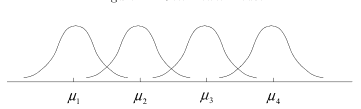

编写数据模型的另一种方法是

```
$Y_{ij} = \mu + \tau_i + \epsilon_{ij} \quad (2.2)$
```

这称为效应模型，$\tau_i$ 称为效应。$\tau_i$ 表示处理因子第 $i$ 个水平下所有可能实验的长期平均值与总体平均值之间的差异。在正态性假设下，$Y_{ij} \sim N(\mu + \tau_i, \sigma^2)$ 或 $\epsilon_{ij} \sim N(0, \sigma^2)$。对于等量重复，处理因子第 $i$ 个水平的数据样本均值表示为

```
$\bar{y}_{i.} = \frac{1}{r_i} \sum_{j=1}^{r_i} y_{ij} \quad (2.3)$
```

总体均值由以下公式给出

```
$\bar{y}_{..} = \frac{1}{t} \sum_{i=1}^t \bar{y}_{i.} = \frac{1}{n} \sum_{i=1}^t \sum_{j=1}^{r_i} y_{ij} \quad (2.4)$
```

其中 $n = \sum r_i$。使用最小二乘法，通过选择使误差平方和最小化的单元均值来求得单元均值的估计值

```
$ssE = \sum_{i=1}^t \sum_{j=1}^{r_i} (y_{ij} - \mu_i)^2 \quad (2.5)$
```

通过对每个单元均值求 $ssE$ 的偏导数，将结果设为零，并求解每个方程来完成此操作

```
$\frac{\partial ssE}{\partial \hat{\mu}_i} = -2 \sum_{i=1}^t \sum_{j=1}^{r_i} (y_{ij} - \mu_i) = 0$
```

这得出以下估计值：

```
$\hat{\mu}_i = \bar{y}_{i.}$
```

### 2.4.1 矩阵表示

考虑一个具有 $t=3$ 个因子水平且 $i=1, ..., t$ 时 $r_i=4$ 个重复的 CRD。我们可以使用矩阵表示法简洁地写出效应模型：

```
$\mathbf{y} = \mathbf{X}\boldsymbol{\beta} + \boldsymbol{\epsilon} \quad (2.6)$
```


其中

```
y = \begin{pmatrix} y_{11} \\ y_{12} \\ y_{13} \\ y_{14} \\ y_{21} \\ y_{22} \\ y_{23} \\ y_{24} \\ y_{31} \\ y_{32} \\ y_{33} \\ y_{34} \end{pmatrix}, X = \begin{pmatrix} 1 & 1 & 0 & 0 \\ 1 & 1 & 0 & 0 \\ 1 & 1 & 0 & 0 \\ 1 & 1 & 0 & 0 \\ 1 & 0 & 1 & 0 \\ 1 & 0 & 1 & 0 \\ 1 & 0 & 1 & 0 \\ 1 & 0 & 1 & 0 \\ 1 & 0 & 0 & 1 \\ 1 & 0 & 0 & 1 \\ 1 & 0 & 0 & 1 \\ 1 & 0 & 0 & 1 \end{pmatrix}, \beta = \begin{pmatrix} \mu \\ \tau_1 \\ \tau_2 \\ \tau_3 \end{pmatrix}, \epsilon = \begin{pmatrix} \epsilon_{11} \\ \epsilon_{12} \\ \epsilon_{13} \\ \epsilon_{14} \\ \epsilon_{21} \\ \epsilon_{22} \\ \epsilon_{23} \\ \epsilon_{24} \\ \epsilon_{31} \\ \epsilon_{32} \\ \epsilon_{33} \\ \epsilon_{34} \end{pmatrix},
```

且 \(\epsilon \sim MVN(0, \sigma^2 I)\)。

\(\beta\) 的最小二乘估计量是正规方程 \(X'X\hat{\beta} = X'y\) 的解。正规方程的问题是 \(X'X\) 是奇异矩阵，无法求逆。使用 SAS proc glm 解决此问题的方法是将 \(X\) 矩阵分区为：

```
X = \begin{pmatrix} 1 & 1 & 0 & 0 \\ 1 & 1 & 0 & 0 \\ 1 & 1 & 0 & 0 \\ 1 & 0 & 1 & 0 \\ 1 & 0 & 1 & 0 \\ 1 & 0 & 1 & 0 \\ 1 & 0 & 1 & 0 \\ 1 & 0 & 0 & 1 \\ 1 & 0 & 0 & 1 \\ 1 & 0 & 0 & 1 \\ 1 & 0 & 0 & 1 \\ 1 & 0 & 0 & 1 \end{pmatrix} = [X_1 \ X_2]
```

然后 \(X'X\) 可以写成分块形式为：

```
X'X = \begin{bmatrix} X_1'X_1 & X_1'X_2 \\ X_2'X_1 & X_2'X_2 \end{bmatrix}, \text{ and } X_1'X_1 \text{ is non-singular. Therefore } X'X^- = \begin{bmatrix} X_1'X_1^{-1} & 0 \\ 0 & 0 \end{bmatrix}
```

是 \(X'X\) 的广义逆，且 \(\hat{\beta} = (X'X)^- X'y\) 是一个解，其结果等同于在限制 \(\beta_1 = 0\) 下所获得的估计量（参见 Freund and Littell, 1981）。对于具有 \(t = 3\) 个因子水平和 \(i = 1, ..., t\) 中每个水平有 \(r_i = 4\) 个重复的示例，

```
\beta = \begin{pmatrix} \mu \\ \tau_1 \\ \tau_2 \\ \tau_3 \end{pmatrix}, \hat{\beta} = \begin{pmatrix} \hat{\mu} + \hat{\tau}_3 \\ \hat{\tau}_1 - \hat{\tau}_3 \\ \hat{\tau}_2 - \hat{\tau}_3 \\ 0 \end{pmatrix}
```

### 2.4.2 使用 SAS proc glm 进行最小二乘计算

表 2.1 显示了本章前面描述的面包发酵实验的 CRD 设计数据。

| 发酵时间 | 面包高度 |
| :--- | :--- |
| 35 分钟 | 4.5, 5.0, 5.5, 6.75 |
| 40 分钟 | 6.5, 6.5, 10.5, 9.5 |
| 45 分钟 | 9.75, 8.75, 6.5, 8.25 |

使用这些数据，我们有

\( X'X = \begin{pmatrix} 12 & 4 & 4 & 4 \\ 4 & 4 & 0 & 0 \\ 4 & 0 & 4 & 0 \\ 4 & 0 & 0 & 4 \end{pmatrix}, \quad X'y = \begin{pmatrix} 88.0 \\ 21.75 \\ 33.0 \\ 33.25 \end{pmatrix} \)

且

\( X'X^{-1} = \begin{pmatrix} 0.25 & -0.25 & -0.25 & 0 \\ -0.25 & 0.50 & 0.25 & 0 \\ -0.25 & 0.25 & 0.50 & 0 \\ 0 & 0 & 0 & 0 \end{pmatrix}, \quad \hat{\beta} = (X'X)^{-1}X'y = \begin{pmatrix} 8.3125 \\ -2.8750 \\ -0.0625 \\ 0.0000 \end{pmatrix} \)

读取这些数据并计算这些估计量的 SAS 命令如下：

```
/* Reads the data from compact list */
/* data bread; */
input time h1-h4;
height=h1; output;
height=h2; output;
height=h3; output;
height=h4; output;
data keep time height;
35 4.5 5.0 5.5 6.75
40 6.5 6.5 10.5 9.5
45 9.75 8.75 6.5 8.25
run;
/* Fits model with proc glm */
proc glm;
class time;
model height=time/solution;
run;
```

这些命令以紧凑格式读取数据，如表 2.1 所示，然后使用 output 语句为输入记录中的每一行在文件 bread 中创建四行。模型 /solution; 选项的结果是：

| 参数 | 估计量 |
| :--- | :--- |
| 截距 | 8.312500000 B |
| time 35 | -2.875000000 B |
| time 40 | -0.062500000 B |
| time 45 | 0.000000000 B |

我们可以看到这些估计量与上面所示的相同。这些参数估计量不是唯一的，因为它们取决于类变量 time 的顺序。proc glm 识别出这一点，并在每个值后跟一个 B 来指定这些估计量为有偏估计量。

### 2.4.3 \(\sigma^2\) 的估计与二次型分布

实验误差方差 \(\sigma^2\) 的估计量是 \(ssE/(n-t)\)。只有在处理因子的每个水平都有重复实验时，才能估计该方差。当将子样本上的测量值或同一实验单位上的重复测量值视为重复时，该估计量可能会严重偏差。

在矩阵形式中，\(ssE\) 可以写成

\(ssE = y'y - \hat{\beta}'X'y = y'(I - X(X'X)^-X')y,\)

并且根据线性模型理论，可以证明 \(ssE\) 与实验误差方差 \(\sigma^2\) 的比值服从自由度为 \(n-t\) 的卡方分布，即 \(ssE/\sigma^2 \sim \chi^2_{n-t}\)。

### 2.4.4 可估函数

若单元均值的线性组合可以表示为响应的线性组合的期望值，则称为可估函数，即，

\(\sum_{i=1}^t b_i(\mu + \tau_i) = E\left[\sum_{i=1}^t \sum_{j=1}^{r_i} a_{ij} Y_{ij}\right] \quad (2.7)\)

从该定义可以看出，效应 \(\tau_i\) 不可估，但单元均值 \(\mu + \tau_i\) 或效应对比 \(\sum c_i \tau_i\)（其中 \(\sum c_i = 0\)）是可估的。

在矩阵表示法中，若 \(L\) 的每一行都是 \(X\) 行的线性组合，则 \(L\beta\) 是一组可估函数，且 \(L\hat{\beta}\) 是其无偏估计量。\(L\beta\) 服从多元正态分布，协方差矩阵为 \(\sigma^2 L'(X'X)^- L\)，协方差矩阵的估计量为 \(\hat{\sigma}^2 L'(X'X)^- L\)。例如，使用上面面包发酵实验的数据，

\(L = \begin{pmatrix} 0 & 1 & -1 & 0 \\ 0 & 1 & 0 & -1 \end{pmatrix} . \quad (2.8)\)

\(L\beta = \begin{pmatrix} \tau_1 - \tau_2 \\ \tau_1 - \tau_3 \end{pmatrix}，\text{且 } L\hat{\beta} = \begin{pmatrix} \hat{\tau}_1 - \hat{\tau}_2 \\ \hat{\tau}_1 - \hat{\tau}_3 \end{pmatrix} = \begin{pmatrix} -2.8025 \\ -2.8750 \end{pmatrix} \text{是效应对比的一个向量}。

CRD 中自由度的数量，或线性无关的效应对比的数量，始终等于处理因子的水平数减一，即 t - 1。每当存在一组 t - 1 个线性无关的效应对比时，它们被称为一组饱和可估对比。

可以证明 \((L\hat{\beta})'(L(X'X)^{-}L')^{-1}(L\hat{\beta})\) 服从非中心卡方分布 \(\chi^2_p(\lambda)\)，其中非中心性参数

\(\lambda = (\sigma^2)^{-1}(L\beta)'(L(X'X)^{-}L')^{-1}(L\beta),\)

且 **L** 是类似 (2.8) 的可估对比的系数矩阵，自由度 p 等于 **L** 的秩。

可估对比可以通过 SAS proc glm 的 estimate 命令获得。例如，要估计处理因子第一和第二水平的单元均值平均差异，\((\mu + \tau_1) - (\mu + \tau_2) = \tau_1 - \tau_2\)，请使用命令：

```
estimate '1 - 2' time 1 -1;
```

其中引号中的字符串是输出中使用的标签，time 是处理因子的名称，数字 1 -1 是对比系数 c_i。命令：

```
estimate '1 -2 -3' time 1 -1 -1;
```

将不会产生任何输出，且在日志文件中将打印消息 "1 -2 -3 is not estimable"，因为 \(\sum c_i \neq 0\)。

### 2.4.5 无处理效应的假设检验

在 CRD 模型中，感兴趣的统计假设是 \(H_0 : \mu_1 = \mu_2 = ... \mu_t\) 或 \(\tau_1 = \tau_2 = ... = \tau_t\)，与备择假设 \(H_a：\) 至少有两个 \(\tau\) 不同。如果原假设成立，模型 \(y_{ij} = \mu_i + \epsilon_{ij} = \mu + \tau_i + \epsilon_{ij}\) 简化为 \(y_{ij} = \mu + \epsilon_{ij}\)，这可以表示为均值为 \(\mu\)、方差为 \(\sigma^2\) 的单个正态分布，而不是像图 2.1 所示的多个正态分布。

均值周围的离差平方和为 \(ssTotal = \sum_{i=1}^t \sum_{j=1}^{n_i} (y_{ij} - \bar{y}_{\cdot\cdot})^2 = y'y - (1'y)^2/(1'1)\)，其中 \(\bar{y}_{\cdot\cdot}\) 是总均值，1 是全为 1 的列向量。该离差平方和可以分解为：

ssTotal = ssT + ssE (2.9)

其中 \(ssT = \hat{\beta}'X'y - (1'y)^2/(1'1) = (L\hat{\beta})'(L(X'X)^{-}L')^{-1}(L\hat{\beta})\)，且 **L** 是一组饱和可估对比的系数矩阵。该量称为处理离差平方和。在原假设 \(H_0 : \mu_1 = \mu_2 = ... \mu_t\) 下，ssT 和 ssE 均服从卡方分布。这些离差平方和及其对应的均方（由各离差平方和除以其自由度得到）通常呈现


在方差分析（ANOVA）表中，如表2.2所示（符号形式）。

| 来源 | 自由度 | 平方和 | 均方 | F比 |
| :--- | :--- | :--- | :--- | :--- |
| 处理 | $t-1$ | $ssT$ | $msT$ | $F = msT/msE$ |
| 误差 | $n-t$ | $ssE$ | $msE$ | |
| 总计 | $n-1$ | $ssTotal$ | $msTotal$ | |

在原假设下，F比 $msT/msE$ 服从具有 $t-1$ 和 $n-t$ 自由度的F分布，而在备择假设下，它服从具有非中心性参数的非中心F分布

\(\lambda = (\sigma^2)^{-1}(L\boldsymbol{\beta})'(L(X'X)^{-1}L')^{-1}(L\boldsymbol{\beta}) = \frac{r}{\sigma^2} \sum_{i=1}^t (\mu_i - \bar{\mu})^2.\)

它是 $H_0$ 的广义似然比检验统计量，也是第2.2节中描述的将处理效应与实验误差方差进行比较的正式方法。

ANOVA表中的平方和、均方、自由度及相关的F检验统计量由SAS proc glm自动计算。例如，前面所示面包实验的proc glm; class temp; model height=temp;命令的结果为：

| 来源 | 自由度 | 平方和 | 均方 | F值 | Pr > F |
| :--- | :--- | :--- | :--- | :--- | :--- |
| 模型 | 2 | 21.57291667 | 10.78645833 | 4.60 | 0.0420 |
| 误差 | 9 | 21.09375000 | 2.34375000 | | |
| 校正后的总计 | 11 | 42.66666667 | | | |

在此表中，$ssT$ 和 $msT$ 及其相关自由度位于标记为“模型”的行上，$ssE$ 位于标记为“误差”的行上，$ssTotal$ 位于标记为“校正后的总计”的行上。F值是比值 $msT/msE$，最后一列标记为 Pr > F，表示如果原假设为真，则超过计算出的F值的概率。这称为P值，并在图2.2中以图形方式说明。如果实验者为其假设检验选择了显著性水平 $\alpha$，则当proc glm输出中的Pr > F值小于所选的 $\alpha$ 值时，他将拒绝该假设。

对于面包发酵实验，在显著性水平 $\alpha = 0.05$ 下，各发酵时间的平均发面高度之间存在显著差异，因为 $0.042 < 0.05$。

### 图 2.2 Pr > F

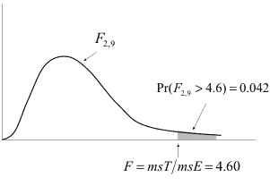

#### 2.4.6 一句话的提醒

当进行单因素完全随机设计时，分析模型为方程(2.1)或(2.2)，正确的分析是通过方差分析，如表2.2所示（符号形式）。使用SAS等计算机软件使数据分析和得出结论变得容易；然而，如果实验未妥善进行，即使是对数据进行精巧的分析也可能是无用的。模型(2.1)或(2.2)中的 \(\epsilon_{ij}$ 项及其相关的平方和 \(ss_E$ 表示重复实验单位。在许多情况下，实验者在处理因素的每个水平上没有重复实验单位，而是在分析中用子样本或重复测量来替代它们。在其他情况下，实验单位未被正确随机分配到处理因素水平。当出现这种情况时，仿佛设计已妥善进行一样执行分析可能是完全错误且具有误导性的。可能会得出经不起后续审查的错误结论，并且统计设计实验和数据的统计分析会不公平地承担坏名声。

例如，考虑一个实验，一位教授希望确定教学方法对学生考试分数的影响。如果他对早班使用一种教学方法，对晚班使用另一种教学方法，并将个别学生的考试分数视为重复，那么他的分析结果可能完全错误。这种情况类似于第1章练习5中描述的组随机研究。实验单位是班级，因为他将教学方法同时应用于整个班级，而个别学生是子样本或观察单位（因为他必须测试个别学生，而不是整个班级）。处理效应应根据实验单位或班级的变异性来判断。班级内学生之间的变异性可能与班级平均值之间的变异性大不相同。子样本观察应在分析前平均，如第1.3节所述。如果这样做，他每个班级每种教学方法只有一个观察值，没有可用于计算表2.2中ssE的重复。计算教学方法F检验统计量没有分母。如果他使用班级内学生的变异性来计算ssE，它可能太大或太小，导致他对处理效应的显著性得出错误结论。此外，如果他没有随机确定早班和晚班使用哪种教学方法，并且没有使用相同教学方法授课的重复班级，那么他的分析就极易受到偏差的影响。早班的学生可能与晚班的学生根本不同，两种教学方法之间的平均分数的任何差异可能完全归因于两组学生之间的差异。事实上，如果教授知道早班和晚班学生存在差异，他可能会故意将他想要推广的教学方法用于更好的班级，从而破坏其研究的客观性。

### 2.5 验证线性模型的假设

证明基于上一节所介绍线性模型的分析最关键的假设是实验误差项 $\epsilon_{ij}$ 的独立性。如果已对实验单位进行适当的随机分配到处理因素水平，则该假设得到证明。无需进一步步骤来证明此假设。

线性模型的另外两个假设是：所有处理因素水平上实验误差的方差 $\sigma^2$ 保持不变，以及实验误差服从正态分布。这两个假设都可以在图2.1中可视化。

为了验证方差齐性假设，可以构建响应数据与因素水平的简单散点图。图2.3显示了面包发酵实验的此类图示示例。在此图中，不同发酵时间水平之间面团高度变异范围的相似性将证明方差齐性假设的合理性。

此图在SAS中使用以下命令创建：

```
proc sgplot data=bread;
scatter y=height x=Time;
run;
```

用于检验方差齐性假设的另一种类似图表是残差与单元格均值（或预测值）的图表。残差是响应数据与其各自单元格均值之间的差异。对于处理因素的每个水平，平均残差为零。因此，在残差图中，更容易可视化散点或变异性是否相等。方差齐性的常见偏离发生在实验误差的方差随平均响应增加而增加时。通过绘制残差与单元格均值的图表，如果图表中从左到右残差的垂直散点增加，则可以检测到这种偏离。

### 图 2.3 面包发酵实验的响应与因素水平图

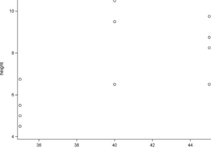

对于面包发酵实验，SAS命令：

```
/* Fit model and Examine Residual Plots */
ods graphics on;
proc glm data=bread plots=diagnostics(unpack);
   class time;
   model height=time/solution;
   run;
ods graphics off;
```

这将拟合CRD设计的模型，并且当像本示例中所示打开ods图形时，选项plots=diagnostics(unpack)会创建一个诊断图表面板，以确定模型的假设是否得到满足。(unpack)功能将图表分开，以便它们可以单独显示。此面板中创建的图表之一标记为“按预测值划分的残差”，如图2.4所示。对于单因素CRD设计，模型的预测值 $\hat{y}_{ij} = \hat{\mu}_i$ 是单元格均值。如图2.4所示，较大的单元格均值或预测值的残差分布更宽。这表明方差齐性假设可能被违反。与图2.3相比，这一事实在图2.4中更容易看到。

为了验证实验误差的正态性假设，可以检查残差的正态概率图。在proc glm创建的诊断图表面板中，正态概率图标记为“残差的Q-Q图”，如图2.5所示。


图 2.4 面包发酵实验残差与单元格均值图

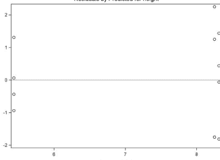

图 2.5 面包发酵实验残差正态图

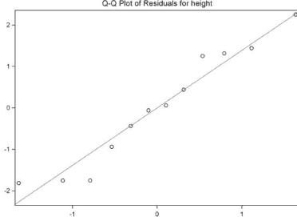

在正态概率图中，如果点沿直线分布，则正态分布假设成立。数据越多，图上的点越多，点必须越接近直线才能证明正态性假设成立。在图 2.5 中，点与直线距离相当接近，正态性假设似乎成立。方差齐性假设比正态性假设更关键，但两者有时并存。当方差齐性假设被违反时，正态性假设也常常被违反，而用于处理方差不齐时修改分析的纠正措施通常也能同时纠正这两个问题。

## 2.6 假设被违反时的分析策略

处理因子水平间方差不齐的一个常见原因是响应与刺激或处理之间存在非线性关系。例如，在图 2.6 的上半部分可以看到，响应随处理非线性增加。在三个处理水平上侧面绘制的密度函数，表示非线性如何影响响应的分布。随着分布的均值或中心增加，分布的方差或离散程度也增加，且分布在右侧具有长尾。纠正这种情况的一种方法是在分析前转换响应数据。

图 2.6 非线性对响应分布影响的示意图

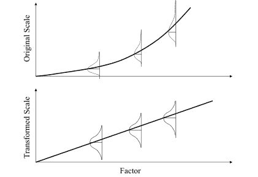

图 2.6 的下半部分显示了方差稳定转换的潜在结果。在转换后的尺度上，不同因子水平的方差看起来是恒定的，分布看起来更接近正态。

### 2.6.1 Box-Cox 幂变换

识别是否需要方差稳定转换的一种方法是检查上一节中描述的残差与单元格均值图。如果残差的离散程度随着单元格均值的增加而成比例增加，如图 2.4 所示，通常可以找到一个转换 Y = f(y)，从而得到更灵敏的分析。Box 和 Cox (1964) 提出了一系列通常效果良好的幂变换 Y = y^λ。如果方差随均值增加而增加，则选择小于 1 的 λ 值；如果方差随均值增加而减少，则选择大于 1 的 λ 值。表 2.3 总结了一些常见的 Box-Cox 幂变换。当 σ ∝ μ 的常见情况是，响应实际上是变异性的度量，例如样本方差 s^2。

表 2.3 Box-Cox 幂变换

| σ 与 μ 的关系 | λ | 变换 |
| :--- | :--- | :--- |
| σ ∝ μ^2 | -1 | 倒数 |
| σ ∝ μ^1/2 | -1/2 | 倒数的平方根 |
| σ ∝ μ | 0 | 对数 |
| σ ∝ μ^1/2 | 1/2 | 平方根 |

在 CRD 设计中，每个处理因子水平都有重复实验，确定 Box-Cox 变换中应使用的最合适 λ 值的一种方法是对汇总统计量拟合一条最小二乘回归直线

log(s_i) = a + b log(ȳ_i.)

如果直线对数据提供合理的拟合，则使用 λ = 1 - b。例如，对于面包发酵实验，下面的 SAS 命令使用 proc sort 和 proc means 计算并存储单元格均值和标准差到 SAS 文件 means 中。

```
proc sort data=bread; by time;
proc means data=bread; var height; by time;
output out=means mean=meanheight stddev=s;
data logs; set means;
logsmean=log(mean);
logs=log(s);
```

在数据步骤中计算单元格均值和标准差的对数，并将其存储在文件 logs 中。在下一页顶部显示的命令中，proc reg 用于计算回归直线的斜率和截距，proc sgplot 用于绘制按均值对数划分的标准差对数，并带有拟合的回归直线，如图 2.7 所示。

```
proc reg data=logs;
model logs=logmean;
run;
proc sgplot data=logs;
reg y=logs x=logmean/curvelabel="Slope=1.29487";
xaxis label="log mean";
yaxis label="log standard deviation";
run;
```

图 2.7 面包发酵实验 log(s_i) 与 log(y_bar_j) 图

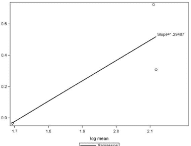

在此图中可以看出，随着 log(y_bar_j) 的增加，log(s_i) 也增加，且线性拟合对该关系提供了良好的表示。因此，用于转换面团高度的适当 lambda 为 lambda = 1 - 1.294869。之前用于读取面包发酵实验数据的 SAS 数据步骤命令可以修改为如下方式以包含该转换：

```
data bread2;
input time h1-h4;
height=h1*(1-1.294869); output;
height=h2*(1-1.294869); output;
height=h3*(1-1.294869); output;
height=h4*(1-1.294869); output;
drop h1-h4;
run;
datalines;
```

在包含此转换后，残差与单元格均值图如图 2.8 所示。可以在此图中看到，对于每个预测值或对数单元格均值，残差的离散程度或变异性几乎相同。

图 2.8 面包发酵实验 \( y^\lambda \) 转换后残差与单元格均值图

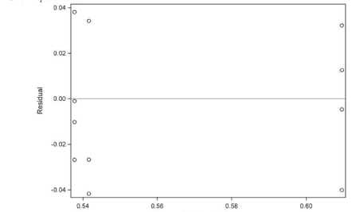

此转换也使 F 检验更灵敏。转换后响应的 ANOVA 表如下所示，可以看出 P 值从 0.042（转换前）降至 0.0227（转换后）。

GLM 过程

因变量：height

| 来源 | DF | 平方和 | 均方 | F 值 | Pr > F |
|---|---|---|---|---|---|
| 模型 | 2 | 0.01305604 | 0.00652802 | 5.94 | 0.0227 |
| 误差 | 9 | 0.00989833 | 0.00109981 | | |
| 校正总计 | 11 | 0.02295437 | | | |

即使使用转换来证明分析假设并使 F 检验更灵敏，结果通常也会在原始尺度上报告。例如，在报告中讨论 (面团高度)^-0.294869 会令人困惑。

### 2.6.2 基于分布的转换

第 2.3 节中描述的 CRD 效应的分布假设为 $Y_{ij} \sim N(\mu + \tau_i, \sigma^2_\epsilon)$。但是，如果已知数据遵循正态分布以外的某些分布，例如二项分布、泊松分布或对数正态分布，那么也可知标准差不是恒定的。例如，如果响应 $Y$ 是 $n$ 次试验中成功次数的二项计数，那么根据中心极限定理，$Y$ 近似服从正态分布，但 $\mu_Y = np$ 且 $\sigma_Y = \sqrt{np(1-p)}$，其中 $p$ 为成功概率。在这种情况下，当已知响应的分布遵循某些特定形式时，可以找到适当的转换来稳定方差。表 2.4 显示了常遇到情况的转换。

表 2.4 响应分布基础转换

| 响应分布 | 均值 $\mu$ 下的方差 | 转换 $f(y)$ |
|---|---|---|
| 二项分布 | $\frac{\mu(1-\mu)}{n}$ | $\sin^{-1}\sqrt{y/n}$ (弧度) |
| 泊松分布 | $\mu$ | $\sqrt{y}$ 或 $\sqrt{y + \frac{1}{2}}$ |
| 对数正态分布 | $c\mu^2$ | $\log(y)$ |

### 2.6.3 最小二乘分析的替代方法

当实验误差的方差在所有处理因子水平上不恒定，但与单元格均值无关时，转换不是均方化或稳定方差的适当方法。解决此问题的更一般方法是使用加权最小二乘法。使用加权最小二乘法时，$\hat{\beta}$ 是正规方程 $\mathbf{X'WX}\hat{\beta} = \mathbf{X'Wy}$ 的解，其中 $\mathbf{W}$ 是一个对角矩阵，其对角元素为各处理水平内标准差的倒数。为说明此方法，请考虑下一页顶部用于分析面包发酵实验数据的 SAS 命令。

与之前的示例一样，数据以相同的方式读入。sort 和 means 过程计算单元格标准差，下一个数据步骤将这些与原始数据合并并计算权重 $\mathbf{w}$，即标准差的倒数。proc glm 调用中的 weight 语句求解加权最小二乘正规方程。结果显示在命令下方。


/* Calculates mean and standard deviations */
proc sort data=breed; by time;
proc means data=breed var height by time;
output out=means stdev=;
/* Creates weights */
data breed3; merge breed means; by time;
w=1/s;
proc glm data=breed3;
class time;
model height=time;
weight w;
run;
```

The GLM Procedure

Dependent Variable: height

Weight: w

| 来源 | 自由度 | 平方和 | 均方 | F值 | Pr > F |
| :--- | :--- | :--- | :--- | :--- | :--- |
| 模型 | 2 | 18.20937757 | 9.10468879 | 6.23 | 0.0201 |
| 误差 | 9 | 13.16606021 | 1.46229560 | | |
| 校正后的总和 | 11 | 31.36998578 | | | |

从这些结果可以看出，加权最小二乘的 F 检验比未加权最小二乘更敏感，P 值与 2.5.1 节所示 Box-Cox 变换所得结果相似。

当误差分布不呈正态时，分析响应变换的一种替代方法是使用广义线性模型（参见 McCullagh 和 Nelder, 1989）。在拟合广义线性模型时，用户除指定模型外，还必须指定误差分布和链接函数。使用极大似然法估计模型参数，并使用广义似然比检验来检验假设。当链接函数为恒等函数且分布为正态分布时，广义线性模型分析将得到最小二乘法和 ANOVA F 检验。SAS 过程 genmod 将拟合广义线性模型并计算适当的似然比检验统计量。该过程允许用户从 Binomial、Poisson、Negative Binomial、Multinomial、Gamma、Inverse Gaussian 以及 Normal 分布中进行选择。对于每种分布，genmod 都有一个默认链接函数。

为说明使用 proc genmod 分析实验数据的方法，请考虑以下示例。一位教授希望比较三种不同的教学方法，以确定学生将如何评价课程。处理因素是教学方法，实验单位是一个学生班级，响应是学生对课程评分的汇总。该教授在三个连续学期中教授了该课程的两个班级，总共产生了六个实验单位或班级。他进行了随机排列，使得每种教学方法分配了两个班级。这将减少班级之间其他差异，或他对教学方法评价的差异，对结果产生偏倚的机会。每学期结束时，要求学生在五点量表上对课程进行评分，1 分为最差，5 分为最好。因此，每个班级的响应不是单一的正态分布响应 y，而是一个遵循多项分布的向量 (y1, ..., y5) 响应。实验的汇总数据如表 2.5 所示。

| 班级 | 方法 | 1 | 2 | 3 | 4 | 5 |
|---|---|---|---|---|---|---|
| 1 | 1 | 2 | 14 | 12 | 8 | 5 |
| 2 | 3 | 1 | 11 | 15 | 15 | 10 |
| 3 | 2 | 3 | 8 | 18 | 14 | 10 |
| 4 | 3 | 1 | 9 | 17 | 15 | 12 |
| 5 | 2 | 4 | 12 | 19 | 9 | 7 |
| 6 | 1 | 3 | 16 | 13 | 10 | 4 |

以下 SAS 命令读取数据并调用 proc genmod 进行广义线性模型分析。

```
data teaching;
input count score $ class method;
datalines;
2 1 1 1
14 2 1 1
...
proc genmod;
class count;
model score=method/dist=multinomial aggregate=method type1;
run;
```

input 语句中 score 后面的 $ 导致其被读取为字符变量。model 语句上的 dist=multinomial 选项指定分布。proc genmod 然后假设默认累积 logit 链接函数。aggregate=method 选项请求打印无方法效应的似然比检验。结果如下一页所示。似然比卡方统计量的 P 值较小，表明教学方法之间存在显著差异。教学方法 1 的平均得分为 2.98，教学方法 2 的平均得分为 3.22，而教学方法 3 似乎是最好的，平均得分为

| 类型 1 分析的 LR 统计量 |
| :--- |
| 来源 | 偏差 | 自由度 | 卡方值 | Pr > ChiSq |
| 截距 | 13.7965 | | | |
| method | 4.1486 | 2 | 9.65 | 0.0080 |

得分为 3.47。这也可以在图 2.9 的柱状图中可视化，该图显示教学方法 2 和 3 给出的高分百分比增加。

图 2.9 按教学方法划分的学生评分百分比

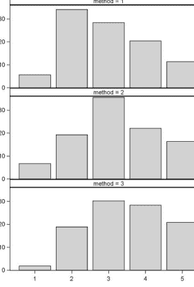

## 2.7 确定重复次数

无处理效应的 ANOVA F 检验的显著性水平 \(\alpha\) 是在原假设 \(H_0: \mu_1 = \mu_2, ..., = \mu_4\) 为真时拒绝它的概率。检验的效能是在原假设为假时拒绝它的概率。当原假设为真时，检验统计量 $msT/msE$ 服从 F 分布，但当原假设为假时，它服从非中心 F 分布。非中心 F 分布的展宽比中心 F 分布更宽，如图 2.10 所示。

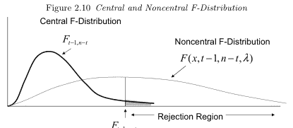

非中心 F 分布的展宽以及超过中心 F 分布临界限值的概率是非中心性参数 \(\lambda\) 的递增函数。当分布为非中心 F 时，超过中心 F 分布临界限值的概率称为效能。当原假设为假时，效能大于显著性水平 \(\alpha\)，这使得非中心性参数大于零。如果指定了单元均值、实验误差方差和每个因素水平的重复次数，则可以计算任何均值差异场景下的效能。对于单元均值之间的恒定差异（由 \(\sum_{i=1}^t(\mu_i - \bar{\mu})^2\) 表示），随着重复次数的增加，非中心性参数和效能都会增加。

当单元均值之间的差异足够大以具有实际重要性时，实验者希望具有高效能，即拒绝无处理效应假设的概率。当均值之间的差异对研究者具有实际重要性时，我们称之为 *实际显著性*。实际显著性并不总是与由 F 检验和 ANOVA 确定的统计显著性相对应。有时实验中的重复次数太少，检测实际显著性差异的概率或效能太低。通过确定能够产生所需效能的适当重复次数，可以使统计显著性与实际显著性一致。这样做是第 1 章讨论的 *误差控制* 类别中的第二种技术。增加重复次数可以提高实验灵敏度的观点也归功于 Fisher (1935)。

例如，如果单元均值之间存在差异，使得校正后的平方和（$css = \sum_{i=1}^t (\mu_i - \bar{\mu})^2$）大于零，那么拒绝 $H_0 : \mu_1 = \mu_2 = \dots = \mu_t$ 的效能或概率由以下公式给出：

$\pi(\lambda) = \int_{F_{t-1, t(r-1), \alpha}}^\infty F(x, t-1, t(r-1), \lambda) dx \quad (2.10)$

其中，$F_{t-1, t(r-1), \alpha}$ 是具有 $t-1$ 和 $t(r-1)$ 自由度的中心 F 分布的第 \(\alpha\) 个百分位数，$F(x, t-1, t(r-1), \lambda)$ 是具有非中心性参数 $\lambda = \frac{t}{r} \sum_{i=1}^t (\mu_i - \bar{\mu})^2$ 的非中心 F 分布。对于 $\frac{1}{r} \sum_{i=1}^t (\mu_i - \bar{\mu})^2$ 的固定值，非中心性参数和效能作为重复次数 $r$ 的函数而增加。可以对 $r$ 的各种值计算此概率，直到找到具有足够效能的值。通过这种方式可以确定适当的重复次数。SAS 中的 prob 函数有助于这些计算。

在面包发酵实验中，假设发酵面团高度小于三英寸的差异无关紧要。但是，如果将发酵时间从 35 分钟改为 45 分钟会导致发酵面团高度相差超过三英寸，实验者希望知道这一点，因为他将来需要密切监控发酵时间以生产高度一致的面包。在此情况下，我们可以将 $\Delta = 3.0$ 视为单元均值的实际差异。在至少有两个单元均值相差 $\Delta$ 的情况下，$css = \sum_{i=1}^t (\mu_i - \bar{\mu})^2$ 可能取得的最小值是：一个单元均值比总体均值高 $\Delta/2$，第二个比总体均值低 $\Delta/2$，第三个等于总体均值。这将导致

$css = \sum_{i=1}^t (\mu_i - \bar{\mu})^2 = \left(\frac{\Delta}{2}\right)^2 + 0^2 + \left(-\frac{\Delta}{2}\right)^2 = \left(\frac{\Delta}{2}\right)^2 = \left(\frac{3^2}{2}\right) = 4.5$

假设实验误差方差 $\hat{\sigma}^2 = 2.1$ 是从预实验中发酵面团高度的样本方差估计得来的，在该预实验中，若干个面包被允许发酵相同的时间，那么非中心性因子可以计算为 $\lambda = \frac{r}{2.1} \times (4.5)$。使用下一页顶部所示的 SAS 数据步骤命令，对 $r = 2, \dots, 6$ 计算效能。


```sas
*Example power computation in SAS data step using Bread Example;
data Power;
do r=2 to 6;
nu1=3-1; * df for numerator;
nu2=3*(r-1); * df for denominator;
alpha=.05;
Fcrit=finv(1-alpha,nu1,nu2); *F critical value;
f=3.0/22.1;
ncss=4.5;
nc=r*(ncss)/sigma2; *noncentrality parameter for noncentral F;
power=1-probf(Fcrit,nu1,nu2,nc);
output;
end;
keep r nu1 nu2 nc power;
title Power Calculation in Data Step;
proc print; run;
```

以下是结果。

| 数据步骤中的功效计算 | | | | | |
|---|---|---|---|---|---|
| 观测数 | r | nu1 | nu2 | nc | 功效 |
| 1 | 2 | 2 | 3 | 4.2857 | 0.19480 |
| 2 | 3 | 2 | 6 | 6.4286 | 0.40419 |
| 3 | 4 | 2 | 9 | 8.5714 | 0.59034 |
| 4 | 5 | 2 | 12 | 10.7143 | 0.73289 |
| 5 | 6 | 2 | 15 | 12.8571 | 0.83289 |

由此可见，当 r = 5 个重复时，检测出单元格均值差异大小为 3.0 的概率为 73%，而当 r = 6 时，概率为 83%。当重复少于五次时，至少有 40% 的概率会错过这一差异。经验法则认为，功效在 0.80 到 0.90 之间的重复次数通常足以满足大多数实验研究的需求。

类似的功效计算可以使用 SAS Analyst 样本量工具（用于单因素方差分析）、proc power、proc glmpower 或 SAS 功效与样本量应用程序来完成。SAS Analyst 样本量工具的交互式输入与上述数据步骤命令类似，并且必须指定 css = \sum_{i=1}^t (\mu_i - \bar{\mu})^2。SAS 9.2 版本之后将不再提供 SAS Analyst。

SAS 的 proc power、proc glmpower 过程以及 SAS 功效与样本量应用程序要求用户输入他认为具有实际意义的单元格均值 \mu_i 的值，而不是 css = \sum_{i=1}^t (\mu_i - \bar{\mu})^2，并且输入 \sigma 而不是 \sigma^2。以下命令将使用 proc power 为面包发酵实验产生与上述数据步骤命令等效的结果。

```
* Example Power Calculation Using proc power;
proc power;
   OneWayANOVA;
   Alpha = 0.05
   GroupMeans = (-1.5 0 1.5)
   Stddev = 1.449
   Power = .
   NPerGroup = 2 to 6 by 1;
run;
```

proc glmpower 允许更复杂的模型，将在第 3 章中进行说明。SAS 功效与样本量应用程序可通过“开始 ▶ 程序 ▶ SAS ▶ SAS 功效与样本量 ▶ SAS 功效与样本量 3.1（或最新版本）”访问。它为 proc power 和 proc glmpower 提供了 GUI 界面。

## 2.8 F 检验后的处理比较

当对原假设 H0 : μ1 = μ2 = ... μm 的 F 检验被拒绝时，这告诉我们至少两个单元格均值之间存在显著差异，但如果处理因素有多个水平，这并不一定意味着所有单元格均值彼此之间都显著不同。当原假设被拒绝时，应进行进一步调查，以找出确切哪些单元格均值存在差异。在某些情况下，研究者会有预先计划要进行的比较；在其他情况下，他可能不知道要寻找什么差异。

### 2.8.1 预先计划的比较

考虑到 1937 年在 Rothamsted 进行并在第 2.3 节中描述的甜菜产量实验的处理因素水平，一些可能感兴趣的预先计划比较如下：

- 1. H0 : μ1 = 1/3(μ2 + μ3 + μ4)
- 2. H0 : μ2 = μ3
- 3. H0 : μ3 = μ4

第一个比较提出的问题是：人工肥料的混合是否会改变产量？第二个比较提出的问题是：犁施与撒施人工肥料之间的产量是否存在差异？第三个比较提出的问题是：施肥时间是否会改变产量？

这些假设都可以表示为一般形式 H0 : Σt i=1 ciμi = 0，其中 Σt i=1 ci = 0。由于 Σt i=1 ciμi = 0 是可估函数，可以通过计算单个可估函数 Lβ̂ 及其标准误 sβ̂L = √σ̂2 L′(X′X)− L 来检验这些假设中的每一个。可估函数与其标准误之比服从 t 分布。SAS proc glm 中的 estimate 命令执行此检验。对于甜菜实验，下一页的命令将生成紧随其后的输出。

```
proc glm;
class treat;
model yield=treat;
estimate 'fertilizer effect' treat 1 -.33333 -.33333 -.33333;
estimate 'plowed vs broadcast' treat 0 1 -1 0;
estimate 'January vs April' treat 0 0 1 -1;
means treat/dunnett('A');
run;
```

| 参数 | 估计值 | 标准误 | t 值 | Pr > \|t\| |
|---|---|---|---|---|
| 肥料效应 | -8.80001200 | 0.82520231 | -10.66 | < .0001 |
| 犁施 vs 撒施 | -3.80000000 | 0.97518951 | -3.90 | 0.0016 |
| 一月 vs 四月 | 0.10000000 | 0.91941749 | 0.11 | 0.9149 |

上述输出中标记为 Pr > |t| 列中的 P 值的解释方式与 F 统计量的 P 值相同，我们可以看到：(1) 人工肥料能提高产量，（2）撒施的产量高于犁施，（3）四月和一月施肥时间的产量之间没有显著差异。

当因素水平为定量变量时，例如面包面团发酵实验中的发酵时间，预先计划的比较通常涉及检验响应中线性或高阶多项式趋势的显著性。用于检验正交多项式趋势的对比系数 c_i 可以从 SAS proc iml 的 orpol 函数中获得。该函数所需的输入是一个包含定量因素水平的向量以及所需的多项式次数。结果是一个正交矩阵，所需的对比系数从第二列开始。例如，对于面包面团发酵实验，命令如下：

```
proc iml;
t={35 40 45};
C=orpol(t);
print C;
quit;
```

生成的结果如下：

| C |
|---|
| 0.5773503 -0.707107 0.4082483 |
| 0.5773503 0 -0.816497 |
| 0.5773503 0.7071068 0.4082483 |

以下对 proc glm 的调用中的 estimate 命令将第二列和第三列分别作为线性多项式和二次多项式的系数。

```
proc glm data=bread;
class time;
model height=time;
estimate 'Linear Trend' time -.707107 0 .707107;
estimate 'Quadratic Trend' time .4082483 -.816497 .4082483;
run;
```

对比语句的结果如下所示，我们可以看到存在显著的线性趋势（在 \(\alpha = 0.05\) 水平上），但没有显著的二次趋势。

| 参数 | 估计值 | 标准误 | t 值 | Pr > \|t\| |
|---|---|---|---|---|
| 线性趋势 | 2.03293262 | 0.76546578 | 2.66 | 0.0262 |
| 二次趋势 | -1.12268280 | 0.76546594 | -1.47 | 0.1765 |

### 2.8.2 未计划的比较

当一组预先计划的比较可以表示为一组饱和的正交对比（如上一节所示的示例）时，这些比较是独立的，并且相当于对整体 F 检验 \(H_0: \mu_1 = ... = \mu_k\) 进行划分。然而，如果比较不是在实验运行之前预先计划的，分析人员可能会根据数据的均值来选择他想要进行的比较。这隐含地意味着已经进行了所有可能的比较。在检验所有可能的比较时，每个比较的显著性水平为 \(\alpha=0.05\)，整体显著性水平可能远高于 0.05，在某些情况下甚至超过 50%。这意味着，即使单元格均值 \(\mu_1, ..., \mu_k\) 之间没有差异，当每个比较单独检验时，也可能存在发现一个或多个比较显著的高概率。为了降低总体（或实验水平）发生 I 类错误的概率，必须进行调整。

对于形式为 \(H_0: \mu_i = \mu_j\)（\(i \neq j\)）的成对比较，Tukey's HSD（或诚实显著差异）方法通过使用学生化范围统计量而不是学生 t 分布来调整临界区域。使用 HSD 时，如果 \(|\bar{y}_i - \bar{y}_j| > q_{1-n, \alpha, t}/2s_{\bar{y}_i - \bar{y}_j}\)，则拒绝 \(H_0: \mu_i = \mu_j\) 而支持备择假设 \(H_a: \mu_i \neq \mu_j\)，其中 \(q_{1-n, \alpha, t}/2\) 是学生化范围的 \(\alpha/2\) 分位数。如果 \(X_1, ..., X_k\) 是服从 \(N(\mu, \sigma^2)\) 的独立随机变量，且 \(R = max X_i - min X_i\)，则 \(R/\bar{\sigma}\) 服从学生化范围分布（参见 Tukey, 1949a）。

SAS proc glm 中有两个不同的命令可以使用 Tukey's HSD 语句进行成对比较。两者生成格式不同的输出。第一个是带有 tukey 选项的 means 语句，如下所示。

```
proc glm data=Sugarbeet;
   class treat;
   model yield=treat;
   means treat/tukey;
   run;
```

输出展示了甜菜实验的结果，如下一页所示。


在0.05水平上显著的比较由 *** 指示。

| 处理比较 | 均值差 | 同时95%置信限 |
|---|---|---|
| C - D | 0.1000 | -2.5723 2.7723 |
| C - B | 3.8000 | 0.9655 6.6345 *** |
| C - A | 10.1000 | 7.2655 12.9345 *** |
| D - C | -0.1000 | -2.7723 2.5723 |
| D - B | 3.7000 | 0.8655 6.5345 *** |
| D - A | 10.0000 | 7.1655 12.8345 *** |
| B - C | -3.8000 | -6.6345 -0.9655 *** |
| B - D | -3.7000 | -6.5345 -0.8655 *** |
| B - A | 6.3000 | 3.4655 9.1345 *** |
| A - C | -10.1000 | -12.9345 -7.2655 *** |
| A - D | -10.0000 | -12.8345 -7.1655 *** |
| A - B | -6.3000 | -9.2878 -3.3122 *** |

第一列列出所做比较的输出，下一列列出单元格均值的差异，再下一列是均值差异的95%置信区间，形式为 \(|\mu_i - \mu_j| \pm q_{1,n,t-0.025}\hat{\sigma}_{\bar{y}_i - \bar{y}_j}\)。最后一列是指示是否拒绝了原假设的指标。例如，第一个比较的置信区间，\(\mu_C - \mu_D\) 包含零，因此没有显著性指标 (***)，处理（C - 一月人工撒施）的甜菜产量与处理（D - 四月人工撒施）的产量无显著差异。所有其他成对比较均显示有显著差异。

获得相同结果的另一种方法是使用带有 `adjust=tukey` 选项的 `lsmeans` 语句。关于 `means` 语句和 `lsmeans` 语句之间的区别将在第3章中介绍。执行此操作的命令是：

```
proc glm data=Sugarbeet;
   class treat;
   model yield=treat;
   lsmeans treat/pdiff adjust=tukey;
run;
```

输出显示在下一页。

在此输出中，实际单元格均值列在顶部，后面是使用Tukey's HSD方法的成对比较P值表。第三列第四行的P值0.9995 > 0.05，表明处理C的均值与处理D的均值无显著差异。所有其他P值均小于0.05，提供与 `means` 语句相同的信息。

一种比较所有可能单元格均值的不那么保守的方法由Newman (1939)和Keuls (1952)独立开发。这种方法也是

The GLM Procedure
Least Squares Means
Adjustment for Multiple Comparisons: Tukey-Kramer

| 处理 | 产量最小二乘均值 | 最小二乘均值编号 |
|---|---|---|
| A | 38.7000000 | 1 |
| B | 45.0000000 | 2 |
| C | 48.8000000 | 3 |
| D | 48.7000000 | 4 |

Least Squares Means for effect treat
Pr > |t| for H0: LSMean(i)=LSMean(j)

Dependent Variable: yield

| i/j | 1 | 2 | 3 | 4 |
|---|---|---|---|---|
| 1 | 0.0001 | 0.0001 | <.0001 | <.0001 |
| 2 | <.0001 | 0.0078 | 0.0078 | 0.0094 |
| 3 | <.0001 | 0.0094 | 0.9995 | 0.9995 |
| 4 | <.0001 | 0.0094 | 0.9995 | |

基于学生化范围统计量，但它基于被比较的特定均值对的范围，在整个有序均值集合中，而不是像Tukey's HSD那样基于最大-最小范围。使用means语句的snk选项可以进行student Newman-Keuls方法的均值比较，如下所示：

```
proc glm data=Sugarbeet;
class treat;
model yield=treat;
means treat/snk;
run;
```

输出如下所示。

具有相同字母的均值无显著差异。

| SNK分组 | 均值 | N | 处理 |
|---|---|---|---|
| A | 48.8000 | 5 | C |
| A | 48.7000 | 5 | D |
| B | 45.0000 | 4 | B |
| C | 38.7000 | 4 | A |

在这种呈现形式中，列出单元格均值，后跟重复次数和处理因子水平，并前置分组指示字母。前置相同分组字母的均值无显著差异。前置不同字母的均值有显著差异。这是一种简洁的方式，用于指示处理均值的差异，可用于表示任何均值成对比较方法的结果。通常在报告中，均值水平书写并使用下划线表示处理分组。例如，下面的结果显示了一个实验的均值，用于确定下载文件时间的影响。

| B | D | A | C | E |
|---|---|---|---|---|
| 2.73 | 3.20 | 3.79 | 4.03 | 5.27 |

结果显示，站点B和D之间的下载时间无显著差异，站点D和A之间也无显著差异，但站点B和A之间的下载时间有显著差异。同样，站点A和C之间的下载时间无显著差异，但站点C的下载时间显著长于站点B或D。最后，站点E的下载时间显著长于任何其他站点。

## 2.8.3 将所有均值与对照或最佳水平进行比较

在某些实验中，一个处理水平是当前或默认水平，其他的是新的或实验水平。这类实验的主要目标之一可能是将每个实验水平的均值与默认水平（有时称为对照）进行比较。Dunnett (1955) 开发了一种方法来做到这一点并控制整个实验的I类错误率。在甜菜产量实验中，处理水平（A - 不施人工肥料）可以被视为对照。要使用SAS proc glm将所有其他处理水平与此进行比较，可以对means或lsmeans使用dunnett选项，如下所示。

```
proc glm data=Sugarbeet;
class treat;
model yield=treat;
means treat/dunnett('A');
lsmeans treat/pdiff=control('A') adjust=dunnett;
run;
```

means或lsmeans的结果将相同，但打印格式不同，如上一节所示的Tukey's HSD方法的结果。

在将所有处理水平与对照进行比较时，通常已知差异的期望方向。因此，可能需要单尾检验，而不是双尾检验。要进行单尾检验以查看实验均值是否大于对照均值，请将上述means语句更改为 means treat/dunnett( 'A' )；这将给出均值差异（实验-对照）的单侧下置信界。如果下界大于零，则实验均值显著高于对照均值。通过将lsmeans命令更改为 lsmeans treat/diff=control('A') cl adjust=dunnett 可以从lsmeans获得相同结果。要进行关于实验均值是否小于对照的单侧检验，请在means语句中将dunnett更改为dunnettl，或在lsmeans语句中将controlu( 'A' )更改为controlu( 'A' )。

当处理因子没有对照水平时，仍可能有兴趣将所有处理水平与最佳水平进行比较。例如，在研究下载站点对下载文件时间影响的实验中，可能有兴趣找出那些下载时间不显著高于观察到的最小平均下载时间的站点。要将所有处理水平与观察到的最佳水平进行比较并控制实验wise错误率，MCB程序（Hsu, 1984）被证明等同于Dunnett的程序。查看数据中的观察单元格均值，确定哪个是最佳的，将最佳标记为对照水平，并使用dunnett选项。例如，在2.8.2节末尾显示的比较不同下载站点下载时间的实验的均值中，站点B具有最短的观察下载时间。要将所有其他站点与B进行比较，请使用命令：

```
proc glm;
class site;
model dtime=site;
means site/dunnett('B');
run;
```

与B无显著差异的站点可以被视为下载时间最快的站点子集。

## 2.9 重要概念回顾

为了确定因果关系是否存在并对未来行动的结果进行预测，必须进行实验，其中某些因素被故意改变而其他因素保持不变。单因子设计是最简单的情况，其中一个因素被改变而所有其他已知因素保持不变。

图2.11显示了选择适当实验设计的路线图。当只有一个因素在研究中且实验单位是同质时，应使用CRD设计，如图中黑色所示。这是第2章中呈现的唯一情况。随着后续章节中介绍更多设计，图2.10中的其他分支将得到解释。

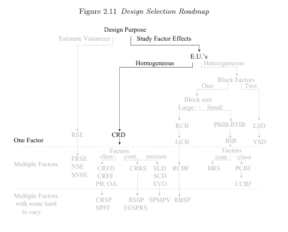

Fisher将实验单位随机分配到处理水平的技术保证了CRD的长期有效性，并最大限度地减少了未知因素或潜在变量的变化对结果产生偏差的机会。一系列实验的进行方式决定了分析中应使用什么模型。

CRD或完全随机单因子设计的分析模型是 $y_{ij} = \mu_i + \epsilon_{ij}$ 或 $y_{ij} = \mu + \tau_i + \epsilon_{ij}$，其中 $y_{ij}$ 是第 $i$ 个处理水平第 $j$ 个重复的观察响应，$\mu_i$ 是单元格均值


对于第 \(i\) 个水平，\(\tau_i\) 是效应。\(\epsilon_{ij}\) 是处理水平 \(i\) 上第 \(j\) 次观测的实验误差。假设 \(\epsilon_{ij}\) 相互独立并服从常数方差 \(\sigma^2\) 的正态分布。典型的分析是通过最小二乘法 - 最大似然法拟合线性模型，并对 \(H_0 : \mu_1 = ... = \mu_k\) 进行似然比 \(F\)-检验。如果数据不是在带有重复的适当随机化设计中收集的，以这种方式分析数据可能会完全误导。

分析结论的可信度取决于假设成立的程度。独立性假设是最关键的，当重复实验单元被随机分配到处理因子水平时，该假设得到保证。其他假设应予以检验。常数方差和正态性假设可以通过绘制残差与单元均值的图以及制作残差的正态概率图来检验。如果这些假设被违反，数据应在变换尺度上进行分析，或使用加权最小二乘法或广义线性模型的最大似然法进行分析。

如果总体 \(F\)-检验发现单元均值存在显著差异，可以进一步研究这些差异。如果在实验开始前计划好比较，并且可以描述为一组正交比较，则可以将总体 \(F\)-检验分解以检验这些比较。对于所有可能的均值比较，可以使用 Tukey's HSD 或较不保守的 student Newman-Keuls 方法来控制实验级 I 类错误率。对于将所有均值与对照水平进行比较，应使用 Dunnett 方法；对于将所有均值与最佳值（最大或最小）进行比较，应使用 Hsu's MCB 方法。

### 2.10 练习

- 1. 考虑第 2.1 节中描述的简单实验，该实验贯穿本章，用于确定发酵时间对面包面团高度的影响。描述该实验规划过程的步骤，类似于第 2.3 节中对该历史示例所做的工作。描述执行这些实验时可能出现的一些潜在问题（类似于第 1.7 节），并讨论使用第 1 章中的检查表进行仔细规划如何防止这些问题。

- 2. 纸直升机可以从如下所示的 8 1/2 x 11 张纸的一半上剪下来。

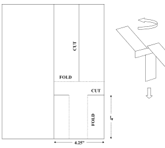

这些直升机可以快速且廉价地制作，可用于演示实验设计概念。可以通过制作一架直升机，从固定高度释放它，并使用秒表计时其旋转到地板所需的时间（如下图所示）来进行实验。在折叠机翼之前，可以通过修剪顶部的一些纸张来改变机翼长度。修剪一些纸张会减轻直升机的重量，但也会导致机翼表面积减小。你可以进行实验，以确定改变机翼长度是否影响飞行时间。

- (a) 描述实验单元。
- (b) 解释此情境下重复与重复测定的区别。
- (c) 描述处理因子。
- (d) 描述可能影响实验结果的任何潜在变量。
- (e) 解释为什么随机化很重要。

- (f) 创建一份随机实验列表，用于检验四种机翼长度（4"、4.75"、5.5" 和 6"），每个水平进行八次重复实验。
- (g) 执行实验并收集数据。
- (h) 使用你的数据进行方差分析。
- (i) 使用残差图检验方差齐性和正态性假设。
- (j) 检验随着机翼长度增加，飞行时间是否存在显著的线性或二次趋势。

- 3. 第 2.8.2 节讨论了一个关于确定所选下载站点对下载文件所需时间影响的实验。在此实验中：
- (a) 描述实验单元。
- (b) 描述处理因子。
- (c) 描述响应变量。
- (d) 讨论此实验中实验误差的原因，以及为什么重复和随机化原则对于得出有效结论很重要。

- 4. 在一项研究发酵粉用量对饼干发酵高度影响的实验中，测试了四个发酵粉水平，每个水平随机制作了四个重复饼干。结果如下表所示。

| .25 tsp | .5 tsp | .75 tsp | 1 tsp |
|---|---|---|---|
| 11.4 | 27.8 | 47.6 | 61.6 |
| 11.0 | 29.2 | 47.0 | 62.4 |
| 11.3 | 26.8 | 47.3 | 63.0 |
| 9.5 | 26.0 | 45.5 | 63.9 |

- (a) 实验单元是什么？
- (b) 执行方差分析以检验无处理效应的假设。
- (c) 构造一个对比，以检验发酵高度的增加与面团中发酵粉的增加成正比的假设，并检验该假设。
- (d) 估计实验误差的方差 \(\sigma^2\)。
- (e) 绘制残差对预测值的图和残差的正态图，并评论线性模型的假设是否成立。
- (f) 如果面团是分批制作的，并且上表中每一列的四个重复饼干发酵高度均来自同一批次，那么你对 (a) 的回答会不同吗？如果是这种情况，数据应如何分析？

- 5. Yang-Gyu 和 Woollie (2006) 研究了植物生长调节剂和芦笋梢鳞叶对芦笋梢伸长的影响。梢的伸长率是许多温带气候条件下决定芦笋最终产量的重要因素。梢从新西兰 Bulls（南纬 40.2°，东经 175.4°）商业种植园中 6 年生的 Jersey Giant 芦笋植株上收获。梢被随机收获并从田地运送到实验室进行调查。修剪至 80mm 长度后，梢完全浸泡在试管中含有 10 mg l-1 浓度的吲哚-3-乙酸（IAA）、脱落酸（ABA）、GA3 或 CPPU（Sitofex EC 2.0%；SKW，德国特罗斯特贝格）的水溶液中，浸泡 1 小时。对照梢在蒸馏水中浸泡 1 小时。该实验为完全随机设计，每个处理有五个重复（梢）。得到的数据（最终梢长，单位 mm）如下所示。

| Control | IAA | ABA | GA3 | CPPU |
|---|---|---|---|---|
| 94.7 | 89.9 | 96.8 | 99.1 | 104.4 |
| 96.1 | 94.0 | 87.8 | 95.3 | 98.9 |
| 86.5 | 99.1 | 89.1 | 94.6 | 98.9 |
| 98.5 | 92.8 | 91.1 | 93.1 | 106.5 |
| 94.9 | 99.4 | 89.4 | 95.7 | 104.8 |

- (a) 执行方差分析以检验无处理效应的假设。

- (b) 使用 Tukey 方法检验所有处理均值的两两比较。

- (c) 使用 Dunnett 程序将所有处理组均值与对照均值进行比较。

- 6. 考虑一种实验情形，研究者有兴趣检测处理均值的最大差异，该差异是分配给处理因子同一水平的重复实验单元上测得的响应标准差的两倍，即 \(\Delta = 2.0\sigma\)。如果处理因子有 4 个水平：

- (a) 修改第 2.7 节中的 SAS 数据步骤命令，以计算每个处理水平不同重复数 r 下的效能。

- (b) 使用 SAS 分析工具和 proc glmpower 来复现你的结果。

- (c) 计算检测 \(\Delta = 2.0\sigma\) 那么大的差异所需的具有 0.90 效能的重复次数。

- (d) 如果处理因子的水平数增加到 8 或减少到 2，(c) 中得到的结果会如何变化？

## 因子设计

### 3.1 简介

在第 2 章中，我们考察了单因子设计。这些设计仅在研究一个因子时有用。当研究多个因子时，一种经典方法是分别研究每个因子，同时保持其他所有因子不变。Fisher (1935) 指出，这种方法在实验室课程中向学生展示已知关系很有用，此时其他因子的推断是已知的，但就通过实验发现新知识而言，它效率低下且可能具有误导性。研究多个因子的更好策略是使用因子设计。在因子设计中，单元由研究因子的所有水平的可能组合组成。因子设计突出了因子效应，允许估计效应的相互依赖性（或交互作用），并且是所谓处理设计类别中的第一种技术。

通过考察因子水平的所有可能组合，设计中一个因子特定水平的重复次数会增加，增加量等于设计中所有其他因子水平数的乘积，因此可以用更少的重复次数获得相同的效能或精度。此外，如果一个因子的效应取决于另一个因子的水平，则在因子计划中会显现出来。这种现象在经典方法中会被忽略，因为在经典方法中，每个因子仅在其他因子的恒定水平下变化。下一节中的示例将说明这些事实。

### 3.2 经典一次一个因子与因子计划

在第 2 章的练习中，描述了一组纸直升机实验。在那些实验中，只研究了一个因子，即机翼长度。然而，为了最大化纸直升机的飞行时间，最好考虑多个因子。例如，考虑像以前一样改变 4 个水平的机翼长度，并改变 4 个水平的机身宽度，例如 4.25"、4.0"、3.75" 和 3.5"。图 3.1 左侧代表经典计划，即每次改变一个因子。图中的圆圈代表实验或运行。使用这种方法，图底部的实验将通过改变机翼长度同时保持机身宽度恒定为 3.5" 来完成。接下来，图左侧的三个额外实验将通过改变机身宽度同时保持机翼长度在其低水平 4.0" 不变来完成。如果八次重复运行


如果要为每个这样的实验都进行（如第 2 章练习 1 所建议），总共需要 56 次实验。

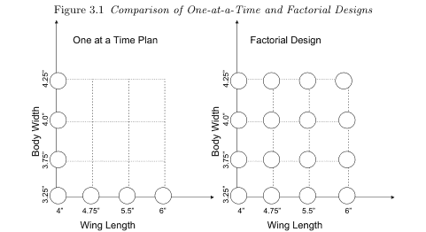

如果目标是找到飞行时间最长的组合，经典方法是先完成一个因素的实验。接下来计算单元均值，然后选择均值最高的水平。最后，在保持第一个因素在其最佳水平不变的情况下改变第二个因素，而不是如图 3.1 所示保持在最低水平。然而，Fisher 关于随机化的警告会告诉你这是一种糟糕的策略。如果第一组实验后任何未知力量发生了变化，结果可能会有偏差。此外，一个因素的最佳水平可能取决于另一个因素的水平。因此，一次只改变一个因素，可能会错过总体最优解。

图 3.1 右侧的图表表示直升机实验的因子计划。在这里可以看到，实验是在两个因素的所有水平组合下进行的。在这个计划中，如果每个单元完成两个重复，那么翼长的每个水平将有八个重复，机身宽度的每个水平也将有八个重复，这相当于一次一因素计划。因此，因子计划在检测因素效应方面的精度或效力将与一次一因素计划相同，但更高效，因为它只需要 2 × 16 = 32 次总运行，而一次一因素计划需要 56 次。因子设计中每个因素水平的重复次数等于每个单元的重复次数乘以设计中所有其他因素的水平数的乘积。这种乘法被称为隐性重复。在图 3.1 所示的情况中，只有两个因素，每个因素有四个水平；因此，每个因素水平的重复次数为 2 × 4 = 8。在因子计划中，32 个处理组合将被随机分配给实验单位，从而防止来自未知来源的偏差。在更复杂的研究问题中，可能有许多处理因素正在研究中。即使在每个因素只有两个水平的最简单情况下，也可以证明因子设计的效率。例如，考虑一个有 4 个因素的设计。因子设计将需要四个因素在两个水平上的所有组合，即 2^4 = 16 个单元。如果每个单元运行两个重复，总共有 2 x 16 = 32 次实验或运行。要检查四个因素中任何一个因素的效应，一半的运行（或由于隐性重复而为 2 x 2^3 = 16）将在该因素的一个水平上，另一半在另一个水平上。因此，处理效应将由两个 16 次运行的平均值之差组成。相同的 32 次实验结果可以用于计算四个因素中每个因素的处理效应。要使用一次一因素计划来比较处理效应并获得相同的精度，在保持其他因素不变的情况下，比较每个因素的水平需要 32 次运行。这将导致 4 x 32 = 128 次实验，即因子设计所需次数的四倍！

### 3.3 解释交互作用

如果两个因素之间存在交互作用或联合效应，则一个因素对响应的影响将取决于另一个因素的水平。这可以在图 3.2 中以图形方式说明。图左侧是一个等高线图，代表一系列纸直升机实验的结果。这个图可以像地形图一样解读，线条代表等飞行时间线。你可以通过在等高线图上绘制一条与机身宽度轴平行的直线，来模拟在一系列实验中翼长保持不变而机身宽度变化时会发生什么情况。各次运行的飞行时间可以读取为直线所交叉的等高线的标签。例如，如果翼长保持在等高线图左侧中点以下的某个值，那么机身宽度变化的五次运行所产生的飞行时间将表示为图 3.2 右侧图表上描绘的黑线。如果翼长保持在较高值，灰线则指示机身宽度的一系列实验结果可能是什么样子。图右侧两条线或曲线不平行这一事实表明翼长和机身宽度之间存在交互作用。它们表明机身宽度的影响取决于翼长。

图 3.2 直升机实验飞行时间等高线图

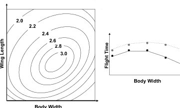

交互作用在现实世界中很常见，但使用经典的一次一因素实验策略默认假设交互作用不存在。要了解这种假设导致的谬误，请查看图 3.3，它展示了如果有人要寻找翼长和机身宽度的最佳组合时会发生什么情况。

图 3.3 用纸直升机进行一次一因素优化

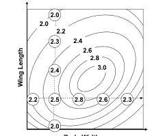

垂直的一组圆圈是在保持机身宽度不变的同时改变翼长的一系列实验的翼长、机身宽度组合处绘制的。圆圈内的数字代表所得的飞行时间。检查这一系列实验的结果后，将选择最佳翼长，并通过在最佳翼长值下保持不变并改变机身宽度来进行另一系列实验。这些实验的结果可以可视化为水平的一组圆圈。最大结果 2.8 不是总体最优解，因为最佳翼长取决于机身宽度，反之亦然。

表 3.1 100°C 下二氧化硅 B 的莫尼黏度

| 萘烷油 (phr) | 0 | 12 | 24 | 36 | 48 | 60 |
|---|---|---|---|---|---|---|
| 0 | 25 | 30 | 35 | 40 | 50 | 60 |
| 10 | 18 | 21 | 24 | 28 | 33 | 41 |
| 20 | 13 | 15 | 17 | 20 | 24 | 29 |
| 30 | 11 | 14 | 15 | 17 | 18 | 25 |

当因素的影响接近线性时，交互作用更容易用文字解释。表 3.1 显示了 Derringer (1974) 进行的因子实验结果，旨在确定弹性体化合物对 100°C 下二氧化硅黏度的影响。弹性体化合物是萘烷油（研究了 4 个水平）和填料含量（研究了 6 个水平）。

图 3.4 显示了表中数据的图形表示。这个图称为交互作用图。随着填料从 0 增加到 60，黏度沿着相当线性的趋势增加。然而，趋势线的斜率取决于萘烷油的水平。当没有添加萘烷油时，将填料从 0 增加到 60 会导致黏度从 25 快速增加到 60；但当有 30 phr 的萘烷油时，将填料从 0 增加到 60 会导致黏度从 11 到 25 更缓慢地增加。

图 3.4 填料和萘烷油的交互作用图

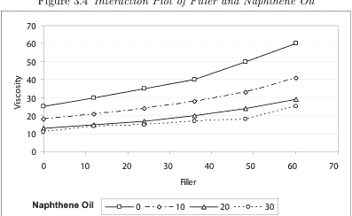

由于交互作用在因子实验中很常见，因此学习如何解释或阐释交互作用以清晰地展示研究结果非常重要。最好的方法是描述一个因素对响应的影响，然后对比或比较该影响如何随另一个因素的水平而变化。像图 3.4 这样的交互作用图可以指导描述或阐释。本章和本书其余部分将给出更多解释交互作用的示例。

### 3.4 在 SAS 中创建双因素因子计划

可以使用 SAS 数据步中的嵌套 do 循环轻松创建因子设计。例如，要创建一个研究纸直升机的因子设计，包含三个机身宽度水平（3.25"、3.75" 和 4.25"）和三个翼长水平（4.0"、5.0" 和 6.0"），以下 SAS 数据步将创建所有可能的组合。

```
data copter;
do BW = 3.25 to 4.25 by .5;
do WL = 4 to 6 by 1;
output;
end;
end;
run;
```

要为每个单元添加两个重复以及用于以后随机化列表的随机数，请按如下所示添加一个额外的嵌套 do 循环。

```
data copter;
do BW = 3.25 to 4.25 by .5;
do WL = 4 to 6 by 1;
do rep = 1 to 2;
u=ranuni(0);
output;
end;
end;
end;
run;
```

要随机化因子设计或 CRFD 的顺序，请添加以下数据步。

```
proc sort data=copter; by u;
data list; set copter;
experiment=_n_;
title Paper Helicopter Experiments;
proc print;
var BW WL;
id experiment;
run;
```


这将生成以下随机列表。

| 实验 | 机身宽度 | 机翼长度 |
|---|---|---|
| 1 | 3.25 | 4 |
| 2 | 3.75 | 6 |
| 3 | 4.25 | 4 |
| 4 | 4.25 | 6 |
| 5 | 3.25 | 6 |
| 6 | 3.25 | 5 |
| 7 | 3.75 | 5 |
| 8 | 3.75 | 6 |
| 9 | 3.75 | 4 |
| 10 | 3.25 | 4 |
| 11 | 3.25 | 6 |
| 12 | 4.25 | 4 |
| 13 | 3.25 | 5 |
| 14 | 3.75 | 6 |
| 15 | 4.25 | 6 |
| 16 | 3.25 | 4 |
| 17 | 4.25 | 5 |
| 18 | 3.25 | 6 |

此列表显示，第一个实验包括构建一个机身宽度为 3.25 英寸、机翼长度为 4 英寸的直升机，从固定高度释放并计时其飞行。第二个实验包括构建一个机身宽度为 3.75 英寸、机翼长度为 6 英寸的直升机，从相同的固定高度释放并计时其飞行，以此类推。随机化将有助于防止来自任何潜在变量的偏差，例如气流变化、温度变化或释放或计时直升机的学习曲线。此随机列表可以转换为双行间距的数据收集表，如第 2.2 节中的示例所示。

通过利用 proc factex，可以获得一组更简洁的命令来为因子设计创建随机列表。以下命令将在文件 copter 中生成一个类似于上面所示的随机列表。

```
proc factex;
   factors BW WL/nlev=3;
   model estimate=(BW|WL);
   output out=copter randomized designrep=2
   BW nvals=(3.25 3.75 4.25) WL nvals=(4 5 6) ;
run;
proc print data=copter;
run;
```

factors 语句上的 nlev=3 选项指定机身宽度和机翼长度各有三个水平。proc factex 中默认的水平数为 2。estimate(BW|WL) 指定设计应允许估计机身宽度和机翼长度的主效应及其交互作用。最后，output 语句将列表列在文件中。designrep 选项指定每个因子水平组合有两个重复，randomize 选项随机化列表的顺序，而 `nvals=` 选项指定两个因子水平的数值。如果水平是定性的，例如 (low, mid, high)，则可以使用 `cvals=('low' 'mid' 'high')` 选项代替 `nvals`。对于全因子设计，`proc factex` 本身不产生任何输出。因此，使用 `proc print` 命令来打印随机列表。

### 3.5 SAS 中双因子因子设计的分析

完全随机双因子因子设计的数学模型可以写成：

```
y_{ijk} = \mu_{ij} + \epsilon_{ijk} (3.1)
```

其中 i 表示第一个因子的水平，j 表示第二个因子的水平，k 表示重复次数。此模型称为单元均值模型，\mu_{ij} 表示第 ij 个单元中的预期响应。

表示模型的另一种方法是效应模型

```
y_{ijk} = \mu + \alpha_i + \beta_j + \alpha\beta_{ij} + \epsilon_{ijk} (3.2)
```

在此模型中，\alpha_i 和 \beta_j 是主效应，分别表示第一个因子第 i 个水平的所有实验的边际平均值与总体平均值之间的差异，以及第二个因子第 j 个水平的边际平均值与总体平均值之间的差异。交互效应 \alpha\beta_{ij} 表示单元均值 \mu_{ij} 与 \mu + \alpha_i + \beta_j 之间的差异。

通常假设实验误差相互独立，且 \epsilon_{ijk} \sim N(0, \sigma^2)。如果处理组合被随机分配给实验单位，则独立性假设得到保证；方差齐性和正态性假设可以通过残差对预测值图以及第 2.4 节所述的残差正态概率图进行验证。

如第 2.3.4 节所述的单因子模型，可估计函数是可以表示为数据线性组合的单元均值的线性组合。对于双因子因子设计，单元均值 \mu_{ij} = \mu + \alpha_i + \beta_j + \alpha\beta_{ij} 是可估计函数，但单独的效应 \alpha_i、\beta_j 和 \alpha\beta_{ij} 不是可估计函数。效应之间的对比，例如 \sum_i c_i \alpha_i 和 \sum_j c_j \beta_j（其中 \sum_i c_i = 0、\sum_j c_j = 0）以及 \sum_i \sum_j b_{ij} \alpha\beta_{ij}（其中 \sum_i b_{ij} = 0、\sum_j b_{ij} = 0）是可估计的。这些可估计函数及其标准误可以使用 SAS `proc glm` 中的 `estimate` 命令计算。边际均值 \mu + \alpha_i + \bar{\alpha\beta}_i 和 \mu + \beta_j + \bar{\alpha\beta}_j 是可估计函数，它们及单元均值可以使用 SAS `proc glm` 中的 `means` 或 `lsmeans` 语句计算。

#### 3.5.1 模型与分析的矩阵表示

效应模型可以用矩阵表示法表示为

\( y = X\beta + \epsilon = (1 \mid X_A \mid X_B \mid X_{AB}) \begin{pmatrix} \mu \\ \beta_A \\ \beta_B \\ \beta_{AB} \end{pmatrix} + \epsilon \quad (3.3) \)

例如，考虑一种情况：第一个因子有两个水平，第二个因子有三个水平，且每个单元有两个重复。则

\(\begin{pmatrix} y_{111} \\ y_{112} \\ y_{211} \\ y_{212} \\ y_{121} \\ y_{122} \\ y_{221} \\ y_{222} \\ y_{131} \\ y_{132} \\ y_{231} \\ y_{232} \end{pmatrix} = \begin{pmatrix} 1 & 1 & 0 & 1 & 0 & 0 & 1 & 0 & 0 & 0 & 0 & 0 \\ 1 & 1 & 0 & 1 & 0 & 0 & 1 & 0 & 0 & 0 & 0 & 0 \\ 1 & 0 & 1 & 1 & 0 & 0 & 0 & 1 & 0 & 0 & 0 & 0 \\ 1 & 0 & 1 & 1 & 0 & 0 & 0 & 1 & 0 & 0 & 0 & 0 \\ 1 & 1 & 0 & 0 & 1 & 0 & 0 & 0 & 1 & 0 & 0 & 0 \\ 1 & 1 & 0 & 0 & 1 & 0 & 0 & 0 & 1 & 0 & 0 & 0 \\ 1 & 0 & 1 & 0 & 1 & 0 & 0 & 0 & 0 & 1 & 0 & 0 \\ 1 & 0 & 1 & 0 & 1 & 0 & 0 & 0 & 0 & 1 & 0 & 0 \\ 1 & 1 & 0 & 0 & 0 & 1 & 0 & 0 & 0 & 0 & 1 & 0 \\ 1 & 1 & 0 & 0 & 0 & 1 & 0 & 0 & 0 & 0 & 1 & 0 \\ 1 & 0 & 1 & 0 & 0 & 1 & 0 & 0 & 0 & 0 & 0 & 1 \\ 1 & 0 & 1 & 0 & 0 & 1 & 0 & 0 & 0 & 0 & 0 & 1 \end{pmatrix} \begin{pmatrix} \mu \\ \alpha_1 \\ \alpha_2 \\ \beta_1 \\ \beta_2 \\ \beta_3 \\ \alpha\beta_{11} \\ \alpha\beta_{21} \\ \alpha\beta_{12} \\ \alpha\beta_{22} \\ \alpha\beta_{13} \\ \alpha\beta_{23} \end{pmatrix} + \begin{pmatrix} \epsilon_{111} \\ \epsilon_{112} \\ \epsilon_{211} \\ \epsilon_{212} \\ \epsilon_{121} \\ \epsilon_{122} \\ \epsilon_{221} \\ \epsilon_{222} \\ \epsilon_{131} \\ \epsilon_{132} \\ \epsilon_{231} \\ \epsilon_{232} \end{pmatrix}\)

\( X'X \) 是奇异矩阵，为了求解正规方程，SAS proc glm 使用广义逆 \( (X'X)^- \)，这等同于施加限制 \( \alpha_2 = \beta_3 = \alpha\beta_{22} = \alpha\beta_{32} = 0 \)。这与在第 2.3.1 节和 2.3.2 节中为单因子模型求解所做的相同。误差平方和 \( ssE = y'y - \beta'X'y = y'(I - X(X'X)^-X')y \)，其中 \( \hat{\beta} = (X'X)^-X'y \) 是 proc glm 指定为有偏估计的估计量。为了检验假设 \( H_0: \alpha_1 = \alpha_2 = 0 \)、\( H_0: \beta_1 = \beta_2 = \beta_3 = 0 \) 和 \( H_0: \alpha\beta_{11} = \alpha\beta_{21} = \alpha\beta_{22} = \alpha\beta_{32} = 0 \)，通过计算 ANOVA 均方的比值来获得似然比 F 检验。SAS proc glm 指定的因子 A 的类型 I 平方和为 \( ssA = \hat{\beta}'X'y - (1'y)^2/(1'1) \)，其中模型简化为仅包含第一个因子的效应，即 \( X = (1 \mid X_A) \)。此简化模型的误差平方和为 \( ssE_A \)。因子 A 的类型 I 平方和记为 \( R(\alpha|\mu) \)。因子 B 的类型 I 平方和记为 \( R(\beta|\alpha, \mu) = ssE_A - ssE_B \)，其中 \( ssE_B \) 是简化模型（其中 \( X = (1 \mid X_A) \mid X_B \)）的误差平方和。最后，交互作用 AB 的类型 I 平方和记为 \( R(\alpha, \beta|\alpha, \mu) = ssAB - ssE \)。一般来说，当因子 A 有 a 个水平、因子 B 有 b 个水平且每个单元有 r 个重复时，双因子因子设计的类型 I ANOVA 表可以用符号表示为表 3.2 所示。

### 表 3.2 方差分析表

| 来源 | 自由度 | 平方和 | 均方 | F 比值 |
| :--- | :--- | :--- | :--- | :--- |
| A | a - 1 | R(α|μ) | ssA / (a-1) | F = msA / msE |
| B | b - 1 | R(β|α, μ) | ssB / (b-1) | F = msB / msE |
| AB | (a - 1)(b - 1) | R(α|β, α, μ) | ssAB / ((a-1)(b-1)) | F = msAB / msE |
| 误差 | ab(r - 1) | ssE | ssE / (ab(r-1)) | |

平方和 ssA、ssB 和 ssAB 也可以写成以下形式

```
ssA = (L_A β̂)'(L_A (X'X)^- L_A')^-1 (L_A β̂)
ssB = (L_B β̂)'(L_B (X'X)^- L_B')^-1 (L_B β̂)
ssAB = (L_αβ β̂)'(L_αβ (X'X)^- L_αβ')^-1 (L_αβ β̂)
```

其中 L_A、L_B 和 L_αβ 是由 SAS proc glm 内部计算的对比矩阵，参见 Goodnight (1980)。在原假设下，F 比值 msA/msE、msB/msE 和 msAB/msE 服从表中所示自由度的 F 分布，而在备择假设下，它们服从非中心 F 分布。F = msA/msE 的非中心性参数由表达式 λ_α = (σ²)^-1 (L_A β̂)'(L_A (X'X)^- L_A')^-1 (L_A β̂) 给出。F 比值 msB/msE 和 msAB/msE 的非中心性参数类似给出。当每个单元中有相同数量 r 的重复时，可以证明非中心性参数等于

```
λ_α = br Σ_i α_i² / σ²      (3.4)
λ_β = ar Σ_j β_j² / σ²      (3.5)
```

和

```
λ_αβ = r Σ_i Σ_j α_ij² / σ²   (3.6)
```

为了说明使用 SAS proc glm 进行双因子因子实验分析，请参考表 3.3 中的数据。这些是 Hunter (1989) 给出的双因子实验结果。在此数据中，一个实验包括


燃烧一定量燃料并测定释放的CO排放量。实验单位是一次运行所需的标准燃料部分，响应y是根据该运行测定的碳氧化物（CO）排放浓度，单位为克/立方米。因子A是添加到实验单位或标准燃料部分的乙醇量，因子B是燃烧该燃料时使用的燃料与空气比。

## 表 3.3 乙醇燃料实验数据
A=乙醇添加量 B=空气/燃料比 y=CO排放量

| A=乙醇添加量 | B=空气/燃料比 | y=CO排放量 |
|---|---|---|
| 0.1 | 14 | 66, 62 |
| 0.1 | 15 | 72, 67 |
| 0.1 | 16 | 68, 66 |
| 0.2 | 14 | 78, 81 |
| 0.2 | 15 | 80, 81 |
| 0.2 | 16 | 66, 69 |
| 0.3 | 14 | 90, 94 |
| 0.3 | 15 | 75, 78 |
| 0.3 | 16 | 60, 58 |

读取此数据并生成分析的SAS命令如下所示。

```
Data CO;
input Ethanol Ratio CO;
datalines;
.1 14 66
.1 14 62
... etc.
;
proc glm;
class Ethanol Ratio;
model CO=Ethanol Ratio Ethanol*Ratio/solution;
lsmeans Ethanol Ratio Ethanol*Ratio;
estimate '0.3 vs 0.1' Ethanol -1 0 1;
estimate '16 vs 14' Ratio -1 0 1;
run;
ods graphics off;
```

生成的ANOVA表如下一页所示。可以看出，proc glm生成了前面所述的类型I平方和表和类型III平方和表。在每个单元格中重复次数相等的情况下，这两个表始终相同。可以从表中看出，两个效应及其交互作用均显著，这由F值右侧的P值表明。

模型语句中/solution选项的结果生成了ANOVA表下方显示的参数表。SAS将这些估计值标记为

| 来源 | DF | 平方和 | 均方 | F值 | Pr > F |
|---|---|---|---|---|---|
| 模型 | 8 | 1654.0000000 | 206.7500000 | 40.02 | <.0001 |
| 误差 | 9 | 46.5000000 | 5.1666667 | | |
| 校正总计 | 17 | 1700.5000000 | | | |

| 来源 | DF | 类型I平方和 | 均方 | F值 | Pr > F |
|---|---|---|---|---|---|
| 乙醇 | 2 | 324.0000000 | 162.0000000 | 31.35 | <.0001 |
| 比例 | 2 | 652.0000000 | 326.0000000 | 63.10 | <.0001 |
| 乙醇*比例 | 4 | 678.0000000 | 169.5000000 | 32.81 | <.0001 |

| 来源 | DF | 类型III平方和 | 均方 | F值 | Pr > F |
|---|---|---|---|---|---|
| 乙醇 | 2 | 324.0000000 | 162.0000000 | 31.35 | <.0001 |
| 比例 | 2 | 652.0000000 | 326.0000000 | 63.10 | <.0001 |
| 乙醇*比例 | 4 | 678.0000000 | 169.5000000 | 32.81 | <.0001 |

可以清楚地看出，这些估计值并非唯一或有偏。这是消除\(X'X\)中奇异性所需的限制\(\alpha_3 = \beta_3 = \alpha\beta_{13} = \alpha\beta_{23} = \alpha\beta_{31} = \alpha\beta_{32} = \alpha\beta_{33} = 0\)的结果。

| 参数 | 估计值 | 标准误 | t值 | Pr > |t| |
|---|---|---|---|---|
| 截距 . | 59.00000000 B | 1.60727513 | 36.71 | <.0001 |
| 乙醇 0.1 | 8.00000000 B | 2.27303028 | 3.52 | 0.0065 |
| 乙醇 0.2 | 8.50000000 B | 2.27303028 | 3.74 | 0.0046 |
| 乙醇 0.3 | 0.00000000 B | . | . | . |
| 比例 14 | 33.00000000 B | 2.27303028 | 14.52 | <.0001 |
| 比例 15 | 17.50000000 B | 2.27303028 | 7.70 | <.0001 |
| 比例 16 | 0.00000000 B | . | . | . |
| 乙醇*比例 0.1 14 | -36.00000000 B | 3.21455025 | -11.20 | <.0001 |
| 乙醇*比例 0.1 15 | -15.00000000 B | 3.21455025 | -4.67 | 0.0012 |
| 乙醇*比例 0.1 16 | 0.00000000 B | . | . | . |
| 乙醇*比例 0.2 14 | -21.00000000 B | 3.21455025 | -6.53 | 0.0001 |
| 乙醇*比例 0.2 15 | -4.50000000 B | 3.21455025 | -1.40 | 0.1951 |
| 乙醇*比例 0.2 16 | 0.00000000 B | . | . | . |
| 乙醇*比例 0.3 14 | 0.00000000 B | . | . | . |
| 乙醇*比例 0.3 15 | 0.00000000 B | . | . | . |
| 乙醇*比例 0.3 16 | 0.00000000 B | . | . | . |

注意：发现X'X矩阵为奇异矩阵，并使用广义逆来求解正规方程。估计值后跟字母'B'的项不是唯一可估的。

means语句的结果显示在输出的下一部分。表格的前两个部分显示每个因子的均值以及每个均值中所平均值的标准差。如果交互作用不显著，边际均值将揭示因子效应的方向，但可以使用进一步的预先计划的比较或其他多重比较程序来得出确定的结论。

最后，接下来显示两个estimate语句的结果。这些

| 乙醇水平 | N | 均值-CO- | 标准差 |
|---|---|---|---|
| 0.1 | 6 | 66.8333333 | 3.2506410 |
| 0.2 | 6 | 75.8333333 | 6.6156380 |
| 0.3 | 6 | 75.8333333 | 14.8649476 |

| 比例水平 | N | 均值-CO- | 标准差 |
|---|---|---|---|
| 14 | 6 | 78.5000000 | 12.7082650 |
| 15 | 6 | 75.5000000 | 5.3197744 |
| 16 | 6 | 64.5000000 | 4.4609416 |

| 乙醇水平 | 比例水平 | N | 均值-CO- | 标准差 |
|---|---|---|---|---|
| 0.1 | 14 | 2 | 64.0000000 | 2.82842712 |
| 0.1 | 15 | 2 | 69.5000000 | 3.53553391 |
| 0.1 | 16 | 2 | 67.0000000 | 1.41421356 |
| 0.2 | 14 | 2 | 75.0000000 | 21.2132034 |
| 0.2 | 15 | 2 | 80.5000000 | 0.70710678 |
| 0.2 | 16 | 2 | 67.5000000 | 0.70710678 |
| 0.3 | 14 | 2 | 97.5000000 | 2.12132034 |
| 0.3 | 15 | 2 | 92.0000000 | 2.82842712 |
| 0.3 | 16 | 2 | 59.0000000 | 1.41421356 |

均为可估函数，并给出了用于检验假设\(H_0 : \sum_i c_i \alpha_i = 0\)和\(H_0 : \sum_j c_j \beta_j = 0\)的估计值及其各自的标准误和t比值。

| 参数 | 估计值 | 标准误 | t值 | Pr > |t| |
|---|---|---|---|---|
| 0.3 vs 0.1 | 9.0000000 | 1.31233465 | 6.86 | < .0001 |
| 16 vs 14 | -14.0000000 | 1.31233465 | -10.67 | < .0001 |

如果乙醇添加水平与空气/燃料比之间没有显著交互作用，这些估计值将是有意义的，但在此例中存在显著交互作用，改变乙醇添加量引起的CO排放差异将取决于空气/燃料比，而改变空气/燃料比引起的CO排放差异将取决于添加的乙醇量。交互作用图是解释这些结果的更好方式。在使用proc glm之前包含ods graphics on，如果模型中只有两个因子且包含交互作用，则会自动生成交互作用图。图3.5由上述SAS命令生成。

在此图中，我们可以更清楚地看到效应的依赖性。将添加到燃料中的乙醇量从0.1增加到0.3会导致CO排放量

## 图 3.5 乙醇与空气/燃料比交互作用图

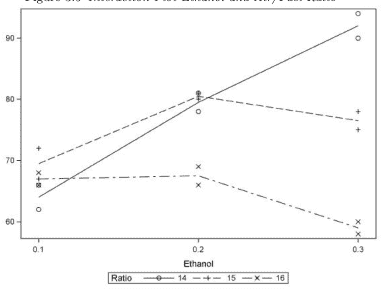

当空气/燃料比处于低水平14时，CO排放量从64克/升线性增加到92克/升。这由表示数据的带圆点的实线显示。然而，当空气/燃料比处于高水平16时（由表示数据点的带×的点划线说明），将添加到燃料中的乙醇量从0.1增加到0.3实际上会导致CO排放量沿近线性趋势从67克/升减少到59克/升。最后，当空气/燃料比保持在中水平15时（由表示数据点的带+的虚线说明），将乙醇从0.1增加到0.2会导致CO排放量增加11克/升；但进一步将乙醇增加到0.3会导致CO排放量减少4克/升至76.5。

上述解释再次说明了描述交互作用的原则，即比较一个因子在另一个因子各水平上的效应。这是通过比较空气/燃料比各水平之间乙醇添加变化的效应来完成的。也可以采用相反的方式。例如，下面的SAS代码反转了交互作用图，如图3.6所示。

```
ods graphics on;
proc glm data=CO;
   class Ethanol ;
   model CO= Ratio Ethanol Ratio*Ethanol ;
   run;
ods graphics off;
```

在此图中，带×表示数据点的点划线显示了在高乙醇添加率下增加空气/燃料比的效应


0.3。一氧化碳排放量从92克/升线性下降到59克/升。然而，当以低速率0.1添加乙醇时，CO排放量实际上会略微从64克/升增加到67克/升，这是由于空燃比从14增加到16造成的。这可以通过实线和圆圈表示的数据点来观察。当以中速率0.2添加乙醇时，当空燃比从14增加到15时，CO排放量变化不大，但当空燃比从15增加到16时，CO排放量会减少13克/升。后一种结果可以通过虚线和+s表示的数据点来可视化。

## 图 3.6 乙醇和空燃比交互作用图

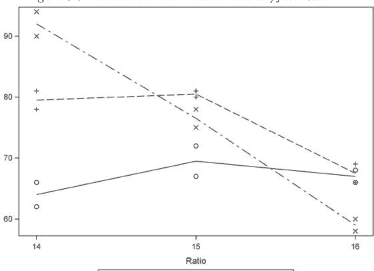

无论以何种方式呈现和解释交互作用都是有效的，只要讨论一个因素的效应如何随另一个因素的水平而变化即可。应比较的因素效应取决于在特定研究问题中哪一个最感兴趣。关于这两种解释需要注意的另一点是，假设存在因果关系。我们说响应的变化是由因素的变化引起的，或者响应的变化是改变因素的结果。如果讨论的是观察性研究而非受控随机实验的结果，则无法做出此陈述。

#### 3.5.2 确定重复次数

可以采用两种可能方法之一来确定因子实验的重复次数，以使效能在0.80到0.90之间（用于检测具有实际意义的差异）。第一种方法是考虑检测单元均值之间的差异。第二种方法是考虑检测实验中因素边际均值的实际大小差异。

在寻找单元均值之间的差异时，因子设计中的单元被视为与单因子设计中一样的无结构组。使用单元均值模型 $y_{ijk} = \mu_{ij} + \epsilon_{ijk}$，过程与第2.6节中描述的单因子模型 $y_{ij} = \mu_i + \epsilon_{ij}$ 相同。F检验的非中心性参数为：

$$\lambda = (r/\sigma^2) \sum_{i=1}^a \sum_{j=1}^b (\bar{\mu}_{ij} - \bar{\mu}_{..})^2.$$

在寻找因素边际均值之间的差异时，第一个主效应的非中心性因子为：

$$\lambda_a = br \sum_i \alpha_i^2 / \sigma^2 = br \sum_i (\bar{\mu}_{i.} - \bar{\mu}_{..})^2 / \sigma^2.$$

第二个主效应的非中心性因子为：

$$\lambda_b = ar \sum_j \beta_j^2 / \sigma^2 = ar \sum_j (\bar{\mu}_{.j} - \bar{\mu}_{..})^2 / \sigma^2.$$

如果$\Delta$被视为单元均值实际差异的大小，那么两个单元相差至少$\Delta$时，$\lambda = r/\sigma^2 \sum_{i=1}^a \sum_{j=1}^b (\bar{\mu}_{ij} - \bar{\mu}_{..})^2$ 的最小值为 $r\Delta^2/2\sigma^2$。同样，如果$\Delta$被视为因素A边际均值实际差异的大小，那么两个边际均值相差至少$\Delta$时，$\lambda_a = br \sum_i (\bar{\mu}_{i.} - \bar{\mu}_{..})^2 / \sigma^2$ 的最小值为 $br\Delta^2/2\sigma^2$。这里我们再次可以看到因子设计的效率，因为检测边际因素A均值差异的非中心性因子比检测单元均值差异的非中心性因子大一个因子$b$（即因素B的水平数）。

考虑以下示例。计划进行一个纸直升机实验，以研究因素A（机翼长度）四个水平和因素B（机身宽度）四个水平对飞行时间的影响。如果对一种设计进行九次重复的初步实验得到的飞行时间为2.8、2.6、3.5、3.0、3.1、3.5、3.2、3.4和3.4秒。要以0.90的效能检测飞行时间1秒的差异，需要多少次重复？

从初步测试中，实验误差的方差可估计为 $s^2 = 0.1024$。如果$\Delta = 1.0$被视为单元均值实际大小差异，则可以修改第2.6节中的SAS命令来得出答案。在4×4因子设计中，有16个单元，因此分子的自由度为 $\nu_1 = 15$，分母的自由度为 $\nu_2 = 16(r - 1)$。修改后的SAS代码如下一页所示。

```
data Power;
do r = 2 to 9;
nu1=r-1; * df for numerator;
nu2=16*(r-1); * df for denominator;
alpha=.05;
Fcrit=finv(1-alpha,nu1,nu2); *F critical value;
sigma2=0.1024;
cms=r*sigma2;
ncp=(cms)/sigma2;*noncentrality parameter for
noncentral F;
power=1-probf(Fcrit,nu1,nu2,nc);
output;
end;
keep r nu1 nu2 nc power;
title Power Calculation in Data Step;
proc print; run;
```

以下结果表明，每个单元需要6次重复才能获得至少0.90的效能。

数据步骤中的效能计算

| 观测值 | r | nu1 | nu2 | nc | 效能 |
|---|---|---|---|---|---|
| 1 | 3 | 15 | 16 | 9.76856 | 0.24173 |
| 2 | 3 | 15 | 32 | 14.6884 | 0.48174 |
| 3 | 4 | 15 | 48 | 19.5313 | 0.69246 |
| 4 | 5 | 15 | 64 | 24.4141 | 0.83829 |
| 5 | 6 | 15 | 80 | 29.2969 | 0.92326 |
| 6 | 7 | 15 | 96 | 34.1797 | 0.96664 |
| 7 | 8 | 15 | 112 | 39.0626 | 0.98665 |

如果\(\Delta = 1.0\)被视为某个因素边际均值实际大小差异，则结果将不同。分子的自由度将为 \(\nu_1 = 4 - 1\)，分母的自由度将为 \(\nu_2 = 16(r - 1)\)，主效应的非中心性因子将为 \(\lambda_\nu = br\Delta^2/2\sigma^2 = 4r\Delta^2/2(0.1024)\)。修改上述SAS代码，我们得到

```
data Power;
   do r=2 to 4;
   nu1=4-1; * df for numerator;
   nu2=16*(r-1); * df for denominator;
   alpha=.05;
   Fcrit=finv(1-alpha,nu1,nu2); *F critical value;
   sigma2=0.1024;
   nc=r*sigma2;
   n=4*r**2/(css)/sigma2;*noncentrality parameter for noncentral F;
   power=1-probf(Fcrit,nu1,nu2,nc);
   output;
   end;
   keep r nu1 nu2 nc power;
   Title "Power Calculation in Data Step";
   proc print; run;
```

结果如下。可以看出，当每个单元只有两次重复时，检测因素A边际均值\(\Delta = 1.0\)差异的效能大于每个单元有\(r = 8\)次重复时检测单元均值\(\Delta = 1.0\)差异的效能。这再次通过隐性重复展示了因子实验的效率。

| 观测值 | r | nu1 | nu2 | nc | 效能 |
|---|---|---|---|---|---|
| 1 | 2 | 3 | 16 | 39.0625 | 0.99838 |
| 2 | 3 | 3 | 32 | 58.5938 | 1.00000 |
| 3 | 4 | 3 | 48 | 78.1250 | 1.00000 |

检测因子主效应和交互作用的效能也可以通过SAS过程glmpower来估计，方法是指定单元均值、实验误差的标准差以及观测总数 \(N = a \times b \times r\)。由于proc glmpower除了简单的一因子设计外还可以计算因子模型的效能，因此单元均值必须在数据步骤中读取（以与proc glm读取数据相同的格式），而不是像proc power那样将其包含在命令中。下一页是拟议直升机实验中三个机体重量和机翼长度水平的输入示例。单元均值代表可能被认为具有实际意义的差异。语句ntotal=36 to 81 by 9告诉proc glmpower计算每个单元三次到九次重复的效能。

```
data powglm;
input BW WL cellmean;
datalines;
4.0 4.75 2.4
4.0 5.5 2.3
4.0 6.25 2.1
3.75 4.75 2.8
3.75 5.5 2.4
3.75 6.25 2.2
3.5 4.75 2.4
3.5 5.5 2.4
3.5 6.25 2.2
;
proc glm;
class cellmean=BW WL BW*WL;
model cellmean=BW WL BW*WL;
power;
stddev=0.32
ntotal=36 to 81 by 9
power = .;
run;
```

结果如下。模型中每个项（即机身高度、机翼长度和交互作用的主效应）的效能均作为观测总数的函数给出。根据输入中指定的单元均值，当每个单元有六次或更多重复时（即ntotal ≥ 54），将有足够的效能来检测机翼长度主效应。

| 索引 | 来源 | 观测总数 | 检验自由度 | 误差自由度 | 效能 |
|---|---|---|---|---|---|
| 1 | BW | 36 | 2 | 36 | 0.242 |
| 2 | BW | 45 | 2 | 36 | 0.302 |
| 3 | BW | 54 | 2 | 45 | 0.361 |
| 4 | BW | 63 | 2 | 54 | 0.418 |
| 5 | BW | 72 | 2 | 63 | 0.472 |
| 6 | BW | 81 | 2 | 72 | 0.524 |
| 7 | WL | 36 | 2 | 27 | 0.709 |
| 8 | WL | 45 | 2 | 36 | 0.774 |
| 9 | WL | 54 | 2 | 45 | 0.855 |
| 10 | WL | 63 | 2 | 54 | 0.910 |
| 11 | WL | 72 | 2 | 63 | 0.945 |
| 12 | WL | 81 | 2 | 72 | 0.967 |
| 13 | BW*WL | 36 | 4 | 27 | 0.165 |
| 14 | BW*WL | 45 | 4 | 36 | 0.206 |
| 15 | BW*WL | 54 | 4 | 45 | 0.248 |
| 16 | BW*WL | 63 | 4 | 54 | 0.291 |
| 17 | BW*WL | 72 | 4 | 63 | 0.335 |
| 18 | BW*WL | 81 | 4 | 72 | 0.398 |


利用数据步中的 `probf` 函数或 `proc glmpower` 快速计算功效的能力，在实际运行实验之前，可以探索许多潜在的设计。诸如“使用三个或四个水平的因素是否更好？”之类的问题，可以根据其对检测显著差异的功效的影响来回答。

#### 3.5.3 每个单元格重复次数不等的分析

虽然计划每个单元格重复次数不等的因子实验不太常见，但因子实验的数据可能会因为某些实验无法完成、响应无法测量，或者仅仅是数据丢失，而导致每个单元格的重复次数不等。只要丢失观测值的机会与处理因子水平无关，每个单元格重复次数不等的因子实验数据仍然可以以与等重复情况类似的方式进行分析和解释。然而，分析数据的计算公式对于重复次数不等的情况有所不同。

为了说明第 3.5.1 节所示分析为何不适用，请再次考虑第 3.5.1 节中描述的乙醇燃料实验的数据。这次假设空气/燃料比 = 16 且乙醇水平 = 0.3 的单元格中缺少一个观测值。然后表 3.4 显示了数据，每个响应值写在其符号期望值之上。

表 3.4 重复次数不等的燃料实验

| | 空气/燃料 14 | 空气/燃料 15 | 空气/燃料 16 |
|---|---|---|---|
| 乙醇 | 66 | 72 | 68 |
| 0.1 | 62 | 67 | 66 |
| | \(\mu + \alpha_1 + \beta_1 + \alpha\beta_{11}\) | \(\mu + \alpha_1 + \beta_2 + \alpha\beta_{12}\) | \(\mu + \alpha_1 + \beta_3 + \alpha\beta_{13}\) |
| | 78 | 80 | 66 |
| 0.2 | 81 | 81 | 69 |
| | \(\mu + \alpha_2 + \beta_1 + \alpha\beta_{21}\) | \(\mu + \alpha_2 + \beta_2 + \alpha\beta_{22}\) | \(\mu + \alpha_2 + \beta_3 + \alpha\beta_{23}\) |
| | 90 | 75 | 60 |
| 0.3 | 94 | 78 | 60 |
| | \(\mu + \alpha_3 + \beta_1 + \alpha\beta_{31}\) | \(\mu + \alpha_3 + \beta_2 + \alpha\beta_{32}\) | \(\mu + \alpha_3 + \beta_3 + \alpha\beta_{33}\) |

使用第 3.5.1 节所示的 means 语句计算的空气/燃料比因子水平的边际列均值，分别为 78.5、75.5 和 65.8。前两列边际均值的期望值为：\(\mu + \beta_1\)、\(\mu + \beta_2\)，因为当 \(i = 1, 2\) 时，\((\alpha_1 + \alpha_2 + \alpha_3)/3 = 0\) 且 \((\alpha\beta_1 + \alpha\beta_2 + \alpha\beta_3)/3 = 0\)。然而，最后一列边际均值的期望值为 \(\mu + \beta_3 + (2\alpha_1 + 2\alpha_2 + \alpha_3)/5 + (2\alpha\beta_{13} + 2\alpha\beta_{23} + \alpha\beta_{33})/5\)，它不是 \(\mu + \beta_3\) 的无偏估计量。第一列和第三列均值之间的比较不是 \(\beta_1 - \beta_3\) 的无偏估计量。同样，最后一行边际均值也不是 \(\mu + \alpha_3\) 的无偏估计量。

为了在每个单元格重复次数不等时获得期望值为 \(\mu = \mu + \beta_1 + \beta_2 + \beta_3\) 的均值，请在 SAS proc `glm` 中使用 `lsmeans` 语句，而不是 `means` 语句。`means` 语句只是对因子每个水平中的所有观测值求平均，而 `lsmeans` 语句计算从模型参数的最小二乘估计中得到的预测单元格均值 \((\hat{\mu} + \hat{\alpha}_i + \hat{\beta}_j + \hat{\alpha\beta}_{ij})\) 的边际均值。请记住，单元格均值是可估函数。

第 3.5.1 节所示分析的另一个问题是，I 类 F 检验不会检验与单元格中重复次数相等的情况相同的假设。当单元格中存在重复次数不等的情况时，基于 \(R(\alpha|\mu)\) 的 \(H_0 : \alpha_1 = \cdots = \alpha_a\) 的 I 类 F 检验的非中心性参数将不再是 \(\lambda_a = rb \sum \alpha_i^2\)，而是一个涉及 \(\alpha, \beta\) 以及 \(\alpha\beta\) 元素的二次型。基于 \(R(\beta|\mu, \alpha)\) 的 \(H_0 : \beta_1 = \cdots = \beta_b\) 的 I 类 F 检验的非中心性将是一个涉及 \(\alpha\) 和 \(\alpha\beta\) 元素的二次型。

为了获得主效应原假设的正确检验，请使用 proc `glm` III 类 ANOVA 表中的 F 检验。因子 A 和 B 的 III 类平方和可以表示为 \(ssA_{III} = R(\alpha|\mu, \beta, \alpha\beta)\) 和 \(ssB_{III} = R(\beta|\mu, \alpha, \alpha\beta)\)。\(R(\alpha|\mu, \beta, \alpha\beta)\) 是缩减模型（其中 \(X = (1|X_A|X_{AB})\)）与全模型（其中 \(X = (1|X_A|X_B|X_{AB})\)）之间误差平方和的差值。请回顾，当每个单元格的重复次数相等时，I 类平方和与 III 类平方和相同。对于非满秩 \(X\) 矩阵，通常 \(R(\alpha|\mu, \beta, \alpha\beta)\) 将为零，因为 \(X_A\) 与 \(X_{AB}\) 线性相关。然而，使用 proc `glm` 的广义逆（等效于限制 \(\alpha_2 = \beta_2 = \alpha\beta_{13} = \alpha\beta_{23} = \alpha\beta_{31} = \alpha\beta_{32} = \alpha\beta_{33} = 0\)），可以计算它，相应 F 检验的非中心性因子将是一个仅涉及 \(\alpha' = (\alpha_1, \alpha_2, \alpha_3)\) 的二次型。

移除空气/燃料比 = 16 且乙醇水平 = 0.3 的单元格中值为 58 的观测值后，乙醇燃料实验的 proc `glm` 分析显示在下一页顶部。

在那里可以看到，乙醇和比值的 III 类平方和与它们的 I 类平方和不同。III 类表中的 F 检验检验了正确的假设。`means` 语句和 `lsmeans` 语句的结果显示在下一页 ANOVA 表下方的 SAS 输出中，说明每个因子的第三水平的均值不同。无偏均值由 `lsmeans` 语句给出。

一般来说，应使用 III 类平方和和 lsmeans，因为无论每个单元格的重复次数是否相等，它们都将检验正确的假设并提供无偏的因子水平均值。

| 来源 | 自由度 | 平方和 | 均方 | F 值 | Pr > F |
| :--- | :--- | :--- | :--- | :--- | :--- |
| 模型 | 8 | 1423.029412 | 177.878676 | 31.98 | <.0001 |
| 误差 | 8 | 44.050000 | 5.562500 | | |
| 校正总计 | 16 | 1467.529412 | | | |

| 来源 | 自由度 | I 类平方和 | 均方 | F 值 | Pr > F |
| :--- | :--- | :--- | :--- | :--- | :--- |
| 乙醇 | 2 | 472.6627451 | 236.3313725 | 42.49 | <.0001 |
| 比值 | 2 | 395.3282051 | 197.6641026 | 35.54 | 0.0001 |
| 乙醇*比值 | 4 | 555.0384615 | 138.7596154 | 24.95 | 0.0001 |

| 来源 | 自由度 | III 类平方和 | 均方 | F 值 | Pr > F |
| :--- | :--- | :--- | :--- | :--- | :--- |
| 乙醇 | 2 | 319.4545455 | 159.7272727 | 28.72 | 0.0002 |
| 比值 | 2 | 511.4545455 | 255.7272727 | 45.97 | <.0001 |
| 乙醇*比值 | 4 | 555.0384615 | 138.7596154 | 24.95 | 0.0001 |

## means 语句的结果

GLM 过程

| 乙醇水平 | N | 均值 | 标准差 |
| :--- | :--- | :--- | :--- |
| 0.1 | 6 | 66.83333333 | 3.2506410 |
| 0.2 | 6 | 75.83333333 | 6.6156380 |
| 0.3 | 5 | 79.4000000 | 13.4461891 |

| 比值水平 | N | 均值 | 标准差 |
| :--- | :--- | :--- | :--- |
| 14 | 6 | 78.5000000 | 12.7082650 |
| 15 | 6 | 75.5000000 | 5.3197744 |
| 16 | 5 | 65.8000000 | 3.4928498 |

## lsmeans 语句的结果

GLM 过程
最小二乘均值

| 乙醇 | LSMEAN |
| :--- | :--- |
| 0.1 | 66.83333333 |
| 0.2 | 75.83333333 |
| 0.3 | 76.1666667 |

| 比值 | LSMEAN |
| :--- | :--- |
| 14 | 78.5000000 |
| 15 | 75.5000000 |
| 16 | 64.8333333 |


#### 3.5.4 单细胞单重复下的交互作用检验

当 r = 1 个重复/细胞时，若检验主效应的效力足够，那么仅在每个细胞中取一个观测值、总共 a × b 个观测值来运行因子设计是有意义的。在这种情况下，向每个细胞添加一个重复将使所需工作量翻倍，且通常不需要。然而，在因子设计中每个细胞只有一个重复时，无法计算 ANOVA 的 ssE，因此也无法以传统方式对主效应和交互作用进行 F 检验。如果假设交互项为零，则可以使用加性模型 yij = μ + αi + βj + eij 对主效应进行 F 检验。即便如此，如果交互作用实际上存在，这样做可能很危险。在这种情况下，有方法可以检验交互作用是否为零。

如果两个因子的水平均为定量变量，如所提议的纸直升机实验或乙醇燃料实验，则交互项的平方和可以划分为正交多项式单自由度。例如，如果因子 A 有三个等距定量水平，因子 B 也有三个等距定量水平，则交互的平方和可以划分为四个单自由度（即：线性×线性、线性×二次、二次×线性和二次×二次）。根据泰勒级数原理，低阶多项式可以近似大多数函数关系，因此可以假设三个高阶项可忽略并将其合并以估计 ssE，进而将其作为误差项来检验交互作用的线性×线性部分。这将使用表 3.4 中给出的乙醇燃料实验数据进行说明。

首先，将表 3.3 中每个细胞两个重复的平均值视为单次实验的结果。下面显示的 SAS 命令对每个细胞的数据求平均，以生成每个细胞只有一个观测值的文件 cells。使用 proc glm 将模型 3.2 拟合到此数据会产生 ssE 自由度为零的 ANOVA，且没有 F 检验。

```
proc sort data=CO; by Ethanol Ratio;
proc means noprint;
by Ethanol Ratio; var CO;
output out=cells mean=COmean;
proc glm data=cells;
class Ethanol Ratio;
model COmean=Ethanol Ratio Ethanol*Ratio;
run;
```

输出的类型 III 部分出现在下一页。

| 来源 | DF | 类型 III 平方和 | 均方 | F 值 |
| :--- | :--- | :--- | :--- | :--- |
| 乙醇 | 2 | 162.0000000 | 81.0000000 | . |
| 比例 | 2 | 326.0000000 | 163.0000000 | . |
| 乙醇×比例 | 4 | 339.0000000 | 84.7500000 | . |

要获取交互平方和中线性×线性部分的平方和，需在上述 proc glm 命令的 run 语句之前添加 contrast 命令：

```
contrast 'Linear x Linear' Eth*Ratio 0.50000309 0 -0.50000309
0 0 0 0 0 -0.50000309 0 0.50000309;
```

contrast 命令与之前使用过的 estimate 命令类似。它不产生估计值、其标准误以及用于检验假设 $H_0 : L'\beta = 0$ 的 t 统计量，而是产生对比的平方和，$(L'\hat{\beta})'(L(X'X)^{-1}L')^{-1}(L'\hat{\beta})$，以及用于检验假设 $H_0 : L'\beta = 0$ 的 F 检验。

要使用 contrast 语句确定获取线性×线性平方和所需的系数，请将乙醇上的线性对比系数与空燃比上的线性对比系数相乘，如下表所示。

### 表 3.5 交互对比比例系数

| | 14 | 15 | 16 | | 线性系数 |
| :--- | :--- | :--- | :--- | :--- | :--- |
| 乙醇 0.1 | 0.50000309 | 0 | -0.50000309 | | -0.707107 |
| 0.2 | 0 | 0 | 0 | | 0 |
| 0.3 | -0.50000309 | 0 | 0.50000309 | | 0.707107 |
| 线性系数 | -0.707107 | 0 | 0.707107 | | |

表格边缘给出了乙醇和空燃比的线性对比系数。这些系数是通过第 2.8.1 节所示的 proc iml 命令获得的。表格主体中的数值是边缘值的乘积得到的。例如，左上角单元格中 0.50000309 = -0.707107 × -0.707107。接下来，由于乙醇是模型语句中的第一个因子且变化最慢，因此将表格主体中的系数逐行输入 contrast 语句。在此例中，由于两个因子都有三个等距水平，无论是按行还是按列输入表格主体中的系数均无所谓。然而，如果水平数不同，或者你试图获取线性×二次对比的平方和，则顺序很重要，系数应按行输入，且定义行的因子应为 proc glm 模型语句中的第一个因子。如果你不确定在 contrast 语句命令中是否按正确顺序输入了交互对比系数，请在命令中添加选项 /e;，它将打印一个表格，显示 proc glm 将哪些对比系数与每个因子水平组合关联。contrast 语句的输出如下所示，利用此输出可以将交互平方和划分为线性×线性对比所贡献的部分和将被视为误差的剩余部分。

| 对比 | DF | 对比平方和 | 均方 | F 值 |
|---|---|---|---|---|
| 线性×线性 | 1 | 324.0000000 | 324.0000000 | . |

换句话说，ssE = ss交互 - ss线性×线性，即 ssE = 339.0 - 324.0 = 15.0，自由度为 4 - 1 = 3。因此，交互作用线性×线性部分的 F 检验值可按下表计算。

### 表 3.6 交互作用线性×线性部分的检验

| 来源 | df | SS | MS | F | Pr>F |
|---|---|---|---|---|---|
| 线性×线性 | 1 | 324.0 | 324.0 | 64.8 | <0.01 |
| 余项（误差） | 3 | 15.0 | 5.0 | | |

交互作用的线性×线性部分显著，可以通过在交互图中绘制直线来可视化，而不是像在第 3.5.1 节中那样连接细胞均值。为此，此处所示的 proc sgplot 命令可按如下方式修改。

```
proc sgplot data=cells;
scatter x=Ratio y=COmean/group=Ethanol;
reg x=Ratio y=COmean/group=Ethanol;
yaxis label="CO emissions";
run;
```

结果如图 3.7 所示，应与先前创建的图 3.6 进行比较。从该图可以看出，响应变量 CO 排放的线性趋势（由空燃比变化引起）取决于乙醇的水平。当乙醇处于高水平（0.3）时，将空燃比从 14 增加到 16 会导致 CO 排放急剧下降。当乙醇处于中水平（0.2）时，将空燃比从 14 增加到 16 会导致 CO 排放略微下降，由缓和的负斜率线表示。然而，当乙醇处于低水平（0.1）时，将空燃比从 14 增加到 16 实际上会导致 CO 排放增加，由正斜率线说明。

在因子实验中，当每个细胞只有一个重复，且

### 图 3.7 乙醇和空燃比的线性×线性交互图

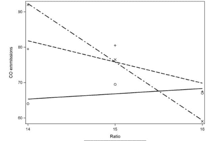

因子没有定量水平，则将交互平方和划分为正交多项式对比并将高阶项合并为误差平方和可能不合适。然而，Tukey (1949b) 开发了一种替代方法，用于检验从交互平方和中划分出的单个自由度。该方法相当于将第 3.5 节模型 3.2 中的 \(\alpha\beta_{ij}\) 限制为主效应 \(\alpha_i\) 和 \(\beta_j$ 的二次多项式函数（参见 Scheffe, 1959）。这样做，用于检验受限假设 \(H_0 : \alpha\beta_{ij} = 0\)（对所有 \(i\) 和 \(j\) 成立）的平方和

\(ss_{AB} = \frac{ab \left[ \sum_i \sum_j y_{ij} \bar{y}_{i.} \bar{y}_{.j} - (ssA + ssB + ab\bar{y}^2_{..}) \right]^2}{(ssA)(ssB)}\) (3.7)

将具有一个自由度，它与加性模型误差项之间的差异将形成误差平方和，类似于上面具有定量因子水平的示例。

为了说明使用 Tukey 的单自由度交互检验，请考虑表 3.7 中的数据，这是 Lin 和 Stephenson (1998) 报告的一项验证病毒污染检定研究的部分数据。病毒污染检定用于确定血液凝固因子 VIII 等生物制品中特定病毒的存在（及含量）。一次实验或运行包括：配制已知病毒污染的溶液，让受污染溶液中的病毒生长，然后


测量结果。实验单位是特定病毒样本与其允许生长的地点和时间的组合。因子A代表样本编号，或与病毒样本混合（或接种）的溶液。因子B代表接种样本的不同稀释度。测得的响应是每毫升溶液中斑点形成单位的log10值。

表3.7 病毒污染的log10(PFU/mL)检测

| | 1 | 2 | 3 | 4 | 5 | 6 |
|---|---|---|---|---|---|---|
| 稀释度 3 | 1.87506 | 1.74036 | 1.79934 | 2.02119 | 1.79934 | 1.59106 |
| 稀释度 4 | 1.38021 | 1.36173 | 1.25527 | 1.39794 | 1.20412 | 1.25527 |
| 稀释度 5 | 0.60206 | 0.90309 | 0.95424 | 1.00000 | 0.60206 | 0.60206 |

由于因子A（样本）不是定量因子，因此使用正交多项式对比来划分其平方和或其与因子B（稀释度）的交互作用的平方和是不合适的。为确定加性模型 yij = μ + αi + βj + ϵij 是否适用于此数据，请使用Tukey方法检验是否存在显著交互作用。一个SAS宏（在本章附录中显示）计算非加性或交互作用平方和，如方程(3.7)所示，并打印报告。读取数据和调用宏的命令如下所示。宏的代码（在附录中显示）应包含在下方所示代码之前。执行此代码时，将使用%tukeysdf命令调用宏。宏在名为file1的文件中查找变量A、B和y以执行计算。

```
data PFU;
input A B y;
datalines;
1 3 1.87506
1 4 1.38021
1 5 0.60206
etc.
data file; set PFU;
%tukeysdf
```

结果如下输出所示。

Tukey的加性单自由度检验

| 来源 | df | SS | MS | F | PR>F |
|---|---|---|---|---|---|
| A | 5 | 0.19479 | 0.03896 | | |
| B | 2 | 3.16639 | 1.58323 | | |
| 误差 | 10 | 0.12825 | 0.01283 | | |
| 非加性 | 1 | 0.00688 | 0.00688 | 0.51 | 0.493 |
| 残差 | 9 | 0.12137 | 0.01349 | | |

由此可见，交互作用（或非加性）不显著。

因此，对于此数据，使用命令 proc glm; class A B; model y=A B 拟合加性模型是合适的。

## 3.6 多因素因子设计 - CRFD

两因子因子设计比在单因子设计中分别研究每个因子更高效。同样，当有许多因子待研究时，在多因子因子设计中共同研究它们比使用两因子因子设计分成两组分别研究更高效。当同时研究多个因子时，检测主效应的效力高于在单独的两因子因子设计中。此外，还可以检测任何因子之间的交互作用。如果因子在两因子因子设计中分别研究，两因子交互作用只能在同一设计中共同研究的因子之间检测到。在多因子因子设计中，不仅可以检测任何因子对之间的两因子交互作用，还可以检测因子组之间的高阶交互作用。例如，因子A、B和C之间的三因子交互作用意味着因子A的效应取决于因子B和C的水平组合。高阶交互作用的示例将在后续示例中介绍。

多因子因子设计中的处理组合包含所有因子所有水平的所有可能组合。可以使用SAS数据步中的嵌套do循环或proc factex生成带随机化的设计，类似于第3.4节所示的示例。分析模型是方程(3.2)的扩展，分析可以使用proc glm或proc genmod进行，类似于前面所示的示例。

考虑市场营销研究中多因子因子设计的一个示例。一家通过网页在线销售的公司希望通过优化配置其网页来增加注册其服务的网站访问者比例。为了从该公司购买，客户必须注册并填写提供电子邮件地址及其他必填字段的表格。一旦客户注册，公司就拥有其数据库的联系信息，并可以发送广告、特价优惠等。该公司希望通过测试其网页的不同配置来进行实验，看是否能增加实际注册的网站访问者数量。

本研究的实验单位是访问公司网站的个人。响应是二进制的；客户要么注册，要么不注册。待研究的因子是改变网页外观的特征。例如，因子A是页面的背景选项，有三个选项。因子B是主横幅中的字体大小，有三个水平；因子C是文本颜色，有两个选项；因子D是在注册按钮和链接之间进行选择。基于这些因子，在考虑每个因子所有水平的所有可能组合时，网页共有 3 x 3 x 2 x 2 = 36 种可能配置。四因子因子实验将包括将网站访问者随机分配到可能配置中的一种，并记录其二进制响应。存在可能影响网站访问者注册几率的潜在变量。例如，链接（公司网站的链接）在搜索其销售产品的网页搜索中出现的位置顺序、竞争对手提供的促销以及竞争对手网站的吸引力。将每个顺序访问者随机分配到研究中的替代配置之一，应尽量减少潜在变量随时间变化带来的偏差可能性。网站访问者注册的概率可以用以下模型表示：

```
\( p_{ijkl} = \mu + \alpha_i + \beta_j + \alpha\beta_{ij} + \gamma_k + \alpha\gamma_{ik} + \beta\gamma_{jk} + \alpha\beta\gamma_{ijk} + \delta_l + \alpha\delta_{il} + \beta\delta_{jl} + \alpha\beta\delta_{ijl} + \gamma\delta_{kl} + \alpha\gamma\delta_{ikl} + \beta\gamma\delta_{jkl} + \alpha\beta\gamma\delta_{ijkl}, \quad (3.8) \)
```

其中 αi 表示背景选择的效应，βj 表示主横幅字体大小的效应，γk 表示文本颜色的效应，δl 表示注册链接与按钮的效应。

该实验通过构建包含上述四个因子所有可能组合的三十六个网站进行。试用期间访问公司网站的每个潜在客户都被随机重定向到三十六种配置中的一种。记录了访问第ijkl种配置的访问者数量nijkl和注册人数xijkl。xijkl随后服从二项分布

```
\( B(x_{ijkl}; n_{ijkl}; p_{ijkl}) = \binom{n_{ijkl}}{x_{ijkl}} p_{ijkl}^{x_{ijkl}} (1 - p_{ijkl})^{(n_{ijkl} - x_{ijkl})} \quad (3.9) \)
```

其中 nijkl 是测试期间访问第ijkl个配置网页的访问者数量。

本实验的原始数据使用下一页的命令读入SAS。

```
data raw;
input A B C D visitors signup;
datalines;
1 1 1 1 1016 22
1 1 1 2 1145 16
1 1 2 1 1145 17
1 1 2 2 1082 19
1 2 1 1 1121 28
1 2 1 2 1103 28
1 2 2 1 1072 15
1 2 2 2 1097 33
1 3 1 1 1145 18
1 3 1 2 1147 20
1 3 2 1 1091 22
1 3 2 2 1097 32
2 1 1 1 1062 21
2 1 1 2 1093 27
2 1 2 1 1020 28
2 1 2 2 1009 27
2 2 1 1 1091 19
2 2 1 2 1133 34
2 2 2 1 1037 17
2 2 2 2 1014 28
2 3 1 1 1082 32
2 3 1 2 1010 26
2 3 2 1 1028 38
2 3 2 2 1045 30
3 1 1 1 1014 17
3 1 1 2 1100 21
3 1 2 1 1031 19
3 1 2 2 1072 21
3 2 1 1 1035 15
3 2 1 2 1038 24
3 2 2 1 1097 26
3 2 2 2 1089 22
3 3 1 1 1108 19
3 3 1 2 1119 25
3 3 2 1 1141 28
3 3 2 2 1148 35
proc format;
value Backg 1='type 1'
2='type 2'
3='type 3';
value font 1='small'
2='medium'
3='large';
value sgn 1='Sign-up Button'
2='Sign-up Link';
value txt 1='black'
2='white';
run;
```

数据后面的proc format命令为因子A、B、C和D的水平分配标签，以便澄清输出。必须使用正确的SAS过程来分析数据，确定任何因子效应是否显著，并预测最佳Web


页面配置。由于网站每个配置的单个访问者的响应服从伯努利分布，读入 SAS 的汇总响应数据服从二项分布，具有大量且近似相等的样本量（即每种可能网页配置的访问者数量）。可应用第 2.5.2 节表 2.4 中所示的反正弦平方根变换，并可使用 proc glm 进行分析。然而，使用此过程的问题是，单个响应被求和以得到汇总响应，在使用这些汇总二项响应时，任何单元格中都没有重复观测值，因此无法计算 sse。这类似于如果数据服从正态分布，对每个单元格中的重复响应求和或平均，只留下每个单元格一个观测值且无法计算 sse。替代方案是使用最大似然法拟合模型 (3.8)。这可以使用在第 2.5.3 节中简要描述的 proc genmod 完成。它会自动设置 sigma^2 = 1.0，且形式为 (L(beta)'(L(X'X)^-1 L)')^-1(L(beta)) 的 III 类平方和在原假设下将渐近服从卡方分布。使用 proc genmod 分析数据的命令如下所示。

```
proc genmod data=raw;
class A B C D;
model signup/visitors=A|B|C|D/ dist=bin type3 ;
run;
```

signup/visitors 是观察到的注册比例，模型规范 A|B|C|D 是 A B A*B A*C B*C A*D B*D C*D A*B*C A*B*D A*C*D B*C*D A*B*C*D 的简写。选项 dist=bin 声明响应服从二项分布，选项 type3 请求一个 III 类平方和和卡方检验的表格。proc genmod 的第一个输出是基于广义逆 beta = (X'X)^-1 X'y 生成的参数估计表，类似于 proc glm 中 /solution 选项的结果。此处未显示。单个系数有偏，不应进行解释。输出的下一部分是 type3 选项产生的 III 类分析表，如下一页所示。

在此输出中，我们可以看到（在 α = 0.05 显著性水平下）因素 A（背景样式）和因素 D（注册按钮或链接）以及三阶交互作用 ACD 显著，其中因素 C 表示文本颜色。由于存在显著交互作用，主效应 A 和 D 不能单独解释。是使用注册按钮还是链接更好

| 来源 | 自由度 | 卡方值 | Pr > ChiSq |
| :--- | :--- | :--- | :--- |
| A | 2 | 10.21 | 0.0061 |
| B | 2 | 8.41 | 0.0150 |
| A*B | 4 | 6.00 | 0.1994 |
| C | 1 | 2.32 | 0.1275 |
| A*C | 2 | 0.84 | 0.6576 |
| B*C | 2 | 4.33 | 0.1146 |
| A*B*C | 4 | 2.43 | 0.6583 |
| D | 1 | 5.05 | 0.0247 |
| A*D | 2 | 0.04 | 0.9817 |
| B*D | 2 | 4.11 | 0.1281 |
| A*B*D | 4 | 5.67 | 0.2249 |
| C*D | 1 | 0.12 | 0.7259 |
| A*C*D | 2 | 6.06 | 0.0484 |
| B*C*D | 2 | 0.06 | 0.9725 |
| A*B*C*D | 4 | 2.01 | 0.7346 |

取决于文本颜色是黑色还是白色以及选择了哪种背景样式。要解释三阶交互作用，有必要制作因素 A、C 和 D 的每种组合中注册比例的表格以及一系列交互作用图。执行此操作的 SAS 命令如下所示。

```
data plt; set raw;
p=signup/visitors;
rename A=Background D=Signup C=Text_Color;
run;
proc sort; by Background_Text_Color Signup;
proc means noprint; by Background_Text_Color Signup; var p;
output out=pltint mean=pmean;
proc sort; by A;
proc print; run;
proc gplot data=pltint;
panelby Background/columns=3;
series x=Text_Color y=pmean/group=Signup markers;
colaxis type=discrete;
format Signup sgn. Text_Color txt.;
run;
```

proc sgpanel 生成图 3.8 中的三个图，显示因素 A（背景类型）和 C（注册链接或按钮）的每种级别组合中因素 D（文本颜色）的效应。

解释交互作用的常见方法是比较其他因素级别组合中水平轴上所表示变量的效应。对于本示例，解释可以如下进行。

图 3.8 按背景类型和链接划分的文本颜色效应

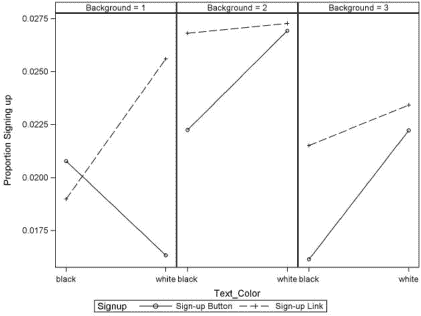

使用背景类型 2 或类型 3 时，可以看到将文本颜色从黑色更改为白色会导致网站访问者注册比例增加。当使用注册按钮而非注册链接时，增加量（由线条斜率表示）更大，因为无论文本颜色如何，使用链接时的总体注册率都较高，改进空间不大。然而，当使用背景类型 1 时，文本颜色的效应完全不同。在这种情况下，当使用注册按钮时，将字体从黑色更改为白色实际上会导致注册比例下降；而当使用注册链接时，将字体从黑色更改为白色会导致注册比例大幅增加。这与背景类型 2 和 3 所见效应相反。

三个因素中的任何一个都可以放在水平轴上，并可以做出等效的解释。有时，将主效应最大的因素放在水平轴上所得到的解释最容易说明。

在解释两因子交互作用时，只需要一个图来说明一个因素的效应取决于另一个因素的水平这一事实。然而，在此情况下，需要多个图来说明一个因素的效应如何取决于其他两个因素水平的组合。每个图上的两条线显示当使用注册链接而非按钮时文本颜色效应如何变化，不同的图显示当背景更改时效应如何变化。

通过检查三个图，或通过从 proc means 中删除 noprint 选项所能生成的平均值表，可以看到，注册比例最高的网页是带有注册按钮、白色文本和背景类型 2 的页面。在此预测中，平均而言，略多于 2.7% 的人会注册。字体大小不显著，因此使用何种字体大小无关紧要。

## 3.7 二水平因子设计

在因子设计中添加更多因素时，设计中的处理组合（运行）数量会呈指数级增加。上一节中的示例包含四个因素和 36 个处理组合。如果设计中有五个因素，每个因素有四个水平，则处理组合数量将为 4 x 4 x 4 x 4 x 4 = 4^5 = 1024 次运行。可以看出，不需要太多因素就会使设计变得不切实际。换句话说，在合理的时间内运行的处理组合将太多。然而，与其回退到一次一因子或一次两因子实验并失去因子实验的效率，不如减少每个因素的水平数量并继续使用包含所有因素的因子设计。通过单独实验，检测高阶交互作用以及检测任何一对因素之间交互作用的能力将丧失。如果在因子设计中以每个因素仅两个水平来研究五个因素，则处理组合数量将减少到 2^5 = 32。出于此原因，每个因素具有两个水平的因子设计，即二水平因子设计，很受欢迎。k 个因素的二水平因子设计的简写是 2^k 设计。

在二水平因子设计中，如果一个因素具有定量水平，则两个水平分别用 (-) 和 (+) 符号表示，其中 (-) 表示实验者会考虑的最低水平，(+) 表示实验者会考虑的最高水平。通常将高低水平尽可能地分开，以突出两个水平之间的信号或响应差异。如果一个因素具有定性水平，则 (-) 和 (+) 的指定是任意的，但通常选择的两个水平是实验者认为应导致最大响应差异的两个水平。

#### 3.7.1 主效应与回归斜坡

三因素因子实验的模型可以写为：
\(y_{ijkl} = \mu + \alpha_i + \beta_j + \alpha\beta_{ij} + \gamma_k + \alpha\gamma_{ik} + \beta\gamma_{jk} + \alpha\beta\gamma_{ijk} + \epsilon_{ijkl},\) (3.10)

其中 \(\alpha_i, \beta_j\) 等是前面定义的效应。然而，在每个因素仅由 (-) 和 (+) 表示两个水平的情况下，i、j、k 和 l 可以替换为 (-) 或 (+)，且 \(\alpha_- = -\alpha_+\)，因为 \(\alpha_- = \overline{y}_-\) ...，\(\alpha_+ = \overline{y}_+\) ...，且 \(\overline{y}_- = (\overline{y}_- ... + \overline{y}_+ ...) / 2\)。类似的等式也将成立


对于所有效应和交互作用。由于每个因子的两个效应数值相同但符号相反，定义二水平因子主效应的更紧凑方法是 \(E_A = \bar{y}_{+...} - \bar{y}_{-...}\)。这可以在图 3.9 左侧可视化，并表示因子从低（-）水平变为高（+）水平引起的平均响应变化。这个 *效应* 然后可以由两个平均值 \(\bar{y}_{+...}\) 和 \(\bar{y}_{-...}\) 的差来表示。

### 图 3.9 二水平因子的效应与回归系数

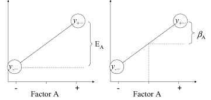

图 3.9 右侧所示的回归斜率 \(\beta_A\) 是因子水平在符号单位中变化一个单位（即从 0 到 +1）时平均响应的垂直变化。因此，斜率 \(\beta_A\) 只是效应 \(E_A\) 的一半，即两个平均值之差除以 2。

二水平因子的处理组合也可以几何上表示为立方体的角点，如图 3.10 所示。本图左侧列出了按标准顺序或 Yates 顺序排列的处理组合或运行，其中第一列以交替的 - 和 + 符号最快变化，第二列以 - 和 + 符号成对变化，第三列以四个 - 和 + 符号为一组最慢变化。二水平因子设计中的处理组合传统上按标准顺序编写，以便使用 Yates 算法手动计算主效应和交互作用效应（参见 Daniel (1976)）。因子 A 的主效应可以在图中可视化为立方体左侧灰色阴影圆圈中的响应平均值与立方体左侧白色圆圈中的响应平均值之差。借助 SAS proc glm 等现代计算机程序，可以通过回归计算主效应的一半或回归系数（如图 3.9 右侧所示），我们不再需要 Yates 算法。

\(2^k\) 因子计划的一个理想特性是，因子效应不会被其他因子的计划变化所掩盖。如图 3.10 所示的 \(2^k\) 设计实验列表中，这一点体现在：在每个因子的高水平上，每个其他因子的高水平和低水平数量相等。同样，在每个因子的低水平上，每个其他因子的高水平和低水平数量也相等。

### 图 3.10 \(2^3\) 设计与主效应计算的几何表示

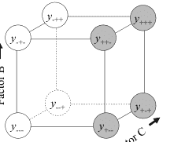

| 运行 | $X_A$ | $X_B$ | $X_C$ | 响应 |
|---|---|---|---|---|
| 1 | - | - | - | $y_{---}$ |
| 2 | + | - | - | $y_{+--}$ |
| 3 | - | + | - | $y_{-+-}$ |
| 4 | + | + | - | $y_{++-}$ |
| 5 | - | - | + | $y_{--+}$ |
| 6 | + | - | + | $y_{+-+}$ |
| 7 | - | + | + | $y_{-++}$ |
| 8 | + | + | + | $y_{+++}$ |

$E_A = (y_{+--} + y_{++-} + y_{+-+} + y_{+++})/2 - (y_{---} + y_{-+-} + y_{--+} + y_{-++})/2$ 因此，一个因子的效应，即该因子高水平和低水平之间的平均响应差异，仅代表该因子本身的效应，因为所有其他因子的影响已被平均消除。从数学上讲，这种特性称为正交性。

#### 3.7.2 交互作用

当所有因子都只有两个水平时，交互作用效应定义为：当因子 B 保持在高（+）水平时，因子 A 的简单效应 ($\bar{y}_{++-} - \bar{y}_{-+-}$) 与当因子 B 保持在低（-）水平时，因子 A 的简单效应 ($\bar{y}_{+++} - \bar{y}_{---}$) 之差的一半，即 $((\bar{y}_{++-} - \bar{y}_{-+-}) - (\bar{y}_{+++} - \bar{y}_{---})) / 2$。这在图 3.11 左侧有示意。交互作用效应也可以描述为：当因子 A 保持在高（+）水平时，因子 B 的简单效应 ($\bar{y}_{++-} - \bar{y}_{+-+}$) 与当因子 A 保持在低（-）水平时，因子 B 的简单效应 ($\bar{y}_{-++} - \bar{y}_{---}$) 之差的一半。这在图 3.11 右侧有示意。无论哪种方式，交互作用效应都是 $E_{AB} = (\bar{y}_{++-} + \bar{y}_{---})/2 - (\bar{y}_{+-+} + \bar{y}_{-++})/2$，即两个平均值之差。

很容易确定为了计算交互作用效应，应该对哪些响应求平均，以及应该用哪个平均值减去另一个，如图 3.12 所示。要计算 AB 交互作用，我们在图左侧的处理组合列表中添加一个符号列 $X_A \cdot X_B$。这一新列中的元素只是 $X_A$ 列和 $X_B$ 列中符号的逐元素乘积（即，$(-) \cdot (-) = +$，$(+) \cdot (-) = -$ 等等）。现在，交互作用效应可以在图中可视化为灰色圆圈表示的一条对角线上的平均响应与白色圆圈表示的另一条对角线上的平均响应之差。

### 图 3.11 二水平因子交互作用效应的定义

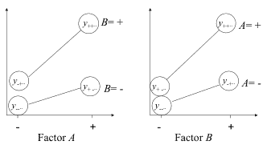

从这一

### 图 3.12 $2^3$ 设计与交互作用效应的几何表示

| 运行 | X1 | X2 | X3 | X4 | X5 | 响应 |
|---|---|---|---|---|---|---|
| 1 | - | - | - | + | | y... |
| 2 | + | - | - | - | | y... |
| 3 | - | + | - | - | | y... |
| 4 | + | + | - | - | | y... |
| 5 | - | - | + | + | | y... |
| 6 | + | - | + | - | | y... |
| 7 | - | + | + | - | | y... |
| 8 | + | + | + | + | | y... |

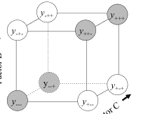

$E_{ab} = (y_{++} + y_{--})/2 - (y_{+-} + y_{-+})/2$

表示，还可以看出交互作用效应不会被其他因子的计划变化所掩盖，换句话说，它们与主效应正交。

可以使用回归程序（如 proc glm）通过向模型中添加 $X_A \times X_B$ 项来计算这一交互作用效应的一半（或回归系数）。高阶交互作用效应可以类似定义。

因此，编写二水平因子模型的一种更简单方法是使用熟悉的回归方程，

\[
y = \beta_0 + \beta_A X_A + \beta_B X_B + \beta_C X_C + \beta_{AC} X_A X_C + \beta_{BC} X_B X_C
+ \beta_{ABC} X_A X_B X_C + \epsilon
\]
(3.11)

其中，\(\beta\) 系数是效应的一半，如果因子 A 处于低水平，则 \(X_A = -1\)；如果因子 A 处于高水平，则 \(X_A = +1\)。如果用矩阵形式写出该模型，\(y = X\beta + \epsilon\)，则设计的正交性体现在 \(X\) 矩阵的列正交，且 \(X'X\) 矩阵为对角矩阵，其对角元素为 \(r2^k\)，其中 \(r\) 是每个单元格的重复次数。

#### 3.7.3 \(2^3\) 因子示例

为了说明 \(2^3\) 因子实验的设计与分析，请考虑以下示例（参见 Lawson and Erjavec, 2001）。大学电子实验室的学生经常抱怨，他们在课堂上搭建的电路进行的电压测量结果不一致。实验室助教（TA）决定进行一项实验，以尝试找出变异的来源。他改变的三个因子是：A=进行电压测量的环境温度，B=电压表预热时间，C=在测量前将电源连接到电路的时间。响应是以毫伏为单位的测量电压。因子 A 的两个水平为 \(-22^\circ C\)（室温）和 \(+32^\circ C\)（接近某些工业环境中的温度）。使用了烤箱，并在测量前让电路稳定至少五分钟。因子 B 和 C 的设置为 30 秒或更少，以及 5 分钟。每种处理因子组合都测量了相同的电路，因此实验单元只不过是应用特定处理因子水平组合以进行测量的试验或时间点。每种八种实验组合进行了两次重复，并以随机顺序运行，以帮助防止偏差。实验结果如表 3.8 所示。

在此表中，实际因子设置显示在左侧，编码的 - 和 + 水平显示在右侧。左侧的实际设置构成了执行每个实验的配方或说明列表。响应旁最右侧的顺序号是用随机数生成器创建的，表示应运行实验的顺序。编码的因子水平用作回归程序中的自变量，以计算回归系数或半效应。

编码的因子水平可以使用编码和缩放公式从实际因子设置中轻松计算得出。在此公式中，我们减去两个因子设置的中点，然后除以范围的一半。例如，


表 3.8 电压表实验的因子设置与响应

| 运行 | A | B | C | XA | XB | XC | 重复 | 顺序 | y |
|---|---|---|---|---|---|---|---|---|---|
| 1 | 22 | 0.5 | 0.5 | - | - | - | 1 | 5 | 705 |
| 2 | 32 | 0.5 | 0.5 | + | - | - | 1 | 14 | 620 |
| 3 | 22 | 5.0 | 0.5 | - | + | - | 1 | 15 | 700 |
| 4 | 32 | 5.0 | 0.5 | + | + | - | 1 | 1 | 629 |
| 5 | 22 | 0.5 | 5.0 | - | - | + | 1 | 8 | 672 |
| 6 | 32 | 0.5 | 5.0 | + | - | + | 1 | 12 | 668 |
| 7 | 22 | 5.0 | 5.0 | - | + | + | 1 | 10 | 715 |
| 8 | 32 | 5.0 | 5.0 | + | + | + | 1 | 9 | 647 |
| 1 | 22 | 0.5 | 0.5 | + | + | + | 1 | 4 | 680 |
| 2 | 32 | 0.5 | 0.5 | - | - | - | 1 | 7 | 651 |
| 3 | 22 | 5.0 | 0.5 | + | - | - | 1 | 2 | 685 |
| 4 | 32 | 5.0 | 0.5 | + | + | - | 1 | 3 | 635 |
| 5 | 22 | 0.5 | 5.0 | - | - | + | 1 | 11 | 654 |
| 6 | 32 | 0.5 | 5.0 | + | - | + | 1 | 16 | 691 |
| 7 | 22 | 5.0 | 5.0 | - | + | + | 1 | 6 | 672 |
| 8 | 32 | 5.0 | 5.0 | + | + | + | 1 | 13 | 673 |

例如，对于因子 A，22 和 32 之间的中点是 27，量程的一半是 5，因此

\( X_A = \left( \frac{ActualFactorSetting - 27}{5} \right) \).

将此数据读入 SAS 并使用 proc glm 进行分析的命令如下所示。

```
data volt;
input A B C y;
XA=(A-27)/5;
XB=(B-2.75)/2.25;
XC=(C-2.75)/2.25;
datalines;
22 0.5 0.5 705
32 0.5 0.5 620
... etc.
proc glm;
model y=XA XB XC XA*XB XA*XC XB*XC XA*XB*XC/
solution;
run;
```

这里可以看出，只有实际因子水平被读入 SAS，而编码因子水平是在数据步骤中创建的。为了进行回归而不是方差分析，proc glm 中未使用 class 语句，且 /solution 选项创建了下面所示的回归系数（或半效应）表。

| 参数 | 估计值 | 标准误 | t 值 | Pr > |t| |
|---|---|---|---|---|
| 截距 | 668.5625000 | 4.51776009 | 147.99 | <.0001 |
| XA | -16.8125000 | 4.51776009 | -3.72 | 0.0059 |
| XB | 0.9375000 | 4.51776009 | 0.21 | 0.8408 |
| XC | 5.4375000 | 4.51776009 | 1.20 | 0.2632 |
| XA*XB | -5.6875000 | 4.51776009 | -1.26 | 0.2471 |
| XA*XC | -12.6625000 | 4.51776009 | -2.78 | 0.0239 |
| XB*XC | 1.8125000 | 4.51776009 | 0.40 | 0.6988 |
| XA*XB*XC | -5.8125000 | 4.51776009 | -1.29 | 0.2342 |

这里可以看出，因子 A（环境温度）和 A×C 交互作用，即环境温度与电路预热时间之间的交互作用，是显著的。主效应有直接解释。因子 A 的效应是上述回归系数的两倍，即 \( E_A = 2 \times \hat{\beta}_A = 2(-16.8125) = -33.625 \)。这意味着，平均而言，当环境温度从 \( 22^\circ \) 升高到 \( 32^\circ \) 时，电压测量值将下降 33.6 毫伏。然而，由于本例中交互作用显著，谈论平均主效应并不真正有意义，因为环境温度的效应取决于电路预热时间。

描述或解释交互作用的最佳方法是查看下一页图 3.13 中所示的交互作用图。这里可以看出，当电路预热时间较短（0.5 分钟或 30 秒）时，将环境温度从 \( 22^\circ \) 变更到 \( 32^\circ \) 会导致电压读数大幅下降（58.7 毫伏）。然而，当电路预热时间较长（5 分钟）时，将环境温度从 \( 22^\circ \) 变更到 \( 32^\circ \) 只会导致电压读数小幅下降（8.5 毫伏）。因此，为了使电压读数更加一致，实验室助教建议他的学生在进行电压测量前让电路预热 5 分钟。

回归是在编码因子水平上进行的，因此 proc glm 生成的回归系数正好是效应的一半。然而，在以图形方式呈现结果以便纳入报告或演示文稿时，应使用实际因子名称和水平以确保清晰，如图 3.13 所示。大多数读者或听众不会记住 – 和 + 水平代表什么。

生成图形的 SAS 命令如下所示。这里采用了一个额外的数据步骤，将因子 C 重命名为 CircuitWarmUp.Time，以便正确标记图形上的图例。axis1 语句用于为横轴创建标签，图形是基于实际因子水平而非编码因子水平制作的，因此横轴上的单位不会被标记为 (-1) 和 (1)。

```
proc sort data=volt; by A C;
proc means data=volt; by A C var y;
output out=meanmean;
proc print; run;
data s; set meanmean;
rename A=Ambient C=Circuit_Warmup_Time;
proc sgplot data=s group=Circuit_Warmup_Time markers;
scatter x=Ambient y=y;
xaxis label='Ambient Temperature' min=20 max=34;
yaxis label='Voltage (millivolts)';
run;
```

图 3.13 环境温度与电路预热时间之间的交互作用

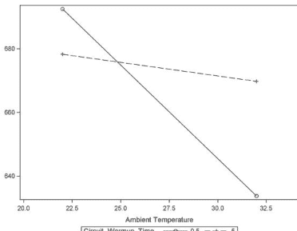

y = 668.563 - 16.813 \(\left( \frac{Temp - 27}{5} \right)\) - 6.688 \(\left( \frac{CWarm - 2.75}{2.25} \right)\) \(\left( \frac{Temp - 27}{5} \right)\)

可从回归结果中写出，并用于预测任何介于 22° 和 32° 之间的环境温度以及任何介于 30 秒和 5 分钟之间的电路预热时间的毫伏电压读数。

#### 3.7.4 确定重复次数的快捷公式

Wheeler (1974) 开发了一个快捷近似公式，用于计算在两水平因子实验的显著性水平为 \(\alpha = 0.05\) 时，达到 0.95 检验效力所需的运行次数。该公式为

$$N = ((8\sigma)/\Delta)^2$$ (3.12)

其中 \(\sigma\) 是实验误差的标准差，\(\Delta\) 是实际效应的大小。在此情况下，\(\Delta\) 是因子低水平和高水平之间平均响应的差值，而 \(N = r \times 2^k\) 是 \(2^k\) 因子实验中的总实验次数。由于该公式非常简洁，在规划实验的会议上现场使用非常方便。为了说明其用法，请考虑基于上一节中介绍的电压表实验的示例。

实验室讲师认为实验误差的标准差约为 \(\sigma = 15.0\)，实际效应的大小约为 \(\Delta = 30.0\)。\(\sigma\) 将由实验室讲师在完全相同条件下（即因子水平）对同一电路进行重复电压测量的经验得知，而 \(\Delta\) 将由声称测量结果不一致的学生所报告的测量不一致程度得知。\(\Delta\) 是助教希望在其实验中检测到的效应大小。使用快捷公式，这意味着

$$N = ((8 \times 15.0)/30.0)^2 = 16$$

即对 \(2^3 = 8\) 次运行中的每次运行进行 \(r = 2\) 次重复，应该能在显著性水平 \(\alpha = 0.05\) 下检测出大小为 30.0 的效应，检验效力为 0.95。如果你修改并使用第 3.5.2 节中介绍的用于因子实验数据步骤中计算检验效力的 SAS 程序，则 \(r = 2\) 次重复的实际检验效力更接近 0.94 而非 0.95。然而，这个近似公式对于大多数规划目的来说已经足够准确。

这个简单公式也可以反过来使用，通过求解 \(\Delta\) 作为 \(N\) 的函数，即 \(\Delta = 8\sigma/\sqrt{N}\)。这样，如果实验者知道其实验预算（这决定了 \(N\) 的最大值），他就可以计算出可能能够检测到的效应大小 \(\Delta\)。如果实验者没有 \(\sigma\) 的准确估计值，仍可以使用该公式，通过用未知的 \(\sigma\) 作为单位来讨论实际效应大小。例如，如果实验者的预算最多允许进行 \(N = 64\) 次实验，他希望能够检测到不超过实验误差一个标准差的效应，即 \(\Delta = 8 \times \sigma/\sqrt{64} = \sigma\)。无论两水平实验中有多少个因子，此结果都成立。因此，在 64 次运行中，他可以有一个因子，每个水平有 \(r = 32\) 次重复，或者有六个因子，每个 \(2^6 = 64\) 种处理组合有 \(r = 1\) 次重复。


#### 3.7.5 每个单元格一个重复的分析

每个单元格只有一个重复的因子设计通常被称为未重复设计。当 r = 1 个重复/单元格（或处理组合）具有足够的检验效力来检测效应时，无需通过重复每个实验来使实验工作量翻倍。然而，在未重复的因子设计中，会出现第 3.5.4 节讨论过的同一问题。计算 ssE 的自由度将为零，因此无法对效应进行 F 检验。然而，当两水平因子设计中存在多个因子时，有一些简单的图形工具可用于检测显著效应。由于 2^k 实验中并非所有主效应和交互作用都预期显著，因此不显著因子的水平以及由不显著交互作用定义的水平组合，等同于设计中具有重复。图形工具允许识别显著效应（或等效地，回归系数）。

用于识别显著效应的最常见图形工具是正态图或半正态图，最早由 Daniel (1959) 提出。使用 SAS 可以轻松生成这些图，如第 2.4 节中的残差正态图所示。其他图形工具，如 Pareto 图、Lenth 图和 Bayes 图，也可用于检测显著效应和交互作用，并可使用交互式 SAS ADX（自动实验设计）工具自动生成。ADX 中用于分析两水平因子设计的输入和输出示例，显示在本书网页（http://lawson.mooo.com）的文件中。

为说明未重复两水平因子设计的分析，请考虑化工行业的一个实验。实验设计原则由 Fisher 在二十世纪初提出，最初用于农业实验。四十年内，实验设计技术在化工行业得到广泛应用。图 3.14 是连续化学过程的示意图。在此过程中，两种连续反应物 A 和 B 在称为混合 T 的连接点处混合并开始反应。混合物随后流入反应器，与溶剂和催化剂混合，反应完成。反应结果流入分离罐，最终产品在溶剂相中浮到顶部，而催化剂和水沉到底部。催化剂被浓缩并送回反应器，而产物、副产物和溶剂被送往蒸馏柱，在那里分离出产物，溶剂被回收到反应器。

该过程遇到的问题之一是副产物（焦油）的生成。随着时间的推移，这些焦油会堵塞反应器，迫使过程停机进行清洗。还需要额外的工艺步骤来纯化最终产品。工程师决定进行实验，看是否可以提高转化率，从而减少副产物的量。他们认为可能影响转化率的因素有：

### 图 3.14 化学过程示意图

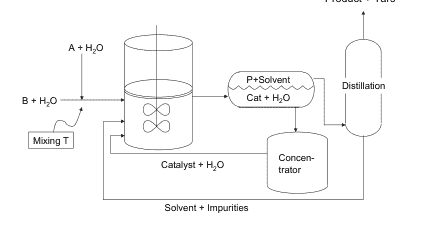

| 符号 | 因子名称 |
|---|---|
| A | 反应物 A 过量（相对于摩尔量） |
| B | 催化剂浓度 |
| C | 反应器压力 |
| D | 涂层混合 T 温度 |

每个因子的两个水平被选择得尽可能宽，工程师认为这样可行，以最大限度地提高仅用两个水平检测因子效应的机会。在实验过程中，因子水平将在固定时间间隔后更改。此实验单位为特定运行期间进入反应区的反应物、催化剂和溶剂，响应 Y 为根据运行期间生产的产物计算的转化率。

认为如果转化率能提高 \(\Delta = 12\%\)（或更多），将大幅减少目前所需的维护和额外处理，并且值得检测。根据该过程的过去经验，在拟议实验设计（因子水平不变）的相同长度间隔内生产的产品，该过程的转化率标准差为 \(\sigma = 6\%\)。使用简捷公式，检测 \(\Delta = 12\%\) 或更大因子效应所需的功效为 0.95 的运行次数为

```
N = (8\sigma/\Delta)^2 = ((8)(6)/12)^2 = 16
```

四个因子的十六次运行意味着设计将是未重复的。实验条件（以编码单位表示）、随机运行顺序列表和实验结果如表 3.9 所示。

### 表 3.9 化学过程实验列表和结果

| 随机运行号 | A | B | C | D | Y |
|---|---|---|---|---|---|
| 15 | - | - | - | - | 45 |
| 13 | + | - | - | - | 41 |
| 11 | - | + | - | - | 90 |
| 1 | + | + | - | - | 67 |
| 10 | - | - | + | - | 50 |
| 2 | + | - | + | - | 39 |
| 3 | - | + | + | - | 95 |
| 12 | + | + | + | - | 66 |
| 16 | - | - | - | + | 47 |
| 8 | + | - | - | + | 43 |
| 9 | - | + | - | + | 95 |
| 14 | + | + | - | + | 69 |
| 6 | - | - | + | + | 40 |
| 5 | + | - | + | + | 51 |
| 7 | - | + | + | + | 87 |
| 4 | + | + | + | + | 72 |

读取数据并执行回归分析以估计半效应或回归系数的 SAS 命令如下所示。

```
data chem;
input A B C D y;
datalines;
-1 -1 -1 -1 45
1 -1 -1 -1 41
... etc
proc glm data=chem;
model y=A|B|C|D/solution;
*this outputs the parameter estimates to a file;
ods output ParameterEstimates=sol;
run;
```

与第 3.7.3 节的示例不同，proc glm 输出中将没有 ssE 的估计，因此也不会对回归系数进行 t 检验。ods 语句将参数估计表输出到名为 sol 的文件，该文件可读取以生成图形。回归系数如下所示的 proc glm 输出中所示。主效应 A 和 B 以及 A x B 交互作用的回归系数是最大的效应，但必须使用图形来确定哪些是显著的。

两水平因子设计中的效应是两个平均值的差。如果因子水平的变化不引起响应的变化，则该效应将

| 参数 | 估计值 | 标准误 | t 值 | Pr > \|t\| |
|---|---|---|---|---|
| 截距 | 62.31250000 | . | . | . |
| A | -6.31250000 | . | . | . |
| B | 17.81250000 | . | . | . |
| A*B | -5.31250000 | . | . | . |
| C | 0.81250000 | . | . | . |
| A*C | -0.81250000 | . | . | . |
| B*C | -0.31250000 | . | . | . |
| A*B*C | -0.18750000 | . | . | . |
| D | 0.68750000 | . | . | . |
| A*D | 2.31250000 | . | . | . |
| B*D | -0.06250000 | . | . | . |
| A*B*D | -0.68750000 | . | . | . |
| C*D | -0.68750000 | . | . | . |
| A*C*D | 2.43750000 | . | . | . |
| B*C*D | -0.43750000 | . | . | . |
| A*B*C*D | -0.31250000 | . | . | . |

只是随机数据的平均值之差（由于实验误差的随机波动）。如果没有任何因子或交互作用引起响应的变化，则整个效应集（或回归系数）应根据中心极限定理表现为来自零均值正态分布的样本。因此，如果我们对效应制作正态概率图，不显著效应应沿直线分布，而任何显著效应或交互作用应在图上表现为离群点。

创建文件 sol 中回归系数正态图的 SAS 命令显示在下一页顶部。这些命令将删除文件 nplot 中的第一行，该行包含方程 (3.11) 中所示的截距项 \(\beta_0\)。接下来，从文件中删除变量 StdErr、tValue 和 Probt。proc rank 用于计算正态得分，在下一个数据步骤中创建新文件 nplots，其中变量 parameter（将用于标记离群效应）在 z 分数的绝对值小于或等于 1.2 时设置为空白。最后，使用 proc sgplot 创建图形。

在此正态图（图 3.15）中，大多数点沿着通过原点 (0, 0) 的直线分布。然而，表示主效应 A、B 以及 A x B 交互作用的点倾向于位于直线的上方和右侧，或下方和左侧。这表明这三个效应是显著的。沿直线分布的点是不显著的，这条直线的斜率是效应标准误 \(\sigma_\beta\) 的估计值。

以图形方式查看效应的另一种方法是制作半正态图。半正态图本质上是沿直线 y = -x 以 45° 折叠正态图而成。这将图形的原点放在左下角，并使不显著效应的直线看起来从原点延伸出来。要制作半正态图，请在垂直轴上绘制效应或回归系数的绝对值，在水平轴上绘制其对应的半正态得分。由于 proc rank 不会计算


```
data plt; set sol;
estimate;
if _n_=1 then drop Stderr tValue Probt ;
* proc rank calculates normal scores for parameter estimates ;
proc rank data=plt out=plots normal=blom; var estimate;
ranks zscore;
data nplots; set plots;
if zscore=. then parameter=' ' ;
proc sgplot data=nplots;
scatter x=zscore y=estimate/datalabel=parameter;
xaxis label="Normal Scores";
run;
```

## 图 3.15 回归系数的正态概率图

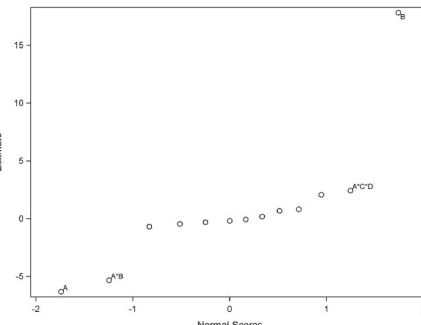

直接计算半正态分数，\(|\hat{\beta}_{(i)}|\) 的半正态分数可由公式 \(\Phi^{-1}(((i - 1/2) + 1)/2)\) 近似，其中 \(\Phi^{-1}()\) 是标准正态分布的逆累积分布函数，\(i\) 是 \(|\hat{\beta}_{(i)}|\) 的秩次。在 SAS 中，probit 函数计算 \(\Phi^{-1}()\)，创建半正态图的代码如下一页所示。

图 3.16 所示的半正态图左下角有一条从原点出发的参考线，以及一条上预测限界线。效应 A、B 以及 A×B 交互作用位于上限线之上，且明显显著。图 3.16 中的参考线和上限是由 Lawson (2008a) 描述的 SAS 宏按照概述的程序自动添加的。

```
data hmplot; set sol;
estimate;
if _n_=1 then drop StdErr tValue Probt;
* proc rank calculates ranks for parameter estimates ;
proc rank data=hmplot out=hnplots; var estimate; ranks rnk;
* data step calculates half normal scores for estimates;
data hnplots; set hnplots;
z=probit((rnk-0.375)/(n+1)/2);
if abs(z)<1.0 then parameter=' ' ;
proc sgplot data=hnplots;
scatter x=z y=estimate/datalabel=parameter;
xaxis label="Half Normal Scores";
run;
```

## 图 3.16 绝对回归系数的半正态图

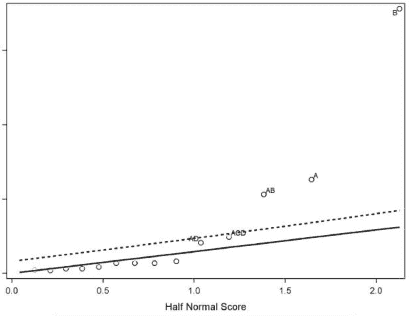

由 Lawson 等人 (1998) 描述。在图上手动绘制参考线时，使用半正态图比使用正态图更容易，因为从左下角开始的前一半到三分之二的点几乎总是会形成一条直线。然而，在半正态图中，系数的符号会丢失。例如，在 proc glm 输出和正态图中，可以清楚地看出主效应 A（反应物 A 的过量）具有负效应，并且平均而言，增加反应物 A 的过量会导致转化率下降。在半正态图中，可以看出主效应 A 是显著的，但必须返回系数表来查看它是正效应还是负效应。

当然，在本例中存在显著的交互作用，因此无法单独解释主效应。为了帮助解释交互作用，应创建交互图。下面显示了创建和标记因子 A（反应物 A 的过量）与因子 B（催化剂浓度）之间交互图的 SAS 命令，生成的图表如图 3.17 所示。

```
proc format;
   value levels -1='Low Level' 0=' ' 1='High Level';
   run;
   ***** table of means;
   proc sort data=chem; by A B;
   run;
   proc means data=chem noprint; var y; by A B;
   output out=output mean=yhat;
   run;
   proc print; run;
   ***** plot of interaction;
   proc sgplot data=output;
   series x=A y=yhat /group=B markers;
   xaxis label='Excess of Reactant A' type=discrete;
   yaxis label='Percent Conversion';
   format B levels. A levels.;
   run;
```

## 图 3.17 催化剂与过量 A 的交互图

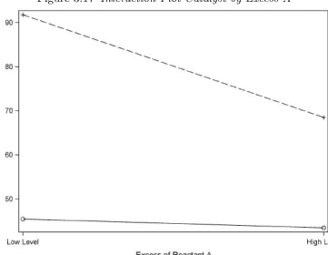

从中可以看出，增加催化剂水平会提高转化率。当使用低水平催化剂时，增加反应物 A 的过量对转化率影响甚微。然而，如果使用高水平催化剂，增加反应物 A 的过量会使转化率下降超过 20%。因此，为了达到最高转化率，应使用高水平催化剂和低水平过量反应物 A。

## 3.8 验证模型假设

当因子模型中每个单元都有重复实验单位，或者当交互项可被假设为可忽略并从模型中移除（例如根据第 3.5.4 节或 3.7.5 节描述的初步检验结果），则可按照第 2.4 节所述，使用残差图来验证因子模型的正态性和常方差假设。

然而，在每个单元只有一个重复的 2^k 设计中，检查正态性假设会稍微困难一些。正态性假设最常因存在一个异常值或非典型值而被违反。在两水平因子设计中，计算出的主效应和交互作用始终可以表示为两个平均值之差，\(\bar{y}_+ - \bar{y}_-\)。当实验误差服从正态分布时，对响应影响可忽略的因子和交互作用的计算效应应服从均值为零的正态分布。潜在有影响因子的显著性是根据其与由可忽略因子形成的效应正态图或半正态图上的参考线点的关系来判断的。然而，一个非典型值会使每个计算出的效应向正或向负方向偏离零。非有影响因子和交互作用的计算效应的变异性会大得多，这使得判断效应的显著性变得更加困难，更不用说检查残差的正态性假设了。

Daniel (1960) 提出了一种手动方法，用于检测和纠正未重复 2^k 设计中的异常值或非典型值。该方法包含三个步骤。首先，通过效应正态图中心的间隙来检测异常值的存在。其次，通过将不显著效应的符号与每个观测值的编码因子水平和交互作用的符号相匹配来识别异常值。第三步是估计差异的大小并纠正非典型值。

例如，考虑 Box (1991) 描述的未重复 2^k 实验的效应正态图（图 3.18）。在此图中，主效应 B 和 C 可能显著，但不显著效应线中存在一个垂直间隙，这表明可能存在异常值。

Lawson 和 Gathin (2006) 实现了 Daniel 识别和纠正非典型值的过程的自动化，Lawson (2008a) 提供了执行此过程的 SAS 宏。下一页的 SAS 命令说明了如何将此宏与 Box (1991) 描述的数据一起使用。第一个数据步骤创建一个 2^k 设计并将其存储在名为 xmatrix16 的数据集中。下一个数据步骤将响应数据读入名为 box 的数据集。接下来定义宏变量 %nobs 和 %vname1。%nobs 是设计中的运行次数，%vname1 是 X 矩阵中列名的列表。宏需要这些宏变量。最后，表示 X 矩阵的数据集被复制到名为 x1 的数据集，表示响应变量的数据集被复制到名为 y 的数据集。这些是宏所需的名称。最后，通过语句 %gapmth 调用宏。宏的输出包括回归系数表及其显著性检验、正态图中间隙的显著性检验，以及当间隙被判定为显著时，生成经校正的响应表和使用经校正数据计算的回归系数表。经校正的响应表显示在生成它的 SAS 命令下方的下一页。

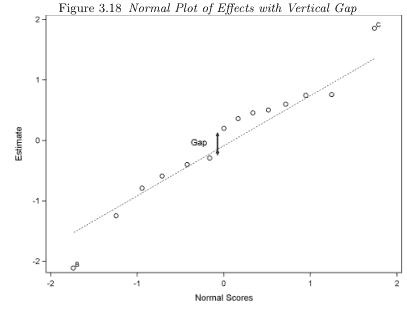

该方法检测到第 13 次运行存在异常值，并通过将 59.15 改为 52.15 来校正响应。对经校正数据的重新分析得出了经校正数据表之后页面所示的表格。

该宏还生成基于原始数据和经校正数据计算的回归系数的半正态图。图 3.19 显示了使用经校正数据计算的系数的半正态图。在此图中，除了在图 3.18 中识别的主效应 B 和 C 之外，可以清楚地看出 AC 交互作用也是显著的。它们在图 3.18 中无法被检测到，因为异常值夸大了不显著效应的估计，而 AC 效应被淹没在噪声中。

每当使用此方法或残差图发现异常值，并且在移除或校正异常值时分析结论发生变化，实验者应谨慎行事。当存在超过两个


```
*Create the design matrix of contrast coefficients for a 2^4
design;
data matrix16;
do x4=-1 to 1 by 2;
do x3=-1 to 1 by 2;
do x2=-1 to 1 by 2;
do x1=-1 to 1 by 2;
I=1;
A=x1; B=x2; C=x3; D=x4;
AB=A*B; AC=A*C; AD=A*D; BC=B*C; BD=B*D; CD=C*D;
ABC=A*B*C; ABD=A*B*D; ACD=A*C*D; BCD=B*C*D; ABCD=A*B*C*D;
output;
end;
end;
end;
end;
end;
drop x1-x4;
run;
*Read in the response data for 2^4 design;
data box;
input y @@;
datalines;
47.46 49.62 43.13 51.47 48.49 49.34 46.10 46.76 48.56 44.83
46.46 49.15 51.33 47.02 47.90
;
*define the node and vname1 macro variables needed by the macro;
%let nobs=16;
%let vname1={’I’ ’A’ ’B’ ’C’ ’D’
’AB’ ’AC’ ’AD’ ’BC’ ’BD’ ’CD’
’ABC’ ’ABD’ ’ACD’ ’BCD’ ’ABCD’};
%macro reg(data=, y=, x=, vname=, nobs=);
data y; set box;
data x1; set xmatrix16;
%gapth
```

## Corrected Data Report

| 响应 | 校正后的响应 | 检测异常值 |
|---|---|---|
| 47.46 | 47.46 | 否 |
| 49.62 | 49.62 | 否 |
| 43.13 | 43.13 | 否 |
| 46.31 | 46.31 | 否 |
| 51.47 | 51.47 | 否 |
| 48.49 | 48.49 | 否 |
| 49.34 | 49.34 | 否 |
| 46.10 | 46.10 | 否 |
| 46.76 | 46.76 | 否 |
| 48.56 | 46.76 | 否 |
| 44.83 | 44.83 | 否 |
| 44.83 | 44.83 | 否 |
| 44.45 | 44.45 | 否 |
| 59.15 | 52.75 | 是 |
| 51.33 | 51.33 | 否 |
| 47.02 | 47.02 | 否 |
| 47.9 | 47.9 | 否 |

## Effect Report

| 标签 | 半效应 | 效应绝对值 | 显著性(0.05) |
|---|---|---|---|
| A | -0.9216 | 0.9216 | 否 |
| B | -1.71 | 1.71 | 是 |
| C | 1.455 | 1.455 | 是 |
| D | 0.105 | 0.105 | 否 |
| AB | 0.055 | 0.055 | 否 |
| AC | -0.845 | 0.845 | 是 |
| AD | 0.11 | 0.11 | 否 |
| BC | -0.9016 | 0.9016 | 否 |
| BD | -0.19 | 0.19 | 否 |
| CD | 0.345 | 0.345 | 否 |
| ABC | 0.2 | 0.2 | 否 |
| ABD | -0.04 | 0.04 | 否 |
| ACD | -0.6 | 0.6 | 否 |
| BCD | -0.39 | 0.39 | 否 |
| ABCD | 0.36 | 0.36 | 否 |

Lawton, Grinshaw & Burt Rn 统计量 = 1.626  
Rn 的第 98 百分位数 = 1.201  

在发现异常值的相同因子设置下的重复观测，可能清楚地表明出了问题。然而，如果在发现异常值的因子设置下的观测数不超过两个，则可能建议重新运行可疑的实验。

## 图 3.19 使用校正数据计算的系数半正态图

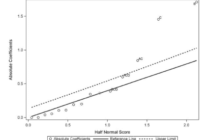

## 3.9 重要概念回顾

在处理多个处理因子的实验时，将所有可能的处理组合随机分配给实验单元的因子设计，比单独的一因子设计效率高得多。当存在同质实验单元且正在研究多个因子时，应使用 CRFD 或完全随机因子设计。

图 3.20 显示了何时应使用 CRD 和 CRFD。如果正在研究一个因子且具有同质实验单元，则使用 CRD。然而，如果正在研究多个实验单元，则使用 CRFD。在

## 图 3.20 设计选择路线图

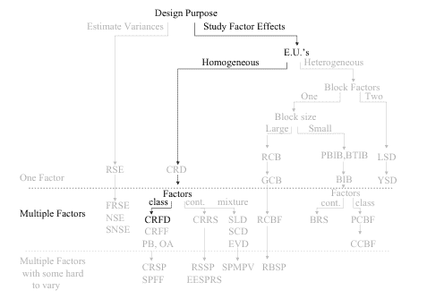

在因子设计中，一个因子每个水平的总重复数等于每个单元的重复数乘以设计中所有其他因子的水平数之积。这种隐藏的重复增加了检测因子效应的效力，或者减少了获得与一系列单独的一因子设计相同效力所需的实验次数。当实验单元是同质的并且运行因子所有水平组合是合理的时，应使用 CRFD。

在因子设计中同时研究多个处理因子，可以检测因子的交互作用或联合效应。当一个因子的效应取决于另一个因子的水平或其他因子水平的组合时，就会发生交互作用。交互作用在现实世界中很常见，一次只研究一个因子而忽略它们可能会产生非常误导性的结论。本章中的示例表明，通过比较或对比一个因子在另一个因子水平上的效应，可以轻松描述或解释交互作用的含义。交互作用图有助于描述交互作用。

两因子因子设计的分析模型可以写成

\( y_{ijk} = \mu + \alpha_i + \beta_j + \alpha\beta_{ij} + \epsilon_{ijk} \)

并且可以轻松扩展到多个因子。分析的假设是实验误差的同质性和正态性，可以使用第 2 章中描述的残差图进行检查。当每个单元或处理组合的重复数相等时，可以使用 proc glm 类型 I 或类型 III 平方和来检验主效应和交互作用，并可以使用 means 或 lsmeans 语句来获取单元均值和边际均值的无偏估计。然而，如果每个单元的重复数不相等，则必须使用类型 III 平方和和 lsmeans。

在因子实验中研究多个因子时，通常每个因子只使用两个水平，以减少所需的实验总量。在这种情况下，模型简化为回归模型

\( y = \beta_0 + \beta_A X_A + \beta_B X_B + \beta_{AB} X_A X_B + \beta_C X_C + \beta_{AC} X_A X_C + \beta_{BC} X_B X_C + \beta_{ABC} X_A X_B X_C + \epsilon \)

并且回归系数正好是因子低水平和高水平之间平均响应效应或差异的一半。在这种情况下，交互作用效应也可以轻松定义为平均值的差异。对于两水平因子设计，有一个近似效力的快捷公式，并且当每个处理组合只有一个重复时，可以使用正态图或半正态图来确定效应和交互作用的显著性。

## 3.10 练习

1. 一位顾问被叫来协助一座大都市的警察部门评估其新警官的人际关系课程。他策划了一个 2 因子实验，其中处理为 A 警官被分配到的警区类型，和 B 人际关系课程的时长。选取了 45 名新警官的样本，并有 5 名被随机分配到每个 9 个处理组合中。开发了一项测试来衡量警官对少数群体的态度，并在他们的培训结束并在警区工作两周后对参与的警官进行了测试。态度越好，该测试得分越高。数据分析揭示了警区类型和人际关系课程时长之间存在显著的 A×B 交互作用效应。下表显示了 9 个处理水平组合的平均测试得分。

| 警区类型 | 30 小时 | 35 小时 | 15 小时 |
| :--- | :---: | :---: | :---: |
| 上层阶级警区 | 34.4 | 35.5 | 39.2 |
| 中产阶级警区 | 30.2 | 32.4 | 34.7 |
| 内城警区 | 20.1 | 39.4 | 54.3 |

- (a) 构建交互作用图。
- (b) 用几个完整的句子写出对交互作用的解释。

2. 木制投石机可以用来抛掷泡沫球。投石机有三个可调节因子：起始角度、停止角度和枢轴高度。球行进的距离可以用卷尺测量。

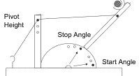

- (a) 如果要通过抛掷球并测量距离来使用投石机进行实验，实验单元是什么？
- (b) 使用数字 1、2 和 3 表示起始角度和停止角度的水平，并将枢轴高度保持在高水平不变，为每个单元 r = 2 个重复的 3×3 因子实验制作一个随机实验列表。
- (c) 如果测量距离中实验误差的方差为 \(\sigma^2 = 12\) 平方英寸，计算检测单元均值中 10 英寸差异所需的重复次数，以使效力为 0.90。
- (d) 计算检测任一因子边际均值中 24 英寸差异所需的重复次数，以使效力为 0.90。
- (e) 如果有投石机可用，执行你在 (b) 部分中编写的实验列表。
- (f) 使用你得到的数据计算方差分析，并检验主效应和交互作用。
- (g) 解释或阐释任何显著效应（如有必要，使用图表来辅助你的解释）。

3. 在一个旨在最大化气相色谱仪上峰 Y= 分辨率的实验中，发现 A= 柱温和 C= 气体流速之间存在显著交互作用。下表显示了柱温和气体流速每个组合的平均分辨率。

| 柱温 | 气体流速 低 | 高 |
| :--- | :--- | :--- |
| 120 | 10 | 13 |
| 180 | 12 | 18 |

- (a) 构建交互作用图。
- (b) 写一两句话来解释这种交互作用。

4. 考虑进行实验，以确定爆米花品牌、功率级别和时间对微波炉中制作的可食用爆米花谷物百分比（未爆开或烧焦的不可食用）的影响。目标是最大化可食用谷物的比例。先用 \(\frac{1}{4}\) 杯谷物进行预实验，以确定你希望研究的因子范围以及在相同条件下制作的重复样本的标准差估计值。

- (a) 这个实验的实验单元是什么？
- (b) 确定检测边际（主效应）均值中最大差异为 0.25 所需的重复次数。
- (c) 确定你希望研究的因子水平数，并为因子设计创建一个随机实验列表。
- (d) 实际执行实验并收集数据。
- (e) 分析数据。将功率级别和时间的任何显著效应划分为正交多项式对比。解释结果，并从你测试的组合中确定最佳因子水平组合。


- (f) 使用一次改变一个因素的方案，要获得主效应相同的检验效能需要进行多少次实验？使用一次改变一个因素的方案，你能检测到相同的最优值吗？

5. 使用 proc glmpower 验证，在纸直升机实验中，机翼长度有四个水平、机身宽度有四个水平、每个单元格有 \(r = 2\) 次重复（如第 3.5.2 节所示），检测边际均值差异 \(\Delta = 1.0\) 英寸的检验效能将为 0.80。

6. 在对第 2 章练习 4 中所述的芦笋中植物生长调节剂和枝芽鳞片对芦笋梢伸长影响的实验的延续中，Yang-Guy 和 Wooley (2006) 进行了一个 4×3 因子实验，改变溶液中植物生长调节剂 CPPU 的浓度以及芦笋梢在溶液中浸泡的时间。结果如下表所示。

| CPPU 浓度 | 30 | 60 | 90 |
|---|---|---|---|
| 0 (对照) | 92.5 | 92.9 | 91.3 |
| 0.5 ppm | 97.8 | 94.9 | 101.3 |
| 1.0 ppm | 97.0 | 98.5 | 101.6 |
| 10.0 ppm | 103.4 | 102.9 | 98.6 |

- (a) 将 CPPU 浓度和浸泡时间的平方和划分为正交多项式对比。将 CPPU 浓度与浸泡时间的交互作用划分为线性×线性、二次×线性、三次×线性、线性×二次、二次×二次和三次×二次。将除线性×线性部分外的所有平方和汇总（求和）形成误差平方和，并用它来检验交互作用的线性×线性部分以及你为主效应发现的多项式对比。解释你的结果。

- (b) 使用 %tukeysdf 宏检验交互作用的显著性。

- (c) 基于你在 (a) 和 (b) 中获得的结果，你会为这些数据推荐加法模型吗？

7. Kenett 和 Steinberg (1987) 描述了学生进行的一个两水平因子实验，以研究烧开 1 夸脱水所需的时间。因子为 A=火焰水平（低或高）、B=锅的大小（小或大）、C=锅盖（无或玻璃盖）和 D=向水中加盐（否或是）。

- (a) 如果烧开时间（在相同条件下测试）的标准差被发现为 \(\hat{\sigma}=0.236\) 分钟，请使用快捷公式确定需要进行多少次实验，才能使检测大小为 \(\Delta=0.50\) 分钟的效应的检验效能达到 0.95。如果你决定只对 4 个因子中的 3 个进行实验，这个答案会改变吗？

- (b) 创建一个随机顺序的实验列表来进行这些实验。

- (c) 实际通过烧开水进行实验并收集数据。

- (d) 分析数据以确定哪些效应和交互作用是显著的。

- (e) 解释和说明你发现的任何显著效应。

8. 考虑表 3.9 中的数据，将第三个观测值（90）替换为那些因子设置下的非典型值（78）。

- (a) 计算这些数据的效应。

- (b) 制作效应的正态或半正态图。

- (c) 你判断哪些效应是显著的？

- (d) 使用这些数据运行 Daniel 检测和纠正异常值方法的 SAS 宏。

### 3.11 附录 - Tukey 单自由度检验的 SAS 宏

```sas
%macro tukeysdf;
****************************************************************************;
** Input for this macro is a file called file1 that has a ***;
** variable A for Factor A levels, a variable B for Factor B ***;
** levels and a variable y for the response variable ***;
****************************************************************************;
%*computes ANOVA for additive model;
proc glm data=file1;
   class A B;
   model y=A B;
   output out=Sums;
   ods output OverallANOVA=ESums;
   *gets Error SS and df from ANOVA;
   data sse; set ESums;
   if Source='Error' ;
   sse=SS; dfse=DF;
   keep sse dfse;
   *gets sum of squares and df for Factor A from ANOVA;
   data ssa; set Sums;
   if HypothesisType=1; if Source='A';
   ssa=SS; dfsa=DF;
   keep ssa dfsa;
   *gets sum of squares and df for Factor B from ANOVA;
   data ssb; set Sums;
   if HypothesisType=1; if Source='B';
   ssb=SS; dfsb=DF;
   keep ssb dfsb;
   *keeps marginal means for factor A;
   proc sort data=file1; by A;
   proc means noprint; var y; by A;
   output out=mA mean=ybaridot;
   *calculates number of levels of factor A;
   proc means noprint data=mA; var ybaridot;
   output out=nA n=;
   *creates marginal means for Factor B;
   proc sort data=file1; by B;
   proc means noprint; var y; by B;
   output out=mB mean=ybarjdot;
   *calculates number of levels of factor B;
   proc means noprint data=mB; var ybarjdot;
   output out=nB n=;
   *note creates grand mean;
   proc means noprint data=file1; var y;
   output out=m3 mean=ybar;
   *note merges marginal means to original data;
   proc sort data=file1; by A;
   proc sort data=mA; by A;
   data mA; merge file1 mA; by A;
   proc sort data=mB; by B;
   data y; merge mA mB; by B;
   yiydjyd=y*ybaridot*ybarjdot;
   proc sort data=y; by yiydjyd;
   output out=s1 sum=spl;
   *combines Summary info and calculates single df interaction SS;
   data comb; merge s1 ssa ssb sse mA mB m3;
   mssA=ssa/dfsa; mssB=ssb/dfsb; mssE=sse/dfse;
   SSAB=ssa*ssb*dfse*dfse/(mssA*mssB*mssE)**2)/(ssa*ssb);
   ssrA=sse-SSAB; dfr=dfse-1; msrA=ssrA/dfr;
   FA=mssA/msrA; FB=mssB/msrA; FAB=SSAB/msrA;
   probA=1-probf(FA,dfsa,dfr); probB=1-probf(FB,dfsb,dfr);
   probAB=1-probf(FAB,1,dfr);
data _null_; set comb end=eof;
file print notices;
put ' Tukey''s single df test for additivity'
//
//
// @15 'Source df SS MS F
// PR>F'
//
put @15 'A' @32 dfsa @38 ssa best7. @50 mssA best7.;
put @15 'B' @32 dfsb @38 ssb best7. @50 mssB best7.;
put @15 'Error' @32 dfse @38 sse best7. @50 mssE best7.;
put @15 'NonAdditivity' @32 1 @38 SSAB best7. @50 SSAB best7.
@62 FAB best5. @71 probAB best5.;
put @15 'Residual' @32 dfr @38 ssrA best7. @50 msrA best7.;
run;
%mend tukeysdf;
```

## 随机区组设计

### 4.1 引言

为了尽可能消除自然变异并提高实验的灵敏度，最好为研究选择尽可能均质的实验单位。从数学上讲，这将减少实验误差的方差 \(\sigma^2\)，并提高检验处理因子效应的效能。另一方面，大多数实验者希望其研究结论具有广泛的适用性。考虑以下示例。一位实验者希望比较几种有氧运动方法，以了解它们如何影响受试者的压力和焦虑水平。由于一般人群中压力和焦虑水平（由标准化测试分数衡量）存在很大差异，除非招募到研究中的受试者是一个压力水平相似的均质群体，否则很难看出各种运动方法之间的任何差异。然而，实验者希望从他的研究中得出适用于一般人群中所有压力水平人群的一般结论。

在此情况下，可以使用区组来实现这两个目标。区组是第 1.4 节定义的误差控制类别中的第二种技术。在随机区组设计中，使用一组异质实验单位，以便结论可以更具普遍性；然而，这些异质实验单位在随机分配给处理因子水平之前，被分组为均质子组。将实验单位分组为均质组的行为称为区组。将处理因子水平随机分配给较小的均质实验单位子组（或区组）中的实验单位，其效果与仅使用均质单位相同，但它允许将结论推广到研究中使用的整个异质实验单位类别。

如果实验单位代表物理实体，则按相似物理特征进行区组或分组通常会产生更均质的组。例如，农业实验中的土地地块通常按邻近性进行区组，因为邻近的地块通常具有相似的土壤特性。当实验单位是动物时，将遗传相似的动物（如同窝兄弟姐妹）分组通常会减少组内变异性。当实验单位仅仅是试验，或处理应用的时间点时，


will be applied, they are often blocked by time since many lurking variables may change over time in close temporal proximity are more alike.

In a randomized complete block design, or RCB, with one treatment factor, when the factor has t levels there will be b blocks (or subgroups of homogeneous experimental units) that each contain exactly t experimental units for a total of t x b experimental units. The t experimental units within each block are as similar as possible, and the groups of experimental units vary enough from block to block to allow general conclusions to be drawn. The randomization of experimental units to treatment factor levels, described in Chapter 2, is performed within each block. Fisher first proposed block designs for agricultural experiments where the experimental units were plots of ground. Blocks represented compact plots in close proximity which were similar. Variability among blocks represented the range of conditions over which conclusions would be generalized.

If there are more than t experimental units within each block, so that treatment factor levels are replicated r times within each block, there will be a total of r x t x b experimental units. In this situation we call the design a general complete block design. Normally the RCB would be preferred over the general complete block design because smaller blocks of experimental units allow for greater homogeneity within the blocks and thus smaller experimental error and more precise tests and estimates.

### 4.2 在 SAS 中创建 RCB

The randomization of experimental units to treatment factor levels in a randomized block design can be accomplished using the SAS data step similar to what was shown in Chapter 2, or using SAS proc plan. To illustrate how this is done, consider the following experimental situation. A student wanted to investigate wives’ tales of methods for extending the life of cut flowers. The treatment factor was the liquid to fill the vase. The levels were:

- 1. 自来水
- 2. 加入一勺糖的自来水
- 3. 加入一杯碳酸水的自来水
- 4. 加入一杯 7-Up 的自来水

The experimental units were single flowers and the response was the time in days until the flower wilted. The student wanted the conclusions of his study to apply to many types of flowers, so she used an RCB design. The blocks were:

- 1. 玫瑰
- 2. 康乃馨
- 3. 雏菊
- 4. 郁金香

```
data sequence;
input block$ 1-9 v1-v4;
flower=v1; treat=v1; output;
flower=v2; treat=v2; output;
flower=v3; treat=v3; output;
flower=v4; treat=v4; output;
datalines;
rose 1 2 3 4
carnation 1 2 3 4
daisy 1 2 3 4
tulip 1 2 3 4
;
data flowers; set sequence;
keep block flower;
data rand; set sequence;
u=ranuni(0);
keep block treat u;
proc sort data=rand; by block u;
data rcb;
merge flowers rand;
keep block flower treat;
proc print; id block; var flower treat; run;
```

The SAS commands above create the list of treatment indicators randomized within each block. The first data file `sequence` has sixteen observations and variables for the flower number within a block and treatment level. This file is not randomized. Next, the files `flowers` and `rand` are created by copying the file `sequence`. The variable treat was dropped from the file `flowers`, the variable flower was dropped from the file `rand`, and a random uniform variable u was added to `rand`. Next, the file `rand` was sorted by block and then by the random variables within the block to create a random sequence of treatment levels within each block. Finally, the two files `flowers` and `rand` were merged by block to create the randomized list which appears on the next page.

This randomized list can be easily expanded to a double spaced data collection plan, like the example in Section 2.2 by including the following data step commands:

```
data list; set rcb;
time_days='----------------';
proc print doubles; id block; var flower treat time_days; run;
```

| 区组 | 花卉 | 处理 |
|---|---|---|
| 康乃馨 | 1 | 1 |
| 康乃馨 | 2 | 4 |
| 康乃馨 | 3 | 2 |
| 康乃馨 | 4 | 3 |
| 雏菊 | 1 | 2 |
| 雏菊 | 2 | 1 |
| 雏菊 | 3 | 3 |
| 雏菊 | 4 | 4 |
| 玫瑰 | 1 | 3 |
| 玫瑰 | 2 | 2 |
| 玫瑰 | 3 | 1 |
| 玫瑰 | 4 | 4 |
| 郁金香 | 1 | 3 |
| 郁金香 | 2 | 2 |
| 郁金香 | 3 | 4 |
| 郁金香 | 4 | 1 |

To use this list, the student would number the flowers in each block from 1 to 4. Then using the above list the carnation number 1 would be placed in a vase with treatment factor level 1 or plain tap water. Carnation number 2 would be placed in a vase with treatment level four or tap water with one cup of 7-up, etc.

To create the randomization for a general complete block design, repeat the sequence 1 2 3 4 in datalines for the file sequence as many times as you have replicates and expand the list v1–v4 and the following output statements accordingly.

SAS proc plan can also be used as a quick way of randomizing treatment levels within a block. For example, a plan similar to the one given above can be created using the SAS commands:

```
proc plan seed=27321 ordered;
   factors block=4 flower=4;
   treatments treatment=4 random;
   output out=rcb block=('carnation' 'daisy' 'rose' 'tulip');
   run;
   proc print data=rcb; id block; run;
```

The output from proc plan appears on the next page. Here it can be seen that the first flower in block 1 receives treatment level 2, the second flower in block 1 receives treatment level 4, etc. When printed, the output data set (rcb) created by proc plan looks similar to the list shown above.

计划过程

图因子

| 因子 | 选择 | 水平 | 顺序 |
|---|---|---|---|
| 区组 | 4 | 4 | 有序 |
| 花卉 | 4 | 4 | 有序 |

处理因子

| 因子 | 选择 | 水平 | 顺序 |
|---|---|---|---|
| 处理 | 4 | 4 | 随机 |

| 区组 | 花卉 | 处理 |
|---|---|---|
| 1 | 1 2 3 4 | 2 4 1 3 |
| 2 | 1 2 3 4 | 1 3 4 2 |
| 3 | 1 2 3 4 | 2 3 4 1 |
| 4 | 1 2 3 4 | 3 1 4 2 |

## 4.3 RCB 模型

The model for the analysis of an RCB design is

\( y_{ij} = \mu + b_i + \tau_j + \epsilon_{ij}, \) (4.1)

where, \( b_i \) represent the block effects, \( \tau_j \) represent the treatment effects. The usual assumptions of normality of experimental error and homogeneity of variance for experimental error across levels of the treatment factors and blocks are required for this model. These assumptions can be checked with residual plots as shown in Section 2.4.

Notice that this is an additive model which does not include the interaction between block and treatment. Since there are only \( t \times b \) experimental units, there would be zero degrees of freedom for the error term \( ssE \) if a block by treatment interaction term were included in the model. However, the block by treatment interaction is in fact the correct error term for testing the treatment effects. The experimenter wants to generalize his conclusions about treatment effects over all the experimental units, so the average treatment effects should be larger than any differences in treatment effects among blocks of experimental units. The difference in treatment effects among blocks is exactly what the interaction measures and is therefore the correct error term. By leaving the interaction out of the model, the \( ssE \) becomes identical to the interaction sums of squares.

The ANOVA table for an RCB design is shown symbolically in Table 4.1. Representations for the type I sums of squares for blocks and treatments are shown in the table, similar to what was shown in Section 3.5.1, but they will be identical to the type III sums of squares for this design. The error sums of squares \(ssE = y'y - \hat{\beta}'X'y = y'(I - X(X'X)^{-}X')y\), where \(\hat{\beta} = (X'X)^{-}X'y\).

### 表 4.1 方差分析表

| 来源 | df | 平方和 | 均方 | F 比 |
|---|---|---|---|---|
| 区组 | \(b - 1\) | \(ssBlk R(b|\mu)\) | \(ssBlk/(b - 1)\) | |
| 处理 | \(t - 1\) | \(ssT R(\tau|b,\mu)\) | \(ssT/(t - 1)\) | \(msT/msE\) |
| 误差 | \((b - 1)(t - 1)\) | \(ssE\) | \(ssE/(b - 1)(t - 1)\) | |

The degrees of freedom for the error \((b-1)(t-1)\) is smaller than it would be in a completely randomized design with \(b\) replicates of each treatment level; however, if the groups of experimental units within the blocks are more homogeneous, the \(msE\) should be smaller and the power for detecting differences among the treatment levels higher.

The estimate of the variance of the homogeneous experimental units within each block is given by
\(\hat{\sigma}^2_{rcb} = \frac{ssE}{(b-1)(t-1)}\) (4.2)

An estimate of the variance of the entire group of heterogeneous experimental units can be made from the mean squares in the RCB ANOVA. It is given by the formula
\(\hat{\sigma}^2_{cr} = \frac{(b-1)msBlk + b(t-1)msE}{tb - 1}\) (4.3)

which is a weighted average of the mean square for blocks and the mean square for error. However, the weights are not simply the degrees of freedom for each mean square. If the \(msBlk\) is zero, it can be seen that \(\hat{\sigma}^2_{cr} < \hat{\sigma}^2_{rcb}\). The ratio of \(\hat{\sigma}^2_{cr}\) and \(\hat{\sigma}^2_{rcb}\) is a measure of the efficacy of blocking.

The error degrees of freedom for the RCB is \(\nu_{rcb} = (b-1)(t-1)\), and the error degrees of freedom for a completely randomized design (CRD) with the same number of experimental units would be \(\nu_{crd} = t(b-1)\). The relative efficiency of the RCB is then given by the formula:
\(RE = \frac{(\nu_{rcb}+1)(\nu_{rcb}+3)\hat{\sigma}^2_{cr}}{(\nu_{rcb}+3)(\nu_{crd}+1)\hat{\sigma}^2_{rcb}}\) (4.4)

\(RE\) can be used to determine the number of observations that would be required in a CRD, with heterogeneous experimental units, in order to have the


与RCB设计所达到的处理均值方差等效。如果在RCB设计中使用了 \( b \times t \) 个实验单位，那么在CRD设计中（不进行分组）将需要 \( RE \times (b \times t) \) 个实验单位，才能达到等效的处理均值方差。

## 4.4 一个RCB示例

考虑Lim和Wolfe（1997）的表4.2中的数据，部分修改自Heffner等人（1974）。本实验的对象是d-安非他命硫酸盐对大鼠行为的影响。研究的行为是

| Rat | 0.0 | 0.5 | 1.0 | 1.5 | 2.0 |
|---|---|---|---|---|---|
| 1 | 0.60 | 0.80 | 0.82 | 0.81 | 0.50 |
| 2 | 0.51 | 0.61 | 0.79 | 0.78 | 0.77 |
| 3 | 0.62 | 0.82 | 0.83 | 0.80 | 0.52 |
| 4 | 0.60 | 0.95 | 0.91 | 0.95 | 0.70 |
| 5 | 0.92 | 0.82 | 1.04 | 1.13 | 1.03 |
| 6 | 0.63 | 0.93 | 1.02 | 0.96 | 0.63 |
| 7 | 0.84 | 0.74 | 0.98 | 0.98 | 1.00 |
| 8 | 0.96 | 1.24 | 1.27 | 1.20 | 1.06 |
| 9 | 1.01 | 1.23 | 1.30 | 1.25 | 1.24 |
| 10 | 0.95 | 1.20 | 1.18 | 1.23 | 1.05 |

是剥水大鼠按压杠杆以获取水的速率。响应被定义为杠杆按压速率，即杠杆按压次数除以会话经过时间。处理因子水平是药物的五种不同剂量，单位为毫克/千克体重，包括由生理盐水组成的对照剂量。一次实验（或运行）包括给大鼠注射药物剂量，一小时后开始实验会话，大鼠每次按压第二个杠杆后即可获得水。这些实验中的实验单位不是大鼠，而是单只大鼠在一次实验或运行过程中的状态，因为同一只大鼠可以通过反复注射不同剂量的药物（在适当的洗脱期后）并观察杠杆按压行为，用于多次实验。由于大鼠之间杠杆按压速率存在较大变异，采用了RCB设计，大鼠代表分组因子。每只大鼠以随机顺序接受所有五种剂量，中间有适当的洗脱期。

要使用SAS proc glm生成方差分析，需使用下一页所示的命令。proc glm调用中的output语句生成一个包含预测值和残差值的文件s，以便通过残差图检查假设。

在此例中，大鼠由模型中的项 \( b_i \) 表示

```
data drug;
input trt r1-r5;
dose=0.0; rate=r1; output; dose=0.5; rate=r2; output;
dose=1.0; rate=r3; output; dose=1.5; rate=r4; output;
dose=2.0; rate=r5; output; keep rat dose rate;
datalines;
1 .60 .80 .82 .81 .50
2 .81 .61 .79 .78 .77
;
proc glm;
class rat dose;
model rate=rat dose;
output out=s p=prate r=rrate;
run;
```

$y_{ij} = \mu + b_j + \tau_i + \epsilon_{ij}$。实验误差由 $\epsilon_{ij}$ 表示，是大鼠 $i$ 在接受剂量 $j$ 的运行过程中的状态的影响。如果在未描述实验单位和随机化过程的情况下呈现数据，模型可能被轻易误指定为 $y_{ij} = \mu + \tau_i + \epsilon_{ij}$，从而导致错误的分析和结论。

SAS中正确模型规范得到的方差分析表如下。未显示类型III平方和表，因为它与类型I平方和表相同。$F$检验表明处理因子水平存在显著差异。

| 来源 | 自由度 | 平方和 | 均方 | F值 | Pr > F |
|---|---|---|---|---|---|
| 模型 | 13 | 2.12866600 | 0.16374354 | 19.61 | <.0001 |
| 误差 | 36 | 0.30055200 | 0.00834867 | | |
| 校正后总计 | 49 | 2.42921800 | | | |

| 来源 | 自由度 | 类型I平方和 | 均方 | F值 | Pr > F |
|---|---|---|---|---|---|
| 大鼠 | 9 | 1.66845800 | 0.18538422 | 22.21 | <.0001 |
| 剂量 | 4 | 0.46020800 | 0.11505200 | 13.78 | <.0001 |

为了解释处理因子水平的差异，应进行均值比较。由于因子水平是定量的，第2.8节所述的正交多项式对比很有用。计算线性、二次和三次对比的estimate语句结果显示在下一页顶部。它们表明大鼠按压杠杆速率随药物剂量存在二次趋势。该趋势可以通过将均值作为剂量的函数进行绘图来可视化。

下一页输出表格下方的SAS命令生成了图4.1中的图表。这里，通过`reg`语句上的`degree=2`选项生成的二次趋势线被添加到图中，并显示按压杠杆速率随剂量增加而增加，直到在每千克体重1.0至1.5毫克之间的某个剂量达到最大值。

| 参数 | 估计值 | 标准误 | t值 | Pr > \|t\| |
|---|---|---|---|---|
| 线性 | 0.07810832 | 0.02889408 | 2.70 | 0.0104 |
| 二次 | -0.19857492 | 0.02889403 | -6.87 | <.0001 |
| 三次 | -0.02023863 | 0.02889408 | -0.70 | 0.4882 |

```
ods graphics on;
proc sort data=drug; by dose;
proc means noprint; by dose; var rate;
output out=means mean=meanrate;
proc sgplot data=means noautolegend;
series x=dose y=meanrate;
reg x=dose y=meanrate/degree=2;
yaxis label="average lever press rate";
run;
ods graphics off;
```

### 图 4.1 药物剂量函数下的杠杆按压速率均值

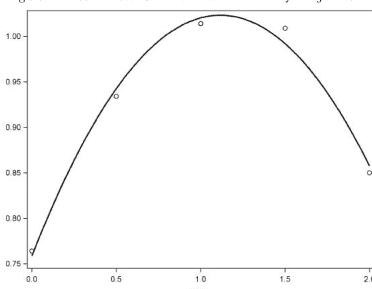

区组（或大鼠）内实验单位（试验）的估计方差为均方误差 \(\sigma^2_{rcb} = 0.00834867\)。异质实验单位的方差由以下公式给出

```
\hat{\sigma}^2_{crd} = \frac{(b-1)msBlk + b(t-1)msE}{tb}
= \frac{9(0.18538422) + 10(5-1)(0.00834867)}{(5)(10-1)} = 0.040865.
(4.5)
```

这大约是大鼠内方差的五倍，表明在实验中按大鼠分组是有效的。相对效率由以下公式给出

```
RE = \frac{(\nu_{rcb} + 1)(\nu_{crd} + 3)\hat{\sigma}^2_{crd}}{(\nu_{rcb} + 3)(\nu_{crd} + 1)\hat{\sigma}^2_{rcb}} = \frac{(37)(48)}{(39)(46)} \cdot \frac{0.040865}{0.0083487} = 4.8457.
(4.6)
```

这意味着分组使实验单位的方差降低了约80%（\(1 - \frac{0.0083487}{0.040865}\)），并且如果每只大鼠在CRD设计中仅用于一次试验，且大鼠间变异未从误差项中移除，则需要大约5倍的试验才能获得等效的处理均值方差。

## 4.5 确定区组数量

上一示例中处理或剂量效应的F检验高度显著（P < .0001）。如果在响应变异性（大鼠内杠杆按压速率）和处理均值差异保持大约相同的情况下重复实验，则需要更少的区组或大鼠来检测处理间的显著差异。

随机完全区组设计中处理效应F检验的非中心性参数为 \(\lambda = b \sum_j \tau_j^2 / \sigma^2\)，自由度为 \(\nu_1 = t - 1\) 和 \(\nu_2 = (b - 1)(t - 1)\)。因此，为了计算使检测处理均值差异的效力在0.8至0.9之间所需的区组数量，可以修改第3.5.2节中的SAS代码，更改分母自由度和非中心性因子的公式。

使用上一实验的结果，\(\sigma^2_{rcb} = 0.00834867\) 的估计值和 \(css = \sum_j \tau_j^2\) 可估计为

```
(.764 - .9142)^2 + ... + (.850 - .9142)^2 = 0.0460208
```

下一页的SAS代码计算了b = 2至5时的效力。运行此代码会得到下面所示的输出，可以看出在实验中使用b = 4或5个区组或大鼠可以实现0.8至0.9之间的效力。

如果之前的实验或预实验中可用 \(\sigma^2_{rcd}\) 的估计值，Hinkelmann和Kempthorne（1994）表明相对效率（RE），\(\sigma^2_{crd} / \sigma^2_{rcd}\) 也可用于粗略估计RCB设计所需的区组数量。例如，假设从之前的实验中估计 \(\sigma^2_{crd}\) 为0.040865，且每种处理的重复数


```
data powerRCB;
do b=2 to 5;
t=5;
nu=(t-1);
nu2=(b-1)*(t-1);
alpha=.05;
sigma=0.083487;
esize=.0460208;
Fcrit=finv(1-alpha,nu,nu2);
nc=(css)/sigma**2;
power=1-probf(Fcrit,nu,nu2,nc);
output;
keep b nu2 nc power;
end;
proc print; run;
```

| 观测 | b | nu2 | nc | power |
|---|---|---|---|---|
| 1 | 2 | 4 | 11.0247 | 0.32078 |
| 2 | 3 | 8 | 16.5370 | 0.68276 |
| 3 | 4 | 12 | 22.0493 | 0.89778 |
| 4 | 5 | 16 | 27.5617 | 0.96711 |

为CRD设计达到检测均值实际差异所需的足够效能，r = 20，由第3.5.2节的方法确定。如果预期区组能使方差降低80%（即，\(\sigma^2_{rcb} = 0.20 \times \sigma^2_{crd}\)，或 \(RE = 5.0\)）。那么使用RCB设计达到相同效能所需的区组数为 \(b = 20/5 = 4\)。

## 4.6 块内因子设计

当区组与处理因子的因子设计结合使用时，区组效果更为显著。在研究多个处理因子的情况下，每个区组内的实验单位数量必须等于所有因子水平的乘积。这称为随机完全区组因子设计或RCBF。作为阻断因子实验的示例，请参考表4.3中的数据。该实验由Festing（2003）进行，旨在确定BHA（一种常用于加工食品的抗氧化剂）是否诱导小鼠肝脏酶EROD的活性，以及这种活性是否与小鼠品系无关。这是一项更大规模研究的一部分，旨在确定抗氧化剂是否有助于防止癌症。

本实验的因子为A，即小鼠是否接受BHA处理；以及B，即小鼠的品系。由于无法指定某只小鼠属于特定品系，因此实验单位不是小鼠，而是运行特定实验时实验室中存在的试验或条件。一次运行包括：从指定品系中选择一只小鼠；然后在饮食中加入BHA（为期三周）或不加入（取决于指定内容）；最后人道地处死小鼠并进行解剖，以确定肝脏中酶EROD的活性水平。由于此类体内实验的结果在同一实验室中不同时间可能会因用于酶分析的试剂差异、仪器校准以及动物饲养的环境因素而显著变化，因此实验按时间进行了区组。从四个品系中各选取两只小鼠，随机选择一只在饮食中接受BHA，并同时进行八次试验或运行。这代表一个区组。三个月后，整个过程重复进行了第二个区组的运行。由于处理因子（BHA处理或对照）有两个水平，品系因子有四个水平，因此每个区组有 2 × 4 = 8 个实验单位或运行。

随机区组设计中两因子因子设计的分析模型（如表4.3所示）为

y_{ijk} = μ + b_i + α_j + β_k + αβ_{jk} + ε_{ijk},  (4.7)

其中 b_i 表示区组效应，α_j 表示处理因子效应，β_k 表示品系因子效应。该模型易于推广至随机区组中的多因子因子设计。请注意，在模型（4.7）中，两个因子因子之间存在交互作用 αβ_{jk}，但区组因子 b_i 与因子因子 α_j 和 β_k 之间没有交互作用。与区组的交互作用是分析的误差项，如果将其包含在模型中，则 sse 的自由度将为零。

读取此数据并执行分析的SAS命令及其生成的ANOVA表将在下一页显示。可以看出，BHA处理、品系及其交互作用均显著。区组平方和也很大，导致相对效率 RE = 2.11。这意味着，如果实验未按时间进行区组，则需要大约三倍数量的小鼠才能获得相同的效能或灵敏度。

图4.2有助于解释因子效应和交互作用。可以看出，平均而言，在饮食中添加BHA会增加小鼠肝脏中酶EROD的活性。然而，对于BALB/c品系的小鼠，这种增加近乎翻倍。

```
data bha;
input strain $ bha $ block erod;
datalines;
A/J Yes 1 18.7
A/J No 1 7.7
... etc.
proc glm; class strain bha block;
model erod=block bha strain bha*strain;
run;
```

| 来源 | 自由度 | 平方和 | 均方 | F值 | Pr > F |
|---|---|---|---|---|---|
| 模型 | 8 | 543.21750000 | 67.9021875 | 26.20 | 0.0002 |
| 误差 | 7 | 18.1400000 | 2.5914286 | | |
| 校正总计 | 15 | 561.3575000 | | | |
| 总计 | 15 | | | | |

| 来源 | 自由度 | 类型I平方和 | 均方 | F值 | Pr > F |
|---|---|---|---|---|---|
| 区组 | 1 | 47.6100000 | 47.6100000 | 18.37 | 0.0036 |
| bha | 1 | 422.3025000 | 422.3025000 | 162.96 | < .0001 |
| 品系 | 3 | 32.9625000 | 10.9875000 | 4.24 | 0.0527 |
| 品系*bha | 3 | 40.3425000 | 13.4475000 | 5.19 | 0.0337 |

图4.2 各品系的BHA效应

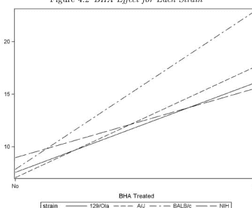

## 4.7 广义完全区组设计

当实验单位代表实体时，较小的实验单位组或区组通常会导致更高的同质性。组别越大，就越有可能包含许多与常态或平均值差异很大的实验单位。因此，不建议在每个区组中拥有超过最小数量 t 的实验单位的区组设计，其中 t 是处理因子的水平数或水平组合数。然而，在某些情况下，如果实验单位代表试验而非实体，且实验运行可以快速完成，则较大的区组大小可能不会增加区组内实验单位的变异性。在这种情况下，可以使用在区组内包含每个处理水平重复的设计（称为广义完全区组设计或GCB）。

请参考《高尔夫杂志》（Bastable, 2006年6月）中的以下示例。进行了一项实验，以确定将高尔夫球击得更远的理想tee高度。目的是向文章的所有读者推荐应使用的tee高度。处理因子是tee高度，如表4.4所示。

表4.4 高尔夫实验的处理因子水平

| 水平 | tee高度 |
|---|---|
| 1 | 整个球位于冠部以下 |
| 2 | 一半球位于冠部以上 |
| 3 | 球底位于球面顶部 |

一次实验包括高尔夫球手从指定高度击打高尔夫球，响应变量是球飞行的距离。为了得出一般性结论，必须使用一组有代表性的高尔夫球手，而不是一名高尔夫球手。由于研究中使用的高尔夫球手的击球能力不同，因此按高尔夫球手对试验进行分组或区组，并随机化每名球手从各tee高度击球的顺序是合理的。然而，由于击打超过三个高尔夫球不太可能导致高尔夫球手疲劳并增加其击球距离的变异性，因此无需将高尔夫球手限制为仅击打三个球。相反，每名球手从 t = 3 个tee高度各击打 r = 5 个高尔夫球。本实验的结果显示在附录中。本研究部分使用了九名高尔夫球手：每名球手从每个tee高度击打五个球（共15个球），顺序随机。

由于每个区组中每个处理都有重复实验单位，因此可以拟合模型

```
y_{ijk} = \mu + b_i + \tau_j + b\tau_{ij} + \epsilon_{ijk} (4.8)
```


然而，这留下了一个两难困境。传统ANOVA中的MSE以及处理效应和区组×处理交互作用F检验的分母，基于相同处理和区组内实验单位的变异性（在此例中为高尔夫球手）。如果区组（高尔夫球手）与处理因素（发球台高度）之间的交互作用显著，其解释将意味着最优发球台高度对不同高尔夫球手可能不同。研究中的高尔夫球手仅是高尔夫球手的一个样本，如果最优发球台高度对他们不同，就无法向《高尔夫杂志》文章的所有读者推荐一个最优发球台高度。为了做出一般性建议，处理因素应使用区组×处理交互作用均方作为F检验的分母来进行检验（关于使用区组×处理交互作用作为处理效应F检验分母的另一个理由将在第5章第8节给出）。以这种方式构建的处理F检验在proc glm中不会自动生成，但可以使用test语句指定，如下面的SAS命令所示，其中id表示区组或高尔夫球手id。

```
data rcb;
input id teeht cdistance;
datalines;
1 142
.
.
etc.
;
proc glm data=rcb;
class id teeht;
model cdistance=id teeht id*teeht;
test h=teeht e=id*teeht;
lsmeans teeht/pdiff adjust=tukey e=id*teeht;
run;
```

test语句中的h=teeht和e=id*teeht指定假设为H0：τ1 = τ2 = τ3，误差项为brj。lsmeans语句中的e=id*teeht也指定误差项为brj。本分析结果显示在下一页。由于类型I平方和表与类型III平方和表相同，因此省略了类型I平方和表。

可以看出，发球台高度在α = 0.0124水平上显著。这与类型III平方和表中的错误F检验大不相同。在那里，发球台高度效应在α < 0.0001水平上显著。有时，处理的F检验在类型III表中可能显著，但在test语句的结果中不显著。在这种情况下，如果你想推广结论，应使用test语句的结果。

有时存在比使用test语句创建F检验所能获得的更强大的处理效应检验。如果区组×处理交互作用不显著，则可以将加性模型yijk = μ + bi + τj + ϵijk拟合到数据中，默认的处理F检验将使用一个MSE项，该项是模型（4.8）中交互作用和误差项的合并或加权平均值。如果交互作用可忽略，交互作用均方

| 来源 | DF | 平方和 | 均方 | F值 | Pr > F |
| :--- | :--- | :--- | :--- | :--- | :--- |
| 模型 | 26 | 128821.4813 | 4954.6724 | 72.90 | < .0001 |
| 误差 | 108 | 7340.7520 | 67.9699 | | |
| 校正总计 | 134 | 136162.2333 | | | |

| 来源 | DF | 类型III平方和 | 均方 | F值 | Pr > F |
| :--- | :--- | :--- | :--- | :--- | :--- |
| ID | 8 | 124741.4493 | 15592.6812 | 229.41 | < .0001 |
| TEEHT | 2 | 1723.9320 | 861.9660 | 12.68 | < .0001 |
| ID*TEEHT | 16 | 2356.1000 | 147.2563 | 2.17 | 0.0102 |

### 使用ID*TEEHT的类型III MS作为误差项的假设检验

| 来源 | DF | 类型III平方和 | 均方 | F值 | Pr > F |
| :--- | :--- | :--- | :--- | :--- | :--- |
| TEEHT | 2 | 1723.932000 | 861.966000 | 5.85 | 0.0124 |

正在估计与误差均方相同的实验误差。在这种情况下，合并这两个均方会增加误差项的自由度，并提高处理效应F检验的效力或灵敏度。通常，用于决定是否拟合加性模型的交互作用初步F检验是在较高的显著性水平（如α = 0.25）下进行的。如果交互作用在α = 0.25水平上显著，请使用`test`语句来创建适当的处理效应F检验。如果交互作用在α = 0.25水平上不显著，请拟合加性模型并使用类型I或类型III平方和表中的F检验。此程序称为“合并或不合并”程序。

对于高尔夫实验，交互作用平方和在α = 0.0102 < 0.25水平上显著，因此不应拟合加性模型，并且不存在比使用`test`语句所能制作的更强大的处理F检验。

为了解释高尔夫实验中显著处理效应的含义，使用了`lsmeans teeht/diff adjust=tukey e=id*teeht;`语句。这将产生下一页所示的均值表和Tukey均值成对比较表。`e=id*teeht`选项指定误差项为区组×处理交互作用的均方。

最小二乘均值显示，发球台高度=1（整个球低于球冠）的平均击球距离为171.45码。它在α = 0.0125水平上显著低于发球台高度=3（球底位于球杆面顶部）的平均击球距离（177.8码），且在边缘显著水平上低于发球台高度=2（一半球高于球冠）的距离（179.8码）。发球台高度2和3的平均距离在α = 0.7192水平上无显著差异。因此，向文章读者的建议是将高尔夫球 tee 起来，使至少一半球位于驱动杆球杆面球冠之上，以最大化其击球距离。

### 最小二乘均值
多重比较调整：Tukey
使用ID*TEEHT的类型III MS作为误差项计算的标准误和概率

| 发球台高度 | 最小二乘均值 | 编号 |
|---|---|---|
| 1 | 171.537778 | 1 |
| 2 | 177.833778 | 2 |
| 3 | 179.837778 | 3 |

### 效应TEEHGT的最小二乘均值
H0: LSMEAN(i)=LSMEAN(j)的Pr > |t|
因变量：CDISTANCE

| i/j | 1 | 2 | 3 |
|---|---|---|---|
| 1 | 0.0590 | 0.0125 | |
| 2 | 0.0590 | | 0.7192 |
| 3 | 0.0125 | 0.7192 | |

## 4.8 双区组因素LSD

农业实验（Fisher, 1935）最早表明，将实验田块分组为同质区组的过程可以有益地重复。例如，在图4.3左侧，我们看到一个在田地中布置的随机区组设计RCB的表示。在此设计中，一块大致呈方形的田地被分为四个矩形区组。每个区组进一步分为四个田块，处理水平（A、B、C、D）被随机分配给每个区组内的一个田块。在图中，区组内的随机分配由每个字母仅在代表区组的每一行出现一次来表示。如果该田地从上到下存在肥力梯度，则区组内的田块在肥力上会比不同区组或行的田块更相似，随机区组设计将很好地减少区组内实验误差的方差。如果田地中没有明显的梯度，但相邻田块往往

### 图 4.3 RCB和拉丁方设计比较

| 区组 | RCB | 拉丁方 |
|---|---|---|
| 1 | B C D A | B D C A |
| 2 | A D C B | D C A B |
| 3 | B D A C | C A B D |
| 4 | C B A D | A B D C |

更相似于同一区组两端的田块，那么像图4.3右侧所示的设计会将每个处理水平仅分配一次给每一行和一次给每一列。这样一来，列与列之间的变异性也可以从误差平方和中去除，进一步提高检测处理效应的灵敏度。图4.3右侧所示的设计称为拉丁方设计或LSD，它在水平和垂直方向上都进行区组。LSD的限制是行区组数等于列区组数，且等于处理因素的水平数。这一限制将在第7章中放宽，届时将讨论更一般的行-列区组方案。

LSD的模型写作

```
y_{ijk} = \mu + r_i + c_j + \tau_k + \epsilon_{ijk} \quad (4.9)
```

其中\( r_i \)表示行区组因素，\( c_j \)表示列区组因素，\( \tau_k \)表示处理因素。与RCB设计的模型（4.1）类似，模型中不包含交互作用，以便可以将处理因素水平的任何差异推广到行和列。

只要存在两个可用于对实验单位进行分组的独立区组因素，就可以使用拉丁方设计。例如，如果要进行一项实验以确定胎纹设计对汽车轮胎磨损寿命的影响，则实验单位将是汽车上的一个车轮，处理因素将是安装在该车轮上的轮胎的胎纹设计。按汽车类型对实验单位进行区组是有意义的，因为轮胎在较重的汽车上可能比在较轻的汽车上磨损得更快。按轮胎在汽车上的位置进行区组也是有意义的，因为前右轮胎的磨损速率与后左轮胎等不同。这些是独立的区组因素，因为任何类型的汽车上都存在所有四个车轮位置。要使用LSD，比较的胎纹类型数量和研究中使用的汽车类型数量必须为四个，以等于汽车上的车轮位置数量。拉丁方中的行区组因素将代表汽车类型，有四种替代方案，涵盖实验者希望推断的汽车类别。列区组因素将代表汽车上轮胎的位置（FL、FR、RL、RR），处理因素将代表正在测试的四种不同的胎纹设计。

### 4.8.1 创建和随机化拉丁方设计

拉丁方设计可以通过循环旋转用于表示处理因素水平的字母或符号来轻松创建。例如，对于5×5拉丁方，让字母A、B、C、D、E表示处理因素的水平。然后设计创建如下：


| A | B | C | D | E |
|---|---|---|---|---|
| B | C | D | E | A |
| C | D | E | A | B |
| D | E | A | B | C |
| E | A | B | C | D |

为防止未知潜在变量引起的偏倚，拉丁方设计中应使用随机化。但是，必须注意，随机化后每种处理水平仍应在每行和每列中各出现一次。这可以通过首先随机化行的顺序（保持每行中列的位置固定），然后随机化列（保持每列中行的位置固定），最后随机化处理标签的顺序来完成。这可以使用SAS proc plan轻松完成。

下面的命令展示了创建和随机化一个方案，以研究药店中牙膏货架面数对销售的影响。处理是货架面数（1-4），列阻塞因素是商店（以考虑商店之间的差异），行阻塞因素是日历周（以考虑季节性因素）。响应变量是每周销售额（美元）。在这种情况下，行或周未被随机化，因为它们将按顺序出现。

```
proc plan seed=37430;
factors rows=4 ordered cols=4 ordered / noprint;
treatments tts=4 cyclic;
output out=lsd
    row cvals=('Week 1' 'Week 2' 'Week 3' 'Week 4') ordered
    col cvals=('Store 1' 'Store 2' 'Store 3' 'Store 4') random
    tmt nvals=( 1 2 3 4 ) random;
proc print;
run;
```

生成的随机化数据文件 lsd 如下一页所示，可用于制作如第 2.2 节所示的双倍行距数据收集表。

| Obs | rows | cols | tmts |
|---|---|---|---|
| 1 | Week 1 | Store 3 | 4 |
| 2 | Week 1 | Store 4 | 2 |
| 3 | Week 1 | Store 2 | 1 |
| 4 | Week 1 | Store 1 | 3 |
| 5 | Week 2 | Store 3 | 2 |
| 6 | Week 2 | Store 4 | 4 |
| 7 | Week 2 | Store 2 | 1 |
| 8 | Week 2 | Store 1 | 3 |
| 9 | Week 3 | Store 3 | 1 |
| 10 | Week 3 | Store 4 | 3 |
| 11 | Week 3 | Store 2 | 4 |
| 12 | Week 3 | Store 1 | 2 |
| 13 | Week 4 | Store 3 | 3 |
| 14 | Week 4 | Store 4 | 4 |
| 15 | Week 4 | Store 2 | 2 |
| 16 | Week 4 | Store 1 | 1 |

为验证每种处理在每行和每列中各出现一次，可以使用 proc tabulate 按如下所示以熟悉的拉丁方布局打印此设计。

```
proc tabulate data=lsd;
   class rows cols;
   var tmts;
   table rows, cols*(tmts*f=8.) / rts=10;
run;
```

| | Store 1 | Store 2 | Store 3 | Store 4 |
|---|---|---|---|---|
| | tmts | tmts | tmts | tmts |
| | Sum | Sum | Sum | Sum |
| Week 1 | 3 | 1 | 4 | 2 |
| Week 2 | 4 | 3 | 2 | 1 |
| Week 3 | 2 | 4 | 1 | 3 |
| Week 4 | 1 | 2 | 3 | 4 |

## 4.8.2 拉丁方设计的分析

拉丁方设计经常用于肉牛或奶牛喂养实验以及生物等效性研究，以比较II期临床试验中药物的不同制剂。在这些研究中，列阻塞因素是时间，行阻塞因素是动物或人体受试者。在某些情况下，一个时间段内给予的治疗可能对下一时段的反应产生残留效应。但是，如果列块之间有足够的洗脱期，则不会有残留效应，数据可以作为传统的拉丁方进行分析。

为说明拉丁方数据的分析，请考虑以下生物等效性研究。数据如表 4.5 所示（摘自 Selwyn 和 Hall, 1984）。

表 4.5 生物等效性研究的处理及其AUC

| Subject | Period 1 | Period 2 | Period 3 |
| :--- | :--- | :--- | :--- |
| 1 | A 1186 | B 642 | C 1183 |
| 2 | B 984 | C 1135 | A 1305 |
| 3 | C 1426 | A 1540 | B 873 |

A=溶液，B=片剂，C=胶囊

目的是检验药物三种制剂（A=溶液，B=片剂，C=胶囊）的生物等效性，以AUC（曲线下面积）来衡量，AUC反映了给药后血液中药物浓度随时间变化的关系。三名志愿者受试者依次服用每种制剂，两者之间有足够的洗脱期。给药后，每半小时采集一次血液样本，持续四小时，并分析药物浓度。根据所得数据计算AUC。由于不同受试者之间药物代谢可能存在较大差异，因此将受试者用作行阻塞因素。由于特定受试者的药物吸收和代谢会随时间而变化，因此将时间用作列阻塞因素。

读取数据并拟合模型（4.9）的SAS命令及其输出结果如下一页所示。结果表明三种制剂之间没有差异。

```
data bioeqv;
   input subject period treat $ auc;
   datalines;
1 1 A 1186
1 2 B 642
1 3 C 1183
2 1 B 1135
2 2 A 1095
2 3 A 984
3 1 C 873
3 2 A 1424
3 3 B 1540
;
proc glm;
   class subject period treat;
   model auc = subject period treat;
   lsmeans treat/ pdiff adjust=tukey;
run;
```

| 来源 | 自由度 | 平方和 | 均方 | F值 | Pr > F |
|---|---|---|---|---|---|
| Model | 6 | 174460.6667 | 29076.7778 | 0.13 | 0.9774 |
| Error | 2 | 442157.5556 | 221078.7778 | | |
| Corrected Total | 8 | 616618.2222 | | | |

| 来源 | 自由度 | 类I平方和 | 均方 | F值 | Pr > F |
|---|---|---|---|---|---|
| subject | 2 | 114264.2222 | 57132.1111 | 0.26 | 0.7946 |
| period | 2 | 45196.2222 | 22598.1111 | 0.10 | 0.9073 |
| treat | 2 | 15000.2222 | 7500.1111 | 0.03 | 0.9672 |

GLM过程
最小二乘均值
多重比较调整：Tukey

| 处理 | auc最小二乘均值 | 最小二乘均值编号 |
|---|---|---|
| A | 1198.66667 | 1 |
| B | 105.66667 | 2 |
| C | 1120.33333 | 3 |

处理效应的最小二乘均值
原假设 H0: LSMean(i)=LSMean(j) 下 Pr > |t|
因变量：auc

| i/j | 1 | 2 | 3 |
|---|---|---|---|
| 1 | 1 | 0.9687 | 0.9776 |
| 2 | 0.9687 | 1 | 0.9992 |
| 3 | 0.9776 | 0.9992 | 1 |

## 4.8.3 确定重复次数

在具有t行和t列的拉丁方设计中，每种处理因子水平的重复次数必须等于t。提高检测处理均值差异效力的唯一方法是增加行数或列数。在上一个示例中，行阻塞因素代表受试者，列阻塞因素代表时期。提高检测处理均值差异效力的一种方法是增加受试者数量。如果受试者数量r加倍，即r = 2t，这基本上等同于用t个额外受试者重复拉丁方。

（一般而言，如果我们将重复的拉丁方视为具有r = nt行（n为整数）、t列和t个处理因子水平，则数据模型仍为方程（4.9），但误差项的自由度将为 v2 = (r - 2)(t - 1)。无处理效应F检验的非中心性参数为 \lambda = nt \sum \tau_i^2 / \sigma^2，其中n是方重复的次数。因此，为了计算方重复次数n，使得检测处理均值差异的效力在0.8到0.9之间，可以修改第3.5.2节中的SAS代码，更改分母自由度和非中心性参数的公式。）

## 4.9 重要概念回顾

当实验单位不齐一且实验者不希望将研究结论局限于齐一的实验单位子集时，可以使用随机区组设计。在随机区组设计中，异质实验单位在分配给处理水平之前被分组为齐一的子组或区组。这使得区组间的变异可以从误差平方和中移除，从而提高检测处理效应的效力或灵敏度。相对效率（RE）是区组效果的衡量指标，RE值越高，区组效果越好。

图 4.4 说明了何时应使用各种类型的区组设计。当只有一个处理因子且异质实验单位可以根据一个区组因素分组时，使用随机完全区组或RCB设计。如果区组大小（即区组内实验单位数量）可以在不增加区组内实验单位方差的情况下增大，则可以使用广义完全区组或GCB设计。如果正在研究多个因素，则应使用随机完全区组因子或RCBF设计。如果异质实验单位可以根据两个独立的区组因素进行分类且只有一个处理因子，则应使用拉丁方设计或LSD。

### 图 4.4 设计选择路线图

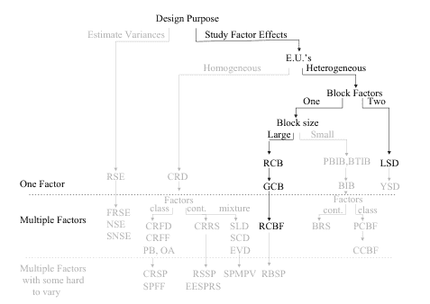


随机完全区组设计（RCB）每个区组内每个处理水平只有一个实验单位。RCB设计的模型为 \(y_{ij} = \mu + b_i + \tau_j + \epsilon_{ij}\)，其中不包括区组与处理之间的交互作用，因为如果实验者希望得出一般性结论，这是检验处理效应的正确误差。在广义完全区组设计中，每个区组内每个处理水平都包含重复。由于GCB中的重复，区组与处理之间的交互作用可以包含在模型中，\(y_{ijk} = \mu + b_i + \tau_j + \tau b_{ij} + \epsilon_{ijk}\)，但它仍应作为检验处理效应的误差项，这可以通过在SAS `proc glm`中使用`test`语句来实现。

在RCBF中，因子水平的每种组合都随机分配给区组内的实验单位。分析模型是通常的因子模型，加上一个区组项，\(y_{ijk} = \mu + b_i + \alpha_j + \beta_k + \alpha\beta_{jk} + \epsilon_{ijk}\)。如果实验者希望得出一般性结论，模型中不应包括区组与因子因子或交互作用之间的交互作用。编写不代表实验进行方式的模型可能导致在\(F\)检验的分母中使用错误的均方，并可能导致得出错误的结论。

当有两个独立的阻塞因素时，可以使用拉丁方（LSDs）来进一步降低实验误差的方差。拉丁方的模型是 \(y_{ijk} = \mu + r_i + c_j + \tau_k + \epsilon_{ijk}\)，同样，模型中不包括行区组、列区组或处理因子之间的交互作用。在为拉丁方随机化实验列表时，必须小心，以便随机化后每个处理因子水平仍然在每个行区组和每个列区组中恰好出现一次。

## 4.10 练习

- 1. 考虑设计一个实验，以确定口香糖的持久风味如何受口香糖特性的影响，例如因子A（口香糖棒或片剂类型）、因子B（口香糖风味）和因子C（普通或无糖），参见Rogness和Richardson（2003）。
  - (a) 如果招募了几名受试者参加研究，并要求每人咀嚼并记录一种或多种口香糖的持久风味（以分钟为单位），那么实验单位是什么？
  - (b) 如何对实验单位进行区组以减少实验误差的方差并增加检测差异的效力？
  - (c) 从上述列出的因子中选择至少两个，并为RCB设计提供一个随机列表。
  - (d) 招募受试者并在一周内实际进行实验。
  - (e) 分析你的数据。处理因子和交互作用是否影响了持久风味？你采用的区组方案在减少实验误差方面是否有效？

- 2. 将室温作为切花实验（第4.2节所述）的额外区组因素予以考虑。
  - (a) 你可以使用什么设计来纳入花卉类型和室温这两个区组因素？
  - (b) 制定一个随机化方案来进行此实验。
  - (c) 你将使用什么模型来分析此实验产生的数据？

- 3. 下一页的数据显示了明尼苏达州进行的随机完全区组实验中五种大麦品种的产量，该实验由Immer等人（1934年）在《美国农艺学会杂志》上报道。
  - (a) 在不同地点和不同年份进行这些实验的目的是什么？
  - (b) 这些实验中是如何降低实验误差方差的？
  - (c) 计算RCB设计模型（4.1）的方差分析，并确定品种之间是否存在显著差异。
  - (d) 计算相对效率（RE），并确定使用完全随机设计（CRD）需要进行多少次实验才能达到相同的效力。
  - (e) 使用Tukey方法对品种平均产量进行两两比较。

- 4. Horiuchi等人（2005年）在日本2004年参议院选举期间进行了一项实验。该实验的目的是检验这样一个假设：选民投票率受选民可获得信息量的影响。潜在选民通过电子邮件被联系，并被要求填写筛选调查表并参与研究。在筛选调查中，潜在选民被问及其性别以及是否计划参加即将到来的选举（是、否或未决定）。已知这些信息与选民参与度相关。接下来，筛选调查的受访者被随机分配到四个组中的一个。第一组被要求通过电子邮件查看自民党（LDP）展示其政策提案的官方网站。第二组被要求查看民主党（DPJ）展示其政策提案的网站。第三组被要求查看两个网站，第四组在选举前不被要求访问任何网站。选举后，每位参与者再次被联系，以了解他是否参加了投票。
  - (a) 该研究中的处理因子是什么？
  - (b) 实验单位是什么？
  - (c) 响应变量是什么？
  - (d) 如果根据筛选调查将潜在选民分为以下六组
    - 男性 - 计划投票
    - 女性 - 计划投票
    - 男性 - 不计划投票
    - 女性 - 不计划投票
    - 男性 - 未决定
    - 女性 - 未决定
    是否应该在将受访者分配到四个组时使用这些信息？为什么或为什么不？
  - (e) 说明你将如何分析得到的数据。你将使用什么模型？因变量的分布是什么？等等。

- 5. Lew（2007年）展示了一项实验的数据，以确定培养细胞是否对两种药物有反应。该实验使用稳定的细胞系接种到培养皿中，每次实验运行涉及三个培养皿的反应测定：一个用药物1处理，一个用药物2处理，一个未处理作为对照。数据如下表所示。

| 实验 | 对照 | 药物1 | 药物2 |
| :--- | :--- | :--- | :--- |
| 实验1 | 1147 | 1169 | 1009 |
| 实验2 | 1273 | 1323 | 1260 |
| 实验3 | 1216 | 1276 | 1143 |
| 实验4 | 1046 | 1240 | 1099 |
| 实验5 | 1108 | 1432 | 1385 |
| 实验6 | 1265 | 1562 | 1164 |

  - (a) 假设数据来自完全随机设计，使用模型 \(y_{ij} = \mu + \tau_i + \epsilon_{ij}\) 进行分析。处理组之间是否存在显著差异？
  - (b) 将数据作为RCB设计进行分析，其中实验编号代表区组因素。
  - (c) (a)和(b)中获得的结果有任何差异吗？如果有，请解释结果差异的可能原因，并推荐哪种方法？

- 6. Le Riche和Csima（1964年）评估了四种催眠药和安慰剂，以确定它们对老年患者睡眠质量的影响。处理水平标记为（A=安慰剂，B=乙氯葡醇，C=谷氰酰胺，D=氯醛水合物和E=戊巴比妥钠）。老年患者连续五晚服用其中一种胶囊，每晚由受过训练的护士按四点量表（0=差到3=优）评估其睡眠质量。计算了每位患者在一周内五晚的平均得分。每位患者在连续几周内接受所有五种处理。使用拉丁方设计来考虑患者之间的差异和周之间的影响。设计和响应（平均睡眠质量评分）如下一页的表格所示。
  - (a) 该数据的适当模型是什么？
  - (b) 完成方差分析并确定处理之间是否存在显著差异。
  - (c) 使用适当的方法确定安慰剂与其他药物平均值之间是否存在显著差异，以及四种药物之间是否存在显著差异。

### 表4.6 十二次独立试验中大麦品种的总产量

| 地点 | 年份 | Manchuria | Svansota | Velvet | Trebi | Peatland |
|---|---|---|---|---|---|---|
| 1 | 1931 | 81.0 | 105.4 | 119.7 | 109.7 | 98.3 |
| 1 | 1932 | 80.7 | 82.3 | 80.4 | 87.2 | 84.2 |
| 2 | 1931 | 146.6 | 142.0 | 150.7 | 191.5 | 145.7 |
| 2 | 1932 | 100.4 | 115.5 | 112.2 | 147.7 | 108.1 |
| 3 | 1931 | 82.3 | 77.3 | 78.4 | 131.3 | 89.6 |
| 3 | 1932 | 103.1 | 105.1 | 116.5 | 139.9 | 129.6 |
| 4 | 1931 | 119.8 | 121.4 | 124.0 | 140.8 | 124.8 |
| 4 | 1932 | 98.9 | 61.9 | 96.2 | 125.5 | 75.7 |
| 5 | 1931 | 98.9 | 89.0 | 69.1 | 89.3 | 104.1 |
| 5 | 1932 | 66.4 | 49.9 | 96.7 | 61.9 | 80.3 |
| 6 | 1931 | 86.9 | 77.1 | 78.9 | 101.8 | 96.0 |
| 6 | 1932 | 67.7 | 66.7 | 67.4 | 91.8 | 94.1 |


| Patient | 1 | 2 | 3 | 4 | 5 |
|---|---|---|---|---|---|
| 1 | B (2.92) | E (2.43) | A (2.19) | C (2.71) | D (2.71) |
| 2 | D (2.86) | A (1.64) | E (3.02) | B (3.03) | C (3.03) |
| 3 | E (1.97) | B (2.50) | C (2.47) | D (2.65) | A (1.89) |
| 4 | A (1.99) | C (2.39) | D (2.37) | E (2.33) | B (2.71) |
| 5 | C (2.64) | D (2.31) | B (2.44) | A (1.89) | E (2.78) |

- (d) 使用残差图检查所拟合模型的假设。

7. Woodward (1970) 进行了一项实验，以确定棒球中到达二垒的最快路径。所调查的三条路径如下图所示：圆弧路径、窄角路径和宽角路径。最佳路径定义为到达二垒所用时间最短的路径。

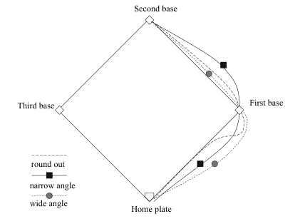

他使用秒表计时跑者从本垒到二垒的时间。当跑者经过距本垒板 35 英尺的一点时启动秒表，在距二垒 15 英尺处停止秒表。这消除了因停止和启动引起的时间变异。最后，他对 22 名不同跑者进行了随机抽样计时，以便其结论可以推广到所有跑者。此外，在适当休息后，他让每位跑者跑完每条路径（顺序随机）。这样，他可以将跑者作为区组，从误差中消除跑者之间的变异。数据如下表所示。

- (a) 此数据的适当模型是什么？

| Player | Round-out | Narrow angle | Wide angle |
|---|---|---|---|
| 1 | 5.40 | 5.50 | 5.55 |
| 2 | 5.85 | 5.70 | 5.75 |
| 3 | 5.20 | 5.60 | 5.50 |
| 4 | 5.55 | 5.50 | 5.40 |
| 5 | 5.90 | 5.85 | 5.70 |
| 6 | 5.45 | 5.55 | 5.60 |
| 7 | 5.40 | 5.40 | 5.35 |
| 8 | 5.45 | 5.50 | 5.35 |
| 9 | 5.25 | 5.15 | 5.00 |
| 10 | 5.85 | 5.80 | 5.70 |
| 11 | 5.25 | 5.20 | 5.10 |
| 12 | 5.65 | 5.55 | 5.45 |
| 13 | 5.60 | 5.35 | 5.45 |
| 14 | 5.05 | 5.00 | 4.95 |
| 15 | 5.50 | 5.50 | 5.40 |
| 16 | 5.45 | 5.55 | 5.50 |
| 17 | 5.55 | 5.55 | 5.35 |
| 18 | 5.45 | 5.50 | 5.55 |
| 19 | 5.50 | 5.45 | 5.25 |
| 20 | 5.65 | 5.60 | 5.40 |
| 21 | 5.70 | 5.65 | 5.55 |
| 22 | 6.30 | 6.30 | 6.25 |

- (b) 完成方差分析，并确定三条路径之间是否存在显著差异。
- (c) 使用适当的多重比较程序确定哪些路径彼此不同。
- (d) 此实验中的区组是否有效？为什么或为什么不？
- (e) 使用残差图检查所拟合模型的假设。如果假设不成立，你有什么建议？

8. 考虑第 2 章第 6 题描述的情况，处理因素有 t = 4 个水平，且 Δ = 2.0σ。

- (a) 如果通过将实验单位分组为区组，认为实验误差的方差 σ² 可降低 50%，计算为检测处理均值最大差异达到 Δ 所需的区组数，使检验效力为 0.90。
- (b) 如果使用拉丁方设计可使实验误差的方差 σ² 降低 10%，确定使用 4 × 4 拉丁方设计检测处理差异的效力。

## 4.11 附录–高尔夫实验数据

表 4.7 高尔夫实验数据

| Tee Hgt. | 1 | 2 | 3 | 4 | 5 | 6 | 7 | 8 | 9 |
|---|---|---|---|---|---|---|---|---|---|
| 1 | 142.0 | 169.5 | 142.7 | 185.4 | 222.2 | 133.6 | 165.2 | 174.3 | 229.7 |
| 1 | 141.8 | 177.0 | 136.2 | 164.8 | 201.9 | 132.6 | 173.2 | 160.1 | 220.7 |
| 1 | 153.7 | 169.1 | 140.2 | 173.9 | 192.5 | 135.0 | 174.2 | 162.8 | 240.4 |
| 1 | 130.6 | 176.5 | 143.3 | 191.9 | 182.0 | 147.6 | 176.9 | 174.6 | 219.5 |
| 1 | 147.8 | 173.8 | 145.8 | 164.5 | 224.8 | 136.7 | 166.4 | 172.6 | 225.6 |
| 2 | 142.7 | 185.6 | 137.8 | 184.7 | 197.7 | 145.5 | 178.8 | 181.4 | 241.6 |
| 2 | 136.2 | 164.8 | 159.0 | 172.8 | 229.8 | 154.5 | 163.4 | 181.8 | 242.1 |
| 2 | 140.2 | 173.9 | 151.1 | 175.8 | 203.3 | 150.5 | 160.2 | 185.0 | 243.4 |
| 2 | 143.3 | 191.9 | 154.1 | 184.7 | 214.3 | 137.9 | 160.6 | 192.4 | 240.8 |
| 2 | 145.8 | 164.5 | 135.0 | 172.2 | 220.9 | 154.4 | 169.3 | 193.3 | 240.7 |
| 3 | 137.8 | 184.7 | 142.0 | 176.0 | 221.8 | 145.9 | 172.8 | 180.6 | 243.3 |
| 3 | 159.0 | 183.0 | 141.8 | 177.0 | 240.0 | 146.0 | 183.2 | 172.5 | 242.1 |
| 3 | 151.1 | 195.9 | 153.7 | 175.3 | 221.4 | 149.2 | 170.2 | 181.2 | 236.1 |
| 3 | 154.1 | 194.4 | 130.6 | 176.5 | 234.9 | 145.2 | 169.6 | 178.4 | 248.3 |
| 3 | 135.0 | 182.2 | 147.8 | 173.8 | 213.2 | 147.2 | 169.9 | 167.6 | 240.4 |

### 5.1 引言

在第 2 章至第 4 章描述的实验中，目的是比较不同可控变量或因素水平之间的响应，以便预测因素在特定水平下未来的响应可能是什么，或推荐未来使用的最佳因素水平。实验的另一个目的是研究响应中的变异来源。例如，已知医生进行的胆固醇、血糖及其他诊断测试会随使用的程序和设备而变化。必须进行实验，以找出变异中有多少归因于设备，有多少归因于程序。符号上，\(\sigma_y^2 = \sigma_p^2 + \sigma_e^2\)，其中 \(\sigma_y^2\) 是总方差，\(\sigma_p^2\) 和 \(\sigma_e^2\) 分别是归因于程序和设备的总方差部分。\(\sigma_p^2\) 和 \(\sigma_e^2\) 称为方差成分或变异成分。可以进行实验以收集数据，从而估计方差成分。在这类实验中，可能对特定设备之间平均诊断读数的差异没有任何兴趣，因为有许多设备在使用（并且将继续使用）。

进行研究变异来源的实验至少有三个原因。在某些情况下，目的可能是描述性的，方差成分本身具有价值。量化变异来源的第二个原因是为了了解如何降低响应的方差。研究变异来源的第三个原因是为进一步实验中可测试的变异原因提供想法。

方差成分作为描述性措施有用的两个例子是遗传学以及教育和心理测试（参见 Searle et al., 1992）。在奶牛育种中，产奶量的变异可以划分为种公牛和女儿所占的部分，即 \(\sigma_y^2 = \sigma_s^2 + \sigma_d^2\)。比率 \(h = 4\sigma_s^2 / (\sigma_s^2 + \sigma_d^2)\) 称为遗传力，对奶牛养殖者至关重要。在心理和教育测试中，测试分数的变异可以划分为人与人之间的变异和同一人的重复测试分数，即 \(\sigma_y^2 = \sigma_p^2 + \sigma_r^2\)。在这种情况下，\(\sigma_p^2 / (\sigma_p^2 + \sigma_r^2)\) 称为类内相关系数，其高值意味着测试程序的可靠性。

在工业质量控制中，需要降低关键产品和工艺特性过程中的测量变异。如果无法准确测量，就无望控制或改进质量。工厂内的总测量变异可归因于测量设备（或量规）和进行测量的操作员（或检验员），即 \(\sigma_T^2 = \sigma_O^2 + \sigma_E^2\)。为了降低测量变异，管理层需要知道在哪里集中精力。如果变异的主要部分是 \(\sigma_O^2\)，也许需要将精力放在重新校准测量设备或购买更多新的、更精确和更一致的设备上。另一方面，如果测量变异的主要来源是 \(\sigma_E^2\)，也许更好的操作员-检验员培训必须解决问题。

在某些情况下，研究人员希望进行类似于第 2-4 章描述的实验，以比较不同可控因素水平引起的平均响应；然而，他或她对所研究的机制了解有限，难以假设应研究哪些因素或因素水平。在这种情况下，确定响应中的变异来源可能会激发关于哪些因素最值得研究的想法。例如，了解工业过程中的大部分变异是批次之间还是批次内部，将有助于了解应在优化实验中研究哪些因素：可以在批次内部变化的因素，还是可以从一个批次变化到另一个批次的因素。在已进行单因素实验或因子实验但未发现显著结果的情况下，Leitnaker and Cooper (2005) 建议进行后续抽样研究（以分类响应中的变异来源），这可能解释为什么未发现显著因素。

### 5.2 随机因素和随机抽样实验

当实验目的是研究因素水平差异引起的平均响应差异（如第 2-4 章描述的实验）时，实验中的因素称为 _固定因素_。这些因素的水平由实验者专门选择。另一方面，当实验目的是研究改变因素水平引起的方差时，该因素称为 _随机因素_。例如，在第 2 章的模型 \(y_{ij} = \mu + \tau_i + \epsilon_{ij}\) 中，因素 \(\tau_i\) 将被视为固定因素。虽然我们以前没有称其为因素，但该模型中的项 \(\epsilon_{ij}\) 将被视为随机因素。\(\epsilon_{ij}\) 表示处理因素第 i 个水平内第 j 个实验单位的效应。在第 2 章描述的面包发酵实验中，实验单位是一条面包。本实验使用了复制面包（即 \(j = 1, ..., 4\)），以便估计 \(\sigma^2\)（即实验单位的方差）并用于判断固定因素（发酵时间）的显著性。由于在每个发酵时间内包含多个水平（或面包）的目的是为了估计 \(\sigma^2\)，因此 \(\epsilon_{ij}\) 被视为随机因素。

固定因素的水平由实验者专门选择，而随机因素的水平只是可能水平的样本，这些


本可被使用。例如，在面包发酵实验中，实验者选择了35、40和45分钟来研究发酵时间的水平。然而，每个发酵时间使用的四个复制面包仅代表实验中本可被使用的面包的一个样本。因此，用于研究方差的实验可以被视为随机抽样实验或RSE，因为因子水平仅仅是可能水平的一个样本。例如，考虑表5.1中的数据，该数据模仿了1984-85年进行的国际脂蛋白调查（参见Henderson et al., 1987）。已知Apo A-I有助于清除动脉中的胆固醇。然而，在筛查临床定义的动脉粥样硬化时，apo基因型产生的预测值较差。这可能部分归因于测量的困难。

Table 5.1 Measured Apo A-I Concentrations by Laboratory Code

| A | B | C | D |
|---|---|---|---|
| 1.195 | 1.155 | 1.021 | 1.163 |
| 1.144 | 1.173 | 1.037 | 1.171 |
| 1.167 | 1.171 | 1.022 | 1.182 |
| 1.249 | 1.175 | 1.064 | 1.184 |
| 1.177 | 1.153 | 1.094 | 1.175 |
| 1.217 | 1.139 | 0.992 | 1.134 |
| 1.187 | 1.185 | 1.072 | 1.169 |
| 1.144 | | | 1.136 |

该研究的目的是检查并量化各实验室在检测apo A-I和B的国际参考材料方面的差异。二十八个选定的实验室对参考材料制备的相对浓度进行了多次测量。表5.1显示了四个代表性实验室的数据。该数据的模型可以写成：

\(y_{ij} = \mu + t_i + \epsilon_{ij}, \quad (5.1)\)

其中，\(y_{ij}\)是第\(i\)个实验室中apo A-I浓度的第\(j\)次测量，\(\mu\)是总体平均测量浓度，\(t_i\)是实验室效应，\(\epsilon_{ij}\)是第\(i\)个实验室中第\(j\)次测量的效应。本研究不关心比较特定实验室之间的测量apo A-I浓度，因为它们可以被视为世界各地多个实验室的随机样本或代表性样本。由于包含多个实验室的目的是估计由于实验室导致的测量浓度中的方差成分\(\sigma_t^2\)，\(t_i\)可以被视为随机因子，实验可以被视为抽样实验。请注意，罗马字母\(t_i\)被用来表示随机区域效应，而在第2章的模型(2.2)中，希腊字母\(\tau_i\)被用来表示固定处理因子。在每个实验室中进行的apo A-I复制测量仅是该实验室中可能进行的测量的样本。由于在每个实验室中进行了多次测量以估计\(\sigma^2\)，\(\epsilon_{ij}\)也可以被视为随机因子。除了用于表示随机实验单位的\(\epsilon\)之外，本书的惯例是使用罗马字母表示随机因子，使用希腊字母表示固定因子。

关于模型(5.1)的常见假设是，随机效应\(t_i\)和\(\epsilon_{ij}\)相互独立，且服从均值为零、方差分别等于方差成分\(\sigma_t^2\)和\(\sigma^2_\epsilon\)的正态分布。由于独立随机变量之和的方差等于方差之和，\(\sigma^2_y = \sigma_t^2 + \sigma^2_\epsilon\)。抽样实验的数据可用于将响应的方差\(\sigma^2_y\)划分为其组成的两个方差成分。

### 5.3 One-Factor Sampling Designs

单因子抽样实验可用于将变异性划分为两个来源。作为将方差划分为两个来源的示例，请考虑练习2.1中描述的纸直升机实验。在那个练习中，学生对实验单位的描述可能存在一些差异。有些人可能会认为实验单位是剪切直升机设计所用的一张纸。其他人可能会认为它是投放并计时直升机时的试验或空气条件。如果采用第一种定义，那么复制实验将包括一次性制作、投放和计时几架相同设计的直升机，每架直升机都由不同的纸张制成。如果采用第二种定义，复制实验将包括反复投放和计时同一架直升机。决定如何定义实验单位的一个实际方法是将投放时间的变异性划分为直升机之间的变异性和同一架直升机重复投放之间的变异性。如果变异性的很大一部分存在于由不同纸张剪切的相同设计直升机之间，那么就有理由为复制制作多架直升机。另一方面，如果所有变异性都存在于同一架直升机的投放时间之间，那么就没有理由为复制制作多架相同设计的直升机。在这种情况下，同一架直升机的重复投放可以被视为复制。

直升机投放时间的变异性可以使用单因子抽样实验划分为直升机之间的变异性和直升机内部的变异性。为此，首先随机选择六张纸。从每张纸中，剪切并折叠一架标准直升机，机身宽度 = 4.25"，尾长 = 4.0"，机翼长度 = 6.5"。按照第2.2节中创建的那种随机顺序，对这六架直升机各投放并计时三次。

作为将变异性划分为两个来源的第二个示例，请考虑Davies (1949)提出的以下示例。一家染料制造商想知道所用中间酸批次的质量是否对染料色素产量的变异性有显著贡献。这是一个两步过程。中间酸批次在一个步骤中生产，在后续步骤中，酸被用来生产染料。目标是使染料色素产量保持持续较高。如果大部分变异是由中间酸批次之间的差异引起的，那么改进工作应集中在生产酸批次的过程中。如果大部分变异存在于由同一酸批次制成的染料制备中，那么改进工作应集中在制作染料的过程步骤中。进行了一项抽样实验，从生产它的现场制造过程中取出了六个代表性的H酸中间体样品。从每个酸样品中，在实验室中制作了五份萘12B染料的制备，这些制备代表了每个样品可能制作的制备。抽样实验的数据如表5.2所示。产量以标准色彩克为单位给出。

| Sample of H acid | 1 | 2 | 3 | 4 | 5 | 6 |
|---|---|---|---|---|---|---|
| 1 | 1440 | 1490 | 1510 | 1440 | 1515 | 1445 |
| 2 | 1440 | 1495 | 1550 | 1445 | 1595 | 1450 |
| 3 | 1520 | 1540 | 1560 | 1465 | 1625 | 1455 |
| 4 | 1545 | 1555 | 1595 | 1545 | 1630 | 1480 |
| 5 | 1580 | 1560 | 1605 | 1595 | 1635 | 1520 |

## 5.4 Estimating Variance Components

模型(5.1)可以用矩阵形式表示为：

$$
y = X\beta + \epsilon, \quad (5.2)
$$

其中，\(\beta' = (\mu, t')\)，\(t'\)是随机效应向量，独立性和正态性假设可以表示为：

$$
\begin{pmatrix} t \\ \epsilon \end{pmatrix} \sim MVN \left( \begin{pmatrix} 0 \\ 0 \end{pmatrix}, \begin{pmatrix} \sigma_t^2 I_t & 0 \\ 0 & \sigma^2 I_n \end{pmatrix} \right), \quad (5.3)
$$

其中，MVN表示多元正态分布，\(I_t\)是一个\(t \times t\)单位矩阵，\(t\)是随机因子\(t_i\)的水平数，\(n = tr\)是实验或运行的总数。在独立性和正态性假设下，有几种方法可以从抽样实验获得的数据中估计方差成分。

### 5.4.1 Method of Moments Estimators

费舍尔是第一个展示如何从方差分析中估计方差成分的人。为此，使用矩法。The


单因素抽样实验的模型由方程 (5.1) 给出，方差分析表与第 2 章中的表 2.2 相同。方差分析表中的 $F$-检验可用于检验原假设 $H_0 : \sigma_T^2 = 0$ 与备择假设 $H_a : \sigma_T^2 > 0$。

要从方差分析中估计方差成分，需将均方等于其期望值并求解联立方程。当处理因素为随机因素（如模型 (5.1) 所示），且每个水平的重复次数相同时，方差分析表中的 $msT$ 项服从中心卡方分布的倍数分布。这与固定效应处理因素的模型不同。在该种情况下（如第 2.3.5 节所述），$msT$ 的分布为非中心卡方分布。无论哪种情况，方差分析中的 $msT$ 都可表示为二次型 $\mathbf{y}'\mathbf{Ay}$；在随机效应模型 (5.1) 中，Hartley (1967) 已证明其期望值可写为 $\sigma^2 + c\sigma_T^2$，其中 $c = \sum \mathbf{x}'_i \mathbf{A}\mathbf{x}_i$，$\mathbf{x}_i$ 是 $t_i$ 第 $i$ 个水平的指示变量（即 $\mathbf{X}$ 矩阵中的第 $(i+1)$ 列，如方程 (2.6) 所示）。当随机因素每个水平的重复次数 $r$ 相等时，期望均方中的系数简化为 $c = r$。当随机因素每个水平的重复次数相等（如表 5.2 所示）或不相等（如表 5.1 所示）时，均可使用矩估计量来估计方差成分。对于重复次数相等的情况，估计量恰好是一致最佳无偏估计量，但对于不相等的情况，不存在一致最佳估计量（参见 Searle et al., 1992）。

为说明使用 SAS 估计方差成分，下面给出了读取表 5.1 中所示 apo 测量抽样实验数据的命令，以及用于生成方差分析的 proc glm 命令。

```
data labs;
   input lab $ conc;
   datalines;
   A 1.195
   .
   .
   .
proc glm data=labs; class lab;
   model conc=lab;
   random lab;
run;
```

输出显示在下一页顶部。

语句 random lab 告诉 proc glm lab 因素是随机因素。添加此语句后，proc glm 输出将包含下面所示的附加表格，其中包含 Hartley 方法计算的 $msT$ 期望值。

| 来源 | DF | 平方和 | 均方 |
|---|---|---|---|
| 模型 | 3 | 0.092233288 | 0.03074443 |
| 误差 | 26 | 0.018989409 | 0.00073016 |
| 校正后的总计 | 29 | 0.11121737 | |

| 来源 | III 类型期望均方 |
|---|---|
| lab | Var(Error) + 7.4889 Var(lab) |

如第 2.3.3 节所示，方差分析表中 $msE$ 的期望值为 $\sigma^2$，因此通过将模型和误差的均方与其期望值相等，可以建立关于两个未知方差成分 \(\sigma^2\) 和 \(\sigma^2_l\) 的两个联立方程，如下所示。

```
0.03074443 = \sigma^2 + 7.4889\sigma^2_l
0.00073016 = \sigma^2
=> \hat{\sigma}^2 = 0.00073016
and => \hat{\sigma}^2_l = (0.03074443 - 0.00073016)/7.4889 = 0.0040078
```

由于 \(\hat{\sigma}^2 < \hat{\sigma}^2_l\)，这些估计表明实验室之间的变异性远大于实验室内部的变异性。

SAS 过程 proc varcomp 更适用于从具有随机效应的模型中估计方差成分。它像 proc glm 一样生成方差分析表和期望均方，并且还会求解方程以估计方差成分。使用 apo 测量抽样实验的数据调用 proc varcomp 的命令如下：

```
proc varcomp data=labs method=type1; class lab;
model conc=lab;
run;
```

可用于估计方差成分的方法有多种，它们作为 proc varcomp 中的选项提供。上面所示的 option method=type1 告诉过程使用矩法—方差分析法来估计方差成分，即将 I 类型方差分析均方与其期望值相等。如果省略此选项，proc varcomp 默认使用 MIVQUE0 方法。上述命令生成的输出显示在下一页。

### 5.4.2 区间估计

当正态性假设成立且模型 (5.1) 中随机因素每个水平的重复次数相同时，基于均方的分布，\(\sigma^2\)、\(\sigma^2_l/(\sigma^2 + \sigma^2_l)\)、\(\sigma^2/(\sigma^2 + \sigma^2_l)\) 和 \(\sigma^2_l/\sigma^2\) 都存在精确的区间估计。SAS proc glm 和 proc varcomp 均不生成

| 来源 | DF | 平方和 | 均方 | 期望均方 |
|---|---|---|---|---|
| lab | 3 | 0.092223 | 0.030741 | Var(Error) + 7.4889 Var(lab) |
| 误差 | 26 | 0.018984 | 0.000730 | Var(Error) |
| 校正后的总计 | 29 | 0.111217 | . | . |

I 类型估计

| 方差成分 | 估计值 |
|---|---|
| Var(lab) | 0.0040078 |
| Var(Error) | 0.0007302 |

这些置信区间，但可以从方差分析表生成的统计量中轻松手工计算。

如果随机因素有 i = 1, ..., T 个水平，且随机因素每个水平有 j = 1, ..., r 个重复，则表 5.3（摘自 Searle et al. (1992)）在第 1 行和第 3-5 行包含置信区间的精确公式，在第 2 行包含近似公式。

### 表 5.3 单因素随机模型等重复情况下方差成分函数的置信区间

| 行 | 参数 | 下限 | 上限 | 置信系数 |
|---|---|---|---|---|
| 1 | \(\sigma^2\) | \(\frac{ssE}{\chi^2_{T(r-1), U}}\) | \(\frac{ssE}{\chi^2_{T(r-1), L}}\) | \(1 - \alpha\) |
| 2 | \(\sigma_T^2\) | \(\frac{ssT(1 - F_U) / F}{r \chi^2_{T-1, U}}\) | \(\frac{ssT(1 - F_L) / F}{r \chi^2_{T-1, L}}\) | \(1 - 2\alpha\) |
| 3 | \(\frac{\sigma_T^2}{\sigma_T^2 + \sigma^2}\) | \(\frac{F/F_U - 1}{r + F/F_U - 1}\) | \(\frac{F/F_L - 1}{r + F/F_L - 1}\) | \(1 - \alpha\) |
| 4 | \(\frac{\sigma^2}{\sigma_T^2 + \sigma^2}\) | \(\frac{r}{r + F/F_L - 1}\) | \(\frac{r}{r + F/F_U - 1}\) | \(1 - \alpha\) |
| 5 | \(\frac{\sigma_T^2}{\sigma^2}\) | \(\frac{F/F_U - 1}{r}\) | \(\frac{F/F_L - 1}{r}\) | \(1 - \alpha\) |

符号：
\(F = msT/msE,\)
\(Pr(\chi^2_{v, L} \le \chi^2_v \le \chi^2_{v, U}) = 1 - \alpha\)
\(Pr(F_L \le F_{v_1, v_2} \le F_U) = 1 - \alpha\)

作为计算置信区间的示例，请考虑表 5.2 中所示抽样实验的数据，用于研究染料色素产量的变异性。从方差分析中，\(ssT = 56, 358\)，\(ssE = 58, 830\)，\(T = 6\)，\(r = 5\)，以及 \(F = msT/msE = 4.59847\)。24 自由度的卡方分布的上 0.975 分位数为 39.36。可以在 SAS 数据步中使用 `cinv` 函数得到，即 `chi1=cinv(.975,24)`；5 和 24 自由度的 \(F\)-分布的上 0.975 分位数为 3.15482。可以从 SAS 数据步中使用 `finv` 函数得到，即 `FU=finv(.975,5,24)`；\(F\) 和卡方的其他分位数可以类似地得到。\(\sigma^2\) 的精确 95% 置信区间由以下公式给出：

\(\left( \frac{ssE}{\chi^2_{24,0.975}}, \frac{ssE}{\chi^2_{24,0.025}} \right) = \left( \frac{58830}{39.36}, \frac{58830}{12.4} \right) = (1485.61, 4744.35).\)

\(\sigma_T^2\) 的近似 90% 置信区间由以下公式给出：

\(\left( \frac{ssT(1-F_{5,24,0.975}/F)}{r\chi^2_{5,0.975}}, \frac{ssT(1-F_{5,24,0.025}/F)}{r\chi^2_{5,0.025}} \right) = \left( \frac{56358(1-3.15482/4.60)}{5(12.83125)}, \frac{56358(1-0.15929/4.60)}{5(0.83121)} \right) = (275.9551, 10,914.1765).\)

\(\sigma_T^2/(\sigma_T^2 + \sigma^2)\) 的精确 95% 置信区间由以下公式给出：

\(\left( \frac{F/F_{5,24,0.975}-1}{r+F/F_{5,24,0.975}-1}, \frac{F/F_{5,24,0.025}-1}{r+F/F_{5,24,0.025}-1} \right) = \left( \frac{4.59847/3.15482-1}{6+4.59847/3.15482-1}, \frac{4.59847/0.15929-1}{6+4.59847/0.15929-1} \right) = (0.07086, 0.822844).\)

请注意，\(\sigma_T^2\) 的区间估计远比 \(\sigma^2\) 的区间估计宽。这是因为在方差分析中 \(ssT\) 只有 5 个自由度，而 \(ssE\) 有 24 个自由度。

### 5.4.3 最大似然和 REML 估计量

虽然矩估计量是一致最佳无偏估计量，但它们有一个不幸的特性。当方差分析中 \(msT\) 小于 \(msE\) 时，\(\sigma_T^2\) 的估计量将为负值。如果 \(\sigma_T^2/\sigma^2 \le 0.10\) 且随机因素 \(t_i\) 的水平数少于 \(T = 10\)，这种情况可能会相当频繁地发生。最大似然（ML）和（缩减或受限）最大似然（REML）是避免此问题的首选估计方法。REML 是最大似然技术的一种改进，用于最大化部分似然。最大似然估计量不能超出其参数空间的事实，使得 ML 和 REML 方法都无法得到 \(\sigma_T^2\) 的负估计值。为了理解最大似然和 REML 的工作原理，我们将考虑等重复


情况。鉴于方程 (5.2) 和 (5.3) 中的模型和假设，y 的分布可以写为：

```
$y \sim MVN(\mu 1, V),$ (5.4)
```

其中 $V$ 是一个块对角矩阵，对角线上有 $T$ 个 $(\sigma_T^2 J_r + \sigma^2 I_r)$ 块。似然函数为

```
$L(\mu, V | y) = \frac{\exp[-\frac{1}{2}(y-\mu 1_n)'V^{-1}(y-\mu 1_n)]}{(2\pi)^{Tn/2}|V|^{\frac{1}{2}}}. (5.5)$
```

对于等重复情况，这可以简化为：

```
$L(\mu, \sigma^2, \lambda | y) = \frac{\exp \{ -\frac{1}{2} [ \frac{ssE}{\sigma^2} + \frac{ssT}{\lambda} + \frac{(\bar{y}-\mu)^2}{n\lambda} ] \} }{(2\pi)^{\frac{T}{2}n} \sigma^{2(T-1)n} \lambda^{\frac{1}{2}T} }, (5.6)$
```

其中 $\lambda = \sigma^2 + r\sigma_T^2$。最大似然估计通过对 $\mu, \sigma^2$ 和 $\lambda$ 最大化似然函数得到。$\sigma^2$ 和 $\sigma_T^2$ 的 REML 估计通过对 $\sigma^2$ 和 $\sigma_T^2$ 最大化 $L(\sigma^2, \sigma_T^2 | ssT, ssE)$ 得到，其中

```
$L(\sigma^2, \sigma_T^2 | ssT, ssE) = \frac{L(\mu, \sigma^2, \lambda | y)}{L(\mu | \bar{y})} (5.7)$
```

这可以通过利用 ssE 和 ssT 与 $\bar{y}$ 独立的事实对 $L(\mu, \sigma^2, \lambda | y)$ 进行因式分解得到。对于等重复情况，最大化可以解析地完成，如 Searle et al. (1992) 所示，对于不平衡情况可以数值地完成。

REML 估计的一个可取特性是，当随机因子的每个水平都有显式重复且 msT > msE 时，它们与矩法（方差分析估计）相同。SAS proc varcomp 有选项可使用矩法、最大似然法和 REML 计算方差分量估计。最大似然估计和 REML 估计由 proc varcomp 使用数值解计算，适用于不平衡和平衡情况。

为了说明 REML 估计，请考虑以下案例。一家包装干汤混合料的制造商正在经历一种名为“中间混合料”（intermix）的干汤混合料成分的包装重量过度变异问题。中间混合料是由植物油、盐等调味成分混合而成的。汤包中中间混合料过多会导致味道过浓，过少则会导致味道过淡。制作包装汤混合料是一个两步过程。第一步是制作一大锅汤并在转筒干燥机上干燥。接下来，将干燥的汤批次放入搅拌机中，中间混合料通过端口在搅拌过程中加入。然后将其装入重量均匀的密封袋中。第一步（干燥汤批次的生产）中有几个可以改变的因素，第二步（加入中间混合料和搅拌）中也有几个可以改变的因素，这些因素可能会影响每个密封袋中中间混合料重量的变异性。计划进行一个因子实验，以找出哪些因素影响中间混合料重量的变异性。为了确定在因子实验中应包含哪些因素，合理的第一步是将中间混合料重量的变异性划分为汤批次之间的变异性和批次内部由搅拌及向干燥汤中加入中间混合料的过程引起的变异性。如果批次之间的变异性很小，实验只需考虑搅拌步骤中涉及的因素。

为了将包装重量的变异性划分为批次间和批次内，进行了一次抽样实验。在一个月的生产运行中随机选择了四个批次。从每个批次中，在包装过程中从搅拌罐中取出三个 1 磅的成品汤混合料样品。测定了每个样品的中间混合料重量。抽样实验的结果如表 5.4 所示。

表 5.4 干汤中间混合料重量的变异性

| 批次 | 重量 |
|---|---|
| 1 | 0.52, 2.94, 2.03 |
| 2 | 4.59, 1.26, 2.78 |
| 3 | 2.87, 1.77, 2.68 |
| 4 | 1.38, 1.57, 4.10 |

读取数据并生成 \(\sigma_b^2\) 和 \(\sigma^2\) 的 REML 估计的 SAS 命令显示在下一页，结果显示在命令下方。

在此输出中，熟悉的 ANOVA 表缺失，因为它不是获得 REML 估计所必需的。输出反而显示了用于最大化似然函数的数值过程的迭代历史以及由此得到的估计量。可以看出，\(\hat{\sigma}_b^2\)（即批次间变异性）被估计为零，而 \(\hat{\sigma}^2\)（即由批次内搅拌过程引起的变异性）被估计为 1.41。如果对该数据使用矩法估计量（留作练习），则 $\sigma_b^2$ 的估计量将为负值。

```
data soupx;
input batch sample intweight;
datalines;
0.52
1 1 2.94
1 2 2.03
1 3 2.03
...
proc varcomp method=reml; class batch;
model intweight=batch;
run;
```

此次抽样实验的结论表明，进一步实验以确定中间混合料变异性的原因应集中于

REML 迭代

| 迭代 | 目标函数值 | Var(batch) | Var(Error) |
|---|---|---|---|
| 0 | 3.7798354425 | 0 | 1.4100446970 |
| 1 | 3.7798354425 | 0 | 1.4100446970 |

已满足收敛准则。

REML 估计

| 方差分量 | 估计值 |
|---|---|
| Var(batch) | 0 |
| Var(Error) | 1.41004 |

在工艺第二步中可以改变的因素上，即加入中间混合料并与批次混合的步骤。已进行了这些进一步实验，并将在下一章中展示。

在包含超过两个步骤的工艺中，Leitnaker 和 Cooper (2005) 表明，多阶段抽样实验（将在第 5.6 节中描述）对于识别工艺步骤及其内部因素非常有用，这些步骤和因素是使用因子类型实验进行进一步研究的良好候选对象。

使用 method=reml 或 method=ml 选项时，SAS proc varcomp 除了给出方差分量的最大似然或 REML 估计外，还给出估计的渐近方差。例如，使用表 5.2 中的染料产量数据，proc varcomp 生成的输出表如下一页顶部所示。

proc varcomp 输出中协方差矩阵对角线上的渐近方差可用于构建方差分量的渐近置信区间。例如，可以使用下一页所示的估计值构建 \(\sigma^2\) 的渐近 95% 置信区间，如下所示。

\(\hat{\sigma}^2 \pm 1.96 \sqrt{Var(\hat{\sigma}^2)} = 2451.3 \pm 1.96 \sqrt{500,718.9} = (1064.37, 3838.225)\)

可以为 \(\sigma^2\) 获得类似的区间估计。当被估计方差分量对应的项的自由度大于 45 时，渐近置信区间将与使用表 5.3 中公式生成的精确置信区间相当接近。

REML 估计

| 方差分量 | 估计值 |
| :--- | :--- |
| Var(sample) | 1764.1 |
| Var(Error) | 2451.3 |

估计的渐近协方差矩阵

| | 样本方差 | 误差方差 |
| :--- | :--- | :--- |
| 样本方差 | 2052776.2 | -100143.8 |
| 误差方差 | -100143.8 | 500718.9 |

### 5.4.4 单因子抽样研究的样本量确定

在单因子抽样设计中，由于要估计两个方差分量，因此在确定样本量时需要考虑两个方面。为了准确估计重复方差 \(\sigma^2\)，需要考虑的重要因素是误差的自由度数 \(\nu_2 = t(r - 1)\)。随机因子 \(\sigma_T^2\) 估计的准确性始终相对于估计 \(\sigma^2\) 的准确性。

估计 \(\sigma^2\) 的准确性可以用表 5.3 第 1 行给出的置信区间宽度来表示。由于 \(E(ss_E) = (t(r-1)\sigma^2\)，95% 置信区间的预期宽度可以写为：

```
\(\sigma^2 \left[ \frac{t(r-1) \times (\chi^2_{t(r-1),0.975} - \chi^2_{t(r-1),0.025})}{\chi^2_{t(r-1),0.975} \times \chi^2_{t(r-1),0.025}} \right]\) (5.8)
```

因此，如果希望置信区间的半宽为 \(\sigma^2\) 的 50%，则应搜索随机因子的水平数 t 和重复数 r，使得方程 (5.8) 中 \(\sigma^2\) 的乘数为 1.0。这可以通过在 SAS 数据步中使用 cinv 函数枚举各种情况来轻松完成。下一页的示例显示了确定置信区间预期宽度的 \(\sigma^2\) 乘数的计算。下一页代码下方的结果输出表明，任何使 \(\nu_2 = t(r-1)\) 在 36 到 38 范围内的 t 和 r 组合，都能在估计 \(\sigma^2\) 时达到所需的准确性。

可以使用一个简单的经验法则来了解在抽样实验中应包含多少个随机因子水平 t。当预期 \(\sigma_T^2\) 大于 \(\sigma^2\) 时，t 应尽可能大，因此 \(t = \nu_2\) 且 r = 2 是合理的。


```
data ss;
   do nu=36 to 44;
   chiu=cinv(.975,nu);
   chil=cinv(.025,nu);
   widthf=nu*(chiu-chil)/(chil*chiu);
   halfwf=widthf/2;
   output;
   end;
proc print;
run;
```

| Obs | nu | chiu | chil | widthf | halfwf |
|---|---|---|---|---|---|
| 1 | 36 | 54.4373 | 21.3359 | 1.02599 | 0.51299 |
| 2 | 37 | 55.6680 | 22.1056 | 1.00913 | 0.50456 |
| 3 | 38 | 56.8955 | 22.8785 | 0.99306 | 0.49653 |
| 4 | 39 | 58.1196 | 23.6545 | 0.97777 | 0.48886 |
| 5 | 40 | 59.3417 | 24.4330 | 0.96317 | 0.48153 |
| 6 | 41 | 60.5606 | 25.2145 | 0.94904 | 0.47452 |
| 7 | 42 | 61.7768 | 25.9987 | 0.93560 | 0.46780 |
| 8 | 43 | 62.9904 | 26.7854 | 0.92271 | 0.46135 |
| 9 | 44 | 64.2015 | 27.5746 | 0.91033 | 0.45517 |

确定 $t$ 和 $r$ 的另一种方法是考虑用于检验假设 $H_0 : \sigma_1^2 = 0$ 的 $F$-检验的效能。在备择假设 $H_a : \sigma_1^2 > 0$ 下，统计量 $F = msT/msE$ 服从中心F分布的倍数，效能或超过临界限的概率可表示为

\( 1 - \beta = Pr \left( F_{r-1, t(r-1)} > \frac{1}{1 + r x R} F_{r-1, t(r-1), \alpha} \right), \quad (5.9) \)

其中 \( R = \sigma_1^2 / \sigma^2 \)。

同样，可通过在SAS数据步骤中枚举多种情况来确定为指定备择提供足够效能的样本量 $t$ 和 $r$。在此情况下，使用SAS函数 `finv` 和 `probf` 可简化此过程。例如，若要为拒绝 $H_0 : \sigma_1^2 = 0$ 获得大于 \( 1 - \beta = 0.90 \) 的效能，下一页所示的SAS数据步骤将找出一些备择。结果输出列表在代码下方，并显示了多种使效能大于0.90的 $T$ 和 $r$ 组合。

当然，此方法未考虑 \(\sigma^2\) 估计值的精度。可以考虑使用上述第一种方法确定 \(\nu_2 = t(r - 1)\) 以在估计 \(\sigma^2\) 时获得所需精度，然后在将 \(\nu_2 = t(r - 1)\) 固定为确定的数值后，使用上述第二种方法确定 $t$ 应取多大，以在 \(\sigma_1^2 / \sigma^2 = R\) 处于指定水平时，拒绝 \( H_0 : \sigma_1^2 = 0 \) 获得足够效能。

```
data ex2;
Ratio=3.0;
do t=5 to 7;
   do r=2 to 4;
      nul=t-r;
      nu2=t*(r-1);
      fcrit=finv(.95,nul,nu2);
      fvalue=(1+r*Ratio);
      plimit=fvalue*fcrit;
      power=1-probf(plimit,nul,nu2);
      output;
   end;
end;
proc print; var t r nul nu2 power;
run;
```

| Obs | t | r | nul | nu2 | power |
|---|---|---|---|---|---|
| 1 | 5 | 2 | 4 | 5 | 0.60253 |
| 2 | 5 | 3 | 4 | 10 | 0.83975 |
| 3 | 5 | 4 | 4 | 15 | 0.91424 |
| 4 | 5 | 2 | 5 | 6 | 0.68233 |
| 5 | 6 | 3 | 5 | 12 | 0.89721 |
| 6 | 6 | 4 | 5 | 18 | 0.95237 |
| 7 | 7 | 2 | 6 | 7 | 0.75659 |
| 8 | 7 | 3 | 6 | 14 | 0.93460 |
| 9 | 7 | 4 | 6 | 21 | 0.97375 |

## 5.5 双因素抽样设计

当实验目的是研究由两个独立因素水平变化引起的响应方差时，设计与第3章介绍的双因素因子设计相似。然而，在第3章介绍的双因素因子设计中，因素水平会由实验者特定选择，因为他有兴趣比较这些水平之间的平均响应。另一方面，在双因素抽样实验中，因素水平仅是可能水平的随机或代表性样本，目的是确定响应方差中有多少可归因于因素水平的变化。通常，这些设计称为因子随机抽样实验或FRSE。

考虑表5.5中所示的示例数据，摘自Sower _等人_ (1999)。这些数据来自工业质量保证部门常进行的Gage R&R研究。

## 表 5.5 Gage R & R 研究数据

| 零件 | 1 | 2 | 3 |
|---|---|---|---|
| 1 | 0.71 | 0.56 | 0.52 |
| | 0.69 | 0.57 | 0.54 |
| 2 | 0.98 | 1.03 | 1.04 |
| | 1.00 | 0.96 | 1.01 |
| 3 | 0.77 | 0.76 | 0.81 |
| | 0.77 | 0.76 | 0.81 |
| 4 | 0.86 | 0.82 | 0.82 |
| | 0.94 | 0.78 | 0.82 |
| 5 | 0.51 | 0.42 | 0.46 |
| | 0.51 | 0.42 | 0.49 |
| 6 | 0.71 | 1.00 | 1.04 |
| | 0.59 | 1.04 | 1.00 |
| 7 | 0.96 | 0.94 | 0.97 |
| | 0.96 | 0.91 | 0.95 |
| 8 | 0.86 | 0.72 | 0.78 |
| | 0.86 | 0.74 | 0.78 |
| 9 | 0.96 | 0.97 | 0.84 |
| | 0.96 | 0.94 | 0.81 |
| 10 | 0.64 | 0.56 | 1.01 |
| | 0.72 | 0.52 | 1.01 |

在这些研究中，目的是对制造产品或产品部件的测量特征的变异性进行分类。假设量具或测量仪器已正确校准，质量控制检验中确定的测量值可被视为真实特征尺寸、量具重复性和量具再现性的函数。量具重复性是指单一操作员使用同一测量仪器（或量具）在单一制造部件（或零件）的同一特征上多次获得相同测量值的能力。量具再现性是指不同操作员使用同一量具在同一零件上多次获得相同测量值的能力。如果由量具重复性加上量具再现性引起的测量变异性超过公差范围的10%，则测量可能不够精确，无法用于监控产品质量。

Gage R&R抽样实验包括选择一组代表正常制造中件间变异性的制造部件或组件。在表5.5中，选取了十个零件的样本，这些零件代表抽样实验中第一个因素的水平。接下来，选取一组随机或代表性的检验员样本。检验员或操作员代表抽样实验中第二个因素的水平。最后，每位检验员以随机顺序对每个零件进行两次测量，结果汇总在类似表5.5的表格中。重复测量表示每个单元格中的重复项。由于每位操作员或检验员都测量了每个零件，表5.5中数据的模型可以写成因子模型的形式

其中 \(y_{ijk}\) 是第 \(j\) 位操作员（\(j = 1, ..., B\)）在第 \(i\) 个零件（\(i = 1, ..., A\)）上进行的第 \(k\) 次测量（\(k = 1, ..., r\)），\(a_i\) 是零件效应，\(b_j\) 是操作员或检验员效应，\(ab_{ij}\) 是交互效应。

这与第3章中模型(3.2)的区别在于，效应 \(a_i\)、\(b_j\) 和 \(ab_{ij}\) 现在被假设为独立、服从正态分布的随机变量，均值为零，方差分别为 \(\sigma_a^2\)、\(\sigma_b^2\) 和 \(\sigma_{ab}^2\)。由于独立随机变量之和的方差等于方差之和，响应的总方差 \(Var(y) = \sigma_y^2 = \sigma_a^2 + \sigma_b^2 + \sigma_{ab}^2 + \sigma^2\)。\(\sigma_a^2\) 代表归因于零件特征实际差异的总方差部分，\(\sigma_b^2\) 是由操作员之间差异引起的方差部分，\(\sigma_{ab}^2\) 是由操作员与零件交互引起的方差部分，\(\sigma^2\) 是由重复测量或量具重复性引起的方差部分。\(\sigma_a^2 + \sigma_{ab}^2\) 的和是量具再现性。重复性加再现性 \(\sigma_a^2 + \sigma_{ab}^2 + \sigma^2\) 是归因于测量误差的方差的度量。

### 5.5.1 估计方差成分

对于每个子类中重复次数相等的情况（如表5.5中的示例），使用矩法或REML估计方差成分比较方便。例如，读取Gage R&R数据并计算估计值的SAS命令如下所示：

```
options ls=64;
data gagerr;
input part oper y;
datalines;
1 1 .71
1 1 .69
1 2 .68
1 2 .70
proc varcomp data=gagerr method=type1;
class part oper;
model y=part oper part*oper;
run;
proc varcomp data=gagerr method=reml;
class part oper;
model y=part oper part*oper;
run;
```

对于本示例，\(\sigma_a^2\) 的矩法估计值为负数，如下一页所示的类型1分析所示。一两个异常观测值


可能导致估计的方差分量过大、过小，甚至为负数。图形技术，如第 5.9 节中所述的技术，通常可以揭示异常值，并增加对数据进行有用解释的机会。

| 来源 | 自由度 | 平方和 | 均方 |
|---|---|---|---|
| 零件 | 9 | 1.448915 | 0.160991 |
| 操作 | 2 | 0.029703 | 0.014852 |
| 零件*操作 | 18 | 0.000430 | 0.028885 |
| 误差 | 30 | 0.022550 | 0.000752 |
| 校正后的总计 | 59 | 1.985098 | |

| 来源 | 期望均方 |
|---|---|
| 零件 | Var(Error) + 2 Var(part*oper) + 6 Var(part) |
| 操作 | Var(Error) + 2 Var(part*oper) + 20 Var(oper) |
| 零件*操作 | Var(Error) + 2 Var(part*oper) |
| 误差 | Var(Error) |
| 校正后的总计 | |

| 方差分量 | 估计值 |
|---|---|
| Var(part) | 0.02285 |
| Var(oper) | -0.000617 |
| Var(part*oper) | 0.01307 |
| Var(Error) | 0.0007517 |

在异常值不是导致负方差分量估计的情况下，REML 估计器避免了下一页包含 REML 估计的输出中显示的负值。从这些结果可以看出，测量误差中有绝大部分 94.3% = 100 × [0.01247/(0.01247 + 0.0007517)] 是由于重复性造成的。因此，为减少测量误差，应将精力集中在更好地培训操作检验员上，而不是投资于更精密的量规。

REML 估计

| 方差分量 | 估计值 |
|---|---|
| Var(part) | 0.02255 |
| Var(oper) | 0 |
| Var(part*oper) | 0.01247 |
| Var(Error) | 0.0007517 |

#### 5.5.2 双因素设计中方差分量的置信区间

当每个子类中的重复数相等，且正态性假设成立时，ANOVA 均方独立地服从卡方随机变量的倍数。因此，可以类似于表 5.3 中第 1 行的方法，对任何期望均方构建置信区间。但是，除了 E(msE) = σ² 之外，所有其他均方的期望值都是两个或多个方差分量的线性组合，如上面的 SAS 输出所示。尽管可以按照表 5.3 第 2 行的公式，在平衡双因素设计中对单个方差分量构建精确置信区间，但它们不适用于所有设计或不平衡数据。Burdick 和 Graybill (1992) 展示了一种计算近似置信区间的方法，该方法更具普遍适用性。

每当方差分量可以表示为 \(\delta = c_1 E(ms1) - c_2 E(ms2)\) 的形式，其中 \(ms1\) 和 \(ms2\) 是 ANOVA 表中的均方，且 \(c_1\) 和 \(c_2\) 为正数时，Burdick 和 Graybill 给出的近似置信区间适用。例如，在上面所示的量规重复性与再现性研究的 ANOVA 表中，

```
E(msPartOperator) = \sigma^2 + 2\sigma_{ab}^2
```

and

```
E(msOperator) = \sigma^2 + 2\sigma_{ab}^2 + 20\sigma_b^2
```

therefore

```
\delta = 0.05 \times E(msOperator) - 0.05 \times E(msPartOperator) = \sigma_b^2
```

\(\delta\) 的近似 \(1 - \alpha\) 置信区间由以下公式给出：

```
(\delta - \sqrt{V_L}, \delta + \sqrt{V_U}), \quad (5.11)
```

其中 \(\delta = c_1 ms1 - c_2 ms2\)，\(\nu_1\) 是 \(ms1\) 的自由度，\(\nu_2\) 是 \(ms2\) 的自由度。

```
V_L = G_0^2 c_1^2 ms1^2 + G_3^2 c_2^2 ms2^2 + G_{12} c_1 c_2 (ms1)(ms2)
```

```
V_U = H_1^2 c_1^2 ms1^2 + G_3^2 c_2^2 ms2^2 + H_{12} c_1 c_2 (ms1)(ms2)
```

```
G_1 = 1 - \frac{1}{F_{\alpha, \nu_1, \infty}}
```

```
H_2 = \frac{1}{F_{1-\alpha, \nu_2, \infty}} - 1
```

```
\( G_{12} = \frac{(F_{\alpha,\nu_1,\nu_2}-1)^2 - G_1^2 F_{\alpha,\nu_1,\nu_2}^2 - H_1^2}{F_{\alpha,\nu_1,\nu_2}} \\
H_1 = \frac{1}{F_{1-\alpha,\nu_1,\infty}} - 1 \\
G_2 = 1 - \frac{1}{F_{\alpha,\nu_2,\infty}} \\
and \\
H_{12} = \frac{(1-F_{1-\alpha,\nu_1,\nu_2})^2 - H_1^2 F_{1-\alpha,\nu_1,\nu_2}^2 - G_2^2}{F_{1-\alpha,\nu_1,\nu_2}} \)
```

虽然这些公式看起来令人生畏，但可以在 SAS 数据步骤中轻松计算。本章附录中列出的 SAS 宏 `%vci` 将使用这些公式计算置信区间。该宏的输入是一个名为 `meansq` 的 SAS 数据集，其中包含变量 `conf1`=1 - \(\alpha\)、`c1`=`c1`、`ms1`=`ms1`、`nu1`=\(\nu_1\)、`c2`=`c2`、`ms2`=`ms2` 和 `nu2`=\(\nu_2\)。要了解如何使用此宏，请考虑对量规重复性与再现性研究数据中的操作方差分量以及零件与操作交互方差分量构建置信区间。

要获取操作方差分量 \(\sigma_b^2\) 的置信区间，ms1=0.014852（2 自由度），ms2=0.026885（18 自由度）。这些数据读入 SAS 数据集如下：

```
data meansq;
   input conf1 c1 ms1 nu1 c2 ms2 nu2;
   datalines;
   .90 .05 .014852 2 .05 .026885 18
;
run;
```

%vci 语句调用该宏并生成以下结果：

| 观测值 | delta | L | U |
|---|---|---|---|
| 1 | -.00060165 | -.001579783 | .005717457 |

这表明，尽管 \(\sigma_b^2\) 的矩估计量为负，但上边界 90% 置信界为正。

使用相同的近似公式，\(\sigma_{ab}^2\) 的 90% 置信区间为 (0.008936 - 0.021895)。

#### 5.5.3 双因素抽样实验的样本量确定

在双因素抽样实验中，需要考虑三个样本量。首先是因素 A 的水平数 a，其次是因素 B 的水平数 b，最后是每个单元格内的重复数 r。重复均方的自由度为 ab(r - 1)，通过在公式 (5.8) 中将 t(r - 1) 替换为 ab(r - 1)，可以用来确定使 σ² 的置信区间达到所需宽度的 ab(r - 1) 值。接下来，使用类似于第 5.4.4 节中表达的经验法则，可以确定因素 A 和因素 B 的水平。

#### 5.5.4 重复不等的双因素研究

当每个子类中的重复数不相等时，双因素抽样实验方差分量的矩法或方差分析估计量不是唯一的。它们的值将取决于估计中使用的是类 I 还是类 III 平方和。另一方面，最大似然估计量和 REML 估计量是唯一的，在这种情况下可能更受青睐。

表 5.6 未知浓度血清钙标准溶液

| 实验室 | 1 | 2 | 3 | 4 |
| :--- | :--- | :--- | :--- | :--- |
| A | 87 | 92 | 179 | 177 |
| | 84 | 83 | 173 | |
| | 80 | 76 | 166 | |
| B | 80 | 69 | 138 | 151 |
| | 70 | 46 | 138 | |
| | | | 132 | |
| C | 70 | 67 | 173 | 176 |
| | 60 | 63 | 166 | |
| | 44 | 48 | | |

为说明计算过程，请考虑表 5.6 中的数据，该数据来自一项抽样研究，旨在估计血清钙实验室间检定中变异性的来源，该研究由 Rao 和 Rao (1997) 展示。使用 proc varcomp 读取数据并计算方差分量的命令与上一节中平衡数据所示的类似。使用矩法-方差分析估计量时，proc varcomp 仅提供使用类 I 平方和的选项。此分析的结果显示在下一页。

类 I 方差分析

| 来源 | 自由度 | 平方和 | 均方 |
| :--- | :--- | :--- | :--- |
| 实验室 | 2 | 2919.974074 | 1459.987037 |
| 溶液 | 3 | 54869 | 18289.61623 |
| 实验室*溶液 | 6 | 1384.326453 | 230.721075 |
| 误差 | 15 | 20787 | 1385.811111 |
| 校正后的总计 | 26 | 59960 | |

类 I 方差分析

| 来源 | 期望均方 |
| :--- | :--- |
| 实验室 | Var(Error) +2.525 Var(lab*sol) +0.0806 Var(sol) |
| 溶液 | +8.963 Var(lab) |
| 实验室*溶液 | +2.1979 Var(lab*sol) +6.4648 Var(sol) |
| 误差 | Var(Error) +2.1935 Var(lab*sol) |
| 校正后的总计 | |

类 I 估计

| 方差分量 | 估计值 |
| :--- | :--- |
| Var(lab) | 144.91348 |
| Var(sol) | 1767.6 |
| Var(lab*sol) | -541.41218 |
| Var(Error) | 1385.8 |

可以看出，单元格中不等的重复导致期望均方中的系数为非整数值。此外，实验室与溶液交互的均方小于误差均方，因此估计的方差分量为负。

REML 估计避免了负估计的问题，使用 method=reml 选项的 proc varcomp 结果显示在该页。可以看出，血清钙检定中绝大部分变异性是由于标准溶液之间的差异以及在同一实验室中使用相同溶液进行的重复分析之间的差异造成的。

请注意，虽然实验室的方差分量 \(\sigma^2_\alpha\) 为正，但其渐近方差 23212.8 相当大。然而，由于只有三个实验室，\(\sigma^2_\alpha\) 的渐近置信区间将不准确。在重复不等的情况下，ANOVA 均方不再服从卡方随机变量的倍数，因此使用表 5.3 中第 2 行的置信区间也不再适用。

如果用无权重均方替换公式 (5.11) 中的均方，仍可获得近似置信区间。因素 A、B 及交互项的无权重均方可以获得


| 方差成分 | 估计值 |
|---|---|
| Var(lab) | 36.09073 |
| Var(sol) | 1476.7 |
| Var(lab*sol) | 0 |
| Var(Error) | 1049.7 |

| | Var(lab) | Var(sol) |
|---|---|---|
| Var(lab) | 23212.8 | 1435.9 |
| Var(sol) | 1435.9 | 1772651.8 |
| Var(lab*sol) | 0 | 0 |
| Var(Error) | -10609.4 | -12397.2 |

| | Var(lab*sol) | Var(Error) |
|---|---|---|
| Var(lab) | 0 | -10609.4 |
| Var(sol) | 0 | -12397.2 |
| Var(lab*sol) | 0 | 0 |
| Var(Error) | 0 | 103735.5 |

通过对单元格均值进行方差分析。表5.7是来自双因素抽样设计的带有未加权均方（及其期望值）的方差分析的符号表示。

| 来源 | df | MS | EMS |
|---|---|---|---|
| 因素 A | \(a-1\) | \(msA_U\) | \(\sigma^2 + \sigma_{ab}^2 + bc\sigma_a^2\) |
| 因素 B | \(b-1\) | \(msB_U\) | \(\sigma^2 + \sigma_{ab}^2 + ac\sigma_b^2\) |
| 交互作用 AB | \((a-1)(b-1)\) | \(msAB_U\) | \(\sigma^2 + \sigma_{ab}^2\) |
| 误差 | \(\sum_i \sum_j r_{ij} - ab\) | \(msE\) | \(\sigma^2\) |

符号 \(\bar{c} = ab / \sum_i \sum_j (1/r_{ij})\) 且 \(r_{ij}\) 是第 \(ij\) 个单元格中的重复次数。从本表可以看出，\(\sigma_a^2 = (\frac{1}{b}) msA_U - (\frac{1}{b^2}) msAB_U\)，其形式为第5.5.2节中所示的 \(\delta = c_1 E(ms1) - c_2 E(ms2)\)。

对于表5.6中的数据，未加权均方可通过下一页顶部的命令获得。

```
proc sort data=bloods; by lab sol;
proc means noprint; by lab sol;
var con;
output out=uss mean=yijbar;
proc glm data=uss;
class lab sol;
model yijbar=lab sol lab*sol;
run;
```

其结果为 \(msA_U = 872.68056, msAB_U = 638.93056\)。因子

\(\bar{c} = ab / \sum_i \sum_j (1/r_{ij})\)
\(= \frac{1}{(\frac{1}{4} + \frac{1}{3} + \frac{1}{3} + \frac{1}{3} + \frac{1}{4} + \frac{1}{2} + \frac{1}{2} + \frac{1}{3} + \frac{1}{4} + \frac{1}{3} + \frac{1}{3} + \frac{1}{2})}\) (3)(4)
\(= 1.846,\)

和 \(c_1 = c_2 = \frac{1}{bc} = \frac{1}{4(1.846)} = 0.13541\)。因此，SAS数据文件meansq中计算 \(\sigma_a^2\) 的90%置信区间所需的数据为：

```
data meansq;
input conf1 c1 ms1 nui c2 ms2 nu2;
datalines;
.90 .1354166 872.68056 2 .1354166 638.93056 6
;
xvci;
```

得到的置信区间为 (-124.862, 1035.82)。因此，尽管 \(\sigma_a^2\) 的点估计为正，但置信区间表明它与零没有显著差异。

## 5.6 嵌套抽样实验（NSE）

许多带有多个因素的抽样实验使用嵌套因素或层次设计。嵌套因素的水平取决于其嵌套所在的因素水平，在物理上有所不同。上一节中描述的因素并非如此。例如，在量具重复性与再现性研究中，每个操作员测量每个零件；因此，操作员编号被唯一定义，无论他测量哪个零件，都指代同一操作员。我们将量具重复性与再现性研究中的操作员和零件称为交叉因素。要将设计更改为使操作员成为嵌套因素，请考虑一个实验：选取n个零件，每个零件由两个操作员测量，尽管测量每个零件的不必是相同的两个操作员。如果零件是在较长一段时间内选取的，且相同的操作员并不总是到场进行测量，这可能是进行抽样实验的更便捷方式。由于操作员取决于所测量的零件编号，因此操作员是一个嵌套因素（嵌套在零件内）。测量第一个零件的第一个操作员在物理上并不等同于测量后续零件的第一个操作员。嵌套设计的另一个常见示例是当测量具有破坏性时。在这种情况下，每个操作员必须测量一组不同的零件，零件成为嵌套因素（嵌套在操作员内），因为第一个操作员测量的第一个零件在物理上不同于后续操作员测量的第一个零件。这种抽样设计称为嵌套抽样实验或NSE。

我们迄今在使用的模型中已经见过嵌套因素的一个示例，即项 \(\epsilon_{ij}\)。它表示第 \(j\) 个重复实验单位的效应，并且由于每个因素水平或因素水平组合使用不同的实验单位，实验单位始终嵌套在设计中的另一个因素或单元格内。

当两个因素是交叉因素时，我们可以在模型中包含它们的交互作用，以表示一个因素水平在另一个因素水平之间变化引起的额外变异。但是，如果一个因素嵌套在另一个因素内，我们就不能在它们之间包含交互作用，因为嵌套因素包含了原本可由交互作用占用的自由度。因素B嵌套在因素A内的两阶段嵌套设计的模型写作如下：

```
\(y_{ijk} = \mu + a_i + b_{(ij)} + \epsilon_{ijk}\) (5.12)
```

如果每个单元格的重复次数 \(r\) 相等，则嵌套模型的方差分析表可表示为：

### 表 5.8 双因素嵌套设计的符号方差分析

| 来源 | df | MS | EMS |
| :--- | :--- | :--- | :--- |
| 因素 A | \(a - 1\) | \(ms_A\) | \(\sigma^2 + r\sigma_b^2 + br\sigma_a^2\) |
| 因素 B | \(a(b - 1)\) | \(ms_B\) | \(\sigma^2 + r\sigma_b^2\) |
| 误差 | \(ab(r - 1)\) | \(ms_E\) | \(\sigma^2\) |

这里可以看出，因素B的自由度，

```
\(a(b - 1) = (b - 1) + (a - 1)(b - 1)\)
```

等于交叉因素的自由度加上交互作用AB的自由度。

嵌套或层次设计可以轻松扩展以包含多个阶段或因素。例如，表5.9显示了关于粗橡胶特性变异性的四阶段嵌套抽样研究结果，摘自Bennett and Franklin (1954)。在这项研究中，从每个供应商处取了四批橡胶样品。由于从第一个供应商处获得的第一批与从第二个供应商处取得的第一批在物理上并不相同，因此批次嵌套在供应商内。接下来的两个样品混合物由每个批次制成，并且由于一个批次的两个样品混合物与任何其他批次的样品混合物在物理上不同，因此样品混合物嵌套在批次内。最后，对每个样品混合物进行了三次重复测试以确定弹性。

数据的模型可以写成：

$$y_{ijkl} = \mu + a_i + b_{(ij)} + c_{(i)jk} + \epsilon_{ijkl}$$

其中 \(y_{ijkl}\) 是来自第 \(i\) 个供应商的第 \(j\) 个批次的第 \(k\) 个样品混合物所做的第 \(l\) 次弹性测定，\(a_i\) 是随机供应商效应，\(b_{(ij)}\) 是随机批次效应，\(c_{(i)jk}\) 是随机样品混合物效应，\(\epsilon_{ijkl}\) 是随机重复测定效应，\(i = 1, ..., 4, j = 1, ..., 4, k = 1, ..., 2\) 且 \(l = 1, ..., 3\)。

该模型可以用SAS proc glm或proc varcomp的表示法写成

```
class supplier batch sample;
model elasticity = supplier batch(supplier) sample(batch);
```

方差成分 \(\sigma_a^2, \sigma_b^2, \sigma_c^2\) 和 \(\sigma^2\) 可以使用矩法或REML进行估计。

为了提高对方差成分估计的置信度，应增加随机因素的水平数。然而，在具有多个阶段的层次设计中，增加最顶层因素的水平数会大大增加总样本量，即使所有其他嵌套因素只有两个水平。例如，在表5.9所示的设计中，如果为了获得更精确的 \(\sigma_a^2\) 估计而将供应商数量从4增加到20，则需要进行的测定次数将从表5.9所示的96次增加到480次。即使将每个供应商的批次数、每个批次的样品混合物数和每个混合物的测定数都减少到2，仍将有 \(20 \times 2 \times 2 \times 2 = 160\) 次测定。如果以这种方式进行抽样研究，则供应商效应将有 \(a - 1 = 19\) 个自由度，批次效应将有 \(a(b - 1) = 20(2 - 1) = 20\) 个自由度，样品效应将有 \(ab(c - 1) = 20 \times 2(2 - 1) = 40\) 个自由度，随机重复效应将有 \(abc(r - 1) = 20(2)(2)(2 - 1) = 80\) 个自由度。因此，160个观测值中的大部分用于提高底层两个方差成分 \(\sigma_c^2\) 和 \(\sigma_e^2\) 的精度。出于此原因，如果研究的阶段或变异源超过三个，通常不推荐使用平衡层次设计。下一节介绍的错位嵌套设计允许嵌套因素的便利性，在


抽样研究，但允许各方差成分以更均匀的精度进行估计。

### 表 5.9 烟熏片胶水 96 个制备试样在 700% 伸长时的弹性模量

| 供应商 | A 样品混合物 1 | A 样品混合物 2 | B 样品混合物 1 | B 样品混合物 2 | C 样品混合物 1 | C 样品混合物 2 | D 样品混合物 1 | D 样品混合物 2 |
|---|---|---|---|---|---|---|---|---|
| 批次 I | 211 | 171 | 196 | 196 | 200 | 240 | 323 | 262 |
| | 215 | 198 | 186 | 210 | 221 | 229 | 279 | 234 |
| | 197 | 268 | 190 | 156 | 198 | 217 | 251 | 249 |
| 批次 II | 229 | 234 | 209 | 200 | 191 | 196 | 255 | 249 |
| | 196 | 210 | 193 | 186 | 189 | 198 | 235 | 247 |
| | 200 | 226 | 204 | 196 | 186 | 175 | 223 | 239 |
| 批次 III | 204 | 225 | 204 | 174 | 211 | 196 | 228 | 262 |
| | 221 | 215 | 165 | 172 | 197 | 184 | 250 | 227 |
| | 238 | 196 | 194 | 171 | 210 | 190 | 260 | 272 |
| 批次 IV | 229 | 248 | 198 | 202 | 196 | 180 | 273 | 273 |
| | 250 | 249 | 209 | 211 | 197 | 166 | 241 | 256 |
| | 238 | 249 | 221 | 204 | 186 | 172 | 221 | 230 |

## 5.7 错位嵌套设计

错位嵌套抽样实验（SNSE）由 Bainbridge (1965) 和 Prairie 与 Anderson (1962) 独立开发。如上一节所述，在完全嵌套设计中，最顶层因子的每一级都会延伸至每个后续因子或阶段的两个（或更多）级别。而在错位嵌套设计中，后续因子的两个级别中只有一个会延伸至下一个两级阶段。图 5.1 说明了三阶段嵌套设计与错位嵌套设计之间的差异。如果最顶层因子有 a 个级别，则嵌套设计需要 4a 次总观测，而错位嵌套设计只需 3a 次观测。

随着嵌套设计阶段数量的增加，观测次数的节省会成倍增加。图 5.2 展示了三至六阶段错位嵌套设计的示意图。

虽然在完全嵌套设计中，用于估计方差成分的信息或自由度集中在较低层级的因子中，但在错位嵌套设计中，信息是平衡的。表 5.10 比较了错位嵌套设计与完全嵌套设计（除最顶层因子外，每个因子仅有两个级别）之间的自由度分布。

### 图 5.1 三阶段嵌套设计与三阶段错位嵌套设计的比较

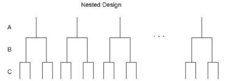

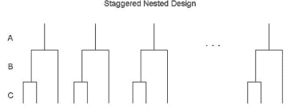

### 图 5.2 3 至 6 阶段的错位嵌套设计

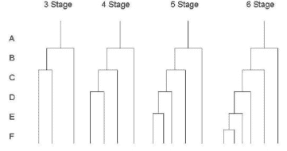

### 表 5.10 错位嵌套设计与嵌套设计之间的自由度比较

| 来源 | 错位嵌套 df | 嵌套 df |
| :--- | :--- | :--- |
| A | a - 1 | a - 1 |
| A 中的 B | a | a |
| B 中的 C | a | 2a |
| C 中的 D | a | 4a |
| D 中的 E | a | 8a |
| E 中的 F | a | 16a |

Mason 等人 (1989) 描述了一项研究，其中使用错位嵌套设计来估计连续聚合过程中的变异来源。在此过程中，聚乙烯颗粒以每批十万磅的批次生产。采用四阶段设计来划分批次间、批次内及测量过程引起的抗拉强度变异来源。随机抽取了三十个批次。批次代表最顶层因子或变异来源 A。从每个批次中随机选取两箱颗粒。这代表第二阶段或变异来源 B。从每个批次选取的第一箱中制作了两份用于强度测试的试样，但从选取的第二箱中仅制作了一份试样。这代表第三阶段或变异来源 C。最后，从第一箱的第一份试样中进行了两次重复强度测试，而其他三份试样中各仅进行了一次强度测试。该抽样方案在图 5.3 中图示，数据显示在下一页的表 5.11 中。

### 图 5.3 聚合研究抽样方案图

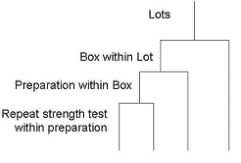

### 表 5.11 聚合强度变异研究数据

| 批次 | 第 1 箱 第 1 份试样 测试 1 | 第 1 箱 第 1 份试样 测试 2 | 第 1 箱 第 2 份试样 测试 1 | 第 2 箱 第 1 份试样 测试 1 |
|---|---|---|---|---|
| 1 | 9.76 | 9.24 | 11.91 | 9.02 |
| 2 | 10.65 | 7.77 | 10.00 | 13.69 |
| 3 | 6.50 | 6.26 | 8.02 | 7.95 |
| 4 | 8.08 | 5.28 | 9.15 | 7.46 |
| 5 | 7.84 | 5.91 | 7.43 | 6.11 |
| 6 | 9.00 | 8.38 | 7.01 | 8.58 |
| 7 | 12.81 | 13.58 | 11.13 | 10.00 |
| 8 | 10.62 | 11.71 | 14.07 | 14.56 |
| 9 | 4.88 | 4.96 | 4.08 | 4.76 |
| 10 | 9.38 | 8.02 | 6.73 | 6.99 |
| 11 | 5.91 | 5.79 | 6.59 | 6.55 |
| 12 | 7.19 | 7.22 | 5.77 | 8.33 |
| 13 | 7.93 | 6.48 | 8.12 | 7.43 |
| 14 | 3.70 | 2.86 | 3.95 | 5.92 |
| 15 | 4.64 | 5.70 | 5.96 | 5.88 |
| 16 | 5.94 | 6.28 | 4.18 | 5.24 |
| 17 | 9.50 | 8.00 | 11.25 | 11.14 |
| 18 | 10.93 | 12.16 | 9.51 | 12.71 |
| 19 | 11.95 | 10.58 | 16.79 | 13.08 |
| 20 | 4.34 | 5.45 | 7.51 | 5.21 |
| 21 | 7.60 | 6.72 | 6.51 | 6.35 |
| 22 | 5.12 | 5.85 | 6.31 | 8.74 |
| 23 | 5.28 | 5.73 | 4.53 | 5.07 |
| 24 | 5.44 | 5.38 | 4.35 | 7.04 |
| 25 | 3.50 | 3.88 | 2.57 | 3.76 |
| 26 | 4.80 | 4.46 | 3.48 | 3.18 |
| 27 | 5.35 | 6.39 | 4.38 | 5.50 |
| 28 | 3.09 | 3.19 | 3.79 | 2.59 |
| 29 | 5.30 | 4.72 | 4.39 | 6.13 |
| 30 | 7.09 | 7.82 | 5.96 | 7.14 |

用于读取数据并计算方差成分的 SAS 代码显示在下一页，SAS proc varcomp 的输出显示在其下方。

```
data polymer;
input lot box prep strength;
datalines;
1 1 1 9.76
1 1 1 9.24
... etc.
proc varcomp method=type1;
class lot box prep;
model strength=lot box(lot) prep(box lot);
run;
```

| 来源 | 自由度 | 平方和 | 均方 |
|---|---|---|---|
| lot | 29 | 855.967534 | 29.515777 |
| box(lot) | 30 | 50.094525 | 1.669818 |
| prep(lot*box) | 30 | 68.437450 | 2.281248 |
| Error | 30 | 19.438750 | 0.647958 |
| Corrected Total | 119 | 993.928259 | |

| 来源 | 期望均方 |
|---|---|
| lot | Var(Error) + 1.5 Var(prep(lot*box)) + 2.5 Var(box(lot)) + 4 Var(lot) |
| box(lot) | Var(Error) + 1.1667 Var(prep(lot*box)) + 1.5 Var(box(lot)) |
| prep(lot*box) | Var(Error) + 1.3333 Var(prep(lot*box)) |
| Error | Var(Error) |
| Corrected Total | |

| 方差成分 | 估计值 |
|---|---|
| Var(lot) | 6.92729 |
| Var(box(lot)) | -0.27151 |
| Var(prep(lot*box)) | 1.22497 |
| Var(Error) | 0.64796 |

矩法再次为一个来源产生了负估计值。将选项 method=type1 更改为 method=reml 可得到下一页所示的更合理的 REML 估计值。

| 方差成分 | 估计值 |
|---|---|
| Var(lot) | 7.24270 |
| Var(box(lot)) | 0 |
| Var(prep(lot*box)) | 1.02957 |
| Var(Error) | 0.65680 |

| | Var(lot) | Var(box(lot)) |
|---|---|---|
| Var(lot) | 4.16206 | 0 |
| Var(box(lot)) | 0 | 0 |
| Var(prep(lot*box)) | -0.01093 | 0 |
| Var(Error) | -0.0080837 | 0 |

| | Var(prep(lot*box)) | Var(Error) |
|---|---|---|
| Var(lot) | -0.01093 | -0.0080837 |
| Var(box(lot)) | 0 | 0 |
| Var(prep(lot*box)) | 0.10053 | -0.02395 |
| Var(Error) | -0.02395 | 0.02933 |

从这些结果可以看出，总变异的 81% = (100×(7.2427)/(7.2427+1.0296+0.6568)) 归因于批次间的变异，而批次内或箱与箱之间的变异可忽略不计。因此，如果制造商希望降低抗拉强度的变异性，应专注于减少批次间变化的有影响因素的变异。

虽然尚未为错位嵌套设计数据估计的方差成分开发出精确的闭式置信区间，但当最顶层因子的级别数大于 30 时，可以使用 proc varcomp 在采用 method=ml 或 method=reml 估计时生成的估计值的渐近协方差矩阵的元素来创建近似渐近估计。例如，归因于批次的方差成分 σ²ₗ 的 90% 置信区间为 7.2427 ± 1.645√4.16206 = (3.887, 10.598)。贝叶斯区间估计方差成分对这些设计也很有用（参见 Lawson, 2008b）。

要确定错位嵌套设计的样本量，请遵循第 5.4.4 节中概述的确定 k 因子抽样设计中重复方差样本量的程序。由于错位嵌套设计中所有因子或阶段的自由度近似相等，遵循此程序将使所有方差成分的精度近似相同。


## 5.8 固定因素与随机因素的设计

在某些情况下，当像第2至第4章讨论的实验设计中那样研究固定处理因素时，随机因素也会通过实验的实施方式被引入模型中。例如，考虑表5.12中的数据，该数据来自一项比较不同农药配方和施药方法（施用于棉花植株叶片）的实验。目标是增加施药一周后棉花植株叶片上残留的活性农药量。所研究的农药在阳光下会降解，而配方中的某种添加剂会延缓这一过程。不同的施药技术可能在输送到植株叶片的农药量上有所不同。本实验中的处理因素是两种不同的农药配方和两种不同的施药方法，从而形成一个2²因子实验。

实验单位是一行20英尺的棉花植株，称为一个区块，因为这是一个可以控制农药施用的方便区域。选取了八个区块，并随机将其中两个分配给四种处理组合中的每一种，从而每种处理组合有两个重复。施药一周后，实验人员准备测定植株叶片上残留的农药量。然而，整个区块的植株材料太多，无法送往实验室进行分析。因此，从每个区块中选取了两份叶片样本，其数量适合实验室分析农药残留。每份样本都被送往实验室，从而得到了表5.12所示的数据。

配方、施药技术及其交互作用是固定因素，因为实验人员有兴趣比较这些因素水平之间的平均响应。另一方面，区块是一个随机因素，代表实验单位之间的差异。它嵌套在配方与施药技术的组合之内。人们不关心比较每种配方和施药组合内的实验单位。相反，设计中为每种处理组合包含了多个区块，以便估计由不同区块引起的方差，并用于判断配方和施药效应的显著性。从每个区块中取出的重复样本是为了方便实验的进行。它们将被归类为第1章中定义的子样本或观测单位。

分析数据的最简单方法是对两个子样本取平均值，然后如第3.5节所示继续进行。然而，如果可以假设子样本相互独立，并且希望将所有数据（如表5.12所示）都纳入分析，则模型中必须包含一个额外的样本项。样本是另一个随机效应，因为没有特别兴趣比较每个区块中两个样本之间的响应。

该数据的模型可以写成如下形式

```
y_{ijkl} = \mu + \alpha_i + \beta_j + \alpha\beta_{ij} + p_{(ij)k} + \epsilon_{ijkl}, \quad (5.13)
```

### 表 5.12 棉花植株上的农药残留

| 配方 | 施药技术 | 区块 | 样本1 | 样本2 |
|---|---|---|---|---|
| A | 1 | 1 | 0.237 | 0.252 |
| A | 1 | 2 | 0.281 | 0.274 |
| B | 1 | 1 | 0.247 | 0.294 |
| B | 1 | 2 | 0.321 | 0.267 |
| A | 2 | 1 | 0.392 | 0.378 |
| A | 2 | 2 | 0.381 | 0.346 |
| B | 2 | 1 | 0.351 | 0.362 |
| B | 2 | 2 | 0.334 | 0.348 |

其中，\( y_{ijkl} \) 是用配方水平 \( i \) 和施药技术 \( j \) 处理的第 \( k \) 个区块中取出的第 \( l \) 个样本上发现的农药残留。通常 \( i = 1, ..., a, j = 1, ..., b, k = 1, ..., r \)，且 \( l = 1, ..., s \)。在此特定示例中，\( a = 2, b = 2, r = 2 \)，且 \( s = 2 \)，\( \alpha_i \) 是配方效应，\( \beta_j \) 是施药效应，\( \alpha\beta_{ij} \) 是交互效应，\( \rho_{(ij)k} \) 是随机区块效应，\( \epsilon_{ijkl} \) 是随机样本效应。

该模型可以用矩阵表示法写成：

```
\(\boldsymbol{y} = \boldsymbol{X}\boldsymbol{\beta} + \boldsymbol{Z}\boldsymbol{\gamma} + \boldsymbol{\epsilon}, \quad (5.14)\)
```

其中

```
\(\boldsymbol{y} = \begin{pmatrix} y_{1111} \\ y_{1112} \\ y_{1121} \\ y_{1122} \\ y_{2111} \\ y_{2112} \\ y_{2121} \\ y_{2122} \\ y_{1211} \\ y_{1212} \\ y_{1221} \\ y_{1222} \\ y_{2211} \\ y_{2212} \\ y_{2221} \\ y_{2222} \end{pmatrix}, \quad \boldsymbol{X} = \begin{pmatrix} 1 & 1 & 0 & 1 & 0 & 1 & 0 & 0 & 0 \\ 1 & 1 & 0 & 1 & 0 & 1 & 0 & 0 & 0 \\ 1 & 1 & 0 & 1 & 0 & 1 & 0 & 0 & 0 \\ 1 & 1 & 0 & 1 & 0 & 1 & 0 & 0 & 0 \\ 1 & 0 & 1 & 1 & 0 & 0 & 1 & 0 & 0 \\ 1 & 0 & 1 & 1 & 0 & 0 & 1 & 0 & 0 \\ 1 & 0 & 1 & 1 & 0 & 0 & 1 & 0 & 0 \\ 1 & 0 & 1 & 1 & 0 & 0 & 1 & 0 & 0 \\ 1 & 1 & 0 & 0 & 1 & 0 & 0 & 1 & 0 \\ 1 & 1 & 0 & 0 & 1 & 0 & 0 & 1 & 0 \\ 1 & 1 & 0 & 0 & 1 & 0 & 0 & 1 & 0 \\ 1 & 1 & 0 & 0 & 1 & 0 & 0 & 1 & 0 \\ 1 & 0 & 1 & 0 & 1 & 0 & 0 & 0 & 1 \\ 1 & 0 & 1 & 0 & 1 & 0 & 0 & 0 & 1 \\ 1 & 0 & 1 & 0 & 1 & 0 & 0 & 0 & 1 \\ 1 & 0 & 1 & 0 & 1 & 0 & 0 & 0 & 1 \end{pmatrix}, \quad \boldsymbol{\beta} = \begin{pmatrix} \mu \\ \alpha_1 \\ \alpha_2 \\ \beta_1 \\ \beta_2 \\ \alpha\beta_{11} \\ \alpha\beta_{12} \\ \alpha\beta_{21} \\ \alpha\beta_{22} \end{pmatrix}\)
```

\( Z = \left( \begin{array}{ c c c c c c c c }
1 & 0 & 0 & 0 & 0 & 0 & 0 & 0 \\
1 & 0 & 0 & 0 & 0 & 0 & 0 & 0 \\
0 & 1 & 0 & 0 & 0 & 0 & 0 & 0 \\
0 & 1 & 0 & 0 & 0 & 0 & 0 & 0 \\
0 & 0 & 1 & 0 & 0 & 0 & 0 & 0 \\
0 & 0 & 1 & 0 & 0 & 0 & 0 & 0 \\
0 & 0 & 0 & 1 & 0 & 0 & 0 & 0 \\
0 & 0 & 0 & 1 & 0 & 0 & 0 & 0 \\
0 & 0 & 0 & 0 & 1 & 0 & 0 & 0 \\
0 & 0 & 0 & 0 & 1 & 0 & 0 & 0 \\
0 & 0 & 0 & 0 & 0 & 1 & 0 & 0 \\
0 & 0 & 0 & 0 & 0 & 1 & 0 & 0 \\
0 & 0 & 0 & 0 & 0 & 0 & 1 & 0 \\
0 & 0 & 0 & 0 & 0 & 0 & 1 & 0 \\
0 & 0 & 0 & 0 & 0 & 0 & 0 & 1 \\
0 & 0 & 0 & 0 & 0 & 0 & 0 & 1 \\
\end{array} \right), \gamma = \left( \begin{array}{ c }
P_{(11)1} \\
P_{(11)2} \\
P_{(21)1} \\
P_{(21)2} \\
P_{(12)1} \\
P_{(12)2} \\
P_{(22)1} \\
P_{(22)2} \\
\end{array} \right), \epsilon = \left( \begin{array}{ c }
\epsilon_{1111} \\
\epsilon_{1112} \\
\epsilon_{1121} \\
\epsilon_{1122} \\
\epsilon_{2111} \\
\epsilon_{2112} \\
\epsilon_{2121} \\
\epsilon_{2122} \\
\epsilon_{1211} \\
\epsilon_{1212} \\
\epsilon_{1221} \\
\epsilon_{1222} \\
\epsilon_{2211} \\
\epsilon_{2212} \\
\epsilon_{2221} \\
\epsilon_{2222} \\
\end{array} \right). \)

\(\beta\) 表示固定效应向量，而 \(\gamma\) 和 \(\epsilon\) 表示随机效应向量。独立且服从正态分布的随机效应假设可以表示为 \(\gamma \sim MVN(0, \sigma_\gamma^2 I_{abr})\)，且 \(\epsilon \sim MVN(0, \sigma^2 I_{abrs})\)；因此，\(y \sim MVN(X\beta, V)\)，其中 \(V = Z(\sigma_\gamma^2 I_{abr})Z' + \sigma^2 I_{abrs}\)。\(\beta\) 的最小二乘估计量将是 \(\hat{\beta} = (X'V^{-1}X)^{-1}X'V^{-1}y\)；然而，\(\sigma_\gamma^2, \sigma^2\) 是未知的，因此 \(V\) 也是未知的。

SAS proc glm 通过将 \(\beta\) 和 \(\gamma\) 都视为固定效应来解决该问题。然后最小二乘估计量由

\(\left( \begin{array}{ c }
\hat{\beta} \\
\hat{\gamma} \\
\end{array} \right) = \left( \begin{array}{ c c }
X'X & X'Z \\
Z'X & Z'Z \\
\end{array} \right)^{-1} \left( \begin{array}{ c }
X'y \\
Z'y \\
\end{array} \right).\) (5.15)

模型中各项的I类ANOVA平方和与表3.2所示类似。读取表5.12数据并使用SAS proc glm进行分析的命令如下所示。对于本示例，由于存在等量重复和子样本，I类和III类平方和将相同。

```
data pesticide;
input form $ app plot sample residue;
datalines;
A 1 1 1 .237
A 1 1 2 .252
.
.
.
proc glm;
class form app plot;
model residue=form app form*app plot(form*app);
random plot(form*app)/test;
run;
```


random plot(form*app) / test; 语句告诉 glm plot 是随机效应，其结果是下面所示的期望均方表。这里，Var(Error)=σ²_p 和 Var(plot(form*app))=σ²_p 的系数是使用第 5.4.1 节中描述的 Hartley 方法确定的，而 Q(form,form*app) 形式的项是 proc glm 表示涉及固定效应的二次型的方式，这些固定效应是第 3.5.2 节中所示非中心性参数的函数。

| 来源 | III类期望均方 |
|---|---|
| form | Var(Error) + 2Var(plot (form*app)) + Q(form,form*app) |
| app | Var(Error) + 2Var(plot (form*app)) + Q(app,form*app) |
| form*app | Var(Error) + 2Var(plot (form*app)) + Q(form*app) |
| plot(form*app) | Var(Error) + 2Var(plot (form*app)) |

由于配方、施药方法及其交互作用的期望均方除了包含涉及固定效应的二次型外，还都包含 σ² + 2σ²_p，因此用于检验这些固定效应的 F 比值分母的正确均方是 plot(form*app)，其期望为 σ² + 2σ²_p。误差均方的期望值为 σ²，作为检验固定效应的 F 比值分母太小了。然而，proc glm 的类 I 和类 III ANOVA 表正是使用了这个。它们是不正确的，因此此处未显示。

使用 plot 均方来检验固定效应是合理的，这相当于对子样本取平均值并像第 3.5 节所示进行分析。上面 random 语句上的 /test 选项导致 proc glm 计算如下输出所示的正确 F 比值。在那里我们看到，施药方法确实对施药后一周棉花植株叶片上的活性农药残留量有显著影响。然而，配方以及配方与施药方法的交互作用均无显著影响。

| 来源 | DF | III类平方和 | 均方 | F值 | Pr > F |
|---|---|---|---|---|---|
| * 配方 | 1 | 0.00018063 | 0.00018063 | 0.03 | 0.8692 |
| app | 1 | 0.032310 | 0.032310 | 55.14 | 0.0018 |
| form*app | 1 | 0.002186 | 0.002186 | 3.73 | 0.1256 |
| Error | 4 | 0.002344 | 0.000586 | | |

* 此检验假设一个或多个其他固定效应为零。

| 来源 | DF | III类平方和 | 均方 | F值 | Pr > F |
|---|---|---|---|---|---|
| plot(form*app) | 4 | 0.002344 | 0.000586 | 1.31 | 0.3432 |
| 误差：MS(误差) | 8 | 0.003569 | 0.000446 | | |

在许多观测单位与实验单位不同的情况下，观测单位不会相互独立。在本例中，对每个小区共同施用农药可能会诱导同一小区子样本之间的相关性，$E(\epsilon_{ijkl} \times \epsilon_{ijkl'}) = \rho$。尽管独立性假设被违反，Casella (2008) 表明，使用 plot 均方作为分母的固定效应 F 检验仍然有效。

在本例中，既然发现施药方法显著，我们应查看施药方法的最小二乘均数或在此情况下的边际均数（由于存在等数重复），以确定哪种施药方法最佳。边际均数可以表示为 \(\bar{y}_{j..}\) 和 \(\bar{y}_{j'..}\)。期望值 \(E(\bar{y}_{j..}) = \mu + \beta_j + \bar{\alpha}_{.j}\)，方差 \(Var(\bar{y}_{j..}) = \sigma_p^2/ars + \sigma^2/ars\)，两个边际均数之差的方差为 \(2(\sigma_p^2/ars + \sigma^2/ars)\)。然而，`proc glm` 中 `estimate` 语句报告的均数差的标准误为 \(\sqrt{2\sigma^2/ars}\)。`proc glm` 不估计 \(\sigma_p^2\) 的方差成分，因为在计算中 plot 被视为固定效应。在使用 `proc glm` 中的 `estimate` 语句时，模型中所有固定效应可估函数的标准误都会出现类似问题。

当模型中同时包含固定效应和随机效应时，由于实验的进行方式，我们称其为混合模型，SAS `proc mixed` 是分析的更好选择。默认情况下，`proc mixed` 使用 REML 方法估计模型中随机效应的方差成分，然后使用公式 \(\hat{\beta} = (X'\hat{V}^{-1}X)^{-1}X'\hat{V}^{-1}y\) 估计固定效应。`proc mixed` 产生可估函数的正确标准误以及用于检验固定效应的正确 F 比值；然而，与使用带 REML 选项的 `proc varcomp` 类似，不会生成 ANOVA 表。使用表 5.12 中的数据运行 `proc mixed` 的命令如下所示。

```
proc mixed data=pesticide;
    class form app plot;
    model residue=form app form*app;
    random plot(form*app) / solution;
    lsmeans app;
    estimate 'application effect' app -1 1;
run;
```

这些命令与前面所示的 `proc glm` 命令类似，只是随机效应 `plot(form*app)` 从模型语句中被移除了。它仍然显示在 `random` 语句中。由于 `proc mixed` 自动计算固定效应的正确 F 比值，`/test` 选项也从 `random` 语句中移除了。REML 估计结果显示在下一页，我们看到 \(\hat{\sigma}_p^2 = 0.000070\) 和 \(\hat{\sigma}^2 = 0.000446\)。

| 协方差参数 | 估计值 |
| :--- | :--- |
| plot (form*app) | 0.000070 |
| 残差 | 0.000446 |

用于检验固定效应的 F 比值如下所示，与 proc glm 输出一样，我们看到施药效应显著。

| 效应 | 分子DF | 分母DF | F值 | Pr > F |
| :--- | :--- | :--- | :--- | :--- |
| form | 1 | 4 | 0.03 | 0.8692 |
| app | 1 | 4 | 55.14 | 0.0018 |
| form*app | 1 | 4 | 3.73 | 0.1256 |

estimate 和 lsmeans 语句的结果如下所示。这里我们看到，两个施药方法均数之差的标准误被正确估计为 \(\sqrt{2(\hat{\sigma}_p^2/ars + \hat{\sigma}^2/ars)} = \sqrt{2 \times (0.000070/8 + 0.000446/8)} = 0.08987$，并且施药方法 2 导致棉花植株叶片上的活性农药残留量更高。

| 标签 | 估计值 | 标准误 | DF | t值 | Pr > |t| |
| :--- | :--- | :--- | :--- | :--- | :--- |
| 施药效应 | 0.08987 | 0.01210 | 4 | 7.43 | 0.0018 |

| 效应 | app | 估计值 | 标准误 | DF | t值 | Pr > |t| |
| :--- | :--- | :--- | :--- | :--- | :--- | :--- |
| app | 1 | 0.2716 | 0.008558 | 4 | 31.74 | <.0001 |
| app | 2 | 0.3615 | 0.008558 | 4 | 42.24 | <.0001 |

另一种模型中同时包含固定效应和随机效应的设计是上一章讨论的随机区组设计。例如，考虑第 4.6 节中讨论的《高尔夫杂志》示例。在那个实验中，处理因素（发球台高度）可以被视为固定效应，因为实验的目的是确定不同发球台高度造成的击球距离是否存在差异。然而，对实验中使用的特定高尔夫球手进行比较并无意义，因为他们只是代表性高尔夫球手的一个样本。因此，区组因素，即高尔夫球手，可以被视为随机效应。随机效应与固定效应之间的交互作用也被定义为随机效应。因此，高尔夫球手与发球台高度的交互作用也应被视为随机效应，高尔夫实验的模型可以写为：

\(y_{ijk} = \mu + b_i + \tau_j + b\tau_{ij} + \epsilon_{ijk},\) (5.16)

其中 \(b_i\) 表示随机高尔夫球手效应，\(\tau_j\) 表示固定发球台高度效应，\(b\tau_{ij}\) 表示随机交互作用效应，\(\epsilon_{ijk}\) 表示随机重复击球效应，\(i = 1, ..., 3\)，\(j = 1, ..., 9\)，\(k = 1, ..., 5\)。通过假设随机高尔夫球手、交互作用和重复击球效应相互独立并服从正态分布，方差分别为 \(\sigma_b^2\)、\(\sigma_{br}^2\) 和 \(\sigma^2\)，\(y_{ijk}\) 的期望值和方差由以下给出：

\(E(y_{ijk}) = \mu + \tau_i\)
\(Var(y_{ijk}) = \sigma_b^2 + \sigma_{br}^2 + \sigma^2\)

ANOVA 均方的期望值如表 5.13 所示，其中 \(Q(\tau) = 8 \sum_{i=1}^3 (\tau_i - \bar{\tau}_{..})^2 / (3 - 1)\)。

表 5.13 带有区组内重复的随机区组设计的期望均方

| 来源 | df | 期望均方 |
| :--- | :--- | :--- |
| 高尔夫球手 (\(b_i\)) | (9-1)=8 | \(\sigma^2 + 5\sigma_{br}^2 + 3\sigma_b^2\) |
| 发球台高度 (\(\tau_j\)) | (3-1)=2 | \(\sigma^2 + 5\sigma_{br}^2 + Q(\tau)\) |
| 高尔夫球手 × 发球台高度 (\(b\tau_{ij}\)) | 8x2=16 | \(\sigma^2 + 5\sigma_{br}^2\) |
| 重复 (\(\epsilon_{ijk}\)=误差) | (5-1)x16=64 | \(\sigma^2\) |

这些期望均方表明，为了检验发球台高度效应无差异的假设，即 \(H_0: \tau_1 = \tau_2 = \tau_3\)，F 比值的正确分母应为高尔夫球手 × 发球台高度交互作用，如第 4.6 节所用，而不是 proc glm 类 I 和类 III ANOVA 表中默认使用的误差均方。此外，不同发球台高度的边际或最小二乘均数之差的方差为 \(Var(\bar{y}_{i..} - \bar{y}_{j..}) = 2 \left( \frac{\sigma_{br}^2}{45} + \frac{\sigma^2}{45} \right)\)。默认情况下 proc glm 不估计 \(\sigma_{br}^2\)。因此，在第 4 章中，proc glm 中使用了 test h*teehgt e=id*teehgt 语句以便于


获得 tee height 的正确 $F$-test。另一种获得正确 $F$-test 的方法是使用随机 id `idteeht/test`；语句在 `proc glm` 中或使用 `proc mixed`。在第 4 章中，`lsmeans teeht/diff adjust=tukey e=id*teeht` 语句被用于在 ANOVA 之后获得 Tukey 均值比较的正确标准误。使用 `proc mixed` 时，`lsmeans teeht/diff adjust=tukey;` 自动使用 tee height 均值差异的正确标准误。

## 5.9 用于检查模型假设的图形方法

用于研究方差的抽样实验数据的图形分析对于检查统计模型的假设以及识别可能对结果方差成分估计产生重大影响的非典型观测值很有用。Snee (1983) 解释说，图形分析的另一个重要优势是它迫使分析人员更熟悉数据，并批判性地思考解释观察到的变异的机制。他建议在嵌套抽样设计的分析中使用简单的图形工具，如半正态图、伽马图。正态图也可用于检查随机效应的正态性假设。

### 5.9.1 简单图表

再次考虑表 5.2 中的数据。模型 (5.1) 适用于本实验的数据，其中随机样本效应 $t_i$ 和随机实验误差 $\epsilon_{ij}$ 假设服从正态分布。$\epsilon_{ij}$ 在各不同样本中方差恒定的假设也由 $\epsilon_{ij} \sim N(0, \sigma^2)$ 隐含。验证这些假设的一种简单方法是制作类似图 2.3 所示的简单数据图。在那里，可以快速检测到非恒定方差或异常观测值。$\epsilon_{ij}$ 的正态性也可以通过类似图 2.5 所示的正态概率图来检查。

在第 5.5 节介绍的 gage R&R 双因素抽样实验中，使用矩法估计了由于操作员引起的方差 $\sigma_O^2$ 的负方差成分估计。该估计为负是因为部分与操作员交互作用的均方大于操作员的均方。类似图 3.4 或 3.6 的简单交互图可以帮助解释这一结果。图 5.4 显示了部分与操作员的交互图。交互作用的特征是：一个因素各水平上的平均响应分别按另一个因素各水平绘制时，其迹线不平行。在图 5.4 中，可以看到线段接近平行，除了连接部分 5 至 7 以及 9 至 10 的线段外。这是因为操作员 1 对零件编号 6 的平均测量值远低于另外两名操作员，而操作员 3 对零件编号 10 的测量值远高于另外两名操作员。当交互作用均方主要归因于一两个观测值时，

图 5.4 零件与操作员的交互图

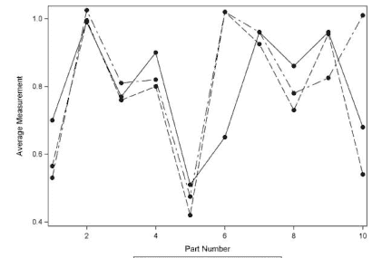

表 5.14 消除零件 6 和 10 后 gage R&R 研究中矩法与 REML 估计的比较

| 成分 | 矩法估计量 | REML 估计量 |
|---|---|---|
| 零件 (\(\sigma_p^2\)) | 0.03191 | 0.02808 |
| 操作员 (\(\sigma_o^2\)) | 0.0008601 | 0.0008089 |
| 零件*操作员 (\(\sigma_{po}^2\)) | 0.0020045 | 0.0020082 |
| 误差 (\(\sigma^2\)) | 0.0004062 | 0.0004063 |

如本例所示，质疑结果可能是明智的。表 5.14 显示了消除零件 6 和 10 后 gage R&R 研究数据的方差成分估计。消除这些零件后，矩法不会产生负方差成分估计，且矩法和 REML 得到的结果非常相似。在这种情况下，如果零件仍然可用，最好让操作员重新测量零件 6 和 10，以查看是否存在错误。

### 5.9.2 用于检查恒定方差假设的伽马图和半正态图

Wilk 等人 (1962) 提出伽马概率图作为研究方差组齐性的有效工具。具有 \(\nu\) 个自由度的方差样本服从形状参数为 \(\nu/2\) 的伽马分布，因此伽马概率图上估计同一常数 \(\sigma^2\) 的方差样本点应呈直线分布。许多嵌套抽样设计和交错嵌套抽样设计仅涉及大小为二的样本。在这种情况下，标准差的半正态图可以以同样的方式使用。为说明这一点，请再次考虑表 5.2 中的数据。下面的 SAS 命令计算每个样本内的方差，使用 proc rank 和数据步函数 gaminv 计算伽马分位数 gam，并将其输出到 SAS 文件 s。接下来使用 proc sgplot 制作伽马概率图。如图 5.5 所示。

```
ods graphics on;
proc sort data=naph; by sample;
proc means noprint; by sample; var cYield;
output out=var cvar;
proc rank data=out ranks; var cvar; ranks r;
data s; set r;
gscore=gaminv((r-5)/6,.2);
proc sgplot data=gam;
scatter x=gscore y=cvar;
xaxis label="Gamma Score";
yaxis label="Sample Variance";
run;
ods graphics off;
```

图 5.5 表 5.2 数据中样本内方差的伽马图

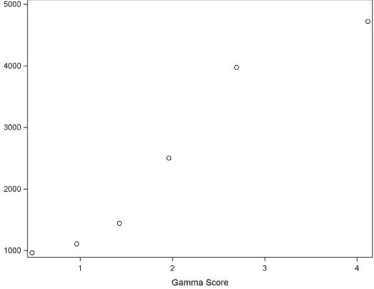

如果方差齐性，伽马概率图上的点将大致沿直线分布。直线右侧远处的单个点将表明方差大于常态。在图 5.5 中，仅有 6 个点，看起来点相当接近直线，表明方差恒定。

作为有更多方差需要绘图的示例，请考虑表 5.11 所示的多项式研究。对于这种交错嵌套抽样研究，批次内盒子的矩法估计量为负。与 gage R&R 研究一样，一两个非典型值可能是造成此结果的原因，对数据的图形分析可能揭示这一点。在第 5.7 节介绍的类型 I ANOVA 中的均方是设计中每个来源方差的合并估计。如果批次编号 $i$ 的四个观测值分别表示为 $Y_{i1}$、$Y_{i2}$、$Y_{i3}$ 和 $Y_{i4}$，如下所示，

| | 盒 1 制备 | | 盒 2 制备 | |
| :--- | :---: | :---: | :---: | :---: |
| | 1 | 2 | 1 | 1 |
| 批次 | 测试 1 | 测试 2 | 测试 1 | 测试 1 |
| $i$ | $Y_{i1}$ | $Y_{i2}$ | $Y_{i3}$ | $Y_{i4}$ |

Snee (1983) 显示，用于创建 ANOVA 均方而从每个来源合并的方差由以下给出：

| 来源 | 方差 $s_i^2$ |
| :--- | :--- |
| 误差或测试(制备) | $(Y_{2i} - Y_{1i})^2 / 2$ |
| 制备(盒) | $\frac{2}{3} (Y_{3i} - \frac{Y_{1i}+Y_{2i}}{2})^2$ |
| 盒 | $\frac{3}{4} (Y_{4i} - \frac{Y_{1i}+Y_{2i}+Y_{i3}}{3})^2$ |

将数据按上述方式展开并计算每个来源内标准差的 SAS 命令，以及制作盒内制备标准差半正态图的命令，将在下一页显示。

批次内盒子的矩法估计量为负，因为盒内和批次内制备的均方大于盒的均方。这将建议调查合并形成盒内制备均方的方差。每个批次中由于盒内制备引起的标准差在下一页的 SAS 命令中标记为 sd2。

如图 5.6 所示的图中，我们看到一条从图表左下角延伸出来的相对直线的点，除了右侧有一个标准差偏离直线之外。对图表后页面标准差文件的 proc print 结果进行检查显示，这个较大的标准差位于批次 19，主要是由于 y3=16.79 的高结果，即盒 1 第二个制备的第一个测试。

如果从数据中移除批次编号 19，矩法估计量


```
proc sort data=polymer; by lot;
data string (keep = yp lot y1-y4);
   array y(4) y1-y4;
   do i=1 to 4;
   set polymer; by lot;
   y(i)=strength;
   if last.lot then return;
   end;
data vars; set string;
sd1=sqrt(((y2-y1)**2/2));
sd2=sqrt(((2/3)*(y3-(y1+y2)/2)**2/2));
sd3=sqrt(((3/4)*(y4-(y1+y2+y3)/3)**2/2));
proc print data=vars;
   title 'rank calculates normal scores for
   parameter estimates ;
   ods graphics on;
proc rank data=vars out=hnplots; var sd2;
   ranks hnplot;
data hnplot; set hnplots;
zscore=probit(((rank-5)/30)+1/2);
proc sgplot data=hnplots;
   scatter x=zscore y=sd2;
   xaxis label='Half-Normal Score';
   yaxis label='Std. due to prep within box';
run;
ods listing off;
```

图 5.6 Prep(Box) 标准差的半正态图

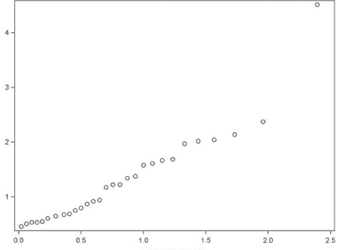

批次内盒子的方差分量不再为负，矩法估计量和 REML 估计量高度一致，如下所示：

| 观测数 | y1 | y2 | y3 | y4 | 批次 | sd1 | sd2 | sd3 |
|---|---|---|---|---|---|---|---|---|
| 1 | 9.76 | 9.24 | 11.91 | 9.02 | 1 | 0.36770 | 1.96776 | 1.11140 |
| 2 | 10.65 | 7.77 | 10.00 | 13.69 | 2 | 2.03647 | 0.64503 | 3.65174 |
| 3 | 6.50 | 6.26 | 8.02 | 7.95 | 3 | 0.16971 | 1.33905 | 0.88623 |
| 4 | 8.08 | 5.28 | 9.15 | 7.46 | 4 | 1.97990 | 2.01675 | 0.03753 |
| 5 | 7.44 | 8.14 | 9.43 | 8.11 | 5 | 1.79992 | 0.01676 | 0.38722 |
| 6 | 9.00 | 8.38 | 7.10 | 8.58 | 6 | 0.43841 | 1.37171 | 1.38971 |
| 7 | 12.81 | 13.58 | 11.13 | 10.00 | 7 | 0.54447 | 1.68607 | 2.17084 |
| 8 | 10.62 | 11.71 | 14.07 | 14.56 | 8 | 0.77075 | 2.37192 | 2.10155 |
| 9 | 4.88 | 4.96 | 4.08 | 4.76 | 9 | 0.05657 | 0.68586 | 0.10392 |
| 10 | 9.38 | 8.02 | 6.73 | 6.99 | 10 | 0.96167 | 1.60851 | 1.91221 |
| 11 | 8.11 | 7.79 | 7.99 | 8.55 | 11 | 0.01205 | 1.00401 | 0.00100 |
| 12 | 7.19 | 7.22 | 5.77 | 8.33 | 12 | 0.02121 | 1.17167 | 1.38853 |
| 13 | 7.93 | 6.48 | 8.12 | 7.43 | 13 | 1.02530 | 0.74709 | 0.06928 |
| 14 | 3.70 | 2.86 | 3.95 | 5.92 | 14 | 0.59397 | 0.54705 | 2.09289 |
| 15 | 4.64 | 5.70 | 5.96 | 5.88 | 15 | 0.74953 | 0.64503 | 0.38682 |
| 16 | 5.84 | 8.02 | 11.18 | 11.24 | 16 | 1.46663 | 1.44003 | 1.30090 |
| 17 | 9.50 | 8.00 | 11.25 | 11.14 | 17 | 0.00606 | 2.04124 | 1.34811 |
| 18 | 10.93 | 12.16 | 9.51 | 12.71 | 18 | 0.86974 | 1.66157 | 1.59637 |
| 19 | 11.95 | 10.58 | 16.79 | 13.08 | 19 | 0.96874 | 4.51114 | 0.02309 |
| 20 | 4.34 | 5.45 | 7.51 | 5.21 | 20 | 0.78489 | 2.13514 | 0.48209 |
| 21 | 7.00 | 6.72 | 6.51 | 8.15 | 21 | 0.11869 | 0.03304 | 0.58484 |
| 22 | 5.12 | 5.85 | 6.31 | 8.74 | 22 | 0.51619 | 0.67361 | 2.58076 |
| 23 | 5.28 | 5.73 | 4.53 | 5.07 | 23 | 0.31820 | 0.79608 | 0.09526 |
| 24 | 5.44 | 5.38 | 4.35 | 7.04 | 24 | 0.04243 | 0.86549 | 1.71762 |
| 25 | 3.50 | 3.88 | 2.57 | 3.76 | 25 | 0.26870 | 0.91448 | 0.38394 |
| 26 | 4.00 | 4.66 | 4.46 | 3.18 | 26 | 0.27002 | 0.12548 | 0.39718 |
| 27 | 5.35 | 6.39 | 4.38 | 5.50 | 27 | 0.73539 | 1.21658 | 0.10970 |
| 28 | 3.09 | 3.19 | 3.79 | 2.59 | 28 | 0.07071 | 0.53072 | 0.66395 |
| 29 | 5.30 | 4.72 | 4.39 | 6.13 | 29 | 0.41012 | 0.50623 | 1.14893 |
| 30 | 7.09 | 7.82 | 5.96 | 7.14 | 30 | 0.51619 | 1.22066 | 0.15877 |

如表 5.15 所示。这可能会让人质疑批次 19 中盒子的第 2 个制剂的第 1 次测试结果。如果材料仍然可用，则应进行重复测试。

表 5.15 移除批次 19 后聚合研究的矩法与 REML 估计量比较

| 分量 | 矩法估计量 | REML 估计量 |
|---|---|---|
| 批次 (\(\hat{\sigma}^2\)) | 5.81864 | 6.09918 |
| 盒子(批次) (\(\hat{\sigma}_b^2\)) | 0.13116 | 0.04279 |
| 盒内制剂 (\(\hat{\sigma}_e^2\)) | 0.76517 | 0.79604 |
| 误差 (\(\hat{\sigma}^2\)) | 0.63794 | 0.64364 |

### 5.9.3 随机效应经验最佳线性无偏估计的概率图

在第 2.4 节中，基于实验误差服从正态分布的假设，绘制了残差的正态概率图。在矩阵表示法中，残差向量可写为：

\(\tilde{\epsilon} = y - X\hat{\beta}.\) (5.17)

当模型中除了实验误差项 \(\epsilon\) 之外还有随机项时，可以通过绘制估计随机效应的正态概率图来检查这些随机效应的正态性。如果图中的点呈直线分布，则可支持所讨论随机效应的正态性假设。当图中至少有 12 到 15 个点时，这种图形技术对于检测异常观测值或偏离正态性的情况很有用。在模型中

\(y = X\beta + Z\gamma + \epsilon\) (5.18)

随机效应 \(\gamma\) 的经验最佳线性无偏预测器 (EBLUP) 由以下方程给出：

\(\hat{\gamma} = \hat{G}Z'\hat{V}^{-1}(y - X\hat{\beta})\) (5.19)

其中 \(\hat{G}\) 是 \(\gamma\) 的估计方差协方差矩阵。SAS 过程 varcomp 不计算 EBLUP，但 proc mixed 可以，并且它既可用于所有效应均为随机效应的模型，也可用于同时包含固定效应和随机效应的模型。下一页给出了使用 proc mixed 拟合聚合数据嵌套随机效应模型的命令。请注意，model 语句中未指定任何项，因为 proc mixed 中的 model 语句用于指定固定效应。random 语句包含模型中的所有项。random 语句上的 /solution 选项导致 proc mixed 计算并打印 EBLUP 表。ods output 语句创建包含打印 EBLUP 表的 SAS 数据文件。在下一个数据步骤中，创建了包含盒内制剂 EBLUP 子集的 SAS 数据集 prep。接下来，proc rank 和 proc sgplot 的调用与第 2.4 节中用于生成残差正态图的调用类似。

图 5.7 所示盒内制剂 EBLUP 正态图上的点几乎呈直线分布。然而，图的右上尾部有两个明显的离群点。通过将这两个 EBLUP 的值与 proc mixed 打印的表格进行比较，可以看到最大的 EBLUP (2.2488) 对应于批次 19 中盒子 1 的第 2 个制剂的第 1 次测试。

```
proc mixed data=polymer;
   class lot box prep;
   model strength=prep;
   random lot box(lot) prep(box lot)/solution;
   ods output SolutionR=EBlup;
   run;
   proc print data=EBlup; run;
   data prep; set EBlup;
      if Effect='prep(lot*box)' ;
      keep Estimate;
   proc rank data=prep normal=vw var Estimate;
      ranks zscore;
   ods graphics on;
   proc gplot;
      scatter x=zscore y=Estimate;
      xaxis label="Normal Score";
      yaxis label="EBLUP";
   run;
   ods graphics off;
```

图 5.7 盒内制剂估计随机效应的正态图

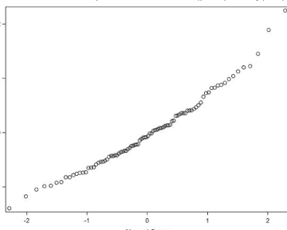

这是上一节半正态图识别出的同一点，值得进一步调查。第二大的 EBLUP (1.8905) 与批次 2 中盒子 2 的制剂 1 的测试相关联。该值 (13.69) 高于批次 2 中的任何其他值，同样可能值得进一步调查。

## 5.10 重要概念回顾

抽样实验旨在估计方差，并将方差划分为称为方差分量的各种来源。有时，估计方差或将方差划分为各种来源可能是最终目标。在其他情况下，划分方差可能是试图减少方差的研究中的中间步骤，或是寻求确定变异原因的研究中的中间步骤。抽样实验中的因素称为随机因素，以区别于第 1-4 章中描述的固定因素。在设计中包含随机因素的目的是估计由随机因素不同水平引起的变异。随机因素的水平是可能水平的代表性样本。

当目标是将方差划分为两个来源时，单因素随机抽样实验（RSE）很有用。两样本抽样实验或因子随机抽样实验（FRSE），如经典量具 R&R 研究中使用的那些，用于将方差划分为三个独立来源。当为另一因素的每个水平使用一组不同的某因素水平更方便时，使用嵌套抽样实验（NSE）。一个设计中可以利用多个嵌套阶段将方差划分为多个来源。错位嵌套抽样实验（SNSE）是嵌套设计的一种变体，用于平衡各来源收集的信息。图 5.8 说明了这些设计应与早期章节中描述的设计相对应的使用位置。

方差分量可以使用方差分析的矩法或最大似然法或 REML 方法进行估计。这可以使用 SAS 过程 varcomp 完成。本章介绍了用于单因素随机抽样实验 RSE 估计的方差分量的精确置信区间公式。介绍了用于双因素 FRSE 或嵌套设计 NSE 的方差分量的近似置信限公式，并引入了一个 SAS 宏来评估这些公式。可以为由最大似然法或 REML 估计的方差分量计算渐近置信区间。当相关项具有 30-40 个自由度时，这些区间将相当准确。

可以确定抽样实验的样本量，使 \(\sigma^2\) 的置信区间宽度成为 \(\sigma^2\) 的所需倍数。设计中其他随机因素的水平数应根据其相对于重复方差 \(\sigma^2\) 的感知重要性，选择以在设计的各来源之间分配自由度。

在研究固定因素效应的设计中，可以通过实验的实施方式将随机因素引入模型。例如，当对实验单位的子样本进行响应测量时，模型中必须包含一个额外的嵌套误差项用于分析。随机区组实验中的区组项和区组与处理交互项通常被视为随机因素。当同时存在固定


## 图 5.8 设计选择路线图

| 设计目的 | 估计方差 | 研究因子效应 |
|---|---|---|
| E.U.'s | 同质 | 异质 |
| 单区组 | 因子 | 两个 |
| 区组大小 | 大 | 小 |
| RCB | PBIB,BTIB | LSD |
| GCB | BIB | YSD |
| 单因子 | RSE | CRD |
| 多因子 | FRSE class cont mixture | GCB BIB YSD |
| NSE | CRFD CRRS SLD | RCBF Factors cont class |
| SNSE | CRFF CRRS SCD | RCBF BRS PCBF |
| PB, OA | EVD | CCBF |
| 含部分难以改变因子的多因子 | CRSP RSSP SYMPV RBSP | SPFF EESP RS |

and random effects are included in the model, the expected values of the ANOVA mean squares (EMS) show which mean square should be used in the denominator of the F-test for each fixed effect or interaction in the model. SAS proc mixed is the most useful for analyzing data from designs that include fixed and random factors. The REML method is used for estimating the variance components of the random effects by proc mixed and it automatically computes the correct standard error for estimable functions of fixed effects.

Atypical response values can have a heavy influence on variance component estimates from sampling experiments. Simple plots, such as plots of the response versus the level in one-factor designs or interaction plots for two-factor designs, can help to identify atypical response values. For nested designs (or staggered nested designs), gamma plots of sample variances (or half-normal plots of standard deviations) within each source are useful for checking homogeneity of variances and identifying cells where atypical values may occur. Normal probability plots of empirical best linear unbiased estimators of random effects (EBLUPs) are useful for checking normality assumptions and again for identifying cells where atypical response values may lie.

## 5.11 练习

- 1. Carry out the sampling experiment described in Section 5.3 to partition the variability in paper helicopter flight times.
  - (a) Read your data into SAS and estimate the variance components using the method of moments.
  - (b) Using proc varcomp, estimate the variance components using the REML method.
  - (c) Using the formulas in Table 5.3, calculate 90% confidence intervals for the two variance components.
  - (d) Write your conclusions. What should you use as the experimental unit in future studies to optimize flight time?

- 2. Read the data from Table 5.2 into SAS and
  - (a) Calculate the ANOVA sums of squares and mean squares used in calculating the confidence limits in Section 5.4.2.
  - (b) Use proc varcomp to calculate and compare the method of moments and REML estimates of the variance components.

- 3. Using the mean squares and expected mean squares from the gage R&R study presented in Section 5.5, use the macro in the appendix of this chapter to compute a 90% confidence interval on the variance component for the interaction of operator and part.

- 4. Plan a sampling experiment to partition the source of variability in auto gas mileage in your community between drivers, cars, and replicates.
  - (a) Describe how you would plan the study if drivers and cars were crossed factors.
  - (b) Describe how you would plan the study if drivers were nested within cars.
  - (c) Determine the number of degrees of freedom you would need for the error or replicate term in your model if you desire the width of the confidence interval on the variance component for replicate to be 75% of \(\sigma^2\).

- 5. Consider the data in Table 5.9.
  - (a) Enter the data into SAS and use proc varcomp to estimate the variance components \(\sigma_d^2, \sigma_t^2, \sigma_r^2\), or \(\sigma^2\).
  - (b) What are the major source or sources of variability?
  - (c) Is there any difference between the method of moments or REML estimators of the variance components?

- 6. Consider the data (Anderson and McLean, 1974) in the following table to come from a sampling study to determine the source of variability in the average amount spent on healthcare per year in thousands of dollars. Towns are nested within state and households are nested within town.

| | 1 城镇 | | 2 城镇 | | 3 城镇 | |
| | 1 | 2 | 1 | 2 | 1 | 2 |
| 家庭 | | | | | | |
| 1 | 10 | 7 | 6 | 6 | 15 | 12 |
| 2 | 13 | 12 | 5 | 12 | 18 | 15 |
| 3 | 16 | 11 | 9 | 7 | 20 | 18 |
| 4 | 12 | 9 | 3 | 10 | 19 | 16 |

  - (a) Use the method of moments and REML methods to determine the variance components for state, town and household.
  - (b) What percent of the total variance is due to households? Towns and households?
  - (c) Using formula (5.11) obtain a 90% confidence interval on the variance component due to towns.

- 7. Consider the data from Smith and Beverly (1981) taken from a staggered nested design to investigate the sources of variability in impurities in raw materials received at a plant in trailer loads. Two samples of material were taken from each of 9 trailer loads of pellets. Two measurements of impurities was made on the first sample from each trailer but only on measurement for the second sample from each trailer.

## 表 5.16 接收颗粒中杂质的变异性

| 拖车 | 1 | | 2 |
| | 测量 1 | 测量 2 | 1 |
| 1 | 47.06 | 44.37 | 49.3 |
| 2 | 47.43 | 50.35 | 50.42 |
| 3 | 48.90 | 48.05 | 50.64 |
| 4 | 52.32 | 52.26 | 53.47 |
| 5 | 46.53 | 45.60 | 53.98 |
| 6 | 46.99 | 50.87 | 51.87 |
| 7 | 47.49 | 51.55 | 58.57 |
| 8 | 47.41 | 47.63 | 48.63 |
| 9 | 48.37 | 51.03 | 50.15 |
| 10 | 54.80 | 51.57 | 54.52 |

  - (a) Write the model for the data.
  - (b) Analyze the data using proc varcomp using the option method=type1 and estimate the three variance components.
  - (c) Analyze the data using proc varcomp using the option method=reml and check to see if your estimates remain the same.
  - (d) Make half-normal plots of the square root of the variances pooled to get the mean squares for sample(trailer) and measurement(sample). Does the assumption of homogeneous variances appear reasonable?
  - (e) Re-analyze the data using proc mixed; calculate the EBLUPs for the random trailer effect and make a normal plot to check the normality assumption. What is your conclusion?

- 8. Reanalyze the data from the golf experiment, presented in the appendix of Chapter 4, using proc mixed. Check to see if you get the same P-values and conclusions shown in Section 4.7.

## 5.12 附录

```
%macro vcl;
**********************************************************************;
** Macro for computing confidence interval for                      **;
**       delta = c1*E(ms1) - c2*E(ms2)                              **;
**                                                                  **;
** Input for this macro is a file called meansq that includes       **;
** one line containing variables conf, c1, ms1, nu1, c2, ms2, nu2;  **;
data set; set meansq;
delta=c1*ms1-c2*ms2;
alpha=1-conf;
Falpha1=finv(conf,nu1,100000000);
Falpha2=finv(alpha,nu1,nu2);
Falpha12=finv(alpha,nu2,100000000);
Fconf12=finv(alpha,nu1,nu2);
Falpha2=finv(conf,nu2,100000000);
Fconf1=finv(alpha,nu1,100000000);
G1=(1/Falpha1)-1;
H2=(1/Fconf2)-1;
G12=((Falpha12)-1)**2+G1**2+Falpha12**2-H2**2)/Falpha12;
VL=G1+2*c1**2*ms1**2+2*H2**2+2*c2**2*ms2**2+2*G12*c1*c2*ms1*ms2;
HI=(1/Fconf1)-1;
G12=(1/Falpha12)-1;
H12=((1/Fconf12)**2-2*HI+2*Fconf12**2-G2**2)/Fconf12;
VU=HI+2*c1**2*ms1**2+2*G12**2+2*c2**2*ms2**2;
L=delta-sqrt(VL);
U=delta+sqrt(VU);
proc print; var delta L U; run;
%mend vcl;
```

## 分数因子设计

### 6.1 引言

There are two benefits to studying several treatment factors simultaneously in a factorial design. First, the interaction or joint effects of the factors can be detected. Second, the experiments are more efficient. In other words, the same precision of effects can be achieved with fewer experiments than would be required if each of the factors was studied one-at-a-time in separate experiments. The more factors included in a factorial design, the greater the efficiency and the greater the number of interactions that may be detected. However, the more factors included in a factorial experiment, the greater the number of runs that must be performed. When many factors are included in a factorial experiment, one way to reduce the number of runs is to use only two levels of each factor and run only one experiment per cell or treatment combination. These ideas were discussed in Sections 3.7 and 3.7.5.

In the preliminary stage of experimentation, where the objective may be to determine which factors are important from a long list of candidates, a factorial design may require too many experiments to perform even when there are only two levels of each factor and only one replicate per cell. Table 6.1 shows the number of experiments required for a 2^k factorial design as a function of the number of factors, k. With k = 7 or more factors, the large number of runs required for a 2^k is usually impractical.

表 6.1 2^k 设计所需的实验次数

| 因子数 (k) | 实验次数 (2^k) |
| :--- | :--- |
| 4 | 16 |
| 5 | 32 |
| 6 | 64 |
| 7 | 128 |
| 8 | 256 |
| 9 | 512 |

When the number of factors under study is large, researchers will often abandon the efficiency of factorial experiments altogether and revert to a “seat of the pants” approach or vary one-factor-at-a-time plan. Others will run a


从较长的因子列表中猜测哪些因子可能更重要，选取其中一部分因子进行因子实验。然而，这些方法并非最优，也无法保留包含大量因子的因子实验的优势。解决这一问题的更好方法是使用全因子实验所需实验次数（或运行次数）的一部分。要使其有效，所选用的运行次数比例必须经过精心挑选，以保留全因子实验的部分优势。

$2^k$ 因子计划的一个理想特性是，因子效应不会被其他因子的计划变化所掩盖（或与之相关）。在第 3.7 节中，这一特性被称为正交性。

### 6.2 $2^k$ 设计的半分数

首先考虑选择 $2^k$ 因子实验的一半分数。不加选择地挑选一半的 $n = 2^k$ 次运行可能无法保留 $2^k$ 设计的理想正交性特性。在选择 $2^k$ 因子实验的一半分数时，保留该特性的一种方法是：选择交互项（最好是最高阶交互项）的编码因子水平保持恒定的运行。

表 6.2 说明了此过程。表格左侧展示了 $2^4$ 设计的编码因子水平表示。表格右侧列出了 $X_A \times X_B \times X_C \times X_D$ 取恒定值 (+) 的运行。这些运行代表半分数。表格右侧运行的顺序已重新排列，以便可以轻松看出标准因子模式出现在前三列中。因此可以看出，正交性特性在前三列中得以保留。进一步检查可知，第四个因子也与其他三个因子正交。

在完整的 $2^4$ 因子实验中，有 16 次运行，除了总均值外，还可以估计 15 个效应。这 15 个效应包括四个主效应、六个二因子交互效应、四个三因子交互作用和一个四因子交互作用。然而，在 $2^4$ 实验的半分数中，只有 8 次运行。因此，除了总均值外，只能估计 7 个效应。通过从全因子实验中选择交互项取恒定值的运行，我们自动失去了估计该交互效应的能力。通过研究表 6.2 的右半部分，还可以看出，$X_D$ 的编码因子水平或符号列正好是前三列符号的乘积，即 $X_D = X_A \times X_B \times X_C$。这意味着我们可以估计的 $X_D$ 效应将完全被三因子交互作用 $X_A X_B X_C$ 掩盖或混淆。这还不是全部。稍后将看到，设计中的每个主效应和交互作用都与另一个交互作用掩盖或混杂。这是我们只运行总实验次数一半所付出的代价。然而，在初步实验中，为了找出哪些因子真正重要而包含大量因子，这可能不是一个严重的代价。

### 表 6.2 通过选择全分数中交互项取恒定值的运行来创建半分数

| run | XA | XB | XC | XD | XAXBXCXD | run | XA | XB | XC | XD |
|---|---|---|---|---|---|---|---|---|---|---|
| 1 | - | - | - | - | + | 1 | - | - | - | - |
| 2 | + | - | - | - | - | 10 | + | - | - | + |
| 3 | - | + | - | - | - | 11 | - | + | - | + |
| 4 | + | + | - | - | + | 4 | + | + | - | - |
| 5 | - | - | + | - | - | 13 | - | - | + | + |
| 6 | + | - | + | - | + | 6 | + | - | + | - |
| 7 | - | + | + | - | + | 7 | - | + | + | - |
| 8 | + | + | + | - | - | 16 | + | + | + | + |
| 9 | - | - | - | + | - | | | | | |
| 10 | + | - | - | + | + | | | | | |
| 11 | - | + | - | + | + | | | | | |
| 12 | + | + | - | + | - | | | | | |
| 13 | - | - | + | + | + | | | | | |
| 14 | + | - | + | + | - | | | | | |
| 15 | - | + | + | + | - | | | | | |
| 16 | + | + | + | + | + | | | | | |

在涉及大量因子的初步实验中，通常只有少数因子会有显著效应。Box 和 Meyer (1986a) 将这一事实称为*效应稀疏性原理*。正如两个行星在夜空中与月亮排成一线的频率高于三个行星一样，主效应比二因子交互作用更可能重要，二因子交互作用比三因子交互作用更可能重要，以此类推。Wu 和 Hamada (2000) 将这一一般规则称为*层次排序原理*。因此，如果可以以主效应与三因子及更高阶交互作用混杂的方式来规划因子实验的分数，那么由于运行次数分数化而损失的信息量，与减少运行次数带来的好处相比将是很小的。

在实践中，创建 $2^k$ 的分数因子实验的方式实际上与上面所示的相反。不是从全因子实验开始并消除运行以获得所需分数，而是从包含所需运行次数的全因子实验开始，并向设计中添加额外的因子。

例如，要构建 $2^k$ 设计的一半分数（记为 $\frac{1}{2}2^k$ 或 $2^{k-1}$），步骤如下：

- 1. 写出基本设计，即使用编码因子水平 (-) 和 (+) 的 $k-1$ 个因子的全因子计划。
- 2. 通过将第 $k$ 个因子的编码因子水平设为其他因子水平的乘积（即最高阶交互作用），将第 $k$ 个因子添加到设计中。
- 3. 使用这 $k$ 列来定义设计。

半分数因子实验中，与每个主效应和交互作用混杂的交互作用的完整列表，称为设计的*混杂模式*或*别名结构*。根据上面列表第 2 项中第 $k$ 个因子的赋值，此列表易于构建。例如，在 $2^{4-1}$ 设计中，如果第四个因子的水平等于设计中前三个因子水平的乘积，我们在符号上写作 $D = ABC$。这称为设计的*生成元*。对生成元两边求乘积，我们得到：

```
D^2 = ABCD
or
I = ABCD
```

其中 $I$ 表示一列加号，是编码因子水平列逐元素乘积的乘法单位元。方程 $I = ABCD$ 称为分数因子设计的*定义关系*，通过对该方程两边求乘积，可以确定与任何主效应或交互作用混杂的交互作用。例如，对定义关系两边乘以第一个因子，我们得到

```
A(I) = A(ABCD)
or
A = BCD
```

这意味着第一个因子 $A$ 的效应与三因子交互作用 $BCD$ 混杂。收集数据时，因子 $A$ 的效应被估计为因子 $A$ 高水平和低水平下平均响应的差值。然而，该效应实际上估计的是因子 $A$ 与三因子交互作用效应之和。因此我们将其写为 $A + BCD$。对于此 $2^{4-1}$ 设计，完整的别名模式可以通过将定义关系与每个主效应和交互作用相乘来确定，结果如下：

- I + ABCD
- A + BCD
- B + ACD
- C + ABD
- D + ABC
- AB + CD
- AC + BD
- AD + BC

只有八个唯一结果，它们代表了从 8 次运行的分数因子设计中可以估计的八个效应（I 为总均值）。

一半分数因子设计不包括重复，因为重复所需的额外实验次数与完成全因子实验一样多。因此，在运行分数因子实验时，没有 $\sigma^2$（实验误差方差）的估计。为了判断分数因子设计中效应的显著性，应使用第 3.7.5 节中描述的图形方法等。发现显著的效应应结合层次排序原理进行解释。例如，如果发现 $B + ACD$ 的效应显著，则将假定它代表因子 $B$ 的效应，而不是三因子交互作用。

使用上一页概述的步骤，可以在 SAS 的数据步骤中轻松创建 $2^{k-1}$ 分数因子设计。例如，下面的 SAS 代码为 $2^{5-1}$ 实验创建处理组合列表。

```
*Create 2**(5-1) design in standard order;
data design;
do x4=-1 to 1 by 2;
do x3=-1 to 1 by 2;
do x2=-1 to 1 by 2;
do x1=-1 to 1 by 2;
A=x1; B=x2; C=x3; D=x4; E=A*B*C*D;
output;
end;
end;
end;
end;
keep A B C D E;
proc print; run;
```

在实践中，处理组合应随机分配给实验单位，并创建类似于第 3.4 节中所示的随机列表。


应使用。这种设计随后称为完全随机分数因子设计（CRFF）。上面代码生成的设计如下所示，按标准顺序排列（未随机化）。

| Obs | A | B | C | D | E |
|---|---|---|---|---|---|
| 1 | -1 | -1 | -1 | -1 | 1 |
| 2 | 1 | -1 | -1 | -1 | -1 |
| 3 | -1 | 1 | -1 | -1 | -1 |
| 4 | 1 | 1 | -1 | -1 | 1 |
| 5 | -1 | -1 | 1 | -1 | 1 |
| 6 | 1 | -1 | 1 | -1 | -1 |
| 7 | -1 | 1 | 1 | -1 | 1 |
| 8 | 1 | 1 | 1 | -1 | -1 |
| 9 | -1 | -1 | -1 | 1 | -1 |
| 10 | 1 | -1 | -1 | 1 | 1 |
| 11 | -1 | 1 | -1 | 1 | -1 |
| 12 | 1 | 1 | -1 | 1 | 1 |
| 13 | -1 | -1 | 1 | 1 | 1 |
| 14 | 1 | -1 | 1 | 1 | -1 |
| 15 | -1 | 1 | 1 | 1 | -1 |
| 16 | 1 | 1 | 1 | 1 | 1 |

为说明 2k-1 设计的分析，请考虑第 5.4.3 节中介绍的干汤混合物示例的延续。在该示例中，发现汤“拌料”的大部分变异发生在批次内部，而非批次之间。负责该项目的研究人员列出了他们认为可能影响批次内部变异的因素列表（参见 Hare, 1988）。这些是可在混合批次并通过加料口添加拌料的搅拌机上更改的选项。列表包括：(1) 添加拌料的加料口数量，(2) 搅拌机温度（可通过向其周围夹套添加冷却水来控制），(3) 混合时间，(4) 批次重量，以及 (5) 混合与包装之间的延迟时间。拌料填充重量的响应或变异是通过在批次包装过程中每 15 分钟取五个连续的汤混合物样本获得的。因子标签和水平如表 6.3 所示。

## 表 6.3 汤混合物 2^(5-1) 实验的因子和水平

| 因子标签 | 名称 | 低水平 | 高水平 |
|---|---|---|---|
| A | 加料口数量 | 1 | 3 |
| B | 温度 | 冷却水 | 环境温度 |
| C | 混合时间 | 60 秒 | 80 秒 |
| D | 批次重量 | 1500 磅 | 2000 磅 |
| E | 延迟天数 | 7 | 1 |

正常批次大小为 2000 磅，正常混合时间为 60 秒。由于该实验将在生产设施中运行，研究和生产人员都必须同意该计划。因子水平在批次之间更改需要相对较少的精力，因此不是问题。如果计划的实验列表较短，所请求的降低部分批次批重和增加混合时间不会严重干扰生产计划，但如果使用 32 次运行设计，将会减慢生产。出于此原因，各方同意采用 16 次运行的分数因子计划。上面所示 2^(5-1) 计划的别名结构如下：

- A + BCDE
- B + ACDE
- C + ABDE
- D + ABCE
- E + ABCD
- AB + CDE
- AC + BDE
- AD + BCE
- AE + BCD
- BC + ADE
- BD + ACE
- BE + ACD
- CD + ABE
- CE + ABD
- DE + ABC

因此，如果可以假设三因子和四因子交互作用可忽略，则可以估计所有主效应和二因子交互作用。本实验的实验单位是放入搅拌机中的干汤混合物批次，表 6.4 显示了 2^(5-1) 实验的实际因子水平随机列表。响应 y_r 是每个批次包装过程中抽样研究计算得出的批次内填充重量标准差的估计值。

用于读取数据（按标准顺序）并将其与先前创建的编码因子水平设计合并的 SAS 命令如下页所示。

```
data Process;
input 5 68;
datalines;
1.13 1.25 .97 1.70 1.47 1.28 1.18 .98
.78 1.36 1.85 .62 1.09 1.10 .76 2.1
data soup; merge design process;
```

## 表 6.4 确定哪些因子与填充变化相关的 2^(5-1) 实验（随机顺序）

| 批次 | (A) 加料口数量 | (B) 温度 | (C) 混合时间（秒） | (D) 批次重量（磅） | (E) 延迟（天） | 响应 $\sigma_p$ |
| :--- | :--- | :--- | :--- | :--- | :--- | :--- |
| 1 | 1 | 冷却水 | 60 | 2000 | 7 | 0.78 |
| 2 | 3 | 冷却水 | 80 | 2000 | 7 | 1.10 |
| 3 | 3 | 环境温度 | 60 | 1500 | 1 | 1.70 |
| 4 | 3 | 冷却水 | 80 | 1500 | 1 | 1.28 |
| 5 | 1 | 环境温度 | 60 | 1500 | 7 | 0.97 |
| 6 | 1 | 冷却水 | 80 | 1500 | 7 | 1.47 |
| 7 | 1 | 环境温度 | 60 | 2000 | 1 | 1.85 |
| 8 | 3 | 环境温度 | 80 | 2000 | 1 | 2.10 |
| 9 | 1 | 环境温度 | 80 | 2000 | 7 | 0.76 |
| 10 | 3 | 环境温度 | 60 | 2000 | 7 | 0.62 |
| 11 | 1 | 冷却水 | 80 | 2000 | 1 | 1.09 |
| 12 | 1 | 冷却水 | 60 | 1500 | 1 | 1.13 |
| 13 | 3 | 冷却水 | 60 | 1500 | 7 | 1.25 |
| 14 | 3 | 环境温度 | 80 | 1500 | 7 | 0.98 |
| 15 | 3 | 冷却水 | 60 | 2000 | 1 | 1.36 |
| 16 | 1 | 环境温度 | 80 | 1500 | 1 | 1.18 |

用于拟合包含主效应和二因子交互作用的模型，并绘制回归系数正态概率图的 SAS 命令如下页所示。这与第 3.7.5 节中所做的相同，只是模型中仅包含 15 项，而不是包含主效应和最高 5 阶交互作用的完整模型。该模型中的每个效应都与前一页别名模式所示的另一个交互作用混淆。因此，只能估计 15 个效应。

如效应正态图所示，主效应 E（混合与包装之间的延迟时间）、BE（温度与延迟时间的交互作用）以及 DE（批次重量与延迟时间的交互作用）似乎显著。如果可以假设层级效应顺序，则这是正确的解释，并且可以假设三因子和四因子交互作用可忽略。

```
proc glm data=soup;
model =A B C D E A*B A*C A*D A*E B*C B*D B*E C*D
C*E D*E/solution;
output out=ParameterEstimates=sol;
run;
data nplot; set sol;
estimate=estimate;
if '_n_=1' drop StdErr tValue Probt;
*proc rank calculates normal scores for parameter estimates;
proc rank data=work.nplot out=nplots normal=blon; var estimate;
ranks zscore;
proc nplots; set nplots;
if abs(zscore)<=.9 then parameter=' ';
run;
run;
ods graphics on;
proc sgplot data=nplots;
scatter x=zscore y=estimate/datalabel=parameter;
yaxis label='Normal Scores';
xaxis label='Regression Coefficient';
run;
ods graphics off;
```

## 图 6.1 完全变异实验的效应正态图

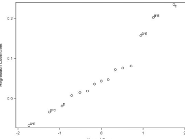

E=延迟时间具有正效应（如正态图所示）；这通常意味着增加混合与包装之间的延迟时间会增加响应（或批次内变异）。然而，由于表 6.3 中因子 E 的低（编码）水平被非传统地分配为 7，高（编码）水平分配为 1，这实际上告诉我们，平均而言，增加混合与包装之间的延迟时间会降低批次内变异性。由于交互作用 BE 和 DE 也似乎显著，因子 E 的平均主效应并不能讲述全部情况。图 6.2 显示了温度与延迟时间的交互图。由此可见，如果在混合过程中使用冷却水冷却搅拌机，延迟时间对批次内变异性影响不大。但是，如果在环境温度下进行混合，增加混合与包装之间的延迟时间会显著降低批次内变异性。

## 图 6.2 混合温度与延迟时间的交互图

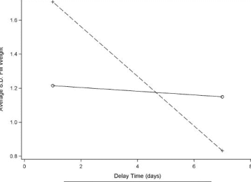

图 6.3 显示了批次重量与延迟时间的交互图。由此可见，对于小批次（1500 磅），增加混合与包装之间的延迟时间对批次内变异性影响不大；而对于大批次（2000 磅），增加混合与包装之间的延迟时间会降低批次内变异性。

基于本研究的结果，通过使用较大的批次大小（2000 磅）、混合时的环境温度以及混合与包装之间 7 天的延迟，可以获得批次内拌料的最小变异。这并未回答结果引发的一个新问题：混合与包装之间是否需要完整的 7 天延迟，或者 3 天或 4 天的延迟是否同样能降低变异性？然而，生产和研究人员同意当前结果是合理的，因为拌料的均匀性与植物油的硬度有关，而植物油的硬度受温度和


搅拌。生产人员实施了最佳条件，同时研究继续调查新问题。

值得思考的是，如果进行的是一次一因子实验而非分数因子设计，交互作用是否会被发现。一次一因子类型实验的结论可能不可重复，因为人们可能不会意识到所见效应（或无效应）可能取决于被认为无关紧要的其他因素设置。


## 6.3 2^k 设计的四分之一及更高分数

在 2^(k-1) 设计中，只进行一半的实验运行，每个可估计效应都与一个交互作用混淆。同样，在四分之一分数 2^(k-2) 设计中，只运行完整 2^k 设计的四分之一实验运行，每个可估计效应都与另外三个交互作用混淆。在八分之一分数中，只进行全因子设计的八分之一运行，每个估计效应都会与另外七个交互作用混淆，以此类推。这些设计起初可能听起来令人困惑，因为每个可估计效应都与大量效应混淆。然而，它们在实践中被相当频繁地使用，通过遵循效应稀疏性原则和层次排序原则，通常只需全因子设计所需总运行次数的一小部分就能得出有用结论。

要构建 2^k 设计的四分之一分数，先从 2^(k-2) 个因子的基础设计开始，然后通过将两个额外因子的编码因子水平设为前 $k - 2$ 列中的两个交互作用来添加这两个因子，如下所示。

| $X_A$ | $X_B$ | $X_C$ | $X_D$ | $X_E$ | $X_B X_C$ | $X_A X_B X_C$ |
|---|---|---|---|---|---|---|
| - | - | - | + | + | + | + |
| - | + | - | - | + | + | + |
| - | + | + | - | - | - | + |
| + | + | + | + | + | - | - |
| - | - | + | + | - | + | - |
| + | + | + | + | + | - | - |
| - | + | + | + | - | + | - |
| + | + | + | + | + | + | + |

↓

| $X_A$ | $X_B$ | $X_C$ | $X_D$ | $X_E$ |
|---|---|---|---|---|
| - | - | - | + | + |
| + | - | - | - | - |
| + | + | - | - | + |
| + | + | - | + | - |
| - | + | + | + | - |
| + | + | + | - | + |
| + | + | + | + | + |
| + | + | + | + | + |

上述创建的设计有两个生成元，D = AB 和 E = AC。由此可以看出 I = ABD 和 I = ACE。另外，由于 I^2 = I，第三个等式（称为广义交互作用）是 I = ABD(ACE) 或 I = BCDE。将两个生成元和广义交互作用得到的三个方程组合起来，得到设计的定义关系 I = ABD = ACE = BCDE。设计的混淆模式（或别名结构）是通过将定义关系乘以每个可估计效应来找到的：

- $A + BD + CE + ABCDE$
- $B + AD + ABCE + CDE$
- $C + ABCD + AE + BDE$
- $D + AB + ACDE + BCE$
- $E + ABDE + AC + BCD$
- $BC + ACD + ABE + DE$
- $BE + ADE + ABC + CD$

构建八分之一及更高分数的方法类似。要构建 $2^6$ 设计或 $2^{6-3}$ 设计的八分之一分数，先从 $6 - 3 = 3$ 个因子的基础设计开始，然后通过将三个额外因子与交互作用混淆来添加这三个因子。例如，如果我们选择生成元 D = AB、E = AC 和 F = BC，则可以使用下面的 SAS 代码来生成该设计。

```
data frac;
do x1=-1 to 1 by 2;
do x2=-1 to 1 by 2;
do x3=-1 to 1 by 2;
A=x3; B=x2; C=x1;
D=A*B; E=A*C; F=B*C; output;
end;
end;
end;
keep A B C D E F;
proc print; run;
```

该设计中有八次运行，除了总体均值外，还可以估计七个效应。每个效应都将与七个交互作用别名。要找出每个可估计效应与哪些交互作用别名，首先要找到定义关系。从生成元 I = ABD = ACE = BCF。两因子广义交互作用是 ABD(ACE) = BCDE、ABD(BCF) = ACDF 和 ACE(BCF) = ABEF。三因子广义交互作用是 ABD(ACE)(BCF) = DEF。将从生成元和广义交互作用找到的方程组合起来，定义关系为：

I = ABD = ACE = BCF = BCDE = ACDF = ABEF = DEF

通过将定义关系乘以主效应（A–F）和三因子交互作用（ABC），可以确定七个可能估计效应的别名。在 SAS 中快速做到这一点的方法是使用自动化 ADX 系统。这是一个点击式界面，可自动化创建和分析 2^{k-p} 设计及其他类型的设计。ADX 创建和分析 2^{k-p} 设计的已完成输入表单示例显示在随本书附带的讲义幻灯片中。

## 6.4 2^{k-p} 设计生成元选择准则

在为 2^{k-p} 设计选择生成元时，有不止一种选择。例如，要创建 2^6 设计的四分之一分数，可以使用生成元 E = ABC 和 F = ABD，或者使用生成元 E = AB 和 F = ACD。第一种选择得到的定义关系和别名结构（仅主效应）如下所示：

```
I = ABCE = ABDF = CDEF
A + BCE + BDF + ACDEF
B + ACE + ADF + BCDEF
C + ABE + ABCDF + DEF
D + ABCDE + ABF + CEF
E + ABC + ABDEF + CDF
F + ABCEF + ABD + CDE
```

第二组生成元得到的定义关系和别名结构（仅主效应）如下：

```
I = ABE = ACDF = BCDEF
A + BE + CDF + ABCDEF
B + AE + ABCDF + CDEF
C + ABCE + ADF + BDEF
D + ABDE + ABF + CEF
E + ABC + ACF + ABEF
F + ABEF + ACD + BCDE
```

两组生成元都得到十六次运行的分数因子实验，但第一组生成元可能更可取，因为每个主效应都与三因子交互作用及更高阶交互作用混淆，而使用第二组生成元得到的设计中，主效应 A 和 B 各自与一个二因子交互作用混淆。第一种设计混淆的可能性较小，因为层次排序原则告诉我们，三因子交互作用比二因子交互作用不太可能重要。

已提出三项一般准则，用于指导为任何可能的 2^{k-p} 设计在各种可能的生成元集合中进行选择。这些准则是分辨率准则、失真准则和清晰效应准则。

Box 和 Hunter (1961) 首先提出了分辨率准则。设计的分辨率定义为定义关系中最短单词的长度。例如，在上面显示的第一个定义关系中，最短单词长度为 4。因此它是分辨率 IV 设计。上面显示的 2^{6-2} 设计的第二个定义关系的最短单词长度为 3，因此它是分辨率 III 设计。一般来说，如果两个设计的运行次数相同，则优先选择分辨率较高的设计。

在分辨率 R 设计中，涉及 i 个因子的效应不会与阶数小于 R - i 的效应别名。例如，在分辨率 V 设计中，主效应与四因子及更高阶交互作用别名，二因子交互作用与三因子及更高阶交互作用别名。因此，如果可以假设所有三因子及更高阶交互作用可忽略，则可以从分辨率 V 设计中估计所有主效应和二因子交互作用。在分辨率 IV 设计中，主效应与三因子及更高阶交互作用别名。而在分辨率 III 设计中，主效应与二因子交互作用混淆。分辨率 III 设计通常仅用于筛选实验，其目的是发现哪些因素足够重要，以便在后续实验中进一步研究。

分数因子实验的投影性是另一个可从其分辨率确定的属性。在分辨率 R 设计中，任何 \( k = R - 1 \) 个因子的子集都将形成一个完整的 \( 2^k \) 设计（某些运行可能重复）。因此，如果实验以分辨率 \( R \) 分数设计开始，并且只有 \( R - 1 \) 个因子看起来显著，则可以仅包含 \( R - 1 \) 个显著因子对数据进行重新分析。由于这些因子中的设计是全因子设计，可以检验 \( R - 1 \) 个因子之间所有可能阶数的交互作用。

当两个或多个使用不同生成元集合创建的设计具有相同的运行次数和相同的分辨率时，Fries 和 Hunter (1980) 提出了另一项准则来决定哪种设计更可取。他们将此准则称为 *最小失真准则*。如果设计定义关系中长度为 \( r \) 的单词数定义为 \( A_r \)，则如果 \( r \) 是使得 \( A_r(d_1) \neq A_r(d_2) \) 且 \( A_r(d_1) < A_r(d_2) \) 的最小整数，则设计 \( d_1\) 被认为比设计 \( d_2\) 具有更小的失真。例如，如果 \( d_1 \) 是使用生成元 \( F = ABCD \) 和 \( G = ABCE \) 创建的分辨率 IV \( 2^{7-2} \) 设计，则它比使用生成元 \( F = ABC \) 和 \( G = ADE \) 创建的设计 \( d_2 \) 具有更小的失真，因为 \( d_1 \) 的定义关系（\( I = ABCDF = ABCEG = DEFG \））只有 1 个长度为 4 的单词，而 \( d_2 \) 的定义关系（\( I = ABCF = ADEG = BCDEFG \））有两个长度为 4 的单词。对于任何 \( k \) 和 \( p \)，总是存在一个最小失真 \( 2^{k-p} \) 设计，其失真小于任何其他 \( 2^{k-p} \) 设计。对于分辨率相同的两个设计，最小失真设计将主效应与低阶交互作用的混淆更少，通常更可取。

为 \( 2^{k-p} \) 设计选择生成元的最后一项有用准则是清晰效应的数量。Chen 等人 (1993) 定义，如果一个效应的任何别都不是主效应或二因子交互作用，则该效应为清晰。在某些情况下，非最小失真设计可能比最小失真设计具有更多清晰效应。例如，Wu 和 Hamada (2000) 解释说，定义关系为 \( I = ABCE = ABDF = CDEF \) 的 \( 2^{6-2} \) 设计的所有六个主效应都是清晰的，而定义关系为 \( I = ABE = ACDF = BCDEF \) 的 \( 2^{6-2} \) 设计有三个主效应（C、D 和 F）清晰，以及六个二因子交互作用 BC、BD、BF、CE、DE 和 EF 清晰。在某些二因子交互作用被认为 *先验* 重要的情况下，第二种设计可能优于第一种。Wu 和 Hamada (2000) 的表 4A 列出了最小失真设计的生成元和


为8运行到64运行的设计设计具有最大数量清晰效应（如果不同）的设计。

当使用SAS ADX自动系统创建 2**-k-p 分级因子实验设计时，用户首先指定因子数 k。接着，程序向用户展示有限的 p 值选择集。一旦用户选择 p 的值，程序就会从内部存储的表中调用生成元。这些存储的生成元是用于最高分辨率最小偏差设计的。如果用户想要选择不同的生成元集，可以通过选择“创建用户设计”选项来完成。本书的讲义幻灯片展示了如何操作的示例。

SAS 过程 factex 也可以创建最小偏差设计。proc factex 不允许用户指定设计的生成元，而在 ADX 或数据步中可以这样做，如第 6.2 节和 6.3 节的示例所示。但是，当在模型语句中指定分辨率与最小偏差选项时，如下面的命令所示，proc factex 使用类似于 Franklin (1985) 提出的算法，来搜索设计的一组生成元。output 语句导致设计存储在 SAS 文件 ff 中。examine aliasing(3) confounding；

```
proc factex;
factors A B C D E F G H;
size design=16;
model resolution=4 minabs;
examine aliasing(3) confounding;
output out=ff;
run;
```

将打印过程找到的生成元以及最高 3 阶的别名，如下一页的输出所示。如果找不到满足指定条件的设计，则 SAS 日志中会打印消息 WARNING: 未找到此类设计。如果将上面的 factors 语句更改为 factors A B C D E F G H I;，就会发生这种情况，因为不存在分辨率 IV 的 2**-5 设计。

考虑 2**8-4 分级因子实验设计与分析的以下示例。AlmedadaSilva 等人 (1998) 开展了一项实验，旨在寻找在桉树半纤维素水解液上培养 Paecilomyces variotii（一种常见于热带国家空气和土壤中的真菌）的最佳条件，以生产微生物蛋白。巴西工业仅利用桉树木材总干重的 51.6%，其余部分（树枝、树叶、小树等）留在田地里。这种废弃物的半纤维素分馏可通过酸处理轻松去除，所得水解液富含可发酵糖。P. variotii 真菌从 21 种酵母和丝状真菌中选出，因其在桉树半纤维素水解液上的表现。该真菌在 72 小时发酵期间产生的蛋白质生物量具有与动物饲料常用产品相当或更优的氨基酸谱。本实验的目的

#### 因子混淆规则

E = B*C*D
F = A*C*D
G = A*B*D
H = A*B*C

#### 别名结构

A = B*C*F = B*D*G = B*E*H = C*D*H = C*E*G = D*E*F = F*G*H
B = A*C*H = A*D*G = A*E*F = C*D*E = C*F*G = D*F*H = E*G*H
C = A*B*H = A*D*F = A*E*G = B*D*E = B*F*G = D*G*H = E*F*H
D = A*B*G = A*C*F = A*E*H = B*C*E = B*F*H = C*G*H = E*F*G
E = A*B*F = A*C*G = A*D*H = B*C*D = B*G*H = C*F*H = D*F*G
F = A*B*E = A*C*D = A*G*H = B*C*G = B*D*H = C*E*H = D*E*G
G = A*B*D = A*C*E = A*F*H = B*C*F = B*E*H = C*D*H = D*E*F
H = A*B*C = A*D*E = A*F*G = B*D*F = B*E*G = C*D*G = C*E*F
A*B = C*H = D*G = E*F
A*C = B*H = D*F = E*G
A*D = B*G = C*F = E*H
A*E = B*F = C*G = D*H
A*F = B*E = C*D = G*H
A*G = B*D = C*E = F*H
A*H = B*C = D*E = F*G

实验旨在研究抑制剂、营养物质和发酵时间对 P. variotii 产生的生物量生长的影响。表 6.5 显示了要研究的因子和水平。

### 表 6.5 生物量实验的因子和水平

| 标签 | 因子 | 水平 - | 水平 + |
|---|---|---|---|
| A | 抑制剂（糠醛和乙酸） | 1.25g/L | 7.8g/L |
| B | 米糠 | 10.0g/L | 30.0g/L |
| C | 尿素 | 0.0g/L | 2.0g/L |
| D | 硫酸镁 | 0.0g/L | 1.5g/L |
| E | 硫酸铵 | 0.0g/L | 2.0g/L |
| F | 硝酸钾 | 0.0g/L | 2.0g/L |
| G | 磷酸钠 | 0.0g/L | 2.0g/L |
| H | 发酵时间 | 72 小时 | 96 小时 |

采用了带有生成元 E = BCD、F = ACD、G = ABC 和 H = ABD 的 2^(8-4) 分级因子实验设计。这是最小偏差分辨率 IV 设计，该设计中的清晰效应包括八个主效应加上下面显示的七个两因子交互作用的别名字符串。

```
CG + DH + AB + EF
AC + BG + DF + EH
CF + AD + EG + BH
CH + DG + AE + BF
CD + GH + AF + BE
BC + AG + DE + FH
CE + FG + AH + BD
```

在 SAS ADX 窗口中创建的设计如图 6.4 所示。可以通过单击“编辑响应”按钮，然后选择“设计-->随机化设计...”来对列表进行随机排序。

### 图 6.4 2^8-4 Paecilomyces variotii 培养实验


图 6.5 显示了 SAS ADX 工具计算的效应（高因子水平下的平均响应减去低因子水平下的平均响应）。

图 6.6 显示了由 SAS ADX 生成的效应正态图。ADX 会自动在正态图中添加一条参考线。在此图中，没有效应明显偏离参考线。然而，B-米糠、E-硫酸铵、H-发酵时间的主效应，以及交互作用混淆字符串 CF + AD + EG + BH 的绝对值较大，并位于估计

### 图 6.5 Paecilomyces variotii 培养实验的效应

| 效应 | 估计值 | 标准误 | t 值 | P 值 |
|---|---|---|---|---|
| A | 0.845 | . | . | . |
| B | 3.065 | . | . | . |
| C | -1.385 | . | . | . |
| D | -8.535 | . | . | . |
| E | 2.89 | . | . | . |
| F | -0.995 | . | . | . |
| G | 1.45 | . | . | . |
| H | -2.115 | . | . | . |
| A*B + ... | 0.5675 | . | . | . |
| B*G + ... | 0.3925 | . | . | . |
| B*H + ... | -2.1925 | . | . | . |
| B*F + ... | -0.7975 | . | . | . |
| B*E + ... | 1.2175 | . | . | . |
| B*C + ... | 0.5975 | . | . | . |
| B*D + ... | -0.1125 | . | . | . |

### 图 6.6 2^(8-4) Paecilomyces variotii 培养实验的效应正态图


效应。如果假设三因子交互作用可忽略，则可以将三个主效应的效应解释为大效应的原因，但不清楚两因子交互作用混淆字符串代表什么。

文章作者认为，该实验提供了证据表明因子 A（抑制剂）影响甚微，并通过引用其他已发表的报告予以证实。他们还认为，该实验显示主效应 D（硫酸镁）和 F（硝酸钾）不显著。然而，由于两因子交互作用与第二大效应（绝对值）混淆，以及效应正态图中没有任何内容明显突出，无法得出确定结论。他们决定使用因子 B、C、E、G 和 H 以及定义关系 I = BCEGH 运行另一个分辨率 V 的 2^(5-1) 跟进实验，并将因子 A、D 和 F 保持在第一个实验所用水平的中点。这是一个 16 运行设计，但如果可以安全地假设在第一组十六个实验中主效应 A、D 和 F 可忽略，那么拟议跟进设计的十六个运行中有八个已经完成。

图 6.7 显示了在 SAS ADX 中创建的 2^(5-1) 设计。运行编号 3、4、7、8、11、12、15 和 16 已在 2^(8-4) 设计中作为运行 14、7、6、15、13、8、12 和 16 分别完成。其余八个实验按随机顺序完成，以获得所示结果。由于此设计为分辨率 V，所有主效应和两因子交互作用均清晰，如果可以假设三因子及更高阶交互作用可忽略，则可以估计它们。


图 6.8 显示了由 SAS ADX 生成的跟进设计的效应正态图。在此图中可以看到，B-米糠、E-硫酸铵、G-磷酸钠的主效应以及交互作用 BH


(米糠 x 发酵时间)、EG (硫酸铵 x 磷酸钠) 和 CH (尿素 x 发酵时间) 从参考线突出，似乎具有显著性。

### 图 6.8 来自 2^{5-1} Paecilomyces variotii 培养实验的效应正态图


由于存在显著交互作用，主效应不应孤立地进行解释。图 6.9 是由 SAS ADX 创建的交互作用图。它显示发酵时间的效应如何取决于米糠的水平。当培养基中仅含有 10 g/L 的米糠时，可以看出将发酵时间从 72 小时增加到 96 小时会增加产生的生物量。但是，如果培养基中含有 30 g/L 的米糠，增加发酵时间反而会减少产生的生物量。

### 图 6.9 发酵时间和米糠水平的交互作用图


图 6.10 显示硫酸铵对生物量生产的效应如何取决于磷酸钠的水平。这里可以看出，当营养中未添加磷酸钠时，将硫酸铵水平从 0.0 增加到 2.0 g/L 会比添加 2.0 g/L 磷酸钠时引起更大的生物量增加。但是，由于添加磷酸钠也会增加生物量，因此当含有 2.0 g/L 磷酸钠和 2.0 g/L 硫酸铵时，似乎会得到最大生物量。

### 图 6.10 硫酸铵和磷酸钠的交互作用图


图 6.11 显示发酵时间和尿素（CH）的交互作用图。平均而言，可以看出增加发酵时间似乎对生物量生产影响不大。同样，平均而言，向培养基中添加尿素似乎对产生的生物量影响也不大。但是，如图所示，发酵时间对生物量的效应取决于是否存在尿素，并且其效应似乎取决于是否向培养基中添加 2.0 g/L 尿素而正好相反。

虽然两个没有显著主效应的因子之间可能存在交互作用（如图 6.11 所示的示例），但这种情况很少见。通常，交互作用发生在至少两个主效应中有一个显著的因子之间。这已被 Hamada 和 Wu (1992) 描述为 *效应层级原则*。在此实验中，由于发酵时间与尿素之间的二因子交互作用与米糠、硫酸铵和磷酸钠之间的三因子交互作用混淆（即，CH = BEG），并且后三个因子都具有显著的主效应，因此正态图上标记为 CH 的大效应实际上可能是三因子交互作用。在这种情况下，效应遗传原则可能会掩盖层级排序原则。

### 图 6.11 发酵时间和尿素的交互作用图


三因子交互作用意味着一个因子的效应取决于另外两个因子水平的组合。一系列交互作用图（如第 3.6 节示例中的那些）对于解释或阐释三因子交互作用很有用。由 SAS ADX 生成的图 6.12 显示了在米糠和磷酸钠的四种组合下，硫酸铵对生物量的效应。

### 图 6.12 用于解释三因子硫酸铵 × 米糠 × 磷酸钠交互作用的交互作用图


如果假设这个三因子交互作用很重要，那么图 6.10 中的二因子交互作用图并不能讲述全部情况。在图 6.12 中可以看出，向培养基中添加 2.0 g/L 硫酸铵总体上会增加产生的生物量。但是，当培养基中含有 30 g/L 米糠且不含磷酸钠时，这种效应最大。最佳结果似乎是在发酵时间为 72 小时、培养基中含有 30 g/L 米糠、2.0 g/L 硫酸铵和 0.0 g/L 磷酸钠时获得。在那里，生物量产量为 11.57 g/L。

文章的作者继续对四个因子中的三个（米糠、硫酸铵和发酵时间）进行响应面实验，以进一步优化生物量蛋白的生产。这些实验和结果将在第 10 章中描述。

为了回顾此示例，研究人员从表 6.5 所示的八个因子开始，每个因子有两个水平。要完成一个全因子实验，将需要 $2^8 = 256$ 次实验。效应稀疏原则和层级排序原则表明，可能不需要这么多次实验。对于八个因子，所有主效应和大量交互作用都显著的可能性很小。一系列两个分数因子实验，总共采用 24 次运行，揭示了四个主效应是显著的，且最多有三个交互作用。交互作用图有助于对结果做出合理的解释，并确定最佳结果的因子水平。交互作用的解释对于确定最佳结果至关重要，如果采用凭经验办事的方法或一次改变一个因子的计划，则永远不会发现这些交互作用。

## 6.5 增补分数因子设计

上一个示例介绍了通过额外实验来增补分数因子设计的想法，以便消除某些主效应或交互作用的混淆。本节将描述一些正式程序，以实现此目的。第 6.5.1 节将描述保持增补设计最佳正交性属性的程序。第 6.5.2 节将描述一种可能需要更少额外实验，但可能不保持正交性的程序。

### 6.5.1 通过折叠或镜像设计进行增补

在分辨率 III 的分数因子设计中，主效应与某些二因子交互作用混淆。如果在分辨率 III 设计的数据分析后，不止一个效应似乎显著，则不清楚所有效应是否都归因于主效应，或者其中一些是否可能是二因子交互作用。例如，在六个因子的八次运行分辨率 III 设计（由 $2_{III}^{6-3}$ 表示）中，生成元为 $D = AB$、$E = AC$ 和 $F = BC$，其定义关系为

```
I = ABD = ACE = BCF = DEF = BCDE = ACDF = ABEF.
```

如果在此设计的数据分析后，效应 $B$ 和 $D$ 似乎显著，那么可能是这两个主效应是活跃效应。然而，效应遗传原则告诉我们有两种替代解释。第一种替代解释如下。由于 $D$ 与 $AB$ 和 $EF$ 混淆，可能是主效应 $B$ 和 $AB$ 交互作用是活跃效应，而 $D$ 仅显得很大是因为它与 $AB$ 混淆。第二种替代解释是，主效应 $D$ 和 $AD$ 交互作用是活跃效应，而 $B$ 仅显得很大是因为它与 $AD$ 和 $CF$ 混淆。如果没有额外实验，无法确定数据的三种解释中哪一种是正确的。

打破主效应与二因子交互作用之间混淆的一种方法是运行一组额外的实验，该组实验与第一组相同，只是一个或多个因子的编码因子水平已被反转（Box *et al.* (1978)）。这称为折叠分数。例如，在上一段描述的 $2_{III}^{6-3}$ 中，如果因子 B 的符号被反转，则定义关系将变为 $I = -ABD = ACE = -BCF = DEF = -BCDE = ACDF = -ABEF$。如果将两个八次运行设计合并，如表 6.6 所示，则得到的十六次运行设计将具有定义关系 $I = ACE = DEF = ACDF$。虽然这仍然是一个分辨率 III 设计，但主效应 $B$ 是清晰的，且主效应 $D$ 不再与 $AB$ 交互作用混淆。

### 表 6.9 通过对因子 B 符号反转的 $2_{III}^{6-3}$ 设计增补的 $2_{III}^{6-3}$ 设计

| 运行 | A | B | C | D | E | F |
|---|---|---|---|---|---|---|
| 1 | - | - | - | - | + | + |
| 2 | + | - | - | - | - | + |
| 3 | - | + | - | - | + | + |
| 4 | + | + | - | + | - | - |
| 5 | - | - | + | + | - | - |
| 6 | + | - | + | - | + | - |
| 7 | - | + | + | - | - | + |
| 8 | + | + | + | + | + | + |
| 9 | - | + | - | + | + | + |
| 10 | + | - | - | + | - | + |
| 11 | - | - | - | - | + | - |
| 12 | + | - | - | + | - | - |
| 13 | - | + | + | + | - | - |
| 14 | + | + | + | - | + | - |
| 15 | - | - | + | - | + | + |
| 16 | + | - | + | + | + | + |

一般来说，使用另一个分辨率 III 设计来增补分辨率 III 设计，并反转一个因子的编码因子水平，将使该因子及其所有二因子交互作用与其他二因子交互作用不再混淆。


Montgomery 和 Runger (1996) 表明，由原始设计加上折叠设计组合而成的组合设计的定义关系将包含原始设计中那些在折叠部分未进行符号反转的效应。

如果将一个 III 级设计与另一个 III 级设计进行增补，且所有因子的编码因子水平均反转（称为镜像设计），则组合设计将为 IV 级，且所有主效应将不受二阶交互作用影响。在这种情况下，组合设计的定义关系将仅包含原始定义关系中偶数长度的词。例如，生成元为 $D = AB, E = AC$ 的 $2_{III}^{7-2}$ 设计具有定义关系 $I = ABD = ACE = BCDE$。如果将其与所有编码因子水平符号均反转的镜像部分相结合，则组合设计的定义关系将为 $I = BCDE$。以下 SAS 代码展示了如何在 SAS DATA 步骤中创建此设计。也可以在 SAS ADX 工具中创建折叠设计和镜像设计。

```
data orig;
   do x1 = -1 to 1 by 2;
   do x2 = -1 to 1 by 2;
   do x3 = -1 to 1 by 2;
   A=x3; B=x2; C=x1; D=A*B; E=A*C; Block=1; output;
   end;
   end;
   end;
keep A B C D E Block;
data fold; set orig;
A=-A; B=-B; C=-C; D=-D; E=-E; Block=2;
data comb; set orig fold;
proc print; run;
```

通过将 III 级设计与其镜像设计（即所有因子符号反转）相结合来创建 IV 级设计时，可以添加一个额外的阻塞因子，以解释两组实验之间平均响应的任何差异。通过添加额外因子，实验可以按顺序进行。首先完成原始 III 级设计并分析数据。如果只有一个因子似乎显著，则可能不需要额外实验。另一方面，如果两个或多个效应似乎显著，则可以完成镜像设计，以消除主效应与二阶交互作用之间的混淆。额外因子可以解释自第一组实验以来实验环境中发生的任何变化。在分析中包含它将防止任何未预料的变化偏倚所研究因子的效应。

用其镜像设计增补 IV 级设计无法帮助打破别名二阶交互作用链，因为二阶交互作用的符号不会改变。然而，通过折叠部分增补 IV 级设计可用于打破别名二阶交互作用链，前提是仅对一个或两个因子更改 4 个符号。例如，$2^{7-4}_V$ 设计（生成元为 E = BCD、F = ACD、G = ABC、H = ABD）具有七组每组 4 个的混淆二阶交互作用链，即，

- AB + EF + CG + DH
- AC + DF + BG + EH
- CD + BE + AF + GH
- AD + CF + EG + BH
- AE + BF + DG + CH
- BC + DE + AG + FH
- BD + CE + FG + AH

如果用另一个设计增补此设计，其中因子 A 的符号被反转，则涉及因子 A 的所有二阶交互作用将不受其他二阶交互作用影响。

一般来说，Montgomery 和 Runger (1996) 表明，组合设计的别名集是通过将原始部分中符号反转的效应分组来从原始分数的别名集分区中获得的。例如，在生成元为 E = ABC 和 F = BCD 的 $2^{7-4}_V$ 设计中，可估计的 16 个效应（最高至三阶交互作用）的别名为：

- I + ABCE + BCDF + ADEF
- A + BCE + DEF
- B + ACE + CDF
- C + BDF + ABE
- D + BCF + AEF
- E + ABC + ADF
- F + BCD + ADE
- CE + AB
- AC + BE
- AD + EF
- BC + AE + DF
- DE + AF
- CF + BD
- CD + BF
- ABD + CDE + ACF + BEF
- ACD + BDE + CEF + ABF

如果用所有因子 A 符号反转的折叠设计增补此设计，则可以估计 32 个效应，并且可以从上述列表中确定每个效应的别名。包含 A 的每个效应都会改变符号。将符号相同的效应分组，即可得到以下 32 组。

- ABCE + ADEF, I + BCDF
- A, BCE + DEF
- ACE, B + CDF
- ABE, C + BDF
- AEF, D + BCF
- ABC + ADF, E
- ADE, F + BCD
- AB, CE
- AC, BE
- AD, EF
- AE, BC + DF
- AF, DE
- ACDE + ABEF, CF + BD
- ABDE + ACEF, CD + BF
- ABD + ACF, CDE + BEF
- ACD + ABF, BDE + CEF

如果用因子 A 和 B 符号反转的相同设计增补 $2^{6-2}$ IV 设计，则包含单个 A 或单个 B 的效应将反转符号。包含 A 和 B 或既不包含 A 也不包含 B 的效应不会反转符号，且 32 个可估计效应的别名将与上述所示不同。当对 IV 级设计数据分析后仅发现少数效应显著时，通常可以找到一种折叠设计，将显著主效应与涉及这些显著主效应的二阶交互作用分开。

考虑两种用于优化饮用水过滤器的设计，以说明如何增补分数因子设计以估计交互作用。据报道，阿根廷、孟加拉国、智利、中国、印度、日本、墨西哥、蒙古、尼泊尔、波兰、台湾、越南以及美国部分地区的地下水中砷含量较高，研究表明，暴露于高浓度砷的人容易患上各种形式的癌症。氧化铁涂层砂（IOCS）已被用于在孟加拉国的简单家用过滤系统中去除地下水中的砷。Ramakrishna 等人 (2006) 开展了一项研究，旨在系统研究多个因子对 (IOCS) 砷去除率的影响。

实验包括制备由硝酸铁和氢氧化钠组成的涂层溶液，并加入 NaOH 调节 pH 值。该溶液陈化后，倒入洁净干燥的砂中并混合。混合物干燥 12 小时，然后用于过滤添加了已知浓度砷的水溶液。响应为砷去除百分比，研究中变化的因子如下表所示。

Table 6.7 砷去除实验的因子与水平

| 标签 | 因子 | 水平 - | 水平 + |
|---|---|---|---|
| A | 涂层 pH | 2.0 | 12.0 |
| B | 干燥温度 | 110° | 800° |
| C | 涂层中 Fe 浓度 | 0.1 M | 2 M |
| D | 涂层次数 | 1 | 2 |
| E | 涂层陈化时间 | 4 小时 | 12 天 |
| F | 加砷水 pH | 5.0 | 8.0 |
| G | 吸附剂质量 | 0.1 g | 1 g |

第一组实验采用了生成元为 D = AB、E = AC、F = BC 和 G = ABC 的 $2^{7-4}$ 分数因子设计。结果显示在表 6.8 的上半部分。这些实验按标准顺序列出，而非运行时的随机顺序。

Table 6.8 通过对所有因子符号反转的折叠 $2^{7-4}$ 增补的 $2^{7-4}$ 设计

| 运行 | 块 | A | B | C | D | E | F | G | As 去除百分比 |
|---|---|---|---|---|---|---|---|---|---|
| 1 | 1 | - | - | - | + | + | + | - | 69.95 |
| 2 | 1 | + | - | - | - | - | + | + | 58.65 |
| 3 | 1 | - | + | - | - | + | - | + | 56.25 |
| 4 | 1 | + | + | - | + | - | - | - | 53.25 |
| 5 | 1 | - | - | + | + | - | - | + | 94.40 |
| 6 | 1 | + | - | + | - | + | - | - | 73.45 |
| 7 | 1 | - | + | + | - | - | + | - | 10.00 |
| 8 | 1 | + | + | + | + | + | + | + | 2.11 |
| 9 | 2 | + | + | + | - | - | - | + | 16.20 |
| 10 | 2 | - | + | + | + | - | - | - | 52.85 |
| 11 | 2 | + | - | + | + | - | + | - | 9.05 |
| 12 | 2 | - | - | + | - | + | + | + | 31.1 |
| 13 | 2 | + | + | - | - | + | + | - | 7.40 |
| 14 | 2 | - | + | - | + | - | + | + | 9.90 |
| 15 | 2 | + | - | - | + | + | - | + | 10.85 |
| 16 | 2 | - | - | - | - | - | - | - | 48.75 |

基于前八次运行计算的效应的半正态图（留作练习）表明，因子 $B$（涂层砂干燥温度）和 $F$（加砷水 pH 值）似乎显著。两个因子均具有负效应，且各自的高水平导致较低的砷去除百分比。这意味着砷去除百分比仅受涂层砂干燥温度和加砷水溶液 pH 值的影响。然而，将结果解释为仅两个主效应活跃可能具有误导性。$B$ 与三个二阶交互作用 $AD + CF + EG$ 混淆，$F$ 与 $BC + DE + AG$ 混淆。根据效应遗传原则，包含 $B$ 和 $BC$（暗示砷去除受涂层砂干燥温度和涂层中 Fe 浓度影响）的模型，以及包含 $F$ 和 $CF$（暗示砷去除受加砷水 pH 值和涂层中 Fe 浓度影响）的模型，也是对数据的合理解释。由于效应完全混淆，从 $2_{III}^{7-4}$ 的八次实验中无法判断哪个合理模型适用。

原始八次实验通过表 6.8 下半部分所示的镜像设计进行增补，以将主效应与二阶交互作用链分开。组合设计中包含一个额外的阻塞因子，以解释两组实验之间的任何差异。基于组合实验计算的效应的半正态图（留作练习）表明，代表两组实验差异的阻塞因子、主效应 $F$（加砷水 pH 值）、主效应 $B$（涂层砂干燥温度）、主效应 $A$（涂层 pH 值）以及表示混淆交互作用链 $AD + CF + EG$ 的效应均似乎显著。效应遗传原则建议两个合理模型来解释数据（忽略阻塞项）。第一个模型是 $(F, B, A, AD)$，即：

```
% removal = 37.76 - 12.99 \(\left( \frac{pHs - 7.0}{2.0} \right) - 11.76 \left( \frac{temp - 455^\circ}{345^\circ} \right)\)
- 8.89 \(\left( \frac{pHc - 7.0}{5.0} \right) - 10.09 \left( \frac{pHs - 7.0}{2.0} \right) \left( \frac{number coats - .75}{.5} \right)\).
```

该模型表明，当砂仅涂层一次时，提高用于涂层砂的硝酸铁氢氧化钠溶液的 pH 值对砷去除影响不大，但当砂涂层两次时，它会显著降低砷去除率。这可以在图 6.13 左侧中可视化。如果该模型正确，则意味着在砂过滤系统中，当涂层砂在低温下干燥（$B = -$）、涂层溶液 pH 值较低（$A = -$）且砂涂层两次（$D = +$）时，可以实现最大砷去除率。


第二个合理的模型是 \((F, B, A, CF)\)，即：% removal = 37.76 - 12.99 \(\left( \frac{pHs - 7.0}{2.0} \right)\) - 11.76 \(\left( \frac{temp - 45.5^{\circ}}{34.5} \right)\) - 8.89 \(\left( \frac{pHc - 7.0}{5.0} \right)\) - 10.09 \(\left( \frac{Fe - 1.05M}{0.95M} \right) \left( \frac{pHs - 7.0}{2.0} \right)\).

该模型表明，在被过滤水的pH较低时，增加涂层溶液中的Fe浓度会提高砷的去除率，但在被过滤水的pH较高时，则会降低去除率。这可以在图 6.13 的右侧直观地看到。如果该模型正确，则意味着在砂滤系统中，当涂层砂在低温下干燥（\(B = -\)）时，可以实现最大砷去除率；如果待过滤水的pH较低，则涂层溶液中的Fe浓度应较高；如果待过滤水的pH较高，则涂层溶液中的Fe浓度应较低。

## 图 6.13 砷去除实验的合理交互作用图


这两个模型是矛盾的。第一个模型意味着涂层溶液的pH值和砂被涂层的次数会影响砂滤器能去除的砷的百分比。然而，第二个模型意味着涂层溶液的pH值和砂被涂层的次数不影响砷去除；相反，涂层溶液的Fe浓度才是关键。该浓度的最佳水平必须由待过滤水的pH值来确定。

在十六次实验中，研究人员能够将影响砷去除的因子列表从最初的七个缩小到五个。但是，由于两个交互作用AD和CF完全混杂，无法从这两组实验的结果中确定哪个模型是正确的，以及为过滤系统涂层砂的最佳方法是什么。如果再运行一组16次实验的折叠重复，并对因子A、D、C或F中的一个反转符号，那么合并后的32次实验将允许估计所有项（F、B、A、AD和CF），并能建立一个可靠的模型。下一节将描述另一种用更少额外实验来估计所有项的数据增补方法。

#### 6.5.2 通过最优设计进行增补

用矩阵表示法，上一节中包含项（F、B、A、AD和CF）的模型，以及表 6.8 中所示的十六次运行设计可以写成：

```
y = X\beta + \epsilon,
```

其中

```
y = \begin{pmatrix} 69.95 \\ 58.65 \\ 56.25 \\ 53.25 \\ 94.40 \\ 73.45 \\ 10.00 \\ 2.11 \\ 16.20 \\ 52.85 \\ 9.05 \\ 31.10 \\ 7.40 \\ 9.90 \\ 10.85 \\ 48.75 \end{pmatrix}, X = \begin{pmatrix} 1 & -1 & -1 & -1 & 1 & -1 & -1 \\ 1 & -1 & 1 & -1 & -1 & -1 & -1 \\ 1 & -1 & -1 & 1 & -1 & -1 & 1 \\ 1 & -1 & 1 & 1 & -1 & 1 & 1 \\ 1 & -1 & -1 & -1 & 1 & -1 & -1 \\ 1 & -1 & 1 & -1 & -1 & 1 & -1 \\ 1 & -1 & -1 & 1 & 1 & -1 & 1 \\ 1 & -1 & 1 & 1 & 1 & 1 & 1 \\ 1 & 1 & -1 & -1 & -1 & -1 & -1 \\ 1 & 1 & -1 & -1 & -1 & 1 & -1 \\ 1 & 1 & 1 & -1 & -1 & -1 & 1 \\ 1 & 1 & 1 & -1 & 1 & -1 & 1 \\ 1 & 1 & -1 & 1 & -1 & 1 & -1 \\ 1 & 1 & -1 & 1 & 1 & -1 & 1 \\ 1 & 1 & 1 & 1 & -1 & 1 & 1 \\ 1 & 1 & 1 & 1 & 1 & -1 & 1 \end{pmatrix}, \beta = \begin{pmatrix} \beta_0 \\ \beta_{bl} \\ \beta_A \\ \beta_B \\ \beta_F \\ \beta_{AD} \\ \beta_{CF} \end{pmatrix}.
```

由于X矩阵的最后两列相同，该模型无法拟合，且最小二乘正规方程是奇异的。但是，为了估计模型中的所有参数，并不需要将运行次数翻倍（如果通过折叠重复来增补，则需要翻倍）。将运行次数翻倍可以保持正交性，使得所有估计效应都不相关。但是，任何能使X'X矩阵非奇异的额外运行都将允许估计所有感兴趣的效应。

可以检查的一个准则是|X'X|，以确保X'X矩阵非奇异，Dykstra（1971）表明，为合并后的运行集选择一组能最大化|X'X|的额外运行，称为D-最优设计。D-最优设计的动机来自以下事实：线性模型中回归系数的方差协方差矩阵是\(\sigma^2(X'X)^{-1}\)，而$\hat{\beta}$的置信椭球体积的倒数与$X'X$的行列式成正比。正交设计始终是D-最优的，并且对于其运行次数具有最大的|X'X|，但当实验者愿意为了减少所需运行次数而放弃不相关的效应估计时，针对减少运行次数的D-最优设计将是最佳选择。

另一个可用于选择额外运行的准则是tr$(X'X)^{-1}$，因为回归系数的方差是$\sigma^2(X'X)^{-1}$的对角元素。能够最小化tr$(X'X)^{-1}$的设计被称为A-最优设计，因为它最小化了回归系数的平均方差。

SAS proc optex在给定模型和候选设计点列表时，可以找到D-最优和A-最优设计。该过程使用一种算法，从候选设计点中找到一个子集，以最大化$|X'X|$或最小化tr$(X'X)^{-1}$。为了说明如何使用此proc来增补现有设计，请考虑增补砷去除实验的设计，以便确定模型中的所有项。表 6.8 中所示的设计是使用先前用于生成合并文件（原始加折叠重复）的代码的修改版本创建的，并存储在SAS文件comb中。下面的SAS代码在文件cand中创建一个由128个候选点组成的全因子列表。接下来调用proc optex，通过从cand中选择八个额外运行来增补文件comb，从而在三个区块中总共得到24次运行。generate语句上的选项criterion=D指定D-最优设计。如果省略此选项，则这是proc optex的默认设置。要生成A-最优设计，请将选项更改为criterion=A。第三个区块中的八个新运行将被打印并显示在

```
proc factors;
  factors A B C D E F G;
  size design=128;
  model estimate=(A|B|C|D|E|F|G);
  output out=cand;
  run;
  %macro confounding;
  run;
  data cand; set cand;
    Block=3;
  proc optex data=cand seed=37034;
    class Block;
    model Block;
    generate n=24 method=detmax criterion=D augment=comb;
    output output=optn;
  run;
  data newruns; set optn; if Block=3;
  proc print ; run;
```

下一页顶部的SAS输出中。完成该区块的实验后，可以使用proc glm或proc reg等回归程序，将包含主效应A、B和F以及AD和CF交互作用的模型拟合到数据中。

| 观测号 | A | B | F | D | C | 区块 |
|---|---|---|---|---|---|---|
| 1 | -1 | -1 | -1 | -1 | -1 | 3 |
| 2 | -1 | -1 | -1 | -1 | 1 | 3 |
| 3 | -1 | 1 | 1 | 1 | 1 | 3 |
| 4 | -1 | 1 | 1 | -1 | -1 | 3 |
| 5 | 1 | -1 | 1 | -1 | 1 | 3 |
| 6 | 1 | -1 | 1 | -1 | -1 | 3 |
| 7 | 1 | -1 | -1 | -1 | -1 | 3 |
| 8 | 1 | 1 | -1 | 1 | -1 | 3 |

## 6.6 Plackett-Burman (PB) 筛选设计

Resolution III $2^{k-p}$ 分数因子设计常用于筛选实验，其目的是确定哪些因子（来自头脑风暴整理的列表）足够重要，以便在后续实验中进行更详细的研究。但是，$2^{k-p}$ 分数因子设计的运行次数始终是2的幂，即8、16、32等，筛选实验中运行次数的这些有限选择可能具有限制性。例如，使用分数因子设计检查8个因子至少需要16次实验，检查16个因子需要32次实验。

Resolution III Plackett和Burman（1946）设计，即PB设计，可用的运行次数是4的倍数，即8、12、16、20等。这些设计最初由两位英国统计学家在第二次世界大战期间发现，当时他们正在研究多个因子对防空近炸引信原型机性能的影响。与$2^{k-p}$ 分数因子设计类似，这些设计对每个因子都有两个水平；对于运行次数为2的幂的情况，它们与$2^{k-p}$ 设计相同。对于其他运行次数，它们保留了$2^{k-p}$ 设计的理想正交性，但没有生成元或定义关系。运行次数为12、20和24的设计可以通过循环旋转第一次运行的因子水平来创建。表 6.9 显示了这些设计中第一次运行的因子水平。表 6.10 显示

| 运行次数 | 因子水平 |
|---|---|
| 12 | + - + - - + + + - + |
| 20 | + + + + - + + + + + + + + - + - - |
| 24 | + - - - + + - - + + + - + + - + + + + |

这些因子水平如何用于创建11个因子的12次运行Plackett-Burman设计。第一次运行的因子水平直接从表 6.9 的第一行复制。在第二次运行中，第一个因子（A）的水平是第一次运行中第十一个因子（L）的水平，第二次运行中因子B到L的因子水平是第一次运行中因子A到K的因子水平。此模式继续，通过循环旋转每次运行的因子水平来创建下一次运行的因子水平，直到最后一次运行。对于第12次运行，所有因子均设置为低（-）水平。要创建


### 表 6.10 12 次运行 Plackett-Burman 设计

| run | A | B | C | D | E | F | G | H | J | K | L |
|---|---|---|---|---|---|---|---|---|---|---|---|
| 1 | + | + | + | - | - | + | - | + | + | - | + |
| 2 | + | + | - | + | - | - | - | + | + | + | - |
| 3 | - | + | + | - | + | - | - | - | + | + | + |
| 4 | + | - | + | + | - | + | - | - | - | + | + |
| 5 | + | + | - | + | + | - | + | - | - | - | + |
| 6 | + | + | + | - | + | + | - | + | - | - | - |
| 7 | - | + | + | + | - | + | + | - | + | - | - |
| 8 | - | - | + | + | + | - | + | + | - | + | - |
| 9 | - | - | - | + | + | + | - | + | + | - | + |
| 10 | + | - | - | - | + | + | + | - | + | + | - |
| 11 | - | + | - | - | - | + | + | + | - | + | + |
| 12 | - | - | - | - | - | - | - | - | - | - | - |

在 k 个因素（k < 11）的 12 次运行设计中，操作完全同上，但仅使用设计中的 k 列来定义因子设置。要创建 20 次或 24 次运行的 Plackett-Burman 设计，操作完全同前，但从表 6.9 中具有正确运行次数的行开始。

这些设计可以在 SAS 数据步中轻松创建。下一页顶部的代码展示了如何创建如表 6.10 所示的 12 次运行设计。第一个数据步读入从表 6.9 复制的第 1 次运行的因子水平。第二个数据步通过循环旋转第一次运行的水平来创建第 1 至第 11 次运行的因子水平。最后一次运行的因子水平全部设置为 -1。

AUTOCALL 库中包含的 SAS 宏也可用于创建 Plackett-Burman 设计。只需输入以 % 开头的文件名，即可将这些宏包含在 SAS 代码中。ADXPBD 宏通过语句 `%adxpbd(file,nf)` 创建 Plackett-Burman 设计，其中 `file` 是将包含设计的 SAS 文件名，`nf` 是因子数量。例如，要创建具有 25 个因子的 28 次运行 Plackett-Burman 设计，只需输入以下命令

```
%adxgen
%adxff
%adxinit
%adxpbd (pb28, 25)
proc print data=pb28; run;
```

这些宏是 SAS ADX 图形用户界面的基础，也可用于创建 Plackett-Burman 设计。在实践中，Plackett-Burman 设计中运行的顺序应随机化，以在进行实验前减少未知因素带来的偏差可能性，这与其他任何设计一样。

```
* Create 12-run Plackett-Burman Design in Data Step;
* first reads factor levels for first line from ;
* Table 6.9
data li;
input f1--f11;
datalines;
1 -1 1 -1 -1 1 1 -1 1
1 -1 -1 -1 1 1 1 -1 1
data pb11; set li;
* Next cyclically rotates factor levels;
array f(11) f1-f11;
array t(11) t1-t11;
do i=1 to 11;
  do j=1 to 11;
    if j<1 then k=11-i+1+j;
    else k=j-i+1;
    t(j)=f(k);
  end;
  output;
end;
do i=1 to 11;
  t(i)=-1;
end;
output;
keep t1-t11;
proc print; run;
```

作为 Plackett-Burman 设计使用示例，请考虑表 6.11 中的数据，该数据来自 Hunter 等人（1982）关于焊接修复铸件疲劳寿命的研究。七个因子被分配给表 6.10 所示 Plackett-Burman 设计矩阵的最后七列，前四列在定义实验时未分配给因子。实验目的是识别影响焊接修复疲劳寿命的因子。响应 y 是每次焊接修复寿命的对数。我们将使用这些数据来说明 Plackett-Burman 设计数据的分析。此数据的分析已由其他几位研究者在文献中发表。

### 表 6.11 铸件疲劳实验的设计矩阵和寿命数据

| run | c8 | c9 | c10 | c11 | G | F | E | D | C | B | A |
|---|---|---|---|---|---|---|---|---|---|---|---|
| 1 | + | - | + | - | - | + | + | + | - | + | 4.733 |
| 2 | + | + | - | + | - | - | + | + | + | - | 4.625 |
| 3 | - | + | - | + | - | - | - | + | + | + | 5.899 |
| 4 | + | - | + | + | - | + | - | - | + | + | 7.000 |
| 5 | + | + | - | + | + | - | + | - | - | + | 5.752 |
| 6 | + | + | + | - | + | + | - | + | - | - | 5.682 |
| 7 | - | + | + | + | - | + | + | - | + | - | 6.607 |
| 8 | - | - | + | - | + | + | + | - | + | - | 5.818 |
| 9 | - | - | - | + | + | + | - | + | + | - | 5.917 |
| 10 | + | - | - | - | + | + | + | + | - | + | 5.863 |
| 11 | - | + | - | - | - | + | + | - | + | + | 6.058 |
| 12 | - | - | - | - | - | + | - | - | - | + | 4.809 |

用于更改先前创建的 12 次运行 Plackett-Burman 设计的列名，并将其与表 6.11 中的响应数据合并的 SAS 命令如下所示。

```
data cast; set pb11;
c8=c1; c9=c2; c10=c3; c11=c4; G=c5; F=c6; E=c7; D=c8; C=c9;
B=c10; A=c11; keep c8 c9 c10 c11 G F E D C B A;
data y; input y @@;
datalines;
4.733 4.625 5.899 7.000 5.752 5.682 6.607 5.818 5.917
5.863 6.058 4.809 ;
data castf; merge cast y;
```

接下来，对包含表 6.11 中所有 11 列的数据拟合模型。执行此操作的 SAS 命令如下所示。

```
proc glm data=castf;
   model y=A B C D E F G C8 C9 C10 C11/solution;
   ods output ParameterEstimates=sol;
run;
```

通过复制第 3.7.5 节的代码创建了绝对回归系数的半正态图，该图如图 6.14 所示。

### 图 6.14 铸件疲劳实验绝对回归系数的半正态图


该图显示主效应 F 明显显著，且下一个最大效应是主效应 D。原文作者得出结论，包含这两个因子的模型是正确模型，并通过回归对数据进行拟合，得到 $R^2 = .5867$。然而，应保持与第 6.5 节中水过滤示例所展示的相同谨慎。由于此 Plackett-Burman 设计为 III 级，二阶交互作用与主效应混杂，因此数据可能存在其他合理模型。可以向 Plackett-Burman 设计添加镜像设计，以消除主效应上的二阶交互作用；然而，由于此类设计的复杂混杂，这并非必要。

所谓复杂混杂，是指每个交互作用仅与许多主效应部分混杂，而非像在 $2_{II}^{7-7}$ 设计中那样完全与某一个主效应混杂。Lin 和 Draper（1992）以及 Wang 和 Wu（1995）表明，具有复杂混杂的设计具有隐藏投影性质。隐藏投影性质允许在设计为 III 级的情况下估计某些交互作用。对于仅部分因子似乎重要的 Plackett-Burman 设计，Wang 和 Wu 表明，可以通过回归拟合一个包含主效应及所有涉及重要主效应的二阶交互作用的模型。当模型中包含交互项时，设计变为非正交，效应必须通过回归估计，但 Wang 和 Wu 表明 D 效率仍然相当高。通常会使用某种回归子集选择程序来识别最合适的模型。对于表 6.11 中的数据，以下 SAS 命令创建交互列并使用 proc reg 执行全子集回归。

```
data castf; set castf;
*Note Defines Interactions;
AB=A*B; AC=A*C; AD=A*D; AE=A*E; AF=A*F; AG=A*G;
BC=B*C; BD=B*D; BE=B*E; BF=B*F; BG=B*G;
CD=C*D; CE=C*E; CF=C*F; CG=C*G;
DE=D*E; DF=D*F; DG=D*G;
EF=E*F; EG=E*G;
FG=F*G;
proc reg data=castf;
model y=A B C D E F G AB AC AD AE AF AG BC BD BE BF BG CD CE
CF CG DE DF DG EF EG FG/selection=rsquare best=4 stop=4;
run;
```

以下结果表明，当模型中考虑两个变量时，包含主效应 F 和交互作用 FG 的模型拟合效果最佳，R² = 0.8925，而作者拟合的模型（包含主效应 D 和 F）的 R² = 0.5867。方程中包含三个变量的最佳模型仅将 R² 从 0.8925 提高到 0.9526，第三个变量可能不需要。包含 F 和 FG 的模型是其他通过各种程序重新分析此数据的论文中发现的模型。

| 模型 | R-平方 | 模型中的变量 |
|---|---|---|
| 1 | 0.4474 | FG |
| 1 | 0.4451 | F |
| 1 | 0.4377 | AE |
| 1 | 0.1812 | BC |
| 2 | 0.8925 | F FG |
| 2 | 0.6638 | AE FG |
| 2 | 0.6621 | F AE |
| 2 | 0.6238 | BD FG |
| 3 | 0.9526 | F AE FG |
| 3 | 0.9313 | F BD FG |
| 3 | 0.9190 | D F FG |
| 3 | 0.9118 | F BD FG |
| 4 | 0.9686 | F AE EF FG |
| 4 | 0.9660 | F AE CD FG |
| 4 | 0.9643 | F AD AE FG |
| 4 | 0.9642 | F BD GF FG |


表 6.12 显示了按因子 \( F \) 和 \( G \) 的水平分类的数据摘要。可以看出，焊接修复铸件的对数疲劳寿命始终最长的情况发生在因子 \( F \) 处于高水平且因子 \( G \) 处于低水平时。在本示例中，正在研究七个因子。仅经过 12 次实验，就发现只有两个因子（\( F \) 和 \( G \)）很重要，并且发现了最大寿命的条件（在研究的组合中）。

| 因子 F | 因子 G - | 因子 G + |
|---|---|---|
| - | 4.733 | 5.899 |
| | 4.625 | 5.752 |
| | 4.809 | 5.818 |
| | 6.058 | 5.682 |
| + | 7.000 | 5.917 |
| | 6.607 | 5.863 |

在因子数量较多的 Plackett-Burman 设计中，为搜索最合适的模型而进行全子集回归所需的计算工作量可能是难以承受的。已有方法被提出，用于限制模型搜索的候选项数量。Hamada 和 Wu (1992) 提出了一种由效应遗传原则指导的迭代前向逐步回归方法。Box 和 Meyer (1993) 提出了一种用于识别合适模型的贝叶斯方法，而 Chipman 等人 (1997) 提出使用贝叶斯随机搜索算法，该算法通过遗传先验捕捉交互项的重要性与其形成的主效应之间的关系，从而融入效应遗传原则。Lawson (2002) 提出基于设计的别名结构来限制全子集回归的交互候选项。有一个可用的 SAS 宏来执行此过程。

有时，在进行子集选择以找到合适模型后，可能会发现几个竞争模型都能很好地拟合数据（来自 Plackett-Burman 设计）。如果是这种情况，可能需要额外的后续实验来提供数据，以便对备选模型进行准确区分。可以使用 SAS proc optex（如第 6.2.2 节所示）来查找一个额外的数据块，该数据块对由所有竞争模型项组成的模型是 D 最优的。

## 6.7 混合水平因子设计与正交阵列 (OA)

在实验的初步阶段，其目标可能是从长长的候选因子列表中确定哪些因子很重要，此时两水平分数因子设计或 Plackett-Burman 设计通常是合适的。如果一个因子具有定量水平，则两个水平符号化地表示为 (-) 和 (+)，其中 (-) 表示实验者会考虑的最低水平，(+) 表示实验者会考虑的最高水平。高水平和低水平通常尽可能地分开，以强调两个水平之间的信号或响应差异。如果一个因子具有定性水平，则 (-) 和 (+) 的指定是任意的，但通常选择的两个水平是实验者认为应导致最大响应差异的两个水平。

然而，有时每个因子的两个水平可能不够。在实验者希望考虑定量因子的非线性效应或具有两个以上替代方案的定性因子的情况下，两水平分数设计不合适。例如，Fannian 等人 (1981) 报告了一项实验，研究四个三水平因子和两个两水平因子对苯细菌降解速率的影响，目的是评估水生生态系统中化学品的命运。全因子设计将需要 $3^4 \times 2^2 = 324$ 次实验；然而，该研究通过使用基于正交阵列的混合水平分数因子设计，仅完成了这些运行的一小部分。Taguchi (1986) 描述了一项实验，以确定影响汽车离合器弹簧耐久性的因子。因子和水平如下表所示。因子 A 的水平、

| 因子 | 描述 | 水平 |
| :--- | :--- | :--- |
| A | 形状 | 3 个备选项 |
| B | 孔比率 | 2 种可能性 |
| C | 压印 | 2 种可能性 |
| D | 应力 \(\sigma_t\) | 90 65 40 |
| E | 应力 \(\sigma_c\) | 200 170 140 |
| F | 喷丸处理 | 3 个备选项 |
| G | 外周刨削 | 3 个备选项 |

因子 C、F 和 G 是感兴趣的离散替代方案。因子 B、D 和 E 是连续因子，并包含三个水平，以确定这些特征水平与离合器弹簧耐久性之间是否存在曲线关系。还对因子 D 与因子 F 之间的交互作用以及因子 D 与因子 G 之间的交互作用感兴趣。全因子设计将需要 $3^5 \times 2^2 = 972$ 次实验，但 Taguchi 能够使用仅包含 27 次实验的分数设计获得有效数据。

强度为 2 的正交阵列 $OA(N, s_1^{m_1}, \dots, s_r^{m_r})$ 是一个 $N \times m$ 矩阵，$m = m_1 + \dots + m_r$，其中列 $m_1$ 有 $s_i (\ge 2)$ 个符号（或水平），使得对于任何两列的子集，矩阵中所有可能的符号组合都等频出现。这些设计在主效应上是正交的，且为 III 级。然而，在某些情况下，例如 Plackett-Burman 设计，它们也可以用于估计有限数量的交互作用。

正交阵列存在的必要条件是运行次数 N 能被每对可能因子水平的乘积整除。例如，在 Taguchi 描述的实验中，有五个三水平因子和两个两水平因子，3^5 x 2^2，不存在 N = 54 次运行的正交阵列分数因子设计，因为 54 不能被 2 x 2 = 4 整除。此外，不存在 N = 24 次运行的正交阵列，因为 24 不能被 3 x 3 = 9 整除。然而，N = 36 的正交阵列碰巧存在，因为 36 能被 4、6 和 9 整除。

已有整本书专门介绍如何获得特定的正交阵列设计；然而，存在可完成此工作的 SAS 宏。具体来说，宏 %mktruns 找出给定因子数量和水平所需的正交阵列运行次数，并从软件存储或可创建的宏设计目录中显示备选阵列。宏 %mktEx 实际上在给定运行次数以及因子数量和水平的情况下找到阵列。这些宏带有 Mkt 前缀，因为正交阵列设计通常用于市场研究，例如联合分析和陈述选择实验。这些宏由 Kuhfeld (2009) 描述，这些宏使用的算法由 Kuhfeld 和 Tobias (2005) 描述。下面的宏 %mktruns 调用说明了使用这些宏来查找包含五个三水平因子和两个两水平因子的分数因子阵列设计。

```
%mktruns(3*5 2*2)
```

部分输出结果如下所示。

| 饱和 = 13 | | |
|---|---|---|
| 全因子 = 972 | | |
| 合理的设计规模 | 违规数 | 不可整除的数 |
| 724 * | 0 | |
| 72 * | 0 | |
| 18 * | 1 | 4 |
| 54 | 1 | 4 |
| 24 | 10 | 9 |
| 48 | 10 | 9 |
| 60 | 10 | 9 |
| 30 | 11 | 4 9 |
| 42 | 11 | 4 9 |
| 66 | 11 | 4 9 |
| 13 S | 28 | 2 3 4 6 9 |

* - 可以使用 MktEx 宏制作 100% 高效设计。
S - 饱和设计 - 可以制作的最小设计。
请注意，饱和设计不是本问题推荐设计之一。此处显示它是为了为推荐规模提供一些背景。

输出显示，估计均值和六个主效应总共需要 13 = 1 + 5 × (3 − 1) + 2 × (2 − 1) 个自由度，并且全因子设计所需的运行次数将是 972。接下来，结果显示，研究五个三水平因子和两个两水平因子所需运行次数最少的正交阵列是 36，并且还存在另一个 72 次运行的正交阵列。

输出的另一部分（此处未显示）列出了所有已知的 36 次运行和 72 次运行的正交阵列设计。一旦用户决定在正交阵列中包含多少次运行，就可以使用 %mktEx 宏来实际创建设计，如下所示。

```
%mktEx(3*5 2*2, n=36)
proc print data=randomized; run;
```

%mktEx 的输出表明，对于此运行规模，找到了 100% D 效率（或正交设计）。该设计不会自动打印出来，而是存储在 SAS 数据集 design 中，并在 SAS 数据集 randomized 中以随机顺序存储。上面的 proc print 语句打印此随机数据文件的内容。

有时，当实验目的是在初步实验中筛选重要因子时，正交阵列所需的运行次数可能超过实验者愿意进行的次数。例如，在 3^5 × 2^2 实验中，估计所有主效应只需要 13 个自由度。如果实验者依赖效应稀疏原则，认为只有一两个因子及其交互作用会很重要（如上一个示例所示），那么 36 次运行可能超出必要。%mktRuns 宏的输出列出了一个 18 次运行的设计，该设计仅有一个违反正交阵列要求的情况。这意味着可以构建一个 18 次运行的设计，但它不会是正交阵列。有时，运行次数少于正交阵列所需次数的设计，仍然可以允许主效应的不相关估计。这些设计称为正交主效应计划。

虽然有手动构建正交主效应计划的方法，但一个简单的替代方案是使用 %mktEx 宏。它使用一种算法，通过包括 proc optex 在内的多种方法，找到尽可能接近正交的 18 次运行设计，选择对问题效果最好的方法，然后使用所选方法进行更多迭代。生成此设计的宏调用是：

```
%mktEx(3*5 2*2,n=18, maxtime=100, seed=104)
```


下面显示的 %mktEx 输出表明，该宏找到了一个 99.9045% D-效率的设计。

| 设计编号 | D-效率 | A-效率 | G-效率 | 平均预测标准误 |
|---|---|---|---|---|
| 1 | 99.9045 | 99.8081 | 99.0521 | 0.8498 |

D-效率定义为：

100 \times \frac{1}{N(|X'X|^{-1})^{\frac{1}{p}}}

其中 N 是设计中的运行次数，p 是均值和主效应的自由度：对于正交设计，\(|(X'X)^{-1}| = \frac{1}{N^p}\)，因此正交设计的 D-效率为 100%。在本例中，18 次运行的设计不是正交的，但很接近。该设计可以使用以下命令打印：

```
proc print data=design; run;
```

或

```
proc print data=randomized; run;
```

%mktEx 宏还可以搜索允许估计某些交互作用的分数设计。例如，要找到允许估计 DE 和 DF 交互作用的 27 次运行 \(3^3 \times 2^2\) 设计（类似于 Taguchi 使用的设计），请发出宏调用：

```
%mktEx(3 2**2 3**4, interact=x4*x5 x4*x6, n=27)
proc print data=randomized; run;
```

作为使用 Mkt 宏创建的设计的示例，请考虑 Wang 等人（2004）描述的联合分析。这类研究通常用于市场研究，以确定不同产品属性对客户产品偏好的相对重要性。本特定研究的目的是评估使用低等级硬木材料（带有节疤和其他特征标记）生产精细家具的市场潜力，因为低等级硬木利用率不足。所研究的产品是硬木椅子，产品属性（或因素）及其水平如表 6.13 所示。

开发了一份问卷，要求潜在客户对表 6.13 所示水平组合而成的产品备选方案进行评分，评分标准为七点量表（1 = 最偏好，7 = 最不偏好）。调查在佛蒙特州博览会上进行，现场设立了展位，受访者可以查看椅子的设计和特征标记密度，并就此提出问题。每把椅子上都附有一张选票，标明价格和保修政策。为了吸引潜在受访者填写问卷，主办方给他们提供了参加抽奖以赢得自己选择的椅子的机会。

| 因素 | 产品属性 | 水平 |
| :--- | :--- | :--- |
| A | 设计 | 1 = 摇椅<br>2 = 扶手椅<br>3 = 办公椅 I<br>4 = 办公椅 II |
| B | 价格 | 1 = $350.00<br>2 = $425.00<br>3 = $500.00<br>4 = $575.00 |
| C | 标记密度 | 1 = 清晰<br>2 = 中等<br>3 = 严重 |
| D | 保修政策 | 1 = 1 年<br>2 = 无条件 |

表 6.13 所示因素的水平共有 4² × 3 × 2 = 96 种可能组合，要求受访者评分太多。使用混合水平分数因子设计，从这些水平中创建了 12 个概况或产品备选方案。

发出了以下宏调用以查找正交阵列并创建设计。用于检验 4² × 3 × 2 设计的最小正交阵列为 48，要求受访者评分仍然太多。使用 %mktEx 宏创建了一个 12 次运行的设计，其 D-效率为 94.8%。

```
%mktruns(4 4 3 2)
%mktrex(4 4 3 2, n=12, seed=2013)
```

### 表 6.14 联合研究的混合水平分数因子设计

| 概况 | 设计 | 价格 ($) | 标记密度 | 保修政策 | 平均评分 |
|---|---|---|---|---|---|
| 1 | 摇椅 | 350 | 清晰 | 1 年 | 5.32273 |
| 2 | 摇椅 | 425 | 严重 | 1 年 | 5.27871 |
| 3 | 摇椅 | 575 | 中等 | 无条件 | 5.35539 |
| 4 | 扶手椅 | 425 | 中等 | 无条件 | 4.73211 |
| 5 | 扶手椅 | 500 | 清晰 | 无条件 | 4.75073 |
| 6 | 扶手椅 | 575 | 严重 | 1 年 | 4.24606 |
| 7 | 办公椅 I | 350 | 严重 | 无条件 | 4.62892 |
| 8 | 办公椅 I | 500 | 中等 | 1 年 | 3.94293 |
| 9 | 办公椅 I | 575 | 清晰 | 1 年 | 3.85872 |
| 10 | 办公椅 II | 350 | 中等 | 1 年 | 4.39812 |
| 11 | 办公椅 II | 425 | 清晰 | 无条件 | 4.71872 |
| 12 | 办公椅 II | 500 | 严重 | 无条件 | 4.51137 |

这 12 种组合是要求每位受访者评分的概况。最后一列的平均评分是 122 名佛蒙特州受访者的平均值。调查的原始（汇总）数据包括对每个概况给出 1、2、...、7 评分的受访者人数统计。这与第 2.5.3 节描述的教学实验数据类似。

文章作者使用 SAS proc catmod 对数据拟合模型，该模型考虑了数据的离散性，类似于第 2.5.3 节中使用 proc genmod 的方式。由于原始汇总数据未在文章中发表，将使用表 6.14 所示的平均评分通过回归（proc reg）来说明模型拟合。

以下 SAS 命令用于拟合模型。作者的

```
Data Recode;
input x1 x2 x3 x4 R;
if x1=1 then do; D1=1; D2=0; D3=0; end;
if x1=2 then do; D1=0; D2=1; D3=0; end;
if x1=3 then do; D1=0; D2=0; D3=1; end;
if x1=4 then do; D1=0; D2=0; D3=0; end;
G=(x4-1.5)/5;
Price=275+75*x2;
Density=x3;
datalines;
1 1 1 1 1 5.32273
...
proc reg;
model R=Price Density G D1 D2 D3;
run;
```

模型使用了虚拟变量（参见 Faraway, 2004）D1 到 D3 来表示椅子设计的差异。D1 表示摇椅与办公椅 II 之间的差异。D2 表示扶手椅与办公椅 II 之间的差异，D3 表示办公椅 I 与办公椅 II 之间的差异。使用了虚拟变量 G 来表示 1 年保修与无条件保修之间的差异。作者的模型还包含了价格和字符标记密度排名（1 = 清晰，2 = 中等，3 = 严重）的线性函数。

下面显示的 proc reg SAS 输出与作者获得的结果类似。

| 变量 | 自由度 | 参数估计 | 标准误 | t 值 | Pr > \|t\| |
|---|---|---|---|---|---|
| Intercept | 1 | 5.36301 | 0.12194 | 43.98 | < .0001 |
| Price | 1 | -0.00156 | 0.00024024 | -6.49 | 0.0013 |
| Density | 1 | 0.00177 | 0.02326 | 0.08 | 0.9423 |
| G | 1 | 0.18688 | 0.02014 | 9.28 | 0.0002 |
| D1 | 1 | 0.71637 | 0.03371 | 21.25 | < .0001 |
| D2 | 1 | -0.07290 | 0.03476 | -2.10 | 0.0901 |
| D3 | 1 | -0.42007 | 0.03371 | -12.46 | < .0001 |

这些结果表明，虽然价格、保修政策和椅子设计对客户偏好有显著影响，但字符标记密度没有。这意味着使用低等级木材制作的硬木家具会有市场。回归模型可用于预测不同椅子设计的偏好（需求），价格的回归系数表明了价格弹性。

一般来说，正交阵列设计和正交主效应计划是混合水平因子分数的分辨率 III 设计。像 Plackett-Burman 设计一样，它们没有定义关系。除了 4^k x 2^p 设计的分数外，别名结构很复杂，即每个交互作用都与许多主效应部分混淆。它们还与 Plackett-Burman 设计共享隐藏投影属性，尽管这些设计是分辨率 III，但可以使用 Hamada 和 Wu (1992)、Box 和 Meyer (1993)、Chipman 等人 (1997) 以及 Lawson (2002) 描述的分析方法检测出某些交互作用。

## 6.8 重要概念回顾

当研究多于一个因素时，因子设计优于在单独的设计中研究每个因素。实验更高效，可以检测交互作用，这可能是实验获得的最重要信息。然而，如果要研究的因素列表很长，即使每个因素只有两个水平且没有重复，因子设计也可能需要太多实验而不切实际。分数因子设计（CRFF、PB、OA）只需要全因子设计运行次数的一小部分，但保留了许多优点，例如正交性和检测效应的能力。图 6.15 说明了与前几章介绍的设计相比，何时应使用这些设计。

### 图 6.15 设计选择路线图


为了保留因子设计的优点，分数因子设计中的运行必须仔细选择。对于 2^k 设计的半分数，这是通过在 k - 1 个因素中选择全因子设计，并将第 k 个因素的编码因子水平分配给所有其他因素的编码因子水平之积来实现的。定义关系用于确定设计的别名结构，以便知道哪个交互作用与每个可估计效应混淆或别名。分数因子设计不包括重复，分析是通过绘制效应的正态或半正态图来进行的 ef-


Effects estimated by regression. The principles of effect sparsity and hierarchical ordering help in interpreting the results.

The subset of runs for one-quarter and higher fractions of $2^k$ factorials can also be carefully selected by choosing generators that confound p added factors to interactions among the k-p factors in the base design. From the generators the defining relation and alias structure for the design can be determined. SAS ADX system automatically generates designs that have the highest resolution and minimum aberration among all $2^{k-p}$ designs with the same number of runs. Designs of resolution R confound main effects with R - 1 and higher order interactions. These designs also have a projective property. When only R - 1 factors or less appear significant after running a resolution R design, the insignificant factors can be ignored and a full factorial in R - 1 factors will remain. The $2^{k-p}$ fractional factorial projects to a $2^{R-1}$ full factorial in R - 1 factors.

After analysis of data from a resolution III fractional factorial, the interpretation may be straightforward if only one factor appears to have a significant effect. When more than one factor appears to have a significant effect, the interpretation may be more difficult due to aliasing of interactions with main effects. Augmenting a resolution III fractional factorial with a foldover or mirror fraction can often eliminate the confounding between apparently important main effects and interactions, and can allow for a simple interpretation of the effects after only a fraction of the runs needed for a full factorial.

When confounded strings of two-factor interactions appear significant when analyzing data from a resolution IV design, augmenting the design with certain foldover fractions or D-Optimal subsets of runs can provide the data to determine which interactions are significant.

Plackett-Burman designs preserve many of the benefits of factorial and fractional factorial designs such as orthogonality among main effects and the projective property. In addition, these designs are available in run sizes that are multiples of 4 rather than powers of 2 as they are for fractional factorial designs. If more than one factor is significant after the analysis of a Plackett-Burman design, significant interactions can sometimes be detected using regression subset selection techniques without requiring additional experiments such as a foldover or D-Optimal fraction.

Finally, when more than two levels are required for some factors, mixed level fractional factorials can be created using orthogonal array and orthogonal main effect plans that are generated with the SAS Mkt macros. These designs are similar to Plackett-Burman designs in that they are orthogonal in the main effects and have no defining relation. Many of these designs also have a projective property, and interactions can be detected without additional experiments using methods of analysis similar to those used for Plackett-Burman designs.

## 6.9 练习

- 1. Consider a $2^{3-1}$ fractional factorial design,
  - (a) Modify the SAS code in Section 6.2 to create a list of the runs in the design.
  - (b) Determine the defining relation.
  - (c) Determine the complete alias pattern.
  - (d) Use SAS ADX to create this design.
  - (e) Examine the Alias Structure in SAS ADX.

- 2. Melo et al. (2007) used a $2^{4-1}$ fractional factorial design with generator D = ABC to study the factors that influence the production of levan by aerobic fermentation using the yeast Zymomonas mobilis. Levan is a sugar polymer of the fructan group which has been shown to have anti-tumor activity against sarcoma and Ehrlich carcinoma in Swiss albino mice. The factors varied in the fermentation medium and their levels are shown in the table below.

| Label | Factor | Levels - | Levels + |
|---|---|---|---|
| A | Sucrose initial concentration(g·L⁻¹) | 150 | 250 |
| B | Temperature(°C) | 20 | 30 |
| C | Yeast extract initial concentration(g·L⁻¹) | 2.0 | 5.0 |
| D | Agitation(rpm) | 50 | 100 |

  - (a) What is the defining relation and complete alias structure for this design?
  - (b) What is the resolution of this design?
  - (c) The fermentations were carried out batchwise in Pyrex flasks. After 72 hours of fermentation, the levan produced was extracted from the fermented medium and its dry weight was determined. The results (in g·L⁻¹) for the 8 experiments (in standard order) were: 4.70, 14.67, 1.71, 3.73, 9.47, 7.61, 0.15, 4.78. From this data, calculate the 7 effects and make a normal probability plot to determine what is significant.
  - (d) Delete the smallest three effects and fit the model again. Are the four effects left in the model significant?
  - (e) Based on the effect heredity principle, what do you think the significant string of aliased two-factor interactions could represent?
  - (f) Can the design be collapsed to a full factorial by ignoring insignificant factors?
  - (g) Based on what you said in (e) write an interpretation of the significant effects and interaction. Based on your model determine the factor levels that will produce the maximum dry weight of levan.

- 3. Use SAS ADX to create a quarter fraction $2^{5-2}$ design.
  - (a) Examine the Confounding rules used by SAS ADX to create the design.
  - (b) Modify the SAS code for exercise 1 to create the same design.
  - (c) Determine the defining relation.
  - (d) Verify that the alias structure in SAS ADX (for this design) can be obtained from the defining relation you found in (c).
  - (e) Suppose that after analysis of data from this experiment that two main effects A and D appear to be significant. Because of the confounding between main effects and two-factor interactions, interpreting the results to mean that these two main effects are the only significant effects could be misleading. Using the effect heredity principle, suggest two alternate plausible models that could explain the data.
  - (f) List the experiments in a foldover fraction that you could use to augment the original eight experiments in order to remove the aliasing between main effects and two-factor interactions.

- 4. Erhart (2007) ran a $2^{8-4}$ fractional factorial experiment to determine the factors that affect flight time of paper helicopters. The standard design is shown in the figure below with all dimensions in centimeters. The factors


and levels (in centimeters) he studied are shown in the table below. The low level on paper weight was phone book white pages paper, and the high level was standard copy paper. The fold direction was against (opposite to) or with the direction of rotation.

| Label | Factor | - | + |
|---|---|---|---|
| A | Rotor length | 5.5 | 11.5 |
| B | Rotor width | 3.0 | 5.0 |
| C | Body length | 1.5 | 5.5 |
| D | Foot length | 0.0 | 2.5 |
| E | Fold Length | 5.0 | 11.0 |
| F | Fold width | 1.5 | 2.5 |
| G | Paper weight | telephone book page | copy paper |
| H | Fold direction | against | with |

  - (a) What would you recommend for the generators of a $2^{8-4}$ design? Create the design you recommend in (a) and randomize the order of the runs. What is the experimental unit?
  - (b) List the aliases (up to three-factor interactions) for the 15 effects that can be estimated.
  - (c) Actually run the experiments by making the helicopters and timing them with a stopwatch.
  - (d) Calculate the effects (or regression coefficients) and make a half-normal plot of the effects.
  - (e) Using the principle of effect heredity, try to determine what any strings of aliased two-factor interactions, that appear significant on your plot, represent.
  - (f) Which factors would you include in a follow-up design to determine the combination of factor levels that produces the optimum flight time.

- 5. Create a $2^{7-3}$ design in the SAS data step with generators $E = ABC, F = ABD, G = ACD$.
  - (a) Determine the defining relation for this design.
  - (b) Determine the confounded strings of two-factor interactions that can be estimated from this design.
  - (c) Suppose that after the analysis of data from this experiment, the significant effects appear to be B, BC + AE + FG and BE + AC + DG. What foldover fraction would you recommend in order to determine which specific interactions are causing the two strings of confounded interactions to appear significant.
  - (d) List the experiments in the foldover fraction you recommend in part (c).

- 6. Consider the experiment to study factors that affect the percent removal of arsenic from drinking water using an iron coated sand filter.


- (a) 修改第 6.5.1 节中的 SAS 代码，以生成表 6.8 中所示的设计。
- (b) 确定第一组区组实验的定义关系，并展示主效应与两因子交互作用字符串的混杂情况。
- (c) 仅使用表 6.8 中区组 1 的数据计算效应，并绘制它们的半正态图。
- (d) 确定合并实验的定义关系。
- (e) 计算效应（包括区组效应），并使用表 6.8 中的所有数据绘制它们的半正态图。哪些交互作用与区组效应混杂？

7. Prince (2007) 在使用实时 PCR 优化检测化脓性链球菌（Streptococcus pyogenes）的临床检测方法的过程中，进行了一次 2^-5 分割因子实验。优化该过程将使医院能够在不到 30 分钟内以 99% 的准确率检测链球菌感染。研究的因素为：A = S. pyogenes 菌落数（1 或 4），B = 沸腾时间（1 min. 或 3 min.），C = 离心时间（0 min. 或 2 min.），D = 循环温度（60° 或 61°），E = 循环时间（5/10 sec. 或 8/13 sec.）。该设计的生成元为 D = AC 和 E = BC。

- (a) 八次实验的响应数据（标准顺序）为：1.31091, 1.43201, 1.29951, 1.37199, 1.33566, 1.46820, 1.39023, 1.41531。计算效应并绘制效应的半正态图。识别您认为可能显著的任何效应。
- (b) 确定该设计的混杂模式或别名结构。
- (c) 绝对值最大的效应的别名是什么？
- (d) Prince 按照折叠设计（类似于表 6.8 所示）又进行了 8 次实验，得到的数据为：1.31702, 1.38811, 1.32222, 1.30248, 1.33826, 1.32654, 1.32654, 1.34635。将这些数据与原始 8 次运行的数据合并，计算包括区组效应在内的 15 个效应，以反映两组实验之间的差异。
- (e) 完整 16 次实验集的定义关系和别名结构是什么？
- (f) 绘制 15 个效应的半正态图，并确定从合并数据集中看起来显著的内容。
- (g) 对您确定的所有显著效应和交互作用提供解释，并讨论 16 次实验后的结论和解释与仅根据前 8 次实验所能得出的结论有何不同。

8. 修改本章中显示的 SAS 命令或使用 SAS ADX 创建一个 Plackett-Burman 设计，以在 20 次运行中研究 15 个因素。

9. 考虑下表中显示的 Box 和 Meyer (1993) 的化学反应实验数据。前五列定义了实验的因素设置，其余未分配的列表示别名交互作用。

| 运行 | A | B | C | D | E | 6 | 7 | 8 | 9 | 10 | 11 | %反应 |
|---|---|---|---|---|---|---|---|---|---|---|---|---|
| 1 | + | - | + | - | - | + | + | + | - | + | + | 56 |
| 2 | + | + | - | + | - | - | + | + | + | + | - | 93 |
| 3 | + | + | + | - | + | - | - | + | + | + | + | 67 |
| 4 | + | - | + | + | - | + | - | - | - | + | + | 60 |
| 5 | + | + | - | + | + | + | - | - | - | - | + | 77 |
| 6 | + | + | + | - | + | - | + | - | - | - | - | 65 |
| 7 | - | + | + | + | - | + | - | + | - | - | - | 95 |
| 8 | - | - | + | + | + | - | + | - | + | - | - | 49 |
| 9 | - | - | - | + | + | + | - | + | - | + | - | 44 |
| 10 | + | - | - | - | + | + | - | + | + | - | - | 63 |
| 11 | - | + | - | - | - | + | + | - | + | + | + | 63 |
| 12 | - | - | - | - | - | - | - | - | - | - | - | 61 |

- (a) 使用 proc glm 计算所有十一列的效应并绘制半正态图。
- (b) 使用 proc reg 执行所有子集回归，使用所有主效应和两因子交互作用作为候选变量。
- (c) 您认为什么模型适合这些数据？
- (d) 您会推荐什么因素设置以最大化 %反应？

10. Curtis 等人 (1982) 提议进行一项实验，以研究软件开发过程中四个因素对软件生命周期成本和残留错误数量的影响。因素和水平如下表所示：

| 标签 | 因素 | 水平 - | 水平 + |
|---|---|---|---|
| A | 设计方法 | 功能结构化 | 数据结构化 |
| B | 编程语言 | Ada | CMS-2 |
| C | 源语言调试器 | 否 | 是 |
| D | 测试策略 | 功能测试 | 结构测试 |

(a) 由于构建和测试多模块系统的成本可能非常高，因此提出了一种 2^(4-1) 分割因子设计来研究这些因素。作者提议使用生成元 C = AB 的设计。建议一个更好的设计生成元，并解释您认为它为什么更好。

(b) 如果因素 A=设计方法和 B=编程语言的水平数为三而不是二，那么研究两个三水平因素和两个二水平因素（即 \(3^2 \times 2^2\)）的正交阵列设计所需的最少运行次数是多少？

(c) 使用 SAS Mkt 宏为 \(3^2 \times 2^2\) 创建一个 12 次运行的分割因子设计。

11. Kamohara 等人 (2001) 使用一个 18 次运行的正交分割因子设计，以研究 8 个因素（\(3^2 \times 2\)）对 MOSFET（金属氧化物半导体场效应晶体管）Vt 方差的影响。因素及其水平数列表如下。实验列表和响应，

S/N 如下表所示。实验的目的是找到最大化 S/N 的因素水平设置。

| 运行 | A | B | C | D | E | F | G | H | S/N |
|---|---|---|---|---|---|---|---|---|---|
| 1 | 1 | 1 | 1 | 1 | 1 | 1 | 1 | 1 | -.66 |
| 2 | 1 | 1 | 2 | 2 | 2 | 2 | 2 | 2 | -.066 |
| 3 | 1 | 1 | 3 | 3 | 3 | 3 | 3 | 3 | -.69 |
| 4 | 1 | 2 | 1 | 1 | 2 | 2 | 3 | 3 | -0.87 |
| 5 | 1 | 2 | 2 | 2 | 3 | 3 | 1 | 1 | -.82 |
| 6 | 1 | 2 | 3 | 3 | 1 | 1 | 2 | 2 | -.69 |
| 7 | 1 | 3 | 1 | 2 | 1 | 3 | 2 | 3 | -.75 |
| 8 | 1 | 3 | 2 | 3 | 2 | 1 | 3 | 1 | -.65 |
| 9 | 1 | 3 | 3 | 1 | 3 | 2 | 1 | 2 | -.66 |
| 10 | 2 | 1 | 1 | 3 | 3 | 2 | 2 | 1 | -0.80 |
| 11 | 2 | 1 | 2 | 1 | 1 | 3 | 3 | 2 | -.67 |
| 12 | 2 | 1 | 3 | 2 | 2 | 1 | 1 | 3 | -.65 |
| 13 | 2 | 2 | 1 | 2 | 3 | 1 | 3 | 2 | -1.04 |
| 14 | 2 | 2 | 2 | 3 | 1 | 2 | 1 | 3 | -.69 |
| 15 | 2 | 2 | 3 | 1 | 2 | 3 | 2 | 1 | -.67 |
| 16 | 2 | 3 | 1 | 3 | 2 | 3 | 1 | 2 | -.67 |
| 17 | 2 | 3 | 2 | 1 | 3 | 1 | 2 | 3 | -.68 |
| 18 | 2 | 3 | 3 | 2 | 1 | 2 | 3 | 1 | -.71 |

(a) 将数据读入 SAS，并在 SAS 数据步中为二水平因素 A 创建编码因素水平，为三水平因素创建线性和二次对比变量（例如，如果 B=1 则执行；B1=-.707107; Bq=.4082483; 结束；如果 B=2 则执行；B1=0; Bq=-.816497; 结束；等等），使用第 2.8.1 节所示的对比系数。

(b) 使用二水平因素的编码因素水平和设计中每个三水平因素的线性和二次对比变量，对数据拟合回归模型。

(c) 拟合仅包含 (b) 中发现的五个绝对 t 统计量最高的自变量的模型。

(d) 拟合包含 A 的编码因素水平、C 的线性对比、D 的二次对比、B 和 D 的二次对比的交互项或乘积、F 的线性对比和 H 的二次对比的交互项或乘积的模型，并尝试几个您自己选择的其他模型。

(e) 您认为在这 18 次实验后能为这些数据找到一个合理的模型吗？为什么或为什么不？

## 不完全和混杂区组设计

### 7.1 引言

第 4 节中描述的随机区组设计的两个目的之一是将异质实验单元分组到称为区组的同质子组中。这增加了检测处理组间差异的效力或精度。在随机区组设计中，用于比较处理均值的总体 F 检验是处理均值之间的变异性与同质区组内实验单元变异性的比值。

随机区组设计的一项限制是，区组中的实验单元数量必须大于或等于处理因素的水平数。对于 RCB 设计，每个区组的实验单元数 t 等于处理因素的水平数；对于 GCB 设计，每个区组的实验单元数等于处理因素水平数乘以每个区组的重复数 tr。

当随机区组设计中处理因素的水平数较大时，相应的每个区组的实验单元数量也必须较大。这可能会引起问题。例如，在农业田间新杂交作物测试（称为品种试验）中，杂交种的数量可能非常大（50-100）。由于实验单元是土地地块，区组中包含的地块数量越大，这些地块可能就越多样化，因为它们覆盖更广的物理区域。当实验单元是小动物时，可以将它们分组到由同窝伙伴组成的小区组中，这些动物在遗传上更加同质。但是，当需要较大的区组大小时，不同窝的动物将被包含在一个区组中，使得群体的同质性降低。区组内同质性降低会导致区组内实验单元周围的变异性增加，并挫败使用随机区组设计的一个目的。

解决该问题的一个方法是构建区组设计，其中每个区组仅包含处理因素可能水平的一个子集。这样，每个区组的实验单元数量，即区组大小，可以保持较小。这种设计称为不完全区组设计。不完全区组设计有两种基本类型。第一种称为平衡不完全区组设计或 BIB，另一种称为部分平衡不完全区组设计或 PBIB。不完全区组设计也有用


当实验的物理要求使得在每个实验单元区组内无法测试处理因子的所有水平时。不完全区组设计常用于农业实验、动物科学、教育测试和食品科学。

作为不完全区组设计有用情况的示例，请考虑以下情况。在食品科学中，品尝小组常用于测试新食品产品新配方的可口性。在这些小组中，受试者被要求品尝并评分不同的配方。不同的配方代表处理因子的水平。随机抽取的受试者（或实验单元）被纳入以代表潜在市场。由于受试者之间的味觉存在较大差异，因此最好使用区组设计，让每个受试者品尝并评分每种配方。然而，如果需要测试的配方很多，受试者将丧失辨别能力，难以检测任何差异。一个解决方案是让每个受试者（区组）只品尝配方的一个子集。

### 7.2 平衡不完全区组（BIB）设计

在选择不完全区组设计中每个区组内测试的处理组合子集时必须小心。如果某个处理因子水平在每个区组中都被遗漏，则无法与其他处理水平进行比较。如果不同处理水平的表示不均等，某些因子水平比较的精度将高于其他比较。

创建不完全区组设计的最佳方法是让每个处理水平被等次重复，并在区组中与其他每个处理水平等次共同出现。这称为平衡不完全区组设计或 BIB。通过这种方式，所有最小二乘处理均值的两两差异将具有相同的标准误，检测任意两个均值之差的效力也将相同。

构建 BIB 的最简单方法是：当处理因子有 $t$ 个水平且每个区组有 $k < t$ 个实验单元时，从 $t$ 个水平中选取 $k$ 个水平形成所有可能的子集。例如，在上述品尝小组中，如果有 $t = 6$ 种配方需要测试，并且确定每个受试者最多可品尝 $k = 3$ 种配方而不丧失辨别能力，则需要 $\binom{6}{3} = 20$ 名受试者。所有可能的子集如下所示。

- (1 2 3), (1 2 4), (1 2 5), (1 2 6), (1 3 4)
- (1 3 5), (1 3 6), (1 4 5), (1 4 6), (1 5 6)
- (2 3 4), (2 3 5), (2 3 6), (2 4 5), (2 4 6)
- (2 5 6), (3 4 5), (3 4 6), (3 5 6), (4 5 6)

因此，受试者 1 将按随机顺序品尝配方 1、2 和 3；受试者 2 将品尝配方 1、2 和 4，以此类推。该方案完全平衡，因为每个处理水平或配方被重复 $r = 10$ 次（或由 10 名受试者测试），且每对处理水平在同一区组中共同出现 $\lambda = 4$ 次。例如，处理水平 1 和 2 仅在上述第一行的前四个区组中共同出现。通过观察可以看出，所有处理水平对仅在四个区组中共同出现。

虽然从 $t$ 中选取大小为 $k$ 的所有可能子集是形成平衡不完全区组设计的最简单方法，但可能存在其他需要更少区组的平衡不完全区组设计。如果设计的精度不需要那么多的 \(\binom{t}{k}\) 个区组，则无需使用那么多。例如，在品尝测试小组中，如果只需少于 20 名受试者和每个处理水平 10 次重复即可检测出配方的实际大小差异，那么也许可以找到少于 20 个区组的 BIB 设计。如果 $r$ 是不完全区组设计中处理水平被重复的次数，\(\lambda\) 是每个处理水平在同一区组中与其他每个处理水平共同出现的次数，$t$ 是处理因子的水平数，$k$ 是区组中的实验单元数，$b$ 是区组数，则要使该设计成为 BIB 设计，必须满足以下要求。

\(b \ge t\) (7.1)
\(tr = bk\) (7.2)
\(\lambda(t-1) = r(k-1)\) (7.3)

这些关系可用于确定 BIB 设计所需的最小区组数。由于 $r$ 和 \(\lambda\) 必须是整数，根据方程 (7.3) 可知 \(\lambda(t-1)$ 必须能被 $k - 1$ 整除。如果 $t = 6$ 且 $k = 3$，如品尝测试小组所示，\(5\lambda\) 必须能被 2 整除。满足此条件的最小整数 \(\lambda\) 为 \(\lambda = 2\)。因此，可能可以找到一个具有 \(\lambda = 2\)、$r = 10/2 = 5$ 和 $b = (6 \times 5)/3 = 10$ 的 BIB。在 SAS 9.2 及更高版本中，宏 %Mktbsize 提供了一种快速方法，在给定处理因子水平数 $t$ 和区组大小 $k$ 时，找到满足方程 (7.1) 至 (7.3) 的 \(\lambda\) 和 $r$ 值。例如，命令：
```
%mktbsize(t=6, k=3, b=6 to 100)
```
将尝试从 6 到 100 的 $b$ 值，直到找到解为止。结果如下所示。

| t 处理数 | k 区组大小 | b 区组数 | r 处理频次 | Lambda 成对频次 | n 总样本量 |
|---|---|---|---|---|---|
| 6 | 3 | 10 | 5 | 2 | 30 |

Fisher (1940) 表明，即使方程 (7.1) - (7.3) 对某些 $t$、$b$、$r$、\(\lambda\) 和 $k$ 的组合成立，相应的 BIB 也可能不存在。如果 BIB 存在，Kiefer (1958) 和 Kshirsagar (1958) 已表明它是 D-最优的，因此可以使用第 6.5.2 节中描述的 SAS proc optex 来找到它。在 SAS 9.2 及更高版本中，%MktBIBD 宏为查找 BIB 设计提供了 proc optex 的前端和后端。例如，下面的宏调用搜索具有 $b = 10$ 个区组、每个区组 $k = 3$ 个实验单元和 $t = 6$ 个处理因子水平的 BIB。

```
%mktbibd(t=6, b=10, k=3)
```

部分输出如下所示。SAS 日志中的一条注释表明已找到平衡不完全区组设计，这一点得到了验证，因为区组设计 D-效率为 100%。根据该方案，第一个区组中的三个

| 区组设计效率准则 | 100.0000 |
| 处理数，t | 6 |
| 区组大小，k | 3 |
| 区组数，b | 10 |
| 处理频次 | 5 |
| 成对频次 | 2 |
| 总样本量 | 30 |
| 位置频次是否优化？ | Yes |

平衡不完全区组设计

| x1 | x2 | x3 |
|---|---|---|
| 6 | 1 | 4 |
| 5 | 2 | 1 |
| 6 | 5 | 4 |
| 4 | 1 | 2 |
| 1 | 5 | 3 |
| 4 | 3 | 2 |
| 2 | 6 | 5 |
| 5 | 4 | 3 |
| 3 | 6 | 1 |
| 3 | 2 | 6 |

个实验单元将接受处理水平 6、1 和 4，第二个区组中的实验单元将接受处理水平 5、2 和 1，以此类推。这些结果会自动存储在名为 bibd 的文件中，排序后的版本存储在名为 sorted 的文件中。在较旧版本的 SAS 中，BIB 设计也可以直接使用 proc optex 创建，如本书网站上的 SAS 代码所示。

一旦找到 BIB 设计，每个区组内的处理因子水平应随机分配给该区组内的实验单元，如第 4.2 节中 RCB 设计所示。由 %mktbibd 宏生成的文件 bibd 未随机化，但可能针对位置频次进行了优化。因此，如果每个区组内的实验单元的编号方式使得任何系统差异与实验单元编号相关，则文件 bibd 中处理的顺序可能会减少由这些系统差异引起的偏差。在这种情况下，另一种方法是使用第 7.5 节中描述的 Youden 平方设计。

## 7.3 不完全区组设计的分析

不完全区组设计的模型为

$y_{ij} = \mu + b_i + \tau_j + \epsilon_{ij}$ (7.4)

这与第 4.3 节中给出的随机完全区组设计模型相同。但是，由于缺失观测值，分析略有不同。

### 7.3.1 示例

考虑 Moskowitz (1988) 报告的品尝小组实验数据，如表 7.1 所示。该实验是一个具有 $t=4$ 个处理因子水平（或配方）和区组大小 $k=2$ 的 BIB。因此，每位品尝员按随机顺序仅品尝四种配方中的两种，并分配一个类别量表得分。类别量表常用于评估食品喜好或厌恶，由代表描述性类别的数字 1 到 10 组成。BIB 只需要 \(\binom{t}{2} = 6\) 个区组或品尝员，但在此实验中，该数量被加倍以提高检测差异的效力。因此，前六位品尝员和后六位品尝员是同一 BIB 设计的重复。参与品尝小组的受试者被随机分配给品尝员编号，每位品尝员品尝的两种配方的顺序也被随机化。

| 品尝员 | 配方 A | B | C | D |
|---|---|---|---|---|
| 1 | 5 | 5 | - | - |
| 2 | 7 | - | 6 | - |
| 3 | 5 | - | - | 4 |
| 4 | - | 6 | 7 | - |
| 5 | - | 6 | - | 4 |
| 6 | - | - | 8 | 6 |
| 7 | 6 | 7 | - | - |
| 8 | 5 | - | 8 | - |
| 9 | 4 | - | - | 5 |
| 10 | - | 7 | 7 | - |
| 11 | - | 6 | - | 5 |
| 12 | - | - | 7 | 4 |

在分析不完全区组设计的数据时，边际处理均值不是可估效应 \(\mu + \tau_i$ 的无偏估计量。例如，在表 7.1 中，配方 A 的边际均值可能偏低


由于评委 4、5、6、10、11 和 12 未品尝该样品，而这些评委似乎对食谱评分较高。同样，处理（或食谱）的类型 I 平方和的非中心性因子将包含区块效应和处理效应。解决这些问题的方法与第 3.5.3 节中分析每个单元重复次数不等的因子设计数据所示相同。即，始终在 SAS proc glm 中使用类型 III 平方和，并使用最小二乘均值而非边际均值。分析表 7.1 中数据的命令如下所示。

```
data taste;
   input panelist recipe $ score;
   datalines;
1 A 5
.
.
.
proc glm;
   class panelist recipe;
   model score=recipe panelist;
   lsmeans recipe;
run;
```

用于检验食谱的类型 III F3,9 值为 3.98，在 alpha = 0.05 显著性水平下显著。proc glm 生成的最小二乘均值如下所示。

| 食谱 | 得分 | 最小二乘均值 |
|---|---|---|
| A | 5.45833333 | |
| B | 6.20833333 | |
| C | 6.83333333 | |
| D | 4.83333333 | |

为了检测哪些食谱存在差异，可以将下面所示的 estimate 语句添加到上面的 proc glm 命令中。

```
estimate 'A-B' recipe 1 -1;
estimate 'A-C' recipe 1 0 -1;
estimate 'A-D' recipe 1 0 0 -1;
estimate 'B-C' recipe 0 1 -1;
estimate 'B-D' recipe 0 1 0 -1;
estimate 'C-D' recipe 0 0 1 -1;
```

这将产生显示在下一页顶部的输出。在那里可以看到，食谱 C 的类别量表得分在 alpha = 0.05 水平上显著高于食谱 D 的得分，但其他差异均不显著。输出中另一个应注意的事实是，均值差异的标准误（显示在第三列中）对所有均值对都是相同的。这是由于使用了 BIB 设计的结果。

| 参数 | 估计 | 标准误 | t 值 | Pr > |t| |
|---|---|---|---|---|
| A-B | -0.75000000 | 0.61801654 | -1.21 | 0.2558 |
| A-C | -1.37500000 | 0.61801654 | -2.22 | 0.0531 |
| A-D | 0.62500000 | 0.61801654 | 1.01 | 0.3383 |
| B-C | -0.62500000 | 0.61801654 | -1.01 | 0.3383 |
| B-D | 1.37500000 | 0.61801654 | 2.22 | 0.0551 |
| C-D | 2.00000000 | 0.61801654 | 3.24 | 0.0102 |

#### 7.3.2 确定重复次数

在 BIB 设计中，使用以下策略可以确定检测处理均值实际差异所需的充分效能的每个处理水平的重复次数粗略估计 \( r = \frac{4k}{t} \)，或区块数 \( b = \frac{4k}{t} \)。如果可获得异质实验单元方差 \(\sigma^2\) 的估计值，以及两个处理均值实际差异的大小 \(\Delta\)，则使用第 3.5.2 节的方法确定完全随机设计所需的重复次数 \( r_{crd} \)。

如果将异质实验单元分组为大小为 \( k \) 的小区块，预计可使区块内实验单元方差降低百分比为 \( 100 \times \left( 1 - \frac{1}{RE} \right) \)，则按照第 4.5 节，阻塞设计所需的重复次数将为 \( r = r_{crd} / RE \)，不完全区块设计中大小为 \( k \) 的区块数将为 \( b = tr/k \)。

## 7.4 PBIB-BTIB 设计

有时，BIB 设计所需的区块数或实验单元数多于可用或为获得检测处理均值实际差异的充分效能所需的数量。在这种情况下，可以通过放宽以下要求来减少区块数和实验单元数：(1) 每个处理水平被等次重复；(2) 它在区块内与其他每个处理水平出现的次数相同。通过放宽这些要求，每个处理水平在区块内与某些处理水平共同出现的频率将高于与其他处理水平共同出现的频率。因此，某些处理均值的成对比较将比其他比较具有更小的标准误。在这种情况下，该设计称为部分平衡不完全区块设计或 PBIB。当实验的物理约束阻止某些处理水平在同一区块内一起测试时，PBIB 设计也很有用。例如，曾进行一项实验，以比较便携式家用血压监测仪与超市药房中其他自动血压监测仪的读数，以确定便携式监测仪的读数是否偏高。实验单元是受试者测量时静脉中的压力，处理因子水平是用于测量的监测仪。

已知血压因人而异，且同一人在一天中不同时间也会有较大差异。血压在同一人短时间内最为一致。因此，实验单元按受试者和时间被阻塞为同质组。便携式血压监测仪可以带入商店，受试者的血压可以在短时间内由商店内的自动监测仪和便携式监测仪同时检查。然而，两家商店的监测仪无法在同一区块或短时间内进行比较，因为商店在物理上是分开的。在商店之间驾驶可能会完全改变受试者的血压，因此采用了表 7.2 所示的部分平衡设计。

表 7.2 血压监测仪处理的 PBIB 设计

| 区块 | 便携式监测仪 | 商店 A 监测仪 | 商店 B 监测仪 | 商店 C 监测仪 |
|---|---|---|---|---|
| 1=(受试者 1, 时间 1) | 85 | 77 | - | - |
| 2=(受试者 2, 时间 1) | 80 | 75 | - | - |
| 3=(受试者 1, 时间 2) | 89 | - | 73 | - |
| 4=(受试者 2, 时间 2) | 80 | - | 70 | - |
| 5=(受试者 1, 时间 3) | 78 | - | - | 76 |
| 6=(受试者 2, 时间 3) | 80 | - | - | 70 |

表中显示的响应（舒张压）。这里可以看到，处理水平 1（便携式监测仪）与其他每个处理水平出现在同一区块中，但数据处理水平从不在同一区块中一起出现。使用与 BIB 示例类似的命令分析数据，得到以下估计表。这里可以看到，便携式监测仪均值与其他监测仪均值之间的差异的标准误，小于其他比较的标准误。

| 参数 | 估计 | 标准误 | t 值 | Pr > |t| |
|---|---|---|---|---|
| 便携式-商店 A | 13.0000000 | 3.01385689 | 4.31 | 0.0229 |
| 便携式-商店 B | 6.0000000 | 3.01385689 | 1.99 | 0.1406 |
| 便携式-商店 C | 6.5000000 | 3.01385689 | 2.16 | 0.1199 |
| 商店 A-商店 B | -4.0000000 | 3.80058475 | -1.05 | 0.3331 |
| 商店 A-商店 C | -2.0000000 | 3.80058475 | -0.53 | 0.6176 |
| 商店 B-商店 C | 2.0000000 | 3.80058475 | 0.53 | 0.6176 |

血压监测仪实验的设计是 PBIB 设计的一个特例，Bechhofer 和 Tamhane (1981) 将其称为 BTIB（相对于检验处理平衡）。在这些设计中，一个处理水平被指定为对照水平，并且比较其他各处理水平与对照水平的兴趣大于比较其他处理水平之间的兴趣。在 BTIB 设计中，每个处理必须在与对照处理同一区块中出现相同次数 (\(\lambda_0\))，并且每个检验处理必须在与其他每个检验处理同一区块中出现相同次数 (\(\lambda_1\))。这导致一种在将每个处理与对照进行比较时更高效，但在其他处理水平之间的比较中效率较低的设计。形成具有 t 个处理因子水平和区块大小 k 的 BTIB 设计的一种方法是，将对照水平组合到具有 t - 1 个处理因子水平和区块大小 k - 1 的 BIB 设计的每个区块中。

一般来说，创建 PBIB 设计有多种方法。Bose 等人 (1954) 发表了某些最有用方案的表格。Jarrett 和 Hall (1978) 描述了一类称为广义循环不完全区块设计的 PBIB 设计，该类设计具有良好的统计特性且在 SAS 中易于创建。具有区块大小 k 且 b = t 个区块或 b = n 个区块（其中 t 分解为 m x n，且 m < n）的广义循环不完全区块设计可以按照以下步骤创建。

- 1. 要形成 b = t 的广义循环设计，
  - (a) 以 k 个处理因子水平的子集作为初始区块。
  - (b) 将初始区块中每个处理水平加 1（模 t）以形成下一个区块。
  - (c) 继续添加区块，直到拥有 t 个区块。

- 2. 要形成 b = n 的广义循环设计，其中 t = m x n，且 m < n
  - (a) 以 k 个处理因子水平的子集作为初始区块。
  - (b) 将初始区块中每个处理水平加 m（模 t）以形成下一个区块。
  - (c) 继续添加区块，直到拥有 n 个区块。

为了说明这一点，考虑创建 t = 6 和 k = 3 的不完全区块设计。对于这种组合，块数最少的 BIB 设计（求解方程 (7.1) 到 (7.3）得到 b = 10）。可以找到用于检验 t = 6 个处理因子水平的广义循环不完全区块设计，其 b = t = 6 个区块或 b = n = 3 个区块，因为 6 = 2 x 3。要找到具有 6 个区块的设计，按照上述步骤，从待检验的处理因子水平子集中选取 k = 3 个水平作为初始区块，即，

(1 2 4)


接下来，对每个处理水平加1，得到下一个区块的处理水平，即，

(2 3 5)

继续按模6进行（即，7模6=1，等等），以形成以下区块。

| 区块 | 处理 |
|---|---|
| 1 | 1 2 4 |
| 2 | 2 3 5 |
| 3 | 3 4 6 |
| 4 | 4 5 1 |
| 5 | 5 6 2 |
| 6 | 6 1 3 |

每个区块中的处理水平将被随机分配到该区块中的三个实验单位。SAS proc plan可以创建广义循环设计并打印随机化结果。例如，下面的代码展示了创建t = 6、b = 3的广义循环设计的命令。通过更改m和b的规范，可以修改此代码以创建上面的设计（t = 6和b = 6）：

```
proc plan seed=33373;
*Note (1 2 4) are contents of the initial block, m=2;
*treatments Treatments-3 of 6 cyclic (1 2 4) 2;
*Note block=3 specifies bm=3 blocks, EU=3 specifies k=3;
factors block=3 EU=3;
treatments Treatments-3 EU=3;
output out=PBIB;
proc print data=PBIB; run;
```

proc plan将设计存储在SAS数据文件PBIB中，并生成如下所示的输出。

| 因子 | 选择 | 水平 | 顺序 | 循环 | 初始区块 / 增量 (1 2 4) / 2 |
|---|---|---|---|---|---|
| 处理 | 3 | 6 | 循环 | | |
| 区块 | -实验单位- | -处理- | | | |
| 3 | 3 2 1 | 1 2 4 | | | |
| 1 | 3 1 2 | 3 4 6 | | | |
| 2 | 2 1 3 | 5 6 2 | | | |

`-处理-`下的结果是每个区块中的处理因子水平，`-实验单位-`下的结果是每个区块中实验单位的随机化列表。可以这样读：在区块3中，第一个实验单位将获得处理水平4，实验单位2将获得处理水平2，实验单位3将获得处理水平1，等等。`proc print`语句打印如下所示的随机化列表。可以在数据步中对其进行修改，以创建数据收集工作表。

| 观测值 | 区块 | 实验单位 | 处理 |
|---|---|---|---|
| 1 | 3 | 3 | 1 |
| 2 | 3 | 2 | 2 |
| 3 | 3 | 1 | 4 |
| 4 | 1 | 3 | 3 |
| 5 | 1 | 1 | 4 |
| 6 | 1 | 2 | 6 |
| 7 | 2 | 2 | 5 |
| 8 | 2 | 1 | 6 |
| 9 | 2 | 3 | 2 |

PBIB设计的分析与上面所示的示例相同。应使用处理的III类平方和和最小二乘均值。模型和假设与RCB设计相同，正态性和实验误差方差齐性的假设可以通过第2.4节所述的残差图进行检查。

## 7.5 Youden平方设计 (YSD)

第4节描述了具有两个独立阻塞因素的拉丁平方设计。这些设计可以通过两种方式调整实验单位的变异性，从而提高检测处理间差异的精度。然而，拉丁平方设计的限制在于，行阻塞因素的水平数、列阻塞因素的水平数和处理因素的水平数都必须相等。这种限制在某些情况下可能不切实际。

第4节描述了一项实验，其目的是研究货架面向对药店牙膏销售的影响。在该示例中，使用了四个处理因子水平（货架面向）、四个行阻塞因子水平（商店）和四个列阻塞因子水平（销售周）。如果研究人员希望将研究扩展到6种不同的货架面向而不是4种，他们可以轻松增加行阻塞因子的水平数并纳入6家商店。然而，增加周数会延长研究时间，可能不可取。

一种称为Youden平方设计或YSD的替代设计在列区块中采用完全区组设计，但在行区块中采用不完全区组设计。它是通过从拉丁平方设计中随机删除一列或多列来创建的。这种设计也可以通过SAS proc plan来创建和随机化。下面的代码是第4节所示示例的修改版。

```
proc plan seed=37430;
factors rows=8 ordered/noprint;
treatments tnts=8 cyclic;
output out=one
  rows cvals=('Store 1 ' 'Store 2 ' 'Store 3 ' 'Store 4 '
  'Store 5 ' 'Store 6 ' 'Store 7 ' 'Store 8 ') random
  cols cvals=('Week 1 ' 'Week 2 ' 'Week 3 ' 'Week 4 ') ordered
  tnts nvals=(1 2 3 4 5 6 7 8) random;
run;
```

这将创建如下输出所示的设计。随机化列表在SAS文件YS中，可用于创建数据收集工作表。

| | 列 | | | |
|---|---|---|---|---|
| | 第1周 | 第2周 | 第3周 | 第4周 |
| | 处理 | 处理 | 处理 | 处理 |
| | 和 | 和 | 和 | 和 |
| 行 | | | | |
| 商店 1 | 4 | 8 | 3 | 1 |
| 商店 2 | 7 | 2 | 6 | 4 |
| 商店 3 | 5 | 7 | 2 | 6 |
| 商店 4 | 2 | 6 | 4 | 8 |
| 商店 5 | 6 | 4 | 8 | 3 |
| 商店 6 | 8 | 3 | 1 | 5 |
| 商店 7 | 1 | 5 | 7 | 2 |
| 商店 8 | 3 | 1 | 5 | 7 |

YSD的模型和分析与第4节所述拉丁平方设计的模型和分析相同，唯一例外是，由于行区块不完全且不包含所有处理因子水平，应使用III类处理平方和和最小二乘处理均值。

## 7.6 混杂的 2^k 和 2^(k-p) 设计

当实验单位异质且可以分组为区块时，每个区块中的实验单位数量通常太少，无法容纳2^k因子设计或2^{k-p}分数因子设计中的所有处理组合。因此，不可能使用完全区组设计，如第4.5节所述。一种解决方案是使用本章前部分所述的不完全区组设计，其中t = 2^k。然而，这通常会导致比必要的更多区块。效应稀疏性原理和层次排序原理告诉我们，所有交互作用（尤其是3阶以上的交互作用）不太可能都重要。如果我们愿意牺牲估计某些交互作用的能力，只要每个区块中的实验单位数量是2的幂，2^k因子设计就可以用最少数量的区块进行阻塞。

例如，2^4因子设计有8个处理组合。通过将三阶交互作用与区块混杂，该设计可以在两个大小为4的区块中运行，如下表7.3所示。

表 7.3 两个大小为4的区块中的 2^4

| A | B | C | 区块=ABC |
|---|---|---|---|
| - | - | - | 1 |
| - | + | + | 1 |
| + | - | + | 1 |
| + | + | + | 1 |
| + | + | - | 1 |
| - | - | + | 2 |
| + | - | + | 2 |
| - | + | - | 2 |
| + | + | + | 2 |

在此设计中，ABC交互作用效应在两个区块之间完全混杂，无法估计。然而，由于假设区块与处理效应之间的交互作用可忽略，所有其他主效应和二阶交互作用均未混杂。可以使用第3.7.5节和第6节所示的图形方法来检测此类实验中的显著效应。

### 7.6.1 混杂 2^k 设计

一般来说，2^k因子设计可以通过选择k-q个交互对比与区块混杂，在大小为2^q的区块中运行。这些交互作用称为区块定义对比。当2^k在大小为2^q的区块中运行时，将有 2^k/2^q = 2^{k-q} 个区块。因此，区块将有 2^{k-q} - 1 个自由度。这些 2^{k-q} - 1 个自由度由k-q个定义区块对比及其所有广义交互作用所解释。

例如，考虑将2^4因子设计混杂在大小为4 = 2^2的区块中。由于k = 4和q = 2，必须选择k - q = 2个定义区块对比。如果将三阶交互作用ABD和BCD选择为区块定义对比，则它们的广义交互作用 $ABD(BCD) = AC$ 也将与区块混杂，从而解释区块的3个自由度。下面的SAS代码展示了使用SAS数据步按标准顺序创建此设计的示例。

```
data conf;
do x4=-1 to 1 by 2;
   do x3 = -1 to 1 by 2;
      do x2 = -1 to 1 by 2;
         do x1 = -1 to 1 by 2;
            A=x1; B=x2; C=x3; D=x4;
            ABD=A*B*D; BCD=B*C*D;
            if ABD=-1 and BCD=-1 then Block=1;
            if ABD = 1 and BCD=-1 then Block=2;
            if ABD=-1 and BCD = 1 then Block=3;
            if ABD = 1 and BCD = 1 then Block=4;
            output;
         end;
      end;
   end;
end;
keep A B C D Block;
run;
proc sort; by Block;
proc print; run;
```

运行此代码时生成的前八行输出如下。

| 观测值 | A | B | C | D | 区块 |
|---|---|---|---|---|---|
| 1 | -1 | -1 | -1 | -1 | 1 |
| 2 | 1 | 1 | 1 | -1 | 1 |
| 3 | -1 | -1 | -1 | 1 | 1 |
| 4 | 1 | -1 | 1 | 1 | 1 |
| 5 | 1 | -1 | -1 | -1 | 2 |
| 6 | -1 | 1 | 1 | -1 | 2 |
| 7 | 1 | 1 | -1 | 1 | 2 |
| 8 | -1 | -1 | 1 | 1 | 2 |

此设计称为完全混杂阻塞因子设计或CCBF。在实践中，每个区块内的处理组合将被随机分配到该区块中的实验单位。混杂阻塞因子设计的分析与第3.7.5节所述无重复 $2^k$ 设计的分析类似。例如，考虑Apple (2006)进行的实验。他对表7.4所示四个因子对洗碗的影响感兴趣。他的实验包括将带有烘焙（微波）意大利面酱的碗碟浸泡在由上述因子水平的所有可能组合组成的洗碗水中。他在白色盘子上用永久性记号笔画了一个10x10的网格，其响应是将盘子与烘焙的意大利面酱在洗碗水中浸泡后干净网格方块的数量。The


| 因素 | (-) | (+) |
| :--- | :--- | :--- |
| A-水温 | 60°F | 115°F |
| B-皂液用量 | 1 汤匙 | 2 汤匙 |
| C-浸泡时间 | 3 分钟 | 5 分钟 |
| D-皂液品牌 | WF | UP |

experimental unit was the baked-on spaghetti sauce, and in order to generalize his conclusions, he included four blocks which consisted of combinations of two different brands of spaghetti sauce and two different baking times in the microwave, as shown in the table below. In this experiment, it would have

| 区组 | 酱类型 | 微波时间 |
| :--- | :--- | :--- |
| 1 | 商店品牌 | 1 分钟 |
| 2 | 高级品牌 | 1 分钟 |
| 3 | 商店品牌 | 1:30 分钟 |
| 4 | 高级品牌 | 1:30 分钟 |

been possible to run a complete block factorial design where all combinations of the treatment factor levels from Table 7.4 were included in each block. This would have taken a total of 4 × 16 = 64 experiments. However, considering the hierarchical ordering principle, some interactions were confounded in order to reduce the total number of experiments. Using the same design shown earlier, ABD and BCD and their generalized interaction ABD(BCD) = AC were confounded with blocks, resulting in 16 experiments or plates grouped into 4 blocks with 4 experimental units in each block. The design and response (number of clean grid squares) is shown in Table 7.6 on the next page.

To analyze the data, the factorial model was fit that included all main effects and interactions, except ABD, BCD and AC that are confounded with blocks. The SAS proc glm commands to do this are shown below.

```
proc glm data=comb;
class Block;
model Y=A B C D A*B A*C B*C D*C
A*B*C A*C*D A*B*C*D/solution;
ods output ParameterEstimates=sol;
run;
```

Since there were no replicates in the experiment, a half-normal plot of the effects was used to determine the significant effects and interactions. The SAS code below Table 7.6 produces the half-normal plot. It is the same as the code

### 表 7.6 洗碗实验的设计和数据

| A | B | C | D | 区组 | y |
|---|---|---|---|---|---|
| - | - | - | - | 1 | 0 |
| + | + | + | - | 1 | 14 |
| - | - | - | + | 1 | 0 |
| + | - | + | + | 1 | 12 |
| + | - | - | - | 2 | 33 |
| - | + | + | - | 2 | 2 |
| + | + | - | + | 2 | 24 |
| - | - | + | + | 2 | 10 |
| + | + | - | - | 3 | 11 |
| - | + | + | - | 3 | 1 |
| + | - | - | + | 3 | 1 |
| - | - | + | + | 3 | 1 |
| + | + | + | + | 3 | 0 |
| - | + | - | - | 4 | 5 |
| + | - | + | - | 4 | 41 |
| - | - | - | + | 4 | 3 |
| + | + | + | + | 4 | 70 |

shown in Section 3.7.5, except the first five observations in the file sol were dropped so that block effects would not be included in the plot.

```
data hplot; set sol;
if _n_=5 drop StdErr tValue Probt;
*proc rank calculates ranks for parameter estimates;
proc rank data=hplot out=nhplots; var estimate; ranks rnk;
*data step calculates half normal scores for estimates;
data nhplots; set nhplots;
z=probit((rnk-(3/8)/12+1)/2);
if abs(zscore)<((rnk-.5)/12+parameter=’’ ’;
ods graphics on;
proc print; run;
proc sgplot data=nhestimate datalabel=parameter;
yaxis label='Half Normal Scores';
xaxis label='Absolute Regression Coefficient';
run;
ods graphics off;
```

The half-normal plot of effects is shown in Figure 7.1. The reference line was added manually. Here it can be seen that main effect A, the water temperature and possibly the BD interaction between soap amount and soap brand appear to be significant. The water temperature main effect was easy to interpret. The means for this factor revealed that 23.125 more grid squares were cleaned with hot water (115°F) than with cold water (60°F).

To interpret the BD interaction an interaction plot or table of means is

### 图 7.1. 洗碗实验绝对回归系数的半正态图


required. Figure 7.2 shows the interaction plot. Here it can be seen that increasing the amount of WF brand soap from 1 tablespoon to 2 tablespoons actually decreases the number of clean grid squares on the plate being soaked, while increasing the amount of UP brand soap from 1 tablespoon to 2 tablespoons has the opposite effect and increases the number of clean grid squares. According to the effect heredity principle, it would be unusual to have an interaction between two factors that don't have significant main effects. This, along with the fact that the BD interaction does not appear to be significant using the graphical techniques of Box and Meyer (1986a), Lawson et al. (1998) or Lenth (1989), would justify ignoring this unusual finding. Therefore, the only thing that seems to have a significant effect on the ease of removing baked-on spaghetti sauce is the temperature of the dishwasher.

Blocks (not shown in the normal plot) also accounted for a large proportion of the sums of squares. If the block term were not included in the model, none of the factor effects would be determined significant. If experimental units had been restricted to one brand of spaghetti sauce and one microwave time, the conclusions regarding the dishwasher would only apply to that brand of sauce and baking time.

### 图 7.2 皂液用量 × 皂液品牌交互作用图


#### 7.6.2 2^k-p 设计中的混淆

A 2^k-p fractional factorial can also be easily blocked by confounding interactions if the block size is a power of two. For example, consider the 2^5-2 fractional factorial shown in Section 6.3. In Table 7.7 the eight runs in this design are split into two blocks by using the BC interaction as the block defining contrast. When there is only one block defining contrast in a full factorial

### 表 7.7 受阻的 2^5-2 设计

| A | B | C | D | E | 区组=BC |
|---|---|---|---|---|---|
| - | - | - | + | + | 2 + |
| + | - | - | - | - | 2 + |
| - | + | - | - | + | 1 - |
| + | + | - | + | - | 1 - |
| - | - | + | + | - | 1 - |
| + | - | + | - | + | 1 - |
| - | + | + | - | - | 2 - |
| + | + | + | + | + | 2 + |

design, only that interaction is confounded with the difference in blocks. However, in a one-fourth fractional factorial, each effect that can be estimated is aliased with three other effects due to the fractionation above the generators for the quarter fraction were \( D = AB \) and \( E = AC \), resulting in the defining relation for the fraction \( I = ABD = ACE = BCDE \). Multiplying through the defining relation for the fractional factorial by the block defining contrast, we see that \( BC = ACD = ABE = DE \) and that four interactions are actually confounded with the blocks.

In general, when a \( 2^{k-p} \) fractional factorial is blocked into blocks of size \( 2^q \), there will be \( 2^{k-p}/2^q = 2^{k-p-q} \) blocks, \( k - p - q \) interactions must be chosen as block defining contrasts. The block defining contrasts and all their generalized interactions will account for the \( 2^{k-p-q} - 1 \) degrees of freedom for blocks, and each interaction that is confounded will also be aliased with \( 2^p - 1 \) other interactions due to the fractionation. These designs are called completely confounded blocked fractional factorial or CCBFF.

To illustrate the design and analysis of a confounded \( 2^{k-p} \) design, consider the experiment described by Porter and Busch (1978). The purpose was to explore the effects of the eight variables shown in Table 7.8 on survival and growth of neonatal deer mice. Knowledge of survival and growth of any species may aid in understanding aspects of animal distribution. They used a \(\frac{1}{16}\)th fractional factorial design to identify variables affecting the ability of wild female deer mice to raise young to weaning. This was a screening experiment with the purpose of identifying significant main effects that would be studied later in further experiments.

### 表 7.8 鼠类生长实验的因子和水平

| 因子 | 描述 | 水平 − | 水平 + |
| :--- | :--- | :--- | :--- |
| A | 嫩芽 | 无 | 自由获取 |
| B | 称重频率 | 每天一次 | 每 3 天一次 |
| C | 巢箱 | 无 | 有 |
| D | 移除幼崽 | 无 | 有 |
| E | 雄性存在 | 有 | 无 |
| F | 运动轮 | 锁定 | 自由 |
| G | 可用食物 | 80% | 自由获取 |
| H | 可用水 | 80% | 自由获取 |

The generators for the \( 2^{8-4} \) fractional design were \( E = BCD \), \( F = ACD \), \( G = ABC \), and \( H = ABD \), resulting in the defining relation
\( I = BCDE = ACDF = ABCG = ABDH = ABEF = ADEG = ACEH \)
\( = BDFG = BCFH = CDGH = CEFG = DEFH = BEGH = AFGH \)
\( = ABCDEFGH \)

This was a resolution IV fraction and the eight main effects were confounded with strings of three-factor and higher-order interactions. In addition, there


下面列出了7组可估计的混杂二阶交互作用。

- AB + CG + DH + EF
- AC + BG + DF + EH
- BC + AG + DE + FH
- AD + BH + CF + EG
- BD + AH + CE + FG
- CD + AF + BE + GH
- CH + AE + BF + DG

实验者希望将实验分成8个区组，每个区组有\(2^1 = 2\)次运行。这样可以防止实验过程中不受控变量（如一年中的时间）带来的偏差。这样做需要选择\(k-p-q = 8-4-1 = 3\)个区组定义对比。这些区组定义对比及其广义交互作用将解释区组的\(8-1=7\)个自由度。

所选的区组定义对比为\(AB + CG + DH + EF\)、\(AC + BG + DF + EH\)和\(AD + BH + CF + EG\)。二阶广义交互作用为\(AB(AC) = BC\)（或\(BC + AG + DE + FH\)）、\(AB(AD) = BD\)（或\(BD + AH + CE + FG\)）和\(AC(AD) = CD\)（或\(CD + AF + BE + GH\)）。最后，三阶广义交互作用可以通过用\(BH\)替换\(AD\)来识别，因为\(AD\)与\(BH\)混杂，从而得到\(AB(AC)(AD) = AB(AC)(BH) = CH\)，或\(CH + AE + BF + DG\)。因此，使用这三个区组定义对比\(AB + CG + DH + EF\)、\(AC + BG + DF + EH\)和\(AD + BH + CF + EG\)实际上将上述所有7组混杂的二阶交互作用字符串与区组混杂。研究人员愿意放弃所有二阶交互作用的信息以防止偏差，因为这是一个筛选实验，他们只需获得关于主效应相对重要性的信息即可满意。

该设计的每次运行始于雌性幼崽出生的当天，并在它们全部死亡或否则在第21天终止。响应为断奶时的体重。设计和结果如表7.9所示。小鼠在分娩时按顺序分成每组两只的区组。每个区组内的两个处理组合随机分配给该区组中的小鼠。

### 表 7.9 小鼠生长实验因素的设计与结果

| Block | A | B | C | D | E | F | G | H | weight |
|---|---|---|---|---|---|---|---|---|---|
| 1 | + | - | - | - | - | + | + | + | 9.0 |
| 1 | - | - | + | + | + | - | - | - | 0.0 |
| 2 | - | + | - | + | - | - | + | + | 9.25 |
| 2 | + | - | + | - | + | - | + | - | 4.90 |
| 3 | + | - | + | - | + | - | - | + | 8.80 |
| 3 | - | + | - | + | - | + | + | - | 4.35 |
| 4 | - | - | + | - | + | + | - | + | 0.0 |
| 4 | + | + | + | - | - | + | + | - | 7.43 |
| 5 | - | + | + | - | - | + | - | + | 5.35 |
| 5 | + | - | - | + | + | - | + | - | 9.90 |
| 6 | + | + | - | + | - | - | - | + | 2.60 |
| 6 | - | - | + | - | + | + | + | - | 7.43 |
| 7 | - | + | - | - | + | - | + | + | 6.80 |
| 7 | + | - | + | + | - | + | - | - | 3.93 |
| 8 | + | + | + | + | + | + | + | + | 10.20 |
| 8 | - | - | - | - | - | - | - | - | 4.87 |

创建此分块分数因子实验的SAS数据步骤命令如下一页所示。

```
data design;
   do x4 = -1 to 1 by 2;
   do x3 = -1 to 1 by 2;
   do x2 = -1 to 1 by 2;
   do x1 = -1 to 1 by 2;
   A=x1; B=x2; C=x3; D=x4;
   * Main effects and all 2fi's for the fraction;
   E=B*C; F=A*C; G=A*B; H=A*B*C;
   * Here are the block defining contrasts;
   AB=A*B; AC=A*C; AD=A*D;
   if AB=-1 and AC=-1 and AD=-1 then Block=1;
   if AB= 1 and AC=-1 and AD=-1 then Block=2;
   if AB=-1 and AC= 1 and AD=-1 then Block=3;
   if AB= 1 and AC= 1 and AD=-1 then Block=4;
   if AB=-1 and AC=-1 and AD= 1 then Block=5;
   if AB= 1 and AC=-1 and AD= 1 then Block=6;
   if AB=-1 and AC= 1 and AD= 1 then Block=7;
   if AB= 1 and AC= 1 and AD= 1 then Block=8;
   output;
   end;
end;
end;
end;
end;
keep A B C D E F G H Block;
proc sort; by Block descending H;
run;
```

为了分析数据，可以拟合仅涉及主效应A-H和区组效应的模型，因为它们解释了所有自由度。下面的proc glm命令将拟合此模型。

```
proc glm data=comb;
   class Block;
   model weight=Block A B C D E F G H/solution;
   ods output ParameterEstimates=sol;
   run;
```

由于这是一个饱和模型，误差项的自由度为零，因此效应的显著性可以使用前面描述的图形技术进行评估。在此例中，第7.6.1节所示半正态图的代码进行了修改：将第三行从`if n. >5;`更改为`if n. >9;`，以从图中移除所有区组效应。第八行从`zscore=probit(((rank-.5)/10+1)/2);`更改为`zscore=probit(((rank-.5)/8+1)/2);`，因为只有八个效应需要绘图，第十五行也从`if abs(zscore)>1.2;`更改为`if abs(zscore)>.8;`，以便在图中用较少的效应标记显著点。这得到了图7.3所示的效应半正态图。参考线再次手动添加。

### 图 7.3 小鼠生长实验绝对回归系数的半正态图


从半正态图可以清楚地看出，对断奶体重有显著影响的唯一因素是G - 可用食物。计算出的效应显示，给予雌性小鼠自由进食的幼崽的断奶体重平均比食物摄入量限制为正常量80%的小鼠幼崽高4.24g。这是文章作者得出的相同结论。

#### 7.6.3 选择区组定义对比的准则

为2^k全因子设计或2^{k-p}分数因子设计选择区组定义对比时必须谨慎。为了说明原因，请考虑以下两个示例。

示例1包括将2^5因子实验分成8个大小为2^2 = 4的区组。为此，必须选择k - q = 5 - 2 = 3个区组定义对比。假设交互作用ABC、CDE和ABCDE被选为区组定义对比。它们的二阶广义交互作用ABC(CDE) = ABDE、ABC(ABCDE) = DE、CDE(ABCDE) = AB，以及它们的三阶广义交互作用ABC(CDE)(ABCDE) = ABC(AB) = C也被混杂，解释了区组的7个自由度。区组定义对比均为三阶及以上交互作用，但它们的一个广义交互作用是主效应C，我们不希望将其与区组混杂。更好的选择是将ACE、BCE和ABCD选为区组定义对比。它们的广义交互作用不包括任何主效应。

示例2包括将2^(6-2)分数因子实验分成四个大小为2^2 = 4的区组。为此，必须选择k - p - q = 6 - 2 - 2 = 2个区组定义对比。如果分数因子的生成元为E = ABC和F = ABD，则分数因子的定义关系为I = ABCE = ABDF = CDEF。如果选定的区组定义对比为BDE和ACDE，则它们及其广义交互作用BDE(ACDE) = ABC将解释区组的三个自由度。然而，由于分数化，我们看到以下所有别名也与区组混杂。

```
BDE = ACD = AEF = BCF
ACDE = BD = BCEF = AF
ABC = E = CDF = ABDEF
```

同样可以看出，这种生成元的选择导致主效应E与区组混杂。这是一个非预期的结果。更好的区组定义对比选择是ACD和AB，这不会导致任何主效应与区组混杂。

区组定义对比和分数因子生成元有许多选择，每种选择都会导致与区组混杂的不同交互作用集合以及设计的不同别名结构。有些选择比其他选择更好，并会导致更少的低阶交互作用与区组和主效应混杂。然而，为特定设计问题找到最佳生成元和区组定义对比并非一项简单的任务。幸运的是，统计学家提供了显示某些方面最优选择的表格。

Box et al. (1978)提供了用于区组定义对比的表格，这些表格可使阻塞2^k设计中与区组混杂的低阶交互作用数量最少。Wu and Hamada (2000)提供了一个更详尽的表格，该表格由Chen et al. (1993)描述的算法生成。在某些情况下，例如将2^6分成16个大小为4的区组，Wu和Hamada的表格提供了一组区组定义对比，其效果优于Box, Hunter and Hunter的表格中所示的对比（即与区组混杂的二阶交互作用更少）。

为2^(k-p)分数因子设计寻找分数因子生成元和区组定义对比更加困难，因为区组效应和分数化导致的混杂相结合。然而，Wu和Hamada的书中也包含了分数因子2^(k-p)设计的生成元表格，以及相应的区组定义对比，这些对比将产生最高可估计阶数。他们说，可估计阶数为e的设计是指所有阶数为e或以下的因子效应均可估计的设计；也就是说，它们不与区组或阶数小于e + 1的分数效应混杂。这些方案再次使用Chen et al. (1993)的算法获得。

SAS ADX会自动为阻塞2^k设计选择区组定义对比，用于de-


基于 Box、Hunter 和 Hunter 表格的符号。对于 \(2^{k-p}\) 设计，ADX 还会选择一组合理的区组定义对比和设计生成元，在许多情况下与 Wu 和 Hamada 表格给出的最优选择等效，但在其他情况下略差。例如，要创建一个 \(2^{6-1}\) 设计，分为 4 个区组，每个区组 8 个实验单位，只需在新的两水平菜单中定义 6 个因子。然后，在选择设计时，单击显示区组设计选项，如图 7.4 所示，并选择 4 个区组中的 32 次运行半分数。

### 图 7.4 SAS ADX 选择设计菜单


SAS ADX 随后使用生成元 \(F = ABCDE\) 和区组定义对比 \(BCDE\) 及 \(ACDE\) 生成一个 \(2^{6-1}\) 设计。这是一个 VI 级分数因子设计，如果在完全随机设计中运行，在假设四阶及更高阶交互作用可忽略的情况下，所有主效应和二阶交互作用均可估计。如果实验者有兴趣估计二阶交互作用，可能会使用这样的设计。然而，如果实验单位是异质的，通过牺牲一些交互作用并将其与区组混淆，可以获得检测因子效应和交互作用的更高功效或精度。SAS ADX 选择的区组定义对比均为四阶交互作用，乍一看，似乎不会牺牲任何二阶交互作用。然而，广义交互作用 \(BCDE(ACDE) = AB\) 占据了区组的第三个自由度，并且由于分数化，每个与区组混淆的交互作用都有一个也与区组混淆的别名。在此例中，分数因子设计的定义关系为 \(I = ABCDEF\)，我们可以看到 \(BCDE = AF\)、\(ACDE = BF\) 和 \(AB = CDEF\)。因此，实际上三个二阶交互作用 \(AB\)、\(AF\) 和 \(BF\) 将与区组混淆，并且使用此设计会丢失。

另一方面，Wu 和 Hamada 的表格将 \(F = ABCDE\) 给为半分数的生成元，并将 ACD、BCD 作为其表格中列出的第一个 4 个区组的 \(2^{6-1}\) 设计的区组定义对比。该方案仅将一个二阶交互作用与区组混淆，因此略好于 SAS ADX 创建的设计。了解分数生成元和区组定义对比后，该设计可以像第 7.6.2 节所示的小鼠生长实验一样，在 SAS 数据步中创建。

给出实验者希望能够估计的效应信息后，SAS 过程 factex 使用类似于 Franklin (1985) 提出的算法来搜索一组可接受的区组定义对比和设计生成元，然后生成相应的设计。例如，下面的代码找到与 SAS ADX 生成的相同设计。语句 `size design=32;` 告诉 proc factex 创建一个半分数，语句 `model resolution=max;` 告诉它搜索将产生最高分辨率的设计和区组生成元。

```
*this code creates 2**(6-1) in 4 blocks of 8;
proc factex;
factors A B C D E F;
model resolution=max;
size design=32;
blocks nblocks=4;
output out=bd;
examine aliasing;
```

## 7.7 混淆 3 水平和 p 水平因子设计

如果因子设计中的每个因子都有 3 个水平，我们称该设计为对称 3^k 设计。这些设计可以使用与第 7.6.1 节所示相同的策略以区组（CCBF）形式运行，方法是将交互作用的部分与区组混淆。混淆的 3^k 设计只能以大小为 3^q（其中 q < k）的区组运行。为了说明混淆方法，考虑一个具有因子 A 和 B（每个因子有 3 个水平）的 3^2 设计。由于 k = 2，该设计只能以大小为 3 的区组进行阻塞，从而得到 3 个区组。为了防止主效应 A 和 B 与区组完全混淆，应将二阶交互作用 AB 与区组混淆。然而，二阶交互作用有 (3 - 1) × (3 - 1) = 4 个自由度，而区组只有 3^1 - 1 = 2 个自由度。因此，只需将交互作用的一部分与区组混淆。AB 的四个自由度可以划分为两个自由度的对比 A + B 和 A + 2B，其中之一可用于定义区组。

如果因子 A 和 B 的水平用符号 0、1 和 2 表示。两个对比的水平由 A + B 模 3 和 A + 2B 模 3 给出，如下一页顶部的表格所示。可以看出，这两个对比的水平各有 2 个自由度，因为它们将处理组合分为三组，类似于主效应 A 和 B 的水平将处理组合分为三组的方式。

| A | B | A+B | A+2B |
|---|---|---|---|
| 0 | 0 | 0 | 0 |
| 0 | 1 | 1 | 2 |
| 0 | 2 | 2 | 1 |
| 1 | 0 | 2 | 0 |
| 1 | 1 | 2 | 0 |
| 1 | 2 | 0 | 2 |
| 2 | 0 | 2 | 2 |
| 2 | 1 | 0 | 1 |
| 2 | 2 | 1 | 0 |

两组。这两个对比都与主效应 A 和 B 正交，因为每个主效应的所有三个水平在两个对比的每个水平中都有表示。因此，如果使用其中任何一个对比来定义区组，则任何主效应都不会与区组混淆。下面的 SAS 代码展示了如何使用数据步创建一个阻塞因子设计，将区组与 A + B 对比混淆。

```
data blockdes;
   do A = 0 to 2;
      do B = 0 to 2;
         Block=mod(A+B,3);
         output;
      end;
   end;
```

该设计用 SAS 过程 glm 表示法表示的模型为 y = Block A B；与区组混淆的 AB 交互作用被排除在模型之外，就像在混淆的 2^k 和 2^{k-p} 设计中一样。主效应 A 有 2 个自由度，主效应 B 有 2 个自由度，区组有 2 个自由度，误差有 2 个自由度。为了使该设计有用，假设交互作用 AB 可忽略。

一般而言，在将 3^k 实验以大小为 3^k 的区组进行混淆时，必须选择 k - p 个区组定义对比。它们及其所有广义交互作用也将与区组混淆。通过试错法选择一组会导致最少低阶交互作用与区组混淆的区组定义对比将会很困难。Wu 和 Hamada (2000) 给出了 3^k 和 3^{k-p} 设计的区组定义对比和设计生成元表格，这些设计被阻塞为大小为 3^t 的区组，从而产生最大数量的可估计效应。这些表格是使用 Chen 等人 (1993) 描述的算法确定的。SAS 过程 factex 使用不同的算法来搜索一组可接受的区组定义对比和设计生成元，然后生成相应的设计。例如，下面的代码创建一个在 9 个区组（每个区组 9 个运行）中的 3^4 设计。

factors 语句定义因子名称和 nlev=3 选项

```
*this code creates 3^4 in 9 blocks of 9;
proc factex;
factors A B C D / nlev=3;
model estimate=(A B C D A*B A*C A*D B*C B*D C*D);
blocks nblocks=9;
output out=trf;
examine aliasing;
```

声明所有因子都有三个水平。在 proc factex 中，因子的水平数必须始终是质数（即 2、3、5 等）。model 语句声明实验者希望能够估计的效应。换句话说，这些效应不应与区组效应或其他主效应混淆。在此例中，寻求一种允许估计所有主效应和二阶交互作用的设计。定义模型有三种方法。一种是如上所示列出要估计的效应。另外两种与分数因子设计更相关，即声明所需的分辨率或请求最小偏差设计。blocks 语句声明要创建的设计中的区组数量。这始终是因子水平数的幂。examine aliasing; 选项打印一个表格，显示 proc factex 用来生成设计的区组定义对比。在此例中，它们是 A + 2B + C、A + B + 2D、A + 2C + D 和 B + C + D，均为三阶交互作用的对比。由于每个对比有 2 个自由度，它们共同占据了区组的 8 个自由度。因此，可以使用此设计收集的数据拟合的模型（用 SAS 过程 glm 表示法表示）将是 y = Block A B C D A*B A*C A*D B*C B*D C*D + C*D A*B*C*D；因为二阶交互作用和四阶交互作用均未与区组混淆。

proc factex 使用算法搜索一组适当的设计生成元和区组定义对比。如果找不到满足 model 语句中指定要求的集合，SAS 日志中将打印一条消息，指出未找到设计。

由于 proc factex 允许所有因子都有 p 个水平的设计（其中 p 是质数），上述代码可以更改为将 5^4 因子设计阻塞为 25 个区组，方法是更改以下选项：（1）将 factors 选项从 nlev=3 更改为 nlev=5；（2）将指定的区组数量从 nblocks=9 更改为 nblocks=25。

在实践中，3^k 或 4^(k-p) 设计以及 p^k 或 p^(k-p) 设计很少使用，因为因子设计中所有因子都有相同水平数的情况不常见，除非水平数为 2。2^k 和 2^(k-p) 设计在实践中常用，因为实验者将每个因子的水平数减少到两个（通过选择他们认为会表现出最大差异的两个水平），以减少实验总数。在某些因子的水平数无法减少到 2 的情况下，因为它们


代表离散的替代集合，例如机器设置、混合水平或不对称因子设计的结果。本节所示原理，即通过交互作用混淆原则阻塞 \(3^k\) 或 \(p^k\) 实验，可扩展到下一节所示的混合水平因子设计。

## 7.8 阻塞混合水平因子设计和正交阵列

混合水平或不对称因子设计可表示为 \(s_1^{m_1} \times s_2^{m_2} \times \cdots \times s_n^{m_n}\)，涉及 \(n = \sum_{j=1}^t m_j\) 个因子，其中 \(m_i\) 个因子各有 \(s_i\) 个水平。例如，\(2^3 \times 3^2 \times 4^1 \times 6^1\) 是一个具有三个两水平因子、两个三水平因子、一个四水平因子和一个六水平因子的因子设计。混合水平因子设计中每个因子的水平数要么是质数，要么是质数的乘积。如果第 \(i\) 个因子的水平数 \(s_i = \prod_{m=1}^t p_l\)（其中 \(p_l\) 为质数），则因子 \(s_i\) 的水平可由 \(m\) 个伪因子水平的组合表示，每个伪因子具有质数个水平。例如，在 \(2^3 \times 3^2 \times 4^1 \times 6^1\) 因子设计中，前三个因子（\(A\)、\(B\) 和 \(C\)）各有两个水平，其中二是质数。第四和第五个因子（\(D\) 和 \(E\)）各有三个水平，其中三是质数。第六个因子（\(F\)）有四个水平，且 \(4 = 2 \times 2\) 是两个质数的乘积。最后，第七个因子（\(G\)）有六个水平，且 \(6 = 2 \times 3\) 也是质数的乘积。四水平和六水平因子 \(F\) 与 \(G\) 的水平可表示为两水平和三水平伪因子 \(f_1\)、\(f_2\)、\(g_1\) 和 \(g_2\) 水平的组合，如下所示。

| F | f1 | f2 |
|---|---|---|
| 0 | 0 | 0 |
| 1 | 1 | 0 |
| 2 | 0 | 1 |
| 3 | 1 | 1 |

| G | g1 | g2 |
|---|---|---|
| 0 | 0 | 0 |
| 1 | 1 | 1 |
| 2 | 0 | 2 |
| 3 | 1 | 0 |
| 4 | 0 | 1 |
| 5 | 1 | 2 |

### 7.8.1 阻塞混合水平因子设计

由于混合水平因子设计中每个因子的水平均可由具有质数个水平的伪因子水平组合表示，因此整个因子设计可表示为 \(p_1^{n_1} \times p_2^{n_2} \times \cdots \times p_s^{n_s}\) 因子设计，其中所有因子均具有质数个水平。例如，\(2^3 \times 3^2 \times 4^1 \times 6^1\) 因子设计可由 \(2^6 \times 3^3\) 因子设计表示。\(p_i^{n_i}\) 称为子实验，混合水平或不对称因子设计的经典混淆方法是将上一节所述方法应用于每个子实验，然后将每个子实验的区组组合起来，形成整个完全混淆阻塞因子设计（CCBF）的区组。该方法将使未与区组混淆的效应和交互作用的估计效率最高，因为它们将与区组完全正交。

形式为 \( s_1^{n_1} \times s_2^{n_2} \times \cdots \times s_r^{n_r} \) 的不对称因子设计可阻塞为 \( b \) 个大小为 \( k \) 的区组。然而，为避免混淆或部分混淆任何主效应，区组大小 \( k \) 必须能被表示因子水平数或用于表示因子的伪因子水平数的所有质数 \( p_1 \) 至 \( p_r \) 整除。

为说明阻塞混合水平因子设计的经典方法，考虑对 \(2^2 \times 3^2\) 因子设计的 \(36\) 个处理组合进行阻塞。该因子设计可表示为两个子实验的乘积：一个 \(2^2\)，由两个因子 \(A\) 和 \(B\) 组成，各有 \(2\) 个水平；以及一个 \(3^2\)，由两个因子 \(C\) 和 \(D\) 组成，各有 \(3\) 个水平。由于所有因子的水平均为质数，区组大小必须能被 \(2\) 和 \(3\) 整除。区组可通过在每个子实验内进行混淆来找到。由于每个子实验中仅有两个因子，且不希望将主效应与区组混淆，因此每个子实验中只有一个交互作用可被混淆。

在 \(2^2\) 子实验中混淆 \(AB\) 会得到两个大小为 \(2\) 的区组。在 \(3^2\) 子实验中混淆 \(C + D\) 对比会得到三个大小为 \(3\) 的区组。将第一个子实验的每个区组与第二个子实验的每个区组组合，得到大小为 \(k = 6\) 的区组，该大小能被 \(2\) 和 \(3\) 整除。完全因子设计中被混淆的交互作用将是 \(AB\)、来自 \(CD\) 的两个自由度以及来自乘积 \(ABCD\) 的两个自由度。主效应 \(A\)、\(B\)、\(C\)、\(D\) 以及 \(AC\)、\(AD\)、\(BC\)、\(BD\) 二阶交互作用和 \(ABC\)、\(ABD\)、\(ACD\) 及 \(BCD\) 三阶交互作用均未与区组混淆，且可估计。下一页顶部的代码展示了如何在 SAS proc factex 中创建此设计。

proc factex 的第一次使用在两个三水平因子 \(C\) 和 \(D\) 中创建阻塞设计，并将其存储在 SAS 文件 d1 中。在 model 语句中指定 resolution=max 并在 blocks 语句中指定 nblocks=3，会导致 proc factex 选择 \(C + D\) 对比来将此子实验混淆为三个区组。可通过检查 examine aliasing 语句打印的表格来确定这一点。proc factex 的第二次使用在两个两水平因子 \(A\) 和 \(B\)（proc factex 中的默认值）中创建阻塞实验。output 语句中的选项 pointrep=d1 告诉 proc factex 将设计 d1 中的每个区组与正在创建的设计中的每个区组组合，然后将组合结果存储在 SAS 文件 d2 中。这将产生一个区组大小为 \(6\) 的设计。第一次使用 proc factex 的区组划分在变量 block 中，而第二次使用 proc factex 的区组划分在变量 block2 中。最终的数据步骤从原来的两个因子创建六水平阻塞因子。文件 df 中的最终结果显示在下一页顶部。它可作为创建随机数据收集工作表的基础。

```
proc factex;
   factors C D/nlev=3;
   blocks nblocks=3;
   model resolution=max;
   examine aliasing; output out=d1 ;
proc factex;
   factors A B;
   blocks nblocks=2;
   model resolution = max;
   examine aliasing; output out=d2 pointrep=d1;
   data df; set d2;
   blk=-(block-1)*3+block2;
   keep blk A B C D;
   proc sort; by blk;
proc print; run;
```

| Obs | A | B | C | D | blk |
|---|---|---|---|---|---|
| 1 | -1 | 1 | -1 | -1 | 1 |
| 2 | -1 | 1 | 0 | 1 | 1 |
| 3 | -1 | 1 | 1 | 0 | 1 |
| 4 | 1 | -1 | -1 | -1 | 1 |
| 5 | 1 | -1 | 0 | 0 | 1 |
| 6 | 1 | -1 | 1 | 1 | 1 |
| 7 | -1 | -1 | -1 | 0 | 2 |
| 8 | -1 | 1 | 0 | 0 | 2 |
| 9 | -1 | 1 | 1 | -1 | 2 |
| 10 | 1 | -1 | -1 | 0 | 2 |
| 11 | 1 | -1 | 0 | 1 | 2 |
| 12 | 1 | -1 | 1 | -1 | 2 |
| 13 | -1 | 1 | -1 | 0 | 3 |
| 14 | -1 | 1 | 0 | -1 | 3 |
| 15 | -1 | 1 | 1 | 0 | 3 |
| 16 | 1 | -1 | -1 | -1 | 3 |
| 17 | 1 | -1 | 0 | -1 | 3 |
| 18 | 1 | -1 | 1 | 1 | 3 |
| 19 | -1 | -1 | -1 | -1 | 4 |
| 20 | -1 | -1 | 0 | 0 | 4 |
| 21 | -1 | -1 | 1 | 1 | 4 |
| 22 | -1 | 1 | -1 | -1 | 4 |
| 23 | 1 | 1 | 0 | 1 | 4 |
| 24 | 1 | 1 | 1 | 0 | 4 |
| 25 | -1 | -1 | -1 | 0 | 5 |
| 26 | -1 | -1 | 0 | 0 | 5 |
| 27 | -1 | -1 | 1 | -1 | 5 |
| 28 | 1 | -1 | -1 | 1 | 5 |
| 29 | 1 | 1 | 0 | 0 | 5 |
| 30 | 1 | 1 | 1 | -1 | 5 |
| 31 | -1 | -1 | -1 | 0 | 6 |
| 32 | -1 | -1 | 0 | -1 | 6 |
| 33 | -1 | -1 | 1 | 1 | 6 |
| 34 | 1 | -1 | -1 | 0 | 6 |
| 35 | 1 | 1 | 0 | -1 | 6 |
| 36 | 1 | 1 | 1 | 1 | 6 |

此设计将允许估计模型 y = A B C D A*C A*D B*C B*D 中的所有项，但交互作用 A*B 和 C*D 与区组混淆，无法估计。

当混合水平因子设计中一个或多个因子的水平是质数幂的乘积，并可由伪因子水平的组合表示时，在任何子实验中，均不可混淆表示同一因子的伪因子之间的任何交互作用。如果表示某因子的伪因子之间的任何交互作用被混淆，则该主效应也将被混淆。例如，考虑对 \(3 \times 4 \times 6\) 因子设计中的 \(72\) 个因子水平组合进行阻塞。因子 \(A\) 有三个水平，因子 \(B\) 有四个水平，可由两个两水平伪因子 \(b1\) 和 \(b2\) 的所有组合表示，因子 \(C\) 有六个水平，可由一个两水平伪因子 \(c1\) 和一个三水平伪因子 \(c2\) 的所有组合表示。使用伪因子，\(3 \times 4 \times 6\) 因子设计可由具有质数水平因子和质数水平伪因子的 \(2^3 \times 3^2\) 因子设计表示。区组大小必须能被质数 \(2\) 和 \(3\) 整除，以避免混淆主效应，因此大小为 \(6\) 或 \(12\) 的区组可能是可行的。

第一个子实验是由两水平伪因子 \(b1\)、\(b2\)、\(c1\) 组成的 \(2^3\)，第二个子实验是由因子 \(A\) 和伪因子 \(c2\) 组成的 \(3^2\)。第一个子实验只能阻塞为 \(2\) 个大小为 \(4\) 的区组，以避免混淆 \(b1 \times b2\) 交互作用，从而避免混淆 \(B\) 主效应。因此，三阶交互作用 \(b1 \times b2 \times c1\) 必须在第一个子实验中与区组混淆。在第二个子实验中，必须混淆 \(AC\) 交互作用中的 \(A + c2\) 对比，以创建 \(3\) 个大小为 \(3\) 的区组。将第一个子实验的每个区组与第二个子实验的每个区组组合，得到六个包含 \(12\) 个处理组合的区组，这是在不混淆主效应的情况下唯一可能的区组大小。

在组合因子设计中，与区组的五个自由度混淆的交互作用将是来自第一个子实验的 \(BC\)（一个自由度）、来自第二个子实验的 \(AC\) 的两个自由度，以及来自乘积 \(ABC\)（即 \(b1 \times b2 \times c1 \times (A + c2)\)）的两个自由度。下一页的 SAS 代码说明了如何使用 proc factex 创建此设计，与前一个示例类似。

默认情况下，proc factex 将水平 \((-1, 1)\) 分配给两水平因子，将 \((-1, 0, 1)\) 分配给三水平因子，等等。创建 SAS 文件 df 的数据步骤中的前三个赋值语句基于 proc factex 创建的伪因子 \(b1\) 和 \(b2\) 以及 \(c1\) 和 \(c2\) 的默认水平或水平组合，将水平 \((0, 1, 2 \dots)\) 分配给因子 \(A\)、\(B\) 和 \(C\)。最后一个赋值语句将第一个文件 d1 和第二个文件 d2 中的区组指示符组合起来，以获取组合文件的区组指示符。


*这会在3×2子实验中混淆A*C2交互作用；
proc factors;
    factors A c2/nlevels=3;
    blocks nblocks=3;
    model resolution=max;
    examine aliasing;
    output outdesign;
*这会在2×3子实验中混淆B1*b2*c1交互作用；
proc factors;
    factors b1 b2 c1;
    blocks nblocks=2;
    model estimate=(b1|b2|c1|b2@2);
    examine aliasing;
    output outdesign2;
data d; set d2;
A=d1;
B=((b2-1)*(c1-1))/2;
C=mod(b2+2)*((c1-1)/2);
Blocks=3*(block-1)+block2;
keep block A B C;
proc sort; by block;
proc print; run;

可对本实验所得数据拟合的模型为 y = A | B | C A*B；由于模型中的任何项均与区组无混淆。

尽管该设计对估计模型中的参数是最优的，但它是不可取的，因为二阶交互作用AC和BC无法估计。由于区组仅有五个自由度，似乎应该有一种方法，将三因子交互作用ABC的2×3×5=30个自由度中的一部分与区组混淆，同时保持所有二阶交互作用可估。事实上，如果你愿意牺牲估计模型中各项的某些效率，使用D-最优搜索可以找到比经典方法更好的分组设计。

在现代计算机和像SAS这样的软件包出现之前，必须使用经典方法将某些交互作用与区组完全混淆，以便其他交互作用与区组保持正交。这样一来，数据分析就可以使用平衡数据的方差分析（ANOVA）平方和公式手工完成。然而，有了像SAS proc glm这样的程序，平方和是使用矩阵运算计算的（如第2章和第3章所示），现在不再要求模型中的每一项都与区组完全正交，才能计算方差分析和F检验。

分组因子实验的模型可以用矩阵表示法写成

$y = X\tau + Z\beta + \epsilon$ (7.5)

其中y是n×1响应向量，\(\tau\)是可估处理效应和交互作用向量，\(\beta\)是区组效应向量。针对分组设计提出的一种最优性准则是$D_s$准则（参见Atkinson et al., 2007）。$D_s$最优设计是指最小化\(\tau\)的最小二乘估计量协方差矩阵，或等价地最大化下式行列式的设计

\(X'QX\)

其中

\(Q = I - Z(Z'Z)^{-1}Z'\).

区组与处理效应正交（即\(X'Z = 0\)）的设计，其\(D_s\)效率为100%。

将经典方法分别应用于对称子实验，会产生具有已知混淆模式的设计，并且对于未与区组差异混淆的效应和交互作用\(\tau\)的估计具有100%的\(D_s\)效率（因为它们与区组正交）。然而，在实际应用中，经典方法在区组大小的选择或与区组差异混淆的交互作用的选择上灵活性不大。由于子实验通常以伪因子来定义，感兴趣的交互作用常常会与区组混淆。

Cook和Nachtsheim（1989）描述了一种更通用的计算机算法，用于创建分组设计：从一个非奇异的初始设计开始，然后依次交换分配给一个区组的处理组合与分配给其他区组的处理组合，以最大化\(|X'QX|\)。该算法产生的设计在估计\(\tau\)时可能不是100%的\(D_s\)高效，但可以实现更多的区组大小和可估交互作用的选择。

SAS proc optex能够使用Cook和Nachtsheim（1989）的算法创建分组设计。下一个示例说明了该过程的用法。在下一页所示的数据步骤中，命令创建了一个由\(3 \times 4 \times 6\)因子组成的候选集。proc optex调用中的model语句指定所有二阶交互作用均可估。blocks语句请求六个大小为12的区组。

由于模型中有多个处理因子，proc optex不打印分组设计的\(D\)效率，而是打印\(D_s\)效率。（此处未显示结果）表明proc optex找到了一个对模型中处理或各项具有87.35%\(D_s\)效率的设计。虽然不是100%高效（意味着模型中的所有项都与区组完全正交），但与使用经典方法找到的设计一样，至少所有二阶交互作用都是可估的。如果通过将blocks语句上的选项从structure={6}12;更改为structure={12}6};来修改代码，proc optex会找到一个分为12个大小为6的区组的\(3 \times 4 \times 6\)因子设计，该设计仍然允许估计所有二阶交互作用。该设计中处理的\(D_s\)效率为78.94%，但这远优于经典方法所能实现的效果。经典方法将\(3 \times 4 \times 6\)因子分组为大小为6的区组的唯一方法，就是混淆因子B的部分主效应。如果将区组大小减小到6能降低区组内实验单元的方差，那么效率的牺牲是值得的。

```
data cdesign;
do C = 0 to 5;
do B = 0 to 3 ;
do A=0 to 3 ;
output;
end;
end;
end;
*creates a design with 6 blocks of size 12 i.e., structure=(b)k;
*Although not orthogonal to blocks two-factor interactions
are estimable ;
proc optex data=design coding=orthcan seed=73565;
class A B C;
model A|B|C| A*B A*C B*C;
blocks n=72=(6*12);
generate n=72;
output out=blockdesign blockname=blk;
proc print; run;
```

在使用$D_s$-最优方法为混合水平因子实验寻找混淆分组设计时，不再要求区组大小能被子实验中表示因子水平的所有质数整除。如果最有利于减小区组内实验单元变异性的区组大小不能被所有因子的水平数整除，则可能无法找到使所有因子和感兴趣的交互作用都与区组正交的设计。然而，使用$D_s$-最优搜索找到的设计通常也不会使模型中的所有效应与区组正交。只要处理的$D_s$效率不为零，模型中指定的各项就都是可估的。由于这些设计的非正交性，在分析数据时应使用III类平方和和最小二乘均值。

#### 7.8.2 分组正交阵列、正交主效应计划和近似正交主效应计划

第6.7节讨论的正交阵列设计、正交主效应计划和近似正交计划也可以分组为CCBFF设计，以减小区组内实验单元的变异，或允许实验列表在不同日期或使用不同原料批次等情况下完成。实现此目的的一种方法是在使用SAS %mkEx宏最初创建设计时，将区组因子作为其中一个因子包含进去。

例如，要创建4^1 * 6^1 * 2^3 * 3^2实验的分组分数，首先使用宏调用%mktruns(4 6 2**3 3**2)来发现存在一个合理的设计，它仅需24次运行即可接近正交，并允许估计所有15个主效应自由度。如果要将此实验分组为3个包含8个处理组合（或实验单元）的区组，则在请求中添加另一个三水平因子，并使用宏调用%mktruns(4 6 2**3 3**3)。同样，这表明存在一个合理的24次运行计划，它允许估计所有15个主效应自由度和2个区组自由度。下面的第一个宏调用创建设计，第二个宏调用将第一个三水平变量标记为Block。可以使用%mktlab宏来更改由%mktrex宏生成的SAS数据集randomized中默认名称x1 - x8。SAS日志显示，带有新标记变量的数据集存储在SAS数据集final中。最后，下面所示的排序和打印命令按区组打印结果。

```
%mktrex(4 6 2**3 3**3, n=24)
%mktlab(vars=A B C D E F G Block)
proc sort data=final; by Block;
proc print data=final; run;
```

另一种对已由%mktrex宏创建的设计进行分组的方法是使用%mktblock宏。该宏尝试创建一个与设计中每个因子相关性最小的分组变量。例如，如果使用下面的第一个宏调用创建了4 x 6 x 2^3 x 3^3的24次运行分数，则第二个宏调用将设计分组为三个

```
%mktrex(4 6 2**3 3**3, n=24)
%mktblock(data=randomized, nblocks=3)
```

包含8个运行的区组。结果被打印并自动存储在SAS文件blocked中。由于这种近似正交主效应计划允许估计区组效应和所有主效应，因此本实验产生的数据可以使用proc glm中的主效应模型进行分析，如下所示。

```
proc glm;
   class Block x1-x7;
   model y = Block x1-x7;
```

## 7.9 部分混淆分组因子实验（PCBF）

运行少量因子的因子实验的主要目的之一是估计所有交互作用。然而，如果设计被分组为混淆区组，实验者将失去估计某些交互作用的能力。但是，在设计中包含少量额外的区组将允许使用部分混淆方法估计所有主效应和交互作用。该方法包括在一组区组中混淆一个或多个效应或交互作用，并在额外的区组组中混淆不同的效应或交互作用


(或重复)。通过合并所有重复，所有效应和交互作用都可估计，尽管与区组不正交。例如，如果要进行一项实验来研究两种水平的A=钙补充剂和两种水平的B=钾补充剂对高血压受试者血压的影响，则会进行2^2因子实验，以估计两个主效应和交互作用。但是，如果通过混淆AB将实验阻塞为2个区组，每个区组包含2个实验单位（例如，两对同卵双胞胎），则该交互作用将丢失。解决问题的一种方法是包括四个额外区组，将主效应A与两个额外区组之间的差异混淆，并将主效应B与另外两个区组之间的差异混淆。合并六个区组后，两个主效应及其交互作用都可估计。该设计如表 7.10 所示，这类一般设计称为部分混淆阻塞因子设计或 PCBF。

表 7.10 6 个区组中 2 个单位的部分混淆 2^2

| 区组 | A | B |
| :---: | :---: | :---: |
| 1 | - | - |
| 1 | + | + |
| 2 | - | + |
| 2 | + | - |
| 3 | + | - |
| 3 | - | + |
| 4 | + | - |
| 4 | + | + |
| 5 | - | - |
| 5 | + | - |
| 6 | - | + |
| 6 | + | + |

模型 y = Block A B A*B 可拟合到合并区组的数据。由于效应与区组不完全正交，将使用 III 类平方和和最小二乘均值来分析数据。

如果模型中每个效应和交互作用在不同区组组合中被混淆的次数相同，如上例所示，Butler (2006) 表明该设计将具有良好的性质，并具有估计因子效应的最大处理 D-效率。因此，可以使用 Cook 和 Nachtsheim 的算法创建这样的设计。下面的示例展示了如何使用 proc optex 完成此操作。

对于混合水平因子计划，Das (1960) 提供了一种构建平衡混淆设计的方法，其中 (1) 任何部分混淆交互作用的每个自由度所恢复的信息相同，以及 (2) 任何部分混淆交互作用的对比都可以独立于另一个部分混淆交互作用的任何对比来估计。模型 (7.5) 中第 i 个自由度所恢复的信息计算为 c_ii / c_ii。c_ii 是对应特定单个自由度的 X'X^-1 矩阵的对角线，而 σ^2 c_ii 是在处理效应与区组正交的设计中 τ̂_i 的方差。c_ii 是 X'QX^-1 的对角线，而 σ^2 c_ii 是在部分混淆设计中 τ̂_i 的方差，其中 Q 在方程 (7.7) 中定义。在部分混淆设计中 c_ii > c_ii，但 t^2σ^2 应远小于 σ^2，因为实验单位在缩小尺寸的区组内更加同质。

使用 Das 方法构建设计包括将不对称因子转换为对称因子的一个分数。部分混淆在对称因子的重复中进行，然后每个重复通过分馏减少。Lawson et al. (2009) 展示了如何使用 proc plan 和 SAS 数据步实现 Das 方法。他们还提供了一个 SAS 宏来生成 Das 的平衡混淆设计。使用此方法创建设计将允许估计模型中的所有交互作用，并将产生一个设计，该设计对部分混淆效应和交互作用的每个单个自由度具有相同的精度。使用此方法的一个缺点是，处理组合的总数 N = s_1^n1 × s_2^n2 × ⋯ × s_n^nn 必须始终能被区组大小整除。在某些情况下，这可能需要大量的区组。

Cook 和 Nachtsheim 的算法也可用于寻找允许估计所有交互作用的部分混淆混合水平因子，且对区组大小没有限制。使用此方法有时可以产生类似于 Das 方法的平衡混淆设计，而在其他情况下，它将找到一个近似平衡设计，为区组大小和总运行次数提供更多选择。Lawson et al. (2009) 说明了如何使用 SAS proc plan 和 proc optex 通过 Cook 和 Nachtsheim 的算法创建部分混淆设计，并将他们将此方法创建的设计的属性与通过 Das 方法创建的设计的属性进行比较。下面的示例展示了使用 proc plan 和 proc optex 构建在 12 个区组（每个区组 4 个单位）中阻塞的部分混淆 3 x 2^2 因子。

```
* Create Candidate set with proc plan ;
proc plan;
factors A=2 B=2 C=3;
output out=design A nvals=( 0 1)
B nvals=( 0 1)
C nvals=( 0 1 2);
*creates a balanced confounded design with 12 blocks;
* of size 4;
proc optex data=design;
class A B C;
model A B B*C A*B A*C A*B*C / prior=0 12 36;
blocks structure=(12*4) noexchange niter=1000 keep=10;
generate n=48;
output out=design blockname=blk; run;
proc print; run;
```

model 语句上的 prior=0, 12, 36; 选项提示 proc optex 搜索平衡混淆设计，该设计可能存在于某些区组大小和运行次数中。如果删除 prior 选项，proc optex 将找到一个近似平衡混淆设计，其中恢复的信息对于模型中的所有自由度都将近似相等。

作为部分混淆因子设计和分析的示例，考虑 Doss et al. (2007) 进行的一项实验。他们正在调查在棕色纸袋午餐中储存苹果片的方法。问题是，袋装午餐中的苹果片在午餐时间之前会变褐且看起来不诱人。他们想要比较储存前将片蘸入不同处理溶液的效果，并比较将它们储存在不同储存容器中的效果，以看看是否能找到减少褐变量的条件。表 7.11 中显示的两个处理因子水平的组合构成一个 4 x 3 因子。他们认为不同品种的苹果可能以不同速率褐变，因此希望按苹果进行阻塞。他们的苹果切片机将苹果切成六片，因此每个区组或每个苹果中无法测试所有 4 × 3 = 12 个处理组合。由于他们对其处理因子的可能交互作用感兴趣，因此他们采用了部分混淆设计。表 7.11 下方的 SAS 代码用于使用 proc optex 创建在 4 个区组（每个区组大小为 6）中的 4 × 3 因子设计。区组代表四种不同的苹果品种，即 Fuji、Braeburn、Red Delicious 和 Granny Smith。实验单位是每个苹果的六片，这些片被随机分配给 proc optex 为该区组指定的一个处理组合之一。

表 7.11 苹果片褐变实验的因子水平 Factor

| 因子水平 | A=预处理溶液 | B=储存容器 |
|---|---|---|
| 0 | 无 | 无 - 空气中 |
| 1 | 弱柠檬汁 | Ziploc 袋 |
| 2 | 盐水 | Tupperware |
| 3 | 小苏打水 | — |

```
* Create candidate set using the data step;
data cdesign;
do B = 0 to 2;
   do A = 0 to 3;
   output;
   end;
end;
run;

* Create approximately balanced design with 4 blocks;
* of 6 E.U.'s per block
;
proc optex data=cdesign coding=orthcan seed=73462;
   class A B;
   model A|B;
   blocks structure=(4*6) noexchange niter=1000 keep=10;
   generate n=24;
   output out=bdesign blockname=block;
proc print; run;
```

在储存处理过的苹果片一小时四十五分钟后，将每片与不同褐变阶段的苹果片照片进行比较，并分配 1 到 11 之间的评分。最低评分对应最少褐变，最高评分对应最多褐变。三名团队成员独立对片进行评分，响应为平均评分。实验结果如表 7.12 所示。

数据使用 proc glm 中的模型 rating = block A B A*B 进行分析，得到的 III 类 ANOVA 表如下所示。

| 来源 | 自由度 | III 类平方和 | 均方 | F 值 | Pr > F |
|---|---|---|---|---|---|
| BLOCK | 3 | 3.0069875 | 1.0023292 | 0.14 | 0.933 |
| A | 3 | 145.9635560 | 48.6545187 | 6.77 | 0.011 |
| B | 2 | 2.2054486 | 1.1027243 | 0.15 | 0.859 |
| A*B | 6 | 7.7347144 | 1.2891191 | 0.18 | 0.975 |

可以看出，唯一显著的是处理溶液。表 7.13 显示了处理溶液的最小二乘均值。

使用 Tukey's HSD 方法进行均值差异的成对比较，结果由表格中的下划线总结。可以看出，将苹果片蘸入盐水可最大程度地减少褐变，但蘸入柠檬汁的片的褐变量


表 7.12 阻塞 4×3 因子设计及苹果片褐变结果

| 区块 1 | 区块 2 | 区块 3 | 区块 4 |
|---|---|---|---|
| A B 评分 | A B 评分 | A B 评分 | A B 评分 |
| 0 0 7.33 | 2 0 1.00 | 3 2 10.33 | 2 2 1.00 |
| 2 1 1.67 | 1 0 3.33 | 1 0 2.00 | 3 0 8.33 |
| 0 2 6.67 | 2 2 1.00 | 2 1 2.33 | 1 1 4.33 |
| 1 1 1.33 | 0 1 8.67 | 0 2 7.00 | 1 2 1.33 |
| 2 0 1.67 | 0 0 8.33 | 3 1 3.67 | 0 1 3.33 |
| 3 0 8.00 | 3 2 4.00 | 1 2 6.00 | 3 1 9.33 |

表 7.13 因子 A 的最小二乘均值
（同一条下划线下的均值差异无显著差异）

| 盐水 | 柠檬汁 | 无 | 小苏打 |
|---|---|---|---|
| 1.53 | 2.97 | 6.97 | 7.19 |

果汁并未显著更差。实验者建议开展进一步研究，改变柠檬汁浓度，以查看是否能改善结果并消除盐水留下的余味。

## 7.10 重要概念回顾

当实验单位具有异质性且可分组为由更同质实验单位组成的较小区块时，应采用阻塞设计。当每个区块中的实验单位数量（即区块大小）小于处理因子的水平数或因子设计中处理因子水平组合数时，应采用不完全区块设计。

当只有一个处理因子时，可在两种不完全区块设计中进行选择。平衡不完全区块（BIB）设计要求每个处理水平与其他每个处理水平在区块中出现的次数相等。BIB 设计可使用 SAS proc optex 创建。这些设计的优点是，每一对可能的处理均值之差的精度（或标准误）相等。缺点是，为实现平衡可能需要许多区块和实验单位。单个处理因子的另一种替代设计是部分平衡不完全区块（PBIB）设计。

PBIB 设计的优点是可减少所需区块和实验单位的总数。缺点是处理均值对之间差异的标准误不恒定。创建 PBIB 设计有多种不同方法，其中一些更有用的设计已制成表。一种称为 BTIB（相对于检验处理平衡）的 PBIB 可轻松从 BIB 设计创建。当更关心将某一处理水平（如对照）与所有其他处理水平进行比较，而非其他处理水平之间的比较时，此设计很有用。另一类可使用 SAS proc plan 轻松创建的 PBIB 设计称为广义循环设计。

第 4 章介绍的拉丁平方设计具有两个正交阻塞因子，并在行区块和列区块中均包含完全区块设计。如果行区块或列区块需要不完全区块设计，可采用尤登平方设计（YSD）。YSD 可通过从拉丁平方设计中删除一列或多列来构建。

在多因子实验且区块大小不足以容纳所有可能处理组合时，有两种替代方法可用于创建不完全区块设计。第一种方法是在完全混淆阻塞因子设计（CCBF）或完全混淆阻塞分因子设计（CCBFF）中，将某些交互作用与区块完全混淆。这些设计的优点是可将区块和实验单位的总数最小化。缺点是某些交互作用将与区块完全混淆且无法估计。另一种方法是使用部分混淆阻塞因子设计（PCBF）。图 7.5 说明了与其他章节介绍的设计相比，这些设计应在何时使用。

当每个因子仅有两个或三个水平时，存在一种用于创建完全混淆因子设计的经典方法，且可用于区块定义对比的表格可最小化混淆的低阶交互作用数量。对于所有因子均具有 p（质数）个水平的因子设计，或可将实验分解为所有因子均具有相同质数个水平的子实验的情况，也可使用创建完全混淆设计的经典方法。SAS proc factex 可用于查找区块定义对比（如果存在），以便估计感兴趣的效应和交互作用。D 最优搜索也可用于创建混淆设计，以估计所有感兴趣的效应和交互作用，并将其他效应与区块混淆。这种方法的优点是更有可能找到能够估计指定效应和交互作用列表的设计，并且在可用区块大小方面更灵活。使用 D 最优搜索创建的设计的缺点是处理水平与区块不正交，且其估计效率不如使用经典方法创建的设计。

部分混淆阻塞因子设计用于仅有少数因子（如两个或三个）且需要估计所有交互作用的因子设计。这些设计所需的区块和实验单位比完全混淆设计更多，但确实允许估计所有交互作用。这些设计可通过在不同区块重复中将所有可估计效应均等次数地混淆，或通过使用 D 最优搜索来创建。

不完全区块设计和部分混淆因子设计的分析与完全区块设计的分析类似，但必须始终使用 III 类平方和和最小二乘均值。对于完全混淆因子设计，与区块混淆的交互作用必须从模型中剔除，显著效应可通过图形技术（如效应半正态图）来识别。

## 图 7.5 设计选择路线图


## 7.11 练习

1. 一位实验者想确定 10 速自行车上选用的档位如何影响骑行者爬上一段漫长缓坡所需的时间。实验单位将是骑行者爬坡的试验或时间点。处理将是自行车上选用的档位。由于实验者希望其结论适用于所有骑行者，他希望进行一项阻塞实验，由多名骑行者（区块）测试每个档位。然而，如果研究中参与的每位骑行者都必须在独立试验中测试所有档位，他或她会感到疲劳，爬坡时间的变异性会增加。因此，实验者决定采用不完全区块设计，即研究中参与的每位骑行者仅测试 10 个档位中的 4 个子集。

- (a) 如果实验者采用平衡不完全区块（BIB）设计，将从 10 中选出的所有可能的 4 个子集作为其区块，他需要招募多少名骑行者或区块到研究中？
- (b) 使用公式 (7.1) 至 (7.3)，确定 BIB 设计所需的最小可能区块数。
- (c) 修改第 7.2 节中的 SAS 代码，使用 proc optex 创建一个具有 (b) 中所找到区块数的 BIB。

2. 考虑一个具有 t=10 个处理因子水平的不完全区块设计。

- (a) 如果使用最简单的方法构建平衡不完全区块设计（BIB），即将区块形成为所有可能的 (t choose k) 组合，那么对于 k=3、4、5 或 6 的情况，需要多少个区块？
- (b) 使用公式 (7.1) 至 (7.3)，确定 t=10 且 k=3、4、5 或 6 的 BIB 可能所需的最小区块数。
- (c) 是否可以通过修改第 7.2 节中的 SAS 代码来找到 t=10 且 k=3、4、5 或 6 的 BIB？
- (d) 是否可以找到一个或多个具有 t=10 和 k=3 的广义循环不完全区块设计，其区块数少于 BIB 设计所需的区块数？这些设计需要多少个区块？使用如第 7.4 节所示的 SAS proc plan，找到这些设计。

3. 考虑使用区块定义对比 ACE、BCE 和 ABCD（在第 7.6.2 节中所示）将 2^5 因子设计阻塞为 8 个区块，每个区块有 4 个实验单位。证明这些对比的广义交互作用（将与区块混淆）不包含主效应。

4. 考虑使用生成元 E = ABC 和 F = ABD 将 2^(6-2) 分因子设计阻塞为 4 个大小为 4 的区块。如果区块定义对比为 ACD 和 AB（在第 7.6.1 节中所示），展示所有将与区块混淆的交互作用及其别名。


- 5. 基于选择的联合研究（参见第 6.7 节，了解联合分析的示例和描述）在市场研究中经常被使用。在基于选择的联合研究中，潜在客户被要求在多个替代方案中进行选择。替代方案是几个产品特性水平的组合。每个产品特性组合的响应是选择该替代方案的潜在客户数量的计数。对数据的分析有助于市场研究人员确定哪些产品特性对客户选择影响最大，以及他们应提供什么样的替代方案组合以满足市场需求。考虑 Street 和 Burgess (2007) 描述的以下场景。研究人员想要研究外卖披萨店的属性如何影响消费者在哪里购买披萨的选择。下表列出了产品特性（即实验设计术语中的因素）及其水平。

| 属性 | - | + |
|---|---|---|
| 披萨类型 | 传统 | 美食 |
| 饼皮类型 | 薄 | 厚 |
| 配料 | 部分罐装 | 全部新鲜 |
| 披萨尺寸 | 仅一种尺寸 | 三种尺寸 |
| 价格 | $13 | $17 |
| 配送时间 | 30 分钟 | 45 分钟 |

调查中客户必须从中选择的替代方案是所有 2^6 种属性水平组合。

  - (a) 既然要求潜在客户从 2^6 = 64 种组合列表中选择是不切实际的，最好让每位受访客户从 4 个替代方案中做出选择。创建一个块大小为 4 的阻塞 2^6 设计，以便每位受访客户只需从一个块中的 4 种属性水平组合中进行选择。

  - (b) 由于高阶交互作用不太可能重要，构建一个 16 次运行的 2^(6-2) 设计，阻塞为 4 个大小为 4 的块。从您的设计中，所有主效应都可估计吗？

  - (c) 将一个 16 次运行的 2^(6-2) 设计阻塞为 8 个大小为 2 的块，以便每位受访客户只需在两个替代方案之间进行选择。从这个设计中，所有主效应都可估计吗？

  - (d) 如果饼皮类型和披萨尺寸的替代方案数量从 2 增加到 3，则所有属性水平的因子组合将从 2^6 变为 2^4 x 3^2 因子设计。使用 %mkt 宏，为这个问题创建一个 2^4 x 3^2 因子设计的 24 次运行分数，阻塞为 8 个大小为 3 的块。

  - (e) 您将使用 SAS proc glm 中的什么模型来分析来自您在 (d) 中创建的设计产生的数据？

- 6. 对于一个由发生元 $F = ABCDE$ 定义的 $2^{6-1}$ 实验，使用阻塞定义对比 $ACD$ 和 $BCD$ 将其阻塞为四个块，每个块有 8 个实验单位，
  - (a) 确定分数因子设计的定义关系。
  - (b) 确定分数因子设计的完整别名结构。
  - (c) 确定阻塞定义对比的广义交互作用。
  - (d) 显示哪些交互作用与块混杂。

- 7. 考虑将一个 $2 \times 3^2 \times 4$ 因子设计阻塞为六个块，每个块包含 12 个处理组合。
  - (a) 将因子命名为 $A$、$B$、$C$ 和 $D$，为了使用经典方法进行阻塞，哪些因子必须由伪因子表示？
  - (b) 由素数水平因子设计组成的两个子实验是什么？
  - (c) 您会在每个子实验中混杂哪些因子和伪因子的交互作用，以允许估计主效应？哪些效应和交互作用与块未混杂且可估计？
  - (d) 使用 SAS proc factex 创建设计。
  - (e) 您能否使用 proc optex 创建一个有六个块、每个块 12 个运行且允许估计所有二阶交互作用的设计？

- 8. 说明为什么使用经典方法无法将一个 $3 \times 4 \times 6$ 阻塞为大小为 6 的块而不混杂主效应。

- 9. 创建一个在 14 个大小为 4 的块中部分混杂的 $2^4$ 设计。生成随机数据，并使用 proc glm 说明从您创建的设计中可以估计所有主效应和交互作用。

- 10. 使用 proc optex 创建一个在 6 个大小为 6 的块中部分混杂的 $2 \times 3^2$ 因子设计。

- 11. 考虑第 7.9 节中所示的苹果片褐变实验。
  - (a) 如果苹果切片机每个苹果切成八片而不是六片，通过修改该示例中所示的 proc optex 代码，找到一个在三个大小为 8 的块中（而不是 4 个大小为 6 的块）部分混杂的 $4 \times 3$ 因子设计。
  - (b) 分析文中所示实验的数据并验证所示结果。
  - (c) 检查方差齐性和正态性假设。是否需要变换？如果是，您会使用什么变换，它是否改变结论？

## 分割区设计

### 8.1 引言

因子设计是帮助研究人员的一种强大工具。在实验中使用因子设计可以通过隐藏重复大幅提高检测因子主效应的效力，同时还使研究人员能够检测因子的交互作用或联合效应。当两个因子之间存在交互作用时，一个因子的效应将取决于另一个因子的水平，确定最优因子组合必须考虑这一点。交互作用在现实世界中经常发生，并且只能通过因子设计来量化。

在讨论的第 3、4、6 和 7 章中的因子设计和分数因子设计中，假设设计中的因子水平组合可以随机分配给阻塞因子设计中块内的实验单位，或分配给完全随机因子设计的整个实验单位组。将处理组合随机分配给实验单位保证了从数据分析中得出的结论的有效性。但是，有时设计中一个或多个因子的水平更难以改变，或需要更多实验材料来评估。在这种情况下，将因子水平组合完全随机分配给实验单位可能会使实验变得非常耗时，甚至无法进行。这在过程改进研究中经常发生，其中过程包含多个步骤，实验中的一些因子与一个过程步骤相关，而其他因子与后续过程步骤相关。

当由于一个或多个难以改变的因子而无法将处理组合完全随机分配给实验单位时，难以改变因子的实验单位与易于改变因子的实验单位不同。为了确保有效性，实验设计和数据分析必须考虑到这些不同的实验单位。这种设计称为分割区实验。分割区一词源于农业实验中的原始应用，其中一些因子（称为整区因子）的水平只能在土地地块之间变化，而其他因子的水平可以在地块内变化（参见 Yates, 1937）。

分割区实验中存在一种妥协。随机化的方式是难以改变的因子不像易于改变的因子那样频繁改变。这使得进行实验列表更加方便，但对于难以改变因子的效应检测效率或效力低于易于改变因子。分割区实验的分析模型涉及固定因子因素和表示不同实验单位的随机项。

### 8.2 整区中完全随机设计的分割区实验 CRSP

为了理解分割区实验的概念，请考虑以下示例问题。巧克力饼干和橙子饼干的配方在添加糖浆到批次之前包含完全相同的成分。但是，饼干烘烤后，巧克力饼干具有诱人的圆润饱满外观，而橙子饼干在烘烤过程中展开，变得薄、平淡且不诱人。设计了一个因子实验来确定是否有方法改变制作橙子饼干的过程，以减少烘烤过程中的展开。选择变化的因子是 A：面团批次中的起酥油用量（配方要求的 80% 或 100%），B：烘烤温度（低于、等于或高于配方要求的温度），以及 C：放置饼干进行烘烤的烤盘温度（刚出炉的烤盘，或冷却至室温）。可用于量化实验目标的响应是烘烤后饼干的直径。

表 8.1 显示了这个 3 x 2^2 因子实验的完全随机列表。实验单位是一批饼干，该计划要求烘烤 12 批。没有重复批次，因此无法从此计划中的重复估计实验误差方差。

Table 8.1 完全随机饼干烘焙实验

| 批次 | 起酥油 | 烘烤温度 | 烤盘温度 |
|---|---|---|---|
| 1 | 100% | 低 | 室温 |
| 2 | 100% | 低 | 热 |
| 3 | 100% | 标准 | 室温 |
| 4 | 100% | 高 | 室温 |
| 5 | 80% | 高 | 室温 |
| 6 | 80% | 标准 | 室温 |
| 7 | 100% | 高 | 热 |
| 8 | 100% | 标准 | 热 |
| 9 | 80% | 低 | 室温 |
| 10 | 80% | 高 | 热 |
| 11 | 80% | 标准 | 热 |
| 12 | 80% | 低 | 热 |


然而，如图 8.1 所示，饼干制作过程包含两个步骤。因子 A 与工艺步骤 1 相关，而因子 B 和 C 与工艺步骤 2 相关。起酥油的用量是一种难以改变的因子，因为每次更改它都需要制作新一批饼干面团，而烘烤温度和烤盘温度则容易改变。一旦制作好一批面团，就足够制作六盘饼干，并且每批面团内都可以测试所有六种烘烤温度和烤盘温度的组合，从而大大减少所需批次的总数。

图 8.1 两步饼干制作过程


因此，设计实验的另一种方法是遵循两步计划。首先，计划制作四批饼干面团，并随机分配两批使用食谱推荐用量 80% 的起酥油，另外两批使用食谱推荐的全量起酥油。这代表一种单因素完全随机设计，实验单位是一批饼干面团。第一步称为整体区域设计（whole-plot design），整体区域因子是 A 起酥油用量。接下来，从每批面团中烘烤六盘饼干，并将六种烘烤温度和烤盘温度的组合完全随机分配给每批面团内的六盘饼干。这是每批饼干面团内的随机区组 3×2 因子设计，称为子区域设计（sub-plot design）。子区域区组是饼干批次，子区域实验单位是一盘饼干，子区域因子是 B 烘烤温度和 C 烤盘温度。整体区域设计与子区域设计的组合称为分区域设计（split-plot design），整体区域内采用 CRD，或简称 CRSP。

通过这种方式设计实验，只需要四批饼干而不是 12 批，并且有可用于估计两个实验误差项方差的重复整体区域和子区域实验单位。与表 8.1 中所示的 12 批完全随机设计相比，这种方法检验起酥油效应的效力较低，但由于按批次进行了区组，实际上对检测烘烤温度、烤盘温度和交互效应的效力更高。因此，分区域实验常被称为“超高效”。

#### 8.2.1 在 SAS 中创建整体区域采用 CRD 的分区域设计

第 7 章中描述的 proc factex 可用于创建分区域实验的随机计划。执行此操作的命令如下所示。

```
*Create sub-plot design with factex;
proc factex;
    factors tray;
    output out=s1 tray=C vals=('Room' 'Hot');
run;
proc factex;
    factors bakeT /nlev=3;
    output out=s2 pointrep=s1 bakeT cvals=('low' 'norm' 'high');
run;
*Add the whole-plot design and randomize;
factex short;
    size design=4;
    output out=sp pointrep=s2 randomize(1012) short cvals=('80%', '100%');
run;
```

factors 语句的前两个序列后跟 output 语句，创建了一个包含三级因子 B 和两级因子 C 的全排列的文件 s2，其中因子 C 的水平变化最快。factors 语句的最后一个序列后跟 output 语句，创建了一个文件 sp，该文件由整体区域因子 A 的水平随机排序组成，并以随机顺序增加文件 s2 的每一行，从而创建分区域设计。output 语句上的 randomize(seed) 选项创建随机排序。使用相同的种子，每次运行代码时都会得到相同的随机排序。

以下命令创建一个包含批次和批次内烤盘顺序编号的文件，并将其与 proc factex 创建的随机设计合并。

```
data batches;
    do batch=1 to 4;
        do tray = 1 to 6;
            output;
        end;
    end;
run;
data sp;
    merge batches sp;
run;
proc print data=sp; run;
```

生成的输出显示在下一页。可以看到，批次 1 被随机分配为使用食谱推荐用量 80% 的起酥油制作，批次 1 的第一盘饼干将在食谱推荐温度下，在刚出炉的热烤盘上烘烤，等等。

| 观测值 | 批次 | 烤盘 | 起酥油 | 烘烤温度 | 烤盘温度 |
|---|---|---|---|---|---|
| 1 | 1 | 1 | 100% | 高 | 热 |
| 2 | 1 | 2 | 100% | 高 | 室温 |
| 3 | 1 | 3 | 100% | 中 | 热 |
| 4 | 1 | 4 | 100% | 低 | 热 |
| 5 | 1 | 5 | 100% | 低 | 室温 |
| 6 | 1 | 6 | 100% | 中 | 室温 |
| 7 | 2 | 1 | 80% | 低 | 室温 |
| 8 | 2 | 2 | 80% | 低 | 热 |
| 9 | 2 | 3 | 80% | 高 | 热 |
| 10 | 2 | 4 | 80% | 中 | 室温 |
| 11 | 2 | 5 | 80% | 高 | 室温 |
| 12 | 2 | 6 | 80% | 中 | 热 |
| 13 | 3 | 1 | 80% | 中 | 热 |
| 14 | 3 | 2 | 80% | 低 | 室温 |
| 15 | 3 | 3 | 80% | 高 | 热 |
| 16 | 3 | 4 | 80% | 高 | 室温 |
| 17 | 3 | 5 | 80% | 低 | 热 |
| 18 | 3 | 6 | 80% | 中 | 室温 |
| 19 | 4 | 1 | 100% | 中 | 热 |
| 20 | 4 | 2 | 100% | 高 | 热 |
| 21 | 4 | 3 | 100% | 低 | 热 |
| 22 | 4 | 4 | 100% | 高 | 室温 |
| 23 | 4 | 5 | 100% | 低 | 室温 |
| 24 | 4 | 6 | 100% | 中 | 室温 |

在 SAS 9.2 及更高版本中，proc factex 具有一个 uniteffect 语句，当与 blocks 语句配合使用时，可以创建整体区域采用 CRD 的分区域设计，前提是所有因子都具有相同数量的水平。例如，在饼干烘焙实验中，如果只使用两种烘烤温度而不是三种，则所有因子都将有两个水平，以下代码将创建分区域设计。

```
proc factex;
   factors shortening TrayTemp BakeTemp;
   size design=16;
   blocks units(batch=4);
   model estimate=(shortening|TrayTemp|BakeTemp);
   uniteffects batch / sub=(TrayTemp BakeTemp);
   output out=aptwo shortening cvals=('80%' '100%')
      TrayTemp cvals=('RoomT' 'Hot')
      BakeTemp cvals=('norm' 'high');
run;
proc print;
   var batch shortening TrayTemp BakeTemp;
run;
```

在此代码中，proc factex 对所有因子使用默认的两个水平，因为 factors 语句中省略了 nlevs 选项。blocks 语句指定 4 个 'batch' 水平。uniteffects 语句将 batch 指定为整体区域实验单位。选项 `whole = (Shortening) sub=(TrayTemp|BakeTemp)` 指定因子 Shortening 将与整体区域实验单位的差异混淆，并且 TrayTemp、BakeTemp 及其交互作用将是与整体区域实验单位独立（或在水平内变化）的子区域因子。

#### 8.2.2 整体区域采用 CRD 的分区域实验模型

通过遵循创建设计时使用的相同两步过程，可以轻松编写整体区域采用完全随机设计的分区域设计模型。第一步是通过将整体区域因子的水平随机分配给整体区域来创建整体区域中的完全随机设计。此步骤的模型可以表示为

```
$y_{ij} = \mu + \alpha_i + w_{(i)j}$ (8.1)
```

其中 \(y_{ij}\) 表示第 \(i\) 个整体区域因子水平和第 \(j\) 个整体区域的平均响应，\(\alpha_i\) 表示整体区域因子 \(A\) 的固定效应，\(w_{(i)j}\) 表示分配给第 \(i\) 个整体区域因子水平的第 \(j\) 个整体区域的嵌套随机效应。这是第 2 章中用于完全随机设计的同一模型。

创建设计的第二步是分割整体区域，并将每个子区域随机分配给子区域因子的一个水平（如果有多个子区域因子，则为子区域因子水平的组合）。在此步骤中添加到模型的是子区域因子的效应以及整体区域因子与子区域因子之间的交互作用，它们在随机区组项 \(w_{(i)j}\) 之后包含，以得到下面所示的最终模型

```
$y_{ijk} = \mu + \alpha_i + w_{(i)j} + \beta_k + \alpha\beta_{ik} + \varepsilon_{ijk}$ (8.2)
```

其中 \(y_{ijk}\) 是第 \(j\) 个整体区域内第 \(i\) 个整体区域因子水平和第 \(k\) 个分区域因子水平的测量响应，\(\beta_k\) 是固定分区域因子的效应，\(\alpha\beta_{ik}\) 是固定交互效应，\(\varepsilon_{ijk}\) 是第 \(j\) 个区域内第 \(k\) 个分区域的随机效应。如果有多个子区域因子，如上述饼干烘焙实验所示，模型将为：

```
$y_{ijkl} = \mu + \alpha_i + w_{(i)j} + \beta_k + \gamma_l + \beta\gamma_{kl} + \alpha\beta_{ik} + \alpha\gamma_{il} + \alpha\beta\gamma_{ikl} + \varepsilon_{ijkl}$ (8.3)
```

如果有多个整体区域因子，模型将写为：

```
$y_{ijklm} = \mu + \alpha_i + \beta_j + \alpha\beta_{ij} + w_{(ij)k} + \gamma_l + \alpha\gamma_{il} + \beta\gamma_{jl} + \alpha\beta\gamma_{ijl} + \varepsilon_{ijkl}$ (8.4)
```

其他整体区域和子区域因子数量的组合亦然。


#### 8.2.3 分割区设计的分析

饼干烘焙实验的数据如下所示，通过SAS命令读取数据，并将其与上面在名为sp的文件中创建的因子水平合并。响应变量是每盘饼干的平均直径。

```
data cook;
input y @@ ;
datalines;
2.51 2.45 2.45 2.28 2.11 2.08 1.18 1.77 1.74 1.33 1.33 2.09
1.78 2.94 1.72 1.28 1.34 1.23 2.26 2.34 2.14 2.19 2.01 2.07
;
data comb;
merge sp cook;
```

由于分割区实验的模型同时包含固定因素和随机因素，数据可以使用proc glm或proc mixed进行分析，如第5.8节所述，通过使用random语句将批次效应声明为随机因素。proc glm生成熟悉的ANOVA表和用于确定适当F统计量的期望均方表，而proc mixed提供正确的F检验以及最小二乘均数和估计对比的正确标准误，但不生成ANOVA表。

proc glm生成的期望均方如表8.2所示。表中的\(\sigma^2_b\)表示整区实验单位（本实验中的饼干面团批次）的方差，\(\sigma^2_e\)表示分割区实验单位（本例中的饼干烤盘）的方差。从这个EMS表可以看出，整区因素（起酥油）F检验的适当分母是批次均方，而所有其他效应的适当分母是误差均方。

| 来源 | df | EMS |
| :--- | :--- | :--- |
| A=起酥油 | 1 | \(\sigma^2_e + 6\sigma^2_w + Q(A, AB, AC, ABC)\) |
| 批次 | 2 | \(\sigma^2_e + 6\sigma^2_w\) |
| B=烘烤温度 | 2 | \(\sigma^2_e + Q(B, AB, BC, ABC)\) |
| C=托盘温度 | 1 | \(\sigma^2_e + Q(C, AC, BC, ABC)\) |
| AB | 2 | \(\sigma^2_e + Q(AB, ABC)\) |
| AC | 1 | \(\sigma^2_e + Q(AC, ABC)\) |
| BC | 2 | \(\sigma^2_e + Q(BC, ABC)\) |
| ABC | 2 | \(\sigma^2_e + Q(ABC)\) |
| 误差 | 10 | \(\sigma^2_e\) |

使用proc mixed分析数据的SAS命令如下所示。

```
proc mixed data=comb;
class short bakeT trayT batch;
model y = short bakeT trayT short*bakeT short*bakeT*trayT;
random batch(short);
estimate 'Shortening Effect' short -1 1;
lsmeans bakeT short*trayT;
run;
```

以下是proc mixed输出的第一部分，显示了随机因素的估计方差。这里可以看到，\(\hat{\sigma}_w^2 = 0.01236\)表示面团批次的变异性，\(\hat{\sigma}_e^2 = 0.009634\)表示批次内托盘之间的变异性。

| 协方差参数 | 估计值 |
|---|---|
| 农场 | |
| batch(short) | 0.01233 |
| 残差 | 0.009831 |

由于整区因素F检验分母的期望值\(\sigma_e^2 + 6\sigma_w^2\)大于\(\sigma_e^2\)，而忽略随机整区的分析将\(\sigma_e^2\)作为所有F检验的分母，因此未考虑随机整区效应的数据分析可能会产生完全误导的结果。通常，在分割区实验中，整区实验单位之间的变异性大于子区单位之间的变异性。以下proc mixed输出显示了模型中固定效应的正确F检验。这里可以看到，起酥油、烘烤温度、托盘温度以及起酥油与托盘温度之间的交互作用均具有显著效应。

| 效应 | Num DF | Den DF | F值 | Pr > F |
|---|---|---|---|---|
| short | 1 | 2 | 41.07 | 0.0235 |
| bakeT | 2 | 10 | 10.44 | 0.0036 |
| trayT | 1 | 10 | 68.15 | <.0001 |
| short*bakeT | 2 | 10 | 2.78 | 0.1095 |
| short*trayT | 1 | 10 | 19.96 | 0.0012 |
| bakeT*trayT | 1 | 10 | 2.60 | 0.1236 |
| short*bakeT*trayT | 4 | 10 | 0.04 | 0.9987 |

proc mixed计算可估计函数的正确标准误。以下输出的前两行显示了当起酥油用量从80%增加到100%时，饼干直径平均变化的估计值。其标准误是\(\sigma^2_b\)和\(\sigma^2_w\)的函数。proc mixed还计算了最小二乘均数的正确标准误。输出的最后部分显示了烘烤温度因子的最小二乘均数。可以看到，降低烘烤温度会减小饼干直径。

| 标签 | 效应 | 估计值 | 标准误 | DF | t值 | Pr > |t| |
|---|---|---|---|---|---|---|
| 起酥油效应 | | -0.7575 | 0.1182 | 2 | -6.41 | 0.0235 |

| 效应 | bakeT | 估计值 | 标准误 | DF | t值 | Pr > |t| |
|---|---|---|---|---|---|---|
| bakeT | high | 1.9287 | 0.06566 | 10 | 29.37 | <.0001 |
| bakeT | low | 1.7212 | 0.06566 | 10 | 26.21 | <.0001 |
| bakeT | norm | 1.9037 | 0.06566 | 10 | 28.99 | <.0001 |

由于起酥油与托盘温度之间存在显著交互作用，起酥油的效应取决于托盘温度。描述这一点的最佳方式是通过图8.2所示的交互作用图。可以看到，将起酥油用量从食谱要求的100%减少到80%，在使用室温托盘时比使用刚出炉的热托盘时更能减小饼干直径。还可以看到，直径最小的饼干是使用80%的推荐起酥油量，并在烘烤前将饼干面团放在室温托盘上得到的。

## 8.3 整区中的随机完全区组设计 RBSP

运行分割区实验的第二种方法是在整区中采用随机完全区组设计。为了说明这种设计，请考虑另一个简单的例子。一位渔夫进行了一项实验，以确定

## 图 8.2 饼干实验中起酥油与托盘温度的交互作用


A: 线重、B: 竿硬度和C: 饵重对抛投距离的影响。他有三卷钓鱼线。一卷是6磅单丝测试线，一卷是10磅测试线，一卷是20磅测试线。他有一个中等重量的饵和一根中等重量的竿。他有一个轻量饵和一个较重的饵，但他只有一个钓鱼卷线器。

一次单独的实验或运行包括选择钓线、钓竿和饵，然后在草地上进行抛投，并测量从渔夫脚到饵落点的距离。实验单位包括在采用某次试验或处理因子组合时的条件，如风速和风向以及抛投者的能力。

这是一个3 x 2^2因子实验。实验者可以轻松地在抛投之间将卷线器夹到一根钓竿或另一根钓竿上，并且可以轻松地在抛投之间更换饵，但要改变线重，他必须将卷线器上的所有线取下，缠绕在纺锤上，然后用不同重量的线装满卷线器。因此，线重因子很难改变。这需要几分钟，与其完全随机化待测试的3 x 2^2 = 12种处理组合的顺序，不如按照表8.3所示的顺序进行实验要容易得多。

| 试验 | 线重 | 竿硬度 | 饵重 |
| :--- | :--- | :--- | :--- |
| 1 | 10lb. | 中等偏软 | 重 |
| 2 | 10lb. | 中等偏软 | 轻 |
| 3 | 10lb. | 软 | 轻 |
| 4 | 10lb. | 软 | 重 |
| 5 | 20lb. | 软 | 轻 |
| 6 | 20lb. | 中等偏软 | 轻 |
| 7 | 20lb. | 中等偏软 | 重 |
| 8 | 20lb. | 软 | 重 |
| 9 | 6lb. | 软 | 轻 |
| 10 | 6lb. | 中等偏软 | 轻 |
| 11 | 6lb. | 软 | 重 |
| 12 | 6lb. | 中等偏软 | 重 |

这里，10磅线被随机选用于前四次抛投。前四次试验中，竿硬度和饵重的四种组合顺序被随机化。接下来，20磅线被随机选用于接下来的四次试验，并且这些试验中竿硬度和饵重的四种组合顺序也被随机化。最后，最后四次抛投使用6磅线。通过以这种方式进行实验，渔夫无意中创建了一个分割区实验。整区实验单位是四次单独试验或抛投的集合，而子区实验单位是单次试验或抛投。

问题在于整区单位没有重复。如果在试验过程中风速或风向发生变化，线重效应可能会有偏差，并且无法从重复中估计整区变异性。然而，竿硬度和饵重效应没有偏差，因为竿硬度和饵重的四种组合在每个区组内以随机顺序重复。为了获得整区因素效应的无偏估计并获得整区实验误差的估计，渔夫可以将整个实验作为第二个区组再次重复。此事已完成，第二组抛投试验由第二位渔夫完成，以便结果可以推广到多个渔夫。

通过让第二位渔夫进行抛投来重复实验，在整区中创建了一个随机完全区组实验设计。渔夫代表区组因素，每位渔夫以随机顺序测试每种线重。竿硬度和饵重这两个子区因素的所有四种组合，在每个渔夫和线重的组合内以随机顺序进行测试。

本实验的模型如方程(8.5)所示。


$y_{ijkl} = \mu + b_i + \alpha_j + b\alpha_{ij} + \beta_k + \gamma_l + \alpha\beta_{jk} + \alpha\gamma_{jl} + \beta\gamma_{kl} + \alpha\beta\gamma_{jkl} + \epsilon_{ijkl}$ (8.5)

这里 \(b_i\) 是随机区块或渔夫效应，\(\alpha_j\) 是钓线重量效应，\(b\alpha_{ij}\) 是随机区块与处理交互项，代表整块误差项。模型的前三项与第 4.3 节所示 RCB 设计模型相同。\(\beta\) 是杆硬度效应，\(\gamma_l\) 是诱饵重量效应。这些是次块因子，连同所有交互项。次块因子及交互项的误差项是 \(\epsilon_{ijkl}\)。

#### 8.3.1 使用 SAS 在整块中采用 RCB 设计创建分块设计

下面的代码使用整块中的 RCB 设计（或 RBSP 设计）创建分块设计。整块设计的每个区块都通过单独使用 `proc factex` 创建，并在数据步中将区块连接起来。不同的种子（在 `output` 语句的 `randomize` 选项后的括号中）为每个区块创建不同的随机化。执行实验的每位渔夫将被随机分配到两个区块之一。

```
*Create Block 1 of Whole Plot;
proc factex;
*Create Whole-Plot design;
   factors PoleStiff LureWgt;
   output out=s1 PoleStiff cvals=('light' 'medlgt')
      LureWgt cvals=('light' 'heavy');
run;
*Create whole-plot design for block 1;
   factors LureWgt /nlev=3;
   size design=3;
   output out=b1 pointrep=s1 randomize(101)
   LureWgt cvals=('6lb.' '10lb.' '20lb.');
run;
*Create Block 2 of whole plot;
proc factex;
* Create sub-plot design;
   factors PoleStiff LureWgt;
   output out=s2 PoleStiff cvals=('light' 'medlgt')
      LureWgt cvals=('light' 'heavy');
run;
* Create whole-plot design for block 2;
   factors LureWgt /nlev=3;
   size design=2 pointrep=s2 randomize(201)
   LureWgt cvals=('6lb.' '10lb.' '20lb.');
run;
data spdsgn;
   set b1(in=in1) b2(in=in2);
   if in1 then Block_Fisherman=1;
   if in2 then Block_Fisherman=2;
proc print; run;
```

使用 proc glm 分析此实验数据的命令如下：

```
class Fisherman Linewgt PoleStiff Lurewgt;
model y=Fisherman Linewgt Fisherman*Linewgt
PoleStiff Lurewgt Linewgt*PoleStiff Linewgt*Lurewgt
PoleStiff*Lurewgt Linewgt*PoleStiff*Lurewgt;
random Fisherman Fisherman*Linewgt/test;
```

这些命令可以修改为使用 proc mixed，方法是将随机项 Fisherman 和 Fisherman*Linewgt 从 model 语句中移除，并从 random 语句中删除 test 选项。用于检验整块（线重量）效应的正确误差项是整块因子与区块项 fisherman 的交互项。这与第 5.8 节所示广义完全区块设计分析中使用的误差项相同。次块效应和交互项使用残差误差项进行检验。

## 8.3.2 整块中采用 RCB 设计的分块实验示例

作为整块中采用 RCB 设计的分块实验分析示例，考虑一个工业案例。香肠衣是由胶原蛋白通过两步工艺制成的。在第一步中，胶原蛋白必须被分解并重新制成具有稳定且可预测特性的凝胶。在第二步中，使用一种精密工艺将凝胶挤出成管，该管既足够坚固以容纳香肠，又足够柔软以供最终客户使用。香肠可以用多种方式烹饪，从蒸煮到油炸，外衣必须能够承受应力和温度变化而不破裂。进行了实验，以确定凝胶制作过程中两个因子 A 和 B 的水平组合，以及凝胶挤出步骤中两个因子 C 和 D 的水平组合如何影响最终外衣的爆裂强度。寻求一种能使爆裂强度达到或超过阈值的因子水平组合。出于专有原因，本示例未提供实际因子名称、水平和响应单位。

为每个四个因子选择了两个水平。在凝胶制作过程中，为因子 A 和 B 的每个水平组合都必须制作不同的凝胶批次。用于制作凝胶批次的胶原蛋白是因子 A 和 B 的实验单位。然而，在挤出过程中，可以使用一个凝胶批次的凝胶来测试因子 C 和 D 水平的多种组合。出于此原因，实验作为分块实验进行，因子 C 和 D 的实验单位是每个批次的一部分凝胶。如果实验作为完全随机因子设计（CRFD）进行，则需要生产 16 个凝胶批次，每个 2^4 处理组合一个。通过使用分块实验，所需的凝胶批次更少。

表 8.4 显示了使用 4 个凝胶批次进行的实验结果。表格左侧显示了参与凝胶制作过程的因子 A 和 B 的标准 2^2 因子计划。为这两个因子的四个水平组合各制作了一个凝胶批次。制作凝胶批次后，有足够的凝胶来测试参与挤出过程的因子 C 和 D 的所有四个水平组合。在表格中，这通过在表格顶部水平显示因子 C 和 D 的水平组合来表示。表格第一行显示的响应（爆裂强度）均来自同一个凝胶批次，但在挤出过程中条件不同。在进行实验时，A 和 B 的四个水平组合被随机分配到不同的胶原蛋白样本中，并且因子 C 和 D 的四个组合顺序在每个凝胶批次的挤出过程中被随机化。

### 表 8.4 香肠外衣实验的前四个批次

| Gel Batch | A | B | C -, D - | C +, D - | C -, D + | C +, D + |
|---|---|---|---|---|---|---|
| 1 | - | - | 2.07 | 2.07 | 2.10 | 2.12 |
| 2 | + | - | 2.02 | 1.98 | 2.00 | 1.95 |
| 3 | - | + | 2.09 | 2.05 | 2.08 | 2.05 |
| 4 | + | + | 1.98 | 1.96 | 1.97 | 1.97 |

表 8.4 所示设计的问题是，整块因子水平组合没有重复。仅有两个因子和四次运行，无法充分将因子 A、B 及其交互作用的效应与整块实验单位之间的差异区分开来。出于此原因，一周后重复了整个实验，使用不同批次的胶原蛋白制作了四个额外的凝胶批次。这些实验的结果显示在表 8.5 中。

### 表 8.5 香肠外衣实验第二个区块的四个批次

| Gel Batch | A | B | C -, D - | C +, D - | C -, D + | C +, D + |
|---|---|---|---|---|---|---|
| 1 | - | - | 2.08 | 2.05 | 2.07 | 2.05 |
| 2 | + | - | 2.03 | 1.97 | 1.99 | 1.97 |
| 3 | - | + | 2.05 | 2.02 | 2.02 | 2.01 |
| 4 | + | + | 2.01 | 2.01 | 1.99 | 1.97 |

表 8.4 现在代表第一个整块区块，表 8.5 代表第二个区块。这些区块对应两批不同的胶原蛋白。即使增加了第二个区块，分块实验总共只需要八个凝胶批次。对于未重复的完全随机因子设计，则需要十六个凝胶批次。实验整块部分的模型可以表示为：

$y_{ijk} = \mu + b_i + \alpha_j + \beta_k + \alpha\beta_{jk} + w_{ijk}$ (8.6)

其中 \(b_i\) 是随机区块或胶原蛋白批次效应，\(\alpha_j\) 是因子 A 的固定效应，\(\beta_k\) 是因子 B 的固定效应，\(\alpha\beta_{jk}\) 是固定交互效应，\(w_{ijk}\) 是随机整块误差项。模型项 \(b_i, \alpha_j, \beta_k,\) 和 \(\alpha\beta_{jk}\) 各具有一个自由度。整块误差项 \(w_{ijk}\) 是随机项 \(b \times \alpha_j, b \times \beta_k,\) 和 \(b \times \alpha\beta_{jk}\) 的组合，因此具有三个自由度。这是第 4.6 节所示随机完全区块因子设计（RCBF）所使用的相同模型。

完整分块实验的模型是通过添加分块因子 C 和 D 及其与其他因子的所有交互项获得的，如方程 (8.7) 所示。

$y_{ijklm} = \mu + b_i + \alpha_j + \beta_k + \alpha\beta_{jk} + w_{ijk}$
$+ \gamma_l + \delta_m + \gamma\delta_{lm} + \alpha\gamma_{jl} + \alpha\delta_{jm}$
$+ \beta\gamma_{kl} + \beta\delta_{km} + \alpha\beta\gamma_{jkl} + \alpha\beta\delta_{jkm}$
$+ \alpha\gamma\delta_{jlm} + \beta\gamma\delta_{klm} + \alpha\beta\gamma\delta_{jklm} + \epsilon_{ijklm}$
(8.7)

用于读取数据并使用 proc glm 完成分析的 SAS 语句如下。

```
data sausage;
input Block A B C D ys;
datalines;
1   -1   -1    1    2.10
1   -1   -1    1    2.12
.
.
.
proc glm data=sausage;
class A B Block C D;
model ys=Block A B A*B Block(A*B) C D C*D A*C A*D
    B*C B*D A*B*C A*B*D A*C*D B*C*D A*B*C*D;
random Block Block(A*B)/test;
run;
```

随机交互项 \(b\alpha_{ij}, b\beta_{jk},\) 和 \(b\alpha\beta_{ijk}\) 通过在模型中使用项 Block(A*B) 组合起来以创建整块误差项。下一页的表 8.6 显示了 ANOVA 的预期均方。由此可知，整块效应 \(\alpha_j, \beta_k,\) 和 \(\alpha\beta_{jk}\) 的 F 检验的分母是整块误差均方。F 检验的分母


模型中所有其他效应和交互作用的检验均使用分割图误差项的均方。

| 来源 | df | Ⅲ类期望均方 |
| :--- | :--- | :--- |
| Block | 1 | \(\sigma^2 + 4\sigma_W^2 + 16\sigma_B^2\) |
| A | 1 | \(\sigma^2 + 4\sigma_W^2 + Q(A, AB, AC, AD, ABC, ABD, ACD, ABCD)\) |
| B | 1 | \(\sigma^2 + 4\sigma_W^2 + Q(B, AB, BC, BD, ABC, ABD, BCD, ABCD)\) |
| AB | 1 | \(\sigma^2 + 4\sigma_W^2 + Q(AB, ABC, ABD, ABCD)\) |
| Whole Plot | 3 | \(\sigma^2 + 4\sigma_W^2\) |
| Error | | |
| C | 1 | \(\sigma^2 + Q(C, CD, AC, BC, ABC, ACD, BCD, ABCD)\) |
| D | 1 | \(\sigma^2 + Q(D, CD, AD, BD, ABD, ACD, BCD, ABCD)\) |
| CD | 1 | \(\sigma^2 + Q(CD, ACD, BCD, ABCD)\) |
| AC | 1 | \(\sigma^2 + Q(AC, ABC, ACD, ABCD)\) |
| AD | 1 | \(\sigma^2 + Q(AD, ABD, ACD, ABCD)\) |
| BC | 1 | \(\sigma^2 + Q(BC, ABC, BCD, ABCD)\) |
| BD | 1 | \(\sigma^2 + Q(BD, ABD, BCD, ABCD)\) |
| ABC | 1 | \(\sigma^2 + Q(ABC, ABCD)\) |
| ABD | 1 | \(\sigma^2 + Q(ABD, ABCD)\) |
| ACD | 1 | \(\sigma^2 + Q(ACD, ABCD)\) |
| BCD | 1 | \(\sigma^2 + Q(BCD, ABCD)\) |
| ABCD | 1 | \(\sigma^2 + Q(ABCD)\) |
| Split-Plot | 12 | \(\sigma^2\) |
| Error | | |

使用 proc mixed 进行分析的命令如下。

```
proc mixed data=sausage;
   class A B Block C D;
   model y=A B A*B C D C*D A*C A*D B*C B*D A*B*C A*B*D
      A*C*D B*C*D A*B*C*D;
   random A*Block Block(A*B);
   lsmeans A;
   lsmeans C;
   lsmeans A*B*C;
   run;
```

由 proc mixed 生成的下方输出表显示了方差成分 \(\sigma_B^2\)、\(\sigma_W^2\) 和 \(\sigma^2\) 的估计值。

| 协方差参数 | 估计值 |
| :--- | :--- |
| Block | 0 |
| Block(A*B) | 0.000340 |
| Residual | 0.000239 |

proc mixed 对固定效应进行了正确的 F 检验，如下所示，主效应 A、C 以及三阶交互作用 ABC 在 \(\alpha = 0.05\) 水平上显著。

| 效应 | 分子df | 分母df | F值 | Pr > F |
| :--- | :--- | :--- | :--- | :--- |
| A | 1 | 3 | 28.65 | 0.0128 |
| B | 1 | 3 | 1.05 | 0.3847 |
| A*B | 1 | 3 | 1.71 | 0.2623 |
| C | 1 | 12 | 16.05 | 0.0017 |
| D | 1 | 12 | 2.21 | 0.1626 |
| C*D | 1 | 12 | 1.06 | 0.3233 |
| A*C | 1 | 12 | 0.64 | 0.4386 |
| A*D | 1 | 12 | 3.19 | 0.0985 |
| B*C | 1 | 12 | 0.33 | 0.5777 |
| B*D | 1 | 12 | 1.06 | 0.3233 |
| A*B*C | 1 | 12 | 5.78 | 0.0333 |
| A*B*D | 1 | 12 | 2.95 | 0.1117 |
| A*C*D | 1 | 12 | 0.12 | 0.7373 |
| B*C*D | 1 | 12 | 0.12 | 0.3733 |
| A*B*C*D | 1 | 12 | 0.12 | 0.7373 |

proc mixed 生成的两个主效应的最小二乘均数显示在下一页。这里可以看出，主效应 A 对爆破强度影响最大。然而，三因子交互作用的存在意味着因子 A 的效应取决于因子 B 和 C 的水平。这可以在图 8.3 所示的交互作用图中直观地看到。在那里可以看出，当因子 B 处于低水平且 C 处于高水平时，将因子 A 从低水平提高到高水平导致爆破强度下降最大。如果爆破强度与因子水平之间的线性关系是合理的，似乎有许多因子水平组合会导致爆破强度大于阈值 2.0。

### 最小二乘均数

| 效应 | A | C | 估计值 | 标准误 | DF | t值 | Pr > \|t\| |
| :--- | :--- | :--- | :--- | :--- | :--- | :--- | :--- |
| A | -1 | | 2.0913 | 0.0009996 | 3 | 2066.33 | <.0001 |
| A | 1 | | 1.9886 | 0.009980 | 3 | 199.78 | <.0001 |
| C | | -1 | 2.0344 | 0.007573 | 12 | 268.62 | <.0001 |
| C | | 1 | 2.0125 | 0.007573 | 12 | 265.73 | <.0001 |

### 图 8.3 香肠外套实验中的三因子交互作用


对该系列实验生产的外套进行进一步测量，揭示了满足阈值爆破强度要求且产出对最终客户而言足够柔软的外套的因子组合。

## 8.4 未重复 2^k 分割图设计的分析

在分割图实验中没有重复时，不能用方差分析确定显著效应，因为整块图的自由度为零。例如，如果只运行了香肠外套实验（如表 8.4 所示）的第一个区组，它将代表一个无重复的完整 2^4 因子设计。确定每个因子具有两个水平的未重复完全随机因子设计（CRFD）中显著效应的一种方法是，如第 7.7.5 节所述，绘制效应的正态概率图或半正态概率图。这样，效应的标准误可以图形地估计为正态图中心小效应所在直线的斜率，而显著效应将出现在直线的右上方或左下方。然而，这种方法不适用于分割图实验，因为存在两个标准误，一个用于整块图效应，一个用于分割图效应。对于香肠外套实验，整块图效应是 A、B 及其交互作用 AB，而分割图效应是 C、D、CD、AC、AD、BC、BD、ABC、ABD、ACD、BCD 和 ABCD。一种解决方案是分别绘制整块图和分割图效应的正态图。

Bisgaard 等人（1996）描述了一个未重复的分割图实验，以研究等离子体对纸张的处理，使其更易吸墨。该实验的数据以分割图形式列于表 8.7。当向气态分子提供能量时，分子开始分解并形成一组称为等离子体的不稳定粒子混合物。等离子体中高度带电的电子和质子可用于改变材料的表面特性。在威斯康星大学麦迪逊分校等离子体辅助制造工程研究中心，等离子体在电极之间的低真空室反应堆中产生，纸样被放置在室内接地电极上。反应堆内有空间容纳两个纸样。

### 表 8.7 等离子体实验因子水平与响应

| A | B | C | D | E(-) | E(+) |
| :--- | :--- | :--- | :--- | :--- | :--- |
| - | - | - | - | 48.6 | 57.0 |
| + | - | - | - | 41.2 | 38.2 |
| - | + | - | - | 55.8 | 62.9 |
| + | + | - | - | 53.5 | 51.3 |
| - | - | + | - | 37.6 | 43.5 |
| + | - | + | - | 37.2 | 44.8 |
| - | + | + | - | 47.2 | 54.6 |
| + | + | + | - | 48.7 | 44.4 |
| - | - | - | + | 5.0 | 18.1 |
| + | - | - | + | 56.8 | 56.2 |
| - | + | - | + | 25.6 | 33.0 |
| + | + | - | + | 41.8 | 37.8 |
| - | - | + | + | 13.3 | 23.7 |
| + | - | + | + | 47.5 | 43.2 |
| - | + | + | + | 11.3 | 23.9 |
| + | + | + | + | 49.5 | 48.2 |

该实验中研究的因子为：A：低压和高压，B：低气体流量和高气体流量，C：低气体流量和高气体流量，D：气体类型（氧气或 SiCl4），E：纸张类型。响应变量为纸张的润湿性，通过在处理过的纸上滴一滴水，并用特殊显微镜测量水滴与纸表面之间的接触角来测定。由于等离子体是在真空中产生的，每次打开室体以插入新纸样时，都需要长达半小时的抽气时间才能使反应堆达到适当的真空水平。因此，实验并未完成完全随机的 2^5 因子设计，而是按以下方式进行。实验者首先将因子 A 到 D 的组合顺序随机化为 16 次反应堆运行。在每次运行中，将两个纸样放入反应堆（每种类型一个），并抛硬币决定哪种纸张类型放置在反应堆的右侧或左侧。通过这种方式，创建了一个分割图实验，其中因子 A 到 D 的实验单位是反应堆运行，而因子 E（纸张类型）的实验单位是特定运行中反应堆内的位置。

主效应 A、B、C、D 及其所有交互作用是整块图因子，其显著性应使用整块图误差项进行检验。因子 E 及其与 A、B、C、D 及其所有交互作用的交互作用是分割图因子，其显著性应使用分割图误差项进行检验。下面的 SAS 代码说明了如何分别绘制整块图和分割图效应的正态图。第一组命令拟合饱和模型，与第 3.7.5 节中所做的完全相同。

```
data plasma;
input A B C D E y;
datalines;
-1   -1   -1   -1   -1   48.6
 1   -1   -1   -1   -1   41.2
.
.
.
proc glm;
* fit the full factorial model;
model y=A|B|C|D|E;
*this outputs the parameter estimates to a file;
ods output ParameterEstimates=sol;
run;
```

下一段代码（如下一页顶部所示）选择了整块图计算效应 A、B、AB、C、AC、BC、ABC、D、AD、BD、ABD、CD、ACD、BCD、ABCD，即输出中的第 2 到第 16 个估计值，并对它们绘制正态图。除了用于选择整块图效应的语句 if 1<.n<17 外，此代码与第 3.7.5 节中所示的代码相同。得到的图（手动添加了参考线）如图 8.4 所示。可以看出，整块图主效应 A：压力、D：气体类型及其交互作用似乎显著。


```
*this creates the normal plot of whole plot effects;
ods graphics on;
data plot; set sol;
estimate=estimate;
if 1<=n<=17;
drop StdErr tValue Prob;
* proc reg calculates normal scores for parameter estimates ;
proc reg data=plot outplot=nplots normal=blom; var estimate;
ranks zscore;
data nplots; set nplots;
if abs(zscore)<=1.2 then parameter=' ';
proc sgplot data=nplots;
scatter x=zscore y=estimate/datalabel=parameter;
xaxis label='Normal Scores';
run;
ods graphics off;
```

### 图 8.4 整体图效应的正态图 - 血浆实验


分割图效应 E、AE、BE、ABE、CE、ACE、BCE、ABCE、DE、ADE、BDE、ABDE、CDE、ACDE、BCDE、ABCDE 的正态图可以通过将语句 `if 1<=n<=17;` 改为 `if 16<=n;` 来生成。在此图中可以看出，主效应 E：纸张类型及其与 A 的交互作用也似乎显著。请注意图 8.4 和 8.5 之间纵轴刻度的差异。图 8.4 中整体图效应的标准误（即添加直线的斜率）远大于

### 图 8.5 分割图效应的正态图 - 血浆实验


分割图效应的标准误，即图 8.5 中直线的斜率。

如果像表 8.7 所示的未重复分割图实验被错误地分析为完全随机设计（即将所有计算出的效应绘制在同一正态图上），则两种误差分布的混合会导致穿过不显著点的直线呈现如图 8.6 所示的 S 形曲线，而非如图 8.4 和 8.5 所示的直线。在图 8.6 中可以看出，整体图主效应 A、D 及其交互作用似乎显著。然而，分割图主效应 E 和交互作用 AE 在分割图效应的正态图上被明确识别为显著，现在却似乎掩埋在整体图误差效应之中。每当因子实验效应的正态图呈现这种外观时，Daniel 以及后来的 Bisgaard et al. (1996) 警告称，处理组合可能未完全随机化，且结果实际上代表一个分割图实验。

在本例中，有足够的整体图和分割图效应来制作单独的正态图。在其他未重复的 2^k 分割图实验中，情况可能并非如此。例如，如果只运行了香肠外壳实验（如第 8.3.2 节所述）的第一个区组，则会有足够的分割图效应（C、D、CD、AC、AD、BC、BD、ABC、ABD、ACD、BCD 和 ABCD）来在正态图上识别显著效应。

### 图 8.6 所有效应的正态图 - 血浆实验


效应，然而，整体图效应（A、B 和 AB）不足以在图上有效识别显著效应。

在这种情况下可采用的一种策略如下。如果在分割图效应的正态图中，整体图因子与分割图因子之间的任何交互作用似乎显著，则效应遗传原则可能暗示涉及的整体图主效应也可能显著。如果怀疑的整体图主效应具有相对较大的效应，则该假设得到进一步支持，在计算最小二乘交互作用单元均值并解释显著交互作用之前，将该主效应纳入模型可能会有成果。任何其他与显著交互作用中涉及的整体图主效应相比幅度更大的整体图效应也可被视为显著。

如果对整体图单元中预期的变异性有一些先验知识，则在此情况下可以使用另一种策略。例如，如果实验在两步制造过程中进行，并且对第一个工艺步骤的输出保存了历史记录（如控制图），则 Gilmour 和 Goos (2006) 提议对整体图误差随机效应使用带有信息性先验的贝叶斯分析。

## 8.5 分割图中的 2^{k-p} 分数因子实验 (FFSP)

第 6 章中描述的 2^{k-p} 分数因子实验假设处理组合可以完全随机地分配给实验单位。然而，出于第 8.1 节中引用的相同原因，有时这并不实际。在这种情况下，可以使用分数因子分割图 (FFSP) 设计。有许多方法可以创建具有相同因子数和运行数的分数因子分割图设计。表 8.8 所示的一种方法，其格式与表 8.4 和 8.5 相似。在此，整体图因子标记为 A、B 和 C，而分割图因子标记为 P、Q 和 R。使用定义关系 I = ABC 与整体图因子创建一个 2^{5-1} 分数因子。然后将四个整体图处理组合随机分配给整体图实验单位。每个整体图被分为四个分割图，这些分割图随机分配以接收使用分割图因子和定义关系 I = PQR 创建的 2^{5-1} 分数因子中的四个处理组合之一。

表 8.8 笛卡尔积分数因子分割图设计

| | P | (I = PQR) |
|---|---|---|
| (I = ABC) | Q | - + - + |
| A B C R | - | + - - |
| - - + | x | x x x x |
| + - - | x | x x x x |
| - + - | x | x x x x |
| + + - | x | x x x x |
| + + + | x | x x x x |

由于每个整体图中使用相同的四个分割图处理因子组合，因此该设计称为笛卡尔积设计，表 8.8 中的 "x" 指示使用了哪些处理组合。该设计有六个因子，总共十六个处理组合，是一个 1/2 分数。总体定义关系可以通过将整体图分数的定义关系与分割图分数的定义关系相乘得到，即 (I × ABC) × (I × PQR) = I + ABC + PQR + ABCPQR。因此，该设计具有分辨率 III，所有主效应均与一个二阶交互作用、一个四阶交互作用和一个五阶交互作用混淆。

通过使用整体图因子作为分割图生成元（如表 8.9 所示），可以获得更好的混淆模式。在此，每个整体图中使用不同的分割图因子组合分数。这类似于第 6.5 节中分数因子与镜像设计相增补的方式。当整体图因子 A 处于低水平时，使用生成元 P = -QR 获得的分割图因子分数，以及当整体图因子 A 处于高水平时，使用生成元 P = +QR 获得的分数，这等效于在分割图中使用生成元 P = AQR 或定义关系 I + APQR。Bisgaard (2000) 将此方法称为分割图混淆。

表 8.9 分数因子分割图设计中的分割图混淆

(I = ABC)

| A | B | C | I |
|---|---|---|---|
| - | - | + | -PQR |
| + | - | - | +PQR |
| - | + | - | -PQR |
| + | + | + | +PQR |

该设计的随机化方式与表 8.8 所示设计的随机化方式类似。四个整体图处理组合应随机分配给整体图实验单位。每个整体图被分为四个分割图，这些分割图随机分配以接收以下四个分割图处理组合之一：如果整体图接收因子 A 的高水平，则使用生成元 P = +QR 创建的 2^(3-1) 分数因子中的四个分割图处理组合之一；如果整体图接收因子 A 的低水平，则使用生成元 P = -QR 创建的 2^(3-1) 分数因子中的四个分割图处理组合之一。该设计可以在 SAS 数据步骤中轻松创建，使用下一页顶部显示的命令。


```
*Create plot numbers for randomized list;
data WholePlot;
   do WholePlot=1 to 4;
      do SubPlot=1 to 4;
         output;
      end;
   end;
run;
data wp;
   *Create whole-plot design using I=ABC;
   do A = -1 to 1 by 2;
      do B = -1 to 1 by 2;
         C = A*B; ranpop=ranuni(0);
         *Create whole-plot design for case where A = -;
         if A=-1 then do;
            do Q=-1 to 1 by 2;
               do R=-1 to 1 by 2;
                  P=-Q*R; ranpop=ranuni(0); output;
               end;
            end;
         end;
      end;
   end;
   *Create sub-plot design for case where A = +;
   if A=1 then do;
      do Q=-1 to 1 by 2;
         do R=-1 to 1 by 2;
            P=Q*R; ranpop=ranuni(0); output;
         end;
      end;
   end;
end;
run;
*Randomize whole-plot and sub-plot treatment combinations;
proc sort data=wp; by ranpop;
   data splitplot;
   merge labels wp; drop ranpop;
   proc print;run;
```

This produces the randomized list shown on the next page, which can be printed out and used for a data collection worksheet. The SAS data set splitplot can be saved as a permanent data set that can be merged with the response data after the experiment is run.

| Obs | 整体区块 | 子区块 | A | B | C | Q | R | P |
|---|---|---|---|---|---|---|---|---|
| 1 | 1 | 1 | -1 | -1 | 1 | 1 | -1 | 1 |
| 2 | 1 | 2 | -1 | -1 | 1 | -1 | 1 | 1 |
| 3 | 1 | 3 | -1 | -1 | 1 | 1 | 1 | -1 |
| 4 | 1 | 4 | -1 | -1 | 1 | -1 | 1 | -1 |
| 5 | 2 | 1 | 1 | 1 | 1 | 1 | -1 | 1 |
| 6 | 2 | 2 | 1 | 1 | 1 | -1 | -1 | 1 |
| 7 | 2 | 3 | 1 | 1 | 1 | -1 | 1 | -1 |
| 8 | 2 | 4 | 1 | 1 | 1 | 1 | -1 | -1 |
| 9 | 3 | 1 | 1 | -1 | -1 | -1 | -1 | -1 |
| 10 | 3 | 2 | 1 | -1 | -1 | -1 | 1 | -1 |
| 11 | 3 | 3 | 1 | -1 | -1 | -1 | 1 | -1 |
| 12 | 3 | 4 | 1 | -1 | -1 | 1 | -1 | 1 |
| 13 | 4 | 1 | -1 | 1 | -1 | 1 | -1 | 1 |
| 14 | 4 | 2 | -1 | 1 | -1 | -1 | 1 | -1 |
| 15 | 4 | 3 | -1 | 1 | -1 | -1 | 1 | -1 |
| 16 | 4 | 4 | -1 | 1 | -1 | -1 | -1 | -1 |

The overall defining relation for this design can again be determined by multiplying the defining relation for the whole-plot fraction by the defining relation for the sub-plot fraction, i.e., (I + ABC) x (I + APQR) = I + ABC + APQR + BCPQR. This design is also resolution III, but by using the split-plot confounding it has less aberration (see Section 6.4) than the design shown in Table 8.8 since it has only one three-letter word in the defining relation. In this design, whole-plot main effects are confounded with two-factor interactions but sub-plot factors are clear of two-factor interactions. Therefore, the subset of whole-plot factors has resolution III, while the subset of sub-plot factors has resolution IV. In general, using split-plot confounding by including whole-plot factors in the sub-plot generators will result in higher resolution among the sub-plot factors similar to the way resolution III fractional factorials augmented by a mirror image result in a resolution IV design. However, as Bingham and Sitter (2001) state, the converse is not true. The resolution of the whole-plot factors cannot be increased by including sub-plot factors in the whole-plot generators; in fact, it would destroy the split-plot nature of the design.

When there are several whole-plot and split-plot factors, there may be several ways of defining the split-plot confounding. For example, consider an experiment with four whole-plot factors, labeled A, B, C and D, and four split-plot factors labeled P, Q, R, and S. One way of creating a 2^(8-3) fraction by taking a 1/2 fraction of the whole-plot treatment combinations would be to use the sub-plot generators APQR, BQRS and their generalized interaction ABPS. This would result in the resolution IV fractional factorial split-plot design with defining relation I = ABCD = APQR = BQRS = ABPS = BCDPQR = ACDQRS = CDPS. Another way of creating a 2^(8-3) fraction, taking a 1/2 fraction of the whole-plot treatment combinations, would be to use the sub-plot generators ABPR, BCPQS and their generalized interaction ACQRS. This results in the resolution IV design with defining relation I = ABCD = ABPR = BCPQS = ACQRS = CDPR = ADPQ = BDQS. Although both designs are resolution IV, the second design has less aberration since it has only three four-letter words in the defining relation while the first design has five four-letter words in the defining relation. Recall from Section 6.4 that designs with less aberration have less confounding of main effects with lower order interactions.

#### 8.5.1 最小失真分数因子分割区块

For FFSP designs of the same resolution and level of whole-plot and sub-plot fractionation, there is always a minimum aberration design. Huang et al. (1998) and Bingham and Sitter (1999) have given tables of the generators for minimum aberration split-plot designs for a small to moderate size number of factors. SAS ADX automatically generates the minimum aberration split-plot designs using the generators found in these tables. SAS proc factex, in SAS versions 9.2 and later, can sometimes find the same generators using an algorithm (see Section 6.3).

Once the number of whole-plot factors and the number of sub-plot factors has been decided upon, there are other things to consider when generating a FFSP design with SAS ADX. One is the degree of fractionation of the whole-plot factors and the number of whole plots. Another is the degree of fractionation of the sub-plot factors and the number of sub-plot per whole plot. For example, if we define four whole-plot factors and four sub-plot factors by choosing the Create New Split-Plot Design menu and filling out the template tabs for Whole Plot Factor and Sub-plot Factor as shown in Figure 8.7.

### 图8.7 SAS ADX分割区块设计变量定义模板


SAS ADX lists four alternate minimum aberration designs as shown in Figure 8.8.

### 图8.8 SAS ADX分割区块设计规范模板

| 因子 | 运行次数 | 整体区块因子 | 子区块因子 | 每个子区块的区块数 | 子区块运行次数 | 设计描述 |
|---|---|---|---|---|---|---|
| 8 | 16 | 4 | 4 | 16 | 4 | 2*(4+1) x 2*(4+3) |
| 8 | 32 | 4 | 4 | 16 | 2 | 2*(4+1) x 2*(4+2) |
| 8 | 64 | 4 | 4 | 16 | 4 | 2*4 x 2*(4+2) |

The first design uses a one-half fraction of the combinations of whole-plot treatment levels with defining relation I = ABCD, resulting in eight whole plots each split into two sub-plots. By clicking on this design and then the Design Details ... button the information shown in Figure 8.9 is shown on the design properties tab. Here it can be seen that this design uses the split-plot

### 图8.9 SAS ADX 2^(4-1) x 2^(4-3) 设计的设计详细信息结果

| 设计属性 | 值 |
|---|---|
| 设计描述 | Bingham 2*(4+1) x 2*(4+3) |
| 定义关系 | ABCD = AB*CD = AC*BD = BC*CD |
| 分辨率 | IV |
| 失真 | |
| 定义关系中k字母项的数量 | 14 |
| 定义关系中4字母项的数量 | 0 |
| 定义关系中5字母项的数量 | 0 |
| 定义关系中7字母项的数量 | 0 |
| 定义关系中8字母项的数量 | 1 |
| 模型估计（2/3模式） | |
| 可估计项的数量 | 7 |
| 可估计项的数量 | 0 |

confounding generators found in Bingham and Sitter's tables. The design is resolution IV but no two factor-interactions are estimable clear of other two-factor interactions. Clicking on the Alias Structure tab, the aliases among the two-factor interactions are shown in Figure 8.10.

### 图8.10 SAS ADX $2^{4-1} \times 2^{4-3}$ 设计的别名结构


SAS proc factex finds the same generators and the same design when using the commands below.

```
proc factex;
   factors A B C D P Q R S;
   size design=16;
   blocks units=Block=8;
   model relations=mminabs;
   uniteffect Block / whole=(A B C D)
         sub=(P Q R S);
   examine aliasing(2) confounding;
   output out=sp;
proc print; run;
```

Figure 8.11 shows the results of checking the design details for the second design shown in Figure 8.8. It utilizes a full factorial in the whole-plot factors resulting in 16 whole plots each divided into two sub-plots. This design was created using the generators in the tables of Huang et al. (1998).

It can be seen that the design is also resolution IV, but 13 of the 28 two-factor interactions are estimable clear of other two-factor interactions. This can be seen by examining the defining relation. This is a $\frac{1}{8}^{th}$ fraction and what SAS ADX labels as the defining relation in Figure 8.11 is actually a list of the three generators for the design. The complete defining relation, including all generalized interactions is: $I = ABQP = ACPR = BCDPS = BCQR = ACDQS = ABDRS = DPQRS$. The estimable effects (up to two-factor interactions except for the case where no effect of order two or less is aliased with the given effect) are shown below Figure 8.11.


## 图 8.11 SAS ADX 设计详情 2^4 \times 2^{1-3} 设计结果


| 使用整体图误差检验的效应 | 使用子图误差检验的效应 |
| --- | --- |
| A | P |
| B | Q |
| C | R |
| D | S |
| AB + PQ | AP + BQ + CR |
| AC + PR | AQ + BP |
| AD | AR + CP |
| BC + QR | AS |
| BD | BR + CQ |
| CD | BS |
| ABC + CPQ + BPR + AQR | CS |
| ABD + RS | DP |
| ACD + QS | DQ |
| BCD + PS | DR |
| ABCD | DS |
| | BDQ + ADP + CDR |

上述可估计效应之所以分为两列，原因如下。在 16 个整体图中对因子 A、B、C 和 D 进行全 2^4 因子实验，因此因子效应 A、B、C、D、AB、AC、AD、BC、BD、CD、ABC、ABD、ACD、BCD、ABCD 及其所有别名均为整体图效应，应使用整体图误差项进行检验。所有其他可估计效应均为子图效应，并使用子图误差项进行检验。如果假设三因子及更高阶交互作用可忽略，可以看出所有主效应和 13 个二因子交互作用 AD、BD、CD、RS、QS、PS、AS、BS、CS、DP、DQ、DR 和 DS 可以不受主效应或二因子交互作用影响地估计。这就是图 8.11 中“可估计项数”所指的内容。

图 8.8 中显示的第三种设计也是 IV 级，但通过利用整体图处理水平组合的一半分数，然后将每个整体图分为四个子图，只需要八个整体图。该设计的生成元为 ABCD、ABPR 和 BCPQS。在此设计中，七个效应，即主效应 A、B、C 和 D 以及交互作用混淆串 AB + CD + PR、AC + BD 和 AD + BC，估计精度较低，应与整体图变异性进行比较以检验显著性。该设计还允许估计 28 个二因子交互作用中的 13 个，不受主效应和其他二因子交互作用影响，因此它似乎与图 8.8 中列出的第二种设计相似。然而，由于整体图数量减少且子图数量增加，所有 13 个可估计的二因子交互作用都可以使用更精确的子图误差项进行检验，而在第二种设计中，六个可估计的二因子交互作用（即 AD、BD、CD、RS、QS 和 PS）必须使用精度较低的整体图误差项进行检验。

图 8.8 中显示的第四种也是最后一种设计由四个整体图因子 A、B、C 和 D 在 16 个整体图中的全因子组成，每个整体图分为 4 个子图。该设计的定义关系为 I = ABCPR = ADPQS = BCDRQS。该设计为 V 级，所有主效应和二因子交互作用都可以不受其他主效应和二因子交互作用影响地估计。

在这四种替代设计之间的选择将取决于整体图和子图实验单元的相对成本以及对各种可估计二因子交互作用所需的精度。有关此主题的更多讨论，请参见 Kulachi et al. (2006)、Bisgaard (2000) 和 Bingham and Sitter (2001)。

使用 proc factex 时，用户无法选择整体图和子图设计的分级程度。proc factex 只允许选择总体分级程度。例如，下面的代码创建了一个带有四个整体图因子和四个子图因子的 2^{8-3} 分级因子设计。proc factex 中的搜索算法只能找到 2^{-1} \times 2^{-2}

```
proc factex;
   factors A B C D P Q R S;
   size design=32;
   blocks units=(Block=16);
   model resolution=4/minabs;
   uniteffect Block / whole=(A B C D)
              sub=(P Q R S);
   examine aliasing=sub(2) confounding;
   output out=sa;
proc print; run;
```

设计，生成元为 $ABCD$、$ABPQ$ 和 $ACRS$。该设计的完整定义关系为 $I = ABCD = CDPQ = BDRS = ADPQRS = ABQP = ACRS = BCPQRS$，这不是最小偏差设计。对于 $2^{8-3}$ 分割图分级因子设计，SAS ADX 提供了 $2^4 \times 2^{4-3}$ 分割图设计或 $2^{4-1} \times 2^{4-2}$ 分割图设计的选择。这两种设计都是最小偏差设计。ADX 创建的 $2^{4-1} \times 2^{4-2}$ 的生成元来自 Huang et al. (1998) 的表格。它在定义关系中只有三个四字母项，比 `proc factex` 找到的设计更好。

#### 8.5.2 分级因子分割图的分析

Bingham and Sitter (2001) 描述了一项实验，以研究五个因子对传动齿轮几何畸变的影响。这些因子为：A：炉道，B：齿尺寸，C：零件定位，P：碳势，Q：操作模式。通过在区块中保持因子 A 和 B 的水平不变，并在区块内改变因子 P 和 Q 的水平，进行实验试验更为高效。$2^5 \times 2^{2-1}$ 设计的示意图如表 8.10 所示。

## 表 8.10 齿轮畸变分级因子分割图设计

| A | B | C | P | - | - | + | + |
| --- | --- | --- | --- | --- | --- | --- | --- |
| Q | - | - | + | + | | | |
| - | - | - | | x | x | | |
| + | - | - | | x | | | x |
| - | + | - | | x | | | x |
| + | + | - | | x | x | x | |
| - | + | + | | x | | | x |
| + | - | + | | x | x | | |
| - | + | + | | x | x | | |
| + | + | + | | x | | | x |

这是一个分割图设计，因为因子 A、B 和 C 在运行区块中保持不变。同样明显的是，利用了分割图混淆，因为每个整体图中使用的子图因子水平组合的子集不同。该设计的定义关系为 $I = ABCPQ$，响应为齿轮的碟形度。该设计是 Bingham and Sitter (2001) 表格中的最小偏差设计之一，可以使用 SAS ADX 或 `proc factex` 轻松生成。

当整体图没有重复时，SAS ADX 无法对 FFSP 设计的数据进行分析。因此，如果在 ADX 中重新创建表 8.10 所示的设计，必须将其导出为 SAS 数据文件以进行分析。本书讲义幻灯片中的 ADX 示例说明了如何导出 SAS ADX 设计。或者，可以使用 `proc factex` 直接在 SAS 数据文件中创建该设计。执行此操作的命令如下。在此示例中，proc factex 使用的算法得出了与 Bingham and Sitter (2001) 表格中显示的相同最小偏差设计。可以通过修改第 8.5 节 SAS 代码的最后三行，从数据文件 sp 创建随机数据收集表。

```
proc factex;
   factors A B C P Q;
   size design=16;
   blocks units=(Block=8);
   model resolution=5/minabs;
   uniteffect Block / whole=(A B C)
              sub=(P Q);
   examine aliasing(3) confounding;
   output out=sp;
run;
proc print; var Block A B C P Q; run;
```

该设计是半分数，定义关系为 \( I = ABCPQ \)，可估计的整体图和子图效应如表 8.11 所示。

## 表 8.11 齿轮畸变实验的可估计效应

| 整体图效应 | 子图效应 |
| --- | --- |
| \( A + BCPQ \) | \( P + ABCQ \) |
| \( B + ACPQ \) | \( Q + ABCP \) |
| \( C + ABPQ \) | \( AP + BCQ \) |
| \( AB + CPQ \) | \( AQ + BCP \) |
| \( AC + BPQ \) | \( BP + ACQ \) |
| \( BC + APQ \) | \( BQ + ACP \) |
| \( ABC + PQ \) | \( CP + ABQ \) |
| | \( CQ + ABP \) |

以分割图形式编写的实验模型如方程 (8.8) 所示。

\[
y_{ijklm} = \mu + \alpha_i + \beta_j + \gamma_k + \alpha\beta_{ij} + \alpha\gamma_{ik} + \beta\gamma_{jk} + \alpha\beta\gamma_{ijk} + w_{ijk} + \rho_l + \phi_m + \alpha\rho_{jl} + \alpha\phi_{im} + \beta\rho_{jl} + \beta\phi_{jm} + \gamma\rho_{kl} + \gamma\phi_{km} + \rho\phi_{lm} + \epsilon_{ijklm}
\] (8.8)

由于整体图没有重复，\( w_{ijk} \) 无法估计，并且由于每个因子只有两个水平，模型可以重写为第 3.7.2 节所示的形式：

\[
\begin{aligned}
y = {} & \beta_0 + \beta_A A + \beta_B B + \beta_C C + \beta_{AB} AB + \beta_{AC} AC \\
& + \beta_{BC} BC + \beta_{ABC} ABC + \beta_P P + \beta_Q Q + \beta_{AP} AP \\
& + \beta_{AQ} AQ + \beta_{BP} BP + \beta_{BQ} BQ + \beta_{CP} CP + \beta_{PQ} PQ \\
& + \beta_{CQ} CQ + \epsilon
\end{aligned}
\] (8.9)

其中 \(\beta\) 表示回归系数或效应的一半，\(X\) 表示编码后的因子水平。

完成实验并将响应数据与设计合并后，包含编码因子水平和响应的 SAS 数据文件将如下所示。

| Obs | Block | A | B | C | P | Q | y |
| --- | --- | --- | --- | --- | --- | --- | --- |
| 1 | 1 | -1 | 1 | 1 | 1 | -1 | 22.0 |
| 2 | 1 | -1 | 1 | 1 | -1 | -1 | 19.0 |
| 3 | 2 | 1 | -1 | -1 | -1 | -1 | 13.0 |
| 4 | 2 | 1 | -1 | -1 | 1 | 1 | -4.5 |
| 5 | 3 | 1 | -1 | 1 | -1 | 1 | 17.5 |
| 6 | 3 | 1 | -1 | -1 | 1 | -1 | 14.5 |
| 7 | 4 | -1 | -1 | -1 | 1 | -1 | 15.0 |
| 8 | 4 | -1 | 1 | -1 | -1 | -1 | 22.5 |
| 9 | 5 | 1 | 1 | -1 | -1 | 1 | 0.5 |
| 10 | 5 | 1 | 1 | -1 | 1 | -1 | 5.5 |
| 11 | 6 | -1 | -1 | 1 | 1 | -1 | 17.0 |
| 12 | 6 | -1 | -1 | -1 | -1 | -1 | 27.5 |
| 13 | 7 | -1 | -1 | -1 | 1 | -1 | 21.5 |
| 14 | 7 | -1 | -1 | -1 | -1 | 1 | 18.0 |
| 15 | 8 | 1 | 1 | 1 | -1 | -1 | 24.0 |
| 16 | 8 | 1 | 1 | 1 | 1 | 1 | 13.5 |

使用 proc glm 将模型拟合到数据的 SAS 命令如下所示。由于只有 16 个观测值，模型是饱和的，误差自由度为零。

```
proc glm data=spexp;
    model y=A|B|C P A*P A*Q B*P B*Q C*P C*Q;
    ods output ParameterEstimates=sol;
run;
```

proc glm 生成的拟合系数将在下一页显示。为了确定哪些效应显著，对第 8.4 节中用于生成整体图效应和子图效应单独正态图的 SAS 代码进行了修改，以生成图 8.12 和 8.13。


| 参数 | 估计值 |
| :--- | :--- |
| Intercept | 15.40625000 |
| A | -4.90625000 |
| B | -0.15625000 |
| A*B | 0.53125000 |
| C | 3.96875000 |
| A*C | 2.03125000 |
| B*C | 0.40625000 |
| A*B*C | 0.59375000 |
| P | -2.34375000 |
| Q | -3.40625000 |
| A*P | -0.28125000 |
| A*Q | -0.34375000 |
| B*P | 1.09375000 |
| B*Q | 0.15625000 |
| C*P | -0.28125000 |
| C*Q | 0.78125000 |

### 图 8.12 整体图效应正态图 - 齿轮畸变实验


### 图 8.13 子图效应正态图 - 齿轮畸变实验


这里可以看出，整体图效应 A 和 C 及其交互作用似乎显著，子图因子 P 和 Q 也是如此。

显著效应的解释可以说明如下。因子 P：碳势在 proc glm 输出中具有负回归系数，因此增加碳势会降低响应齿轮畸变。因子 Q：操作模式也具有负系数，因此使用该因子 +1 水平所代表的操作模式也会减少齿轮畸变。由于因子 A 和 C 之间存在交互作用，我们必须考虑图 8.14 中所示的交互图来解释它们的效应。在该图中，可以看出，将 A:炉道 或 C:零件定位 从低水平改为高水平都会减少齿轮畸变，但如果同时选择这两个因子的高水平，则齿轮畸变会不成比例地减少。因此，为了减少齿轮畸变，应选择因子 A:炉道、P:碳势 和 Q:操作模式 的高水平，以及因子 C:零件定位 的低水平。

### 图 8.14 A:炉道 和 C:零件定位 对齿轮畸变的交互作用


## 8.6 分区设计的样本量和效能问题

要确定在整体图采用完全随机设计（CRD）的分区设计（CRSP）中检测整体图因子效应的效能（或获得指定效能水平所需的样本量），可以忽略子图因子，并使用第 2.6 节中针对单因子完全随机设计（CRD）或第 3.5.2 节中针对完全随机因子设计（CRFD）所给出的公式和 SAS 示例，只需令 \(\sigma^2\) 表示整体图实验单元的预期方差即可。如果 CRSP 因子设计中的每个因子只有两个水平，则可以使用第 3.7.2 节中的简化公式来确定达到约 0.95 效能所需的整体图数量。

对于整体图采用随机区组设计（RCB）的分区实验，可以使用第 4.5 节中所示的公式和 SAS 代码来确定检测整体图因子效应的效能或所需样本量。

由于任何分区设计中的子图处理都随机分配到每个整体图内的子图中，因此子图处理设计是一种随机区组设计。因此，为了确定检测子图效应所需的效能或整体图数量，可以再次使用第 4.5 节中所示的公式和 SAS 代码，这次令 \(\sigma^2\) 表示整体图内子图实验单元的预期方差。

## 8.7 重要概念回顾

当一个或多个处理因子的水平难以改变，或相较于其他处理因子需要更多实验材料来进行评估时，在因子设计或分数因子设计中完全随机化实验顺序可能不切实际。这在过程改进研究中很常见，其中某些处理因子属于一个工艺步骤，而其他因子属于后续工艺步骤。分区设计允许受限随机化，其中某些因子水平的变化频率高于其他因子，且尽管存在受限随机化，分区设计的模型仍能对难以改变和易于改变的因子的显著性进行准确评估。

在分区设计中，难以改变因子的实验单元较大，称为整体图（基于分区设计的农业起源）。易于改变因子的水平可以在整体图的部分区域（称为子图）内变化，这些子图是这些因子的实验单元。整体图（如同均质实验单元的区组）通常比整体图内的子图变异性更大，因此在分区设计中，检测难以改变因子（或整体图因子）差异的效能低于检测子图因子的效能。

如果整体图实验单元是均质的，并且可以随机分配给整体图因子的水平或水平组合，则应使用的设计是整体图中采用 CRD 的分区设计，即 CRSP 设计，如图 8.15 所示。一个整体图因子和一个子图因子的 CRSP 设计模型写为：

```
y_{ijk} = \mu + \alpha_i + w_{(ij)} + \beta_k + \alpha\beta_{ik} + \epsilon_{ijk} (8.10)
```

其中模型的前三项与第 2 章给出的 CRD 模型相同。在使用此模型分析数据时，随机整体图误差项 \(w_{(ij)}\) 的均方是 \(\alpha_i\) F 检验的分母，而子图误差项 \(\epsilon_{ijk}\) 的均方是子图因子 \(\beta_k\) F 检验的分母。

如果整体图实验单元不均质，并且可以分组为更均匀的区组（例如时间上的组），则整体图应在每个区组内随机分配给整体图因子的水平或水平组合。这会导致整体图中采用 RCB 的分区设计，即 RBSP 设计，如图 8.15 所示。一个整体图因子 \(\alpha\) 和一个子图因子 \(\beta\) 的 RBSP 设计模型为：

```
y_{ijk} = \mu + b_i + \alpha_j + b\alpha_{ij} + \beta_k + \alpha\beta_{ik} + \epsilon_{ijk} (8.11)
```

其中随机区组效应为 \(b_i\)，随机区组与处理交互作用 \(b\alpha_{ij}\) 是检验整体图效应 \(\alpha\) 显著性的误差项。

当整体图处理的水平或水平组合没有重复时，分区实验的分析是通过分别绘制整体图效应和子图效应的正态图来完成的。

当存在许多整体图和子图因子时，可以通过利用分区分数因子设计（FFSP，如图 8.15 所示）来减少实验所需的整体图和子图数量。FFSP 设计可以创建为整体图因子的分数因子设计中所有可能的处理水平组合与子图因子的分数因子设计中处理水平组合的笛卡尔积。然而，通过使用分区混杂，将一个或多个整体图因子包含在子图分数因子设计的生成元中，可以实现子图因子子集中更高的分辨率。

已开发并使用了最小偏差分数因子分区设计的生成元表，在使用 SAS ADX 创建 FFSP 设计时会用到。FFSP 设计的分析与未重复分区设计的分析类似，涉及使用两个单独的正态图来判断显著效应。

### 图 8.15 设计选择路线图


## 8.8 练习

- 1. 为什么不会在第 8.2 节描述的饼干烘焙实验中将每块饼干的直径作为响应？你会如何称呼每个托盘上每块饼干的单独测量值？

- 2. 修改第 8.2.1 节中的 SAS 代码以创建

  - (a) 一个分区实验的随机列表，其中整体图完全随机，有一个整体图因子 A（3 个水平），每个水平有两个重复整体图，以及一个子图因子 B（3 个水平）。使用 `nvals=(1 2 3)` 标记水平，而不是第 8.2.1 节中所示的 `cvals=()`。

  - (b) 为你在 (a) 中创建的设计写出模型。

  - (c) 一个分区实验的随机列表，其中整体图完全随机，有两个整体图因子 A 和 B（每个因子 2 个水平），每个处理组合有两个重复整体图，以及两个子图处理 C 和 D（每个处理 3 个水平）。

  - (d) 为你在 (c) 中创建的设计写出模型。

- 3. Kuehl (2000) 报告了一家大型海鲜公司进行的实验结果，以研究储存温度和海鲜类型对牡蛎和贻贝细菌生长的影响。研究了三种储存温度（0°C、5°C 和 10°C）。三个冷藏单元被随机分配在每个温度下运行。在每个储存单元中，牡蛎和贻贝被随机分配存放在两个架子中的一个上。海鲜在分配的温度下储存了两周，在时间结束时，从每个架子上的样本中获得了细菌计数。得到的数据（细菌对数计数）如下所示。

| 储存单元 | 温度 | 牡蛎 | 贻贝 |
| :--- | :--- | :--- | :--- |
| 1 | 0 | 3.6882 | 0.3565 |
| 2 | 0 | 1.8275 | 1.7023 |
| 3 | 0 | 5.2327 | 4.5780 |
| 4 | 5 | 7.1950 | 5.0169 |
| 5 | 5 | 9.3224 | 7.9519 |
| 6 | 5 | 7.4195 | 6.3861 |
| 7 | 10 | 9.7842 | 10.1352 |
| 8 | 10 | 6.4703 | 5.0482 |
| 9 | 10 | 9.4442 | 11.0329 |

  - (a) 温度的实验单元是什么？

  - (b) 为什么需要包含 9 个储存单元而不是 3 个？

  - (c) 海鲜类型的实验单元是什么？


- (d) 为数据编写模型。
- (e) 分析数据以确定温度和海鲜类型是否有显著影响。
- (f) 解释任何显著影响。
- (g) 检查用于分析的模型的假设。

## 4. 修改第 8.3.1 节中的 SAS 代码，以创建香肠外壳实验的设计，该实验包含两个整体图因子、整体图中的两个区组和两个分割图因子。每个因子只有两个水平。使用 cvals=('-' '+') 标记因子水平。

## 5. Ramirez 和 Tobias (2007) 提供了下表所示的实验数据，该实验基于质量特性比较了新旧两种薄膜类型和三种制造压力的性能。一种薄膜类型被

| 区组 | 薄膜类型 | P1 | P2 | P3 |
|---|---|---|---|---|
| 1 | 旧型 | 15.39 | 15.49 | 15.39 |
| 1 | 新型 | 15.40 | 15.62 | 15.14 |
| 2 | 旧型 | 15.97 | 15.79 | 14.99 |
| 2 | 新型 | 15.25 | 15.37 | 15.55 |
| 3 | 旧型 | 15.88 | 15.91 | 15.48 |
| 3 | 新型 | 15.92 | 15.26 | 15.43 |
| 4 | 旧型 | 15.36 | 15.51 | 15.47 |
| 4 | 新型 | 15.30 | 15.53 | 15.66 |
| 5 | 旧型 | 15.86 | 15.19 | 14.93 |
| 5 | 新型 | 15.42 | 15.03 | 15.26 |
| 6 | 旧型 | 15.53 | 15.61 | 15.49 |
| 6 | 新型 | 15.32 | 15.55 | 15.50 |
| 7 | 旧型 | 15.91 | 16.06 | 15.53 |
| 7 | 新型 | 15.75 | 15.54 | 15.68 |
| 8 | 旧型 | 16.03 | 15.55 | 15.49 |
| 8 | 新型 | 15.75 | 15.31 | 15.62 |

随机选定，并将其送入制造过程，随机将每种压力分配给卷材的 1/4 部分。对卷材的每个三分之一进行质量测量。接着，另一种薄膜类型再次通过该过程，随机将每种压力分配给卷材的 1/4 部分。这个两步实验过程重复了八次不同的时间。

- (a) 这是整体图中的完全随机设计还是随机区组设计？
- (b) 数据的模型是什么？
- (c) 分析数据以确定类型或压力是否对测得的质量特性有任何影响。
- (d) 描述你发现的任何显著差异，并通过参考均值表或图或多重比较检验来解释这些差异的含义。
- (e) 检查整体图和分割图误差项的方差齐性和正态性假设，如第 5.9 节所述。

## 6. Czitrom 和 Spagon (1997) 描述了在半导体制造设施中进行的一个分割图实验。在受控良好的环境中氧化硅是制造现代集成电路的关键步骤。在垂直炉中，200 毫米硅晶圆上生长出九纳米厚的氧化层。一个放置在炉底的石英舟可容纳 160 片面朝上的硅晶圆。炉子密封后，温度缓慢升高至 900°，然后引入氧气，氧化晶圆表面的硅。当氧化层厚度达到九纳米时，炉运行结束。实验的目的是确定氧化层厚度是否受炉内位置或晶圆上的位点影响。在炉中选定的四个位置以及每个炉位中每片晶圆上的九个特定位点或位置处测量了氧化层厚度。这些是实验中考虑的两个因子。炉子的示意图如图 8.16 所示。炉位效应的实验单位是一片晶圆，而晶圆上位点的实验单位是晶圆内的单个位点。一次炉运行后，炉位效应与晶圆之间的差异完全混杂。因此，进行了八次重复炉运行或区组，随机分配每次运行中测量的四个位置所放置的晶圆。八次独立炉运行得到的数据如表 8.12 所示，格式与表 8.4 和 8.5 类似。

## 图 8.16 氧化生长炉示意图


## 表 8.12 氧化生长实验数据

| 运行 | 炉位 | 位点 1 | 位点 2 | 位点 3 | 位点 4 | 位点 5 | 位点 6 | 位点 7 | 位点 8 | 位点 9 |
|---|---|---|---|---|---|---|---|---|---|---|
| 1 | 1 | 90.1 | 90.1 | 92.8 | 87.8 | 88.2 | 88.2 | 90.4 | 92.1 | 91.8 |
| 1 | 2 | 91.9 | 93.3 | 94.1 | 89.1 | 91.4 | 92.2 | 87.5 | 91.2 | 91.1 |
| 1 | 3 | 88.1 | 90.8 | 91.5 | 88.2 | 90.5 | 92.3 | 87.4 | 92.6 | 92.4 |
| 1 | 4 | 90.0 | 93.1 | 92.7 | 91.6 | 89.2 | 92.6 | 87.0 | 93.2 | 95.2 |
| 2 | 1 | 90.7 | 90.8 | 90.3 | 92.7 | 88.4 | 89.0 | 89.1 | 92.6 | 92.8 |
| 2 | 2 | 88.6 | 89.1 | 91.5 | 89.5 | 86.6 | 93.4 | 89.9 | 91.8 | 92.3 |
| 2 | 3 | 90.2 | 90.4 | 90.9 | 94.7 | 91.3 | 91.3 | 90.0 | 91.6 | 92.0 |
| 2 | 4 | 90.8 | 92.6 | 92.6 | 88.4 | 92.4 | 89.9 | 89.9 | 91.9 | 94.1 |
| 3 | 1 | 89.4 | 90.0 | 93.0 | 90.4 | 90.4 | 89.9 | 91.6 | 92.6 | 93.0 |
| 3 | 2 | 89.7 | 90.1 | 92.1 | 88.6 | 90.0 | 92.6 | 89.2 | 92.5 | 93.0 |
| 3 | 3 | 86.6 | 94.9 | 91.0 | 89.0 | 90.9 | 92.3 | 90.5 | 93.6 | 93.6 |
| 3 | 4 | 93.2 | 93.9 | 91.7 | 90.3 | 90.5 | 93.0 | 89.7 | 92.5 | 94.6 |
| 4 | 1 | 87.8 | 93.2 | 91.7 | 85.6 | 90.3 | 87.9 | 89.1 | 93.2 | 90.9 |
| 4 | 2 | 86.6 | 92.4 | 90.9 | 90.9 | 91.4 | 90.4 | 89.7 | 92.6 | 92.7 |
| 4 | 3 | 91.9 | 93.5 | 97.9 | 90.1 | 87.7 | 92.1 | 89.0 | 92.0 | 93.4 |
| 4 | 4 | 89.1 | 92.1 | 94.6 | 92.0 | 89.6 | 92.4 | 92.9 | 96.2 | 96.1 |
| 5 | 1 | 91.8 | 90.4 | 91.7 | 91.8 | 89.0 | 90.0 | 88.9 | 93.8 | 92.3 |
| 5 | 2 | 89.3 | 94.5 | 94.6 | 95.8 | 93.0 | 91.7 | 89.2 | 93.3 | 95.2 |
| 5 | 3 | 90.0 | 92.0 | 95.0 | 92.7 | 88.5 | 91.3 | 90.0 | 92.1 | 93.9 |
| 5 | 4 | 90.2 | 90.4 | 93.4 | 92.4 | 88.8 | 91.7 | 89.4 | 96.7 | 92.5 |
| 6 | 1 | 90.3 | 91.1 | 93.3 | 93.5 | 87.2 | 88.1 | 90.1 | 91.9 | 94.5 |
| 6 | 2 | 91.1 | 89.8 | 91.5 | 91.5 | 90.6 | 93.1 | 88.9 | 92.5 | 92.4 |
| 6 | 3 | 92.4 | 91.7 | 91.6 | 91.1 | 88.0 | 92.4 | 88.7 | 92.9 | 92.6 |
| 6 | 4 | 94.1 | 91.5 | 95.3 | 92.8 | 93.4 | 92.2 | 89.4 | 94.5 | 95.4 |
| 7 | 1 | 90.3 | 91.2 | 93.0 | 89.7 | 88.1 | 91.0 | 89.7 | 95.0 | 95.4 |
| 7 | 2 | 92.7 | 89.3 | 90.9 | 90.2 | 88.8 | 92.5 | 89.9 | 94.2 | 93.6 |
| 7 | 3 | 87.0 | 94.0 | 95.8 | 91.7 | 89.7 | 88.7 | 90.7 | 94.9 | 91.4 |
| 7 | 4 | 91.8 | 91.8 | 91.6 | 94.7 | 92.7 | 92.5 | 90.1 | 94.9 | 92.8 |
| 8 | 1 | 89.0 | 89.8 | 89.0 | 90.5 | 90.1 | 88.6 | 90.5 | 91.3 | 93.3 |
| 8 | 2 | 89.9 | 90.6 | 90.4 | 91.8 | 88.3 | 93.1 | 88.4 | 92.1 | 93.1 |

- (a) 数据的模型是什么？
- (b) 使用 proc glm 或 proc mixed 分析数据。
- (c) 描述你发现的任何显著差异，并通过参考均值表或图或多重比较检验来解释这些差异的含义。
- (d) 检查整体图和分割图误差项的方差齐性和正态性假设，如第 5.9 节所述。

## 7. 在 SAS ADX 中创建一个新的分割图设计，定义四个整体图因子 A、B、C 和 D，以及四个子图因子 P、Q、R 和 S，如图 8.7 所示。

- (a) 单击“选择设计”按钮，查看图 8.10 中显示的四个备选设计。
- (b) 图 8.8 中显示的第三个设计（2**-1 x 2**-3）的“设计属性”选项卡上显示的生成元是什么？
- (c) 从生成元中找出包括所有广义交互作用在内的完整定义关系，并将其与第 8.5.1 节中 proc factex 创建的 2**-1 x 2**-2 设计的定义关系进行比较。
- (d) 列出将用整体图误差检验的七个效应及其所有别名。
- (e) 列出将用子图误差检验的其余 24 个效应。

## 8. 在 SAS ADX 中创建一个新的 16 运行分割图设计，定义三个整体图因子 A、B 和 C，以及四个子图因子 P、Q、R 和 S。

- (a) 列出了哪些备选的分割图分数因子实验设计？
- (b) 你会偏好哪一个，为什么？
- (c) 从你推荐的设计中，列出必须用整体图误差检验的效应和必须用子图误差检验的效应。
- (d) 能否使用 proc factex 创建相同的设计？如果可以，显示执行此操作的命令。
- (e) 如果整体图实验单位的成本是子图实验单位成本的四倍，并且只需要整体图主效应的信息，你会推荐哪种 ADX 设计？
- (f) 能否使用 proc factex 创建相同的设计？如果可以，显示执行此操作的命令。
- (g) 显示 ADX 创建的设计的完整定义关系。

## 9. Bisgaard 和 Kulahci (2001) 描述了一家盒装蛋糕粉制造商进行的实验。制造商希望找到一种方法，使配方更加稳健，以便如果顾客以与盒子上推荐略有不同的温度或时间烘焙，蛋糕仍然味道好。制造商改变了配方中 F：面粉用量、S：起酥油用量和 E：蛋粉用量。这些因子根据上面表格左侧所示的 2**3 设计进行变化。对于八种配方中的每一种，都制作了一大批面团。从每批面团中烤了两个蛋糕，分别在表格顶部列出的 T：温度和 t：时间条件下各烤一个。由于根据 FSE 的符号使用了不同的 T：温度和 t：时间水平组合，可以看出利用了分割图混杂。总共烤了 16 个蛋糕，代表一个 2**-1 分数。下表所示的响应是


## 交叉设计与重复测量设计

### 9.1 引言

交叉设计和重复测量设计通常用于由人体受试者或大型动物阻塞的试验运行情况。交叉设计（COD）的目的是通过在每个受试者或动物内部比较处理来提高处理比较的精度。在交叉设计中，每个受试者或动物将以不同的顺序接受所有处理，但主要目的是比较处理的效果，而不是顺序。交叉设计经常用于药物研究、食品感官评价、动物喂养试验和心理学研究。

另一方面，重复测量设计的主要目的是比较响应随时间的变化趋势，而不是查看特定时间点的快照。每个受试者或动物在整个实验过程中接受相同的处理，并且对每个受试者随时间进行重复测量。重复测量实验与分割区实验相似，因为存在两个误差来源，处理是与不太精确的受试者间误差进行比较，而处理之间随时间变化趋势的比较将与更精确的受试者内实验误差进行比较。

### 9.2 交叉设计（COD）

交叉设计（COD）适用于比较有限数量的处理，通常为两到六个。由于每个受试者（将被称为区组或整块实验单位）将按时间顺序依次接受每个处理，因此处理因素的水平数必须保持较小，否则随时间流失会导致数据分析出现问题。出于此原因，COD通常不用于简单的 $2^4$ 因子设计以外的因子处理方案。

由于处理是按时间顺序对每个区组或整块实验单位依次施用的，COD仅适用于比较慢性病的暂时性处理。例如，如果进行一项临床试验来比较治疗头痛的止痛药，如果第一期给予的治疗治愈了头痛，那么在第二期就没有症状可治疗了。

交叉试验中需要特别关注的方面是，一个时期施用于区组实验单位的处理可能会影响该时期和后续时期的响应。后者称为残余效应。将描述用于估计和检验残余效应显著性的特殊设计和模型。

### 9.3 两种处理的简单 AB、BA 交叉设计

两期交叉设计的典型布局如图 9.1 所示。在此表示中，正在比较两种处理 A 和 B，n = n1+n2 名受试者被随机分配到第 1 组或第 2 组，第 1 组的受试者数 n1 不一定等于第 2 组的受试者数 n2。第 1 组在第一期接受处理 A，随后在第二期接受处理 B。两个处理期间之间可以包含一个不给予任何处理的洗脱期。第 2 组以相反的顺序接受处理。


定义 \(\pi_i\) 为时期效应，\(\tau_j\) 为处理效应，\(\mu\) 为总平均值，两组在每个时期的预期响应可表示如下。

| | 第 1 期 | 第 2 期 |
|---|---|---|
| 第 1 组 (AB) | \(\mu + \pi_1 + \tau_1\) | \(\mu + \pi_2 + \tau_2\) |
| 第 2 组 (BA) | \(\mu + \pi_1 + \tau_2\) | \(\mu + \pi_2 + \tau_1\) |

该设计是一个 2×2 拉丁方设计，其中组代表行，时期代表列。与所有拉丁方设计一样，通常假设不存在处理×时期交互作用，因此数据模型可以写成：

```
y_{ijk} = \mu + s_i + \pi_j + \tau_k + \epsilon_{ijk}  (9.1)
```

其中 \(s_i\) 是随机受试者效应（区组因子），\(\epsilon_{ijk}\) 是受试者内实验误差。与随机区组设计一样，时期效应和处理效应与区组内（受试者内）误差进行比较。第 1 组与第 2 组的比较只是对随机分组在一起的两组受试者的比较，这里不予考虑。

作为简单 AB、BA 交叉设计的示例，请考虑 Wallenstein 和 Fisher（1977）报告的来自一项临床试验的数据，该试验比较了两种抗真菌剂制剂的血浆水平。十七名健康男性志愿者被随机分配到两组。第一组接受制剂 A 13 天，随后进行 13 天的洗脱期，然后接受制剂 B 13 天。第二组按 B、A 顺序接受处理。所示响应为每期最后一天测得的 12 小时血浆曲线下面积。

### 表 9.1 抗真菌剂两期交叉研究的数据

| 组 | 受试者 | 第 1 期 | 第 2 期 |
|---|---|---|---|
| 1 | 2 | 12.8 | 8.2 |
| 1 | 3 | 16.5 | 13.1 |
| 1 | 6 | 18.7 | 15.9 |
| 1 | 8 | 11.6 | 14.2 |
| 1 | 11 | 13.6 | 12.8 |
| 1 | 12 | 9.8 | 15.3 |
| 1 | 16 | 12.8 | 14.0 |
| 1 | 18 | 12.1 | 12.0 |
| 2 | 1 | 10.9 | 12.3 |
| 2 | 4 | 13.5 | 11.5 |
| 2 | 5 | 13.7 | 16.0 |
| 2 | 7 | 12.2 | 14.8 |
| 2 | 9 | 12.6 | 16.2 |
| 2 | 10 | 13.0 | 17.5 |
| 2 | 14 | 10.7 | 7.5 |
| 2 | 15 | 14.2 | 12.4 |
| 2 | 17 | 12.2 | 12.8 |

可以使用以下命令从表 9.1 的格式中读取数据。

```
data antifungal;
input subject p1 p2;
if group=1 then do;
period=1; p1=p1; treat="A"; output;
period=2; p1=p2; treat="B"; output;
end;
if group=2 then do;
period=1; p1=p1; treat="B"; output;
period=2; p1=p2; treat="A"; output;
end;
keep group subject period treat p1;
datalines;
1 2 12.8 8.2
1 3 16.5 13.1
...
```

使用 SAS proc glm 进行分析的命令如下，

```
proc glm;
class subject period treat;
model p1=subject period treat;
lsmeans treat/pdiff;
estimate 'B-A' treat -1 1;
run;
```

以下是得到的 ANOVA 表。在此情况下，使用了 proc glm 类型 III 平方和表，因为两组的受试者人数不相等。

| 来源 | DF | 类型 III 平方和 | 均方 | F 值 | Pr > F |
|---|---|---|---|---|---|
| 受试者 | 16 | 114.6423529 | 7.1651471 | 1.57 | 0.1942 |
| 时期 | 1 | 0.7343791 | 0.7343791 | 0.16 | 0.6939 |
| 处理 | 1 | 2.9932026 | 2.9932026 | 0.66 | 0.4306 |

这里可以看出，没有显著的处理效应，意味着两种制剂进入血液的抗真菌剂量没有差异。此外，调整处理后的时期效应也不显著。lsmeans 语句生成两种处理的最小二乘均值如下表。

| 处理 | p1 最小二乘均值 | Pr > |t| |
|---|---|---|
| A | 13.4560458 | |
| B | 12.8616013 | 0.4306 |

estimate 语句生成以下表格，显示处理均值的差异、其标准误差以及与 ANOVA 表中所示 F 检验等价的 t 检验。

| 参数 | 估计值 | 标准误差 | t 值 | Pr > |t| |
|---|---|---|---|---|
| B-A | -0.59444444 | 0.73395036 | -0.81 | 0.4306 |

可以使用第 2 章所示的残差图来检查通常的方差齐性和受试者内实验误差正态性假设。

来自品鉴小组的 1 到 7 之间的得分。得分越高越好。

- (a) 该设计的生成元和定义关系是什么？
- (b) 列出可估计效应及其别名。
- (c) 将可估计效应列表分为两个子组：首先是将用整块误差检验的组，其次是将用分块误差检验的组。
- (d) 使用 SAS proc glm 计算 15 个可估计效应。
- (e) 修改第 8.4 节中的 SAS 代码，以生成整块效应和分块效应的单独正态图。是否有任何效应显著？
- (f) 如有需要，使用交互作用图解释任何显著的主效应和交互作用。

| 配方 | F | S | E | FSE | T:- | T:+ | t:- | t:+ |
|---|---|---|---|---|---|---|---|---|
| 1 | - | - | - | - | . | 1.4 | 1.0 | - |
| 2 | + | - | - | + | 1.8 | - | - | 6.1 |
| 3 | - | + | - | + | 1.7 | - | - | 2.1 |
| 4 | + | + | - | - | . | 3.7 | 4.0 | - |
| 5 | - | - | + | + | 1.9 | - | - | 4.7 |
| 6 | + | - | + | - | . | 6.4 | 6.2 | - |
| 7 | - | + | + | - | . | 2.1 | 2.3 | - |
| 8 | + | + | + | + | 4.9 | - | - | 5.7 |


#### 9.3.1 样本量估计

由于双周期交叉设计中治疗效果差异的检验可以归约为t检验，因此为检验治疗均值差异\(\Delta\)而达到给定效力所需的受试者数量，可以使用非中心t分布来确定。例如，下面修改自Jones and Kenward (2003)的SAS代码，创建了一个关于治疗检验效力的表格，该表格是\(n = n_1 + n_2\)、显著性水平（\(\alpha\)）、预期治疗均值差异\(\Delta = \bar{\mu}_{1.} - \bar{\mu}_{2.}\)以及组内患者方差的函数。在下面所示的示例中，\(\alpha = 0.05\)，\(\Delta = 10\)，且\(\sigma^2 = 326\)。运行此代码得到的表格显示，检验10的治疗差异效力为0.8时，样本量为\(n = 54\)即可实现，效力为0.9时，样本量为\(n = 72\)即可实现。

```
*Sample Size Estimation;
* data sampsize;
* alpha (two sided);
alpha=0.05;
* within patient variance;
sigma2=326;
sigma=sqrt(sigma2);
* size of a difference to detect;
delta=10;
* sample size (total number of patients);
do n=4 to 80 by 2;
* standard error of a difference;
stderrdiff=sqrt(2*sigma2/n);
* degrees of freedom for t-test;
df=n-2;
* critical value of the t-distribution;
t=tinv(1-alpha/2,df);
* two-sided alpha level;
* t=tinv(1-alpha/2,df);
* noncentrality parameter;
gamma=delta/(stderrdiff);
* power;
power=1-probt(t,df,gamma);
output;
end;
run;
proc print data=sampsize;
var alpha n delta power;
run;
```

这些结果也可以使用proc power或SAS功率和样本量应用程序来复现。

#### 9.3.2 携带效应

在第一周期给予的治疗效果持续并影响第二周期反应的情况下，两个周期中两组预期反应的简单模型可以写成如下表所示（见下一页），

| | 1 | 2 |
|---|---|---|
| 组1 (AB) | \(\mu_{11} = \mu + \pi_1 + \tau_1\) | \(\mu_{22} = \mu + \pi_2 + \tau_2 + \lambda_1\) |
| 组2 (BA) | \(\mu_{12} = \mu + \pi_1 + \tau_2\) | \(\mu_{21} = \mu + \pi_2 + \tau_1 + \lambda_2\) |

其中，\(\mu_{ij}\)指第\(i\)个周期和第\(j\)个治疗的预期值，\(\tau_1\)和\(\tau_2\)是治疗对当前周期反应的直接效应，\(\pi_1\)和\(\pi_2\)是周期效应，\(\lambda_1\)和\(\lambda_2\)定义为治疗A和B的携带效应。在此情况下，预期组差异\((\mu_{12} + \mu_{21})/2 - (\mu_{11} + \mu_{22})/2\)是携带效应差异\(\lambda_2 - \lambda_1\)的估计值，假设第一组和第二组受试者的预期反应相同。然而，携带效应的差异会偏倚治疗差异的估计。

\((\mu_{12} + \mu_{22})/2 - (\mu_{11} + \mu_{21})/2 = \tau_2 - \tau_1 + (\lambda_1 - \lambda_2)/2\).

因此，除非假设携带效应相等（即\(\lambda_1 = \lambda_2\)），否则无法进行治疗差异检验。假设第一组和第二组受试者的预期反应相同，可以通过在模型中检验组效应\(\psi_i\)来进行携带效应差异显著性检验。

\(y_{ijkl} = \mu + \psi_i + s_{ij} + \pi_k + \tau_l + \epsilon_{ijkl}\) (9.2)

其中，\(y_{ijkl}\)是第\(i\)组第\(j\)个受试者在第\(k\)个周期接受第\(l\)个治疗时的反应；\(\psi_i\)是组效应或携带效应；\(s_{ij}\)是第\(i\)组第\(j\)个受试者的随机效应；\(\pi_k\)和\(\tau_l\)分别是如前定义的周期效应和直接治疗效应。该模型类似于分割区模型，其中有两个误差项\(s_{ij}\)和\(\epsilon_{ijkl}\)。Jones and Kenward (2003)表明，检验携带效应差异\(\psi_i\)的适当误差项是组间受试者误差\(s_{ij}\)，而模型中其他效应的误差项则是更精确的组内受试者误差项\(\epsilon_{ijkl}\)。使用该模型进行分析可以采用SAS proc glm或proc mixed。下面是使用proc mixed分析表9.1数据的命令。

```
proc mixed data=antifungal;
class group subject period treat;
model pl=group period treat;
random subject(group);
estimate 'treat effect' treat 1 -1;
estimate 'carryover diff' group 1 -1;
run;
```

该代码生成如下一页所示的结果。结果显示，不存在显著的组效应或携带效应差异，也不存在显著的直接治疗效应。组间受试者方差成分\(\sigma_s^2\)估计为1.5078，而组内受试者方差成分\(\sigma^2\)估计为4.563。estimate语句生成的结果与REML F检验等效。

| 协方差参数 | subject(group) | 估计值 |
|---|---|---|
| | | 1.5078 |
| 残差 | | 4.5630 |

| 效应 | 分子自由度 | 分母自由度 | F值 | Pr > F |
|---|---|---|---|---|
| 组 | 1 | 15 | 0.13 | 0.7262 |
| 周期 | 1 | 15 | 0.16 | 0.6939 |
| 治疗 | 1 | 15 | 0.66 | 0.4306 |

| 标签 | 估计值 | 标准误 | 自由度 | t值 | Pr > \|t\| |
|---|---|---|---|---|---|
| B-A | -0.5944 | 0.7340 | 15 | -0.81 | 0.4306 |
| 携带效应差异 | 0.3375 | 0.9459 | 15 | 0.36 | 0.7262 |

请注意，携带效应差异的标准误大于直接治疗效应的标准误，因为它包含两个方差成分。因此，组或携带效应类似于整区效应，其估计精度较低。直接效应则利用组内受试者变异性进行更精确的估计。

Grizzle (1965)提出了一种在膨胀显著性水平（如\(\alpha = 0.10\)）下进行携带效应差异初步检验的方法，随后根据初步检验的结果对直接治疗效应进行不同的检验。然而，由于携带效应差异初步检验的效力较低，Freeman (1989)表明这种两阶段程序会膨胀I类错误并产生直接治疗效应的偏倚估计，Senn (2002)建议不要使用它。因此，简单的AB、BA交叉试验仅应在可以假设携带效应相等时使用。

#### 9.3.3 存在携带效应时的修正设计

上一节介绍的简单双周期交叉设计的缺点在于，直接治疗效应会受到任何携带效应差异的偏倚影响，且携带效应检验缺乏效力，因为它是使用组间受试者误差项进行检验的。Jones and Kenward (2003)展示了包含额外序列组或周期的高阶设计。这些设计允许对携带效应和直接治疗效应进行组内受试者估计。下面展示了一些在提供直接和携带治疗效应差异的最小方差无偏最小二乘估计方面最优的设计。

| 序列 | 周期 |
|---|---|
| | 1 | 2 |
| 1 | A | A |
| 2 | B | B |
| 3 | A | B |
| 4 | B | A |

| 序列 | 周期 |
|---|---|
| | 1 | 2 | 3 |
| 1 | A | B | B |
| 2 | B | A | A |

| 序列 | 周期 |
|---|---|
| | 1 | 2 | 3 |
| 1 | A | B | B |
| 2 | A | A | B |
| 3 | A | A | B |
| 4 | B | B | A |

设计3除了允许对直接和携带治疗效应进行估计外，还允许对直接治疗与周期交互作用进行独立估计。遵循Grizzle (1965)，高阶两种治疗设计的模型可以写成如下形式

```
y_{ijk} = \mu + \psi_i + s_{(i)k} + \pi_j + \tau_{d(i,j)} + \lambda_{d(i,j-1)} + \epsilon_{ijk} \quad (9.3)
```

其中，\(y_{ijk}\)是第\(i\)组第\(j\)个周期中第\(k\)个受试者的反应。\(\psi_i\)是序列组效应。\(s_{ij}\)是组内受试者或区组效应，可以视为固定因素或随机因素。\(\pi_j\)是周期效应，\(d(i, j)\)


是分配给序列组 $i$ 在第 $j$ 期的处理，$\tau_i$ 是第 $l$ 种处理的效应，$\lambda_j$ 是第 $l$ 种处理的一阶残留效应。

作为使用此模型的示例，请考虑表 9.5 中的数据，该数据来自 Chi (1994) 提出的生物等效性研究，其中 36 名受试者的一半被随机分配给 ABB 序列，另一半在设计 2 中分配给 BAA 序列。

为了将模型 9.3 拟合到数据中，在第 $j$ 期和第 $i$ 个处理组中给出的处理 $d(i, j)$ 在读取数据时在 SAS 数据步中创建。第 $j$ 期和第 $i$ 个处理组中的残留效应 $d(i, j-1)$ 只是在第 $j-1$ 期给出的处理（如果给出了）或 none。以下 SAS 代码展示了如何读取数据并创建处理和残留指示器。

```
data bioequiv;
   input group subject y1 y2 y3;
   if group = 1 then do;
   period=1; y=y1; treat='A'; carry='none'; output;
   period=2; y=y2; treat='B'; carry='A'; output;
   period=3; y=y3; treat='B'; carry='B'; output;
   end;
   if group = 2 then do;
   period=1; y=y1; treat='B'; carry='none'; output;
   period=2; y=y2; treat='A'; carry='B'; output;
   period=3; y=y3; treat='A'; carry='A'; output;
   end;
   drop y1 y2 y3;
datalines;
1 2 112.25 106.36 88.59
1 3 153.71 150.13 151.31
. . .
proc print; run;
```

以下显示了 proc print 结果的一部分，我们可以看到残留指示器在第一期始终标记为 none。在第二期，残留指示器是第一期给出的处理，在第三期，残留指示器是第二期给出的处理。

| 观察编号 | 组 | 受试者 | 期 | y | 处理 | 残留 |
|---|---|---|---|---|---|---|
| 1 | 1 | 2 | 1 | 112.25 | A | none |
| 2 | 1 | 2 | 2 | 106.36 | B | A |
| 3 | 1 | 2 | 3 | 88.59 | B | B |
| 4 | 1 | 3 | 1 | 153.71 | A | none |
| 5 | 1 | 3 | 2 | 150.13 | B | A |
| 6 | 1 | 3 | 3 | 151.31 | B | B |
| . . . | | | | | | |

## 表 9.5 生物等效性研究数据，序列组 1 的受试者接受 ABB，序列组 2 的受试者接受 BAA

| 组 | 受试者 | 第 1 期 | 第 2 期 | 第 3 期 |
|---|---|---|---|---|
| 1 | 2 | 112.25 | 106.36 | 88.59 |
| 1 | 3 | 153.71 | 150.13 | 151.31 |
| 1 | 6 | 278.65 | 293.27 | 295.35 |
| 1 | 8 | 30.25 | 35.81 | 34.66 |
| 1 | 10 | 65.51 | 52.48 | 47.48 |
| 1 | 12 | 35.68 | 41.79 | 42.79 |
| 1 | 13 | 96.03 | 75.87 | 82.81 |
| 1 | 14 | 111.57 | 115.92 | 118.14 |
| 1 | 18 | 72.98 | 70.69 | 74.20 |
| 1 | 19 | 148.98 | 157.70 | 178.62 |
| 1 | 21 | 140.22 | 119.83 | 139.48 |
| 1 | 23 | 60.44 | 44.09 | 35.53 |
| 1 | 26 | 136.10 | 161.76 | 163.57 |
| 1 | 28 | 111.19 | 101.83 | 101.70 |
| 1 | 31 | 85.87 | 99.60 | 107.48 |
| 1 | 34 | 111.25 | 114.90 | 135.94 |
| 1 | 36 | 58.79 | 96.42 | 122.60 |
| 1 | 129 | 299.50 | 303.45 | 385.34 |
| 2 | 1 | 52.66 | 47.65 | 13.91 |
| 2 | 4 | 128.44 | 173.22 | 140.44 |
| 2 | 5 | 233.18 | 88.18 | 31.93 |
| 2 | 7 | 53.87 | 89.18 | 70.08 |
| 2 | 9 | 62.07 | 54.99 | 73.39 |
| 2 | 11 | 183.30 | 153.88 | 122.41 |
| 2 | 15 | 51.91 | 73.01 | 23.10 |
| 2 | 16 | 90.75 | 89.70 | 111.94 |
| 2 | 17 | 59.51 | 56.26 | 48.87 |
| 2 | 24 | 83.01 | 73.85 | 71.30 |
| 2 | 25 | 85.37 | 86.67 | 92.06 |
| 2 | 27 | 84.85 | 75.41 | 79.45 |
| 2 | 30 | 70.33 | 40.80 | 46.91 |
| 2 | 32 | 110.04 | 102.61 | 113.18 |
| 2 | 33 | 93.58 | 87.31 | 87.58 |
| 2 | 35 | 66.54 | 43.29 | 84.07 |
| 2 | 120 | 59.67 | 56.86 | 69.49 |
| 2 | 122 | 49.02 | 50.29 | 51.71 |

读取数据并创建处理和残留效应指示器后，可以使用以下命令拟合模型 9.3。

```
proc glm data=bioequiv;
   class group subject period treat carry;
   model y = group period treat carry;
   lsmeans treat/pdiff;
run;
```

以下结果表明，处理不等效（因为在 \(\alpha = 0.05\) 显著性水平上处理存在显著差异），且残留效应不显著。由于加入残留效应会使设计不平衡，因此检验使用类型 III ANOVA 平方和。`lsmeans` 语句的结果表明，处理 B 具有更高的平均响应。

| 来源 | DF | 类型 III 平方和 | 均方 | F 值 | Pr > F |
|---|---|---|---|---|---|
| subject | 35 | 403586.2044 | 11531.0344 | 21.02 | < .0001 |
| period | 1 | 38.0628 | 38.0628 | 0.07 | 0.7888 |
| treat | 1 | 2209.0889 | 2209.0889 | 4.20 | 0.0443 |
| carry | 1 | 1050.5764 | 1050.5764 | 2.00 | 0.1622 |

最小二乘均值

原假设：LSMean1 = LSMean2

Pr > |t|: 0.0443

| 处理 | y 最小二乘均值 |
|---|---|
| A | 96.587616 |
| B | 106.181644 |

在交叉设计中比较两种处理时，简单的 AB, BA 两期设计仅应在可以安全假设不存在残留效应时使用。当存在残留效应的可能性时，表 9.2-9.4 中所示的设计 1、2 和 3 之间的选择将取决于额外期或额外受试者的成本。如果只有两期可行，唯一的选择是设计 1。然而，该设计在估计残留效应方面远不如三期设计高效。如果受试者招募成本高昂，从每个受试者那里获得三个观测值而非两个将是明智之举。设计 2 在估计直接处理效应和残留效应方面最高效，但不允许估计处理与期的交互作用。如果存在处理与期交互作用的可能性，最好将可用受试者总数随机分配到四组而非两组，并使用设计 3。

## 9.4 多种处理的交叉设计

文献中为交叉研究提出了许多包含两种以上处理的设计。哪种设计最佳取决于所做的假设。对于上一节介绍的两种处理交叉设计，仅假设了一阶残留效应。也就是说，给定期中的处理可能会影响该期或下一期的响应，但不会持续超过该期。其他更复杂的模型可能假设二阶或三阶残留效应，或残留效应与当期所给处理之间的交互作用。这些假设将导致更复杂的设计。本节将描述简单一阶残留效应的设计。关于更复杂模型的设计指导，请参阅 Jones and Kenward (2003)。

交叉设计的一个理想特性是方差平衡，即任何一对直接（或残留）处理效应之差的方差都相同，无论该对如何。如果每种处理都被每种处理前置相同次数，则可以实现这种平衡。例如，简单的 AB, BA 两期交叉设计不平衡，因为处理 A 仅被处理 B 前置，而处理 B 仅被处理 A 前置。通过如设计 2 那样增加第三期，在第二序列组中处理 A 被 B 前置一次、被 A 前置一次，在第一序列组中处理 B 被 A 前置一次、被 B 前置一次。因此，设计 2 是平衡的。

### 9.4.1 Williams 拉丁方交叉设计

可以从拉丁方设计中创建 t 种处理和 p = t 期的平衡设计。如果不存在残留效应，则通过选择任意 t x t 拉丁方设计，可以实现直接处理效应的方差平衡设计。如果存在残留效应的可能性，则只有在每种处理都被每种其他处理前置相同次数时，才能实现方差平衡。Williams (1949) 表明，如果 t 是偶数，则只需一个特定的拉丁方即可实现此属性；如果 t 是奇数，则需要两个特定的拉丁方。Sheehe and Bross (1961) 描述了一种构建这些特定方的简单算法，如下所述。

- 1. 将处理编号为 1 到 t。
- 2. 从循环拉丁方设计开始，其中第 i 行的处理为 i, i + 1, ..., t, 1, ..., i - 1。
- 3. 创建另一个拉丁方，其行是第一个拉丁方各行的镜像；例如，(1,2,3,4) 的镜像是 (4,3,2,1)。
- 4. 将第一个拉丁方的每一行与第二个拉丁方的对应行交错，以生成一个 t x 2t 矩形。例如，将 (1, 2, 3, 4) 与 (4, 3, 2, 1) 交错得到 (1, 4, 2, 3, 3, 2, 4, 1)。


- 5. 将 t x 2t 矩形从中间分割，形成两个 t x t 拉丁方阵。
- 6. 如果 t 是偶数，使用两个拉丁方阵；如果 t 是奇数，任选其一即可。

使用此算法，生成的拉丁方阵的行是序列组的指示器，列是周期的指示器。随机化通过将处理随机分配给水平指示器 1, 2, ..., t，然后将一个或多个受试者随机分配给每个序列组来实现。

Sheehe 和 Bross 的算法可以使用 SAS proc plan 轻松实现，以创建循环和镜像拉丁方阵，proc sort 与 SAS 数据步结合可用于执行交错和分割。例如，下面的代码将生成三处理设计所需的两个拉丁方阵。

```
*Create Williams Balanced Crossover Design for 3 periods;
*Create cyclic 3x3 Latin square;
proc plan seed=12345;
factors group=3 ordered period=3 ordered;
treatments treat=3 cyclic;
output out=lsdm treat nvals=(1 2 3)ordered;
run;
data lsd; set lsdm;
square=1;
*Create mirror image of 3x3 latin square;
proc plan seed=12345;
factors group=3 ordered period=3 ordered;
treatments treat=3 cyclic 2;
output out=lsdm treat nvals=(3 2 1)ordered;
run;
data lsd2; set lsdm;
square=2;
*Interlace each row with mirror image;
data comb; set lsd lsd2;
proc sort; by group period square;
*make new period group designations;
data d;
do group=1 to 3;
do square=1 to 2;
do period=1 to 3; output;
end;
end;
end;
data design; merge comb d; by group;
proc print data=design;
run;
```

要创建循环拉丁方阵设计的镜像，处理的初始水平在 output 语句的 treat nvals=(3 2 1)ordered 选项中从 (1,2,3) 反转为 (3,2,1)。接下来，处理水平指示器使用 treatment 语句上的 cyclic 2 选项以逆序循环，以替代创建原始循环设计时使用的 cyclic 选项。要修改此代码以创建四处理设计，逆向循环将使用 cyclic 3 选项实现；对于五处理设计，将使用 cyclic 4 选项，依此类推。

运行上一页的 SAS 代码将生成一个名为 design 的数据文件，其中包含下表 9.6 所示的设计，可以看出每个处理都被其他每个处理前置了两次。

表 9.6 三处理 Williams 设计

Square

| 组 | 周期 I | | | 周期 II | | |
|---|---|---|---|---|---|---|
| | 1 | 2 | 3 | 1 | 2 | 3 |
| 1 | 1 | 2 | 3 | 2 | 3 | 1 |
| 2 | 2 | 1 | 3 | 3 | 1 | 2 |
| 3 | 3 | 2 | 1 | 1 | 2 | 3 |

Wang 等人（2009）创建了一个 SAS 宏，用于随机构建 Williams 设计及相关随机化程序。可以使用相同的随机种子生成结果，以生成可重复的设计并满足监管要求。下面的示例显示了调用该宏以构建一个包含三种处理（试验药物、活性对照和安慰剂）的临床试验交叉设计方案的宏调用，样本量为 18 名患者（通常是序列总数的倍数）。

```
%WILLIAMS(
TtsNum=3,
TmtNames=TestDrg ActCtrl Placebo ,
SampleSize=16,
OutRtf=0:WilliamsN18.rtf ,
SeedNum=1234);
```

该宏创建一个随机处理分配列表，并将其作为输出的第二部分打印。它显示在下一页的顶部。

| 受试者 ID | 序列 |
|---|---|
| 001 | 安慰剂 --活性对照 --试验药物 |
| 002 | 活性对照 --试验药物 --安慰剂 |
| 003 | 安慰剂 --试验药物 --活性对照 |
| 004 | 试验药物 --安慰剂 --活性对照 |
| 005 | 试验药物 --活性对照 --安慰剂 |
| 006 | 活性对照 --安慰剂 --试验药物 |
| 007 | 活性对照 --试验药物 --安慰剂 |
| 008 | 安慰剂 --活性对照 --试验药物 |
| 009 | 安慰剂 --试验药物 --活性对照 |
| 010 | 试验药物 --安慰剂 --活性对照 |
| 011 | 安慰剂 --活性对照 --试验药物 |
| 012 | 活性对照 --安慰剂 --试验药物 |
| 013 | 活性对照 --试验药物 --安慰剂 |
| 014 | 安慰剂 --活性对照 --试验药物 |
| 015 | 安慰剂 --试验药物 --活性对照 |
| 016 | 试验药物 --安慰剂 --活性对照 |
| 017 | 试验药物 --活性对照 --安慰剂 |
| 018 | 安慰剂 --试验药物 --活性对照 |

作为三处理 Williams 设计使用的示例，考虑 Chipman（2006）进行的一项实验。该实验的目的是确定表面（草地、水泥或橡胶跑道）如何影响冲刺 40 码的时间。共招募了 12 名受试者参加该研究，为了在每个受试者内部比较表面效应，所有受试者都在三种表面上跑步。为了调整每次跑步后的持续疲劳效应，使用了表 9.6 所示的交叉设计。每个方阵中的每个序列组随机分配了两名受试者。该实验产生的数据是每个受试者冲刺 40 码所用的时间（秒），如表 9.7 所示。在下表中，处理水平 1 代表水泥，处理水平 2 代表橡胶跑道，处理水平 3 代表草地。这些表面在 BYU 田径场并排排列，是进行实验的便利地点。

读取此数据的 SAS 命令如下。请注意，携带效应是通过以与上一节所示生物等效性研究中携带效应相同的方式对其进行编码，手动添加到数据中的。

```
data chipman;
   input square group subject period treat carry y;
   datalines;
1 1 1 1 1 0 5.47
1 1 2 1 1 6.03
1 1 1 2 3 1
1 1 2 2 3 5.42
1 1 1 3 2 5.08
1 1 2 3 2 5.38
   . . .
```

表 9.7 冲刺时间实验的 Williams 设计和数据

| 组 | 受试者 | 周期 | 处理 | 时间 | 受试者 | 周期 | 处理 | 时间 |
|---|---|---|---|---|---|---|---|---|
| 1 | 1 | 1 | 1 | 5.47 | 7 | 1 | 2 | 5.68 |
| 1 | 1 | 1 | 1 | 6.03 | 8 | 1 | 2 | 5.90 |
| 1 | 1 | 2 | 3 | 5.00 | 7 | 2 | 3 | 5.27 |
| 1 | 2 | 2 | 3 | 5.42 | 8 | 2 | 3 | 5.70 |
| 1 | 1 | 3 | 2 | 5.08 | 7 | 3 | 1 | 5.23 |
| 1 | 2 | 3 | 2 | 5.38 | 8 | 3 | 1 | 5.54 |
| 2 | 3 | 1 | 2 | 7.69 | 9 | 3 | 3 | 5.97 |
| 2 | 4 | 1 | 2 | 6.32 | 10 | 1 | 3 | 7.87 |
| 2 | 3 | 2 | 1 | 7.03 | 9 | 2 | 1 | 5.73 |
| 2 | 4 | 2 | 1 | 7.03 | 10 | 2 | 1 | 5.73 |
| 2 | 4 | 2 | 1 | 6.32 | 10 | 2 | 1 | 7.87 |
| 2 | 3 | 2 | 1 | 7.03 | 9 | 2 | 1 | 5.73 |
| 2 | 4 | 2 | 1 | 7.03 | 10 | 2 | 1 | 5.73 |
| 2 | 3 | 3 | 3 | 7.57 | 9 | 3 | 2 | 4.97 |
| 2 | 4 | 3 | 3 | 5.77 | 10 | 3 | 2 | 6.97 |
| 3 | 5 | 3 | 3 | 8.05 | 11 | 1 | 1 | 6.19 |
| 3 | 5 | 1 | 3 | 7.51 | 12 | 1 | 2 | 7.39 |
| 3 | 6 | 2 | 2 | 7.12 | 11 | 2 | 1 | 5.66 |
| 3 | 6 | 2 | 2 | 6.49 | 12 | 2 | 2 | 6.55 |
| 3 | 5 | 3 | 1 | 7.18 | 11 | 3 | 3 | 5.57 |
| 3 | 6 | 3 | 1 | 6.35 | 12 | 3 | 3 | 7.09 |

使用 proc glm 分析数据的 SAS 命令如下。

```
proc format;
value surface 1='cement' 2='track' 3='grass';
run;
proc glm;
Class subject period treat carry;
model y=subject period treat carry;
means treat carry;
format treat carry surface.;
run;
```

运行此代码将生成下一页所示的类型 III ANOVA 表。可以看出，跑步表面对跑步时间产生了显著差异，并且存在显著的携带效应。

means 语句估计模型 9.3 中的 \(\mu + \hat{\tau}_i\) 和 \(\hat{\mu} + \hat{\lambda}_i\)。ANOVA 表下方下一页所示的结果表明，橡胶跑道产生了最快的跑步时间，而草地产生了最慢的跑步时间。

| 来源 | DF | 类型 III SS | 均方 | F 值 | Pr > F |
| :--- | :--- | :--- | :--- | :--- | :--- |
| 受试者 | 11 | 24.25471000 | 2.20497364 | 86.01 | <.0001 |
| 周期 | 1 | 0.00183750 | 0.00183750 | 0.07 | 0.7920 |
| 处理 | 2 | 0.63916333 | 0.31958167 | 12.47 | 0.0004 |
| 携带 | 2 | 0.23320556 | 0.11660278 | 4.55 | 0.0252 |

| 处理水平 | N | 均值 | 标准差 |
| :--- | :--- | :--- | :--- |
| 水泥 | 12 | 6.21166667 | 0.76463697 |
| 草地 | 12 | 6.39916667 | 1.12488329 |
| 跑道 | 12 | 6.14083333 | 0.83989673 |

下表均值汇总了携带效应。从这些估计中减去总均值可以看出，草地和水泥的携带效应为负，这意味着在草地或水泥上跑步后的下一次冲刺时间会稍快。携带的 "0" 水平表示没有先前处理。这是出现最长冲刺时间的情况。

| 携带水平 | N | 均值 | 标准差 |
| :--- | :--- | :--- | :--- |
| 0 | 12 | 6.67250000 | 0.94744753 |
| 水泥 | 8 | 5.97375000 | 0.92968409 |
| 草地 | 8 | 5.94250000 | 0.80331012 |
| 跑道 | 8 | 6.20250000 | 0.80786756 |

### 9.4.2 p > t 或 t > p 的设计

Williams 设计的一个问题是，直接处理效应和携带效应不正交。类型 III ANOVA 表对调整处理后的处理效应显著性进行检验，并对调整处理后的携带效应进行检验；然而，由于这些因素的不平衡，SAS proc glm 无法为处理和携带效应生成最小二乘（调整后）均值。此外，直接处理效应的估计比携带效应更精确，因为每个边际均值是直接效应 12 次观测值的平均值，但仅为携带效应 8 次观测值的平均值。

Lucas（1957）通过简单地添加一个额外周期来解决这个问题，在该周期中，所有序列组都接受与第 1 周期相同的处理。这使得设计完全平衡，意味着每个处理后面跟随每个其他处理的次数相等，


包括其自身（如第 9.3.3 节中介绍的两种处理的设计 2）。这使得直接处理效应和残余处理效应正交，并提高了估计残余处理效应的效率。然而，这并非没有代价。增加一个额外周期可能会增加实施实验的成本或难度，并且由于每个受试者会接受两次同一处理，增加额外周期后处理效应不再与受试者正交。因此，增加额外周期实际上会略微降低估计直接处理效应的效率。除非强烈怀疑存在残余效应，否则 k 种处理的额外周期设计可能不是必要的。

在食品感官评价等实验中，周期数 p 少于处理数 t 可能是可取的。这样每个受试者只需品尝被比较食品的一个子集。当受试者品尝过多项目时，味蕾会感到不堪重负。p < t 的设计类似于不完全区组设计，受试者代表区组。创建 p < t 设计的最简单方法是从一组正交拉丁方中删除一个或多个周期，只要至少保留三个周期即可。有关构建 p < t 设计的其他方法，请参见 Jones and Kenward (2003)。

## 9.5 重复测量设计

在重复测量设计中，目标是在每个受试者多次测量响应时，比较处理组之间响应随时间的变化趋势。例如，考虑比较不同的减肥饮食。如果受试者被随机分配到 t 种饮食中的一种并遵循三个月，那么除了比较处理饮食之间随时间的平均减重外，比较受试者在不同饮食下减重的速度可能也会引起兴趣。重复测量设计类似于第 2 章和第 4 章讨论的完全随机设计或随机区组设计，受试者被随机分配到几种处理中的一种。区别在于，响应在整个处理期间多次测量，而不是仅在处理结束时测量一次。

作为重复测量设计的示例，请参考表 9.8 中的数据。这是 Diggle et al. (1994) 提出的研究的一部分数据，旨在确定奶牛饮食如何影响牛奶中的蛋白质。79 头澳大利亚奶牛被随机分配到三种饮食中的一种：仅大麦、大麦和羽扇豆的混合物，或仅羽扇豆。每头奶牛的每周牛奶样本中测定了蛋白质。表 9.8 显示了每组前 10 头奶牛前五个每周样本的数据，以示重复测量设计产生的数据类型。图 9.2 显示了平均蛋白质随时间的变化趋势。可以看出，羽扇豆饮食导致蛋白质水平最低，而混合饮食虽然最初在蛋白质方面与大麦饮食相似，但很快下降到羽扇豆饮食的水平。

表 9.8 奶牛饮食重复测量实验数据

| 饮食 | 奶牛 | 1 | 2 | 3 | 4 | 5 |
|---|---|---|---|---|---|---|
| 大麦 | 1 | 3.63 | 3.57 | 3.47 | 3.65 | 3.89 |
| 大麦 | 2 | 3.24 | 3.25 | 3.29 | 3.09 | 3.38 |
| 大麦 | 3 | 3.98 | 3.6 | 3.43 | 3.30 | 3.29 |
| 大麦 | 4 | 3.66 | 3.5 | 3.05 | 2.90 | 2.72 |
| 大麦 | 5 | 4.34 | 3.76 | 3.68 | 3.51 | 3.45 |
| 大麦 | 6 | 4.36 | 3.71 | 3.42 | 3.95 | 4.06 |
| 大麦 | 7 | 4.17 | 3.6 | 3.52 | 3.10 | 3.78 |
| 大麦 | 8 | 4.40 | 3.86 | 3.56 | 3.32 | 3.64 |
| 大麦 | 9 | 3.40 | 3.42 | 3.51 | 3.39 | 3.35 |
| 大麦 | 10 | 3.75 | 3.89 | 3.65 | 3.42 | 3.32 |
| 混合 | 11 | 3.38 | 3.38 | 3.10 | 3.09 | 3.15 |
| 混合 | 12 | 3.80 | 3.51 | 3.19 | 3.11 | 3.35 |
| 混合 | 13 | 4.17 | 3.71 | 3.32 | 3.10 | 3.07 |
| 混合 | 14 | 4.59 | 3.86 | 3.62 | 3.60 | 3.65 |
| 混合 | 15 | 4.07 | 3.45 | 3.56 | 3.10 | 3.92 |
| 混合 | 16 | 4.32 | 3.37 | 3.47 | 3.46 | 3.31 |
| 混合 | 17 | 3.56 | 3.14 | 3.60 | 3.36 | 3.37 |
| 混合 | 18 | 3.67 | 3.33 | 3.20 | 2.72 | 2.95 |
| 混合 | 19 | 4.15 | 3.55 | 3.27 | 3.27 | 3.65 |
| 混合 | 20 | 3.51 | 3.9 | 2.75 | 3.37 | 3.51 |
| 羽扇豆 | 21 | 3.69 | 3.38 | 3.00 | 3.50 | 3.09 |
| 羽扇豆 | 22 | 4.20 | 3.35 | 3.37 | 3.07 | 2.82 |
| 羽扇豆 | 23 | 3.31 | 3.04 | 2.80 | 3.17 | 2.92 |
| 羽扇豆 | 24 | 3.13 | 3.34 | 3.34 | 3.25 | 2.79 |
| 羽扇豆 | 25 | 3.73 | 3.61 | 3.82 | 3.61 | 3.45 |
| 羽扇豆 | 26 | 4.32 | 3.7 | 3.62 | 3.50 | 3.57 |
| 羽扇豆 | 27 | 3.04 | 2.89 | 2.78 | 2.84 | 2.61 |
| 羽扇豆 | 28 | 3.84 | 3.51 | 3.39 | 2.88 | 3.41 |
| 羽扇豆 | 29 | 3.98 | 3.3 | 3.02 | 2.99 | 2.84 |
| 羽扇豆 | 30 | 4.18 | 4.12 | 3.84 | 3.65 | 3.65 |

## 9.6 重复测量设计的单因素方差分析

重复测量设计类似于分割区设计，整个区块为受试者（示例中的奶牛），子区块为每个受试者的不同观测时间。在奶牛示例中，奶牛被随机分配到处理饮食，因此饮食是整个区块处理。随时间的重复测量在每头奶牛内部进行，因此每周测量值的差异以及饮食与每周测量值之间的交互作用是子区块处理。

图 9.2 蛋白质随时间的变化趋势比较


可以使用分割区模型结合 proc glm 或 proc mixed 对数据进行简单的单因素分析。例如，在 proc mixed 中进行分析的命令如下所示。

```
proc mixed data=strung;
   class Diet week ;
   model protein=Diet week Diet*week;
   random Cow(Diet);
   lsmeans Diet week;
   estimate 'Lupins vs Barley' Diet 1 -1 0;
   estimate 'Mixed vs Barley' Diet 1 0 -1;
run;
```

在此分析中，饮食因素与奶牛间差异进行比较，结果不显著。蛋白质水平随时间的差异与奶牛内差异进行比较，在 alpha = 0.01 水平上显著，表明所有三种饮食的蛋白质水平在前五周内下降。蛋白质随时间的变化趋势比较，即图 9.2 所示的交互作用，也与奶牛内差异进行比较，结果不显著。

方差分析的常见假设是实验误差项应具有方差齐性、独立性和正态分布。对于分割区模型，可以通过绘制残差图和 EBLUPs 图（如第 5.9.3 节所述）来检查正态性和方差齐性假设。然而，在过去的章节中，独立性假设从未被检查过。对于完全随机设计，随机化保证了实验误差的独立性。在分割区设计中，子区块实验单位通常不独立，因为同一整个区块内子区块对之间的观测值会相关。然而，分割区设计中将子区块处理随机分配到子区块，使得所有可能子区块对之间的相关性相等。这，加上子区块响应的方差相等，创造了一种称为子区块观测值协方差矩阵复合对称性的条件。这一条件，如同实验误差的独立性一样，证明了如第 8 章所示通过 ANOVA 或 REML 进行常规分析的合理性。

然而，对于重复测量设计，子区块处理是随时间的重复测量，无法随机化。它们必须按时间顺序观察。因此，证明常规分割区分析合理性的复合对称性条件在重复测量设计中可能不满足。

### 9.6.1 Huynh-Feldt 条件检验

Huynh 和 Feldt (1970) 表明，证明重复测量设计常规方差分析合理的条件比复合对称性要求更宽松。他们表明，如果不同时间点的重复测量值 \(y_i\) 和 \(y_j\) 满足条件

\(\sigma^2_{(y_i - y_j)} = 2\lambda \quad \text{for } i \neq j \quad (9.4)\)

对某些 \(\lambda > 0\) 成立，则重复测量的协方差矩阵被认为遵循 Huynh-Feldt 条件。如果满足 Huynh-Feldt 条件，则重复测量数据的常规分割区分析是合理的。

Mauchly (1940) 球形性检验可用于检验重复测量的协方差矩阵是否具有 Huynh-Feldt 条件。SAS proc glm 有一个选项可执行球形性检验。为此，如下一页所示的数据步骤中，将重复测量读取为不同变量。接下来，将所有重复测量变量列为 proc glm 模型语句中的因变量，而带有 print 选项的 repeated 语句将打印相关矩阵并执行球形性检验。


```
data diet;
input Diet$ Cow p1 p2 p3 p4 p5;
datalines;
Barley 1 3.63 3.57 3.47 3.65 3.89
Barley 2 3.24 3.25 3.29 3.09 3.38
proc glm data=diet;
class Diet;
model p1 p2 p3 p4 p5 = Diet / nouni;
repeated time 5 / print;
run;
```

下面的输出清单部分显示了包含球形性检验结果的部分。“正交成分”行上的卡方值是正确的检验。由于该卡方值具有9个自由度且不显著（p = .3518），这表明没有显著偏离Huynh-Feldt条件，因此可以合理地使用前面所示的标准分割图分析。

| Variables | DF | Mauchly's Criterion | Chi-Square | Pr > ChiSq |
| :--- | :--- | :--- | :--- | :--- |
| 转换后的变量 | 9 | 0.2264746 | 37.746862 | < .0001 |
| 正交成分 | 9 | 0.6751597 | 9.9838194 | 0.3518 |

上述命令还会产生多元方差分析（MANOVA），但此处不予讨论。

#### 9.6.2 调整后的P值

当Huynh-Feldt条件不成立时，由于响应之间的相关性，对组内实验误差方差的估计包含的信息较少。Greenhouse和Geisser（1959）以及Huynh和Feldt（1976）提出了对重复测量设计中标准子图F检验自由度的调整。这些调整是为仅存在一个组内受试者处理因素的设计而开发的。这两种调整都包括计算一个\(\epsilon\)值，该值是重复测量协方差矩阵元素的函数。计算出\(\epsilon\)值后，通过乘以\(\epsilon\)来修改子图F检验的自由度。Huynh和Feldt的调整比Greenhouse和Geisser的调整稍不保守。

在SAS proc glm中使用repeated语句会导致该过程自动计算Greenhouse-Geisser \(\epsilon\)、Huynh-Feldt \(\epsilon\)，并进行调整后的F检验。例如，下面显示了表9.9中奶牛实验的这些调整后F检验的输出部分。

| Source | DF | Type III SS | Mean Square | F Value | Pr > F | Adj Pr > F | G - G | H - F |
|---|---|---|---|---|---|---|---|---|
| 时间 | 4 | 6.562 | 1.640 | 30.95 | < .0001 | < .0001 | < .0001 | < .0001 |
| 时间*Diet | 8 | 0.413 | 0.051 | 0.98 | 0.4594 | 0.4511 | 0.4594 | 0.4511 |
| Error(time) | 108 | 5.723 | 0.052 | | | | | |

Greenhouse-Geisser ε 0.8168
Huynh-Feldt ε 1.0115

Greenhouse-Geisser \(\epsilon = 0.8168\)，Huynh-Feldt \(\epsilon = 1.0115\)。输出中，Greenhouse-Geisser调整后F检验的P值列在G - G列下，Huynh-Feldt调整后F检验的P值列在H - F列下。在本例中，两个\(\epsilon\)值都接近1.0，调整后F检验的P值与未调整F检验的值几乎相同。这是因为重复测量的协方差矩阵似乎满足Huynh-Feldt条件，从而证明了使用未调整F检验的合理性。

#### 9.6.3 汇总统计量的保守分析

克服每个受试者随时间相关观测问题的一个简单方法是对随时间的观测进行汇总。这类似于第5.8节中讨论的对相关观测单位进行平均。考虑一个简单的情况。在测试治疗效果时，如表9.9所示，每个受试者的响应可能在治疗前和治疗后进行测量，常规的两样本t统计量

\( t_{2(n-1)} = \frac{\bar{y}_{.1} - \bar{y}_{.2}}{s_p \sqrt{2/n}} \)

其中

\( s_p^2 = \sum_{i=1}^n (y_{i1} - \bar{y}_{.1})^2 + \sum_{i=1}^n (y_{i2} - \bar{y}_{.2})^2 / 2(n-1) \)

这不合适，因为每个受试者的治疗前和治疗后观测是相关的，且两组数据不独立。

解决此问题的常规方法是使用配对t检验统计量

\( t_{n-1} = \bar{d} / s_d \)

### 表 9.9 治疗前后观测

| Subject | Before | After |
|---|---|---|
| 受试者 | 治疗前 | 治疗后 |
| 1 | y11 | y12 |
| 2 | y21 | y22 |
| : | : | : |
| n | yn1 | yn2 |

其中\(d_i = (y_{i1} - y_{i2})\)，\(\bar{d} = \sum_{i=1}^n d_i/n\)，\(s_d = [\sum_{i=1}^n (d_i - \bar{d})^2/(n-1)]\)。这消除了相关响应的问题，因为现在每个受试者只有一个响应（\(d_i\)）。配对t检验比调整后的F检验更保守，因为它将自由度从\(2(n-1)\)减少到\(n-1\)。

也可以对重复测量设计的数据进行类似的案例分析。考虑1985年在FMC农业化学研发中心进行的一项实验。其目的是确定哪些因素影响储存在花盆中的土壤中化学除草剂的降解速率。花盆上变化的因素包括储存温度（10°C或30°C）、含水量（低或高）以及土壤类型（两种不同的土壤）。采用了\(2^3\)因子设计（带重复），八个因子水平组合中的每个都随机分配给两个花盆。接着，将相同浓度的除草剂施用于所有花盆中的土壤。花盆被储存在单独的室内两个指定温度下。从每个花盆中在第0、7、14、30和60天取土壤样品，并测定每个样品中的除草剂浓度。重复测量数据如表9.10所示。

同一花盆中不同日子的重复浓度测量是相关的，且协方差矩阵不满足Huynh-Feldt条件；然而，目标是确定因素是否影响降解速率，而不是花盆中的平均浓度。根据一级动力学，第t天的浓度由以下方程给出

\(C = C_0 e^{-kt}\)

其中\(C_0\)是初始浓度，\(t\)是天数，\(k\)是降解速率常数。因此，每个花盆的数据可以通过将\(ln(C)\)对\(t\)进行回归得到的速率常数\(k\)的估计值进行汇总，也可以通过土壤中除草剂的估计半衰期进行汇总，其计算公式为

\(\ln(2)/\hat{k}\)

例如，图9.3显示了一个代表性图，其中\(\hat{k}\)估计为0.010462，土壤中的半衰期估计为

\(\ln(2)/0.010462 = 66.2\)

因此，如图所示，该

### 表 9.10 降解研究中各天的除草剂浓度

| Temp. | Moisture | Soil | 0 | 7 | 14 | 30 | 60 |
|---|---|---|---|---|---|---|---|
| 温度 | 含水量 | 土壤 | 0 | 7 | 14 | 30 | 60 |
| 10 | L | C | 0.77 | 0.77 | 0.76 | 0.74 | 0.72 |
| 10 | L | P | 0.78 | 0.76 | 0.75 | 0.72 | 0.66 |
| 10 | H | C | 0.76 | 0.74 | 0.71 | 0.66 | 0.57 |
| 10 | H | P | 0.78 | 0.76 | 0.74 | 0.70 | 0.63 |
| 30 | L | C | 0.77 | 0.74 | 0.71 | 0.65 | 0.54 |
| 30 | L | P | 0.79 | 0.73 | 0.68 | 0.58 | 0.42 |
| 30 | H | C | 0.78 | 0.73 | 0.69 | 0.60 | 0.46 |
| 30 | H | P | 0.78 | 0.71 | 0.65 | 0.53 | 0.36 |
| 10 | L | C | 0.77 | 0.76 | 0.75 | 0.72 | 0.66 |
| 10 | L | P | 0.77 | 0.76 | 0.74 | 0.71 | 0.65 |
| 10 | H | C | 0.78 | 0.77 | 0.75 | 0.72 | 0.67 |
| 10 | H | P | 0.77 | 0.75 | 0.73 | 0.68 | 0.60 |
| 30 | L | C | 0.79 | 0.75 | 0.72 | 0.65 | 0.54 |
| 30 | L | P | 0.78 | 0.74 | 0.69 | 0.60 | 0.45 |
| 30 | H | C | 0.79 | 0.72 | 0.65 | 0.53 | 0.35 |
| 30 | H | P | 0.78 | 0.70 | 0.63 | 0.49 | 0.31 |

### 图9.3 温度=30度，含水量=L，土壤=P下按天划分的对数浓度


该因子水平组合在第60天（最后一次测量）时已降解至原始浓度的一半多一点。

下面的SAS数据步骤命令从表9.10读取数据，并计算每个花盆的降解速率常数和估计半衰期。

```
*Reads data from Table 9.10 and calculates
rate constant k and half life;
data residue;
input temp moisture $ soil $ c1 c2 c3 c4 c5;
*Calculate Log concentration;
lc1=log(c1); lc2=log(c2); lc3=log(c3); lc4=log(c4); lc5=log(c5);
*Calculate degradation rate constant by least squares;
sp=7*lc2+14*lc3+30*lc4+60*lc5; *sum of products;
sm=lc1+lc2+lc3+lc4+lc5; *sum log concentrations;
num=5*sp-sm*sm;
den=5*4745-(111)**2;
k=num/den;
half_life=log(2)/k;
logHL=log(half_life);
if temp=10 then S=1; else S=2;
if moisture='L' then M=1; else M=2;
datalines;
10 L C 0.77 0.77 0.76 0.74 0.72
10 L P 0.78 0.76 0.75 0.72 0.66
proc print; var temp moisture soil k half_life;
run;
```

每个花盆的汇总统计结果如下一页proc print的输出所示。

可以分析这些汇总统计量中的任何一个，以确定速率常数是否受因素影响。可以使用以下命令通过proc glm将模型拟合到对数半衰期

```
proc glm data=residue;
class temp moisture soil;
model logHL=temp|moisture|soil;
lsmeans temp moisture;
run;
```

该分析表明，升高温度和增加土壤含水量都对提高降解速率有显著影响。土壤类型和所有交互作用在\(\alpha = 0.05\)水平上对降解均无显著影响，因此可以使用加法模型来预测任何温度和含水量组合的降解速率。


| Obs | temp | moisture | soil | k | half_life |
|---|---|---|---|---|---|
| 1 | 10 | L | C | -0.001202 | 576.845 |
| 2 | 10 | L | P | -0.002728 | 254.065 |
| 3 | 10 | H | C | -0.004828 | 143.572 |
| 4 | 10 | H | P | -0.005547 | 124.762 |
| 5 | 30 | L | C | -0.005053 | 137.415 |
| 6 | 30 | L | P | -0.010462 | 66.255 |
| 7 | 30 | H | C | -0.008767 | 79.066 |
| 8 | 30 | H | P | -0.012854 | 53.927 |
| 9 | 10 | L | C | -0.002603 | 266.325 |
| 10 | 10 | L | P | -0.004008 | 248.754 |
| 11 | 10 | H | C | -0.002566 | 270.115 |
| 12 | 10 | H | P | -0.004192 | 165.340 |
| 13 | 30 | L | C | -0.006293 | 110.151 |
| 14 | 30 | L | P | -0.009222 | 75.165 |
| 15 | 30 | H | C | -0.015358 | 51.202 |
| 16 | 30 | H | P | -0.015393 | 45.029 |

拟合随时间重复测量然后分析拟合模型系数的方法通常称为生长曲线方法，它被广泛使用，以至于被纳入为 SAS proc glm 的一个功能。通过在重复语句中添加组内（时间）因子的实际水平和多项式选项，如下面的命令所示，

```
proc glm data=residue;
   class temp moisture soil;
   model lc1 lc2 lc3 lc4 lc5 = temp|moisture|soil;
   repeated time 5 (0 7 14 30 60) polynomial/
   print summary;
run;
```

proc glm 会自动计算重复测量上的多项式对比，并分别分析每一个对比。例如，该命令产生的两个表格显示在下一页。

下一页显示的 time.1 表格是天数上对数浓度线性对比的分析。显著性水平（P值）与对数半衰期分析结果相似。温度和湿度对线性对比都有显著影响，土壤（P值=0.0364）在 \(\alpha = 0.05\) 水平上也显著。在上面描述的对数半衰期分析中，土壤的 P值为 0.0526。

下一页显示的 time.2 表格是天数上对数浓度二次对比的分析。这里可以看出，没有任何因素影响二次趋势。proc glm 的重复语句上的多项式选项为 \(l\) 个重复测量时间点计算多达 \(l - 1\) 个多项式对比。

## GLM 过程

### 重复测量方差分析

### 对比变量的方差分析

time_N 表示时间上的第 n 次多项式对比

### 对比变量：time_1

| 来源 | DF | III 类平方和 | 均方 | F 值 | Pr > F |
| :--- | :--- | :--- | :--- | :--- | :--- |
| 均值 | 1 | 1.63068592 | 1.63068592 | 297.79 | < .0001 |
| temp | 1 | 0.47804051 | 0.47804051 | 87.30 | < .0001 |
| moisture | 1 | 0.08498935 | 0.08498935 | 15.52 | 0.0043 |
| temp*moisture | 1 | 0.02381646 | 0.02381646 | 4.35 | 0.0705 |
| soil | 1 | 0.03448920 | 0.03448920 | 6.30 | 0.0364 |
| temp*soil | 1 | 0.01821844 | 0.01821844 | 3.33 | 0.1056 |
| moisture*soil | 1 | 0.00126468 | 0.00126468 | 0.23 | 0.6437 |
| temp*moisture*soil | 1 | 0.00000176 | 0.00000176 | 0.00 | 0.9861 |
| 误差 | 8 | 0.04380496 | 0.00547562 | | |

### 对比变量：time_2

| 来源 | DF | III 类平方和 | 均方 | F 值 | Pr > F |
| :--- | :--- | :--- | :--- | :--- | :--- |
| 均值 | 1 | 0.00004201 | 0.00004201 | 1.91 | 0.2045 |
| temp | 1 | 0.00000785 | 0.00000785 | 0.36 | 0.5669 |
| moisture | 1 | 0.00004169 | 0.00004169 | 1.89 | 0.2061 |
| temp*moisture | 1 | 0.00000005 | 0.00000005 | 0.00 | 0.9644 |
| soil | 1 | 0.00000268 | 0.00000268 | 0.12 | 0.7361 |
| temp*soil | 1 | 0.00000068 | 0.00000068 | 0.03 | 0.8647 |
| moisture*soil | 1 | 0.00001497 | 0.00001497 | 0.68 | 0.4335 |
| temp*moisture*soil | 1 | 0.00000002 | 0.00000002 | 1.55 | 0.2490 |
| 误差 | 8 | 0.00017615 | 0.00002202 | | |

## 9.7 重要概念回顾

本章介绍的交叉设计和重复测量设计是第 4 章和第 8 章介绍并由图 9.4 突出显示的随机完全区组（RCB）、拉丁平方设计（LSD）和分割割地（CRSP, RBSP）设计的特例。这些设计用于阻塞因子为人体受试者或大型动物，且副块实验单位为连续时间段的情况。

当需要更精确地检验处理效果，并且每个受试者可以在连续时期接受每种处理时，交叉设计最有用。如果实验受试者会被初始处理永久改变，则不应使用交叉实验。否则，后续处理的结果不会与首先应用时相同。除了简单的两期 AB、BA 情况外，交叉实验中整块因子的水平只是受试者的随机分组，通常可以在分析中忽略。因此，交叉实验分析的模型，除了简单

## 图 9.4 设计选择路线图


情况外，与拉丁平方设计的模型相同。对于简单的两期 AB、BA 情况，模型与分割割地模型相同，其中整块处理因子是残留效应。

当目标是比较处理因子水平或水平组合之间，随时间重复测量的响应趋势时，重复测量设计很有用。模型与分割割地实验相同，其中处理因子是整块因子，随时间重复测量是副块因子。当重复测量的协方差矩阵满足惠恩-费尔特条件时，用于分割割地实验的相同方差分析或 REML 分析是合适的。

当惠恩-费尔特条件不成立时，有两种可用的替代单变量分析方法。第一种方法是基于格林豪斯-吉泽尔或惠恩-费尔特提出的自由度调整，对常规方差分析 F 检验进行校正。第二种可用的单变量分析方法是保守生长曲线方法。在此方法中，对每组随时间重复观测拟合一条曲线，并将曲线拟合的汇总统计量（这些统计量在不同整块因子水平组合之间相互独立）作为单独的响应进行分析。

## 9.8 练习

- 1. 考虑 Varma 和 Chilton (1974) 报告的研究数据，该数据后来由 Jones (1980) 重新分析。

| 受试者 | 第 1 组 第 1 期 安慰剂 | 第 1 组 第 2 期 试验 | 第 2 组 第 1 期 试验 | 第 2 组 第 2 期 安慰剂 |
|---|---|---|---|---|
| 1 | 0.83 | 1.83 | 1.67 | 0.33 |
| 2 | 1.00 | 2.17 | 2.50 | 0.50 |
| 3 | 0.67 | 1.67 | 1.00 | -0.17 |
| 4 | 0.50 | 1.50 | 1.67 | 0.50 |
| 5 | 0.50 | 2.33 | 1.83 | 0.50 |
| 6 | 0.83 | 1.83 | 0.50 | 0.33 |
| 7 | 1.00 | 0.50 | 1.33 | 0.67 |
| 8 | 0.67 | 0.33 | 1.33 | 0.00 |
| 9 | 0.67 | 0.50 | 0.50 | 0.17 |
| 10 | 0.33 | 0.67 | 2.17 | 0.83 |
| 11 | 0.00 | 0.83 | 1.67 | 0.33 |
| 12 | 1.17 | 1.33 | 1.50 | 0.00 |
| 13 | 0.00 | 0.67 | 1.33 | 0.50 |
| 14 | 0.50 | 1.83 | 1.50 | 0.50 |
| 15 | 0.33 | 1.50 | 1.33 | 0.00 |
| 16 | 0.33 | 1.50 | 0.67 | -0.17 |
| 17 | 0.50 | 1.17 | 1.67 | 0.50 |
| 18 | 1.00 | 1.67 | 2.50 | 0.67 |
| 19 | 0.00 | 1.33 | 1.83 | 0.00 |
| 20 | 0.50 | 1.50 | 0.83 | 0.67 |
| 21 | -0.50 | 2.83 | 2.33 | 0.17 |
| 22 | 0.17 | 2.33 | 1.17 | 0.50 |
| 23 | 1.00 | 1.33 | 1.33 | 0.00 |
| 24 | 1.00 | 1.67 | 1.33 | 0.83 |
| 25 | 1.33 | 0.67 | 0.33 | 1.33 |
| 26 | 0.33 | 0.83 | 2.17 | 1.17 |
| 27 | 2.00 | 1.00 | 1.00 | 0.33 |
| 28 | 4.00 | 0.17 | 0.33 | 1.00 |
| 29 | 0.83 | 1.67 | 1.17 | 0.17 |
| 30 | 0.50 | 1.33 | 0.50 | 0.50 |
| 31 | 0.50 | 1.50 | | |
| 32 | 0.50 | 1.67 | | |
| 33 | 2.17 | 1.33 | | |
| 34 | 0.67 | 1.17 | | |

这是一项简单的交叉牙科研究，比较了试验化合物与安慰剂对牙科卫生（通过牙科卫生指数的变化来衡量）的影响。三十四名患者被随机分配到第一组，三十名患者被随机分配到第二组。

- (a) 使用 proc glm 分析此实验的数据。

- (b) 试验化合物和安慰剂对牙科卫生的影响是否有差异？如果有，哪一种产生更大的指数变化？

- (c) 是否有试验化合物的残留效应证据？

- 2. Lucas (1957) 提供了奶牛多期交叉研究的数据。正在比较三种饮食处理，响应是 FCM 的平均日产量。数据如下表所示。

### 表 9.11 奶牛实验 - 响应为平均每日 FCM 产量（磅），处理指示器在括号中

| 组 | 奶牛 | 1 | 2 | 3 | 4 |
|---|---|---|---|---|---|
| 1 | 1 | (1) 38.66 | (2) 37.43 | (3) 34.39 | (3) 31.30 |
| 1 | 2 | (1) 25.72 | (2) 26.13 | (3) 23.35 | (3) 18.69 |
| 2 | 3 | (2) 48.85 | (3) 46.88 | (1) 41.99 | (1) 39.61 |
| 2 | 4 | (2) 30.80 | (3) 29.29 | (1) 26.41 | (1) 23.16 |
| 3 | 5 | (3) 34.64 | (1) 32.27 | (2) 28.50 | (2) 27.13 |
| 3 | 6 | (3) 25.35 | (1) 26.00 | (2) 23.86 | (2) 19.92 |
| 4 | 7 | (1) 35.19 | (3) 33.50 | (2) 28.41 | (2) 25.12 |
| 4 | 8 | (1) 21.80 | (3) 23.91 | (2) 21.69 | (2) 17.55 |
| 5 | 9 | (2) 32.90 | (1) 33.12 | (3) 27.52 | (3) 25.10 |
| 5 | 10 | (2) 21.37 | (1) 21.97 | (3) 19.38 | (3) 16.57 |
| 6 | 11 | (3) 30.40 | (2) 29.50 | (1) 26.70 | (1) 23.09 |
| 6 | 12 | (3) 22.84 | (2) 20.97 | (1) 18.59 | (1) 16.10 |

- (a) 每种处理是否都跟随每种其他处理，包括其自身？

- (b) 使用 proc glm 分析数据。处理效应和残留效应是否正交？通过比较它们的 I 类和 III 类平方和来检查。

- (c) 使用 lsmeans 语句获取处理的最小二乘调整均值。为什么在第 9.4.1 节的示例中不可能做到，而这里却可能？

- 3. 考虑计划一个实验来比较巧克力布朗尼食谱的味道。处理将包括三种盒装布朗尼混合粉品牌和一种自制家庭食谱。将使用一个品尝小组来评价布朗尼。每位品尝者将品尝每种布朗尼，并给出 1 到 10 的评分（10 为最佳）。


- (a) 你认为为什么在这项研究中使用交叉设计可能是合适的？替代方案是什么？
- (b) 修改第 9.4.1 节中的 SAS 代码，为本实验创建四种处理的 Williams 交叉设计。
- (c) 决定在研究中纳入多少受试者，并创建一个随机列表，将每个受试者分配到四个序列组之一。
- (d) 编写你将用于分析这些数据的模型。
- (e) 制作数据录入表，并展示你将如何对受试者、时期、处理和残余效应的指标进行编码。

- 4. 考虑表 9.10 中显示的重复测量设计的数据。
  - (a) 使用 proc glm 计算球形性检验，并确定 Huynh-Feldt 条件是否成立。
  - (b) 使用 proc glm 对子图效应进行 Greenhouse-Geisser 和 Huynh-Feldt 调整的 F 检验。
  - (c) 使用调整后的 F 检验是否比文中所示的生长曲线分析发现了更多显著项？如果是，请说明原因。

- 5. 考虑来自德克萨斯大学奥斯汀分校使用说明：Stat-40 (1997) 的重复测量实验结果。本实验的目的是确定饮食和运动如何影响受试者的脉搏。十八名受试者被随机分配到三种运动之一（1=有氧爬楼梯，2=壁球，3=举重训练）和两种饮食之一（1=包含肉类，2=素食）。在所有受试者遵循其分配的运动和饮食方案的训练期后，他们的脉搏被连续测量了三次（热身后一次，慢跑后再次，最后跑步后）。结果显示在下一页的表格中。
  - (a) 为每种饮食和运动的六种组合绘制三次重复测量中脉搏平均趋势图。
  - (b) 对数据进行常规分区图分析，将饮食和运动作为主图因素，将重复测量作为子图因素。
  - (c) 使用球形性检验来确定常规分析是否合理。
  - (d) 对子图效应进行 Huynh-Feldt 和 Greenhouse-Geisser 调整的 F 检验。结果与未调整的检验不同吗？
  - (e) 对随时间变化的脉搏测量线性对比进行保守的生长曲线分析。此分析的结果是否证实了你在 (b) 和 (d) 中发现的内容？如果不是，为什么？

| Exercise | Diet | Pulse 1 | Pulse 2 | Pulse 3 |
|---|---|---|---|---|
| 1 | 1 | 112 | 166 | 215 |
| 1 | 1 | 111 | 166 | 225 |
| 1 | 1 | 89 | 132 | 189 |
| 1 | 2 | 95 | 134 | 186 |
| 1 | 2 | 66 | 109 | 150 |
| 1 | 2 | 69 | 119 | 177 |
| 2 | 1 | 125 | 177 | 241 |
| 2 | 1 | 85 | 117 | 186 |
| 2 | 1 | 97 | 137 | 185 |
| 2 | 2 | 93 | 151 | 217 |
| 2 | 2 | 77 | 122 | 178 |
| 2 | 2 | 78 | 119 | 173 |
| 3 | 1 | 81 | 134 | 205 |
| 3 | 1 | 88 | 133 | 180 |
| 3 | 1 | 88 | 157 | 224 |
| 3 | 2 | 58 | 99 | 131 |
| 3 | 2 | 85 | 132 | 186 |
| 3 | 2 | 78 | 110 | 164 |

## 响应面设计

### 10.1 引言

在响应面实验中，自变量或因素可以在连续范围内变化。目标是确定产生最大或最小响应的因素设置，或绘制响应与因素设置在该连续因素空间中的关系。从实际角度来看，如果我们想了解因素与响应之间关系的大量信息，将需要进行许多实验。因此，响应面设计很少涉及超过六个因素。

响应面实验通常用于实验的最后阶段。重要因素在早期实验中已经确定，在此阶段的实验中，目的是详细描述因素与响应之间的关系。通常已知或假设，简单的线性模型（即使包含交互作用）不足以表示该关系。为了定位响应作为因素设置函数的最大值或最小值，每个因素应至少利用三个水平。

响应面方法通常指用于以下三个步骤的统计设计和分析工具的完整包。

- 1. 设计和收集数据，以拟合一个方程来近似因素与响应之间的关系。
- 2. 回归分析，以拟合描述数据的模型。
- 3. 通过图形和数值技术检查拟合的关系。

响应面方法在工业中尤其在化学过程中有着相当大的应用，其中反应产率或生产成本可以作为可控工艺因素设置的函数进行优化。自诞生以来，这些设计在食品科学、工程、生物学、心理学、纺织、教育等许多其他领域也找到了成功的应用。

### 10.2 响应面方法基础

#### 10.2.1 经验二次模型

在响应面方法中，响应（y）与因素设置（x's）之间的关系被假设为由 y = f(x) + ε 给出的非线性方程。对于两个因素或自变量，我们可以写出这个方程

```
y = f(x_1, x_2) + \epsilon \tag{10.1}
```

其中 \( f \) 是非线性函数，\( \epsilon \) 是实验误差的随机效应。当 \( f \) 未知时，可以使用两项泰勒级数近似在点 \( (x_{10}, x_{20}) \) 附近对其进行近似，即，

```
\( f(x_1, x_2) \approx f(x_{10}, x_{20}) + (x_1 - x_{10}) \frac{\partial f(x_1, x_2)}{\partial x_1} \bigg|_{x_1=x_{10}, x_2=x_{20}} + (x_2 - x_{20}) \frac{\partial f(x_1, x_2)}{\partial x_2} \bigg|_{x_1=x_{10}, x_2=x_{20}} + \frac{(x_1 - x_{10})^2}{2} \frac{\partial^2 f(x_1, x_2)}{\partial x_1^2} \bigg|_{x_1=x_{10}, x_2=x_{20}} + \frac{(x_2 - x_{20})^2}{2} \frac{\partial^2 f(x_1, x_2)}{\partial x_2^2} \bigg|_{x_1=x_{10}, x_2=x_{20}} + \frac{(x_1 - x_{10})(x_2 - x_{20})}{2} \frac{\partial^2 f(x_1, x_2)}{\partial x_1 \partial x_2} \bigg|_{x_1=x_{10}, x_2=x_{20}}, \tag{10.2} \)
```

这导致了形式的一般二次方程

```
y = \beta_0 + \beta_1 x_1 + \beta_2 x_2 + \beta_{11} x_1^2 + \beta_{22} x_2^2 + \beta_{12} x_1 x_2 + \epsilon \tag{10.3}
```

其中 \( \beta_1 = \frac{\partial f(x_1, x_2)}{\partial x_1} |_{x_1=x_{10}, x_2=x_{20}} \)，等等。如果感兴趣的区域大小适中，这个一般二次方程将对 \( f \) 提供良好的近似，并可用于该区域内的插值。一般二次方程非常灵活，在适当系数下，它可以描述多种表面，例如山顶、山谷、上升或下降的山脊，或鞍点，如图 10.1 的等高线图所示。

有 \( k \) 个因素或自变量时，一般二次方程可以写成如下形式

```
y = \beta_0 + \sum_{i=1}^k \beta_i x_i + \sum_{i=1}^k \beta_{ii} x_i^2 + \sum \sum_{i<j} \beta_{ij} x_i x_j + \epsilon, \tag{10.4}
```

除非函数 \( f \) 已知，否则这个方程构成了响应面方法的基础。响应面设计是为了提供数据来近似这个方程而创建的，数学工具也是为了探索由这个方程表示的拟合表面而创建的。

图 10.1 一般二次方程可以描述的表面


#### 10.2.2 设计考虑因素

响应面设计的首要要求是，它应提供允许估计模型 (10.4) 中系数的数据。该模型有 1+2k+k(k-1)/2 个系数，因此任何响应面设计都必须为每个因素至少有三个水平（以允许估计二次项）和至少 1+2k+k(k-1)/2 次总运行。3k 因子设计为每个因素都有三个水平。然而，Box 和 Wilson (1951) 表明，与他们称为中心复合设计的替代设计相比，它们作为响应面设计不太理想。中心复合设计将是我们在下一节讨论的第一个标准响应面设计。

通常，一般二次方程 (10.4) 中的因素或自变量 (x) 如第 3.7.2 节和 3.7.3 节所示进行编码和缩放，以便在编码空间中实验区域为半径为 R 的超立方体或超球体。这个一般二次模型可以用矩阵形式写成

```
y = xb + x'Bx + ε (10.5)
```

其中 x' = (1, x1, x2, ..., xk)，b' = (β0, β1, ..., βk) 以及对称矩阵


$$\mathbf{B} = \begin{pmatrix} \beta_{11} & \beta_{12}/2 & \cdots & \beta_{1k}/2 \\ & \beta_{22} & \cdots & \beta_{2k}/2 \\ & & \ddots & \\ & & & \beta_{kk} \end{pmatrix}.$$

拟合形式为 y = xb 的线性回归模型时，选择设计点以最小化拟合系数 b = (X'X)⁻¹X'y 的方差。由于估计回归系数的方差协方差矩阵为 σ²(X'X)⁻¹，这意味着应选择设计点，使 (X'X) 矩阵为对角矩阵，或者设计是正交的，如第 3 章讨论的 2ᵏ 设计和第 6 章讨论的 2ᵏ⁻ᵖ 设计。当 (X'X) 矩阵为对角矩阵时，(X'X)⁻¹ 的对角元素将被最小化。

另一方面，拟合一般二次模型时，主要目的不是为了理解响应与因子之间潜在关系的机制。因此，一般二次模型中的具体系数重要性较低。在响应面研究中，更重要的是开发一个预测方程，其最终目标是确定最佳操作条件。因此，在 x 处预测值的方差（由方程 Var[ŷ(x)] = σ²x'(X'X)⁻¹x 给出）比拟合系数的方差更为重要。

由于在实验进行之前不知道最佳点将位于设计区域的何处，响应面设计的一个理想属性是：在设计区域内各处预测值的方差都近乎相同。这样，预测最佳点的精度就不会取决于其在设计区域中未知的位置。使设计区域内预测方差相等的第一步是找到一个可旋转的设计（Myers and Montgomery, 2002）。可旋转设计是指：在点 x 处预测值的方差仅是设计原点到 x 的距离的函数的设计。Box 和 Wilson 的中心复合设计以及其他标准响应面设计都具有此属性。

Box 和 Hunter (1957) 表明，某些可旋转设计可以修改为具有均匀精度，这意味着在原点和编码设计区域半径为一处，预测值的方差相同。具有均匀精度的设计在整个设计区域内响应的方差近乎相等。许多标准响应面设计具有此属性或接近此属性。使用计算机算法创建响应面设计时，G-最优性准则与均匀精度类似。G-最优设计是指最小化设计区域内预测值最大方差的设计。创建 G-最优设计的计算机代码通常不被使用，但在极限情况下 G-最优性和 D-最优性是等价的。诸如 SAS proc optex 之类的程序广泛用于创建 D-最优设计，当标准响应面设计无法满足实验者的需求时，可以在计算机搜索中使用 D-最优性准则来创建设计。Giovannitti-Jensen 和 Myers (1989) 以及 Myers 等人 (1992) 描述了一个方差散布图，可用于直观评估任何响应面设计是否接近具有可旋转性和均匀精度的属性。

除了提供预测值方差的良好分布外，响应面设计的另外两个理想属性是：(1) 提供“纯”实验误差的估计，以便检验一般二次模型的适用性；(2) 允许分组，以便实验者可以先从线性设计开始，如有需要再添加第二个区组来估计曲率。要估计纯误差，至少需要重复一个设计点。在分组时，第一个区组将由诸如 2^k 或 2^{k-p} 加上中心点的设计组成，这些中心点允许检验线性模型的适用性。如果线性模型适用，则无需进一步实验。如果线性模型不适用，可以添加第二个实验区组，从而允许估计一般二次模型中的二次系数。

### 10.3 二阶模型的标准设计

### 10.3.1 中心复合设计 (CCD)

Box 和 Wilson (1951) 的中心复合设计 (CCD) 由 2^k 因子设计或 2^{k-p} 分数因子设计加上中心点和轴向点组成，如图 10.2 所示。2^k 或 V 级 2^{k-p} 设计允许估计一般二次模型中的线性-线性项。添加中心点和轴向点允许估计二次项。通过选择原点到轴向点的距离（\(\alpha\)，以编码单位计）等于 \(\sqrt{F}\)（其中 \(F\) 是设计因子部分中的点数），CCD 将是可旋转的。通过选择正确数量的中心点，CCD 将具有均匀精度属性。

图 10.2 二维和三维中的 CCD


因子设计

中心点

轴向点

作为 CCD 的示例，请考虑 Kamon 等人 (1999) 在表 10.1 中描述的实验结果。该实验旨在找出两组分掺合料的最佳配方，以改善水泥灌浆料的和易性。因子为水灰比、添加的黑液百分比和添加的 SNF 百分比。表格左侧显示编码因子 \(x_1\)-\(x_3\)。轴向点在编码单位中选择为 \(\pm 1.68 = \sqrt{8}\)，以使设计可旋转。编码水平计算公式为 (实际水平 - 中心值) / 半范围。例如，\(x_2 = (Black Liq. - 0.150)/0.03\)。表格右侧的实际因子水平可以通过求解 实际水平 = 半范围 × x + 中心值，从表格左侧的编码值得到。

| 运行 | x1 | x2 | x3 | 水灰比 | 黑液 | SNF | y |
|---|---|---|---|---|---|---|---|
| 1 | -1 | -1 | -1 | 0.330 | 0.120 | 0.080 | 109.5 |
| 2 | 1 | -1 | -1 | 0.350 | 0.120 | 0.080 | 120.0 |
| 3 | -1 | 1 | -1 | 0.330 | 0.180 | 0.080 | 110.5 |
| 4 | 1 | 1 | -1 | 0.350 | 0.180 | 0.080 | 124.5 |
| 5 | -1 | -1 | 1 | 0.330 | 0.120 | 0.120 | 117.0 |
| 6 | 1 | -1 | 1 | 0.350 | 0.120 | 0.120 | 130.0 |
| 7 | -1 | 1 | 1 | 0.330 | 0.180 | 0.120 | 121.0 |
| 8 | 1 | 1 | 1 | 0.350 | 0.180 | 0.120 | 132.0 |
| 9 | 0 | 0 | 0 | 0.340 | 0.150 | 0.100 | 117.0 |
| 10 | 0 | 0 | 0 | 0.340 | 0.150 | 0.100 | 117.0 |
| 11 | 0 | 0 | 0 | 0.340 | 0.150 | 0.100 | 115.0 |
| 12 | -1.68 | 0 | 0 | 0.323 | 0.150 | 0.100 | 109.5 |
| 13 | 1.68 | 0 | 0 | 0.357 | 0.150 | 0.100 | 132.0 |
| 14 | 0 | -1.68 | 0 | 0.340 | 0.100 | 0.100 | 120.0 |
| 15 | 0 | 1.68 | 0 | 0.340 | 0.200 | 0.100 | 121.0 |
| 16 | 0 | 0 | -1.68 | 0.340 | 0.150 | 0.066 | 115.0 |
| 17 | 0 | 0 | 1.68 | 0.340 | 0.150 | 0.134 | 127.0 |
| 18 | 0 | 0 | 0 | 0.340 | 0.150 | 0.100 | 116.0 |
| 19 | 0 | 0 | 0 | 0.340 | 0.150 | 0.100 | 117.0 |
| 20 | 0 | 0 | 0 | 0.340 | 0.150 | 0.100 | 117.0 |

通过包含六个中心点，该设计具有均匀精度，预测值的方差在原点 (0, 0, 0)（以编码因子水平计）以及编码单位中半径为 1 的任何点处都相同。Box 和 Hunter (1957) 已为各种 k（因子数）值列出了使中心复合设计具有均匀精度所需的中心点数量表。使用 SAS 创建设计时不需要这些表，因为第 10.3.5 节将展示的工具会自动确定所需的中心点数量。

图 10.3 显示了 Myers 等人 (1992) 针对该设计的方差散布图（来自 SAS ADX）。方差散布图将预测值的最大、最小和平均缩放方差 ($NVar(\hat{y}(\mathbf{x}))/\sigma^2$) 作为设计原点距离的函数进行绘制。当设计不可旋转时，图上会有三条不同的线。线条越接近，设计越接近可旋转。在图 10.3 中，线条重叠，表明该设计是可旋转的。还可以看出，原点处预测值的缩放方差值近乎等于半径 1.0 处的方差，表明该设计具有均匀精度。

### 图 10.3 三因子均匀精度 CCD 的方差散布图


表 10.1 中的运行应按随机顺序进行，但它们以非随机顺序列出，以说明中心复合设计的另一个有用方面。该设计可以作为两个区组的序列进行。在某些应用中，这是一种可取的方法。表中的前 8 次运行表示一个全 $2^3$ 因子设计。运行 9-11 是各因子中间水平的中心点。如果这 11 个实验在第一个区组中完成，可以分析数据以查看线性模型

```
$y = \beta_0 + \beta_1 x_1 + \beta_2 x_2 + \beta_3 x_3 + \beta_{12} x_1 x_2 + \beta_{13} x_1 x_3 + \beta_{23} x_2 x_3 \quad (10.6)$
```

是否足以表示数据。如果是，则无需完成 12-20 号运行。如果线性模型不足以表示数据，则第二个


可以完成一组实验，并在模型中添加一个块变量，以解释第一组和第二组实验之间发生的任何背景变量的变化。

#### 10.3.2 Box-Behnken 设计

与CCD需要每个因素设置五个水平（$-\alpha, -1, 0, +1, +\alpha$）不同，Box和Behnken（1960）开发了一些三水平设计，这些设计允许估计一般二次模型。这些设计由每对因素的$2^k$全因子组合，所有其他因素保持在其中间水平，再加上少量中心点构成。仅两个因素不存在Box-Behnken设计。三个编码因素的Box-Behnken设计示例如表10.2所示。

表 10.2 三因素Box-Behnken设计

| 运行 | $x_1$ | $x_2$ | $x_3$ |
|---|---|---|---|
| 1 | -1 | -1 | 0 |
| 2 | 1 | -1 | 0 |
| 3 | -1 | 1 | 0 |
| 4 | 1 | 1 | 0 |
| 5 | -1 | 0 | -1 |
| 6 | 1 | 0 | -1 |
| 7 | -1 | 0 | 1 |
| 8 | 1 | 0 | 1 |
| 9 | 0 | -1 | -1 |
| 10 | 0 | 1 | -1 |
| 11 | 0 | -1 | 1 |
| 12 | 0 | 1 | 1 |
| 13 | 0 | 0 | 0 |
| 14 | 0 | 0 | 0 |
| 15 | 0 | 0 | 0 |

与CCD相比，Box-Behnken设计具有两个优势。第一个优势是它们只要求因素在三个水平上变化。如果在实验中构建实际原型，这可能使实验成本更低。第二个优势是它们通常（五因素情况除外）所需的总运行次数少于中心复合设计。例如，三因素CCD需要20次运行，而三因素Box-Behnken设计只需要15次运行。

与中心复合设计相比，Box-Behnken设计的一个劣势是它不能从$2^k$设计开始分两步构建。图10.4展示了一个三因素Box-Behnken设计，可以直观地看到这一点。$2^3$设计由立方体所有角点上的运行组成（如第3.7.1节所示），但如图10.4所示，Box-Behnken设计不包括这些点。因此，如果实验者相当确定线性模型无法充分表示因素与响应之间的关系，并且希望节省几次运行，则应使用Box-Behnken设计。另一个可能的劣势是因素只有三个水平。虽然在构建原型时这可能成本更低，但只有三个水平就没有剩余点来检验二次模型的适当性。

图 10.4 三因素Box-Behnken设计的图形表示


图10.5 显示了三因素Box-Behnken设计的方差散布图。

图 10.5 三因素Box-Behnken设计的方差散布图


由于预测值的最小、最大和平均缩放方差的曲线不如图10.3那样重叠，Box-Behnken设计不是可旋转的。但是，由于在编码实验区域内半径为1.0的范围内这些曲线非常接近，Box-Behnken设计足够接近可旋转，并具有实用用途所需的均匀精度。这对k = 3至6的Box-Behnken设计均成立。

作为Box-Behnken设计的示例，考虑Anderson（2003）进行的实验。他使用了一个比例模型投石机（中世纪投石发射器）进行实验，该模型发给南达科他矿业与技术学院的所有工程专业学生，用于动手实验。他想确定能够将物体抛出特定距离以抵御攻击者或挨户推销员的设置。他在投石机上改变了三个因素：A，从配重端到悬挂重物的点的臂长为8英寸；B，配重10到20磅；以及C，导弹重量2到3盎司。实际因素水平下的Box-Behnken设计如表10.3所示，并附带响应（导弹飞行的距离）。

表 10.3 投石机实验的Box-Behnken设计结果

| 运行 | A | B | C | y |
|---|---|---|---|---|
| 1 | 4 | 10 | 2.5 | 33 |
| 2 | 8 | 10 | 2.5 | 85 |
| 3 | 4 | 20 | 2.5 | 86 |
| 4 | 8 | 20 | 2.5 | 113 |
| 5 | 4 | 15 | 2 | 75 |
| 6 | 8 | 15 | 2 | 105 |
| 7 | 4 | 15 | 3 | 40 |
| 8 | 8 | 15 | 3 | 89 |
| 9 | 6 | 10 | 2 | 83 |
| 10 | 6 | 20 | 2 | 108 |
| 11 | 6 | 10 | 3 | 49 |
| 12 | 6 | 20 | 3 | 101 |
| 13 | 6 | 15 | 2.5 | 88 |
| 14 | 6 | 15 | 2.5 | 91 |
| 15 | 6 | 15 | 2.5 | 91 |

#### 10.3.3 小型复合设计

当每次实验的成本很高，且实验者愿意为了减少运行次数而牺牲响应面设计的一些理想特性时，可以采用小型复合设计。在小型复合设计中，中心复合设计的$2^k$或分辨率V $2^{k-p}$部分被分辨率III $2^{k-p}$所取代。在中心复合设计中，包含$2^k$或分辨率V $2^{k-p}$是为了允许估计所有线性主效应项和线性乘以线性的二因素交互作用。Hartley（1959）表明，当包含中心点和轴向点时，可以使用分辨率III分数因子设计来估计二因素交互作用。Westlake（1965）通过用不规则分数替代设计的分数部分，获得了额外的小型复合设计；Draper（1985）和Draper与Lin（1990）用Plackett-Burman设计替代因子部分，提出了更多小型复合设计。

图10.6 比较了k=2的中心复合设计和k=2的小型复合设计。中心复合设计有五个中心点，总共13次运行，而小型复合设计有三个中心点，总共9次运行。

图 10.6 CCD与小型复合设计（\( I = AB \)）在k=2时的图形比较


图10.7 比较了k=2因素的中心复合设计和小型复合设计的方差散布图。可以看出，中心复合设计是可旋转的且具有均匀精度，而在编码单位中半径超过0.75时，小型复合设计的预测值缩放方差取决于位置。使用小型复合设计时，仍可以估计一般二次模型的系数，但预测值的方差不如中心复合设计均匀。这是减少运行次数所付出的代价。

#### 10.3.4 混合设计

Rouquemore（1976）开发了混合设计，其所需运行次数比小型复合设计更少。这些设计通过在k-1个因素中构建中心复合设计并添加第k个因素来构建，使得$\mathbf{X}'\mathbf{X}$具有某些特性且设计接近可旋转。表10.4展示了Rouquemore 310设计的示例。它被称为310是因为它有3个因素和10次运行。可以看出，第1列和第2列中存在一个中心复合设计。如图10.8所示，该设计接近可旋转，但由于只有10次运行，估计实验误差的自由度为零。一些Rouquemore混合设计留有一个自由度用于估计实验误差，但没有一种具有测试一般二次模型适当性所需的纯重复。因此，只有当实验者确信一般二次模型能够很好地表示数据，并且有来自先前数据的独立实验误差估计时，才应使用这些设计。

图 10.7 CCD与小型复合设计（k=2）的方差散布图比较


表 10.4 Rouquemore 310设计

| 运行 | x1 | x2 | x3 |
|---|---|---|---|
| 1 | 0 | 0 | 1.2906 |
| 2 | 0 | 0 | -0.1360 |
| 3 | -1 | -1 | 0.6386 |
| 4 | 1 | -1 | 0.6386 |
| 5 | -1 | 1 | 0.6386 |
| 6 | 1 | 1 | 0.6386 |
| 7 | 1.736 | 0 | -0.9273 |
| 8 | -1.736 | 0 | -0.9273 |
| 9 | 0 | 1.736 | -0.9273 |
| 10 | 0 | -1.736 | -0.9273 |

## 10.4 在SAS中创建标准设计

中心复合设计（如果知道轴向距离和中心点数量）和Box-Behnken设计可以通过遵循上一节的描述，在SAS数据步中轻松创建。AUTOCALL库中还有可以生成中心复合设计的SAS宏。例如，下面的命令将生成表10.1中所示的未编码单位的中心复合设计。


### 图 10.8 Roquemore 310 设计的方差散布图


```
%adxgen
%adxff
%adxc
%adxinit
%adxccd(rs1,3,8,6,1,68,1)
```

调用语句中的第一个参数 %adxccd(rs1,3,8,6,1,68,1) 是 rs1：即存储非随机顺序设计的文件；第二个参数 3：是因子的数量；第三个参数 8：是设计因子部分中的点数；第四个参数 6：是设计中的中心点数量；第五个参数 1.68：是轴向极值；最后一个参数 1：是设计中的块数。

然而，在 SAS 中创建响应面设计最简单且最通用的方法是使用自动实验设计工具 SAS ADX。例如，要创建一个三因子中心复合设计，请单击“解决方案 ▶ 分析 ▶ 实验设计”以打开 ADX 系统。接下来，单击“新建响应面设计”图标，或单击“文件 ▶ 创建新设计 ▶ 响应面...”。要为三个因子创建设计，请单击“定义变量...”按钮。在“因子”选项卡上，单击“添加 >”，然后定义变量。要创建表 10.1 中所示的未编码设计，请按图 10.9 所示填写模板。模板中显示的低水平和高水平是中心复合设计因子部分的极值。

### 图 10.9 SAS ADX 添加因子模板


完成“添加因子”模板后，单击“确定”按钮，并在问题“要保存更改吗？”中单击“是”按钮。接下来，单击“选择设计”按钮，图 10.10 所示的模板将出现。该模板显示了三个因子可用的所有完全随机响应面设计。

表 10.1 所示的设计是中心复合-均匀精度设计。中心复合设计的另一个选项（中心复合-正交）将创建一个中心复合设计，当选择正确的轴向值且因子、交互项和平方因子水平适当缩放时，该设计具有对角 X’X。在广泛使用计算机程序拟合一般二次方程之前，正交性很重要，因为它简化了获得模型中系数最小二乘估计所需的计算。使用 SAS 时，正交性不重要，如果要使用中心复合设计，应选择均匀精度设计。还可以看出，上一节讨论的 Box-Behnken、小型复合和 Roquemore 设计也是可选选项。

要在“选择设计”模板上选择设计，请单击所需设计的行。单击“设计详细信息...”按钮，可以查看设计的描述、设计中的运行列表或设计的方差散布图。当您决定要使用的设计后，单击列出该设计的行，然后单击右上角的“x”以关闭“设计选择”模板。ADX 将询问“要使用所选设计吗？”；请单击“是”按钮进行响应。

### 图 10.10 SAS ADX 选择设计模板


SAS ADX 以非随机顺序生成所选设计。您可以单击“文件 ▶ 导出”将设计导出到 SAS 数据集。您可以选择导出编码或未编码设计。导出文件的默认名称是 work..adxij，在文件导出之前会向您显示编号 ij。您可以使用 SAS 数据步根据导出的设计创建随机数据收集工作表，并在实验完成后使用响应数据扩充设计，以便可以使用第 10.6 节中描述的 SAS 过程拟合一般二次模型。或者，您可以将响应数据输入 ADX 工具，并使用点击菜单分析数据。

## 10.5 非标准响应面设计

某些设计情况不适合使用标准响应面设计，原因如下：(1) 实验区域形状不规则；(2) 并非所有因子水平组合都可行；(3) 存在非标准线性或非线性模型。在这些情况下，标准响应面设计不合适。在这些情况下，构建响应面设计的一种方法是使用计算机算法构建 D-最优设计，如第 6.5.2 节所述。

对于第一种情况（实验区域形状不规则）的示例，Atkinson 等人 (2007) 描述了一项实验，以研究内燃机的性能。研究中的两个因子是点火提前角和扭矩。两者均可独立变化，因此编码设计区域是一个正方形。但是，对于图 10.11 所示五边形区域外的因子组合，发动机可能无法运行或会严重损坏。因此，实验区域不规则，标准两因子响应面设计不适合该区域。可以通过定义落在实验区域网格内的候选点（如图 10.11 所示）来为该问题构建响应面设计。这可以在 SAS 数据步中完成，并可以使用 proc optex 为一般二次模型选择 D-最优子集。

### 图 10.11 发动机实验的实验区域


作为第二种情况（并非所有可能的因子组合都可行）的示例，请考虑药物设计中常用的 QSAR（定量构效关系）典型研究。在这类研究中，当发现具有理想生物活性的先导化合物时，会考虑该化合物的许多衍生物，以试图找到一种能增强所需效果的化合物。例如，图 10.12 显示了羟基苯基脲的一般结构，已证明其具有抗氧化活性。该组分具有四个受体位点（R、R'、R'' 和 R'''，如图所示），可以在其中连接不同的取代原子或分子以修改基本结构。由于每个受体位点可以添加许多可能的取代分子，因此存在一个可供合成和活性测试的候选物大库。表 10.5 是一个说明性列表，显示了 Deeb 等人 (2008) 考虑的更长列表中的 36 种不同的羟基苯基脲。对于库中每个可能的变体化合物，可以计算多个物理化学描述符。

### 图 10.12 羟基苯基脲的一般结构


表 10.5 中显示了三个描述符：水合能 (HE)、z 方向分子偶极矩 (DMz) 和对称性指数 (S0K)。QSAR 研究的目标是 (1) 从大库中合成一部分分子并对其进行测试，以测量其通过结合常数 logKapp 清除氧自由基 (FRs) 的能力，以及 (2) 拟合一个将响应 logKapp 与多个物理化学描述符（在此例中为变量 HE、DMz 和 S0K）相关联的模型。一旦找到将响应作为自变量函数的模型，就可以确定预测能产生最大响应的自变量组合。然后，可以合成并测试大库中物理化学描述符（自变量）值最接近预测能产生最大响应的化合物的活性。通过这种方式，可以发现活性增强的变体化合物。

在 QSAR 研究中，无法使用标准响应面设计，因为并非所有自变量的潜在组合都是可能的。只能从大库中选择存在的自变量组合的一个子集，作为要测试的子集或实验设计。同样，可以使用 proc optex 为更大的库创建 D-最优子集。在此例中，候选物列表将是库中的所有化合物。


## 表 10.5 取代羟基苯基脲化合物库

| Compound | R | R' | R'' | R''' | HE | DMz | SOK |
|---|---|---|---|---|---|---|---|
| 1 | H | H | H | | -12.221 | -0.162 | 64.138 |
| 2 | H | H | H | CH2Ph | -14.015 | -0.068 | 88.547 |
| 3 | H | H | H | Ph | -14.502 | 0.372 | 85.567 |
| 4 | H | H | H | 2CH3,OC6H4 | -14.893 | 1.035 | 96.053 |
| 5 | H | OCH3 | H | CH3 | -12.855 | 1.091 | 74.124 |
| 6 | H | OCH3 | H | CH2Ph | -14.628 | 1.115 | 99.002 |
| 7 | H | OCH3 | H | Ph | -15.123 | 1.554 | 96.053 |
| 8 | H | OCH3 | H | 2CH3,OC6H4 | -15.492 | 2.221 | 106.607 |
| 9 | H | OC2H5 | H | CH3 | -11.813 | 1.219 | 77.02 |
| 10 | H | OC2H5 | H | CH2Ph | -13.593 | 1.188 | 101.978 |
| 11 | H | OC2H5 | H | Ph | -14.088 | 1.621 | 99.002 |
| 12 | CH3 | OC2H5 | H | 2CH3,OC6H4 | -14.46 | 2.266 | 109.535 |
| 13 | CH3 | H | CH3 | CH3 | -8.519 | -0.56 | 71.949 |
| 14 | CH3 | H | CH3 | CH2Ph | -10.287 | -0.675 | 96.6 |
| 15 | CH3 | H | CH3 | Ph | -10.798 | -0.134 | 96.62 |
| 16 | CH3 | H | CH3 | 2CH3,OC6H4 | -11.167 | 0.418 | 104.047 |
| 17 | H | H | H | CH3 | -12.245 | -0.609 | 67.054 |
| 18 | H | H | H | CH2Ph | -13.98 | -0.518 | 91.546 |
| 19 | H | H | H | Ph | -14.491 | -0.561 | 88.547 |
| 20 | H | H | H | 2CH3,OC6H4 | -14.888 | -1.478 | 99.002 |
| 21 | H | OCH3 | H | CH3 | -11.414 | -1.888 | 77.02 |
| 22 | H | OCH3 | H | CH2Ph | -13.121 | -1.692 | 101.978 |
| 23 | H | OCH3 | H | Ph | -13.66 | -1.893 | 99.002 |
| 24 | H | OCH3 | H | 2CH3,OC6H4 | -14.012 | -2.714 | 109.535 |
| 25 | H | OC2H5 | H | CH3 | -10.029 | -1.891 | 79.942 |
| 26 | H | OC2H5 | H | CH2Ph | -11.74 | -1.652 | 104.977 |
| 27 | H | OC2H5 | H | Ph | -12.329 | -1.902 | 101.978 |
| 28 | OCH3 | OC2H5 | H | 2CH3,OC6H4 | -12.637 | -2.762 | 112.492 |
| 29 | OCH3 | OCH3 | H | CH3 | -12.118 | -2.994 | 81.106 |
| 30 | OCH3 | OCH3 | H | CH2Ph | -13.892 | -2.845 | 106.299 |
| 31 | OCH3 | OCH3 | H | Ph | -14.456 | -2.926 | 103.23 |
| 32 | OCH3 | OCH3 | H | 2CH3,OC6H4 | -14.804 | -3.78 | 113.856 |
| 33 | CH3 | H | CH3 | CH3 | -9.209 | -0.423 | 74.871 |
| 34 | CH3 | H | CH3 | CH2Ph | -10.97 | -0.302 | 99.603 |
| 35 | CH3 | H | CH3 | Ph | -11.488 | -0.453 | 96.6 |
| 36 | CH3 | H | CH3 | 2CH3,OC6H4 | -11.868 | -1.322 | 107.01 |

设计必须由化合物库中的化合物子集组成。如果将使用一般二次模型来拟合数据，可以使用 proc optex（如下一页所示）来创建设计。

```
*Reads in the library of candidates;
data cat;
input Compound HE DMz SOK ;
datalines;
1 -12.221 -0.162 64.138
;
proc optdesign data=cat coding=static; id Compound;
model HE DMz SOK HE*HE DMz*DMz SOK*SOK HE*DMz HE*SOK DMz*SOK;
generate iter= 20 keep=5 ;
output out =desgn1 ;
proc print data=desgn1;
run;
```

由于有三个因素，一般二次模型中有十个系数，因此设计中的运行次数必须至少为 n = 10。默认情况下，proc optdesign 创建包含 n = p + 10 个候选点的设计，其中 p 是模型中的系数数量。generate 语句中的选项 iter=20 keep=5 指示 proc optdesign 使用随机起始设计对 D-optimal 设计进行 20 次不同的搜索，并保留最佳 5 次搜索的结果。output 语句指示 proc optdesign 将找到的最佳设计存储在 SAS 数据文件 desgn1 中。proc print 语句的结果如下所示。

| Obs | HE | DMz | SOK | Compound |
|---|---|---|---|---|
| 1 | -15.492 | 2.221 | 106.607 | 8 |
| 2 | -15.123 | 1.554 | 96.053 | 7 |
| 3 | -14.888 | -1.478 | 99.002 | 20 |
| 4 | -14.804 | -3.780 | 113.856 | 32 |
| 5 | -14.804 | -3.780 | 113.856 | 32 |
| 6 | -14.402 | 0.722 | 81.467 | 3 |
| 7 | -14.460 | 2.266 | 109.535 | 12 |
| 8 | -13.121 | -1.692 | 101.978 | 22 |
| 9 | -12.637 | -2.762 | 112.492 | 28 |
| 10 | -12.637 | -2.762 | 112.492 | 28 |
| 11 | -12.441 | -0.262 | 81.498 | 1 |
| 12 | -12.221 | -0.162 | 64.138 | 1 |
| 13 | -12.118 | -2.994 | 81.106 | 29 |
| 14 | -12.118 | -2.994 | 81.106 | 29 |
| 15 | -11.813 | 1.219 | 77.020 | 9 |
| 16 | -11.813 | 1.219 | 77.020 | 9 |
| 17 | -11.167 | 0.418 | 104.047 | 16 |
| 18 | -11.167 | 0.418 | 104.047 | 16 |
| 19 | -8.519 | -0.560 | 71.949 | 13 |
| 20 | -8.519 | -0.560 | 71.949 | 13 |

可以看出，在所选的二十个设计点中，只有十三个是唯一的，化合物 32、28、1、29、9、16 和 13 将作为重复样本进行两次测试。如果化合物库比表 10.5 中列出的 36 个化合物更长，则可能的设计点选择会更多，因此重复样本会更少。一旦使用 proc optex 创建了设计，就可以使用“文件 > 导入设计”选项将其导入 SAS ADX 系统。D-optimal 设计的方差分散图如图 10.13 所示（由 SAS ADX 在编码设计空间中创建，其中编码因子水平范围从 –1 到 1）。在那里，该设计既不是旋转设计也不是均匀精度设计，但它是表 10.5 中可用的有限因子组合库所能达到的最佳设计。

## 图 10.13 D-optimal QSAR 设计的方差分散图


作为模型非标准或非线性的第三种情况的示例，考虑对四环素（一种常用抗生素）的代谢进行建模。图 10.14 显示了药代动力学中用于表示药物代谢的两室模型图。当药物口服时，\(\gamma_0\) 表示胃肠道（GI）中的初始浓度，\(\gamma_1(x)\) 表示时间 x 时血液中的浓度。\(k_1\) 表示药物从胃肠道进入血液的速率常数，\(k_2\) 是药物从血液中消除的速率常数。

基于化学动力学，可以推导出与时间 x 时血液中浓度相关的方程，如方程 (10.7) 所示。

```
\(y = \gamma_1(x) = \gamma_0[e^{-k_1(x-t_0)} - e^{-k_2(x-t_0)}]\) (10.7)
```

其中 \(t_0\) 是滞后时间。这是一个基于物理原理推导的机制模型示例。为了确定模型中的参数（\(\gamma_0, k_1, k_2\) 和 \(t_0\)），受试者口服该药物，并采集少量血液

## 图 10.14 四环素代谢两室模型图


在时间 \(x_i, i = 1, \dots n\) 处采集血液样本。在每个采样时间或因子水平上，测定响应（即血液中的药物浓度 \(\gamma_1(x_i)\)），并将模型 10.7 拟合到数据中。拟合后，由于机制模型基于物理原理，可以用来预测 \(x_i, i = 1, \dots n\) 实验范围之外的响应值。一般二次模型 (10.4) 则不然，因为它只是关于某点 \(x\) 的真实方程的泰勒级数近似。

在这个问题中，只有一个自变量和一个响应，模型中有四个参数。由于模型对参数是非线性的，简单的四个等间距时间点（用于采血）设计对于参数估计效率不高。相反，可以进行 D-optimal 搜索来确定设计点。

为非线性模型创建 D-optimal 设计的第一步是，如 Bates and Watts (2007) 所述，在某点附近对模型进行线性化。例如，对 \(f(x, \gamma_0, k_1, k_2, t_0)\) 在点 \((\gamma_0^*, k_1^*, k_2^*, t_0^*)\) 附近进行线性化。

```
\(f(x, \gamma_0, k_1, k_2, t_0) = f(x, \gamma_0^*, k_1^*, k_2^*, t_0^*) + (\gamma_0 - \gamma_0^*) \left. \frac{\partial f}{\partial \gamma_0} \right|_{\gamma_0=\gamma_0^*}\)
\(+ (k_1 - k_1^*) \left. \frac{\partial f}{\partial k_1} \right|_{k_1=k_1^*}\)
\(+ (k_2 - k_2^*) \left. \frac{\partial f}{\partial k_2} \right|_{k_2=k_2^*}\)
\(+ (t_0 - t_0^*) \left. \frac{\partial f}{\partial t_0} \right|_{t_0=t_0^*}\)
(10.8)
```

它是关于变量 \(\frac{\partial f}{\partial \gamma_0}, \frac{\partial f}{\partial k_1}, \frac{\partial f}{\partial k_2}\) 和 \(\frac{\partial f}{\partial t_0}\) 的线性函数，这些变量都是 ... 的函数


x. 对于方程 (10.7) 中的隔室模型

\(\frac{\partial f}{\partial \gamma_0} = e^{-k_1(x-t_0)} - e^{-k_2(x-t_0)}\)
\(\frac{\partial f}{\partial k_1} = -\gamma_0(x-t_0)e^{-k_1(x-t_0)}\)
\(\frac{\partial f}{\partial k_2} = -\gamma_0(x-t_0)e^{-k_2(x-t_0)}\)
\(\frac{\partial f}{\partial t_0} = \gamma_0 k_1 e^{-k_1(x-t_0)} - \gamma_0 k_2 e^{-k_2(x-t_0)}\)

策略是在自变量 _x_ 中创建候选点网格，使用每个候选点的参数初始猜测值计算四个偏导数的值，然后使用 proc optex 从网格中选择一个 D 最优子集。下面的 SAS 代码中使用的初始参数估计值为 \(\gamma_0^0 = 2.65\)、\(k_1^0 = .15\)、\(k_2^0 = .72\) 和 \(t_0^0 = 0.41\)。

```
*Create a candidate grid in partial derivatives;
data grid;
k1=.15; k2=.72; gamma0=2.65; t0=.41;
do x=1 to 25 by 1;
fdk1=gamma0*exp(-k1*(x-t0))-(x-t0);
fdk2=gamma0*exp(-k2*(x-t0))*(x-t0);
fdkgamma=exp(-k1*(x-t0))-exp(-k2*(x-t0));
fdt0=gamma0*exp(-k1*(x-t0))*k1 - gamma0*exp(-k2*(x-t0))*k2;
output;
end;
run;
*Create D-optimal p point Design;
proc optex data=grid coding=orth;
model fdk1 fdk2 fdkgamma fdt0/noint;
generate n=4;
id x;
output out=desn1; run;
proc print data=desn1; run;
```

由于模型中有 _p_ = 4 个参数，proc optex 总是最多生成 _p_ = 4 个不同的设计点，因此在 generate 语句中使用选项 n=4 以消除文件 desn1 中的任何重复项。实验者随后可以根据需要多次重复每个设计点，以获得实验误差的估计。上述代码得出了采血的四个不同时间点（1、2、5 和 13），由于模型的形式和参数的初始猜测值，这些点远非等距分布。

如 Bates and Watts (2007) 所述，非线性模型设计的效率将取决于研究者所处的调查阶段。如果已知方程的形式但不知道参数值，则由 proc optex 创建的设计称为初始设计。在从初始设计中收集数据并拟合模型后，参数估计值将优于初始估计值。因此，可以用估计值替换参数值的初始猜测值，并可以使用 generate 语句上的 augment=desn1 选项，用 p = 4 个额外设计点来扩充初始设计，类似于第 6.5.2 节中所示的示例。

## 10.6 使用 SAS 拟合响应面模型

本节将描述如何使用 SAS proc rsreg 拟合响应面模型，以及使用 SAS proc nlin 拟合非线性机制模型。

### 10.6.1 拟合线性模型并检查曲率

如果如第 10.3.1 节所述，在初始实验块中完成了带中心点的中心复合设计的因子部分，则应将线性模型 (10.6) 拟合到数据并检查其适用性。如果线性模型是适用的，则残差复合设计中的轴向点和额外中心点将不再需要。为了检查适用性，应将模型 10.6 的残差平方和划分为纯重复部分和由于模型二次偏离的部分。这可以使用 SAS proc rsreg 轻松完成。例如，下面的 SAS 代码读取表 10.1 中的前十一个数据点，并调用 proc rsreg 进行分析。

```
data grout1;
input run Wat_Cem BlackL SNF Work;
datalines;
1 0.33 0.12 0.08 109.5
2 0.33 0.12 0.12 120.0
3 0.33 0.18 0.08 110.5
4 0.33 0.18 0.12 124.0
5 0.35 0.12 0.08 117.0
6 0.35 0.12 0.12 130.0
7 0.35 0.18 0.08 121.0
8 0.35 0.18 0.12 131.0
9 0.34 0.15 0.10 117.0
10 0.34 0.15 0.10 117.0
11 0.34 0.15 0.10 115.0
;
proc rsreg data=grout1;
model work=Wat_Cem BlackL SNF;
run;
```

通常，可以使用 SAS proc glm 和模型语句 model work=Wat_Cem BlackL SNF Wat_Cem*BlackL Wat_Cem*SNF BlackL*SNF; 来拟合模型 10.6。这将生成一个报告，其中校正总和的平方和有 10 个自由度，模型有 6 个自由度，误差有 4 个自由度。由于 `proc rsreg` 是为拟合一般二次模型而创建的，因此无需在模型语句中定义交叉乘积项。它们默认创建。此外，`proc rsreg` 会创建二次项。当中心复合设计中省略轴向点时，所有二次项都会变得混淆。然而，`proc rsreg` 生成的第三个结果表显示了对混淆二次项的检验。下面的结果显示了上述 `proc rsreg` 命令生成的这个表。

| 回归 | 自由度 | 类型 I 平方和 | R 平方 | F 值 | Pr > F |
| :--- | :--- | :--- | :--- | :--- | :--- |
| 线性 | 3 | 465.125000 | 0.9137 | 80.31 | 0.0023 |
| 二次 | 1 | 37.878788 | 0.0744 | 19.62 | 0.0214 |
| 交叉乘积 | 3 | 0.250000 | 0.0005 | 0.04 | 0.9859 |
| 总模型 | 7 | 503.253788 | 0.9886 | 37.24 | 0.0065 |
| 残差 | 自由度 | 平方和 | 均方 | | |
| 总误差 | 3 | 5.791667 | 1.930556 | | |

线性的平方和同时考虑了模型中的三个线性项，交叉乘积的平方和同时考虑了模型中的三个交互项。二次的平方和考虑了线性的偏离，残差的平方和代表了由于重复中心点而产生的纯误差平方和。使用 `proc glm` 拟合模型 10.6 时，二次的平方和将与误差平方和合并，从而使误差有四个自由度。二次项上的 F 检验是对线性模型适用性的检验。由于在上述表中它在 \(\alpha = 0.05\) 水平上显著，这表明线性模型的二次偏离是显著的，因此线性模型 (10.6) 不适合表示表 10.1 中的前十一个数据点。因此，如果表 10.1 中所示的实验要分两个块进行，则有必要运行包含轴向点的第二个块。这个线性模型适用性的检验也可以使用 SAS ADX 进行。

### 10.6.2 拟合一般二次模型

`proc rsreg` 对拟合一般二次模型和分析拟合曲面最有用。例如，考虑将一般二次模型拟合到表 10.3 中的投石机数据。使用 `proc rsreg` 读取数据并拟合模型的命令显示在下一页。

```
data trebuchet;
input run;
datalines;
1 4 10 2.5 33
2 8 10 2.5 85
...
proc rsreg;
model y=A B C/lackfit;
run;
```

请注意，上述语句中读取的是未编码的因子水平。proc rsreg 会自动对因子水平进行编码和缩放，并以编码和未编码的因子水平打印模型的系数。下一页输出中的第一个表显示了 proc rsreg 用于对因子水平进行编码和缩放的值。结果中的第二个表显示了拟合的汇总统计量。响应均值只是响应数据的平均值，变异系数是 \(\sigma\) = 均方根误差除以响应均值。

结果中的第三个表显示了上一节所示的方差分析划分。在此示例中，可以看到模型中的线性、二次和交叉乘积项均显著。误差平方和也划分为纯误差平方和和拟合优度平方和，这是由于模型语句中的 lackfit 选项造成的。通过此操作，可以对二次模型的适用性进行简单的 F 检验。例如，表 10.3 中三个中心点的响应为 88、91 和 91。因此，由于重复而产生的纯平方和为：


总误差平方和（20.5）与纯误差平方和之间的差值称为拟合优度平方和。对拟合优度平方和的 F 检验是对二次模型适用性的检验。在此示例中，它明显不显著，表明基于此实验的一般二次模型所做的预测可以被认为与运行额外实验一样准确，只要在运行额外实验之前没有隐性变量发生变化。


## RSREG 过程
### 编码自变量的系数

| 因子 | 减去的值 | 除以 |
|---|---|---|
| A | 6.000000 | 2.000000 |
| B | 15.000000 | 5.000000 |
| C | 2.500000 | 0.500000 |

### 变量 y 的响应面

| | |
|---|---|
| 响应均值 | 82.466667 |
| 根均方误差 | 2.024846 |
| R-平方 | 0.9975 |
| 变异系数 | 2.4554 |

| | 自由度 | 类型 I 平方和 | R-平方 | F 值 | Pr > F |
|---|---|---|---|---|---|
| 回归 | | | | | |
| 线性 | 3 | 7299.000000 | 0.9011 | 593.41 | <.0001 |
| 二次 | 3 | 351.483333 | 0.0434 | 28.58 | 0.0014 |
| 交叉乘积 | 3 | 428.750000 | 0.0529 | 34.86 | 0.0009 |
| 总模型 | 9 | 8079.233333 | 0.9975 | 218.95 | <.0001 |

### 平方和

| 残差 | 自由度 | 平方和 | 均方 | F 值 | Pr > F |
|---|---|---|---|---|---|
| 拟合不优 | 3 | 14.500000 | 4.833333 | 1.61 | 0.4051 |
| 纯误差 | 2 | 6.000000 | 3.000000 | | |
| 总误差 | 5 | 20.500000 | 4.100000 | | |

### 来自编码数据的参数估计

| 参数 | 自由度 | 估计值 | 标准误 | t 值 | Pr > |t| | 来自编码数据 |
|---|---|---|---|---|---|---|
| 截距 | 1 | -35.875000 | 38.386494 | -0.93 | 0.3929 | 90.00000 |
| A | 1 | 35.500000 | 4.339549 | 8.18 | 0.0014 | 19.75000 |
| B | 1 | 15.000000 | 4.339549 | 3.46 | 0.0196 | 11.50000 |
| C | 1 | -24.500000 | 22.803874 | -1.07 | 0.3317 | -11.50000 |
| A*A | 1 | -2.343750 | 0.263441 | -8.90 | 0.0003 | -9.37500 |
| B*B | 1 | -0.625000 | 0.101242 | -6.17 | 0.0016 | -6.25000 |
| C*C | 1 | -0.055000 | 0.042151 | -1.30 | 0.2488 | -1.37500 |
| A*B | 1 | 4.750000 | 1.012423 | 4.69 | 0.0061 | 6.25000 |
| A*C | 1 | 0.750000 | 1.012423 | 0.74 | 0.5011 | -6.75000 |
| B*C | 1 | 4.750000 | 1.012423 | 4.69 | 0.0061 | 6.75000 |
| C*C | 1 | -13.500000 | 4.215052 | -3.20 | 0.0239 | -3.37500 |

### RSREG 过程
### 平方和

| 因子 | 自由度 | 平方和 | 均方 | F 值 | Pr > F |
|---|---|---|---|---|---|
| A | 4 | 3691.519231 | 922.879808 | 225.09 | <.0001 |
| B | 4 | 3465.980769 | 866.495192 | 211.34 | <.0001 |
| C | 4 | 1372.857692 | 343.139423 | 83.69 | <.0001 |

当拟合不优检验显著时，表明一般二次模型不适合用于预测。这可能是因为实验区域过大，以至于二次模型无法在整个区域内对真实响应函数提供良好的近似，或者是由于异常值，或者是实验区域某些角落中近似函数不拟合的极端非线性。可以通过制作残差图来检验最小二乘假设，或使用“鲁棒”技术（如 M-估计量）来拟合模型，以检测这些情况。有关详细信息和讨论，请参见 Lawson (1982)。

第四个表显示了一般二次模型中各个系数的估计值及其标准误、t 值和 P 值。针对未编码因子水平拟合的模型的估计系数显示在第三列，针对编码因子水平拟合的模型的系数显示在最后一列。一些统计学家主张从模型中删除不显著项并重新拟合，但这在 proc rsreg 中无法实现。其他统计学家主张保留一般二次模型中的所有项，无论是否显著，因为单个模型项没有物理意义。一种折衷方法是：如果涉及某个因子的所有线性项、二次项和交互项均不显著，则消除该模型因子。通过消除一个因子，响应面模型将从 p 维减少到 p – 1 维。

proc rsreg 会自动对输出中第五个表所示的因子进行检验。每个项有 4 个自由度，代表涉及每个因子的线性项、二次项和交互项。可以看出该模型中的所有因子均显著。如果发现任何因子不显著，可以将其从 proc rsreg 模型语句中删除，响应面方程将从三维简化为二维。

块项也可以包含在 proc rsreg 模型语句中。例如，如果表 10.1 中所示的水泥灌浆实验在两个区块中完成，其中第一个区块包含运行 1-11 所示的因子设计加中心点，第二个区块包含运行 12-20 所示的轴向点和中心点。读取数据并拟合模型的命令显示在下一页顶部。

块项首先在模型中输入，模型语句上的 covar=1 选项告诉 proc rsreg 不要为模型中的第一个项创建平方项和交互项。块因子随后将解释第一组和第二组实验之间的任何平均差异。

如果响应面设计是在 SAS ADX 中创建或导入到 SAS ADX 中，也可以使用点击式界面拟合一般二次模型。ADX 提供模型系数和标准误的表格，通过单击“模型 ► 拟合详情”，拟合模型后 ADX 会自动创建一个显示拟合不优检验的表格。但是，ADX 不提供像 proc rsreg 那样对每个因子进行检验的平方和划分表格。

```
data grout2;
input run block Wat_Cem BlackL SNF Work;
datalines;
1 . 1 0.33 0.12 0.08 109.5
11 . 1 0.34 0.15 0.10 115.0
12 2 0.32318 0.15000 0.10000 109.5
13 2 0.35682 0.15000 0.10000 132.0
20 . 2 0.34000 0.15000 0.10000 117.0
proc reg data=grout2;
model work=block Wat_Cem BlackL SNF/covr=1;
run;
```

#### 10.6.3 拟合非线性机制模型

一般二次模型在系数（\(\beta\)’s）中是线性的，且 \(\mathbf{X}'\mathbf{X}\) 满秩，因此最小二乘估计是通过直接矩阵求逆求解正规方程得到的。当模型像方程 (10.7) 中所示的两室模型那样是非线性时，最小二乘估计更难获得，必须通过迭代数值技术来找到。但是，SAS proc nlin 使用户对此过程无感知。例如，要拟合 Wagner (1967) 表 10.6 中所示数据的两室模型，请使用以下命令。

```
data Tetracycline;
input x conc;
datalines;
1 .7
16 .3
proc nlin data=Tetracycline best=5;
parms k1 = .05 to .25 by .05
k2 = .25 to .75 by .05
gamma0 = 0 to 20 by 5
t0 = 0 to 10 by 2;
model conc=gamma*(exp(-k1*(x-t0))-exp(-k2*(x-t0)));
output out=results p=pconc;
proc print data=results; run;
```

parms 语句指定参数值的初始猜测范围。proc nlin 首先对这个猜测空间进行网格搜索，以找到残差平方和最小的参数组。best=5 选项打印网格搜索中的最佳五个组合。接下来，proc nlin 使用网格搜索中的最佳参数猜测作为初始估计值，并默认（可使用其他选项）采用带数值导数的高斯-牛顿方法来寻找最小二乘估计。模型语句定义响应方程，输出语句可用于输出预测值和残差。拟合结果汇总输出的一部分显示在下一页。第一个表是模型和误差平方和的 ANOVA 分解。第二个表列出参数估计值及其标准误。参数估计值的分布取决于非线性函数。因此不执行 t 检验，仅给出近似置信区间。

### 表 10.6 四环素在血浆中随时间变化的浓度

| 时间 (小时) | 浓度 (µg/ml) |
|---|---|
| 1 | 0.7 |
| 2 | 1.2 |
| 3 | 1.4 |
| 4 | 1.4 |
| 6 | 1.1 |
| 8 | 0.8 |
| 10 | 0.6 |
| 12 | 0.5 |
| 16 | 0.3 |

| 来源 | 自由度 | 平方和 | 均方 | F 值 | 近似 Pr > F |
| :--- | :--- | :--- | :--- | :--- | :--- |
| 模型 | 4 | 8.3900 | 2.0975 | 1044.01 | < .0001 |
| 误差 | 5 | 0.0100 | 0.00201 | | |
| 未校正总和 | 9 | 8.4000 | | | |

| 参数 | 估计值 | 标准误 | 近似 95% 置信区间 |
|---|---|---|---|
| k1 | 0.1488 | 0.0144 | 0.1117 | 0.1858 |
| k2 | 0.7158 | 0.1261 | 0.3917 | 1.0398 |
| gamma0 | 2.6496 | 0.3645 | 1.7128 | 3.5865 |
| t0 | 0.4122 | 0.0949 | 0.1682 | 0.6563 |


## 10.7 确定最佳操作条件

### 10.7.1 等高线图

一旦响应面模型已根据实验数据拟合，就有几种方法可以确定最佳条件。如果只有两个因素，最简单的方法是绘制响应面的等高线图或三维图。如果模型中有超过两个因素，可以通过保持某些因素不变，并在每个切片上对剩余两个因素制作等高线或3D图，从而对实验区域进行多个二维切片。

当ODS图形开启时，proc rsreg会自动生成一组等高线图。下面的命令显示，只需添加选项plots=(surface)，即可创建图10.15所示的等高线图组。

```
ods graphics on;
proc rsreg data=trebuchet plots=(surface);
model y=A B C;
run;
ods graphics off;
```

图10.15 预测投石机距离的等高线图


固定时的值：C=2.5, B=15, A=6

在这组图中，第一个图（左上角）是在C：导弹重量保持在其中间值2.5不变的切片上制作的，因素A：臂长和B：配重在轴上。线条表示二次模型预测值的等高线，小圆圈显示收集数据的设计点位置，阴影表示预测值的标准误。近似圆形的阴影说明Box-Behnken设计接近最佳精度。其余两个图显示因素A和C在轴上且因素B保持在其中间值15不变，以及因素B和C在轴上且A保持在其中间值6不变。

通过将上述`proc rsreg`语句中的选项从`plots=(surface)`更改为`plots=(surface(3D))`，将创建图10.16所示的三维曲面图组。

图10.16 预测投石机距离的三维曲面图


固定时的值：C=2, B=15, A=6

组中的等高线或3D图可以拆开，并且可以指定未显示在轴上的因素的常量值。下一页顶部命令中plots语句上的`unpack`选项将图分开，而surface选项（在Counterweight = 20处）指定B：配重的常量值。

```
data decrip; set trebuchet;
run;
proc reg data=ArmLength B=CounterWeight C=MissileWeight ;
proc print; run;
ods graphics on; imagefmt=png border=off;
ods listing style=journal2 image_dpi=250;
proc rsreg data=decrip plots(unpack)=(surface (at
Counterweight = 20));
model Distance=ArmLength CounterWeight MissileWeight;
run;
ods graphics off;
```

图10.17显示了在B：配重=20lbs.的切片上得到的等高线图。在这个图中可以看出，当配重为20lbs.时，使用约2.375盎司的导弹重量和约7.5英寸的臂长将达到预测的最大距离。在这些条件下的预测距离约为115英尺，标准误约为1.5英尺。

图10.17 配重=20lbs.时预测投石机距离的等高线图


### 10.7.2 标准分析

当响应面是实验区域内具有明显最大值或最小值的山顶或山谷时，可以通过将拟合方程对每个因素的导数同时设为零并求解方程组来确定最大值或最小值的精确因素坐标。当有超过两个因素且使用多个等高线图难以识别最大值或最小值时，这很有用。齐次方程组的向量解（因素设置）可以用矩阵表示为

```
x_0 = -\hat{B}^{-1}\hat{b}/2
```

其中\(\hat{B}\)和\(\hat{b}\)是方程(10.5)中定义的回归系数矩阵和向量的最小二乘估计。这个解实际上称为驻点，因为它可能是最大值、最小值或鞍点，如图10.10所示。为了确定解是什么，将响应面方程(10.5)表示为原点平移到x_0且轴旋转（如图10.18所示）的标准形式很有用。

图10.18 原点平移和轴旋转的标准系统表示


令z = x - x_0，方程(10.5)可以写为

```
y = y_0 + z'Bz,
```

其中y_0 = x_0b + x'_0Bx_0。这将原点平移到x_0。通过正交旋转z = Mw，方程(10.10)的二阶部分可以减少为旋转变量w_i的平方的线性组合，如下所示

```
z'Bz = w'M'BMw = \lambda_1w_1^2 + \lambda_2w_2^2 + \cdots + \lambda_kw_k^2
```

如果所有系数\(\lambda_i\)都是负的，则表示驻点是最大值。如果所有系数都是正的，则表示驻点是最小值，如果系数符号混合，则表示驻点是鞍点。矩阵\(\mathbf{M}\)是包含\(\mathbf{B}\)的特征向量作为列的矩阵，系数\(\lambda_i\)是\(\mathbf{B}\)的特征值。

SAS proc rsreg会自动计算\(\hat{\mathbf{B}}\)的最小二乘估计的特征值和特征向量。例如，对于表10.1所示的水泥灌浆实验，proc rsreg在总结拟合模型的输出后生成以下结果表。

基于编码数据的响应面标准分析

| 因素 | 编码 | 未编码 |
|--------|-------|---------|
| Wat_Cem | -1.148152 | 0.320688 |
| BlackL | -0.108888 | 0.144512 |
| SNF | -0.996193 | 0.066528 |

驻点处的预测值：107.031254

| 特征值 | Wat_Cem | BlackL | SNF |
|-------------|---------|--------|-----|
| 4.259335 | 0.193581 | 0.346182 | 0.917979 |
| 4.008004 | 0.892674 | 0.326026 | -0.311193 |
| 3.561788 | -0.407014 | 0.879696 | -0.245915 |

驻点是最小值。

驻点的坐标以编码和未编码单位给出，并给出了驻点处的预测值\(\mathbf{y}_o\)。接下来列出了\(\hat{\mathbf{B}}\)的特征值和特征向量。由于所有特征值均为正，驻点是最小值。

对于这个特定问题，知道达到最小响应的因素设置没有用。实验的目标是找到能最大化水泥灌浆可操作性的因素组合。一般来说，在实验区域内寻找最大或最小响应时，只有当(1)驻点在实验区域内，且(2)驻点是所寻求的类型（即最大值或最小值）时，驻点才有用。如果驻点响应在实验区域外，或者在寻找最大值时它是鞍点或最小值，则必须使用另一种方法来识别最优值。

### 10.7.3 脊分析

在实验区域内寻找最优值的另一种方法是使用脊分析（Hoerl, 1959; Draper, 1963）。这种方法旨在在约束x'x = R^2下找到y = xb + x'Bx的最大值或最小值，即最优值的坐标在编码单位中位于原点半径R处。解是使用拉格朗日乘数以逆序获得的。得到的最优坐标被发现是以下方程的解。

\((B - \mu I_k)x = -b/2.\) (10.12)

求解这个方程组，选择一个\(\mu\)的值，将其代入方程(10.12)，并求解编码因素设置向量x。一旦找到编码因素设置，解的半径就是\(R = \sqrt{\sum x_i^2}\)。插入大于矩阵B最大特征值的\(\mu\)值将导致半径R上的最大响应解，而插入小于矩阵B最小特征值的\(\mu\)值将导致半径R上的最小响应解。需要通过试错来找到特定半径上的解。但是，proc rsreg ridge语句会完成所有工作。

例如，再次考虑在表10.3定义的实验范围内找到投石机能抛掷物体的最大距离。这在10.7.1节中大约使用等高线图完成了。proc rsreg为此数据打印的驻点分析显示，驻点是位于实验区域外的鞍点。因此，实验区域内的最大值必须位于实验区域的极端边界上。由于Box-Behnken设计（本实验所用设计）的实验区域是编码单位中半径为\(\sqrt{2} = 1.412\)的球体，因此将ridge语句添加到前面显示的命令中，以生成下面显示的列表。

```
ods graphics on;
proc rsreg data=trebuchet plots=ridge;
   model y=A B C;
   ridge max radius = .112 to 1.412 by .1;
run;
ods graphics off;
```

这要求proc rsreg在从.112到1.412、增量为.1的每个半径上找到最大值。proc rsreg打印的结果表显示在下一页。

可以看出，沿图10.19所示路径，半径R上的预测最大值随R的增加而增加，并且最终在实验区域边界（编码单位中的1.412）处达到最大值117.24英尺。此时，未编码单位中的因素水平显示为：A：臂长=6.8英寸；B：配重=21.8磅；C：导弹重量=2.5盎司。


| 编码半径 | 估计半径 | 标准误 | A | B | C |
|---|---|---|---|---|---|
| 0.112000 | 93.251100 | 1.164507 | 6.142638 | 15.378158 | 2.479159 |
| 0.212000 | 95.935691 | 1.153212 | 6.262527 | 15.738522 | 2.461603 |
| 0.312000 | 98.422609 | 1.136306 | 6.373760 | 16.123890 | 2.445469 |
| 0.412000 | 100.722064 | 1.115928 | 6.474549 | 16.537574 | 2.431299 |
| 0.512000 | 102.853875 | 1.092278 | 6.565798 | 16.980122 | 2.419074 |
| 0.612000 | 104.813794 | 1.079975 | 6.637396 | 17.458066 | 2.411552 |
| 0.712000 | 106.641367 | 1.076429 | 6.696633 | 17.963426 | 2.407340 |
| 0.812000 | 108.351128 | 1.093482 | 6.740605 | 18.492884 | 2.407520 |
| 0.912000 | 109.965128 | 1.140099 | 6.770345 | 19.038880 | 2.412130 |
| 1.012000 | 111.486143 | 1.206009 | 6.786178 | 19.601656 | 2.421081 |
| 1.112000 | 112.987838 | 1.346900 | 6.795165 | 20.149231 | 2.433125 |
| 1.212000 | 114.431106 | 1.510481 | 6.794765 | 20.701640 | 2.448320 |
| 1.312000 | 115.847040 | 1.711613 | 6.788459 | 21.247518 | 2.465839 |
| 1.412000 | 117.245771 | 1.946882 | 6.777737 | 21.785363 | 2.485175 |

### 图 10.19 实验区域内最大脊响应路径


当 ODS 图形开启时，proc rsreg 语句中的 plots=ridge 选项还会生成一张图表，显示预测响应和因子坐标作为原点距离（以编码单位计）的函数，如下一页顶部的图 10.20 所示。这是展示和总结脊分析结果的常用方法。

#### 10.7.4 非线性优化

如果模型是通用二次模型且实验区域在编码单位下是球形的，则典范分析和脊分析适用于寻找响应面的最优值。如果响应面方程不是通用二次模型或实验区域不规则，则始终可以使用更通用的数值方法来找到精确最优值。SAS proc nlp 使用多种非线性规划方法，可用于快速找到数值最优值。该过程会自动使用最适合当前问题的方法。

### 图 10.20 达到最大预测值所需的因子水平


作为使用 proc nlp 寻找响应面最优值的示例，考虑寻找非线性机理响应面的最大值。在化学反应中，反应物以速率常数 k1 转化为产物，产物以速率常数 k2 降解为分解副产物。根据一级动力学，时间 t 时产物 p 的浓度由以下方程给出

```
p = -R_0[e^{-k_2t} - e^{-k_1t}]k_1/(k_1 + k_2)  (10.13)
```

其中速率常数由阿伦尼乌斯方程以开尔文温度 T 为变量求得。

```
k_1 = a \times \exp[-b(1/T - 1/400)]
k_2 = c \times \exp[-d(1/T - 1/400)]
```

如果实验在 t = 0 至 25 小时、T = 375 至 425 开尔文度的区域内进行，且模型中的系数估计为 R_0 = 132.0、a = 0.523、b = 9847、c = 0.20 和 d = 12327，则下面的 proc nlp 语句可用于寻找最大产物浓度。parms 语句给出实验区域中心处因子的初始值。bounds 语句给出实验区域的边界。

```
proc nlp;
   max p;
   parms time Temp= 12.5 400;
   bounds 0 <= time <= 25,
           375 <= Temp <= 425;
   k1=.523*exp( -9847*((1/Temp)-(1/400)) );
   k2=2.*exp( -12327*((1/Temp)-(1/400)) );
   p=-132*(exp(-k1*time)-exp(-k2*time))*k1/(k1-k2);
run;
```

结果显示，在实验区域内最大产物浓度 p 为 p̂ = 82.88，对应 t = 18.16 小时和 T = 375 开尔文度。由于此问题只有两个因子（时间和温度），结果可以在图 10.21 所示的等值线图中可视化，该图显示实验区域边界处的最大值。

### 图 10.21 最大产物浓度


数值优化的粗略近似可以通过网格搜索来实现。在 SAS 数据步骤中创建实验区域的精细网格，然后在每个网格点上计算响应面函数以获得预测值。最后，对生成的数据文件进行排序，以定位实验区域内的最优预测响应。SAS ADX 中的数值优化选项使用网格搜索来定位最优值。

#### 10.7.5 多响应优化

通常，最优因子设置将取决于不止一个响应。例如，最优药物方案取决于疗效和副作用，食品产品的最优配方取决于消费者口味和健康问题，最优制造工艺取决于产品质量和生产成本。当存在多个响应时，确定最优因子设置的一种方法是使用受约束的数值优化。作为示例，考虑一个只有两个响应的简单问题。

适用于彩色织物的安全干漂产品由过硼酸钠与一种增强剂组成，该增强剂能增强过硼酸钠在低温洗涤水中的漂白能力。开展了响应面实验，以确定干漂产品中新增强剂与过硼酸钠的最优比例以及过硼酸钠的用量。研究中的三个因子为洗涤温度、增强剂与过硼酸钠的比例以及过硼酸钠的用量（以活性氧 PPM 计）。研究的三个因子范围为 70 ≤Temp≤ 140、0.5 ≤Ratio≤ 1.5 和 5.0 ≤AOPPM≤ 65.0。响应为茶渍去除百分比。

根据实验结果，将响应与因子关联的通用二次模型（以实际因子水平计）估计如下

```
tsr = -226.38 + 3.375(Temp) + 86.5(Ratio) + 2.646(AOPPM)
- .0128(Temp^2) - 17.5(Ratio^2) - .0121(AOPPM^2)
- .3857(Ratio)(Temp) - .0126(AOPPM)(Temp) - .0333(AOPPM)(Ratio)
```

每次洗涤的成本（以美分计）是产品中增强剂和过硼酸钠用量的已知函数，由以下方程给出

```
cost = .8313 + 1.27(Ratio) + .37(Ratio)(AOPPM)
```

目标是在每次洗涤成本不超过十美分的前提下最大化茶渍去除率。可以通过在 proc nlp 中包含 nlincon（非线性约束）语句来找到此最优值，如下一页顶部所示。

运行此代码显示，对于所测试的增强剂，预期可达到的最大茶渍去除率为 40.27%，对应 Temp=103 度、Ratio=0.55 和 AOPPM=41.9。

```
proc nlp;
   max tsr;
   parms Temp Ratio AOPPM= 120 1 35;
   bounds 70 <= Temp <= 140,
           0.5 <= Ratio <= 1.5,
           5.0 <= AOPPM <= 65.0;
   nlincon .002*Temp+ .05*Ratio+2.646*AOPPM-
.226*385*375*Temp+86.5*(Ratio*2) - .0121*(AOPPM*2)
- .0128*(Temp*Temp)-2 -17.5*(Ratio*2) - .0121*(AOPPM*2)
- .3857*Ratio*Temp- .0126*AOPPM*Temp- .0333*AOPPM*Ratio;
   cost= .8313 +1.27*Ratio+ .37*Ratio*AOPPM;
run;
```

当存在多个 \( (k) \) 个响应时，另一种有时有用的优化方法是将响应组合为 Derringer 和 Suich（1980）提出的单一宜度函数。其思路是将每个响应转换为一个单独的宜度函数 \( 0 \le d_i(y_i) \le 1 \)，当响应 \( y_i \) 获得其最理想值时该函数为 1，当响应处于不可接受范围时为 0。接下来，总宜度函数定义为

\((d_1 \times d_2 \times \cdots \times d_k)^{(1/k)}\) (10.14)

该函数可通过数值优化或网格搜索来最大化。例如，如果希望为响应 \( \hat{y}_i \) 获得目标值，则单独的宜度函数可定义为

\(d_i = \left\{ \begin{array}{ll} 0 & \text{if } \hat{y}_i < L \\ \left( \frac{\hat{y}_i - L}{T - L} \right)^r & \text{if } L \le \hat{y}_i \le T \\ \left( \frac{U - \hat{y}_i}{U - T} \right)^s & \text{if } T \le \hat{y}_i \le U \\ 0 & \text{if } \hat{y}_i > U \end{array} \right.\) (10.15)

其中 \( L \le T \le U \)，\( T \) 是响应的目标值，且 \( \hat{y}_i < L \) 或 \( \hat{y}_i > U \) 的区域为不理想区域。幂 \( r \) 和 \( s \) 控制研究者认为接近目标值有多关键。如果希望某个响应最大化，则通过设置 \( T = U \) 并为 \( \hat{y}_i \ge U \) 定义 \( d_i = 1 \) 来修改方程 (10.15)。如果希望最小化某个响应，则通过设置 \( T = L \) 并为 \( \hat{y}_i \le L \) 定义 \( d_i = 1 \)，且在 \( L \le y_i \le U \) 时定义 \( d_i = (U - \hat{y}_i)/(U - L)^s \) 来修改方程 (10.15)。宜度函数可以通过 proc nlp 来最大化，但 SAS ADX 有一个工具，可通过图形界面自动最大化宜度函数。在输入表单中，用户为每个响应提供下限（\( L \)）、上限（\( U \)）和目标值（\( T \)）以及幂 \( r \) 和 \( s \)。但是，在选择这些值时应格外小心，否则可能导致不理想的结果。


## 10.8 阻塞响应面（BRS）设计

当实验单元不具备同质性时，将其分组为更具同质性的区块并采用阻塞实验设计总是有利的。此前已提到，三因子中心复合设计可以分为两个区块运行；一个区块包含因子部分加上三个中心点，另一个区块包含轴向部分和剩余的中心点。这实际上是一个不完全区块设计的示例，如第 7 章所述，因为并非所有处理组合都在每个区块中出现。可以从任何响应面设计中创建不完全区块设计，以便更精确地估计系数。

标准响应面设计，如中心复合设计（CCD）和 Box-Behnken 设计（BBD），已按以下方式阻塞：区块与编码因子水平、编码因子水平的平方以及编码因子水平之间的交互作用正交。这样一来，一般二次模型参数的最小二乘估计与区块效应不相关，这些标准设计如第 7.8.1 节所述具有 100% $D_s$ 效率。此前描述的示例（将三因子中心复合设计阻塞为两个区块，区块大小分别为 11 和 9）并非 100% $D_s$ 高效。为了实现 100% 效率，必须在区块数量、区块大小和轴向半径方面施加一些额外限制。这将影响设计区域内预测值方差的分布，并且必须做出权衡。表 10.7 显示了 $k = 2$ 到 5 个因子的正交阻塞 CCD 和 BBD 设计的区块数量和区块大小。

Table 10.7 Number of Blocks and Block Sizes for Orthogonally Blocked CCD and BBD Designs

| 因子数量 | CCD 区块数 | CCD 区块大小 | BBD 区块数 | BBD 区块大小 |
| :--- | :--- | :--- | :--- | :--- |
| 2 | 2 | 7, 7 | | |
| 3 | 3 | 6, 6, 8 | | |
| 4 | 3 | 10, 10, 10 | 3 | 9, 9, 9 |
| 5 | 2 | 22, 11 | 2 | 23, 23 |

可以使用 SAS ADX 工具轻松创建这些设计。它将自动使用最优区块大小和轴向半径。要创建阻塞响应面设计，请在 ADX 选择设计模板上勾选“阻塞”复选框，如图 10.22 所示，您将看到可用的阻塞设计。

### 图 10.22 勾选了阻塞复选框的设计选择模板


正交阻塞 CCD 和 BBD 设计可用的区块数量和区块大小对于某些应用可能过于限制。例如，Gilmour 和 Trinca（2000）展示了一项实验的数据，该实验旨在确定酥皮面团的特性如何取决于混合过程的参数。在该实验中，变化了三个因子：进料流量（FR）、初始水分含量（MC）和螺杆转速（SS）。其中一个响应（y）测量了所得面团在光谱特定波段的光反射率，以查看面团颜色如何受混合参数的影响。每天只能进行四次运行或实验，实验者预计会有天与天之间的差异。表 10.7 中的设计都没有大小为四的区块。因此，实验者运行了表 10.8 所示的修改设计，其中编码因子值为 x1 = (FR - 37.5)/7.5、x2 = (MC - 21)/3 和 x3 = (SS - 350)/50。这是一个面中心立方体设计的示例，它是中心复合设计的一种特例，其中轴向点（以编码单位计）被拉入立方体表面，位于 ±1 处。该设计的 2^3 因子部分被重复，并且有六个中心点。该设计的二十八次运行被阻塞为七个区块（天），每个区块四次运行，使得主效应与区块正交。然而，正如 Goos（2002）所指出的，一般二次模型的二次项和交互项与区块不正交，可以使用 $D_s$ 最优设计来实现对二十八次实验设计更好的阻塞方式。这可以使用 proc optex 完成。首先使用 %adxccd 宏创建面中心立方体设计，如下一页表 10.8 下方的代码所示。该宏创建表 10.8 中显示的所有二十八个设计点，并将它们存储在名为 fccd 的 SAS 文件中，因子标记为 t1、t2 和 t3。

```
*adxgen
*adxfif
*adxcc
*adxinit
*adxccd(fccd,3,16,6,1.0,1)
```

Table 10.8 Design and Response for Pastry Dough Experiment

| 区块 | x1 | x2 | x3 | y |
|---|---|---|---|---|
| 1 | -1 | -1 | -1 | 12.92 |
| 1 | -1 | 1 | 1 | 13.91 |
| 1 | 1 | -1 | 1 | 11.66 |
| 1 | 1 | 1 | -1 | 14.48 |
| 2 | -1 | -1 | -1 | 10.76 |
| 2 | -1 | 1 | -1 | 14.41 |
| 2 | 1 | -1 | -1 | 12.27 |
| 2 | 1 | 1 | 1 | 12.13 |
| 3 | -1 | 1 | -1 | 14.22 |
| 3 | 0 | -1 | 0 | 12.35 |
| 3 | 1 | 0 | 0 | 13.5 |
| 3 | 0 | 0 | 1 | 12.54 |
| 4 | 1 | -1 | 1 | 10.55 |
| 4 | -1 | 0 | 0 | 13.33 |
| 4 | 0 | 1 | 0 | 13.84 |
| 4 | 0 | 0 | -1 | 14.19 |
| 5 | -1 | -1 | -1 | 11.46 |
| 5 | 1 | 1 | 1 | 11.32 |
| 5 | 0 | 0 | 0 | 11.93 |
| 5 | 0 | 0 | 0 | 11.63 |
| 6 | -1 | -1 | 1 | 12.2 |
| 6 | 1 | 1 | -1 | 14.78 |
| 6 | 0 | 0 | 0 | 14.94 |
| 6 | 0 | 0 | 0 | 14.61 |
| 7 | -1 | 1 | 1 | 12.17 |
| 7 | 1 | -1 | -1 | 11.28 |
| 7 | 0 | 0 | 0 | 11.85 |
| 7 | 0 | 0 | 0 | 11.64 |

接下来使用 proc optex 将运行分组为七个区块，每个区块四次运行，如下一页所示。blocks 语句中的 noexchange 选项告诉 proc optex 保留文件 fccd 中的所有运行在设计中，并将它们安排为七个区块，每个区块四次运行，以最大化 $D_s$ 效率。

要创建候选文件中可能运行的子集的阻塞响应面设计，请在上述命令中替换文件 fccd

```
proc optex data=fccd coding=orthcan seed=2347;
model t1 t2 t3 t1*t2 t1*t3 t2*t2 t3*t3;
blocks structure=(7)4 noexchange niter=10000 keep=10;
generate n=28 augment=fccd;
output out=bpastry blockname=block; run;
proc print data=bpastry;
run;
```

由候选文件替换，并移除 blocks 语句中的 noexchange 选项。例如，要阻塞第 10.5 节 QSAR 示例中的实验，以便在五个不同的实验室（可能具有不同的生物活性测量）中运行，请按如下所示修改第 10.5 节中的代码。

```
proc optex data=qsar;
model HE DMz SOk HE*HE DMz*DMz SOk*SOk HE*DMz HE*SOk DMz*SOk;
blocks structure=(5)4;
generate n=20 iter=200 keep=5;
output out=design1;
proc print data=design1; run;
```

要使用 proc rsreg 分析超过两个区块的阻塞设计，请为区块创建虚拟变量，如下所示，用于表 10.8 中的酥皮面团实验。

```
data pastry;
input Block x1 x2 x3 y;
b1=(Block=1);
b2=(Block=2);
b3=(Block=3);
b4=(Block=4);
b5=(Block=5);
b6=(Block=6);
b7=(Block=7);
datalines;
1 -1 -1 -1 12.92
proc rsreg;
model y=b1-b6 x1 x2 x3/covar=6;
run;
```

## 10.9 响应面分割区（RSSP）设计

当响应面设计包含来自不同工艺步骤的因子，或某些因子难以改变时，在标准响应面设计中完全随机化运行可能成本高昂或不方便。例如，考虑一个简单的响应面设计，以确定能产生最佳湿润蛋糕的烘焙温度和烘焙时间。设计和数据如表 10.9 所示，其中 x1 = (烘焙温度 – 350)/25，x2 = (烘焙时间 – 31.5)/4，y 是水分测试仪的读数。

Table 10.9 Data for Cake Baking Experiment

| 烤炉运行 | x1 | x2 | y |
|---|---|---|---|
| 1 | -1 | -1 | 2.7 |
| 1 | -1 | 1 | 2.5 |
| 1 | -1 | 0 | 2.7 |
| 2 | 1 | -1 | 2.9 |
| 2 | 1 | 1 | 1.3 |
| 2 | 1 | 0 | 2.2 |
| 3 | 0 | -1 | 3.7 |
| 3 | 0 | 1 | 2.9 |
| 4 | 0 | 0 | 2.9 |
| 4 | 0 | 0 | 2.8 |
| 4 | 0 | 0 | 2.9 |

该设计是一个面中心立方体设计，每个因子有三个水平，并且有三个中心点。实验并未按随机顺序进行。一旦设定烤炉温度并预热烤炉，最多可以同时烘焙四个蛋糕。如果按完全随机顺序进行实验，将需要十一次烤炉运行，但通过同时烘焙最多三个蛋糕（如表中所示），只需要四次烤炉运行。烤炉运行按随机顺序进行，每次运行中的两个或三个蛋糕被放置在烤炉中的随机位置。每次运行中的蛋糕在不同的烘焙时间被取出烤炉，烤炉运行 4 除外，当时所有蛋糕都烘焙了 31.5 分钟。

通过以这种方式运行实验，会产生响应面分割区（RSSP）类型设计，其中 x1（烘焙温度）是整区因子，x2（烘焙时间）是子区因子。由于并非在每个整区中都运行相同的子区处理组合，Letsinger 等人（1996）表明，如果整区与子区误差方差之比大于一，则通过 proc reg 获得的模型参数最小二乘估计将不理想。他们建议使用 REML 估计器，可以在 proc mixed 中计算。

将线性项、二次项和交互项的系数合并到同一向量中，完全随机化响应面设计的一般二次模型可以写成矩阵形式为

```
y = Xβ + ε (10.16)
```

当响应面设计作为分割区运行时，如在


表 10.9 中，一般二次模型可以写成如下形式

y = X\beta + \omega + \epsilon (10.17)

其中，\(\beta\) 是整块效应回归系数向量，\(\omega\) 是随机整块误差向量，\(\epsilon\) 是随机子块误差向量。假设 \(\omega + \epsilon\) 的均值为零，方差协方差矩阵由 \(\Sigma = \sigma^2_\omega I + \sigma^2_\epsilon J\) 给出，其中 \(\sigma^2_\omega\) 和 \(\sigma^2_\epsilon\) 分别是整块和子块实验单位的方差，且

J = \begin{pmatrix} 1_1 1'_1 & 0 & \dots & 0 \\ 0 & 1_2 1'_2 & \dots & 0 \\ \vdots & \vdots & \ddots & \vdots \\ 0 & 0 & \dots & 1_m 1'_m \end{pmatrix}

1_i 的长度为 n_i，即第 i 个整块内的子块运行次数。\(\beta\) 的最小二乘估计为 \((X'X)^{-1}X'y\)，而 \(\beta\) 的最佳线性无偏估计为

\(\hat{\beta} = (X'\Sigma^{-1}X)^{-1}X'\Sigma^{-1}y\) (10.18)

其方差协方差矩阵由以下给出

\(Var(\hat{\beta}) = (X'\Sigma^{-1}X)^{-1}\) (10.19)

要计算 \(\beta\) 的最佳线性无偏估计，必须知道 \(\sigma^2_\omega\) 和 \(\sigma^2_\epsilon\)。然而，\(\sigma^2_\omega\) 和 \(\sigma^2_\epsilon\) 的估计，以及将 \(\hat{\sigma}^2_\omega\) 和 \(\hat{\sigma}^2_\epsilon\) 代入公式 (10.18) 得到的大样本最佳线性无偏估计，可以使用第 10.5 节中描述的 REML 方法获得，该方法在 proc mixed 中可用。使用 proc mixed 对表 10.9 中的数据拟合一般二次模型的命令如下所示。

```
data CakeBake;
   input sp x1 x2 y;
   datalines;
   1 -1 -1 2.7
   .
   .
   .
   proc mixed;
      class sp;
      model y=x1 x2 x1*x1 x2*x2 x1*x2 /
      solution;
      random sp;
   run;
```

表 10.10 显示了最小二乘法和 REML 得到的参数估计的比较。可以看出，两种方法估计的线性主效应相同，但使用更正确的 REML 方法时，子块效应的标准误差要小得多，整块效应的标准误差要大得多。其他估计值有所不同，并且使用 REML 时子块效应的检验更敏感，而整块效应的检验则不那么敏感。表右下角显示了 REML 估计的整块和子块误差方差。Letsinger 等人 (1996) 表明，当 \(\sigma^2_\delta/\sigma^2 < 0.25\) 时，最小二乘估计与 REML 估计相当接近，可在实际中使用。然而，由于 \(\sigma^2_\delta/\sigma^2\) 通常未知，应首先使用 REML 方法。

表 10.10 分割区响应面实验的最小二乘法与 REML 估计比较

| 因子 | 最小二乘法 (proc rsreg) \(\hat{\beta}\) | \(s_{\hat{\beta}}\) | P值 | REML (proc mixed) \(\hat{\beta}\) | \(s_{\hat{\beta}}\) | P值 |
|---|---|---|---|---|---|---|
| 截距 | 2.979 | 0.1000 | <.001 | 3.1312 | 0.2667 | 0.054 |
| \(x_1\) | -0.2500 | 0.0795 | 0.026 | -0.2500 | 0.2656 | 0.399 |
| \(x_2\) | -0.4333 | 0.0795 | 0.003 | -0.4333 | 0.0204 | <.001 |
| \(x_1^2\) | -0.6974 | 0.1223 | 0.002 | -0.6835 | 0.3758 | 0.143 |
| \(x_2^2\) | 0.1526 | 0.1223 | 0.016 | -0.0965 | 0.0432 | 0.089 |
| \(x_1x_2\) | -0.3500 | 0.0973 | 0.268 | -0.3500 | 0.0250 | <.001 |

\(\hat{\sigma}^2_\delta = 0.1402, \hat{\sigma}^2 = 0.0025\)

从实际角度来看，能够使用最小二乘估计将是有利的，因为使用最小二乘法的 proc rsreg 还可以自动计算典范分析、尾迹分析，或为等高线绘图生成网格上的预测值。Vining 等人 (2005) 证明了一个等价定理，表明在分割区响应面设计中，所有回归系数的最小二乘估计将与 REML 估计相同，前提是：(1) 设计是平衡的（即每个整块包含相同数量的子块）；(2) 子块设计是正交的（尽管不一定相同）；(3) 子块的轴向运行在单个整块中进行。此外，为了分别获得整块和子块实验单位的方差估计，应至少包含所有因素的两个整块中心点。具有这些属性的设计将在此称为估计等价分割区响应面设计（EESPRS）。当只有一个子块因素时，不可能存在 EESPRS，因为属性 (2) 无法满足。

当有两个或更多子块因素时，可以通过修改标准响应面设计轻松获得 EESPRS 设计。例如，考虑图 10.23 中所示的以分割区布局运行的两个中心复合设计。如果有一个整块因素 A 和两个子块因素 P 和 Q，则图左侧所示的带有三个中心点的标准中心复合设计可以按整块因素 A 排序分组为五个整块，如图所示。由于左侧设计中每个整块的运行次数不相等，因此它不是平衡的，也不是

### 图 10.23 分割区中心复合设计比较


### SP 中的标准中心复合设计

| 整块 | A | P | Q |
|---|---|---|---|
| 1 | -α | 0 | 0 |
| 2 | - | - | - |
| 2 | - | + | - |
| 2 | - | - | + |
| 2 | - | + | + |
| 3 | 0 | -α | 0 |
| 3 | 0 | α | 0 |
| 3 | 0 | 0 | -α |
| 3 | 0 | 0 | α |
| 3 | 0 | 0 | 0 |
| 3 | 0 | 0 | 0 |
| 3 | 0 | 0 | 0 |
| 4 | + | - | - |
| 4 | + | + | - |
| 4 | + | - | + |
| 4 | + | + | + |
| 5 | α | 0 | 0 |

### EESPRS 中心复合设计

| 整块 | A | P | Q |
|---|---|---|---|
| 1 | -α | 0 | 0 |
| 1 | -α | 0 | 0 |
| 1 | -α | 0 | 0 |
| 1 | -α | 0 | 0 |
| 2 | - | - | - |
| 2 | - | + | - |
| 2 | - | - | + |
| 2 | - | + | + |
| 3 | - | + | + |
| 3 | - | + | + |
| 3 | 0 | 0 | 0 |
| 3 | 0 | 0 | 0 |
| 3 | 0 | 0 | 0 |
| 3 | 0 | 0 | 0 |
| 4 | 0 | -α | 0 |
| 4 | 0 | α | 0 |
| 4 | 0 | 0 | -α |
| 4 | 0 | 0 | α |
| 5 | 0 | 0 | 0 |
| 5 | 0 | 0 | 0 |
| 5 | 0 | 0 | 0 |
| 5 | 0 | 0 | 0 |
| 6 | + | - | - |
| 6 | + | + | - |
| 6 | + | - | + |
| 6 | + | + | + |
| 7 | α | 0 | 0 |
| 7 | α | 0 | 0 |
| 7 | α | 0 | 0 |
| 7 | α | 0 | 0 |

这是一个 EESPRS 设计。通过去除包含子块因素 P 和 Q 轴向点的整块中的中心点，向包含整块因素 A 轴向点的整块添加重复运行，并向包含中心点的整块添加重复运行，右侧设计变得平衡。由于在每个整块内，两个子块因素 P 和 Q 的列是正交的（即，\(\sum p_i q_i = 0\)），且所有子块因素的轴向点都在同一个整块中，因此这是一个 EESPRS 设计。包含所有中心点的重复整块（3 和 5）使得可以使用 proc mixed 中的 REML 方法估计 \(\sigma_w^2\) 和 \(\sigma^2\)。

当使用 EESPRS 设计时，回归系数的最小二乘估计和 REML 估计相同，但系数的标准误差不同，因为最小二乘估计的协方差矩阵 \(\sigma^2(\mathbf{X}'\mathbf{X})^{-1}\) 与 REML 估计的协方差 \((\mathbf{X}'\hat{\Sigma}^{-1}\mathbf{X})^{-1}\) 不同。因此，如果使用 EESPRS 设计，应使用 proc mixed 对参数进行假设检验（以确定模型是否可以简化），但可以使用 proc reg 进行典范分析、尾迹分析或等高线绘图。

在平衡的 EESPRS 设计中，整块数量为 m，每个整块内的子块数量为 n，总运行次数为 N = nm。因子数量为 k = k1 + k2，其中 k1 是整块因素的数量，k2 是子块因素的数量。在估计等价中心复合设计中，每个整块的运行次数将为 2 × k2，因为一个整块必须包含所有子块因素的轴向运行。下一页的表 10.11 显示了通过修改标准中心复合设计可以构建的一些 EESPRS 设计。第一列中的标识 k1(k2) 指的是整块因素和子块因素的数量。

表 10.11 第一行中的设计是图 10.22 右侧具有一个整块因素和两个子块因素的设计。在此设计中，因子部分（整块 2 和 6）在子块因素中具有完整 2^2 因子设计的四个处理组合，随机分配给四个子块。在表 10.11 中显示的其他设计中，设计因子部分的子块可能包含子块因素的分数因子设计，或由表格最后一列所示的两个中心点补充的子块因素分数因子设计。

以表 10.11 为指南，可以在 SAS 数据步骤中轻松创建这些设计。下一页表 10.11 下方的示例代码创建表格第四行中的设计，该设计具有两个整块因素和两个子块因素，且为非随机顺序。在此代码中，每个整块在单独的数据步骤中创建，所有整块在最后一个数据步骤中合并。


### 表 10.11 EESPRS CCD 设计

| k_1(k_2) | k | m | n | N | 因子子图设计 |
|---|---|---|---|---|---|
| 1(2) | 3 | 7 | 4 | 28 | $2^2 |
| 1(3) | 4 | 7 | 6 | 42 | $2^{3-1}(I = \pm PQR) + 2 \text{ cp} |
| 1(4) | 5 | 7 | 8 | 56 | $2^{4-1}(I = \pm PQRS)$ |
| 2(2) | 4 | 11 | 4 | 44 | $2^2 |
| 2(3) | 5 | 11 | 6 | 66 | $2^{3-1}(I = \pm PQR) + 2 \text{ cp} |
| 2(4) | 6 | 11 | 8 | 88 | $2^{4-1}(I = \pm PQRS)$ |
| 3(2) | 5 | 18 | 4 | 72 | $2^2 |
| 3(3) | 6 | 18 | 6 | 108 | $2^{3-1}(I = \pm PQR) + 2 \text{ cp} |

```
*Create 2(2) CCD design in SAS;
*Factorial portion;
data wp1;
Wp=1; A=-1; B=-1;
do P=1 to 1 by 2;
do Q=-1 to 1 by 2;
do Q=-1 to 1 by 2;
output;
end;
end;
end;
data wp2;
Wp=2; A=-1; B=-1;
do P=1 to 1 by 2;
do Q=-1 to 1 by 2;
output;
end;
end;
end;
data wp3;
Wp=3; A=-1; B=1;
do P=1 to 1 by 2;
do Q=-1 to 1 by 2;
output;
end;
end;
end;
data wp4;
Wp=4; A=1; B=1;
do P=1 to 1 by 2;
do Q=-1 to 1 by 2;
output;
end;
end;
end;
*Subplot Axial portion;
data wp5;
Wp=5; A=0; B=0;
input P Q R0;
-2 0 2 0 0 -2 0 2
```

Vining 等人 (2005) 提出了一个包含两个整图因子和两个子图因子的中心复合 EESPRS 设计示例。在此示例中，一名工程师正在研究两个难以改变的因子（A，区域 1 炉温，和 B，区域 2 炉温）以及两个易于改变的因子（P，配方中粘合剂的用量，和 Q，批次研磨速度）对陶瓷管强度的影响。在此示例中，轴点位于 ±1（即，面中心立方体设计）。编码水平下的设计及其得到的强度测量值如表 10.12 所示。该设计使用了三个仅由中心点组成的整图。对该数据的分析（作为练习留给读者）将显示，通过最小二乘法和 REML 得到的一般二次模型的回归系数是相同的，尽管标准误差会有所不同。

### 表 10.12 陶瓷管实验的设计与强度测量

| WP | A | B | P | Q | y | WP | A | B | P | Q | y |
|---|---|---|---|---|---|---|---|---|---|---|---|
| 1 | -1 | -1 | -1 | -1 | 80.40 | 7 | 0 | -1 | 0 | 0 | 80.07 |
| 1 | -1 | -1 | -1 | -1 | 71.88 | 7 | 0 | -1 | 0 | 0 | 80.79 |
| 1 | -1 | -1 | -1 | 1 | 89.91 | 7 | 0 | -1 | 0 | 0 | 80.20 |
| 1 | -1 | -1 | 1 | 1 | 76.87 | 7 | 0 | -1 | 0 | 0 | 79.95 |
| 2 | 1 | -1 | -1 | -1 | 87.48 | 8 | 0 | 1 | 0 | 0 | 68.98 |
| 2 | 1 | -1 | -1 | -1 | 84.49 | 8 | 0 | 1 | 0 | 0 | 68.64 |
| 2 | 1 | -1 | -1 | 1 | 90.84 | 8 | 0 | 1 | 0 | 0 | 69.24 |
| 2 | 1 | -1 | 1 | 1 | 83.61 | 8 | 0 | 1 | 0 | 0 | 69.2 |
| 3 | -1 | 1 | -1 | -1 | 62.99 | 9 | 0 | 0 | -1 | 0 | 78.56 |
| 3 | -1 | 1 | -1 | -1 | 49.95 | 9 | 0 | 0 | -1 | 0 | 68.63 |
| 3 | -1 | 1 | -1 | 1 | 79.91 | 9 | 0 | 0 | 0 | -1 | 74.59 |
| 3 | -1 | 1 | 1 | 1 | 63.23 | 9 | 0 | 0 | 0 | 1 | 82.52 |
| 4 | 1 | 1 | -1 | -1 | 73.06 | 10 | 0 | 0 | 0 | 0 | 74.86 |
| 4 | 1 | 1 | 1 | -1 | 66.13 | 10 | 0 | 0 | 0 | 0 | 74.22 |
| 4 | 1 | 1 | -1 | 1 | 84.45 | 10 | 0 | 0 | 0 | 0 | 74.06 |
| 4 | 1 | 1 | 1 | 1 | 73.29 | 10 | 0 | 0 | 0 | 0 | 74.82 |
| 5 | -1 | 0 | 0 | 0 | 71.87 | 11 | 0 | 0 | 0 | 0 | 73.6 |
| 5 | -1 | 0 | 0 | 0 | 71.53 | 11 | 0 | 0 | 0 | 0 | 73.59 |
| 5 | -1 | 0 | 0 | 0 | 72.08 | 11 | 0 | 0 | 0 | 0 | 73.34 |
| 5 | -1 | 0 | 0 | 0 | 71.58 | 11 | 0 | 0 | 0 | 0 | 73.76 |
| 6 | 1 | 0 | 0 | 0 | 82.34 | 12 | 0 | 0 | 0 | 0 | 75.52 |
| 6 | 1 | 0 | 0 | 0 | 82.20 | 12 | 0 | 0 | 0 | 0 | 74.74 |
| 6 | 1 | 0 | 0 | 0 | 81.85 | 12 | 0 | 0 | 0 | 0 | 75.90 |

Box-Behnken 设计也可以轻松修改以创建 EESPRS 设计。只需按整图因子对 Box-Behnken 设计进行排序，并确定每个整图中的子图数量，以匹配具有最大数量的区块。在整图因子水平不在中心值的整图中，按子图因子添加中心点，并添加至少两个完全由中心点组成的整图。表 10.13 显示了通过修改标准 Box-Behnken 设计可以构建的一些 EESPRS 设计。以表 10.13 为指南，这些设计也可以在 SAS 数据步骤中轻松创建。用于创建表中第二行（具有一个整图因子和三个子图因子，非随机顺序）的设计的示例 SAS 代码显示在下一页表格下方。

### 表 10.13 EESPRS BBD 设计

| k1(k2) | k | m | n | N |
| :--- | :--- | :--- | :--- | :--- |
| 1(2) | 3 | 5 | 4 | 20 |
| 1(3) | 4 | 7 | 6 | 42 |
| 1(4) | 5 | 7 | 8 | 56 |
| 2(2) | 4 | 11 | 4 | 44 |
| 2(3) | 5 | 13 | 6 | 78 |

```
*Create Box-Behnken SP 1(3);
*factorial portion of BBD;
data o1;
 do A=-1 to 1 by 2;
  do P=-1 to 1 by 2;
   do R=-1 to 1; output;
   end;
  end;
end;
data o2;
 do A=-1 to 1 by 2;
  do Q=-1 to 1 by 2;
   P=0; R=0; output;
  end;
 end;
data o3;
 do A=-1 to 1 by 2;
  do R=-1 to 1 by 2;
   P=0; Q=0; output;
  end;
 end;
data o4;
 do P=-1 to 1 by 2;
  do Q=-1 to 1 by 2;
   A=0; R=0; output;
  end;
 end;
data o5;
 do P=-1 to 1 by 2;
  do R=-1 to 1 by 2;
   A=0; Q=0; output;
  end;
 end;
data o6;
 do Q=-1 to 1 by 2;
  do R=-1 to 1 by 2;
   A=0; P=0; output;
  end;
 end;
*non-zero level of A portion;
data c; set o1 o2 o3;
portion = 1;
data c; set c;
retain WP 0;
if first.A then WP=WP+1;
```

```
*zero level of A portion;
data jc; set ed(in=in5) o5(in=in5) o6(in=in6);
    if in5 then WP=3;
    if in5 then WP=4;
    if in6 then WP=5;
data au;
    WP=3;
    do P=1 to 2;
    A=0; P=1; Q=0; R=0; output;
    end;
    drop i;
    do P=1 to 2;
    A=0; P=1; Q=0; R=0; output;
    end;
    drop i;
    do P=1 to 2;
    A=0; P=1; Q=0; R=0; output;
    end;
    drop i;
*center point whole plots;
    do WP=1 to 6;
    WP=6; A=0; P=0; Q=0; R=0; output;
    end;
    drop i;
    do WP=1 to 6;
    WP=7; A=0; P=0; Q=0; R=0; output;
    end;
    drop i;
data sp; set c jc au wp6 wp7;
proc sort ; by P;
proc print data=sp; run;
```

在表 10.11 和 10.13 所示的设计在每个整图中的子图数量方面不够灵活的情况下，Goos 和 Vandebroek (2001) 以及 Goos (2002) 描述了一种用于创建最优分割图设计的计算机算法。

## 10.10 重要概念回顾

在响应面方法中，因子可以在连续范围内变化，主要目标不是确定因子效应，而是绘制响应与因子水平之间的关系，以便确定最优因子设置。如果因子与响应之间关系的模型未知，则使用一般二次模型作为近似。实验设计的构建旨在使设计区域内预测值的方差相等，而不是为了最大化检测因子效应的效力。一种称为方差分散图的图形工具可用于确定设计在多大程度上满足使预测值方差相等的目标。

### 图 10.24 设计选择路线图


图 10.23 说明了本章中所示响应面设计应使用的情况。标准响应面设计（CRRS），如中心复合、Box-Behnken、小型复合和混合设计，在 SAS ADX 中最容易构建。可以使用 SAS ADX 拟合和分析模型，或将其导出到 SAS 文件中，在其中可以使用更强大的 proc rsreg。该过程可以拟合一般二次模型，并使用典范分析或尾根分析确定产生最大或最小响应的因子设置。等高线图对于直观识别最优因子设置也很有用。


非标准响应面设计用于当使用非标准模型（如非线性模型）或实验区域不规则或由离散候选点组成时。在这些情况下，可以使用 SAS proc optex 来查找设计。非线性模型可以使用 SAS proc nlin 进行拟合。在不规则设计区域或使用非线性模型时，可以使用 SAS proc nlp 进行非线性规划来找到最优因子设置。

当实验单元不具备同质性时，应采用阻塞响应面（BRS）设计。SAS ADX 可用于为中心复合设计和 Box-Behnken 设计创建正交阻塞响应面设计。当块数和块大小不足以灵活应对当前问题时，可以使用 proc optex 来创建 D 最优阻塞响应面设计。

当存在难以改变的因子，使得完全随机化响应面设计不便或成本过高时，就会得到分割图响应面（RSSP）设计。一般来说，分割图设计的二次模型系数应使用第 5 章中描述的 REML 估计方法来确定。但是，如果设计满足 Vining 等人（2005）描述的三个条件，则最小二乘法估计的系数（但不包括标准误）将与 REML 方法估计的系数相同。因此，在使用此类 RSSP 设计时，应使用 proc mixed 对模型系数进行假设检验以进行模型简化，但可以使用 proc rsreg 通过典范分析或尾根分析来探索拟合曲面。

## 10.11 练习

- 1. 使用 SAS ADX 或数据步骤命令为两个因子创建中心复合设计。
  - (a) 创建等精度 CCD，并将设计与随机数（模拟响应）一起存储在 SAS 文件中。
  - (b) 在单位正方形上创建一个密集的点网格，并用此网格扩充您的 CCD 设计（将模拟响应变量保留为缺失值）。
  - (c) 使用 proc reg 拟合一般二次模型，并输出单位正方形上预测值的标准误。
  - (d) 绘制单位正方形上预测值标准误的等高线图。
  - (e) 对面中心立方体设计（即轴向点在 ±1 处的 CCD）重复 (a) 至 (d)。
  - (f) 根据您制作的等高线图，您偏好哪种设计？说明理由。

- 2. 比较四个因子的标准响应面设计的特性。
  - (a) 在 SAS ADX 中创建等精度中心复合设计、Box-Behnken 设计、小复合设计和混合设计。
  - (b) 比较每种设计的方差分散图、水平数和总运行次数。
  - (c) 从您创建的设计中选择一个，将其导出到 SAS 数据集，并使用它打印该设计的随机数据收集表。

- 3. 在第 6.4 节描述的实验基础上，Almeida Silva 等人（2003）进行了一项响应面设计，以寻找通过发酵桉树半纤维素水解液生产生物量的最佳营养水平和发酵时间。数据显示在下一页的表格中。RT 代表米糠（g/L），AS 是硫酸铵（g/L），FT 是发酵时间（小时），Biomass 是产生的微生物质量。这是一个面中心立方体设计（fccd）。
  - (a) 使用 proc rsreg 拟合一般二次模型。检查模型以查看其是否充分。确定是否可以通过从模型中删除任何因子来简化模型。
  - (b) 进行典范分析、尾根分析或数值优化，以确定在立方体实验区域内产生最大生物量的条件。
  - (c) 如果模型可以简化，则使用更简单的模型重复 (a) 和 (b)。最优点的坐标变化很大吗？如果模型通过消除一个因子而简化，请绘制响应与模型中剩余两个因子的等高线图，并将消除的因子保持在其中间水平。

| 米糠 (RT) | 硫酸铵 (AS) | 发酵时间 (FT) | 生物量 (Biomass) |
|---|---|---|---|
| 10 | 0 | 72 | 3.83 |
| 30 | 0 | 72 | 5.71 |
| 10 | 2 | 72 | 6.74 |
| 30 | 2 | 72 | 5.13 |
| 10 | 0 | 96 | 5.55 |
| 30 | 0 | 96 | 7.76 |
| 10 | 2 | 96 | 12.45 |
| 30 | 2 | 96 | 12.47 |
| 10 | 1 | 84 | 11.54 |
| 30 | 1 | 84 | 9.79 |
| 20 | 0 | 84 | 7.13 |
| 20 | 2 | 84 | 10.1 |
| 20 | 1 | 72 | 6.29 |
| 20 | 1 | 96 | 13.02 |
| 20 | 1 | 84 | 10.66 |
| 20 | 1 | 84 | 10.15 |
| 20 | 1 | 84 | 10.97 |

- 4. 考虑使用第 2 章练习 1 以及第 3.2 和 3.3 节中描述的纸直升机进行响应面实验。
  - (a) 通过将机翼长度在 3.5 英寸至 7 英寸之间变化，并将直升机宽度从 2.25 英寸变化到 5.5 英寸，创建您选择的响应面设计。随机化您的列表。
  - (b) 使用秒表测量飞行时间来构建和测试您的直升机。
  - (c) 将一般二次模型拟合到您的数据，并测试模型的充分性。
  - (d) 使用典范分析、尾根分析或数值优化，确定您预测会产生最大飞行时间的直升机尺寸。制作等高线图以直观验证您预测的最优值。
  - (e) 实际上构建您预测为最优的尺寸的直升机。通过反复投掷该直升机并记录飞行时间来测试它。飞行时间与您的预测相符吗？

- 5. 考虑使用第 3 章练习 2 中描述的木制投石机进行响应面实验。投石机上可以变化的三个因子是起始角、停止角和枢轴角。每个因子有三个可能的水平。完整的 3^3 全因子设计将允许估计一般二次模型中的所有系数，但它将需要 27 次实验且没有重复来检查模型的拟合优度。
  - (a) 为此问题构建一个面中心立方体（中心复合）设计。
  - (b) 为此问题构建一个 Box-Behnken 设计。
  - (c) 由于只有 27 个候选设计点，构建一个 10 次运行的设计，作为 27 个候选点的 D 最优子集。建议其中一个点可以重复三次以检验拟合优度。
  - (d) 使用 SAS ADX 为每种设计制作方差分散图。您偏好哪种设计？为什么？
  - (e) 使用投石机实际运行您计划的实验。
  - (f) 使用 proc rsreg 将一般二次模型拟合到数据，并检查模型的充分性。
  - (g) 使用数值优化、等高线图或简单地在 27 个可能设置上评估您的预测方程，确定您预测会产生最接近恰好 12 英尺距离的设置（27 个可能设置之一）。
  - (h) 测试您在 (g) 中确定的设置。距离接近您的预测吗？

- 6. 考虑图 10.11 所示的实验区域，其中 \(-1 < x_1 < 1, -1 < x_2 < 1\)，且 \(x_2 \ge -2x_1 - 2, x_2 \le -2x_1 + 1\)。
  - (a) 在 \((x_1, x_2)\) 设计区域中构建一个 \(\pm \frac{1}{2}\) 的候选点网格。
  - (b) 为拟合一般二次模型构建候选点的 D 最优子集。

- 7. 考虑非线性模型 \(y = f(x_1, x_2) = \beta_1 e^{\beta_3 x_1} - \beta_2 e^{\beta_4 x_2}\)。
  - (a) 通过求偏导数 \(\frac{\partial f}{\partial \beta_i}, i = 1, 4\) 来线性化模型。
  - (b) 在实验区域范围 \(1 \le x_1 \le 7, 1 \le x_2 \le 7\) 内构建候选点网格。
  - (c) 使用 proc optex 使用初始估计值 \(\beta_1 = 10.0, \beta_2 = -0.5, \beta_3 = 5.0\) 和 \(\beta_4 = -2.0\) 为此模型构建 D 最优非线性设计。

- 8. 考虑表 10.1 中的数据。
  - (a) 如第 10.6.1 �所示，使用 proc rsreg 拟合一般二次模型。
  - (b) 使用典范分析或尾根分析，确定在 3 个编码单位的球形区域 \(-1.73 \le x_i \le 1.73\)（\(i = 1\) 至 3）内使水泥灌浆可操作性最大的条件。

- 9. 考虑第 10.7.4 �中的化学反应模型。
  - (a) 使用下一页所示的通过运行 20 次实验获得的数据来拟合模型 10.13。
  - (b) 在实验区域上绘制预测浓度的等高线图。


| 时间 | 温度 | 浓度 |
|---|---|---|
| 2.5 | 280 | 26.62 |
| 2.5 | 287.5 | 36.00 |
| 2.5 | 395 | 38.83 |
| 2.5 | 405 | 40.99 |
| 5.0 | 380 | 43.20 |
| 5.0 | 387.5 | 50.60 |
| 5.0 | 395 | 51.12 |
| 5.0 | 405 | 27.11 |
| 10.0 | 380 | 57.71 |
| 10.0 | 387.5 | 51.71 |
| 10.0 | 395 | 46.34 |
| 10.0 | 405 | 7.13 |
| 2.5 | 420 | 12.82 |
| 5.0 | 420 | 1.61 |
| 10.0 | 420 | 0.02 |
| 20.0 | 380 | 54.32 |
| 20.0 | 387.5 | 30.47 |
| 20.0 | 395 | 9.24 |
| 20.0 | 405 | 0.38 |
| 25.0 | 425 | 0.00 |

(c) 使用非线性规划来找出在实验限度内最大化产品预测浓度的时间和温度。此结果是否与你的等高线图一致？

## 10. 为四个因素创建阻断响应面设计。

- (a) 使用 SAS ADX 创建正交阻断中心复合设计。该设计中有多少次运行，每个阻块中有多少次运行？
- (b) 使用 SAS ADX 创建正交阻断 Box-Behnken 设计。该设计中有多少次运行，每个阻块中有多少次运行？
- (c) 假设每个阻块只能进行 6 次运行，取你在 (a) 中创建的中心复合设计，并使用 `proc opttex` 将其阻断为五个每组六次运行的阻块。
- (d) 取你在 (b) 中创建的 Box-Behnken 设计，添加三个中心点，然后使用 `proc opttex` 将运行阻断为五个每组六次运行的阻块。
- (e) 将你在 (c) 和 (d) 中创建的设计导入 SAS ADX，创建方差分散图，并将它们与你在 (a) 和 (b) 中创建的正交阻断设计的方差分散图进行比较。通过减小阻块大小，你是否损失了很多？

## 11. 将一般二次模型拟合到表 10.8 给出的糕点面团实验数据中。

- (a) 使用 proc rsreg 拟合包含阻块效应虚拟变量的模型，并检查模型的适用性。
- (b) 使用规范分析或尾迹分析确定立方体实验区域内的最大响应。

## 12. 进行了一项研究，以找出旨在向牲畜配给添加碱度的产品中氯化物和碱性储备（AR）的最佳比例。计划了一个小型复合设计，因子为 \(x_1 = 1/\sqrt{chloride}\) 和 \(x_2 = \ln(AR)\)，但必须从研究中删除 \(x_1\) 和 \(x_2\) 的一个组合，其他组合的配方问题导致了一个不规则设计。四十八头牛根据初始体重和臀高被阻断为 8 个阻块。由于与处理无关的慢性健康问题，三头牛必须从研究中删除。目标是找到 \(x_1\) 和 \(x_2\) 的组合，以在研究过程中获得最高的平均日增重（ADG）。研究数据显示在下一页。

- (a) 使用 proc rsreg 分析数据，包括阻块的虚拟变量，并检查拟合模型的假设。
- (b) 找到预测的最大 ADG。
- (c) 将数据导入 SAS ADX 并制作方差分散图。不规则设计距离可旋转有多远？
- (d) 制作等高线图以直观确认预测最优值的坐标。

## 13. 为表 10.9 中的数据找到最佳湿蛋糕。

- (a) 使用表 10.10 左侧显示的最小二乘系数，对水分读数 y 进行规范分析并制作等高线图。
- (b) 使用表 10.10 右侧显示的 REML 系数估计值，对水分读数 y 进行规范分析并制作等高线图。

## 14. 将一般二次模型拟合到表 10.12 中的陶瓷管数据。

- (a) 使用 proc mixed 拟合包含随机整体区块效应的模型。
- (b) 在 proc rsreg 中拟合模型，忽略随机整体区块效应。
- (c) 验证两种模型的回归系数相同，但系数的标准误差不同。
- (d) 为了确定模型是否可以通过删除一个因子来简化，你会使用什么过程？
- (e) 为了进行规范或尾迹分析以确定最强的管道，你会使用什么过程？

## 15. 按照表 10.11 使用 SAS 数据步骤创建一个具有一个整体区块因子和三个子区块因子的 EESPRS 分区块中心复合设计。

## 16. 按照表 10.11 使用 SAS 数据步骤创建一个具有两个整体区块因子和两个子区块因子的 EESPRS 分区块 Box-Behnken 设计。

### 表 10.14 牛实验平均日增重

| $x_1$ | $x_2$ | 1 | 2 | 3 | 4 | 5 | 6 | 7 | 8 |
|---|---|---|---|---|---|---|---|---|---|
| 6.723 | 0.1095 | 2.45 | 1.63 | 1.28 | 1.97 | 1.80 | 2.36 | 1.55 | 1.89 |
| 6.281 | 0.1273 | 2.08 | 2.86 | 3.37 | 2.37 | 2.59 | 2.16 | 4.14 | 2.12 |
| 5.788 | 0.1157 | 2.97 | 2.58 | 2.51 | 2.59 | 2.57 | 2.02 | - | - |
| 5.729 | 0.0669 | 1.92 | 2.63 | 2.08 | 3.26 | 2.64 | 2.17 | 1.35 | 4.21 |
| 6.411 | 0.0729 | 4.17 | 3.09 | 1.37 | 2.79 | 2.38 | 2.40 | 1.80 | - |
| 6.181 | 0.1004 | 3.86 | 2.39 | 2.93 | 2.41 | 2.59 | 3.23 | 2.19 | 3.04 |

## 混合物实验

### 11.1 引言

许多产品，如纺织纤维混合物、炸药、油漆、聚合物和陶瓷，都是通过混合或掺合两种或多种成分或原料制成的。例如，棉聚酯面料是通过将棉和聚酯纤维混合在一起制成的。由混合物组成的产品的特性通常是混合物中各成分比例的函数，而不是所存在的总量。

如果第 i 个成分的比例是 $x_i$，且混合物中有 k 个成分，则比例必须满足约束

\(0 \le x_i \le 1.0, \text{ 对每个成分，且 } \sum_{i=1}^k x_i = 1.0. \quad (11.1)\)

例如，在三成分混合物中，\(0 \le x_1 \le 1.0\)，\(0 \le x_2 \le 1.0\)，\(0 \le x_3 \le 1.0\)，且 \(x_1 + x_2 + x_3 = 1.0\)。

如果通过改变混合物成分来进行实验，以试图确定它们对产品特性的影响，则约束阻止使用标准因子或响应面实验设计。如果混合物中每个成分可以从 0.0% 到 100.0% 的总量变化，则 \(2^k\) 因子实验将由比例 0.00 和 1.00 的所有可能组合组成，从而得到立方体的角点（如图 11.1 所示）。

然而，约束 \(x_1+x_2+x_3 = 1.0\) 将三维实验区域减少为图 11.1 所示的二维阴影等边三角形平面。这个三角形实验区域中的坐标系统可以如图 11.2 所示表示。

在这个坐标系统中，成分 3 的比例可以在底部或水平轴上读取，成分 2 的比例可以在左轴上读取，成分 1 的比例可以在右轴上读取。成分 1 的比例沿着从左侧成分 2 轴延伸到右侧成分 1 轴的水平线保持不变。成分 2 的比例沿着从左侧成分 2 轴向下延伸到底部成分 3 轴的对角线保持不变，成分 3 的比例沿着从底部成分 3 轴向上延伸到右侧成分 1 轴的对角线保持不变。

沿着一个成分比例保持不变的线，其他两个成分的比例会变化。例如，沿着成分 2 保持恒定于 x2 = 0.166 的水平线，成分 1 从左侧线接触成分 2 轴处的 x1 = 0.833 变化到右侧线与成分 3 轴相交处的 x1 = 0.0。沿着这条 x2 = 0.166 的线上的任意一点，成分 3 的比例等于 1 - x1 - x2，可以通过从该点沿对角线向左下方投影到成分 3 轴来读取。例如，区域中心略左侧标记的点由 16.6% 的成分 1（沿对角线向上延伸到成分 2 轴）、50% 的成分 2 和（沿左下方延伸到成分 3 轴）

### 图 11.1 因子和混合物实验的实验区域


### 图 11.2 三成分混合物的坐标系统


33.3% 的成分 3。该点的坐标可以通过指定三个成分中两个成分的比例来确定，因为第三个成分将始终确定为其他两个成分之和从 1.0 中减去的结果。

涉及四成分混合物的实验的实验区域是图 11.3 所示的三维等边四面体。该图显示，成分 1 的恒定比例由 x1 = 0.0 处平行于底面的平面表示。同样，其他成分的恒定比例将由平行于侧面且这些比例等于 0.00 的平面表示。涉及 k > 4 个混合成分的实验的实验区域无法以图形表示，但始终是一个 k - 1 维四面体。

图 11.3 四成分混合物的实验区域


## 11.2 混合物实验的模型与设计

由于混合物实验中的实验区域受约束条件改变，用于表示混合物实验数据的数学模型也受约束条件改变。用于三因子因子实验的线性模型可以表示为线性回归模型

```
y = β0 + β1x1 + β2x2 + β3x3 + ϵ. (11.2)
```

然而，在混合物实验中，约束 x1 + x2 + x3 = 1.0 使模型 11.2 中的四个系数之一变得冗余。修改模型的一种方法是用 $(1 - x_1 - x_2)$ 替换 $x_3$，从而得到所谓的 *松弛变量模型*

```
$y = \beta_0^* + \beta_1^* x_1 + \beta_2^* x_2 + \epsilon.$ (11.3)
```

在此模型中，变量 $x_3$ 是松弛变量，通常选择它来表示最惰性的混合成分。

许多人认为松弛变量模型不可接受，因为系数 $\beta_1^*$ 和 $\beta_2^*$ 不表示成分 $x_1$ 和 $x_2$ 的效果（如同在因子实验中那样），而是表示 $x_1$ 和 $x_2$ 与松弛变量 $x_3$ 效果相反的混杂效果。

Scheffé (1958) 描述了更适合混合物实验的多项式模型。在他的模型形式中，方程 (11.2) 中 $\beta_0$ 的系数为 1，通过用 $x_1 + x_2 + x_3$ 替换 1，该模型可以写成 Scheffé 形式为

```
$y = \beta_1^* x_1 + \beta_2^* x_2 + \beta_3^* x_3 + \epsilon.$ (11.4)
```

从这一点起，将从 $\beta_i^*$ 中删除星号，因为它们曾用于区分混合物模型中的星号与一般回归模型中的系数。

同样，线性模型的 Scheffé 形式中的系数不表示变量 $x_1$、$x_2$ 和 $x_3$ 的效果（如同在线性回归模型中那样），且为零或与零无显著差异的系数并不意味着改变相应的混合成分不会影响产品特性。相反，在混合物模型中，$\beta_1$ 表示实验区域顶点处的预测响应，其中 $x_1 = 1.0$。这可以在图 11.4 中以图形方式表示用于三成分混合物，其中预测响应是混合物实验区域上方的一个平面。

图 11.4 Scheffé 线性模型中系数的解释


如果混合物区域上的响应面是非线性的，三变量的一般二次模型，

```
y = \beta_0 + \beta_1 x_1 + \beta_2 x_2 + \beta_3 x_3 + \beta_1 x_1^2 + \beta_2 x_2^2 + \beta_3 x_3^2 + \beta_{12} x_1 x_2 + \beta_{13} x_1 x_3 + \beta_{23} x_2 x_3 + \epsilon, \quad (11.5)
```

通常用作非线性表面的经验响应面模型，对于混合物实验也是不同的。将模型 11.5 中的 $\beta_0$ 乘以 $x_1 + x_2 + x_3$ 并用 $x_1 \times (1 - x_2 - x_3)$ 替换 $x_1^2$ 等等，得到方程 (11.6) 中所示的 Scheffé 二次模型。

```
y = \beta_1 x_1 + \beta_2 x_2 + \beta_3 x_3 + \beta_{12} x_1 x_2 + \beta_{13} x_1 x_3 + \beta_{23} x_2 x_3 + \epsilon. \quad (11.6)
```

对于 k 个混合成分，该模型可以写成

```
y = \sum_{i=1}^k \beta_i x_i + \sum_{i<j}^k \sum_{j}^k \beta_{ij} x_i x_j + \epsilon. \quad (11.7)
```

乘积项 $x_i x_j$ 的系数表示单纯形实验区域边缘上的二次曲率，如图 11.5 所示用于三成分混合物。

图 11.5 Scheffé 二次模型中乘积项系数的解释


### 11.2.1 拟合 Scheffé 模型的实验设计

基于对混合物实验中线性模型和二次模型系数的解释，Scheffé (1958) 为混合物实验提出了单纯形格点设计。这些设计由所有可能的比例组合组成，其中第 i 个比例取值为 \(x_i = 0, \frac{1}{m}, \frac{2}{m}, ... 1\)。k 个成分且每个成分有 m+1 个等间距比例的单纯形格点设计（SLD）被称为单纯形格点(k,m)或 SLD(k,m)设计。

图 11.6 显示了三成分中的线性（SLD(3,1)）和二次（SLD(3,2)）设计。仅需要纯成分（即，\((x_1, x_2, x_3) = (1, 0, 0)\)、\((x_1, x_2, x_3) = (0, 1, 0)\) 和 \((x_1, x_2, x_3) = (0, 0, 1)\)）用于线性设计，模型 11.4 中的系数 \(\beta_1\) 可以估计为 \(x_i = 1.0\) 处纯成分的所有响应数据的平均值。在线性模型中，假设混合两个或多个成分的效果是线性的，设计中不需要中间点。每对成分的 50/50 混合物用于估计模型 11.5 中二次混合效应的系数 \(\beta_{ij}\)，因此除了纯成分外，二次设计还需要混合物 \((x_1, x_2, x_3) = (\frac{1}{2}, \frac{1}{2}, 0)\)、\((x_1, x_2, x_3) = (\frac{1}{2}, 0, \frac{1}{2})\) 和 \((x_1, x_2, x_3) = (0, \frac{1}{2}, \frac{1}{2})\)。

图 11.6 线性和二次单纯形格点设计


如第 10 章所讨论，在使用独立因子进行的响应面实验中，实验区域可以受限，使得一般二次模型通常是受限区域内响应与因子水平之间真实非线性模型的良好近似。在混合物实验中，实验区域由完整的 (k - 1) 维单纯形或四面体组成，不能受限。因此，有时需要更高阶多项式方程来近似整个单纯形上的真实模型。三混合成分的完全三次模型如方程 (11.8) 所示。

```
y = \beta_1 x_1 + \beta_2 x_2 + \beta_3 x_3
\beta_{12} x_1 x_2 + \beta_{13} x_1 x_3 + \beta_{23} x_2 x_3
\delta_{12} x_1 x_2 (x_1 - x_2) + \delta_{13} x_1 x_3 (x_1 - x_3) + \delta_{23} x_2 x_3 (x_2 - x_3)
\beta_{123} x_1 x_2 x_3
(11.8)
```

系数 \(\delta_{ij}\) 表示单纯形边缘沿二元混合物的三次混合，如图 11.7 所示。

图 11.7 成分 i 和 j 的二元混合物的三次混合


系数 \(\beta_{123}\) 表示单纯形内部成分 1、2 和 3 的三元混合。

要估计完全三次模型中的系数，需要一个由以下点组成的 SLD(3,3) 设计

```
\((x_1, x_2, x_3) = (1,0,0), (0,1,0), (0,0,1), (\frac{1}{2}, \frac{1}{2}, 0), (\frac{2}{3}, \frac{1}{3}, 0), (\frac{1}{3}, \frac{2}{3}, 0)\)
\((\frac{2}{3}, 0, \frac{1}{3}), (0, \frac{1}{2}, \frac{1}{2}), (0, \frac{2}{3}, \frac{1}{3}), (0, \frac{1}{3}, \frac{2}{3}), (\frac{1}{3}, 0, \frac{2}{3}), (\frac{1}{3}, \frac{1}{3}, \frac{1}{3})\)
```

当立方 Scheffé 模型中的系数 \(\delta_{ij}\) 不显著，证明使用较不复杂的模型是合理的时，可以使用更简单的特殊三次模型。k 个混合成分的特殊三次模型的方程如方程 (11.9) 所示。


$y = \sum_{i=1}^k \beta_i x_i + \sum_{i \le j}^k \sum \beta_{ij} x_i x_j + \sum_{i < j < l}^k \sum \sum \beta_{ijl} x_i x_j x_l + \epsilon$. (11.9)

Cornell (2002) 讨论的一种替代设计，允许估计特殊立方模型中的所有系数，即 *单纯形质心设计* 或 SCD。三组分混合物的单纯形质心设计由 \(\genfrac(){pt}{2}{3}{1}\) 个纯组分混合物 (1,0,0)、(0,1,0) 和 (0,0,1)，\(\genfrac(){pt}{2}{3}{2}\) 个二元混合物 (\(\frac{1}{2}, \frac{1}{2}, 0\))、\((0, \frac{1}{2}, \frac{1}{2})\)，以及 \(\genfrac(){pt}{2}{3}{3}\) 个三元混合物 \((\frac{1}{3}, \frac{1}{3}, \frac{1}{3})\) 组成。\(k\) 个混合物组分的 SCD (SCD(\(k\))) 由 \(\genfrac(){pt}{2}{k}{1}\) 个纯组分、\(\genfrac(){pt}{2}{k}{2}\) 个二元混合物的排列 (\(\frac{1}{2}, \frac{1}{2}, 0, \dots, 0\))、\(\genfrac(){pt}{2}{k}{3}\) 个三元混合物的排列 (\(\frac{1}{3}, \frac{1}{3}, \frac{1}{3}, 0, \dots, 0\)) 等组成，一直到 \(k\) 元混合物 (\(\frac{1}{k}, \frac{1}{k}, \dots, \frac{1}{k}\))。SCD(\(k\)) 始终包含 \(k\) 元混合物，即质心，它位于设计区域内部，并支持估计多项式模型中公式 (11.10) 所示一般形式的系数。

$y = \sum_{i=1}^k \beta_i x_i + \sum_{i \le j}^k \sum \beta_{ij} x_i x_j + \sum_{i < j < l}^k \sum \sum \beta_{ijl} x_i x_j x_l + \cdots + \beta_{12...k} x_1 x_2 x_3 \cdots x_k + \epsilon$ (11.10)

对三组分二次单纯形格点设计的一个批评是，它们不包含单纯形设计区域内部的任何设计点，因而无法检验拟合模型的精度。出于此原因，这些设计通常通过整体质心 \((\frac{1}{3}, \frac{1}{3}, \frac{1}{3})\) 以及形式为 \((1 - \Delta, \frac{\Delta}{2}, \frac{\Delta}{2})\)、\((\frac{\Delta}{2}, 1 - \Delta, \frac{\Delta}{2})\) 和 \((\frac{\Delta}{2}, \frac{\Delta}{2}, 1 - \Delta)\) 的轴点进行补充，如图 11.8 所示。

#### 11.2.2 混合实验的替代模型

Claringbold (1955) 是第一个使用单纯形类型设计来研究三组分混合物的人，他描述了一种两步程序，通过平移原点并正交旋转分量空间的轴来生成独立因子，如图 11.9 所示。该程序的第一步是将原点平移到单纯形的质心，方法是从每个组分中减去质心值并乘以组分的数量。第二步是将平移后的坐标向量与正交矩阵 **O** 后相乘，以旋转轴。在三个组分中，标记为 \(w_3\) 的旋转和平移后的轴垂直于二维单纯形实验区域，实验区域中的所有点在平移和旋转后的因子空间中都将具有 \(w_3 = 0\)。

### 图 11.8 加有质心和轴点的单纯形格点设计{3, 2}


### 图 11.9 形成独立因子的轴平移与旋转


Cornell (2002) 表明，从 k 维混合物组分空间到 k - 1 维独立因子空间的平移和旋转可以表示为混合物组分的 k - 1 个对比。例如，在三个混合物组分 ($x_1, x_2, x_3$) 中，

```
w_1 = \sqrt{6}(2x_1 - x_2 - x_3) \qquad (11.11)
```

```
w_2 = \sqrt{18}(x_2 - x_3), \qquad (11.12)
```

二次模型可以用独立因子表示，如公式 (11.15) 所示，这与模型 10.2 相同，

\( y = \beta_0 + \beta_1 w_1 + \beta_2 w_2 + \beta_{11} w_1^2 + \beta_{22} w_2^2 + \beta_{12} w_1 w_2 + \epsilon, \quad (11.13) \)

可以使用标准回归程序和等值线绘图程序（如 SAS proc gcontour）来拟合模型并在单纯形实验区域上生成等值线图。这一事实在本章附录的一个示例中说明。

有时，当一个或多个混合物组分接近其下界时，混合实验中的响应可能会迅速增加或减少。这些称为边缘效应。边缘效应会导致一阶和二阶多项式模型出现拟合不足。与其提高多项式模型的阶数，不如 Draper 和 John (1977) 建议在模型中加入逆项，如公式 (11.14) 所示，以模拟边缘效应。

\( y = \beta_1 x_1 + \beta_2 x_2 + \beta_3 x_3 + \beta_{-1} x_1^{-1} + \beta_{-2} x_2^{-1} + \beta_{-3} x_3^{-1} + \epsilon \quad (11.14) \)

在存在边缘效应时加入逆项可以大大改善模型的拟合度，这将在一个练习中演示。

## 11.3 在 SAS 中创建混合设计

单纯形格点设计和单纯形质心设计可以使用 AUTOCALL 库中包含的 SAS 宏或 SAS ADX 自动化系统轻松创建。下面的示例 SAS 代码首先使用宏在三个组分 x1、x2 和 x3 中创建一个 SLD{3,2}，并将其存储在文件 work.sld 中。然后代码在四个组分中创建一个 SCD 并打印生成的文件 work.scd。

```
%adxgen
%adxmix
%adxinit
%adxdsd(scd,x1 x2 x3,2)
%adxgen
%adxmix
%adxinit
%adxscd(scd,x1 x2 x3 x4,4)
proc print data=scd; run;
```

下一页顶部的输出显示了单纯形-质心设计。

| Obs | x1 | x2 | x3 | x4 | dimen |
|---|---|---|---|---|---|
| 1 | 1.00000 | 0.00000 | 0.00000 | 0.00000 | 0 |
| 2 | 0.00000 | 1.00000 | 0.00000 | 0.00000 | 0 |
| 3 | 0.00000 | 0.00000 | 1.00000 | 0.00000 | 0 |
| 4 | 0.00000 | 0.00000 | 0.00000 | 1.00000 | 0 |
| 5 | 0.50000 | 0.50000 | 0.00000 | 0.00000 | 1 |
| 6 | 0.50000 | 0.00000 | 0.50000 | 0.00000 | 1 |
| 7 | 0.50000 | 0.00000 | 0.00000 | 0.50000 | 1 |
| 8 | 0.00000 | 0.50000 | 0.50000 | 0.00000 | 1 |
| 9 | 0.00000 | 0.50000 | 0.00000 | 0.50000 | 1 |
| 10 | 0.00000 | 0.00000 | 0.50000 | 0.50000 | 1 |
| 11 | 0.33333 | 0.33333 | 0.33333 | 0.00000 | 2 |
| 12 | 0.33333 | 0.33333 | 0.00000 | 0.33333 | 2 |
| 13 | 0.33333 | 0.00000 | 0.33333 | 0.33333 | 2 |
| 14 | 0.00000 | 0.33333 | 0.33333 | 0.33333 | 2 |
| 15 | 0.25000 | 0.25000 | 0.25000 | 0.25000 | 3 |

SAS 自动实验设计工具 ADX 还具有许多用于混合实验设计和分析的工具。图 11.10 显示了在指定三个混合物组分后选择“选择设计”时显示的设计选择模板。选择按钮后（如图 11.10 所示），单击“设计详情”按钮，您可以选择查看设计的描述、设计中运行的列表，或显示单纯形设计空间中运行的二维图。如果有超过三个混合物组分，则此图将成为未在图上显示的组分具有恒定值的切片。

### 图 11.10 ADX 混合设计选择模板


图 11.11 显示了在图 11.10 中选择的三次单纯形格点设计的图形表示。

### 图 11.11 ADX 设计描述模板


## 11.4 混合实验分析

在试图找到一种能均匀分布在棉叶上的农药配方时，研究人员通过将合成除虫菊酯杀虫剂与三种 Niagara 乳化剂的混合物进行实验。他们使用了 SLD{3,2} 设计，并添加了整体质心和六个轴点。每种混合物的实验运行和测得的表面张力如表 11.1 所示。配方是以完全随机顺序制作和测试的。

### 表 11.1 农药配方实验数据

| Run | x₁ | x₂ | x₃ | surface tension (dyne/cm) |
|---|---|---|---|---|
| 1 | 1.00000 | 0.00000 | 0.00000 | 48.7 |
| 2 | 0.80000 | 0.10000 | 0.10000 | 49.5 |
| 3 | 0.60000 | 0.20000 | 0.20000 | 50.2 |
| 4 | 0.50000 | 0.00000 | 0.50000 | 52.8 |
| 5 | 0.50000 | 0.50000 | 0.00000 | 49.3 |
| 6 | 0.33333 | 0.33333 | 0.33333 | 51.1 |
| 7 | 0.30000 | 0.20000 | 0.50000 | 52.7 |
| 8 | 0.30000 | 0.50000 | 0.20000 | 50.3 |
| 9 | 0.10000 | 0.10000 | 0.80000 | 60.7 |
| 10 | 0.10000 | 0.80000 | 0.10000 | 49.9 |
| 11 | 0.00000 | 0.00000 | 1.00000 | 64.9 |
| 12 | 0.00000 | 0.50000 | 0.50000 | 53.5 |
| 13 | 0.00000 | 1.00000 | 0.00000 | 50.6 |


本研究的目标是确定三种尼亚加拉乳化剂的比例如何影响农药制剂的表面张力。表面张力越低，制剂在棉叶上均匀展开的可能性就越大。

数据分析将首先使用 ADX 自动实验设计工具进行说明。由于这种特定设计在 ADX 中不易创建，因此使用了 SAS 数据步将表 11.1 中的数据读入 SAS 数据集 work.form；随后，数据被导入 ADX 系统。图 11.12 显示了 ADX 系统中的数据。

### 图 11.12 ADX 中的农药制剂数据


先单击“设计详情”按钮，再单击“设计点”选项卡，可显示单纯形区域中设计点的图形表示。轴点可见于图 11.13。

由整体质心增广的 SLD(3,2) 设计支持拟合特殊立方模型。在建模混合实验数据时，应遵循的一般策略是：先拟合设计支持的最高阶模型，如果高阶项不显著，则尝试简化。项数更少的更简单模型，其预测值的方差会更低。

在 ADX 中，可通过选择“模型 ▶ 更改主模型”菜单来选择模型。ADX 允许用户选择先前在公式 11.4、11.7、11.8 和 11.9 中分别定义的线性、二次、特殊立方或全立方模型。下图 11.14 显示了拟合 Scheffé 特殊立方模型的结果。ADX 使用最小二乘法拟合模型，检查最小二乘拟合假设的相同方法（如第 2 章所述）可以在 ADX 系统中完成。如果存在重复点，ADX 会自动执行如第 10.6.2 节所述的欠拟合检验。在图 11.14 所示的结果中，$\beta_{123}$

### 图 11.13 ADX 中的设计点


### 图 11.14 ADX 对 Scheffé 特殊立方模型的拟合


项明显不显著，表明不存在显著的三元混合效应。图 11.15 显示了将主模型更改为二次模型并重新拟合方程后得到的输出。在此，线性和二次系数与特殊立方模型中的略有不同。二次模型的调整 R^2 = 0.9852，而特殊立方模型的调整 R^2 = 0.9828。这一事实以及不存在显著三元混合，足以证明使用更简单的二次模型来探索混合区域以识别满足实验目标的混合物是合理的。二次项的负系数表明，拟合曲面低于连接纯混合物预测响应的平面（与图 11.5 所示相反）。

### 图 11.15 ADX 对 Scheffé 二次模型的拟合

| 效应 | 估计值 | 标准误 | t 比值 | P 值 |
| :--- | :--- | :--- | :--- | :--- |
| X1 | 48.893 | 0.51981 | 94.06 | <.0001 |
| X2 | 50.393 | 0.52373 | 96.20 | <.0001 |
| X3 | 66.215 | 0.52373 | 126.43 | <.0001 |
| X1*X2 | -8.64414 | 2.4476 | -3.5633 | 0.1962 |
| X1*X3 | -16.413 | 2.4476 | -6.6027 | 0.0003 |
| X2*X3 | -16.919 | 2.5984 | -6.5162 | 0.0003 |

模型拟合后，有多种方法可以探索拟合曲面。第一种探索方法是查看单纯形区域上的轮廓图。这可以通过单击拟合模型结果右上角的轮廓图按钮来完成。轮廓图可以使用您指定的主模型制作，也可以仅使用 ADX 突出显示为显著的模型项来制作。无论是否显著，都应始终包含线性项，因为它们代表截距。因此，使用主模型制作轮廓图可能是最安全的方法。图 11.16 显示了 ADX 在单纯形区域上生成的轮廓图。

该图还显示，较低表面张力的混合物可以在左侧找到，沿着乳化剂 $x_1$ 和 $x_2$ 混合物所在的轴。最低表面张力位于顶点，即 $x_1 = 1.0$ 处。在那里，表面张力略小于 49 dyne/cm。移动到左下角 $x_2 = 1.0$ 处，表面张力略增至略高于 50 dyne/cm。但是，如果增加乳化剂 $x_3$ 的比例，表面张力开始急剧增加，直到在 $x_3 = 1.0$ 处达到最大值。在那里，表面张力超过 62.5 dyne/cm。

选择“优化”按钮后，ADX 提供了三种额外工具来探索拟合曲面。其中之一是轮廓优化器，它允许用户在单纯形区域上移动准星，并读取实验区域中任何位置的各混合物成分比例和预测响应。选择“优化”后找到的“轮廓图”选项卡

### 图 11.16 二次模型预测的 ADX 轮廓图


按钮，以及轮廓优化器，允许用户指定将哪些混合物成分放置在单纯形区域的左、右和顶点。在此，用户可以选择三个成分进行绘图，并且在问题中有超过三个混合物成分时，可以固定其他成分。单击“优化”按钮后出现的第三个选项卡是 _预测分析器_。这是一个非常有用的工具，允许用户查看 Cox (1971) 引入并如图 11.17 所示的穿过单纯形的方向上的响应迹线。该工具使用图 11.17 所示的方向绘制响应的预测值和 95% 预测区间。当混合物中有超过三个成分且结果无法显示为单个轮廓图时，它也非常有助于可视化变化混合物成分的结果。

图 11.18 显示了农药制剂问题中三个成分的响应迹线，可以看出，增加乳化剂 $x_2$ 的比例影响相对较小。增加乳化剂 $x_1$ 的比例对表面张力有轻微负面影响，而增加乳化剂 $x_3$ 的比例会导致表面张力大幅增加。因此，正如轮廓图所示，通过查看响应迹线得出的结论是：选择 100% 的乳化剂 $x_1$ 或乳化剂 $x_1$ 和 $x_2$ 的混合物，以达到最低水平的表面张力。

在包含多个成分的混合实验中，确定哪些成分最具影响力非常重要。这可以简化问题，并使实验者能够专注于针对最重要的混合物成分进行优化。由于混合实验模型中的系数

### 图 11.17 三维单纯形中的 Cox 方向


### 图 11.18 二次模型的 ADX 响应迹线图


混合实验模型中的系数并不以与独立因素相同的方式表示效应，因此模型中线性系数的显著性检验不是确定重要成分的好方法。然而，响应迹线是为此目的使用的一个好工具。当线性设计用作多个成分的筛选实验，并将 Scheffé 线性模型拟合到数据时，响应迹线将是直线，最不重要的成分将具有斜率相对平缓的迹线，而重要成分将具有斜率陡峭的迹线。因此，响应


痕迹图可用作图形工具，以确定重要成分，其方式类似于正态或半正态效应图用于独立因素筛选实验。Cornell (2002) 和 Snee 和 Marquardt (1976) 讨论了混合实验筛选的其他策略。

ADX 对混合实验执行的最小二乘拟合（如图 11.14 和 11.15 所示）专门用于拟合 Scheffé 模型。Cornell (2002) 解释说，SAS proc glm 或 SAS proc reg 等标准回归程序无法提供正确的分析，因为当使用无常数选项（模型选项 /noint）时，拟合模型平方和和总平方和未针对总体均值进行校正。因此，$R^2$ 值被夸大，给人模型拟合效果比实际更好的印象。例如，表 11.2 显示了在将 Scheffé 二次模型拟合到表 11.1 的数据，并对 proc glm 和 proc reg 使用模型 /noint 选项时，SAS ADX、proc glm 和 proc reg 产生的平方和和 $R^2$ 统计量的比较。

表 11.2 不同程序拟合表 11.1 数据的 Scheffé 二次模型比较

| 程序 | 模型 df | 模型 SS | 误差 SS | 总 SS | $R^2$ |
| :--- | :--- | :--- | :--- | :--- | :--- |
| ADX Mixture | 5 | 275.64 | 2.41 | 278.05 | 0.9913 |
| proc glm | 6 | 36285.60 | 2.41 | 36288 | 0.9999 |
| proc reg | 6 | 36285.60 | 2.41 | 36288 | 0.9999 |

使用 proc reg 或 proc glm 计算正确平方和和 $R^2$ 的一种方法是拟合模型

```
$y = \beta_0 + \beta_1 x_1 + \beta_2 x_2 + \beta_{12} x_1 x_2 + \beta_{13} x_1 x_3 + \beta_{23} x_2 x_3 + \epsilon$. (11.15)
```

通过包含截距并从模型中移除 $x_3$，系数 $\beta_0$、$\beta_1$ 和 $\beta_2$ 的含义与方程 (11.6) 所示的 Scheffé 模型不同。$\beta_0$ 取方程 (11.6) 中 $\beta_3$ 的值，$\beta_1$ 表示差值 $\beta_1 - \beta_3$。使用 proc glm 拟合此模型并估计 $\beta_1$、$\beta_2$ 和 $\beta_3$ 的代码显示在下一页的清单中。

```
data form;
   input x1 x2 x3 y;
   datalines;
1.0 0 0 48.7
.8 .1 .1 49.5
.6 .2 .2 50.2
.5 0 .5 52.8
.5 .5 0 49.3
.33333 .33333 .33333 51.1
.3 .2 .5 52.7
.3 .5 .2 50.3
.1 .8 .1 60.7
.1 .1 .8 47.9
0 0 1.0 64.9
0 .5 .5 53.5
0 1.0 0 50.6
proc glm data=form;
   model y = x1*x2 x1*x3 x2*x3/ solution;
   estimate 'beta1' intercept 1 x1 1;
   estimate 'beta2' intercept 1 x2 1;
   estimate 'beta3' intercept 1 x3 1;
   run;
```

使用 proc reg 拟合模型 11.5 或 11.15 时，可使用 proc nlp（如第 10.7.4 节所示）数值求解产生最大或最小响应的混合物，但除非使用正交分量变换（如上一节所述并在本章附录中说明），否则在 SAS ADX 之外很难生成等值线图。

## 11.5 受约束混合实验

在某些混合实验中，无法测试纯组分。例如，固体火箭助推器燃料是粘合剂、氧化剂和燃料的混合物，且必须包含一定比例的每种成分。比例可以变化，但必须保持在某些约束范围内，以便推进剂能够工作。Kurotori (1966) 描述了这种情况的一个示例，其中进行了火箭推进剂实验。在此情况下，x1：粘合剂必须至少占混合物的 20%；x2：氧化剂不得少于混合物的 40%；x3：燃料必须占混合物的至少 20%。这导致方程 (11.16) 所示的三个新约束，实验区域限制为图 11.19 所示单纯形的阴影子集。

- x1 ≥ 0.20
- x2 ≥ 0.40
- x3 ≥ 0.20

(11.16)

如图 11.19 所示，当每个混合组分仅具有下限约束时，受约束区域（如果一致）始终是原始单纯形内的较小单纯形，如图所示。该较小单纯形内的组分空间可以方便地转换为伪组分空间，其中可以使用相同的单纯形格点设计和单纯形质心设计进行实验设计。如果混合组分 \(x_i\) 的下限约束定义为 \(l_i\)，则第 \(i\) 个伪组分定义为

```
\(x'_i = \frac{x_i - l_i}{1 - \sum_{k=1}^k l_i},\) (11.17)
```

其中 \(k\) 是混合组分的数量。可以在伪组分中构建单纯形格点设计，然后通过求解方程 (11.17) 关于 \(x_i\) 来获得要测试的实际混合物，如下所示：

```
\(x_i = l_i + \left( 1 - \sum_{i=1}^k l_i \right) x'_i,\) (11.18)
```

例如，表 11.3 显示了使用方程 (11.16) 给出的下限，将火箭推进剂实验的伪组分中的 SLD(3,2) 设计转换为实际组分设计。实验是通过制作每种燃料氧化剂或粘合剂混合物，然后测量所得弹性来进行的。一般二次模型或特殊三次模型可以拟合到伪组分或实际组分。

### 图 11.19 火箭推进剂实验的受约束区域


### 11.5.1 上限和下限约束

在某些特殊情况下，当仅存在上限约束或同时存在上限和下限约束时，受约束实验区域将在单纯形组分空间内形成一个较小的倒置单纯形。然而，在更常见的情况下，受约束区域将是一个不规则超多面体。在这种情况下，McLean 和 Anderson (1966) 建议一种由实验区域的极值点（EVD）组成的设计，可能

表 11.3 伪组分和实际组分中的单纯形格点设计

| 运行 | $x_1$ | $x_2$ | $x_3$ | $x_1$=燃料 | $x_2$=氧化剂 | $x_3$=粘合剂 | 响应弹性 |
|---|---|---|---|---|---|---|---|
| 1 | 1 | 0 | 0 | 0.400 | 0.400 | 0.200 | 2350 |
| 2 | 0 | 1 | 0 | 0.200 | 0.600 | 0.200 | 2450 |
| 3 | 0 | 0 | 1 | 0.200 | 0.400 | 0.400 | 2650 |
| 4 | 1/2 | 1/2 | 0 | 0.300 | 0.500 | 0.200 | 2400 |
| 5 | 1/2 | 0 | 1/2 | 0.300 | 0.400 | 0.300 | 2750 |
| 6 | 0 | 1/2 | 1/2 | 0.200 | 0.500 | 0.300 | 2950 |
| 7 | 1/3 | 1/3 | 1/3 | 0.266 | 0.466 | 0.266 | 3000 |

并由边和面质心增补。他们提出了一种寻找极值点的算法，即在 $k-1$ 个混合组分中形成二级因子设计（使用下限和上限作为水平），然后将第 $k$ 个组分设为 1 减去其他 $k-1$ 个组分之和。在这个因子设计中，每个点，其中计算出的第 $k$ 个组分的值落在其下限和上限之间，都是一个极值点。可以通过重复此过程，使用所有可能的 $k-1$ 个混合组分子集作为二级因子设计，来找到所有极值点。

一旦找到实验区域的极值点，边质心的坐标可以通过首先定位所有一个组分值恒定的顶点（即边上的两个点），然后对其他组分求平均来找到。二维面的质心可以通过首先找到两个组分恒定的所有顶点，然后对剩余的 $k-2$ 个组分求平均来找到，以此类推。

Snee 和 Marquardt (1974) 定义了用于寻找极值点的 XVERT 算法，该算法类似于 McLean 和 Anderson 的算法。当混合问题中有许多组分时，实验区域中的极值点可能比 Scheffé 线性或二次模型中的系数多得多。在这种情况下，Snee 和 Marquardt (1974) 建议选择极值点的 A-最优子集，以最小化 $(X'X)^{-1}$ 矩阵的迹。

AUTOCALL 库中包含一些 SAS 宏，它们使用 McLean 和 Anderson 的算法或 Snee 和 Marquardt 的 XVERT 算法来生成多约束实验区域的顶点。要

为说明这些宏，请参考 Barbuta 和 Lepadatu (2008) 研究的一个问题。他们研究了聚合物混凝土的机械性能，如抗压强度、抗弯强度和粘结应力。聚合物混凝土 (PC) 有许多用途：建筑预制构件、桥面板、结构构件修复、路面防水和装饰覆盖层。聚合物混凝土是通过将骨料与与固化剂反应的树脂粘合在一起形成的。PC 相对较高的成本促使 Barbuta 和 Lepadatu (2008) 研究在不降低机械性能的前提下减少混合料中聚合物剂量的方法。他们研究的混合料成分为 x1：环氧树脂，x2：硅灰 (SUF)，x3：骨料类型 I 和 x4：骨料类型 II。混合料成分的约束如下方程 (11.19) 所示。

0.124 ≤ x1 ≤ 0.188
0.064 ≤ x2 ≤ 0.128
0.374 ≤ x3 ≤ 0.438
0.374 ≤ x4 ≤ 0.438

下面的 SAS 代码展示了如何使用 McLean-Anderson 算法创建包含极顶点的文件 work.exvert。

```
%adxgen
%adxmin
%adxinit
%adxvert(exvert , x1 .124-.188/ x2 .064-.128/ x3
.374-.438/ x4 .374-.438)
proc print; run;
```

运行此代码将生成四个极顶点的列表。

| 观测 | x1 | x2 | x3 | x4 |
|---|---|---|---|---|
| 1 | 0.188 | 0.064 | 0.374 | 0.374 |
| 2 | 0.124 | 0.128 | 0.374 | 0.374 |
| 3 | 0.124 | 0.064 | 0.438 | 0.374 |
| 4 | 0.124 | 0.064 | 0.374 | 0.438 |

通过将上述命令中的 '%adxmand' 更改为 '%adxvert'，将使用 Snee 和 Marquardt 的 XVERT 算法而非 McLean 和 Anderson 的算法来查找极顶点。'%adxvert' 的参数与 '%adxmand' 相同，除了末尾的一个可选参数，该参数指定要生成的质心的最大阶数。'%adxvert' 宏不仅使用 XVERT 算法查找极顶点，还查找用户指定阶数的质心，并且默认情况下还查找总体质心。例如，下一页顶部的代码查找上述列表中显示的四个极顶点，加上六个边缘质心和总体质心。要添加二维面质心，请将最后一个参数从 2 更改为 3。

```
%adxgen
%adxlst
%addint
%adxexvert(exvert, x1 .124-.188/ x2 .064-.128/ x3 .374-.438/
x4 .374-.438,2)
proc print; run;
```

对于许多受约束混合料问题，极顶点和边缘质心的数量将远大于 Scheffe 二次模型中的系数数量。为了减少混合料数量，同时仍允许对生成的数据拟合二次模型，可以使用 proc optex 选择 D 最优子集，如下示例所示。在此示例中，将从文件 work.exvert 中选择 14 种混合料的 D 最优子集，并输出到文件 work.dmax。

```
proc optex data=exvert;
model x1 x2 x3 x4 x1*x2 x1*x3 x1*x4 x2*x3 x2*x4 x3*x4/
noint;
generate n=14 ;
output out=data-dmax; run;
proc print data=dmax; run;
```

如果 Equation (11.19) 等约束方程不一致，则受约束区域内将没有可行点。在这种情况下，SAS 日志将指示文件 exvert.test 具有零个观测值。

SAS ADX 工具还可以创建由极顶点和质心组成的受约束混合料实验的候选设计点列表。为了说明 ADX（它还可以绘制可行区域），请考虑 Juan 等人 (2006) 研究的三组分混合料。

他们研究了消费者对 polvoron 的接受度，polvoron 是由 x1：糖、x2：花生碎和 x3：黄油组成的混合料。Polvoron 是一种菲律宾民族甜点或糖果，通常由奶粉、烤面粉、糖和黄油组成。可以添加坚果碎以改变其风味和质地特性。如果消费者接受，在 polvoron 中使用花生碎（通常是烤花生过程中的废弃副产品）可以减少浪费并创建额外的产品线。混合料空间上的约束如 Equation (11.20) 所示。

```
0.00 <= x1 <= 0.80
0.10 <= x2 <= 0.95
0.05 <= x3 <= 0.50
```

选择三种混合料成分并将 Equation (11.20) 中列出的约束输入 ADX 后，受约束区域将如图 11.20 所示进行绘图。

表 11.4 显示了文章中的数据。响应变量“整体喜爱度”是 115 名品尝评委的平均排名，他们在 9 点量表上对混合料进行排名，其中 1 = 极度不喜欢，5 = 既不喜欢也不讨厌，9 = 极度喜欢。在单纯形内部测试了另外三种混合料（未在表中显示），以帮助区分数据的可能模型。

定义混合料成分并将约束输入 ADX 后，单击“选择设计”按钮会导致 ADX 构建一个候选列表，其中包括五个顶点、四个边缘质心和总体

### 图 11.20 花生碎 Polvoron 实验的受约束区域


### 表 11.4 Polvoron 混合料实验数据

| 运行 | | x1 | x2 | x3 | 整体喜爱度 |
|---|---|---|---|---|---|
| 1 | 顶点 | 0.800 | 0.150 | 0.050 | 5.33 |
| 2 | 边缘质心 | 0.400 | 0.550 | 0.050 | 5.87 |
| 3 | 顶点 | 0.000 | 0.950 | 0.050 | 3.69 |
| 4 | 边缘质心 | 0.000 | 0.725 | 0.275 | 3.83 |
| 5 | 顶点 | 0.000 | 0.500 | 0.500 | 3.85 |
| 6 | 边缘质心 | 0.200 | 0.300 | 0.500 | 5.23 |
| 7 | 顶点 | 0.400 | 0.100 | 0.500 | 5.68 |
| 8 | 边缘质心 | 0.600 | 0.100 | 0.300 | 5.88 |
| 9 | 顶点 | 0.800 | 0.100 | 0.100 | 5.75 |
| 10 | 质心 | 0.400 | 0.360 | 0.240 | 6.54 |
| 11 | 质心 | 0.400 | 0.360 | 0.240 | 6.82 |
| 12 | 质心 | 0.400 | 0.360 | 0.240 | 6.41 |

表 11.4 中显示的质心。在受约束区域顶部（如图 11.20 所示）还发现了一个未在表 11.4 中显示的额外边缘质心。

找到候选列表后，有多种创建设计的选项。第一个选项是为候选点列表中的每个运行选择状态变量，并选择将点包含在设计中或从设计中排除。通过此方法，可以构建具有表 11.4 中显示的精确混合料组合的设计。第二个选项是从候选列表中选择 D 最优或 A 最优子集。使用这些选项中的任何一个时，系统会提示用户为数据选择模型，因为 X 矩阵取决于模型，以及设计中包含的运行次数。通过选择特殊立方模型并要求将九个点包含在设计中，ADX 生成图 11.21 中显示的设计点。选择设计后，可以通过在主 ADX 模板上选择“自定义”按钮来复制单个点。

图 11.21 Polvoron 实验特殊立方模型 D 最优设计的设计点


#### 11.5.2 受约束混合料实验的分析

用于分析受约束混合料实验的模型与用于无约束问题的模型相同，除非其中一个约束是等式（例如离子平衡约束）。在这种情况下，必须将约束纳入模型，导致维度损失（示例见 Schrevens 和 DeRijck, 2008）。

将在 ADX 中说明使用标准 Scheffe 模型分析表 11.4 中的数据。图 11.22 显示了将特殊立方模型拟合到表 11.4 数据的结果。尽管两个二次项和三阶项不显著，但模型对数据拟合良好（如图 11.23 所示）。仅包含 x1、x2、x3 和 x1x2 项的缩减模型的调整 R2 为 0.754，而图 11.22 中特殊立方模型显示的调整 R2 为 0.9516，且在实验者用于检查模型的三个内部检查点处拟合效果更差。这些检查点未在表 11.4 中显示。

图 11.24 显示了由 ... 生成的受约束区域上的等值线图。


## 图 11.22 Polvoron 数据的 ADX 模型拟合

| 效应 | 估计值 | 标准误差 | t 比值 | P 值 |
| :--- | :--- | :--- | :--- | :--- |
| X1 | 4.4259 | 0.44827 | 9.8733 | 0.0002 |
| X2 | 3.5181 | 0.30787 | 11.427 | <.0001 |
| X3 | 1.2367 | 1.615 | 0.76574 | 0.4784 |
| X1*X2 | 6.9004 | 2.0179 | 3.4196 | 0.0188 |
| X1*X3 | 8.9528 | 4.1427 | 2.1611 | 0.0831 |
| X2*X3 | 5.3135 | 3.4988 | 1.5187 | 0.1893 |
| X1*X2*X3 | 25.546 | 11.202 | 2.2804 | 0.0715 |

## 图 11.23 特殊立方模型摘要


ADX，且图 11.25 显示了三个成分的响应踪迹图。作者得出的结论（可通过图 11.24 和 11.25 验证）是，含糖量为 40% - 54%（x1）、花生碎为 22% - 36%（x2）、黄油为 24%（x3）的混合物，其消费者接受度评分将大于 6.0。

图 11.22 和 11.23 中所示的相同模型可以使用 proc glm 拟合，如图 11.25 下方的命令所示。

## 图 11.24 受限区域中的 ADX 轮廓图


## 图 11.25 ADX 响应踪迹图


```
data polvoron;
input x1 x2 x3 y;
datalines;
.8 .15 .05 5.33
.4 .05 .05 5.87
;
proc glm;
model y=x1 x2 x1*x2 x1*x3 x2*x3 x1*x2*x3/p solution;
estimate 'beta1' intercept 1 x1 1;
estimate 'beta2' intercept 1 x2 1;
estimate 'beta3' intercept 1;
run;
```

通过将 \(x_3\) 从模型中排除且不使用 `/noint` 选项，`proc glm` 将正确计算 Scheffé 模型的 \(R^2\)，并且通过包含三个 estimate 语句，`proc glm` 将生成来自 Scheffé 二次模型的 \(\beta_1\)、\(\beta_2\) 和 \(\beta_3\) 的估计值。

## 11.6 混合物实验的区组设计

每当混合物实验的实验单元（可能只是制作和测试混合物时存在的条件）不均质时，应使用区组设计。区组因子的水平可能包括混合物成分的批次、用于测试和测量响应的时间或不同的设备等。如果运行可以分组为足够大以包含混合物实验完整重复的区组，则可以利用完全区组设计。另一方面，如果区组大小小于混合物设计的完整重复，则必须使用某种不完全区组设计。

在第 7.6 节关于 \(2^k\) 因子的不完全区组设计以及第 10.8 节关于标准响应面实验的讨论中，区组设计的一个重要特征是区组与编码因子水平正交。这样一来，因子效应与区组效应不混淆，或不受区组差异的影响。对于混合物实验，要实现正交不完全区组设计更加困难，因为除了 SLD(k,1) 之外，混合物设计本身并不正交。

如果要将 \(N\) 个不一定唯一的混合物安排在 \(t\) 个区组中，其中第 \(u\) 个区组包含 \(n_u\) 个混合物且 \(n_1 + n_2 + \cdots + n_t = N$，则 Gnan (1970)、Nigam (1977) 和 John (1984) 提出了确保正交区组的矩条件。对于 Scheffé 二次模型，这些条件为

```
\(\sum_{u=1}^{n_u} x_{ui} = c_i \text{ for each block, } i = 1, 2, \dots, k\)
\(\sum_{u=1}^{n_u} x_{ui} x_{uj} = c_{ij} \text{ for each block, } i, j = 1, 2, \dots, k; i \neq j.\) (11.21)
```

这意味着，成分 \(i\) 的比例之和在每个区组中必须是相同的值 \(c_i\)，但不要求 \(c_1 = c_2 \dots = c_k\)；并且成分 \(i\) 和 \(j\) 的比例乘积之和在每个区组内相同，但不要求 \(c_{ij} = c_{i'j'}\)。

Cornell (2002) 提出了一个三成分正交区组混合物设计的示例（如表 11.5 所示）。从该表可以验证方程 (11.21) 所示的条件成立，并且该设计可以在图 11.26 中可视化。第一个区组包含 SLD(3,2) 设计中的所有混合物，第二个区组包含添加了三个轴向点的 SLD(3,1)。虽然本章前面介绍的设计的混合物制作和测试顺序应完全随机进行，但表 11.5 中的混合物应一次一个区组地运行，并在区组内随机化顺序。

## 表 11.5 由轴向点增强的正交区组单纯形格设计

| 运行 | x1 | x2 | x3 | x1 | x2 | x3 |
|---|---|---|---|---|---|---|
| 1 | 1 | 0 | 0 | 1 | 0 | 0 |
| 2 | 0 | 1 | 0 | 0 | 1 | 0 |
| 3 | 0 | 0 | 1 | 0 | 0 | 1 |
| 4 | ½ | ½ | 0 | ⅔ | ⅙ | ⅙ |
| 5 | ½ | 0 | ½ | ⅙ | ⅔ | ⅙ |
| 6 | 0 | ½ | ½ | ⅙ | ⅙ | ⅔ |

## 图 11.26 表 11.5 中设计的图示


下一页顶部的 SAS 命令可用于分析表 11.5 中的区组设计，而区组的类 I 和类 III 平方和相同这一事实表明区组与 Scheffé 模型中的项正交。

```
data applies;
import block x1 x2 x3 y;
block=(block 1.5)/0.5;
x12=x1*x2; x13=x1*x3; x23=x2*x3;
datalines;
. . . . ;
proc glm;
model y2=block x1|x2|x3@2/point solution;
run;
```

正交区组设计也可以为受限混合物问题创建。对于三成分受限混合物问题，其中每个成分具有相同的上界和下界 (U, L) 且设计区域如图 11.27 所示为六边形，Cornell (2002) 表明可以使用表 11.6 中所示的两个拉丁方创建正交区组混合物设计。

在此表中，拉丁方处理指标 A 指的是共同下限约束 (L)，B 指的是共同上限约束 (U)，C 是 A 和 B 之间的中点。同样，可以验证当上限和下限约束使受限区域为六边形时，方程 (11.21) 所示的条件对表 11.6 成立。受限区域的质心被添加到每个区组中，以便可以估计 Scheffé 二次模型中的所有六个系数。图 11.27 显示，受限区域的极端顶点在两个区组之间划分，并且每个区组添加一个质心。

## 图 11.27 正交区组受限混合物设计


## 表 11.6 使用拉丁方的正交区组受限混合物

| 混合物 | x1 | x2 | x3 | | 混合物 | x1 | x2 | x3 |
|---|---|---|---|---|---|---|---|---|
| 1 | A¹ | B | C | | 4 | A | C | B |
| 2 | B² | C | A | | 5 | B | A | C |
| 3 | C³ | A | B | | 6 | C | B | A |
| 质心 | D⁴ | D | D | | 质心 | D | D | D |

- 1 A=下限约束，
- 2 B=上限约束，
- 3 C=(A+B)/2
- 4 D=(A+B+C)/3

其他设计已为正交区组受限和非受限混合物实验推导出来。Cornell (2002) 总结了其中许多，但他也指出满足方程 (11.21) 的实用设计数量很少。

另一种可以使用 SAS 轻松实现的查找区组混合物设计的方法是使用 proc opttex 查找 D-最优设计（这与第 10.8 节中为响应面设计所做的类似）。Atkinson et al. (2007) 展示了几个 D-最优区组混合物实验的示例。尽管 D-最优区组设计不是正交区组的，但 Goos 和 Donev (2006) 表明它们实际上在减少估计系数方差的意义上更高效，并且可以为各种情况创建。例如，下面的 SAS 代码展示了如何创建一个三成分非受限混合物实验，将其区组为两个各包含 4 个运行的区组。在此示例中，使用单纯形格 (3,3) 设计或 SLD(3,3)（由宏 `%adxlsd` 创建）创建了一组候选混合物，并由宏 `%adxfill` 通过对每对点取平均来创建内部点进行增强。

```
%adxgen
%adxmix
%adxinit
%adxlsd(scd,x1 x2 x3,3)
%adxfill(scd,x1 x2 x3)
proc print data=scd coding=orthcan seed=2347;
model x1|x2|x3/2@n;
blocks structure=(2;4);
generate n=8 niter=1000 keep=10;
output out=bdesign blockname=block; run;
proc print data=bdesign; run;
```

D-最优设计不是唯一的，但它始终由单纯形周围边界上的点组成，如图 11.28 所示，而不是像图 11.26 中所示的正交区组设计那样包含内部点。


## 图 11.28 D-最优阻塞混合实验


通过更改候选混合物文件，也可以轻松创建受限混合实验的D-最优阻塞设计。为说明这一点，请考虑Goos和Donev（2006）提出的示例。该实验调查了比利时汽车工业中使用的聚丙烯的表面粘附性能。混合物成分为x1：滑石粉，x2：云母，x3：聚丙烯。适用以下约束：

- 0.0 <= x1 <= 0.1
- 0.0 <= x2 <= 0.1
- 0.0 <= x1 + x2 <= 0.15

十次测试可以在两天内完成，因此实验必须分为两组，每组五次。

下面的SAS代码使用宏`%adxvvert`创建极顶点候选文件，并用由`%adxfill`创建的内部点进行补充。下一个数据步骤删除违反最后一个约束的顶点，最后使用`proc optex`在两个5个点的区块中创建设计。

```
%adxgen
%adxnix
%adxvvert(ev,x1 0-1/ x2 0-1/x3);
%adxfill(ev,x1 x2 x3);
data ev;
set ev;
if x1+x2 > 0.1501;
proc optex data=ev coding=orthcan seed=2347;
model x1|x2|x3@2/noint;
blocks structure=(2|5);
generate n=10 niter=1000 keep=10;
output out=bdesign Blockname=block; run;
proc print data=bdesign; run;
```

生成的文件`work.bdesign`的打印输出显示在下一页。

| 观测 | 区块 | x1 | x2 | x3 |
|---|---|---|---|---|
| 1 | 1 | 0.10 | 0.05 | 0.85 |
| 2 | 1 | 0.10 | 0.00 | 0.90 |
| 3 | 1 | 0.00 | 0.00 | 1.00 |
| 4 | 1 | 0.05 | 0.10 | 0.85 |
| 5 | 1 | 0.00 | 0.00 | 0.95 |
| 6 | 2 | 0.10 | 0.05 | 0.85 |
| 7 | 2 | 0.05 | 0.05 | 0.90 |
| 8 | 2 | 0.05 | 0.00 | 0.95 |
| 9 | 2 | 0.00 | 0.10 | 0.90 |
| 10 | 2 | 0.00 | 0.00 | 1.00 |

## 11.7 带工艺变量的混合实验

在某些混合实验中，产品的质量或特性除了受混合物成分比例的影响外，还受工艺变量的影响。例如，先进热发动机中使用的碳化物陶瓷的强度不仅取决于混合物成分的比例，还取决于烧结时间和烧结温度。在涉及工艺变量（即MPV实验）的混合实验中，令\( z_1 \)表示第\( l \)个工艺变量的编码水平。当有三个混合物成分和一个工艺变量\( z_1 \)时，实验区域从类似图 11.2所示的单纯形变为棱柱，如图 11.29所示。

图 11.29 带三个混合物成分和一个工艺变量的实验区域


作为带工艺变量（即MPV）的混合实验示例，请考虑Chau和Kelly（1993）研究的情况。他们研究了用于识别标签和吊牌的可印刷涂层材料的不透明度。

涂层材料是由两种颜料（x1和x2）以及一种聚合物粘合剂（x3）组成的混合物。涂层的不透明度不仅受三种成分混合物的影响，还受涂层厚度（z）的影响。成分比例的约束如下：

- 0.13 <= x1 <= 0.45
- 0.21 <= x2 <= 0.67
- 0.20 <= x3 <= 0.34

如果使用编码工艺变量z的两个水平（-1和+1），则适当的实验设计将由混合空间的极顶点和边缘质心与工艺变量的每个水平交叉组成。下面的SAS命令可以轻松创建此列表。宏`%adxkvvert`创建文件`work.ev`，其中包含混合区域的极顶点列表（包括边缘质心和总质心）。数据步骤复制此文件，删除总质心，并在工艺变量z的低水平和高水平下重复每一行。结果输出到文件`work.mp`。

```
%adxkvvert
%adxmix
%adxvert
%adxkvvert(ev,x1 .13-.45/x2 .21-.67/x3 .20-.34,2)
data mp; set ev; if dimen<2;
z=-1; output;
z= 1; output;
proc print data=mp; var x1 x2 x3 z; run;
```

work.mp的打印输出如下。除了三个受限混合物成分外，还可以通过指定一个具有两个水平的工艺变量，使用SAS ADX软件创建相同的设计。

| 观测 | x1 | x2 | x3 | z |
|---|---|---|---|---|
| 1 | 0.45 | 0.21 | 0.34 | -1 |
| 2 | 0.45 | 0.21 | 0.34 | 1 |
| 3 | 0.45 | 0.35 | 0.20 | -1 |
| 4 | 0.45 | 0.35 | 0.20 | 1 |
| 5 | 0.13 | 0.67 | 0.20 | -1 |
| 6 | 0.13 | 0.67 | 0.20 | 1 |
| 7 | 0.13 | 0.53 | 0.34 | -1 |
| 8 | 0.13 | 0.53 | 0.34 | 1 |
| 9 | 0.13 | 0.60 | 0.27 | -1 |
| 10 | 0.13 | 0.60 | 0.27 | 1 |
| 11 | 0.45 | 0.28 | 0.27 | -1 |
| 12 | 0.45 | 0.28 | 0.27 | 1 |
| 13 | 0.29 | 0.51 | 0.20 | -1 |
| 14 | 0.29 | 0.51 | 0.20 | 1 |
| 15 | 0.29 | 0.37 | 0.34 | -1 |
| 16 | 0.29 | 0.37 | 0.34 | 1 |

### 11.7.1 带工艺变量的混合实验模型

带工艺变量的混合实验模型是由混合物成分模型与工艺变量模型交叉得到的。对于工艺变量的固定水平，混合物成分模型为

\(\eta_x = f(x), \quad (11.22)\)

工艺变量模型为

\(\eta_z = g(z), \quad (11.23)\)

其中\(f(x)\)是Scheffé线性、二次或三次混合模型，而\(g(z)\)是独立因子的线性或一般二次模型。然后组合模型为交叉乘积\(\eta_{xz} = (f(x)) \times (g(z))\)。例如，假设涂层实验（有三个混合物成分和一个两水平工艺变量）采用二次混合模型，

\(f(x) = \beta_1 x_1 + \beta_2 x_2 + \beta_3 x_3 + \beta_{12} x_1 x_2 + \beta_{13} x_1 x_3 + \beta_{23} x_2 x_3,\)

和

\(g(z) = \alpha_0 + \alpha_1 z.\)

组合模型为

\(\eta_{xz} = \beta_1(z)x_1 + \beta_2(z)x_2 + \beta_3(z)x_3 + \beta_{12}(z)x_1 x_2 + \beta_{13}(z)x_1 x_3 + \beta_{23}(z)x_2 x_3, \quad (11.24)\)

其中\(\beta_i(z) = \beta_i \times (\alpha_0 + \alpha_1 z)\)。

展开各项后，该模型可写为：

\(\eta_{xz} = \gamma_1^0 x_1 + \gamma_2^0 x_2 + \gamma_3^0 x_3 + \gamma_{12}^0 x_1 x_2 + \gamma_{13}^0(z)x_1 x_3 + \gamma_{23}^0(z)x_2 x_3 + \gamma_1^1 x_1 z + \gamma_2^1 x_2 z + \gamma_3^1 x_3 z + \gamma_{12}^1 x_1 x_2 z + \gamma_{13}^1 x_1 x_3 z + \gamma_{23}^1 x_2 x_3 z, \quad (11.25)\)

其中\(\gamma_i^0 = \beta_i \times \alpha_0\)且\(\gamma_i^1 = \beta_i \times \alpha_1\)。

在此模型中，前六项代表混合物成分的线性和二次混合，因为这些项仅涉及混合物成分。模型中的最后六项代表由工艺变量变化引起的线性和二次混合效应的变化。

如果工艺变量对响应具有恒定效应，这会导致所有混合物成分混合配比中出现相同的变化，则模型11.25中没有任何项可以表示工艺变量的恒定效应。Gorman和Cornell（1982）建议将模型的另一种形式，即在项\(\gamma_1^1 x_1 z\)中用\((1 - x_2 - x_3)\)替换\(x_1\)，从而得到模型

\(\eta_{xz} = \gamma_1^0 x_1 + \gamma_2^0 x_2 + \gamma_3^0 x_3 + \gamma_{12}^0 x_1 x_2 + \gamma_{13}^0(z) x_1 x_3 + \gamma_{23}^0(z) x_2 x_3 + \gamma_1^1 z + \gamma_2^1 x_2 z + \gamma_3^1 x_3 z + \gamma_{12}^1 x_1 x_2 z + \gamma_{13}^1 x_1 x_3 z + \gamma_{23}^1 x_2 x_3 z,\) (11.26)

其中\(\gamma_i^2 = \gamma_i^1 - \gamma_1^1\)，\(i = 2, 3\)。如果工艺变量对响应具有恒定效应，则模型中的最后五项将为零，\(\gamma_i^1\)将表示工艺变量的恒定效应。

另一种允许分离工艺变量效应的模型可以通过首先将混合物成分（\(x_1, x_2\)和\(x_3\)）转换为独立因子（\(w_1, w_2\)）（如第 11.2.2 节所示），然后将组合模型写为\(w\)的模型与\(z\)的模型的交叉乘积来获得。

### 11.7.2 多个工艺变量和混合物成分

图 11.30显示了带三个混合物成分和两个工艺变量的MPV设计。混合物成分的6次运行SLD(3,2)与工艺变量中的4次运行\(2^2\)设计交叉，得到\(6 \times 4 = 24\)次实验的乘积阵列。设计中的运行可以图形表示为：在每个角上重复单纯形-格点的\(2^2\)设计（如图左侧所示），或在每个格点上重复\(2^2\)设计的单纯形格点（如图右侧所示）。

图 11.30 带三个混合物成分和两个工艺变量的实验区域


该设计可以在SAS中轻松创建，方法是在由proc factex创建的\(2^2\)因子设计的每次运行中重复单纯形-格点的六次运行，如下一页顶部的代码所示。


*Create Simplex-lattice design;
Kadence
Xadmix
Vadmix
Xadmix
Xadsld(sld, x1 x2 x3,2);
*Repeat the sld for each run in a 2x2 factorial
proc design;
factors x1 x2;
size design=4; model estimate=(x1|x2);
output out=combdes pointrep=sld;
proc print; run;

然而，随着混合物成分和工艺变量数量的增加，交叉积设计可能变得难以处理。例如，如果有四个混合物成分和五个工艺变量，simplex-lattice{4,2} 设计只有 10 次运行，但工艺变量中的 2^5 设计有 32 次运行，而交叉积设计有 320 次运行。

在大多数工业实验中，由于时间和成本的限制，禁止使用如此大型的设计。Cornell 和 Gorman (1984) 提议在工艺变量中运行 2^p 设计的分数。混合物成分中的线性设计也可以用来减少总运行次数。例如，在四个混合物成分和五个工艺变量的情况下，如果用工艺变量中的 8 次运行分辨率 III 分级因子设计替代 2^5 设计，并用 4 次运行 SLD{4,1} 替代 SLD{4,2}，则总实验次数可减少到 4 x 8 = 32，并将允许拟合模型

\[
\eta_{xz} = \gamma_1^0 x_1 + \gamma_2^0 x_2 + \gamma_3^0 x_3 + \gamma_4^0 x_4 +
\gamma_1^1 x_1 z_1 + \gamma_2^1 x_2 z_1 + \gamma_3^1 x_3 z_1 + \gamma_4^1 x_4 z_1 +
\gamma_1^2 x_1 z_2 + \gamma_2^2 x_2 z_2 + \gamma_3^2 x_3 z_2 + \gamma_4^2 x_4 z_2 +
\gamma_1^3 x_1 z_3 + \gamma_2^3 x_2 z_3 + \gamma_3^3 x_3 z_3 + \gamma_4^3 x_4 z_3 +
\gamma_1^4 x_1 z_4 + \gamma_2^4 x_2 z_4 + \gamma_3^4 x_3 z_4 + \gamma_4^4 x_4 z_4 +
\gamma_1^5 x_1 z_5 + \gamma_2^5 x_2 z_5 + \gamma_3^5 x_3 z_5 + \gamma_4^5 x_4 z_5
\]

但是，该模型仅允许线性混合，并查看纯组分（如图 11.4 所示）的预测响应如何受工艺变量影响。另一方面，如果实验者可以提出合理的模型进行研究，可以使用最优设计理论找到经济的设计。

例如，下一页方程 (11.27) 中的 40 项模型（即方程 (11.26) 扩展版本中的项的子集）由 Kowalski 等人 (2000) 提出。它包括二次混合模型，以及工艺变量主效应之间的相互作用，以及工艺变量主效应与混合物成分线性混合项之间的相互作用。在他们的文章中，Kowalski 等人 (2000) 考虑了三个混合物成分和两个工艺变量的简单情况，并提出了两种特定设计以允许拟合模型 11.27 的子集。他们的设计在三个混合物成分和两个工艺变量的特定情况下的 D-效率方面表现良好，但对于更一般的情况，D-最优搜索将找到合理的设计。

\[
\eta_{xz} = \gamma_1^0 x_1 + \gamma_2^0 x_2 + \gamma_3^0 x_3 + \gamma_4^0 x_4 + \gamma_{12}^0 x_1 x_2 + \gamma_{13}^0 x_1 x_3 + \gamma_{14}^0 x_1 x_4 + \gamma_{23}^0 x_2 x_3 + \gamma_{24}^0 x_2 x_4 + \gamma_{34}^0 x_3 x_4 + \gamma_{12}^1 x_1 x_2 + \gamma_{13}^1 x_1 x_3 + \gamma_{14}^1 x_1 x_4 + \gamma_{23}^1 x_2 x_3 + \gamma_{24}^1 x_2 x_4 + \gamma_{34}^1 x_3 x_4 + \gamma_{12}^2 x_1 x_2 + \gamma_{13}^2 x_1 x_3 + \gamma_{14}^2 x_1 x_4 + \gamma_{23}^2 x_2 x_3 + \gamma_{24}^2 x_2 x_4 + \gamma_{34}^2 x_3 x_4 + \gamma_{12}^3 x_1 x_2 + \gamma_{13}^3 x_1 x_3 + \gamma_{14}^3 x_1 x_4 + \gamma_{23}^3 x_2 x_3 + \gamma_{24}^3 x_2 x_4 + \gamma_{34}^3 x_3 x_4 + \gamma_{12}^4 x_1 x_2 + \gamma_{13}^4 x_1 x_3 + \gamma_{14}^4 x_1 x_4 + \gamma_{23}^4 x_2 x_3 + \gamma_{24}^4 x_2 x_4 + \gamma_{34}^4 x_3 x_4 + \gamma_{12}^5 x_1 x_2 + \gamma_{13}^5 x_1 x_3 + \gamma_{14}^5 x_1 x_4 + \gamma_{23}^5 x_2 x_3 + \gamma_{24}^5 x_2 x_4 + \gamma_{34}^5 x_3 x_4
\]

必须至少进行 40 次实验以收集估计模型 11.27 中系数所需的数据，并且可以使用 proc optex 如下面的命令所示轻松获得 44 次运行的 D-最优集。

```
*Create Simplex-lattice design;
%adxsld;
%adxgen;
%adxint;
%adxvld(sld, x1 x2 x3 x4,2);
*Repeat sld for each run in 2^5 factorial design;
proc factex;
   factors x1 x2 x3 x4 x5;
   size design=32;
   output out=combdes pointrep=sld;
run;
*Use Combined Design as candidates and find D-optimal design;
proc optex data=combdes coding=orthcan seed=3347;
   model x1|x2|x3|x4|x5 x21*x21 x21*x3 x21*x4 x21*x5 x22*x22 x22*x23 x22*x24 x22*x25 x23*x23 x23*x24 x23*x25 x24*x24 x24*x25 x25*x25 x1*x21 x1*x22 x1*x23 x1*x24 x1*x25 x2*x21 x2*x22 x2*x23 x2*x24 x2*x25 x3*x21 x3*x22 x3*x23 x3*x24 x3*x25 x4*x21 x4*x22 x4*x23 x4*x24 x4*x25 x5*x21 x5*x22 x5*x23 x5*x24 x5*x25;
   generate n=44 niter=1000 keep=10;
   output out=dopt; run;
proc print data=dopt; run;
```

在这些命令中，%adxsld 宏用于创建 10 次运行的 SLD(4,2) 设计，proc factex 用于将此设计与 \(2^5\) 设计结合。此组合设计 (work.combdes) 用作 proc optex 的候选集，proc optex 找到一个 44 次运行的 D-最优子集。

#### 11.7.3 带有工艺变量的混合物实验示例 (MPV)

为了说明带有工艺变量的混合物实验的分析，请考虑 Sahni 等人 (2009) 讨论的问题。他们研究了一种生产低脂蛋黄酮的工艺。该产品是三种成分的混合物：x1：稳定剂，x2：淀粉 1，x3：淀粉 2。他们感兴趣的响应是最终产品的粘度，该粘度不仅受成分影响，还受两个工艺变量的影响：z1：换热器温度和 z2：系统中的流量。目标是以最低成本达到 3657 的粘度。混合物成分的约束如下所示

- 0.0 ≤ x1 ≤ 0.0549
- 0.0 ≤ x2 ≤ 0.9725
- 0.0 ≤ x3 ≤ 0.9725

和混合物成分的受约束实验区域显示为图 11.31 左侧单纯形中的阴影区域。此图以图示方式表示我们将讨论的作者实验的子集。受约束混合物区域上的点表示实际测试的混合物。这七种混合物中的每一种都在五种组合中进行了测试

### 图 11.31 蛋黄酮配方实验设计


如图 11.31 右侧所示，两种工艺变量的组合，总共进行了 7 x 5 = 35 次实验。混合物成分采用了 Scheffe 二次模型，工艺变量采用了模型 $\eta_z = \alpha_0 + \alpha_1 z_1 + \alpha_2 z_2 + \alpha_{12} z_1 z_2$。通过交叉这两个模型，得到的组合模型是

\[
\eta_{xyz} = \gamma_1^0 x_1 + \gamma_2^0 x_2 + \gamma_3^0 x_3 + \gamma_{12}^0 x_1 x_2 + \gamma_{13}^0 x_1 x_3 + \gamma_{23}^0 x_2 x_3
+ \gamma_1^1 x_1 z_1 + \gamma_2^1 x_2 z_1 + \gamma_3^1 x_3 z_1 + \gamma_{12}^1 x_1 x_2 z_1 + \gamma_{13}^1 x_1 x_3 z_1 + \gamma_{23}^1 x_2 x_3 z_1
+ \gamma_1^2 x_1 z_2 + \gamma_2^2 x_2 z_2 + \gamma_3^2 x_3 z_2 + \gamma_{12}^2 x_1 x_2 z_2 + \gamma_{13}^2 x_1 x_3 z_2 + \gamma_{23}^2 x_2 x_3 z_2
+ \gamma_1^{12} x_1 z_1 z_2 + \gamma_2^{12} x_2 z_1 z_2 + \gamma_3^{12} x_3 z_1 z_2 + \gamma_{12}^{12} x_1 x_2 z_1 z_2 + \gamma_{13}^{12} x_1 x_3 z_1 z_2 + \gamma_{23}^{12} x_2 x_3 z_1 z_2
\]

56 次实验的粘度测量值（Pa·s）如表 11.7 所示。

表 11.7 蛋黄酮混合物-工艺变量实验的粘度响应测量值 (Pa·s)

| # | x1 | x2 | x3 | (-1,-1) | (1,1) | (-1,1) | (1,-1) | (0,0) |
|---|---|---|---|---|---|---|---|---|
| 1 | 0.0241 | 0.6018 | 0.3741 | 3010 | 3480 | 2780 | 4100 | 3840 |
| 2 | 0.0275 | 0.9725 | 0 | 8510 | 5670 | 7060 | 5210 | 6320 |
| 3 | 0.0275 | 0 | 0.9725 | 1600 | 2580 | 1660 | 2440 | 2210 |
| 4 | 0 | 0.6667 | 0.3333 | 4560 | 4350 | 3990 | 4130 | 5210 |
| 5 | 0 | 0.3333 | 0.6667 | 1930 | 3080 | 1810 | 3340 | 2600 |
| 6 | 0.0549 | 0.63 | 0.3151 | 1900 | 4740 | 2160 | 4330 | 2780 |
| 7 | 0.0549 | 0.3151 | 0.63 | 1780 | 3750 | 2000 | 3350 | 3140 |

用于将组合模型拟合到表 11.7 数据的 SAS 命令如下所示。

```
data MPV;
input x1 x2 x3 z1 z2 y ;
datalines;
0.0241 0.6018 0 .3741 -1 1 3010
0.0275 .9725 0 -1 1 8510
0.0275 0 .9725 -1 1 1600
0 .6667 .3333 -1 1 4560
0 .6667 .3333 -1 1 4560
proc glm data=MPV;
model y=x1 x2 x3 x1*x2 x1*x3 x2*x3
x1*z1 x2*z1 x3*z1 x1*x2*z1 x1*x3*z1 x2*x3*z1
x1*z2 x2*z2 x3*z2 x1*x2*z2 x1*x3*z2 x2*x3*z2
x1*z1*z2 x2*z1*z2 x3*z1*z2 x1*x2*z1*z2 x1*x3*z1*z2
run;
```

由于目标粘度 3657 Pa·s 处于所有工艺变量组合的受约束混合物区域内，因此可以通过首先选择在最低换热器温度（\(z_1 = -1\)）下运行来降低加工成本。


在编码单位中) 和最快流速（z2 = +1，编码单位）。通过设置 z1 = -1 和 z2 = +1，拟合方程简化为

预测粘度 = 229186.40 x1 + 11487.06 x2 + 817.8356 x3 - 346975 x1 x2 - 194919 x1 x3 - 12628.5 x2 x3。

三种原材料产生了额外成本，可用下面的简单方程汇总（单位为挪威克朗，NOK），其中混合物组分 x1：稳定剂是最昂贵的成分。

原材料成本 = 54.59 x1 + 5.69 x2 + 7.49 x3

要找到在满足目标粘度的同时使成本最小的混合物组合，可以使用类似于第 10.7.5 节所示示例的非线性优化。查找最优解的 SAS proc nlp 命令如下清单所示。本示例使用 proc nlp 在约束条件下最小化原材料成本。混合物组分的边界在 bounds 语句中给出。混合物组分之和为一的约束作为线性约束给出，预测粘度为 3657 的约束作为非线性约束给出。

```
proc nlp;
min cost;
parms x1 x2 x3 = 0.241 0.6018 0.3741;
bounds 0 < x1 <= 0.0549,
       0 < x2 <= 0.9725,
       0 < x3 <= 0.9725;
lincon x1+x2+x3=1;
nlincon viscosity=3657;
viscosity=229186.40*x1+11487.06*x2+817.8356*x3-346975*x1*x2-194919*x1*x3-12628.5*x2*x3;
cost=54.59*x1+5.69*x2+7.49*x3;
run;
```

原材料的最小成本为 6.49 NOK，对应的混合物组分组合为 x1 = 0.0、x2 = 0.558 和 x3 = 0.442，其中未使用更昂贵的稳定剂。该最优解可在受限混合物区域上的预测粘度等值线图中可视化，如图 11.32 所示。

### 图 11.32 低温高流速下的粘度等值线图


## 11.8 分区安排中的混合物实验

在带有过程变量的混合物实验中，实验规模通常较大，且由于混合物比例和过程变量的组合，以随机顺序运行所有组合可能不方便。例如，蛋黄酱实验实际上是在不同日期分别制作七种混合物的大批量；然后在将每批通过加工设备运行时，改变了换热器温度和流速的组合。特定混合物被随机分配到七天，一天内的加工条件顺序也被随机化，但整个序列未被随机化。由于这种受限随机化，得到的实验实际上是一种分区实验，如第 8 章和第 10.9 节所述。我们将这种类型实验的设计称为分区混合物过程变量，或 SPMPV，实验。

整区实验单位为天，子区实验单位为一天内的时间。二次 Scheffé 混合物模型中的项为整区效应，因为它们在整区内保持不变，而混合物模型项与过程变量之间的交互作用为子区因子。在分区实验中，整区效应 F 检验的适当分母为整区均方，而子区效应的适当分母为误差均方。在蛋黄酱实验中，作者发现整区方差成分（即天与天之间的变异性）可忽略不计；因此，它从模型中被剔除，从而得出上一节中提出的分析。

为了说明当整区方差不可忽略时如何正确分析分区混合物过程变量实验，请考虑 Kowalski 等人（2002）提出的另一个实验。他们修改了 Cornell（1988）中的一个示例。该实验涉及研究用于生产汽车座椅套乙烯基材料的三种增塑剂的混合物。响应为挤出乙烯基材料的厚度，除了三种增塑剂（x1、x2 和 x3）的比例外，还受两个过程变量（z1：挤出速度和 z2：干燥速率）的影响。

混合物组分采用单纯形中心设计，过程变量采用 \(2^2\) 全因子设计加三个重复中心点。在本示例中，过程变量难以改变并在区块内保持不变，而单纯形中心设计中的混合物随机子集被配制和处理。在这种方案中，过程变量为整区效应，而混合物组分（在每组恒定过程变量设置内变化）为子区效应。

要将混合物组分中的单纯形中心设计与过程变量中的 \(2^2\) 全因子设计加三个重复中心点相结合，总共需要 \(7 \times 7 = 49\) 次运行。然而，要拟合方程 (11.28) 形式的模型（即 Kowalski 等人（2000）提出的方程 11.27 的一般形式），仅需 \(k = 3\) 个混合物组分和 \(n = 2\) 个过程变量，并不需要那么多实验。

\(\eta_{xz} = \sum_{i=1}^k \beta_i z_i + \sum_{i<j}^k \sum \beta_{ij} z_i x_j + \sum_{l<m}^n \sum \alpha_{lm} z_i z_m + \sum_{i=1}^k \sum_{l=1}^n \gamma_{il} x_i z_l \quad (11.28)\)

表 11.8 中列出的 28 次实验数据已足够。该表显示了 Kowalski 等人（2002）建议的用于拟合方程 11.28 形式模型（包含三个混合物组分和三个过程变量）的分数分区设计的厚度测量值。表中显示，单纯形中心设计的顶点加上一个中心点被选中在整区中运行，其中 \(z_1\)：挤出速度较低且 \(z_2\)：干燥时间较高（反之亦然），而二元混合物加上中心点被选中在整区中运行，其中两个过程变量均处于高设置或低设置。在两个过程变量均处于中间设置的三个整区中，运行了四个混合物中心点的重复。

### 表 11.8 示例实验的乙烯基材料厚度值

| z1 | z2 | (100) | (010) | (001) | (1/2 1/2 0) | (1/2 0 1/2) | (0 1/2 1/2) | (1/3 1/3 1/3) |
|---|---|---|---|---|---|---|---|---|
| -1 | 1 | 10 | 8 | 3 | | | | 8 |
| 1 | -1 | 10 | 5 | 9 | | | | 9 |
| 1 | 1 | | | | 5 | 4 | 7 | 10 |
| -1 | -1 | | | | 7 | 8 | 4 | 7 |
| 0 | 0 | | | | | | 8, 7 | 7, 8 |
| 0 | 0 | | | | | | 7, 8 | 9, 9 |
| 0 | 0 | | | | | | 12, 10 | 9, 11 |

为了使用分区混合物过程变量实验的数据获得效应及其标准误的准确估计，可以使用 proc mixed，默认情况下它使用第 10.9 节中描述的 REML 方法。例如，拟合表 11.8 数据模型的 SAS 命令如下所示。

```
data SPMPV;
input WP z1 z2 x1 x2 x3 y ;
datalines;
1 -1 1 1.00 0.00 0.00 10
1 -1 1 0.00 1.00 0.00 8
1 -1 1 0.00 0.00 1.00 3
1 -1 1 0.33 0.33 0.34 8
2 1 -1 1.00 0.00 0.00 10
2 1 -1 0.00 1.00 0.00 5
2 1 -1 0.00 0.00 1.00 9
2 1 -1 0.33 0.33 0.34 9
...
5 0 0 0.33 0.33 0.34 8
5 0 0 0.33 0.33 0.34 7
5 0 0 0.33 0.33 0.34 7
5 0 0 0.33 0.33 0.34 8
6 0 0 0.33 0.33 0.34 7
6 0 0 0.33 0.33 0.34 8
6 0 0 0.33 0.33 0.34 9
6 0 0 0.33 0.33 0.34 9
7 0 0 0.33 0.33 0.34 12
7 0 0 0.33 0.33 0.34 10
7 0 0 0.33 0.33 0.34 9
7 0 0 0.33 0.33 0.34 11
proc mixed;
class wp;
model y=z1*x2 x1 x2 x3 x1*x2 x1*x3 x2*x3 x1*x1 x2*x1 x3*z1
x1*x2 x2*x2 x3*z2/noint solution ddfm=kenwardroger;
random wp;
run;
```

部分输出结果显示在下一页。在那里，可以看到整区实验单位的方差估计为 \(\hat{\sigma}_{wp}^2 = 1.578\)，子区实验单位的方差估计为 \(\hat{\sigma}_{sp}^2 = 1.9014\)。如果使用普通最小二乘估计而不是 REML 估计，子区效应将被不准确地估计，其标准误将被低估，就像表 10.10 中所示的分区响应面设计的情况一样。

表 11.8 所示的设计是平衡的，即在忽略另一个过程变量时，混合物组分中的完整单纯形中心设计对一个过程变量的两个水平均重复，并且在 \(i = 1, 3\) 和 \(j = 1, 2\) 时具有 \(x_i = \frac{1}{3}\) 和 \(z_j = 0\) 的中心点，这些中心点允许检验模型 11.28 的拟合优度。然而，Goos 和 Donev（2007）指出了表 11.8 所示设计的两个缺点。第一个缺点是，使用此设计无法精确估计模型 11.28 中感兴趣的参数，因为设计中一半的运行是用于估计纯误差和检验拟合优劣的中心点。第二个缺点是，该设计在实际情况下不够灵活，即在每个整区内可能的运行次数


图形可能由实验情况决定。他们提出了替代的定制分割图设计，可以使用 Goos 和 Vandebroek (2003) 或 Jones 和 Goos (2007) 的算法构建。Jones 和 Goos (2007) 的算法可在软件包 JMP 中使用，版本 6.0.2 及更高版本。

### 协方差参数估计

| 协方差参数 | 估计值 |
|---|---|
| 整体图残差 | 1.5780 |
| | 1.9014 |

### 固定效应解

| 效应 | 估计值 | 标准误 | 自由度 | t 值 | Pr > \|t\| |
|---|---|---|---|---|---|
| z1*z2 | -1.1648 | 0.7816 | 3.51 | -1.49 | 0.2189 |
| x1 | 8.9194 | 1.2598 | 14.4 | 7.08 | <.0001 |
| x2 | 5.4194 | 1.2598 | 14.4 | 4.30 | 0.0007 |
| x3 | 4.9242 | 1.2605 | 14.4 | 3.91 | 0.0015 |
| x1*x2 | 3.3792 | 4.8962 | 13.8 | 0.69 | 0.5015 |
| x1*x3 | 4.4435 | 4.8649 | 13.8 | 0.91 | 0.3767 |
| x2*x3 | 9.4435 | 4.8649 | 13.8 | 1.94 | 0.0729 |
| z1*z1 | -2.7235 | 1.1435 | 11.8 | -2.36 | 0.0361 |
| z1*x2 | 0.7357 | 1.1435 | 11.8 | 0.64 | 0.5323 |
| z1*x3 | 2.0154 | 1.1408 | 11.7 | 1.77 | 0.1033 |
| z2*x1 | -2.0082 | 1.1435 | 11.8 | -1.76 | 0.1050 |
| z2*x2 | 2.2418 | 1.1435 | 11.8 | 1.96 | 0.0741 |
| z2*x3 | -0.9782 | 1.1408 | 11.7 | -0.86 | 0.4084 |

## 11.9 重要概念回顾

当响应是设计中各组分比例的函数而非总量时，进行混合实验。当唯一限制是各组分比例之和为一时，图 11.33 所示的单纯形格点设计或单纯形质心设计是合适的。这些设计可用于拟合 Scheffé 线性、二次、特殊三次或三次模型。当混合比例存在约束时，可以使用极顶点设计（或 EVD），它由受限区域的所有顶点组成，可能还会由边缘质心增补。当极顶点和边缘质心的数量远多于 Scheffé 模型中的项数时，可以使用 proc optex 选择 D-最优子集。这些混合设计可以使用 SAS ADX 或 %Mdx 宏创建，并且应以完全随机顺序运行。Scheffé 模型可以使用 SAS ADX 或标准回归过程（如 proc glm 或 proc reg）来拟合。

当实验单位（通常为混合实验的试验）由于时间变化或加工或测量条件的变化而不齐同时，应对实验进行分组，而不是以完全随机顺序运行。第 11.6 节中有两个正交分组混合实验的示例，但一般来说它们很少见。可以使用 proc optex（如第 11.6 节所示）找到 D-高效分组混合实验。

### 图 11.33 设计选择路线图


当混合实验包含过程变量（MPV）时，可以通过将用于混合组分的适当设计与用于过程变量的设计进行交叉，来找到一种设计和适当的模型。适当的模型可以以同样的方式找到。在许多包含过程变量的混合实验中，随机化受到限制，从而导致分割图混合过程变量实验（SPMPV）。当存在不可忽略的整体图变异性时，应使用 proc mixed 中的 REML 方法来获得准确的参数估计和假设检验。

## 11.10 练习

1. 一个混合实验在三个组分 x1、x2 和 x3 中进行。

(a) 如果最能代表数据的 Scheffé 模型为 y = 13.5x1 + 3.2x2 + 9.8x3，那么在纯混合物 x2 = 1.0 处的预测响应是多少？在 x1 和 x2 的 50-50 混合物处的预测响应是多少？

(b) 如果最能代表数据的 Scheffé 模型为 y = 13.5x1 + 3.2x2 + 9.8x3 + 2.9x1x2 + 8.7x1x3 + 0.9x2x3，且目标是增加响应 y，那么混合 x1 和 x2 是产生协同效应还是拮抗效应？混合 x1 和 x3 是产生协同效应还是拮抗效应？所有三个组分等比例混合物的预测响应是多少？

2. Bellito 等人 (1985) 研究了 y= 酚巴比妥溶解度与混合组分 x1: 乙醇、x2: 丙二醇和 x3: 水之间的关系。

(a) 使用 %adx 宏列出拟合线性 Scheffé 模型所需的实验。
(b) 使用 %adx 宏列出拟合 Scheffé 二次模型所需的实验。
(c) 使用 %adx 宏列出拟合特殊三次模型所需的实验。
(d) 使用 %adx 宏列出拟合完整三次模型所需的实验。

3. Cornell (2002) 描述了一个制作由三种果汁组成的水果冲饮的实验：x1: 西瓜、x2: 菠萝和 x3: 橙子。水果冲饮的总体接受度将由品尝小组决定，他们将在 1 到 9 的等级上进行评分，其中 1=极度不喜欢，5=既不喜欢也不讨厌，9=极度喜欢。如果三种果汁的比例根据以下不等式受成本限制

```
0.20 <= x1 <= 0.80
0.10 <= x2 <= 0.40
0.10 <= x3 <= 0.50
```

(a) 在单纯形内绘制受限实验区域。
(b) 创建适合拟合 Scheffé 线性模型的设计。
(c) 创建适合拟合 Scheffé 二次模型的设计。
(d) 在设计中包含总体质心或其他内部点是否有价值？

4. 在农业田间试验中，两种或多种除草剂通常混合在所谓的罐混剂中，以找到比单独除草剂在控制多种杂草方面更有效的混合物。在特定测试中，测试了各种混合物：\(x_1\)：一种用于控制阔叶杂草的除草剂；\(x_2\)：一种用于控制草幼苗的除草剂；以及 \(x_3\)：一种通用除草剂。测试数据如下表所示。响应是受控杂草的比例。

### 表 11.9 除草剂罐混实验数据

| 运行 | \(x_1\) | \(x_2\) | \(x_3\) | 杂草控制率 y (%) |
|---|---|---|---|---|
| 1 | 1 | 0 | 0 | 73 |
| 2 | 0 | 1 | 0 | 68 |
| 3 | 0 | 0 | 1 | 80 |
| 4 | 1/2 | 1/2 | 0 | 77 |
| 5 | 1/2 | 0 | 1/2 | 86 |
| 6 | 0 | 1/2 | 1/2 | 75 |
| 7 | 1/3 | 1/3 | 1/3 | 92 |
| 8 | 1/3 | 1/3 | 1/3 | 93 |
| 9 | 1/3 | 1/3 | 1/3 | 88 |

- (a) 使用 SAS ADX 创建上表所示的设计。
- (b) 输入数据并拟合 Scheffé 特殊三次模型。
- (c) 制作拟合模型的等值线图，并找出能产生最高杂草控制率的混合物。
- (d) 将混合组分转换为独立因子，并使用 proc glm 或 proc reg 在独立因子中拟合一般二次模型。
- (e) 使用 proc gcontour 在独立因子中制作等值线图，如本章附录所示。

5. 考虑 Anik 和 Sukumar (1981) 讨论的问题。他们研究了丁咪康唑硝酸盐咪唑类抗真菌剂在以下混合物中的溶解度：\(x_1\)：聚乙二醇 400、\(x_2\)：甘油、\(x_3\)：聚山梨酯 60、\(x_4\)：水和 \(x_5\)：聚氧铺 407。混合组分的约束如下所示。

0.10 ≤ x₁ ≤ 0.40
0.10 ≤ x₂ ≤ 0.40
0.00 ≤ x₃ ≤ 0.08
0.30 ≤ x₄ ≤ 0.70
x₅ = 0.10

(a) 使用 %adx 宏查找实验区域的极顶点，并验证表 11.10 中列出的极顶点是否正确。
(b) 鉴于表 11.10 中所示的 Anik 和 Sukumar (1981) 实验数据，对四个非恒定混合组分拟合 Scheffé 二次模型。

### 表 11.10 溶解度实验的设计和响应数据

| 运行 | x₁ | x₂ | x₃ | x₄ | x₅ | 溶解度，mg/ml |
|---|---|---|---|---|---|---|
| 顶点 | | | | | | |
| 1 | 0.1 | 0.1 | 0.0 | 0.70 | 0.10 | 3.0 |
| 2 | 0.1 | 0.1 | 0.08 | 0.62 | 0.10 | 7.3 |
| 3 | 0.15 | 0.4 | 0.0 | 0.35 | 0.10 | 4.9 |
| 4 | 0.11 | 0.4 | 0.08 | 0.31 | 0.10 | 8.4 |
| 5 | 0.4 | 0.15 | 0.0 | 0.35 | 0.10 | 8.6 |
| 6 | 0.4 | 0.11 | 0.08 | 0.31 | 0.10 | 12.7 |
| 质心 | | | | | | |
| 7 | 0.1 | 0.1 | 0.04 | 0.66 | 0.10 | 5.1 |
| 8 | 0.4 | 0.13 | 0.04 | 0.33 | 0.10 | 10.8 |
| 9 | 0.13 | 0.4 | 0.04 | 0.33 | 0.10 | 6.6 |
| 10 | 0.216 | 0.216 | 0.0 | 0.468 | 0.10 | 4.4 |
| 11 | 0.203 | 0.203 | 0.08 | 0.414 | 0.10 | 7.9 |
| 12 | 0.255 | 0.255 | 0.08 | 0.31 | 0.10 | 9.4 |
| 13 | 0.275 | 0.275 | 0.0 | 0.35 | 0.10 | 5.8 |
| 总体质心 | | | | | | |
| 14 | 0.21 | 0.21 | 0.04 | 0.44 | 0.10 | 5.6 |


### 6. 考虑 Anderson 和 McLean (1974) 描述的混合实验。他们提出了一个问题，其中焰火是通过混合四种化学品获得的：x1：镁，x2：硝酸钠，x3：硝酸锶，x4：粘合剂。各组分的约束条件为

0.40 ≤ x1 ≤ 0.60  
0.10 ≤ x2 ≤ 0.50  
0.10 ≤ x3 ≤ 0.50  
0.03 ≤ x4 ≤ 0.08  

- (a) 鉴于表 11.11 中的实验数据，其中响应 y = 照度，将 Scheffé 二次模型拟合到数据中。  
- (b) 将方程 (11.21) 中的模型拟合到数据中。  
- (c) 哪个模型看起来拟合效果最好？为什么？这意味着什么？  

## 表 11.11 焰火实验的设计与响应数据

| 运行 | x1 | x2 | x3 | x4 | y |
|---|---|---|---|---|---|
| 1 | 0.4 | 0.1 | 0.47 | 0.03 | 75 |
| 2 | 0.4 | 0.1 | 0.42 | 0.08 | 480 |
| 3 | 0.6 | 0.1 | 0.27 | 0.03 | 195 |
| 4 | 0.6 | 0.1 | 0.22 | 0.08 | 300 |
| 5 | 0.4 | 0.47 | 0.1 | 0.03 | 145 |
| 6 | 0.4 | 0.42 | 0.1 | 0.08 | 230 |
| 7 | 0.6 | 0.27 | 0.1 | 0.03 | 220 |
| 8 | 0.6 | 0.22 | 0.1 | 0.08 | 250 |
| 9 | 0.5 | 0.1 | 0.345 | 0.055 | 220 |
| 10 | 0.5 | 0.345 | 0.1 | 0.055 | 260 |
| 11 | 0.4 | 0.2725 | 0.2725 | 0.055 | 190 |
| 12 | 0.6 | 0.1725 | 0.1725 | 0.055 | 310 |
| 13 | 0.5 | 0.235 | 0.235 | 0.03 | 260 |
| 14 | 0.5 | 0.21 | 0.21 | 0.08 | 410 |
| 15 | 0.5 | 0.2225 | 0.2225 | 0.055 | 425 |

### 7. Shumate 和 Montgomery (1996) 为半导体制造开发了一种 TiW 等离子体刻蚀工艺。研究了三种气体的混合物：x1：SF6，x2：He 和 x3：N2。三种气体的分压被强制相加为总压力的恒定值，以形成混合约束。压力约束（以微米为单位）为

```
100 ≤ SF6 ≤ 160
100 ≤ He ≤ 160
SF6 + He + N2 = 650
```

将组分表示为混合比例，这些约束为

```
0.153846 ≤ x1 ≤ 0.246154
0.153846 ≤ x2 ≤ 0.246154
```

作者创建了一个由受约束区域的极顶点加上整体质心组成的设计。每种混合物测量了六个响应，下表显示了响应及其规格。

| 响应 | 名称 | 规格 |
| :--- | :--- | :--- |
| y1 | 正性光刻胶的临界尺寸增量 (CD) | < 0.25 μm |
| y2 | 正性光刻胶刻蚀均匀性 | < 2.5% |
| y3 | 负性光刻胶的临界尺寸增量 (CD) | < 0.25 μm |
| y4 | 负性光刻胶刻蚀均匀性 | < 2.5% |
| y5 | 选择性 (TiW: 正性光刻胶) | > 0.85 |
| y6 | 选择性 (TiW: 负性光刻胶) | > 0.85 |

- (a) 在 SAS ADX 中创建下面的设计，并输入表 11.12 中显示的六个响应的数据。  

## 表 11.12 等离子体刻蚀实验数据

| x1 | x2 | x3 | y1 | y2 | y3 | y4 | y5 | y6 |
|---|---|---|---|---|---|---|---|---|
| 0.153846154 | 0.153846154 | 0.692307692 | 0.26 | 0.90 | 0.24 | 0.93 | 0.91 | 0.94 |
| 0.153846154 | 0.153846154 | 0.692307692 | 0.30 | 0.94 | 0.22 | 0.98 | 0.88 | 1.00 |
| 0.246153846 | 0.246153846 | 0.507692308 | 0.33 | 1.82 | 0.14 | 1.49 | 0.99 | 1.04 |
| 0.246153846 | 0.246153846 | 0.507692308 | 0.36 | 1.84 | 0.14 | 1.64 | 1.02 | 1.04 |
| 0.246153846 | 0.153846154 | 0.600000000 | 0.62 | 7.14 | 0.22 | 7.35 | 0.84 | 0.84 |
| 0.246153846 | 0.153846154 | 0.600000000 | 0.68 | 7.10 | 0.17 | 7.27 | 0.87 | 0.87 |
| 0.153846154 | 0.246153846 | 0.600000000 | 0.23 | 2.62 | 0.25 | 2.16 | 0.77 | 0.92 |
| 0.153846154 | 0.246153846 | 0.600000000 | 0.23 | 2.73 | 0.31 | 1.88 | 0.76 | 0.88 |
| 0.153846154 | 0.200000000 | 0.646153846 | 0.27 | 3.01 | 0.15 | 2.70 | 0.91 | 0.98 |
| 0.200000000 | 0.153846154 | 0.646153846 | 0.39 | 4.50 | 0.17 | 4.25 | 0.87 | 0.92 |
| 0.246153846 | 0.200000000 | 0.553846154 | 0.30 | 4.79 | 0.20 | 4.50 | 0.99 | 0.96 |
| 0.200000000 | 0.246153846 | 0.553846154 | 0.31 | 2.88 | 0.19 | 2.36 | 0.91 | 1.01 |
| 0.200000000 | 0.200000000 | 0.600000000 | 0.34 | 1.22 | 0.13 | 1.54 | 0.92 | 0.99 |

- (b) 为每个响应拟合 Scheffé 特殊立方模型，检查拟合的充分性，并对三元混合系数不显著的响应将模型简化为二次模型。  
- (c) 为每个响应制作拟合曲面的等高线图。  
- (d) 通过检查你的等高线图，或使用 ADX 中的等高线优化器，在受约束空间中找到一个区域，其中拟合模型预测可以满足所有响应规格。  

### 8. 如果混合设计中所有三个组分都有相同的下限和上限约束（L=0.20，U=0.80），使用表 11.6 创建一个正交阻塞混合设计，用于拟合 Scheffé 二次模型，包含两个阻塞，每个阻塞四种混合物。

### 9. 下面括号中的数字是图 11.26 所示设计的响应。


- (a) 使用图 11.26 下方的 SAS 代码将 Scheffé 二次模型拟合到上述数据中。  
- (b) 通过检查阻塞的类型 I 和类型 III 平方和是否相同，验证设计是否正交阻塞。  

### 10. 下面的表 11.13 显示了 Chau 和 Kelly (1993) 关于可印刷涂层材料的混合工艺变量实验（MPV）的结果，这些实验在第 11.7 节中有所描述。

## 表 11.13 可印刷涂层材料的混合实验

| 运行 | $x_1$ | $x_2$ | $x_3$ | $z$ | 不透明度 |
|---|---|---|---|---|---|
| 1 | 0.13 | 0.53 | 0.34 | -1 | 0.698 |
| 2 | 0.13 | 0.53 | 0.34 | -1 | 0.711 |
| 3 | 0.13 | 0.53 | 0.34 | 1 | 0.912 |
| 4 | 0.13 | 0.53 | 0.34 | 1 | 0.930 |
| 5 | 0.13 | 0.60 | 0.27 | -1 | 0.700 |
| 6 | 0.13 | 0.67 | 0.20 | -1 | 0.710 |
| 7 | 0.13 | 0.67 | 0.20 | -1 | 0.680 |
| 8 | 0.13 | 0.67 | 0.20 | 1 | 0.908 |
| 9 | 0.13 | 0.67 | 0.20 | 1 | 0.901 |
| 10 | 0.29 | 0.37 | 0.34 | -1 | 0.772 |
| 11 | 0.29 | 0.51 | 0.20 | -1 | 0.772 |
| 12 | 0.45 | 0.21 | 0.34 | -1 | 0.823 |
| 13 | 0.45 | 0.21 | 0.34 | -1 | 0.798 |
| 14 | 0.45 | 0.21 | 0.34 | 1 | 0.992 |
| 15 | 0.45 | 0.28 | 0.27 | -1 | 0.818 |
| 16 | 0.45 | 0.35 | 0.20 | -1 | 0.802 |
| 17 | 0.45 | 0.35 | 0.20 | 1 | 0.976 |
| 18 | 0.45 | 0.35 | 0.20 | 1 | 0.940 |

- (a) 创建此设计并合并响应值。  
- (b) 拟合方程 (11.28) 形式的简化模型，仅包含一个工艺变量 z。  
- (c) 工艺变量厚度是否影响不透明度？  
- (d) 在受约束混合空间上制作等高线图，同时将工艺变量厚度保持在其中点（即编码值 z=0）不变。  
- (e) 你能识别出预测不透明度 > 0.86 的区域吗？  

### 11. Steiner 等人 (2007) 描述了学生进行的一种混合工艺变量（MPV）实验，旨在找到用于电池驱动泡泡吹制玩具的最佳自制泡泡溶液。响应是泡泡吹制玩具产生的平均泡泡数量。自制泡泡溶液是由 \(x_1\)：洗碗皂，\(x_2\)：水，和 \(x_3\)：甘油组成的混合物。基于儿童书籍中找到的配方和成本，对混合组分施加了以下约束，

- \(0.04 \le x_1 \le 0.35\)  
- \(0.60 \le x_2 \le 0.98\)  
- \(0.00 \le x_3 \le 0.15\).  

研究中还包含了两个工艺变量，即 \(z_1\)：皂品牌（-1=Joy，+1=Ivory）和 \(z_2\)：水的类型（-1=泉水，+1=自来水）。

- (a) 通过将适合在混合组分中拟合 Scheffé 二次模型的设计与工艺变量中的 \(2^2\) 全因子设计进行交叉，为本实验创建一个设计。  
- (b) 写出可以从你创建的设计中拟合的模型。  
- (c) 鉴于表 11.14 中显示的 Steiner 等人 (2007) 实验的实际数据（这些数据以完全随机顺序运行），将你在 (b) 中提出的模型拟合到数据中。  
- (d) 工艺用水是否显著？可以安全地将其从模型中移除吗？  
- (e) 在受约束混合空间上为工艺变量皂类型的每个水平制作等高线图。  
- (f) 对最佳泡泡溶液提出建议。  

### 12. Cornell (1988) 提出了用于生产汽车座椅套乙烯基的混合实验的原始示例。数据显示在表 11.15 中，变量名称与第 11.8 节中给出的相同。

- (a) 鉴于这是极顶点设计（加上适合在混合组分中拟合 Scheffé 线性模型的整体质心）与工艺变量中的 \(2^2\) 全因子设计的交叉，该数据的适当模型是什么？  


| $x_1$ | $x_2$ | $x_3$ | | | | |
|---|---|---|---|---|---|---|
| | | | $z_1$: -1 | -1 | 1 | 1 |
| | | | $z_2$: -1 | 1 | -1 | 1 |
| 0.350 | 0.600 | 0.05 | 23.8 | 14.2 | 4.2 | 3.6 |
| 0.250 | 0.600 | 0.15 | 12.6 | 13.6 | 2.6 | 3.4 |
| 0.350 | 0.650 | 0.00 | 7.8 | 10.6 | 2.6 | 1.0 |
| 0.250 | 0.650 | 0.10 | 12.0 | 12.0 | 5.8 | 2.6 |
| 0.250 | 0.750 | 0.05 | 12.8 | 15.4 | 4.0 | 4.4 |
| 0.150 | 0.700 | 0.15 | 10.8 | 9.2 | 3.2 | 3.4 |
| 0.145 | 0.775 | 0.08 | 8.8 | 11.2 | 4.4 | 3.0 |
| 0.200 | 0.800 | 0.00 | 10.2 | 13.6 | 3.8 | 2.2 |
| 0.040 | 0.810 | 0.15 | 2.4 | 4.0 | 3.0 | 4.2 |
| 0.120 | 0.850 | 0.03 | 12.8 | 8.0 | 1.6 | 3.4 |
| 0.040 | 0.880 | 0.08 | 2.0 | 4.6 | 0.6 | 0.6 |
| 0.050 | 0.950 | 0.00 | 4.0 | 2.8 | 3.0 | 3.0 |

- (b) 使用最小二乘法通过 proc glm 拟合模型。
- (c) 在本实验中，运行并非完全随机顺序进行，而是在整块内随机化并作为分块实验运行。使用 proc mixed 重新拟合模型，包括整块的随机项，如第 11.8 节所示示例。你在 (b) 和 (c) 中得到的参数估计有任何差异吗？这意味着什么？

| Whole plot | $x_1$ | $x_2$ | $x_3$ | | | | |
|---|---|---|---|---|---|---|---|
| | | | | $z_1$: 1 | -1 | -1 | 1 |
| | | | | $z_2$: -1 | 1 | -1 | 1 |
| 1 | 0.85 | 0 | 0.15 | 8 | 12 | 7 | 12 |
| 2 | 0.72 | 0 | 0.28 | 6 | 9 | 7 | 10 |
| 3 | 0.6 | 0 | 0.15 | 10 | 13 | 9 | 14 |
| 4 | 0.47 | 0.25 | 0.28 | 4 | 6 | 5 | 6 |
| 5 | 0.66 | 0.125 | 0.215 | 11 | 15 | 9 | 13 |
| 6 | 0.85 | 0 | 0.15 | 7 | 10 | 8 | 11 |
| 7 | 0.72 | 0 | 0.28 | 5 | 8 | 6 | 9 |
| 8 | 0.6 | 0 | 0.15 | 11 | 12 | 10 | 12 |
| 9 | 0.47 | 0.25 | 0.28 | 5 | 3 | 4 | 5 |
| 10 | 0.66 | 0.125 | 0.215 | 10 | 11 | 7 | 9 |

## 11.11 附录-拟合独立因子示例

下面的 SAS 代码首先说明了如何使用图 11.9 和方程 (11.11) 及 (11.12) 中描述的轴平移和旋转，将混合物成分转换为独立因子。所用数据是表 11.1 中的农药配方数据。接下来，在单纯形实验区域上生成独立因子网格。

```
data form;
input x1 x2 x3 y;
x1x2=x1*x2; x1x3=x1*x3; x2x3=x2*x3;
datalines;
1 0 0 48.7
.8 .1 .1 49.5
0.6 0 .2 49.2
.5 .0 .5 52.8
.5 .0 .5 49.3
.333334 .333333 .333334 51.1
0.3 .2 .5 52.7
0.3 .2 .5 52.3
.1 .1 .8 60.7
0.1 .8 .1 49.9
0 0 1.0 64.9
0 .5 .5 53.6
0 .5 .5 53.6
*Creates independent factors w1 and w2;
data orth; set form;
w1=sqrt(6)*(2*x1-x2-x3);
w2=sqrt(18)*(x2-x3);
* Creates Grid for Predicted Values;
data grid;
do flag=1;
y=. ; flag=1;
do w1=-2.5 to 5.0 by .05;
do w2=-4.25 to 4.25 by .05;
output;
end;
end;
*Fits Grid to Simplex Region;
data grid; set grid;
if w1<-2.44944 then delete;
if w1<4.89998-((4.89998+2.44944)/4.24264)*w2;
```

下一部分代码说明了如何使用 proc rsreg 创建预测值网格，并使用 proc gcontour 在单纯形区域上绘制等高线图，类似于第 10.7.1 节中的做法。

```
* Combines data with Grid ;
data grid; set grid ort;
*Uses proc reg to fit quadratic model in w1 and w2
and
file and predicted values;
proc reg data=grid out=predict noprint;
model y=w1 w2/predict;
id flag;
run;
*Reverses direction of w2 axis to match ADX results;
data plot;
set predict;
w2=-w2;
*Uses proc gcontour to make the contour plot;
options reset=all;
htext=1.3;
proc gcontour data=plot(where=(flag=1));
plot w1*w2=y/levels=6 nolegend autolabel
levels=50 to 62.5 by 2.5
vaxis=axis1 haxis=axis2;
axis1 label=(h=2.0) order=(-2.0 0)
value=(h=2.0);
axis2 label=(h=2.0) order=(-2.0 0)
value=(h=2.0);
symbol1 height=2.0 color=black;
symbol2 height=2.0 color=black;
symbol3 height=2.0 color=black;
symbol4 height=2.0 color=black;
symbol5 height=2.0 color=black;
symbol6 height=2.0 color=black;
symbol7 height=2.0 color=black;
run;
```

下图 11.34 显示了生成的等高线图。单纯形区域的上边界是使用 SAS 中的编辑图表菜单手动添加的。

## 图 11.34 农药配方数据的等高线图


## 鲁棒参数设计实验

### 12.1 引言

本章不介绍新的设计，而是展示以前设计的略有不同的应用。在第 5 章中，介绍了抽样实验，目的是表征响应的变异性。在其他章节中，主要目的是建立因子与平均响应之间的因果关系，以便将来可以预测所选因子水平下的平均响应，或者选择因子水平以产生所需的响应值。在本章中，目的是确定应选择哪些因子水平，以同时产生所需的响应值，并同时最小化响应的变异性。

第二次世界大战后，日本试图在全国重建电话通信，但由于日本制造的低质量交换系统，遇到了许多问题。美国顾问如 W.E. 戴明访问日本，并教授了在战争生产努力中对美国人最有用的质量控制原则。在这段工业复苏期间，来自电气通信实验室的日本工程师田口玄一将毕生精力投入到工业中设计实验的应用（参见 Taguchi, 1987）。质量控制传统上被视为在制造过程中执行的活动，但田口玄一将他在印度统计研究实验室和美国贝尔电话实验室学到的实验设计理念，引导至产品设计阶段上游的质量改进活动。这是一种更具成本效益的方法，现在被称为离线质量控制。在离线质量控制中，利用实验设计技术找到系统参数的标称设置，使产品对制造过程和使用环境中遇到的噪声具有鲁棒性。

为了表达对二战后美国顾问为日本所做工作的感谢，田口玄一于 1980 年将他以成本效益方式优化产品和生产流程设计的理念引入美国。他不仅介绍了自己的方法，还寻求评价和意见（参见 Taguchi, 1987）。此后，田口玄一的贡献被公认为工程和制造业历史上的重大进步。然而，田口玄一推荐的一些统计设计和分析方法被发现有些低效，并提出了更简单、更高效的替代方案来实施田口玄一的一些想法。在本章中，介绍了田口玄一的工程哲学，并在必要时用更现代的统计方法进行说明。

### 12.2 噪声-功能变异的来源

田口玄一将质量定义为产品出厂后对社会造成的损失（参见 Taguchi, 1986）。我们或许更应将其视为缺乏质量的定义。田口玄一所指的损失，具体是指（1）功能变异造成的损失，或（2）有害副作用造成的损失。例如，客户的损失可能源于性能不佳、早期失效或产品劣化，而第三方（或整个社会）的损失可能由排放污染物或安全问题等引起。产品功能的变异由通常称为噪声的因素引起。田口玄一定义了三类导致产品和制造过程功能变异的噪声。这些类别是（1）内部噪声或劣化噪声，（2）外部噪声或环境噪声，以及（3）变异噪声或制造过程中造成的件间差异。

内部噪声或劣化噪声是指产品或部件随产品老化或磨损而发生的变化，使其无法实现目标功能。外部噪声或环境噪声是指使用环境中的外部因素，如温度、湿度、振动或人为处理，这些因素会影响产品性能。最后，变异噪声是指制造缺陷。例如，Phadke (1989) 描述了冰箱温度控制中的三种噪声源。内部噪声包括制冷剂泄漏和压缩机部件机械磨损等。外部噪声包括开关门次数、存放食物量、环境温度和电压供应变化等。变异噪声包括门关闭的严密性、制冷剂密封质量、充注的制冷剂量以及压缩机运动部件的配合和表面处理。

田口玄一指出，只有变异噪声可以通过制造中的传统质量控制活动来降低，但在产品设计阶段，可能可以使用实验设计技术为所有三种噪声源找到对策。这是通过一种称为鲁棒参数设计的程序来完成的。

产品和制造过程的性能受到这些产品和过程设计者可控制的因子（称为控制因子）以及其他难以控制的因子（如环境条件、原材料质量和老化，通常称为噪声因子或环境因子）的影响。在进行鲁棒参数设计实验时，噪声因子的水平会被系统地变化以表示


在正常条件下的变化。控制因素的水平在被认为包含最佳水平的水平范围内进行变化。参数设计实验的目的是发现控制因素与噪声因素之间的交互作用。一旦发现，这些交互作用可以被利用，以减少由噪声因素中难以控制的变化引起的产品或工艺功能的变化。

稳健设计实验的模型可以用符号表示为

$$
y = X\beta + Z\gamma + \epsilon, \quad (12.1)
$$

其中，$y$ 是响应或产品或工艺功能的度量向量。$X$ 表示控制因素的设计矩阵，$\beta$ 表示控制因素效应或回归系数。$Z$ 表示噪声因素的设计矩阵以及噪声因素与控制因素之间的交互作用。显然，噪声因素水平的变化将传递到响应 $y$ 的变化。如果控制因素与噪声因素之间存在交互作用，则可能通过选择控制因素的水平来减少由噪声因素水平变化引起的响应变化。

参数设计的实施步骤如下：

- 1. 选择易于控制的控制因素。
- 2. 确定噪声源，并选择最重要的噪声源作为设计中的因素来表示。这有时需要一些巧妙性来定义将代表你试图缓解的内部、外部和变异噪声的因素。
- 3. 选择合适的实验设计。
- 4. 执行实验。
- 5. 分析数据并检测显著的主效应和交互作用。
- 6. 选择控制因素的水平，以减少由噪声因素引起的变化并满足目标性能。

参数设计实验不同之处在于强调在设计中包含噪声因素，以及能够确定控制因素设置，这些设置不仅能确保响应达到目标水平，还能减少由噪声源引起的响应变化。

参数设计实验中使用了两种实验策略。一种是使用笛卡尔积设计，它由控制因素（在控制因素阵列中）的所有水平组合与噪声因素（在噪声因素阵列中）的所有水平组合组成。另一种方法是将控制因素和噪声因素合并为一个单一阵列设计。使用了两种单独的分析策略。一种策略称为损失模型方法或位置-离散建模。当实验作为产品阵列进行时，可以使用此策略。另一种已使用的分析策略称为响应建模策略，与前几章中描述的方法相同。当实验作为单一阵列进行时，此策略是唯一可用的分析策略，但也可以在实验作为产品阵列进行时使用。接下来的四个部分将展示产品阵列和单一阵列参数设计实验的示例，以及两种分析策略。

### 12.3 产品阵列参数设计实验

要开始说明产品阵列参数设计实验，我们将考虑 Taguchi (1987) 使用过的一个经典示例。该实验于 1953 年夏季在日本 Ina Seito 瓦瓷公司进行。图 12.1 是墙砖生产工艺的流程图。原材料是黏土和各种石头。

图 12.1 Ina 瓦砖工艺


将石头粉碎后，与黏土混合，在球磨机中细磨，并在压力机中成型。接下来，将它们装入窑车并在隧道窑中预烧。在表面施上釉后，砖块再次装入窑车并进行主烧以生产最终产品。考虑图 12.2 所示的隧道窑横截面时，存在陡峭的温度梯度，靠近燃烧器的外壁附近温度较高。该区域加工的许多彩色砖块因形状和外观不当而成为废品。

图 12.2 Ina 瓦砖窑


由于 1953 年没有资源更换窑炉，一种成本较低的选择是尝试黏土混合物，看看改变混合物中的成分是否在一定程度上能减少窑炉温度梯度的影响。这是使用参数设计实验来减少制造中变异噪声的一个示例。本示例中的控制因素是原材料（黏土）的成分元素，噪声因素是砖块在隧道窑中的位置。表 12.1 显示了实验中使用的控制因素及其水平。噪声因素有两个水平：低水平代表在窑炉内部位置烧制的砖块，高水平代表在靠近燃烧器的窑炉外部位置烧制的砖块。

| 因素 | 水平 - | 水平 + |
| :--- | :--- | :--- |
| A: 页岩种类 | 现有 | 新型 |
| B: 添加剂细度 | 更粗 | 更细 |
| C: 石灰含量 | 5% | 1% |
| D: 废料回收含量 | 4% | 0% |
| E: 原材料装入量 | 1200kg | 1300kg |
| F: 页岩含量 | 43% | 53% |
| G: 长石含量 | 0% | 5% |

控制因素阵列或实验设计是一个八次运行的 $2^{7-4}$ 分数因子设计，噪声因素阵列是一个 $2^1$ 设计。产品阵列由控制因素阵列和噪声因素阵列中运行的所有可能组合组成，结果为 $2^{7-4} \times 2^1 = 16$ 次运行。设计及其响应结果如表 12.2 所示。

| A | B | C | D | E | F | G | - | + |
|---|---|---|---|---|---|---|---|---|
| - | - | - | + | + | + | - | 16 | 47 |
| + | - | - | - | - | + | + | 17 | 41 |
| - | + | - | - | + | - | + | 12 | 20 |
| + | + | - | + | - | - | - | 6 | 28 |
| - | - | + | + | - | - | + | 21 | 74 |
| + | - | + | - | + | - | - | 68 | 100 |
| - | + | + | - | - | + | - | 42 | 80 |
| + | + | + | + | + | + | - | 26 | 100 |

生成元 D = AB, E = AC, F = BC, G = ABC 注：第 5 行的响应已修改（Bisgaard and Sutherland, 2004）

响应是每 100 块砖的观察到的次品数。由于先制作和成型黏土混合物，然后来自同一黏土混合物的砖块同时在窑炉的内部和外部区域烧制。应认识到，这种特定的产品阵列设计是一种分割区设计，与用于配制盒装蛋糕混合粉的实验非常相似（见第 8 章练习 9）。Bisgaard and Sutherland (2004) 注意到原始 Ina 瓦砖数据中第 5 行有异常观测值。这些观测值在表 12.2 中已修改，以简化下一节中分析的讨论。

作为产品阵列的第二个示例，考虑 Taguchi 和 Byrne (1984) 描述的一个实验，用于优化汽车工业中使用的弹性体连接器的安装程序。目标是最大化分离拉脱力并最小化该力的变异性。有四个控制因素和三个噪声因素。这些因素如表 12.3 所示，并在图 12.3 中说明。

| 控制因素： | 水平 |
|---|---|
| A: 配合间隙 | 低 中 高 |
| B: 连接器壁厚 | 薄 中 厚 |
| C: 插入深度 | 浅 中 深 |
| D: 胶水百分比 | 低 中 高 |
| 噪声因素： | 水平 |
| E: 条件化时间 | 24 小时 120 小时 |
| F: 条件化温度 | 72°F 150°F |
| G: 条件化相对湿度 | 25% 75% |

干涉量（或强力配合弹性体连接器与其连接的金属管之间的间隙）、连接器壁厚、连接器插入金属管的深度以及连接器在插入金属管前浸渍其中的溶液中的胶水百分比均由设计师指定，因此被指定为控制因素。条件化或设置时间、设置期间的温度以及设置期间的相对湿度可能会影响拉脱力，但在常规生产条件下通常难以控制。因此，这三个因素被指定为噪声因素。在参数设计实验期间，特别注意控制这些因素。

控制因素阵列、噪声因素阵列及其产生的数据的完整布局如图 12.4 所示。在那里，控制因素和噪声因素阵列以符号水平（1、2 等）和实际水平显示。控制因素阵列是一个 $3^{4-2}$ 分数因子设计。噪声因素阵列是一个完整的 $2^3$ 因子设计，其中符号水平为 1 和 2，而不是 - 和 +。两种设计的运行编号分别显示在最左侧和顶部行。该实验中运行的随机化不受限制，每个 $3^{4-2} \times 2^3 = 72$ 次运行都可以以完全随机的顺序进行。


## 图 12.3 连接器实验控制因素示意图


因此，这不是像文件示例那样的分区实验。proc factex 的 pointrep 选项可用于创建类似于第 8.2.1 节所示的笛卡尔积设计。

```
*Create noise factor design with factex;
proc factex;
factors F G;
output out=G1 nvals=(24 120) F nvals=(72 150) G nvals
=(25 75);
*Add the control factor design;
factors A B C D/nlevel=3;
model estimate=(A B C D);
output design=pointrep=s1 A cvals=('Low' 'Medium' 'High')
B cvals=('Thin' 'Medium' 'Thick')
C cvals=('Shallow' 'Medium' 'Deep')
D cvals=('Low' 'Medium' 'High');
proc print; run;
```

关于Taguchi推广的产品阵列参数设计实验，有一条评论是它们需要的实验次数多于必要次数。参数设计实验的主要目的之一是检测控制因素与噪声因素之间的交互作用。通过理解交互作用，可能可以选择控制因素的水平，以最大限度地减小噪声因素的影响。通过利用笛卡尔积阵列设计，控制阵列中的因素与噪声阵列中的因素之间的所有交互作用都将可估计。然而，通过利用分辨率IV或分辨率V的分数因子设计，可能用更少的运行次数来实现这一点，其中控制因素和噪声因素之间的所有交互作用都是清晰的。第12.5节将展示此类示例。

## 图 12.4 控制因素阵列和噪声因素阵列的完整布局

| 8 | 7 | 6 | 5 | 4 | 3 | 2 | 1 | 编号 |
|---|---|---|---|---|---|---|---|---|
| 2 | 2 | 2 | 2 | 1 | 1 | 1 | 1 | E |
| 2 | 2 | 1 | 2 | 2 | 2 | 1 | 1 | F |
| 2 | 1 | 2 | 1 | 2 | 2 | 1 | 1 | ExF |
| 1 | 1 | 2 | 2 | 2 | 1 | 2 | 1 | G |
| 1 | 2 | 1 | 2 | 2 | 1 | 2 | 1 | ExG |
| 1 | 2 | 2 | 1 | 1 | 2 | 2 | 1 | FxG |
| 2 | 1 | 1 | 2 | 1 | 2 | 2 | 1 | E |
| 120h | 120h | 120h | 120h | 24h | 24h | 24h | 24h | 条件时间 (E) |
| 150F | 150F | 72F | 72F | 150F | 150F | 72F | 72F | 条件温度 (F) |

| 编号 | A | B | C | D | 干扰因素 (A) | 壁厚 (B) | 插入深度 (C) | 胶粘剂百分比 (D) |
|---|---|---|---|---|---|---|---|---|
| 1 | 1 | 1 | 1 | 1 | 低 | 薄 | 浅 | 低 |
| 2 | 1 | 2 | 2 | 2 | 低 | 中等 | 中等 | 中等 |
| 3 | 1 | 3 | 3 | 3 | 低 | 厚 | 深 | 高 |
| 4 | 2 | 1 | 2 | 3 | 中等 | 薄 | 中等 | 高 |
| 5 | 2 | 2 | 3 | 1 | 中等 | 中等 | 深 | 低 |
| 6 | 2 | 3 | 1 | 2 | 中等 | 厚 | 浅 | 中等 |
| 7 | 3 | 1 | 3 | 2 | 高 | 薄 | 深 | 中等 |
| 8 | 3 | 2 | 1 | 3 | 高 | 中等 | 浅 | 高 |
| 9 | 3 | 3 | 2 | 1 | 高 | 厚 | 中等 | 低 |

| 75% | 25% | 75% | 25% | 75% | 75% | 75% | 25% | 条件相对湿度 (G) |
|---|---|---|---|---|---|---|---|---|
| 19.1 | 20.0 | 19.6 | 19.6 | 19.9 | 16.9 | 9.5 | 15.6 | ... |
| 21.9 | 24.3 | 19.8 | 19.7 | 19.6 | 19.4 | 16.2 | 15.0 | ... |
| 24.4 | 24.2 | 18.8 | 22.0 | 18.4 | 18.9 | 17.5 | 14.5 | ... |
| 24.7 | 23.2 | 18.9 | 21.0 | 18.6 | 18.9 | 17.4 | 18.3 | ... |
| 25.3 | 27.5 | 21.4 | 25.6 | 25.1 | 19.4 | 18.6 | 19.7 | ... |
| 24.7 | 22.5 | 19.6 | 14.7 | 19.8 | 20.0 | 16.3 | 16.2 | ... |
| 21.6 | 24.3 | 18.6 | 16.8 | 23.6 | 18.4 | 19.1 | 16.4 | ... |
| 24.4 | 23.2 | 19.6 | 17.8 | 16.8 | 15.1 | 15.6 | 14.2 | ... |
| 28.6 | 22.6 | 22.7 | 23.1 | 17.3 | 19.3 | 19.9 | 16.1 | ... |

产品阵列实际上更高效的一种情况是当实验为分区实验时。例如，在熔岩瓦片实验中，噪声因素阵列仅包括对内窑位置生产的瓦片测量一次响应（100片样品中的次品数量），以及对外窑位置生产的瓦片再次测量。因此不需要额外的实验工作。仅混合和成型了八批粘土，但通过对控制因素阵列的每次运行测量多个响应，产生了更多信息。分区设计有时被描述为超高效，因为子区因素以及子区与整区因素之间的交互作用可以使用（通常）较小的子区误差项进行检验。

产品阵列参数设计实验的第三个示例涉及产品的设计。该产品是使用电阻温度计 \( R_T \) 的简单温度控制器电路。图 12.5 中所示的电路图由 Taguchi 和 Phadke (1985) 描述。该

## 图 12.5 温度控制器电路


响应，即产品性能的度量，是继电器吸合时 \( R_T \) 的电阻值。通过电路关系，响应由有理函数给出

\( R_T = \frac{R_3 R_2 (E_2 R_4 + E_0 R_1)}{R_1 (E_2 R_2 + E_2 R_1 - E_0 R_2)} \). (12.2)

调整因子是 \( R_3 \)，其值由电路关系确定。设计师可以指定的控制因素是电阻和二极管的标称额定值 \( A = R_1, B = R_2 / R_1, C = R_4 / R_1, D = E_0 \) 和 \( F = E_2 \)。噪声因素是控制因素标称值的偏差，这些偏差预计会因制造不完善以及产品使用过程中的老化而产生。目标是找到使 \( R_T \) 变化最小的控制因素标称设置，因为所需的 \( R_T \) 值始终可以通过调整 \( R_3 \) 获得。这是日本电子工业中遇到的、可使用参数设计实验成功解决的问题类型的一个示例。在类似于此且没有像方程 (12.2) 这样的明确函数关系的问题中，Taguchi 建议通过实验确定响应值。

由于响应是因素或自变量的已知函数，评估 Taguchi 方法的统计学家已表明，此类问题可以使用 Box 和 Fung (1986) 描述以及 Lawson 和 Madrigal (1994) 说明的计算机优化方法更高效地求解。然而，在20世纪60年代初计算机优化尚不可行，本问题的解法将通过产品阵列参数设计实验加以说明，以提供历史视角。

控制因素阵列中使用的控制因素和水平如表 12.4 所示。

## 表 12.4 电路参数设计的因素和水平

| 控制因素 | -1 | 0 | 1 |
|---|---|---|---|
| A : R1 | 2.67 | 4.0 | 6.0 |
| B : R2/R1 | 1.33 | 2.0 | 3.0 |
| C : R4/R1 | 5.33 | 8.0 | 16.0 |
| D : E0 | 8.00 | 10.0 | 12.0 |
| F : E2 | 4.80 | 6.0 | 7.2 |
| 噪声因素 | 标称值的 97.96% | 标称值 | 标称值的 102.04% |

控制因素的实验设计是表 12.5 中所示的18运行正交阵列。表格左侧的编码因子水平是为此示例使用第 6.7 节中描述的 %mktex 宏创建的，如下面的命令所示。

```
%mktex(2 3*4, n=18, levels=1)
proc print data=design; run;
```

%mktex 宏在名为 design 的 SAS 文件中以非随机顺序创建设计，并在名为 randomized 的 SAS 文件中创建随机列表。对于此实验，由于响应由函数评估组成，因此不存在实验误差，所以不需要随机列表。%mktex 生成的因素默认水平为 1, 2, ..., k，其中 k 是因素的水平数。levels=1 选项创建居中整数水平（例如，两水平因素为 -1 和 1，三水平因素为 -1、1 和 0，等等）。%mktex 创建的设计是 Taguchi 推广用于参数设计实验的 OA(18) 设计。Wang 和 Wu (1995) 发现该设计具有与 Plackett-Burman 设计相似的特性，即主效应加上线性×线性二因子交互作用可以


表 12.5 控制因素的 OA(18) 设计

编码因子水平 实际因子水平

| X1 | X2 | X3 | X4 | X5 | X6 | X7 | X8 | A | B | C | D | E | F |
|---|---|---|---|---|---|---|---|---|---|---|---|---|---|---|
| -1 | -1 | -1 | -1 | -1 | -1 | -1 | -1 | 2.67 | 1.33 | 5.33 | 8 | 4.8 | |
| -1 | -1 | -1 | -1 | 0 | 0 | 1 | 0 | 2.67 | 1.33 | 16 | 10 | 6 | |
| -1 | -1 | 0 | 1 | 1 | -1 | 0 | 1 | 2.67 | 2 | 16 | 12 | 4.8 | |
| -1 | 1 | -1 | 0 | 0 | 1 | -1 | 1 | 6 | 1.33 | 8 | 10 | 7.2 | |
| -1 | 1 | 1 | 1 | 1 | 1 | 1 | -1 | 6 | 3 | 16 | 12 | 7.2 | |
| -1 | 1 | 1 | 0 | -1 | -1 | 0 | 0 | 6 | 3 | 8 | 8 | 4.8 | |
| -1 | 0 | 1 | -1 | -1 | 0 | 1 | | 4 | 3 | 5.33 | 8 | 8 | 6 |
| -1 | 0 | 0 | -1 | 1 | 1 | -1 | 0 | 4 | 2 | 5.33 | 12 | 7.2 | |
| -1 | 0 | 0 | 0 | 0 | 0 | -1 | | 4 | 2 | 8 | 10 | 6 | |
| 1 | -1 | 1 | -1 | 0 | 1 | 0 | 0 | 2.67 | 3 | 5.33 | 10 | 7.2 | |
| 1 | -1 | 1 | 0 | 1 | 0 | -1 | -1 | 2.67 | 3 | 8 | 12 | 6 | |
| 1 | -1 | 0 | 0 | -1 | 1 | 1 | 1 | 2.67 | 2 | 8 | 8 | 7.2 | |
| 1 | 1 | -1 | -1 | 1 | 0 | 0 | 1 | 6 | 1.33 | 5.33 | 12 | 6 | |
| 1 | 1 | 0 | -1 | 0 | -1 | 1 | -1 | 6 | 2 | 5.33 | 10 | 4.8 | |
| 1 | 1 | 0 | 1 | -1 | 0 | -1 | 0 | 6 | 2 | 16 | 8 | 6 | |
| 1 | 0 | -1 | 1 | -1 | 1 | 0 | -1 | 4 | 1.33 | 16 | 8 | 7.2 | |
| 1 | 0 | -1 | 0 | 1 | 1 | 0 | | 4 | 1.33 | 8 | 12 | 4.8 | |
| 1 | 0 | 1 | 1 | 0 | -1 | -1 | 1 | 4 | 1.33 | 3 | 16 | 10 | 4.8 |

使用子集选择回归分析进行拟合，尽管该设计为 III 级。由于本问题中只有五个三水平因子，列 X2 至 X6 中的 -1、0 和 1 被替换为表 12.4 中的实际因子水平，以形成表 12.5 右半部分所示的设计；X1、X7 和 X8 未分配或在本问题中未使用。

用于噪声因子的编码因子水平实验设计与控制因子使用的相同 OA(18)。改变噪声因子水平的效果是对控制因子水平的扰动。例如，当噪声因子的编码水平为 -1 时，控制因子的标称设置通过乘以 0.9796 进行修改。当噪声因子的编码水平为 1 时，控制因子的标称设置通过乘以 1.0204 进行修改。当噪声因子处于 0 或中间水平时，控制因子的标称值保持不变。这样做是为了模拟噪声环境，其中由于制造不完善和使用过程中随时间老化，控制因子的实际值可能与指定的标称值相差 ±2.04% 的公差。对于控制因子设计中的特定运行，噪声因子阵列中每个运行都会计算一组修改后的控制因子水平，并使用方程 (12.2) 计算响应 R_T。

在产品阵列参数设计实验中，噪声因子阵列通常水平显示在顶部，类似于图 12.4。对于本示例，产品阵列过大（18×18），无法表示为单个表格。在表 12.6 中，噪声因子阵列的编码因子水平在前五列中转置显示。表格的接下来五列说明了控制因子阵列第一次运行（其中 A = 2.67、B = 1.33、C = 5.33、D = 8.0 和 F = 4.8）的修改后控制因子水平的计算。表 12.6 的最后一列显示了使用方程 (12.2) 计算的响应 R_T。这将对控制因子阵列的每一行重复，以获得产品阵列设计的所有模拟响应数据。尽管表 12.6 中显示的值是用电子表格计算的，但也可以手动转换它们，就像 Taguchi 在 1960 年可能做的那样。

表 12.6 控制因子阵列第一次运行的转置噪声因子阵列、修改后的控制因子水平和响应

| X2 | X3 | X4 | X5 | X6 | A | B | C | D | F | y |
|---|---|---|---|---|---|---|---|---|---|---|
| -1 | -1 | -1 | -1 | -1 | 2.62 | 1.30 | 5.22 | 7.84 | 4.70 | 103.09 |
| -1 | -1 | 1 | 0 | 0 | 2.62 | 1.30 | 5.44 | 8.00 | 4.80 | 101.28 |
| -1 | 0 | 1 | 1 | -1 | 2.62 | 1.33 | 5.44 | 8.16 | 4.70 | 106.98 |
| 1 | -1 | 0 | 0 | 1 | 2.72 | 1.30 | 5.33 | 8.00 | 4.90 | 100.70 |
| 1 | 1 | 1 | 1 | 1 | 2.72 | 1.36 | 5.44 | 8.16 | 4.90 | 106.34 |
| 1 | 1 | 0 | -1 | -1 | 2.72 | 1.36 | 5.33 | 7.84 | 4.70 | 107.29 |
| 0 | 1 | -1 | -1 | 0 | 2.67 | 1.36 | 5.22 | 7.84 | 4.80 | 106.61 |
| 0 | 0 | -1 | 1 | 1 | 2.67 | 1.33 | 5.22 | 8.16 | 4.90 | 105.67 |
| 0 | 0 | 0 | 0 | 0 | 2.67 | 1.33 | 5.33 | 8.00 | 4.80 | 104.71 |
| -1 | 1 | -1 | 0 | 1 | 2.62 | 1.36 | 5.22 | 8.00 | 4.90 | 106.64 |
| -1 | 1 | 0 | 1 | 0 | 2.62 | 1.36 | 5.33 | 8.16 | 4.80 | 108.94 |
| -1 | 0 | 0 | -1 | 1 | 2.62 | 1.33 | 5.33 | 7.84 | 4.90 | 101.69 |
| 1 | -1 | -1 | 1 | 0 | 2.72 | 1.30 | 5.22 | 8.16 | 4.80 | 104.66 |
| 1 | 0 | -1 | 0 | -1 | 2.72 | 1.33 | 5.22 | 8.00 | 4.70 | 107.35 |
| 1 | 0 | 1 | -1 | 0 | 2.72 | 1.33 | 5.44 | 7.84 | 4.80 | 102.29 |
| 0 | -1 | 1 | -1 | 1 | 2.67 | 1.30 | 5.44 | 7.84 | 4.90 | 98.46 |
| 0 | -1 | 0 | 1 | -1 | 2.67 | 1.30 | 5.33 | 8.16 | 4.70 | 105.31 |
| 0 | 1 | 1 | 0 | -1 | 2.67 | 1.36 | 5.44 | 8.00 | 4.70 | 107.98 |

## 12.4 产品阵列实验分析

### 12.4.1 损耗模型或位置-离散建模

分析产品阵列参数设计实验数据的一种方法是，对控制因子阵列每次运行中噪声阵列因子水平组合的响应进行汇总，然后将汇总统计量作为控制因子设置的函数进行分析。通常计算两个汇总统计量，一个是均值，另一个是离散度或变异性的度量。Taguchi 采用了三种他称为 SN 比的不同性能指标作为离散度的度量。寻找使 Taguchi 的 SN_L 性能指标最大化的控制因子水平旨在使响应尽可能大，而寻找使他的 $SN_2$ 最大化的控制因子水平旨在使响应尽可能小。然而，由于这些性能指标混淆了响应的平均水平和均值周围的变异性，Box (1988) 已表明它们效率低下。Wu 和 Hamada (2000) 相反推荐下面所示的两步程序：

- 1. 选择控制因子的水平（影响响应变异的因子）以最小化变异。
- 2. 选择控制因子的水平（影响平均响应但不影响变异的因子）以将响应带到所需目标。

在第一步中，识别影响 $ln(s^2)$ 的控制因子（其中样本方差 $s^2$ 是针对控制因子阵列中每次运行的噪声因子阵列水平计算的），并选择其因子水平以最小化 $ln(s^2)$。其他因子可能影响平均响应但不影响 $ln(s^2)$。这些控制因子称为调整因子。第二步涉及识别使响应达到所需目标水平的调整因子水平。当目标是以最小变异性最小化或最大化响应时，两步的顺序会颠倒。

为了说明此程序，请考虑 Ina 瓦片实验中的数据。由于响应是二项计数，使用了第 2.5.2 节中描述的 $sin^{-1}\sqrt{y/n}$ 转换。读取数据并创建转换值的 SAS 命令如下。

```
data tile;
   input A B C D E F G y1 y2 ;
   y1=arsin(sqrt(y1/100)) ; y2=arsin(sqrt (y2/100)) ;
   ybar=(y1+y2)/2 ; lns2=log ( ((y1-y2)**2+2)/2 ) ;
   datalines;
-1 -1 -1 1 1 -1 16 47
-1 ... 1 1 1 -1 16 47
...
```

表 12.7 显示了控制因子设置、转换后的响应以及两个汇总统计量 $\bar{y}$ 和 $ln(s^2)$。

表 12.7 控制因子阵列和汇总统计量

| A | B | C | D | E | F | G | H - | H + | ȳ | ln(s²) |
|---|---|---|---|---|---|---|---|---|---|---|
| - | - | - | + | + | - | + | 0.412 | 0.755 | 0.583 | -2.828 |
| - | - | - | - | + | + | - | 0.425 | 0.695 | 0.560 | -3.312 |
| + | + | - | - | + | - | + | 0.354 | 0.464 | 0.409 | -5.109 |
| - | + | + | + | - | - | - | 0.247 | 0.558 | 0.402 | -3.035 |
| + | - | + | + | - | - | + | 0.476 | 1.036 | 0.756 | -1.854 |
| - | - | + | - | + | - | - | 0.970 | 1.570 | 1.270 | -1.711 |
| + | + | + | - | - | + | - | 0.705 | 1.107 | 0.906 | -2.515 |
| + | + | + | + | + | + | + | 0.535 | 1.571 | 1.053 | -0.623 |

拟合平均响应模型的命令如下所示。

```
proc glm;
model ybar = A B C D E F G/solution;
ods output ParameterEstimates=sol;
run;
```

生成的输出如下所示，图 12.6 显示了回归系数的半正态图。

| Parameter | Estimate | Standard Error | t Value | Pr > \|t\| |
|---|---|---|---|---|
| Intercept | 0.7242626418 | . | . | . |
| A | 0.0789317559 | . | . | . |
| B | -0.0210004766 | . | . | . |
| C | 0.2538069161 | . | . | . |
| D | -0.437639741 | . | . | . |
| E | 0.0863475789 | . | . | . |
| F | 0.0331447819 | . | . | . |
| G | -0.0480989659 | . | . | . |

这里可以看出，控制因子 C（石灰含量）似乎是唯一对平均响应有显著影响的因子。由于效应为正，且低水平在表 12.1 中定义为 5%，因此在粘土混合物中掺入 5% 的石灰而不是以前的 1% 可以减少次品瓦的数量。由于目标是最小化次品瓦的数量，上述程序的第一步将是选择粘土混合物中 5% 的石灰水平。

第二步从识别影响对数方差的控制因子开始。下一页图下方的输出显示了使用汇总统计量 ln(s²) 作为响应拟合相同模型的结果。这里，同样可以看出控制因子 C 具有最大的效应。


### 图 12.6 平均响应效应的半正态概率图 - Ina 瓦片实验


| 参数 | 估计 | 标准误 | t 值 | Pr > |t| |
|---|---|---|---|---|
| Intercept | -2.429461027 | . | . | . |
| A | 0.653283566 | . | . | . |
| B | -0.197151337 | . | . | . |
| C | 0.947747578 | . | . | . |
| D | 0.538505766 | . | . | . |
| E | 0.055644066 | . | . | . |
| F | 0.303715062 | . | . | . |
| G | -0.1012446512 | . | . | . |

图 12.7 中回归系数的半正态图显示，它是唯一对变异性有显著影响的控制因子。幸运的是，在此例中该效应为正（与平均响应的情况相同），因此石灰的低水平或 5% 水平可最大限度地减少次品瓦片百分比的变异性。

如果目标是在最小变异性的情况下最小化响应，且一个或多个控制因子对均值和对数方差有不同方向的显著影响，则必须达成折中。在此例中并非如此，Ina 瓦片公司无需升级其窑炉即可大大提高成品瓦片的质量。仅在粘土混合物中增加石灰用量（这是一项低成本的改变）即可达到预期效果。这是 Taguchi 在阐述利用实验设计寻找改进产品和生产过程的成本效益方法时所使用的最早示例之一。

### 图 12.7 响应对数方差效应的半正态概率图 - Ina 瓦片实验


将使用温度控制器电路设计实验的数据，说明产品阵列参数设计实验中位置-离散建模的第二个示例。参数设计的目的是发现控制因子水平，即电阻和二极管的标称额定值的设计规格，以最大限度地减少由制造缺陷和使用过程中的老化导致的标称设置微小偏差引起的 $R_T$ 变异。这些实验实际上是通过仿真完成的，因为存在一个有理函数（公式 (12.2)），它将控制因子设置与响应联系起来。在此示例中，只需在噪声因子阵列的水平上计算一个汇总统计量（对数方差），因为通过调整 $R_3$ 可以将 $R_T$ 的均值设置为任何所需值。表 12.8 显示了以实际水平表示的控制因子阵列，以及在噪声因子阵列上计算得到的模拟响应的对数方差。例如，控制因子阵列第一行（在表 12.6 中显示为一列）的模拟响应计算得出的方差为 Var(103.09, 101.28, ..., 107.98) = 8.421，且 $\ln(s^2) = 2.131$。

从该表可以看出，控制因子的变化会导致 $R_T$ 方差出现较大差异。运行编号 16 时 $R_T$ 的最小方差为 exp(0.468) = 1.597，而运行 14 时的最大方差为 exp(4.892) = 133.219，平均方差为 14.33。虽然存在一个将 $R_T$ 的值与控制因子设置联系起来的有理函数，但不存在一个将 $R_T$ 方差的对数与控制因子设置联系起来的函数。为了通过计算机优化解决此问题，可以开发一个与 $R_T$ 方差相关的近似公式，并将其作为控制因子设置的函数进行数值最小化（Box and Fung (1986), Lawson and Madrigal (1994)）。为了使用参数设计实验解决此问题，通过对表 12.8 中的数据拟合模型，找到了一个将 \( R_T \) 方差的对数与控制因子设置联系起来的函数。

### 表 12.8 电路设计实验的实际因子水平和对数方差

| A | B | C | D | F | ln(s²) |
|---|---|---|---|---|---|
| 2.67 | 1.33 | 5.33 | 8 | 4.8 | 2.131 |
| 2.67 | 1.33 | 16 | 10 | 6 | 0.778 |
| 2.67 | 2 | 16 | 12 | 4.8 | 2.537 |
| 6 | 1.33 | 8 | 10 | 7.2 | 1.046 |
| 6 | 3 | 16 | 12 | 7.2 | 2.839 |
| 6 | 3 | 8 | 8 | 4.8 | 4.192 |
| 4 | 3 | 5.33 | 8 | 6 | 4.032 |
| 4 | 2 | 5.33 | 12 | 7.2 | 3.478 |
| 4 | 2 | 8 | 10 | 6 | 2.629 |
| 2.67 | 3 | 5.33 | 10 | 7.2 | 4.180 |
| 2.67 | 3 | 8 | 12 | 6 | 5.069 |
| 2.67 | 2 | 8 | 8 | 7.2 | 1.656 |
| 6 | 1.33 | 5.33 | 12 | 6 | 2.705 |
| 6 | 2 | 5.33 | 10 | 4.8 | 4.892 |
| 6 | 2 | 16 | 8 | 6 | 1.500 |
| 4 | 1.33 | 16 | 8 | 7.2 | 0.468 |
| 4 | 1.33 | 8 | 12 | 4.8 | 2.546 |
| 4 | 3 | 16 | 10 | 4.8 | 3.447 |

尽管 \( OA(18) \) 控制因子阵列为 III 级，但 Wang and Wu (1995) 已表明它具有与 Plackett-Burman 设计类似的隐藏投影特性。因此，可以使用类似于第 6.6 节中 Plackett-Burman 设计示例的回归子集过程来识别显著交互作用。下面的 SAS 数据步骤命令读取表 12.8 中的数据，创建编码因子水平 \( X_A - X_D \)、编码因子水平的平方以及线性×线性交互项。创建平方项是为了对三水平因子拟合二次项。接下来，使用 proc reg 执行全子集回归。

执行此操作的输入命令如下页所示。在下一页显示的输出中，可以看出，随着模型中变量数量的增加，\( R^2 \) 增加，但当变量数量超过六个时，\( R^2 \) 增加的速率会减慢。

将变量数量从六个增加到七个，仅使最佳模型的 \( R^2 \) 从 0.9600 增加到 0.9711，第七项可能不是必需的。六个变量的最佳模型包括 \( X_B, X_C, X_D, X_F, X_A \times X_F \) 和 \( X_B \times X_D \) 项。这似乎是一个合理的模型，因为模型中的所有交互作用都至少涉及模型中的一个主效应（效应遗传性）。

```
*data for temp control design;
data cont;
input A B C D F Invar;
XA=(A-4)/2; XB=(B-2); XC=(C-8)/8; XD=(D-10)/2; XF=(F-6)/1.2;
datalines;
2.67 1.33 5.33 8 4.8 1.163
;
data mod; set cont;
XA2=XA*XA;
XB2=XB*XB;
XC2=XC*XC;
XD2=XD*XD;
XF2=XF*XF;
XAB=XA*XB;
XAC=XA*XC;
XAD=XA*XD;
XAF=XA*XF;
XBC=XB*XC;
XBD=XB*XD;
XBF=XB*XF;
XCD=XC*XD;
XCF=XC*XF;
XDF=XD*XF;
proc reg data=mod;
model Invar=XA XB XC XD XF XA2 XB2 XC2 XD2 XF2 XAB XAC XAD
XAF XBC XBD XBF XCD XCF XDF /
selection=rsquare best=4 stop=8; run;
```

拟合最佳六变量模型的 SAS 命令如下所示。

```
proc reg data=mod;
model Invar=XB XC XD XF XAF XBD XC2/p;
output out=s p=yhat r=resid;
run;
```

结果在下一页的全子集结果下方。模型中的所有项似乎都显著，残差图表明最小二乘假设似乎是合理的。既然已经找到了将控制因子设置与 $R_T$ 的对数方差联系起来的模型，下一步是确定使对数方差最小化的因子设置。因子 C 线性效应的负系数表明，为了最小化 ln(s²)，应选择该标称因子额定值比率的低水平。对于因子 B、D 和 F，解释不那么直接，因为这些因子存在显著交互作用。

| 模型中的变量数 | R-平方 | 模型中的变量 |
|---|---|---|
| 1 | 0.5106 | XB |
| 1 | 0.2436 | XC |
| 1 | 0.1936 | XAF |
| 1 | 0.1848 | XC2 |
| 2 | 0.7541 | XB XC |
| 2 | 0.6953 | XB XC2 |
| 2 | 0.6068 | XB XF |
| 2 | 0.5842 | XB XAC |
| 3 | 0.8504 | XB XC XF |
| 3 | 0.8245 | XB XC XD |
| 3 | 0.7924 | XB XC XAC |
| 3 | 0.7916 | XB XF XC2 |
| 4 | 0.9207 | XB XC XD XF |
| 4 | 0.8679 | XB XC XF XBD |
| 4 | 0.8660 | XB XC XD XAF |
| 4 | 0.8641 | XB XC XF XAB |
| 5 | 0.9425 | XB XC XD XF XAF |
| 5 | 0.9396 | XB XC XD XF XCD |
| 5 | 0.9313 | XB XC XD XF XC2 |
| 5 | 0.9295 | XB XC XD XF XBC |
| 6 | 0.9600 | XB XC XD XF XAF XBD |
| 6 | 0.9547 | XB XC XD XF XC2 XAF |
| 6 | 0.9515 | XB XC XD XF XAF XCF |
| 6 | 0.9509 | XB XC XD XF XBD XCD |
| 7 | 0.9711 | XB XC XD XF XC2 XAF XBD |
| 7 | 0.9676 | XA XB XC XD XF XAF XBD |
| 7 | 0.9645 | XB XC XD XF XAF XBD XCD |
| 7 | 0.9638 | XB XC XD XF XC2 XAF XCF |
| 8 | 0.9799 | XA XB XC XD XF XAF XBC XBD |
| 8 | 0.9797 | XB XC XD XF XC2 XAF XAF XBD |
| 8 | 0.9786 | XA XB XC XD XF XC2 XAF XBD |
| 8 | 0.9774 | XB XC XD XF XC2 XAF XBD XBF |

| 变量 | 自由度 | 参数估计 | 标准误 | t 值 | Pr > |t| |
|---|---|---|---|---|---|
| 截距 | 1 | 2.89028 | 0.08842 | 32.69 | <.0001 |
| XB | 1 | 1.27702 | 0.12303 | 10.38 | <.0001 |
| XC | 1 | -1.10764 | 0.15933 | -6.95 | <.0001 |
| XD | 1 | 0.50917 | 0.10585 | 4.81 | 0.0005 |
| XF | 1 | -0.53056 | 0.10539 | -5.03 | 0.0004 |
| XAF | 1 | -0.52922 | 0.17849 | -2.96 | 0.0130 |
| XBD | 1 | 0.37328 | 0.17012 | 2.19 | 0.0306 |


拟合模型的预测方程可以写成

\( ln(s^2) = 2.890 + 1.277 \left(\frac{B - 2}{1}\right) - 1.108 \left(\frac{C - 8}{8}\right) + .509 \left(\frac{D - 10}{2}\right) - .531 \left(\frac{F - 6}{1.2}\right) - .528 \left(\frac{A - 4}{2}\right) \left(\frac{F - 6}{1.2}\right) + .373 \left(\frac{B - 2}{1}\right) \left(\frac{D - 10}{2}\right). \ (12.3) \)

使用该方程，将因子 A、C 和 F 保持在其中间水平，计算得出表 12.9 中所示的预测 \( ln(s^2) \)。由此可见，预测 \( ln(s^2) \) 最低的因子 B 和 D 的组合是 B = 1.33（或电阻 \( R_2 \) 的标称值应指定为 \( 1.33 \times R_1 \)）和 D = 8.0（或二极管 \( E_0 \) 的标称值应指定为 8.0）。

表 12.9 作为 B 和 D 函数的预测 \( ln(s^2) \)

| D=\( E_0 \) | B=\( R_2/R_1 \) = 1.33 | B=\( R_2/R_1 \) = 3.0 |
|---|---|---|
| 8.0 | 1.776 | 3.285 |
| 12.0 | 2.294 | 5.050 |

关于因子 A 和 F 的低水平和高水平四种组合的预测值的类似表格表明，因子 A 应设置为其高水平（或 \( R_1 \) 的标称值应指定为 6.0），因子 F 应设置为其高水平（或二极管 \( E_2 \) 的标称值应指定为 7.2）。因此，为了最小化 \( R_T \) 中的对数变化，因子水平的最佳组合是 A=6.0、B=1.33、C=16、D=8.0 和 F=7.2。表 12.8 所示控制因子设计中第 16 次运行的因子设置几乎相同，唯一的区别是 A=4.0 而不是 A=6.0，并且它在所有实验条件中具有最小的对数方差（0.468）。在噪声因子阵列的所有值上测试方程 (12.2) 中的预测最佳条件，得到了完全相同的预测均值和对数方差响应，因为 A 的水平可以从方程 (12.2) 的分子和分母中提取并约掉。

尽管这不是解决此问题的最佳方法，但参数设计实验将使电路设计师能够找到电阻和二极管标称值的设置，使 \( R_T \) 的方差比表 12.8 中的平均控制因子设置降低十倍，并使电路在存在由制造缺陷和使用老化引起的标称值偏差时表现得更加一致。

#### 12.4.2 响应建模

分析产品阵列参数设计实验数据的另一种方法是将响应直接作为控制因子和噪声因子设置的函数进行分析，而不是分析在噪声因子阵列水平上计算的汇总统计量。这是本章之前讨论的所有实验数据所采用的方法。对于参数设计实验，将特别关注发现控制因子和噪声因子之间的交互作用，并解释这些交互作用，以找到可最大限度减少噪声因子影响的控制因子设置。

例如，考虑对 Ina 瓦片实验数据的重新分析。该实验是分割区实验，整区因子或控制因子是表 12.1 中所示的 A 到 G，它们定义了黏土混合物。整区设计或控制因子阵列是一个 $2^{7-3}$ 饱和分辨率 III 分数因子设计。噪声因子阵列或子区设计包含一个因子，H-窑中瓦片的位置，有两个水平，指定了瓦片采样的位置。分割区笛卡尔积设计保证了控制因子和噪声因子之间的所有交互作用都可估计。该分割区设计的模型可以写成如下形式

$y_{ijklmnop} = \mu + \alpha_i + \beta_j + \gamma_k + \delta_l + \xi_m + \phi_n + \eta_o + w_{ijklmno} + \pi_p + \alpha\pi_{ip} + \beta\pi_{jp} + \gamma\pi_{kp} + \delta\pi_{lp} + \xi\pi_{mp} + \phi\pi_{np} + \eta\pi_{op} + \epsilon_{ijklmnop}.$ (12.4)

其中，$\alpha$-$\eta$ 表示控制因子效应，$\pi$ 表示噪声因子效应，$w_{ijklmno}$ 是整区误差项，$\epsilon_{ijklmnop}$ 是子区误差项。由于本实验没有重复，$w_{ijklmno}$ 和 $\epsilon_{ijklmnop}$ 无法估计，效应的显著性必须通过正态概率图来判断，如第 8.4 节和第 8.5.5.2 节中的示例所示。将方程 (12.4) 拟合到数据的 SAS 命令如下所示，生成的参数估计值显示在下一页。

```
Data string;
set tile;
H=1; y=v1; output;
H=1; y=v2; output;
Keep A B C D E F G H y;
run;
proc glm data=string;
model y=A B C D E F G H A*H B*H C*H D*H E*H F*H G*H/solution;
ods output ParameterEstimates=sol;
run;
```

整区或控制因子效应的半正态图如图 12.8 所示。由此可见，因子 C（即石灰含量）似乎

| 参数 | 估计值 | 标准误 | t 值 | Pr > \|t\| |
|---|---|---|---|---|
| 截距 | 0.7424626418 | . | . | . |
| A | 0.0789317559 | . | . | . |
| B | -0.498971676 | . | . | . |
| C | 0.2648881441 | . | . | . |
| D | 0.437639741 | . | . | . |
| E | 0.0634475789 | . | . | . |
| F | 0.0331447819 | . | . | . |
| G | -0.480899659 | . | . | . |
| H | 0.2270371580 | . | . | . |
| A*H | 0.0037064048 | . | . | . |
| B*H | 0.051952379 | . | . | . |
| C*H | 0.0978100068 | . | . | . |
| D*H | 0.0541393761 | . | . | . |
| E*H | 0.0343077204 | . | . | . |
| F*H | 0.0294129474 | . | . | . |
| G*H | 0.0196877644 | . | . | . |

对不合格瓦片百分比的 sin⁻¹ 转换有显著影响。

图 12.8 整区效应半正态图 - Ina 瓦片实验


由于该效应为正，且因子 C 的低水平在表 12.1 中定义为 5%，因此在黏土中掺入 5% 的石灰可以减少不合格瓦片的数量。这是通过在第 12.4.1 节中分析噪声因子 H（即窑中瓦片位置）的各水平上的平均响应而得出的相同结论。

图 12.9 显示了子区效应的半正态图，其中包括噪声因子以及控制因子与噪声因子之间的交互作用。这里

图 12.9 子区效应半正态图 - Ina 瓦片实验


可以看出，噪声因子 H 以及控制因子 C 与噪声因子 H 之间的交互作用似乎都有显著影响。噪声因子 H 与控制因子 C 共同作用的效应最好通过检查图 12.10 中所示的交互作用图来可视化。在该图中（如下一页所示），可以看出，一般来说，靠近燃烧器的窑外区域不合格瓦片的比例较高。但是，如果在黏土混合物中加入 5% 的石灰，而不是 1%，则窑位置对不合格瓦片比例的影响（即图 12.10 中直线的斜率）会降低。因此，可以说，使用 5% 的石灰不仅降低了不合格瓦片的平均比例，还降低了不合格瓦片比例的变异性。

这是通过在第 12.4.1 节中分析噪声因子各水平上的响应对数方差而得出的相同结论。但是，当存在多个噪声因子时，响应建模方法通常可以提供比仅将均值和对数方差作为控制因子的函数进行建模所能获得的更多信息。下一个示例说明了这一点。

当将产品阵列参数设计实验作为分割区实验进行时，Box 和 Jones (1992) 建议，在可能的情况下，将噪声因子作为整区因子，将控制因子作为子区因子（与表 12.2 正好相反）。这是因为分割区实验对检测子区效应以及整区效应和子区效应之间的交互作用具有更高的精度。如果以这种方式进行实验，则控制因子效应和控制因子与噪声因子交互效应可以


图 12.10 石灰百分比与窑位之间的交互作用 - Ina 瓷砖实验


用较小的子图误差项进行检验。在噪声因子代表环境变量（如环境温度和湿度）的实验中，这种安排更合理。控制因子水平的所有组合可以在环境变量保持不变的区块内以随机顺序运行。分辨率 III 设计可用于噪声因子整图阵列，因为通常不感兴趣估计噪声因子之间的交互作用。

作为多噪声因子响应建模方法的示例，考虑分析 Taguchi 和 Byrne (1984) 描述并在图 12.4 中展示的用于优化汽车工业中弹性体连接器安装程序的实验数据。该设计为 3^4 x 2^3，总共 72 次实验，无重复。运行采用完全随机顺序，这不是分割图设计。从 3^4-2 控制因子阵列中，仅可估计主效应 A、B、C 和 D。这些主效应各有两个自由度。从噪声因子阵列中，可估计主效应（E、F 和 G）、所有二阶交互作用（EF、EG、FG）以及三阶交互作用 EFG。由于该设计是笛卡尔积设计，控制因子阵列中可估计效应与噪声因子阵列中可估计效应之间的所有交互作用均可估计，即 AE、AF、AG、AEF、AEG、AFG、AEFG、BE、...、DEFG。然而，如果将包含所有这些效应的模型拟合到响应（拉脱力）上，误差自由度将为零，无法进行显著性检验。

可使用估计效应或回归系数的正态概率图来初步了解哪些效应可能显著。然而，这不如第 3 章和第 6 节中之前描述的回归系数正态图那样直接。当所有因子都有两个水平（如第 3 章和第 6 章所示的示例）时，每个回归系数代表一个单自由度。当存在超过两个水平的因子时，例如弹性体连接器问题中的控制因子，主效应和交互作用具有超过一个自由度，因此制作正态图的第一步是使用一组单自由度对比来表示每个主效应。这可以通过使用第 2.8.1 节中描述的正交多项式对比来完成。由于控制因子主效应有三个水平，下面的命令说明了主效应 A 的线性和二次对比的创建、主效应 E 的编码因子 XE 的创建，以及 A x E 交互作用的线性 x XE 和二次 x XE 部分的创建。其他控制因子的线性和二次对比、其他噪声因子的编码因子水平以及其余交互作用的创建方式类似。

```
data prod;
input A B C D E F G pf;
if A=1 then A1=-.707107;
if A=2 then A1=0;
if A=3 then A1=.707107;
if A=2 then Aq=-.816497; else Aq=.4082483;
XE=(E-1.5)/.5;
A1XE=A1*XE;
AqXE=Aq*XE;
;
datalines;
1 1 1 1 1 1 1 15.6
```

当所有因子都有两个水平时，回归的 X 矩阵由 -1 和 1 的正交列组成，X'X 矩阵是对角线上为 n 的对角矩阵，其中 n 是无重复设计中的总运行次数。回归系数 \(\hat{\beta}_j\) 的方差为 \(\sigma^2 \times c_{ii}\)，其中 \(c_{ii}\) 是 \(X'X^{-1}\) 的第 i 个对角元素。尽管在无重复的 \(2^k\) 或 \(2^{k-p}\) 设计中无法估计 \(\sigma^2\)，但所有回归系数都具有相同的理论方差，因为对角元素 \(c_{ii}\) 均等于 1/n。由于它们都具有相同的方差，因此可以将它们绘制在正态图上。

然而，当某些回归系数表示超过两个水平因子的正交多项式对比，而其他回归系数表示编码的两水平因子时，它们的方差不相等。例如，三水平因子线性对比的平方和将等于 \(r \times ((-707107)^2 + 0^2 + .707107^2)\)，其中 r 是设计中因子每个水平重复的次数，三水平因子二次对比的平方和将为 \(r \times (.4082483^2 + (-.816497)^2 + .4082483^2)\)，而编码两水平因子的平方和将为 q x ((-1)^2 + 1^2)，其中 q 是设计中两水平因子每个水平重复的次数。由于平方和 (((-707107)^2 + 0^2 + .707107^2) = (.4082483^2 + .(-.816497)^2 + .4082483^2) = 1，且在 72 次运行的设计中三水平因子每个水平有 24 个重复，因此三水平因子每个对比的 X'X 对角元素为 24。由于在 72 次运行中两水平因子每个水平有 36 个重复，因此每个两水平因子及两水平因子之间交互作用的 X'X 对角元素为 72。72 次运行设计中的所有回归系数都可以通过将每个对比除以未标准化 X'X 矩阵对角元素的平方根来标准化，以使其具有相同的方差。例如，下面的命令说明了因子 A、B、E 和 F 的此过程。设计中所有编码因子水平和对比均按此方式处理，得到的 X'X 等于 72 x 72 单位矩阵。请注意，三水平控制因子之间未创建交互作用，因为它们无法从 3^3-1 控制因子阵列中估计。

```
data prodstd; set prod;
A=A1/sqrt(24) ;
Ac=Aq/sqrt(24) ;
B1=B1/sqrt(24) ;
Bq=Bq/sqrt(24) ;
E=E/sqrt(72) ;
F=XF/sqrt(72) ;
EF=EF/sqrt(72) ;
A1E=A1XE/sqrt(24) ;
AqE=AqXE/sqrt(24) ;
A1F=A1XF/sqrt(24) ;
AqF=AqXF/sqrt(24) ;
B1E=B1XE/sqrt(24) ;
BqE=BqXE/sqrt(24) ;
B1F=B1XF/sqrt(24) ;
BqF=BqXF/sqrt(24) ;
E1E=E1XE/sqrt(24) ;
EqE=EqXE/sqrt(24) ;
B1E=B1XE/sqrt(24) ;
BqF=BqXF/sqrt(24) ;
BqEF=BqXEF/sqrt(24) ;
B1EF=B1XEF/sqrt(24) ;
B1EF=B1XEF/sqrt(24) ;
BqEF=BqXEF/sqrt(24) ;
;
run;
proc print data=prodstd; var A1 B1 Bq C1 Cq D1 Dq E F G EF BG FG EFG
A1EF AqE A1F AqF A1C AqC A1E AqE A1F AqF A1EF AqEF A1EFG AqEFG
B1E BqE B1F BqF B1G BqG B1EF BqEF B1EG BqEG B1FG BqFG B1EFG BqEFG
C1E CqE C1F CqF C1G CqG C1EF CqEF C1EG CqEG C1FG CqFG C1EFG CqEFG
D1E DqE D1F DqF D1G DqG D1EF DqEF D1EG DqEG D1FG DqFG D1EFG DqEFG
;
```

估计的回归系数由 proc glm 确定，并输出到文件中以供绘图，类似于第 3 章和第 6 章中的示例，使用下一页顶部所示的命令。

```
proc glm data=prod;
    model pf = A1 B1 B1 Bq C1 Cq D1 Dq E F G EF BG FG EFG
        A1E AqE A1F AqF A1G AqG A1EF AqEF A1EG A1EG AqEG
        A1FG AqFG A1EFG AqEFG B1E BqE B1F BqF B1G BqG
        BqE B1EF BqEF B1EG BqEG B1FG BqFG B1EFG BqEFG
        C1E CqE C1F C1G CqG C1EF CqEF C1EG CqEG
        C1FG CqFG C1EFG CqEFG D1E DqE D1F DqF D1G DqG
        D1EF DqEF D1EG DqEG D1FG DqFG D1EFG DqEFG
    ods output ParameterEstimates=sol;
*this outputs the parameter estimates to a file;
ods output ParameterEstimates=sol;
```

图 12.11 连接器实验标准化对比的正态图


通过 proc glm，发现最大的系数为 E、F、C1、A1G、DqE、DqF、CqEFG、D1、C1EG、Aq 和 A1EF。这些单自由度对比似乎显著，而正态图中沿直线分布的其他对比似乎代表实验误差。可以通过运行一个包含所有主效应以及包含正态图中识别的单自由度交互对比的交互作用的模型，对效应的显著性进行更正式的检验（即，交互作用 DE 包括图中识别的 D1E 和 DqE）。该模型的误差均方将估计实验误差的方差，并可用作模型中各项 F 检验的分母。该模型使用下一页顶部所示的命令拟合，结果直接如下。

结果表明，控制因子主效应 A、C 和 D，噪声因子主效应 E 和 F，以及控制因子与噪声因子之间的交互作用 AG 和 DE 在 5% 显著性水平上显著。

由于因子 C 没有显著交互作用，插入


```sas
proc glm data=prod;
   class A B C D E F G;
   model pf = A B C D E F G A*G E*F B*E*C C*E*G C*E*G*F D*E D*F;
   run;
```

| Source | DF | Type III SS | Mean Square | F Value | Pr > F |
|---|---|---|---|---|---|
| 来源 | 自由度 | III类平方和 | 均方 | F值 | Pr > F |
|---|---|---|---|---|---|
| A | 2 | 50.5769444 | 25.2884722 | 7.98 | 0.0022 |
| B | 2 | 13.3836111 | 6.6918056 | 2.11 | 0.1429 |
| C | 2 | 68.5936111 | 34.2968056 | 10.82 | 0.0004 |
| D | 2 | 23.6736111 | 11.8368056 | 3.74 | 0.0387 |
| E | 1 | 275.7334722 | 275.7334722 | 87.02 | <.0001 |
| F | 1 | 161.7706944 | 161.7706944 | 51.03 | <.0001 |
| G | 1 | 7.5125000 | 1.0512500 | 0.33 | 0.5700 |
| A*G | 2 | 26.5675000 | 13.2837500 | 4.19 | 0.0274 |
| A*E*F | 7 | 28.4043056 | 4.0577579 | 1.28 | 0.3014 |
| B*E*G | 7 | 22.4531944 | 3.2075992 | 1.01 | 0.4475 |
| C*E*G | 8 | 35.4681944 | 5.9113658 | 1.87 | 0.1279 |
| C*E*F*A*G | 16 | 24.4059444 | 2.4604944 | 0.78 | 0.6901 |
| D*E | 2 | 21.7452778 | 10.8726389 | 3.43 | 0.0489 |
| D*F | 2 | 15.4502778 | 7.7251389 | 2.44 | 0.1087 |

深度，下表所示的lsmeans表明应选择中等或深层水平以最大化拉脱力。

| C | pf LS均值 |
|---|---|
| 1 | 18.3625000 |
| 2 | 20.2666667 |
| 3 | 20.5666667 |

为确定控制主效应A和D应设置的水平，我们必须检查交互图。检查控制因子A（干扰）和噪声因子G（条件相对湿度）之间的交互，如图12.12所示，可以看出选择干扰的中等水平可以同时最小化相对湿度不可控变化的影响并最大化拉脱力。

最后，通过检查D（胶粘剂百分比）和E（条件时间）之间的交互，如图12.13所示，可以看出选择中等胶粘剂百分比可以减少条件时间不受控变化的影响。

总之，响应建模分析的结果表明，所有三个噪声因子对拉脱力都有显著影响，但通过选择A：干扰的中等水平，可以最小化噪声因子G：条件相对湿度的影响；选择中等D：胶粘剂百分比，可以减少

E：条件时间的影响；选择中等至深层C：插入深度，将最大化拉脱力。

选择A和D因子的水平以减少G和E的影响，使拉脱力更加一致。控制因子B：连接器壁厚，对拉脱力没有显著影响，可以设置在可最小化成本的水平。尽管噪声因子F：条件温度影响拉脱力，但没有易于操纵的控制因子可以抵消其影响。因此，为了使拉脱力更加持续地保持高水平，应在制造过程中尽可能控制条件温度。由于已经找到可减少其影响的控制因子水平，条件湿度和时间的影响不那么关键。

若使用损耗模型或位置-离散建模方法（本数据的练习留待后续），仍可识别控制因子的最优水平，但无法确定哪些噪声因子重要，也无法确定通过选择控制因子水平应减少或最小化哪些噪声因子影响。因此，当存在多个噪声因子时，响应建模方法比位置-离散建模方法提供更多信息。

## 12.5 单阵列参数设计实验

在单阵列参数设计实验中，控制因子和噪声因子均作为单一实验设计中的因子包含在内，分析采用响应建模方法完成。产品设计实验通常比单阵列实验提供更多信息。然而，当噪声因子的水平是实际设置而非抽样位置或模拟（如Ina瓷砖示例和电路设计中所示），且每个实验都涉及制作实际组件（如弹性体连接器示例）时，产品阵列设计通常需要比必要更多的工作量。

例如，考虑Lawson和Erjavec（2001）描述的以下实验，该实验参照在台湾*的一家电动踏板车制造商进行的实验设计。该实验的目的是为电动启动电机的某些参数选择标称值。启动电机的期望功能是以高概率输出0.25kg-m或更大的扭矩。设计师可控的启动电机四个参数是：B：启动电机外壳内径、C：弹簧常数、D：R.L.C.以及E：装配过程中使用的焊接类型（点焊或线焊）。这些是控制因子。因子B、C和D各选取了三个水平，因子E则有两个备选方案。

为了模拟制造缺陷和使用过程中的老化所引起的噪声，定义了一个复合噪声因子A。在该噪声因子的低水平下，启动电机使用松动的生锈弹簧组装，电机外壳内表面粗糙。在噪声因子的高水平下，启动电机使用紧固且无锈蚀的弹簧和表面光滑的外壳组装。人们认为这两个极端代表了使用环境中可能出现的最坏情况和最佳情况。该实验的因子和水平如表12.10所示。

### 表 12.10 电动踏板车启动电机实验的因子和水平

| Factor | 1 | 2 | 3 |
|---|---|---|---|
| 因子 | 1 | 2 | 3 |
|---|---|---|---|
| A: 模拟噪声 | 最坏情况 | 最佳情况 | 大 |
| B: 内径 | 小 | 中等 | 大 |
| C: 弹簧常数 | 弱 | 中等 | 强 |
| D: R.L.C. | 低 | 中等 | 高 |
| E: 焊接类型 | 点焊 | 线焊 | |

为使用产品设计解决此问题，将为控制因子选择一个控制阵列，然后针对噪声因子的两个水平重复该阵列。由于有三个三水平控制因子和一个二水平控制因子，在SAS中调用%mktruns(2 *3*3)宏显示，一个二水平和三个三水平因子的最小正交阵列是OA(18)。因此，产品阵列将需要18×2 = 36次实验。由于每个实验实际上都需要组装一个启动电机原型机，并将其放在测试台上以测量锁定位置产生的扭矩，因此在仍能估计控制因子与噪声因子交互作用的前提下，减少实验总数是可取的。

由于OA(18)具有Wang和Wu（1995）描述的隐投影特性，它可以允许估计许多二阶交互作用。在SAS中调用%mktrex(2 **3 3, interact=X1*X2 X1*X3 X1*X4 X1*X5, n=18)宏显示，可以找到一个18次运行的主效应计划，其D效率为98.53%，这将允许估计所有主效应以及控制因子与噪声因子之间的所有交互作用。因此，在此单阵列中结合噪声因子和控制因子，将把必须组装和测试的启动电机原型机总数从36次减少到18次。

表12.11显示了单阵列设计及18台启动电机原型机的每个测量响应。该设计中的运行可以完全随机顺序进行。

用于拟合包含所有主效应和控制因子与噪声因子交互作用的模型的SAS命令显示在下一页表12.11下方。如命令下方所示的ANOVA表表明，噪声因子A、控制因子B（内径）和C（弹簧常数）以及噪声因子A与B之间的交互作用均显著。


### 表 12.11 启动电机设计的单阵列

| 运行 | A | B | C | D | E | 转矩 |
|---|---|---|---|---|---|---|
| 1 | 1 | 1 | 1 | 1 | 1 | 0.225353 |
| 2 | 1 | 1 | 2 | 2 | 2 | 0.257185 |
| 3 | 1 | 1 | 3 | 3 | 2 | 0.276032 |
| 4 | 1 | 2 | 1 | 1 | 2 | 0.244485 |
| 5 | 1 | 2 | 2 | 2 | 2 | 0.224203 |
| 6 | 1 | 2 | 3 | 3 | 1 | 0.258791 |
| 7 | 1 | 3 | 1 | 2 | 1 | 0.208673 |
| 8 | 1 | 3 | 2 | 3 | 2 | 0.231972 |
| 9 | 1 | 3 | 3 | 1 | 2 | 0.257377 |
| 10 | 2 | 1 | 1 | 3 | 2 | 0.241026 |
| 11 | 2 | 1 | 2 | 1 | 1 | 0.259373 |
| 12 | 2 | 1 | 3 | 2 | 2 | 0.284073 |
| 13 | 2 | 2 | 1 | 2 | 2 | 0.266845 |
| 14 | 2 | 2 | 2 | 3 | 1 | 0.278359 |
| 15 | 2 | 2 | 3 | 1 | 2 | 0.307101 |
| 16 | 2 | 3 | 1 | 3 | 2 | 0.248256 |
| 17 | 2 | 3 | 2 | 1 | 2 | 0.270575 |
| 18 | 2 | 3 | 3 | 2 | 1 | 0.293259 |

```sas
data Motor;
input Run A B C D E torque;
datalines;
1 1 1 1 1 1 0.225353
proc glm;
class A B C D E;
model torque=A B C D E A*B A*C A*D A*E;
run;
```

| 来源 | 自由度 | III类平方和 | 均方 | F值 | Pr > F |
|---|---|---|---|---|---|
| A | 1 | 0.00342407 | 0.00342407 | 467.76 | 0.0021 |
| B | 2 | 0.00038172 | 0.00019086 | 26.07 | 0.0369 |
| C | 2 | 0.00320145 | 0.00160072 | 218.68 | 0.0046 |
| D | 2 | 0.00001092 | 0.00000546 | 0.75 | 0.5153 |
| E | 1 | 0.00004227 | 0.00004227 | 5.77 | 0.1382 |
| A*B | 2 | 0.00100676 | 0.00050338 | 68.77 | 0.0143 |
| A*C | 2 | 0.00000312 | 0.00000156 | 0.21 | 0.8241 |
| A*D | 2 | 0.00000518 | 0.00000259 | 0.35 | 0.7388 |
| A*E | 1 | 0.00002577 | 0.00002577 | 3.52 | 0.2015 |

如下所示的因子 C：弹簧常数的最小二乘均值表明，启动电机产生的转矩随弹簧常数的增加近似呈线性增加。因此，应使用弹簧常数的强水平以最大化转矩。

| C | 转矩最小二乘均值 |
|---|---|
| 1 | 0.23679975 |
| 2 | 0.25424225 |
| 3 | 0.27846238 |

应研究 A 和 B 之间的交互作用，以确定应使用 B（内径）的哪个水平。下面的输出显示了因子 A 和 B 不同水平组合的最小二乘均值，图 12.14 显示了交互作用图。

| A | B | 转矩最小二乘均值 |
|---|---|---|
| 1 | 1 | 0.25149225 |
| 1 | 2 | 0.24046192 |
| 1 | 3 | 0.23130958 |
| 2 | 1 | 0.26132267 |
| 2 | 2 | 0.28583587 |
| 2 | 3 | 0.27032687 |

如图 12.14 所示的图中可以看出，平均而言，当噪声因子设置为最佳情况时，转矩高于设置为最坏情况时。但是，当内径较小时，噪声因子的最佳和最坏情况下产生的转矩差被最小化。虽然当 B：内径处于中等水平时，平均转矩似乎略高，但由噪声因子引起的差异范围（0.28393367-0.24046192=0.04347175）超过 B 设置为小水平时（0.26132267-0.25149225=0.00983042）的四倍多。因此，为了最大化启动电机输出 0.25kgs 或更高转矩的概率，应使用小内径。

作为单阵列参数设计的第二个示例，考虑 Montgomery (1990) 描述的一个实验，以改进生产塑料零件的注塑成型工艺。在实验之前，成型后零件的过度收缩导致下游装配问题。工艺中可轻松控制的四个因子是 A：模温；B：螺杆转速；C：保压时间；以及 D：浇口尺寸。这些是控制因子。可能影响收缩但通常难以控制的工艺变量是

### 图 12.14 外壳内径与模拟噪声因子之间的交互作用


E：循环时间；F：含水量；以及 G：保压压力。这些被识别为噪声因子。运行人员和质量工程师建议为每个因子使用三个水平（低、中、高）。最初考虑的设计是产品阵列设计，控制因子采用 3^4-1 设计，噪声因子采用 3^3 设计。这将需要 27^2 = 729 次运行，由于每次运行都需要实际制作零件并测量收缩率，因此需要一种实验次数更少的替代方案。

利用带有四个附加中心点的 2^7-3 分数因子单阵列实验仅需 20 次实验来检查响应中的曲率。这是一个 IV 级设计，生成元为 E = ABC、F = BCD 和 G = ACD，每个二阶交互作用与另外两个二阶交互作用混淆。一般来说，这种设计似乎不适合参数设计实验，因为控制因子与噪声因子之间的交互作用不与其他二阶交互作用分离。但是，完成此设计后，如果任何混淆的二阶交互作用字符串似乎显著，则可以使用由翻转某些因子符号的折返分数组成的额外运行（如第 5.6.1 节所述）来打破混淆。如果没有二阶交互作用显著，则不需要额外实验，单阵列实验所需的运行次数将少于最初考虑的产品阵列设计的 1/30。

表 12.12 显示了按标准顺序排列的实验的因子设置和响应。

### 表 12.12 注塑实验的因子和响应

| 运行 | A | B | C | D | E | F | G | 收缩 |
|---|---|---|---|---|---|---|---|---|
| 1 | - | - | - | - | - | - | - | 6 |
| 2 | + | - | - | - | + | - | + | 10 |
| 3 | + | + | - | - | + | + | - | 32 |
| 4 | + | + | - | - | - | + | + | 60 |
| 5 | - | + | + | - | + | + | - | 4 |
| 6 | + | - | + | - | + | + | + | 15 |
| 7 | - | + | + | - | - | | + | 26 |
| 8 | + | + | + | + | - | | - | 60 |
| 9 | - | - | + | - | + | | + | 8 |
| 10 | + | - | - | + | + | | + | 12 |
| 11 | - | + | - | + | + | | - | 34 |
| 12 | + | + | - | + | - | | + | 60 |
| 13 | - | + | + | + | - | | - | 16 |
| 14 | + | - | + | + | - | | + | 5 |
| 15 | - | + | + | + | + | | - | 37 |
| 16 | + | + | + | + | + | | + | 52 |
| 17 | 0 | 0 | 0 | 0 | 0 | 0 | 0 | 25 |
| 18 | 0 | 0 | 0 | 0 | 0 | 0 | 0 | 29 |
| 19 | 0 | 0 | 0 | 0 | 0 | 0 | 0 | 24 |
| 20 | 0 | 0 | 0 | 0 | 0 | 0 | 0 | 27 |

包括中心点的分析显示没有显著曲率，图 12.15 显示了饱和模型回归系数的正态图。

可以看出，因子 B（螺杆转速）、因子 A（模温）以及混淆的二因子交互作用字符串 AB+CE+FG 似乎显著。效应遗传原则将导致这样的结论：混淆的交互作用字符串代表模温与螺杆转速之间的交互作用。噪声因子 E、F 或 G 似乎都对收缩率没有任何影响。图 12.16 显示了因子 A 和 B 之间的交互作用。

此图显示，当 B（螺杆转速）处于低水平时，收缩最小；且当螺杆转速低时，改变 A（模温）的影响很小。因此，选择低螺杆转速将使收缩降至平均约 10%，并可以调整模具尺寸，使平均零件尺寸达到目标值。但是，由于实验误差导致的围绕平均值的未解释变异性（如图 12.17 的箱线图所示）仍然太大，数值范围从 4 到 16，并将在装配中造成问题。实验中使用的任何噪声因子都无法解释这种变异性，但通过分别绘制每个控制因子（螺杆转速处于低水平）的收缩率箱线图，就可以

### 图 12.15 注塑实验回归系数的正态图


### 图 12.16 模温与螺杆转速之间的交互作用


B [ ] Low - - - High

潜在的离散效应如图 12.18 所示。离散效应是影响响应变异性的控制因子。如图 12.18 所示，当 C：保压时间处于低水平时，收缩率的变异性似乎小于保压时间处于


图 12.17 低螺杆速度下收缩率百分比箱线图


高水平。因此结论是将 B：螺杆速度和 C：保压时间均固定在其低水平。这应使收缩率约为 9% ± 3%，如图 12.18 左侧所示。在本例中，没有显著的噪声因子，控制因子与噪声因子之间也没有显著交互作用。因此，无法通过减少或消除实验中所用疑似噪声因子的效应来实现收缩率百分比的变异性降低。然而，显然还有其他未知或潜在的噪声因子正在导致响应的变异性。通过识别离散效应并选择使变异性最小化的水平，实际上降低了未知噪声因子的效应，从而获得更一致的响应。

Box and Meyer (1986b) 描述了一种更正式的检测离散效应的方法。他们建议首先对响应拟合模型（本例中为 A、B 和 A×B），并计算模型的残差。接下来，他们为每个因子计算离散统计量，定义为高低水平处残差样本方差比的自然对数，公式如下

```
\( E_i' = \ln \frac{S^2(i^+)}{S^2(i^-)} \) (12.5)
```

其中 \( S^2(i^+) \) 是因子 \( i \) 高水平处残差的样本方差，\( S^2(i^-) \) 是因子 \( i \) 低水平处残差的样本方差。他们表明，这些统计量近似服从均值为零、标准差为 1 的正态分布。

## 12.6 均值与离散效应的联合建模

### 12.6.1 联合建模

证明通过最小二乘法拟合线性模型的假设之一是模型中所有因子水平上实验误差方差的恒定性。如果存在离散效应，这一假设显然会被违反。因此，平均响应模型中系数的准确性会降低，因为在方差较大的区域，预测误差最小化所占的权重过大。Nelder and Lee (1998) 和 Lee and Nelder (2003) 提出了一种迭代加权最小二乘估计方法。该方法包括：

- 1. 拟合模型

```
\( \hat{\beta} = (X'X)^{-1}X'y \) (12.6)
```

该模型包含所有影响平均响应的项，并计算并存储该模型的残差。

- 2. 拟合模型

```
\( \hat{\gamma} = (X'X)^{-1}X'z \) (12.7)
```

该模型包含所有离散效应，使用 \( z_i = \ln r_i^2 \) 作为响应进行拟合，其中 \( r_i \) 是第 12.6 节模型拟合得到的残差。该模型的预测值 \( \hat{z}_i \) 被计算并存储。

- 3. 最后使用加权最小二乘法拟合模型，

\(\hat{\beta} = (X'WX)^{-1}X'Wy. (12.8)\)

该模型包含所有影响平均响应的项，且 \(\boldsymbol{W} = \text{diag}(1/\sqrt{\exp \tilde{z}_i})\)，其中 \(\tilde{z}_i = \ln(\hat{r}_i^2)\) 是模型 12.7 的预测值。从该模型计算并存储残差后，返回步骤 2。

此过程持续进行直到收敛。

执行相同操作的另一种方法是使用 proc mixed，如第 5.8 节所述，利用最大似然法或 REML 方法同时估计残差的效应和方差。

为说明此过程，请考虑 Shoemaker et al. (1991) 描述的以下示例，该示例涉及在硅晶圆上生长均匀硅层的工艺。这是制造集成电路的最早步骤之一。添加的硅层应尽可能均匀非常重要，因为在后续工艺步骤中，电气器件将在这些层内形成。硅层在一个反应器中生长，该反应器同时在感应器上固定 14 片晶圆。反应器被加热，气体从顶部引入。感应器旋转以混合气体，硅沉积在晶圆的上表面。当沉积层接近目标厚度时，反应器中的热量被降低以停止沉积过程。

表 12.13 所示的研究中有八个控制因子。响应为沉积硅层的厚度。从反应器不同位置的晶圆上取了四次厚度的重复测量值，以表示噪声阵列。

表 12.13 硅层生长实验的控制因子及水平

| 因子 | - | + |
| :--- | :--- | :--- |
| A：旋转方法 | 连续 | 摆动 |
| B：晶圆代码 | 668G4 | 678D4 |
| C：沉积温度 | 1,210 | 1,220 |
| D：沉积时间 | 高 | 低 |
| E：砷流量 | 57% | 59% |
| F：HCl 蚀刻温度 | 1,180 | 1,215 |
| G：HCl 流量 | 10% | 14% |
| H：喷嘴位置 | 2 | 6 |

控制因子阵列是一种分辨率 IV 的 \(2^{8-4}\) 分割因子实验，生成子为 \(D = ABC\)、\(F = ABE\)、\(G = ACE\) 和 \(H = BCE\)。它与跨噪声阵列计算的汇总统计量一起显示在表 12.14 中。

图 12.19 是与因子相关的 \(\bar{y}\) 饱和模型回归系数的正态图，图 12.20 是与因子相关的 ln(s²) 饱和模型回归系数的正态图。在图 12.19 中可以看出，D：沉积时间和 H：喷嘴位置似乎对平均厚度有显著影响。在图 12.20 中可以看出，A：旋转方法似乎对 ln(s²) 有正向影响。这是一种离散效应，应将其设置为低水平（连续）以最小化硅层厚度的变异性。

调整因子（D：沉积时间和 H：喷嘴位置）的水平可以选择，以将平均厚度带到所需目标。然而，由于 A：旋转方法影响 ln(s²)，残差的方差不会恒定，D 和 H 效应最小二乘估计所需的假设被违反。因此，如果使用 D 和 H 的最小二乘系数来预测将平均厚度带到所需目标所需的 D 和 H 水平，将会导致不准确。

在以下命令中，使用 repeated/group=A; 语句会导致 proc mixed 计算调整因子效应的加权最小二乘估计以及离散因子各水平内残差方差的 REML 估计。图 12.20 之后显示了部分输出。

表 12.14 控制阵列中每行的均值与方差

| A | B | C | D | E | F | G | H | ȳ | s² |
|---|---|---|---|---|---|---|---|---|---|
| - | - | - | - | - | - | - | - | 14.804 | 0.00171 |
| + | - | - | + | - | + | + | - | 13.979 | 0.10942 |
| - | + | - | + | + | + | + | + | 14.880 | 0.00372 |
| + | + | - | + | + | - | - | + | 14.120 | 0.10615 |
| - | - | + | - | + | - | + | - | 14.158 | 0.00060 |
| + | - | - | + | - | + | + | + | 14.766 | 0.19199 |
| - | + | - | + | + | - | + | - | 13.837 | 0.00612 |
| + | + | - | + | + | + | - | - | 14.846 | 0.22907 |
| - | - | + | + | - | - | + | + | 14.034 | 0.00305 |
| + | - | + | - | - | + | + | - | 14.792 | 0.38227 |
| - | + | + | + | + | - | - | - | 13.891 | 0.00096 |
| + | - | + | - | + | + | - | + | 14.348 | 0.21191 |
| - | + | + | - | - | + | - | - | 14.728 | 0.00144 |
| + | + | + | + | - | - | - | + | 13.738 | 0.26182 |
| - | + | + | - | + | - | + | + | 14.884 | 0.01923 |
| + | + | + | + | + | + | + | + | 13.973 | 0.07569 |

```
proc mixed data=epitaxstr;
class A;
model y=D H/ solution;
repeated/group=A;
run;
```


图 12.19 平均硅厚度回归系数正态图


图 12.20 对数方差回归系数正态图


| 协方差参数 | 组 | 估计值 |
| :--- | :--- | :--- |
| 残差 | A -1 | 0.006409 |
| 残差 | A 1 | 0.1772 |

| 自由度 | 卡方值 | Pr > ChiSq |
| :--- | :--- | :--- |
| 1 | 59.24 | <.0001 |

| 效应 | 估计值 | 标准误 | 自由度 | t 值 | Pr > |t| |
| :--- | :--- | :--- | :--- | :--- | :--- |
| 截距 | 14.3993 | 0.01390 | 61 | 1035.69 | < .0001 |
| D | -0.4202 | 0.01390 | 61 | -30.22 | < .0001 |
| H | 0.08713 | 0.01390 | 61 | 6.27 | < .0001 |

在上述输出中，加权最小二乘估计的调整因子如下所示，可以看出 \(\hat{\sigma}^2_{(A=-)} = 0.006409\) 和 \(\hat{\sigma}^2_{(A=+)} = 0.1772\)。从这些系数中，可以通过求解方程确定 \(D\)：沉积时间，和 \(H\)：喷嘴位置的编码水平：
\(\text{desired thickness} = 14.3993 - 0.4202X_D + 0.08713X_H\) (12.9)
for \(X_D\) and \(X_H\).

#### 12.6.2 设计噪声阵列

当噪声因子阵列由随时间或空间的重复样本组成时（如瓷砖实验或硅层生长实验），并且分析采用位置-离散建模方法时，分数因子或正交阵列设计可能不是设计噪声阵列的最高效方式。当分析采用位置离散建模时，噪声阵列的目的不是有效估计噪声因子的效应，而是允许在噪声空间中准确估计响应的方差。因此，与其使用将噪声空间中的点分布到极端的正交阵列或分数因子设计，不如使用从噪声空间提供代表性点的方案更好。Wang et al. (1995) 引入了量化器的概念，以从噪声空间中选择最优代表性点。他们为实际使用编制了代表性点表。下一页所示的表 12.15 是其代表性点表的一部分。

### 表 12.15 假设均匀分布时 [0,1]^k 中的最优代表性点

| n | 1 | 2 | 3 | 4 | 5 | 6 |
|---|---|---|---|---|---|---|
| 3 | 0.1667 | | | | | |
| | 0.5000 | | | | | |
| | 0.8333 | | | | | |
| 4 | 0.1250 | 0.3750 | 0.8750 | 0.6250 | | |
| | 0.3750 | 0.8750 | 0.6250 | 0.1250 | | |
| | 0.6250 | 0.1250 | 0.3750 | 0.8750 | | |
| | 0.8750 | 0.6250 | 0.1250 | 0.3750 | | |
| 5 | 0.1000 | 0.3000 | 0.7000 | 0.5000 | | |
| | 0.3000 | 0.7000 | 0.5000 | 0.1000 | | |
| | 0.5000 | 0.1000 | 0.3000 | 0.7000 | | |
| | 0.7000 | 0.5000 | 0.1000 | 0.3000 | | |
| | 0.9000 | 0.9000 | 0.9000 | 0.9000 | | |
| 6 | 0.0833 | 0.4167 | 0.2500 | 0.9167 | 0.5833 | 0.7500 |
| | 0.2500 | 0.9167 | 0.5833 | 0.7500 | 0.0833 | 0.4167 |
| | 0.4167 | 0.2500 | 0.9167 | 0.5833 | 0.7500 | 0.0833 |
| | 0.5833 | 0.7500 | 0.0833 | 0.4167 | 0.2500 | 0.9167 |
| | 0.7500 | 0.0833 | 0.4167 | 0.2500 | 0.9167 | 0.5833 |
| | 0.9167 | 0.5833 | 0.7500 | 0.0833 | 0.4167 | 0.2500 |
| 7 | 0.0714 | 0.3571 | 0.2143 | 0.7857 | 0.5000 | 0.6429 |
| | 0.2143 | 0.7857 | 0.5000 | 0.6429 | 0.0714 | 0.3571 |
| | 0.3571 | 0.2143 | 0.7857 | 0.5000 | 0.6429 | 0.0714 |
| | 0.5000 | 0.6429 | 0.0714 | 0.3571 | 0.2143 | 0.7857 |
| | 0.6429 | 0.0714 | 0.3571 | 0.2143 | 0.7857 | 0.5000 |
| | 0.7857 | 0.5000 | 0.6429 | 0.0714 | 0.3571 | 0.2143 |
| | 0.9286 | 0.9286 | 0.9286 | 0.9286 | 0.9286 | 0.9286 |
| 8 | 0.0625 | 0.4375 | 0.8125 | 0.1875 | 0.9375 | 0.5625 |
| | 0.1875 | 0.9375 | 0.5625 | 0.4375 | 0.8125 | 0.0625 |
| | 0.3125 | 0.3125 | 0.3125 | 0.6875 | 0.6875 | 0.6875 |
| | 0.4375 | 0.8125 | 0.0625 | 0.9375 | 0.5625 | 0.1875 |
| | 0.5625 | 0.1875 | 0.9375 | 0.0625 | 0.4375 | 0.8125 |
| | 0.6875 | 0.6875 | 0.6875 | 0.3125 | 0.3125 | 0.3125 |
| | 0.8125 | 0.0625 | 0.4375 | 0.5625 | 0.1875 | 0.9375 |
| | 0.9375 | 0.5625 | 0.1875 | 0.8125 | 0.0625 | 0.4375 |

这些表格的一个应用示例是，Wang, Fang 和 Lin 使用它们为 Phadke (1989) 描述的实验构建了改进的噪声阵列。该实验涉及在硅晶圆上沉积多晶硅的工艺。在此工艺中，晶圆被放置在两个石英载体上，载体定位于热壁式低压反应器中。硅烷和氮气在反应器一端引入，从另一端抽出。当硅烷气体热解时，多晶硅层会沉积在晶圆上。石英载体各持有二十五片晶圆并占据反应器的一半，因此沿着气体从入口到出口的流向总共沉积了五十片晶圆。气体流动模式导致沿反应器长度的浓度不同。噪声阵列由在两个石英载体上位置 3、23 和 48 处进行的三次测量组成。最优样本间距如表 12.15 所示，n=3 且 k=1（0.1667, 0.5000, 0.8333）。因此，可以使用表格构建更好的噪声阵列。它将由采样位置 8=50×0.1667、25=50×0.5000 和 42=50×0.8333 组成。

使用这些表格的第二个示例是，再次考虑 12.3 节中描述的温度控制器电路设计。在该示例中，OA(18) 被用于噪声因子阵列，以模拟噪声环境，其中实际控制因子值可能偏离指定标称值 ±2.04%。为了更准确地估计任何控制因子水平组合下 R_T 的方差，可以使用 Wang, Fang 和 Lin 的表格。例如，表 12.16 左侧显示了从表 12.15 中取出的五个噪声因子和 n=8 次运行的编码因子水平。表 12.16 右侧显示了当所有控制因子设置为低水平时（即 A=2.67、B=1.33、C=5.33、D=8.00、F=4.80），噪声因子阵列中实际控制因子水平的扰动。

| 1 | 2 | 3 | 4 | 5 | A | B | C | D | E | F |
|---|---|---|---|---|---|---|---|---|---|---|
| .0625 | .4375 | .8125 | .1875 | .9375 | 2.62 | 1.33 | 5.40 | 7.90 | 4.89 |
| .1875 | .9375 | .5625 | .4375 | .8125 | 2.64 | 1.35 | 5.34 | 7.98 | 4.86 |
| .3125 | .3125 | .3125 | .6875 | .6875 | 2.65 | 1.32 | 5.29 | 8.06 | 4.84 |
| .4375 | .8125 | .0625 | .9375 | .5625 | 2.66 | 1.35 | 5.23 | 8.14 | 4.81 |
| .5625 | .1875 | .9375 | .0625 | .4375 | 2.68 | 1.31 | 5.43 | 7.86 | 4.79 |
| .6875 | .6875 | .6875 | .3125 | .3125 | 2.69 | 1.34 | 5.37 | 7.94 | 4.76 |
| .8125 | .0625 | .4375 | .5625 | .1875 | 2.70 | 1.31 | 5.32 | 8.02 | 4.74 |
| .9375 | .5625 | .1875 | .8125 | .0625 | 2.72 | 1.33 | 5.26 | 8.10 | 4.71 |

表格第一行中因子 A 的扰动水平是按 2.62 = 2.67 + ((2 × .0625) - 1.0) × 0.0204 × 2.67 创建的。这里，项 ((2 × .0625) - 1.0) 将编码水平从 [0, 1] 尺度转换为 [-1, 1] 尺度。乘以 0.0204 × 2.67 将 [-1, 1] 尺度上的编码水平转换为指定标称值 ±2.04% 标称范围内的扰动。类似计算用于将其他编码因子水平转换为运行一至八中因子 B 至 F 的指定标称值的扰动。请注意，通过使用 Wang, Fang 和 Lin 的表格创建噪声阵列，控制因子的扰动值将在指定标称值的容差偏差范围内创建，而使用正交阵列时，扰动值会被推向容差范围的极端。当噪声阵列在容差范围内更均匀地间隔采样点时，可以对 $R_T$ 的真方差做出更准确的表示。

现在可以使用方程 (12.2) 计算因子 A 至 F 的每个水平组合的响应 $R_T$，如表 12.6 中针对 OA(18) 噪声阵列所示，并可以像表 12.8 中所示的对数方差统计量一样计算这些值的方差。无论是否使用参数设计实验来寻找控制因子的最优标称值，还是使用更准确的计算机优化方法，都可以使用 Wang, Fang 和 Lin 表格中的噪声因子阵列来模拟 $R_T$ 的方差。

Wang, Fang 和 Lin 用于噪声阵列代表性点的表格包括多达十二个噪声因子和二十五次运行。它们还包括一个用于圆盘、球体或球面上代表性样本的表格。但是，对于这些表格不可用的情况，设计噪声阵列的另一种比分数因子或正交阵列更好的选择是使用拉丁超立方设计或 proc optex 的空间填充准则=u 选项。

## 12.7 重要概念回顾

Taguchi 关于使用实验设计来改进产品和生产过程的观点，被誉为二十世纪工程和制造业的重大进步之一。Taguchi 表明，偏离理想产品和过程功能的变异是由噪声引起的。利用包含控制因子（设计者或操作者易于操纵）和噪声因子（代表难以控制的噪声源）的实验设计，他表明通常可以找到控制因子的设置来抵消或减少噪声因子的影响。本章说明了如何使用产品阵列设计或单一阵列设计来实现这一点。产品阵列设计提供更多信息，但如果改变噪声因子水平实际涉及物理变化，则需要更多努力。如果噪声因子仅仅代表对空间的采样，产品阵列设计可能不需要太多额外工作。

数据分析可以使用位置-离散建模来完成，其中在噪声阵列的水平上计算汇总统计量（均值和对数方差），并将其作为控制因子阵列的响应进行分析。影响响应均值但不影响响应对数方差的控制因子称为调整因子。可以选择其水平，将响应带到最大值、最小值或目标值。影响响应均值但不影响响应对数方差的控制因子


应将影响对数方差的因素设置在能够最小化响应方差的水平。通常采用两步法来确定控制因素和调整因素的最佳水平。

另一种分析方法是使用响应模型，该模型与本书其他章节中描述的相同。在采用响应建模方法时，识别控制因素与噪声因素之间的交互作用变得非常重要。与噪声因素交互的控制因素水平有时可以选择，以尽量减少噪声因素的影响。在采用响应建模方法时，更容易确定究竟是哪些噪声因素导致功能变异，以及哪些控制因素设置可以减少其影响。当找不到显著的噪声因素，但实验误差过高且在最佳控制因素设置下存在过多功能变异时，应将残差与每个控制因素的水平进行绘图，以识别任何离散效应。离散效应是对响应变异有影响的因素。选择离散效应的水平以最小化残差方差，将减少未知或潜在噪声因素的影响。

当噪声因素的水平代表噪声空间上的重复样本时，产品阵列实际上可能比单阵列设计更高效。在使用位置-离散建模分析产品阵列时，Wang、Fang 和 Lin 的表格，或由 proc optex 生成的等间距点，将对噪声阵列上的响应方差提供更好的估计。

有时产品阵列实际上是分割区实验，在使用响应建模进行建模时，应将其作为分割区实验进行分析。Box 和 Jones (1992) 建议，在可能的情况下，以噪声因素为整区因素、控制因素为子区因素来进行产品阵列参数设计实验。这样，控制因素效应和控制因素-噪声因素交互效应可以使用较小的子区误差项进行检验。

## 12.8 练习

1. 考虑 Sachiyo 和 Kosaka 于 1971 年进行的橡皮商业产品测试，并由 Taguchi (1987) 讨论。该测试的目的是确定在不同类型的纸上绘制相同长度的线条，并用不同橡皮擦拭时的擦除质量。在实验中，用不同铅笔在每种纸上绘制相同长度的线条。每块橡皮将线条来回擦拭三次，然后评判质量。响应值 0 = 优表示纸上没有留下铅笔痕迹。响应值 1 = 中表示纸上只留下了淡淡的铅笔痕迹，响应值 2 = 差表示擦除效果不佳。

实验的因素和水平如表 12.17 所示。希望能识别出无论使用何种纸张或铅笔芯硬度，都能始终产生最佳擦除质量的品牌和材料。

| 因素 | 1 | 2 | 3 | 4 | 5 |
| :--- | :--- | :--- | :--- | :--- | :--- |
| 控制因素： | | | | | |
| A: 制造商 | Rabbit | Staedtler | | | |
| B: 材料 | Rubber | Plastic | | | |
| 噪声因素： | | | | | |
| C: 纸张 | Note Paper | Tracing Paper | | | |
| D: 铅芯硬度 | 4H | 2H | HB | 2B | 4B |

控制因素阵列是一个 2^2 全因子设计。由于一家制造商不生产橡胶橡皮，因此缺少一个单元格；由于另一家制造商生产了两种塑料橡皮，因此有一个单元格重复。噪声因素阵列是一个 2 x 5 全因子设计。产品阵列设计和评判响应如表 12.18 所示。

| A | B | C | D | 1 | 2 | 3 | 4 | 5 | 1 | 2 | 3 | 4 | 5 |
|---|---|---|---|---|---|---|---|---|---|---|---|---|---|
| 1 | 1 | 1 | 0.5 | 1 | 1 | 1 | 1 | 0 | 0.5 | 0.5 | 2 | 1.5 |
| 1 | 2 | 1 | 0.5 | 1 | 1 | 1 | 1 | 0 | 0 | 0 | 0.5 | 1.5 |
| 2 | 2 | 0 | 0 | 0 | 0 | 0.5 | 0 | 0 | 0 | 0.5 | 0 | |
| 1 | 2 | 0 | 0.5 | 1 | 1 | 0 | 0 | 0 | 0 | 0 | 1.5 | 1.5 |

- (a) 使用位置-离散建模分析数据。
- (b) 使用第 12.4.1 节中的两步法，识别出产生最佳擦除质量的品牌和材料。
- (c) 使用响应建模方法重复分析。
- (d) 控制因素与噪声因素之间是否存在显著交互作用？可以利用这些交互作用来减少噪声因素的影响吗？
- (e) 是否存在调整因素？

2. 重新考虑第 8 章练习 9 中描述的蛋糕粉实验。制造商可选择的控制因素为 F：面粉用量；S：起酥油用量；以及 E：混合物中蛋粉用量。噪声因素为 T：烘烤温度，以及 t：烘烤时间。

- (a) 在第 8 章进行的分割区分析中，您是否检测到任何控制因素-噪声因素交互作用？如果有，可以利用这些交互作用来减少烘烤时间或烘烤温度变化的影响吗？
- (b) 使用位置-离散建模方法重新分析数据。关于 F、S 和 E 水平的最佳选择，您是否得出相同的结论？
- (c) 哪种分析方法为您提供了更多信息？

3. Lawson (1990) 描述了一个化学过程中的实验，旨在减少副产物焦油的产生。控制因素为 A：反应温度；B：催化剂浓度；以及 C：试剂 1 过量量。噪声因素为 E：回收溶剂纯度；以及 D：来自供应商的试剂 1 纯度。实验采用了如表 12.19 所示的产品阵列设计。控制因素阵列是一个 Box-Behnken 设计，将允许估计涉及因素 A、B 和 C 的完整二次模型中的所有项。噪声因素阵列是一个 2^2 全因子设计。

- (a) 该设计中哪些交互作用可以估计？
- (b) 使用响应建模方法分析数据。控制因素与噪声因素之间是否存在任何交互作用，可使您能够减少或消除溶剂流纯度和试剂 1 纯度中不可控变异的影响？
- (c) 使用位置-离散建模方法重新分析数据。关于控制因素的最佳设置，您是否得出相同的结论？以这种方式分析数据是否会丢失任何信息？
- (d) 如果该实验作为分割区设计进行（噪声因素为整区因素，控制因素为子区因素），响应建模分析将如何改变？与第 12.3 节中介绍的 Ina tile 示例（控制因素为整区因素）相比，以噪声因素为整区因素来运行产品阵列分割区设计是否有任何优势？

### 表 12.19 化学过程实验的产品阵列设计

| A | B | C | 1 | 2 | 3 | 4 |
|---|---|---|---|---|---|---|
| - | - | 0 | 37.29 | 57.81 | 42.87 | 47.07 |
| + | - | 0 | 4.35 | 24.89 | 8.23 | 14.69 |
| - | + | 0 | 9.51 | 13.21 | 10.10 | 11.19 |
| + | + | 0 | 9.15 | 13.39 | 10.30 | 11.23 |
| - | 0 | - | 20.24 | 27.71 | 22.28 | 24.32 |
| + | 0 | - | 4.48 | 11.40 | 5.44 | 8.23 |
| - | 0 | + | 18.40 | 30.65 | 20.24 | 24.45 |
| + | 0 | + | 2.29 | 14.94 | 4.30 | 8.49 |
| 0 | - | - | 22.42 | 42.68 | 21.64 | 30.30 |
| 0 | - | + | 10.08 | 13.56 | 9.85 | 11.38 |
| 0 | + | - | 13.19 | 50.60 | 18.84 | 30.97 |
| 0 | + | + | 7.44 | 15.21 | 9.78 | 11.82 |
| 0 | 0 | 0 | 12.29 | 19.62 | 13.14 | 14.54 |
| 0 | 0 | 0 | 11.49 | 20.60 | 12.06 | 13.49 |
| 0 | 0 | 0 | 12.20 | 20.15 | 14.06 | 13.38 |

4. 由于第 12.3 节中描述的弹性体连接器实验需要进行物理实验，Song 和 Lawson (1988) 建议使用单阵列设计以节省所需实验次数。表 12.20 显示了一个分辨率 IV 的 2^(7-2) 分数因子设计及其产生的拉脱力。因素名称和水平与第 12.3 节表 12.3 中所示相同。该设计的生成元为 F = ABC 和 G = ABD。

- (a) 该设计的定义关系是什么？在 12 个控制因素-噪声因素交互作用中，有多少个可以不受其他主效应或二阶交互作用混淆地进行估计？
- (b) 使用 SAS ADX，您能否找到一个 32 次运行的分辨率 IV 设计，使其具有更多不受混淆的控制因素-噪声因素交互作用？如果可以，生成元是什么？
- (c) 为该设计计算一组 31 个饱和效应，并绘制正态图，以确定哪些效应、交互作用以及二阶交互作用的混淆字符串似乎显著。是否有任何混淆交互作用字符串有清晰的解释？
- (d) 绘制控制因素与噪声因素之间任何二阶交互作用的交互图和等高线图，并使用它们来选择将噪声因素影响最小化的控制因素水平。
- (e) 是否存在调整因素？如果存在，应选择什么水平来最大化拉脱力？


### 表 12.20 弹性体连接器单阵列实验

| A | B | C | D | E | F | G | 拉脱力 |
|---|---|---|---|---|---|---|---|
| 低 | 低 | 高 | 低 | 120 | 150 | 75 | 22.0 |
| 高 | 高 | 高 | 高 | 120 | 150 | 75 | 27.6 |
| 高 | 高 | 高 | 低 | 120 | 72 | 25 | 22.1 |
| 高 | 高 | 低 | 高 | 120 | 72 | 75 | 20.2 |
| 低 | 低 | 低 | 高 | 120 | 72 | 75 | 18.9 |
| 高 | 高 | 高 | 高 | 24 | 150 | 25 | 13.8 |
| 低 | 高 | 高 | 高 | 24 | 72 | 75 | 15.2 |
| 低 | 低 | 低 | 低 | 120 | 150 | 25 | 23.1 |
| 高 | 低 | 高 | 高 | 24 | 72 | 75 | 16.1 |
| 高 | 低 | 高 | 高 | 24 | 72 | 25 | 20.1 |
| 低 | 低 | 高 | 高 | 120 | 150 | 75 | 21.9 |
| 高 | 低 | 低 | 低 | 24 | 72 | 25 | 17.1 |
| 高 | 低 | 高 | 低 | 24 | 150 | 25 | 18.1 |
| 低 | 高 | 高 | 高 | 24 | 150 | 75 | 9.6 |
| 低 | 低 | 高 | 低 | 24 | 72 | 75 | 18.3 |
| 高 | 低 | 高 | 低 | 120 | 72 | 75 | 19.1 |
| 高 | 低 | 高 | 低 | 120 | 150 | 75 | 27.0 |
| 低 | 低 | 低 | 低 | 24 | 150 | 75 | 17.3 |
| 低 | 低 | 高 | 高 | 24 | 150 | 25 | 17.7 |
| 低 | 低 | 低 | 高 | 24 | 72 | 25 | 14.7 |
| 高 | 低 | 低 | 低 | 120 | 72 | 75 | 22.2 |
| 低 | 高 | 高 | 低 | 24 | 150 | 25 | 21.1 |
| 低 | 低 | 高 | 低 | 120 | 72 | 25 | 24.3 |
| 低 | 高 | 低 | 低 | 24 | 72 | 25 | 13.9 |
| 高 | 低 | 低 | 高 | 24 | 150 | 75 | 19.4 |
| 高 | 低 | 低 | 高 | 120 | 150 | 25 | 22.7 |
| 高 | 低 | 低 | 高 | 24 | 72 | 25 | 14.6 |
| 高 | 高 | 低 | 低 | 120 | 150 | 25 | 23.3 |
| 高 | 高 | 高 | 低 | 24 | 72 | 75 | 20.4 |
| 低 | 高 | 低 | 高 | 120 | 150 | 25 | 22.6 |
| 低 | 高 | 高 | 高 | 120 | 72 | 25 | 21.0 |
| 高 | 高 | 低 | 低 | 24 | 150 | 75 | 17.5 |

### 5. Taguchi (1987) 描述了一项实验，以找出汽车离合器打滑的源头。原型离合器使用一些新部件和从拆解的有投诉离合器中取出的一些部件组装而成。每个原型都进行了测试，响应 y 通过将打滑时间除以发动机转数，然后乘以 10,000 得到。控制因子和噪声因子及其水平如表 12.21 所示。

| 控制因子 | 水平 |
|---|---|
| | - | + |
| B:弹簧对准 | | |
| | 5 个水平 | |
| A:力 | 当前 | +50kg |
| D:离合器板行驶距离 | <=10,000km | >=30,000km |
| F:盖板行驶距离 | <=10,000km | >=30,000km |

| 噪声因子 | 水平 |
|---|---|
| | - | + |
| C:离合器板 | 普通产品 | 投诉对象 |
| E:盖板 | 普通产品 | 投诉对象 |

使用了一个 20 运行正交阵列（如表 12.22 所示）来在单阵列中研究控制因子和噪声因子。

- (a) 将数据读入 SAS 数据集，并为因子 A、D、F、C 构建 -1 和 +1 编码的因子水平，以及因子 B 的 4 个正交多项式对比。为控制因子与噪声因子之间的交互作用创建列。
- (b) 使用全子集回归为数据寻找模型，如第 6.6 节中 Plackett-Burman 设计分析所示，以及第 12.4 节中温度控制器电路日志方差分析所示。
- (c) 从你的模型中，识别任何显著的调节因子和控制-噪声交互作用，并确定将使离合器打滑最小化且变化最小的控制因子水平。
- (d) 从此设计中是否可以估计所有控制-噪声因子交互作用？如果不能，请构建一个正交阵列设计或正交主效应计划，以使用第 6.7 节中所示的 %MktEx 宏的 interact= 选项来估计所有控制-噪声交互作用。

### 6. 日本国家铁路公司（Taguchi 和 Wu, 1980）最初进行的一项实验由 Box 和 Meyer (1986b) 重新分析。设计中的控制因子是 A，焊条种类；

| B | A | D | F | E | C | y |
|---|---|---|---|---|---|---|
| 1 | 1 | 1 | 1 | 1 | 1 | 1.0 |
| 1 | 1 | 1 | 1 | 1 | 2 | 1.4 |
| 1 | 2 | 2 | 2 | 2 | 1 | 1.1 |
| 1 | 2 | 2 | 2 | 2 | 2 | 1.0 |
| 2 | 1 | 1 | 2 | 2 | 1 | 1.2 |
| 2 | 1 | 1 | 2 | 2 | 2 | 1.6 |
| 2 | 2 | 2 | 1 | 1 | 1 | 0.9 |
| 2 | 2 | 2 | 1 | 1 | 2 | 1.2 |
| 3 | 1 | 2 | 1 | 2 | 1 | 1.6 |
| 3 | 1 | 2 | 1 | 2 | 2 | 1.8 |
| 3 | 2 | 1 | 2 | 1 | 1 | 1.2 |
| 3 | 2 | 1 | 2 | 1 | 2 | 1.0 |
| 4 | 1 | 2 | 2 | 1 | 1 | 1.3 |
| 4 | 1 | 2 | 2 | 1 | 2 | 1.3 |
| 4 | 2 | 1 | 1 | 2 | 1 | 1.0 |
| 4 | 2 | 1 | 1 | 2 | 2 | 1.6 |
| 5 | 1 | 2 | 2 | 1 | 1 | 1.3 |
| 5 | 1 | 2 | 2 | 1 | 2 | 1.1 |
| 5 | 2 | 1 | 1 | 2 | 1 | 1.2 |
| 5 | 2 | 1 | 1 | 2 | 2 | 1.1 |

$B$，干燥期；$C$，焊接材料；$D$，厚度；$E$，角度；$F$，开口；$G$，电流；$H$，焊接方法；以及 $J$，预热。Taguchi 和 Wu 还考虑了交互作用 $AC$、$AG$、$AH$ 和 $GH$。设计和响应 y（焊缝抗拉强度）如表 12.23 所示，其中 $e_1$ 和 $e_2$ 是代表混杂交互作用的未分配列。

- (a) 计算表 12.23 中每一列的效应，并制作正态图以识别影响抗拉强度的因子。
- (b) 仅将正态图上显著的效应纳入模型拟合数据，并计算拟合模型的残差。
- (c) 计算表 12.23 中每一列的 – 和 + 水平下上一模型残差的样本方差，并计算每一列的离散统计量（由公式 (12.5) 给出）。制作离散统计量的正态图，并识别任何潜在的离散效应。
- (d) 修改附录中的 SAS 宏，以使用迭代加权最小二乘法同时估计位置-离散效应。
- (e) 你推荐什么因子水平来在变化最小的情况下最大化抗拉强度？

### 表 12.23 焊接实验设计与抗拉强度

| D | H | G | A | F | GH | AC | E | AH | AG | J | B | C | e1 | e2 | y |
|---|---|---|---|---|---|---|---|---|---|---|---|---|---|---|---|
| - | - | - | - | + | + | - | + | + | + | - | - | + | + | 43.7 |
| + | - | - | - | + | - | + | + | + | + | - | - | + | + | 40.2 |
| - | + | - | - | - | + | + | - | + | + | - | + | - | + | 42.4 |
| + | + | - | - | - | + | + | - | + | + | + | + | - | + | 44.7 |
| - | - | + | - | - | + | + | + | - | + | + | + | + | + | 42.4 |
| + | - | + | - | - | + | + | + | - | + | + | + | + | + | 45.9 |
| - | + | - | + | - | + | + | - | - | + | + | + | - | + | 42.2 |
| + | + | + | - | + | - | + | - | - | - | - | + | - | + | 40.6 |
| - | - | + | + | + | + | - | - | - | + | - | + | + | + | 42.4 |
| + | - | - | + | + | + | - | - | - | + | + | - | + | + | 42.4 |
| - | + | - | + | + | - | + | + | - | + | - | + | - | - | 45.5 |
| - | + | - | + | - | + | + | + | - | + | - | - | + | - | 43.6 |
| + | + | - | + | - | + | + | + | - | - | - | - | + | + | 40.6 |
| - | + | + | + | - | + | - | - | + | - | - | + | + | + | 44.0 |
| + | - | + | + | + | - | + | - | + | + | - | - | - | - | 40.2 |
| - | + | + | - | + | - | + | + | + | + | + | - | - | - | 42.5 |
| + | + | + | + | + | + | + | + | + | + | + | + | + | + | 46.5 |

### 7. 在薄膜重分布层的设计中（由 J. Lorenzen, IBM Kingston 引用，并由 Lawson 和 Madrigal (1994) 讨论），电路阻抗 (Z) 是三个设计因子的函数：A，绝缘体厚度；B，线宽；以及 C，线高，如图 12.21 所示。从工程第一原理出发，可以证明阻抗由公式 (12.10) 给出，其中 $\epsilon$ 是绝缘体的介电常数，并假设恒定为 3.10。

```
Z = f(A,B,C) = \frac{87.0}{\sqrt{\epsilon + 1.41}} \ln \left( \frac{5.98 A}{0.8 B + C} \right) \quad (12.10)
```

### 图 12.21 薄膜重分布层


A、B 和 C 的标称值或平均值可以由设计工程师指定，但在实际电路中，这些特性会因制造不完善和使用过程中的磨损而偏离其标称值。上表显示了这些变量的可行范围和公差限值。


| 控制因子 | 可行范围 ($\mu m$) | 低成本公差范围 ($\mu m$) |
| :--- | :--- | :--- |
| A: 绝缘体厚度 | 20-30 | $\pm 1.0$ |
| B: 线宽 | 12.5-17.5 | $\pm 0.67$ |
| C: 线高 | 4-6 | $\pm 0.33$ |

- (a) 使用 $2^3$ 全因子设计构建控制因子阵列。
- (b) 使用 Wang, Fang 和 Lin 的表格构建噪声因子阵列（相对于控制因子阵列中标称设置的偏差）。
- (c) 对乘积阵列中每个值的组合计算方程 (12.10)，并针对控制因子阵列中的每个八个点，计算噪声因子阵列上的阻抗均值和对数方差。
- (d) 将模型拟合到均值和对数方差，并确定使阻抗等于 85$\Omega$ 且变异性最小的控制因子设置。
- (e) 使用公式 $\sigma_Z^2 \approx \left(\frac{\partial Z}{\partial A}\right)^2 \sigma_A^2 + \left(\frac{\partial Z}{\partial B}\right)^2 \sigma_B^2 + \left(\frac{\partial Z}{\partial C}\right)^2 \sigma_C^2$（其中 $\sigma_A^2$ = 公差范围/6，等等）近似 $Z$ 的方差，并使用非线性规划（第 10 章中描述的 proc nlp）在 $Z = 85\Omega$ 的约束下，将 $\sigma_Z^2$ 作为 $A, B$ 和 $C$ 的函数进行最小化。结果与你在 (d) 中得到的答案是否有实质性差异？

- 8. 考虑图 12.4 所示弹性体连接器乘积阵列设计的数据。
- (a) 针对控制因子阵列中的每次运行，计算噪声阵列上的平均拉脱力和拉脱力的对数方差。
- (b) 使用位置-离散建模方法分析数据。
- (c) 你是否发现与第 12.4.2 节中确定的相同的控制因子最优水平？
- (d) 使用位置-离散建模分析这些数据时，是否会丢失任何信息？

- 9. 重新考虑表 12.12 中注塑实验的数据。
- (a) 使用最小二乘法在调整因子中拟合模型 $y = \beta_0 + \beta_A X_A + \beta_B X_B + \beta_{A \times B} X_A X_B$。
- (b) 同时估计离散因子 C 各水平处残差的方差，并使用第 12.6.1 节所示的 proc mixed 计算 (a) 中模型系数的加权最小二乘估计。

## 增加知识的实验策略

### 13.1 引言

实验设计是收集数据以发现因果关系的基础。本书介绍了多种不同的实验设计。特定情况下最合适的实验设计将取决于具体情况。贯穿全书，设计选择路线图（图 1.2）已被用于指示基于因素数量、实验单元的同质性以及将处理随机化到实验单元的难易程度，何时应使用特定的实验设计。然而，另一种看待实验设计的方式是将其视为一组有助于增加关于特定现象的知识状态的工具。

合适的设计（或工具）取决于可用知识量以及实验者希望发现的额外信息。本书介绍的不同实验设计及相应的数据分析方法可以按顺序用于推进知识，通常称为顺序实验。本章介绍了实验设计如何在顺序实验中使用的大纲。本章未介绍详细示例，但引用了前几章中已介绍的特定示例。

### 13.2 顺序实验

图 13.1 将关于某一现象的知识状态描绘为一条从左侧零知识到右侧高知识状态的连续线。实验的目的是推进知识状态。线上的各个阶段、阶段的描述性名称、各阶段实验的目的以及每个阶段适当的实验设计，均显示在图中知识线下方。

当知识状态非常低时，实验者可能知道响应是可变的，但可能不知道哪些因素导致响应的变异。在这种情况下，确定变异来源可能会为实验者提供潜在因素的线索。第 5 章中描述的随机抽样实验、嵌套设计和交错嵌套设计对于确定变异来源很有用。

当实验者有一份可能影响响应的潜在因素列表时，筛选设计（如分数因子设计、Plackett-Burman 设计和正交阵列设计）对于将潜在因素列表分为（1）影响响应的因素和（2）不影响响应的因素很有用。当需要在少量运行中测试许多因素时，实验者不应期望做得比识别重要因素更多。这种实验阶段称为筛选，所谓的筛选设计在第 6、7 和 8 章中有所描述。当实验单元同质且随机化无限制时，第 6 章中的设计是合适的。第 7 章讨论了区组设计，第 8 章讨论了分割区设计。设计路线图（图 1.2）有助于确定应使用哪些筛选设计。

图 13.1 知识状态线

| | 初步探索 | 筛选因子 | 效应估计 | 优化 | 机理建模 |
|---|---|---|---|---|---|
| **目的** | 确定变异来源 | 识别重要因子 | 估计主效应和交互作用以及测试条件 | 拟合经验模型并确定有界区域内寻找最优解的区域 | 估计理论模型参数并对实验区域外进行外推预测 |
| **有用设计** | RSE<br>NSE<br>SNSE | CRFF<br>PB<br>OA<br>SPFF | CRFD<br>CRBF<br>CCBF<br>CRSF<br>RBSP | CROS<br>D-最优<br>设计<br>BRS<br>RRS<br>RSPP<br>EESPRS | D-最优<br>设计 |

在大多数问题中，对响应具有实际和统计显著影响的因素数量通常相当少。一旦它们被识别出来，下一个实验阶段称为估计。在此阶段，目的是估计因子效应和交互作用。此阶段有用的实验设计包括全因子设计、两水平因子设计和 V 分辨率分数因子设计。这些在第 3、4、6、7 和 8 章中有所描述。一旦主效应和交互作用被估计，也可以识别（在测试的条件中）导致最大或最小预测响应的条件。

一旦选择了定性因子的最理想水平，实验者可以在估计阶段通过找到将响应与定量因子水平相关的经验方程来进一步推进知识状态。使用此方程，可以识别在研究区域内导致最优响应的定量因子设置。这称为优化阶段。此阶段有用的实验设计是第 10 和 11 章中讨论的响应面设计。Box 和 Wilson (1951) 是最早提出响应面方法的人，他们还描述了效应估计与优化之间的一个中间实验阶段。他们提出先估计估计阶段中运行的 $2^k$ 设计的最大改进方向，然后沿此路径在原始实验区域外进行一系列一次一个实验，如图 13.2 所示。当单个实验的响应继续改善时，沿路径进行额外实验。当路径上的实验响应停止改善时，则进行二阶或响应面实验以确定最优条件。整个过程称为最陡上升法。Myers 和 Montgomery (2002) 展示了如何确定最陡上升路径的详细信息。在许多情况下，最陡上升法不切实际，因为（1）实验误差使得很难判断单个实验是否在改善，（2）有时无法超出原始实验的范围。

图 13.2 最陡上升法


当无法在估计阶段使用的区域外进行实验时，可以通过以区组方式运行标准响应面设计来实现从估计阶段到优化阶段的过渡。图 13.3 对此进行了说明。第一个区组包括涉及定量因子的 $2^{k-p}$ 分数因子设计加上中心点。


在收集第一个区组的数据后，可以确定因素主效应的显著性。如果存在不显著的主效应，可以忽略它们，设计将坍缩为图 13.3 中下一阶段实验下支路所示的因子加中心点。如果所有主效应都显著，则执行第二组实验以创建图 13.3 中上支路所示的全因子加中心点。在第二阶段的数据分析中，应按照第 10.6.1 节所述进行曲率检验。如果存在显著曲率，则应运行第三组涉及中心复合设计轴向点和额外中心点的实验，以完成响应面设计。

## 图 13.3 阻塞响应面


由 SAS ADX 自动生成的正交阻塞中心复合设计，如果至少包含三个区组，则可以如图 13.3 所示使用。例如，存在一个三因子中心复合设计，可正交阻塞为三个区组。第一个区组是半分数加中心点。第二个区组是镜像半分数加额外中心点，第三个区组是轴向点加中心点。存在一个类似的四因子中心复合设计，分为三个区组。对于五因子和六因子设计，存在可阻塞为五个区组的中心复合设计。前四个区组由 ¼ 分数组成（六因子设计为 ⅛ 分数），如果并非所有因素都显著，则可能可以消除其中一些区组。

图 13.3 所示的使用分数因子、因子和中心复合设计序列来增加知识的示例，在第 6.4 节中给出的从桉树木材生产富含氨基酸生物质的示例中进行了说明，并在第 10 章练习 3 中继续。

在实验优化阶段收集数据后，将一般二次或三次（某些混合实验的情况）模型拟合到生成的数据上，并使用各种工具探索拟合曲面并确定最佳操作条件。由于优化阶段使用的多项式模型只是定量因素与响应之间真实关系的近似，因此绝不应使用这些模型在预期区域之外进行预测。

当以理论模型形式提供更多知识时，例如第 10.5 节中描述的隔室模型或根据第 10.7.4 节的一级动力学确定的化学降解模型，则无需进行传统响应面实验。当可用理论模型时，可以根据基于模型形式和参数先验估计的自定义实验设计收集的数据来估计该模型的参数。一旦收集数据并拟合理论模型，就可以在实验区域之外进行预测或外推。

利用图 13.1 所示的所有实验阶段，可以通过一系列实验（如图 13.4 所示）推进知识状态。以这种方式获取知识的行动计划称为序贯实验策略。


### 13.3 一步筛选与优化

在某些情况下，当实验在制造设施、试点工厂（只能安排有限时间）、市场研究或工程原型测试（有固定截止日期）中进行时，序贯实验策略可能不可行。开始实验后，当实验者发现因素无法独立变化、一个或多个因素的选定范围不可行，或发现之前未知但高度有影响力的因素时，必须修改某些实验计划。然而，当分配给实验的时间紧迫时，很少有可能从筛选实验开始，并通过额外的设计和分析来达到所需的知识状态。

出于上述原因，序贯实验策略有时会被放弃，转而采用单一设计或一组实验。即便如此，用于筛选和优化的设计是互斥的。如果实验者只能负担运行一组实验，他就被迫在两个目标之间做出选择。如果实验者选择经典响应面设计，他必须选择要使用的因素子集，并冒着遗漏其他重要因素的风险。另一方面，如果实验者选择筛选实验以避免遗漏重要因素，则会错过重要的交互作用和二次效应。

在某些情况下，拥有允许（1）筛选相当数量的因素以识别重要因素，以及（2）仅在重要因素上将模型重新拟合到数据上的实验设计计划将是可取的，这样在一组实验后就可以确定重要的交互作用或最佳操作条件。最近的文献表明，使用某些正交阵列主效应计划可以实现这一点。

Lawson (2003) 说明了如何使用 Plackett-Burman 设计来完成筛选，然后估计交互作用。第 6.6 节中的示例说明了如何实现这一点。Cheng 和 Wu (2001) 提出了一种使用 3k 设计的非正规分数进行同时筛选和响应面探索的策略。Lawson (2003) 展示了这些非正规分数的 18 运行、27 运行和 36 运行示例，以及使用 Chen 和 Wu 策略的 18 运行设计示例。SAS 在一个庞大的目录中存储了许多其他 3k 设计的非正规分数，可以使用第 6.7 节中描述的 %mkt 宏来访问。例如，下面的 SAS 命令搜索具有七个因子和三个水平的正交阵列设计，然后创建一个 18 运行设计。

```
*Search for orthogonal arrays in catalog of designs;
%Mktruns(3**7)
*Find an 18 run design for 7 factors with 3 levels;
%MktDes(3**7,n=18)
*Print a randomized list of the runs;
proc print data=randomized; run;
```

像这样，来自 3k 设计非正规分数的数据分析与第 6.6 节中所示的 Plackett-Burman 设计分析类似。

### 13.4 演化运算

在运行中的制造设施中，使用优化实验或任何实验的想法常常会遇到阻力。在制造中，被认为会影响生产的关键过程变量通常受到严格控制，以确保制造产品的质量。擅自干预或实验关键过程变量的水平可能导致生产不合格或废品。然而，制造过程中控制过程变量的水平可能不是最佳的。这些水平可能是在试点工厂或实验室实验中确定的，其中的条件可能与实际制造设施在许多方面有所不同。在其他情况下，如果关键过程变量的水平实际上是通过制造设施中的初步实验确定的，则由于原材料或环境条件随时间的漂移，它们可能不再是最佳的。因此，尽管当前过程变量设置下正在生产可接受的产品，但通过实验获得改进设置或抵消随时间漂移可能会有好处。

Box (1957) 提出了一种在不扰乱生产的情况下寻找关键过程变量改进设置的方法。他认为制造过程不仅应该生产产品，还应该产生可用于随时间改进过程的信息。制造设施通常会收集关于（1）每次生产运行期间关键过程变量的设置（以确保遵循操作规程）和（2）产品的测量特性（以监控质量）的数据。在记录这些信息时，Box 建议不时根据像 2^2 或 2^3 实验这样的统计计划，对关键过程变量设置进行小扰动。关键过程变量的计划变化应足够小，以免产品输出降级，但又足够大，以便在经过若干个计划设置周期后能够识别潜在的过程改进。他将这种方法称为演化运算（EVOP）。

使用 EVOP 时，2^2 或 2^3 设计中的中心点被分配给当前操作条件（就被认为是关键过程变量而言）。图 13.5 说明了两个过程变量的计划。五个不同的过程设置将在一个制造区组中各运行一次。运行所有这五个条件完成一个 EVOP 周期。


如果在第 k 个 EVOP 周期中，在过程变量设置 i 和 j 下产品特性的平均测量值为 y_{ij,k}，那么在两个或多个周期后，the


工艺变量1的主效应（\(\bar{y}_{++} - \bar{y}_{--}\)）、工艺变量2的主效应（\(\bar{y}_{+-} - \bar{y}_{--}\)）、它们的交互作用效应（（\(\bar{y}_{++} + \bar{y}_{--}\)）-（\(\bar{y}_{+-} + \bar{y}_{-+}\)））以及曲率效应（\(\bar{y}_{00} - \bar{y}_{--}\)）均可计算。主效应和交互作用估计值的标准误为 \(2s_p / \sqrt{4 \times r}\)，曲率效应的标准误为 \(2s_p \times \sqrt{1/r + 1/4r}\)，其中 \(s_p\) 是五种处理组合上的合并标准差，\(r\) 是所执行的EVOP周期数。效应的统计显著性可以通过将效应除以其适当的标准误，并与自由度为 \(5 \times (r - 1)\) 的参考 \(t\)-分布进行比较来确定。由于 \(r\) 在标准误的分母中，随着EVOP周期数的增加，标准误将减小。

如果在五个或更多EVOP周期后没有实际或统计学上显著的效应，则要么过程性能在实验区域内是最优且稳定的，要么改进的操作条件可能存在于当前实验区域之外。如果认为在当前EVOP范围之外可能存在进一步改进的可能，则应增加关键工艺变量的范围并开始另一阶段的EVOP。如果在两个或更多EVOP周期后关键工艺变量（或其交互作用效应）的效应具有统计学显著性，则应开始新一阶段的EVOP，其中新阶段的中心点应选为上一阶段产生最佳结果的工艺条件。如果在若干EVOP周期后曲率效应具有统计学显著性，且在中心点处测得的产品特性更好，则当前操作条件是最优的，应停止EVOP。

在给定目标和充分培训的前提下，EVOP应由制造设施中的操作员执行，无需工程或生产管理人员的干预。在Box和Draper（1969）关于EVOP的书中，他们提供了详细的工作表，以便在制造环境中促进EVOP计算。这些也可以在现代电子表格程序中简单执行。Box和Draper建议在显眼处展示一个公告板，以显示当前的EVOP状态。这将激励进行EVOP的操作员，并让他们了解最新结果。

### 13.5 结语

本书中介绍的每种实验设计类型都有创建设计的SAS命令示例。前几章强调了如何对实验列表进行随机化，以避免未知因素的偏差并确保数据的有效分析。在后几章中，假设了随机化的必要性，但未强调具体细节，因为它们与第2章中所示相同。在第4章中，描述了阻塞实验设计的目的，并说明了在SAS中创建阻塞设计的方法。在本书余下部分中强调了阻塞的重要性，并在相应章节中讨论和说明了每种设计类型应使用阻塞的情况。

对于介绍的每种实验设计类型，都给出了用于数据分析的适当模型，并描述了使用SAS软件拟合该模型的方法。在第8章中，讨论了受限随机化或分割区设计，并展示了在随机化受限时如何构建设计和分析数据。再次，在本书其余章节中，针对所有介绍的设计类型，强调了这种情况发生的场景及其处理方法。此外，本书强调结果的解释和呈现，这在每一章中都有充分的描述和演示。每章末尾的练习提供了设计创建、分析和数据解释的实践。这些练习被选用以加强本书中介绍的所有概念。

根据作者的经验，本书介绍的实验设计主题涵盖了实践中遇到的大多数情况。借助SAS Stat、SAS QC、SAS OR、SAS Graph软件的功能，以及自动化的SAS ADX系统和 %adx 和 %mkt 宏，研究者拥有一套强大的工具，可简化大多数研究设计和数据分析任务。通过强调何时使用每种不同类型的实验设计，用SAS说明设计的创建和数据的分析，并呈现许多结果解释和呈现的示例，与Fisher (1935)、Cochran and Cox (1950) 和 Kempthorne (1952) 的早期著作相比，本书为研究者提供了一本更新的指南。

完成本书学习后，你应该能够：(1) 为研究问题选择合适的实验设计；(2) 构建设计（包括进行适当的随机化并确定适当的重复次数）；(3) 执行计划（或建议同事执行）；(4) 确定适合数据的模型；(5) 将模型拟合到数据；(6) 解释结果；以及 (7) 以有意义的方式呈现结果，以回答手头的研究问题。使用SAS软件简化了其中的许多任务，本书中的示例对此进行了演示。

## 参考文献

- Almeida e Silva, J. B., Lima, U. A., Taqueda, M. E. S., and Guaragna, F. G. (1998). 使用分数因子设计选择用于在桉木半纤维素水解液中培养 *Paecilomyces variotii* 的营养物质. *巴西化学工程杂志*, **15**, 273-279.

- Almeida e Silva, J. B., Lima, U. A., Taqueda, M. E. S., and Guaragna, F. G. (2003). 使用响应面方法选择用于在桉木半纤维素水解液中培养 *Paecilomyces variotii* 的营养水平. *生物资源技术*, **87**, 45-50.

- Anderson, M. (2003). 干扰中世纪投石机. *Stat-ease*, **Sept.** URL www.statease.com.

- Anderson, V. L. and McLean, R. A. (1974). *实验设计：一种现实的方法*. Marcel Dekker, Inc., New York.

- Anik, S. T. and Sukumar, L. (1981). 配方开发中的极端顶点设计：多组分体系中布康唑硝酸盐的溶解度. *药物科学杂志*, **70**, 897-900.

- Apple, D. (2006). 洗碗剂实验. 学期论文 Stat 431, BYU统计学系.

- Atkinson, A. C., Donev, A. N., and Tobias, R. D. (2007). *基于SAS的最优实验设计*. Oxford University Press, Oxford.

- Bainbridge, T. R. (1965). 用于估计方差成分的交错嵌套设计. *工业质量控制*, **22**, 12-20.

- Barbuta, M. and Lepadatu, D. (2008). 使用混合实验设计和响应面法研究聚合物混凝土的力学特性. *应用科学杂志*, **8**, 2242-2249.

- Bastable, A. (2006). 高 tee 还是低 tee. *高尔夫杂志*, **June**, 173-179.

- Bates, D. M. and Watts, D. G. (2007). *非线性回归及其应用*. John Wiley & Sons, Hoboken N.J.

- Bechhofer, R. E. and Tamhane, A. C. (1981). 用于与对照比较处理的不完全区组设计：一般理论. *Technometrics*, **23**, 45-57.

- Belloto, J., Dean, R. J., Moustafa, M. A., Molokhia, A. M., Gouda, M. W., and Sokoloski, T. D. (1985). 应用于溶解度预测和药物制剂的统计技术：使用混合物响应面方法解决问题的方法. *国际药学杂志*, **23**, 195–207.

- Bennett, C. A. and Franklin, N. L. (1954). *化学及化学工业中的统计分析*. John Wiley & Sons, New York.

- Bingham, D. R. and Sitter, H. R. (1999). 最小偏差两水平分数因子分割区设计. *Technometrics*, **41**, 62–70.

- Bingham, D. R. and Sitter, H. R. (2001). 分数因子分割区实验中的设计问题. *质量技术杂志*, **33**, 2–15.

- Bisgaard, S. (1999). 质量难题-提案：实现更好实验的机制. *质量工程*, **11**, 645–649.

- Bisgaard, S. (2000). $2^{k-p} \times 2^{q-r}$ 分割区实验的设计与分析. *质量工程*, **8**, 705–708.

- Bisgaard, S. and Kulachi, M. (2001). 质量难题：使用分割区混杂节省试验的稳健产品设计. *质量工程*, **13**, 525–530.

- Bisgaard, S. and Sutherland, M. (2004). 质量难题-分割区实验：Taguchi's lna 瓷砖实验重新分析. *质量工程*, **16**, 157–164.

- Bisgaard, S., Fuller, H. T., and Barrios, E. (1996). 质量难题：作为分割区实验运行的两水平因子. *质量技术杂志*, **32**, 39–55.

- Bose, R. C., Clatworthy, W. H., and Shrikhande, S. S. (1954). 具有两个关联类的部分平衡设计表. 技术报告，北卡罗来纳农业试验站. 技术公报 107.

- Box, G. E. P. (1957). 演化运算：提高工业生产率的方法. *应用统计*, **6**, 81–101.

- Box, G. E. P. (1988). 信噪比、性能准则和变换. *Technometrics*, **30**, 1–17.

- Box, G. E. P. (1991). 乔治专栏：在因子设计中查找错误值. *质量工程*, **3**, 249–254.

- Box, G. E. P. and Behnken, D. W. (1960). 用于研究定量变量的一些新的三水平设计. *Technometrics*, **2**, 455–460.

- Box, G. E. P. and Cox, D. R. (1964). 变换分析. *皇家统计学会杂志. B系列*, **26**, 15–20.

- Box, G. E. P. and Draper, N. R. (1969). *演化运算*. John Wiley & Sons, New York, 第一版.

- Box, G. E. P. and Fung, C. A. (1986). 通过参数设计最小化传递变异. 技术报告 8，威斯康星大学麦迪逊分校质量与生产率改进中心.

- Box, G. E. P. and Hunter, J. S. (1957). 用于探索响应面的多因子实验设计. *数理统计年鉴*, **28**, 195–241.


## 参考文献

Box, G. E. P. 和 Hunter, J. S. (1961). 2^k-p 级分因子设计. 《技术计量学》, 3, 311-351 和 449-458.

Box, G. E. P. 和 Jones, S. (1992). 用于稳健产品实验的分割区设计. 《应用统计学杂志》, 19, 3-26.

Box, G. E. P. 和 Meyer, R. D. (1986a). 不重复级分因子的分析. 《技术计量学》, 28, 11-18.

Box, G. E. P. 和 Meyer, R. D. (1986b). 级分设计的离散效应. 《技术计量学》, 28, 19-27.

Box, G. E. P. 和 Meyer, R. D. (1993). 分级筛选实验中活性因子的识别. 《质量技术杂志》, 25, 94-105.

Box, G. E. P. 和 Wilson, K. B. (1951). 关于实验获得最佳条件的研究. 《英国皇家统计学会杂志 B》, 13, 1-45.

Box, G. E. P., Hunter, W. G., 和 Hunter, J. S. (1978). 《实验者统计学》. John Wiley & Sons, 纽约, 第一版.

Burdick, R. 和 Graybill, F. (1992). 《方差成分置信区间》. Marcel Dekker, Inc., 纽约.

Butler, N. A. (2006). 二水平因子设计的最优分组. 《生物计量学》, 93, 289-302.

Casella, G. (2008). 《统计设计》. Springer, 纽约.

Chau, K. W. 和 Kelly, W. R. (1993). 基于D优化的可印刷涂料配方. 《涂料技术杂志》, 65, 71-78.

Chen, J., Sun, D. X., 和 Wu, C. F. J. (1993). 小运行次数的二水平和三水平级分因子设计目录. 《国际统计评论》, 61, 131-145.

Cheng, S. 和 Wu, C. F. J. (2001). 因子筛选与响应面探索. 《统计学汇刊》, 11, 553-604.

Chi, E. M. (1994). 交叉试验中的M估计. 《生物计量学》, 50, 486-493.

Chipman, H., Hamada, M., 和 Wu, C. F. J. (1997). 用于分析具有复杂别名设计实验的贝叶斯变量选择方法. 《技术计量学》, 39, 372-381.

Chipman, J. (2006). 短跑实验. Stat 431 学期论文, BYU 统计学系.

Claringbold, P. J. (1955). 单纯形设计在相关激素共同作用研究中的应用. 《生物计量学》, 11, 174-185.

Cochran, W. G. 和 Cox, G. M. (1950). 《实验设计》. John Wiley & Sons, 纽约, 第一版.

Cook, R. D. 和 Nachtsheim, C. J. (1989). 因子和响应面设计的计算机辅助分组. 《技术计量学》, 31, 339-346.

Cornell, J. A. (1988). 分析含过程变量的混合实验数据：一种分割区方法. 《质量技术杂志》, 20, 2-23.

Cornell, J. A. (2002). 《混合实验：设计、模型与混合数据分析》. John Wiley & Sons, 纽约, 第三版.

Cornell, J. A. 和 Gorman, J. W. (1984). 混合实验中过程变量的级分设计方案. 《质量技术杂志》, 16, 20–38.

Cox, D. R. (1971). 关于混合物多项式响应函数的说明. 《生物计量学》, 58, 155–159.

Curtis, B., Warburton, R., Gannon, J., Gloss-Soler, S., Goel, A., Miyamoto, I., 和 Panzl, D. (1982). 级分因子技术在软件实验设计中的应用. 《软件工程笔记》, 7, 21–30.

Czitrom, V. 和 Spagon, P. D. (1997). 工业过程改进统计案例研究：第8章. Siam, 费城.

Daniel, C. (1959). 使用半正态图解释二水平因子实验. 《技术计量学》, 1, 311–341.

Daniel, C. (1960). 因子实验中离群点的定位. 《技术计量学》, 2, 149–156.

Daniel, C. (1976). 《统计学在工业实验中的应用》. John Wiley & Sons, 纽约, 第一版.

Das, M. N. (1960). 作为非对称因子设计的级分重复. 《印度农业统计学会杂志》, 12, 159–174.

Davies, O. L. (1949). 《研究与生产中的统计方法》. Oliver and Boyd, 爱丁堡, 第一版.

Deeb, O., Youssef, K. M., 和 Hemmateneejad, B. (2008). 新型羟基苯乙基胺作为抗氧化剂的QSAR. 《QSAR组合科学》, 27, 417–424.

Derringer, G. 和 Suich, R. (1980). 多个响应变量的同时优化. 《质量技术杂志》, 12, 214–219.

Derringer, G. C. (1974). 填充和增塑弹性体化合物粘度的经验模型. 《应用聚合物科学杂志》, 18, 1083–1101.

Diggle, P. J., Liang, K., 和 Zeger, S. L. (1994). 《纵向数据分析》. Oxford University Press, 牛津.

Dossett, T., Lefer, R., 和 Moore, P. (2007). 苹果褐变实验. Stat 431 学期论文, BYU 统计学系.

Draper, N. R. (1963). 响应面脊分析. 《技术计量学》, 5, 469–479.

Draper, N. R. (1985). 小型复合设计. 《技术计量学》, 27, 173–180.

Draper, N. R. 和 John, R. C. S. (1977). 含逆项的混合模型. 《技术计量学》, 19, 37–46.

Draper, N. R. 和 Lin, D. K. J. (1990). 小型响应面设计. 《技术计量学》, 32, 187–194.

Dunnett, C. W. (1955). 多个处理与对照比较的多重比较程序. 《美国统计协会杂志》, 50, 1096-1121.

Dykstra, O. (1971). 为了最大化 \([X'X]^{-1}\) 而扩充实验数据. 《技术计量学》, 13, 682-688.

Easterling, R. G. (2004). 实验设计教学. 《美国统计学家》, 58, 244-252.

Erhardt, E. B. (2007). 使用响应面方法设计更好的纸直升机. 《Slats》, 48, 14-21.

Fannin, T. E., Marcus, M. D., Anderson, D. A., 和 Bergman, H. L. (1981). 使用级分因子设计评估影响生物降解速率的环境因素相互作用. 《应用与环境微生物学》, 42, 936-943.

Faraway, J. (2004). 《R语言线性模型》. Chapman & Hall/CRC, 博卡拉顿, FL.

Festing, M. F. (2003). 原则：更好实验设计的必要性. 《药理学趋势》, 24, 341-345.

Fisher, R. A. (1926). 田间实验的安排. 《大不列颠农业部杂志》, 33, 503-513.

Fisher, R. A. (1935). 《实验设计》. Oliver and Boyd, 爱丁堡, 第一版.

Fisher, R. A. (1940). 对不完全区组问题可能不同解的考察. 《优生学年鉴》, 9, 353-400.

Franklin, M. F. (1985). 在 \(p^{m-n}\) 因子实验中选择定义对比和混杂效应. 《技术计量学》, 27, 165-172.

Freeman, P. (1989). 两处理两周期交叉试验中两处理分析的性能. 《医学统计学》, 8, 1421-1432.

Freund, R. J. 和 Littell, R. C. (1981). 《线性模型SAS指南：ANOVA和GLM程序指南》. SAS Institute, 卡里, NC, 第一版.

Fries, A. 和 Hunter, W. G. (1980). 最小偏差 \(2^{k-p}\) 设计. 《技术计量学》, 22, 601-608.

Gilmour, S. G. 和 Goos, P. (2006). 非正交多层次设计数据的分析. 技术报告, 比利时安特卫普应用经济学院. Tech. Rep. 006/05.

Gilmour, S. G. 和 Trinca, L. A. (2000). 来自分组响应面设计的多项式回归分析实用建议. 《统计学通信：理论与方法》, 29, 2157-2180.

Giovannitti-Jensen, A. 和 Myers, R. H. (1989). 响应面设计预测能力的图形评估. 《技术计量学》, 31, 159-171.

Goodnight, J. H. (1980). 固定效应线性模型中的假设检验. 《统计学通信 - 理论与方法》, 9, 167-180.

Goos, P. (2002). 分组和分割区实验的最优设计. Springer, 纽约.

Goos, P. 和 Donev, A. N. (2006). 含混合成分分组实验的D最优设计. 《质量技术杂志》, 38, 319-332.

Goos, P. 和 Donev, A. N. (2007). 用于混合和过程变量的定制分割区设计. 《质量技术杂志》, 39, 326-339.

Goos, P. 和 Vandebroek, M. (2001). 最优分割区设计. 《质量技术杂志》, 33, 436-450.

Goos, P. 和 Vandebroek, M. (2003). 给定整区数量和大小的D最优分割区设计. 《技术计量学》, 45, 235-245.

Gorman, J. W. 和 Cornell, J. A. (1982). 关于同时含混合成分和过程变量实验的模型简化说明. 《技术计量学》, 24, 243-247.

Greenhouse, S. W. 和 Geisser, S. (1959). 关于剖面数据分析方法. 《心理计量学》, 24, 95-112.

Grizzle, J. E. (1965). 两周期交换设计及其在临床试验中的应用. 《生物计量学》, 21, 467-480.

Hamada, M. 和 Wu, C. F. J. (1992). 具有复杂别名设计实验的分析. 《质量技术杂志》, 24, 130-137.

Hare, L. B. (1988). 在汤里：识别灌装变异贡献因素的案例研究. 《质量技术杂志》, 20, 36-43.

Hartley, H. O. (1959). 二次响应面的最小复合设计. 《生物计量学》, 15, 611-624.

Hartley, H. O. (1967). 通过合成法求ANOVA均方的期望、方差和协方差. 《生物计量学》, 34, 105-114.

Heffner, T. G., Drawbaugh, R. B., 和 Zigmond, M. J. (1974). 大鼠中的安非他命与操作性行为：药物效应与控制反应速率之间的关系. 《比较与生理心理学杂志》, 86, 1031-1043.

Henderson, L. O., Hannon, W., Smith, S. J., 和 Cooper, G. R. (1987). 载脂蛋白A-I和B标准化的国际协作研究：第二部分. 评估抗血清对实验室间方差成分的贡献. 《临床化学》, 33, 2250-2256.

Hinkelmann, K. 和 Kempthorne, O. (1994). 《实验设计与分析 第I卷》. John Wiley & Sons, 纽约.

Hoerl, A. E. (1959). 多元方程的最优解. 《化学工程进展》, 55, 69-78.


Horiuchi, Y., Imai, K., and Taniguchi, N. (2005). 随机实验的设计与分析。载于《美国政治科学协会年会论文集》。美国政治科学协会。

Hsu, J. C. (1984). 与最佳进行多重比较的受控同时置信区间。统计学年鉴，12，1136-1144。

Huang, P., Chen, D., and Voelkel, J. (1998). 最小偏差两层分割区域设计。技术计量学，40，314-326。

Hunter, G. B., Hodi, F. S., and Eager, T. W. (1982). 焊接修复铸造t-6al-4v的高周疲劳。冶金学报，13A，1589-1594。

Hunter, J. S. (1989). 我们都要警惕拉丁方。质量工程，1，453-465。

Huynh, H. and Feldt, L. S. (1970). 重复测量设计中均方比率具有精确F分布的条件。美国统计协会杂志，65，1582-1589。

Huynh, H. and Feldt, L. S. (1976). 来自随机区组和分割区域设计样本数据的Box校正自由度估计。教育统计学杂志，1，69-82。

Immer, F. R., Hayes, H. K., and Powers, L. R. (1934). 大麦品种适应性的统计确定。美国农艺学会杂志，25，403-419。

Jarrett, R. G. and Hall, W. B. (1978). 广义循环不完全区组设计。生物计量学，65，397-401。

John, P. W. M. (1984). 涉及过程变量的混合物实验。技术报告，德克萨斯大学奥斯汀分校统计科学中心。技术报告#8。

Jones, B. (1980). 临床试验中的交叉实验。生物统计学，36，69-79。

Jones, B. and Goos, P. (2007). 生成D最优分割区域设计的无候选集算法。英国皇家统计学会杂志，C系列：应用统计学，56，347-364。

Jones, B. and Kenward, M. G. (2003). 交叉试验的设计与分析。查普曼与霍尔/CRC，博卡拉顿，佛罗里达州，第二版。

Juan, E. M. S., Edra, E. V., Sales, J. M., Lustre, A. O., and Resurreccion, A. V. A. (2006). 利用混合物响应面方法优化花生细粉在花生酥中的应用。国际食品科学与技术杂志，41，768-774。

Kamohara, S., Kawakami, M., Kosaka, E., Ito, F., Okuyama, K., and Ohji, Y. (2001). 基于Taguchi方法和TCAD的0.18微米ASIC MOSFET的稳健设计。载于《IEEE国际统计计量学研讨会论文集》，第21-24页，日本京都。IEEE。

Kamon, A., Samet, B., Bouaziz, J., and Chaâboumi, M. (1999). 可旋转正交中心复合设计在水泥有用增塑剂配方和应用优化中的应用。EDP科学，27，91-96。

Kempthorne, O. (1952). 实验设计与分析。约翰·威利父子公司，纽约，第一版。

Kenett, R. S. and Steinberg, D. M. (1987). 入门统计学课程中教授因子设计的一些经验。应用统计学杂志，14，219-227。

Kerry, S. M. and Bland, J. M. (1998). 群组随机试验的分析。英国医学杂志，316，54-54。

Keuls, M. (1952). 方差分析中学生化极差的应用。Euphytica，1，112-122。

Kiefer, J. (1958). 对称设计的非随机最优性和随机非最优性。数理统计学年鉴，29，675-699。

Kowalski, S. M., Cornell, J. A., and Vining, G. G. (2000). 涉及过程变量的混合物实验的新模型和设计类。统计学通讯-理论与方法，29，2255-2280。

Kowalski, S. M., Cornell, J. A., and Vining, G. G. (2002). 涉及过程变量的混合物实验的分割区域设计与估计方法。技术计量学，44，72-79。

Khirsager, A. M. (1958). 关于不完全区组设计的简述。数理统计学年鉴，29，907-910。

Kuehl, R. O. (2000). 实验设计：研究设计与分析的统计原理。杜克斯伯里，太平洋谷，加利福尼亚州，第二版。

Kuhfeld, W. F. (2009). SAS中的市场研究方法——报告nr2009。技术报告，SAS公司，卡里，北卡罗来纳州。网址：http://support.sas.com/resources/papers/tnote/tnote_marketresearch.html。

Kuhfeld, W. F. and Tobias, R. D. (2005). 产品工程和市场研究应用的大型因子设计。技术计量学，47，132-141。

Kulahci, M., Ramirez, J. G., and Tobias, R. (2006). 分割区域分数设计：最小偏差是否足够？质量技术期刊，38，56-64。

Kurotori, I. S. (1966). 具有下限成分的混合物实验。工业质量控制，22，592-596。

Kutner, M. H., Nachtsheim, C. J., and Neter, J. (2004). 应用线性回归模型。麦格劳-希尔欧文，波士顿，第四版。

Lawson, J. (1982). 设计工业实验中稳健回归的应用。质量技术期刊，14，19-33。

Lawson, J. (1990). 通过使用设计实验改进化学过程。质量工程，3，215-235。

Lawson, J. (2002). 在别名矩阵指导下，具有复杂混淆模式的实验回归分析。计算统计与数据分析，39，227-241。

Lawson, J. (2008a). 带有可能异常值的未重复2^k和2^k-p设计分析的SAS宏。统计软件杂志，25(13)，1-17。

Lawson, J. and Erjavec, J. (2001). 工程与质量改进的现代统计学。杜克斯伯里，太平洋谷，加利福尼亚州，第一版。

Lawson, J., Grimshaw, S., and Burt, J. (1998). 基于半正态图的未重复因子实验中活跃对比识别的定量方法。计算统计与数据分析，26，425-436。

Lawson, J. S. (2003). 一步筛选和过程优化实验。美国统计学家，57，15-20。

Lawson, J. S. (2008b). 质量改进研究中使用的方差成分的贝叶斯区间估计。质量工程，20，334-345。

Lawson, J. S. and Gatlin, J. (2006). 因子设计中查找错误值——再讨。质量工程，18，491-501。

Lawson, J. S. and Madrigal, J. L. (1994). 通过优化技术进行稳健设计。质量工程，6，593-608。

Lawson, J. S., Schaalje, G. B., and Collings, B. J. (2009). 使用SAS对混合水平因子设计进行区组。统计软件杂志，32，1-19。

le Riche, W. H. and Csimra, A. (1964). 使用拉丁方设计对四种催眠药的临床评价。加拿大医学协会杂志，91，435-438。

Lee, Y. and Nelder, J. A. (2003). 通过广义线性模型进行稳健设计。质量技术期刊，35，2-12。

Leitnaker, M. G. and Cooper, A. (2005). 使用统计曲面设计。*质量技术期刊*，**24**，1-11。

Nelder, J. A. and Lee, Y. (1998). 致编辑信。*技术计量学*，**40**，168-175。

Newman, D. (1939). 正态总体样本中极差的分布，用标准差的独立估计表示。*生物计量学*，**31**，20-20。


尼甘，A. K.（1970）。混合实验的区组设计。数理统计年鉴，41，1861–1869。

尼甘，A. K.（1977）。混合实验阻塞条件的更正。数理统计年鉴，47，1294–1295。

法德克，M. S.（1989）。采用稳健设计的质量工程。普伦蒂斯·霍尔，纽约。

普拉凯特，R. L. 和伯曼，J. P.（1946）。最优多因素实验的设计。生物计量学，33，305–325。

普特，W. P. 和布施，R. L.（1978）。鼠亚科（Peromyscus maniculatus）生长和断奶成功的分级因子分析。科学，202，907–910。

颂瑞，R. R. 和安德森，R. L.（1962）。用于嵌套分类的方差成分估计和产品变异性降低的最优设计。北卡罗来纳州立学院，罗利，北卡罗来纳州。国际统计复印件系列，313，80–81。

普林斯，E.（2007）。用于 S. pyogenes 检测试验的实时 PCR 优化 - 一种分级因子方法。统计 431 学期论文，杨百翰大学统计系。

拉马克里希纳，D. M.，维拉加万，T.，和金，Y.（2006）。用于砷去除的氧化铁涂层砂：采用因子设计方法研究涂层参数。危险、有毒和放射性废物管理实践期刊，10，198–206。

拉米雷斯，J. G. 和托比亚斯，R.（2007）。分而治之！使用 SAS/QC 将质量设计融入复杂制造过程。载于全球论坛论文 190-2007。SAS 研究所。网址：www2.sas.com/proceedings/forum/190-2007.pdf。

拉奥，P. S. 和拉奥，R. S.（1997）。方差成分估计。查普曼与霍尔，伦敦，第一版。

罗格内斯，N. 和理查森，M.（2003）。使用口香糖说明中级统计概念。2003 年联合统计会议论文集 - 统计教育分会，页 3545–3547。

罗克莫尔，K. G.（1976）。二次响应面的混合设计。技术计量学，18，419–423。

萨赫尼，N. S.，皮耶佩尔，G. F.，和内斯，T.（2009）。使用混合-过程变量方法和稳健优化技术进行产品和过程改进。质量技术杂志，41，181–197。

SAS 研究所（2004a）。甘特过程 SAS/QC。卡里，北卡罗来纳州。

SAS 研究所（2004b）。石川过程 SAS/QC。卡里，北卡罗来纳州。

谢费，H.（1958）。混合物实验。英国皇家统计学会杂志，B 系列，20，344–360。

谢费，H.（1959）。方差分析。约翰·威利父子出版公司，纽约，第一版。

施雷文斯，E. 和多赖克，G.（2008）。将营养液定义为受限双重混合量系统。载于物理与工程统计分会论文集。美国统计学协会。

西尔，S. R.，卡塞拉，G.，和麦卡洛克，C. E.（1992）。方差成分。约翰·威利父子出版公司，纽约，第一版。

塞尔温，M. R. 和霍尔，N. R.（1984）。关于生物等效性的贝叶斯方法。生物计量学，40，1103-1108。

森，S.（2002）。临床研究中的交叉试验。约翰·威利父子出版公司，纽约，第二版。

希希，P. R. 和布罗斯，I. D. J.（1961）。用于平衡直接残余和其他效应的拉丁方。生物计量学，17，405-414。

舒梅克，A. C.，崔，K. L.，和吴，C. F. J.（1991）。稳健设计的经济实验方法。技术计量学，33，415-427。

舒梅特，D. A. 和蒙哥马利，D. C.（1996）。使用混合实验和响应面优化开发 TiW 等离子体刻蚀工艺。IEEE 半导体制造汇刊，9，335-343。

史密斯，J. R. 和贝弗利，J. M.（1981）。交错嵌套设计的使用与分析。质量技术杂志，13，166-173。

斯尼，R. D.（1983）。过程变异研究的图形分析。质量技术杂志，15，76-88。

斯尼，R. D. 和马夔特，D. W.（1974）。线性混合模型的极顶点设计。技术计量学，16，399-408。

斯尼，R. D. 和马夔特，D. W.（1976）。混合物实验的筛选概念与设计。技术计量学，18，19-29。

松，J. 和劳森，J.（1988）。参数设计中 2^{k-p} 设计的使用。质量与可靠性工程国际，4，151-158。

索尔，V. E.，萨瓦，M. J.，和雷尼克，S.（1999）。质量管理与工程导论。普伦蒂斯·霍尔，上鞍河，新泽西州。

施泰纳，S. H.，滨田，M.，怀特，B. J. G.，库茨伊，V.，莫索沃斯，S.，和萨鲁姆，G.（2007）。用于高级实验设计课程的气泡混合实验项目。统计教育杂志，15，1-18。

斯特里特，D. J. 和伯吉斯，L.（2007）。最优陈述选择实验的构建。约翰·威利父子出版公司，霍博肯，新泽西州。

田口，G.（1986）。质量工程导论。将质量设计进产品和过程。亚洲生产力组织，东京。

田口，G.（1987）。实验设计系统：优化质量和最小化成本的工程方法。联合出版/克劳斯国际出版公司，怀特普莱恩斯，纽约。

田口，G. 和法德克，M. S.（1985）。通过设计优化实现质量工程。国际质量论坛，11，27-48。

田口，G. 和吴，Y.（1980）。离线质量控制导论。中日本质量控制协会，名古屋，日本。

田口，S. 和伯德，D.（1984）。参数设计的概念。ASQC 汽车分会通讯，页 5-7。

杜基，J. W.（1949a）。方差分析中个体均值的比较。生物计量学，5，99-114。

杜基，J. W.（1949b）。非可加性的一个自由度。生物计量学，5，232-242。

未知（1937）。罗斯塔姆斯特实验站报告。

使用说明：Stat-40（1997）。使用说明：Stat-40。德克萨斯大学奥斯汀分校统计服务，45-9372。版权 1995-1997 ACITS。

瓦尔马，A. O. 和柴尔顿，N. W.（1974）。涉及两种治疗的交叉设计。牙周病研究杂志，14，160-170。

维宁，G. G.，科瓦尔斯基，S. M.，和蒙哥马利，D. C.（2005）。分割图结构内的响应面设计。质量技术杂志，37，115-129。

瓦格纳，J. G.（1967）。计算机在药代动力学中的应用。临床药理学与治疗学杂志，8，201-220。

瓦伦斯坦，S. 和费舍尔，A. C.（1977）。两期重复测量交叉设计的分析及其在临床试验中的应用。生物计量学，33，261-269。

王，B.，王，X.，和龙，L.（2009）。使用 SAS 构建 Williams 设计并在交叉临床试验中随机化。统计软件杂志，29(代码片段 1)，1-10。

王，J. C. 和吴，C. F. J.（1995）。Plackett-Burman 及相关设计的隐藏投影特性。希尼卡统计学，5，235-250。

王，Q.，施，G.，和陈-哈尔布伦特，C.（2004）。用低等级硬木制造的精细家具的市场潜力：来自美国东北部联合分析的证据。林产品杂志，54，19-25。

王，Y.，林，D. K. J.，和方，K.（1995）。外阵列点的设计。质量技术杂志，27，226-241。

韦斯特莱克，W. J.（1965）。基于因子不规则分数的复合设计。生物计量学，21，324-336。

唈勒，R. E.（1974）。便携式动力。技术计量学，16，193-201。

威尔克，M. B.，格纳达西坎，R.，和休埃特，M. J.（1962）。伽马分布的概率图。技术计量学，4，1-20。

威廉姆斯，E. J.（1949）。用于估计处理残余效应而平衡的实验设计。澳大利亚科学研究杂志，2，149-168。

伍德沃德，W. F.（1970）。棒球中跑垒方法的比较。硕士论文，佛罗里达州立大学。

吴，C. F. J. 和滨田，M.（2000）。实验 - 规划、分析和参数设计优化。约翰·威利父子出版公司，纽约。

杨圭圭，K. 和乌尔，D. J.（2006）。植物生长调节剂和芦笋芽鳞片对药用芦笋生长的影响。园艺科学，108，238-242。

叶茨，F.（1937）。因子实验的设计与分析。哈夫纳，英格兰哈彭登赫特福德郡。帝国土壤科学局公报 35。
