# 用于编程与计算思维教学的深度学习推荐增强现实系统设计与评估

¹中国矿业科技大学机械工程学院，徐州 221000，中国

²南非普特托利亚大学矿业与自动化系，普特托利亚，00002，南非

³中国天津矿矿水务设备学院，天津，300000，中国

⁴澳大利亚新南威尔士大学机械与制造工程学院，悉尼，NSW 2052，澳大利亚

通讯作者：S. Wang (swangpb@umt.cn)

**摘要** 地下开挖的围压效率取决于刀具参数和切割过程。然而，刀具设计和切割过程的优化是一项挑战，需要关于岩石-工具作用的知识。本文旨在通过切割方法研究工具作用。以具有圆锥刀的岩石模型为对象，采用离散元法研究该模型的岩石破碎动力学。创建了校准的分级颗粒，并在特定的围压下沿水平方向进行压缩。随后，记录了岩石切割过程中裂纹的萌生和扩展。还进行了一系列小型岩石切割试验以验证数值分析。结果表明：1) 围压诱导了比无约束情况下更大的切割力；2) 随着岩石失效模式的变化，当主要表现为延性/压缩强度比为0.53时发生了失效转变。

**索引词** 深部开采、岩石切割过程、离散元法、围压。

## I. 引言

随着经济的快速发展，对资源的需求和开发日益增加 [1]。浅层矿产储量正在减少，全球许多地方已进入“深部开采”阶段 [2]。以中国煤矿开采为例，根据第三次中国煤资源预测 [3]，深度2000米内的煤炭总储量超过55万万吨，其中约70%已探明。根据2004年的研究，深度1000米以下的煤炭储量为29.5亿吨，1000至1500米的垂直范围内有1.2万吨。考虑到煤炭的重要性，深部开采是不可避免的趋势，实际上开采深度每年增加8米到12米 [4]。

影响深部开采机械设备最具特征的因素之一是复杂的作业环境，包括：高应力、温度和压力 [5]。随着开采过程的扩大，非线性力学现象（如岩石爆破、瓦突出、岩石流变和水涌）发生更加频繁 [5]。许多研究还发现围压对岩石力学特性有显著影响 [6]。研究了不同围压影响岩石变形从脆性向延性的转变。Moeji [7] 通过对干岩进行单轴压缩试验确定了岩石的变形和断裂。发现这些岩石表现出显著的弹性，且从脆性破坏到延性失效的转变定义简单；然而，仅进行了定性描述，未给出失效模式转变的指标。研究发现裂纹受到围压的约束。

一些研究人员还对围压下使用切削刀的岩石切割进行了研究。Bilgn等 [23] 通过数值模拟和小型岩石切割得出结论：围压降低了槽底下的拉伸应力。对于未卸压的切割，材料中等效单轴压缩强度1/5或1/4的围压会导致断裂力增加60%。对于切割，发现切割力为20或30（单位缺失）。Huang等 [24] 使用通用非线性有限元分析程序 `LS-DYNA` 通过有限元法 (`FEM`) 对岩石切割进行了数值模拟。作者得出结论，力随压力增加而增加，且尺寸大于非平行裂纹。因此，在通过圆锥刀进行切割时，充分理解围压对岩石破碎的影响是必要的。

全面理解深部开采（800米或地下）中围压下岩石切割的动力学至关重要；[90]，文献综述表明，关于隧道掘进机 (`TCM`) 中心或刀片的岩石压入已做了大量研究。关于取向、浓度和材料，Chen等 [11] 得出在0至35 MPa的围压范围内进行了一系列压入试验，并发现了一个岩石表现出从主导向脆性模式转变的临界压力。Cham和Labz [12] 观察到最小/压缩强度为0.53的脆性失效随比例的增加而减少。在小围压下也观察到了裂纹压入。Inato等 [13] 发现负载随压力增加而增加。相反，Yin等 [14] 通过测试得出结论，存在一个临界水平。在该水平以下，能量随切割力而增加。Ma等 [15] 对`TCM`部件进行了压入试验，发现压力随角度增加增加。Huang和De [16] 研究了压入过程中约束对失效机制的影响，发现主裂纹的萌生随水平的增加而增加。Geiring发现在相似岩石条件下，深部开采的岩石变形大于浅层开采。这是由于高围压造成的。Lu等 [18] 利用理论和实验研究了`TCM`部件的岩石破碎和切屑形成。发现切屑呈矩形，高度随压力增加而减少。Ma等 [21] 通过全尺度试验研究了约束力对`TCM`性能的影响。发现法力随岩石强度增加而增加。Wang等 [22] 利用岩石失效分析在围压下进行了切削搅拌过程并

在本研究中，采用用于计算颗粒流代码 (`PFC`) [2] 的数值离散元法 (`DEM`) 分析岩石颗粒的动力学。`PFC`的作用是可以重构组装。进行了一系列不同围压下的岩石切割数值模拟，以研究围压对岩石破碎的影响。此外，在侧压力下进行了小型岩石切割试验以验证

## II. DEM理论

`DEM`被用于 [25–27] 建模和分析岩石力学。`DEM`被离散为颗粒单元，单元间的作用仅发生在接触点。`PFC`通过将单元限制为刚性球面来表示`DEM`。`DEM`中的颗粒相互作用被视为问题。在接触点，利用牛顿第二定律和力-位移定律寻找运动系数关系，并利用力-位移定律

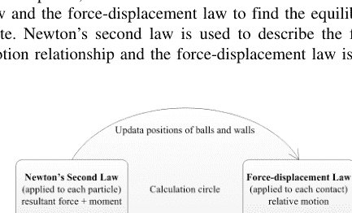

图1. `DEM`的计算循环。

### IEEE Access

### X. Li 等：深部矿业围压下岩石破碎模式的数值模拟

描述力-位移关系。粒子和墙体的力、运动和位置按周期进行计算和更新。计算周期如图1 所示。

通过 `PFC$^{3D}$`，粒子相互连接并相互传递运动和力。键（Bonds）被描述为将粒子粘合在一起，抵抗滑动或旋转 [29]。线性平行键模型被广泛用于模拟，因为它可以保留粒子之间的作用力和力矩。如果超过了键的强度，键将会断裂。在线性键断裂过程中可以在离散元法（`DEM`）中记录裂纹的产生和传播。

相对于平行键的总力 `$\tilde{F}_i$` 和总力矩 `$\tilde{M}_i$` 可以如图所示。总力 `$\tilde{F}_i$` 可以根据接触面划分为法向力和切力分量。公式 (1)描述了它们之间的关系：

$$\tilde{F}_i = \tilde{F}_i^n + \tilde{F}_i^t \quad (1)$$

其中，`$\tilde{F}_i^n$` 和 `$\tilde{F}_i^t$` 分别是法力和切力分量。

其中 `$\Delta$` 是表示增量的符号，`$\Delta U$` 是一个时间步内键结粒子之间的相对位移，上标 `n` 和 `t` 分代表法向和切向，`t` 是时间步，`V` 是键结粒子之间的相对速度，`$\Delta\omega$` 是键结粒子之间的相对角，`$\omega^n$` 和 `$\omega^t$` 是键结粒子的角速度，`A` 是键的面积，`I` 是通过接触点并沿 `$\Delta L$` 方向的键截面的转动惯量，`k^n` 和 `k^t` 分别是法向刚度和切刚度。

## III. 提出的岩石试样

为了研究围压的影响，在 0、2、5 和 10 MPa 的围压下进行了岩石测试模拟，使用圆锥形刀具，切深为 3 cm，切切长度为 96 mm。制备的试样是按照 3:1 的比例混合水泥和砂制成的，参考 TU 等人 [31]。在实验室中对合成岩石样品进行了单轴压缩强度（`UCS`）、抗拉强度（`BTS`）和巴西试验。实验室使用的合成岩石是比例为 3:1 的水泥和砂混合物。

记录了圆锥形试样上的切力变化，并在实验室测试中测量了其平均峰值。此外，还记录了裂纹的产生和传播，以研究破碎力学。

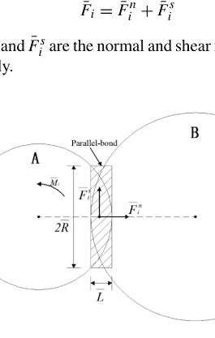

图 2 矩形地幔材料的平行键分解。

当键形成时，`$\tilde{F}_i$` 和 `$\tilde{M}_i$` 初始化为零。接触点随后的每个相对位移和旋转增量会导致弹性力和力矩的增量 [30]。

$$\tilde{F}_i^n = \tilde{F}_i^n + \Delta\tilde{F}_i^n \quad (2)$$

$$\tilde{F}_i^t = \tilde{F}_i^t + \Delta\tilde{F}_i^t \quad (3)$$

$$\tilde{M}_i = \tilde{M}_i + \Delta\tilde{M}_i \quad (4)$$

$$\Delta\tilde{F}_i^n = -k^n\Delta U \quad (5)$$

$$\Delta\tilde{F}_i^t = -k^t\Delta U \quad (6)$$

$$\Delta\tilde{M}_i = -k\theta\Delta\theta \quad (7)$$

其中

$$\Delta U_i = V_i \cdot t, \quad \Delta\theta_i = (\omega_i^b - \omega_i^a) \cdot t,$$

$$A = 2\tilde{R}, \quad I = \frac{2}{3}\tilde{R}^3$$

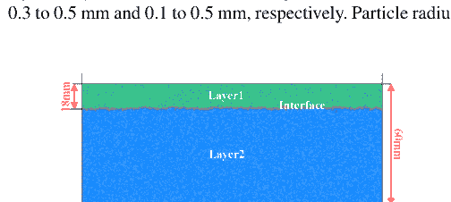

图 3 分级岩石试样。

使用线性接触模型在 `PFC$^{2D}$` 中建立了围压下的岩石试样。岩石样品长度为 120 mm，高度为 60 mm。为了确保精度并缩短计算时间，样品被分为两层，粒子半径从表面向内增大。第 1 层和第 2 层的高度分别为 12 mm 和 48 mm。界面层如图3所示。为了确保界面的均匀性并保证精度 [29]，当切深为 3 cm 时，至少应有 10 个粒子与切刀相互作用。第 1 层、第 2 层和界面的粒子半径范围从 0.1 到 0.3 mm、0.3 到 0.5 mm 以及 0.1 到 0.5 mm。粒子半径

### Li 等：深部矿业围压下的数值岩石破碎模式

是决定微观属性的因素之一，因此对第 1 层、第 2 层和界面进行微观属性校准至关重要。第 1 层、第 2 层和界面的粒子半径范围从 0.1 到 0.3 mm、0.3 到 0.5 mm 以及 0.1 到 0.5 mm。

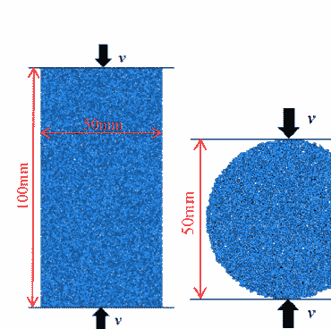

粒径。

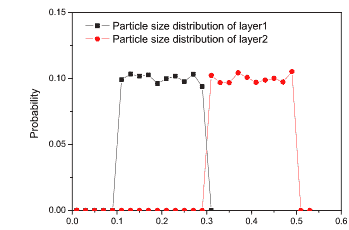

粒径分布。


粒径分布。

## B. 模型校准

使用线性接触模型在 `PFC$^{2D}$` 中建立了围压下的岩石试样。岩石样品长度为 120 mm，高度为 60 mm。为了确保精度并缩短计算时间，样品被分为两层，粒子半径从表面向内增大。第 1 层和第 2 层的高度分别为 12 mm 和 48 mm。界面层如图3所示。为了确保界面的均匀性并保证精度 [29]，当切深为 3 cm 时，至少应有 10 个粒子与切刀相互作用。第 1 层、第 2 层和界面的粒子半径范围从 0.1 到 0.3 mm、0.3 到 0.5 mm 以及 0.1 到 0.5 mm。粒子半径是决定微观属性的因素之一，因此对第 1 层、第 2 层和界面进行微观属性校准至关重要。根据上述规则，岩石试样各层的微观属性通过改变粒子数量和位置至少校准了三次。结果见表 1 和表 2。弹性量、单轴压缩强度和泊松比重复良好。由于 `PFC` 中的平行键模型产生的抗拉强度比较比例异常偏低 [33]。岩石裂纹在模拟与实验室测试中得到了良好的复制，如图6。模拟与实验室测试的应力-应变曲线如图7。根据

微观属性与属性之间的关系不确定，需要获取第 1 层、第 2 层和界面的微观属性。岩石的宏观属性通过单轴压缩强度 (`$\sigma_y$`)、弹性模量 (`E`) 和泊松比 (`$\mu$`) 来描述，使用 `UCS` 和巴西试验，如图5。单轴压缩试验的标准尺寸为 `50 × 100` mm，巴西试验使用 `50 × 50` mm 的正方形装配体 [32]。这些是根据 Poynenton 和 Cundall 的试样生成过程制成的。

表 1 粒子组合的微观属性。

| 微观参数 | 第 1 层 | 界面 | 第 2 层 |
| --- | --- | --- | --- |
| 粒子半径 (`r`) | 0.1-0.3 mm | 0.1-0.5 mm | 0.3-0.5 mm |
| 弹性模量 (`E`) | 10 Ga | 10.5 Ga | 9.8 Ga |
| 键刚度比例 | 2.1 | 2.1 | 2.1 |
| 键抗拉强度 (`t`) | 12.05 MPa | 12.6 MPa | 11.6 MPa |
| 键剪切强度 (`$\Gamma$`) | 12.05 MPa | 12.6 MPa | 11.6 MPa |
| 弹性模量 (`E'`) | 10 Ga | 10.6 Ga | 9.8 Ga |

### 表 2. 岩石试件的宏观属性。

| 属性 | 层 1 | 界面 | 层 2 |
| --- | --- | --- | --- |
| `UCS` (MPa) | 28.01±39 | 28.60±12 | 27.90±06 |
| `E` (GPa) | 18.27±35 | 18.21±03 | 18.21±09 |
| `μ` | 0.2418 | 0.250 | 0.251 |
| `BTS` (MPa) | 2.55±12 | 4.07±012 | 4.07±036 |

压缩开始初的实验室测试，是因为实验室测试中岩石样品内部含有裂隙或孔隙 [35]。然而，模拟中使用的岩石试件是经过修正的均匀且各向同性材料。压实后的属性相似性以及模拟与实验室测试的预属性表明，破坏极限和破坏模式是相同的。应力应变曲线在峰值后迅速下降，表明岩石的破坏模式为脆性。

## C. 围压岩石切割建模

从岩石试件获得的带状接触模型的微参数。由于直接在 `PFC` 中施加壁面压力，对侧壁采用了伺服控制速度以提供围压。采用伺服控制算法，通过 (8) 和 (9) 描述的 `FISH`（`PFC` 中的嵌入式编程）函数来调整侧壁速度的大小和方向。

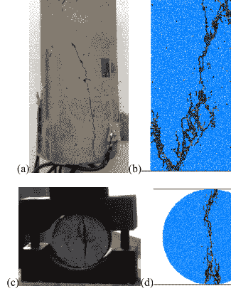

```
$$\dot{u}^{(w)} = \frac{G\sigma^{cur} - \alpha\sigma^{cur}}{K_N t} = G \cdot \Delta\sigma$$
$$\dot{u}^{(w)} = \frac{G\sigma^{cur}}{K_N t}$$
```

图 6. 实验室与模拟（层 1）测试中的岩石裂纹。(a) 实验室中 `UCS` 测试的岩石样品裂纹，b) 模拟中 `UCS` 测试的岩石样品裂纹。(c) 实验室中 `BTS` 测试的岩石样品裂纹。

其中 `$\dot{u}^{(w)}$` 是侧壁速度，`$\sigma^{cur}$` 和 `$\sigma^{tar}$` 分别是当前应力和目标应力，`$\sigma^{cur}$` 与 `$\sigma^{tar}$` 之间的差异为 `$\Delta\sigma$`。`G` 是增益，`R` 是减少不稳定性的松弛因子，`S` 是面积，`K_N` 是壁上的接触数，`t` 是时间步。

首先，将试件在垂直和水平方向上压实到所需的围压。岩石样品在 0、2、5、10 和 15 MPa 的围压下进行岩石切割模拟的压实。图 8 显示了使用伺服控制算法 `FISH` 函数在压实过程中围压随步骤的变化。

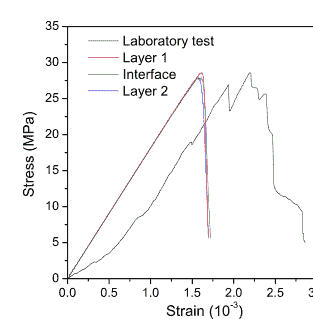

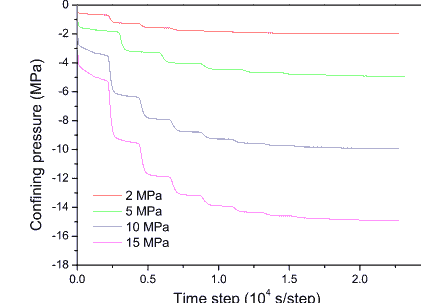

图 7. 模拟与实验室测试的轴应力-应变曲线。

模拟与实验室测试在峰前属性方面存在显著差异。图中存在一个被称为“压实阶段”的向上凹阶段。

图 8. 压实过程中围压随步骤的变化。

### Li 等：深部开矿围压下破碎模式的数值模拟

**表 3.** 3 mm 切割深度下围压下岩石切割结果总结。

| 围压(MPa) | `FC_s`(N) | `FN_s`(N) | `FC's`(N) | `FN's`(N) | `$\epsilon_c$` ($10^{-3}$) |
|---|---|---|---|---|---|
| 0 | 191.7±158.1 | 253.3±215.3 | 330.8±108.4 | 436.6±154.6 | 0 |
| 2 | 221.1±176.4 | 301.7±277.4 | 388.7±140.4 | 579.1±296.7 | 1.67 |
| 5 | 312.9±333.8 | 482.4±241.2 | 573.7±267.6 | 765.5±356.6 | 4.18 |
| 10 | 323.6±496.4 | 540.8±629.5 | 575.9±391.4 | 805.6±559.6 | 8.36 |
| 15 | 375.5±360.9 | 667.5±850.4 | 718.0±301.2 | 1055.6±475.4 | 12.54 |

`FC`: 平均切割力；`FN`: 法向力；`FC'`: 峰值切割力；`FN'`: 峰值法向力；`$\epsilon_c$`: 压实后体积应变；`±`: 标准差。可以看到随着目标围压的增加，负载在减少。压实后的体积应变显示了通过螺纹固定岩石的样品。

$$\epsilon_c = \frac{V_0 - V_c}{V_0} \quad (10)$$

其中 `$\epsilon_c$` 是体积应变，`V_0` 是岩石试件初始体积，`V_c` 是压实后岩石试件体积。

压实后，上壁变形，锥形刀头进入深度 3 mm 的岩石左侧。锥形刀头角度为 `55°`，直径为 19 mm，未经过磨损。切割过程中使用侧壁提供围压。图 9 显示了围压下的岩石切割示意图。

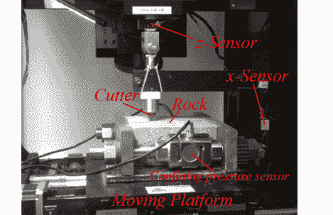

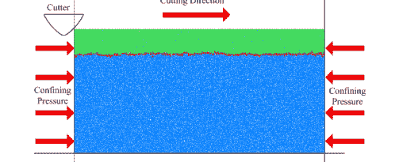

**图 9.** 围压下的岩石切割模型。

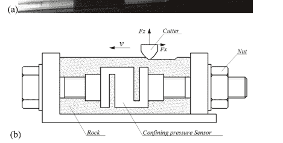

**图 10.(a)** 小尺度岩石刀和岩石样品架示意图。

## IV. 围压下岩石刀实验室测试


在围压下使用锥形刀进行小尺度切割测试。图 10a 显示了围压下小尺度切割的示意图。此处使用的刀头角度为 $55^{\circ}$、直径为 19 mm 的合金锥形刀头。合成岩石样品的尺寸为 $150 \times 150 \times 65$ mm。传感器范围和空间限制的图 10b 以 6 mm/s 的速度、120 mm 的切割距离进行岩石切割。在两次切割过程中，以 100 Hz 的频率记录力（切割力和法向力），并与切割位移对比，如图 11 所示。在这些图中，曲线的振动可能是由碎屑形成引起的。可以看到围压下的切割力大于无围压时。

### X. Li 等：深部开矿围压下岩石破碎模式模拟

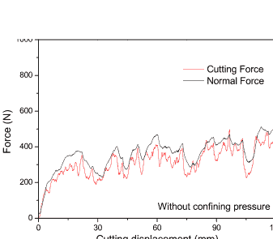

时间步约为 $2.3\times10^{-8}$ s，因此每步刀头的位移约为 $1.38\times10^{-4}$ mm。颗粒半径为 0.1 mm 时，每步刀头的位移足以保证颗粒在准平衡状态下装配。以 10 步为间隔记录作用在刀头上的切割力。图 12 显示了不同条件下切割过程中围压的变化。考虑到控制围压的敏感性，存在少量偏差。图 13 显示了 2 MPa 围压下切割力和法向力的变化。平均力和峰值力从历史数据中获得。

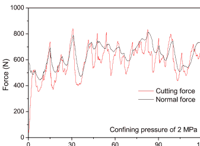

**图 11.** (0) 和 (2) MPa 围压下力的变化。

## V. 围压下岩石刀模拟

在 0、2、5、10 和 15 MPa 的不同围压下，使用分级颗粒进行了数值测试。为了确保结果的可靠性，在不同随机数生成的不同岩石试件上，每次切割重复了三次。随机数决定了颗粒的大小和位置。由于使用 6 mm/s 的实际速度花费太时间，因此采用了 96 mm 的切割距离。

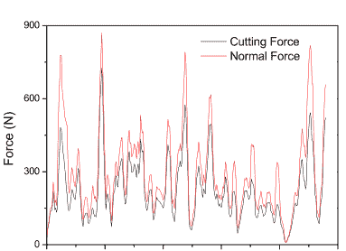

**图 13.** 2 MPa 围压下力随切割距离的变化。

结果总结在表 3 中，图 14 显示平均力和峰值力随围压的变化。结果显示，随着围压的增加，平均力和峰值力剧增。体积应变（$\epsilon_v$）的增加表明，围压下压实后岩石试件更致密可能是切割力增加的原因。

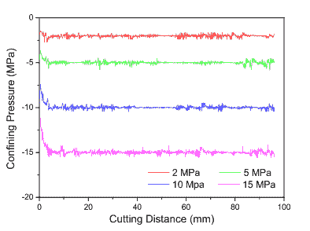

**图 14.** 切割力与围压之间的关系。

在模拟期间，接触

**图 12.** 不同条件下切割过程中围压的变化。

### 1. X. Li 等人：深部开矿围压压力下岩石破碎模式的数值模拟

### IEEE Access


步骤: 1.24e5


步骤: 1.39e5

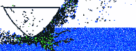

步骤: 1.36e5

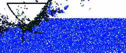

步骤: 1.41e5

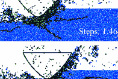

步骤: 1.46e5


步骤: 1.48e5

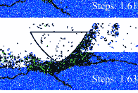

步骤: 1.61e5


步骤: 1.57e5

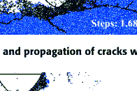

步骤: 1.68e5


图 16。2 MPa 围压下裂纹的产生与扩展。

步骤: 1.64e5

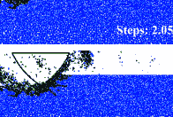

步骤: 2.05e5


图 15。0 MPa 围压下裂纹的产生与扩展。

步骤: 1.50e5

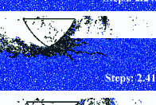

步骤: 2.24e5

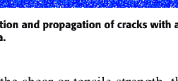

步骤: 2.41e5

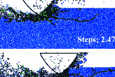

当应力超过剪切强度或拉伸强度时，平行键失效并产生断裂。图 15–19 分别展示了在 0、2、5、10 和 15 MPa 围压下切削过程中裂纹的产生与扩展。这些图表明，剪切断裂（绿色）在裂纹产生初期是形成的，而裂纹的扩展是由拉伸断裂（黑色）诱导的，这与 Evans [36] 提出的最大拉伸应力准则一致。

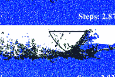

步骤: 2.47e5

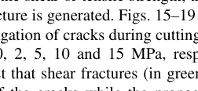

步骤: 2.87e5

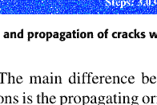

步骤: 3.03e5

从这些图中可以看出，围压对裂纹的扩展方向和长度有显著影响。在不同围压下，裂纹的产生机制和碎屑形成是类似的。首先，在切刀之前形成了剪切断裂，颗粒连接到切刀。随着切刀的推进，拉伸断裂增加并合并形成宏裂纹。宏裂纹分为垂直裂纹和水平裂纹，水平裂纹扩展到自由表面产生裂纹。不同围压条件之间的主要区别是主裂纹的扩展方向和长度。对于无约束的裂纹，

图 17。5 MPa 围压下裂纹的产生与扩展。

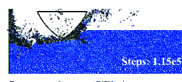

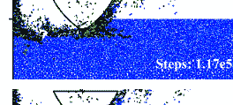

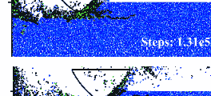

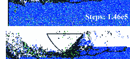

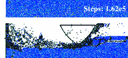

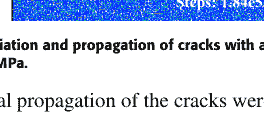

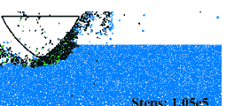

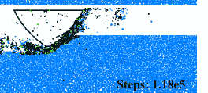

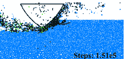

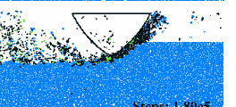

图 19。10 MPa 围压下裂纹的产生与扩展。

观察到了水平裂纹的扩展。垂直裂纹几乎垂直于岩石样本的自由表面并扩展到一定深度。随着围压的增加，观察到垂直裂纹倾斜以及失效模式。可以得出，在围压达到 15 MPa 之前，所有裂纹的扩展都受到限制并诱导了塑性变形，岩石破碎并产生碎屑。当围压为 15 MPa 时，失效模式从脆性转变为塑性。G 和 Cheatham [12] 也得到了类似的结论；因此，本研究使用的人工岩石临界压力/强度比为 0.53。

图 19。15 MPa 围压下裂纹的产生与扩展。

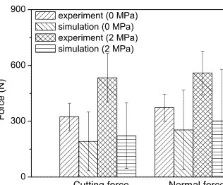

图 20。实验室测试与模拟测试得到的平均力和标准差的比较。

## VI. 模拟结果与实验室结果的比较

图 20 显示了实验室测试与模拟测试得到的平均力和标准差的比较。结果表明，DEM 模拟对围压增加时裂纹的变化提供了良好的预测。平均力和标准差值差异的原因是 `PFC^{2d}` 的缺点 [37]。在二维空间中，切刀被视为具有单位厚度的锥形单元，而三维空间中的岩石是锥形的 [39]。然而，在 `PFC^{2d}` 中观察裂纹的产生和扩展更为生动直观，对于小标的测试，通过 `PFC^{2d}` 中的段（segments）和三维 Flow Code (`PFC^{3d}`) 中的磁盘（disks）呈现。微裂纹的扩展可以表示为 PFC2D 中合并的段，而这些段在 PFC3D 中是孤立的。然而，为了预测切削力 [40]，未来应采用 `PFC^{3d}`。

## VII. 结论

DEM 模拟为岩石切削提供了有用信息，生成了一个 2D 分级颗粒样本并了一了一系列压力下的岩石数值模拟。在此过程中，显示了裂纹的切削力和法向力。显示了岩石切削过程中裂纹的产生与扩展。还展示了实验室测试的结果。

结果表明，切削压力影响切削力和裂纹的扩展。在较高的切削压力下记录了较大的平均力和峰值力。随着切削压力的增加，变形受到限制，从而诱导了岩石模式从脆性为主向塑性的转变。对于本研究使用的人工岩石，通过模拟和实验发现临界压力/强度比为 0.53。

### IEEE Access

### X. Li 等人：深部矿采条件下岩石破碎的数值模拟

[38] V. Henriques and R. Malekian, "基于无线传感网络的矿山安全系统," IEEE Access, vol. 4, pp. 3511–3521, 2016年6月.

[39] J. Jin, J. Shao, X. Zhang, X. Wang, and R. Malekian, "基于深度学习框架的非线性系统建模," Nonlinear Dyn, vol. 84, no. 3, pp. 1147–1155.

[40] R. Malekian, D. C. Bogatanova, A. Karinska, J. Trengosa, and A. W. Nyako, "用于能源消耗的新型智能ECO模型," Elektronika Ib Elektrotechnik, vol. 21, no. 6, pp. 75–80, 2015.

REZA MALEKIAN (M12) 现南非普勒托利亚大学电气、电子和计算机工程系高级讲师，并担任智利圣地亚大学工程系助理教授。他的研究方向包括传感器网络、物联网和移动计算。R. Malekian 还是特许工程师和英国计算机学会专业会员。他担任《IEEE物联网杂志》的副主。


李雪芬（音译）目前于中国矿业大学攻读机械工程博士学位。他的研究兴趣包括原位应力下岩石破碎力学、深部开采中的高效安全采矿方法。

浩尚强（音）于兰州理工大学获得流体动力工程硕士学位。现任山西煤矿全站设备有限公司高级工程师、副总裁。他的研究兴趣包括采矿机械和智能采矿设备。

王世波（音）于2007年在中国州中国矿业大学获得机械设计与理论博士学位。现任中国矿业大学教授。他的研究兴趣包括摩擦学和智能采矿设备。他曾任中国机械学会第九、十届摩擦学分会常委员。

李治贤（音）现任中国矿业大学高级讲师。他目前的研究方向包括机械系统和信号处理。他是《科学技术研究进展杂志》和《机械工程近期专利》的编辑成员。


***
