# 设计模式详解：面向对象设计的新视角（第2版）（软件模式系列）


# 前言

设计模式与面向对象编程。它们蕴含着让你作为软件设计者和开发者的生活变得更容易的。这些术语在技术领域甚至大众媒体中每天都被频繁谈起。但要学习它们、精通它们并理解其背后的本质，并非易事。

也许你已经使用了多年面向对象或基于对象的语言。你是否已经学到，对象的真正威力不在于继承，而在于“封装行为”？也许你对设计模式感到好奇，但发现相关文献有些过于晦涩和高深莫测。如果是这样，这本书就是为你准备的。

本书基于多年对软件开发者（包括经验丰富的开发者和面向对象的新手）教授这些内容的经验。它基于一种信念——我们的经验——一旦你理解了这些概念背后的基本原理和运作方式，以及它们为什么要这样做，你的学习曲线将会变得异常平短。在我们对设计模式的讨论中，你将理解面向对象的真正思维方式，这是你变得精通的必要前提。

当你阅读这本书时，你将对十种核心设计模式有坚实的理解。你会发现设计模式并非孤立存在，而是与其他设计模式协同工作，帮助你创建更健壮的应用程序。你将获得足够的基础，以至于如果你愿意，能够阅读设计模式的文献，并可能自己发现模式。

最重要的是，你将更有能力创建出灵活、完整且易于维护的软件。

## 从面向对象到模式，再到真正的面向对象

在很多方面，这本书是我学习设计模式的个人经历的重述。在学习设计模式之前，我曾认为自己在面向对象分析和设计方面是相当专家。我的记录包括在许多行业中过几次相当印象深刻的设计和实现。我熟悉 C++ 并开始学习 Java。我代码中的对象构造良好且封装紧密。我可以为继承体系设计出出色的抽象。我曾认为自己精通面向对象。

现在，回想起来，我发现自己并没有真正理解面向对象设计的全部能力，尽管我是在按照专家建议的方法去做。直到我开始学习设计模式，我的面向对象设计能力才扩展并加深。了解设计模式让我成为了一个更好的设计者，即使我没有直接使用这些模式。

我从 1996 年开始学习设计模式。当时我是西北一家大型航空航天公司的 C++/面向对象设计导师。几个人请求我领导一个设计模式学习小组。就在那里我遇见了我的合著者 Jim Trott。在学习小组中，发生了一些有趣的事情。首先，我对设计模式产生了着迷。我喜欢将自己的设计与那些比我更有经验的人的设计进行比较。我发现我没有充分利用“面向接口设计”，而且并不总是关注是否可以让一个对象在不知道另一个对象类型的情况下使用该对象。我注意到，面向对象设计的初学者——那些通常被认为过早学习设计模式的人——从学习小组中获得的益处与专家一样多。所展示的模式提供了了优秀面向对象设计的示例，并说明了基本的面向对象原则，这有助于他们的设计更快地成熟。学习小组结束时，我深信设计模式是自面向对象设计发明以来软件设计领域发生的最重大事件。

然而，当我回顾当时的工作时，我发现我并没有在代码中融入任何设计模式。

我只是认为自己还不了解足够的设计模式，需要学习更多。当时，我只知道六种。然后，我有了所谓的“顿悟”。当时我正作为一个面向对象设计导师负责一个项目，被要求为项目创建一个高层设计。项目负责人非常敏锐，但对面向对象设计还很陌生。

问题并不困难，但需要大量的精力来确保代码易于维护。字面上来说，在看了问题两分钟后，我就根据我通常的数据抽象方法开发了一个设计。不幸的是，很明显这不会是一个好的设计。单靠数据抽象已经失败了。我必须找到更好的方法。

两小时后，在应用了我所知的所有设计技术后，我并没有好转。我的设计本质上是一样的。最让我沮丧的是，我知道有一个更好的设计，但我看不出来。讽刺的是，我还知道四种“存在”于我问题中的设计模式，但我不知道如何使用它们。我竟然就在这里——一个所谓的面向对象设计专家——竟然被一个简单的问题困住了！

感到非常沮丧，我休息了一下，开始在走廊走动以清醒头脑，告诉自己至少 10 分钟内不要想这个问题。结果，30 秒后，我又在想它了！但我获得了一个改变我对比设计模式看法的洞察：与其把模式当作单个项目，我应该一起使用设计模式。

模式本应该是缝合在一起来解决问题的。

我以前听过这些，但并没有真正理解。因为模式初被介绍给我时，我一直处于它们大部分是为了设计的假设之下。我希望我的学生理解模式，并发现使用探索性方法是培养这种理解的最佳方式。例如，我发现通过提出一个问题，然后让学生尝试使用我在大多数模式中发现的引导原则和策略来设计解决方案，这样介绍桥接模式更好。在探索过程中，学生们发现了这个解决方案——被称为桥接模式——并记住了它。

无论如何，我发现这些引导原则和策略可以用来“推导出”几种设计模式。我所说的“推导出设计模式”，是指如果我观察一个我知道可以通过设计模式解决的问题，我可以使用这些引导原则和策略来得出模式中所表达的解决方案。我向学生明确表示，我们并不是通过这种方式产生设计模式的。相反，我只是在说明一种可能的思维过程，那些提出原始解决方案的人（即最终归类为设计模式的人）可能使用过这种过程。

当我退后一步并使用设计模式指导我时，一个优越的解决方案在几分钟内展开开了。这是一个很好的设计，我们将其投入了生产。我很兴奋——设计出一个良好的解决方案感到兴奋，对设计模式的力量感到兴奋。从那时起，我开始在开发工作和教学中引入设计模式。

我开始发现，对面向对象设计的新手程序员可以学习设计模式，并在此过程中培养一套基础的面向对象设计技能。对我来说是如此，对我教的学生也是如此。

想象一下我有多惊讶！我读过的设计模式书籍和和我交谈的设计模式专家都说，在开始学习设计模式之前，你真的需要良好的面向对象设计基础。然而，我亲眼看到，同时学习面向对象设计和设计模式的学生，学习面向对象设计的速度比单纯学习面向对象设计的学生快。他们学习设计模式的速度似乎和经验丰富的面向对象从业者一样快。


# 一段小插曲。

这些指导原则和策略现在对我来说非常清晰了。当然，它们被记录在“四人帮”的设计模式书中。但我花了很长的时间才理解它们，这是因为我我自己对面向对象范式的理解存在局限性。只有在我脑海中将“四人帮”的工作与 Alexander 的工作、Jim Coplien 关于共性和变异性分析的工作，以及 Martin Fowler 在方法论和分析模式方面的工作整合后，这些原则才变得足够清晰，让我能够向他人讲解它们。我的生计是靠向他人解释事情的，这对我很有帮助，因为我无法像以前只为自己做事那样轻易地通过自我假设来过关。

我解释这少数几个强大的原则和策略的能力提高了。随着这些能力的提升，我发现解释越来越多的“四人帮”模式变得更有意义了。事实上，在我的设计模式课程中讨论的 14 个模式中，我使用了这些原则和策略来解释其中的 12 个。

我发现自己在设计中，无论是否使用模式，都会运用这些原则。这并不让我感到惊讶。如果在已知某个模式的情况下，使用这些策略得到的方案等同于某种设计模式，这意味着它们为我提供了一种导出卓越设计的方法（因为根据定义，模式就是卓越的设计）。仅仅因为不知道某个可能存在或不存在的模式名称，我为什么会从这些技术中得到更糟糕的设计呢？

这些见解帮助完善了我的教学过程（现在也包括我的写作过程）。我已经在多个层次上教过我的课程了。我教授面向对象分析与设计的基础知识。我通过教授设计模式并利用它们来说明面向对象分析与设计的优秀示例来实现这一点。此外，通过使用模式来教授面向对象的概念，我的学生也能更好地理解面向对象的原则。通过教授这些指导原则和策略，我的学生能够创建出与模式本身相当的设计。

我讲述这个故事是因为这本书的模式与我的课程是相同的（pun intended，这里是双关关）。事实上，从第 3 章开始，这本书非常像我为期两天的课程的第一天：*模式导向设计：从分析到实现的设计模式》。

当你阅读这本书时，你将学习这些模式。但更重要的是，你将学习它们为什么有效、它们如何协同工作，以及它们所依赖的原则和策略。借鉴你自己的经验将很有用。当我在文中提出一个问题时，如果你能想象一个你遇到过的类似问题，将很有帮助。这本书并不是关于新的信息片段或要应用的新模式，而是关于看待面向对象软件开发的新方法。我希望你自己的经验结合设计模式的原则，将成为你学习过程中强大的盟友。

Alan Shallowy


我设计模式的旅程起点与 Alan 不同，但我们得出了相同的结论：

- 基于模式的分析让你成为一个更有效、更高效的分析师，因为它们让你能更抽象地处理模型，并且因为它们代表了许多其他分析师收集的经验。
- 模式帮助人们学习面向对象的原则。模式帮助解释我们为什么要对对象进行某些操作。

我的职业生涯始于人工智能（AI）领域，创建基于规则的专家系统。这涉及听取专家的意见，创建他们决策过程的模型，然后将这些模型编码为知识系统中的规则。当我构建这些系统时，我开始看到反复出现的主题：在常见类型的问题中，专家的工作方式是的。例如，诊断设备问题的专家倾向于首先寻找简单、快速的解决方案，然后变得更有系统性，将问题分解为各个部分；但在他们的系统诊断中，他们倾向于在进行其他测试之前，先进行廉价测试或排除大类问题的测试。无论我们是在诊断计算机问题还是油田设备的问题，情况都是如此。

我会称这些为“反复出现的模式”。直觉上，在设计新的专家系统时，我开始寻找这些反复出现的主题。我的大脑对“模式”的想法是开放且友好的，尽管我并不知道它们是什么。

接着，在1994年，我发现欧洲的研究人员已经对这些专家行为模式进行了编码，并把它们放入一个他们称为“知识分析与设计支持”（KADS）的包中。Karen Gardner 博士——一位极具才华的分析师、建模师、导师和人类——开始在美国将 KADS 应用于工作。她将 KADS 扩展到了面向对象设计。她的书*Cognitive Patterns*（剑桥大学出版社，1998年）描述了这一点。

# 前言

- 基于模式的分析让你成为一个更有效、更高效的分析师，因为它们让你能更抽象地处理模型，并且因为它们代表了许多其他分析师收集的经验。
- 模式帮助人们学习面向对象的原则。模式帮助解释我们为什么要对对象进行某些操作。
- 我能够获得更好的设计，因为模式帮助了我。
- 我能够进行得多的交流，因为模式提供了背景。
- 我能够更有效地进行设计，因为模式提供了策略。
- 我能够理解整个系统，因为模式提供了关键特征。

我希望书中的原则能帮助你成为一个更有效、更高效分析师的旅程。

James Trott


在编写这本书时，我们必须对风格和惯例做出若干选择。我们的一些选择让我们的读者感到惊讶。因此，有必要花几句话说明我们为什么选择这样做。


第一人称叙述

这本书是两位作者合作的成果。我们辩论并完善了我们的想法，以找到最好的解释方式。Alan 在他的课程中测试了这些想法，并进行了进一步完善。我们选择在正文中使用第一人单数，是因为这让我们能够以一种更具吸引力、更自然的风格讲述故事。

扫描文本

我们努力让这本书易于扫描，以便即使你不读正文也能获取要点，以便你能够快速找到所需的信息。我们大量使用了表格和符号列表。我们在侧边栏提供了段落的总结文字。在讨论每个模式时，我们提供了一个关于该模式关键特征的总结表。我们希望这些设计会让这本书更易读。


这本书更多是关于分析和设计，而不是实现。我们的意图是帮助你根据面向对象社区的见解和最佳实践（体现在设计模式中）来构建良好的设计。我们所有程序员面临的挑战之一就是在思考之前过早进入实现。考虑到这一点，我们刻意避免了过多实现的讨论。我们的代码示例可能显得有些单薄和碎片化。具体来说，我们不在代码中提供错误检查。

策略与原则

我们这是一本入门书籍。它将帮助你快速掌握设计模式。你将理解驱动设计模式的原则和策略。读完这本书后，你可以阅读更学术或更有参考性的书籍。最后一章将为你指向许多我们认为非常有用的参考文献。


## 前言 xxv

## 展示广度并提供体验

我们正试图让你对设计模式产生初步了解，让你接触到模式世界的广度，但不会深入探讨其中任何一种模式（参见上一点）。

我们的想法是这样的：如果你带某人来美国进行为期两周的访问，你会向他们展示什么？也许是几个景点，帮助他们熟悉架构、社区、城市氛围以及分隔开这些城市的广阔空间、高速公路和咖啡馆。但你无法向他们展示一切。为了弥补他们的知识空白，你可能会选择向他们展示许多其他景点和城市的幻灯片，让他们对这个国家有个初步了解。然后，他们就可以为未来的访问制定计划。我们正在向你展示设计模式中的主要领域，并让你对其他领域有所体验，以便你规划自己的自己的模式之旅。

## 反馈

设计模式是一个不断完善中的工作，是实践者之间的对话，他们通过对话发现最佳实践，发现对象对象中的基本原则。

我们非常渴望你对这本书的反馈：

- 我们哪里做得好，哪里不好？
- 是否有需要修正的错误？
- 是否有写得令人困惑的地方？

请访问本书的网站。URL 为 http://www.netobjectives.com/dexplained。在该网站上，你可以使用表单向我们发送意见和问题。你还将看到我们最新的研究。

## 致谢

几乎每一篇序言都会以列出帮助本书开发的感谢名单作为结束。在写这本书之前，我们从未完全体会这句话的含义。这样的努力确实是社区的成果。我们要欠的人员名单很长。以下这些人对我们具有特别意义：

- 来自 Addison-Wesley 的 Debbie Lafferty，她从未厌倦鼓励我们并引导我们保持正轨。
- 我们的同事 Scott Bain，他耐心地审查了这项工作并给了我们见解。
- 特尤其是 Leigh 和 Jill，我们耐心的妻子，她们体谅了我们并鼓励我们实现这本书的梦想。

Alan 的特别感谢：

- 我早期的几位学生产生了他们可能永远都不知道的影响。在我的课程期间，我经常犹豫是否推行新想法，觉得我应该坚持那些经过真检验的方法。然而，当我刚开始教学生时，他们对我新概念的热情鼓励我在正在编编写的课程中加入更多我自己的想法。感谢 Lawrence Young、Peter Shirley、John Terrell 和 Karen Allen。他们不断提醒我，鼓励可以产生多远的影响。
- 感谢 John Vlissides 周到的评论和严锐的问题。

Jim 的特别感谢：

- Karen Gardner 博士，人类思维模式领域的导师和智者老师。
- Marel Norwood 博士和 Arthur Murphy，我在 KADS 和基于模式的分析的最初合作者。
- Brad VanBeek，给了我在这个领域成长的空间。
- Alex Sidey，指导我学习技术写作的学科和奥秘。


本章通过将面向对象的范式与一种熟悉的东西——标准结构化编程进行比较对比，向你介绍面向对象的范式。

面向对象的范式源于满足标准结构化编程过去实践所面临挑战的需求。通过明确这些挑战，我们可以更好地看到面向对象编程的优点，并对这种机制有更好的理解。

本章不会让你成为面向对象方法的专家。它甚至不会向你介绍所有的基础面向对象概念。然而，它将本书的其余部分做好准备，其余部分将解释专家所实践的面向对象设计方法的正确用法。

在本章中，

- 我讨论了一种常见的分析方法，称为功能分解。
- 我解决了需求问题以及处理变化的需求（编程的灾难！）。
- 我描述了面向对象范式并展示了它在实际中的应用。


- 我指出了特殊的对象方法。
- 我在第 21 页提供了一个本章使用的重要对象术语表。

## 面向对象范式之前：功能分解

功能分解是处理复杂性的自然方式

让我们开始研究一种常见的软件开发方法。如果我交给你一项任务，编写代码来访问存储在数据库中的形状描述并显示它们，按照所需的步骤来思考是自然而然的。例如，你可能会认为通过执行以下操作可以解决问题：

1. 在数据库中定位形状列表。
2. 打开形状列表。
3. 根据某些规则对列表进行排序。
4. 在显示器上显示单个形状。

你可以采取这些步骤中的任何一步，并进一步拆分实现该步骤所需的步骤。例如，你可以将第 4 步分解如下：

对于列表中的每个形状，执行以下操作：

4a. 识别形状的类型。
4b. 获取形状的位置。
4c. 调用显示形状的适当函数，并给它形状的位置。

这就是功能分解，因为分析师将问题拆解（分解）为组成它的功能性步骤。你和我这样做是因为处理较小的部分比处理整个问题要容易。这可能是我编写制作意大利千面层配谱或组装自行车时使用的相同方法。我们使用这种方法如此频繁、如此自然，以至于我们很少质疑它，或者是否有替代方案。

功能分解的问题在于，它不能帮助我们为可能的更改准备代码，无法为优雅的演进准备。当需要更改时，通常是因为我想给现有的主题添加新的变体。例如，我可能需要处理新的形状或新的显示方式。如果我将实现步骤的所有逻辑放在一个大函数或模块中，那么对步骤的任何更改都需要对该函数或模块进行更改。

这种方法的挑战：处理变化

而变化创造了错误和意外后果的机会。或者正如我常说的：

想一想，你想修改代码，但又害怕，因为你知道修改一处的代码会导致另一个地方出错。为什么会发生这种情况？代码必须关注所有的功能以及它们如何被使用吗？对于函数要关注的细节来说，是否太多了，例如它试图实现的逻辑、它与之交互的对象、它正在使用的数据？就像人一样，同时关注太多事情会在任何变化时引发错误。

而且无论你如何努力，无论你分析得有多好，你无法从用户那里获得所有的需求。未来有太多未知。事物在变。无论你怎么做都不会停止变化。但你不会被它击垮。


问问软件开发者他们从用户那里获取的需求，他们经常说：

- 需求是不完整的。
- 需求通常是错误的。
- 需求具有误导性。
- 需求没有讲述整个故事。

你永远听不到：“我们的需求不仅完整、清晰易懂，而且它们列出了我们未来五年需要的所有功能！”

在三十年的编程经验中，我对需求学到的主要点是：需求总是在变化。

我学会了大多数开发者认为这是一件坏事。但很少有人写的代码能很好地处理变化的需求。

需求变化非常简单：

- 用户在与开发者讨论以及看到软件的新可能性后，对需求的看法发生了变化。
- 开发者在开发软件以自动化它并变得更加熟悉它时，对用户问题领域的看法发生了变化。
- 软件开发的环境发生了变化。（五年前谁能预料到现在的 Web 开发是这样？）


这并不意味着你我可以放弃收集良好的需求。这意味着我们必须编写代码来适应变化。它也意味着我们不应该为了那些自然会发生的事情而自责自受（或者说，不要责备我们的客户）。


- 除了所有最简单的情况外，无论我们的初始分析做得多么完美，需求总是会改变！
- 与其对需求的不断变化感到不满，我们我们应该改变开发流程，以便我们能更有效地处理变化。


再仔细观察一下显示形状的问题。我该如何编写代码，才能更容易处理不断变化的需求？与其编写一个巨大的函数，不如让它更具模块化。

例如，在第 4 页的步骤 4c 中，我“调用合适的函数来显示形状，并给它提供形状的位置”，我可以写一个如示例 1-1 所示的模块。


```
function: display shape
input: type of shape, description of shape
action:
  switch (type of shape)
    case square: put display function for square here
    case circle: put display function for circle here
```

那么，当我接收到一个能够显示新类型形状的需求——例如三角形——时，我只需要更改这个模块（希望如此如此！）。


然而，这种方法存在一些问题。例如，我说模块的输入是形状类型和形状的描述。取决于我存储形状的方式，可能可以或无法拥有一个适用于所有形状的一致形状描述。如果形状的描述有时被存储为点的数组呢？那样行得通吗？

模块化无疑有助于使代码更易于理解，而可理解性使得代码更易于维护。但模块化并不总是能帮助代码处理它可能遇到的所有变化。


通过我目前为止使用的方法，我发现了两个重大问题，术语称为**低内聚**（low cohesion）和**高耦合**（tight coupling）。史蒂夫·麦康尔在他的《代码大全》（Code Complete）一书中，对内聚和耦合给出了极佳的描述。他说：

- 内聚是指“例程中的操作之间的关系有多紧密”。

我听过其他人将内聚称为清晰度，因为例程（或类）中的操作关系越紧密，理解起来就越容易。

- 耦合是指“两个例程之间连接的强度”。耦合是内聚的补充。内聚描述了例程内部内容彼此之间的关系有多紧密。

1. McConnell, S., Code Complete: A Practical Handbook of Software Construction, Redmond: Microsoft Press, 1993, p. 81.（注：麦康尔并非发明了这些术语，我们恰好喜欢他对这些术语的定义。）

耦合描述了一个例程与其他例程的关系有多紧密。目标是创建具有内部完整性（强内聚）以及与其他例程之间存在微小、直接、可见且灵活关系（松耦合）的例程。

大多数程序员都有过这样的经历：对代码某区域的函数或数据进行修改，却对其他部分代码产生了意想不到的影响。这种类型的 bug 被称为“非预期的副作用”（unwanted side effect）。这是因为我们在得到想要的影响的同时，也得到了不想要的影响——bug！更糟糕的是，这些 bug 往往很难发现，因为我们从根本上注意到导致副作用的关系（如果我们注意到了，我们就不会那样修改它了）。

更改一个函数，甚至是函数使用的数据，可能会对其他函数造成破坏性影响。

事实上，这种类型的 bug 导致了我一个相当惊讶的观察：

> 我们实际上并没有花费太多时间来修复 bug。

我认为在维护和调试过程中，修复 bug 花费的时间很短。由于我们从一开始就没有注意到导致副作用的关系（如果我们注意到了，我们就不会那样修改它了），这些 bug 往往很难发现。

更改一个函数，甚至是函数使用的数据，可能会对其他函数造成破坏性影响


- 人要负责自己，而不是由控制程序来对他们负责。（注意：为了实现这一点，人也必须意识到自己是哪种类型的学生。）
- 控制程序可以与不同类型的人（研究生和普通学生）交流，就就像他们完全一样一样。
- 控制程序不需要知道学生在不同教室之间移动时可能需要采取的任何特殊步骤。

为了完全理解这些含义，建立一些术语是重要的。在《UML 简明》（UML Distilled）中，马丁·福勒（Martin Fowler）描述了软件开发过程中的三个视角.³这些视角在表 1-1 中描述。


| 概念 | 这种视角“代表所研究领域中的概念 . . . 绘制概念模型时应该很少或不考虑可能实现它的软件 . . |” |
| 规格 | “现在我们看的是软件，但我们看的是软件的接口，而不是实现。” |
| 实现 | 此时我们处于代码本身上。“这可能是最常用的视角，但在许多方面，规格视角往往是一个更好的视角。” |

> 3. Fowler, M., Scott, K., UML Distilled: A Brief Guide to the Standard Object Modeling Language, 2nd Edition, Reading. Mass: Addison-Wesley, 1999, pp. 51–52.


再次看一遍之前关于“去你的下一节教室”的例子。注意到你——作为教师——正在概念层面上与人们交流。换句话说，你是在告诉人们你想要什么，而不是告诉他们如何做。然而，他们去下一节教室的方式是非常具体的。他们正在遵循特定的指令，而在这个过程中，你是在实现层面上工作。

在某一个层次（概念上）进行通信，而在另一个层次（实现上）执行操作，会导致请求者（教师）并不确切知道发生了什么，只在概念上知道正在发生什么。这可能非常强大。让我们看看如何利用这些概念并编写出利用它们优势的程序。


使用对象将责任转移到更局部的层次

面向对象的范式以对象的概念为中心。一切都聚焦于对象。我编写的代码围绕对象组织，而不是围绕函数。

什么是对象？传统上，对象被定义为带有方法的（面向对象的术语，即函数）数据。遗憾的是，这是看待对象的一种非常局限的方法。我很快会查看一个更好的对象定义（之后在第 8 章“扩展我们的视野”中也会再次提到）。当我谈到对象的数据时，这些可以是数字和字符字符串，也可以是对象。

使用对象的优势在于，我可以定义那些对自身负责的某物。（参见表 1-2。）对象天生知道自己是什么类型。对象中的数据允许它知道自己处于什么种状态，而对象中的代码允许它正常运行（即，做它应该应该做的事）。

|--- |--- |
在这种情况下，对象是通过查看问题领域中的实体来识别的。我通过查看这些实体需要做什么来确定每个对象的责任（或方法）。这与这种技术是一致的：通过寻找需求中的名词来寻找对象，通过寻找动词来寻找方法。如果这种技术是有效的，那么通过寻找需求中的名词来寻找对象并通过寻找动词来寻找方法的方法就非常有效。

使用对象的优势在于我可以定义那些对自身负责的某物。（参见表 1-2.）对象天生知道自己是什么类型。对象中的数据允许它知道自己处于什么种状态，而对象中的代码允许它正常运行（即，做它应该应该做的事）。

这种方法是有效的是有效的。

> 这种方法是有效的。

在本书中，这种方法是有效的。

这种方法应该是对自身负责的。


- 在概念层面上，对象是一组责任⁴4. I am roughly paraphrasing Bertrand Meyer's work in Design by Contract Object-Oriented Software, Upper River, N.J.: Prentice Hall, 1997, p. 331.


- 在规格层面上，对象是一组可以被其他对象调的方法
- 在实现层面上，对象是代码和数据

遗憾的是，面向对象的设计通常只在实现层面被讨论和思考——基于代码和数据——而不是在概念或规格层面。但以这些方式思考对象是有力的！

由于对象具有责任，并且对象对自身负责，必须有一种方法告诉对象该做什么。对象的方法可以被其他对象调用。这些方法的集合就是对象的公共接口。

例如，在教室例子中，我可以为学生对象编写 `NextClass()` 方法。不需要传递任何参数，因为每个学生对自己负责。也就是说，它将知道：

- 它是什么
- 如何获取额外信息

最初，只有一种学生——一种在教室的普通学生。注意，我的教室里会有很多“普通学生”。但如果我想有更多类型的学生呢？让每种学生类型都有自己的一方法方法告诉它们做什么是低效的，特别是对于所有学生共同的任务。

更有效的方法是与所有学生关联一组方法，每个学生都可以使用或根据自己的需要进行定制。


定义一个“通用学生”来包含这些通用方法的定义。然后，我可以有各种专门的学生，他们都必须跟踪自己的私有信息。

在面向对象的术语中，这个通用学生被称为类。类是对对象行为的定义。它包含了对完整的描述：

- 对象包含的数据元素
- 对象可以做的方法
- 这些数据元素和方法可以访问的方式

由于对象的数据元素可以变化，相同类型的每个可能有不同的数据，但具有相同的功能（由方法定义）。

要获取一个对象，我告诉程序我要这种类型的新对象（即该对象所属的类）。这个新对象被称为类的实例。创建类的实例被称为实例化。

对象是类的实例

使用面向对象的方法编写“去下一节教室”的例子要简单得多。程序看起来如下：

在例子中使用对象

1. 启动程序。
2. 实例化教室中的学生集合。
3. 告诉集合学生去下一节课。
4. 集合告诉每个学生去下一节课。
5. 每个学生：
   na. 找到他的下一节课在哪里
   nb. 确定如何去那里


c. 去那里

4. 完成。


在我不需要添加另一种学生类型（例如研究生）之前，这段代码运行得很好。

我面临着一个困境。似乎我必须允许任何种类型的学生进入集合（无论是普通学生还是研究生）。我面临的问题是，我想要让集合如何引用它的组成部分？由于我谈论的是如何在代码中实现它，集合实际上将是一个数组或对象类型。如果集合被命名为 `RegularStudents`（普通学生），那么我就无法将 `GraduateStudents`（研究生）放入集合中。如果说集合仅仅是一组对象，我如何确保自己不包含错误类型的对象（即不执行“去上下节课”的对象）？

解决方案是显而易见的。我需要一个可以通过通过多个类型的通用类型。在这种情况下，我想要一个既包含 `RegularStudents` 又包含 `GraduateStudents` 的 `Student` 类型。在面向对象的术语中，我们称 `Student` 为抽象类。


抽象类定义了其他相关类可以做什么。这些“其他”类是代表特定类型行为的类。这种类通常被称为具体类（concrete class），因为它代表了某个概念的特定的、不改变的实现。

在示例中，抽象类是 `Student`。具体类 `RegularStudents` 和 `GraduateStudents` 代表了两种类型的 `Students`。`RegularStudent` 是一种 `Student`，`GraduateStudent` 也是一种 `Student`。

这种关系是“是一个”（is-a）的关系，正式称为继承（inheritance）。因此，`RegularStudent` 类继承自 `Student`。其他的说法是，`Graduate-Student` 派生于、特化于或是 `Student` 的子类。

反过来，“`Student` 类是 `GraduateStudent` 和 `RegularStudent` 的基类、泛化类或超类。”

抽象类充当其他类的占位符。我使用它们来定义其派生类必须实现的方法。抽象类还可以包含被所有派生类使用的方法。派生类是使用默认行为还是用自己的变体来替换它，取决于派生类（这与对象对自身负责的原则是一的）。


这意味着我让控制器包含 `Students`。使用的引用类型将是 `Student`。编译器可以检查由此 `Student` 引用引用的任何内容实际上都是 `Student` 的一种。这兼顾了两者的优点：

- 集合只需要处理 `Students`（从而允许教师对象只需处理学生）。
- 然而，我仍然得到了检查（只包含了可以“去上下节课”的 `Students`）。
- 并且，每种 `Student` 都留给了自己的方式来实现其功能。


抽象类通常被描述为不被实例化的类。这个定义在实现层面上是准确的。但这太局限了。在概念层面定义抽象类会更有帮助。因此，在概念层面，抽象类仅仅是其他类的占位符。

也就是说，它们为我们提供了一种为相关类分配名称的方法。让我们这个集合看作一个概念。

在面向对象的范式中，你必须不断从三个层面的视角来思考你的问题。

由于对象对自身负责，有很多事情它们不需要暴露给其他对象。早些时候，我提到了*公共接口*（public interface）的概念——那些可以被其他对象访问的方法。在面向对象系统中，主要的访问权限类型有：

- 公共（Public）——任何人都可以看到。
- 保护（Protected）——只有此类类及其派生类的对象可以看到它。
- 私有（Private）——只有该类的对象可以看到它。

这引出了封装（encapsulation）的概念。封装通常被简单地描述为隐藏数据。对象通常不会向外部世界暴露它们的内部数据成员。


主程序现在看起来是这样：

- 1. 主程序创建一个数据库对象的实例。

- 2. 主程序请求数据库对象找到我感兴趣的形状集合，并实例化一个包含所有形状的集合对象（实际上，它将实例化集合将持有的圆形和正方形）。

- 3. 主程序请求集合对形状进行排序。

- 4. 主程序请求集合显示形状。

- 5. 集合请求其包含的每个形状都显示自己。

- 6. 每个形状根据我所拥有的形状类型（使用 `Display` 对象）显示自己。

让我们看看这如何帮助处理新需求（记住，需求总是不断变化的）。例如，考虑以下新需求：

- 添加新类型的形状（例如三角形）。要引入一种新形状，只需要两个步骤：

  - 创建 `Shape` 的新派生类以定义该形状。
  - 在新的派生类中实现一个适用于该形状的 `display` 方法版本。

- 修改排序算法。要更改排序形状的方法，只需要一步：

  - 修改 `Collection` 中的方法。每个形状都将使用新算法。

**结论：** 面向对象的方法限制了需求变更产生的影响。

我讨论过由其他对象调用或可能由对象本身的方法。但当对象被创建时会怎样？当它们消失时会怎样？如果对象是自包含的单元，那么拥有方法来处理这些情况将是一个主意。

这些特殊方法确实存在，被称为构造函数（constructors）和析构函数（destructors）。

构造函数是在对象被创建时自动调用的特殊方法。它的目的是处理对象的启动。这是对象负责自我的职责的一部分。构造函数是进行初始化、设置默认信息、建立与其他对象的关系或执行任何其他为了使对象定义良好而所需的操作的理想位置。所有面向对象的语言都会在对象创建时寻找构造函数方法并执行它。


通过恰当使用构造函数，更容易消除（或至少减少）未初始化的变量。这种错误通常是由于开发人员的疏忽造成的。通过在整个代码中为所有初始化提供一个固定的、一致的地方（即对象的构造函数），更容易确保初始化的发生。由未初始化变量引起的错误容易修复但难以发现，因此这种约定（自动调用构造函数）可以提高程序员的效率。

析构函数是一种特殊方法，在对象消失时帮助它清理自己；即当对象被销毁时。所有面向对象的语言都会在对象删除时寻找析构函数方法并执行它。与构造函数一样，析构函数的使用也是对象负责自我的职责的一部分。

### 析构函数在对象不再需要（被删除）时清理对象

析构函数通常用于在对象不再需要时释放资源。由于 Java 有垃圾收集（自动清理不再使用的对象），析构函数在 Java 中并不像 C++ 中那样重要。在 C++ 中，对象的析构函数通常也会销毁仅由该对象使用的对象。


在本章中，我展示了面向对象如何帮助我们最小化需求变化对系统的影响，以及它是如何与功能分解形成对比的。

我涵盖了面向对象编程的许多核心概念，并介绍描述了主要术语。这些对于理解书中其余的概念至关重要。（见表 1-3 和表 1-4。）


| 功能分解 | 结构化程序员通常用功能分解来处理程序设计。功能分解是将问题拆分为越来越小的函数的方法。每个函数被不断细分，直到可以管理为止。 |
| 需求变更 | 需求变更是开发过程中固有的。与其将获得良好且完整结果这一看似不可能的任务归咎于用户或我们自己，我们应该使用能更有效地处理需求变化的开发方法。 |
| 对象 | 对象由其职责定义。对象通过负责自身来简化使用使用它们的程序的任务。 |
| 构造函数和析构函数 | 对象具有在创建和删除时被调用的特殊方法。构造函数初始化或设置对象。析构函数清理对象。所有面向对象的语言使用构造函数和析构函数来帮助管理对象。 |


| 抽象类 | 定义一组概念上相似的类的方法和公共属性。抽象类从不被实例化。 |
| 属性 | 与对象关联的数据（也称为数据成员）。 |
| 类 | 对象的蓝图——定义了该类型的方法和数据。 |
| 构造函数 | 在对象创建时被调用的特殊方法。 |
| 封装 | 任何种隐藏。对象封装它们的数据。抽象类封装它们的派生类。 |
| 派生类 | 从父类特化而来的类。包含父类的所有属性和方法，但可能包含其他属性或不同的实现。 |
| 析构函数 | 在对象删除时被调用的特殊方法。 |
| 功能分解 | 一种分析方法，将问题分解为越来越小的函数。 |
| 继承 | 类被特化的方式，用于将派生类与其抽象类联系起来。 |
| 实例 | 类的某个特定对象。 |
| 实例化 | 创建类实例的过程。 |
| 成员 | 类的数据或方法。 |
| 方法 | 与对象相关的函数。 |
| 对象 | 具有职责的实体。一个包含数据和操作该数据的特殊自包含单元。对象的数据免受外部对象的干扰。 |
| 多态 | 相关对象实现针对其类型特化的方法的能力。 |
| 父类 | 其他类派生的类。包含了所有派生类将使用（并可能覆盖）的主方法定义。 |


本章简要概述了统一建模语言（UML），它是面向对象社区的建模语言。如果你不熟悉 UML，本章将为你提供阅读书中图表所需的最少理解。


在本章中，

- 我描述了 UML 是什么以及为什么要使用它。
- 类图
- 交互图

## 什么是 UML？

UML 是一种视觉语言（即具有语义的绘图表示法），用于创建程序的模型。通过程序模型，指的是程序的图示表示，通过它可以看到代码中对象之间的关系。

UML 提供了许多类型的建模图

UML 拥有多种不同的图——有些用于分析，有些用于设计，还有一些用于实现（或更准确地说，


为了传播（即代码的分发）（参见表 2-1）。每幅图都根据其意图展示了不同实体集之间的关系。


| 在分析阶段 | **用例图**，它涉及与系统交互的实体（例如，用户和其他系统）以及我需要实现的功能点。<br><br>**活动图**，它侧重于问题领域的工作流（人员和其他代理程序运行的实际空间，即程序的主题区域），而不是程序的逻辑。<br><br>*注：*由于本书主要侧重于设计，因此我将不会在此处阐述用例图或活动图。 |
| 查看对象交互时 | **交互图**，它们展示了特定对象之间如何相互作用。由于它们处理的是特定案例而非通用情况，因此在检查设计时非常有帮助。最流行的交互图类型是**时序图**。 |
| 在设计阶段 | **类图**，它详细描述了类之间的关系。 |
| 查看对象根据其所处状态而不同的*行为*时 | **状态图**，它详细描述了对象可能处于的不同状态以及这些状态之间的转换。 |
| 在部署阶段 | **部署图**，它们展示了不同模块将如何部署。我将在此处不讨论这些图。 |


UML 主要用于通信——与我自己、我的团队成员以及我的客户进行通信。在软件开发领域，糟糕的需求（不完整或不准确）无处不在。UML 为我们提供了收集更好需求的工具。


UML 提供了一种方法，来判断我对系统的理解是否与他人保持一致。由于系统是复杂的，并且必须传递不同类型的信息，它提供了针对不同类型信息的专门图表。


查看 UML 价值的一种简单方法是回想你上一次的设计评审。如果你曾参加过这样的评审：有人开始谈论他们的代码并在没有使用像 UML 这样的建模语言的情况下描述它，那么他们的话几乎既令人困惑，又比需要的长得多。UML 不仅是描述面向对象设计的更好方式，它还迫使设计者彻底思考自己的方法（因为必须写下来）。


UML 最基础的图是类图。它既描述了类，又展示了类之间的关系。可能的关系类型有：


- 当一个类是另一个类的“一种”时：*is-a*（属于）关系
- 当两个类之间存在关联时
  - 一个类“包含”另一个类：*has-a*（拥有的）关系
  - 一个类“使用”另一个类
## 面向对象软件开发简介

这些主题有不同的变体。例如，说某物包含其他物，可能意味着：

- 被包含的项是包含项的一部分（如汽车中的引擎）。
- 我拥有一组可以独立存在的集合（如机场的飞机）。

第一个例子被称为组合（composition），而第二个被称为聚合（aggregation）。


图 2-1 展示了几个重要的点。首先，每个矩形代表一个类。在 UML 中，我可以在类中表示最多三个内容：

- 类名
- 类的的数据成员
- 类的方法（函数）

| --- | --- | --- |
| | +display() | -length: double | +display() |

图 2-1 类图——其三种变体。

我有三种不同的方式展示它们。

- 最左侧的矩形仅显示类名。当不需要更详细信息时，我会使用这种类表示类型。

1. Gamma, Helm, Johnson, 和 Vlissides（四人帮）将第一种称为“聚合”，第二种称为“组合”——这与 UML 完全相反。然而，“四人帮”这本书是在 UML 定稿之前编写的。所给出的定义实际上与 UML 的定义是一致的。这说明了 UML 的某些动机之一：在它出现之前，存在不同的建模语言，每种语言都有自己的符号和术语。


包含对象的生命周期由其包含对象控制。在这里，恰当使用构造方法和析构方法非常有帮助，有助于促进对象的创建和销毁。

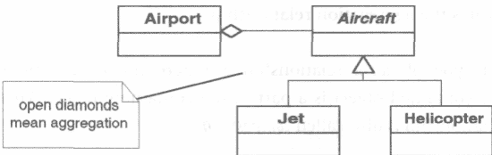


在图 2-5 中，出现了一个新符号：注释（Note）。包含“空菱形表示聚合”消息的框就是一个注释。它们的设计看起来像右上角折叠回来的纸片。你经常看到它们通过一条线与特定的类相连，表示它们仅与该类相关。

类图显示了类之间的关系。然而，通过组合（Composition）和聚合（Aggregation），这种关系对于该类的对象变得更加具体。例如，“机场拥有飞机”这一事实是正确的，但更具体地说，特定的机场拥有特定的飞机。可能会出现一个问题——“一个机场有多少架飞机？”这被称为关系的基数（Cardinality）。我在图 2-6 和 2-7 中展示了这一点。

表示另一个对象拥有的数量

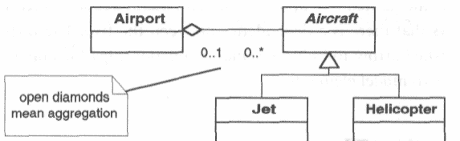


图 2-6 告诉我们，当我有一个机场时，它拥有从 0 到任意数量（这里用星号表示），但有时也用字母“n”表示飞机。机场一边的“0..1”意味着当我有一架飞机时，它可以被 0 个或 1 个机场包含（它可能在在空中）。

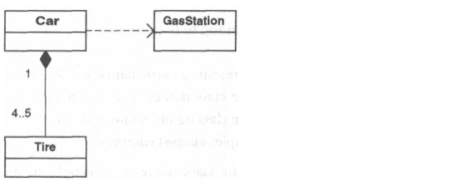


图 2-7 告诉我们，当我有一辆汽车时，它有 4 个或 5 个轮胎（它可能有也可能没有备用胎）。轮胎恰好对应一辆汽车。我听过一些人假设未指定基数意味着假设有一个对象。这是不正确的。如果没有指定基数，则对对象的数量数量不作任何假设。


### 虚线表示依赖
如之前一样，图 2-7 中汽车（Car）和加油站（GasStation）之间的虚线表示两者之间存在依赖关系。UML 使用虚线箭头来指示两个模型元素之间的语义关系（含义）。


类图显示了类之间的静态关系。换句话说，它们没有向我们展示任何活动。虽然它们非常有用，但有时我需要展示从这些类实例化的对象实际上是如何协同工作的。

显示对象之间如何相互作用的 UML 图称为交互图（Interaction Diagrams）。最常见的交互图类型是序图，如图 2-8 所示。

### 如何阅读序图
序图是从上到下阅读的。

- 顶部的每个矩形代表一个特定的对象。虽然许多矩形中包含类名，但请注意类名面前有一个冒号。有些矩形有其他名称——例如 `shapel: Square`。
- 顶部的框给出类名（冒号右侧）以及可选的对象名称（冒号左侧）。
- 垂直线代表对象的生命周期。不幸的是，大多数 UML 绘图程序都不支持这种表示，它们从上到下画线，导致对象何时真正产生并不清晰。
- 我通过这些垂直线之间的水平线来展示对象之间相互发送消息。
- 有时返回值和/或对象会被显式显示，有时只是被理解为它们已返回。

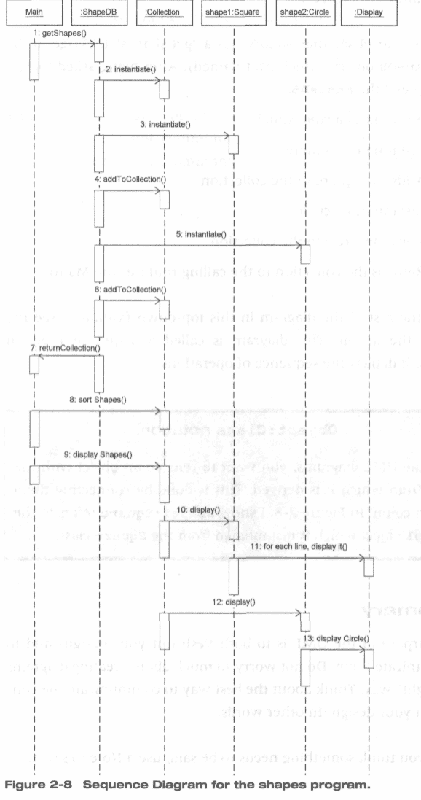

例如，在图 2-8 中，- 顶部的每个矩形代表一个特定的对象。虽然许多矩形中包含类名，但请注意类名面前有一个冒号。有些矩形有其他名称——例如 `shapel: Square`。正如上所示的，- 我通过这些垂直线之间的水平线来展示对象之间相互发送消息。- 有时返回值和/或对象会被显式显示，有时只是被理解为它们已返回。图 2-8 显示了我看到 Main 向 ShapeDB 发送“get shapes”消息，- 实例化一个集合
- 实例化一个圆
  - 将圆添加到集合
  - 实例化一个汽车
  - 将汽车添加到集合
图 2-8 显示了我们看到 Main 向 ShapeDB 发送“get shapes”消息，- 实例化一个集合
  - 实例化一个圆
  - 将圆添加到集合
  - 实例化一个汽车
  - 将汽车添加到集合
图 2-8 显示了对象之间如何相互作用。
- 这种图被称为序图，因为它描述了操作的顺序。

在某些 UML 中，你想要显示源自这些类的实例化的对象实际上是如何协同工作的。这种 这种图被称为序图（Sequence Diagram）。

类图显示了类之间的静态关系。换句话说，它们没有向我们展示任何活动。虽然它们非常有用，但有时我需要展示从这些类实例化的对象实际上是如何协同工作的。

显示对象之间如何相互作用的 UML 图称为交互图。最常见的交互图类型是序图，如图 2-8 所示。

 序图是从上到下阅读的。

- 顶部的每个矩形代表一个特定的对象。虽然许多矩形中包含类名，但请注意类名面前有一个冒号。有些矩形有其他名称——例如 `shapel: Square`。
- 顶部的框给出类名（冒号右侧）以及可选的对象名称（冒号左侧）。
- 垂直线代表对象的生命周期。不幸的是，大多数 UML 绘图程序都不支持这种表示，它们从上到下画线，导致对象何时真正产生并不清晰。
- 我通过这些垂直线之间的水平线来展示对象之间相互发送消息。
- 有时返回值和/或对象会被显式显示，有时只是被理解为它们已返回。

在某些 UML 中，你想要显示源自这些类的实例化的对象实际上是如何协同工作的。这种 这种图被称为序图（Sequence Diagram）。

类图显示了类之间的静态关系。换句话说，它们没有向我们展示任何活动。虽然它们非常有用，但有时我需要展示从这些类实例化的对象实际上是如何协同工作的。

显示对象之间如何相互作用的 UML 图称为交互图。最常见的交互图类型是序图，如图 2-8 所示。

 序图是从上到下阅读的。

- 顶部的每个矩形代表一个特定的对象。虽然许多矩形中包含类名，但请注意类名面前有一个冒号。有些矩形有其他名称——例如 `shapel: Square`。
- 顶部的框给出类名（冒号右侧）以及可选的对象名称（冒号左侧）。
- 垂直线代表对象的生命周期。不幸的是，大多数 UML 绘图程序都不支持这种表示，它们从上到下画线，导致对象何时真正产生并不清晰。
- 我通过这些垂直线之间的水平线来展示对象之间相互发送消息。
- 有时返回值和/或对象会被显式显示，有时只是被理解为它们已返回。

在某些 UML 中，你想要显示源自这些类的实例化的对象实际上是如何协同工作的。这种 这种图被称为序图（Sequence Diagram）。

类图显示了类之间的静态关系。换句话说，它们没有向我们展示任何活动。虽然它们非常有用，但有时我需要展示从这些类实例化的对象实际上是如何协同工作的。

显示对象之间如何相互作用的 UML 图称为交互图。最常见的交互图类型是序图，如图 2-8 所示。

 序图是从上到下阅读的。

- 顶部的每个矩形代表一个特定的对象。虽然许多矩形中包含类名，但请注意类名面前有一个冒号。有些矩形有其他名称——例如 `shapel: Square`。
- 顶部的框给出类名（冒号右侧）以及可选的对象名称（冒号左侧）。
- 垂直线代表对象的生命周期。不幸的是，大多数 UML 绘图程序都不支持这种表示，它们从上到下画线，导致对象何时真正产生并不清晰。
- 我通过这些垂直线之间的水平线来展示对象之间相互发送消息。
- 有时返回值和/或对象会被显式显示，有时只是被理解为它们已返回。

在某些 UML 中，你想要显示源自这些类的实例化的对象实际上是如何协同工作的。这种 这种图被称为序图（Sequence Diagram）。

类图显示了类之间的静态关系。换句话说，它们没有向我们展示任何活动。虽然它们非常有用，但有时我需要展示从这些类实例化的对象实际上是如何协同工作的。

显示对象之间如何相互作用的 UML 图称为交互图。最常见的交互图类型是序图，如图 2-8 所示。

 序图是从上到下阅读的。

- 顶部的每个矩形代表一个特定的对象。虽然许多矩形中包含类名，但请注意类名面前有一个冒号。有些矩形有其他名称——例如 `shapel: Square`。
- 顶部的框给出类名（冒号右侧）以及可选的对象名称（冒号左侧）。
- 垂直线代表对象的生命周期。不幸的是，大多数 UML 绘图程序都不支持这种表示，它们从上到下画线，导致对象何时真正产生并不清晰。
- 我通过这些垂直线之间的水平线来展示对象之间相互发送消息。
- 有时返回值和/或对象会被显式显示，有时只是被理解为它们已返回。

在某些 UML 中，你想要显示源自这些类的实例化的对象实际上是如何协同工作的。这种 这种图被称为序图（Sequence Diagram）。

类图显示了类之间的静态关系。换句话说，它们没有向我们展示任何活动。虽然它们非常有用，但有时我需要展示从这些类实例化的对象实际上是如何协同工作的。


 序图是从上到下阅读的。

- 顶部的每个矩形代表一个特定的对象。虽然许多矩形中包含类名，但请注意类名面前有一个冒号。有些矩形有其他名称——例如 `shapel: Square`。
- 顶部的框给出类名（冒号右侧）以及可选的对象名称（冒号左侧）。
- 垂直线代表对象的生命周期。不幸的是，大多数 UML 绘图程序都不支持这种表示，它们从上到下画线，导致对象何时真正产生并不清晰。
- 我通过这些垂直线之间的水平线来展示对象之间相互发送消息。
- 有时返回值和/或对象会被显式显示，有时只是被理解为它们已返回。

在某些 UML 中，你想要显示源自这些类的实例化的对象实际上是如何协同工作的。这种 这种图被称为序图（Sequence Diagram）。

类图显示了类之间的静态关系。换句话说，它们没有向我们展示任何活动。虽然它们非常有用，但有时我需要展示从这些类实例化的对象实际上是如何协同工作的。


 序图是从上到下阅读的。

- 顶部的每个矩形代表一个特定的对象。虽然许多矩形中包含类名，但请注意类名面前有一个冒号。有些矩形有其他名称——例如 `shapel: Square`。
- 顶部的框给出类名（冒号右侧）以及可选的对象名称（冒号左侧）。
- 垂直线代表对象的生命周期。不幸的是，大多数 UML 绘图程序都不支持这种表示，它们从上到下画线，导致对象何时真正产生并不清晰。
- 我通过这些垂直线之间的水平线来展示对象之间相互发送消息。
- 有时返回值和/或对象会被显式显示，有时只是被理解为它们已返回。

在某些 UML 中，你想要显示源自这些类的实例化的对象实际上是如何协同工作的。这种 这种图被称为序图（Sequence Diagram）。

类图显示了类之间的静态关系。换句话说，它们没有向我们展示任何活动。虽然它们非常有用，但有时我需要展示从这些类实例化的对象实际上是如何协同工作的。

显示对象之间如何相互作用的 UML 图称为交互图。最常见的交互图类型是序图，如图 2-8 所示。

 序图是从上到下阅读的。

- 顶部的每个矩形代表一个特定的对象。虽然许多矩形中包含类名，但请注意类名面前有一个冒号。有些矩形有其他名称——例如 `shapel: Square`。
- 顶部的框给出类名（冒号右侧）以及可选的对象名称（冒号左侧）。
- 垂直线代表对象的生命周期。不幸的是，大多数 UML 绘图程序都不支持这种表示，它们从上到下画线，导致对象何时真正产生并不清晰。
- 我通过这些垂直线之间的水平线来展示对象之间相互发送消息。
- 有时返回值和/或对象会被显式显示，有时只是被理解为它们已返回。

在某些 UML 中，你想要显示源自这些类的实例化的对象实际上是如何协同工作的。这种 这种图被称为序图（Sequence Diagram）。

类图显示了类之间的静态关系。换句话说，它们没有向我们展示任何活动。虽然它们非常有用，但有时我需要展示从这些类实例化的对象实际上是如何协同工作的。

显示对象之间如何相互作用的 UML 图称为交互图。最常见的交互图类型是序图，如图 2-8 所示。

 序图是从上到下阅读的。

- 顶部的每个矩形代表一个特定的对象。虽然许多矩形中包含类名，但请注意类名面前有一个冒号。有些矩形有其他名称——例如 `shapel: Square`。
- 顶部的框给出类名（冒号右侧）以及可选的对象名称（冒号左侧）。
- 垂直线代表对象的生命周期。不幸的是，大多数 UML 绘图程序都不支持这种表示，它们从上到下画线，导致对象何时真正产生并不清晰。
- 我通过这些垂直线之间的水平线来展示对象之间相互发送消息。
- 有时返回值和/或对象会被显式显示，有时只是被理解为它们已返回。


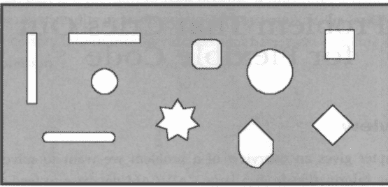

图 3-1 一块金属板的示例。


专家系统是一种特殊的计算机系统，它利用人类专家的规则做出自动化决策。构建专家系统涉及两个步骤：首先，获取并建模专家用于做出决策和完成任务的一组规则。其次，在计算机系统中实现这组规则；这一步通常会使用某种市面上售的专家系统工具。对于分析师来说，第一步显然是更困难的任务。


分析的首要任务是理解在问题领域内，用户和专家所使用的词汇。用得最多的术语是那些描述金属板尺寸和几何形状的术语。

术语表：
- 形状分类
- 从金属板上切割

如图 3-1 所示，一块金属板被切割成特定尺寸，并在其内部切出某些形状。专家将这些切出的部分统称为“特征（feature）”。一块金属板可以通过其外部尺寸和包含的特征进行完整规格说明。


金属板中可能发现的形状类型——特征——在表 3-1 中描述。这些是系统必须处理的形状。


| 槽 (Slot) | 金属上等宽的直切口，并以直角或圆角边缘结束。槽可以以任何角度取向。它们通常使用铣刀头切割。图 3-1 左侧有三个槽；其中一个垂直方向，而另外两个是水平方向的。 |
| 孔 (Hole) | 切入金属板的圆形。通常使用不同宽度的钻头进行切割。图 3-1 在左侧有一个有一个被三个槽包围的孔，在金属板的右侧有一个较大的孔。 |
| 切口 (Cutout) | 具有直角或圆角边缘的正方形。这些通过高功率冲头大冲击冲击金属切割而成。图 3-1 有三个切口；右下角的那个呈 45 度角。 |
| 特殊 (Special) | 不是槽、孔或切口的预成形状。在这些情况下，制作了特殊的冲头来快速创建这些形状。电源插座是一个常见的“特殊”情况。图 3-1 中的星形是一个特殊形状。 |
| 不规则 (Irregular) | 其他任何形状。它们通过使用组合工具形成。图 3-1 右下角的不规则形状物体是一个不规则形状。 |

CAD/CAM 专家还会使用理解所需的额外术语，如表 3-2 所示。


| --- | --- |
| 几何形状 (Geometry) | 描述金属板外观的内容：每个特征的位置及其尺寸以及金属板的外部形状。 |
| 部分 (Part) | 金属板本身。我需要能够存储每个部分的几何形状。 |
| 数据集或模型 (Dataset or model) | CAD/CAM 数据库中存储零件几何形状的记录集。 |
| NC 机和 NC 指集 (NC machine and NC set) | 数控（NC）机。一种特殊的制造工具，使用由计算机程序控制的切割头切割金属。通常，向计算机程序输入零件的几何形状。该计算机程序由称为 NC 指集的命令组成。 |


我需要设计一个程序，允许专家系统能够打开并读取包含我想要分析的零件几何形状的模型，然后生成用于数控（NC）机器的指令以制造这块金属板。

在这个示例中，我只关注金属板零件。然而，CAD/CAM 系统可以处理许多其他类型的零件。

在高级层次，我希望系统执行以下步骤：

- 分析金属板。
- 根据它们包含的特征，查看它们应该如何制造。
- 生成一组制造设备可读的指令。这组指令被称为 NC 指集或数控指令集。
- 当我想制作这些任何一个零件时，将这些指令给给制造设备。

我的编程任务的困难之处在于，我不能简单地从数据集中提取特征并生成 NC 命令。使用的命令类型以及这些命令的顺序取决于特征及其与其他特征之间的关系。

例如，取一个由几个特征组成的形状：一个由一个切口和两个槽组成的形状。其中一个槽垂直穿过切口，而另一个水平穿过它。如图 3-2 所示。

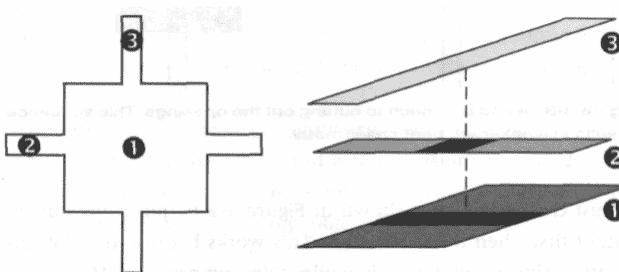


**图 3-2** 带有两个槽的切口。左侧是垂直的槽，右侧是水平的。这种，。

**图 3-2** 带有两个槽的切口。左侧是垂直的槽，右侧是水平的。然而，由于方法 方法为了让专家系统看起来看起来  是-的。

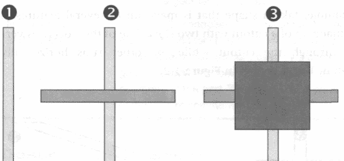

**图 3-2** 带有两个槽的切口。左侧是垂直的槽，右侧是水平的。

**图 3-2** 带有两个槽的切口。左侧是垂直的槽，右侧是水平的。这种， 这种方法是正确的金属的。


**图 3-2** 带有两个槽的切口。左侧是垂直的槽，右侧是水平的。


**图 3-2** 带有两个槽的切口。左侧是垂直的槽，右侧是水平的。

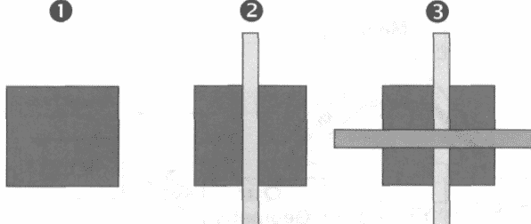

**图 3-2** 这种方法是。


**图 3-2** 带有两个槽的切口。左侧是垂直的槽，右侧是水平的。


**图 3-2** 这种方法是。


**图 3-2** 这种方法是。


**图 3-2** 这种方法是。

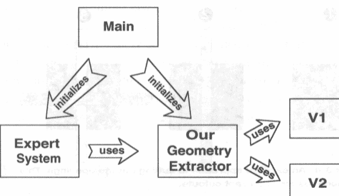

**图 3-2** 这种方法是。


**图 3-2** 这种方法是。


**图 3-2** 这种方法是。


**图 3-2** 这种方法是。


**图 3-2** 这种方法是。


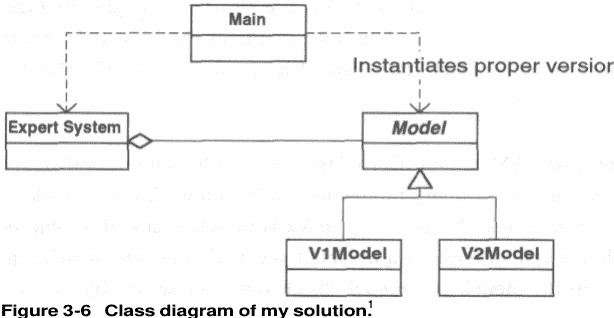

版本 1 本质上是子程序库的集合。要从模型获取信息，必须进行一系列调用。一组典型的查询如下所示：

# 在 CAD/CAM 版本 1 中执行此操作

1. 打开模型 XYZ 并返回其句柄（handle）
2. 将其存储为 H
3. 对于由 H 引用的模型，告诉我有多少个特征（features），并存储为 N
4. 对于由 H 引用的模型中的每个特征（从 1 到 N）
    4a. 对于由 H 引用的模型，告诉我第 i 个元素的 ID 并将其存储为 ID
    4b. 对于由 H 引用的模型，告诉我 ID 的特征类型并将其存储为 T
    4c. 对于由 H 引用的模型，告诉我 ID 的 X 坐标并将其存储为 X（根据类型确定要调用的适当程序）

> 1. 本书中的此及所有其他类图均使用统一建模语言（UML）符号。参见第 2 章“UML——统一建模语言”关于 UML 符号的描述。

## 第二部分 · 传统对象设计的局限性

### CAD/CAM V1 极非面向对象
这个系统处理起来非常痛苦，显然不是面向对象的。无论谁使用该系统，必须手动为每个查询维护上下文。每个关于特征的调用都必须知道它是什么种的特征。

### CAD/CAM V2 是面向对象的
CAD/CAM 供应商意识到这个系统固有的局限性。构建 V2 的主要动力是使其面向对象。因此，V2 中的几何结构存储在对象中。当系统请求模型时，它会返回一个代表该模型的对象。该模型包含一组对象，每个对象代表一个特征。由于问题领域是基于特征的，因此 V2 用于表示这些特征的类与我之前提到的类完全对应：槽、孔、切口、特殊形状和不规则形状，这并不意外。

因此，在 V2 中，我可以获取一组与金属板上存在的特征对应的对象。图 3-7 中的 UML 图显示了特征的类。

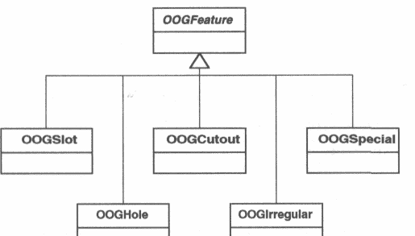

图 3-7 V2 的特征类。

OOG 代表面向对象的几何结构（object-oriented geometry），提醒 V2 是一个面向对象的系统。

## 总结

在本章中，我描述了 CAD/CAM 问题。

- 我必须以相同的方式从不同的 CAD/CAM 系统提取信息。这将使得公司有大量投入的系统（专家系统）在 CAD/CAM 系统发生变化时，无需进行昂贵的修改即可继续工作。
- 我有两个以完全不同方式实现的系统，尽管它们包含本质相同的信息。

这项任务与我在项目中遇到的其他问题有许多相似之处。系统有不同的具体实现，但我想允许其他对象以相同的方式与这些不同的实现进行通信。

# 第 4 章
# 标准面向对象解决方案

## 概述

本章为第 3 章讨论的“一个急需灵活代码的问题”提供了初始解决方案。这是一个合理的初步尝试，并且能够快速完成任务。然而，它遗漏了一个重要的系统需求：随着 CAD/CAM 持续演进的灵活性。

在本章中，我描述了一种基于面向对象的解决方案。它不是一个完美的解决方案，但是一个行得通方案。

> *注意：我将在本章正文中仅展示 Java 代码示例。相应的 C++ 代码示例可以在本章末尾找到。*

## 使用特殊情况解决

考虑到第 3 章“一个急需灵活代码的问题”描述的两个不同的 CAD/CAM 系统，我如何构建一个信息提取系统，使其无论我有哪种 CAD/CAM 系统，对客户端对象看起来都是一样的？

在思考如何解决这个问题时，我推断如果我能解决槽（slots）的问题，就可以将该解决方案用于切口、孔等。在考虑槽时，我看到我可以轻松地对每种情况进行特化。也就是说，当我有 V1 系统时，我有一个 Slot 类和一个针对槽的派生类，当我有 V2 系统时又有另一个派生类。我在图 4-1 中展示了这一点。

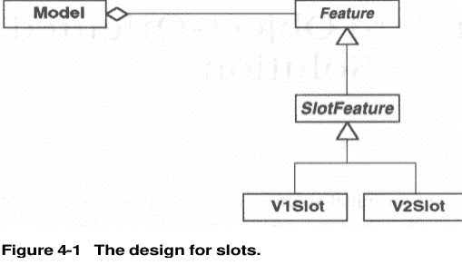

通过为每种特征类型扩展该解决方案来完成它，如图 4-2 所示。

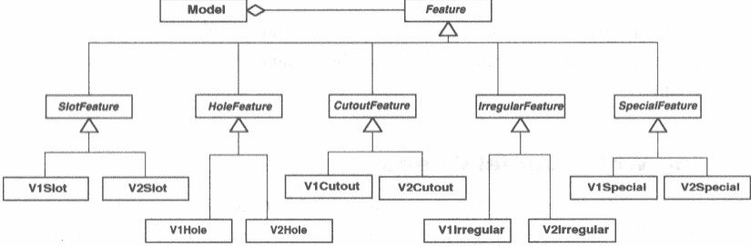

图 4-2 提取信息问题的原始解决方案。

当然，图 4-2 是相当高层次的。每个 vxxxx 类都会与相应的 V1 库通信。每个 Vxxxx 类都会与 V2 模型中相应的对象通信。

通过单独查看每个 v 类，这更容易可视化。

# 第 4 章 · 标准面向对象解决方案

## 第二部分 · 传统对象设计的局限性

我将为几个类提供代码示例。这些示例是为了让你理解这种设计如何实现（Java 代码示例出现在本章末尾）。

使用特殊情况解决（继续）

考虑到第 3 章“一个急需灵活代码的问题”描述的两个不同的 CAD/CAM 系统，我如何构建一个信息提取系统，使其无论我有哪种 CAD/CAM 系统，对客户端对象看起来都是一样的？

在思考如何解决这个问题时，我推断如果我能解决槽（slots）的问题，就可以将该解决方案用于切口、孔等。在考虑槽时，我看到我可以轻松地对每种情况进行特化。也就是说，当我有 V1 系统时，我有一个 Slot 类和一个针对槽的派生类，当我有 V2 系统时又有另一个派生类。我在图 4-1 中展示了这一点。

- 该解决方案通过为每种特征类型扩展该解决方案来完成它，如图 4-2 所示。
- 该解决方案通过对 V1 系统进行一系列子程序的调用来实现。
- V2 系统将包含与 V1 系统对应的对象。每当一个 v 方法被调用时，V2 系统将包含与 V2 系统对应的对象。
- V2 系统将包含与 V2 系统对应的对象。每当该对象请求信息时，它将简单地将请求传递给客户端。更详细的图如图 4-3。

- modelNum 和 myID 是私有成员，包含关于模型和特征（在 V1 中）的信息

| Model | | |
| :--- | :--- | :--- |
| SlotFeature | HoleFeature | CutoutFeature |
| V1Slot | V1Hole | V1Cutout |
| V1System | V2Hole | V2Cutout |
| V2System | OOGHole | OGCutout |
| V2System | OOGSpecial | OOGIrregular |

图 4-3 第一个解决方案。


## 第 4 章 · 一个标准的面向对象解决方案 63

在图 4-3 中，我添加了一些功能所需的方法。请注意这些方法如何根据特征的类型而不同。这意味着在功能之间没有实现多态。然而，这并不是问题，因为专家系统无论如何都需要知道它拥有什么类型的特征。这是因为专家系统需要从不同类型的特征获取不同的信息。

### 该解决方案满足了一个目标：通用的 API

这引出了这样一点：我对于功能的多态并不感兴趣。相反，我需要能够在不改变专家系统的情况下，即插用不同的 CAD/CAM 系统的能力。

我试图做的是——透明地处理多个 CAD/CAM 版本——给了我几个线索，说明这个解决方案并不是好的：

但它包含了许多挑战

- 方法之间的冗余——我可以很容易想象，调用 V1 系统的有很多之间会有很多相似之处。例如，槽位（Slot）的 Vgetx 和孔（Hole）的 Vgetx 非常相似。
- 杂乱——这并不总是一个好的预测指标，但它是另一个加强我对该解决方案不感的因素。
- 紧耦合——该解决方案存在紧耦合，因为特征之间是间接相关的。这些关系表现为当发生以下情况时可能需要修改所有特征：
    - 需要新的 CAD/CAM 系统。
    - 现有的 CAD/CAM 系统被修改。
- 低内聚——内聚性较低，因为执行核心功能的方法分散在各个类中。

## 第二部分 · 传统面向对象设计的局限性

然而，我最大的担忧来自于展望未来。想象一下当第三个 CAD/CAM 系统出现时会发生什么。组合爆炸将害死我们！看看图 4-3 中类图的第三行。

- 有五种特征。
- 每种类型的特征对于每个 CAD/CAM 系统都有一对类。
- 当我得到第三版本时，我将会有三一组，而不是两个一组。
- 我将不再是十个类，而是十五个类。

这显然不是一个我维护起来会开心的系统！

### 分析的陷阱：过早过度关注细节。

分析师可能的一个常见问题是，我们在开发过程中过早地切入细节了。这是自然的，因为处理这些细节很容易。细节的解决方案通常是显而易见的，但并不一定是最好的起点。在投入细节之前，尽可能推迟。

在这种情况下，我实现了一个目标：特征信息的通用 API。此外，我从责任的角度定义了我的对象。然而，我这样做是以为每件事都创建特殊例为代价的。当我得到新的特殊类时，我必须以那样的方式来实现它们。因此，导致了高昂的维护成本。

> 直觉告诉我一定有一个更好的解决方案

这是我的第一个草率解决方案，我立刻不喜欢了它。我的反感更多源于我的直觉，而不是我上面提供的更具逻辑的原因。我觉得那里存在问题。

## 第 4 章 · 一个标准的面向对象解决方案 65

在这种情况下，我强烈地感觉到存在更好的解决方案。然而，两个小时后，这仍然是我能想出的最好的。事实证明，问题出在我的通用方法，正如书中后面的部分所示。

### 关注你的直觉。

直觉是设计质量的一个出人地强大的强大指标。我建议开发者学会倾听自己的直觉。

我所说的直觉，是指当你看到你不喜欢的东西时肚子里的感觉。我知道这听起来不科学（它确实如此，但我的经验一直告诉我，当我对某个设计产生本能厌恶时，更好的解决方案就在转角处。当然，有时附近有几个不同的转角，我不总是确定解决方案在哪里。

## 总结

我展示了通过对每件事进行特殊例处理来解决这个问题有多简单。解决方案是直观的。它允许我在不改变现有内容的情况下添加额外的方法。然而，它也有几个缺点：高冗余、低内聚和类爆炸（来自未来的变化）。

*在本章中*

对继承的过度依赖会导致更高的维护成本，这本该是发生的（或者至少，我觉得应该发生）。

## 补充：C++ 代码示例

**示例 4-5 C++ 代码片段：**
实例化 V1 特征

```cpp
// 实例化特征的代码段 // 不包含
错误检查提供---仅供演示 // 目的
用

// 每个特征对象都需要知道模型编号
// 以及它对应的特征 ID，以便在请求时检索
// 信息。注意这些信息是如何
// 传递到每个对象的构造函数的

// 打开模型
modelNum= V1OpenModel(modelName);
Elements= V1GetNumberofElements(modelNum);

Feature *features [MAXFEATURES];

// 对模型中的每个特征执行操作
(i=0; i < nElements; i++ ) {
// 确定存在的特征并创建 // 适当的特征对象
switch(V1GetType(modelNum, i)) { 
    case SLOT:
        features[i]= V1Slot( modelNum, V1GetID( model Num, i));
        break;

    case HOLE:
        features [i] = V1Hole( modelNum, V1GetID( model Num, i));
        break;
}
```

## 第 4 章 • 一个标准的面向对象解决方案 67

### 示例 4-6 C++ 代码片段：
V1 方法的实现

```cpp
// modelNum 和 myID 是私有成员
// 包含它的对象

double V2Slot::getX() {
    // 在 oogF 上调用适当的方法以获取所需的
    // 信息。
    return oogF->getX();
}

double V2Hole::getX() {
    // 在 oogF 上调用适当的方法以获取所需的
    // 信息。
    return oogF->getX();
}
```

### 示例 4-7 C++ 代码片段：
实例化 V2 特征

```cpp
// 实例化特征的代码段 // 不包含
错误检查提供---仅供演示 // 目的
用

// 每个特征对象都需要知道模型编号
// 以及它对应的特征 ID，以便在请求时检索
// 信息。注意这些信息是如何
// 传递到每个对象的构造函数的

// 打开模型
modelNum= V2openModel(modelName);
nElements=myModel->getNumElements();

Feature *features[MAXFEATURES];

Feature *oogF;
// 对模型中的每个特征执行操作
for (i=0; i < nElements; i++) {
// 确定存在的特征并创建 // 适当的特征对象 oogF=myModel->getElement(i);

switch(oogF->myType()) {
    case SLOT:
        features[i]= new V2Slot(oogF);
        break;

    case HOLE:
        features [i]= new V2Hole(oogF);
        break;
}
```

### 示例 4-8 C++ 代码片段：
V2 方法的实现

```cpp
// oogF 是指向 V2 中特征对象的引用，//
// 包含它的对象

double V2Slot::getX () {
    // 在 oogF 上调用适当的方法以获取所需的
    // 信息。
    return oogF->getX();
}

double V2Hole::getX() {
    // 在 oogF 上调用适当的方法以获取所需的
    // 信息。
    return oogF->getX();
}
```

## 第三部分 # 设计模式

## 部分概述

本部分介绍了设计模式：它们是什么以及如何使用。描述了与 CAD/CAM 问题（第 3 章“需要灵活代码的问题”）相关的四个模式。它们被逐一介绍，并与之前的问题联系起来。在学习这些模式时，我强调了四人组（作者 Gamma、Helm、Johnson 和 Vlissides 常被称为如此）在其开创性著作《设计模式：可重用面向对象的元素》中使用的面向对象策略。

在本部分中

章节讨论这些主题

- 5 - 设计模式简介。
- 设计模式的概念、在架构中的起源以及在软件设计学科中的应用。
- 研究设计模式的动机。

- 6 - 外观模式（Facade pattern）：它是什么、在哪里使用以及如何实现。
- 外观模式与 CAD/CAM 问题的联系。

- 7 - 适配器模式（Adapter pattern）：它是什么、在哪里使用以及如何实现。
- 适配器模式与外观模式的比较。
- 适配器模式与 CAD/CAM 问题的联系。


## 第三部分 · 设计模式

- 面对象编程中的一些重要概念：多态、抽象、类和封装。它利用了在第 5 到 7 章中学习到的内容。

- 桥接模式（Bridge pattern）。这种模式比之前的模式要复杂得多。它也有用得多；因此，我将详细介绍桥接模式。

- 桥接模式如何与 CAD/CAM 问题相关。

- 抽象工厂模式（Abstract Factory pattern），它关注于创建对象族。该模式是什么、如何使用以及实现。

- 抽象工厂模式如何与 CAD/CAM 问题相关。

## 目标

在本节结束时，读者将理解什么是设计模式，以及它们为什么有用，并熟悉其中的四种特定的模式。读者还将看到这些模式与之前的 CAD/CAM 问题之间的关系。然而，这些信息可能不足以创建一个比我们过度依赖继承所得到的更好的设计。尽管如此，它为以不同的方式使用模式（与大多数设计模式实践者的使用方式不同）奠定了基础。

# 第 5 章
## 设计模式导论

## 概述

本章介绍了设计模式的概念。

在本章中：

- 我将讨论设计模式在建筑中的起源，以及它们如何应用于软件设计领域。
- 我将讨论学习设计模式的动机。

设计模式是面向对象技术前沿的一部分。面向对象的分析工具、书籍和座讨会正在引入设计模式。关于设计模式的学习小组随处可见。人们通常建议在掌握了基础面向对象技能后才学习设计模式。我发现恰恰相反：在学习面向对象技能的早期学习设计模式非常有助于提高对面向对象分析设计的理解。

设计模式和面向对象设计相互加强。

在书的其余部分，我不仅将讨论设计模式，还将讨论它们如何揭示并强化良好的面向对象原则。我希望增提高你对这些原则的理解，并说明这里讨论的设计模式为什么代表了良好的设计。

这些材料中的某些可能看起来很抽象或哲学。但给它一个机会！本章为你理解设计模式奠定了基础。理解这些材料将增强你理解和处理新模式的能力。

尝试一下

我的许多想法来源于克里斯托弗·亚历山大（Christopher Alexander）的《建筑的永之道》（The Timeless Way of Building）¹¹ 我将在整书中讨论这些思想。

## 设计模式源于建筑和人类学

质量是客观的吗？年前，一位名叫克里斯托弗·亚历山大的建筑师问自己：“质量是客观的吗？”美真的是取决于观察者的吗，还是说人们会同意某些东西是美的，而另一些不是？现在，亚历山大感兴趣的美的特定形式是建筑质量的一种：什么让我们知道一个建筑设计是好的？例如，如果一个人要为房子房子设计一个入口，他将如何知道这个设计是好的？我们能知道好的设计吗？这种判断有客观依据吗？有描述我们共同共识的依据吗？

亚历山大假设在建筑系统中存在这样一种客观依据。判断一个建筑是否美不仅仅是品味的问题。我们可以通过一个可以衡量的客观依据来描述美。

文化人类学学科发现了同样的问题。那部分工作表明，在一种文化中，个人在很大程度上会对什么被认为是良好的设计、什么是美达成共识。文化对良好设计的判断超越了个人信仰。我相信存在超越个体的模式，它们可以作为判断设计的客观依据。文化人类学的一个大分支正在寻找这样的模式来描述一种文化的行为和价值观²

1. Alexander, C., Ishikawa, S., Silverstein, M., The Timeless Way of Building, New York: Oxford University Press, 1979.
2. 人类学家鲁斯·本尼迪特（Ruth Benedict）是基于模式的文化分析先驱。示例参见 Benedict, R., The Chrysanthemum and the Sword, Boston: Houghton Mifflin, 1946。

设计模式背后的命题是软件系统的质量也可以被客观地衡量。

如果你接受可以识别和描述高质量设计的观点，那么你该如何创建它呢？我可以想象亚历山大问自己：

> 你如何反复获得高质量的设计？

> 在高标准的设计中存在什么，是低质量设计中不存在的？

以及

> 在低质量设计中存在什么，是高质量设计中不存在的？

这些问题源于亚历山大的信念，即如果设计中的质量是客观的，那么我们应该能够识别出什么让设计变好，什么让设计变坏。

亚历山大通过对建筑、城镇、街道以及人类为建造的居住空间的几乎每一个其他方面进行大量观察来研究这个问题。他发现，对于一个特定的建筑作品，良好的结构之间有着共同点。

> 寻找共同点

建筑结构彼此之间不同，即使它们是相同类型。尽管它们是不同的，但它们仍然可以是高质量的。

> ... 特别是在要解决的问题的特征中

例如，两个门廊在结构上可能看起来不同，但它们都可能被认为是高质量的。它们可能为不同的房子解决问题。一个门廊可能是从人行道到前门的过渡。另一个门廊可能是炎热日的遮荫处。或者两个门廊可能以不同的方式解决一个共同问题（过渡）。

亚历山大理解这一点。他知道通过这种方式缩小关注——观察解决相似问题的结构——他可以识别出相似性。他将这些相似性称为模式（patterns）。

他将模式定义为“问题的解决方案”。每个模式都描述了一个在特定背景下反复出现的问题³

3. Alexander, C., Ishikawa, S., Silverstein, M., A Pattern Language, New York: Oxford University Press, 1977, p. x.

设计模式背后的命题是软件系统的质量也可以被客观地衡量。

如果你接受可以识别和描述高质量设计的观点，那么你该如何创建它呢？我可以想象亚历山大问自己：

> 你如何反复获得高质量的设计？

> 在高质量的设计中存在什么，是低质量设计中不存在的？

以及

> 在低质量设计中存在什么，是高质量设计中不存在的？

这些问题源于亚历山大的信念，即如果设计中的质量是客观的，那么我们应该能够识别出什么让设计变好，什么让设计变坏。亚历山大通过对建筑、城镇、街道以及人类为建造的居住空间的几乎每一个其他方面进行大量观察来研究这个问题。他发现，对于一个特定的建筑作品，良好的结构之间有着共同点。

> 寻找共同点

建筑结构彼此之间不同，即使它们是相同类型。尽管它们是不同的，但它们仍然可以是高质量的。

> ... 特别是在要解决的问题的特征中

例如，两个门廊在结构上可能看起来不同，但它们都可能被认为是高质量的。它们可能为不同的房子解决问题。一个门廊可能是从人行道到前门的过渡。另一个门廊可能是炎热日的遮荫处。或者两个门廊可能以不同的方式解决一个共同问题（过渡）。

亚历山大理解这一点。他知道通过这种方式缩小关注——观察解决相似问题的结构——他可以识别出相似性。他将这些相似性称为模式。

他将模式定义为“问题的解决方案”。每个模式都描述了一个在特定背景下反复出现的问题³

3. Alexander, C., Ishikawa, S., Silverstein, M., A Pattern Language, New York: Oxford University Press, 1977, p. x.

让我们回顾一下亚历山大的工作来说明这一点。在表 5-1 中，我将展示《永之道》的一个节录⁴这是一本简洁呈现模式哲学的优秀书籍。

表 5-1 《永之道》节录

| 亚历山大说 ... | 我的评论 ... |
| :--- | :--- |
| 同样，一个形成良好的当院有助于人们进入。 | 每一个模式都有一个名称，并有一个目的。在这里，模式的名字是当院（Courtyard），它的目的是帮助人们进入。 |
| 考虑作用于当院的力量。最基本的，人们看到一种私人的户外空间，他们可以在那里坐，看星星，享受阳光，也许种花。这是显而易见的。 | 虽然有时是显而易见的，但明确陈述所解决的问题是重要的，这是拥有该模式的原因。这就是亚历山大对当院所做的。 |
| 但也有更微妙的力量。例如，当院太封闭了，没有外外，人们感到不舒服并倾向于避开……他们需要看到更大、更远的空间。 | 他指出了简化方案的困难，并为我们提供了解决刚刚提出的问题的方法。 |
| 或者再次，人是习惯的生物。如果他们每天在日常生活中进出出当院，当院就变得熟悉，成为一个自然的地方……而且它被使用了。 | 熟悉有时让我们无法看到显而易见的事。模式的价值在于，经验较少的人可以利用以前学到的知识：哪些必须包含以便良好的设计，哪些必须避免以防止糟糕的设计。 |
| 但只有一个入口的当院，一个只有在你“想”去那里才去的地方，是一个陌生的地方，倾向于不被使用……人们更经常去熟悉的地方。 | (续) |

4. Alexander, C., Ishikawa, S., Silverstein, M., The Timeless Way of Building, New York: Oxford University Press, 1977.


# 表 5-1《建筑的永恒之道》节选（续）

| 亚历山德说 ... | 我的评论 ... |
|---|---|
| 或者再次，从内部直接跨越到外部会有某种突兀感 . . 这种感觉很微妙，但足以让你望足却步。 | |
| 如果存在一个过渡空间——一个门廊或走廊，有遮蔽但与空气流通——这在心理上处于室内和室外之间的半中间位置，让你更容易、更简单地完成你进入庭院的每一个小步骤 . . | 他为建造伟大的庭院时可能被忽视的挑战提出了解决方案。 |
| 当庭院通向更大的空间视野，拥有来自不同房间的交叉路径，以及一个门廊时，这些力量就可以相互化解。视野让这里变得舒适，交叉路径有助于在当地形成习惯感，门廊让你更频繁地出门 . . . 渐渐，庭院变成了一个令人愉悦的习惯性场所。 | 亚历山德正在告诉我们如何建造一个伟大的庭院 . . . 并告诉我们它为什么是伟大的。 |

## 每个模式描述所需的四个要素

回顾一下，亚历山德说对模式的描述包含四个项目：

- * 模式的名称
- * 模式的目的，即它解决的问题
- * 我们如何实现它
- * 为了实现它，我们必须考虑的约束和力量

亚历山德假设，模式可以解决人们会遇到的几乎每一个架构问题。他进一步假设，多个模式可以一起使用来解决复杂的架构问题。

模式如何协同工作将在本书中进行讨论。现在，我想关注他的一个观点，即模式对于解决专门问题是有用的。

## 从架构模式转向软件设计模式

这些架构内容与软件开发者有什么关系？

嗯，在 20 世纪 90 年代，一些聪明的开发者发现了亚历山德的工作。他们好奇架构模式的真理是否也适用于软件设计。

- * 软件中是否存在某些模式，它们可以以类似的方式被解决？
- * 是否可以根据模式来设计软件，仅在模式被识别之后？

该小组认为，这两个问题的答案是不言而疑的。下一步是识别几种模式并为新模式制定标准。

> 5. 欧洲的 ESPR 联盟在 80 年代正在进行类似的工作。他们开发了一种基于模式的设计方法，称为分析设计支持（KADS），专注于创建专家系统。Karen Gardner 将 KADS 扩展到了面向对象。参见 Gardner, K., Cognitive Patterns: Problem-Solving Frameworks for Technology, New York: Cambridge University Press,1998.

## 第三部分 设计模式

## 四人小组对设计模式的早期工作

尽管许多人在 20 世纪 90 年代都在研究设计模式，但对社区影响最大的书籍是《设计模式：可重用面向对象的软件》，由 Gamma、Helm 和 Johnson 编写。由于他们的重要工作，这四位作者被亲切地称为“四人小组”。

这本书有几个目的：

- 它将模式的思想应用于软件设计。
- 它描述了一个用于记录和描述模式的结构。
- 它记录了此类模式。
- 它基于这些模式提出了面向对象的策略和方法。

重要的是，作者们并没有创造书中描述的这些模式。相反，他们识别了已经存在于软件社区中的模式，这些模式反映了与亚历山德工作的相似之处。

描述模式有几种不同的形式。由于这不是一本关于编写设计模式的书，我不会对描述模式的最佳结构提供意见；然而，表 5-2 中列出的项目需要包含在任何描述中。

对于我提供的每个模式，我都会提供一个关于该模式的关键特征单页总结。

> ⁶ Gamma, E., Helm, R., Johnson, R., Vlissides, J., Design Patterns: Elements of Reusable Object-Oriented Software. Reading Mass.: Addison-Wesley,1995.

## 第5章 设计模式简介

表 5-2 模式的关键特征
| 项目 | 描述 |
|---|---|
| 名称 | 所有模式都有一个标识它们的唯一名称。 |
| 意图 | 模式的目的。 |
| 问题 | 模式试图解决的问题。 |
| 解决方案 | 模式如何在其出现的背景下提供解决方案。 |
| 参与者和协作者 | 涉及模式的实体。 |
| 结果 | 使用模式的结果。调查模式中起的作用。 |
| 实现 | 如何实现该模式。注：* 实现只是模式的具体体现，不应被解释为模式本身。 |
| GoF 参考 | 在《四人小组》书中查看哪里以获取更多信息。 |

### 结果/力量

“结果”（consequences）一词在设计模式中使用且经常被误解。在日常用法中，结果通常带有负面含义（你从未听过有人说：“我中彩票了！作为结果，我现在不用去上班了！”）。另一方面，在设计模式社区中，结果仅指的是因果关系。也就是说，如果你以某种方式实现此模式，它将如何影响并被存在的力量所影响。

## 为什么要学习设计模式？

### 设计模式有助于复用和通信

现在你对设计模式是什么有了初步了解，你可能仍然在想：“为什么要学习它们？”有几个原因，有些是显而易见的，有些则并不明显。

学习模式最常见的理由是因为模式允许我们：

- 复用解决方案——通过复用已经建立的设计，我在解决问题时占了先机并避免了陷阱（gotchas）。我从他人的经验中学习并获益。我不需要为反复出现的问题重新发明解决方案。
- 建立通用术语——通信和团队合作需要通用的词汇和对问题的共同观点。设计模式在项目的分析和设计阶段提供了一个共同的参考点。

### 设计模式为分析和设计提供了更高的视角

然而，学习设计模式还有第三个理由：

> 模式让你对问题以及设计和面向对象的过程具有一个更高层次的视角。这让你从处理细节的暴政中解放出来。

在本书结束时，我希望你会同意这是学习设计模式的最伟大理由之一。它将转变你的思维并使你成为更强大的分析师。

为了说明这一优势，我想转述两个木工关于如何制作橱柜抽屉的对话。

7. 本节的灵感来自 Ralph Johnson 的一次演讲，并由作者进行了改编。

考虑两个木工正在讨论如何制作橱柜的抽屉。木工正在制作一组抽屉

木工 1：你认为我们应该如何制作这些抽屉？

木工 2：嗯，我认为我们应该通过直接向下切木头来制作接头，然后向回切 45 度，然后直接向下切，再向另一侧回切 45 度，然后直接向下切，然后 . . .

现在，你的任务是弄清楚他们在谈什么！

这种描述不是很困惑吗？木工 2 在规定什么？细节可能会细节会产生干扰！让我们试着画出他的描述来弄清楚解决方案描述。

| 木工 2 说 . . . | 看起来像 . . . |
|---|---|
| “嗯，我认为我们通过直接向下切木头来制作接头，然后向回切 45 度 . . ” | |
| “ . . 然后直接向下切，再向另一侧回切 45 度，然后直接向下切，然后 . . . ” | |
| . . . 直到得到一个尾榫接。这就是我描述的！ | |


这听起来像你听过的某些代码审查吗？就是程序员用“细节、细节”之类的词来描述代码。

然后，“我在这里使用一个 `WHILE LOOP` 来执行 . . . 接着是一系列 `IF` 语句来执行 . . 在这里我使用 `SWITCH` 来处理……”

你得到了代码细节的描述，但你完全不知道程序在做什么，以及为什么要这样做！

木工并不会真的谈论那么详细的细节。当然，任何有自尊之心的木工都不会这样说话。会发生的情况通常是这样的：

> 木工 1：我们应该使用榫尾接还是斜角接？

我们已经看到了一种质上的区别。木工们正在讨论解决问题的方案的质量差异；他们的讨论处于更高的层次，一个更抽象的层次。他们避免了陷于特定解决方案的细节中。

当木工谈到斜角接时（我们在第 21 页描述了如何制作它），他或她心中海有了该解决方案的以下特征：

- 它是轻量级的——斜角接比榫尾接脆弱。它在巨大的压力下无法保持连接。
- 它是不显眼的——斜角接的单一切口比榫尾接的多个切口要明显得多。

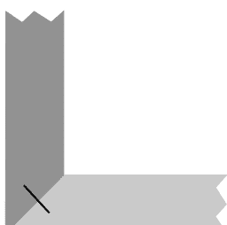

当木工谈到榫尾接时（我们在第 21 页描述了如何制作它），他或她心中海有了该解决方案的其他特征。这些特征对于外行汉来说可能并不明显，但任何木工都能清晰理解。

- 它是一个更复杂的解决方案——制作榫尾接要复杂得多。
- 它不受温度和湿度的影响——随着这些因素的变化，木头会膨胀或收缩。然而，榫尾接将保持稳固。
- 它独立于紧固系统——事实上，榫尾接甚至不需要胶水就能起。
- 它是一种更具美感的接头——制作完成后看起来非常漂亮。

换句话说，榫尾接是一种坚固、可靠、美丽的接头，但制作过程复杂（因此成本昂贵）。

所以，当木工 1 问到：

> 我们应该使用榫尾接还是斜角接？

此时正在进行一场元层次（meta-level）的对话。

真正的问题是：

我们应该使用一种制作昂贵但既美又耐接头，还是仅仅做一个快速且粗糙的接头，只要它能坚持到支票兑现即可？

我们可以说，木工的讨论实际上发生在两个层面：他们语言的表面层面，以及*真实*的对话，后者发生在一个更高的层次（*元层次*），这个层次对外行是隐藏的，而且包含更丰富的意义。这个更高的层次是“木工模式”的层次，反映了木工们真正的设计问题。

在第一的情况下，木工 2 通过讨论接头的实现细节来掩盖真实问题。在第二种情况下，木工 1 想要根据接头的成本和质量来决定使用哪种接头。

谁更高效？你更愿意和谁合作？

这就是我说的模式可以帮助提升你的思维层次。在书的后面章节，你会发现，当你像这样提升思维层次时，新的设计方法就会可用。这正是模式真正的威力所在。

模式帮助我们看到森林也看到树木

## 研究设计模式的其他优势

 改进团队沟通和个人学习

我对于使用设计模式的开发小组的经验是，设计模式对个人学习和团队发展都有帮助。这是因为了解设计模式的初级团队成员拥有有价值的东西，而这些初级成员想要这些东西。这为他们学习这些强大的概念提供了动力。

## 第 5 章 • 设计模式简介 85

大多数设计模式还让软件更具可修改性。原因在于它们是经过时间检验的解决方案。因此，它们演变成了一种结构，能够比脑海中第一个想到的解决方案更容易地处理变化。

### 提高代码的可修改性

设计模式在教学得当的情况下，可以极大地增强对基本面向对象原则的理解。我在我教的面向对象入门课程中见过无数次这种情况。我从简要介绍面向对象范式开始。然后开始教授设计模式，利用它们来阐述基本的面向对象概念（封装、继承、多态）。在期三天的课程结束时，尽管我们大部分时间都在讨论模式，但这些概念——对于许多参与者来说才刚刚介绍——感觉却就像老朋友一样。

### 设计模式阐明了基本的面向对象原则

“四人帮”（Gang of Four）为创建良好的面向对象设计建议了一些策略。特别是，他们建议以下策略：

采用改进的策略——即使在没有模式的情况下也是

- 面向接口设计。
- 优先使用组合而非继承。
- 找到变化之处并将其封装。

这些策略被应用在书中讨论的大多数设计模式中。即使你没有学习所有的设计模式，学习几个也能让你理解为什么这些策略是有用的。有了这种理解，即使你不直接使用设计模式，你也有能力将它们应用到你自己的设计问题中。

另一个优势是，设计模式允许你或你的团队为复杂问题创建设计，而不需要大型继承体系。再次，即使不直接使用设计模式，避免大型继承体系也会产生更好的设计。

学习大型继承体系的替代方案

## 总结

在本章中，我描述了什么是设计模式。克里斯托弗·亚历山大（Christopher Alexander）说“模式是问题的解决方案”。它们不仅仅是一种解决个人问题的模板。它们是一种描述动机的方法，将我们想要发生的事情与困扰我们的问题结合在一起。

我查看了研究设计模式的原因。这种研究有助于：

- 复用现有的高质量解决方案。
- 建立通用术语以改进沟通。
- 将思维层次提升到更高的视角。
- 决定我是否有正确的设计，而不仅仅是一个有效的设计。
- 提高个人学习和团队学习。
- 提高代码的可修改性。
- 促进改进设计方案的采用，即使没有显式使用模式。
- 发现大型继承体系的替代方案。

# 第 6 章

# 外观模式

## 概述

我将从一个你过去可能实现过但可能没有命名的模式开始学习设计模式：外观模式（Facade）。

### 本章

在本章中，

- 我解释了什么是外观模式以及它在哪里使用。
- 我介绍了该模式的关键特征。
- 我展示了外观模式的一些变体。
- 我将外观模式与 CAD/CAM 问题联系起来。

### 介绍外观模式

根据“四人帮”的说法，外观模式的意图是：

意图：一个统一的高层接口

> “为子系统中的一组接口提供统一的接口。外观定义了一个更高层次的接口，使得子系统更容易使用。”

基本上，这意味着我们需要一种新方式与系统交互，这种方式比当前的方法更简单，或者我们需要以特定的方式使用系统（例如以 2D 的方式使用 3D 绘图程序）。我们可以构建这种交互方法，因为我们只需要使用该系统的子集。


# 学习外观模式

一个具有启发性的示例：学习如何使用我们的复杂系统！

曾经，我曾在一家大型工程和制造公司担任承包商。在我入职的第一天，项目的技术负责人不在。现在，这个客户不打算按小时向我付费，而且也没有什么事情让我。他们希望看到我在做些什么，即使那些事没用也可以！你难道没有经历过这样的日子吗？

于是，项目的一位成员为我找到了可以做的事。她说：“你以后可能需要学习我们使用的 CAD/CAM 系统，所以不如现在就开始吧。从这里的这些手册开始看起。”然后她带我来到那堆文档。我可不是在编造：那里有 8 英尺长的手册要我读……每页都是 8.5" x 11 英寸，而且字体非常小！这真是一个复杂的系统！

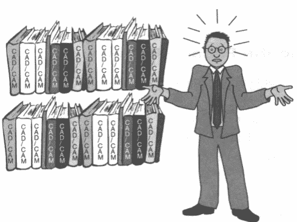

**图 6-1** 8 英尺手册 = 一个复杂的系统！

我想让自己免受这些

现在，如果我和你，比如项目中的四五个人都要使用这个系统，我们并不所有人都必须学习整个系统。与其浪费大家的时间，我们可能会抽签，输了的人必须编写一些程序，让我们其他人通过这些程序与系统进行交互。

这个人将决定我以及团队其他成员将如何使用该系统，以及哪种 API 最适合我们的特定需求。然后，她会创建一个或多个具有所需接口的新类。接那时，我和编程社区的其他成员就可以使用这个新接口，而无需学习整个复杂的系统了（见图 6-2）。

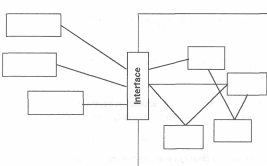

图 6-2 让客户端免受子系统的影响。

现在，这种方法只有在使用系统功能的子集或以特定方式与系统交互时才有效。如果系统中的所有内容都需要使用，那么我不可能设计出一个更简单的接口（除非原始设计者做得很糟糕）。

适用于子集

这就是外观模式（Facade pattern）。它使我们更容易使用复杂系统，无论是只使用系统的子集，还是以特定的方式使用系统。我们有一个复杂的系统，但只需要使用其中的一部分。我们最终得到了一个更简单、易用的系统，或者一个根据我们的需求定制的系统。

这就是外观模式

大部分工作仍然由底层系统完成。外观提供了一组更易理解的方法。这些方法利用底层系统来实现新定义的函数。

# 外观模式：关键特性

## 意图

你想简化使用现有系统的方法。你需要定义你自己的接口。

## 问题

你只需要使用复杂系统的子集。或者你只需要以特定的方式与系统交互。

## 解决方案

外观为现有系统的客户端提供了一个新的接口，使其更容易使用。

## 参与者和协作者

它为客户端提供了一个特殊的接口，使其更容易使用。

## 结果

外观简化了所需子系统的使用。然而，由于外观是不完整的，某些功能对客户端可能不可用。

## 实现

- 定义一个具有所需接口的新类（或多个类）。
- 让这个新类使用现有系统。

## GoF 引用

第 185-193 页。

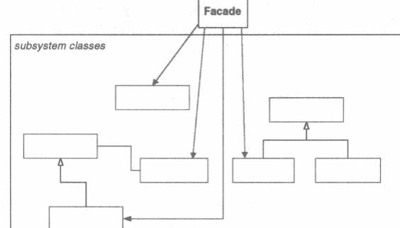

图 6-3 外观模式的标准、简化视图。

# 现场笔记：外观模式

外观不仅可以用于在方法调用方面创建一个简单的接口，还可以减少客户端必须处理的对象数量。例如，假设我有一个客户端对象，必须处理数据库（Databases）、模型（Models）和元素（Elements）。客户端必须先打开数据库并获取模型。然后它查询模型以获取元素。最后，它向元素索取信息。创建一个可以让客户端查询的数据库外观（Database-Facade）可能会得多（见图 6-4）。

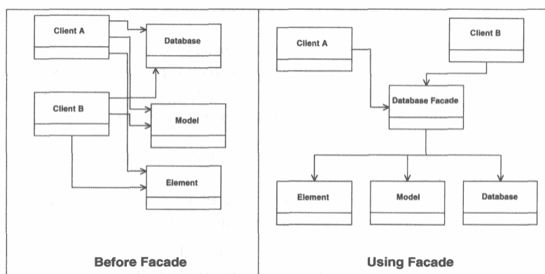

图 6-4 外观减少了客户端的对象数量。

除了使用系统中的函数外，我还需要提供一些新功能。在这种情况下，我已经超出了系统的简单子集。

在这种情况下，我为外观类编写的方法可能会由用于新功能的新程序进行补充。这仍然是外观模式，但扩展了新功能。

# 92 第三部分 · 设计模式

外观模式设定了通用的方法；它开启了我的思路。模式中的外观部分在于，我正在为客户端创建一个新的接口来使用，而不是现有系统的接口。我可以这样做是因为客户端对象不需要使用我原始系统中的所有函数。

## 模式设定了通用的方法。

模式只是设定了通用的方法。是否添加新功能取决于情况。

外观的变体：一个“封装”层

外观可以用于隐藏或封装系统。封装有许多原因：

- 你不需要使用我原始系统中的所有函数。
- 你想使用原始系统，同时也想添加新功能。
- 编写这个新类的成本低于你未来在维护上花费的费用。

# 将外观模式与 CAD/ 联系起来

封装系统

考虑上面的示例。外观模式之所以这样命名，是因为它在系统前面立了一个新的门面（facade）。


## 第 7 章 适配器模式 97

+   - 你无法将例程直接整合到程序中。
- 接口或调用代码的方式与其相关对象需要使用它的方式并不完全对应。

换句话说，虽然系统将*拥有*点、线和正方形，但我希望客户端对象*认为*我只有*形状*。

> ... 这样它就可以以一种通用的处理细节

+   - 这允许客户端对象以相同的方式处理所有这些对象——而不必关注它们之间的差异。
- 它还使我能够在未来添加不同类型的形状，而无需更改客户端（见图 7-1）。

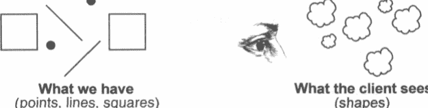

图 7-1 我们拥有的对象 ... 它们看起来应该都像“形状”。

我将利用多态性；也就是说，我的系统中会有不同的对象，但我希望这些对象的客户端以一种共同的方式与它们交互。

> 如何实现：以多态方式使用派生类

在这种情况下，客户端对象只需告诉点、线或正方形执行某些操作，例如显示自己或显示自己。每个点、线和正方形都负责知道如何执行与其类型相应的行为。

为了实现这一点，我将创建一个 `Shape` 类，然后派生自代表点、线和正方形的类（见图 7-2）。

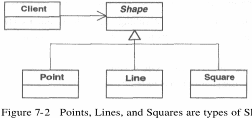

首先，我必须指定 `Shapes` 将要提供的特定行为。为了实现这一点，我在 `Shape` 类中定义了一个接口，然后在每个派生类中相应地实现该行为。

如何实现：
定义接口然后在派生类中实现

`Shape` 需要具备的行为：

+   - 设置形状的位置。
- 获取形状的位置。
- 显示形状。
- 填充形状。
- 设置形状的颜色。
- 取消显示形状。

我在图 7-3 中展示了这一点。

假设现在被要求实现一个圆，一种新的 `Shape`（记住，需求总是在改变的！）。为了做到这一点，我想创建一个新类——`Circle`——它实现“圆”形状并派生自 `Shape` 类，以便我仍然可以获得多态行为。

现在，添加一个新形状

> 2 本书中此及所有其他类图都使用统一建模语言 (UML) 符号。请参见第 2 章“UML——统一建模语言”获取关于 UML 符号的描述。

## 第 7 章 适配器模式 99

| Shape |
| :--- |
| +setLocation() |
| +getLocation() |
| +display() |
| +fill() |
| +setColor() |
| +undisplay() |

| Point | Line | Square |
| :--- | :--- | :--- |
| +display() | +display() | +display() |
| +fill() | +fill() | +fill() |
| +undisplay() | +undisplay() | +undisplay() |

**图 7-3** 显示方法的点、线和正方形。

现在，我面临着必须为 `Circle` 编写 `display`、`fill` ... 使用行为以及 `undisplay` 方法的任务。这可能是一件痛苦。

幸运的是，我寻找了一个替代方案（正如一个优秀的程序员应该做的那样），我发现走头的 Jill 已经写了一个她称为 `xxcircle` 的类，已经处理了圆（见图 7-4）。遗憾的是，她没有问我应该如何给方法命名（我也没有问她！）。她将方法命名为

+   * *displayIt*
* *fillIt*
* * *undisplayIt*

| XXCircle |
| :--- |
| +setLocation() |
| +getLocation() |
| +display() |
| +fillIt() |
| +setColor() |
| +undisplayIt() |

**图 7-4** Jill 的 `XXCircle` 类。

## 100 第三部分 • 设计模式

我不能直接使用 `xxcircle`。我不能直接使用 `XXCircle`，因为我想保留与 `Shape` 的多态行为。这有两个原因：

+   * 我有不同的名称和参数列表——方法名和参数列表与 `Shape` 的方法名和参数列表不同。
* * 我无法派生它——不仅名称必须相同，而且类也必须派生自 `Shape`。

Jill 不太愿意更改方法的名称或从 `Shape` 派生 `XXCircle`。这样做需要她修改所有当前正在使用 `XXCircle` 的对象。此外，如果我修改了他人的代码，我仍然会担心产生意外之外的副作用。

我拥有几乎触手可及的东西，但我无法使用它，也不想重写它。我能做什么？

与其改变它，我何适配它。我可以创建一个派生自 `shape` 的新类，从而实现 `shape` 的接口，但避免了重写 `XXCircle` 中的圆实现（见图 7-5）。

+   * 类 `Circle` 派生自 `Shape`。
* `Circle` 包含 `XXCircle`。
* `Circle` 将发给 `Circle` 对象的请求传递给 `XXCircle` 对象。

如何实现：图 7-5 中 `Circle` 和 `xxcircle` 之间末尾的菱形表示 `Circle` 包含 `xxcircle`。

## 108 第 7 章 适配器模式 101

| Client | Shapes | Line | Square |
| :--- | :--- | :--- | :--- |
| | | | XXCircle |
| +setLocation() | | | |
| +getLocation() | | | |
| +display() | +display() | +display() | |
| +fill() | +fill() | +fill() | |
| +setColor() | | | |
| +undisplay() | +undisplay() | +undisplay() | +display() |

图 7-5 `Circle` 包装了 `XXCircle`。

```java
class Circle extends Shape {
  private XXCircle pxc;

  public Circle() {
    pxc = new XXCircle();
  }

  public void display() {
    pxc.displayIt();
  }
}
```

## 109 适配器模式：关键特性

意图 匹配一个特定的接口。

问题 系统具有正确的数据但错误的接口。通常用于当你有一个。

解决方案 适配器提供具有所需接口的包装。

参与者和协作者 适配器适配 Adaptee 的接口以匹配 Target（它派生的类）。这允许客户端像使用 Target 一样使用适配器。

后果 适配器模式允许现有对象置于新的类结构中。

实现 在另一个类中包含现有类。让包含类匹配接口并调用包含类的方法。

GoF 参考 第 139-150 页。

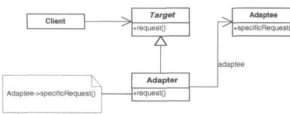

图 7-6 适配器模式的标准、简化视图。

## 110 笔记：适配器模式

通常处于类似于上述的情况，但被适配的对象没有完成我需要的所有工作。

在这种情况下，我仍然适配器模式，但它并不完美。在这种情况下，

-- 在现有类中实现的功能可以被适配。
- 不存在的功能可以在包装对象中实现。

这并没有给我同样的好处，但至少我不需要实现所有的要求功能。

当你学习几个模式时，这会变得越来越重要。许多模式要求某些类派自同一个类。如果有现有的类，可以使用适配器模式将其适配到适当的抽象类（如 `Circle` 适配 `XXCircle` 到 `Shape`）。

实际上有两种类型的适配器模式：

- 对象适配器——我一直使用的模式被称为对象适配器，因为它依赖于一个对象（适配对象）包含另一个（被适配对象）。
- 类适配器模式——实现适配器模式的另一种方法是使用多重继承。在这种情况下，它被称为类适配器模式。


# 104 第三部分 • 设计模式

使用哪种适配器模式（Adapter pattern）取决于问题领域中起作用的不同因素。在概念层，我可以忽略这种区别；但在实现它时，我需要考虑更多涉及的因素。

## 比较适配器与外观模式（Facade）

在设计模式的分类中，几乎总是有人说，适配器模式和外观模式听起来似乎是一样的。在这两种情况下，都有一个预定义的类（或多个类）拥有所需的接口。在这两种情况下，我都会创建一个具有所需接口的新对象（见图 7-7）。


**图 7-7 使用另一个接口错误的预存在对象的客户端。**

## 它们都是包装器

“包装器”（Wrappers）和“对象包装器”（object wrappers）是你经常听到的术语。用对象来封装旧系统以便使用是一种流行的做法。

从这个高视角来看，外观模式和适配器模式看起来确实很相似。它们都是包装器。但它们是不同的包装器。你需要理解这些区别，这些区别可能是微妙的。发现并理解这些更微妙的差异可以对模式的属性产生深刻见解。让我们来看看涉及这些模式的不同因素（见表 7-1）。

- 1. 关于如何决定选择对象适配器（Object Adapter）还是类适配器（Class Adapter），请参阅《设计模式》书第 142-144 页。

| 表 7-1 外观模式与适配器模式的比较 |
| --- | --- |
| | 外观 (Facade) | 适配器 (Adapter) |
| 是否存在预定义的类？ | 是 | 是 |
| 是否有一个我们必须设计的接口？ | 否 | 是 |
| 对象是否需要表现出多态？ | 否 | 可能 |
| 是否需要更简单的接口？ | 是 | 否 |

- * 在外观模式和适配器模式中，我都有预定义的类。

有时人们得出结论，外观模式和适配器模式的另一个区别是，外观模式背后隐藏了多个类，而适配器只隐藏了一个类。虽然这是事实，但并不是模式的一部分。外观模式可能位于一个非常复杂的对象面前，而适配器可能包装了几个小对象，这些对象共同实现了所需的功能。

> 并不是所有的区别都是模式的一部分

底线：外观模式简化了接口，而适配器将接口转换为预定义的接口。

## 将适配器模式与 CAD/CAM 问题联系起来

适配器让我能够与 OOGFeature 通信

在 CAD/CAM 问题（第 3 章，“急需灵活代码的问题”）中，V2 模型中的特征将由 OOGFeature 对象表示。遗憾的是，这些对象没有正确的接口（从我的角度来看），因为它们不是由我设计的。我无法让它们继承自 Feature 类，然而，当我使用 V2 系统时，它们能够完美地完成我们的工作。

在这种情况下，甚至不存在编写新类来实现此泛的选项——我必须与 OOGFeature 对象通信。实现这一点的简单方法就是使用适配器模式。

## 总结

### 本章

适配器模式是一种非常有用的模式，它将一个类（或多个类）的接口转换为我们需要的类拥有的另一个接口。它是通过创建一个具有所需接口的新类，然后封装原始类的方法来有效地包含被适配对象来实现的。

## 补充：C++ 代码示例

示例 7-2 C++ 代码片段：实现适配器模式

```cpp
class Circle : public Shape {
  private:
    XXCircle *pxc;
}
Circle::Circle () {
    pxc= new XXCircle;
}
void Circle::display () {
    pxc->displayIt();
}
```

# 第 8 章

# 扩展我们的视野

## 概述

### 本章

在本章中，

- * 我比较并对比了观察对象的传统方式——作为数据和方法的集合——与新方式——作为具有职责的实体。
- 我比较并对比了观察封装的传统方式——作为隐藏数据——与新方式——作为隐藏任何内容的能力。特别重要的一点是，封装可以用于包含行为的变化。
- 我比较并对比了使用继承的传统方式——为了特化和重用——与新方式——作为对进行分类的方法。
- 新视角允许在对象中包含行为的变化。
- 我将展示概念视角、规范视角和实现视角如何与抽象类及其派生类相关。

## 致谢

也许这种新视角并非完全原创。我相信，许多设计模式的开发者在开发最终被称为“模式”的东西时，也持有这种视角。当然，这种视角与 Christopher Alexander、Jim Coplien 以及“四人帮”的著作是一致的。

虽然它可能不是原创的，但还没有以我在在本章和书中所用的方式表达过。我必须从设计模式的行为方式以及他人如何描述它们的方式中提炼出这种观察模式的方法。

当我称其为一种新视角时，我的意思是它极可能是大多数开发者看待面向对象编程的一种新方法。当我学习设计模式时，这对我来说无疑是新的。

## 对象：传统观点与新观点

传统观点：带有方法的数据

对象的传统观点是它们带有方法的数据。事实上，我们经常将它们认为是“智能数据”。

新观点：具有职责的实体

新观点是对象是具有职责的实体。这是一种更灵活的观察方式，因为它关注它们做什么，而不是它们是如何实现的。

通过这种方式观察对象，我们可以设计出好多的系统。例如，我们可以设计一个负责许多不同事情的对象，而无需担心这些事情是如何实现的。

新观点还允许我们处理行为的变化。例如，我们可以设计一个根据情况表现出不同的对象，而无需更改其代码。

这是一种思考对象的更强大的方式。它允许我们构建更灵活、更健壮的系统。事实上，这是一种更自然的思考世界的方式。

## 封装：

这允许我们分两步设计：

- 1. 在不担心细节的情况下进行设计。
- 2. 实现设计。

这是一种好得软件设计方式。它允许我们在陷入实现细节之前关注高层架构。它也让以后维护和演进系统变得容易得多。

在事实上，对于内部包含什么没有任何暗示。

例如，假设我有一个 Shape 对象，它的职责是

- 知道自己的位置
- 能够在显示器上绘制自己
- 能够从显示器上移除自己

这些职责意味着必须存在特定的方法调用：

```cpp
getLocation( . . )
drawShape( . . )
unDrawShape( . . )
```

对于 Shape 内部包含什么没有任何暗示。我只关心 Shape 是否对其行为负责。它可能有


## 第 8 章 · 拓展我们的视野 113

在西雅图，有成千上万各种颜色的这种“伞”。

大多数人把它们称为汽车。

但我把我的车看作一把伞，因为伞是你用来躲避避雨的东西。很多时候，当我在外面等人见我时，我会坐在我的“伞”里保持干燥！

当然，汽车并不是真正的伞。是的，你可以用它来表示避雨的局限性，但这种对汽车的看法太局限了。同样地，封装仅仅是为了隐藏数据。这种对封装的看法也太局限了。这样考虑会限制我设计时的思维。

封装应该被视为“任何形式的隐藏”。换句话说，它可以隐藏数据，它还可以隐藏实现、派生类或任何数量的内容。考虑图 1 所示的图，“适配器模式”。

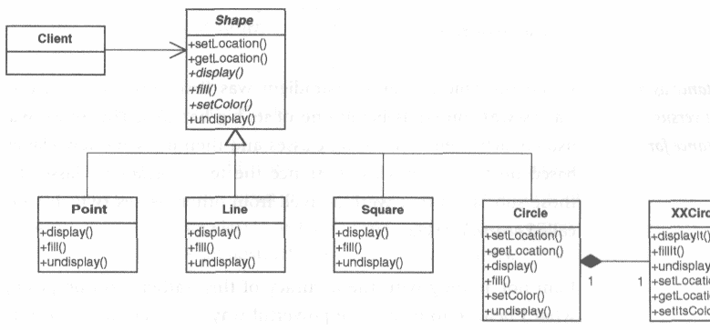

图 8-1 用 Circle 适配 XXCircle。

## 多个层级的封装

图 8-1 显示了许多种封装：

- 数据的封装——Point、Line、Square 和 Circle 中的数据对其他所有内容隐藏。
- 方法的封装——例如，Circle 的 setLocation。
- 派生类的封装——Shape 的客户端看不见 Points、Lines、Squares 或 Circles。
- 其他对象的封装——只有 Circle 知道 xxCircle 的。

因此，当存在一个具有多态行为的抽象类，而抽象类的客户端并不知道实际存在的是哪种派生类时，就实现了一种类型的封装。此外，适配接口隐藏了适配对象具体是什么。

## 这种新定义的优势

以这种方式看待封装的优势在于，它为我提供了一种更好的方法来拆分（分解）我的程序。封装层变成了我所设计的接口。通过封装不同类型的 Shape，我可以在不改变使用它们的任何客户端程序的情况下添加新的形状。通过在 Circle 后面封装 XXCircle，如果我选择或需要，我可以在未来更改这种实现。

## 作为概念的继承与为了重用的继承

当面向对象的范式首次提出时，类的重用被推崇为其主要优势之一。这种重用通过创建类，然后基于这些基类派生出新类来实现。因此，那些从其他类（即通用类）派生出来的子类被称为专门化类（specialized classes）。

我并不是在争论这种说法的准确性，而是在提出一种我认为更强大的使用继承的方法。在上面的示例中，我可以根据不同特殊类型的 Shapes（即 Points、Lines、Squares 和 Circles）来进行我的设计。然而，当我考虑使用 Shapes 时，这可能不会让我隐藏这些特殊情况——我可能就会利用对这些具体类的知识。

然而，如果我将 Shapes 看作对 Points、Lines、Squares 和 Circles 进行分类的方式，我可以更容易地将它们看作一个整体。这将使我更有可能针对接口（Shapes）进行设计。这也意味着如果我得到了一个新的 Shape，我不太可能把自己设计进一个难以维护的境地（因为任何客户端对象不知道它正在处理的是什么样的 Shape）。

## 什么是变化以及如何封装

在《设计模式：可重用面向对象软件的元素》书中，“四人帮”（Gang of Four）对设计中这样使用继承提出了以下建议：

> 考虑你的设计中哪些应该是可变的。这种方法与关注重新设计的原因相反。与其考虑什么可能迫使设计发生变化，不如考虑你想要在不重新设计的情况下能够改变什么。这里的重点是封装变化的概念，这是许多设计模式的主题。

如果你只把封装看作数据隐藏，这些陈述看起来很奇怪。当你把封装看作使用抽象类来隐藏类时，它们要明智得多。使用对抽象类的引用组合来隐藏这些变化。

- 1. Gamma, E., Helm, R., Johnson, R., Vlissides, J., Design Patterns: Elements of Reusable Object-Oriented Software, Reading, Mass.: Addison-Wesley, 1995, p. 29.

实际上，许多设计模式使用封装在对象之间创建层——允许设计者更改层不同侧的内容而不不利地影响另一侧。这促进了双方之间的松耦合。

这种思考方式在桥接模式（Bridge pattern）中非常重要，该模式将在第 9 章“桥接模式”中讨论。在继续之前，我想展示许多开发者具有的一种设计偏见。

假设我正在从事一个模拟动物不同特征的项目。我的需求如下：

- 每种类型的动物可以有不同数量的腿。
- 动物对象必须能够记忆和检索它们的信息。
- 每种类型的动物可以有不同类型的移动。
- 动物对象必须能够返回从一个地方移动到特定地形类型的另一个地方需要多久。

处理腿数量变化的典型方法是拥有一个包含该值的成员变量，并有设置和获取它的方法。然而，人们通常会采取不同的方法来处理行为的变化。

假设有两种不同的移动方法：行走和飞行。这些需求需要两段不同的代码：一个用于行走，一个用于飞行；一个简单的变量是不起作用的。鉴于我有两种方法，我似乎面临一个选择：

- 拥有一个告诉我移动方式的成员。
- 拥有两个不同类型的 Animals（都派生自基类）——一个行走一个飞行。

不幸的是，这两种方法都有问题：

- 紧耦合——这种方法（使用标记）可能会导致紧耦合。
- 细节过多——这种方法需要我处理。

存在第三种可能性：Animal 类包含移动行为。我在图 8-2 中展示了这一点。

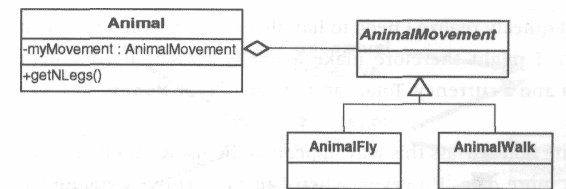

图 8-2 包含 AnimalMovement。

这起初似乎多此一举。然而，它仅仅是包含移动行为的 Animal。这与拥有包含腿数量的成员非常相似。我怀疑 8-2 和 8-3 在概念上看起来是不同的。

## 第三部分 · 设计模式

| Animal |
| :--- |
| -myMovement : AnimalMovement |
| +getLegs() |

**图 8-3** 显示作为成员的包含。

许多开发者倾向于认为一个对象包含另一个对象与对象拥有单纯的数据成员在本质上是不同的。但看起来不是对象的成员（例如整数和双精度浮）真的是对象。在面向对象编程中，*一切*都是对象，甚至是这些具有运算行为的数据类型。

使用对象包含属性的变化以及使用对象包含行为的变化是非常的；这可以通过示例很容易地展示。假设我正在编写一个销售系统。有一个销售收据。在这张收据上有一个总额。我最初可以将其类型定义为双。然而，如果我正在处理一个国际应用程序，我很快意识到我需要处理货币转换等。因此，我可能会创建一个包含金额和货币的 Money 类。总额现在可以是 Money 类型。

这种方式使用 Money 类似乎只是使用一个对象来包含更多数据。然而，当我需要将钱从一种货币转换为另一种货币时，应该是 Money 对象本身来执行转换，因为对象应该自己负责。起初这似乎比这更复杂。例如，我可能需要根据过去的日期进行货币转换。


基于其所包含的 Money 对象（因此包含 Currency 对象）。

我将在接下来的几个设计模式中演示这种使用包含对象来执行所需行为的策略。

## 共性/变异与抽象类

考虑图 8-4。它展示了以下者之间的关系：

- 共性/变异分析
- 概念、规范和实现视角
- 一个抽象类、其接口及其派生类

面向对象的设计捕捉了这三个视角。

通过观察这些对象做了什么（概念视角），我们决定了如何调用它们（规范）。

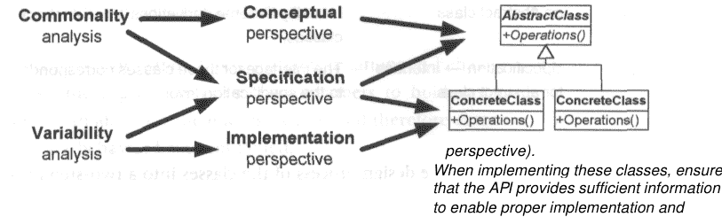

**图 8-4** 共性/变异分析、视角与抽象类之间的关系。

如你在图 8-4 所示，共性分析与问题领域的概念视图相关，而变异分析与实现（即具体情况）相关。

现在，规范为抽象类提供了更好的理解。

规范视角位于中间。共性和变异都涉及这个视角。规范描述了如何与一组概念上相似的对象进行通信。这些对象中的每一个都代表了通用概念的一种变异。该规范在实现层面变为抽象类或接口。

在面向对象设计的新视角下，我现在可以说以下内容：

## 与抽象类的映射

## 讨论

- 抽象类 —> 核心绑定概念

抽象类代表了将该类所有派生类绑定在一起的核心概念。这个核心概念定义了共性。

- 共性 —> 使用的抽象类
  变异 —> 抽象类的派生

在这些共性*内部*识别出的共性变成了抽象类的派生类。

- 规范 —> 抽象类的接口

这些类的接口对应于规范级。

这把类的设计过程简化为两步程序：

## 当定义 ... 时...

## 你必须问自己自己...

- 一个抽象类（共性）
  派生类

需要什么*接口*来处理该类的所有职责？

给定这个特定的实现（变异），我该如何根据给定的规范来实现它？

规范视角与概念视角之间的关系是：它识别了我需要使用的接口，用以处理该概念的所有情况（即共性）。

## 总结

传统的关于对象、封装和继承的思维方式是非常局限的，而不仅仅是隐藏数据。通过扩展定义以包含任何形式的隐藏，我可以使用封装在对象之间创建层——使我能够改变层的一侧的内容，而不对另一侧产生不利影响。

在本章中

继承应该被用作一种一致处理概念上相同的不同具体类的方法，而不是特化的手段。

使用对象来持有行为变异的概念，与使用数据成员来持有数据变异的做法并不相似。两者都允许对所包含的数据/行为进行封装（从而进行扩展）。

## 第 9 章

## 桥接模式

## 概述

我将通过桥接模式继续我们对设计模式的研究。桥接模式比你刚刚学习的其他模式要复杂得多；它也有用得多。

在本章中，

- 我将通过一个示例推导出桥接模式。我会详细介绍，以帮助你学习这个模式。
- 我将介绍该模式的关键特征。
- 我将根据自己的实践介绍对桥接模式的一些观察。

## 引入桥接模式

根据四人帮（Gang of Four），桥接模式的意图是“将抽象与其实现解耦，以便两者可以独立变化”。

我清楚记得读到这句话时我的第一个想法是什么：

哈？

然后，

> 为什么我理解这句话中的每一个单词，却完全不知道它是什么意思？！

我知道

- 解耦（De-couple）意味着让事物相互独立运行，或者至少明确说明它们之间的关系，以及
- 抽象（Abstraction）是不同事物在概念上相互关联的方式。

我曾认为实现是构建抽象的方式；但对于我应该如何将抽象与实现它们的具体方式分开感到困惑。

事实证明，我的很多困惑源于对词义含义的误解。这里的实现指的是抽象类及其派生类本身要去实现的对象（而不是抽象类的派生类，那些被称为具体类）。但老实说，即使我正确地理解了它，我不确定它能有多多大的帮助。这句话中表达的概念起初确实很难理解。

如果你此时也对桥接模式感到困惑，那没关系。如果你已经理解了所述的意图，那么你已经领先了。

桥接模式是一个极具挑战性的模式，因为它非常强大。

桥接模式是最难理解的模式之一，部分是因为它如此强大并适用于许多情况。此外，它违背了用继承来处理特殊情况的常见倾向。然而，它是遵循设计模式社区两项指令的极佳示例：“发现变化之处并将其封装”以及“优选对象组合而非类继承”（正如你将看到的那样）。

## 学习桥接模式：一个示例

为了学习桥接模式背后的思想以及它试图做什么，我将通过一个示例。从需求开始，我将推导出模式，然后查看它为什么存在。也许这个示例看起来很基础。但看看你遇到过的情况：

- 抽象的变异
- 这些概念实现方式的变异。

**结论：** 在需求定义期间，尽早且频繁地探索变异！

从一个简单的问题开始：绘制形状

假设我被赋予任务，编写一个使用两种程序之一绘制矩形的程序。有人告诉我，当我实例化矩形时，将知道应该使用绘制程序 1 (DP1 还是绘制程序 2 (DP2)。

矩形被定义为两个点，如图 9-1 所示。绘制程序之间的差异总结在表 9-1 中。

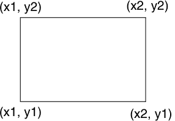

表 9-1 绘制程序

| DP1 | DP2 |
|---|---|
| 用于绘制折线 | draw_line(x1, y1, x2, y2) | drawline(x1, x2, y1, y2) |
| 用于绘制圆形 | draw_circle(x, y, r) | drawcircle(x, y, r) |

继承的正确使用

通过拥有一个抽象类 Rectangle，我利用了这样一个事实：不同类型的 Rectangle 之间的区别在于它们如何实现 `drawLine` 方法。V1Rectangle 的实现是持有一个 DP1 引用并使用该对象的 `draw_a_line` 方法。V2Rectangle 的实现是持有一个 DP2 引用并使用该对象的 `drawline` 方法。然而，通过实例化正确的 Rectangle 类型，我再也不需要担心这种差异。


# 第9章 • 桥接模式 127

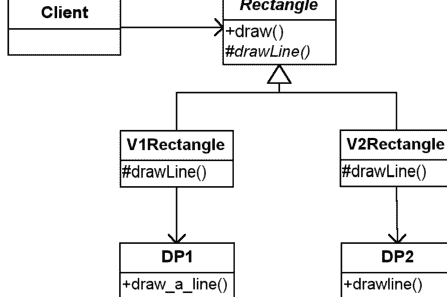

图 9-2 形和绘图程序的设计（DP1 和 DP2）。

例 9-1 Java 代码片段

```java
class Rectangle {
    public void draw () {
        drawLine(_x1, _y1, _x2, _y1);
        drawLine(_x2, _y2, _x2, _y2);
        drawLine(_x2, _y1, _x1, _y2);
        drawLine(_x1, _y2, _x1, _y1);
    }
    abstract protected void
    drawLine( double x1, double y1, double x2, double y2);
}

class V1Rectangle extends Rectangle {
    drawLine( double x1, double y1, double x2, double y2) {
        DP1.draw_a_line( x1,y1,x2,y2);
    }
}
class V2Rectangle extends Rectangle {
    drawLine( double x1, double y1, double x2, double y2) {
        // 参数在 DP2 中不同
        // 并且必须重新排列
        DP2.drawline( x1,x2,y1,y2);
    }
}
```

# 128 第三部分 • 设计模式

但是，尽管需求总是在变化

现在，假设在完成这段代码后，不可避免的三种倒霉（死亡、税收和需求变化）之一降临在了我身上。我被要求支持另一种形状——这次是圆。然而，我收到的指令是，集合对象不想知道矩形和圆之间的区别。

... 我仍然可以有一个简单的实现

我意识到，我只需通过为我的类层次结构增加另一个层级来扩展我已经开始的方法。我只需要添加一个名为 `Shape` 的新类，并在此派生 `Rectangle` 和 `Circle` 类。这样，客户端对象就可以直接引用 `Shape` 对象，而不必担心 `Shape` 提供了什么。

使用继承进行设计

作为初步的对象面向分析，似乎仅使用继承来实现这些需求是自然的。例如，我可以从类似图 9-2 的东西开始，对于每种 `Shape`，用每种绘图程序实现形状，为 `Rectangle` 派生一个 DP1 版本和一个 DP2 版本，并为 `Circle` 派生一个 DP1 版本和一个 DP2 版本。我最终将得到图 9-3 的结构。

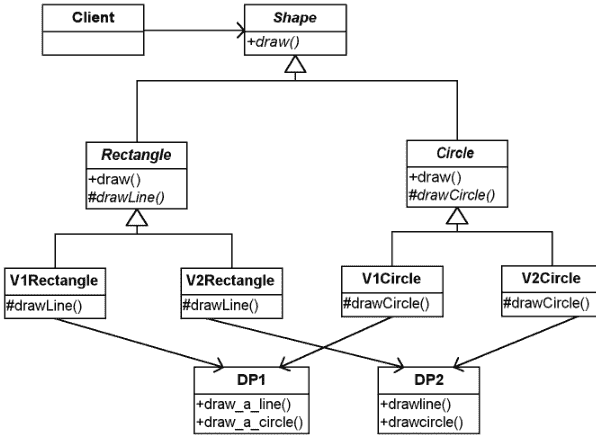

图 9-3 一种直接的方法：实现两个形状和两个绘图程序。

# 第9章 • 桥接模式 129

我实现 `Circle` 类的方式与实现 `Rectangle` 类相同。然而，这次我使用 `drawCircle` 而不是 `drawLine` 来实现 `draw`。

### 例 9-2 Java 代码片段

```java
abstract class Shape {
    abstract void draw();
}
abstract class Rectangle extends Shape {
    public void draw () {
        drawLine(_x1, _y1, _x2, _y1);
        drawLine(_x2, _y1, _x2, _y2);
        drawLine(_x2, _y2, _x1, _y2);
        drawLine(_x1, _y2, _x1, _y1);
    }
    abstract protected void drawLine(
        double x1, double y1,
        double x2, double y2);
}
class V1Rectangle extends Rectangle {
    protected void drawLine (
        double x1, double y1,
        double x2, double y2) {
        DP1.draw_a_line( x1,y1,x2,y2);
    }
}
class V2Rectangle extends Rectangle {
    protected void drawLine (
        double x1, double x2,
        double y1, double y2) {
        DP2.drawLine( x1,x2,y1,y2);
    }
}
abstract class Circle {
    public void draw () {
        drawCircle(x, y,r);
    }
abstract protected void drawCircle (
        double x, double y, double r);
}
```

(续)

# 130 第三部分 • 设计模式

例 9-2 Java 代码片段（续）

```java
class V1Circle extends Circle {
  protected void drawCircle() {
    DP1.draw_a_circle( x,y,r);
  }
}
class V2Circle extends Circle {
  protected void drawCircle() {
    DP2.drawcircle( x,y,r);
  }
}
```

理解了这个设计后，让我们来看例子。考虑 `V1Rectangle` 的 `draw` 方法做了什么。

- `Rectangle` 的 `draw` 方法与之前相同（根据需要调用四次 `drawLine`）
- `drawLine` 是通过调用 DP1 的 `draw_a_line` 实现的。

在运行时，它看起来像图 9-4。

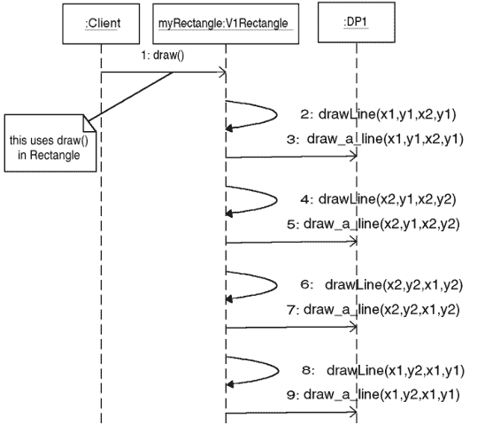

图 9-4 V1Rectangle 序列图。

# 136 序列图

正如我在第 2 章“统一语言”中所讨论的，图 9-4 中的图是一种特殊的序列图。它的目的是显示对象之间的交互。你从上到下阅读此图。

- 客户端向 `V1Rectangle` 发送消息
- `V1Rectangle` 向自己发送消息
- `V1Rectangle` 向 `DP1` 发送消息
- `DP1` 向自己发送消息

- 客户端向 `V1Rectangle` 发送消息
- `V1Rectangle` 向自己发送消息
- `V1Rectangle` 向 `DP1` 发送消息
- `DP1` 向自己发送消息

- 客户端向 `V1Rectangle` 发送消息
- `V1Rectangle` 向自己发送消息
- `V1Rectangle` 向 `DP1` 发送消息
- `DP1` 向自己发送消息

- 客户端向 `V1Rectangle` 发送消息
- `V1Rectangle` 向自己发送消息
- `V1Rectangle` 向 `DP1` 发送消息
- `DP1` 向自己发送消息

- 客户端向 `V1Rectangle` 发送消息
- `V1Rectangle` 向自己发送消息
- `V1Rectangle` 向 `DP1` 发送消息
- `DP1` 向自己发送消息

- 客户端向 `V1Rectangle` 发送消息
- `V1Rectangle` 向自己发送消息
- `V1Rectangle` 向 `DP1` 发送消息
- `DP1` 向自己发送消息

- 客户端向 `V1Rectangle` 发送消息
- `V1Rectangle` 向自己发送消息
- `V1Rectangle` 向 `DP1` 发送消息
- `DP1` 向自己发送消息

- 客户端向 `V1Rectangle` 发送消息
- `V1Rectangle` 向自己发送消息
- `V1Rectangle` 向 `DP1` 发送消息
- `DP1` 向自己发送消息

- 客户端向 `V1Rectangle` 发送消息
- `V1Rectangle` 向自己发送消息
- `V1Rectangle` 向 `DP1` 发送消息
- `DP1` 向自己发送消息

- 客户端向 `V1Rectangle` 发送消息
- `V1Rectangle` 向自己发送消息
- `V1Rectangle` 向 `DP1` 发送消息
- `DP1` 向自己发送消息

- 客户端向 `V1Rectangle` 发送消息
- `V1Rectangle` 向自己发送消息
- `V1Rectangle` 向 `DP1` 发送消息
- `DP1` 向自己发送消息

- 客户端向 `V1Rectangle` 发送消息
- `V1Rectangle` 向自己发送消息
- `V1Rectangle` 向 `DP1` 发送消息
- `DP1` 向自己发送消息

- 客户端向 `V1Rectangle` 发送消息
- `V1Rectangle` 向自己发送消息
- `V1Rectangle` 向 `DP1` 发送消息
- `DP1` 向自己发送消息

- 客户端向 `V1Rectangle` 发送消息
- `V1Rectangle` 向自己发送消息
- `V1Rectangle` 向 `DP1` 发送消息
- `DP1` 向自己发送消息

- 客户端向 `V1Rectangle` 发送消息
- `V1Rectangle` 向自己发送消息
- `V1Rectangle` 向 `DP1` 发送消息
- `DP1` 向自己发送消息

# 137 第三部分 • 设计模式

当客户端向对象（名为 `Rectangle`）发送 `draw` 方法时，它调用 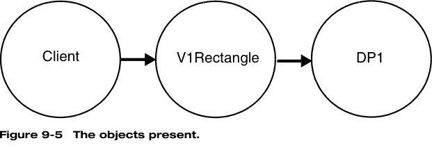 2-9。这种解决方案会导致组合爆炸

不幸的是，这种方法引入了新问题。观察图 9-3，注意第三行的类。

- 是否存在冗余？
- 你认为这些东西是高内聚还是低内聚？
- 是紧耦合还是松散耦合？
- 你想维护这些代码吗？

类爆炸问题这种解决方案，抽象（形状类型）和实现（绘图程序）是紧耦合的。每种形状都必须知道自己属于哪种绘图程序。我们需要一种方法将抽象与实现分离，以便类的数量仅呈线性增长（见图 9-6）。

# 138

这正是桥接模式的意图：[将]抽象与其实现解耦，以便两者可以独立变化。

抽象 1 实现 A
抽象 2 实现 B
抽象 3 实现 C


图 9-6 桥接模式分离了抽象和实现。

在展示解决方案并导出桥接模式之前，我想提到几个其他问题（除了组合爆炸之外）。

还有几个其他问题。我们糟糕的设计方法给了我们这一堆乱子！

| 过度使用继承。 | 作为初级对象面向分析师，我倾向于使用特殊用例来解决这里看到的这类问题。我喜欢继承的想法，因为它看起来新颖而强大。我尽可能地使用它。这对于许多初级分析师来说是正常的，但这是天真的；有了这个新“锤子”，一切看起来都是钉子。 |

2. Gamma, E., Helm, R., Johnson, R., Vlissides, J., Design Patterns: Elements of Reusable Object-Oriented Software, Reading, Mass: Addison-Wesley, 1995, p. 151.


不幸的是，许多面向对象设计的教学方法都侧重于数据抽象——导致设计过度基于对象的“本质性”（is-ness）。当我成为一名丰富的面向对象设计师时，我仍然受困于基于继承的设计范式——也就是说，根据类的“本质性”来观察类的特征。对象的特征应该基于它们的职责，而不是基于它们可能包含什么或是什么。当然，对象可能可能负责提供关于自身的信息；例如，一个客户对象可能需要告诉你是它的名字。请从职责的角度来考虑对象，而不是从结构的角度。

丰富的面向对象分析师已经学会了有选择性地使用继承来发挥它的威力。使用设计模式将帮助你更快地跨越这条学习曲线。它涉及了从为每种变化使用不同的特化类（继承），到将这些变化移动到使用的或拥有的对象中（组合）的转变。

## 一种替代方法

当我第一次观察这些问题时，我想困难的某部分可能是因为我仅仅是使用了错误类型的继承层次结构。因此，我尝试了图 9-7 所示的替代层次结构。

### 并没有好多少，只是换了一种方式变糟糕

我仍然拥有四个表示我所有可能组合的类。然而，通过先为不同的绘图程序导出版本，我消除了 DP 和 DP2 包之间的冗余。

不幸的是，我无法消除两种矩形（Rectangle）和两种圆形（Circle）之间的冗余，每一对都有相同的 `draw` 方法。

无论如何，之前存在的类爆炸在这里仍然存在。

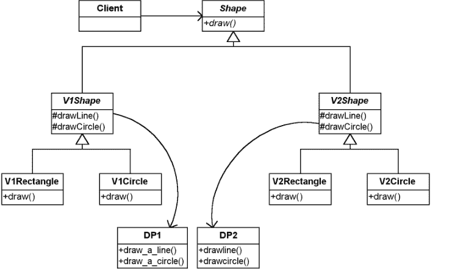

**图 9-7** 一种替代实现。

该解决方案的序列图如图 9-8 所示。

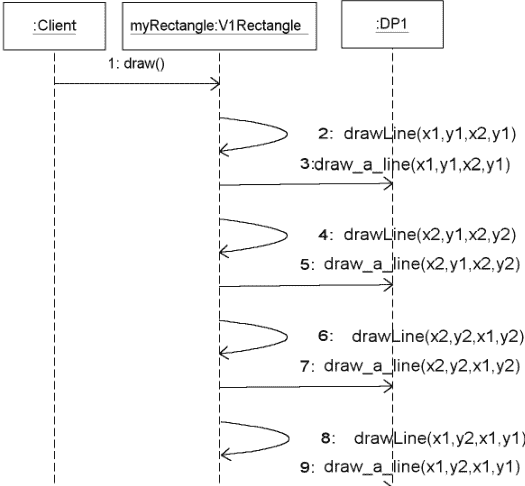

**图 9-8** 新方法的序列图。

虽然这与原始解决方案相比有所改进，但它在扩展性上仍然存在问题。它仍然具有一些原始的内聚和耦合问题。

**结论：** 我也不想维护这个版本！一定有更好的方法。

## 在初始设计中寻找替代方案。

尽管我的替代设计并没有比原始设计显著好很多，但指出原始设计的备选方案是一项良好的做法。太多的开发者拿了他们想到的第一个方案就此止之。我并不是在支持对所有可能的替代方案进行深入研究（这是另一种导致“分析瘫痪”的方法）。然而，退后一步并思考我们如何克服原始设计中的设计缺陷是一项极佳的实践。事实上，正是这种退后一步、拒绝带着已知的糟糕设计继续前进，使我理解了这整本书讨论的利用设计模式的强大方法。

## 关于使用设计模式的观察

当人们开始研究设计模式时，他们通常关注模式所提供的解决方案。这看起来是合理的，因为它们被宣传为为手头问题提供了良好的解决方案。

然而，这是从错误的端开始。当你通过关注它们呈现的解决方案来学习模式时，很难确定模式适用的情况。这只告诉我们该做什么，但没有告诉我们什么时候使用或为什么要这样做。

我发现关注模式的上下文——即它试图解决的问题——要有用得多。这让我知道了“何时用”和“为什么”。这与亚历山大（Alexander）模式的哲学更为一致：“每个模式都描述了环境中反复出现的问题，然后描述了该模式解决方案的核心……”^3

我在这里所做的就是一个很好的例子。桥接模式（Bridge pattern）解决了什么问题？

> 桥接模式当你有一个具有不同实现的抽象类时是非常有用的。它允许抽象和实现相互独立地变化。

问题的特征与此非常契合。我知道我应该使用桥接模式，尽管我并不知道如何实现它。允许抽象独立于实现而发生变化，意味着我可以在不改变实现的情况下添加新的抽象，反之亦然。

当前的解决方案不允许这种独立变化。我看到，如果我能创建一个允许这种变化的实现，将会更好。

意识到这一点非常重要，即使你不知道如何实现桥接模式，你也可以确定它在这种情况下是有用的。你会发现这对于设计模式来说通常是成立的。也就是说，在确切知道如何实现它们之前，你就可以识别何时将它们应用于你的问题领域。

+ 3. Alexander, C., Ishikawa, S., Silverstein, M., A Pattern Language: Towns/Buildings/Construction, New York: Oxford University Press, 1977, p. x.

## 学习桥接模式：推导出它

### 推导出解决方案

既然你已经经历了这个问题，我们现在可以一起推导出桥接模式了。执行推导模式的工作将帮助你更深地理解这个复杂而强大的模式到底的作用。

让我们应用一些良好的面向对象设计的基本策略，并看看它们如何帮助开发出一个与桥接模式非常相似的解决方案。为此，我将使用 Coplien 关于共性（commonality）和变异性（variability）的工作。

| 设计模式是反复出现的解决方案。 |
| :--- |
| 设计模式是随时间推移而反复并证明了其良好的解决方案。 |
| 在这种情况下，我知道我想要推导的模式——桥接模式——因为四人组在多个案例中展示了它。 |
| 我所说的“导出”是指我们在不知道它的情况下进行设计过程。 |

首先，使用共性/变异性分析。它告诉我们如何发现领域中的变异并识别什么是共性。识别哪里是共性的，以及是如何变化的。 |

+ 4. Coplien, J., *Multi-Paradigm Design for C++. Reading, Mass: Addison-Wesley, 1998.

根据 Coplien 的观点，“共性是对共同元素的搜索，帮助我们理解家族成员是如何是相同的。”⁵ 因此，发现共性的过程定义了这些元素所属的家族（因此，定义了它们变化的）。

变异性分析揭示了家族成员是如何变化的。变异性仅在特定的共性范围内才有意义。

从架构角度来看，共性分析赋予了架构不随时间推移而改变的特性，而变异性分析驱动了它的适用性。⁶

换句话说，如果变异是领域中的特定案例，那么共性定义了将它们连接在一起的概念。共同概念将由抽象类表示。变异性分析发现的变异将由具体类实现（即派生自抽象类的具有特定实现的类）。

+ 5. ibid, p. 63.
+ 6. ibid, pp. 60, 64.


按照此过程处理矩形绘制问题。

## 第9 章 • 桥接模式 141

首先，识别什么是变化的变量。在这种情况下，是不同类型的形状（Shapes）和不同类型的绘制程序（Drawing）。因此，共同的概念是形状和绘制程序。我在图 9-9 中表示了这一点（注意类名以斜体显示，因为这些类是抽象类）。

| Shape | Drawing |
| --- | --- |
| +draw() | +drawLine()<br>+drawCircle() |

图 9-9 变化的变量。

此时，我的意思是让 Shape 封装我所拥有的各种形状类型的概念。Shapes 负责知道如何绘制自己。而另一方面，Drawing 对象则负责绘制线条和圆圈。我通过在类中定义方法来表示这些职责。

下一步是表示存在的具体变体。对于 Shape，我有一个矩形和圆形。对于绘制程序，我将分别拥有一个基于 DP1 (V1Drawing) 的程序和一个另一个基于 DP2 (V2Drawing) 的程序。我在图 9-10 中展示了这一点。

尝试一下：表示变体

| Shape | Drawing |
| --- | --- |
| +draw() | +drawLine()<br>+drawCircle() |

| Rectangle | Circle | V1Drawing | V2Drawing |
| --- | --- | --- | --- |
| +draw() | +draw() | +drawLine()<br>+drawCircle() | +drawLine()<br>+drawCircle() |

图 9-10 表示变体。

此时，该图表仅仅是概念性的。我知道 V1Drawing 将使用 DP1，而 V2Drawing 将使用 DP2，但我还没有说明如何实现。我只是捕获了问题领域的概念（形状和绘制程序），并展示了存在的变体。

给定这两组类，我需要询问它们之间将如何相互关联。我不希望基于继承树产生一组新的类，因为我清楚这样做会发生什么（回看图 9-3 和图 9-7 以复习记忆）。相反，我想看看是否可以通过让一个类使用另一个类来关联这些类（即遵循“优于组合于继承”的原则）。问题是，哪个类使用了另一个？

将类连接在一起：谁使用谁？

考虑这两种可能性：要么 Shape 使用绘制程序，要么绘制程序使用 Shape。

先考虑后一种情况。如果绘制程序可以直接绘制形状，那么它们必须知道一些关于形状的通用信息：它们是什么，看起来像什么样。但这违背了对象的一个基本原则：对象应该只对自己负责。

它违背了封装。Drawing 对象必须知道关于 Shapes 的特定信息（即 Shape 的类型）才能绘制它们。这些对象并不是真的对自己的行为负责。

现在，考虑第一种情况。如果让 Shapes 使用 Drawing 对象来绘制自己呢？Shapes 将不需要知道它使用了什么种类型的 Drawing 对象，因为我可以让 Shapes 引用 Drawing 类。Shapes 还将负责绘制过程。

这对我来说看起来更好。图 9-11 显示了这种解决方案。

| Shape | Drawing |
| --- | --- |
| +draw() | +drawLine() |
| | +drawCircle() |
| Rectangle | Circle | V1Drawing | V2Drawing |
| +draw() | +draw() | +drawLine() | +drawLine() |
| | | +drawCircle() | +drawCircle() |

**图 9-11 将类连接在一起。**

在这个设计中，**Shape** 使用 **Drawing** 来体现它的行为。我省略了 **V1Drawing** 使用 **DP1** 程序和 **V2Drawing** 使用 **DP2** 程序的细节。在图 9-12 中，我添加了这些保护方法 *drawLine* 和 *drawCircle*（在 **Shape** 中），它们分别调用了 **Drawing** 的 *drawLine* 和 *drawCircle*。

| Shape | Drawing |
| --- | --- |
| +draw() | +drawLine() |
| #drawLine() | +drawCircle() |
| #drawCircle() | |
| Rectangle | Circle | V1Drawing | V2Drawing |
| +draw() | +draw() | +drawLine() | +drawLine() |
| | | +drawCircle() | +drawCircle() |

**图 9-12 扩展设计。**

## 一点，一处

要遵循的一个非常重要的策略是“一点，一处”。换句话说，如果你必须实现某些东西，就做一次。重复是糟糕的不是因为额外的工作，而是因为可能在多个地方进行修改。

虽然下面的示例展示了遵循“一点，一处”策略的重要性，但我注意到桥接模式允许我看到实现的实现。图 9-13 桥接到了对象。这与新范式是一致的。

我在开头提到桥接模式是因为这一点。长期以来，许多设计师肯特·贝克（Kent Beck）称之为“一次且唯一”。

> * Beck, K., Extreme Programming: Embrace Change., Addison-Wesley, 2000, pp. 108–109.

- 系统必须不包含重复。
- 系统必须有一处定义。

图 9-13 说明了实现的分离。

| Shape | Drawing |
| --- | --- |
| +draw() | +drawLine() |


图 9-13 实现的类图。

从对象的角度来看，这与基于继承非常相似。最大的区别是方法现在分开了。

## 第三部分 • 设计模式

## 第9 章 • 桥接模式 147

一个相对完整的代码示例可以在示例 9-3 的 Java 代码以及从第 157 页开始的 C++ 示例中找到。

### 示例 9-3 Java 代码片段

```
class Client {
    public static void main
(String argv[]) {
        Shape r1, r2;
        Drawing dp;

        dp = new V1Drawing();
        r1 = new Rectangle(dp,1,1,2,2);

        dp = new V2Drawing();
        r2 = new Circle(dp,2,2,3);

        r1.draw();
        r2.draw();
    }
}

abstract class Shape {
    abstract public void draw();
    private Drawing _dp;

    Shape (Drawing dp) {
        _dp = dp;
    }
    public void drawLine (
        double x1,double y1,
        double x2,double y2) {
        _dp.drawLine(x1,y1,x2,y2);
    }

    public void drawCircle (
        double x, double y, double r) {
        _dp.drawCircle(x,y,r);
    }
}

abstract class Drawing {
    abstract public void drawLine (
        double x1, double y1,
        double x2, double y2);
}
```


### 示例 9-3 Java 代码片段（续）

```java
abstract public void drawCircle (
    double x,double y,double r);
}
```

```java
class V1Drawing extends Drawing {
    public void drawLine (
        double x1, double y1,
        double x2, double y2) {
        DP1.draw_a_line(x1,y1,x2,y2);
    }

    public void drawCircle (
        double x, double y,double r) {
        DP1.draw_a_circle(x,y,r);
    }
}
```

```java
class V2Drawing extends Drawing {
    public void drawLine (
        double x1, double y1,
        double x2, double y2) {
        // 参数在 DP2 中不同
        // 并且必须重新排序
        DP2.drawline(x1,x2,y1,y2);
    }

    public void drawCircle (
        double x, double y,double r) {
        DP2.drawcircle(x,y,r);
    }
}
```

```java
class Rectangle extends Shape {
    public Rectangle (
        Drawing dp,
        double x1,double y1,
        double x2, double y2) {
        super ( dp);
        _x1= x1; _x2= x2 ;
        _y1= y1; _y2= y2;
    }

    public void draw () {
        drawLine(_x1,_y1,_x2,_y1);
        drawLine(_x2,_y1,_x2,_y2);
        drawLine(_x2,_y2,_x1,_y2);
        drawLine(_x1,_y2,_x1,_y1);
    }
}

class Circle extends Shape {
    public Circle (
        double dp,
        double x,double y,double r) {
        super(dp);
        _x= x; _y= y; _r= r;
    }
    public void draw () {
        drawCircle(_x,_y,_r);
    }
}
```

// 我们已经得到了 DP1 和 DP2 的实现

```java
class DP1 {
    static public void draw_a_line (
        double x1,double y1,
        double x2,double y2) {
        // 实现
    }
    static public void draw_a_circle(
        double x,double y,double r) {
        // 实现
    }
}
```

```java
class DP2 {
    static public void drawline (
        double x1,double x2,
        double y1,double y2) {
        // 实现
    }
    static public void drawcircle (
        double x,double y,double r) {
        // 实现
    }
}
```

# 回顾桥接模式

## 模式的本质

现在你已经看到了桥接模式是如何工作的，它从从更具概念性的角度来审视它。如图 9-13 所示，该模式包含一个抽象部分（及其派生类）和一个实现部分。在用桥接模式进行设计时，记住这两个部分是有用的。实现部分的接口设计应该考虑到它将支持的抽象类的不同派生类。注意，设计者并不一定需要放入一个实现抽象类所有可能的派生类的接口（这是另一种可能导致“分析瘫痪”的路径）。只需要支持那些实际构建的派生类。作者们反复发现，在这一点上对灵活性的越多的考虑会极大改进设计。

注意：在 C++ 中，桥接模式的实现必须通过定义公共接口的抽象类来实现。在 Java 中，可以使用抽象类也可以使用接口。选择取决于实现类是否共享了抽象类可以利用的共同特征。更多信息请参阅参考文献中第 316 页讨论的 Peter Coad 的《Java Design》。

## 札记：使用桥接模式

桥接模式经常包含适配器模式

注意，图 9-12 和 9-13 展示的解决方案将适配器模式与桥接模式整合在一起。我这样做是因为我被给了一些必须使用的绘图程序。这些绘图程序具有预定义的接口，我必须与之工作。我必须使用适配器对它们进行适配，以便以相同的方式进行处理。

虽然看到适配器模式整合到桥接模式中非常常见，但适配器模式并不是桥接模式的一部分。

## 桥接模式：核心特征

## 意图
将一组实现与使用它们的对象组解耦。

## 问题
抽象类的派生类必须使用多个实现，而不会导致类数量爆炸。

## 解决方案
为所有实现定义一个接口，并让抽象类的派生类使用该接口。

### 参与者与协作者
抽象（Abstraction）定义了实现对象的接口。实现者（Implementor）定义了特定实现类的接口。派生自抽象类的类派生自实现者的类，而无需正在使用哪一个具体实现类（ConcreteImplementor）。

## 结果
实现与使用它的对象解耦增加了扩展性。客户端对象感知不到实现问题。

- 实现
- 将实现封装在抽象类中。
- 在抽象类的基类中包含指向它的句柄。注意：在 Java 中，你可以使用接口代替。

桥接模式


# 组合模式

当两个或多个模式被紧密整合（如适配器）时，结果被称为组合模式。在现实世界中，我并不从一开始就有多个实现。新的实现是可能的，但它们会在意料之外出现。一种方法是始终使用抽象类来为多种实现做准备。你得到了一个非常通用的应用程序。

我不推荐这种方法。这会导致类数量不必要的增加。当多个实现出现时（这经常会发生），修改代码并不困难。

> 7. 组合模式以前被称为 composite，现在被称为设计模式。
> 8. 更多信息请参阅 Riehle, D., “Composite Patterns,” In, Proceedings of the 1997 Conference on Object-Oriented Programming Systems Languages and Applications (OOPSLA '97), New York: ACM Press, 1997, pp. 218–228. 也参阅 1998 年6。

## 实例化对象

注意的是，抽象（如 Shape）被给了实现。这并不是该模式的固有部分。现在你理解了该模式，值得回顾一下《设计模式》的描述。

# Java 优于 C++ 的优势

有时在使用桥接模式时，我会共享实现对象。

- 在 Java 中，你可以使用接口。
- 在 C++ 中，我必须以某种方式管理实现对象。

桥接模式的解决方案是好的，但并不完美

然而，如果我得到了抽象的一个新示例，情况可能不会那么顺利。我可能会得到一个可以使用现有实现的新的新 Shape。然而，我可能还会得到一个需要新绘图函数的新 Shape。例如，我可能需要实现椭圆。当前的 Drawing 类没有处理椭圆的方法。在这种情况下，我必须修改实现。即使发生这种情况，我有定义的流程（即修改 Drawing 类或接口，并相应修改每个 Drawing 派生类）——这限制了更改的影响并降低了意外副作用的风险。

**结论：** 方法并不总是给出完美的解决方案。但是，由于模式代表了多年来设计者的集体经验，它们通常比你或我自己想出来的方案要好。

## 遵循单一规则，单一位置，有助于重构


# 154 第三部分 • 设计模式

结合了桥接模式。在不增加功能的情况下通过修改代码来改进其结构被称为“重构”。正如马丁·福勒（Martin Fowler）所定义的：“重构是改变软件系统的一种，使其在不改变代码外部行为的同时，改进其内部结构。”——^9

在设计代码时，我始终遵循“一规则，一处”的原则来关注重构的可能性。`drawLine` 方法就是一个很好的例子。虽然该处代码的实际实现各不相同，但移动它们是相当容易的。

## 重构

| 重构通常用于面向对象设计。然而，它并不是严格的面向对象特性 . . 它是在不增加功能的情况下通过修改代码来改进其结构。 |

### 观察桥接模式的一种有用方法

在推导该模式时，我将存在的两种变体（形状和图形程序）分别封装在各自的抽象类中。也就是说，形状的变体封装在 `Shape` 类中，图形程序的变体封装在 `Drawing` 类中。

退后一步观察这两个多态结构，我应该问问自己：“这些抽象类代表了什么？”对于形状来说，显而易见，该类代表了不同类型的形状，即 `Shapes`。因此，即使在我描述 `Drawing` 类可能产生新需求的情况下（例如，如果我需要实现椭圆），类之间也存在着清晰的关系。

> 9. Fowler, M., Refactoring: Improving the Design of Existing Code, Reading, Mass.: Addison-Wesley, 2000, p. xvi.

## 总结

在学习桥接模式时，我研究了一个在问题领域存在两个变体的问题——形状和图形程序。在问题领域中，这每者都是变化的。挑战在于尝试根据所有存在的特例情况来实现解决方案。初始的解决方案天真地过度使用了继承，导致了设计冗余、具有紧耦合和低内聚性，并且难以维护。

### 在本章中

你通过遵循处理变体的基本策略学习了桥接模式：

- 找到变化的部分并将其封装。
- 优先使用组合优于继承。

找到变化的部分始终是学习问题领域的一个良好步骤。在图形程序的示例中，我用一组变体使用了另一组变体。这表明桥接模式可能很有用。

通常，你应该通过将模式与问题领域中的特征和行为相匹配来确定使用哪些模式。通过理解你工具库中模式的原理和内容，你可以更有效地选择对你有帮助的模式。你可以在决定模式的实现方式之前选择要使用的模式。

通过使用桥接模式，设计和实现更加健壮，并能够更好地处理未来的变化。

虽然我在本章中关注的是模式，但值得指出桥接模式中使用的几个面向对象原则。

### 桥接模式中使用的面向对象原则总结

# 第三部分 • 设计模式

## 概念

## 讨论

### 对象对自己负责

我有不同类型的形状（Shapes），但它们都自己绘制自己（通过 `draw` 方法）。`Drawing` 类负责绘制对象的元素。

### 抽象类

我使用抽象类来表示这些概念。在问题领域中，我实际上有矩形和圆形。“形状”是严格存在于我们脑海中的东西，一个将这两个概念结合在一起的设备；因此，我在 `Shape` 类中将其表示为抽象类。`Shape` 永远不会被实例化，因为在问题领域中并不存在（只有矩形和圆形存在）。图形程序也是如此。

### 通过抽象类封装

我在这个问题中提供了两个通过使用抽象类进行封装的例子。

- 处理桥接模式的客户端只能看到 `Shape` 的派生类。然而，客户端不知道它拥有的是什么类型的 `Shape`（对客户端来说它只是一个 `Shape`）。因此，我封装了这一信息。这样做的好处是，如果未来需要新类型的 `Shape`，不会影响客户端对象。
- `Drawing` 类向 `Shapes` 隐藏了不同的绘制派生类。在实践中，抽象可能知道它所使用的实现，因为它可能会实例化它。参阅《设计模式》（Gang of Four）书的第 155 页，以了解为什么这样做可能是件好事事。然而，即使发生这种情况，对实现的知识边界也仅限于抽象类的构造函数，并且很容易更改。

### 一规则，一处

抽象类通常拥有实际使用实现对象的方法。抽象类的派生类调用这些方法。这允许在需要时进行更容易修改，并在实现整个模式之前提供了一个良好的起点。

## 补充：C++ 代码示例

### 示例 9-4 C++ 代码片段：仅矩形

```cpp
void Rectangle::draw () {
    drawLine(_x1, _y1, _x2, _y1);
    drawLine(_x2, _y1, _x2, _y2);
    drawLine(_x2, _y1, _x1, _y2);
    drawLine(_x1, _y2, _x1, _y1);
}
```

```cpp
void V1Rectangle::drawLine(
    double x1, double y1,
    double x2, double y2) {
    DP1.draw_a_line(x1,y1,x2,y2);
}
```

```cpp
void V2Rectangle::drawLine(
    double x1, double y1,
    double x2, double y2) {
    DP2.draw_a_line(x1,y1,x2,y2);
}
```

### 示例 9-5 C++ 代码片段：矩形和圆形

```cpp
class Shape {
public:
    virtual void draw() = 0;
};

class Rectangle : Shape {
public:
    Rectangle(Drawing* dp, double x1, double y1, double x2, double y2) : Shape(dp) {
        _x1 = x1; _y1 = y1; _x2 = x2; _y2 = y2;
    }
    void draw() override {
        dp->drawLine(_x1, _y1, _x2, _y2);
    }
private:
    double _x1, _y1, _x2, _y2;
    Drawing* dp;
};
```

### 示例 9-6 C++ 代码片段：桥接实现

```cpp
class Drawing {
public:
    virtual void drawLine(double x1, double y1, double x2, double y2) = 0;
};

class Shape {
public:
    Shape(Drawing* dp) : dp(dp) {}
    virtual void draw() = 0;
protected:
    Drawing* dp;
};

class Rectangle : Shape {
public:
    Rectangle(Drawing* dp, double x1, double y1, double x2, double y2) : Shape(dp) {
        _x1 = x1; _y1 = y1; _x2 = x2; _y2 = y2;
    }
    void draw() override {
        dp->drawLine(_x1, _y1, _x2, _y2);
    }
private:
    double _x1, _y1, _x2, _y2;
};
```


# 示例 9-6 C++ 代码片段：桥接模式实现（继续）

```cpp
void V1Drawing::drawCircle (
    double x1, double y, double r) {
    DP1.draw_a_circle (x,y,r);
}
class V2Drawing : public
    Drawing {
    public:
        void drawLine (
            double x1, double y1,
            double x2, double y2);
        void drawCircle(
            double x, double y, double r);
    };
void V2Drawing::drawLine (
    double x1, double y1,
    double x2, double y2) {
    DP2.drawline(x1,x2,y,y2);
}
void V2Drawing::drawCircle (
    double x, double y, double r) {
    DP2.drawcircle(x, y, r);
}

// 我们已经获得了 DP1
// DP2 的实现

class DP1 {
    public:
        static void draw_a_line (
            double x1, double y1,
            double x2, double y2);
        static void draw_a_circle (
            double x, double y, double r);
};
class DP2 {
    public:
        static void drawline (
            double x1, double x2,
            double y1, double y2);
        static void drawcircle (
            double x, double y, double r);
    };
```

# 第 10 章

# 抽象工厂模式

## 概述

在本章中

在本章中，

- 我通过分析一个示例推导出了该模式。
- 我介绍了抽象工厂模式的关键特征。
- 我将抽象工厂模式与 CAD/CAM 问题联系起来。

## 引入抽象工厂模式

根据“四人帮”的说法，抽象工厂模式的意图是“为创建一组相关或依赖的对象提供一个接口，而不指定它们的具体类。”

有时，需要以协调的方式实例化多个对象。例如，在处理用户界面时，系统可能需要使用一组对象在一个操作系统上运行，并使用另一组对象在另一个操作系统上运行。抽象工厂模式确保系统始终能够根据当前情况获取正确的对象。

> Gamma, E., Helm, R., Johnson, R., Vissides, J., Design Patterns: Elements of Reusable Object-Oriented Software., Reading, Mass.: Addison-Wesley, 1995, p. 87.

## 学习抽象工厂模式：一个示例

一个具有启发性的示例：根据机器容量选择驱动程序

假设我被分配设计一个计算机系统，从数据库中显示并打印形状。用于显示和打印形状的解析类型取决于系统当前运行的计算机：其 CPU 的速度和可用内存量。我的系统必须小心对计算机产生的需求量。

挑战在于，我的系统必须控制它正在使用的驱动程序：在性能较低的机器中使用低分辨率驱动程序，在高容量的机器中使用高分辨率驱动程序，如表 10-1 所示。

| 对于驱动... | 在低能力机器中，使用... | 在高能力机器中，使用... |
|---|---|---|
| 显示 | LRDD | HRDD |
| | 低分辨率显示驱动 | 高分辨率显示驱动 |
| 打印 | LRPD | HRPD |
| | 低分辨率打印驱动 | 高分辨率打印驱动 |

基于统一的概念定义族——这通常不是如此。有时，不同的族将包含来自相同类的对象。例如，一台中端机器可能会使用低分辨率显示驱动程序（LRDD）和高分辨率打印驱动程序（HRPD）。

使用的族基于问题领域：对于特定情况需要哪些对象？在这种情况下，统一的概念集中在对象对系统产生的需求上：

- *低分辨率族——LRDD 和 LRPD*，那些对系统需求较底的驱动程序。
- *高分辨率族——HRDD 和 HRPD*，那些对系统需求很高的驱动程序。

我的第一次尝试可能是使用 `switch` 语句来控制方案 1 的选择：使用 `switch` 选择驱动程序，如示例 10-1 所示。

# 示例 10-1 Java 代码片段：使用 Switch 控制使用哪个驱动程序

```java
// JAVA 代码
class ApControl {
  ... 
  void doDraw() {
    switch (RESOLUTION) {
      case LOW:
        // 使用 lrdd
      case HIGH:
        // 使用 hrdd
    }
  }
  void doPrint() {
    ...
    switch (RESOLUTION) {
      case LOW:
        // 使用 lrpd
      case HIGH:
        // 使用 hrpd
    }
  }
}
```

虽然这种方法行得通，但它存在问题。确定使用哪种驱动程序的规则与驱动程序的实际使用混合在一起。在耦合和内聚性方面都存在问题：耦合和内聚性方面存在问题

- *紧耦合*——如果我更改了分辨率的规则（例如，我需要添加一个 MIDDLE 值），我必须更改两个原本不相关的地方的代码。
- *低内聚*——`ApControl` 执行得太多；它既在选择驱动程序，又在使用它。
- *组合爆炸*——对于未来我获得的每一个族，我都必须创建一个新的 `ApControl`。
- *含义不清晰*——结果类没有帮助解释正在发生什么。
- *需要倾向组合*——最后，它违反了“组合优于继承”的基本原则。

通常，我发现 `switch` 预示着抽象的机会。在这个示例中，LRDD 和 HRDD 都是显示驱动程序。因此，抽象应该是显示驱动程序和打印驱动程序。图 10-2 在概念上展示了这一点。我说是“概念上”，是因为 LRDD 和 HRDD 并没有真正继承自同一个抽象类。

方案 3：用抽象替换 switch

到此，我不必担心它们派自不同的类会使代码变复杂，因为我知道可以使用适配器模式来适配驱动程序，使它们看起来属于相应的抽象类。通过这种定义对象可以让 `ApControl` 使用 `DisplayDriver` 和 `PrintDriver`，而无需使用 `switch`。`ApControl` 变得更容易理解，因为它不需要担心它拥有的驱动程序类型。换句话说，`ApControl` 使用 `DisplayDriver` 对象或 `PrintDriver` 对象，而无需担心驱动程序的分辨率。见图 10-3 和示例 10-2 中的代码。

# 示例 10-2 Java 代码片段：使用多态解决问题

```java
// JAVA 代码片段
class ApControl {
    void doDraw() {
        myDisplayDriver.draw();
    }
    void doPrint() {
        myPrintDriver.print();
    }
}
```


# 第 10 章 · 抽象工厂模式 169

还有一个问题未解决：我如何创建适当的对象？我可以让 `ApControl` 来创建工厂对象，但这在将来可能会导致维护问题。如果我必须处理一组新的对象，我将不得不修改 `ApControl`。相反，如果我使用一个“工厂”对象来实例化我需要的对象，我就已经为新的对象族做好了准备。

在这个示例中，我将使用一个工厂对象来控制适当驱动程序族的创建。`ApControl` 将使用另一个对象——即工厂对象——来为当前使用的计算机获取适当类型的显示驱动程序和适当类型的打印驱动程序。这种交互看起来类似于图 10-4 所示。

从 `ApControl` 的角度来看，事情非常简单。它让工厂 `ResFactory` 负责跟踪使用哪些驱动程序。虽然我仍然面临编写代码来实现这种跟踪的问题，但我已经根据职责对问题进行了内聚性的拆分。`ApControl` 负责知道如何与适当的对象工作。`ResFactory` 负责决定哪些对象是合适的。我可以使用不同的工厂对象，甚至只使用一个对象（该对象可以使用 switch 语句）。无论如何，这比我之前的做法要好。

这创建了内聚：`ResFactory` 所做的只是创建适当的驱动程序；`ApControl` 所做的只是使用它们。

有方法避免在 `ResFactory` 本身中使用 switch 语句。这种封装允许我在进行未来的更改而不影响任何现有的工厂对象。我可以通过定义一个表示工厂概念的抽象类来封装类中的变体。在 `ResFactory` 的情况下，我有两个不同的行为（方法）：

- 给我我应该使用的显示驱动程序。
- 给我我应该使用的打印驱动程序。

170 第三部分 • 设计模式

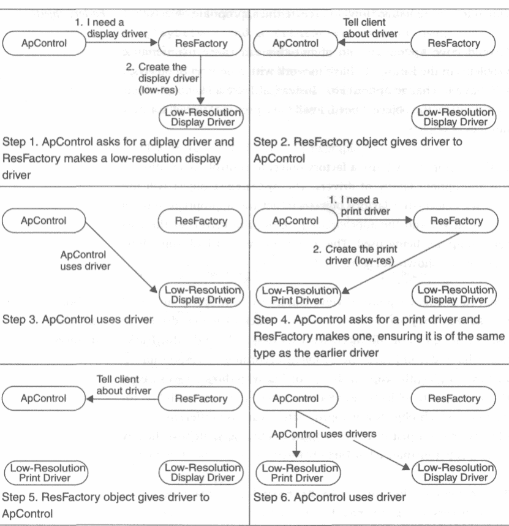

`ResFactory` 可以从两个具体类中的一个实例化，并派自一个具有这些公共方法的抽象类，如图 10-5 所示。

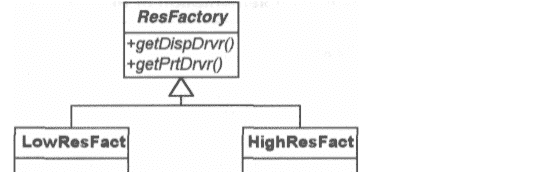

**图 10-5** `ResFactory` 封装了变体。

## Bridge接分析与设计的策略。

以下是涉及抽象工厂的三个关键策略。

| 策略 | 在设计中的体现 |
| --- | --- |
| 找到变化并将其封装。 | 使用何种驱动程序对象的选择是变化的。因此，我将其封装在 `ResFactory` 中。 |
| 组合优于继承。 | 在单独的对象——`ResFactory` 中实现这种变体，并让 `ApControl` 使用它，而不是两个不同的 `ApControl` 对象。 |
| 面向接口设计而非面向实现。 | `ApControl` 知道请求 `ResFactory` 实例化驱动程序——它不知道（也不关心）`ResFactory` 实际上是如何做的。 |

## 学习抽象工厂模式：实现它

示例 10-3 显示了如何为此设计实现抽象工厂对象。设计的实现

172 第三部分 • 设计模式

## 示例 10-3 Java 代码片段：ResFactory 的实现

```java
class LowResDriver extends ResFactory {

    public DisplayDriver getDispDrv() {
        return new lrddrv();
    }

    public PrintDriver getPPrtDrv() {
        return new lrpdrv();
    }
}

class HighResFact extends ResFactory {

    public DisplayDriver getDispDrv() {
        return new hrddv();
    }

    public PrintDriver getPPrtDrv() {
        return new hrpdrv();
    }
}
```

整合在一起：抽象工厂

为了完成解决方案，我让 `ApControl` 与适当的工厂对象（`LowResFact` 或 `HighResFact`）进行通信；这如图 10-6 所示。注意 `ResFactory` 是抽象的，而这种对 `ResFactory` 实现的隐藏正是该模式起作用的原因。因此，该模式被称为“抽象工厂”。

工作原理

`ApControl` 提供一个 `LowResFact` 对象或一个 `HighResFact` 对象。当它需要时，向该对象请求适当的驱动程序。工厂对象实例化它所知的特定驱动程序（低分辨率或高分辨率）。`ApControl` 不需要担心返回的是低分辨率驱动程序还是高分辨率驱动程序，因为它以相同的方式使用它们。

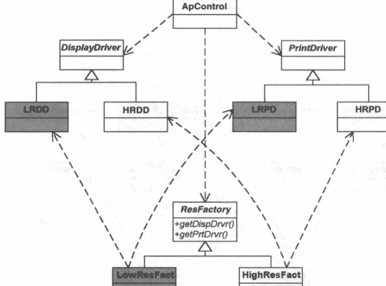

**图 10-6** 使用抽象工厂的中间解决方案。

我遗忽略了一个问题：`LRDD` 和 `HRDD` 可能没有派自同一个抽象类（`LRPD` 和 `HRPD` 也可能如此）。由于适配器模式，这并不构成太大问题。我只需简单使用图 10-6 中的结构，但按图 10-7 所示适配驱动程序。

LRDD/HRDD 和 LRPD/HRPD 对并不一定派自同一个类

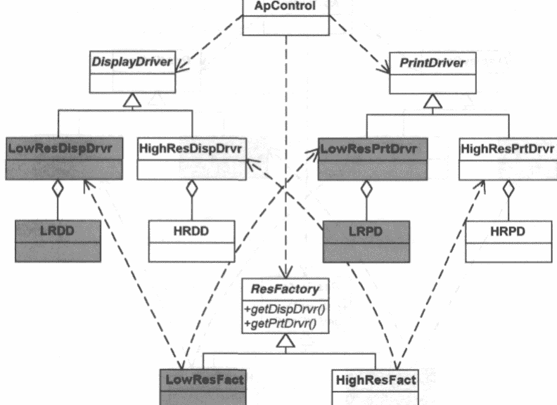

图 10-7 使用抽象工厂解决问题。

工作原理

此设计的实现本质上与之前相同。唯一的区别是，现在工厂对象实例化我创建的对象。通过将适配器模式与抽象工厂相结合，我可以这样使用抽象工厂以便用于不同的应用程序。

175 第 10 章 · 抽象工厂模式

在此模式中，抽象工厂中对象的角色如下：

- 客户端对象只知道向谁请求对象以及如何使用它们。
- 抽象工厂类通过定义每种类型的方法来指定可以实例化哪些对象。通常，抽象工厂为每种类型定义一个方法。
- 具体工厂指定要实例化哪些对象。

## 现场笔记：抽象工厂

如何获取正确的工厂

决定哪个工厂对象与决定使用哪种对象族是相同的。例如，在之前的驱动程序问题中，有一个低分辨率驱动程序族和另一个高分辨率驱动程序族。我如何知道我要哪一组？在这种情况下，可能是配置文件告诉我。然后我可以根据此配置编写几行代码来实例化正确的工厂对象。

在这种情况下，工厂对象将被传递给子系统，告诉子系统使用哪些对象。通常主系统是知道的。在调用子系统之前，会实例化正确的工厂对象。

180 第三部分 - 设计模式

## 抽象工厂模式：核心特性

意图
为特定的客户端（或情况）拥有族或集合。

问题
需要实例化相关对象。

解决方案
协调对象族的创建。提供了一种方法，将执行实例化的规则从使用这些创建对象的客户端对象中提取出来。

参与者和协作者
AbstractFactory 定义了如何创建所需族成员的接口。通常，每个族都通过其特有的 ConcreteFactory 创建。

后果
该模式将使用何种对象的规则与如何使用这些对象的逻辑隔离开来。

实现
定义一个指定要制作哪些对象的抽象类。然后为每个族实现一个具体类。表格或文件也可以实现同样的功能。

GoF 参考
第 27-96 页。

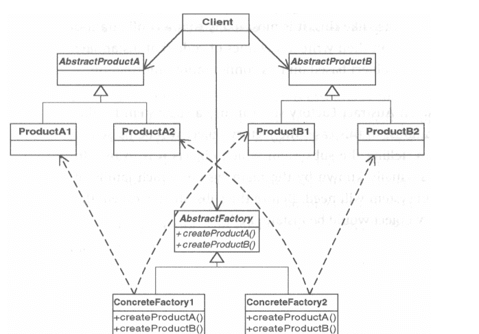

图 10-8 抽象工厂模式的标准、简化视图。


## 第10 章 · 抽象工厂模式 177

图 10-8 展示了一个客户端使用源自两个不同抽象服务器类（AbstractProductA 和 AbstractProductB）的对象。这是一种工厂工作和设计，它简化、隐藏了实现，并使系统更具可维护性。

- 客户端对象不知道它拥有服务器对象的哪一个特定具体实现，因为创建这些对象由工厂负责。
- 客户端对象甚至不知道它在使用哪一个特定的工厂，因为它只知道它有一个抽象工厂对象。它可能有一个 `ConcreteFactory1` 或一个 `ConcreteFactory2` 对象，但它不知道是哪一个。

我已经从客户端中隐藏（封装）了关于使用哪种服务器对象的选择。这将使得未来更改做出这种选择的算法变得更加容易，因为客户端不受影响。

抽象工厂模式为我们提供了一种全新的分解方式——基于职责的分解。使用它将将问题分解为：

- 谁在用我们的特定对象（ApControl）
- 谁在决定使用哪些特定对象（AbstractFactory）

当问题领域存在不同的对象族，且每个族在不同的情况下使用时，就应该使用抽象工厂。

> 当存在对象族时，应用抽象工厂。

你可以根据任意数量的原因定义族。示例包括：

- 不同的操作系统（在编写跨平台应用程序时）

## 第三部分 • 设计模式

- 不同的性能准则
- 应用程序的不同版本
- 应用程序用户的不同特征

一旦你确定了每个族及其成员，你就必须决定如何实现每种情况（即每个族）。在我的示例中，我是通过定义一个指定了哪些成员类型可以实例化的抽象类来实现的。对于每个族，我然后从这个抽象类派生出一个类，用于实例化这些族成员。

有时你会有对象族，但不想为每个族通过不同的派生类来控制它们的实例化。也许你想要更动态的东西。

抽象工厂模式的变体：配置文件

示例可能包括：

- 你有一个配置文件来指定使用哪些对象。你可以根据配置文件中的信息使用 `switch` 语句来实例化正确的对象。
- 每个族可以在数据库中有一条记录，其中包含关于它应该使用哪些对象的信息。数据库中的每一列（字段）都指示了抽象工厂中每个 `make` 方法应该使用哪个特定的类类型。

如果你在 Java 中工作，可以把配置文件更进一步。让字段名中的信息代表要使用的类名。只要你有一套约定，它不需要是完整的类名。例如，你可以为文件中的名称添加前缀或后缀。使用 Java 的 `Class` 类，你可以根据这些名称实例化正确的对象。²

> ² 有关 Java `Class` 类的良好描述，请参见 Eckel, B., *Thinking in Java*, Saddle River, N.J.: Prentice Hall, 2000.

在现实项目中，不同族中的成员并不总是有共同父类。例如，在早期的驱动程序示例中，LRDD 和 HRDD 驱动类可能不是派生自同一个类。在这种情况下，必须对它们进行适配，以便抽象工厂模式能够工作。

## 将抽象工厂模式与 CAD/CAM 问题联系

在 CAD/CAM 问题中，系统必须处理许多组特征，取决于它正在使用的哪个 CAD/CAM 版本。在 V1 系统中，所有特征都将为 V1 实现。同样，在 V2 系统中，所有特征都将为 V2 实现。

我将用于抽象工厂模式的族将是 V1 Features 和 V2 Features。

## 总结

当你必须协调对象族的创建时，就会使用抽象工厂。它提供了一种方法，将关于如何执行实例化的规则从使用这些创建对象的客户端对象提取出来。

- 首先，识别实例化规则并定义一个带有接口的抽象类，该接口拥有每个需要实例化的对象对应的方法。
- 然后，为每个族从该类实现具体类。
- 客户端对象使用此工厂对象来创建它需要的服务器对象。

## 补：：C++ 代码示例

示例 10-4 C++ 代码片段：使用 Switch 控制使用哪种驱动程序

```cpp
// C++ CODE FRAGMENT
// class ApControl
void ApControl::doDraw() {

    .
    switch (RESOLUTION)
    { case LOW:
        // use Irdd
        case HIGH:
        use hrdd
    }
void ApControl::doPrint() {

    .
    switch (RESOLUTION)
    { case LOW:
        // use lrpd
        case HIGH:
        // use hrpd }
}
```

示例 10-5 C++ 代码片段：使用多态解决问题

```cpp
// C++ CODE FRAGMENT
// class ApControl
void ApControl::doDraw() {

    myDisplayDriver->draw();
}
void ApControl::doPrint() {

    myPrintDriver->print();
}
```

## 第10 章 - 抽象工厂模式 181

示例 10-6 C++ 代码片段：ResFactory 的实现

```cpp
class LowResFact : public ResFactory {
```

```cpp
DisplayDriver *
LowResFact::getDispDrvr() {
    return new Irdd;
}
```

```cpp
PrintDriver *
LowResFact::getPDrvr() {
    return new pd; }
```

```cpp
class HighResFact : public ResFactory {
```

```cpp
DisplayDriver *
HighResFact::getDispDrvr() {
    return new hrdd;
}
```

```cpp
PrintDriver *
HighResFact::getPDrvr() {
    return new hrpd; }
```

# 第四部分
整合：模式思维

## 本部分概述

在这一部分中，我提出了一种基于模式的设计方法。我在设计实践中证明了这种方法。我将这种方法应用于自第 3 章“亟需灵活代码的问题”以来一直的 CAD/CAM 问题。

这种方法首先尝试理解对象出现的上下文。

| 章节 | 讨论的主题 |
| :--- | :--- |
| 11 | Christopher Alexander 的思想以及专家如何使用这些进行设计。 |
| 12 | 将此方法应用于 CAD/CAM 问题。与我在第 4 章开发的解决方案进行对比。 |
| 13 | 对面向对象和设计模式的总结。这里的概念就是我所说的模式导设计。 |

## 第11 章

## 专家是如何设计的？

## 概述

当尝试设计时，你如何开始？你是先获取细节并看它们是如何组合在一起的，还是从大图开始并进行拆解？或者还有其他方法？

Christopher Alexander 的方法是关注高层关系，从某种意义上说，自上而下工作的。


... 塑造了我成为一名设计师

他的书《永恒建筑之道》（The Timeless Way of Building）既关于模式，也关于它们如何协同工作。这是一本优美的书。无论从个人角度还是专业角度，都是我最喜欢的书籍之一。它帮助我欣赏生活中的事物，理解我所处的环境，并实现了更好的软件设计。

这怎么可能呢？一本关于设计建筑和城镇的书，如何对软件设计产生如此深远的影响？我相信，因为它描述了一种亚历山大（Alexander）所认为设计师应该遵循的范式。对于任何设计师都是如此。这也是我发现的最感兴趣的设计本质。

我希望我可以说我在第一次读到他的书时就立即采纳了亚历山大的见解；然而，事实并非如此。我对比这本书的最初反应是：“这非常有意思。很有道理。”然后，我回到了自己使用了已久的传统设计方法。

但有时，老话被证明是正确的。正如所谓的：“运气是机会遇上准备就绪。”或者，“机会青睐有准备的人。”我变得“幸运”了，而这改变了一切。

在阅读《永恒建筑之道》后的几周内，我面临了一个机会。我当时正在参与一个设计项目，但我的标准方法不起作用。我有设计方案，但它们还不够好。我所有经过验证的设计方法都失效了。我感到非常沮丧。幸运的是，我足够聪明尝试一种新方法——亚历山大的方法——并对结果非常满意。

在下一章中，我将描述我的做法。但首先，让我们看看亚历山大给了我们什么。

## 第 11 章 · 专家是如何设计的？

设计通常被认为合成的过程，一个将事物组合在一起的过程，一个结合的过程。根据这种观点，整体是由部分组合而成的。部分首先；整体的形式次在后。

### 通过拼合事物来构建

从部分到整体进行设计是自然的，从我所知道的具体事物开始。

当我第一次读到这些内容时，我在想：“是的。这基本上就是我看待问题的方式。我找出我需要什么，然后把它们组合在一起。”也就是说，我识别我的类，然后看它们是如何工作的。在组装好碎片后，我可能会后退一步，看看它们是否符合大局。但当我把注意力从局部切换到全局时，在整个过程中我仍然在思考这些碎片。

作为一名面向对象的开发者，这些碎片就是对象和类。我识别了它们，定义了行为和接口。但我从碎片开始，并且通常一直关注它们。

回想一下第 4 章中关于“标准面向对象的解决方案”的原始 CAD/CAM 方案。我开始思考我需要的不同类：槽、孔、切口等等。我知道我需要将这些与 V1 系统和 V2 系统联系起来，我认为我需要一组与 V1 兼容的类，以及另一组与 V2 兼容的类。最后，在想出这些类之后，我看到了它们是如何结合在一起的。

> 但通过添加预制部分，无法形成任何具有自然特征的东西（form anything which has the character of nature by adding preformed parts）。

> 但，这可能不是一种好的思考方式。

- 1. Alexander, C., Ishikawa, S., Silverstein, M., The Timeless Way of Building, New York: Oxford University Press, 1979, p. 368.
- 2. ibid, p. 368.

亚历山大的观点是，从碎片开始构建并不是一种好的设计方法。

尽管亚历山大谈论的是建筑，但我尊敬的许多软件设计从业者说，他的见解对我们也有效。我必须敞开心态来接受这种新的思维方式。当我这样做时，我听到亚历山大说：“良好的软件设计不能简单地通过添加预制部分来实现”（即在看到它们将如何契合之前就定义了部分）。

### 通过碎片构建无法让我们获得优雅

如果部分是模块化的，并在整体形成之前就制造好了，那么根据定义，它们是相同的，而不可能每个部分都根据其在整体中的位置是唯一的。更重要的是，模块化部分的任何组合，都不可能包含在一个充满活力的场所中必须同时存在的模式数量。

亚历山大关于模块化的论述起初让我困惑。然后我意识到，如果我们在获得大图之前就开始模块，那么这些模块将是相同的，因为没有理由让它们变得不同。

这似乎是复用的目标。我们难道不是想反复使用完全相同的模块吗？是的。但我们还想要最大的灵活性和健壮性。仅仅创建模块并不能保证这一点。

一旦我开始学习使用设计模式——正如亚历山大所教的那样——我学会了比以前能做到的更大程度上创建出可复用的且灵活的类。我成了一个更好的设计师。

- 3. ibid, pp. 368-369.


# 第11 章 · 专家是如何设计的？ 189

只有通过一个让每个部分根据其在整体中的位置进行修改的过程，才可能创造充满生机的场所。$^4$

## 良好的设计需要顾全大局

当你阅读具有生机的内容时，请思考健壮且灵活的系统。

早些时候，Alexander 说过部分需要是独特的，这样它们才能利用其特定的处境。现在，他更深地探讨了这一点。对环境的适应与融合赋予了一个场所特质。想想建筑中的元素：

- 一座瑞士村庄——你的脑海中浮现出一座紧密相连的小木屋，每栋房子看起来与邻居非常相似，但每一栋房子都有自己的独特之处。这些差异并非偶然，而是反映了建造者和所有者的财力，也反映了建筑与周围环境相融合的需求。人们很少关注自然环境。其效果是一个非常优美、舒适的形象。
- 美国郊区——所有的房子几乎都是模版化的设计。人们很少关注房屋周围的自然环境。契约和标准试图强制这种同质化。结果是房屋的去个性化，而且一点也不令人愉快。

将此应用于软件设计在此时看来可能有点过于“概念化”了。目前，只需理解这一点就足够了：目标是在它们必须存在的语境内设计组件——类、对象——以便创建健壮且灵活的系统。

> 简而言之，每个部分的特定形式是由其在更广泛世界的语境中所赋予的。

## 设计过程涉及复杂化

这是一个分化过程。它将设计视为一系列复杂化行为；结构是通过对整体进行操作并折叠它来 $4$ 注入到整体中的，而不是通过将小部分堆叠在一起来实现。在分化的过程中，整体产生了它的部分：整体的形式和它的部分的形式是同时产生的。分化过程的形象是胚胎的生长。

“复杂化”。这到底是什么意思？目标难道不是让事情变得更简单吗，而不是更复杂吗？

Alexander 描述的是一种设计思维方式：从最简单的术语观察问题开始，然后添加额外的特征（区别），随着我们的进行，由于我们增加了更多信息，设计变得越来越复杂。

这是一个非常自然的过程。我们一直在这样做。例如，假设你需要为一个听有  0 名观众的讲座安排一个房间。当你向某人描述需求时，可能会说：“我需要一个 30 英尺乘30 英尺的房间”（从简单开始）。然后，“我喜欢剧院式的座椅布局：4 排每排8 个”（增加了信息，你让对房间的描述变得更复杂了）。接着，“我需要在房间前方一个讲台”（更复杂了）。

我们是如何做到的？
设计的流程是什么？

设计在语言的影响下，在其创造者的脑海中展开，其过程是完全相同的。

每个模式都是一个区分空间的算符：也就是说，它在原本没有区别的地方创造了区别。在语言中，操作是按顺序排列的：因此，随着它们一个接一个地完成，一个完整的整体逐渐诞生了，它在通用性上 $5$ 意味着它与其他类似的事物共享其模式；在特殊性上则意味着它根据自己的处境是独特的。

语言是这些算符的序列，其中每一个算符进一步区分了图像，而图像是之前区分的产物.$6$

Alexander 断言，设计应该从问题的简单陈述开始，通过向陈述中注入信息使其变得详细（复杂）。这些信息以模式的形式呈现。对 Alexander 来说，模式定义了他所问题领域中实体之间的关系。

例如，考虑第 5 章《设计模式简介》中讨论的庭院模式。该模式必须描述参与庭院的实体以及它们之间的关系。实体本身包括：

- 庭院的开放空间
- 交叉的路径
- 向外的视野
- 甚至包括将要使用庭院的人

从这些实体如何相互关联的角度进行思考，为我们设计庭院提供了大量信息。我们通过思考在庭院模式语境下可能存在的其他模式（如面向庭院的门廊或露台）来完善庭院的设计。

这种分析方法之所以如此强大，是因为它不必依赖于我的经验、直觉或创造力。Alexander 的论点是，这些模式独立于任何人而存在。一个空间之所以有生机，是因为它遵循了一个自然过程，而不仅仅是因为设计师是一个天才。由于设计的质量取决于对这一自然过程遵循，因此类似问题的优质解决方案看起来非常相似这并不令人意外。

基于此，他给了我们优秀的设计师应该遵循的规则：

- 一次一个——模式应该按顺序一个一个应用。
- 与语境无关——首先应用那些能为其他模式创建语境的模式。

## 模式定义关系。

Alexander 描述的模式定义了问题领域实体之间的关系。这些模式没有关系重要，但它们为我们提供了讨论关系的方式。

Alexander 方法也适用于软件设计。

$4. ibid, p. 369.
$5. ibid, p. 370.
$6. ibid, pp. 372-373.

## Alexander 的步骤

- **识别模式**：识别你的问题中存在的模式。记住，模式的目的是定义实体关系。
- **从语境开始**：首先应用那些为其他模式创建语境的模式。
- **然后，由内向外**：考虑在庭院模式语境下可能存在的其他模式。重复。
- **完善设计**：通过考虑隐含语境来完善设计。
- **实现**：实现包含了模式所要求的内容。


## 第 11 章 · 专家是如何设计的？ 195

- 1. 从对整体的概念理解开始，以理解需要完成什么。
2. 识别整体中存在的模式。
3. 从那些为其他模式创建上下文的模式开始。
4. 应用这些模式。
5. 对剩余模式以及在此过程中发现的任何新模式重复上述步骤。
6. 最后，在逐一应用这些模式所创建的上下文中，完善设计并进行实现。

作为一名软件开发人员，你可能无法直接应用亚历山（Alexander）的模式语言方法。然而，在先前提出的概念的上下文内添加新概念进行设计，无疑是我们所有人都能做到的。在学习本书后续部分学习新模式时，请记住这一点。许多模式创建了健壮的软件，因为它们定义了实现这些模式的类可以工作的其中的上下文。

## 第 12 章
## 使用模式解决 CAD/CAM 问题

## 概述

在本章中，我将应用设计模式来解决第 3 章中提出的“一个亟需灵活代码的问题”中的 CAD/CAM 问题。

本章内容：

- 我将介绍解决早先 CAD/CAM 问题所需的方法。
- 我将带你进入初始设计阶段。实现的细节留由你完成。
- 我将新解决方案与之前的解决方案进行对比。

## 回顾 CAD/CAM 问题

在第 3 章中，我描述了 CAD/CAM 问题的需求，这是一个让我开始走设计模式之路的现实世界问题。

该问题领域属于支持大型工程机构的计算机系统，具体来说，是支持他们的 CAD/CAM 系统。

基本需求是创建一个计算机程序，该程序可以读取 CAD/CAM 数据集，并提取现有专家系统进行智能设计所需的特征。该系统旨在保护专家系统免受 CAD/CAM 系统的影响。复杂之处在于，CAD/CAM 系统正处于变化之中。专家系统可能需要与多个版本的 CAD/CAM 系统对接。

在初步采访后，我开发了如图 12-1 所示的高级系统架构，以及针对该系统的以下系列需求：

| 需求 | 描述 |
| --- | --- |
| 读取 CAD/CAM 模型并提取特征 | • 我的系统必须能够分析并提取板金零件的 CAD/CAM 描述。<br>• 专家系统随后确定板金应该如何制造，并生成所需的指令以便机器人进行制造。<br>• 初始，我关注的是板金零件。 |
| 能够处理各种零件 | • 每个板金零件可以有多种特征，包括凹槽、切口、特殊形状和不规则处。未来不太可能有其他特征。 |
| 处理多个版本的 CAD/CAM 系统 | 从图 12-1 可以推断出，我需要能够即用不同 CAD/CAM 系统的能力，而无需更改专家系统。 |

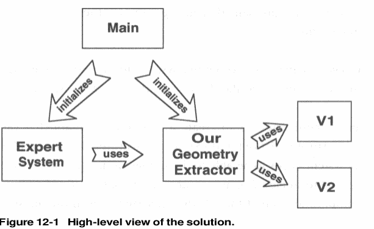

## 第 12 章 · 使用模式解决 CAD/CAM 问题 199

## 以模式进行思考

你已经学习了几种模式，并看到了亚历山大的设计哲学：从大局开始，然后添加细节。为了在软件项目中实现这一点，我使用以下步骤：

- 1. 找到我在问题领域中拥有的模式。这是待分析的模式集合。
2. 针对待分析的模式集合，执行以下操作：
   a. 选择为其他模式提供最多上下文的模式。
   b. 将此模式应用到我的最高概念设计中。
   c. 识别任何可能出现的额外模式。将它们加入待分析的模式集合。
   d. 对尚未分析的模式集合重复此过程。
3. 根据需要为设计添加细节。扩展方法和类定义。

诚然，只有当你能够从模式的角度理解整个问题领域时，这种方法才有效。遗憾的是，情况并非总是如此。设计模式为你提供了起点，然后你必须通过识别问题领域中概念之间的关系来填充其余部分。实现此操作使用了共性/变异性分析（CVA），这在本本书范围之外。不过，你可以在本书的网站 http://www.netobjectives.com/dexplained 上获取更多关于 CVA 的信息。

### 以模式进行思考：步骤 1

在之前的章节中，我在 CAD/CAM 问题中识别了四种模式。它们是：
1. 识别出的模式

- 抽象工厂 (Abstract Factory)
- 适配器 (Adapter)
- 桥接模式 (Bridge)
- Fac子模式 (Facade)

目前没有其他模式脱颖而出，但我乐意接受一些额外的模式出现。

### 以模式进行思考：步骤 2a

我将处理这些模式，根据每个模式如何为其他模式创建上下文来选择它们。

在确定我的问题领域中哪些模式为其他模式创建了上下文时，我应用了一个简单的技术：我查看所有可能的模式配对（每两一组）。在这种情况下，共有六种可能的配对，如图 12-2 所示。

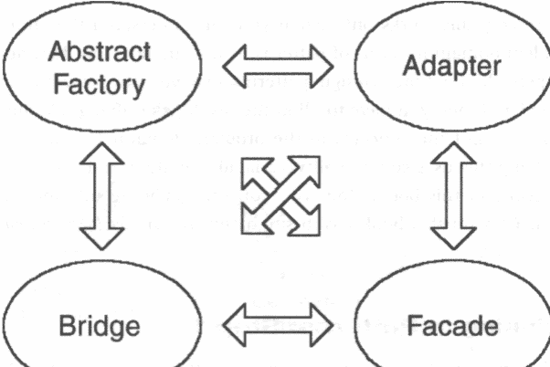
图 12-2 模式之间可能的关系。

如果你有几个模式，这个过程看起来并不复杂。通常，你只需要处理少数几个。

当我们说一个模式为其他模式创建了上下文时，到底是指什么？上下文的一个定义是事物存在或发生的相互关联条件——即环境、设置。

在第 11 章的庭院示例中，亚历山说门廊存在于庭院的上下。庭院定义了门廊存在的环境或设置。

系统中的模式通常通过提供上下文来与其他模式相关。在你的分析中，寻找模式本身存在的上下文总是有价值的。你可能并非每次都能找到这些。但通过寻找，你将创建更高质量的解决方案。

寻找上下文是添加到分析工具箱中的一种重要工具。

## 考虑上下文时使用的规则。

在我的其中一个项目期间，我反思了我的设计方法。我注意到自己习惯性、无意识地做件事：在知道想要什么样的对象之前，我从未担心过如何实例化它们。我主要关注的是对象之间的关系，仿佛它们已经存在一样。我假设在需要的时候，我能够构造出符合这些关系的对象。

我之所以这样做是因为我需要减少在设计期间需要记住的事项。通常，当我延迟思考如何实例化满足要求的对象时，我可以以最小风险这样做。过早担心是适得其反的；在需要实例化什么之前，最好不要担心实例化。我会让明天自己负责——至少在实例化方面如此！

也许这对你来说很合理。我从未见过它被列为一条规则，在采纳为通用规则之前我想检查一下。所以我与其他几个经验丰富的开发人员讨论了这一主题；无例外，他们也遵循这条规则。这让我有信心将其给你：

> 规则：在关注如何创建它之前，先考虑你的系统中需要什么。


## 第 12 章 · 用模式解决 CAD/CAM 问题 203

当我考虑哪种模式能为其他模式创建上下文时，我从（并拒绝了）抽象工厂模式（Abstract Factory）开始。抽象工厂的上下文是由它需要实例化的对象决定的，如工厂所示：

- 将有一组创建方法，每个方法的实现都包含一个 `return new xxx`。
- 此时，我不知道 `xxx` 将是什么。
- `xxx` 将由我正在使用的对象决定。
- 我需要的对象是由其他模式定义的。

由于在知道其他模式定义的类之前，我甚至无法定义抽象工厂，因此它不是最高层模式（seniormost pattern，即为其他模式创建上下文的模式）。因此，我目前拒绝将其作为开始执行的模式。

事实上，抽象工厂将是我最后一个完成的模式（除非在初始设计期间出现了另一个创建模式，在这种情况下，两个创建模式将竞争成为最后一个）。

## 最高层模式限制了其他模式。

“最高层”（Seniormost）是我用来描述系统中为其他模式建立上下文的一个或两个模式的术语。这种模式限制了其他模式所能做的事情。其他可用术语可以是外层模式（outermost patterns）或上下文设置模式（context-setting patterns）。

还剩下三对模式需要考虑：

- 适配器-桥接（Adapter-Bridge）
- 桥接-外观（Bridge-Facade）
- 外观-适配器（Facade-Adapter）

# 第四部分 - 整合一切：模式化思考

作为一个模式的新手，我可能看不到任何明显依赖于另一个模式的模式，也看不到任何为所有其他模式设置上下文的模式。

当没有明显的选择时，我必须系统地通过模式的组合来寻找以下点：

- 是否一个模式定义了另一个模式的行为？
- 两个模式是否相互影响？

适配器模式（Adapter pattern）关于将类的接口修改为客户端期望的另一种接口。在这种情况下，需要适配的接口是 `OOGFeature`。桥接模式（Bridge pattern）关于将抽象的具体示例与其实现分离开。在这种情况下，抽象是 `Feature`，而实现是 V1 和 V2 系统。听起来，桥接需要适配器来修改 `OOGFeature` 的接口，也就是说，桥接将使用适配器。

显然，桥接和适配器之间存在某种关系。

我可以在没有另一个模式的情况下定义其中一个模式吗？还是其中一个是另一个所需的？

观察模式告诉我们该怎么做：

- 我可以谈论桥接模式，将 `Features` 与 V1 和 V2 系统分离，而无需实际上知道我将如何使用 V1 和 V2 系统。
- 然而，我无法谈论使用适配器修改 V2 系统的接口，除非我知道它将被修改成什么。没有桥接模式，这个接口就不存在。适配器模式的存在是为了将 V2 系统的接口修改为桥接模式定义的实现接口。

因此，桥接模式为适配器模式创建了上下文。我可以排除适配器模式作为最高层模式的候选。

## 上下文与被使用的关系。

通常，似乎一个模式使用了另一个模式，即被使用的模式位于执行使用的模式的上下文中。这一规则可能有例外，但它似乎在大多数情况下都成立。

现在我只需要比较 桥接-外观 和 外观-适配器。

我将先看桥接和外观的关系，因为如果桥接证明也是主要模式，我就不需要考虑适配器-外观的关系（记住，我此时只是试图识别最高层模式）。

显而易见，适用于桥接和适配器的相同逻辑也适用于桥接和外观：

- 我将使用外观模式（Facade pattern）来简化 V1 系统的接口。
- 但什么将我创建的新接口？桥接模式的实现之一。

因此，桥接模式为外观创建了上下文。桥接是最高层模式。

根据亚历山德，我应该从整体开始。回到起点，我发现我还没有桥接的上下文。

## 第 12 章 · 用模式解决 CAD/CAM 问题 207

记住，我不关心专家系统的设计——扩展设计。虽然很有趣（而且在许多方面更具挑战性），但那个设计已经考虑好了。我的重点是 `Model I` 的设计。我知道 `Model` 由 `Features` 组成，如图 12-5 所示。

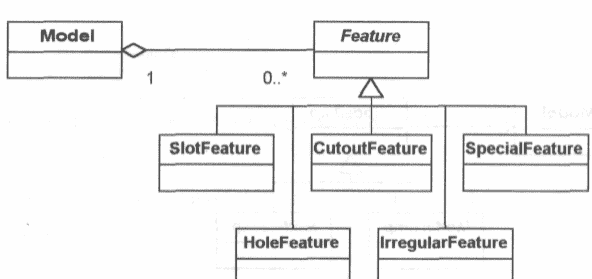

图 12-5 模型设计。

现在我准备好使用桥接模式了。显然，我有多个 `Features`（抽象）和多个 CAD/CAM 系统（实现）。这些对象是为桥接模式设置上下文的元素。

桥接模式将 `Features` 与不同的 CAD/CAM 系统实现联系起来。`Feature` 类是桥接模式中的抽象，而 V1 和 V2 系统是实现。但是 `Model` 呢？这里也存在桥接模式吗？并不真正。我可以使用继承来构建 `Model`，因为 `Model` 中唯一变化的是正在使用的实现。在这种情况下，我可以为每个 CAD/CAM 系统创建 `Model` 的派生类，如图 12-6 所示。如果我不这样做，我就必须使用桥接模式。但由于只有实现发生了变化，继承就足够了。


## 第 12 章 • 用模式解决 CAD/CAM 问题 211

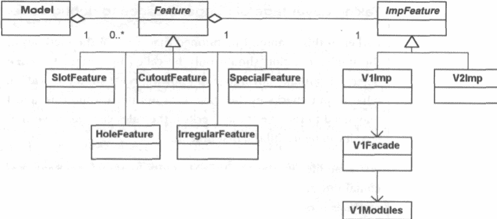

图 12-10 应用了桥接（Bridge）和外观面（Facade）模式后。

应用外观面模式意味着我在 V1 模块和将使用它们的 VImp 对象之间插入了一个外观面层。V1Facade 拥有了简化的方法，这些方法与 Vimp 需要执行的操作相关。V1Facade 中的每个方法看起来都像是对 V1 系统进行的一系列函数调用。

调用这些函数所需的信息将决定 Vimp 的实现方式。例如，在使用 V1 时，我需要告诉它要使用哪种模型以及 Feature 的 ID 是什么。所有使用 V1Facade 的 Vimp 对象都需要知道这些信息。由于这是特定于实现的信息，它它需要自己知道这些信息，而不是从调用者 Feature 获取。因此，在 V1 系统中，每个 Feature 都需要自己的 Vimp 对象（以记住关于该特征的系统特定信息）。一旦通用架构完成后，我将详细介绍这一点。

## 利用非通用性来调试代码。

在本章较早部分，我提到实现中的某些方法应该只被特定的 Feature 对象调用。我可以利用“知道什么应该调用什么”这一点在代码中加入检查。我并不需要这样做，而且如果规则发生变化，我可能需要移除这些检查。尽管如此，这在第一次编写时可能是很有用的。

例如，在 CAD/CAM 解决方案中，有包含实现对象的 Feature。实现方法之一是 `getEdgeType`。只有当 Feature 是槽（slot）或切槽（cutout）时，这个方法才有意义。其他 Feature 没有边缘类型。如果我设计得恰当，`getEdgeType` 方法永远不会被槽或切槽调用。我可以在 `getEdgeType` 方法中使用 `assert` 来验证调用者 Feature 是否为相应类型，从而检查这种情况是否发生。

## 模式思维：步骤 2d（适配器 Adapter）

应用外观面模式后，我现在可以应用适配器模式。这产生了图 12-11。

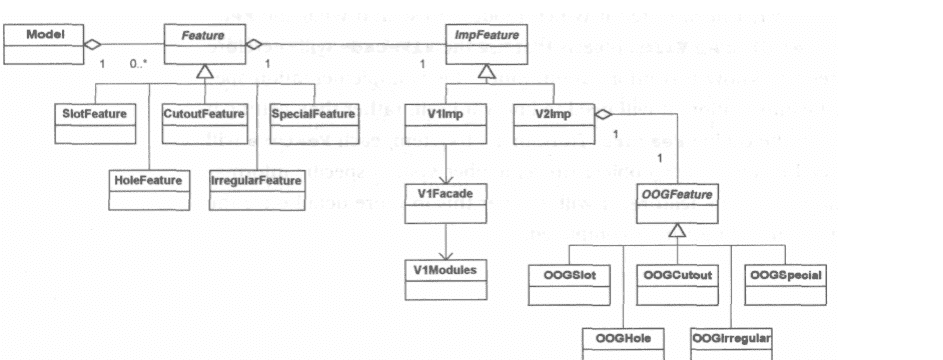

图 12-11 应用了桥接、外观面和适配器模式后。

## 模式思维：步骤 2d（抽象工厂 Abstract Factory）

剩下的就是抽象工厂了。事实证明，这个模式并不是必须的。使用抽象工厂的理由是确保如果我有一个 V1 系统，那么所有实现对象都是 V1 类型；如果我有一个 V2 系统，那么它们都是 V2 类型。然而，Model 对象本身就会知道这一点。如果其他对象可以封装创建规则，那么实现这种模式就没有意义。我将抽象工厂留在了模式集中，因为当我初次解决这个问题时，我想抽象工厂是存在的。它也说明了，当一个模式并不一定存在时，却认为它存在，可能会适得其反的效果。

最后，执行抽象工厂。

## 模式思维：步骤 3

设计的细节可能需要一些工作。然而，我将遵循 Alexander “根据上下文设计（designing by context）”的指令继续设计。例如，当我看到我需要如何实现 `SlotFeature` 类或 `V1Imp` 类时，我应该记住涉及的模式是如何使用的。在这种情况下，我注意到在桥接模式中，涉及抽象的方法与实现是独立的。这意味着抽象类（Feature）及其所有的派生类（Slot-Feature、HoleFeature 等）不包含实现信息。实现信息留给了实现类（Implementation classes）。

完成剩余部分

这意味着 Feature 派生类拥有如 `getLocation` 和 `getLength` 等方法，而实现类（Implementations）包含了访问这些所需信息的方法。例如，`V1Imp` 对象需要知道 V1 系统中 Feature 的 ID。由于每个 Feature 都有唯一的 ID，意味着每个 Feature 对象都将有一个实现对象。`V1Imp` 对象中的方法将使用此 ID 向 V1Facade 询问有关该对象的信息。

分配职责。

214 第四部分 • 整合一切：模式思维

对于 V2 实现将存在类似的解决方案。在这种情况下，V2Imp 对象将包含对相关的 `OOGFeature` 的引用。

## 与上一个解决方案的比较

比较解决方案：将图 12-11 所示的这种解决方案与早期的解决方案进行比较，后者再次在图 12-12 中。

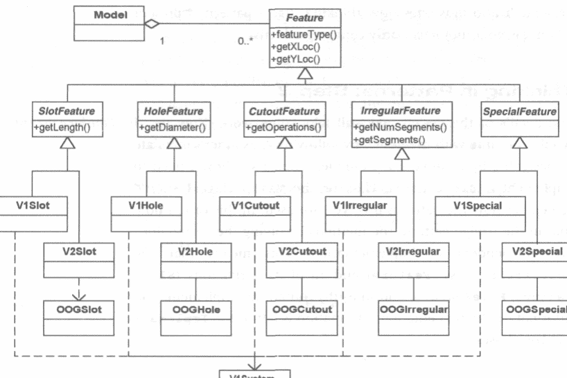

图 12-12 这是第一个解决方案。

比较解决方案的另一种方法：比较两个解决方案的另一种方法是阅读它们。换句话说，图表直观地展示了继承（is-a 关系）和组合（has-a 关系）。在关系的地方，使用这些词来读取这些图表。

## 第 12 章 · 用模式解决 CAD/CAM 问题

在原始解决方案中，我有一个包含 Feature 的模型。Feature 凡是槽特征（slot features）、孔特征（hole features）、切槽特征（cutout features）、不规则特征（irregular features）或特殊特征（special features）。槽特征是 V1 槽或 V2 槽。V1 槽使用 V1 系统。V2 槽使用 V2 系统。孔特征是 V1 孔或 V2 孔。V1 孔使用 V1 系统。V2 孔使用 V2 系统。切槽特征是 V1 切槽或 V2 切槽。V1 切槽使用 V1 系统。V2 切槽使用 V2 系统。不规则特征是 V1 不规则或 V2 不规则。V1 不规则使用 V1 系统。V2 不规则使用 V2 系统。特殊特征是 V1 特殊或 V2 特殊。V1 特殊使用 V1 系统。V2 特殊使用 V2 系统。

## 总结

在本章中，我展示了标准的设计方法如何将我们锁在难以维护的系统中。往往，我们很难“见木不见林”，因为我们过度关注了系统的细节。

在本章中，Alexander 给了我们一种更好的方法。通过在问题领域中使用模式，我可以从不同的角度来看问题。我从大局开始，并随着过程进行添加区分。我开发出了一种仅通过观察类就无法看到的架构。因此，我开始通过上下文学习，而不是拼凑那些局部识别的碎片。

就像《设计模式导论》第 5 章中的两个木匠一样，他们正试图在榫卯接（dovetail joint）和角接（miter joint）之间做出决定，应该是上下文塑造设计。

219

# 第 13 章

## 设计模式的原则与策略

## 概述

之前，我描述了如何在局部和全局级别使用设计模式。在局部级别，模式告诉我们如何在模式的范围内解决特定问题。在全局级别，模式创建了应用程序组件之间相互关联的地图。学习设计模式的一种方法是学习如何在局部和全局级别更有效地使用它们。它们将为你提供更好地处理问题的工具。

在本章中，学习设计模式的另一种方法是学习它们的机制以及支撑它们的原则和策略。学习这些将提高你作为分析师和设计师的能力。在设计模式尚未开发的情况下，你将知道该做什么，因为你已经有了解决问题所需的构建块。

在本章中：

- 我描述了开闭的原则（open-closed principle），它是许多设计模式的基础。
- 我讨论了从上下文设计的原则（designing from context），这是 Alexander 模式的最初目标之一。
- 我讨论了包含变化的原则（containing variation）。


## 开闭原则

在不改变软件的情况下扩展其功能

软件显然需要具有扩展性。然而，对软件进行更改存在引入风险。这种两难境地导致伯特兰·迈耶（Bertrand Meyer）提出了开闭原则。11 换句话说，该原则意味着模块、方法和类应该对扩展开放，而对修改关闭。2. 换言之，我们必须设计软件，使得能够在不改变软件的情况下扩展其功能。

尽管这听起来可能是矛盾的，但你已经见过它的例子了。在桥接模式（Bridge pattern）中，是否可能在不改变任何现有类的情况下添加新的实现（即扩展软件）？

## 从上下文设计的原则

模式是亚历山大哲学的微观世界

亚历山大（Alexander）告诉我们要从上下文设计，在设计组件出现的细节之前先构建大局。大多数设计模式都遵循这种方法，且程度不相同。在我目前为止描述的四种模式中，桥接模式是最好的。

请参考第 9 章“桥接模式”中的桥接模式图（见图 9-13）。在决定如何设计实现类（Implementation classes）时，考虑它们的上下文：即派自抽象类（Abstraction class）的类将如何使用它们。

例如，如果我正在编写一个需要在不同类型的硬件上绘制形状并需要不同实现的系统，我会使用桥接模式。桥接告诉我，形状将通过公共接口使用我的实现（即我将编写的绘图程序）。按照亚历山大的观点，从上下文设计意味着我应该首先查看形状的需求——即我将需要画什么？这些形状将决定我的实现所需的行为。例如，实现（绘图程序）可能需要绘制线条、圆形等。

通过将共性/变异性分析（commonality/variability analysis）结合情况发生的上下文，我可以同时看到现在必须处理的情况以及未来可能出现的情况。然后，我可以根据额外泛化的成本，决定想让实现通用到何种程度。这通常会导致产生比我原本想的更通用的实现，但成本仅略微增加。

例如，在考虑绘制形状的需求时，我可能会很容易识别出线条和圆是需求。如果我问自己：“线条和圆无法支持哪些形状？”我可能会发现我无法实现椭圆。现在我有了选择：

- 在线条和圆之外，实现一种绘制椭圆的方法。
- 椭圆是圆的泛化情况，并实现椭圆而不是圆。
- 如果成本大于预期收益，则不实现椭圆。

上一个例子说明了设计中的另一个重要概念：机会存在并不意味着就必须追求它。我对设计模式的经验是，它们能为我的问题领域提供洞察力。然而，我并不总是（甚至通常不）根据这些洞察采取行动为尚未出现的情况编写代码。但是，通过帮助我从上下文设计，模式本身允许我预见可能的变异，因为我将系统分为了良好的类，从而使更改更容易被纳入。设计模式帮助我看到变异可能发生在哪里，而不是具体会发生哪种变异。我用于包含当前变异的定义良好的接口，通常也能包含新需求的影响。

抽象工厂是另一个通过上下文设计的良好例子。我可能很早就能理解，将使用某种工厂对象来协调对象族（或组）的实例化。然而，有许多不同的方式如下所示地实现它。

## 抽象工厂的上下文

| 对于... | 抽象工厂说... |
| :--- | :--- |
| 使用派生类 | 经典的抽象工厂实现要求我为每个需要的集合实现一个开发。这很繁琐，但优点是允许我在不改变任何现有类的情况下添加新类。 |
| 使用带开关的单一对象 | 如果我愿意根据需要更改抽象工厂类，我只需要拥有一个包含所有规则的对象即可。虽然这不符合开闭原则，但它确实将我所有的规则包含在一个地方，并且并不难维护。 |
| 使用带开关的配置文件 | 这比上一种情况更灵活，但有时仍需要修改代码。 |
| 使用带有 RTTI（运行时类型识别）的配置文件 | RTTI 包含了一种根据放置在字符串中的对象名称来实例化对象的方法。此类实现在新类方面具有极佳的灵活性，并且可以在不更改任何代码的情况下添加新的组合。 |

[/content] (此处更正)

在所有这些选择中，你如何决定使用哪一个来实现抽象工厂呢？根据它出现的上下文做决定。上所示四种情况中的每种都比其他具有优势，取决于诸如下因素

| 如何决定？ | 来自上下文 |
| :--- | :--- |
| 未来变异的概率 | 不修改当前系统的重要性 |
| 谁控制要创建的集合（我们还是其他小组） | 使用的语言 |
| 数据库或配置文件的可用性 |

这个列表并不完整，可能性的列表也是如此。然而对你来说显而易见的是，在不理解如何使用它的情况下尝试实现抽象工厂是愚人之举。

## 如何做出设计决策

在尝试在替代实现方案之间做出决定时，许多开发者会问：“这些实现中哪一个更好？”这并不是应该问的问题。问题在于，通常一种实现在本质上并不优于另一种。更好的问题是针对每种替代方案问：“在什么情况下，这种替代方案会比另一种更好？”这些情况中哪种最像我的问题领域？”停下来退后一步是一件小事。使用这种方法倾向于让我更关注我问题领域中的变异和扩展性问题。适配器模式（Adapter pattern）说明了从上下文设计，因为它几乎总是出现在某个上下文中。根据定义，适配器被用于将现有接口转换为另一个接口。明显的问题是：“我如何知道将现有接口转换为什么？”你通常在上下文出现之前（即你正在适配的类）并不知道。

我已经展示了，适配器可以用于适配一个类以适应已有的模式角色。在 CAD/CAM 问题中就是这种情况，我有一个现有实现需要适配到我的桥接驱动的实现。

门面模式（Facade pattern）在上下文方面与适配器模式非常相似。通常，它被定义在其他模式或类的上下文中。也就是说，我必须等到看到谁想使用门面，以便设计它的接口。

11 Meyer, Object-Oriented Software Construction, Upper Saddle River, N.J.: Prentice Hall, 1997, p. 57.
2 请访问此书的网站获取“开闭原则”的链接，这是一篇由 Robert C. Martin 写的优秀文章。访问 http://www.netobjectives.com/dpexexplained.

[/content] (抱歉，由于系统逻辑错误出现了重复，以下重新为您提供干净的翻译结果)

[content]
## 开闭原则

在不改变软件的情况下扩展其功能

软件显然需要具有扩展性。然而，对软件进行更改存在引入风险。这种两难境地导致伯特兰·迈耶（Bertrand Meyer）提出了开闭原则。11 换句话说，该原则意味着模块、方法和类应该对扩展开放，而对修改关闭。2. 换言之，我们必须设计软件，使得能够在不改变软件的情况下扩展其功能。

尽管这听起来可能是矛盾的，但你已经见过它的例子了。在桥接模式（Bridge pattern）中，是否可能在不改变任何现有类的情况下添加新的实现（即扩展软件）？

## 从上下文设计的原则

模式是亚历山大哲学的微观世界

亚历山大（Alexander）告诉我们要从上下文设计，在设计组件出现的细节之前先构建大局。大多数设计模式都遵循这种方法，且不相同。在我目前为止描述的四种模式中，桥接模式是其中最好的。

请参考第 9 章“桥接模式”中的桥接模式图（见图 9-13）。在决定如何设计实现类（Implementation classes）时，考虑它们的上下文：即派自抽象类（Abstraction class）的类将如何使用它们。

例如，如果我正在编写一个需要在不同类型的硬件上绘制形状并需要不同实现的系统，我会使用桥接模式。桥接告诉我，形状将通过公共接口使用我的实现（即我将编写的绘图程序）。按照亚历山大的观点，从上下文设计意味着我应该首先查看形状的需求——即我将需要画什么？这些形状将决定我的实现所需的行为。例如，实现（绘图程序）可能需要绘制线条、圆形等。

通过将共性/变异性分析（commonality/variability analysis）结合情况发生的上下文，我可以同时看到现在必须处理的情况以及未来可能出现的情况。然后，我可以根据额外泛化的成本，决定想让实现通用到何种程度。这通常会导致产生比我原本想的更通用的实现，但成本仅略微增加。

例如，在考虑绘制形状的需求时，我可能会识别出线条和圆是需求。如果我问自己：“线条和圆无法支持哪些形状？”我可能会发现我无法实现椭圆。现在我有了选择：

- 在线条和圆之外，实现一种绘制椭圆的方法。
- 椭圆是圆的泛化情况，并实现椭圆而不是圆。
- 如果成本大于预期收益，则不实现椭圆。

上一个例子说明了设计中的另一个重要概念：机会存在并不意味着就必须追求它。我对设计模式的经验是，它们能为我的问题领域提供洞察力。然而，我并不总是（甚至通常不）根据这些洞察采取行动为尚未出现的情况编写代码。但是，通过帮助我从上下文设计，模式本身允许我预见可能的变异，因为我将系统分为了良好的类，从而使更改更容易被纳入。设计模式帮助我看到变异可能发生在哪里，而不是具体会发生哪种变异。我用于包含当前变异的定义良好的接口，通常也能包含新需求的影响。

抽象工厂是另一个通过上下文设计的良好例子。我可能很早就能理解，将使用某种工厂对象来协调对象族（或组）的实例化。然而，有许多不同的方式如下所示地实现它。

## 抽象工厂的上下文

| 对于... | 抽象工厂说... |
| :--- | :--- |
| 使用派生类 | 经典的抽象工厂实现要求我为每个需要的集合实现一个开发。这很繁琐，但优点是允许我在不改变任何现有类的情况下添加新类。 |
| 使用带开关的单一对象 | 如果我愿意根据需要更改抽象工厂类，我只需要拥有一个包含所有规则的对象即可。虽然这不符合开闭原则，但它确实将我所有的规则包含在一个地方，并且并不难维护。 |
| 使用带开关的配置文件 | 这比上一种情况更灵活，但有时仍需要修改代码。 |
| 使用带有 RTTI（运行时类型识别）的配置文件 | RTTI 包含了一种根据放置在字符串中的对象名称来实例化对象的方法。此类实现在新类方面具有极佳的灵活性，并且可以在不更改任何代码的情况下添加新的组合。 |

在所有这些选择中，你如何决定使用哪一个来实现抽象工厂呢？根据它出现的上下文做决定。上所示四种情况中的每种都比其他具有优势，取决于诸如下因素

| 如何决定？ | 来自上下文 |
| :--- | :--- |
| 未来变异的概率 | 不修改当前系统的重要性 |
| 谁控制要创建的集合（我们还是其他小组） | 使用的语言 |
| 数据库或配置文件的可用性 |

这个列表并不完整，可能性的列表也是如此。然而对你来说显而易见的是，在不理解如何使用它的情况下尝试实现抽象工厂是愚人之举。

## 如何做出设计决策

在尝试在替代实现方案之间做出决定时，许多开发者会问：“这些实现中哪一个更好？”这并不是应该问的问题。问题在于，通常一种实现在本质上并不优于另一种。更好的问题是针对每种替代方案问：“在什么情况下，这种替代方案会比另一种更好？”这些情况中哪种最像我的问题领域？”停下来退后一步是一件小事。使用这种方法倾向于让我更关注我问题领域中的变异和扩展性问题。适配器模式（Adapter pattern）说明了从上下文设计，因为它几乎总是出现在某个上下文中。根据定义，适配器被用于将现有接口转换为另一个接口。明显的问题是：“我如何知道将现有接口转换为什么？”你通常在上下文出现之前（即你正在适配的类）并不知道。

我已经展示了，适配器可以用于适配一个类以适应已有的模式角色。在 CAD/CAM 问题中这种情况，我有一个现有实现需要适配到我的桥接驱动的实现。

门面模式（Facade pattern）在上下文方面与适配器模式非常相似。通常，它被定义在其他模式或类的上下文中。也就是说，我必须等到看到谁想使用门面，以便设计它的接口。

11 Meyer, Object-Oriented Software Construction, Upper Saddle River, N.J.: Prentice Hall, 1997, p. 57.
2 请访问此书的网站获取“开闭原则”的链接，这是一篇由 Robert C. Martin 写的优秀文章。访问 http://www.netobjectives.com/dpexexplained.


## 封装变化原则

许多人注意到，在我他们看到的所有设计中都存在某种相似之处：我的继承层次结构很少超过两个类级。那些确实超过了两个级的结构，通常符合某种设计模式结构，其需要两层抽象类作为基类（第 15 章讨论的装饰器模式就是一个使用了三层的例子）。

> 关于我设计的说明

之所以这样，是因为我的设计目标之一是：**永远不要**让一个类包含两个以某种方式相互耦合的变化点。到目前为止我描述的模式说明了有效封装变化的不同方法。

桥接模式（Bridge pattern）是封装变化的极佳示例。桥接模式中提供的实现都是不同的，但通过一个共同接口进行访问。可以通过在该接口内实现它们来容纳新的实现。

> 桥接模式中的封装变化

抽象工厂（Abstract Factory）包含了“可以实例化哪些对象集合或族”的变化。实现这种模式有许多不同的方法。值得注意的是，即使另一种方法可能更好，也可以先选择一种实现方式，然后确定用另一种方式进行更改，而不会影响系统的任何其他部分（因为工厂的接口没有改变，改变的只是实现方式）。因此，抽象工厂本身的概念（面向接口实现）隐藏了创建对象的所有变体。

> 抽象工厂中的封装变化

适配器模式（Adapter pattern）是一种工具，用于获取异构对象并赋予它们一个共同接口。由于我现在按照许多模式要求的那样面向接口设计，这通常是需要的。

> 适配器模式中的封装变化

## 总结

外观模式中的封装变化

外观（Facade）通常不包含变化。然而，我见过很多案例，使用外观来与特定的子系统协同工作。然后当另一个子系统出现时，会为新子系统构建一个具有相同接口的外观。这个新类既是外观模式又是适配器，因为其首要动机是简化，但现在又增加了一个约束，即必须与之前使用的相同，这样任何客户端对象都不需要更改。使用外观模式可以隐藏所用子系统中的变化。

而不仅仅关于封装变化

然而，模式并不仅仅关于封装变化。它们还识别了变化之间的关系。我将在本书的下一章节中展示更多内容。再次引用桥接模式，请注意该模式不仅定义并封装了抽象和实现中的变化，还定义了这两种变化之间的关系。

## 本章内容

在本章中，我展示了模式如何说明强大的设计策略：

- 从语境设计
- 在类中封装变化

这些策略允许我们推迟决策，直到我们看到这些决策的影响。通过观察我们设计的语境，帮助我们设计出更好的方案。

通过封装变化，我可以容纳可能出现的未来变化，如果我不尝试让我的设计更通用，这些变化是无法被容纳的。对于那些没有理想资源的项目（换句话说，所有项目）来说至关重要。通过适当地封装变化，我可以只实现我需要的特性，而不牺牲未来的质量。试图弄并并纳所有可能的变化通常不会导致更好的系统，往往会导致系统都无法产生。这被称为“分析导致瘫痪”。

# 第五部分

## 使用设计模式处理变化

## 本部分概述

在这一部分中，我将处理另一个案例研究。在这个案例研究中，我将随时考虑问题的需求，而不是预先指定每个需求。我将描述一个当前运行的系统，当新需求出现时，迫使我找到修改代码的最佳方式。我将借此介绍几个新的设计模式——每个新需求对应一个。

| 章节 | 讨论的话题 |
| --- | --- |
| 14 | **策略**模式：在业务规则之前如何处理多变的算法。 |
| 15 | **装饰器**模式：如何在对象的当前行为之前或之后动态添加行为。 |
| 16 | **单例**模式和**双重检查锁定模式**：如何确保一个类只实例化一个实例，即使在多线程环境中也是。 |
| 17 | **观察者**模式：如何让系统的一个部分在另一部分发生事件时获得通知。 |
| 18 | **模板方法**模式：当你有不同的本质上使用相同过程的案例，但它们的步骤必须以略微不同的方式实现时该怎么办。 |
| 19 | **工厂方法模式**：如何将特定对象的实例化推迟到派生类。 |
| 20 | **分析矩阵**：如何跟踪问题领域中存在的多种变化并将它们映射到模式中。 |

当问题引入新需求时，我将考虑我可以使用的不同替代方案，例如：

- 在代码中使用 `switch` 语句
- 使用继承进行特化
- 封装变化的部分并包含它，或使用对它的引用

通过查看这些替代方案，我展示了许多模式之间的相似之处：通常，不同的模式在处理变化和新需求方面是相似的。

# 第14 章

# 策略模式

## 概述

本章引入了一个全新的案例研究，它来自电子零售（互联网电子零售）领域。它还开始使用策略模式的解决方案。该案例研究的解决方案将通过第20章“分析矩阵”不断演进。

> 本章内容

在本章中，

- 我描述了一种处理新需求的方法。
- 我引入了新的案例研究。
- 我描述了策略模式并展示它如何处理案例研究中的新需求。
- 我描述了策略模式的关键特征。

## 处理新需求的方法

在生活的许多时候以及在软件应用程序的许多时候，你必须对执行任务或解决问题的方法做出选择。我们大多数人已经了解到，短期内最简单的路线会导致后期出现严重的复杂。例如，我们都不会在某个程度上就忽视我们的汽车。我可能不会每3000英里就换一次机油，但我也不会等到30000英里才换（如果这样做，汽车就无法工作了！）。或者考虑桌面文件——我们许多人把桌面顶部当作文件柜的技术。这在短期内效果良好，但从长期来看，随着堆积增加，寻找东西会变得困难。灾难往往源于短期的次决策。

这在软件开发中也是如此：我们关注眼前的问题，而忽略了长期的

不幸的是，涉及到软件开发时，许多人还没有学习这些教训。许多项目只关注处理眼下紧迫的需求，而不考虑未来的维护。有几个原因导致项目倾向于忽略维护性或更改能力等长期问题。常见的借口包括

- 我们真的无法确定新需求将如何变化。
- 如果我们试图看到事情如何变化，我们将永远停留在分析阶段。
- 如果我们试图编写软件以便添加新功能，我们将永远停留在设计阶段。
- 我们没有时间或预算来这样做。

选择似乎是

- 过度分析或过度设计——我喜欢称之为“分析导致瘫痪”，或者
- 直接投入并在不考虑长期问题的情况下编写代码，并在这些问题引起太多麻烦之前跳到另一个项目。我喜欢称之为“由于交付日期而抛弃！”

由于管理层面临交付压力而非维护压力，也许这些结果并不意外。然而，通过片刻的反思，很明显存在一种底层的信念体系阻止了许多软件开发者看到其他替代方案——即设计变化的成本比不考虑变化的设计成本更高。


## 第 14 章 · 策略模式

但情况并非如此。事实上，事实恰恰相反：当你退一步考虑系统如何随时间发生变化时，一个更好的设计通常会显现在你面前——这花费的时间与完成一个“标准的”、现完即用型的设计所需的时间相当。

我在这些案例研究中使用方法是“为变化而设计”。系统可能会变化。然而，重要重要的是，我要预见到变化将会发生，并寻找它们发生的地方。我不会尝试去预测变化的确切性质。这种方法基于《设计模式》（Gang of Four）书中描述的原则：

- 面向接口编程，不要面向实现。
- 优先使用对象组合而非类继承。
- 考虑你的设计中哪些是可变的。这种方法与关注重新设计的情况恰恰相反。与其与其考虑什么可能迫使设计发生变化，不如考虑你希望在不重新设计的情况下能够更改什么。这里的重点是封装发生变化的概念，这是许多设计模式的主题。

我建议的是，当面对修改代码以处理新需求时，你至少应该考虑这些策略。如果遵循这些策略不会显著增加设计和实现的成本，就使用它们。你可以预期从中获得长期利益，而只需付出少量的短期成本（如果有的话）。

1. Gamma, E., Helm, R., Johnson, R., Vlissides, J., Design Patterns: Elements of Reusable Object-Oriented Software. Reading, Mass.: Addison-Wesley, 1995, p. 18.
2. 同, p. 20.
3. 同, p. 29.

然而，我并不是提议盲目地遵循这些策略。可以通过检查另一种设计在多大程度上符合面向对象设计的良好原则来测试其价值。这本质上与我在第 9 章“桥接模式”中推导出桥接模式时使用的方法相同。在那个章节中，我通过观察哪种设计最符合面向对象的原则来衡量备选设计的质量。

## 案例研究的初始需求

### 一个启发性的示例：电子零售系统

假设我正在编写一个支持在美国销售的电子零售系统。总体架构有一个处理销售请求的控制器对象。它识别何时有订单被请求，并将请求交给一个 `SalesOrder` 对象来处理订单。

系统看起来类似于图 14-1。

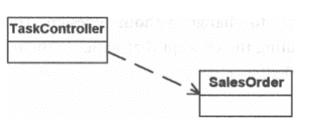

图 14-1 电子零售系统的销售订单架构。

该系统的一些功能：

- 允许通过 GUI 填写订单。
- 处理税费计算。
- 处理订单。打印销售收据。

这些功能中的一些可能会其他对象的帮助下实现。例如，`SalesOrder` 不一定会打印自己；相反，它作为销售订单信息的持有者。一个特定的 `SalesOrder` 对象可以调用 `SalesTicket` 对象来打印该 `SalesOrder`。

## 处理新需求

在编写此应用程序的过程中，假设我收到了一个新需求，改变我处理税费的方式。我必须能够处理来自美国以外客户订单的税费。至少，我需要添加用于计算这些税费的新规则。

### 税收规则的新需求

我该如何处理新规则？我可以尝试重用现有的 `SalesOrder` 对象，将这种新情况作为一种新的销售订单来处理，只是使用不同的税收规则集。例如，对于加拿大销售，我可以从 `SalesOrder` 派生出一个新类 `CanadianSalesOrder`，它将覆盖税收规则。我在图 14-2 中了此。

一种方法：重用 `SalesOrder` 对象

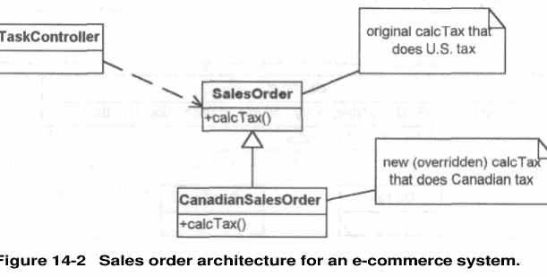

现在，设计模式反复证明了设计模式的一个基本规则：“优先使用对象组合而非类继承。”⁴ 图 14-2 中的解决方案恰恰相反！换句话说，我通过继承派生带有新规则的新类来处理税率的变化。

……但这违反了设计模式的基本规则。

### 采取不同的方法

我该如何不同地处理这个问题？遵循上述规则：尝试“考虑你的设计中哪些应该是可变的”……以及“封装发生变化的概念”。

遵循这种两步法，我应该执行以下操作：

1. 找到变化并在将其封装在自己的类中。
2. 将此类包含在另一个类中。

### 步骤 1：找到变化并将其封装

在这个示例中，我已经确定税收规则是变化的。为了封装这一点，使用一个抽象类来从概念上定义如何完成任务，然后为每个变化派生出类。换句话说，我可以创建一个 `CalcTax` 对象来定义完成此任务的接口。然后我可以派生出所需的特定版本。我在图 14-3 中展示了此。


图 14-3 封装税收规则。

5. 同, p. 29.

继续下去，我现在使用组合而不是继承。这个步骤 2 意味着，与其制作不同版本的销售订单（使用组合继承），我将通过组合包含变化。也就是说，我将有一个 `SalesOrder` 类并让它包含 `CalcTax` 类。我在图 14-4 中展示了此。

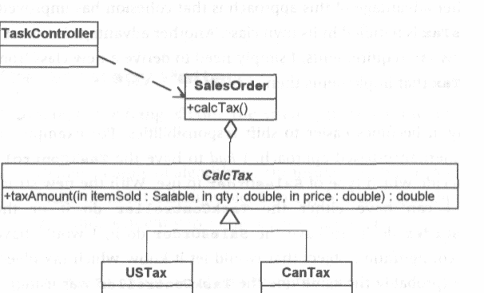

图 14-4 优先使用组合而非继承。

## UML 图

在 UML 中，可以在方法中定义参数。这是通过在方法括号中显示参数及其类型实现的。因此，在图 14-4 中，`taxAmount` 方法有三个参数：

- 类型为 `Saleable` 的 item
- 类型为 `double` 的 qty
- 类型为 `double` 的 price

这些都是输入。`taxAmount` 方法还返回一个 double。

### 它的工作原理

我为 `CalcTax` 对象定义了一个通用的接口。假设，我有一个 `Saleable` 类来定义可销售物品（以及如何征税）。`SalesOrder` 对象将将其提供给 `CalcTax` 对象，加上数量和价格。这就是 `CalcTax` 对象所需的所有信息。

### 提高内聚性，增加灵活性

这种方法的另一个优势是提高了内聚性。税在它自己的类中处理。另一个优势是当我获得新的税收需求时，我只需要从 `CalcTax` 生一个新的类来实现它们。

### 更容易转移责任

最后，更容易转移责任。例如，在基于继承的方法中，我必须让 `TaskController` 决定使用哪种 `SalesOrder`。有了这种新结构，我可以让 `TaskController` 执行或让 `SalesOrder` 执行。让某个配置对象让它知道使用哪个对象（可能是 `TaskController` 正在使用的那个）。我在图 14-5 中展示了此。

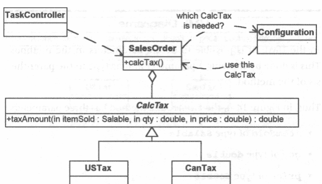

图 14-5 `SalesOrder` 对象使用配置告诉它使用哪个 `CalcTax`。

这种方法允许业务规则独立于它使用的 `SalesOrder` 对象发生变化。注意这对于我目前的以及未来可能出现的任何变化都是有效的。基本上，这种将算法封装在抽象类（`CalcTax`）中并在使用时切换的方法就是策略模式。

# 策略模式

根据《设计模式》，策略模式的意图是

根据《设计模式》，意图

定义一组算法，封装每个算法并使它们可以切换。策略让算法独立于使用它的客户端变化。

策略模式基于几个原则：

- 对象具有责任。
- 这些责任的不同特定实现通过多态性体现。
- 需要管理对概念上相同的算法的多个不同实现。
- 一个良好的设计实践是将问题领域中发生的行为隔离开来——即，将它们解。这允许我更改负责某个行为的类而不影响另一个行为。

6. 同, p. 315.


# 策略模式：核心特性

## 意图
允许根据其发生的上下文使用不同的业务规则或算法。

## 问题
需要应用的算法的选择取决于发出请求的客户端或被处理的数据。如果你仅仅拥有一条不改变的规则，那么就不需要策略模式。

## 解决方案
将算法的选择与算法的实现分离开来。允许根据上下文做出选择。

### 参与者与协作者
- 策略（strategy）规定了不同算法的使用方式。
- 具体的策略（concreteStrategies）实现了这些不同的算法。
 上 上下文（Context）通过类型为 `Strategy` 的引用使用具体的 `ConcreteStrategy`。策略和上下文相互作用以实现所选的算法（有时策略需要查询上下文）。上下文将来自客户端（Client）的请求转发给策略。

## 结果
- 策略模式定义了一个算法族。
- 开关和/或条件语句以相同的方式调用所有算法（它们必须具有相同的接口）。上下文与策略之间的交互可能需要在上下文中添加类似 `getstate` 类型的方法。

## 实现
让使用算法的类（Context）包含一个抽象类（策略），该类有一个抽象方法，指定如何调用算法。每个派生类根据需要实现算法。注意，如果你想有一个某些默认行为，则该方法将不是抽象的。
注意：在经典的策略模式中，选择特定特定实现的责任由客户端对象完成，并交给策略模式的上下文。

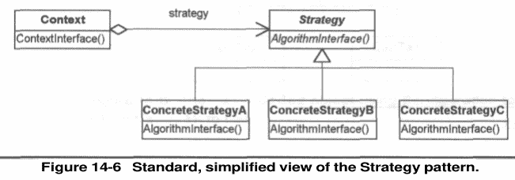

## 字段笔记：使用策略模式

当我一直在我的模式类中使用详细示例时，有人问：“你知不知道在英国，超过特定年龄的人购买食品是不征收税的？”我之前并不知道，而且 `CalcTax` 对象的接口没有处理这种情况。我可以通过以下三种方式之一来处理它：

- 1. 将客户的年龄传入 `CalcTax` 对象并在需要时使用。
- 2. 更加通用，通过传入 `Customer` 对象本身并在需要时对其查询。
- 3. 更加通用，通过传递 `SalesOrder` 对象的引用（即），让 `CalcTax` 查询它。

虽然我确实必须修改 `SalesOrder` 和 `CalcTax` 类来处理这种情况，但这样做是显而易见的。我不太可能因此引入问题。

从技术上说，策略模式是关于算法封装的。然而，在实践中，我发现它可以用于封装几乎任何种的规则。通常，当我在不同时间分析业务规则时，我会考虑使用策略模式来为我处理这种变化。

策略模式要求现在封装的算法（业务规则）必须位于使用它们的类（上下文）之外。这意味着策略所需的信息必须是传入的，或者是通过其他方式获取。

我发现的策略模式的唯一严重缺点是我必须创建的额外类的数量。虽然这种成本是值得，但当我控制所有策略时，我做了一些事情来尽量减少这一点。在这种情况下，如果我使用 `240 Part V • Handling Variations with Design Patterns C++`，我可能会让抽象策略头文件包含所有具体策略头文件。我还让抽象策略 cpp 文件包含具体策略的代码。如果我使用 Java，我会在抽象策略类中使用内部类来包含所有的具体策略。如果我不控制所有策略，我就不会这样做；也就是说，如果其他程序员需要实现自己的算法。

## 总结

在本章中

策略模式是定义算法族的一种。从概念上讲，所有这些算法都执行相同的事情。它们只是有不同的实现。

我展示了一个使用税收计算算法族的示例。在一个国际电子商务系统中，对于不同的国家可能使用不同的税收算法。策略模式允许我将这些规则封装在一个抽象类中，并拥有一族具体的派生类。

通过从抽象类派生执行算法的所有不同方式，主模块（上述示例中的 `SalesOrder`）不需要担心在许多可能性中实际在使用的是哪一个。这允许了新的变化，但也产生了管理这些变化的需求——这将我将在第 20 章“分析矩阵”中讨论的挑战。

# 第 15 章

# 装饰器模式

## 概述
本章继续了在第 14 章“策略模式”中引入的电子商务案例研究。
在本章中，

- 我描述了案例研究的一个新需求：在打印的销售票上添加页和页脚信息。
- 我展示了装饰器模式如何灵活地处理这一需求。
- 我讨论了如何使用装饰器模式处理输入/输出（特别是 Java I/O）。
- 我描述了装饰器模式的核心特性。
- 我描述了在实践中使用装饰器模式的一些经验。

## 更多细节
图 14-2 显示了案例研究的基本结构。图 Expanding the 15-1 更详细地显示了这种结构。在这里，我展示了 `SalesOrder` 对象使用 `SalesTicket` 对象来打印销售票。

正如你在第 14 章中看到的，`SalesOrder` 使用 `CalcTax` 对象来计算订单的税费。为了实现打印功能，`SalesOrder` 调用 `SalesTicket` 对象，请求它打印票据。这是一个很好的、合理的设计。

242 Part V • Handling Variations with Design Patterns

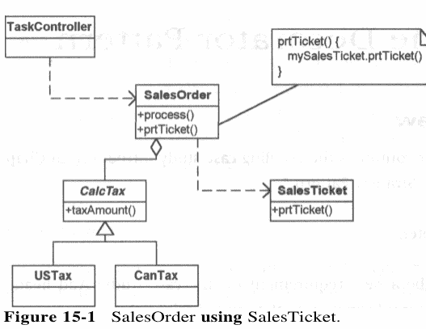

新需求：添加头部
在应用程序的过程中，假设我有一个为 `SalesTicket` 添加头部的新需求。

一种方法：在 `SalesTicket` 中使用开关
我如何处理这个需求？如果我编写的系统供一家公司使用，那么在 `SalesTicket` 中添加页眉和页脚的控制可能是简单的。如图 15-2 所示。

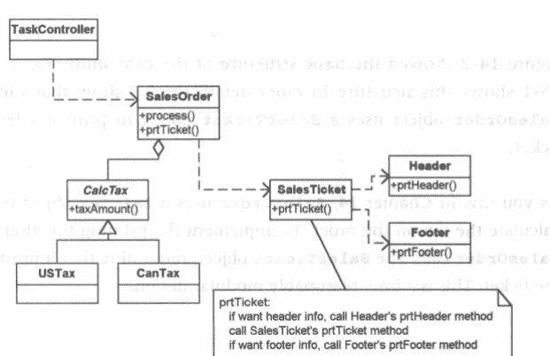

图 15-2 使用不同选项的 `SalesTicket`。

第 15 章 · 装饰器模式
在这种解决方案中，我将控制放在 `SalesTicket` 中，带有标志打印头部或页脚。

这种方法并不灵活
如果我不处理很多选项，或者使用这些头部的订单不改变，这种方法非常好。

如果我必须处理许多不同类型的头部和页脚，且每次只打印一个，那么我可能会考虑使用一个策略模式处理头部，使用另一个策略模式处理页脚。

如果我必须同时打印多个头部和/页脚怎么办？或者头部和/页脚的顺序需要改变怎么办？组合的数量迅速增加。

在这种情况下，装饰器模式非常有用。与其通过拥有控制方法来控制功能，装饰器模式建议通过按所需的顺序组合函数来控制。装饰器模式将这种功能链的动态构建与使用它的客户端分离（在本例中，是 `SalesOrder`）。

装饰器模式
根据“四人帮”，装饰器模式的意图是动态地为对象附加额外的职责。装饰器为扩展功能提供了比子类更灵活的替代方案¹

“四人帮”的意图
装饰器模式的工作原理允许我创建一个对象链，该链从装饰器对象（负责新功能的对象）开始，以原始对象结束。图 15-3 说明了这一点。

¹Gamma, E., Helm, R., Johnson, R., Vlissides, J., Design Patterns: Elements of Reusable Object-Oriented Software, Mass.: Addison-Wesley, 1995, p. 315.


## 第五部分 • 使用设计模式处理变化

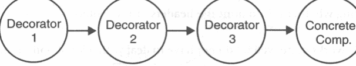

图 15-3 装饰器链。

图 15-4 中装饰器模式的类图暗示了图 15-3 所示的对象链。每个链都从一个 Component（一个 ConcreteComponent 或 Decorator）开始。每个 Decorator 后面跟着另一个 Decorator，或者是原始的 ConcreteComponent。ConcreteComponent 总是链的末尾。


图 15-4 装饰器模式类图。

例如，在图 15-4 中，ConcreteDecoratorB 执行其 `Operation` 方法，然后调用 Decorator 中的 `Operation` 方法。这会调用 ConcreteDecoratorB 尾随的 Component 的 `Operation`。

## 在案例研究中应用装饰器模式

在本案例中

在案例研究中，SalesTicket 是 ConcreteComponent。具体的装饰器是页头和页脚。图 15-5 显示了装饰器模式在案例研究中的应用。

## 第15章 · 装饰器模式 245


图 15-5 设置页头和页脚看起来像报告。

图 15-6 显示了将装饰器应用到一个页头和一个页脚上的情况。该模式实例化：


图 15-6 装饰器对象图示例。

每个 Decorator 对象都通过在其尾随的对象周围包装其新功能。每个 Decorator 在其尾随的 Decorator 包装被装饰函数之前*（对于页头）或*之后*（对于页脚）执行其添加的功能。查看其工作原理的最简单方法是查看特定示例的代码并对其进行跟踪。参见示例 15-1。

## 第五部分 • 使用设计模式处理变化

## 示例 15-1 Java 代码片段：装饰器

```java
class SalesTicket extends Component
    public void prtTicket () {
        // 此处编写销售票打印代码
    }
    abstract class Decorator extends Component { 
        private Component myComp; 
        public Decorator(Component myC) { 
            myComp=myC;
        }
        public void prtTicket () { 
            if (myComp != null)
                myComp.prtTicket();
        }
    }
    class Header1 extends Decorator {
        public void prtTicket () {
            // 此处放置打印页头 1 代码
            super.prtTicket(); 
        }
    }
    class Header2 extends Decorator {
        public void prtTicket () {
            // 此处放置打印页头 2 代码
            super.prtTicket(); 
        }
    }
    class Footer1 extends Decorator {
        public void prtReport () {
            super.prtTicket();
            // 此处放置打印页脚 1 代码 
        }
    }
    class Footer2 extends Decorator {
        public void prtReport () {
            super.prtTicket();
            // 此处放置打印页脚 2 代码 
        }
    }
    class SalesOrder { 
        void prtTicket () { }
    }
```

（续）

## 第15章 • 装饰器模式 247

示例 15-1 Java 代码片段：装饰器（续）

```java
Component myST;
// 获取由另一个知道使用规则的对象
// 构建的装饰器链和 SalesTicket。
// 这可以在构造函数中完成，而不是在
// 每次调用它时都执行。
myST= Configuration.getSalesTicket()
```

```java
// 根据需要带有页头和页脚打印票据
myST.printTicket(0);
```

如果我想让销售票看起来像：

页头 1
销售票据
页脚 1

那么 Configuration.getsalesTicket 返回：

```java
return( new Header1( new Footer1( new SalesTicket() )) );
```

这创建了一个 Header1，其后面尾着一个 Footer1 对象，Footer1 后面又尾着一个 SalesTicket 对象。

如果我想让销售票看起来像：

页头 1
页头 2 销售
票据 页脚 1

那么 Configuration.getsalesTicket 返回：

```java
return( new Header1( new Header2 (new Footer1( new SalesTicket (())))));
```

这创建了一个 Header1 对象，其后面是 Header2 对象，Header2 后面是 Footer1 对象，Footer1 后面是 SalesTicket 对象。

### 按职责拆解

装饰器模式有助于将问题分解为两个部分：

- 如何实现提供新功能的对象
- 如何为每个特殊情况组织对象

这允许将装饰器的实现与决定如何使用它们的对象分离开。这增加了内聚性，因为每个装饰器只关注它所添加的功能——而不关注它是如何被添加到链中的。

## 另一个示例：输入/输出

流 I/O 装饰器模式的一个常见用途是流 I/O。让我们来看看流 I/O。在查看该模式如何使用之前，让我们来看看流 I/O。我将讨论限制在输入上，因为了解了模式在一个方向如何工作后，它在另一个方向的原理是显而易见的。对于任何流，都可以对其执行任意数量（包括零）的操作。例如，为了实现“从文件读取、解压缩输入并解密”的行为，请执行以下操作：

1. 通过以下步骤构建装饰器链：
   a. 实例化文件对象。
   b. 将其传递给解压缩对象的构造函数。
   c. 将结果传递给解密对象的构造函数。
2. 读取、解压缩并解密数据——对于这些数据的客户端只知道它有一个输入对象。

如果我的客户端需要从不同的源获取输入，则使用相同的行为对象创建链。输入的可能性如 15-1 所示。

| 源 | 行为 |
| --- | --- |
| 字符串 | 缓冲输入 |
| 文件 | 运行校验和 |
| 套字 (TCP/IP) | 解压缩 |
| 串口 | 解密（多种方式） |
| 并口 | 选择过滤器（多种方式） |
| 键盘 | |

装饰器模式的力量要求链的实例化与使用它的客户端对象完全分离。这通常通过根据某些配置信息实例化工厂对象来完成。

## 理解“流的动物园”*Java 以其混乱的输入及相关类而闻名。在装饰器模式的背景下，理解这些类要简单得多。直接自 java.io.InputStream 的类（ByteArrayInputStream, FileInputStream, FilterInputStream, InputStream, ObjectInputStream, SequenceStream 和 StringBufferInputStream）都扮演被装饰对象的角色。所有的装饰器都派自 FilterInputStream（直接或间接）。

记住装饰器模式解释了为什么 Java 语言在实例化时需要将这些对象组合——这使得程序员能够从所有可用的行为中选择任意数量组合。

> Hormann, C., Core Java—Volume 1—Fundamentals, Palo Alto, CA: Pearson Education, 1999, p. 627.


## 装饰器模式：核心特性

意图

动态地为对象附加额外的职责。

问题

你想要使用的对象执行了你所需的基础功能。然而，你可能需要为对象添加一些额外功能，这些功能发生在对象基础功能之前或之后。注意，Java 基础类广泛地使用了装饰器模式来处理 IO。

解决方案

允许在不诉助于子类化的情况下扩展对象的功能。

参与者与协作者

具体组件（ConcreteComponent）是被装饰器（Decorators）添加了的类。有时，会使用派生自具体组件的类来提供核心功能，在这种情况下，具体组件就不再是具体的，而是抽象的。装饰器（Decorator）定义了所有这些类使用的接口。

结果

要添加的功能在小对象中实现。优点是可以在具体组件的功能之前或之后，动态地添加这些功能。注意：虽然装饰器可能会在被装饰的对象之前或之后添加其功能，但实例化链始终以具体组件结束。

实现

创建一个抽象类，用表示原始类以及要添加到该类中的新函数。在装饰器中，将新的函数调用放在末尾调用之后，以获得正确的顺序。

GoF 参考

第 175-184 页。


## 测试中的装饰器

我曾使用装饰器来对待测的对象封装先置条件和后置条件测试，得到了良好的结果。在测试期间，链中的第一个对象可以在调用其后续对象之前，对先置条件进行广泛测试。在调用后续对象后后，同一个对象会立即对后置条件进行广泛测试。如果我有不同的测试想在不同的时间运行，可以将每个测试保留在不同的装饰器中，然后根据我想运行的测试套件对它们进行链。

## 总结

装饰器模式是一种动态地向现有函数添加额外功能的方法。在实践中，它需要构建一个对象链来提供所需的行为。链中的第一个对象由客户端（Client）调用，而客户端与链的构建无关。通过保持链的创建与使用的解耦，客户端对象就不会受到添加功能的新需求的影响。

在本章中

## 补充：C++ 代码示例

示例 15-2 C++ 代码片段

```
class SalesTicket : public Component
  public:
    void prtTicket();
}
SalesTicket::prtTicket() {
  // 此处编写销售票打印代码
}
class Decorator : public Component
  public:
    virtual void prtTicket();
  Decorator( Component *myC);
  private:
    Component *myComp; } }
```

（续）

# 第 15 章 • 装饰器模式 253

## 示例 15-2 C++ 代码片段（续）

```
Decorator::Decorator( Component *myC)
  { myComp=myC;
 }
Decorator::prtTicket() { if
  (myComp != 0)
    myComp->prtTicket();
 }
 class Header1 : public Decorator
  { public:
    void prtTicket();
 }
Header1::prtTicket() {
  // 此处放置打印表头 1 代码
  Decorator::prtTicket();
 }
 class Header2 : public Decorator
  { public:
    void prtTicket();
 }
Header2::prtTicket() {
  // 此处放置打印表头 2 代码
  Decorator::prtTicket();
 }
 class Footer1 : public Decorator
  { public:
    void prtTicket();
 }
Footer1::prtTicket() {
  Decorator::prtTicket();
  // 此处放置打印页脚 1 代码
 }
 class Footer2 : public Decorator
  { public:
    void prtTicket();
 }
Footer2::prtTicket() {
  Decorator::prtTicket();
  // 此处放置打印页脚 2 代码
 }
SalesOrder::prtTicket() {
```

（续）

# 示例 15-2 C++ 代码片段（*续*）

```
Component *myST;
// 获取由另一个知道使用规则的对象构建的
// 装饰器链和销售票链。
// 这可以在构造函数中完成，而不是
// 每次调用时都这样做。
myST= Configuration.getSalesTicket())

// 根据需要打印带有头部和页脚的票据
myST->prtTicket(); }
```

# 第 16 章

# 单例模式与双重检查锁定模式

## 概述

本章继续了第 14 章“策略模式”和第 15 章“装饰器模式”中讨论的电子零售案例。

在本章中，

- 我引入了单例模式。
- 我描述了单例模式的核心特性。
- 我引入了单例模式的一种变体，称为双重检查锁定模式。
- 我描述了我在实践中使用单例模式的一些经验。

单例模式和双重检查锁定模式非常简单且常见。两者都用于确保某个类只被实例化一个对象。这两种模式的区别在于，单例模式用于单线程应用程序，而双重检查锁定模式则用于多线程应用程序。

> ¹ 如果你不知道什么是多线程应用程序，不要担心；你现在只需要关注单例模式。

## 引入单例模式

根据“四人帮”（Gang of Four）的定义，其意图是确保一个类只有一个实例，并为其提供一个全局访问点。

单例模式的工作原理 单例模式通过通过一个特殊方法来实例化所需的对象来实现工作的。

当调用该方法时，它会检查是否已经实例化。如果已经实例化，方法直接返回该对象的引用。如果没有，方法将实例化它并返回引用。

为了确保这是实例化该类型的唯一方式，我将该类的构造函数定义为私有。

# 在案例研究中应用单例模式

示例示例：按需实例化税收计算策略 在第 14 章中，我们将税收规则封装在策略对象中。我必须为每个税收计算规则派出一个类。这意味着我们需要反复使用相同的对象。

出于性能考虑，我可能不想不断地实例化并丢弃它们。而且，虽然我可以在开始实例化所有的策略，但如果策略数量很大，这可能会变得效率低下。（记住，我的应用程序中可能有许多策略。）相反，最好的方法是在需要时实例化，但只实例化一次。

问题是，我不想创建一个单独的对象来跟踪我已经实例化了哪些。相反，我希望对象本身（即策略）负责处理它们自己的单例实例化。

这就是单例模式的目的。它允许我只实例化一次对象，而不需要客户端对象担心它是否已经存在。

> 单例让对象负责自己

单例可以像示例 16-1 所示用代码实现。在示例中，我创建了一个方法（getInstance），它最多实例化一个 USTax 对象。单例模式通过将构造函数设为私有，防止了其他人直接实例化 USTax 对象，这意味着没有其他对象可以访问。

# 示例 16-1 Java 代码片段：单例模式

```
class USTax {
    private static USTax instance;
    private USTax():
    public static USTax getInstance () { if
        (instance== null)
        instance= new USTax(); return
        instance; }

```


## 单例模式：核心特性

意图

你希望某个对象只有一个实例，但没有全局对象来控制该对象的实例化。

问题

多个不同的客户端对象需要引用同一个实例，而你希望确保它们的数量不会超过一个。

解决方案

保证只有一个实例。

参与者与协作者

客户端仅通过实例方法创建单例的实例（Instance）。

后果

客户端不需要担心单例实例是否存在。这可以由单例类来控制。

实现

- * 在类中添加一个私有的静态成员，指向所需的对象（初始为 NULL）。*
- 添加一个公共静态方法，如果该成员为 NULL，则实例化该类（并设置该成员的值），然后返回该成员的值。
- 将构造函数的状态设置为受保护（protected）或私有（private），这样任何人都无法直接实例化该类并绕过静态构造机制。

GoF 引用

第 127-134 页。

| 返回实例 | 单例 |
|---|---|
| | -static instance |
| -singletonData | |
| +static getInstance() | |
| +SingletonOperation() | |
| +getSingletonData() | |

**图 16-1** 单例模式的标准、简化视图。

## **变体：双重检查锁定模式**

仅用于多线程应用程序

此模式*仅*适用于多线程应用程序。如果你没有涉及多线程应用程序，可能想跳过本节。本节假设你对多线程问题（包括同步）有基本的理解。

## 第 16 章 • 单例模式与双重检查锁定模式

单例模式在多线程应用程序中可能会出现问题。

在多线程模式下，单例无法正常工作

假设恰好在同时进行了两次 `getInstance()` 调用。这非常糟糕。考虑在这种情况下可能发生的情况：

- * 第一个线程检查实例是否存在。不存在，因此它进入了创建第一个实例的代码部分。
- * 但是，在执行创建之前，假设第二个线程也查看实例成员是否为 NULL。由于第一个线程还没有创建任何内容，实例仍然等于 NULL，因此第二个线程也进入了创建对象的代码。
- * 两个线程现在都对单例对象执行了新的操作，从而创建了两个对象。

这是一个问题吗？可能是，也可能不是。

无影响、微小、糟糕或更糟

- * 如果单例是完全无状态的，这可能不是问题。
- * 在 Java 中，问题仅仅是我们额外占用了一位内存。
- * 在 C++ 中，程序可能会产生内存泄漏，因为当我创建了两个对象时，它只会删除其中一个。
- * 如果单例对象具有某些状态，可能会引入微妙的错误。例如：
    - 如果对象创建了连接，实际上将有两个连接（每个对象一个）。
    - 如果使用了计数器，将有两个计数器。

发现这些问题可能非常困难。首先，双重创建是非常间歇性的——它通常不会发生。其次，计数不对的原因可能并不明显，因为只有一个客户端对象会包含一个单例对象，而所有其他客户端对象将引用另一个单例。

起初，看来我只需要同步对单例对象是否已创建的测试。唯一的问题是，这种同步可能会导致严重的瓶颈，因为所有线程都必须等待对象是否已存在的检查。

同步单例对象的创建

或许相反，我可以在 `if (instance == null)` 测试中放置一些同步代码。这行不通。因为可能两个调用都执行了 NULL 测试然后尝试同步，我仍然可能创建两个单例对象，一个接一个地创建。

解决方案是在 NULL 测试后进行“同步”，然后再次检查以确保成员实例尚未被创建。我在示例 16-2 中展示了这一点。这被称为双重检查锁定。意图是优化掉不必要的锁定。这种同步检查最多发生一次，因此它不会成为瓶颈。

简单的解决方案：双重检查锁定

双重检查锁定的特性如下：

- 通过将调用封装在另一个条件测试中，避免了不必要的锁定。
- 支持多线程环境。

> 3. Martin, R., Riehle, D., Buschmann, R, Pattern Language of Program Design, Reading. Mass.: Addison-Wesley, 1998, p. 363.

### 示例 16-2 Java 代码片段：仅实例化

```java
class UTax extends CalcTax
  private UTax instance; 
  private UTax() { }
  private synchronized static
  void doSync() {
    // 仅用于同步
  }
  public UTax getInstance() { 
    if (instance== null)
    { 
      UTax.doSync(); 
      if (instance== null) 
        instance= new UTax();
    } 
    return instance;
  }
}
```

## 字段笔记：使用单例和双重检查锁定模式

如果你知道需要延迟实例化对象，通常进行解耦会更简单。

在多线程应用程序中，单例通常必须是线程安全的（因为被对象共享）。

## 总结

当你想要对对象实例化时，单例和双重检查锁定模式很常见。在本章中：

- 我介绍了分类方案。
- 我将观察者模式应用于案例研究。
- 我描述了观察者模式。
- 我描述了观察者模式的核心特性。
- 我描述在使用模式的一些经验。

## 第 17 章

## 观察者模式

## 概述

本章延续 14-16 页。

## 模式分类

有很多模式需要跟踪。为了帮助整理这些模式，GoF 将模式分为三个大类，如表 17-1 所示.¹

> 1. Gamma, E., Helm, R., Johnson, R., Vlissides, J., Design Patterns: Elements of Reusable Object-Oriented Software, Reading, Mass.: Addison-Wesley, 1995, p. 10.

## 模式分类

| 类别 | 目的 | 本书示例 | 用途 |
|---|---|---|---|
| 结构型 | 将现有对象结合 | 外Facade（第 6 章）适配器（第 7 章） | 处理接口 |
| 行为型 | 提供一种体现灵活（变化）行为的方式 | 桥接（第 9 章）装饰器（第 15 章）策略（第 14 章） | 实现与抽象的关系 |
| 创建型 | 创建或实例化对象 | 抽象工厂（第 10 章）单例（第 16 章）双重检查锁定（第 16 章）工厂方法（第 19 章） | 实例化对象

关于桥接和装饰模式分类的说明

当我开始设计模式时，看到桥接和装饰器模式是结构型而非行为型模式，感到很惊讶。毕竟它们似乎实现了不同的行为。当时我并不理解 GoF 的分类系统。结构型是为了是为了结功能。在桥接模式中，我们通常从抽象和实现开始，然后通过桥接结合在一起。在装饰器模式中，我们有一个原始功能类，并想要对其装饰额外的功能。

我的“第四”类：解耦

我发现考虑第四类模式是有价值的，其唯一目的是使对象解耦。这种模式的动机之一是允许扩展或增加灵活性。我将这类模式称为*解耦模式*。由于解耦类中的大多数模式都属于 GoF 的行为类，我几乎可以称它们为行为类的一个子集。我之所以建立第四类，是因为我在书中的意图是反映我看待模式的方式，关注它们的动机——在这种情况下，就是解耦。


# 第 17 章 · 观察者模式 265

我不会过度纠结于分类的缘因和细节。分类是为了让我们洞察这些模式在做什么。

本章讨论了观察者模式，它是解耦模式中最典型的示例。四人帮（Gang of Four）将观察者模式归类为行为模式。

观察者是一种解耦（行为）模式

## 案例研究的更多需求

在编写应用程序的过程中，假设我得到了一个新需求，当系统中输入新客户时要执行以下操作：

新需求：针对新客户采取行动

- 向客户发送欢迎电子邮件。
- 与邮局核实客户地址，……，**

这些就是全部的需求了吗？未来会发生变化吗？

### 方法一

如果我有足够的把握知道所有的每项需求，那么我可以通过在 `Customer` 类中硬编码通知行为来解决问题，如图 17-1 所示。

例如，使用向数据库中添加新客户的相同方法，我还将调用生成欢迎信和核实邮局地址的对象。这种解耦


这些类具有以下职责：

| 类 | 职责 |
| --- | --- |
| Customer | 当添加客户时，该对象将调用其他对象以执行相应的操作。 |
| WelcomeLetter | 为客户创建欢迎信，让他们知道自己已被加入系统。 |
| AddrVerification | 该对象将核实任何要求其进行核实的客户的地址。 |

硬编码方法在第一次运行时运行得很好。但需求总是在不断变化的。我知道另一个需求将要求我对 `Customer` 的行为进行再次更改。例如，我可能需要支持不同公司的欢迎信，这将需要为每家公司创建一个不同的 `Customer` 对象。显然，我可以做得更好。

## 观察者模式

根据四人帮的定义，观察者模式的意图是“在对象之间定义一种一对多的依赖关系，当一个对象的状态发生变化时，所有的依赖者都会自动收到通知并更新。”

通常，我有一组对象，每当事件发生时都需要通知。我希望这种通知能够自动发生。然而，我不想在监听广播的对象集合发生变化时，都去修改广播对象。（这就像每当有新汽车收音机进入就要更换无线发射器一样。）我想将通知者和被通知者解耦。

+ 2. Gamma, E., Helm, Johnson, R., Vlissides, J., Design Patterns: Elements of Reusable Object-Oriented Software, Reading, Mass.: Addison-Wesley, 1995, p. 293.

# 第 17 章 · 观察者模式 267

这种模式非常常见。它也被称为依赖（Dependencies）和发布-订阅（Publish-Subscribe），并与 COM 的通知过程类似。它在 Java 中通过 `Observer` 接口和 `Observable` 类实现（稍后将对此详细介绍）。在基于规则的专家系统中，它们通常用守护进程规则来实现。

## 将观察者应用于案例研究

我的方法是在问题中寻找哪些部分在变化的线索。有两点：然后，我尝试封装这种变化。在当前案例中，我发现：

- 不同类型的对象——有一个对象列表需要被通知状态变化。这些对象倾向于属于不同的类。
- 不同接口——由于它们属于不同的类，它们往往具有不同的接口。

首先，我必须识别所有想要被通知的对象。步骤 1：将这些命名为观察者（observers），因为它们在等待事件的发生。同样的方法

我希望所有观察者都具有相同的接口。如果它们没有相同的接口，我将修改主体（subject）——即触发事件的对象（例如 `Customer`），来处理每种类型的观察者。

通过让所有观察者都是同一种类型，主体可以轻松地通知所有它们。为了让所有观察者成为同一类型：

- 在 Java 中，我可能会通过接口来实现（无论是为了灵活性还是出于需要）。

> 3. 同上, p. 293.

## 第五部分 · 用设计模式处理变化

- 在 C++ 中，我将根据需要使用单继承或多重继承。

步骤 2：让观察者自行注册。在大多数情况下，我希望由观察者负责知道观察什么，而我希望主体不需要知道是哪些观察者依赖于它。为了实现这一点，我需要一种方法让观察者能够向主体进行注册。由于所有观察者都是同一种类型，我必须给主体添加两个方法：

- attach (Observer)—将给定的 Observer 添加到其观察者列表中
- detach (Observer)—从其观察者列表中移除给定的 Observer

步骤 3：在事件发生时通知观察者。现在主体已经注册了它的观察者，主体在事件发生时通知观察者就是件简单的事。为了实现这一点，每个 Observer 都实现一个名为 `update` 的方法。主体实现一个 *notify* 方法，遍历它的观察者列表并为每一个它们调用此 `update` 方法。`update` 方法应该包含处理事件的代码。

步骤 4：从主体获取信息。但通知每个观察者是不够的。观察者可能需要比事件已发生这一简单事实之外更多的信息。因此，我必须还向主体添加方法（多个方法），允许观察者获取所需的信息。图 17-2 显示了这一点。

这种工作方式在图 17-2 中类之间的关系如下：

1. 观察者在实例化时挂接到 Customer。被通知时，它们接收到 Customer 的引用。

2. 当添加新 Customer 时，notify 方法调用这些观察者。


图 17-2 实现 Customer。

每个观察者调用新添加的 Customer 的状态以查看其需要什么。注意：通常会有多个方法来获取信息。

示例 17-1 显示了实现此功能的部分代码。

这种方法允许我添加新的观察者而不影响任何现有类。它还保持了系统的松耦合。如果我让所有对象都负责自己，这种组织方式就是有效的。

观察者有助于灵活性并保持解耦

如果我得到了新需求，这种方法效果如何？例如，新需求：如果我需要向位于公司任何一家实体店 20 英里内的客户发送带有优惠券的信。

## 示例 17-1 Java 代码片段：实现观察者

```
class Customer {
    static private Vector myObs;
    static {
        myObs= new Vector();
    }
    static void attach(Observer
    o){ myObs.add(o);
}
    static void detach(Observer
    o){ myObs  remove (o) ;
}
    public String getState() {
    // 其他方法将提供
    // 需要的信息 
}

    public void notifyObs () { for
    Enumeration e =
    myObs.elements();
    e.hasMoreElements() ; ) {
        ((Observer) e).update(this); } }}
}

    abstract class Observer
    { public Observer () {
        Customer.attach(this);
    }
    abstract public void update
    (Customer myCust); }
}
class POVerification extends Observer
    { public AddrVerification () ( super();
    }
    public void update
    ( Customer myCust) {
}
```


# 第 17 章 • 观察者模式 271

示例 17-1 Java 代码框架：观察者的实现（续）

```java
If do Address verification stuff here // can get
more information about customer // in question by
using myCustomer() )
class WelcomeLetter extends Observer
    { public WelcomeLetter () { super(); }
}
public void update (Customer myCustomer) {
    // do Welcome Letter stuff
    // here can get more
    // information about customer
    // in question by using myCustomer )
}
```

为了实现这一点，我只需添加一个新的发送优惠券的观察者即可。它只对居住在指定距离内的新客户执行此操作。我可以将这个观察者命名为 `BrickAndMortar`，并使其成为 `Customer` 类的观察者。图 17-3 显示了这一解决方案。


图 17-3 添加 BrickAndMortar 观察者。

# 使用设计模式处理变体

**现实世界中的观察者**

有时，一个将成为观察者的类可能已经存在。在这种情况下，我可能不想修改它。如果是这样，我可以很容易地用适配器模式（Adapter pattern）对其进行适配。图 17-4 显示了此示例。


**图 17-4 使用适配器实现观察者。**

# **Observable 类：给 Java 开发者的说明。**

观察者模式非常有用，Java 的包中包含了它的实现。`Observable` 类和 `Observer` 接口构成了该模式。`Observable` 类在四人（Gang of Four）对该模式的描述中扮演 Subject（主体）的角色。Java 没有使用 `attach`、`detach` 和 `notify` 方法，而是分别使用 `addObserver`、`deleteObserver` 和 `notifyObservers`（Java 也使用了 `update`）。Java 还提供了更多方法来让生活变得更轻松。*

`http://java.sun.com/j2se/f3docs/api/index.html` 用于关于 Observer 和 Observable 的 Java API 的信息。

## 观察者模式：关键特性

意图 | 在对象之间建立一种一对多的依赖关系，以便当一个对象的状态发生变化时，所有的依赖对象都会收到通知并自动更新。

问题 | 你需要通知一个不断变化的对象列表某个事件已经发生。

解决方案 | 观察者将监控事件的责任委托给一个中心主体：Subject（主体）。

参与者和协作者 | Subject 知道它的观察者（Observers），因为观察者向它注册了。当事件发生时，Subject 必须通知这些观察者。观察者负责向 Subject 注册，并在收到通知时从 Subject 获取信息。

后果 | 当事件发生时，Subject 可能会告诉观察者一些它们不需要的事件；某些观察者只对事件的子集感兴趣（见第 274 页“字段笔记：使用观察者模式”）。如果 Subject 通知了观察者，而观察者又返回请求额外信息，则可能需要额外的通信。

- 让想要在事件发生时知道观察者（Observers）将自己附加到另一个对象（等待事件发生或触发事件本身的 Subject）。
- 当事件发生时，Subject 告诉观察者事件已发生。
- 有时需要适配器模式，以便为所有观察者类型的对象实现 Observer 接口。

实现 | 

GoF 引用 | 第 293-303 页。


## 字段笔记：使用观察者模式

**并非适用于所有依赖关系**
观察者模式并不是要在每次对象之间存在依赖关系时都使用。例如，在一个票据处理系统中，税收对象处理税费，很显然，当项目添加到票据时，必须通知税收对象以便重新计算税费。这并不是使用观察者模式的好地方，因为这种通知是预知的，而且可能不会添加其他项。当依赖关系（虚拟）固定时，添加观察者模式只会增加复杂度。

**……但对于变化的或动态的依赖关系**
如果需要通知的对象列表是某种条件性的，那么观察者模式具有更大的价值。这些变化可能是因为需求在变化，也可能是因为需要通知的对象列表在变化。如果系统在不同的条件下或由不同的客户运行，且每个客户都有不同的所需观察者列表，那么观察者模式也会很有用。

**是否处理事件**
观察者可能只需要处理事件的某些情况。实体店（Brick and mortar）案例就是一个例子。在这种情况下，观察者必须过滤掉额外的通知。

通过将过滤这些通知的责任转移给 Subject 可以消除无关通知。最好的方法是让 Subject 使用策略模式（Strategy pattern）来测试是否应该发生通知。每个观察者在注册时为 Subject 提供要使用的正确策略。

**如何处理事件**
有时，Subject 会调用观察者的 `update` 方法并传递信息。这可以节省观察者向 Subject 回调的需求。然而，通常情况下，不同的观察者有不同的信息需求。在这种情况下，再次可以使用策略模式。这次，策略对象被用于调用观察者的更新程序。。再次，

# 第 17 章 • 观察者模式 275

观察者必须为 Subject 提供要使用的适当对象。

## 总结

在学习观察者模式时，我考虑了哪些对象需要在事件发生时进行处理。在观察者模式的情况下，Subject 无法预见到是种类的观察者在与之通信。为了解决这个问题，我创建了一个观察者接口，并要求观察者向 Subject 注册。

所使用的面向对象原则

| 概念 | 讨论 |
| --- | --- |
| 对象负责自己注册 | 存在不同类型的观察者，它们都会从 Subject 获取信息并根据情况采取行动。 |
| 抽象类 | 观察者类代表了需要通知的对象的概念。它提供了一个通用的接口供 Subject 通知观察者。 |
| 多态封装 | Subject 不需要知道与哪种观察者通信。这意味着未来如果有了新的观察者，Subject 不需要更改。 |


# 第 18 章

# 模板方法模式 (Template Method Pattern)

## 概述

本章将继续在第 14-17 章中讨论的电子商务案例研究。

在本章中：

- 我通过讨论该案例研究的额外需求引入了模板方法模式。
- 我展示了模板方法模式的意图。
- 我描述了模板方法模式的关键特征。
- 我描述了我在实践中使用模板方法模式的一些经验。

## 案例研究的更多需求

在编写应用程序的过程中，假设我收到了一个新需求：需要同时支持 Oracle 和 SQL Server 数据库。对这些系统的多个 SQL 访问都基于 SQL（结构化查询语言），这是一种让数据库更易于使用的通用标准。然而，尽管这在通用层面是一个共同标准，但在细节上仍然存在差异。我知道，通常在这些数据库上执行这些操作时，我将使用以下步骤：

- 格式化 CONNECT 命令。
- 发送数据库 CONNECT 命令。
- 格式化 SELECT 命令。
- 4. 向数据库发送 SELECT 命令。
- 5. 返回选定的数据集。

……但细节上

然而，数据库的具体实现有所不同，需要略有不同的格式化过程。

# 模板方法模式

 步骤的标准化

模板方法是一种旨在从不同的过程中抽象出共同过程的模式。根据“四人帮”（Gang of Four）的定义，模板方法的意图是：

> 在操作中定义算法的骨架，将某些步骤延迟给子类。在不改变算法结构的情况下重新定义算法的步骤。

换句话说，虽然连接和查询 Oracle 数据库与 SQL Server 数据库有不同的方法，但它们共享相同的概念过程。模板方法为我们提供了一种在抽象类中捕捉这种共同点，同时在派生类中封装差异的方法。模板方法模式在于控制不同过程的共同序列。

## 将模板方法应用于案例研究

 细节各异

在此例中，数据库访问的差异发生在所涉及步骤的具体实现中。图 18-1 说明了这一点。

1. Gamma, E., Helm, R., Johnson, R., Vlissides, J., Design Patterns: Elements of Reusable Object-Oriented Software, Reading, Mass.: Addison-Wesley, 1995, p. 325.


图 18-1 使用模板方法模式执行查询。

我创建了一个名为 `doQuery` 的方法来处理我需要执行的查询。我传入了数据库名称和查询规范。`doQuery` 方法遵循上述五个通用步骤，并为必须以此实现的步骤（例如 `formatConnect` 和 `formatSelect`）提供了虚方法。

 它是如何工作的：针对发生变化的步骤使用虚方法

`doQuery` 方法的实现如下。如图 18-1 所示，它首先需要格式化连接数据库所需的 CONNECT 命令。尽管抽象类（`QueryTemplate`）知道需要进行这种格式化，但它不知道如何做到。确切的格式化代码由派生类提供。格式化 SELECT 命令也是如此。

模板方法之所以能够做到，是因为方法调用是通过指向其中一个派生类的引用进行的。也就是说，尽管 `QueryControl` 拥有一个类型为 `QueryTemplate` 的引用，但它实际上指向一个 `OracleQT` 或 `SQLServerQT` 对象。因此，当在这两个对象的任一个上调用 `doQuery` 方法时，解析的方法将首先查找相应派生类的方法。假设我们的 `QueryControl` 指向一个 `OracleQT` 对象。由于 `OracleQT` 没有重写 `QueryTemplate`，将调用 `QueryTemplate` 的 `doQuery` 方法。这开始执行，直到调用 `formatConnect` 方法。由于请求 `OracleQT` 对象执行 `doQuery`，因此调用了 `OracleQT` 的 `formatConnect` 方法。之后，控制权返回到 `QueryTemplate` 的 `doQuery` 方法。现在执行所有查询的共同代码，直到需要下一个变化——`formatSelect` 方法。同样，该方法位于 `QueryControl` 所引向的对象中（在本例中为 `OracleQT`）。

当遇到新数据库时，模板方法为我们提供了一个可以填充的样板（或模板）。我们创建一个新的派生类，并在其中实现为新数据库所需的特定步骤。

# 字段笔记：使用模板方法模式

有时一个类会使用几种不同的策略模式（Strategy patterns）。当我第一次查看模板方法的类图时，我在想：“哦，模板方法仅仅是一组共同工作的策略集合。”这种想法是危险的（通常也是错误的）。虽然多个策略看起来彼此连接在一起并不罕见，但为此进行设计会导致缺乏灵活性。

当存在不同但在概念上相似的过程时，模板方法是适。每个过程的变化是耦合的，因为它们与特定的过程相关。在我展示的示例中，当我需要为 Oracle 数据库格式化 CONNECT 命令时，如果需要格式化 QUERY 命令，它也将是针对 Oracle 数据库。

# 模板方法模式：关键特征

意图
在操作中定义算法的骨架，将步骤延迟给子类。在不改变算法结构的情况下重新定义算法的步骤。

问题
有一个需要遵循的程序或步骤集合，它们在某一个层次上是一致的，但单个步骤在较低层次可能有所不同。

解决方案
允许在保持一致基础的同时定义子步骤。

参与者和协作者
模板方法包含一个定义基本过程（见下文）的抽象类以及需要重写的类。

后果
模板为代码重用提供了良好的平台。它们有助于确保要求的步骤得到实现。

实现
创建一个使用抽象方法实现程序的抽象类。这些抽象方法必须在子类中实现。如果步骤是独立变化的，则每个步骤可以使用策略模式实现。

 GoF 参考
第 325-330 页。


## 总结

在本章中

有时，我有一组必须遵循的程序。这些程序在高级层次是通用的，但某些步骤的实现可以有所不同。例如，查询 SQL 数据库在高级层次是常规，但某些细节——例如如何连接数据库——可以根据平台发生变化。

模板方法允许我定义步骤序列，然后重写那些需要变化。

# 第 19 章

# 工厂方法模式 (Factory Method Pattern)

## 概述

本章将继续在此之前的第 14-18 章中讨论的电子商务案例研究。

在第 18 章“模板方法模式”中，我根据上下文忽略了如何实例化数据库对象的问题。我可能不想让客户端负责实例化数据库对象。相反，我可能希望将责任交给 `QueryTemplate` 类本身。

在第 18 章中，`QueryTemplate` 的每个派生类都针对特定的数据库进行了专门化。因此，我可能希望让每个派生类负责实例化与其对应的数据库。无论 `QueryTemplate`（及其派生类）是否是使用数据库的唯一类，这一点都是成立。


# 286 第五部分 • 使用设计模式处理变化

| QueryControl | QueryTemplate | SQLSvrQt |
| :--- | :--- | :--- |
| | +doQuery() #formatConnect() #formatSelect() #makeDB() | #formatConnect() #formatSelect() #makeDB() |

```cpp
doQuery(DBName, querySpec) {
  String dbCommand;
  // instantiate correct database objects with makeDB(
  dbCommand = formatOpen(DBName);
  // put open database with dbCommand here
  // ...
  dbCommand = formatQuery(querySpec);
  // perform query using dbCommand here
  // ...
  return dataset
}
```

图 19-1 使用工厂方法模式 (makeDB) 实现的模板方法 (doQuery)。

使用工厂方法方法的模板方法

在图 19-1 中，模板方法中的 `doQuery` 方法正在使用 `makeDB` 来实例化相应的数据库对象。`QueryTemplate` 并不知道要实例化哪个数据库对象；它只知道必须实例化一个对象，并为该实例化提供接口。自于 `QueryTemplate` 的派生类负责知道要实例化哪一个。因此，在这一层，我可以将如何实例化数据库的决策推给派生类中的方法。

由于创建对象涉及到一个方法，这种方法被称为工厂方法。

## 公有方法还是保护方法？

注意 `makeDB` 方法是受保护的（如 `#` 符号所示）。在这种情况下，只有 `QueryTemplate` 类及其派生类可以访问这些方法。如果我希望 `QueryTemplate` 之外的对象也能访问这些方法，那么它们应该是公共的。这是使用工厂方法的另一种非常常见的方法。在这种情况下，我仍然由一个派生类来做出实例化哪个对象的决策。

## 工厂方法模式

工厂方法是一种旨在分配创建责任的模式。根据“四人帮”（Gang of Four），工厂方法的意图是：

定义一个用于创建对象的接口，但让子类来决定实例化哪个类。工厂方法让类将实例化推迟到子类中。¹

## 字段笔记：使用工厂方法模式

在抽象工厂的经典实现中，我用一个抽象类定义创建一组对象的方法。我为每种不同的族派生了一个类。在抽象类中定义并在派生类中重写的每个方法都遵循工厂方法模式。

有时，创建一个与现有类并行的层级类结构是很有用的，新的层级结构包含一些委托的责任。在这种情况下，原始层级结构中的每个对象能够实例化并行层级结构中的正确对象是非常重要的。工厂方法可以用于此目的。

工厂方法模式通常用于定义框架时。这是因为框架存在于抽象层面。通常，它们不知道也不应该关心实例化特定的对象。它们需要将关于特定对象的决策推迟给框架的用户。

> 1 Gamma, E., Helm, R., Johnson, R., Vlissides, J., *Design Patterns: Elements of Reusable Object-Oriented Software*, Reading, Mass.: Addison-Wesley, 1995, p. 325.

## 工厂方法模式：关键特征

- 定义一个用于创建对象的接口，但让子类来决定实例化哪个类。将实例化推迟到子类中。

- 一个类需要实例化另一个类的派生类，但不知道是哪一个。工厂方法允许派生类做出此决策。

- 派生类做出关于实例化哪个类以及如何实例化它的决策。

- 产品（Product）是工厂方法所创建的对象类型的接口。创建者（Creator）是定义工厂方法的接口。

- 客户端需要派生创建者类以创建特定的产品（Product）。

- 使用抽象类中的抽象方法（在 C++ 中为纯虚函数）。当抽象类的代码在需要实例化一个包含的对象但又不知道具体需要哪一个对象时，它会引用该方法。

第 107-116 页。


## 总结

工厂方法模式是*本章中*你将反复使用的、最简单易懂的模式之一。它被用于那些你希望将实例化对象的规则推迟给某些派生类的情况。在这些情况下，最自然的方法是将方法的实现存放在负责该行为的对象中。

# 第 20 章

## 分析矩阵

## 概述

本章结束了到*本章*（第 14-19 章）为止所讨论的电子商务案例研究。

既然我已经讨论了一整套独立模式，现在是时候后退一步，看看软件开发中最大的问题之一：处理问题领域内的变化。设计模式可以帮助分析师成功地识别和组织变化。

在本章中，

- 我考虑了现实世界中的变化问题。
- 我查看了电子商务案例研究中代表重大变化问题的部分。在解决此问题的过程中，我开发了分析矩阵（Analysis Matrix），这是决策表的简单变体，我发现它对于理解和协调概念中的变化很有帮助。这与 Christopher Alexander 和 Jim Coplien 的概念存在并行关系。
- 我描述了我在现实世界中使用分析矩阵的情况。

## 在现实世界中：变化

在现实世界中，问题并不是整洁或听话的。除了最微小的问题外，似乎总有例外和变化。例如，来医院的患者通常去登记处。但当发生生命危险时，患者会直接去急诊室。这些是破坏我们精细模型的难题。模式能帮助我们更高效地处理变化吗？

我使用了一种方法来显式化变化。我的方法步骤如下：

- 1. 取一个案例中最重要的特征并将它们组织在矩阵中。为每个特征所代表的概念标记标签。
- 2. 处理其他案例，必要时扩展矩阵。独立处理每个案例。
- 3. 用新概念扩展分析矩阵。
- 4. 使用行来识别规则。
- 5. 使用列来识别特定案例。
- 6. 从此分析识别设计模式。
- 7. 开发高层设计。

## 变化案例研究：国际电子商务系统

电子商务：变化案例研究

假设电子商务系统必须处理多个国家的销售订单。最初，我必须处理美国和加拿大。我查看了需求并发现了一些变化之处。我将这些记录在表 20-1 中。

第 20 章 · 分析矩阵 293

## 表 20-1 根据客户居住地划分案例

| 案例 | 流程 |
| --- | --- |
| 美国 | 根据 UPS 费用计算运费。使用美国邮政规则验证地址。根据销售税或/取决于地区计算税。使用美元处理货币。
| 加拿大 | 根据主要的加拿大货商计算运费。使用加拿大邮政规则验证地址。根据销售税或/取决于省份征税规则计算税（使用 GST 和 PST）。使用加元处理货币。 |


### 表 20-2 填充分析矩阵：第一个概念

| 美国销售 |
| :--- |
| 计算运费 | 使用 UPS 费率表 |

现在，我继续处理下一条信息，“使用美国邮政规则验证地址”，通过向矩阵添加另一行来容纳这部分信息，如表 20-3 所示。

### 表 20-3 填充分析矩阵：第二个概念

| 美国销售 |
| :--- |
| 计算运费 | 使用 UPS 费率表 |
| 验证地址 | 使用美国邮政规则 |

我继续处理第一个案例中的所有概念，如表 20–4 所示。

## 表 20-4 填充分析矩阵：第一个案例的完成——美国销售

| 美国销售 |
| :--- |
| 计算运费 | 使用 UPS 费率表 |
| 验证地址 | 使用美国邮政规则 |
| 计算税收 | 使用州和地方税收 |
| 金额 | 美元 ($) |

- 2. 继续其他案例，必要时扩展矩阵

现在，我转向下一个案例以及其他案例，用我掌握的所有信息填充每个单元格。下一个案例的完成矩阵见表 20-5。

## 第 20 节 · 分析矩阵

## 表 20-5 下一个案例的分析矩阵——加拿大销售

| 美国销售 | 加拿大销售 |
| :--- | :--- |
| 计算运费 | 使用 UPS 费率表 | 使用加拿大货运 |
| 验证地址 | 使用美国邮政规则 | 使用加拿大邮政规则 |
| 计算税收 | 使用州和地方税收 | 使用 GST 和 PST |
| 金额 | 美元 ($) | 加元 ($) |

构建矩阵时，我发现了需求中的漏洞。我将利用这些信息来扩展我的分析。这些不一致之处提供了关于客户信息不完整的线索。也就是说，在某个案例中客户可能需要某些需求，而在另一个案例中不需要。例如，在某些的需求中，可能没有提到最大重量，而加拿大可能规定了 31.5 公斤。通过对比，我可以回到我的美国联系人，具体询问她重量限制（事实上，这可能不存在），从而填补这些漏洞。在处理过程中注意不完整性或不一致性。

随着时间的推移，我们有了新的案例需要处理（例如，我们可能会扩展到德国）。当你发现某个案例有一个新概念时，即使它不适用于其他任何案例，也要添加新的一行。我在表 20-6 中说明了这一点。3. 使用新概念扩展分析矩阵

### 表 20-6 扩展分析矩阵

| 美国销售 | 加拿大销售 | 德国销售 |
| :--- | :--- | :--- |
| 计算运费 | 使用 UPS 费率表 | 使用加拿大货运 | 使用德国货运 |
| 验证地址 | 使用美国邮政规则 | 使用加拿大邮政规则 | 使用德国邮政规则 |
| 计算税收 | 使用州和地方税收 | 使用 GST 和 PST | 使用德国增值税 (VAT) |
| 金额 | 美元 ($) | 加元 ($) | 德国马克 (DM) |
| 日期 | mm/dd/yyyy | mm/dd/yyyy | dd/mm/yyyy |

## 关于客户的说明

与客户打交道的经验教会了我几点：

- 他们通常非常了解自己的业务领域（大多数人比我了解得得多）。
- 通常情况下，他们不会像开发人员那样在概念层面上表达。相反，他们谈论的是具体的案例。
- 当他们的意思是*通常*时，他们经常使用*总是*（always）一词。
- 当他们的意思是*很少*时，他们经常使用*从不*（never）一词。
- 他们会说已经告诉了我所有的案例，但实际上他们只告诉我通常发生的情况。

底线是，当我提出具体问题时，我信任客户告诉我发生了什么，但不信任他们的概括性回答。我尝试在非常具体的层面与他们互动。即使是那些听起来像是在概念化思考的客户，通常也并非如此，而是试图“帮我”。

现在概念已经显现，我应该如何处理我所知道的？我该如何开始向实现移动？

看表 20-6 中的矩阵。第一行标记为“计算运费”，包含了“使用 UPS 费率表”和“使用加拿大货运”。这一行代表了：

- 实现“计算运费率”的通用规则
- 我必须实现的特定规则集——即在不同国家可以使用每个货运公司

事实上，每一行都代表了实现通用概念的具体方式。其中两行（金额和日期）可以在对象级别进行处理。例如，金额可以使用对象处理：

- 4. 使用行识别规则

## 第 20 节 · 分析矩阵

包含一个货币对象。许多计算机语言的库中支持为不同国家提供不同的日期格式。表 20-7 显示了处理每一行的概念性方法。

**表 20-7** 具体实现规则：行

| 美国销售 | 加拿大销售 | 德国销售 |
| :--- | :--- | :--- |
| 计算运费 | 这些是计算运费率方式的具体实现。 | | |
| 验证地址 | 这些是验证地址方式的具体实现。 | | |
| 计算税收 | 这些是计算应付税收方式的具体实现。 | | |
| 金额 | 我们可以使用包含货币和金额字段的 Money 对象，自动转换货币。 | | |
| 日期 | 我们可以可以使用根据国家要求显示的 Date 对象。 | | |

- 5. 使用列识别规则

## 表 20-8 具体实现规则：列

| 美国销售 | 加拿大销售 | 德国销售 |
| :--- | :--- | :--- |
| 计算运费 | 当我们有美国客户时，使用这些实现。 | 当我们有加拿大客户时，使用这些实现。 | 当我们有德国客户时，使用这些实现。 |
| 验证地址 | | | |
| 计算税收 | | | |
| 金额 | | | |
| 日期 | | | |

例如，第一列显示了具体的实现方式。

我如何将这些见解转化为模式？再次查看表 20-7。每一行代表了实现概念的具体方式。

- 在“计算运费”行中，“UPS 费率”、“使用加拿大货运”和“德国货运”这些条目意味着我封装的是运费计算。接下来的两行是贯穿应用程序的规则组织。因此，前三行的每一行都可以被视为策略模式。如表 20-9 所示，每一行可以作为封装运费计算的策略模式。

### 表 20-9 使用策略模式实现

| 美国销售 | 加拿大销售 | 德国销售 |
| :--- | :--- | :--- |
| 计算运费 | 这一行的对象可以作为封装“计算运费”规则的策略模式实现。 | | |
| 验证地址 | 这一行的对象可以作为封装“验证地址”规则的策略模式实现。 | | |
| 计算税收 | 这一行的对象可以作为封装“计算税收”规则的策略模式实现。 | | |
| 金额 | 我们可以使用包含货币和金额字段的 Money 对象，自动转换货币。 | | |
| 日期 | 我们可以可以使用根据所在国家要求显示的 Date 对象。 | | |

类似地，我可以查看列。每一列都描述了每个案例使用哪些规则。这些条目代表了该案例所需的对象族。这听起来像是抽象工厂模式。如表 20-10 所示。

## 表 20-10 使用抽象工厂模式实现

| 美国销售 | 加拿大销售 | 德国销售 |
| :--- | :--- | :--- |
| 计算运费 | | |
| 验证地址 | | |
| 计算税收 | 这些对象可以配合抽象工厂模式的使用进行协调。 | 这些对象可以配合抽象工厂模式的使用进行协调。 | 这些对象可以配合抽象工厂模式的使用进行协调。 |
| 金额 | | | |
| 日期 | | | |

既然已知某些行代表一种模式，且每一列代表抽象高层设计工厂模式中的族，我可以开发出高层应用设计，如图 20-1 所示。

- 8. 开发策略

## 现场笔记

在实践中，几乎任何涉及多态的模式都可能出现在分析矩阵中。在我发送的模式中，这包括桥接、装饰器、模板和观察者模式。我在分析矩阵中使用过的其他模式还包括组合、代理、责任链、命令、迭代器、中介者和访问者模式。


图 20-1 在抽象工厂中使用策略模式。

例如，如果我在我们的电子零售系统中包含了关于打印销售据的er，并发现了以下变体：

- 美国销售据需要页头
- 加拿大销售据需要页头和页脚
- 德国销售据需要两个不同的页脚

我会将这些信息包含在单独的一行中，每个条目对应销售据的格式。我将使用装饰器模式（Decorator pattern）来实现这一行的需求。

尽管分析矩阵（Analysis Matrix）很少能捕获特定领域的所有方面，但我发现它对于至少部分问题领域是有用的。当我面对如此多的特例，以至于无法理清大局时，发现它很有用。

情况通常比这更糟。需求的不同情况很少以任何协调的方式陈述给分析师或开发人员。然而，这并没有显著增加分析矩阵复杂度。在某些情况下，我会取一个功能并查看最左侧的一列，看看它是哪个概念的变体。如果找到了该概念，我就将该功能放在该行。如果找不到这样的概念，说明我必须创建一个新行。

在极端情况下，分析矩阵可能是掌握情况的唯一方法。我曾遇到一个客户，他们有几十个特例。每个案例都是一个独立开发的文档控制系统。问题是将所有这些文档控制系统整合在一起。由于存在太多的特例（有几十行），以至于根本无法考虑整个问题。分析师们对涉及的内容没有良好的概念理解。他们只是在讨论通用规则和异常情况。通过逐个考虑每个案例，我能够抽象出共同的数据和行为（这些出现在最左侧的列中），然后用设计模式实现它们。

## 总结

概念的变体可能是分析师面临的最大挑战之一。在本章中，我介绍了一个简单的分析工具，我发现它对于理解此类变体很有帮助。我将这个工具称为分析矩阵，它基于 Christopher Alexander（亚历山德）和 Jim Coplien 的概念。我将这个工具应用于一个示例问题，以展示它如何揭示问题中固有的模式类型。虽然这个工具在控制变体和帮助我思考问题领域方面非常有用，但我并不声称它捕获了设计的所有方面。

# 第五部分

# 结束与开始

## 部分概述

在本部分中，我将继续我们面向对象设计的新视角。特别是，我描述了设计模式如何在其设计和实现中使用这种视角。我将以进一步阅读的建议结束本节。

在本部分中

| 章节 | 讨论这些主题 |
| --- | --- |
| 21 | 在面向对象设计新视角的背景下，观察设计模式的动机和关系 |
| 22 | 为未来的学习建议书籍和其他资源 |

# 第 21 章

# 从面向对象设计的新视角回顾设计模式

## 概述

在任何书的末尾，退后一步看看我们获得了什么总是好的。在本书书中，我试图通过教你设计模式并理解设计模式如何解释面向对象范式，来让你对面向对象原则有更深入、也许是全新的理解。

在本章中

在本章中，我将回顾以下内容：

 基于对设计模式理解的面向对象原则视角
- 设计模式如何帮助我们封装实现
- 性/可变性分析与设计模式，以及它们如何帮助理解抽象类
- 通过涉及的职责来分解问题领域
- 指定对象之间的关系
- 设计模式与上下文设计

最后，我提供了一些来自我实践的现场笔记。

## 面向对象原则总结

在对设计模式的讨论过程中，我陈述了面向对象范式的若干原则。这些原则可以总结如下：

新视角下的对象

- 对象是具有定义职责的实体。
- 对象对自己负责。
- 封装意味着任何形式的隐藏
  - 数据隐藏
  - 类隐藏（在抽象类或接口之后）
  - 实现隐藏
- 通过共性/可变性分析抽象行为和数据的变体。
- 面向接口设计。
- 将继承视为一种概念化变体的方法，而不是对现有对象创建特例。
- 将类中的变体与类中的其他变体解耦。
- 努力实现松耦合。
- 尽力实现高内聚。
- 在应用“一次且仅此一次”规则时要绝对严谨。

# 设计模式封装实现

隐藏细节中的变体

我介绍的几种设计模式都有一个特征，即它们从客户端（Client）对象屏蔽实现细节。例如，桥接模式（Bridge pattern）向客户端隐藏了从抽象（Abstraction）派生的类是如何实现的。此外，实现接口（Implementation interface）也从抽象及其派生类隐藏了系列实现。策略模式（Strategy pattern）中，每个具体策略（ConcreteStrategy）的实现都是隐藏的。四人小组（Gang of Four）描述的大多数模式都是如此：它们提供了隐藏特定实现的方法。

隐藏实现的价值在于模式允许轻松添加新的实现，因为客户端对象不知道当前实现是如何工作的。

## 共性/可变性分析与设计模式

在第 9 章“桥接模式”中，我展示了如何使用共性/可变性分析推导出桥接模式。许多其他模式也可以推导出，包括策略、迭代器、代理、状态、访问者、模板方法和抽象工厂。然而，更重要的是，有多少模式是通过共性/可变性分析实现的。寻找共性可以帮助我们发现问题领域中存在模式。

共性/可变性分析

例如，在桥接模式中，我可能从几个特例开始：

- 使用程序一画正方形。
- 使用程序二画圆形。
- 使用程序一画矩形。

了解桥接模式帮助我看到这些是两个共性的特例：

- 绘制程序
- 要画的形状

策略模式也类似，当我看到几种不同的规则时，我知道要寻找规则之间的共性，以便封装它们。

但请继续学习模式。阅读文献。模式为分析和设计的教训提供了背景。它们为开发团队提供了一个讨论问题的共同词汇。它们让你能够将最佳实践方法纳入代码中。

## 将问题领域分解为职责

共性/可变性分析下一步

共性/可变性分析识别了我的概念视图（共性）和我的实现视图（每个特定变体）。如果我只考虑共性和使用它的对象，我可以以不同的方式思考问题——职责的分解。

在桥接模式中，该模式说明我的问题领域是由两个不同类型的实体（抽象和实现）组成的。因此，我不需要局限于只进行对象分解（即将我的问题领域分解为对象），我可以尝试将我的问题领域分解为职责，如果这样做对我更容易。然后我可以定义实现这些职责所需的对象（最终得到对象分解）。

这只是我之前陈述规则的延伸，即设计者在确定所有需要的对象之前，不应该担心如何实例化对象。该规则可以被视为将问题领域分为部分：

- 需要哪些对象
- 如何实例化这些对象

特定的模式通常为我们思考如何分解职责提供帮助。例如，装饰器模式（Decorator pattern）如果我分解了问题，它提供了一种灵活组合对象的方法。


# 第 21 章 · 设计模式回顾

... 将领域划分为我始终使用的主要责任集（具体组件 `ConcreteComponent`）以及我可选的变体——我的装饰器（decorators）。策略（Strategies）将我的问题分解为一个使用规则的对象和规则本身。

## 模式内部的关系

我必须承认，在我的课程中，我喜欢拿亚历山（Alexander）的一句话开玩笑。当我花了一天三分之二的时间讨论模式有多伟大之后，我会拿起亚历山山的《建筑永恒之道》（*Timeless Way of Building*），翻到末尾说：

> 这本书有 549 页。在第 545 页（我想你也会同意，这已经接近结尾了），亚历山说：“在最后的阶段，模式已经不再重要了：……”

模式为我们提供了讨论这些问题的方法。然而，重要的并不是模式本身。对于软件模式也是如此。

模式描述了特定语境下特定问题的驱动力、动机和关系，并为我们提供了解决这些问题的方法。例如，桥接模式（Bridge pattern）是抽象的派生类与其可能的实现之间的关系。策略模式（Strategy pattern）则是关于以下者之间的关系：

- 使用一组算法中某一个的类（上下文 `Context`）
- 该算法集合的成员（策略 `strategies`）
- 使用上下文并指定使用哪种算法的客户端（`Client`）

## 模式与语境设计

在书中前面的 CAD/CAM 问题中，我展示了如何通过关注模式之间的相互语境来使用设计模式。模式的协同工作可以辅助应用程序架构的开发。区分多少模式是“基于语境的设计”的微观示例也是很有用的。

例如：

- 桥接模式告诉我在抽象类（Abstraction）派生的语境下定义我的实现（`Implementations`）。
- 装饰器模式（Decorator pattern）让我在原始组件的语境下设计我的装饰器（Decorators`）。
- 抽象工厂（Abstract Factory）让我在整个问题的语境下定义我的族（`families`），以便我看到哪些特定对象需要实现。

事实上，面向接口和通用的多态性本身就是一种基于语境的设计。看看图 21-1，它是图 8-4 的重印。注意抽象类的接口如何定义了所有派生类必须实现的语境。

通过观察这些对象必须做什么（概念视角 conceptual perspective），我们决定如何调用它们（规范视角 specification perspective）……

共性分析（Commonality analysis）

概念视角（Conceptual perspective）

规范视角（Specification perspective）


异性分析（Variability analysis）

实现视角（Implementation perspective）

在实现这些类时，确保 API 提供足够的信息以实现适当实现和解耦。

图 21-1 共性/异性分析、视角与抽象类之间的关系。

## 现场笔记

在学习模式时，寻找以下驱动力和概念很有用：

- **这个模式隐藏了哪些实现？** 从而允许我更改它们。
- **这个模式中存在哪些共性？** 这有助于识别它们。
- **这个模式中对象的责任是什么？** 因为这样按责任进行分解可能更容易。
- **这些对象之间的关系是什么？** 这将提供关于这些对象所存驱动力的信息。
- **模式本身如何成为基于语境设计的微观示例？** 这让我们更好地理解为什么该模式是优秀的设计。

## 总结

在本章中，我总结了我们对面向对象设计的新观点。我描述了设计模式如何体现这种观点。我建议通过以下方式观察模式是有帮助的：

在本章中：

- 它们封装了什么
- 它们如何使用共性/异性分析
- 它们如何将问题领域分解为责任
- 它们如何指定对象之间的关系
- 它们如何说明语境设计

# 第 22 章

## 参考文献

本书是一个介绍。设计模式、面向对象以及一种更强大的计算机系统设计方法的介绍。希望它能为你提供一些工具，开启这种丰富且富有回报的思维方式开始。

你学习的下一步应该转向哪里？我以一份带有注释的推荐列表作为本书的结束。

在本章中：

- 我提供了本书配套网站的地址。
- 我提供了针对以下方面的建议：
  - 设计模式的进一步阅读。
  - Java 开发者。
  - C++ 开发者。
  - 想学习面向对象的 COBOL 程序员。
  - 学习这种名为 XP（极端编程）的强大开发方法。
- 我列了一份对我个人产生影响的书单作为结束，我相信生活不仅仅是编程，而全面的人会成为更优秀的程序员。

## 设计模式说明：本书配套网站

本书的网站位于 http://www.netobjectives.com/dpexained

 网站

在该网站上，你将找到关于设计模式的额外信息，包括：

- 代码示例、常见问题
- 关于重构的讨论
- 设计模式摘要
- 我们提供的与设计相关主题的课程说明

你还会发现一个表单，可以发送对本书的反馈和问题。我们还出版了关于设计模式和通用面向对象设计的电子杂志。如需订阅，请发送包含你的姓名、公司名称和地址的电子邮件到 info@netobjectives.com，并在主题行注明“subscribe”字样。

## 设计模式与面向对象设计的推荐阅读

我推荐以下关于面向对象编程和 UML 的书籍及参考资料：

- Fowler, M., *Refactoring: Improving the Design of Existing Code*, Reading, Mass.: Addison-Wesley, 2000。关于重构的最详尽著作。
- Fowler, M., Scott, K., *UML Distilled Second Edition: A Brief Guide to the Standard Modeling Language*, Reading, Mass.: Addison-Wesley, 2000。为止是我学习 UML 最好的来源。它既容易入门，又能作为参考。
- Gamma, E., Helm, Johnson, R., Vlissides, J., *Design Patterns: Elements of Reusable Object-Oriented Software*, Reading, Mass.: Addison-Wesley, 1995。最好的设计模式书籍。C++ 开发者的必读。
- Meyer, B., *Object-Oriented Software Construction*, Upper Saddle River, N.J.: Prentice Hall, 1997。业内顶级人物编写的极其彻底的书。

设计模式领域不断进化和深化。人们可以从不同的层次和视角研究该领域。我推荐以下书籍和参考资料帮助你的旅程：

- Alexander, C., Ishikawa, S., Silverstein, M., *The Timeless Way of Building*, New York: Oxford University Press, 1979。个人和专业上的喜爱。它既有趣又有见地。如果你只读列表中的一本书，就读这一本。
- Alexander, C., Ishikawa, S., Silverstein, M., *A Pattern Language: Towns/Buildings/Construction*, New York: Oxford University Press, 1977.
- Alexander, C., Ishikawa, S., Silverstein, M., *Notes on Synthesis of Form*, New York: Oxford University Press, 1970.
- Coplen, J., *Multi-Paradigm Design for C++*, Reading, Mass.: Addison-Wesley, 1998。即使不是 C++ 开发者，第 2-5 章也是必读。这本书包含了任何地方对共性/异性分析最好的描述。我们可以在本书网站看到 Jim 博士论文的在线版本，它等同于他的书。
- Gardner, K., *Cognitive Patterns: Problem-Solving Frameworks for Object Technology*, New York: Cambridge University Press, 1998。这种方法从认知科学和人工智能的角度研究模式。Gardner 博士也深受亚历山工作的深远影响。


# 316 第 V 部分 结束与开始

Schmidt, D., Stal, M., Rohnert, H., Busemann, P., Pattern-Oriented Software Architecture, Vol. 2. New York: John Wiley, 2000.
本书适用于多线程和分布式环境的使用。

Vlissides, J., Pattern Hatching, Reading, Mass.: Addison-Wesley, 1998. 这是一关于设计模式的优秀高级书籍。它阐述了模式共同作用的多种方式。在阅读这本书之前，应该先读我们的书和 GoF 的书。

## Java 程序员推荐阅读物

在学习 Java 时，我最喜欢的书籍是：

- * Eckel, B., Thinking in Java, 2nd Edition, Upper River, N.J.: Prentice Hall, 2000. 市场上最好的 Java 书之一。可以访问 http://www.eckelobjects.com/DownloadSites 下载这本书的副本。
- * Horstmann, C., Core Java 2—Volume 1—Fundamentals, Palo Alto: Pearson Education, 1999. 另一本学习 Java 的好书。

## 在 Java 中实现设计模式

每种语言在实现设计模式时都有自己的问题。对于 Java，我推荐以下书籍和参考文献：

Goad, P., Java Design, Upper River, N.J.: 它讨论了我们在使用设计模式时发现的大部分有用原则和策略，尽管它没有特意提到设计模式。如果你是一个 Java 开发者，这本书是必读的。

Grand, M., Patterns in Java, Vol. 1, New York: John Wiley, 1998. 如果你是一个 Java 开发者，可能会发现这本书很有用。它的示例是 Java 的，并使用了 UML。然而，作者认为 GoF 书中关于驱动力和动机的讨论比 Grand 书中的内容更有用。尽管如此，获取另一组示例是有价值的，特别是在使用 (Java) 语言时。

- 关于 Observer（观察者）和 Observable（可观察者）的 Java API 信息，请参考 http://java.sun.com/j2se/j3/docs/api/index.html。

在处理 Java 线程时有特殊的考虑。我推荐以下资源来帮助学习这一领域：

- Hollub, A., Taming Java Threads, Berkeley: APress, 2000.
- Hyde, P., Java Thread Programming: The Authoritative Solution, Indianapolis: SAMS, 1999.
- Lea, D., Taming Programming in Java: Design Principles and Patterns, Second Edition, Reading, Mass.: Addison-Wesley, 2000.

## C++ 程序员推荐阅读物

我发现对于在 UNIX 上使用 C++，以下内容必不可：C++ and UNIX

- Stevens, W., Advanced Programming in the UNIX Environment, Reading, Mass.: Addison-Wesley, 1992. 这是任何在 UNIX 上进行 C++ 开发的人的必读资源。

## COBOL 程序员推荐阅读物

我发现以下内容对于想要学习对象设计的 COBOL 程序员很有帮助：

- Levey, R., Reengineering Cobol with Objects, New York: McGraw-Hill, 1995. 对于尝试学习对象设计的 COBOL 程序员来说，这是一本实用的书。

## 关于极捷编程（Extreme Programming）的推荐阅读

在精精捷编程（XP）方面，我的两个最佳建议是：

- * http://www.netobjectives.com/xp—我们自己关于 XP 的网站，包含了关于 XP 的文章和课程。
- * Beck, K., Extreme Programming Explained: Embrace Change, Reading., Mass.: Addison-Wesley, 2000. 对于任何参与软件开发的人来说，这都值得一，即使你不计划使用 XP。我挑选了大约 30 页我认为是必读的内容，并将它们列在我们自己的 XP 网站上。

我们正在定义自己的软件开发流程，我们称之为“模式加速软件工程”（Pattern-Accelerated Software Engineering）。这是多种方法论、分析技术和设计技术的整合。更多信息请见 http://www.netobjectives.com/paxe。

## 关于通用编程的推荐阅读物

这本书反映了我的哲学：内省并不断寻找如何改进自己和工作：

- * Hunt, A., Thomas, D., The Pragmatic Programmer: From Jouryman to Master, Reading, Mass.: Addison-Wesley, 2000. 这是这类很棒的书之一，我每天读几页。当我遇到我已经在做的事情时，我会借此机会表扬自己。当我发现我没在做的事情时，我会借机会学习。

## 个人喜好

我相信，最好的设计师并不是那些生活和呼吸只有编程而其他的人。相反，能够思考和倾听、拥有更完整更深层的人格，并且知道思想才是伟大设计师的关键。你可以与他人交流。你可以从其他学科中提取思想（例如，正如我们从建筑和人类学中提取的那样）。你将考虑到人的系统，毕竟我们的系统终是为了人而存在的。

我的许多学生问我喜欢读什么，什么塑造了我的思维并在我的旅程中帮助了我。以下是我的建议。

Alan 推荐以下：

- Grieve, B., The Blue Day: A Lesson in Cheering Up, Madison City: AndrewsMeel Publishing, 2000. 一本反思个人恩福的美好书。
- Hill, N., Think and Grow Rich, New York: Ballantine, 1960. “富”不仅意味着金钱，它意味着你想要的任何形式。
- Kundz, D., Stopping: How to Keep Going, Berkeley: Conari Press, 1998. 作为一个康复中的工作狂，这本书是一个放慢速度的优美提醒。
- Mandino, O., The Greatest Salesman in the World, New York: Bant Press, 1968. 我几年前读并实践了这本书。
- Pilzer, P., Unlimited Wealth: The Theory and Practice of Economic Alchemy, Crown Publishers, 1990. 这本书提出了关于资源和财富的新范式，以及如何利用它。
- Remen, R., Myfather's Blessings: Stories of Strength, Refuge, and Belonging, New York: Riverhead Books, 2000.
- Jensen, B., Simplicity: The New Competitive Advantage in a World of More, Better, Faster, Cambridge,: Perseus Books, 2000. 思想和知识管理的革命。在我们的流程和技术中考虑到人类，设计更简单的系统。
- Lingenfelter, S., Transforming Culture, Grand Rapids: Baker House, 1998. 一个通过社会游戏理论理解文化的模型。
- Spradley, J. P., The Ethnographic Interview, New York: Harcourt Brace Jovanovich College Publishers, 1979. 任何想要成为更好的访谈者的人的必读。所有人类学系学生使用的经典教材。
- Wiig, K., Knowledge Management Methods, Dallas: Schema Press, 1995. 帮助组织更有效地利用其知识资源的技术的虚拟百科全书。
- Buzan, T., and Buzan, B., The Mind Map Book: How to Use Radiant Thinking to Maximize Your Brain's Untapped Potential, New York: Button Books, 1994. 这彻底改变了我教学、思考和记笔记的方式。一种极其强大的技术。我每天都使用。


节选自：

# 模式驱动设计：
从分析到实现的设计模式

作者：

Alan Shallowy &
James R. Trott

## 第 3 节：设计模式

## 节概述

**在本节中**

本节介绍了设计模式：它们是什么以及如何使用它们。书中描述了与 CAD/CAM 问题（第 6 章）相关的四种模式。这些模式将分别进行学习，然后与我们之前介绍的问题联系起来。在学习这些模式时，我们强调了“四人帮”（Gang of Four）在其开创性著作《设计模式：可复用对象软件的要素》中所推崇面向对象的策略。

第 8 节是对设计模式的介绍。我介绍了设计模式的概念，讨论了它们在建筑学中的起源以及它们如何应用于软件设计领域。然后，我讨论了研究设计模式的动机。

第 9 节描述了外观模式（Façade pattern）。我解释了它是什么、用在哪里以及如何实现。然后我将其与 CAD/CAM 问题联系起来。

第 10 节描述了对象适配器模式（Object Adapter pattern）。我解释了它是什么、用在哪里以及如何实现。我比较了对象适配器模式和外观模式。然后我将对象适配器模式与 CAD/CAM 问题联系起来。

第 11 节描述了桥接模式（Bridge pattern）。桥接模式比之前的模式要复杂得多，但也有用得多。虽然我可以从概念上更多讨论其他模式，但我对桥接模式进行了非常详细的探讨。然后我将桥接模式与 CAD/CAM 问题联系起来。

第 12 节描述了抽象工厂模式（Abstract Factory pattern）。抽象工厂模式专注于创建对象族。我描述了这种模式以及如何被使用和实现。然后我将其与 CAD/CAM 问题联系起来。

**目标**

在本节结束时，读者将理解什么是设计模式、为什么它们是有用的，并掌握四种特定的模式。他们还将看到这些模式如何联系我们之前的 CAD/CAM 问题。然而，这些信息可能不足以创造出一个比已经看到的过度依赖继承更好的设计。尽管如此，这为以不同于大多数设计模式从业者使用模式的方式奠定了道路。

# 第 8 章：设计模式简介

## 概述

在本章中

我们介绍了设计模式的概念。我讨论了它们在建筑学中的起源以及它们如何应用于软件设计领域。最后，我讨论了研究设计模式的动机。

设计模式与面向对象设计加强了其他

设计模式是面向对象技术前沿的一部分。面向对象的分析工具、书籍和座讨会正在引入设计模式。设计模式的学习小组随处可见。面向对象的分析师需要学习设计模式来提高他们的能力。我发现事实相反：学习设计模式极大地帮助我完善了对面向对象分析设计的基础理解。

在书其余部分，我不仅将讨论设计模式，还将讨论它们如何揭示并强化良好的面向对象原则。我希望提高你对这些原则的理解，并说明这里讨论的设计模式为什么代表了良好的设计。

给它一个机会

也许这些材料中的某些看起来很抽象或哲学。但请给它一个机会！这一章为你理解设计模式奠定了基础。理解这些材料将提高你获取新模式的能力。

部分材料取自克里斯托弗·亚历山德的三部曲（Alexander 1979, 1977, 1970）

## 设计模式源于建筑学和人类学

质量是客观的吗？

多年前，一位名叫克里斯托弗·亚历山大（Christopher Alexander）的建筑师问自己：“质量是客观的吗？”美是主观的，还是说人们会同意某些东西是美的，而另一些不是？现在，亚历山大感兴趣的美的特定形式是建筑质量的一种：我们如何知道一个建筑设计是好的？例如，如果一个人要为房子设计一个入口，他是否或应该知道这个设计是好的？

能识别出好的设计吗？这种判断有客观依据吗？

如果没有某种客观的依据，我们就无法做出判断。对某人来说是好的东西，对另人来说可能是坏的。

现在，这本书并不是一本关于文化人类学的论文，但它表明在一种文化内部，个人对于什么被认为是良好的设计、什么是美在很大程度上是一致的。文化对良好设计的判断超越了个人信仰。我相信存在一些跨越的模式，可以作为判断设计的客观依据。文化人类学的一个主要分支正在寻找这样的模式来描述一种文化的行为和价值观¹。

# 如何重复获得良好的质量？

如果我们接受即使在拥有或没有良好设计时也能看到它，那么我们该如何创建它们呢？亚历山大问自己：

> “高质量设计中存在的、但在低质量设计中不存在的是什么？”

以及

> “低质量设计中存在的、但在高质量设计中不存在的又是什么？”

这些问题源于亚历山大的信念：如果设计的质量是客观的，那么我们应该能够量化是什么使得设计变好以及使得设计变坏。

## 寻找共性

亚历山大通过对建筑、城镇、街道以及人类为自己建造的居住空间的几乎每个方面进行大量观察来研究这个问题。他发现，对于一种特定的建筑创作，良好的结构彼此之间具有共性。

# ...特别是在要解决的问题的特征上的共性

建筑结构彼此各异，即使它们是相同类型。尽管它们不同，但仍然可以是高质量的。

例如，门廊可能看起来不同，但结构不同，却仍然是高质量的。它们可能在为不同的房子解决不同的问题。一个门廊可能是从人道到正门的过渡。另一个门廊可能是白天的阴凉处。

亚历山大理解这一点。他知道结构无法与其试图解决的问题分开。

¹ 人类学家鲁斯·本尼迪特（Ruth Benedict）是文化模式分析的先驱。

![](img/f880ca1c4f3aef846008a26864ed7_324_0.png 8-1. 结构可能不同但仍解决共同的问题

他将模式定义为“特定语境下问题的解决方案。”

> “每个模式描述了一个在我们的环境中反复出现的问题，然后描述了该问题的核心解决方案，以至于你可以使用该解决方案百万次而每次互不相同。”

一个示例模式：庭院（Courtyard）。让我们读读亚历山大的作品来来说明。我将展示来自《永恒建筑之道》（Timeless Way of Building）的节，这是一本简洁介绍模式哲学的优秀书籍。

## 亚历山大说... 我的评论...

同样，一个形成良好的庭院有助于人们在其中充满活力。模式总有一个名称和一个目的。在这里，这个模式的名字是“庭院”，它的目的是帮助人们在其中充满活力。

考虑庭院中起作用的力量。最根本的是，人们寻求某种私密空间，他们可以在天空下坐着，享受阳光，也许种花。这是显而易见的。尽管有时是显而易见的，但明确陈述正在解决的问题是非常重要的，这是拥有该模式的初衷。这就是亚历山大在这里对庭院所做的。

但还有更微妙的力量。例如，当一个庭院完全封闭、没有视野时，人们会感到不适，并倾向于远离……他们需要看到更大、更远的空间。他指出了我们可能认为完美的简单方案的困难……然后给了我们一个解决他刚刚指出的问题的方法。


或者再次，人是习惯的生物。如果他们每天在日常生活中进出这个庭院，这个庭院就会变得熟悉，成为一个自然的去处……并被使用。

熟悉有时会让我们忽视了显而易见的事。模式的价值在于，人们只需要较少的经验就可以利用他人之前学过的东西：

但一个只有一个入口的庭院，一个你只有在“想”去的时候才会去的地方，由于其不熟悉，往往会被闲置——人们更倾向于去熟悉的地方。

- 良好的设计必须包含的内容。
- 以及为了避免糟糕的设计而必须避免的内容。

或者再次，从内部直接跨到室外有一种突兀感……这种感觉很微妙，但你能察觉到。

### 解决建造伟大庭院时可能被忽视挑战的解决方案

如果存在一个过渡空间——一个门廊或露台，有遮蔽且暴露在空气中——这在心理上处于室内和室外之间的中间位置，使得迈出每一个通往庭院的小步变得更加容易、更简单……

当一个庭院通向更大空间的视野，拥有来自不同房间的交叉路径，并且有一个走廊或门廊时，这些力量就可以相互化解。视野让它变得舒适，交叉路径有助于在那里产生习惯感，门廊让人们更容易经常出去……渐渐地，庭院变成了一个令人愉的习惯场所。

历山德（Alexander）正在告诉我们如何建造一个伟大的庭院

……并告诉我们为什么它是伟大的。

回顾一下，历山德说，对模式的描述包含四项内容：

### 每个模式描述所需的四个组成部分

- 模式的名称。
- 模式的目的，即它解决的问题。
- 我们如何实现它。
- 为了实现这一点，我们必须考虑的约束和力量。

历山德假设，存在着几乎每个建筑问题都会遇到的模式。他进一步假设，多个模式可以结合使用来解决复杂的建筑问题。

几乎任何设计问题都存在相应的模式，并且可以组合起来解决复杂问题

模式之间如何协同工作将在本书的后面部分讨论。现在，我想关注他的主张，即模式对于解决特定问题是有用的。

## 从架构模式到软件设计模式的迁移

Hillside Group 适配了历山德的软件

这些架构内容与我们软件开发者有什么关系呢？

嗯，在90 年代初，一些经验丰富的开发者偶然发现了历山德关于模式的工作。他们想，对于架构模式有效的真理，是否也适用于软件设计。2

- 软件中是否存在反复出现且可以以类似方式解决的问题？
- 是否可能以模式的角度设计软件，在识别出特定模式后，仅基于这些模式创建特定的解决方案？

该小组认为，这两个问题的答案都是“不置疑问的肯定”。下一步是识别几种模式，并为编编新模式制定标准。

### “四人帮”开展了设计模式的早期工作

尽管在90年代初有许多人都在研究设计模式，但对这个初创社区影响最大的书籍是 Gamma、Helm、Johnson 和 Vlissides 编写的《设计模式：可重用对象软件的元素》[Gamma 1995]。为了纪念他们的重要工作，这四位作者被通俗且亲切地称为“四人帮”（Gang of Four）。

这本书有几个目的：

- 它定义了软件设计领域内什么是设计模式。
- 它描述了一个用于分类和描述设计模式的结构。
- 它记录了23种模式。
- 它基于这些设计模式提出了面向面向对象的策略和方法。

重要的是，书中描述的模式并不是由作者创建的。相反，作者识别出这些是软件社区中已经存在的模式，这些模式反映了针对特定问题的高质量设计学习经验（注意这与历山德工作的相似之处）。

今天，描述设计模式有多种不同的形式。在某些圈子里，“四人帮”的结构被认为已经过时。

> 2 欧洲的 ESPR 联盟在20世纪80年代做过类似的工作。1998项目和5248项目开发了一种基于模式的设计方法——知识分析与设计支持（KADS）。参见《Cognitive Patterns: Problem-Solving Frameworks for Object Technology》，Karen Gardner, 等. Cambridge University Press, 1998.

这本书并不是关于编写设计模式的，我不会对描述模式的最佳结构提供意见；但是，任何描述中都需要包含以下项。

| 项目 | 描述 |
| :--- | :--- |
| 名称 (Name) | 所有的模式都有我们用于识别它们的唯一名称。 |
| 意图 (Intent) | 该模式的目的。 |
| 问题 (Problem) | 该模式试图解决的问题。 |
| 内容 (Content) | 该模式出现的语境。 |
| 解决方案 (Solution) | 在模式出现的语文中，它如何为该问题提供解决方案。 |
| 后果/力量 (Consequences/Forces) | 使用该模式的后果。研究模式中起作用的力量。 |
| 实现 (Implementation) | 如何实现该模式。注意：实现只是模式的具体表现形式，不应被视为模式本身。 |

**后果 / 力量（Consequences / Forces）。** “后果”一词在设计模式中被使用，且经常被误解。在日常用法中，“后果”通常带有负面含义（你从未听过某人说“我中彩票了！结果，我不用去上班了”）。另一方面，在设计社区中，“后果”仅仅意味着“因果关系”。也就是说，如果你以这种方式实现该模式，它将如何影响存在的力量。

## 为什么要研究设计模式

**设计模式有助于复用和通信** 现在既然你对设计模式是什么有了了解，你可能仍然在想“为什么要研究它们？”有几个原因是显而易见的，有些则并不显而易见。

研究设计最常见的理由是：

- **复用解决方案。** 通过复用已建立的设计，我们可以在问题上取得先机并避免*陷阱*（gotchas）。我从他人的经验中获益。我不需要为反复出现的问题重新发明解决方案。
- **建立通用术语。** 沟通和团队合作需要共同词汇基础和对问题的共同观点。设计模式在项目的分析和设计阶段提供了一个共同的参考点。

**设计模式为分析和对象提供了更高的视角** 现在，研究设计模式有了第三个理由：让你对问题以及设计和面向对象的过程拥有更高层次的视角。让你从过早处理细节的暴政中解放出来。

到本书结束，我希望你看到这是研究设计模式的最重要理由。它将转变你的心态并让你成为一个更强大的分析师。

为了说明这种优势，我想讲述两个木工关于如何制作橱柜抽屉的对话。

## 暴政的例子：木工制作接头

为了说明这种优势，请考虑两个木工关于如何制作橱柜抽屉的对话。

**木工 1**：你认为我们应该如何制作这些抽屉？
**木工 2**：嗯，我认为我们应该通过直接向下切木头来制作接头，然后倾斜向上切45度，然后直着向下切，然后向另一个方向倾斜向上切45度，然后再直着向下切，然后……

现在，想出他们在谈论要做什么。


...细节会混淆解决方案

这种描述不是很让人困惑吗？木工 2 在开方什么？细节确实在干扰我们！让我们试着画出他的描述。

| 木工 2 说…… | 看起来像…… |
| --- | --- |
| “嗯，我想我们应该通过垂直向下切木头来制作接头，然后向上切 45 度……” | ↙ |
| “……然后直接向下切，然后向另一个方向向上切 45 度，再次直接向下切，然后……” | ↴ |
| “……直到你得到……一个燕尾榫。这就是我所描述的！” | ➥ ➮ |

...(这听起来很像很多代码审查：细节，细节，细节，）

这听起来不像你听过的代码审查？就是那种程序员这样描述代码的那种：

> “……然后，我使用一个 WHILE LOOP 来执行……接着是一系列 IF 语句来执行……在这里我使用一个 SWITCH 来处理……”

你只得到了一份关于代码细节的描述，但你完全不知道程序在做什么，以及为什么要这样做！

...但木工并不会真的谈论到那种详细程度

当然，任何有自尊的木工都不会这样说话。真实发生的情况可能是：

## 木工 1：我们应该使用斜角接还是燕尾榫？

我们已经看到了一个性质上的区别。木工们正在讨论问题解决方案的质量差异；他们的讨论处于更高的层次，一个更抽象的层次。他们避免了陷于特定解决方案的单纯细节中。

当木工谈到斜角接时，他脑海中有着该解决方案的以下特征：

- 这是一个更简单的解决方案。斜角是一种很容易制作的接头。你将连接部件的边缘切 45 度，让它们对齐，然后钉住或胶合它们（见图 8-2）。
- 然而，它也是一种较弱的接头。

当木工谈到燕尾榫（我们在上面看到过的）时，他脑海中有着该解决方案的其他特征。这些特征对于外行汉来说可能并不明显，但任何木工都能清晰理解。

- 这是一个更进化的解决方案。燕尾榫的制作更为复杂。
- 它不受温度和湿度的影响。随着环境变化，木头会膨胀或收缩。然而，燕尾榫将保持稳固。
- 它不依赖胶水或其他紧固系统。事实上，燕尾榫甚至不依赖胶水就能发挥作用。
- 它是一个更具美感的接头。制作得好时看起来非常漂亮。

换句话说，燕尾榫是一种强力、可靠、漂亮但难以制作（成本昂贵）的接头。


图 8-2。斜角接

...存在着一种元层面的对话。

所以，当木工 1 问到：

> “我们应该使用斜角接还是燕尾榫？”

真正提出的问题是：

> “我们应该使用一种制作昂贵但既美又耐用的接头，还是做一个快速粗糙的、至少能维持到支票兑现的临时接头？”

我们可以说，木工的讨论实际上发生在几个层次：他们语言的表面层次，而真正的对话是在更高的层次（一个“元层次”），这个层次是隐藏的但丰富得多。这个高层次是“木工模式”的层次，反映了木工们真实的设计问题。

- 木工 1 想要根据接头的成本和质量决定使用什么接头。
- 木工 2 仅仅通过讨论接头实现的细节来观察真实问题。

谁更高效？你更愿意和谁一起工作？

模式让我们看到森林而非树木

这就是我所说的，模式可以帮助提升我们的思维层次。我们将在书的后部分学到，当我们像这样提升思维层次时，新的设计方法就会变得可用。这正是模式真正的威力所在。

## 研究设计模式的其他优势

改进团队沟通和个人学习

我与使用设计模式的开发小组的经验是，设计模式有助于个人学习和团队发展。这是因为更初级的团队成员看到，了解设计模式的高级开发人员拥有有价值的知识，他们也想要拥有。这为他们学习这些强大的概念提供了动力。

提高代码的可修改性

设计模式还为软件提供了内置的可修改性。其原因在于它们是经过测试的解决方案。因此，它们已经演化成比人们最初想到的解决方案更易改变的结构。

设计模式说明了基本的面向对象原则

设计模式在被正确教授时，可以极大地增加对基本面向对象设计原则的理解。在我教的面向对象介绍课程中见过无数次这种情况，我们在第一天就开始学习设计模式。到第三天结束时，尽管我们主要在谈论封装、多态和继承的概念——这些概念对许多参与者来说是新概念——但他们感觉就像老朋友一样。

采用改进的策略 —— 即使模式不存在的情况下

在《设计模式：可重用面向对象软件的元素》中，“四人帮”（GoF）为创建良好的面向对象设计建议了少数策略。特别是，他们建议了：

- 发现是什么并封装它
- 优先组合优于继承

这些策略出现在描述的大多数设计模式中。即使你没有学习很多设计模式，学习几个也能让你理解为什么这些策略是有用的。有了这种理解，你就可以将它们应用到自己的设计问题中，即使你不直接使用设计模式。

## 学习大型继承类的替代方案

另一个优势是，设计模式允许你或你的团队为复杂问题创建不需要大型继承类的设计。再次，即使直接使用设计模式，避免大型继承也会产生更好的设计。

## 总结

我们查看了设计模式是什么。克里斯托夫·亚历山大说：“模式是背景下问题的解决方案。”它们不仅仅是解决问题的模板。它们是一种描述我们动机的方式，包含了对困扰我们的问题的希望结果。

我们查看了为什么要学习设计模式。学习设计模式有助于：

- 重用解决常见问题的现有解决方案。
- 建立通用术语以改进团队沟通。
- 将我们的思维提升到更高的视角。
- 提高个人学习和团队学习。
- 提高代码的可修改性。
- 采用改进的策略 —— 即使模式不存在。
- 发现大型继承类的替代方案。

- i 语言 克里斯托夫·亚历山大
- ii 此部分受到拉尔夫·约翰逊和作者们的启发。
- iii 此部分受到拉尔夫·约翰逊和作者们的启发。
- iv 此部分受到拉尔夫·约翰逊和作者们的启发。

# 设计模式：从分析到实现

作者


此节选自


# 设计模式矩阵

## 创建模式 (CREATIONAL PATTERNS)

## 实现方式

## 类图/实现

定义一个抽象类，用指定要创建哪些对象。然后为每个族类实现一个具体类。可以使用文件或表格来轻松地完成相同的操作。目标类的名称可以存储在数据库中，然后使用运行时类型识别 (RTTI) 来实例化正确的对象。

### 抽象工厂 (Abstract factory)

| 客户端 | 窗口 |
|---|---|
| WidgetFactory | |
| | + createWindow() | |
| | + createScrollBar() | |
| PMWindow | MotifWindow |
| | PMFactory | ScrollBar |
| | + createWindow() | + createScrollBar() |
| | + createScrollBar() |
| | MotifScrollBar |

创建一个包含多个方法的工厂。每个方法被单独调用并执行构建过程中的某一步。当客户端需要时，它调用该方法来获取对象。通过构建器定义类以特化这些步骤。

### 构建器 (Builder)

| 制造器 | 构建器 |
|---|---|
| builder->buildStep1() | +buildStep1() |
| builder->buildStep2() | +buildStep2() |
| getObject() | +getObject() |

| 具体构建器 | 具体构建器2 |
|---|---|
| +buildStep1() | +buildStep1() |
| +buildStep2() | +buildStep2() |
| +getObject() | +getObject() |

在抽象类中定义一个抽象方法（纯虚函数）。抽象类的代码在需要实例化包含的对象时会引用此方法。然而，它并不知道实例化哪一个。这就是为什么所有派生自此类的类必须实现此方法，并使用相应的 `new` 命令来实例化正确的对象。

### 工厂方法 (Factory Method)

| 文档 | 应用程序 |
|---|---|
| + createDocument() | |

| MyDoc | MyAp |
|---|---|
| + createDocument() | return new MyDoc |

> 注意：在此示例中 Document 被称为工厂方法。Application 不是工厂对象。

设置要克隆类的克隆类。每个克隆类将根据自己构造为适当的值（可选地基于参数）。当需要新对象时，克隆此原型对象的实例。

### 原型 (Prototype)

| 客户端 | |
|---|---|
| 使用 clone 实例化 | 原型 |
| | +clone() |
| 具体原型1 | 具体原型2 |
| +clone() | +clone() |
| 返回自我的拷贝 | 返回自我的拷贝 |

在类中添加一个静态成员，指向该对象的首次实例化（初始为空指针）。然后，添加一个静态方法，如果该成员为空，则实例化该类（并设置该成员的值）并返回 `this` 的值。最后，将构造函数设置为私有或保护，以便没有人能直接实例化此类并绕过此机制。

### 单例模式 (Singleton)

```
伪代码
(如果是 C++，实例应该是一个指针);
class Singleton {
    public static Singleton Instance();
    protected Singleton();
    private static _instance = null;
};
Singleton Instance() {
    if (_instance== null) {
        return new Singleton;
    }
    return _instance
}
```

# 设计模式矩阵

| 模式 | 模式说明 |
| --- | --- |
| 适配器 (Adapter) | **分析中的指标：** 通常不需要担心这里的接口，通常不会考虑它。然而，如果你知道某些设计代码要整合到你的系统中，那么就需要一个适配器，因为它不太可能具有正确的接口。**设计中的指标：** 某些东西具有正确的内容但接口错误。通常用于你必须使某物成为我们正在定义或已有的抽象类的派生类时。**字段笔记：** 适配器模式允许你推迟对现有对象接口是什么样的关注，因为你可以轻松地更改它们。 | 桥接 (Bridge) | **分析中的指标：** 有一组相关对象使用另一组对象。这第二组对象代表了第一组对象的实现。**设计中的指标：** 有一组派生类使用一组公共对象来实现来实现。**在不该使用该模式时没有使用：** 存在一个冗余的类层次结构，特别是当我们使用另一组类对象时。此外，如果向此层次结构或正在使用的类中添加新用例，将导致多个类的添加。**涉及的关系：** 以不同的方式使用类（GoF 的“抽象”）来使用类（GoF 的“实现”），但不知道存在哪一个实现者。**字段笔记：** 虽然实现者可能随实例而变化，但通常在使用的生命周期只使用一个实现者。我们通常在构造时选择实现者，将其传递给构造函数或让构造函数决定应该使用哪个实现者。 | 组合模式 (Composite) | **分析中的指标：** 有单个对象和一组对象你想以相同的方式处理它们。这些组由其他组和组组成（即它们在层次结构上相关）。**设计中的指标：** 某些对象是由对象的集合组成的，但我们又希望以相同的方式处理所有这些对象。**在不该使用该模式时没有使用：** 代码在区分存在的是单个对象还是对象集合。 | 外观模式 (Faade) | **分析中的指标：** 一个可能不会被充分利用的复杂系统。**设计中的指标：** 以类似的方式引用现有系统。也就是说，你会看到对它调用的组合。**在不该使用该模式时没有使用：** 团队中的许多人必须学习一个新系统。**字段笔记：** 不用于封装变化，而是派生自同一类的不同方面体。 | 代理 (Proxy) | **分析和设计中的指标：** 在实际使用对象之前可以预见到性能问题（速度或内存）。**在不该使用该模式时没有使用：** 实例化导致了性能问题。**字段笔记：** 这种模式通常在系统工作后解决扩展性问题。 |

# 设计模式矩阵

## 结构模式 (STRUCTURAL PATTERNS)

## 实现方式

## 模式

将现有类放在另一个类中。让包含类匹配所需的接口并调用包含类的方法。

## 类图


# 适配器

将实现封装在抽象类中并包含被实现的基类的句柄。Java 可以接口代替抽象类。


# 桥接

设置一个表示层次结构中所有元素的抽象类。定义至少一个派生类来表示单个组件。还定义另一个类来表示组合元素（即那些包含多个组件的元素）。在抽象类中，定义客户端对象使用的抽象方法。最后，为每个派生类实现这些方法。


# 组合模式

定义具有所需接口的新类（或类）。让这个新类使用现有系统。


# 外观

客户端引用代理对象而不是原始类的对象。代理对象记住实例化原始类所需的信息，但推迟了实例化。当真正需要原始类对象时，代理对象实例化并向它发送必要的请求。


# 代理 -
virtual


# 设计模式矩阵

| 模式 | 模式的说明 |
| --- | --- |
| 装饰器 (Decorator) | **设计中的指标：** 有某些操作总是会被执行，而另一些操作可能需要执行。**设计中的指标：** 1) 有一组操作；2) 这些操作可以以任何组合添加到现有的函数中；你不想改变正在使用装饰的类。**不应使用该模式的场景：** 存在开关来决定是否在某些现有函数之前调用可选函数。**封装的变体：** 在现有函数之前或之后要添加的功能。**字段笔记：** 该模式在 GoF（客户端-上下文）中被广泛用于文件处理。 |
| 代理 (Proxy) – 添加功能 | **设计中的指标：** 在调用我们已有的某个对象之前，我们需要某些特定的动作发生。**不应使用该模式的场景：** 我们只要在每次使用某个函数时都为它提供一些相同的代码。或者，我们有时会给它添加一个开关……**字段笔记：** 代理对于封装一个在调用现有对象之前非常有非常有用。 |
| 状态 (State) | **分析与设计中的指标：** 我们的行为取决于我们所处的状态而改变。**不应使用该模式的场景：** 代码跟踪系统所处的状态。每当处理一个事件时，由开关决定执行哪一个（基于系统所处的模式）。模式之间转换的规则也可能复杂。**字段笔记：** 通过观察以下问题来定义我们的类：\n1. 我们的状态有哪些？n2. 处理哪些事件？n3. 我们如何处理状态之间的转换？ |
| 策略 (Strategy) | **分析中的指标：** 业务规则有不同的实现。**设计中的指标：** 你有一处业务规则（或算法）发生变化。**不应使用该模式的场景：** 存在一个开关来决定使用哪种业务规则。存在一个类层次结构，派生类之间的主要区别是重写的方法。**涉及的关系：** 使用另一个对象的对象（客户端-上下文关系）。一个获取另一个对象来使用的客户端（客户端-上下文关系）。**封装的变体：** 业务规则的不同实现。**字段笔记：** 核心在于上下文不知道它正在使用哪种规则。要么由客户端获取算法，要么由上下文作为工厂（或配置类型）来获取使用的正确对象。 |
| 模板方法 (Template) | **分析中的指标：** 有不同的程序本质上是相同的，只是每个步骤的差异不同。**设计中的指标：** 你有一组一致的步骤要遵循，但单个步骤可能有不同的实现。**不应使用该模式的场景：** 不同的类实现了本质上相同的流程。**字段笔记：** 模板方法模式在用于抽象两个相似过程之间的通用流程时最有用。 |
| 访问者 (Visitor) | **分析与设计中的指标：** 我们有一组相当稳定的类，你需要为这些类添加新函数。你可以向该集合添加要执行的任务而无需更改它。**封装的变体：** 针对一组派生类运行的任务集。**字段笔记：** 这是一个用于编写测试集的很有用的模式，你可以在需要时运行它们。 |

# 设计模式矩阵

## 行为模式

## 如何实现

## 类图

## 模式

设置一个抽象类，同时代表原始类和要添加的新函数。每个类都包含一个指向该类型对象的句柄（实际上是派生类型的对象）。在我们的装饰器中，执行额外的函数，然后调用包含对象的*operation*方法。可选的是先调用包含对象的*operation*方法，然后执行你自己的特殊函数。

# 装饰器 (Decorator)


客户端引用代理对象而不是原始类中的对象。代理对象在创建时创建真实主体（RealSubject）。对代理的请求执行其初始函数（可能），传递真实主体，然后执行（可能）一些后处理。

# 代理-添加功能 (Proxy-adding function)


定义一个代表应用程序状态的抽象类。为每个可能的状态派生一个类。这些类中的每一个都可以独立运行。状态转换可以在上下文或状态本身中处理。跨越状态持久的信息应该存储在上下文中。状态可能需要访问这些信息（通过上下文的例程）。

# 状态 (State)


使用算法的类可以包含一个抽象方法，指定如何调用该算法。每个派生类根据需要实现该算法。

# 策略 (Strategy)


创建一个使用抽象方法实现程序的抽象类。这些方法必须在派生类中实现，以实际执行程序的每个步骤。如果步骤是独立变化的，每个步骤都可以用策略模式实现。

# 模板方法 (Template)


创建一个使用抽象方法实现程序的抽象类。这些方法必须在派生类中实现，以实际执行程序的每个步骤。如果步骤独立变化，每个步骤都可以用策略模式实现。

*修正基于：*
创建一个使用抽象方法实现程序的抽象类。这些方法必须在派生类中实现，以实际执行程序的每个步骤。如果步骤独立变化，每个步骤都可以用策略模式实现。

# 访问者 (Visitor)

创建一个代表要执行任务的抽象类。（其内部状态暴露给另一个对象）。


# 设计模式矩阵

| 模式 | 模式的说明 |
| --- | --- |
| 责任链 (Chain of responsibility) | **分析中的指标：** 我们有许多由不同对象执行的操作。**设计中的指标：** 我们有一些可能的候选者。我们不想让客户端去。**字段笔记：** 该模式可以用于链接候选者。 |
| 迭代器 (Iterator) | **分析与设计中的指标：** 我们有一个集合但不确定使用哪种类型。**设计中的指标：** 我们需要集合的方式。**不应使用该模式的场景：** 改变集合的结构会影响。**封装的变体：** 类型。**字段笔记：** 迭代器模式允许我们决定使用哪种结构。 |
| 中介者 (Mediator) | **分析与设计中的指标：** 许多对象需要与许多对象通信，这种通信无法通过观察者模式处理。**设计中的指标：** 当对象在交互方式上高度耦合时，这些规则可以封装在一个地方。**不应使用该模式的场景：** 系统由于而紧密耦合。 |
| 备忘录 (Memento) | **分析与设计中的指标：** 对象的状态需要被记住以便我们可以返回（例如，一个操作）。**不应使用该模式的场景：** 对象的内部状态暴露给另一个对象。或者，为了记住对象的状态而复制对象，该对象包含了许多不相关的信息。这意味着该对象比需要的大，或者包含一个不需要的连接。**字段笔记：** 在对状态被记住的对象拷贝时，这种模式非常有用。 |
| 观察者 (Observer) | **分析与设计中的指标：** 当事件发生时需要知道的不同事物（对象）。这个对象列表可能随时间或情况而变化。**不应使用该模式的场景：** 当新对象需要通知事件发生时，程序员必须更改检测事件的对象。**封装的变体：** 知道事件发生的对象列表。**字段笔记：** 该模式在 JFC 中被广泛用于事件处理，并由 Observer 类和 Observer 接口支持。 |
| 代理-访问访问性 (Proxy access-accessibility) | **分析与设计中的指标：** 我们处理的事物是否有任何一个（例如，在其他机器上）？现有对象需要使用另一台机器上的对象，并且不想担心建立连接（甚至不知道远程连接）。**不应使用该模式的场景：** 使用对象和建立到对象的连接存于多一个地方。**字段笔记：** 当未来可能需要远程连接时，代理模式是一种非常有用的模式。在这种情况下，只需要更改代理对象——而不是实际正在使用的对象。 |


# 设计模式矩阵

## 解耦模式

| 模式 | 实现方式 | 类图 |
| :--- | :--- | :--- |
| 定义一个抽象类，表示函数的可能处理程序。该类包含对最多另一个派生自该类型的对象的引用。定义一个抽象方法，客户端通过执行请求的操作（以某种特定方式）或将其移交给它所引用的处理程序来调用该方法。注意：处理程序可能永远不会被调用。你可以在抽象类中实现一个默认方法，当到达链的末尾时调用该方法。 | 责任链 | |
|  | 为集合和迭代器都定义抽象类。每个派生集合都包含一个初始化适当迭代器的方法。迭代器必须能够从集合中请求所需的信息以进行适当的遍历。 | 迭代器 |
|  | 定义一个中心类，作为到所有其他类的消息路由服务。 | 中介者 |
|  | 定义一个新类，可以记住另一个对象的内部状态。 caretaker者（Caretaker）控制何时创建这些对象，但源者（Originator）在恢复状态时实际上会使用它们。 | 备忘录 |
|  | 让想要在事件发生时知道的对象（观察者）将自己附加到实际上寻找该事件的另一个对象（主体）上。当事件发生时，主体告诉观察者事件已发生。有时需要适配器模式来为所有观察者对象类型实现观察者接口。 | 观察者 |
|  | 代理模式有一个新对象（代理）来代替已经存在的对象（真实主体）。代理封装了访问真实主体所需的任何规则。代理和真实对象具有相同的接口，因此客户端不需要知道正在使用代理。请求通过代理传递给真实主体，并进行任何必要的处理以建立连接。 | 代理 - 访问控制 |
|  | | |

# 设计模式矩阵

## 模型-视图-控制器分析矩阵

| 模型-视图-控制器 | 观察者 | 观察者 |
| --- | --- | --- |
| | subject | | |
| | | + update() | |
| | Model | | |
| | - CoreData - SetOfObservers | - myModel - myController | 具体观察者 (ConcreteObservers) |
| | + attach(Observer) + detach(Observer) + notify() + getData() | 获取数据。 | + initialize(Model) + makeController() + activate() + display() + update() | 显示控制器 |
| | service | - myModel - myView |
| | 此示例中没有具体的主体 | attach- | + initialize(Model, View) + handleEvent() + update() | |

模型-视图-控制器 (MVC) 主要用于构建 GUI。然而，只要你有一个交互式类型系统，就可以随时使用它。将数据展示和处理事件的逻辑解离开来是有用的。

使用分析矩阵来收集你必须处理的不同案例之间的变化。在收集时不要尝试根据它进行设计。然而，案例之间的一致性和不一致性将为你提供思路。记住，我们将它们作为策略、代理、装饰器、桥接等实现。我们将使用抽象工厂来实现它们。

| 案例 1 | 案例 2 | 案例 3 | 案例 4 |
| --- | --- | --- | --- |
| 一个变化的东西 | 这些是针对左侧列出的变化的变化方式的具体实现。 | | |
| 另一个变化的东西 | 这些是针对左侧列出的变化的变化方式的具体实现。 | | |
| 又是变化的东西 | 这些是针对左侧列出的变化的变化方式的具体实现。 | | | |
| ... | ... | | |

| 案例 1 | 案例 2 | 案例 3 | 案例 4 |
| --- | --- | --- | --- |
| 一个变化的东西另一个变化的东西又是变化的东西 | 这些实现用于案例 1 的情况 | 这些实现用于案例 2 的情况 | 这些实现用于案例 3 的情况 | 这些实现用于案例 4 的情况 |
| ... | | | | |

# 设计模式矩阵

## 需要寻找的特征

### 在问题领域中寻找模式的指南

是否存在业务规则或实现的变化？
我们需要添加某些功能吗？

- 策略 (Strategy) – 我们有变化的规则吗？
- 桥接 (Bridge) – 我们有多个实现吗？
- 代理 (Proxy) – 我们需要对已有的东西添加新功能吗？
- 装饰器 (Decorator) – 我们需要添加某些功能吗？
- 访问者 (Visitor) – 我们有变化吗？

你关注接口吗？

- 适配器 (Adapter) – 我们有单元吗？
- 组合 (Composite) – 我们需要吗？
- 门面 (Facade) – 我们需要吗？
- 观察者 (Observer) – 我们需要吗？
- 责任链 (Chain of responsibility) – 我们需要吗？
- 迭代器 (Iterator) – 我们需要吗？
- 中介者 (Mediator) – 我们有吗？
- 状态 (State) – 我们需要吗？
- 抽象工厂 (Abstract Factory) – 我们有吗？
- 工厂方法 (Factory Method) – 我们有吗？
- 构建者 (Builder) – 我们有吗？

记住，我们将它们作为策略、代理、装饰器、桥接等实现。我们将使用抽象工厂来实现它们。


# 索引

- (冒号), 连接对象与类, 40
- (减号), 访问表示法, 33
- (加号), 访问表示法, 33
- (井号), 访问表示法, 33
- 以及包含变化的原则, 223
- 以及从上下文设计的原则, 220-221
- ...的简化视图, 176
- 涉及的策略, 171
- 以及策略模式 (Strategy pattern), 300
- 何时使用, 177-178
- 抽象工厂类 (AbstractFactory class), 176
- 抽象 (abstraction)
- 抽象类 (abstract class)
- 以及桥接模式 (Bridge pattern), 156
- 以及共性/变异分析, 119-121
- 定义, 18, 27
- 以及观察者模式 (Observer pattern), 275
- 作为其他类的占位符, 19
- 目的, 19, 20
- UML 表示法, 34
- 抽象工厂模式 (Abstract Factory pattern), 163-181
- 以及适配器模式 (Adapter pattern), 174
- 以及分析矩阵 (Analysis Matrix), 299
- 优势, 177
- 以及 CAD/CAM 模式, 179, 200, 213
- 代码示例, 165, 168, 172, 180-181
- 确定上下文, 203
- 设备驱动程序示例, 164–171
- 以及电子零售案例研究, 299, 300
- 以及工厂方法模式 (Factory Method pattern), 287
- 实现, 171-175, 287
- 意图/目的, 66
- 关键特征, 176
- 以及桥接模式 (Bridge pattern), 151
- 与实现实现解耦, 123-124, 145-146
- 抽象类 (Abstraction class), 151
- 可访问性 (accessibility)
- 类型, 20
- UML 表示法, 33
- 活动图 (Activity Diagram), 30
- 适配器模式 (Adapter pattern), 95–107
- 以及抽象工厂模式, 174
- 以及桥接模式, 150, 152
- 以及 CAD/CAM 模式, 106, 200, 212
- 代码示例, 101, 107
- 与外观模式 (Facade pattern) 的比对, 104–106
- 确定与其他模式的关系, 203-205
- 意图/目的, 96, 102
- 关键特征, 102
- 以及多态性, 97, 101, 105
- 以及包含变化的原则, 223
- 适配器模式 (Adapter pattern), 续
- 以及从内容设计的原则, 222
- ...的简化视图, 102
- 类型, 103
- addObserver 方法, 272
- 地址验证, 电子零售案例研究, 265-266
- AddVerification 类, 265-266
- 聚合 (aggregation), 32, 34, 35-36
- Alexander, 克里斯托弗·亚历山
- 以及分析矩阵, 291, 102
- 以及模式哲学, 75-77, 86, 110, 185-195
- 以及从内容设计的原则, 218-219, 222
- 以及质量, 72-74, 192
- 以及《构建的永恒之道》(The Timeless Way of Building), 72, 185-186, 194-195, 309
- 算法 (algorithms)
- 定义, 237, 238, 280, 283
- 封装, 237, 239
- 分析 (analysis)
- 共性/变异, 119, 138, 139, 199, 219, 307-309
- 导致的瘫痪, 136, 225, 230
- 陷阱, 64, 136
- 分析矩阵 (Analysis Matrix), 291-302
- 以及克里斯托弗·亚历山大, 291, 302
- 存在的设计模式, 299
- 以及电子零售案例研究, 292-302
- 以及 Jim Coplin, 292
- 创建步骤, 292
- 人类学,设计模式的起源, 72
- 架构 (architecture)
- 亚历山大的书, 72, 185-186, 194-195
- 以及设计模式的起源, 72-77
- attach(Observer) 方法, 268
- 属性 (attribute), 27
- 基类 (base class), 19
- Beck, 肯, 144
- 行为模式 (behavioral patterns), 264, 265
- 行为 (behaviors)
- 硬编码, 265, 266
- 流输入, 249
- 使用对象持有变化, 116-119, 121
- Benedict, 露丝, 72
- 书籍, 推荐, 314-332
- 桥接模式 (Bridge pattern), 123-161
- 以及适配器模式, 150, 152
- 以及分析矩阵, 299
- C++ 与 Java 的实现, 150, 152
- 以及 CAD/CAM 问题, 125, 200, 206-210
- 代码示例, 127, 129-147, 149, 157-161
- 共性/变异分析, 307, 308
- 确定与其他模式的关系, 203-205
- 处理变化, 153
- 初始化对象
- 意图/目的, 123-124, 133
- 关键特征, 151
- 在对象原则中使用, 156
- 以及开闭原则, 218
- 以及复杂度, 124
- 以及从上下文设计的原则, 218-219
- 形状绘制示例, 125-136
- 向代码引入变化, 5
- 花费的时间对比修复, 9, 10
- 构建, 亚历山大的书, 72, 185-186, 194-195, 309
- 业务规则 (business rules)
- ByteArray 类, 250
- 封装, 237, 239
- 从中提取信息, 45-46, 49
- 维护考虑, 64, 65
- 支持多个版本, 51-54,
- 术语 (terminology), 46-48
- 计算/对象, 234-237, 256
- 规范形式, 208
- 木工师示例, 81-84,
- C++
- 代码示例
- 圆形/矩形, 157-161
- CAD/CAM V1 方法, 67
- CAD/CAM V2 方法, 68
- 实现 ResFactory, 181
- 初始化 CAD/CAM V1 特性, 67-68
- 初始化 CAD/CAM V2 特性
- 使用适配器模式, 107
- 装饰器模式 (Decorator pattern), 252-254
- 双检查锁定模式 (Double-Checked Locking pattern), 262
- 使用观察者模式, 276-277
- 使用多态解决问题, 180
- 使用 switch 控制设备驱动, 180
- 单例模式 (Singleton pattern), 259
- CAD/CAM 模式
- 以及抽象模式, 179, 213
- 以及适配器模式, 106, 200, 212
- 桥接模式, 125, 200, 206-210
- 描述, 45, 48-55, 197-198
- 以及 Fac 模式, 92, 200, 210-211
- 解决方案 (solutions)
- 设计模式方法, 212
- 对象方法, 57-68, 214
- 用例图 (Case Diagram), 30
- 链，对象, 244, 250, 252
- 责任链模式 (Chain of Responsibility pattern), 299
- 预测与处理, 7-14, 23, 229-232
- 意外后果, 5, 9
- 圆形类 (Circle class), 128, 129
- 绘制, 129-157-161
- 类适配器模式 (Class Adapter pattern), 103
- 类图 (Class Diagram), 31-38
- 添加注释, 36
- 显示类信息, 32-33
- 显示关系, 34-35
- 静态性质, 38
- 类爆炸, 64, 65, 132, 239-240
- 在其中包含变化, 223-225
- 围绕对象组织, 16-17
- 重用, 114
- 显示关于信息, 32-33
- 显示之间的关系, 34-35
- Goad, 彼得, 150
- COBOL, 推荐书籍, 317
- 代码 (code)
- 预测变化, 5, 6-7
- 调试, 9, 10, 212
- 引入 Bug, 5
- 可修改性, 85
- 围绕对象对比函数组织, 14
- 需要灵活的问题, 45, 57
- 重构 (refactoring), 154
- C++; Java, 18, 32
- 内聚 (cohesion), 86, 6, 236
- col (), 连接对象与类,
- 命令模式 (Command pattern), 299
- 共性/变异分析, 119, 138-139, 199, 219, 307-309
- 通信, 需要团队, 80, 86
- 伴随网站（本书）, 313-314
- 设计复杂化, 189-190
- 组合模式 (Composite pattern), 152, 229
- 组合与聚合的对比, 35-36
- 优于继承, 233, 235
- 计算机辅助设计与制造, 13, 14


# 328
# 索引

- 绘图程序，125-136, 141-149, 157-161
- drawLine 方法，126, 127, 130, 144
- 驱动程序，使用 switch 控制，164-171, 180
- 类型，114
- 错误。参阅 漏洞 (bugs)；调试 (debugging)
- ESPRIT 联盟，77
- 专家系统的定义，46
- 由其描述待解决的问题，48-551

## E

- 电子商务系统。参阅 零售案例研究 (e-tailing case study)
- 零售案例研究
- 地址验证，265-266 以及分析矩阵 (Analysis Matrix)，292-302
- 客户语料库，269-271
- 数据库访问，279-282, 285-286 以及设计模式
- 用于提取的，45-46, 49
- 理解，36-48
- 爆炸，类，64, 65, 132, 239-240
- 扩展性，软件，218
- 推荐的极端书籍，

## F

- 抽象工厂模式 (Abstract Factory)，299
- 装饰器模式 (Decorator pattern)，243, 244-248
- 观察者模式 (Observer pattern)，267-272
- 单例模式 (Singleton pattern)，256-257
- 策略模式 (Strategy pattern)，239-240, 298
- 模板方法 (Template method)，280-282, 292-302
- 打印的销售票据，国际或订单处理，241-243, 244-248, 251, 301
- 门面模式 (Facade pattern)，87-93 以及 CAD/CAM 问题，92, 200, 210-211
- 与适配器模式 (Adapter pattern) 对比，104-106
- 确定与其他模式的关系，203-205
- 意图/目的，87, 89
- 关键特征，90
- 以及包含变化的变原则，224
- 销售订单架构，232-234
- 税务规则，234-237, 256-257
- 欢迎信，265-266
- 电子杂志 (e-zine)，设计模式，314
- Eckel, Bruck，178
- 电子杂志，参阅 零售案例研究
- 电子零售。参阅 零售案例研究
- 封装的优势，24 以及
- 桥接模式 (Bridge pattern)，156
- 定义，20, 21, 以及 27
- 门面模式 (Facade pattern)，92, 93 以及观察者模式 (Observer pattern)，275 以及策略模式 (Strategy pattern)，237, 239
- 税务规则示例，234
- 传统 vs. 新观点，112-115, 140
- 简化观点，90
- 以及从上下文开始设计的原则，272
- 使用方法，91-92, 93
-  工厂方法模式 (Factory Method pattern)，285-289
- 意图/目的，287, 288
- 关键特征，288
- 简化观点，288
- 以及模板方法 (Template Method)，286
- 使用方法，287, 289
- 工厂对象，169, 175, 250, 特性
- 专家系统，46-47
- 从数据集中提取，49-50
- 用于 NC 命令的门控，50
- InputStream 类，250

# 索引 329

- FilterInputStream 类，250
- 灵活代码，所需的问题，45, 57
- 强制，设计模式，79
- Fowler, Martin，13, 154
- Fowler 的观点，13-14, 15-16, 21
- 框架，定义，287
- 分功能拆解与变化，5, 7-10
- 定义，4-5, 26, 27
- 示例，4
- 相关问题，5, 8, 10
- Gardner, Karen，77
- 通用类，114
- 几何 CAD/CAM，48
- 面对象的，54
- getEdgeType 方法，212
- getLength，213
- GoF 引用，79
- 直觉，注意它，65

## H

- has-a 关系，31, 34-35, 214
- Helm, Richard。参阅 四人帮 (Gang of Four)
- 隐藏数据，1, 20, 112, 113, 140
- 避免大型层级结构，85, 223
- 创建并行，287

## G

- Gamma, Erich。参阅 四人帮 (Gang of Four)
- 四人帮 (Gang of Four)
- 以及聚合 vs. 组合，32
- 包含的作者，69
- 以及为变化设计，231
- 以及封装，115, 140
- 以及设计模式的新视角，110
- 以及模式分类系统，263-265

## I

- 实现，解耦抽象，123-124, 133-146
- 实现视角，13-14, 16, 110-119
- 实现类，151
- 避免大型层级结构，85, 223
- 倾向于组合，233, 235
- is-a 关系，18
- 使用，65, 133-134
- 输入/输出流，248-250
- InputClass，250
- 实例，17, 21, 27
- 实例化与抽象类，19
- 定义，17, 27
- 以及桥接模式 (Bridge pattern)，152
- 以及工厂方法模式 (Factory Method pattern)，288
- 设计模式的开创性工作，69, 78
- 抽象工厂模式 (Abstract Factory pattern)，163
- 桥接模式 (Bridge pattern)，123
- 装饰器模式 (Decorator pattern)，243
- 门面模式 (Facade pattern)，87
- 工厂方法模式 (Factory Method pattern)，287
- 观察者模式 (Observer pattern)，265, 266
- 单例模式 (Singleton pattern)，256
- 策略模式 (Strategy pattern)，237
- 模板方法模式 (Template Method pattern)，280
- 创建良好设计的策略，85
- 垃圾回收，25-26, 152
- 组织代码而非，9

# 索引 330

- 直觉，注意内在，79
- 意图，设计模式，30, 38-40
- 公共，16, 20
- 互联网零售。参阅 零售案例研究 (e-tailing case study*)
- is-a 关系，18, 31, 34, 214
- Ishikawa, Sara，72
- 迭代器 (Iterator)，299
- 知识与设计支持，77
- 锁定，双检查，260

# J

- Java 代码示例，127, 129-130
- 实现方法，62
- 实现 CAD/CAM V1，特征，60
- 实例化 CAD/CAM V1，特征，61-62
- 实例化 CAD/CAM V2，特征，
- 使用适配器模式 (Adapter pattern)，101
- 使用桥接模式 (Bridge pattern)，127, 129-130, 147-149
- 使用装饰器模式 (Decorator pattern)，246-247
- 使用双检查锁定模式 (Double-Checked Locking pattern)，261
- 使用观察者模式 (Observer pattern)，270-271
- 使用单例模式 (Singleton pattern)，257
- 使用多态解决问题，168
- 使用 switch 控制驱动程序，推荐书籍，316-317
- 以及单例模式 (Singleton pattern)，259 以及流 I/O，250
- Johnson, Ralph，80。参阅 四人帮 (Gang of Four)
- java.io.InputStream 类，机器读指令，48
- 对类爆炸的影响，64, 65
- makeDB 方法，286
- 成员，14, 27
- 定义参数，235
- 封装，114, 218
- 减号 (-) 访问符号，33
- 可修改性，代码，85
- 模块化，包含变化，7–8
- 多线程应用，258-259, 261

## N

- NC 机器，48
- NC 集合，48, 49, 206
- Note 符号，UML，36
- 通知，事件，266-267, 284
- notify 方法，268
- notifyObservers 方法，272
- NULL 测试，258, 260
- 数值控制集合。参阅 数值控制集合 (NC set numerically controlled)
- 组织封装，114
- 组织环形类，17-17, 16, 20, 110-111, 110-112
- 传统 vs. 新观点，112
- 包装测试的，252

# 索引 331

- Observable 类，267, 272
- 观察者接口 (Observer interface)，267, 272
- 观察者模式 (Observer pattern)，266-277 以及 276-272
- Java 实现，272
- 特征，273
- 以及依赖关系，266, 274
- 以及分析矩阵 (Analysis Matrix)，299
- 以及零售案例研究 (e-tailing case study)，
- 意图/目的，266, 273
- 以及在其中使用的对象原则，275
- 简化观点，273
- 何时，274-275
- “一次且仅一次”规则，144-145
- “一次一次”规则，192
- “一条规则，一处执行”策略，144-156

## O

- 对象适配器模式 (Object Adapter pattern)，103
- 面对象的设计，54, 85, 305
- 面对象的视角，17, 20, 306
- 推荐书籍，314
- 术语，26
- 面对象的实现，20
- 编程中的，17-21
- 实例类，19
- 数据库，279-282
- 外部模式，203
- 并行层级，287
- 在上下文，332
- 设计模式的开创性工作，69, 78
- 抽象工厂模式 (Abstract Factory pattern)，163
- 桥接模式 (Bridge pattern)，123
- 装饰器模式 (Decorator pattern)，243
- 门面模式 (Facade pattern)，87
- 工厂方法模式 (Factory Method pattern)，287
- 观察者模式 (Observer pattern)，265, 266
- 单例模式 (Singleton pattern)，256
- 策略模式 (Strategy pattern)，237
- 模板方法模式 (Template Method pattern)，280
- 规则，192, 259
- 解决 CAD/CAM 问题，197
- 思考的步骤，199-216
- Fowler 的观点，13-14, 15-16, 21
- 占位符，抽象类作为
- 以及适配器模式 (Adapter pattern)，97, 105
- 以及分析矩阵 (Analysis Matrix)，299
- 以及 CAD/CAM 系统，52


# 索引

## S
销售订单架构，电子商务系统, 232, 233
销售税算法/规则, 234-237, 239-240, 256-257 扩展性, 221
SELECT 命令, 279, 280
最底层模式 (seniormost pattern), 203, 205, 222
时序图, 30, 38-40, 131
SequenceInputStream 类, 250
Shape 类
创建, 97
从其派生新类, 100, 128
形状绘制行为用于, 98 141-149, 157 Shape 对象, 111-112 Shapes 程序, 4, 22-23
CAD/CAM 
副作用，不希望的, 9, 10, 24
Silverstein, Murray, 72, 单线程应用, 255, 261
单例模式 (Singleton pattern), 255-258
代码示例, 257, 262
与双重检查模式对比, 255, 261
以及电子商务案例研究, 256-257
意图/其工作原理
意图/目的, 255, 256, 258
关键特征, 258
以及多线程应用, 255, 259, 261
简化视图, 258
智能数据, 110 软件设计
将建筑设计原则应用于, 186, 188, 193-194
开闭原则, 218
以及执行部分, 188
以及包含变性的原则, 222-225
以及基于上下文设计的原则, 218-222
良好的设计规则, 192-193
软件开发
预判代码的变化, 5, 6-7, 229-232
将问题拆分为状态, 4-5
关注短期、长期问题, 229
Fowler 的观点, 13, 14-15
面向对象的方法, 1, 14-21
（参见面向对象范式）
特化类, 114 规范
视角, 13, 16, 119-121
扩展, 279-282
策略模式 (Strategy pattern), 237-240
以及抽象工厂模式, 300
以及类膨胀, 239-240
电子商务案例研究, 239-298
意图/目的, 237, 238
简化视图, 238
在使用的面向对象原则, 237
248-250 结构型模式, 264
结构化编程, 3, 10, 26
结构化查询 (Structured Query) 19, 27
开关, 18, 14 超类, 165, 166, 167, 169
同步, 258, 260

## T
目标类, 102
税额计算算法/规则, 234-237, 239-240, 256-257
taxamount 方法
模板方法模式 (Template Method pattern), 280-284
以及分析矩阵, 299
电子商务案例研究, 280-282
模板方法模式, *续*
以及工厂方法模式, 286
意图/目的, 280, 283, 284
关键特征, 283 简化视图, 283
术语
CAD/CAM, 46-48
面向对象范式, 21, 27
Timeless *of Building. The*, 72, 185-186, 194-195, 309
变异性分析, 119, 138-139, 199, 219, 307-309

## V
变量
封装, 115-119, 140
未初始化, 25
变异
识别它们之间的关系, 224
包含原则, 223-225
真实世界示例, 291-292
分析步骤, 292 140, 146, 234
验证，地址, 265-266
视觉语言, 29
可见性, 20
Vlissides, John.* *参见* Gang of Four
访问者模式 (Visitor pattern), 299
词汇。 *参见* 术语

## U
UML, 29-41
可访问性标记, 33
定义, 29-30
在其中定义参数, 235
图及其目的, 30 （参见也特定图）
对象:类 表示法, 40
使用的原因, 31, 40
在其中使用注释, 36, 40-41 统一建模语言。 *参见*
未初始化变量, 25
不希望的副作用, 9, 10, 24
update 方法, 268
用户需求
预判/处理变化, 10-14, 23, 125, 227-232
与之相关的问题, 6
变化的原因, 6-7
理解, 296
使用关系, 355

## W
网站，配套（本书的）, 313-314
欢迎信，电子商务案例研究, 265-266
WelcomeLetter 类, 265-266
包装器, 104
包装, 101, 106

## X
XP, 318

