# C 语言嵌入式系统设计模式：嵌入式软件工程工具包


[content]


# 献辞

本书献给我的大儿子 Scott，他物理学平均分接近 4.0 毕业，并将继续读研究生——干得好，Scott！


序言 ............................................................................................ xv


关于作者 ....................................................................... xviii


# 第 4 章 嵌入式并发与资源管理的设计模式 ................................................................................ 149

- 4.1 基础并发概念 ................................................... 152
- 4.1.1 识别任务...................................................................... 160
- 4.1.2 UML 中的并发............................................................... 161
- 4.1.3 实时操作系统....................................................... 163
- 调度模式........................................................................... 164
- 4.2 循环执行模式........................................................................ 164
- 4.2.1 摘要............................................................................... 165
- 4.2.2 问题............................................................................... 165
- 4.2.3 模式结构..................................................................... 165
- 4.2.4 协作角色............................................................................... 165
- 4.2.5 ConcreteCETThread................................................................ 166
- 4.2.6 结果....................................................................... 167
- 4.2.7 实现策略............................................................................... 167
- 4.2.8 相关模式..................................................................... 167
- 4.2.9 示例............................................................................... 167
- 4.3 静态优先级模式........................................................... 170
- 4.3.1 摘要............................................................................... 170
- 4.3.2 问题............................................................................... 171
- 4.3.3 模式结构 ................................................................................ 171
- 4.3.4 协作角色...................................................................... 172
- 4.3.5 结果.................................................................................... 173
- 4.3.6 实现策略.............................................................. 173
- 4.3.7 相关模式.................................................................. 174
- 4.3.8 示例..................................................................... 175
- 任务协调模式.................................................. 182
- 4.4 关键区域模式................................................................... 182
- 4.4.1 摘要..................................................................... 182
- 4.4.2 问题........................................................................ 182
- 4.4.3 模式结构........................................................................ 182
- 4.4.4 协作角色.................................................. 183
- 4.4.5 结果.................................................................. 184
- 4.4.6 实现策略........................................................ 184
- 4.4.7 相关模式.................................................................. 184
- 4.4.8 示例..................................................................... 184
- 4.5 守卫调用模式............................................................... 190
- 4.5.1 摘要..................................................................... 190
- 4.5.2 问题........................................................................ 190
- 4.5.3 模式结构......................................................................... 190
- 4.5.4 协作角色.............................................................. 191
- 4.5.5 结果.................................................................. 192
- 4.5.6 实现策略.................................................. 192
- 4.5.7 相关模式.................................................................. 193
- 4.5.8 示例..................................................................... 194
- 4.6 队列模式............................................................... 207
- 4.6.1 摘要..................................................................... 207
- 4.6.2 问题........................................................................ 207
- 4.6.3 模式结构........................................................................ 208
- 4.6.4 协作角色.............................................................. 208
- 4.6.5 结果.................................................................. 209
- 4.6.6 实现策略.................................................. 210
- 4.6.7 相关模式..................................................................... 210
- 4.6.8 示例..................................................................... 224
- 4.7 汇会模式............................................................... 225
- 4.7.1 摘要..................................................................... 226
- 4.7.2 问题........................................................................ 226
- 4.7.3 模式结构........................................................................ 226
- 4.7.4 协作角色.................................................. 227
- 4.7.5 结果.................................................................. 228
- 4.7.6 实现策略............................................................... 228
- 4.7.7 相关模式.................................................................. 228
- 4.7.8 示例..................................................................... 228
- 死锁避免................................................................ 231
- 4.8 同步锁............................................................................... 232
- 4.8.1 摘要.................................................................. 232
- 4.8.2 问题.................................................................. 233
- 4.8.3 模式结构............................................................................... 233
- 4.8.4 协作角色............................................................................... 234
- 4.8.5 结果.................................................................. 236
- 4.8.6 实现策略.................................................. 236
- 4.8.7 相关模式..................................................................... 236
- 4.8.8 示例..................................................................... 236
- 4.9 有序锁................................................................ 242
- 4.9.1 摘要.................................................................. 242
- 4.9.2 问题.................................................................. 243
- 4.9.3 模式结构............................................................................... 243
- 4.9.4 协作角色............................................................................... 244
- 4.9.5 结果.................................................................. 247
- 4.9.6 实现策略.................................................. 248
- 4.9.7 相关模式..................................................................... 248
- 4.9.8 示例..................................................................... 248
- 4.10 所以，我们学到了什么？................................................ 255

# 第 5 章 状态机设计模式 ............................................................ 257

- 5.1 好好表现！......................................................................... 259
- 5.2 基础状态机概念.................................................. 261
- 5.2.1 OR-状态.................................................................................. 263
- 5.2.2 AND-状态............................................................................... 265
- 5.2.3 特殊处理：超时、条件及更多...............................267
- 5.2.4 同步还是异步？...............................................270
- 5.3 单事件接收器模式........................................................... 274
- 5.3.1 摘要.................................................................. 274
- 5.3.2 问题.................................................................. 274
- 5.3.3 模式结构............................................................................... 274
- 5.3.4 协作角色............................................................................... 274
- 5.3.5 结果.................................................................. 275
- 5.3.6 实现策略................................................................ 278
- 5.3.7 相关模式..................................................................... 278
- 5.3.8 示例..................................................................... 278
- 5.4 多事件接收器模式....................................................... 287
- 5.4.1 摘要.................................................................. 287
- 5.4.2 问题.................................................................. 287


5.4.3 模式结构 ................................................................................................ 288
5.4.4 协作角色 ....................................................................................... 288
5.4.5 影响 .............................................................................................. 290
5.4.6 实现策略 ................................................................................ 290
5.4.7 相关模式 ....................................................................................... 290
5.4.8 示例 ................................................................................................. 290
5.5 状态表模式 ....................................................................................... 296
5.5.1 摘要 ................................................................................................ 296
5.5.2 问题 ................................................................................................ 296
5.5.3 模式结构 ................................................................................ 296
5.5.4 协作角色 ............................................................................ 297
5.5.5 影响 ........................................................................ 299
5.5.6 实现策略 ................................................... 299
5.5.7 相关模式 ................................................................... 299
5.5.8 示例 ................................................................................... 300
5.6 状态模式 ................................................................................... 308
5.6.1 摘要 .......................................................................................... 308
5.6.2 问题 .......................................................................................... 308
5.6.3 模式结构 ................................................................ 310
5.6.4 协作角色 ................................................... 310
5.6.5 影响 ................................................................ 312
5.6.6 实现策略 ........................................................... 313
5.6.7 相关模式 ................................................... 313
5.6.8 示例 ................................................................................... 314
5.7 AND-状态 .......................................................................................... 327
5.8 分解的 AND-状态模式 ................................................ 330
5.8.1 摘要 .......................................................................................... 331
5.8.2 问题 .......................................................................................... 331
5.8.3 模式结构 ................................................................ 331
5.8.4 协作角色 ............................................... 331
5.8.5 影响 ........................................................ 333
5.8.6 实现策略 ............................... 333
5.8.7 相关模式 ................................................... 334
5.8.8 示例 ................................................................................... 334
5.9 好了，我们学了什么？ ........................................................ 356

# 第6章 安全与可靠性模式 ................................ 357

6.1 关于安全与可靠性的简述 ............................... 359
6.1.1 与安全可靠性相关的故障 .......................... 360
6.1.2 实现安全与可靠性 ................................ 361
6.2 反码模式 ................................................... 362
6.2.1 摘要 .......................................................................... 362
6.2.2 问题 .......................................................................................... 362
6.2.3 模式结构............................................................... 362
6.2.4 协作角色........................................................... 362
6.2.5 影响............................................................... 363
6.2.6 实现策略............................................... 363
6.2.7 相关模式............................................................... 363
6.2.8 示例........................................................................... 363
6.3 CRC 模式 ................................................................ 367
6.3.1 摘要...................................................................... 367
6.3.2 问题...................................................................... 367
6.3.3 模式结构............................................................... 362
6.3.4 协作角色........................................................... 362
6.3.5 影响............................................................... 363
6.3.6 实现策略............................................................... 363
6.3.7 相关模式............................................................... 363
6.3.8 示例........................................................................... 363
6.4 智能数据模式 ................................................................ 317
6.4.1 摘要 .......................................................................... 308
6.4.2 问题 .......................................................................... 308
6.4.3 模式结构 ................................................................ 310
6.4.4 协作角色 ................................... 310
6.4.5 影响 ................................................ 312
6.4.6 实现策略 ........................................... 313
6.4.7 相关模式 ................................... 313
6.4.8 示例 ................................................................... 314
6.5 通道模式 ................................................................. 314
6.5.1 摘要 .......................................................................... 308
6.5.2 问题 .......................................................................... 308
6.5.3 模式结构 ................................................................ 310
6.5.4 协作角色 ................................................. 310
6.5.5 影响 ................................................ 312
6.5.6 实现策略 ........................................... 313
6.5.7 相关模式 ................................... 313
6.5.8 示例 ................................................................... 314
6.6 保护单通道模式 ................................................. 314
6.6.1 摘要 .......................................................................... 308
6.6.2 问题 .......................................................................... 308
6.6.3 模式结构 ................................................ 310
6.6.4 协作角色 ................................................. 310
6.6.5 影响 ................................................ 312
6.6.6 实现策略 ........................................... 313
6.6.7 相关模式 ................................... 313
6.6.8 示例 ................................................................... 314
6.7 双通道模式 ................................................ 313
6.7.1 摘要 .......................................................................... 308
6.7.2 问题 .......................................................................... 308
6.7.3 模式结构 ................................................................ 310
6.7.4 协作角色 ................................................. 310
6.7.5 影响 ................................................ 312
6.7.6 实现策略 ........................................... 313
6.7.7 相关模式 ................................... 313
6.7.8 示例 ................................................................... 314
6.8 总结 ................................................................................ 314


# 前言

嵌入式系统开发的主流语言显然是 C。其他语言无疑有它们自己的魅力，但超过 80% 的嵌入式系统是使用这种经典语言开发的。工业领域的许多进展假设使用了面向对象的语言、Web 客户端以及技术，而这些技术在嵌入式系统的裸机（bare-metal）环境中是不可用的，或者由于内存或资源开销过大而无法有效部署。

设计模式是这些富有成效的进展领域之一。设计模式是解决反复出现问题的通用方案。设计模式带来了许多优势。首先，它允许用户以更抽象的方式对解决方案进行推理，并将其重要的属性代码化。由于所有设计模式都是以牺牲某些设计标准为代价来优化一组设计标准，因此考虑到成本，不同的设计模式可能解决相同的运行语境，但提供不同的收益和成本。通过将设计模式具体化为一个基本概念，我们可以推理出优化系统的最佳方式，以及实现这些目标的技术和方法。

其次，设计模式允许我们重用在类似情况下被证明是有效的解决方案。这在很大程度上比重用代码行或单个函数具有更广泛的重用范围。因为可以对设计模式的性能和优化属性进行分析，所以我们可以为自己的特定问题选择最佳模式。

此外，设计模式为我们提供了一个更大的可重用构建块，用于描述我们的系统。如果你使用一个“带有 RMS 多任务调度和三模冗余方法的对称部署模式”的系统，这总结了关于你系统架构优化决策的大部分。设计模式使我们的词汇量更丰富、更有表现力。

最后，设计模式提供了一个参考单元。如果你在 Google 上搜索“design patterns”，你会得到超过 3,000,000 条搜索结果。如果你在网上搜索亚马逊书店，你会得到 793 本书的列表。在定义和使用设计模式领域有大量工作在进行，因此我们接触到了海量的可用且经过验证的解决方案，我们可以从中选择、混合并运用适当的解决方案。

# 前言

本书将设计模式的力量带给嵌入式 C 语言开发者。在适当的情况下，我们使用基于对象的实现策略并结合代码示例，以展示这些模式是如何实现和使用的。这些模式被分为与嵌入式开发者相关的不同领域，包括：

- 硬件访问
- 并发
- 状态机实现
- 安全与可靠性

在每个领域中，都提供了解决常见关注问题的不同模式。


本书面向从业的专业软件开发者以及大三或大四的计算机科学专业学生。侧重于通过解决示例中的问题来积累实践经验。本书假设读者对 C 语言有相当水平。UML 用于图形化表示模式的结构和行为，但提供了代码示例以清晰地展示设计和实现概念。


的目标的目标是嵌入式 C 开发者提供一个工具箱，并训练他或她如何正确使用工具。第 2 章讨论了一种名为 Harmony Process™（由作者开发）的敏捷开发流，以提供一个模式具有明确角色的流程框架。然而，模式的使用超越了任何特定的流程，无论其名字多么酷炫。

当你读完这本书时，希望你已经具备了应对作为嵌入式系统专业开发者生活中面临的真实设计问题的知识。


# 致谢

我想感谢我的妻子 Sarah，尽管我工作太忙依然支持我；感谢我了不起的孩子们——Scott、Blake 和 Tamera，尽管我工作太忙依然那么优秀。

# 关于作者

Bruce Powel Douglass 在俄勒冈州的荒野中被狼养。他在 3 岁时自学阅读，并在 12 岁前学会了微积分。他 14 岁时辍学，在美国旅行了多年，最后进入俄勒冈大学攻读数学专业。他最终获得了俄勒冈大学的运动生理学硕士学位。

Bruce 喜欢古典音乐，并职业地弹过古典吉他。

本页特意留

## 什么是嵌入式编程？


> * 嵌入式编程基础
* 与结构化编程
* 在 C 中实现类、继承和状态机

### 1.1 嵌入式系统有何特殊？

本书专门关注嵌入式系统开发。在此过程中，它在“嵌入式”系统与“其他”系统之间做了区分。在深入讨论之前，我们需要理解这种差异，以便我们理解我们在开发嵌入式系统时在模式和技术方面的权衡。

我将嵌入式系统定义为“专门用于执行一组现实世界功能的计算机系统，而不是提供通用的计算环境”。显然，这是一个广义的分类，包含了嵌入在心脏起搏器中的 8 位计算机、用于控制航空设备、通信、燃料控制的链路 32 位计算机。


# 第 1 章

飞机，以及由数百个强大的计算机系统组成的广域网，用于 $C^{4}$ISR（指挥、控制、通信、计算机、情报、监视和侦察）系统的战场管理。许多嵌入式系统拥有磁盘、人机界面，且几乎没有内存，但嵌入系统的范围比简单设备要广泛得多。

嵌入系统无处不在：

- 在医疗领域，嵌入系统包括植入式设备（例如心脏起搏器、除颤器器和胰岛素泵）、监测设备（例如 ECG/EKG 监测仪、血气分析仪、血压计、EMG 肌电图监测仪）、成像系统（例如 CT、SPECT、PET、TEM 和 X 射线成像仪）以及治疗递送设备（例如患者呼吸机、雾化器和输液泵）。
- 在电信市场，有从手机、交换系统、路由器、介质到卫星等各种设备。
- 在汽车环境中，嵌入式系统优化发动机燃烧、管理变速箱中的动力传输、监控传感器数据、控制防抱制动、提供安全保障，并提供娱乐信息（如 CD 和 DVD 播放器，以及某些地区的 GPS 导航），它们还可以提供雷达和激光检测，甚至提供主动雷达和激光对抗措施。
- 在办公室，嵌入式系统管理电话、打印机、复印机、机器、灯光、数字投影仪、安全系统以及火灾报警灭系统。
- 在家里，示例包括烤箱、电视、收音机、洗衣机甚至某些吸尘器。

嵌入式系统已经控制、增强、监控和管理我们拥有的几乎每一个高科技设备，从电视到火车到工厂自动化，以及任何新兴技术。

嵌入式系统的一个重要子集是实时系统。许多人错误地认为“实时”意味着“极快”，但事实并非如此。实时系统是指为了系统的正确性必须满足及时性约束的系统。实时系统的一种常见（尽管简单）的分类方法将其分为两类。“硬”实时系统是将时效性约束建模为截止时间的系统。“软”实时系统是指那些非“硬”的系统；即通过其他（通常是随机的）衡量标准来衡量截止时间以确定及时性。这可能包括平均吞吐量、平均执行时间、最大突发长度或其他衡量标准。所有系统都可以被建模为硬实时系统，但这通常会导致对系统的“过度设计”，使其比需要的更快或拥有更多可用资源，从而增加了系统的经常性成本（约“制造成本”）。

尽管正如俗话：“硬实时系统很硬。软实时系统则更难。”

## 什么是嵌入式编程？

尽管所有系统都可以被建模为硬实时系统，但事实上，大多数并不是如此。如果响应偶尔延迟，甚至丢失了整个输入，系统仍将继续正常运行。将实时系统建模为“硬性”的主要原因是，这便于通过数学分析来对系统的及时性提供保障。

### 1.1.1 嵌入式设计约束

从内部角度来看，嵌入式系统最显著的特征之一是约束的严苛性。与为通用计算机编写软件不同，嵌入式系统在出厂时通常已经集成了所需的所有硬件。硬件平台通常不可由用户扩展，因此内存、功耗、冷却或计算能力等资源决定了单机成本（称为经常性成本）。为了保持盈利能力，开发者面临着巨大的压力，要求尽可能地减少此类硬件资源的使用。这意味着嵌入式系统通常需要远比桌面应用所需的额外优化工作。

除了最小化硬件的需求外，性能考量对于系统的成功也至关重要。性能有许多方面，不同系统对这些方面的重视程度也不同。在某些系统中，吞吐量是一个关键标准。吞吐量通常以单位时间内可以处理的事务、样本、连接或消息的数量来。在其他系统中，尽可能快地处理每一项更为重要，这种性质被称为响应性，通常记录为最坏情况执行时间。其他系统则重视性能的可预测性而非最大吞吐量或响应性。预测性通常被衡量为在某个范围内发生或从概率密度函数中提取。

可靠性、稳健性和安全性是施加在嵌入式系统的其他约束。系统的可靠性是对系统提供正确功能的概率（随机）衡量。稳健性（Robustness）是指系统在先决条件（如运行状态或输入数据）被违反时正确提供服务的能力。安全性表示系统的风险水平，即使用该系统导致事故或损失的概率。这些考虑通常需要额外的硬件和软件措施，以维持系统运行在可接受的范围内。例如，嵌入式系统具有上电自检（POST）以及定期或持续的内置测试（BIT）。

这些对系统的约束统称为系统提供的服务质量（QoS）。除了各种 QoS 约束外，为了降低成本，通常会创建需要专用驱动软件的定制硬件。

### 1.1.2 嵌入式工具链

大多数嵌入式系统是在与其执行环境不同的系统（“主机”）上创建的（“目标”）。这对比开发者以及创建嵌入式系统时使用的工具产生了若干影响。最明显的影响是交叉编译器。这是一种运行在主机上并创建运行在不同计算机和操作系统环境中的可执行代码的编译器。许多实时操作系统（RTOS）提供自己的专有编译器，或为 GCC（GNU 编译器集合）等开源编译器提供定制。

链接器（Linker）是一个将一组可执行文件合并并组合成一个针对目标机的可执行文件的程序。某些操作系统不需要显式的链接步骤，例如操作系统在加载程序到内存时会动态链接程序元素。Unix 风格的操作系统确实如此，但大多数嵌入式操作系统需要显式的链接步骤。链接器还会程序进行重定位，这意味着在链接阶段指定起始地址，并且汇语言指令必须更新以反映实际地址。

加载器（Loader）是将来自链接阶段的对象镜像加载到目标环境内存中的工具。这可以通过串口或网络链路完成，也可以通过将软件镜像链接到非易失性内存（如 Flash 或 EPROM）中来实现。作为在目标机加载软件镜像的替代方案，许多开发者在开发系统上使用目标仿真器。例如，通常在 Windows 上运行 Z80 或 8051 仿真器，在目标板可用之前就开始运行、调试和测试软件。

到目前为止，工具链中提到的工具仅限于将软件获取到系统中。现在我们需要确保软件正常工作。下一组工具是调试器——这些工具可以对软件执行提供极大的控制，包括单步进入（逐行执行）或单步跳过（整体执行）函数、设置断点以及查看和修改变量。这些调试器可以通过标准的串口和网络链路，也可以通过 JTAG 工作。


操作系统（OS）为应用程序开发者提供了一系列系统和平台执行服务，特别是围绕目标系统资源的管理和使用。这些资源包括内存、并发单元（进程、任务或线程）、事件队列、中断、硬件和应用程序。大多数操作系统不对及时性提供任何保证，并可能由于内部处理、内存管理或垃圾回收在不可预见的时间点引发不可预测的延迟。这种不可预测性，以及大多数桌面操作系统（与可用内存相比）体量庞大的事实，使得它们不适用于在时间和资源上都受限的实时和嵌入式环境。

实时操作系统（RTOS）是一种用于实时和嵌入式应用的多任务操作系统。RTOS 通常设计为提供具有良好效率和性能的服务，但通常性能的可预测性往往比最大吞吐量更重要。此外，RTOS 比桌面操作系统更小，功能也较弱。RTOS 并不保证实时性能，但它们提供了一个应用环境，使得适当的应用实现实时性能。

RTOS 使用三种基本设计方案之一运行应用程序和任务。事件驱动系统在事件发生时处理事件，并调度任务来处理处理。大多数此类系统使用任务优先级作为量化手段，以确定当多个任务需要运行时哪个任务将运行。任务优先级通常是静态的（即在设计时通过速率速率调度指定），但也是动态的，会随当前运行条件而变化（例如最早截止时间调度）。任务调度的其他方法通过两种方式实现“公平原则”：通过给所有任务一个周期性的运行时间片（基于时间的方案，如轮询调度），或者通过周期性运行任务（基于顺序的方案，如循环执行调度）。

二十年前，大多数专门从事实时系统的开发公司编写自己的专有 RTOS，但 RTOS 市场已经经历了整合，使得这些公司可以通过购买商业 RTOS，将更大比例的开发精力投入到自己的专长领域。

使用 RTOS 的一些挑战包括：虽然有像 Wind River（VxWorks™ 的制造者）和 Green Hills Software（Integrity™ 的制造者）这样的巨头，但目前使用的 RTOS 实际上有数百种，且每种 RT 都有自己的程序接口（API）。此外，尽管 RTOS 的内存占用比其桌面版本小，对及时性的影响小，但这等同于没有影响。许多嵌入式系统运行在只有几 KB 内存的微型 8 位处理器上——这对于标准的 RTOS 来说太小了。许多 RTOS 支持一组可扩展的服务（基于微内核架构模式）⁵，但根据保真度，这种扩展性可能无法满足严格受限应用的需求。

某些资源少到无法同时支持 RTOS 和实际应用软件的系统选择“裸奔”（bareback）——即完全不使用商业或专有的 RTOS 。这意味着应用程序代码本身必须复制应用所需的任何 RTOS 服务或功能。随着硬件成本的下降，以前使用 8 位处理器的系统已迁移到 16 位和 32 位处理器。这是为了添加现代嵌入式设备所需的额外行为复杂性，并由部件和制造的循环成本降低而实现的。

对于非常简单的嵌入式系统，可能完全没有显式的操作系统功能。应用程序可能是一组中断处理程序，它们通过队列或共享内存等共享资源方案进行通信。或者，一个简单的循环执行器任务实现可能就足够了。稍微复杂的系统可能会根据需要引入操作系统功能，如任务或管理功能。

从一个角度来看，操作系统是一是一套集成的设计模式，为应用程序提供某些类型的服务和资源。本书第 3 章讨论了访问硬件资源（如定时器和内存）的模式，而第 4 章重点关注嵌入式系统中管理并发的方法。

### 1.1.4 嵌入式中间件

中间件是以某种方式将组件连接在一起的软件。中间件一词追溯到 1968 年的北美软件工程会议⁶ 与操作系统一样，中间件有商业支持，但在小型系统中，它可能作为应用程序的一部分进行开发。实时和嵌入式系统常用的中间件包括通用对象请求代理架构（CORBA）及其许多变体，以及数据分布服务（DDS）。这两种中间件架构都基于对象管理组（OMG）⁷发布的标准。在 CORBA 的情况下，有许多专门的变体标准，包括实时 CORBA、嵌入式 CORBA 和最小 CORBA。

在 CORBA 的情况下，有许多专门的变体标准，包括实时 CORBA、嵌入式 CORBA 和最小 CORBA。

正如你猜的样，中间件适用于较大的组件和应用程序——根据保真度，这种扩展性可能无法满足严格受限应用的需求。⁵ 参见 Real-Time Design Patterns: Scalable Architecture (Addison-Wesley, 2002)。

与操作系统一样，中间件有商业支持，但在小型系统中，它可能作为应用程序的一部分进行开发。实时和嵌入式系统常用的中间件包括通用对象请求代理架构（CORBA）及其许多变体，以及数据分布服务（DDS）。这两种中间件架构都基于对象管理组（OMG）⁷发布的标准。www.omg.org

### 什么是嵌入式中间件？

正如你可能猜到的，中间件适用于较大的组件和应用程序——特别是当软件分布式时。

这些中间件架构像操作系统一样，集成了设计模式，例如代理（Proxy）、数据总线（Data Bus）。

### 什么是嵌入式中间件？

正如你可能猜到的，中间件适用于较大的组件和应用程序——根据保真度，这种扩展性可能无法满足严格受限应用的需求。⁵ 参见 Real-Time Design Patterns: Scalable Architecture (Addison-Wesley, 2002)。

### 1.1.5 与硬件协同开发

许多嵌入式项目同时涉及软件和硬件。通常单元测试被跳过或执行得太晚，无法产生任何影响

敏捷方法通过两种方式解决这个问题。首先，在敏捷方法中，软件在整个生命周期内不断开发。每天都进行编写、调试和测试。这允许尽早发现软件缺陷。这应该包括早期的硬件集成。

### 1.1.6 调试与测试

普鲁士将克劳塞写道：“战争中的一切都是简单的，但最简单的却是复杂的。”¹⁰ 他对软件说得很好！

软件编写中最困难的问题不是编写软件——而是编写正确的软件。开发无缺陷软件的前沿技术是一种被称为测试驱动开发（TDD）的敏捷实践。在 TDD 中，软件的单元测试与代码同步编写，甚至稍早编写。通常单元测试被完全跳过或执行得太晚。

有许多类型的单元测试可以应用于通用软件特别是嵌入式软件。这些包括：

- 功能测试：测试系统或系统元素的行为或功能
- 服务质量：根据性能需求测试系统或系统元素的“性能”
- 前提测试：测试在满足前提条件和违反前提条件的情况下，系统或系统元素的行为是否正确
- 范围测试：测试数据范围内的值
- 统计测试：通过从概率密度函数（PDF）随机选择值来测试范围内的值
- 边界测试：测试数据范围边缘、紧内部和紧外部的值
- 覆盖率测试：测试在测试套中执行了所有执行路径
- 压力测试：测试超过系统或元素预期带宽的数据
- 体积测试：也称为“负载测试”——使用达到或超过设计负载的大量数据对系统进行测试
- 故障注入：故意向系统引入故障，以确保系统能正确处理
- 回归测试：通常是之前通过的测试的子集，以确保对系统的修改不会在之前正常运行的部分引入错误

在桌面系统中，探索所有这些考虑因素的测试用例已经足够稀少（且困难）了。当你把嵌入式软件放在更不可访问的

¹⁰ von Clausewitz, C., 1976. On War. Howard, M., Maret, P. (Eds, tr.), Princeton University Press; 最初出版于 1832 年的 Vom Kriege.
[/


# 什么是嵌入式编程？ 9

...平台，这会变得更加困难。可以使用多种不同的策略来执行测试用例，例如：

- “printf”测试：通过向文件或标准输出（stdout）写入内容来测试系统
- “测试伙伴”（Test buddies）：编写将测试用例嵌入到自身功能中的测试特性
- 主机测试（Testing on host）：使用主机原生编译器在主机平台上执行大部分测试，并使用交叉编译器在目标平台上执行关键子集的测试
- 主机仿真（Simulating on host）：在主机上使用交叉编译的软件对目标平台进行仿真，并使用相同的目标代码在目标机上重新测试某个子集
- 商业软件测试：使用软件测试工具，例如 TestRTT™、LDRATM™ 或 VectorCAST™
- 商业化硬件集成工具：这包括逻辑分析仪、在机仿真器（ICE）、符合 JTAG 标准的工具和 ROM 仿真器

在各种测试中，性能测试通常最难充分执行。这是因为执行测试用例的常用方法涉及在同一个目标平台上运行额外的软件，这会影响被测软件的时序和性能。在可能的情况下，显然使用带有在机仿真器或 ROM 仿真器的硬件辅助调试进行性能测试是最佳选择。

### 1.2 面向对象还是结构化 —— 由你选择

结构化编程是一种严谨的软件开发形式，强调两个独立且不同的方面。

一方面，函数或过程构成了行为编程的基础：过程是一个具有单一入口的原始动作集合，执行一个连贯的行为目标；函数简单来说就是一个返回值的过程。过程可以通过一个过程调用另一个过程来分解为所有调用，从而允许算法分解。过程通常通过添加额外手段被同步调用（即被调用）；但也可以进行异步调用。

结构化编程的另一边是数据结构化的概念。所有第三代语言都具有从更原始的元素构建复杂数据结构的概念，最终基于编程语言提供的基本类型。这些结构可能是同构集合（如数组），也可以是异构集合（如 C 语言的结构体 `structs`）。

面向对象编程基于一种正交范式。面向对象编程没有两个独立的分类法，而是基于“类（class）”概念的单一分类法。一个类将数据（存储在属性中）和操作这些数据的过程（称为操作）结合在一起，因为它们往往本质上紧密耦合的。

对象（object）是类的实例。这使得对象等同于结构化语言中的变量，但比变量更强大，因为对象提供了其属性中持有的值以及操作这些值的方法。

结构化语言是直接支持结构化编程的语言。在书中，C 显然是一种结构化语言。C 远是创建嵌入式系统最流行的语言，且 C 是一种本质上是“结构化”的语言。它具备所有特征——函数、变量等等。然而，出现了一个有趣的问题：可以在结构化语言（如 C 语言）中进行面向对象编程吗？即使可以，又如何呢？

我想起以前大多数编程语言还是汇编语言时的类似讨论。在汇编代码中编写结构化程序可能吗？毕竟，汇编语言本身并不提供这些语言特性。事实证明，答案是“肯定的！”。编写结构化的汇编语言程序不仅是有益的，而且要求程序员具有一定的自律性，并对汇编指令到结构化概念（例如在栈上传递参数）的映射做出决策，但这很容易做到。

在 C 这样的结构化语言中进行面向对象编程也是如此。在书中，我们在编程中采取主要的基于对象的视角（不带子类的面向对象）；我相信这样做是有益的。然而，在 C 中创建基于对象或面向对象的程序其实非常简单。让我们讨论一下面向对象编程的重要方面，以及如何在 C 中实现这些概念。

### 1.2.1 类

类本质上只不过是一个 C 语言结构体 `struct`，但它的特殊之处在于它包含了两类特性：数据（属性）和行为（操作）。

实现类的最简单方法是使用文件作为封装边界；公共变量和函数可以在头文件中可见，而实现文件则持有函数体以及私有变量和函数。多个文件可以通过 `<Usage>` 依赖关系链接以支持调用树，如图 1-1 所示。在这种情况下，一个“类”由一对文件表示，其实现使用了一些特性（变量或函数）。

一种较灵活的方法是在结构体内部使用函数指针以确保类可以访问数据。图 1-1：什么是嵌入式编程？

实现类的最简单方法是使用文件作为封装边界；公共变量和函数可以在头文件中可见，而实现文件则持有函数体以及私有变量和函数。多个文件可以通过 `<Usage>` 依赖关系链接以支持调用树，如图 1-1 所示。在这种情况下，一个“类”由一对文件表示，其实现使用了一些特性（变量或函数）。

### 1.2.2 对象

对象是类的实例，就像特定变量 `x` (`int` 类型）是其类型 (`int`) 的实例一样。同一组运算符（如算术运算符）适用于该类型的所有变量，但一个实例的具体值不同于另一个（例如 `y`）。

在标准 C 编程中，复杂的算法仍然可以嵌入类中，但通常这些类是单例（singleton），这意味着应用程序中只有一个类的实例。例如，一个单例 `Printer` 类可能有如 `Printer` 的变量和如 `print()` 的操作，但应用程序将只有一个实例。


# 第1章 14

```c
#include "Sensor.h"
#include <stdlib.h>
#include <stdio.h>
int main(int argc, char * argv[]) {
    Sensor *p_Sensor0, *p_Sensor1;
    p_Sensor0 = Sensor_Create();
    p_Sensor1 = Sensor_Create();

    /* 对传感器进行一些操作 */
    p_Sensor0->value = 99;
    printf("The current value from Sensor 0 is %d\n",
           Sensor_GetValue(p_Sensor0));
    printf("The current value from Sensor 1 is %d\n",
           Sensor_GetValue(p_Sensor1));
    /* 完成传感器操作 */

    Sensor_Destroy(p_Sensor0);
    Sensor_Destroy(p_Sensor1);
    return 0;
}
```

# 代码列表 3: Sensor main()

### 1.2.3 多态与虚函数

多态是面向对象语言中一项非常有用的特性。它允许同一个函数名在不同的语文中表示不同的函数。在实践中，这意味着当元素的静态或动态语境发生变化时，可以调用相应的操作。

当然，在 C 语言中实现此标准的方法是使用 `if` 或 `switch` 等条件语句。标准方法的问题在于，当存在不同的语境时，它很快变得难以维护。此外，这种方法要求在编写原始函数时必须知道所有可能的语境，或者至少允许一个新的语境。而使用多态函数时，不需要预先存在。当发现新的语境时，可以创建并添加多态函数，而无需修改原始函数。

考虑一个实际接口可能不同的传感器。在一种语境中，`acquireValue` 函数可能需要访问内存映射传感器，等待一段时间并读取另一个地址以获取值。另一种语境则可能使用端口映射传感器。在理想情况下，我们希望传感器的客户端不需要知道传感器接口是如何工作的，因为要求这些知识会使应用程序变得更加脆弱且难以维护。使用标准的 C 方法，你将编写类似于代码列表 4 的代码，并在 `Sensor` 结构体中添加 `whatKindInterface` 属性。

# 什么是嵌入式编程？ 15

```c
int acquireValue(Sensor *w) {
    int *r; /* 读取和写入地址 */
    int j;
    switch(me->whatKindOfInterface) {
        case MEMORYMAPPED:
            w = (int*)WRITEADDR; /* 写入传感器的地址 */
            *w=WRITEMASK; /* 强制读取的传感器命令 */
            for (j=0;j<100;j++) { /* 等待循环 */ }
            r = (int*)READADDR; /* 返回值的地址 */
            me->value = *r;
            break;
        case PORTMAPPED:
            me->value = inp(SENSORPORT);
            /* inp() 是编译器特定的端口函数 */
            break;
    } /* 结束 switch */
    return me->value;
}
```

## 代码列表 4: 艰难的多态

### 1.2.4 子类化
子类化（在统一建模语言 [UML] 中称为泛化或继承）的基本规则是：特化类继承了更通用类的特征。也就是说，更通用类（也称为基类或父类）的所有特征也是特化类（也称为派生类或子类）的特征，但后者允许对通用类进行特化和扩展。

子类化的主要优势之一是重用设计和代码的能力。如果我为特定语境设计了一个类，并想在另一个语境中重用它，我只需要设计和编写规范及扩展，而无需触动基类。此外，在使用时，我可以编写操作某个类型实例的算法，而不必考虑它是哪一个子类（在适当的情况下），并修改行为以与必要的子类在语义上保持一致。

我所说的“特化”，是指特化类可以重新定义由基类提供的操作。因为子类是基类的特化形式，任何对基类实例合理的操作，对派生类实例也应该是合理的。然而，通常会出现该操作的实现必须略有不同。例如，如果我编写了从传感器队列数据代码，那么它应该拥有如 `insert(int value)`、`remove()`、`getSize()` 等操作。如果我创建了一种可以向存储设备（如闪存驱动）存储大量数据的队列，这些操作仍然是有意义的，但它们的实现将不同。请注意，特化仅指改变操作的实现，而完全不涉及数据的重新定义。

# 第1章 16

特化可以通过上一节提到的 `switch-case` 语句方法轻松实现，但如果使用函数指针将更加灵活。这样，设计者只需简单地编写特化函数，并创建一个指向新函数而不是旧函数的新构造函数。也就是说，子类可以通过插入提供特化行为的不同函数的指针来覆盖操作。缺点是函数指针有点棘手，而且指针是 C 程序中程序员引发的缺陷的主要原因。

我所说的“扩展”，是指子类将具有新功能，例如新的属性或操作。在数据队列的例中，这意味着我可以为闪存驱动器添加新属性（如用于存储缓存数据的文件名）以及新操作（如 `flush` 和 `load()` 操作，用于写入内存缓冲区或从闪存驱动器读取数据）。为了简化问题，假设队列从不误用（因此我们不需要处理空或溢出情况），并且我们要在队列中最多存储 100 个整数。CachedQueue 在概念上是直观的。如果缓冲区有空间，则插入数据。如果填满了缓冲区，`insert()` 将调用 `flush()` 将缓冲区写入磁盘，内存缓冲区将重置。对于删除数据，稍微复杂一点。如果内存缓冲区为空，使用 `load()` 函数从磁盘读取旧数据。

# 阅读 UML 类图

所示的类图包含许多经典的类图特性。方框表示类，而线表示类之间的关系。类框（可选）分为三个部分。最顶部部分持有类的名称。中间部分列出属性（数据成员）及其类型。最底部部分显示类操作。

图中显示了两种关系。带有实心箭头的是泛化关系，指向更基础的类。另一条线被称为组合。这种组合关系意味着强所有权，并负责另一端实例的创建和销毁。空心箭头表示导航（所有者拥有该部分的指针，但反之不然）。箭头附近的名称是 `CachedQueue` 类中的指针名称。箭头附近的数字是基数——即该角色的实例数量（在这种情况下，需要一个实例）。

> ¹¹ 如果你感到有些担心，可以扩展示例以处理空流和溢出，并使用 C 预处理器宏更改队列元素类型和数量。别担心——我会等你操作完。

这本书将通过类图展示模式和示例，尽管主要重点是代码表示。附录 A 提供了 UML 的简要概述。如果你想了解更多细节，可以参考任何关于 UML 的书籍，例如我的《Real-Time UML 3rd Edition: Advances in the UML for Real-Time Systems》(Addison-Wesley, 2004)。

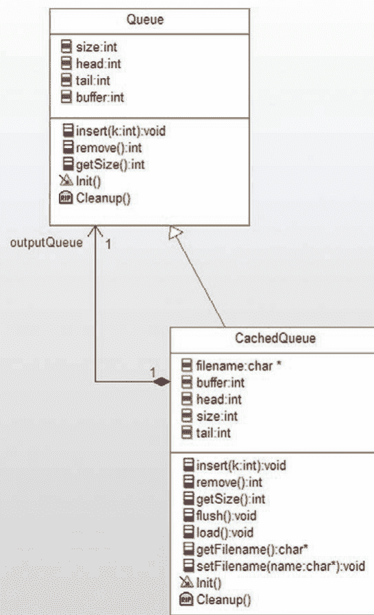

图 1.2: 队列与缓存队列


# 第 1 章

在 C语言中实现子类有多种方法。在本节采用的方法中，为了处理特化，我们将使用在前一节中描述的成员函数指针。对于扩展，我们将简单地将基类作为一个结构体 嵌入到子类中。

例如，让我们看看图 1-2 中的代码示例。代码列表 5 是 `Queue` 类的头文件，其结构应该符合你的预期。

```c
#ifndef QUEUE_H_
#define QUEUE_SIZE 10

/* class Queue */
typedef struct Queue {
    int buffer[QUEUE_SIZE];   /* 数据存储的地方 */
    int head;
    int size;
    int tail;
    int (*isFull)(Queue* const);
    int (*isEmpty)(Queue* const);
    int (*getSize)(Queue* const);
    void (*insert)(Queue* const, int k);
    int (*remove)(Queue* const);
};

/* 构造函数和析构函数 */
void QueueInit(Queue* const, int (*isFullfunction)(Queue* const,
    int (*isEmptyfunction)(Queue* const,
    int (*getSizefunction)(Queue* const,
    void (*insertfunction)(Queue* const, int k),
    int (*removefunction)(Queue* const));

void QueueCleanup(Queue* const);

/* 操作 */
int (*isFull)(Queue* const);
int (*isEmpty)(Queue* const);
int (*getSize)(Queue* const);
void (*insert)(Queue* const, int k);
int (*remove)(Queue* const);

Queue* Queue_Create(void);
void Queue_Destroy(Queue* const);
#endif /*QUEUE_H_*/
```

## 代码列表 5：Queue 头文件

代码列表 6 显示了 `Queue` 操作的（简单）实现，代码列表 7 提供了一个简单的测试程序，展示了元素如何插入和从队列移除。

```c
#include <stdio.h>
#include <stdlib.h>
#include "queue.h"

void Queue_Init(Queue* const me, int (*isFullfunction)(Queue* const me),
    int (*isEmptyfunction)(Queue* const me),
    int (*getSizefunction)(Queue* const me),
    void (*insertfunction)(Queue* const me, int k),
    int (*removefunction)(Queue* const me)) {
    /* 初始化属性 */
    me->head = 0;
    me->size = 0;
    me->tail = 0;
    /* 初始化大小成员指针 */
    me->isFull = isFullfunction;
    me->isEmpty = isEmptyfunction;
    me->getSize = getSizefunction;
    me->insert = insertfunction;
    me->remove = removefunction;
}

/* 操作 Cleanup */
void Queue_Cleanup(Queue* const me) {
}

/* 操作 IsFull() */
int Queue_IsFull(Queue* const me) {
    return (me->head+1) % QUEUE_SIZE == me->tail;
}

/* 操作 IsEmpty() */
int Queue_IsEmpty(Queue* const me) {
    return (me->head == me->tail);
}

/* 操作 getSize() */
int Queue_GetSize(Queue* const me) {
    return me->size;
}

/* 操作 Insert() */
void Queue_Insert(Queue* const me, int k) {
    if (!me->isFull(me)) {
        me->buffer[me->head] = k;
        me->head = (me->head+1) % QUEUE_SIZE;
        ++me->size;
    }
}

/* 操作 remove */
int Queue_remove(Queue* const me) {
    int value = -9999; /* 哨兵值 */
    if (!me->isEmpty(me)) {
        value = me->buffer[me->tail];
        me->tail = (me->tail+1) % QUEUE_SIZE;
        --me->size;
    }
    return value;
}
Queue * Queue_Create(void) {
    Queue*me = (Queue*) malloc(sizeof(Queue));
    if(me==NULL) {
        QueueInit(me, Queue_IsFull, Queue_IsEmpty, Queue_getSize,
        Queue_insert, Queue_remove);
    }
    return me;
}
void Queue_Destroy(Queue* const me) {
    if(me==NULL) {
        Queue_Cleanup(me);
    }
    free(me);
}
```

## 代码列表 6：Queue 实现

```c
#include <stdio.h>
#include <stdlib.h>
#include "queue.h"

int main(void) {
    int j,k,h,t;

    /* 测试普通队列 */
    Queue * myQ;
    myQ = Queue_Create();
    k = 1000;

    for (j=0;j<QUEUE_SIZE;j++) {
        h = myQ->head;
        myQ->insert(myQ,k);
        printf("inserting %d at position %d, size=%d\n", k,h, myQ->getSize(myQ));
    }

    printf("Inserted %d elements\n", myQ->getSize(myQ));
    for (j=0;j<QUEUE_SIZE;j++) {
        t = myQ->tail;
        k = myQ->remove(myQ);
        printf("REMOVING %d at position %d, size=%d\n", k,t, myQ->getSize(myQ));
    }

    printf("Last removed = %d\n", k);
    printf("Current size %d\n", myQ->getSize(myQ));
    puts("Queue test");
    return EXIT_SUCCESS;
}
```

## 代码列表 7：Queue 测试

## 缓存队列？

现在假设内存非常紧张，我们需要减少 `Queue` 的大小并将元素存储到磁盘。`CachedQueue` 满足这一需求。代码列表 8 显示了该类的头文件。首先，`CachedQueue` 继承了基类的属性。其次，`CachedQueue` 复制了基类的操作方法。最后，注意 `CachedQueue` 在基类中定义的虚函数是函数指针。注意 `outputQueue` 是子类中的属性。`normal` 是基类的属性。

```c
#ifndef CACHEDQUEUE_H_
#define CACHEDQUEUE_H_

#include "queue.h"

typedef struct CachedQueue {
    /* 基类 */
    Queue* base;
    /* 新属性 */
    char filename[80];
    int numberElementsOnDisk;
    /* 子类中的输出队列 */
    Queue* outputQueue;

    /* 虚函数 */
    int (*isFull)(CachedQueue* const);
    int (*isEmpty)(CachedQueue* const);
    int (*getSize)(CachedQueue* const);
    void (*insert)(CachedQueue* const, int k);
    int (*remove)(CachedQueue* const);
    /* 新虚函数 */
    void (*flush)(CachedQueue* const);
    void (*load)(CachedQueue* const);
};

/* 构造函数和析构函数 */
void CachedQueue_Init(CachedQueue* const, char* fName,
    int (*isFullfunction)(CachedQueue* const),
    int (*isEmptyfunction)(CachedQueue* const),
    int (*getSizefunction)(CachedQueue* const),
    void (*insertfunction)(CachedQueue* const, int k),
    int (*removefunction)(CachedQueue* const),
    void (*flushfunction)(CachedQueue* const),
    void (*loadfunction)(CachedQueue* const));
void CachedQueue_Cleanup(CachedQueue* const);
/* 操作 */
int CachedQueue_isFull(CachedQueue* const);
int CachedQueue_isEmpty(CachedQueue* const);
int CachedQueue_getSize(CachedQueue* const);
void CachedQueue_insert(CachedQueue* const, int k);
int CachedQueue_remove(CachedQueue* const);
void CachedQueue_flush(CachedQueue* const);
void CachedQueue_load(CachedQueue* const);
CachedQueue *CachedQueue_Create(void);
void CachedQueue_Destroy(CachedQueue* const);
#endif /*CACHEDQUEUE_H_*/
```

代码列表 8：CachedQueue 头文件

代码 9 显示了实现（为了简化示例省略了文件 I/O）。你可以看到 `CachedQueue_Init()` 函数如何构造子类实例（调用 `Queue_Create()`），然后设置它自己的属性和虚成员。你还可以看到 `CachedQueue_getSize()` 如何计算元素数量：它是队列中数据、`outputQueue` 以及存储在磁盘上的元素的和。虽然该实现尚未达到发布标准（例如，我想添加错误处理），但它说明了如何在 C 语言中创建类以及类的实例。

```c
#include <stdio.h>
#include <stdlib.h>
#include <string.h>
#include "CachedQueue.h"

void CachedQueue_Init(CachedQueue* const me, char* fName,
int (*isFullfunction)(CachedQueue* const),
int (*isEmptyfunction)(CachedQueue* const),
int (*getSizefunction)(CachedQueue* const),
void (*insertfunction)(CachedQueue* const, int k),
int (*removefunction)(CachedQueue* const),
void (*flushfunction)(CachedQueue* const),
void (*loadfunction)(CachedQueue* const)) {
    /* 初始化基类 */
    me->Queue_Create(); // queue 成员必须使用其原始函数

    /* 初始化子类属性 */
    me->numberElementsOnDisk = 0;
    strcpy(me->filename, fName);
}
```


# 什么是嵌入式？ 23

```c
/* 初始化聚合器 */
me->outputQueue = Queue_Create();

/* 初始化子类虚函数指针 */
me->isFull = isFullfunction;
me->isEmpty = isEmpty;
me->getSize = getSize;
me->insert = insertfunction;
me->remove = removefunction;
me->flush = flushfunction;
me->load = loadfunction;
}
```

```c
/* 操作 Cleanup() */
void CachedQueue_Cleanup(CachedQueue* const me) {
    Queue_Cleanup(me->queue);
}
```

```c
/* 操作 Full() */
int CachedQueue_isFull(CachedQueue* const me) {
    return me->queue->isFull(me->queue) &&
           me->outputQueue->isFull(me->outputQueue);
}
```

```c
/* 操作 Empty() */
int CachedQueue_isEmpty(CachedQueue* const me) {
    return me->queue->isEmpty(me->queue) &&
           me->outputQueue->isEmpty(me->outputQueue) &&
           me->numberElementsOnDisk == 0;
}
```

```c
/* 操作 getSize() */
int CachedQueue_getSize(CachedQueue* const me) {
    return me->queue->getSize(me->queue) +
           me->outputQueue->getSize(me->outputQueue) +
           me->numberElementsOnDisk;
}
```

```c
/* 操作 Insert(int) */
// 插入算法：
// 如果队列已满，
//    调用 flush 将队列写入磁盘并重置队列
// 否则将数据插入队列中
void CachedQueue_insert(CachedQueue* const me, int k) {
    if (me->queue->isFull(me->queue)) me->flush(me);
    me->queue->insert(me->queue, k);
}
```

```c
/* 操作 remove() */
// 移除算法
// 如果 outputQueue 中有数据，
//    从 outputQueue 中移除它
// 否则如果磁盘上有数据
//    调用 load 将载入 outputQueue
//    并从 outputQueue 中移除
// 否则如果队列中有数据
//    从那里移除
//    （如果没有数据可移除，则返回哨兵值）
int CachedQueue_remove(CachedQueue* const me) {
    if (!me->outputQueue->isEmpty(me->outputQueue)) {
        return me->outputQueue->remove(me->outputQueue);
    } else if (me->numberElementsOnDisk>0) {
        me->load(me);
        return me->queue->remove(me->queue);
    } else {
        return me->queue->remove(me->queue);
    }
}

/* 操作 flush */
// 前置条件：仅当队列已满且
// 文件名有效时调用
// flush 算法
// 如果文件未打开，则打开文件
// 当 queue->isEmpty() 为假时
//    queue->remove();
//    将数据写入磁盘
//    numberElementsOnDisk++;
// }
void CachedQueue_flush(CachedQueue* const me) {
    // 在此处写入文件 I/O 语句...
}

/* 操作 load */
// 前置条件：仅当 outputQueue 为空且
// 文件名有效时调用
// load 算法
// 当 (outputQueue->isFull() && numberElementsOnDisk>0) 时
//    从文件开始读取（即最旧的数据）
//    numberElementsOnDisk--;
//    outputQueue->insert(
// }
void CachedQueue_load(CachedQueue* const me) {
    // 在此处写入文件 I/O 语句...
}

CachedQueue * CachedQueue_Create(void) {
    CachedQueue* me = (CachedQueue*) malloc(sizeof(CachedQueue));
    if (me==NULL) {
        CachedQueue_Init(me, "C:\\queuebuffer.dat",
        CachedQueue_isFull, CachedQueue_isEmpty,
        CachedQueue_getSize, CachedQueue_insert, CachedQueue_remove,
        CachedQueue_flush, CachedQueue_load);
    }
    return me;
}

void CachedQueue_Destroy(CachedQueue* const me) {
    if(me!=NULL) {
        CachedQueue_Cleanup(me);
        free(me);
    }
}
```

# 什么是嵌入式？ 25

## 列表 9：CachedQueue 实现

使用继承（子类化）的能力将非常有价值，在我将在本书后面讨论的某些设计模式中，此外它本身也有其价值。

### 1.2.5 有限状态机

有限状态机（FSM）是一种由一组有限条件（称为“状态”）以及同样有限的、由事件触发的状态间的转移而定义的机器。FSM 与活动图或流程图的区别在于，其转移是由事件（主要）触发的，而不是在完成一个状态的工作完成时触发的。状态图（Statecharts）主要用于建模响应式元素的行为，例如类和用例，这些元素在状态中等待，直到感兴趣的事件发生。在那个时刻，事件被处理，执行动作，并且元素转换到新状态。

UML 状态图比基于 David Harel 状态图表示法的“经典”Mealy 状态机更具表达力且可扩展，它具有许多除 Mealy 状态机之外的许多扩展：

- 嵌套状态：用于指定层级成员关系；并发状态：用于指定逻辑独立性和并发性
- 伪状态：用于注释动态语义

图 1-3 显示了之前图 1-1 中过的状态图的一些基本元素。它包括基本状态和转换，以及初始状态和条件伪状态。

# 26 第 1 章

图 1-3：基本状态机

转换是从前驱状态指向并终止于后续状态的箭头线。转换通常具有可选的事件签名和动作列表。事件签名的基本形式是 `event-name[parameter-list][guard]/action-list`。event-name 仅仅是事件类的名称，该类可以在运行时发送给分类器（Classifier）的实例，例如按键。UML 定义了四种不同的事件类型：

- 信号事件（SignalEvent）：异步事件
- 调用事件（CallEvent）：同步事件
- 时间事件（TimeEvent）：由于时间的流逝引起
- 变化事件（ChangeEvent）：状态变量或属性的变化

异步事件传输总是通过队列实现的，直到事件准备就绪。发送者“发送并忘记”事件，无论事件是否被处理。同步事件传输会阻塞发送者，直到事件处理完成。这通常通过调用一个名为事件处理程序的方法来实现，只有在事件处理完成后才会将控制权返回发送者。触发的操作没有标准的方法体；其方法体是状态机上的动作。

# 什么是嵌入式？ 27

事件可以带有参数——状态机接受的类型值，这些可以在守卫和动作中使用。状态图指定了形式参数列表，而发送事件的对象必须提供必要的参数以绑定到该列表。我们将使用一种特殊的语法来传递事件。我们为每个事件创建一个名为 params 的结构体。如果 e 有 x 和 y，在守卫中使用时，你将引用 params 结构体来指定 x 大于 0 且 y 小于等于 10，如下：

```
e[params] 才能发生
```

时间事件几乎总是相对于进入。命名此类事件的常用方法（也是我们将使用的）是“tm(interval)”，其中 interval 是超时事件的时间参数。如果在另一个事件发生之前发生了超时，则由超时触发的转换将被执行；如果在触发超时之前发送了另一个事件，则时间被丢弃；如果重新进入状态，超时间隔将从头开始。

如果转换没有提供命名事件触发器，则它由“完成”或“空”事件激活。该事件发生在进入状态时（包括状态进入动作的执行）或状态活动完成时。

守卫是跟在事件触发器的方括号内的布尔表达式。守卫应该只返回 TRUE 且没有副作用。如果为转换指定了守卫，并且事件触发器（如果有）发生，则只有在守卫评估为 TRUE 时转换才会发生。如果评估结果为 FALSE，则触发事件被静静丢弃，不执行任何动作。

转换的动作列表仅在转换发生时执行；即当对象处于前驱状态时接收到命名事件，且守卫（如果有）评估为 TRUE。整组退出动作–转换动作–进入动作将按该顺序执行，并使用运行直到完成语义执行。


## 28 第1章

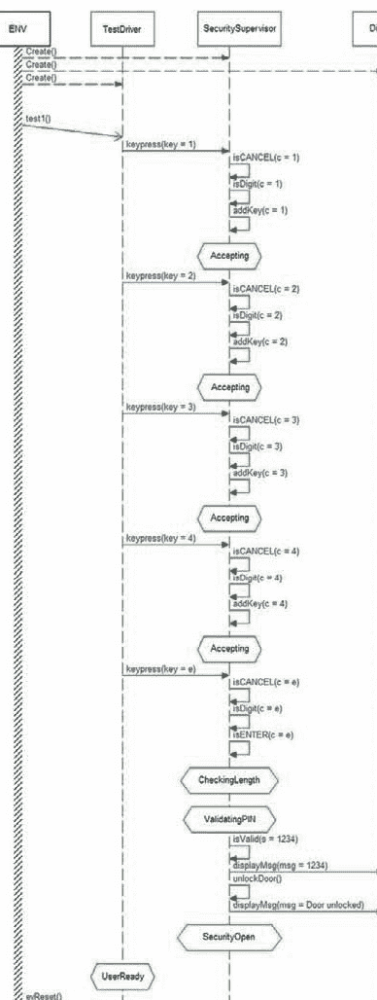

*

图 1-4：运行状态行为

## 什么是嵌入式编程？ 29

虽然我稍后会讨论状态机实现的设计模式，但最常见的实现是生成简单的 `if-then` 或 `switch-case` 语句。例如，一种常见且易于实现的方案是：

- 添加一个状态变量（例如 `activeState`）
- 对于“类”的每个事件，添加一个事件接收函数，并将其所需的任何数据作为参数传递
- 创建一个事件分发函数，由每个事件接收函数调用；该函数负责处理传入的事件

事件分发器的结构如下：

```
switch(activeState) {
    /* 对于每个状态 */
    case state:
        /* 对于每个事件 */
        Switch (eventID) {
            event1:
                /* 检查卫 */
                If (guard1()) {
                    action1();
                } else if (guard2()) {
                    action2();
                }
                break;
            event2:
                if (guard3()) {
                    action3();
                } else if (guard4()) {
                    action5();
                }
                break;
        }
    case state2:
        // 等
}
```

例如，给定 `SecuritySupervisor` 类，你可能像代码列表 10 所示实现状态机事件分发器。添加异步事件需要添加对事件及其数据的队列处理。注意：`Null_id` 参数即所谓的“空事件”转换不是由显式事件触发的，而仅仅在上一个状态中的动作完成时“触发”的。

```
static eventStatus dispatchEvent(short id) {
    eventStatus res = eventNotConsumed;
    switch (activeState) {
        /* 我们正处于空闲状态吗？ */
```

```
case SecuritySupervisor_Idle:
{
    if(id == Null_id) /* 空触发的事件？ */
    {
        if(retries>=3)
        {
            activeState = SecuritySupervisor_ErrorState;
            displayMsg("ERROR: Max retries Exceeded");
            res = eventConsumed;
        }
    } else {
        ++retries;
        activeState = SecuritySupervisor_Accepting;
        res = eventConsumed;
    }

}

break;

/* 我们正处于接受状态吗？ */
case SecuritySupervisor_Accepting:
{
    if(id == keypress_SecuritySupervisor_Event_id)
    {
        /* params 结构体在属性 'key' 中包含数据 */
        /* 转换 1 */
        if(isCANCEL(params->key))
        {
            retries = 0;
            displayMsg("Cancelled");
            activeState = SecuritySupervisor_Idle;

            /* state ROOT.Idle.(Entry) */
            strcpy(pin, "");
        }
        res = eventConsumed;
    } else {
        /* 转换 3 */
        if(isDigit(params->key))
        {
            /* 转换 3 */
            addKey(params->key);
            activeState = SecuritySupervisor_Accepting;
            res = eventConsumed;
        } else {
            /* 转换 5 */
        }
    }
}
```

## 什么是嵌入式编程？ 31

```
if(isENTER(params->key))
{
    activeState =
        SecuritySupervisor_CheckingLength;
    res = eventConsumed;
}

    break;
case SecuritySupervisor_CheckingLength:
{
    if(id == Null_id)
    {
        /* 转换 10 */
        if(strlen(pin) == 4)
        {
            activeState = SecuritySupervisor_ValidatingPIN;
            res = eventConsumed;
        }
    else
    {
            /* 转换 9 */
            displayMsg("ERROR: PIN wrong length");
            activeState = SecuritySupervisor_Idle;
            {
                /* state ROOT.Idle.(Entry) */
                strcpy(pin, "*");
            }
            res = eventConsumed;
        }
}
break;
case SecuritySupervisor_ValidatingPIN:
{
    if(id == Null_id)
    {
        /* 转换 13 */
        if(isValid(pin))
        {
            /* 转换 13 */
            unlockDoor();
            displayMsg("Door unlocked");
        }
        activeState = SecuritySupervisor_SecurityOpen;
        res = eventConsumed;
```

## 32 第1章

```
}
else
{
    /* 转换 12 */
    displayMsg("ERROR: Invalid PIN");
}
    activeState = SecuritySupervisor_Idle;
    {
        /* state ROOT.Idle.(Entry) */
        strcpy(pin, "");
    }
    res = eventConsumed;
}
break;
case SecuritySupervisor_SecurityOpen:
{
    if(id== keypress_SecuritySupervisor_Event_id)
    {
        /* params: key 包含随事件传递的数据 */
        /* 转换 14 */
        if(isRESET(params->key))
        {
            /* 转换 14 */
            lockDoor(); retries = 0;
            displayMsg("Door locked.");
        }
        activeState = SecuritySupervisor_Idle;
        {
            /* state ROOT.Idle.(Entry) */
            strcpy(pin, "");
        }
        res = eventConsumed;
    }
}
break;
default:
    break;
}
return res;
```

**代码列表 10：SecuritySupervisor 分发器**

## 什么是嵌入式编程？ 33

状态机的内容比我们目前介绍的要多，但那些内容将在第 5 章中讨论。关于 UML 的更详细讨论，请参考《Real-Time UML》^13 的第 3 章以及《Doing Time》^14。

### 1.3 我们学了什么？

本章讨论了嵌入式系统的特殊特征——在严格的限制内工作。为了做到这一点，嵌入式开发者使用嵌入式工具链在更强大的主机上开发，目标是较小且能力较弱的

到目前为止，开发嵌入式系统最常用的语言是 C。C 的优势在于针对各种处理器的编译器可用性，以及其运行效率良好的声誉。然而，增加功能同时降低成本的压力意味着嵌入式开发者必须不断寻找改进设计以及提高设计效率的方法。结构化方法将软件组织成并行的分类体系，一个用于数据，另一个用于行为。面向对象的方法将两者结合，以提高固有紧耦合元素的内聚性，并在松耦合的情况下对内容进行封装。虽然 C 不是一种面向对象的语言，但它可以用于（并且已经用于）开发基于对象和面向对象的嵌入式系统。

下一章将讨论流程和开发者工作流中的作用。这些工作流将决定开发者在嵌入式软件创建过程中何时以及使用设计和设计模式。它将继续定义什么是设计模式、它们如何在书中被讨论和组织，以及它们如何应用到你的设计中。


## 使用 Harmony™ for Embedded RealTime Process 进行嵌入式编程

章节大纲

- 2.1 Harmony 过程的基本元素 36
    - 2.1.1 开发工作流快速概述 36
        - 2.1.1.1 构建初始模型 37
        - 2.1.1.2 识别关键设计准则 40
        - 2.1.1.3 设计准则的排名 42
        - 2.1.1.4 选择设计模式和技术 44
        - 2.1.1.5 应用设计模式和技术 44
        - 2.1.1.6 验证设计方案 44
    - 2.1.2 什么是设计模式？ 44
    - 2.1.3 设计模式的基本结构 45
    - 2.1.4 如何阅读书中的设计模式 46
    - 2.1.5 在开发中使用设计模式 47
        - 2.1.5.1 模式匹配——定位合适的模式 47
        - 2.1.5.2 模式挖掘——构建自己的模式 48
        - 2.1.5.3 模式实例化——在设计中应用模式 50
        - 2.1.5.4 示例：观察者模式 51
    - 2.1.6 观察者模式 36
- 2.2 方法论 77
- 2.3 后续内容 78

你将学习

- 适用于嵌入式应用开发的敏捷过程原则和工作流
- 设计的三个层次
- 架构的五个关键视图
- 执行权衡研究（trade studies）
- 什么是设计模式？
- 我如何应用设计模式？
- 设计模式实例化示例

### 2.1 Harmony 过程的基本元素

让我们关注作为嵌入式软件开发人员的我们如何进行设计的这些问题。虽然我不想在书中详述过程，但我们通过遵循（正式或非正式的）工作流来执行设计活动。为了理解如何设计，我们必须对工作流至少达成基本的共识。

### 2.1.1 开发工作流快速概述

我是 IBM Rational² 的 Harmony™ for Embedded RealTime (Harmony/ERT¹) 过程的作者。该过程包含了一套实时和嵌入式软件开发的最佳实践，被许多从医疗到消费电子的各个嵌入式垂直市场使用。它是一种基于模型的敏捷软件开发方法，强调整个开发中的持续集成、测试驱动开发以及设计模式的使用。

Harmony™ for Embedded RealTime 过程是一个增量过程，在某些方面与 Scrum³ 类似。Harmony/ERT 过程关注整体时间线和里程碑，如图 2-1 所示。大周期（macrocycle）侧重于产生经过验证的增量（也称为构建版本或原型）。微周期（nanocycle）的时间范围在分钟到几小时之间，集中于软件的持续执行、调试和单元测试。

微周期（microcycle）在一个典型周期内迭代多次，被分为几个短阶段，如图 2-2 所示。这些阶段在表 2-1 中进行了相关说明和简要描述，我们可以从中看到几个关键点。首先，设计是在我们从对象分析（如果你偏好，也可以称为“软件分析”阶段）获得功能正常的软件后才会发生的。其次，设计侧重于优化设计模式——即本书的主题——的作用；它们优化了软件。设计模式不是为了让软件正确运行，而是为了让软件运行得最优。

从表 2-1 可以看出，Harmony/ERT 过程使用了三个层次的设计。架构设计关注优化整个系统的设计决策。架构设计分为五个关键视图，这些视图对软件的结构和行为影响最大（图 2-3）。这些关键架构视图中的每一个都在表 2-2 中进行了描述。

¹ 以前称为 Harmony for Embedded Software (Harmony/ESW)。别问；我这次没改名字。
² 详见 www-01.ibm.com/software/awdtools/rmc/ 获取工具和过程内容的信息。
³ 详见 www.scrumalliance.org/。

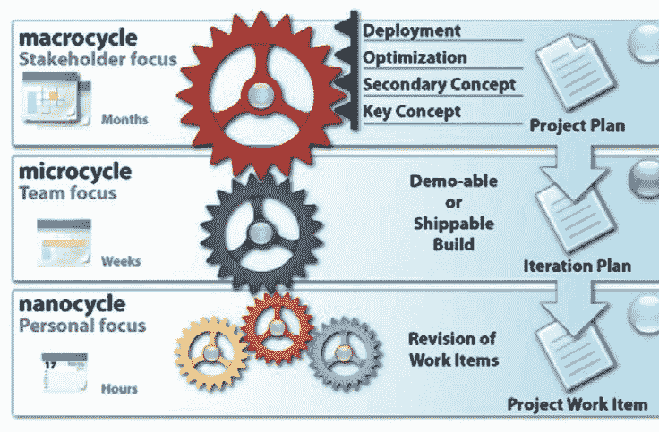

图 2-1：Harmony/ERT 时间尺度

机械设计（Mechanistic design）在协作层面进行优化，其中协作是更简单元素（类型、函数、变量和类）交互的集合，以实现单个用例或系统能力。每个系统通常只有几个半个到几十个能力；因此，机械设计的范围比架构关注点小一个数量级。

详细设计（Detailed design）局限于最小的关注层面——函数、变量、类型和类的内部。这种层次的设计也许是开发者最常见的关注焦点。

在任何关注层次上，设计的各种工作流如图 2-4 所示。由于这些步骤将构成我们使用设计模式的基础，让我们逐一讨论它们。

### 2.1.1.1 构建初始模型

这一步至关重要，但在开发者为了优化而匆忙时经常被忽略。该步骤在考虑优化之前创建一个可工作的模型和代码库。我所说的“工作”不仅意味着它能够编译和运行，还意味着它是健壮且功能正确的。我同时也意味着它经过了调试和单元测试以确定性能，这在这一点上是可选的。

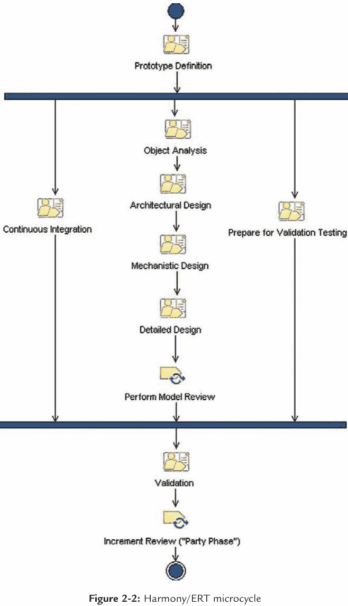

图 2-2：Harmony/ERT 微周期

-原型定义
- 对象分析
- 架构设计
- 持续集成
- 验证准备
- 机械设计
- 详细设计
- 模型评审
- 验证
- 增量评审（评审阶段）

表 2-1：Harmony/ERT 微周期阶段。

| 阶段 | 主要输入 | 主要输出 | 描述 |
| :--- | :--- | :--- | :--- |
| 原型定义 | 利益者需求 | 系统需求用例模型 | 将利益者需求转换为当前微周期开发的系统需求 |
| 对象分析 | 系统需求 | 功能正确的模型和源代码 | 开发实现需求的软件；包括编码、调试和单元测试 |
| 架构设计 | 功能正确的代码和模型 | 架构优化的代码和模型 | 根据优化整个系统的显式决策优化代码；包括编码、调试和单元测试 |
| 机械设计 | 架构优化的代码和模型 | 协作优化的代码和模型 | 根据实现功能或用例的元素协作优化代码；包括编码、调试和单元测试 |
| 详细设计 | 协作优化的代码和模型 | 优化的函数和数据结构 | 根据函数、变量和类型级别的显式决策优化代码；包括编码、调试和单元测试 |

| 模型/代码评审 | 模型和经过单元测试的代码 | 基于评审的变更请求 | 评审分析、设计和代码的一致性 |
| 验证 | 优化的源代码 | 验证的系统和基于缺陷的变更请求 | 测试已实现的系统，包括对之前微周期需求的回归 |
| 增量评审 | 计划、风险管理计划、重用计划、危害分析、团队问卷 | 针对过程、计划或开发环境的变更请求 | 评估进展并识别需要更新计划的地方；也识别需要改进的团队、环境和开发问题 |
| 持续集成 | 模型和经过单元测试的源代码 | 演进软件基线 | 每天执行，集成多个开发者的源代码，应用集成测试并更新软件基线 |
| 验证准备 | 系统需求和用例模型 | 测试计划、测试用例、测试固件 | 通过制定计划、测试用例和测试环境为验证测试做准备 |


# 40 第2章

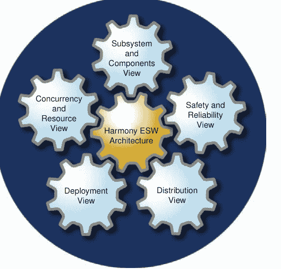

图 2-3：架构设计视图

| 关键架构视图 | 描述 |
|--- |--- |
| 子系统和组件视图 | 规定子系统和组件的集合、它们的职责、与其他子系统的连接以及接口。 |
| 并发和资源视图 | 识别并发单元、原始元素（函数、变量和对象）如何映射到并发单元、这些并发单元如何调度，以及并发单元如何同步和共享资源。 |
| 分布式视图 | 描述了元素如何分布在多个地址上，以及这些元素如何相互发现并协作。 |
| 安全性和可靠性视图 | 定义了在系统执行期间如何识别、隔离和纠正故障，以维护安全性和可靠性。 |
| 部署视图 | 描述了职责是如何在不同的工程学科（例如软件、电子、机械和化学）之间划分，以及这些学科之间的接口。 |

### 2.1.1.2 识别重要的设计标准

这是另一个经常被忽略的步骤。需要记住，每当对某些系统方面进行优化时，几乎总是其他某些方面会变得未优化。为了选择合适的设计模式和技术来实现优化，我们首先需要理解哪些是重要的优化方面，以便我们进行适当的权衡。一些常见的设计优化标准包括：

- *性能*
  - 最坏情况
  - 平均情况
- 可预测性
- 可调度性

# 使用 Harmony™ 嵌入式实时过程嵌入式编程 41

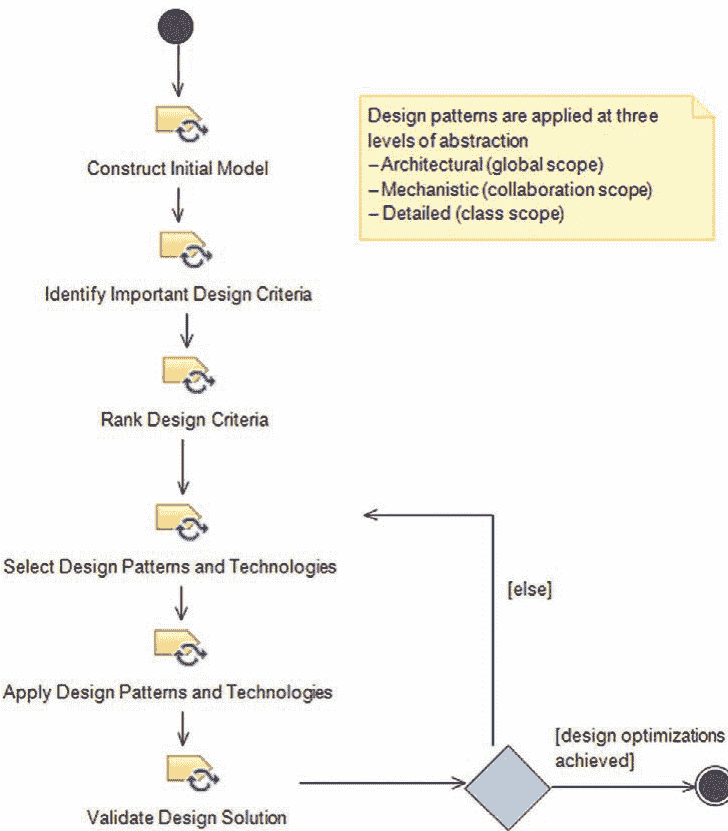

图 2-4：基本设计工作流

- *吞吐量*
  - 平均
  - 持续
  - 突发
- *可靠性*
  - 针对错误
  - 针对故障
- 安全性
- 可重用性
- 可分布性
- 可移植性
- 可维护性
- 可伸缩性
- 复杂度
- 资源使用，例如内存
- 能量消耗
- 经常性成本，即硬件
- 开发工作和成本

# 42 第2章

### 2.1.1.3 设计标准的排序

对标准进行排序对于我们在选择设计模式时做出适当的权衡是必要的。某些模式可能以消耗更多内存为代价优化最坏情况性能；另一些模式可能以牺牲响应速度为代价优化能量消耗。设计标准的排序使其相对重要性显性化，以便我们推出哪些设计解决方案是最好的。

### 2.1.1.4 选择设计模式和技术

有很多有效的设计解决方案和技术可用。权衡研究（Trade study）是根据技术在实现平衡优化目标方面的有效性对技术进行比较。虽然我们可能选择不那么正式的方法，但 FAA 建议使用形式化的决策矩阵⁴。基本上，这是一个电子表格，根据设计解决方案与我们加权设计标准的匹配程度来总结该方案的“优劣程度”。例如，表 2-3 显示了我们可能在电子表格中正式地或在脑中非正式地进行的分析。每个标准的权重是在 0 到 10 分范围内的相对重要性。每个备选方案——设计模式和技术的组合——都被分配一个分数（标准优化的程度）。

> ⁴ www.faa.gov/about/office_org/headquarters_offices/service_units/operations/sysengsaf/seman/SEM3.1/Section%204.6.pdf

# 表 2-3：设计权衡电子表格。

| 设计解决方案 | 设计标准 | | | | | 总加权总分 |
|---|---|---|---|---|---||-|
| | 标准 1 | 标准 2 | 标准 3 | 标准 4 | 标准 5 | |
| | 权重 = 7 | 权重 = 5 | 权重 = 3 | 权重 = 2 | 权重 = 1.5 | |
| | 分数 | 分数 | 分数 | 分数 | 分数 | |
| 备选方案 1 | 7 | 3 | 6 | 9 | 4 | 106 |
| 备选方案 2 | 4 | 8 | 5 | 3 | 4 | 95 |
| 备选方案 3 | 10 | 2 | 4 | 8 | 8 | 120 |
| 备选方案 4 | 2 | 4 | 9 | 7 | 6 | 84 |

在 0 到 10 的范围范围内。每个备选方案被分配一个计算出的总加权分，等于标准权重乘以其相对分数之和。总加权分最大的备选方案为该设计标准提供了最好的设计解决方案。

# 第2章

### 2.1.1.5 应用设计模式和技术

这一步骤指的是所选设计方案的应用。在设计模式术语中，这被称为模式实例化。正如我们将看到的，这主要是将正式的模式模式替换为来自工作分析模型的相关元素的问题。

### 2.1.1.6 验证设计解决方案

验证步骤确保解决方案是有效的，并检查解决方案的两个不同方面。首先，它确保系统功能继续保持正确；也就是说，添加设计解决方案没有破坏正在运行的模型和代码。其次，由于我们选择了设计模式来优化系统，我们必须确保已经实现了优化目标。这意味着我们将重新运行之前的功能测试和单元测试，并添加服务质量测试。

### 2.1.2 什么是设计模式？

设计模式是“对常见问题的泛化解决方案”。要成为模式，问题必须足够频繁以便有用，且解决方案必须足够通用以便应用于许多领域。如果它适用于特定的应用领域，那么它可能是分析模式。记住，分析是由系统必须做什么，而设计是由系统必须如何实现驱动的。设计模式总有一个关注点——即针对一组较小的 QoS 属性进行优化，以牺牲其他属性为代价。每个模式都优化系统的某些方面，而牺牲其他。

# 使用 Harmony™ 嵌入式实时过程嵌入式编程 45

每个研究中的备选方案还必须检查模式如何协同工作，而不是孤立工作。

正如之前提到的，模式可以应用于不同的设计抽象级别。架构模式具有系统范围，主要应用于架构的五个视图。在设计抽象的下一层，机械设计模式适用于协作，优化相同的标准，但关注点更小。详细设计模式——通常被称为设计习语——优化软件原始元素。

### 2.1.3 设计模式的基本结构

根据 Gamma，等..；一个模式有四个重要方面：

- 名称
  名称提供了一个引用模式的“句柄”或手段。
- 目的
  目的提供了问题背景以及模式试图优化的 QoS 方面。模式识别了模式可能特别合适的问题背景。
- 解决方案
  解决方案是模式本身。
- 后果
  后果是使用该模式的一系列优缺点。

> Gamma, E., Helm, R., Johnson, R., Vlissides, J.M., 1995. Design Patterns: Elements of Reusable Object-Oriented Software. Addison-Wesley.


# 46 第 2 章

后果非常重要，因为当我们选择一种模式而不是另一种模式时，我们总是会进行权衡。我们必须理解模式的优缺点，才能有效地应用它。这些优缺点通常体现在某些设计属性的改进或退化，以及对适用这些后果的可能问题背景的详细阐述。

### 2.1.4 如何阅读本书中的设计模式

书中的模式以相同的方式组织，以提高模式的可用性。每个模式都按照以下格式提供：

- 摘要（Abstract）
  摘要对模式的使用或理由进行了简要说明。这意味着它是对问题、解决方案和后果的概述。
- 问题（Problem）
  问题部分给出了问题背景的陈述以及该模式所解决的服务质量。
- 模式结构（Pattern structure）
  该节提供了模式的结构化 UML 图，展示了模式的重要元素。这些是你替换特定的应用程序元素以实例化该模式的地方。模式中元素之间的关系也被展示出来。
- 后果（Consequences）
  后果部分描述了使用该模式时所做的权衡。
- 实现策略和源代码（Implementation strategies and source code）
  该节讨论了在不同计算平台或不同源级语言上实现模式的相关问题。
- 示例（Example）
  每个模式都通过一个示例来展示，说明了模式如何在某些特定情况下应用。这通常涉及展示一个 UML 结构图，显示特定的应用程序元素如何满足模式的协作角色，以及展示模式实现的相关代码片段。

书中的每个模式都使用通用的、标准的 UML 和 C 源代码进行展示。UML 图形表示提供了模式的较高层次概述，但如果你觉得这没有帮助，可以直接跳到源代码。如果你感兴趣，附录 A 提供了 UML 符号总结。要更详细地了解 UML 本身，请参见《Real-Time UML 3rd Edition》。

用于嵌入式实时处理的 Harmony™ 嵌入式编程 47

### 2.1.5 在开发中使用设计模式
到目前，你应该对模式是什么以及它是如何组织的有了相当良好的理解。你还应该对 Harmony/ERT 流程以及我们对设计在整体方案中位置的观点有一个模糊的把握。在本章较早的之前，你对我们所说的“架构”术语以及架构的五种视图有了基础。现在，你已经准备好阅读书中的模式并将将其应用于你的应用程序开发中。但首先，让我们简要讨论一下我们如何在日常工作中中使用模式。

### 2.1.5.1 模式孵化（Pattern Hatching）—— 定位正确的模式
你正面临着一个设计问题。如何找到可以用来解决你的特定设计问题的模式？我们推荐一种如图 2-5 所示的多步方法。

1. **熟悉模式**
   首先，在设计之前，熟悉模式相关的文献。有许多书籍、论文和网站致力于应用领域的模式。其中一些模式在本书中给出，另一些则在参考文献中给出。一旦你增了自己的了自己的词汇量，使其包含了可能与你的应用领域相关的模式，你就有了更多的智力武器来面对设计挑战。

2. **识别设计准则**
   在阅读潜在设计方案的同时，你必须识别设计准则。你对系统可以进行许多（通常是冲突的）优化。这一步识别了对于该特定系统在其运行和开发背景重要的设计优化。

3. **对设计准则排序**
   并非所有的优化都同等重要。因此，必须对设计准则进行排序，以便做出良好的权衡决策。

4. **识别潜在的设计替代方案**
   这一步寻找能够以合理成本优化重要设计准则的模式。虽然可以通过这种方式一次添加一个模式并重复工作流，但通常将一组兼容的模式共同考虑为一个单一的设计替代方案也是常见的。

5. **评估设计替代方案**
   使用之前建议的权衡研究方法，这一步根据设计准则的有效性（结合每个的相对权重）对设计替代方案（由一个或多个设计模式组成）进行比较。

8 这意味着看书！

48 第 2 章

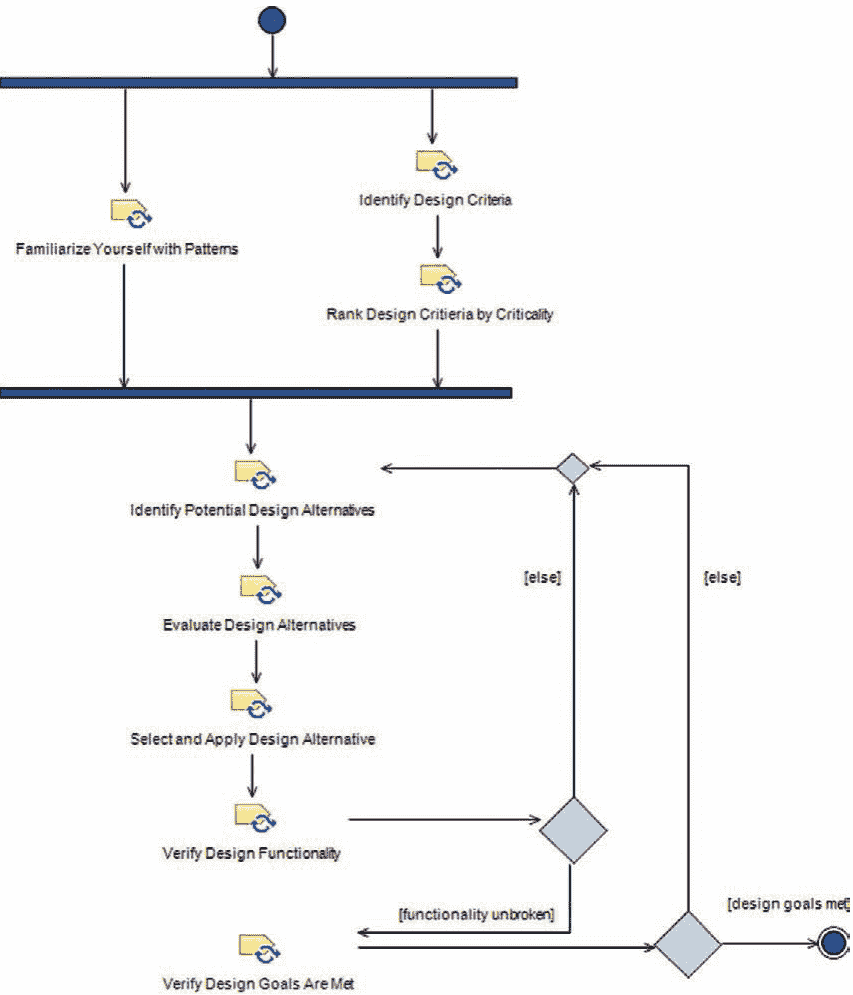
图 2-5：模式孵化

6. **选择并应用设计替代方案**
   一旦选择了设计替代方案，通常会将模式逐一个添加到协作中，包括对解决方案有效性的验证。

用于嵌入式实时处理的 Harmony™ 嵌入式编程 49

7. **验证设计功能**
   软件元素的协作在应用设计模式之前工作正常。这项任务确保它们现在仍然有效。由于应用设计模式通常需要某种（可能很小）程度的重构，某些单元测试可能需要更新。如果模式的应用破坏了功能，则必须修复软件以通过其功能单元测试。

8. **验证设计目标已达成**
   一旦验证了设计功能，我们必须确保设计决策导致了正确的权衡。如果我们对内存使用进行了优化，则应该衡量使用。如果我们对最坏执行时间进行了优化，则应该衡量时间。

### 2.1.5.2 模式挖掘（Pattern Mining）—— 制定自己的模式
创建自己的模式是有用的，特别是当你有足够的深度来理解特定领域的优化问题，并有足够的宽度将它们抽象为通用的解决方案时。我们将此称为模式挖掘（见图 2-6）。

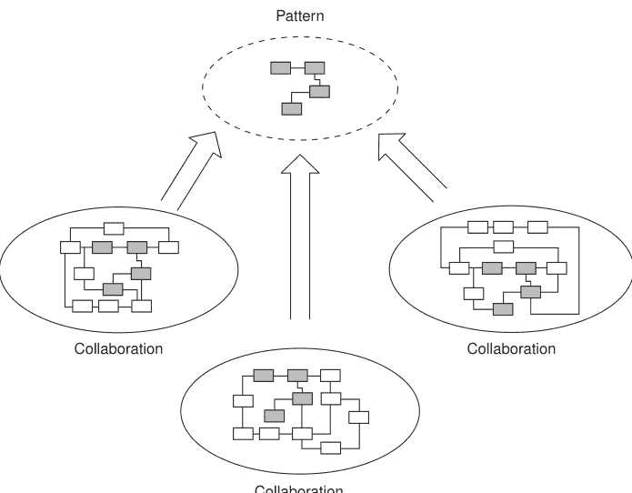
图 2-6：模式挖掘

50 第 2 章

发现——在某些背景下看到该解决方案在另一个背景下是类似的。记住，要成为一个有模式，它必须出现在不同的背景中，并对一个或多个设计准则产生优化。

### 2.1.5.3 模式实例化（Pattern Instantiation）—— 在设计中使用模式
模式实例化是模式挖掘的反面。它是将模式应用于特定的协作以获得模式的益处（见图 2-7）。模式通常应用于软件元素的协作，例如类、类型、函数和/或变量。如前，协作是一组元素（在某些范围内这些可能是小的低级函数或类，而在另一些范围内可能是子系统和组件等大型组合）。目的是用选模式组织并可能扩展这种已存在的协作。

在设计中应用或实例化模式取决于识别协作中满足模式角色的元素。对于某些模式，你可以创建一个基类来实例化该模式。对于其他模式，你可能简单地用来自应用程序领域的元素替换模式元素，添加所需的操作和行为。或者，你可以选择按照模式本身存在的方式创建元素。

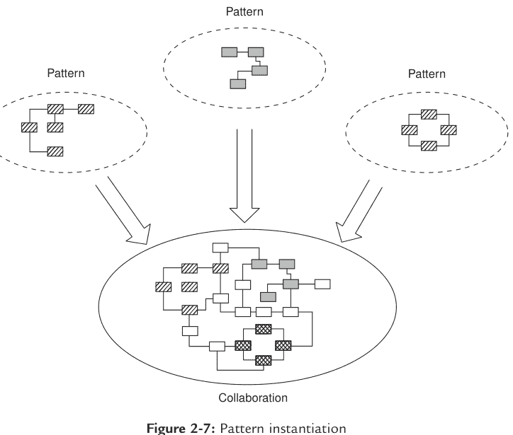

用于嵌入式实时处理的 Harmony™ 嵌入式编程 51

### 2.1.5.4 示例：观察者模式
让我们考虑一个简单的示例。图 2-8 显示了一个系统，其中一个 ECG 模块将数据馈到队列中，供不同的客户端消费。数据包括时间标记（`long` 类型）和 `dataValue`（选定 ECG 极对之间电位的测量值）。该队列被称为“泄漏队列”，因为数据从未从环形缓冲区中显式移除，而是在缓冲区回绕到队列开头时被覆盖。

这些元素的简单实现源代码是直观的。ECGPkh.h 头文件定义了队列大小和布尔类型。

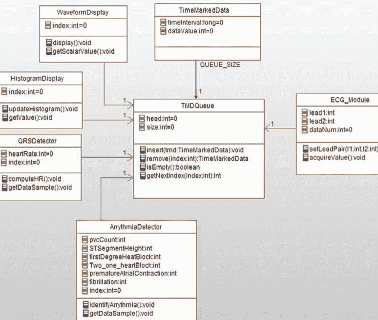
图 2-8：ECG 监控系统


# 52 第 2 章

```c
#ifndef ECPGkg_H
#define ECPGkg_H

#include <stdio.h>

/* 前向声明 ArhythmiaDetector */
struct ECG_Module;
struct Histogramdisplay;
struct ORSDetector;
struct TMDQueue;
struct TestMDBuilder;
struct TimeMarkedData;
struct WaveformDisplay;

typedef unsigned char boolean;
#define QUEUE_SIZE (20000)

#endif
```

# 代码列表 2-1: ECPGkg.h 头文件

第二个头文件（代码列表 2-2）是时间标记数据队列（TMDQueue）。它存储了 ECG_Module 为其各种数据客户端插入的数据。

```c
#ifndef TMDQueue_H
#define TMDQueue_H

/*## 自动生成 */
#include <stdio.h>
#include "ECPGkg.h"
#include "TimeMarkedData.h"

typedef struct TMDQueue TMDQueue;
// 此队列旨在作为一个“漏桶”队列运行。在这个队列中，数据永远不会被移除，而是在缓冲区指针回绕时被覆盖。这允许许多客户端从队列中读取相同的数据。 */

struct TMDQueue {
    int head;
    int size;
    struct TimeMarkedData buffer[QUEUE_SIZE];
};

/* 构造函数和析构函数：*/
void TMDQueue_Init(TMDQueue* const me);
void TMDQueue_Cleanup(TMDQueue* const me);

/* 操作 */
int TMDQueue_getNextIndex(TMDQueue* const me, int index);
```

# 使用 Harmony™ 用于嵌入式实时处理器的编程 53

void TMDQueue_insert(TMDQueue* const me, const struct TimeMarkedData tmd);
boolean TMDQueue_isEmpty(TMDQueue* const me);

struct TimeMarkedData TMDQueue_remove(TMDQueue* const me, int index);

int TMDQueue_getBuffer(const TMDQueue* const me);

TMDQueue *TMDQueue_Create(void);

void TMDQueue_Destroy(TMDQueue* const me);

#endif

# 代码列表 2-2: TMDQueue 头文件

代码列表 2-3 显示了 ECG_Module 的头文件。该代码跨选定的导联对获取数据并调用 TMDQueue_insert() 函数将其存储起来。

```c
#ifndef ECG_Module_H
#define ECG_Module_H
#include <stdio.h>
#include "ECPGkg.h"

struct TMDQueue;

/* 类 ECG_Module */
typedef struct ECG_Module {
    int dataNum;
    int lead1;
    int lead2;
    struct TMDQueue* itsTMDQueue;
};

/* 构造函数和析构函数：*/
void ECG_Module_Init(ECG_Module* const me);
void ECG_Module_Cleanup(ECG_Module* const me);

/* 操作 */
void ECG_Module_acquireValue(ECG_Module* const me);
void ECG_Module_setLeadPair(ECG_Module* const me, int lead1, int lead2);

struct TMDQueue* ECG_Module_getTMDQueue(const ECG_Module* const me);
void ECG_Module_setItsTMDQueue(ECG_Module* const me, struct TMDQueue* p_TMDQueue);
ECG_Module * ECG_Module_Create(void);

void ECG_Module_Destroy(ECG_Module* const me);

#endif
```

# 54 第 2 章

# 代码列表 2-3: ECG_Module 头文件

为了本文的讨论，客户端看起来几乎完全相同。它们都拥有一个 get_xxx() 函数，用于从队列中提取数据并对它们进行某些有趣的操作。每个客户端都需要维护自身在队列中的位置，以免丢失数据。由于由于原因，代码列表 2-4 仅显示了 HistogramDisplay 类的头文件。

```c
#ifndef HistogramDisplay_H
#define HistogramDisplay_H

#include <stdio.h>
#include "ECPGkg.h"
struct TMDQueue;

/* 类 HistogramDisplay */
typedef struct HistogramDisplay HistogramDisplay;
struct HistogramDisplay {
    int index;
    struct TMDQueue* itsTMDQueue;
};

/* 构造函数和析构函数：*/
void HistogramDisplay_Init(HistogramDisplay* const me);
void HistogramDisplay_Cleanup(HistogramDisplay* const me);

/* 操作 */
void HistogramDisplay_getValue(HistogramDisplay* const me);
void HistogramDisplay_update(HistogramDisplay* const me);

struct TMDQueue* HistogramDisplay_getTMDQueue(const HistogramDisplay* const me);
void HistogramDisplay_setTMDQueue(HistogramDisplay* const me, struct TMDQueue* p_TMDQueue);

struct HistogramDisplay* HistogramDisplay_Create(void);
void HistogramDisplay_Destroy(HistogramDisplay* const me);

#endif
```

# 代码列表 2-4: HistogramDisplay 头文件

TMDQueue.c 实现文件同样足够简单，如代码列表 2-5 所示。

```c
#include "TMDQueue.h"
static void initRelations(TMDQueue* const me);
static void cleanUpRelations(TMDQueue* const me);
```

# 使用 Harmony™ 用于嵌入式实时处理器的编程 55

```c
void TMDQueue_Init(TMDQueue* const me) {
    me->head = 0;
    me->size = 0;
    initRelations(me);
}
```

```c
void TMDQueue_Cleanup(TMDQueue* const me) {
    cleanUpRelations(me);
}
```

```c
/* 操作 getNextIndex(int) */
int TMDQueue_getNextIndex(TMDQueue* const me, int index) {
    /* 此操作使用取模运算计算下一个索引 */
    return (index + 1) % QUEUE_SIZE;
}
```

```c
/* 操作 insert(TimeMarkedData) */
void TMDQueue_insert(TMDQueue* const me, struct TimeMarkedData tmd) {
    /* 注意我们从从这个漏桶队列中“移除”数据，size 只增加后停止增加。插入始终在头部进行。 */
    printf("Inserting at: %d #: %d\n", me->head, tmd.interval);
    me->buffer[me->head] = tmd;
    me->head = TMDQueue_getNextIndex(me, me->head);
    if (me->size < QUEUE_SIZE) ++me->size;
    printf("Storing data value: %d\n", tmd.dataValue);
}
```

```c
/* 操作 isEmpty() */
boolean TMDQueue_isEmpty(TMDQueue* const me) {
    return (me->size == 0);
}
```

```c
/* 操作 remove(int) */
struct TimeMarkedData TMDQueue_remove(TMDQueue* const me, int index) {
    TimeMarkedData tmd;
    tmd.interval = -1;
    tmd.dataValue = -999;
    if (!TMDQueue_isEmpty(me) && (index >= 0) && (index < QUEUE_SIZE)) {
        tmd = me->buffer[index];
    }
    return tmd;
}
```

# 56 第 2 章

```c
int TMDQueue_getBuffer(const TMDQueue* const me) {
    int iter = 0;
    return iter;
}

TMDQueue *TMDQueue_Create(void) {
    TMDQueue* me = (TMDQueue*) malloc(sizeof(TMDQueue));
    if (me != NULL) {
        TMDQueue_Init(me);
    }
    return me;
}

void TMDQueue_Destroy(TMDQueue* const me) {
    if (me != NULL) {
        TMDQueue_Cleanup(me);
    }
    free(me);
}

static void initRelations(TMDQueue* const me) {
    int iter = 0;
    while (iter < QUEUE_SIZE) {
        TimeMarkedData_Init(&(me->buffer[iter]));
        TimeMarkedData_setItsTMDQueue(&(me->buffer[iter]));
        iter++;
    }
}

static void cleanupRelations(TMDQueue* const me) {
    int iter = 0;
    while (iter < QUEUE_SIZE) {
        TimeMarkedData_Cleanup(&(me->buffer[iter]));
        iter++;
    }
}
```

# 代码列表 2-5: TMDQueue.c 实现文件

ECG_Module.c 实现文件显示了如何将数据插入队列（代码列表 2-6）。

```c
#include "ECG_Module.h"
#include "TMDQueue.h"
```

# 使用 Harmony™ 用于嵌入式实时处理器的编程 57

```c
#include <stdlib.h>
static void cleanUpRelations(ECG_Module* const me);

void ECG_Module_Init(ECG_Module* const me) {
    me->dataNum = 0;
    me->itsTMDQueue = NULL;
}

void ECG_Module_Cleanup(ECG_Module* const me) {
    cleanUpRelations(me);
}

/* 操作 acquireValue() */
void ECG_Module_acquireValue(ECG_Module* const me) {
    // 在实际实现中，这将返回导联对的测量电压
    TimeMarkedData tmd;
    tmd.dataValue = rand();
    tmd.timeInterval = ++me->dataNum;
    TMDQueue_Insert(me->itsTMDQueue, tmd);

/* 操作 setLeadPair(int,int) */
void ECG_Module_setLeadPair(ECG_Module* const me, int l1, int l2) {
    me->lead1 = l1;
    me->lead2 = l2;
}

struct TMDQueue* ECG_Module_getItsTMDQueue(const ECG_Module* const me) {
    return (struct TMDQueue*)me->itsTMDQueue;
}

void ECG_Module_setItsTMDQueue(ECG_Module* const me, struct TMDQueue* p_TMDQueue) {
    me->itsTMDQueue = (void*)p_TMDQueue;
}

ECG_Module* ECG_Module_Create(void) {
    ECG_Module* me = (ECG_Module*) malloc(sizeof(ECG_Module));
    if (me != NULL) {
        ECG_Module_Init(me);
    }
    return me;
}

void ECG_Module_Destroy(ECG_Module* const me) {
    if (me != NULL) {
        ECG_Module_Cleanup(me);
    }
    free(me);
}
```

```c
static void cleanUpRelations(ECG_Module* const me) {
    if (me->itsTMDQueue != NULL) {
        me->itsTMDQueue = NULL;
    }
}
```

# 代码列表 2-6: ECG_Module.c

HistogramDisplay.c 实现在代码列表 2-7 中显示了 TMDQueue_remove() 函数的使用。

```c
#include "HistogramDisplay.h"
#include "TMDQueue.h"

static void cleanUpRelations(HistogramDisplay* const me);

void HistogramDisplay_Init(HistogramDisplay* const me) {
    me->index = 0;
    me->itsTMDQueue = NULL;
}

void HistogramDisplay_remove(HistogramDisplay* const me) {
    cleanUpRelations(me);
}

/* 操作 getValue() */
void HistogramDisplay_getValue(HistogramDisplay* const me) {
    TimeMarkedData tmd;
    tmd = TMDQueue_remove(me->itsTMDQueue, me->index);
    printf(" Index: %d Time Interval: %dData: %d\n", me->index, tmd.timeInterval, tmd.data);
    me->index = TMDQueue_getNextIndex(me->itsTMDQueue);
}

/* 操作 updateHistogram() */
void HistogramDisplay_updateHistogram(HistogramDisplay* const me) {
    /* 在这里放置一些直方图内容。 */
}
```


# 使用 Harmony™ for Embedded RealTime Process 59 进行嵌入式编程

```c
HistogramDisplay* HistogramDisplay_Create(void) {
    HistogramDisplay* me=(HistogramDisplay*)
    malloc(sizeof(HistogramDisplay));
    if(me!=NULL) {
        HistogramDisplay_Init(me);
    }
    return me;
}
```

```c
void HistogramDisplay_Destroy(HistogramDisplay* const me) {
    if(me!=NULL) {
        HistogramDisplay_Cleanup(me);
    }
    free(me);
}
```

```c
static void cleanUpRelations(HistogramDisplay* const me) {
    if(me->itsTMDQueue!=NULL) {
        me->itsTMDQueue=NULL;
    }
}
```

# 代码列表 2-7：HistogramDisplay.c 实现

为了测试，我们可以将类实例放入 TestBuilder 类中，如图 2-9 所示。

```c
#ifndef TestBuilder_H
#define TestBuilder_H

#include <stdio.h>
#include "ECPGk.h"
#include "ArrhythmiaDetector.h"
#include "ECG_Module.h"
#include "HistogramDisplay.h"
#include "QRSDetector.h"
#include "TMDQueue.h"
#include "WaveformDisplay.h"

/* class struct TestBuilder */
typedef struct TestBuilder TestBuilder;
struct TestBuilder {
    struct ArrhythmiaDetector itsArrhythmiaDetector;
    struct ECG_Module itsECG_Module;
    struct HistogramDisplay itsHistogramDisplay;
    struct QRSDetector itsQRSDetector;
    struct TMDQueue itsTMDQueue;
    struct WaveformDisplay itsWaveformDisplay;
};
```

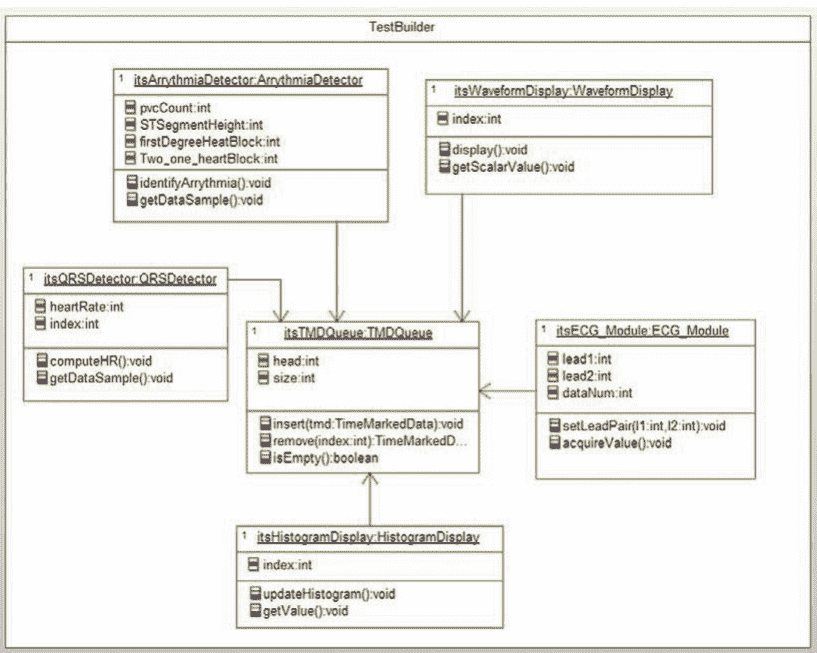

图 2-9：ECG 系统测试环境构建类

/* 构造函数和析构函数：
void TestBuilder_Init(TestBuilder* const me);
void TestBuilder_Cleanup(TestBuilder* const me);

struct ArrhythmiaDetector* TestBuilder_getItsArrhythmiaDetector(const TestBuilder* const me);

struct ECG_Module* TestBuilder_getItsECG_Module(const TestBuilder* const me);

struct HistogramDisplay* TestBuilder_getItsHistogramDisplay(const TestBuilder* const me);

struct QRSDetector* TestBuilder_getItsQRSDetector(const TestBuilder* const me);

struct TMDQueue* TestBuilder_getItsTMDQueue(const TestBuilder* const me);

struct WaveformDisplay* TestBuilder_getItsWaveformDisplay(const TestBuilder* const me);

TestBuilder * TestBuilder_Create(void);
void TestBuilder_Destroy(TestBuilder* const me);
#endif

# 代码列表 2-8：TestBuilder.h 头文件

```c
#include "TestBuilder.h"
static void initRelations(TestBuilder* const me);
static void cleanUpRelations(TestBuilder* const me);

void TestBuilder_Init(TestBuilder* const me) {
    initRelations(me);
}

void TestBuilder_Cleanup(TestBuilder* const me) {
    cleanUpRelations(me);
}

struct ArrhythmiaDetector* TestBuilder_getArrhythmiaDetector(const TestBuilder* const me) {
    return (struct ArrhythmiaDetector*)&(me->itsArrhythmiaDetector);
}

struct ECG_Module* TestBuilder_getECG_Module(const TestBuilder* const me) {
    return (struct ECG_Module*)&(me->itsECG_Module);
}

struct HistogramDisplay* TestBuilder_getHistogramDisplay(const TestBuilder* const me) {
    return (struct HistogramDisplay*)&(me->itsHistogramDisplay);
}

struct QRSDetector* TestBuilder_getQRSDetector(const TestBuilder* const me) {
    return (struct QRSDetector*)&(me->itsQRSDetector);
}

struct TMDQueue* TestBuilder_getTMQueue(const TestBuilder* const me) {
    return (struct TMQueue*)&(me->itsTMQueue);
}

struct WaveformDisplay* TestBuilder_getWaveformDisplay(const TestBuilder* const me) {
    return (struct WaveformDisplay*)&(me->itsWaveformDisplay);
}

TestBuilder * TestBuilder_Create(void) {
    TestBuilder* me = (TestBuilder *)
    malloc(sizeof(TestBuilder));
    if(me!=NULL)
{
      TestBuilder_Init(me);
    }
}
```

```c
void TestBuilder_Destroy(TestBuilder* const me) {
  if(me!=NULL) {
    TestBuilder_Cleanup(me);
  }
}
```

```c
static void initRelations(TestBuilder* const me) {
  ArrhythmiaDetector_Init(&me->itsArrhythmiaDetector);
  ECG_Module_Init(&me->itsECG_Module);
  HistogramDisplay_Init(&me->itsHistogramDisplay);
  QRSDetector_Init(&me->itsQRSDetector);
  TMDQueue_Init(&me->itsTMDQueue);
  WaveformDisplay_Init(&me->itsWaveformDisplay);
  ECG_Module_setTMDQueue(&me->itsECG_Module,
  &(me->itsTMDQueue);
  HistogramDisplay_setTMDQueue(&me->itsHistogramDisplay,
  &(me->itsTMDQueue);
  QRSDetector_setTMDQueue(&me->itsQRSDetector,
  &(me->itsTMDQueue);
  WaveformDisplay_setTMDQueue(&me->itsWaveformDisplay,
  &(me->itsTMDQueue);
  ArrhythmiaDetector_setTMDQueue(&me->itsArrhythmiaDetector,
  &(me->itsTMDQueue));
}
```

```c
static void cleanUpRelations(TestBuilder* const me) {
  WaveformDisplay_Cleanup(&me->itsWaveformDisplay);
  TMDQueue_Cleanup(&me->itsTMDQueue);
  QRSDetector_Cleanup(&me->itsQRSDetector);
  HistogramDisplay_Cleanup(&me->itsHistogramDisplay);
  ECG_Module_Cleanup(&me->itsECG_Module);
  ArrhythmiaDetector_Cleanup(&me->itsArrhythmiaDetector);
}
```

代码列表 2-9：向队列插入数据的 TestBuilder.c 实现，列表 2-10 显示了类的简单用法以及客户端如何从中取数据：

```c
int main(int argc, char* argv[]) {
  int status=0;

  TestBuilder * p_TestBuilder;

  p_TestBuilder=TestBuilder();
  ECG_Module_setTMDQueue(&(p_TestBuilder)->itsECG_Module);
  ECG_Module_setTMDQueue(&(p_TestBuilder)->itsECG_Module);
  ECG_Module_setTMDQueue(&(p_TestBuilder)->itsECG_Module);
  ECG_Module_setTMDQueue(&(p_TestBuilder)->itsECG_Module);
  ECG_Module_setTMDQueue(&(p_TestBuilder)->itsECG_Module);

  HistogramDisplay_getValue(&p_TestBuilder)->HistogramDisplay;
  HistogramDisplay_getValue(&p_TestBuilder)->HistogramDisplay;
  HistogramDisplay_getValue(&p_TestBuilder)->HistogramDisplay;
  HistogramDisplay_getValue(&p_TestBuilder)->HistogramDisplay;
  HistogramDisplay_getValue(&p_TestBuilder)->HistogramDisplay;

  QRSDetector_getDataSample(&p_TestBuilder)->itsQRSDetector;
  QRSDetector_getDataSample(&p_TestBuilder)->itsQRSDetector;
  QRSDetector_getDataSample(&p_TestBuilder)->itsQRSDetector;

  WaveformDisplay_getScalar(&p_TestBuilder)->WaveformDisplay;
  WaveformDisplay_getScalar(&p_TestBuilder)->WaveformDisplay;
  WaveformDisplay_getScalar(&p_TestBuilder)->WaveformDisplay;
  WaveformDisplay_getScalar(&p_TestBuilder)->WaveformDisplay;
  WaveformDisplay_getScalar(&p_TestBuilder)->WaveformDisplay;

  ArrhythmiaDetector_getDataSample(&p_TestBuilder)->itsArrhythmiaDetector;
  ArrhythmiaDetector_getDataSample(&p_TestBuilder)->itsArrhythmiaDetector;
  ArrhythmiaDetector_getDataSample(&p_TestBuilder)->itsArrhythmiaDetector;
  ArrhythmiaDetector_getDataSample(&p_TestBuilder)->itsArrhythmiaDetector;
  ArrhythmiaDetector_getDataSample(&p_TestBuilder)->itsArrhythmiaDetector;

  printf("\n");
  TestBuilder_Destroy(p_TestBuilder);
  return 0;
}
```

# 代码列表 2-10：示例 main.c

上述代码采用了经典的客户端-服务器模式。ECG_Monitor 在它认为合适的时候将数据放入队列，而各种客户端则自行决定何时从队列中提取数据并执行工作。在这种情况下，TMDQueue 是客户端的数据服务器，而 WaveformDisplay、HistogramDisplay、QRSDetector 和 ArrhythmiaDetector 是客户端。

我们拥有了一个可以运行的模型（带有功能代码）。现在让我们思考我们如何优化该系统。在这种情况下，我们将优化执行时间，以便释放处理器来处理其他工作。此外，我们还希望优化系统的可维护性，限制在需要更新时需要修改的地方。我们还希望能够动态（在运行时）更改客户端的数量，而不会通过分配可能永远用用的指针数组（每个客户端）来浪费额外内存。因此，我们的设计标准（带有比例重要性权重）：1）执行效率（权重=7），2）可维护性（权重=5），3）运行时添加新客户端的灵活性（权重=4），以及4）大规模下的内存效率（权重=7）。让我们考虑三种替代策略（设计模式）。

首先是当前的客户端-服务器模式：

+ 1. 执行效率

这种解决方案并非特别优化，客户端需要频繁检查是否有新数据，即使没有。在 0 到 10 分的范围内，我们将其评为 3 分。这是该方法的主要弱点。

+ 2. 可维护性

在经典的客户端-服务器架构中，客户端了解服务器（因此它们可以调用服务），但服务器不知道客户端。这种对知识的限制使得系统更具维护性，因为知识被封装在一个地方。它在此项上获得了 7 分。

+ 3. 运行时灵活性

在此背景下，灵活性主要体现在创建新客户端并将其轻松链接到服务器的能力。由于我们可以进行调整来处理这些问题，它在该项标准上获得了 8 分。

+ 4. 内存使用

在此项标准中，每个客户端必须维护其在列表中的位置，这需要每个客户端都有额外的内存。因此，经典的客户端-服务器模式在该项标准上仅得 5 分。

第二种替代方案是创建一种“推”实现，将通知客户端的责任交给 TMDQueue。要实现这种方案，必须反转图 2-8 中的关联方向，并且 TMDQueue 必须显式地知道所有客户端，以便在数据可用时通知它们。客户端列表可能会维护为指向客户端的指针列表。


# 使用 Harmony™ 进行嵌入式实时处理过程 65 编程

- 1. 执行效率

这种方法在效率方面是高效的，因为当数据可用时会通知客户端，客户端不需要轮询来发现新数据。我们给这种方法打 8 分。

- 2. 可维护性

推（push）方法打破了经典的客户端-服务器架构（服务器知道客户端的存在），在这一标准上仅得了 4 分。如果添加更多客户端，维护将变得更加困难。

- 3. 运行时灵活性

推方法具有相当好的运行时灵活性，因为这意味着必须修改服务器以接受新客户端。它在这一项上得了 7 分。

- 4. 内存占用

该方法仅在添加客户端时使用内存，因此在这一标准上得到 9 分。

最后一种替代方案是观察者模式⁹。观察者模式如图 2-10 所示。

在使用该模式之前，让我们来看它的描述和属性。请注意，在后的描述中，对经典的观察者模式进行了修改，以便更容易融入示例中。

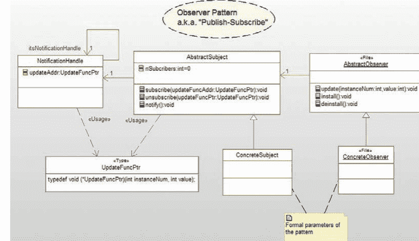

图 2-10：观察者模式结构

> ⁹ 例如，请参考 Douglass, B.P., 2002. *Real-Time Design Patterns: Robust Scalable Architecture for Real-Time Systems*. Addison-Wesley；或 Gamma, E., Helm, Johnson, R., Vlissides, J.M., 1995. *Design Patterns: Elements of Reusable Object-Oriented Software*. Addison-Wesley.

# 66 第 2 章

### 2.1.6 观察者模式

摘要

观察者模式解决了动态添加和移除数据或服务客户端的问题，并优化了及时更新这些客户端的关联处理。

- - 问题
该模式维持了类客户端-服务器架构，其中客户端知道拥有感兴趣的数据或服务的服务器，但这种关系是单向的。尽管如此，高效且及时地更新客户端的责任交给了服务器。此外，由于服务器维护了一个感兴趣的客户端列表，它会在合适的时候（例如定期或数据发生变化时）通知所有客户端。客户端可以在系统运行时动态地添加到或从系统中移除，而不需要服务器了解客户端的任何信息（除正确签名的操作的操作的位置外）。

- - 模式结构
该模式定义了以下角色：
- 抽象观察者（Abstract Observer）
该元素与抽象主题（Abstract Subject）有一个单向关联（链接），以便它可以请求被添加到感兴趣的客户端列表中（过程被称为“订阅”）或从列表中移除（称为“取消订阅”）。它提供了一个具有特定签名的操作，供主题在合适时调用。
- 抽象主题（Abstract Subject）
该元素将作为客户端-服务器架构中服务器的基类；它拥有抽象观察者所需的信息或服务。它提供了添加和移除客户端的操作（分别为“订阅”和“取消订阅”），并可以在合适时通知所有当前已订阅的客户端。最常用的通知策略是定期或在数据变化时。这会为每个订阅的客户端创建一个新的通知句柄，形成一个通知句柄列表。虽然此列表可以用任何方式管理，但在这种情况下，它被处理为链表。对客户端的通知只需“遍历列表”并为每个当前订阅的抽象观察者调用更新操作即可。
- 通知句柄（Notification handle）
该元素为抽象主题到抽象观察者提供了一个动态回调链接；具体而言，它作为一个数据元素包含一个指向服务器更新操作的指针。它还有一个指向列表中下一个元素的链接，该链接在列表末尾为 NULL。
- 具体观察者（Concrete Observer）（形式参数）
该元素是抽象观察者的子类；它继承了指向抽象主题的链接并提供了一个（未实现的）更新操作。

# 使用 Harmony™ 进行嵌入式实时处理过程 67 编程

- * 具体主题（Concrete Subject）（形式参数）
该元素是抽象主题的子类；它继承了对抽象观察者的链接，并提供了合适时添加和移除客户端。
- * 后果（Consequences）
该模式在动态添加和移除客户端方面简化了服务器，并在及时更新这些客户端的考虑。此外，由于服务器维护了一个感兴趣的客户端列表，它可以在合适时传递数据或服务。

现在让我们看看这种方案的对比如何：

- 1. 执行效率
这种方法在效率方面是高效的，因为当数据可用时会通知客户端，客户端不需要轮询来发现新数据。它得到了 8 分。

- 2. 可维护性
推方法打破了经典的客户端-服务器架构（服务器知道客户端的存在），在这一标准上仅得了 4 分。如果添加更多客户端，维护将变得更加困难。

- 3. 运行时灵活性
推方法具有相当好的运行时灵活性，因为这意味着必须修改服务器以接受新客户端。它在这一项上得了 7 分。

- 4. 内存占用
该方法仅在添加客户端时使用内存，因此在这一标准上得到 9 分。

观察者模式的权衡结果表 2-4 所示：

| 设计方案 | 执行效率 | 可维护性 | 运行时灵活性 | 内存占用 | 总分 |
| :--- | :--- | :--- | :--- | :--- | :--- |
| 客户端服务器 | 3 | 7 | 8 | 5 | 23 |
| 推 | 8 | 4 | 7 | 7 | 26 |
| 观察者 | 8 | 8 | 9 | 9 | 34 |

# 68 第 2 章

一旦选定，下一步是实例化该模式，并在此期间，通过抽象主题来实例化模式。结果见 2-11 图。

- 拷贝从基类的实现到子类
- 使用“混入”（mix-in）；即，将子请求委托给基类
- 实现虚函数，如第 1 章所述

# 使用 Harmony™ 进行嵌入式实时处理过程 69 编程

在我们的代码实现中，我们将采用最简单的方案来说明模式；我们将从抽象主题拷贝代码到 TMDQueue，对抽象观察者执行相同的代码。如果需要，可以使用其他实现策略。

结果见 2-11 图。注意客户端拥有自己的索引属性并获得了 `update()` 成员函数，以及 `Init()` 函数（调用 `subscribe()`）和 `Cleanup()` 函数（调用 `unsubscribe()`）。TMDQueue 增加了 `subscribe()`、`unsubscribe()` 和 `notify()` 操作，并与 `NotificationHandle` 类列表关联。通知句柄处理相关类 `update()` 函数的地址。调用 `notify()` 会遍历通知处理程序的链表。

代码列表 2-11 和 2-12 显示了包含观察模式服务器部分的 TMDQueue 类头文件和实现。你可以看到用于管理观察者订阅的 `NotificationHandle` 链接添加。

```cpp
#ifndef TMDQueue_H
#define TMDQueue_H

/*
#include <stdio.h>
#include "ECPG.h"
#include "TimeMarkedData.h"

struct NotificationHandle;
typedef struct TMDQueue TMDQueue;
/*
此队列设计用于作为一个“泄漏”队列运行；
数据本身不会被移除，而是在缓冲区回绕时被覆盖。
这允许许多客户端从队列中读取相同的数据。 */
struct TMDQueue {
int head;
int nSubscribers;
int size;
struct TimeMarkedData buffer[QUEUE_SIZE];
struct NotificationHandle* itsNotificationHandle;
};

/* 构造函数和析构函数：*/
void TMDQueue_Init(TMDQueue* const me);
void TMDQueue_Cleanup(TMDQueue* const me);

/* 操作 *//
int TMDQueue_getNextIndex(TMDQueue* const me, int index);
void TMDQueue_insert(TMDQueue* const me, const struct TimeMarkedData tmd);

```

#endif
```


# 70 第2章

```c
boolean TMDQueue_isEmpty(TMDQueue* const me);
void TMDQueue_notify(TMDQueue* const me, const struct TimeMarkedData tmd);
struct TimeMarkedData TMDQueue_remove(TMDQueue* const me, int index);
/* NotificationHandle 是以链表的形式进行管理的，插入操作在末尾进行。 */
void TMDQueue_subscribe(TMDQueue* const me, const UpdateFuncPtr updateFuncAddr);
int TMDQueue_unsubscribe(TMDQueue* const me, const UpdateFuncPtr updateFuncAddr);
int TMDQueue_getBuffer(const TMDQueue* const me);
struct NotificationHandle*
TMDQueue_getitsNotificationHandle(const TMDQueue* const me);
void TMDQueue_setitsNotificationHandle(TMDQueue* const me, struct NotificationHandle* p_NotificationHandle);
TMDQueue* TMDQueue_Create(void);
void TMDQueue_Destroy(TMDQueue* const me);
#endif
```

## 代码列表 2-11: 使用观察者模式的 TMDQueue 头文件

```c
#include "TMDQueue.h"
#include "NotificationHandle.h"
static void initRelations(TMDQueue* const me);
static void cleanUpRelations(TMDQueue* const me);

void TMDQueue_Init(TMDQueue* const me) {
    me->head=0;
    me->nscribers=0;
    me->size=0;
    me->isNotificationHandle=NULL;
    initRelations(me);
}

void TMDQueue_Cleanup(TMDQueue* const me) {
    cleanUpRelations(me);
}

int TMDQueue_getNextIndex(TMDQueue* const me, int index) {
    /* 此操作使用模运算从
    第一个开始计算下一个索引 */
    return (index+1) % QUEUE_SIZE;
}
```

```c
void TMDQueue_insert(TMDQueue* const me, const struct TimeMarkedData tmd) {
    /* 注意，由于我们从未从这个
    泄露队列中“移除”数据，size 只会增加到队列大小，
    然后停止增加。插入操作始终发生在头部。
    */
    printf("Indenting at %d Data #: %d", me->head, tmd.timeInterval);
    me->buffer[me->head]=tmd;
    me->head=TMDQueue_getNextIndex(me, me->head);
    if (me->size<QUEUE_SIZE) ++me->size)
        printf("Storing data value: %d\n", tmd.dataValue);
    TMDQueue_notify(me, tmd);
}
```

```c
boolean TMDQueue_isEmpty(TMDQueue* const me) {
    return (boolean)(me->size==0);
}

void TMDQueue_notify(TMDQueue* const me, const struct TimeMarkedData tmd) {
    NotificationHandle *pNH;
    pNH=me->itsNotificationHandle;
    while (pNH) {
        printf("----- calling updateAddr on pNH %p\n",pNH);
        pNH->updateAddr(NULL, tmd);
        pNH=pNH->itsNotificationHandle;
    }
}
```

```c
struct TimeMarkedData TMDQueue_remove(TMDQueue* const me, int index) {
    TimeMarkedData tmd;
    tmd.interval=1; /* 哨值 */
    tmd.dataValue=9999;
    if (!TMDQueue_isEmpty(me) && (index)>=0) && (index < QUEUE_SIZE)
        && (index < me->size))
        tmd=me->buffer[index];
    return tmd;
}
```

```c
void TMDQueue_subscribe(TMDQueue* const me, const UpdateFuncPtr updateAddr) {
    struct NotificationHandle *pNH;
    pNH=me->itsNotificationHandle;
    if (!pNH) { /* 空列表 */
        /* 创建一个新的 Notification Handle，初始化它，并将其指向 * */
        /*------ 添加到新列表 */
        printf("----- Called NH_Create()\n");
        me->itsNotificationHandle=NotificationHandle_Create();
        printf("----- Called NH_Create()\n");
        pNH=me->itsNotificationHandle;
    } else {
        /* 搜索列表找到末尾 */
        /* 添加到现有列表 */
        while (pNH->itsNotificationHandle!=NULL) {
            printf("-----Getting ready to augment ptr %p to %p\n",pNH, pNH->itsNotificationHandle);
            pNH=pNH->itsNotificationHandle; /* 获取列表中的下一个元素 */
        }
        printf("----- augmenting ptr\n");
        printf("------ calling NH_Create\n");
        pNH->itsNotificationHandle = NotificationHandle_Create();
        pNH = pNH->itsNotificationHandle; /* 指向新实例 */
        printf("------ calling NH_Create(\n)");
    } /* 结束 */

    /* pNH 现在指向一个构造好的 Notification Handle */
    pNH->updateAddr = updateFuncAddr; /* 设置回调地址 */
    me->nSubscribers++;
    printf("------ wrote updateAddr\n");
    if (pNH->itsNotificationHandle) {
        printf("xxxxxx ptr not null!\n");
    } else {
        printf("-------> ptr not null!\n");
    }
}

int TMDQueue_unsubscribe(TMDQueue* const me, const UpdateFuncPtr updateAddr) {
    struct NotificationHandle *pNH, *pBack;
    pNH=me->itsNotificationHandle;

    if (pNH== NULL) { /* 从空列表中删除 */
        return 0;
    } else if /* 是第一个吗 */
        if (pNH->updateAddr== updateAddr) {
            me->itsNotificationHandle=pNH->itsNotificationHandle;
            free(pNH);
            printf(">>>>>>Removing第一个元素\n");
            me->nSubscribers--;
            return 1;
        } else { /* 在列表中查找元素 */
            printf(">>>>>>Searching....\n");
            while (pNH!= NULL) {
                if (pNH->updateAddr!= updateAddr) {
                    pBack->itsNotificationHandle=pNH->itsNotificationHandle;
                    free(pNH);
                    printf(">>>>>>Removing列表订阅者!\n");
                    me->nSubscribers--;
                    return 1;
                } /* 找到 *
                pBack=pNH; /* 指向 pNH 之前的列表元素 */
                pNH=pNH->itsNotificationHandle; /* 获取列表中的下一个元素 */
            } /* 结束循环 */
        }
    } else { /* */
        printf(">>>>>> 没有移除订阅者\n");
        return 0;
    }
}
/* 非空列表 * */
```

```c
int TMDQueue_getBuffer(const TMDQueue* const me) {
    int iter=0;
    return iter;
}
```

```c
struct NotificationHandle*
TMDQueue_getitsNotificationHandle(const TMDQueue* const me) {
    return (struct NotificationHandle*)me->itsNotificationHandle;
}
```

```c
void TMDQueue_setitsNotificationHandle(TMDQueue* const me, struct NotificationHandle* p_NotificationHandle) {
    me->itsNotificationHandle=p_NotificationHandle;
}
```

```c
TMDQueue* TMDQueue_Create(void) {
    TMDQueue* me = malloc(sizeof(TMDQueue));
    if (me != NULL) {
        TMDQueue_Init(me);
    }
    return me;
}
```

```c
void TMDQueue_Destroy(TMDQueue* const me) {
    TMDQueue_Cleanup(me);
    free(me);
}
```


# 76 第 2 章

```c
static void cleanUpRelations(HistogramDisplay* const me);

void HistogramDisplay_Init(HistogramDisplay* const me) {
    me->itsTMDQueue=NULL;

    /* call subscribe to connect to the server */
    TMDQueue_subscribe(me->itsTMDQueue);
    HistogramDisplay_update();
}

void HistogramDisplay_Cleanup(HistogramDisplay* const me) {
    /* remove yourself from server subscription list */
    TMDQueue_unsubscribe(me->itsTMDQueue);
    histogramDisplay_update();
    cleanUpRelations(me);
}

void HistogramDisplay_update(HistogramDisplay* const me, const struct TimeMarkedData tmd) {
    printf(" Histogram -> TimeInterval: %d DataValue: %d\n", tmd.timeInterval, tmd.dataValue);
}

void HistogramDisplay_updateHistogram(HistogramDisplay* const me)
struct TMDQueue* HistogramDisplay_getItsTMDQueue(const HistogramDisplay* const me) {
    return (struct TMDQueue*)me->itsTMDQueue;
}

void HistogramDisplay_setitsTMDQueue(HistogramDisplay* const me, struct TMDQueue* p_TMDQueue) {
    me->itsTMDQueue=p_TMDQueue;
}

HistogramDisplay* HistogramDisplay_Display_Create(void) {
    HistogramDisplay* me=(HistogramDisplay *)
    calloc(sizeof(HistogramDisplay));
    if(me==NULL) {
        HistogramDisplay_Init(me);
    }
    return me;
}

void HistogramDisplay_Destroy(HistogramDisplay* const me) {
    if(me==NULL) {
        HistogramDisplay_Cleanup(me);
    }
    free(me);
}
```

# 使用 Harmony™ 嵌入实时处理器进行嵌入编程 77

```c
static void cleanUpRelations(HistogramDisplay* const me) {
    if(me->itsTMDQueue != NULL)
    {
        me->itsTMDQueue=NULL;
    }
}
```

# 代码列表 2-15：带有观察者模式的 HistogramDisplay.c 实现文件

总而言之，我们创建了一个功能良好的代码库，然后决定了我们想要优化它。我们进行了一项微型权衡，查看了一些不同的替代方案以及它们如何不同地优化了我们的加权设计准则。在这种情况下，观察者模式的结果最好，因此我们更新了代码库以包含该模式。简单，对吧？

# 2.2 方法

本书提供了许多用于嵌入式系统的模式，正如你在接下来的章节中看到的那样。在每一章中，都会介绍一些模式。每个模式都遵循相同的基本演示风格，并由九个基本元素组成：

- **摘要 (Abstract)**
  摘要提供了模式的概述以及你可能需要它的原因，包括它所解决的问题概述、解决方案结构以及关键影响。

- **问题 (Problem)**
  本节讨论了问题背景以及该模式提供的优化。

- **适用性 (Applicability)**
  本节列出了该模式适用所需的条件列表。

- **模式结构 (Pattern structure)**
  模式结构显示了模式内部的结构元素、它们的角色及其关系。每个模式都将使用 UML 类图显示。

- **协作角色定义 (Collaboration role definitions)**
  本节详细说明了每个元素在模式中所扮演的角色及其职责。

- **影响 (Consequences)**
  影响是模式描述的一个关键方面。本节识别了使用该模式的收益和代价。

- **实现策略 (Implementation strategies)**
  模式可以用不同的方式实现。本节讨论了一些实现上的替代方案。

- **相关模式 (Related patterns)**
  本节提供了书中其他处理类似问题的模式引用，这些模式可能有不同的适用性标准和影响。

- **示例 (Example)**
  每个模式都将用示例进行说明。每个模式都将提供 UML 图和源代码。

# 2.3 展望

本书的剩余章节介绍了对嵌入式 C 开发者特别感兴趣的几个主题领域的设计模式。第 3 章侧重于控制硬件的设计模式。第 4 章关于嵌入式 C 的并发性，不仅包括基础的调度模式，还包括跨线程共享资源以及避免死锁的方法。第 5 章处理状态机（这是嵌入式工具箱中重要但未充分利用的工具），第 6 章关注安全性和可靠性。

## 访问硬件的设计模式

| 提纲 | 页码 |
| :--- | :--- |
| 3.1 基础硬件访问概念 | 81 |
| 3.2 硬件代理模式 | 85 |
| 3.2.1 摘要 | 85 |
| 3.2.2 问题 | 86 |
| 3.2.3 模式结构 | 86 |
| 3.2.4 协作角色 | 86 |
| 3.2.4.1 硬件设备 | 86 |
| 3.2.4.2 硬件代理 | 86 |
| 3.2.4.3 代理客户端 | 88 |
| 3.2.5 影响 | 88 |
| 3.2.6 实现策略 | 89 |
| 3.2.7 相关模式 | 89 |
| 3.2.8 示例 | 89 |
| 3.3 硬件适配器模式 | 96 |
| 3.3.1 摘要 | 96 |
| 3.3.2 问题 | 96 |
| 3.3.3 模式结构 | 96 |
| 3.3.4 协作角色 | 96 |
| 3.3.4.1 适配器 | 96 |
| 3.3.4.2 硬件适配器 | 96 |
| 3.3.4.3 硬件到客户端 | 97 |
| 3.3.4.4 硬件设备 | 97 |
| 3.3.4.5 硬件代理 | 97 |
| 3.3.5 影响 | 97 |
| 3.3.6 实现策略 | 99 |
| 3.3.7 相关模式 | 99 |
| 3.3.8 示例 | 99 |
| 3.4.1 摘要 | 100 |
| 3.4.2 问题 | 100 |
| 3.4.3 模式结构 | 101 |
| 3.4.4 协作角色 | 101 |
| 3.4.4.1 适配器 | 101 |
| 3.4.4.2 中介者 | 101 |
| 3.4.4.3 协调者 | 101 |
| 3.4.5 影响 | 102 |
| 3.4.6 实现策略 | 102 |
| 3.4.7 相关模式 | 102 |
| 3.4.8 示例 | 102 |
| 3.5.1 摘要 | 111 |
| 3.5.2 问题 | 111 |
| 3.5.3 模式结构 | 112 |
| 3.5.4 协作角色 | 112 |
| 3.5.4.1 应用程序客户端 | 112 |
| 3.5.4.2 通知 | 113 |
| 3.5.4.3 具体客户端 | 113 |
| 3.5.4.4 具体主题 | 114 |
| 3.5.5 影响 | 114 |
| 3.5.6 实现策略 | 114 |
| 3.5.7 相关模式 | 115 |
| 3.5.8 示例 | 115 |
| 3.6.1 摘要 | 123 |
| 3.6.2 问题 | 123 |
| 3.6.3 模式结构 | 123 |
| 3.6.4 协作角色 | 123 |
| 3.6.4.1 应用程序处理 | 124 |
| 3.6.4.2 设备 | 124 |
| 3.6.4.3 机会性轮询 | 124 |
| 3.6.4.4 周期性轮询 | 125 |
| 3.6.5 影响 | 125 |
| 3.6.6 实现策略 | 125 |
| 3.6.7 相关模式 | 126 |
| 3.6.8 示例 | 126 |
| 3.7.1 摘要 | 130 |
| 3.7.2 问题 | 130 |
| 3.7.3 模式结构 | 131 |
| 3.7.4 协作角色 | 131 |
| 3.7.4.1 中断处理程序 | 131 |
| 3.7.4.2 中断表 | 132 |
| 3.7.4.3 向量 | 132 |
| 3.7.5 影响 | 132 |
| 3.7.6 实现策略 | 134 |
| 3.7.7 相关模式 | 135 |
| 3.7.8 示例 | 135 |
| 3.8.1 摘要 | 138 |
| 3.8.2 问题 | 138 |
| 3.8.3 模式结构 | 138 |
| 3.8.4 协作角色 | 138 |
| 3.8.4.1 应用程序处理 | 139 |
| 3.8.4.2 设备 | 139 |
| 3.8.4.3 机会性轮询 | 140 |
| 3.8.4.4 周期性轮询 | 140 |
| 3.8.4.5 轮询数据客户端 | 141 |
| 3.8.4.6 轮询定时 | 141 |
| 3.8.5 影响 | 141 |
| 3.8.6 实现策略 | 141 |
| 3.8.7 相关模式 | 142 |
| 3.8.8 示例 | 142 |

### 3.9 所以，我们学了什么？

- 本章中的模式：
  硬件代理模式 – 将硬件封装到类或结构体中
  硬件适配器模式 – 在所需的接口和提供的接口之间进行适配
  中介者模式 – 协调复杂的交互
  观察者模式 – 支持高效的传感器数据分布
  抖抖模式 – 拒绝间歇性硬件信号
  中断模式 – 处理高紧急性硬件信号
  轮询模式 – 定期检查新的传感器数据

### 3.1 基础硬件访问概念

嵌入式系统最显著的特性可能是它们必须直接访问硬件。嵌入式系统的核心意义在于软件被嵌入在提供特定类型服务的“智能设备”中，这需要进行访问。广而言之，软件可访问的硬件可以分为四类：基础设施、通信、传感器和执行器。

基础设施硬件指的是运行软件的计算基础设施和设备。这不仅包括 CPU 和内存，还包括存储设备、定时器、输入设备（如键盘、旋钮和按钮）、输出设备（打印机、显示器和灯光）、端口和中断。大多数硬件并不特别特殊，可能位于主板上、具有高速访问连接的扩展板上，或作为公共背板的其他板上。

通信硬件指的是用于计算设备之间通信的硬件，例如标准（非嵌入式）计算机、其他嵌入式系统，


# 第3章 82

传感器和执行器。这通常意味着有线或无线通信子系统，如 RS-232、RS-485、以太网、USB、802.11x或其他设施。在嵌入式系统中，DMA（直接内存访问）和多处理器内存有时也用于此类，这在某种程度上模糊了基础设施与通信硬件之间的界限。

最后，我们拥有用于监控或操作物理世界的设备——这些就是传感器和执行器。我们使用电子、机械或化学手段来监测物理现象的状态，例如心率、飞机的位置、物体质量或化学物质浓度。另一方面，执行器会改变某些真实世界事件的物理状态。典型的执行器有电机、加热器、发电机、泵和开关。

所有这些类型的硬件通常会被初始化、测试或配置——这些任务通常由嵌入式软件在启动或执行期间完成。所有的硬件元素都由嵌入式软件管理，向软件提供命令或数据，或从软件接收命令或数据。

本章假设你具有足够的硬件背景，能够理解书中使用的硬件术语，如总线、CPU、RAM、EPROM、EEPROM 和 Flash。如果你想了解更多，关于这个主题有许多优秀书籍，包括 Simon¹、Michael Barr 和 Anthony Massa²、Michael Pont³ 以及 Jack Gansle⁴ 的著作。相反，我们将关注开发嵌入式 C 应用的常用方法，以解决管理和操作此类硬件元素时常见的问题。我们将简要介绍的硬件相关概念是位域、端口和中断。

硬件使用位（bits）来指定硬件命令或返回数据是极其常见的。位域（Bit field）是可寻址内存单元（例如字节或字）内的一块连续位位块（一个或多个位），这些位共同对硬件设备具有某些语义意义。例如，一个 8 位的字节可能映射到硬件设备并分为四个不同的字段：

```
0 0 0000 00
```

这些位向内存映射硬件设备代表以下信息，或从其接收以下信息：

| 位范围 | 访问方式 | 名称 | 描述 |
|---|---|---|---|
| 0 | 仅写 | 使能位 | 0 = 禁用设备，1 = 启用设备 |
| 1 | 只读 | 错误状态 | 0 = 无错误，1 = 存在错误 |
| 2–5 | 仅写 | 电机速度 | 范围 0000 = 无速度到 1111 (16d) 最大速度 |
| 6–7 | 仅写 | LED 颜色 | 00 (0d) = 关 01 (1d) = 绿色 10 (2d) = 黄色 11 (3d) =红色 |

> ¹ Simon, D., 1999. An Embedded Software Primer. Addison-Wesley.
² Barr, M, A., 2007. Programming Embedded Systems with C and GNU Development Tools. O’Reilly.
³ Pont, M., 2002. Embedded C. Addison-Wesley.
⁴ Ganssle, J., 2007. Embedded Systems: World Class Designs. Newnes.

# 访问硬件的设计模式 83

位域通过 C 语言的位运算符 `&`（位与）、`|`（位或）、`~`（位反，注：原文此处为 XOR，但符号为位取反）、`>>`（右移）和 `<<`（左移）进行操作。

以下是在特定值上对不同掩码使用这些位运算符的若干示例：

| 值 | 01010101 | 值 | 01010101 | 值 | 01010101 |
|---|---|---|---|---|---|
| 掩码 | 11111111 | 掩码 | 00000000 | 掩码 | 00001111 |
| 与结果 | 01010101 | 与结果 | 00000000 | 与结果 | 00000101 |
| 值 | 01010101 | 值 | 01010101 | 值 | 01010101 |
| 掩码 | 11111111 | 掩码 | 00000000 | 掩码 | 00001111 |
| 或结果 | 11111111 | 或结果 | 01010101 | 或结果 | 01011111 |
| 值 | 01010101 | 值 | 01010101 | 值 | 01010101 |
| 掩码 | 11111111 | 掩码 | 00000000 | 掩码 | 00001111 |
| 异或结果 | 10101010 | 异或结果 | 01010101 | 异或结果 | 01010110 |

常用的 C 习惯是使用 `#define` 创建用于位与和位操作的掩码，并赋予它们有意义名称。例如，我们可能会为上述内存映射设备的操作创建一组位掩码，如下：

```c
#include <stdlib.h>
#include <stdio.h>
#define TURN_OFF (0x00)
#define INITIALIZE (0x01)
#define RUN (0x02)
#define CHECK_ERROR (0x04)
#define DEVICE_ADDRESS (0xF0)

void emergencyShutDown(void) {
    printf("OMG We're gonna die!\n");
}

int main() {
    unsigned char *pDevice;
    pDevice = DEVICE_ADDRESS; // 到设备
    // 为了测试，你可以将上面的行替换为
    pDevice = malloc(1); // 从所有位1开始
    *pDevice = 0xFF;
    printf("Device bits %X\n", *pDevice);
    *pDevice = *pDevice & INITIALIZE; // 与位进行与
    printf("Device bits %X\n", *pDevice);
    if (*pDevice & CHECK_ERROR) // 如果系统失败
        emergencyShutDown();
        abort();
    } else {
        *pDevice = *pDevice & RUN;
    }
    printf("Device bits %X\n", *pDevice);
    return 0;
}
```

### 代码列表 3-1：操作位取向内存硬件

左移和右移运算符用于隔离设置或测试特定的位，也用于处理串行数据。例如，表达式“1<<3”设置了第 3 位，结果为 8。这有时用于掩码的定义。例如，代码列表 3-1 中的掩码 `CHECK_ERROR` 可以写成：

```c
#define CHECK_ERROR (1<<1)
```

C 语言中的位域提供了表示设备接口中位映射字段的另一种方法。这种语法表示 `struct` 的变长度字段。`:` 运算符在声明中将字段名称与其长度分开。例如，参见代码列表 3-2。

```c
#include <stdlib.h>
#include <stdio.h>

int main() {
    typedef struct _statusBits {
        unsigned enable : 1;
        unsigned errorStatus : 1;
        unsigned motorSpeed : 4;
        unsigned LEDColor : 2;
    } statusBits;
    statusBits statusBits;

    printf("size=%d\n", sizeof(status));
    statusBits.enable = 1;
    statusBits.errorStatus = 0;
    statusBits.motorSpeed = 3;
    statusBits.LEDColor = 2;

    if (statusBits.enable) printf("Enabled\n");
    else printf("Disabled\n");
    if (statusBits.errorStatus) printf("ERROR\n");
    else printf("No error\n");
    printf("Motor speed %d\n", statusBits.motorSpeed);
    printf("Color %d\n", statusBits.LEDColor);
    return 0;
}
```

### 代码列表 3-2：C 中的位域

# 访问硬件的设计模式 85

C 语言中的位域存在问题。首先，位顺序取决于编译器和处理器。此外，编译器可能会忽略字节填充规则，这意味着它可能不会按照预期映射到内存映射设备。例如，GNU 编译器返回代码列表 3-2 中 `status` 的大小为 4 字节，尽管 `unsigned char` 只有 1 字节。

更糟糕，大多数 CPU 每次写入一个字节或字，但位域可能是原子步骤写入，如果使用不同的互斥锁，会导致线程安全问题。

使用位域的另一个问题是无法在标量和自定义结构体之间进行类型转换。因此，以下操作是不允许的⁵：

```c
unsigned char f;
f = 0xF0;
status = (statusBits)f;
```

> ⁵ 尽管你可以通过极其迂回的方法绕过这一点，例如
> status = *(statusBits)&
> （即将 f (unsigned char) 的地址转换为 statusBits 结构类型的地址），但我很难
> 推荐那样做！

让我们关注一些被证明对操作硬件非常有用的设计模式。接下来讨论的硬件代理模式（Hardware Proxy Pattern）是硬件抽象的典型模式，用于封装可能随硬件信息而变化的细节。硬件适配器模式（Hardware Adapter Pattern）扩展了硬件代理模式，提供了支持不同硬件接口的能力。中介模式（Mediator Pattern）支持协调多个硬件设备以实现系统级功能。观察者模式（Observer Pattern）是将感知数据分发到需要它的软件元素的方法。去抖（Debouncing）和中断模式是与硬件交互的简单复用方法。定时器中断模式（Timer Interrupt Pattern）扩展了中断定时器，为嵌入式系统提供精确计时。

### 3.2 硬件代理模式

硬件代理模式创建一个负责访问硬件并封装硬件压缩和编码实现的软件元素。

### 3.2.1 抽象

硬件代理模式使用类（或结构体）来封装对硬件的所有访问，无论其物理接口如何。硬件可以是内存、端口或中断


映射，或者可以通过串行连接、总线、网络或无线链路进行映射。代理发布了服务，允许从设备读取和写入值，并根据需要对设备进行初始化、配置和关闭。代理为客户端提供了一个与编码和连接无关的接口，并在设备接口或连接的性质发生变化时，便于进行相应的修改。

### 3.2.2 问题

如果每个客户端都直接访问硬件设备，硬件变化引起的问题将会加剧。如果位编码、内存地址或连接技术发生变化，则必须追踪并修改每一个客户端。通过在客户端和实际硬件之间提供一个代理，可以极地限制硬件变化产生的影响，从而减轻此类修改的压力。为了最易于维护，客户端不应该感知设备所使用的位编码、加密和压缩；这些细节应该由硬件代理（Hardware Proxy）通过内部私有函数进行管理。

### 3.2.3 模式结构

该模式的结构非常简单，如图3-1所示。系统中可能有许多客户端，但每个受控的设备只有一个硬件代理。代理包含了公共函数以及私有的、封装的函数和数据。在图中，设备被表示为 `void*`，但它应该根据设备进行适当的类型定义。

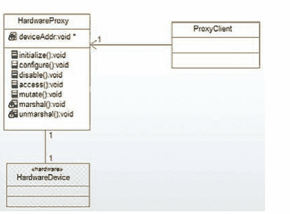

图3-1 硬件代理模式

其中 6 个模式将以 UML 图的形式展示，并为示例提供代码。附录提供了 UML 法的简要概述。

### 3.2.4 协作角色

本节描述了该模式的各个。

### 3.2.4.1 硬件设备

此元素代表实际硬件。因此，你不会为该元素编写 C 代码，但它的存在是为了帮助理解设计。硬件设备与硬件代理之间所示关联是通过软件可寻的硬件接口实现的，例如端口地址、内存地址或中断。

### 3.2.4.2 硬件代理

这是系统中的主要类（或函数）。它既有针对当前设备定制的数据和函数，尽管每个设备都有一个 `initialize()`、`configure()` 和 `disable()` 函数。其他公共函数提供了访问设备值或设置发送到设备值的方法。虽然模式结构只有一个 `access()` 和 `mutate()` 函数，但通常会有多个此类函数，每个函数以被读取或设置的值进行命名。

该类的关键特征⁷包括：

- **access()()**: 此公共函数从设备返回一个特定值。在大多数情况下，该类会为从设备获取的每一段可独立识别的信息包含一个单独的函数。此操作在将检索到的值返回给客户端之前，通常会调用 `marshal()` 函数。

- **configure()()**: 此公共函数提供了配置设备的方法。虽然在通用模式中无法提供参数列表，但此函数几乎总是接收一个参数列表，用于指定设备的正确运行状态。

- **disable()()**: 此公共函数提供了安全关闭或禁用设备的方法。根据设备特性，它可能包含也可能不包含参数。

- **deviceAddr**: 此私有变量提供了对硬件的低级直接访问。在模式中它被显示为 `void*`，但它可以是一个内存映射的整数 (`int*`) 或原始类型、一个端口映射的设备端口号，或其他标识的地址。如果使用更复杂的方法来访问设备（例如 RS232 串口或以太网连接），那么该数据类型及其其访问方法将变得更加复杂。无论如何，硬件代理提供的公共函数完全隐藏了代理连接到实际设备的细节。客户端无法直接访问此变量。

> 在使用“特征”一词时，我主要指的是数据元素（属性或变量）、操作和函数、状态以及事件接收。

- **initialize()()**: 此公共函数在首次使用前启用并初始化设备。该函数通常没有参数，但在某些情况下它可能需要客户端提供的值。

- **marshal()()**: 此私有函数接收来自其他函数的参数，并执行将数据发送到设备所需的任何加密、压缩或位打包操作。这确保了设备接口的特殊性对客户端隐藏。符合实际设备所需格式的数据被称为“序列化数据”或处于“原生格式”。以易于软件操作的形式的数据被称为“未序列化”的或处于“表示格式”。客户端无法访问此函数，因为原生格式是对客户端隐藏的。

- **mutate()()**: 此公共函数将数据值写入设备。此函数始终有一个或多个输入参数。它通常在向设备写入值之前调用 `marshal()` 操作。

- **unmarshal()()**: 此私有函数在以表示格式将数据返回给客户端之前，对从设备检索的数据执行任何必要的解包、解密和解压缩。这确保了设备接口的特殊性对客户端隐藏。客户端无法访问此函数。

### 3.2.4.3 代理客户端

代理客户端“感知”硬件代理并调用其服务来访问硬件设备。

### 3.2.5 结果

该模式非常常见，并提供了硬件接口和编码细节封装的所有优点。它为实际硬件接口的剧变提供了灵活性，而完全不需要客户端进行任何更改。这是因为硬件细节都封装在硬件代理内部。这意味着代理客户端通常不知道数据的原生格式，并且仅以表示格式对其进行操作。

# 访问硬件的设计模式89

然而，这会对运行时性能产生负面影响。有时，客户端了解编码细节并以原生格式操作数据可能更高效。但这降低了系统的可维护性，因为现在需要根据硬件接口或编码的变化修改客户端。

### 3.2.6 实现策略

正如第1章讨论的，C 类可以通过不同的实现方式，从简单的文件到使用 `struct` 存储类属性，再到支持真多态的虚函数。所有这些方法都可以实现这种简单模式。

通常，一个硬件代理支持特定设备的所有功能，并且每个设备使用一个不同的代理，但并不是绝对规则。分成不同的设备意味着设备可以遵循独立的维护路径，并且对未来非常有灵活性。

通常，将实际硬件的位编码、加密和数据压缩与应用程序分离更好。然而，可以通过让原生格式对客户端可见，来实现没有 `marshal()` 和 `unmarshal()` 函数的模式。

### 3.2.7 相关模式

该模式的简单实现没有实现任何线程安全机制。它可以与关键区域（Critical Region）、受保护单元（Guarded Cell）或队列（Queuing）模式结合以提供线程安全。为了避免死锁，它可以与顺序锁（Ordered Locking）或并发（Simultaneous）模式结合。

### 3.2.8 示例

图3-2 所示的示例是一个带有内存映射接口的电机系统。该接口宽度为 16 位，详见图注释。除了电机代理外，示例中还有两个客户端。第一个是电机控制器，负责对电机方向、速度以及如何处理错误做出高层决策。电机显示客户端关注的是提供电机速度、方向和状态的用户反馈。当然，大部分动作都在硬件代理本身中。

电机代理的意图是提供一种与硬件接口无关的方式访问硬件的服务，以便这两个客户端不需要担心——甚至无法感知


# 第3章 90

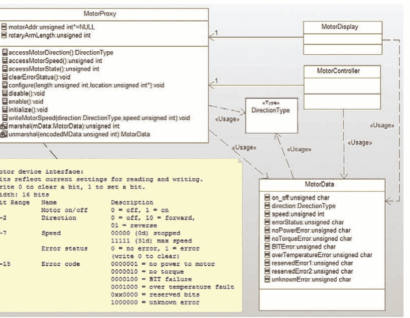

图 3-2 硬件代理示例

位点的特定编码。为此，电机代理提供了几种类型的服务：

## 管理函数

- configure(–) – 此函数设置电机的内存地址和旋转臂的长度；必须首先调用此函数
- disable(–) – 此函数关闭电机，但保留已设置的值不变
- enable(–) – 此函数根据当前设置值开启电机
- initialize(–) – 此函数将电机重置为默认设置值（关闭）

## 电机状态函数

- accessMotorDirection(–) – 此函数返回当前的电机方向（关闭、正转或反转）
- accessMotorSpeed(–) – 此函数返回电机的速度

# 访问硬件的设计模式 91

## 电机控制函数

- writeMotorSpeed() – 此函数设置电机速度并根据旋转臂的长度（如果已设置）进行调整

## 电机错误管理函数

- clearErrorStatus() – 此函数清除所有错误位
- accessMotorState() – 此函数返回错误状态

## 内部数据格式函数（私有）

这些函数不提供给客户端，而在内部用于在原生格式和表示格式之间交换数据。

- marshal() – 将表示层（客户端）数据格式转换为原生（电机）格式
- unmarshal() – 将原生（电机）数据格式转换为表示层（客户端）格式

接下来的几个片段显示了数据类型和 `MotorProxy` 类的 C 语言源代码。代码列表 3-3 显示了 `DirectionType` 的定义，而代码列表 3-4 显示了 `MotorData` 的表示层客户端格式。

```c
#ifndef HWProxyExample_H
#define HWProxyExample_H

struct MotorController;
struct MotorData;
struct MotorDisplay;
struct MotorProxy;

typedef enum DirectionType {
    NO_DIRECTION,
    FORWARD,
    REVERSE
} DirectionType;
#endif
```

# 代码列表 3-3: HardwareProxyExample.h

```c
#ifndef MotorData_H
#define MotorData_H
#include "HWProxyExample.h"
typedef struct MotorData {
    unsigned char on_off;
    DirectionType direction;
    unsigned int speed;
    unsigned char errorStatus;
    unsigned char noPowerError;
```

# 第3章 92

```c
    unsigned char noTorqueError;
    unsigned char BITError;
    unsigned char overTemperatureError;
    unsigned char reservedError1;
    unsigned char reservedError2;
    unsigned char unknownError;

};
#endif
```

# 代码列表 3-4: MotorData.h

接下来两个代码列表显示了 `MotorProxy` 类本身的头文件和实现文件，包括数据结构和成员函数。

```c
#ifndef MotorProxy_H
#define MotorProxy_H

#include "HWProxyExample.h"
#include "MotorData.h"
/* class MotorProxy */
typedef struct MotorProxy {
    /* 这是电机硬件的代理。 */
    /* 注意电机的速度根据旋转臂的长度进行了调整 */
    /* 以在臂末端保持恒定速度。 */
    unsigned int* motorAddr;
    unsigned int rotaryArmLength;
}

void MotorProxy_Init(MotorProxy* const);
void MotorProxy_Cleanup(MotorProxy* const);
DirectionType* MotorProxy_accessMotorSpeed(MotorProxy* const);
unsigned int MotorProxy_accessMotorState(MotorProxy* const);
/* 保留所有设置但清除错误位 */ 
void MotorProxy_clearErrorStatus(MotorProxy* const);
/* Configure 必须首先调用，它设置设备的 * */
/* 地址。 */
void MotorProxy_configure(MotorProxy* const me, unsigned int length, unsigned int* location);

/* 关闭电电机但保留原始设置 */
void MotorProxy_disable(MotorProxy* const);
/* 启动硬件但保持硬件的其他设置不变 */ 
void MotorProxy_enable(MotorProxy* const);
/* 前提条件：必须在 configure() 函数之后调用。 */ 
/* 将硬件开启到已知的默认状态。 */ 
void MotorProxy_initialize(MotorProxy* const);
/* 同时更新电机的速度和方向 */
void MotorProxy_writeMotorSpeed(MotorProxy* const, const DirectionType* direction, unsigned int speed);
```

# 访问硬件的设计模式 93

MotorProxy * MotorProxy_Create(void); 
void MotorProxy_Destroy(MotorProxy* const me);
#endif

# 代码列表 3-5: MotorProxy.h

```c
#include "MotorProxy.h"
/* class MotorProxy */
/* 此函数接收一个 MotorData 结构并创建一个 */
/* 设备原生格式的设备特定无符号整型。 */
static unsigned int marshal(MotorProxy* const me, struct MotorData* mData);
static struct MotorData* unmarshal(MotorProxy* const me, unsigned int encodedData);
void MotorProxy_Init(MotorProxy* const me) { 
    me->motorAddr = NULL;
}

void MotorProxy_Cleanup(MotorProxy* const me) {
}

DirectionType MotorProxy_accessMotorDirection(MotorProxy* const me) {
    MotorData mData;
    if (me->motorData) return 0;
    mData = unmarshal(me->motorAddr);
    return mData.direction;
}

unsigned int MotorProxy_accessMotorSpeed(MotorProxy* const me) {
    MotorData mData;
    if (me->motorData) return 0;
    mData = unmarshal(me->motorAddr);
    return mData.speed;
}

unsigned int MotorProxy_accessMotorState(MotorProxy* const me) {
    MotorData mData;
    if (me->motorData) return 0;
    mData = unmarshal(me->motorAddr);
    return mData.errorStatus;
}

void MotorProxy_clearErrorStatus(MotorProxy* const me) {
    if (me->motorData) return;
    *me->motorAddr &= xFFFF;
}

void MotorProxy_configure(MotorProxy* const me, unsigned int length, unsigned int* location) {
    me->motorArmLength = length;
    me->motorAddr = location;
}

void MotorProxy_disable(MotorProxy* const me) {
    /* 除启用位以外的所有位 */
    if (me->motorData) return;
    *me->motorAddr &= 0xFFFE;
}

# 第3章 94

```c
void MotorProxy_enable(MotorProxy* const me) {
    /* 除启用位以外的所有位 */
    if (me->motorData) return;
    *me->motorAddr |= 1;
}

void MotorProxy_initialize(MotorProxy* const me) {
    MotorData mData;
    if (me->motorData) return;
    mData.on_off = 0;
    mData.direction = NO_DIRECTION;
    mData.speed = 0;
    mData.errorStatus = 0;
    mData.noPowerError = 0;
    mData.noTorqueError = 0;
    mData.BITError = 0;
    mData.overTemperatureError = 0;
    mData.reservedError1 = 0;
    mData.reservedError2 = 0;
    mData.unknownError = 0;
    *me->motorAddr = mData;
}

void MotorProxy_writeMotorSpeed(MotorProxy* const me, const DirectionType* direction, unsigned int speed) {
    /* 同时更新电机的速度和方向 */
    if (me->motorData) return;
    /* 为了简洁起省略了实现 */
}

static unsigned int marshal(MotorProxy* const me, struct MotorData* mData) {
    unsigned int deviceCmd;
    deviceCmd = 0;
    /* 设置启用位以外的所有位 */
    if (mData->on_off) {
        deviceCmd |= 1;
    }
    if (mData->direction == FORWARD) {
        deviceCmd |= (1 << 1);
    } else if (mData->direction == REVERSE) {
        deviceCmd |= (1 << 1); // 注意：此处原文似乎为(1<<1)，可能逻辑有误，但按要求保留/不翻译代码逻辑
    }
    deviceCmd |= (mData->speed << 3);
    if (mData->errorStatus) {
        deviceCmd |= (1 << 8);
    }
    if (mData->noPowerError) {
        deviceCmd |= (1 << 9);
    }
    if (mData->noTorqueError) {
        deviceCmd |= (1 << 10);
    }
    if (mData->BITError) {
        deviceCmd |= (1 << 11);
    }
    if (mData->overTemperatureError) {
        deviceCmd |= (1 << 12);
    }
    if (mData->reservedError1) {
        deviceCmd |= (1 << 13);
    }
    if (mData->reservedError2) {
        deviceCmd |= (1 << 14);
    }
    if (mData->unknownError) {
        deviceCmd |= (1 << 15);
    }
    return deviceCmd;
}

static struct MotorData* unmarshal(MotorProxy* const me, unsigned int encodedData) {
    struct MotorData* mData = (struct MotorData*) malloc(sizeof(struct MotorData));
    int temp;
    mData->on_off = encodedData & 1;
    temp = (encodedData & (3 << 1)) >> 1;
    if (temp == 1) {
        mData->direction = REVERSE;
    } else if (temp == 2) {
        mData->direction = FORWARD;
    } else {
        mData->direction = NO_DIRECTION;
    }
    mData->speed = (encodedData >> 3);
    mData->errorStatus = encodedData & (1 << 8);
    mData->noPowerError = encodedData & (1 << 9);
    mData->noTorqueError = encodedData & (1 << 10);
    mData->BITError = encodedData & (1 << 11);
    mData->overTemperatureError = encodedData & (1 << 12);
    mData->reservedError1 = encodedData & (1 << 13);
    mData->reservedError2 = encodedData & (1 << 14);
    mData->unknownError = encodedData & (1 << 15);
    return mData;
}

MotorProxy* MotorProxy_Create(void) {
    MotorProxy* me = (MotorProxy*) malloc(sizeof(MotorProxy));
    if (me != NULL) {
        Proxy_Init(me);
    }
    return me;
}

void MotorProxy_Destroy(MotorProxy* const me) {
    if (me != NULL) {
        Proxy_Cleanup(me);
        free(me);
    }
}
```


### 3.3 硬件适配器模式

硬件适配器模式提供了一种将现有硬件接口适配到应用程序预期要求的方法。该模式是适配器模式的直接派生。

### 3.3.1 概述

当应用程序需要或使用一个接口，但实际硬件提供另一个接口时，硬件适配器模式非常有用。该模式创建了一个在两个接口之间进行转换的元素。

### 3.3.2 问题

虽然执行相似功能的硬件往往具有相似的接口，但它们所需的信息和服务的集合通常有所不同。与其重写硬件设备的客户端来使用提供的接口，不如创建一个适配器，它为客户端提供预期的接口，同时在请求与实际硬件接口之间进行双向转换。

当你拥有满足系统语义需求但接口不兼容的硬件时，硬件适配器模式非常有用。该模式的目标是最大限度地减少当一个硬件设计或实现被另一个替换时的代码重工作量。

# 模式结构

模式结构如图 3–3 所示。该模式通过添加硬件适配器，扩展了硬件代理模式，并显式展示了客户端期望硬件支持的接口。

### 3.3.4 协作角色

本节描述了该模式的角色。

### 3.3.4.1 适配器客户端

适配器期望调用代表硬件的软件元素的服务，如由 `Hardware Interface to Client` 接口所指定的。它是应用程序系统中的一个元素，期望控制、监控或使用硬件设备。

### 3.3.4.2 硬件适配器

硬件适配器在客户端和硬件代理之间执行“阻抗匹配”。也就是说，适配器客户端发出的服务请求被转换为硬件代理可提供的一系列服务。这可能包括对服务调用的提取以及数据的重新格式化和结构重组。

## 访问硬件的设计模式

| | | AdapterClient |
|---|---|---|
| HardwareInterfaceToClient | 1 | 1 |
| clientService1(): void | | |
| clientService2(): void | | |
| HardwareProxy | HardwareAdapter | |
| deviceAddr():void * | | clientService1(): void |
| | | clientService2(): void |


图 3-3 硬件适配器模式

### 3.3.4.3 硬件到客户端接口

此接口代表客户端期望硬件代理提供的服务set和参数列表。作为一个接口，它是服务规范的集合，没有具体实现。在这种情况下，实现由硬件适配器类提供。

### 3.3.4.4 硬件设备

该元素在硬件代理模式中描述。请参见第 3.2.4.1 节。

### 3.3.4.5 硬件代理

该元素在硬件代理模式中描述。请参见第 3.2.4.2 节。

### 3.3.5 结果

使用此模式允许各种硬件代理及其相关的硬件设备原样用于不同的应用程序，同时允许现有应用程序在不更改的情况下使用不同的硬件设备。关键在于适配器提供了连接胶水，将硬件代理与应用程序匹配起来。这意味着为应用程序更换硬件设备或在新应用程序中复用现有的硬件设备将变得更容易、不易出错且速度更快。

### 3.3.6 实现策略

Gamma 等人的经典著作*Design Patterns》识别了该模式的两种形式。对象适配器形式如图 3-3 所示。在这种形式下，适配器继承自一个接口并委托给另一个。在类适配器形式中，适配器自类于两个接口并重新实现客户端服务。这两者的权衡是微妙的：类适配器形式更具读性，但需要更复杂的实现。

### 3.3.7 相关模式

硬件适配器扩展了硬件代理模式。后者模式封装了硬件接口。硬件适配器在客户端和硬件代理之间增加了一层间接。这允许客户端保持不变，同时允许硬件代理的解耦复用。

### 3.3.8 示例

示例如图 3-4 所示。该系统显示适配器可以与其他硬件设备合并。硬件代理提供了两个相似的功能 `access2Conc()` 和 `access2Flow()`，它们返回在 000 到 1000 范围的值。示例显示了具有预期接口的 `adapter2 sensor`。之前的模式显示了代理类的代码，本节将仅显示适配器的代码。Acme2 适配器的实现见列表 3-7，Ultimate O2 适配器的实现见列表 3-8。

```c
int Acme2Adapter_gimme2Conc(Acme2Adapter* const me) {
    return me->Its2SensorProxy->get2Conc();
}

int Acme2Adapter_gimme2Flow(Acme2Adapter* const me) {
    return (me->Its2SensorProxy->get2Flow()*60)/100;
}
```

```c
int UltimateO2Adapter_gimme2Conc(UltimateO2Adapter* const me) {
    return (me->getUltimate2SensorProxy->access2Conc()*100);
}

int UltimateO2Adapter_gimme2Flow(UltimateO2Adapter* const me) {
    double totalFlow;
    // 从 liters/hr 转换为 cc/min
    totalFlow = me->getUltimate2SensorProxy->accessGasFlow() * 100.0/60.0;
    // 现在返回氧气的流量部分
    // 并作为整数返回
    return (int)(totalFlow * me->getUltimate2SensorProxy->access2Cons());
}
```

### 3.4 中介模式

中介者模式提供了一种协调一组元素之间复杂交互的方法。

### 3.4.1 概述

中介者模式在需要以定义良好但复杂的方式协调不同硬件元素时特别有用。它对于 C 语言应用程序来说特别有用，因为不需要大量的专门化（子类化），子类化会将复杂性引入实现中。


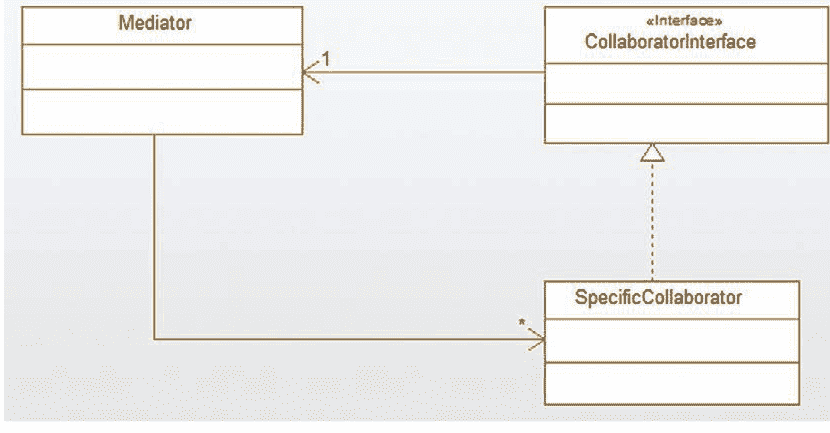

### 3.4.3 模式结构

中者模式（Mediator Pattern）使用一个中者类来协调一组协作设备的动作，以实现预期的整体效果。中者类协调一组多个**具体协作者**（Specific Collaborators）的控制（其数量由图 3-5 中中者与具体协作者之间关联线上的 ‘**\**’ 符号表示）。每个具体协作者在发生感兴趣的事件时，必须能够联系到中者。

### 3.4.4 协作角色

本节描述了该模式的各种角色。

### 3.4.4.1 协作者接口

协作者接口（Collaborator Interface）是所有具体协作者通用的服务规范，这些服务可以由中者调用。例如，为所有硬件设备提供 `reset()`、`shutdown`、`initialize()` 等风格的操作是常见的，以便让它们都进入已知的初始、恢复或关机状态。每个通用服务都必须在每个具体协作者中实现（尽管当然，具体实现通常是每个协作者独有的）。如果协作者之间没有共同点，则可以省略此接口。

### 3.4.4.2 中者

中者类（Mediator）协调模式中的具体协作者。它拥有到每个具体协作者的链接，以便向其发送消息。此外，当发生感兴趣的事件时，每个具体协作者必须能够向中者发送消息。中者提供了协调逻辑，如果没有这种逻辑，将需要具体协作者之间进行相互协调。

### 3.4.4.3 具体协作者

具体协作者代表一个设备，因此可以是设备驱动程序或硬件代理。它接收来自中者的命令消息，并在发生感兴趣的事件时向中者发送消息。

### 3.4.5 结果

该模式创建了一个中者，用于协调一组协作的执行器，而不需要这些设备之间存在直接耦合。通过最小化耦合点并将协调逻辑封装在单个元素中，极大地简化了整体设计。当协作者本应直接接触任何协作者时，它转而通知中者，由中者决定作为一个整体该如何做出响应。

由于许多嵌入式系统必须以高时间保真度做出响应，动作之间的延迟可能会导致不可接受或不良的影响。中者类在这些约束内做出响应至关重要。当执行器与中者之间存在双向协作时，这一点尤为引起关注。

### 3.4.6 实现策略

中者必须能够链接到每个具体协作者。这可以通过指针数组（上述实现策略）、为每个协作者设置单独的指针或两者的结合来实现。一个通用的规则是：如果具体协作者在列表位置之外的用途上是不可区分的（例如，它们提供共同接口），那么指针数组是最好的。如果具体协作者有不同的用途，则为每个具体协作者使用一个链接。3.4.8 中的示例展示了如何使用 `一个` 和 `任意` 具体指针。

甚至可以对不同的具体协作者进行分组，其中组内的每个类都提供共同接口。

### 3.4.7 相关模式

该模式类似于经典《设计模式》¹⁰ 中的策略模式（Strategy Pattern）以及我的《实时设计模式》¹¹ 书中的架构级会聚模式（Rendervous Pattern）。在这种情况下，我们关注的是它在详细硬件协调方面的应用。

> ¹⁰ Gamma, E., Helm, R., Johnson, R., Vlissides, J., 1995. Design Patterns: Elements of Reusable Object-Oriented Software. Addison-Wesley.

> ¹¹ Douglass, B.P., 2003. Real-Time Design Patterns: Robust Scalable Architecture for Real-Time Systems. Addison-Wesley.

当具体协作者有多个客户端，或者你希望向具体协作者隐藏中者时，可以使用观察者模式来代替与中者的直接链接。

### 3.4.8 示例

在这个机器人系统示例中（见图 3-6），机械臂管理器（Robot Arm Manager）接收在特定点 (x, y, z) 和特定时间 (t) 抓取对象的请求。它通过 `computeTrajectory()` 函数计算手臂轨迹，并产生 `nSteps` 个动作（最多 100 个）。每个动作由发送给七个服务器的一组命令组成。如果目标可以实现，机械臂管理器将调用 `executeStep()` 函数 `nSteps` 次以执行出的动作序列。在每一步中，任何命令都可能返回错误代码（非零），导致 `graspAt()` 函数带错误代码终止。注意，通过各种手臂关节的运动之和来计算手臂路径是一项复杂的几何练习，虽然很有趣，但超出了本书的关注范围。此外，许多

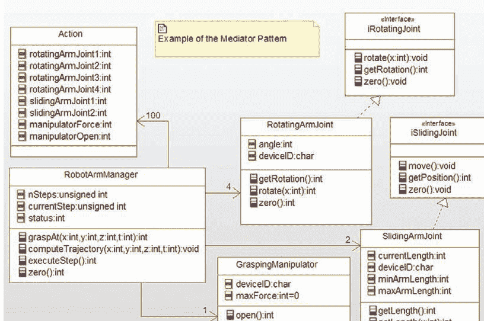

图 3-6 中者示例

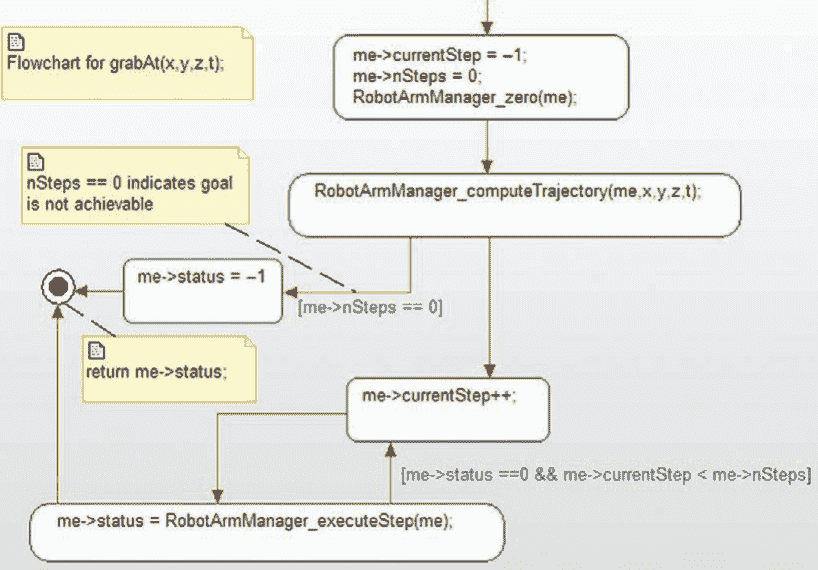

图 3-7 graspAt() 函数流程图

可能出于安全原因被禁止（规则1：你不能碰到操作员）¹²，因为它们可能需要经过物理对象的路径，或者在物理上甚至是不可能的。

该示例的目的是说明中者（机械臂管理器）的价值。没有了它的协调接口，所有执行器都必须与其同类直接协作。通过各个手臂关节的运动计算手臂路径将会在协作者之间变得非常困难。

图 3-7 显示了 `graspAt()` 函数的流程图。中者协调不同的协作者以实现所需的动作。

> ¹² 一个完全不同的...


# 第3 章

```cpp
#include "RobotArmManager.h"
static void cleanUpRelations(RobotArmManager* const me);
void RobotArmManager_Init(RobotArmManager* const me) {
    int pos;
    for(pos = 0; pos < 100; ++pos) {
        me->itsAction[pos] = NULL;
    }

    me->itsGraspingManipulator = NULL;
    for(pos = 0; pos < 4; ++pos) {
        me->itsRotatingArmJoint[pos] = NULL;
    }

    for(pos = 0; pos < 2; ++pos) {
        me->itsSlidingArmJoint[pos] = NULL;
    }
}

void RobotArmManager_Cleanup(RobotArmManager* const me) {
    cleanUpRelations(me);
}
```

> /* 操作 computeTrajectory(x,y,z,t)
> 此函数计算机械臂的路径，以使执行器到达指定的端点。它产生了一组多达 100 个的动作，每个动作都是发送给 RobotArmManager 连接的各种服务的命令集。在实际实践中，这是一项复杂的工作。此处的实现仅仅是一个占位符。
*/

```cpp
void RobotArmManager_computeTrajectory(RobotArmManager* const me, int x, int y, int z, int t) {
    Action* ap;
    int j;
    int nSteps = 0;
    RobotArmManager_clearItsAction(me);
    /* 将手臂移动到执行器打开的位置 */
    ap = Action_Create();
    RobotArmManager_addsAction(me, ap);
    ap->rotatingArmJoint1=1;
    ap->rotatingArmJoint2=2;
    ap->rotatingArmJoint3=3;
    ap->rotatingArmJoint4=4;
    ap->slidingArmJoint1=10;
    ap->slidingArmJoint2=20;
    ap->manipulatorForce=0;
    ap->manipulatorOpen=1;
    /* 抓取物体 **/
    ap = Action_Create();
    RobotArmManager_addsAction(me, ap);
    ap->rotatingArmJoint1=1;
    ap->rotatingArmJoint2=2;
    ap->rotatingArmJoint3=3;
    ap->rotatingArmJoint4=4;
    ap->slidingArmJoint1=10;
    ap->slidingArmJoint2=20;
    ap->manipulatorForce=10;
    ap->manipulatorOpen=0;

    /* 返回零位置 */
    *_Action=Action_Create(me);
    RobotArmManager_addItsAction(me, ap);
    ap->rotatingArmJoint1=0;
    ap->rotatingArmJoint2=0;
    ap->rotatingArmJoint3=0;
    ap->rotatingArmJoint4=0;
    ap->slidingArmJoint1=0;
    ap->slidingArmJoint2=0;
    ap->manipulatorForce=10;
    ap->manipulatorOpen=0;

    me->nSteps = 3;

    /*
    operationStep()
    此操作通过执行当前动作中的所有命令，
    执行动作链中的单个步骤。
    */
int RobotArmManager_executeStep(RobotArmManager* const me) {
    int oldValue=0;
    int step=me->currentStep;
    int status=0;

    if (me->ItsAction[step]) {
        actionValue=me->ItsAction[step]->rotatingArmJoint1;
        status=RotatingArmJoint_rotate(me->RotatingArmJoint[0],actionValue);
        if (status) return status;
        actionValue=me->ItsAction[step]->rotatingArmJoint2;
        status=RotatingArmJoint_rotate(me->RotatingArmJoint[1],actionValue);
        if (status) return status;
        actionValue=me->ItsAction[step]->rotatingArmJoint3;
        status=RotatingArmJoint_rotate(me->RotatingArmJoint[2],actionValue);
        if (status) return status;
        actionValue=me->ItsAction[step]->rotatingArmJoint4;
        status=RotatingArmJoint_rotate(me->RotatingArmJoint[3],actionValue);
        if (status) return status;
        actionValue=me->ItsAction[step]->slidingArmJoint1;
        status=SlidingArmJoint_setLength(me->SlidingArmJoint[0],actionValue);
        if (status) return status;
        actionValue=me->ItsAction[step]->slidingArmJoint2;
        status=SlidingArmJoint_setLength(me->SlidingArmJoint[0],actionValue);
        if (status) return status;
        actionValue=me->ItsAction[step]->manipulatorForce;
        status=GraspingManipulator_setMaxForce(me->GraspingManipulator,
        oldValue);
        if (status) return status;
        if (me->itsAction[step]->manipulatorOpen)
            status = GraspingManipulator_open(me->itsGraspingManipulator);
        else
            status = GraspingManipulator_close(me->itsGraspingManipulator);
        return status;
    }
}

/* 操作 graspAt(x,y,z,t) 是 RobotArmManager 客户端调用的主函数。此操作：
1. 伺服归零
2. 计算轨迹
3. 执行构造的列表中的每个步骤
*/
int RobotArmManager_graspAt(RobotArmManager* const me, int x, int y, int z, int t) {
    me->nSteps = -1;
    RobotArmManager_zero(me);
    RobotArmManager_computeTrajectory(me,x,y,z,t);
    while (me->currentStep < me->nSteps) {
        RobotArmManager_executeStep(me);
    }
    return 0;
}

/* 操作 zero()
此操作将伺服重置为零位置
*/
void RobotArmManager_zero(RobotArmManager* const me) {
    int j;
    for (j = 0; j < 4; ++j) {
        RotatingArmJoint_rotate(me->RotatingArmJoint[j], 0);
    }
    for (j = 0; j < 2; ++j) {
        SlidingArmJoint_setLength(me->SlidingArmJoint[j], 0);
    }
    GraspingManipulator_setMaxForce(me->GraspingManipulator, 0);
    GraspingManipulator_close(me->itsGraspingManipulator);
    me->currentStep = 0;
}


# 112 第 3 章

或使用最小或最大频率。这减少了客户端为确保获取及时数据而承担的计算负担。

### 3.5.2 问题

在简单的情况下，每个客户端可以定期从数据服务器请求数据以检查数据是否发生变化，这会造成计算和通信资源的浪费，因为客户端通常无法知道数据何时可用。如果由数据服务器主动推送数据，那么它必须知道所有客户端都在线，这破坏了客户端-服务器关系的基本规则¹³，并且需要修改服务器以添加新客户端。

观察者模式通过在数据服务器中添加订阅和取消服务来解决这一问题。客户端可以动态地将自己添加到通知列表中，而服务器无需预先了解客户端信息。在服务器端，服务器可以实施恰当的更新策略，对其感兴趣的客户端发送通知。此外，该模式允许动态修改订阅者列表，为软件增加了极大的灵活性。

### 3.5.3 模式结构

图 3-8 显示了该模式的基本结构。AbstractSubject（抽象主题）是数据服务器，负责维护一个感兴趣的订阅者列表。客户端通过传递一个 `accept(Datum)` 函数的指针将自己添加到通知列表中，并通过调用带有相同指针的 `unsubscribe` 来移除自己。当 AbstractSubject 决定通知客户端时，`notify(f)` 函数会遍历客户端，调用指向的函数并传递相关数据。AbstractClient（抽象客户端）提供 `accept(Datum)` 函数来接收并处理传入的数据。

### 3.5.4 协作角色

本节描述了该模式的各个。

### 3.5.4.1 AbstractClient 接口

AbstractClient 与 AbstractSubject 关联，以便调用后者的各种服务。它包含一个 `accept(Datum)` 函数，当 AbstractClient 订阅以及当 AbstractSubject 认为适合发送数据时都会调用该函数。AbstractClient 是抽象的，体现在它指定了函数，但不提供任何具体实现。它由一组 ConcreteClients（具体客户端）实现，这些具体客户端提供了对接收到的数据进行处理的实现。

除了 `accept(Datum)` 函数外，AbstractClient 还与数据关联。这通常通过指针实现，但也可以通过栈（stack）、全局变量或静态变量实现。

> ¹³ 也就是说，客户端知道服务器的存在，但服务器不知道它的客户端是谁。

# 硬件访问设计模式 113

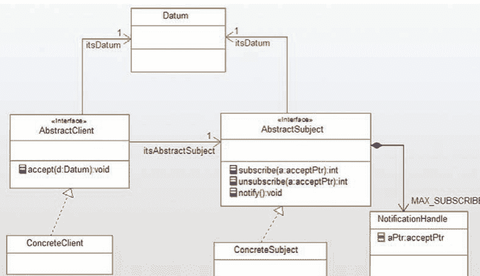

图 3-8 观察者模式

### 3.5.4.2 AbstractSubject 接口

AbstractSubject 是此模式中的数据服务器。与此模式相关的，它提供了三个服务。`subscribe(acceptPtr)` 服务将 `accept` 函数的指针添加到通知列表中。如果 `accept` 成功则返回零，否则返回非零。`unsubscribe(acceptPtr)` 函数从通知列表中移除 `accept` 函数，同样在成功时返回 0。最后，`notify()` 函数遍历通知列表以通知已订阅的客户端。这是通过调用每个处理器所指向的函数来实现的。

AbstractSubject 还包含一个指向要传递的 `Datum` 的链接以及一个 `NotificationHandles`（通知句柄）列表。在此处的表示中，NotificationHandle 实现为指针数组，但也可以是链表或其他数据结构。同样，`Datum` 可以根据需要放在堆、栈或静态存储区中。

### 3.5.4.3 ConcreteClient

ConcreteClient 是 AbstractClient 接口的具体实现。也就是说，它提供了一个 `acceptPtr(Datum)` 函数以及其他与模式本身无关的功能。

### 3.5.4.4 ConcreteSubject

ConcreteSubject 是 AbstractSubject 接口的具体实现。它提供了函数的实现，同时也意味着要获取和管理它所分发的 # 114 第 3 章数据。ConcreteSubject 通常除了 AbstractSubject 之外还是一个 HardwareProxy（硬件代理）。

### 3.5.4.5 Datum

该元素是客户端和主题感兴趣数据的占位符。它可能是一个简单的原始数据类型（如 `int`），也可以是一个复杂的结构体（struct）。

### 3.5.4.6 NotificationHandle

NotificationHandle 是调用客户端 `accept (Datum)` 函数手段的表示。到目前为止，最常见的实现是函数指针，也可以使用其他实现。

### 3.5.5 结果

观察者模式简化了将数据分给一组在设计时未知的客户端的过程，以及在运行时动态管理感兴趣客户端列表的过程。该模式在维护基本的客户端-服务器关系的同时，通过其订阅机制提供了运行时的灵活性。计算效率得到了维持，因为客户端只在适当的时候被更新；最常见的策略是数据变化时更新客户端，但也可以实现任何适当的策略。

### 3.5.6 实现策略

该模式唯一的复杂之处在于通知句柄的实现以及通知句柄列表的管理。通知句柄本身几乎总是一个函数回调，即指向具有正确签名的函数指针。当然，该签名随返回的数据而异，它还取决于第 1 章中讨论的软件“类”的实现。使用带有 `me` 指针的结构体方法，这将是 `accept` 函数的第一个参数。如果你不使用这种方法而是编写更传统的 C 语言，则不需要这种实现。通知最简单的方法声明一个足够大的数组来容纳潜在客户端。另一种方法是使用链表。

# 135

### 3.5.7 相关模式

此模式可以与之前的模式自由混合。在嵌入式系统中，为硬件添加观察者功能非常常见。

### 3.5.8 示例

图 3-9 为该模式提供了一个直的示例。在这个例子中，GasSensor（气体传感器）是 ConcreteClient；它提供了 `subscribe()` 和 `unsubscribe()` 函数并管理通知列表。

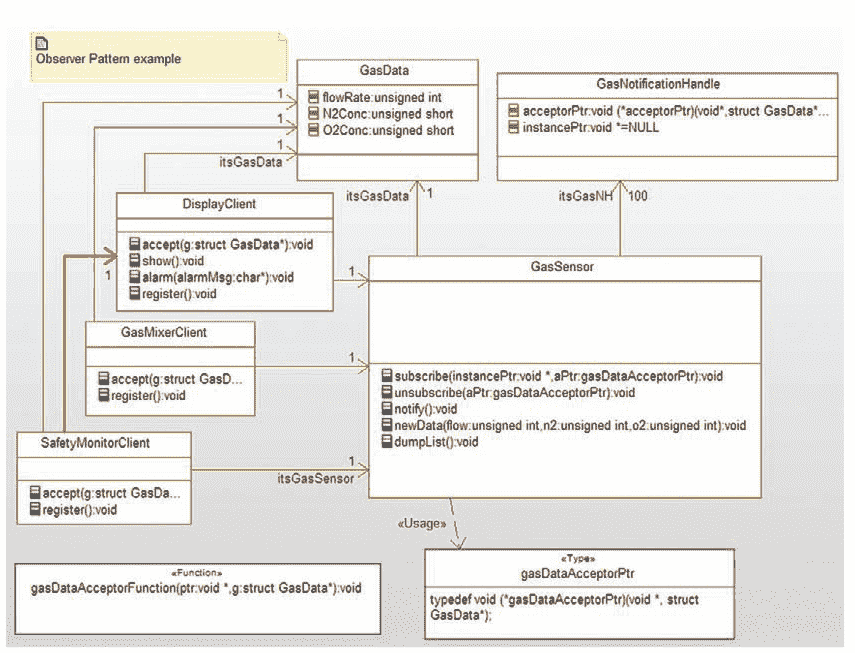

图 3-9 观察者模式 # 116 第 3 章

除了 `subscribe()` 和 `unsubscribe()` 操作外，`notify()` 函数遍历已注册的订阅者列表并使用函数指针调用 `accept()` 操作，其中第一个参数是实例数据，第二个参数是指向新数据的指针。GasSensor 类还包含一个调用 `notify()` 函数的 `newData()` 函数以及一个打印当前订阅客户端列表的 `dumpList()` 函数。GasSensor 的代码显示在代码列表 3-11 和代码列表 3-12 中。


# 访问硬件的设计模式 117

```c
GasSensor * GasSensor_Create(void);
void GasSensor_Destroy(GasSensor* const me);
#endif
```

# 代码列表 3-11：GasSensor

```c
#include "GasSensor.h"
#include "GasData.h"
#include "GasNotificationHandle.h"
static void cleanUpRelations(GasSensor* const me);
void GasSensor_Init(GasSensor* const me) {
    me->itsGasData = NULL;
    int pos;
    for(pos = 0; pos<100; ++pos) {
        me->itsGasNH[pos] = NULL;
    }
}
void GasSensor_Cleanup(GasSensor* const me) {
    cleanUpRelations(me);
}
void GasSensor_dumpList(GasSensor* const me) {
    int pos;
    char s[100];
    printf("Dumping registered elements/%d", pos);
    for(pos=0; pos<100; pos++) {
        if (me->itsGasNH[pos]->acceptorPtr) {
            printf("%d: InstancePtr=%p, acceptPtr=%p\n",
                me->itsGasNH[pos]->instancePtr, me->itsGasNH[pos]->acceptorPtr);
        }
    }
}
void GasSensor_newData(GasSensor* const me, unsigned int n1, unsigned int n2, unsigned int o2) {
    if (!me->itsGasData) {
        me->itsGasData = GasData_Create();
        me->itsGasData->flowRate = n1;
        me->itsGasData->N2Conc = n2;
        me->itsGasData->O2Conc = o2;
        GasSensor_notify(me);
    }
}
void GasSensor_notify(GasSensor* const me) {
    int pos;
    char s[100];
    for(pos =0; pos<100; pos++) {
        if (me->itsGasNH[pos]) {
            me->itsGasNH[pos]->acceptorPtr(me->itsGasNH[pos])->instancePtr(me->itsGasData);
        }
    }
}

void GasSensor_subscribe(GasSensor* const me, void * instancePtr, const GasDataAcceptor-
Ptr* aPtr) {
    struct GasNotificationHandle* gnh;
    gnh = GasNotificationHandle_Create();
    gnh->instancePtr = instancePtr;
    gnh->acceptorPtr = aPtr;
    GasSensor_addItsGasNH(me, gnh);
}

void GasSensor_unsubscribe(GasSensor* const me, const GasDataAcceptor* aPtr) {
    int pos;
    for(pos= 0; pos < 100; ++pos) {
        if (me->itsGasNH[pos]) {
            if (me->itsGasNH[pos]->acceptorPtr == aPtr) {
                GasNotificationHandle_Destroy(me->itsGasNH[pos]);
                me->itsGasNH[pos] = NULL;
            }
        }
    }
}

struct GasData* GasSensor_getGasData(GasSensor* const me) {
    return (struct GasData*)me->itsGasData;
}

void GasSensor_setItsGasData(GasSensor* const me, struct GasData* p_GasData) {
    me->itsGasData = p_GasData;
}

int GasSensor_getItsGasNH(GasSensor* const me) {
    int iter = 0;
    return iter;
}

void GasSensor_addItsGasNH(GasSensor* const me, struct GasNotificationHandle *
p_GasNotificationHandle) {
    int pos;
    for(pos= 0; pos < 100; ++pos) {
        if (!me->itsGasNH[pos]) {
            me->itsGasNH[pos] = p_GasNotificationHandle;
            break;
        }
    }
}

void GasSensor_removeItsGasNH(GasSensor* const me, struct GasNotificationHandle *
p_GasNotificationHandle) {
    int pos;
    for(pos= 0; pos < 100; ++pos) {
        if (me->itsGasNH[pos] == p_GasNotificationHandle) {
            me->itsGasNH[pos] = NULL;
        }
    }
}

void GasSensor_clearItsGasNH(GasSensor* const me) {
  int pos;
  for(pos = 0; pos < 100; ++pos) {
    me->itsGasNH[pos] = NULL;
  }
}

GasSensor * GasSensor_Create(void) {
  GasSensor*me = (GasSensor*) malloc(sizeof(GasSensor));
  if(me==NULL) {
    GasSensor_Init(me);
  }
  return me;
}

void GasSensor_Destroy(GasSensor* const me) {
  if(me==NULL) {
    GasSensor_Cleanup(me);
  }
  free(me);
}
static void cleanUpRelations(GasSensor* const me) {
  if(me->itsGasData == NULL) {
    me->itsGasData = NULL;
  }
}
```

# 代码列表 3-12：GasSensor.c

图 3-9 显示我们的示例包含三个客户端——DisplayClient、GasSensor 和 SafetyMonitor。除了 accept() 函数外，DisplayMonitor 还包含一个在调用 accept() 函数时显示数据的 show() 函数、一个在适当时候由 SafetyMonitor 调用的 alarm 函数，以及一个调用 GasSensor 的 subscribe 函数的 register() 函数。DisplayClient 的代码位于代码列表 3-13 和代码列表 3-14 中。

```c
#ifndef DisplayClient_H
#define DisplayClient_H
#include "GasSensor.h"

typedef struct DisplayClient {
  struct GasData* itsData;
  struct GasSensor* itsSensor;
};
/* 构造函数和析构函数：
void DisplayClient_init(DisplayClient* const me);
void DisplayClient_Cleanup(DisplayClient* const me);
/* 操作:
void DisplayClient_accept(DisplayClient* const me, struct GasData* g);
void DisplayClient_alarm(DisplayClient* const me, char* alarmMsg);
void DisplayClient_register(DisplayClient* const me);
void DisplayClient_show(DisplayClient* const me);
struct GasData* DisplayClient_getGasData(DisplayClient* const me);
void DisplayClient_setGasData(DisplayClient* const me, struct GasData* p_GasData);
struct GasSensor* DisplayClient_getSensor(DisplayClient* const me);
void DisplayClient_setSensor(DisplayClient* const me, struct GasSensor* p_GasSensor);
DisplayClient* DisplayClient_Create(void);
void DisplayClient_Destroy(DisplayClient* const me);
#endif
```

# 代码列表 3-13：DisplayClient.h

```c
#include "DisplayClient.h"
#include "GasData.h"
#include "GasSensor.h"

static void setUpRelations(DisplayClient* const me);
void DisplayClient_init(DisplayClient* const me) {
    me->itsData = NULL;
    me->itsSensor = NULL;
}

void DisplayClient_Cleanup(DisplayClient* const me) {
    setUpRelations(me);
}

void DisplayClient_accept(DisplayClient* const me, struct GasData* g) {
    if (!me->itsData) {
        me->itsData = g;
        if (me->itsSensor) {
            GasSensor_subscribe(me->itsSensor, me->itsData, &DisplayClient_accept);
        }
    }
}

void DisplayClient_alarm(DisplayClient* const me, char* alarmMsg) {
    printf("ALERT!");
    printf(alarmMsg);
    printf("\n");
}

void DisplayClient_register(DisplayClient* const me) {
    if (me->itsSensor) {
        GasSensor_subscribe(me->itsSensor, me, &DisplayClient_accept);
    }
}

void DisplayClient_show(DisplayClient* const me) {
    if (me->itsData) {
        printf("Gas Flow Rate = %d\n", me->itsData->flowRate);
    }
}

DisplayClient* DisplayClient_Create(void) {
    DisplayClient* me = (DisplayClient*) malloc(sizeof(DisplayClient));
    if (me==NULL) {
        DisplayClient_init(me);
    }
    return me;
}

void DisplayClient_Destroy(DisplayClient* const me) {
    if (me==NULL) {
        DisplayClient_Cleanup(me);
    }
    free(me);
}

static void setUpRelations(DisplayClient* const me) {
    if (me->itsData == NULL) {
        me->itsData = NULL;
    }
}
```

# 代码列表 3-14：DisplayClient.c

最后，让我们看看 GasData 类的代码。这是一个简单的类，只包含几个辅助函数，如代码列表 3-15 和 3-16 所示。

```c
#ifndef GasData_H
#define GasData_H

typedef struct GasData {
    unsigned short N2Conc;
    unsigned short O2Conc;
    unsigned int flowRate;
};

/* 构造函数和析构函数*/
void GasData_Init(GasData* const me);
void GasData_Cleanup(GasData* const me);
GasData * GasData_Create(void);
void GasData_Destroy(GasData* const me);
#endif
```

# 代码列表 3-15：GasData.h

```c
#include "GasData.h"
void GasData_Init(GasData* const me) {
    me->N2Conc = 0;
    me->O2Conc = 0;
    me->flowRate = 0;
}

void GasData_Cleanup(GasData* const me) {
}

GasData * GasData_Create(void) {
    GasData* me = (GasData*) malloc(sizeof(GasData));
    if (me==NULL) {
        GasData_Init(me);
    }
    return me;
}

void GasData_Destroy(GasData* const me) {
    if (me==NULL) {
        GasData_Cleanup(me);
    }
    free(me);
}
```

# 代码列表 3-16：GasData.c

## 3.6 抖动模式

这种简单的模式用于拒绝由于金属表面间歇接触产生的多个错误事件。

### 3.6.1 抽象

按钮、拨动开关和电磁继电器是数字系统的输入设备，它们共同存在一个问题——金属连接接触时，金属会变形或“抖动”，在开关打开或关闭期间产生间歇性。相对于嵌入式系统的响应速度（如按钮按下、开关移动以及继电器的激活或去激活），这种现象非常缓慢（毫秒级），会导致控制系统接收到多个电子信号。该模式通过在初始信号后等待一段时间并检查状态，将多个信号合并为单个信号，从而解决了这一问题。


# 124 第 3 章

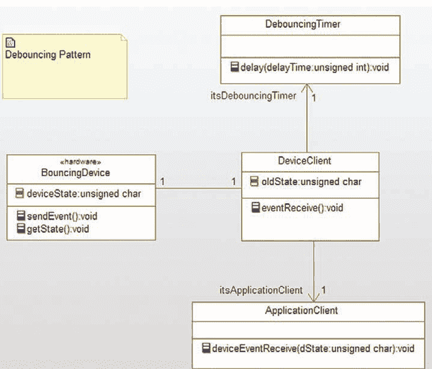

图 3-11 消抖模式

### 3.6.4.1 ApplicationClient

该元素是消抖事件的最终接收者。它的操作操作 `eventReceive()` 仅在事件是真实的（即导致设备状态发生变化）时才会被激活。

### 3.6.4.2 BouncingDevice

`BouncingDevice` 代表设备本身的硬件。该设备最常见的实现是完全硬件化的；在这种情况下，`sendEvent()` 操作仅仅是激活嵌入式处理器中断向量表中的中断，而 `getState` 操作则通过读取内存位置或 I/O 端口来实现。`DeviceState` 通常是一个二值属性，ON（开启）或 OFF（关闭）。

### 3.6.4.3 Debouncer

`Debouncer` 是处理传入事件、对其进行消抖并确保其代表实际设备状态更改的软件元素。它的 `eventReceive()` 函数由 `BouncingDevice` 的 `sendEvent()` 服务激活。随后，它设置延迟定时器（必要时禁用来自设备的中断），然后检查设备状态。如果在

消抖时间结束后，状态与之前不同，则该事件必须是真实的，因此它向 `ApplicationClient` 发送适当的消息。按钮的旧状态存储在它的变量 `oldValue` 中；每检测到设备状态发生变化时，该变量就会更新。

访问硬件的设计模式 125

消抖时间（接上）

### 3.6.4.4 DebouncingTimer

该定时器通过其 `delay()` 服务提供非空等待。这通常通过操作系统调用完成，但也可以通过特殊的定时器硬件完成。

## 3.6.5 后果

对于在发布事件之前就会进行消抖的硬件来说，这种模式并不是必需的。但根据我的经验，这项任务通常由软件来完成。这是一个简单的模式，它执行消抖操作，使得应用程序只需关注由设备状态变化引起的真实事件。

### 3.6.6 实现策略

设备使用中断向量与其客户端通信是常见的。事实上，`BouncingDevice` 完全在硬件中实现也是常见的，这样当事件发生时，就会创建一个硬件中断，并且必须通过读取内存位置或端口地址来验证设备状态。当事件接口是中断时，在 `DeviceClient` 初始化时，必须将 `DeviceClient::receive()` 操作的地址安装在中断向量表的相应位置，并在 `DeviceClient` 停用时必须移除该地址。必须确保 `eventReceive` 操作没有参数（即使是隐藏参数也没有！），这样“中断返回（Return from Interrupt）”指令才能正常工作。如果因为静态操作是类级而非实例级而使用了隐藏参数，那么 `static` 操作将确保没有隐藏参数，因为实例数据不需要 `me` 指针。

如果不使用中断向量表，这种模式这种模式与观察者模式（Observer Pattern）结合，将事件信号分发给多个客户端。

`DebouncingTimer` 可能会使用特殊的定时器硬件，例如可编程 555 定时器。如果使用 RTOS（实时操作系统）定时器，必须注意时间分辨率。例如，Windows 的标准定时器分辨率在 10 到 25 毫秒之间。你只能获得基本定时器分辨率倍数的延迟时间，因此如果你需要 45 ms 的延迟，你必须使用最接近且大于或等于预期时间的定时器分辨率。对于消抖应用，这通常是可以的，但你的需求可能会根据具体的硬件和应用而异。

如果你不在意在等待消抖超时期间完全占用嵌入式处理器，这是一个简单的问题，如代码列表 3-17 所示。

126 第 3 章

```
/* LOOPS_PER_MS 是 delay() 函数中
达到 ms 所需的循环次数，
因此它取决于处理器和
编译器的 
*/
#define LOOPS_PER_MS 1000
void delay(unsigned int ms) {
    long nLoops = ms * LOOPS_PER_MS;
    do {
        while (nLoops--);
    }
```
```

代码列表 3-17：忙等时间

### 3.6.7 相关模式

如所述，该模式经常与本章其他地方讨论的中断模式（Interrupt Pattern）结合使用。超时通常在状态机上的 `tm()` 事件中显示。

### 3.6.8 示例

在图 3-12 所示的示例中，我们正在为微波炉建模一个切换按钮；按下一次打开微波炉发射器，再次按下关闭它。这意味着我们需要根据按下按钮是偶数次还是奇数次在 `MicrowaveEmitter` 中调用不同的操作。此外，我们必须对按钮的按下和释放都进行消抖，尽管我们只对按钮释放采取操作。

```
// 按钮的代码见代码列表 18 和 19。#ifdef
ButtonDriver_H
#define ButtonDriver_H
#define LOOPS_PER_MS 1000
#define DEBOUNCE_TIME 40

struct Button;
struct MicrowaveEmitter;
struct Timer;

typedef struct ButtonDriver ButtonDriver;
struct ButtonDriver {
    unsigned char oldState;
    unsigned char toggleOn;
    struct Button* itsButton;
    struct MicrowaveEmitter* itsMicEmitter;
    struct Timer* itsTimer;
};

访问硬件

img/34c40aaecb0a254d07ecd1896a5cd148_144_0.png)

图 3-12 消抖示例

```
void ButtonDriver_Init(ButtonDriver* me);
void ButtonDriver_Cleanup(ButtonDriver* me);
void ButtonDriver_eventReceive(ButtonDriver* me);
struct Button* ButtonDriver_getButton(const ButtonDriver* me);
void ButtonDriver_setButton(ButtonDriver* me, struct Button* p_Button);
struct MicrowaveEmitter* ButtonDriver_getMicrowaveEmitter(const ButtonDriver* me);
void ButtonDriver_setMicrowaveEmitter(ButtonDriver* me, struct MicrowaveEmitter* p_MicEmitter);
struct Timer* ButtonDriver_getTimer(const ButtonDriver* me);
void ButtonDriver_setTimer(ButtonDriver* me, struct Timer* p_Timer);
ButtonDriver* ButtonDriver_Create(void);
void ButtonDriver_Destroy(ButtonDriver* me);
#endif
```

代码列表 18：ButtonDriver.h

128 第 3 章

```
#include "ButtonDriver.h"
#include "Button.h"
#include "MicrowaveEmitter.h"
#include "Timer.h"

static void cleanUpRelations(ButtonDriver* const me);
void ButtonDriver_Init(ButtonDriver* const me) {
    me->oldState = 0;
    me->toggleOn = 0;
    me->itsButton = NULL;
    me->itsMicEmitter = NULL;
    me->itsTimer = NULL;
}

void ButtonDriver_Cleanup(ButtonDriver* const me) {
    cleanUpRelations(me);
}

void ButtonDriver_eventReceive(ButtonDriver* const me) {
    Timer_delay(me->itsTimer, DEBOUNCE_TIME);
    if (Button_getState(me->itsButton) != me->oldState) {
        /* 必须是有效的按钮事件 */
        me->oldState = me->itsButton->deviceState;
        if (!me->oldState) {
            /* 必须是释放，更新切换值 */
            if (me->toggleOn) {
                me->toggleOn = 0; /* 关闭它 */
                Button_backlight(me->itsButton, 0);
                MicrowaveEmitter_stopEmitting(me->itsMicEmitter);
            }
        } else {
            me->toggleOn = 1; /* 开启它 */
            Button_backlight(me->itsButton, 1);
            MicrowaveEmitter_startEmitting(me->itsMicEmitter);
        }
    } /* 如果不是按钮释放，那么它必须
是按钮按下，我们忽略它。 */

struct Button* ButtonDriver_getButton(const ButtonDriver* const me) {
    return (struct Button*)me->itsButton;
}

void ButtonDriver_setButton(ButtonDriver* const me, struct Button* p_Button) {
    if(p_Button != NULL) {
        Button__setButtonDriver(p_Button, me);
    }
}
```
```


访问硬件的设计模式 129

```c
ButtonDriver__setItsButton(me, p_Button);
}
```

```c
struct MicrowaveEmitter
ButtonDriver_getItsMicrowaveEmitter(const ButtonDriver* const me)
{
    return (struct MicrowaveEmitter*)me->itsMicrowaveEmitter;
}
```

```c
void ButtonDriver_setItsMicrowaveEmitter(ButtonDriver* const me, struct MicrowaveEmitter* p_MicrowaveEmitter) {
    me->itsMicrowaveEmitter = p_MicrowaveEmitter;
}
```

```c
struct Timer* ButtonDriver_getItsTimer(const ButtonDriver* const me)
{
    return (struct Timer*)me->itsTimer;
}
```

```c
void ButtonDriver_setItsTimer(ButtonDriver* const me, struct Timer* p_Timer) {
me->itsTimer = p_Timer;
}
```

```c
ButtonDriver * ButtonDriver_Create(void) {
    ButtonDriver* me = (ButtonDriver*)
    malloc(sizeof(ButtonDriver));
    if(me!=NULL) {
        ButtonDriver_Init(me);
    }
    return me;
}
```

```c
void ButtonDriver_Destroy(ButtonDriver* const me) {
if(me!=NULL) {
    ButtonDriver_Cleanup(me);
}
    free(me);
}
```

```c
static void cleanUpRelations(ButtonDriver* const me) {
if(me->itsButton != NULL) {
    struct ButtonDriver* p_ButtonDriver = Button_getItsButtonDriver(me->itsButton);
    if(p_ButtonDriver != NULL) {
        Button__setItsDriver(me->Button, NULL);
    }
    me->itsButton = NULL;
}
if(me->itsMicrowaveEmitter != NULL) {
    me->itsMicrowaveEmitter = NULL;
}
if(me->itsTimer != NULL)
{
    me->itsTimer = NULL;
}
void ButtonDriver__setButton(ButtonDriver* const me, struct Button* p_Button) {
    me->itsButton = p_Button;
}
void ButtonDriver_setButton(ButtonDriver* const me, struct Button* p_Button) {
    if(me->itsButton != NULL)
    {
        Button__setButtonDriver(me->itsButton, NULL);
        ButtonDriver_setButton(me, p_Button);
    }
}
void ButtonDriver_clearButton(ButtonDriver* const me) {
    me->itsButton = NULL;
}
```

## ### 代码列表 3-19: ButtonDriver.c

### 3.7 中断模式

物理世界从根本上说是并发且异步的；它也是非线性的，那是另一个话题了。当事情发生时，如果你的嵌入式系统没有关注，这些发生可能会丢失。如果你的嵌入式系统正在处理其他任务，当发生感兴趣的事件时，中断处理程序（又称为中断服务例程或 ISR）是接收通知的一种有用方法。

### 3.7.1 抽象

中断模式是一种构建系统以对传入事件做出适当响应的方法。对于大多数嵌入式编译器，它确实需要某些特定的处理器-编译器服务，甚至某些操作系统专门为此目的提供服务。一旦初始化，中断将暂停其正常处理，处理传入的事件，然后将系统恢复到原始计算。

### 3.7.2 问题

在许多系统中，事件具有不同的紧急性级别¹⁴。大多数嵌入式系统至少具有高紧急性事件，即使系统忙于处理其他任务时也必须处理这些事件。

> ¹⁴ 紧急性是衡量处理事件速度的指标，通常表示为距离截止日期的远近。此主题将在第 4 章进行更详细的讨论。在本章其他地方讨论的轮询模式在系统方便时寻找感兴趣的事件。虽然这种方法的优点是处理可以不受干扰地进行，但它的缺点是高紧急和高频率事件可能无法及时处理，或者完全被忽略。中断模式通过立即暂停当前处理、处理传入的事件并返回原始计算来解决这个问题。

### 3.7.3 模式结构

图 3-13 显示了该模式的基本结构。由于确保中断处理程序无参数至关重要，我使用了“文件”立体型来指示该模式没有使用带有 `me` 指针的类结构方法。

### 3.7.4 协作角色

本节描述了该模式的角色。

### 3.7.4.1 中断处理程序 (InterruptHandler)

InterruptHandler 是模式中唯一具有行为的元素。它具有安装或销毁中断向量以及中断服务例程本身的函数。

`install()` 函数接受中断号作为输入参数。运行时，它将现有的向量复制到向量表中，并将其替换为相应中断服务例程的地址。`deinstall()` 函数执行相反操作，恢复原始向量。


图 3-13 中断模式

# 第 3 章

每个 `handleinterrupt_x()` 处理特定的中断，并以 `Return From (RTI)` 语句结束。该语句取决于编译器和处理器。如提到的，中断服务例程没有参数是至关重要的，否则它们会尝试返回，导致从 CPU 栈中弹出错误的值。

### 3.7.4.2 中断向量表 (InterruptVectorTable)

InterruptVectorTable 不过是一个指向中断服务例程的地址的数组。它位于一个取决于处理器的特定内存位置。当中断 x 发生时，CPU 挂起当前处理并间接调用该表中第 x 个索引对应的地址。在 RTI 后，CPU 恢复正在执行的计算。

### 3.7.4.3 向量指针 (VectorPtr)

vectorPtr 是一种数据类型；具体来说，它是不接受参数且不返回值的函数指针。

### 3.7.5 结果

这种模式允许对感兴趣的事件进行高响应性的处理。它会中断正常处理（前提是中断未禁用），当进行时间关键的处理时应谨慎使用。通常，在中断服务例程执行期间中断是禁用的；这意味着中断服务例程必须执行非常快，以确保不丢失任何中断。

由于中断服务例程必须是短的，因此在使用它们共享数据时必须小心。当 ISR 耗时过长、实现留用了中断或资源发生竞态条件或死锁时，该模式就会出现问题。最后这些担忧是最隐蔽的。

竞态条件是一种计算情况，结果取决于执行顺序，但该顺序是不可知的。死锁是指两个元素等待一个原则上不会发生的情况。这些是将在下一章进行更详细讨论的常见问题。在这种背景下，在中断例程和应用程序服务之间共享的变量或数据结构（如队列）是具有潜在竞态和死锁条件的资源，因为你永远不知道 ISR 何时会执行。


# 第134页 第3章

如果 ISR（中断服务程序）在等待，应用程序元素（ApplicationElement）将永远没有机会移除锁。当然，解决方案是 ISR 不能对锁等待。新数据可以被丢弃，或者创建两个共享资源，前提是 ISR 或应用程序一次只锁定其中一个资源。后一种解决方案有时被称为“乒乓缓冲区”（ping pong buffer）。

## 3.7 实现策略

ISR 与普通 C 函数不同之处在于，只要中断处于开启状态，它几乎可以在任何 CPU 指令之间发生中断并中断当前的程序执行。这意味着在执行 ISR 语句之前，必须保存并恢复 CPU 寄存器。

事实上，每个中断服务程序都必须：

- 保存 CPU 寄存器，包括 CPU 指令指针和任何处理器标志（例如进位位、奇偶位和零标志）
- 清除中断位
- 执行适当的处理
- 恢复 CPU 寄存器
- 返回

在“标准 C”中，必须使用汇编语言关键字 `asm` 来保存和恢复寄存器，类似于 ¹⁵：

```c
void isr(void) {
asm (
    DI              : disable interrupts
    PUSH AF         : save registers
    PUSH BC
    PUSH DE
    PUSH HL
    PUSH IX
    PUSH IY
)

/* normal C code here */
asm (
    POP IY
    POP IX
    POP HL
    POP DE
    POP BC
    POP AF
    EI              : enable interrupts
)
```

> ¹十五 这是 Z80 汇编语言（我个人的最爱）。你的处理器具体情况可能会有所不同。

## 访问硬件的设计模式 135页

RETI ; 从中断返回
}

某些编译器通过特殊的中断关键字来支持此功能。在可用时，该关键字用于函数声明，例如：

```c
interrupt void isr(void) {
/* normal C code here */
};
```

编译器将插入必要的指令来为你完成指示。

GNU C编译器 (GCC) 使用 `__attribute__` 规范通过以下语法指示中断处理程序：

```c
void isr(void) __attribute__ ((interrupt "IRQ"));
void isr(void) {
/* normal C code here */
};
```

但这再次取决于处理器。

中断关键字告诉编译器在执行函数体之前生成保存寄存器的指令，并在 ISR 返回之前恢复这些寄存器。

许多 RTOS 提供了安装向量的函数，而某些 CPU 只有一个向量，这要求 ISR 通过检查硬件来确定发生了哪种中断。

## 3.7.7 相关模式

获取硬件信号和数据的另一种方法是通过“轮询模式”（Polling Pattern）定期检查它们。

### 3.7.8 示例

在图 3-16 的示例中，按钮是硬件设备。按下时会产生一个中断（索引 0），释放时会产生另一个中断（索引 1）。用于中断的 `ButtonHandler` 及其 `install()` 函数为两个指针设置了向量。`main()` 例程执行了以下操作：

- 初始化 Button 和 LED 类
- 将 RobotInterruptVectorTable 和 ButtonHandler::oldVectors 的所有元素置为 NULL
- 设置从 ButtonHandler 到 LED 的指针
- 调用 `install()` 函数来设置映射到那两个 ISR 的向量

# 第136页 第3章

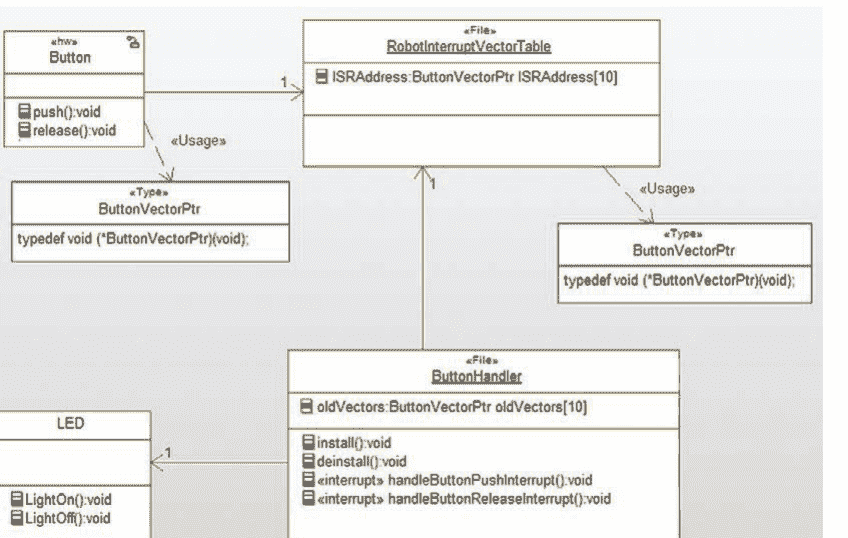

**图 3-16** 中断示例

如你在代码列表 20 所示：

```c
int j:
ButtonButton:
LED itsLED:
itsButton = Button_Create():
itsLED = LED_Create():
for (j=0;j<9;j++)
ISRAddress[j] = NULL;
oldVectors[j] = NULL;
ButtonHandler_setitsLED(&itsLED);
install(); /* install interrupt vectors */
```

**代码列表 20：中断示例 main()**

有趣的部分是 ButtonHandler 本身。它将 ISR 的地址安装到中断向量表的 0 和 1 位置，这样当中断发生时，就会调用相应的

# 访问硬件的设计模式 137页

ISR。在示例中，当按钮被按下时，ISR 点亮 LED，当按钮被释放时关闭灯光。

注意，此代码使用了 `interrupt` 关键字来告知编译器中断服务程序；你必须使用你的编译器提供的相应语法。要在标准桌面级硬件上执行此代码，只需从 ISR 的函数头中移除 `interrupt` 关键字，中断向量表将作为普通函数指针表运行。

```c
#ifndef ButtonHandler_H
#define ButtonHandler_H

typedef void (*VectorPtr)(void);
struct LED;

extern ButtonVectorPtr oldVectors[10];
/* Operations */
void install(void);
void deinstall(void);

interrupt void handleButtonPushInterrupt(void);
interrupt void handleButtonReleaseInterrupt(void);
struct LED* ButtonHandler_getItsLED(void); 
void ButtonHandler_setItsLED(struct LED* p_LED);
#endif
```

# 代码列表 21：ButtonHandler

```c
#include "ButtonHandler.h"
#include "LED.h"
#include "RobotInterruptTable.h"

ButtonVectorPtr oldVectors[10];
static struct LED* itsLED;
deinstall(void) {
}

install(void) {
    oldVectors[0] = handleButtonPushInterrupt;
    oldVectors[1] = handleButtonReleaseInterrupt;
}

interrupt void handleButtonPushInterrupt(void) {
    LEDOn(itsLED);
}

interrupt void handleButtonReleaseInterrupt(void) {
    LEDOff(itsLED);
}

struct LED* ButtonHandler_getItsLED(void) {
    return itsLED;
}

void ButtonHandler_setItsLED(struct LED* p_LED) {
    itsLED = p_LED;
}
```

# 代码列表 22：ButtonHandler.c

### 3.8 轮询模式

获取硬件信号和数据的另一种常见方法是通过轮询模式定期检查它们。当数据不紧急且采样时间可以保证时，可以使用轮询来获取。

### 3.8.1 抽象

轮询模式是检查硬件新数据的最简单方法。轮询可以是定期的或机会性的；定期轮询按间隔进行，而机会性轮询用于硬件无法产生中断的情况。

### 3.8.2 问题

轮询模式解决了在数据不高度紧急且采样时间足够快的情况下获取数据的问题。

### 3.8.3 模式结构

该模式有两种形式。图 3-17 显示了机会性轮询的模式结构，而图 3-18 显示了定期轮询的模式。区别在于在前一种模式中，应用程序函数会嵌入对 `poll()` 的调用，而在后一种模式中，创建了一个定时器。

### 3.8.4 协作角色

本节描述了该模式两种变体的角色。

### 3.8.4.1 应用程序元素

该元素拥有应用程序函数，在其中循环调用操作，例如：

```c
while (processing) {
    action1();
    action2();
    action3();
    OpportunityPolling_poll(me->itsOpportunityPolling);
}
```

### 3.8.4.2 设备

设备通过可访问函数提供数据和设备状态信息（内存或端口映射设备）。该类提供了两个函数，一个获取数据（在示例中为 `deviceData`），另一个获取设备状态（在示例中为 `unsigned int`）。

图 3-17 机会性轮询模式

# 139页 访问硬件的设计模式

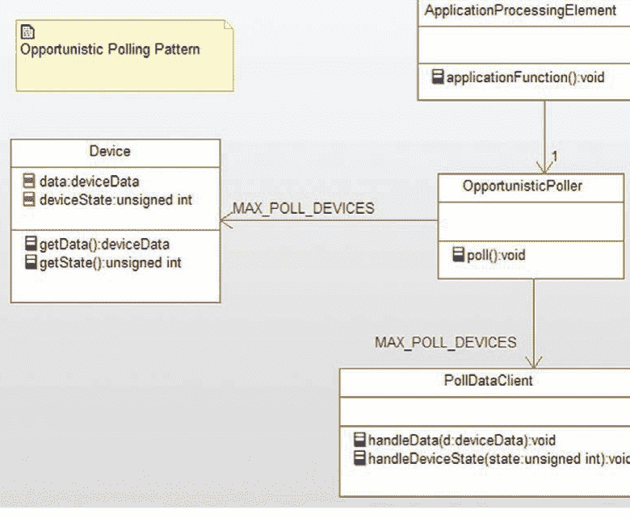

### 3.8.4.3 机会性轮询器

该元素拥有 `poll()` 函数，用于扫描连接的设备的数据和设备状态，并将这些信息传递给相应的客户端。机会性轮询器与定期轮询器的区别在于，后者除了轮询数据外，还有定时器的初始化和关闭功能。

在示例中，有连接到轮询元素，因此 `poll` 函数会扫描所有并通知各自的客户端。

### 3.8.4.4 定期轮询器

与机会性轮询器类似，定期轮询器拥有扫描连接设备的数据和设备状态函数，并将这些信息传递给相应的客户端。此外，它还有一个用于轮询时间的变量（可以通过其 `setPollTime(t)` 函数设置）以及启动和停止轮询的服务。`installInterruptTimer()` 函数插入地址的


# 访问硬件的设计模式 141

将 ISR（中断服务程序）插入中断向量表，而 `removeInterruptHandler()` 则恢复原始向量。`startPolling()` 初始化定时器。`stopPolling()` 停止定时器并将向量留在中断向量表中。

### 3.8.4.5 数据客户端 (PollDataClient)

该元素是一个或多个设备的数据和状态信息的客户端。在某些情况下，可能有一个单一客户端处理所有设备的数据，但通常每个设备都有自己的客户端。

### 3.8.4.6 轮定时器 (PollTimer)

`PollTimer` 元素代表一个定时器与之相关的服务。`startTimer()` 方法在中断向量表中安装 `handleTimerInterrupt()` 服务例程，并创建一个带有 `pollTime` 属性的定时器。一旦定时器启动，它将设置定时器，使其 ISR `handleTimerInterrupt()` 被调用，该程序会首先重置定时器计数并调用 `poll()` 函数。

## 3.8.5 后果

轮询比中断服务程序的设置和使用要简单，尽管周期性轮询通常是通过与绑定到轮询定时器的 ISR 实现的。

轮询可以同时检查许多不同设备状态变化，但通常没有中断那样及时。为此，必须注意如果数据或信号与截止日期相关，则要确保轮询时间加上响应时间始终小于涉及的截止日期。如果数据到达的速度快于轮询时间，则数据将会丢失。这在许多应用中不是问题，但在其他应用中是致命的（有时则没那么严重）。

### 3.8.6 实现策略

最简单的实现是将硬件检查插入到主处理循环的中间，该循环只要系统运行就会执行。这被称为“对称机会性轮询”，因为它在所有时间的操作方式都是一致的，即使处理循环的长度可能会变化很大。非对称机会性轮询是指在整个处理过程中，在方便但无关的时间点放置对新数据的检查。这种方法允许更好的调优（如果你需要更高的响应速度，可以添加检查），但它对主流程的影响更大，且更难维护。

周期性轮询是以固定时间间隔（作为周期）进行的轮询，并具有界限的变化（称为抖动）。为了实现这种规律性，对新数据的检查是由定时器触发中断启动的。这种轮询模式的周期性变体仅仅是中断模式的一种特例。

### 3.8.7 相关模式

周期性轮询是中断模式的一种特例。此外，硬件检查可以通过调用硬件抽象层（Hardware Praxes）或硬件适配器（Hardware Adapters）的数据获取服务来完成。此外，还可以观察者模式，其中轮询元素（OpportunPoller 或 PeriodicPoller）作为数据服务器，而 PollDataClients 作为数据客户端。

### 3.8.8 示例

对于图 3-19 所示的示例，我决定使用周期性轮询模式来检查三个呼吸传感器。这些传感器中的第一个监测呼吸回路中的氧气浓度，第二个监测气体压力（并持有气体流状态），第三个监测电路中的压力。当创建 `BEPeriodicPoller` 时，它的初始化器（`BCPeriodicPoller_init()()`）调用 `BCTimer::installInterruptHandler()` 服务；

| BCTimer | |
| :--- | :--- |
| oldVector<timerVectorPtr> | |
| <interrupt> handleTimerInterrupt(void) | |
| installInterruptHandler(void) | |
| removeInterruptHandler(handler) void | |
| startTimer(pollTime unsigned long)void | |
| stopTimer(void)void | |

| itsBCPeriodicPoller | 1 |
| :--- | :--- |
| pollTime unsigned long=DEFAULT_POLL_TIME | |
| poll(void) | |
| setPollTime(unsigned long)void | |
| startPolling(void) | |
| stopPolling(void)void | |

| BreathingCircuitSensor | |
| :--- | :--- |
| data int | |
| deviceState unsigned int | |
| getData().int | |
| getState().unsigned int | |
| itsBreathingCircuitSensor | |

| itsMedicalDisplay | |
| :--- | :--- |
| showO2Concentration(o2Conc unsigned int)void | |
| showGasFlow(flow int)void | |
| showCircuitPressure(pressure int)void | |
| showGasFlowStatus(state int)void | |

图 3-19 轮询示例

同样地，当 `BCPeriodicPoller` 被销毁时，清理操作会调用 `BCTimer_stopTiming()` 和 `BCTimer_removeInterruptHandler()`。

在某点，通过调用 `BCPeriodicPoller_startPolling()` 命令 `BCPeriodicPoller` 开始轮询。此函数调用 `BC_Timer_startTimer(timeout)` 服务，传递所需的轮询周期。从那时，除非另有指令，定时器将周期地调用中断处理程序 `BCTimer_handleTimeInterrupt()`，它会重置定时器并调用 `BCPeriodicPoller_poll()`。`poll()` 函数然后轮询三个设备的数据和状态信息，并将它们发送到 MedicalDisplay。

```c
#ifndef BCPeriodicPoller_H
#define BCPeriodicPoller_H
typedef int deviceData;
typedef void (*timerVectorPtr)(void);
#define MAX_POLL_DEVICES (10)
#define DEFAULT_POLL_TIME (1000)

struct BCTimer;
struct BreathingCircuitSensor;
struct MedicalDisplay;

typedef struct BCPeriodicPoller BCPeriodicPoller;
struct BCPeriodicPoller {
    unsigned long polltime;
    struct BCTimer *itsBCTimer;
    struct BreathingCircuitSensor *itsBreathingCircuitSensor[3];
    struct MedicalDisplay *itsMedicalDisplay;
};

void BCPeriodicler_init(BCPeriodicPoller* me);
void BCPeriodicler_cleanup(BCPeriodicPoller* me);
void BCPeriodicler_poll(BCPeriodicPoller* me);
void BCPeriodicler_setPollTime(BCPeriodicPoller* me, unsigned long t);
void BCPeriodicler_startPolling(BCPeriodicPoller* me);
void BCPeriodicler_stopPolling(BCPeriodicPoller* me);
#endif
```

# 代码列表 3-23: BCPeriodicler.c

```c
#include "BCPeriodicler.h"
#include "BCTimer.h"
#include "BreathingCircuitSensor.h"
#include "MedicalDisplay.h"

static void cleanupAll(BCPeriodicler* const me);
void BCPeriodicler_init(BCPeriodicler* const me) {
    me->pollTime = DEFAULT_POLL_TIME;
    me->itsBCTimer=NULL;
    int pos;
    for(pos=0; pos<3; pos++) {
        me->itsBreathingCircuitSensor[pos] = NULL;
    }
    me->itsMedicalDisplay = NULL;
    BCTimer_installInterruptHandler(me->itsBCTimer);
}
void BCPeriodicler_cleanup(BCPeriodicler* const me) {
    BCTimer_stopTimer(me->itsBCTimer);
    BCTimer_removeInterruptHandler(me->itsBCTimer);
    cleanupAll(me);
}
void BCPeriodicler_poll(BCPeriodicler* const me) {
    int state,data;
    data=BreathingCircuitSensor_getData(me->itsBreathingCircuitSensor[0]);
    MedicalDisplay_showO2Concentration(me->itsMedicalDisplay, data);
    data=BreathingCircuitSensor_getData(me->itsBreathingCircuitSensor[1]);
    state=BreathingCircuitSensor_getState(me->itsBreathingCircuitSensor[1]);
    MedicalDisplay_showGasFlow(me->itsMedicalDisplay, data);
    MedicalDisplay_showGasFlowStatus(me->itsMedicalDisplay, state);
    data=BreathingCircuitSensor_getData(me->itsBreathingCircuitSensor[2]);
    MedicalDisplay_showCircuitPressure(me->itsMedicalDisplay, data);
}
void BCPeriodicler_setPollTime(BCPeriodicler* const me, unsigned long t) {
    me->pollTime = t;
}
void BCPeriodicler_startPolling(BCPeriodicler* const me) {
    BCTimer_startTimer(me->itsBCTimer, me->pollTime);
}
static void cleanupAll(BCPeriodicler* const me) {
    // 清理逻辑
}
```


```c
void BCPeriodicPoller_stopPolling(BCPeriodicPoller* const me) {
    BCTimer_stopTimer(me->getBCTimer);
}
struct BCTimer* BCPeriodicPoller_getItsBCTimer(const BCPeriodicPoller* const me) {
    return (struct BCTimer*)me->getBCTimer;
}
void BCPeriodicPoller_setBCTimer(BCPeriodicPoller* const me, struct BCTimer* p_BCTimer) {
    if(p_BCTimer != NULL) {
        BCTimer__setItsBCPeriodicPoller(p_BCTimer, me);
    }
    BCPeriodicPoller__setItsBCTimer(me, p_BCTimer);
}
int BCPeriodicPoller_getBreathingCircuitSensor(const BCPeriodicPoller* const me) {
    int iter = 0;
    return iter;
}
void BCPeriodicPoller_addItsBreathingCircuitSensor(BCPeriodicPoller* const me, struct BreathingCircuitSensor* p_BreathingCircuitSensor) {
    int pos;
    for(pos = 0; pos < 3; ++pos) {
        if (me->isBreathingCircuitSensor[pos]) {
            me->isBreathingCircuitSensor[pos] = p_BreathingCircuitSensor;
            break;
        }
    }
}
void BCPeriodicPoller_removeItsBreathingCircuitSensor(const BCPeriodicPoller* const me, struct BreathingCircuitSensor* p_BreathingCircuitSensor) {
    int pos;
    for(pos = 0; pos < 3; ++pos) {
        if (me->isBreathingCircuitSensor[pos] == p_BreathingCircuitSensor)
            return NULL;
    }
    return NULL;
}
void BCPeriodicPoller_clearItsBreathingCircuitSensor(const BCPeriodicPoller* const me) {
    int pos;
    for(pos = 0; pos < 3; ++pos) {
        me->isBreathingCircuitSensor[pos] = NULL;
    }
}
```

## 第 3:4 节

```c
struct MedicalDisplay* BCPeriodicPoller_getItsMedicalDisplay(const BCPeriodicPoller* const me) {
    return (struct MedicalDisplay*)me->itsMedicalDisplay;
}
void BCPeriodicPoller_setItsMedicalDisplay(BCPeriodicPoller* const me, struct MedicalDisplay* p_MedicalDisplay) {
    me->itsMedicalDisplay = p_MedicalDisplay;
}

BCPeriodicPoller* BCPeriodicPoller_Create(void) {
    BCPeriodicPoller* me = (BCPeriodicPoller*) malloc(sizeof(BCPeriodicPoller));
    if(me==NULL) {
        BCPeriodicPoller_Init(me);
    }
    return me;
}

void BCPeriodicPoller_Destroy(BCPeriodicPoller* const me) {
    if(me==NULL) {
        BCPeriodicPoller_Cleanup(me);
    }
    free(me);
}

static void cleanUpRelations(BCPeriodicPoller* const me) {
    if(me->itsBCTimer != NULL) {
        struct BCPeriodicPoller* p_BCPeriodicPoller = BCTimer_getBCPeriodicPoller(me->itsBCTimer);
        if(p_BCPeriodicPoller != NULL) {
            BCTimer__setItsBCPeriodicPoller(me->itsBCTimer, NULL);
        }
        me->itsBCTimer = NULL;
    }
    if(me->itsMedicalDisplay != NULL) {
        me->itsMedicalDisplay = NULL;
    }
}

void BCPeriodicPoller__setItsBCTimer(BCPeriodicPoller* const me, struct BCTimer* p_BCTimer) {
    me->itsBCTimer = p_BCTimer;
}

void BCPeriodicPoller__setItsBCTimer(BCPeriodicPoller* const me, struct BCTimer* p_BCTimer) {
    if(me->itsBCTimer != NULL) {
        BCTimer__setBCPeriodicPoller(me->itsBCTimer, NULL);
    }
    BCPeriodicPoller__setBCTimer(me, p_BCTimer);
}
void BCPeriodicPoller__clearBCTimer(BCPeriodicPoller* const me) {
    me->itsBCTimer = NULL;
}
```

## 代码列表 3-24: BCPeriodicPoller.c

## 3.9 所以，我们学到了什么？

在本章中，我们查看了许多用于硬件操作的模式。硬件代理模式（Hardware Proxy Pattern）侧重于对硬件特定细节的封装，而硬件适配器模式（Hardware Adapter Pattern）则提供了一种直接的方法，以适应系统需求的不同但相似的设备。很多时候，硬件交互对于系统的正常功能是必要的，这是中介者模式（Mediator Pattern）的优势。观察者模式（Observer Pattern）则支持动态添加和移除硬件数据（如传感器）的客户端。

最后三种模式提供了与硬件接口的不同手段。去抖模式（Debouncing Pattern）处理金属接触开关在开启和关闭期间产生间歇接触的常见硬件问题。中断模式（Interrupt Pattern）支持对感兴趣的事件进行及时的响应。轮询模式（Polling Pattern）反复轮询硬件以获取新的传感器数据和设备状态信息。

这些是基础模式，因为它们解决了与硬件接口相关的所有低级关注问题。更困难的设计问题涉及如何转换系统内的命令和数据以实现目标。下一章提供了处理并发执行的模式，从基本概念到调度、避免竞态条件以及同步。第 5 章涉及有限机——其实现和用法；而第 6 章关注安全可靠性。

## 并发与资源设计模式

### 大纲

- 4.1 并发概念 152
    - 4.1.1 任务 160
    - 4.1.2 UML 中的并发 161
    - 4.1.3 实时系统 163
- 4.2 循环执行模式 164
    - 4.2.1 抽象 165
    - 4.2.2 问题 165
    - 4.2.3 模式结构 165
    - 4.2.4 协作角色 165
        - 4.2.4.1 抽象线程 165
        - 4.2.4.2 循环执行 165
        - 4.2.4.3 定器 166
    - 4.2.5 抽象线程 166
    - 4.2.6 结果 167
    - 4.2.7 实现策略 167
    - 4.2.8 相关模式 167
    - 4.2.9 示例 167
- 4.3 静态优先级模式 170
    - 4.3.1 抽象 170
    - 4.3.2 问题 171
    - 4.3.3 模式结构 171
    - 4.3.4 协作角色 172
        - 4.3.4.1 抽象线程 172
        - 4.3.4.2 抽象线程 172
        - 4.3.4.3 互斥锁 172
        - 4.3.4.4 优先级队列 172
        - 4.3.4.5 共享资源 172
        - 4.3.4.6 栈 173
        - 4.3.4.7 静态优先级调度器 173
        - 4.3.4.8 静态任务块 173
    - 4.3.5 结果 173
    - 4.3.6 实现策略 173
    - 4.3.7 相关模式 174
    - 4.3.8 示例 175
- 4.4 临界区域模式 182
    - 4.4.1 抽象 182
    - 4.4.2 问题 182
    - 4.4.3 模式结构 182
    - 4.4.4 协作角色 183
        - 4.4.4.1 共享资源 183
        - 4.4.4.2 临界区域任务 184
        - 4.4.4.3 共享资源任务 184
    - 4.4.5 结果 184
    - 4.4.6 实现策略 184
    - 4.4.7 相关模式 184
    - 4.4.8 示例 184
- 4.5 守卫调用模式 190
    - 4.5.1 抽象 190
    - 4.5.2 问题 190
    - 4.5.3 模式结构 190
    - 4.5.4 协作角色 191
        - 4.5.4.1 守卫资源 191
        - 4.5.4.2 抢占式任务 191
        - 4.5.4.3 信号量 192
        - 4.5.4.4 临界优先级调度器 192
    - 4.5.5 结果 192
    - 4.5.6 实现策略 192
    - 4.5.7 相关模式 193
    - 4.5.8 示例 194
- 4.6 队列模式 207
    - 4.6.1 抽象 207
    - 4.6.2 问题 207
    - 4.6.3 模式结构 208
    - 4.6.4 协作角色 208
        - 4.6.4.1 消息 208
        - 4.6.4.2 消息队列 208
        - 4.6.4.3 互斥锁 209
        - 4.6.4.4 队列任务 209
    - 4.6.5 结果 209
    - 4.6.6 实现策略 210
    - 4.6.7 相关模式 210
    - 4.6.8 示例 210
- 4.7 汇聚模式 224
    - 4.7.1 抽象 225
    - 4.7.2 问题 226
    - 4.7.3 模式结构 226
    - 4.7.4 协作角色 226
        - 4.7.4.1 汇聚 226
        - 4.7.4.2 信号量 227
        - 4.7.4.3 同步线程 227
    - 4.7.5 结果 227
    - 4.7.6 实现策略 228
    - 4.7.7 相关模式 228
    - 4.7.8 示例 228
## 死锁避免模式

- 4.8 同时锁模式 232
    - 4.8.1 抽象 232
    - 4.8.2 问题 233
    - 4.8.3 模式结构 233
    - 4.8.4 协作角色 234
        - 4.8.4.1 主资源 234
        - 4.8.4.2 多主资源 234
        - 4.8.4.3 互斥锁 235
        - 4.8.4.4 查询互斥锁 235
        - 4.8.4.5 资源客户端 235
        - 4.8.4.6 资源主 235
        - 4.8.4.7 简化资源主 236
    - 4.8.5 结果 236
    - 4.8.6 实现策略 236
    - 4.8.7 相关模式 236
    - 4.8.8 示例 236
- 4.9 有序锁模式 242
    - 4.9.1 抽象 242
    - 4.9.2 问题 243
    - 4.9.3 模式结构 243
    - 4.9.4 协作角色 244
        - 4.9.4.1 互斥锁 244
        - 4.9.4.2 有序资源 244
        - 4.9.4.3 资源客户端 245
        - 4.9.4.4 资源列表 247
        - 4.9.4.5 资源引用 247
    - 4.9.5 结果 247
    - 4.9.6 实现策略 248
    - 4.9.7 相关模式 248
    - 4.9.8 示例 248


## 4.1 基础并发概念

本章模式
- 循环执行模式（Cyclic Executive Pattern）——在无限循环中调度线程
- 静态优先级模式（Static Priority Pattern）——根据优先级调度线程
- 临界区模式（Critical Region Pattern）——通过禁用任务切换保护资源
- 调用模式（Guarded Call Pattern）——通过互斥信号量保护资源
- 队列模式（Queuing Pattern）——通过队列消息实现访问序列化
- 会合模式（Rendezvous Pattern）——协调复杂的任务同步
- 同时锁定模式（Simultaneous Locking Pattern）——通过锁定资源避免死锁
- 有序锁定模式（Ordered Locking Pattern）——通过按特定顺序锁定资源避免死锁

大多数嵌入式系统需要同时执行若干活动。关键在于定义和管理系统的并发模型。在本节中，我将概述并发的基础术语和概念，以支持对本章后续设计模式的理解和使用。

需要理解最重要的术语在侧边栏中。

- *动作序列 (Action Sequence)*：一系列动作，可能带有决策分支点，其执行顺序是完全确定的
- *到达模式 (Arrival Pattern)*：事件开始并发单元到达的方式；它可能是周期性的或非周期的
- *阻塞 (Blocking)*：严重的优先级反转
- *阻塞时间 (Blocking time)*：高优先级任务因为低优先级任务需要资源而被阻止运行的时间
- *并发 (Concurrency)*：动作序列的并行执行
- *并发单元 (Concurrency unit)*：在同一个执行线程中按顺序执行的一组动作。也称为任务（Task）或线程（Thread）
- *关键性 (Criticality)*：动作序列完成的重要性
- *截止时间 (Deadline)*：动作或动作序列完成变得错误或无关的时间点
- *死锁 (Deadlock)*：多个客户端同时等待相同条件，但这些条件在原则上无法被满足的情况
- *执行时间 (Execution time)*：执行动作或动作序列所需的时间
- *到达间隔 (Inter-arrival time)*：非周期性任务启动之间的时间间隔
- *抖动 (Jitter)*：周期性任务周期周围的波动
- *多任务抢占式调度 (Multitasking Preemptive Scheduling)*：一种调度方案，其中就绪的最高优先级任务将执行，并抢占任何正在运行的低优先级任务
- *周期 (Period)*：周期性任务调用之间的间隔
- *优先级 (Priority)*：用于确定哪项任务（一组就绪任务）将优先执行的数值
- *优先级反转 (Priority inversion)*：当高优先级任务已就绪运行时，低优先级任务仍在运行。也称为阻塞
- *伪并发 (Pseudoconcurrency)*：通过一次执行一个任务并根据某些调度策略在任务之间切换来执行多个任务
- *竞态条件 (Race condition)*：结果取决于动作执行顺序的计算状况，但该顺序本质上不可知
- *实时动作 (Real-Time Action)*：及时性是其正确性维度的一个动作
- *可调度性 (Scheduleability)*：如果一个任务的所有任务都是及时的，则称该任务可调度
- *同步模式 (Synchronization Pattern)*：任务如何在各自动作序列的特定点管理同步
- *同步点 (Synchronization Point)*：序列中的特定动作，任务在此处等待，直到其他任务到达相应的同步点
- 任务 (Task)*：参见并发单元
- 线程 (Thread)*：参见并发单元
- *及时性 (Timeliness)*：任务在截止时间前可预测完成的能力，或满足时间相关性能要求的能力
- *紧急性 (Urgency)*：动作序列截止时间的接近程度
- *最坏情况执行时间 (Worst Case Execution Time)*：动作序列执行可能花费的最长时间

图 4-1 显示了动作、动作序列和任务之间的关系。每个任务（也称为并发单元）由按特定顺序执行的一组动作组成。这些动作序列与其他任务独立执行。这意味着在任务内部，动作的执行顺序是完全已知的；例如在任务 1 中，先执行动作 A，然后是 B，然后是 C 或 D，然后是 E 等等，依此类推。未知的是任务之间的动作执行顺序。哪个任务执行了动作 A？动作 Z？动作 Beta？答案是你既不知道，也不在乎——如果你在乎，那么并发就是一个糟糕的选择。

> 许多人对任务、线程和进程进行区分。然而，这些在不同的关注范围内是同一个概念。在本书中，我们将交叉使用这些术语。

| 任务 1 | 任务 2 | 任务 3 |
| --- | --- | --- |
| 动作 A | 动作 W | 动作 Alpha |
| 动作 B | 动作 Y | 动作 Beta |
| 动作 D | 动作 Z | 动作 Gamma |
| 动作 E | | |
| 同步点 | | |
| 动作 F | 动作 X | 动作 Zeta |

图 4-1：作为动作序列集的并发

你唯一关心的任务之间执行顺序的点被称为同步点。这在图 4-1 的活动图中用一对水平线表示。其中第一个被称为“合并”(join)，因为它将来自不同任务的一组动作在逻辑上合并到一个单一线程。第二条线被称为“分叉”(fork)，因为它从单一线程分叉为多个。在此处使用合并和分叉的语义是：在所有先决动作（在本例中为动作 E、动作 Z 和动作 Gamma）完成之前，流无法通过同步点。一旦所有三个动作均完成，控制将进入后续动作（动作 F、动作 X 和动作 Zeta，必须按该顺序）。同步点是任务中共享数据或在继续之前确保满足前提条件的常见位置。

任务可以通过两种基本方式进行通信。同步通信类似于电话，——双方都参与。异步通信类似于电子邮件——发送者留下信息，接收者稍后提取。

```c
// Code 4-1: 一个简单的循环执行
static int nTasks = 3;
int currentTask;

void main() {
  while (1) {
    switch (currentTask) {
      case 0:
        task1();
        break;
      case 1:
        task2();
        break;
      case 2:
        task3();
        break;
    }
    currentTask = (currentTask + 1) % nTasks;
  }
}
```


# 嵌入式并发与资源管理设计模式 157

在时片调度器或优先级抢占式调度器中在无限循环内运行的任务，当其他任务需要运行的合适时机时，会被调度器中断。这种后一种任务模板的基本结构如代码列表 4-2 所示。你可以看到代码列表中，在这些任务声明之后，通常会有一些初始化或设置代码，然后是一个无限循环（或至少是循环），任务在其中无休止地等待感兴趣的信号——这种信号可能来自队列插入或事件发生。当这种信号出现时，通过 `switch case` 语句进行处理。处理完成后，任务代码将返回循环以等待下一个信号。

```
/* 此处存放私有静态数据
*/
static int taskInvocationCounter = 0;

void taskA(void) {
    /* 更多私有数据 */
    int stuffToDo;

    /* 初始化代码 */
    stuffToDo = 1;

    while (stuffToDo) {
        signal = waitOnSignal();
        switch (signal) {
            case signal1:
                /* 在处处理信号 1 */
                break;
            case signal2:
                /* 在处处理信号 2 */
            case signal3:
                /* 在处处理信号 3 */
        }
    } /* /* 无限 while 循环 */
} /* 任务结束 */
```

## 代码列表 4-2：带有抢占式调度器的基本任务结构

优先级可以根据任何想象到的标准进行设置，但两种常见的基于优先级的调度类型是基于紧急性（urgency）和基于关键性（criticality）²。许多人不精确地使用这些术语，但这些术语具有精确的含义。紧急性指的是任务截止日期的临近程度；关键性指的是任务的执行对系统有多重要。图 4-2 显示了这种差异。曲线本身被称为效用函数（utility function）；它是作为时间的函数，完成某个动作或动作序列对系统所产生的价值。

² 当然，如果需要，这些可以以不同的方式混合以分配优先级。

# 158 第 4 章

效用函数：
动作完成的“价值”

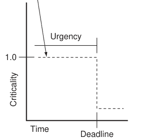

**图 4-2：关键性 vs. 紧急性**

关键性是曲线的高度，即关键性下降到零的点的时间距离。需要注意的是，任务是实时的并不一定有截止日期，但截止日期是为实时任务指定及时性约束的最常见方式。

当任务执行时，有几个重要的时间相关术语，总结在图 4-3。对于周期性任务（以大致固定的速率执行的任务），两个重要的值是*周期*（period，两次任务启动之间的时间持续时间）和*抖动*（jitter，周期的变化）。非周期性任务（通常称为*异步任务*）的特征是到达间隔时间（两次任务启动之间的时间）和*最小到达间隔*（最小的此类时间）。所有任务都有执行时间（完成任务活动所需的时间），尽管在计算可调度性时，*最坏情况执行时间*

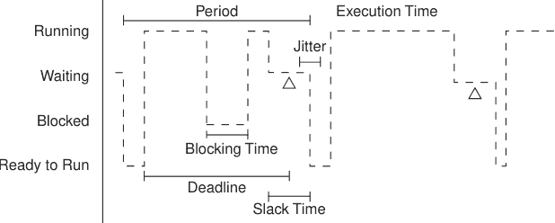

**图 4-3：时间相关术语**

# 嵌入式并发与资源管理设计模式 159

| 任务 A | 任务 Z |
|---|---|
| (最高优先级 (1)) | (优先级 = 100) |
| 周期 = 50 ms | 周期 = 1000 ms |
| 执行时间 = 10 ms | 执行时间 = 500 ms |

| 锁定 5 ms | 锁定 10 ms |
|---|---|
| 资源 R | |

图 4-4：阻塞

截止日期是任务准备就绪运行到其完成之间的时间段。

当你使用信号量来锁定资源时，可能会发生这种情况：一个低优先级的任务锁定了资源，然后被需要资源的高优先级任务抢占。高优先级任务必须阻塞，以允许后一个任务运行并释放资源。这被称为优先级反转（priority inversion），因为与正常的优先级调度规则相反，尽管有更高优先的任务需要运行，但低优先级任务正在运行。

注意，在包含使用信号量保护资源的多任务抢占式调度中，优先级反转是无法避免的。这并不一定是坏的。几乎是坏的是无界优先级反转。考虑图 4-4。在图中，有两个任务。任务 A 是高优先级³，执行周期为 50 ms，执行时间为 10 ms，其中 5 ms 锁定了资源 R。任务 Z 是低优先级任务，周期为 1000 ms，需要 50 ms 执行，其中 10 ms 锁定了资源 R。注意，在这个示例中，每个任务的截止日期发生在下一个周期的开始。

如果担心任务的可调度性（几乎总是应该这样的），你就应该检查阻塞对可调度性的影响。在图 4-4 的情况下，情况如何？当任务 Z 刚刚锁住 R 且任务 A 运行时。在这种情况下，任务 A 的执行时间为 10 ms 加上 10 ms 的阻塞时间。由于任务 A 在 20 ms 内完成（小于截止日期），且 Z 的执行时间为……

如果任务的可调度性是考虑的问题（几乎总是应该是），你应该检查阻塞对可调度性的影响。在图 4-4 的情况下，情况是怎样的？当任务 Z 刚刚锁住 R 且任务 A 运行时。在这种情况下，任务 A 的执行时间为 10 ms 加上 10 ms 的阻塞时间。由于任务 A 在 20 ms 内完成（小于截止日期），且 Z 的执行时间为……

如果任务的可调度性是考虑的问题（几乎总是应该是），你应该检查阻塞对可调度性的影响。

# 160 第 4 章

| 任务 A | 任务 Z |
|---|---|
| (最高优先级 (1)) | (优先级 = 100) |
| 周期 = 50 ms | 周期 = 1000 ms |
| 执行时间 = 10 ms | 执行时间 = 500 ms |

| 锁定 5 ms | 锁定 10 ms |
|---|---|
| 资源 R | |

图 4-4：阻塞

截止日期是任务准备就绪运行到其完成之间的时间段。

当你使用信号量来锁定资源时，可能会发生这种情况：一个低优先级的任务锁定了资源，然后被需要资源的高优先级任务抢占。高优先级任务必须阻塞，以允许后一个任务运行并释放资源。这被称为优先级反转（priority inversion），因为与正常的优先级调度规则相反，尽管有更高优先的任务需要运行，但低优先级任务正在运行。

注意，在包含使用信号量保护资源的多任务抢占式调度中，优先级反转是无法避免的。这并不一定是坏的。几乎是坏的是无界优先级反转。考虑图 4-4。在图中，有两个任务。任务 A 是高优先级³，执行周期为 50 ms，执行时间为 10 ms，其中 5 ms 锁定了资源 R。任务 Z 是低优先级任务，周期为 1000 ms，需要 50 ms 执行，其中 10 ms 锁定了资源 R。注意，在这个示例中，每个任务的截止日期发生在下一个周期的开始。

如果任务的可调度性是考虑的问题（几乎总是应该是），你应该检查阻塞对可调度性的影响。在图 4-4 的情况下，情况是怎样的？当任务 Z 刚刚锁住 R 且任务 A 运行时。在这种情况下，任务 A 的执行时间为 10 ms 加上 10 ms 的阻塞时间。由于任务 A 在 20 ms 内完成（小于截止日期），且 Z 的执行时间为……

如果任务的可调度性是考虑的问题（几乎总是应该是），你应该检查阻塞对可调度性的影响。

# 嵌入式并发与资源管理设计模式 181

表 4-1：任务识别
| 策略 | 描述 | 优点 | 缺点 |
| --- | --- | --- | --- |
| 单事件 | 每个任务使用单个事件类型 | 非常简单 | 不适用于大量事件 |
| 中断处理 | 使用单个事件类型触发中断 | 对于小事件集非常简单；在处理紧急事件方面非常高效 | 不适用于大量事件；难以与其他任务共享数据 |
| 事件源 | 将来自单个源的所有事件分组由任务处理 | 模型简单 | 性能不佳 |
| 相关信息 | 将所有信息处理（通常围绕资源）聚集在任务中 | | 可能导致线程过多或过少 |
| 设备接口 | 一种事件源 | 有助于处理设备（例如总线）接口 | 同事件源 |
| 周期属性 | 将具有相似周期的事件（如周期、最小间隔时间或截止日期）聚集 | 有利于调度性 | 更复杂 |
| 安全保障 | 将特殊的安全和可靠性行为聚集在一起（例如看门狗） | 对于安全关键型和高可靠性系统的很好的方法 | 性能不佳 |

在实践中，你选择的任务将使用表 4-1 中的组合。

### 4.1.1 识别任务

在下一节中，我们将讨论如何在嵌入系统中识别任务。识别任务是设计过程中最重要的部分之一，因为它决定了系统的结构和性能。有几种识别任务的方法，包括：

- 事件驱动任务：由事件触发，例如中断、消息到达或定时器过期。
- 周期性任务：以固定的间隔运行，例如控制循环或传感器读取任务。
- 异步任务：由不按规则发生的事件触发。

任务识别策略的选择取决于系统的需求和任务的性质。在大多数嵌入系统中，使用的是事件驱动、周期性和异步任务的组合。

### 4.1.2 UML 中的并发

在 UML 中，有三种表示并发的方法：活跃对象、活动图中的分支和汇合以及状态机中的正交区域⁵。在这些方法中，主要的手段是活跃对象。活跃对象是拥有执行线程的对象。它通常是一个结构化对象，意味着它包含在上下文中执行的部件。

⁵ 关于 UML 和并发的更多信息，请参阅作者的《Real-Time UML Third Edition: Advances in the UML for Real-Time Systems》（Addison-Wesley, 2004）。


# 162 第4章

“活动”（active）对象的线程。“活动”对象有显式责任负责为在其线程中执行的一组软件元素管理事件队列。“活动”对象的图标是一个左右两侧带有边界的对象，尽管通常显示为“活动”立体构型。任务图是一种 UML 类（或对象*）图，其主要关注点是并发单元及其相互作用。图 4-6 显示了一个对象任务图的示例，其中包含五个任务（“活动”对象）、一个共享资源（带有保护信号量）以及显示并发相关元数据（优先级、周期和截止时间）的注释。请注意，对于某些任务，我们使用端口（命名连接点）直接与任务内部的对象连接，而在其他情况下，我们使用线条。

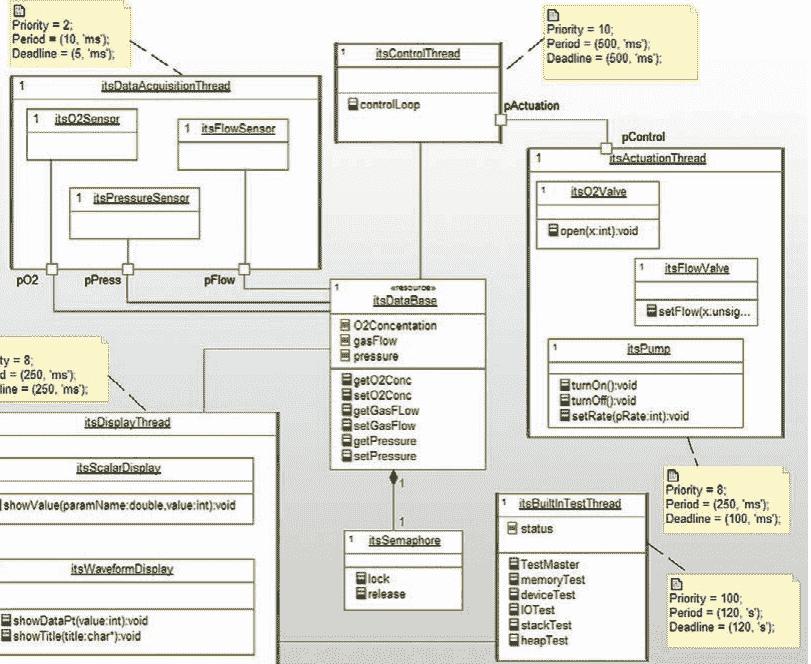

图 4-6: UML 任务图

- 6 记住第1章，类是规范，而对象是实例。“活动”类类似于 Ada 中的任务类型，而对象类似于 Ada 任务。

- 7 为了进行可调度性分析，我们需要额外的元数据，例如最坏情况执行时间，由于我们有带有阻塞的共享资源，还需要最坏的阻塞时间。

# 嵌入并发与资源管理的设计模式 163

（最可能实现为指针）。在 ControlThread 和 BuildInThread 的情况下，这些“活动”对象不包含内部对象，而是运行在它们独立线程中的对象。

### 4.1.3 实时操作系统

在许多嵌入式系统中，实时操作系统（RTOS⁸）为应用程序系统提供了一系列服务，包括：

- 任务服务，如任务的创建、调度和销毁
- 事件服务，如等待事件挂起、发布事件以及事件队列的管理
- 互斥锁创建、销毁和使用服务
- 时间服务，如指定时间的延迟，以及定时器服务的创建和销毁
- 文件系统服务
- 网络输入/输出服务

这并不意外——大多数桌面操作系统也提供这些服务。RTOS 在许多方面与它们不同。首先最重要的是，它们是可嵌入的；它们被设计为构建在 ROM、Flash 或某些非易失性内存中。它们可以从内存执行，也可以通过引导加载程序将自己复制到易性内存中。其次，它们经过调整以兼顾快速和可预测⁹。第三，它们通常被设计为可扩展的；它们通常使用微内核架构模式¹⁰ 设计，这使得 RTOS 的内存镜像仅包含系统需要且系统愿意分配空间的服务。

4-7 显示了 RTOS 的典型结构。RTOS 必须针对目标硬件进行专门化。这是通过硬件抽象层实现的，RTOS 供应商将其称为板级支持包（BSP）。之上是内核服务，如内存、任务和定时器服务。可选地根据应用程序的需要添加或删除文件服务和网络服务。各种应用程序及其任务运行在 RTOS 之上，根据需要通过应用程序编程接口（API）调用 RTOS 服务。

现在嵌入此类 RTOS 已经相当常见，但不久前应用程序软件还必须提供这些服务。事实上，许多运行在小内存空间和处理器目标环境中的嵌入式系统无法负担商业 RTOS 的时间、内存或周期性成本开销。

> ⁸ Wind VxWorks™ 和 Green Hills™ Integrity 操作系统是流行的 RTOS，但使用的 RTOS 超过 400 种。

> ⁹ 可预测性是一个尺度，一端是预测性，另一端是确定性。RTOS 倾向于确定性端。

> ¹⁰ 参见作者的《Real-Design Patterns: Robust Scalable Architecture for Real-Time Systems》（Addison-Wesley, 2003）获取关于该模式的详细描述。

# 164 第4章

| 应用程序 A | 应用程序 B | 应用程序 C |
|---|---|---|---|
| 任务 1 | 任务 X | 任务 Alpha |
| 任务 2 | 任务 Y | 任务 Beta |
| 任务 3 | | 任务 Gama |
| RTOS API | | | |
| 网络服务 | | | |
| 文件系统 | | | |
| 内存管理 | 任务间通信 | 任务管理 | 定时器服务 |
| 板级支持包 | | | |

图 4-7: 基本 RTOS 结构

现在让我们来看一些管理嵌入式系统并发方面的模式。应该注意，前一章的中断模式不仅是一种并发模式，也是一种硬件访问模式。

# 调度模式

本节包含与任务调用相关的模式。如果 RTOS 可提供，这就是它提供的一种服务。如果没有，你的应用程序软件必须提供这些服务。即使你的系统使用 RTOS 进行调度，理解不同调度方法的优缺点也能为你提供更多信息，以以选择最优的调度策略。

## 4.2 循环执行模式

正如本章前面提到的，循环执行模式（Cyclic Executive Pattern）的优势是调度多个任务的一种非常简单的方法，但对紧急事件的灵活性或响应性不高。循环执行模式实现了一种调度公平性原则，允许所有任务都有平等的运行机会。虽然在响应方面不是最优的，但循环执行模式易于分析可调度性（即系统可预测地满足所有任务截止时间的能力）：每个任务的截止时间必须大于或等于所有截止……等待，每个任务的截止时间等于一个完整周期，公式 4-1 给出了以下关系：

- $D_j$ 是任务 j 的截止时间
- $C_j$ 是任务 j 的最坏情况执行时间
- $K$ 是循环开销，包括任务调用的开销

# 嵌入并发与资源管理的设计模式 165

### 4.2.1 抽象

循环执行模式主要用于两种情况。对于小型嵌入式应用程序，它允许多个任务并发运行，而无需复杂的 RTOS。其次，在高安全相关的系统中，循环执行模式易于认证，因此在航空电子和飞行管理系统中很流行。

### 4.2.2 问题

许多嵌入式系统具有严格的内存和时间限制，可能无法托管甚至是微内核。循环执行模式提供了实现该目标的方法。

### 4.2.3 模式结构

图 4-1 显示了该简单模式的结构。CyclicExecutive `controlLoop()` 函数迭代调用任务线程的 `run()` 操作。每个 `run()` 操作都很短并运行到完成。

### 4.2.4 协作角色

本节描述了该模式的角色。

### 4.2.4.1 抽象CETThread

抽象Thread 通过声明 `run()` 函数为线程提供标准接口。循环执行器调用此函数来执行任务。当此函数完成后，Cyclic 执行下一个任务。

### 4.2.4.2 CyclicExecutive

正如第 4-1 节所述，该类包含轮运行任务的无限循环。此外，Cyclic 执行包含了任务或调度器本身需要的全局栈和静态数据。

### 4.2.4.3 CyclicTimer

CyclicTimer 未在 CyclicExecutive 最常见的变体中未使用；其可选性通过图 4-8 中指向关联的“0,1”多值性指示。此定时器在过期时可以触发中断，或者简单地向 `hasElapsed()` 函数返回 TRUE（非零）。然后 CyclicExecutive 调用 `start()` 来开始下一个周期的计时间隔。

### 4.2.5 ConcreteCEThread

实体Thread 代表实现系统中逻辑任务的函数和相关数据。每个任务都有 `run()` 函数的实现。

该模式的一种变体是时间触发的循环执行。在这种变体中，CyclicExecutive 将设置并使用 CyclicTimer 来启动每个周期（任务列表的执行）。请注意，第 3 章的中断模式可以且循环执行器可以简单地等待下一个周期的中断，除非有后台处理需要执行，否则它可能会停留在一个所谓的“忙循环”中并轮询定时器是否过期。


# 嵌入式并发与资源管理设计模式 167

### 4.2.6 结果

如前所述，该模式的主要优点是其简单性。让调度器运行相当困难。另一方面，该模式对高紧急性事件具有明显的响应能力，这使得它不适用于对响应速度有高要求的应用程序。该模式的另一个优点是其资源消耗上非常轻量，非常适合极小内存设备。

使用该模式的缺点是线程间的交互比其他模式更具挑战性。如果需要某个任务的输出，则数据必须保留在全局内存或共享资源中，直到该任务运行（见本章后后的“任务协调模式”章节）。另一方面，由于缺乏抢占机制，无限阻塞不是需要考虑的问题。死锁只可能由于错误发生——单个运行异常的任务（即从不返回以获取循环执行器控制权的任务）就会导致整个系统崩溃。在抢占式调度系统中，除非异常任务关闭了任务切换，否则即使某个任务失败，其他任务仍将继续运行。

### 4.2.7 实现策略

该模式的实现几乎是简单而易见的。在大多数情况下，循环执行器（Cyclic Executive）可能是应用程序的 `main()` 函数和相关的全局数据。在其他情况下，它将从 `main()` 中调用。

### 4.2.8 相关模式

由于该模式的响应性明显是次优的，因此通常会结合一些中断服务程序（参见第 3 章中的中断模式）来处理高紧急性事件。中断模式与循环执行器执行模式（Cyclic Executive Pattern）结合的另一个用途是实现时间触发的循环执行器，尽管轮询模式（Polling Pattern，同样来自第 3 章）也可以用于轮询定时器。

循环执行器模式没有解决任务间的共享问题。循环执行器定义了可以用于此目的的全局数据结构，但也可以混合其他模式来实现此目的（见本章中的“任务协调模式”章节）。由于没有抢占，该模式的全局数据不需要进行访问序列化。

### 4.2.9 示例

图 4-9 显示的示例了循环执行器调度器 `GasControlExecutive`。它的 `controlLoop()` 函数调用每个线程中的运行服务。由于我们使用了文件实现，因此必须在每个的运行函数名称中编码文件名，以避免全局命名冲突。

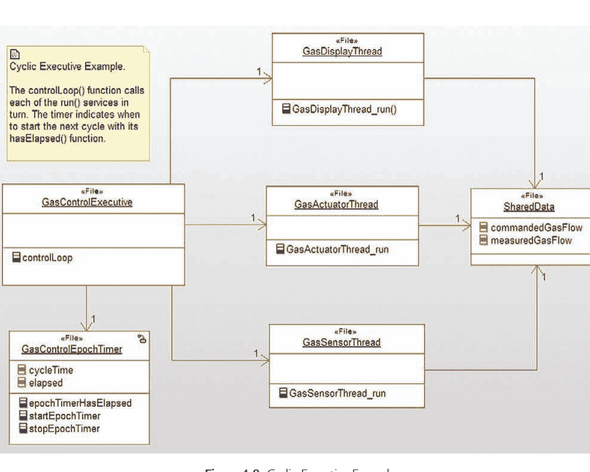

在示例中，我实现了该模式的时间触发变体。如代码列表 4-3 所示，`controlLoop()` 函数实现了对历元时间的忙等待。注意，`startEpochTimer` 函数在启动定时器之前会将 `elapsed` 变量重置为 FALSE (0)。当定时器过期时，其值被设置为 TRUE (1)。

```c
#include "GasControlExecutive.h"
#include "GasActuatorThread.h"
#include "GasControlEpochTimer.h"
#include "GasDisplayThread.h"
#include "GasSensorThread.h"
void controlLoop(void) {
    while (TRUE) {
        startEpochTimer();
        GasSensorThread_run();
        GasActuatorThread_run();
        GasDisplayThread_run();
        while(!epochTimerHasElapsed());
    }
}
```
# 代码列表 4-3: GasControlExecutive.c

其他元素的每个代码文件只需简单地声明其数据和函数，相关的 C 文件则提供实现。例如，代码列表 4-4 和代码列表 4-5 给出了 SharedData 文件。

```c
#ifndef SharedData_H
#define SharedData_H

extern int commandedGasFlow;
extern int measuredGasFlow;

#endif
```
# 代码列表 4-4: SharedData.h

```c
#include "SharedData.h"
int commandedGasFlow;
int measuredGasFlow;
```
# 代码列表 4-5: SharedData.c

```c
void GasDisplayThread_run(void) {
  printf("Measured Gas Flow %d\n", measuredGasFlow);
  printf("commandedGasFlow %d\n", commandedGasFlow);
}
```
# 代码列表 4-6: GasDisplayThread.c

# 第 4 章

## 4.3 静态优先级模式

大多数实时操作系统都支持静态优先级模式。它对高优先级事件有良好的响应，并可以扩展到大量任务。可以使用不同的方案来分配优先级，但如之前所述，优先级通常根据紧急性、关键性或两者的结合来分配。当使用速率调调度（见下文“实现策略”章节）时，这种调度模式既是最优的（无法通过其他调度策略获得更好的结果），又是稳定的（在过载时，将是不可预测的——即低优先的任务）。假设每个截止时间都发生在周期结束时，如果方程 4-2 中的不等式成立，则系统是可调度的：

- $C_j$ 是任务 $j$ 的最坏情况执行时间
- $T_j$ 是任务 $j$ 的周期（周期结束时的截止时间）
- $B_j$ 是任务 $j$ 的最坏情况阻塞时间
- $n$ 是任务数量

方程 4-2：$n$ 个任务的可调度性

在任务是周期性的情况下，如果方程 4-2 中的不等式成立，则系统是可调度的。

### 4.3.1 问题

静态优先级模式由大多数实时操作系统支持。它对高优先级事件有良好的响应，并可以扩展到大量任务。可以使用不同的方案来分配优先级，但如之前所述，优先级通常根据紧急性、关键性或两者的结合来分配。当使用速率调调度（见下文“实现策略”章节）时，这种调度模式既是最优的（无法通过其他调度策略获得更好的结果），又是稳定的（在过载时，将是不可预测的——即低优先的任务）。

### 4.3.2 结构

静态优先级提供了一种处理紧急事件的简单方法。

### 4.3.3 结构

图 10 显示了该模式的结构。彩色类表示 AbstractThread。

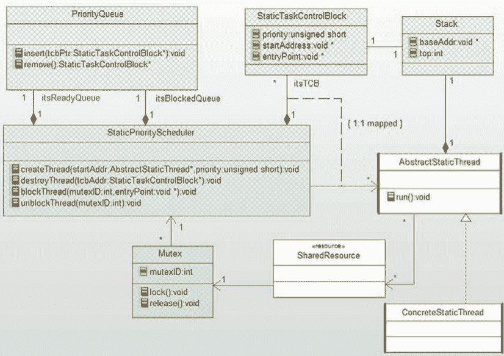
图 4-10: 静态优先级模式

### 4.3.4 协作角色

本节描述了该模式的角色。

### 4.3.4.1 AbstractThread

AbstractThread 类是 ConcreteThread 的抽象（即不可实例化的）基类。AbstractThread 与调度器关联；执行线程的 `run()` 函数。AbstractThread 指定了由 ConcreteThread 实现的接口。

### 4.3.4.2 ConcreteThread

ConcreteThread 是一个“活动”类，为一组执行工作的“语义”对象提供容器和线程上下文。ConcreteThread 提供将这些语义对象接入并发架构的直接方法。ConcreteThread 代表应用程序中的线程。

### 4.3.4.3 Mutex

Mutex 是一个互斥类，对 SharedResource 的访问进行序列化。SharedResource 的保护函数每次被调用时都会调用 Mutex 的 `lock()` 函数，并在完成后调用 `release()`。当关联 Mutex Locked时，其他尝试调用服务的将被阻塞，直到 Mutex 被释放。阻塞发生在 Mutex 信号量信号当前活动线程调用。mutexID 标识哪个 Mutex 正在阻塞任务。

### 4.3.4.4 PriorityQueue

PriorityQueue 是按模式组织的 StaticControlBlock 指针队列。优先级使用了 PriorityQueue 的实例。第一个是就绪队列。当任务就绪时，其 StaticControlBlock 指针按优先级顺序插入队列。如果任务的优先级高于当前运行的任务（或当当前任务终止时），则该任务从就绪队列中移除并运行。另一个 PriorityQueue 是阻塞队列；该队列持有由于尝试访问受 Mutex 保护的 SharedResource 而被阻塞的任务集。

### 4.3.4.5 SharedResource

SharedResource 是一个类，其实例由一个或多个 ConcreteThread 共享。为了确保系统在所有情况下正常运行，所有共享资源必须是重入的（这意味着并发访问不会发生损坏），或者必须通过访问序列化来保护。


## 4.3.4.6 栈 (Stack)

每个 AbstractThread 都有一个用于返回地址和传递参数的栈。这通常只在应用线程的汇编语言层级显式存在，但它是调度基础设施的重要部分。该元素通常由 RTOS 提供。

## 4.3.4.7 静态优先级调度器 (StaticPriorityScheduler)

该类根据简单的规则基于优先级运行多个线程执行：始终运行优先级最高的就绪任务。当«active」对象被创建时，它（或其创建者）调用 `createThread()` 操作为«active」对象创建一个线程。每当该线程被 `StaticPriorityScheduler` 执行时，它会调用 `StartAddr`（线程被阻塞或抢占除外，在这种情况下会调用 `EntryPoint` 地址）。该元素通常由 RTOS 提供。

## 4.3.4.8 静态任务控制块 (StaticTaskControlBlock)

StaticTaskControlBlock 包含其对应的 AbstractThread 对象的调度信息。这包括线程的优先级、默认起始地址，以及如果在完成完成之前被抢占或阻塞的当前入口地址。StaticPriorityScheduler 为每个存在的 AbstractThread 维护一个 StaticTaskControlBlock 对象。该元素通常由 RTOS 提供。

### 4.3.5 结果 (Consequences)

如前所述，静态优先级在处理可能大量的任务时运行良好，并对传入的事件提供响应能力。通常，任务在大多数时间里处于等待启动状态，只有在发生启动事件（例如周期的结束）时才会变为激活状态。只有当有多个任务就绪等待运行同时，优先级才会成为问题；在这种情况下，优先级最高的任务将优先运行。

使用阻塞来实现资源访问的序列化是常见做法。虽然这种方法非常有效，但幼稚的实现可能会导致本章第一节描述的无界优先级反转。请参阅本章关于资源共享模式的章节以获取解决此问题的模式。

## 4.3.6 实现策略 (Implementation Strategies)

目前为止，该模式最常见的实现是使用商业 RTOS 来提供调度基础设施。虽然在 20 年前并非如此，但今天有几十种流行的 RTOS 可以满足大多数嵌入式系统的限制。

无论你是购买商业 RTOS 还是自己实现，分配优先级的问题都必须解决。RMS（速率调调度）是分配优先级的最常见方法。它是最优且稳定的。所谓*最优*，是指该任务集可以通过任何方式进行调度，它也可以通过 RMS 进行调度。所谓*稳定*，是指在某些任务将错过截止期限的过载情况下，使用静态优先级调度可以很明确地哪些任务将失败——即优先级最低的任务。RMS 只是简单地让优先级成为周期的函数——周期越短，优先级越高¹⁵

RMS 对任务做出了一系列假设，但在违反这些假设的情况下，它具有相当的健壮性：

- 任务是周期性的
- 任务的截止时间发生在周期结束时
- 任务是无限可抢占的

对于第一个假设，如果任务不是周期的，那么它们可以以最大速率发生（即任务调用之间有一个最小时间）。该值可以代替周期来确定优先级。

对于第二个假设，有时会出现截止时间小于周期的情况。在这种情况下，只需使用截止时间 ($D_i$) 代替周期 ($T_i$) 来分配优先级即可。

最后一个假设是，一旦更高优先级的任务就绪准备运行，当前正在运行的任务就可以立即被抢占。如果当前正在运行的任务处于临界区（禁用任务切换的一段时间——参见本章稍后的临界模式），则不成立。然而，如果临界区很短，这通常不是问题。这种情况可以通过将所有其他任务中最长临界区的持续时间视为被分析任务的最坏情况阻塞时间来分析。

## 4.3.7 相关模式 (Related Patterns)

静态优先级模式提供了一种比公平原则方法（如循环执行器模式）更具响应性的备替代方案。当必须与其他任务共享资源时，该模式必须与本章中的资源共享模式混合使用。当任务需要协调时，该模式可以与任务协调模式混合。任务协调模式与资源共享模式略有重叠，因为任务协调的方式之一就是共享公共资源。

与静态优先级模式非常相似的模式是动态优先级模式 (Dynamic Priority Pattern)。在这种模式中，设计没有指定任务的优先级；优先级是在运行时计算的。常见的优先级分配策略被称为最早截止时间优先 (EDF) 调度。在 EDF 中，任务必须指定其截止时间的持续时间，调度器据此计算该任务下一个截止时间到期的绝对时间。

> ¹十五 注意，许多 RTOS 使用较值表示更高的优先级，因此优先级 5 的优先级高于优先级 10。

任务根据所有就绪任务下一个绝对截止时间的远近程度被放入就绪队列。也就是说，如果队列的任务 A 的截止时间比另一个任务 B 近，那么它将放在队列中任务 B 的之前；否则，它将位于队列的后面。EDF 是最优的（与 RMS 相同），但不稳定；在过载情况下，无法满足截止期限的任务无法在设计时计算。如果你使用 EDF 调度，则调度性可以以类似于 RMS 调度的方式计算，只是利用率上限是 1.0 而不是任务数量的函数。这由方程 4-3 所示。

```
sum \frac{C_j}{T_j} + \max(\frac{B_1}{T_1}, \dots, \frac{B_{n-1}}{T_{n-1}}) \le 1.00
```
**方程 4-3:** 最早截止时间优先调度

### 4.3.8 示例

在本示例中，我们将假设使用商业 RTOS，因此我们不会显式地建模或编写模式的基础元素。相反，示例（见图 4-11）关注具体的线程和共享资源。

在下面的代码列表中，初始化定时器、等待 OS 事件以及创建任务的调用均取决于 RTOS。

```
void main() {
    /* 初始化链接并启动任务 */
    MotorPositionSensor_initRelations();
    MotorDisplay_initRelations();
    MotorController_initRelations();

    /* 现在让任务开始工作 */
    while (TRUE) {
        ;
    }
}
```
**代码列表 4-7:** 静态优先级示例 main.c

MotorPositionSensor、MotorDisplay 和 MotorController 的代码列表非常简单，如代码列表 4-8 到 4-13 所示。有趣的代码可以在 `_Init()` 函数中找到，在那里创建 OS 事件队列并使用相应的 `_run()` 函数创建了任务。如果及时处理事件，10 个事件的队列空间足够了。还要注意每个任务创建时都使用了 1024 大小的栈。遵循任务


图 4-11: 模式示例

创建后，相应的 `_run()` 函数创建一个 OS 定时事件（带有 TRIGGER 参数以便定时器自动重复），然后运行一个无限循环。在循环内部，任务对事件出现进行等待。当发生正确 ID 的相应事件时，`Pend` 函数返回，任务被启动。由于这是一个无限循环，一旦循环完成，每个任务都会迭代并进入睡眠状态等待下次事件。

MotorData 的代码列表（代码列表 4-14 和代码列表 4-15）更加简单，因为它只是一个由活动线程调用的被动资源。再次注意，创建、初始化和使用的调用都是 RTOS 特有的。

```
#ifndef MotorPositionSensor_H
#define MotorPositionSensor_H
```


# 嵌入式并发与资源管理的设计模式

```c
void MotorPositionSensor_Init(void);
void MotorPositionSensor_Cleanup(void);
```

```c
void MotorPositionSensor_run(void);
 getPosition(void);
```

```c
void MotorPositionSensor_initRelations(void);
#endif
```

# 代码列表 4-8：MotorPositionSensor.h

```c
#include "MotorData.h"
#include "MotorPositionSensor.h"
#include <stdlib.h>

static int mps_priority = 5;
static int mps_eventQueue[10];
static int mps_stack[1024];

void MotorPositionSensor_Cleanup(void) {
}
void MotorPositionSensor_Init(void) {
    /* 创建 OS 的事件队列和任务 */
    /* 使用长度为 10 的事件队列和 1024 元素的栈 */
    OSCreate(&mps_eventQueue[0], 10);
    OSTaskCreate(MotorPositionSensor_run, NULL, (void *)&mps_stack[1024], 5);

    /* 现在运行任务 */
    MotorPositionSensor_run();
}
void MotorPositionSensor_run(void) {
    int os_pend_timer_id;
    os_pend_timer_id = OSCreateTimer(50, RETRIGGER);

    while (TRUE) {
        OSPend(os_pend_timer_id, WAIT_FOREVER);
        getPosition();
    }
}
void getPosition(void) {
    int x;
    /* 通过读取传感器获取位置 */
    x = rand();
    setMeasPos(x);
}
```

# 第 178 第 4 章

```c
void MotorPositionSensor_initRelations(void) {
    MotorPositionSensor_Init();
}
```

# 代码列表 4-2：MotorPositionSensor.c

```c
#ifndef MotorDisplay_H
#define MotorDisplay_H

void MotorDisplay_Init(void);
void MotorDisplay_Cleanup(void);

void MotorDisplay_run(void);
void display(void);

void MotorDisplay_initRelations(void);
#endif
```

# 代码列表 4-3：MotorDisplay.h

```c
#include "MotorData.h"
#include <stdio.h>
#include "MotorDisplay.h"

static int md_priority = 10;
static int md_eventQueue[10];
static int md_stack[1024];

void MotorDisplay_Init(void) {
    /* 创建 OS 的事件队列和任务 */
    /* 使用长度为 10 的事件队列和 1024 元素的栈 */
    OSQueueCreate(&md_eventQueue[0], 10);
    OSTaskCreate(MotorDisplay_run, NULL,
        (void)&md_stack[1024], 5);

    /* 现在运行任务 */
    MotorDisplay_run();
}

void MotorDisplay_Cleanup(void) {
}

void MotorDisplay_run(void) {
    int os_pend_timer_id;
    os_pend_timer_id = OSCreateTimer(500, TRIGGER);

    while (TRUE) {
        OSPend(os_pend_timer_id, WAIT_FOREVER);
        display();
    }
}

void display(void) {
  printf("Commanded position = %d\n", getCmdPos());
  printf("Measured position = %d\n", getMeasPos());
}

void MotorDisplay_initRelations(void) {
  MotorDisplay_Init();
}
```

# 代码列表 4-4：MotorDisplay.c

```c
#ifndef MotorController_H
#define MotorController_H

void MotorController_Init(void);
void MotorController_Cleanup(void);
```

```c
void MotorController_run(void);
void move(void);
void zero(void);
```

```c
void MotorController_initRelations(void);
#endif
```

# 代码列表 4-5：MotorController.h

```c
#include "MotorData.h"
#include <stdlib.h>
#include "MotorController.h"

static int mc_priority = 8;
static int mc_eventQueue[10];
static int mc_stack[1024];
```

```c
int motor1Pos;
int motor2Pos;
```

void MotorController_Init(void) {
  /* 使用长度为 10 的事件队列和 1024 元素的栈 */
  /* 创建 OS 事件队列和栈 */
  OSQueueCreate(&mc_eventQueue[0], 10);
  OSTaskCreate(MotorController_run, NULL,
  (void*)&mc_stack[1024], 5);

  /* 现在运行任务 */
  MotorController_run();
}

void MotorController_Cleanup(void) {
}

void MotorController_run(void) {
  int os_pend_timer_id, x, y;
  os_pend_timer_id = OSCreateTimer(100, RETRIGGER);

  while (TRUE) {
    OSPend(os_pend_timer_id, WAIT_FOREVER);
    move();
  }
}

void move(void) {
  int m1Pos, m2Pos;
  /* 此函数将读取传感器
  来设置位置 */
  to set the sensor
  of the motors. Note that if you
  want to set the position
  within a short period of time, or
  that must be performed in a specific order.
  m1Pos = rand();
  m2Pos = rand();

  if (m1Pos >= 0) {
    setMeasPos(m1Pos);
  }
  if (m2Pos >= 0) {
    setMeasPos(m2Pos);
  }
}

void zero(void) {
  m1Pos = 0;
  m2Pos = 0;
}

void MotorController_initRelations(void) {
  MotorController_Init();
}
```

# 代码列表 4-13：MotorController.c

```c
#ifndef MotorData_H
#define MotorData_H

#define RETRIGGER (2)
#define WAIT_FOREVER (0)

extern int commandedPosition;
extern int measuredPosition;

int getPosition(void);
int getPosition(void);
void setMeasPos(int);

#endif
```

# 代码列表 4-14：MotorData.h

```c
#include "MotorData.h"

int commandedPosition = 0;
int measuredPosition = 0;

int getCmdPos(void) {
    return commandedPosition;
}

int getMeasPos(void) {
    return measuredPosition;
}

void setCmdPos(int x) {
    commandedPosition = x;
}

void setMeasPos(int x) {
    measuredPosition = x;
}
```

# 代码列表 4-15：MotorData.c

182 第 4 章

# 任务协调

在嵌入系统中，当任务是真正独立的时，并发设计非常简单。本节模式包括临界区、保护调用、队列和同步。前三种者用于。

## 4.4 临界区模式（Critical Region）

临界区模式是任务协调中最简单的模式。它通过禁用任务切换来确保任务在某些时间内不被中断。

### 4.4.1 抽象

在抢占式多任务环境中（如上文静态优先级模式），可能存在任务不被中断的时间。临界区模式通过禁用任务切换或启用中断（如上文中断模式）来解决这些间隔。一旦离开临界区，系统必须重新启用任务切换或中断。

### 4.4.2 问题

任务不应被中断或抢占有两种主要情况：首先，它可能正在访问无法同时安全访问的资源；其次，任务可能正在执行必须短时间内完成的操作，或者必须按特定顺序执行。该模式允许任务在不受其他任务干扰的情况下执行。

### 4.4.3 模式结构

图 4-12 显示了该模式结构的简单性。在常见的变体中，保护的是资源而非任务；如图 4-13 所示。无论何种情况，

> ¹³ 迹麦报告韦斯“他没事了”（Goldman, W., 1973. 《新娘：一部爱情与冒险的经典》。出版社）。

# 嵌入式并发与资源管理的设计模式 183


图 4-12：临界区模式


图 4-13：带资源的临界区模式

在相关的服务内部，必须在临界区开始前禁用任务切换，并在结束前重新启用。注意，保护调用模式不参与临界区的开始和结束。

### 4.4.4 协作角色

本节描述了该模式的角色。

#### 4.4.4.1 临界共享资源

该元素用于临界资源模式的变体，通过禁用任务切换来防止同时访问资源。在这种模式的情况下，受保护的资源是 `value` 属性。注意所有相关的服务都必须实现临界区以保护资源。

#### 4.4.4.2 带有临界区的任务

该元素用于任务由于与共享无关的原因禁用任务切换（通常与定时有关）。`criticalService()` 在其临界区期间禁用并启用任务切换或中断。


# 第4章

## 4.4.4.3 TaskWithSharedResource（带共享资源的任务）

该元素代表所有可能想要访问共享资源的任务集合（因此在定向关联上使用 `*` 多路用）。这些任务对保护资源的方法一无所知，因为该方法被封装在资源内部。

### 4.4.5 影响

此模式强制执行临界区策略，并可用于关闭调度调度的任务切换，或者更极端地完全禁用中断。当元素离开其临界区时，必须重新启用任务切换。此外，使用此模式可能会影响其他任务的时序。由于原因，临界区的持续时间很短。由于在临界区期间禁用了任务切换，因此不存在无界反反的问题。

嵌套调用带有自身临界区的函数时必须小心。如果在另一个函数的临界区内调用此类函数，下一个函数将重新启用任务切换并结束调用者函数的临界区。

### 4.4.6 实现策略

此模式通常通过使用调度器提供的服务（如 `OS_disable_task_switching()` 和 `OS_enable_task_switching()` 或类似功能）或者通过引入汇编语言指令在硬件层面禁用或启用中断处理来实现。

### 4.4.7 相关模式

此模式仅适用于多个任务可以访问相同资源或服务，或者当任务可能会中断当前任务的时序敏感处理时。出于此原因，它不适用于循环执行模式（Cyclic Executive Pattern），但通常与静态优先级模式（Static Priority Pattern）配合使用。

### 4.4.8 示例

图 14-14 中的示例显示了一个的 `CRRobotArmManager`，它包含一个 `moveRobotArm` 函数，该函数在手臂实际移动期间有一个临界区。

在任何一种情况下，临界区都完全封装在 `moveRobotArm()` 和 `motorZero()` 服务中，如代码列表 14-16 和代码列表 14-17 所示。

嵌入式并发与资源管理设计模式 185

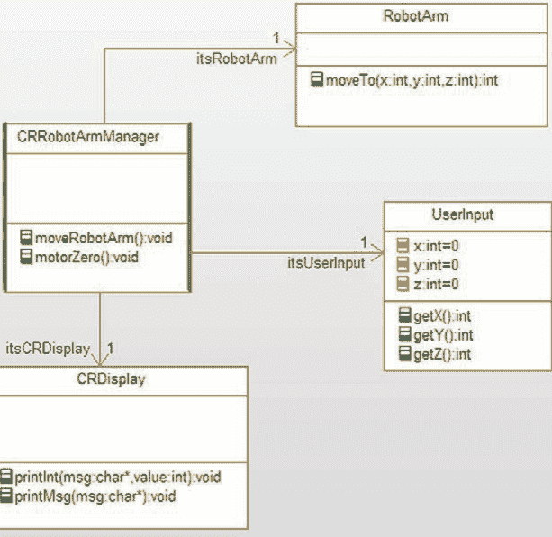

图 4-14：临界区模式

```c
#ifndef CRRobotArmManager_H
#define CRRobotArmManager_H

struct CRDisplay;
struct RobotArm;
struct UserInput;

typedef struct CRRobotArmManager_ CRRobotArmManager CRRobotArmManager {
    struct CRDisplay* itsCRDisplay;
    struct RobotArm* itsRobotArm;
    struct UserInput* itsUserInput;
};

/* 构造函数和析构函数： */
void CRRobotArmManager_Init(CRRobotArmManager* const me);
void CRRobotArmManager_Cleanup(CRRobotArmManager* const me);
```

```c
void CRobotArmManager_setCRDisplay(CRobotArmManager* const me, struct CRDisplay* p_CRDisplay);
```

```c
struct RobotArm* CRobotArmManager_getItsRobotArm(const CRRobotArmManager* const me);
```

```c
void CRobotArmManager_setRobotArm(CRobotArmManager* const me, struct RobotArm* p_RobotArm);
```

```c
struct UserInput* CRobotArmManager_getItsUserInput(const CRRobotArmManager* const me);
```

```c
void CRobotArmManager_setUserInput(CRobotArmManager* const me, struct UserInput* p_UserInput);
```

```c
CRRobotArmManager *CRobotArmManager_Create(void);
```

```c
void CRobotArmManager_Destroy(CRobotArmManager* const me);
```

```c
#endif
// 代码列表 4-6: CRobotArmManager.h
```
#include "CRobotArmManager.h"
#include "CRDisplay.h"
#include "RobotArm.h"
#include "UserInput.h"
```

```c
static void cleanupRelations(CRobotArmManager* const me);

void CRobotArmManager_Init(CRobotArmManager* const me) {
    me->CRDisplay = NULL;
    me->ItsRobotArm = NULL;
    me->UserInput = NULL;
}
```

```c
void CRobotArmManager_Cleanup(CRobotArmManager* const me) {
    cleanUpRelations(me);
}
```

```c
void CRobotArmManager_motorZero(CRobotArmManager* const me) {
    int success = 1;
```

```c
OS_disable_task_switching();

/* 临界区代码 */
success = RobotArm_moveTo(me->RobotArm,0.0,0);

/* 临界区结束 */
OS_enable_task_switching();

if (!success)
    CRCRisplay_printMsg(me->itsCRisplay("Cannot zero!"));
}

void CRobotArmManager_moveTo(CRobotArmManager* const me) {
    /* 局部变量声明 */
    int x,y,z,success = 1;
    /* 非临界区代码 */

    /* 注意该函数有自己的
        临界区，因此不能在此函数的
        临界区内被调用 */
    CRobotArmManager_motorZero(me);

    x = UserInput_getX(me->itsUserInput);
    y = UserInput_getY(me->itsUserInput);
    z = UserInput_getX(me->itsUserInput);

    /* 临界区开始 */
    OS_disable_task_switching();

    /* 临界区代码 */
    success = RobotArm_moveTo(me->RobotArm,x,y,z);

    /* 临界区结束 */
    OS_enable_task_switching();

    /* 非临界区代码 */
    CRCRisplay_printMsg(me->itsCRisplay("Result is ",success));
}

struct CRisplay* CRobotArmManager_getItsCRisplay(const CRobotArmManager* const me) {
    return me->itsCRisplay;
}

```c
void CRobotArmManager_setCRisplay(CRobotArmManager* const me, struct CRisplay* p_CRisplay) {
    me->itsCRisplay = p_CRisplay;
}
```

```c
struct RobotArm* CRobotArmManager_getItsArm(const CRobotArmManager* const me) {
    return me->itsRobotArm;
}
```

```c
void CRobotArmManager_setArm(CRobotArmManager* const me, struct RobotArm* p_RobotArm) {
    me->itsRobotArm = p_RobotArm;
}
```

```c
struct UserInput* CRobotArmManager_getItsUserInput(const CRobotArmManager* const me) {
    return me->itsUserInput;
}
```

```c
void CRobotArmManager_setUserInput(CRobotArmManager* const me, struct UserInput* p_UserInput) {
    me->itsUserInput = p_UserInput;
}
```

嵌入式并发与资源管理 189

```c
if(me->UserInput != NULL)
{
    me->UserInput = NULL;
}
```
# 代码列表 4-17: CRArmManager.c

| 关于信号量的小知识 |
| :--- |
| Edsger Dijkstra 发明了信号量的概念，用于协调想要资源的任务。最常见的实现是计数信号量，它允许最多 n 个任务使用资源，并在其他任务尝试访问它时阻塞它们。n 被称为信号量的容量。二进制信号量是 n=1 的计数信号量。互斥（mutex）信号量是带有某些额外属性的二进制信号量，这些属性取决于操作系统。二进制信号量既用于互斥和事件通知，而互斥锁仅用于强制互斥。 | 信号量在创建时用 n 进行初始化，例如 `semaPtr = OS_create_semaphore(int n);` 将内部计数器初始化为 n。信号量提供另外两个服务：`lock()` 和 `release()`（在荷兰语中，Dijkstra 将它们称为 P（Prola 表示“测试”）和 V（Verhoog 表示“增加”））。`lock()` 通过将计数器减 1 来工作。如果计数器减到 0 或更小，调用 `lock()` 的线程将被调度器阻塞。`release()` 函数增加信号量计数器，以便有线程在等待，其中一个将解除阻塞并运行（`lock()` 返回）。注意，你不能在线程调用 `lock()` 之前测试它是否会阻塞；它要么立即成功，要么阻塞线程（并希望以后释放）。然而，某些 RTOS 有 `trylock()` 函数，如果资源可用则锁定资源，如果不可用则返回错误代码。 |

> 或者 P 可能代表“Piraat”（海盗）。似乎没有人确定。 |


# 第 4 章

```c
);
void release(Semaphore* s) {
    s->count; /* 此操作必须作为
    临界区被实现 */
}
```

锁（lock）的其他术语包括递减（decrement）和等待（wait）；释放（release）的其他术语包括释放（free）、增加（increment）和信号（signal），它们成对称对出现（lock/free, lock/release, wait/signal, decrement/increment），具体取决于信号量的使用情况。

互斥锁（Mutex）可以是递归的，这是一个非常有用的属性：一旦线程成功锁定了信号量，它对 `lock()` 的进一步调用将不会阻塞该线程（即，线程不会通过多次调用同一个互斥锁来阻塞自己）。对于递归互斥锁，当线程进行的调用次数等于对 `lock()` 的调用次数时，该线程会释放信号量。

## 4.5 受保护调用模式 (Guarded Call Pattern)

受保护调用模式对一组服务的访问进行串行处理，如果这些服务被多个调用者同时调用，可能会在某些方面产生相互干扰。在这种模式中，通过提供一种锁定机制来实现访问的串行化，该机制在锁定状态下防止其他线程调用这些服务。

### 4.5.1 抽象

受保护调用模式使用信号量来在抢占式多任务环境中保护一组相关的服务（函数）免受多个客户端的并发访问，这一过程被称为互斥。只要这些服务没有被其他任务使用，受保护调用模式就能提供对服务的及时访问。然而，如果不与其他模式结合使用，使用此模式可能会导致无界优先级反转（unbounded priority inversion），如图 4-5 所示。

### 4.5.2 问题

该问题模式解决了线程之间需要及时同步或数据交换的需求。在这种情况下，可能无法等待异步（队列）会合（rendezvous）。同步（函数调用）会合可以更及时，但必须小心执行以避免数据损坏和计算错误。

### 4.5.3 模式结构

该模式的结构图如图 4-15 所示。在此种情况下，多个抢占式任务（PreemptiveTasks）通过其函数访问受保护资源（GuardedResource）。在这些

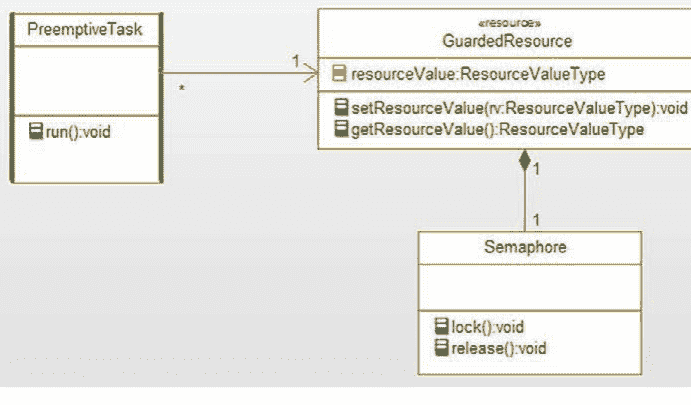

函数内部，会调用 lock 和 release 来锁定和释放资源。调度器通过在任务调用已锁定的信号量时将其放入阻塞队列来支持阻塞，并在该信号量被释放时取消阻塞。调度器必须将信号量的 `lock()` 函数实现为临界区，以消除出现竞态条件的可能。

图 4-15：受保护调用模式

### 4.5.4 协作角色

本节描述了该模式的角色。

### 4.5.4.1 受保护资源 (GuardedResource)

`GuardedResource` 是一个共享资源，它利用互斥函数来强制对其方法的访问实现互斥。在相关的状态下，每次执行访问资源之前，都会调用关联 `Semaphore` 实例的 `lock()` 函数。如果信号量处于未锁定状态，则变为锁定状态；如果它处于锁定状态，信号量将通知静态优先级调度器（StaticPriorityScheduler）阻塞正在运行的任务。特定资源实例的相关函数必须共享 `Semaphore` 类的同一个实例，这一点非常重要。这确保了它们作为一个单元受到保护，防止被多个 `PreemptiveTasks` 同时访问。

> ¹ 我之所以说“相关函数”，是因为该类可能提供某些不需要的函数。

### 4.5.4.3 信号量 (Semaphore)

Semaphore 是一个互斥信号量类，用于对 GuardedResource 的访问进行串行处理。GuardedResource 的受保护函数在每次被调用时都会调用 Semaphore 的 `lock()`，并在服务完成后调用 `release()`。当关联的 Semaphore 被锁定时，其他客户端线程会尝试调用服务，直到信号量被解锁。当信号量通知静态优先级调度器当前活动线程发起了调用尝试时，执行阻塞。`mutexID` 标识是哪一个互斥锁阻塞了任务。该元素通常由 RTOS 提供。这与本章之前静态优先级模式（Static Priority Pattern）中出现的元素相同。

### 4.5.4.4 静态优先级调度器 (StaticPriorityScheduler)

该对象根据其优先级协调多个线程的执行。在该模式中，我们关注的是该元素的职责（未显示），即：如果任务尝试锁定一个已锁定的信号量，则阻塞该任务，并在当此锁释放时，解锁所有阻塞在 `mutexID` 上的任务。该元素通常由 RTOS 提供。注意，这与本章之前静态优先级模式中出现的元素相同。

### 4.5.5 结果

该模式提供了对资源的及时访问，同时防止了可能导致数据损坏和系统行为异常的并发访问。如果资源未被锁定，则无延迟进行访问。如果资源当前已锁定，则调用者必须等待直到锁释放。简单的使用可能会导致如图 4-5 所示的无界优先级反转。参见第 4.5.7 节“相关模式”讨论 RTOS 支持的解决方案。

### 4.5.6 实现策略

实现该模式的棘手之处在于互斥锁（Mutex）的实现。通常，RTOS 会提供一个 Semaphore 实例，可以通过以下操作访问：

- `OSemaphore OS_create_semaphore()` 创建一个信号量并返回其指针。
- `void OS_destroy_semaphore(OSSemaphore*)` 销毁指向的信号量。
- `void OS_lock_semaphore(OSSemaphore*)` 锁定相关的信号量。如果带有未锁定的 OSemaphore 调用，它将变为锁定状态。如果已经锁定，则使用其内部存储的 `mutexID` 阻塞当前任务。调度器必须存储任务数据，包括继续执行入口和堆栈。
- `void OS_release_semaphore(OSSemaphore*)` 释放信号量锁并解锁阻塞在其内部存储的 mutexID 上的所有任务。

当然，信号量的名称和参数是操作系统特定的。

### 4.5.7 相关模式

受保护调用模式用于静态优先级或其他抢占式多任务环境。它比临界区模式（Critical Region Pattern）强制执行的策略不那么严酷，因为它不会干扰不需要访问资源的高优先级任务的执行。它比队列模式（Queuing Pattern）更有响应性，因为不需要等待资源的线程变为活动来检查请求。

该模式有一类非常重要的变体解决了无界优先级反转问题，该变体使用了优先级继承（priority inheritance）概念。基本思想是每个资源都有一个属性（变量），称为优先级天花（priority ceiling），它等于访问该资源的最高优先级任务的优先级。受保护调用模式简单实现的问题在于：不需要资源的中间优先级任务可能会抢占当前拥有所需资源的低优先级任务。可能存在任意数量的此类中间优先级任务，导致高优先级任务的链式阻塞。优先级继承解决方案是：一旦高优先级任务尝试锁定低优先级任务拥有的资源，立即提升低优先级任务的优先级。这可以通过创建一个实现优先级继承的信号来实现。例如，Wind River 的 VxWorks™ 就采用了这种方法，它实现了一组互斥信号量函数：

```c
SEM_ID semM;
mM = semCreate(...);
semTake(semM, FLAG);
semGive(semM);
```

FLAG 的值包括 WAIT_FOREVER，以及对本文讨论重要的 SEM_INVERSION_SAFE。当使用后者标志值时，VxWorks 的互斥信号量实现了优先级继承。

在图 4-5 中，如果以此方式实现锁定锁，将遵循以下事件序列：

- 1. 任务 Z 以 100 的原始优先级运行并锁定资源 R。
- 2. 任务 A 以优先级 1 运行，尝试锁定保护 R 的锁并被阻塞。此时，任务 Z 的优先级被提升到与 A 相同（即优先级 1）。


# 194 第 4 章

- 3. 任务 Y 准备好运行。如果使用普通的简单互斥锁（mutex），它将运行并抢占任务 Z。然而，它的优先级（99）小于任务 Z 运行它时的优先级，因此它保持在任务就绪队列中。
- 4. 任务 Z 完成了对资源 R 的使用并解锁。此时，任务 Z 的优先级被降到其标义优先级（100）。
- 5. 任务 A 解阻塞并现在使用该资源，并在截止日期内完成。
- 6. 任务 Y 现在是优先级最高的就绪任务，开始运行。
- 7. 任务 Y 完成，最后允许任务 Z 完成其执行。

通过这个简单的示例，你可以看到优先级是如何防止计数信号量可能允许的无界优先级继承反转的。

### 4.5.8 示例

图 4-16所示所示示例是一个飞行控制系统的一部分。在其中，飞器的 KinematicData（位置和姿态）被管理为多个客户端的共享资源。

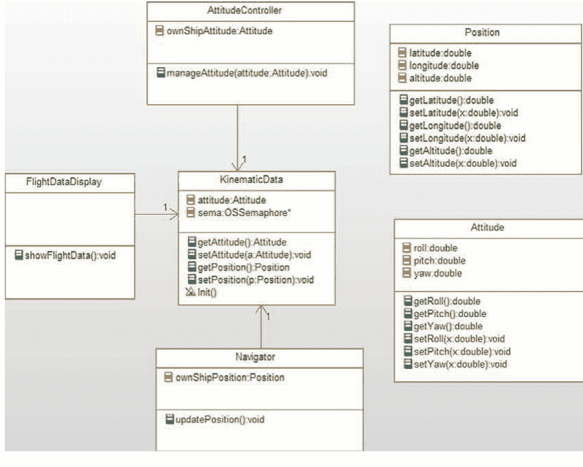

# 嵌入式并发与资源管理的设计模式 195

由于这些值的设置和获取不是原子过程，如果例如 `FlightDataDisplay_showFlightData()` 函数被 `AttitudeController` 抢占以更新属性数据，则存在显示无效数据的可能性。在方法中使用信号量确保了这种情况不会发生。

接下来的几个代码列表（代码列表 4-19 到代码列表 4-30）提供了图 4-16 中受保护调用（Guarded Call）示例元素的代码。第一个提供了用于信号量的操作系统规范。接下来的四个分别提供了复杂数据类型 Position 和 Attitude 的代码。

代码列表 4-23 和代码列表 4-24 提供了资源 (KinematicData) 的代码，该资源使用 OSSemaphore 来保护其设置和获取数据的操作。初始化函数 `KinematicData_Init()` 通过调用 `OS_create_semaphore()` 创建一个信号量，而清理函数 `KinematicData_CleanUp()` 调用 `OS_destroy_semaphore()` 来释放其内存。用于获取和设置位置数据的访问器和修改器方法都会调用 `OS_lock_semaphore()`，执行处理，然后调用 `OS_release_semaphore()`。

代码列表显示了客户端的代码：FlightDataDisplay、AttitudeController 和 Navigator。它们共享存储在 KinematicData 对象中的信息，并且必须防止数据数据损坏。

```c
#ifndef GuardedCallExample_H
#define GuardedCallExample_H

struct Attitude;
struct AttitudeController;
struct FlightDataDisplay;
struct GuardTester;
struct GuardedCallBuilder;
struct KinematicData;
struct Navigator;
struct Position;

/* OS 提供的类型和函数 */
struct OSSemaphore;
struct OSSemaphore* OS_create_semaphore(void);
void OS_destroy_semaphore(struct OSSemaphore* sPtr);
void OS_lock_semaphore(struct OSSemaphore* sPtr);
void OS_release_semaphore(struct OSSemaphore* sPtr);

#endif
```
代码列表 4-7: GuardedCallExample.h

# 196 第 4 章

```c
#ifndef Position_H
#define Position_H

#include "GuardedCallExample.h"
```

```c
typedef struct Position {
    double altitude;      /* @attribute altitude */
    double latitude;      /* @attribute latitude */
    double longitude;     /* @attribute longitude */
};
```

```c
/* 构造函数和析构函数 */
void Position_Init(Position* const me);
void Position_Cleanup(Position* const me);
```

```c
/* 操作 */
double Position_getAltitude(Position* const me);
double Position_getLatitude(Position* const me);
double Position_getLongitude(Position* const me);
void Position_setAltitude(Position* const me, double x);
void Position_setLatitude(Position* const me, double x);
void Position_setLongitude(Position* const me, double x);
```

```c
Position * Position_Create(void);
void Position_Destroy(Position* const me);

#endif
```
代码列表 4-19: Position.h

```c
#include "Position.h"

void Position_Init(Position* const me) {
}

void Position_Cleanup(Position* const me) {
}

double Position_getAltitude(Position* const me) {
    return me->altitude;
}

double Position_getLatitude(Position* const me) {
    return me->latitude;
}
```

```c
double Position_getLongitude(Position* const me) {
  return me->longitude;
}
```

```c
void Position_setAltitude(Position* const me, double x) {
  me->altitude = x;
}
```

```c
void Position_setLatitude(Position* const me, double x) {
  me->latitude = x;
}
```

```c
void Position_setLongitude(Position* const me, double x) {
  me->longitude = x;
}
```

```c
Position * Position_Create(void) {
  Position* me = (Position *)malloc(sizeof(Position));
  if(me!=NULL) {
    Position_Init(me);
  }
  return me;
}
```

```c
void Position_Destroy(Position* const me) {
  if(me!=NULL) {
    Position_Cleanup(me);
  }
  free(me);
}
```
代码列表 4-8: Position.c

```c
#ifndef Attitude_H
#define Attitude_H

#include "GuardedCallExample.h"

struct Attitude {
    double pitch; /* @attribute pitch */
    double roll;  /* @attribute roll */
    double yaw;   /* @attribute yaw */
};

/* 构造函数和析构函数 */
void Attitude_Init(Attitude* const me);
void Attitude_Cleanup(Attitude* const me);

/* 操作 */
double Attitude_getPitch(Attitude* const me);
double Attitude_getRoll(Attitude* const me);
double Attitude_getYaw(Attitude* const me);
void Attitude_setPitch(Attitude* const me, double x);
void Attitude_setRoll(Attitude* const me, double x);
void Attitude_setYaw(Attitude* const me, double x);

#endif
```
代码列表 4-9: Attitude.h

```c
#include "Attitude.h"

void Attitude_Init(Attitude* const me) {
}

void Attitude_Cleanup(Attitude* const me) {
}

double Attitude_getPitch(Attitude* const me) {
    return me->pitch;
}

double Attitude_getRoll(Attitude* const me) {
    return me->roll;
}

double Attitude_getYaw(Attitude* const me) {
    return me->yaw;
}
```
[PAGE 18]

```c
void Attitude_setPitch(Attitude* const me, double x) {
  me->pitch = x;
}
```

```c
void Attitude_setRoll(Attitude* const me, double x) {
  me->roll = x;
}
```

```c
void Attitude_setYaw(Attitude* const me, double x) {
  me->yaw = x;
}
```

```c
Attitude * Attitude_Create(void) {
  Attitude* me = (Attitude *)malloc(sizeof(Attitude));
  if(me!=NULL) {
    Attitude_Init(me);
  }
  return me;
}
```

```c
void Attitude_Destroy(Attitude* const me) {
  if(me!=NULL) {
    Attitude_Cleanup(me);
  }
  free(me);
}
```
代码列表 4-10: Attitude.c

```c
#ifndef KinematicData_H
#define KinematicData_H

#include "GuardedCallExample.h"
#include "Attitude.h"
#include "Position.h"

struct KinematicData {
    struct Attitude attitude;
    struct Position position;
    struct OSSemaphore* semaphore;
};

/* 构造函数和析构函数 */
void KinematicData_Init(struct KinematicData* const me);
void KinematicData_Cleanup(struct KinematicData* const me);

/* 操作 */
struct Attitude KinematicData_getAttitude(struct KinematicData* const me);
struct Position KinematicData_getPosition(struct KinematicData* const me);
void KinematicData_setAttitude(struct KinematicData* const me, struct Attitude a);
void KinematicData_setPosition(struct KinematicData* const me, struct Position p);

#endif

struct KinematicData * KinematicData_Create(void);
void KinematicData_Destroy(struct KinematicData* const me);
```
代码列表 4-11: KinematicData.h

```c
#include "KinematicData.h"

void KinematicData_Init(struct KinematicData* const me) {
    Attitude_Init(&me->attitude);
    Position_Init(&me->position);
    me->semaphore = OS_create_semaphore();
}
```

```c
void KinematicData_Cleanup(struct KinematicData* const me) {
    OS_destroy_semaphore(me->semaphore);
}
```

```c
struct Attitude KinematicData_getAttitude(struct KinematicData* const me) {
    struct Attitude a;
    OS_lock_semaphore(me->semaphore);
    a = me->attitude;
    OS_release_semaphore(me->semaphore);
    return a;
}
```

```struct Position KinematicData_getPosition(struct KinematicData* const me) {
    struct Position p;
    OS_lock_semaphore(me->semaphore);
    p = me->position;
    OS_release_semaphore(me->semaphore);
    return p;
}
```

```c
void KinematicData_setAttitude(struct KinematicData* const me, struct Attitude a) {
    OS_lock_semaphore(me->semaphore);
    me->attitude = a;
    OS_release_semaphore(me->semaphore);
}
```

```c
void KinematicData_setPosition(struct KinematicData* const me, struct Position p) {
    OS_lock_semaphore(me->semaphore);
    me->position = p;
    OS_release_semaphore(me->semaphore);
}
```

```c
struct KinematicData * KinematicData_Create(void) {
    struct KinematicData* me = (struct KinematicData *)malloc(sizeof(struct KinematicData));
    if(me!=NULL) {
        KinematicData_Init(me);
    }
    return me;
}
```

```c
void KinematicData_Destroy(struct KinematicData* const me) {
    if(me!=NULL) {
        KinematicData_Cleanup(me);
    }
    free(me);
}
```


# 嵌入式并发与资源管理设计模式 201

```c
me->position = p;
```

```c
/* 释放锁 */
OS_release_semaphore(me->sema);
}
KinematicData * KinematicData_Create(void) {
    KinematicData* me = (KinematicData*) malloc(sizeof(KinematicData));
    if(me!=NULL) {
        KinematicData_Init(me);
    }
    return me;
}
void KinematicData_Destroy(KinematicData* const me) {
    if(me!=NULL) {
        KinematicData_Cleanup(me);
    }
    free(me);
}
Attitude KinematicData_getAttitude(KinematicData* const me) {
    Attitude a;
/* 加锁 */
OS_lock_semaphore(me->sema);
    a = me->attitude;
/* 释放锁 */
OS_release_semaphore(me->sema);
    return a;
}
```

# 代码列表 4-24: KinematicData.c

```c
#ifndef AttitudeController_H
#define AttitudeController_H

#include "GuardedCallExample.h"
#include "Attitude.h"
struct KinematicData;

typedef struct AttitudeController AttitudeController;
struct AttitudeController {
    struct Attitude ownShipAttitude;
    struct KinematicData* itsKinematicData;
};
/* 构造函数与析构函数 */
void AttitudeController_Init(AttitudeController* const me);
void AttitudeController_Cleanup(AttitudeController* const me);
/* 操作 */
void AttitudeController_manageAttitude(AttitudeController* const me);
struct KinematicData*
AttitudeController_getItsKinematicData(const AttitudeController* const me);
void AttitudeController_setItsKinematicData(AttitudeController* const me, struct KinematicData* p_KinematicData);
AttitudeController * AttitudeController_Create(void);
void AttitudeController_Destroy(AttitudeController* const me);
#endif
```

# 代码列表 4-12: AttitudeController.h

```c
#include "AttitudeController.h"
#include "KinematicData.h"
static void cleanUpRelations(AttitudeController* const me);
void AttitudeController_Init(AttitudeController* const me) {
    Attitude_Init(&me->ownShipAttitude);
    me->KinematicData = NULL;
}
void AttitudeController_Cleanup(AttitudeController* const me) {
    cleanUpRelations(me);
}
void AttitudeController_manageAttitude(AttitudeController* const me) {
    KinematicData_setAttitude(me->itsKinematicData, me->ownShipAttitude);
}
struct KinematicData*
AttitudeController_getItsKinematicData(const AttitudeController* const me) {
    return (struct KinematicData*)me->itsKinematicData;
}
```

```c
void AttitudeController_setKinematicData(AttitudeController*
const me, struct KinematicData* p_KinematicData) {
    me->itsKinematicData = p_KinematicData;
}

AttitudeController* AttitudeController_Create(void) {
    AttitudeController* me = (AttitudeController *)
    malloc(sizeof(AttitudeController));
    if(me!=NULL) {
        AttitudeController_Init(me);
    }
    return me;
}
```

```c
void AttitudeController_Destroy(AttitudeController* const me) {
    if(me!=NULL) {
        AttitudeController_Cleanup(me);
    }
    free(me);
}
```

```c
static void cleanUpRelations(AttitudeController* const me) {
    if(me->itsKinematicData != NULL) {
        me->itsKinematicData = NULL;
    }
}
```

# 代码列表 4-13: AttitudeController.c

```c
#ifndef Navigator_H
#define Navigator_H

#include "GuardedCallExample.h"
#include "Position.h"
struct KinematicData;

typedef struct Navigator Navigator;
struct {
    struct Position ownShipPosition;
    struct KinematicData* itsKinematicData;
};

/* 构造函数与析构函数： */
void Navigator_Init(Navigator* const me);
void Navigator_Cleanup(Navigator* const me);
/* 操作 */
void Navigator_updatePosition(Navigator* const me);

struct KinematicData* Navigator_getKinematicData(const Navigator* const me);

void Navigator_setKinematicData(Navigator* const me, struct
KinematicData* p_KinematicData);

Navigator * Navigator_Create(void);

void Navigator_Destroy(Navigator* const me);

#endif
```

# 代码列表 4-14: Navigator.h

```c
#include "Navigator.h"
#include "KinematicData.h"

static void cleanUpRelations(Navigator* const me);

void Navigator_Init(Navigator* const me) {
    Position_Init((me->ownShipPosition));
    me->itsKinematicData = NULL;
}
```

```c
void Navigator_cleanup(Navigator* const me) {
    cleanUpRelations(me);
}
```

```c
void Navigator_updatePosition(Navigator* const me) {
    KinematicData_setPosition(me->itsKinematicData, me->ownShipPosition);
}
```

```c
struct KinematicData* Navigator_getKinematicData(const Navigator* const me) {
    return (struct KinematicData*)me->itsKinematicData;
}
```

```c
void Navigator_setKinematicData(Navigator* const me, struct
KinematicData* p_KinematicData) {
    me->itsKinematicData = p_KinematicData;
}
```

```c
Navigator * Navigator_Create(void) {
    Navigator* me = (Navigator *)malloc(sizeof(Navigator));
    if(me!=NULL) {
        Navigator_Init(me);
    }
    return me;
}
```

```c
void Navigator_Destroy(Navigator* const me) {
    if(me!=NULL) {
        Navigator_Cleanup(me);
    }
    free(me);
}
```

```c
static void cleanUpRelations(Navigator* const me) {
    if(me->itsKinematicData != NULL) {
        me->itsKinematicData = NULL;
    }
}
```

# 代码列表 4-15: Navigator.c

```c

## 4.6 队列模式

队列模式是任务异步通信最常见的实现方式。它为在时间上解耦的任务提供了一种简单的通信机制。队列模式通过将消息存储在队列中（一种通常的先进先出数据结构）来实现这种通信。发送者将消息放入队列，在稍后的时间，接收者从队列中取出消息。它还提供了对共享资源进行序列化的简单方法。访问消息被排队并在处理，从而避免了共享资源常见的互斥问题。

### 4.6.1 抽象

队列模式通过队列消息实现的异步通信来同步和共享任务信息。这种方法的优点是简单，并且由于没有共享引用，不会出现互斥问题。任务间共享的任何信息都是通过值传递的。虽然这限制了任务协作的复杂性，但这种纯形式的方法能够避免在共享引用信息的并发系统中常见的资源竞争问题。

### 4.6.2 问题

在多线程系统中，任务必须与其他进行同步并共享信息。需要完成两个主要任务：首先，任务必须同步以允许信息共享；其次，必须以安全的方式共享信息，以防止出现损坏或竞态条件。该模式解决了这种任务交互问题。


## 208 第 4 章

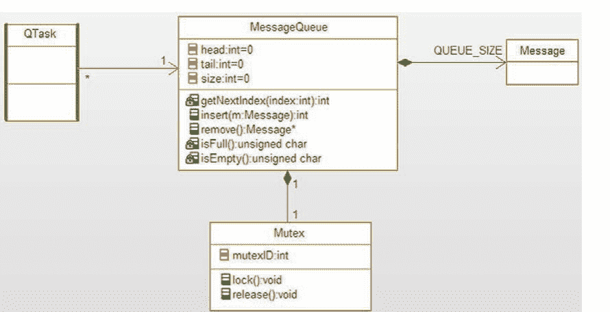

图 4-17：队列模式

### 4.6.3 模式结构

队列模式的结构如图 4-17 所示。QUEUE_SIZE 的声明决定了队列可以保留元素的最大数量。必须确保该值足够处理系统使用的最坏情况，同时又不至于大到浪费内存。

### 4.6.4 协作角色

本节描述了该模式涉及的角色。

### 4.6.4.1 Message（消息）

Message 类是 QTasks 之间相关消息的抽象。它可以是简单的数据值，也可以是 TCP/IP 消息传递中使用的复杂数据报结构。

### 4.6.4.2 MessageQueue（消息队列）

MessageQueue 是 QTasks 之间交换信息的存储器。MessageQueue 最多可以存储 QUEUE_SIZE 个元素。MessageQueue 提供以下方法：

- int MessageQueue_getNextIndex(MessageQueue* me, int index)
  一个私有（静态）函数，使用取模运算计算下一个有效值。

- int MessageQueue_insert(MessageQueue* me, Message m)
  一个公共函数，如果 MessageQueue 未满，则将 Message 插入到队列的头部位置并更新头部索引。如果插入成功返回 0，如果 MessageQueue 已满则返回 1。

- Message* MessageQueue_remove(MessageQueue* me)
  一个公共函数，如果 MessageQueue 不空，则移除最旧的消息，创建一个新的堆变量来存放数据，更新尾部索引并将指针返回给调用者。如果成功则返回 Message 的指针，否则返回 NULL 指针。

- unsigned char MessageQueue_isFull(MessageQueue* me)
  一个私有函数，如果 MessageQueue 满了则返回 1，否则返回 0。

- unsigned char MessageQueue_isEmpty(MessageQueue* me)
  一个私有函数，如果 MessageQueue 为空则返回 1，否则返回 0。

### 4.6.4.3 Mutex（互斥锁）

Mutex 是一个互斥信号量对象，用于对 MessageQueue 的访问进行序列化。MessageQueue 的受保护函数在被调用时调用 Mutex 的 lock() 函数，并在服务完成后释放()。当客户端线程尝试在关联的 Mutex 被锁时调用服务，它将会被阻塞，直到 Mutex 被解锁。此元素通常由 RTOS 提供。请注意，这与本章前面提到的“静态优先级”中的元素是同一个。

### 4.6.4.4 Qtask

QTask 是 MessageQueue 的客户端，通过调用 insert() 或 remove() 函数来在此处访问数据。

### 4.6.5 影响

队列模式为数据在任务之间的传递提供了良好的访问序列化支持。互斥锁的使用确保了 MessageQueue 本身不会因同时访问其服务而导致损坏。由于队列模式实现了异步通信，因此其接收数据的及时性低于受保护调用模式（Guarded Call Pattern）。

队列持有的元素数量可以很大；这对于元素产品以“突发性”方式运行的情况非常有用，允许元素的消费者及时赶上进度。队列大小不当可能导致数据丢失（太小）或内存浪费（太大）。非常小的队列（可以容纳一两个元素）可用于不存在数据丢失问题时的简单异步数据交换。

### 4.6.6 实现策略

队列最简单的实现是作为消息元素的数组。这种方法具有简单性的优点，但缺乏链表的灵活性。

队列的实现相当简单，但有很多可能的变体。有时某些消息比其他消息更紧急，应该在等待低优先级消息之前处理。可以通过添加多个缓冲区（每个优先级一个）或根据消息优先级在队列中插入元素来修改 MessageQueue 以实现优先级（尽管可能会增加元素插入和删除所需的时间）。在这种情况下，消息应该具有优先级属性，以便 MessageQueue 能够正确地插入和移除元素。

在复杂系统中，预测最优队列大小可能是不可行的。在这种情况下，可以实现扩展队列。当 MessageQueue 满时，会分配更多内存。MessageQueue 的链表实现更适用于扩展队列。要确定什么情况下缩小队列并重用未使用的内存可能是困难的。

有时元素的潜在数量超过内存容量。在这种情况下，可以创建一个缓存队列；在这种情况下，本质上有三个存储位置：本地内存最新数据缓冲区、本地内存最旧数据缓冲区以及一个持有中间年龄数据的文件。当新数据缓冲区满时，它会被发送到文件系统。本地旧数据缓冲区将从磁盘中移除（或如果文件为空，则从新数据缓冲区复制）。这允许存储可能海量的数据，但制作缓存数据可能非常耗时。

### 4.6.7 相关模式

队列模式通过对数据或命令进行排队来实现访问的序列化，允许接收者一次处理一个。受保护调用模式也序列化访问，但它是同步的，因此如果接收者未准备绪，发送者必须阻塞。然而，队列模式允许发送者在消息入队后立即继续。

图 4-8 显示了用于 O2_GAS、N2_GAS、HE_GAS 和 UNKNOWN_GAS 的队列模式示例，以及浓度（double 类型）以及每分钟 cc 的流量（int 类型）。代码列表 4-31 给出了 #defines 和通用声明。代码列表 4-32 和代码列表 4-33 给出了 GasData 结构的代码。


# 嵌入式并发与资源管理设计模式 213

```c
#include "GasData.h"

void GasData_Init(GasData* const me) {
    me->conc = 0.0;
    me->flowInCCPerMin = 0;
    me->gType = UNKNOWN_GAS;
}
```

```c
void GasData_Cleanup(GasData* const me) {
}

GasData * GasData_Create(void) {
    GasData* me = (GasData *)malloc(sizeof(GasData));
    if(me!=NULL) {
        GasData_Init(me);
    }
    return me;
}
```

```c
void GasData_Destroy(GasData* const me) {
    if(me!=NULL) {
        GasData_Cleanup(me);
    }
    free(me);
}
```

# 代码列表 4-33：GasData.c

GasDataQueue 是模式的核心。它的 `insert()` 和 `remove()` 操作分别将新数据入队列并取出最旧的数据。`insert()` 函数在成功时返回 TRUE，否则返回 FALSE。`remove()` 函数返回一个指向 GasData 实例的指针，由客户端负责删除该实例。如果 `remove()` 函数失败，它将返回 NULL 指针。

该类还包含一些私有的（静态）辅助函数，例如 `getIndex()`，它使用模运算计算下一个索引以循环遍历队列顶部；`isEmpty()`，在队列没有元素时返回 TRUE；以及 `isFull()`，在没有空间存放额外元素时返回 TRUE。

代码列表 4-34 和代码列表 4-35 提供了 GasDataQueue 的 C 代码。

```c
#ifndef GasDataQueue_H
#define GasDataQueue_H

#include "QueuingExample.h"
#include "GasData.h"
```

# 214 第 4 章

```c
#include "OSemaphore.h"
```

```c
typedef struct GasDataQueue GasDataQueue;
struct GasDataQueue {
    int head;
    OSemaphore * sema;
    int size;
    int tail;
    struct GasData itsGasData[GAS_QUEUE_SIZE];
};
```

```c
/* 构造函数和析构函数 */
```

```c
void GasDataQueue_Init(GasDataQueue* const me);
void GasDataQueue_Cleanup(GasDataQueue* const me);
```

```c
/* 操作 */
```

```c
int GasDataQueue_insert(GasDataQueue* const me, GasDataQueue g);
```

```c
GasData * GasDataQueue_remove(GasDataQueue* const me);
```

```c
int GasDataQueue_getGasData(const GasDataQueue* const me);
```

```c
GasDataQueue * GasDataQueue_Create(void);
```

```c
void GasDataQueue_Destroy(GasDataQueue* const me);
```

```c
#endif
```

# 代码列表 4-34：GasDataQueue.h

```c
#include "GasDataQueue.h"
#include <stdio.h>
```

```c
/* 私有 (静态) cleanUpRelations(GasDataQueue* const me); */
static int getNextIndex(GasDataQueue* const me, int index);
static unsigned char isEmpty(GasDataQueue* const me);
static unsigned char isFull(GasDataQueue* const me);
static void initRelations(GasDataQueue* const me);
```

```c
void GasDataQueue_Init(GasDataQueue* const me) {
    me->head = 0;
    me->sema = NULL;
    me->size = 0;
    me->tail = 0;
    initRelations(me);
```

# 嵌入式并发与资源管理设计模式 215

```c
me->sema = OS_create_semaphore();
}

void GasDataQueue_Cleanup(GasDataQueue* const me) {
    OS_destroy_semaphore(me->sema);
    cleanUpRelations(me);
}

/*
```

```c
/*
Insert 在可能的情况下将新的气体数据元素放入队列中。
如果成功则返回 1，否则返回 0。
*/
int GasDataQueue_Insert(GasDataQueue* const me, GasData g) {
    OS_lock_semaphore(me->sema);
    if (!isFull(me)) {
        me->GasData[me->head] = g;
        me->head = getNextIndex(me, me->head);
        ++me->size;

        /* 仪器测量 */
        /* 打印，仅用于插入操作 */
        switch (g.gType) {
            case O2_GAS:
                printf("+++ Oxygen ");
                break;
            case N2_GAS:
                printf("+++ Nitrogen ");
                break;
            case HE_GAS:
                printf("+++ Helium ");
                break;
            default:
                printf("+++ UNKNOWN ");
                break;
        }
        printf("+++ at conc %f, flow%d\n", g.conc.flowInCCPerMin);
        printf("+++ Number of elements queued %d, head = %d, tail = %d\n", me->size, me->head, me->tail);
        /* 仪器测量 */

        OS_release_semaphore(me->sema);
        return 1;
    } else { /* 返回错误指示 */
        OS_release_semaphore(me->sema);
        return 0;
    }
```

```c
/*
remove 在堆上创建一个新元素，
将最旧的数据的内容复制其中，
返回指针。如果队列为空则返回 NULL。
*/
GasData * GasDataQueue_remove(GasDataQueue* const me) {
    GasData* gPtr;

    OS_lock_semaphore(me->semaphore);
    if(!isEmpty(me)) {
        gPtr = (GasData*)malloc(sizeof(GasData));
        gPtr->type = me->itsGasData[me->tail].type;
        gPtr->conc = me->itsGasData[me->tail].conc;
        gPtr->flowInPerMin = me->itsGasData[me->tail].flowInPerMin;
        me->tail = getNextIndex(me, me->tail);
        me->size--;
        /* 仪器测量 */
        switch (gPtr->type) {
            case O2_GAS:
                printf("-Oxygen ");
                break;
            case N2_GAS:
                printf("-Nitrogen ");
                break;
            case HE_GAS:
                printf("-Helium ");
                break;
            default:
                printf("-UNKNOWN ");
                break;
        }
        printf("- at conc %f, flow %d\n", gPtr->conc, gPtr->flowInPerMin);
        printf("- Number of elements queued %d, head = %d, tail = %d\n", me->size, me->head, me->tail);
        /* 仪器测量 */

        OS_release_semaphore(me->semaphore);
        return gPtr;
    } else { /* 如果为空返回 NULL */
        OS_release_semaphore(me->semaphore);
        return NULL;
    }
}
```

```c
static int getNextIndex(GasDataQueue* const me, int index) {
    /* 此操作通过模运算计算下一个索引 */
    return (index+1) % GAS_QUEUE_SIZE;
}
```

# 嵌入式并发与资源管理设计 217

```c
static unsigned char isEmpty(GasDataQueue* const me) {
    return (me->size == 0);
}
```

```c
static unsigned char isFull(GasDataQueue* const me) {
    return (me->size == GAS_QUEUE_SIZE);
}
```

```c
int GasDataQueue_getGasData(const GasDataQueue* const me) {
    int iter = 0;
    return iter;
}
```

```c
GasDataQueue * GasDataQueue_Create(void) {
    GasDataQueue* me = (GasDataQueue*)
        malloc(sizeof(GasDataQueue));
    if(me!=NULL) {
        GasDataQueue_Init(me);
    }
    return me;
}
```

```c
void GasDataQueue_Destroy(GasDataQueue* const me) {
    if(me!=NULL) {
        GasDataQueue_Cleanup(me);
    }
    free(me);
}
```

```c
static void initRelations(GasDataQueue* const me) {
    int iter = 0;
    while (iter < GAS_QUEUE_SIZE) {
        GasData_Init(&(me->itsGasData[iter]);
        iter++;
    }
}
```

```c
static void cleanUpRelations(GasDataQueue* const me) {
    int iter = 0;
    while (iter < GAS_QUEUE_SIZE) {
        GasData_Cleanup(&(me->itsGasData[iter]);
        iter++;
    }
}
```

# 代码列表 4-35：GasDataQueue.c

在示例（图 4-18）中，有两个线程运行客户端。SensorThread 自身拥有三个客户端：O2Sensor、N2Sensor 和 HeSensor。当该线程运行主函数 (SensorThread_updateData()) 时，它调用每个传感器的 getXXData() 函数来生成数据，并将数据封装为 GasData 结构体并发送出去。SensorThread 的相关代码（任务启动和辅助函数）位于代码列表 4-36 和代码列表 4-37。

# 218 第 4 章

```c
/* ... 上述声明 ... */
typedef struct SensorThread SensorThread;
struct SensorThread {
    struct GasDataQueue* itsDataQueue;
    struct HeSensor itsHeSensor;
    struct N2Sensor itsN2Sensor;
    struct O2Sensor itsO2Sensor;
};

/* 操作 */
void SensorThread_updateData(SensorThread* const me);
/* ... 其他操作也已 ... */
#endif
```

# 代码列表 4-36：SensorThread.h

```c
/*
updateData 每个传感器线程周期运行一次，
调用其每个传感器的 getXXData() 函数，
然后使用随机数生成器
决定哪些数据应该发布到
GasDataQueue 中。
*/
void SensorThread_updateData(SensorThread* const me) {
    unsigned char success;
    GasData g;

    GasData_Init(&g);

    O2Sensor_getO2Data(&me->itsO2Sensor);
    N2Sensor_getN2Data(&me->itsN2Sensor);
    HeSensor_getHeData(&me->itsHeSensor);

    if (rand() > RAND_MAX / 3) {
        g.gType = HE_GAS;
        g.conc = me->itsHeSensor.conc;
        g.flowInPerMin = me->itsHeSensor.flow;
    }
}
```

```
} (注：在提供的原始文本最后部分存在代码截断和重复错误，已根据上下文逻辑翻译并保持了结构)
```


# 嵌入式并发与资源管理设计模式 219

```c
success = GasDataQueue_insert(me->ItsGasDataQueue, g);
if (!success)
  printf("Helium Gas queue insertion failed!\n");

if (rand() > RAND_MAX / 3) {
  g.gType = N2_GAS;
  g.conc = me->ItsN2Sensor.conc;
  g.flowInCCPerMin = me->ItsN2Sensor.flow;
  success = GasDataQueue_insert(me->ItsGasDataQueue, g);
  if (!success)
    printf("Nitrogen Gas queue insertion failed!\n");
}

if (rand() > RAND_MAX / 3) {
  g.gType = O2_GAS;
  g.conc = me->ItsO2Sensor.conc;
  g.flowInCCPerMin = me->ItsO2Sensor.flow;
  success = GasDataQueue_insert(me->ItsGasDataQueue, g);
  if (!success)
    printf("Oxygen Gas queue insertion failed! \n");
}
```

## 代码列表 4-37: SensorThread.c 中的 updateData 函数

示例中的传感器非常简单——它们只是随着时间推移增加数值，但它们展示了自己正在产生数据；`SensorThread_updateData()` 函数负责将数据推送到队列中。代码列表 4-38 和代码列表 4-39 显示了其中一个传感器的代码。

```c
#ifndef O2Sensor_H
#define O2Sensor_H

#include "QueuingExample.h"

typedef struct O2Sensor O2Sensor;
struct O2Sensor {
  double conc;
  unsigned int flow;
};

/* 构造函数和析构函数： */

void O2Sensor_Init(O2Sensor* const me);
void O2Sensor_Cleanup(O2Sensor* const me);
```

# 220 第 4 章

```c
/* 操作 */
void O2Sensor_getO2Data(O2Sensor* const me);
O2Sensor *O2Sensor_Create(void);
void O2Sensor_Destroy(O2Sensor* const me);

#endif
```

# 代码列表 4-38: O2Sensor

```c
#include "O2Sensor.h"
#include <stdlib.h>
#include <stdio.h>

void O2Sensor_Init(O2Sensor* const me) {
  me->conc = 0.0;
  me->flow = 0;
}

void O2Sensor_Cleanup(O2Sensor* const me) {
}

/*
getO2Data() 是传感器类实际
获取数据的地方。在这里它只是
增加了数据。
*/
void O2Sensor_getO2Data(O2Sensor* const me) {
  me->conc += 20;
  me->flow += 25;
}

O2Sensor *O2Sensor_Create(void) {
  O2Sensor* me = (O2Sensor *) malloc(sizeof(O2Sensor));
  if(me == NULL) {
    O2Sensor_Init(me);
  }
  return me;
}

void O2Sensor_Destroy(O2Sensor* const me) {
  if(me == NULL) {
    O2Sensor_Cleanup(me);
  }
  free(me);
}
```

# 代码列表 4-39: O2Sensor.c

# 嵌入式并发与资源管理设计模式 221

在消费者端，`GasProcessingThread()` 定期运行并提取数据。如果有可用数据，它会调用其嵌套的 `GasController` 实例的 `GasController_handleGasData()` 函数。该函数打印数据（通过调用 `GasDisplay_printGasData()` 函数），但人们可以想象它可能会对数据做一些更有趣的事情，例如维持适当浓度的恒定气体输送。列表 4-40 和代码列表 4-43 显示了这两个元素的代码。

```c
#ifndef GasController_H
#define GasController_H

#include "QueuingExample.h"
#include "GasData.h"
struct GasDisplay;

typedef struct GasController GasController;
struct GasController {
    struct GasDisplay* itsGasDisplay;
};

/* 构造函数和析构函数： */ */
void GasController_Init(GasController* const me);
void GasController_Cleanup(GasController* const me);

/* 操作 */
void GasController_handleGasData(GasController* const me, GasData* pPtr);

struct GasDisplay* GasController_getItsGasDisplay(const GasController* const me);

void GasController_setGasDisplay(GasController* const me, struct GasDisplay* p_GasDisplay);

GasController *GasController_Create(void);

void GasController_Destroy(GasController* const me);
#endif
```

# 代码列表 4-40: GasController.h

```c
#include "GasController.h"
#include "GasDisplay.h"
#include <stdio.h>
static void cleanUpRelations(GasController* const me);
```

# 222 第 4 章

```c
void GasController_Init(GasController* const me) {
  me->ItsGasDisplay = NULL;
}
```

```c
void GasController_Cleanup(GasController* const me) {
  cleanUpRelations(me);
}
```

```c
void GasController_handleGasData(GasController* const me, GasData * gPtr) {
  if (gPtr) {
    GasDisplay_printGasData(me->ItsGasDisplay, gPtr->conc, gPtr->flowCCPerMin);
  }
  free(gPtr);
}
```

```c
struct GasDisplay* GasController_getGasDisplay(GasController* const me) {
  return (struct GasDisplay*)me->ItsGasDisplay;
}
```

```c
void GasController_setGasDisplay(GasController* const me, struct GasDisplay* p_GasDisplay) {
  me->ItsGasDisplay = p_GasDisplay;
}
```

```c
GasController *GasController_Create(void) {
  GasController* me = (GasController*) malloc(sizeof(GasController));
  if(me == NULL) {
    GasController_Init(me);
  }
  return me;
}
```

```c
void GasController_Destroy(GasController* const me) {
  if(me == NULL) {
    GasController_Cleanup(me);
  }
  free(me);
}
```

```c
static void cleanUpRelations(GasController* const me) {
  if(me->ItsGasDisplay != NULL) {
    me->ItsGasDisplay = NULL;
  }
}
```

## 代码列表 4-18: GasController.c

# 嵌入式并发与资源管理设计模式 223

```c
#include "QueuingExample.h"
#include "GasData.h"

typedef struct GasDisplay GasDisplay;
struct GasDisplay {
    int screenWidth;
};

/* 构造函数和析构函数 */
void GasDisplay_Init(GasDisplay* const me);
void GasDisplay_Cleanup(GasDisplay* const me);

/* 操作 */
void GasDisplay_printGasData(GasDisplay* const me, GAS_TYPE gasType, double gas_conc, unsigned int gas_flow);

GasDisplay *GasDisplay_Create(void);
void GasDisplay_Destroy(GasDisplay* const me);
#endif
```

# 代码列表 4-19: GasDisplay.h

```c
#include "GasDisplay.h"
#include <stdio.h>

void GasDisplay_Init(GasDisplay* const me) {
  me->screenWidth = 80;
}

void GasDisplay_Cleanup(GasDisplay* const me) {
}
```

```c
void GasDisplay_printGasData(GasDisplay* const me, GAS_TYPE gasType, double gas_conc, unsigned int gas_flow) {
  printf("%s\n", gasType);
  switch (gasType) {
    case O2_GAS:
      printf("*Oxygen ");
      break;
    case N2_GAS:
      printf("*Nitrogen ");
      break;
    case HE_GAS:
      printf("*Helium ");
      break;
    default:
      printf("*UNKNOWN *");
      break;
  }
  printf("Conc %f, Flow in CC/Min %d\n", gas_conc, gas_flow);
  printf("\n");
}
GasDisplay *GasDisplay_Create(void) {
  GasDisplay* me = (GasDisplay *) malloc(sizeof(GasDisplay));
  if(me == NULL) {
    GasDisplay_Init(me);
  }
  return me;
}

void GasDisplay_Destroy(GasDisplay* const me) {
  if(me == NULL) {
    GasDisplay_Cleanup(me);
  }
  free(me);
}
```

# 代码列表 4-43: GasDisplay.c

图 4-19 显示了示例的四秒运行，其中 `GasProcessingThread` 每 1000 ms 运行一次，`SensorThread` 每 500 ms 运行一次，队列长度为 10。你可以看到三个传感器每个都有 1/3 的概率在间隔内产生数据，数据的存速度快于移除速度，队列最终会满。`insert` 操作配备了 `printf()` 语句以显示何时插入。`GasController` 的 `handleGasData()` 在 `GasProcessingThread` 的每个周期被调用，并调用了 `GasDisplay` 的 `GasData()` 函数。

## 4.7 会合模式 (Rendezvous Pattern)

任务必须以各种方式进行同步。队列模式（Queuing）和受保护调用模式（Guarded Call）在同步发生在简单函数调用、共享单个资源或传递数据时提供了机制。但如果同步所需的条件更复杂呢？会合模式将策略本身实体化为一个对象，因此支持即使是最复杂的任务同步需求。

### 4.7.1 抽象

前置条件（precondition）是指在操作或活动之前指定为真的内容。前置条件是一种通常是性的约束，它可以用于生成代码来强制前置条件成立或检查前置条件是否成立。

```c
*** Nitrogen at conc 10.000000, flow 15
Number of elements queued 4, head = tail = 1
*** Oxygen at conc 20.000000, flow 25
Number of elements queued 2, head = tail = 0
*** Nitrogen at conc 10.000000, flow 15
Number of elements queued 1, head = tail = 2
Nitrogen at conc 40.000000, Flow in CC/Min 15
*** Helium at conc 2.000000, flow 3
Number of elements queued 2, head = tail = 1
*** Nitrogen at conc 20.000000, flow 30
Number of elements queued 3, head = tail = 1
*** Oxygen at conc 40.000000, flow 50
Number of elements queued 4, head = tail = 1
*** Oxygen at conc 50.000000, flow 25
Number of elements queued 5, head = tail = 1
*** Oxygen at conc 60.000000, flow 35
Number of elements queued 6, head = tail = 2
Oxygen at conc 20.000000, Flow in CC/Min 25
*** Helium at conc 4.000000, flow 4
Number of elements queued 5, head = tail = 2
*** Nitrogen at conc 20.000000, flow 40
Number of elements queued 6, head = tail = 2
*** Helium at conc 5.000000, flow 5
Number of elements queued 7, head = tail = 2
*** Nitrogen at conc 50.000000, flow 75
Number of elements queued 8, head = tail = 0
```


## 226 第 4 章

类将其释放以运行。一旦满足一组前提条件，注册的任务将根据当前生效的任何调度策略释放运行。

### 4.7.2 问题

会合模式（Rendezvous Pattern）解决了一组任务必须以复杂方式进行同步的问题。

### 4.7.3 模式结构

图 4-20 显示了会合模式的结构。其结构的简单性隐藏了管理复杂任务交互的用途。

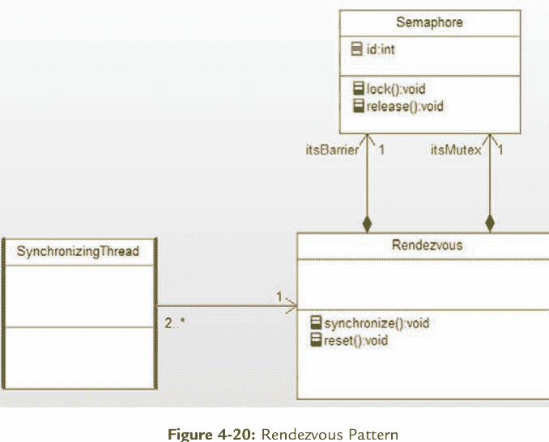

### 4.7.4 协作角色

本节描述了该模式的角色。

### 4.7.4.1 Rendezvous

Rendezvous 类管理同步。它通过两个主要函数来实现：

- *void reset(void)*
  此函数将同步准则重置为初始状态。

嵌入式并发与资源管理设计模式 227

- *void synchronize(void)*
  当任务想要同步时，调用此函数。如果未满足条件，任务将以某种方式阻塞（见下文的实现策略）。通常通过使用观察者模式（见第 2 章）或受保护调用模式（Guarded Call Pattern）来实现。

该类的复杂性主要在于 `synchronize()` 函数；它评估同步前提以查看其是否满足。这些条件可能是内部的（例如示例中使用的该模式的线程屏变体），也可能是外部的，或者是两者的任意组合。

注意的是，Rendezvous 对象本身通常不会在线程会合时识别线程；对于 Rendezvous 对象而言，线程是匿名的。如果它们不是匿名的（例如当策略允许任务按特定顺序会合时），那么 `synchronize()` 函数可以以一个或多个参数的形式接收这些信息。

### 4.7.4.2 Semaphore

这是一个计数信号量。信号量提供以下操作：

- - Semaphore* create_semaphore(void)
- destroy_semaphore(Semaphore*)
- lock_semaphore(Semaphore*)
- release_semaphore(Semaphore*)

### 4.7.4.3 SynchronizingThread

该元素代表一个使用 Rendezvous 对象进行同步的线程。它将运行到其同步点，然后调用 `synchronize()` 函数。

实现该模式有多种方法，会导致模式元素的参数和返回类型发生细微变化。

### 4.7.5 后果

在此模式中，两个或多个任务可以通过任何可以编码在 Rendezvous 类中的任意复杂策略进行同步。该模式本身简单且灵活，适用于专门化和适应。

当任务必须在其同步点停止时，该模式最为合适；即该模式实现了一种阻塞会合。如果需要非阻塞会合，则可以将此模式与队列模式或观察者模式结合，并在 `SynchronizingThread` 内部通过回调 `notify()` 函数。

第 4 章

### 4.7.6 实现策略

该模式可以使用第 3 章的观察者模式或本章的受保护调用模式来实现。如果使用观察者模式实现，则任务必须注册一个函数地址，以便在满足同步准则时调用它。如果使用受保护调用模式实现，则每个 Rendezvous 对象都拥有一个信号量，该信号量在 Rendezvous 对象创建时启用。每个调用任务在想要同步时会调用 `register()` 函数。当满足同步准则时，信号量被释放，然后任务就可以根据正常的调度策略自由运行。

### 4.7.7 相关模式

当受保护调用或队列模式等更简单的解决方案足够时，该模式可能大材小用。

该模式也可以通过多种不同的方式实现，使用受保护调用或观察者模式来管理线程的阻塞和取消阻塞。

### 4.7.8 示例

在示例（图 4-21）中，我们实现了一种特定的会合模式，称为线程屏障模式（Thread Barrier Pattern）。在这种模式中，Rendezvous 对象仅知道预期会有数量的任务会合。当达到数量的任务调用了 `synchronize()` 函数时，一组阻塞的任务将被释放。示例还使用信号量（受保护调用模式）实现了该模式，并允许操作系统阻塞和解锁任务。

使用计数信号量对于线程屏障的算法是很容易理解的。请参见代码列表 4-45 中同步操作的代码。

```
#ifndef ThreadBarrier_H
#define ThreadBarrier_H

/*# auto_generated */
#include <oxi/Ric.h>
/*# auto_generated */
#include "RendezvousExample.h"
/*# auto_generated */
#include <oxi/RITask.h>
/*# package RendezvousPattern::RendezvousExample */

/*# class ThreadBarrier */
typedef struct ThreadBarrier ThreadBarrier;
struct ThreadBarrier {
    int currentColCount;
```

嵌入式并发与资源管理设计模式 229

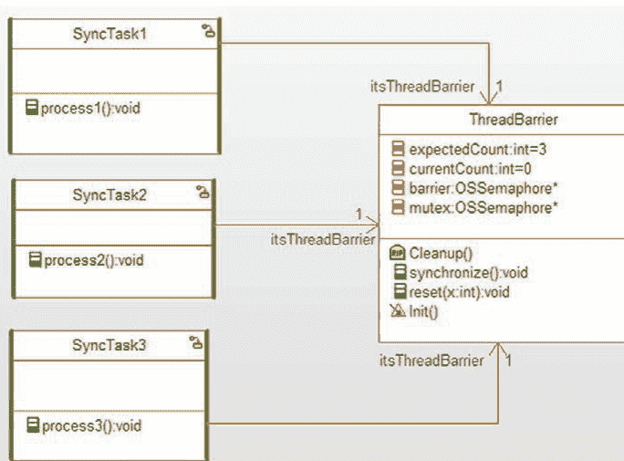

图 4-21：会合示例

int expectedCount;
OSemaphore* barrier;
OSemaphore* mutex;

1;

/* 构造函数和析构函数：*/
void ThreadBarrier_Init(ThreadBarrier* const me);
void ThreadBarrier_Cleanup(ThreadBarrier* const me);

/* 操作 */
void ThreadBarrier_reset(ThreadBarrier* const me, int x);
void ThreadBarrier_synchronize(ThreadBarrier* const me);
ThreadBarrier* ThreadBarrier_Create(void);
void ThreadBarrier_Destroy(ThreadBarrier* const me);
#endif

# 代码列表 4-20: ThreadBarrier.h

```
#include "ThreadBarrier.h"

void ThreadBarrier_Init(ThreadBarrier* const me)
me->currentCount = 0;
me->expectedCount = 3;
```

```
me->mutex = OSSemaphore_Create();
me->barrier = OSSemaphore_Create();
if (me->barrier) {
    OSSemaphore_lock(me->barrier);
    printf("BARRIER IS LOCKED FIRST TIME\n");
}
```

```
void ThreadBarrier_Cleanup(ThreadBarrier* const me) {
    OSSemaphore_Destroy(me->barrier);
    OSSemaphore_Destroy(me->mutex);
}
```

```
void ThreadBarrier_reset(ThreadBarrier* const me, int x) {
    me->expectedCount = x;
    me->currentCount = 0;
}
```

```
void ThreadBarrier_synchronize(ThreadBarrier* const me) {
/*
    保护 currentCount 的临界区域
*/
    OSSemaphore_lock(me->mutex);
    /* 临界区 */
    me->currentCount++;
```

```
/*
    满足阻塞条件了吗？
    如果是，则释放第一个阻塞
    线程（取决于操作系统）
*/
if (me->currentCount == me->expectedCount) {
    printf("Conditions met\n");
    OSSemaphore_release(me->barrier);
}
```

```
/*
    锁定信号量，并在释放时
    释放给下一个阻塞线程
*/
OSSemaphore_lock(me->barrier);
OSSemaphore_release(me->barrier);
}
```

```
ThreadBarrier * ThreadBarrier_Create(void) {
    ThreadBarrier* me = (ThreadBarrier *)
    malloc(sizeof(ThreadBarrier));
    if(me==NULL)
```

```
ThreadBarrier_Init(me);
return me;

```
void ThreadBarrier_Destroy(ThreadBarrier* const me) {
  if(me!=NULL) {
    ThreadBarrier_Cleanup(me);
    free(me);
  }
}
```

# 代码列表 4-21: ThreadBarrier.c

嵌入式并发与资源管理设计模式 231

## 死锁避免模式

我在在本章想要解决的最后一个问题是死锁。死锁是多个客户端同时等待原则上不会发生的条件的情况。
图 4-22 显示了一个死锁示例。在这个示例中，任务 1 的优先级高于任务 2。该图显示了一个叠加在显示结构的类图之上的时序图。除了任务之外，还有两个资源 R1 和 R2，被两个任务共享。问题由于任务以反顺序锁定资源且任务 1 抢占了任务 2 而产生。

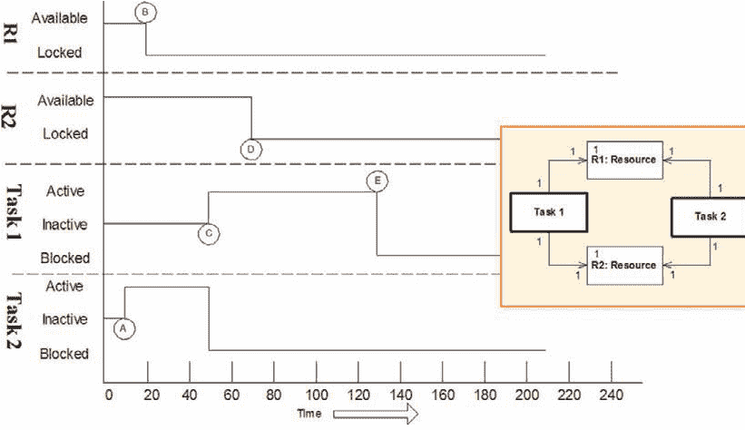

图 4-22：死锁示例


## 232 第 4 章

在 Task 1 锁定 R1 和 R2 之间。后续描述引用图 4-22 中的标记点。

- A. 在此点，Task 2 运行。
- B. Task 2 锁定了 R1 且正准备锁定 R2。
- C. Task 1 运行。由于其优先级高于 Task 2，它抢占了 Task 2。
- D. Task 1 锁定了 R2。
- E. Task 1 现在尝试锁定 R1，然而，R1 目前被 Task 2 锁定。如果 Task 1 阻塞并阻碍了所有 Task 2 的运行，那么 Task 2 在尝试锁定 R1 时将会被阻塞。此时系统处于死锁状态。

只要破坏死锁的四个必要条件（见下文）中的任何一个，就能确保死锁不会出现。同步锁定、顺序锁定临界区域模式可以避免所有死锁问题。例如，如果 Task 2 在锁定 R1 之前开启了临界区域（即不允许任务切换），那么 Task 1 就无法在它锁定 R2 之前进行抢占。如果两个任务都按照相同的顺序锁定资源，则可以防止死锁。如果 Task 2 同时锁定资源，则没有问题。死锁很容易防止，但你必须采取谨慎的步骤来实现。

撇软件错误等常见问题不谈，死锁的发生需要满足四个条件：

1. 资源的互斥
2. 某些资源被锁定，而其他资源允许访问
3. 允许在资源锁定时进行抢占
4. 存在循环等待条件

通过破坏这四个条件中的任何一个都可以避免死锁。例如，使用临界区域模式破坏了规则 #1 和 #3。队列模式由于使用了异步消息传递，避免了规则 #1（队列访问本身的锁除外）。本章将以另外两种避免死锁的模式作为结束。

## 4.8 同步锁定模式

同步锁定模式是一种专门关注避免死锁的模式。它通过锁定条件 #2（在持有资源的同时等待其他资源）来实现。该模式以“全有或全无”的方式工作：要么一次锁定所有所需的资源，要么一个都不锁定。

### 4.8.1 抽象

通过破坏四个必要条件中的任何一个即可解决死锁。该模式通过一次性分配所有资源，防止了在持有某些资源的同时请求其他资源的情况。

## 嵌入并发与资源管理设计模式 233

然而，该模式优于临界区域模式的优势在于，它允许高优先级任务在不需要任何已锁资源的情况下运行。

### 4.8.2 问题

在高可靠性计算中，死锁是一个严重的问题，许多系统设计了特定的机制来检测或避免它。如前所述，当一个任务等待一个原则上可以满足的条件时，死锁就会发生。死锁发生必须满足四个条件，否定其中任何一个条件的存在就足够了。同步锁定模式打破了条件 #2，不允许任何任务在等待其他资源时锁定资源。

### 4.8.3 模式结构

该模式的结构如图 4-23 所示。

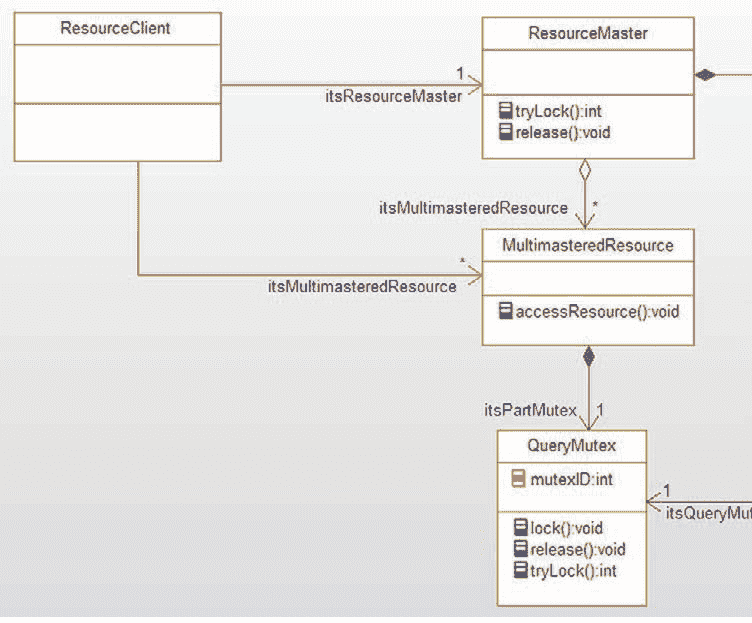

图 4-23：同步锁定模式一般情况

## 234 第 4 章

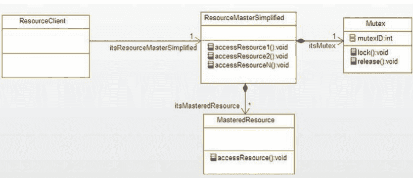

图 4-24：简化的同步锁定模式，其中每个资源必须分配给单一资源主（Resource Master）

通常，MultimasteredResource 可以是任意不同资源集的一部分，由单独的 ResourceMaster 实例管理一组。跨多个 ResourceMasters 的资源潜在共享增加了问题的复杂性。当不需要这种灵活性时，情况简化为图 4-24 所示。虽然差异看起来并不大，但它移除了互斥锁（Mutex），并且对 tryLock() 函数的需求在算法上要简单得多。

### 4.8.4 协作角色

本节描述了该模式的角色。

#### 4.8.4.1 MasteredResource

该类是简化版同步锁定模式的元素。它代表由单个 ResourceMasterSimplified 实例拥有的共享资源。如果可以确定 MasteredResource 可以唯一分配给由单个 ResourceMasterSimplified 实例控制的集合，那么就会变得简单得多；在这种情况下，资源不需要自己的互斥锁，因为它将在 ResourceMasterSimplified 互斥锁的护护下执行。如果资源必须在多个资源组中共享，则它变成了 MultimasteredResource，它是更通用的模式的一部分。

#### 4.8.4.2 MultimasteredResource

该类是通用同步锁定模式的元素。如果它由多个 ResourceMasters 管理，那么它需要自己的互斥锁（通过其 itsPartMutex）。它所使用的互斥锁必须提供 tryLock() 函数，以便 ResourceMaster 可以判断所有尝试的锁定将成功还是失败。

## 嵌入并发与资源管理设计模式 235

### 4.8.4.3 Mutex

该元素是前述模式中使用的普通互斥锁信号量；它提供了 lock() 和 release() 函数，其工作方式符合互斥信号量的标准。

#### 4.8.4.4 QueryMutex

该元素是前述模式中使用的普通互斥锁信号量；它提供了 lock() 和 release() 函数，其工作方式符合互斥信号量的标准。

### 4.8.4.5 ResourceClient

该元素是前述模式中使用的普通互斥锁信号量；它提供了 lock() 和 release() 函数，其工作方式符合互斥信号量的标准。

### 4.8.4.6 ResourceMaster

该元素是前述模式中使用的普通互斥锁信号量；它提供了 lock() 和 release() 函数，其工作方式符合互斥信号量的标准。

#### 4.8.4.7 ResourceMasterSimplified

简化锁定模式不需要通用情况所需的额外纪律。ResourceMasterSimplified 重新发布了 MasteredResources 的函数。

## 236 第 4 章

### 4.8.5 结果

同步锁定模式通过消除条件 #2（某些资源被锁定而其他资源被请求——来防止死锁。然而，该模式消除了死锁的可能性，但它可能会增加其他任务执行的延迟。这种延迟即使在没有资源冲突的情况下也可能发生。对于广泛共享的资源，这一问题比狭窄共享的资源更为明显。此外，该模式没有解决优先级反转问题，实际上可能会加剧问题，除非部署了某些反转界限模式，例如带有优先级继承的守卫调用模式。图 4-24 所示的模式通用情况需要开发者具备某种纪律，即在成功获得锁之前必须避免直接使用 MasteredResources 的链接。在大型项目中，这种纪律可能会被忽略，导致微妙且难以识别的错误。图 4-24 所示的简化模型没有这个问题这个问题，因为 ResourceMasterSimplified 发布了资源访问方法。

此模式仅适用于可能发生死锁的情况，例如当多个资源在至少三个线程中被共享时。

### 4.8.6 实现策略

该模式的实现不会带来任何困难，除了通用情况下需要使用支持 tryLock() 操作的互斥锁信号量，以及需要确保在直接访问资源之前已实现访问前提（成功锁定 MasteredResource）。

### 4.8.7 相关模式

可以通过避免四个条件中的任何一个来防止死锁。临界区域模式通过破坏条件 #1（资源的互斥锁定）来避免。本章稍后描述的顺序锁定模式通过破坏条件 #4（循环等待条件）防止死锁。

由于该模式没有解决无界优先级反转的问题，它可以与带有优先级继承的守卫调用模式混合使用。

### 4.8.8 示例

图 4-25 显示了图 4-24 的简化形式示例。在这种情况下，SensorMaster 复制了传感器的功能（尽管名称经过了混淆）


## 嵌入式并发与资源管理设计模式 237

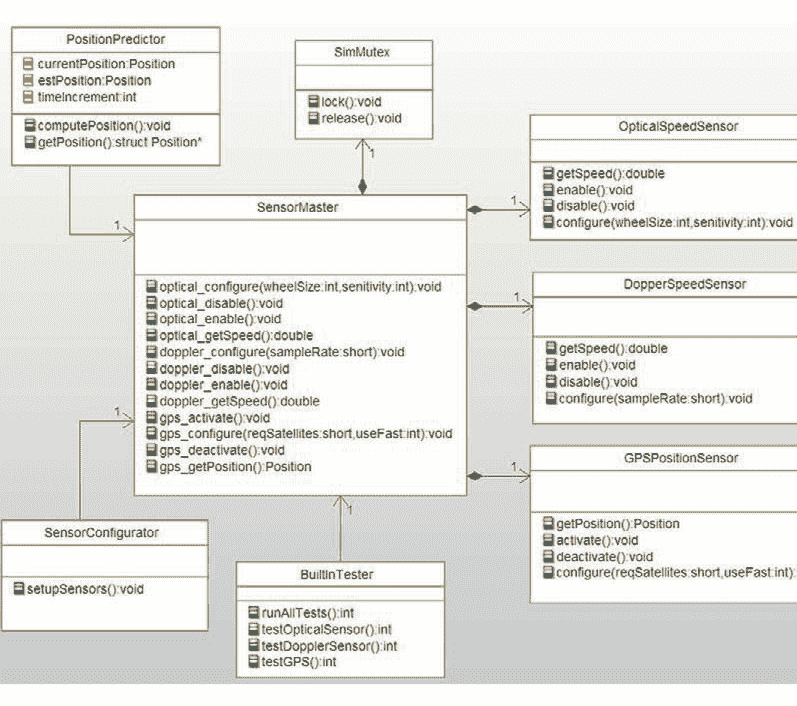

图 4-25：同步锁模式示例

用于区分服务的服务器名称。当客户端（例如位置预测器 PositionPredictor）调用其中一个服务时，SensorMaster 会锁定互斥锁，并在返回给客户端之前释放它。SensorMaster 为此目的拥有一个互斥锁。

```c
#ifndef SensorMaster_H
#define SensorMaster_H
#include "Position.h"
struct DopplerSpeedSensor;
struct GPSPositionSensor;
struct OpticalSpeedSensor;
struct SimMutex;

typedef struct SensorMaster;
struct SensorMaster (
    struct DopplerSpeedSensor* itsDopplerSpeedSensor;
    struct GPSPositionSensor* itsGPSPositionSensor;
    struct OpticalSpeedSensor* itsOpticalSpeedSensor;
    struct SimMutex* itsSimMutex;
};
```

```c
/* 构造函数与析构函数：*/
void SensorMaster_Init(SensorMaster* const me);
void SensorMaster_Cleanup(SensorMaster* const me);
```

```c
/* 操作 */
void SensorMaster_doppler_configure(SensorMaster* const me, short sampleRate);
void SensorMaster_doppler_disable(SensorMaster* const me);
void SensorMaster_doppler_enable(SensorMaster* const me);
double SensorMaster_getSpeed(SensorMaster* const me);
void SensorMaster_gps_activate(SensorMaster* const me);
void SensorMaster_gps_configure(SensorMaster* const me, short reqSatellites, int useFast);
void SensorMaster_gps_deactivate(SensorMaster* const me);
struct Position SensorMaster_gps_getPosition(SensorMaster* const me);
void SensorMaster_optical_configure(SensorMaster* const me);
struct DopplerSensor* SensorMaster_getDopplerSpeedSensor(SensorMaster* const me);
void SensorMaster_setItsDopplerSensor(SensorMaster* const me, struct DopplerSensor* p_DopplerSensor);
struct GPSPositionSensor* SensorMaster_getGPSPositionSensor(SensorMaster* const me);
void SensorMaster_setItsGPSPositionSensor(SensorMaster* const me, struct GPSPositionSensor* p_GPSPositionSensor);
struct OpticalSpeedSensor* SensorMaster_getItsOpticalSpeedSensor(SensorMaster* const me);
void SensorMaster_setItsOpticalSpeedSensor(SensorMaster* const me, struct OpticalSpeedSensor* p_OpticalSpeedSensor);
struct SimMutex* SensorMaster_getItsSimMutex(SensorMaster* const me);
void SensorMaster_setItsSimMutex(SensorMaster* const me, struct SimMutex* p_SimMutex);
SensorMaster* SensorMaster_Create(void);
void SensorMaster_Destroy(SensorMaster* const me);

#endif
```

## 嵌入式并发与资源管理设计模式 239

## 代码列表 4-22：SensorMaster.h

```c
#include "SensorMaster.h"
#include "DopplerSpeedSensor.h"
#include "GPSPositionSensor.h"
#include "OpticalSpeedSensor.h"
#include "SimMutex.h"

static void cleanUpRelations(SensorMaster* const me);

void SensorMaster_Init(SensorMaster* const me) {
  me->itsDopplerSpeedSensor = NULL;
  me->itsGPSPositionSensor = NULL;
  me->itsOpticalSpeedSensor = NULL;
  me->itsSimMutex = NULL;
}

void SensorMaster_Cleanup(SensorMaster* const me) {
  cleanUpRelations(me);
}

void SensorMaster_doppler_configure(SensorMaster* const me, short sampleRate) {
  SimMutex_lock(me->itsSimMutex);
  DopplerSpeedSensor_configure(me->itsDopplerSpeedSensor,sampleRate);
  SimMutex_release(me->itsSimMutex);
}

void SensorMaster_doppler_disable(SensorMaster* const me) {
  SimMutex_lock(me->itsSimMutex);
  DopplerSpeedSensor_disable(me->itsDopplerSpeedSensor);
  SimMutex_release(me->itsSimMutex);
}

void SensorMaster_doppler_enable(SensorMaster* const me) {
  SimMutex_lock(me->itsSimMutex);
  DopplerSpeedSensor_enable(me->itsDopplerSpeedSensor);
  SimMutex_release(me->itsSimMutex);
}

double SensorMaster_doppler_getSpeed(SensorMaster* const me) {
  double speed;
  SimMutex_lock(me->itsSimMutex);
  speed = DopplerSpeedSensor_getSpeed(me->itsDopplerSpeedSensor);
  SimMutex_release(me->itsSimMutex);
  return speed;
}

void SensorMaster_gps_activate(SensorMaster* const me) {
  SimMutex_lock(me->itsSimMutex);
  GPSPositionSensor_activate(me->itsGPSPositionSensor);
  SimMutex_release(me->itsSimMutex);
}

void SensorMaster_gps_configure(SensorMaster* const me, short reqSatellites, int useFast) {
  SimMutex_lock(me->itsSimMutex);
  GPSPositionSensor_configure(me->itsGPSPositionSensor,reqSatellites,useFast);
  SimMutex_release(me->itsSimMutex);
}

void SensorMaster_gps_deactivate(SensorMaster* const me) {
  SimMutex_lock(me->itsSimMutex);
  GPSPositionSensor_deactivate(me->itsGPSPositionSensor);
  SimMutex_release(me->itsSimMutex);
}

struct Position SensorMaster_gps_getPosition(SensorMaster* const me) {
  Position pos;
  SimMutex_lock(me->itsSimMutex);
  pos = GPSPositionSensor_getPosition(me->itsGPSPositionSensor);
  SimMutex_release(me->itsSimMutex);
  return pos;
}

void SensorMaster_optical_configure(SensorMaster* const me) {
  SimMutex_lock(me->itsSimMutex);
  OpticalSpeedSensor_configure(me->itsOpticalSpeedSensor);
  SimMutex_release(me->itsSimMutex);
}

struct DopplerSensor* SensorMaster_getDopplerSpeedSensor(SensorMaster* const me) {
  return me->itsDopplerSpeedSensor;
}

void SensorMaster_setItsDopplerSensor(SensorMaster* const me, struct DopplerSensor* p_DopplerSensor) {
  me->itsDopplerSpeedSensor = p_DopplerSensor;
}

struct GPSPositionSensor* SensorMaster_getGPSPositionSensor(SensorMaster* const me) {
  return me->itsGPSPositionSensor;
}

void SensorMaster_setItsGPSPositionSensor(SensorMaster* const me, struct GPSPositionSensor* p_GPSPositionSensor) {
  me->itsGPSPositionSensor = p_GPSPositionSensor;
}

struct OpticalSpeedSensor* SensorMaster_getItsOpticalSpeedSensor(SensorMaster* const me) {
  return me->itsOpticalSpeedSensor;
}

void SensorMaster_setItsOpticalSpeedSensor(SensorMaster* const me, struct OpticalSpeedSensor* p_OpticalSpeedSensor) {
  me->itsOpticalSpeedSensor = p_OpticalSpeedSensor;
}

struct SimMutex* SensorMaster_getItsSimMutex(SensorMaster* const me) {
  return me->itsSimMutex;
}

void SensorMaster_setItsSimMutex(SensorMaster* const me, struct SimMutex* p_SimMutex) {
  me->itsSimMutex = p_SimMutex;
}

SensorMaster* SensorMaster_Create(void) {
  SensorMaster* me = (SensorMaster *)
  malloc(sizeof(SensorMaster));
  if(me!=NULL)
    SensorMaster_Init(me);
  return me;
}

void SensorMaster_Destroy(SensorMaster* const me) {
  if(me!=NULL)
    SensorMaster_Cleanup(me);
  free(me);
}

static void cleanUpRelations(SensorMaster* const me) {
  if(me->itsDopplerSpeedSensor != NULL)
    me->itsDopplerSpeedSensor = NULL;
  if(me->itsGPSPositionSensor != NULL)
    me->itsGPSPositionSensor = NULL;
  if(me->itsOpticalSpeedSensor != NULL)
    me->itsOpticalSpeedSensor = NULL;
  if(me->itsSimMutex != NULL)
    me->itsSimMutex = NULL;
}
```

## 代码列表 4-23：SensorMaster.c

## 4.9 顺序锁

顺序锁模式是另一种确保死锁不会发生的方法，这是通过防止条件 4（循环等待）的发生来实现。它通过对资源进行排序，并要求总是按照指定的顺序锁定它们来实现这一点。如果能够严格执行，那么永远不会出现循环等待条件。

### 4.9.1 抽象

顺序锁模式通过对资源进行排序并强制执行资源仅按特定顺序分配的策略来消除死锁。对于单元（即可以与其他函数独立使用的函数）操作，客户端可以在无需特殊考虑的情况下调用它们，被调函数会在内部锁定并释放资源。对于长期持有锁——访问二元（即需要调用者显式锁定和解锁的函数），客户端必须显式地锁定和释放资源，而不是通过仅仅调用资源的服务来隐式地这样做。这意味着存在忘记解锁资源的风险。


嵌入式并发与资源管理设计模式 243

### 4.9.2 问题

有序锁模式（Ordered Locking Pattern）专门解决死锁消除问题与之前的并发锁模式（Simultaneous Locking Pattern）相同。

### 4.9.3 模式结构

图 4-26 显示了有序锁模式的模式结构。

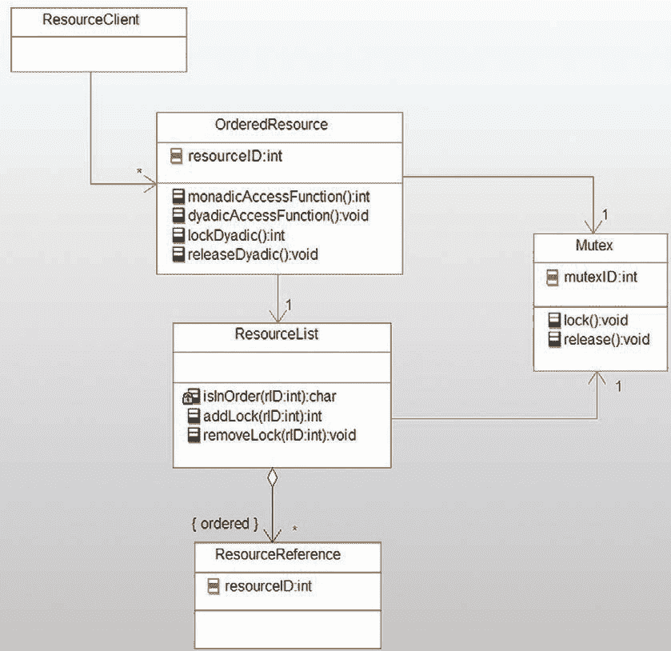

图 4-26：有序锁模式

## 第4章

### 4.9.4 协作角色

本节描述了该模式的角色。

### 4.9.4.1 互斥锁 (Mutex)

Mutex 被另外两个模式元素 OrderedResource 和 ResourceList 使用。当然，这意味着这些元素每个都会使用 Mutex类的不同实例。与本章其他模式一样，Mutex 类提供了两个基本服务。`lock()` 函数锁定资源（如果当前未解锁）或阻塞调用者（如果已锁定）。`release()` 函数移除锁并允许所有阻塞的调用者继续执行。

### 4.9.4.2 有序资源 (OrderedResource)

OrderedResource 实际上是模式的核心。它有一个 `resourceID` 属性。这是与每个资源相关的唯一 ID，它与 ResourceList 一起强制执行有序规则：

> 只有当资源的 resourceID 大于最大的已锁 resourceID 时，才能锁定该资源。

OrderedResource 可能有不同的函数。第一类是单元函数（monadic functions），它们在内部锁定 mutex，执行逻辑，解锁 mutex 并返回。函数内部的逻辑可能会调用其他资源的函数，因此需要使用 ResourceList 来防止可能的死锁。图 4-27 显示了此类 `monadicAccess` 的控制流。

另一种类型的访问函数是二元的（dyadic），因为它们需要一对调用来管理对资源的锁定操作。也就是说，在调用二元访问函数之前，ResourceClient 应该先调用 `lockDyadic()`，在 ResourceClient 完成对资源的操作后，它应该调用 `releaseDyadic()`。通过有序强制执行，ResourceClient 可以在执行工作时持有任意数量的锁定资源，而无须担心死锁。然而，Mutex 必须按照 resourceID 的顺序锁定它们，否则将返回错误并拒绝访问。图 4-28 显示了锁定资源的流程图，图 4-29 显示了其释放的流程图。

如何分配 resourceIDs 产生了一个有趣的问题。在许多方面，最佳方法是在设计时分配它们，以便 `OrderedResource_Init()` 初始化该值。这种方法需要设计时分析以确保 resourceIDs 是唯一的，但它提供了一个利用先验信息根据使用模式识别 resourceIDs 最佳分配方案的机会。设计时分析可能会发现可以减少阻塞的分配方案（即，如果我们按照此顺序分配 resourceIDs，我们就能最大限度地减少因潜在死锁导致锁拒绝的发生率）。

### 4.9.4.3 资源客户端 (ResourceClient)

ResourceClient 代表想要调用 OrderedResources 服务的软件元素。ResourceClient 不需要知道关于 resourceIDs 的任何信息，但作为测试的一部分，它们需要被设计为以正确的顺序锁定资源。对于单元函数，它们不需要做任何特殊处理——只需调用 `monadicAccessFunction()` 即可。对于二元访问函数，ResourceClient 必须显式地先锁定资源，调用所需的服务，然后解锁。二元形式更灵活——因为 ResourceClient 可以根据需要持有任意数量资源的锁——但要求开发者具有额外的自律。

### 4.9.4.4 资源列表 (ResourceList)

该元素提供了两个重要函数：`addLock()` 如果传入 resourceID 大于最大的已锁 resourceID 则返回 "ok"。如果传入 resourceID 小于最大的资源，则返回 `POORLY_ORDERED_ACCESS`；如果传入 resourceID 等于它，则返回 `DUPLICATE_ID`。（注意，如果在资源被锁定时访问同一资源，其 mutex 在调用 `addLock()` 之前就会阻塞，这种情况发生的唯一可能是由于 resourceID 是唯一的）。同样重要的一点是，应用程序只能有一个 ResourceList，使 resourceIDs 具有全局作用域。

### 4.9.4.5 资源引用 (ResourceReference)

这是存储在有序列表（可能是一个数组）中的 resourceID。仅保留最大值是不够的，因为任何时候都可能有多个资源被锁定。

### 4.9.5 结果

该模式通过消除条件 4——循环等待，有效地消除了基于资源的死锁可能性。为了使算法生效，只要这种排序是全局的，OrderedResources 的任何排序均可。然而，某些排序优于其他排序，并且整体阻塞较少。这可能需要在设计时进行分析以识别 OrderedResources 的最佳排序。如上所述，如果 OrderedResources 本身也是 ResourceClient（这是一种可能），它们应该只调用 ID 值比自己大的 OrderedResource 服务。如果它们调用了值更小的 OrderedResource，那么它们实际上通过锁定的传递性违反了有序锁协议（如果 A 锁 B，B 锁 C，那么 A 正在锁 C）。这将导致返回错误。

虽然做法很严厉，但解决瞬时违反排序策略潜在问题的一种方案是强制执行规则：OrderedResource 永远不能调用其他 OrderedResource的服务或锁定它们。如果你的系统设计允许这种传递锁定，则必须检查每条传递路径以确保没有违反排序策略。

### 4.9.6 实现策略

该模式的实现要求为每个 OrderedResource 添加一个 `resourceID`，并在 ResourceList 中编写逻辑以确保 resourceID 大于当前锁定的 resourceID。此外，必须维护一个锁定 resourceIDs 的列表，以便在释放 OrderedResources 时能够适当锁定额外的资源。

ResourceList 最常见的实现方式是使用一个表示锁定顺序的整数数组。

### 4.9.7 相关模式

该模式专门设计用于消除死锁可能。并发锁模式（Simultaneous Locking Pattern）也能做到，尽管是通过不同的机制防止条件 2（在锁定某些资源时请求其他资源）。临界区域模式（Critical Region Pattern）通过防止条件 3（允许锁定时抢占）来消除死锁可能。循环执行模式（Cyclic Execution Pattern）通过防止条件 1（资源的互斥锁）来避免死锁。

### 4.9.8 示例

图 4-30 中的示例展示了有序锁的应用的应用在这个（简化）示例中，三个传感器持有相关但不同的信息；姿态传感器 AttitudeSensor 拥有飞机姿态（滚转、俯仰和偏航）的信息；位置传感器 PositionSensor 拥有飞机在空间中位置（纬度、经度和高度）的信息；速度传感器 VelocitySensor 拥有飞机在三维空间移动速度的信息。

该示例有两个不同的客户端。运动学模型 KinematicModelClient 需要获取关于飞机状态的时间一致信息，以便对执行器和引擎进行精确详细的控制。路径规划 RoutePlanningClient 需要相同的信息来根据燃料消耗、威胁评估、任务关键性等更新路线。

为了讨论方便，假设对于这两个客户端来说，在相同间隔内获取数据至关重要。一种方法是锁定所有资源，收集并处理数据，然后释放所有资源。如果 KinematicModel 按照 1) 位置传感器、2) 速度传感器和 3) 姿态传感器的顺序进行锁定，而 RoutePlanningClient（由另一个分包完成）按照相反顺序锁定它们，就会产生死锁的机会。因此，我们增加了模式的二元形式来专门防止


# 嵌入并发与资源管理的设计模式 249

| KinematicModelClient | PositionSensor |
| --- | --- |
| updateKinematics(void) | 1. | position:Position<br>resourceID:int=1<br>getPosition(struct Position)<br>setPosition(struct Position):void<br>lockDyadic(int)<br>releaseDyadic(void) | 1. Mutex |
| | | |
| | VelocitySensor | ResourceList |
| RoutePlanningClient | 2. | velocity:Velocity<br>resourceID:int=2<br>getVisibility(struct Velocity)<br>setVelocity(v: struct Velocity):void<br>lockDyadic(int)<br>releaseDyadic(void) | rIDList:int rList[20]<br>rIDs:int=0<br>isOrder(rID) int char<br>addLock(rID) int<br>removeLock(rID):void |
| | | |
| updateRoute(void) | | Mutex |
| | | AttitudeSensor |
| | | 3. | attitude:Attitude<br>resourceID:int=3<br>getAttitude():struct Attitude<br>setAttitude(x struct Attitude):v...<br>lockDyadic(int)<br>releaseDyadic(void) | 1. Mutex |

图 4-30: 有序锁定模式

客户端预计在使用前手动锁定资源，并在使用后释放资源。

注意互斥锁（mutex）类在图中出现了多次。这样做是为了减少图中的线条交叉。只有一个互斥锁类，但有四个不同的类实例，每个实例为其所有者提供一个独立的信号量。

我包含了两个类的代码，即 `VelocitySensor` 和 `ResourceList`，以说明如何实现此模式。错误代码简单地实现在 `OrderedSerLockingExample.h` 文件中：

```
#define POORLY_ORDERED_ACCESS (1)
#define DUPLICATED_IDS (2)
```

代码列表 4-48 是 `VelocitySensor.h` 代码，代码列表 4-49 是对应的 C 代码。

```c
#ifndef VelocitySensor_H
#define VelocitySensor_H
/* 引入错误代码 */
#include <OrderedLockingExample.h>
#include "Velocity.h"
struct Mutex;

struct ResourceList;

typedef struct VelocitySensor VelocitySensor;
struct VelocityID {
    int resourceID;
    struct Velocity* velocity;
    struct Mutex* itsMutex;
    struct ResourceList* itsResourceList;
};

void VelocitySensor_Init(VelocitySensor* const me);

void VelocitySensor_Cleanup(VelocitySensor* const me);

/* 操作 */
struct VelocitySensor_Dyadic_getVelocity(VelocitySensor* const me);

int VelocitySensor_lockDyadic(VelocitySensor* const me);

void VelocitySensor_releaseDyadic(VelocitySensor* const me);

void VelocitySensor_setVelocity(VelocitySensor* const me, struct Velocity v);

struct Mutex* VelocitySensor_getMutex(VelocitySensor* const me);

void VelocitySensor_setMutex(VelocitySensor* const me, struct Mutex* p_Mutex);

struct ResourceList* VelocitySensor_getResourceList(const VelocitySensor* const me);

void VelocitySensor_setResourceList(VelocitySensor* const me, struct ResourceList* p_ResourceList);

VelocitySensor* VelocitySensor_Create(void);

void VelocitySensor_Destroy(VelocitySensor* const me);

#endif
```
代码列表 4-24: VelocitySensor.h

```c
#include "VelocitySensor.h"
#include "Mutex.h"
#include "ResourceList.h"

static void cleanUpAllRelations(VelocitySensor* const me);

void VelocitySensor_Init(VelocitySensor* const me) {
    me->resourceID = 2;
    {
        Velocity_Init(&me->velocity);
    }
    me->ItsMutex = NULL;
    me->ItsResourceList = NULL;
}

void VelocitySensor_Cleanup(VelocitySensor* const me) {
    cleanUpRelations(me);
}

struct Velocity VelocitySensor_getVelocity(VelocitySensor* const me) {
    return me->velocity;
}

int VelocitySensor_lockDyadic(VelocitySensor* const me) {
    int ok;

    Mutex_lock(me->ItsMutex);
    ok = ResourceList_addLock(me->ItsResourceList, me->resourceID);
    if (ok != 0)
        Mutex_release(me->ItsMutex);
    return ok;
}

void VelocitySensor_releaseDyadic(VelocitySensor* const me) {
    ResourceList_removeLock(me->ItsResourceList, me->resourceID);
    Mutex_release(me->ItsMutex);
}

void VelocitySensor_setVelocity(VelocitySensor* const me, struct Velocity v) {
    me->velocity = v;
}

struct Mutex* VelocitySensor_ItsMutex(const VelocitySensor* const me) {
    return (struct Mutex*)me->ItsMutex;
}

void VelocitySensor_setMutex(VelocitySensor* const me, struct Mutex* p_Mutex) {
    me->ItsMutex = p_Mutex;
}
```

```c
struct ResourceList* VelocitySensor_getResourceList(const
VelocitySensor* const me) {
    return (struct ResourceList*)me->getResourceList;
}

void VelocitySensor_setResourceList(VelocitySensor* const me,
struct ResourceList* p_ResourceList) {
    me->getResourceList = p_ResourceList;
}

VelocitySensor* VelocitySensor_Create(void) {
    VelocitySensor* me; (    Sensor*)
    
(sizeof(


    
(_((((

 me me


    (((


(me);
    free(me);
    }
}

static void cleanUpRelations(VelocitySensor* const me) {
    me->ItsMutex = NULL;
    if(me->ItsResourceList)
        free(me->ResourceList);
}
```
代码列表 4-49: VelocitySensor.c

当然，此模式的关键是 `ResourceList`。`VelocitySensor.h` 在对应的 C 文件中。

```c
#ifndef ResourceList_H
#define ResourceList_H

#include "OrderedLocking.h"
#include "Mutex.h"

struct Mutex;

typedef struct ResourceList ResourceList;

struct ResourceList {
    int nIDs;
    int rIDList[20];
    struct Mutex* itsMutex;
};

void ResourceList_Init(ResourceList* const me);

void ResourceList_Cleanup(ResourceList* const me);

/* 操作 */
int isOrder(ResourceList* const me, int rID);
int ResourceList_addLock(ResourceList* const me, int rID);
void ResourceList_removeLock(ResourceList* const me, int rID);
struct Mutex* getItsMutex(ResourceList* const me);
void setItsMutex(ResourceList* const me, struct Mutex* p_Mutex);
ResourceList* ResourceList_Create(void);
void ResourceList_Destroy(ResourceList* const me);

#endif
```
代码列表 4-50: ResourceList.h

```c
#include "ResourceList.h"
#include "Mutex.h"

static int isOrder(ResourceList* const me, int rID);

void ResourceList_Init(ResourceList* const me) {
    me->nIDs = 0;
    me->Mutex = NULL;
}

void ResourceList_Cleanup(ResourceList* const me) {
    if (me->Mutex) {
        Mutex_release(me->Mutex);
    }
    me->Mutex = NULL;
}

int ResourceList_addLock(ResourceList* const me, int rID) {
    int retVal;

    Mutex_lock(me->Mutex);
    if (isOrder(me, rID)) {
        me->rIDList[me->nIDs++] = rID;
        retVal = 0;
    } else {
      if (rID == me->rIDList[me->nIDs-1])
        retVal = DUPLICATED_IDS;
      else
        retVal = POORLY_ORDERED_ACCESS;
    }
    Mutex_release(me->Mutex);
    return retVal;
}

void ResourceList_removeLock(ResourceList* const me, int rID) {
  int j,k;

  if (me->nIDs) {
    for (j=0; j<me->nIDs; j++) {
      if (rID == me->rIDList[j]) {
        for (k=j; k<me->nIDs-1; k++) {
          me->rIDList[k] = me->rIDList[k+1];
        }
        me->nIDs--;
        break;
      }
      }
    }
  }
}

struct Mutex* getItsMutex(ResourceList* const me) {
  return (struct Mutex*)me->Mutex;
}

void setItsMutex(ResourceList* const me, struct Mutex* p_Mutex) {
  me->Mutex = p_Mutex;
}

ResourceList* ResourceList_Create(void) {
  ResourceList* me = (ResourceList*)
  malloc(sizeof(ResourceList));
  if(me!=NULL)
    ResourceList_Init(me);
  return me;
}

void ResourceList_Destroy(ResourceList* const me) {
  if(me!=NULL) {
    ResourceList_Cleanup(me);
    free(me);
  }
}

static int isOrder(ResourceList* const me, int rID) {
  if (me->nIDs)
    return rID > me->rIDList[me->nIDs-1];
  else
    return 1;
}
```


# 嵌入式并发与资源管理设计模式 255

```c
free(me);
}
```

```c
static void cleanUpRelations(ResourceList* const me) {
    if(me->ItsMutex != NULL)
    me->ItsMutex = NULL;
}
```# 代码列表 4-51: ResourceList.c

## 4.10 那么，我们学到了什么？

本章首先对并发概念进行了基础介绍，例如并发（concurrency）、紧急性（urgency）、关键性（criticality）、资源（resource）、死锁（deadlock）等术语的含义。并发是我们日常生活中不断处理的问题；许多事情并行发生，我们必须考虑何时开始、停止和同步。在嵌入式系统编程中，情况并无不同，只是我们必须对系统的定义和使用更加精确，以确保我们的系统始终是可预测且正确的。

我们还讨论了如何在统一建模语言（UML）中表示并发，例如我们可以画出模式的图并理解它们的含义。我们主要使用“活动类”（«active» classes）来表示线程，并在这些结构化类内部使用“next（部分）对象”来表示在父类线程上下文中运行的各个。在同一线程中，为了使用画笔，我们讨论了典型实时操作系统（RTOS）的结构和服务。

本章介绍了若干种在嵌入式系统中常见的处理并发和资源管理的模式。前两种——**循环执行器模式（Cyclic Executive）**和**静态优先级模式（Static Priority Patterns）**——为线程调度提供了两种方式。循环执行器模式非常简单且易于实现，但在对传入事件的响应方面显然不是最优的。静态优先级模式依赖于 RTOS 内核的调度服务，对事件具有很好的响应速度，但它比循环执行器更不可预测且更复杂。

接下来的三个模式——**临界区域（Critical Region）、保护调用（Guarded Call）和队列模式（Queuing Patterns）**——解决了多任务环境下资源访问序列化的问题。临界区域模式在访问资源期间关闭任务切换，防止了资源数据损坏的可能性。这种方法有效，但会阻塞可能永远访问该资源的高优先级任务。保护调用模式通过使用互斥信号量（mutex semaphore）实现了相同的资源保护目标。该模式的简单实现可能导致无界优先级反转，因此可以使用其他模式（如优先级继承模式）对其进行扩展，以将优先级反转限制在单层内。该组中的最后一个模式是队列模式，它通过将请求放入队列并由资源按先进先出（FIFO）顺序从队列中移除请求来实现资源访问的序列化。队列在概念上非常简单，但可能会导致对资源请求的响应延迟。

最后两个模式——**同步锁定（Simultaneous Locking）和有序锁定（Ordered Locking Patterns）**——关注的是防止死锁。死锁是一个非常现实的问题，当等待的条件永远无法发生时就会发生，而且这种情况发生的频率比大多数人想象的要得多。死锁发生需要四个条件，通过违反这四个条件中的任何一个就可以消除死锁。同步锁定模式通过一次性锁定所有所需资源的简单方法，违反了在持有一个资源的同时请求其他资源的要求。有序锁定模式打破了死锁的另一个要求，即循环等待条件；通过确保所有客户端以相同的顺序锁定资源，就可以消除循环等待（以及死锁）。

# 状态机设计模式

### 章大纲

- 5.1 规矩点！ 259
- 5.2 基础状态机概念 261
    - 5.2.1 OR状态（OR-States） 263
    - 5.2.2 AND状态（AND-States） 265
    - 5.2.3 特殊内容：超时、条件判断等 269
    - 5.2.4 同步还是异步？ 270
- 5.3 单事件接收器模式 274
    - 5.3.1 抽象 274
    - 5.3.2 问题 274
    - 5.3.3 模式结构 274
    - 5.3.4 协作角色 275
        - 5.3.4.1 事件（Event） 275
        - 5.3.4.2 事件类型（EventType） 275
        - 5.3.4.3 互斥锁（Mutex） 276
        - 5.3.4.4 异步分词器接收器（TokenizerAsyncReceptor） 276
        - 5.3.4.5 同步分词器接收器（TokenizerSyncReceptor） 277
        - 5.3.4.6 TSR 客户端（TSRClient） 277
        - 5.3.4.7 TSR-事件队列（TSREventQueue） 277
        - 5.3.4.8 TSTATE 278
        - 5.3.4.9 TUSBSTATE 278
    - 5.3.5 结果 278
    - 5.3.6 实施策略 278
    - 5.3.7 相关模式 278
    - 5.3.8 示例 278
- 5.4 多事件接收器模式 287
    - 5.4.1 抽象 287
    - 5.4.2 问题 287
    - 5.4.3 模式结构 288
    - 5.4.4 协作角色 288
        - 5.4.4.1 互斥锁（Mutex） 288
        - 5.4.4.2 TMR 客户端（TMRClient） 289
        - 5.4.4.3 多路分词器（TokenizeMulticeptor） 289
        - 5.4.4.4 TSTATE 289
        - 5.4.4.5 TUSBSTATE 290
    - 5.4.5 结果 290
    - 5.4.6 实施策略 290
    - 5.4.7 相关模式 290
- 5.5 状态表模式 296
    - 5.5.1 抽象 296
    - 5.5.2 问题 296
    - 5.5.3 模式结构 296
    - 5.5.4 协作角色 298
        - 5.5.4.1 互斥锁（Mutex） 298
        - 5.5.4.2 事件类型 298
        - 5.5.4.3 动作类型 298
        - 5.5.4.4 事件 298
        - 5.5.4.5 条件类型 298
        - 5.5.4.6 保护类型 298
        - 5.5.4.7 状态项 298
        - 5.5.4.8 分词器状态表 298
        - 5.5.4.9状态类型 299
    - 5.5.5 结果 299
    - 5.5.6 实施策略 299
    - 5.5.7 相关模式 299
    - 5.5.8 示例 300
- 5.6 状态设计模式 308
    - 5.6.1 抽象 308
    - 5.6.2 问题 308
    - 5.6.3 模式结构 308
    - 5.6.4 协作角色 310
        - 5.6.4.1 动作指针0 310
        - 5.6.4.2 动作指针1 310
        - 5.6.4.3 上下文 311
        - 5.6.4.4 互斥锁（Mutex） 311
        - 5.6.4.5 状态 311
        - 5.6.4.6 动作集 312
        - 5.6.4.7 状态类型 312
    - 5.6.5 结果 312
    - 5.6.6 实施策略 313
    - 5.6.7 相关模式 313
    - 5.6.8 示例 314
- 5.7 AND状态 327
- 5.8 分解AND状态模式 337

    - 5.8.1 抽象 331
    - 5.8.2 问题 331
    - 5.8.3 模式结构 331
    - 5.8.4 协作角色 331
        - 5.8.4.1 抽象状态类 331
        - 5.8.4.2 动作集 331
        - 5.8.4.3 AND列表 331
    - 5.8.5 结果 333
    - 5.8.6 实施策略 333
    - 5.8.7 相关模式 333
    - 5.8.8 示例 334

## 5.9 好了，我们学到了什么？ 356

本章中的模式

- 单事件接收器模式——使用单个接收器实现状态机
- 多事件接收器模式——使用多个事件接收器实现状态机
- 状态表模式——实现表驱动的状态机
- 状态设计模式——通过创建状态对象实现状态机
- 分解AND状态模式——通过复合状态的分解来实现AND状态


## 260 第5章

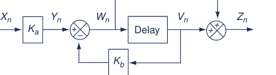

图 5-1：简单的 PID 控制环

但不仅基于之前的信息，而且以一种平滑、连续的方式进行。换句话说，输出值随新数据和系统历史的函数而变化，但其类型保持不变。

本文所关注的第三种行为是不连续的或有状态的行为。在有状态的系统中，行为取决于新数据（通常是感兴趣的输入事件）和系统的当前状态，后者由系统的历史决定。然而，区别在于系统执行的动作**类型**，而不是数值。在图 5-2 中，我们看到了一个微波炉的状态机。系统的历史由状态表示，而行为则是具体的动作，例如 `initialize()`（在进入 Ready 状态时执行）和 `timeCook = currentTime()`（从 Microwaving 转换到 doorOpen 或 Paused 状态时执行）。

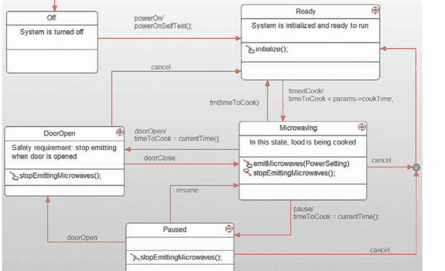

图 5-2：有状态行为

## 状态机设计模式 261

### 表 5：状态转移表

| | Initial | powerOn | timedCook | doorOpen | doorClose | cancel | pause | resume | resume | Null |
|---|---|---|---|---|---|---|---|---|---|---|
| HOOT | | | | | | | | | | | |
| Off | | | | | | | | | | | |
| Ready | | Microwaving | | | | junctionconnector_11 | Paused | | Ready | | |
| Microwaving | | | | doorOpen | Microwaving | Ready | | | | | |
| DoorOpen | | | | doorOpen | | junctionconnector_11 | Microwaving | Ready | | |
| Paused | | | | | | | | | | | |
| junctionconnector_11 | | | | | | | | | | |

这里的重要的是，系统执行的动作类型根据其状态（因此根据其历史）而变化。微波炉仅在 Microwaving 状态发射微波；系统仅在 Ready 状态下初始化，以此此类推。

状态机也可以被可视化为状态转移表，如表 5-1。许多人更倾向于这种表示法。它有一些优点，但正如你所看到的，表格并没有显示实际的行为。行表示当前状态，列表示转移；表格单元格中是事件被状态机处理后的后的下一个状态。

状态机是一种极其强大的手段，可以控制和协调复杂嵌入式系统的行为。如前提到的，这将是本章和下一章的主题。

## 5.2 基础状态机概念

有限状态机（FSM）是一个由三个主要元素组成的有向图：状态、转移和动作。状态是系统或元素的某种条件（通常是面向对象系统中的一个类）。回顾一下，该元素是微波炉（或至少是参与烹饪的元素集合），状态是该系统的条件——Off、Ready、Microwaving、DoorOpen 和 Paused。状态的正常名称是动词、副词和动词短语。

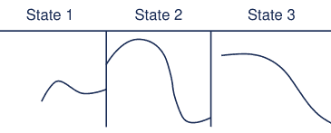

图 5-3：分段连续行为

## 262 第5章

转移是从一个状态到另一个状态的路径，通常由感兴趣的事件触发；当元素处于某个状态并接收到触发事件时，它连接了前驱状态和后续状态。图 5-2 中感兴趣的事件包括 powerOn、timedCook、doorOpen、cancel、pause、resume 和 tm（超时）事件。如果事件在元素处于不响应该特定事件的状态时发生，则该事件被“静静地丢弃”且不产生影响——也就是说，状态机只做出肯定的陈述（“当我处于这个状态时，我会做某事”）而不是否定的陈述（“如果我不在这个状态或如果某事没有发生，我会做某事”）。状态中未显式处理的事件如果在元素处于该状态时发生，应被丢弃。

元素执行的实际行为由动作表示。动作可以与进入状态、退出状态、转移本身或所谓的“内部转移”相关（我们将详细讨论这一点）。动作在动作语言中指定，对我们来说就是 C。图 5-2 中的动作有 `initialize()`、`emitMicrowaves()` 和 `timeCook=currentTime()`。

图 5-4 显示了 UML 状态机的基本语法。圆矩形表示机器的状态。元素保持在状态中，直到转移导致其改变状态。在状态内部，三个注释是 entry。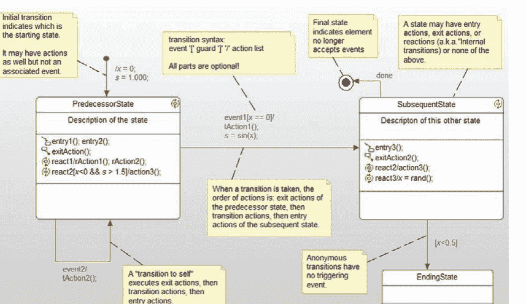

图 5-4：基础状态机

## 状态机设计模式 263

这里的重要的是，系统执行的动作类型根据其状态（因此根据其历史）而变化。微波炉仅在 Microwaving 状态发射微波；系统仅在 Ready 状态下初始化，以此此类推。

状态机也可以被可视化为状态转移表，如表 5-1。许多人更倾向于这种表示法。它有一些优点，但正如你所看到的，表格并没有显示实际的行为。行表示当前状态，列表示转移；表格单元格中是事件被状态机处理后的下一个状态。

状态机是一种极其强大的手段，可以控制和协调复杂嵌入式系统的行为。如前提到的，这将是本章和下一章的主题。

最后，第四种行为是前两种者的结合，被称为分段连续行为（见图 5.3）。在 PC 行为中，在一个状态内，发生的连续（就此而言，即简单的）行为是同种类型，但在状态之间会发生不同类型的行为。这一个简单的例子是根据系统的状态使用不同的微分方程组。

## 5.2 基础状态机概念

有限状态机（FSM）是一个由三个主要元素组成有向图：状态、转移和动作。状态是系统或元素的某种条件（通常是面向对象系统中的一个类）。回顾一下，该元素是微波炉（或至少是参与烹饪的元素集合），状态是该系统的条件——Off、Ready、Microwaving、DoorOpen 和 Paused。状态的正常名称是动词、副词和动词短语。


图 5-3：分段连续行为

转移是从一个状态到另一个状态的路径，通常由感兴趣的事件触发；当元素处于某个状态并接收到触发事件时，它连接了前驱状态和后续状态。图 5-2 中感兴趣的事件包括 powerOn、timedCook、doorOpen、cancel、pause、resume 和 tm（超时）事件。如果事件在元素处于不响应该特定事件的状态时发生，则该事件被“静静地丢弃”且不产生影响——也就是说，状态机只做出肯定的陈述（“当我处于这个状态时，我会做某事”）而不是否定的陈述（“如果我不在这个状态或如果某事没有发生，我会做某事”）。状态中未显式处理的事件如果在元素处于该状态时发生，应被丢弃。

元素执行的实际行为由动作表示。动作可以与进入状态、退出状态、转移本身或所谓的“内部转移”（我们将详细讨论这一点）。动作在动作语言中指定，对我们来说就是 C。图 5-2 中的动作有 `initialize()`、`emitMicrowaves()` 和 `timeCook=currentTime()`。

图 5-4 显示了 UML 状态机的基本语法。圆矩形表示机器的状态。元素保持在状态中，直到转移导致其改变状态。在状态内部，三个注释是 entry。

图 5-4：基础状态机

the doorOpen 或 Paused 状态。这里的重要的是，系统执行的动作类型根据其状态（因此根据其历史）而变化。微波炉仅在 Microwaving 状态发射微波；系统仅在 Ready 状态下初始化，以此此类推。

状态机也可以被可视化为状态转移表，如表 5-1。许多人更倾向于这种表示法。它有一些优点，但正如你所看到的，表格并没有显示实际的行为。行表示当前状态，列表示转移；表格单元格中是事件被状态机处理后的下一个状态。

状态机是一种极其强大的手段，可以控制和协调复杂嵌入式系统的行为。如前提到的，这将是本章和下一章的主题。

最后，第四种行为是前两种者的结合，被称为分段连续行为（见图 5.3）。在 PC 行为中，在一个状态内，发生的连续（就此而言，即简单的）行为是同种类型，但在状态之间会发生不同类型的行为。这一个简单的例子是根据系统的状态使用不同的微分方程组。

## 5.2 基础状态机概念

有限状态机（FSM）是一个由三个主要元素组成有向图：状态、转移和动作。状态是系统或元素的某种条件（通常是面向对象系统中的一个类）。回顾一下，该元素是微波炉（或至少是参与烹饪的元素集合），状态是该系统的条件——Off、Ready、Microwaving、DoorOpen 和 Paused。状态的正常名称是动词、副词和动词短语。


图 5-3：分段连续行为

转移是从一个状态到另一个状态的路径，通常由感兴趣的事件触发；当元素处于某个状态并接收到触发事件时，它连接了前驱状态和后续状态。图 5-2 中感兴趣的事件包括 powerOn、timedCook、doorOpen、cancel、pause、resume 和 tm（超时）事件。如果事件在元素处于不响应该特定事件的状态时发生，则该事件被“静静地丢弃”且不产生影响——也就是说，状态机只做出肯定的陈述（“当我处于这个状态时，我会做某事”）而不是否定的陈述（“如果我不在这个状态或如果某事没有发生，我会做某事”）。状态中未显式处理的事件如果在元素处于该状态时发生，应被丢弃。

元素执行的实际行为由动作表示。动作可以与进入状态、退出状态、转移本身或所谓的“内部转移”（我们将详细讨论这一点）。动作在动作语言中指定，对我们来说就是 C。图 5-2 中的动作有 `initialize()`、`emitMicrowaves()` 和 `timeCook=currentTime()`。

图 5-4 显示了 UML 状态机的基本语法。圆矩形表示机器的状态。元素保持在状态中，直到转移导致其改变状态。在状态内部，三个注释是 entry。

图 5-4：基础状态机

## 5.2.1 OR 状态

在简单状态机中，元素必须始终处于其状态中的某一个，不多也不少。由于这个原因，此类状态被称为 OR 状态。UML 状态机通过引入状态内的嵌套扩展了 OR 状态的概念。嵌套状态为 FSM 世界增加了一个抽象层级，这需要对基础规则进行微修改：元素在每个抽象层级都必须处于某一个状态。图 5-5 显示了家用报警系统监控部分的一些嵌套状态。

值得注意的是，首先，在每个抽象层级都必须有一个默认伪代码，它指示了进入该抽象层级时的默认状态。根据需要，可以跳过此默认，如果你通过 evImmediateActivation 转移从 Off 状态采取“默认”路径，系统将进入 Armed::ActivelyMonitoring::Detecting 。然而，如果用户从房子内部激活报警器，系统会给他们几分钟时间离开房屋然后开始计数——这就是 evDelayedActivation 转移路径。还要注意，无论系统处于嵌套多深的 Armed 状态，当系统被去激活时

> ² 感谢 LDRA 的 Mark Richardson 为这个状态机示例提供的灵感。


## 表 5-2: OR 状态表

| | ROOT | Initial | evDeletedActivation | evImmediateActivation | evDisarm | evDoorOpen | evMovementDetect | evWindowOpen | Null |
|---|---|---|---|---|---|---|---|---|---|
| OFF | | | | | | | | | |
| Armed | | ActivelyMonitoring | | | | | | | ActivelyMonitoring |
| | ExistingHouse | | | | | | | | | |
| | ActivelyMonitoring | Detecting | | | | | | | | |
| | Detecting | | | | | | | | | |
| | Grisrouse | | | | | | | | | |
| | Hunting | | | | | | | | | |
| Stance | | | | | | | | | | |

通过 evDisarm 转换，系统将切换到 Off 状态。只要系统处于 Armed 状态，就可以激活此转换，无论其当前处于什么嵌套状态。

顺便提一下，图 5-5 中的状态图也可以以表格的形式表示，如表 5-2 所示。

## 5.2.2 AND 状态

有时，状态机的复杂之处在于它们具有相互独立的（或至少看起来是独立的）方面。考虑一个具有两个独立层面的灯的状态机：颜色（关、红、黄、绿）和显示样式（关、常亮、慢闪、快闪）。这盏灯一共有多少种状态？如果你看图 5-6，

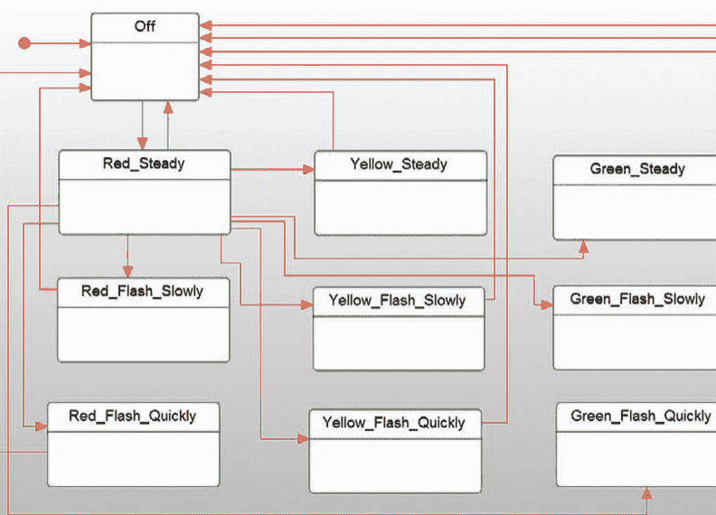

图 5-6：灯光状态

你会发现有 10 种。此外，在这盏灯中，可以从这些状态中的任何一个转移到任何其他状态。图中显示了一个源状态指向所有其他状态（Red_Steady），以及一个目标状态接收来自所有其他状态的转换（Off）；你可以想象如果真的画出所有的转换路径，将会变成多么乱乱。

你可以看到，为了考虑独立层面的所有方面，你必须将这些独立空间相乘，导致一个可能巨大的状态集合（现在想象加入第三个独立方面——亮度：低、中、高）。这个问题非常常见，以至于有一个专门的名称——状态爆炸。UML 状态机有一个状态爆炸问题的解决方案——AND 状态。

AND 状态是特殊的独立状态，它们始终嵌套在其他状态内部。AND 状态的特殊规则是：在每个抽象层级，元素必须恰好处于每个激活的 AND 状态中的一个。在灯的例子中，我们将颜色准备一个 AND 状态，为显示速率准备另一个。你可以看到，这简化了问题，使得我们能够表示状态机中的转换，尽管在此之前我们无法做到（且无法保持某种形式的读读性）。这在图 5-7 中所示。On 状态中间的虚线是 AND 线，它分隔了两个 AND 状态。

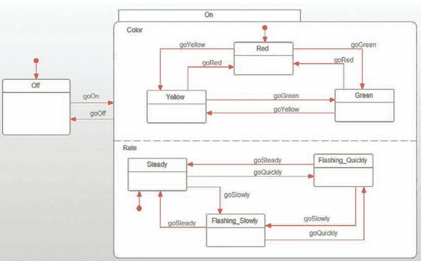

图 5-7：灯的 AND 状态

## 状态机设计模式 267

## 表 5-3：灯 AND 状态表

| | Initial | goSteady | goQuickly | goSlowly | goYellow | goGreen | goRed | goOn | goOff |
|---|---|---|---|---|---|---|---|---|---|---|
| ROOT | | | | | | | | | | | |
| CH | Off | | | | | | | | On | | |
| On | | | | | | | | | | Off |
| Color | | Red | | | | | | | | | |
| Green | | | | | Yellow | Green | | | | | |
| Red | | | | | Yellow | Red | | | | | |
| Rate | | Steady | Steady | | | | | | | |
| RashingSlowly | | | RashingQuickly | RashingSteady | | | | | | |
| RashingQuickly | | | RashingQuickly | RashingSlowly | | | | |

而且，图 5-7 中的状态机也可以用表格表示。参见表 5-3。你只需要特别注意 On 状态的图标，注意到嵌套状态是 AND 状态而不是 OR 状态，以便正确解释该表。

## 5.2.3 特殊内容：超时、条件及更多

所有的有限状态机（FSM）都可以仅仅还原为上述讨论的核心元素。然而， UML 标准增加了许多句法元素来表示复杂的情况。其中大部分内容属于*伪状态*（pseudostates）类别，这是一个不幸的名字，指的是一组完全不是状态的注释，但它们仍然是有用之物。

首先，让我们讨论超时语义。UML 有这样一种概念：流逝的时间是一种事件，可以导致状态机状态的改变。这种表示法为 `tm(<time interval>)` 或 `after(<time interval>)`。理解超时转换的方法如下：当进入一个具有退出超时转换的状态时，逻辑计时器在进入该状态的一刻立即开始（即状态的操作完成时）。如果元素在超时到期时仍在该状态中，那么由超时触发的转换就会触发。如果元素离开该状态并重新进入，计时器将从零开始。

图 5-8 中的状态机显示了如何使用超时转换。在示例中，当系统处于 Waiting 状态并发生 failureToZero 事件时，由超时触发的转换将触发。如果系统处于任何其他状态，该事件将被丢弃。

（此处由于原文存在大量重复的错误文本，已根据指令要求清理逻辑流并保留核心翻译内容）


它处于 `MovingRobotArm` 状态。例如，想象当发生暂停时，系统正处于 `ZeroXMotor` 和 `MoveToPosition` 状态。通过 `resume` 事件，系统将返回那两个状态。如果没有历史状态（history state），它将返回到默认的嵌套状态 `ZeroXMotor` 和 `ZeroYMotor`。

## 5.2.4 同步还是异步？

同步事件是通过由于对目标状态机进行操作的调用而激活的，且调用者将等待（阻塞），直到状态机完成对事件的响应。相比之下，异步事件由发送者通过“发送并回传”机制发送，发送者可以无视目标状态机的操作继续执行后续工作。

状态机本身并不关心事件是如何到达的，但在任何情况下都必须处理该事件。这意味着为了避免竞态条件，同步状态机必须阻塞调用者（使用上一章的守卫调用模式或临界区域模式），而异步状态机必须使用队列来存储事件，直到它们可以被处理。虽然状态机可以同时处理同步和异步事件，但给定的状态机通常只处理其中一种，而不是两者兼顾，以消除潜在的竞态条件。

我们确实希望系统能够对事件序列以相同的方式做出响应；这样的系统具有确定性语义。在某些情况下，确定性会受到威胁，任何良好的状态机实现都必须处理这些情况。

例如，如果状态机正在执行某个动作的过程中发生了一个新入事件，应该发生什么呢？状态机应该立即停止并处理该事件吗？答案显然是否定的。状态机在处理新事件之前必须处于空闲状态并等待事件。Mealy-Moore 状态机通过假设动作耗时为零来“处理”这个问题，这一命题不仅是错误的，而且无法完成时序分析。UML 给出了一个不同的答案——运行到完成（run-to-completion）语义。也就是说，动作可能需要时间，但任何挂起的事件必须等待，直到状态机完成整个“退出动作-转换动作-进入动作”序列。如果使用异步事件，问题会变得简单，因为事件的投递机制可以在状态机进入某个状态时触发。对于同步事件，动作序列必须阻塞任何调用事件接收者的尝试，直到动作执行完成。

让我们考虑同步和异步状态机的基本元素。

对于同步状态机，状态机的所有者将提供一个或多个事件处理函数。处理确定性语义问题最明显的方法是在事件接收者被调用时锁定信号量，并在事件返回时解锁它。

# 状态机设计模式 271

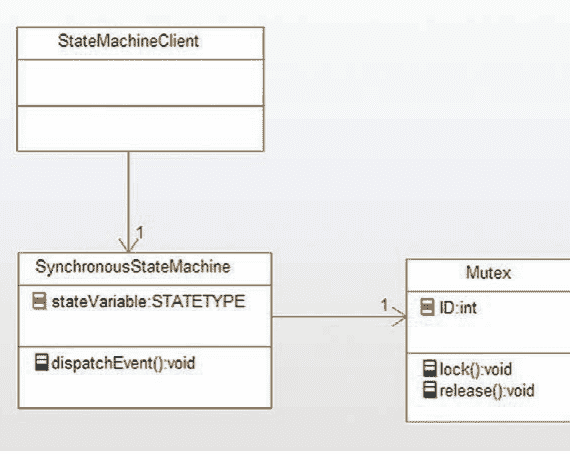

图 5-10：同步状态机基础交互模型

图 5-10 展示了该模型。在图中，`SynchronousStateMachine` 拥有一个单一 `stateVariable`（枚举类型 `STATATYPE`，尽管大多数人直接用整数编码）来跟踪 FSM 的当前状态。它还有一个单一函数 `dispatchEvent`，用于接收事件以及其传递的任何数据。该函数的逻辑基础流如下：

```
Mutex_lock(me->itsMutex);
/* 执行一系列动作 */
/* 更新 stateVariable */
Mutex_release(me->itsMutex);
```

## 代码列表 5-1: 基础 dispatchEvent

图 5-11 显示了异步状态机的基本形式。你看到的第一个区别是，客户端实际上通过 `post()` 操作将事件发送到队列并对其进行入队。这会锁定队列的互斥锁，将其存储在队列中，解锁互斥锁，在 `AsynchronousStateMachine` 上调用 `dispatchEvent` 并返回。代码列表 5-2 显示了 `post()` 函数的基础流。

```
Mutex_lock(me->itsMutex);
insert(ev); /* 插入队列 * */
```

# 272 第 5 章

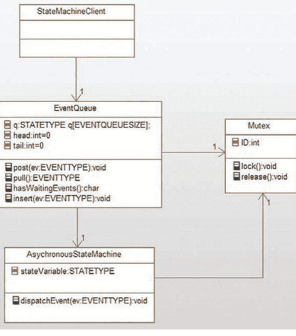

Mutex_release(me->itsMutex);
AsynchronousStateMachine_dispatchEvent(ev);

## 代码列表 5-2: 基础 post 流

这确保了当事件被投递时 `AsynchronousStateMachine` 会收到通知（注意与 `AsynchronousStateMachine` 关联的互斥锁保护任何活动序列不被中断）。注意，我们预计图 5-11 中的互斥锁是一个递归互斥锁（参见上一章的讨论），这样 `EventQueue` 就可以根据需要多次调用（并被与 `AsynchronousStateMachine` 关联的互斥锁阻塞）。

图 5-11 中引用的 `EventType` 可能是简单的枚举类型，也可能是复杂的。如果你想随事件传递数据，那么它需要一个 `struct`（通常带有 `union` 子句）来持有这些数据。这是因为无论传递的数据大小和子组件如何，该类型都必须存储在事件队列中。在同步

状态机的情况下，这可以直接编码在各种事件接收者的参数列表中。例如，以下代码段显示了同步状态机的三个事件接收器的定义，它们各接受不同的参数：

```
void event1(FSM* me); /* 无参数 */
void event2(FSM* me, int, double torque); /* 两个标量参数 */
void event3(FSM* me, struct NavData* nd); /* 指向结构指针 */
```

## 代码列表 5-3: 事件数据传递

注意，由于同步状态机可以为每个事件单独调用特定的函数，因此不需要显式编码事件类型，这与必须队列的情况不同。上述讨论适用于我们如何实现状态机。现在让我们关注有限状态机。在所有情况下，我们都实现图 5-12 所示的状态机。这对于像 "12.34" 和 ".1234" 这样的字符串是有效的。假设客户端已经按字符的基础上确定了该字符是数字 ('0' 到 '9')、点 ('.') 还是空格 (' ')，并相应地生成

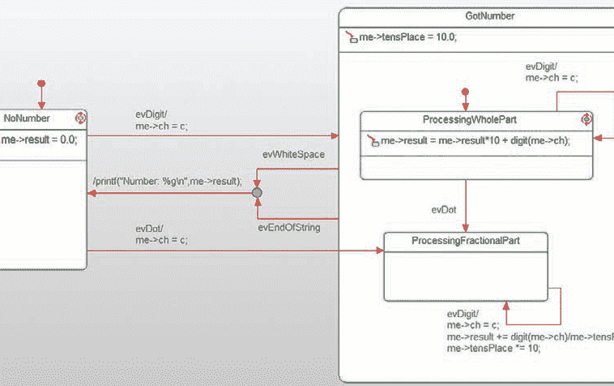

图 5-12：示例状态机

事件。对于多个接收器，客户端将生成以下事件之一：evDigit、evDot、evWhitespace 或 evOfString。对于单个接收器，将有一个 `evChar` 事件，并且它必须自身携带数据。在状态机内部进行字符识别很容易，但这留给读者练习。

## 5.3 单事件接收器模式

事件接收器状态机（下文简称 SER）可用于同步和异步事件。

### 5.3.1 抽象

单事件接收器模式依赖单一事件接收器提供客户端与状态机之间的接口。内部，这个单一接收器必须接受一种事件数据类型，不仅识别发生的事件，还包含随事件的任何数据。该模式可以用于同步状态机——直接从客户端接收事件——或异步状态机——通过事件队列。

### 5.3.2 问题

该模式解决了适用于同步和异步事件投递的状态机的简单实现问题。

### 5.3.3 模式结构

该模式可以用两种方式使用——用于异步或同步状态机。该模式的异步版本如图 5-13 所示。在这种情况下，应该注意在 `TSREventqueue_post()` 函数末尾调用了操作系统函数 `postSignal()`。`post()` 函数的代码在代码列表 5-4 中给出。在机器端，状态机类的异步版本有一个任务循环，该循环等待信号（指示有一个事件已入队），然后遍历所有入队事件。该代码在代码列表 5-5 中所示。

该模式的同步版本如图 5-14 所示。两者之间最显著的区别在于缺少事件队列，并且拥有状态机的类 `TokenizerSyncSingleReceptor` 与一个互斥锁（mutex）有关关联，以确保状态动作的运行到完成语义。注意，状态机有很多操作，但客户端调用的唯一操作是 `TokenizerSyncSingleReceptor_eventDispatch()`。


## 状态机设计模式 275

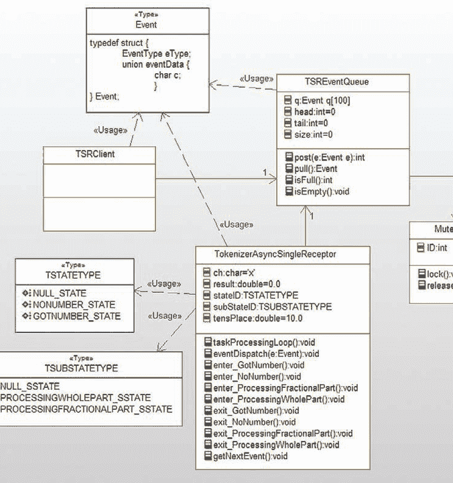

图 5-13：异步事件的单事件状态机上下文

### 5.3.4 协作角色

本节描述了该模式的角色。

### 5.3.4.1 事件（Event）

Event 是一个结构体，包含一个用于标识事件类型的属性以及在不同事件之间传递的其他数据。这在 C 语言中通常实现为联合体（union）。

### 5.34.2 事件类型（EventType）

EventType 是事件的枚举类型。也可以使用 int，但我建议使用枚举，因为它包含更丰富的信息。

## 276 第 5 章

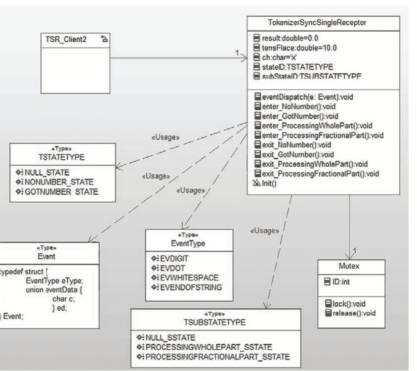

图 5-14：同步事件的单事件反应器状态机上下文

### 5.3.4.3 互斥（Mutex）

对于状态机的异步版本，Mutex 确保了多个客户端同时尝试发布事件，或客户端在状态机类删除事件时尝试发布事件，TSREventQueue 的完整性。

对于该模式的同步版本，互斥通过防止其他客户端中断状态机执行动作序列，确保转换的确定性“运行到完成”（run-to-completion）语义。这通过在处理事件之前锁定信号量并在转换处理完成后释放它来实现。

### 5.3.4.4 异步单令牌解析器接收器（TokenizerAsyncSingleReceptor）

该元素是目标状态机的所有者和实现者（见图 5-12）。它具有两种属性：具有状态机意图的属性（如 result）和涉及状态机管理的属性（如 stateID）。在前类类型中，我们发现：

- result：持有已解析数字的当前值
- tensPlace：用于计算数字的功能部分，例如数字 10.345 中的 0.345
- ch：持有当前正在处理的字符

在后类类型中，我们看到：

- stateID：存储当前的高级状态（NULL_STATE, NONNUMBER_STATE, GOTNUMBER_STATE）
- subStateID：存储当前的子状态（NULL_SSTATE, PROCESSINGWHOLEPART_SSTATE, 或 PROCESSINGFRACTIONALPART_SSTATE）

这些值分别定义在枚举类型 TSTATETYPE 和 TSUSTATETYPE 中。

该状态机的函数同样分为三类。第一种是依赖信号的任务循环（当事件入队时发布）。第二种是识别并处理事件的 dispatchEvent。第三类操作用于状态的进入和退出动作。注意，转换动作都嵌入在事件接收器中，因为它们只发生一次，但进入和退出状态的有很多，因此我们为每个状态显式创建了进入和退出函数，使其变得可复用。

### 5.3.4.5 同步令牌解析器接收器（TokenizerSyncReceptor）

该类与之前描述的 TokenizerAsyncSingleReceptor 完全相同，但 1) 它没有任务循环，因为它是异步调用的；2) 它使用互斥锁来强制其状态机的“运行到完成”语义。它直接调用的唯一函数是 TokenSyncSingleReceptor_eventDispatch()。

### 5.3.4.6 客户端（TCRClient）

这是状态机类。对于异步版本，它通过调用 TSREQueue_post() 函数并将事件类型实例作为传递参数来排队事件。对于同步情况，它调用单事件接收器 TokenizerSyncSingleReceptor，并传递类型化为相应事件类型的适当事件（以及相关数据）。

### 5.3.4.7 事件队列（TSREventQueue）

这是一个持有事件的队列。它仅用于异步事件处理情况，用于持有传入的事件，直到状态机开始处理它们。它提供了两个主要函数：TSREventQueue_post() 函数将事件入队并通知操作系统 已到达。TSREventQueue_pull() 函数由 TSRAsyncSingleReceiver 类调用以获取等待事件。

### 5.3.4.8 TSTATE

TSTATE 是高级状态的枚举类型。

### 5.3.4.9 TSUBSTATE

TSUBSTATE 是嵌套状态的枚举类型。在这种情况下，只有两层嵌套。如果有更多层级，则可以添加更多枚举类型。

### 5.3.5 结果

该模式提供了一种直接的状态机实现，可以很容易地适应同步或异步的状态机事件传递。所有状态逻辑都封装在单个事件接收器内部，限制了该方法的可扩展性。

### 5.3.6 实现策略

需要注意的是，实现此模式的一种方法是简单地采用多事件接收器模式，并添加一个公开的接收器（供客户端调用），该接收器调用已有的多个事件接收器。你仍然需要创建抽象事件类型以传递给单事件接收器。这是使用该模式完成同步状态机并使其生效的一种方法。该模式更常见的实现方式是在事件接收器内部 `switch` 语句。

### 5.3.7 相关模式

该模式的同步版本使用队列模式（Queuing Pattern）来确保转换的确定性完成，而异步版本使用受保护调用模式（Guarded Call Pattern，见第4章）来确保运行完成语义。

### 5.3.8 示例

明显的区别是 TSREventQueue 的存在。客户端不直接调用接收器；而是将事件发送到事件队列，由队列进行发布。

### 代码列表 5-4: TSREventQueue_post()

```c
int TSREventQueue_post(Event e) {
    Mutex_lock(me->mutex);
    if (!TSREventQueue_isFull(me)) {
        me->q[me->head] = e;
        me->head = (me->head + 1) % OSIZE;
        me->size += 1;
        Mutex_release(me->mutex);
        postSignal(); /* 通知事件存在 */
        return 1;
    } else {
        Mutex_release(me->mutex);
        return 0;
    }
}
```

### 代码列表 5-5: TokenizerAsyncReceptor_taskLoop()

```c
void TokenizerAsyncReceptor_taskLoop() {
    while (1) {
        waitSignal(); /* 等待事件发生 */
        while (TSREventQueue_isEmpty(me->itsTSventQueue)) {
            TokenizerAsyncSingleReceptor_eventDispatch(
                TSREventQueue_pull(me->itsTSventQueue));
        }
    }
}
```

### 代码列表 5-6: TokenizeAsyncSinglePkg.h

```c
#include "TokenizerAsyncSinglePkg.h"
struct Mutex;
typedef struct TSREventQueue TSREventQueue {
    Event q[100];
    int size;
    int head;
    int tail;
    struct Mutex* itsMutex;
};
```

### 代码列表 5-7: TSREventQueue_init()

```c
void TSREventQueue_init(TSREventQueue* const me) {
    me->size = 0;
    me->head = 0;
    me->tail = 0;
    me->itsMutex = create_mutex();
}
```

### 代码列表 5-8: TSREventQueue_isEmpty()

```c
int TSREventQueue_isEmpty(TSREventQueue* const me) {
    return me->size == 0;
}
```


# 状态机设计模式

```c
/* 调用事件接收器 */
/* 状态机。注意 */
/* 如果队列溢出，将返回 */
/* 错误代码 (1)。
int TSREventQueue_post(TSREventQueue* const me, Event e);
/* 假设调用者已经 */
/* 确保在调用此函数之前 */
/* 队列中（通过 isEmpty() 函数）至少
/*有一个事件 */
/* 否则它们将获得一个默认事件。 */
Event TSREventQueue_push(TSREventQueue* const me);
struct Mutex* TSREventQueue_getMutex(const TSREventQueue* const me);
void TSREventQueue_setMutex(TSREventQueue* const me, struct Mutex* p_Mutex);
TSREventQueue* TSREventQueue_create(void);
void TSREventQueue_Destroy(TSREventQueue* const me);
#endif
```

# 代码列表 5-7: TSREventQueue.h

```c
#include "TSREventQueue.h"
#include "Mutex.h"
static void cleanUpRelations(TSREventQueue* const me);
void TSREventQueue_Init(TSREventQueue* const me) {
    me->head = 0;
    me->size = 0;
    me->tail = 0;
    me->itsMutex = NULL;
}
void TSREventQueue_Cleanup(TSREventQueue* const me) {
    cleanUpRelations(me);
}
void TSREventQueue_isEmpty(TSREventQueue* const me) {
    return me->size <= 0;
}
int TSREventQueue_isFull(TSREventQueue* const me) {
    return me->size >= SIZE-1;
}
/* 入队一个事件并信号该事实 */
int TSREventQueue_post(TSREventQueue* const me, Event e) {
    Mutex_lock(me->itsMutex);
    if (!me->q[me->head]) {
        me->q[me->head] = e;
        me->head = (me->head + 1) % SIZE;
        me->size += 1;
        Mutex_release(me->itsMutex);
        postSignal(); /* 信号存在一个事件 */
        return 1;
    } else {
        Mutex_release(me->itsMutex);
        return 0;
    }
}
/* pull 从队列中移除旧事件 */
/* pull 应该在有等待的事件时调用 */
Event TSREventQueue_pull(const TSREventQueue* const me) {
    Event e;
    Mutex_lock(me->itsMutex);
    if (!TSREventQueue_isEmpty(me)) {
        e = me->q[me->tail];
        me->tail = (me->tail + 1) % QSIZE;
        me->size -= 1;
    }
    Mutex_release(me->itsMutex);
    return e;
}
struct Mutex* TSREventQueue_getMutex(const TSREventQueue* const me) {
    return (struct Mutex*)me->itsMutex;
}
void TSREventQueue_setMutex(const TSREventQueue* const me, struct TSREventQueue* p_Mutex) {
    me->itsMutex = p_Mutex;
}
TSREventQueue* TSREventQueue_create(void) {
    TSREventQueue* me = (TSREventQueue*) malloc(sizeof(TSREventQueue));
    if(me == NULL)
        TSREventQueue_Init(me);
    return me;
}
void TSREventQueue_Destroy(const TSREventQueue* const me) {
    if(me == NULL)
        TSREventQueue_Cleanup(me);
    free(me);
}
static void cleanUpRelations(TSREventQueue* const me) {
    if(me->itsMutex != NULL)
        me->itsMutex = NULL;
}
```

# 代码列表 5-8: TSREventQueue.c

当然，真正的动作发生在带有状态机的队列中。在这种情况下，我们仅将在代码列表 5-9 和代码列表 5-10 中展示异步版本的代码。

```c
#include <stdio.h>
#include "TokenizerSyncSingleReceptorPkg.h"

typedef struct TokenizerSyncSingleReceptor TokenizerSyncSingleReceptor {
    char ch;
    double result;
    TSTATYPE stateID;
    TSUBSTATYPE subStateID;
    double tensPlace;
    struct Mutex* itsMutex;
} TokenizerSyncSingleReceptor;

void TokenizerSyncSingleReceptor_enter_GoNumber(TokenizerSyncSingleReceptor* const me);
void TokenizerSyncSingleReceptor_enter_NoNumber(TokenizerSyncSingleReceptor* const me);
void TokenizerSyncSingleReceptor_enter_ProcessingFractionalPart(TokenizerSyncSingleReceptor* const me);
void TokenizerSyncSingleReceptor_enter_ProcessingWholePart(TokenizerSyncSingleReceptor* const me);
void TokenizerSyncSingleReceptor_exit_GoNumber(TokenizerSyncSingleReceptor* const me);
void TokenizerSyncSingleReceptor_exit_NoNumber(TokenizerSyncSingleReceptor* const me);
void TokenizerSyncSingleReceptor_exit_ProcessingFractionalPart(TokenizerSyncSingleReceptor* const me);
void TokenizerSyncSingleReceptor_exit_ProcessingWholePart(TokenizerSyncSingleReceptor* const me);
void TokenizerSyncSingleReceptor_Init(TokenizerSyncSingleReceptor* const me);
void TokenizerSyncSingleReceptor_Cleanup(TokenizerSyncSingleReceptor* const me);
void TokenizerSyncSingleReceptor_eventDispatch(TokenizerSyncSingleReceptor* const me, Event e);
struct Mutex* TokenizerSyncSingleReceptor_getMutex(TokenizerSyncSingleReceptor* const me);
void TokenizerSyncSingleReceptor_setItsMutex(TokenizerSyncSingleReceptor* const me, struct Mutex* p_Mutex);
void TokenizerSyncSingleReceptor_Create(void);
void TokenizerSyncSingleReceptor_Destroy(TokenizerSyncSingleReceptor* const me);
#endif

# 代码列表 5-9: TSSyncSingleReceptor.h

```c
#include "TokenizerSyncReceptor.h"
#include "Mutex.h"

void TokenizerSyncSingleReceptor_enter_GoNumber(TokenizerSyncSingleReceptor* const me) {
    me->tensPlace = 10.0;
}
void TokenizerSyncSingleReceptor_enter_NoNumber(TokenizerSyncSingleReceptor* const me) {
    me->result = 0.0;
}
void TokenizerSyncSingleReceptor_enter_ProcessingFractionalPart(TokenizerSyncSingleReceptor* const me) {
    /* 执行适当的操作 */
}
void TokenizerSyncSingleReceptor_enter_ProcessingWholePart(TokenizerSyncSingleReceptor* const me) {
    me->result = me->result * 10 + digit(me->ch);
}
void TokenizerSyncSingleReceptor_exit_GoNumber(TokenizerSyncSingleReceptor* const me) {
    me->subStateID = NULL_STATE;
}
void TokenizerSyncSingleReceptor_exit_NoNumber(TokenizerSyncSingleReceptor* const me) {
    /* 执行适当的操作 */
}
void TokenizerSyncSingleReceptor_exit_ProcessingFractionalPart(TokenizerSyncSingleReceptor* const me) {
    /* 执行适当的操作 */
}
void TokenizerSyncSingleReceptor_exit_ProcessingWholePart(TokenizerSyncSingleReceptor* const me) {
    /* 执行适当的操作 */
}

void TokenizerSyncSingleReceptor_Init(TokenizerSyncSingleReceptor* const me) {
    me->ch = 'x';
    me->result = 0.0;
    me->tensPlace = 10.0;
    me->itsMutex = NULL;
    me->stateID = NONNUMBER_STATE;
    me->subStateID = NULL_STATE;
}

void TokenizerSyncSingleReceptor_eventDispatch(TokenizerSyncSingleReceptor* const me, Event e) {
    Mutex_lock(me->Mutex);
    switch (e.type) {
      case DIGIT:
        switch (me->stateID) {
            case NONNUMBER_STATE:
                /* 转移到 GotNumber 状态，默认子状态 */
                TokenizerSyncSingleReceptor_exit_NoNumber(me);
                me->ch = e.ch;
                TokenizerSyncSingleReceptor_enter_GoNumber(me);
                me->stateID = GOTNUMBER_STATE;
                TokenizerSyncSingleReceptor_enter_ProcessingWholePart(me);
                me->subStateID = PROCESSINGWHOLEPART_STATE;
                printf("Current value of result: %g\n", me->result);
                break;
            case GOTNUMBER_STATE:
                switch (me->subStateID) {
                    case PROCESSINGWHOLEPART_STATE:
                        TokenizerSyncSingleReceptor_exit_ProcessingWholePart(me);
                        me->ch = e.ch;
                        TokenizerSyncSingleReceptor_enter_ProcessingWholePart(me);
                        printf("Current value of result: %g\n", me->result);
                        break;
                    case PROCESSINGFRACTIONALPART_STATE:
                        TokenizerSyncSingleReceptor_exit_ProcessingFractionalPart(me);
                        me->ch = e.ch;
                        me->result += digit(me->ch) / me->tensPlace;
                        me->tensPlace *= 10.0;
                        TokenizerSyncSingleReceptor_enter_ProcessingFractionalPart(me);
                        printf("Current value of result: %g\n", me->result);
                        break;
                }
                break;
        }
        break;
      case DOT:
        me->ch = '.';
        switch (me->stateID) {
            case NONNUMBER_STATE:
                /* 转移到 GotNumber 状态，默认子状态 */
                TokenizerSyncSingleReceptor_exit_NoNumber(me);
                TokenizerSyncSingleReceptor_enter_GoNumber(me);
                me->stateID = GOTNUMBER_STATE;
                TokenizerSyncSingleReceptor_enter_ProcessingFractionalPart(me);
                me->subStateID = PROCESSINGFRACTIONALPART_STATE;
                break;
            case GOTNUMBER_STATE:
                switch (me->subID) {
                    case PROCESSINGWHOLE_STATE:
                        TokenizerSyncSingleReceptor_exit_ProcessingWholePart(me);
                        TokenizerSyncSingleReceptor_enter_ProcessingFractionalPart(me);
                        me->subID = PROCESSINGFRACTIONAL_STATE;
                        break;
                }
                break;
        }
        break;
      case WHITESPACE:
      case ENDOFSTRING:
        switch (me->stateID) {
            case GOTNUMBER_STATE:
                switch (me->subID) {
                    case PROCESSINGWHOLE_STATE:
                        TokenizerSyncSingleReceptor_exit_ProcessingWholePart(me);
                        break;
                    case PROCESSINGFRACTIONAL_STATE:
                        TokenizerSyncSingleReceptor_exit_ProcessingFractionalPart(me);
                        break;
                }
                TokenizerSyncSingleReceptor_exit_GotNumber(me);
                printf("Number: %u\n", me->result);
                TokenizerSyncSingleReceptor_enter_NoNumber(me);
                me->stateID = NONNUMBER_STATE;
                break;
        }
        break;
    }
    Mutex_release(me->Mutex);
}
```


```c
me->itsMutex = p_Mutex;
}
TokenizerSyncSingleReceiver *
TokenizerSyncSingleReceiver_Create(void) {
    TokenizerSyncSingleReceiver* me = (TokenizerSyncSingleReceiver*) malloc(sizeof
(TokenizerSyncSingleReceiver));
    if(me!=NULL)
    TokenizerSyncSingleReceiver_Init(me);
    return me;
}

void
TokenizerSyncSingleReceiver_Destroy(TokenizerSyncSingleReceiver* const me) {
    if(me!=NULL)
    TokenizerSyncSingleReceiver_Cleanup(me);
    free(me);
}

static void cleanUpRelations(TokenizerSyncSingleReceiver* const me) {
    if(me->itsMutex != NULL)
    me->itsMutex = NULL;
}

void
TokenizerSyncSingleReceiver_Cleanup(TokenizerSyncSingleReceiver* const me) {
    cleanUpRelations(me);
}
```
代码列表 5-10: TSRSyncSingleReceiver.

## 5.4 多事件接收器模式

多事件接收器有限状态机（MERSMs）通常只用于同步状态机，因为客户端知道它可能发送到服务器状态机的事件集合。在这种模式中，每个从客户端发送的事件都有一个单一的事件接收器。

### 5.4.1 抽象

状态机实现的 MERS 方法可能是同步状态机最常用的实现模式。它通常是最简单的，因为事件接收器本身只关心单个事件的处理以及相关动作的执行。

### 5.4.2 问题

该模式解决了为同步状态机提供简单稳健实现的问题。

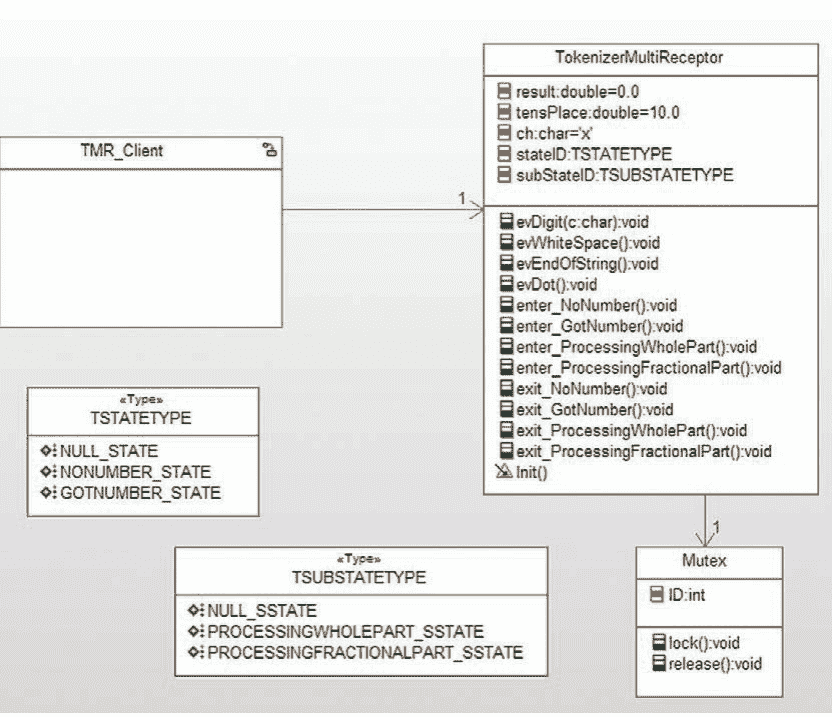
图 5-15：多事件接收器状态机上下文

### 5.4.3 模式结构

状态机实现的上下文如图 5-15 所示。你可以看到 TokenizerMultiReceptor 为传递给状态机的每个事件都有事件接收器，以及代表每个状态进入和退出动作的附加函数。此外，图中显式显示了用于状态和子状态的枚举类型（如前所述，简单使用整数值也很常见）。事件类型不需要显式表示，因为客户端通过调用相应的事件接收器隐式地指示了它。

### 5.4.4 协作角色

本节描述了该模式的角色。

### 5.4.4.1 互斥锁 (Mutex)

互斥锁通过防止其他客户端中断动作序列的状态机执行，确保转换的确定性运行完成语义。这是通过在处理事件之前锁定信号量并在转换处理完成后释放它来实现的。

### 5.4.4.2 TMRClient

这是状态机的客户端。它调用事件接收器（在这种情况下，即那些带有 "ev" 前缀的函数，例如 evDigit 和 evDot）。

### 5.4.4.3 TokenizeMultiReceptor

该元素是目标状态机的所有者和实现者（见图 5-12）。它具有各种属性：与状态机意图相关的属性（如 result）以及与状态机管理相关的属性（如 stateID）。对于前者类型，我们发现：

- result，持有正在解析数字的当前值
- tensPlace，用于计算数字的小数部分，例如数字 10.345 中的 0.345
- ch，持有当前正在处理的字符

对于后者类型，我们看到：

- stateID，存储当前的高级状态（NULL_STATE, NONNUMBER_STATE 或 GOTNUMBER_STATE）
- subStateID，存储当前的子状态（NULL_SSTATE, PROCESSINGWHOLE_SSTATE 或 PROCESSINGFRACTIONALPART_SSTATE）

这些值分别在枚举类型 TSTATYPE 和 TUSUBSTATETYPE 中定义。

该状态机的函数同样分为两类。第一类是事件接收器。它们由客户端调用以“发送”事件并根据需要传递数据。这些包括：

- evDigit(c: char) 发送 evDigit 事件并将数字字符作为参数传递
- evDot 发送事件，指示小数点是字符串中的下一个字符
- evEndOfString 表示字符串中不再有更多字符
- evWhiteSpace 表示发现了空白字符（如空格或制表符）

其他操作用于状态的进入和退出动作。所有的转换都嵌入在事件接收器中，因为它们只发生一次，但由于有很多进入和离开状态的路径，我们为每个状态显式地创建了进入和退出函数。这些函数不会被客户端直接调用。

### 5.4.4.4 TSTATE

TSTATE 是高级状态的枚举类型。

### 5.4.4.5 TSUBSTATE

TSUBSTATE 是嵌套状态的枚举类型。在这种情况下，只有两个级别。

### 5.4.5 影响

该模式通过将状态逻辑分为一组事件接收器简化了实现。每个接收器提供一个 switch-case 语句来实现取决于状态的相应行为。该模式几乎专门用于同步状态机，因为事件队列通常不解析它们管理的数据的内部内容，并且如果存在多个接收器，它们不知道调用哪一个。

### 5.4.6 实现策略

该模式实现的主要变体点是使用 If-then 语句代替 switch-case 语句，以及使用原始整数代替枚举类型。

### 5.4.7 相关模式

该模式使用守卫调用（Guarded Call，见第 4 章）来确保转换的确定性运行。也可以使用关键区域（Critical Region）来禁用切换。单事件接收器提供了可以轻松适应异步事件的方法。

### 5.4.8 示例

使用该模式实现的示例状态机如下代码所示。代码列表 5-11 显示了枚举类型和 digit() 函数的定义。这两个代码列表提供了 TokenizeMultiReceptor 类的头文件和实现文件。注意该类定义了每个状态的进入和退出函数。你可以根据需要省略其中之一。init() 函数作为构造函数并将对象置于初始状态并调用。

```c
typedef enum TSTATE {
NULL_STATE,
NONNUMBER_STATE,
GOTNUMBER_STATE
} TSTATE;
typedef enum TSUBSTATETYPE {
NULL_SSTATE,
PROCESSINGWHOLE_SSTATE,
PROCESSINGFRACTIONALPART_SSTATE
} TSUBSTATE;
```

```c
int digit(char c) {
    return c-'0';
}
```
# 代码列表 5-11: TokenizeReceptor 使用的基本类型


# 292 第5章

```c
void TokenizerMultiReceptor_Destroy(TokenizerMultiReceptor* const);
void TokenizerMultiReceptor_Init(TokenizerMultiReceptor* const);
struct Mutex* TokenizerMultiReceptor_getItsMutex(const TokenizerMultiReceptor* const me);
void TokenizerMultiReceptor_setItsMutex(TokenizerMultiReceptor* const me, struct Mutex* p_Mutex);
#endif
```

# 代码列表 5-12: TokenizeMultiReceptor.h

```c
#include "TokenizerMultiReceptor.h"
#include "Mutex.h"
static void cleanupRelations(TokenizerMultiReceptor* const me);
void TokenizerMultiReceptor_Cleanup(TokenizerMultiReceptor* const me) {
  cleanupRelations(me);
}
/* 处理 evDigit 事件，将字符 c 作为参数传递 */
void TokenizerMultiReceptor_evDigit(TokenizerMultiReceptor* const me, char c) {
 Mutex_lock(me->stateID);
 switch (me->stateID) {
 case NUMBER_STATE:
 /* 转换到 GotNumber 状态，默认子状态 */
    TokenizerMultiReceptor_exit_NoNumber(me);
    me->ch = c;
    TokenizerMultiReceptor_enter_GotNumber(me);
    me->stateID = GOTNUMBER_STATE;
    TokenizerMultiReceptor_enter_ProcessingWholePart(me);
    me->subStateID = PROCESSINGWHOLEPART_SSTATE;
 printf("Current value of result: %g\n", me->result);
 break;
 case GOTNUMBER_STATE:
 switch (me->stateID) {
 case PROCESSINGWHOLEPART_SSTATE:
    TokenizerMultiReceptor_exit_ProcessingWholePart(me);
    me->ch = c;
 TokenizerMultiReceptor_enter_ProcessingWholePart(me);
    printf("Current value of result: %g\n", me->result);
 break;
 case PROCESSINGFRACTIONALPART_SSTATE:
 TokenizerMultiReceptor_exit_ProcessingFractionalPart(me);
    me->ch = c;
    me->result += digit(me->ch) / me->tensPlace;
    me->tensPlace *= 10.0;
TokenizerMultiReceptor_enter_ProcessingFractionalPart(me);
printf("Current value of result: %g\n", me->result);
break;
}
};
Mutex_release(me->itsMutex);
```

/* 处理 evDot */
void TokenizerMultiReceptor_evDot(TokenizerMultiReceptor* const me) {
Mutex_lock(me->itsMutex);
me->ch = '_';
 switch (me->stateID) {
case GOTNUMBER_STATE:
/* 转换到 GotNumber 状态，默认子状态 */
TokenizerMultiReceptor_exit_NoNumber(me);
TokenizerMultiReceptor_enter_GotNumber(me);
me->subID = GOTNUMBER_STATE;
TokenizerMultiReceptor_enter_ProcessingFractionalPart(me);
me->subID = PROCESSINGFRACTIONALPART_SSTATE;
break;
case GOTNUMBER_STATE:
switch (me->subID) {
case PROCESSINGWHOLEPART_SSTATE:
TokenizerMultiReceptor_exit_ProcessingWholePart(me);
TokenizerMultiReceptor_enter_ProcessingFractionalPart(me);
me->subID = PROCESSINGFRACTIONALPART_SSTATE;
break;
};
Mutex_release(me->itsMutex);
}

/* 处理 evEndOfFromString */
void TokenizerMultiReceptor_evEndOfFromString(TokenizerMultiReceptor* const me) {
Mutex_lock(me->itsMutex);
 switch (me->stateID) {
case GOTNUMBER_STATE:
switch (me->subID) {
case PROCESSINGWHOLEPART_SSTATE:
TokenizerMultiReceptor_exit_ProcessingWholePart(me);
break;
case PROCESSINGFRACTIONALPART_SSTATE:
TokenizerMultiReceptor_exit_ProcessingFractionalPart(me);
break;
};
```

# 294 第5章

```c
TokenizerMultiReceptor_exit_GotNumber(me);
printf("Number: %g\n", me->result);
TokenizerMultiReceptor_enter_NoNumber(me);
me->stateID = NONNUMBER_STATE;
break;
Mutex_release(me->itsMutex);
/*
* 处理 evWhiteSpace
 */
void TokenizerMultiReceptor_evWhiteSpace(TokenizerMultiReceptor* const me) {
Mutex_lock(&me->itsMutex);
 switch (me->stateID) {
case GOTNUMBER_STATE:
    switch (me->subStateID) {
case PROCESSINGWHOLEPART_SSTATE:
TokenizerMultiReceptor_exit_ProcessingWholePart(me);
    break;
    case PROCESSINGFRACTIONALPART_SSTATE:
TokenizerMultiReceptor_exit_ProcessingFractionalPart(me);
    break;
    TokenizerMultiReceptor_exit_GotNumber(me);
printf("Number: %g\n", me->result);
TokenizerMultiReceptor_enter_NoNumber(me);
me->stateID = NONNUMBER_STATE;
break;
}
Mutex_release(me->itsMutex);
/*
* 每个状态的进入和动作
 */
void
TokenizerMultiReceptor_enter_GotNumber(TokenizerMultiReceptor* const me) {
}
TokenizerMultiReceptor_enter_NoNumber(TokenizerMultiReceptor* const me) {

TokenizerMultiReceptor_enter_ProcessingFractionalPart(TokenizerMultiReceptor* const me

[315页]

```c
TokenizerMultiReceptor_enter_ProcessingWholePart(TokenizerMultiReceptor* const me) {
}
TokenizerMultiReceptor_exit_GotNumber(TokenizerMultiReceptor* const me) {
}
TokenizerMultiReceptor_exit_NoNumber(TokenizerMultiReceptor* const me) {
}
TokenizerMultiReceptor_exit_ProcessingFractionalPart(TokenizerMultiReceptor* const me) {
}
TokenizerMultiReceptor_exit_ProcessingWholePart(TokenizerMultiReceptor* const me) {
}
TokenizerMultiReceptor_enter_ProcessingFractionalPart(TokenizerMultiReceptor* const me) {
}
TokenizerMultiReceptor_enter_ProcessingWholePart(TokenizerMultiReceptor* const me) {
}
TokenizerMultiReceptor_getItsMutex(const TokenizerMultiReceptor* const me) {
}
TokenizerMultiReceptor_setItsMutex(TokenizerMultiReceptor* const me, struct Mutex* p_Mutex) {
}
TokenizerMultiReceptor_Cleanup(TokenizerMultiReceptor* const me) {
}
TokenizerMultiReceptor_Destroy(TokenizerMultiReceptor* const me) {}
```

# 296 第5章

```c
static void cleanupRelations(TokenizerMultiReceptor* const me) {
  if (me->mutex != NULL)
    me->mutex = NULL;
}
```

# 代码列表 5-13:TokenizerMultiReceptor.c

## 5.5 状态表模式

状态表模式是一种用于大型、平化（即无嵌套）状态机的创建模式。它在在使用时具有良好的性能（O(1)），但在可用之前需要更多的初始化。

### 5.5.1 抽象

状态表模式使用二维数组来存储状态转换信息。这通常被构建为 x 事件表；状态是第一个索引，接收到的事件 ID 是第二个索引。表格的内容是指向适当动作和保护的结构。这比其他实现模式需要更复杂的结构。

### 5.5.2 问题

状态表模式解决的问题是为可能的大型且容易平化的状态空间实现状态机。此外，该模式适用于状态机性能（对给定事件的响应时间与状态空间大小无关），但关心初始化状态机所需的时间。

### 5.5.3 模式结构

图 5-16 显示了状态表模式的结构。它展示了数据类型中的两个重要方面。首先，表格本身是一个二维数组，其第一个索引是状态（存储在状态变量 stateID 中），第二个索引是接收到的事件 ID。事件 ID 正如之前，是 Event 结构体中的字段。增加嵌套层级需要嵌套表格，大多数开发者认为平化状态空间（这总是可能的——感兴趣的读者可以证明）比嵌套表格更容易。

数据结构另一个值得注意的复杂度在于 TableEntry 类型。这是一个包含一组 ActionType、一个 GuardType 以及转换完成后进入的状态的结构。GuardType 是无参数函数（除了常见的


# 状态机模式 297


对象指针）返回返回 TRUE（非零）或 FALSE（零）的指示。然而，`ActionType` 是一个联合体，包含一个无参数函数指针（Action0）或一个指向带有 `char` 参数的函数的指针（Action1）。`TableEntry` 结构体具有独立的进入（entry）、退出（exit）和转换（transition）动作项。如果动作字段无效，则应将指针设置为 NULL。这意味着如果这些字段中有多个要执行的动作，必须将它们组合成单个动作并按顺序调用它们。所有表项的初始化都在 `TokenizerState` 类的 `init()` 函数中完成。

`eventDispatch()` 函数现在的任务非常简单：给定一个传入的事件，调用单元格 `table[stateID][eType]` 中的守卫（如果有的话），如果为 TRUE（或缺失），则调用退出动作、转换动作和进入动作，并将 `stateID` 设置为单元格中找到的 `newState` 的值。

### 5.5.4 协作角色

本节描述了该模式的角色。

### 5.5.4.1 ActionPtr0
该类型是一个指向除强制 `me` 对象指针外、具有 0 个参数的指针。

### 5.5.4.2 ActionPtr1
该类型是一个指向除强制 `me` 对象指针外、接收 1 个 `char` 类型参数的指针。

### 5.5.4.3 ActionType
该类型是两个 `ActionPtrTypes` 的联合体；作为联合体，它只有一个指针，但其类型为 `ActionPtr0` 或 `ActionPtr1`。`ActionType` 定义了进入、转换和退出动作的 `TableEntryType`。

### 5.5.4.4 Event
该类型是一个结构体，持有事件类型以及在某些事件传递的关联数据——在本例中是一个 `char`。这在 C 中通常实现为联合体。

### 5.5.4.5 EventType
`EventType` 是事件的枚举类型。或者，可以使用 `ints`，但我推荐使用枚举，因为它包含更多信息量。

### 5.5.4.6 GuardType
它实现了一个函数指针，不接受任何参数，但返回一个被视为布尔值的 `int`，用于决定是否执行触发的转换。注意，在本例中没有使用守卫，因此此例中的所有元素都将为 NULL。

### 5.5.4.7 Mutex
与其他实现模式一样，`Mutex` 用于确保确定性状态行为所需的运行到完成（run-to-completion）语义。

### 5.5.4.8 TableEntryType
该复合类型指定了状态表单元格中的元素。它由一组用于退出、转换、进入和守卫动作的函数指针，以及如果执行转换状态机的新状态组成。

### 5.5.4.9 TokenizerState
该类实现了状态机。在内部，它将状态表本身作为其成员之一（以及 `stateID` 和状态机计算所需的其他属性）。它还包含了实现所调用的动作的必要函数。

### 5.5.4.10 TSTATETYPE
`TSTATE` 是高层状态的枚举类型。注意，嵌套状态机通过移除嵌套被扁平化了。这极大地简化了状态表。该类型的枚举值为：

- NULL_STATE
- NONNUMBER_STATE
- GN_PROCESSINGWHOLEPART_STATE
- GN_PROCESSINGFRACTIONALPART_STATE

其中 `GN_` 前缀提醒我们最后两个状态是 `GotNumber` 状态的嵌套状态。

### 5.5.5 结果

该模式具有优秀的执行性能，且与状态空间的大小（即状态表中的单元格数量）无关。这是因为它通过当前 `stateID` 和传入的 `eType` 的组合直接索引的。另一方面，表的初始化虽然不是特别，但是复杂的，因为 `StateTableEntry` 的字段必须在 `init()` 函数中单独初始化。这意味着该模式的初始化比其他模式慢得多，唯一的例外是下一节讨论的状态模式（State Pattern）。因此，对于系统启动时间相对不重要但状态空间可能很大的情况，这种实现模式是一个很好的选择。

状态表模式也比其他模式更容易扩展，因为扩展主要是一个向状态表添加新元素并为相关转换定义 `StateTableEntries` 的问题。

需要注意的是，如果状态空间是稀疏的（即许多单元格为空），该模式将浪费内存，因为表为所有单元格分配了 `StateTableEntries`。如果内存紧张，可以通过存储指向 `StateTableEntries` 的指针而不是元素本身来解决这个问题。

本文介绍的模式仅支持状态机。然而，它可以与异步版本状态单接收器模式（State Single Receiver Pattern）的元素结合（通过对 `TokenizerStateTable` 类进行适当增强，增加一个从队列提取事件的任务处理循环），并同样处理异步事件。

### 5.5.6 实现策略

通常，表被实现为 `StateTableEntries` 的二维数组。如果表填充稀疏，这可能会浪费内存——可以通过将表实现为指向 `StateTableEntries` 指针的二维数组来节省内存（代价是执行期间增加了一次指针解引用）。

### 5.5.7 相关模式

该模式采用了守卫模式（Guarded Pattern）中的 `Mutex`（见第 4 章）。它还器使用队列模式（Queuing Pattern）来支持异步事件处理，当这些事件绝不可能干扰状态机的执行时。


# 302 第 5 章

```
void TokenizerStateTable_exit_NoNumber(TokenizerStateTable* const);
void
TokenizerStateTable_exit_ProcessingFractionalPart(TokenizerStateTable* const);
void
TokenizerStateTable_exit_ProcessingWholePart(TokenizerStateTable* const);
struct Mutex* TokenizerStateTable_getMutex(const TokenizerStateTable* const);
void TokenizerStateTable_setMutex(TokenizerStateTable* const, struct Mutex* p_Mutex);
TokenizerStateTable * TokenizerStateTable_Create(void);
void TokenizerStateTable_Destroy(TokenizerStateTable* const);
void TokenizerStateTable_assignCh(TokenizerStateTable* const, char c);
void TokenizerStateTable_NoNum2GN(TokenizerStateTable* const, char c);
void TokenizerStateTable_Frac2Frac(TokenizerStateTable* const, char c);
void TokenizerStateTable_printResult(TokenizerStateTable* const);
#endif
```

# 代码列表 5-15: TokenizerStateTable

```c
#include "TokenizerStateTable.h"
#include "Mutex.h"
static void cleanUpRelations(TokenizerStateTable* const);
void TokenizerStateTable_Init(TokenizerStateTable* const) {
    me->ch = 'x';
    me->result = 0.0;
    me->endPlace = 10.0;
    me->mutex = NULL;
    TSTATETYPE st;
    Eventype ev;
    TableEntry type;

    /* 将表的每个单元格初始化为空状态 */
    for (st=NULL_STATE; st<ON_PROCESSINGFRACTIONALPART_STATE; st++) {
        for (ev=EVIDGIT; ev<EV_ENDOFSTRING; ev++) {
            me->table[st][ev].newState = NULL_STATE;
            me->table[st][ev].guardPtr = (GuardType)NULL;
            me->table[st][ev].actionPtr = NULL;
            me->table[st][ev].transactionPtr = NULL;
            me->table[st][ev].entryPtr = NULL;
        }
    }

    /* */
    /* 现在添加特定的状态转换 */
    /* */
    /* evDigit 从 NoNumber 转移到 ProcessingWholePart */
    te.guardPtr = (GuardType)NULL;
    te.exitActionPtr = (ActionPtr)malloc(sizeof(ActionPtr));
    te.exitActionPtr->nParams = 0;
    te.exitActionPtr->a[0] = (ActionPtr0)TokenizerState_exit_NoNumber;
    te.transactionActionPtr = (ActionPtr)malloc(sizeof(ActionPtr));
    te.transactionActionPtr->nParams = 1;
    te.transactionActionPtr->a[1] = (ActionPtr)TokenizerState_NoNum2GN;
    te.entryActionPtr = (ActionPtr)malloc(sizeof(ActionPtr));
    te.entryActionPtr->nParams = 0;
    te.entryActionPtr->a[0] = (ActionPtr0);
    TokenizerStateTable_enter_ProcessingWholePart;
    te.newState = GN_PROCESSINGWHOLE_PART;
    me->table[NUMBER_STATE][EVDIGIT] = te;

    /* evDigit 从 ProcessingWholePart 转移到自身 */
    te.guardPtr = (GuardType)NULL;
    te.exitActionPtr = (ActionPtr)malloc(sizeof(ActionPtr));
    te.exitActionPtr->nParams = 0;
    te.exitActionPtr->a[0] = (ActionPtr0)TokenizerState_exit_NoNumber;
    te.transactionActionPtr = (ActionPtr)malloc(sizeof(ActionPtr));
    te.transactionActionPtr->nParams = 1;
    te.transactionActionPtr->a[1] = (ActionPtr)TokenizerState_assignCh;
    te.entryActionPtr = (ActionPtr)malloc(sizeof(ActionPtr));
    te.entryActionPtr->nParams = 0;
    te.entryActionPtr->a[0] = (ActionPtr0);
    TokenizerStateTable_enter_ProcessingWholePart;
    te.newState = GN_PROCESSINGWHOLE_PART;
    me->table[GN_PROCESSINGWHOLE_PART][EVDIGIT] = te;

    /* evDot 从 ProcessingFractionPart */
    te.guardPtr = (GuardType)NULL;
    te.exitActionPtr = (ActionPtr)malloc(sizeof(ActionPtr));
    te.exitActionPtr->nParams = 0;
    te.exitActionPtr->a[0] = (ActionPtr0)TokenizerState_exit_NoNumber;
    te.transactionActionPtr = (ActionPtr)malloc(sizeof(ActionPtr));
    te.transactionActionPtr->nParams = 1;
    te.transactionActionPtr->a[1] = (ActionPtr)TokenizerState_NoNum2GN;
    te.entryActionPtr = (ActionPtr)malloc(sizeof(ActionPtr));
    te.entryActionPtr->nParams = 0;
    te.entryActionPtr->a[0] = (ActionPtr0);
    TokenizerStateTable_enter_ProcessingFractionalPart;
    te.newState = GN_PROCESSINGFRACTIONAL_PART;
    me->table[NUMBER_STATE][EVDIGIT] = te;

    /* evDot 从 ProcessingWholePart 转移到 Processing Fractional Part */
    te.guardPtr = (GuardType)NULL;
    te.exitActionPtr = (ActionPtr)malloc(sizeof(ActionPtr));
    te.exitActionPtr->nParams = 0;
    te.exitActionPtr->a[0] = (ActionPtr0)TokenizerState_exit_NoNumber;
    te.transactionActionPtr = (ActionPtr)malloc(sizeof(ActionPtr));
    te.transactionActionPtr->nParams = 1;
    te.transactionActionPtr->a[1] = (ActionPtr)TokenizerState_NoNum2GN;
    te.entryActionPtr = (ActionPtr)malloc(sizeof(ActionPtr));
    te.entryActionPtr->nParams = 0;
    te.entryActionPtr->a[0] = (ActionPtr0);
    TokenizerStateTable_enter_ProcessingFractionalPart;
    te.newState = GN_PROCESSINGFRACTIONAL_PART;
    me->table[NUMBER_STATE][EVDIGIT] = te; /* 等，此处 OCR 逻辑错误，保持文本不变 */

    /* ... (此处省略重复的逻辑转换代码) ... */

    /* evDigit 从 ProcessingFractionalPart 转移到 ProcessingPart */
    /* (以下代码多次重复，逻辑上保持一致) */
    te.guardPtr = (GuardType)NULL;
    te.exitActionPtr = (ActionPtr)malloc(sizeof(ActionPtr));
    te.exitActionPtr->nParams = 0;
    te.exitActionPtr->a[0] = (ActionPtr0)TokenizerState_exit_NoNumber;
    te.transactionActionPtr = (ActionPtr)malloc(sizeof(ActionPtr));
    te.transactionActionPtr->nParams = 1;
    te.transactionActionPtr->a[1] = (ActionPtr)TokenizerState_assignCh;
    te.entryActionPtr = (ActionPtr)malloc(sizeof(ActionPtr));
    // ... 略 ...
    TokenizerStateTable_enter_ProcessingWholePart;
    te.newState = GN_PROCESSINGWHOLE_PART;
    me->table[GN_PROCESSINGWHOLE_PART][EVDIGIT] = te;
}
```


# 306 第 5 章

```c
if (me->table[stateID][e.type].guardPtr == NULL)
/* guard 是否为真? */
takeTransition= TRUE; /* 如果没有 guard，则“求值”结果为 TRUE */
else
    takeTransition=(me->table[stateID][e.type].guardPtr(me));
if (takeTransition())
    if (me->table[stateID][e.type].actionPtr != NULL)
        if (me->table[stateID][e.type].actionPtr->nParams == 0)
            me->table[stateID][e.type].actionPtr->aPtr.al(me, e.ed.c);
        else
            if (me->table[stateID][e.type].actionPtr != NULL)
                if (me->table[stateID][e.type].transitionPtr->nParams == 0)
                    me->table[stateID][e.type].transitionPtr->aPtr.a0(me);
                else
                    me->table[stateID][e.type].transitionPtr->aPtr.al(me, e.ed.c);
    if (me->table[stateID][e.type].entryPtr != NULL)
        if (me->table[stateID][e.type].entryPtr->nParams == 0)
            me->table[stateID][e.type].entryPtr->aPtr.a0(me);
        else
            me->table[stateID][e.type].entryPtr->aPtr.al(me, e.ed.c);
    me->stateID=me->table[stateID][e.type].newState;

Mutex_release(me->Mutex);

void TokenizerStateTable_enter_GotNumber(TokenizerStateTable* const me) {
    me->tensPlace=10.0;
}

void TokenizerStateTable_enter_NoNumber(TokenizerStateTable* const me) {
    me->result=0.0;
}

void TokenizerStateTable_enter_ProcessingFractionalPart(TokenizerStateTable*const me) {
}

void TokenizerStateTable_enter_ProcessingWholePart(TokenizerStateTable* const me) {
    me->result = me->result*10+ digit(me->ch);
}

void TokenizerStateTable_exit_GotNumber(TokenizerStateTable* const me) {
}
void TokenizerStateTable_exit_NoNumber(TokenizerStateTable* const me) {
}
```

```c
void
TokenizerStateTable_exit_ProcessingFractionalPart(TokenizerStateTable*
const me) {
}
```

```c
void
TokenizerStateTable_exit_ProcessingWholePart(TokenizerStateTable* const me) {
}
```

```c
struct Mutex* TokenizerStateTable_getItsMutex(const TokenizerStateTable* const me) {
  return (struct Mutex*)me->mutex;
}
```

```c
void TokenizerStateTable_setMtx(TokenizerStateTable* const me, struct Mutex*
p_Mutex) {
  me->itsMutex = p_Mutex;
}
```

```c
TokenizerStateTable* TokenizerStateTable_Create(void) {
  TokenizerStateTable* me = (TokenizerStateTable*) malloc(sizeof(
  TokenizerStateTable));
  if(me==NULL)
    TokenizerStateTable_Init(me);
  return me;
}
```

```c
void TokenizerStateTable_Destroy(TokenizerStateTable* const me) {
  if(me==NULL)
    TokenizerStateTable_Cleanup(me);
  free(me);
}
```

```c
static void cleanUpRelations(TokenizerStateTable* const me) {
  if(me->itsMutex == NULL)
    me->itsMutex = NULL;
}
```

```c
void TokenizerStateTable_assignCh(TokenizerStateTable* const me, char * c) {
  me->ch = c;
}
```

```c
void TokenizerStateTable_NoNum2GN(TokenizerStateTable* const me, char * c) {
  TokenizerStateTable_assignCh(me,c);
  me->tensPlace = 10.0;
}
```

```c
void TokenizerStateTable_Frac2ac(TokenizerStateTable* const me, char * c) {
  me->ch = c;
  me->result += digit(me->ch)/me->tensPlace;
  me->tensPlace *= 10;
}
```

```c
void TokenizerStateTable_printResult(TokenizerStateTable* const me) {
  printf("Number: %g\n", me->result);
}
```

# 代码列表 5-16: TokenizerStateTable.c

# 308 第 5 章

图 5-17 展示了系统的一个执行示例，其中客户端向 TokenizerStateTable 发送字符串 "1.3" 的字符。

## 5.6 状态模式

这种模式（可能命名不太好）源自 Gamma 等人编写的《设计模式：可用面向对象软件元素》。它提供了一种实现策略，可以以牺牲运行时性能为代价对数据内存进行优化，反之亦然。它既适用于稀疏也适用于密集的状态，且初始设置成本相对较低。然而，它大量使用了动态内存。在 C++ 中由于使用了多态，实现起来很简单，因此在 C 语言中较为复杂。

### 5.6.1 抽象

状态模式通过为每个状态创建一个对象来实现状态机。拥有状态机的类称为上下文（Context），它维护一个对象列表，用以标识哪个是当前状态。所有事件都与当前活动对象关联。

### 5.6.2 问题

该模式通过创建一组对象来实现状态机，每个对象实现单个状态的行为。它使得状态显式化、便于修改，并允许添加新状态来扩展状态空间。

### 5.6.3 结构

图 5-18 展示了解析模式的结构。注意，状态被实现为不同的类，这些类都为事件提供了函数（即使实现为空）。由于动作几乎总是通过变量和调用函数来实现，每个状态类都需要一个指向上下文的指针。如果将状态机扁平化（即消除嵌套），该模式会简单得多。

# 状态机设计模式

| TSTBuilder.itsTokenizer:TokenizerStateTable | TSTBuilder.itsClient:Client | TSTBuilder.itsMutex:Mutex |
| :--- | :--- | :--- |
| 1. eventDispatch(e = '1') | | |
| 2. lock() | | |
| 3. exit_NoNumber() | | |
| 4. NoNumGN(c = 1) | | |
| 5. assignCh(c = 1) | | |
| 6. enter_ProcessingWholePart() | | |
| 7. release() | | |
| 8. eventDispatch(e = '.') | | |
| 9. lock() | | |
| 10. exit_ProcessingWholePart() | | |
| 11. enter_ProcessingFractionalPart() | | |
| 12. release() | | |
| 13. eventDispatch(e = '3') | | |
| 14. lock() | | |
| 15. exit_ProcessingFractionalPart() | | |
| 16. Frac2Frac(c = 3) | | |
| 17. enter_ProcessingFractionalPart() | | |
| 18. release() | | |
| 19. eventDispatch(e = EOF) | | |
| 20. lock() | | |
| 21. exit_ProcessingFractionalPart() | | |
| 22. printResult() | | |
| 23. enter_NoNumber() | | |
| 24. release() | | |

处理 '1' 字符

处理 '.' 事件

处理 '3' 字符

处理 WS 事件

图 5-17：执行字符串 "1.3"的状态表序列

# 310 第 5 章

| Context | Mutex |
| :--- | :--- |
| stateList:struct NoNumberState stateList(GN_PROCESSINGFRACTIONALPART_ST... | |
| currentState:STATE=NULL_STATE | |
| result:double=0.0 | |
| tensor:double=10.0 | |
| char*x | |

```c
void Init() {
  eDlg(char)void
  eDot(void)
  eWhiteSpace(void)
  eEndOfString(void)
  Cleanup()
}
```

| Context | Context | Context |
| :--- | :--- | :--- |
| NoNumberState | GN_ProcessingFractionState | |
| aSetStateActionSet | | |

```c
void Init() {
  eAction(void)
  exitAction(void)
  eDlg(char)int
  eDot(int)
  eWhiteSpace(int)
  eEndOfString(int)
  noNumGl(char)void
}
```

```c
void Init() {
  eAction(void)
  exitAction(void)
  eDlg(char)int
  eDot(int)
  eWhiteSpace(int)
  eEndOfString(int)
  Frac2Frac(char)void
  printResult(void)
}
```

| GN_ProcessingWholeState | |
| aSetStateActionSet | |

```c
void Init() {
  eAction(void)
  exitAction(void)
  eDlg(char)int
  eDot(int)
  eWhiteSpace(int)
  eEndOfString(int)
  printResult(void)
}
```

| StateActionSet | |
| eEventHandler:ActionPtr1=NULL |
| eDotHandler:ActionPtr0=NULL |
| eWhiteHandler:ActionPtr0=NULL |
| eCOHandler:ActionPtr0=NULL |
| eSOHandler:ActionPtr0=NULL |
| exitActionActionPtr=NULL |

图 5-18：状态模式

### 5.6.4 协作角色

### 5.6.4.1 ActionPtr0

该类型是指向函数的指针，该函数除强制的对象指针外有0个参数，并返回一个 int。返回值为0（丢弃事件）或 1（处理事件）。

### 5.6.4.2 ActionPtr

该类型是指向函数的指针，除了强制的 me 对象指针外，它接收1个 char 类型的参数并返回一个 int。返回值为 0（丢弃事件）或 1（处理事件）。

### 5.6.4.3 Context

上下文是拥有状态机并拥有被动作操作的数据类。它通过一个指向类的数组 stateList 实现列表，并使用 currentState 变量来指示哪个状态是激活的。

### 5.6.4.4 Mutex

互斥锁通过防止其他客户端中断状态机的执行，确保了转换的确定性完成语义。这是通过在处理事件之前锁定信号量，并在处理完成后释放它来实现的。

### 5.6.4.5 State Classes

状态类实现上下文的一个状态，并实现所有的事件处理器。如果处理了事件，则返回 1；如果丢弃了事件，则返回 0。如果处理了事件，预计将执行当前状态的退出动作，然后是转换动作，最后将上下文的 currentState 切换到新状态。新状态的进入动作将在状态对象的事件处理器返回后由上下文执行。


# 312 第 5 章

到状态类适当的事件处理函数。通过这种方式，多态性被支持通用的事件处理，无论当前状态是哪一个。

## 5.6.4.6 StateActionSet

该类是实现所需多态性的关键。每个状态类在变量 `aSet` 中都拥有该类的一个独立实例。每个事件处理程序（以及进入和退出动作）都有一个指针，该指针将解引用到当前状态的事件处理程序。在这种情况下，处理程序的类型类型为 `ActionPtr_0`（除指针外没有其他参数）或 `ActionPtr1`（带有一个参数，如 `me` 指针）。若要实现具有其他参数列表的事件，必须创建新的动作指针。

该类除了一个初始将所有指针设置为 `NULL` 的初始化器外，没有其他行为。预计每个 `StateActionSet` 实例的拥有者将设置函数指针以访问正确的函数。

## 5.6.4.7 TSTATYPE

TSTATE 是高层状态机的枚举类型。注意，嵌套状态通过移除嵌套被扁平化了。这极大地简化了状态模式的实现。该类型的枚举值为：


- NULL_STATE
- NONNUMBER_STATE
- GN_PROCESSINGWHOLEPART_STATE
- GN_PROCESSINGFRACTIONALPART_STATE

其中 `GN_` 前缀是一个提醒，最后两个状态是 `GotNumber` 状态的嵌套状态。

## 5.6.5 影响

这种模式将特定于状态的行为局部化到单个对象中，简化并封装了特定状态的行为。这意味着可以通过添加新状态类来添加新状态。添加新事件的工作量更大，因为它们至少必须被添加到 `StateActionSet` 中，并且通常也会添加到每个状态类中。状态模式通过为每个状态类中的每个入站事件提供事件处理程序，使得转换变得显式化。

这种模式比状态表消耗更多内存，但通过将复杂性分布在各个状态对象之间简化了实现。

该模式的另一个优势是，通过对实现进行微小更改，可以在 `Context` 类的多个实例之间共享状态对象——例如，如果系统有多个类型由相同类定义的传感器。在这些情况下，这在内存使用方面使其非常轻量。

## 5.6.6 实现策略

这种模式在 C++ 中非常直观，但在 C 中相当复杂，因为它使用了继承和多态。在在此处展示的实现中，多态是通过两种技术的结合实现的。首先，所有状态类都实现相同的事件处理接口；由于每个状态元素在事件被丢弃时都会实现所有事件的事件处理程序。如果事件被处理，事件处理程序返回 1；如果事件被丢弃，则返回 0。这是必要的，因为 `Context` 需要知道是否应该执行该状态的进入动作。

`StateActionSet` 然后通过提供一组用于事件处理程序和退出处理程序的指针，提供了函数的多态分发。每个状态类相应地实现事件处理程序，并将指针放入 `StateActionSet` 实例中。`Context` 类使用 `currentState` 变量作为索引来解引用指向“当前”状态的指针，并进一步解引用 `StateActionSet` 以调用相应的处理程序。

存在两种实现变体：是一次性创建所有状态对象并根据 `Context` 的 `currentState` 变量在它们之间切换，还是动态地创建和销毁不同状态的实例。通常，如果系统状态变化不频繁，可以通过只在需要时创建状态并在 `Context` 不处于该状态时销毁它来节省内存。如果状态变化频繁，这种方法可能会产生显著的性能损失，以一些额外的内存为代价，最好是将所有状态实例保留在内存中。

该模式的一个有趣属性是，状态对象除了 `Context` 指针外没有其他上下文。这意味着状态对象可以被 `Context` 类的多个实例共享。这可能发生，例如，如果系统有许多类型由相同 `Context` 类定义的传感器实例。在这种情况下，状态模式可以实现状态对象，从而显著节省内存。要使状态类去上下文化，可以移除类的 `Context` 指针，并在每个事件处理列表（以及进入和退出动作）中添加一个上下文指针（即 `Context` 的 `me` 指针）。这样做之后，每个状态类都完全独立于其 `Context`。

## 5.6.7 相关模式

状态模式为每个事件实现了一个单独的事件接收器，类似于单事件接收器模式（Single Event Receptor Pattern）。状态模式对于更复杂的状态机有用，因为事件处理被分解到不同的状态对象中。相反，在单事件接收器模式的情况下，嵌套状态的实现要简单一些。

状态表模式（State Table Pattern）的用法与状态模式类似，因为它们都通过扁平化状态层次结构被极大简化。然而，当系统有多个 `Context` 实例时，前者无法轻易共享实现，后者可能内存效率更高。两种模式都具有良好的性能。

## 5.6.8 示例

本节展示了图 5-12 中分词器示例的该模式的各种元素的实现。代码列表 5-17 显示了其他元素所使用的通用类型。

```cpp
#ifndef StatePattern_H
#define StatePattern_H

struct Context;
struct GN_ProcessingFractionState;
struct GN_ProcessingWholeState;
struct Mutex;
struct NumberState;
struct SPCClient;
struct ActionSet;

typedef enum {
    NULL_STATE,
    NONNUMBER_STATE,
    GN_PROCESSINGWHOLEPART_STATE,
    GN_PROCESSINGFRACTIONALPART_STATE
} TSTATE;

typedef int (*ActionPtr0)(void*);
typedef int (*ActionPtr1)(void*, char);

int digit(char c); /* returns '0'-'9' */

#endif
```
代码列表 5-17: StatePattern.h

接下来我们在代码列表 5-18 和代码列表 5-19 中有 `Context`。

```cpp
#ifndef Context_H
#define Context_H

#include "StatePattern.h"
#include "GN_ProcessingFractionState.h"
#include "GN_ProcessingWholeState.h"
#include "NoNumberState.h"
#include "Mutex.h"

typedef struct Context {
  char ch;
  TSTATE currentState;
  double result;
  struct NumberState* stateList[GN_PROCESSINGFRACTIONALPART_STATE+1];
  double tensPlace;
  struct Mutex* itsMutex;
} Context;

/* 构造函数和析构函数: */
void Context_Init(Context* const me);
void Context_Cleanup(Context* const me);

/* Operations */
void Context_evDigit(Context* const me, char c);
void Context_evEndOfString(Context* const me);
void Context_evWhitespace(Context* const me);

struct Mutex* Context_getMutex(Context* const me);
void Context_setMutex(Context* const me, struct Mutex* p_Mutex);

Context* Context_Create(void);
void Context_Destroy(Context* const me);

#endif
```
代码列表 5-18: Context


```c
me->stateList[GN_PROCESSINGWHOLE_PART]->itsContext = me;
me->stateList[GN_PROCESSINGFRACTAL_PART] = (NoManagerState*) GN_ProcessingFractionState_Create();
me->stateList[GN_PROCESSINGFRACTAL_PART]->itsContext = me;
```

```c
/* 进入初始状态 */
me->stateList[NUMBER_STATE]->aSet.entryAction(me->stateList[NUMBER_STATE]);

void Context_Cleanup(Context* const me) {
  NoNumberState_Destroy(me->stateList[NUMBER_STATE]);
  GN_ProcessingWholeState((GN_ProcessingWholeState*)me)->stateList[GN_PROCESSINGWHOLE_PART];

  GN_ProcessingFractionState_Destroy((GN_ProcessingFractionState*)me)->stateList[GN_PROCESSINGFRACTAL_PART]);
  cleanUpRels(me);
}
```

```c
void Context_evDigit(Context* const me, char c) {
  Mutex_lock(me->itsMutex);
  /* 此调用执行进入动作和转换动作 */
  /* 并更新 currentState 变量 */
  if (me->stateList[me->currentState])->aSet.evEventHandler(me->stateList[me->currentState],c);

  me->stateList(me->currentState)->aSet.entryAction(me->currentState);
  Mutex_release(me->itsMutex);
}
```

```c
void Context_evDot(Context* const me) {
  Mutex_lock(me->itsMutex);
  /* 此调用执行进入动作和转换动作 */
  /* 并更新 currentState 变量 */
  if (me->stateList[me->currentState])->aSet.evDotHandler(me->currentState)
    me->stateList[me->currentState]->aSet.entryAction(me->currentState);
  Mutex_release(me->itsMutex);
}
```

```c
void Context_evEndOfString(Context* const me) {
  Mutex_lock(me->itsMutex);
  /* 此调用执行进入动作和转换动作 */
  /* 并更新 currentState 变量 */
  if (me->stateList[me->currentState])->aSet.evEOSHHandler(me->stateList[me->currentState])
    me->stateList[me->currentState]->aSet.entryAction(me->stateList[me->currentState]);
  Mutex_release(me->itsMutex);
}
```

```c
void Context_evWhitespace(Context* const me) {
  Mutex_lock(me->itsMutex);
  /* 此调用执行进入动作和转换动作 */
  /* 并更新 currentState 变量 */
  if (me->stateList[me->currentState]->aSet.evWSHandler(me->stateList[me->currentState])
    me->stateList[me->currentState]->aSet.entryAction(me->stateList[me->currentState]);
  Mutex_release(me->itsMutex);
}

struct Mutex* Context_getItsMutex(Context* const me) {
  return (struct Mutex*)me->itsMutex;
}

void Context_setMutex(Context* const me, struct Mutex* p_mutex) {
  me->itsMutex = p_mutex;
}

Context* Context_Create(void) {
  Context* me = (Context*) malloc(sizeof(Context));
  if(me!=NULL)
    Context_Init(me);
  return me;
}

void Context_Destroy(Context* const me) {
  if(me!=NULL)
    Context_Cleanup(me);
  free(me);
}

static void cleanUpRelations(Context* const me) {
  if(me->itsMutex != NULL)
    me->itsMutex = NULL;
}
```

# 代码列表 5-19: Context.c

StateActionSet 的代码非常直观，如我们在代码列表 5-20 和代码列表 5-21 中所示。

```c
#ifndef StateActionSet_H
#define StateActionSet_H
#include "StatePattern.h"

typedef struct StateActionSet StateActionSet;
struct StateActionSet {
  ActionPtr0 entryAction;
  ActionPtr1 evDigitHandler;
  ActionPtr0 evDotHandler;
  ActionPtr0 evSHHandler;
  ActionPtr0 evWSHandler;
  ActionPtr0 exitAction;
);

/* 构造函数和析构函数 */
void StateActionSet_Init(StateActionSet* const me);
void StateActionSet_Cleanup(StateActionSet* const me);

StateActionSet* StateActionSet_Create(void);
void StateActionSet_Destroy(StateActionSet* const me);
#endif
```

# 代码列表 5-20: StateActionSet.h

```c
#include "StateActionSet.h"
void StateActionSet_Init(StateActionSet* const me) {
  me->evEntryHandler = NULL;
  me->evDigitHandler = NULL;
  me->evDotHandler = NULL;
  me->evEOSHandler = NULL;
  me->evWSHandler = NULL;
  me->evExitAction = NULL;
}

void StateActionSet_Cleanup(StateActionSet* const me) {
}

StateActionSet* StateActionSet_Create(void) {
  StateActionSet* me = (StateActionSet *) malloc(sizeof(StateActionSet));
  if(me==NULL)
    StateActionSet_Init(me);

  return me;
}

void StateActionSet_Destroy(StateActionSet* const me) {
  if(me==NULL)
    StateActionSet_Cleanup(me);
  free(me);
}
```

# 代码列表 5-21: StateActionSet

NoState 是第一个状态。它的实位于代码列表 5-22 和代码列表 5-23。

```c
#ifndef NoNumberState_H
#define NoNumberState_H

#include "StatePattern.h"
#include "StateActionSet.h"

struct Context;
typedef struct NoNumberState NoNumberState;
struct NoNumberState {
  struct StateActionSet a;
  struct Context *itsContext;
};

/* 构造函数和析构函数 */
void NoNumberState_Init(NoNumberState* const me);
void NoNumberState_Cleanup(NoNumberState* const me);

/* 操作 */
void NoNumberState_NoNumGN(NoNumberState* const me, char c);
void NoNumberState_entryAction(NoNumberState* const me);
int NoNumberState_evDigit(NoNumberState* const me, char c);
int NoNumberState_evDot(NoNumberState* const me);
int NoNumberState_evEndOfString(NoNumberState* const me);
int NoNumberState_evWhitespace(NoNumberState* const me);
void NoNumberState_exitAction(NoNumberState* const me);

struct Context *NoNumberState_itsContext(const NoNumberState* const me);
void NoNumberState_itsContext(NoNumberState* const me, struct Context* p_Context);
NoNumberState* NoNumberState_Create(void);
void NoNumberState_Destroy(NoNumberState* const me);
#endif
```

# 代码列表 5-22: NoNumberState.h

```c
#include "NoNumberState.h"
#include "Context.h"
#include <stdio.h>

static void cleanUpRelations(NoNumberState* const me);

void NoNumberState_Init(NoNumberState* const me) {
  StateActionSet_Init(&me->a);
  me->itsContext = NULL;

  /* 设置 a 函数指针 */
  /* 使用 StateActionSet 的初始化作为默认值 */
  /* 将所有指针置为 NULL */
  me->a.evDigitHandler = (ActionPtr)NoNumberState_evDigit;
  me->a.evDotHandler = (ActionPtr)NoNumberState_evDot;
  me->a.evWhitespace = (ActionPtr)NoNumberState_evWhitespace;
  me->a.evEndHandler = (ActionPtr)NoNumberState_evEndOfString;
  me->a.entryAction = (ActionPtr)NoNumberState_entryAction;
  me->a.exitAction = (ActionPtr)NoNumberState_exitAction;
}
```

```c
void NoNumberState_Cleanup(NoNumberState* const me) {
  cleanRelations(me);
}

void NoNumberState_NoNumGN(NoNumberState* const me, char c) {
  me->itsContext->c = c;
  me->itsContext->tensPlace = 10;
}

void NoNumberState_entryAction(NoNumberState* const me) {
  me->itsContext->result = 0;
}

int NoNumberState_evDigit(NoNumberState* const me, char c) {
  NoNumberState_evAction(me);
  NoNumberState_NoNumGN(me, c); /* 转换动作 */
  me->itsContext->currentState = GN_PROCESSINGWHOLE_STATE;
  return 1; /* 已处理事件 */
}

int NoNumberState_evDot(NoNumberState* const me) {
  return 0; /* 丢弃事件 */
}

int NoNumberState_evEndString(NoNumberState* const me) {
  return 0; /* 丢弃事件 */
}

int NoNumberState_evWhitespace(NoNumberState* const me) {
  return 0; /* 丢弃事件 */
}

void NoNumberState_exitAction(NoNumberState* const me) {
```c
struct Context* NoNumberState_itsContext(const NoNumberState* const me) {
  return (struct Context*)me->itsContext;
}

void NoNumberState_itsContext(NoNumberState* const me, struct Context* p_Context) {
  me->itsContext = p_Context;
}

NoNumberState* NoNumberState_Create(void) {
  NoNumberState* me = (NoNumberState*)
  malloc(sizeof(NoNumberState));
  if(me==NULL)
    NoNumberState_Init(me);
  return me;
}

void NoNumberState_Destroy(NoNumberState* const me) {
  if(me==NULL)
    NoNumberState_Cleanup(me);
  free(me);
}
```

```c
static void cleanUpRelations(NoNumberState* const me) {
  if(me->itsContext != NULL)
    me->itsContext = NULL;
}
```

# 代码列表 5-23: NoNumberState.c

下一个状态是 GN_ProcessingWholeState。它的实位于代码列表 5-24 和代码列表 5-25。


```cpp
#include "GN_ProcessingWholeState.h"
#include "Context.h"

static void cleanUpRelations(GN_ProcessingWholeState* const me);

void GN_ProcessingWholeState_init(GN_ProcessingWholeState* const me) {
    StateActionSet_Init(&me->aSet);
    me->itsContext = NULL;

    /* set up the StateAction pointers */
    /* remember the initializer to NULL the default **/
    /* set all pointers to NULL **/
    me->aSet.evDigitHandler((ActionPtr)0, GN_ProcessingWholeState_evDigit);
    me->aSet.evDotHandler((ActionPtr)0, GN_ProcessingWholeState_evDot);
    me->aSet.evWSpaceHandler((ActionPtr)0, GN_ProcessingWholeState_evWhiteSpace);
    me->aSet.evEndOfSHHandler((ActionPtr)0, GN_ProcessingWholeState_evEndOfString);
    me->aSet.evEntryAction((ActionPtr)0, GN_ProcessingWholeState_entryAction);
    me->aSet.evExitAction((ActionPtr)0, GN_ProcessingWholeState_exitAction);
}
```

```cpp
void GN_ProcessingWholeState_cleanup(GN_ProcessingWholeState* const me) {
    cleanUpRelations(me);
}
```

```cpp
void GN_ProcessingWholeState_entryAction(GN_ProcessingWholeState* const me) {
    me->itsContext->result = me->itsContext->result*10+ digit(me->itsContext->ch);
}
```

```cpp
int GN_ProcessingWholeState_evDigit(GN_ProcessingWholeState* const me, char c) {
    GN_ProcessingWholeState_entryAction(me);
    me->itsContext->ch = c; /* transition action */
    /* note: state is reentered in this case */
    /* so no change to itsContext->currentState */
    return 1; /* event handled */
}
```

```cpp
int GN_ProcessingWholeState_evDot(GN_ProcessingWholeState* const me) {
    GN_ProcessingWholeState_exitAction(me);
    /* no transition action */
    me->itsContext->currentState = GN_PROCESSINGFRACTIONALPART;
    return 1; /* event handled */
}
```

```cpp
int
GN_ProcessingWholeState_evEndOfString(GN_ProcessingWholeState* const me) {
    GN_ProcessingWholeState_exitAction(me);
    GN_ProcessingWholeState_printResult(me); /* transition action */
    me->itsContext->currentState = NONNUMBER_STATE;
    return 1; /* event handled */
}
```

```cpp
int GN_ProcessingWholeState_evWhiteSpace(GN_ProcessingWholeState* const me) {
    GN_ProcessingWholeState_exitAction(me);
    GN_ProcessingWholeState_printResult(me); /* transition action */
    me->itsContext->currentState = NONNUMBER_STATE;
    return 1; /* exit handled */
}
```

```cpp
/* operation exitAction() */
void GN_ProcessingWholeState_exitAction(const GN_ProcessingWholeState* const me) {
}

void GN_ProcessingWholeState_printResult(const GN_ProcessingWholeState* const me) {
    printf("Number: %d\n", me->getContext);
}

struct Context* GN_ProcessingWholeState_getContext(const GN_ProcessingWholeState
const me) {
    return (struct Context*)me->getContext;
}

void
GN_ProcessingWholeState_setContext(const GN_ProcessingWholeState* const me, struct Context
* p_Context) {
    me->getContext = p_Context;
}

GN_ProcessingWholeState* GN_ProcessingWholeState_create(void) {
    GN_ProcessingWholeState* me = (GN_ProcessingWholeState*) malloc(sizeof
(GN_ProcessingWholeState));
    if(me!=NULL)
        GN_ProcessingWholeState_init(me);
    return me;
}

void GN_ProcessingWholeState_Destroy(const GN_ProcessingWholeState* const me) {
    if(me!=NULL)
        GN_ProcessingWholeState_cleanup(me);
    free(me);
}

static void cleanUpRelations(const GN_ProcessingWholeState* const me) {
    if(me->getContext == NULL)
        me->getContext = NULL;
}
```

代码列表 5-25：GN_ProcessingWholeState.c

此外，`GN_ProcessingFractionState` 的代码在代码列表 5-26 和代码列表 5-27 中。

```cpp
#ifndef GN_ProcessingFractionState_H
#define GN_ProcessingFractionState_H

#include "StatePattern.h"
#include "StateAction.h"

struct Context;
typedef struct GN_ProcessingFractionState {
    StateActionSet aSet;
    struct Context* itsContext;
} GN_ProcessingFractionState;

void GN_ProcessingFractionState_init(GN_ProcessingFractionState* const me);
void GN_ProcessingFractionState_cleanup(GN_ProcessingFractionState* const me);
void GN_ProcessingFractionState_entryAction(GN_ProcessingFractionState* const me);
int GN_ProcessingFractionState_evDigit(GN_ProcessingFractionState* const me, char c);
int GN_ProcessingFractionState_evDot(GN_ProcessingFractionState* const me);
int GN_ProcessingFractionState_evEndOfString(GN_ProcessingFractionState* const me);
int GN_ProcessingFractionState_evWhiteSpace(GN_ProcessingFractionState* const me);
void GN_ProcessingFractionState_exitAction(const GN_ProcessingFractionState* const me);
void GN_ProcessingFractionState_printResult(const GN_ProcessingFractionState* const me);
struct Context* GN_ProcessingFractionState_getContext(const GN_ProcessingFractionState
const me);
void
GN_ProcessingFractionState_setContext(const GN_ProcessingFractionState* const me, struct Context
* p_Context);
GN_ProcessingFractionState* GN_ProcessingFractionState_create(void);
void GN_ProcessingFractionState_Destroy(const GN_ProcessingFractionState* const me);

#endif
```
代码列表 26：GN_ProcessingFractionState.h

```cpp
#include "GN_ProcessingWholeState.h"
#include "Context.h"

static void cleanUpRelations(GN_ProcessingFractionState* const me);

void GN_ProcessingFractionState_init(GN_ProcessingFractionState* const me) {
    StateActionSet_Init(&me->aSet);
    me->itsContext = NULL;

    /* set up the StateAction pointers */
    /* remember the initializer to NULL the default **/
    /* set all pointers to NULL **/
    me->aSet.evDigitHandler((ActionPtr)0, GN_ProcessingFractionState_evDigit);
    me->aSet.evDotHandler((ActionPtr)0, GN_ProcessingFractionState_evDot);
    me->aSet.evWSpaceHandler((ActionPtr)0, GN_ProcessingFractionState_evWhiteSpace);
    me->aSet.evEndOfSHHandler((ActionPtr)0, GN_ProcessingFractionState_evEndOfString);
    me->aSet.evEntryAction((ActionPtr)0, GN_ProcessingFractionState_entryAction);
    me->aSet.evExitAction((ActionPtr)0, GN_ProcessingFractionState_exitAction);
}

```cpp
void GN_ProcessingFractionState_cleanup(GN_ProcessingFractionState* const me) {
    cleanUpRelations(me);
}
```

```cpp
void GN_ProcessingFractionState_entryAction(GN_ProcessingFractionState* const me) {
    me->itsContext->result = me->itsContext->result*10+ digit(me->itsContext->ch);
}
```

```cpp
int GN_ProcessingFractionState_evDigit(GN_ProcessingFractionState* const me, char c) {
    GN_ProcessingFractionState_entryAction(me);
    me->itsContext->ch = c; /* transition action */
    /* note: state is reentered in this case */
    /* so no change to itsContext->currentState */
    return 1; /* event handled */
}
```

```cpp
int GN_ProcessingFractionState_evDot(GN_ProcessingFractionState* const me) {
    GN_ProcessingFractionState_exitAction(me);
    /* no transition action */
    me->itsContext->currentState = GN_PROCESSINGFRACTIONALPART;
    return 1; /* event handled */
}
```

```cpp
int
GN_ProcessingFractionState_evEndOfString(GN_ProcessingFractionState* const me) {
    GN_ProcessingFractionState_exitAction(me);
    GN_ProcessingFractionState_printResult(me); /* transition action */
    me->itsContext->currentState = NONNUMBER_STATE;
    return 1; /* event handled */
}
```

```cpp
int GN_ProcessingFractionState_evWhiteSpace(GN_ProcessingFractionState* const me) {
    GN_ProcessingFractionState_exitAction(me);
    GN_ProcessingFractionState_printResult(me); /* transition action */
    me->itsContext->currentState = NONNUMBER_STATE;
    return 1; /* exit handled */
}
```

```cpp
/* operation exitAction() */
void GN_ProcessingFractionState_exitAction(const GN_ProcessingFractionState* const me) {
}

void GN_ProcessingFractionState_printResult(const GN_ProcessingFractionState* const me) {
    printf("Number: %d\n", me->getContext);
}

struct Context* GN_ProcessingFractionState_getContext(const GN_ProcessingFractionState
const me) {
    return (struct Context*)me->getContext;
}

void
GN_ProcessingFractionState_setContext(const GN_ProcessingFractionState* const me, struct Context
* p_Context) {
    me->getContext = p_Context;
}

GN_ProcessingFractionState* GN_ProcessingFractionState_create(void) {
    GN_ProcessingFractionState* me = (GN_ProcessingFractionState*) malloc(sizeof
(GN_ProcessingFractionState));
    if(me!=NULL)
        GN_ProcessingFractionState_init(me);
    return me;
}

void GN_ProcessingFractionState_Destroy(const GN_ProcessingFractionState* const me) {
    if(me!=NULL)
        GN_ProcessingFractionState_cleanup(me);
    free(me);
}

static void cleanUpRelations(const GN_ProcessingFractionState* const me) {
    if(me->getContext == NULL)
        me->getContext = NULL;
}
```


# 状态机设计模式 327

| SP 测试客户端 | itsContext | :NoNumber 状态 | GN_Processing 整体状态 | GN_Processing 分数状态 | itsMutex |
|---|---|---|---|---|---|
| evDigit(c = 1) | lock() | | | | | |
| 测试客户端逐个字符执行字符串 1.3 | | evDigit(c = 1) | exitAction() | | | |
| | | NoNum2GN(c = 1) | | | | |
| | | entryAction() release() | | | | |
| evDot() | lock() evDot() | | exitAction() | | | |
| | | | | | | |
| evDigit(c = 3) | lock() evDigit(c = 3) | | | entryAction() | | | |
| | | | | Frac2Frac(c = 3) | | | |
| | | entryAction() release() | | | | |
| eWhiteSpace | lock() eWhiteSpace() | | | exitAction() | | | |
| | | | | | printResult() | | |
| | | entryAction() release() | | | | |

**图 5-19:** 执行字符串“1.3”的状态模式序列图

## 5.7 AND-状态

本章的最后两个模式将处理 AND-状态的实现。对于这些模式，我们将使用图 5-7 中的状态机作为带有 AND-状态的示例状态机，并添加一些动作使其更于“真实”。图 5-20 显示了我们将用该模式演示的示例状态机。

# 第 5 章 328 页


图 5-20：用于示例案例的 AND-状态机

AND-状态的语义是它们是“逻辑上并发的”。这意味着在某种意义上，它们是同时执行的，但在“运行到完成（run-to-completion）”语义的世界中，这意味着什么呢？如果两个 AND-状态处理不同的事件，那么 AND-状态更像是一种（显著的）表示上的便利。只有当同一个事件在两个 AND-状态中被处理时，同时性才有意义。在这种情况下，并发的意义是什么？在这种背景下，意味着系统的语义不依赖于哪一个 AND-状态激活了事件。它还意味着当每个活跃的 AND-状态必须在某种意义上接收发送到状态机的事件的副本，并可以根据需要对其进行操作或丢弃。我们不能依赖哪一个 AND-状态会先处理事件吗？我们需要确保它们按照特定的顺序执行，否则可能 AND-状态并不是采用的合适机制。

一种朴素但过度笨重的方法是为不同的状态机创建线程。虽然这可以实现，但在实践中我从未见过以这种方式实现的 AND-状态，这有其的。逻辑并发的现实只需要：

> UML 没有事件或转换优先的概念。事件总是按照它们的到达顺序进行的。

# 状态机设计模式 329


- 事件以运行到完成的方式处理
- 所有 AND-状态事件处理器必须在向状态机发送的下一个事件被处理之前完成

那么是哪个 AND-状态先处理事件呢？上面的那个？你先画的那个？在代码中出现的那个？*这并不重要。* 这就是点所在。

注意，这引发了第 4 章中讨论的竞态条件问题。例如，考虑图 5-21 中的状态机。它包含一个竞态条件。*e1* 事件在两个 AND-状态中处理；每个状态都有一个操作变量 *x* 的动作。如果上面的 AND-状态先处理它的事件，*x* 的结果值是 33。如果下面的先处理，答案是 40。

不要这样做！⁷

如果你需要强制执行特定的事件执行顺序，可以使用一种称为事件传播（event propagation）的简单模式。如果你想强制上面的 AND-状态先执行，请为第二次转换创建一个不同的事件，并在第一个转换的动作中生成该事件。该模式应用于之前的图，如图 5-22 所示，其中 GEN

> 使用你为状态机实现的任何同步或异步方法生成事件。

> ⁶ 注意，在进入 CompositeState 之前，x 会被设置为值 1。

> ⁷ 道格拉斯的一法则是，任何足够强大到实用的语言也足够强大到可以处理胡话。我的规则是尝试只说聪明的话。

# 第 5 章 330 页


图 5-22：事件传播

实现 AND-状态有多种常用方法。第一种，也是最不理想的，是平铺状态空间。正如图 5-6 所指出的，这是有问题的，因为会导致状态爆炸——你必须计算状态空间的乘积，由于生成的状态数量庞大，这非常难看且难以阅读和理解。然而，它确实有效，在简单情况下，可能是最简单的。

更常见的解决方案是将拥有 AND-状态的对象分解为一组相互作用的对象。通过下文所示的分解状态模式（Decomposed State Pattern）来实现 AND-状态。还有其他解决方案，这些是常见的。

## 5.8 分解状态模式

这种模式通过状态模式扩展状态模式来实现 AND-状态。它通过创建一组不同的对象，每个对象都分配一个 AND-状态来做到。

# 状态机设计模式 331

### 5.8.1 抽象

分解状态模式接收一个拥有状态机的对象，将其分解为一组相互作用的对象。

### 5.8.2 问题

该模式解决了实现具有交错区域（包含 AND-状态）的状态机的设计问题。

### 5.8.3 模式结构

图 5-23 显示了模式的结构。不是通过单一类来实现状态机，而是将状态分解为一组对象。

## 5.8.4 协作角色

本节描述了模式的角色。

### 5.8.4.1 AbstractStateClass

该类是各种 AND-状态类的抽象。它为 Context 接收的每个事件提供事件处理器，并链接回 Context。在这种实现中，它通常不是由子类表示的。

### 5.8.4.2 ActionSet

该类包含一组指针，每个事件一个。它由 AbstractStateClass 拥有并由 StateClass 实现。在后者的初始化中，函数指针被设置为实现状态内的动作。

### 5.8.4.3 AndStateList

该类为给定的复合对象维护交错区域列表（包含 AND-状态内的所有状态）。有一个状态条目；如果列表为空，则该状态没有 AND-状态。如果不为空，列表条目包含交错区域列表；每个区域由 ConcreteStateClass 表示，并实现该区域内的所有状态。

考虑图 5-20 中的示例状态机。在这种情况下，STATE_N 是 1。第 0 个状态是 Off 状态；该状态具有嵌套状态，因此此列表条目为空。第 1 个状态是 On 状态；该状态有两个交错区域，Color 和 Rate。因此这些


# 状态机设计模式 333

你会注意到，这给了我们状态列表的列表。这通常使用数组实现，因为这些列表的大小在设计时是已知的。如果你需要进一步嵌套 AND-状态，可以添加额外的列表级，并在每层添加适当的行为。

## 5.8.4.4 ConcreteAndStateClass

这代表了 AND-状态类之一。每个设计将包含一个此类类，并为每个 AND-状态该类包含其各自的事件接收器实现。在基本模式中，每个 AND-状态类将使用多重事件接收器模式（Multiple Event Receptor Pattern），但也可以其他方法。

## 5.8.4.5 ConcreteAndStateType

每个 AND-状态都有其独特的嵌套状态；此类型是这些状态的枚举列表。每个 ConcreteAndStateClass 都会存在这样一个类型。该类对 Context 的客户端是不可见的。

## 5.8.4.6 Context

Context（上下文）是状态机的最终所有者。它拥有被 ConcreteAndStateClasses 操作的变量和函数。它向其客户端呈现一组事件（或者也可以混合使用单事件接收器模式或其他状态模式）。状态改变的基本规则被强制执行：

- 如果进入的状态没有嵌套的 AND-状态，它将像多重事件接收器模式中一样正常执行。
- 如果进入的状态具有嵌套的 AND-状态，则其进入动作将在嵌套 AND-状态的进入动作之前执行。
- 如果具有 AND-状态的复合状态未发生变化（即事件转换在当前复合状态内部是局部），则将事件委托给其 AND-状态类集合进行处理，包括动作的执行。
- 如果离开复合状态，复合状态的退出动作将在其嵌套 AND-状态的退出动作之后执行。

## 5.8.5 Consequences（后果）

该模式为管理包含 AND-状态的状态机提供了可扩展的机制。由于状态管理职责的委托，每个类都相对简单——Context 管理高层状态，而 ConcreteAndStateClasses 管理 AND-状态。

另一方面，该模式需要管理列表的列表，这些列表的列表通常被作为指针的列表来管理。如果不仔细管理，这种级别的间接可能会成为晦涩错误的根源。

## 5.8.6 Implementation Strategies（实现策略）

如上一节所述，列表的常见实现是指向指针数组的指针数组。

## 5.8.7 Related Patterns（相关模式）

该模式可以与状态模式结合使用——在这种情况下，每个状态类将成为其 AND-状态的 Context。

## 5.8.8 Example（示例）

在图 5-24 所示的示例中，LightController 扮演 Context 模式的角色，ErrorState 和 ModeState 扮演模式中 ConcreteAndStateClass 的角色。展示了支持元素，例如枚举类型和 StateAction。


图 5-24：使用分解 AND-状态模式的示例问题

此示例的代码显示在接下来的几个代码列表中。代码列表 5-28 中的 LightPkg.h 文件包含了在其他文件中使用的基本类型。

```c
#ifndef LightPkg_H
#define LightPkg_H

struct AndStateList;
struct DecompBuilder;
struct DecompClient;
struct ErrorStateClass;
struct Klaxon;
struct Light;
struct LightController;
struct ModeStateClass;
struct Mutex;
struct StateActionSet;
typedef enum HighLevelStates {
    NULL_STATE,
    OFF_STATE,
    ON_STATE,
    EMERGENCY_STATE
} HighLevelLightStates;
typedef enum ColorType {
    RED,
    YELLOW,
    GREEN
} ColorType;
typedef enum FlashType {
    STEADY,
    SLOWLY,
    QUICKLY
} FlashType;
typedef enum ErrorStatesType {
    NULL_ERROR_STATE,
    OK_STATE,
    WARNING_STATE,
    ERROR_STATE
} ErrorStatesType;
typedef enum ModeStatesType {
    NULL_MODE_STATE,
    OPERATIONAL_STATE,
    STARTING_STATE,
    SHUTTING_DOWN_STATE
} ModeStatesType;
typedef enum On_State_Regions {
    ERROR_AND_STATE,
    MODE_AND_STATE
} On_State_Regions;

#define MAX_AND_STATES 2
typedef int (*ActionPtr0)(void); // 此动作接受我的指针且没有其他参数。
typedef int (*ActionPtr1)(void*, int); // 此动作接受我的指针且没有其他参数。
#endif
```

代码列表 5-28: LightPkg

LightController 类为示例提供了状态机上下文。它在代码列表 5-29 和代码列表 5-30 中。

```c
#ifndef LightController_H
#define LightController_H

#include "LightPkg.h"
#include "AndStateList.h"
#include "ErrorStateClass.h"
#include "ModeStateClass.h"

struct Klaxon;
struct Light;
struct Mutex;

typedef struct LightController LightController;
struct LightController {
    AndStateList* asList[EMERGENCY_STATE];
    HighLevelStates currentState;
    struct Klaxon* itsKlaxon;
    struct Light* itsLight;
    struct Mutex* itsMutex;
};

void LightController_evLight(LightController* me);
void LightController_evDisable(LightController* me);
void LightController_reset(LightController* me);
void LightController_evOK(LightController* me);
void LightController_evWarning(LightController* me);
void LightController_evError(LightController* me);
void LightController_evRun(LightController* me);
void LightController_evShutDown(LightController* me);
void LightController_evAbort(LightController* me);
void LightController_evInit(LightController* me);
void LightController_evCleanup(LightController* me);

void LightController_enterOffState(LightController* me, HighLevelStates newState);
void LightController_enterOnState(LightController* me, HighLevelStates newState);
void LightController_enterEmergencyState(LightController* me, HighLevelStates newState);
void LightController_exitOffState(LightController* me);
void LightController_exitOnState(LightController* me);
void LightController_exitEmergencyState(LightController* me);
void LightController_enterNestedAndStates(LightController* me, HighLevelStates newState);
struct Klaxon* LightController_getKlaxon(LightController* me);
void LightController_setKlaxon(LightController* me, struct Klaxon* p_Klaxon);
struct Light* LightController_getLight(LightController* me);
void LightController_setLight(LightController* me, struct Light* p_Light);
struct Mutex* LightController_getMutex(LightController* me);
void LightController_setMutex(LightController* me, struct Mutex* p_Mutex);

LightController* LightController_Create(void);
void LightController_Destroy(LightController* me);
#endif
```

代码列表 5-29: Light.h

```c
#include "LightController.h"
#include "Klaxon.h"
#include "Light.h"
#include "Mutex.h"

static void cleanUpRelations(LightController* me);
void LightController_evEnable(LightController* const me, HighLevelStates newState) {
    Mutex_lock(me->Mutex);
    switch (me->currentState) {
        case OFF_STATE:
            newState = ON_STATE;
            LightController_exitOffState(me);

            /* transition to On state */
            Light_TurnOn(me->itsLight);
            Light_setColor(me->itsLight, RED);
            Light_setMode(me->itsLight, QUICKLY);

            /* enter new state */
            LightController_enterOnState(me, newState);
            me->currentState = newState;
            break;
        case ON_STATE:
        case EMERGENCY_STATE:
            break;
    }
    Mutex_release(me->Mutex);
}

void LightController_evDisable(LightController* const me) {
    HighLevelLightStates newState;
    Mutex_lock(me->Mutex);
    switch (me->currentState) {
      case ON_STATE:
        newState = OFF_STATE;
        /* exit nested states */
        LightController_exitOnState(me);

        /* transition to OFF state */
        Light_TurnOff(me->itsLight);

        /* enter new state */
        LightController_enterOffState(me, newState);
        me->currentState = newState;
        break;
      case OFF_STATE:
      case EMERGENCY_STATE:
        break;
    }
    Mutex_release(me->Mutex);
}

void LightController_reset(LightController* const me) {
    HighLevelLightStates newState;

    Mutex_lock(me->Mutex);
    switch (me->currentState) {
      case ON_STATE:
        newState = ON_STATE;
        /* exit and-states, then outer state */
        LightController_exitOnState(me);

        /* note no transition actions */
        /* enter outer state, then and-states */
        LightController_enterOnState(me, newState);
        me->currentState = newState;
        break;
    }
    Mutex_release(me->Mutex);
}

// ... (rest of implementation based on OCR context)
```


# 状态机设计模式 339

```cpp
)
    Mutex_release(me->itsMutex);
}
```

```cpp
void LightController_evOk(LightController* const me) {
    ErrorStateClass* sPtr;
    ActionPtr0 aPtr;
    HighLevelLightStates newState;

    Mutex_lock(me->itsMutex);
    switch (me->currentState) {
        case OFF_STATE:
            break;
        case ON_STATE:
            /* 注意我们并没有离开 On 状态 */
            /* 所以直接委托给 and-状态 */
            newState = me->currentState;
            if (me->asList[newState]->andStates[ERRORSTATUS_ANDSTATE]) {
                sPtr = me->asList[newState];
                aPtr = sPtr->aSet.evOkHandler;
                if (aPtr) {
                    aPtr(sPtr);
                }
            }
            sPtr = me->asList[newState]->andStates[MODE_ANDSTATE];
            if (sPtr) {
                aPtr = sPtr->aSet.evOkHandler;
                if (aPtr) {
                    aPtr(sPtr);
                }
            }
            break;
        case EMERGENCY_STATE:
            break;
    }
    Mutex_release(me->itsMutex);
}
```

```cpp
void LightController_evWarning(LightController* const me) {
    ErrorStateClass* sPtr;
    ActionPtr0 aPtr;
    HighLevelLightStates newState;

    Mutex_lock(me->itsMutex);
    switch (me->currentState) {
        case OFF_STATE:
            break;
        case ON_STATE:
            /* 注意我们并没有离开 On 状态 */
            /* 所以直接委托给 and-状态 */
            newState = me->currentState;
            if (me->asList[newState]->andStates[ERRORSTATUS_ANDSTATE]) {
                sPtr = me->asList[newState];
                if (sPtr) {
                    aPtr = sPtr->aSet.evWarningHandler;
                    if (aPtr) {
                        aPtr(sPtr);
                    }
                }
            }
            sPtr = me->asList[newState]->andStates[MODE_ANDSTATE];
            if (sPtr) {
                aPtr = sPtr->aSet.evWarningHandler;
                if (aPtr) {
                    aPtr(sPtr);
                }
            }
            break;
        case EMERGENCY_STATE:
            break;
    }
    Mutex_release(me->itsMutex);
}

void LightController_evError(LightController* const me) {
    ErrorStateClass* sPtr;
    ActionPtr0 aPtr;
    HighLevelLightStates newState;

    Mutex_lock(me->itsMutex);
    switch (me->currentState) {
        case OFF_STATE:
            break;
        case ON_STATE:
            /* 注意我们并没有离开 On 状态 */
            /* 所以直接委托给 and-状态 */
            newState = me->currentState;
            if (me->asList[newState]->andStates[ERRORSTATUS_ANDSTATE]) {
                sPtr = me->asList[newState];
                if (sPtr) {
                    aPtr = sPtr->aSet.evErrorHandler;
                    if (aPtr) {
                        aPtr(sPtr);
                    }
                }
            }
            sPtr = me->asList[newState]->andStates[MODE_ANDSTATE];
            if (sPtr) {
                aPtr = sPtr->aSet.evErrorHandler;
                if (aPtr) {
                    aPtr(sPtr);
                }
            }
            break;
        case EMERGENCY_STATE:
            break;
    }
    Mutex_release(me->itsMutex);
}
```

```cpp
void LightController_evRun(LightController* const me) {
    ErrorStateClass* sPtr;
    ActionPtr0 aPtr;
    HighLevelLightStates newState;

    Mutex_lock(me->itsMutex);
    switch (me->currentState) {
        case OFF_STATE:
            break;
        case ON_STATE:
            /* 注意我们并没有离开 On 状态 */
            /* 所以直接委托给 and-状态 */
            newState = me->currentState;
            if (me->asList[newState]->andStates[ERRORSTATUS_ANDSTATE]) {
                sPtr = me->asList[newState];
                if (sPtr) {
                    aPtr = sPtr->aSet.evRunHandler;
                    if (aPtr) {
                        aPtr(sPtr);
                    }
                }
            }
            sPtr = me->asList[newState]->andStates[MODE_ANDSTATE];
            if (sPtr) {
                aPtr = sPtr->aSet.evRunHandler;
                if (aPtr) {
                    aPtr(sPtr);
                }
            }
            break;
        case EMERGENCY_STATE:
            break;
    }
    Mutex_release(me->itsMutex);
}

void LightController_evShutdown(LightController* const me) {
    ErrorStateClass* sPtr;
    ActionPtr0 aPtr;
    HighLevelLightStates newState;

    Mutex_lock(me->itsMutex);
    switch (me->currentState) {
        case OFF_STATE:
            break;
        case ON_STATE:
            /* 注意我们并没有离开 On 状态 */
            /* 所以直接委托给 and-状态 */
            newState = me->currentState;
            if (me->asList[newState]->andStates[ERRORSTATUS_ANDSTATE]) {
                sPtr = me->asList[newState];
                if (sPtr) {
                    aPtr = sPtr->aSet.evShutdown;
                    if (aPtr) {
                        aPtr(sPtr);
                    }
                }
            }
            sPtr = me->asList[newState]->andStates[MODE_ANDSTATE];
            if (sPtr) {
                aPtr = sPtr->aSet.evShutdown;
                if (aPtr) {
                    aPtr(sPtr);
                }
            }
            break;
        case EMERGENCY_STATE:
            break;
    }
    Mutex_release(me->itsMutex);
}

void LightController_evAbort(LightController* const me) {
    ErrorStateClass* sPtr;
    ActionPtr0 isInPtr;
    HighLevelLightStates newState;
    int precond1 = 0, precond2 = 0;

    Mutex_lock(me->itsMutex);
    switch (me->currentState) {
        case ON_STATE:
            /* 前置条件是什么？ */
            /* 即：错误状态和运行状态？ */
            if (me->asList[me->currentState]->andStates[ERRORSTATUS_ANDSTATE]) {
                sPtr = me->asList[me->currentState];
                if (sPtr) {
                    isInPtr = sPtr->aSet.evInHandler;
                    if (isInPtr) {
                        precond1 = isInPtr(sPtr, ERROR_STATE);
                    }
                }
            }
            sPtr = me->asList[me->currentState]->andStates[MODE_ANDSTATE];
            if (sPtr) {
                isInPtr = sPtr->aSet.evInHandler;
                if (isInPtr) {
                    precond2 = isInPtr(sPtr, OPERATIONAL_STATE);
                }
            }
            if (precond1 && precond2) {
                newState = EMERGENCY_STATE;
                /* 退出嵌套状态 */
                LightController_exit_OnState(me);
                /* 转换到 OFF 状态 */
                Light_setColor(me->itsLight, RED);
                Light_setMode(me->itsLight, QUICKLY);
                Klaxon_alarmOn(me->itsKlaxon);
                /* 进入新状态 */
                LightController_enter_EmergencyState(me, newState);
                me->currentState = newState;
            }
            break;
        case OFF_STATE:
        case EMERGENCY_STATE:
            break;
    }
    Mutex_release(me->itsMutex);
}

void LightController_Init(LightController* const me) {
    me->currentState = NULL_STATE;
    me->itsKaxon = NULL;
    me->itsLight = NULL;
    me->itsMutex = NULL;
    int j;
    HighLevelStates st;
    ErrorStateClass* andStatePtr = NULL;
    for (st = NULL_STATE; st < EMERGENCY_STATE; st++)
        me->asList[st] = NULL;

    /* 创建所有的 and-state 列表和列表 */
    /* 在这种情况下，只有一个，即 ON_STATE */
    /* 它包含两个嵌套的正交区域 */
    me->asList[ON_STATE]->AndStateList_Create();
    me->asList[ON_STATE]->States = 2;
    andStatePtr = ErrorStateClass_Create();
    if (andStatePtr) {
        me->asList[ON_STATE]->andStates[ERRORSTATUS_ANDSTATE] = andStatePtr;
        andStatePtr->itsLightController = me;
    }
    andStatePtr = (ErrorStateClass*)ModeStateClass_Create();
    if (andStatePtr) {
        me->asList[ON_STATE]->andStates[MODE_ANDSTATE] = andStatePtr;
        andStatePtr->itsLightController = me;
    }

    /* 进入初始状态 */
    me->currentState = OFF_STATE;
    LightController_enter_OffState(me);
    /* 任何嵌套的 and-state？ */
    if (me->asList[me->currentState])
        /* 进入 and-state 中的默认状态 */
        for (j = 0; j < me->asList[me->currentState]->nAndStates; j++)
            me->asList[me->currentState]->andStates[j]->aSet.entryAction(me->asList[me->currentState]->andStates[j]);
}

void LightController_Cleanup(LightController* const me) {
    cleanUpRelations(me);
}

void LightController_enter_OffState(LightController* const me, HighLevelStates newState) {
    LightController_enterNestedAndStates(me, newState);
}

void LightController_enter_OnState(LightController* const me, HighLevelStates newState) {
    LightController_enterNestedAndStates(me, newState);
}

void LightController_enter_EmergencyState(LightController* const me, HighLevelStates newState) {
    LightController_enterNestedAndStates(me, newState);
}

void LightController_exit_OffState(LightController* const me) {
    LightController_exitNestedAndStates(me);
}

void LightController_exit_OnState(LightController* const me) {
    LightController_exitNestedAndStates(me);
}

void LightController_exit_EmergencyState(LightController* const me) {
    LightController_exitNestedAndStates(me);
}

void LightController_enterNestedAndStates(LightController* const me, HighLevelStates next) {
    ErrorClassName* sPtr;
    ActionPtr0 aPtr;
    int j;

    if (me->asList[next]) {
        /* 需要进入 and-state？ */
        for (j = 0; j < me->asList[next]->nAndStates; j++) {
            sPtr = me->asList[next]->andStates[j];
            if (sPtr) {
                aPtr = sPtr->aSet.entryAction;
                if (aPtr) {
                    aPtr(sPtr);
                    sPtr->currentState = sPtr->defaultState;
                }
            }
        }
    }
}
```


# 状态机设计模式 345

```c
void LightController_exitNestedAndStates(LightController* const me) {
  ErrorStateClass* sPtr;
  ActionPtr0 aPtr;
  int j;

  if (me->asList(me->currentState)) { /* 需要退出任何嵌套状态吗？ */
    for (j=0; j<me->asList(me->currentState)->nAndStates; j++) {
      sPtr=me->asList(me->currentState)->andStates[j];
      if (sPtr) {
        aPtr=sPtr->setExitAction;
        if (aPtr) {
          aPtr(sPtr);
        }
        sPtr->currentState = NULL_ERROR_STATE;
        if (!sPtr)
      }
    }
} // if asList
}

struct Klaxon* LightController_getKlaxon(const LightController* const me) {
  return (struct Klaxon*)me->getKlaxon;
}

void LightController_setKlaxon(LightController* const me, struct Klaxon* p_Klaxon) {
  me->Klaxon = p_Klaxon;
}

struct Light* LightController_getLight(const LightController* const me) {
  return (struct Light*)me->getLight;
}

void LightController_setLight(LightController* const me, struct Light* p_Light) {
  me->Light = p_Light;
}

struct Mutex* LightController_getMutex(const LightController* const me) {
  return (struct Mutex*)me->getMutex;
}

void LightController_setMutex(LightController* const me, struct Mutex* p_Mutex) {
  me->Mutex = p_Mutex;
}

LightController* LightController_Create(void) {
  LightController* me = (LightController *)
  malloc(sizeof(LightController));
  if(me!=NULL) {
    LightController_Init(me);
    return me;
  }
}

void LightController_Destroy(LightController* const me) {
  if(me!=NULL) {
    LightController_Cleanup(me);
  }
  free(me);
}
```

```c
static void cleanUpRelations(LightController* const me) {
  if (me->itsKlakon != NULL)
    me->itsKlakon = NULL;
  if (me->itsLight != NULL)
    me->itsLight = NULL;
  if (me->itsMutex != NULL)
    me->itsMutex = NULL;
}
```

## 代码列表 5-30: LightController

AndStateList 类为 `ConcreteAndState` 类提供了一个间接层，该类实现了针对其所有嵌套状态的状态机。它主要提供了一个指向 `ConcreteAndState` 类的指针数组。其代码出现在代码列表 5-31 和代码列表 5-32 中。

```c
#ifndef AndStateList_H
#define AndStateList_H

#include "LightPkg.h"

struct ErrorStateClass;
typedef struct AndStateList AndStateList;
struct AndStateList {
    struct ErrorStateClass* states[MAX_ANDSTATES];
    int nAndStates;
};
void AndStateList_Init(AndStateList* const me);
void AndStateList_Cleanup(AndStateList* const me);
AndStateList * AndStateList_Create(void);
void AndStateList_Destroy(AndStateList* const me);
#endif
```

## 代码列表 5-31: AndStateList.h

```c
#include "AndStateList.h"
#include "ErrorStateClass.h"

void AndStateList_Init(AndStateList* const me) {
    me->nAndStates = 0;
    int j;
    for (j=0; j<MAX_ANDSTATES; j++)
        me->states[j] = NULL;
}

void AndStateList_Cleanup(AndStateList* const me) {
}

AndStateList* AndStateList_Create(void) {
  AndStateList* me = (AndStateList*)
  malloc(sizeof(AndStateList));
  if(me!=NULL)
    AndStateList_Init(me);
  return me;
}

void AndStateList_Destroy(AndStateList* const me) {
  if(me!=NULL)
    AndStateList_Cleanup(me);
  free(me);
}
```

## 代码列表 5-32: AndStateList.c

同样，`StateActionSet` 是一个函数指针集合，每个事件处理器都对应一组进入动作、退出动作以及一个 `is_in()` 函数（用于标识状态类）。我将其作为一个类是为了提供初始化（将所有指针置为 NULL）。

```c
#ifndef StateActionSet_H
#define StateActionSet_H

#include "LightPkg.h"

typedef struct StateActionSet StateActionSet;
struct StateActionSet {
  ActionPtr0 entryAction;
  ActionPtr0 exitAction;
  ActionPtr0 evDisableHandler;
  ActionPtr0 evEnableHandler;
  ActionPtr0 errorHandler;
  ActionPtr0 evOkHandler;
  ActionPtr0 evRunHandler;
  ActionPtr0 shutDownHandler;
  ActionPtr0 evWarningHandler;
  ActionPtr1 isInHandler; // 修正
};

void StateActionSet_Init(StateActionSet* const me);
void StateActionSet_Cleanup(StateActionSet* const me);
StateActionSet* StateActionSet_Create(void);
void StateActionSet_Destroy(StateActionSet* const me);
#endif
```

## 代码列表 33: StateActionSet.h

```c
#include "StateActionSet.h"

void StateActionSet_Init(StateActionSet* const me) {
  me->entryAction = NULL;
  me->evAbortHandler = NULL;
  me->evDisableHandler = NULL;
  me->enableHandler = NULL;
  me->errorHandler = NULL;
  me->evOkHandler = NULL;
  me->evRunHandler = NULL;
  me->shutDownHandler = NULL;
  me->evWarningHandler = NULL;
  me->exitAction = NULL;
  me->isInHandler = NULL;
}

void StateActionSet_Cleanup(StateActionSet* const me) {
}

StateActionSet* StateActionSet_Create(void) {
  StateActionSet* me = (StateActionSet *)
  malloc(sizeof(StateActionSet));
  if(me!=NULL)
    StateActionSet_Init(me);
  return me;
}

void StateActionSet_Destroy(StateActionSet* const me) {
  if(me!=NULL)
    StateActionSet_Cleanup(me);
  free(me);
}
```

## 代码列表 34: StateActionSet.c

最后四个代码列表是 `ErrorStateClass` 和 `ModeObjectClass` 的头文件和实现文件，它们分别实现了复合状态的正交区域。注意 `aSet` 属性在两个类中的位置相同，这意味着我们可以使用类型指针来调用它们——也就是说，如果我们有一个指向 `ErrorStateClass` 的指针，实际上它可能是指向 `ModeObjectClass` 的指针，但仍然有效，因为 `aSet` 在两个类中持有相同偏移处的函数指针。

```c
#ifndef ErrorStateClass_H
#define ErrorStateClass_H

#include "LightPkg.h"
#include "StateActionSet.h"

struct LightController;

typedef struct ErrorClass ErrorStateClass;
struct ErrorState {
  struct ActionSet aSet;
  ErrorStateType currentState;
  ErrorStateType defaultState;
  struct LightController* itsLightController;
};
void ErrorState_Init(ErrorClass* const me);
void ErrorState_Cleanup(ErrorClass* const me);
/* 操作 **/
void ErrorClass_entryAction(ErrorClass* const me);
int ErrorClass_evabort(ErrorClass* const me);
int ErrorClass_everror(ErrorClass* const me);
int ErrorClass_evict(ErrorClass* const me);
int ErrorClass_evWarning(ErrorClass* const me);
void ErrorState_exitAction(ErrorState* const me);
int ErrorState_Is_in(ErrorState* const me, ErrorTypes types);
struct LightController* ErrorClass_getLightController(const ErrorState* const me);
void ErrorState_setLightController(ErrorState* const me, struct LightController* p_LightController);
ErrorState* ErrorState_Create(void);
void ErrorState_Destroy(ErrorState* const me);
#endif
```

## 代码列表 5-35: ErrorState.h

```c
#include "ErrorClass.h"
#include "LightController.h"
static void cleanUpRelations(ErrorState* const me);
void ErrorState_Init(ErrorState* const me) {
  me->currentState = NULL_ERROR_STATE;
  me->defaultState = ERROR_STATE;
  ActionSet_Init(&(me->aSet));
  me->itsLightController = NULL;
}

/* 设置 aSet 函数指针
请记住 StateActionSet 的初始化器
会将所有指针默认置为 NULL

注意：在在此实现中，只有对于实际的处理器，指针才会被设置为非 NULL（entry() 和 exit() 除外）。
调用者通过检查指针是否为 NULL 来判断事件是否被处理。

高层 On 状态处理器会重置并处理 evDisable。
*/

```c
me->aSet.evOkHandler = (ActionPtr0) ErrorStateClass_evOk;
me->aSet.evWarningHandler = (ActionPtr0) ErrorStateClass_evWarning;
me->aSet.errorHandler = (ActionPtr0) ErrorStateClass_evError;
me->aSet.evAbortHandler = (ActionPtr0) ErrorStateClass_evabort;
me->aSet.entryAction = (ActionPtr0) ErrorStateClass_entryAction;
me->aSet.exitAction = (ActionPtr0) ErrorStateClass_exitAction;
me->aSet.isInHandler = (ActionPtr1) ErrorStateClass_is_in;
}
```


# 状态机设计模式 351

```c
case WARNING_STATE:
case OK_STATE:
case NULL_ERROR_STATE:
break;
):
return 1;
/*#*/
```

```c
/*#@ operation evWarning() */
Int ErrorState* evWarningLevel(ErrorState* const me) {
/*# operation evWarning() */
switch(me->currentState) {
case OK_STATE:
Light_SetColor(me->itsLightController->itsLight, YELLOW);
me->currentState = WARNING_STATE;
break;
case ERROR_STATE:
Light_SetColor(me->itsLightController->itsLight, YELLOW);
me->currentState = WARNING_STATE;
break;
case WARNING_STATE:
case NULL_ERROR_STATE:
break;
}
```

```c
return 1;
void ErrorStateClass_exitAction(ErrorState* const me) {
```

```c
Int ErrorStateClass_is_in(ErrorState* const me, ErrorStateTypes s) {
return s == me->currentState;
}
```

```c
struct LightController* ErrorStateClass_getLightController(const ErrorStateClass* const me) {
return ((struct LightController*)me)->itsLightController;
}
```

```c
void ErrorStateClass_setLightController(ErrorState* const me, struct LightController* p_LightController) {
me->itsLightController = p_LightController;
}
```

```c
ErrorStateClass* ErrorStateClass_Create(void) {
ErrorStateClass* me = (ErrorStateClass*)malloc(sizeof(ErrorStateClass));
if(me==NULL)
ErrorState_Init(me);
return me;
}
```

```c
void ErrorStateClass_Destroy(ErrorState* const me) {
if(me==NULL)
ErrorStateClass_cleanup(me);
free(me);
}
static void cleanupRelations(ErrorStateClass* const me) {
    if (me->itsLightController != NULL)
    me->itsLightController = NULL;
}
```

## 代码列表 5-36: ErrorState.c

```c
#ifndef ModeStateClass_H
#define ModeStateClass_H

#include "LightPkg.h"
#include "StateActionSet.h"

struct LightController;

typedef struct {
    struct StateActionSet;
    ModeStateTypes currentState;
    ModeStateTypes defaultState;
    struct LightController *itsLightController;
} ModeStateClass;

void ModeStateClass_Init(ModeStateClass* const me);
void ModeStateClass_Cleanup(ModeStateClass* const me);
/* Operations */
void ModeStateClass_entryAction(ModeStateClass* const me);
int ModeStateClass_evAbort(ModeStateClass* const me);
int ModeStateClass_evRun(ModeStateClass* const me);
int ModeStateClass_evShutdown(ModeStateClass* const me);
void ModeStateClass_exitAction(ModeStateClass* const me);
int ModeStateClass_is_Init(ModeStateClass* const me, ModeStateTypes s);

struct LightController* ModeStateClass_getItsLightController(const ModeStateClass* const me, struct LightController* p_LightController);
void ModeStateClass_setLightController(ModeStateClass* const me, struct LightController* p_LightController);
ModeStateClass* ModeStateClass_Create(void);
void ModeStateClass_Destroy(ModeStateClass* const me);
#endif
```

## 代码列表 5-37: ModeStateClass.h

```c
#include "ModeStateClass.h"
#include "LightController.h"

static void cleanupRelations(ModeStateClass* const me);
void ModeStateClass_Init(ModeStateClass* const me) {
    me->currentState = NULL_MODE_STATE;
    me->defaultState = STARTING_STATE;
    {
        ActionSet_Init(&me->aSet);
    }
    me->LightController = NULL;
/*
设置 aSet 指针
请记住 StateActionSet 的初始化程序
默认将所有指针设置为 NULL

注意：在此实现中，只有当存在实际的处理器时，指针才会被设置为非空（entry() 和 exit() 除外）。调用者可以通过检查指针是否为 NULL
来判断事件是否被处理。
*/
高层 On 状态处理 reset（重置）和 evDisable 事件。
me->aSet.evRunHandler = (ActionPtr0)ModeStateClass_evRun;
me->aSet.evShutdownHandler = (ActionPtr0)ModeStateClass_evShutdown;
me->aSet.evAbortHandler = (ActionPtr0)ModeStateClass_evAbort;
me->aSet.entryAction = (ActionPtr0)ModeStateClass_entryAction;
me->aSet.exitAction = (ActionPtr0)ModeStateClass_exitAction;
me->aSet.is_Handler = (ActionPtr1)ModeStateClass_is_In;
}

void ModeStateClass_Cleanup(ModeStateClass* const me) {
    cleanupRelations(me);
}

void ModeStateClass_entryAction(ModeStateClass* const me) {
}

int ModeStateClass_evAbort(ModeStateClass* const me) {
    return 1;
}

int ModeStateClass_evRun(ModeStateClass* const me) {
    switch (me->currentState) {
    case STARTING_STATE:
        LightMode(me->LightController->Light, STEADY);
        me->currentState = OPERATIONAL_STATE;
        break;
    case SHUTTINGDOWN_STATE:
        LightMode(me->LightController->Light, QUICKLY);
        me->currentState = STARTING_STATE;
        break;
    case OPERATIONAL_STATE:
    case NULL_MODE_STATE:
        break;
    }
    return 1;
}

int ModeStateClass_evShutdown(ModeStateClass* const me) {
    switch (me->currentState) {
    case OPERATIONAL_STATE:
        LightMode(me->itsLightController->Light, SLOWLY);
        me->currentState = SHUTTINGDOWN_STATE;
        break;
    case STARTING_STATE:
        LightMode(me->itsLightController->Light, SLOWLY);
        me->currentState = SHUTTINGDOWN_STATE;
        break;
    case SHUTTINGDOWN_STATE:
    case NULL_MODE_STATE:
        break;
    }
    return 1;
}

void ModeStateClass_exitAction(ModeStateClass* const me) {
}

int ModeStateClass_is_in(ModeStateClass* const me, ModeStateTypes s) {
    return s == me->currentState;
}

struct LightController* ModeStateClass_getLightController(const ModeStateClass* const me) {
    return (struct LightController*)me->itsLightController;
}

void ModeStateClass_setLightController(ModeStateClass* const me, struct LightController* p_LightController) {
    me->itsLightController = p_LightController;
}

ModeStateClass* ModeStateClass_Create(void) {
    ModeStateClass* me = (ModeStateClass*)malloc(sizeof(ModeStateClass));
    if(me==NULL)
    ModeStateClass_Init(me);
    return me;
}

void ModeStateClass_Destroy(ModeStateClass* const me) {
    if(me==NULL)
    ModeStateClass_Cleanup(me);
    free(me);
}
static void cleanupRelations(ModeStateClass* const me) {
    if (me->itsLightController != NULL)
    me->itsLightController = NULL;
}
```

## 代码列表 5-38: ModeStateClass.c

图 5-25 显示了图 5-24 的示例运行，其中 LightController 发送 evEnable、evError、evAbort()。注意使用 is_in() 函数以在执行事件之前满足前提条件。


图 5-25：and 状态示例

## 好，我们学到了什么？

本章介绍了实现状态机的多种模式。每种实现模式都有其优点和代价，这取决于你想优化什么。单事件模式（Single Event Pattern）使用单个事件接收器并在内部通过 switch-case 语句实现状态行为。它需要创建一个与事件相关的类型传递给接收器。相比之下，多事件接收器（Multiple Event Receptor）为每个事件使用独立的处理器，因此不需要显式表示事件类型。这使得接口更加丰富。状态表模式（State Table Pattern）可以扩展到大型状态空间，且性能独立于状态的大小——适用于大型状态空间。但它比其他方法需要更多的设置时间，对于稀疏空间可能会浪费内存。状态模式（State Pattern）为每个状态创建独立的对象。其实现比状态表模式简单，并将状态机的复杂度分布在多个对象中。分解 AND 状态模式（Decomposed And-State Pattern）提供了一种实现 AND 状态的方法，但需要使用多态。

## 安全与可靠性模式

### 章大纲

- 6.1 安全与可靠性简述 359
6.1.1 安全与可靠性相关的故障 360
6.1.2 实现安全与可靠性 361
- 6.2 补码模式 362
6.2.1 抽象 362
6.2.2 问题 362
6.2.3 模式结构 362
6.2.4 协作角色 362
6.2.4.1 DataClient 362
6.2.4.2 OnesCmpDataElement 362
6.2.5 结果 363
6.2.6 实现策略 363
6.2.7 相关模式 363
6.2.8 示例 363
- 6.3 CRC 模式 367
6.3.1 抽象 367
6.3.2 问题 367
6.3.3 模式结构 368
6.3.4 协作角色 368
6.3.4.1 computeCRCDataFunction 368
6.3.4.2 CRCProtectedData 368
6.3.4.3 DataClient 368
6.3.4.4 DataType 368
6.3.5 结果 369
6.3.6 实现策略 369
6.3.7 相关模式 369
6.3.8 示例 369
- 6.4 智能数据模式 380
6.4.1 抽象 380
6.4.2 问题 381
6.4.3 模式结构 381
6.4.4 协作角色 382
6.4.4.1 ErrorTypeCode 382
6.4.4.2 ErrorManager 382
6.4.4.3 ServerClass 382
6.4.4.4 SmartDataType 382
6.4.5 结果 382


# 358 第6章

- 6.4.6 实现策略 383
- 6.4.7 相关模式 383
- 6.4.8 示例 383
- 6.5 通道模式 395
- 6.5.1 抽象 395
- 6.5.2 问题 395
- 6.5.3 模式结构 395
- 6.5.4 协作角色 395
- 6.5.4.1 抽象数据转换 395
- 6.5.4.2 执行器设备转换 396
- 6.5.4.3 抽象数据转换 396
- 6.5.4.4 传感器设备转换 396
- 6.5.5 后果 396
- 6.5.6 实现策略 397
- 6.5.7 相关模式 397
- 6.5.8 示例 397
- 6.6 保护单通道模式 402
- 6.6.1 抽象 402
- 6.6.2 问题 402
- 6.6.3 模式结构 403
- 6.6.4 协作角色 404
- 6.6.4.1 抽象数据转换 404
- 6.6.4.2 抽象转换检查器 404
- 6.6.4.3 执行器设备转换 404
- 6.6.4.4 抽象数据转换 404
- 6.6.4.5 抽象转换检查器 404
- 6.6.4.6 传感器设备转换 404
- 6.6.5 实现策略 405
- 6.6.6 相关模式 405
- 6.6.7 示例 405
- 6.7 双通道模式 413
- 6.7.1 抽象 413
- 6.7.2 问题 414
- 6.7.3 模式结构 414
- 6.7.4 协作角色 414
- 6.7.4.1 抽象数据转换 414
- 6.7.4.2 抽象转换检查器 414
- 6.7.4.3 执行器设备驱动 415
- 6.7.4.4 通道 416
- 6.7.4.5 抽象数据转换 416
- 6.7.4.6 抽象转换检查器 417
- 6.7.4.7 传感器设备驱动 417
- 6.7.5 后果 417
- 6.7.6 实现策略 417
- 6.7.7 相关模式 417
- 6.7.7.1 同构冗余模式 417
- 6.7.7.2 异构冗余模式 418
- 6.7.7.3 三模冗余 (TMR) 模式 418
- 6.7.7.4 健全检查模式 419
- 6.7.7.5 监控器-执行器模式 420
- 6.7.8 示例 421

## 本章模式

- 反码模式 (One's Complement Pattern) – 为原始数据元素添加一个位取反的副本，以识别数据是否在内部发生损坏。
- CRC 模式 (CRC Pattern) – 添加循环冗余校验以识别数据位是否在内部发生损坏。
- 智能数据模式 (Smart Data Pattern) – 为数据添加行为，以确保符合数据的前置条件。
- 通道模式 (Channel Pattern) – 将感知数据的处理安排为一系列转换步骤，以提供大规模冗余单元。
- 保护单通道模式 (Protected Single Channel Pattern) – 通过在单通道内的各个点添加数据和处理验证检查，扩展了通道模式。
- 双通道模式 (Dual Channel Pattern) – 创建多个通道以帮助识别错误和故障，并可选地在发生此类故障时继续服务。

## 6.1 关于安全与可靠性的简要介绍

可靠性是系统“运行时间”或“可用性”的衡量标准——具体而言，它是计算在系统故障之前成功完成的概率。换句话说，它是系统能够提供服务的概率度量。它通常通过平均故障间隔时间 (MTBF) 或成功服务的概率（例如 0.9999）来估计。可靠性分析通常在故障树和影响分析 (FMEA) 中进行，如图 6.1 所示。

安全性与可靠性不同。安全的系统是不给人员或设备带来过多风险的系统。危险是指导致事故或意外事件的事件或状态——某种的损失，例如伤害或死亡。与危险相关的风险是危险严重程度与其发生概率的乘积。

危险以五种基本方式产生：

- 能量释放
- 毒素释放
- 对生命支持功能的干扰
- 向安全人员或控制系统提供误导性信息
- 危险情况出现时未告警

## 第 6 章

| 描述 | 功能 | 百万小时故障率 | 故障模式 | 故障影响 | 潜在案例 | 纠正措施 | 关键性 |
| :--- | :--- | :--- | :--- | :--- | :--- | :--- | :--- |
| O2 传感器 | 感测血液中的 O2 浓度 | 110 | LED 故障 | 系统无法确定 O2 | 电源断开<br>LED 故障 | 使用金触点<br>高等级 LED | 高 |
| | | 1750 | 系统连接故障 | 系统无法确定 O2 浓度 | RS232 线断开<br>EMI | 使用高等级连接器 | 高 |
| O2 浓度显示 | 向医生显示数据 | 6000 | 数值错误 | 急性状况误诊 | 内部损坏 | 数据冗余存储<br>计算 | 高 |
| | | | | | | |

图 6-1：FMEA

### 6.1.1 安全与可靠性故障

事故可能是由于系统包含错误也可能是由于某部分故障而发生的。错误是系统性的，可能是由于需求错误、设计不良或实现不良导致的，且可能是不可见的。故障则不同，它们会在某个时刻发生并导致故障状态。

## 安全与可靠性模式 361

我不认为存在所谓的“安全软件”，因为复合系统——电子、机械和软件部分的协同工作——才是安全或不安全的。硬件故障可以用软件缓解，反之亦然。系统整体是安全或不安全的。同样，系统的可靠性是所有组成部分的函数，因为其他部分可以设计为在部分故障时继续运行。关于如何评估安全可靠性以及构建安全可靠系统的文献非常多，但这些主题的详细描述超出了本书的范围。更多信息可以在我的《Real-Time UML Workshop for Embedded Systems》或我的《Real-Time Agility》书籍中找到。

### 6.1.2 实现安全与可靠性

通常，所有安全关键型系统和高可靠系统都必须包含并正确管理冗余，以实现其安全和可靠性要求。如何管理这些元素取决于安全和可靠性关注的具体组合。这种冗余可以是“大尺度冗余”（架构冗余）或“小尺度冗余”（详细冗余）。在本章中，我们将考虑这两种类型的一些模式。更多与相关的架构模式可以在我的《Real-Time Design Patterns》中找到。

现在，让我们开始介绍模式。首先从一些详细的设计级模式开始，有些人称之为*惯用语* (idioms)。


## 362 第 6 章

## 6.2 反码模式 (One's Complement Pattern)

反码模式用于检测内存是否因外部影响或硬件故障而损坏非常非常用。

### 6.2.1 摘要

反码模式为识别单位或多位损坏提供了一种详尽的设计模式。这种损坏可能是由于 EMI（电磁干扰）、热量、硬件故障、软件故障或其他原因引发的。该模式的工作原理是将关键数据存储两次——一次以正常形式存储，另一次以反码形式（**按位取反**）存储。当读取数据时，将反码形式的数据再次取反，然后与正常形式的值进行比较。如果值匹配，则返回该值；否则，进入错误处理流程。

### 6.2.2 问题

该模式解决了变量可能被各种原因损坏的问题，这些原因包括环境因素（例如 EMI、热、辐射）、硬件故障（例如电压波动、存储器单元故障、地址线短路）或软件故障（其他软件错误地修改内存）。该模式解决了针对小批量关键数据值进行数据损坏检测的问题。

### 6.2.3 模式结构

基本的模式结构如图 6-2 所示。由于这是一个详尽的设计模式，因此其范围主要在单个类内部。

### 6.2.4 协作角色

本节描述了该模式的各个。

#### 6.2.4.1 数据客户端 (DataClient)

DataClient 是设置或检索数据值的元素。

#### 6.2.4.2 反码保护数据元素 (OnesCompProtectedDataElement)

OnesCompProtectedDataElement 是结合了位级数据损坏检测存储服务的类。该类存储数据的值：一次是常规形式，一次是位反形式。当检索数据时，取反的数据再次取反并与正常存储的值进行比较。如果值匹配，则返回该值；如果不匹配，该类提供一个函数来处理错误。错误处理程序的实际行为取决于系统和上下文。

# 安全与可靠性模式 363


图 6-2: 反码模式

### 6.2.5 影响

该模式在存储关键数据时使用了双倍内存；此外，对数据存储和检索都会产生一定的性能影响。优点是，该模式可以识别由于 EMI 或存储器或地址位卡住或短路引起的错误。

### 6.2.6 实现策略

该模式在 C 语言中非常容易实现。对于原始类型，使用 `~` 运算符计算位取反。对于结构化类型，你必须遍历数据的原始部分（参见下文示例）。

### 6.2.7 相关模式

该模式提供了一种非常可靠的方法来识别影响单个内存位置的故障。对于大型数据结构，完整数据复制的内存影响可能太大；在这种情况下，循环冗余校验 (CRC) 模式提供了一个相当可靠的替代方案。

### 6.2.8 示例

图 6-3 显示了该模式的一个简单应用。OwnShipAttitude 使用反码模式存储姿态（根据其属性 roll、pitch 和 yaw 指定指定的取向）。当调用 `getAttitude()` 函数时，它会再次取反反转的副本并

# 364 第 6 章


将其与正常存储的值进行比较。如果存在差异，则调用 `errorHandler()` 函数，在这种情况下，调用 AlarmHandler 的 `addAlarm()` 函数。如果值相同，则将值返回给客户端。

OwnShipAttitude 的代码（履行模式中 `OnesCompProtectedDataElement` 的角色）如代码列表 6-1 和代码列表 6-2 所示。注意传递给告警管理器的错误代码 `ATTITUDE_MEMORY_FAULT` 仅仅是一个 `#define` 定义的值。

# 安全与可靠性模式 365

```c
#ifndef OwnShipAttitude_H
#define OwnShipAttitude_H

#include "AttitudeDataType.h"
struct AlarmManager;

typedef struct OwnShipAttitude OwnShipAttitude {
    struct AttitudeDataType attitude;
    struct AttitudeDataType invertedAttitude;
    struct AlarmManager* itsAlarmManager;
};

void OwnShipAttitude_Init(OwnShipAttitude* const me);

void OwnShipAttitude_Cleanup(OwnShipAttitude* const me);

/* Operations *//
void OwnShipAttitude_errorHandler(OwnShipAttitude* const me);

int OwnShipAttitude_getAttitude(const OwnShipAttitude* const me, AttitudeDataType* aPtr);
Attitude OwnShipAttitude_Invert(OwnShipAttitude* const me, AttitudeDataType a);

void OwnShipAttitude_setAttitude(const OwnShipAttitude* const me, AttitudeDataType a);

struct AlarmManager* OwnShipAttitude_getAlarmManager(const OwnShipAttitude* const me);

void OwnShipAttitude_setAlarmManager(OwnShipAttitude* const me, struct AlarmManager* p_AlarmManager);

OwnShipAttitude *OwnShipAttitude_Create(void);

void OwnShipAttitude_Destroy(OwnShipAttitude* const me);
#endif
```
# 代码列表 6-1: OwnShipAttitude.h

```c
#include "AttitudeDataType.h"
#include "AlarmManager.h"

#include "OwnShipAttitude.h"

static void cleanUpRelations(OwnShipAttitude* const me);

void OwnShipAttitude_Init(OwnShipAttitude* const me) {
    AttitudeDataType_Init(&me->attitude);
    AttitudeDataType_Init(&me->invertedAttitude);
    me->itsAlarmManager = NULL;
}

# 386 366 第 6

```c
void OwnShipAttitude_errorHandler(OwnShipAttitude* const me) {
    addAlarm(ATTITUDE_MEMORY_FAULT);

intintShipAttitude_getAttitude(const OwnShipAttitude* const me, AttitudeDataType* aPtr) {
    if (me->attitude.roll == me->invertedAttitude.roll &&
        me->attitude.yaw == me->invertedAttitude.yaw &&
        me->attitude.pitch == me->invertedAttitude.pitch) {
        *aPtr = me->attitude;
        return 1;
    } else {
        OwnShipAttitude_errorHandler(me);
        return 0;
    }
}

AttitudeDataType OwnShipAttitude_Invert(OwnShipAttitude* const me, AttitudeDataType a) {
    a.roll = ~me->attitude.roll;
    a.yaw = ~me->attitude.yaw;
    a.pitch = ~me->attitude.pitch;
    return a;
}

void OwnShipAttitude_setAttitude(const OwnShipAttitude* const me, AttitudeDataType a) {
    me->attitude = a;
    me->invertedAttitude = OwnShipAttitude_Invert(me, a);
}

struct AlarmManager* OwnShipAttitude_getAlarmManager(const OwnShipAttitude* const me) {
    return (struct AlarmManager*)me->itsAlarmManager;
}

void OwnShipAttitude_setAlarmManager(OwnShipAttitude* const me, struct AlarmManager* p_AlarmManager) {
    me->itsAlarmManager = p_AlarmManager;
}

OwnShipAttitude* OwnShipAttitude_Create(void) {
    OwnShipAttitude* me = (OwnShipAttitude*)
    malloc(sizeof(OwnShipAttitude));
    if (me != NULL)
        OwnShipAttitude_Init(me);
    return me;
}

void OwnShipAttitude_Destroy(OwnShipAttitude* const me) {
    if (me != NULL)
        OwnShipAttitude_Cleanup(me);
    free(me);
}

static void cleanUpRelations(OwnShipAttitude* const me) {
    if (me->itsAlarmManager != NULL)
        me->itsAlarmManager = NULL;
}
```
# 代码列表 6-2: OwnShipAttitude.c

## 6.3 CRC 模式 (Cyclic Redundancy Check Pattern)

循环冗余校验 (CRC) 模式根据循环多项式计算一个固定大小的错误检测代码，用以检测远大于代码大小的数据集中的损坏。

### 6.3.1 摘要

CRC 模式对你的数据计算一个称为 CRC 值的固定二进制代码，以检测数据是否损坏。该代码存储在数据值之外，并在更新数据和读取数据时设置。

数学方面的详细解释超出了本书的范围，但 CRC 在实践中非常常见且有用。CRC 的特征是用于计算它们的多项式的位长度。虽然算法计算可能复杂且耗时，但基于表的算法在时间内上高效。

### 6.3.2 问题

该模式解决了变量可能被各种原因损坏的问题，这些原因包括环境因素（例如 EMI、热、辐射）、硬件故障（例如电压波动、存储器单元故障、地址线短路）或软件故障（其他软件错误地修改）。该模式解决了大型数据集中数据损坏的问题。

> 更多信息请参阅 http://www.ross.net/download/crc_v3.txt 上的示例，“无痛的 CRC 错误检测算法指南”。


# 368 第 6 章


图 6-4：CRC 模式

## 6.3.3 模式结构

CRC 模式的结构如图 6-4 所示。CRCProtectedData 类使用通用的 `computeCRC()` 函数计算其数据的 CRC。虽然数据显示为数组，但它可以是任何连续的数据块。

## 6.3.4 协作角色

本节描述了该模式的各个。

### 6.3.4.1 computeCRCData 函数

这是一个用于计算特定多项式位长度 CRC 的通用函数。常见的位长度包括12、16 和 32 位。在实践中，为了计算效率，通常使用表驱动算法来实现。

### 6.3.4.2 CRCProtectedData

这是拥有并保护数据的类。在存储数据时，会计算 CRC。在读取数据时，会重新计算 CRC 并与存储的 CRC 进行比较；如果 CRC 不同，则调用 `errorHandler()`，否则将检索到的数据返回给客户端。

### 6.3.4.3 DataClient

DataClient 是存储和/或从 CRCProtectedData 类检索数据的元素。

### 6.3.4.4 DataType

它是 CRCProtectedData 类拥有的数据结构的基础类型。这可能是一个原始类型（如 `int` 或 `double`），也可能是复杂数据类型（如数组或结构体）。

## 6.3.5 结果

通过 CRC 数据表占用的极少量内存以及计算多项式所需的较少计算时间，该模式对单位（及少量）位错误提供了良好的检测。它通常用于通信消息，因为此类连接极极不可靠。此外，它还可以用于恶劣 EMI 环境或任务关键数据的内存错误检测。对于位错误较少的大型数据集，它的效果非常出色。

## 6.3.6 实现策略

如所述，几乎总是使用表驱动算法，因为它在只有微小内存空间代价的情况下提供了良好的性能。如果内存紧张，可以通过算法计算多项式，但这对运行时性能会有产生重大影响。

## 6.3.7 相关模式

反码（One’s Complement）以位反转的形式复制数据，因此对小型数据集有用。该模式更适用于大型数据集，因为它对内存的影响较小。

## 6.3.8 示例

图 6-5 显示了该模式的一个医学应用。在这种情况下，多个客户端设置或获取患者数据，这些数据由 `PatientDataType` 定义。PatientData 类提供了设置和获取数据的函数，通过调用 `CRCCal` 来保护它们。单个 CRC 保护整个患者数据集。

代码列表 6-3 中的代码改编自 Jack Klein 的自由软件，并根据 GNU 公共许可协议²发布。它计算 CRC-16，但也提供其他多项式位长度供使用。

```
* crccitt.c - 一个基于查找表的 CRC 演示
* 使用非反转 CCITT_CRC 进行计算
* 多项式 0x1021 (省略)
* Copyright (C) 2000 Jack Klein
* Macmillan Computer Publishing
```

# 370 第 6 章


图 6-5：CRC 示例

- * 此程序是自由软件；你可以根据自由软件基金发布的 GNU 通用许可协议条款重新分发和/或修改它，可以是该许可的第 2 版本或（根据你的选择）任何后续版本。
- * 分发此程序是希望它是有用的，但不提供任何保证；甚至不包括对商品适用性或特定特定用途适用性的隐性保证。更多信息请参阅 GNU 通用许可协议。
- * 你应该在接收此程序时也收到一份 GNU 通用许可协议的副本；如果没有，请写信给 Free Software Foundation, Inc., 675 Mass Ave, Cambridge, MA 02139, USA。
- * 可以通过电子邮件联系 Jack Klein：The_C_Guru@yahoo.com

# 安全与可靠性模式 371

* 由 Bruce Powell Douglass 于 2010 年略微修改
*/

```
# # dependency stdio *
#include <stdio.h>
# # dependency stdlib *
#include <stdlib.h>
# # dependency string *
#include <string.h>

static unsigned short crc_table[256] = {
0x0000, 0x1021, 0x2042, 0x3063, 0x4084, 0x50a5,
0x60c6, 0x70e7, 0x8108, 0x9129, 0xa1a4, 0xb1b6,
0xc1c8, 0xd1d8, 0xe1c6, 0xf1c7, 0x0231, 0x1210,
0x2273, 0x3252, 0x42b5, 0x5294, 0x62f7, 0x72d6,
0x82d9, 0x9239, 0xa3b3, 0xb3b7, 0xc3a5, 0xd39c,
0xe39f, 0xf3ef, 0x03e2, 0x1462, 0x2440, 0x3410,
0x44e6, 0x54e7, 0x64c7, 0x74a4, 0x85a6, 0x95b4,
0xa5b2, 0xb599, 0xc588, 0xd587, 0xe5c5, 0xf5c4,
0x05d8, 0x15d9, 0x25d6, 0x35b5, 0x45a3, 0x55a2,
0x6563, 0x7562, 0x8561, 0x95f0, 0xa6f7, 0xb6f6,
0xc695, 0xd6b4, 0xe6b5, 0xf7a3, 0x07a9, 0x1798,
0x270f, 0x37e6, 0x47e5, 0x57d4, 0x67c3, 0x77b2,
0x77b6, 0x87a7, 0x97b0, 0xa781, 0xb186, 0xc382,
0xc9c9, 0xd9d9, 0xe9e9, 0xf9e8, 0x09f4, 0x19a8,
0x2999, 0x39a0, 0x49b2, 0x59b5, 0x69a7, 0x79a6,
0x89a1, 0x99a3, 0xa9d2, 0xb9d1, 0xc9bd, 0xd9bf,
0xe9b6, 0xf9b7, 0x09b9, 0x19b8, 0x29b3, 0x3ab3,
0x4ab2, 0x5ab1, 0x64b0, 0x74c4, 0x84c3, 0x94c2,
0xa4c6, 0xb4d5, 0xc4d1, 0xe4d0, 0xf4d9, 0x04d1,
0x14d2, 0x24d3, 0x34d8, 0x44d9, 0x54e7, 0x64e6,
0x74e5, 0x84e3, 0x94e2, 0xa5e1, 0xb5e0, 0xc5e0,
0xd5e5, 0xe5f3, 0x05f9, 0x15f8, 0x25f6, 0x36f7,
0x46f9, 0x56f8, 0x66f7, 0x76f6, 0x86f5, 0x96f4,
0xa6f3, 0xb6f2, 0xc6f1, 0xd6f0, 0xe6f1, 0xf6e9,
0x0709, 0x1708, 0x2707, 0x3706, 0x4705, 0x5704,
0x6703, 0x7702, 0x8711, 0x9710, 0xa719, 0xb718,
0xc717, 0xd716, 0xe715, 0xf714, 0x0713, 0x1712,
0x2711, 0x3720, 0x472f, 0x5730, 0x6739, 0x7738,
0x8737, 0x9736, 0xa735, 0xb734, 0xc733, 0xd732,
0xf731, 0x0730, 0x172f, 0x272e, 0x372d, 0x472c,
0x572b, 0x672a, 0x7729, 0x8728, 0x9727, 0xa726,
0xb725, 0xc724, 0xd72d, 0xe72c, 0xf72b, 0x072a,
0x1729, 0x2728, 0x3727, 0x4721, 0x5720, 0x671f,
0x771e, 0x871d, 0x971c, 0xa71b, 0xb71a, 0xc719,
0xd718, 0xe717, 0xf716, 0x0715, 0x1714, 0x2713,
0x3712, 0x4711, 0x5710, 0x670f, 0x770e, 0x870d,
0x970c, 0xa70b, 0xb70a, 0xc709, 0xd708, 0xe707,
0xf706, 0x0705, 0x1704, 0x2703, 0x3702, 0x4701,
0x5700, 0x669f, 0x769e, 0x869d, 0x960c, 0xa60b,
0xb60a, 0xc609, 0xd608, 0xe607, 0xf606, 0x0605,
0x1604, 0x2603, 0x3602, 0x4601, 0x5600, 0x65ff,
0x75fe, 0x85fd, 0x95fc, 0xa5fb, 0xb5fa, 0xc5f9,
0xd5f8, 0xe5f7, 0xf5f6, 0x05f5, 0x15f4, 0x25f3,
0x35f2, 0x45f1, 0x5f02, 0x65f3, 0x75f2, 0x85f1,
0x95f0, 0xa5ef, 0xb5ec, 0xc5fdb, 0xd5f6, 0xe5f5,
0xf5f4, 0x05f3, 0x15f2, 0x25f1, 0x35f0, 0x45ef,
0x5c64, 0x4c45, 0x3ca2, 0x2c83, 0x1ce0, 0x0cc1,
0xef1f, 0xff3e, 0xcfd5, 0xdf7c, 0xaf9b, 0xbfba,
0x8fd9, 0x9ff8, 0x6e17, 0x7e36, 0x4e55, 0x5e74,
0x2e93, 0x3eb2, 0x0ed1, 0x1ef0
);

unsigned short computeCRC(unsigned char * data, size_t length, unsigned short seed, unsigned short final) {
    size_t count;
    unsigned int crc = seed;
    unsigned int temp;

    for (count = 0; count < length; count++) {
        temp = (*data++ ^ (crc >> 8)) & 0xff;
        crc = crc_table[temp] ^ (crc << 8);
    }
    return (unsigned short)(crc ^ final);
}
```

# 代码列表 6-3：CRCCalculator

示例中使用的数据类型出现在代码列表 6-4。注意 ErrorTypeCode包含其他错误，例如数据元素超出，这在类应用中很常见。

```
#ifndef CRCEExample_H
#define CRCEExample_H

struct AlarmManager;
struct BloodO2Sensor;
struct CRCBuilderClass;
struct CRCClient2;
struct DrugDeliverySystem;
struct HospitalPatientSystem;
struct NIBP;
struct PatientData;
struct Thermometer;

typedef enum ErrorCode {
    NO_ERRORS,
    UNKNOWN_ERROR,
    CORRUPT_DATA,
    WEIGHT_TOO_LOW,
    WEIGHT_TOO_HIGH,
    AGE_TOO_HIGH,
    GENDER_OUT_OF_RANGE,
    SYSTOLIC_TOO_LOW,
}
```

# 安全与可靠性模式 373

```
SYSTOLIC_TOO_HIGH,
DIASTOLIC_TOO_LOW,
DIASTOLIC_TOO_HIGH,
TEMPERATURE_TOO_LOW,
TEMPERIATURE_TOO_HIGH,
BLOOD_02_TOO_LOW,
BLOOD_02_TOO_HIGH
ErrorCodeType:
```

```
typedef enum GenderType {
MALE,
FEMALE,
HERMAPHRODITE
} GenderType;
```

```
typedef struct PatientDataType {
unsigned short age;
unsigned short bloodO2Conc;
unsigned short diastolicBP;
GenderType gender;
unsigned short heartRate;
char name[100];
unsigned long patientID;
unsigned short systolicBP;
unsigned short temperature;
double weight;
} PatientDataType;
```

```
#endif
```


# 374 第6章

```c
void PatientData_Init(PatientData* const me);
void PatientData_cleanup(PatientData* const me);
```

```c
/* 操作 */
```

```c
void PatientData_errorHandler(PatientData* const me, ErrorCode errCode);
```

```c
unsigned short PatientData_getAge(PatientData* const me);
```

```c
unsigned short PatientData_getBloodO2Conc(PatientData* const me);
```

```c
unsigned short PatientData_getDiastolicBP(PatientData* const me);
```

```c
GenderType PatientData_getGender(PatientData* const me);
```

```c
char* PatientData_getName(PatientData* const me);
```

```c
unsigned long PatientData_getPatientID(PatientData* const me);
```

```c
unsigned short PatientData_getSystolicBP(PatientData* const me);
```

```c
unsigned short PatientData_getTemperature(PatientData* const me);
```

```c
double PatientData_getWeight(PatientData* const me);
```

```c
void PatientData_setAge(PatientData* const me, unsigned short a);
```

```c
void PatientData_setBloodO2Conc(PatientData* const me, unsigned short o2);
```

```c
void PatientData_setDiastolicBP(PatientData* const me, unsigned short dBP);
```

```c
void PatientData_setGender(PatientData* const me, GenderType g);
```

```c
void PatientData_setName(PatientData* const me, char* n);
```

```c
void PatientData_setPatientID(PatientData* const me, unsigned long id);
```

```c
void PatientData_setSystolicBP(PatientData* const me, unsigned short sBP);
```

```c
void PatientData_setTemperature(PatientData* const me, unsigned short t);
```

```c
void PatientData_setWeight(PatientData* const me, double w);
```

```c
int PatientData_checkData(PatientData* const me);
```

```c
struct AlarmManager* PatientData_getAlarmManager(const PatientData* const me);
```

# 安全与可靠性模式 375

```c
void PatientData_setItsAlarmManager(PatientData* const me, struct AlarmManager* p_AlarmManager);
```

```c
PatientData* PatientData_Create(void);
```

```c
void PatientData_Destroy(PatientData* const me);
#endif
# 代码列表 6-5: PatientData

```c
#include "PatientData.h"
#include "AlarmManager.h"
#include <string.h>
#include <stdio.h>
```

```c
static void cleanUpRelations(PatientData* const me);

void PatientData_Init(PatientData* const me) {
    me->AlarmManager = NULL;
    strncpy(me->pData.name, "");
    me->pData.patientID = 0;
    me->pData.weight = 0;
    me->pData.age = 0;
    me->pData.gender = HERMAPHRODITE;
    me->pData.systolicBP = 0;
    me->pData.diastolicBP = 0;
    me->pData.temperature = 0;
    me->pData.heartRate = 0;
    me->pData.bloodO2Conc = 0;
    me->crc = computeCRC((unsigned char*)&me->pData, sizeof(me->pData), 0xffffff);
}
```

```c
void PatientData_Cleanup(PatientData* const me) {
    cleanUpRelations(me);
}
```

```c
int PatientData_checkData(PatientData* const me) {
    unsigned short result = computeCRC((unsigned char*)&me->pData, sizeof(me->pData), 0xffffff);
    printf("computed CRC = %u, CRC = %d\n", result, me->crc);
    return result == me->crc;
}
```

```c
void PatientData_errorHandler(PatientData* const me, ErrorCode errCode) {
    AlarmManager_addAlarm(me->itsAlarmManager, errCode);
}
```

```c
unsigned short PatientData_getAge(PatientData* const me) {
    if (PatientData_checkData(me))
        return me->pData.age;
    else {
        PatientData_errorHandler(me, CORRUPT_DATA);
        return 0;
    }
}
```

```c
unsigned short PatientData_getBloodO2Conc(PatientData* const me) {
    if (PatientData_checkData(me))
        return me->pData.bloodO2Conc;
    else {
        PatientData_errorHandler(me, CORRUPT_DATA);
        return 0;
    }
}
```

```c
unsigned short PatientData_getDiastolicBP(PatientData* const me) {
    if (PatientData_checkData(me))
        return me->pData.diastolicBP;
    else {
        PatientData_errorHandler(me, CORRUPT_DATA);
        return 0;
    }
}
```

```c
GenderType PatientData_getGender(PatientData* const me) {
    if (PatientData_checkData(me))
        return me->pData.gender;
    else {
        PatientData_errorHandler(me, CORRUPT_DATA);
        return 0;
    }
}
```

```c
char* PatientData_getName(PatientData* const me) {
    if (PatientData_checkData(me))
        return me->pData.name;
    else {
        PatientData_errorHandler(me, CORRUPT_DATA);
        return 0;
    }
}
```

```c
unsigned long PatientData_getPatientID(PatientData* const me) {
    if (PatientData_checkData(me))
        return me->pData.patientID;
    else {
        PatientData_errorHandler(me, CORRUPT_DATA);
        return 0;
    }
}
```

```c
unsigned short PatientData_getSystolicBP(PatientData* const me) {
    if (PatientData_checkData(me))
        return me->pData.systolicBP;
    else {
        PatientData_errorHandler(me, CORRUPT_DATA);
        return 0;
    }
}
```

```c
unsigned short PatientData_getTemperature(PatientData* const me) {
    if (PatientData_checkData(me))
        return me->pData.temperature;
    else {
        PatientData_errorHandler(me, CORRUPT_DATA);
        return 0;
    }
}
```

```c
double PatientData_getWeight(PatientData* const me) {
    if (PatientData_checkData(me))
        return me->pData.weight;
    else {
        PatientData_errorHandler(me, CORRUPT_DATA);
        return 0;
    }
}
```

```c
void PatientData_setAge(PatientData* const me, unsigned short a) {
    if (PatientData_checkData(me)) {
        me->pData.age = a;
        me->crc = computeCRC((unsigned char*)&me->pData, sizeof(me->pData), 0xffffff);
        if (!PatientData_checkData(me)) {
            PatientData_errorHandler(me, CORRUPT_DATA);
        } else {
            printf("Set failed\n");
            PatientData_errorHandler(me, CORRUPT_DATA);
        }
    }
}
```

```c
void PatientData_setBloodO2Conc(PatientData* const me, unsigned short o2) {
    if (PatientData_checkData(me)) {
        me->pData.bloodO2Conc = o2;
        me->crc = computeCRC((unsigned char*)&me->pData, sizeof(me->pData), 0xffffff);
        if (!PatientData_checkData(me)) {
            PatientData_errorHandler(me, CORRUPT_DATA);
        } else {
            printf("Set failed\n");
            PatientData_errorHandler(me, CORRUPT_DATA);
        }
    }
}
```

```c
void PatientData_setDiastolicBP(PatientData* const me, unsigned short dBP) {
    if (PatientData_checkData(me)) {
        me->pData.diastolicBP = dBP;
        me->crc = computeCRC((unsigned char*)&me->pData, sizeof(me->pData), 0xffffff);
        if (!PatientData_checkData(me)) {
            PatientData_errorHandler(me, CORRUPT_DATA);
        } else {
            printf("Set failed\n");
            PatientData_errorHandler(me, CORRUPT_DATA);
        }
    }
}
```

```c
void PatientData_setGender(PatientData* const me, GenderType g) {
    if (PatientData_checkData(me)) {
        me->pData.gender = g;
        me->crc = computeCRC((unsigned char*)&me->pData, sizeof(me->pData), 0xffffff);
        if (!PatientData_checkData(me)) {
            PatientData_errorHandler(me, CORRUPT_DATA);
        } else {
            printf("Set failed\n");
            PatientData_errorHandler(me, CORRUPT_DATA);
        }
    }
}
```

```c
void PatientData_setName(PatientData* const me, char* n) {
    if (PatientData_checkData(me)) {
        strcpy(me->pData.name, n);
        me->crc = computeCRC((unsigned char*)&me->pData, sizeof(me->pData), 0xffffff);
        if (!PatientData_checkData(me)) {
            PatientData_errorHandler(me, CORRUPT_DATA);
        } else {
            printf("Set failed\n");
            PatientData_errorHandler(me, CORRUPT_DATA);
        }
    }
}
```

```c
void PatientData_setPatientID(PatientData* const me, unsigned long id) {
    if (PatientData_checkData(me)) {
        me->pData.patientID = id;
        me->crc = computeCRC((unsigned char*)&me->pData, sizeof(me->pData), 0xffffff);
        if (!PatientData_checkData(me)) {
            PatientData_errorHandler(me, CORRUPT_DATA);
        } else {
            printf("Set failed\n");
            PatientData_errorHandler(me, CORRUPT_DATA);
        }
    }
}
```

```c
void PatientData_setSystolicBP(PatientData* const me, unsigned short sBP) {
    if (PatientData_checkData(me)) {
        me->pData.systolicBP = sBP;
        me->crc = computeCRC((unsigned char*)&me->pData, sizeof(me->pData), 0xffffff);
        if (!PatientData_checkData(me)) {
            PatientData_errorHandler(me, CORRUPT_DATA);
        } else {
            printf("Set failed\n");
            PatientData_errorHandler(me, CORRUPT_DATA);
        }
    }
}
```

```c
void PatientData_setTemperature(PatientData* const me, unsigned short t) {
    if (PatientData_checkData(me)) {
        me->pData.temperature = t;
        me->crc = computeCRC((unsigned char*)&me->pData, sizeof(me->pData), 0xffffff);
        if (!PatientData_checkData(me)) {
            PatientData_errorHandler(me, CORRUPT_DATA);
        } else {
            printf("Set failed\n");
            PatientData_errorHandler(me, CORRUPT_DATA);
        }
    }
}
```

```c
void PatientData_setWeight(PatientData* const me, double w) {
    if (PatientData_checkData(me)) {
        me->pData.weight = w;
        me->crc = computeCRC((unsigned char*)&me->pData, sizeof(me->pData), 0xffffff);
        if (!PatientData_checkData(me)) {
            PatientData_errorHandler(me, CORRUPT_DATA);
        } else {
            printf("Set failed\n");
            PatientData_errorHandler(me, CORRUPT_DATA);
        }
    }
}
```


# 380 第 6 章

```c
void PatientData_setItsAlarmManager(PatientData* const me, struct AlarmManager* p_AlarmManager) {
    me->ItsAlarmManager = p_AlarmManager;
}

PatientData * PatientData_Create(void) {
    PatientData* me = (PatientData*) malloc(sizeof(PatientData));
    if(me==NULL)
        PatientData_Init(me);
    return me;
}

void PatientData_Destroy(PatientData* const me) {
    if(me==NULL)
        PatientData_Cleanup(me);
    free(me);
}

static void cleanUpRelations(PatientData* const me) {
    if(me->ItsAlarmManager != NULL)
        me->ItsAlarmManager = NULL;
}
```

# 代码列表 6-6: PatientData c

## 6.4 智能数据模式 (Smart Data Pattern)

我在实际应用中看到的嵌入式 C 代码中最大的问题之一是，函数对于正确执行都有前提条件，但这些函数并没有显式地检查这些前提条件是否真的得到了满足。这属于通常所谓的“防御性设计”（defensive design）范畴——一种开发范式，其中我们设计主动的运行时防御来检测问题。智能数据模式为标量数据元素规范化了这种范式。

### 6.4.1 抽象 (Abstract)

Ada 等语言被认为比 C 更“安全”的原因之一是它们具有运行时检查。这些检查包括数组索引检查、子类型和子范围的定义（例如定义一个子类型 Color，其范围不仅限于一组颜色，当超出范围时还会生成错误），以及参数范围检查。事实上，C++ 语言按照这一标准从本质上并不是“安全的”，因为数据结构可以与提供运行时检查的操作绑定，它可以通过意图而非默认来变得“安全”。这种模式虽然更倾向于被接受的“惯用法”（idiom）而非“模式”，但它通过创建显式执行这些检查的 C 类解决了这些问题。

> 此处术语的使用较为宽泛，并非本章定义的精确含义。

### 6.4.2 问题 (Problem)

C 语言中数据范围错误检查的最常用的惯用法是对于没有其他返回值的函数：函数成功返回 0 值，失败返回 -1 值，并将 `errno` 返回到错误代码。

问题是，当然，最常见的“处理”返回值的方法是忽略它们，导致系统难以调试。有些人在开发期间在系统中加入错误检查，但在最终发布时删除了这些检查。我认为，当你真正想知道飞机中的高度确定程序没有产生正确的值时，那是你正处于飞行的飞机中。

该模式解决的问题是构建本质上自有的函数和数据类型，并提供无法忽略的错误检测方法。

### 6.4.3 模式结构 (Pattern Structure)

如上所述，该模式属于惯用（微型模式）范围，而非协作模式。该模式的核心概念是：1) 尽可能构建自检类型；2) 检查传入的参数值以进行适当的范围检查；3) 检查一个或一组参数之间的一致性和合理性。图 6-6 显示了模式的结构。


图 6-6: 智能数据模式

382 第 6 章

## 6.4.4 协作角色 (Collaboration Roles)

本节描述了该模式的角色。

### 6.4.1 ErrorCodeType

ErrorCodeType 是可能错误代码的枚举。这可以通过 int 实现，且通常也是这样做，但可以更清楚地说明代码的意图和用法。

### 6.4.2 ErrorManager

ErrorManager 类处理子范围内识别的错误；操作是系统、上下文和错误特定的。

### 6.4.3 ServerClass

该模式中的角色是使用 SmartDataType 的元素。

### 6.4.4 SmartDataType

数据结构的缺点之一是虽然它们有正确使用的前提条件和规则，但它们没有强制执行条件和规则的内在行为。该类将数据（`PrimitiveType` 类型）与确保它们保持在范围的操作结合在一起。

该类提供了多种函数。`SmartDataType_Init()` 函数接收五个参数——指向实例数据的 `me` 指针、初始值设置、验证数据子数组的低值和高值，以及 ErrorManager 的地址。如果原始类型的整个范围都是合法的，你可以直接使用原始类型，或者使用低值和高值作为类型的最小值和最大值（例如在 `<limits.h>` 中声明的 `SHRT_MIN` 和 `SHRT_MAX`，或者 `INT_MIN` 和 `INT_MAX`）。要在堆上创建新实例，请使用 `SmartDataType_Create()`，它接收三个参数——值、低边界和边界，并返回指向新创建实例的指针。

SmartDataType可以通过 `SmartDataType_setValue()` 和 `SmartDataType_getValue()` 函数相互赋值，通过 `SmartDataType_cmp()` 函数与边界比较，并且可以通过 `SmartDataType_setPrimitive()` 和 `SmartDataType_getPrimitive()` 函数独立设置。低边界和高边界可以独立设置。

### 6.4.5 结果 (Consequences)

使用智能类型的缺点是执行操作的性能开销。优点是数据是自我保护的，并在设置数据时提供自动检查。程序员也可能避免

403
低边界和高边界可以独立设置。

## 6.4.6 实现策略 (Implementation Strategies)

实现策略是创建一个具有定义操作的结构体（struct）。该模式可以扩展到包含枚举类型，例如货币（如美元）、质量（以千克计）和距离（英寸、英尺、里、米）。

## 6.4.7 相关模式 (Related Patterns)

SmartDataType 用于智能类型。

### 6.4.8 示例 (Example)

SmartInt 数据类型用于三个变量。图 6-7 显示了一个简单的示例。ServerClass 角色由 PatientData 承担。它有三个变量（重量、年龄、心率）。

384 第 6 章


图 6-7: SmartData 示例

```c
typedef enum ColorType {
BLACK,
BROWN,
RED,
PINK,
BLUE,
GREEN,
YELLOW,
WHITE
} ColorType;
```

# 代码列表 6-7: SmartDataExample.h

```c
#ifndef SmartDataExample_H
#define SmartDataExample_H

struct AlarmManager;
struct PatientData;
struct SmartColor;
struct SmartInt;

typedef enum ErrorCode {
NO_ERRORS,
BELOW_RANGE,
ABOVE_RANGE,
INCONSISTENT_VALUE,
USE_OF_NULL_PTR,
OUT_OF_RANGE
} ErrorCode;
```

385
# 安全与可靠性模式 (Safety and Reliability Patterns)

```c
#ifndef SmartInt_H
#define SmartInt_H

#include "SmartDataExample.h"
struct AlarmManager;

typedef struct SmartInt {
    ErrorCode errorCode;
    int highRange;
    int lowRange;
    int value;
    struct AlarmManager* itsAlarmManager;
};

/* 构造函数和析构函数： */
void SmartInt_Init(SmartInt* const me, int val, int low, int high, struct AlarmManager* err);

void SmartInt_Cleanup(SmartInt* const me);

/* 操作 */
errorCode SmartInt_checkValidity(SmartInt* const me, const s);

int SmartInt_cmp(SmartInt* const me, const s);

void SmartInt_errorHandler(SmartInt* const me, ErrorCode err);

ErrorCode SmartInt_getErrorCode(SmartInt* const me);

int SmartInt_getHighBoundary(SmartInt* const me);

int SmartInt_getLowBoundary(SmartInt* const me);

int SmartInt_getPrimitive(SmartInt* const me);

SmartInt SmartInt_getValue(SmartInt* const me);

int SmartInt_pCmp(SmartInt* const me, Smart s);

void SmartInt_setHighBoundary(SmartInt* const me, int high);

void SmartInt_setLowBoundary(SmartInt* const me, int low);

ErrorCode SmartInt_setPrimitive(SmartInt* const me, int p);
ErrorCode SmartInt_setValue(SmartInt* const me, const s);
struct AlarmManager* SmartInt_getItsAlarmManager(const SmartInt* const me);
```


# 386 第6章

```cpp
void SmartInt_setAlarmManager(SmartInt* const me, struct AlarmManager* p_AlarmManager);
```

```cpp
SmartInt *SmartIntCreate(int val, int low, int high, struct AlarmManager* errMgr);
```

```cpp
void SmartInt_Destroy(SmartInt* const me);
#endif
```

# 代码列表 6-8: SmartInt.h

```cpp
#include "SmartInt.h"
#include "AlarmManager.h"
static void cleanUpRelations(SmartInt* const me);

void SmartInt_Init(SmartInt* const me, int val, int low, int high, struct AlarmManager* errMgr) {
    me->errorCode = NO_ERRORS;
    me->ItsAlarmManager = NULL;

    me->lowRange = low;
    me->highRange = high;
    me->value = val;
    me->ItsAlarmManager = errMgr;
}

void SmartInt_Cleanup(SmartInt* const me) {
    cleanUpRelations(me);
}

ErrorType SmartInt_checkValidity(SmartInt* const me) {
    if (me->value < me->lowRange) {
        return BELOW_RANGE;
    } else if (me->value >= me->highRange) {
        return ABOVE_RANGE;
    } else {
        return NO_ERRORS;
    }
}

int SmartInt_cmp(SmartInt* const me, SmartInt* s) {
    return memcmp(me, &s, sizeof(s));
}

void SmartInt_errorHandler(SmartInt* const me, ErrorType err) {
    AlarmManager_addAlarm(me->ItsAlarmManager, err);
}

ErrorType SmartInt_getErrorCode(SmartInt* const me) {
    return me->errorCode;
}
```

```cpp
int SmartInt_getHighBoundary(SmartInt* const me) {
    return me->highRange;
}
```

```cpp
int SmartInt_getLowBoundary(SmartInt* const me) {
    return me->lowRange;
}
```

```cpp
int SmartInt_getPrimitive(SmartInt* const me) {
    return me->value;
}
```

```cpp
SmartInt SmartInt_getValue(SmartInt* const me) {
    /*# operation getValue() */
    return me;
    /*#]
}
```

```cpp
int SmartInt_pcmp(SmartInt* const me, SmartInt s) {
    int a = Smartsizeof(&s);
    return memcmp(&me->value, &a, sizeof(me->value));
}
```

```cpp
void SmartInt_setHighBoundary(SmartInt* const me, int high) {
    me->highRange = high;
}
```

```cpp
void SmartInt_setLowBoundary(SmartInt* const me, int low) {
    me->lowRange = low;
}
```

```cpp
ErrorCode SmartInt_setPrimitive(SmartInt* const me, int p) {
    me->errorCode = NO_ERRORS;
    if (p < me->lowRange) {
        me->errorCode = BELOW_RANGE;
        AlarmManager_addAlarm(me->AlarmManager, me->errorCode);
    } else if (p > me->highRange) {
        me->errorCode = ABOVE_RANGE;
        AlarmManager_addAlarm(me->AlarmManager, me->errorCode);
    } else {
        me->value = p;
    }
    return me->errorCode;
}
```

```cpp
ErrorCode SmartInt_setValue(SmartInt* const me, SmartInt s) {
    me->errorCode = SmartInt_checkValidity(&s);
    if (me->errorCode == NO_ERRORS) {
        *me = s;
    } else {
        SmartInt_errorHandler(me, me->errorCode);
}
```

```cpp
return me->errorCode;
}
struct AlarmManager* SmartInt_getIntAlarmManager(const SmartInt* const me) {
    return (struct AlarmManager*)me->itsAlarmManager;
}
```

```cpp
void SmartInt_setAlarmManager(SmartInt* const me,
AlarmManager* p_AlarmManager) {
    me->itsAlarmManager = p_AlarmManager;
}
```

```cpp
SmartInt* SmartInt_Create(int val, int low, int high, struct AlarmManager* errMgr) {
    SmartInt* me = (SmartInt*) malloc(sizeof(SmartInt));
    if(me==NULL) return NULL;
    SmartInt_Init(me, val, low, high, errMgr);
    return me;
}
```

```cpp
void SmartInt_Destroy(SmartInt* const me) {
    if(me!=NULL)
        SmartInt_Cleanup(me);
    free(me);
}
```

```cpp
static void cleanUpRelations(SmartInt* const me) {
    if(me->itsAlarmManager != NULL)
        me->itsAlarmManager = NULL;
}
```

# 代码列表 6-9: SmartInt.c

同样，SmartColor 类的代码在代码列表 6-10 和 6-11 中给出。

```cpp
#ifndef SmartColor_H
#define SmartColor_H

#include "SmartDataExample.h"
#include "SmartInt.h"
struct AlarmManager;

typedef struct SmartColor {
    struct SmartColor (
        ErrorCode errorCode;
        ColorType highRange;
        ColorType lowRange;
        ColorType value;
```cpp
struct AlarmManager* itsAlarmManager;
);
/* 构造函数与析构函数: */
```cpp
void SmartColor_Init(SmartColor* const me, ColorType val, ColorType low,
ColorType high, struct AlarmManager* errMgr);
void SmartColor_Cleanup(SmartColor* const me);
```

```cpp
/* 操作 */
ErrorCodeType SmartColor_checkValidity(SmartColor* const me);
int SmartColor_cmp(SmartColor* const me, SmartColor);
void SmartColor_errorHandler(SmartColor* const me, ErrorCodeType);
ErrorCode SmartColor_getErrorCode(SmartColor* const me);
ColorType SmartColor_getHighBoundary(SmartColor* const me);
ColorType SmartColor_getLowBoundary(SmartColor* const me);
ColorType SmartColor_getPrimitive(SmartColor* const me);
SmartColor SmartColor_getValue(SmartColor* const me);
int SmartColor_pCmp(SmartColor* const me, SmartInt s);
void SmartColor_setHighBoundary(SmartColor* const me, ColorType high);
void SmartColor_setLowBoundary(SmartColor* const me, ColorType low);
ErrorCode SmartColor_setPrimitive(SmartColor* const me, ColorType p);
ErrorCode SmartColor_setValue(SmartColor* const me, SmartColor s);
struct AlarmManager* SmartColor_getItsAlarmManager(const SmartColor* const me);
void SmartColor_setAlarmManager(SmartColor* const me, struct AlarmManager* p_AlarmManager);
SmartColor* SmartColor_Create(ColorType val, ColorType low, ColorType high, struct AlarmManager* errMgr);
void SmartColor_Destroy(SmartColor* const me);
#endif

# 代码列表 6-10: SmartColor.h

```cpp
#include "SmartColor.h"
#include "AlarmManager.h"
static void cleanUpRelations(SmartColor* const me);
```

```cpp
void SmartColor_Init(SmartColor* const me, ColorType val, ColorType low,
ColorType high, struct AlarmManager* errMgr);
me->errorCode = NO_ERRORS;
me->itsAlarmManager = NULL;
```

```cpp
me->lowRange = low;
me->highRange = high;
me->value = val;
me->itsAlarmManager = errMgr;
}
```

```cpp
void SmartColor_Cleanup(SmartColor* const me) {
    cleanUpRelations(me);
}
```

```cpp
ErrorCodeType SmartColor_checkValidity(SmartColor* const me) {
    if (me->value < me->lowRange) {
        return BELOW_RANGE;
    } else if (me->value >= me->highRange) {
        return ABOVE_RANGE;
    } else {
        return NO_ERRORS;
    }
}
```

```cpp
int SmartColor_cmp(SmartColor* const me, SmartColor s) {
    return memcmp(me, &s, sizeof(s));
}
```

```cpp
void SmartColor_errorHandler(SmartColor* const me, ErrorCodeType err) {
    AlarmManager_addAlarm(me->itsAlarmManager, err);
}
```

```cpp
ErrorCode SmartColor_getErrorCode(SmartColor* const me) {
    return me->errorCode;
}
```

```cpp
ColorType SmartColor_getHighBoundary(SmartColor* const me) {
    return me->highRange;
}
```

```cpp
ColorType SmartColor_getLowBoundary(SmartColor* const me) {
    return me->lowRange;
}
```

```cpp
ColorType SmartColor_getPrimitive(SmartColor* const me) {
    return me->value;
}
```

```cpp
SmartColor SmartColor_getValue(SmartColor* const me) {
    /*# operation getValue() */
    return me;
    /*#]
}
```

```cpp
int SmartColor_pCmp(SmartColor* const me, SmartInt s) {
    int a = Smartsizeof(&s);
    return memcmp(&me->value, &a, sizeof(me->value));
}
```

```cpp
void SmartColor_setHighBoundary(SmartColor* const me, ColorType high) {
    me->highRange = high;
}
```

```cpp
void SmartColor_setLowBoundary(SmartColor* const me, ColorType low) {
    me->lowRange = low;
}
```

```cpp
ErrorCode SmartColor_setPrimitive(SmartColor* const me, ColorType p) {
    me->errorCode = NO_ERRORS;
    if (p < me->lowRange) {
        me->errorCode = BELOW_RANGE;
        AlarmManager_addAlarm(me->AlarmManager, me->errorCode);
    } else if (p > me->highRange) {
        me->errorCode = ABOVE_RANGE;
        AlarmManager_addAlarm(me->AlarmManager, me->errorCode);
    } else {
        me->value = p;
    }
    return me->errorCode;
}
```

```cpp
ErrorCode SmartColor_setValue(SmartColor* const me, SmartColor s) {
    me->errorCode = SmartColor_checkValidity(&s);
    if (me->errorCode == NO_ERRORS) {
        *me = s;
    } else {
        SmartColor_errorHandler(me, me->errorCode);
}
```

```cpp
return me->errorCode;
}
struct AlarmManager* SmartColor_getItsAlarmManager(const SmartColor* const me) {
    return (struct AlarmManager*)me->itsAlarmManager;
}
```

```cpp
void SmartColor_setAlarmManager(SmartColor* const me,
struct AlarmManager* p_AlarmManager) {
    me->itsAlarmManager = p_AlarmManager;
}
```

```cpp
SmartColor* SmartColor_Create(ColorType val, ColorType low, ColorType high, struct AlarmManager* errMgr) {
    SmartColor* me = (SmartColor*) malloc(sizeof(SmartColor));
    if(me==NULL) return NULL;
    SmartColor_Init(me, val, low, high, errMgr);
    return me;
}
```

```cpp
void SmartColor_Destroy(SmartColor* const me) {
    if(me!=NULL)
        SmartColor_Cleanup(me);
    free(me);
}
```

```cpp
static void cleanUpRelations(SmartColor* const me) {
    if(me->itsAlarmManager != NULL)
        me->itsAlarmManager = NULL;
}
```

# 安全与可靠性模式 391


# 392 第6章

```c
if(me->itsAlarmManager != NULL)
    me->itsAlarmManager = NULL;
}
```

# 代码列表 6-11: SmartColor

最后，`PatientDataClass` 使用这些类型来存储值。在这种情况下，它为客户端提供了原始类型的访问函数，但自己内部则使用了智能类型。

```c
#ifndef PatientDataClass_H
#define PatientDataClass_H

#include "SmartDataExample.h"
#include "AlarmManager.h"
#include "SmartColor.h"
#include "SmartInt.h"
```

```c
typedef struct PatientDataClass PatientDataClass {
  struct PatientDataClass {
  SmartInt age;
  SmartColor backgroundColor;
  SmartColorColor;
  SmartInt heartRate;
  char name[100];
  long patientID;
  SmartInt weight;
};
```

```c
/* 构造函数与析构函数*/
void PatientDataClass_Init(PatientDataClass* const me, AlarmManager* const errMgr);
```

```c
void PatientDataClass_Cleanup(PatientDataClass* const me);
```

```c
/* 操作 */
ErrorCode PatientDataClass_checkAll(PatientDataClass* const me);
```

```c
int PatientDataClass_age(PatientDataClass* const me);
ColorType PatientDataClass_getBC(PatientDataClass* const me);
ColorType PatientDataClass_getFC(PatientDataClass* const me);
int PatientDataClass_getHeartRate(PatientDataClass* const me);
char* PatientDataClass_getName(PatientDataClass* const me);
int PatientDataClass_getWeight(PatientDataClass* const me);
void PatientDataClass_setAge(PatientDataClass* const me, int a);
void PatientDataClass_setBC(PatientDataClass* const me, ColorType bc);
void PatientDataClass_setFC(PatientDataClass* const me, ColorType fc);
void PatientDataClass_setHeartRate(PatientDataClass* const me, int hr);
```

```c
void PatientDataClass_setName(PatientDataClass* const me, char* n);
void PatientDataClass_setWeight(PatientDataClass* const me, int w);
PatientDataClass * PatientDataClass_Create(AlarmManager* errMgr);
void PatientDataClass_Destroy(PatientDataClass* const me);
#endif
```

# 代码列表 6-12: PatientDataClass

```c
#include "PatientDataClass.h"
void PatientDataClass_init(PatientDataClass* const me, AlarmManager* errMgr) {
  strncpy(me->name, "");
  me->patientID = 0;
  /* 初始化变量 */
  SmartInt_Init(&me->weight, 0, 500, errMgr);
  SmartInt_Init(&me->age, 0, 130, errMgr);
  SmartInt_Init(&me->heartRate, 0, 400, errMgr);
  SmartColor_Init(&me->foregroundColor, WHITE, BLACK, WHITE, errMgr);
  SmartColor_Init(&me->backgroundColor, BLACK, BLACK, BLACK, errMgr);
}

void PatientDataClass_Cleanup(PatientDataClass* const me) {
}

ErrorCode PatientDataClass_checkAllData(PatientDataClass* const me) {
  ErrorCode res;
  res = SmartInt_CheckValidity(&me->weight);
  if (res != NO_ERRORS) {
    return res;
  }
  res = SmartInt_CheckValidity(&me->age);
  if (res != NO_ERRORS) {
    return res;
  }
  res = SmartInt_CheckValidity(&me->heartRate);
  if (res != NO_ERRORS) {
    return res;
  }
  res = SmartColor_CheckValidity(&me->foregroundColor);
  if (res != NO_ERRORS) {
    return res;
  }
  res = SmartColor_CheckValidity(&me->backgroundColor);
  if (res != NO_ERRORS) {
    return res;
  }
}

int PatientDataClass_getAge(PatientDataClass* const me) {
  return SmartInt_GetPrimitive(&me->age);
}
```

```c
ColorType PatientDataClass_getBColor(PatientDataClass* const me) {
  return SmartColor_GetPrimitive(&me->backgroundColor);
}
```

```c
ColorType PatientDataClass_getFColor(PatientDataClass* const me) {
    return SmartColor_getPrimitive(&me->foregroundColor);
}
```

```c
int PatientDataClass_getHeartRate(PatientDataClass* const me) {
    return SmartInt_getPrimitive(&me->heartRate);
}
```

```c
char* PatientDataClass_getName(PatientDataClass* const me) {
    return me->name;
}
```

```c
int PatientDataClass_getWeight(PatientDataClass* const me) {
    return SmartInt_getPrimitive(&me->weight);
}
```

```c
void PatientDataClass_setAge(PatientDataClass* const me, int a) {
    SmartInt_setPrimitive(&me->age, a);
}
```

```c
void PatientDataClass_setColor(PatientDataClass* const me, ColorType bc) {
    SmartColor_setPrimitive(&me->backgroundColor, bc);
}
```

```c
void PatientDataClass_setFColor(PatientDataClass* const me, ColorType fc) {
    SmartColor_setPrimitive(&me->foregroundColor, fc);
}
```

```c
void PatientDataClass_setHeartRate(PatientDataClass* const me, int hr) {
    SmartInt_setPrimitive(&me->heartRate, hr);
}
```

```c
void PatientDataClass_setName(PatientDataClass* const me, char* n) {
    strcpy(me->name, n);
}
```

```c
void PatientDataClass_setWeight(PatientDataClass* const me, int w) {
    SmartInt_setPrimitive(&me->weight, w);
}
```

```c
PatientDataClass * PatientDataClass_Create(AlarmManager* errMgr) {
    PatientDataClass* me = (PatientDataClass*)malloc(sizeof(PatientDataClass));
    if (me != NULL) {
        PatientDataClass_init(me, errMgr);
    }
    return me;
}
```

```c
void PatientDataClass_Destroy(PatientDataClass* const me) {
    PatientDataClass_Cleanup(me);
    free(me);
}
```

# 代码列表 6-13: PatientDataClass.c

## 安全与可靠性模式 393

## 6.5 通道模式 (Channel Pattern)

通道模式的规模比我们讨论的模式更大。通道模式用于识别故障，具体取决于如何使用。

### 6.5.1 抽象

通道是一种包含软件（也包括硬件）的架构结构，它执行从原始采集到物理执行的端到端处理。

### 6.5.2 问题

该模式提供了一种基础元素，用于解决安全性和可靠性问题。

### 6.5.3 模式结构

该模式的基本结构如图 6-8 所示。图中的泛化可以使用真正的继承来实现。基本思想是可以通过一系列链接进行排列。

### 6.5.4 协作角色

本节描述了该模式的角色。

### 6.5.4.1 抽象转换

该类是多个 `ConcreteDataTransform` 的占位符。在面向对象的语言中可以使用真正的泛化，但通常将其作为一种概念而非实现。它有两个可选关联：一个指向自身（即列表中的下一个转换），另一个指向输出设备驱动程序，但两者不同时。

### 6.5.4.2 执行器驱动

该类使用计算出的输出值来驱动一个或多个执行器，例如电机、灯光或加热单元。

### 6.5.4.3 具体转换

该类对输入的数据值（来自传感器或之前的 `ConcreteDataTransform`）进行数学转换，并产生输出（发送到序列中的下一个 `ConcreteDataTransform` 或执行器驱动）。在简单情况下，可能只有一个 `ConcreteDataTransform` 类。

### 6.5.4.4 传感器驱动

该类从一个或多个传感器采集物理数据并将其放入通道中处理。

### 6.5.5 结果

对于这种简单形式的通道提供的价值有限。其真正的价值在于通道实例的实例化。有多种方法可以组合通道以及数据转换，以解决安全性和可靠性问题。

# 396 第6章

图 6-8: 通道模式


# 安全与可靠性模式 397

“故障安全状态”。使用该模式的缺点是额外的内存（代码和数据）、处理时间和硬件需求，这取决于通道的具体用法。

## 6.5.6 实现策略

如所述，该模式可以通过真正的泛化来实现，但在 C 语言中，常见的做法是将 `AbstractDataTransformation`（抽象数据转换）视为某些特定 `ConcreteDataTransform`（具体数据转换）类的占位符；这些链接来自不同类型的 `ConcreteDataTransform` 类，这些类在整体转换函数中执行某些特殊步骤。

数据通过两种主要策略之一进行处理。最简单的方法是获取一个数据，将其通过一系列转换并传递给获取下一个数据的执行器。在高带带宽应用中，通道中可能同时存在多个数据实例，每个转换对应一个实例，数据在所有其他数据实例同步的同时，从一个转换传递到下一个转换。

## 6.5.7 相关模式

该模式提供了中等到大规模的冗余。它是许多其他模式的基础，包括本章稍后讨论的受保护通道模式（Protected-Channel Pattern）和同构冗余模式（Homogeneous Redundancy Pattern）。其他模式还包括三模冗余（TMR）模式，其中三个通道并行运行并对结果进行投票；以及健全性检查模式（Sanity Check Pattern），在该模式中，由轻量级的辅助通道检查主通道是否就绪。《实时设计模式：实时系统的稳健可扩展架构》（Addison-Wesley, 2002）一书中讨论了许多此类模式。

## 6.5.8 示例

我将提供一个该模式使用的相对简单示例。图 6-9 所示的类实现了一个简单的肌电生物反馈设备。它通过测量放置在肌肉皮肤上的两个电极之间的电压来工作。随着肌肉张力的变化，电极之间的电位也随之变化。这些数据由 `SensorDriver` 以 `int` 形式收集。它由第一个数据转换类转换为频率；这是通过获取一组样本并计算这些数据的频率来实现的。这产生了一个计算频率，然后用移动平均滤波器进行过滤；该滤波器通过对时间上连续的几个（频率）数据样本的变化取平均值，来平滑快速频率变化。最后，过滤后的频率被转换为悦目的的颜色（通过 RGB 值指定），并将此颜色发送到光设备驱动程序。

| SensorDeviceDriver | ConvertToFrequency | movingAverageFilter |
|--- | --- | --- |
| voltage int=0 | frequency double | history double[10]; |
| sensitivity:int=100 | nSamples.int | data double |
| | dataSample:int dataSample[100] | nSamples.int |
| acquireData():void | computeFreq(volts:int):void | computedFreq double |
| | | filter(rawFreq:double):void |

| LightDeviceDriver | CalculateColor |
|--- | --- |
| | red unsigned short |
| | green unsigned short |
| | blue unsigned short |
| setLightColor(red:unsigned_short,green:unsigned_short,blue:unsigned_short):void | freqToColor(inputFreq:double):void |

**图 6-9:** 通道模式示例

图 6-10 显示了相同的模式，其中通道对象是更大组件<sup>8</sup>的一部分，通道的元素是该组件的一部分。EMG 通道内部的框是部分对象，图中用下划线名称指示。

该模式的代码非常直观。对于初始化，关键在于 EMG 通道实例化这些对象并初始化它们之间的链接（参见代码列表 6-15 中的 `initRelations()` 函数）。对于操作，EMG 通道提供了链的起始端的服务（即 EMG 设备驱动程序）；当在 EMG 通道上调用 `acquireData()` 时，它会调用 `EMGDeviceDriver_acquireData()` 获取数据并将其传递给 `ConvertToFrequency_computeFreq()`。此函数执行转换，然后调用 `MovingAverageFilter_filter()`，该函数平滑高频伪迹并将其输出传递给 `CalculateColor_freqToColor()`。此函数计算与频率相关的 RGB 值，并调用 `LightDeviceDriver_setLightColor()` 将灯光调为正确的颜色。在这种情况下，处理完全是同步的。也可以在 `ConcreteDataTransformations` 之间异步传递数据，在它们之间放置队列，并在数据输入这些队列时进行处理。

接两个代码列表（代码列表 6-14 和代码列表 6-15）分别给出 `EMGChannel` 类头文件和实现代码。

<sup>8</sup> 在 UML 中，这种组合被称为结构化类。

| itsEMGSensorDeviceDriver | itsConvertToFrequency | itsMovingAverageFilter |
| --- | --- | --- |
| voltage | frequency | history |
| sensitivity | nSamples | data |
| acquireData | dataSample | nSamples |
| setSensitivity | computeFreq | computedFreq |
| | | filter |

| itsLightDeviceDriver | itsCalculateColor |
| --- | --- |
| | red |
| | green |
| | blue |
| setLightColor | freqToColor |

图 6-10: 通道模式（对象视图）

```cpp
#ifndef EMGChannel_H
#define EMGChannel_H

#include "CalculateColor.h"
#include "ConvertToFrequency.h"
#include "EMGSensorDeviceDriver.h"
#include "LightDeviceDriver.h"
#include "movingAverageFilter.h"

struct EMGChannel {
    CalculateColor itsCalculateColor;
    ConvertToFrequency itsConvertToFrequency;
    EMGSensorDeviceDriver itsEMGSensorDeviceDriver;
    LightDeviceDriver itsLightDeviceDriver;
    movingAverageFilter itsMovingAverageFilter;
};

void Init(EMGChannel* me);
void Cleanup(EMGChannel* me);
void acquireData(EMGChannel* me);
double getFrequency(EMGChannel* me);
long getColor(EMGChannel* me);
int getVoltage(EMGChannel* me);
void setSensitivity(EMGChannel* me, int sen);

#endif
```

# 代码列表 6-15: EMGChannel.cpp

```cpp
void Init(EMGChannel* const me) {
    CalculateColor_Init(&me->itsCalculateColor);
    ConvertToFrequency_Init(&me->itsConvertToFrequency);
    EMGSensorDeviceDriver_Init(&me->itsEMGSensorDeviceDriver);
    LightDeviceDriver_Init(&me->itsLightDeviceDriver);
    movingAverageFilter_Init(&me->itsMovingAverageFilter);
}

void Cleanup(EMGChannel* const me) {
    // 如果需要则清理逻辑
}

void acquireData(EMGChannel* me) {
    EMGSensorDeviceDriver_acquireData(&me->itsEMGSensorDeviceDriver);
    ConvertToFrequency_computeFreq(&me->itsConvertToFrequency, me->itsEMGSensorDeviceDriver.voltage);
    MovingAverageFilter_filter(&me->itsMovingAverageFilter, me->itsConvertToFrequency.frequency);
    CalculateColor_freqToColor(&me->itsCalculateColor, me->itsMovingAverageFilter.computedFreq);
}

double getFrequency(EMGChannel* me) {
    return me->itsConvertToFrequency.frequency;
}

long getColor(EMGChannel* me) {
    // 将 RGB 合并 long
    return 0;
}

int getVoltage(EMGChannel* me) {
    return me->itsEMGSensorDeviceDriver.voltage;
}

void setSensitivity(EMGChannel* me, int sen) {
    EMGSensorDeviceDriver_setSensitivity(&me->itsEMGSensorDeviceDriver, sen);
}
```


# 402 第6章

```c
LightDeviceDriver_Init(&me->itsLightDeviceDriver);
movingAverageFilter_Init(&me->MovingAverageFilter);
EMSSensorDriver_setConvertToFrequency(&me->itsEMGSensorDriver, &me->ConvertToFrequency);
ConvertToFrequency_setMovingAverageFilter(&me->ConvertToFrequency, &me->itsMovingAverageFilter);
movingAverageFilter_setItsCalculateColor(&me->MovingAverageFilter, &me->itsCalculateColor);
CalculateColor_setItsLightDeviceDriver(&me->itsCalculateColor, &me->itsLightDeviceDriver);
}

static void cleanup(EMGChannel* const me) {
movingAverageFilter_cleanup(&me->MovingAverageFilter);
LightDeviceDriver_cleanup(&me->itsLightDeviceDriver);
EMSSensorDriver_cleanup(&me->itsEMGSensorDriver);
ConvertToFrequency_cleanup(&me->ConvertToFrequency);
CalculateColor_cleanup(&me->itsCalculateColor);
}
```
代码列表 6-15: EMGChannel

## 6.6 保护单通道模式 (Protected Single Channel Pattern)

保护单通道模式是通道模式的一种简单扩展，其中在一个或多个 `ConcreteDataTransformations`（具体数据转换）中添加了数据检查。它提供了轻量冗余，但如果发现故障，通常无法继续提供服务。

### 6.6.1 抽象

保护单通道模式使用单个通道来处理感应数据的处理，包括基于这些数据的执行（actuation）。通过在通道的关键点添加检查，增强了安全性和可靠性，这可能需要一些额外的硬件。由于只有一个通道，该模式在存在持续故障时将无法继续运行，但它可能能够处理瞬态故障。

### 6.6.2 问题

冗余是昂贵的，不仅体现在开发工作上，还体现在硬件的复制上。在某些情况下，并不需要完全冗余通道。例如，如果存在一个故障安全状态（一个已知总是安全的状态），系统只需要能够检测到故障并进入该状态即可。这降低了系统的可靠性，但可能仍然满足用户需求。

### 6.6.3 模式结构

图 6-11 所示的模式是通道模式的简单扩展（参见图 6-8）。我们在这里添加的只是对某些转换步骤进行某些检查。事实上，这些检查不需要在单独的类中实现，而是实现在 `ConcreteTransformations` 内部内部。这些检查可以是任何类型的检查，例如：

- 范围检查（数据在要求的范围内吗？）
- 合理性检查（数据在给定情况下是否在预期范围内吗？）
- 一致性检查（该值与同时计算的其他数据一致吗？）
- 反向转换检查（我们是否能从输出值重构出输入值？）
- 数据有效性检查，如我们之前看到的反反码模式（One’s Complement）和 CRC 模式

等等。


图 6-11: 保护单通道模式

# 404 第6章

## 6.6.4 协作角色

这描述了该模式的角色。

### 6.6.4.1 AbstractDataTransform（抽象数据转换）

该类是几个可能的 `ConcreteDataTransforms`（具体数据转换）之一的占位符。在面向对象的语言或实现中，可以使用真正的泛化，但在 C 语言中，更常见的是将其作为名义概念来获取意图，而不是驱动实现。它有两个可选关联。一个指向它自己——即列表中的转换。另一个指向输出的 `ActuationDeviceDriver`（执行器驱动程序）——这位于上述关联之一。另一种方法是，`AbstractDataTransform` 有指向链中下一个处理节点或输出设备驱动程序的链接，但不同兼具。

该类还有一个指向 `AbstractTransformChecker`（抽象转换检查器）的链接，用于转换链中的点。

### 6.6.4.2 AbstractTransformChecker（抽象转换检查器）

这是一个检查当前状态下处理或数据元素的占位符。

### 6.6.4.3 ActuatorDeviceDriver（执行器驱动程序）

该类使用计算输出值来驱动一个或多个执行器，例如电机、灯光或加热器。

### 6.6.4.4 ConcreteDataTransform（具体数据转换）

该类对输入数据（来自之前的 DataTransform）进行数学转换，并产生输出（发送到 `ActuatorDeviceDriver`）。在简单的情况下，转换可能是一个类，但在更复杂的情况下可能会几十个。

### 6.6.4.5 ConcreteTransformChecker（具体转换检查器）

这是一个检查转换链中点的特定类。

### 6.6.4.6 SensorDeviceDriver（传感器驱动程序）

该类从一个或多个传感器获取物理数据。

## 6.6.5 实现策略

总来说，其处是提供了识别故障的清晰手段。使用该模式的缺点是额外的内存（包括代码）、处理时间和所需的硬件，这取决于用法。如所述，该模式可以用真正的泛化来实现，但在 C 语言中，更常见的是将其将其作为名义概念来获取意图，而不是驱动实现。在高级情况下，数据检查可以被放置在某些转换步骤中。

## 6.6.6 相关模式

该模式提供了中等到大规模的冗余。它是之前在《Real-Time Design Patterns: Robust Scalable Architecture for Real-Time》（Addison-Wesley, 2002）中讨论的通道模式的许多模式之一。

转换检查本身可以基于之前讨论的反码模式和 CRC 模式。

## 6.6.7 示例

在图 6-12 中，我特意选择了一个需要对模式进行更有创意应用的情况。这是一个带有多个房间传感器的加热系统，每个房间都有风速、温度和恒温器设置的传感器。该示例并没有完全按照模式布局，我通过为每个类添加构型（stereotype）来指示每个类所扮演的模式角色。

# 406 第6章


图 12: 单通道示例


# 安全与可靠性模式 407

此外，温度计（Thermometer）和恒温器（Thermostat）都使用了补码模式（One's Complement Pattern）来检测内存损坏。对于温度计，发生损坏时的行为是关闭锅炉；而对于恒温器的行为是使用 70° F 的默认温度设置。如果默认值被损坏，它将调用 `FurnaceController_shutdown()`。

我不想在这里给出所有的代码，但我们可以查看几个相关的类。`Thermostat` 类实现了补码模式以确保其数据不受损坏。其代码在代码列表 6-16 和代码列表 6-17 中。

```c
#ifndef Thermostat_H
#define Thermostat_H

struct FurnaceController;

struct Thermostat {
    int defaultTempSetting;
    int desiredTemp;
    int invertedDefaultTemp;
    int invertedDesiredTemp;
    struct FurnaceController* FurnaceController;
};

/* 构造函数和析构函数：*/
void Thermostat_Init(Thermostat* const me);
void Thermostat_Cleanup(Thermostat* const me);

/* 操作 **/
int Thermostat_getDesiredTemperature(Thermostat* const me);

void Thermostat_setDesiredTemperature(Thermostat* const me, int temp);

struct FurnaceController* Thermostat_getItsFurnaceController(struct FurnaceController* const me);

void Thermostat_setItsFurnaceController(Thermostat* const me, struct FurnaceController* p_FurnaceController);

Thermostat* Thermostat_Create(void);

void Thermostat_Destroy(Thermostat* const me);
#endif
```

# 代码列表 6-16: Thermostat.h

```c
#include "Thermostat.h"
#include "FurnaceController.h"

static void cleanUpRelations(Thermostat* const me);

void Thermostat_Init(Thermostat* const me) {
    me->defaultTempSetting = 70;
    me->invertedDefaultTemp = ~70;
    me->FurnaceController = NULL;
}
```

```c
void Thermostat_cleanup(Thermostat* const me) {
    cleanUpRelations(me);
}
```

```c
int Thermostat_getDesiredTemperature(Thermostat* const me) {
    if (me->desiredTemp == ~me->invertedDesiredTemp)
        return me->desiredTemp;
    else {
        if (me->defaultTempSetting == ~me->invertedDefaultTemp) {
            Thermostat_setDesiredTemperature(me, me->defaultTempSetting);
            return me->defaultTempSetting;
        }
        else {
            FurnaceController_shutDown(me->FurnaceController);
            return me->defaultTempSetting;
        }
    }
}
```

```c
void Thermostat_setDesiredTemperature(Thermostat* const me, int temp) {
    if (me->desiredTemp == ~me->invertedDesiredTemp) {
        me->desiredTemp = temp;
        me->invertedDesiredTemp = ~temp;
        if (me->desiredTemp == ~me->invertedDesiredTemp)
            return;
    }
    else
        FurnaceController_shutDown(me->FurnaceController);
    }
}
```

```c
struct FurnaceController* Thermostat_getItsFurnaceController(const Thermostat* const me) {
    return (struct FurnaceController*)me->FurnaceController;
}
```

```c
void Thermostat_setItsFurnaceController(Thermostat* const me, struct FurnaceController* p_FurnaceController) {
    me->FurnaceController = p_FurnaceController;
}
```

```c
Thermostat* Thermostat_Create(void) {
  Thermostat* me = (Thermostat*) malloc(sizeof(Thermostat));
  if(me!=NULL)
    Thermostat_Init(me);
  return me;
}
```

```c
void Thermostat_Destroy(Thermostat* const me) {
  if(me!=NULL)
    Thermostat_Cleanup(me);
    free(me);
}
```

```c
static void cleanUpRelations(Thermostat* const me) {
  if(me->FurnaceController != NULL)
    me->FurnaceController = NULL;
}
```

# 代码列表 6-17: Thermostat

`CheckTemperature` 类对温度提供了合理性检查。代码列表 6-18 和代码列表 6-19 提供了头文件和实现。

```c
#ifndef CheckTemperature_H
#define CheckTemperature_H

struct FurnaceController;

struct CheckTemperature {
  int maximumTemp;
  int minimumTemp;
  struct FurnaceController* itsFurnaceController;
};

void CheckTemperature_Init(CheckTemperature* const me);
void CheckTemperature_Cleanup(CheckTemperature* const me);

void CheckTemperature_Check(CheckTemperature* const me, int temp);

struct FurnaceController*
CheckTemperature_getItsFurnaceController(const CheckTemperature* const me);

void CheckTemperature_setItsFurnaceController(CheckTemperature* const me, struct FurnaceController* p_FurnaceController);

CheckTemperature * CheckTemperature_Create(void);

void CheckTemperature_Destroy(CheckTemperature* const me);
#endif
```

# 代码列表 6-18: CheckTemperature

```c
#include "CheckTemperature.h"
#include "FurnaceController.h"

static void cleanUpRelations(CheckTemperature* const me);

void CheckTemperature_Init(CheckTemperature* const me) {
me->maximumTemp = 130;
me->minimumTemp = 0;
me->itsFurnaceController = NULL;
}

void CheckTemperature_Cleanup(CheckTemperature* const me) {
cleanUpRelations(me);
}

void CheckTemperature_check(CheckTemperature* const me, int temp) {
if (temp < me->minimumTemp)
    FurnaceController_emergencyRestart(me->itsFurnaceController);
if (temp > me->maximumTemp)
    FurnaceController_shutdown(me->itsFurnaceController);
}

struct FurnaceController*
CheckTemperature_getItsFurnaceController(const CheckTemperature* const me) {
return (struct FurnaceController*)me->itsFurnaceController;
}

void CheckTemperature_setItsFurnaceController(CheckTemperature* const me, struct FurnaceController* p_FurnaceController) {
me->itsFurnaceController = p_FurnaceController;
}

CheckTemperature* CheckTemperature_Create(void) {
    CheckTemperature* me = (CheckTemperature*)malloc(sizeof(CheckTemperature));
    if(me!=NULL)
        CheckTemperature_Init(me);
    return me;
}

void CheckTemperature_Destroy(CheckTemperature* const me) {
    if(me!=NULL) {
        CheckTemperature_Cleanup(me);
        free(me);
    }
}

```c
static void cleanUpRelations(CheckTemperature* const me) {
    if(me->itsFurnaceController != NULL)
        me->itsFurnaceController = NULL;
}
```

# 代码列表 6-19: CheckTemperature

`CheckTemperature` 类被 `Thermometer` 使用。代码列表 6-20 和代码列表 6-21 提供了该类的头文件和实现。

```c
#ifndef Thermometer_H
#define Thermometer_H

struct CheckTemperature;
struct FurnaceController;

struct Thermometer {
    int invertedMeasuredTemp;
    int measuredTemp;
    struct CheckTemperature* itsCheckTemperature;
    struct FurnaceController* itsFurnaceController;
};

/* 构造函数和析构函数： */
void Thermometer_Init(Thermometer* const me);
void Thermometer_Cleanup(Thermometer* const me);

/* 操作 **/
void Thermometer_acquireMeasuredTemperature(Thermometer* const me);

int Thermometer_getMeasuredTemperature(Thermometer* const me);

struct CheckTemperature* Thermometer_getItsCheckTemperature(const Thermometer* const me);

void Thermometer_setItsCheckTemperature(Thermometer* const me, struct CheckTemperature* p_CheckTemperature);

struct FurnaceController* Thermometer_getFurnaceController(const Thermometer* const me);

void Thermometer_setFurnaceController(Thermometer* const me, struct FurnaceController* p_FurnaceController);

Thermometer* Thermometer_Create(void);

void Thermometer_Destroy(Thermometer* const me);
#endif
```

# 代码列表 6-20: Thermometer.h

```c
#include "Thermometer.h"
#include "CheckTemperature.h"
#include "FurnaceController.h"

static void cleanupRelations(Thermometer* const me);

void Thermometer_Init(Thermometer* const me) {
    me->measuredTemp = 0;
    me->invertedMeasuredTemp = ~70;
    me->itsCheckTemperature = NULL;
    me->itsFurnaceController = NULL;
}
```

```c
void Thermometer_Cleanup(Thermometer* const me) {
    cleanupRelations(me);
}
```

```c
void Thermometer_acquireMeasuredTemperature(Thermometer* const me) {
    /* access the hardware here */
}
```

```c
int Thermometer_getMeasuredTemperature(Thermometer* const me) {
    if (me->measuredTemp == ~me->invertedMeasuredTemp) {
        CheckTemperature_check(me->itsCheckTemperature);
        me->measuredTemp = ~70;
        return me->measuredTemp;
    } else {
        FurnaceController_shutdown(me->itsFurnaceController);
        return 0;
    }
}
```

```c
struct CheckTemperature* Thermometer_getItsCheckTemperature(const Thermometer* const me) {
    return (struct CheckTemperature*)me->itsCheckTemperature;
}
```

```c
void Thermometer_setItsCheckTemperature(Thermometer* const me, struct CheckTemperature* p_CheckTemperature) {
    me->itsCheckTemperature = p_CheckTemperature;
}
```

```c
struct FurnaceController* Thermometer_getFurnaceController(const Thermometer* const me) {
    return (struct FurnaceController*)me->itsFurnaceController;
}
```

```c
void Thermometer_setFurnaceController(Thermometer* const me, struct FurnaceController* p_FurnaceController) {
    me->itsFurnaceController = p_FurnaceController;
}
```

```c
Thermometer* Thermometer_Create(void) {
    Thermometer* me = (Thermometer*) malloc(sizeof(Thermometer));
    if(me!=NULL)
        Thermometer_Init(me);
    return me;
}
```

```c
void Thermometer_Destroy(Thermometer* const me) {
    if(me!=NULL) {
        Thermometer_Cleanup(me);
        free(me);
    }
}
```

```c
static void cleanupRelations(Thermometer* const me) {
    if(me->itsCheckTemperature != NULL)
        me->itsCheckTemperature = NULL;
    if(me->itsFurnaceController != NULL)
        me->itsFurnaceController = NULL;
}
```


# 安全与可靠性模式 413

```c
struct FurnaceController* Thermometer_getFurnaceController(const
Thermometer* const me) {
  return (struct FurnaceController*)me->itsFurnaceController;
}
```

```c
void Thermometer_setFurnaceController(Thermometer* const me,
struct FurnaceController*p_FurnaceController) {
  me->itsFurnaceController = p_FurnaceController;
}
```

```c
Thermometer * Thermometer_Create(void) {
  Thermometer* me = (Thermometer*)
  malloc(sizeof(Thermometer));
  if(me!=NULL)
    Thermometer_Init(me);
  return me;
}
```

```c
void Thermometer_Destroy(Thermometer* const me) {
  if(me!=NULL)
    Thermometer_Cleanup(me);
  free(me);
}
```

```c
static void cleanUpRelations(Thermometer* const me) {
  if(me->itsCheckTemperature != NULL && me->itsFurnaceController != NULL)
    me->itsFurnaceController = NULL;
}
```

# 代码列表 6-21: Thermometer.c

## 6.7 双通道模式

双通道模式主要是一种通过提供多个通道来提高可靠性的模式，从而在架构层面解决冗余问题。如果通道是完全相同的（同构冗余通道），该模式可以处理随机故障（失效），但不能处理系统性故障（错误）。如果通道使用不同的设计或实现，则该模式被称为异构冗余模式（也称为多样化设计模式），并可以同时处理随机故障和系统性故障。

### 6.7.1 抽象

双通道模式提供了架构冗余以解决安全和可靠性问题。它通过复制通道并嵌入管理这些通道以及确定通道何时“激活”的逻辑来实现这一点。

### 6.7.2 问题

该模式提供了针对单点故障的保护（取决于所选的具体子模式，可能是失效或失效和错误）。根据模式的不同，系统可以通过将一个通道与另一个通道进行比较来检测故障，然后转换到故障安全状态；或者可以使用其他方法检测一个通道的故障，并在发生故障时切换到另一个通道。

### 6.7.3 模式结构

图 6-13 显示了模式的基本结构。

图 6-14 显示了模式内部的详细结构。它与受保护单通道模式中出现的结构几乎完全相同，除了从 `ConcreteTransformChecker` 到当前通道和备用通道的关联。注意，指向当前通道的 `itsChannel` 关联拥有 `ConcreteTransformChecker` 实例，而 `itsOtherChannel` 指向替代通道。这允许检查器禁用当前通道并启用替代通道。

### 6.7.4 协作角色

本节描述了该模式的角色。注意，这些角色是模式内部的；可以在上一节关于受保护单通道模式的内容看到它们。

#### 6.7.4.1 AbstractTransform

该类是几个可能的 `ConcreteDataTransforms` 之一的占位符。在面向对象的语言或实现中，可以使用真正的泛化；在 C 中，通常将其作为一个概念概念来表达意图，而不是驱动实现。它有两个可选的$^{12}$ 关联。一个是指向自身的——即列表中的下一个转换。另一个指向输出 `ActuationDeviceDriver`——这替代了另一种关联。另一种方法是，`AbstractDataTransform` 有指向链中下一个处理步骤或输出驱动程序的链接，但不同不同者兼有。

该类还有一个指向 `AbstractTransformChecker` 的可选链接，用于适合检查的转换点。

#### 6.7.4.2 AbstractTransformChecker

这是一个可以检查其当前状态下处理或数据有效性的元素的占位符。

> $^{12}$ 常见的实现是一个指针，如果链接未激活，则设置为 NULL。

安全与可靠性模式 415

# “类”视图


# “实例”视图


图 6-13: 双通道模式

### 6.7.4.3 ActuatorDeviceDriver

该类使用计算出的输出值驱动一个或多个执行器，例如电机、灯光或加热单元。


### 6.7.4.4 Channel

该类是其他实例的容器。在这一语境下很重要，因为它提供了一个“冗余单元”。它提供了自身的两个服务——`enable()` 和 `disable()`。

### 6.7.4.5 ConcreteDataTransform

该类对输入的数据值（来自传感器或 `ConcreteDataTransform`）进行数学变换，并产生一个输出（发送到序列中的下一个 `ConcreteDataTransform` 或 `ActuatorDeviceDriver`）。

安全与可靠性模式 417

### 6.7.4.6 ConcreteTransformChecker

该类是其他实例的容器。在这一语境下很重要，因为它提供了一个“冗余单元”。它提供了自身的两个服务——`enable()` 和 `disable()`。

### 6.7.4.7 Sensor

该类对输入的数据值（来自传感器或 `ConcreteDataTransform`）进行数学变换，并产生一个输出（发送到序列中的下一个 `ConcreteDataTransform` 或 `ActuatorDeviceDriver`）。

### 6.7.5 Consequences

该类对输入的数据值（来自传感器或 `ConcreteDataTransform`）进行数学变换，并产生一个输出（发送到序列中的下一个 `ConcreteDataTransform` 或 `ActuatorDeviceDriver`）。

### 6.7.6 Implementation Strategies

该类对输入的数据值（来自传感器或 `ConcreteDataTransform`）进行数学变换，并产生一个输出（发送到序列中的下一个 `ConcreteDataTransform` 或 `ActuatorDeviceDriver`）。

### 6.7.7 Related Patterns

#### 6.7.7.1 同构冗余模式

描述
该变体使用具有相同设计的双通道来处理随机故障。只要故障被隔离，系统在发生故障时可以继续运行。

后果
该模式具有很高的维护成本，因为通道必须复制三次。

#### 6.7.7.2 异构冗余模式

描述
该变体使用不同设计的双通道来处理随机故障和系统性故障。只要故障被隔离，系统在发生故障时可以继续运行。

后果
该模式具有很高的维护成本，因为通道必须复制三次。

#### 6.7.7.3 三模冗余 (TMR) 模式

描述
该模式使用三个相同设计的通道来处理两种故障。使用理论是，如果发生单点故障，则其中一个通道将与其他两个通道不一致，离群值将被丢弃。


## 6.7.7.4 完整性模式 (Sanity-Check Pattern)

### 描述
该模式变体使用了两个异构通道：一个是主执行通道，另一个是轻量级通道，使用低保真计算和硬件对输出进行检查。如果主通道发生可以被低保真度检查通道检测到的故障，系统将进入故障安全状态。

### 影响
该模式具有较低的重复成本和中等的设计成本，因为它需要额外的设计工作，但冗余保真度较低。在存在单点故障的情况下，它无法继续运行。


# 420 第6章

## 6.7.7.5 监控-执行器模式 (Monitor-Actuator Pattern)

### 描述
该模式使用了两个极其异构的通道。第一个通道与“完整性模式”一样，是执行器通道。该通道提供系统服务。第二个通道使用一个或多个独立传感器监控执行器通道的物理结果。该模式的概念是：如果执行器通道发生故障并执行不当，监控通道会识别它并命令系统进入故障安全状态。如果监控通道发生故障，执行器通道仍然在正常工作。该模式假设存在故障安全状态，且监控通道所使用的传感器未被执行器通道使用。

监控-执行器模式与完整性模式之间的主要区别是：

- 1. 完整性模式是对执行器通道计算结果进行低保真检查；这不需要独立的传感器。
- 2. 监控-执行器模式是对执行器通道的物理结果进行高保真检查，因此需要独立的传感器。

### 影响
这是一个中等权重的模式。由于监控通道需要额外的传感器和处理能力，它需要一些额外的重复成本。额外的监控通道也需要少量的额外设计工作。如所述，对于存在故障安全状态的系统，该通道提供了单点故障安全性。


## 6.7.8 示例

图 6-18 所示的示例是一个火车速度控制系统的异构双通道模式。其中一个通道使用射向火车车轮内部的光。通过知道车轮的周长并测量标记出现的频率（通过光学传感器测量），可以计算出火车的速度。这些数据随后经过过滤、验证，并用于计算预期的引擎输出。然后对该引擎输出进行合理性检查，如果可以接受，则发送到引擎。这就是图 6-19 所示的光学轮速速度通道 (OpticalWheelSpeedChannel)。

另一个通道使用 GPS 来确定火车速度。该通道接收来自某组（至少三颗）卫星的星历数据，并利用发送时间（与系统内部时间进行比较）计算到卫星的距离。通过三维三角测量过程，可以计算出火车的位置。该位置经过验证，然后通过观察位置的变化率来计算速度。该速度经过验证，如果有效，则用于计算维持当前速度所需的预期引擎输出。这就是图 6-20 所示的 GPS 速度通道 (GPSSpeedChannel)。

在任何一个通道中，如果数据被识别为无效，该通道就不会命令引擎速度。由于有另一个通道来接替确定预期引擎输出的任务，即使单点故障导致某个通道关闭，系统也可以继续运行。此外，由于这是一种极其异构的设计，一个通道中的错误不会复制到另一个通道中。这种设计提供了防止针对随机故障和系统性故障的保护。

用于实现此示例的代码除了本章早些描述的内容外，并没有深奥之处。有趣的地方在于这些通道是如何连接的，从而使系统具备存在故障时检测故障并继续安全运行的能力。


图 6-18：双通道示例

# 422 第6章


**图 6-19：** 光轮速通道细节

## 6.8 总结

本章介绍了许多不同的模式，这些模式可用于提高在运行上下文中执行的设计的安全性和可靠性。前几个模式范围较小（通常被称为“设计习语”而非“设计模式”）。反反码模式 (One’s Complement Pattern) 通过复制原始数据来识别运行时损坏——这个问题在医疗手术室、工业工厂环境和太空等严劣环境中很常见。

图 6-20：GPS 速度通道细节

CRC 模式 (CRC Pattern) 在处理大量数据时非常有用。本章中的其他模式范围更大。智能数据模式 (Smart Data Pattern) 为数据增加了行为，以确保满足其先决条件和约束。保护通道模式 (Protected Channel Pattern) 在单通道模式中进行了详述。双通道模式增加了两个通道，以便当一个故障时另一个可以继续。

# 附录 A

## UML 符号

UML 是一种丰富且表达良好的语言。本附录的目的是帮助理解该语言最重要的符号。为了详细了解该语言的丰富性，请参阅任何研究 UML 的书籍，如 Real-Time UML (Addison-Wesley, 2004)。

在本书的背景下，UML 用于图形化地描述模式的结构和行为。本文讨论了三种图类型：类图、时序图和状态图。UML 还提供了其他图类型（本文未讨论），即使对于讨论的图，也有不常用的特性。

### 1.1 类图

类图用于显示系统结构。它通过显示类（软件规范）、对象（类的实例）以及各种关系来实现这一点。UML 对图中显示的详细程度非常灵活。

#### 1.1.1 语义元素

本节描述类图中的元素。

#### 1.1.1.1 节点元素

类是数据元素（属性）与作用于这些元素的函数（操作）相结合的表示。类通常以结构体的形式实现。

#### 1.1.1.1.2 实例

实例是对类类型的新变量创建。

#### 1.1.1.1.3 接口

接口是必须实现的服务（操作和或事件接收）的规范。接口没有实现也没有属性；它无法


实例化。接口使用与类相同的框进行表示，因此通过«Interface»立体型进行视觉区分。

#### 1.1.1.1.4 属性

类内部的变量。

#### 1.1.1.1.5 操作

类内部的函数，通常会操作类属性。在本书中，操作的常见实现样式是使用 `<类名>_<操作名>` 符号，例如 `Sensor_Class_getData()`。传递给类的第一个参数是类实例的指针。

#### 1.1.1.1.6 事件接收

一种特殊的操作，异步调用并导致与类相关的状态机发生转换。

#### 1.1.1.1.7 注释

表示文本注释的图形化方式。它可以锚定在图上的一个或多个元素上，也可以是不锚定的。


# UML 符号 427


图 A-2 更多类图符号

## 1.1.1.2 关系

#### 1.1.1.2.1 关联 (Association)

类之间可导航连接的规范。它可以是单向或双向的。关联的每个端被称为关联角色端，并具有一个*数性*（multiplicity）：数性是指参与交互的目标类实例的数量。“1”是最常见的数性，“**”则意味着“零或多个”。

关联通常实现为指针或指针集合。

#### 1.1.1.2.2 链路 (Link)

链路是关联的实例；也就是说，当指针被填充为实例地址时，链路存在；如果指针为 NULL，则链路不存在。

#### 1.1.1.2.3 泛化 (Generalization)

泛化是一种“是……的种类”的关系，箭头指向更通用的类。超类（更通用的类）的特征，包括属性、操作和关系，都被子类（更具体的类）继承。

## 428 附录 A


图 A-3 结构化类符号

#### 1.1.1.2.4 实现 (Realization)

实现是接口与实现接口所指定服务的类之间的关系。

#### 1.1.1.2.5 聚合 (Aggregation)

聚合是两个类之间“整体-部分”关系的弱形式，其中菱形表示“整体”一端。其弱性体现在这种关系并不意味着整体承担创建和销毁的责任。

#### 1.1.1.2.6 组合 (Composition)

组合是两个类之间“整体-部分”关系的强形式；同样，（已填充的）菱形位于整体末端。其强性体现在整体负责部分实例的创建和销毁。

#### 1.1.1.2.7 依赖 (Dependency)

这是一种没有其他表示方法的通用关系。通常会添加立体态（如 «Usage»）来指示你想要的依赖类型。“Usage”（使用）依赖是常见的。

# UML 符号 429


图 A-4 时序图

并表示目标类或元素的头应该在编译期间被源类包含。

#### 1.1.1.2.8 类型 (Type)

类型仅仅是——一种数据类型，没有类那样的添加行为的丰富性。它可以是枚举类型（enum）、结构化类型（struct）、数组、typedef，甚至是一个 #define。

## 1.2 时序图

时序图显示了一组实例之间交换的特定消息序列。实例显示为称为生命线（lifelines）的垂直线。消息显示为水平或向下倾斜的线。时间（大致）沿页面向下流动。此外，可以使用条件标记来显示序列期间的状态或属性的当前值。

### 1.2.1 语义元素

### 生命线 (Lifeline)

生命线代表实例的用法。在生命线的顶部，通常会为实例命名并识别实例的类类型。

# 附录 A

环境生命线 (Environment Lifeline)
这是一个代表“其他所有”的特殊生命线。它为图中中的元素提供了符号简写。

### 消息 (Message)

两个实例之间交互的表示。它可以是同步的（如函数调用），也可以是异步的（如异步事件交换）。消息显示为直线，可以是水平的或向下倾斜的。

### 同步消息 (Synchronous Message)

同步事件（函数调用）用实心箭头表示。它通常被画为水平线。

### 异步消息 (Asynchronous Message)

异步消息（事件接收）用空心箭头表示。通常（但不是必须）将其画为向下倾斜的线。

### 条件标记 (Condition Mark)

这是一个六角形，包含在序列中该点为真的文本条件，例如变量的值或状态机中的当前状态。

### 注释 (Comment)

它可以锚定在图表上的一个或多个元素上，也可以不锚定。

## 1.3 状态图

状态图是由由状态（圆矩形）和转换（箭头线）组成的向图。它定义了所有者类的动作执行顺序。

### 1.3.1 语义元素

### 1.3.1.1 状态 (State)

状态是类实例的一种条件。状态可以包含进入动作、退出动作和内部转换。它被画为圆矩形。

### 1.3.2 嵌套状态 (Nested State)

状态可以包含较低级别的嵌套状态。例如，当 DOOR_IS_OPEN 状态为真时，它可能处于 DOOR_OPENING、DOOR_CLOSING 或 DOOR_WAITING_OPEN 嵌套状态中。嵌套状态以图形方式绘制，包括复合状态内部的嵌套状态。

### 1.3.1.3 复合状态 (Composite State)

包含嵌套状态的状态。

### 1.3.1.4 OR-状态 (OR-State)

给定级别的一组状态。示例参见图 A-7。

### 1.3.1.5 AND-状态 (AND-State)

状态内部的正交区域。这通常用于建模独立属性。

### 1.3.1.6 转换 (Transition)

转换是实例在指定状态下对事件的响应。它通常具有由事件触发、守卫和动作列表组成的事件签名：

```
event trigger '[' guard condition ']' / action list
```

事件的所有字段都是可选的。转换在状态机上显示为从前驱状态来自并终止于后续状态的箭头。

如果省略了事件触发，则转换在进入前驱状态时“触发”，也就是说在前驱状态的进入动作完成后。

### 1.3.1.7 动作 (Action)

动作是在状态机中某些情况下执行的原始行为。这通常是以下者之一：

- 函数调用，例如 foo(x)
- 直接原始动作，例如 x += 10
- 发送到当前实例或当前实例的另一个实例的事件；指示此常用方法是使用 GEN(event) 宏
- 动作列表

动作与事件签名的其他部分用斜杠（'/'）隔开。

### 1.3.1.8 进入动作 (Entry Action)

进入动作是每次进入状态时执行的动作，无论采取何种转换。

## 432 附录 A


同样注意图中由 eventGoBack 触发从 state_1 到 state_0 的转换。在这种情况下，当前嵌套状态的组合组合并不重要；只要实例处于 state_1，转换就是有效的。然而，对于由 event10 触发从 LowerState3 到 state_2 的事件，StateRegion1 中哪个嵌套状态为真并不重要，实例必须处于 LowerState 才能执行该转换。如果不是，则事件被丢弃。


# 附录 A

### 1.3.1.9 退出动作 (Exit Action)

退出动作是在离开任何状态时执行的操作，无论通过的是哪种转换。

### 1.3.1.10 转换动作 (Transition Action)

转换动作仅在执行特定的转换时才执行的操作。

### 1.3.1.11 内部转换 (Internal Transition)

内部转换是指在当事件发生但不发生状态转换时执行的操作（即不执行退出和进入动作）。

### 1.3.1.12 事件 (Event)

事件是实例接收到的感兴趣事件的规范。它可能以同步或异步方式接收。它可能像函数调用一样携带参数。此处使用的语法是事件携带放入 `struct params` 中的数据。必须对该结构体进行解引用以访问数据。例如，在图 A-6 所示，`evTerminate` 事件携带一个数据元素代码。状态机中的动作通过解引用 `params struct` 来访问参数。

事件可能会触发转换或内部转换；如果没有触发，事件将被静静地丢弃且不执行任何动作。

事件会被状态机消耗；也就是说，一旦状态机完成了对当前事件的处理步骤，它就会被销毁。如果新假设的状态由同一事件触发，则该事件必须再次发生才能执行此转换。

### 1.3.1.13 触发器 (Trigger)

触发器是事件的规范。它可以是非同步（需要事件队列）、同步（通常用 `tm(duration)` 或 `after (duration)` 语法表示）或在状态改变时。

### 1.3.1.14 守卫 (Guard)

守卫是一个（可选的）布尔表达式。如果守卫值为 `TRUE`，则执行转换；如果结果为 `FALSE`，则事件被丢弃且不执行转换。

### 1.3.1.15 默认转换 (Default Transition)

默认转换表示在某个抽象层级，在一组状态中默认首先进入的状态。它显示为没有事件触发器或守卫（尽管它可能有动作）的转换，终止于某个状态，但起始于另一个状态。

### 1.3.1.16 伪状态 (Pseudostate)

伪状态是对特殊语义的一种可能命名不当的注解。UML 定义了许多伪状态。在有限的描述中，伪状态包括默认转换、条件、分叉、合并和终止伪状态。

### 1.3.1.17 条件伪状态 (Conditional Pseudostate)

条件伪状态表示由单个事件发起的多个潜在出站转换，前提是只有其中一条路径会被实际采用。不同的路径根据守卫进行选择；也就是说，每个转换段将有一个被评估为 `TRUE` 或 `FALSE` 的守卫。如果多个转换段的守卫评估为 `TRUE`，则可以任取一个真路径。如果没有守卫为真，则事件被丢弃且不执行转换。提供了一个特殊的守卫“else”；如果存在，只有当所有其他转换段都被拒绝时，才会采用此转换路径。

### 1.3.1.18 分叉 (Fork)

当进入带有嵌套 AND 状态的复合状态时，可以使用分叉指定进入的非默认状态，如图 A-7 所示。事件 `event2` 触发从 `state_4` 到 `state_1` 的转换，但具体进入了嵌套的 AND 状态 `UpperState2` 和 `LowerState`，绕过了 `UpperState` 和 `LowerState3` 的默认状态。

### 1.3.1.19 合并 (Join)

当离开带有嵌套 AND 状态的复合状态时，可以使用合并规定前提条件：只有当事件发生时特定的状态set（一个 AND 状态）为真，才执行该转换。见图 A-7。

### 1.3.1.20 终止伪状态 (Terminal Pseudostate)

终止伪状态是一种特殊指示，意味着实例不再接受事件，通常是因为实例即将被销毁。

## 索引

- & (ampersand), 位按运算符, 83
- ^ (caret), 位按运算符, 83
- << (小于号), 位按运算符, 83
- >> (大于号), 位按运算符, 83
- | (管道符号), 位按运算符, 83
- ~ (波号), 位按运算符, 83
- 102.11x, 83
- 用于 Smart Data Pattern, 380
- 用于 State Table Pattern, 296
- 用于 Static Priority Pattern, 170–171
- 抽象 Subject
- 实例和, 68
- 用于 Observer Pattern, 66
- TMDeque 和和, 68, 69
- AbstractAndStateClass, 331
- PreemptiveTask 和, 191
- ActivelyMonitoring, 264
- ActuatorDeviced, 396, 404, 414, 415
- Actuators, 82
- Ada, 380
- Adapter client, 用于 Hardware Adapter Pattern, 254
- addLock(), ResourceList 和, 247
- After(), 27, 267
- 分析模式, 265–267
- AND, 位按运算符, 83
- AndStateList, 331–333
- ConcreateAndState, 346
- AndStateList.c, 347
- AndStateList.h, 346–347
- AND-嵌套状态, 263
- A
- 抽象
- 用于 Channel Pattern, 395
- 用于 CRC, 367
- 用于 Critical Region, 338
- 用于 Cyclic Executive, 165
- 用于 Debouncing Pattern, 123
- 用于 Decomposed-State Pattern, 387
- 用于 Dual-Channel Pattern, 331
- 用于 Guarded Call, 110
- 用于 Hardware Adapter Pattern, 96
- 用于 Hardware Pattern, 85–86
- 用于 Harmony/ERT, 46
- 用于 Interrupt Pattern, 130
- 用于 Mediator Pattern, 100
- 用于 Multiple Event Receiver, 66, 111–12
- 用于 One's Complement, 362
- 用于 Polling Pattern, 138
- 用于 Protected Channel Pattern, 402
- 用于 Queuing Pattern, 207
- 用于 Rendezvous Pattern, 225–226
- 用于 Simultaneous Locking Pattern, 232–233
- 用于 Single Event Pattern, 274
- 抽象转换, 172
- AbstractSubject, 113
- AbstractThread 和, 173
- AbstractTransformCheck, 404, 414
- accept(Datum), 112
- 用于 Proxy class, 87
- accessFlow(), 99
- accessStatus, 作为 Section, 90
- accessStatus(Speed) 作为 Error Management Function, 91
- accessStatus(Speed) 作为 concerns, 390
- AcquireData(), 398
- 匿名结果, 273
- 非周期任务, 155
- 用于 RTOS 和, 163
- ApplicationClient, 124
- ApplicationElement, SharedResource 和, 133
- ApplicationProcessingElement, 139
- 用于 Harmony/ERT, 36, 40
- Armed, 264, 265
- ActiveDetector, 264
- Arrival Pattern, 152
- ASet, 312
- Action, 263
- Action List, 26
- Action Sequence, 152
- ActionProto, 298, 310, 312
- ActionPri, 298, 311, 312
- ActionSet, 331
- ActionType, 296–297, 298
- <<active>>, 161–162
- createThread() 和, 173
- 非对称轮询, 141
- 异步通信, 155
- 异步状态机和, 270–274
- AsynchronousStateMachine, 271
- transfer, 256
- Mut 和 272
- Attitude_c, 199–200
- Attitude_center, 195, 203–204
- Attitude_header, 202–203
- Attitude, 198–199
- ATTITUDE_MEMORY_FAULT, 364
- Attitude_sensor, 248
- attribute_, 135
- Attributes 的 Abstract Subject, 66, 在类中, 10
- Board Support Package (BSP), 163
- 布尔表达式, 作为守卫, 27
- BouncingDevice, 124
- 边界测试, 8
- BSP. 查看 Board Support Package
- BuildInTestThread, 163
- 内置测试 (UNIT), 3
- 忙等待, 160
- ButtonDriver_c, 160
- ButtonDriver_ht, 127–130
- ButtonHandler, 135
- ButtonHandler_c, 204
- ButtonHandler_ht, 137–138 对象中的 13–14, 父类, 15, 子类和, 21, 超类, 68
- Cleanup(), 69
- clearErrorStatus(), 作为 Error Management Function, 91
- Channel Pattern 的协作规则, 395–396
- 用于 CRC, 368
- 用于 Critical Region Pattern, 183
- 用于 Cyclic Event, 165–166
- 用于 Debouncing, 125–125
- Pattern, 331–333
- 用于 Dual-Channel Pattern, 414–417
- 用于 Guarded Call Pattern, 91
- 用于 Hardware Adapter, 96–97
- 用于 Proxy Pattern, 87–88
- 用于 Interrupt Pattern, 131–132
- 用于 Mediator Pattern, 101–102
- 用于 Multiple Event Receiver Pattern, 228–290
- 用于 Observer Pattern, 112–114
- 用于 One’s Complement, 362
- 用于 Ordered Locking, 244–247
- 用于 Polling Pattern, 138
- 用于 Protected Channel Pattern, 402
- 用于 Queuing Pattern, 207
- 用于 Rendezvous Pattern, 225–226
- 用于 Simultaneous Locking Pattern, 232–233
- 用于 Single Event Pattern, 274
- 用于 Smart Data Pattern, 380
- 用于 State Table Pattern, 296
- 用于 Static Priority Pattern, 170–171


# 索引

通用对象请求代理架构 (CORBA), 6
通信
硬件, 81–82
与任务, 155
编译器，带有字段的 85
完成, 27
复杂度，作为 Harmony/ERT 标准, 42
complexCRT(), 368
ConcreteData, 368
ConcreteObserver, 用于观察者模式, 66
Concrete Subject, 用于观察者模式, 67
ConcreteAndStateAndList and, 346
ConcreteAndStateClass, 333, 334
ConcreteAndStateType, 333
ConcreteVEThread, 166
ConcreteClient, 113
ConcreteDataTransform, 396, 398, 404
SensorDriverAnd, and 460
ConcreteThread, 172
ConcreteSharedResource and, 172
ConcreteTransformchecker, 404, 414, 417
并发
CPUs, and 155
定义, 152
模式, 149–256
tasks, 225
在 UML 中, 161–163
并发单元, 152
条件后继, 268
用于 Hardware Proxy 类的 configure(), 87
作为电机管理函数 as, 90
后果
对于 Channel Pattern, 396–397
对于 CRC, 369
对于 Critical Region Pattern, 184
对于 Cyclic Event Pattern, 167
对于 Debouncing Pattern, 125
对于 Decomposition And-State Pattern, 339
对于 Dual-Channel Pattern, 417
对于 Hardware Adapter Pattern, 97–98
对于 Hardware Proxy Pattern, 88–89
对于 Harmony/ERT, 45–56, 46
对于 Homogeneous Redundancy Pattern, 418
对于 Homogeneous Redundancy Pattern, 417
对于 Interpreter Pattern, 132–134
对于 Mediator Pattern, 102
对于 Actor Pattern, 420
对于 Multiple Event Pattern, 290
对于 Observer Class, 67
对于 Orc's Complement Pattern, 363
对于 Ordered Locking Pattern, 247
对于 Polling Pattern, 141
对于 Queuing Pattern, 209
对于 Rendezvous Pattern, 227
对于 Sanity Check Pattern, 419
对于 Simultaneous Locking Pattern, 236
对于 Smart Event Reactor Pattern, 278
对于 State Pattern, 382–383
对于 State Pattern, 312–313
对于 Static Priority Interest, 173
对于 TMR, 168
约束
在嵌入式设计中, 3
先条件和, 225
构造函数, 116
Context, 308, 311
Decompose And-State Pattern and, 333
Context, 317
Context, 315–317
连续行为, 259
连续迭代, 7–8
ContinuousLoop, 167
ControlThread, 163
ConvertToFrequency_complexFreq(), 398
CORBA. 见通用对象请求架构
cos(), 259
计数信号量, 189
Thread Barrier Pattern, and, 228
覆盖, 8
CPUs
并发和, 155
Interrupt Pattern and, 134
CRC. 见循环冗余校验模式
CRCcalculator, 369
CRCcalculator.c, 373
CRCExampleData, 368
createThread(), and, 173
Critical Pattern, 182–190
死锁, and, 232
Hardware Proxy Pattern and, 89
Multiple Event Reactor Pattern and, 290
Ordered Locking Pattern and, 248
竞态条件 and, 270
Single Event Reactor Pattern and, 278
Criticality, 152
tasks, and, 157
CRRobotArmManager, 189
CRSharedResource, 308, 311
CurrentState, 308
循环冗余校验 (CRC), 363, 367–380
Protected Single Channel Pattern, 405
Cyclic Event Pattern, 164–170
周期调度, 5
处理循环, 155–157
tasks for, 155
CyclicEvent, 165–666
数据分布系统 (DDS), 6
DataClient, 362
CRC and, 368
DataType, 368
DataValue, 51
AbstractSubject and, 113
Observer Pattern and, 114
DDS. 见数据分布服务, 439
截止时间, 2
定义, 152
死锁, 152
规避模式, 231–255
Debouncer, 124–155
Debouncing Pattern, 125–136
DebouncingTimer, 125–126
Decomposed On-State Pattern, 330–355
pseudostate, 268
防御性设计, 380
#define, 83, 364
delay), 125
派生类. 设计, 380
detailed, for Harmony/ERT, 36–37
validation of, 44
mechanistic, 37
设计模式. 见模式
destroy_semaphore(Semaphore*), 227
析构函数, 111
检测, 264
确定性语义, 270
Device, 139–140
Addr, for Hardware Proxy class, 87–88
直接内存访问 (DMA), 82
不连续行为, 260
DispatchEvent, 271–272
分布性, as Harmony/ERT 标准, 42
DMA. 见直接内存访问
done event, 263
Open Event key, 261
dual-Channel Pattern, 413–422
dumplist(), 116
Client and, 247
最早截止时间 (EDF), 5
ECG. Module header file, 54
ECG. Module code, 58–59
ECGPg.h, 52–
EF. Earliest deadline line
嵌入式工具类, 4–5
EMChannel.c, 400
EMChannel.h, 400–402
EMGSourceDriver, 397
microCallbacks(), as action, 26
enable(), as Motor Management handlers, 27
封装, boundary, 10
in classes, 29
And-states and, 329
name, 263
parameters of, 27
propagation, 329
receptors, 事件分发函数 and, 29
RTOS, 266
Single Event Receiver Pattern and, 275
source for, task identification, 161
states and, 27
in UML 中, 26
event receptors and 299
evDispatch(), 297, 299–300
EventQueue, 272
eventReceiver(), 124
eventType, 275, 298
evError, 355
eventImmediateAction, 264
evrun, 355
WhiteSpace, 289
executeStep(), 103
执行效率, of Observer Pattern, 64–65
encryption, and, 227
能耗, as Harmony/ERT 标准, 42
EntryHouse, 42
entry1), 263
entry2), 263
entryStart, and Addr, 173
enam, 227
Errors, 360
ErrorCodeType, 372
handler(), 368
ErrorManager, 382
ErrorState, 352
ErrorStateClass, 334–349
ErrorStateClass.h, 349–352
Ethernet, 82
eabase, 355
evDelayActivation, 264
evDIg(char), 289
evDisam, 265
evDot, 289
evnable, 355
EndOfString, 289
eEvent(s), 296, 298
FailureZero, 269
Faults
reliability and, 360–361
safety and, 360–361
Fault Identifiers, 361
Fault Manifestifiers, 361
Fault Means and, 359
File tests, 8
File, 163
Final pseudostate, 268
system (FSM), 261–274

(注：由于提供的文本中存在大量重复索引项，此处按要求仅翻译了第一部分完整的索引内容)


# 索引

Harmony/ERT. 参见 Harmony for Embedded RealTime Hazards, 359
头部与手，消息 (Message), 209
Hensor, 217–218
异构冗余 (Heterogeneous redundancy), 360
异构冗余模式 (Heterogeneous Redundancy Pattern), 413, 418
直方图 (HistogramDisplay), 64, 68
直方图头部, 54–56
直方图实现, 59–61 同 Observer, 77
同构冗余 (Homogeneous redundancy), 360
同构冗余模式 (Homogeneous Redundancy Pattern), 413, 417
用于同步锁模式 (Simultaneous Locking Pattern), 236
用于单事件接收模式 (Single Event Receiver Pattern), 278
用于智能数据模式 (Smart Data Pattern), 383
用于状态模式 (State Pattern), 213
用于状态模式 (State Pattern), 299
用于状态优先级模式 (State-Priority Pattern), 173–174
独立处理，用于识别, 161
基础设施硬件, 81
继承 (Inheritance), 15
抽象主题与优先级, 193
子类，以及父类，以及 68
虚函数，以及 660
Init(), 69

到达时间间隔 (Interarrival time), 153
接口设备重入性属性，用于任务识别, 161
内部数据格式化函数（私有），作为电机代理, 91
中断 (Interrupt), 135
中断处理程序，用于识别, 161
中断模式 (Interrupt Pattern), 130–138
轮询模式 (Polling Pattern), 以及 141
InterruptHandler, 131–132
中断向量表 (InterruptVectorTable), 132
入侵 (Intrusion), 264
ISR 中断模式 (ISR Interrupt Pattern), 以及 132–134

# I

IBM National, 36
IDEs. 参见 Integrated Development Environments (集成开发环境)
习惯用语 (Idioms), 361
阻抗匹配 (Impedance, matching), 96
实现策略 (Implementation strategies)
用于通道模式 (Channel Pattern), 397
用于 CRC, 369
用于关键模式 (Critical Pattern), 184
用于循环事件 (Cyclic Event), 197
用于去抖模式 (Debouncing Pattern), 125–126
用于分离组合模式 (Decompose-Aside Pattern), 333
用于受保护调用 (Guarded Call), 192–193
用于硬件适配器模式 (Hardware Adapter Pattern), 98
用于硬件代理 (Hardware Proxy), 89
用于中断模式 (Interrupt Pattern), 134–135
用于中介者 (Mediator), 102
用于多事件接收器模式 (Multiple Event Receiver Pattern), 290
用于观察者模式 (Observer Pattern), 114
用于反码模式 (One's Complement Pattern), 363
用于有序锁模式 (Ordered Locking Pattern), 248
用于轮询模式 (Polling Pattern), 141
用于保护保护单通道模式 (Protected Single Channel Pattern), 405
用于队列模式 (Queuing Pattern), 210
用于会会模式 (Rendezvous Pattern), 228

分词器表 (TokenizerTable), 297
初始创建 (Initial creation), 261
作为动作, 262
行为，以及 260
用于硬件代理类 (Hardware Proxy class), 88
中介者模式 (Mediator Pattern), 以及 101
作为电机管理函数, 90
状态，以及 260
初始化器 (Initializers), 11
KinematicData_Init(), 195
InitRelations(), 398
insert(), GasDataQueue  own 213 Qtask, 以及 209
instantiateTimer(), 140
安装函数，用于中断模式 (Interrupt Pattern), 331
实例 (Instances). 参见 Objects (对象)
int, 23, 375, 310
*, 用于代理类 (Proxy class), 87
messageQueue_getnext (MessageQueue* me, int index), 208
int messageQueue_insert (MessageQueue* me, message), 290
集成开发环境 (Integrated Development Environments (IDEs)), 4
完整性 (Integrity), 由 Green Hills Software 提供,5

抖动 (Jitter), 153
轮询模式 (Polling Pattern), 以及 141
连接 伪代码 (Join pseudocode), 268
关节 (Joints), 以及 154
联合测试架构小组 (JTAG), 4, 9 TAG

# K

按键 (Keypress), 26
KinematicData.c, 201–202
KinematicData Cleanup(), 195
KinematicData.h, 200–201
KinematicData_Init(), 195
KinematicModelClient, 248
Klein, 369

# L

泄漏的队列 (Leaky queer), 551
灯光控制器 (Light Controller), c, 355
LightController.c, 346
LightController.h, 337–348
LightPkg.h, 335–337
链接器 (Linkers), 4
负载测试 (Load testing), 8
加载器 (Loaders), 4
lock(K) GuardedResource 以及, 192
MessageQueue 以及, 209
Mutex 以及, 235
QueryMutex 以及, 235
信号量 (semaphores) 以及, 189, 191
lockDy(ct),resourceClient 以及 244

锁定 (Locking), 以及, 232
lock_semaphore(Semaphore*), 227
长 (Long), 51
循环 (Loops)
忙等的 (busy), 166
循环模式 (Cyclic Pattern) 以及 164
PID, 259
用于优先级调度, 157
用于时间片调度, 157

# M

宏周期 (Macrocycle), 用于 Harmony/ERT, 36
main, 136–137
Main, 63–64
作为 Harmony/ERT 标准的可维护性, 42
观察者模式 (Observer Pattern) 的 64–65
用于硬件代理类 (Hardware Proxy class) 的序列化 (marshal), 88
作为内部数据函数 (Internal Data Function), 90
资源 (Resources), 235
MAX_INDEX, 140
平均故障间隔时间 (Mean Time Between Failure (MTBF)), 359
机械设计 (Mechanistic design), 用于 Harmony/ERT, 36
消息头, 以及 219
消息通信, 207
MessageQueue_remove (MessageQueue* me), 219
队列模式 (Queuing Pattern), 210
MessageQueue lock(), 209
MessageQueue lease(), 209
微周期 (Microcycle), 用于 Harmony/ERT, 36
微波 (Microwave), 126
毫秒 (Miseconds), 以及 267
最小间隔 (Minimum interval), 158
混合的 (Mixish), 68
模式类 (ModeClass), 334
单态函数 (Monadic functions), 244
单态访问 (MonadicAccess), 244
监控器模式 (Monitor-Actor Pattern), 220
错误管理 (Error Management), 272
用于电机管理函数 (Motor Management Functions), 90
电机状态 (Motor Status), 用于电机代理, 90
电机状态 (Motor Status), 以及 91
电机控制器 (MotorController), 181
电机数据 (MotorData), 179–180
电机Data.h, 92–97
电机显示 (MotorDisplay), 178–181
电机显示.c, 179
电机显示头部 (MotorDisplay.h), 178
电机代理 (MotorProxy.c), 95
移动到位置 (MoveToPosition), 270
移动平均滤波器 (MovingAverage), 398
移动手臂 (MovingArm), 269–270
多态资源 (MultistedResource), 234
多态状态机 (MSMs), 287
多事件接收模式 (Multiple Event Receiver Pattern), 287–296
多任务调度定义, 153
互斥 (mutual exclusion), 189
优先级反转 (priority inversion), 195
修改器 (Mutator), 用于硬件代理类 (Hardware Proxy class), 88
异步状态机 (AsynchronousStateMachine), 272
受保护调用 (Guarded Call), 以及 299
受保护资源 (GuardedResource), 191–192
lock(), 以及 235
MessageQueue 以及, 209
多态接收模式 (Multiple Recep Pattern), 以及 289
lease(), 以及 172, 235
共享资源 (SharedResource), 272
单事件接收模式 (Single Event Receiver Pattern), 276
状态模式 (State Pattern), 以及 311
状态表 (State Table), 以及 298
静态优先级调度器 (StaticPriorityScheduler), 172, 92
trylock(), 以及 236
mutexID, 192
死锁 (deadlock), 232
多任务调度, 190
信号量 (semaphores), 190
trylock(), 以及 236

# N

N2传感器, 217–218
名称 (Name), 用于 Harmony/ERT, 45
纳周期 (Nanocycle), 用于 Harmony/ERT, 36
导航 (Navigator), 195
中介者模式的中介者类 (Mediator class), 101–102
中介者模式 (Mediator Pattern), 100–111
医疗显示 (MedicalDisplay), 143
内存使用. 参见 Resource usage
Navigator_c, 205
Navigator_h, 204–205
嵌套状态 (Nested states), 25, 26–264
与状态 (And-states), 以及 266
网络输入/输出服务，RTOS, 以及 163
新等待 (NewStand), 193
非周期任务 (Nonperiodic tasks), 158
无数字状态 (NoNumberState), 311
NONUMBER_STATE, 299, 312
NoNumberState.h, 319
NoNumberState.c, 321
非 (NOT), 按位运算符, 83
通知句柄 (Notification handle), 用于观察者模式 (Observer Pattern), 66
通知抽象句柄 (NotificationHandleAbstractand), 113
观察者模式 (Observer Pattern), 以及 114
状态查询 (TMDequery), 以及 69
通知句柄.h, 75–77
notify(), 69, 113
抽象状态 (AbstractState), 以及 112
同步线程 (Synchronizing Thread), 以及 227
空事件 (Null events), 27
空 (Null), 29
NULL, STATE, 299, 312
N路编程 (N-way programming), 360
OMG. 参见 Object Management


基本结构，45–46
开发与，47–65
格式，46

异构冗余
模式，413, 418
同构冗余
模式，413, 417

中断模式，130–138
轮询模式和 141
中介者模式，100–111
消息队列模式，用于异步通信，207

监视-执行器模式，420
多事件接收者模式，287–296
连接和，331
观察者模式，57, 111–122

历史记录...
带有实现文件与，77
会会模式，和 227, 228
带有 TMR 头文件与，70–74
带有 TMR 实现文件与，

补码模式，362–367

CRC 和，396
受保护单通道模式和，405
机会性轮询模式，139

有序锁，242–255
硬件代理模式和，89
周期性轮询，140
轮询模式，138–147
中断模式和，135
受保护单通道模式，402–413

通道模式，397
受保护单通道模式和，405
队列模式，207–224
硬件代理模式和，89
会会模式和，227

单事件接收者模式和，278
可靠性，357–423
会会模式，224–231
中介者模式和，102–103
线程和，227

用于资源管理，149–250
安全性，357–423
完整性检查模式，419
通道模式和，397
同步锁模式，232–242

硬件代理模式和，89
有序锁模式和，248

单事件接收者模式，274–287
智能数据模式，380–394
智能指针模式，智能数据指针和，383
用于机器，257–356
状态模式，308–327
状态模式，296–308
静态代理模式，170–181
相关模式和，193
策略模式，中介者和，102–103

同步模式，153
任务协调模式，周期性执行模式和，167
线程屏障模式，计数句子和，228
TMR，418–419
通道模式，397
模式匹配，用于 Harmony/ERT 模式设计，47–49
模式实例化
设计模式解决方案和，45
用于 Harmony/ERT 设计，44, 50–51

模式匹配，用于 Harmony/ERT，49–50
模式结构
用于通道模式，395
用于 CRC，368
用于关键区域模式，182–183
用于周期性执行模式，165

用于去抖模式，123
用于分解-状态模式，331
用于双通道模式，414
守护调用模式，190–191
用于硬件适配器模式，96
用于硬件代理模式，86
用于 Harmony/ERT，46
用于中断模式，131
用于中介者模式，101
用于多事件接收者模式，288
用于观察者模式，66, 112
用于补码模式，362
用于有序锁模式，243
用于轮询模式，138
用于受保护单通道模式，403
用于队列模式，208
用于会会模式，226
用于同步锁模式，233–234
用于单事件接收者模式，274–275
用于智能数据模式，381
用于状态表模式，296–297
用于静态优先级模式，171
暂停事件，262
已暂停，261

PDF. 种子概率密度函数
性能，用于 Harmony/ERT 标准，41
周期，153
轮询模式和 141
任务和，158
周期性轮询模式，140
PeriodicPoller，140
持续故障，360
PID. 参见比例积分微分
分段连续行为，261

poll(),138
PollDataClient，141
轮询模式，138–147
中断模式和，135
PollTimer，141
多态性，14–15

# 索引

POORLY_ORDERED_ACCESS，247

用于分解与状态模式，331，

remove(2), 209
服务质量 (QoS)，设计模式，和 44
测试，8
QueryMutex lock(2), 和 235
tryLock(2), 和 235

可移植性，作为 Harmony/ERT 标准，224
位置，197–198
Position_a，196–197
PositionDetector，237
PositionSensor，248

用于双通道模式，414
守护调用模式和，190
用于硬件适配器，96
用于硬件代理，86
用于 Harmony/ERT，46
用于交叉模式和，130–131
用于中介者模式和，100
用于多事件接收者模式，277–288

队列，16–20
代码列表，18–20
实现，20
泄漏的，21–22

POST. 参见自测试
post(21)，
PostSignal，274
自测试 (POST)，
On event，262
前置条件测试，8
前置条件，和 225
PreviousState，263
Predictor，222
作为 Harmony/ERT 标准，41
Predictor-correction算法，7
抢占式调度，156
基本结构与，157–160
用于观察者类，66
用于补码，362
用于有序锁模式，243
用于填充模式，138
用于受保护单通道模式，402
用于队列模式，207–208
用于会会模式，226
QUEUE_SIZE，208–224
队列模式，274
硬件代理模式和，89
会会模式和，227
和，278
死锁，232
抢占式任务，190–191
printf，224
printf 测试，9
printData，和 显示，224
优先级上限，193
优先级继承，153
多任务调度，和 159
无界的，160
用于同步锁模式，238
用于接收者模式，274
用于智能模式，381
用于稳定模式，296
用于内在模式，171
处理器，位字段和，85
比例积分微分 (PID)，259
竞态条件，153
关键区域模式和，270
守护调用模式和，270
中断模式和，132–133
同步状态机，和 270
基于优先级的调度，156
循环用于，157
PriorityQueue，阻塞，和 172
StaticTaskBlock，和 172
私有函数，队列模式和，208–209
概率密度函数 (PDF)，8
Action(1)，263
Action(2)，263
范围测试，8
单调速率调度，171
响应式元素，状态图，和 225
260–261
就绪，156
实时动作，153
实时操作系统 (RTOs)，4, 5–163–164
实时系统，2
作为 Harmony/ERT 标准，42
冗余，363
问题
用于通道模式，395
用于 CRC，367
用于关键区域模式，182
用于周期性执行模式，165
用于去抖模式，123
用于双通道模式，414
用于硬件适配器模式，96
用于硬件代理模式，86
用于 Harmony/ERT，46
用于中断模式，131
用于中介者模式，101
用于多事件接收者模式，288
用于观察者模式，66, 112
用于补码模式，362
用于有序锁模式，243
用于轮询模式，138
用于受保护单通道模式，403
用于队列模式，208
用于会会模式，226
用于同步锁模式，233–234
用于单事件接收者模式，274–275
用于智能数据模式，381
用于状态表模式，296–297
用于静态优先级模式，171
暂停事件，262
已暂停，261

PDF. 种子概率密度函数
性能，用于 Harmony/ERT 标准，41
周期，153
轮询模式和 141
任务和，158
周期性轮询模式，140
PeriodicPoller，140
持续故障，360
PID. 参见比例积分微分
分段连续行为，261

poll(),138
PollDataClient，141
轮询模式，138–147
中断模式和，135
PollTimer，141
多态性，14–15

# 索引 

用于分解与状态模式，331，

remove(2), 209
服务质量 (QoS)，设计模式，和 44
测试，8
QueryMutex lock(2), 和 235
tryLock(2), 和 235

可移植性，作为 Harmony/ERT 标准，224
位置，197–198
Position_a，196–197
PositionDetector，237
PositionSensor，248

用于双通道模式，414
守护调用模式和，190
用于硬件适配器，96
用于硬件代理，86
用于 Harmony/ERT，46
用于交叉模式和，130–131
用于中介者模式和，100
用于多事件接收者模式，277–288

队列，16–20
代码列表，18–20
实现，20
泄漏的，21–22

POST. 参见自测试
post(21)，
PostSignal，274
自测试 (POST)，
On event，262
前置条件测试，8
前置条件，和 225
PreviousState，263
Predictor，222
作为 Harmony/ERT 标准，41
Predictor-correction算法，7
抢占式调度，156
基本结构与，157–160
用于观察者类，66
用于补码，362
用于有序锁模式，243
用于填充模式，138
用于受保护单通道模式，402
用于队列模式，207–208
用于会会模式，226
QUEUE_SIZE，208–224
队列模式，274
硬件代理模式和，89
会会模式和，227
和，278
死锁，232
抢占式任务，190–191
printf，224
printf 测试，9
printData，和 显示，224
优先级上限，193
优先级继承，153
多任务调度，和 159
无界的，160
用于同步锁模式，238
用于接收者模式，274
用于智能模式，381
用于稳定模式，296
用于内在模式，171
处理器，位字段和，85
比例积分微分 (PID)，259
竞态条件，153
关键区域模式和，270
守护调用模式和，270
中断模式和，132–133
同步状态机，和 270
基于优先级的调度，156
循环用于，157
PriorityQueue，阻塞，和 172
StaticTaskBlock，和 172
私有函数，队列模式和，208–209 (等待修正 "private")
私有函数，队列模式和，208–209
概率密度函数 (PDF)，8
Action(1)，263
Action(2)，263
范围测试，8
单调速率调度，171
响应式元素，状态图，和 225
260–261
就绪，156
实时动作，153
实时操作系统 (RTOs)，4, 5–163–164
实时系统，2
作为 Harmony/ERT 标准，42
冗余，363
问题
用于通道模式，395
用于 CRC，367
用于关键区域模式，182
用于周期性执行模式，165
用于去抖模式，123
用于双通道模式，414
用于硬件适配器模式，96
用于硬件代理模式，86
用于 Harmony/ERT，46
用于中断模式，131
用于中介者模式，101
用于多事件接收者模式，288
用于观察者模式，66, 112
用于补码模式，362
用于有序锁模式，243
用于轮询模式，138
用于受保护单通道模式，403
用于队列模式，208
用于会会模式，226
用于同步锁模式，233–234
用于单事件接收者模式，274–275
用于智能数据模式，381
用于状态表模式，296–297
用于静态优先级模式，171

# 索引

相关信息，用于任务识别，161
+ 相关模式
用于通道模式，397
用于 CRC，369
用于关键模式，184
用于周期性执行模式，167
用于去抖，126
用于分解与状态模式，334
用于双通道模式，417–420
用于守护调用，193–194
用于硬件适配器，98
用于硬件代理模式，89
用于中介者模式，102–103
用于多接收者模式，210
用于观察者模式，115
用于补码模式，363
用于有序锁模式，248
用于受保护单通道模式，405
会会模式和，227
同步锁，236
用于单事件接收者模式，278
用于智能数据模式，383
用于状态模式，313–314
用于状态表，299–300
用于静态优先级模式，174
release()
相关抽象的，68
中介者和，209
消息队列和，213
释放的，247
释放器，234
恢复事件，226
返回中断处理器，141
会会模式，224–231
中介者和，102–103
定时器，227
资源队列，226
资源管理，用于，149–256
用于运行，166
_run(),176
运行，156
运行时检查，380
运行时灵活性，的观察者模式，65


# 索引

## 安全
- 单事件组，作为异步事件和，加密和， 89
- 识别， 161, 270–274
- 安全和， 359
- 单事件接收器模式，FSM， 25–33, 261–274
- 信号量+ 创建信号量 274–287
- MERSM, 287
- (void), 227
- 单事件读取器状态机模式用于，257–356
- 信号量 (Semaphores), 159, 189
- (SERSMS), 274
- SERSMS, 274
- 二进制，183
- 单例 (Singleton), 133
- 同步，270–274
- 计数，189
- 智能数据模式 (Smart Data Pattern), 380–394
- 状态表模式 (State Table Pattern) 和， 299
- 线程执行器模式 (Thread Barker Pattern) 和， 228
- 智能设备，81
- UML 和， 263–264
- 锁 (lock) 和， 191
- 智能指针模式，智能数据
- 状态数据模式， 308–332
- 互斥和， 189
- 指针和， 383
- 状态空间，330
- 汇会模式 (Rendezvous Pattern) 和， 227
- 智能颜色 (SmartColor), 388–399
- 状态表模式 (State Table Pattern), 296–310
- RTOS 和， 163
- 智能颜色 (SmartColor), 389–392
- StateActionSet, 311, 312, 313
- SEM_INVERSION_SAFE, 193
- 智能颜色数据.match, 384–386
- StateActionSet.c, 318–319, 348
- sendEvent(), 124
- 智能类型 (SmartDataType), 382
- StateActionSth, 318, 347–348
- AndroidResourceDriver, 304, 417
- 智能类型.getPrimitive(), 382
- 响应式元素和， 25
- 智能主控 (SmartMaster), 236
- 智能类型.getValue(), 382
- 智能源 (SmartSource), 242
- 智能类型.getTypeIn(), 382
- 状态化行为，260
- 智能状态机 (SmartMch), 239–242
- 智能集合 (SmartSet), 382
- stateID, 277
- 感知器 (sensates), 218–217
- 智能线程 (SmartIntht), 388
- 状态表模式 (State Table Pattern) 和， 296
- 状态机
- 软实时系统，2
- 令牌接收器 (TokenMceptors) 和， 289
- 气体处理线程 (GasProcessingThread) 和， 224
- 用于 Harmony/ERT 的解决方案，45
- 列表 (Listof), 308, 311
- 线程更新数据，219
- 函数指针中的， 16
- 状态模式 (StatePattern), 314–315
- ThreadUpdateData(), 218
- 子类和， 15
- 状态表条目 (StateTable.Entries), 299
- SERMS. 我们看到单事件响应器状态机
- 规范，用于中介者
- 模式， 101–102
- STATETYPE, 271
- 变量，271
- 服务器类 (ServerClass), 382, 383
- 抽象 (Abstract)，抽象线程 (AbstractThread) 和， 173
- 静态优先级调度器 (Static Priority Scheduler), 193
- setData(, 133
- stack(), 166
- 互斥锁 (Mutex) 和， 172
- setPollTime(), 140
- 起始地址 (StartAddr), 入口点 和， 173
- 静态任务控制块 (StaticTaskControlBlock)，优先级/队列
- setValue(, 183
- 启动定时 (startTimer()), 141
- 统计测试，8
- 共享数据 (SharedData), 169–170
- 与-与，225, 265, 267, 327–330
- 拷贝 (Stereotypes), 405
- 共享数据 (SharedData), 19
- 共享资源 (SharedResource)
- 嵌套状态和， 266
- 停止移动波 (stoppingMovingWaves()),
- 停止轮询 (stopPolling(, 141)
- 应用元素 (ApplicationElement) 和， 133
- 定义的， 261
- 策略模式 (Strategy Pattern)，中介者模式 (Mediator Pattern)
- 具体线程 (ConcreateThread) 和， 172
- 事件和， 27
- 102–103
- 多路用器 (Mux) 和， 172
- 初始(, 260
- 订阅(acptr), 113
- 后续状态 (SubsequentState), 263
- 超类 (Super class)
- 实例和， 68
- 子类和， 68
- 分支 (Switch case), 157
- Switch语句 (Switch statement), 16
- 同步 (Synchronization)，汇会 (Rendezvous)
- 模式，和 226
- 同步点 (Synchronization Points), 153
- 定义，153
- 任务和， 154–155
- (), 汇会模式 (Rendezvous Pattern) 和， 227
- 同步线程 (SynchronizingThread), notify(), 和， 227
- 同步通信，155
- 同步事件，256
- 同步事件，状态机和， 270–274
- 同步状态机，状态表模式 (State Table), 和， 299
- 同步状态机 (SynchronousStateMachine), 271
- TDD. 查看测试驱动开发
- 模式 (TensPattern),289
- 测试伙伴 (Test buddies), 99
- 测试构建器 (TestBuilder), 62–63
- 测试构建器 (TestBuilder), 61–62
- 测试驱动开发 (TDD), 8
- 测试-a，42
- 队列 (Queue), 21–22
- 标记队列 (Thermacle), 406–407, 411–412
- 标记队列 (Thermacle), 和， 413
- 温度计 (Thermometer), 412–443
- 恒温器 (Therostat), 406
- 恒温器 (Therostat),c, 409
- 恒温器 (Therostat),h, 407–409
- 线程屏障 (Thread Barrier), 和 228
- 线程屏障 (ThreadBarrier),c, 236
- 线程屏障 (ThreadBarrier),h, 229–231
- 线程 (Threads), 153
- 加入 (joins) 和，154
- 按值传递，207
- 吞吐量 (Throughput),3
- 时间标记数据队列文件 (Timed Marked Queue file), 与 70–74
- 时间标记数据队列 (TMDQueue), 52–53
- 超时事件 (TimedOut event),262
- 定时事件 (TimedEvent),26
- 时间线 (Timelines),153
- 定时器 (Timers), RTOS 和， 163
- 时间尺度 (Timescales), 用于 Harmony/ERT,36
- 时间调度片 (Time-scheduling slice),157
- 到队列时间 (timeToQueue–current(Time)),260
- 时间触发循环执行 (Time-triggered cyclic execution),156
- 时间(n) 事件，27, 262, 267
- 时间驱动多任务执行 (Time-driven multitasking)
- 时间标记数据队列 (Timed Marked Queue subject), 和 68, 69
- 表条目 (TableEntry),296
- 表类型 (TableType),298
- 状态ID[c],297
- 任务通信与，155
- 并发和，182–231
- 定义的，153
- 识别，160–161
- 抢占式调度 (preemptive scheduling), 和，157–160
- 同步点，和，154–155
- 等待，156
- 任务协调，循环执行模式， 和 167
- 临界区任务 (TaskWithCriticalRegion),183
- 共享资源任务 (TaskWithSharedResource),184
- 通知句 (NotificationHandle) 和，69
- 时间标记数据队列.c (TMDQueue.c),56–58
- 时间标记数据队列_插入 (TMDQueue_insert()),53
- 时间标记数据队列_移除 (TMDQueue_remove()),58
- TMR. 查看三模块冗余模式
- TMR客户端，289
- 异步同步包.h (Async Sync Pkg.h),280–281
- 异步单事件接收器_任务 (Async Single Receptor_task()),279–280
- 异步多路接收器 (Async Multi Receptor),289,289–292
- 异步多路接收器，292–296
- 异步单事件接收器 (Async Single Receptor),276–277
- 异步多路，288
- 状态表 (StateTable),298, 300–301
- 初始化 (init) 和，297
- State.c,307
- State.h,302–307
- 同步单事件接收器 (Sync Single Receptor),277
- 同步单事件接收器_分发 (Sync Single Receptor_Dispatch()),274
- 同步单事件接收器 (Sync Single Receptor),274
- 工具链，4–5
- 转换 (Transitions),263
- 动作列表，用于，260
- 事件触发和，27
- 触发操作，27
- 三模块冗余模式 (TMR),418–419
- 通道模式 (Channel Pattern) 和，397
- tryLock()
- 多主控资源 (MultimasteredResources), 和，235
- 互斥锁 (Mutex), 和，234
- 信号量和，189

## U
- Ultimate02Adapter.c,100
- UML. 查看统一建模语言 (UML)
- 类图，用于16–17
- 并发中的，161–163
- 事件中的，26
- 泛化中的，15
- 状态爆炸和，266
- 状态机和，263–264
- 状态图 (statecharts) 和，25
- 联合 (union),275
- 硬件代理类类的反序列化 (marshal())，作为88的内部数据格式
- 函数，91
- 无符号字符，MessageQueue_isEmpty (MessageQueue* me),209
- 无符号字符，MessageQueue_isFull (MessageQueue* me),209
- 运行时间，可靠性和，359
- 运行时间，153
- SensorThread.c 的数据更新 (updateData),219–220
- 紧急，153

## V
- 易性故障，360
- 卷测试，8
- VxWorks，由 Wind River 提供，5-193

## W
- WA_FOREVER, FLAG 和，193
- 等待，267
- 任务由，156
- 等待起始点 (WaitingForStartingPoint),269
- WAIT, TIME,267
- 波形显示 (WaveformDisplay),64, 68
- Wind River 提供的 VxWorks，5, 193
- 最坏情况执行时间，158–159

## V (续)
- Harmony/ERT 设计的验证，44
- 值，183
- 向量指针，132
- 速度传感器，248
- 速度传感器，252
- 速度传感器，250–252
- 虚函数，14–15
- 继承和，68
- void*, 用于硬件代理类，87

## Q
- 队列模式 (Queuing Pattern) 和，208
- 写入电机速度 (writeMotorSpeed())作为电机控制函数，91

## X
- 异或 (XOR)，位运算符，83

## Z
- X 轴电机 (ZeroXMotor),269, 270
- Y 轴电机 (ZeroYMotor),269, 270

