# 高质量自动化测试设计模式：高质量测试属性与最佳实践

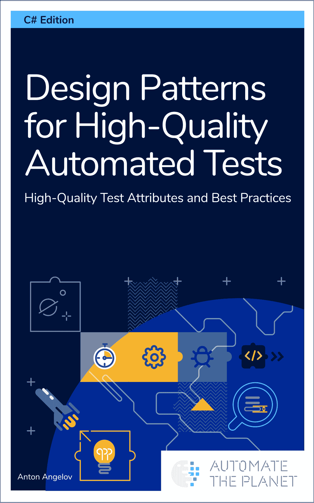

作者：Anton Angelov  
出版方：Automate The Planet  
首次发布：2020 年

地址：[`www.automatetheplanet.com/`](https://www.automatetheplanet.com/)

书籍设计和格式：Martin Kolev

## 目录

- 致谢
- 关于作者
- 关于审稿人
- 鸣谢
- 前言
- 序言
- 本书内容
- 第 1 章：定义高质量测试属性
- 第 2 章：优化和重构旧的不稳定测试
- 第 3 章：加速测试的策略
- 第 4 章：测试可读性
- 第 5 章：增强测试的可维护性和重用性
- 第 6 章：API 可用性
- 第 7 章：在测试库中构建扩展性
- 第 8 章：测试架构设计的评估系统
- 第 9 章：用于评估自动化测试组件性能的基准测试
- 第 10 章：测试数据准备与测试环境配置
- 附录 1：定义测试自动化框架解决的主要问题
- 附录 2：最详尽 CSS 选择器速查表
- 附录 3：最详尽 XPath 选择器速查表
- 本书适合谁看
- 在开始之前
- 规范
- 读者反馈
- 错误列表
- 盗版说明
- 问题

## 关于作者

Anton Angelov 是 Automate The Planet 的 CTO 和联合创始人，`BELLATRIX` 测试框架的发明者。他在自动化测试领域拥有 10 年经验，设计并编写可扩展的解决方案和工具，因在许多演讲中分享相关知识而闻名。

## 关于审稿人

Ventsislav Ivanov 是 Innovative Lab 和 Automate The Planet 的软件工程师。他的自动化生涯始于爱好。在过去的 6 年 IT 行业中，他担任过 QA 工程师、开发者和讲师，在各个领域授课了超过 1000 小时，包括 C# 基础知识、OOP、C# Web、高质量代码以及质量保证。他是保加利亚顶级学院之一质量保证课程的荣誉创建者和领导，主要专注于自动化测试的 QA 工程师。

Nikolay Avramov 目前是 Innovative Lab 和 Automate The Planet 的开发者。在过去的 8 年里，他在 Telerik（后被 Progress 收购）担任 QA 工程师。他从零开始在 Telerik 学院工作，成为任何创新或自动化计划的核心 QA 工程师。

通过他的工作，他开发并集成了跨公司的多个自定义框架和工具，例如负载和性能测试框架、系统测试框架、Web 测试框架、视觉验证框架以及许多生产力工具。他是一个热情的技术极客和自动化专家，致力于实现优化并在生活的任何方面实现高质量。

## 鸣谢

本书的内容是许多伟大工程师和 IT 专业人士知识的结晶。许多优秀的程序员非常自我中心，认为自己总是正确且无所不知。他们经常忘记自己是如何获得知识的。这不仅是我们努力的结果，也是个人努力、运气、生活和环境的混合。

我相信在我生活的这个阶段，我拥有足够的“技巧和诀窍”来写一本书。然而，如果没有参与过我生活的某些人的帮助，这是不可能的。

感谢我的父母、高中和大学老师的榜样与努力工作。感谢我过去的许多导师和同事。我是一个天生的学习者，经常读新书和看视频。

在过去的几年里，我一直在我的网站 Automate The Planet 上写文章。本书汇总了我尝试分享的大部分知识。但如果没有读者的支持，网站不会有今天的成果。因此我想向所有粉丝和读者说：“谢谢你们！”

最重要的是，我想感谢我的同事 Nikolay Avramov 和 Ventsislav Ivanov，他们协助我完成了技术和编辑任务。没有他们的帮助，书籍的质量将会不同。

## 前言

由于我通常会跳过其他书的前言，因此会尽量简短。我的核心信念是实现能够带来价值的高质量自动化测试——你需要理解如 SOLID 之类的核心概念以及设计模式的使用。

在掌握这些内容之后，通常的过渡是更深入地理解架构。这是本书的精髓。不再有“你好，世界”示例。本书的开头和结尾显示了初级 QA 爱好者和自动化忍者之间的区别。

这些知识将使你能够对自动化测试中的常见问题做出明智的决策，并让你在经理或开发者面前为这些决策提供正确的论据。

## 序言

本书将为你提供构建测试自动化框架所需的构建模块，并引导你通过几小时的阅读，完成构建完整测试自动化框架的自然过程。

本书的开头和结尾显示了初级 QA 爱好者和自动化忍者之间的区别。这些知识将使你能够对自动化测试的常见问题做出明智的决策，并让你在任何经理或开发者面前为这些决策提供正确的论据。

书中包含了大量的设计模式和最佳实践。如果你是一个想要改进公司测试框架的自动化工程师，这本书是必读的。如果你是自动化初学者，这是一个极好的开始。

# 第 1 章：定义高质量测试属性

## 不同类型的测试

- 单元测试
- 集成测试
- 系统测试

## 什么是测试自动化框架？

- 什么是软件库？
- 什么是框架？
- 测试自动化框架
- `Selenium` 是测试框架吗？

## SOLID 原则

- `SRP` – 单职责原则
- `OCP` – 开闭原则
- `LSP` – 里氏替换原则
- `ISP` – 接口隔离原则
- `DIP` – 依赖倒置原则

## 高质量测试属性

- 什么是设计模式？
- 测试的可维护性和重用性
- 测试可读性
- API 可用性
- 扩展性
- 学习曲线
- 总结
- 问题
- 扩展阅读

# 第 2 章：优化和重构旧的不稳定测试

## 编写第一个真实的自动化测试

- 第一个自动化测试用例说明
- 第二个自动化测试用例说明
- 第三个自动化测试用例说明
- 第一段自动化测试代码
- 第二段自动化测试代码
- 第三段自动化测试代码

## 失败原因

## 重构测试

- 隐式等待 VS 显式等待
- 在测试中实现`显式`等待
- `DRY` – 不要重复自己
- 用于修复不稳定操作的`装饰器`设计
- 装饰器模式
- 针对 `WebElement` 的装饰器模式实现
- 针对 `WebDriver` 的装饰器模式实现
- 测试中的装饰器模式——`测试独立性`与隔离原则
- 遵循`测试独立性`与隔离原则的测试重构
- 总结
- 问题
- 扩展阅读

# 第 3 章：加速测试的策略

## 分析测试代码以寻找优化点

- 优化登录
- 如何在测试中等待异步请求完成？
- 等待所有 `AJAX` 完成

## 优化浏览器初始化——`观察者`设计模式

- `观察者`模式
- `观察者`设计模式实现
- 通过`属性`配置浏览器行为
- 每个测试的隔离浏览器初始化
- `黑洞代理`方法
- 实现`黑洞代理`
- 总结
- 问题
- 扩展阅读

# 第 4 章：测试可读性

## 页面对象模型设计模式

- `页面对象模型`设计模式
- 创建第一个`页面对象模型`
- 创建`页面对象`的新方法
- `页面对象模型`在测试中的用法
- 处理常见的页面元素和操作
- 定义常见的页面元素
- 非 `DRY` 的`页面对象`
- 重用常见元素的第一个版本
- 创建常见页面区域的`页面对象`
- `页面区域`在`页面对象`中的用法——版本一
- `页面区域`在`页面对象`中的用法——版本二
- `页面区域`在测试中的用法

## 高质量代码：使用有意义的名字

- 通用命名指南
- `类`命名
- 为现有 `API` 的新版本命名
- `方法`命名——正确的方法
- 使用有意义的`方法名`
- `方法参数`的最佳实践

## 遵循编码标准：工具

- 使用`EditorConfig`强制执行编码标准
- 总结
- 问题
- 扩展阅读

# 第 5 章：增强测试的可维护性和重用性

## 可导航的页面对象——`模板方法`设计模式

- 未重构的`页面对象`版本
- 为可导航和不可导航`页面`创建单独的`基类`
- `模板方法`设计模式
- `模板方法`设计模式实现
- 使用`组合`原则
- 不使用`组合`的未重构`页面对象`版本
- 元素和断言——实现
- 在测试中使用组合

## 重用测试工作流——`外观`设计模式

- `测试工作流`的简单实现
- `外观`设计模式
- `外观`设计模式实现
- 将`外观`与`模板方法`设计模式结合
- 使用`模板方法`购买`外观`
- 具体的`外观`实现
- 总结
- 问题
- 扩展阅读

# 第 6 章：API 可用性

## `WebDriver`的接口隔离原则

- `WebDriver`装饰器
- `WebDriver`装饰器当前实现
- 将`驱动接口`拆分为更小的接口
- `页面对象`中更小接口的用法
- 通过`单例`设计模式使用`页面对象`
- `单例`设计模式
- `单例`设计模式实现
- 线程安全的`单例`实现
- 测试中的`单例`用法
- 创建`页面对象`的`应用`设计模式
- `应用`设计模式实现
- 测试中的`应用`用法
- `链式` API `页面对象`
- `链式` API 实现
- 测试中使用`链式` API
- `页面对象`元素访问样式
- 通过属性暴露元素

# 第 7 章：在测试库中构建扩展性

## 通过`策略`设计模式构建元素的扩展性

- 原生`WebDriver`元素查找
- `策略`设计模式
- 元素查找当前版本
- `策略`
- 重构`IElementFindService`
- 元素查找策略`API`

## 通过`策略`设计模式构建等待元素的扩展性

- 原生`WebDriver`等待元素
- 元素等待当前版本
- 元素等待策略
- 创建`IElementWaitService`
- 为`ElementFinderService`等待元素
- `事件驱动 WebDriver`等待
- 通过`事件驱动 WebDriver`添加扩展性
- `事件驱动 WebDriver`示例

# 第 8 章：测试架构设计的评估系统

## 评估系统简介

- 我们试图解决什么问题？
- 属性定义
- 可读性
- 可维护性
- 可用性
- API 可用性
- 扩展性
- 代码复杂度索引
- 学习曲线
- `KISS`
- 应用步骤
- 评估系统示例

## 无`页面对象`测试

- 架构设计概述
- 可读性
- 可维护性
- 可用性
- API 可用性
- 扩展性
- 代码复杂度索引
- 学习曲线

## 有`页面对象`测试

- 架构设计概述
- 可读性
- 可维护性
- 可用性
- API 可用性
- 扩展性
- 代码复杂度索引
- 学习曲线

## 有`外观`测试

- 架构设计概述
- 可读性
- 可维护性
- 可用性
- API 可用性
- 扩展性
- 代码复杂度索引
- 学习曲线

## 最终评估

- 总结
- 问题
- 扩展阅读

### 问题

1. 你能列出评估系统的七个标准吗？
2. 代码哪些方面的可用性？
3. 为什么学习曲线是一个关键点？
4. 测试设计索引是什么？
5. 如何在`Visual Studio IDE`中计算代码指标？
6. 在项目中应用评估系统需要遵循哪些步骤？

# 第 9 章：用于评估自动化测试组件性能的基准测试

## 什么是基准测试？

- 使用`BenchmarkDotNet`对`.NET`代码进行基准测试
- 主要功能
- `BenchmarkDotNet`示例
- 按钮点击解决方案
- 按钮基准实验
- 基准报告、分析和反汇编诊断器
- 基准`HTML`和`CSV`报告
- 基准反汇编器
- 基准分析
- 优化浏览器初始化基准集成
- `观察者类`中的更新
- 总结
- 问题
- 扩展阅读

# 第 10 章：测试数据准备与测试环境配置

- 停止硬编码输入数据
- 问题测试数据
- 配置转换
- 创建`URL 设置`
- 创建 `WebDriver`超时
- 创建`默认信息`
- 环境变量
- 引入测试`Fixture`
- 使用`AutoFixture`生成数据
- 使用`MSTest`驱动的测试
- 使用`API`作为 `Fixture` 数据源

# 附录 1：定义测试自动化框架解决的主要问题

- 问题 1：重复导致人员无聊，可靠性降低
- 问题 2：工程师非常擅长数字和准确性
- 问题 3：从反馈到发布的时间
- 问题 4：回归问题
- 问题 5：跳过部分范围
- 问题 6：乒乓球
- 问题 7：维护测试产物的金钱、时间和精力
- 问题 8：各种应用配置
- 问题 9：QA 团队士气低
- 问题 10：专业性受疑
- 问题 11：提供你所工作的证据
- 问题 12：假期和生病，24 小时
- 问题 13：有些东西无法手动测试
- 问题 14：一致性
- 问题 15：快速扩展和缩小

# 附录 2：最详尽 CSS 选择器速查表

- 元素选择器
- 上下选择器
- 属性选择器
- 有用值
- 伪类选择器（适用于兄弟元素）
- 伪类选择器（用于链接和用户状态）
- 伪类选择器

编写可维护且稳定的 Web 自动化的大部分工作。

# 附录 3：最详尽 XPath 选择器速查表

- 上下选择器
- 属性选择器
- 轴（Axis）方法
- 数学方法
- 字符串方法

## 本书适合谁看？

## 在开始之前

- 规范
- 读者反馈
- 错误列表
- 盗版说明
- 问题

## 版权信息

版权所有 © 2020 Automate The Planet。  
参考：Automate The Planet 发布。


# 高质量代码 - 使用有意义的名字

- 命名指南
- `类`命名
- 为现有 `API` 的新版本命名
- `方法`命名 - 正确的方法
- 通用命名指南
- 使用有意义的`方法名`
- `方法参数`的最佳实践

# 遵循编码标准 - 工具

- 使用`EditorConfig`强制执行编码标准
- 总结
- 问题
- 扩展阅读

# 第 5 章. 增强测试的可维护性和重用性

## 可导航的页面对象 - `模板方法`设计模式

- 未重构的`页面对象`版本
- 为可导航和不可导航`页面`创建单独的`基类`
- `模板方法`设计模式
- `模板方法`设计模式实现
- 使用`组合`原则
- 不使用`组合`的未重构`页面对象`版本
- 元素和断言 - 实现
- 在测试中使用组合
- 重用`测试工作流` - `外观`设计模式
- `测试工作流`的简单实现
- `外观`设计模式
- `外观`设计模式实现
- 将`外观`与`模板方法`设计模式结合
- 使用`模板方法`购买`外观`
- 具体的`外观`实现
- 总结
- 问题
- 扩展阅读

# 第 6 章. API 可用性

## `WebDriver`的接口隔离原则

- `WebDriver`装饰器
- `WebDriver`装饰器当前实现
- 将`驱动接口`拆分为更小的接口
- `页面对象`中更小接口的用法
- 通过`单例`设计模式使用`页面对象`
- `单例`设计模式
- `单例`设计模式实现
- 线程安全的`单例`实现
- 测试中的`单例`用法
- 创建`页面对象`的`应用`设计模式
- `应用`设计模式实现
- 测试中的`应用`用法
- `链式`API `页面对象`
- `链式`API 实现
- 测试中使用`链式`API
- `页面对象`元素访问样式
- 通过属性暴露元素

# 第 7 章. 在你的测试库中构建扩展性

## 通过`策略`设计模式构建元素的扩展性

- 原生`WebDriver`元素查找
- `策略`设计模式
- 元素查找当前版本
- `策略`
- 重构`IElementFindService`
- 元素查找策略`API`

## 通过`策略`设计模式构建等待元素的扩展性

- 原生`WebDriver`等待元素
- 元素等待当前版本
- 元素等待策略
- 创建`IElementWaitService`
- 为`ElementFinderService`等待元素
- `事件驱动 WebDriver`等待
- 通过`事件驱动 WebDriver`添加扩展性
- `事件驱动 WebDriver`示例

# 第 8 章. 测试架构设计的评估系统

## 评估系统简介

- 我们试图解决什么问题？
- 属性定义
  1. 可读性
  2. 可维护性
  3. 可用性
  4. API 可用性
  5. 扩展性
  6. 代码复杂度索引
  7. 学习曲线
  8. `KISS`
- 应用步骤
- 评估系统示例

### 无`页面对象`测试

- 架构设计概述
  1. 可读性
  2. 可维护性
  3. 可用性
  4. API 可用性
  5. 扩展性
  6. 代码复杂度索引
  7. 学习曲线

### 有`页面对象`测试

- 架构设计概述
  1. 可读性
  2. 可维护性
  3. 可用性
  4. API 可用性
  5. 扩展性
  6. 代码复杂度索引
  7. 学习曲线

### 有`外观`测试

- 架构设计概述
  1. 可读性
  2. 可维护性
  3. 可用性
  4. API 可用性
  5. 扩展性
  6. 代码复杂度索引
  7. 学习曲线

- 最终评估
- 总结
- 问题
  1. 你能列出评估系统的七个标准吗？
  2. 代码代码哪些方面的可用性？
  3. 为什么学习曲线是一个关键点？
  4. 测试设计索引是什么？
  5. 如何在`Visual Studio IDE`中计算代码指标？
  6. 在项目中应用评估系统需要遵循哪些步骤？
- 扩展阅读

# 第 9 章. 用于评估自动化测试组件性能的基准测试

- 什么是基准测试？
- 使用`BenchmarkDotNet`对`.NET`代码进行基准测试
- 主要功能
- `BenchmarkDotNet`示例
- 按钮点击解决方案
- 按钮基准实验
- 基准报告、分析、反汇编诊断器
- 基准`HTML`和`CSV`报告
- 基准反汇编器
- 基准分析
- 优化浏览器初始化基准集成
- `观察者类`中的更新
- 总结
- 问题
- 扩展阅读

# 第 10 章. 测试数据准备与测试环境

- 停止硬编码输入数据
- 问题测试数据
- 配置转换
- 创建`URL 设置`
- 创建`WebDriver`超时
- 创建`默认信息`
- 环境变量
- 引入测试`Fixture`
- 使用`AutoFixture`生成数据
- 使用`MSTest`驱动的测试
- 使用`API`作为 Fixture 数据源

# 附录 1. 定义测试自动化框架解决的主要问题

# 附录 2. 最详尽 CSS 选择器速查表

编写可维护且稳定的 Web 自动化的大部分工作。

# 附录 3. 最详尽 XPath 选择器速查表

# 本书适合谁看？

# 在开始之前

- 规范
- 读者反馈
- 错误列表
- 盗版
- 问题

# 致谢

版权所有 @2020 Automate The Planet 版留所有。

# 测试的不同类型

# 什么是测试自动化框架？定义

## SOLID 原则

# 高质量测试的属性

# 测试的不同类型

简而言之，我将定义不同类型的测试。这将帮助我们理解`WebDriver`自动化测试在开发周期中处于什么位置。

## 单元测试 (Unit Tests)

根据定义，这些是最小的测试单元。这种类型的测试用于测试单个对象，甚至是对象的单个方法。单元测试是非常必要的，因为它可以防止错误从最底层引入。这些测试很少使用任何真实的测试数据，通常完全依赖于生成的数据。

## 集成测试 (Integration Tests)

它们由几个组合在一起的代码模块组成，允许它们之间相互传递数据。这类测试的目的是确保所有模块都能集成并相互工作。它们也被称为组件集成测试或小规模集成测试（integration tests in the small）。通常，在这种测试中，我们仍然会隔离网络、文件系统和操作系统等第三方服务。另一个相关的术语是大规模集成测试（integration test in the large），工程师通常用它来指代不隔离第三方依赖的集成测试。

## 系统测试 (System Tests)

系统测试是对完整且完全集成的软件产品进行的测试。它是最高级别的测试。它在生产环境（PROD）或类生产环境（如预发布环境 STA）中执行。与集成测试一样，系统测试也尝试验证所有组件（包括第三方服务）都能良好地通信。

这些测试可以验证我们软件的功能或非功能性需求。一些工程师将这些测试称为端到端测试（End-to-end tests）、UI 测试或用户场景测试（User Scenario tests）。然而，我认为这些术语之间存在细微的差别。

我们的`WebDriver`自动化测试属于系统测试分类。如果所有的操作和断言都是针对用户界面（UI）的，它们应该被称为 UI 测试。端到端（用户场景）测试是指验证真实用户场景的测试，从用户与被测试系统的交互开始到结束。不使用任何捷径或模拟（mocks）——测试完全模拟了人工交互。在系统测试的情况下，我们指的是高度优化的测试，重点关注验证系统的特定功能。例如——我们不需要每次都通过 UI 登录或注册新用户，而是直接使用内部 API 或数据库来完成。所执行的断言也是同样的。如果你使用了这些低级方法，那么将这类测试称为 UI 测试是不恰当的。

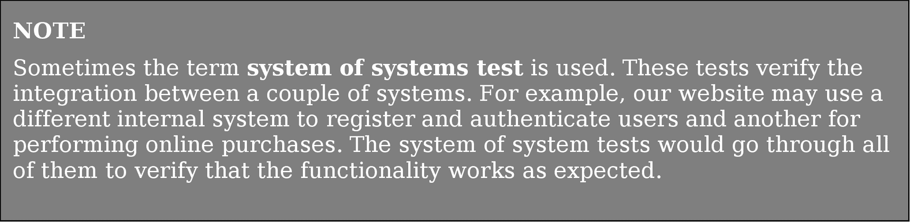

## 什么是测试自动化框架？

在会议的许多对话中，我意识到许多开发者对什么是测试自动化框架有错误的概念。在这里，我将尝试给出一个定义，但在那之前，我们需要过一些相关术语，例如什么是软件库、框架、API、测试框架等等。你需要理解后者，才能明白什么是测试自动化框架。

## 什么是软件库？(Software Library)？

在我们定义什么是软件库之前，我们需要先回顾一下什么是应用程序。

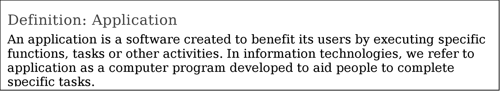

在有了这个定义后，我们可以得出的第一个结论是，我们的自动化测试也是应用程序。多年来，互联网和会议上有很多争讨论，关于测试工程师是否应该能够编程，而不是使用 UI 工具进行自动化测试。我坚信，新时代的测试自动化 QA 应该是一个出色的程序员，将他/她的代码视为生产环境代码——遵循高质量的代码标准。

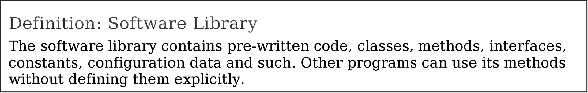

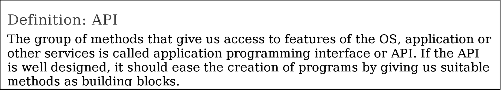

许多工程师认为在他们的公司里已经构建了自定义的测试框架。但事实上，他们拥有库或方法和类的组，这些可以帮助他们编写自动化测试。库的`API`定义了用户如何访问其方法、他们需要传递什么参数等。这是关于库如何被访问和使用的约定，而实际实现由库本身处理。`API`是关于我们可以使用什么的规范，而软件库是该规范的实际实现。它应该遵循规定的规则。我们可以拥有同一个`API`的多个实现。例如，`Java`和`Scala`实现了`Java API`。它们随后都被编译为字节码，这使得 Java 开发者可以使用相同的方法。`.NET`世界也是如此的，`C#`和`VB.NET`是不同的语言，但它们都实现了`.NET API`并编译为 MSIL。作为`.NET`开发者，我们在两种编程语言中拥有相同的方法和类型。

## 什么是框架？(Framework)？

软件框架具有以下以下区别于库的鲜明特征：

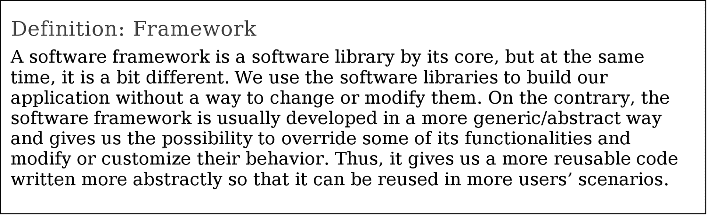

- **控制反转 (Inversion of control)** - 框架控制流程，并且它不能像标准软件库那样被修改。
- **默认行为 (Default behavior)** - 软件框架提供了有用的默认操作。
- **扩展性 (Extensibility)** - 作为用户，你可以自定义并修改它的某些操作以适应你的需求，这在软件库中通常是无法实现的。
- **不可修改的框架代码 (Non-modifiable framework code)** - 你可以自定义或调整框架的一些操作，但你不能更改它的代码。

示例包括用于 Windows 开发的`ASP.NET`和`.NET`，Mac OS X 的`Cocoa`，iOS 的`Cocoa Touch`以及 Android 的`Android Application Framework`。

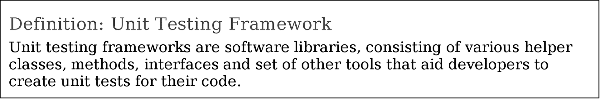

正如定义所示，单元测试框架帮助我们更快地编写测试来验证方法和类的功能。此外，我们可以以自动的方式执行这些测试，这样我们就不需要反复手动地执行它们。它们通常很好地集成到大多数流行的编程 IDE 中。我们可以从那里运行测试并快速查看结果。单元测试框架的示例有`NUnit`、`MSTest`、`JUnit`、`TestNG`。

## 测试自动化框架

现在，让我们理解什么是测试自动化框架。

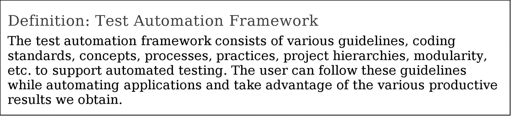

## Selenium WebDriver 是测试框架吗？

许多 QA 将`Selenium WebDriver`称为测试自动化框架，但他们完全错了。这里是他们官方网站上的定义：

“Selenium 自动化了浏览器。仅此而已！你用它做什么完全取决于你。”主要，它是为了测试目的而使 Web 自动化，但显然不仅限于此。基于 Web 的任务也可以（并且应该！）被自动化。

根据定义，我们可以得出结论：`Selenium WebDriver`主要作为 Web 自动化的标准，但实际上它是控制浏览器的工具，我们随后在库和框架中使用它来编写自动化测试。

## SOLID 原则

在我们定义高质量的测试属性之前，我们应该提到一些已知的面向对象原则。在整书中，我将提到其中一些。`SOLID`是五个设计原则的缩写：

- `SRP` – 单一责任原则 (Single Responsibility Principle)
- `OCP` – 开源闭原则 (Open/Closed Principle)
- `LSP` – 里氏替换原则 (Liskov Substitution Principle)
- `ISP` – 接口隔离原则 (Interface Segregation Principle)
- `DIP` – 依赖倒转原则 (Dependency Inversion Principle)

### SRP – 单一责任原则

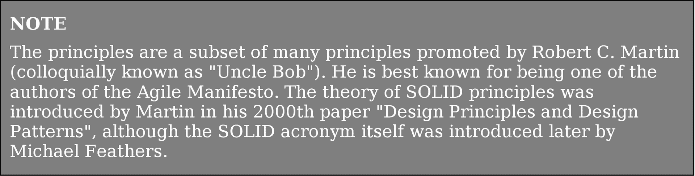

原则规定——“软件模块应该只有一个改变的原因”，这意味着每个类、每个方法可以做很多事情，但它们应该服务于单一目的。我们可以让这些项目分开，就会变得简单、易于维护，并且一个改变不会影响其他。例如：

```csharp
public class CustomerOrder{
    public void Create(){
        try{
            // Database code
        } catch (Exception ex){
            File.WriteAllText(@"C:\exception.txt", ex.ToString());
        }
    }
}
```

`CustomerOrder`类正在做的事情。它应该创建订单并保存到数据库，但如果你仔细看 catch 块，你会发现它还在记录日志。它承担了太多责任。如果我们想遵循单一责任原则`SRP`，我们应该将类分开。我们可以将日志记录移动到一个独立的类。

```csharp
public class FileLogger{
    public void CreateLogEntry(string error){
        File.WriteAllText(@"C:\error.txt", error);
    }
}
```

之后`CustomerOrder`类可以将日志记录委托给`FileLogger`类，并更多地关注创建订单。

```csharp
public class CustomerOrder{
    private FileLogger _logger = new FileLogger();
    public void Create(){
        try{
            // Database code
        } catch (Exception ex){
            _logger.CreateLogEntry(ex.Message);
        }
    }
}
```

### OCP – 开源闭原则

原则规定“软件实体（类、模块、函数等）应该对扩展开放，对修改关闭”。这意味着如果为已实现的功能编写新需求，可以以一种不需要更改现有代码结构的方式添加它们。如果我们直接修改它并添加，可能会引发新的回归问题。看这个例子：

```java
public enum OrderType{Normal,Silver,}
public class DiscountCalculator{
    public double CalculateDiscount(OrderType orderType, double totalPrice){
        if (orderType == OrderType.Silver){
            return totalPrice - 20;
        }else{
            return totalPrice;
        }
    }
}
```

看`CalculateDiscount`方法中的`IF`条件。问题在于如果我们添加新的订单类型，将增加一个`IF`条件，这意味着我们将由于外部的改变而更改`DiscountCalculator`类的实现。如果我们需要每周更改该类，我们需要确保之前的需求仍然得到满足，并且新需求与旧需求良好集成。与其为每个新条件修改现有代码，我们努力开发一个可以扩展的解决方案。我们可以轻松地重构这段代码以遵循开源闭原则`OCP`，这样每当添加新的订单类型时，我们创建一个新类。现有代码保持不变，我们只需要测试和检查新情况。

```csharp
public class DiscountCalculator{
    public virtual double CalculateDiscount(double totalPrice){
        return totalPrice;
    }
}
public class SilverDiscountCalculator : DiscountCalculator{
    public override double CalculateDiscount(double totalPrice){
        return base.CalculateDiscount(totalPrice) - 20;
    }
}
public class GoldDiscountCalculator : DiscountCalculator{
    public override double CalculateDiscount(double totalPrice){
        return base.CalculateDiscount(totalPrice) - 50;
    }
}
```

### LSP – 里氏替换原则

原则规定“你可以使用任何派生类代替父类并保持相同的行为”。这意味着子类不应修改或更改基类的行为。要点是子类可以像父类本身一样使用，但如果你在子类中更改行为，就会出现意外问题。继续同样的`DiscountCalculator`例子吗？我们想为奖励积分引入一种新的折扣类型。为了计算它，我们将在基类中添加一个新方法。


```csharp
public abstract class DiscountCalculator{
    public virtual double CalculateRegularDiscount(double totalPrice){
        return totalPrice;
    }
    public virtual double CalculateBonusPointsDiscount(double totalPrice, int points){
        return totalPrice - points * 0.1;
    }
}
```

你可以看到，我们将 `CalculateDiscount` 方法重命名为 `CalculateRegularDiscount`，并添加了一个根据奖励积分计算折扣总价的方法。

```csharp
public class SilverDiscountCalculator : DiscountCalculator{
    public override double CalculateRegularDiscount(double totalPrice){
        return base.CalculateRegularDiscount(totalPrice) - 20;
    }
    public override double CalculateBonusPointsDiscount(double totalPrice, int points){
        return totalPrice - points * 0.5;
    }
}
public class GoldDiscountCalculator : DiscountCalculator{
    public override double CalculateRegularDiscount(double totalPrice){
        return base.CalculateRegularDiscount(totalPrice) - 50;
    }
    public override double CalculateBonusPointsDiscount(double totalPrice, int points){
        return totalPrice - points * 1;
    }
}
public class PlatinumDiscountCalculator : DiscountCalculator{
    public override double CalculateRegularDiscount(double totalPrice){
        return base.CalculateRegularDiscount(totalPrice) - 100;
    }
    public override double CalculateBonusPointsDiscount(double totalPrice, int points){
        throw new InvalidOperationException("Not applicable for Platinum.");
    }
}
```

在这里做的是添加了一个新的订单类型——`Platinum`。我们已经应用了最大允许折扣，所以奖励积分对于 `Platinum` 订单是不可能的。在这种情况下，我们决定抛出 `InvalidOperationException`，让调用方法知道此操作不支持。

根据面向对象原则，可以使用任何派自 `DiscountCalculator` 的子类，就像是基类一样。我创建了一个 `DiscountCalculator` 集合，添加 `Silver`、`Gold` 以及相同类型。之后我可以通过列表使用父对象并调用方法。

而不是使用基类，我们使用 `IBonusPointsCalculator` 接口。这意味着添加的对象都要实现此方法，否则我们将无法添加它。

```csharp
public interface IRegularCalculator{
    double CalculateRegularDiscount(double totalPrice);
}
public interface IBonusPointsCalculator{
    double CalculateBonusPointsDiscount(double totalPrice, int points);
}
```

```csharp
var _discountators = new List<IBonusPointsCalculator>();
_discountators.Add(new SilverDiscountCalculator());
_discountators.Add(new GoldDiscountCalculator());
// _discountators.Add(new PlatinumDiscountCalculator()); // 无法添加
foreach (IBonusPointsCalculator discountCalculator in _discountators){
    double bonusPointsDiscount = ...
}
```

### ISP – 接口隔离原则

原则规定：“客户端不应强制实现它们不使用的接口。”与其使用一个臃肿的接口，更倾向于基于方法组的许多小接口。

单一责任原则不仅可以适用于类，也可以适用于接口。每个接口应该提供单一目的。如果一个接口提供了多个目标，可能会导致我们的实现代码包含了类不需要的方法。

为什么不看一个例子呢？我们可以使用之前的折扣器示例。为了简化代码，我们可以轻松地移除继承。

```csharp
public interface IDiscountCalculator{
    double CalculateRegularDiscount(double totalPrice);
    double CalculateBonusPointsDiscount(double totalPrice, int points);
}
public class GoldDiscountCalculator : IDiscountCalculator{
    public double CalculateRegularDiscount(double totalPrice){
        return totalPrice - 50;
    }
    public double CalculateBonusPointsDiscount(double totalPrice, int points){
        throw new NotImplementedException("Not applicable for Gold.");
    }
}
```

正如你看到的，由于有一个臃肿的接口，我们被强制实现所有方法——即使我们可能不需要。

在未来可能会变得更糟。假设我们需要添加另一种折扣类型，但这次对于 `Silver` 订单是不可能的。这意味着在 `SilverDiscountCalculator` 中我们将有一个抛出 `NotImplementedException` 的方法。

更好的解决方案是创建一个接口，而不是更新当前的接口。

### DIP – 依赖倒转原则

原则规定：“高层类不应该依赖低层类。两者都应该依赖于抽象。这些抽象不应该依赖于底层细节。”

高层类通常包含业务逻辑，低层类由如 CRUD 操作、读取文件或调用 Web API 等操作组成。

当我们说一个类是耦合的，意味着它可以访问底层细节（它不应该拥有），而不是使用抽象。

扩展一下我们的 `CustomerOrder` 例子？需求已经改变，我们有不同类型的订单要处理——`Silver`、`Gold` 和 `Platinum`。还有新需求规定在发生事情时需要添加两种通知方式，例如发送电子邮件和短信更新。

为了这样做，我们将为所有的日志器创建一个通用的接口 `ILogger`。

```csharp
public interface ILogger{
    void CreateLogEntry(string errorMessage);
}
```

之后我们将创建三个独立的日志器——一个用于文件日志，一个用于电子邮件，还有一个用于短信。

```csharp
public class FileLogger : ILogger{
    public void CreateLogEntry(string errorMessage){
        File.WriteAllText(@"C:\exceptions.txt", errorMessage);
    }
}
public class EmailLogger : ILogger{
    public void CreateLogEntry(string errorMessage){
        // Send email logic
    }
}
public class SmsLogger : ILogger{
    public void CreateLogEntry(string errorMessage){
        // Send SMS logic
    }
}
```

新需求后的业务逻辑是，我们需要为 `Gold` 订单发送电子邮件，为 `Platinum` 订单发送短信，因为它们为公司带来了钱。

```csharp
public class CustomerOrder{
    public void Create(OrderType orderType){
        try{
            // Database code
        } catch (Exception ex){
            switch (orderType){
                case OrderType.Platinum:
                    new SmsLogger().CreateLogEntry(ex.Message);
                    break;
                case OrderType.Gold:
                    new EmailLogger().CreateLogEntry(ex.Message);
                    break;
                default:
                    new FileLogger().CreateLogEntry(ex.Message);
                    break;
            }
        }
    }
}
```

代码再次违反了单一责任原则。它本应该专注于创建订单，但也决定了创建哪个对象。

这里最大的问题与 `new` 关键字有关。这是一个关于决定要创建哪些对象的额外责任，所以如果我们将此职责委托给 `CustomerOrder` 类以外的其他人，就会解决问题。

我们可以有不同的订单子类。此外，日志可以作为依赖传递，而不是在方法内部创建它。

```csharp
public class CustomerOrder{
    private ILogger _logger;
    public CustomerOrder(ILogger logger){
        _logger = logger;
    }
    public void Create(){
        try{
            // Database code
        } catch (Exception ex){
            _logger.CreateLogEntry(ex.Message);
        }
    }
}
```

# 编写第一个真实的自动化测试

## 失败原因

## 重构测试

## 使用装饰器模式修复 WebDriver 不稳定的操作

## 测试独立性与隔离原则

## 第一个自动化测试用例说明

如前所述，我们将从检查需要自动化的需求开始。想象一下你自己在一家名为“EU Space Rockets”的初创公司工作。

我们的公司通过允许人们通过我们的网站购买火箭来让世界变得更好。这难道不酷吗！你的工作是创建一系列自动化测试，并确保一切都按照预期运行。

我们的网站使用了现代 Web 技术，所有操作都是异步加载的，而不是重新加载整个页面。

让我们逐步看看如何创建你的第一个自动化测试用例：

1. 我们导航到公司网站的首页，然后点击“加入购物车”按钮，将一枚“猎鹰 9 号”火箭加入购物车。

   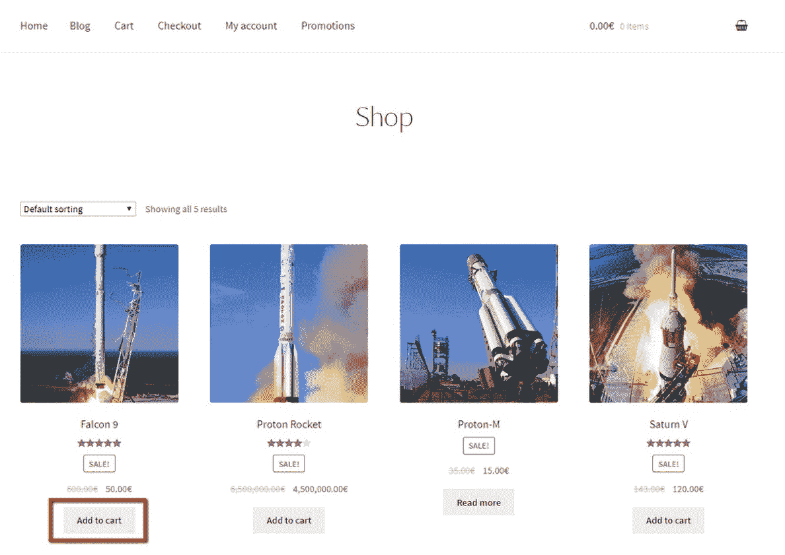

2. 接下来，我们需要点击“查看购物车”按钮，这将引导进入购物车页面。

   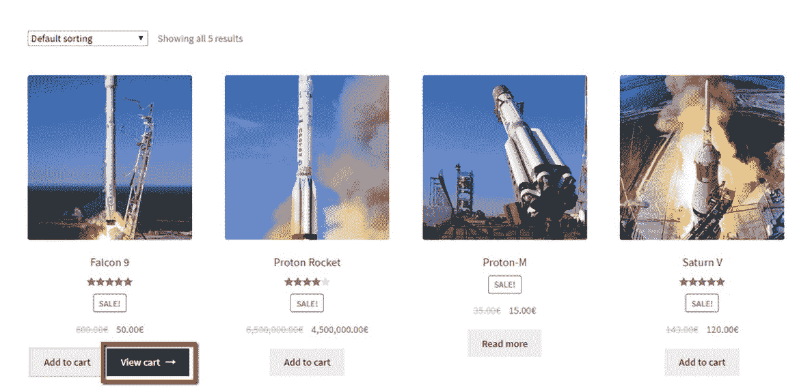

3. 如果是我们的生日，我们可以使用公司给我们的特殊优惠券。

   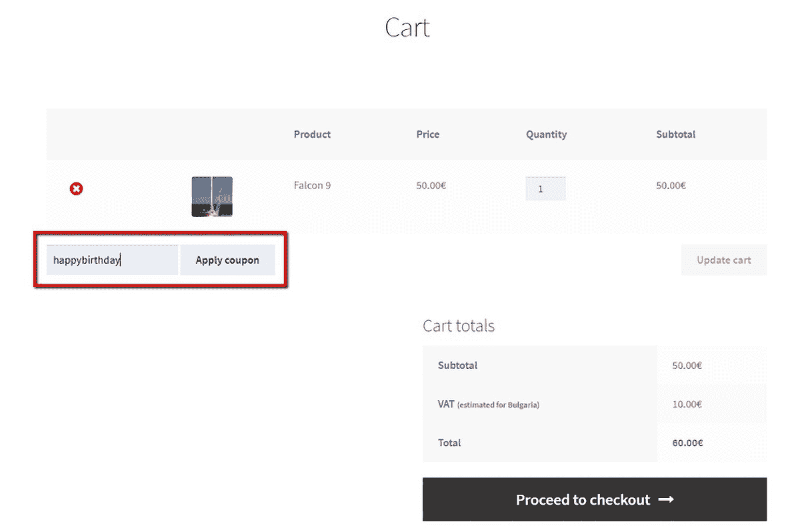

4. 在进行任何操作之前，我们需要确保加载指示器没有显示。

   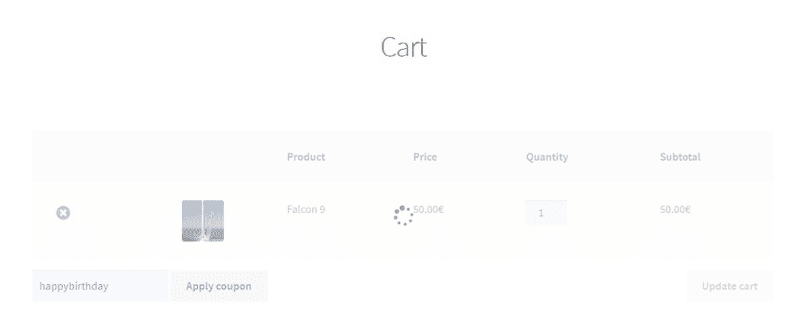

5. 接下来，由于我们获得了折扣，我们有额外的资金购买更多火箭。因此，我们将数量增加到 2 并点击“更新购物车”按钮。

   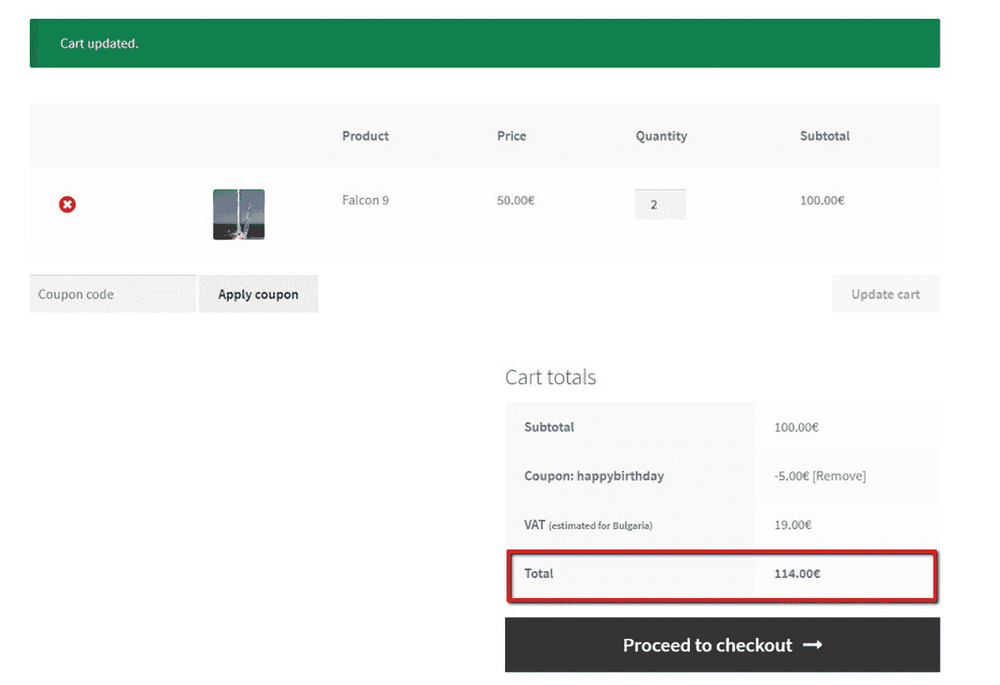

6. 购物车更新后，我们的测试需要检查总价是否已更改。如果一切正常，我们就点击“去结算”按钮。

7. 我们填写所有必需信息并点击“提交订单”按钮。当加载下一个页面时，我们需要验证订单是否成功提交。

   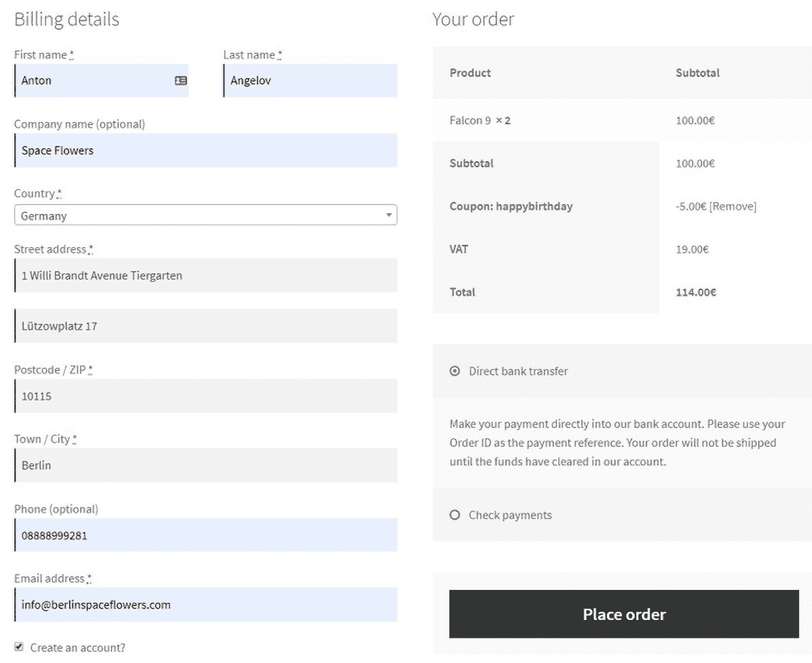

## 第二个自动化测试用例说明

在执行第一个自动化测试后，系统会为我们创建一个账户。如果我们想用同一个电子邮件地址进行后续购买，我们应该先登录网站。

一旦通过身份验证，我们所有的数据都应该是预填充的。因此，当我们处于账单页面（第 7 步）而不是填写信息时，我们点击“点击此处登录”链接。然后会显示登录表。

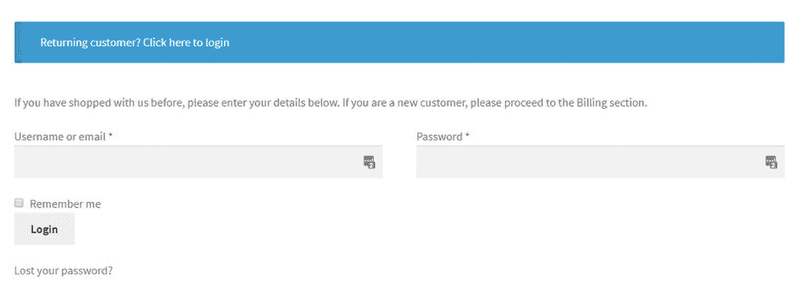

成功验证后，我们像在第一个测试用例中一样完成购买。

## 第三个自动化测试用例说明

我们的第三个也是最后一个自动化测试的任务，是检查最后创建的订单是否显示在网站的“我的账户”部分。具体如下：

1. 我们点击导航栏中的“我的账户”链接并登录。

   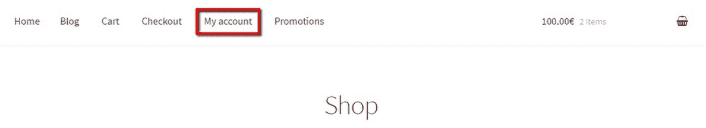

2. 接下来，我们打开“订单”标签页，使用我们在完成上一个订单时保存的订单号，点击该特定行的“查看”按钮。

   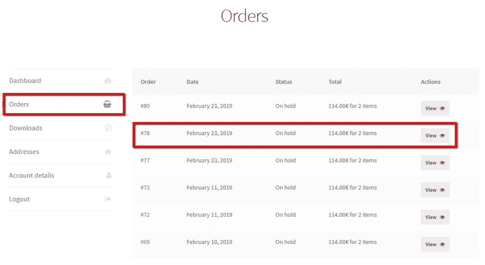

3. 当下一个页面打开时，我们验证显示的是正确的数据。

## 第一个自动化测试代码

现在何不来看看我们第一个自动化测试用例的代码呢？


```sharp
private static IWebDriver _driver;
private static string _purchaseEmail;
private static string _purchaseOrderNumber;
[ClassInitialize]
public static void ClassInitialize(TestContext testContext)
{
    _driver = new ChromeDriver(Environment.CurrentDirectory);
}
[ClassCleanup]
public static void ClassCleanup()
{
    _driver.Quit();
}
[TestMethod]
public void CompletePurchaseSuccessfully_WhenNewClient()
{
    _driver.Navigate().GoToUrl("http://demos.bellatrix.solutions/");
    var addToCartFalcon9 = _driver.FindElement(By.CssSelector("[data-product_id*='28']"));
    addToCartFalcon9.Click();
    Thread.Sleep(5000);
    var viewCartButton = _driver.FindElement(By.CssSelector("[class*='added_to_cart wc-forward']"));
    viewCartButton.Click();
    var couponCodeTextField = _driver.FindElement(By.Id("coupon_code"));
    couponCodeTextField.Clear();
    couponCodeTextField.SendKeys("happybirthday");
    var applyCouponButton = _driver.FindElement(By.CssSelector("[value*='Apply coupon']"));
    applyCouponButton.Click();
    Thread.Sleep(5000);
    var messageAlert = _driver.FindElement(By.CssSelector("[class*='woocommerce-message']"));
    Assert.AreEqual("Coupon code applied successfully.", messageAlert.Text);
    var quantityBox = _driver.FindElement(By.CssSelector("[class*='input-text qty text']"));
    quantityBox.Clear();
    Thread.Sleep(500);
    quantityBox.SendKeys("2");
    Thread.Sleep(5000);
    var updateCart = _driver.FindElement(By.CssSelector("[value*='Update cart']"));
    updateCart.Click();
    Thread.Sleep(5000);
    var totalSpan = _driver.FindElement(By.XPath("//*[@class='order-total']//span"));
    Assert.AreEqual("114.00€", totalSpan.Text);
    var proceedToCheckout = _driver.FindElement(By.CssSelector("[class*='checkout-button button alt wc-forward']"));
    proceedToCheckout.Click();
    var billingFirstName = _driver.FindElement(By.Id("billing_first_name"));
    billingFirstName.SendKeys("Anton");
    var billingLastName = _driver.FindElement(By.Id("billing_last_name"));
    billingLastName.SendKeys("Angelov");
    var billingCompany = _driver.FindElement(By.Id("billing_company"));
    billingCompany.SendKeys("Space Flowers");
    var billingCountryWrapper = _driver.FindElement(By.Id("select2-billing-country"));
    billingCountryWrapper.Click();
    var billingCountryFilter = _driver.FindElement(By.ClassName("select2-search"));
    billingCountryFilter.SendKeys("Germany");
    var germanyOption = _driver.FindElement(By.XPath("//contains(text(),'Germany')"));
    germanyOption.Click();
    var billingAddress1 = _driver.FindElement(By.Id("billing_address_1"));
    billingAddress1.SendKeys("Willi Avenuegarten");
    var billingAddress2 = _driver.FindElement(By.Id("billing_address_2"));
    billingAddress2.SendKeys("Lützplatz 17");
    var billingCity = _driver.FindElement(By.Id("billing_city"));
    billingCity.SendKeys("Berlin");
    var billingZip = _driver.FindElement(By.Id("billing_postcode"));
    billingZip.Clear();
    billingZip.SendKeys("1015");
    var billingPhone = _driver.FindElement(By.Id("billing_phone"));
    billingPhone.SendKeys("+049889928");
    var billingEmail = _driver.FindElement(By.Id("billing_email"));
    billingEmail.SendKeys("info@linspaceflowers.com");
    _purchaseEmail = "info@linspaceflowers.com";
    Thread.Sleep(5000);
    checkPaymentsRadioButton.Click();
    var placeOrderButton = _driver.FindElement(By.Id("place_order"));
    placeOrderButton.Click();
    Thread.Sleep(10000);
    var receivedMessage = _driver.FindElement(By.XPath("//h1"));
    Assert.AreEqual("Order received", receivedMessage.Text);
}
```

为什么我们在这里这样做呢？我们在`ClassInitialize`中启动浏览器。这意味着它只会启动一次，而不是每个测试。 我提到过我们的网站使用现代 JavaScript，大部分操作都是异步的。为了在第一个版本的测试中处理这些操作，我们使用了硬编码的`Thread.Sleep(5000)`。由于第二个测试需要使用第一个测试创建的账户进行身份验证，我们将电子邮件保存在静态变量`_purchaseEmail`中。

## 第二个自动化测试代码

我们的第二个测试几乎相同，除了填写所有账单详情，我们使用之前保存的电子邮件对网站进行身份验证。之后，所有字段都已预填充，我们可以完成购买。

```csharp
[TestMethod]
public void CompletePurchaseSuccessfully_WhenExistingClient()
{
    _driver.Navigate().GoToUrl("http://demos.bellatrix.solutions/");
    var addToCartFalcon9 = _driver.FindElement(By.CssSelector("[data-product_id*='28']"));
    addToCartFalcon9.Click();
    Thread.Sleep(500);
    var viewCartButton = _driver.FindElement(By.CssSelector("[class*='added_to_cart wc-forward']"));
    viewCartButton.Click();
    var couponCodeTextField = _driver.FindElement(By.Id("coupon_code"));
    couponCodeTextField.Clear();
    couponCodeTextField.SendKeys("happybirthday");
    var applyCouponButton = _driver.FindElement(By.CssSelector("[value*='Apply coupon']"));
    applyCouponButton.Click();
    Thread.Sleep(5000);
    var messageAlert = _driver.FindElement(By.CssSelector("[class*='woocommerce-message']"));
    Assert.AreEqual("Coupon code applied successfully.", messageAlert.Text);
    var quantityBox = _driver.FindElement(By.CssSelector("[class*='input-text qty text']"));
    quantityBox.Clear();
    Thread.Sleep(500);
    quantityBox.SendKeys("2");
    Thread.Sleep(5000);
    var updateCart = _driver.FindElement(By.CssSelector("[value*='Update cart']"));
    updateCart.Click();
    Thread.Sleep(5000);
    var totalSpan = _driver.FindElement(By.XPath("//*[@class='order-total']//span"));
    Assert.AreEqual("114.00€", totalSpan.Text);
    var proceedToCheckout = _driver.FindElement(By.CssSelector("[class*='checkout-button button alt wc-forward']"));
    proceedToCheckout.Click();
    var loginHereLink = _driver.FindElement(By.LinkText("Click here to login"));
    loginHereLink.Click();
    Thread.Sleep(5000);
    var userName = _driver.FindElement(By.Id("username"));
    userName.SendKeys(_purchaseEmail);
    var password = _driver.FindElement(By.Id("password"));
    password.SendKeys(GetUserPasswordFromDb(_purchaseEmail));
    var loginButton = _driver.FindElement(By.XPath("//button[@name='login']"));
    loginButton.Click();
    Thread.Sleep(5000);
    var placeOrderButton = _driver.FindElement(By.Id("place_order"));
    placeOrderButton.Click();
    Thread.Sleep(5000);
    var receivedMessage = _driver.FindElement(By.XPath("//h1"));
    Assert.AreEqual("Order received", receivedMessage.Text);
    var orderNumber = _driver.FindElement(By.XPath("//*[@id='post-7']/div/div/ul/li[1]/strong"));
    _purchaseOrderNumber = orderNumber.Text;
}
```

在测试结束时，我们提取了成功页面上显示的订单号。在第三个测试中，我们将使用它来验证信息在“我的账户”部分是否显示正确。

## 第三个自动化测试代码

在这个测试中，和另外两个测试一样，我们使用硬编码的等待来确保测试通过。此外，我们使用保存的电子邮件登录，然后使用保存的订单号打开正确的订单页面。

```csharp
[TestMethod]
public void CorrectOrderDataDisplayed_WhenNavigateToAccountSection()
{
    _driver.Navigate().GoToUrl("http://demos.bellatrix.solutions/");
    var myAccountLink = _driver.FindElement(By.LinkText("My account"));
    myAccountLink.Click();
    var userName = _driver.FindElement(By.Id("username"));
    userName.SendKeys(_purchaseEmail);
    var password = _driver.FindElement(By.Id("password"));
    password.SendKeys(GetUserPasswordFromDb(_purchaseEmail));
    var loginButton = _driver.FindElement(By.XPath("//button[@name='login']"));
    loginButton.Click();
    Thread.Sleep(5000);
    var orders = _driver.FindElement(By.LinkText("Orders"));
    orders.Click();
    Thread.Sleep(5000);
    var viewButtons = _driver.FindElements(By.LinkText("View"));
    viewButtons[0].Click();
    Thread.Sleep(5000);
    var orderName = _driver.FindElement(By.XPath("//h1"));
    string expectedMessage = string.Format("Order #{0}", _purchaseOrderNumber);
    Assert.AreEqual(expectedMessage, orderName.Text);
}
```

## 失败的原因

编写自动化测试只是第一步。旅程并没有结束。测试越多，你花费分析的时间就越多。为什么呢？有些测试会失败有以下几个原因：

- 测试系统中的真实问题

- 测试环境的问题（应用程序重新部署或不可用、网络问题等）

- 测试本身的问题。测试有时通过有时失败。

对于这些测试，我们使用“不稳定的测试”（flaky tests）这一术语。通常我们会检查失败的测试并重新运行看看会发生什么。如果这次通过了，那么你可能发现了测试环境的问题或脆弱的测试。在这两种情况下，我们可能都需要深入研究测试执行，以查看测试是否存在问题并找到修复方法。我们完成了三个测试，现在应该检查它们有多脆弱。尽管我们的测试设计在编写时是合理的，但它们稍受到一点影响就会失败。让我们回顾一下我们犯的错误：

- 测试依赖：这是最明显的错误。如果我们执行的第一个测试没有完成，第二个测试将无法身份验证，第三个也无法验证订单。


## 硬编码测试数据

每个测试都硬编码了所有的实现细节。产品页的`URL`和测试的产品标题写在测试中。如果这些细节发生任何微小变化，我们必须更新每个测试。此外，如果测试环境之间的产品数据不同，这些测试就无法重用。

## 代码重复

点击链接和填写表单数据等操作在测试之间重复。我们稍后修复这个问题。

我们想要测试网站的功能，但我们所做的决定并不充分。然而，结果是一个完全不稳定的测试。

## 重构测试

在我们回顾了为什么初始测试的设计不好之后，看看我们如何改进现有的三个测试如何？在这里，我们将从小的重构开始——移除一些等待。为了做到这一点，我们将使用`WebDriver`内置的名为“显式等待”（`explicit wait`）的功能，通过`WebDriverWait`类暴露。此外，我们还可以为代码中出现多次的操作创建可重用的方法。我们在测试中使用等待的原因是`WebDriver`会抛出`NoSuchElementException`，例如告诉我们无法找到特定元素。

### 隐式等待与显式等待

处理同步问题的方法是通过全局隐式等待。

```csharp
IWebDriver driver = new ChromeDriver();
driver.Manage().Timeouts().ImplicitWait = TimeSpan.FromSeconds(30);
```

然而，在某些情况下，你可能需要更长的等待间隔。如果发生这种情况怎么办？一种方案是增加全局超时，这将影响所有现有测试。另一个方案是混合隐式和显式等待。但不被推荐。以下是`Jim Evans`（`Selenium`核心贡献者之一）关于为什么不建议这样的引言：

“当你尝试混合隐式和显式等待时，你就进入了未定义的行为。你可能能够弄出这种行为的规则，但它们将随着驱动实现细节的改变而改变。所以不要这样做。不要混合隐式和显式等待。”

## 在测试中实现显式等待

我们可以向测试类中添加以下两个辅助方法。如果使用它们，`WebDriver`将首先等待元素出现，然后返回它。

```csharp
private IWebElement WaitAndElement(By by)
{
    var webDriverWait = new WebDriverWait(_driver, TimeSpan.FromSeconds(30));
    return webDriverWait.Until(ExpectedConditions.ElementExists(by));
}
private ReadOnlyCollection<IWebElement> WaitAndElements(By by)
{
    var webDriverWait = new WebDriverWait(_driver, TimeSpan.FromSeconds(30));
    return webDriverWait.Until(ExpectedConditions.PresenceOfAllLocatedBy(by));
}
```

我们的下一步是进入测试并将`driver.FindElement`更改为`_driver.WaitAndElement`。这里是更改后查找元素的短示例：

```csharp
var billingFirstName = WaitAndElement(By.Id("billing_first_name"));
billingFirstName.SendKeys("Anton");
var billingLastName = WaitAndElement(By.Id("billing_last_name"));
billingLastName.SendKeys("Angelov");
var billingCompany = WaitAndElement(By.Id("billing_company"));
billingCompany.SendKeys("Space Flowers");
var billingCountryWrapper = WaitAndElement(By.Id("select2-billing-country"));
billingCountryWrapper.Click();
var billingCountryFilter = WaitAndElement(By.ClassName("select2-search"));
billingCountryFilter.SendKeys("Germany");
```

另一个可以改进的代码部分是：

```csharp
var quantityBox = _driver.FindElement(By.CssSelector("[class*='input-text qty text']"));
quantityBox.Clear();
Thread.Sleep(500);
quantityBox.SendKeys("2");
Thread.Sleep(5000);
```

你看到`updateCart`元素上的硬编码等待了吗？如果你移除它，我们刚刚实现的显式等待将没有帮助。测试将报错，提示此时`web`元素不可点击。我们可以使用`WebDriverWait`类等待元素可点击。在这种情况下，我们将使用名为`ExpectedConditions.ElementToBeable`的委托函数。

```csharp
private void WaitToBeClickable(By by)
```

我们可以在更新按钮之前添加上述方法，一切都会运行得很顺畅。现在我们可以安全地移除硬编码等待。

## DRY - 不要重复原则

将我们的框架视为产品，将测试视为生产代码是长期成功的关键。采用通用软件开发原则和设计模式将防止未来昂贵的维护。这些原则之一是不要重复（`DRY`）原则，其核心思想是通过消除所有不必要的重复来降低长期维护成本。我们要开始对测试进行`DRY`化吗？

```csharp
private void Login(string userName)
{
    Thread.Sleep(5000);
    var userNameTextField = WaitAndElement(By.Id("username"));
    userNameTextField.SendKeys(userName);
    var passwordField = WaitAndElement(By.Id("password"));
    passwordField.SendKeys(GetUserPasswordFromDb(userName));
    var loginButton = WaitAndElement(By.XPath("//button[@name='login']"));
    loginButton.Click();
}
private void IncreaseProductQuantity()
{
    var quantityBox = WaitAndElement(By.CssSelector("[class*='input-text qty text']"));
    quantityBox.Clear();
    quantityBox.SendKeys("2");
    WaitToBeClickable(By.CssSelector("[value*='Update cart']"));
    var updateCart = WaitAndElement(By.CssSelector("[value*='Update cart']"));
    updateCart.Click();
    Thread.Sleep(4000);
    var totalSpan = WaitAndElement(By.XPath("//*[@class='order-total']//span"));
    Assert.AreEqual("114.00€", totalSpan.Text);
}
private void ApplyCoupon()
{
    var couponCodeTextField = WaitAndElement(By.Id("coupon_code"));
    couponCodeTextField.Clear();
    couponCodeTextField.SendKeys("happybirthday");
    var applyCouponButton = WaitAndElement(By.CssSelector("[value*='Apply coupon']"));
    applyCouponButton.Click();
    Thread.Sleep(5000);
    var messageAlert = WaitAndElement(By.CssSelector("[class*='woocommerce-message']"));
    Assert.AreEqual("Coupon code applied successfully.", messageAlert.Text);
}
private void AddRocketToShoppingCart()
{
    var addToCartFalcon9 = WaitAndElement(By.CssSelector("[data-product_id*='28']"));
    addToCartFalcon9.Click();
    var viewCartButton = WaitAndElement(By.CssSelector("[class*='added_to_cart wc-forward']"));
    viewCartButton.Click();
}
```

我已经为在测试中出现多次的操作创建了独立方法，例如将火箭加入购物车、应用优惠券、增加数量和登录。这是更改后的第二个测试样子：

```csharp
[TestMethod]
public void CompletePurchaseSuccessfully_WhenExistingClient()
{
    _driver.Navigate().GoToUrl("http://demos.bellatrix.solutions/");
    AddRocketToShoppingCart();
    ApplyCoupon();
    IncreaseProductQuantity();
    var proceedToCheckout = WaitAndElement(By.CssSelector("[class*='checkout-button button alt wc-forward']"));
    proceedToCheckout.Click();
    var loginHereLink = WaitAndElement(By.LinkText("Click here to login"));
    loginHereLink.Click();
    Login(_purchaseEmail);
    var placeOrderButton = WaitAndElement(By.Id("place_order"));
    placeOrderButton.Click();
    Thread.Sleep(10000);
    var receivedMessage = WaitAndElement(By.XPath("//h1"));
    Assert.AreEqual("Order received", receivedMessage.Text);
    var orderNumber = WaitAndElement(By.XPath("//*[@id='post-7']/div/div/ul/li[1]/strong"));
    _purchaseOrderNumber = orderNumber.Text;
}
```

## 装饰器模式修复不稳定的操作

稳定测试的下一步是确保所有的改进都在测试中使用。我们可以通过在新类中封装`WebDriver`来实现。

```csharp
public abstract class Element
{
    public abstract By { get; }
    public abstract string Text { get; }
    public abstract bool? Enabled { get; }
    public abstract bool? Displayed { get; }
    public abstract void TypeText(string text);
    public abstract void Click();
    public abstract string GetAttribute(string attributeName);
}
```

下部分是从图中创建具体组件，在案例中名为`WebElement`。它派自`Element`类。

```csharp
public class WebElement : Element
{
    private readonly IWebDriver _driver;
    private readonly IWebElement _webElement;
    private readonly By _by;
    public WebElement(IWebDriver _driver, IWebElement webElement, By by)
    {
        _driver = _driver;
        _webElement = webElement;
        _by = by;
    }
    public override By By => _by;
    public override string Text => _webElement?.Text;
    public override bool? Enabled => _webElement?.Enabled;
    public override bool? Displayed => _webElement?.Displayed;
    public override void Click()
    {
        WaitToBeClickable(By);
        _webElement?.Click();
    }
    public override string GetAttribute(string attributeName)
    {
        return _webElement?.GetAttribute(attributeName);
    }
    public override void TypeText(string text)
    {
        _webElement?.Clear();
        _webElement?.SendKeys(text);
    }
    private void WaitToBeClickable(By by)
    {
        var webDriverWait = new WebDriverWait(_driver, TimeSpan.FromSeconds(30));
        webDriverWait.Until(ExpectedConditions.ElementToBeable(by));
    }
}
```

这里有几点需要注意。首先，我们派自抽象的`Element`类。接下来，我们持有被包装元素的实例，并且对于所有方法和属性，我们调用被包装元素的方法。现在让我们为每个操作创建一个具体的装饰器。

```csharp
public class LogElement : ElementDecorator
{
    public LogElement(Element element) : base(element) { }
    public override By By => Element?.By;
    public override string Text
    {
        Console.WriteLine($"Element Text = {Element?.Text}");
        return Element?.Text;
    }
    public override bool? Enabled
    {
        Console.WriteLine($"Element Enabled = {Element?.Enabled}");
        return Element?.Enabled;
    }
    public override bool? Displayed
    {
        Console.WriteLine($"Element Displayed = {Element?.Displayed}");
        return Element?.Displayed;
    }
    public override void Click()
    {
        Console.WriteLine("Element Clicked");
        Element.Click();
    }
    public override string GetAttribute(string attributeName)
    {
        Console.WriteLine($"Element's Attribute = {Element?.GetAttribute(attributeName)}");
        return Element?.GetAttribute(attributeName);
    }
    public override void TypeText(string text)
    {
        Console.WriteLine($"Type Text = {text}");
        Element.TypeText(text);
    }
}
```


你可以看到，代码与抽象基类相似。但是父类是`ElementDecorator`，我们在重写的属性和方法中添加了日志。这意味着我们可以嵌套无限数量的装饰器，每一层都添加额外的逻辑。

## `IWebDriver`的装饰器模式实现

再次，我们需要创建一个定义默认操作的抽象组件。

```csharp
public abstract class Driver
{
    public abstract void Start(Browser browser);
    public abstract void Quit();
    public abstract void GoToUrl(string url);
    public abstract Element FindElement(By locator);
    public abstract List<Element> FindElements(By locator);
}
```

接下来我们将创建一个`WebDriver`类，它派自`Driver`类。一个重大的改进是不再直接调用`FindElement`，而是使用`WebDriverWait`类等待元素存在，然后使用`FindElement`方法返回它们。另一个增强是通过工厂方法`Start`根据`Browser`枚举初始化`IWebDriver`实例。

```csharp
public enum Browser
{
    NotSet,
    Chrome,
    Firefox,
    Edge,
    Opera,
    Safari,
    InternetExplorer
}
```

```csharp
public class WebDriver : Driver
{
    private IWebDriver _driver;
    private WebDriverWait _driverWait;
    public override void Start(Browser browser)
    {
        switch (browser)
        {
            case Browser.Chrome:
                _driver = new ChromeDriver(Environment.CurrentDirectory);
                break;
            case Browser.Firefox:
                _driver = new FirefoxDriver(Environment.CurrentDirectory);
                break;
            case Browser.Edge:
                _driver = new EdgeDriver(Environment.CurrentDirectory);
                break;
            case Browser.Opera:
                _driver = new OperaDriver(Environment.CurrentDirectory);
                break;
            case Browser.Safari:
                _driver = new SafariDriver(Environment.CurrentDirectory);
                break;
            case Browser.InternetExplorer:
                _driver = new InternetExplorerDriver(Environment.CurrentDirectory);
                break;
            default:
                throw new ArgumentOutOfRangeException(nameof(browser), null);
        }
        _driverWait = new WebDriverWait(_driver, TimeSpan.FromSeconds(30));
    }
    public override void Quit()
    {
        _driver.Quit();
    }
    public override void GoToUrl(string url)
    {
        _driver.Navigate().GoToUrl(url);
    }
    public override Element FindElement(By locator)
    {
        IWebElement nativeWebElement = _driverWait.Until(ExpectedConditions.ElementExists(locator));
        Element element = new WebElement(_driver, nativeWebElement, locator);
        Element logElement = new LogElement(element);
        return logElement;
    }
    public override List<Element> FindElements(By locator)
    {
        ReadOnlyCollection<IWebElement> nativeWebElements = _driverWait.Until(ExpectedConditions.PresenceOfAllLocatedBy(locator));
        var elements = new List<Element>();
        foreach (var nativeWebElement in nativeWebElements)
        {
            Element element = new WebElement(_driver, nativeWebElement, locator);
            elements.Add(element);
        }
        return elements;
    }
}
```

# 对测试代码进行插桩以寻找可能的优化点

## 优化登录

## 在测试中如何等待 AJAX？

## 优化浏览器初始化——观察者模式

## 为每个测试进行隔离浏览器初始化

## 黑洞代理方法

# 对测试代码进行实例化以寻找可能的优化点

我们的测试应该尽可能快，这样我们才能将其集成到 CI 中，并能够及时发现产品中的问题。如果你还记得上一章节的示例，即使在测试套件的最新稳定版本中，也有许多地方可以进一步优化。为了定位可能的优化点，我们将对代码进行插桩，添加少数语句来测量执行这些语句所花费的时间。

```csharp
private static Driver _driver;
private static string _purchaseEmail;
private static string _purchaseOrderNumber;
private static Stopwatch _stopWatch;

[ClassInitialize]
public static void ClassInitialize(TestContext testContext)
{
    _stopWatch = Stopwatch.StartNew();
    _driver = new LoggingDriver(new WebDriver());
    _driver.Start(Browser.Chrome);
    Debug.WriteLine($"End Browser Initialize: {_stopWatch.Elapsed.TotalSeconds}");
}

[ClassCleanup]
public static void ClassCleanup()
{
    _driver.Quit();
    Debug.WriteLine(_stopWatch.Elapsed.TotalSeconds);
    _stopWatch.Stop();
}

[TestMethod]
public void CompletePurchaseSuccessfully_WhenNewClient()
{
    Debug.WriteLine($"Start Test1: {_stopWatch.Elapsed.TotalSeconds}");
    // test's code
    Debug.WriteLine($"End Test1: {_stopWatch.Elapsed.TotalSeconds}");
}

private void Login(string userName)
{
    Debug.WriteLine($"Login Start: {_stopWatch.Elapsed.TotalSeconds}");
    // test's code
    Debug.WriteLine($"Login End: {_stopWatch.Elapsed.TotalSeconds}");
}
```

我们使用名为`StopWatch`的特殊`.NET`类来测量不同语句执行之间的时间。通过行`Debug.WriteLine($"Login End:{_stopWatch.Elapsed.TotalSeconds}")`，我们向`Debug`控制台打印自开始以来经过的秒数。在运行几次测试后，我们将得到几个关键测量值。初始化一个新的浏览器实例所需的时间约为 2 秒。登录网站花费了约 5 秒。此外，如果我们将硬编码暂停的秒数相加，会得到额外的 12 秒。我们的第一个测试在大约 40 秒内完成的。这意味着，如果我们找到优化之前这些点的方法，就可以节省 10 到 15 秒，或者我们的测试可以快约 25-40%。

## 优化登录

在大多数网站中，登录是最关键的区域之一。我们的大多数测试都需要先登录才能进行验证。然而，99% 的测试并不是在测试登录功能，而是测试其他内容。这意味着我们可以有一个专门的测试套件仅用于验证我们的登录运行良好，并与所有其他测试集成，但这些测试之外，所有其他测试都不需要都加载此页面、输入用户名和密码等。一种常见的优化方法是通过自动创建身份验证 cookie 在网站上进行身份验证。通常，我们调用内部 Web API 来生成 cookie 的值，该值会执行登录背后的逻辑。

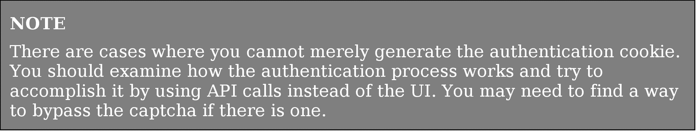


如果我们为测试实现此类逻辑，这意味着每个测试都将节省约 2 秒。对于 1000 次测试，这将等于节省了超过 30 分钟。

## 在测试中如何等待异步请求完成？

正如你在优化计划中看到的，最大的瓶颈之一是由于用于处理表单异步加载的硬编码暂停。回顾一下我们如何删除它们并等待时间不再超过所需时间如何？行业采用的现代方法是异步加载网络元素。在这种方法中，JavaScript 代码与渲染页面内容并行处理。这意味着即使某个组件响应或加载缓慢，也不会冻结页面的其余部分。在这个时代之前，点击按钮后，整个页面都会重新加载，然后测试就可以安全地执行验证。然而，得益于 AJAX，我们需要的元素在页面加载后可能不在页面上，并在几秒后出现，导致检查或交互失败。因此，我们需要从一开始就为这些情况做好代码准备。

我们在测试用例中具有此类请求的两个地方是在应用优惠券和增加产品数量时。

```csharp
private void IncreaseProductQuantity()
{
    var quantityBox = _driver.FindElement(By.CssSelector("[class*='input-text qty text']"));
    quantityBox.TypeText("2");
    Thread.Sleep(2000);
    var updateCart = _driver.FindElement(By.CssSelector("[value*='Update cart']"));
    updateCart.Click();
    Thread.Sleep(4000);
    var totalSpan = _driver.FindElement(By.XPath("//*[@class='order-total']//span"));
    Assert.AreEqual("114.00€", totalSpan.Text);
}

private void ApplyCoupon()
{
    var couponCodeTextField = _driver.FindElement(By.Id("coupon_code"));
    couponCodeTextField.TypeText("happybirthday");
    var applyCouponButton = _driver.FindElement(By.CssSelector("[value*='Apply coupon']"));
    applyCouponButton.Click();
    Thread.Sleep(2000);
    var messageAlert = _driver.FindElement(By.CssSelector("[class*='woocommerce-message']"));
    Assert.AreEqual("Coupon code applied successfully.", messageAlert.Text);
}
```

当我们应用代码时，屏幕上会出现这个：

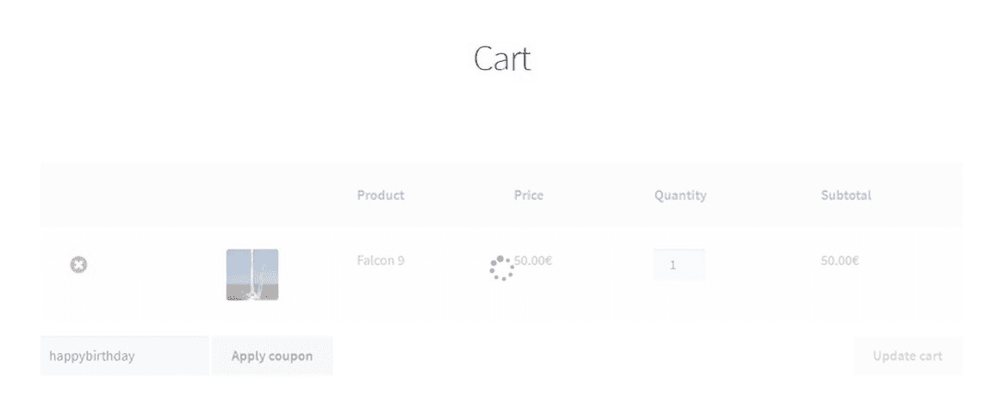

取决于测试执行的环境，加载可能持续几毫秒到几秒。然而，由于我们使用了硬编码暂停，我们将始终等待这段时间。我们需要改进我们的代码来处理这些情况。

### 等待 AJAX 请求完成

许多 JavaScript 库简化了工作。最流行的之一是 jQuery。我们将使用它的方法来获取当前活跃请求的总数。WebDriver 提供了在当前 Web 页面执行 JavaScript 代码的 API，通过`ExecuteScript`实现。如果页面完全加载，`jQuery.active`返回 0。如果仍在执行，它将返回一个正数。你想看`WaitForAjax`的示例实现吗？

```csharp
public override void WaitForAjax()
{
    var js = (IJavaScriptExecutor)_webDriver;
    _driverWait.Until(wd=>js.ExecuteScript("return jQuery.active") == "0");
}
```


在`WebDriver`中，`Wait`类中的`Until`方法简单地循环，直到代码块返回 true。在`WaitForAjax`的情况下，当有 0 个活跃请求时，达到了退出条件。如果条件返回 true，说明所有 AJAX 请求已完成，我们准备好进入下一步。现在我们可以在任何需要测试等待异步请求的地方使用`WaitForAjax`。我们将替换硬编码的 sleep 方法，如下：

```csharp
private void IncreaseProductQuantity()
{
    var quantityBox = _driver.FindElement(By.CssSelector("[class*='input-text qty text']"));
    quantityBox.TypeText("2");
    _driver.WaitForAjax();
    var updateCart = _driver.FindElement(By.CssSelector("[value*='Update cart']"));
    updateCart.Click();
    _driver.WaitForAjax();
    var totalSpan = _driver.FindElement(By.XPath("//*[@class='order-total']//span"));
    Assert.AreEqual("114.00€", totalSpan.Text);
}

private void ApplyCoupon()
{
    var couponCodeTextField = _driver.FindElement(By.Id("coupon_code"));
    couponCodeTextField.TypeText("happybirthday");
    var applyCouponButton = _driver.FindElement(By.CssSelector("[value*='Apply coupon']"));
    applyCouponButton.Click();
    _driver.WaitForAjax();
    var messageAlert = _driver.FindElement(By.CssSelector("[class*='woocommerce-message']"));
    Assert.AreEqual("Coupon code applied successfully.", messageAlert.Text);
}
```

## 优化浏览器初始化——观察者模式

查看优化列表，我们遇到了下一个减慢测试的问题——重复且耗时的浏览器初始化。每个测试可能花费长达 2 秒的时间。


```csharp
[TestInitialize]
public void TestInitialize()
{
    _driver = new LoggingDriver(new WebDriver());
    _driver.Start(Browser.Chrome);
}

[TestCleanup]
public void TestCleanup()
{
    _driver.Quit();
}
```

现在，我们为每个测试启动并关闭浏览器。一个更智能的解决方案重用浏览器——在测试套件开始时启动，并在所有测试执行完成后关闭它。这将带给我们显著的时间改进，但如果我们仍然需要在某些测试之前重启浏览器怎么办？因此，我们需要一个更智能的解决方案，允许按测试类或测试方法配置此行为。为了完成任务，我们将实现观察者模式。

### Observer Pattern

观察者模式定义了对象之间一对多的关系，以便当一个对象更改状态时，所有依赖项都会收到通知并自动更新。

- 努力实现交互对象之间的松耦合设计。
- 允许你非常高效地向许多其他对象发送数据。
- 如果需要添加新的观察者，不需要对主体进行任何修改。
- 你可以随时添加和删除观察者。
- 观察者的顺序是不可预测的。

#### 抽象 UML 类图


该模式的参与者是：

- `ITestExecutionSubject`：对象使用此接口注册和删除观察者。
- `MSTExecutionSubject`：具体主体实现 `ITestExecutionSubject` 接口。此外，当状态变化时，它实现不同的方法来更新所有订阅的观察者。
- `ITestBehaviorObserver`：所有潜在的观察者都需要实现此接口。此接口的方法在主体状态变化时调用。
- `OwnerTestObserver`：实现 `ITestBehaviorObserver` 接口的任何类。与特定主体注册以接收更新。
- `BaseTest`：框架中所有测试类的父类。使用 `ITestExecutionSubject` 通过测试方法/类定义的观察者来扩展其功能。

### Observer Pattern Implementation

通过我们的实现，我们将为自动化工程师提供在类/测试级别添加额外逻辑的简单方法，例如重用浏览器。


`Subject` 是包含状态的对象，因此只有一个主体具有状态。另一方面，观察者并不拥有该状态，它们依赖于 `Subject` 告诉它们状态何时变化。因此在一个主体和多个观察者之间存在关系。为什么不看 `ITestExecutionSubject` 接口？

```csharp
public interface ITestExecutionSubject
{
    void Attach(ITestBehaviorObserver observer);
    void Detach(ITestBehaviorObserver observer);
    void PreTestInit(TestContext context, MemberInfo);
    void PostTestInit(TestContext context, MemberInfo);
    void TestCleanup(TestContext context, MemberInfo);
    void TestCleanup(TestContext context, MemberInfo);
    void TestInitialized(MemberInfo);
}
```

`Attach` 和 `Detach` 方法被观察者类用于与主体关联。其余方法在测试执行的各个步骤中调用，以通知观察者状态的变化。为了让主体能够通知观察者，它们需要实现定义了所有通知方法的 `ITestBehaviorObserver` 接口。

```csharp
public interface ITestBehaviorObserver
{
    void PreTestInit(TestContext context, MemberInfo);
    void PostTestInit(TestContext context, MemberInfo);
    void PreTestCleanup(TestContext context, MemberInfo);
    void PostTestCleanup(TestContext context, MemberInfo);
    void TestInitialized(MemberInfo);
}
```

并不是所有的观察者都需要实现所有的通知方法。为了支持这一要求，我们将添加一个实现 `ITestBehaviorObserver` 接口的基类。

```csharp
public class BaseTestBehaviorObserver : ITestBehaviorObserver
{
    private readonly ITestExecutionSubject _testExecutionSubject;

    public BaseTestBehaviorObserver(ITestExecutionSubject testExecutionSubject)
    {
        _testExecutionSubject = testExecutionSubject;
        testExecutionSubject.Attach(this);
    }

    public virtual void PreTestInit(TestContext context, MemberInfo) {}
    public virtual void PostTestInit(TestContext context, MemberInfo) {}
    public virtual void PreTestCleanup(TestContext context, MemberInfo) {}
    public virtual void PostTestCleanup(TestContext context, MemberInfo) {}
    public virtual void TestInitialized(MemberInfo) {}
}
```

由于所有通知方法都是空的，子类只需要覆盖必要的那些。此外，基类构造函数需要一个 `ITestExecutionSubject` 参数，以便将当前观察者与主体关联。

之后，应该创建一个具体主体。

```csharp
public class MsTestExecutionSubject : ITestExecutionSubject
{
    private readonly List<ITestBehaviorObserver> _testObservers;

    public MsTestExecutionSubject()
    {
        _testObservers = new List<ITestBehaviorObserver>();
    }

    public void Attach(ITestBehaviorObserver observer)
    {
        _testObservers.Add(observer);
    }

    public void Detach(ITestBehaviorObserver observer)
    {
        _testObservers.Remove(observer);
    }

    public void PreTestInit(TestContext context, MemberInfo)
    {
        foreach (var currentObserver in _testObservers)
        {
            currentObserver.PreTestInit(context, MemberInfo);
        }
    }

    public void PostTestInit(TestContext context, MemberInfo)
    {
        foreach (var currentObserver in _testObservers)
        {
            currentObserver.PostTestInit(context, MemberInfo);
        }
    }

    public void PreTestCleanup(TestContext context, MemberInfo)
    {
        foreach (var currentObserver in _testObservers)
        {
            currentObserver.PreTestCleanup(context, MemberInfo);
        }
    }

    public void PostTestCleanup(TestContext context, MemberInfo)
    {
        foreach (var currentObserver in _testObservers)
        {
            currentObserver.PostTestCleanup(context, MemberInfo);
        }
    }

    public void TestInitialized(MemberInfo)
    {
        foreach (var currentObserver in _testObservers)
        {
            currentObserver.TestInitialized(MemberInfo);
        }
    }
}
```

## 通过 Attribute 配置浏览器行为

最后，我们准备好开发优化浏览器初始化的解决方案。让我们看看如果使用它，测试会变成什么样：

```csharp
[TestClass]
[ExecutionBrowser(Browser.Chrome, ReuseIfStarted)]
public class ProductPurchaseTests : BaseTest
{
    private static string _purchaseEmail;
    private static string _purchaseOrderNumber;

    [TestMethod]
    public void CompletePurchaseSuccessfully_WhenNewClient()
    {
        AddRocketToShoppingCart();
        ApplyCoupon();
        IncreaseProductQuantity();
        // the rest of the code
    }

    [TestMethod]
    [ExecutionBrowser(Browser.Firefox, ReuseIfStarted)]
    public void CompletePurchaseSuccessfully_WhenExistingClient()
    {
        AddRocketToShoppingCart();
        ApplyCoupon();
        IncreaseProductQuantity();
        // the rest of the code
    }
    // the rest of the code
}
```

在示例中，新属性用于配置类中的所有测试使用 Chrome 浏览器。然而，方法属性将覆盖类级别的值。因此，在 `CompletePurchaseSuccessfully_WhenExistingClient` 测试开始之前，初始浏览器是 Firefox 而不是 Chrome。

```csharp
[AttributeUsage(AttributeTargets.Class | AttributeTargets.Method, Inherited = true, AllowMultiple = false)]
public class ExecutionBrowserAttribute : Attribute
{
    public ExecutionBrowserAttribute(Browser browser, BrowserBehavior browserBehavior)
    {
        BrowserConfiguration = new BrowserConfiguration(browser, browserBehavior);
    }
    public BrowserConfiguration BrowserConfiguration { get; set; }
}
```

`BrowserAttribute` 没有特殊，它只包含一个两个属性的 `BrowserConfiguration`。`BrowserBehavior` 枚举控制浏览器的行为。

```csharp
public enum BrowserBehavior
{
    NotSet = 0,
    ReuseIfStarted = 1,
    RestartEveryTime = 2,
    RestartOnFail = 3
}
```

该属性通过 `AttributeUsage` 配置在测试类和方法级别。浏览器的控制和属性的提取发生在具体观察者 `BrowserLaunchObserver` 中。它继承了我们的基观察者 `BaseTestBehaviorObserver`。


进入`/path/to/xxx`目录，找到`xxx.json`。

在表达式`cvar = avar + bvar`中，加法运算符（`+`）将`avar`与`bvar`相加，得到它们的和`cvar`

在`List.of(arg0, arg1, arg2)`中，`List`接口的工厂方法`of()`接受一系列的元素，返回包含它们的只读列表。

之后我们这样调用`cmd`命令：`cmd arg0 arg1 arg2`。

```
if (condVar > someVal) {console.log("xxx")}
```

---

## BrowserLaunchObserver 类

```csharp
public class BrowserLaunchObserver : BaseTestBehaviorObserver
{
    private readonly Driver _driver;
    private BrowserConfiguration _currentBrowserConfiguration;
    private BrowserConfiguration _previousBrowserConfiguration;

    public BrowserLaunchObserver(ITestExecutionSubject testExecutionSubject, Driver driver) : base(testExecutionSubject)
    {
        _driver = driver;
    }

    public override void PreTestInit(TestContext context, MemberInfo)
    {
        _currentBrowserConfiguration = GetBrowserConfiguration(memberInfo);
        bool shouldRestart = ShouldRestart(_currentBrowserConfiguration);
        if (shouldRestart)
        {
            RestartBrowser();
        }
        _previousBrowserConfiguration = _currentBrowserConfiguration;
    }

    public override void PostTestCleanup(TestContext context, MemberInfo)
    {
        if (_currentBrowserConfiguration.BrowserBehavior == BrowserBehavior.RestartOnFail && context.CurrentTestOutcome.Equals(TestOutcome.Failed))
        {
            RestartBrowser();
        }
    }

    private void RestartBrowser()
    {
        _driver.Quit();
        _driver.Start(_currentBrowserConfiguration.Browser);
    }

    private bool ShouldRestart(BrowserConfiguration configuration)
    {
        if (_previousBrowserConfiguration == null)
        {
            return true;
        }
        return configuration.BrowserBehavior == BrowserBehavior.RestartEveryTime || configuration.BrowserBehavior == BrowserBehavior.NotSet;
    }

    private BrowserConfiguration GetBrowserConfiguration(MemberInfo memberInfo)
    {
        var executionBrowserAttribute = memberInfo.GetCustomAttribute<ExecutionBrowserAttribute>(true);
        if (executionBrowserAttribute != null)
        {
            return executionBrowserAttribute.BrowserConfiguration;
        }
        var classBrowserAttribute = memberInfo.DeclaringType.GetCustomAttribute<ExecutionBrowserAttribute>();
        if (classBrowserAttribute != null)
        {
            return classBrowserAttribute.BrowserConfiguration;
        }
        return null;
    }
}
```

这里发生了很多事情，为什么不逐一讨论呢？属性值是通过`.NET`反射 API 提取的。`var executionBrowserAttribute = type.GetCustomAttribute<ExecutionBrowserAttribute>(true);`。在`PreTestInit`和`TestCleanup`方法中，我们调用`ShouldRestart`方法来决定是否重启当前的浏览器实例。

### ShouldRestart 方法

```csharp
private bool ShouldRestart(BrowserConfiguration configuration)
{
    if (_previousBrowserConfiguration == null)
    {
        return true;
    }
    return configuration.BrowserBehavior == BrowserBehavior.RestartEveryTime || configuration.BrowserBehavior == BrowserBehavior.NotSet;
}
```

如果第一次调用方法，`_previousBrowserConfiguration`变量仍然为`null`，因此方法将返回`true`。在后续流程中，我们检查当前浏览器配置的`BrowserBehavior`枚举值。此外，在`PostTestCleanup`方法中，我们检查测试是否失败。如果失败了，我们将重启浏览器，因为它可能处于不一致的状态。

### PostTestCleanup 方法

```csharp
public override void PostTestCleanup(TestContext context, MemberInfo)
{
    if (_currentBrowserConfiguration.BrowserBehavior == BrowserBehavior.RestartOnFail && context.CurrentTestOutcome.Equals(TestOutcome.Failed))
    {
        RestartBrowser();
    }
}
```

谜题的最后一部分是组合这些类。这发生在`BaseTest`类中。

### BaseTest 类

```csharp
[TestClass]
public class BaseTest
{
    private static readonly ITestExecutionSubject CurrentExecutionSubject;
    private static readonly Driver LoggingDriver;

    static BaseTest()
    {
        CurrentExecutionSubject = new MsTestExecutionSubject();
        LoggingDriver = new LoggingDriver(new WebDriver());
        new BrowserLaunchObserver(CurrentExecutionSubject, LoggingDriver);
        var memberInfo = MethodBase.GetCurrentMethod();
        CurrentExecutionSubject.TestInstantiated(memberInfo);
    }

    public BaseTest()
    {
        Driver = LoggingDriver;
    }

    public Driver Driver { get; set; }
    public TestContext TestContext { get; set; }
    public string TestName => TestContext.TestName;

    [ClassInitialize]
    public static void OnClassInitialize(TestContext context) {}

    [ClassCleanup]
    public static void OnClassCleanup() {}

    [TestInitialize]
    public void CoreTestInit()
    {
        var memberInfo = GetType().GetMethod();
        CurrentExecutionSubject.PreTestInit(TestContext, memberInfo);
        TestInit();
        CurrentExecutionSubject.PostTestInit(TestContext, memberInfo);
    }

    [TestCleanup]
    public void CoreTestCleanup()
    {
        var memberInfo = GetType().GetMethod();
        TestCleanup();
        CurrentExecutionSubject.PostTestCleanup(TestContext, memberInfo);
    }

    [AssemblyCleanup]
    public static void AssemblyCleanup()
    {
        LoggingDriver?.Quit();
    }

    public virtual void TestInit() {}
    public virtual void TestCleanup() {}
}
```

---

### 每个测试的隔离浏览器初始化

我们的新解决方案仍然存在问题。查看优化列表，我们遇到了下一个减慢测试的问题——重复且耗时的浏览器初始化。每个测试可能花费长达 2 秒。

```csharp
[TestInitialize]
public void TestInitialize()
{
    _driver = new LoggingDriver(new WebDriver());
    _driver.Start(Browser.Chrome);
}

[TestCleanup]
public void TestCleanup()
{
    _driver.Quit();
}
```

如果你运行过测试，可能会注意到奇怪的行为。例如，如果先执行了登录的测试，那么匿名购买的测试将失败，因为我们重用了浏览器。由于这种依赖关系，我们破坏了密封测试模式。处理这种情况的一种方法是扩展我们的解决方案，在重用时清理浏览器的缓存和 cookie。首先，我们需要在`WebDriver`装饰器中添加一个删除 cookie 的方法。

```csharp
public override void DeleteAllCookies()
{
    _driver.Manage().Cookies.DeleteAll();
}
```

之后，我们需要更改`BrowserLaunchObserver`类的`PreTestInit`和`PostTestCleanup`方法。

```csharp
public override void PreTestInit(TestContext context, MemberInfo)
{
    _currentBrowserConfiguration = GetBrowserConfiguration(memberInfo);
    bool shouldRestart = ShouldRestart(_currentBrowserConfiguration);
    if (shouldRestart)
    {
        RestartBrowser();
    }
    else
    {
        _driver.DeleteAllCookies(); // 在重用浏览器时清理 cookie
    }
    _previousBrowserConfiguration = _currentBrowserConfiguration;
}
```

在重用浏览器的情况下，我们删除所有 cookie，确保不会干扰下一个测试的状态。

---

## 黑洞代理方法

黑洞代理方法试图通过尽可能消除第三方不确定性来减少测试的不稳定性。现代网站每个页面都加载了许多第三方内容。有社交网络按钮、来自 CDN 的图像、跟踪像素、分析等。所有这些项目在任何时候都可以破坏测试的稳定性。代理获取所有指向第三方网站的 HTTP 请求并阻止它们，就像请求被吸入黑洞一样。

### 实现黑洞代理

我们的网站集成了几个收集数据的第三方用户服务，并使用了其他服务。我们可能不需要在所有测试中测试这些服务，因此可以使用黑洞代理方法阻止它们。

```csharp
[TestClass]
public class CaptureHttpTests
{
    private static IWebDriver _driver;
    private static ProxyServer _proxyServer;
    private static Dictionary<int, Proxy.Request> _requestsHistory;
    private static Dictionary<int, Proxy.Response> _responsesHistory;
    private static ConcurrentBag<string> _blockUrls;

    [ClassInitialize]
    public static void OnClassInitialize(TestContext context)
    {
        _proxyServer = new ProxyServer();
        _requestsHistory = new Dictionary<int, Proxy.Request>();
        _responsesHistory = new Dictionary<int, Proxy.Response>();
        _blockUrls = new ConcurrentBag<string>();
        _proxyServer.Start();
        _proxyServer.AddEndPoint(ExplicitEndPoint, 1882, true);
    }

    [TestInitialize]
    public void TestInit()
    {
        var proxy = new OpenQA.Selenium.Proxy
        {
            HttpProxy = "localhost:1882",
            SslProxy = "localhost:1882",
            FtpProxy = "localhost:1882"
        };
        var options = new ChromeOptions { Proxy = proxy };
        _driver = new ChromeDriver(Environment.CurrentDirectory, options);
    }

    [TestCleanup]
    public void TestCleanup()
    {
        _driver.Dispose();
        _requestsHistory.Clear();
        _responsesHistory.Clear();
    }

    [TestMethod]
    public void FontRequestsNotMade_When_FontRequestSetToBeBlocked()
    {
        _blockUrls.Add("http://myanalytics.com");
        _driver.Navigate().GoToUrl("https://automatetheplanet.com/");
    }

    [AssemblyCleanup]
    public static void AssemblyCleanup()
    {
        _proxyServer.Stop();
    }
}
```

---

## 页面对象模型设计模式 (Page Object Model Design Pattern)

Web 自动化中最流行的模式之一就是所谓的页面对象模型（Page Object Model）设计模式。要理解该模式的主要目标，首先你需要思考你的 Web 自动化测试在做什么。它们导航到不同的网页，并对各种元素执行操作，对吧？页面对象将页面上发生的所有元素、操作和验证封装在单个对象中。

### 创建第一个页面对象模型

#### 对象模型设计模式 - 章节

#### 处理常见的页面元素与操作

#### 高质量代码 - 使用有意义的命名

#### 正确命名方法

#### 遵循编码标准 - 工具


随着 `WebDriver .NET` 绑定的最新版本发布，我们创建页面对象的方式与 Java 版本有所不同。你想简要地回顾一下在 `3.11.0` 版本发布之前定义页面对象的方法吗？

```csharp
public class SearchEngineMainPage{
    private readonly IWebDriver _driver;
    private readonly string _url = @"searchEngineUrl";
    [FindsBy(How = How.Id, Using = "sb_form_q")]
    private IWebElement _searchBox;
    [FindsBy(How = How.Id, Using = "sb_form_go")]
    private IWebElement _goButton;
    public SearchEngineMainPage(IWebDriver driver){
        _driver = driver;
        PageFactory.InitElements(driver, this);
    }
    public void Search(string textToType){
        _driver.Navigate().GoToUrl(this.url);
        _searchBox.Clear();
        _searchBox.SendKeys(textToType);
        _goButton.Click();
    }
}
```

首先，为了定位不同的 Web 元素，我们使用了`FindsBy`属性，在其中你可以指定查找策略`How`—— 通过`Id`、`Class`、`XPath` 等查找，然后将实际定位器分配给所使用的属性。为了让所有 Web 元素在页面加载时填充，你必须调用`PageFactory`类的`InitElements`方法。然而，在 2018 年 3 月随着`WebDriver .NET`绑定的`3.11.0`版本发布，该 API 被标记为过时。

以下是`WebDriver .NET`绑定主要维护者 Jim Evans 网站上的一段引用，解释了他们为何决定弃用这部分 API：

> “这些构造的 .NET 实现很大程度上是因为某些用户问：‘Java 有，但为什么 .NET 没有？’ 与其之前那样盲目地复制 Java 的实现，不如考虑在使用 C# 时什么才是真正合理的。换句话说，‘C# 不是 Java，因此对 Java 最有效的方法可能并不完全适用于 C#。’ 在 .NET `PageFactory` 的情况下，该实现方式既复杂又繁琐，而且对于人们想要创建页面对象的各种方式来说，其灵活性还远不够。此外，当 `.NET Core 2.0` 发布时，.NET `PageFactory` 依赖的类没有包含在 `.NET Core 2.0` 中。这意味着为了在 `.NET Core` 下让`PageFactory`工作，该项目要么承担新的依赖项，要么使用条件编译指令弄乱代码，要么在 `.NET Core` 中对其停止支持。对于 Selenium 项目的 .NET 绑定来说，第一种方法是不可行的，其原因应该是它的一篇博客文章的主题。第二种方法使得代码几乎无法正确维护。此外，特别是对于`PageFactory`，通过属性识别元素与直接在运行时代码中识别元素相比没有任何益处。关于`PageFactory`让页面对象的创建和维护变得不那么冗长的说法，在严加审查下是站不住脚的。”

## 创建页面对象的新方法

如果你仔细观察之前的代码，你会发现你无法对元素的查找方式拥有控制权。你无法将`PageObjectFactory`与`WebDriverWait`类集成，以便处理更复杂的场景。幸运的是，我们可以完全复用已经创建的代码来稳定和优化我们的购物车测试。与其直接使用`IWebDriver`，我们可以通过我们装饰后的版本定位元素，并同样返回装饰后的 Web 元素。为什么不快速回顾一下在不使用页面对象之前我们的测试是什么样子的呢？

```cs
[TestMethod]
public void CompletePurchaseSuccessfully_WhenNewClient(){
    AddRocketToShoppingCart();
    ApplyCoupon();
    IncreaseProductQuantity();
    var proceedToCheckout = _driver.FindElement(By.CssSelector("[class*='checkout-button button alt wc-forward']"));
    proceedToCheckout.Click();
    _driver.WaitUntilPageLoadsCompletely();
    var billingFirstName = _driver.FindElement(By.Id("billing_first_name"));
    billingFirstName.TypeText("Anton");
    var billingLastName = _driver.FindElement(By.Id("billing_last_name"));
    billingLastName.TypeText("Angelov");
    var billingCompany = _driver.FindElement(By.Id("billing_company"));
    billingCompany.TypeText("Space Flowers");
    var billingCountryWrapper = _driver.FindElement(By.Id("select2-billing-country-container"));
    billingCountryWrapper.Click();
    var billingCountryFilter = _driver.FindElement(By.ClassName("select2-search__field")) ;
    billingCountryFilter.TypeText("Germany");
    var germanyOption = _driver.FindElement(By.XPath("//*[contains(text(),'Germany')]"));
    germanyOption.Click();
    var billingAddress1 = _driver.FindElement(By.Id("billing_address_1"));
    billingAddress1.TypeText("1 Willi Brandt Avenue Tiergarten");
    var billingAddress2 = _driver.FindElement(By.Id("billing_address_2"));
    billingAddress2.TypeText("Lützowplatz 17");
    var billingCity = _driver.FindElement(By.Id("billing_city"));
    billingCity.TypeText("Berlin");
    var billingZip = _driver.FindElement(By.Id("billing_postcode"));
    billingZip.TypeText("10115");
    var billingPhone = _driver.FindElement(By.Id("billing_phone"));
    billingPhone.TypeText("+00498899281");
    var billingEmail = _driver.FindElement(By.Id("billing_email"));
    billingEmail.TypeText(GenerateUniqueEmail());
    _driver.WaitForAjax();
    var placeOrderButton = _driver.FindElement(By.Id("place_order"));
    placeOrderButton.Click();
    _driver.WaitForAjax();
    var receivedMessage = _driver.FindElement(By.XPath("//h1[text() = 'Order received']"));
    Assert.AreEqual("Order received", receivedMessage.Text);
}
```

为了使用页面对象模式，我们需要重构代码并为每个特定页面创建不同的页面对象。我们将共同开发前两个，但对于后面的你可以下载代码自行练习。第一个页面对象将是我们的网站主页。

```csharp
public class MainPage{
    private readonly Driver _driver;
    private readonly string _url = "http://demos.bellatrix.solutions/";
    public MainPage(Driver driver){
        _driver = driver;
    }
    private Element AddToCart9 => _driver.FindElement(By.CssSelector("[data-product_id*='28']"));
    private Element ViewCartButton => _driver.FindElement(By.CssSelector("[class*='added_to_cart']"));
    public void AddRocketToShoppingCart(){
        _driver.GoToUrl(_url);
        AddToCart9.Click();
        ViewCartButton.Click();
    }
}
```

可见，我们没有使用`IWebDriver`接口来定位元素，而是使用了之前创建的改进版本`Driver`装饰。当你调用`FindElement`方法时，它将返回装饰后的元素。此外，我们将`AddRocketToShoppingCart`方法作为第一个对象的公共方法。我们可以创建的下一个页面对象是代表购物车页面的。

```csharp
public class CartPage{
    private readonly Driver _driver;
    public CartPage(Driver driver){
        _driver = driver;
    }
    private Element CouponCodeTextField => _driver.FindElement(By.Id("coupon_code"));
    private Element ApplyCouponButton => _driver.FindElement(By.CssSelector("[value*='Apply coupon']"));
    private Element QuantityBox => _driver.FindElement(By.CssSelector("[class*='input-text qty text']"));
    private Element UpdateCart => _driver.FindElement(By.CssSelector("[value*='Update cart']"));
    private Element MessageAlert => _driver.FindElement(By.CssSelector("[class*='woocommerce-message']"));
    private Element TotalSpan => _driver.FindElement(By.XPath("//[@class='order-total']//span"));
    private Element ProceedToCheckout => _driver.FindElement(By.CssSelector("[class*='checkout-button button alt wc-forward']"));
    public void ApplyCoupon(string coupon){
        CouponCodeTextField.TypeText(coupon);
        ApplyCouponButton.Click();
        _driver.WaitForAjax();
    }
    public void IncreaseProductQuantity(int newQuantity){
        QuantityBox.TypeText(newQuantity.ToString());
        UpdateCart.Click();
        _driver.WaitForAjax();
    }
    public void ClickProceedToCheckout(){
        ProceedToCheckout.Click();
        _driver.WaitUntilPageLoadsCompletely();
    }
    public string GetTotal(){
        return TotalSpan.Text;
    }
    public string GetMessageNotification(){
        return MessageAlert.Text;
    }
}
```

再次，所有元素在这里都被表示为私有属性，因此无法在页面对象之外访问。页面对象只暴露了几个代表所谓的 DSL 的公共方法，使得测试更具可读性。

## 测试中页面对象模型的使用

如果我们使用页面对象模型，我们的测试如何变得更易读、更简洁呢？

```csharp
[TestClass]
public class ProductPurchaseTestsWithPageObjects{
    private static Driver _driver;
    private static string _purchaseEmail;
    private static string _purchaseOrderNumber;
    private static MainPage _mainPage;
    private static CartPage _cartPage;
    [ClassInitialize]
    public static void ClassInitialize(TestContext testContext){
        _driver = new LoggingDriver(new WebDriver());
        _driver.Start(Browser.Chrome);
        _mainPage = new MainPage(_driver);
        _cartPage = new CartPage(_driver);
    }
    [ClassCleanup]
    public static void ClassCleanup(){
        _driver.Quit();
    }
    [TestMethod]
    public void CompletePurchaseSuccessfully_WhenNewClient(){
        _mainPage.AddRocketToShoppingCart();
        _cartPage.ApplyCoupon("happybirthday");
        Assert.AreEqual("Coupon code applied successfully.", _cartPage.GetMessageNotification());
        _cartPage.IncreaseProductQuantity(2);
        Assert.AreEqual("114.00€", _cartPage.GetTotal());
        _cartPage.ProceedToCheckout();
        var receivedMessage = _driver.FindElement(By.XPath("//h1"));
        Assert.AreEqual("Checkout", receivedMessage.Text);
    }
}
```


在类初始化阶段，我们创建页面对象，并可以直接在测试中使用它们。你可以看到，这种用法极大地提高了我们测试的可读性。底层的 `WebDriver` 细节和元素查找对我们隐藏了。此外，可维护性也显著提高，因为如果定位器随时间变化，我们可以直接在页面对象中进行更改。鼓励你下载源代码并通过创建页面对象来重构测试。

## 处理公共元素和操作

正如你看到的，可维护性和可读性是密切相关的。随着我们测试的更新，我们将它们变得更容易维护和阅读。为什么？

### 定义公共元素

在第一个实现的页面对象设计模式中，我们根据物理页面对元素和操作进行分组，例如主页、购物车页等。然而，许多页面重复了相同的元素标记和功能。让我们仔细查看我们的商店主页。第一个组是 Logo 和搜索栏。下一个是主导航。之后是购物车图标和当前购物车价格。我们还有与商店相关的可以购买项目的元素。最后是页脚。

与主页相同的部分是顶部的 Logo、搜索输入、导航、购物车信息和页脚。唯一的不同是位于标题下方的新部分——面包屑。我们分析了这些部分，发现某些元素在许多页面之间共享。我们可以允许用户在页面上搜索或点击菜单，这在所有情况下都是坏实践，因为每个代码都增加了维护工作。此外，页面将做多一件事，意味着我们没有遵循单一职责原则。

### 非 DRY 页面对象

为了方便比较，我们将回顾前两个页面对象看起来什么样。

```csharp
public class BasehopPage
{
    protected readonly Driver _driver;

    protected readonly string _url = "http://demos.bellatrix.solutions/";

    public BasehopPage(Driver driver)
    {
        _driver = driver;
    }
}
```

- 搜索
- 主菜单
- 购物车信息
- 路径屑导航

拥有这些组，我们可以创建四个独立的页面对象（page objects），用于保留每个组的元素和操作。由于它们不是整个页面，我将使用后缀 `-Section` 而不是 `Page` 来命名。

```csharp
public class SearchSection
{
    private readonly Driver _driver;

    public SearchSection(Driver driver)
    {
        _driver = driver;
    }

    private Element SearchField => _driver.FindElement(By.Id("woocommerce-product-search-field-0"));

    public void SearchForItem(string searchText)
    {
        SearchField.TypeText(searchText);
    }
}
```

`SearchSection` 只包含一个名为 `SearchForItem` 方法，允许我们搜索页面上的项目。下一个组 `MainMenuSection` 包含打开网站各种页面的方法。

```csharp
public class MainMenuSection
{
    private readonly Driver _driver;

    public MainMenuSection(Driver driver)
    {
        _driver = driver;
    }

    private Element HomeLink => _driver.FindElement(By.LinkText("Home"));
    private Element BlogLink => _driver.FindElement(By.LinkText("Blog"));
    private Element CartLink => _driver.FindElement(By.LinkText("Cart"));
    private Element CheckoutLink => _driver.FindElement(By.LinkText("Checkout"));
    private Element MyAccountLink => _driver.FindElement(By.LinkText("My Account"));
    private Element PromotionsLink => _driver.FindElement(By.LinkText("Promotions"));

    public void OpenHomePage()
    {
        HomeLink.Click();
    }

    public void OpenBlogPage()
    {
        BlogLink.Click();
    }

    public void OpenMyAccountPage()
    {
        MyAccountLink.Click();
    }

    public void OpenPromotionsPage()
    {
        PromotionsLink.Click();
    }
}
```

`CartInfoSection` 暴露两个方法。它们是：

- 一个通过购物车图标打开购物车
- 一个用于获取当前购物车金额

```csharp
public class CartInfoSection
{
    private readonly Driver _driver;

    public CartInfoSection(Driver driver)
    {
        _driver = driver;
    }

    private Element CartIcon => _driver.FindElement(By.ClassName("cart-contents"));
    private Element CartAmount => _driver.FindElement(By.ClassName("amount"));

    public string GetCurrentAmount()
    {
        return CartAmount.Text;
    }

    public void OpenCart()
    {
        CartIcon.Click();
    }
}
```

最后，我们有 `BreadcrumbSection`，它负责打开面包屑项。

```csharp
public class BreadcrumbSection
{
    private readonly Driver _driver;

    public BreadcrumbSection(Driver driver)
    {
        _driver = driver;
    }

    private Element Breadcrumb => _driver.FindElement(By.ClassName("woocommerce-breadcrumb"));

    public void OpenBreadcrumbItem(string itemToOpen)
    {
        Breadcrumb.FindElement(By.LinkText(itemToOpen)).Click();
    }
}
```

现在我们创建了所有公共 section 页面对象，让我们看看如何将它们集成到现有的页面对象中。

## 页面对象中的 Section 使用 - 版本一

使用这些 section 最简单的方法是在需要的地方将它们添加为公共属性——暂时消除了基类。

```csharp
public class MainPage
{
    private readonly Driver _driver;
    private readonly string _url = "http://demos.bellatrix.solutions/";

    public MainPage(Driver driver)
    {
        _driver = driver;

        SearchSection = new SearchSection(_driver);
        MainMenuSection = new MainMenuSection(_driver);
        CartInfoSection = new CartInfoSection(_driver);
    }

    public SearchSection SearchSection { get; }
    public MainMenuSection MainMenuSection { get; }
    public CartInfoSection CartInfoSection { get; }

    private Element AddToCartFalcon9 => _driver.FindElement(By.CssSelector("[data-product_id*='28']"));
    private Element ViewCartButton => _driver.FindElement(By.CssSelector("[class*='added_to_cart wc-forward']"));

    public void AddRocketToShoppingCart()
    {
        _driver.GoToUrl(_url);

        AddToCartFalcon9.Click();
        ViewCartButton.Click();
    }
}
```

对于 `MainPage`，我只添加了三个 section，因为正如之前提到的，我们不应该允许从这里访问面包屑。section 页面对象是在构造函数中创建的，这意味着它们将在第一次创建页面时初始化。

```csharp
public class CartPage
{
    private readonly Driver _driver;

    public CartPage(Driver driver)
    {
        _driver = driver;

        SearchSection = new SearchSection(_driver);
        MainMenuSection = new MainMenuSection(_driver);
        CartInfoSection = new CartInfoSection(_driver);
        BreadcrumbSection = new BreadcrumbSection(_driver);
    }

    public SearchSection SearchSection { get; }
    public MainMenuSection MainMenuSection { get; }
    public CartInfoSection CartInfoSection { get; }
    public BreadcrumbSection BreadcrumbSection { get; }

    private Element CouponCodeTextField => _driver.FindElement(By.Id("coupon_code"));
    private Element ApplyCouponButton => _driver.FindElement(By.CssSelector("[value*='Apply coupon']"));
    private Element QuantityBox => _driver.FindElement(By.CssSelector("[class*='input-text qty text']"));
    private Element UpdateCart => _driver.FindElement(By.CssSelector("[value*='Update cart']"));
    private Element MessageAlert => _driver.FindElement(By.CssSelector("[class*='woocommerce-message']"));
    private Element TotalSpan => _driver.FindElement(By.XPath("//*[@class='order-total']//span"));
    private Element ProceedToCheckout => _driver.FindElement(By.CssSelector("[class*='checkout-button button alt wc-forward']"));

    // methods
}
```

我对 `CartPage` 执行了几乎相同的重构，除了添加的 `BreadcrumbSection`。多或少地，这个版本更接近预期的结果。然而，如果你仔细观察，你会发现页面之间仍然存在一些重复代码。前三个 section 应该出现在所有页面上，这意味着每添加一个新页面，我都必须复制这三个属性及其初始化。为了解决这个问题，我们将找回之前创建的基类。

## 页面对象中的 Section 使用 - 版本二

正如所述，我们可以将共享的 section 及其初始化移动到基类中。

```csharp
public abstract class BasehopPage
{
    protected readonly Driver Driver;

    protected BasehopPage(Driver driver)
    {
        Driver = driver;

        SearchSection = new SearchSection(driver);
        MainMenuSection = new MainMenuSection(driver);
        CartInfoSection = new CartInfoSection(driver);
    }

    public SearchSection SearchSection { get; }
    public MainMenuSection MainMenuSection { get; }
    public CartInfoSection CartInfoSection { get; }

    protected abstract string Url { get; }

    public void Open()
    {
        Driver.GoToUrl(Url);
    }
}
```

与之前一样，我添加了导航页面的额外逻辑。此外，类被标记为抽象，因为我们不允许创建它的实例。`WebDriver` 实例现在是 protected，而不是在每个页面对象中定义，我们将使用基类。

那么，如果它们开始使用基类，我们的页面会是什么样？

```csharp
public class MainPage : BasehopPage
{
    public MainPage(Driver driver) : base(driver)
    {
    }

    private Element AddToCartFalcon9 => _driver.FindElement(By.CssSelector("[data-product_id*='28']"));
    private Element ViewCartButton => _driver.FindElement(By.CssSelector("[class*='added_to_cart wc-forward']"));

    protected override string Url => "http://demos.bellatrix.solutions/";

    public void AddRocketToShoppingCart()
    {
        Open();

        AddToCartFalcon9.Click();
        ViewCartButton.Click();
    }
}
```

现在 `MainPage` 的代码被重用了，并且更容易理解、阅读和维护。我对 `CartPage` 也进行了同样的重构。唯一的区别是在它的构造函数中仍然需要初始化 `BreadcrumbSection`，因为它是页面的独特部分，我们没有将其包含在基类中。

```csharp
public class CartPage : BasehopPage
{
    public CartPage(Driver driver) : base(driver)
    {
        BreadcrumbSection = new BreadcrumbSection(driver);
    }

    public BreadcrumbSection BreadcrumbSection { get; }

    protected override string Url => "http://demos.bellatrix.solutions/cart/";

    private Element CouponCodeTextField => _driver.FindElement(By.Id("coupon_code"));
}
```


```csharp
private Element ApplyCouponButton => _driver.FindElement(By.CssSelector("[value*='Apply coupon']"));

private Element QuantityBox => _driver.FindElement(By.CssSelector("[class*='input-text qty text']"));

private Element UpdateCart => _driver.FindElement(By.CssSelector("[value*='Update cart']"));

private Element MessageAlert => _driver.FindElement(By.CssSelector("[class*='woocommerce-message']"));

private Element TotalSpan => _driver.FindElement(By.XPath("//*[@class='order-total']//span"));

private Element ProceedToCheckout => _driver.FindElement(By.CssSelector("[class*='checkout-button button alt wc-forward']"));

// methods
```

## 测试中的 Section 使用

在费力通过 section 创建可重用且可读的页面对象后，让我们看看如何在测试中使用它们。

```csharp
[TestClass]
public class SectionsTests
{
    private static Driver _driver;
    private static MainPage _mainPage;
    private static CartPage _cartPage;

    [ClassInitialize]
    public static void ClassInitialize(TestContext testContext)
    {
        _driver = new LoggingDriver(new WebDriver());
        _driver.Start(Browser.Chrome);
        _mainPage = new MainPage(_driver);
        _cartPage = new CartPage(_driver);
    }

    [ClassCleanup]
    public static void ClassCleanup()
    {
        _driver.Quit();
    }

    [TestInitialize]
    public void TestInitialize()
    {
        _mainPage.Open();
    }

    [TestMethod]
    public void OpenBlogPage()
    {
        _mainPage.MainMenuSection.OpenBlogPage(); // 验证页面标题
    }

    [TestMethod]
    public void SearchForItem()
    {
        _mainPage.SearchSection.SearchForItem("Falcon 9"); // 将项目加入购物车
    }

    [TestMethod]
    public void OpenCart()
    {
        _mainPage.CartInfoSection.OpenCart(); // 验证购物车中的项目
    }
}
```

我们需要使用新的 section 属性来使用它们公开的逻辑。这进一步改进了可读性，因为你可以假设在页面的哪里执行操作。

## 高质量代码——有意义的名字

可读代码的作用很大程度上是向读者传达其意图，而不需要大量的注释。在接下来的部分，我们将讨论在命名代码各个部分时可以遵循的各种指南，从而使你的代码更容易被理解和掌握。

### 通用命名指南

始终使用英语。避免缩写：

- `buttonsCnt` 与 `buttonsCount`
- `usrList` 与 `usersList`
- `cdCrdsNums` 与 `creditCardNumber`
- `dtenRegExPtr` 与 `dateTimeEnglishRegExPattern`

始终优先选择有意义的名字，而不是短名字。你的名称可读性比简洁更重要。不要使用大多数代码用户可能不知道的词。它们的含义应该脱口而出，而不是让人们询问同事或在专业字典中查找。

名称应该回答几个问题：

- 这个类是做什么的？
- 这个变量的意图是什么？
- 这个变量是用来做什么？
- 这个方法会返回什么？

正确的：

`DiscountsCalculator`、`buttonsCount`、`Math.PI`、`fileNames`、`GenerateInvoice`

错误的：

`d`、`d8`、`d6`、`u33`、`HCJ`、`anchor3`、`variable`、`temp`、`tmp`、`temp__var`、`something`、`someValue`

一个名字是否有意义，取决于你使用它的上下文。让我们看下面的几个例子。

正确的：

- `DiscountsGenerator` 类中的 `Generate()`
- `ItemFinder` 类中的 `Find(string item)`
- `Account` 类中的 `CreateInvoice(decimal)`

错误的：

- `Program` 类中的 `Method()`
- `Exception` 类中的 `Search(item)`
- `Attribute` 类中的 `CreateAttribute`

### 命名类

正如所述，我们可以将共享的 section 及其初始化移动到基类中。

```csharp
public abstract class BasehopPage
{
    protected readonly Driver Driver;

    protected BasehopPage(Driver driver)
    {
        Driver = driver;
        SearchSection = new SearchSection(driver);
        MainMenuSection = new MainMenuSection(driver);
        CartInfoSection = new CartInfoSection(driver);
    }

    public SearchSection SearchSection { get; }

    public MainMenuSection MainMenuSection { get; }

    public CartInfoSection CartInfoSection { get; }

    protected abstract string Url { get; }

    public void Open()
    {
        Driver.GoToUrl(Url);
    }
}
```

与之前一样，我添加了导航页面的额外逻辑。此外，类被标记为抽象，因为我们不允许创建它的实例。`WebDriver` 实例现在是 protected，而不是在每个页面对象中定义，我们将使用基类。

那么，如果它们开始使用基类，我们的页面会是什么样？

```csharp
public class MainPage : BasehopPage
{
    public MainPage(Driver driver) : base(driver)
    {
    }

    private Element AddToCartFalcon9 => _driver.FindElement(By.CssSelector("[data-product_id*='28']"));

    private Element ViewCartButton => _driver.FindElement(By.CssSelector("[class*='added_to_cart wc-forward']"));

    protected override string Url => "http://demos.bellatrix.solutions/";

    public void AddRocketToShoppingCart()
    {
        Open();
        AddToCartFalcon9.Click();
        ViewCartButton.Click();
    }
}
```

现在 `MainPage` 的代码被重用了，并且更容易理解、阅读和维护。我对 `CartPage` 也进行了同样的重构。唯一的区别是在它的构造函数中仍然需要初始化 `BreadcrumbSection`，因为它是页面的独特部分，我们没有将其包含在基类中。

```csharp
public class CartPage : BasehopPage
{
    public CartPage(Driver driver) : base(driver)
    {
        BreadcrumbSection = new BreadcrumbSection(driver);
    }

    public BreadcrumbSection BreadcrumbSection { get; }

    protected override string Url => "http://demos.bellatrix.solutions/cart/";

    private Element CouponCodeTextField => _driver.FindElement(By.Id("coupon_code"));

    private Element ApplyCouponButton => _driver.FindElement(By.CssSelector("[value*='Apply coupon']"));

    private Element QuantityBox => _driver.FindElement(By.CssSelector("[class*='input-text qty text']"));

    private Element UpdateCart => _driver.FindElement(By.CssSelector("[value*='Update cart']"));

    private Element MessageAlert => _driver.FindElement(By.CssSelector("[class*='woocommerce-message']"));

    private Element TotalSpan => _driver.FindElement(By.XPath("//*[@class='order-total']//span"));

    private Element ProceedToCheckout => _driver.FindElement(By.CssSelector("[class*='checkout-button button alt wc-forward']"));

    // methods
}
```

### 方法参数的最佳实践

使用短的方法参数列表。添加的参数越多，库的用户理解你的代码就越困难。在需要向方法传递超过 4 个参数的情况下，可能应该考虑将它们分组在一个单独的类中作为单个参数使用。

```csharp
public void CreateInvoiceReport(
    DateTime startDate,
    DateTime endDate,
    int limit,
    bool isForExistingClients)
{
    //..
}
```

错误的：

```csharp
public void CreateInvoiceReport(
    DateTime startDate,
    DateTime endDate,
    int limit,
    bool isForExistingClients,
    bool isForMonthlyBucket,
    out double requestedAmount,
    out double dependentClientAmount,
    out double futureCustomerDemand,
    out double upperClientLevelAmount,
    out double dependentClusterAmount)
{
    //..
}
```

作为方法名称，对于参数命名有一种优的格式——`[名词]` 或 `[形容词] + [名词]`。它们应该使用驼峰命名法，并且参数的单位应该从名称中可见，所示。

```csharp
public interface ITimeouts
{
    TimeSpan Wait { get; set; }

    [Obsolete("This method will be removed in a future. Please set instead.")]
    void Wait(TimeSpan);
}
```

### 问题

1. 页面对象模型（Page Object Model）模式的主要优势是什么？
2. 页面对象类包含哪些内容？
3. 如何在测试中使用页面对象？
4. 你能定义公司网站的公共部分吗？
5. 你能解释在计算机编程中“组合”（composition）的意思吗？
6. 为什么通过组合而不是继承使用部分总是更好？
7. 编码规范是什么？
8. 为什么以自动方式执行这些规范很重要？

## 延伸阅读

- 页面对象——部分类、页面部分——WebDriver C#：[`www.automatetheplanet.com/page-objects-partial-classes-page-sections-webdriver/`](https://www.automatetheplanet.com/page-objects-partial-classes-page-sections-webdriver/)
- 高质量自动化测试——使用 StyleCop 强制风格和一致性规则：[`www.automatetheplanet.com/style-consistency-rules-stylecop/`](https://www.automatetheplanet.com/style-consistency-rules-stylecop/)
- 高质量自动化测试——前 10 大 EditorConfig 编码风格，部分 1：[`www.automatetheplanet.com/top-coding-styles-editorconfig-partone/`](https://www.automatetheplanet.com/top-coding-styles-editorconfig-partone/)
- 高质量自动化测试——前 10 大 EditorConfig 编码风格，部分 2：[`www.automatetheplanet.com/top-coding-styles-editorconfig-parttwo/`](https://www.automatetheplanet.com/top-coding-styles-editorconfig-parttwo/)

## 第 5 章：增强测试的可维护性和可重用性

我们将看到如何通过 `Template Method`（模板方法）模式在页面对象之间重用更多代码。此外，我们将看到第三种页面对象，其中断言和元素将作为属性使用，而不是来自基类。这将展示“组合优于继承”原则的优势。

在本章的第二部分，我们将讨论如何通过 `Facade`（外观）设计模式重用常见的测试工作流。我们将讨论 `Template Method` 设计模式如何帮助我们测试同一个网页的不同版本（新版和旧版），实现最大的代码重用。

本章将涵盖以下主题：

- 可导航页面对象——模板方法设计模式
- 页面对象断言和元素的组合原则
- 重用测试工作流——外观设计模式
- 测试不同的页面版本——外观结合模板方法设计模式

## 可导航页面对象——模板方法设计模式

在上一章中，我们查看了如何在页面对象中重用网站的常见元素和操作，以免代码重复。我们通过使用部分（sections）实现了这一点，这使得测试代码更具可读性且更容易维护。之后，我们使用基类来持有一些常见的网站部分，如导航和搜索。

我们在基类中添加了一个导航方法 `Open`，帮助我们直接跳转到页面。如你所知，某些特定的网页，例如购物车流程或支持工单提交，它们是工作流的一部分，但即使你有 URL，也无法直接导航。这就是为什么我们将进一步重构测试，以便拥有两个基类——一个用于可以直接访问的页面（可导航页面），另一个用于不可访问的页面。

字体 未重构版本的页面对象

以下是我们的基类现在的样子。

```csharp
public abstract class BaseEShopPage
{
    protected readonly Driver Driver;

    protected BaseEShopPage(Driver driver)
    {
        Driver = driver;
        SearchSection = new SearchSection(driver);
        MainMenuSection = new MainMenuSection(driver);
```


`CartInfoSection = new CartInfoSection(driver);`

```
public SearchSection SearchSection { get; }
public MainMenuSection MainMenuSection { get; }
public CartInfoSection CartInfoSection { get; }
protected abstract string Url { get; }
public void Open()
{
    Driver.GoToUrl(Url);
}
```

这是我们在页面对象中使用它的方式。由于它是一个抽象类，我们需要实现`Url`属性，以便能够导航到该页面。

```csharp
public class CartPage : BaseEShopPage
{
    public CartPage(Driver driver) : base(driver)
    {
        BreadcrumbSection = new BreadcrumbSection(Driver);
    }

    public BreadcrumbSection BreadcrumbSection { get; }

    protected override string Url => "http://demos.bellatrix.solutions/cart/";

    // web elements and methods
}
```

### 为可导航和不可导航页面创建单独的基类

让我们创建两个单独的基类 - 一个用于可以直接导航的页面，另一个用于不能导航的页面。那么为什么不从不可导航页面的代码开始呢？它只包含访问常见网页部分和驱动器的属性。

```csharp
public abstract class EShopPage
{
    protected readonly Driver Driver;

    protected EShopPage(Driver driver)
    {
        Driver = driver;
        SearchSection = new SearchSection(driver);
        MainMenuSection = new MainMenuSection(driver);
        CartInfoSection = new CartInfoSection(driver);
    }

    public SearchSection SearchSection { get; }
    public MainMenuSection MainMenuSection { get; }
    public CartInfoSection CartInfoSection { get; }
}
```

现在我们来看可导航的基页面。这个页面唯一区别在于它持有直接跳转到页面的逻辑。

```csharp
public abstract class NavigatableEShopPage : EShopPage
{
    protected NavigatableEShopPage(Driver driver) : base(driver) {}

    protected abstract string Url { get; }

    public void Open()
    {
        Driver.GoToUrl(Url);
    }
}
```

为了使测试更稳定且易于维护，我们可以改进`Open`方法。有时页面打开很快，但并非所有元素都加载完成。如果你在它们仍在加载时尝试对其操作 - 会发生错误。处理这种情况的标准方法是等待页面上加载时间最长的元素，并在执行任何操作之前等待其可见。由于每个页面的唯一元素不同，我们无法将此逻辑放在基类中。为了处理这个问题，我们可以使用`Template Method`设计模式。

模板方法设计模式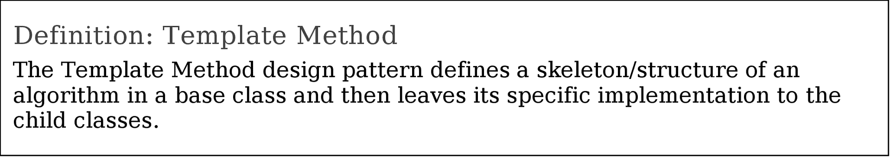

抽象 UML 类图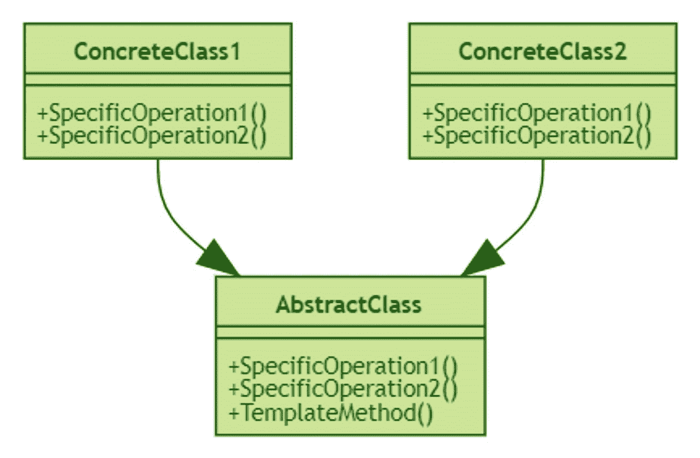

### 参与者

参与此模式的对象有：

- Abstract Class（抽象类）- 定义算法结构，通常使用抽象保护方法和包含算法的公共方法。
- Concrete Class（具体类）- 继承抽象类，并在定义的算法中实现抽象方法。

## 模板方法模式实现

为了引入模板方法设计模式，我们可以在可导航页面类中包含一个抽象方法。其子类可以实现它，并等待其特定的元素显示。

```csharp
public abstract class NavigatableEShopPage : EShopPage
{
    protected NavigatableEShopPage(Driver driver) : base(driver) {}

    protected abstract string Url { get; }

    public void Open()
    {
        Driver.GoToUrl(Url);
        WaitForPageLoad();
    }

    protected abstract void WaitForPageLoad();
}
```

这是主页的实现方式：

```csharp
public class MainPage : NavigatableEShopPage
{
    public MainPage(Driver driver) : base(driver) {}

    protected override string Url => "http://demos.bellatrix.solutions/";

    private Element AddToCartFalcon9 => Driver.FindElement(By.CssSelector("[data-product_id*='28']"));
    private Element ViewCartButton => Driver.FindElement(By.CssSelector("[class*='added_to_cart wc-forward']"));

    public void AddRocketToShoppingCart()
    {
        Open();
        AddToCartFalcon9.Click();
        ViewCartButton.Click();
    }

    public void AssertProductBoxLink(string name, string expectedLink)
    {
        string actualLink = GetProductBoxByName(name).GetAttribute("href");
        Assert.AreEqual(expectedLink, actualLink);
    }

    protected override void WaitForPageLoad()
    {
        AddToCartFalcon9.WaitToExists();
    }

    private Element GetProductBoxByName(string name)
    {
        return Driver.FindElement(By.XPath($"//h2[text()='{name}']/parent::a[1]"));
    }
}
```

我们实现了抽象方法`WaitForPageLoad`，并在执行其他操作之前等待`AddToCartFalcon9`链接可见。此外，我们需要在`Element`类及其子类中定义`WaitToExists`方法。

```csharp
public override void WaitToExists()
{
    var webDriverWait = new WebDriverWait(_webDriver, TimeSpan.FromSeconds(30));
    webDriverWait.Until(ExpectedConditions.ElementExists(By));
}
```

该方法与我们在`FindElement`和`FindElements`方法中使用的方法类似。区别在于，我们只根据指定的定位器等待元素出现，而不返回它。

将基页面类拆分为两个独立的类使得我们的测试具有更高的可维护性。但为什么呢？可维护性与修复损坏测试用例以及为新网站功能添加新逻辑的未来成本有关。我们做的重构将简化新逻辑的添加。如果我们保留之前的实现，这意味着每次你需要更改导航逻辑时，你都会修改单个基类，但同时会影响所有不应该被直接打开的页面。这些更改也帮助我们更密切地遵循单一责任原则。

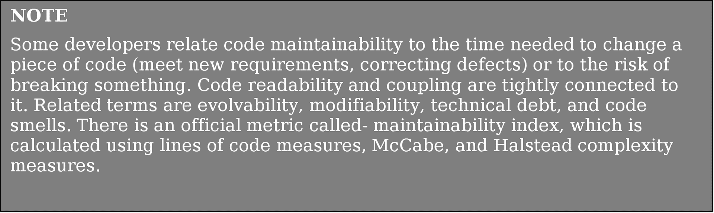

### 使用组合原则

你可能注意到的另一个可维护性问题是，目前我们的页面对象还没有精确遵循单一责任原则。它们有多个更改的原因。如果我们需要由于设计更改更新元素定位器，或者确定新的页面操作，或者添加新的断言方法，会发生什么？我们至少有三个理由来更改页面类。既然我们已经处理了导航问题，可以在这里进行类似的操作。

然而，我们不能创建更多的基类，因为这是不切行的，但我们可以利用组合。我们在上一章引入网页部分（web sections）时已经研究过什么是组合。我们在这里再次使用它来分离操作、元素、断言，并使我们的页面对象更具维护性——通过给它们一个单一的更改理由。

### 未重构版本：没有组合的页面对象

让我们简单看看现在没有组合的页面看起来是什么样子的。

```csharp
public class CartPage : NavigatableEShopPage
{
    public CartPage(Driver driver) : base(driver)
    {
        BreadcrumbSection = new BreadcrumbSection(Driver);
    }

    public BreadcrumbSection BreadcrumbSection { get; }

    protected override string Url => "http://demos.bellatrix.solutions/cart/";

    private Element CouponCodeTextField => Driver.FindElement(By.Id("coupon_code"));
    private Element ApplyCouponButton => Driver.FindElement(By.CssSelector("[value*='Apply coupon']"));
    private Element QuantityBox => Driver.FindElement(By.CssSelector("[class*='input-text qty text']"));
    private Element UpdateCart => Driver.FindElement(By.CssSelector("[value*='Update cart']"));
    private Element MessageAlert => Driver.FindElement(By.CssSelector("[class*='woocommerce-message']"));
    private Element TotalSpan => Driver.FindElement(By.XPath("//*[@class='order-total']//span"));
    private Element ProceedToCheckout => Driver.FindElement(By.CssSelector("[class*='checkout-button button alt wc-forward']"));

    public void ApplyCoupon(string coupon)
    {
        CouponCodeTextField.TypeText(coupon);
        ApplyCouponButton.Click();
        Driver.WaitForAjax();
    }

    public void IncreaseProductQuantity(int newQuantity)
    {
        QuantityBox.TypeText(newQuantity.ToString());
        UpdateCart.Click();
        Driver.WaitForAjax();
    }

    public void ClickProceedToCheckout()
    {
        ProceedToCheckout.Click();
        Driver.WaitUntilPageLoadsCompletely();
    }

    public string GetTotal()
    {
        return TotalSpan.Text;
    }

    public string GetMessage()
    {
        return MessageAlert.Text;
    }

    protected override void WaitForPageLoad()
    {
        CouponCodeTextField.WaitToExists();
    }
}
```

首先，我们定义了在操作和断言方法中使用的元素。之后，页面包含了可以在网页上执行的所有操作和断言。为了使用组合，我们将元素和断言移动到独立的类中，稍后通过属性暴露。

### 元素和断言 - 组合实现

好奇重构后主页会变成什么样吗？我们创建一个包含所有元素的独立类。这是它的唯一职责。

```csharp
public class MainPageElements
{
    private readonly Driver _driver;

    public MainPageElements(Driver driver)
    {
        _driver = driver;
    }

    public Element AddToCartFalcon9 => driver.FindElement(By.CssSelector("[data-product_id*='28']"));
    public Element ViewCartButton => driver.FindElement(By.CssSelector("[class*='added_to_cart wc-forward']"));

    public Element GetProductBoxByName(string name)
    {
        return driver.FindElement(By.XPath($"//h2[text()='{name}']/parent::a[1]"));
    }
}
```

如果我们需要更改元素定位器，将在在这里进行。这显著提高了元素的可维护性，因为元素文件包含的代码更少。同样，为断言创建一个独立的类。相同的说明也适用于它。

```csharp
public class MainPageAssertions
{
    private readonly MainPageElements _elements;

    public MainPageAssertions(MainPageElements elements)
    {
        _elements = elements;
    }

    public void AssertProductBoxLink(string name, string expectedLink)
    {
        string actualLink = _elements.GetProductBoxByName(name).GetAttribute("href");
        Assert.AreEqual(expectedLink, actualLink);
    }
}
```

现在在主类中，将前两个暴露为属性。

```csharp
public class MainPage : NavigatableEShopPage
{
    public MainPage(Driver driver) : base(driver)
    {
        Elements = new MainPageElements(driver);
        Assertions = new MainPageAssertions(Elements);
    }

    public MainPageElements Elements { get; }
    public MainPageAssertions Assertions { get; }

    protected override string Url => "http://demos.bellatrix.solutions/";

    public void AddRocketToShoppingCart()
    {
        Open();
        Elements.AddToCartFalcon9.Click();
        Elements.ViewCartButton.Click();
    }

    protected override void WaitForPageLoad()
    {
        Elements.AddToCartFalcon9.WaitToExists();
    }
}
```

你可以看到，现在类中只剩下操作方法。我们使用`Elements`属性访问元素，使用`Assertions`属性访问断言方法。

### 在测试中使用组合


这是我们更改前的代码样子。

```csharp
public class SectionsTests{
    private static Driver _driver;
    private static MainPage _mainPage;
    private static CartPage _cartPage;
    [ClassInitialize]
    public static void ClassInitialize(TestContext testContext){
        _driver = new LoggingDriver(new WebDriver());
        _driver.Start(Browser.Chrome);
        _mainPage = new MainPage(_driver);
        _cartPage = new CartPage(_driver);
    }
    [ClassCleanup]
    public static void ClassCleanup(){
        _driver.Quit();
    }
    [TestMethod]
    public void Falcon9LinkAddsCorrectProduct(){
        _mainPage.Open();
        _mainPage.AssertProductBoxLink("Falcon 9", "http://demos.bellatrix.solutions/product-9/");
    }
    [TestMethod]
    public void SaturnVLinkAddsCorrectProduct(){
        _mainPage.Open();
        _mainPage.AssertProductBoxLink("Saturn V", "http://demos.bellatrix.solutions/product/saturn-v/");
    }
}
```

你可以看到，我们直接从页面访问断言方法和公开的元素。这是我们访问它们的方式：

```csharp
public class SectionsTests{
    private static Driver _driver;
    private static MainPage _mainPage;
    private static CartPage _cartPage;
    [ClassInitialize]
    public static void ClassInitialize(TestContext testContext){
        _driver = new LoggingDriver(new WebDriver());
        _driver.Start(Browser.Chrome);
        _mainPage = new MainPage(_driver);
        _cartPage = new CartPage(_driver);
    }
    [ClassCleanup]
    public static void ClassCleanup(){
        _driver.Quit();
    }
    [TestMethod]
    public void Falcon9LinkAddsCorrectProduct(){
        _mainPage.Open();
        _mainPage.AssertProductBoxLink("Falcon 9", "http://demos.bellatrix.solutions/product-9/");
    }
    [TestMethod]
    public void SaturnVLinkAddsCorrectProduct(){
        _mainPage.Open();
        _mainPage.AssertProductBoxLink("Saturn V", "http://demos.bellatrix.solutions/product/saturn-v/");
    }
}
```

重构后，我们需要使用`Assertions`属性来访问断言方法，使用`Elements`属性访问元素。通过这些更改，可读性稍微下降，但编写体验得到了提高，因为当你在页面实例名称后输入`.`时，可用选项列表现在显著减少。通过遵循元素的命名约定，你将始终知道使用哪些属性来访问它们。


## 重用工作流——外观模式

在章的第二部分，我们将关注自动化测试中的另一个常见问题——工作流。工作流是在几乎相同顺序执行的操作和断言。在我们的购物车案例中，我们有购买工作流。一个测试验证产品 1，另一个产品 2，再一个折扣券——可以持续进行。一段时间内，我们可能需要支持两种购物车，以决定哪种设计更适合我们的用户。

### 工作流的原始实现

我们有两个具有相同工作流但使用不同数据的独立测试。

```csharp
public class WorkflowTests{
    private static Driver _driver;
    private static MainPage _mainPage;
    private static CartPage _cartPage;
    private static CheckoutPage _checkoutPage;
    [ClassInitialize]
    public static void ClassInitialize(TestContext testContext){
        _driver = new LoggingDriver(new WebDriver());
        _driver.Start(Browser.Chrome);
        _mainPage = new MainPage(_driver);
        _cartPage = new CartPage(_driver);
        _checkoutPage = new CheckoutPage(_driver);
    }
    [ClassCleanup]
    public static void ClassCleanup(){
        _driver.Quit();
    }
    [TestMethod]
    public void PurchaseFalcon9WithoutFacade(){
        _mainPage.Open();
        _mainPage.AddRocketToShoppingCart("Falcon 9");
        _cartPage.ApplyCoupon("happybirthday");
        _cartPage.CartPageAssertions.AssertCouponAppliedSuccessfully();
        _cartPage.IncreaseProductQuantity(2) ;
        _cartPage.CartPageAssertions.AssertTotalPrice("14.00€");
        var purchaseInfo = new PurchaseInfo{
            Email = "info@berlinspaceflowers.com",
            FirstName = "Anton",
            LastName = "Angelov",
            Company = "Space Flowers",
            Country = "Germany",
            Address1 = "Willi Brandt Avenue",
            Address2 = "Lützowplatz 17",
            City = "Berlin",
            Zip = "10115",
            Phone = "+00498889281",
        };
        _checkoutPage.FillBillingInfo(purchaseInfo);
        _checkoutPage.CheckoutPageAssertions.AssertOrderReceived();
    }
    [TestMethod]
    public void PurchaseSaturnVWithoutFacade(){
        _mainPage.Open();
        _mainPage.AddRocketToShoppingCart("Saturn V");
        _cartPage.ApplyCoupon("happybirthday");
        _cartPage.CartPageAssertions.AssertCouponAppliedSuccessfully();
        _cartPage.IncreaseProductQuantity(3);
        _cartPage.CartPageAssertions.AssertTotalPrice("355.00€");
        var purchaseInfo = new PurchaseInfo{
            Email = "info@berlinspaceflowers.com",
            FirstName = "John",
            LastName = "Atanasov",
            Company = "Space Flowers",
            Country = "Germany",
            Address1 = "Willi Brandt Avenue",
            Address2 = "Lützowplatz 17",
            City = "Berlin",
            Zip = "10115",
            Phone = "+00498889281",
        };
        _checkoutPage.FillBillingInfo(purchaseInfo);
        _checkoutPage.CheckoutPageAssertions.AssertOrderReceived();
    }
}
```

如果工作流发生变化，例如我们将折扣步骤移动到最后一个页面或添加新的折扣类型，我们需要遍历代码并重新排列所有测试的步骤。我们可以通过使用外观模式以更优雅的方式解决这个问题。

### 外观设计模式


### 抽象 UML 类


该模式的参与者有：

- **外观类**：用户用于访问简化 API 的主类。它通常包含使用依赖类的公共方法。
- **依赖类**：它们持有稍后在外观中特定逻辑。它们通常作为参数用于外观。

### 外观模式实现

在我们的场景中，我们可以为购买创建一个外观。它将包含一个名为`PurchaseItem`的方法，该方法将按正确顺序调用页面。

```csharp
public class PurchaseFacade{
    private readonly MainPage _mainPage;
    private readonly CartPage _cartPage;
    private readonly CheckoutPage _checkoutPage;
    public PurchaseFacade(MainPage mainPage, CartPage cartPage, CheckoutPage checkoutPage){
        _mainPage = mainPage;
        _cartPage = cartPage;
        _checkoutPage = checkoutPage;
    }
    public void PurchaseItem(string rocketName, string couponName, int quantity, string expectedPrice, PurchaseInfo purchaseInfo){
        _mainPage.Open();
        _mainPage.AddRocketToShoppingCart(rocketName);
        _cartPage.ApplyCoupon(couponName);
        _cartPage.CartPageAssertions.AssertCouponAppliedSuccessfully();
        _cartPage.IncreaseProductQuantity(quantity);
        _cartPage.CartPageAssertions.AssertTotalPrice(expectedPrice);
        _cartPage.CartPageElements.ClickProceedCheckout();
        _checkoutPage.FillBillingInfo(purchaseInfo);
        _checkoutPage.CheckoutPageAssertions.AssertOrderReceived();
    }
}
```

我们再次使用组合来持有页面。在构造函数中初始化页面对象。此外，工作流所需的所有数据是以外观方法的形式提供的。


此外我们在函数内部进行断言，这似乎违反了单一责任原则。然而，在特定情况下，我们定义了测试结构，这是方法的主要目的。一个更好的名字可能是`VerifyPurchaseOfItem`或类似的。我更倾向于让我的外观方法更简洁，因为我们在某些操作之后执行验证，而不是在测试结束时。让我们如果我们使用新的外观，测试会变成什么样。


```csharp
public class FacadeTests{
    private static Driver _driver;
    private static MainPage _mainPage;
    private static CartPage _cartPage;
    private static CheckoutPage _checkoutPage;
    private static PurchaseFacade _purchaseFacade;
    [ClassInitialize]
    public static void ClassInitialize(TestContext testContext){
        _driver = new LoggingDriver(new WebDriver());
        _driver.Start(Browser.Chrome);
        _mainPage = new MainPage(_driver);
        _cartPage = new CartPage(_driver);
        _checkoutPage = new CheckoutPage(_driver);
        _purchaseFacade = new PurchaseFacade(_mainPage, _cartPage, _checkoutPage);
    }
    [ClassCleanup]
    public static void ClassCleanup(){
        _driver.Quit();
    }
    [TestMethod]
    public void PurchaseFalcon9WithFacade(){
        var purchaseInfo = new PurchaseInfo{
            Email = "info@berlinspaceflowers.com",
            FirstName = "Anton",
            LastName = "Angelov",
            Company = "Space Flowers",
            Country = "Germany",
            Address1 = "Willi Brandt Avenue",
            Address2 = "Lützowplatz 17",
            City = "Berlin",
            Zip = "10115",
            Phone = "+00498889281",
        };
        _purchaseFacade.PurchaseItem("Falcon 9", "happybirthday", 2, "114.00€", purchaseInfo);
    }
    [TestMethod]
    public void PurchaseSaturnVWithFacade(){
        var purchaseInfo = new PurchaseInfo{
            Email = "info@berlinspaceflowers.com",
            FirstName = "John",
            LastName = "Atanasov",
            Company = "Space Flowers",
            Country = "Germany",
            Address1 = "Willi Brandt Avenue",
            Address2 = "Lützowplatz 17",
            City = "Berlin",
            Zip = "10115",
            Phone = "+00498889281",
        };
        _purchaseFacade.PurchaseItem("Saturn V", "happybirthday", 3, "355.00€", purchaseInfo);
    }
}
```

你可以看到，它们变短了，我们能够隐藏一些低级细节。这可能是好事也可能是坏事。一些工程师可能会说这让可读性变差，这可能是的。如果你想查看确切的工作流，现在需要打开外观类。然而，我们极大地提高了可维护性，因为如果我们需要对工作流进行更改，可以在一个地方进行。另一个改进是新测试的创建是直观的。

## 外观结合模板方法模式

在上一节中，我们看到了如何重用测试工作流。然而，可能存在这种解决方案并不充分的情况。假设我们有目前的火箭购物车。但是一两年后，我们决定重新设计它。工作流将保持不变，但由于可以使用另一个系统，应用优惠券或添加产品可能会稍微变化。一段时间内，我们可能需要支持两种购物车，以决定哪种设计更适合我们的用户。我们如何准备此类事件呢？我们可以结合本章讨论的两种模式——模板方法和外观。

### 使用模板方法的购买外观

与其创建一个带有依赖页面的外观，不如创建一个使用模板方法定义工作流的抽象外观类。稍后我们可以创建外观的实现——一个使用新的页面对象，另一个使用旧的。

```csharp
public abstract class PurchaseFacade{
    public void PurchaseItem(string rocketName, string couponName, int quantity, string expectedPrice, PurchaseInfo purchaseInfo){
        AddItemToShoppingCart(rocketName);
        ApplyCoupon(couponName);
        AssertCouponAppliedSuccessfully();
        IncreaseProductQuantity(quantity);
        AssertTotalPrice(expectedPrice);
        ProceedToCheckout();
        FillBillingInfo(purchaseInfo);
        AssertOrderReceived();
    }
    protected abstract void AddItemToShoppingCart(string itemName);
    protected abstract void ApplyCoupon(string couponName);
    protected abstract void AssertCouponAppliedSuccessfully();
    protected abstract void IncreaseProductQuantity(int quantity);
    protected abstract void AssertTotalPrice(string expectedPrice);
    protected abstract void ProceedToCheckout();
    protected abstract void FillBillingInfo(PurchaseInfo purchaseInfo);
    protected abstract void AssertOrderReceived();
}
```

像外观中一样，工作流是在公共方法`PurchaseItem`中定义的，但不是调用页面对象，而是调用抽象的模板方法。

### 具体外观实现

对于旧购物车和新购物车，我们将有一个上述`PurchaseFacade`的独立实现。让我们将旧购物车实现命名为`PurchaseFirst`。

```csharp
public class PurchaseFirst : PurchaseFacade {
    private readonly MainPage _mainPage;
    private readonly CartPage _cartPage;
    private readonly CheckoutPage _checkoutPage;
    public PurchaseFirst(MainPage mainPage, CartPage cartPage, CheckoutPage checkoutPage){
        _mainPage = mainPage;
        _cartPage = cartPage;
        _checkoutPage = checkoutPage;
    }
    protected override void AddItemToShoppingCart(string itemName){
        _mainPage.Open();
        _mainPage.AddRocketToShoppingCart(itemName);
    }
    protected override void ApplyCoupon(string couponName){
        _cartPage.ApplyCoupon(couponName);
    }
    protected override void AssertCouponAppliedSuccessfully(){
        _cartPage.CartPageAssertions.AssertCouponAppliedSuccessfully();
    }
    protected override void IncreaseProductQuantity(int quantity){
        _cartPage.IncreaseProductQuantity(quantity);
    }
    protected override void AssertTotalPrice(string expectedPrice){
        _cartPage.CartPageAssertions.AssertTotalPrice(expectedPrice);
    }
    protected override void ProceedToCheckout(){
        _cartPage.CartPageElements.ClickProceedCheckout();
    }
    protected override void FillBillingInfo(PurchaseInfo purchaseInfo){
        _checkoutPage.FillBillingInfo(purchaseInfo);
    }
    protected override void AssertOrderReceived(){
        _checkoutPage.CheckoutPageAssertions.AssertOrderReceived();
    }
}
```

## 复习问题

1. 你能解释什么是测试可维护性吗？
2. 使用什么指标来衡量可维护性？
3. 组合和继承之间的区别是什么？
4. 模板方法设计模式的参与者有哪些？
5. 外观模式设计模式的作用是什么？

## 延伸阅读

- 模板方法 C# - [`www.dofactory.com/net/template-method-design-pattern`](https://www.dofactory.com/net/template-method-design-pattern)
- 自动化测试中的外观设计模式 - [`www.automatetheplanet.com/facade-design-pattern/`](https://www.automatetheplanet.com/facade-design-pattern/)
- 自动化测试中改进的外观设计模式 v2.0 - [`www.automatetheplanet.com/improved-facade-design-pattern/`](https://www.automatetheplanet.com/improved-facade-design-pattern/)
- 对象-元素访问样式 - WebDriver C# - [`www.automatetheplanet.com/page-objects-elements-access-styles/`](https://www.automatetheplanet.com/page-objects-elements-access-styles/)

# 第 6 章 API 可用性

在上一章中，我们讨论了如何提高测试的可维护性和可重用性。现在，我们将研究如何简化框架中所有这些库类的使用。我们将学习如何让测试库 API 变得易于使用、学习和理解。首先，我们将应用`Interface Segregation`原则，将`driver` API拆分为更小但更专注于特定功能的部分。

之后，我们将讨论如何通过`Singleton`（单例）设计模式或`App`设计模式来使用已经开发的页面对象的不同方法。我们还将查看另一种被称为`Fluent API`（流式 API）或链式方法的有趣方法。在本节的最后，我们将讨论将页面对象的元素暴露给测试库用户是否是一个好主意。

本章将涵盖以下主题：

- 针对`WebDriver`装饰器的接口隔离原则
- 通过`Singleton`设计模式使用页面对象
- 用于创建页面对象的`App`设计模式
- `Fluent API`页面对象
- 页面对象元素访问样式

## WebDriver 装饰器的接口隔离原则

在之前的章节中，我们创建了与`WebDriver`相关的辅助类以稳定和优化我们的测试。我们使用了`Decorator`设计模式来实现这一点。为什么不重新检查当前类包含的内容呢？

### WebDriver 装饰器的当前实现

如果我们检查方法的名称，我们会发现有几组用于查找元素和控制浏览器动作的方法。然而，我们遗漏了实现其他几个功能。例如，我们需要处理 Cookie 和对话框的方法。随着方法数量的增加，该类的使用将变得越来越困难。

```csharp
public abstract class DriverDecorator : Driver{protected readonly Driver Driver;protected DriverDecorator(Driver driver){Driver = driver;}public override void Start(Browser browser){Driver?.Start(browser);}public override void Quit(){Driver?.Quit();}public override void GoToUrl(string url){Driver?.GoToUrl(url);}public override Element FindElement(By locator){return Driver?.FindElement(locator);}public override List<Element> FindElements(By locator){return Driver?.FindElements(locator);}public override void WaitForAjax(){Driver?.WaitForAjax();}public override void WaitUntilPageLoadsCompletely(){Driver?.WaitUntilPageLoadsCompletely();}}
```

下面的代码块展示了我们到目前为止是如何在页面对象中使用`Driver`装饰器的。

```csharp
public class CartPage : NavigatableEShopPage{public CartPage(Driver driver): base(driver){BreadcrumbSection = new BreadcrumbSection(driver);Elements = new CartPageElements(driver);}public BreadcrumbSection BreadcrumbSection { get; }public CartPageElements Elements { get; }protected override string Url=>"http://demos.bellatrix.solutions/cart/";public void ApplyCoupon(string coupon){Elements.CouponCodeTextField.TypeText(coupon);Elements.ApplyCouponButton.Click();Driver.WaitForAjax();}// rest of the code}
```

如你所见，我们向`Driver`类传递了一个单一实例，并将其用于多个用途——导航到页面、查找元素或控制浏览器。然而，并不是所有的页面都需要导航到页面或控制浏览器。

回想一下`Interface Segregation`原则？——“客户端不应被强制实现它们不使用的接口。与其使用一个臃肿的接口，不如根据方法组使用许多小接口，每个接口服务于一个子模块。”

如果我们想在案例中应用该原则，我们需要将驱动器接口拆分为几个更小的接口。

### 将驱动器接口拆分为更小的接口

上述提到的每组方法都可以移动到单独的接口。因此，我们最终将有五个独立的较小接口：

- 一个用于控制浏览器
- 一个用于导航
- 一个用于查找元素
- 一个用于处理 Cookie
- 一个用于处理对话框


所有这些都可以通过继承组合成一个更大的接口，并且实现将仍然保留在一个地方。让我们创建这些接口。

以下是浏览器操作接口的写法：

```csharp
public interface IBrowserService{
    void WaitForAjax();
    void WaitForPageLoad();
    void Start(Browser browser);
    void Quit();
}
```

对于导航，我们只需要`GoToUrl`方法和`Url`属性。

```csharp
public interface INavigationService{
    void GoToUrl(string url);
    Uri Url { get; }
}
```

有两种方法用于查找元素。

```csharp
public interface IElementFindService{
    Element FindElement(By locator);
    List<Element> FindElements(By locator);
}
```

对于处理 cookie 的新功能，我们需要能够添加、删除和获取 cookie。

```csharp
public interface ICookiesService{
    void AddCookie(string cookieName, string cookieValue, string path = "/");
    void DeleteAllCookies();
    void DeleteCookie(string cookieName);
    List<Cookie> GetAllCookies();
    string GetCookie(string cookieName);
}
```

对话框服务包含一个负责关闭对话框的方法。

```csharp
public interface IDialogService{
    void Handle(DialogButton dialogButton = DialogButton.Ok);
}
```

组合后的`IDriver`接口简单地实现了所有较小的接口。

```csharp
public interface IDriver : INavigationService, IBrowserService, ICookiesService, IElementFindService, IDialogService{}
```

抽象装饰器类`Driver`实现了`IDriver`接口，这意味着由于继承，所有具体的装饰器也应该实现所有较小的接口。

```csharp
public abstract class Driver : IDriver{
    public abstract Uri Url { get; }
    public abstract void Start(Browser browser);
    public abstract void Quit();
    public abstract void GoToUrl(string url);
    public abstract Element FindElement(By locator);
    public abstract List<Element> FindElements(By locator);
    public abstract void WaitForAjax();
    public abstract void WaitUntilPageLoadsCompletely();
}
```

## 在 Page Objects 中使用较小接口

在本节的开头，我们看到了在接口分离之前`Driver`类是如何被使用的。让我们研究一下使用方式发生了什么变化？不再传递整个`Driver`对象，而是仅将需要的接口作为参数传递给页面。

```csharp
public class CartPage : NavigatableEShopPage{
    private readonly IBrowserService _browserService;
    public CartPage(IElementFindService elementFindService, INavigationService navigationService, IBrowserService browserService): base(elementFindService, navigationService){
        _browserService = browserService;
        BreadcrumbSection = new BreadcrumbSection(elementFindService);
        Elements = new CartPageElements(elementFindService);
    }
    public BreadcrumbSection BreadcrumbSection { get; }
    public CartPageElements Elements { get; }
    protected override string Url=>"http://demos.bellatrix.solutions/cart/";
    public void ApplyCoupon(string coupon){
        Elements.CouponCodeTextField.TypeText(coupon);
        Elements.ApplyCouponButton.Click();
        _browserService.WaitForAjax();
    }
    // rest of the code
}
```

基类`NavigatableEShopPage`需要`IElementFindService`和`INavigationService`接口。它们分别用于在页面上查找元素以及导航到页面。然而，如果我们的页面继承自`EShopPage`基类，那么你只需要传递`IElementFindService`接口作为参数，因为我们无法导航到此类页面。此外，在大多数页面中，我们不需要控制浏览器，所以不需要为`IBrowserService`提供实例。尽管如此，在这里我们需要它，因为我们调用了`WaitForAjax`方法。

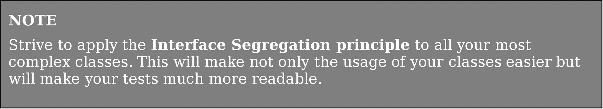

## 通过单例模式使用 Page Objects

在章的剩余部分中，我们将研究使用页面对象的不同方法。回想一下我们到为止在测试中是如何使用它们的好吗？

```csharp
[TestClass]
public class SectionsTests{
    private static Driver _driver;
    private static MainPage _mainPage;
    private static CartPage _cartPage;
    [ClassInitialize]
    public static void ClassInitialize(TestContext testContext){
        _driver = new LoggingDriver(new WebDriver());
        _driver.Start(Browser.Chrome);
        _mainPage = new MainPage(_driver);
        _cartPage = new CartPage(_driver);
    }
    [ClassCleanup]
    public static void ClassCleanup(){
        _driver.Quit();
    }
    [TestMethod]
    public void Falcon9LinkAddsCorrectProduct(){
        _mainPage.Open();
        _mainPage.MainPageAssertions.AssertProductBoxLink("Falcon 9", "http://demos.bellatrix.solutions/product/falcon-9/");
    }
    [TestMethod]
    public void SaturnVLinkAddsCorrectProduct(){
        _mainPage.Open();
        _mainPage.MainPageAssertions.AssertProductBoxLink("Saturn V", "http://demos.bellatrix.solutions/product/saturn-v/");
    }
}
```

在`ClassInitialize`方法中，我们总是启动一个新的浏览器并创建所有页面。页面对象通过测试类中的局部变量共享和使用。现在，我们将讨论使用单例模式的替代方法。

### 单例模式


### 类 UML 类图


### 参与者

参与此模式的类和对象包括：

- **基页面 (Base Page)**：持有一个指向类实例静态属性。它在首次调用该类时创建。无法通过`new`关键字创建。
- **具体页面 (Concrete Page)**：继承基页面。可以通过`Instance`属性在测试中使用，但无法通过`new`关键字创建。

### 单例模式实现

该模式的基本实现需要一个静态变量和一个静态属性。此外，为了确保无法通过`new`关键字初始化，构造函数的访问修符被设置为私有。

#### 基本单例实现

要访问页面，您使用`Instance`属性，由于它是静态的，将在所有测试中共享。由于空检查，实例变量将仅初始化一次。以下代码块展示了如何实现：

```csharp
public class CartPage{
    private static CartPage instance;
    private CartPage(){}
    public static CartPage Instance{
        get{
            if (instance == null){
                instance = new CartPage();
            }
            return instance;
        }
    }
}
// rest of the code
```

然而，这种基本实现并不适用于我们，原因有两个：

- 第一，我们对非静态的`Driver`装饰器接口有依赖。
- 第二，要在我们的每个页面中添加此静态代码会导致过多的代码重复。

为了解决第一个问题，我们可以让`Driver`类也成为单例。为了解决第二个问题，我们可以将单例代码移动到基类中。

## 使 Driver 装饰器单例

将我们的`LoggingDriver`变为单例如何？这样做我们需要像下面的示例一样引入一个静态变量和一个属性：

```csharp
public class LoggingSingletonDriver : DriverDecorator
{
    private static LoggingSingletonDriver instance;
    public static LoggingSingletonDriver Instance
    {
        get
        {
            if (instance == null)
            {
                instance = new LoggingSingletonDriver(new WebDriver());
            }
            return instance;
        }
    }
    private LoggingSingletonDriver(Driver driver) : base(driver){}
    public override void Start(Browser browser)
    {
        Console.WriteLine($"Start browser = {Enum.GetName(typeof(Browser), browser)}");
        driver?.Start(browser);
    }
    // 剩余代码
}
```

## 使基类单例

为了让我们的基类`EShopPage`和`NavigatableEShopPage`变为单例，我们需要稍微复杂的代码。我们需要再次添加静态对，但并将类变为泛型。

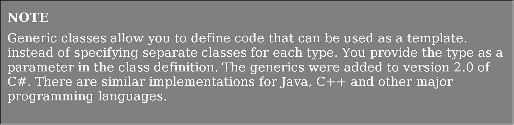

以下是重构后基类`EShopPage`类的样式：

```csharp
public abstract class EShopPage<TPage>
where TPage : EShopPage<TPage>, new()
{
    private static TPage _instance;
    protected readonly IElementFindService ElementFindService;
    protected EShopPage()
    {
        ElementFindService = LoggingSingletonDriver.Instance;
        SearchSection = new SearchSection(LoggingSingletonDriver.Instance);
        MainMenuSection = new MainMenuSection(LoggingSingletonDriver.Instance);
        CartInfoSection = new CartInfoSection(LoggingSingletonDriver.Instance);
    }
    public static TPage Instance
    {
        get
        {
            if (_instance == null)
            {
                _instance = new TPage();
            }
            return _instance;
        }
    }
    public SearchSection SearchSection { get; }
    public MainMenuSection MainMenuSection { get; }
    public CartInfoSection CartInfoSection { get; }
}
```

如所述，我们通过`EShopPage<TPage>`将类标记为泛型，其中`TPage`是继承基类的特定页面类型。通过约束`where TPage : EShopPage<TPage>, new()`，我们告诉编译器只接受继承自`EShopPage`且具有构造函数的类型。在静态`Instance`属性中，首次访问它时我们会初始化静态变量`instance`。

此外，我们在保护构造函数中通过传递单例`Driver`来初始化区域页面对象。这样，我们就不需要将其作为参数传递给构造函数。

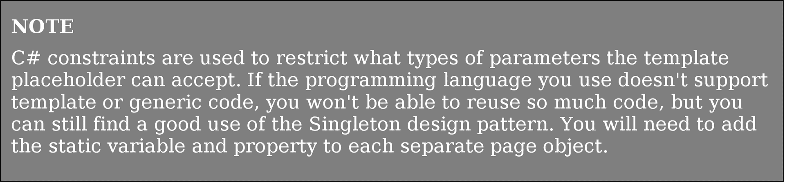

这是我们的页面对象为了使用新基类`NavigatableEShopPage`而需要进行的变化。

```csharp
public class CartPage : NavigatableEShopPage<CartPage>
{
    private readonly IBrowserService _browserService;
    public CartPage()
    {
        _browserService = LoggingSingletonDriver.Instance;
        BreadcrumbSection = new BreadcrumbSection(LoggingSingletonDriver.Instance);
        Elements = new CartPageElements(LoggingSingletonDriver.Instance);
    }
    public BreadcrumbSection BreadcrumbSection { get; }
    public CartPageElements Elements { get; }
    protected override string Url => "http://demos.bellatrix.solutions/cart/";
    // 剩余代码
}
```

与基类一样，在这里我们使用`Driver`装饰器的单例版本，因此我们不需要向构造函数传递任何参数。此外，我们需要将泛型类的类型`TPage`更改为该页面的类型，以便`Instance`属性可以初始化正确的类型。我们通过以下行实现此点——`CartPage : NavigatableEShopPage<CartPage>`。

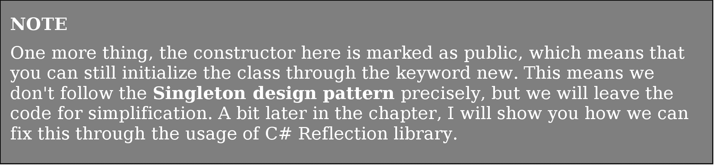

## 线程安全的单例实现

之前的示例不是线程安全的，这意味着在并行执行测试时可能会出现死锁。我将为你提供两种让你的单例类变为线程安全的方法。

第一个版本使用了 C# 的`lock`语句。它确保当一个线程在使用代码的关键区域时，另一个线程不会进入。如果另一个线程尝试进入被锁的代码，它将等待并阻塞对象，直到其被释放。


```csharp
public class CartPage
{
    private static CartPage instance;
    private static readonly object lockObject = new object();
    private CartPage(){}
    public static CartPage Instance
    {
        get
        {
            lock (lockObject)
            {
                if (instance == null)
                {
                    instance = new CartPage();
                }
                return instance;
            }
        }
    }
    // 剩余代码
}
```

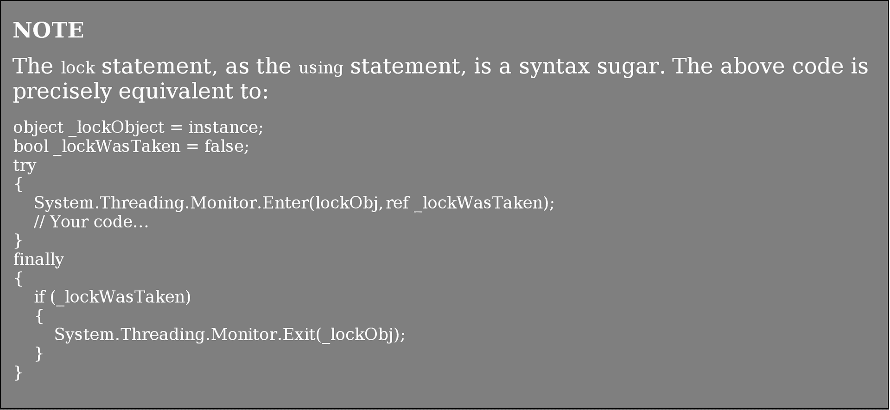

你可以看到，代码并没有锁定`TPage`实例，而是锁定它的内部对象。这样做是为了防止死锁。

实现线程安全单例类的第二种方法是通过泛型类`Lazy<T>`，它节省了部分实现懒性初始化代码。

```csharp
public class CartPage
{
    private static readonly Lazy<CartPage> lazy = new Lazy<CartPage>(()=>new CartPage());
    public static CartPage Instance
    {
        get
        {
            return lazy.Value;
        }
    }
    // 剩余代码
}
```


## 测试中的单例模式用法

在测试中使用单例页面对象是非常直观的。由于不需要在构造函数中调用，`ClassInitialize`方法变得非常简洁。

```csharp
[TestClass]
public class SectionsTests
{
    [ClassInitialize]
    public static void ClassInitialize(TestContext testContext)
    {
        LoggingSingletonDriver.Instance.Start(Browser.Chrome);
    }
    [ClassCleanup]
    public static void ClassCleanup()
    {
        LoggingSingletonDriver.Instance.Quit();
    }
    [TestMethod]
    public void Falcon9LinkAddsCorrectProduct()
    {
        MainPage.Instance.Open();
        MainPage.Instance.Assertions.AssertProductBox("Falcon 9", "http://demos.bellatrix.solutions/product-9/");
    }
    [TestMethod]
    public void SaturnVAddsCorrectProduct()
    {
        MainPage.Instance.Open();
        MainPage.Instance.Assertions.AssertProductBox("Saturn V", "http://demos.bellatrix.solutions/product-saturn-v/");
    }
}
```

我们通过`Instance`属性访问页面。对于项目中的所有测试，它会创建一个页面对象实例。

## 创建对象的 App 设计模式

现在让我们讨论另一种访问对象的方法，称为`App`设计模式。`App`是外观类和工厂类的一种。它提供了一种更简单的使用`Driver`装饰器及其接口的方法。它还会导航到请求页面。`App`类创建的是普通的页面对象，而不是之前创建的单例。

## App 设计模式实现

实现如下：

```csharp
public class App : IDisposable
{
    private readonly Driver _driver;
    private bool _disposed = false;
    public App(Browser browserType = Browser.Chrome)
    {
        _driver = new LoggingDriver(new WebDriver());
        _driver.Start(browserType);
        BrowserService = _driver;
        CookiesService = _driver;
        DialogService = _driver;
    }
    public IBrowserService BrowserService { get; }
    public ICookiesService CookiesService { get; }
    public IDialogService DialogService { get; }
    public TPage Create<TPage>() where TPage : EShopPage
    {
        var constructor = typeof(TPage).GetTypeInfo().GetConstructors(BindingFlags.NonPublic | BindingFlags.Instance).FirstOrDefault();
        var page = constructor?.Invoke(new object[] { _driver }) as TPage;
        return page;
    }
    public TPage GoTo<TPage>() where TPage : NavigatableEShopPage
    {
        var constructor = typeof(TPage).GetTypeInfo().GetConstructors(BindingFlags.NonPublic | BindingFlags.Instance).FirstOrDefault();
        var page = constructor?.Invoke(new object[] { _driver }) as TPage;
        page?.Open();
        return page;
    }
    public void Dispose()
    {
        Dispose(true);
        GC.SuppressFinalize(this);
    }
    protected virtual void Dispose(bool disposing)
    {
        if (_disposed)
        {
            _driver.Quit();
        }
        _disposed = true;
    }
}
```

上述代码有几个有趣的部分。首先，我们持有一个`Driver`装饰器的私有实例，我们在构造函数中使用它启动浏览器。我们只通过公共属性暴露`IBrowserService`、`ICookiesService`和`IDialogService`。导航和查找元素的服务没有暴露，因为它们是由页面对象自行导航的。

这允许我们在`using`语句中使用`App`类，在结束时浏览器会自动关闭。如果使用`using`语句，代码如下：

```csharp
using (var app = new App())
{
    var mainPage = app.GoTo<MainPage>();
    mainPage.AddRocketToShoppingCart();
    var cartPage = app.GoTo<CartPage>();
    cartPage.ApplyCoupon("happybirthday").AssertMessageNotification("Coupon applied successfully.").IncreaseProductQuantity(2).AssertTotal("114.00€");
}
```

从 C# 8.0 开始，代码可以更短：

```csharp
using var app = new App();
var mainPage = app.GoTo<MainPage>();
mainPage.AddRocketToShoppingCart();
var cartPage = app.GoTo<CartPage>();
cartPage.ApplyCoupon("happybirthday").AssertMessageNotification("Coupon applied successfully.").IncreaseProductQuantity(2).AssertTotal("114.00€");
```

`using`语句是 C# 编译器提供的语法糖。编译后生成的代码类似于：

```csharp
var app = new App();
try
{
    // 剩余代码
}
finally
{
    if (app != null)
    {
        ((IDisposable)app).Dispose();
    }
}
```


`Create`和`GoTo`方法是以泛型形式实现的。`Create`和`GoTo`方法之间的唯一区别是前者只是创建并返回页面实例，而后者在做相同的同时还导航到页面。


我们使用 C# Reflection API 获取给定页面的私有构造函数，然后通过`Invoke`方法创建。

 如前节所述，你可以这样重构单例对象，使其具有私有构造函数。当你将访问修饰符更改为`private`时，你需要使用上述 Reflection API 来创建泛型。

## 测试中的 App 使用

与单例装饰器和页面对象一样，`ClassInitialize`方法只有一行代码。其他方法也更加简洁。

```csharp
[TestClass]
public class SectionsTests
{
    private static App _app;
    [ClassInitialize]
    public static void ClassInitialize(TestContext testContext)
    {
        _app = new App();
    }
    [ClassCleanup]
    public static void ClassCleanup()
    {
        _app.Dispose();
    }
    [TestMethod]
    public void CompletePurchase_WhenNewClient()
    {
        var mainPage = _app.GoTo<MainPage>();
        mainPage.AddRocketToShoppingCart();
        var cartPage = _app.GoTo<CartPage>();
        cartPage.ApplyCoupon("happybirthday").AssertMessageNotification("Coupon applied successfully.").IncreaseProductQuantity(2).AssertTotal("114.00€");
    }
}
```

`Assertions.AssertProductBox("Falcon 9", "http://demos.bellatrix.solutions/product-9/");`

## 流式 API 实现 (Fluent API)

我们将对页面对象进行一些更改以实现`Fluent API`。首先，每个方法将返回页面本身。接下来，我们将`elements`属性设为私有，仅供页面本身使用。最后，我们将断言方法移动到页面本身。为了让代码最终简洁且易读，我们牺牲了“单一职责”原则。

```csharp
public class CartPage : NavigatableEShopPage
{
    private readonly CartPageElements _elements;
    public CartPage(Driver driver) : base(driver)
    {
        BreadcrumbSection = new SearchSection(driver);
        _elements = new CartPageElements(driver);
    }
    public BreadcrumbSection BreadcrumbSection { get; }
    protected override string Url => "http://demos.bellatrix.solutions/cart/";
    public CartPage ApplyCoupon(string coupon)
    {
        _elements.CouponCodeTextField.TypeText(coupon);
        _elements.ApplyCouponButton.Click();
        Driver.WaitForAjax();
        return this;
    }
    public CartPage IncreaseProductQuantity(int newQuantity)
    {
        _elements.QuantityBox.TypeText(newQuantity.ToString());
        _elements.UpdateCart.Click();
        Driver.WaitForAjax();
        return this;
    }
    public CartPage ProceedToCheckout()
    {
        _elements.ProceedToCheckout.Click();
        Driver.WaitUntilPageCompletely();
        return this;
    }
    public CartPage AssertTotal(string expectedTotal)
    {
        Assert.AreEqual(_elements.TotalSpan.Text, expectedTotal);
        return this;
    }
    public CartPage AssertMessage(string expectedMessage)
    {
        Assert.AreEqual(_elements.MessageAlert.Text, expectedMessage);
        return this;
    }
    protected override void WaitForElementToDisplay()
    {
        _elements.CouponCodeTextField.WaitToExists();
    }
}
```

流式 API 通常通过方法链（方法级联）实现。

## 在测试中使用流式 API

这是我们通过结合`Fluent API`和`App`设计模式时，测试看起来的样子：

```csharp
[TestClass]
public class SectionsTests
{
    private static App _app;
    [ClassInitialize]
    public static void ClassInitialize(TestContext testContext)
    {
        _app = new App();
    }
    [ClassCleanup]
    public static void ClassCleanup()
    {
        _app.Dispose();
    }
    [TestMethod]
    public void CompletePurchase_WhenNewClient()
    {
        var mainPage = _app.GoTo<MainPage>();
        mainPage.AddRocketToShoppingCart();
        var cartPage = _app.GoTo<CartPage>();
        cartPage.ApplyCoupon("happybirthday").AssertMessageNotification("Coupon applied successfully.").IncreaseProductQuantity(2).AssertTotal("114.00€");
    }
}
```

此外，请记住你可以将`Fluent API`与`Singleton`和`App`设计结合起来。


### 问题


1. 将`WebDriver`接口拆分为更小的接口有什么好处？

2. 你如何让一个类成为单例模式？

3. `App`设计模式的主要目的是什么？

4. 你需要对普通的页面对象（page object）进行哪些更改以便使用`Fluent API`（流式 API）？

5. 定义测试中访问元素的三个方法？

6. 什么是`Vanilla WebDriver`？

7. 什么是泛型类和方法？

## 扩展阅读

- 自动化测试中的单例模式
- 页面对象- 部分类 - [`huddle.eurostarsoftwaretesting.com/how-to-selenium-partial-classes/`](https://huddle.eurostarsoftwaretesting.com/how-to-selenium-partial-classes/)
- `App`设计模式- `WebDriver` - [`www.automatetheplanet.com/page-objects-app-design-pattern/`](https://www.automatetheplanet.com/page-objects-app-design-pattern/)
- 自动化测试中的流式 API - [`www.automatetheplanet.com/fluent-page-object-pattern/`](https://www.automatetheplanet.com/fluent-page-object-pattern/)
- 页面对象- 部分类 流式 API- `WebDriver` - [`www.automatetheplanet.com/page-objects-partial-classes-fluent-api/`](https://www.automatetheplanet.com/page-objects-partial-classes-fluent-api/)
- 页面对象- 元素访问样式- `WebDriver` - [`www.automatetheplanet.com/page-objects-elements-access-styles/`](https://www.automatetheplanet.com/page-objects-elements-access-styles/)
- `lock`语句 (C# 参考) - [`docs.microsoft.com/en-us/dotnet/csharp/language-reference/keywords/lock-statement`](https://docs.microsoft.com/en-us/dotnet/csharp/language-reference/keywords/lock-statement)
- `Lazy<T>`类 - [`docs.microsoft.com/en-us/dotnet/api/system.lazy-1?view=netframework-4.8`](https://docs.microsoft.com/en-us/dotnet/api/system.lazy-1?view=netframework-4.8)
- 控制反转容器和依赖注入模式 - [`www.martinfowler.com/articles/injection.html`](https://www.martinfowler.com/articles/injection.html)
- `using`语句 (C# 参考) - [`docs.microsoft.com/en-us/dotnet/csharp/language-reference/keywords/using-statement`](https://docs.microsoft.com/en-us/dotnet/csharp/language-reference/keywords/using-statement)
- 实现 `Dispose`方法 - [`docs.microsoft.com/en-us/dotnet/standard/garbage-collection/implementing-dispose`](https://docs.microsoft.com/en-us/dotnet/standard/garbage-collection/implementing-dispose)

# 第 7 章 在在你的测试库中构建扩展性

在上一章中，我们讨论了如何简化所有这些框架库类的使用。我们应用了接口隔离（`Interface Segregation`）原则，将庞大的`WebDriver`接口拆分为更小、更易使用的组件。我们还使用了单例（`Singleton`）和`App`设计模式来提高框架 API 的易用性。

在本章中，我们将讨论一个可能更重要的主题——如何在遵循开闭原则（`Open/Closed`）的同时，让框架代码更容易修改和自定义。我们将查看策略（`Strategy`）设计模式如何帮助我们为元素定位和等待构建此类扩展性。在章节结束时，你将读到现有的`Vanilla WebDriver`功能，它允许你在`WebDriver`执行流的各个点添加并执行自定义代码。

本章将涵盖以下主题：

* 通过`Strategy`设计模式构建元素查找的扩展性
* 通过`Strategy`设计模式构建元素等待的扩展性
* 通过`EventFiringWebDriver`添加扩展性点

## 通过策略设计模式构建元素查找的扩展性

如所述，我们将研究如何通过遵循开闭原则使 Web 元素的查找更具扩展性。首先，我们将查看`Vanilla WebDriver`中标准的元素定位方式并讨论其源代码。之后，我们将使用`Strategy`设计模式在我们的测试自动化框架中构建这种扩展性。

### Vanilla WebDriver 的元素查找

下面，你可以看到在`Vanilla WebDriver`中查找元素的标准方法。

```csharp
IWebDriver _webDriver = new ChromeDriver(Environment.CurrentDirectory);
IWebElement button = _webDriver.FindElement(By.Id("buttonId"));
```

要找到元素，我们需要调用`FindElement`方法并传入`By`类的一些静态方法作为参数。在这种情况下，我们使用`Id`方法，它接受一个参数——Web 元素的 ID。如你所知，有许多此类方法，例如 - `XPath`、`TagName`、`ClassName`等。让我们看看`By`类的完整源代码。

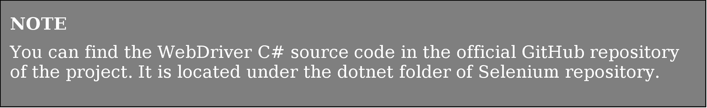

```csharp
[Serializable]
public class By
{
    public static By Id(string idToFind)
    {
        // method's code
    }
    public static By LinkText(string linkTextToFind)
    {
        // method's code
    }
    public static By Name(string nameToFind)
    {
        // method's code
    }
    public static By XPath(string xpathToFind)
    {
        // method's code
    }
    public static By ClassName(string classNameToFind)
    {
        // method's code
    }
    public static By PartialLinkText(string linkTextToFind)
    {
        // method's code
    }
    public static By TagName(string tagNameToFind)
    {
        // method's code
    }
    public static By CssSelector(string cssSelectorToFind)
    {
        // method's code
    }
    public virtual IWebElement FindElement(ISearchContext context)
    {
        return this.FindElementMethod(context);
    }
    public virtual ReadOnlyCollection<IWebElement> FindElements(ISearchContext context)
    {
        return this.FindElementsMethod(context);
    }
    // rest of code
}
```

我删除了方法体，因为它们对于我想表达的点并不重要。假设你想添加一个`By`类初始版本未包含的自定义定位器。唯一的方法是编辑原始源代码并添加一个新的静态方法。由于方法是静态的，你无法创建子类或使用其他的 OOP 策略。由于项目维护者对此类更新非常保守，这意味着你无法添加新的定位器，或者无法非常方便地添加它。在我们能够让框架支持此类扩展性点之前，我们需要讨论`Strategy`设计模式。

策略设计模式

抽象 UML 类图

### 参与者

参与此模式的类和对象有：

* `Strategy`——定义算法的接口。客户端通过它调用接口方法。
* `Concrete Strategy`（具体策略）——持有算法的具体实现。
* `Context`（上下文）——通过`Strategy`实例使用具体策略，并允许客户端更改算法设置 Concrete Strategy。

# 回顾当前版本以查找元素

在重构我们的测试库之前，我们何不快速回顾一下我们目前是如何查找和使用元素的？在上一章节中，我们定义了一个名为`IElementFindService`的新接口。`WebDriver`装饰器实现了两个方法：`Find`和`FindElements`。它们接受原生 WebDriver 的`By`类来指定定位器类型。

```csharp
public class WebDriver : Driver{
    public override Element FindElement(By locator) {
        IWebElement nativeWebElement = _webDriverWait.Until(ExpectedConditions.ElementExists(locator));
        Element element = new WebElement(_webDriver, nativeWebElement, locator);
        Element logElement = new LogElement(element);
        return logElement;
    }
    public override List<Element> FindElements(By locator) {
        ReadOnlyCollection<IWebElement> nativeWebElements = _webDriverWait.Until(ExpectedConditions.PresenceOfAllElementsLocatedBy(locator));
        List<Element> elements = new List<Element>();
        foreach (var nativeWebElement in nativeWebElements) {
            Element element = new WebElement(_webDriver, nativeWebElement, locator);
            elements.Add(element);
        }
        return elements;
    }
    // rest of the code
}
```

我们通过组合而非继承来使用该接口。稍后调用了这两个方法以及`By`类的一些静态方法。

```csharp
public class CartPageElements {
    private readonly Driver _driver;
    public CartPageElements(Driver driver) {
        _driver = driver;
    }
    public Element CouponCodeTextField => _driver.FindById("coupon_code");
    public Element ApplyCouponButton => _driver.FindByCss("[value*='Apply coupon']");
    public Element QuantityBox => _driver.FindByCss("[class*='input-text qty text']");
    public Element UpdateCart => _driver.FindByCss("[value*='Update cart']");
    public Element MessageAlert => _driver.FindByCss("[class*='woocommerce-message']");
    public Element TotalSpan => _driver.FindByXPath("//*[@class='order-total']//span");
    public Element ProceedToCheckout => _driver.FindByCss("[class*='checkout-button button alt wc-forward']");
}
```

正如我们在章节开头讨论的，这段代码的问题在于，你很难添加自定义的定位器。例如，让我们创建一个通过包含特定文本的 Id 来查找元素的定位器。

# 创建元素查找策略

现在，让我们重构上面的代码，以支持定位器的扩展性：

1. 我们需要定义基础策略算法接口。

```csharp
public abstract class FindStrategy {
    protected FindStrategy(string value) {
        Value = value;
    }
    public string Value { get; }
    public abstract OpenQA.Selenium.By Convert();
}
```

策略类包含`Value`属性，它持有实际的定位器值。我们的引擎将调用`Convert`方法来生成原生 WebDriver `By`定位器，这是原生 WebDriver `find`方法所需的。

2. 接下来，我们需要创建具体的实现。我们将从`By.Id`定位策略开始。在`Convert`方法中，我们调用原生的`By.Id`方法。

```csharp
public class IdFindStrategy : FindStrategy {
    public IdFindStrategy(string value) : base(value) {}
    public override By Convert() {
        return By.Id(Value);
    }
}
```

3. 现在让我们看看新的包含 Id 的策略看起来像什么样：

```csharp
public class IdContainingStrategy : FindStrategy {
    public IdContainingStrategy(string value) : base(value) {}
    public override By Convert() {
        return By.CssSelector($"id*='{Value}");
    }
}
```

由于原生没有通过包含 Id 查找元素的方法，我们使用`CssSelector`方法来构建 CSS 定位器。你需要通过内部文本来定位元素吗？没问题，这次我们将使用 XPath。

```csharp
public class InnerTextContainsFindStrategy : FindStrategy {
    public InnerTextContainsFindStrategy(string value ) : base(value) {}
    public override By Convert() {
        return By.XPath($"//*[contains(text(), '{Value}')]");
    }
}
```

# 重构 ElementFindService

在我们的情况下，图中的类是`WebDriver`装饰器。我们需要对它以及`IElementFindService`接口进行更改，以便使用新的查找策略。

```csharp
public interface IElementFindService {
    List<Element> FindAll(FindStrategy findStrategy);
    Element Find(FindStrategy findStrategy);
}
```

我们添加了持有查找策略的参数。为了让代码更具可维护性，我们将查找元素的代码移动到了名为`ElementFinderService`的独立类中。


```csharp
public class ElementFinderService {
    private readonly ISearchContext _searchContext;
    private readonly IWebDriver _driver;
    public ElementFinderService(ISearchContext searchContext, IWebDriver driver) {
        _searchContext = searchContext;
        _driver = driver;
    }
    public IWebElement Find(FindStrategy findStrategy) {
        return _searchContext.FindElement(findStrategy.Convert());
    }
    public IEnumerable<IWebElement> FindAll(FindStrategy findStrategy) {
        return _searchContext.FindElements(findStrategy.Convert());
    }
}
```

`ISearchContext` 是一个包含两个方法的接口：`FindElement` 和 `FindElements`。`IWebDriver` 和 `IWebElement` 实现了它。通过这种方式，你可以在页面上搜索元素，也可以在已找到的元素内部搜索。稍后我们在 `WebDriver` 装饰器中使用。

```csharp
public class WebDriver : Driver {
    private ElementFinderService _elementFinderService;
    public override Element Find(FindStrategy findStrategy) {
        var nativeElement = _elementFinderService.Find(findStrategy);
        return new WebElement(_webDriver, nativeElement, findStrategy.Convert());
    }
    public override List<Element> FindAll(FindStrategy findStrategy) {
        var nativeElements = _elementFinderService.FindAll(findStrategy);
        var resultElements = new List<Element>();
        foreach (var nativeElement in nativeElements) {
            resultElements.Add(new WebElement(_webDriver, nativeElement, findStrategy.Convert()));
        }
        return resultElements;
    }
    // rest of the code
}
```

我们将查找策略作为参数传递给 `WebDriver` 装饰器的 `Find` 和 `FindAll` 方法。之后，我们使用之前定义的 `ElementFinderService` 来定位原生元素。当找到元素时，将其封装在元素装饰器中并返回。

## 重构后方法的使用如何？

```csharp
public class CartPageElements {
    private readonly Driver _driver;
    public CartPageElements(Driver driver) {
        _driver = driver;
    }
    public Element CouponCodeTextField => _driver.FindById("coupon_code");
    public Element ApplyCouponButton => _driver.FindByCss("[value*='Apply coupon']");
    public Element QuantityBox => _driver.FindByCss("[class*='input-text qty text']");
    public Element UpdateCart => _driver.FindByCss("[value*='Update cart']");
    public Element MessageAlert => _driver.FindByCss("[class*='woocommerce-message']");
    public Element TotalSpan => _driver.FindByXPath("//*[@class='order-total']//span");
    public Element ProceedToCheckout => _driver.FindByCss("[class*='checkout-button alt wc-forward']");
}
```

正如你可能注意到的，代码有点冗长，且带有这些查找参数使用起来有点困难。研究一下如何提高 API 的易用性如何？

## 提高查找策略的易用性

这是我建议在 `IElementFindService` 中进行的更改。与其拥有两个通用查找方法，不如为每种定位策略设置独立的方法。你可能会说我们回到了初始状态，但请听我说，我将向你展示如何保持要实现的扩展性。

```csharp
public interface IElementFindService {
    Element FindById(string id);
    Element FindByXPath(string xpath);
    Element FindByTag(string tag);
    Element FindByClass(string cssClass);
    Element FindByCss(string css);
    Element FindByLinkText(string linkText);
    List<Element> FindAllById(string id);
    List<Element> FindAllXPath(string xpath);
    List<Element> FindAllTag(string tag);
    List<Element> FindAllClass(string cssClass);
    List<Element> FindAllCss(string css);
    List<Element> FindAllLinkText(string linkText);
    List<Element> FindAll(FindStrategy findStrategy);
    Element Find(FindStrategy findStrategy);
}
```

在 `WebDriver` 装饰器中我们需要创建所有这些方法。为了节省代码，我们可以保留通用查找并在内部调用它。

```csharp
public class WebDriver : Driver {
    private ElementFinderService _elementFinderService;
    public List<Element> FindAllClass(string cssClass) {
        return FindAll(new ClassStrategy(cssClass));
    }
    public List<Element> FindAllById(string id) {
        return FindAll(new IdStrategy(id));
    }
    public List<Element> FindAllTag(string tag) {
        return FindAll(new TagStrategy(tag));
    }
    public List<Element> FindAllXPath(string xpath) {
        return FindAll(new XPathStrategy(xpath));
    }
    public List<Element> FindAllCss(string css) {
        return FindAll(new CssStrategy(css));
    }
    public List<Element> FindAllLinkText(string linkText) {
        return FindAll(new LinkTextStrategy(linkText));
    }
    public Element FindByCss(string css) {
        return Find(new CssStrategy(css));
    }
    public Element FindByLinkText(string linkText) {
        return Find(new LinkTextStrategy(linkText));
    }
    public override Element Find(FindStrategy findStrategy) {
        var nativeElement = _elementFinderService.Find(findStrategy);
        return new WebElement(_webDriver, nativeElement, findStrategy.Convert());
    }
    public override List<Element> FindAll(FindStrategy findStrategy) {
        var nativeElements = _elementFinderService.FindAll(findStrategy);
        var resultElements = new List<Element>();
        foreach (var nativeElement in nativeElements) {
            resultElements.Add(new WebElement(_webDriver, nativeElement, findStrategy.Convert()));
        }
        return resultElements;
    }
    // rest of the code
}
```

在这些更改之后，查找 API 的用法得到了显著提高。让我们来看看：

```csharp
public class CartPageElements {
    private readonly Driver _driver;
    public CartPageElements(Driver driver) {
        _driver = driver;
    }
    public Element CouponCodeTextField => _driver.FindById("coupon_code");
    public Element ApplyCouponButton => _driver.FindByCss("[value*='Apply coupon']");
    public Element QuantityBox => _driver.FindByCss("[class*='input-text qty text']");
    public Element UpdateCart => _driver.FindByCss("[value*='Update cart']");
    public Element MessageAlert => _driver.FindByCss("[class*='woocommerce-message']");
    public Element TotalSpan => _driver.FindByXPath("//*[@class='order-total']//span");
    public Element ProceedToCheckout => _driver.FindByCss("[class*='checkout-button alt wc-forward']");
}
```

然而，现在 `WebDriver` 装饰器开始与带有静态方法的 `By` 类相似。我们可以通过为 `IElementFindService` 创建扩展方法来使代码对用户友好。这种更改将我们库的用户为他们的自定义定位器添加功能，而无需将它们直接添加到核心服务中。

```csharp
namespace ExtensibilityDemos.Extensions {
    public static class ElementFindServiceExtensions {
        public static Element CreateByIdContaining(this IElementFindService findService, string idContaining) {
            return findService.Find(new IdContainingStrategy(idContaining));
        }
    }
}
```

为了创建此类定位元素的扩展方法，我们创建一个名为 `ElementFindServiceExtensions` 的静态类并添加了新方法。这里有注意事项：第一，方法应该是静态的。第二，你需要使用 `this` 关键字来指定要扩展的类，并且必须是第一个参数，在我们的情况下是 `IElementFindService`（以后使用方法时不需要提供此参数）。要在代码中使用扩展方法，你需要在声明类的命名空间下添加 `using` 语句：

```csharp
using ExtensibilityDemos.Extensions;
public class CartPageElements {
    private readonly Driver _driver;
    public CartPageElements(Driver driver) {
        _driver = driver;
    }
    public Element CouponCodeTextField => _driver.FindById("coupon_code");
    public Element ApplyCouponButton => _driver.FindByCss("[value*='Apply coupon']");
    public Element QuantityBox => _driver.FindByCss("[class*='input-text qty text']");
    public Element UpdateCart => _driver.FindByCss("[value*='Update cart']");
    public Element MessageAlert => _driver.FindByCss("[class*='woocommerce-message']");
    public Element TotalSpan => _driver.FindByXPath("//*[@class='order-total']//span");
    public Element ProceedToCheckout => _driver.FindByCss("[class*='checkout-button alt wc-forward']");
}
```

# 通过策略设计构建等待的扩展性

等待元素的状态对于每个自动化测试都是至关重要的。在我们框架的之前的版本中，我们已经使用了 `WebDriver` API 来等待元素出现在页面上，但有时我们需要更多方法来等待其他属性，例如元素是否可点击、可见或包含文本。

### 原生等待元素

下面，你可以看到等待元素的标准方法：

```csharp
WebDriverWait wait = new WebDriverWait(_driver, TimeSpan.FromSeconds(30));
WebElement element = wait.Until(ExpectedConditions.ElementIsVisible(locator));
```

为什么查看 `ExpectedConditions` 类，它与 `By` 类类似：

```csharp
public sealed class ExpectedConditions {
    public static Element ElementExists(By locator) {
        // ...
    }
    public static Element ElementIsVisible(By locator) {
        // ...
    }
    // ... 其他方法
}
```

### 1. 定义接口

定义一个后续需要由 WebDriver 装饰器（decorator）实现的接口。

```java
public interface IElementWaitService{
    void Wait(Element element, WaitStrategy waitStrategy);
}
```

### 2. 在装饰器中实现

我们可以在装饰器中添加实现。


```java
public override void Wait(Element element, WaitStrategy waitStrategy){waitStrategy?.WaitUntil(_webDriver, _webDriver, element.By);}
```

我们将具体的实例化的等待策略作为参数传递。

### 3. 等待策略工厂

为了方便使用，我们可以创建一个等待策略工厂。在类中，我们为每个具体的策略提供一个方法。如果我们需要添加新的等待策略，可以使用扩展方法的方法。

```java
public class WaitStrategyFactory{public ToExistsWaitStrategy Exists(int? timeoutInterval = null, int? sleepInterval = null){return new ToExistsWaitStrategy(timeoutInterval, sleepInterval);}public ToBeVisibleWaitStrategy BeVisible(int? timeoutInterval = null, int? sleepInterval = null){return new ToBeVisibleWaitStrategy(timeoutInterval, sleepInterval);}public ToBeClickableWaitStrategy BeClickable(int? timeoutInterval = null, int? sleepInterval = null){return new ToBeClickableWaitStrategy(timeoutInterval, sleepInterval);}}
```

### 4. 用于语法糖的静态类

工厂与静态类配合使用，该类用于提供语法糖，以便更容易使用并提高代码的可读性。

```java
public static class Wait{static Wait()=>To = new WaitStrategyFactory();public static WaitStrategyFactory To { get; }}
```

### 5. 使用方法

以下是使用方法。从代码中你可以为什么我们没有遵循方法和类命名的最佳实践。

```csharp
public class CartPage : NavigatableEShopPage
{
    private readonly CartPageElements _elements;
    private readonly IElementWaitService _elementWaitService;
    private CartPage(Driver driver) : base(driver)
    {
        _elementWaitService = driver;
        BreadcrumbSection = new BreadcrumbSection(driver);
        _elements = new CartPageElements(driver);
    }
    protected override string Url => "http://demos.bellatrix.solutions/cart/";
    public BreadcrumbSection BreadcrumbSection { get; set; }
    public CartPage ApplyCoupon(string coupon)
    {
        _elementWaitService.Wait(_elements.CouponCodeTextField, Wait.To.Exists());
        _elements.CouponCodeTextField.TypeText(coupon);
        _elementWaitService.Wait(_elements.ApplyCouponButton, Wait.To.BeClickable());
        _elements.ApplyCouponButton.Click();
        Driver.WaitForAjax();
        return this;
    }
    // rest of the code
}
```

我们在页面构造函数中初始化了`IElementWaitService`。要使用它，我们调用其`Wait`方法并传递需要等待的元素。第二个参数是由我们的`WaitStrategyFactory`类生成的——源自静态`Wait`类的静态`To`属性。通过类名、属性名和方法名的序列，我们创建了一个句更具意义的代码“句子”。

### 在`ElementFinderService`中添加对元素的等待

正如前面提到的，我们新的`ElementFinderService`缺少了等待元素的逻辑。让我们使用新的等待策略来添加此功能。

```csharp
public class ElementFinderService
{
    private readonly ISearchContext _searchContext;
    private readonly IWebDriver _driver;
    public ElementFinderService(ISearchContext searchContext, IWebDriver driver)
    {
        _searchContext = searchContext;
        _driver = driver;
    }
    public IWebElement Find(FindStrategy findStrategy)
    {
        Wait.To.Exists().WaitUntil(_searchContext, _driver, findStrategy.Convert());
        var element = _searchContext.FindElement(findStrategy.Convert());
        return element;
    }
    public IEnumerable<IWebElement> FindAll(FindStrategy findStrategy)
    {
        Wait.To.Exists().WaitUntil(_searchContext, _driver, findStrategy.Convert());
        IEnumerable<IWebElement> result = _searchContext.FindElements(findStrategy.Convert());
        return result;
    }
}
```

我们再次使用了静态`Wait`类，这让我们能够访问`WaitStrategyFactory`。然后，我们通过工厂方法`Exists`创建了`ToExistsWaitStrategy`类。最后，我们调用`WaitUntil`方法，并将转换后的查找策略传递给原生`By` WebDriver定位器。

### 通过`EventFiringWebDriver`添加扩展性点

在之前的章节中，我们研究了如何为元素或驱动器的方法添加行为。我们通过使用装饰器（Decorator）设计模式实现了这一点。我们在不向测试添加任何单行代码的情况下，为我们的框架添加了日志功能。`WebDriver`通过暴露委托为我们提供了为某些操作添加行为的原生方式。要使用此功能，你需要初始化`EventFiringWebDriver`类。

#### 原生`EventFiringWebDriver`示例

以下是我们使用原生的`EventFiringWebDriver` API的方式。

```csharp
IWebDriver _webDriver = new ChromeDriver(Environment.CurrentDirectory);
EventFiringWebDriver _eventFiringWebDriver = new EventFiringWebDriver(_webDriver);
_eventFiringWebDriver.Navigated += OnNavigated;
_eventFiringWebDriver.ExceptionThrown += OnExceptionThrown;
_eventFiringWebDriver.ElementClicked += OnElementClicked;
private void OnExceptionThrown(object sender, WebDriverExceptionEventArgs e)
{
    Console.WriteLine($"Exception was thrown: {e.ThrownException.Message}");
}
private void OnNavigated(object sender, WebDriverNavigationEventArgs e)
{
    Console.WriteLine($"Navigating to Url: {e.Url}");
}
private void OnElementClicked(object sender, WebElementEventArgs e)
{
    Console.WriteLine($"Element with tag = {e.Element.TagName} clicked.");
}
```

我们需要创建一个`EventFiringWebDriver`类的独立实例，并接收`IWebDriver`作为参数。接下来，我们需要订阅该类暴露的事件。在这种情况下，我们为`Navigate`方法、元素的`Click`以及在发生异常时添加了行为。我们不需要为日志记录创建一个单独的装饰器，而是可以使用这些委托来执行日志记录。

### 集成`EventFiringWebDriver`

我们可以将`EventFiringWebDriver`逻辑添加到我们的`WebDriver`装饰器中。第一个版本看起来如下：

```csharp
public class WebDriver : Driver
{
    private IWebDriver _webDriver;
    private EventFiringWebDriver _eventFiringWebDriver;
    private WebDriverWait _webDriverWait;
    private NativeElementFinderService _nativeElementFinderService;
    public override void Start(Browser browser)
    {
        // rest of the code
        _eventFiringWebDriver = new EventFiringWebDriver(_webDriver);
        _eventFiringWebDriver.Navigated += OnNavigated;
        _eventFiringWebDriver.ExceptionThrown += OnExceptionThrown;
        _eventFiringWebDriver.ElementClicked += OnElementClicked;
    }
    private void OnExceptionThrown(object sender, WebDriverExceptionEventArgs e)
    {
        Console.WriteLine(e.ThrownException.Message);
    }
    private void OnNavigated(object sender, WebDriverNavigationEventArgs e)
    {
        Console.WriteLine(e.Url);
    }
}
```

我们可以将`EventFiringWebDriver`逻辑添加到我们的`WebDriver`装饰器中。第一个版本看起来如下：

```csharp
public class WebDriver : Driver
{
    private IWebDriver _webDriver;
    private EventFiringWebDriver _eventFiringWebDriver;
    private WebDriverWait _webDriverWait;
    private NativeElementFinderService _nativeElementFinderService;
    public override void Start(Browser browser)
    {
        // rest of the code
        _eventFiringWebDriver = new EventFiringWebDriver(_webDriver);
        _eventFiringWebDriver.Navigated += OnNavigated;
        _eventFiringWebDriver.ExceptionThrown += OnExceptionThrown;
        _eventFiringWebDriver.ElementClicked += OnElementClicked;
    }
    private void OnExceptionThrown(object sender, WebDriverExceptionEventArgs e)
    {
        Console.WriteLine(e.ThrownException.Message);
    }
    private void OnNavigated(object sender, WebDriverNavigationEventArgs e)
    {
        Console.WriteLine(e.Url);
    }
}
```

我们可以将`EventFiringWebDriver`逻辑添加到我们的`WebDriver`装饰器中。第一个版本看起来如下：

```csharp
public class WebDriver : Driver
{
    private IWebDriver _webDriver;
    private EventFiringWebDriver _eventFiringWebDriver;
    private WebDriverWait _webDriverWait;
    private NativeElementFinderService _nativeElementFinderService;
    public override void Start(Browser browser)
    {
        // rest of the code
        _eventFiringWebDriver = new EventFiringWebDriver(_webDriver);
        _eventFiringWebDriver.Navigated += OnNavigated;
        _eventFiringWebDriver.ExceptionThrown += OnExceptionThrown;
        _eventFiringWebDriver.ElementClicked += OnElementClicked;
    }
    private void OnExceptionThrown(object sender, WebDriverExceptionEventArgs e)
    {
        Console.WriteLine(e.ThrownException.Message);
    }
    private void OnNavigated(object sender, WebDriverNavigationEventArgs e)
    {
        Console.WriteLine(e.Url);
    }
}
```

我们可以将`EventFiringWebDriver`逻辑添加到我们的`WebDriver`装饰器中。第一个版本看起来如下：


### 集成 `EventFiringWebDriver`

我们可以将`EventFiringWebDriver`逻辑添加到我们的`WebDriver`装饰器中。第一个版本看起来如下：

```csharp
public class WebDriver : Driver
{
    private IWebDriver _webDriver;
    private EventFiringWebDriver _eventFiringWebDriver;
    private WebDriverWait _webDriverWait;
    private NativeElementFinderService _nativeElementFinderService;
    public override void Start(Browser browser)
    {
        // rest of the code
        _eventFiringWebDriver = new EventFiringWebDriver(_webDriver);
        _eventFiringWebDriver.Navigated += OnNavigated;
        _eventFiringWebDriver.ExceptionThrown += OnExceptionThrown;
        _eventFiringWebDriver.ElementClicked += OnElementClicked;
    }
    private void OnExceptionThrown(object sender, WebDriverExceptionEventArgs e)
    {
        Console.WriteLine(e.ThrownException.Message);
    }
    private void OnNavigated(object sender, WebDriverNavigationEventArgs e)
    {
        Console.WriteLine(e.Url);
    }
}
```

我们需要创建一个`EventFiringWebDriver`类的独立实例，并接收`IWebDriver`作为参数。接下来，我们需要订阅该类暴露的事件。在这种情况下，我们为`Navigate`方法、元素的`Click`以及在发生异常时添加了行为。我们不需要为日志记录创建一个单独的装饰器，而是可以使用这些委托来执行日志记录。

### 问题

1. 你能定义策略模式中的主要参与者吗？
2. 为什么原生的`WebDriver`类不易于扩展？
3. 什么是 lambda 匿名方法？
4. 你如何等待特定元素变为可点击状态？
5. `EventFiringWebDriver`类的主要作用是什么？

### 延伸阅读

- 自动化测试中的策略模式 - [https://www.automatetheplanet.com/strategy-design-pattern/](https://www.automatetheplanet.com/strategy-design-pattern/)
- 自动化测试中的高级策略模式 - [https://www.automatetheplanet.com/advanced-strategy-design-pattern/](https://www.automatetheplanet.com/advanced-strategy-design-pattern/)
- C# 中的策略模式 - [https://exceptionnotfound.net/strategy-pattern-in-csharp/](https://exceptionnotfound.net/strategy-pattern-in-csharp/)

## 第 8 章. 测试架构设计的评估系统

在上一节章节中，我们讨论了与框架扩展性相关的题——即如何遵循开/闭原则，使框架代码更容易扩展和定制。我们使用了策略模式来为元素定位和等待构建了这种扩展性。在章节的末尾，我们讨论了原生`WebDriver`的支持，它允许你在`WebDriver`执行流的各个点添加并执行自定义代码。通过此，我们结束了书的第二部分，我们讨论了高质量属性——测试的可读性、测试的可维护性/可用性、API 的可用性以及扩展性。


在下一部分，我们将学习一种系统方法，来评估并决定哪种是编写测试的最佳方法——同时考虑设计的各种属性。此外，我们还将讨论如何最恰当地使用测试数据，并为测试执行创建正确的环境。首先，我们将开始讨论测试设计的评估系统，定义其标准，并解释如何在实践中应用它。在章节的第二节中，我们将评估书中已经使用过的三种设计——不使用页面对象的测试、使用该模式的测试，以及最后使用外观设计模式（Facade design pattern）的测试。

本章将涵盖以下主题：

- 评估系统介绍
- 系统使用示例

## 评估系统介绍

### 我们正在尝试解决什么问题？

如果你只写 1-2 个自动化测试，通常你如何编写它们并不重要。你可以将整个代码放在测试用体内部，这可能没有问题。然而，如果你计划拥有成百甚至上千个复杂的系统测试，那么你就需要规划如何维护这个测试套件。如果你在编写所有这些测试之前就开始思考，那么那太棒了。通常情况下，你会创建一个刺探项目（spike project），包含 2-3 种类型的测试架构，并选择其中一种。如果一两年后你发现某些地方需要更改，且你的测试套件需要重构，这种做法同样有效。但你如何在不同的测试设计之间做出选择呢？我们在本章中讨论的评估系统将帮助你根据数据而不是感觉或心情做出系统性的决策。

### 标准定义

什么是自动化测试设计的评估系统？它包含了 7 评估标准，稍后将用于评估每个设计。对于每一项标准，我们根据自己的判断进行评分。其中大多数标准不是通过工具评估的，而是取决于我们对术语和架构知识的理解。别担心，阅读之前的章节应该会让你具备给出合理评分的知识。稍后我们将更深入地讨论将该系统引入团队的具体步骤。本章的整个第二部分专门介绍示例用法。让我们从定义评估标准开始。我们在第一章中已经复习了一些定义，但我将结合一些补充再次过一遍。此外，我们还有整个章节讨论了其中一些标准，所以到目前为止，你应该已经对这些术语的含义有了良好的理解。

### 1. 可读性

通过阅读代码，你应该能够轻松地发现代码的功能。不可读读的代码通常需要更多时间来阅读、维护和理解，并可能增加引入 Bug 的机会。一些程序员使用大量的注释而不是编写更简单、更易读的代码。正确地命名变量、方法、类要比依赖这些注释要容易得多。随着时间的推移，注释往往不再得到维护，并可能会误导读者。

### 2. 可维护性

“我们能够定制或更改软件解决方案以适应新需求、修复问题和提高性能的易用程度。”想象你的测试中出现了一个问题。你需要多少时间来确定问题出在哪里？是一个自动化 Bug 还是被测系统中的问题？这与测试的设计密切相关——测试是如何分组的、使用了哪些设计模式、元素的定位器放置在哪里。它取决于代码的可扩展性和可重用性，但从整体而言，它应该衡量分析测试失败和保持测试运行的易用程度。可维护性越好，我们支持现有代码、适应新需求或修复某些 Bug 就越容易。

### 3. 可重用性

它与可维护性紧密相关。相关的原则是所谓的 `DRY` - 不要重复自己（Don't Repeat Yourself）。`DRY` 原则背后的基本思想是通过消除所有不必要的重复来降低长期维护成本。但如果你在开始没有这样设计代码，更改可能需要应用到多个地方，这可能导致遗漏某些更改，从而产生更多 Bug。此外，这会降低新测试的开发、测试失败的分析以及现有测试的维护。

### 4. API 易用性

`API` 是你使用软件库可以执行的操作规范。`API` 易用性意味着作为用户的你有多容易发现这些方法的作用并弄清楚如何使用它们。如果我们谈论的是测试库——新用户创建一个新测试需要多长时间？这与学习曲线有关。

在编程社区中，我们有时使用另一个术语来描述相同的事情，称为 `syntactic sugar`（语法糖）。它描述了使用或阅读某些表达式有多简单。它为人类编程编程语言更加“甜美”。编程语句变得更加简洁和清晰。

### 5. 可扩展性

开发中最困难的事情之一是允许这些通用框架具有可扩展性和可定制性。创建共享库的重点是为了让公司内的多个团队使用。然而，不同的团队在不同的上下文中工作。他们可能需要测试略有不同的内容。因此，库代码可能无法让他们开箱即用。因此，工程师应该能够自定义某些部分以适应他们的需求。

在自动化测试的情况下，我们已经查看了一个用于测试在线购物车的测试套件。测试工作流包括多个步骤——选择产品、更改数量、添加更多产品、应用优惠券、填写账单信息、提供支付信息等。如果出现新需求，要求你应该为登录用户预填账单信息——你更改现有测试有多容易？你编写测试的方式是否能让你在添加此新功能时，不会影响到你现有的测试？

### 6. 代码复杂度指数

代码复杂度指数是唯一通过工具计算的指标。这四个部分可以通过 Visual Studio IDE 计算。稍后，我们可以根据下表评估评分。

`Code Complexity Index Rating = (Depth of Inheritance Rating + Class Coupling Rating + Maintainability Index Rating + Cyclomatic Complexity Rating)/4`

- 继承深度（`Depth of Inheritance`）：我们衡量在测试中继承了多少类。通常，继承越深，理解代码和维护代码就可能越困难。
- 类耦合（`Class Coupling`）：根据你的代码依赖的类数量计算。你的测试独立性越高越好。依赖越多，在重构或 API 与新版本差异时，你的代码变化越多。
- 可维护性指数（`Maintainability Index`）：代表 0 到 100 之间的数字。数字越高表示你的测试越可维护。下面你可以看到用于计算指数的示例公式。我们将使用工具来计算，所以不用担心。

```text
Maintainability Index = MAX(0,(171 – 5.2 * ln(Halstead Volume) – 0.23 * (Cyclomatic Complexity) – 16.2 * ln(Lines of Code))*100 / 171
```

- 圈复杂度（`Cyclomatic Complexity`）：下面你可以找到圈复杂度的公式。

```text
Cyclomatic Complexity = CC=E-N + 2
```

- `E`：图的边数
- `N`：图的节点数

圈复杂度的计算基于程序中的决策数量。我们获得代码复杂度指数公式的每个部分，并根据下表获得特定的评分。

| 评分 | 可维护性指数 | 圈复杂度 | 类耦合 | 继承深度 |
| :--- | :--- | :--- | :--- | :--- |
| (5) 极优 | > 70 | < 10 | < 10 | =< 3 |
| (4) 良好 | > 60 | 10-12 | < 15 | 4 |
| (3) 合格 | 40-60 | 12-15 | < 20 | 5 |
| (2) 差 | 20-40 | 15-20 | < 30 | 6-8 |
| (1) 极差 | < 20 | > 20 | > 30 | >8 |

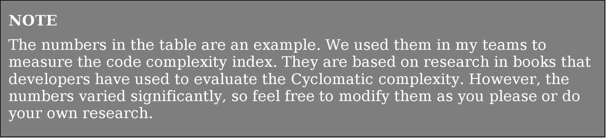  
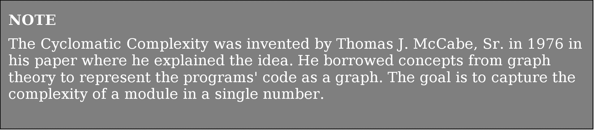

在本章的第二部分，你将看到如何计算所有数字的示例。

### 7. 学习曲线

我喜欢将这个属性称为“易于知识迁移”。该属性回答了这样一个问题：“某人自学有多容易？”学习曲线与 API 的易用性紧密相关，但它的含义略有不同。如果一个新成员加入你的团队，他能够自学如何使用你的测试自动化框架，还是需要阅读文档（如果存在的话）？或者你有一套导师计划，每次都需要亲自教导这些新成员如何使用你的代码？

### 8. KISS

最后一个标准不是我们要计算的某个，而是一个原则——“保持简单，愚蠢”（Keep It Simple Stupid）。马丁·福勒（Martin Fowler）的这段话最好地描述了这一原则：

“任何傻瓜都能写出计算机能懂的代码。优秀的程序员编写的是人类能懂的代码。”

当所有其他数字/评分/指数都相等时，可以使用它（在我的实践中这种情况并没有发生过）。但如果在某些少数情况下发生了，法则是选择最简单的设计。稍后我们将评估一个使用页面对象（page objects）的设计和一个使用更复杂的模式（facades）的设计。如果由于某种原因它们的评分相同，且我们应用 `KISS` 原则，我们最可能会选择页面对象的设计，因为它比外观设计更简单。

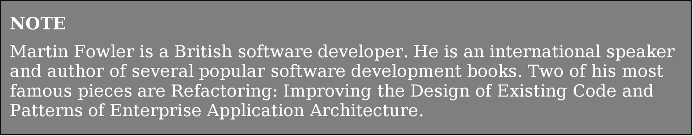

### 评估评分

对于上述每个标准，我们都会分配一个评分，基本上是一个数字。为了计算最终的 `TDI`（测试设计索引），我们将所有标准的评分相加。`TDI` 分数更高的设计脱颖而出。

1. 非常糟糕
2. 差
3. 好
4. 优异
5. 卓越

### 应用步骤

测试架构设计评估是一项团队工作。你可以独立完成，但这样你可能不够客观。当你获得几位经验同事的 `TDI` 评分时，它会减少最终决策中的个人偏好。以下是推荐的评估流程。

1. 创建一个与当前测试所在分支不同的开发分支
2. 为每个测试设计创建独立的项目
3. 使用提议的设计开发几个测试
4. 为每个设计实现同一组测试用例
5. 将解决方案提交给参与评估的团队成员
6. 每位参与者使用系统并分配评分
7. 召开最终评估会议

## 评估系统用例

现在是时候将评估系统付诸实践了。我相信，如果你能看到几个我们如何定义评分的示例，你就能为你的测试设计完成同样的操作。我们将评估在之前的章节中涵盖的三个设计方案。第一种是不使用页面对象（page objects）的 `Vanilla WebDriver`。第二种将是我们讨论过的 `Page Object Model`（页面对象模型）设计模式最后一个版本。最后一种是使用 `facade design pattern`（外观模式）第二种变体的测试。别担心——会有代码片段提醒你这些设计的每一个外观。对于每种设计，我们首先会回顾测试是如何样子的，然后我们将遍历上一节中的每一项标准，并根据我们的个人判断进行评分。最后，我们将为每个设计计算 `TDI` 索引。得分最高的设计获胜。如果某些设计的评分相同，我们将使用 `KISS` 原则——最简单的将获胜。

## 不使用页面对象的测试评估

### 架构设计概述

这是我们不使用页面对象的测试的样式。


```csharp
[TestClass]
public class ProductPurchaseTests{
    private static Driver _driver;
    private static string _purchaseEmail;
    private static string _purchaseOrderNumber;

    [TestInitialize]
    public void TestInitialize() {
        _driver = new LoggingDriver(new WebDriver());
        _driver.Start(Browser.Chrome);
    }

    [TestCleanup]
    public void TestCleanup() {
        _driver.Quit();
    }

    [TestMethod]
    public void CompletePurchaseSuccessfully_WhenNewClient() {
        AddRocketToShoppingCart();
        ApplyCoupon();
        IncreaseProductQuantity();
        var proceedToCheckout = _driver.FindElement(By.CssSelector("[class*='checkout-button button alt wc-forward']"));
        proceedToCheckout.Click();
        _driver.WaitUntilPageLoadsCompletely();
        var billingFirstName = _driver.FindElement(By.Id("billing_first_name"));
        billingFirstName.TypeText("Anton");
        var billingLastName = _driver.FindElement(By.Id("billing_last_name"));
        billingLastName.TypeText("Angelov");
        var billingCompany = _driver.FindElement(By.Id("billing_company"));
        billingCompany.TypeText("Space Flowers");
        var billingCountryWrapper = _driver.FindElement(By.Id("select2-billing-country-container"));
        billingCountryWrapper.Click();
        var billingCountryFilter = _driver.FindElement(By.ClassName("select2-search__field"));
        billingCountryFilter.TypeText("Germany");
        var germanyOption = _ driver.FindElement(By.XPath("//*[contains(text(),'Germany')]"));
        germanyOption.Click();
        var billingAddress1 = _driver.FindElement(By.Id("billing_address_1"));
        billingAddress1.TypeText("1 Willi Brandt Avenue Tiergarten");
        var billingAddress2 = _driver.FindElement(By.Id("billing_address_2"));
        billingAddress2.TypeText("Lützowplatz 17");
        var billingCity = _driver.FindElement(By.Id("billing_city"));
        billingCity.TypeText("Berlin");
        var billingZip = _driver.FindElement(By.Id("billing_postcode"));
        billingZip.TypeText("10115");
        var billingPhone = _driver.FindElement(By.Id("billing_phone"));
        billingPhone.TypeText("+00498888999281");
        var billingEmail = _driver.FindElement(By.Id("billing_email"));
        billingEmail.TypeText(GenerateUniqueEmail());
        _purchaseEmail = GenerateUniqueEmail();
        _driver.WaitForAjax();
        var placeOrderButton = _driver.FindElement(By.Id("place_order"));
        placeOrderButton.Click();
        _driver.WaitForAjax();
        var receivedMessage = _driver.FindElement(By.XPath("//h1[text() = 'Order received']"));
        Assert.AreEqual("Order received", receivedMessage.Text);
    }

    [TestMethod]
    public void CompletePurchaseSuccessfully_WhenExistingClient() {
        AddRocketToShoppingCart();
        ApplyCoupon();
        IncreaseProductQuantity();
        var proceedToCheckout = _driver.FindElement(By.CssSelector("[class*='checkout-button button alt wc-forward']"));
        proceedToCheckout.Click();
        _driver.WaitUntilPageLoadsCompletely();
        var loginHereLink = _driver.FindElement(By.LinkText("Click here to login"));
        loginHereLink.Click();
        Login("info@berlinspaceflowers.com");
        _driver.WaitForAjax();
        var placeOrderButton = _driver.FindElement(By.Id("place_order"));
        placeOrderButton.Click();
        _driver.WaitForAjax();
        var receivedMessage = _driver.FindElement(By.XPath("//h1[text() = 'Order received']"));
        Assert.AreEqual("Order received", receivedMessage.Text);
        var orderNumber = _driver.FindElement(By.XPath("//*[@id='post-7']/div/div/div/ul/li[1]/strong"));
        _purchaseOrderNumber = orderNumber.Text;
    }

    private void Login(string userName) {
        _driver.WaitForAjax();
        var userNameTextField = _driver.FindElement(By.Id("username"));
        userNameTextField.TypeText(userName);
        var passwordTextField = _driver.FindElement(By.Id("password"));
        passwordTextField.TypeText(GetUserFromDb(userName));
        var loginButton = _driver.FindElement(By.CssSelector("button[type='submit']"));
        loginButton.Click();
    }

    // 注意：由于原文代码中部分方法定义不完整，此处保持逻辑结构对应
    private void AddRocketToShoppingCart() { /* 省略 */ }
    private void ApplyCoupon() { /* 省略 */ }
    private void IncreaseProductQuantity() { /* 省略 */ }
    private string GetUserFromDb(string userName) { return "password123"; }
    private string GenerateUniqueEmail() { return $"{Guid.NewGuid()}@example.com"; }
}
```

*(注：由于提供的原文代码中部分方法实现不完整或存在占位符，翻译保持了代码逻辑结构并对可读字符串进行了针对性处理)*

让我们总结一下这种设计：我们在测试中定义网络元素，在测试中重用一些逻辑，并将逻辑直接传递给 `WebDriver` 方法，而没有使用 `PurchaseInfo` 之类的类。

以下是每项评估标准的评分：

### 1. 可读性

我将这里的可读性评为差。为什么？嗯，整个工作流在测试中是可见的——这是事实。但是，我们使用了大量的底层 `WebDriver` 代码，这使得测试变得冗长且晦涩。通常，我们只想看到测试用例的细节，而不是底层的等待或元素定位。

| 标准 | 评分 |
| :--- | :--- |
| 可读性 | 2 |

### 2. 可维护性

由于我们目前只有一个类，维护这些测试可能并不那么困难。然而，随着添加测试的增加，修复逻辑将变得越来越困难。确实，可以使用查找替换来更改定位符，但想象一下如果我们没有将某些逻辑移动到私有方法中，它在所有测试中都重复——那么你需要在每个地方进行修改。此外，由于测试大部分是复制粘贴且只有细微修改，当你有大量失败测试时，你无法确定工作流失败的原因——你需要单独调试和调查每一次失败。如果你只有几个测试，那么维护性可能不会像描述的那么糟糕，但仍然不理想。我给出了 2 分的差评。

| 标准 | 评分 |
| :--- | :--- |
| 可维护性 | 2 |

| 准则 | 评分 |
| :--- | :--- |
| 可读性 | 2 |
| 可维护性 | 2 |
| 可重用性 | |
| API 可用性 | |
| 可扩展性 | |
| 代码复杂度指数 | |
| 学习曲线 | |
| 测试设计指数 | |

### 3. 重用性

如示例所示，我们的代码重用仅限于几个私有方法，正如在“快速修复”场景中提到的，这些方法将被复制粘贴到新的测试类中。如果不对设计进行进一步审查，将使测试变得难以维护。我在这里的评分非常低（1）。

| 准则 | 评分 |
| :--- | :--- |
| 可读性 | 2 |
| 可维护性 | 2 |
| 可重用性 | 1 |
| API 可用性 | |
| 可扩展性 | |
| 代码复杂度指数 | |
| 学习曲线 | |
| 测试设计指数 | |

### 4. API 可用性

使用该设计 API 有多容易？嗯，在这种特定情况下，我甚至不能说我们有一个 API。我们有几个私有方法，但仅此而已。我不认为评估原生 `WebDriver` API 的易用性是公平的，因为整个练习的目的是创建我们的抽象层，以实现更健壮、更稳定的测试。同样，我给出了非常低的评分（1）。

| 准则 | 评分 |
| :--- | :--- |
| 可读性 | 2 |
| 可维护性 | 2 |
| 可重用性 | 1 |
| API 可用性 | 1 |
| 可扩展性 | |
| 代码复杂度指数 | |
| 学习曲线 | |
| 测试设计指数 | |

### 5. 可扩展性

假设我们想为在线购物车的购买流程添加一个新步骤。在非页面对象测试的情况下，我们会怎么做？如果逻辑是一个私有方法，我们可以在某一个地方添加它，但只有在它没有在其他测试类之间复制粘贴时才如此。如果没有重用，扩展代码可能会出现在多个测试中，那么我们需要分析哪些测试需要重构并复制粘贴新逻辑，这随着每次添加将再次恶化维护。我给出了较低的评分（2）。

| 准则 | 评分 |
| :--- | :--- |
| 可读性 | 2 |
| 可维护性 | 2 |
| 可重用性 | 1 |
| API 可用性 | 1 |
| 可扩展性 | 2 |
| 代码复杂度指数 | |
| 学习曲线 | |
| 测试设计指数 | |

### 6. 代码复杂度指数

现在是时候看看我们如何计算之前审查过的所有指数了。

`Code Complexity Index Rating = (继承深度评分 + 类耦合度评分 + 可维护性指数评分 + 圈圈复杂度评分)/4`

为了能够在 Visual Studio 中计算这些指标，你需要安装 `NuGet` 包 `Microsoft.CodeAnalysis.FxCopAnalyzers`。之后，在 Visual Studio 2019 中，你可以进入 `Analyze` 菜单项并点击 `Run Code Analysis for Solution`。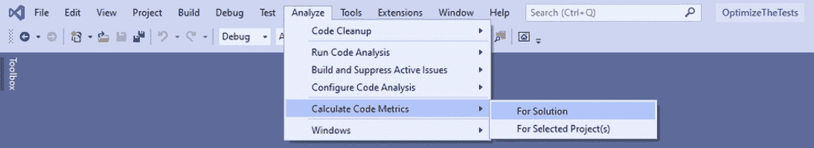

然后，在 `Code Metrics Results` 窗口中，你可以找到解决方案中每个类的代码指标。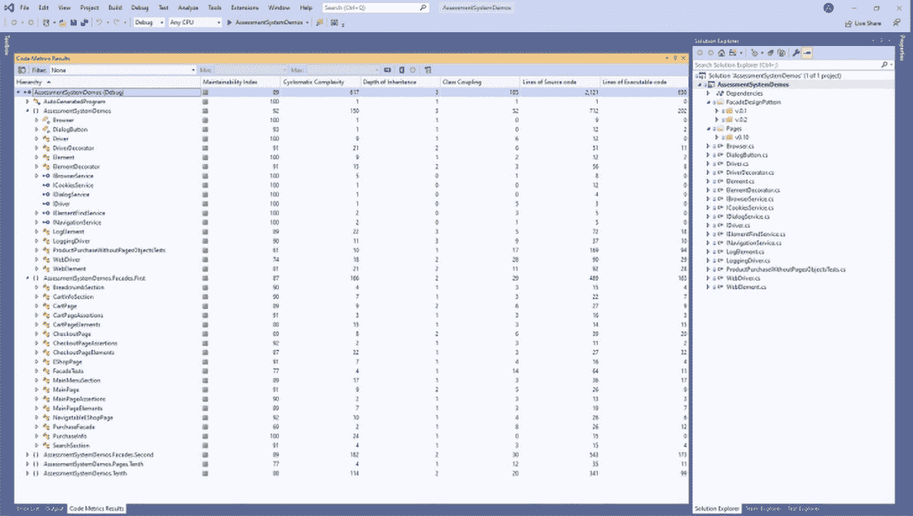

如果你的设计包含多个类——我们将获得设计中每个类部分的数字并得到平均评分。为了方便这些计算，有一个按钮可以将数据导出到 Excel 表格。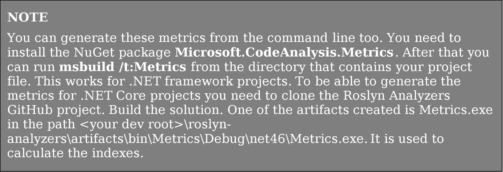

这里是该设计测试文件的数字。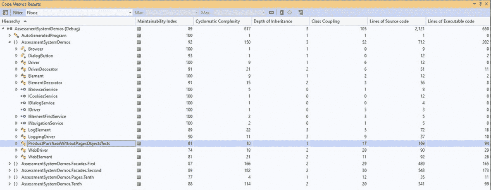

让我们再次查看表格。它帮助我们确定公式中使用的每个组件的指数。

| 评分 | 可维护性指数 | 圈圈复杂度 | 类耦合 |
| :--- | :--- | :--- | :--- |
| (5) 优秀 | > 70 | < 10 | < 10 |
| (4) 良好 | > 60 | 10-12 | < 15 |
| (3) 中等 | 40-60 | 12-15 | < 20 |
| (2) 差 | 20-40 | 15-20 | < 30 |
| (1) 非常差 | < 20 | > 20 | > 30 |

可维护性指数等于 61，因此我们给出一个非常好的评分（4）。`Cyclomatic Complexity = 10` —— 非常好（4）。`Class Coupling = 17` —— 良好（3）。`Depth of Inheritance = 1` —— 优秀（5）。在我们获得每个单独的指数后，我们将它们替换到公式中以得到代码复杂度指数评分。

`Code Complexity Index Rating = (5 + 3 + 4 + 4)/4 = 4`

| 准则 | 评分 |
| :--- | :--- |
| 可读性 | 2 |
| 可维护性 | 2 |
| 可重用性 | 1 |
| API 可用性 | 1 |
| 可扩展性 | 2 |
| 代码复杂度指数 | 4 |
| 学习曲线 | |
| 测试设计指数 | |

### 7. 学习曲线

这种设计是最容易开始的，因为它除了如何使用 `WebDriver` 外不需要任何先验知识。然而，当测试主体包含低级 `WebDriver` API 细节时，测试主体往往变得长得多，这使得测试用例变得更加困难。此外，由于部分代码是复制粘贴的，而另一部分作为私有方法重用，这对新手来说可能会产生困惑。因此，我只给了一个良好的（3）评分。

| 准则 | 评分 |
| :--- | :--- |
| 可读性 | 2 |
| 可维护性 | 2 |
| 可重用性 | 1 |
| API 可用性 | 1 |
| 可扩展性 | 2 |
| 代码复杂度指数 | 4 |
| 学习曲线 | 3 |
| 测试设计指数 | 2.43 |

## 测试设计指数 = (2 + 2 + 1 + 1 + 2 + 4 + 3) / 7 = 2.43

基于页面对象的测试评估

### 架构设计概述

### 为什么不直接审查使用页面对象而不使用外观类的设计？

我们有两个基础页面对象：一个用于可以跳转的页面，另一个用于不可跳转的页面。


```csharp
public abstract class EShopPage{
    protected readonly Driver Driver;
    protected EShopPage(Driver driver){
        Driver = driver;
        SearchSection = new SearchSection(driver);
        MainMenuSection = new MainMenuSection(driver);
        CartInfoSection = new CartInfoSection(driver);
    }
    public SearchSection SearchSection { get; }
    public MainMenuSection MainMenuSection { get; }
    public CartInfoSection CartInfoSection { get; }
}

public abstract class NavigatableEShopPage : EShopPage{
    protected NavigatableEShopPage(Driver driver): base(driver){}
    protected abstract string Url { get; }
    public void Open(){
        Driver.GoToUrl(Url);
        WaitForPageLoad();
    }
    protected abstract void WaitForPageLoad();
}
```

在这些基础页面中，我们定义了一些抽象方法，每个独立的页面对象都需要实现这些方法，并且我们重用了导航和页面部分等公共逻辑。我们有一个用于页面对象本身的类，以及另一个包含元素定位器的类。

```csharp
public class MainPage : NavigatableEShopPage{
    private readonly MainPageElements _elements;
    private MainPage(Driver driver): base(driver){
        _elements = new MainPageElements(driver);
    }
    protected override string Url=>"http://demos.bellatrix.solutions/";
    public MainPage AddRocketToShoppingCart(){
        Open();
        _elements.AddToCartFalcon9.Click();
        _elements.ViewCartButton.Click();
        return this;
    }
    public MainPage AssertProductBoxLink(string name, string expectedLink){
        string actualLink = _elements.GetProductBoxByName(name).GetAttribute("href");
        Assert.AreEqual(expectedLink, actualLink);
        return this;
    }
    protected override void WaitForPageLoad(){
        _elements.AddToCartFalcon9.WaitToExists();
    }
}
```

这里是我们如何重用元素定位器的。

```csharp
public class MainPageElements{
    private readonly Driver _driver;
    public MainPageElements(Driver driver){
        _driver = driver;
    }
    public Element AddToCartFalcon9=>_driver.FindElement(By.CssSelector("[data-product_id*='28']"));
    public Element ViewCartButton=>_driver.FindElement(By.CssSelector("[class*='added_to_cart wc-forward']"));
    public Element GetProductBoxByName(string name){
        return _driver.FindElement(By.XPath($"//h2[text()='{name}']/parent::a[1]"));
    }
}
```

测试中的页面是通过`App`设计模式使用的，该模式基于工厂设计模式。

```csharp
public class App : IDisposable{
    private readonly Driver _driver;
    private bool _disposed = false ;
    public App(Browser browserType = Browser.Chrome){
        _driver = new LoggingDriver(new WebDriver());
        _driver.Start(browserType);
        BrowserService = _driver;
        CookiesService = _driver;
        DialogService = _driver;
    }
    public IBrowserService BrowserService { get; }
    public ICookiesService CookiesService { get; }
    public IDialogService DialogService { get; }
    public TPage Create<TPage>()where TPage : EShopPage{
        var constructor = typeof(TPage).GetTypeInfo().GetConstructors(BindingFlags.NonPublic | BindingFlags.Instance).FirstOrDefault();
        var page = constructor?.Invoke(new object[] { _driver }) as TPage;
        return page;
    }
    public TPage GoTo<TPage>()where TPage : NavigatableEShopPage{
        var constructor = typeof(TPage).GetTypeInfo().GetConstructors(BindingFlags.NonPublic | BindingFlags.Instance).FirstOrDefault();
        var page = constructor?.Invoke(new object[] { _driver }) as TPage;
        page?.Open();
        return page;
    }
    public void Dispose(){
        Dispose(true);
        GC.SuppressFinalize(this);
    }
    protected virtual void Dispose(bool disposing){
        if (_disposed){
            return;
        }
        if (disposing){
            _driver.Quit();
        }
        _disposed = true;
    }
}
```

最后，这是我们的代码样貌。

```csharp
[TestClass]
public class SectionsTests{
    private static App _app;
    [ClassInitialize]
    public static void ClassInitialize(TestContext testContext){
        _app = new App();
    }
    [ClassCleanup]
    public static void ClassCleanup(){
        _app.Dispose();
    }
    [TestMethod]
    public void CompletePurchaseSuccessfully_WhenNewClient(){
        var mainPage = _app.GoTo<MainPage>();
        mainPage.AddRocketToShoppingCart();
        var cartPage = _app.GoTo<CartPage>();
        cartPage.ApplyCoupon("happybirthday").AssertMessageNotification("Coupon code applied successfully.").IncreaseProductQuantity(2).AssertTotal("114.00€").ProceedToCheckout();
    }
}
```

这种特定的页面对象实现使用了 Fluent API，我们在第 6 章《API 可用性》中讨论过。这里`App`类被声明为私静态变量，这意味着它不能在测试类之间共享。如果工作流发生变化，我们需要逐一通过每个测试。Fluent API 的使用使得查找和替换的操作变得更加困难。

## 1. 可读性

我认为这里的可读性非常出色（5）。如果你正确命名了方法和页面对象，你可以从代码中理解整个业务用例。同时，页面对象隐藏了原生 WebDriver API 的低级细节。

| 准则 | 评分 |
| :--- | --- |
| 可读性 | 5 |
| 可维护性 | |
| 可重用性 | |
| API 可用性 | |
| 可扩展性 | |
| 代码复杂度指数 | |
| 学习曲线 | |
| 测试设计指数 | |

## 2. 可维护性

使用页面对象进行调试和修复测试相对容易，因为我们重用了大部分代码，且修复发生在单处。唯一的缺点是，如果工作流发生变化，我们需要逐一通过每个测试。这就是我给可维护性打 4 分的原因。

| 准则 | 评分 |
| :--- | --- |
| 可读性 | 5 |
| 可维护性 | 4 |
| 可重用性 | |
| API 可用性 | |
| 可扩展性 | |
| 代码复杂度指数 | |
| 学习曲线 | |
| 测试设计指数 | |

## 3. 可重用性

我将可重用性评为良好（4）。之前提到的论点是有效的。

| 准则 | 评分 |
| :--- | --- |
| 可读性 | 5 |
| 可维护性 | 4 |
| 可重用性 | 4 |
| API 可用性 | |
| 可扩展性 | |
| 代码复杂度指数 | |
| 学习曲线 | |
| 测试设计指数 | |

## 4. API 可用性

我认为 Fluent API 使用起来非常直观。相比于外观类，页面设计的缺点是需要调用更多的方法来描述购买流程。这就是我将 API 可用性评为非常优秀（4）。

| 准则 | 评分 |
| :--- | --- |
| 可读性 | 5 |
| 可维护性 | 4 |
| 可重用性 | 4 |
| API 可用性 | 4 |
| 可扩展性 | |
| 代码复杂度指数 | |
| 学习曲线 | |
| 测试设计指数 | |

## 5. 可扩展性

如果你需要为所有页面添加新部分，将将其添加到页面基类中。如果你需要为页面创建添加功能，将在`App`类中进行。如果你需要为特定页面添加内容，将在页面对象本身中进行。我开始重复了，但再次这里的缺点是如果你需要向现有测试工作流添加功能，你需要通过每一个测试。

| 准则 | 评分 |
| :--- | --- |
| 可读性 | 5 |
| 可维护性 | 4 |
| 可重用性 | 4 |
| API 可用性 | 4 |
| 可扩展性 | 4 |
| 代码复杂度指数 | |
| 学习曲线 | |
| 测试设计指数 | |

## 6. 代码复杂度指数

这是我们测试设计的代码指标。（Image00092.jpg）

可维护性平均值 = 88.83 - 优秀（5）

圈复杂度平均值 = 9.5 - 优秀（5）

类耦合平均值 = 3.83 - 优秀（5）

继承深度平均值 = 1.17 - 优秀（5）

测试设计指数 = (5 + 5 + 5 + 5 + 5 + 5 + 5) / 7 = 5

| 准则 | 评分 |
| :--- | --- |
| 可读性 | 5 |
| 可维护性 | 4 |
| 可重用性 | 4 |
| API 可用性 | 4 |
| 可扩展性 | 4 |
| 代码复杂度指数 | 5 |
| 学习曲线 | |
| 测试设计指数 | |

## 7. 学习曲线

测试是是容易理解的——这一点是事实。然而，这种设计包含许多变动部分——基础页面对象、页面对象类、`App`工厂以及测试类。正如之前提到的，你需要学习页面的调用顺序以及如何调用它们的方法。这就是为什么我给出了 (4) 非常好的评分。

| 准则 | 评分 |
| :--- | --- |
| 可读性 | 5 |
| 可维护性 | 4 |
| 可复用性 | 4 |
| API 可用性 | 4 |
| 可扩展性 | 4 |
| 代码复杂度指数 | 5 |
| 学习曲线 | 4 |
| 测试设计指数 | |

## 测试设计指数

| 准则 | 评分 |
| :--- | --- |
| 可读性 | 5 |
| 可维护性 | 4 |
| 可复用性 | 4 |
| API 可用性 | 4 |
| 可扩展性 | 4 |
| 代码复杂度指数 | 5 |
| 学习曲线 | 4 |
| 测试设计指数 | 4.29 |

`Test Design Index = (5 + 4 + 4 + 4 + 4 + 5 + 4) / 7 = 4.29`

## 使用外观模式（Facades）的测试评估

### 架构设计概述

在这一设计中，我们使用了几乎相同的页面对象。区别在于它们没有暴露`Fluent API`。购买工作流保留在主外观类中。

```csharp
public class PurchaseFacade
{
    private readonly MainPage _mainPage;
    private readonly CartPage _cartPage;
    private readonly CheckoutPage _checkoutPage;

    public PurchaseFacade(MainPage mainPage, CartPage cartPage, CheckoutPage checkoutPage)
    {
        _mainPage = mainPage;
        _cartPage = cartPage;
        _checkoutPage = checkoutPage;
    }

    public void PurchaseItem(string rocketName, string couponName, int quantity, string expectedPrice, PurchaseInfo purchaseInfo)
    {
        _mainPage.Open();
        _mainPage.AddRocketToShoppingCart(rocketName);
        _cartPage.ApplyCoupon(couponName);
        _cartPage.CartPageAssertions.AssertCouponAppliedSuccessfully();
        _cartPage.IncreaseProductQuantity(quantity);
        _cartPage.CartPageAssertions.AssertTotalPrice(expectedPrice);
        _checkoutPage.ClickProceedToCheckout();
        _checkoutPage.FillBillingInfo(purchaseInfo);
        _checkoutPage.CheckoutPageAssertions.AssertOrderReceived();
    }
}
```

此外，对于这种设计，我们没有使用`App`设计模式。我们在`ClassInitialize`方法中直接初始化页面和外观，遗憾的是在`MSTest`中该方法无法被继承，因为它应该是静态的。


```csharp
[TestClass]
public class FacadeTests
{
    private static Driver _driver;
    private static MainPage _mainPage;
    private static CartPage _cartPage;
    private static CheckoutPage _checkoutPage;
    private static PurchaseFacade _purchaseFacade;

    [ClassInitialize]
    public static void ClassInitialize(TestContext testContext)
    {
        _driver = new LoggingDriver(new WebDriver());
        _driver.Start(Browser.Chrome);
        _mainPage = new MainPage(_driver);
        _cartPage = new CartPage(_driver);
        _checkoutPage = new CheckoutPage(_driver);
        _purchaseFacade = new PurchaseFacade(_mainPage, _cartPage, _checkoutPage);
    }

    [ClassCleanup]
    public static void ClassCleanup()
    {
        _driver.Quit();
    }

    [TestMethod]
    public void PurchaseFalcon9WithFacade()
    {
        var purchaseInfo = new PurchaseInfo()
        {
            Email = "info@berlinspaceflowers.com",
            FirstName = "Anton",
            LastName = "Angelov",
            Company = "Space Flowers",
            Country = "Germany",
            Address1 = "1 Willi Brandt Avenue",
            Address2 = "Lützowplatz 17",
            City = "Berlin",
            Zip = "10115",
            Phone = "+00498888999281",
        };
        _purchaseFacade.PurchaseItem("Falcon 9", "happybirthday", 2, "114.00€", purchaseInfo);
    }

    [TestMethod]
    public void PurchaseSaturnVWithFacade()
    {
        var purchaseInfo = new PurchaseInfo()
        {
            Email = "info@berlinspaceflowers.com",
            FirstName = "John",
            LastName = "Atanasov",
            Company = "Space Flowers",
            Country = "Germany",
            Address1 = "1 Willi Brandt Avenue",
            Address2 = "Lützowplatz 17",
            City = "Berlin",
            Zip = "10115",
            Phone = "+00498888999281",
        };
        _purchaseFacade.PurchaseItem("Saturn V", "happybirthday", 3, "355.00€", purchaseInfo);
    }
}
```

我们增加了一层抽象，但如果工作流发生变化，我们可以在一个地方进行修改。这既可能是好事，也可能是坏事。一方面，我们可以用较少的精力修复许多失败的测试；但另一方面，如果我们犯了错误，可能会在许多其他测试中引入回归。此外，直接查看测试代码：

1. 可读性

使用外观模式后，测试变得更短，这使得它们更容易理解。你可以查看测试中的数据。但是，如果你想知道确切的工作流，就需要进入方法内部。这无法从测试中看到。

| 准则 | 评分 |
| :--- | :--- |
| 可读性 | 5 |
| 可维护性 |  |
| 可复用性 |  |
| API 可用性 |  |
| 可扩展性 |  |

2. 可维护性

使用外观模式后，测试变得更短，这使得它们更容易理解。你可以查看测试中的数据。但是，如果你想知道确切的工作流，就需要进入方法内部。这无法从测试中看到。

| 准则 | 评分 |
| :--- | :--- |
| 可读性 | 5 |
| 可维护性 |  |
| 可复用性 |  |
| API 可用性 |  |
| 可扩展性 |  |

3. 可复用性

使用外观模式后，测试变得更短，这使得它们更容易理解。你可以查看测试中的数据。但是，如果你想知道确切的工作流，就需要进入方法内部。这无法从测试中看到。

| 准则 | 评分 |
| :--- | :--- |
| 可读性 | 5 |
| 可维护性 |  |
| 可复用性 |  |
| API 可用性 |  |
| 可扩展性 |  |

4. API 可用性

使用外观模式后，测试变得更短，这使得它们更容易理解。你可以查看测试中的数据。但是，如果你想知道确切的工作流，就需要进入方法内部。这无法从测试中看到。

| 准则 | 评分 |
| :--- | :--- |
| 可读性 | 5 |
| 可维护性 |  |
| 可复用性 |  |
| API 可用性 |  |
| 可扩展性 |  |

5. 可扩展性

使用外观模式后，测试变得更短，这使得它们更容易理解。你可以查看测试中的数据。但是，如果你想知道确切的工作流，就需要进入方法内部。这无法从测试中看到。

| 准则 | 评分 |
| :--- | :--- |
| 可读性 | 5 |
| 可维护性 |  |
| 可复用性 |  |
| API 可用性 |  |
| 可扩展性 |  |

6. 代码复杂度指数

这里是该测试设计的代码指标。（Image0093.jpg）

我对每个指标都取了平均值。维护性指数 = 86.94 - 优秀 (5)，圈复杂度 = 9.33 - 优秀 (5)，类耦合性 = 1.61 - 优秀 (5)，继承深度 = 1.17 - 优秀 (5)。测试设计指数 = (5 + 5 + 5 + 5 + 5 + 5 + 5) / 7 = 5

| 准则 | 评分 |
| :--- | :--- |
| 可读性 | 5 |
| 可维护性 | 5 |
| 可复用性 | 5 |
| API 可用性 | 5 |
| 可扩展性 | 5 |
| 代码复杂度指数 | 5 |
| 学习曲线 |  |
| 测试设计指数 |  |

此外，还有一些重复的评分数据，我将其合并整理如下：

| 准则 | 评分 |
| :--- | :--- |
| API 可用性 | 5 |
| 扩展性 | 5 |
| 代码复杂度指数 | 5 |
| 学习曲线 | 5 |
| 测试设计索引 |  |

### 测试设计索引

| 准则 | 评分 |
| :--- | :--- |
| 可读性 | 5 |
| 可维护性 | 5 |
| 可复用性 | 5 |
| API 可用性 | 5 |
| 扩展性 | 5 |
| 代码复杂度指数 | 5 |
| 学习曲线 | 5 |
| 测试设计索引 | 5 |

`Test Design Index = (5 + 5 + 5 + 5 + 5 + 5 + 5) / 7 = 5`

### 最终评估

| 建议的方案架构 | TDI 评分 |
| :--- | :--- |
| 不使用 Page 对象的测试 | 2.43 |
| 使用 Page 对象的测试 | 4.29 |
| 使用 Facade（外观）设计模式的测试 | 5 |

### 总结

在本章中，我们讨论了一个测试设计评估系统，定义了它的准则，并解释了如何在实践中应用它。在章节的第二部分，我们评估了书中已经使用的三种设计——不使用 `page` 对象的测试、使用该模式的测试，以及最后使用 `Facade` 设计模式的测试。我们分配的评分表明，在我们的用例中，最佳设计选择是使用 `Facade` 设计模式的设计。在下一章中，我们将讨论基准测试（Benchmarking）以及如何衡量各种自动化测试组件的性能。

### 问题

1. 你能列出评估系统的七个准则吗？
2. 在评估`Reusability`准则时，你会评估代码的哪些方面？
3. 为什么学习曲线是一个关键的评估点？
4. 什么是`Test Design Index`（测试设计索引）？
5. 如何在 `Visual Studio IDE` 中计算代码指标？
6. 在项目中应用该评估系统需要遵循哪些步骤？

### 扩展阅读

- 测试架构设计评估系统 - [`www.automatetheplanet.com/assessment-system-tests-architecture-design/`](https://www.automatetheplanet.com/assessment-system-tests-architecture-design/)
- 完美系统测试的英雄之旅：测试架构设计的八项评估准则 - [`www.automatetheplanet.com/heros-journey-perfect-system-tests/`](https://www.automatetheplanet.com/heros-journey-perfect-system-tests/)
- 测试架构设计评估系统-基于行为的测试 - [`www.automatetheplanet.com/assessment-system-tests-architecture-design-behaviour-based-tests/`](https://www.automatetheplanet.com/assessment-system-tests-architecture-design-behaviour-based-tests/)
- 测试架构设计评估系统-基于 Facade 的测试 - [`www.automatetheplanet.com/assessment-system-tests-architecture-design-facade-based-tests/`](https://www.automatetheplanet.com/assessment-system-tests-architecture-design-facade-based-tests/)
- McCabe 圈复杂度：使用流图计算 - [`www.guru99.com/cyclomatic-complexity.html`](https://www.guru99.com/cyclomatic-complexity.html)
- 代码指标值 - [`www.sciencedirect.com/topics/computer-science/code-metrics`](https://www.sciencedirect.com/topics/computer-science/code-metrics)

# 第 9 章：评估自动化测试组件性能的基准测试

在上一章中，我们研究了一个评估不同测试架构设计的系统。然而，仅对核心质量属性进行评估不足以最终决定哪种实现更好。测试执行时间也应该是一个关键部分。例如，在 HTML 表格中搜索的哪种方法性能更高——是使用原生的 `WebDriver` 还是使用内存计算的混合方法？哪种按钮点击方法更好——原生的 `WebDriver` 方式，还是通过 `JavaScript` 点击？

在本章中，我们将检查一个可以帮助我们回答这些以及更多问题的库。此外，你将了解到如何使用基准测试工具将结果导出到各种格式、分析你的测试组件的 `CPU`、内存和硬盘利用率等。最后，我们将该库与我们现有的通过 `Observer`（观察者）设计模式复用浏览器的解决方案进行集成。

本章将涵盖以下主题：

* 什么是基准测试？
* 使用 `BenchmarkDotNet` 对你的 `.NET` 代码进行基准测试
* 按钮点击解决方案基准测试
* 基准报告、分析、反汇诊断器
* 集成基准测试的优化浏览器初始化

# 什么是基准测试 (Benchmarking)？

在定义基准测试之前，我们需要回答一个问题——什么是性能？ 我们的目标创建一个基准测试工具，以便我们可以衡量组件的性能，因为很多时候实现相同的结果有多种方法。当然，我们不会重造轮子，而是使用标准的解决方案。

## 使用 BenchmarkDotNet 对 .NET 代码进行基准测试

基准测试是一项挑战性工作。在性能测量过程中，很容易出错。`BenchmarkDotNet` 会保护你免受常见陷阱的影响，因为它为你承担了所有的脏活：它会为每个基准测试方法生成一个独立的项目，多次启动该项目，运行函数的多次迭代（包括预热）等。通常情况下，即使你不在乎迭代次数，它也会对你有帮助，因为库会自动选择迭代次数以达到所需的精度水平。

### 主要特性

`BenchmarkDotNet` 拥有许多用于深度性能调查的极佳功能：

* 标准基准测试流程 - 为每个基准测试方法生成独立的项目；自动选择迭代次数；预热；开销评估等。
* 执行控制 - `BenchmarkDotNet` 尝试选择评估性能的最佳方式，但你也可以手动控制迭代次数、在冷启动和预热状态之间切换、设置准确级别、调整 `GC` 参数、更改环境变量等。
* 统计信息 - 默认情况下，你将看到平均值和标准差等基本统计数据；你也可以手动请求最小/最大值、置信区间、偏度、峰度、四分位数、百分位数，或定义你自己的指标。
* 内存诊断 - 该库不仅测量你代码的性能，还会打印关于内存、流量和 `GC` 收集次数的信息。
* 反汇编诊断 - 你可以通过添加单个额外的属性来请求反汇编列表。
* 参数化 - 可以为不同的输入参数集评估性能——就像流行的单元测试框架一样。
* 环境信息 - 当你分享性能结果时，共享环境信息至关重要；`BenchmarkDotNet` 会自动打印操作系统和处理器的确切版本；物理 `CPU` 数量、物理核心和逻辑核心数；虚拟机监控程序（如果你使用了它）；硬件计时器的频率；`JIT` 编译器版本等。
* 命令行支持 - 你可以在命令行中管理成千上万个基准测试，按类别对其进行分组、过滤并运行它们。
* 强大的报告系统 - 可以将基准结果导出为 markdown、CSV、HTML、纯文本、PNG 图表。

## BenchmarkDotNet 示例

使用 `BenchmarkDotNet` 非常简单。让我们来看一个示例：

```csharp
[Clr(baseline: true), CoreJob, MonoJob, CoreRtJob][RPlotExporter, RankColumn]
public class Md5VsSha256{
    private SHA256 sha256 = SHA256.Create();
    private MD5 md5 = MD5.Create();
    private byte[] data;
    [Params(1000, 10000)]
    public int N;
    [GlobalSetup]
    public void Setup(){
        data = new byte[N];
        new Random(42).NextBytes(data);
    }
    [Benchmark]
    public byte[] Sha256()=>sha256.ComputeHash(data);
    [Benchmark]
    public byte[] Md5()=>md5.ComputeHash(data);
}
public class Program{
    public static void Main(string[] args){
        var summary = BenchmarkRunner.Run<Md5VsSha256>();
    }
}
```

`BenchmarkDotNet` 允许以用户友好的声明式方式设计性能实验。实验结束，它将生成一个仅包含基本数据的摘要表，形式紧凑且易懂：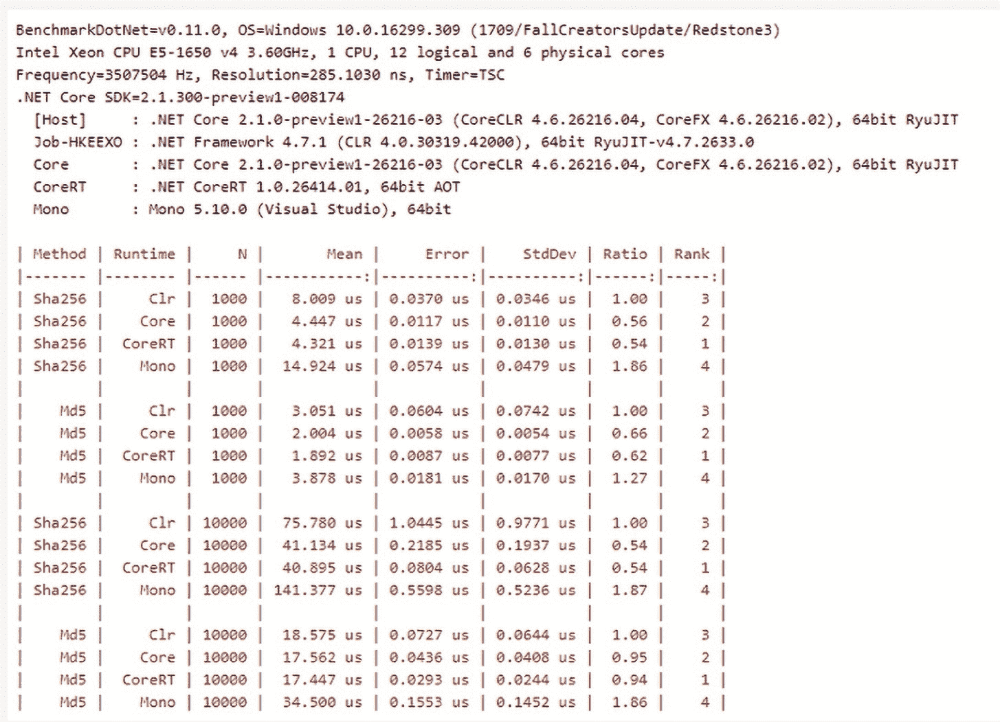

在产物（artifacts）中，你还可以找到关于每次迭代的详细信息。你可以以不同的格式（如 `CSV`、`XML`、`JSON` 等）导出数据，甚至生成精美的图表：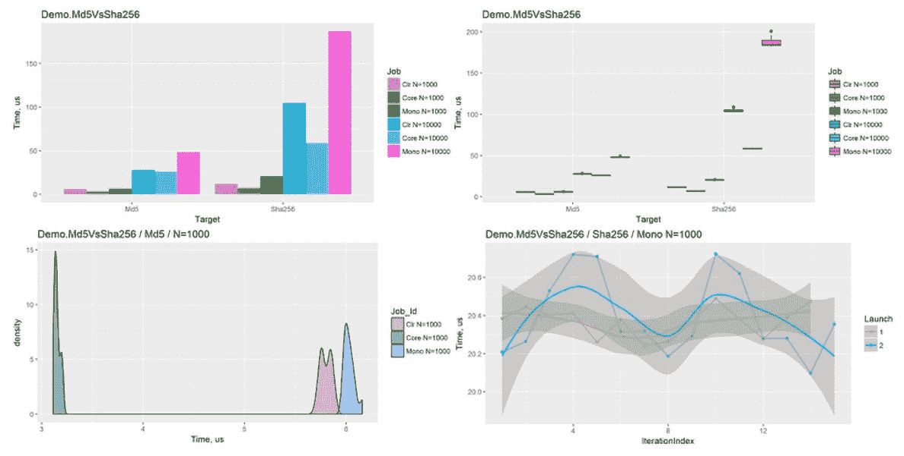 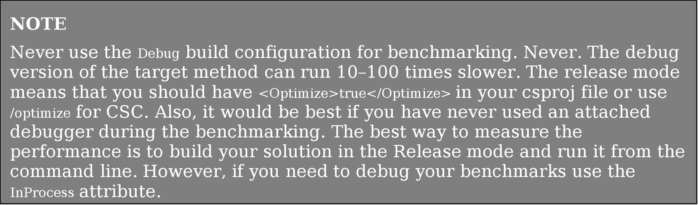 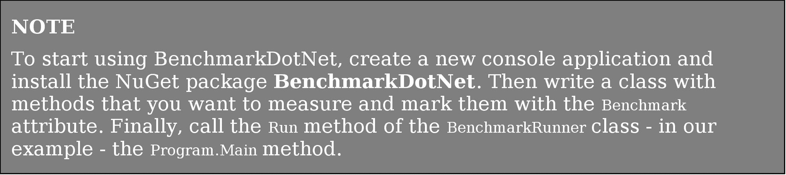

## 按钮点击解决方案

在各种场景下，你可以利用基准测试来就测试速度做出更好的选择。我们将研究的最简单的场景是在原生 `WebDriver` 点击方法调用与 `JavaScript` 点击之间进行选择。

### 按钮基准实验

我创建了一个简单的 `HTML`，你可以在其中找到几个 `HTML` 按钮。我们的两个实验（或基准测试）将是比较通过原生 `WebDriver` 点击所有按钮，以及通过 `JavaScript` 进行点击。


```csharp
public class ButtonClickBenchmark{
    private const string TestPage = "http://htmlpreview.github.io/?https://github.com/angelovstanton/AutomateThePlanet/blob/master/WebDriver-Series/TestPage.html";
    private static IWebDriver _driver;
    private static IJavaScriptExecutor _javaScriptExecutor;
    [GlobalSetup]
    public void GlobalSetup(){
        _driver = new ChromeDriver(DriverExecutablePathResolver.GetDriverExecutablePath());
        _javaScriptExecutor = (IJavaScriptExecutor)_driver;
        _driver.Navigate().GoToUrl(TestPage);
    }
    [GlobalCleanup]
    public void GlobalCleanup(){
        _driver?.Dispose();
    }
    [Benchmark(Baseline = true)]
    public void BenchmarkWebDriverClick(){
        var buttons = _driver.FindElements(By.XPath("//input[@value='Submit']"));
        foreach (var button in buttons){
            button.Click();
    }
    }
    [Benchmark]
    public void BenchmarkJavaScriptClick(){
        var buttons = _driver.FindElements(By.XPath("//input[@value='Submit']"));
        foreach (var button in buttons){
            _javaScriptExecutor.ExecuteScript("arguments[0].click();", button);
    }
    }}}
}
```

`GlobalSetup` 方法为每个基准测试执行一次。在那里我们只导航到演示页面一次。你会发现 `ChromeDriver` 的初始化有点奇怪。解析器返回了驱动程序所在的文件夹。

```csharp
public static class DriverExecutablePathResolver{
    public static string GetDriverExecutablePath(){
        string assemblyFolder = Path.GetDirectoryName(Assembly.GetExecutingAssembly().Location);
        var directoryInfo = new DirectoryInfo(assemblyFolder);
        for (int i = 0; i < 4; i++){
            directoryInfo = directoryInfo.Parent;
    }
        return directoryInfo.FullName;
    }
}
```

按照执行按钮实验，我创建了一个 .NET Core 控制台应用程序并安装了 `BenchmarkDotNet` NuGet 包。这是 `Main` 方法的代码。

```csharp
public class Program{
    public static void Main(string[] args){
        var summary = BenchmarkRunner.Run<ButtonClickBenchmark>();
        Console.WriteLine(summary);
    }
}
```

执行后的结果如下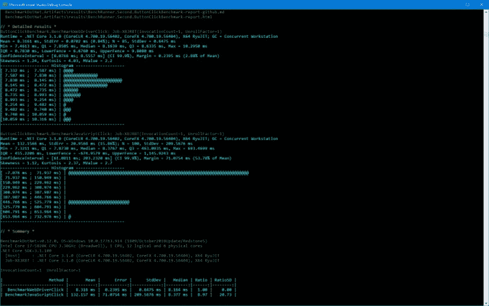

看起来原生 WebDriver 的 `Click` 方法比 JavaScript 方法性能高得多。平均 8.3 ms 对比 132.2 ms，时间增加了近 1500%！你可以在 `BenchmarkDotNet.Artifacts` 文件夹中找到完整的执行日志。

- `printIL` - 将打印 IL（微软中间中间语言）。默认值为 False。
- `printAsm` - 将打印 ASM（汇编计算机语言）。默认值为 True。
- `printSource` - 将打印 C# 源代码。默认值为 False。
- `printPrologAndEpilog` - 将打印序言（prolog）和结尾（epilog）的汇编代码。默认值为 False。
- `recursiveDepth` - 包含到指定层级的调用方法。默认值为 1，从 1 开始索引。该选项也可以通过控制台参数 `--disasmDepth` 使用。

`DisassemblyDiagnoser` 要求在你的 `csproj` 文件中以下设置：

```xml
<PropertyGroup>
  <PlatformTarget>AnyCPU</PlatformTarget>
  <DebugType>pdbonly</DebugType>
  <DebugSymbols>true</DebugSymbols>
</PropertyGroup>
```

为了获取源代码，它需要定位并读取 `PDB` 文件。这就是为什么该工具需要 `DebugType` 和 `DebugSymbols` 设置。为了比较不同的平台，定义基准测试的项目必须目标 `AnyCPU`。这是一个示例输出。

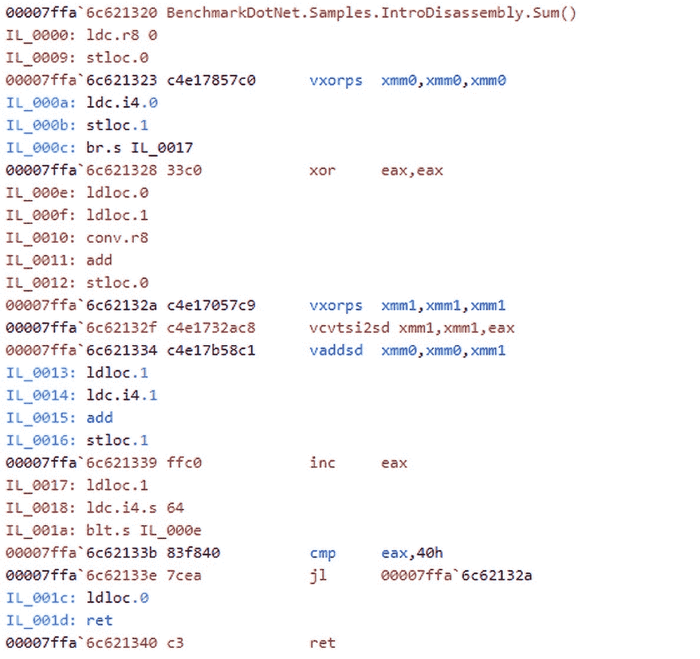

## 基准测试性能分析

`BenchmarkDotNet` 允许我们在 Windows 上对基准测试的 `.NET` 代码进行性能分析，并将数据导出到跟踪文件，该文件可以使用 `PerfView` 或 `Windows Performance Analyzer` 打开。在那里，你可以检查实验的 CPU、`RAM`、硬盘和网络使用情况。它使用了 `TraceEvent` 库，该库内部使用 `Windows 事件跟踪 (ETW)` 来捕获堆栈跟踪和重要的 `.NET Runtime` 事件。

性能分析器需要以管理员权限运行程序，并在你的 `csproj` 文件中使用以下设置：

```xml
<PropertyGroup>
  <DebugType>pdbonly</DebugType>
  <DebugSymbols>true</DebugSymbols>
</PropertyGroup>
```

要使用性能分析器，请使用 `EtwProfiler` 属性。

```csharp
[EtwProfiler]
public class Program{
    static void Main(string[] args){
        var summary = BenchmarkRunner.Run<ButtonClickBenchmark>();
        Console.WriteLine(summary);
    }
}
```

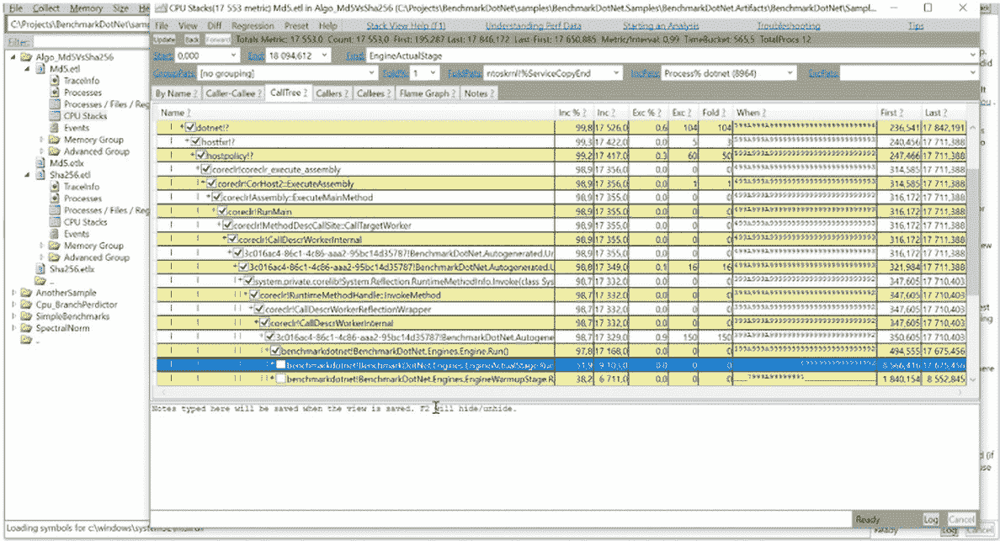

## 优化的浏览器初始化基准测试集成

如果你还记得第 3 章“加速测试的策略”，我们编写了一种通过属性并使用 `Observer` 设计模式来复用浏览器的解决方案。让我们研究如何在我们的基准测试中实现相同的功能。否则，你无法对你的框架代码进行基准测试。我们需要重构代码，因为解决方案的第一个版本使用的是 `MSTest` 框架来启动浏览器，但这里我们在控制台应用程序中不使用它运行实验。以下是我们的按钮实验在重构后的变化——产生相同的结果，但通过属性控制浏览器。

```csharp
[ExecutionBrowser(Browser.Chrome, BrowserBehavior.ReuseIfStarted)]
public class ButtonClickBenchmark : BaseBenchmark{
    private const string TestPage = "http://htmlpreview.github.io/?https://github.com/angelovstanton/AutomateThePlanet/blob/master/WebDriver-Series/TestPage.html";
    private static IWebDriver _driver;
    private static IJavaScriptExecutor _javaScriptExecutor;

    [GlobalSetup]
    public void GlobalSetup(){
        _driver = new ChromeDriver(DriverExecutablePathResolver.GetDriverExecutablePath());
        _javaScriptExecutor = (IJavaScriptExecutor)_driver;
        _driver.Navigate().GoToUrl(TestPage);
    }

    [IterationSetup()]
    public void IterationSetup (){
        BenchmarkInitialize();
    }

    [IterationCleanup()]
    public void IterationCleanup(){
        BenchmarkCleanup();
    }

    [GlobalCleanup]
    public void GlobalCleanup(){
        _driver?.Dispose();
    }

    [Benchmark(Baseline = true)]
    public void BenchmarkWebDriverClick(){
        var buttons = _driver.FindElements(By.XPath("//input[@value='Submit']"));
        foreach (var button in buttons){
            button.Click();
        }
    }

    [Benchmark]
    public void BenchmarkJavaScriptClick(){
        var buttons = _driver.FindElements(By.XPath("//input[@value='Submit']"));
        foreach (var button in buttons){
            _javaScriptExecutor.ExecuteScript("arguments[0].click();", button);
        }
    }
}
```

新的变化是我们派生自 `BaseBenchmark` 类，并使用了迭代设置和清理方法。简而言之，我们创建了与 `MSTest` 相同的插件式架构，但现在是 `BenchmarkDotNet` 的。我们来检查所有的更新吗？

### Observer 类中的更新

第一个更新是在基础观察者类 `BaseTestBehaviorObserver` 中，其中移除了对 `MSTest` 的依赖。

```csharp
public class BaseTestBehaviorObserver : ITestBehaviorObserver{
    private readonly ITestExecutionSubject _testExecutionSubject;
    public BaseTestBehaviorObserver(ITestExecutionSubject testExecutionSubject){
        _testExecutionSubject = testExecutionSubject;
        testExecutionSubject.Attach(this);
    }
    public virtual void PreInitialize(MemberInfo memberInfo){}
    public virtual void PostInitialize(MemberInfo memberInfo){}
    public virtual void PreCleanup(MemberInfo memberInfo){}
    public virtual void PostCleanup(MemberInfo memberInfo){}
    public virtual void MemberInstantiated(MemberInfo memberInfo){}
}
```

观察者中没有其他变化。然后，正如前面介绍的，我们有了新的 `BaseBenchmark` 类。

```csharp
public class BaseBenchmark{
    private static readonly ITestExecutionSubject CurrentTestExecutionSubject ;
    static BaseBenchmark(){
        CurrentTestExecutionSubject = new TestExecutionSubject();
        Driver = new LoggingDriver(new WebDriver());
        new BrowserLaunchTestBehaviorObserver(CurrentTestExecutionSubject, Driver);
        var memberInfo = MethodBase.GetCurrentMethod();
        CurrentTestExecutionSubject.MemberInstantiated(memberInfo);
    }
    protected static Driver Driver { get; set; }
    public void BenchmarkInitialize(Action benchmarkInitializeAction = null){
        var benchmarkMethodMemberInfo = GetCurrentExecutionMethodInfo();
        CurrentTestExecutionSubject.PreInitialize(benchmarkMethodMemberInfo);
        benchmarkInitializeAction?.Invoke();
        CurrentTestExecutionSubject.PostInitialize(benchmarkMethodMemberInfo); // 注意：此处原文变量名似乎有误，但按原样翻译
    }
    public void BenchmarkCleanup(Action benchmarkCleanupAction = null){
        var benchmarkMethodMemberInfo = GetCurrentExecutionMethodInfo();
        CurrentTestExecutionSubject.PreCleanup(benchmarkMethodMemberInfo);
        benchmarkCleanupAction?.Invoke();
        CurrentTestExecutionSubject.PostCleanup(benchmarkMethodMemberInfo);
    }
    private MethodInfo GetCurrentExecutionMethodInfo(){
        var stackTrace = new StackTrace();
        var benchmarkMethodMemberInfo = stackTrace.GetFrame(2).GetMethod() as MethodInfo;
        return benchmarkMethodMemberInfo;
    }
}
```

在静态构造函数中，我们初始化了所有观察者和静态 `Driver` 装饰器。接下来插件架构的关键方法是 `BenchmarkInitialize` 和 `BenchmarkCleanup`。在这种情况下，并不是在子测试类中提供可以重写的虚方法，而是将初始化和清理代码作为 `Action` 委托提供。在执行委托之前之后，我们触发插件之前的和之后的事件。

由于 `BenchmarkDotNet` 并没有提供 `TestInitialize` 和 `TestCleanup` 属性的精确表示（这些属性在每个测试之前/之后执行）。相反，我们有 `IterationSetup` 和 `IterationCleanup`。我们可以这样使用它们：

```csharp
[IterationSetup()]
public void IterationSetup(){
    BenchmarkInitialize();
}

[IterationCleanup()]
public void IterationCleanup(){
    BenchmarkCleanup();
}
```

- 停止硬编码输入数据


引入测试固件（test fixtures）

使用 API 作为固件数据的数据源

构建测试数据重置/创建应用用例

使用 API 或数据库进行验证

# 停止硬编码输入数据

硬编码测试数据是一种权宜之计的快速修复方法，会导致测试用例不稳定（flaky tests）。在第 2 章“优化和重构遗留的 Fl 用测试”中，我们重构了部分测试，并缓解了一些包含的坏习惯。然而，我们仍然在那里保留了硬编码的测试数据。

## 有问题的测试数据

我们在自动化测试中使用了哪些不同类型的测试数据？

* **网站 URL** - 像任何 Web 项目一样，我们有多个测试环境——`DEV`、`STAGING`、`UAT`（用户验收测试）等。我们的测试硬编码了应用程序的 URL。因此，在不更改测试代码的情况下，我们无法让测试在 staging 和 dev 环境中运行。
* **硬编码产品** - 不同的测试环境并不共享相同的数据（例如产品）。此外，大多数环境只包含生产环境中可用产品的子集。测试环境中的产品尤其在生产环境中从未存在过，永远也不会存在。
* **用户数据** - 由于法律原因，我们的测试环境绝不应包含生产环境的用户数据。对于敏感用户信息（如信用卡号和电子邮件），这一点尤为真实。

我们的测试应该能够在我们拥有的任何环境中运行。但如果我们使用的每条数据都是为特定测试环境硬编码的，这就不可能实现。

## 配置转换

实现一种从 `JSON` 文件中读取数据并在稍后的测试中使用它的代码如何？我认为有三个主要地方可以使用此类数据：网站 URL、WebDriver 超时时间和默认计费信息。主要目标将是为不同的测试环境（如 `LOCAL`、`DEV` 或 `UAT`）准备独立的数据集。

首先，我们需要向项目中添加一个 `JSON` 配置文件。将其命名为 `testFrameworkSettings.json`。我们将为每个环境准备单独 `json` 文件，这些文件基于项目的构建配置。例如，`Debug` 构建配置等同于针对 `LOCAL` 环境执行，`Release` 等同于针对 `DEV` 环境执行。如果你需要更多环境，可以创建一个新的构建配置。这意味着我们将有两个配置文件：一个命名为 `testFrameworkSettings.Release.json`，另一个命名为 `testFrameworkSettings.Debug.json`。

```json
{
  "webSettings": {
    "baseUrl": "http://local.bellatrix.solutions/",
    "elementWaitTimeout": "30",
    "chrome": {
      "pageLoadTimeout": "120",
      "scriptTimeout": "5"
    },
    "fireFox": {
      "pageLoadTimeout": "30",
      "scriptTimeout": "1"
    },
    "edge": {
      "pageLoadTimeout": "30",
      "scriptTimeout": "1"
    },
    "internetExplorer": {
      "pageLoadTimeout": "30",
      "scriptTimeout": "1"
    },
    "opera": {
      "pageLoadTimeout": "30",
      "scriptTimeout": "1"
    },
    "safari": {
      "pageLoadTimeout": "30",
      "scriptTimeout": "1"
    }
  },
  "urlSettings": {
    "shopUrl": "http://local.bellatrix.solutions/cart/",
    "accountUrl": "http://local.bellatrix.solutions/account/"
  },
  "billingInfoDefaultValues": {
    "email": "angelov@spaceFlowers.com",
    "company": "Space Flowers",
    "country": "Germany",
    "firstName": "Anton",
    "lastName": "Angelov",
    "phone": "+00498888999281",
    "zip": "10115",
    "city": "Berlin",
    "address1": "1 Willi Brandt Avenue Tiergarten",
    "address2": "2 Willi Brandt Avenue Tiergarten"
  }
}
```

这是包含 `LOCAL` 环境值的 `Debug` 配置。在 `Release` 文件中，如果存在差异，你可以更改特定字段的值。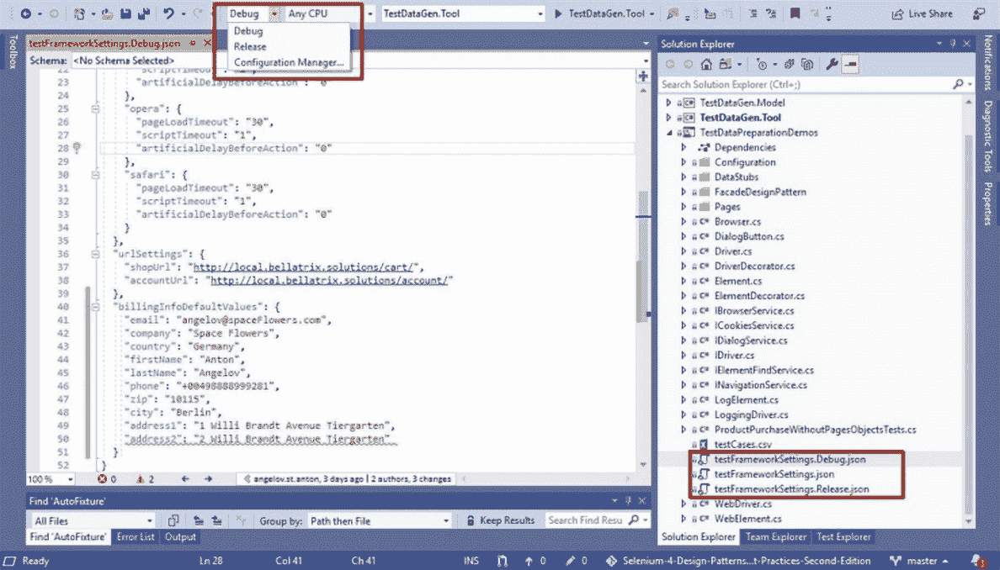

我们需要在项目的 `MSBuild` 代码中添加一小段代码段落，以确保正确的配置文件被复制到输出目录。

```xml
<ItemGroup>
  <None Update="testFrameworkSettings.$(Configuration).json">
    <CopyToOutputDirectory>Always</CopyToOutputDirectory>
  </None>
</ItemGroup>
```

我们将使用原生的 `.NET Core` 配置文件支持。因此，你需要向项目添加以下 NuGet 包。

- `Microsoft.Extensions.Configuration.Binder`
- `Microsoft.Extensions.Configuration`
- `Microsoft.Extensions.Configuration.Json`

接下来，我们需要创建一个新的服务来访问配置数据。对于每个单独的配置部分，如 `urlSettings` 或 `webSettings`，我们都有一个对应的 C# 类表示。以下是针对 `webSettings` 部分的 C# 类表示。

```csharp
public sealed class WebSettings
{
    public string BaseUrl { get; set; }
    public BrowserSettings Chrome { get; set; }
    public BrowserSettings Firefox { get; set; }
    public BrowserSettings Edge { get; set; }
    public BrowserSettings Opera { get; set; }
    public BrowserSettings InternetExplorer { get; set; }
    public BrowserSettings Safari { get; set; }
    public int ElementWaitTimeout { get; set; }
}
```

这是帮助我们访问数据的工具类代码。它通过单例模式（Singleton pattern）实现，因为在整个测试运行期间我们需要一个实例。

```csharp
public sealed class ConfigurationService
{
    private static ConfigurationService _instance;
    public ConfigurationService() => Root = InitializeConfiguration();
    public static ConfigurationService Instance
    {
        get
        {
            if (_instance == null)
            {
                _instance = new ConfigurationService();
            }
            return _instance;
        }
    }
    public IConfigurationRoot Root { get; }
    public UrlSettings GetTestEnvironmentSettings()
    {
        var result = ConfigurationService.Instance.Root.GetSection("urlSettings").Get<UrlSettings>();
        if (result == null)
        {
            throw new ConfigurationNotFoundException(typeof(UrlSettings).ToString());
        }
        return result;
    }
    public BillingInfoDefaultValues GetBillingInfoDefaultValues()
    {
        var result = ConfigurationService.Instance.Root.GetSection("billingInfoDefaultValues").Get<BillingInfoDefaultValues>();
        return result;
    }
    public WebSettings GetWebSettings() => ConfigurationService.Instance.Root.GetSection("webSettings").Get<WebSettings>();
    private IConfigurationRoot InitializeConfiguration()
    {
        var filesInExecutionDir = Directory.GetFiles(Path.GetDirectoryName(Assembly.GetExecutingAssembly().Location));
        var settingsFile = filesInExecutionDir.FirstOrDefault(x => x.Contains("testFrameworkSettings") && x.EndsWith(".json"));
        var builder = new ConfigurationBuilder();
        if (settingsFile != null)
        {
            builder.AddJsonFile(settingsFile, optional: true, reloadOnChange: true);
        }
        return builder.Build();
    }
}
```

在第一次调用该服务时，将加载配置文件。接下来，在我们的代码中，我们可以通过静态属性 `Instance` 访问配置数据。

### 创建 URL 设置

如果你有一个自动化单个网站的任务，那么我们就不需要对解决方案进行过度设计。让我们使用 `webSettings` 中的 `baseUrl`（等等，是 `BaseUrl`）变量。这在测试单页应用（SPA）时特别有用。

```csharp
public class MainPage : NavigatableEShopPage
{
    private readonly MainPageElements _elements;
    private MainPage(Driver driver) : base(driver)
    {
        _elements = new MainPageElements(driver);
    }
    protected override string Url => ConfigurationService.GetWebSettings().BaseUrl;
    public MainPage AddRocketToShoppingCart()
    {
        Open();
        _elements.AddToCartFalcon9.Click();
        _elements.ViewCartButton.Click();
        return this;
    }
    public MainPage AssertProductBoxLink(string name, string expectedLink)
    {
        string actualLink = _elements.GetProductBoxByName(name).GetAttribute("href");
        Assert.AreEqual(expectedLink, actualLink);
        return this;
    }
    protected override void WaitForPageLoad()
    {
        _elements.AddToCartFalcon9.WaitToExists();
    }
}
```

“魔法”发生在 `Url` 属性中，在那里我们调用 `ConfigurationService.Instance.GetWebSettings().BaseUrl` 来获取当前的测试环境 URL。然而，大多数时候我们有多个网站或 Web 服务需要测试。此外，还有许多不同的页面，这意味着你不仅需要基础 URL，还需要能够生成正确完整 URL 的逻辑。为了支持这一点，我们在 JSON 配置中有一个名为 `urlSettings` 的独立部分。

```json
"urlSettings": {
  "shopUrl": "http://local.bellatrix.solutions/cart/",
  "accountUrl": "http://local.bellatrix.solutions/account/"
}
```

我们还有一个 `UrlSettings` 类，它是数据的 1 对 1 表示。

```csharp
public class UrlSettings
{
    public string ShopUrl { get; set; }
    public string AccountUrl { get; set; }
}
```

之后，让我们创建一个服务，负责为每个网站生成正确的完整 URL。

```csharp
public static class UrlDeterminer
{
    public static string GetShopUrl(string urlPart)
    {
        return Url.Combine(ConfigurationService.Instance.GetTestEnvironmentSettings().ShopUrl, urlPart).ToString();
    }
    public static string GetAccountUrl(string urlPart)
    {
        return Url.Combine(ConfigurationService.Instance.GetTestEnvironmentSettings().AccountUrl, urlPart).ToString();
    }
}
```

如你所见，所有方法都声明为静态，因为这是一个应该非常易于使用的工具类。对于配置部分中的每个独立网站部分都有一个方法。我们获取正确的测试环境 URL 并将其与提供的部分 URL 组合。我们使用 `Url.Combine` 方法，无论有多少个部分，它都知道如何正确地组合它们。

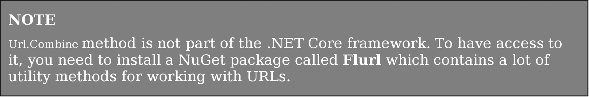

这是我们在页面对象中使用该服务的方式。

```csharp
public class CartPage : NavigatableEShopPage
{
    private readonly MainPageElements _elements;
    private CartPage(Driver driver) : base(driver)
    {
        BreadcrumbSection = new BreadcrumbSection(driver);
        _elements = new MainPageElements(driver);
    }
    public BreadcrumbSection BreadcrumbSection { get; }
    protected override string Url => UrlDeterminer.GetShopUrl("cart");
    // 代码剩余
}
```

### 创建超时设置

另一个需要配置的关键方面是 WebDriver 超时。它们会根据环境而异。此外，超时时间可能根据浏览器而异。

这是我们修改 `StartBrowser` 方法以支持这一点：

```csharp
_webDriver = new ChromeDriver(Environment.CurrentDirectory);
_webDriver.Manage().Timeouts().PageLoad = TimeSpan.FromSeconds(ConfigurationService.GetWebSettings().PageLoadTimeout);
_webDriver.Manage().Timeouts().AsynchronousJavaScript = TimeSpan.FromSeconds(ConfigurationService.GetWebSettings().ScriptTimeout);
```

每个浏览器的设置定义在 `BrowserSettings` 类中。

```csharp
public class BrowserSettings
{
    public int PageLoadTimeout { get; set; } = 3000;
    public int ScriptTimeout { get; set; } = 1000;
}
```

### 创建默认信息设置

这里是我们在不使用配置的情况下的 facade（外观）信息：


```csharp
[TestMethod]
public void PurchaseWithFacade(){
    var purchaseInfo = new PurchaseInfo(){
        Email = "info@flowers.com",
        FirstName = "Anton",
        LastName = "Angelov",
        Country = "Germany",
        Address1 = "Willi Brandt",
        Address2 = "Lützplatz",
        City = "Berlin",
        Zip = "10115",
        Phone = "+0498899281",
    };
    _purchaseFirstVersionFacade.PurchaseItem("Falcon 9", "happybirthday", 2, "14.00€", purchaseInfo);
}
```

`PurchaseInfo` 在 90% 的情况下是相同的。此外，数据可能会根据环境而变化。这就是将其移动到配置文件的原因。我们已经创建了一个名为 `billingDefaultValues` 的部分。在下方你可以找到 C# 表示。

```csharp
public class BillingDefaultValues{
    public string FirstName { get; set; }
    public string LastName { get; set; }
    public string Country { get; set; }
    public string Company { get; set; }
    public string Address1 { get; set; }
    public string Address2 { get; set; }
    public string City { get; set; }
    public string Phone { get; set; }
    public string Zip { get; set; }
    public string Email { get; set; }
}
```

使用它的简单方法是设置 `PurchaseInfo` 类属性的默认值。

```csharp
public class PurchaseInfo{
    public string FirstName { get; set; } = ConfigurationService.GetBillingInfoDefaultValues().FirstName;
    public string LastName { get; set; } = ConfigurationService.GetBillingInfoDefaultValues().LastName;
    public string Company { get; set; } = ConfigurationService.GetBillingInfoDefaultValues().Company;
    public string Country { get; set; } = ConfigurationService.GetBillingInfoDefaultValues().Country;
    public string Address1 { get; set; } = ConfigurationService.GetBillingInfoDefaultValues().Address1;
    public string Address2 { get; set; } = ConfigurationService.GetBillingInfoDefaultValues().Address2;
    public string City { get; set; } = ConfigurationService.GetBillingInfoDefaultValues().City;
    public string Zip { get; set; } = ConfigurationService.GetBillingInfoDefaultValues().Zip;
    public string Phone { get; set; } = ConfigurationService.GetBillingInfoDefaultValues().Phone;
    public string Email { get; set; } = ConfigurationService.GetBillingInfoDefaultValues().Email;
    public bool ShouldCreateAccount { get; set; }
    public bool ShouldCheckPayment { get; set; }
    public string Note { get; set; }
}
```

测试中的用法是直观的。

```csharp
[TestMethod]
public void PurchaseSaturnVWithRandomNoteFacade(){
    var purchaseInfo = new PurchaseInfo();
    _purchaseFirstVersionFacade.PurchaseItem("Saturn V", "happybirthday", 3, "355.00€", purchaseInfo);
}
```

### 环境变量

有时信息（如凭据）不适合持久化在配置文件中。通常，访问 Selenium Grid 云提供商的凭据就是这种情况。一种方法是将此类信息放在环境变量中，以后从测试中读取。这里是使用环境变量登录网站的示例。

```csharp
private void LoginWithEnvironmentalVariables(string userName){
    var userNameTextField = _driver.FindElement(By.Id("username"));
    userNameTextField.TypeText(userName);
    var passwordField = _driver.FindElement(By.Id("password"));
    passwordField.TypeText(Environment.GetEnvironmentVariable($"{userName}_pass"));
    var loginButton = _driver.FindElement(By.XPath("//button[name='login']"));
    loginButton.Click();
}
```

环境变量应该命名为 `angelov_pass`。

### 引入测试固定件 (Test Fixtures)

在软件开发中，测试固定件（fixtures）是一个术语，用于描述任何特定测试之外的数据，用于将应用程序设置为已知状态。固定件在任何高度可用的环境中效果最好。如果我们在本地或 CI 环境中测试，可以从完全空的数据库开始，并用固定件数据填充它。当测试准备好运行时，代码将知道应用程序的精确状态、我们注册的用户、每个产品的价格等等。

### 使用 AutoFixture 生成数据

我们已经研究了如何使用默认值来填充信息。然而，有时我们需要稍微更改它。对于不关心具体细节的情况，可以使用名为 `AutoFixture` 的库来处理数据生成。它会将随机值分配给属性。它可以处理复杂的设置，例如整个对象的初始化甚至是递归的数据生成。

```csharp
[TestMethod]
public void PurchaseSaturnVWithRandomNoteFacade(){
    var purchaseInfo = new PurchaseInfo();
    var fixture = new Fixture();
    purchaseInfo.Note = fixture.Create<string>();
    _purchaseFirstVersionFacade.PurchaseItem("Saturn V", "happybirthday", 3, "355.00€", purchaseInfo);
}
```

在这里我们使用 `Fixture` 类来生成随机订单。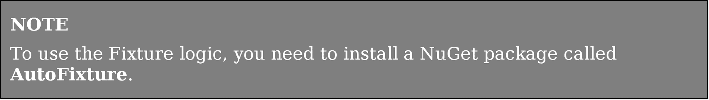

### 使用 MSTest 数据驱动测试

有时我们想运行相同的测试但使用不同的数据集。一种方法是复制测试并更改数据。这样做的好处是你可以给测试一个更合适的名称。然而，当 API 使用发生细微变化时，你需要对所有方法进行重构，这增加了测试的维护性。

```csharp
[TestMethod]
public void PurchaseFalcon9WithFacade(){
    var purchaseInfo = new PurchaseInfo();
    _purchaseFirstVersionFacade.PurchaseItem("Falcon 9", "happybirthday", 2, "14.00€", purchaseInfo);
}

[TestMethod]
public void PurchaseSaturnVWithFacade(){
    var purchaseInfo = new PurchaseInfo();
    _purchaseFirstVersionFacade.PurchaseItem("Saturn V", "happybirthday", 3, "355.00€", purchaseInfo);
}
```

相反，我们可以使用大多数框架支持的数据驱动测试。MSTest 和 NUnit 支持此类功能。你在 CSV 或类似的格式中定义数据，随后对于每一行信息运行绑定测试。为什么不向我们的项目添加名为 `testCases.csv` 的 CSV 文件并将其始终复制到输出目录呢？它将：

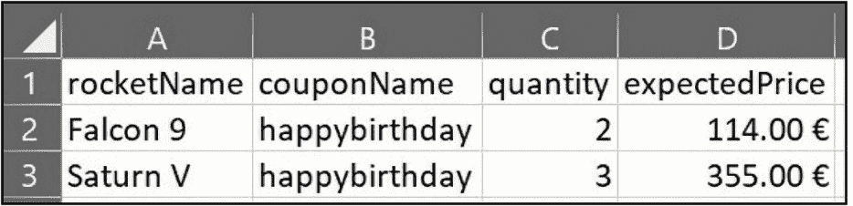

这就是我们创建数据驱动 MSTest 的方式。我们通过 `DataRow` 字典访问列数据并将列名作为键。在 `DataSource` 特性中，我们需要提到要使用的数据文件。

```csharp
[TestMethod]
[DataSource("VisualStudio.TestTools.DataSource.CSV","TestsData.csv", "TestsData", DataMethod.Sequential)]
public void PurchaseWithDataDriven(){
    var purchaseInfo = new PurchaseInfo();
    string rocketName = TestContext.DataRow["rocketName"];
    string couponName = TestContext.DataRow["couponName"];
    int quantity = int.Parse(TestContext.DataRow["quantity"]);
    string expectedPrice = TestContext.DataRow["expectedPrice"];
    _purchaseFirstVersionFacade.PurchaseItem(rocketName, couponName, quantity, expectedPrice, purchaseInfo);
}
```

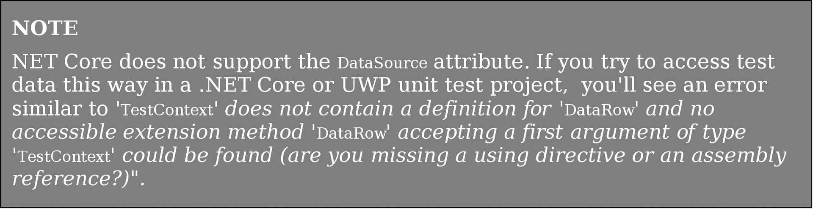

### 使用 API 作为固定件数据源

使用固定件作为测试数据对于高度可用的环境是非常棒的。我们需要测试本地或 CI 环境以外的内容（无法容易加载固定件数据到数据库），我们必须使用不同的方法。技巧是利用我们找到的所有资源来使测试保持稳定。这些资源之一是面向的 Web API。如果你的网站有原生移动应用或使用客户端 API 调用加载内容，那么我们的测试就可以有相同的数据进行测试。我们所做的只是查询 API 以获取应用程序状态的想法。大多数电子商务网站的常用 API 端是所有可用产品的列表。手机使用此列表来显示用户可以购买的内容。我们的网站将产品目录存储在 `http://demos.bellatrix.solutions/`。

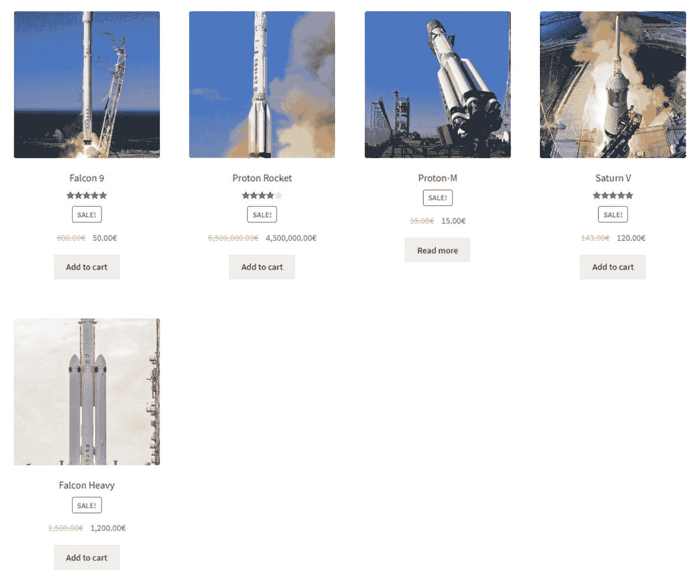

### 使用数据存桩 (Data Stubs)

现代网站极其复杂并结合了许多外部服务。大多数电子商务网站本身并不处理信用卡。相反，通常使用支付提供商。这是一个符合所有密钥管理要求的第三方应用程序，它将数据发送到银行并解析响应。运行所有外部服务是一项艰巨的任务，特别是如果网站使用的服务也是与我们的项目同时开发的。我们无法等到所有服务完全编写并集成后才开始测试。因此，我们必须在服务完全开发之前对其存桩（stub）。存桩是对应用程序请求的预制响应。存桩响应经过格式化的，看起来像真实的响应，但它们并没有执行任何工作。例如，我们用于编写测试的 API 端点并没有与数据库通信。相反，它用一个预制的 JSON 文件进行响应。存桩应用程序是自动化测试设置测试环境的极佳方法，并且在运行自动化测试时应尽可能使用。通常有两种方法：你可以让你的 DEV 环境使用 mock API，但在 PROD 使用真实的。然而，这有时是不可能的。这时你可以使用之前审查的黑洞模式来中断客户端发起的 API 调用。为什么不查看示例实现？


```csharp
[TestClass]
public class UsingDataStubs{
    private static IWebDriver _driver;
    private static ProxyServer _proxyServer;
    private static ConcurrentDictionary<string, string> _redirectUrls;
    [ClassInitialize]
    public static void ClassInitialize(TestContext context){
        _proxyServer = new ProxyServer();
        var explicitEndPoint = new ExplicitProxy(System.Net.IPAddress.Any, 1882, true);
        _redirectUrls = new ConcurrentDictionary<string, string>();
        _proxyServer.AddEndPoint(explicitEndPoint);
        _proxyServer.Start();
        _proxyServer.SetAsHttpProxy(explicitEndPoint);
        _proxyServer.SetAsHttpsProxy(explicitEndPoint);
        _proxyServer.BeforeRequest += OnRequestTraffic;
    }
    [ClassCleanup]
    public static void ClassCleanup(){
        _proxyServer.Stop();
    }
    [TestInitialize]
    public void TestInitialize(){
        var proxy = new OpenQA.Selenium.Proxy{
            HttpProxy = "http://localhost:1882",
            SslProxy = "http://localhost:1882",
            FtpProxy = "http://localhost:1882"
        };
        var options = new ChromeOptions{Proxy = proxy};
        _driver = new ChromeDriver(Environment.CurrentDirectory, options);
    }
    [TestCleanup]
    public void TestCleanup(){
        ClearAllRedirectPairs();
        _driver.Dispose();
    }
    [TestMethod]
    public void RequestRedirected_When_UsingProxy(){
        SetUrlToBeTo("https://secure.gravatar.com/js/profiles.js?ver=2019a", "https://gravatar.com/js/profiles.js?ver=2019a");
        _driver.Navigate().GoTo("http://demos.bellatrix.solutions/");
    }
    private void SetUrlToBeTo(string originalUrl, string redirectUrl){
        _redirectUrls.GetOrAdd(originalUrl, redirectUrl);
    }
    private void ClearAllRedirectPairs(){
        _redirectUrls.Clear();
    }
    private static async Task OnRequestTraffic(object sender, SessionEventArgs e)=>await Task.Run(()=>
        if (_redirectUrls.Count > 0){
            foreach (var redirectPair in _redirectUrls){
                if (e.Request.AbsoluteUri.Contains(redirectPair.Key)){
                    e.Redirect(redirectPair.Value);
                }
            }
        }
    }).ConfigureAwait(false);
}
```

## 泛型仓库模式 (Generic Repository Pattern)

仓库模式的理念是从业务代码中隐藏数据访问。


隐藏细节使得代码更容易阅读、维护和单元测试。此外，在某些少数情况下，你可以轻松更改数据访问技术。代码不知道你使用了`EFCore`，例如用于`ORM`。通常，仓库暴露特定的数据库表。

## C# 中的泛型仓库模式

```csharp
public abstract class DbRepository<TContext> : IDisposable where TContext : DbContext{
    private TContext _context;
    private bool _disposed = false;
    public IQueryable<TEntity> GetAllQuery<TEntity>() where TEntity : class{
        return _context.Set<TEntity>();
    }
    public void Delete<TEntity>(TEntity entityRemoved) where TEntity : class{
        _context.Set<TEntity>().Remove(entityRemoved);
        _context.SaveChanges();
    }
    public void Insert<TEntity>(TEntity entityInserted) where TEntity : class{
        _context.Set<TEntity>().Add(entityInserted);
        _context.SaveChanges();
    }
    public void Update<TEntity>(TEntity entityUpdated) where TEntity : class{
        _context.Set<TEntity>().Update(entityUpdated);
        _context.SaveChanges();
    }
    protected virtual void Dispose(bool disposing){
        if (!_disposed){
            if(disposing){
                _context?.Dispose();
            }
            _disposed = true;
        }
    }
    public void Dispose(){
        Dispose(true);
    }
    protected abstract TContext CreateDbContext();
    protected TContext Context{
        if (_context == null){
            _context = CreateDbContext();
        }
        return _context;
    }
}

public class UsersRepository : DbRepository<UsersDBContext>{
    protected override UsersDBContext CreateDbContextObject(){
        return new UsersDBContext(new DbContextOptions<UsersDBContext>());
    }
}
```

## 用户工厂 (Users Factory)

开发工厂之前，我们需要两个工具类来创建唯一数据。第一个名为`TimestampBuilder`，它可以在许多情况下生成带有日期的美化数据。

```csharp
public static class TimestampBuilder{
    public static string GenerateUniqueText(string text){
        var newTimestamp = GenerateUniqueText();
        var result = string.Concat(text, newTimestamp);
        return result;
    }
    public static string GenerateUniqueText(){
        var newTimestamp = DateTime.Now.ToString("MM-dd-yyyy-hh-mm-ffff");
        return newTimestamp;
    }
    public static string GenerateUniqueMonthName(){
        var newTimestamp = DateTime.Now.ToString("MMMMddyymmss");
        return newTimestamp;
    }
}
```

第二个类名为`UniqueEmailGenerator`，我们将用于为测试用户生成唯一的邮箱。

```csharp
public static class UniqueEmailGenerator{
    public static string EmailPrefix { get; set; } = "atp";
    public static string EmailSuffix { get; set; } = "bellatrix.solutions";
    public static string GenerateUniqueEmail(string prefix, string sufix){
        var result = string.Concat(prefix, "_", TimestampBuilder.GenerateUniqueText(), "@", sufix);
        return result;
    }
    public static string GenerateEmailTimestamp(){
        var result = $"{EmailPrefix}-{TimestampBuilder.GenerateUniqueText()}@{EmailSuffix}";
        return result;
    }
    public static string GenerateEmailGuid(){
        var result = $"{EmailPrefix}-{Guid.NewGuid()}@{EmailSuffix}";
        return result;
    }
    public static string GenerateUniqueEmail(string prefix){
        var result = $"{prefix}{TimestampBuilder.GenerateUniqueText()}@{EmailSuffix}";
        return result;
    }
    public static string GenrateUniqueEmail(char specialSymbol){
        var result = $"{EmailPrefix}-{TimestampBuilder.GenerateUniqueText()}{specialSymbol}@{EmailSuffix}";
        return result;
    }
}
```

在我们拥有了所有必要的工具类后，是时候开发仓库本身了。整个理念是我们希望有一个方法可以生成 X 数量的用户。我们希望在数据库中维护一个例如 5000 个测试用户的池。所有用户将用特定的邮箱创建，这可以帮助我们确定可用用户的数量。此外，工厂还有一个方法用于从池中获取测试用户。一旦从池中检索用户，我们将在姓中添加后缀。

```csharp
public class UsersFactory{
    private readonly UsersRepository _usersRepository;
    public UsersFactory(UsersRepository usersRepository){
        _usersRepository = usersRepository;
    }
    public void GenerateUsers(int usersCount){
        var activeUsers = _usersRepository.GetAllQuery<User>().Where(x=>!x.LastName.EndsWith("used") && x.Email.StartsWith("atp"));
        if (activeUsers.Count() < usersCount){
            int numberOfToBeGenerated = usersCount - activeUsers.Count();
            for (int i = 0; i < numberOfToBeGenerated; i++){
                var fixture = new Fixture();
                var newUser = new User(){
                    Email = UniqueEmailGenerator.GenerateEmailTimestamp(),
                    FirstName = fixture.Create<string>(),
                    LastName = fixture.Create<string>(),
                    Password = fixture.Create<string>(),
                };
                _usersRepository.Insert(newUser);
            }
        }
    }
    public User GetUserFromPool(){
        var user = _usersRepository.GetAllQuery<User>().Where(x=>x.LastName.EndsWith("used") && x.Email.StartsWith("atp")).FirstOrDefault();
        if (user != null){
            user.LastName += "used";
            _usersRepository.Update(user);
        }
        return user;
    }
}
```

## 1. CRUD 代表什么？

## 2. C# 中的默认值有哪些？

## 3. 使用原生的 .NET Core 配置支持需要哪些程序包？

## 4. 如何使用 AutoFixture 库生成新值？

## 5. 为什么需要泛型仓库而不是直接使用 DB context？

## 6. 为什么硬编码测试数据会导致测试不稳（flaky tests）？

## 延伸阅读

- 如何在自动化测试中处理测试环境数据 - [`www.automatetheplanet.com/handling-test-environments-data/`](https://www.automatetheplanet.com/handling-test-environments-data/)

- 让我们并行执行所有测试吧 - [`www.automatetheplanet.com/lets-execute-them-all-parallel/`](https://www.automatetheplanet.com/lets-execute-them-all-parallel/)


- AutoFixture 抄表 - [`github.com/AutoFixture/AutoFixture/wiki/Cheat-Sheet`](https://github.com/AutoFixture/AutoFixture/wiki/Cheat-Sheet)
- 入门 Entity Framework Core - [`docs.microsoft.com/en-us/ef/core/get-started/?tabs=netcore-cli`](https://docs.microsoft.com/en-us/ef/core/get-started/?tabs=netcore-cli)
- 语言集成查询 (LINQ) - [`docs.microsoft.com/en-us/dotnet/csharp/programming-guide/concepts/linq/`](https://docs.microsoft.com/en-us/dotnet/csharp/programming-guide/concepts/linq/)
- 在 C# 中逐步实现泛型仓库模式 - [`medium.com/falafel-software/implement-step-by-step-generic-repository-pattern-in-c-3422b6da43fd`](https://medium.com/falafel-software/implement-step-by-step-generic-repository-pattern-in-c-3422b6da43fd)

# 附录 1. 定义测试自动化框架解决的主要问题

为了列出测试自动化框架的各种优势，我必须说，它们自然地衍生并扩展了整个测试自动化带来的多重收益。当然，在讨论它们的优势之前，我们需要定义它们试图解决的问题是什么。就像业务和软件开发中的大多数事情一样——资源（金钱和时间）的争斗是不断的。人们往往会忽略这些成本，因为他们不是买单的人，而且无论如何每个月都会收到支票。要定义交付高质量软件需要什么，我们必须首先理解问题是什么。

## 子问题 1 - 重复与人类的无聊、低可靠性

如果你每个月只需手动执行一次相同的用例——那还好。但如果你每天必须执行 3 次，我们人类往往会很快感到无聊。另一个自然发生的情况是，我们开始忽略细节，而这正是那些无混之徒喜欢躲藏和产蛋的地方。即使是最负责任的测试人员在单调的手工测试期间也会出错。

### 自动化解决方案假设

#### ASH-1: 反复执行相同的测试

当你有一种方法可以以相同的方式反复执行所有测试时，你有更多时间集中在编写新测试上。此外，你会有更多时间来学习新工具、编程语言和测试技术。

### 后续问题

#### SP-1: 自动化测试不稳定

许多团队面临这个问题。由于它们的测试写得不正确，导致它们会随机失败。或者更糟糕的是——提供假阳性或假阴性的结果。

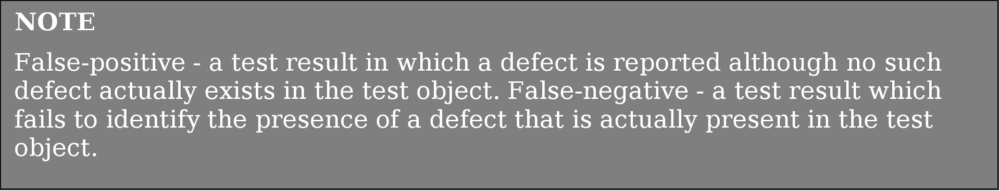

#### SP-2: 开发这些测试的初始投入

创建能够验证正确内容的稳定自动化测试过程是一项昂贵的工程。你需要投入工具、框架、员工培训、测试数据准备、测试环境创建、CI/CD 中的测试执行集成以及测试结果可视化。

## 子问题 2 - 工程师对数字不敏感、准确性

在大多数情况下，如果你必须测试用户界面，这基本上是一个可以完成的工作。比较标签、消息、点击按钮、填写表单，最后检查数据库中是否有填充内容。然而，随着时间的推移，系统变得复杂得多。在没有工具的情况下，你如何比较巨大的 XML/JSON 消息或文件？手动检查 100000 个订单在经过所有计算后是否成功升级是非常困难的。在很多情况下，自动化脚本可以比我们做得好得。

### 自动化解决方案假设

#### ASH-2: 重用自动代码检查

一旦你编写了验证单个订单是否迁移良好的逻辑，你就可以创建数据驱动的测试并无限次地执行这些测试。第 15670 次运行的测试结果将与第 1400 次具有相同的精细度和准确性。

### 后续问题

#### SP-3: 创建共享测试库的初始投入

有时，创建一个可以泛化到许多测试场景和许多测试用例的通用解决方案需要大量精力。有时你可能没有合适的人来创建该库，因为这可能需要大量的编码和设计技能。即使你有这些工程师，他们也可能需要处理其他事情。正确编写它可能是一项巨大的时间和和资金投入。

#### SP-4: 自动化测试可信吗？测试测试？

即使你有时间创建这些库，你又如何确保它们运行正常呢？它是代码，所以它可能包含 Bug。你是否花时间为测试编写测试，还是接受检查项无法正常运行的风险？当你看到断言（assertion）通过时，你直接跳到下一个测试了吗？你检查过它是否真的会失败吗？

#### SP-5: 库的修改

创建库的初始版本可能是的。但以支持未来修改的方式进行设计是另一回事。需求和应用的变化是自然的，随着这些变化，我们的测试也应该演进。许多 IT 专业人士忘记了这一点，在很多情况下，对他们来说，重写测试比进行调优更容易，因为代码可能不支持这一点。

#### SP-6: 库的定制-另一个团队的背景？

创建共享库的完全目的是让公司内的多个团队使用。然而，不同的团队在不同的背景下。他们可能需要进行不同的调整。对他们来说扩展或定制它有多容易？可能吗？他们需要投入时间来创建所需的修改吗？

#### SP-7: 知识传递

共享库很棒，但所有团队的工程师是否知道你的框架的特定功能？如果他们不知道某物的存在，他们会再次创建。这对于新团队成员尤为如此。如果你刚刚加入团队，如果没有一种方法来找到这些信息，就有人必须教你。否则，你将面临问题。

#### SP-8: API 易用性

用户理解如何使用是否容易？即使人们知道那里有什么但不知道如何使用或让它工作，会导致创建相同的东西。如果 API 不简洁且令人困惑，你需要投入时间教新团队成员如何利用它。

## 子问题 3 - 反馈时间

当你需要立即发布热修复（hotfix）时，不想发布未经测试的版本。然而，如果你有 5000 个用例且 QA 需要 5 天来手动执行它们，这并不快。

### 自动化解决方案假设

#### ASH-1: 反复执行相同的测试

#### ASH-3: 利用自动化测试的速度

让我们面对现实——计算机比我们快得多。即使你喝着咖啡并跟上速度，你最终也会感到疲惫或开始遗漏某些细节。而不是等待一周让 QA 执行所有用例，你可以在多台机器上运行所有自动化测试。

### 后续问题

#### SP-9: 测试速度

如所述，自动化测试很快的。然而，事实并非如此。如果测试写得不正确，它们可能会很慢。某些工程师倾向于使用巨大的暂停来处理 Web 或移动应用的挑战。另一种测试可能变慢的情况是你设置重试逻辑直到测试成功。或者多次重试所有失败的测试。

## 子问题 4 - 回归问题预防

回归测试：“确保未更改区域没有引入或发现缺陷。”经常由于时间压力，“不重要的”测试没有被手动执行。这不仅是因为截止日期紧，还因为某些人员不可用——假期、生病或团队人手不足。

### 自动化解决方案假设

#### ASH-4: 在部署之前执行所有测试

你可以在部署之前执行所有测试。只有在所有测试通过后才部署应用。由于自动化测试非常快，你可以在 30-60 分钟后部署版本。此外，由于测试设置非常容易，开发者可以在他们的机器上执行一些重要的测试，并在提交新代码之前修复回归问题。

### 后续问题

#### SP-9: 测试速度

#### SP-10: CI 就绪绪

一些旧的自动化解决方案很难从命令行执行，这意味着很难将其集成到持续集成或持续部署工具中。无论你使用什么工具或框架，现在都应该允许轻松集成到 CI 系统。工具或框架产生的测试结果也是如此。通常在 CI 执行后你想将它们发布到某处。

## 子问题 5 - 跳过范围

测试某些内容后，你需要向经理展示你测试了什么。如果你没有用例管理系统，这可能很难。有些人是不可信任的。他们可能会谎称执行了某些操作或忘了。自动化解决方案不是这种情况。

### 自动化解决方案假设

#### ASH-4: 在部署之前执行所有测试

### 后续问题

#### SP-9: 测试速度

#### SP-10: CI 就绪绪

## 子问题 6 - 乒球

有了专门的 QA 团队，会出现所谓的丢 Bug 乒球游戏。这是如何发生的？

1. 开发者产生应用的新版本并在不进行任何测试的情况下部署。
2. QA 在有空时开始测试（这可能不会立即发生）。新版本发布 4 小时后开始测试。
3. QA 2 小时后记录一个 Bug。然而，开发者可能已经回家了。
4. 开发者第二天早晨修复 Bug 并未测试的情况下部署新版本。这花费了 1 小时。
5. QA 3 小时后开始测试，发现第一个 Bug 已修复，但出现了另一个回归 Bug。
6. QA 30 分钟后记录回归 Bug。
7. 开发者还在那里，但开始处理新功能，所以承诺明天修复新 Bug。

### 自动化解决方案假设

#### ASH-4: 在部署之前执行所有测试

#### ASH-5: 开发者在本地执行自动化测试

所以，对于单个功能的测试和发布，你需要 2-3 天。如果你有自动化测试，开发者可以在他/她的机器上执行它们，或者至少执行最重要的。即使这是不可能的，在代码部署后最关键的测试也是可以执行的。这意味着如果出现任何回归 Bug，你将在 1 小时内捕捉到它们。

### 后续问题

#### SP-9: 测试速度

#### SP-10: CI 就绪绪

#### SP-11: 测试设置的易用性

对于新同事来说，设置一切有多容易？在本地运行自动化测试需要多少时间？有些情况下，需要半天来安装和配置一切。这很糟糕，因为程序员倾向于偷懒或有其他事情。所以许多人会跳过这个过程，因为步骤太多了。

#### SP-12: 本地执行的易用性

如果你有很多测试，开发者可能无法执行所有测试——在你的代码之前。定位测试有多容易？当测试执行时，是否可以继续工作或应该去哪里？有些自动化框架让它变得可能的。在测试期间移动你的鼠标或使用键盘进行真实输入。测试可以顺利在像`Docker`这样的隔离环境中执行吗？

## 子问题 7 - 金钱、时间、维护测试的精力

测试结果是什么？例如，当特定的部分发生变化时，你需要分析并更新测试。否则你必须重写它们。即使使用更复杂的测试系统，这可能是一个任务。这也是为什么有些“敏捷”公司决定 QA 不使用详细的用例，这尤其是在测试未测试区域时。定期自动化新功能会将宝贵的知识留在团队内部。

### 自动化解决方案假设

#### ASH-6: 更容易的测试重构和修改

如果你有适当的自动化框架和结构，一次更改就可以更新多个测试用例，而不是一个一个。大多数现代 IDE 提供大量的重构功能。在大多数情况下，一旦测试自动化了，你就不再需要它了，你可以存档。

### 后续问题

#### SP-5: 库的修改

## 子问题 8 - 各种应用配置

如果你必须测试现代网站——你需要确保它在 Edge、Chrome、Internet Explorer 和 Safari 上运行。如果你的软件与银行或类似服务有关——你需要检查在最新的 5-10 个浏览器上运行相同。但是等等，手动执行所有测试需要大量精力，有时还需要钱来购买和配置所有设备。布局测试对于人类来说是困难的。在没有工具或代码的情况下验证“像素级”的设计是一个巨大的挑战。

### 自动化解决方案假设

#### ASH-7: 为不同的设置复用测试

通过代码，你可以轻松地复用不同浏览器或移动设备上的相同测试。此外，代码可以允许你在需要时执行布局测试。

### 后续问题

#### SP-13: 跨技术和跨平台就绪

在没有代码修改的情况下执行测试是否可能？测试在不同浏览器中的行为是否相同？例如，如果你使用纯`WebDriver`代码，这几乎是不可能的。要更改浏览器大小或移动设备需要写多少代码？在大多数情况下，跳过大型配置代码是更优的。

## 子问题 9 - QA 团队士气低

当你反复执行相同的测试时，如所述，测试人员会感到无聊。我们的大多数人都想寻找乐趣并偶尔做些新事物。所以，我们通常会因为做相同的事情而没有提高自己而失去动力。这是人们想要更换团队或辞职的主要原因之一。

### 自动化解决方案假设

#### ASH-8: 自动化测试的新颖性

思考如何自动化特定应用的功能、准备测试数据或将你的测试集成到 CI 中是一项令人且具有挑战的工作。大多数测试人员觉得在测试自动化工作很有意义，并且必须不断学习新知识。

### 后续问题

#### SP-1: 自动化测试不稳定

#### SP-4: 自动化测试可信吗？测试测试？

#### SP-17: 测试速度创建

维护现有测试花费的时间是关重要的。它会消耗 QA 团队的大量时间。然而，为了让人们有动力，创建新测试应该是相对容易的。当然，如果整个 sprint 期间只能产生几个测试，QA 工程师会感到沮丧。即使测试很复杂，理解需要做什么也不应该太难。

#### SP-18: 故障排除、可调试性、修复测试

如所述，维护现有测试是很大一部分。内部解决方案或开源解决方案提供了许多功能来让生活变得更容易。这可能是最耗时的任务之一。如果你使用第三方框架（开源或商业的），它的支持快速且有用吗？

## 子问题 11 - 提供你所做的证据

当你手动测试某些内容时，很难证明你做了什么。如果你没有用例管理系统，这可能很困难。开发者和其他同事可能没有注意到你的工作，因为它是“隐形的”。当然，在更成熟的测试流程中，你有详细的测试用例、测试报告等，但通常为什么不诚实呢？当你编写代码时，你所做的更容易且可衡量。许多专业人士无法获得晋升或奖金。对我来说，这是 QA 想要更好的报告工具向开发者和经理展示他们做了什么的原因。你有漂亮的仪表板显示你执行了多少用例。

### 自动化解决方案假设

#### ASH-10: 更可见的结果

由于大多数测试用例将转换为代码测试，你所做的将更可见。代码是可以被衡量和看到的。如果需要，测试结果可以显示在漂亮的仪表板中或通过电子邮件发送。

### 后续问题

#### SP-20: 测试代码可读性

有时，你的开发者同事或经理可能想检查你做了什么。如果你正确地命名了测试和方法，使用了页面对象（page objects）和其他设计模式，其他工程师将更容易理解你的测试做什么。如果这是事实，是否需要更详细的报告就值得怀疑。

#### SP-21: 测试结果、报告、日志、门户集成

如果你使用内部框架，它会产生良好的测试结果文件吗？这些文件与 CI 工具流行的扩展兼容吗？使用这些工具进行可视化需要多少精力？可能吗？至少有 2 个流行的开源解决方案用于可视化测试结果（`ReportPortal`、`Allure`），可以将你的测试结果集成到这些工具中？

## 子问题 12 - 假期和病假、24 小时

如果你每个应用区域有一个 QA，而他/她休假或生病了。你如何发布你的应用程序？开发者开始测试还是怎样？大多数人可以工作长达 8 小时。当然，有些情况下经理告诉你在周六需要来测试新版本，因为你需要在周一发布。但你不会经常连续熬夜完成一切。工程师需要睡眠和休息。除夕是这个问题的另一个方面。当有人决定离开你的团队或公司时，他/她的所有知识都丢失了。定期自动化新功能会将宝贵的知识留在团队内部。

### 自动化解决方案假设

#### ASH-1: 反复执行相同的测试

#### ASH-4: 在部署之前执行所有测试

#### ASH-5: 开发者在本地执行自动化测试

#### SP-11: 测试即文档

如果自动化测试足够易读，即使你不在了，同事也会知道测试在做什么。这对于移动应用同样有效。

### 后续问题

#### SP-7: 知识传递

#### SP-8: API 易用性

#### SP-20: 测试代码可读性

## 子问题 13 - 某些事情无法手动测试

假设你有很多东西需要测试。你如何执行性能或负载测试？我可以说，“像素级”的设计在手动测试中是困难的。

### 自动化解决方案假设

#### ASH-12: 为不同的设置复用测试

你可以复用现有的测试并对它们进行调优以执行性能和负载测试。这并不是可能的。

### 后续问题

- SP-5: 库的修改
- SP-17: 测试速度创建
- SP-18: 故障排除、可调试性、修复测试
- SP-22: 学习曲线

## 子问题 14 - 一致性

如果没有关于如何编写测试的文档，不同的人以不同的方式编写它们。例如，一个可能使用页面对象模型，另一个可能直接使用`WebDriver`，等等。这些不一致导致代码难以理解/阅读/维护。

### 自动化解决方案假设

#### ASH-13: 统一编码标准

测试自动化框架提供的统一编码标准让测试看起来相同，并且更容易编写。然而，你需要一种自动化的方式来强制它们。

### 后续问题

- SP-7: 知识传递
- SP-8: API 易用性
- SP-20: 测试代码可读性
- SP-22: 学习曲线
- SP-23: 统一编码标准

## 子问题 15 - 快速扩展和缩小

假设你有很多东西需要为新版本测试。现在你团队有 2 个 QA，但为了准时完成，经理必须增加一个。在更长的发布周期内，这是可能的也是正确的决定，但当你每周发布一次时，你需要更多劳动力，这种方法无法扩展。假设你在两个月后扩展规模，现在你有 4 个 QA，但之后夏天来了，发布停止了一段时间（所有开发者去度假的假设场景）。两个 QA 足够测试所有新功能。你带来的 2 个额外的 QA 会怎样？你再次移动它们？这不仅是扩展问题也是缩小问题。

### 自动化解决方案假设

#### ASH-14: 云测试代理和 Docker

在公云时代，你可以拥有额外的测试代理机器。如果你使用`Docker`执行你的自动化测试，这是同样的。如果你使用适当的运行器，测试可以分布到远程机器并在那里并行执行。

### 后续问题

- SP-14: 云就绪绪
- SP-15: Docker 支持
- SP-24: 并行和分布式测试执行

你的框架支持自动化测试并行执行吗？是否有运行器可以并行运行测试或将其分布到多台机器上？

### 总结

如你所看到的，有很多理由说明测试自动化是必要的。然而，像所有进化事物一样，第一代测试自动化工具并没有承诺那么好。这就是为什么测试自动化框架成为一种非常流行的解决方案。然而，用它们创建稳定、快速且易维护的测试需要大量的前期规划和思考。许多工具和框架供应商在营销页面上没有提到后续问题。我相信如果你意识到所有问题，你就能对是否投资做出更明智的选择。

# 延伸阅读


- 测试自动化框架的代——过去与未来 - [`www.automatetheplanet.com/generations-test-automation-frameworks/`](https://www.automatetheplanet.com/generations-test-automation-frameworks/)
- 在云执行 UI 测试 - SauceLabs - [`www.automatetheplanet.com/saucelabs/`](https://www.automatetheplanet.com/saucelabs/)
- 在云执行 UI 测试 - BrowserStack - [`www.automatetheplanet.com/browserstack/`](https://www.automatetheplanet.com/browserstack/)
- 在云执行 UI 测试 - 跨浏览器测试 - [`www.automatetheplanet.com/crossbrowsertesting/`](https://www.automatetheplanet.com/crossbrowsertesting/)
- 使用 Selenoid 在 Docker 容器中执行测试 - [`www.automatetheplanet.com/webdriver-tests-selenoid/`](https://www.automatetheplanet.com/webdriver-tests-selenoid/)
- Visual Studio Code 代码段如何加速测试编写 - [`www.automatetheplanet.com/visual-studio-code-snippets/`](https://www.automatetheplanet.com/visual-studio-code-snippets/)

| Selector | Explanation |
| :--- | :--- |
| `ul#myId` | 带有 `@id= 'myId'` 的 `<ul>` 元素 |
| `#myUniqueId` | 带有 `@id='myId'` 的任意元素 |
| `ul.myForm` | 带有 `@class = 'myForm'` 的 `<ul>` 元素 |
| `.myForm.front` | 带有 `@classes = 'myForm'` 和 `'front'` 的任意元素 |

### 关系选择器

| Selector | Explanation |
| :--- | :--- |
| `ul#myUniqueId > li` | 直接子元素 |
| `ul#myUniqueId li` | 子元素 |
| `div > p` - all `<p>` | 是 `<div>` 元素直接后代的所有元素 |
| `div + p` - all `<p>` | `<div>` 元素的相邻兄弟元素（即紧跟在 `<div>` 之后的） |
| `div ~p` - all `<p>` | 在 `<div>` 元素之后且为同兄弟的元素 |
| `form myForm.front + ul` | 相邻兄弟 |
| `div.row *` | 选择所有带有 `<div>` 标签和 `'row'` 类的元素的后代（或子元素） |

### 属性选择器

| Selector | Explanation |
| :--- | :--- |
| `ul[name = "automateName"][style = "style_name"]` | 带有属性 `@name =‘automateName'` 和 `@style= 'style name'` 的 `<ul>` 元素 |
| `ul[@id]` | 带有 `@id` 属性的元素 |
| `ul[id = "myId"]` | 带有 `@id='myId'` 的 `<ul>` 元素 |
| `*[name='N'][value = ' v ']` | `name` 为 `N` 且指定值为 `'v'` 的元素 |
| `ul[id ^= "my"]` | 所有以 `'my'` 开头的属性元素 |
| `ul[id$= "Id"]` | 所有以 `'Id'` 结尾的属性元素 |
| `ul[id *= "unique"]` | 所有包含子字符串 `'unique'` 的属性元素 |
| `ul[id ~= “unique"]` | 所有包含单词 `'unique'` 的属性元素 |
| `a[href='url']` | 目标链接为 `'url'` 的锚点 |

### 有用的 n 值

- `odd` 或 `2n+1`：每一个奇数子元素或元素
- `even` 或 `2n`：每一个偶数子元素或元素
- `n`：每第 `n` 个子元素或元素
- `3n`：每第三个子元素或元素 (3, 6, 9, ...)
- `3n+1`：从 1 开始的每三个子元素或元素 (1, 4, 7, ...)
- `n+6`：除前五个之外的所有子元素或元素 (6, 7, 8, ...)
- `-n+5`：仅前五个子元素或元素 (1, 2, ..., 5)

### 适用于兄弟元素的伪类选择器

| Selector | Explanation |
| :--- | :--- |
| `ul#myUniqueId li:first-child` | 第一个子元素 |
| `ul#myUniqueId li:nth-of-type(1)` | 第一个子元素 |
| `ul#myUniqueId li:last-child` | 子元素 |
| `ul#myUniqueId li:nth-of-type(3)` | 第三个子元素 |
| `#TestTable tr:nth-child(3) td:nth-child(2)` | 按行和列选择单元格（例如第 3 行，第 2 列） |
| `p::first-letter` | 选择指定的 `'p'` 的第一个字母 |
| `p::first-line` | 选择指定的 `'p'` 的第一行 |
| `p:first-of-type` | 选择在同兄弟元素中是同类型第一个元素的 `<p>` |
| `p:last-of-type` | 选择在同兄弟元素中是同类型最后一个元素的 `<p>` |

### 针对链接和用户状态的伪类选择器

| Selector | Explanation |
| :--- | :--- |
| `input:focus` | 获得焦点的 `<input>` 元素 |
| `input:read-only` | 指定了 `'readonly'` 属性的 `<input>` 元素 |
| `input:required` | 指定了 `'required'` 属性的 `<input>` 元素 |
| `input:checked` | 被选中的复选框（或单选按钮） |
| `a:contains('Log Out')` | 文本包含 `'Log Out'` 的锚点 |
| `td:contains('t') ~td` | 紧随包含 `'t'` 的单元格之后的单元格 |
| `p:lang(language)` | 所有 `@lang` 属性等于 `'language'` 的 `<p>` 元素 |
| `:not(p)` | 选择任何不是段的元素 |
| `p:not(.fancy)` | 不属于类 `'.fancy'` 的 `<p>` 元素 |
| `p:not(.crazy, .fancy)` | 不属于 `'.crazy'` 或 `'.fancy'` 的 `<p>` 元素 |
| `div:empty` | 返回没有子元素的 `<div>` |
| `:root` | 选择文档根元素 |
| `input:in-range` | 选择值在指定范围内的元素 |
| `input:out-of-range` | 选择值在指定范围之外的元素 |
| `a:visited` | 所有访问过的链接 |
| `a:link` | 所有未访问过的链接 |
| `a:hover` | 所有鼠标悬停的链接 |
| `input:active` | 每一个激活的 `<input>` 元素 |
| `input:disabled` | 禁用的 `<input>` 元素 |
| `input:enabled` | 启用的 `<input>` 元素 |
| `concat(string1, string2 [string]*)` | 连接两个或多个字符串并返回结果字符串 |
| `normalize-space(string)` | 去除字符串首尾的空白字符，将连续的空白字符替换为单个空格，并返回结果字符串 |
| `starts-with(spacetrack, space)` | 检查第一个字符串是否以第二个字符串开头，并返回真或假 |
| `string-length([string])` | 返回等于给定字符串字符数量的数字 |
| `substring(string, start [length])` | 返回给定字符串的一部分 |
| `substring-after(spacetrack, track)` | 返回给定字符串中指定子串之后的剩余部分字符串 |
| `substring-before(spacetrack, tra)` | 返回给定字符串中指定子串之前的剩余部分 |
| `translate(string, ghj, GHJ)` | 评估字符串和一组待翻译的字符，并返回翻译后的字符串 |

## 延伸阅读

- [下载 XPath 选择器速查表 PDF](https://www.automatetheplanet.com/applications/most-exhaustive-xpath-locators-cheat-sheet/)

## 参考文献

- [Sgt 18] “[软件测试术标准术语表 3.2 版](https://www.istqb.org/downloads/send/20-istqb-glossary/186-glossary-all-terms.html)”, ISTQB, 2018 年 2 月
- [Sdp 14] “Selenium 设计模式与最佳实践”, Dima Kovalenko, 2014 年 9 月
- [Isg 19] “ISTQB 术表”, 国际软件测试认证委员会, 2019 年 12 月
- [Rid 18] “重构：改进现有代码的设计”, Martin Fowler, 2018 年 11 月
- [Caa 17] “整洁架构：软件结构与设计的匠人指南”, Robert C. Martin, 2017 年 9 月
- [Cgt 18] “测试自动化指南：构建和维护高效软件项目的技术、实践与模式”, Arnon Axelrod, 2018 年 9 月
- [Hfd 04] “浅显设计模式：一种大脑友好的指南”, Eric Freeman, Elisabeth Freeman, Kathy Sierra, Bert Bates, 2004 年 10 月
- [Sfd 18] “数据驱动测试中的 Selenium 框架设计：使用 Selenium WebDriver, AppiumDriver, Java 和 TestNG 构建数据驱动测试框架”, Carl Cocchiaro, 2018 年 1 月
- [Fdg 08] “框架设计指南：可重用 .NET 库的约定、惯用法和模式（Microsoft Windows 开发系列），第 2 版”, Krzysztof Cwalina, 2008 年 10 月
- [Dpe 94] “设计模式：可重用面向对象程序的元素”, John Vlissides, Richard Helm, Ralph Johnson, Erich Gamma, 1994 年 11 月
- [Tau 13] “单元测试：带 C# 示例第 2 版”, Roy Osherove, 2013 年 12 月
