# C# 设计模式

## 致谢

本书是我在设计模式方面过去一年学习成果的汇编。这是一段非常有趣的旅程，我在技能方面获得了宝贵的资产。

我谨向所有朋友以及 `c-sharpcorner.com` 上的朋友们给予我的鼓励表示感谢。

## 1. 单例模式

这是 23 种设计模式中最流行的模式。该模式讲述了高效的实例管理。

### 挑战

你正在开发一个应用程序，该应用程序需要将日志信息记录到名为 `Application.Log` 的文件中。日志由名为 `LogManager` 的类管理。`LogManager` 通过其构造函数对文件保持锁定。

`LogManager` 实例可以在整个应用程序中创建，这将导致异常。除此之外，`LogManager` 类只需要一个实例。

上述问题可以使用单例模式解决。

### 定义

> GoF 定义："确保一个类只有一个实例，并提供一个全局访问点"

### 实现

要实现上述规范，我们必须执行以下操作：

- 使构造函数私有并仅创建 1 个实例
- 创建一个静态属性来访问实例

以下是根据单例模式修改后的类定义。

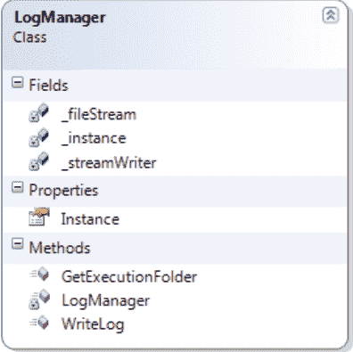

以下是 `LogManager` 类中包含的代码。

```csharp
public class LogManager
{
    private static LogManager _instance;
    public static LogManager Instance
    {
        get
        {
            if (_instance == null)
                _instance = new LogManager();
            return _instance;
        }
    }
    private LogManager()  // Constructor as Private
    {
        _fileStream = File.OpenWrite(GetExecutionFolder() + "\\Application.log");
        _streamWriter = new StreamWriter(_fileStream);
    }
    private FileStream _fileStream;
    private StreamWriter _streamWriter;
    public void WriteLog(string message)
    {
        StringBuilder formattedMessage = new StringBuilder();
        formattedMessage.AppendLine("Date: " + DateTime.Now.ToString());
        formattedMessage.AppendLine("Message: " + message);
        _streamWriter.WriteLine(formattedMessage.ToString());
        _streamWriter.Flush();
    }
    public string GetExecutionFolder()
    {
        return Path.GetDirectoryName(System.Reflection.Assembly.GetExecutingAssembly().Location);
    }
}
```

你可以看到这里的构造函数是私有的。由于它是私有的，外部类无法创建 `LogManager` 实例。

```csharp
private LogManager()  // Constructor as Private
{
    --
}
```

你可以看到新的 `Instance` 属性，它是静态的。它也确保只创建一个实例。

```csharp
public static LogManager Instance
{
    get
    {
        if (_instance == null)
            _instance = new LogManager();
        return _instance;
    }
}
```

要调用写入方法，我们可以使用以下代码：

```csharp
LogManager.Instance.WriteLog("Test Writing");
```

以下图像描述了单例和普通情况下的实例数量。

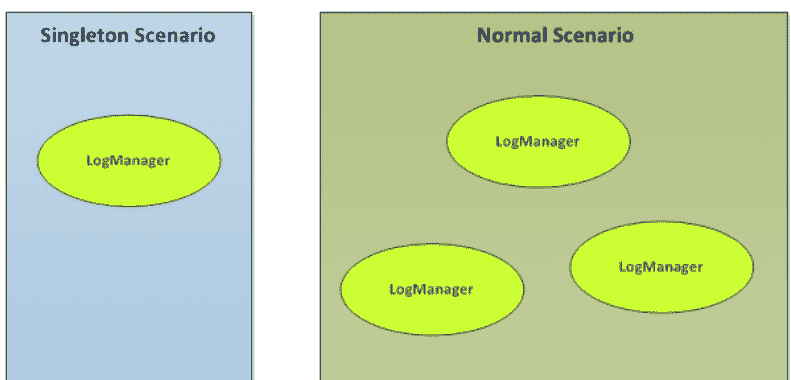

使用单例的优点如下：

- 实例重用使内存管理更有效
- 避免了文件锁定开销

单例的局限性如下：

- 将构造函数设为私有会带来限制
- 在多线程中使用时开销更大（但在 .Net 中是线程安全的）

### 总结

在本章中，我们看到了什么是单例模式以及使用 C#.NET 实现它的一个可能方法。`Multiton` 是另一种经常与单例进行比较的模式。

## 2. 命令模式

在本章中，我试图展示命令设计模式的使用。这是一种流行的模式，它利用了良好的面向对象结构，并简化了在应用程序中实现撤销功能的逻辑。

### 挑战

你正在开发一个绘画应用程序。对于每次画笔划动，你需要提供撤销功能。

目前可用的画笔是方形和矩形。未来会有更多画笔可用。我们的挑战是为用户提供撤销功能。显然，点击撤销按钮后，最后一次划动应从画布上清除。

你的方法是什么？

### 应用程序屏幕截图

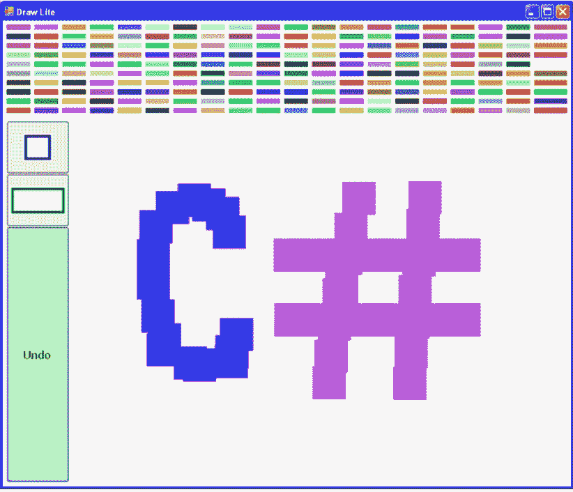

### 类图

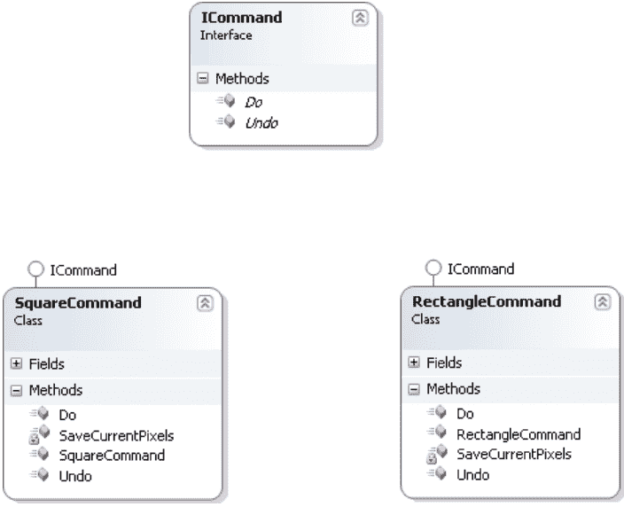

当应用程序运行时，用户将看到一个空白的白色屏幕，并有一组可供选择的颜色。默认选择的画笔为方形，点击画布后会在画布上绘制一个新的方形。默认选择的颜色为蓝色，存储在变量 `_activeColor` 中。

在表单级别声明的变量为：

```csharp
private ShapeEnum _activeShape = ShapeEnum.Square;
private Color _activeColor = Color.Blue;
private Bitmap _bitmap;
private Graphics _graphics;
```

对于每次鼠标按下操作，将创建一个新的方形类。这意味着如果进行 10 次点击，将创建 10 个方形类并调用 `Do()` 操作。枚举变量 `_activeShape` 用于跟踪用户当前选择的形状。鼠标按下事件将如下所示。

```csharp
private void Canvas_MouseDown(object sender, MouseEventArgs e)
{
    // Each mouse down creates a new command class instance
    ICommand command = null;
    if (_activeShape == ShapeEnum.Square)
        command = new SquareCommand(_bitmap, _activeColor, e.X, e.Y);
    else if (_activeShape == ShapeEnum.Rectangle)
```

```csharp
command = new SquareCommand(_bitmap, _activeColor, e.X, e.Y);
command.Do();
_commandStack.Push(command);
RefreshUI();
}
```

让我们举一个例子：假设用户在 Point X=100 和 Y=200 处单击了鼠标。由于 `_activeShape` 是 Square，会创建一个新的 `SquareCommand` 类实例，并传入参数 `e.X` 和 `e.Y`。其余参数为位图和活动颜色。然后调用 `Do()` 操作并将命令实例推入栈中。

栈为以后使用命令实例提供存储。栈的声明如下：

```csharp
private Stack<ICommand> _commandStack = new Stack<ICommand>();
```

#### Inside the SquareCommand Class

我们可以看一下 `SquareCommand` 类。`SquareCommand` 和 `RectangleCommand` 类的实现将相同，只是 `Do()` 操作中绘制相应形状的部分不同。

```csharp
public class SquareCommand : ICommand
{
    private Point _point;
    private Bitmap _bitmap;
    private Graphics _graphics;
    private Color _color;

    public SquareCommand(Bitmap bitmap, Color color, int x, int y)
    {
        _bitmap = bitmap;
        _graphics = Graphics.FromImage(_bitmap);
        _color = color;
        _point = new Point(x, y);
    }

    public void Do()
    {
        // Save the current pixel colors for a future UNDO perform
        SaveCurrentPixels();
        // Do the drawing
        _graphics.FillRectangle(new SolidBrush(_color),
            new Rectangle(_point.X, _point.Y, Width, Height));
    }

    private const int Width = 50;
    private const int Height = 50;

    private List<Color> _colors = new List<Color>();

    private void SaveCurrentPixels()
    {
        for (int i = _point.X; i < _point.X + Width; i++)
            for (int j = _point.Y; j < _point.Y + Height; j++)
                _colors.Add(_bitmap.GetPixel(i, j));
    }

    /// <summary>
    /// Perform Undo by restoring back the pixels to previous colors
    /// </summary>
    public void Undo()
    {
        int ix = 0;
        for (int i = _point.X; i < _point.X + Width; i++)
            for (int j = _point.Y; j < _point.Y + Height; j++)
                _bitmap.SetPixel(i, j, _colors[ix++]);
    }
}
```

构造函数使用位图、活动颜色以及 x、y 位置进行调用，然后将它们存储到类字段中。当调用 `Do()` 方法时，当前像素颜色会被保存到 `_colors` 列表中。这使我们以后能够执行 `Undo()` 方法。之后，调用 `Graphics.FillRectangle()` 方法绘制正方形。正方形的宽度和高度将分别使用常量 `Width` 和 `Height` 设置为 50 像素。

`Undo()` 方法只是通过从 x、y 位置开始遍历每个像素，使用 `Bitmap.SetPixel` 方法恢复之前的像素值。

#### Performing the Undo() on clicking Undo button

由于我们将每个操作封装到带有参数的类中并记录到命令栈中，现在调用 `Undo()` 方法变得更容易。请注意，单击 Undo 按钮时，我们必须从栈中移除最后一个操作实例并调用其 `Undo()` 方法。

其代码如下：

```csharp
private void UndoButton_Click(object sender, EventArgs e)
{
    // Check command stack contains items
    if (_commandStack.Count > 0)
    {
        // Remove the last command
        ICommand lastCommand = _commandStack.Pop();
        // Call the Undo method
        lastCommand.Undo();
    }
}
```

## 3. Adapter Pattern

你们大多数人可能听说过适配器模式。它是我们应用程序中常用的模式，但往往在不知不觉中使用。适配器模式是 23 种设计模式之一。在本章中，我想用一个简单的例子来探讨这种模式。

### Challenge

你正在处理一个 Square 类。你需要使用 Calculator 类来求其面积。但 Calculator 类只接受 Rectangle 类作为输入。如何解决这个场景？

| Have | Required |
|---|---|
|  |  |

### Definition

GoF 定义："将一个类的接口转换成客户端期望的另一个接口。适配器让原本由于接口不兼容而无法协同工作的类能够一起工作。"

### Implementation

以下是 Rectangle 和 Calculator 的类定义。

```csharp
public class Rectangle
{
    public int Width;
    public int Height;
}

public class Calculator
{
    public int GetArea(Rectangle rectangle)
    {
        int area = rectangle.Width * rectangle.Height;
        return area;
    }
}
```

从上面的例子可以看出，需要一个 Rectangle 实例来计算面积。如果我们有一个下面定义的 Square 类，则无法进行计算。

```csharp
public class Square
{
    public int Size;
}
```

这里我们需要创建一个新的 CalculatorAdapter 来完成工作。

```csharp
public class CalculatorAdapter
{
    public int GetArea(Square square)
    {
        Calculator calculator = new Calculator();

        Rectangle rectangle = new Rectangle();
        rectangle.Width = rectangle.Height = square.Size;

        int area = calculator.GetArea(rectangle);

        return area;
    }
}
```

`CalculatorAdapter` 执行以下功能：

- 接收 Square 参数
- 将 Square 转换为 Rectangle
- 调用原始的 `Calculator.GetArea()` 方法
- 返回接收到的值

调用代码如下所示：

```csharp
// Create Square class and assign Size from UI
Square square = new Square();
square.Size = SquarePanel.Width;

// Use Adapter to calculate the area
CalculatorAdapter adapter = new CalculatorAdapter();
int area = adapter.GetArea(square);

// Display the result back to UI
ResultLabel.Text = "Area: " + area.ToString();
```

运行示例应用程序后，我们可以看到以下结果。

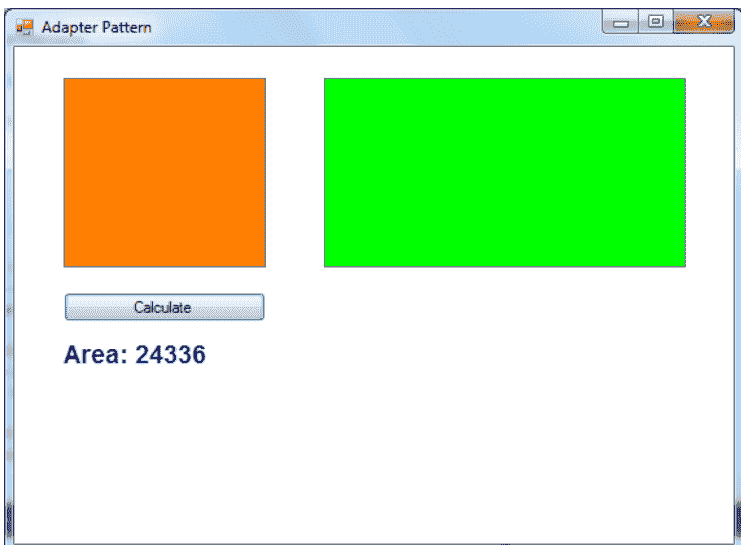

### Note

我们可以使用接口来展示上述模式的其他示例。为了简单起见，我避免了接口。在现实生活中，交流电到直流电的适配器就是适配器模式的一个例子，因为它使不兼容的设备和电源能够协同工作。

### Summary

在本章中，我们探讨了适配器模式。当处理不兼容的类型时，该模式很有用。相关源代码包含我们讨论的示例应用程序。

## 4. Decorator Pattern

在本章中，我想演示装饰器模式。它提供了一种在运行时添加职责的新方法，从而成为子类化的良好替代方案。

### Challenge


# 4. 装饰器模式

你今天有一个`Album`类，现在还是空的。明天客户想要在上面放一棵圣诞树。你需要在不修改`Album`类的情况下实现这一点。

如何在运行时实现这一点？

## Definition

GoF 定义："动态地为对象附加额外的职责。装饰器提供了一种灵活的替代子类化以扩展功能的方法"

## Closed for Modification and Open for Extension

我们在开发中面临的主要挑战之一是变化。封闭修改、开放扩展原则指出，可以在不改变原始代码的情况下添加新功能。

## Example:

我们将修改原始的`Album`类以在其上加入圣诞树。这可能不是最好的方法。有一个更好的方法。我们仍然可以保持`Album`类不变，并在其上添加圣诞树。所有操作都在运行时进行——这就是它的精妙之处。

## Some more examples

我们可以看到现实生活中的控件，如`Form`、`Button`等。会有内置功能的`Form`类。用户仍然可以使用它并添加新控件/扩展功能。在这里，我们基本上是从现有的`Form`/`Button`类派生并添加新方法或属性。

上述方法与装饰器模式的区别在于，装饰器模式是在运行时完成的。

## Conclusion on Change

因此，我们基本上可以得出结论，每当需要更改时，可能的解决方案可以是：

+   - 修改原始类

+   - 继承原始类并创建子类实例

+   - 使用装饰器模式并仍然使用原始类实例

这里我们将看到如何使用装饰器模式来帮助解决以下场景。

## 需求

这里的需求是提供一个默认的`Album`对象，并根据用户在运行时的动态需求，向相册中绘制其他图片。

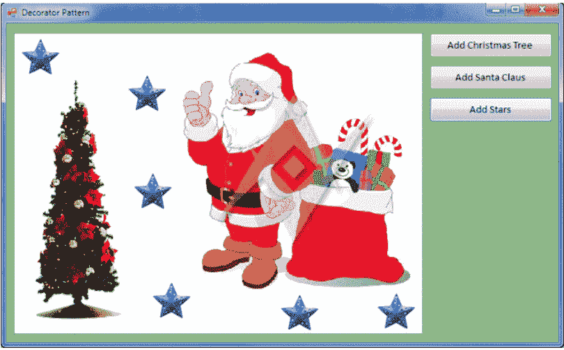

## 设计

我们的第一个类是`Album`类，它有一个`Graphics`对象作为参数。

它包含一个虚方法`Draw()`，用于清除`graphics`对象。

```
public class Album
{
    public Graphics Graphics
    {
        get;
        set;
    }
}
```

```
public Album()
{
}

public Album(Graphics graphics)
{
    Graphics = graphics;
}

public virtual void Draw()
{
    Graphics.Clear(Color.White);
}
}
```

## 装饰器

我们添加一个名为`AlbumDecorator`的类，它将作为所有装饰器的基类。

```
public abstract class AlbumDecorator : Album
{
    protected Album _album;

    public AlbumDecorator(Album album)
    {
        _album = album;
    }

    public override void Draw()
    {
        _album.Draw();
    }
}
```

它在构造函数中接受一个`Album`类作为参数。

这里有从`AlbumDecorator`派生的`ChristmasTreeDecorator`、`SantaClausDecorator`、`StarDecorator`：

```
public class ChristmasTreeDecorator : AlbumDecorator
public class SantaClausDecorator : AlbumDecorator
public class StarDecorator : AlbumDecorator
```

每个从`AlbumDecorator`派生的类都有自己的图片要绘制。

## 调用

在主窗体中，我们创建一个`Album`类的实例，并将其赋值给窗体字段`_album`。

```
private Album _album;
_album = new Album(_graphics);
_album.Draw();
```

在运行时，当用户想要一棵圣诞树时，就会创建一个`ChristmasTreeDecorator`实例。

```
_album = new ChristmasTreeDecorator(_album);
_album.Draw();
```

在上面的代码中，我们可以看到调用了相同的`_album.Draw()`方法。

## 工作原理

每当我们调用装饰器类的`Draw()`方法时，它又会调用原始的`Album.Draw()`。之后，它会调用自己的`Draw()`方法。通过这种方式，我们可以将同一个相册实例传递给多个装饰器。如果有 10 个装饰器，那么所有装饰器的`Draw()`方法都会被调用。

你可以通过在`StarDecorator`的`Draw()`方法中设置断点来测试这一点。

## 注意

在现实场景中，我们可以使用装饰器模式来计算税收，将其作为商品价格的装饰器。税费、额外税费等可以包装为原始商品价格周围的装饰器。

## 总结

使用装饰器，我们可以在运行时向对象添加动态职责。这为我们提供了按需创建装饰器实例的灵活性。在额外职责增加内存使用的场景中，这将提供真正的优势。附件包含我们讨论过的示例。

# 5. 策略模式

在本章中，我想探讨策略设计模式的灵活性。

## 挑战

你正在开发一个游戏应用程序。玩家可以在两种不同的枪支之间进行选择：

+   1. 装有 5 发子弹的手枪

+   2. 装有 20 发子弹的榴弹发射器

在普通的编码场景中，如果玩家更换枪支，我们必须在开火方法、绘制枪支方法、子弹动画方法中做大量的 if 判断。

如何采用更好的方法？

## 定义

GoF 定义：“定义一系列算法，将每个算法封装起来，并使它们可以互换。策略模式让算法独立于使用它的客户端而变化。”

## 实现

我们可以通过切换到策略模式来避免上述复杂性。我们的解决方案是：将不同的实现提取到适当的类中，并在这些类之间进行切换。

## 代码解释

涉及的核心类有：

+   - `Gamer`

+   - 实现`IGun`的`PistolGun`

+   - 实现`IGun`的`GrenadeLauncher`

每当用户更换枪支时，`Gamer.Gun`属性会在`PistolGun`和`GrenadeLauncher`实例之间切换。

这里，`IGun`接口提取了不同枪支之间不同的部分。

```
public interface IGun
{
    void Fire();

    void Draw();

    int Bullets { get; set; }

    PictureBox GunBox { get; set; }

    PictureBox BulletBox { get; set; }
}
```

维护 Gun 并刷新 Picture Box 的 Gamer 类如下所示：

```
public class Gamer
{
    private Label _bulletsLabel;

    public Gamer(Label bulletsLabel)
    {
        _bulletsLabel = bulletsLabel;
    }

    private IGun _gun;

    public IGun Gun
    {
        get { return _gun; }
        set { _gun = value; RefreshGunInfo(); }
    }

    private void RefreshGunInfo()
    {
        _gun.Draw();
        ShowBulletsInfo();
    }

    private void ShowBulletsInfo()
    {
        _bulletsLabel.Text = "Bullets: " + _gun.Bullets.ToString();
    }

    public void Fire()
    {
        _gun.Fire();

        ShowBulletsInfo();
    }
}
```

# 6. 模板方法模式

模板方法是一种被广泛使用的设计模式，它为我们的设计提供了极大的灵活性。这是我最喜欢的模式之一。

## 挑战

你正在创建用于制作比萨和汉堡的机器。当我们仔细观察时，会发现所有机器都有一些共同的操作，并且顺序相同。

+   - 启动

+   - 生产

+   - 停止

启动操作包括启动机器、进行系统检查以排查故障，以及打开指示灯。

生产操作执行各自产品的生产。

停止操作关闭机器的内部运行、关闭指示灯并关闭机器电源。

挑战在于创建更多像奶酪汉堡、平底锅比萨这样的机器，同时减少自定义实现。我们需要确保在设计中避免重复代码。

## 定义

GoF 定义：“定义一个操作中的算法的骨架，将一些步骤延迟到子类中。模板方法让子类在不改变算法结构的情况下重新定义算法的某些步骤。”

## 实现

我们可以看到所有操作都以相同的顺序出现。通常，启动和停止操作对于比萨机和汉堡机是通用的。

因此，我们可以定义算法的骨架（或调用顺序）如下：

+   1. 启动

+   2. 生产

+   3. 停止

我们可以看到所有机器都有这个执行顺序。只有生产操作会有所不同。

因此，创建一个`Execute()`方法来实现这一点，如下所示：

```
public class Machine
{
    public void Execute()
    {
        Start();
        Produce();
        Stop();
    }
}
```

通过调用`Execute()`方法，我们可以按正确的顺序调用所有 3 个方法。将`Execute()`方法作为基类中的 public 方法，我们可以将`Produce()`方法设为 virtual，以便它可以被重写。为了更大的定制性，我们将所有 3 个方法都设为 virtual。

## 注意

对于虚方法，基类中会提供默认实现。派生类可以选择是否覆盖它。

对于抽象方法，我们需要在派生类中覆盖它们。基类中不会有任何默认实现。

修改后的`Machine`类如下所示：

```
public class Machine
{
    public void Execute()
    {
        Start();
        Produce();
        Stop();
    }

    protected virtual void Start()
    {
        Trace.WriteLine("Machine.Starting..");
    }

    protected virtual void Produce()
    {
        Trace.WriteLine("Machine.Producing..");
    }

    protected virtual void Stop()
    {
        Trace.WriteLine("Machine.Stopping..");
    }
}
```

请注意，该类使用了`virtual`关键字，以便派生类可以覆盖。

派生类`PizzaMachine`如下所示：

```
public class PizzaMachine : Machine
{
    protected override void Produce()
    {
        Trace.WriteLine("PizzaMachine.Producing..");
    }
}
```

派生类`BurgerMachine`如下所示：

```
public class BurgerMachine : Machine
{
    protected override void Produce()
    {
        Trace.WriteLine("BurgerMachine.Producing..");
    }
}
```

请注意，它们都派生自`Machine`类，并使用关键字`override`来自定义实现`Produce()`方法。

## 执行

现在我们可以使用基类的`Execute()`方法来执行`PizzaMachine`。

```
new PizzaMachine().Execute();
```

让我们检查执行顺序是如何工作的。

+   1. 调用`Machine.Execute()`

+   2. 调用`Machine.Start()`

+   3. 调用`PizzaMachine.Produce()`

+   4. 调用`Machine.Stop()`

请注意上面的步骤 3，执行从`Machine`类转移到`PizzaMachine`类。这就是模板方法模式的力量所在。在这里，执行顺序得以保持，并完成了自定义生产。

## 注意

上述代码工作的底层细节涉及虚方法表（VMT），基类方法地址存储在一个表中。派生类将为派生方法提供新地址。这将替换原始基类的方法地址。

控制流如下图所示。

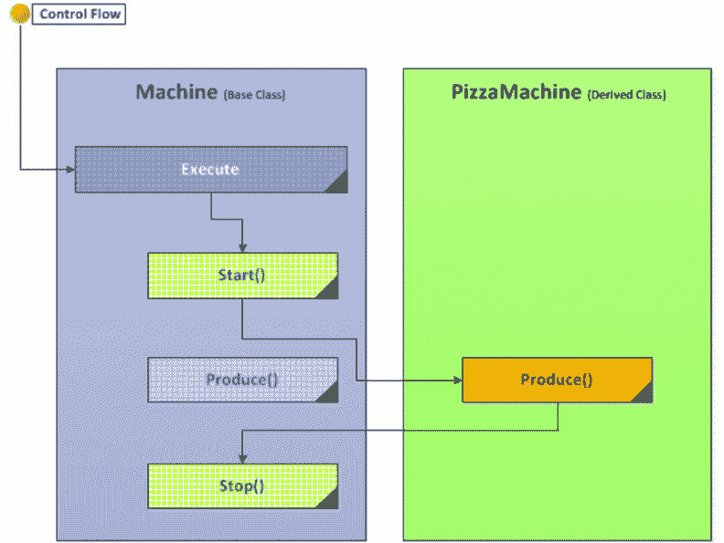

## 测试应用程序

使用WinForms创建了一个带有GUI的测试应用程序。

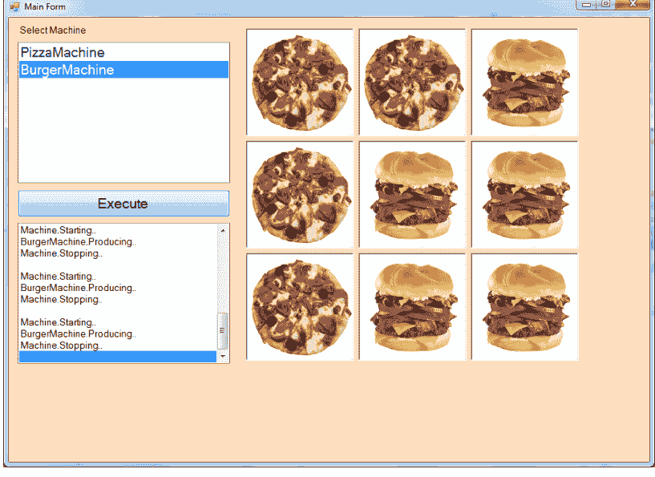

## 小结

在本章中，我们了解了模板方法设计模式的优点以及它试图解决的问题。源代码包含了所讲解的类和应用程序。

# 7. 访问者模式

访问者模式是23种设计模式之一。它不太为人所知，但对于面向对象编程爱好者来说，它包含了一个很好的思想。

## 挑战

你有一个对象列表，其类结构如下：

```
public class Member
{
    public string Name;
    public DateTime DateOfBirth;
}
```

你需要执行一个操作，选择所有年龄大于18的`Member`。

一种解决方案是添加一个名为`IsAboveEighteen`的新属性，并通过遍历项目并与当前日期比较来设置值。但这需要更多处理。

我们可以使用访问者模式实现同样的效果，通过添加一个属性，该属性基于现有属性进行操作并返回值。

## 定义

GoF定义：“表示一个作用于对象结构中各元素的操作。访问者让你在不改变各元素类的前提下定义新操作。”

## 实现

引入一个名为`IsAboveEighteen`的新属性，并在 getter 中实现代码以读取`DateOfBirth`属性来计算值。

```
public class Member
{
    public string Name;
    public DateTime DateOfBirth;

    public bool IsAboveEighteen
    {
        get
        {
            bool result = (DateTime.Now - this.DateOfBirth).TotalDays > 365 * 18;

            return result;
        }
    }
}
```

在上面的示例中，新属性利用现有属性值来计算其自身的值。其优点是无需改变结构，也无需额外操作即可获得所需结果。

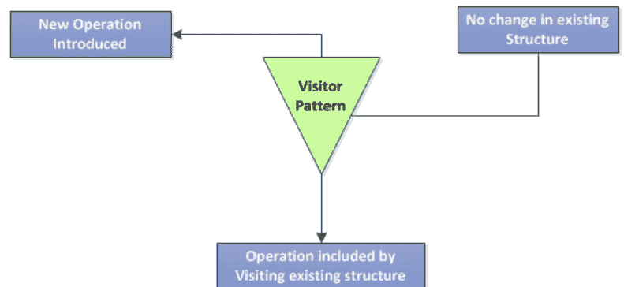

以下单元测试对新属性进行操作，并显示 `IsAboveEighteen` 为 true 的结果。

```
[TestMethod()]
public void IsAboveEighteenTest()
{
    IList<Member> list = new List<Member>()
    {
        new Member() { Name = "N1", DateOfBirth = new DateTime(2000, 1, 1) },
        new Member() { Name = "N2", DateOfBirth = new DateTime(2000, 1, 1) },
        new Member() { Name = "N3", DateOfBirth = new DateTime(1990, 1, 1) },
        new Member() { Name = "N4", DateOfBirth = new DateTime(1980, 1, 1) }
    };

    var selectedList = list.Where(m => m.IsAboveEighteen);
    foreach (Member member in selectedList)
        Console.WriteLine(member.Name);

    Assert.AreEqual(2, selectedList.Count());
}
```

运行测试时，我们可以看到以下输出。

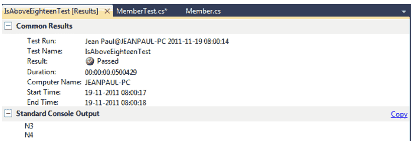

## 在 SQL Server 中扩展访问者模式

在SQL Server中，可以使用计算列实现相同的功能。尽管访问者模式是一种面向对象扩展，我们也可以在数据库中使用这个概念。

让我们通过一个简单的示例来探讨。我们有一个表来存储具有`Quantity`和`Price`的`Transaction`。表中填充了数据。我们需要获取`TotalPrice`，即`Quantity`乘以`Price`。无需进行任何数据更新，我们可以使用如下所示的计算列来实现结果。

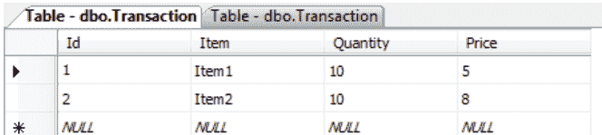

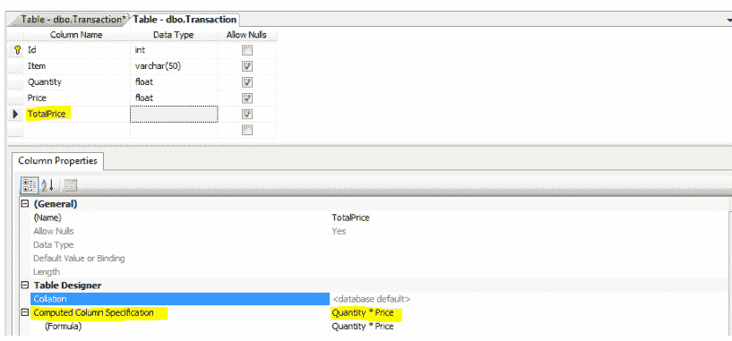

结果如下所示：


|   | Id | Item | Quantity | Price | TotalPrice |
|---|---|---|---|---|---|
| ▶ | 1 | Item1 | 10 | 5 | 50 |
|   | 2 | Item2 | 10 | 8 | 80 |
| * | NULL | NULL | NULL | NULL | NULL |

上面结果无需进行任何数据更新即可获得。

## 小结

在本章中，我们探讨了访问者模式。它允许我们在结构变化不大的情况下添加更多功能。记住这种模式通常有助于更好地进行架构设计。

# 8. 观察者模式

在本章中，我们将讨论观察者设计模式。这种模式是一种广泛使用的模式。

## 挑战

根据颜色选择，需要通知`n`个窗体。实现此目标的一种方法是遍历所有可用的窗体并通知它们。这会导致不必要的迭代和通知。

如何提供更好的解决方案？

## 定义

> GoF定义：“定义对象间的一种一对多的依赖关系，当一个对象的状态发生改变时，所有依赖于它的对象都得到通知并被自动更新。”

## 实现

我们可以使用观察者模式来解决上述问题。主题（Subject）和观察者（Observer）是模式的关键术语。这里颜色（Color）充当主题。

观察者模式用于将发生的某些更改通知感兴趣的观察者。我们可以运行时添加更多观察者，也可以删除它们。

示例：我们有一个用于选择颜色的窗体。对于每次颜色更改，我们需要更新整个应用程序。将有观察者监听颜色更改事件以更新自身。

## 主题与观察者

模式中两个重要的关键术语是主题（Subject）和观察者（Observer）。

主题是持有值并负责在值更改时通知观察者的对象。主题可以是数据库更改、属性更改等。

我们可以得出结论，主题包含以下方法实现。

```
public interface ISubject
{
    void Register(IObserver observer);
    void Unregister(IObserver observer);

    void Notify();
}

public interface IObserver
{
    void ColorChanged(Color newColor);
}
```

在上面的示例中，我们使用了一个具有 `ColorChanged` 方法的观察者接口。因此，感兴趣的观察者应实现此接口以获得通知。

只会有一个主题和多个观察者。

## 注册与注销

在上面的接口中，观察者可以使用 `Register()` 方法获取更改通知。任何时候，它都可以使用 `Unregister()` 方法取消注册通知。

## 通知

`Notify()` 方法负责调用监听的观察者。

## 关联

主题和观察者对象将会具有一对多的关联。

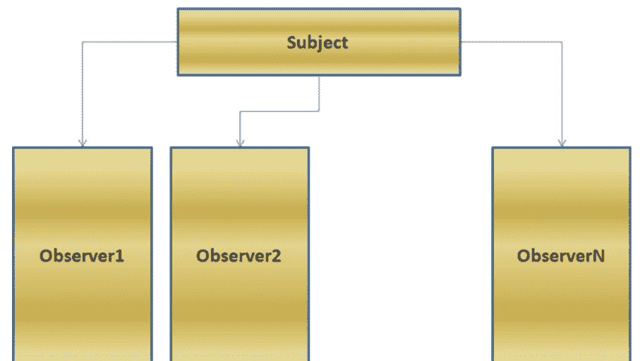

## 使用代码

相关代码有一个主窗体，其中主题是一个名为 `ColorSubject` 的类。

## 应用程序截图

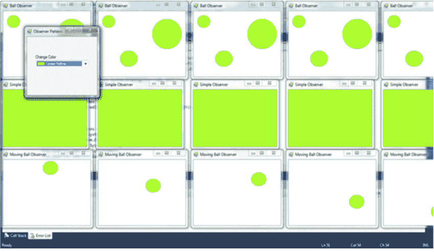

运行相关项目时，我们会看到一个颜色选择器窗体，它充当主题。所有其他窗体都是监听 `ColorChanged` 事件的观察者。

## 注意

`.Net` 中的多播事件模型也可以被视为观察者模式。在这里，感兴趣的一方使用主题（可能是一个按钮）注册一个方法，每当按钮被点击（一个事件）时，它调用注册的观察者（订阅者）。

## 小结

在本章中，我们了解了什么是观察者模式以及一个示例实现。附件包含了我们所讨论的应用程序的源代码。

## 代码解释

以下是名为 `Robot` 的主类的截图。该类包含一个名为 `Peripherals` 的属性，用于配置添加的外设：如 CPU 为 Intel，Monitor 为 Samsung 等。

添加外设后，我们可以调用 `Create()` 方法。它将遍历 `Peripherals` 字典并调用适当的方法来集成外设。这允许我们在运行时选择外设以及顺序。

如果 `Peripherals` 字典包含 CPU，则调用 `AssembleCPU()` 方法。

如果 `Peripherals` 字典包含 Monitor，则调用 `AssembleMonitor()` 方法。

```csharp
public partial class Robot : UserControl
{
    /// <summary>
    /// Dictionary containing Peripheral and the option
    /// </summary>
    public Dictionary<Peripheral, string> Peripherals = new Dictionary<Peripheral, string>();

    /// <summary>
    /// The core method used to create different representations
    /// </summary>
    public void Create()
    {
        while (true)
        {
            // Create new Computer
            _computer = new Bitmap(Image.Computer);

            foreach (Peripheral peripheral in Peripherals.Keys)
            {
                if (peripheral == Peripheral.Processor)
                    AssembleCPU(Peripherals[peripheral]);

                if (peripheral == Peripheral.Monitor)
                    AssembleMonitor(Peripherals[peripheral]);

                if (peripheral == Peripheral.Speakers)
                    AssembleSpeakers(Peripherals[peripheral]);
            }

            AddToStore();
        }
    }
}
```

The class `Peripheral` is an enumeration as following:

```csharp
public enum Peripheral
{
    Processor,
    Monitor,
    Speakers
}
```

## Summary

本章我们看到了 Builder 模式的使用。附件包含我们讨论的示例的源代码。

# 10. Chain of Responsibility Pattern

`Chain of Responsibility` 是 Gang of Four 的 23 种设计模式之一。它是一个有趣的模式，与 Observer 模式类似。本章我们将探索 `Chain of Responsibility` 模式。

我使用相同的 Challenge 和 Solution 风格来解释这种模式。

## Challenge

你正在开发一个应用程序，其中 `Logic` 类生成各种消息。消息有两种类型。

- Normal Priority

- High Priority

Normal Priority 消息应由 `Logger` 类处理，而 High Priority 消息由 `Emailer` 类处理。

你必须做出设计，使得 `Logic` 类无需考虑消息的正确处理器。它只需发送消息即可。

设计将如何进行？

## Definition

> GoF Definition: "Avoid coupling the sender of a request to its receiver by giving more than one object a chance to handle the request. Chain the receiving objects and pass the request along the chain until an object handles it"

## Control Flow

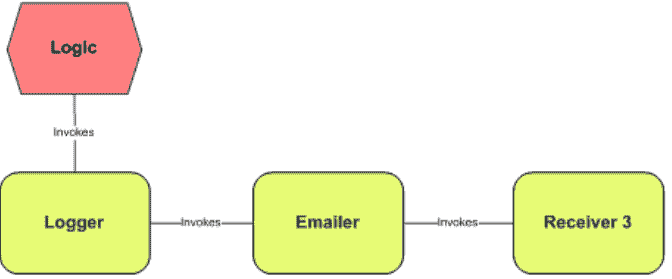

## Implementation

以下是 `Logic` 类的定义：

```csharp
public class Logic
{
    public IReceiver Receiver;

    public void CreateMessage(Message message)
    {
        if (Receiver != null)
            Receiver.HandleMessage(message);
    }
}
```

从上面的代码可以看出，`Logic` 类有一个类型为 `IReceiver` 的属性。在 `CreateMessage` 方法中，该 `Receiver` 用于处理消息。因此只有一个接收器由 `Logic` 类实例注册。

以下是 `Message` 类和 `MessagePriority` 枚举的定义：

```csharp
public class Message
{
    public string Text;
    public MessagePriority Priority;
}
```

```csharp
public enum MessagePriority
{
    Normal,
    High
}
```

以下是 `Receiver` 接口和实现类：

```csharp
public interface IReceiver
{
    bool HandleMessage(Message message);
}
```

```csharp
public class Logger : IReceiver
{
    private IReceiver _nextReceiver;

    public Logger(IReceiver nextReceiver)
    {
        _nextReceiver = nextReceiver;
    }

    public bool HandleMessage(Message message)
    {
        if (message.Priority == MessagePriority.Normal)
        {
            Trace.WriteLine(message.Text + " : Logger processed it!");
            return true;
        }
        else
        {
            if (_nextReceiver != null)
                _nextReceiver.HandleMessage(message);
        }

        return false;
    }
}
```

```csharp
public class Emailer : IReceiver
{
    private IReceiver _nextReceiver;

    public Emailer(IReceiver nextReceiver)
    {
        _nextReceiver = nextReceiver;
    }

    public bool HandleMessage(Message message)
    {
        if (message.Priority == MessagePriority.High)
        {
            Trace.WriteLine(message.Text + " : Emailer processed it!");
            return true;
        }
        else
        {
            if (_nextReceiver != null)
                _nextReceiver.HandleMessage(message);
        }

        return false;
    }
}
```

从上面的代码可以看出，每个接收器类都会检查消息优先级并进行处理。如果优先级不匹配，则发送给链中的下一个接收器。

这里每个接收器负责传递未处理的请求。下一个接收器通过每个接收器的构造函数存储。

链条将执行直到：

- Message is processed

- Receiver chain exhausted

## Code Execution

所附的 Windows 窗体应用程序可用于测试控制流程。

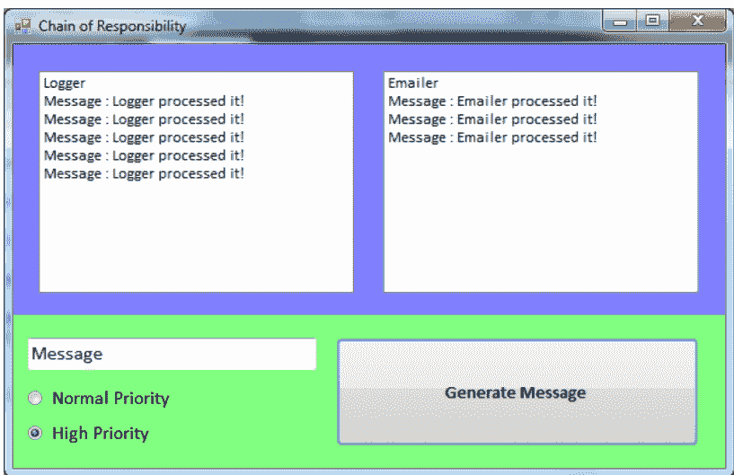

这里链条构建如下：

- `Logic` 类持有第一个接收器，即 `Logger`

- `Logger` 类持有下一个接收器，即 `Emailer`

- `Emailer` 类有一个 `null` 接收器，表示链的结束

以下代码描述了上述链的创建：

```csharp
Logic logic = new Logic();
logic.Receiver = new Logger(new Emailer(null));
```

Note: Please note that the advantage of this pattern is decoupling of sender and receiver. The sender does not think about the right receiver. Instead it will pass the request and the appropriate receiver should process it. The above example can be written using a list of receivers in the `Logic` class with a Boolean property mentioning whether the message is processed or not.

## Comparing Observer and Chain of Responsibility

在 Observer 模式的情况下，所有已注册的接收器都会收到请求。每个接收器都对处理它感兴趣。但在职责链中，请求会一直传递直到被处理。

| Observer | Chain of Responsibility |
| --- | --- |
| All observers handles message | Only one receiver handles message |

## Summary

本章我们通过 C# 示例探索了 Chain of Responsibility 模式。相关源代码包含我们讨论的示例。

# 11. Abstract Factory Pattern

本章我将解释 Abstract Factory 模式。这种模式对于学习 Factory Method 和 Bridge 模式至关重要。

## Challenge

你正在创建 ORM（对象关系映射）框架。框架可在不同的数据库中使用，例如：

- Sql Server

- Oracle

- MS Access

- OleDb

根据数据库类型，你需要创建相关的类，例如：

- SqlConnection, SqlCommand when Sql server

- OracleConnection, OracleCommand when Oracle etc.

如何在不实现它们的情况下创建一族相关对象？

## Definition

GoF Definition: "Provide an interface for creating families of related or dependent objects without specifying their concrete classes"

## Implementation

我们的想法是创建一个包含所有相关对象的接口，例如：

```csharp
public abstract class DbProviderFactory
{
    public abstract DbConnection CreateConnection();
    public abstract DbCommand CreateCommand();
}
```

幸运的是，ADO.NET 已经包含了相同的接口作为抽象工厂。定义如下：(我已从中排除了一些无关的方法)

```csharp
namespace System.Data.Common
{
    public abstract class DbProviderFactory
    {
        public virtual DbCommand CreateCommand();
        public virtual DbCommandBuilder CreateCommandBuilder();
        public virtual DbConnection CreateConnection();
        public virtual DbDataAdapter CreateDataAdapter();
        public virtual DbParameter CreateParameter();
    }
}
```

从上面的代码可以看出，相关类作为一个族包含在内，而无需进入实现细节。

抽象类 `DbProviderFactory` 包含相关的抽象类：`DbCommand`、`DbConnection` 等。

## Concrete Implementations


ADO.NET 提供了上述抽象类 `DbProviderFactory` 的以下实现。

- `System.Data.SqlClient.SqlClientFactory`
- `System.Data.OleDb.OleDbFactory`

上述类实现了基类中的所有抽象方法。因此它将提供 `DbConnection` 的具体实现，即 `SqlConnection`，`DbCommand` 的具体实现即 `SqlCommand` 等。

从上述类实例化后，我们可以开始使用具体实现，如以下代码所示。

```csharp
SqlClientFactory factory = SqlClientFactory.Instance;

DbConnection connection = factory.CreateConnection();
DbCommand command = factory.CreateCommand();

command.Connection = connection;
command.CommandText = "query here";
command.ExecuteNonQuery();
```

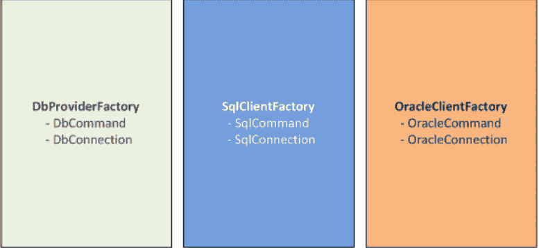

## 摘要

在本章中，我们通过内置的 ADO.NET `DbProviderFactory` 类了解了抽象工厂模式的使用。在下一章工厂方法模式中，将使用上述讨论的代码。因此，本章不附带任何源代码。

# 12. 工厂方法模式

在上一章中，你可能已经了解了抽象工厂。它涉及对具有相关对象的类进行抽象。在本章中，我们将讨论工厂方法模式。我使用相同的 ADO.NET Provider Factory 类作为示例。让我们看看挑战并逐步演化出解决方案。

## 挑战

你正在开发一个 Windows 应用程序。根据他们拥有的数据库许可证，该应用程序有 2 类用户：Sql Server 或 Oracle。

因此，对于每个数据库操作，你需要根据枚举 `DatabaseType` 创建正确的数据库类。

```csharp
public void InsertRecord()
{
    if (AppContext.DatabaseType == DatabaseType.SqlServer)
    {
        SqlConnection connection = new SqlConnection();
        SqlCommand command = new SqlCommand();

        command.Connection = connection;
        command.ExecuteNonQuery();
    }
    else if (AppContext.DatabaseType == DatabaseType.Oracle)
    {
        OracleConnection connection = new OracleConnection();
        OracleCommand command = new OracleCommand();

        command.Connection = connection;
        command.ExecuteNonQuery();
    }
}
```

上述代码看起来复杂，并且在整个应用程序中，每个数据库操作都需要重复编写。

如何避免重复代码并让事情变得更好？

## 定义

GoF 定义：“定义一个用于创建对象的接口，但让子类决定实例化哪个类。工厂方法让类将实例化推迟到子类。”

## 实现

上述问题可以使用工厂方法模式解决。这里我们提供一个抽象类来定义结构并关联所有相关对象（使用抽象工厂）。然后创建派生自该抽象类的子类。子类决定要实例化哪些类。

优点是质量更高、代码更少。这里我们必须定义一个名为 `DbProviderFactory` 的抽象类。（ADO.NET 已经包含它）

```csharp
public abstract class DbProviderFactory
{
    public virtual DbCommand CreateCommand();
    public virtual DbCommandBuilder CreateCommandBuilder();
    public virtual DbConnection CreateConnection();
    public virtual DbDataAdapter CreateDataAdapter();
    public virtual DbParameter CreateParameter();
}
```

然后，我们可以从上述抽象类派生出具体类。

```csharp
public class SqlClientFactory : DbProviderFactory
{
    public override DbConnection CreateConnection()
    {
        return new SqlConnection();
    }

    public override DbCommand CreateCommand()
    {
        return new SqlCommand();
    }
}
```

从上述代码中你可以看到，`SqlConnection()` 和 `SqlCommand()` 对象被创建并分别提供给 `DbConnection` 和 `DbCommand` 类型。这里 `DbConnection` 和 `DbCommand` 是其他抽象类。

类似地，Oracle 实现如下：

```csharp
public class OracleClientFactory : DbProviderFactory
{
    public override DbConnection CreateConnection()
    {
        return new OracleConnection();
    }

    public override DbCommand CreateCommand()
    {
        return new OracleCommand();
    }
}
```

## 替换原始代码

现在我们准备用工厂方法类替换 `Insert()` 方法代码。这里我们使用 `AppInit()` 代码来创建将在整个应用程序中使用的工厂。

```csharp
public void AppInit()
{
    if (AppContext.DatabaseType == DatabaseType.SqlServer)
        AppContext.DbProviderFactory = SqlClientFactory.Instance;
```

```csharp
else if (AppContext.DatabaseType == DatabaseType.Oracle)
    AppContext.DbProviderFactory = OracleClientFactory.Instance;
}
```

```csharp
// NewInsertRecord method
private void NewInsertRecord()
{
    DbConnection connection = AppContext.DbProviderFactory.CreateConnection();
    DbCommand command = AppContext.DbProviderFactory.CreateCommand();

    command.Connection = connection;
    command.ExecuteNonQuery();
}
```

从上述代码中你可以看到，使用工厂方法后代码量显著减少，但代价是新增了一些类。该模式为添加新数据库提供了很大的灵活性。（如果再来一位使用 PostgreSQL 的客户 ☺）

## 抽象与具体派生

下图描述了我们讨论的抽象类与具体类之间的关系。

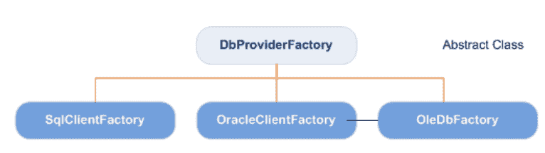

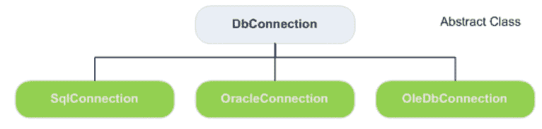

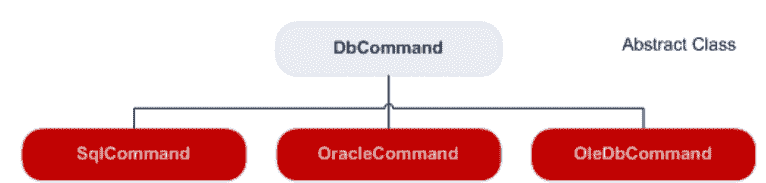

## 注意

ADO.NET 已经包含了 `DbProviderFactory` 抽象类以及像 `SqlClientFactory`、`OleDbFactory` 等具体类。此外，使用像 Entity Framework 这样的 ORM 会自动处理数据库切换。这里提到的场景仅用于学习目的。

## 摘要

在这种方法中，我们已经了解了工厂方法模式。我们讨论的示例包含在附件中。

# 13. 享元模式

在本章中，我们将讨论享元设计模式。它是 23 种设计模式之一，提供了一种改进的对象管理方式。

## 挑战

你正在开发一个身份证创建 Web 应用程序。该应用程序有 10 万条学生记录，需要为这些记录创建身份证。

以下是执行身份证生成的 `StudentCard` 类。在分配学生姓名、地址、照片属性后，我们需要调用 `GenerateIdCard()` 方法获取身份证图像。生成的每张卡片图像都会保存到文件系统。

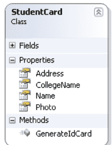

问题是创建了 10 万个类实例。如何减少实例数量？

## 定义

GoF 定义：“使用共享来高效地支持大量细粒度对象”

## 实现

使用享元模式，我们可以解决上述问题。从上述问题中我们可以看到，任一时刻只需要一个实例。

我们可以只使用一个 `StudentCard` 类实例，并在循环内共享它来分配属性和生成身份证。

该模式建议在以下情况使用：

- 减少实例数量
- 共享公共属性

这是旧过程：

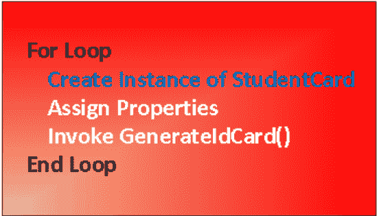

这里根据学生数量，创建 `StudentCard` 的实例。

这将是新过程：

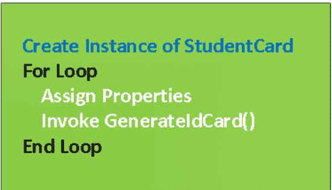

这里只创建了 1 个 `StudentCard` 实例。

## 缺点

尽管享元模式解决了许多问题，我想列出使用它的一些可能缺点。

- 需要更多的配置代码来在属性之间切换
- 如果使用锁，会降低多线程环境中的性能

## 摘要

在本章中，我们探讨了享元设计模式。如果正确使用，该模式有助于减少系统资源消耗。相关源代码包含我们讨论的示例。请让我知道你对本章的评论。

# 14. 代理模式

在本章中，我们将讨论代理设计模式。它是 GoF 的 23 种设计模式之一。像往常一样，我们可以从挑战和解决方案的风格开始。

## 挑战

你正在处理 Excel COM 对象的自动化。业务逻辑需要过多考虑 COM 的实例化、在调用实际功能之前进行基础工作等。

同样的代码明天可能会被 DCOM 取代。因此，Excel 访问代码遍布你的应用程序。如何设计得更好？

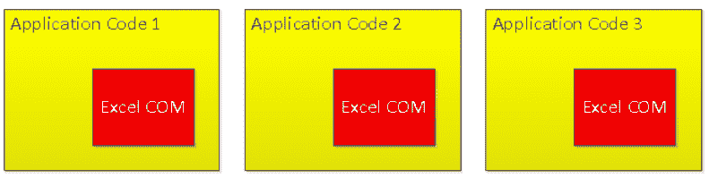

## 定义

GoF 定义：“为另一个对象提供代理或占位符以控制对其的访问”

## 实现

我们可以使用代理模式解决上述问题。正如定义所说，我们需要创建一个占位符或包装器包裹原始对象，以控制对其的访问。这样我们可以获得以下优势：

- 通过在一处更改配置来与 COM 或 DCOM Excel 对象通信
- 为应用程序提供一个简单的接口来与 Excel COM/DCOM 通信
- 让应用程序感觉自己正在与本地对象通信

## 应用

以下是带有数据的应用程序：

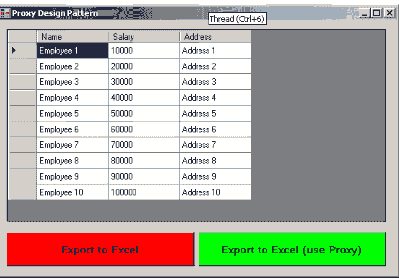

## 旧代码

以下是旧代码，其中应用程序被迫在 Excel COM 对象以及向单元格赋值的方法上投入过多思考。

```csharp
//Start Excel and get Application object.
Microsoft.Office.Interop.Excel.Application oXL = new Microsoft.Office.Interop.Excel.Application();
oXL.Visible = true;

//Get a new workbook.
Microsoft.Office.Interop.Excel._Workbook oWB = (Microsoft.Office.Interop.Excel._Workbook) oXL.Workbooks.Add(Missing.Value);
Microsoft.Office.Interop.Excel._Worksheet oSheet = (Microsoft.Office.Interop.Excel._Worksheet)oWB.ActiveSheet;

//Add table headers going cell by cell.
oSheet.Cells[1, 1] = "Name";
oSheet.Cells[1, 2] = "Address";
oSheet.Cells[1, 3] = "Salary";

//Format A1:D1 as bold, vertical alignment = center.
oSheet.get_Range("A1", "C1").Font.Bold = true;
oSheet.get_Range("A1", "C1").VerticalAlignment = Microsoft.Office.Interop.Excel.XlVAlign.xlVAlignCenter;

int i = 2;
foreach (Employee employee in _list)
{
    string[] values = new string[3];
    values[0] = employee.Name;
    values[1] = employee.Address;
    values[2] = employee.Salary.ToString();
```

```csharp
oSheet.get_Range("A" + i.ToString(), "C" + i.ToString()).Value = values;
    i++;
}

oXL.Visible = true;
oXL.UserControl = true;
```

上述代码的问题在于，过多的 Excel 逻辑与应用程序逻辑混杂在一起。现在我们来看使用代理模式实现的新代码。

## 使用代理模式的新代码

```csharp
ExcelProxy proxy = new ExcelProxy();
proxy.Save(_list);
```

这段代码只有两行，而 Excel COM 对象的创建、单元格值赋值等操作都由 `ExcelProxy` 类来处理。


## 应用程序执行

执行应用程序时，我们可以在 Microsoft Excel 中看到结果。

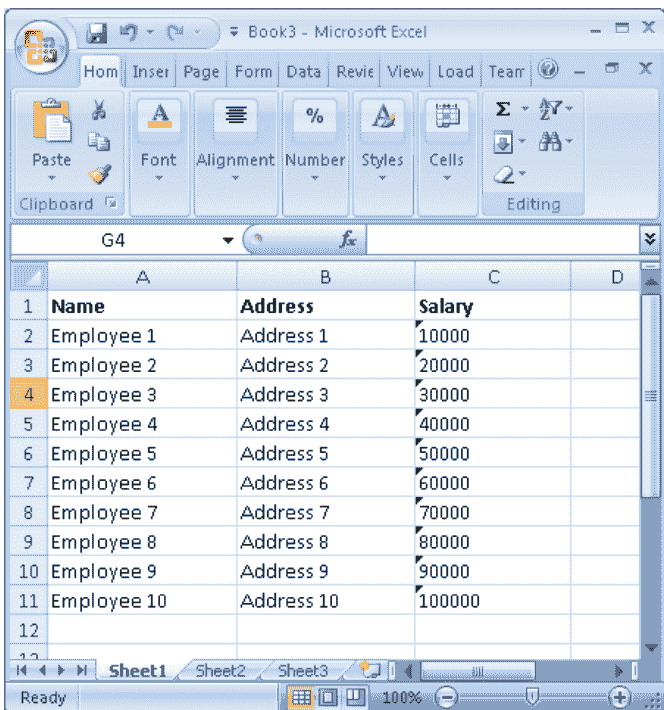

## 代理模式的其他示例

现实世界中，实现代理模式的例子有很多。当我们添加 WCF 引用时，就会创建一个代理。这个类负责处理连接细节、序列化等。

## 总结

在本章中，我们通过一个示例了解了代理设计模式的用法。随附的源代码包含了我们讨论过的示例。

# 15. 外观模式

在本章中，我想探讨外观设计模式。它的实际发音是 /fəˈsɑːd/。字典中 Façade 一词的含义是“一种旨在掩盖令人不悦之事的华而不实的虚假表象”。

现在，让我们进入挑战部分..

## 挑战

你正在开发一个数据库应用程序。经常需要执行 UPDATE 和 DELETE SQL 查询。每次都需要创建 `SqlConnection` 和 `SqlCommand` 类，将连接赋值给命令，然后执行查询。

```csharp
SqlConnection connection = new SqlConnection("connection string");
SqlCommand command = new SqlCommand();
command.Connection = connection;
command.CommandText = "UPDATE Customer SET Processed=1";
command.ExecuteNonQuery();
```

凡是需要执行查询的地方，你都需要重复相同的代码。如何让这段代码变得更好？

## 定义

GoF 定义：“为一个系统中的一组接口提供统一的接口。外观模式定义了一个更高层次的接口，使子系统更容易使用。”

## 实现

借助外观模式，我们可以改善这种情况。我们不难发现，每种情况下只有查询语句不同——连接字符串等参数对整个应用程序来说是通用的。

```csharp
SQLFacade.ExecuteSQL("UPDATE query here..");
```

使用外观模式后，代码就像上面那样。复杂的代码被转移到了后台的 `SQLFacade` 类中。

```csharp
namespace FacadePattern
{
    public class SQLFacade
    {
        public static bool ExecuteSQL(string sql)
        {
            SqlConnection connection = new SqlConnection("connection string");
            SqlCommand command = new SqlCommand();
            command.Connection = connection;
            command.CommandText = sql;
            command.ExecuteNonQuery();

            return true;
        }
    }
}
```


如下图所示，外观模式让代码更完善：

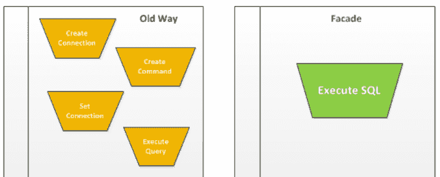

## 总结

在本章中，我们了解了如何使用外观模式来改进代码。它类似于可重用函数的使用，能够剥离复杂部分，并提供更简单的使用接口。相关代码中包含我们讨论过的类。

```
return false;
}
}
return false;
}
}
```

在 `AddJob()` 方法中，我们可以看到，只有当 `JobState` 处于 `Ready` 状态时，新作业才会被接受。此时该方法会返回 `true`。如果有另一个作业正在运行，则新作业不会被加入队列，并返回 `false`。

因此，`Job` 对象会根据内部状态改变其行为。

## 应用程序

随附的应用程序包含我们讨论过的类。执行 Windows 应用程序并单击 Assign Job 按钮后，您可以看到以下屏幕：

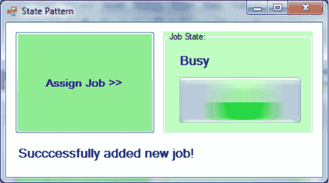

当一个作业正在处理中时，我们无法添加另一个作业。如果尝试添加，将看到如下提示：

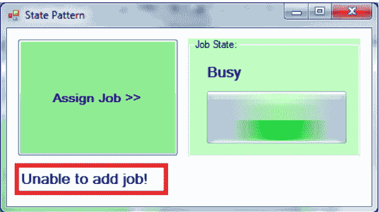

## 总结

在本章中，我们了解了状态模式。附件中包含我们讨论过的应用程序的源代码。

# 17. 迭代器模式

在本章中，我们将讨论迭代器设计模式。如今，大多数面向对象语言都通过其核心语言基础设施支持这种模式。

> 迭代器模式
>
> 提供一种按顺序访问聚合对象中各个元素的方法，而无需暴露其底层表示

## 挑战

你正在开发一个姓名打印应用程序。需要处理一个具有以下属性的 `Bank` 类。

```
public class Bank
{
    public string ManagerName
    {
        get;
        set;
    }

    public string AccountantName
    {
        get;
        set;
    }

    public string CashierName
    {
        get;
        set;
    }
}
```

为了打印姓名，`Print()` 方法的调用方式如下：

```
Print(_bank.Manager);
Print(_bank.Accountant);
Print(_bank.Cashier);
```

现在，上述 `Bank` 对象中新增了 `Branch` 类型的 `Bank`。现在情况变得更加复杂。如何采取更好的方法？

## 定义

GoF 定义：“提供一种按顺序访问聚合对象中各个元素的方法，而无需暴露其底层表示。”

## 实现

我们可以使用迭代器模式来改进上述挑战场景。无需每次都调用 `Print()` 方法，可以使用迭代器来获取 `Bank` 对象中的姓名。

我们引入一个名为 `BankIterator` 的新类，它实现了 `IEnumerable`：

```
public class BankIterator : IEnumerable
{
    private IList _list = new ArrayList();

    public BankIterator(Bank bank)
    {
        _list.Add(bank.Manager);
        _list.Add(bank.Accountant);
        _list.Add(bank.Cashier);
    }

    public IEnumerator GetEnumerator()
    {
        return _list.GetEnumerator();
    }
}
```

该类使用一个 `ArrayList` 来保存 `Manager`、`Accountant`、`Cashier` 的姓名。由于它继承了 `IEnumerable`，因此必须实现 `GetEnumerator()` 方法。幸运的是，我们可以直接返回 `list.GetEnumerator()`。

新的 `Print()` 方法调用如下所示：

```
BankIterator iterator = new BankIterator(_bank);
foreach (string name in iterator)
    Print(name);
```

这从以下方面改善了这种情况：

- 通过迭代可以更方便地访问姓名

- 在 `Bank` 类中引入新的 `Name` 属性时具有更高的灵活性

以下是类图的快照：

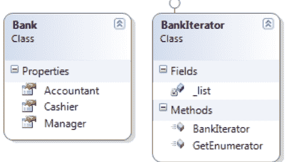

## 注意

从 C# 2.0 开始，迭代器模式通过 `foreach` 实现。`foreach` 允许顺序访问集合中的元素。`IEnumerator` 接口用于实现迭代器模式。

```
public interface IEnumerator
{
    object Current { get; }
    bool MoveNext();
    void Reset();
}
```

在执行 `foreach` 时，首先会调用 `Reset()` 方法将位置定位到集合的第一个元素。然后，在每次迭代中调用 `MoveNext()` 方法。`Current` 属性从集合中返回当前对象。数组、`List`、`HashSet` 等对 `IEnumerator` 接口的实现，使我们能够使用同一个 `foreach` 循环对它们进行迭代。

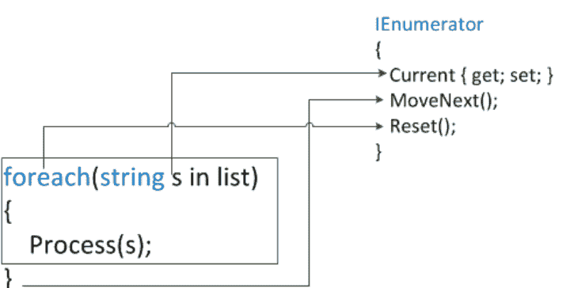

## 参考

http://msdn.microsoft.com/en-us/library/dscyy5s0(v=vs.80).aspx

## 小结

在本章中，我们通过一个 C# 示例探索了迭代器模式。该模式已经在 C# 语言架构中得到了很好的实现。我们也可以在自定义类中扩展该模式的使用。我们上面讨论的示例已包含在源代码附件中。

# 18. 中介者模式

在本章中，我想带您了解使用中介者模式的优势。一如既往，设计模式如果使用得当，会给我们带来更大的灵活性和可管理性。中介者模式也不例外。

## 挑战

您正在开发一个管理航班校验的航空公司应用程序。如您所知，飞机起飞前要经过一系列检查，以确保每个部件的健康状态、燃油量等。

我们的 `Flight` 类包含以下组件类：

- `Engine`

- `Wheels`

- `Cockpit`

- `Aviation`

每个组件类都有一个名为 `Start()` 的方法。调用该方法时，它会通过名为 `IsReady()` 的方法来确保组件的当前状态有效。如果 `IsReady()` 方法返回 `true`，该组件类就会检查其他组件的 `IsReady()` 方法。

例如，`Engine` 类分别通过 `Wheels` 和 `Aviation` 的 `IsReady()` 方法来确保它们处于有效状态。而 `Cockpit` 则检查自身、`Engine` 和 `Aviation` 的状态。因此，类之间存在耦合和代码重复。当引入新的组件类时，这种情况会变得更糟。

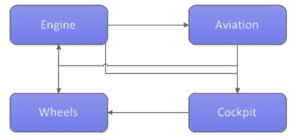

如何让代码变得更好？

## 定义

GoF 定义：“定义一个对象，封装一组对象如何交互。中介者模式通过避免对象之间显式地相互引用，从而促进松散耦合，并允许你独立地改变它们之间的交互。”

## 实现

我们可以通过引入中介者模式来改进上述情况。通过引入中介者，组件类之间不再直接通信。所有组件都与一个新的中介者类通信。其优点有：

- 组件之间松散耦合

- 集中式管理

- 更改代码时更灵活

新方法如下所示：

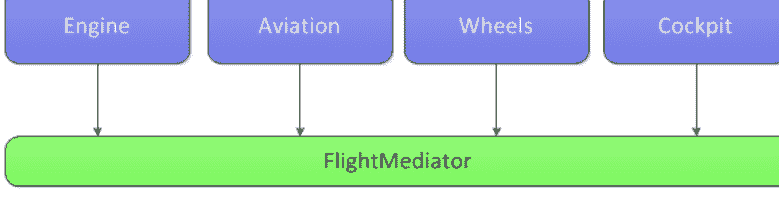

这里，各个组件部分将与中介者类通信，以提供继续进行的就绪信号。

## 类

以下是使用中介者模式的新实现所涉及的类。

```csharp
public class FlightMediator
{
    private Engine _engine;
    private Aviation _aviation;
    private Wheels _wheels;
    private Cockpit _cockpit;

    public FlightMediator(Engine engine, Aviation aviation, Wheels wheels, Cockpit cockpit)
    {
        _engine = engine;
        _aviation = aviation;
        _wheels = wheels;
        _cockpit = cockpit;
    }

    public bool IsReady()
    {
        return _engine.IsReady() && _aviation.IsReady() && _wheels.IsReady() &&
               _cockpit.IsReady();
    }
}

public class Engine
{
    public void Start()
    {
    }

    public bool IsReady()
    {
        return true;
    }
}

public class Aviation
{
    private int _FuelLevel = 1000;

    public bool IsReady()
    {
        return _FuelLevel > 5000; // Returns false as not enough fuel
    }
}

public class Wheels
{
    public bool IsReady()
    {
        return true;
    }
}

public class Cockpit
{
    public bool IsReady()
    {
        return true;
    }
}
```

请注意，`Aviation` 类的 `IsReady()` 方法返回 `false`。`FlightMediator` 构造函数将所有的组件类作为输入。`IsReady()` 方法会检查所有关联组件的 `IsReady()` 方法，以确保校验正确。

运行 Windows Forms 应用程序后，您会看到以下界面。

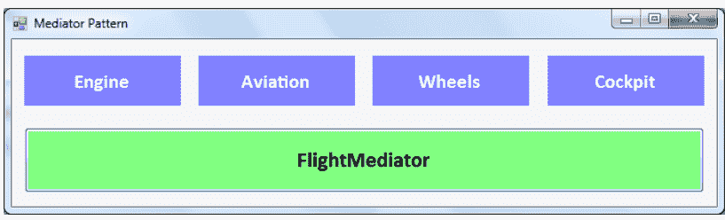

单击 `FlightMediator` 按钮，您会看到颜色变为红色，因为返回的状态为 `false`。

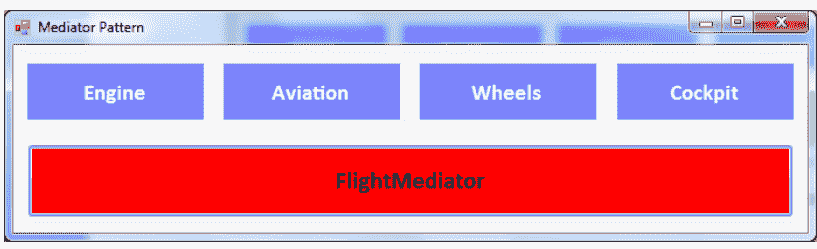

## 小结

在本章中，我们探索了中介者模式。该示例是在一个简单的问题场景中提供的，但现实世界中的问题要复杂得多。例如，在一个向导页面框架中，每个页面都需要考虑上一页和下一页，使用中介者模式可以使其变得更好。本章附带了相关的源代码。

# 19. 备忘录模式

在本章中，我想尝试一下备忘录模式。备忘录模式提供了一种面向对象的方式来保存对象的状态。这个状态称为备忘录（`Memento`），以后可以用来恢复该对象。

`Memento` 在英语中的意思是“对过去事件的提醒”。

## 挑战

您正在开发一个绘图应用程序，该程序允许用户在画布上绘制线条。用户应该能够在特定时间间隔保存状态，以便可以撤消后续的错误。您需要为这个问题提供解决方案。

## 定义

GoF 定义：“在不违反封装的前提下，捕获并外部化一个对象的内部状态，以便以后可以将该对象恢复到这一状态。”

## 实现

上述问题可以使用备忘录模式来解决。正如定义中所说，该模式保存对象的内部状态，以便日后恢复。对象状态的保存不会违反封装。

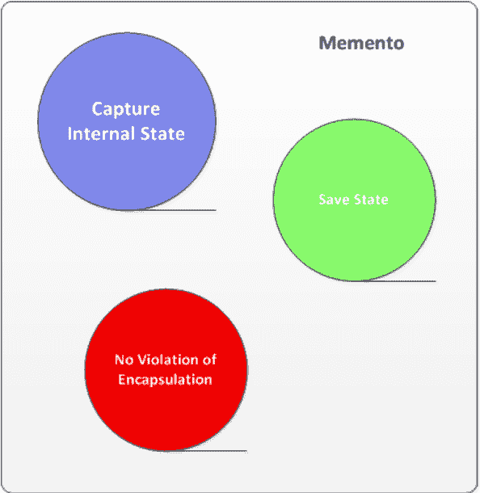

以下是 `Drawing` 类的定义：

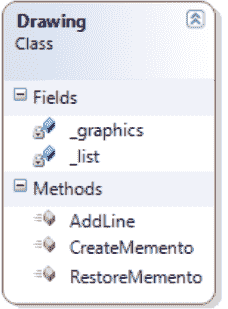

`AddLine()` 方法允许在图形上添加线条。这些信息作为状态存储在 `_list` 对象中。

`CreateMemento()` 方法允许在不违反封装的情况下获取内部状态的副本。

`RestoreMemento()` 方法允许将状态恢复到给定的备忘录。

以下是 `Memento` 类的定义：

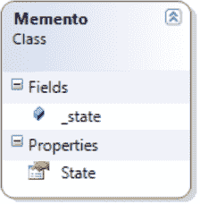

它包含一个 `State` 属性，用于保存 `Drawing` 类的状态。

## 执行应用程序

您可以尝试运行附带的应用程序。运行后，在画布上绘制一系列线条，然后使用 Save 按钮保存备忘录。

现在尝试添加一些不需要的线条：

使用“恢复状态”来获取旧的、有效的状态。

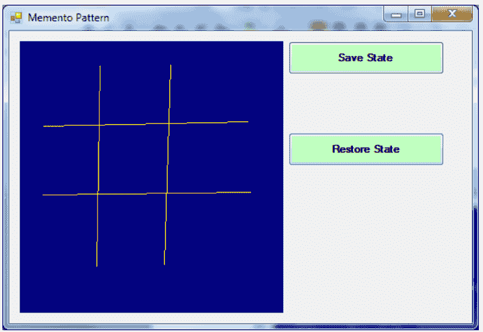

至此，我们实现备忘录模式的应用程序就结束了。

## 比较命令模式和备忘录模式

命令模式也通过将操作转换为命令来提供撤销/重做功能。区别在于，命令模式存储每个操作，而备忘录模式仅在请求时保存状态。此外，命令模式对每个操作都有撤销和重做，而备忘录模式则不需要。

可以根据具体场景选择使用命令模式或备忘录模式。

## 小结

在本章中，我们探索了备忘录模式。附带的源代码中包含我们讨论的示例。

# 20. 原型模式

在本章中，我想解释一下原型模式以及 C# 对它的支持。原型模式提供了一种通过复制现有对象的原型来实例化新对象的替代方案。

## 挑战

您正在开发一个应用程序，其设置存储在 `Settings` 类中。类的属性在构造函数中被赋值。这涉及调用配置文件、安全数据库、用户配置文件数据库等。

您需要将上述实例传递给某个库中的组件。该组件可能会随意修改这些属性，因此我们只能发送 `Settings` 的另一个实例。由于实例创建的开销很大，我们需要创建上述实例的一个副本。

最佳方法是什么？

## 定义

GoF 定义：“使用原型实例指定要创建的对象的种类，并通过复制这个原型来创建新对象。”

## 解决方案

我们可以使用原型模式来应对这种场景。该模式允许我们以具有所需属性的现有实例为原型来创建新实例。

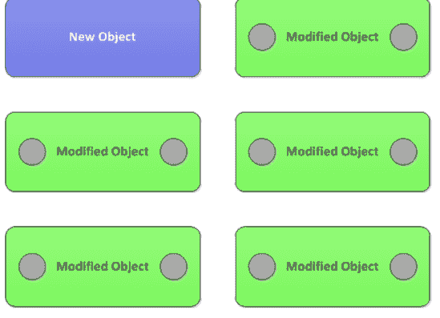

创建新对象并修改它。从修改后的对象创建原型。

`System.Object` 类包含一个名为 `MemberwiseClone()` 的新方法，它提供当前对象的浅拷贝。浅拷贝仅涉及复制值类型。结合 `ICloneable` 接口，我们可以为 `Settings` 类提供一个 `Clone()` 方法，该方法调用 `MemberwiseClone()`。

```csharp
public class Settings : ICloneable
{
    public Settings()
    {
        // Load ApplicationSettings from Configuration
        // Load ThemeSettings from Database
        // Load UserSettings from Database
        Thread.Sleep(3000); // Simulate a delay for the above operations

        ApplicationSettings = "ApplicationSettings1";
        ThemeSettings = "ThemeSettings1";
        UserSettings = "UserSettings1";
    }

    public string ApplicationSettings
    {
        get;
        set;
    }

    public string ThemeSettings
    {
        get;
        set;
    }

    public string UserSettings
    {
        get;
        set;
    }

    public object Clone()
    {
        return this.MemberwiseClone();
    }

    public override string ToString()
    {
        return this.ApplicationSettings + " " +
               this.ThemeSettings + " " +
               this.UserSettings;
    }
}
```

## 执行应用程序

现在我们可以尝试操作类实例。首先我们创建一个 `Settings` 实例（这是一个 3 秒的延迟过程）。之后我们对 `Settings` 实例进行克隆并修改属性。我们可以看到新的实例是使用 `Clone()` 方法创建的。

```csharp
static void Main(string[] args)
{
    Settings settings = new Settings();
    Settings settingsClone = (Settings)settings.Clone();
    settingsClone.ApplicationSettings = "NewSettings"; // Change property
    Console.WriteLine("INSTANCE 1: " + settings.ToString());
    Console.WriteLine("INSTANCE 2: " + settingsClone.ToString());
    Console.ReadKey(false);
}
```

执行应用程序后我们可以看到以下结果。

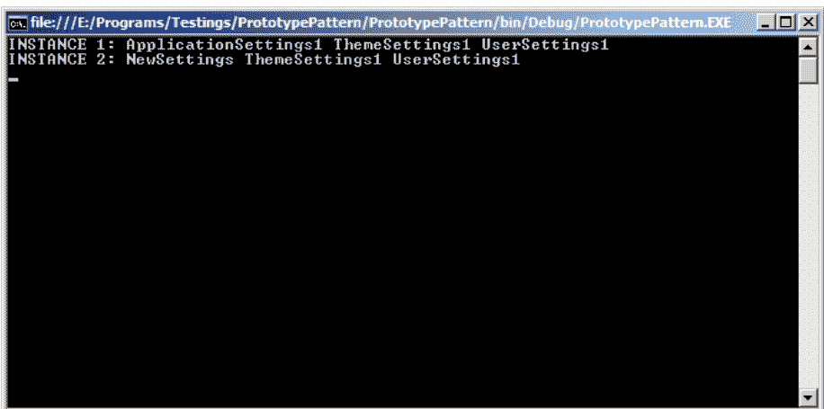


我们可以从上面的代码看出：

1. 实例 1 是使用 `new` 关键字创建的
2. 实例 2 是使用 `Clone()` 方法创建的
3. 修改实例 2 不会影响实例 1

至此，我们对原型模式的实验就结束了。

## 参考

http://sourcemaking.com/design_patterns/prototype

## 总结

在本章中我们探索了原型模式。原型模式的使用可以总结为：

- 使用所需属性更快地创建实例
- 实例创建时可以避免使用 `new` 关键字
- 为抽象工厂模式提供一种替代方案
- 在运行时指定实例属性

# 21. 桥接模式

在本章中我们可以探索桥接模式，该模式在应用程序中常用。

## 挑战

你正在处理一个抽象业务类。该类需要通过写入文件、向用户发送电子邮件等方式记录信息。我们需要避免业务类与记录器紧密耦合，因为未来可能会出现记录器的新版本。

## 紧耦合设计

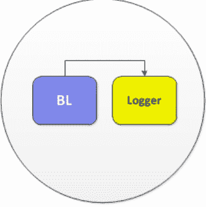

如何实现解耦的解决方案？

## 定义

GoF 定义："将抽象与其实现分离，以便两者可以独立变化"

## 实现

我们可以为表示 Logger 创建一个抽象类。让抽象业务类持有对新的抽象 Logger 的引用。在运行时我们可以指定 Logger 类的实际实现实例。 （文件写入器或电子邮件发送器）以下是使用桥接模式后的类图快照：

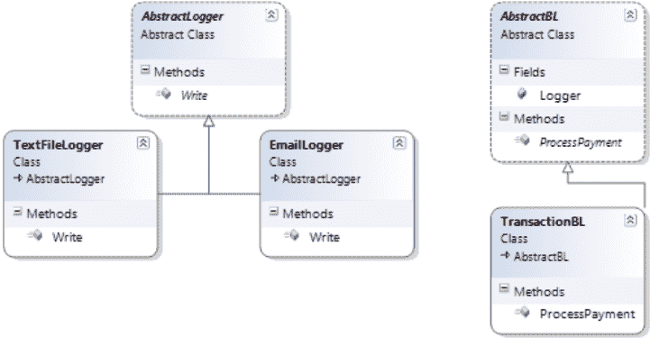

这里具体的 Logger 实现派生自 `AbstractLogger` 类。具体的 `TransactionBL` 派生自 `AbstractBL` 类。`AbstractBL` 类持有对 `Logger`（抽象 Logger）的引用。

使用如上所示的桥接模式，实现与抽象解耦。它允许在不修改 BL 类的情况下对 Logger 类进行未来扩展。

## 代码

以下是调用上述 Transaction 和 Logger 类的代码。

```
AbstractBL bl = new TransactionBL();
bl.Logger = new TextFileLogger();
bl.ProcessPayment();

bl.Logger = new EmailLogger();
bl.ProcessPayment();

Console.ReadKey(false);
```

运行应用程序后我们可以看到以下输出。

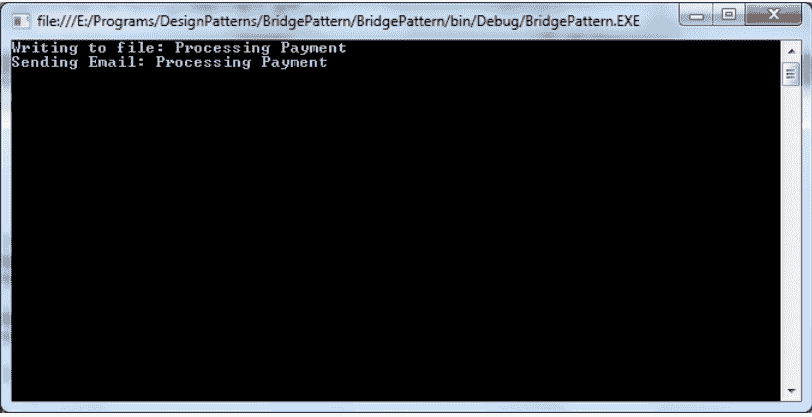

以下是使用桥接模式后的耦合快照。

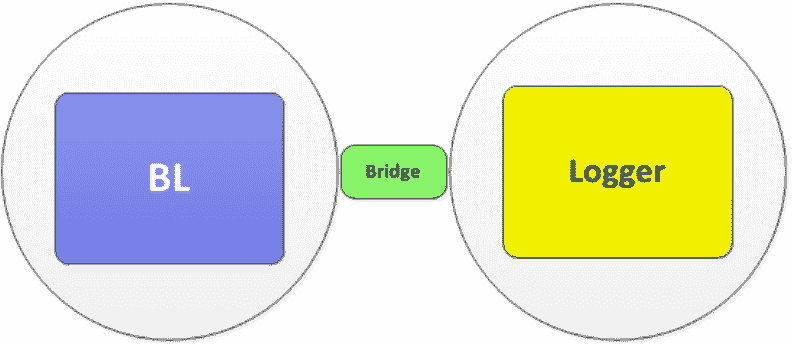

## 注意

我们可以看出该模式是使用抽象类和接口的简单实现。桥接模式与策略模式有一些相似之处，因为两者都涉及在运行时更改实现。这里的类与策略模式相比是抽象的。

## 总结

在本章中我们探索了桥接设计模式。它通过抽象类或接口的桥梁为分离抽象与实现提供了便捷方式。附带的源代码包含我们讨论的示例。

# 22. 解释器模式

在本章中我想演示解释器模式的使用。这不是一个广泛使用的模式，但揭示了一种良好的编程方式。它说的是创建一种语言以及该语言的解释器。语言可用于表示状态、动作、循环等，具体取决于编程需求。这里我们使用该模式来解决持久化问题。

## 挑战

你正在开发一个绘图应用程序，允许在画布上创建线条和圆圈。`Line` 和 `Circle` 类为你完成了这项工作。你需要将绘图与拥有各自应用程序副本的多个用户进行通信。当前使用上述类的序列化进行绘图持久化会产生大尺寸文件，并且不允许通过聊天窗口发送消息。如何提供更小尺寸、更易于通信的持久化解决方案？

## 定义

GoF 定义："给定一种语言，为其语法定义一种表示形式，以及一个使用该表示形式来解释该语言中句子的解释器"

## 实现

我们可以使用解释器模式来解决这个问题。我们需要构建一种包含命令的语言以及执行操作的解释器。

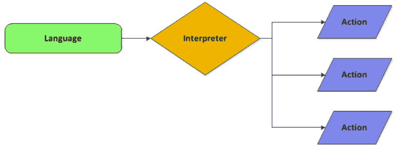

以下是我们绘图应用程序涉及的类：

- 一个 `Line` 类
- 一个 `Circle` 类

解释器 `Execute()` 方法的主体如下所示：

```
public void Execute(string commands, Graphics graphics)
{
    graphics.Clear(Color.FromArgb(237, 253, 200));

    int i = 0;

    foreach (string rawCommand in commands.Split(';'))
    {
        string command = rawCommand.Replace(Environment.NewLine, string.Empty).Trim();

        if (command.StartsWith("line"))
        {
            i = 0;
            int x = 0, y = 0, width = 0, height = 0;

            foreach (string argument in command.Split(','))
            {
                if (i == 1)
                    x = int.Parse(argument);
                else if (i == 2)
                    y = int.Parse(argument);
                else if (i == 3)
                    width = int.Parse(argument);
                else if (i == 4)
                    height = int.Parse(argument);

                i++;
            }

            new Line(graphics).Draw(x, y, width, height);
        }
        else if (command.StartsWith("circle"))
        {
            i = 0;
            int x = 0, y = 0, radius = 0;

            foreach (string argument in command.Split(','))
            {
                if (i == 1)
                    x = int.Parse(argument);
                else if (i == 2)
                    y = int.Parse(argument);
                else if (i == 3)
                    radius = int.Parse(argument);

                i++;
            }

            new Circle(graphics).Draw(x, y, radius);
        }
    }
}
```

以下是类图：

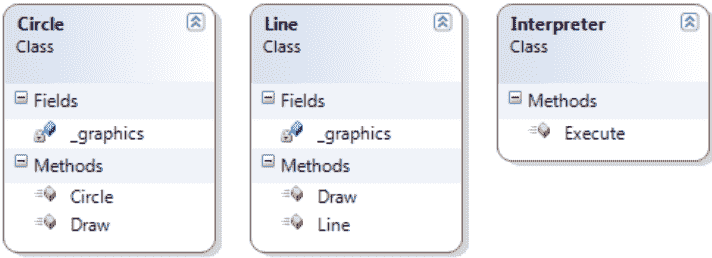

至此，我们使用解释器模式的应用就结束了。现在这些操作可以被转换为一种语言以便后续解释。

## 命令模式与解释器模式的比较

你可以在命令模式和解释器模式之间找到一些相似之处。命令模式说的是将操作转换为命令以用于记录或撤销目的。这里的命令是对象，但对于解释器模式来说，命令是句子。

命令模式可用于通过序列化命令列表来持久化对象，与解释器模式相比会导致文件较大。解释器模式在运行时提供了一种更简单的方法，但代价是需要开发一个解释器。

## 解释器模式的应用

你正在创建自己的 Photoshop 应用。图层上绘制的对象可以转换为一系列命令。之后，整个绘图可以用命令文件表示，该文件与整个画布序列化相比体积会更小。你将获得将文件发送给其他人的优势，他/她可以：

- 重新生成绘图
- 查看所有绘图操作
- 修改绘图操作项
- 撤销最后的绘图操作

## 参考

http://www.dofactory.com/Patterns/PatternInterpreter.aspx#_self1

## 总结

在本章中，我们通过一个小型应用了解了解释器模式。上述应用仅展示了简单的用法以供学习，但在真实世界的场景中，该语言可能包含循环、条件等。附件包含我们讨论的应用的源代码。

# 23. 组合模式

在本章中我们可以探索组合设计模式。它在与单个对象和对象组进行通信时提供了一种更好的方法。如常，我们可以从挑战-解决方案方法开始。

## 挑战

你正在开发一个包含总部和分支机构的分布式应用。每个办公室在夏令时期间都需要全局更新 2 个时钟控件。

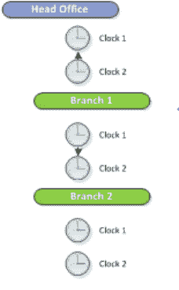

上图显示了当前结构。总部只有一个，下设多个分支。总部和每个分支都将拥有 2 个时钟控件。时间更改过程从总部开始，在当前方法中，总部必须记住所有分支以及每个分支内部的所有时钟。这非常繁琐，并且在分支合并到一个分支组时会失效。

如何提供更好的解决方案？

## 定义

GoF 定义："将对象组合成树形结构以表示整体-部分层次结构。组合模式让客户端可以统一地处理单个对象和对象组合"

## 实现

我们可以在上述场景中使用组合设计模式。一旦我们的解决方案实现，总部只需要考虑分支。分支将考虑各自的时钟。

我们的解决方案中有 2 个类：`Office` 和 `Clock`。`Office` 类可以表示总部和分支。`Clock` 类管理用于更改时间的时钟控件。

我们需要引入一个接口，由 `Office` 和 `Clock` 类实现。

```csharp
interface IComponent
{
    void Add (IComponent notifier);
    void SetTime(DateTime time);
}
```

`Add()` 方法确保添加类型为 `IComponent` 的组件。可用于添加 `Office` 或 `Clock` 实例。

`SetTime()` 方法可用于更改当前时间。

## 类实现

以下是 `Office` 和 `Clock` 类的实现：

```csharp
class Office : IComponent
{
    private IList<IComponent> _list = new List<IComponent>();

    public void Add(IComponent notifier)
    {
        _list.Add(notifier);
    }

    public void SetTime(DateTime time)
    {
        foreach (IComponent n in _list)
            n.SetTime(time);
    }
}

class Clock : IComponent
{
    public ClockControl ClockControl;

    public void Add(IComponent notifier)
    {
        throw new ApplicationException("You cannot add IClock!");
    }

    public void SetTime(DateTime time)
    {
        ClockControl.CurrentTime = time;
    }
}
```

请注意，`Office` 类的 `SetTime()` 实现负责通知所有添加的 `IComponent` 实例。因此总部可以通知所有分支。分支将通知所有时钟实例。

## 创建实例

以下是总部和分支实例创建的代码。

```csharp
_headOffice = new Office();
_headOffice.Add(new Clock() { ClockControl = hForm.clock1 });
_headOffice.Add(new Clock() { ClockControl = hForm.clock2 });

Office branch1 = new Office();
branch1.Add(new Clock() { ClockControl = b1Form.clock1 });
branch1.Add(new Clock() { ClockControl = b1Form.clock2 });
_headOffice.Add(branch1);

Office branch2 = new Office();
branch2.Add(new Clock() { ClockControl = b2Form.clock1 });
branch2.Add(new Clock() { ClockControl = b2Form.clock2 });
_headOffice.Add(branch2);
```

请注意，分支实例已添加到总部。

## 运行应用

点击设置时间按钮，你可以看到所有时钟都重置为上午 10:00。

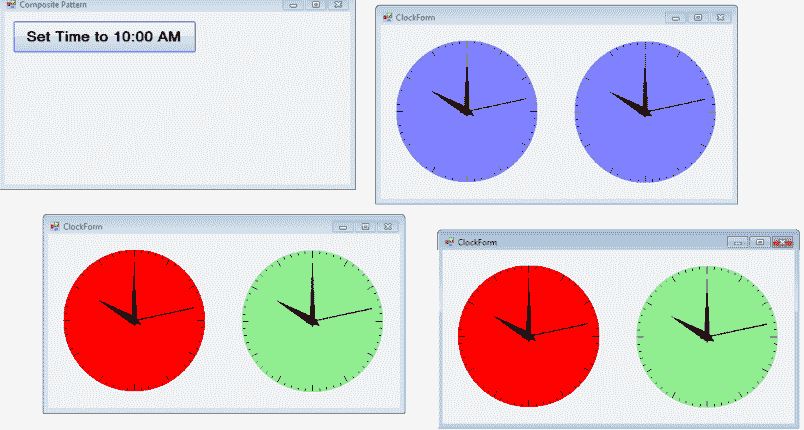

这里总部不需要考虑分支的所有时钟实例。这里单个对象（时钟）和组合对象（分支）被统一处理，满足了模式定义。

## 总结

在本章中，我们探索了组合模式。它在与单个对象和组合对象通信时提供了一种集中化的方法。附件包含我们讨论的示例应用，包括时钟控件。

## 参考

该电子书是在收集书籍、MSDN 和其他在线资源的信息后编译的。花费了近 1 年时间覆盖所有章节，因此部分参考链接可能会失效。

你可以使用以下链接找到有关设计模式的更多信息：

http://www.dofactory.com

http://www.oodesign.com

## 源代码

电子书的源代码可在 http://jeanpaulva.com 上找到。
