# 为使用而设计：为应用程序和网络创建可用界面


## What Readers Are Saying About Designed for Use

An encyclopedic narrative of the life cycle of software UX design, stuffed with best practices, timely examples, and solid design methodologies. I wish I had it years ago!

> ► Keith Lang

> COO and interaction designer, Skitch

It’s hard to write about usability concepts without sounding overly academic, but that’s exactly what Lukas has done. This book is a must-read if you are familiar with basic usability concepts and are ready to learn more.

> ► Jon Bell

> Interaction designer, Windows Phone

Designed for Use distills Lukas’s brilliant insight into the much neglected area of usability, UX, and UI design. An essential, authoritative, and enlightening read.

> ► Paul Neave

> Interaction designer, Neave Interactive

This book is smooth and pleasing like Swiss chocolate and has the eloquence of a cherry blossom. It’s a must-read and real gem for everybody who is eager to learn about usability.

> ► Michael D. Trummer

> Senior engagement manager, Appway, Inc.

Make good use of this book! It will help you to improve your work.

> ► David Naef

> Creative director, Design Management, Visionaer


For Regula and Werner

+   

+   

+   

+   

+   

## 开始之前，先说几句

这是一本写给视觉设计师和程序员的书。然而，它不是关于视觉设计，也不是关于代码。相反，它关乎一件重要得多的事：使用你产品的人。

如果人们不使用它，最好的产品也毫无意义。你可以造出世界上最漂亮、最结实、最优雅的画笔，但如果没有人用它来画画，你的工作就白费了。

这本书帮助你打造人们愿意使用的产品——应用程序和网站。

本书有两类章节：“技术章节”和“理念章节”。每个技术章节都讲解一种你在设计过程中可以用来让产品更易用的具体技术，例如故事板、可用性测试或纸上原型。技术章节讲解你可以做的具体事情——相当于为设计师的工具带增添工具。

而理念章节则用更概括的方式谈论想法或概念：如何编写可用的文本、你的设计看起来应该多逼真、何时使用动画，等等。理念章节讲解在设计构思时需要考虑和斟酌的事项。

## 技术章节

你可以通过首页上的齿轮图标来识别技术章节。

所有技术章节都遵循相同的基本框架。由于并非所有技术都适用于所有情况，我会先简要概述该技术适用的情境类型。然后，我会解释这项技术是什么以及如何使用。在许多技术章节的末尾，我会给出一个具体示例，展示该技术如何应用于我们随书进展而设计的一个虚构应用。


由于 Twitter¹ 应用是我们这一代的“Hello World”示例应用，所以技术章节中我们将设计一个 Twitter 应用。为了增加趣味性，我们要设计的不是一个普通的 Twitter 应用。我们的应用面向那些需要为公司更新 Twitter 账号的人。我们把这个虚构应用称为 BizTwit。

把技术章节当作菜谱吧。从头到尾读这本书可以，深入钻研某个特定话题也没问题。为此，这些章节通常短小精悍、切中要点，并包含书中以及其他书籍或互联网上的延伸阅读参考。

## 理念章节

技术章节介绍具体技术并解释如何应用，而理念章节则没那么具体。它们引入概念，主要用作灵感来源，而非严格规则。有些理念章节会提到技术或引用技术章节，但重点放在更宽泛的概念上：设计应该多逼真？我们如何最有效地使用动画？什么是模式？我们能从电子游戏中学到什么？

你可以通过首页上的灯泡图标来识别理念章节。

这些章节中的理念未必总适用于你手头的项目，因为在某种程度上，人是不可预测的。他们使用你的产品时，并不总是按你期望的方式行事，也不总是按你的规则所预测的那样行动。

为了说明人们的行为常常与预测不同，我们来看一个用户界面设计之外的例子。假设你关注公共健康与安全。你会从哪里入手？鉴于每年有数以万计的骑车人在交通事故中受伤，自行车安全是一个很好的切入点。

研究表明，头盔有助于骑车人避免受伤。因此，让人们戴上头盔应该能减少受伤人数，从而提高人们的健康与安全水平。预期的结果似乎

1. 如果你不知道 Twitter 是什么（可能是因为你在 2053 年读这本书，那时人们通过“脑控”交流），Twitter（网址 http://twitter.com）是一种流行的互联网服务，人们用它发布短文本消息——推文——并订阅其他人的消息。


显而易见：人们会发生自行车事故，头盔能防止受伤，戴头盔的骑车人能够避免受伤。结论：强制人们戴头盔。

这些年来，许多地方出台了自行车头盔法。然而，这些法律并没有带来预期的结果。

在一项题为“强制自行车头盔法的健康影响”² 的 2009 年研究中，澳大利亚麦考瑞大学精算研究系的皮特·德容评估了这类法律的效果。他发现人们真的很不喜欢自行车头盔，以至于许多人如果骑车时被强制戴头盔，干脆就完全不再骑车了。

这一结果促使德容得出结论：自行车头盔法实际上对整个社会的健康有负面影响。没错，这些法律确实能防止一些伤害，但对于那些完全不再骑车的人（而且往往改用汽车）来说，健康后果是压倒性的负面。

归根结底，没有人在颁布这些法律之前费心测试它们。受这些法律影响的人，做出了法律设计者完全意想不到的事情。

在设计用户界面时，你经常会观察到同样的效应。设计改动并不总能产生你预期的结果，有时甚至会产生与预期相反的效果。

当你阅读本书中的理念和规则时，我希望你记住这一点。你可以尽最大努力提出可用的解决方案；你可以遵循所有规则，做出那些看起来明显

2. 你可以通过 http://ssrn.com/abstract=1368064 阅读这项研究。

可用的选择。但人们仍会给你惊喜，他们会以创造性的方式误解你应用程序的用户界面，在你的网站上迷路，以不可预测、看似不合逻辑的方式行事，并且无法完成那些在你看来最显而易见的任务。

永远不要以为把一整套可用性规则套用到产品上，就能得到一个可用的产品。设计用户界面时，运用常识，但不要依赖常识。了解规则，但如果打破规则能改进你的产品，就打破它们。重点不是完全照我说的做，而是把我的话当作灵感来源——并且始终测试你的设计。

## 本书的组织方式

本书章节大致按照它们在典型设计过程中的适用顺序呈现，我将这一过程分为三个阶段：研究、设计和实现。

## 研究

尽早直接开始设计产品是很有诱惑力的（如果你是程序员，甚至可能想直接开始写代码）。在某些情况下，这或许没问题，但通常最好先做一些研究。你的产品是为谁设计的？你想解决哪些问题？

## 设计

思考如何解决受众的问题。先设计解决方案并测试，然后再写任何代码。在纸上修正错误比在代码中修正错误容易得多。

从设计的角度来看，这一阶段可能是开发过程中最重要的，因此也是本书篇幅最大的部分。

## 实现

创建产品，但持续测试。你之前的假设正确吗？你的设计有效吗？产品运行起来后，人们如何与之互动？你的实现足够好吗？你的产品如何处理错误和真实数据？它的性能足够好吗？

把理念章节放在哪里，与其说是一门精确科学，不如说是一种直觉判断。我把这些章节放在了你们最可能找到它们的地方

## 输入网址

本书包含许多网址，其中一些相当长。也许你读的是印刷版。把这些长网址从书上复制到浏览器中可能非常麻烦。为了方便一点，我建立了 `http://designedforuse.net`。这个网站列出了本书中所有长网址。无需输入长地址，只需输入 `http://designedforuse.net`，然后点击那里的链接即可。

有用，但大多数想法在大多数时候都适用。组织方式对于技术章节来说更为相关。

我用这样的一条时间线来介绍每一章技术：

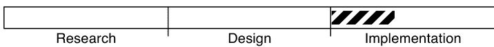

这条时间线可以帮助你理解某种技术在何时最为重要或最常被使用。示例时间线表示一种技术通常在产品开发流程的“实现”部分开始时使用。然而，许多技术在设计流程的不同阶段都很有用。这些时间线是为了帮助将技术置于上下文中，而不是作为严格的规则。

现在，这种表示方式让典型的开发流程看起来像是从研究到设计再到实现的线性过程。但通常，设计流程是迭代的。你的开发流程更可能看起来像这样一个圆圈。

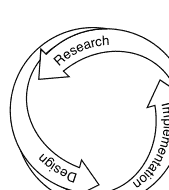

然而，由于我们通常将开发流程视为对产品的多次线性迭代，因此线性时间线应该很容易理解。

## 再说一件事

在开始之前，我应该说明这本书有一个自己的网页。³ 它提供了一个书籍论坛和一个勘误页面。当然，现在我输入这段话时，勘误页面还是空的，但等你阅读时，它可能就不会是空的了。

好了，言归正传，让我们开始吧！

3. 你可以在 `http://www.pragprog.com/titles/lmuse` 上找到它。

## 第一部分：研究

本书的第一部分是关于研究的。你将了解研究的重要性，并了解哪些类型的研究效果好（以及应避免什么）。你将学习如何观察人们实际在做什么以及如何采访人们。你将看到如何使用人物角色来跟踪你的研究并聚焦产品的设计。稍后，你将看到如何使用卡片分类来构建你的产品。

那么，让我们先弄清楚为什么研究很重要。

## 第 1 章：用户研究

当设计师谈论他们的设计流程时，他们通常会提到它是“以人为中心”或“以用户为中心”。从非常模糊的意义上讲，这意味着他们不断地... to the product.

以 Atari Lynx 为例。早在 1990 年代初，日本电子游戏公司任天堂凭借其 Game Boy 占据了掌上游戏市场。

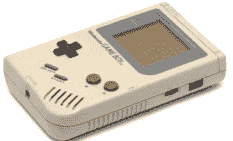

几乎每个孩子都有一台，而那些没有的孩子则把它加入愿望清单，迫不及待地等待生日到来。竞争对手电子游戏公司 Atari 也想分一杯羹。

在与焦点小组交谈后，Atari 决定推出一台比任天堂那台小灰设备更强大的主机。Atari 在其设备中加入了彩色屏幕和更快的处理器，并将其命名为 Lynx，显然比相对弱小且名字也弱小的 Game Boy 更胜一筹。Atari 还采用了巨大的机身，因为焦点小组的人说他们更喜欢更大的型号。

该设备惨败。没有人想要 Lynx。

当我联系 Lynx 联合设计师 RJ Mical¹ 并询问他此事时，他告诉我以下内容：

> 我从 Lynx 学到的最宝贵的教训之一：永远不要相信焦点小组。我们对 Lynx 做了很多焦点小组测试，尤其是在机身尺寸和形状方面。我们展示了许多不同的模型并问道：“你喜欢哪一个？哪个感觉最好？”我们展示了大号的和小号的。我们展示了巨大的和非常小的！一次又一次，他们都更喜欢大号的。他们都告诉我们：“要大！把它做大！我想感觉自己物有所值。”好吧，所以我们把它做大了。然后当 Lynx 发布时，他们突然都说：“这么大？！为什么这东西这么大？”太糟糕了。最初的 Lynx 内部大部分都是空的！我们本应该遵循自己的直觉；相反，我们做了焦点小组告诉我们要做的事，这是一个错误。

1. 你可以在 `http://www.mical.org` 上了解更多关于 RJ Mical 的信息。

事实证明，人们并不真正知道他们想要什么样的掌上游戏设备；他们无法正确预测自己将如何使用它。尽管人们声称，他们并不想要大型的、功能强大的设备。相反，孩子们喜欢把这些设备放进书包里随身携带。Lynx 对于这一点来说太大了，而且强大的处理器和彩色屏幕会在不到四小时内耗尽一套电池；换句话说，一套全新的电池通常甚至撑不过一个学日。更糟糕的是，Lynx 的所有硬件功能使其价格昂贵到许多父母都不愿把它交给孩子。

人们认为他们想要大设备、强大的处理器和彩色屏幕，因为他们想象在这样的设备上游戏会多么精彩。实际上，他们想要的是便宜、小巧、便于携带且能在单套电池上长时间玩的设备。

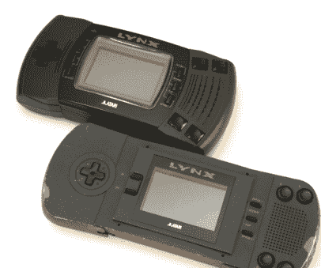

Atari 急忙推出该主机的缩小版，但等到它上市时，为时已晚。该设备 Atari 仅售出 500,000 台 Lynx。而任天堂则继续售出近 1.2 亿台 Game Boy。

到目前为止，我们知道我们的受众会是谁。但我们发现他们不知道自己想要什么，所以我们不能只是问他们需要什么。相反，我们需要自己去弄清楚。我们的目标相当直接：

| 发现问题 | 找到解决方案 |

|---|---|

| 了解人们目前在做什么。 | 找到一种让他们已经在做的事情变得更简单、更高效的方法。 |

| 了解人们必须做但非常不喜欢做的事情。 | 找到一种让他们不喜欢的事情变得过时，或至少更有趣的方法。 |

| 了解他们希望做什么。 | 找到一种让他们想要做的事情成为可能的方法。 |

你将在接下来的章节中了解如何做到这一点。


## 第 2 章：工作影随和情境访谈

- 研究

- 设计

- 实现

### 这些技术是什么？

工作影随和情境访谈是两种用于了解人们实际做什么、他们需要帮助的地方以及你的产品如何帮助他们的技术。为此，你将陪同人们工作并与他们谈论他们的工作。

如果你的应用程序或网站针对特定受众，并且你有能力与受众中的人互动，请使用这些技术。例如，如果你为摄影师创建产品，请阅读本章。如果你在为公司员工创建产品并且可以与该公司的员工交谈，请阅读本章。另一方面，如果你的产品的受众没有明确定义或你无法接触到受众，请不要为跳过本章而感到内疚。

#### 为什么这是个好主意？

你的用户与你不同。了解他们和了解他们的问题将帮助你理解如何创建真正对他们有用的产品。

> **用户**

> 

> 天文学家兼作家克利夫·斯托尔（Cliff Stoll）曾有一个著名的疑问：“为什么吸毒成瘾者和计算机爱好者都被称为用户？”很不幸，`用户`这个词在两种语境中都被使用，但我找不到更好的替代词。因此，我相当懊恼地承认失败，并勉强继续在本书中使用这个词。

> 

> 不过，只要有可能，我都会尽量使用更好的词。`人`、`个人`和`顾客`通常都可以完美地替代`用户`。

#### 有先决条件吗？

你应该清楚自己的目标受众是谁，并且能够轻松接触到构成目标受众的人群。

#### 2.1 观察你的受众

在上一章中，我们确认了大多数人并不是产品设计师。他们很难解释自己需要什么样的产品来帮助达成目标，而且往往无法正确评估自己对产品的感受。

因此，我们不能直接问人们想要什么。相反，我们需要自己弄清楚。`工作跟随`和`情境访谈`就是我们可以用来实现这一目标的两种技巧。

#### 2.2 工作跟随

既然人们不知道自己要什么，一个好的方法就是直接观察他们做什么。跟随的思路是，前往目标受众中的用户使用我们产品的场所去拜访他们。目的是弄清楚我们的产品将如何帮助他们实现目标。这有点像做可用性测试，但区别在于，我们不是邀请人们来测试并告诉他们该做什么，而是去拜访他们并观察他们做什么。

可用性测试的目标是找出用户界面中的问题。而当你跟随某人时，目标是弄清楚应该创造什么样的产品，或者如何在更根本的层面上改变你的产品。

- 这个人是否在某个特定任务上花费了大量时间？

- 这个人是否在重复做同一件事？

- 她是否在做一些看起来像是变通办法的事情？

- 她是否在做一些似乎让她感到无聊或烦恼的事情？

- 她是否被迫去记忆某个任务的步骤或技术细节，或者其他本可以由计算机代管的东西？

- 她是否在结合电脑使用其他工具，比如纸质清单或计算器？

一般来说，你不应该在她工作时打扰她，但如果你不确定她在做什么，可以随时询问。

#### 2.3 情境访谈

你所看到的比人们所说的更重要。尽管如此，通过提出正确的问题，你往往能从人们那里得到一些有用的信息。

在跟随某人之后，花半小时询问她所做的事情。你所要寻找的，是那些似乎存在改进空间的领域。不要征求个人意见，也要避免那些迫使对方扮演产品设计师的问题。

我们想询问对方正在执行的任务，因此问题应包括以下内容：

- 你经常做哪些我今天没有看到的事情？

- 你最常解决的是哪类问题？

- 你为什么用这种特定方式做[你所看到的事情]？

- 如果你没有完成某项任务所需的全部信息，会发生什么？

- 你经常与哪些人互动？你是如何进行互动的？

- 如果你需要的人不在工作岗位，或者发生了其他问题，你该怎么办？

不过要记住，人们是自发提供这些信息的；因此，这些信息往往不完整，可能包含个人癖好乃至错误。尽管如此，情境访谈让我们对人们所做的事情以及可能改进的领域有一个有用的概览。此外，通过对多人进行访谈，我们可以补全许多缺失或误报的信息。

#### 2.4 远程跟随


如果亲自拜访行不通，你可以请他们启动屏幕录制软件，在他们工作时让它运行半天左右，然后把录制的视频发给你。乍一听，这似乎会产生极其庞大的视频文件。幸运的是，有几个因素对我们有利：

- 你可以用较低的帧率录制。在几乎所有情况下，每秒一两帧就足以让你了解用户在做什么。

- 你不需要看到所有细节，所以可以把图像缩小到屏幕全分辨率的约 30%，并采用高压缩设置。

- 你很可能根本不需要声音。

- 大多数时候，人们在工作时屏幕只有一小部分发生变化，因此最终的视频通常压缩效果很好。但一定要告诉人们关闭屏幕保护程序，尤其是当他们使用视觉上很复杂的屏保时。

按照这些指导方针，录制四个小时的屏幕可以压缩到 100MB 以下，同时仍能产生完全可观看的结果。

另外，如果这个办法也行不通，可以给他们寄一台摄像机，让他们在工作场所后面架好。这样，他们录制完成后只需把摄像机还给你即可。

快进观看这段视频，可以让你很好地了解人们所做的事情。然后，你可以带着具体问题再去找他们。

### 2.5 情境访谈的局限性

人类能做到几乎其他动物都无法做到的事情：他们可以想象自己处于假设的情境中。哈佛大学心理学家丹尼尔·吉尔伯特（Dan Gilbert）在他的书《撞上快乐》[Gil07]中解释说：“人脑最伟大的成就是能够想象现实中并不存在的物体和情节，正是这种能力让我们得以思考未来。”

尽管思考未来确实是一项伟大的成就，但不幸的是，我们对此相当不擅长，正如我们在上一章看到的 Atari Lynx 故事一样。吉尔伯特指出：“当我们试图想象‘如果……会是什么感觉’时，我们会犯一系列系统性的错误。”

他对这一现象成因的解释引人入胜，¹ 但就本书而言，你只需要知道这些错误是存在的。

因此，你不能依赖人们的意见。在做情境访谈时，尽量专注于了解人们实际做了什么、他们需要完成哪些任务以及遇到了哪些问题。不要指望他们能告诉你问题的解决方案应该是什么样子。搞清楚这一点是你的任务。

人类不擅长预测自己将如何使用产品，这很不幸。更不幸的是，这也适用于我们这些设计师。我们根本不知道什么会奏效，也无法确定新产品会被如何使用。²

用户研究可以帮助我们做出更好的预测，但不能消除所有不确定性。不要陷入无休止的研究。在某个时刻，你必须大胆尝试，试一试，看看人们是否觉得有用。

## BizTwit 案例

就我们的 BizTwit 示例应用而言，我们花了半天时间与 ACME Corp 的若干人待在一起。这家公司维护着一个 Twitter 账号，既用来发布公司相关信息（包括提及其产品的文章链接、新闻稿链接或客户引语），也用来与客户互动。

1. 你真的应该读一读丹尼尔·吉尔伯特的书；我相信你会喜欢的。或者，如果你大脑在想到要读这本书时所生成的、明显错误的未来模拟，与我所说的“你会喜欢这本书”不一致，那么你至少应该看看丹尼尔·吉尔伯特在 http://www.ted.com/talks/dan_gilbert_asks_why_are_we_happy.html 的 TED 演讲。

2. 认知科学专家唐·诺曼（Don Norman）在一场精彩的演讲中谈到了这个问题以及其他设计研究问题，你可以在 http://vimeo.com/12022651 观看。

在 ACME Corp 工作期间，我们会见了负责更新 Twitter 账号的三个人，以了解他们何时以及如何使用 Twitter。每个半天结束时，我们会花 30 分钟向他们提出一些具体问题。

在我们拜访期间，我们注意到公司的 CEO 在开始工作日时，会浏览与 ACME Corp 行业相关的文章。有时他会在公司的 Twitter 账号上发布他喜欢的文章链接。剩下的时间里，他偶尔会查看 Twitter，但很少写或回复消息。他每周写两三条消息。目前他使用桌面版 Twitter 应用来完成此操作，但在访谈中，他解释说当不在办公室时，他有时会从手机上发布。

第二个发布到 ACME Twitter 账号的人是公司的公关代表。他的工作是让公司在行业杂志上被提及，当杂志报道公司时，他会在 Twitter 上写关于此事。他大约每周在 Twitter 上发布一条消息。

在公司 Twitter 账号上发布消息的最后一个人是一名工程师，她的任务是在公司活动期间撰写消息，当时 CEO 和公关代表忙于与客人交谈。在此类活动期间，她主要会从手机上发布简短消息，描述活动中发布的新公告。她很少在 Twitter 上发布消息，但一旦发布，可能在 一到两个小时内发布半打消息。

在我们跟随他们半天后对这三个人进行访谈时，一些额外的想法出现了。公关代表说：

> 我遇到的问题之一是，我们的 CEO 在用手机发布 Twitter 消息时往往会打错字。如果我能以某种方式纠正他的消息就太好了。

工程师解释说：

> 在我们的活动期间，通常负责这些事情的人都很忙，所以发布 Twitter 更新就由我来负责。但我不是受过训练的作家，我经常担心我写的东西听起来太口语化，或者没有正确表达我的本意。

ACME Corp 只是我们拜访的众多公司之一，以了解我们的 Twitter 应用 BizTwit 应该解决哪些问题；然而，仅这三个人就提供了非常有价值的信息，帮助我们了解产品需要解决哪些问题。

## Takeaway Points

- 人们不知道自己想要什么，所以你必须去拜访他们并观察他们的行为。

- 如果你提出具体问题，你可能会得到有用的信息，但在得出结论之前，请先采访几个人。

## Further Reading

Cennydd Bowles 和 James Box 在书 *Undercover User Experience Design* [BB10] 中有一章关于这种用户研究的章节。Robert Hoekman 在 *Designing the Obvious* [Hoe06] 中介绍了 shadowing 和情境访谈。


## Chapter 3

### Personas

|  |  |  |

|---|---|---|

| Research | Design | Implementation |

#### What’s the Technique?

本章解释如何创建和使用用户角色。用户角色是代表目标受众特定群体的虚构人物。

如果你在进行用户研究，并且你是更大团队的一员，需要传达这些研究结果，那么用户角色可能对你有用。如果你独自工作或在较小的团队中工作，不必为跳过本章而感到内疚。

#### Why Is This a Good Idea?

用户角色可能很有用，因为谈论一个想象中的人比谈论“市场细分”更容易。用户角色还有助于你聚焦产品。

#### Are There Any Prerequisites?

要创建用户角色，你首先需要进行用户研究。

### What Are Personas, Again?

到目前为止，你可能已经做过一些用户研究。你知道产品应该解决什么问题，也知道哪些人会从使用中受益。在设计产品时，你经常会

参考这些信息。但你如何做到这一点呢？谈论目标人群可能很困难。你的目标受众中哪一部分有这个问题？他们的技能水平如何？

用户角色为你提供了一种将用户研究中发现的信息综合成有限数量的想象人物的方法。

当 Alan Cooper 在他的书 *The Inmates Are Running the Asylum* [Coo99] 中首次将用户角色作为软件设计技术介绍时，他是这样描述它们的：

> 用户角色不是真人……它们在整个设计过程中代表他们。它们是实际用户的假设原型。虽然它们是想象的，但它们是以相当大的严谨性和精确性定义的。实际上，我们并不是“编造”我们的用户角色，而是将其作为调查过程的副产品发现出来。

用户角色有助于沟通。但它们还有其他优势：

- 它们迫使你聚焦产品。通过创建少量用户角色，你明确定义了产品的受众。这消除了你必须取悦 *每个人* 的徒劳想法。

- 它们使谈论你的受众变得更容易，通过深入思考你的目标受众，它们可以帮助你使设计过程更以人为中心。

#### 3.1 Problems with Personas

使用用户角色的目标是使设计过程更以人为中心。但请注意，这其中存在一些问题。

用户角色可能过于弹性。由于用户角色本质上是想象中的人，它们无法为自己辩护。因此，它们有时会强化预先确定的结论：如果你使用想象中的人作为目标受众，你总能想出一个想象的场景来验证你当前持有的任何观点。

用户角色给人以以人为中心的印象，而无需任何人真正与真实人类互动。它们可以作为遮羞布，用来掩盖根本不以人为中心的的整个设计过程。用户角色可以使设计师免于做任何艰苦的工作，例如走出去并在真实用户身上测试设计决策。

创建用户角色可能耗时。把所有的用户研究提炼成代表目标受众一部分的具体人物需要时间。你还必须为他们编造背景故事并传达给参与过程的每个人。有时，为此所需的时间可能不值得用户角色带来的优势。

谈论想象中的人可能让人不舒服。假装“Emma”是一个真正想使用你产品的人类，而她只是一个某人编造的故事，并不是设计团队中的每个人都愿意做的。

尤其是在小型团队中，用户角色可能没有多大益处。很可能参与其中的每个人对目标受众都有相当好的把握。没有太多必要创建想象人物来帮助沟通，而且你的产品可能已经因必要性而高度聚焦，因为小型团队可能无法创建取悦大量受众的产品，即使它想这样做。

尽管如此，如果你牢记这些潜在问题，用户角色仍然可以成为有价值的工具。

#### 3.2 Creating Personas

从情境访谈开始。去和人们谈谈。你可能一开始认为受众中有很多人，你需要很多不同的用户角色来覆盖他们，但随着你与更多人交谈，你会注意到他们中有很多人有相似的目标。基于此信息，创建简化的角色来覆盖受众中广泛人群的目标。创建的用户角色越少越好。拥有大约三个用户角色效果很好，但根据你的产品，你可能需要更多。

你的每个用户角色都应有明确定义的目标。为什么这个用户角色会使用你的产品？他想实现什么？

接下来，你应该添加与设计相关的细节。每个用户角色的技能水平如何？这个用户角色多大了？性别是什么？她的一天典型是什么样的？其中一个用户角色是否比另一个更重要，以至于她的目标应该得到满足，即使这对另一个用户角色不利？你的每个用户角色使用什么类型的设备？例如，如果你设计一个网站，其中一个人是否从手机访问它？

一旦你确定了相关细节，就该添加一些无关的个人细节了。之所以这样做有几个原因。首先，添加个人细节更容易记住人物角色。人类大脑喜欢个人信息。其次，细节使人物角色弹性更小。我在谈论缺点时曾指出，很容易将自己的想法投射到人物角色上，因为人物角色无法为自己辩护。嗯，你添加的细节越具体，就越难这样做。最后，在设计过程中，其中一些在此处添加的细节可能会突然变得相关。添加有关人物角色的家庭、她的工作以及她的兴趣和爱好的信息。

最后，给她一张照片和一个名字。

照片应具有辨识度且易于识别，但不应是人们认识的人的照片。从库存摄影到简单的绘画，一切通常都效果很好。

选择能告诉你这个人是谁的名字是有意义的（例如，名字的首字母可以与她工作的首字母相同，或者可以将人的职能用作姓氏），但你应避免使用可能具有负面含义的名字（如“Harry Hacker”）或可能让人想起特定真实人物（如“Britney Bieber”）的名字。

### 3.3 使用人物角色

当我们谈论产品的设计时，我们倾向于将受众视为通用的“用户”。用户会喜欢自动将图片上传到照片分享网站的功能吗？他们能够弄清楚如何使用上传功能吗？

以如此笼统的术语来弄清用户的需求是困难的。有了人物角色，这就变得更容易了。

我们的人物角色中——如果有的话——谁会想要将图片上传到照片分享网站？鉴于此人的技能和意图，我们应如何设计该功能以满足她的目标？

不要以笼统的术语说话，要谈论具体的人物角色。

### 3.4 人物角色不能替代用户研究

使用人物角色时，可能很容易假设既然“Emma”知道如何使用她的电脑，而我们又为像她这样的人设计了产品，那么我们就不再需要在设计中涉及实际用户了。那是错误的。

人物角色可以帮助你与设计过程中涉及的其他人沟通，评估用户研究的数据，并在做出设计决策时使用这些数据。但它们不应取代实际用户。你仍然需要用真实的人测试你的设计，以确保它有效。

## BizTwit 案例

在上一章中，我们拜访了在不同公司工作的许多人。目标是找出我们的企业版 Twitter 应用程序可以解决哪些问题。

现在，我们希望将这些信息提炼成若干典型人物角色，每个人物角色代表我们受众中的特定部分。图 3.1 在下一页显示了其中一个可能的样子。

这是一个相当简洁的人物角色——在实际项目中，你可能会用额外的细节来充实它。

## 关键要点

- 人物角色是代表目标受众中特定用户群体的虚构人物。

- 人物角色并非适合所有人。维护它们需要时间，有时很容易将自己的想法投射到人物角色上。

- 人物角色不能替代用户研究；它们只是帮助你将用户研究的结果纳入你的产品。

- 人物角色帮助你评估用户研究中发现的信息，将产品聚焦于一个定义明确的人群，并在设计团队内部进行沟通。

- 使用人物角色来帮助做出设计决策。不要谈论通用的“用户”，而要谈论具体的人物角色。这些是要问的问题：这个功能是为谁准备的？你的任何人物角色会想要使用它吗？这个人物角色带来了什么样的既有知识？人物角色有什么样的需求？该功能是否满足人物角色的目标？

## Mark Miller


**工作**

管理。主要参与产品开发和客户获取，但有时也喜欢专注于营销。

**年龄**

50 岁

**性别**

男性

**技能**

30 年的经验（从 Atari ST 开始）使 Mark 拥有良好的计算机和智能手机用户级知识。知道如何安装应用程序，但将操作系统安装交给公司里的系统管理员。

**目标**

希望能够从他的 PC 和手机发布 Twitter 消息。

消息通常由一篇文章的链接加上几句评论组成。希望能够在发布到公司 Twitter 账号之前检查其他人的消息。

**背景**

有两个孩子，不再住在家中。与妻子 Mandy 结婚，她在一家文具公司担任营销主管。喜欢与她讨论营销话题，并在自己公司中也相当积极参与营销。

他的个人风格有些低调。驾驶一辆银色奔驰，通常穿深灰色西装。使用联想 ThinkPad，并认为选择使用 Android 手机而不是 BlackBerry 是时尚宣言。

业余时间打壁球和网球。

图 3.1：一个示例典型人物角色

### 延伸阅读

Alan Cooper 在 *The Inmates Are Running the Asylum* [Coo99] 和 *About Face* [Coo95] 中写到了人物角色。

一本专门聚焦人物角色的好书是 John Pruitt 的书 *The Persona Lifecycle* [PA06]。

Larry Constantine 和 Lucy Lockwood 的 *Software for Use* [CL99] 也是开始了解这个一般主题的好地方。该书提倡作者称之为 *user role models* 的不同方法。


## 第 4 章

## 以活动为中心的設計

到目前为止，在本书中，我们一直假设以人为中心的设计流程总是好主意。事实上，它们并不总是最佳选择。另一种方法是使活动成为你设计流程的中心。对于许多产品来说，这更有意义。

在以人为中心的设计中，想法是深入了解将使用你的产品的人，并为他们量身定制设计。在以活动为中心的设计中，产品是为活动或目标量身定制的。

这并不是一个新想法；大多数设计都是以活动为中心的。门把手不是为特定受众设计的；它是为使开门活动尽可能简单和明显而设计的。汽车的方向盘、电梯里的按钮，可能你电脑上的大多数应用程序，以及你定期使用的绝大多数网站——每个都是为使特定活动，或一系列活动，尽可能简单和明显而设计的。

以活动为中心的设计流程可能不是所有项目的完美解决方案。有时，你想要创建一个为有限受众优化的产品。例如，比较图 4.1 中下一页所示的两台电脑鼠标。

左边的鼠标是随 Mac 提供的鼠标。它是为最广泛的受众而设计的。第一次触摸鼠标的人应该能够像拥有二十年电脑经验的人一样轻松使用它。为此，在默认配置下，它只有一个按钮，并且该按钮可以通过按下鼠标的任何位置来激活。

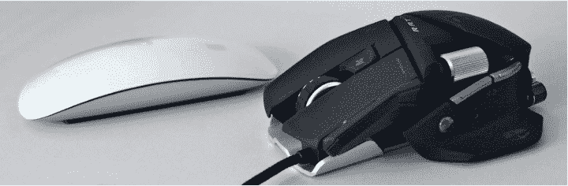

图 4.1：两种不同的电脑鼠标

左边的鼠标是 *简单* 的。它可能不是人们的 *完美* 鼠标，但几乎每个人都能使用它。

右边的鼠标是 Cyborg R.A.T.，一款专门为玩动作游戏的人设计的鼠标。它配备五个不同的按钮和一个三位置模式开关，允许人们将十五个不同的命令分配给按钮。它配有可互换的面板和手掌支架，以适应玩家握鼠标的不同方式。鼠标灵敏度可以即时调整。它有可拆卸配重，以便人们使鼠标更重或更轻。它也是有线鼠标。它是有线的，因为玩动作游戏的人不喜欢无线连接可能造成的轻微输入延迟。

所有这些功能使这款鼠标对其目标受众来说是完美的，但其中许多相同的功能使鼠标对不在其目标受众中的人来说不太理想。带有十五个可编程动作和可拆卸配重的有线鼠标对于大多数人来说基本上是不可用的。

右边的鼠标是 *复杂* 的。这意味着它是某些人的完美鼠标，但也意味着许多人无法使用它。

你是要关注用户还是活动，取决于你产品的具体性质。每种设计流程都会产生不同的结果；及早决定你的重点所在很重要。

1. 在 http://cyborggaming.com 了解更多信息。

## 第5章

## 开始着手文档工作的时间


## 什么是这个技巧？

在本章中，我将谈论手册、博客文章、屏幕录像、新闻稿以及类似的东西。广义上讲，这关乎那些能让人们对你的产品感兴趣并帮助人们学习如何使用你的产品的东西。在开发过程的非常早期就开始着手这些工作，有时被称为*反向工作*。

#### 为什么这是个好主意？

尽早创建文档将有助于你评估你的设计。如果你不能轻松地解释某件事，那么它设计得不好的可能性就很大。

在设计过程中就开始编写手册，也意味着你不太可能退回到术语中，更有可能从用户的角度来解释事物。你在某件事上工作的时间越长，向不具备你知识的人解释它就越困难。

#### 有任何先决条件吗？

有。你应该对你的受众是谁以及你的产品将解决哪些类型的问题有一个大致的想法。


### 5.1 手册

许多产品都附带某种类型的手册，解释如何使用该产品。大多数手册都很糟糕，这很糟糕，因为人们倾向于在无法弄清楚如何使用产品时打开手册。换句话说，他们已经很烦躁和不满意，然后还要费力地阅读一份令人沮丧的糟糕手册。

手册不必是糟糕的。但要创建一份优秀的手册，就必须给予它高度的优先级。而这意味着要尽早开始思考——并着手——手册。

在设计过程中，你的大脑仍然没有被实现细节占据。这有助于你从用户的角度来看待手册，而用户同样对使你的产品运转起来的所有技术细节一无所知。

尽早开始着手手册还有另一个好处：它迫使你解释你的产品如何工作。很少有什么事情能让你像必须描述如何使用它那样多地思考设计的细节；如果某件事难以解释，它可能也难以使用，需要重新思考。

那么，你该如何着手编写手册呢？

将手册视为产品的一部分。优秀的手册是有用的功能；以维护其他功能的方式维护它。（如果你同时编写代码和手册，请将手册纳入你的版本控制系统。）以设计产品的任何其他功能的方式设计手册。问自己这些问题：人们将如何使用手册？手册应该如何结构化？应该包含什么？

你的产品手册不应该是一个事后想法。它是产品的重要特性，值得你给予其他重要特性同样的关注。

### 5.2 博客文章

手册很重要，但它们并不是你与人们谈论产品的唯一方式。事实上，有些产品根本没有手册。

博客文章是传达你的产品能做什么的另一个重要工具，与手册一样，它们有两个优势：它们帮助人们理解你的产品，并帮助你发现产品中的潜在问题。

设计完一个功能后，写一篇博客文章告诉你的用户为什么该功能很棒以及他们如何使用它来做酷炫的事情。你不必（现在就）发布它。只要写出来。你能轻松解释为什么人们应该关心这个功能吗？你能轻松描述这个功能有多简单吗？

如果其中一个问题的答案是否定的，那么也许你可以改变设计，使其更具吸引力、更有用或更容易解释。

顺便说一句，你应该保存你在设计过程中创建的所有设计文档和 mock-up。它们可能会成为一篇很棒的“我是如何想出这个设计的”博客文章。

### 5.3 屏幕录像

屏幕录像是在介绍新产品或现有产品的新功能时非常有用的工具。如果你正在进行设计，请思考你将如何在屏幕录像中呈现它。你可以用什么钩子来让人们对某个功能感兴趣？是否有特定的问题你可以在屏幕录像中展示如何解决？你能以线性叙述的方式解释新功能吗？

如果你有一个原型，那就去创建一个解释其工作原理的屏幕录像吧。你不必发布它；仅仅创建屏幕录像很可能就会让你注意到设计中的问题。（如果你想不出在屏幕录像中解决的问题，也许该功能根本不需要存在。）更重要的是，这对于产品完成后你为公众制作屏幕录像时来说是很好的练习。

### 5.4 新闻稿

新闻稿是你在设计过程中可以撰写的另一件事。你能在新闻稿的篇幅内解释你的产品，并使其听起来令人兴奋吗？

如果新闻稿听起来不实用也不令人兴奋，你的计划可能存在问题。

一家以撰写新闻稿开始产品设计的公司是亚马逊。亚马逊首席技术官 Werner Vogels 指出¹，“提前撰写新闻稿可以明确世界将如何看待产品——而不只是我们内部如何思考它。”

同样，你可以尝试为你的产品撰写广告，甚至只是一个口号。你能用一句话描述你的产品吗？如果不能，为什么呢？

### 5.5 谈论任务

无论你是在编写手册、撰写博客文章还是录制屏幕录像，谈论任务而不是功能始终是个好主意。

文档通常只是解释产品的各个功能如何工作。但除非你正在创建最基础的产品——比如闹钟——否则解释单个功能并无特别帮助。人们不想学习如何使用功能；他们想学习如何做事。人们有目标，他们使用你的产品是因为他们认为它可以帮助他们实现这些目标。

例如，与其在博客文章中描述照片编辑器中图层的工作原理，不如解释如何构图并为照片添加酷炫效果——并在该过程中包含图层。与其在手册中展示文字处理器中标签的工作原理，不如解释如何设计一封漂亮的信——并将标签作为其中的一部分来解释。

在他们的书《Getting Real》[FHL09]中，37signals 的人建议“如果你发现自己需要用文字来解释一个新功能或概念，就写一个简短的故事来描述它。”避免技术细节。只需谈论它即可。

把自己当作老师，而不是技术写作者。

## BizTwit 案例

为了明确定义 BizTwit 的用途，设计团队撰写了一篇博客文章，可在产品完成后用于介绍该产品。

1. 你可以在 `http://www.allthingsdistributed.com/2006/11/working_backwards.html` 阅读更多关于他对此主题的想法。

市面上有很多 Twitter 应用。很多很多。我们试图查看所有这些应用，但我们在下载它们时磁盘空间用完后就放弃了。很明显，世界现在需要的就是*更多*的 Twitter 应用！所以，今天我们推出我们自己的应用。向 BizTwit 问好！

世界为什么需要另一个 Twitter 应用？

好吧，我们看过的大多数 Twitter 应用都是为日常 Twitter 用户准备的。它们允许你关注其他人、回复他们的推文并撰写自己的推文。更高级的 Twitter 应用还支持多个账户以及诸如与 Instapaper 集成等很酷的功能。但它们几乎都针对普通人。

BizTwit 不同。它针对的是必须更新公司 Twitter 账户的人：

- 多个人可以使用同一个账户。

- 每个人都可以共享相同的草稿。

- 不同的人可以拥有不同的权限。

在接下来的几天里，我们将解释这些功能以及更多内容。现在，就去下载你的副本吧！

即使像这样简短简单的博客文章，也能在很大程度上定义你想要构建的产品类型。

## 关键要点

- 编写手册和博客文章，以及制作屏幕录像，迫使你向其他人解释你的设计。这有助于你发现设计中的问题：如果某件事难以解释，它可能也难以使用。

- 人们在已经不满意时才会阅读手册，所以手册应该解决问题，而不是让人们更加不满意。

- 新闻稿和博客文章帮助你思考产品的目标，并将重点放在你想要解决的问题上。你能用一句话解释你的产品吗？如果不能，也许你想做的事情太多了，或者你没有解决特定的问题。


## 第6章

### 文本可用性

当我们讨论设计和可用性时，我们倾向于首先关注视觉元素——文本经常被忽略。这是不幸的，因为文本是人们与你的应用程序或网站交互的主要方式之一。事实上，在跟踪人们眼睛在屏幕上扫描时的移动测试中，文本往往是人们首先寻找的东西。¹

> 当被要求对网页提供反馈时，用户会更多地评论内容的质量和相关性，而不是评论导航问题或我们认为是“用户界面”的页面元素（与简单信息相对）。同样，当页面出现时，用户会将注意力集中在窗口中央，他们会在查看页眉栏或其他导航元素之前先阅读正文文本。

37signals 的同事们也持相同观点。在《Getting Real》[FHL09]中，他们写道：“好的写作就是好的设计。” 单词需要被视为界面设计的一部分。

你有没有试过在网上买电脑？网站不是用简单的语言告诉你它的功能，而是列出一堆营销术语？嗯……我想要那个有“MagSafe”的还是那个有“OneKey Theater”的，还是那个有“One-button ThinkVantage”的，还是那个有“Multi-Convergence UltraTouch Enterprise Panel Extensibility”的？好吧，我编造了最后一个，但其他的都是真的。³

单词是人们与你的产品交互的方式。设计是沟通：如果人们不理解你，他们就无法使用你的产品。

由于单词在你的产品、网站、用户手册、你与人个人交互时说的话，甚至在你的代码的类名和注释中无处不在，最好尽早正确使用它们。

但你怎么知道要使用哪些单词呢？

#### 6.2 人们不想阅读

这可能听起来很奇怪，在讨论文本重要性的部分之后，但硬道理是：大多数人在可能的情况下都会避免阅读。

仅仅通过阅读这本书，你已经证明你与大多数用户大不相同。1987 年在《活跃用户的悖论》⁴中，John M. Carroll 和 Mary Beth Rosson 指出“每个经验水平的学习者都试图避免阅读。”在过去的二十年里变化不大。事实上，它可能变得更糟：2007 年由国家艺术基金会⁵ 进行的调查得出结论，美国人不仅比以前读得少，而且读得也不好。

你可能已经收到过“我的打印机停止工作”电话：

> **Friend:** 我真的需要打印这份文档，但我现在的打印机根本就不工作了。

> 

> **Me:** 好的，到底发生了什么？

> 

> **Friend:** 我在尝试打印，但它不工作。

> 

> **Me:** 你收到错误信息了吗？

> 

> **Friend:** *哦，是的，弹出一个错误。*

> 

> **Me:** *它说了什么？*

> 

> **Friend:** *我怎么知道？我当然把它关掉了，但那没解决任何问题。*

北卡罗来纳州立大学心理学系的一篇题为“无法识别虚假互联网弹出警告消息”⁶ 的论文分析了人们如何处理虚假弹出警告。在讨论结果时，研究人员指出：

任务后问卷的数据表明，点击确定按钮的人中有12%表示他们这样做是因为文本告诉他们要这样做，而23%表示他们每次遇到错误消息时总是点击该按钮。不到一半（42%）表示他们只是想“把它扔掉。”

弹出窗口甚至在人们点击它们之前都不会有意识地注册到人们那里。它们只是让人们无法工作的一种麻烦，通常让它们消失似乎能解决问题。

但这不仅仅适用于弹出消息中的文本。人们在认为可以侥幸时会跳过文本。

#### 6.3 少说为妙

由于人们不阅读，最好在可能的情况下避免用文本烦扰他们。

例如，不要在人们即将做一些破坏性事情时警告他们。相反，让他们可以撤销他们的更改。

同样，如果发生错误，你有办法让你的产品在不告诉用户的情况下自行恢复，那就去做吧。如果用户输入的网站地址被截断，但你的网站收到足够的信息来识别他正在寻找的页面，就简单地把他转发到该页面。如果你的应用程序试图连接到服务器但连接超时，就让应用程序再次尝试，在告诉用户有问题之前。仅在你的产品真的无法自行解决问题时才通知用户。

如果人们不理解用户界面的某个部分，不要添加解释性文本。这只会增加更多混乱并使问题变得更糟。

如果不可能避免交流，就在假设人们不会阅读你写的内容的情况下设计用户界面。例如，使用动词作为按钮标签，并确保每个按钮都有一个特定的、互斥的标签。不要将两个按钮标记为“是”和“否”，而是将它们标记为“删除文件”和“取消”。这样，人们就不必阅读对话框中的文本来弄清楚每个按钮的作用。

6. 在 `http://media.haymarketmedia.com/Documents/1/SharekWogalterFakeWarning_publicationFinal_805.pdf` 阅读它。

#### 6.4 让文本易于扫描

通常你无法避免文本。要知道如何写作，首先你需要知道人们如何阅读。

Jakob Nielsen 的研究表明，人们通常不会逐字阅读网页上的文本。相反，他们会“扫描”页面，寻找包含他们正在寻找的内容的句子片段。为了帮助人们做到这一点，Nielsen 建议⁷ 以下规则：

- 使用适合你受众的单词。

- 在每个段落中传达一个想法。

- 在段落的第一句中介绍段落的想法，这样人们可以快速决定是否阅读该段落。

- 使用有意义的标题。

- 高亮关键词。

- 使用项目符号列表。

- 保持文本简短、简单、非正式。

- 以结论开头，并包含其内容摘要。

#### 6.5 没有废话

人们正在努力实现一个目标，正在阅读你的文本，因为他们认为它可能有助于他们的任务。写简短、清晰、明显的句子。保持单个段落简短。不要浪费读者的时间。记住他们的目标。

正如 Patricia Wright 在《技术文档的质量》[SJ94]一书中所说，“作家们经常相信他们应该比读者想知道的传达更多。”

当你在写作时，问自己：“这个句子是否有助于用户？”如果没有，就扔掉它。

#### 6.6 句子应该有一个明显的解释

避免可以被两种不同方式解释的句子，以及在读者只阅读部分时引诱读者产生错误理解的句子。⁸

读者在到达句末的句点之前会尝试理解句子。有些句子可能会误导读者。考虑这个标题的前几个词：⁹

> “汉堡王炸圣杯……”

现在为什么汉堡王要炸圣杯呢？当你读完句子时，句子的含义变得清晰了：

> “汉堡王为土豆农夫炸圣杯”

啊，炸薯条*就是*圣杯。它仍然不是完全不模糊，但含义现在相当明显。

阅读这样的句子需要你的读者更多的工作，因为如果他们一开始就有了错误的解释，他们就会被迫倒退。为了避免混淆他们，问自己一个句子即使你只读了一部分是否仍然是明确的。一个简单的改变使这个句子完全清晰：

> “汉堡王炸薯条是土豆农夫的圣杯”

你能发现下面句子的问题的吗？

8. 这些通常被称为花园路径句子，源于“被带上花园小径”的说法。这种句子的直观理解具有误导性；到达句子的末尾会迫使读者倒退，寻找不同的解释。维基百科上有更多关于这个主题的介绍：`http://en.wikipedia.org/wiki/Garden_path_sentence`。

9. 我通过优秀的语言日志博客 `http://languagelog.ldc.upenn.edu/nll/?p=1762` 发现了这个例子。如果对写作感兴趣，语言日志绝对值得阅读。

7. 你可以在这个地址找到尼尔森关于这个主题的文章集：`http://www.useit.com/papers/webwriting/`。

> “卢卡斯告诉他的编辑，他会在月底前写一份项目计划来完成这本书。”

我会在月底前写出*计划*，还是计划是*在月底前完成这本书*？

如果你的文本减少了读者需要思考的负担，他们就更有可能阅读它并从中获得收获。

清晰度对于标题尤其重要。用相关的词开头写标题，这样即使在小屏幕设备上标题末尾被截断，人们仍能理解标题的含义。

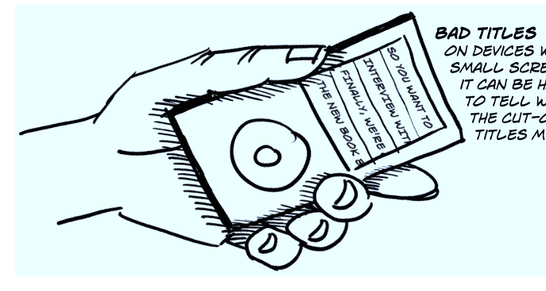

### 6.7 像人一样说话，而不是像公司

公司经常使用风格指南来在所有公司内容中强制执行一致的语气。作者被鼓励使用第三人称和中性语气。因此，他们被劝阻在写作中展现自己的个性。

不幸的是，这样的指南鼓励产生枯燥乏味的文本。人们不想读那种东西，对必须写这些文本的人来说也是一种令人沮丧的体验。

如果你专注于一致性，你就会把所有人拉低到你最差写作者的水平。最好专注于吸引你的读者。直接与他们交流。写出在对话中听起来自然的句子。要不正式。与读者交谈。避免营销术语。在合适的时候说“你”和“我们”（尽管要避免那种过度居高临下的“我们”，你在成年人对孩子说话时有时会听到）。

### 被动语态

当人们给出写作建议时，他们经常声称你应该“避免被动语态”。虽然这有点道理（“点击备份以创建副本”比“副本是通过点击备份创建的”更好），但反对被动语态的论点往往被夸大。写“别担心备份按钮——你的文档会自动备份”这样的句子并没有什么问题，即使“你的文档会被自动备份”使用了被动语态。事实上，改成主动语态只会给句子添加无用的词，使结果更糟：“应用程序将自动备份你的文档。”

我怀疑人们真正的意思并不是要你避免被动语态。毕竟，被动语态仅仅意味着句子的主语没有发起句子的动作，而是其接受者。

相反，人们真正的意思是，你应该避免以使句子主动方不明确的方式写作。人们经常使用被动语态来转移责任（“错误发生了”）。避免这种写法通常是好的建议。

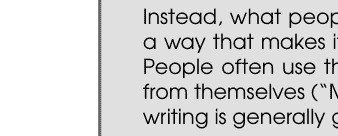

大声朗读文本。问问自己你是否愿意阅读它。问问自己文本是否包含任何非你市场部以外的人会觉得有用的信息。

维护图像和截图可能是一项大量工作。每次产品更新，你都必须检查所有图片并修复过时的图片。很诱人完全避免使用图片。但图片可以使你的文本更易于理解和阅读。

图片有助于说明要点。一张好的截图可以替代几段文字，并且可能更容易理解。根据你的受众，即使是简单的解释也能从插图受益。

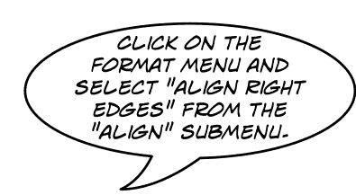

尽管前面的文字已经相当清晰，但一张图片使其更加明显。

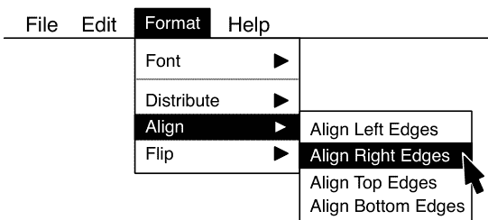

图像还可以让你的文本看起来更具吸引力。面对一堵文字墙会让人气馁，但加上几张图片，文本看起来就更愉快了。在论文《心理学值多少钱？消费者信贷市场的实地实验》中，10 Marianne Bertrand 等人表明，仅在贷款


大声朗读文本。问问自己你是否愿意阅读它。问问自己文本是否包含任何非你市场部以外的人会觉得有用的信息。

维护图像和截图可能是一项大量工作。每次产品更新，你都必须检查所有图片并修复过时的图片。很诱人完全避免使用图片。但图片可以使你的文本更易于理解和阅读。

图片有助于说明要点。一张好的截图可以替代几段文字，并且可能更容易理解。根据你的受众，即使是简单的解释也能从插图受益。


尽管前面的文字已经相当清晰，但一张图片使其更加明显。


图像还可以让你的文本看起来更具吸引力。面对一堵文字墙会让人气馁，但加上几张图片，文本看起来就更愉快了。在论文“心理学值多少钱？消费者信贷市场的实地实验”中，10 Marianne Bertrand 等人表明，仅在贷款

如果你注意到电脑上的文字明显比书本上的文字小得多，就把屏幕文字调大。需要记住的是，相同的字体大小在分辨率较低或较高的屏幕上看起来可能会更大或更小。

当然，如果你为手机创建内容，情况则相反。人们通常会把手机拿得离眼睛相当近，所以你可以使用较小的字体大小。

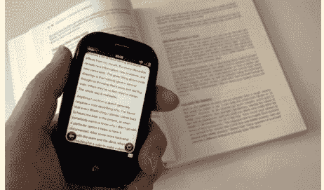

`选择可读的字体。` 不同字体之间，甚至同一字体家族的不同成员之间，可读性差异很大。选择合适的字体很重要。¹⁵

## Takeaway Points

- 尽量避免使用文字。

- 如果无法避免文字，请保持简洁、清晰且易于扫描。

- 保持段落简短，每个段落传达一个想法。

- 要引人入胜且个性化，而不是枯燥和专业。

- 使用图片来说明你的观点，让文字看起来更亲切。

- 使用大字体和可读的字体。

> 15. 请注意，研究表明字体是否有衬线在可读性方面可能没有区别。如果你有兴趣阅读这方面的研究，可以在 http://www.alexpoole.info/academic/literaturereview.html 了解更多。

## Further Reading

Jakob Nielsen 写了许多关于网页写作主题的优秀文章。16 如果你正在编写手册，Patricia Wright 的《技术文档质量》[SJ94] 包含大量有用的信息。Joel Spolsky 在《程序员的用户界面设计》[Spo11] 中讨论了阅读问题。

科学作家 Carl Zimmer 写过一篇关于良好科学写作的文章。17 Tim Radford 根据他作为记者的经验整理了一套良好写作规则。18 如果你对一般性良好写作感兴趣，我非常喜欢 Stephen King 的《写作》[Kin00]。

你还应该阅读 Angela Colter 关于测试内容的文章。19

- 16. 在 http://www.useit.com/papers/webwriting/。

- 17. 在 http://blogs.discovermagazine.com/loom/2011/01/12/death-to-obfuscation/。

- 18. 在 http://www.guardian.co.uk/science/blog/2011/jan/19/manifesto-simple-scribe-commandments-journalists 阅读规则。

- 19. 在 http://www.alistapart.com/articles/testing-content/。


## Chapter 7

### Hierarchies in User Interface Design

在思考网站如何组织时，你会发现它们经常使用层次结构。有时，这些层次结构甚至被用作明确的用户界面元素。以下是“面包屑”导航元素的一个示例，它出现在像 Google 目录这样的网站上：

### Software

Science > Biology > Bioinformatics > Software

此导航元素告诉人们当前页面在层次结构中的位置，并允许他们“向上跳层”。

许多新闻网站的标题也显示某种层次结构，但通常使用两到三个层级的标签而不是面包屑：

| U.S. | World | Europe | Technology | Business | Science | Opinion |

| Africa | Asia | Middle East | Japan | | | |

这两个示例展示了整个网站或产品通常如何被组织成层次结构。但单个屏幕本身也使用层次结构来组织其内容。看看 Google Chrome 浏览器的这个截图：

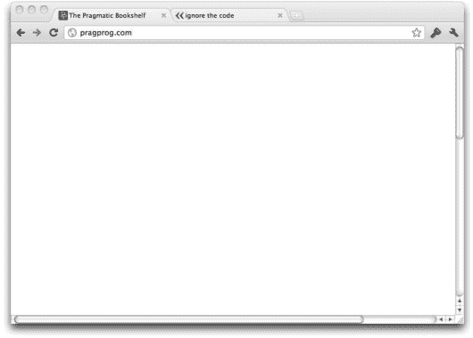

这是一个非常简单的用户界面，但即便如此，它也暗示了层次结构。例如，标签内的按钮仅适用于该标签内的其他内容。如果你点击“后退”按钮，当前活动标签之外的任何内容都不会受到影响。但如果你点击窗口的“关闭”按钮，整个窗口将被关闭，包括两个打开的标签。按钮仅影响同一层级或更低层级上的事物。

#### 7.1 Creating Hierarchical Structure Visually

如果你查看任何用户界面，通常可以相对快速地辨别出用户界面元素的层次结构。大多数西方用户直觉上理解层次结构是从左到右、从上到下、从外到内的。这里有几个示例，展示 A 在层次上高于 B 的表示：

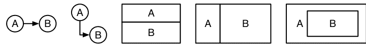

例如，假设一个 MP3 播放器显示有声读物的当前播放曲目。你会如何排列以下元素：曲目编号、有声读物中曲目内的章节编号，或带有章节标记的播客，以及章节中播放头的当前位置？显然，这些元素之间的关系如下：

Track→Chapter of current track→Playhead position in current chapter

iPhone 上的 iPod 应用就是这样排列的：

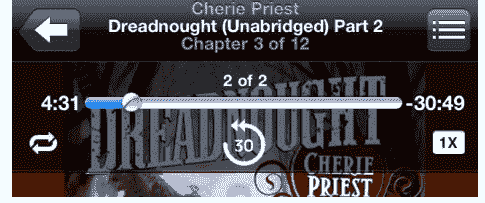

章节编号和曲目编号以“反向”顺序显示，当前曲目的章节编号出现在曲目编号上方：

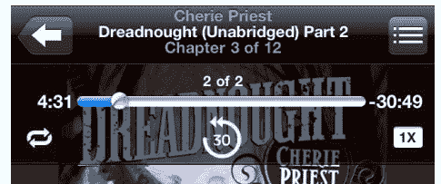

这种视觉排列暗示了以下错误的层次结构：

Chapter of current track→Track→Playhead position in current chapter

这每次都会让我困惑，让我以为播放头旁边的数字是章节编号，而不是曲目编号。

iPhone 上的 Audible 应用通过完全不显示曲目编号并将章节编号移到播放头旁边来解决了这个问题，从而修正了这种误导性的排列：

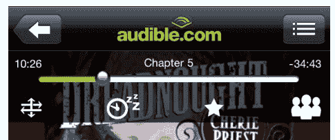

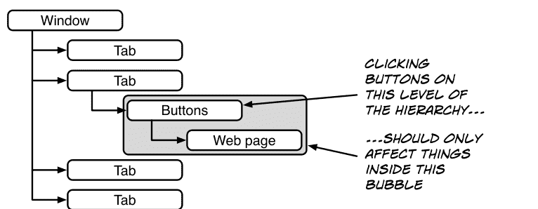

与用户界面元素的交互不应该影响在视觉层次结构中位于其上方的事物。

层次结构无处不在，它们影响人们对产品行为的预期。通过正确使用层次结构，你可以给人们提供提示，让他们弄清楚如何使用你的产品。

## Takeaway Points

- 思考你的产品元素如何可以按层次排列。

- 使用层次结构为用户提供关于产品工作原理的提示。单个屏幕向用户传达隐式或显式的层次结构。

## Further Reading

大多数人称之为“组织事物”，设计师称之为`信息架构`。关于这个主题有很多优秀的书籍。Donna Spencer 写了一本名为《信息架构实用指南》[Spe10] 的书。Peter Morville 和 Louis Rosenfeld 合著的《万维网信息架构》[MR06] 也是一个很好的入门书籍。

## 8.1 Designing Hierarchies

在上一章中，我们看到产品通常使用层次结构进行组织。这里是另一个示例。

打开任何网站，它很可能按层次结构排列。假设你的笔记本电脑内置摄像头不再工作，你需要帮助。你在浏览器中打开制造商的网站。你去哪里找帮助？如果你的电脑来自一家大型电子制造商，你可能会先点击“电脑”，然后点击“笔记本电脑”。在这里你会看到制造商的笔记本电脑系列列表。点击正确的笔记本电脑系列应该会带你到笔记本电脑型号列表，你应该能在该列表中找到你的型号。在特定型号的页面上，你可能会寻找“支持”。理想情况下，这会显示你型号的支持页面，其中包含许多潜在的笔记本电脑问题。运气好的话，你会在该列表中找到你的问题及其解决方案。

你通过网站层次结构走的路径如下：

Computers → Notebooks → Notebook Line → Notebook Model → Notebook Model Support → Answer to a specific question

但这并不是你唯一可能到达那里的方式。你也可以直接进入网站的支持部分。问题是，如果你正在设计这个网站，你如何知道用户会走哪条路径？以及你如何知道人们期望在你的网站的哪些位置找到各个页面？

### Card Sorting

一种常见的回答这些问题的方法是使用卡片分类——一种确定人们期望在哪里找到事物的好方法。卡片分类非常简单。在她的书《卡片分类：设计可用分类》[Spe09] 中，Donna Spencer 解释说，“从核心来看，卡片分类是一个相当简单的技术——在索引卡上写下事物并请人们对卡片进行分组。”

当然，有一些细微差别，所以让我们看看如何做到这一点。

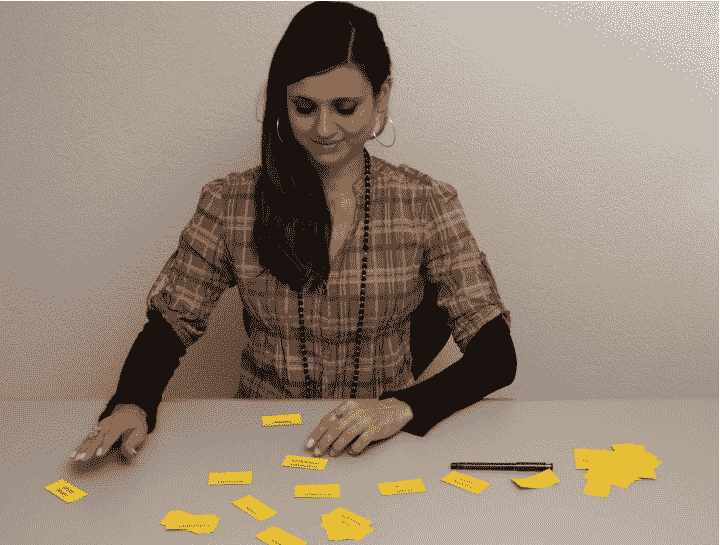

#### 8.2 准备卡片分类

为了准备一次分类，你只需拿一叠索引卡片，把需要分类的东西写在上面。例如，如果你在构建一个网站，就把网站的各个页面或区域分别写到卡片上。如果你在构建一个应用程序，就可把功能、属性、菜单项、命令、窗口、任务、目标或可见元素的名称作为卡片内容。

有时，选择产品中大致处于同一层级的内容是合理的：不要将层级结构中位置较高的术语与位置较低的术语混在一起。相反，应该进行多次卡片分类，以获取不同层级的信息。

最好使用显而易见且易于理解的术语。如果实在无法避免使用行话，请在卡片分类之前解释其含义，并允许参与者用自己的术语替换。

在构思卡片分类中使用的词汇时，你需要确保这些词汇不能依据表面的相似性（比如字形或发音）被分组。选择看起来或听起来相似的词语的风险在于，人们可能会基于这种相似性而非词义来分组。¹

最后，你应该有二十到八十张卡片。如果少于二十张，那么你可能还不够用心。如果多于八十张，则可能会让参与者应接不暇。

还要准备一些空白卡片。

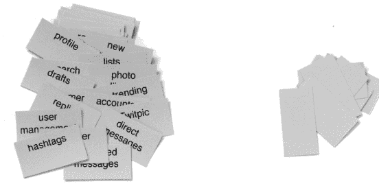

由于人们在卡片分类过程中可能会在卡片上写字或以其他方式改动卡片，而且你不会只想做一次卡片分类，所以手工制作多套卡片往往太耗时。相反，把卡片打印出来再剪开会更容易。

#### 8.3 参与者

你可以一次让一个人参与卡片分类，也可以一次让几个人同时参与。两者各有优点。在一个环节中安排多个用户可能更难排期，而且通常会有一个人主导整个过程。另一方面，有多个参与者可能会产生对话，从而提供关于人们如何看待这些事物的宝贵见解。

如果你选择多个参与者，注意不要过量。通常超过三到四个人就无法同时参与一次卡片分类了。

1. Jakob Nielsen 在 http://www.useit.com/alertbox/word-matching.html 讨论过这个问题并提供了解决方案。

你总共应该做多少次卡片分类？Jakob Nielsen 建议每人做十五次卡片分类。² 由于卡片分类很简单，做很多次很容易。不同的人可能期望事物出现在不同的位置；你做的分类越多，图景就越清晰。

#### 8.4 执行卡片分类

在欢迎参与者之后，向他们说明接下来要做什么。开场白大致如下：

> 大家好，我叫 Lukas Mathis。我目前正在设计一个新的 Twitter 应用。Twitter 是一种社交网络工具，类似于 Facebook。

>

> 现在，我正在研究这个应用的基本组织结构，你知道的，就是把哪个功能放到哪里之类的事情。我们即将进行的练习将帮助我了解人们期望在应用中的哪些地方找到它们。

>

> 稍后，我会给大家一叠写有词语的索引卡片。这些词语代表应用中真实存在的东西，比如功能或对象。我想请大家把这些索引卡片分成小堆。每一堆中的内容，在你看来应当是归在一起的。让我再解释得清楚一点。我们寻找的不是表面的相似性，比如把发音相近或以同一字母开头的词放在一起。相反，请设想你正在使用这个应用。例如，你会期望或希望哪些东西出现在同一个屏幕上？如果屏幕上有项目列表，你会期望哪些项目在列表中彼此相邻？

>

> 如果有卡片你觉得无法归入任何一堆，或者觉得它根本不属于这个应用，请随意把它们单独放成一组。我手边有空白卡片，桌上还有记号笔，所以如果你觉得某张卡片上的词不清楚，可以划掉它并换一个更合适的词。如果你觉得某些卡片应该同时属于多个组，也可以复制卡片。

>

> 在开始之前，我们先过一遍所有卡片。

² 阅读他的文章：http://www.useit.com/alertbox/20040719.html。

接下来，与参与卡片分类的人一起过一遍所有卡片，确保他们理解每个词在你的产品语境中的含义。

现在，请参与者把这些卡片按照对他们来说合理分类，将他们认为属于同一类的卡片叠放在一起。

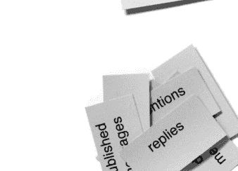

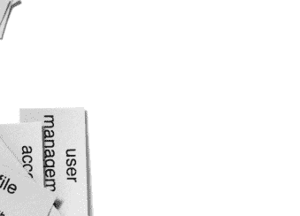

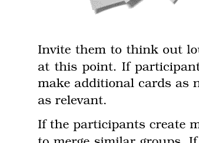

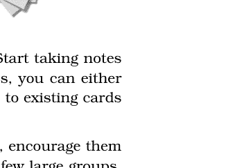

邀请他们进行出声思考并提出问题。从这时起开始做笔记。如果参与者提出了新词语，你可以根据需要制作额外的卡片，或者把相关的新词添加到现有卡片上。

如果参与者分出了许多小堆卡片，鼓励他们合并相似的堆。如果他们只分出了几大堆，则鼓励他们拆分。

或者，根据具体情况，你也可以进行“封闭式”卡片分类，即事先定义好若干组，让参与者把卡片分到不同的组中。

让人们丢弃那些他们认为无处安放的卡片，这一点很重要。这些被丢弃的卡片可能表明某些产品功能或网站区域不够重要，不需要包含在内，或者它们与用户通常使用你的产品时所解决的问题无关。

接下来，请参与者为每一堆卡片取一个名字。在每堆卡片的顶部放上一张写有该堆名称的卡片（最好用不同颜色）。

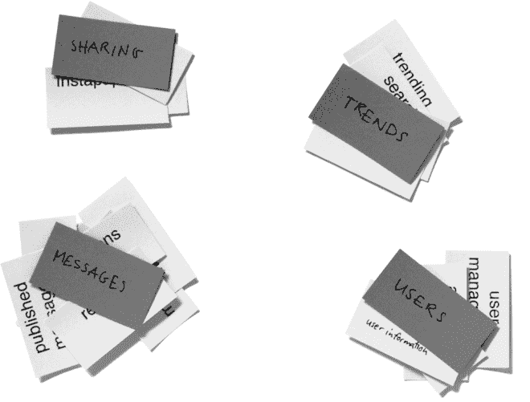

如果堆数足够多，请参与者对这些堆进行排列，使彼此相关的堆靠近。根据参与者的不同以及你选定的卡片词语，你甚至可以请人们在相关的堆之间画上连线。（如果你打算这么做，请在大张纸上进行卡片分类。）

最后，收集数据。一个快速简便的方法是对整个排列拍照，然后用橡皮筋把每一组卡片分别扎起来。

#### 8.5 执行远程卡片分类

你未必需要邀请人们到某个实体场所来进行卡片分类。卡片分类完全可以远程进行。事实上，有很多优秀的卡片分类网站，比如 `websort.net` 或 `OptimalSort`³，它们就是专门为远程卡片分类设计的。

远程卡片分类能为你提供更精确的数据，因为你可以让更多的人参与分类。然而，你会错过很多面对面分类时才能获得的定性信息。人们会被哪些词语弄糊涂？他们会使用哪些同义词？他们对卡片上的词语有怎样的联想？远程卡片分类无法告诉你这些。

当然，这并不妨碍你同时采用这两种分类方式。

#### 8.6 评估结果

如果你使用的是预先定义的卡片组（封闭式卡片分类），评估结果就很简单。统计每张卡片被分入每个组的次数，你就会很清楚大多数人期望该卡片所代表的东西出现在哪里。

|  | 第1组 | 第2组 | 第3组 | 第4组 | 第5组 | 第6组 | 第7组 |

|---|---:|---:|---:|---:|---:|---:|---:|

| 卡片1 |  | 4 |  |  | 3 |  |  |

| 卡片2 |  |  | 2 | 6 |  |  |  |

| 卡片3 | 7 |  |  |  |  |  |  |

| 卡片4 |  |  | 5 | 1 |  | 1 |  |

| 卡片5 |  |  | 5 | 4 |  |  |  |

| 卡片6 | 1 | 4 |  |  |  |  | 3 |

另一方面，如果你使用的是用户定义的卡片组，则先从定义组开始。有时不同的人用不同的词语描述同一个组。在这种情况下，合并这些组可能是合理的。另一些时候，不同的人会用完全不同的方式对卡片进行分类，从而形成完全不同的组。如果出现这种情况，可能意味着你需要为访问同一内容提供不同的途径。一旦你敲定了要使用哪些组，就再次统计每张卡片被分入每个组的次数。

> 3. 访问 http://www.optimallworkshop.com/optimalsort.htm。

现在你可以在收集到的信息基础上建立一个层级结构，然后将此层级结构用于你的视觉布局和信息架构。我不建议对数据进行正式的、统计性的评估，因为你可能还没有收集到足够的信息。卡片分类为你的设计决策提供输入，而不是证明某个特定解决方案是“正确”的证明。

只需在处理诸如应用程序的故事板、网站内容的层级结构或单个屏幕的层级结构等事项时，将你收集到的信息考虑在内。从卡片分类中获得的是对人们如何思考产品中事物、人们用来将产品中概念放入不同心理框的准则，以及人们对产品 supposed 工作方式的心理模型的洞察。

在决定层级结构后，通常最好创建一个简单的纸质原型并进行几次简短的可用性测试。（有关如何执行此操作的更多信息，请参阅第 11 章《纸质原型测试》，第 104 页。）这样，你就知道自己对结果的解读是否正确。

#### 8.7 创建可用层级结构的准则

卡片分类的数据可以帮助你设计良好的层级结构。以下是一些可以帮助你做到这一点的额外准则。

##### 允许事物存在于多个位置


请记住，层级结构不必是严格的：事物不必在层级结构中恰好位于一个位置。你可以为用户提供多条通向相同结果的路径。这有时被称为多层级分类。第 8.1 图，下一页，有一个示例。

我之前提到过，一些遇到电脑问题的用户可能会先在网站上搜索他们确切的笔记本型号。其他人可能更喜欢直接进入网站的支持部分来查找他们的笔记本型号。还有一些人可能会进入支持部分并根据他们遇到的具体问题开始搜索。如果你发现不同的人倾向于在卡片分类中将卡片归入不同的组，那么创建这种非严格的层级结构是有意义的。

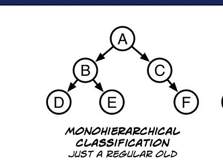

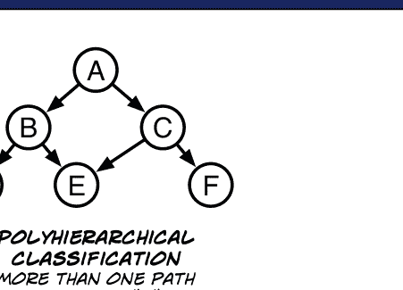

#### 图 8.1：示例多层级分类

##### 浅还是深？

很多时候，人们通过计算点击次数来评估用户界面。用户需要点击多少次才能达到目标？直觉上认为点击次数越少越好。

这种对点击次数的关注可能会诱使你尽可能保持层级结构浅显，使每个可能的目标都能用最少的点击次数到达。虽然通常有意义确保人们可以用少量点击访问少量重要、常用的功能，但我不建议有意追求浅层层级结构，因为这迫使用户在层级结构的每个层级中从更多可能的动作中进行选择。通过减少层级结构的深度，你是在增加每个层级处的潜在选择数量。

事实上，研究表明，优化点击次数并不一定会产生积极的结果。总结研究，ux myths.com 写道：“必要的点击次数既不影响用户满意度也不影响成功率。对，就是这样；更少的点击并不会让用户更快乐，也不一定被认为更快。”

> 4. 在 `http://uxmyths.com/post/654026581/myth-all-pages-should-be-accessible-in-3-clicks`。

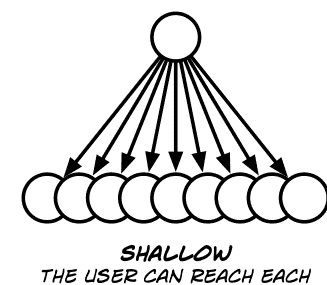

###### 浅层

用户可以在一次点击内到达九个目标中的每一个，但必须在九个不同的选择中挑选出来

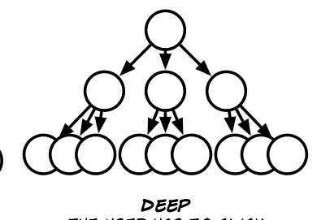

###### 深层

用户需要点击两次才能到达同样的九个目标中的一个，但每次只需在三个选择中挑选

与“点击越少越好”规则类似的规则是，你必须限制提供给用户的选项数量；不要让她从超过七个选项中进行选择。提出这一想法的理由是人类无法处理超过七个可能的选择。像“更少点击”规则一样，这一规则是错误的。

“七的法则”源自普林斯顿大学认知心理学家乔治·A·米勒于 1956 年发表的一篇论文。5 在论文中，作者得出结论，平均人类只能在工作记忆中保留大约七个不同的对象。虽然这可能是真的，但它并不适用于从多个选项中进行选择，因为你不必将所有选项都保留在工作记忆中。你只需浏览它们并挑选第一个看起来会让你更接近目标的选项。这种行为被称为满意化，心理学家赫伯特·西蒙在 1956 年创造了这一术语。人们与其比较所有可用选项以找到完美选择，不如简单地挑选第一个看起来足够令人满意的选项。

然而，在《选择的悖论》[Sch05]中，巴里·施瓦茨指出，有些人是“最大化者”——那些试图找到最佳可能解决方案的人，而不是第一个合适的解决方案。更重要的是，虽然大多数人能够应对大量选择，但很多人并不喜欢这样做。施瓦茨写道：“大量的选项可能会让消费者望而却步，因为它迫使决策付出的努力增加。”

5. Wikipedia 有一篇关于这篇论文的精彩文章，网址为 `http://en.wikipedia.org/wiki/The_Magical_Number_Seven,_Plus_or_Minus_Two`。

换句话说，即使大多数人完全有能力从许多选择中挑选，他们可能也不喜欢这样做。

一个优秀的用户界面并不是每个目标都可以用最少的点击次数到达，或用户在每一步只需从少量选择中挑选，而是每个单独的点击都尽可能明显。如果你的用户心中有明确的目标，层级结构的每个层级都应有一个明显满足其目标的选项——或至少让他们更接近该目标。只要用户感觉自己在每一步都更接近目标，他们并不介意深入到深层层级结构中。

### 分组事物

人类可能有能力从数十个选择中挑选，但这并不意味着你应该向他们扔出未分组的选择列表。面对一堵看似同样有效的选择墙是令人沮丧的。

当你以有意义的方式对选择进行分组或排序时，这对用户有帮助。更好的分组使用户更容易扫描可用选项。单个屏幕上可以出现的最大选择数量主要受显示选择给用户的页面设计限制。如果当前层级有许多不同的选择出现，对它们进行分组——在某种程度上，为选择添加一个本地的、视觉上的层级结构——有助于用户在大量选择中找到他们想要的选项。

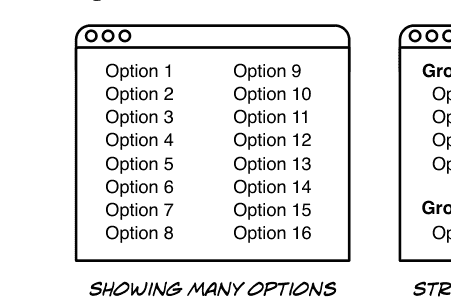

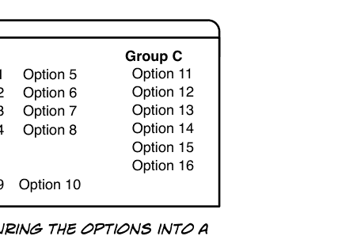

利用邻近性并不是创建这种本地结构唯一的方法。在他的书《视觉科学：从光子到现象学》[Pal99]中，斯蒂芬·E·帕尔默描述了多种不同的分组方式。这些八个点是未分组的。单个点似乎在任何方面都不属于一起。


即使只是稍微移动它们，我们也可以让它们看起来像是四个点对，而不是八个单独的点。这就是前面提到的`邻近性`。


这里是另一种将点分组为对的方法：改变`颜色`，四个点的颜色又将点变成四个颜色相似的点对。


我们也可以改变点的`大小`来实现同样的效果。


或者我们可以改变`方向`。


这三个示例展示了基于颜色、大小和方向的分组。但这些并不是你可以用来自分组事物的唯一相似性。不同的字体样式，例如，也可能是实现这一点的另一种方式。

对元素进行分组更明显的方法是把它们放入共同的区域。


或者你可以直接连接它们。


有许多方法可以创建结构和分组事物。当你需要在单个屏幕上显示大量单独项目时，使用这些方法。

## 要点总结

- 不要使用内部结构作为用户在你的产品或网站中看到的层级结构的蓝图。

- 使用卡片分类法来了解人们认为单个事物应该放在哪里。

- 不要为了减少点击次数而优化整个层级结构。

- 使用分组来组织单个屏幕。

## 进一步阅读

要了解关于卡片分类法几乎所有需要知道的知识，只需阅读一本书：Donna Spencer 的 `Card Sorting: Designing Usable Categories` [Spe09]。

如果你对信息架构这个更大的领域感兴趣，Peter Morville 和 Louis Rosenfeld 的 `Information Architecture for the World Wide Web` [MR06] 以及 Donna Spencer 的 `A Practical Guide to Information Architecture` [Spe10] 都是很好的入门方式。Spencer 还写有一个很棒的卡片分类博客⁶ 和一个关于信息架构的博客。⁷

如果你对人类如何感知事物感兴趣，`Vision Science: Photons to Phenomenology` [Pal99] 是一本引人入胜的读物。

6. At `http://rosenfeldmedia.com/books/cardsorting/`.

7. At `http://practical-ia.com`.


## 第 9 章

### 心理模型

使用你的产品的用户并不是中立或无偏见的。他们在真正使用之前就已经有了关于产品应该如何工作的想法。然而，大多数产品的工作方式并不像人们期望的那样；人们必须`学习`如何使用东西。

与其强迫人们学习如何使用你的产品，如果你能创建出按人们本来就期望的方式工作的产品，不是更好吗？Joel Spolsky 在 `User Interface Design for Programmers` [Spo11] 中指出，“当程序的行为完全符合用户所想的那样时，用户界面就是设计良好的。”

当然，不同的人对事物如何工作有不同的想法。但即便如此，你也可以努力缩小人们对产品的期望与产品实际工作方式之间的差距。

#### 9.1 人们所想

用户对事物如何工作的认知概念被称为 `心理模型`。心理模型通常比现实简单得多。在 `About Face` [Coo95] 中，Alan Cooper 将心理模型称为“一种认知捷径 (...)”，它“足够强大，可以涵盖 [用户] 与 [产品] 的交互，但不一定反映其实际的内部机制。”

Jakob Nielsen 说，“心理模型是`用户相信`系统在手时的样子。”¹

举个例子。开车的人可能会认为油门踏板与发动机之间存在直接的机械连接，认为踩下油门踏板会打开某种阀门，导致更多燃料进入发动机，从而使汽车行驶更快。

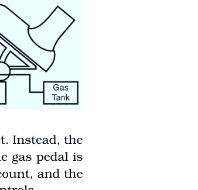

这种关于汽车如何工作的心理模型实际上是不正确的。相反，油门踏板连接到一台计算机。来自油门踏板的信息只是计算机考虑的众多数据点之一，而燃油系统只是计算机控制的众多系统之一。

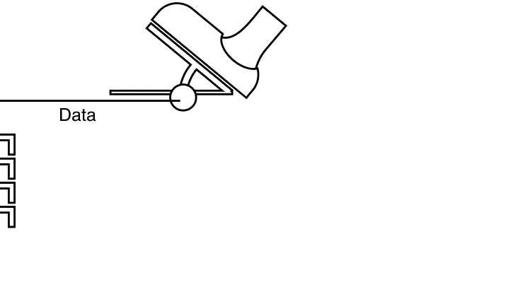

基于所有这些数据，计算机然后尝试弄清楚驾驶员在做什么。他是在刚上高速公路所以想快速加速吗？他是从完全停止的状态开始，因为红灯刚刚变绿吗？他突然松开油门踏板是因为他想尽快停车吗？

如果计算机工作正常，驾驶员不会注意到任何这些。踩下油门踏板会使汽车加速，就像你期望的那样。

这里有一个重要的观点：用户对汽车如何工作的心理模型在技术上是错误的。然而，它仍然帮助他理解如何控制汽车，因为心理模型的交互逻辑——踩油门踏板使汽车加速——与汽车的行为相匹配（大多数时候）。

换句话说，用户的心理模型不必正确。它只需要与产品的行为一致。

#### 9.2 三种不同的模型

我们的产品实际上反映了三种不同的模型：

- 用户认为产品如何工作。这是用户对产品的心理模型。

- 产品在用户界面中向用户展示的方式。我称之为 UI 模型。²

- 产品是如何实现的。我称之为实现模型。³

在理想的产品中，这三个模型彼此一致。用户界面完美地代表了实现，用户也完全理解他所看到的东西。

#### 9.3 隐藏实现细节

实际上，这三个模型永远不会完全一致。例如，实现模型可能很复杂且陈旧，因此你必须简化用户所看到的内容。这与使实现模型与 UI 模型一致的目标相矛盾。

2. 产品视觉表示所倡导的模型（其用户界面）有时也称为设计模型、显式模型或设计师模型。

3. 实现所倡导的模型有时也称为系统模型或程序员模型。

### 拟人化

人们倾向于将人类特征归因于应用程序、网站和其他产品。`拟人化`。这是一种心理模型；人们假设机器的工作方式与人类相似。因此，当投币计数机完成得太快时，我们认为它没有为任务付出适当的努力。我们像对待故意惹恼我们的文档一样生气地对待电脑。我们怀疑汽车导航系统故意把我们带错了路。我们给设备起名字。

汽车制造商尤其擅长利用我们拟人化的倾向。他们故意设计汽车看起来像具有人类特征，使其看起来友好或具有攻击性。


作为设计师，我们应该留意人们会将何种人类特征归因于我们的产品。我们的产品表现得像好人还是不友好的人？它们看起来冷漠无情，还是有点个性？它们迟到还是效率高到让人怀疑？

> `Clifford Nass` 在 `The Man Who Lied to His Laptop` (NY10) 中写到了关于这一主题的研究。

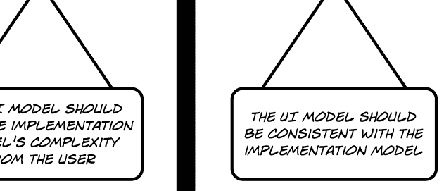

这是一个权衡。你简化用户界面，以便大多数用户获得更好的体验。但这意味着你的 UI 模型可能与实现模型并不完全一致。

假设你正在创建一个用于购买可下载电影的在线平台。你的潜在客户可能知道买电影是如何工作的：

- 1. 去一家商店。

- 2. 浏览多部电影，直到找到喜欢的一部。

- 3. 用钱交换选定的 DVD。

这是用户对买电影如何工作的心理模型。

但这并不是在互联网上买电影的方式。你的客户不会给你实物货币；相反，你服务器上运行的软件会要求一家信用卡公司更改数据库中的一些数字。然后，你的软件会更新数据库中的一些内容，表明客户现在被允许下载一个文件。当客户开始下载时，该文件通常会被加水印并且可能被加密。一旦文件下载完成，客户计算机上的软件会解密文件，解码存储的电影，并在客户屏幕上显示。

我们如何在用户界面中表示这一系列复杂的操作？

### 你比用户知道得多

如果你正在为产品创建用户界面，你可能知道该产品是如何实现的。如果你正在为一家公司创建网站，你可能知道该公司的内部结构。你的用户（很可能）不知道这些事情。因此，从一开始，你对事物如何工作的心理模型就与用户的心理模型不同，因为你的模型包含了用户不知道的信息。

仅仅因为某事对你有意义，并不意味着它对你的用户也有意义。

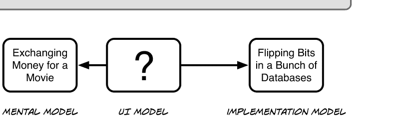

用户界面位于客户对买电影如何工作的心理模型与实现模型之间。这两者非常不同，因此用户界面的工作就是在两个世界之间进行翻译，以一种用户能够理解和关联的方式呈现用户视野之外发生的那些奇怪的事情。为了帮助用户理解正在发生的事情，UI 模型必须比实现模型更接近用户的心理模型，隐藏实现的部分复杂性。

#### 9.4 泄漏的抽象

隐藏实现细节使你的 UI 模型更容易理解。但它造成了另一个问题：每当一些隐藏的实现细节泄漏给用户时，它就不会与他对产品行为的心理模型相匹配。

回到之前有人买电影的例子，假设同一个人现在想为她的妹妹买一部电影。她对买电影作为礼物的心理模型很简单：

- 1. 去一家商店。

- 2. 浏览多部电影，直到她找到姐姐喜欢的一部。

- 3. 用钱换取一张 DVD。

- 4. 用漂亮的包装纸把 DVD 包好。

- 5. 把包装好的 DVD 送给她姐姐。

当谈到在线为她姐姐买电影时，这个用户的心理模型就失效了。UI 模型隐藏了实现模型的一个关键方面：她买的电影是加密的，需要解码后才能观看。它只能在她自己的电脑上解码并显示。合理地，她可能会认为可以将下载的电影放到一个存储棒上交给她姐姐，因为这符合她对电影工作原理的心理模型。但事实上，她姐姐将无法观看那部电影。

如何防止这类问题的发生？

#### 9.5 为心理模型设计

首先，你需要弄清楚人们认为事物是如何工作的——通过与他们交谈来弄清楚他们预先存在的心理模型是什么（参见第 2 章，《影子跟随与情境访谈》，第 23 页）。然后做卡片分类，以了解人们认为事物如何相互契合（参见第 8 章，《卡片分类》，第 63 页）。接下来是使用纸质原型进行可用性测试（参见第 11 章，《纸质原型测试》，第 104 页），以提出符合人们心理模型的方案。你向他们展示你的设计，描述一种交互，并询问他们期望会发生什么。(`如果我输入一些文本然后关闭这个文档，你认为会发生什么？`)

利用你从对话和可用性测试中收集到的信息，你可以设计一个与用户心理模型一致的 UI 模型。如果你从零开始创建产品，请确保实现模型与该 UI 模型相匹配。

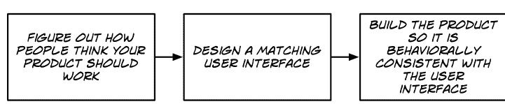

这并不总是可能的。有时，你必须处理一个现有的产品，它的工作方式与人们的预期完全不同，而且你无法改变其工作原理。如果发生这种情况，请确保用户需要学习的事情少而简单，以便人们能够轻松地改变他们对产品的心理模型，使其符合产品的实际工作方式。

如果在他们使用产品时发现人们总是形成错误的心理模型（例如，在可用性测试期间），请尝试改变其外观，例如，通过避免使用与产品行为不符的隐喻（有关隐喻的更多信息，请参阅第 12 章，《真实性》，第 120 页）。你也可以尝试让产品看起来独特，以便人们立即明白它与他们已知的行为不同。

在他们的论文《心理模型与可用性》中，Mary Jo Davidson、Laura Dove 和 Julie Weltz 描述了七个用户界面设计原则，有助于用户形成有效的心理模型：

##### 原则 1：简洁

心理模型是现实的简化版本。如果你的产品遵循少量简单的规则，你的用户心理模型更有可能与系统实际的工作方式一致，人们也更容易学习这些规则。

例如，Flip 摄像机背部有一个巨大的红色按钮。即使人们从未使用过它，他们只需看一眼就能形成正确的心理模型，了解摄像机的工作原理。按下按钮开始录制。再按一次停止。

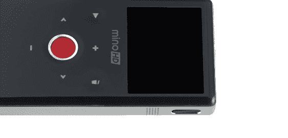

##### 原则 2：熟悉

用户会带有很多先验知识进入你的产品。你需要在相似产品之间以及与现实世界中事物的工作方式保持一致，人们更有可能形成正确的心理模型。

一个例子是人们在大多数现代操作系统中删除文件的方式：他们把文件扔进垃圾箱，然后清空垃圾箱。你不需要向人们解释如何区分空垃圾箱和装有文件的垃圾箱；他们对垃圾箱工作原理的先验知识就足够了。


EMPTY WINDOWS 7 BIN

BIN WITH FILES INSIDE

当然，这种对垃圾箱工作原理的先验知识也会引起问题。在 Mac OS X 上，将 DVD 拖到垃圾桶图标上（此时图标会变成弹出符号）会弹出 DVD。可以预见的是，很多人对此感到困惑；毕竟，他们不想冒着把 DVD 扔进垃圾桶而意外毁掉的风险。


苹果 iPad 上的许多音乐应用也利用了熟悉性。图 9.1 在下一页显示了一个名为 djay 的应用。

这看起来完全像一个真实的、物理的双唱盘 DJ 系统。因此，熟悉此类系统的人可以开始使用此应用而无需学习任何东西。他们已经拥有能够让他们完全理解所见内容的心理模型。

### 原则 3：识别

不要让人们回忆如何做某事，而是向他们展示提示或明显的选择，让他们了解当前可用的选项。

例如，Windows 7 中的菜单栏会显示与用户当前查看的文件相关的操作。如果她正在查看图片，它会提供与共享或查看图片相关的命令，如图 9.2 在下一页所示。

人们不必记住如何在幻灯片中显示图片。选项就在他们可能需要时出现。

6. 在 `http://www.algoriddim.com` 上了解更多信息。

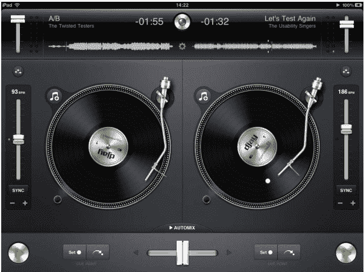

##### Figure 9.1: The djay application interface

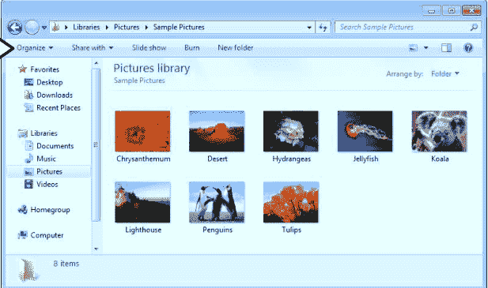

##### Figure 9.2: Windows menus are context sensitive

### 原则 4：灵活性

让用户以任何顺序执行操作，如果可能的话，使用不同的技术。

在现代文字处理器中，用户可以在打字时切换到他们想要为文档不同部分使用的不同样式。或者他们可以先输入所有文本，然后再浏览文档并应用不同的样式。

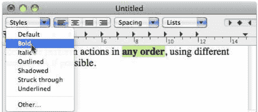

### 原则 5：反馈

始终向用户交互提供即时、有用的反馈。如果用户点击某物，它应立即高亮显示。如果她拖动某物，它应与她的鼠标或手指同步移动，没有任何延迟。如果她发起一个需要一点时间的操作，请显示活动指示器，例如进度条，以告知她计算机已收到她的命令并正在处理中（有关此内容的更多信息，请参阅第 23 章，《速度》，第 198 页）。

获得即时反馈有助于人们纠正心理模型中的缺陷，并在心理模型正确时建立对自己行为的信任。

图 9.3 在下一页显示了苏黎世有轨电车上使用的两种不同按钮的图片。你在想要电车停下时按下它们。右边的按钮按下后会亮起；左边的不会。在苏黎世乘坐有轨电车时，你经常会注意到人们反复按下左侧样式的按钮，只是为了确保他们的按压确实被记录下来；没有任何明显的反馈表明它已被按下。你很少在右侧的按钮上看到这种情况。

当然，事情也可能过度。一些列车的按钮使用不同颜色的方案，一种表示按钮可以被按下（仅在列车即将停靠前短暂激活），另一种表示它已被按下。由于人们永远记不住哪种颜色是哪种，他们倾向于多次按下按钮，只是为了确保它已切换到正确状态。添加一些反馈有助于人们形成正确的心理模型。添加太多或不清晰的反馈可能会导致更多混淆。


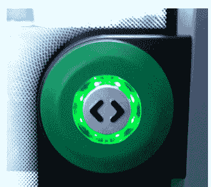

LACK OF FEEDBACK MAKES IT HARD TO LEARN HOW EXACTLY THE BUTTON WORKS AND TO TRUST THAT IT WORKS AT ALL

THE BUTTON LIGHTS UP ONCE PRESSED. THIS IMMEDIATE FEEDBACK MAKES IT EASY FOR THE USER TO LEARN HOW IT WORKS

Figure 9.3: Push these to stop a tram

### 原则 6：安全

用户操作不应有害，除非用户有意为之。关闭包含未保存更改的文档不应在未给用户机会恢复这些更改的情况下销毁这些更改。始终允许用户撤消其操作（参见第 19 章，《不要打断，而是提供撤消》，第 171 页）。给他们自由探索而不必担心永久性损害，他们将更愿意学习并调整其心理模型以适应你的产品的工作方式。

例如，如果有人关闭了 Google Chrome 中包含多个标签页的窗口，然后决定她确实需要恢复其中一些标签页，她只需使用历史记录菜单即可恢复已关闭的窗口。

### 假设因果关系

人们倾向于在事情同时发生或接近发生时假设因果关系。如果 B 在用户执行 A 之后立即发生，他往往会得出结论 A 导致了 B。虽然你可以用这种因果元素作为帮助人们形成正确心理模型的一种方式，但请记住，这很容易造成错误的心理模型。

这个问题经常出现在故障排除行为中；如果某样东西不起作用，用户尝试做些什么来修复它，然后它就起作用了，用户自然会假设自己所做的事情修复了问题。毕竟，用户不知道如果他什么都不做，它是否也会起作用。

在瑞士，你经常看到人们用硬币投币机第一次没接受的硬币去刮擦硬币投币机：

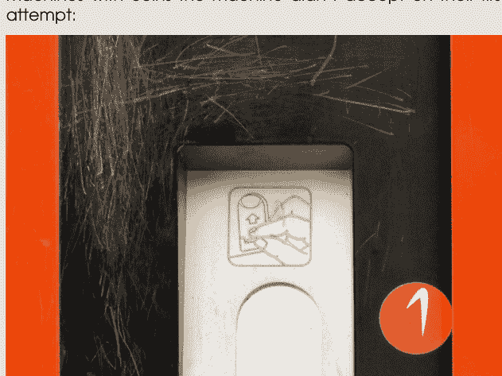

由于刮擦机器后硬币通常会被接受，因此自然会假设刮擦机器是解决问题的原因，即使硬币在第二次尝试时无论是否刮擦都会起作用。

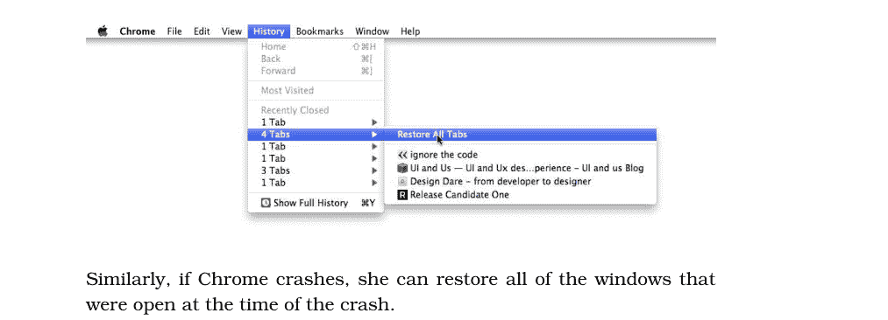

同样，如果 Chrome 崩溃，她可以恢复崩溃时打开的所有窗口。

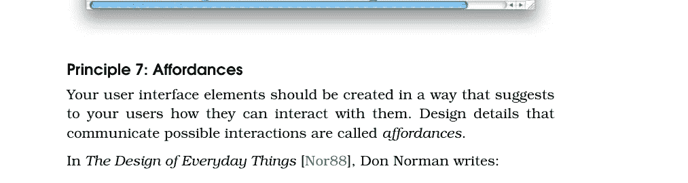

### 原则 7：可供性

你的用户界面元素应以一种暗示用户如何与之交互的方式创建。传达可能交互的设计细节称为可供性。

在《日常事物的设计》[Nor88]中，唐·诺曼写道：

> 一个好的设计师确保适当的操作是可感知的，而不适当的操作是不可见的。

任天堂旧的 NES 控制器（下方左侧图示）并不能明显表明你应该如何握持它。事实上，两个红色按钮放置在右侧太低，以至于倒着握控制器更舒服。将其与任天堂更新的 Game-Cube 控制器相比。虽然新控制器复杂得多，但由于控制器两侧的凸起邀请你将手包住，因此立即就能明显看出你应该如何握持它。

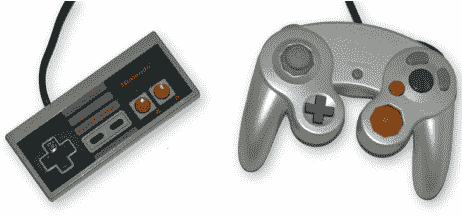

用户界面经常使用斜面和高光来指示可以交互的元素。


当鼠标移过时高亮用户界面元素，进一步表明它们是可点击的。


当然，如果这种“悬停效果”不能正常工作，可供性就会具有误导性，暗示用户可以与用户界面元素交互，而实际上他不能。例如，Mac OS X 在用户将光标移过可点击区域之前就高亮窗口标题栏中的按钮；这可能导致用户过早点击，错过目标。


类似具有误导性的可供性也经常可以在 Propellerhead Software 的 ReBirth 等音频软件中找到。这些应用经常使用看起来像真实旋钮的旋钮，表明用户可以通过旋转它们来与之交互。

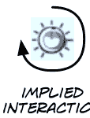

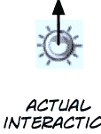

相反，你是通过垂直拖动来改变它们的值。

我将在第 12 章《真实感》，第 120 页，进一步谈论可供性如何适用于用户界面设计。

## 结论要点

- 人们对事物如何运作有自己的想法。你的产品与这些想法越接近，人们使用你的产品所需学习的东西就越少。

- 为了匹配用户的心理模型，你经常需要将实现细节隐藏起来。注意抽象泄漏。

- 为了设计心理模型，使你的产品简单、熟悉、灵活和安全。提供反馈，并在任何给定时刻让人们清楚地知道他们有哪些选择。

### 延伸阅读

Alan Cooper 在他的书 *About Face* [Coo95] 中有一章关于心理模型的好内容。Robert Hoekman 在 *Designing the Obvious* [Hoe06] 中也涵盖了心理模型。Joel Spolsky 的 *User Interface Design for Programmers* [Spo11] 从开发者的角度涵盖了心理模型。

Jakob Nielsen 写过关于心理模型的内容。⁷

7. 在 `http://www.useit.com/alertbox/mental-models.html`。

## 第二部分

## 设计

到目前为止，你对你的受众是谁以及你想要解决哪些问题已经有了相当好的了解。你甚至可能对解决方案可能如何运作有一个基本的想法。但要小心：你还不想在任何特定解决方案上定下来。人类思维在合理化与当前观点相悖的信息方面相当擅长。所以，不要过早形成观点。不要专注于特定的设计或解决方案；这样做可能会让你对 *更好的* 方法视而不见。

不要立即追求完全成型的想法，慢慢开始。在本书的这一部分，你将开始绘制产品的流程图。这些是非常简单、高层次的想法，将帮助你弄清楚你的产品可能如何运作。慢慢地，你会添加细节，从流程图到分镜，再到简单的草图，最终到完全成型的模型图甚至交互式原型。

始终保持你可能是错的可能性。你越长时间坚持一个行不通的设计，改变它就越困难。尽早失败是好事。

为了确保你走在正确的轨道上并让你能够尽早失败，你将使用实际用户测试你的设计想法。很快，你就会发现什么有效，什么无效。

本书这一部分是关于迭代的。避免强烈的观点。相反，设计、测试、接受如果某事不起作用，并迭代。

### 10.1 设计结构

在 *Rework* [FH10] 中，Jason Fried 和 David Heinemeier Hansson 写道，“建筑师在平面图最终确定 *之后* 才担心淋浴间的瓷砖或厨房安装哪种品牌的洗碗机。”

流程图和分镜就是你的产品的平面图。我们正处于“设计”部分设计过程的非常开始。流程图和分镜不是关于细节。它们是关于大局：结构。

### 10.2 流程图

流程图回答以下问题：用户要做什么才能得到他想要的？她要遵循哪些步骤才能达到她的目标？

挑选最重要的用户目标，并思考所需的步骤。

对于我们的 Twitter 应用示例，回复一条消息的简单流程图看起来有点像这样：

#### 回复一条消息

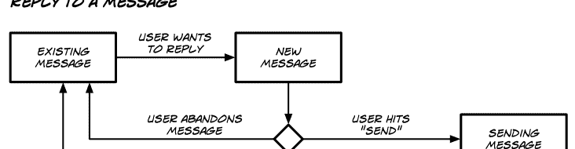

流程图可以添加分支，但不要使其过于复杂。理论上，你可以有一个巨大的流程图来描述你的整个产品。实际上，更有意义的是为最重要的用户目标创建几个流程图。这样，你可以保持各个流程图简洁且清晰排列。

这个练习的目标是思考每个目标涉及什么。你需要向用户展示哪些类型的屏幕？他在什么时间点需要做出哪些决定？

### 10.3 分镜

分镜是一种最初为规划电影动画而开发的技术。分镜将动画分解为其重要帧；它们将动态画面变成漫画。在用户界面设计中，我们出于类似目的使用分镜。它们将用户的路径分解为一系列快照。

分镜大多忽略分支，而专注于交互细节。用户在每个屏幕上到底看到什么？你希望用户做什么？在何处使用动画或图形来帮助用户理解他应该做什么？

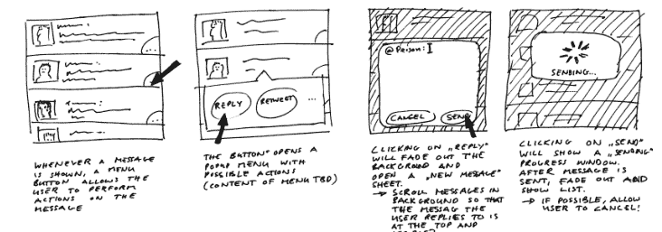

你可以通过绘制箭头或手来指示交互发生的位置和方式（如果是触摸屏用户界面）。

制作分镜可能需要花费大量时间，因此你只希望将其用于应用程序中设计不明显的部分。熟悉漫画书的每个人都可以理解分镜——它是传达设计的绝佳工具。如果你需要向程序员解释如何实现某事，分镜可以提供巨大的帮助。

### 10.4 草图

建筑师设计完平面图后，会设计各个房间。在你设计完产品的结构后，你想要设计各个屏幕。通过制作流程图和分镜，你应该对产品所需的屏幕以及每个屏幕应提供什么功能有相当好的了解。

你在制作分镜时已经对一些屏幕做了简单的草图。在分镜示例中，一些屏幕已经包含了与故事板中执行的任务无关的内容。例如，弹出菜单不仅有“回复”按钮；它还有“转发”按钮。现在，我们需要确定各个屏幕的内容。

可用性顾问 Bruce Tognazzini 指出：[^1]

> > 急于进入复杂、精细调整的原型可能是团队犯下的最糟糕的错误。(...) 如果模型看起来尚未完善，用户（和客户）[会感到更自由]地表达相反的观点。但另一方面也有：设计师和开发者如果没有对本应是故事板或粗糙原型的内容投入极致的关怀，就更愿意倾听异议。

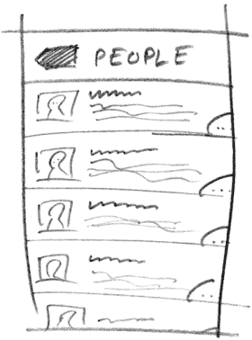

尝试使用简单的草图来弄清各个屏幕在非常基础的层面上应该是什么样子。每个人都会画草图，因此你可以自由地让其他人参与这个过程。向他们展示你的想法，并看看他们是否会提出自己的想法。

一旦你对屏幕的基本设计感到满意，就继续进行线框图。

[^1]: 阅读更多内容请访问 `http://www.asktog.com/columns/005roughsketches.html`.

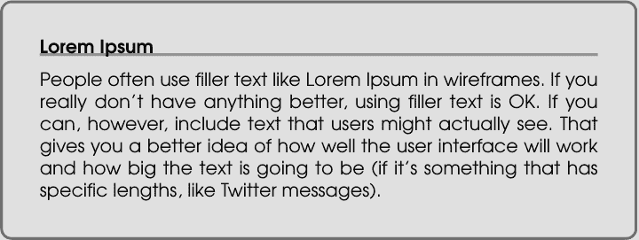

### 10.5 线框图

线框图表示屏幕的确切结构，但没有装饰——没有颜色、阴影或图片。线框图关注的是内容。你想在每个屏幕上展示什么，以及你想把它放在哪里？东西应该有多大？它们之间应该有多近？图 10.1 在下一页显示了一个示例线框图（在左侧）。

这也是你开始着手文案的时候。你现在不需要完全弄对，但你应该思考你想要包含的文本以及把它放在哪里。

线框图的目的是确定你在每个屏幕上需要展示什么以及你想把东西放在哪里。一旦你完成了这一点，你就可以继续进行装饰。

### 10.6 模型图

线框图告诉你屏幕的布局。模型图增加了装饰，或视觉细节：阴影、纹理、图像、透明度。这就是基于你当前知识的屏幕应该看起来如何的样子。将图 10.1 中下一页的模型图（右侧）与线框图（左侧）进行比较。

添加视觉细节不仅仅是为了让你的产品看起来漂亮。当然，最终产品的目标是看起来不错，但视觉设计也可以为用户提供有关产品功能的提示。用户界面设计师通常称这些为 *可供性*。我将在第 9.5 节 *原则 7：可供性*，第 90 页更详细地讨论这个问题。现在，这里有一些可供性的例子：纹理让用户知道他可以触摸和拖动某物，阴影和斜面显示他可以推动某物或强调层级，以及颜色传达重要性并吸引用户的注意力。

这些是在你对屏幕应该如何详细建模时需要牢记的事情。

你不一定必须使用图形应用程序来创建模型图。如果你愿意，你可以在代码中进行模型图。只需使用在你需要进行大规模更改时最容易为你的媒介。但请记住，你正在创建原型，而不是最终产品的早期版本。在《务实程序员》[HT00] 中，Andrew Hunt 和 David Thomas 写道：

> 使用原型时，你的目标是探索最终系统的特定方面。凭借真正的原型，你会在尝试概念时扔掉你拼凑的东西，并使用你学到的经验重新正确地编码它。

即使你在代码中进行模型图，目标仍然是以一种在它们行不通时易于丢弃的方式探索想法。

### 术语

在本书中，我使用以下术语：

| 草图 | 用户界面的任何作为绘图的表示。 |

| 线框图 | 用户界面的静态表示，其中各个元素至少大致位于它们应该在的位置，大小也大致正确。 |

| 模型图 | 用户界面的（通常是静态的）表示，其中引入了阴影和颜色等装饰。 |

| 原型 | 任何不是最终产品的产品表示。 |

并非每个人都以这种方式使用这些术语。有时，术语 *原型* 仅表示交互式、高保真的表示。有时，术语 *模型图* 用于任何类型的最终用户界面的草图。当你在互联网或其他书籍上阅读这些内容时，请注意作者可能以不同的方式使用这些词。

### 10.7 工具

草图和原型设计在软件开发社区中很受欢迎——足以催生出一整套产品生态系统。这些应用程序和服务的唯一 *存在理由* 就是帮助你草图或原型你的产品。

使用此类产品有很多很好的理由。其中主要的一个是它们使设计师即使相距遥远也能轻松协作设计。

Balsamiq² 和 Mockingbird³ 是在线工具，允许你创建和分享用户界面的草图。

Google Docs 有一个名为 Google Drawings 的绘图组件，允许多人协作设计。Morten Just 有一套带有用户界面元素的 Google Drawings 模板。⁴

2. 在 `http://balsamiq.com`.

3. 在 `https://gomockingbird.com`.

4. 在 `http://mortenjust.com/2010/04/19/a-wireframe-kit-for-google-drawings/`.

在 Mac 上，OmniGraffle⁵ 满足了你大部分用户界面草图需求。人们专门为 OmniGraffle 创建了用户界面模板。⁶ 如果你是 iPhone 开发者，请查看 Briefs⁷ 和 Review。⁸

有些人也使用 PowerPoint⁹ 或 Keynote¹⁰ 等工具来创建模型图和原型。这些工具甚至允许你添加简单的动画和交互。像 Keynotopia¹¹ 和 Keynote Kung-fu¹² 这样的网站为这些应用程序提供用户界面模板。模板可以帮助你创建像素完美的模型图，使用平台的标准用户界面元素。

所有这些工具都可以让你的生活更轻松。另一方面，使用纸张也有很好的理由。它更快，更自然，只要每个人都在同一个房间里，就很容易与其他人协作；人们为贡献想法所需要的唯一东西就是他们自己的铅笔。而且由于如今每个人都有内置摄像头的某种小工具，将草绘的用户界面发送给其他人就像拍照并通过电子邮件发送一样简单。

只需使用对你来说最简单的方法。如果你发现纸上草图效果最好，就在纸上草图。如果你更喜欢使用专门为用户界面设计师创建的应用程序，就使用它。如果你想使用图形应用程序代替，那也没问题。或者根据你的当前任务，简单地使用所有这些工具。

5. 在 `http://www.omnigroup.com`.

6. 例如，在 `http://graffletopia.com/categories/user-interface`.

7. 在 `http://giveabrief.com`.


8. 在`http://www.getreviewapp.com`。

9. 在`http://office.microsoft.com`。

10. 在`http://www.apple.com/iwork`。

11. 在`http://keynotopia.com`。

12. 在`http://keynotekungfu.com`。

## 关键要点

- 从鸟瞰图开始，逐步深入到细节，从流程图到故事板到简单草图再到线框图，最终到详细的模型图。

- 尽早解决问题。你越早发现设计中的问题，修复它就越便宜。

- 流程图帮助你让用户尽可能简单地实现他们的目标。

- 故事板帮助你充实和传达产品的交互设计。

- 简单的草图帮助你弄清楚 `在` 个别屏幕上放什么。

- 线框图帮助你决定 `在` 个别屏幕上把东西放在哪里。

- 模型图帮助你快速迭代视觉设计。

## 进一步阅读

流程图、故事板、线框图和模型图是我最常用的四种技术。它们允许我从鸟瞰图开始，逐步深入到细节。然而，其他设计师更喜欢不同技术组合。Cennydd Bowles 和 James Box 的 `Undercover User Experience Design` `[BB10]` 教你这些和其他技术。

Bill Buxton 的 `Sketching User Experiences` `[Bux07]` 是关于这个主题的另一本好书，Robert Hoekman 也在 `Designing the Obvious` `[Hoe06]` 中涵盖了一些这些技术。

Tyler Tate 写了关于不同草图和原型方法的内容。¹³

13. 在 `http://...`


## Chapter 11

### Paper Prototype Testing

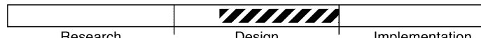

#### What’s the Technique?

In the previous chapter, I explained how to sketch your product. I said that you should sketch before you commit to code because sketches are easier to change. But I kind of skirted around the issue of how you know what changes to make.

In some cases, issues with a design—such as features that are available at the wrong time or overcrowded screens—become obvious once you see it sketched out before you.

But in other cases, it’s not obvious. When is a design good? If you have more than one idea of how to do something, which idea will work best? Where are the issues with your current idea? This chapter will help you find answers to these questions.

Your sketches are basically primitive forms—prototypes, if you like—of your product. As such, you can run usability tests with them and see whether your designs work the way you expect them to work. The easiest way to do that is to show them to people and see whether they understand them.

If you’re working alone or in a small team, feel free to skip the part of this chapter that explains how to run full usability tests with paper prototypes.

#### Why Is This a Good Idea?

The earlier you find issues with your design, the easier it is to fix them. Every problem you fix with a pencil on paper is a problem you don’t have to fix in code.

#### Are There Any Prerequisites?

You should have started doing sketches.

#### 11.1 Guerilla Paper Prototype Testing

At this point in the process, you have static representations of your product. Whether it’s simple, crude sketches, wireframes, or detailed mock-ups, your product exists in the form of a series of pictures.

At its most basic, paper prototype testing simply means you get a real person to “interact” with those pictures in order to gauge whether your planned user interface is understandable to your users. This could be as simple as showing somebody a drawing of a user interface and asking them something like “If you wanted to change the font size of the text document on this screen, where would you click?”

You need a reasonably detailed sketch, wireframe, or mock-up of one of your product’s screens to do paper prototype tests. Then, find somebody willing to spend five minutes with you. Show them the screen, and ask a generic question: “What do you see on this screen? What do you suppose this product could be used for?”

Alternatively, you can ask a simple task-based question: “If you had to use this application to add a picture to a document, what would you do?”


#### Paper?

This chapter is about "paper prototypes," but the "paper" part isn’t meant too literally. You don’t necessarily need to do sketches on paper to do these kinds of tests. You can also do mock-ups on a computer and print them out. Or, instead of printing them, put them on a tablet computer, and show that to people. You could even create a simple interactive prototype of your product by putting sketches into an application like PowerPoint or Keynote.

I guess this chapter should really be called "how to do usability tests with (mostly but sometimes not entirely) static sketches or mock-ups of your final product," but that didn’t fit into the book’s layout.

This kind of test will give you a general idea of whether people understand your design and what parts people don’t get. That way, you know where you have to make changes and where you’re on the right track.

Simply showing people a mock-up of one screen of your product helps you understand whether people understand that screen. This is useful, but we can go a step further and test interactions. To do this, prepare more than one screen in advance. If you need pop-up elements or other elements that have to be added or removed from the screen, also prepare them in advance; draw them on Post-it notes so you can easily add them to the prototype.

Prepared in this way, you can run actual task-based usability tests. Of course, you can’t let people veer too far off track, but if they do, you already know that there’s a problem with your design, because people don’t follow the path you expected them to take.

You can do this type of simple test with pretty much anyone. It takes only a few minutes, and it’s quite easy to explain:

I’m working on a new Twitter app. You know what Twitter is? OK, great. I’m currently working on the design of my app, and I’m trying to figure out whether people understand what I’ve done. You know, when you work on something for weeks, you lose any objectivity, and it’s hard for me to tell whether what I’m doing makes sense to anyone else. I was wondering

whether I could show you some of these designs and ask you a few questions about them to see whether people can figure them out? It won’t take more than five minutes.

You can start doing this with friends and family members to get used to running these tests. Then, ask random people. A good place to start is a café. People usually have a few minutes to spare.

Once you see how people interpret your designs, it will be easy to figure out where your designs work and where potential problems lie.

#### 11.2 Running Full Usability Tests with Paper Prototypes

The simple tests I've described so far will allow you to do some early usability testing on your designs. There is, of course, a much more elaborate way of doing prototype testing. I don't recommend this process for most smaller teams, but if you have the time and the people required to do such tests, they can give great feedback even before a single line of code is written.

A prototype typically represents only a subset of your finished product. Not every screen of your final product will be part of your prototype. Not every feature will be represented. For this reason, prototype usability tests are almost always based on specific tasks: you will give a person a specific task and ask that person to execute that task on your prototype. That way, you have a pretty good idea of what screens and UI elements you will need to prepare.

So, the first thing you want to do is define tasks you want to test.

#### Defining Tasks

Now that you’ve created a storyboard and mock-ups, you probably have a pretty good idea of where potential user interaction problems might be found. If it was hard to come up with a user interface for a feature, this is probably something you want to test early. If it is a critical, central feature of your product, it’s definitely something you want to test early. Pick the features that are important to your product, that you think might be hard to use, or that you think might cause problems.

Next, come up with tasks that use these areas of your product. You can draw upon the user research you did in the first part of the book, if you need.

that people can find in the user interface, you are essentially giving them a hint about how to perform the task.


It’s a good idea to prepare at least five or six tasks; more is better. Each task should take between two and ten minutes. It’s likely that you won’t make it through all of the tasks, but it’s hard to tell before doing the actual test, so it’s better to be prepared if people blow through your tasks quickly.

#### Creating the Paper Prototype

Based on the tasks you’ve come up with, it’s pretty easy to tell which screens you will need to show to people (but be liberal when deciding which screens to include in your prototype; people may not always take the most obvious steps toward the goals you’ve set).

You can use existing sketches for paper prototypes, if they’re not too crude and simple. Using very simple sketches can cause problems if they are not easily readable by people who are not already familiar with your product.

To turn a sketch or mock-up into something suitable for a usability test, you need to add the user interface elements surrounding your own user interface. For example, if you’re testing a website, add relevant parts of the browser user interface to the prototype (forward and back buttons, the address bar, the title bar, and so on). Similarly, if you’re testing an application, you should add the menu bar and maybe even parts of the desktop if it is an application running on a desktop operating system.

After you’ve created the screens, you should think about state changes on individual screens.

What happens if somebody clicks a drop-down menu? You should prepare any pop-up windows in advance. Some people like to use Post-it notes for them, which makes it easy to stick them to the paper prototype once the user activates them.

What happens if the user has to type data into a field? There are several ways of handling this. If you are not going to reuse the paper prototype, you can simply give people a pencil and an eraser and let them change the data on the screen using these tools. If you are going to reuse the prototype (say, you’re doing more than one test), you could use transparencies. Put them over your prototype, and let people draw on the transparency.

最后，你应该把每个任务打印在单独的纸张上。由于你不知道用户会完成多少个任务，为每个任务使用单独的纸张可以让你在进行过程中分发任务，或者在需要时即时更改任务顺序。

此时，你应该逐一检查每个任务。确保各个目标是可行的，并且你已包含进行任务时可能需要的所有屏幕和弹出元素。

### 纸质原型创建清单

- 准备人们在完成任务时可能经历的所有屏幕。不要做得太粗糙。

- 在必要时添加周围的用户界面元素（例如在网站草图周围添加浏览器窗口）。

- 创建你可能需要的弹出元素。

- 准备一种让人们在你的原型上作画的方式。

- 将任务打印在单独的纸张上。

- 对每个任务进行试运行，并确保你已准备好可能需要的所有屏幕和弹出元素。

### 测试准备

要使用你的纸质原型运行可用性测试，你至少需要另外一个人：执行任务的人。这个人有时被称为测试对象，但由于你不是在测试这个人，我通常称她为测试者。毕竟她是在测试你的设计。

我不会在这本书中深入讲解如何招募测试者。关于这个主题有很多很好的资源，¹ 但总的来说，几乎公司之外任何人都可以。最好避免从公司内部招募测试者。他们对你的产品和公司的术语过于熟悉；这种熟悉可能会掩盖产品可用性方面的问题。有时招募来自产品目标受众的测试者是有意义的，但通常来说，这并不太重要。几乎任何人都可以，包括朋友和家人。

对于纸质原型的任何版本，你应该运行多少次测试？纸质原型需要花费一些时间来制作，因此对每个原型进行测试时，使用不止一个人是合理的。此外，使用纸质原型，在测试之间进行小的调整是很容易的。一个不错的解决方案是邀请三到四个测试者，并将他们安排在相隔两三个小时的时间。 这样，你在测试之间有足够的时间快速回顾发现的问题，并在可能的情况下相应地更改纸质原型。

虽然你可以独自进行纸质原型可用性测试，但最好有至少另外一个人协助你。由于你创建了纸质原型，并且你知道应用程序的故事板是什么样，你是测试期间“扮演计算机”的完美人选。这意味着你必须切换屏幕、显示弹出窗口并模拟用户界面。这会让你几乎没有时间与测试者互动。虽然你也可以同时做这两件事，但找到第二个人来帮助你是有意义的。这个人被称为 *引导员*。图 11.1，第 114 页显示了纸质原型制作的典型设置。

引导员是引导可用性测试的人，通过向测试者介绍测试如何进行、发放任务并回答测试者可能有的任何问题。

| 角色 | 职责 |

|---|---|

| 计算机 | 控制纸质原型，对用户输入做出反应 |

| 引导员 | 向测试者介绍流程，发放任务，回答问题 |

| 测试者 | 根据给定的任务与纸质原型互动 |

引导员应在测试期间做笔记，并且（如果你录制了会话）将录音的时间码添加到笔记中，以便每条笔记都能与发生情况的视频相匹配。测试期间做好笔记可以让你不必筛选数小时的可用性测试录像。

录制会话可能是一个好主意。它允许你在会话结束后回顾会话。事后观看会话可以让你专门关注测试者在做什么，并将提供大量关于她遇到的问题类型的见解；这些问题通常是测试期间你可能没有注意到的细小问题。此外，如果你不是做出相关决定的人，一部电影可以清楚地显示人们在同一任务上反复失败，这通常可以迅速说服那些原本不相信用户界面存在问题的人。

我倾向于不在这本书中涉及法律问题。但请记住，除了让测试者签署同意书²外，如果要进行录制，引导员还应明确征得测试者同意录制会话。

1. 这份 Nielsen Norman 报告做得非常好： http://www.nngroup.com/reports/tips/recruiting/。

### 测试准备清单

- 招募三到五个测试者，并安排他们相隔大约两小时。

- 找到并培训某人担任引导员。

- 如果你愿意，准备一种录制测试的方式。

- 为测试者准备一份同意书。

### 准备测试者

让测试者坐在扮演计算机的人对面，以便计算机可以在测试者面前更改原型。引导员应坐在测试者旁边，最好稍微靠后一些，以免挡路。

一旦每个人都准备就绪，引导员要做的第一件事就是向测试者解释，被测试的不是她，而是用户界面。这基本上是在每次可用性测试中都会给出的标准介绍；你可以在第 28 章《可用性测试》，第 240 页阅读更多相关内容。介绍的简短版本可能是：

> 2. 如果你还没有可用性测试的同意书，我建议你请一位熟悉你所在地区法律要求的律师协助你起草一份。只要确保你的测试者能够理解同意书中的任何法律条款即可。

### 观察者

到目前为止我提到的三个角色是计算机（控制纸质原型的人）、测试者（与纸质原型互动的人）和引导员（主持测试的人）。对于大多数小型公司来说，这些通常就是你在纸质原型可用性测试中会有的全部人员。然而，在大型公司中，让更多人参与并观察测试是有意义的。根据我的经验，程序员和管理团队的人从观察用户如何与他们的产品互动中可以获益匪浅。

我们称观察测试的人为观察者。

对于纸质原型的可用性测试，观察者可以坐在其他三人所在的同一房间、从不同房间观察，或事后观看视频。如果他们坐在同一房间，他们需要知道不应以任何方式干扰或影响测试者。一般来说，我认为让观察者在测试者同一房间是一个坏主意，但由于纸质原型的测试本身就需要一个计算机和一个引导员，增加两三个观察者可能不会有太大区别。

请你的观察者在测试期间做笔记。之后，你应该花一个小时左右的时间回顾测试中发现的问题。观察测试的人越多，他们发现的问题就越多。你可以使用亲和图来优先处理来自多个观察者的问题。这在 Carolyn Snider 的优秀著作《Paper Prototyping: The Fast and Easy Way to Define and Refine User Interfaces》（Sni03）中有解释。

### 最初的计算机

我们称一个人为 *计算机* 似乎很奇怪。历史上，计算机确实是人类。该术语最早使用于 1600 年左右，指执行计算的人。

直到第二次世界大战期间，机器才开始接管这一任务，当时像 Konrad Zuse 和 Alan Turing 这样的人创造了第一台计算机器。随着这些机器变得越来越普遍，*计算机* 一词最终改变了其含义。


#### COMPUTER

#### TESTER

#### FACILITATOR

Figure 11.1: The roles in paper prototyping

嗨，我是 Michael。我在这里担任软件设计师。这是我的朋友 Sandra。她也在设计部门工作，她会帮我进行这次测试。

首先，我再次感谢你抽出时间来帮助我们。

今天，我们正在测试我们产品的全新设计，以查看它是否按我们预期的方式工作。我要非常明确地说明，我们测试的是设计，而不是你。这个新设计从未在设计团队之外使用过，所以我们希望通过观察人们与之互动来发现设计中的问题。所以，如果你卡住或某些东西没有按你预期的方式工作，请不要担心；这正是我们想要的反馈！

正如你所见，我们还没有实现这个设计；它仍然在纸上。我们希望在开始编写代码之前解决任何问题。所以今天，我的朋友 Sandra 将扮演计算机的角色——她会做计算机所做的一切事情。由于她扮演的是计算机，今天她不会说太多，但她会根据你的输入改变你所看到的内容，就像真正的计算机一样。在你与我们的设计互动时，请随时告诉我你脑中的想法并提问。由于我们试图了解人们在我们不在场时如何与此产品互动，我可能无法立即回答你的所有问题，但它们仍然有助于我们了解你脑中的想法。

在征得你的许可后，我将录制本次会话。这只是为了让我们能够回头研究如何改进我们的设计。我们绝不会以任何方式发布此录音。

你对这个流程有什么疑问吗？

然后，让测试者签署同意书。

提前做一些笔记或保留一份需要说明内容的清单是个好主意，以确保引导员提到每一个相关要点。内容很多，很容易遗漏某些东西。

接下来，引导员应迅速向测试者介绍纸质原型。解释她正在看什么：“这是我们新网站的首页。” 接下来，解释如何与之互动：

你可以像使用普通计算机一样使用它。要点击某物，用手指指点。你也可以像使用鼠标一样拖动东西。要输入内容，用铅笔直接在原型上书写——不用担心，我们有额外的拷贝。要删除内容，使用橡皮擦。如果你的操作改变了屏幕，我们的人工计算机将负责此事，并更换屏幕或向此屏幕添加弹出窗口或菜单。再次强调，请随时大声说出你的想法。计算机只会对点击和输入做出反应。

你可以使用示例草图来演示诸如指点、拖动、书写和擦除等操作，同时进行解释。

引导员应指出，测试者应只与他/她交谈，而不是与计算机交谈。如果测试者在测试过程中开始与计算机交谈，请确保始终由引导员做出回应。并且再次提醒，注意指出被测试的是设计，而不是测试者。

### Running the Test

最后，介绍第一个任务：

好的，现在这些都搞定了，让我们开始测试设计吧。我已将任务写在这张纸上。慢慢阅读。准备好后，你就可以开始与设计互动了。

在测试过程中，引导员应牢记几件事。首先，避免影响测试者。当测试者卡住并开始提问时，这一点尤其相关。一旦很明显测试者无法自行解决问题，提供提示是可以的，或者转到下一个任务，但总体而言，引导员必须注意不要引导测试者。

最多，引导员可以提问，但同样，应确保不要无意中通过提供如何使用设计的提示来影响测试者。避免使用设计中出现的术语。引导员的问题应尽可能通用，例如“你现在在想什么？”或者，如果测试者卡住了，“请告诉我你在那个屏幕上看到了什么。” 有关可用性测试中常见的错误，请参阅第 31 章《如何不要测试：常见错误》，第 268 页。

一般来说，只要测试者似乎正忙于界面，最好保持沉默。毕竟，人们在家中使用你的产品时，并不会有一个你的员工站在他们身后，不断询问他们对产品的感受。

引导员应避免做任何可能让测试者感到不舒服的事情。让别人观察你的错误本身就可能带来压力；不要增加这种压力。如果引导员注意到测试者开始感到沮丧，可以介入并提供一些帮助、鼓励，甚至是短暂的休息。需要介入的迹象是测试者请求帮助、测试者开始为问题责怪自己，或测试者卡住。确保在提供鼓励或休息时不要显得居高临下。

计算机的工作是根据测试者的输入更新原型。如果一切按计划进行，对于纸质原型测试，这主要包括用不同的屏幕替换当前屏幕，或根据需要添加和移除界面元素的便签。在某些情况下，例如当测试者使用搜索功能时，计算机也可以从屏幕上擦除内容或在屏幕上书写文字。对于数据密集型应用程序，尤其是包含突出搜索功能的应用，准备一些你已根据预期测试者路径填入数据的屏幕可能是有意义的。

有时，测试者会走一条没人预料的路线。在这种情况下，计算机可以快速制作该屏幕的模拟图，或者，如果测试者偏离轨道太远，引导员可以介入并停止测试或将测试者带回正轨。

测试者完成第一个任务后，引导员和计算机都可以花一分钟时间提出在测试期间不想问或不能问的任何问题——例如，“你在点击购买按钮前犹豫了一下；你还记得当时脑中想的是什么吗？” 我个人更喜欢引导员在测试期间不要问太多问题，而是在任务完成后提问。这样可以降低引导员影响测试者行为的可能性。缺点是测试者通常记不清自己在测试期间到底做了什么或为什么这么做。

一旦完成，给测试者下一个任务，让她继续测试。

当最后一个任务结束或你即将用完时间时，你可以通过询问测试者的一些看法来结束，如果你愿意的话。意见通常不是我们想要的，但人们有时会在测试后提出有趣的想法。例如，你可以问测试者不喜欢设计中的哪些地方，她是否会使用你的产品，以及她会用它做什么。

询问测试者对整个体验的看法是个好主意。作为一种元测试，人们在这种测试后指出的事情通常可以为改进未来的测试提供有用的输入。

最后，再次感谢测试者抽出时间，并确保她明白测试结果对你很有帮助。

### Analyzing the Results

避免任何形式的统计或正式评估。可用性测试提供的是定性数据，而不是定量数据。对此类测试结果进行正式分析是不明智的，也是不必要的。事实上，仅通过观看可用性测试的视频，通常就能很明显地看出主要问题所在。

与其花大量时间分析结果，不如找出问题、确定优先级，让每个团队成员挑选他们想解决的问题，让他们提出可能的解决方案，对设计进行修改，并尽快（用另一组测试人员）再次测试。

### 知道何时停止测试

那么，你如何知道设计已经足够好，可以停止进行可用性测试了呢？

基本上，你不会停止测试。测试是开发过程中恒定的一部分。在这个过程中，随着你解决纸质原型的问题并转向编写真实代码，你也会逐渐从测试纸质原型转向测试运行中的代码。然而，每当你进行重大设计更改时，纸质原型仍将是一个有价值的工具。先在纸上测试这些变化总是更容易，只有在确定了可行且经过测试的设计之后，才用代码实现。

#### 要点

- 要想知道如何改进草图和模型，请用真实的人来测试它们。

- 测试不一定要复杂。向人们展示草图，并问他们简单的问题。

- 对于更广泛的测试，定义涉及产品关键区域的任务。准备至少五六个任务。每个任务应耗时两到十分钟。任务不应是指令性的。

- 将任务打印在单独的纸上。

- 招募三到五名测试人员，并安排他们大约间隔两小时。

- 你可以独自运行整个测试，但最好是你专注于模拟计算机，并让另一个人担任引导员。

- 准备好人们在执行任务时可能浏览到的所有屏幕。屏幕不应过于粗糙。不熟悉你产品的人应该能够理解它们。

- 在必要时添加周围的用户界面元素（例如网站草图周围的浏览器窗口）。创建你可能需要的弹出元素。

- 对每个任务进行一次试运行，以确保你已经准备好了可能需要的所有屏幕和弹出元素。

- 测试开始时，向测试人员解释正在发生的事情。务必强调你是在测试设计，而不是测试人员。

- 列出你想说的所有内容的清单，并在介绍过程中逐项勾选。别忘了让测试人员签署同意书。

- 解释测试人员应如何与“计算机”交互。允许他或她在你的原型上涂画。


- 测试期间，避免影响测试人员。不要让测试人员感到不适。当你觉得测试人员开始感到沮丧时进行干预。

- 测试结束后，进行简短的汇报，并感谢测试人员的帮助。

### 延伸阅读

卡罗琳·斯奈德撰写了关于纸质原型的权威著作。书名是《纸质原型：定义和优化用户界面的快速简便方法》[Sni03]。如果你认真对待纸质原型，你需要阅读这本书。

Userfocus 有一篇关于纸质原型的简洁文章，并附有更多资源的链接。³


## 第12章

### 真实感

拿起任何一款相当现代的设备——比如平板电脑或智能手机——你很快就会注意到，为了让用户界面看起来逼真，投入了大量的工作。你会看到阴影、渐变、3D效果和纹理。屏幕上的元素和整个应用程序都基于真实物体。甚至用户交互本身也模仿现实世界：你可以触摸和移动滑块，可以切换开关，如果你推动一个可滚动区域，它会继续滚动一会儿，然后逐渐减速，仿佛真的有摩擦力一样。平板设备上的图书应用程序看起来像一本实体书，日历应用程序的用户界面看起来像一本真实的纸质日历。


Palm Pre 使用阴影、纹理和透明度


苹果公司以实体日历为模型，为 iPad 上的日历应用设计了界面，包括部分撕掉的纸张


微软在 Windows 7 中使用阴影、纹理和透明度。他们甚至为操作系统的某些功能使用 3D 动画

与现实世界中的物体不同，应用程序和网站不受自然法则的约束；它们可以做任何事情。毕竟，它们只是屏幕上的一堆发光点。如果有人拿起一块石头让它掉落，她知道会发生什么。但如果她触摸触摸屏上的一个像素，就无法知道程序员赋予了它什么样的行为。因此，让应用程序或网站看起来和表现得像现实世界的物体可能是个好主意。这种一致性帮助人们理解事物如何工作——它告诉他们，统治现实世界的法则同样适用于产品。它帮助人们理解用户界面元素提供了哪些可能性。逼真的细节有助于传达可能的操作（也称为`可供性`，如第90页第9.5节`原则7：可供性`所述）。产品越接近现实，用户就越容易理解它应该如何工作，并形成正确的使用产品的心智模型。然而，如果你不谨慎使用真实感，也可能会造成混乱。

#### 12.1 符号

现代用户界面中的许多视觉元素都代表动作或想法。小铅笔并不是对实物铅笔的字面表示；它代表“编辑”的想法。停止标志并不是作为停车信号；它意在提醒你潜在的问题。


你认为这个按钮想传达什么？

如果没有上下文，用户无法确定，但一个可能的解释是，他们需要激活按钮来拍照。


那这个按钮呢？

显然，试图让按钮上的相机看起来更像实际物体，并不能让用户更容易理解按钮的含义。事实上，在确定按钮功能时，额外的细节可能只会增加用户的困惑。


在他的著作《理解漫画》[McC94]中，漫画家斯科特·麦克劳德指出，给图像增加细节会使其普遍性降低。带有逼真相机的按钮并不“意指”任何东西；它描绘的是特定的相机。另一方面，没有细节的按钮是原型性的。它不是展示特定的相机，而是传达“相机”的概念。

同时，细节太少也会让用户更难准确识别你想传达的内容。


像往常一样，你可以在两个极端之间找到最佳平衡点。你想处于这个完全非科学的图表的中间某处：


可用性测试可以帮助你为特定的图像找到最佳平衡点。

### 符号的理由

如果符号如此复杂，为什么还要使用它们？仅仅使用文本标签并完全省略图像不是更容易吗？

在《信息可视化》（War04）一书中，作者科林·韦尔概述了关于人类如何擅长快速识别图片的研究，并指出：

> 视觉图像在极少暴露后就能轻松识别，这一事实表明，用户界面中的图标应该成为极好的记忆辅助工具，帮助我们回忆复杂系统各部分的功能。容易被识别的图标可能会触发长期记忆语义网络中相关概念的激活。

换句话说，符号可以使产品更容易使用。

#### 拟物化设计

当设计师谈论逼真的用户界面时，他们有时称之为拟物化设计——新版本的对象保留了同类对象早期版本中纯粹装饰性的设计细节。拟物化设计的例子：鞋子上的部件是粘合在一起的，但也有非功能性的、纯粹装饰性的缝线，或者在电子邮件应用程序中作为用户界面装饰的邮票（右侧的截图显示了 Mac 上的一个名为 Courier 的图像共享应用）。*


缝线和邮票都毫无实际用途。

* 在 `http://www.realmacsoftware.com/courier` 了解更多。


然而，让用户立即形成强烈的心理模型并不总是好事。这意味着你的用户在甚至使用之前就对你的产品如何工作有非常具体的期望。换句话说，如果你采用逼真的视觉设计，你就有义务确保交互设计同样逼真。

你不能创建一个使用书籍的逼真描绘作为用户界面的图书阅读应用程序，然后再添加“下一页”和“返回”按钮让用户在页面之间移动。如果人们在屏幕上看到一本逼真的书，他们期望能够通过用手指“翻页”来翻阅书籍。他们还期望能够通过查看书本两侧堆叠的页面层来了解自己在书中的进度，因为这就是真实书籍的工作方式。


相反，在非逼真的用户界面中提供逼真的交互通常不会有害，但很可能人们根本不会发现这些交互，除非你引入一些逼真元素——例如纹理——来提供提示。此类用户界面提供的可供性不足。


如果你正在创建一个代表现实世界对象的应用程序或网站，采用逼真的视觉设计和逼真的交互设计听起来像是赢家。然而，这种方法存在潜在问题。

#### 12.3 在数字产品中复制物理约束

尽管逼真的用户界面元素允许人们快速形成准确的心理模型，但这些元素也限制了你可以做的事情。Instapaper 开发者 Marco Arment 在他的文章“Overdoing the interface metaphor”中指出了这个问题：²

> 在现实世界再现和可用性进步之间找到平衡很重要。物理对象通常以某种方式做事是有充分理由的，我们应该尝试保留它们。但很多时候，它们之所以这样做，是因为物理、技术、经济或实际上的限制，而这些限制现在不再适用。

可用性顾问 Bruce Tognazzini 同意这一点，并指出“在业余人士手中，对现实世界制品如何运作的奴隶般的忠实往往被过度执行。”³

前面展示的 Korg 的合成器看起来像一台真正的合成器。以下是 Beatwave⁴ 的截图，这是一款用于 iPad 的不同合成器：


它根本不像真正的合成器，并且使用了在现实世界中不可能实现的交互模型。

再举一个例子。实体日历存在于有限数量的二维纸张上。由于日历制造商

2. 在 `http://www.marco.org/441168915` 阅读该文章。

3. 在此处阅读他的文章：`http://www.asktog.com/readerMail/1999-06ReaderMail.html`。

4. 在 `http://collect3.com.au/beatwave` 了解更多关于 Beatwave 的信息。

不知道某个人如何使用他的时间，每一天都必须相同大小并包含比他可能需要的更多小时，或者小时必须完全省略，以便他可以输入自己的数字。如果用户必须在多个地方跟踪每一次更改，就很难保持多个视图的一致性，因此实体日历通常没有太多不同的数据视图。


电子设备上的日历不受这些限制；你可以让它看起来像你想要的那样。例如，你可以显示同一数据的多种视图——包括混合几种不同缩放级别的视图，这样你就可以看到今天的详细行程，同时还能看到本周剩余时间的忙碌程度。

与其在计算机屏幕上模仿现实世界对象——以及它们的限制——在许多情况下，你最好找到一个利用计算机所能做到的事情的用户界面。Windows Phone 设计团队在为 Windows Phone 7 制定 Metro 设计语言时做得非常出色。该团队的目标是创造一些“真正数字化的东西”。Windows Phone 设计团队成员 Mike Kruzeniski 写道，“用户界面由像素组成，所以在 Metro 中，我们试图避免使用一些 UI 中使用的拟物化阴影和高光，这些 UI 试图模仿现实世界的材质和物体。”5

当然，在某种程度上，这有点虚假的二分法。通常，使用现实世界的设计线索并利用数字设备提供的自由是合理的。拿 Palm Pre 的日历

5. 在 `http://windowsteamblog.com/windows_phone/b/wpdev/archive/2011/02/16/from-transportation-to-pixels` 阅读更多关于它的内容

应用程序来说。它的布局 somewhat 像真实的日历，但它也做了真实日历无法做到的事情。例如，它会压缩空闲时间，以便一个人只能看到她忙碌的那部分时间。


## 关键要点

- 添加逼真的细节会向用户传达可能的动作，即可供性。

- 符号不应该太逼真，否则它们会失去意义。

- 复制真实对象可以帮助用户快速形成正确的心理模型。

- 逼真的图形和基于真实对象的交互设计应该相辅相成。

- 有时，复制真实对象的约束会在不必要的方式上造成限制，因为屏幕上的对象不受物理定律的约束。

- 可以将帮助人们弄清楚如何使用你的产品的逼真元素与现实生活中不可能实现的高级功能结合起来，但你需要让人们清楚地知道你的产品的逼真程度何时停止，以便他们能够形成正确的心理模型。

### 延伸阅读

Scott McCloud 的 `Understanding Comics` [McC94] 提供了人们如何“阅读”图像的 insight。如果你想了解更多关于设计图标的知识，我还推荐 Adrian Frutiger 的 `Signs and Symbols: Their Design and Meaning` [Fru98]。

Max Steenbergen 在他的文章“Eye Candy vs. Bare-Bones in UI Design”中谈到了吸引力与功能主义之间的权衡。⁶

## 第 13 章

### 自然用户界面

自然用户界面（NUIs）是忽略 GUI 传统惯例而以基于自然世界的交互设计为基础的界面。取而代之的是窗口、按钮和菜单，自然用户界面基于逼真的对象和手势。取而代之的是鼠标和键盘，自然用户界面依赖于多点触控屏幕、摄像头、麦克风、笔和其他设备，让人们能够直接用手和手指、声音或移动整个身体与界面交互。

| CLI | GUI | NUI |

| 命令行界面 | 图形用户界面 | 自然用户界面 |

| 基于预定义文本命令集的交互。 | 基于隐喻的交互，图标代表数据和命令。 | 基于对逼真对象的直接、自然操纵的交互。 |

命令行界面要求你记住其严格的语法。图形用户界面通过在任何给定时间向你展示你可以做什么来改进这一点，但你仍然必须记住屏幕上每个东西的实际含义。自然用户界面基于你已经知道的东西。在最好的情况下，没有任何需要记住的东西——不需要记住如何做事（你像在现实生活中一样做），也不需要记住事物意味着什么（它们在现实世界中的含义相同）。

试图再现现实世界是一个值得称赞的目标，因为它使学习和使用产品变得更容易。但它也有其问题；我在关于心理模型的章节（第 9 章，心理模型，第 77 页）和关于逼真度的章节（第 12 章，逼真度，第 120 页）中已经指出了其中的一些问题。在本章中，我想谈谈一些与自然用户界面相关、我之前没有涉及过的想法。

#### 13.1 避免手势魔法

如果你选择使用手势，请确保它们以用户从现实世界中理解的熟悉方式，直接且立即地影响屏幕上的事物。手势在系统在用户与之交互时提供持续反馈时效果最佳。在 `Designing Gestural Interfaces` [Saf08] 中，Dan Saffer 指出：

> 我们习惯于对物体进行物理操纵时获得即时反应。(...) 当与手势界面交互时，用户希望知道系统已听到并理解对其发出的任何命令。这就是 `反馈` 的作用。人类针对手势界面做出的任何动作，无论多么细微，都应伴随对该动作的某种确认——只要可能，并且尽可能迅速。

这种交互方式——用户直接操纵物体，而不是发出命令然后观看结果——被称为 `直接操纵`，该术语最初由马里兰大学人机交互实验室的计算机科学教授 Ben Shneiderman 在此上下文中使用。¹

Shneiderman 指出，允许人们直接操纵物体可以使用户界面更容易学习，并使用户能够专注于其实际任务，而不是用户界面本身。

例如，通过触摸文本并移动手指来滚动文本就是一种能产生即时反馈的动作；用户只要开始移动手指，文本就会开始滚动。如果用户做错了什么，立即就会很明显手势不起作用，她可以尝试不同的方法。²

另一方面，要求人们画一个 S 来保存文档是不好的。就像哈利·波特用魔杖施展魔法咒语一样，用户必须完成手势制作后动作才会执行。在制作手势时她得不到有用的反馈，如果手势失败，也不明了系统为何未识别它。

1. 欲了解更多，请阅读 Ben Shneiderman 的论文“Direct Manipulation for Comprehensible, Predictable and Controllable User Interfaces。”

2. 尽管这种交互并不总是容易被发现，但可以通过确保列表的最后一个可见元素仅部分可见来使其更容易被发现，从而向用户显示下方还有更多内容。

此外，这种“魔法”手势迫使用户记住哪些手势对应哪些命令以及如何执行手势。从这个意义上说，它并不比命令行界面更好，只是用户是通过在屏幕上移动手指而不是通过键盘输入来输入命令。


沿着类似的思路，自然用户界面通常会避免“传统”、已建立的用户界面元素，如可见菜单或按钮。功能有时会被隐藏，并以用户不易发现的方式访问——例如通过触摸并按住用户界面元素直到菜单弹出。

重点是，对于自然用户界面来说，比任何其他类型的用户界面更重要的是，直接操纵、可视性和简洁性很重要。人们需要能够在不查阅手册的情况下弄清楚如何与屏幕上的事物进行交互。

#### 13.2 识别手势

当你观察人们使用触摸屏设备时，总有一天你会看到他们反复在最简单的手势之一——滑动上失败。滑动在许多应用程序中使用——最突出的是在图书阅读器中翻到下一页。如果它如此简单并且在应用程序之间使用一致，为什么人们经常在执行手势时失败？

一个原因是不同应用程序对手势的实现略有不同；完全相同的滑动手势可能在一个应用程序中被识别，而在另一个应用程序中却不被识别。因此，人们可能习惯于在一个应用程序中滑动，然后在同一手势在另一个应用程序中不起作用时感到困惑。

更重要的原因是通常没有有用的反馈告诉用户设备“接受”手势的确切时刻。用户不知道何时可以停止手势，因为她不知道何时抬起手指会取消手势，何时会导致应用程序跳转到下一屏幕。这些问题当然不限于滑动。它们影响所有手势。Don Norman 这样解释这个问题：³

> 手势缺乏被认为对成功的人机交互至关重要的关键线索。由于手势是短暂的，它们不会留下路径的任何记录，这意味着如果做出手势后没有反应或反应错误，就几乎没有信息可帮助理解原因。

解决方案并不总是显而易见，但它通常归结为让用户清楚计算机何时识别了手势。

像开关这样的简单东西也能从中受益。在带鼠标的计算机上，切换开关很容易；用户只需单击它即可。出错的余地很小。

##### GUIS ARE DIGITAL


SIMPLY CLICK TO TOGGLE THE SWITCH.

##### NUIS ARE OFTEN ANALOG


HOW FAR SHOULD THE USER DRAG TO TOGGLE THE SWITCH?

在自然用户界面中，交互感觉逐渐且细腻。手势没有明确的开始和结束，因此用户何时可以停止滑动开关并不总是显而易见。提供手势成功时的反馈会告诉用户她何时“完成”，并教她更有效地使用系统。

以下是来自官方 Twitter 应用的一个例子。它告诉人们何时可以停止做手势：

3. 在 `http://jnd.org/dn.mss/natural_user_interfaces_are_not_natural.html` 阅读他的关于 NUI 的文章。


IF YOU PULL DOWN THE LIST TO SEE IF THERE ARE NEW TWITTER MESSAGES, THE APP FIRST TELLS YOU TO PULL FURTHER TO REFRESH THE MESSAGES...


...AND AS SOON AS YOU HAVE PULLED FAR ENOUGH TO START THE REFRESH, THE MESSAGE CHANGES AND TELLS YOU TO RELEASE

创建简单的手势用户界面并不容易，但一些指导原则可能有所帮助。提供即时反馈告诉用户手势是否已被识别，或者如果未被识别，为什么没有。简单、容错的手势效果最好。直线效果最好。短手势比长手势更好。如果人们需要做出开始或结束于特定区域的手势，请使这些区域变大。并且如果计算机错误地识别了手势，用户应有简单的方法撤销其影响。

#### 13.3 意外输入

一段时间以前，我从简单的纸笔清单换成了手机上的应用程序来做杂货清单。很快我就注意到，每次去购物时我都会忘记买两三样东西。进一步调查显示，我并不是真的忘记了这些物品，而是意外地将它们从我的杂货清单中删除了。在一只手拿着手机，另一只手把物品放进购物车时，我经常会无意中触碰到手机屏幕，从而意外地将某项标记为“已完成”。

同样，当我和朋友们第一次玩 Kinect⁴ 时，游戏会无缘无故地不断暂停。我们最后才弄明白，站在玩家身后的人靠在桌子上，Kinect 将其解释为“暂停手势”。

轻刷触摸屏会删除东西。靠在桌子上会触发视频游戏中的动作。打电话会激活附近设备的语音识别系统。这些错误很容易犯，但结果往往不是立即显而易见的。

当然，人们在使用图形用户界面时也会犯错。他们会点击错误的按钮，或在打算点击时拖动。但在大多数情况下，此类错误很容易纠正，因为问题对用户来说是立即显而易见的。只需撤销该操作即可修复。

但当用户没有注意到存在问题时，他们就无法撤销它。如果问题的来源不明显，用户就无法轻易防止它再次发生。

在设计自然用户界面时，重要的是花一些时间思考如何防止意外输入，如何在出现问题时教导人们出了什么问题，以及如何让用户在没有立即注意到问题时也能撤销不想要的操作。

#### 13.4 约定

假设你想给人们提供自由探索你的应用程序所需的信心。为此，你想为他们实现一个简单的方法来撤销他们的操作。

如果你在 Windows 或 Mac OS X 等桌面平台上工作，设计“撤销”用户界面很容易。存在约定和指南来解释如何操作。图 13.1，见下一页是 BusyCal 的屏幕截图（网址为 http://www.busymac.com）。

另一方面，如果你的产品具有自然用户界面，则要困难得多。几乎没有约定或规则可以帮助这一点。⁵

4. Microsoft’s Kinect is a peripheral for the Xbox 360 video game console that enables users to control games by moving their bodies and arms.

5. 如果人们对自然用户界面应该如何工作有期望，他们通常来自科幻电影，正如 Chris Noessel 和 Nathan Shedroff 在他们的演讲 Learning From SciFi Interfaces 中解释的那样。观看地址为 http://vimeo.com/15233780。


#### 图 13.1：BusyCal 中的撤销

你必须自己设计，最好是那种感觉“自然”的方案。但在现实生活中，你无法让时间倒流，回到几秒钟之前的状态。那么，如何在自然的用户界面中呈现这个概念呢？

不幸的是，设计“自然”用户界面并没有简单明了的解决方案，但有一些思路可以遵循：

- 如果可能，模仿现实世界的行为。让计算机立即做出响应，并以用户能够识别和理解的方式表现。这样，人们就可以将现实世界的知识应用到虚拟系统中。

- 借鉴流行应用的做法。用户很可能已经见过这些应用，并熟悉它们的交互方式。

- 为不同的想法实现交互式原型，并通过可用性测试来观察人们的反应。

在自然用户界面成为主流之前，我们不得不接受缺乏通用用户界面惯例的现状。这让我们的工作变得更难，但幸运的是，也让它变得更有趣。

## 要点小结

- 尽可能允许直接操纵。

- 对任何用户操作给予即时、实时的反馈。

- 使用手势时，不要通过手势直接操纵对象，而只是将其作为快捷键，而非主要交互方式。

- 确保人们不必学习复杂的手势。

- 确保人们不必做出精确的手势；对用户输入应宽容接受，但允许他们撤销误输入。

- 运行自然用户界面的硬件尤其容易将无意的用户动作识别为输入。尽可能防止误触，并为误触发生提供备用方案。

- 模仿自然界的做法。

- 模仿流行应用的做法。

- 定期用真人测试你的用户界面的交互式原型。

### 延伸阅读

Dan Saffer 的《Designing Gestural Interfaces》[Saf08] 涵盖了本章提到的一些内容以及许多其他主题。Josh Clark 在他出色的著作《Tapworthy》[Cla10] 中谈到了手势（以及许多其他内容）。

Fred Beecher 列出了许多设计自然用户界面的实用指南。⁶

## 菲茨是谁？

菲茨定律以其发现者保罗·菲茨命名，他是一位心理学家，先后任职于俄亥俄州立大学和密歇根大学。

这条定律的名称有时写作“Fitts’ law”（省略所有格中的 s），但“Fitts’s law”似乎是权威来源最常用的形式，因此我在本书中使用该版本。请不要写信来抱怨这件事。但我向你保证：如果你能成功修改维基百科的相关条目并让修改保持下去，我也会在书中做出相应修改。

这个想法看起来相当直白，事实上，许多研究已经证明它是正确的。¹ 用于计算用户完成任务所需时间的公式中，相关部分是难度指数（ID），它基本上衡量了命中目标的难度。公式的这一部分如下：

```
ID = log₂( 到目标的距离 / 运动方向上的目标宽度 + 1 )
```

由于难度指数的公式是对数形式，如果目标本身较小，即使尺寸发生微小变化，也可能导致难度出现相对较大的变化。对于较大的目标，微小变化则影响甚微。

尽管该定律本身看起来足够明显，但它的一些影响可能并不那么明显。我们来看几个例子。

#### 14.1 屏幕边缘具有无限大小

想一想：如果要用鼠标点击屏幕最边缘的界面元素，那么该元素在本质上具有无限的大小。无论你把鼠标向屏幕边缘方向移动多远，它都不会离开屏幕，始终停留在目标上。因此，将重要元素放在屏幕边缘是有道理的。点击这类元素要容易得多，因为人们只需把鼠标猛地甩向边缘，它自然而然就会停在目标内。

1. 你可以在这里找到该主题的一些研究参考文献：http://www.yorku.ca/mack/RN-Fitts_bib.htm。


这个目标需要更长时间才能点到……

……比这个目标

角落尤其宝贵，因为它们有两条无限边缘。

但在大多数情况下，同样的效果并不适用于触摸屏。点击靠近触摸屏边缘的元素并不比点击其他位置的元素更容易。用户最容易触及的区域取决于她如何握持设备。


如果你这样握 iPad……

……只有部分屏幕区域能被轻松触及。

当然，当用户拖动东西时，触摸屏的边缘又会变成更容易命中的目标，因为无法把东西拖出屏幕。

#### 14.2 径向上下文菜单缩短平均距离

如前所述，角落特别容易命中，因为它们有两条无限边缘。然而，屏幕上还有一点更容易命中：光标所在的位置。你根本不需要移动鼠标就能命中它。上下文菜单就利用了这一点。

如果菜单在鼠标光标下方弹出，那么将各个菜单项围绕鼠标光标排列，以缩短到每个菜单项的平均距离，是合理的做法。实现这一目标的一种方式是使用径向上下文菜单。

许多游戏使用径向上下文菜单。这里有一个来自 LucasArts 公司游戏《Full Throttle》的示例：


Firefox 扩展 easyGestures 也使用径向上下文菜单：


那么，既然它们效果这么好，为什么径向上下文菜单没有被更广泛地使用呢？一个原因可能是很难将大量菜单项塞进一个小圆里。Maya 的解决方案是：仍使用常规菜单标签，但将它们围绕鼠标排成圆形：


一种既保留传统上下文菜单熟悉外观，又兼具径向上下文菜单某些优势的解决方案，是采用具有多个水平层级的多级上下文菜单。我们可以将传统上下文菜单拆分成几个较小的命令组，然后利用水平空间将它们围绕光标排列。²

2. 这就是我在 Appway（一个业务流程管理系统）中使用的上下文菜单类型。你可以在 http://www.appway.com 找到它。

### 感知圆与线

径向上下文菜单可能不那么受欢迎的另一个原因，可以在 Stephen E. Palmer 的《Vision Science》(Pal99) 中找到。在解释人类如何感知视觉信息的一个模型时，他指出：“视觉皮层第一个区域中的细胞具有细长的感受野，当受到特定方向和位置的边缘或线条刺激时，它们的响应最为强烈。”换句话说，人类似乎有专门感知线条的机制。此外，我们可能更擅长看到水平线和垂直线，而不是其他方向的线条。在《Sensation and Perception》(Cor99) 中，Stanley Coren 推测，由于人类大部分时间生活在直角环境中，不断接触垂直和水平线条，我们的大脑对这两个方向的线条存在偏好。

事实上，D.P. Andrews 发表的题为“Perception of contour orientation in the central fovea part I: Short lines”的论文指出，在许多实验中，“在水平和垂直方向附近的方向敏锐度最高。”其他研究也持相同观点。例如，Guy A. Orban 在题为“Human orientation discrimination tested with long stimuli”的论文中得出结论：“在围绕主子午线的较窄方向范围内，方向敏感度更高。”

长话短说，研究似乎表明，人们感知水平线和垂直线比感知斜线或圆更快、更准确。


用户需要移动更远的鼠标才能命中目标……


……而使用这种菜单则移动更短

这种菜单的另一个好处是，更好地利用水平空间可以让你同时显示更多菜单项。因此，你不必把任何菜单项隐藏到难以使用的子菜单中。

最后，将水平菜单元素放置在光标的左侧和右侧不仅可以减少距离，还能使元素更容易点击，因为光标会向左或向右移动，从而使光标移动的方向与目标区域的较长维度保持一致。

#### 14.3 小目标需要边距

由于较小的目标更难点击，因此在小目标之间设置边距非常重要。否则，用户可能会错过正确的目标并意外触发错误的操作。


在某种程度上，这也适用于键盘快捷键。将破坏性和非破坏性键盘快捷键分配给键盘上彼此相邻的字母，会增加人们因意外而启动破坏性命令的可能性。

#### 14.4 有时，更小更好

由于使屏幕元素变大可以使其更容易点击，因此有时缩小破坏性元素以降低用户无意点击它们的概率是有意义的。

例如，在 Windows 7 开始菜单中，“关闭”按钮比启动应用程序的可点击区域更小。


## Chapter 15

### Animations

使用现代计算机是一项极具视觉性的体验。我们所做的几乎所有事情都会在屏幕上产生可见的图形变化。当我们写一封信时，图像和字符就会出现。当我们在网上寻找某物时，浏览器窗口的内容会发生变化，以表示我们当前正在访问的网页。当我们阅读电子邮件时，邮件会打开和关闭。

现代用户界面既使用非常小的视觉变化（例如，我们阅读邮件或选择将其标记为未读时，邮件旁边的单个点消失或重新出现），也使用非常大的视觉变化（例如，我们打开不同网站时屏幕上的所有内容都发生变化）。人们要么很容易错过变化，要么对变化的程度感到困惑。

动画如果使用得当，可以帮助用户了解计算机上发生了什么。动画可以帮助解释屏幕两种不同视觉状态之间的因果关系，并可以引起人们对可能 otherwise 被忽视的变化的注意。动画甚至可以帮助人们形成有关产品工作原理的正确心理模型。

#### 15.1 Explaining State Changes

视觉状态变化很容易让人迷失方向。如果你正在进行可用性测试或只是教某人如何使用产品，通常用不了多久你就会听到有人问：“刚才发生了什么？”


我只是点击了那个小按钮这里...

咦，窗口去哪了？

如果你听到有人说“我刚才做了什么？”、“这去哪了？”或“怎么回去？”时，很可能你发现了一个可以用动画解决的问题。


添加一个简单的动画就能清楚地显示窗口去了哪里。

对两种状态之间的变化进行动画处理，可以使状态变化以及两种状态之间的关系变得明显。

#### 15.2 Directing User Attention

当人们对较大的状态变化感到困惑时，他们通常会问自己刚才发生了什么。当他们错过较小的状态变化时，他们的反应通常是“是我刚才做了什么，还是没做？它起作用了吗？”

这里有一个你可能经历过的情况。你点击链接下载文件，但什么也没发生。所以，你又点击了一下。仍然什么都没有。直到你又点击了几次，你才注意到你已经下载了同一个文件六次；电脑只是没有告诉你。


当我点击那个下载链接时，到底发生了什么？

你可以通过对状态变化进行动画处理来解决此类问题，其目标是夸大变化。当某人启动下载时，最好显示一个夸张的动画，引导用户的视线从链接移动到下载窗口。


*添加一个简单的动画就能清楚地表明点击链接已开始下载。*

让用户无法忽视正在发生的事情。例如，Google Chrome 在用户点击下载链接时，会显示一个大型的动画蓝色箭头，以指示新的下载已开始以及应查看的位置。


在《信息可视化》一书中 [War04]，Colin Ware 指出，可能吸引注意力的并不是运动本身，而是新对象的出现。他写道：

> 当远古人类在洞穴外专心地把一块燧石敲成手斧，或当远古女性在草原上采集根茎时，对视野边缘出现的物体保持警觉具有明显的生存价值。这种运动可能预示着即将到来的攻击。当然，这种进化优势可以追溯到更久远的时期。监测视野边缘的移动捕食者或猎物可以为大多数动物提供生存优势。因此，最有效的提醒可能是一个进入视野、消失然后不时重新出现的物体。

这种行为在我们的进化历史中根深蒂固，无法关闭。

#### 15.3 Avoid Unimportant Animations

正如我们刚才看到的，我们视野边缘的运动根本无法被忽视。我们的注意力自然会被它吸引。如果有一只老虎在灌木丛中潜行，你真的、真的不想成为最后一个开始逃跑的人。不幸的是，负责这种行为的大脑部分无法区分老虎和动画广告。


这种动画会让人发疯，使他们无法专注于实际内容。

只有当你真正想要打断用户并强迫他们看某样东西，并且动画用于传达相关信息时，才使用动画。否则，避免使用它。

#### 15.4 Help Users Form Suitable Mental Models

动画可用于影响用户对产品的心理模型。动画传达的信息应与用户界面的其余部分一致。例如，如果动画通过从右侧滑入新屏幕来替换屏幕内容，那么返回按钮应具有指向左侧的箭头图标。否则，图标与动画不一致；两者暗示了相互冲突的模型。


这里有一个来自 iPhone 应用 Kinetic 的例子。¹


图标与动画一致。指向右侧的箭头将用户移动到右侧，反之亦然。

我的 Android 手机的主页按钮就是动画和实际行为不一致的一个例子。如果我在应用程序中并按下主页按钮，动画暗示我正在向右移动，即使主页按钮的图标——房子——并不暗示任何空间关系。


事实上，如果我然后按下返回按钮，其箭头图标暗示它应该将我移回左侧，则什么也不会发生。


1. 这是一款帮助你记录跑步的应用。你可以在 `http://wearemothership.com/kinetic` 上了解更多信息。


在操作系统的更新版本中，Google 已替换了主页按钮的动画。这个简单的修复使得人们不太可能认为返回按钮可用于在通过主页按钮离开应用程序后返回应用程序。

思考用户的心理模型。明智地使用动画来强化正确的心理模型并消除不正确的心理模型。

### 15.5 Learning from Cartoons

卡通片拥有百年的发展历史。卡通动画师已经创造出一种复杂的视觉语言，即使是小孩子也能轻松理解。我们可以跟随卡通片，即使它们同时显示大量物体或角色，每个物体或角色都表现出复杂的行为。在他们的论文“Animation: From Cartoons to the User Interface”² 中，Bay-Wei Chang 和 David Ungar 指出了我们可以从卡通片中学到的一些经验教训：

#### Solidity

在现实世界中，物体是坚实的：它们具有质量、惯性、重量和平衡。这些都是人们直觉上理解的属性。通过在动画中复制这些属性，用户更容易弄清楚发生了什么。

让用户与物体进行交互，而不是在动画期间显示轮廓或其他占位符。例如，当人们在某些应用程序中拖放电子邮件时，这些应用程序只显示鼠标光标下方的一个图标（而不是被拖动的邮件）。这破坏了电子邮件是像纸质信件一样坚实的“事物”的印象。


IF YOU DRAG FILES IN WINDOWS 7, YOU CAN SEE THE ACTUAL FILES YOU'RE DRAGGING


MAIL ON THE MAC, ON THE OTHER HAND, ONLY SHOWS AN ABSTRACT REPRESENTATION OF DRAGGED MESSAGES

To make objects appear to be solid, there should be no perceptible lag in your animations, and movements should seem smooth. In his paper “Principles of traditional animation applied to 3D computer animation,” Pixar’s chief creative officer John Lasseter notes:

> As the speed of the action increases, so does the distance between positions. When the distance becomes far enough that the object does not overlap from frame to frame, the eye then begins to perceive separate images.

As a rule of thumb, if an object moves more than half its size between frames, stretching the object in the direction of motion or adding motion blur to the animation allows users to see the object as solid, even though it actually jumps from place to place.³


TO HELP PEOPLE PERCEIVE A MOVING OBJECT AS SOLID...


...EITHER STRETCH IT IN THE DIRECTION OF THE MOTION...


...OR BLUR IT IN THE SAME DIRECTION.

In the real world, solid objects never just pop into existence out of nowhere. Chang and Ungar recommend that to maintain the illusion of solidity, objects should fly in from offscreen, grow from a point, or fade in (and exit the screen the same way).

3. As Keith Lang, COO and co-designer of Skitch points out, motion blur can also make animations more aesthetically pleasing: `http://www.uiandus.com/blog/2009/7/2/blur-the-new-black.html`.

#### Exaggeration

You can take liberty with what’s possible in reality to make what’s happening on the screen more obvious. Exaggerating the important parts of an animation can sometimes make the animation feel more realistic.

Similar to taking a step back before taking a leap, it can be a good idea to start an animation with a small movement that is contrary to the main movement of the animation. This is a specific form of exaggeration called *anticipatory movement*.

John Lasseter notes “without anticipation many actions are abrupt, stiff and unnatural.”

#### Acceleration and Deceleration

Real objects don’t start out at a specific speed; they have to accelerate to that speed. So, it makes sense to start animations slowly, speed them up, and then slow them down again toward the end (sometimes called *ease-in* and *ease-out*). This logic also applies to growing and shrinking animations.

Similarly, real-world objects rarely travel in straight lines. When you throw a ball, it flies in an arc. For some kinds of animations, it makes sense to mimic that behavior. For example, when you buy a Mac application in Apple’s App Store, it flies into the Dock in an arc.

Finally, real-world objects such as springs sometimes overshoot their target and bounce back. Replicating this kind of behavior can also reinforce the physicality of an object.

After introducing the first iPhone at the Macworld Conference & Expo 2007 keynote and showing the device’s smooth, bouncy scrolling, Steve Jobs told the following little anecdote:⁴

> I was giving a demo to somebody a little while ago, who had never seen this before, inside Apple. I finished the demo, and he told me this. He said, you had me at scrolling.

Paying attention to these kinds of details turns a merely acceptable, workable device into a delightful experience.

4. You can watch it here: `http://www.apple.com/quicktime/qtv/mwsf07/`.

#### User Interfaces Are Not Cartoons

It’s important to remember that the goal is not to turn the user interface into a cartoon but to make it easier for people to understand how it works by using the same kinds of tools that cartoons use.

Don’t use these tools, and animations in general, just because they look cute or flashy. Android, for example, provides animated home-screen wallpapers. Although it would be possible to use this feature in meaningful ways, in practice most of these wallpapers just serve as a distraction and do not show any useful information or provide any useful functionality.

It’s sometimes OK to use animations to make a product more fun to use, even though the animations provide no tangible benefit. However, keep in mind that animations are distracting. Attempting to make a product more fun at the expense of its usability typically doesn’t work (see Section 26.4, Fun vs. Usability, on page 231 for more thoughts on that).

### Takeaway Points

- Use animations to draw attention to small or otherwise unnoticeable changes.
- Use animations to make large state changes understandable.
- Animations, especially at the edge of vision, are attention magnets. Don’t abuse them; it’ll drive people crazy.
- You can use animations to reinforce the user’s mental model of your product.
- Cartoons have a visual language for animation that we can use: objects should be solid and accelerate and decelerate realistically, and movement should sometimes be exaggerated.

### Further Reading

Information Visualization [War04] by Colin Ware has some information on animations. Bay-Wei Chang and David Ungar’s paper “Animation: From Cartoons to the User Interface”5 is also a great resource.

5. It can be found at `http://research.sun.com/techrep/1995/sml_tr-95-33.pdf`.


## Chapter 16

### Consistency

Consistency is a pretty popular word in the area of user interface criticism; when we dislike user interfaces, we often attribute our dislike to a “lack of consistency.”

But what is consistency?

Merriam-Webster says that consistency is the “agreement or harmony of parts or features to one another or a whole.” Simply put, when we say that a user interface isn’t consistent, we mean that it isn’t in agreement with its host system or with popular applications on its host system or that different features in a product don’t agree with each other. We mean that it is different from other products we already know or that different parts of a product work differently.

#### 16.1 Identifying Archetypes

But what kinds of differences are we talking about?

Quite often, we are talking about appearance. Things don’t look quite right. Buttons in an application don’t look quite like the host system’s default buttons. Windows look a bit different from each other. Scroll bars look slightly strange.

Visual inconsistencies are very obvious, so people notice them easily. However, this focus on how things look is misguided. Often, when it comes to usability, appearance doesn’t matter all that much. Humans are not stupid. You don’t need to make elements look exactly the same in order for them to be immediately identifiable. For example, even though they look quite different, all of these buttons are clearly identifiable as buttons:


(I've written more about how much detail a user interface element needs to be easily identifiable in Chapter 12, Realism, on page 120.)

Elements of the same type don't need to look exactly the same. They just need to be immediately recognizable for what they are.


You can easily evaluate whether visual consistency is an issue with a simple usability test: just show people pictures of your user interface elements (preferably in the context of your whole user interface) and ask them what they are. If users have no problem identifying items for what they are, you don't have to worry about visual consistency.

Or, as Ralph Waldo Emerson put it:

> A foolish consistency is the hobgoblin of little minds, adored by little statesmen and philosophers and divines. With consistency a great soul has simply nothing to do.

So, let's ditch the foolish consistencies and move on to the areas where consistency actually matters.

#### 16.2 Behavioral Consistency

Being good at recognizing user interface elements for what they are can cause a bit of a problem for people: they tend to apply their existing mental models liberally. The more a user interface element looks like something users already know, the more they will expect it to work like the thing they already know.

ALL OF THESE LOOK LIKE SCROLL BARS, BUT...


这个问题通常出现在常见用户界面元素的自定义版本中，有时你可能需要创建这些自定义版本。因为人们会将自己已有的心智模型套用到你的自定义元素上，所以你需要确保这些元素的行为与常用元素`完全一致`。如果你违背了他们的预期，就会让他们感到困惑、沮丧，甚至可能愤怒。¹

例如，在 Mac 上运行的 Adobe Photoshop 窗口看起来几乎与`真正的` Mac 窗口一模一样，但它们并不是。


Adobe 实现了自己的自定义窗口。不幸的是，这样做导致 Adobe 在某些行为上出了问题。例如，当用户点击普通 Mac 窗口上的小关闭按钮时，按钮会稍微变暗，以向用户表示他已经按下了按钮。但 Adobe 的按钮不会出现这种情况。这只是一个很小的差异，是 Adobe 没有做对的一个小细节，但每次用户注意到它并有一瞬间的疑惑，想知道究竟哪里出了问题，都会造成一点小小的困惑。

如果你`不想`让你的自定义版本表现得像常规用户界面元素，那么它们需要看起来与常规元素`非常`不同——事实上，要如此不同，以至于你的用户不会把你的元素识别为常规类型的成员，因而不会将他们对该元素的心智模型套用到你这个不一致的自定义版本上。这很难做到。例如，滚动条、窗口、按钮和菜单看起来总是有点像滚动条、窗口、按钮和菜单。要让你的自定义滚动条与常用滚动条如此不同，以至于人们不会试图把他们对滚动条工作机制的期望应用到你的版本上，这几乎是不可能的。

1. 如果你`确实`决定重新实现现有的用户界面元素，别忘了还要照顾到它们的无障碍功能。这些功能对你来说可能并不总是显而易见，但忘记它们意味着某些残障人士可能无法使用你的自定义用户界面元素。

最好坚持使用常见的用户界面元素，不要改变它们的标准行为。

- 人们擅长识别用户界面元素，因此用户界面元素并不都需要看起来一模一样。

- 看起来相似的东西必须以完全相同的方式做完全相同的事情，因为人们会试图将已有的心智模型套用到它上面。

- 如果你必须创建一个行为不同的常用界面元素版本，务必确保它的外观差异足够大，这样人们就不会产生错误的期望。你不想因为创建了一个与常见的、外观相似的元素行为模式不符的用户界面元素，而让用户感到沮丧。

在 37signals 的《Getting Real》[FHL09] 中，作者简明扼要地指出：“如果你的设计更有道理，那么不一致也是可以的。”

Joel Spolsky 在《程序员的用户界面设计》[Spo11] 中讨论了一致性问题。


## 第 17 章

### 可发现性

设计师用`可发现性`来表示用户是否能够找到并使用某个功能。可发现性很重要——从用户的角度来看，找不到或无法使用的功能与不存在的功能没有区别。

#### 17.1 让什么具有可发现性

可发现性通常涉及一种权衡。让一个东西更易被发现，可能会削弱其他东西的可见性。因此，你需要首先决定哪些功能要更易于发现，以及（反过来）产品的哪些部分可以降低可发现性。有时，如果你知道需要某个功能的人能够找到它的用法，那么隐藏该功能也是可以的。

例如，许多浏览器自带一些仅供 Web 开发人员使用的功能。这些功能默认是关闭的，但假定目标受众有能力发现这些功能的存在并知道如何激活它们。如下一页的图 17.1 所示，在 Safari 中，这需要打开设置窗口，切换到“高级”标签页，然后勾选“在菜单栏中显示‘开发’菜单”复选框。

一旦你决定了哪些功能必须易于发现，哪些可以放到后台，你就需要为重要功能分配权重。你不可能让每个功能都同样显眼。


#### 图 17.1：在 Safari 中启用开发者工具

让我们看一些例子。以下是三个热门网站的基本结构：


37signals 的 Basecamp 首页把最重要的位置给了获取新客户；方案、定价和功能占据中心位置。而支持和“登录”链接等内容的权重较低。

苹果公司把最新产品放在聚光灯下。留出一些空间给导航栏，让用户能够访问其他产品；其他元素的空间则非常有限。

亚马逊在导航上投入了更大的权重，为产品类别和搜索功能提供了大量空间。由于亚马逊销售的商品种类繁多，让导航和搜索易于发现是首页的首要目标。

你应该从寻找重要功能开始，并优先让它们具有可发现性。你还应该考虑功能的目标受众。如果目标受众对该主题很有经验，那么让该功能的可发现性稍低一些，并相信用户有能力找到它，这也是可以的。

在 37signals 和苹果的例子中，设计师可能假设面向现有客户的功能可以稍微不那么显眼，因为这些人已经知道在哪里可以找到它们。潜在的新客户对网站经验较少，因此面向他们的功能被赋予更大的权重。

还有一些情况，你可以降低某个功能的可发现性，因为它们并非严格必要，而且人们很可能会通过其他方式了解到它们。例如，在 iPhone 上“捏合”图片以放大或缩小并不容易发现，但你不需要知道这个功能也能使用 iPhone。此外，这个功能非常吸引人，以至于知道它的人会告诉不知道的人，从而形成一条应用程序之外的功能发现途径。“捏合缩放”功能非常简单，人们一旦见过就很容易记住，而且它在许多不同的应用中都表现一致。因此，一旦人们学会了使用它，就不太可能忘记它的存在。

总而言之，如果满足以下条件，你可以降低常用功能的可发现性：

- 即使不知道这个功能的存在，人们也能正常使用。

- 即使该功能不能直接被发现，他们也很可能会了解到它。

- 该功能具有吸引力、简单且使用一致，因此人们一旦知道它的存在就会记住它。

#### 17.2 何时让事物可被发现

并非产品的每个功能在任何时候都相关。因此，在决定了哪些功能应该可发现之后，你还应该决定它们何时需要被可发现。

一种方法是使用上下文相关或模态用户界面。让我们看看这对矢量图形编辑器如何起作用。你的用户可能希望能够旋转对象，因此你需要在工具栏或检查器窗口中添加一个“旋转”属性：


但现在你就需要工具栏或检查器窗口。而且你需要确保当用户没有选中任何东西时，“旋转”属性是禁用的。换句话说，你添加了用户界面元素，这些元素会杂乱地堆在界面中，无论用户是否选择了某个对象。

另一种方法是假设“旋转”属性只在用户选中对象后才需要被可发现。一种方法是在一个小型弹出元素中放置一组临时属性，该弹出元素仅在用户选中支持这些属性的对象时出现。


（当然，为了确定这些想法是否有效，我们需要用用户来测试这类想法。）

#### 17.3 如何让事物可被发现

到目前为止，我们已经考虑了产品中各个元素的重要性，也思考了它们何时重要。现在，让我们看看你可以采取哪些措施来让这些事物可被发现。

#### 空间属性

你可以使用大小、位置、形状和颜色等属性来让应用程序的各个元素更具（或更不具）可发现性。东西越大，就越容易被发现。通过把东西放在屏幕或窗口的顶部或左侧，你可以

### 颜色

最近，在用户界面中使用更少颜色的趋势有所抬头。例如，苹果的 iTunes 就用单色图标取代了彩色图标。

从可用性角度来看，使用颜色是有益的。颜色使事物更容易被感知。我们的脑力在执行诸如“在这块屏幕上找到绿色图标”之类的任务时非常出色。在《信息可视化》（War04）中，Colin Ware 指出颜色是“预注意处理的”，意思是我们在有意识关注之前就能识别颜色。换句话说，当我们查看用户界面时，我们可以非常快速、轻松地找到并识别具有特定颜色的用户界面元素。

要使用颜色（例如，使图标更容易区分），但不要仅依赖颜色。并非每个人都能完美地看到颜色。

使它们更易被发现。¹ 某些颜色（最显著的是红色）会使事物显得更重要。相反，你也可以利用这些特性来弱化你认为不那么重要但仍需放在显眼位置的事物。²

### 用户期望

一旦人们使用你的产品一段时间后，他们就会对重要部分的位置产生感觉。保持一致。对每个屏幕使用同一种排列方式。不要在一处布局中把重要内容放在屏幕左侧，而在下一处布局中又放在右侧。

同样，如果用户对你的产品如何工作已建立了固定的心理模型，她很可能对事物应该放在哪里有很强的看法。通常你可以利用这种期望来使事物更易（或更不易）被发现。有关此主题的更多内容，请阅读第 9 章《心理模型》，第 77 页。

1. Jakob Nielsen 将其称为“F 模式”，因为在眼动研究中，通过测量人们在阅读网站时实际关注点的热力图，看起来像一个巨大的 F 叠加在用户的屏幕上。你可以在 http://www.useit.com/eyetracking 上看到示例。

2. 中性色也用于内容创作应用的用户界面。我们不希望色彩鲜艳的用户界面影响人们对图片的感知，例如在照片编辑工具中。

### 搜索

当人们无法立即发现事物时，他们可能会转向产品的搜索功能，前提是他们能找到它。为了帮助用户使用搜索，你需要做到以下三件事：

- 提供搜索功能。

- 使搜索功能本身易于发现。

- 确保搜索功能返回有用的结果。

最后一点通常是最难的。幸运的是，你可以借鉴第 7 章《用户界面设计中的层次结构》第 58 页中早先进行的卡片分类结果。这种帮助体现在术语反馈上。当时人们使用了哪些词语？如果人们把这些词输入你的搜索引擎，他们会得到预期的结果吗？

改进搜索结果的另一种方法是关注人们在搜索可用后如何使用搜索。特别注意返回零个或很少结果的搜索词，或用户进行搜索、网站返回结果但用户没有点击任何结果的情况。

### 动画

动画是你吸引用户注意力的最强有力工具。明智且节制地使用；永远不要对长时间可见的事物使用动画。你可以在第 15 章《动画》第 145 页阅读更多关于动画的内容。

## 关键要点

- 决定哪些事物需要易于发现，哪些可以放在某个地方收起来。然后，为你决定要使其易于发现的事物分配权重，并据此设计。

- 请记住，并非每个功能都需要在任何时候都可用。不同事物可以在不同时间被发现。

- 使用你的视觉布局、良好的搜索功能以及（在极少数情况下）动画来使事物易于发现。

## 第 18 章

### 不要打扰

在他的著作《心流：最佳体验的心理学》[Csi02]中，心理学教授 Mihaly Csikszentmihalyi 解释说，当人们完全沉浸于正在进行的活动时，他们会达到一种他称之为 `心流` 的完全专注状态。当人们谈论“进入状态”时，他们通常就是在谈论这种对任务的完全、单一的沉浸。

我们通常需要一点时间才能“进入节奏”，而且很容易再次被拉出来。也许我完全沉浸在撰写本章中，但突然——`叮`——电脑响了。我想，“新邮件！”然后花了接下来的五分钟阅读新信息。就这样，我出状态了。

打扰是昂贵的。它们不仅花费处理它们所需的时间，还花费重新回到被打扰时正在做的事情所需的时间——如果他们能回到的话。最近的一项微软研究显示，在收到电子邮件或即时消息打扰后，微软员工平均需要 15 分钟才能回到之前的任务。人们很容易分心，而且从每次分心中恢复通常需要很长时间。¹

因此，打扰会浪费时间。它们也令人烦恼，有时甚至有点粗鲁。毕竟，打扰不过是阻止人们做他们当前正在做的事情的外来影响。

在可能的情况下，你不应打扰你的用户。以下是做法。

1. Steve Lohr 在《纽约时报》的文章中总结了一些研究，网址为 http://www.nytimes.com/2007/03/25/business/25multi.html。


#### 图 18.1：不要让我选择

例如，在用户选择播放电影后，直接从上次播放位置开始播放。这很可能是他想要的，如果不是，他也能很容易地跳回电影开头。同样，如果他点击了一个链接，直接打开链接。这很可能是他想要的。然后，提供一种将打开的网页添加到 Instapaper 的方式。

#### 18.2 预先加载决策

在某些情况下你必须要求用户做出决定。对于这些情况，最好尽可能预先加载决策，以便用户可以一次性做出所有决定，然后不再被打扰。例如，最好允许用户在安装过程开始时输入软件许可信息，而不是在安装中途停止来要求他们提供许可数据。

以下是 OpenOffice.org 中不必要的打扰的另一个例子：


不要在搜索过程中打扰用户，简单地在搜索对话框中添加一个选项，就像 BBEdit⁴ 所做的那样。


或者，最好根本不要询问用户。只需默认环绕搜索，但在搜索环绕时显示一个短动画，以便人们在不想环绕时可以停止搜索。

#### 18.3 仅在真正紧急的决策时打扰用户

你永远不应仅仅为了告知用户发生了什么而打扰她。⁵


4. 在 http://barebones.com 可以找到。

5. Aza Raskin，Mozilla 前 Firefox 创意负责人，说无决策打扰的“效率为 0%”，因为用户只能做一件事；无论他如何反应，用户都不会向计算机提供任何新信息。阅读更多内容请访问 http://barebones.com。

人们在这些情况下实际看到的是这样的：


如果信息不是特别重要，就不要显示它。如果它很重要但不需要立即采取行动，就以不打扰用户的方式显示信息。例如，你可以使用非模态的、⁶ 不具侵入性的方式提醒他们。以下是 HP 的 webOS 如何向用户显示新消息：


当新消息到达时，带有小消息图标的小黑条会从屏幕底部滑出。触摸该条会显示有关消息的更多信息。触摸消息本身，则会在其应用中打开。

6. 如果是非模态的，它不会阻止用户做其他事情。有关模式的更多信息，请参阅第 20 章《模式》第 175 页。

### 打断用户是粗鲁的

除非你真的别无选择，必须向用户询问输入，并且你确实`立刻`需要这些信息，否则不要打断他们。那只是粗鲁而已。

#### 要点

- 不要打断用户。这会让他们更不快乐、效率更低，而且也很不礼貌。

- 为用户做决定，而不是向他们提问。

- 如果你无法为用户做决定，那就一次性问清楚所有需要知道的事情，而不是每次想到新问题就去打断他们。

- 如果你确实有事情需要告诉用户，至少确保它尽可能不打扰，这样他们就可以在自己方便的时间处理。

### 延伸阅读

米哈里·契克森米哈赖（Mihály Csikszentmihályi）所著的`《心流：最优体验心理学》`[Csi02] 解释了人们能够不受打扰地专注于一项任务是多么重要。


## 第19章

### 与其打断，不如提供撤销

你有没有在使用电脑时不小心做了蠢事，电脑对此发出警告，而你只是点掉警告，因为你在想：“我知道自己在做什么。别挡道，电脑！”？


这种事我经常遇到。我们太习惯这些警告对话框了，甚至常常不会自觉地注意到它们。“你确定要……吗？”是啊，是啊，如果我不确定，我就不会点那个按钮了，不是吗？“你真的要删除这些……吗？”是的。是的，我确实想。“你将无法恢复……”是的！是的！是的！不，等等，我刚才做了什么？

最终，我们会条件反射地点掉警告对话框。心理学家称之为“习惯化”；大多数时候，对话框是恼人的干扰，就像背景噪音，所以我们会养成无视它们的习惯。而当我们真的做错事时，等我们注意到错误，已经点了“确定”。

**你原本的意图：**


**人们实际看到的：**


警告在把责任推给用户方面很在行——毕竟，他们本应阅读警告，不是吗？然而，它们在预防问题方面并不在行。

幸运的是，在大多数情况下，我们可以提供比警告对话框更好的解决方案。

### 19.1 让用户撤销自己的操作

与其强迫用户不断处理警告，撤销提供了一种简单、透明的解决方案。除非用户不小心做了并非本意的事，否则撤销是不可见的。一旦意外发生，也很容易回退。

这里至关重要的一点是，用户需要信任你对撤销功能的实现。这意味着你必须尽可能覆盖更多的操作，并提供多级、“深层”撤销，让用户能撤销的不仅仅是最近一次的操作。如果撤销不能可靠工作，或者不能回退足够远，用户就会对你的应用失去信任。他们会犹豫是否探索新功能，会害怕使用他们已经知道的功能，最终会对你的应用完全失去好感。

#### 信任

让用户能够信任你的应用是你最重要的任务之一。可靠的撤销功能只是其中的一个方面。你还需要让你的应用可预测且稳定。

我曾参与过一个产品，它发布时带有一个破坏性极强的 bug。应用中的一个特定功能会破坏用户数据。尽管我们很快修复了问题，但可用性测试显示，即使在问题发生多年后，受影响的用户仍会回避使用那个特定功能。

减少警告对话框、改用撤销还有一个额外的好处：用户自动关掉真正警告对话框的可能性会更低，因为他们不会那么习惯这些对话框了。

### 19.2 临时撤销

在某些情况下，由于技术原因，无法实现撤销。你不能让用户撤销发送邮件；邮件一旦发出，就不在你的控制之中了。同样，尽管你可以在推文发出后删除它，在博客文章发布后取消发布，但这与完全阻止该操作并不完全相同。

一种解决方案是延迟执行该操作，并允许用户临时撤销它。不要立即发送邮件，而是显示一个“撤销”按钮几秒钟。如果用户撤销了该操作，就不要发送邮件。否则，移除撤销按钮并发送邮件。Gmail 在其网页界面中实现了这一点：


平面与交互设计师克莱顿·米勒（Clayton Miller）将这种方式称为“延迟被动确认”，因为用户通过不阻止操作来被动地确认该操作。这是他在桌面应用中可能呈现的效果的模拟图。¹


### 要点

- 在人们做有潜在危险的事情之前发出警告并不管用，因为人们会忽略这些警告。

- 相反，让人们能够撤销自己的操作，这样他们就能撤销误操作。

- 如果在技术上无法提供撤销，至少延迟有潜在危险的操作，这样即使在下达命令之后，人们也可以阻止它发生。

1. 你可以访问 `http://iuface.net/7u8` 了解更多关于他的想法。


## 第20章

### 模式

1985年，作者卡罗琳·罗斯（Caroline Rose）在编写苹果 Mac 开发者文档*《深入 Macintosh》*[Ros86] 时，认为模式非常重要，以至于要在第一卷的最开头提及它们。她写道：“模式是应用程序的一部分，用户必须正式进入和退出，并且在该模式生效期间，它会限制可以执行的操作。”

基本上，模式是应用程序或单个窗口所处的一种状态，它会改变应用程序或窗口对用户输入的响应方式。模式可能会成为可用性问题的来源。罗斯写道：“既然人们在现实生活中通常不会以模态方式操作，那么在计算机软件中不得不处理模式，就强化了这样一种观念：计算机是不自然的、不友好的。”模式还有另一个问题：如果人们不清楚应用程序或窗口处于什么模式，他们的输入就会产生他们意料之外的结果。

也许最常见的模式例子是 Caps Lock（大写锁定）键。Caps Lock 键是否激活，就是一种改变用户界面响应用户输入的状态。


*小测验：这两个密码框中，有一个是在大写锁定键激活时填写的！是哪一个？*

在一种模式下，登录成功。在另一种模式下，使用完全相同的输入，登录失败。

### 20.1 不明显的模式

杰夫·拉斯金（Jef Raskin）在*《人性化界面》*[Ras00] 中解释说：“模式是界面中错误、困惑、不必要的限制和复杂性的重要来源。”

当人们没有意识到自己处于什么模式时——换句话说，当模式不明显时——模式就会让人困惑。例如，Caps Lock 键通过一个容易被忽略的小指示灯来指示它处于激活状态。

另一个不明显模式的例子是图像编辑器中当前激活的工具：


*小测验：在这两种情况之一中，单击并拖动将创建一个矩形；在另一种情况中，它将创建一个圆形。哪一种对应哪一种？*

由于人们可能没有意识到用户界面处于什么模式，他们的操作可能会产生意想不到的结果。登录无法正常工作，或者当用户想要创建矩形时，图像编辑器却创建了一个圆形。

即使使用者不记得已激活模式，模式也应该是明显的。例如，如果你在 Mac OS X 中选择了“打开文件”菜单命令，就会打开一个模态对话框。这个模式在用户选择“打开文件”之后立刻显而易见，但如果他随后去倒了杯咖啡，五分钟后回到电脑前，他可能不会立刻意识到电脑仍然处于“打开文件”模式。


现在，点击文本窗口只会让电脑发出蜂鸣声，而且可能并不 immediately 明白为什么会这样。当然，在这种特定情况下，根本不需要这种模式。打开文件对话框完全没有理由要阻塞整个应用程序。然而，在其他情况下，简单地去掉模式是行不通的。例如，一个应用程序安装程序可能会要求用户输入密码：


如果我们去掉“要求用户输入密码”这种模式，用户就可以在密码窗口仍然打开的情况下激活安装程序窗口，但随后就无法继续安装了。这比完全无法激活安装程序窗口还要令人困惑。你不能总是去掉模式；你只能让用户清楚地知道到底发生了什么。

让模式变得明显的一种方法是提供视觉反馈，表明有一种模式处于激活状态。在题为“通过感官反馈防止模式错误”的论文中¹，用户界面设计师 Bill Buxton 描述了实验结果，指出“在有视觉反馈的情况下，无论是新手还是专家，模式错误都显著少于没有视觉反馈的情况。”在测试视觉和动觉反馈时，后者基于对自身身体运动的感知——例如，你的手机静音提醒响起时感受到的振动，他进一步观察到：

> 无论受试者是否是有经验的用户，视觉和动觉反馈的好处都存在。(...) 因此，即使许多专家受试者评论说他们习惯于“在脑子里”跟踪模式，但这两种反馈仍然显著减少了他们的模式错误。

如果静态视觉反馈不起作用，一段动画可能就能解决问题；正如第 15 章《动画》，第 145 页所讨论的那样，动画比静态视觉更难被忽略。

然而，视觉反馈并不是最好的解决方案。Buxton 的研究表明，动觉反馈效果更好。你可能在想如何给用户电脑提供动觉反馈而不给他们的电脑添加特殊硬件。你可以使用用户键盘上的按键作为模式激活器；例如，在 Mac OS X Finder 中拖动文件会移动文件，但按住 Alt 键时，Mac OS X 会切换到“复制”模式。由于用户必须触摸并按住 Alt 键才能保持这种模式，这是一种动觉、触觉反馈，不断提醒用户他仍处于复制模式。这种临时、持续激活的模式被称为拟模式。我将在本章末尾再谈到它们。

在他的文章“视觉反馈以及模式如何致命”²中，Aza Raskin 指出另一个选项：

> 视觉指示是一种试图引起你对系统状态注意的方法，但正如 Buxton 所示，它有相当大的失败几率。使用基于声音的反馈更有可能成功，因为虽然你可以避免看视觉指示，但你无法避免听音频指示，正如每个被迫在《耀西的岛屿 2》中听婴儿马里奥哭声的玩家所知道的那样。

尝试各种处理这个问题的方法并对其进行可用性测试以找出哪些方法有效，这可能是一个好主意。

但即使设计师意识到他们需要让模式变得明显并找到可行的方法，人们仍可能对结果感到困惑，因为模式的呈现方式不明确。以下是来自苹果 iPhone 的一个例子。随附的相机应用程序有一个 HDR 模式³。模式是否当前处于活动状态由更改模式的按钮的标签指示：


但“HDR On”到底是什么意思？它是指我可以通过触摸按钮来打开 HDR，还是指它当前已打开，我可以通过触摸它来关闭它？在《人性化界面》[Ras00]中，Jef Raskin 建议使用复选框或单选按钮来指示活动模式。

☒ HDR

这就不会产生歧义。

3. 高动态范围图像将不同曝光的照片组合起来，生成一张比相机通常能够产生的动态范围更大的图像。

### 20.2 意外的模式

对话框是一种特定的模式类型。与不明显的模式不同，对话框通常相当明显，至少在它们首次弹出时是如此。然而，它们通常是意外的，因此引起了与不明显模式相同的问题：用户界面没有按用户期望的方式工作，因为它不在用户期望的模式下。


用户期望输入的文字出现在他的文档中


但意外的对话框“吃掉”了输入的文字

对话框不仅会意外地改变用户界面的模式，而且用户的输入也可能被错误地解释为对模态对话框的输入，而不是对之前活动窗口的输入。（这被称为窃取焦点，因为它将计算机的焦点从用户希望所在的位置移动到其他地方。）这意味着用户可能会意外丢弃一个模态窗口或批准她本意拒绝的东西。相反于将光标移动到新行，Return 键可能会卸载网络磁盘或删除文件，因为那是模态窗口中默认按钮的操作。

### 20.3 粘性模式

这是我的闹钟。要更改闹钟响起的时间，我必须按下最上面的按钮。这会将时钟置于其“更改闹钟时间”模式。在该模式下，最上面的按钮现在会更改闹钟的小时数。那么，如果我不能再次按下此按钮来退出模式，我该如何退出模式呢？


用户通常并不清楚如何解决一个活动的模式，这会导致可用性问题。另一个例子是 PC 键盘上的 Insert 键。一旦用户通过按下 Insert 键（也许是意外）激活了改写模式，就完全不清楚且不明显如何返回到“正常”模式。

如果你使用模式，始终要明确用户如何退出模式。

要解决闹钟谜题，你无法主动离开“更改闹钟时间”模式。你可以随意按按钮。事实上，按按钮只会确保你仍然困在该模式中，因为时钟会在用户停止疯狂且随机地按按钮试图退出模式后几秒钟内自行退出“更改闹钟时间”模式。

### 20.4 模式并不总是坏的

由于它们可能导致的问题，模式的名声相当不好。实际上，这种名声在很大程度上是不 deserved 的。试图让用户界面完全非模态会增加其复杂性。模式可用于仅在需要时显示功能；非模态界面被迫在任何给定时间提供更广泛的可能用户操作。

模式只有在不明显、意外或难以离开时才不好。如果用户有意更改用户界面的模式，只要该模式保持活动状态，对她来说就完全明显，并且她始终知道如何离开该模式，那么使用模式就没有任何问题。

牢记这些基本规则，你的模式将改善你的用户界面，而不是使其更令人困惑。

### 20.5 拟模式

拟模式，如 Jef Raskin 所称，是临时存在的模式，只有在用户明确保持激活时才存在。在《Inside Macintosh》[Ros86]中，Rose 将其称为 *弹簧加载* 模式。Caps Lock 键的拟模态对应物是 Shift 键。Shift 键不是将计算机置于永久模式，而是引入一种瞬态模式，只有在用户按住该键时才处于活动状态。由于用户必须明确保持拟模式的存活，因此该模式不可能不明显、意外或难以离开。

另一个 Rose 在她的书中提到的拟模式是按下鼠标键；它只有在用户持续按住时才处于活动状态。当鼠标键被按住时，计算机的行为会有所不同，但人们永远不会困惑自己是否正在按下鼠标键。

如果你需要使用模式，请考虑拟模式是否能解决你特定的用户界面需求。

### Takeaway Points

- 如果设计不当，模式可能成为困惑的来源。

- 模式是有用的，因为它们可以帮助你避免在产品中堆砌用户界面元素。

- 要发挥良好作用，模式应该是明显的、预期的，并且易于退出。

- 只要可能，就使用拟模式而不是完整的模式。

### Further Reading

许多关于用户界面设计的书籍都提到了模式。例如，About Face [Coo95] 在多个不同的上下文中提到了模式。Jef Raskin 的《The Humane Interface》[Ras00] 有一章专门讲模式。Aza Raskin 写过一篇关于模式的精彩文章。⁴

Inside Macintosh [Ros86] 只是对模式进行了肤浅的介绍，但总体上仍然值得阅读。

4. 在 `http://www.azarask.in/blog/post/is_visual_feedback_enough_why_modes_kill/`。


## Chapter 21

### Have Opinions Instead of Preferences

如果你对某个具体设计选择不确定，最简单的方法就是把它交给用户。当 Mac 用户将窗口最小化到 Dock 时，有些人可能希望它优雅地流进 Dock。其他人可能更喜欢窗口直接线性缩小消失。那么，为什么不两者都提供呢？


你设置窗口中的每一个不必要的复选框，都是把一个设计决策留给一个比你更不适合做这个决策的人。你处于提出正确解决方案的最佳位置。不要让对你的产品了解更少的人为你做决定。很有可能，他们的决定会比你的更差。

设计师和开发者 Mike Rundle 是这样说的：¹

> 如果在将值设为 A 或 B 之间做出选择，而你总是选择 A，为什么不直接让 A 成为主要、不可设置、不可更改的选择呢？如果你认为 A 是最好的决定，为什么还要让人们选择 B？(...)

> [Steve Jobs] 建造他想要的东西，因为他知道自己在打造伟大的东西。你也应该这样做。

你受过训练来做出这些决定，并且拥有正确执行所需的必要信息。你的用户可能没有。

#### What I’m Not Talking About

设置窗口中看到的并非所有内容都是坏的。我特指偏好——那些可以两种方式工作，但有些人更喜欢以特定方式工作的事情。让我们在本章中定义我如何使用这些术语：

- Settings：用户可以对产品的功能或行为做出的全局更改。

- Configuration：为产品正常工作所必需的设置，例如屏幕分辨率或网络设置。例如，如果你正在创建一个 Twitter 客户端，你需要允许用户将其配置为显示他个人的 Twitter 消息。

- Preferences：改变产品行为且并非严格必要，但有些人可能更喜欢不同设置的设置——例如，Apple 菜单或 Windows 开始菜单中的最近项目数量，或 Mac OS X 滚动条中滚动箭头出现的位置。

- Personalization：纯粹具有视觉效果且不改变产品实际行为的设置——例如，桌面壁纸。

1. 在 `http://flyosity.com/iphone/kill-the-settings-build-opinionated-software.php` 阅读他的文章。

将未读的 RSS 项目放在当前打开项目的视图左侧，有些人更喜欢将列表放在视图顶部。


实际上，对大多数人来说，有一种解决方案效果最好。找到那个解决方案是你的工作。你可以用产品的不同配置做可用性测试，看看哪一种真正效果最好。你的用户做不到。

第四，把选择权留给用户也意味着你将不得不在其整个生命周期内支持多种使用产品的方式。如果你选择其中一个选项而不是让用户决定，你就不需要花费时间在其他选项上；你将有更多时间把你选择的那个选项做到尽可能好。而且当问题发生时，偏好会使追踪问题变得更困难。每一个无意义的偏好都会增加产品中的可能代码路径。用户可以改变产品行为的方式越多，复制问题并在出现问题时提供及时帮助就变得越困难。

#### 21.2 How to Avoid Preferences

对你的用户说不（并参考第 24 章 Avoiding Features，第 205 页）。有些人可能真的喜欢更小的字体大小。也许他们甚至会给你发邮件，要求你让他们更改字体大小。但这并不意味着添加字体大小偏好真的是最好的做法。你可能会让一些客户满意，但会让其他所有人感到不便，而且你将被迫支持不同字体大小的窗口。

对你自己说不。也许一个偏好听起来真的很好。经常，这是最容易的出路。通过简单地把某件事变成偏好，你不必自己做出那个选择。但你在损害你的用户。回想一下书的开头（第 3 章 *Personas*，第 30 页），我们谈论过你的用户吗？对于每一个偏好，问问自己：这如何帮助我的用户？这个偏好能帮助我的用户实现什么目标，而他们以前无法实现？如果你想不出明显的答案，就放弃这个偏好。


*保持一致。* 如果你无法在两个选择之间做出决定，而你的用户可能使用过类似的产品，就与那些产品保持一致。这样你的用户就可以将他们现有的知识应用到你的产品上。

*运行可用性测试。* 如果有两种解决方案，你不确定该选择哪一种，就制作纸质原型并进行测试（参见第 11 章 *Paper Prototype Testing*，第 104 页）。或者同时实现两者，并运行 A/B 测试（参见第 33 章 *A/B Testing*，第 279 页）。这些测试所获得的反馈和数据甚至可能帮助你想出一个比你最初想到的选项更好的新想法。

*要有观点。* 如果有两种同样有效的方式可供选择，就选择你更喜欢的那一种。你*自己*会更喜欢使用哪一种？有观点是可以的。如果你试图取悦每个人，你将激不起任何人的兴趣。

*要有隐式偏好。* 而不是让用户显式设置行为，记住他们上次做了什么。不要让用户设置默认窗口大小；只需使用他们上次调整窗口大小时的窗口大小作为默认窗口大小。不要让用户在文件共享应用程序中设置首选协议；只需默认使用他们上次使用的协议，并在必要时让他们更改。不要让用户设置打开应用程序时是否要显示“新建文档”或“打开文档”对话框；只需重新打开他们上次使用应用程序时的文件即可。

#### 21.3 If You Can’t Avoid Preferences

如果你确实无法避免偏好，请确保每个偏好的默认选择对大多数用户都有效。大多数人坚持使用默认值并且从不更改它们。可用性专家 Jakob Nielsen 指出：²

> 许多先前的研究，包括我自己的研究，都表明搜索列表中的前几项获得了绝大多数点击，而第一名获得的点击量远高于其他任何一项。(...) 用户在用户界面设计的许多其他领域也依赖默认值。例如，他们很少使用花哨的自定义功能，这使得优化默认用户体验很重要，因为大多数用户都坚持使用它。

为每个偏好提供合理的标签并使用一致的术语。避免使用用户可能不熟悉的商标或行话。

BAD: ☒ Swipe down for Exposé

BETTER: ☒ Swipe down to reveal all windows

避免使用否定标签。复选框应该启用功能，而不是禁用它们。

BAD: ☒ Disable automatic login

BETTER: ☐ Log in automatically

在手册中，解释每个单独偏好所做的事情，并使用工具提示提供额外的说明。如果由于某种原因偏好被禁用，请使用工具提示解释原因。³

## Takeaway Points

- 你的产品的设置可以分为配置（为产品正常工作所必需的设置）、个性化（纯粹的视觉更改，不严格必要但允许人们使产品“属于自己”）和偏好（功能性更改，不严格必要）。

- 应该避免偏好，因为它们引入了不必要的模式。

- 不要提供偏好，选择最佳的默认行为。

## Further Reading

设计师和开发者 Mike Rundle 写过关于这个主题的内容。⁴

3. 某些操作系统可能不支持在禁用的用户界面元素上显示工具提示，但我相信你会找到另一种合理明显的方式来向用户解释为什么特定偏好未启用。

4. 在 http://flyosify.com/iphone/kill-the-settings-build-opinionated-software.php。


## 第 22 章

### 层级、空间、时间，以及我们如何认知世界

当计算机允许人们组织数据时，通常也会允许人们将这些数据组织成层级结构。你的个人电脑上的文件系统就是最明显的例子。


层级结构在许多方面都很好用。人们习惯于层级结构，因为他们在生活中随时都会遇到层级结构。家庭是人的层级结构（“家族树”）。我们观察动物时，会发现各个物种在演化层级上相互关联。商店用层级逻辑来陈列商品。（例如，如果你想买草莓酱，你会去商店的食品区。在同时能找到花生酱和蜂蜜的区域，你会去看果酱货架，然后找到不同种类的草莓酱。）以层级方式编排音乐（流派 → 乐队 → 专辑 → 歌曲）是合理的，而且这种编排通常显而易见、容易理解。

当一种层级划分方式既明显又被普遍理解时，人们通常不会在理解和使用这些层级上遇到问题。问题出现在我们要求人们为任意项目创建并维护层级结构的时候。

#### 22.1 层级结构

人类并不擅长把任意事物组织成层级结构，然后还能记住某个具体东西被归到了哪里。例如，Mark Shuttleworth¹ 指出，层级文件系统是 Ubuntu 可用性问题的一个主要来源。他说：“人们保存了电子邮件中的附件，一小时后就完全不知道该去哪里找它了。”² 同样，在一篇题为《改进层级文件系统的可用性》³ 的论文中，作者 Gary Marsden 写道：

> 任何研究过应用程序用户如何存储文件的人都会意识到，除了最资深的用户之外，文件系统对其他所有人来说都是一个相当大的障碍。

Margo Seltzer 和 Nicholas Murphy 在他们的论文《层级文件系统已死》中写道：⁴

> 用户再也不知道自己的文件存在哪里。而且，他们倾向于以更基于搜索的方式访问数据。我们鼓励心存怀疑的读者去问问不懂技术的朋友，他们的电子邮件到底存放在什么地方。即便是你，一位精通技术的用户，能说出个人电子邮件、Quicken 文件、最近编辑的 Word 文档、最近运行的程序各自的路径名吗？再进一步，你桌面上现在有多少文件？其中有多少是相互关联的？

多人访问同一份数据会让这个问题变得更加复杂；对一个人有意义的层级结构，对另一个人可能完全无法理解；即使他们就总体结构达成一致，对于具体某个项目该放在哪里，也常常会有分歧。

+ 1. Shuttleworth 是 Canonical Ltd. 的前 CEO，Ubuntu 系列 Linux 发行版就是由该公司创造的。Ubuntu 是一个基于 Linux 内核的操作系统，非常注重可用性。

+ 2. 阅读他的文章：http://www.markshuttleworth.com/archives/223。

+ 3. 你可以在 http://people.cs.uct.ac.za/~gaz/publ.html 找到这篇论文。

+ 4. 阅读地址：http://www.eecs.harvard.edu/~margo/papers/hfos09/。

#### 22.2 空间

虽然我们能理解那些相当明显、直观的层级结构，比如家庭结构，以及商店决定把商品放在哪里的逻辑，但对于大多数其他事物，我们并不擅长设计层级结构。我们通常不会把自己拥有的东西做深度的层级整理。当然，你可能会把所有餐具放在一个橱柜里，把所有厨具放在另一个橱柜里，但这算不上层级结构。相反，你是在空间上安排东西，把相关的物品放在彼此附近。你不是靠任何层级结构来记住盘子放在哪里的，而是因为你知道自己把它们放在了哪里，所以记得去哪里找。

同样，你的书桌可能乱成一团，但你很可能很清楚上周收到的那封信放在桌子上的哪个位置。这不是因为你对书桌采用了某种层级组织方案，而仅仅是因为你知道自己把它放在哪里。


这就是空间推理。人类很擅长这个。如果你的产品能够利用人类在空间上思考的能力，并且你能让用户把数据在空间上排列起来，那就这样做吧。

这方面的一个例子是 Firefox 的 Group Your Tabs（标签页分组）功能。它让用户能够以空间视图查看一个窗口中的所有标签，并在一个二维平面上对它们进行分组。⁵

5. Aza Raskin 在 http://www.azarask.in/blog/post/designing-tab-candy/ 上解释了这个功能背后的思考。


另一个例子是 Prezi，⁶ 一个演示文稿应用，它会在一整个平面上显示完整的演示内容，并通过在这个平面上移动镜头来将其拆分为一个个独立的屏幕。


6. 网址：http://prezi.com。

请记住，在现实生活中，东西不会自己移动。在空间系统中，人们期望能在自己留下东西的地方找到它们。请确保绝不要在用户背后偷偷改变东西。

当用户需要管理大量项目时，空间系统往往会失效。创建并跟踪几十个或几百个项目的位置排列是容易的。如果是几千个项目，就会变得困难；而当系统需要管理几十万个项目时，就几乎不可能了。

#### 22.3 时间

几千年来生活在空间世界中，人类已经学会了如何在这种世界中组织并找到东西。同样，我们也变得很擅长用时间维度的概念来思考和组织我们的世界。


虽然你可能不记得上周写的那份报告究竟归档在文件夹里的哪个位置，但你肯定知道自己是上周写的。你很可能还记得那是当天什么时候写的，甚至可能还记得具体是哪一天。

因此，根据你的产品而定，让用户以某种时间视图访问数据也许是合理的。任天堂在这方面做得相当好；任天堂不使用文件系统，而是喜欢用日历展示用户创建的数据。使用任天堂的系统，你永远不必将画好的图画或拍好的照片归档；你只需记住自己是哪个月创作的，就很可能在月视图中看到这张图片的缩略版本。


另一个使用时间视图的应用程序是 Media Atelier 的 Mac 应用 Alarms⁷——一个待办事项列表，它摒弃了其他任务列表常用的传统层级列表视图，转而采用时间视图来展示待办事项。


如果可能的话，允许人们通过基于时间的视图来访问他们的数据。

#### 22.4 更好的层级系统

在某些情况下，完全避开层级系统是不可能的。如果你觉得必须使用层级结构，下面这几个想法应该能帮助你让这个系统尽可能可用。

7. 更多信息：http://www.mediaatelier.com/Alarms。

##### 限制深度

如果你只给人们一点点绳子，他们就更难用它把自己吊死。如果你只让人们能够创建较浅的层级结构，他们也许就不会在里面迷路。这类系统的一个例子是照片分享网站 Picasa，它允许用户将照片归类到相册中，但不允许把一个相册放进另一个相册。一个相册包含若干张照片，仅此而已。人们不太可能丢失自己的相册，因为它们从一开始就无法被藏在其他相册里面。

##### 以空间方式展示层级

当苹果在其 iOS 操作系统中加入文件夹功能时，⁸ 它做了一个非常聪明的设计：只要你没有在文件夹中放入超过九个应用，就总能在这个文件夹的图标里看到其中所有应用。因此，尽管这从技术上讲是一种应用的层级排列，用户却不太可能弄丢东西的位置，因为这种层级排列在用户看来就像是一种空间排列。


##### 允许项目存在于多个位置

单个项目该归属于哪里，往往并不清楚。假设你在使用一个文档管理系统，系统里有各种目录，比如用于存放保险公司文档的 Insurance 目录，以及用于存放账单的 Bills 目录。那么，如果你的保险公司给你寄来一张账单，会发生什么？这同一份文档需要同时存在于两个不同的地方。层级文件系统应该始终允许人们把同一个文件放到多个位置。

##### 支持标签和其他元数据

仅仅让人们把项目归类到层级结构中，在语义上是薄弱的。层级结构往往只表达了项目属性的一个方面。例如，动物的生物学分类使用了共同

8. iOS 是一个操作系统，最主要用于 iPhone、iPad 和 iPod touch。

将动物按等级分类。如果你关注的是各个物种之间的亲缘关系，这很有用；但如果你要编制一份所有对人类有毒的动物清单，或一份所有水生动物的清单，那就没用了。允许用户为层级结构中的各个条目维护元数据，这样他们就可以维护那些无法由层级结构本身表达的数据。

### 支持其他数据访问方式

即使条目主要按层级结构分类，你也应该允许用户以非层级的方式访问这些数据。例如，你应该让人们能够搜索他们的数据。同样，如果你记录了各个条目的修改时间，你可以让人们以时间视图访问他们的层级数据。想一想人们可能希望如何搜索或浏览他们的数据。

## BizTwit 案例

由于每一条已发布的 Twitter 消息都有发布日期，为用户提供消息的时间视图很有意义，也便于回溯更早的对话。

BizTwit 允许人们安排将在指定日期自动发布的消息。时间视图可以扩展以包含这类消息，从而避免关于消息何时发布的任何歧义。下一页的图 22.1 展示了这样一个用户界面的线框图。

在这个视图中，人们可以过滤他们想看的消息类型（已发送的消息、他人的回复、草稿、定时消息或全部消息）。每一天中的圆点表示当天的活动量，从零个圆点（没有发送或接收消息）到三个圆点（发送或接收了大量消息）。对于未来的日子，圆点表示定时消息。最后，点击某一天会显示当天的消息。这种视图对任何使用日历应用的人来说都应该很熟悉。

这个用户界面让人们快速了解其 Twitter 账户的活动概况，方便他们轻松找到过往消息，并快速查看哪些消息计划在何时发布。

#### 要点

- 有时，层级结构效果不错，但它们需要是显而易见且被普遍接受的。


## 图 22.1：BizTwit 时间视图的线框图

- 如果必须由人们自己来建立层级结构，效果就不太好，尤其是当多人共享同一层级结构时。

- 人类相当擅长处理时间和空间。尽量利用这些维度，而不是层级结构，来组织用户数据。

- 如果必须使用层级结构，尽量保持结构浅层，允许条目存在于多个位置，支持元数据，并支持其他数据访问方式。

### 延伸阅读

Peter Morville 和 Louis Rosenfeld 所著的《Web 信息架构》[MR06] 对层级结构提供了一些见解。Margo Seltzer 和 Nicholas Murphy 的论文《层级文件系统已死》也值得一读。⁹

华盛顿大学信息学院研究副教授 William Jones 有一个关于组织个人信息的精彩演示。¹⁰

9. 你可以在 http://www.eecs.harvard.edu/~margo/papers/hotos09/ 找到它。

10. 你可以在 http://www.youtube.com/watch?v=aufulHuNRqAE 观看它。

## 第 23 章

### 速度

在我们进行可用性测试时，经常被忽视的一个方面是产品的速度和响应性。可用性测试很快就能发现用户不理解按钮标签的含义，但通常不会显示你的产品响应太慢。在可用性测试中使用你产品的人，其动机与实际客户不同。可用性测试中的参与者知道他们是在测试你的产品；他们不会因为等待而感到沮丧就突然放弃它并转向竞争对手。

但你的真实客户可能会。科技投资人 Fred Wilson 解释道：

> 速度不仅仅是一个特性。速度是*最重要的特性*。如果你的应用很慢，人们就不会使用它。我在主流用户身上比在高级用户身上更常看到这一点。我认为高级用户有时对构建快速 Web 应用的挑战抱有几分同情，也许他们愿意容忍，但当我看着我的妻子和孩子时，他们是我眼中的主流用户。如果某样东西很慢，他们就直接离开了。（……）当我们看到我们投资组合中的一些公司的应用变得迟缓时，我们也注意到它们不会增长得那么快。有真实的经验证据表明，速度不仅仅是一个特性，它是一项要求。


即使可用性测试没有显示出速度或响应性可能不够好的明显迹象，关注性能问题仍然很重要。

#### 23.1 响应性

首先需要关注的是你的产品响应性如何。关于这一主题的研究相当一致。² 如果某个操作在不到 0.1 秒内完成，用户会将其视为即时响应。如果不到 1 秒完成，用户不再觉得是即时的，但不会中断对当前进展的感知。如果操作耗时超过 1 秒，用户在等待完成时分心的可能性就会增加。

只要可能，最好确保操作在 0.1 秒内完成。

一个相关的话题是自然用户界面中的连续交互，例如用手指拖动列表来滚动。在这种情况下，性能尤其重要。用户界面必须对用户的操作做出即时、流畅的响应。用户界面必须能够跟上用户的操作，并且必须以高帧率做到这一点。响应性可以决定用户是感觉自己正在与实际的物理对象交互，还是明显注意到自己只是在给计算机下达命令。在这样的用户界面中，性能不佳的表现，如输入延迟或动画卡顿，可能会破坏用户对你产品的心理模型，并且会极其令人恼火。（我在第 130 页的第 13 章《自然用户界面》中对这个特定主题有更详细的讨论。）

#### 23.2 进度反馈

如果某个操作耗时超过 0.1 秒，你需要提供某种形式的反馈。确定所需反馈的类型取决于两个因素：操作耗时多长以及操作的类型。

2. 更多信息，请阅读 Jakob Nielsen 关于响应时间的文章：http://www.useit.com/papers/responsetime.html。

如果操作只需一两秒，可以将光标改为沙漏，或添加一个小的“正在工作”指示器，而不明确显示操作的进度。


这里的目标不是告诉用户操作需要多长时间，而是让他们清楚地知道计算机已收到命令并正在处理。这个“清楚”非常重要。如果你观察人们使用浏览器，你会发现他们会反复点击一个链接，以为第一次点击没有“生效”。也许你自己也会这样做。为什么？因为大多数浏览器显示的小“加载”指示器或进度条不够显眼，而且它不在用户点击链接时的视线焦点上。


因为没有明确的反馈表明浏览器已收到用户的点击，所以人们常常会一遍又一遍地点击。

对于耗时超过几秒的操作，你需要提供某种进度反馈，以表明操作还需要多长时间。这通常通过进度条来实现。


在某些情况下，还可以告诉用户计算机当前正在处理什么具体任务。如果这能帮助用户理解他为什么必须等待，这一点尤其重要。例如，如果用户正在从影片编辑工具上传一部电影，该任务通常有两个阶段。首先，需要对电影进行渲染和编码。

其次，它需要被上传。你可以在进度条附近添加一些简短的解释性文字，甚至是一个小动画来表示当前正在进行的任务，让用户对正在发生的事情有所了解。告知用户应用程序处于哪个阶段，可以解释为什么整个过程需要这么长时间，并且可以帮助用户接受等待的想法。

如果一个任务花费很长时间，人们很可能会关注其他事情。最终，他们可能会忘记任务是否仍在运行。你可以使用音频反馈来指示任务已完成；这样，即使他们正在关注其他事情，人们也会知道。

### 23.3 感知速度

速度是感知。人们不会用秒表来测量你的产品响应时间。真正重要的是不是一个操作以秒和毫秒为单位花费多长时间，而是用户如何感知你的产品速度。

你可以做的一件事来改善速度感知是尽快开始显示部分结果。如果你正在为搜索系统实现用户界面，不要等到搜索完成后再向用户显示结果。相反，只要开始找到结果就开始显示搜索结果。


改善速度感知的另一种方法是确保花费很长时间的操作不会阻塞你的产品的用户界面。如果你的用户可以在不必被迫等待某个过程完成的情况下做其他事情，他们就不会那么容易注意到该过程花费了多长时间。

这里有一个最后的想法。添加与进度条方向相反移动的简单涟漪效果可以使进度条看起来移动得更快。³


### 23.4 放慢速度

缓慢的产品令人恼火，但相反的情况也可能成立。有时，事情会太快。一个典型的例子是滚动。如果你的应用程序滚动太快，用户就会超出目标。通常有意义的是人为地减慢你的产品速度，以便人们能够跟上它。

类似的问题曾经发生在我身上，当时我正在开发 Appway，这是一个业务流程管理系统。它的流程编辑器包含一个保存功能，允许用户手动保存对流程的更改。当人们使用编辑器并想要保存更改时，他们经常反复点击保存按钮，而不是只点击一次，有时还会抱怨它不能正常工作。

事实证明，该应用程序对他们来说只是太快了。保存工作流只需要一小部分时间。缺乏进度指示器意味着用户没有明显的反馈来表明文档实际上已被保存，但保存文档对他们来说感觉如此重要，以至于他们期望在点击按钮时看到一些相当实质性的事情发生。解决方案是弹出一个“假”的进度指示器，大约需要半秒钟才能完成。

3. 如这里所示：http://www.newscientist.com/blogs/nsfv/2010/12/best-videos-of-2010-progress-bar-illusion.html。


这让用户确信发生了实质性的事情。用户体验顾问 Harry Brignull 提到了一个类似的故事⁴ 关于计币机。据说，这些机器计币速度太快，顾客不相信它们能正确计数。为了解决这个用户体验问题，制造商将机器改为更缓慢地显示结果，并添加了扬声器，在机器等待计数器达到最终金额时播放计币声音。结果，人们觉得机器在认真地计数他们的钱，并信任结果。

#### 要点

- 响应性和速度是你的产品极其重要的属性。可用性测试并不总是能揭示这类问题。

- 要被感知为即时，操作应少于 0.1 秒。

- 花费超过一秒的操作应显示某种指示，表明应用程序正在工作。这应该出现在用户的焦点所在处。

- 感知速度比实际速度更重要。有时，技巧可以帮助你的产品感觉更快。

- 事情发生得太快也是可能的。在某些情况下，人为限制产品某些功能的速度可以改善用户体验。

4. 在 http://www.90percentofeverything.com/2010/12/16/adding-delays-to-increase-perceived-value-does-it-work/ 查看文章。

## 进一步阅读

Jakob Nielsen 关于响应时间的文章是本主题不可或缺的信息来源。⁵

Bruce Tognazzini 在他的“交互设计第一原则”列表中谈到了延迟。⁶


## 第 24 章

### 避免功能

产品设计是一场永无止境的竞赛。为了避免被竞争对手超越，你需要不断地奔跑——或者，在我们的例子中，不断地设计。但这场竞赛没有明确的终点线；你的产品永远不会真正“完成”。充其量，它只是在每次新版本发布时变得稍微不那么未完成。这是我们能希望的最好结果。

就像一种鲨鱼需要不断移动以向其鳃提供含氧水一样，如果你的产品停滞不前太久，它就会死亡。这是个问题，因为这意味着你必须不断添加新事物。因此，大多数产品永远在不断获取新功能，而几乎没有经过深思熟虑。

随着你添加新功能，你的产品可能会迅速从其原始状态——对一个明确定义的问题的优雅解决方案——变成一个庞杂的、功能不相关的混乱。它可能在总体上解决了许多问题，但很可能它解决大多数问题都很差。产品理论上可以解决许多问题这一事实毫无意义，如果其用户难以弄清楚如何找到解决他们特定问题的功能。

虽然那些对你的产品已有现有知识的用户可能能够跟上所有功能，但你基本上是在关闭新用户的大门，这些新用户没有从一个简单的产品开始并随着新功能出现而学习如何使用它们的优势。


1984

1988

2010

更糟糕的是，你的现有用户会随着你的产品一起成长，成为高级用户，这意味着他们会继续推动你添加更多高级功能。如果你这样做，你的客户群将更加偏向高级用户。¹ 这是一个恶性循环。

你如何管理产品增长并避免添加无数新功能？

#### 24.1 记住用户的目标

思考你的用户希望用你的产品实现什么。新的功能是否有助于他们取得更好的成果？它是否允许他们实现新的目标？它是否使产品更易于使用？正如 Kathy Sierra 所说，² “人们对你的工具不感兴趣，他们对工具所能实现的东西感兴趣。”

#### 24.2 五个为什么

在收到用户反馈时，你的首要任务是弄清楚用户到底想实现什么。通常，用户问题的解决方案可以在不为你的产品添加新功能的情况下找到。

你可以用来找到问题根本原因的一个过程是“五个为什么”。据传说，这种方法最初是由丰田工业的创始人丰田佐吉开发的。当试图弄清楚某人为什么提出特定功能请求时，它效果很好：你只需不断问“为什么？”（或类似但听起来不那么不友好的说法），直到你弄清楚

1. Chris Clark 在 http://releasecandidateone.com/236:crotchety_old_power_users 中提到了这个问题。

2. 你可以在 http://headrush.typepad.com 阅读她更多的文章。

促使你的用户认为他们需要一个额外功能的原因是什么。你不必恰好问五次。有时，问得更少次数就有效，有时，需要更多提问才能查明问题的根源。

让我们看一个例子，说明这是如何运作的：

**User：** 嘿，如果你能添加一个功能，让 BizTwit 定期保存我正在撰写的消息的副本，那就太棒了。

**Designer：** 听起来很有趣。如果可以的话，我想问你几个问题，以确保我理解你将如何使用这个新功能。这样，如果我决定将其添加到产品中，我就能以最好的方式让该功能对你尽可能有用。

我可以问你你会把这个功能用在什么地方吗？

**User：** 嗯，我经常需要回到我正在撰写的一条消息的早期版本。

**Designer：** 是的，我明白这可能很有用。你想要使用文档的早期版本有什么具体目的吗？

**User：** 我有时会对消息做一些我不满意的修改。如果我有早期版本，我就可以把其中一部分复制到我的消息中。

**Designer：** 产品中已经有一个撤销功能，应该可以让你撤销不想要的更改。这对你不起作用吗？

**User：** 通常是可以的，我想是的，但每次我保存正在撰写的消息草稿时，原因不明，我就无法撤销到该点之后的操作。另外，当我尝试将格式化的文本粘贴到消息中时，你的产品有时会崩溃，所以我养成了尽可能频繁保存的习惯，每隔几分钟保存一次，这意味着撤销命令通常无法正常工作。

在这个例子中，用户最初的要求是一个版本控制功能。但事实证明，她提出要求背后的真正根源是 BizTwit 中的一个错误，该错误阻止了撤销命令撤销已保存的更改，以及另一个导致其经常崩溃的错误。与其向产品添加新功能，不如通过修复这两个错误来解决用户的问题。

始终尝试看到更大的图景。人们真正想要的是什么？他们试图通过你被要求添加到产品中的功能来解决什么实际问题？

#### 24.3 与其添加新功能，不如让现有功能更易用

如果大量功能请求可以通过你产品现有的功能集来解决，那么很可能你应该投入时间修复现有功能，而不是创建新功能。同样，如果你的产品有一个很棒的功能，但似乎没有人知道或使用它，通常是一个好主意去调查如何改进该功能。

本质上，与其添加一个全新的功能，目标是让现有功能可供更多用户使用。通过这种方法，你实际上是在简化你的产品——而不是使其更复杂。与此同时，你实际上为所有那些没有意识到该功能甚至存在或不知道如何使用它的人增加了功能。

也有可能新功能会取代现有功能。在考虑新功能时，你应该问自己它是否使已有的功能过时了。支持实施新功能的论点是，如果你可以移除一个现有功能，因为新功能提供了相同或类似的功能，但方式更好、更易于使用。

#### 24.4 用一次更改解决多个问题

与其单独添加新功能，通常更有意义将类似的（甚至看似无关的）功能作为一个问题来解决。

例如，考虑一下针对文字处理器的这些功能请求：

User 1：我经常写信，所以如果我能自动将我的信头插入到我的文档中，那就非常有用。

User 2：我希望有一种方法可以更改默认字体。

User 3：有没有办法我可以同时更改多个文档的页脚样式？

表面上看，这些请求并没有什么共同点。然而，它们都可以通过实现模板系统来满足。让人们有机会从一组模板创建文本文档，可以解决许多不同的用户请求。

#### 24.5 考虑成本

每个新功能都有价值和成本。要正确评估新功能对产品的影响，考虑这两个方面很重要。

功能的价值通常非常明显——即它允许你的用户做什么。

但向产品添加新功能的成本可能并不明显：额外的复杂性可能会给对该功能不感兴趣的人带来负担。向产品添加新功能会阻止你从事其他工作，并且由于你必须维护又一个功能，它可能会减缓未来的进展。一个依赖于你无法控制的系统，或因其他原因容易出错的功能，可能会导致用户支持成本上升。

考虑功能的成本，而不仅仅是其好处。

#### 24.6 让它隐形

如果你可以在不增加用户“认知负担”的情况下添加一个有用的功能，就去做吧。隐形功能是最好的，因为它们让你的产品变得更好，而不会使其更复杂。你可以改进文本渲染，使你的产品创建的文档看起来比竞争对手的产品创建的文档更好吗？如果你为你的 Web 应用程序添加 HTTPS 支持，你能否直接将用户切换到 HTTPS，使他们更安全，而无需强制他们手动启用新功能？

这些功能让你的产品变得更好，但人们不必有意识地处理它们。

#### 24.7 提供 API 和插件架构

你不必自己实现每个功能。通常，让其他人参与并提供帮助是有意义的。例如，Twitter 起初是一个极其简单的服务。但它的 API³ 允许其他开发者介入并创建围绕 Twitter 的整个优秀产品生态系统。Photoshop 也是另一个很好的例子。虽然

3. 应用程序编程接口（API）允许开发者创建与你的产品交互的应用程序。

Adobe 已向 Photoshop 添加了难以置信数量的功能，但它不可能实现其客户可能想要的每个功能。相反，Adobe 允许第三方开发者为 Photoshop 创建插件，从而扩大了产品的市场，而无需投入任何资金，也不会使 Photoshop 比它已经有的更复杂。

通过添加 API 和插件架构，你可以避免实现仅对部分受众有帮助的功能，将其留给其他开发者。你甚至可以使用自己的插件架构来实现新功能。

#### 24.8 倾听你的用户

必须记住，你不是你的用户。充其量，你只是你的用户之一；一个用户通常只占所有用户的少数。你可能认为一个新功能听起来非常有用，但很可能你的许多用户并不认同。这种脱节有时被称为内部受众问题：设计和实施解决方案的人是为像他们自己这样的人，而不是为像他们的实际客户这样的人。

你对产品的工作原理了解太多，而对人们如何使用它了解太少。另一方面，你的用户对他们如何使用产品了解很多，但对它如何工作了解很少。

添加无用的复杂性往往很诱人。你了解产品的工作原理，所以它对你来说并不复杂。

对你的用户提出新功能创意总是明智的。请注意，人们通常不愿意提供负面反馈，因此向他们展示简单的草图草案，而不是实际实现，这很重要。这会给人一种你尚未在该想法上投入过多的印象，因此他们不那么不愿意戳破你的幻想。明确要求负面反馈也有帮助，例如说，“告诉我你不喜欢这个新功能的三个地方。”

你可能会对用户的反应感到惊讶——我知道每当有人告诉我一个拟议的新功能听起来很酷，但他们看不到任何使用它的理由时，我都会感到惊讶。

#### 24.9 但不要太听取用户的意见

微软的 Rick Schaut 在谈论那些仍然告诉他 Mac 版 Microsoft Word 5.1 是该产品的完美版本的人时⁴ 指出，如果你问这些人他们在文字处理器中真正想要什么，他们几乎总是至少需要一个不寻常的附加功能。这不仅仅是“Word 5.1”，而是“Word 5.1 加一个功能”。但每个人都有不同的“加一个”功能，Rick 指出，如果你把所有这些附加功能都加上，最终就会得到现代 Word 版本的功能集。

当你的用户设想你的产品时，他们设想的是为他们量身定做的产品，一个产品提供的功能正是他们使用的功能。这通常包括一两个非常具体、古怪的功能，几乎没有其他人使用。

如果你满足了大部分“我只需要一个不寻常的功能”的请求，你最终会得到一个大多数功能都很不寻常、很少有功能被很多人使用的产品。这对微软来说效果很好，但对于你的产品来说不一定是个好主意。


用户要求你做的：一个基本应用，再加上一个不寻常的功能。


如果你真的听取他们的意见，他们得到的：大量不寻常的功能，基本应用被埋在这些功能之下。

Debora Viana Thompson、Rebecca W. Hamilton 和 Roland T. Rust 的最新研究表明，被问及时，大多数用户表示他们更喜欢功能更多的产品。人们认为他们将来可能会使用这些功能，即使他们现在看不到立即的需求。⁵ 然而，当这些人最终开始使用他们说想要的产品时，他们最终会被所有的功能所困扰。他们以为自己会更喜欢功能更多的产品，但最终他们对功能更少更满意，即使简化后的产品并不能提供他们认为将来可能想要使用的所有功能。那些因为产品功能最多而选择你的产品的人，很快就会在对购买不满意时变成你的负担。

同样，在 *The Paradox of Choice* [Sch05] 中，Barry Schwartz 指出，随着人们可选择的项目数量增加，他们从选择中获得的满足感会下降。给人们更多可做的事可能会让他们更不快乐。

如果你想要满意、快乐的客户，并让他们向朋友推荐你的产品，在添加新功能时要谨慎。

#### 24.10 并非所有用户都需要成为你的用户

最后，重要的是要记住你不必拥有 100% 的市场。确实，给你的产品添加更多功能可以让你瞄准更多用户，但这样做是有代价的。你的产品对那些如果没有特定功能就无法使用它的人来说更具吸引力。然而，它也让你的产品对那些对该特定功能没有需求的人来说吸引力下降。

让一些人去竞争对手那里获取他们所需的东西是可以的；你不可能让所有人都满意。

Dropbox 竞争对手 Syncplicity 的联合创始人 Isaac Hall 写道，他遇到了 Dropbox 的 CEO 并问他为什么 Dropbox 不支持多文件夹同步。Hall 说，答案⁶ 解释了 Dropbox 为何如此受欢迎。Dropbox 很早就添加了多文件夹支持，但在测试该功能时发现它会让用户困惑。Dropbox 无法让用户界面变得正确。因为使用起来太困难，Dropbox 移除了该功能。

没有那个特定功能可能会让 Dropbox 失去一些客户，但这种少即是多的理念让 Dropbox 变得极其易用，因而成为同类中最受欢迎的应用。

功能丰富是有代价的。用户对一个把一件事做得极其出色的产品比对一个样样都做得马马虎虎的产品更有热情。

在他们的书 *Rework* [FH10] 中，37signals 的人们解释说，“如果这意味着其他人会极度热爱我们的产品，我们愿意失去一些客户。这就是我们的底线。”

## Takeaway Points

- 添加更多功能会让需要这些功能的人更想要你的产品，但会让不需要的人更不想要。通常，对于任何给定功能，第二组人是更大的那组。

- 使用“五问法”来评估用户反馈并找到问题的根源。

- 不要添加新功能，而是改进现有功能。

- 尝试添加能同时解决多个问题并可能让你移除现有功能的特性。

- 考虑新功能的成本以及其收益。

- 专注于让产品变得更好但不会增加用户界面复杂性的功能。

- 提供 API 和插件架构。将小众功能实现为插件，或留给第三方开发者。

- 在添加新功能之前进行适当的用户研究，以了解人们是否真的需要该功能以及他们需要它做什么。

- 如果你实现每一个“我只需要这个功能”的请求，你最终会得到一个大多数功能都不受欢迎的产品。

- 接受并非每个人都需要成为你的客户。

## Further Reading


Kathy Sierra 的博客上有许多、许多关于这个主题的文章。⁷ Barry Schwartz 的 *The Paradox of Choice* [Sch05] 也值得一读，Debora Viana Thompson、Rebecca W. Hamilton 和 Roland T. Rust 的研究也值得一读。⁸

Mint.com 的主设计师 Jason Putorti 在他的博客上推荐了一些用于决定实现哪些功能的测试。⁹

Brent Simmons，流行 Mac RSS 应用 NetNewsWire 的开发者，写了关于看似简单的功能可能隐藏大量复杂性的文章。¹⁰


## Removing Features

上一章是关于避免功能蔓延的——如何确保你不会用太多功能来过度加载你的产品和你的用户。但你可能会发现自己处于不再只是避免添加不必要功能的情况。你真正需要做的是去掉一些现有功能。

你可能出于多种原因到达了这一点。也许你的技术已经过时了。十年前，给你的应用添加 FTP 同步可能是完全合理的，但今天有更好的方法，而 FTP 功能已经成为一种负担。也许你添加了一个功能是因为后端支持它并且对你来说是免费的，但反馈显示现在很少有人使用它。或者也许你继承了一个产品，而创造它的人在添加功能方面的选择性不如你。

无论你是如何走到这一步的，你现在都处于一个不幸且不受欢迎的境地，不得不从用户那里拿走功能。告诉用户你将移除一个功能比告诉他们你不会实现某样东西要困难得多。即使是你产品中最无用的功能，也会是某人的最爱。事实是，移除任何功能都会让一些客户非常不满意。

但在产品中保留不必要的特性会传递出你并不真正关心的信号。很快，这些功能开始堆积起来，最终，你的产品会从人们喜爱的简洁优雅的解决方案变成大多数人都不想理解的过时功能的笨重混乱。

本章包含了一些可能帮助你从产品中移除功能的想法。

### 25.1 做研究

在决定移除某个功能之前，请确保你已掌握所有数据。你知道有多少客户在使用该特定功能吗？

最好的做法是从客户那里获取使用数据。在设置中添加一个“发送匿名使用统计”复选框，并询问用户是否愿意选择加入。

通过自动发送匿名使用统计来帮助改进 BizTwit。

如果你无法获得硬性数据，可以询问用户他们如何使用你的产品。对用户进行投票可能会产生有趣的结果。你应该确保给人们提供发送书面回复的选项，详细说明他们如何使用你的产品。

Mac 和 iOS 开发者 Manton Reece 就是为他的 Mac 应用 Wii Transfer 这样做的。¹ 通过他对用户进行的调查，他决定从应用中移除一个功能。他写道：²

> 我最终还是移除了一个功能，而对客户的调查作为一个很好的 sanity check，证明该功能并未被大量使用。对我来说有趣的是，我移除的功能正是 Wii Transfer 1.0 的全部产品。字面上，1.0 所做的一切现在都消失了。

> 到目前为止已经两周了，没有任何投诉。我喜欢认为这移除了应用中的一个干扰——应用中一个可能导致客户走错路的地方更少了。而且 hopefully 它会消除我支持负担的一小部分，因为没有人会再就该功能向我提问或出现问题了！

最终，你应该对自己功能的受欢迎程度有一个相当好的了解。如果结果显示某个功能特别不受欢迎，因此是移除的良好候选对象，你应该问自己以下问题：

- 如果只有少数用户使用此功能，是因为该功能是故意这样设计的吗？它非常重要但由于其性质而很少使用吗？

1. 查看他的调查结果 http://www.manton.org/2009/07/wii_transfer_survey.html。

2. 阅读他的说法 http://www.manton.org/2010/02/removing.html。

- 很少人使用该功能是因为用户界面难以理解、隐藏或命名不当吗？如果他们知道的话，人们会更频繁地使用它吗？

- 人们 largely 忽略此功能是因为它根本不必要吗？

低使用数据并不一定意味着你应该或甚至可以削减功能。例如，大多数备份应用程序的用户很少使用恢复功能。显然，这并不意味着可以从备份应用中删除恢复功能。

低使用率是一个可能存在问题的指标。利用数据帮助你得出结论，但依靠你的知识和经验来决定移除哪些功能、用更好的解决方案替换哪些功能以及保留哪些功能。

关于收集数据的更多内容，请参见第 34 章《收集使用数据》，第 287 页。

### 25.2 告知你的用户

在你 yank 一个功能之前，最好的做法总是告诉用户你的意图并征求他们对决定的意见。完全有可能你在决定削减哪些功能时遗漏了某些东西。确定你打算削减的功能，并解释你为何打算削减它们。

不要让人们投票决定削减哪些功能（投票并不能告诉你人们为何那样投票，如果你必须推翻结果，你就是在邀请用户起义），但要考虑他们的意见和反馈。这些人是实际使用你产品的人，所以他们可能对产品在现实世界中的使用方式有你可能错过的有用见解。

### 25.3 提供替代方案

只有少数客户可能会使用某个特定功能；然而，他们可能真的依赖它。因此，尝试提供某种替代方案始终是个好主意。例如，你可以联系创建可以替代你正在移除的功能的产品的人，并尝试为现有用户谈判一个折扣。

当 Bohemian Coding³ 的人们想要从他们的应用 DrawIt 中移除位图功能时，他们联系了 Flying Meat 的 Gus Mueller。⁴ 他们能够达成协议，每位 DrawIt 客户都免费获得 Flying Meat 的图像编辑器 Acorn。Bohemian Coding 的 Pieter Omvlee 告诉我：

> 我收到的反馈是混合的。有些人对我在同一更新中对矢量部分所做的改进感到满意，并表示他们反正从未使用过位图部分。有些人抱怨因为他们只使用位图部分，但我可以把他们指向 Acorn。最后，我收到了一些来自那些真的喜欢在一个应用中同时拥有矢量和位图组合的人的投诉。幸运的是，只有极少数人那样认为。总的来说，一切都进行得很顺利，我认为这很大程度上要归功于 Gus Mueller 的慷慨提议。

如果你找不到类似的解决方案，另一个选择是将功能独立成自己的独立小型实用工具。然而，这就设定了你至少在基本层面上支持该实用工具的期望。如果你还没准备好承担这种责任，就不要选择这个选项。

如果这些选项都不适合你，你也可以考虑在一段时间内保留产品的旧版本，以便依赖其独特功能的每个人都有机会再次下载它，并在必要时为以后使用创建本地备份副本。

### 25.4 这是你的产品

最重要的一点是要记住，你对你的产品负责。你的客户如果你的产品不再适合他们，可以切换到另一款产品。你不能。你的客户不知道一个功能有多受欢迎。你知道。你的客户不知道支持一个功能并使其保持运行需要多少工作。你知道。

你被困在你的产品上，所以你应该确保它仍然是你想要工作并且可以为之自豪的东西。

3. 在 http://www.bohemiancoding.com 找到他们。

4. Flying Meat 在 http://flyingmeat.com。

## Takeaway Points

- 有时，你必须从现有产品中移除功能。这从来都不是一个容易的决定。

- 获取使用数据以了解人们如何使用你的产品。

- 如果你考虑移除功能，在做出决定之前先征求用户的反馈。

- 尝试提供替代方案。

## Further Reading

Mac 开发者 Brent Simmons 反复写过关于移除功能的内容。⁵

在他的博客上，产品经理 Jeff Lash 告诉你不要害怕移除功能。⁶


## Chapter 26

### 从电子游戏中学到

我们希望让我们的产品变得有趣。但怎么做呢？有很多不同的事情会让人觉得有趣。例如，有些人认为害怕是有趣的。他们喜欢乘坐过山车和参观鬼屋。显然，在大多数情况下，我们不能通过让产品更可怕来让它更有趣。相反，我们在使用应用程序和网站时最典型的那种乐趣，与心理学教授 Mihály Csíkszentmihályi 所称的 *flow* 相关联。

### 26.1 什么是乐趣？

幸运的是，关于这种乐趣的心理学的优秀研究有很多，结果相当一致。在他的书 *Flow: The Psychology of Optimal Experience* [Csi02] 中，Mihály Csíkszentmihályi 解释说，人们在有目标、有衡量向目标进展的方法、对成功有持续反馈，并且技能与挑战相匹配，既不过度也不不足时，会体验到乐趣。他指出，“压倒性多数的最优体验被报告为发生在有目标导向且受规则限制的活动序列中——这些活动需要投入心理能量，并且如果没有适当的技能就无法完成。”

同样，在他的书 *A Theory of Fun for Game Design* [Kos04] 中，Raph Koster 得出的结论是，玩电子游戏的人在能够掌握任务时感到有趣；游戏呈现出看似困难但在游戏世界背景下对玩家有意义的问题。玩家解决这些问题的能力正是游戏有趣的原因。Koster 写道：

乐趣全在于我们的感觉良好——内啡肽释放到我们的系统中。(...) 最微妙的化学物质释放发生在我们学习某事或掌握一项任务时的胜利时刻。这几乎总是让我们破涕为笑。毕竟，物种的生存需要我们学习——因此我们的身体会用愉悦来奖励我们。人们在游戏中寻找乐趣的方式有很多，但这才是最重要的。

那么，让我们快速回顾一下这些要点。当满足以下三个条件时，人们会体验到乐趣：

- 他们有一个有意义的挑战或任务。

- 他们有一种衡量自己是否正在接近掌握该挑战的方法。

- 他们有能力掌握该挑战。

要成为真正的挑战，用户任务不能感觉太容易，因为那会很无聊。另一方面，任务也不能太难；否则会让人感到压力。当人们的技能水平与挑战相匹配时，他们会体验到乐趣。


使电子游戏有趣的机制与使你的应用程序或网站有趣的机制非常相似。

### 26.2 为什么你的产品不像游戏

我们迄今为止讨论的内容既适用于游戏，也适用于你的产品。然而，它们之间有两个重要的区别：任务来自哪里，以及谁设定任务的难度。

#### 游戏需要提供任务；你的产品不需要

在玩游戏时，游戏本身提供任务。而对于你的产品，用户提供任务。

我有时会听到用户界面设计师说类似这样的话：

游戏让玩家做不必要的任务，比如收集硬币。但人们玩游戏很有趣。所以，让我的应用程序让用户做不必要的任务也没关系；他们使用我的产品时仍然会很有趣。

这种合理化似乎为过于复杂的设计提供了某种正当理由。过于复杂的设计为用户提供了更多可做的事情。游戏也为玩家提供事情可做：邪恶的鲍瑟绑架了公主，玩家需要通过踩乌龟来把她救回来。

你的产品 however 与游戏不同。你不需要提供任何任务。用户会提供任务——例如，制作一部电影或演示文稿或查找特定信息。应用程序或网站是用于完成这些任务的工具。

#### 游戏需要控制难度；你的产品不需要

在游戏中，设计师控制任务的难度。对于你的产品，用户控制任务的难度。

这听起来可能像是无关紧要的差异，但它会影响你应该如何设计产品。关于难度，我听过设计师这样说：

游戏可能很难玩，但人们仍然玩得很开心。所以，让我的应用程序难以使用也没关系。那只会让我的用户更有趣。

如果难度与实际任务无关，难以使用的应用程序或网站并不会呈现有意义的挑战。它只是让用户感到愚蠢，并给人一种他没有完全掌控的感觉。

你不需要让用户的任务更难。如果用户觉得自己的任务挑战不足，她会让它更难。她会在电影中添加更复杂的转场和标题。她会为她的信件制作精美的信头。她会在编辑照片时学习如何使用图层效果。

关于我们应该通过让产品更难使用来模仿游戏的想法，还有一个额外的问题。事实证明，大多数现代游戏实际上并不难；它们是专门且精心设计的，只是*给人一种*很困难的印象。

在任天堂的开创性游戏《超级银河战士》开始时，游戏女主角被一只巨大的怪物攻击。这场战斗似乎不可能，需要玩家所有的技巧来躲避怪物的攻击同时反击。就在她的能量即将耗尽、以为自己完了的时候，怪物放弃了并逃跑了。哇，那很难！一个技术较差的玩家根本做不到！

实际上，怪物总是在玩家死亡前几秒放弃。任何人都能做到。它只是*感觉*像是一个几乎无法克服的挑战。

在题为“Hot Failure: Tuning Gameplay With Simple Player Metrics”的文章中，¹ 游戏开发者 Chris Pruett 描述了他用来平衡其 Android 游戏 Replica Island 难度的系统。² 为了测试他的游戏，他向玩家发布了一个版本，该版本报告了玩家死亡的位置。根据这些数据，他创建了一个热力图，如第 26.1 图所示，显示在每个关卡中人们死亡最多的地方。颜色越亮表示人们死亡越频繁。

利用热力图，他消除了过于困难或对玩家不公平的区域，例如跳跃时看不见的陷阱。

此外，他的游戏采用了动态难度调整系统，允许他在玩家死亡次数较多时降低难度。他解释道：

> 该系统在连续死亡一定次数后会秘密增加玩家的生命值和飞行能力。

1. 在 http://www.gamasutra.com/view/feature/6155/hot_failure_tuning_gameplay_with_.php 阅读。

2. 在 http://replicaIsland.net 了解更多信息。


图 26.1：显示 Replica Island 中角色死亡位置的热力图

许多现代游戏都使用类似的系统。当我与 Sucker Punch 的联合所有者 Bruce Oberg 交谈时，他开发了 inFamous 和 Sly Cooper 系列等游戏，他告诉我以下内容：³

> 我们希望人们能以稳定的速度取得进展；我们不希望他们总是死亡。如果我们记录了每个人死亡的位置并发现大家都在一个地方死亡，也许我们需要改变那个地方。(...)

> 基本上，我们希望每个人都能享受游戏，无论你是高技能还是低技能。我们希望每个人都能取得进展并获得乐趣。

现代游戏之所以有趣，并不是因为它们很难。它们之所以有趣，是因为投入了大量测试，使它们看起来具有挑战性，同时仍允许玩家克服任何问题。不断失败并不是乐趣所在，但掌握看似困难的挑战是。

你可以将此应用于你的产品。人们真的很喜欢像 iPad 上的 Garage Band 这样的应用，因为它把一件困难的事情（创作听起来不错的音乐）变得让人们能够真正取得出色成果。这与游戏中发现的概念相同：把一个看似困难的挑战并让人们能够掌握它。

但这并不是我们能从游戏中学习到的全部。

### 26.3 我们能从游戏中学习什么

游戏设计师拥有数十年的让事物变得有趣的经验。如果我们牢记游戏与我们自己的产品之间的不同，用户界面设计师可以从游戏的设计方式中学到很多东西。

#### 进度

在他的论文“为设计愉悦的用户界面提供启发式方法：从计算机游戏中学到的经验”⁴ 中，Thomas W. Malone 指出：

> 然而，对于玩具和工具，用户都需要某种性能反馈来了解他们实现目标的程度。在游戏中，这种性能反馈由诸如 Breakout 中缺失的砖块和 Darts 中数字线上错误箭头的位置等事物提供。也许有类似的方法可以将外部任务的性能反馈纳入工具中。例如，贝尔实验室开发的 Writer’s Workbench 衡量手稿的各种风格特征，如词长、句长、使用被动语态的句子百分比等等。这些用于外部目标——制作可读手稿——的原始性能反馈可能会增强使用该工具的挑战性。

换句话说，衡量进度并提供关于该进度的反馈会使活动更有趣。

像 Capcom 的《恶魔城》这样的电子游戏提供概览地图。玩家每掌握一个世界，游戏中的骑士就会向前推进一点。这显示了玩家的任务，并不断反馈她的进度。EpicWin⁵ 是一款 iPhone 任务清单应用，它使用相同的隐喻来显示用户在任务清单上勾选项目的进度。

4. 在 http://portal.acm.org/citation.cfm?id=801756 找到它。

5. 在 http://www.rexbox.co.uk/epicwin 获取该应用。


###### PROGRESS IN GHOSTS 'N GOBLINS

###### PROGRESS IN EPICWIN

同样地，在线演示程序 Prezi⁶ 显示了一条小的进度条，描绘了用户已经完成了教程的多少内容。在她完成教程之前，这个小徽章始终可见，无论她当前在做什么，都提醒着她的进度。


我通常不是那种会去做这些教程的人，但这个简单的进度条促使我完成了 Prezi 的教程。

6. 在 http://prezi.com.

但进度并不一定需要如此直观地展示。当在 iMovie 中创建电影预告片时，进度以用户需要设置的场景列表形式展示。


同样，这展示了任务并告诉用户他进展到何处。

#### Skill Growth

游戏设计中另一个可以应用于产品设计的方面是技能成长，或学习。游戏会随着玩家的技能提升而变得更难。你的产品用户会为自己创造更大的挑战——如果他们能做到的话。为了让你的用户保持在“心流区”，即挑战与用户技能相匹配，你的产品需要能够随着用户技能一起成长。

一个很好的例子是图像编辑应用 Pixelmator。⁷ 起初其用户界面看似欺骗性地简单。但随着用户技能的成长，她可以发现并学习应用中最初隐藏的新方面。


PIXELMATOR SEEMS DECEPTIVELY SIMPLE AT FIRST...

...BUT AS THE USER'S SKILLS GROW, SO DOES THE APPLICATION.


7. 在`http://www.pixelmator.com`了解更多。

为了让人们能够提升技能，你的产品需要有深度。它应该让新用户易于学习，但同时也需要为高级用户提供可供发现的高级功能。Thomas W. Malone 建议将这种进展作为产品的一个明确部分：

例如，多层文本编辑器可以设计成初学者只需要几个简单命令，而更高级的用户可以使用系统更复杂、更强大的功能。

这里的要点是，多层系统不仅可以帮助解决简单性和强大性之间的权衡，还可以增强使用系统的挑战性。用户可以通过 successively 掌握越来越高级的系统层来获得自尊和愉悦，如果这些层被明确作为系统的一部分，这种愉悦可能更频繁。

##### Discovery and Rewards

现代游戏通常将传达进度与发现结合起来。它们使用被称为 `achievements` 的东西来实现这一点。微软的 Xbox 最先引入了成就，此后其他游戏机也纷纷效仿。有些系统称之为奖杯、挑战或徽章，或使用其他名称。如今，常规应用程序和网站也开始使用它们。

成就是对用户发现产品新方面或做某件积极事情时给予的奖励。它们既用于鼓励实验，也用于奖励良好行为。

Audible 的移动应用也使用徽章以及显示用户进度的使用统计数据来鼓励人们更频繁地收听有声读物。下一页的图 26.2 显示了这一点。Audible 还使用这些数据为用户分配不同的等级，从`newbie`到`master`，进一步鼓励他们更频繁地使用该应用。

基于位置的社交网络网站 Foursquare 使用秘密徽章来鼓励探索：用户因弄清使用 Foursquare 的不寻常情况而获得奖励。


##### Figure 26.2: Progress feedback in Audible

问答网站 Stack Overflow⁸ 使用徽章来鼓励和奖励良好行为。除此之外，Stack Overflow 还向用户授予积分。它甚至有一种叫做 `user flair` 的东西，其用户可以将其包含在其他网站中，以展示他们的积分和徽章。

##### Competition

公开展示积分引入了游戏中常见的另一个元素：竞争。像 Nike+⁹ 或 RunKeeper¹⁰ 这样的系统使用分数和竞争来促使用户更规律地使用他们的系统。

Twitter 是另一个利用竞争来吸引用户的系统。在线社区架构专家 Amy Jo Kim 指出¹¹，Twitter 的关注者更像是一种收集游戏，而不是典型的游戏分数。

##### Collecting Things

在 Twitter 上试图获得关注者，很大程度上就像收集棒球卡或玩 Pokémon 并收集怪物一样。

8. 在`http://stackoverflow.com`.

9. 在`http://nikeplus.com`.

10. 在`http://runkeeper.com`.

11. 在`http://www.youtube.com/watch?v=ihlUt-163gZl`观看她关于该主题的演讲。


*GETTING A NEW POKÉMON...*                                 *...IS A BIT LIKE GETTING A NEW FOLLOWER ON TWITTER.*

许多游戏和应用程序都涉及收集物品。例如，iPhone 用户倾向于收集应用，部分原因是精美的图标看起来很有价值。收集它们很有趣，即使你实际上并不使用手机上的大多数应用。

##### Consistent Rules

最后，好的游戏有一套易于理解、静态、一致的规则。如果规则在游戏过程中发生变化，玩家会感到被欺骗。同样适用于你的产品。例如，一个工具应该始终产生相同效果，无论应用于何处、何物。在讨论视频游戏中规则如何运作的 *Rules of Play: Game Design Fundamentals* [SZ03] 中，Katie Salen 和 Eric Zimmerman 写道：

> Rules are complete and lack any ambiguity. For example, if you were going to play a board game and it wasn’t clear what to do when you landed on a particular space, that ambiguity would have to be cleared up in order to play. (...)  

> Rules are repeatable from game to game and are portable between sets of different players.

如果管理你产品的规则存在歧义或不可重复，人们将无法形成关于你的产品如何工作的正确心理模型。

游戏中共有的这些元素可以让你的产品更有趣，同时诱使用户探索你的产品，学习更多，并以积极的方式行事。

#### 26.4 Fun vs. Usability

可用性有点像可食用性。¹² 很多东西都是可食用的，但仅可食用并不意味着它也是 `美味` 的。同样，很多东西都是可用的，但仅可用并不意味着我们 `想要` 使用它们。

但虽然可食用性不足以美味，但它是必需的。同样，可用性不足以有趣，但它是必需的。

因此，虽然并非每个可用产品都一定有趣，但每个有趣的产品都必须可用——否则它只会令人沮丧。


实际上，这可能并不完全正确。存在一种产品可以不可用却仍然有趣：艺术。


如果你挑战用户是你的唯一目标，那么你基本上就是在创作艺术。本书不是关于艺术的；它是关于人类用来实现特定目标的应用程序和网站。

Victor Papanek 在他的书 *Design for the Real World* [Pap05] 中对“the cancerous growth of the creative individual expressing himself egocentrically at the expense of the spectator and/or consumer has spread from the arts, overrun most of” 提出了特别严厉的批评

12. 我并没有提出可用/可食用比较。我认为我第一次在 Aaron Walter 的文章“Emotional Interface Design: The Gateway to Passionate Users”中看到它，网址为`http://thinkvitamin.com/design/emotional-interface-design-the-gateway-to-passionate-users/`.

the crafts, and finally reached into design." 他感叹道，许多设计师不再将消费者的利益放在心上。

让你的产品变得有趣是一个很好的目标，但有趣绝不应该以牺牲可用性为代价。

## Takeaway Points

- 仅仅可用并不意味着你的产品有趣。然而，如果你的产品不可用，它可能也不有趣。

- 人们在有有意义的挑战、衡量其掌握该挑战进展的方式，以及掌握该挑战所需的技能时，会体验到乐趣。

- 不要提供挑战。你的用户会为你提供挑战。

- 你不需要设定难度。你的用户会选择适合自己的挑战。

- 为人们的进步提供反馈，并让他们随着掌握的挑战一起成长，会让他们的体验更有趣。

- 尝试找到一种方式来奖励探索和积极的行为。

## Further Reading

《Flow: The Psychology of Optimal Experience》 [Csi02] 由 Mihály Csikszentmihályi 和 *A Theory of Fun for Game Design* [Kos04] 由 Raph Koster 所著，为事物为何有趣提供了有用的见解。*Rules of Play: Game Design Fundamentals* [SZ03] 由 Katie Salen 和 Eric Zimmerman 所著也值得一读，Thomas W. Malone 的论文 “Heuristics for Designing Enjoyable User Interfaces,”¹³ 也是如此

Replica Island 开发者 Chris Pruett 撰写了一篇关于游戏设计的优秀博客，有时也会涉及可用性问题。¹⁴

在 YouTube 上，有一个有趣的演讲叫做 “Putting the Fun in Functional: Applying Game Mechanics to Functional Software” 由 Shufflebrain 首席执行官 Amy Jo Kim 呈现。¹⁵

13. 你可以在`http://portal.acm.org/citation.cfm?id=801756`上找到它。

14. 在`http://replicaisland.blogspot.com`.

15. 在`http://www.youtube.com/watch?v=ihUt-163gZl`观看。

## Part III

## Implementation


## Chapter 27

### Guerilla Usability Testing

|  |  |  |

|---|---|---|

| Research | Design | Implementation |

#### What’s the Technique?

可用性测试通常涉及邀请人们来找你。这会带来安排时间、设置简单的测试实验室以及找到愿意作为测试者帮助你的人等一系列问题。你可以通过做一件事来规避这些问题：去找人们，而不是让他们来找你。

#### Why Is This a Good Idea?

你可以尽最大努力规划和设计你的产品，但直到你用真实的人测试它，你才知道它效果如何。¹ 通过外出请人们用我们的产品完成简单任务，你可以快速识别设计需要额外改进的领域，并在代码仍然容易更改时修复这些问题。如果你不投入时间找出产品现在的问题，你将在发布后才发现它们。

#### Why “Guerilla”?

表面上，它被称为 `guerilla usability testing`，因为类似于游击战，它规避了传统可用性测试的许多工具和技术，转而采用更简单、人员需求更少的方法，高度依赖机动性和出其不意。然而，我认为，它主要被称为游击可用性测试是因为我们程序员和设计师喜欢让自己的工作听起来比实际更酷。嗨，`Code Ninjas` 和 `Rock-Star Designers`！

#### Are There Any Prerequisites?

是的。你需要有可运行的代码，并且你的用户界面至少有一部分是可工作的。你还需要能够在便携设备上运行你的产品，例如笔记本电脑、手机或 iPad。

#### Guerilla Style

在典型的可用性测试中，你邀请人们来找你。你让他们坐在特别准备的工作空间前，要求他们完成特定任务，同时你记录他们的行为。然后你利用从这种互动中获得的信息来改进你的用户界面。

这种测试涉及相当多的准备工作。你需要设置工作空间并设计记录测试者的方法；你需要找到测试者、安排他们的时间，甚至可能还要为他们的参与付费。

随着可用性测试在软件社区中变得更普遍，人们开发了一套规避所有流程问题的技术。这通常被称为 `guerilla usability testing`。

与常规可用性测试的主要区别在于，我们去找测试者，而不是让他们来找我们。

#### 27.1 How Often to Test

游击测试简单、几乎不需要准备，并且几乎可以在任何时候进行。因此，当你确实有一个需要解答的问题时，进行游击测试通常是个好主意。

假设你想出了一个新的方法让人们在你的 Twitter 应用中发送消息。你已经实现了它，并且它能工作。但人们会明白吗？不要猜测。去测试。

#### 27.2 Preparing for the Test

你应该在便携设备上运行你的代码。如果你的产品依赖于服务或是一个服务，请准备一个访客登录，这样人们就不必提供他们的电子邮件地址或其他个人数据。如果你的代码依赖于互联网连接，请确保在你去的地方它能正常工作。检查你的便携设备的电池是否已充满（如果可能且必要，请准备备用电池）。

你还应该考虑如何解释你的产品并想出一些你希望人们执行的简单任务。然后，确保你的产品在这些特定任务上没有错误；运行每个任务以查看它是否有效。你的目标是发现用户界面的问题，而不是代码中的错误。

如果你愿意，可以在电脑上安装类似 Silverback 或 Jing² 的软件来记录用户的操作。

#### 27.3 How Do You Find Testers?

只需去附近的咖啡馆，寻找那些看起来没有埋头于报纸或笔记本电脑的人，并询问他们是否有兴趣参与一次简短的可用性测试。

如果你在办公楼工作，通常也可以在饮水机附近或抽烟休息的人中找到测试者。除非你 `specifically` 想要了解新功能对现有用户的工作效果，否则你应该尽量避免那些对你的产品过于熟悉的人。

#### 27.4 How Many Testers

由于你在游击式可用性测试中不需要安排测试者，你可以测试尽可能多的人，直到你觉得自己对问题的答案足够扎实为止。三到五个人通常

2. 你可以在`http://silverbackapp.com`和`http://www.techsmith.com`找到这些产品。

是个不错的主意，但即使是单个测试者也常常能提供对设计潜在问题的有用见解。

#### 27.5 Running the Test

这很简单。找到一个愿意借给你五分钟的人。解释你到底在做什么，应用程序的作用是什么，以及你希望对方执行的任务是什么。如果你打算记录会话，请获得用户的许可。

我们正在开发一个新的 Twitter 应用。你知道 Twitter 是什么吗？好的，很好。我们正在开发这个应用，为了确保我们设计正确，我们想看看人们能否弄明白如何使用它，所以我们在测试我们的设计。我们不是在测试你。如果你不马上弄明白某件事也不用担心，因为这正是我们想要的反馈。这意味着我们在设计上出了问题。如果你同意，我们会记录这次测试，以便以后回顾。我们不会发布录像之类的。好的吗？太好了。对于第一次测试，我们想测试我们的“新消息”用户界面。我们已经登录了，我们只想看看人们能否弄明白如何发布 Twitter 消息。在测试过程中请随意说话并解释你在用应用时脑中的想法。

然后，坐下来，观察并做笔记。

测试者很可能会很快遇到问题。如果你觉得他感到沮丧，就介入并给出提示或停止测试。否则，就保持沉默。

我将在后面的章节中更详细地谈论如何运行可用性测试，但就目前而言，这就是你需要知道的全部内容。

#### 27.6 The Results

一旦你对几个人做了这个，你就会得到一份问题清单。其中一些问题可能不止一个人遇到过，而这些问题是你首先要关注的。思考人们为什么没有理解你的设计。思考如何修复它。实施修复。再次测试，直到人们能理解为止。

## 要点总结

- 可用性测试可以很简单，但仍能产生有用、可操作的结果。

- 每当需要测试用户界面的更改时，进行非正式的游击式可用性测试。

- 准备测试：将产品安装到便携设备上，确保其能运行，并设计一些简单的测试任务。

- 去附近的咖啡馆，或者在办公楼里找一些空闲的人。问他们是否愿意花五分钟帮你一个忙。

- 如果找到测试者，解释测试如何进行，说明你产品的前提，并给他/她一个简单的任务。

- 不要打断，除非你感觉测试者感到沮丧或卡住了。做笔记。

- 经过几次测试后，你会很清楚你的用户界面还有哪些问题。修复它们，然后再次测试。


## 第28章

### 可用性测试

|  |  |  |

|---|---|---|

| 研究 | 设计 | 实现 |

#### 这是什么技巧？

在关于纸面原型的章节（第11章，*纸面原型测试*，第104页）中，你已经初步体验了可用性测试。现在，我们要对真实的运行代码进行同样类型的测试。从很多方面来看，测试代码实际上比测试纸面原型更容易，因为你不需要模拟计算机。测试运行中的应用程序还允许你在如何进行可用性测试方面有更多自由。本章回顾了之前涉及的一些想法，同时也引入了许多不适用于纸面原型的新概念。

本章重点介绍可用性测试以及如何为此类测试做准备。接下来的两章将展示如何运行可用性测试。

本章介绍的一些概念适用于较大的团队；另一些则适用于较小的团队，甚至适用于独自管理整个项目的人。本章应该对每个人都有所帮助，即使并非所有内容都直接适用于你的情况。

#### 为什么这是个好主意？

如果你想知道你的设计是否`有效`，你需要观察人们是否理解它。你可以使用上一章介绍的简单的游击式可用性测试来做到这一点。进行更全面的可用性测试可以让你获得更好的结果。

#### 有先决条件吗？

有。你需要有能运行的代码，并且至少你的部分用户界面需要处于可工作状态。

你还应该阅读过第11章，*纸面原型测试*，第104页，因为该章引入了本章及后续章节中使用的一些概念，而这些概念将不再详细解释。

#### 28.1 可用性测试不必昂贵

可用性测试的基本目标是观察用户在使用你的产品或产品原型时的表现，从而识别你的用户界面中可能让用户难以操作的部分。

在成本高昂的一端，这可以意味着聘请可用性专家，使用带有单向镜的实验室，规划数周的测试，与不同的测试者进行多次测试，评估和讨论结果，并生成一份（可能包含视频的）报告，列出所有问题和可能的解决方案。

在成本极低的一端，你只需带着笔记本电脑去咖啡馆，请人们用你的产品完成一些简单任务。

本章关注的是中间地带：获得极好的结果，同时尽可能保持低投入。

可用性专家雅各布·尼尔森¹指出，即使是糟糕的可用性测试也会产生`一些`有用的结果。


更好的可用性方法论确实会带来更好的结果，至少平均而言是这样。但最佳表现记录来自一个团队，其最佳实践可用性方法论合规率仅为56%。即使是方法论合规率只有20-30%的团队（即那些进行了粗糙研究的团队）仍然发现了产品严重可用性问题的四分之一。

1. 更多内容请访问 http://www.useit.com/alertbox/discount-usability.html。

#### 28.3 需要多少测试者

雅各布·尼尔森曾有一句名言：只需五个用户就能找到几乎所有的可用性问题，而这些问题原本需要更大的群体才能发现。² 但即使与如此小的群体进行测试也需要大量的工作。记住，我们的目标是每周只花半天时间。找到五个测试者，安排他们在同一天到来，确保如果他们提前或迟到有人照顾他们，准备五份文书——这些不可能在半天内完成。

相反，你可以通过每周只与一个人进行一项测试来获得有用的结果。

在探讨测试单个用户的原因之前，我们先来看看反对的理由。尼尔森在他的文章中指出了两个缺点。

其一，你没有任何人可以将那个人的结果与其他人进行比较。如果用五个人测试，就更容易识别紧迫的问题，因为不止一个人会遇到这些问题。通常，即使只与一个人测试，你也可以对问题的重要性做出合理的猜测——但并非总是如此。然而，这不是一个大问题；因为你每周都会测试你的设计，如果不确定某些问题是否紧急，可以暂时忽略。紧急问题很快会再次出现。

另一个问题是，你的测试准备只产生一个测试结果，这在需要更多准备的更广泛测试中尤其成问题。一项相当大的投入可能结果却很微薄。如果计划是进行需要大量准备的广泛可用性测试，那么你需要用更多的人来测试。然而，本章介绍的那种测试不需要大量准备。

所以，确实存在缺点。幸运的是，只与一个人测试也有明显的优点：

- 更容易找到测试者，因为一次只需要找到一个人。

- 消除了尝试匹配多个人日程的开销。通常很容易找到一个适合两个人的日期：设计师和测试者。试图让另一个人在同一天出现会显著增加复杂性。我们约会的大多数人办公室里都有等候室，这是有原因的：安排人们的时间很难，通常不能顺利进行。

即使你设法找到了适合每个人的日期，你在测试过程中也会遇到问题。如果只有一位用户，你可以让测试会话比预期时间稍长一些；如果有其他人在等待，你就不得不在分配的时间结束时停止测试。

- 如果只有一位用户，你自己很容易完成整个过程。如果有多于一位用户，你可能需要有人帮助照顾等待的人，并在你测试期间迎接到达的人。

当然，如果有足够的时间、预算和帮手，与三到五个用户测试比只与一个用户测试提供更多洞察。但是，不要让缺乏时间和预算阻止你进行可用性测试。

（请注意，此限制不适用于上一章介绍的游击式可用性测试。如果你是去找测试者，而不是让他们来找你，进行多次测试的问题基本上消失了。在这些情况下，我建议一次做多次测试。）

#### 28.4 谁应该测试你的产品？

除非你正在设计一个面向非常特定人群的产品，否则邀请谁来参加可用性测试通常并不重要。即使你的目标确实是特定群体，也仍然有必要从该群体之外找人进行测试。这有两个原因。

一个是人们的行为惊人地一致。如果你的设计存在大问题，无论你招募谁作为测试者，你都有可能发现这些问题。

另一个是，即使你针对特定人群，这个群体的成员也可能并非完全相同。某些人对主题会比其他人更有经验。通过刻意从特定人群中挑选测试者，你可能会遗漏影响目标群体中经验较少成员的设计问题。例如，假设你在测试一种医院中使用的产品。如果你测试

只有与已经在那家医院工作的人一起，你才会得到熟悉医院流程和所有相关医学术语的测试者。然而，那家医院的新员工可能不熟悉这些东西，并且可能会遇到你测试组中没有人遇到过的可用性问题。因此，虽然让目标受众中的人参与是有意义的，但你绝不能将测试者限制在该群体之内。

同样适用于现有用户或已经参与过特定产品可用性测试的人。如果你正在设计产品的更新，通常有意义的是让一部分测试与对你的产品有一定熟悉度的人一起进行。这些人可能已经学会了特定的行为，导致他们与新手用户不同地导航你的用户界面。重点是与那些不会带任何先入为主观念进入测试的人进行测试，但也要包含一些与现有用户的测试。

在测试时，有一件事可能非常重要，那就是文化背景。符号和颜色对来自世界不同地区的人来说意义不同。例如，日本电子游戏通常通过显示一个巨大的红色圆环来表示胜利，这看起来有点像停车标志。虽然这对日本观众来说表示获胜，但对西方观众来说通常传达相反的信息。

如果你预计会有来自不同文化背景的很多人使用你的产品，让你的测试者反映这种多样性是有意义的。

最后，虽然本书不涉及可访问性，³ 我在这里要提到，通常有意义的是与视力不佳的人、老年人以及一般来说具有可能影响他们与产品交互方式的残疾的人一起进行可用性测试。这样做可以帮助发现原本会被忽视的可访问性问题。

主要观点仍然是：不要花费太多时间试图从特定的人口统计群体中招募测试者。大多数情况下，无论背景如何，人们都会发现相同类型的可用性问题。

3. 如果你正在寻找有关可访问性的信息，请查看 Mark Pilgrim 的 "Dive Into Accessibility" ，网址为 http://diveintoaccessibility.org ，以及 Joe Clark 的网站 http://joeclark.org 。

### 28.5 如何寻找测试者

你可以使用许多不同的途径来寻找测试者。以下是一些入门思路。⁴

- *朋友和亲戚。* 开始招募测试者最简单的方法是询问朋友和亲戚。重复使用测试者是可以的，但不要过度重复使用同一批人。我建议不要使用同事进行测试，因为他们往往对你的产品有一定程度的了解，而普通用户不会有。

- *专业招聘机构。* 有专业招聘机构可以帮助你寻找测试者，但在承诺之前一定要比较成本。如果你使用机构，你更有可能得到经常参与此类测试的人，这并不总是你想要的。

- *通过你的网站。* 你也可以通过你的网站寻找测试者；缺点是，你很可能会得到你产品的现有用户。

- *通过当地报纸。* 在当地报纸上刊登广告通常效果不错。如果你住在大学附近，他们很可能有一个公告板，你可以在那里为测试者做广告。

请记住，根据测试者的招募方式，可能需要对他们进行补偿。

### 28.6 不同类型的测试

如果你使用的是纸质原型，你在如何运行可用性测试方面受到很大限制。纸质原型的性质几乎决定了如何测试它。实际运行代码的可用性测试则更宽容，并且对如何运行有不同的学派。我大致将它们分为三种不同类型的测试：有主持的任务测试、无主持的任务测试和自由形式测试。

由于测试类型决定了你如何为其做准备，我现在将介绍不同类型的测试，并稍后解释如何运行每种测试。

4. Christine Perfetti 在这个关于可用性测试的精彩视频介绍中提供了一些额外的思路： http://uxideas.com/shows/usability_tests_nutshell/ 。

### 有主持的任务测试

在有主持的任务测试中，一名主持人主持测试并向测试者介绍不同的活动或任务。主持人随后在测试者完成任务时观察他们。主持人在测试期间一直陪同测试者并与他们互动。

### 无主持的任务测试

在无主持的任务测试中，主持人向用户介绍可用性测试并解释一切如何运作。主持人随后给用户一张纸上的若干任务并离开房间。在这种类型的测试中，测试者与主持人之间几乎没有或完全没有互动，这排除了主持人可能对测试者产生的影响。

#### 自由形式测试

在自由形式测试中，测试者不被给予任务。相反，主持人鼓励测试者自行探索产品并完成他们感兴趣的任务。如果你招募的是对你的产品已有兴趣的人（例如，你通过你的网站招募了测试者），这种方法效果最好。

实际上，你通常会结合不同类型测试的方面。例如，测试通常从主持人鼓励测试者探索产品开始，然后再转为基于任务的测试。

### 28.7 为测试做准备

根据你运行的测试类型，你需要做不同的准备工作。在大多数情况下，你需要一台电脑。卸载所有可能中断测试的额外软件，例如防病毒软件。以允许你轻松将系统重置为默认状态的方式安装产品（你不想让测试者因系统内其他用户输入的数据而感到困惑）。安装屏幕录制软件和麦克风。如果你决定录制用户，你还需要一个网络摄像头。

尽可能忠实于产品很重要。例如，如果可以避免，你不会在计算机模拟器上测试 iPad 应用程序。相反，你会为测试获取一台 iPad 并在设备本身上运行应用程序。否则，你会错过重要问题——例如按钮太小无法用手指触摸，但可以用鼠标点击。

如果你要测试不运行在计算机上的软件，你可能需要一台可以录制会话的摄像机。

如果你运行的是有主持的测试，主持人会一直陪同用户，录制会话并非严格必要。不过，有时它会很有用。

#### 准备任务

对于任务测试（无主持或有主持），你需要通过为测试者创建任务来做准备。回想本书的开头，我谈到活动，从那里开始。专注于产品最基本、最重要的活动。

程序员使用代码覆盖率来衡量测试套件覆盖了多少代码。在测试用户界面时，你不能那么容易地衡量测试覆盖了用户界面的多少。但将“用户界面覆盖率”作为目标记住。你希望设计任务，使它们触及用户界面的许多不同区域。

就像为纸质原型设计任务一样（第 11 章《纸质原型测试》，第 104 页——事实上，如果你愿意，你可能可以重用纸质原型可用性测试中的任务），你不希望你的任务过于规定性，因此你应该构思出你的用户可能实际经历的场景。描述情况和目标；不要描述任何实际步骤，也不要使用屏幕上可见的词语。

准备至少五个任务。对于有主持的测试，将每个任务打印在单独的纸张上。否则，将它们全部打印在一张纸上。

### 28.8 运行测试

在实际运行测试时，你基本上有两个选择：要么亲自会见测试者，要么进行远程测试。在大多数情况下，进行远程可用性测试要简单得多、成本更低，并且消除了面对面测试的一些问题。

我建议先进行几次面对面测试，以了解可用性测试的工作方式并习惯与测试者互动。如果你能坐在他们旁边，这会容易得多。

在下一章，我将解释如何进行面对面的可用性测试。下一章将解释远程测试的工作方式。

#### 要点

- 如果你想知道用户界面是否有效，你需要让真实的人来测试它。

- 可用性测试不必昂贵或花费大量时间。

- 你应该定期进行测试；测试越多，你就越擅长，而且更短的迭代使得测试用户界面想法是否可行变得更容易。

- 经常进行较小的测试，比不那么频繁地对更多人进行测试更好。每周对一位（不同！）的人进行一次可用性测试是相当简单的。

- 你应该使用新手用户进行测试，也应该使用已经知道如何使用你的产品的人进行测试，因为这两组人可能会发现不同类型的问题。

- 在选择测试者时，寻找多元的文化背景。不要忘记测试可访问性问题。

- 有不同种类的可用性测试，包括有主持的或无主持的，并且可以是基于任务的或自由形式的。通常，你会结合不同类型的方面，先让人们自行探索产品，然后再切换到预定义任务。

- 如果你进行基于任务的测试，你需要事先准备任务。任务不应过于规定性，而应概述一个场景，让用户自行想出解决方案。


## 第29章

### 面对面测试

|  |  |  |

|---|---|---|

|Research|Design|Implementation|

#### 技术是什么？

基本上，你邀请人们，在他们使用你的产品时观察他们，并利用这些测试的信息来改进你的产品。

#### 为什么这是个好主意？

任何类型的可用性测试都能让你深入了解用户界面存在的问题。

除此之外，即使你想专注于进行远程可用性测试，你也应该先进行一些面对面测试，以便了解如何总体上运行可用性测试。

#### 有任何先决条件吗？

有。你应该在阅读本章之前先阅读上一章（第28章，可用性测试，第240页）。

#### 29.1 运行测试

此时，假设你已经找到测试者并为测试准备好了一切所需的东西。所以，让我们直接跳到实际测试。第一件事就是向测试者介绍测试。类似于纸质原型测试（在第11章《纸质原型测试》，第104页），你会给出一个关于可用性测试的简短介绍。以下是你可以说的话的示例：

Hi, I'm Lukas. I work for BizTwit Inc. as a software designer. Today, we are testing a new version of our Twitter client BizTwit to see whether it works the way we intended. I want to make it very clear that we are testing the product, not you. This new product has never been used outside of our team here, so we are hoping to find problems by observing how people interact with it. So, don't worry if you get stuck or if something doesn't work as you expect it to—this is exactly the kind of feedback we are looking for! Feel free to say whatever is on your mind while interacting with the product. This will help us understand what you're thinking while you're using the product, which will make it easier for us to figure out how to improve the product. With your permission, I will record this session. This will help us see what we can do to fix problems with our design. We will never publish this recording in any way.

根据你运行的测试类型，你还需要解释测试本身将如何进行。

接下来发生的事情取决于测试类型。

### 有主持的任务测试

你首先解释有主持的任务测试的工作方式。这包括指出虽然测试者可以提问，但你可能并不总是能够回应。

然后你转向电脑（或设备）。在开始测试之前，电脑应处于中性状态。你启动你的产品（如果是网站，通过在浏览器地址栏输入网址；如果是应用程序，通过启动应用程序）并将控制权交给测试者。

你想知道的第一件事是测试者是否能弄清楚产品的用途，所以你通过说类似这样的话开始测试：

Take a look at this website. Feel free to scroll around. What kind of service do you think this website offers?

如果测试者无法弄清楚网站是关于什么的，你就找到了第一个可用性问题。

接下来，你想知道测试者是否能弄清楚如何使用产品。为此，你准备了一系列任务，每个任务都在一张纸条上。说类似这样的话：

To test this website, I’m going to give you a task. I’ll read it to you first, and then I’ll give it to you in written form.

然后，把纸条交给测试者，闭嘴，观察。记录笔记是可以的，但尽量避免尽可能多地影响测试者。不要发出任何声音。绝对不要笑。稍微坐远一点。


如果测试者完成了一个任务，说点什么来确认这一事实，然后进行下一个任务。另一方面，如果测试者看起来不高兴或似乎卡住了，随时可以停止当前任务。如果你必须停止一个任务，你必须避免打击测试者的积极性；你可以通过确保他知道测试结果是有帮助的，即使他没有完成任务来实现这一点。说类似这样的话：

Yes, I had a hunch there might be a problem with this interface. I can see what we have to change now. I think we’ve learned all we can from this task—let’s move on to the next one.

这几乎是你应该打断测试者的唯一时间。如果你想和测试者讨论某事，你可以记下来并在任务完成后询问。如果测试者有问题，就以不置可否的方式回复：

How would you deal with this question at home, if you were alone?

在最后一个任务之后，问任何剩余的问题，请测试者反馈测试的进行情况，并感谢测试者花费的时间。确保以积极的语气结束测试。

### 无主持的任务测试

有主持的任务测试带来了一些问题。这个问题是我们。作为主持人，我们必须在测试期间陪同测试者，所以我们很可能会以微妙的方式影响她，即使我们尽力避免（更多内容请参见第31章，如何不要测试：常见错误，第268页）。

主持人也会让人焦虑；如果有人不断在我们肩膀上看着并记录我们所做的一切，我们可能也不会喜欢。最后，测试者经常潜意识地试图取悦主持人，所以如果我们就坐在他们旁边，他们更有可能一直尝试直到某件事奏效。

解决这个问题的最简单方法就是把我们自己排除在方程之外。

在无主持的任务测试中，你向测试者介绍测试，把一份任务清单递给他，开始录制，然后把他一个人留在那里。

这种方法的一个明显问题是你无法在测试者卡住时轻松介入。在测试开始时，你需要解释如果发生这种情况该怎么办。根据你的设备，有不同的处理方式。如果你在一个配备单向镜的可用性实验室进行测试，这个问题就不存在了；你会观察测试，你将能够与测试者沟通。

如果你在一个无法沟通的地方进行测试，你可以说类似这样的话：

If you get stuck on one of the tasks, don't worry. This is exactly the kind of thing we're looking for. Feel free to keep trying for a bit, but as soon as you get bored or think you can't figure out how to continue or that there's a problem


with the product, which is entirely possible because it's not finished yet, just move on to the next task. If for any reason this is not possible, I'm in the next room, so you can always come over if there is any kind of problem.

Besides minimizing the influence of moderators, unmoderated tests are less stressful for testers, because there is nobody sitting next to them, constantly looking over their shoulder.

### Free-Form Tests

In a free-form test, there are no tasks. The goal is to see what people do if they don’t already know what they are supposed to do. Just introduce the tester to the test, let him have at your product, and see what happens. I do recommend observing the test, either in person or from another room, in order to intervene when the tester gets bored or stuck. If that happens, suggest some tasks, and move to a task-based test.

### Should You Encourage Talking?

It’s a good idea to tell people that they are free to talk during the test if they want to, but you should take care not to force the issue. Some people just don’t like to talk, and constantly encouraging them to speak their mind will make them uncomfortable or distract them (especially if they have to speak in a non-native language, as is sometimes the case when testing with people from different cultural backgrounds). Avoid screening testers for people who like to talk; you don’t want to test your product only with extraverts.

Although it is often useful to hear what’s on people’s minds, it’s not required information. In most cases, the problems your testers find are quite obvious even without knowing what’s going through their heads.

In my experience, people tend to offer opinions when they are encouraged to speak. Your main job is to pay attention to what people are doing, not what they are saying. If people are getting sidetracked and start offering their opinions rather than doing a task, just gently remind them of what you need them to do. Say something like this: “What are you looking for right now?” to get them back on track.

### Should I Record Tests?

If you’re doing a moderated test, you don’t have to record the test, since you can see what the tester is doing and take notes during the test. But even if you don’t have to, should you record?

I usually don’t go back to watch recordings if I have them. But making recordings is easy and cheap to do, and from time to time, they can be extremely useful. If you can easily do it, record tests. But if that’s not possible, don’t worry about it.

For Macs, I recommend Silverback, a screen-recording application that is specifically geared toward usability tests.¹ It’s also possible to do simple screen recordings using QuickTime Player by selecting File→New Screen Recording.

For Windows PCs, TechSmith offers a number of different solutions.²

For Linux, use something like xvidcap.³

### What Should You Do with the Results?

You need to list the problems you’ve found. Prioritize them. Fix the most important ones. Test again. Don’t worry if it’s impossible to fix all problems; if a problem is important and you haven’t fixed it, it will eventually reappear in a future test.

If more than one person is observing the test, do a Post-it post-mortem. Have everybody write their ten most important issues on Post-it notes. Stick them on a wall, placing duplicate issues next to each other. Pretty quickly, it’ll be clear which problems get more “votes” and should be fixed sooner.

Don’t write reports unless it’s really necessary, because they often create more work than simply fixing the problems would. Usually, no one reads these reports anyway. Instead, identify the most pressing issues, and make sure these get fixed.

## Takeaway Points

- Do one test with one (different!) user each week. This makes it easy to schedule testers, and you can iterate quickly.

- Use one of the test types explained in this chapter, or combine them. It’s often a good idea to let users play around with your product on their own, see how they do with it, and then move to a task-based test.

- Always end tests on a positive note.

- Use common sense when evaluating test results. Find the most pressing issues, fix them, and test again.

- If you are unsure about how widespread a problem is, simply postpone its resolution; since you will do another test soon, the problem will come up again at some point if it is important.

1. Find out more at http://silverbackapp.com.

2. You can find TechSmith’s products at http://techsmith.com, where they also offer Mac apps.

3. You can find xvidcap at http://xvidcap.sourceforge.net.

## Further Reading

If you're ready to learn more, I recommend that you start with Steve Krug's *Rocket Surgery Made Easy* [Kru09].

## Chapter 30

### Remote Testing


#### What’s the Technique?

Doing traditional, in-person usability tests requires you to either go to a tester or have a tester visit you. Scheduling and meeting people usually involves quite a bit of work—so much work, in fact, that it gets put off way too often.

Fortunately, you don’t have to physically meet with people to do usability tests. Instead, you can do remote tests. This chapter explains how to do that.

#### Why Is This a Good Idea?

Testing remotely is often easier than testing in person, since it gets around some of the harder parts of usability testing, such as finding willing testers who live nearby and scheduling them to show up for a test. Being free of these problems means you can test more often, which helps you identify and fix more usability problems.

#### Are There Any Prerequisites?

Yes. You should read the previous two chapters before reading this one.

#### Skype Can Do Screen Sharing?

Yes. But Skype’s screen-sharing feature is a bit hidden. To activate it on a Mac, first start a video call. Then, in the video window, click the button with the “square and arrow” icon, select Share Screen, and select the screen you want to share.


On Windows, start a video call, and then select “Show entire screen” from the pop-up that appears when you click the “two rectangles” icon.


Since the tester has to share his screen, you will have to walk him through this somewhat complex task if you use Skype.

#### 30.1 Moderated Remote Testing

Let’s say you want to run a usability test, but you can’t find any testers who live nearby. Or you want to test with a more diverse group of testers, so it may make sense to test with people who live in different places. Or you want to recruit testers on your website, so they might be from all over the place. Or maybe you just want to simplify testing even more and avoid that whole meeting-in-person thing.

You can do this using screen-sharing apps such as Skype, iChat, or Copilot.¹ Instead of meeting your testers physically, you meet them online.

1. At https://www.copilot.com.

### Recruiting

When you do a traditional usability test, first you have to recruit testers, and then you have to schedule a date for the test. So, recruiting often happens days or weeks before the test. With remote testing, you don’t have to schedule a physical meeting, so you don’t need to recruit as far in advance of the test.

Remote testing offers another way of recruiting that isn’t possible with a traditional usability test: “live recruiting.” Just put a note on your website that you’re looking for people to help you test a new application or website, with a link to a recruiting page.


To increase the number of respondents, you can offer participants some kind of reward—a small Amazon gift certificate, for example.


People who click the link should get a form where they can enter their contact info (perhaps their email address, Skype name, or phone number, depending on how you run the test) and any other information you need in order to screen people for the test. In their book Remote Research [BT10], Nate Bolt and Tony Tulathimutte recommend using this form to weed out potentially poor testers who have visited your site specifically to participate in a test. (This problem occurs only if you offer rewards to participants.) They suggest asking a question like “Why did you come to the site today?” They write:

> This question not only helps determine whether a user’s motives for coming to the site match the goals of the study, but also helps to root out fakers. (...) Most authentic visitors will have a good specific reason for being there, and by asking open-ended questions, you can usually get a strong intuitive feel for authentic visitors. We almost always begin our screeners with the simple question “Why did you come to [Web site name] today?" 如果答案可疑地含糊不清（“为了了解信息”，“只是随便看看”，“看看有什么提供”），如果你选择联系他/她，你应该谨慎地进一步筛选用户。如果答案直接且具体，并且很好地符合研究目标（“我来这里是为了比较 iDongle 和 iDongle Pro 之间的价格”），你就可以更有信心了。

他们推荐 Ethnio，他们的实时网络招募工具，用于设置实时招募表单。² 当有人回复你的表单时，你可以立即回电，并在（如果潜在测试者同意的情况下）开始测试。

### Introductions

进行远程测试时，你和测试者不在同一个物理位置，因此建立融洽关系并感受测试者的情绪会很困难。

开始会话时进行电话或视频聊天来介绍自己并解释流程。介绍应与常规可用性测试类似：解释清楚你正在做什么以及你希望测试者做什么（这在前几章中已解释）。确保测试者明白在测试期间你将能够看到她的屏幕。如果测试者对这一点不清楚或对你要求的内容感到不舒服，请停止测试并找别人进行测试。

如果测试者同意屏幕共享，请引导她完成共享屏幕的过程。（具体操作方法取决于你使用的屏幕共享系统。）确保你清楚测试者需要做什么才能访问你的应用程序或网站。³

### Running the Test

在许多方面，运行远程测试比面对面测试更容易，因为你不太可能影响测试者。只需注意测试者正在做什么，除非测试者明确提问，否则保持沉默。与任何其他可用性测试一样，避免引导测试者，但如果测试者似乎不舒服或烦躁，请停止测试。

由于你不在同一个房间，很难察觉用户何时变得沮丧。持续注意测试者的语气，确保在测试恶化之前捕捉到任何沮丧情绪。

测试结束时，你可以基本上进行与传统可用性测试相同的总结。提出你在测试期间可能有的任何问题，请测试者对测试的进行方式提供反馈，感谢你的测试者花费的时间，最后给他奖励（如果你提供了奖励的话）。

2. 在 `http://www.ethnio.com` 查看。

3. 如果你测试的产品不会出现在测试者的屏幕上，比如 iPhone 应用，只需让她将网络摄像头转向产品，以便你可以看到测试者正在做什么。

### Disadvantages

与面对面测试相比，`moderated` 远程测试有许多缺点。

由于你没有坐在测试者旁边，你会错过许多身体线索。测试者是否变得烦躁或沮丧？进行远程测试时很难判断，因此你需要特别注意这一点，并准备好在测试者表现出疲劳或恼怒迹象时停止任务。注意测试者的语气和用词选择。

此外，你看不到测试者正在看什么。如果你对测试者正在做什么感到困惑，或不确定测试者是否仍在参与任务，只需问，“你现在正在看什么？”或告诉测试者，如果他用鼠标指向他正在看的东西会有所帮助。

当测试者不在同一个房间时，你需要经过一些额外步骤才能让他们签署同意书。你可以在测试会话之前通过电子邮件发送同意书。然后当你给测试者打电话时，在开始测试之前，你回顾她同意的主要要点并请她给予口头同意。这些步骤是否足以涵盖你需要的一切，以获得适当的同意，取决于你所在地的法律。

进行远程测试时，你通常无法控制测试者的环境。缺点是可能需要一段时间才能让你的产品运行；优点是这意味着你可以在测试者自己的环境中观察测试者，因此他的行为最有可能比在受控环境中更自然。此外，这让你可以看到你的产品在典型的计算机上的表现，而不是你可能使用的高端型号。但这也意味着他可能在测试期间分心——例如，停下来接电话或查看收件邮件。如果可能，请测试者关闭电话，关闭任何聊天程序，并禁用定期邮件检查。

由于你无法完全按照自己的意愿设置环境，你需要在测试前引导测试者完成一些事情。了解他运行的是什么系统以及他安装了哪些应用程序和版本。（如果你使用你的网站进行招募，你可以用一个小问卷来做到这一点。）确保你知道如何引导他让一切正常运行。此外，确保测试者的互联网连接足够快以允许远程测试。

作为让测试者与你共享屏幕的替代方案，你可以使用自己的系统进行测试并与她共享你的屏幕。在某些情况下，这可能是必要的，因为并非总能让你的产品在测试者的计算机上运行。但如果可以，避免这种选择。与测试者共享你的屏幕会降低她那边的图形质量并在输入和响应之间产生轻微延迟，这对许多人来说非常令人恼火，并可能扭曲测试结果。

### Advantages

我已经提到过，远程测试的一个潜在优势是你可以在测试者的自然环境中测试你的产品。这并不是远程测试提供的唯一优势。

远程测试的另一个巨大优势是，如果你有一个访问量相当不错的网站，它可以让你轻松招募测试者。

此外，你几乎消除了不当影响测试者的可能性。由于远程测试者看不到你的面部表情或身体姿势，他们不会受到你的行为影响。

当然，远程测试使安排测试者更容易——你不必与他们 physically 会面，甚至可以完全取消安排。

### Pulling It All Together

为了让你感受典型的远程测试是如何进行的，这里有一个假设的、略有简化的会话版本。

对于这次测试，我们假设测试者在你的在线表单上提供了他的 Skype 名称，而你现在通过 Skype 联系他。确保佩戴耳机，这样你的双手就可以自由做笔记。

**Facilitator:** 嗨，我是 BizTwit.biz 的 Lukas Mathis。你好吗？听着，大约二十分钟前，你在我们的网站上填写了一份表格，表示你想帮助我们让 BizTwit 变得更好。

**Tester:** 对，是的。没想到会听到你的消息！

**Facilitator:** 那么，你有十五分钟时间吗？

**Tester:** 嗯，当然。

如果测试者回答是否定的，请停止测试。

接下来，我们想知道他是否是我们正在寻找的那种参与者。

**Facilitator:** 那么，你用过我们的 Twitter 应用 BizTwit 吗？

**Tester:** 没有，还没有。

**Facilitator:** 你访问我们的网站是因为你可能对这样的应用感兴趣吗？

**Tester:** 对。我在找一个面向企业的 Twitter 应用，并在 Google 上找到了你们。

**Facilitator:** 太好了，你正是我们正在寻找的人。那么，这就是关于什么的。我们目前正在测试我们应用的新设计，我们想知道人们能否弄明白，也就是说，找出设计中我们需要改进的部分。这是关于测试新设计是否有效，而不是测试你。操作方法是，你需要与我共享你的屏幕。这对你来说可以吗？在测试期间，我将能够看到你的屏幕。

**Tester:** 当然，没问题。

**Facilitator:** 好。从现在开始，我将录制这次通话。我们将使用此录音来寻找我们设计中的问题。它不会公开——纯粹是为了让我们改进产品。

**Tester:** 好的。

如果对最后两个问题有任何犹豫，或者测试者似乎不太确定，就停止测试。如果一切正常，现在开始录制。

**主持人：** 好的，很棒。在你开始之前，我已经通过电子邮件向你发送了同意书。你收到了吗？

**测试者：** 嗯，几分钟前收到了。

**主持人：** 你有时间看一下吗？

**测试者：** 嗯，我大致浏览了一下。

**主持人：** 好的，让我们快速过一下重要要点，让你知道自己将参与什么。

详细解释他同意的内容，并获得口头同意（以及根据你所在地的法律要求需要的一切其他内容）。

**主持人：** 现在这个完成了，让我们开始正式测试。首先，你需要与我共享屏幕。从现在开始，我可以看到你在测试结束前所做的一切。所以如果你屏幕上有任何个人内容——比如电子邮件——现在是关闭它们的时候了。

解释如何共享屏幕。

**主持人：** 太好了，现在我可以看到你在做什么。首先，我们要在你的系统上运行 BizTwit 的最新版本。前往 `biztwit.biz`...

解释如何运行你的产品。由于人们可能不愿意输入自己的登录信息，如果你的应用程序需要，你应该提前设置一个示例账户。

**主持人：** 现在 BizTwit 已经运行了，告诉我你的想法。这看起来像是你会想使用的东西吗？你觉得仅通过查看该应用，你对它的功能和如何使用其特性已经有相当好的了解吗？

做一个简短的产品介绍并询问第一印象，然后进入基于任务的测试。

**主持人：** 好的，让我们从第一个任务开始。我会向你解释任务。在你执行任务时，请随时大声思考并告诉我你脑中的想法。如果你有问题，欢迎提问，但我可能无法给出详细答案。

这只是测试的一部分。如果有什么东西不能正常工作，或者让你感到无聊或烦躁，你可以随时停止测试。好的吗？

**测试者：** 好的。

给出第一个任务。有关如何设计任务的信息，请参阅前几章，以及第 11 章《Paper Prototype Testing》，第 104 页。

任务完成后，首先解释如何停止屏幕共享。然后问你可能有的任何问题。

最后，进入总结环节。这里的目标是以积极的基调结束测试。被观察时犯错可能是一种糟糕、令人压力的体验。告诉测试者他的努力真的帮助了你，可以抵消这种糟糕的体验，让测试者的投入感觉物有所值。

**主持人：** 现在我看不到你的屏幕了。好的，这太棒了；这帮助我们澄清了很多问题。利用我们今天发现的东西，我们将能够大幅改进 BizTwit 的用户界面。非常感谢你的帮助！现在，你对我有任何问题或反馈吗？

**测试者：** 我一开始对如何共享屏幕有点困惑，但最后还是成功了。

**主持人：** 嗯，我以后会尝试找到更好的解释方式。现在，我们答应过你一张亚马逊礼品卡，如果可以的话我会发送到你的电子邮件地址？

**测试者：** 当然可以。

**主持人：** 太好了。如果你有任何其他问题或评论，只需给我发电子邮件即可。我会把我的电子邮件地址放到 Skype 的聊天窗口中。再次感谢你的帮助，祝你有美好的一天！

不要忘记发送奖励，如果你承诺过的话。

不要写任何报告。不要制作展示结果的电影。相反，在测试后，列出你认为最重要的发现的问题，并在下一次测试前修复它们。如果你对某个问题不确定，就先放下，看看其他测试者在未来的测试中是否会遇到同样的问题。如果一个问题很重要，它最终会再次出现。

- 每周至少进行一次远程测试。

- 使用你的网站以及邮件列表、讨论组甚至报纸等其他渠道招募测试者。通过网站招募非常方便且基本上是免费的，但如果你只这样招募，你可能会让结果偏向那些已经有产品使用经验的人，因为他们更有可能访问你的网站。

- 筛选掉那些只为奖励而来的潜在测试者。

- 在给潜在测试者打电话时，务必提醒她你将能够看到她的屏幕，并获得测试的同意。

- 进行远程测试时，你通常无法看到面部表情或人们在看哪里。务必注意测试者是否出现沮丧或不安的迹象，如果发生这种情况，请停止测试。

- 测试结束时，感谢测试者花费的时间，说明你现在看不到他的屏幕了，并发送奖励（如果你承诺过的话）。以积极的基调结束测试。

## Further Reading

`Remote Research` [BT10] by Nate Bolt and Tony Tulathimutte 包含大量关于远程测试的有用信息。如果你考虑进行远程测试，你应该买这本书看看。⁵

在 A List Apart 上，Nate Bolt 还有一篇关于远程可用性测试的文章。⁶

5. 你可以在 `http://www.rosenfeldmedia.com/books/remote-research/` 找到它。

6. 在 `http://www.alistapart.com/articles/quick-and-dirty-remote-user-testing/` 阅读它。


Figure 31.1: Common words in a word processing menu

Tasks phrased like this are more aligned with what your users' goals might actually be, so the tester's behavior is more along the lines of how a real user might behave.

## 31.2 Don't Influence the Tester

Wilhelm von Osten 是生活在 1900 年初左右的德国数学老师。作为业余爱好，他训练马。你可能已经猜到这个故事的发展方向了：他试图教他的马做数学。令所有人惊讶的是，这匹马（恰如其名叫 Clever Hans）很快学会了做一系列相当复杂的数学计算：加法、减法、乘法、除法和日期计算。这匹马能够理解用普通德语提出来的数学问题，并且如果问题写在纸上，它也能读懂数学问题。

显然，这匹马不能写下结果。相反，它用蹄子敲出正确的数字。

心理学家 Oskar Pfungst 感到怀疑并决定调查 Clever Hans。很快，他就弄清了发生了什么：Clever Hans 实际上并没有做任何计算。这只动物不会读，也不懂德语。相反，它对训练师 von Osten 身体语言中的非自主线索做出反应，而 von Osten 反而是那个解决数学问题的人。这匹马只是看着他，并用蹄子敲击，直到 von Osten 表示它达到了正确答案。

有趣的是，von Osten 完全不知道自己在向马提供这些线索。

这引起了 Pfungst 的兴趣，他继续在该主题上进行实验。他最终能够证明，同样的互动也会发生在人类之间，而且即使我们完全意识到这些线索的存在，也不可能抑制这些非自主线索。

这对我们意味着什么？

这意味着主持人很容易无意中引导测试者完成整个测试，从而完全使测试失效。这就是为什么正式的可用性测试总是通过单向玻璃进行；这样可以消除对测试者的任何外部影响的可能性。

你可以做一些事情来改善这种情况。首先，虽然你无法有意识地避免给出非自主线索，但你可以减少自愿的线索。所以，除非绝对必要，否则不要与测试者互动。

其次，你必须将自己从测试者的视野中移开，坐在测试者稍后方，使他对你的存在不太在意。

第三，如果可能的话，进行不需要与测试者同坐的测试。远程测试非常适合这一点（参见第 30 章《Remote Testing》，第 257 页）。

最后，不要太担心；只要保持警惕。你并不是在这里做一个统计上有效的双盲研究；你只是试图在你的用户界面中发现问题。如果测试者犹豫或向你寻求指导，你已经知道用户界面可能存在问题，即使你的反应让她弄清楚了下一步该做什么。

## 31.3 Avoid Stressful Situations

所有医学生都被教导了医学伦理这一基本原则：“Primum non nocere”，即“首先，不要造成伤害”。可用性专业人士也应如此。当我们进行可用性测试时，我们让人们处于我们希望他们犯错的情况中。但犯错可能是一种令人压力的情况；没有人喜欢犯错。你可以做很多事情让测试者对自己所处的状况感到安心。

首先，你需要明确清楚地指出，你测试的不是他们，而是用户界面。

其次，如果测试者在某个环节卡住了，并且很明显他走错了方向或变得焦躁不安，就要介入。说些话让测试者明白不是他的错，大致意思是，“这正是我们进行这些测试的原因。这个设计在这里仍存在一些严重问题。我想你得重新考虑这个设计了。”然后，继续下一个任务。

第三，不要反复提醒测试者大声说出想法。在测试开始时说类似“在测试过程中请随意大声说出你的想法；这有助于我更好地了解用户界面中存在的问题”是可以的。当测试者的操作不明确时，问“你现在在想什么？”也是可以的。但要记住，有些人就是不习惯自言自语。

第四，如果测试者看起来开始因体验而感到压力，停止测试。除了可能让测试者经历糟糕的体验外，强迫一个沮丧且无法集中注意力的测试者完成测试也不会得到任何价值。他的行为通常不会代表你的真实用户，真实用户在你的产品让他们感到烦躁时，有能力休息或做其他事情。

最后，务必以积极的态度结束测试。感谢他们的时间。告诉他们，他们参与测试对你很有价值，并将帮助你改进产品。

## Takeaway Points

- 在设计任务或在可用性测试中与用户交谈时，避免使用出现在用户界面中的词语。

- 避免在测试过程中影响测试者。

- 注意测试者向你寻求指导的情况，因为这表明存在可用性问题。

- 避免让测试者处于有压力的情况。

- 不要 `constantly` 要求测试者大声说出想法。

- 如果测试者似乎变得沮丧或烦躁，停止测试。


## Chapter 32

### User Error Is Design Error

当人们在使用我们的产品时失败时，我们可能会诱惑于将这种失败归咎于用户无能。我们可能会说，这是“用户错误”。这种说法也有自己的缩写：“PEBKAC”，意为“Problem Exists Between Keyboard And Chair”。

当你进行第一次可用性测试时，产生一定程度的否认是很自然的——你的产品不可能这么糟糕。你可能只是碰巧挑选了几个真正无能的人来测试它，对吧？

这种归咎于用户的倾向往往会得到用户本人的支持，他们也倾向于为产品的问题责怪自己。当他们无法弄清如何使用它，而你向他们展示方法时，他们经常会回应“哇，我完全不知道我怎么没看到这个！现在看起来这么明显！”他们倾向于责怪自己没看到，而不是责怪产品没有让它足够明显。

责怪用户犯的错误并不能修复错误。如果成千上万的人使用你的产品，你在可用性测试中看到的每个问题都将被数百甚至数千名用户遇到。与其归咎，不如修复问题。在他的书《日常事物的设计》[Nor88]中，唐·诺曼是这样说的：

> 不要把用户看作犯错误的人；把行为看作是对期望结果的近似。

人们不会犯错误。当产品无法正确解读用户的操作时，产品才会犯错误。

#### 32.1 Don't Blame Your Users in Your Error Messages

我们都遇到过这样的错误信息：


人们首先读到的内容是，“你输入的地址不正确。”这条错误信息指责用户试图访问一个不通向页面的 URL。但用户很可能什么也没做错。当人们遇到“页面无法找到”错误时，更可能是他们只是点击了一个损坏的链接，很可能是在目标网站上损坏的链接。

与其责怪用户，我们应该首先为问题道歉。这是有益的可用性，因为它有助于人们冷静下来处理问题。在《那个对笔记本撒谎的人》[NY10]中，作者克利福德·纳斯写到了一项关于电脑在用户玩游戏时提供“情感支持”的实验。他得出结论，“主动承认并解决人们的情绪状态缓解了与挫败感相关的高度负面情绪和高度兴奋。换句话说，当你表明你听到了他们、理解他们的感受并表示同情时，人们会感觉更好。”

另一个早期显示的错误页面的问题是，它使用大量术语来解释问题是什么。大多数人不知道也不关心 404 是什么意思或“URL”是什么。

最后，错误页面没有帮助。它提供了问题的可能原因，但没有提供任何解决方案。网站可以根据网站可用的信息判断用户打算去哪里。例如，博客文章的链接通常包含博客文章的年份、月份和日期。即使 URL 的最后一部分被截断

或输入错误，剩余的信息仍可用于确定用户试图打开的特定页面的可能候选。怎么样是这样的：


与其把责任推给用户，这个屏幕承认网站本身更可能有问题并为此道歉。它用合理易懂的语言解释了出了什么问题，但也提供了可能的解决方案。如果什么都不管用，它提供了人们直接联系你的方式。

#### People Don't Like to Be Insulted

在 folklore.org 上，Andy Hertzfeld 回顾了在为苹果 Lisa 电脑做可用性测试时发生的一个有趣经历。* 他解释说，对话框中的两个默认按钮最初分别称为 Cancel 和 Do It。然而在可用性测试中，他们发现一些用户经常在应该点击 Do It 时点击了 Cancel。当他们与一位对对话框特别困惑的用户交谈时，他回答说“我不是笨蛋；为什么软件要叫我笨蛋？”

人们根本没有注意到“Do”和“It”之间的空格，并将其读作“Dolt”。因此，Lisa 团队将“Do It”改为“OK”。

* 在 `http://www.folklore.org/StoryView.py?project=Macintosh\&story=Do_It.txt\&sortOrder=Sort%20by%20Date\&detail=medium\&searc` 阅读完整故事，以及关于 Mac 开发的许多其他有趣故事

#### 32.2 No Error, No Blame

不责怪用户犯的错误是良好的做法。包含帮助用户弄清如何修复问题的错误信息是更好的做法。但最好的做法是根本不让问题发生。如果出了问题，通常不是用户的错；是你的错。如果你的产品工作方式不同，问题可能永远不会发生。

你只需改变用户界面，就能防止许多常见错误的发生。让我们看一下此类错误的两个来源。

#### Mode Errors

我们认为的“用户错误”问题往往可归因于产品没有明确指示其当前状态或期望用户采取的具体操作。我已在第 20 章《模式》，第 175 页对此进行了论述，但由于模式是导致我们常认为是“用户错误”的错误的一个常见来源，让我们快速回顾一下。

模式错误的典型例子是电影中响起的手机；大多数手机没有明显的“静音”模式。仅凭外观就无法清楚手机的当前状态。很容易忘记它当前是否处于“静音”模式。


设备上一个明显的硬件按钮可在两种模式之间切换，像 iPhone 或 webOS 设备上那样，就能帮助防止这个问题。

类似的问题也可能发生在模态应用程序中，当应用程序没有明确指示其所处的模式或何时切换模式时

意外地。例如，图像编辑应用通常有一个模态工具选择，通过改变光标来指示当前选中的工具。用户很容易错过这个提示，比如，当他们以为当前激活的是克隆工具（而不是画笔工具）时，却通过点击图像画了一条线。


为不同工具使用不同的光标图像有助于防止这个问题。以下是这两个工具在 Acorn 中的显示效果：²


Acorn 会提醒用户当前使用的工具。对活动工具产生混淆的可能性大大降低了。

2. 访问 `http://www.flyingmeat.com/acorn` 了解更多关于 Acorn 的信息。

#### 输入错误

“用户错误”的另一个常见例子是产品没有清楚说明期望用户做什么，比如在过于严格且不明显的表单数据验证方案中：

出生日期：

信用卡号：

不清楚产品期望的日期和信用卡号格式。因此，用户会尝试输入各种不同的格式。这往往无法正常工作。

出生日期：1979年8月28日

错误：请输入日期，格式为：`MM/DD/YYYY`

信用卡号：4111 1111 1111 1111

错误：请输入 `XXXX-XXXX-XXXX-XXXX` 格式的号码

应用程序和网站要么明确说明它们期望用户做什么（例如，在字段中输入示例数据），要么应该宽容地接受各种用户输入。

解决这个问题的另一种方法是提供一个不让用户自行决定输入格式的用户界面。例如，与其让用户在文本框中输入日期，不如在用户界面中显示日历。

iCal 一次只允许你更改一个数字，从而确保格式始终正确。

Windows 使用日历，让你通过点击某一天来选取日期，并且仅通过文本输入来设置一天中的时间。

iPhone 使用一种日期输入界面，完全避免用户进行文本输入。

#### 要点

- 承担责任。“用户错误”实际上是用户界面设计失败；它们是*设计者错误*。仅仅假设用户对问题负责并不能让问题消失。

- 不要在你的用户界面中责备用户。这会让你的客户感到不舒服，而且问题很可能一开始就是你的错。

- 提供有用的错误信息。如果出了问题，说明出了什么问题，但更重要的是，说明用户如何解决这个问题。

- 预防问题。最好完全避免错误。如果用户遇到错误，思考如何更改产品，使错误不再发生。

- 通过避免模式或清楚标明产品当前模式来预防模式错误。

- 通过明确显示你期望用户做什么，或通过防止无效输入发生，来预防输入错误。


## 第 33 章

### A/B 测试

|  |  |  |
|---|---|---|
| 研究 | 设计 | 实现 |

#### 这是什么技术？

到目前为止，我主要谈论的是通过观察单个用户行为来进行可用性测试。这对于发现设计中的问题非常棒，但如果你需要比较两个（或更多）不同设计并找出最佳方案，它就不适合了。

假设你正在修改注册页的文案，但不确定哪个版本最能说服人们注册。或者你想决定首页登录表单的两个不同位置，但不确定哪个对用户更有效。回答此类问题的最常见方式是 A/B 测试。通过 A/B 测试，你可以找出两个（或更多）设计中哪一个效果最好。

虽然它被称为 A/B 测试，但你并不一定要只比较两个不同设计；它可以用于测试一个设计的多个不同版本。因此，它有时也被称为 A/B/n 测试。

#### 为什么这是一个好主意？

A/B 测试让你用真实数据改进设计。无需猜测。如果你需要让设计表现得更好，A/B 测试就是帮助你达到目的的工具。

#### 有什么前提条件吗？

有的。你需要有一个可以运行的产品版本，并且需要有相当数量的人在使用它。

### 多变量测试

*多变量测试*（有时称为*多元测试*）是 A/B 测试的一个版本。在常规的 A/B 测试中，你测试不同的完整实现的设计。


*A/B 测试将完整的设计进行相互比较。*

通过多变量测试，你可以同时测试设计中各个部分的不同版本。（设计中有多个变量，这就是为什么它被称为*多变量*的原因。）


*多变量测试将设计中的多个独立方面进行相互比较。*

你可以把多变量测试想象成对你的设计的小部分同时运行多个 A/B 测试。除非你有充分的理由进行多变量测试，否则我会避免使用它，因为它可能导致“弗兰肯斯坦式”的设计——各元素组合在一起并不协调：在多变量测试中表现最佳的各设计元素，放在一起时往往并不能组合成一个优秀的设计。相反，通常更好的做法是让两个或多个完整、连贯的设计相互竞争，然后看看哪一个表现更好。

#### 33.1 何时进行 A/B 测试

A/B 测试适用于比较两个或多个设计，找出哪个更有效。一般来说，以下两种情况很有用：

- 你重新设计或重写了某些内容，想知道新设计或新文案是否比旧版本效果更好。

- 一个问题有几种可能的解决方案，你想找出哪一种效果最好。

你可以使用 A/B 测试来比较从完全不同的布局到颜色或措辞上的细微差别。

如果像 Google 或亚马逊那样，每天有数百万人使用你的网站，即使可用性上极细微的差异，也可能导致成千上万人遇到/不遇到问题。你的产品可能没有那么多使用者，因此可用性的微小差异也许并不重要。没有必要用 A/B 测试检查每一个小改动。但在进行较大改动时，或者对于产品中特别重要的区域（比如你的 Web 服务的注册界面），A/B 测试非常有价值。

#### 33.2 什么是成功？

A/B 测试的基本思想是实现两个不同设计，看看哪个效果更好。但这本身有一个固有问题。“效果更好”到底是什么意思？用户使用你的产品到什么程度才算成功？有时，答案显而易见。例如，在设计结账系统时，当用户能够完成结账流程时，系统就是“有效”的。然而，对于“成功”的定义，通常并没有一目了然的答案。

定义“成功”的一种方法是回到设计过程的最初阶段，思考用户的目标。如果你知道他们使用产品的原因，那么你就可以定义成功：如果更高比例的用户能够达成他们的目标，则产品效果更好。

有时，只需要测量点击网站上某个链接的人所占百分比，或者访问你的网站并注册服务的人所占百分比。其他时候，回答这个问题则更复杂。开始一项任务的人中有多少真正完成了？成功的定义取决于你的产品。

#### 33.3 准备测试

现在，你有两个（或多个）要测试的设计，并且有了成功的定义。接下来，你必须同时实现这两个设计，并找到将它们分发给用户的方法。

如果你的产品是桌面应用，你需要创建两个（或多个）不同的构建版本，并将相应版本分发给你的各个用户；或者你需要把两个设计都加入同一个应用，并在用户启动应用时决定显示哪个设计。

如果你的产品是一个网站，你需要实现一种访问不同版本的方式，要么给两个设计不同的 URL，要么在用户访问同一个 URL 时决定显示哪个设计。有许多在线工具可以在网站上运行 A/B 测试。你可以使用 Google Analytics¹ 进行 A/B 测试，但 Google 也提供 Website Optimizer² 来测试网站更改。Vertster³ 是另一个可以帮助你为网站创建多变量测试的工具。

#### 33.4 运行测试

运行 A/B 测试时，你要确保单个用户不会在两个不同设计之间切换。（看到一个设计版本后，点击链接或重新启动应用，突然又看到另一个版本，这真的会让人困惑。）要做到这一点，你应该将用户划分为不同的小组，让每个小组始终看到同一个设计。

测试运行期间，你需要一种收集结果的方法。对于网站来说这很简单（因为你能够“看到”每个用户在做什么），但对于桌面应用来说可能会更困难。

你需要告知用户你正在接收使用数据，并准确解释你将发回哪些数据以及原因。下面是 Google 在 Chrome 下载页面的做法：

1. 要了解更多关于如何使用 Google Analytics 在你的网站上运行 A/B 测试的信息，请阅读 George Palmer 的文章：`http://www.rowtheboat.com/archives/39`。

2. 参见 `http://www.google.com/websiteoptimizer`。

3. 参见 `http://www.vertster.com`。


#### 33.5 解读结果

大多数 A/B 测试工具会为你解读结果；通常，你可以看到早期趋势，表明哪种设计表现最佳。但要小心：人类是寻找模式的生物，很容易在没有模式的地方看出模式。这里需要记住的一点是统计显著性。你需要大致了解，你看到的结果是由于随机偶然性而产生的概率有多大。

User Effect⁴ 公司有一个简单的计算器⁵，可以揭示两个设计的 A/B 测试结果是否具有统计显著性。如果不显著，计算器还会告诉你还需要多少访问者才能获得显著结果。

如果你的 A/B 测试中有两个以上的设计，你可以比较各个设计，看看差异是否显著。

#### 33.6 谨记

如果你使用 A/B 测试来比较设计的小幅增量更改的性能，请记住，A/B 测试只会

- 4. 可在 `http://www.usereffect.com` 找到他们。

- 5. 你可以在 `http://www.usereffect.com/split-test-calculator` 找到该计算器。

带你达到可用性的局部最大值。进行许多增量更改会让你得到一个好的设计，但可能无法让你达到最佳可能设计。

想象一下你的产品的所有可能设计。其中一些更可用；另一些则不太可用。如果你能将它们绘制在图表上，可能会得到类似这样的结果：


如果你改变设计，可用性也会随之改变。

#### 划分用户

在测试桌面应用程序时，将用户划分为两个组非常简单。当每个用户下载你的应用时，随机给他一个构建版本；通常每个用户只下载一次应用，因此你不必担心个别用户从一个设计切换到另一个设计。类似地，如果两个设计都在同一个构建中，在用户首次启动应用程序时随机选择一个设计，并将你选择的设计作为用户设置存储起来。

处理网站则稍微复杂一些。为每个访问者选择设计的一种方法是使用访问者 IP 地址哈希的模数来确定显示哪个设计*，然后在用户的计算机上设置一个 cookie，指示显示哪个设计。对于重复访客，首先检查他们是否有 cookie，如果没有，则回退到 IP 地址来确定显示哪个设计。该系统并非完全万无一失（用户可能不允许 cookie 并更改其 IP 地址），但它应该覆盖几乎所有情况。

*，由于 IP 地址不是随机的，仅对 IP 地址本身取模会使不同分区中的人数产生偏差；对 IP 地址应用哈希函数可以消除该偏差。

如果你当前的设计质量位于此图的中间某处，那么仅通过小幅迭代更改并进行 A/B 测试，你将无法达到最佳可能设计。可以这样想：如果你去爬山，并决定总是向上爬，你最终会到达这座山的山顶，但你永远无法到达附近那座可能更高的山峰。你必须先下山，才能到达那座更高的山峰。

类似地，如果你最终想要达到一个效果更好的设计，有时你不得不从一个表现较差的设计重新开始。


为了避免这个问题，你可能需要放弃这种迭代式设计，并在一个完全不同的设计上冒险。A/B 测试是每个设计师工具箱中的绝佳工具。只要注意它的局限性即可。

### 要点总结

- A/B 测试允许你比较不同的设计，找出哪种设计效果最好。

- 所谓“效果”的定义取决于用户的目标。

- 获取使用数据对于网站来说很简单，但对于桌面或移动应用程序来说则更难。记住要获得用户的同意，并准确告诉他们你在做什么。

- 在基于此类数据做出决策之前，务必检查结果是否具有统计显著性。

- 当你将高度优化的旧设计与新设计进行比较时，要认识到，即使新设计在直接比较中表现较差，但如果你给予它与旧设计同样的关注，它最终可能会表现得更好。


## 第 34 章

### 收集使用数据

| 研究 | 设计 | 实现 |

#### 这是什么技术？

既然你已经设计并发布了你的产品，那就完成了，所以你的工作也完成了，对吧？嗯，应用程序和网站设计永远不会真正完成。当人们开始使用你的产品时，就该弄清楚你的设计效果如何，以及人们用你的产品做什么了。本章介绍了一些帮助你做到这一点的思路。

#### 为什么这是一个好主意？

当你的产品发布到现实中时，人们会以你从未预料到的方式使用它。你需要了解人们实际在做什么，以便知道如何改进你的产品。

#### 有前提条件吗？

有。你需要有一个可用的、已发布版本的产品。

#### 34.1 测量速度


性能很重要。如果你的产品涉及大量等待，人们不会喜欢这种体验。你可以在产品仍在开发期间使用测试数据测试其性能，也可以并且应该这样做。但你只知道，你的用户会对你的产品做出疯狂的事情——你从未想到过的事情。

如果你正在编写一个 DVD 编目应用程序，让人们能够跟踪他们拥有的电影，你可能会假设大多数人拥有不超过 200 张 DVD，因此你可能会确保产品在收藏规模接近该大小时表现良好。实际上，相当大一部分客户是电影收藏家（这正是他们首先购买你产品的原因）。因此，他们可能想要跟踪的不是数百张 DVD，而是`数万张` DVD。

或者让我们考虑一个网站，允许自由职业者跟踪他们花在各种项目和客户上的时间。该服务在测试期间可能表现完美，因此你认为你可以将测试期间看到的性能线性扩展到发布后预期拥有的用户数量。然而，这假设你的每个用户都会在（在你看来）随机间隔时间访问你的网站。考虑一下当你发布产品并且人们开始使用它时会发生什么。每天早上，许多处于相同时区的用户大约在同一时间开始工作。他们都启动电脑，打开你的网站，并开始处理一个项目。换句话说，他们所有人都在同一时间访问你的服务，导致流量激增。不再是一整天分散访问，而是出现流量高峰和低谷。你的服务在高峰期间表现如何？你的用户每天的第一印象会因为服务器无法应对突然的流量高峰而不佳吗？

一旦你完成了产品并且人们开始使用它，请务必跟踪它在现实世界情况下的表现如何。

关于你的产品必须有多快，请回顾第 23 章《速度》第 198 页。

### 34.2 退出点

在观察人们如何使用你的产品时，你想回答的问题之一是“人们什么时候停止使用它？”人们退出产品的点可以告诉你很多关于他们遇到的问题类型。他们是在完成一项任务后就退出产品吗？如果是这样，你大概就没问题了。他们是在任务中途退出产品吗？例如，他们是否在你的在线商店中弃置了装满的购物车？如果是这样，你可能在某个地方有问题。也许人们对你的产品感到厌倦了。也许

他们不明白如何完成一项任务。也许他们不确定继续下去会发生什么。但很可能有些地方出了问题。

任务中间的退出点是可用性问题的指标。跟踪它们，以便找出产品潜在问题的所在。

### 34.3 衡量失败

当你的产品让用户失败时，通常是显而易见的，因此这是一个可以相对简单地获取需要改进区域有用数据的领域。

如果你的用户在使用你的网站时遇到 404 页面或类似错误，你就知道出了问题。跟踪此类错误以及来源站点，并在可能的情况下修复问题。

如果你的用户搜索某物却得到零搜索结果，或者没有点击收到的搜索结果中的任何一个，那么查看他们输入的搜索字符串并尝试弄清楚他们为什么找不到所需内容可能是有意义的。你能做些什么来修复这个问题吗？

每当人们撤销某项操作时，这可能是因为你的产品没有按他们期望的方式运行。跟踪人们在撤销更改之前做了什么。

虽然崩溃严格来说不是可用性问题，但它们对用户体验显然非常有害。确保为用户提供向你报告崩溃的简单方式，并在可能的情况下（有时甚至在不可能的情况下）修复问题。

与游戏设计师衡量玩家在游戏中死亡的确切位置类似（参见第 26 章《从电子游戏中学习》，第 220 页），你可以衡量产品失败的位置并修复这些问题。

### 34.4 用户行为

在你部署产品后，你可以开始对其进行分析。人们点击了哪些链接，哪些链接从未使用？哪些功能受欢迎，哪些不受欢迎？像 ClickTale 和 Crazy Egg¹ 这样的服务可以让你了解用户如何行为。利用这些信息来评估设计和功能想法，甚至帮助决定可以移除哪些功能。（参见第 25 章《移除功能》，第 215 页，了解更多相关内容。）

这不仅仅适用于网站。你也可以让桌面应用程序的用户选择定期向你发送使用数据。

一旦有人同意向你发送数据，你就需要确定什么样的数据是有用的。微软的 Jensen Harris 写道²：“只要不损害用户的隐私，我们就会收集我们认为可能有趣且有用的任何东西。”

微软收集人们使用的键盘快捷键，人们在不同任务上花费的时间，甚至人们创建了什么以及创建了多少（例如他们有多少个邮件文件夹），等等。你越了解用户实际做了什么，你的设计决策就越明智。

当你的产品在市场上推出一段时间后，你还可以开始对经验丰富的用户进行可用性测试，或拜访一些用户，观察他们实际如何使用你的产品（与你设想的产品在现实世界中的使用方式不同——两者往往大不相同）。

## Takeaway Points

- 一旦你的产品被真实的人使用，就该开始衡量其表现如何了。

- 速度是性能的一个重要方面，因为通常很难在产品交付到用户手中之前判断其表现如何。

- 跟踪退出点，因为它们表明产品可能存在问题。

- 衡量诸如损坏链接、空搜索结果或崩溃之类的失败。

- 衡量用户行为，以便更好地把握产品改进的方向、应添加哪些功能以及应移除哪些功能。

1. 你可以在 http://www.clicktale.com 和 http://www.crazyegg.com 找到这些服务。

2. 你可以在 http://blogs.msdn.com/b/jensenh/archive/2006/04/05/568947.aspx 阅读整篇文章。

• 现在人们开始使用你的产品了，这并不是停止设计的时机。而是时候深入了解人们实际如何使用你的产品，以及如何利用这些信息使其变得更好。

## Further Reading

Jensen Harris，微软 Windows 用户体验团队的项目管理总监，写着一篇引人入胜的博客。他经常写微软在做出设计决策时如何使用数据。


## Chapter 35

### Dealing with User Feedback

一旦你的产品发布，困难的部分就开始了。真实的人会以你从未想象过的方式使用你的产品。他们会遇到你从未想到的问题，并会向你抱怨。我已经在第 24 章《避免功能》，第 205 页中提到了处理用户反馈的一些方面，在那里我解释了如何使用“五个为什么”来评估反馈。在本书的其他部分，我也谈到了何时倾听用户，何时对他们的反馈持保留态度。

本章涵盖用户反馈的一些额外方面。

### 35.1 意外用途

需要留意的一件重要事情是人们使用软件的意外方式。在 1970 年代和 1980 年代，IBM 严重低估了个人电脑的市场，未能意识到人们会找到 IBM 自己也想不到的用途。

当 Tim Berners-Lee 于 1989 年在 CERN 提出万维网时，他对该技术的 stated 目标是“将各种类型的信息作为节点网络进行链接和访问，用户可以随意浏览”。今天，我们在他的平台上编写 `whole applications`。

一个更近期的例子是，当播客公司 Odeo 提出构建一个简单的系统来发布人们原本会放在 Skype 状态中的那种状态消息时，他们完全没有想到他们的用户会“滥用” Twitter 作为微博客网站。

重点是，人们并不总是以你希望他们使用的方式或你构建时认为他们会使用的方式使用你的产品。而这并不是坏事：这意味着你偶然发现了一个你不知道会对你的产品感兴趣的市场，或许甚至不知道其存在。

处理这种情况有三种方法：

- 忽略它。这主要适用于附加市场小于你的“主要”市场的情况。如果这些人对你的产品所做的事情感到满意，很好。你免费获得了几个用户。

- 适应它。如果这个新市场比你的原始目标市场大得多，那么改变产品的方向并专门针对这个新市场可能是有意义的。

- 分拆你的产品。如果你的原始市场和这个新市场都很有趣，请创建专门针对每个单独市场的产品特定版本。

每种选择都可能是有效的，但在选择之前思考你的选项很重要。

### 35.2 坏反馈

人们在写反馈时往往很刻薄。其中一个原因是，有时人们并不期望有人阅读他们的信息。因此，他们使用你的反馈表单作为发泄挫败感的方式。

不要把它当成个人问题。毕竟，这些人花时间对你大喊大叫，意味着他们至少在乎你的产品到足以花时间对你大喊大叫。情况可能更糟：他们可能完全不在乎。

当我与交互设计师 Chris Clark¹ 谈论他的设计流程时，他告诉我以下内容：²

> 我有点奇怪；我喜欢负面反馈。未经请求的投诉意味着某人足够在乎才写下来，然后当你修复了他们的痛点时，他们就会变成粉丝。而且你为真实的人解决了真正的问题，这很令人满足。人们经常抱怨 iOS 开发者无法直接回复 App Store 评论者，这更说明了修复问题的根源的重要性。

客户评论确实能稍微缓解未来软件版本规划的压力。它们是爱叫的轮子。完全忽视你自己的想法和优先事项而以 100% 反馈驱动为目标是愚蠢的……你很快就会陷入亨利·福特“我的客户想要一匹更快的马”的境地，但它仍然有帮助。热门功能请求会排到前面，其他请求则会搁置。

一些负面反馈根本没有帮助，但这就是生活。世界上有一群刻薄的混蛋，除了在 iTunes 上给一星评价外什么都不做，但如果你真的被恶毒的言语困扰，你就不应该做东西并卖给公众。别当音乐家。或作家。或厨师。

与其把坏反馈当作侮辱，不如把它当作将你产品的热情用户转变为你产品的热情粉丝的机会。

深呼吸。不要防御。想想用户实际说了什么。他生气有正当理由吗？你能为这个人做些什么？你能做些什么来确保没有其他人遇到这个人遇到的问题？

我们设计产品是因为我们想帮助人们实现目标。这正是你阅读本书的原因：你想让人们的生活变得更好。糟糕的用户反馈并不意味着你失败了。它仅仅意味着你还有工作要做。

## Takeaway Points

- 人们可能不会按你预期的方式使用你的产品。这通常是把产品推向新方向的绝佳机会。

- 不要让坏反馈让你沮丧。相反，利用它将愤怒的客户转变为粉丝。

1. 你可以在 http://releasecandidateone.com 找到他。

2. 你可以在 http://ignco.de/320 阅读整篇访谈。

## 附录 A

## 致谢

有很多人帮助我创作了这本书。我会尽力全部列出，但如果遗漏了你，请接受我最诚挚的道歉，以及一盒瑞士巧克力来弥补我的过失。

说到错误，书中的所有错误当然都是我的，没有这里列出的任何优秀人士需要为此负责。

首先，我要感谢我的编辑 Jill Steinberg，她把我 incoherent 的胡言乱语变成了正确的英文。

我要感谢我的技术编辑，他们仔细检查了书中的错误，并提供了大量极好的反馈和想法。按顺序如下：

Keith Lang，skitch.com 的交互设计师。你可以在 http://UlandUs.com 找到他的博客。

Jon Bell。他是 Windows Phone 的体验设计师。阅读他的个人博客 http://www.lot23.com 和他的设计博客 http://www.designdare.com。

Max Steenbergen。作为驻地平面和 UI 设计师，他为豪华游艇驾驶舱使用的软件设计 UI 和图形。他的博客在 http://facevalue.virb.com，你可以在 Twitter 上找到他 @maxsteenbergen。

Charlotte Simmonds，她是诗歌和短篇小说的作者。你可以在 [Sim09] 中了解更多关于她的书《The World's Fastest Flower》。¹

`Duncan Wilcox` 为 Mac、`iPhone` 和 `iPad` 编写软件。你可以在 http://duncanwilcox.com 阅读他的博客。

`Chris Clark`，或称 Clarko，是交互设计师和 `enfant terrible`。他的网站可以在 http://releasecandidateone.com 找到。

`Sharmila Egger`，她将在 2012 年于苏黎世大学完成心理学学业。除了编辑本书外，她还帮助我进行了研究。

`David Naef`，创意总监兼瑞士一家身份设计公司管理层成员。你可以在 http://www.wisegamers.ch 阅读他的文章。

`Sibylle Aregger` 是一位专家开发者，为银行编写风险管理工具。不幸的是，她没有我可以链接的博客。

`Michael Trummer` 是 Numcom Software AG 的高级 Appway 客户经理。你可以在 http://ch.linkedin.com/in/trummer 找到他，你可以在 http://twitter.com/DrummeratWork 阅读他对业务应用程序开发的见解。

我还要感谢 `Chris Pruett`（可在 http://replicasland.blogspot.com 找到）允许我使用他在第 26 章《Learning from Video Games》第 220 页的 Replica Island 死亡热力图，以及 `Clayton Miller`（在 http://rclayton.net），允许我使用他在第 19 章《Instead of Interrupting. Offer Undo》第 171 页的“延迟被动确认”模型。

来自 http://zuendung.ch 的 `Amadé Fries` 在第 23 章《Speed》第 198 页拍摄了两张汽车照片，并慷慨允许我在本书中使用它们。

我要感谢 Lynx 联合设计师 `RJ Mical` 回答了我关于 Lynx 游戏机开发的问题（见第 1 章《User Research》第 19 页）。你可以在 http://www.mical.org 找到他。Bohemian Coding 的 `Pieter Omvlee` 在我与他谈论他从 DrawIt 中删除功能的经验时，帮助了我完成第 25 章《Removing Features》第 215 页。Bohemian Coding 在 http://www.bohemiancoding.com。

我要感谢 `Amanda Kiefer` 帮助我完成了本书的心理学研究。

还有更多人通过允许我引用他们的书籍或博客内容帮助了我本书，我也要感谢他们所有人。

很多人允许我使用他们的 Twitter 图片、姓名和推文出现在本书的图片中。他们的 Twitter 账号按字母顺序排列：`7WP`、`aidanhornsby`、`AlphabUX`、`CoryCalifornia`、`design-dare`、`fetjuel`、`gauravmishr`、`ienjoy`、`jonbell`、`larryv`、`lorentey`、`louije`、`maxs-teenbergen`、`neave`、`oliverw`、`shawnblanc`、`thibautsailly`、`timeboxed` 和 `workjon`。谢谢！

最后，我要感谢 `Damaris Kiefer`。她拍摄了本书中的一些照片，也出现在其中几张里。

## 附录 B

## 参考书目

[BB10] Cennydd Bowles 和 James Box。*Undercover User Experience Design*。New Riders Press，1 版，2010。

[BT10] Nate Bolt 和 Tony Tulathimutte。*Remote Research*。Rosenfeld Media，2010。

[Bux07] Bill Buxton。*Sketching User Experiences: Getting the Design Right and the Right Design*。Morgan Kaufmann，2007。

[CL99] Larry Constantine 和 Lucy A.D. Lockwood。*Software for Use: A Practical Guide to the Models and Methods of Usage-Centered Design*。Addison-Wesley Professional，1999。

[Cla10] Josh Clark。*Tapworthy: Designing Great iPhone Apps*。O'Reilly Media，2010。

[Coo95] Alan Cooper。*About Face: The Essentials of User Interface Design*。John Wiley & Sons，纽约，1995。

[Coo99] Alan Cooper。*The Inmates Are Running the Asylum*。Sams，1999。

[Cor99] Stanley Coren。*Sensation and Perception*。John Wiley & Sons，1999。

[Csi02] Mihaly Csikszentmihalyi。*Flow*。Rider，2002。

[FH10] Jason Fried 和 David Heinemeier Hansson。*Rework*。Crown Business，2010。

[FHL09] Jason Fried、David Heinemeier Hansson 和 Matthew Linderman。*Getting Real*。37signals，2009。

[Fru98] Adrian Frutiger。Signs and Symbols: Their Design and Meaning。Watson-Guptill，1998。

[Gil07] Daniel Gilbert。Stumbling on Happiness。Vintage，2007。

[Hoe06] Robert Hoekman。Designing the Obvious: A Common Sense Approach to Web Application Design。New Riders Press，2006。

[HT00] Andrew Hunt 和 David Thomas。The Pragmatic Programmer: From Journeyman to Master。Addison-Wesley，Reading, MA，2000。

[Kin00] Stephen King。On Writing。Scribner，纽约，2000。

[Kos04] Raph Koster。A Theory of Fun for Game Design。Paraglyph Press，2004。

[Kru09] Steve Krug。Rocket Surgery Made Easy: The Do-It-Yourself Guide to Finding and Fixing Usability Problems。New Riders Press，2009。


- [McC94] Scott McCloud。Understanding Comics。Harper Paperbacks，1994。
- [MR06] Peter Morville 和 Louis Rosenfeld。Information Architecture for the World Wide Web。O'Reilly Media，第 3 版，2006。
- [Nor88] Donald A. Norman。The Design of Everyday Things。Doubleday/Currency，纽约，1988。
- [NY10] Clifford Nass 和 Corina Yen。The Man Who Lied to His Laptop: What Machines Teach Us About Human Relationships。Current Hardcover，伦敦，2010。
- [PA06] John Pruitt 和 Tamara Adlin。The Persona Lifecycle。Morgan Kaufmann，2006。
- [Pal99] Stephen E. Palmer。Vision Science: Photons to Phenomenology。The MIT Press，1999。
- [Pap05] Victor Papanek。Design for the Real World。Academy Chicago Publishers，第 2 版，2005。
- [Ras00] Jef Raskin。The Humane Interface: New Directions for Designing Interactive Systems。Addison-Wesley Professional，Reading, MA，2000。
- [Ros86] Caroline Rose。Inside Macintosh。Addison Wesley，1986。
- [Saf08] Dan Saffer。*Designing Gestural Interfaces.* O'Reilly Media，2008。
- [Sch05] Barry Schwartz。*The Paradox of Choice: Why More Is Less.* Harper Perennial，2005。
- [Sim09] Charlotte Simmonds。*The World's Fastest Flower.* Victoria University Press，2009。
- [SJ94] Michael Steehouder 和 Carel Jansen。*Quality of Technical Documentation.* Editions Rodopi，1994。
- [Sni03] Carolyn Snider。*Paper Prototyping: The Fast and Easy Way to Define and Refine User Interfaces.* Morgan Kaufmann，2003。
- [Spe09] Donna Spencer。*Card Sorting: Designing Usable Categories.* Rosenfeld Media，2009。
- [Spe10] Donna Spencer。*A Practical Guide to Information Architecture.* Five Simple Steps，2010。
- [Spo11] Joel Spolsky。*User Interface Design for Programmers.* Apress，2011。
- [SZ03] Katie Salen 和 Eric Zimmerman。*Rules of Play: Game Design Fundamentals.* The MIT Press，2003。
- [War04] Colin Ware。*Information Visualization: Perception for Design.* Morgan Kaufmann，2 版，2004。

## 索引

## 符号

- 37signals，43，46，158，160，213

## A

- A/B testing，187，279–286
- About Face，36，39，77，92，182
- abstractions，leaky，82
- acceleration and animations，152
- accessibility，157，245
- accidental input，134，180，277
- achievements，228
- Acorn，217，276
- activity-centered design，37–39
- Adobe Photoshop，157，210
- affinity diagrams，113
- affordances
  - mental models，90
  - mock-ups，100
  - realism，91，121，125
- AirVideo，166
- Alarms，194
- Amazon，43，160
- Andrews，D.P.，142
- Android，149，153
- "Animation: From Cartoons to the User Interface"，150，153
- animations，145–154，164，178
- anthropomorphism，80
- anticipatory movement，152
- APIs (Application Programming Interfaces)，210
- apologizing for errors，273，274
- Apple，160，274
- application definition statement，45
- application programming interfaces (APIs)，210
- Appway，141，202
- archetypes，31，121
- Arment，Marco，126
- "The Art of Expectations"，154
- assuming causality，89
- Atari Lynx，20–21
- attention，directing user，147
- Audible，60，228
- audience
  - discoverability and，161
  - internal-audience problem，210
  - job shadowing and contextual interviews，23
  - limited vs. general，37
  - usability testers，245
  - vocabulary，49，54
  - see also personas；user research；users

## B

- badges，see Achievements
- Balsamiq，101
- Basecamp，160
- BBEdit，168
- Beatwave，126
- Beecher，Fred，137
- behavioral consistency，156
- Berners-Lee，Tim，292
- Bertrand，Marianne，53
- bevels，91，100
- BizTwit
  - about，13
  - blog post，43
  - features request，207
  - flow diagram，96
  - personas，34
  - sketching，97
  - storyboards，97
  - temporal view，196
  - testing，238，251，263–265
  - user research，27
  - see also Twitter

## C

- 将错误归咎于用户，272-275
- 博客文章，41, 43
- 模糊，运动，151
- Bohemian Coding，217
- 博尔特，内特，259, 267
- 鲍尔斯，森尼德，29, 103
- 博克斯，詹姆斯，29, 103
- 面包屑导航，58
- Briefs，102
- 布里格纳尔，哈里，203
- 巴克斯顿，比尔，103, 178
- 流行词，参见术语
- 日历，126, 194, 277
- 卡普空《魔界村》，225
- 卡片分类，63-71，76，83，164
- 《卡片分类：设计可用的类别》，64，76
- 卡罗尔，约翰·M.，47
- 漫画，150-153
- 因果关系，89
- 挑战与乐趣，221, 222, 224, 227
- 参见成就
- 张贝伟，150, 153
- 纸质原型测试检查表，110, 112
- 选择
  - 分组，74
  - 层级中的，73
  - 满意度，212
- Chrome，参见谷歌Chrome
- 圆形，142
- 清晰度，40-44，50
- 克拉克，克里斯，206, 293
- 克拉克，乔，245
- 克拉克，乔什，137
- 分类，层级，71
- 聪明的汉斯，269
- CLI，参见命令行界面
- 点击
  - 菲茨定律，138-144
  - 层级与数量，72
- ClickTale，290
- 封闭式卡片分类，68, 70
- 完形填空测试，54
- 硬币计数机，203
- 收集物品，230
- 颜色
  - 可发现性，162
  - 用于分组，75
  - 用于标示重要性，100
  - 感知，163
- 科尔特，安吉拉，54, 57
- 命令行界面，130, 132
- 比较设计，参见A/B测试
- 竞争，229
- 复杂性，210, 214
- 纸质原型测试中的计算机，111, 117
- 配置，184
- 确认，延迟被动，174
- 同意书，112, 261, 264
- 一致性，155-158
  - 行为上，156
  - 自定义元素，157
  - 定义，155
  - 可发现性，163
  - 心智模型，79-83，156
  - 偏好，185, 187
  - 规则，230
  - 视觉上，155
- 康斯坦丁，拉里，36, 39
- 约束，复制物理，126-128
- 上下文菜单，140
- 情境访谈，23, 25, 26, 32
- 持续交互，199
- 库珀，艾伦，31, 36, 39, 77, 92
- Copilot，258
- 文案，参见文本
- 科伦，斯坦利，142
- 角落，140
- 成本
  - 功能，209
  - 可用性测试，241
- 崩溃，289
- Crazy Egg，290
- 契克森米哈赖，米哈伊，165, 170, 220, 232
- 文化与可用性测试，245
- 光标与菲茨定律，138-144
- 自定义元素与一致性，157
- Cyborg R.A.T.，38

## D

- 数据组织，参见文件系统；层级
- 戴维森，玛丽·乔，84
- 德容，门诺，45
- 德容，皮特，14
- 减速与动画，152

## F

- “交互设计第一原则”，204
- 菲茨定律，138–144
- 菲茨，保罗，139
- “五个为什么”，207
- 天赋，参见成就
- 灵活性与心智模型，87
- Flip摄像机，84
- 心流，165, 220
- 流程图，96
- 《心流：最优体验心理学》，165, 170, 220, 232
- Flying Meat，217
- 焦点小组，20
- 焦点，抢占，180
- folklore.org，274
- 字体，55, 75
- 形式与可发现性，162
- Foursquare，228
- 自由形式测试，247, 254
- 弗里德，贾森，96
- 前置决策，167
- 弗鲁蒂格，阿德里安，129
- Full Throttle，141
- 乐趣
  - 动画与乐趣，153
  - 挑战，221, 222, 224, 227
  - 游戏，220
  - 目标，220
  - 进度衡量，225
  - 任务，221
  - 对比可用性，153, 231

## G

- Game Boy，20–21
- GameCube，90
- 游戏，220–232
  - 挑战，222, 227
  - 收集物品，230
  - 竞争，229
  - 一致性，230
  - 难度，222
  - 发现与奖励，228
  - 乐趣，220
  - 进度，225–227
  - 技能成长，227
  - 任务，221, 222
- Garage Band，225
- 花园小径句，50
- 手势，131–134, 199
- 《Getting Real》，43, 46, 158
- 《魔界村》，225
- 吉尔伯特，丹，26
- 目标
  - A/B测试，281
  - 活动中心设计，37
  - 流程图，96
  - 乐趣，220
  - 用户画像的目标，32
  - 可用性测试，108, 248, 268
  - 用户研究，22, 281
- Google Analytics，282
- 谷歌Chrome
  - 动画，147
  - 其层级，58, 61
  - 恢复窗口，90
  - 使用数据收集，282
- Google绘图，101
- Google网站优化器，282
- 图形用户界面，130, 132
- 在层级中对事物分组，74
- 生长动画，152
- 游击式纸质原型测试，105–107
- 游击式可用性测试，235–239, 244
- GUI，参见图形用户界面

## H

- 黑尔，凯文，144
- 霍尔，艾萨克，212
- 汉密尔顿，丽贝卡·W.，212, 214
- 汉森，戴维·海涅迈尔，96
- 哈里斯，詹森，290, 291
- HDR模式，179
- 标题，49
- “强制自行车头盔法的健康影响”，14
- 头盔法规，13
- 赫茨菲尔德，安迪，274
- “设计令人愉悦的用户界面的启发式规则”，225, 232
- 隐藏功能，159, 209
- “层级文件系统已死”，190, 197
- 层级
  - 卡片分类，63–71, 76, 83
  - 层级中的选择，73
  - 深度，72, 195
  - 示例，189
  - 文件系统，190, 194–197
  - 事物分组，74
  - 指南，71–76, 194–196

## I

- 用可供性指示，100
- 记忆与，190
- 屏幕，58
- 严格性，71
- 视觉结构，59–62
- 网站，58, 64
- 高动态范围模式，179
- 高亮，91
- 霍克曼，罗伯特，29, 39, 92, 103
- “热点失败：用简单的玩家指标调整游戏性”，223
- 悬停效果，91
- HP webOS，169
- “用长刺激测试人类方向辨别”，142
- 以人为中心的设计，19, 37, 39
  - 参见用户研究
- “以人为本的设计被认为有害”，39
- 《人性化界面》，176, 179, 182
- 亨特，安德鲁，100
- iCal，277
- iChat，258
- 图标，122, 129
  - 参见符号
- ID（难度指数），139
- iELECTRIBE，123
- 插图，52
- iMovie，227
- 实现模型，79–83
- 设计的实现阶段
  - 过程，15, 234, 295
- 隐性偏好，187
- “提高层级文件系统的可用性”，190
- 难度指数，139
- 无限边缘，139
- 信息架构，62, 76
  - 参见层级
- 《万维网的信息架构》，62, 76, 197
- 《信息可视化》，122, 147, 153, 163
- 《精神病人在管理精神病院》，31, 36
- 输入错误，277
- 输入，意外，134, 180, 277
- 《Inside Macintosh》，175, 181, 182
- 内部受众问题，210

## J

- 中断
  - 动画，148
  - 避免，165–170
  - 对比撤销，171–174
  - 可用性测试，253
- 访谈，情境性的，参见情境访谈
- 不可见的功能，209
- iOS，195
- IP地址与用户分区，284
- iPhone，60, 102, 179, 230, 277
- iPod应用层级，60
- 迭代设计，284

## K

- 术语
  - 卡片分类，65
  - 文档，40
  - 错误消息，273
  - 偏好，188
  - 文本，47, 51
  - 可用性测试，109
  - 参见词汇
- Jing，237
- 工作见习，23–27
- 乔布斯，史蒂夫，152, 184
- 琼斯，威廉，197
- 贾斯特，莫滕，101
- 键盘快捷键，143
- Keynote，102
- Keynote Kungfu，102
- Keynotopia，102
- 关键词，49
- 金，艾米·乔，229, 232
- Kinect，135
- 动觉反馈，178
- Kinetic，149
- 金，斯蒂芬，54, 57
- Korg iELECTRIBE，123
- 科斯特，拉夫，220, 232
- 克鲁格，史蒂夫，256
- 克鲁泽尼斯基，迈克，127

## L

- 朗，基思，151, 154
- 语言日志，50
- 拉什，杰夫，219
- 拉塞特，约翰，151, 152, 154
- 延迟，204
- 泄漏抽象，82
- 《从科幻界面中学习》，135
- 易读性，55
- 线条，142
- Lisa（计算机），274
- 列表，49
- 实时招募，259
  - 参见测试人员
- 洛克伍德，露西，36, 39
- Lorem Ipsum，99
- Lynx，20–21

## M

- 马隆，托马斯·W.，225, 228, 232
- 《对笔记本电脑撒谎的人》，80, 273
- 显现模型，参见UI模型
- 操作，直接，131
- 手册，41, 44, 188
- 边距，目标，143
- 营销流行词，参见术语
- 马斯登，加里，190
- 最大化者，73
- 麦克劳德，斯科特，121, 129
- Media Atelier Alarms，194
- 记忆
  - 手势与记忆，132
  - 层级与记忆，190
  - 空间系统与记忆，193
  - 符号与记忆，122
  - 工作记忆，73
- 心智模型，77–92
  - 可供性，90


- 动画与心智模型，145, 148

- 拟人化，80

- 因果关系，89

- 一致性，79–83, 156

- 定义，77

- 设计者的，82

- 可发现性，163

- 熟悉度，85

- 反馈，87

- 灵活性，87

- 实现模型，79–83

- 识别，85

- 响应性与心智模型，199

- 安全性，88

- 简洁性，84

- UI模型，79–92

- 用户研究，83

- 参见现实性

- 《心智模型与可用性》，84

- 菜单，上下文，140, 141

- 元数据，196

- Metro，127

- 迈卡尔，RJ，20

- 鼠标：面向有限受众 vs. 普通受众，37

- Microsoft Kinect，135

- Microsoft Word 5.1，211

- Microsoft Xbox，228

- 米勒，克莱顿，174

- 米勒，乔治·A.，73

- Mint.com，214

- 线框图，42, 99

- Mockingbird，101

- 原型

  - 参见原型；草图

- 主持式远程测试，258–266

- 主持式任务测试，247, 251–253, 258–266

- 模式，175–182

  - 定义，175

  - 错误，275

  - 反馈，178

  - 非模态警报，169

  - 非明显的，176–179

  - 偏好与模式，185

  - 准模式，178, 181

  - 粘性，181

  - 意外的，180

- 单层级分类，71

- 莫维尔，彼得，62, 76, 197

- 运动模糊，151

- MP3播放器层级，59

- 姆尔甘，内文，47

- 米勒，格斯，217

- 多变量测试，280, 282

  - 参见A/B测试

- 墨菲，尼古拉斯，190, 197

## N

- 用户画像的命名，33

- 纳斯，克利福德，80, 273

- 自然用户界面（NUI），130–137, 199

- 导航，面包屑，58

- 尼尔森，雅各布

  - 卡片分类，66, 67

  - 默认值，187

- F型布局, 162

- 插图, 53

- 心智模型, 77, 92

- 响应时间, 199, 204

- 文本可用性, 46, 49, 53

- 可用性测试, 241, 243

- 写作, 57

- Nike+, 229

- 任天堂日历文件系统, 194

- 任天堂Game Boy, 20–21

- 任天堂GameCube, 90

- 任天堂NES, 90

- 任天堂超级银河战士, 223

- 克里斯·诺塞尔, 135

- 非显性模式, 176–179

- 唐·诺曼, 27, 39, 90, 133, 272

- NUI，另见自然用户界面

## O

- 布鲁斯·奥伯格, 224

- 观察，受众，另见情境访谈；工作跟随

- 测试观察员, 113, 254, 255

- Odeo, 292

- OmniGraffle, 102

- 彼得·奥姆维利, 217

- A List Apart, 267

- 《论写作》, 54, 57

- OpenOffice.org, 167

- 观点与偏好, 183–188

- OptimalSort, 69

- 盖伊·A·奥尔班, 142

- 组织数据，另见文件系统；层级结构

- 方向，用于分组, 75

- Osfoora, 166

- “过度使用界面隐喻”, 126

## P

- Palm Pre, 128

- 乔治·帕尔默, 282

- 斯蒂芬·E·帕尔默, 75, 142

- 维克多·帕帕内克, 232

- 纸质原型测试, 104–119

  - 检查清单, 110, 112

  - 同意书, 112

  - 创建原型, 109

  - 游击式, 105–107

  - 局限性, 246

  - 心智模型, 83

  - 观察员, 113

  - 偏好, 187

  - 准备, 110, 112

  - 记录, 112

  - 运行测试, 116–117

  - 测试者意见, 117

  - 可用性测试, 106–118

- 《纸质原型》, 113, 119

- 《选择的悖论》, 73, 212, 214

- “活跃用户的悖论”, 47

- 段落, 49

- 用户分区, 282, 284

- 延迟被动确认, 174

- 被动语态, 52

- PEBKAC, 272

- 感知

  - 颜色, 163

  - 线条与圆形, 142

  - 速度, 201

- “中央凹轮廓方向感知”, 142

- 克里斯汀·佩费蒂, 246

- 性能, 287

  - 另见速度

- 记录权限, 112, 238

  - 另见同意书

- 《人物角色生命周期》, 36

- 个性化, 184

- 人物角色, 30–36

  - 另见受众；用户

- 奥斯卡·芬斯特, 269

- Photoshop, 157, 210

- 复制物理约束, 126–128

- Picasa, 195

- 马克·皮尔格里姆, 245

- 捏合缩放, 161

- Pixelmator, 227

- 插件, 210

- 多层级分类, 71

- 弹出警告, 48

- 位置与可发现性, 162

- 便利贴事后分析, 255

- PowerPoint, 102

- 《信息架构实用指南》, 62, 76

- 《程序员修炼之道》, 100

- Pre, 128

- 可预测性

  - 心智模型, 77

  - 产品, 173

  - 用户行为, 13, 27, 292

- 偏好, 183–188

- 新闻稿, 42, 44

- “通过感官反馈预防模式错误”, 178

- Prezi, 192, 226

- “传统动画原理在3D计算机动画中的应用”, 151, 154

- 程序员模型，另见实现模型

- 进度反馈, 199–203, 225–227

- Propellerhead Software ReBirth, 91

- 原型, 95–103

  - 创建纸质原型, 109

  - 定义, 101

  - 过早的, 98

  - 草图作为, 95

  - 测试纸质原型, 83, 104–119, 187, 246

  - 工具, 101

- 接近性, 75

- 克里斯·普鲁特, 223, 232

- 约翰·普鲁特, 36

- 杰森·普托蒂, 214

- “将乐趣融入功能”, 232

## Q

- 《技术文档质量》, 45, 50, 57

- 准模式, 178, 181

  - 另见模式

- QuickTime Player, 255

## R

- 蒂姆·拉德福德, 54, 57

- 径向上下文菜单, 140

- 阿扎·拉斯金, 168, 178, 182, 191

- 杰夫·拉斯金, 176, 179, 181, 182

- 避免阅读, 47

- 现实世界对象，另见现实主义

- 现实主义, 91, 120–129

  - 另见自然用户界面

- ReBirth, 91

- 识别与心智模型, 85

- 记录

  - 纸质原型测试, 112

  - 远程工作跟随, 26

  - 可用性测试, 237, 247, 254

- 招聘机构, 246

- 招募测试者，另见测试者，招募

- 曼顿·里斯, 216

- 区域，用于分组, 75

- 奥利弗·赖兴施泰因, 55

- 远程卡片分类, 69

- 远程工作跟随, 26

- 《远程研究》, 259, 267

- 远程可用性测试, 257–267

  - 优点, 248, 262

  - 缺点, 261

  - 有主持的, 258–266

  - 运行, 261–266

  - 服务, 266

  - 无主持的, 266

- 移除功能, 215–219, 290

- Replica Island, 223

- 设计流程中的研究阶段, 15, 295

  - 另见用户研究

- 响应性, 198, 199

  - 另见速度

- 恢复，另见撤销

- Review, 102

- 奖励

  - 成就, 228

  - 测试, 259, 261, 265

- 《重来》, 96, 213

- 连锁效应, 202

- 《轻松搞定火箭手术》, 256

- 卡罗琳·罗斯, 175, 181, 182

- 路易斯·罗森菲尔德, 62, 76, 197

- 玛丽·贝丝·罗森, 47

- 规则与一致性, 230

- 《游戏规则：游戏设计基础》, 230, 232

- 迈克·朗德尔, 184, 188

- RunKeeper, 229

- 罗兰·T·拉斯特, 212, 214

## S

- 安全与心智模型, 88

- 丹·萨弗, 131, 137

- 凯蒂·萨伦, 230, 232

- 满意化, 73, 212

- 可扫描文本, 49

- 里克·肖特, 211

- 巴里·施瓦茨, 73, 212, 214

- 科幻与自然用户界面, 135

- 屏幕边缘, 139

- 屏幕共享, 258, 260, 262, 264

- 屏幕录像, 42, 44

- 搜索, 164, 196

- 玛戈·塞尔策, 190, 197

- 《感觉与知觉》, 142

- 句子清晰度, 50

- 衬线, 56

- 设置, 183–188

- “七条规则”, 73

- 跟随，另见工作跟随

- 阴影, 100

- 内森·谢德罗夫, 135

- 本·施奈德曼, 131

- 快捷键

  - 键盘, 143

  - 网址, 14

- 缩小动画, 152

- 马克·沙特尔沃思, 190

- 凯西·塞拉, 206, 214

- 《符号与象征》, 129

- Silverback, 237, 255

- 布伦特·西蒙斯, 214, 219

- 赫布·西蒙, 73

- 简洁性, 82, 84

- 大小

  - 可发现性, 162

  - 字体, 55

  - 用于分组, 75

  - 目标, 143

- 草图绘制, 95, 97, 101, 210

  - 另见原型

- 《草图绘制用户体验》, 103

- 拟物化设计, 124

- 技能成长, 227

- Skype, 258

- 减速, 202

- 卡罗琳·斯奈德, 113, 119

- 《实用软件》, 36, 39

- 实体感与动画, 150

- 空间属性与可发现性, 162

- 空间推理, 191

- 空间系统, 191, 195

- 速度, 198–203, 287

- 唐娜·斯宾塞, 62, 64, 76

- 拆分功能, 218

- 拆分产品, 293

- 乔尔·斯波尔斯基, 57, 77, 92, 158

- 弹簧加载模式，另见准模式

- 稳定性, 173

- Stack Overflow, 229

- 状态变化, 109, 145–147

- 统计，另见使用数据

- 窃取焦点, 180

- 马克斯·斯滕贝根, 129, 154

- 模板, 102

- 图库摄影, 53

- 克利夫·斯托尔, 24

- 故事板, 97

- 《撞上幸福》, 26

- 风格指南, 51

- Sucker Punch, 224

- 超级银河战士, 223

- 符号, 121–122

- Synplicity, 212

- 系统模型，另见实现模型

- 标签, 196

- 《触动人心》, 137

- 目标

  - 菲茨定律, 138–144

  - 边距, 143

  - 动画中的过冲, 152

  - 变化大小, 143

- 任务

  - 为可用性测试定义, 107, 237, 248, 268

  - 在文档中描述, 43

  - 退出点, 289

  - 乐趣, 221

  - 游戏, 221, 222

  - 另见有主持的任务测试；无主持的任务测试

- 泰勒·泰特, 103

- TechSmith, 255

- 模板, 101

- 时间视图, 193, 196

- 临时撤销, 173

- 测试者

  - 影响, 116, 252, 253, 262, 269

  - 动机, 259

  - 数量, 238, 243

  - 意见, 117, 254

  - 纸质原型测试, 110, 112, 117

  - 准备, 112

  - 招募, 110, 237, 244–246, 259, 262

  - 压力, 270

- 测试

  - A/B测试, 187, 279–286

  - 完形填空测试, 54

  - 重要性, 14

  - 手册, 45

  - 多变量, 280, 282

  - 纸质原型, 83, 104–119, 187, 246

  - 文本, 54, 57

  - 更新, 245

  - 另见可用性测试

- 文本

  - 清晰度, 50

  - 填充内容, 99

  - 插图说明, 52

  - 重要性, 47

  - 易读性, 55

  - 限制, 48

  - 可扫描, 49

  - 风格与语气, 51

  - 测试, 54, 57

  - 可用性, 46–57

  - 线框图, 99

- 纹理, 100

- 《游戏设计中的乐趣理论》, 220, 232

- 大卫·托马斯, 100

- 德博拉·维亚纳·汤普森, 212, 214

- 基于时间的归档系统, 193

- 时间线, 16

- 标题与清晰度, 51

- 布鲁斯·托格纳齐尼, 45, 98, 126, 204

- 工具提示, 188

- 触摸屏, 140

  - 另见手势

- 丰田佐吉, 207

- 奖杯，另见成就

- 故障排除与因果性, 89

- 信任, 172, 173

- 托尼·图拉蒂穆特, 259, 267

- Twitter

  - 关于, 13

  - API, 210

  - 竞争, 229

  - 手势反馈, 133

  - Osfoora, 166

  - 另见BizTwit

- 字体, 56

## U

- Ubuntu, 190

- UI模型

  - 可供性, 90

  - 一致性, 79–83

  - 定义, 79

  - 设计原则, 84–92

  - 熟悉度, 85

  - 反馈, 87

  - 灵活性, 87

  - 识别, 85

  - 安全性, 88

  - 简洁性, 82, 84

- 《卧底用户体验设计》, 29, 103

- 《理解漫画》, 121, 129

- 撤销

  - 意外输入, 135

  - 与中断对比, 171–174

  - 心智模型与, 88

  - 自然用户界面约定, 135

  - 临时, 173

  - 跟踪, 289

  - 信任与, 172

  - 与警告对比, 48, 171

- 大卫·昂加尔, 150, 153

- 无主持的远程测试, 266

- 无主持的任务测试, 247, 253, 266

- 不可预测性，另见可预测性

- 更新测试, 245

- URL快捷方式, 14

- 可用性测试

  - 可访问性, 245

  - 高级用户, 290

  - 同意书, 112, 261, 264

  - 成本, 241

  - 文化差异, 245

  - 评估结果, 255, 265

  - 自由形式测试, 247, 254

  - 频率, 242

  - 目标, 108, 248, 268

  - 游击式, 105–107, 235-239, 244

  - 应避免的错误, 116, 252, 253, 262, 268–271

  - 有主持的任务测试, 247, 251–253, 258–266

  - 必要性, 118, 241, 250

  - 观察员, 113, 254, 255

  - 纸质原型, 83, 106–118, 246

  - 面对面, 248, 250–256

  - 偏好, 187

  - 准备, 110, 112, 236, 237, 240–249

- recording, 112, 237, 247, 254

- remote, 248, 257–267

- running, 238, 248, 251–254, 261–266

- single user, 243

- speed and responsiveness, 198

- tasks, 107, 237, 248, 268

- terminology in, 109, 268

- types, 246

- unmoderated tasks tests, 247, 253, 266

- updates, 245

- see also A/B testing; testers

- usage data

  - collecting, 287–291

  - informing users, 282

  - removing features, 216

- usage-centered design, see activity-centered design

- user behavior

  - analytics, 290

  - consistency, 156

  - state changes, 145

  - unpredictability, 13, 27, 292

  - see also mental models

- User Effect, 283

- user errors, see errors

- user flair, see Achievements

- User Interface Design for Programmers, 57, 77, 92, 158

- user interface model, see UI model

- user research

  - activity-centered design, 39

  - card sorting, 63–71, 76, 83

  - contextual interviews, 23, 25, 26

  - features, 210, 216

  - goals, 22, 281

  - job shadowing, 23–27

  - limitations, 19, 27

  - mental models, 83

  - personas, 30–36

  - user-centered design, see human-centered design

- UserFocus, 119

- users

  - advanced, 198, 206, 228, 290

  - partitioning, 282, 284

  - terms for, 24

- user role models, 36

- see also audience; feedback, user; personas; user behavior; user research

- uxmyths.com, 72

## V

- van der Poort, Pieter, 45

- Vertster, 282

- videogames, see games

- Vision Science: Photons to Phenomenology, 75, 76, 142

- visual consistency, 155


"Visual Feedback and How Modes Kill", 178

visual realism, 123–128

"Visualizing Fitts's Law", 144

vocabulary

audience and, 49, 54

paper prototype testing, 116

usability testing, 268

see also jargon

Vogels, Werner, 43

von Osten, Wilhelm, 269

W

wallpapers, 153

Walter, Aaron, 231

Ware, Colin, 122, 147, 153, 163

warnings vs. undo, 48, 171

web addresses shortcuts, 14

Weber, Markus, 154

webOS, 169

Website Optimizer, 282

websites

for this book, 16

hierarchies, 58, 64

websort.net, 69

Weltz, Julie, 84

"What's Psychology Worth?", 53

Wii Transfer, 216

Wilson, Fred, 198

Windows calendar, 277

Windows Phone 7, 127

wireframes, 99, 101, 196

see also prototypes

Word 5.1, 211

"working backward", 40, 45

Wright, Patricia, 50, 57

Writer's Workbench, 225

writing, see documentation; text

## X

Xbox, 228

xvidcap, 255

Zimmerman, Eric, 230, 232

Zuse, Konrad, 111

## Z

Zimmer, Carl, 57

## More from PragProg.com

## HTML5 and CSS3

HTML5 and CSS3 是网页开发的未来，但你不必等待就能开始使用。即使规范仍在开发中，许多现代浏览器和移动设备已经支持 HTML5 和 CSS3。本书让你快速掌握现在就能使用的新 HTML5 元素和 CSS3 特性，并且向后兼容的解决方案确保你不会让使用旧版浏览器的用户掉队。

**HTML5 and CSS3: Develop with Tomorrow's Standards Today**

Brian P. Hogan

(280 pages) ISBN: 9781934356685. $33.00

http://pragprog.com/titles/bhh5


## The RSpec Book

RSpec 是 Ruby 领先的面向行为的开发工具，它通过拥抱 TDD 的设计和文档方面帮助你正确地进行 TDD。它鼓励可读、可维护的代码示例集合，这些示例不仅测试你的代码，还能同时记录它。《The RSpec Book》将教你如何使用 RSpec、Cucumber 和其他 Ruby 工具来开发真正敏捷的软件，让你快速进入市场，并在不断变化的市场趋势推动新需求时保持其价值。

**The RSpec Book: Behaviour Driven Development with RSpec, Cucumber, and Friends**

David Chelimsky, Dave Astels, Zach Dennis, Aslak Hellesoy, Bryan Helmkamp, Dan North

(450 pages) ISBN: 978-1-9343563-7-1. $42.95

http://pragprog.com/titles/achbd


## The Pragmatic Bookshelf

Pragmatic Bookshelf 由开发者为开发者撰写的书籍组成。这些书目延续了著名的 Pragmatic Programmer 风格，并继续获得奖项和热烈好评。随着开发变得越来越困难，Pragmatic Programmers 将会推出更多书目和产品帮助你保持领先。

## Visit Us Online

Homepage for Designed for Use

http://pragprog.com/titles/lmuse

Source code from this book, errata, and other resources. Come give us feedback, too!

Register for Updates

http://pragprog.com/updates

Be notified when updates and new books become available.

Join the Community

http://pragprog.com/community

Read our weblogs, join our online discussions, participate in our mailing list, interact with our wiki, and benefit from the experience of other Pragmatic Programmers.

New and Noteworthy

http://pragprog.com/news

Check out the latest pragmatic developments, new titles and other offerings.

## Buy the Book

If you liked this eBook, perhaps you'd like to have a paper copy of the book. It's available for purchase at our store: pragprog.com/titles/lmuse.

## Contact Us

Online Orders: www.pragprog.com/catalog

Customer Service: support@pragprog.com

Non-English Versions: translations@pragprog.com

Pragmatic Teaching: academic@pragprog.com

Author Proposals: proposals@pragprog.com

Contact us: 1-800-699-PROG (+1 919 847 3884)
