# C++ 音频效果插件设计指南：数字音频信号处理理论


# 献给

我的父亲和母亲
C.H. 皮尔克
和
J.V. 皮尔克


# 简介

1996年，我开始在迈阿密大学（University of Miami）的音乐工程技术专业（Music Engineering Technology Program）任教时，我们正在用数字信号处理（DSP）汇编语言编写信号处理算法，并将其加载到DSP评估板上进行测试。我们也刚刚开始教授软件插件编程课程，因为计算机终于达到了可以进行原生处理的程度。我从1997年开始教授微软的DirectX®，并立即开始撰写一本关于将DSP算法转换为DirectX平台C++代码的书籍/手册。一年后，我有了第一份手稿，这本将成为厚厚的DirectX编程书籍。然而，我手头有两个问题：首先，DirectX充斥着公共对象模型（COM）编程，书中大部分内容似乎真的致力于教授基本COM技能，而不是将音频信号处理算法转换为C++、创建图形用户界面（GUI）和处理用户输入。更重要的是，开发者们已经放弃DirectX，转而采用一种名为Steinberg VST®的新型、精简、跨平台兼容的插件格式，它采用“纯”C++编写，无需操作系统（OS）特定组件。在看了一眼虚拟工作室技术（VST）应用程序编程接口（API）后，我立即放弃了所有DirectX开发，整个夏天都在编写VST插件，然后在第二年改为教授它。我将现在已经过时的手稿搁置一旁。

教授VST编程半打学期后，一些事情变得清晰了。对于任何给定的项目，学生们花在设置和维护GUI上的时间，比在音频信号处理代码上花的时间还要多。他们没有上网寻找酷炫的处理算法，而是在搜索旋钮和开关位图。虽然我当然欣赏好看的GUI，但我试图教授的是音频信号处理，而不是平面设计。接下来，我花了一些时间试图想出一种加速GUI编程的方法，并编写了一个助手程序，让学生可以定义变量名、数据类型、最小值、最大值和初始值列表。然后它会合成处理部分GUI交互的代码。而GUI本身是另一个问题，我花了几年时间试图想出一种方法，让学生（和我自己）摆脱设计和维护GUI的麻烦。大约在2004年，由于一项咨询工作，我需要开发一个基于C++的简单音频信号处理API——我自己的插件格式。我还需要编写自己的插件客户端，即加载并通过我的插件处理数据的软件。我决心编写一个比VST更简单、更精简的API。而且，我希望我的客户端软件处理100%的GUI细节，这样我就可以专注于为咨询客户进行信号处理工作。这也将成为同时教授音频信号处理和插件编程的绝佳软件。

自2009年以来，我一直在研究生和本科生课堂上使用我的RackAFX™软件。我的学生们所设计的东西总是让我惊叹不已。目前，RackAFX运行在Windows®操作系统上，并生成与其兼容的插件，也可选择兼容VST。你可以在RackAFX中开发插件，然后在任何Windows VST客户端中使用它。

RackAFX与Microsoft Visual Studio编译器（甚至免费版本）协同运行。它会设置你的项目文件，为你编写GUI代码，并允许你从其控制面板远程启动一些编译器功能。一旦你了解RackAFX API的工作原理，学习其他商业插件API就会容易得多，因为大多数插件API共享相似的方法和设置序列。而且，由于RackAFX插件是用C++编写的，插件对象可以在不同平台上编译，并嵌入（或包装）到几乎任何信号处理环境中运行。我们目前正在我的另一个课程中在Apple的iOS®上运行RackAFX插件。

2010年秋季，我开始编写并一次发放一章给研究生班的学生。这些章节以我一直想要的比例结合了DSP理论、音频算法和编程，包括已完全推导出的差分方程和推导过程。RackAFX API不需要GUI编程。它不与我必须担心会过时或在复杂性或底层设计上发生变化的授权产品绑定。最重要的是，如果你能学会编写RackAFX插件，你就能学会为你选择的平台上的几乎任何其他API编写代码。有关更多信息，请参见附录A。

最初的那些研究生帮助塑造了本书的方向和流程（也许他们自己并不知道）。我希望本书面向具有编程技能、想要进入音频信号处理领域，或者反之的人群。那些厌倦使用数学软件进行实时信号处理的学术人士也应该受益。该API不需要陡峭的学习曲线。

第1章介绍数制、采样索引和基本框图算法组件。第2章解释插件在软件中的打包方式，第3章立即让你开始编写插件。第4章和第5章是基础DSP理论章节。如果你已经有很强的DSP背景，或者不关心DSP，可以随意跳过这些章节。第6章是无限冲激响应（IIR）和音频特定滤波器设计的食谱。第7章介绍延迟线和延迟效果。它们需要的循环缓冲对于第8章的有限冲激响应（FIR）工具和卷积插件是必需的。

第9章介绍振荡器设计，这是第10章调制延迟效果（包括弗兰杰、合唱和颤音效果）所需要的。第11章包括一系列混响模块的分析和一个示例混响设计。第12章回到调制主题，介绍调制滤波器效果，包括我自己的相位器，而第13章介绍动态处理器设计。第14章是杂项效果算法的清理章节。两个附录可以在第3章（你设计第一个插件的地方）之后随时阅读。附录A涉及VST和音频单元（AU）®格式、它们的相似之处和差异，以及如何在其中使用RackAFX对象。附录B展示了如何使用GUI设计器在控制面板上拖放GUI元素——0% GUI编码，保证。而且，如果你有工具和技能来制作和维护自己的GUI，也有相应的选项。

我的同事Ken Pohlmann、Joe Abbati、Colby Leider、Chris Bennett和Rey Sanchez对本书/软件工作给予了鼓励和热情。和许多学生一样，他们看着RackAFX发展——甚至改名——从一个相当平淡、灰色的学术界面，变成了一个带有拖放GUI设计器的高度可定制的个人插件开发实验室。当然，这些功能和改进来自课堂上使用该软件的众多学生的建议、评论和批评。如果没有他们宝贵的意见和反馈，API今天就不会如此强大。Stefan Sullivan不知疲倦地对软件进行了Beta测试，即使在他撰写论文期间也是如此；他的评论促成了当前产品中的许多功能。RackAFX高级用户（超出项目参数并突破API极限的学生）包括Mike Chemistruck、Greg Dion、Felipe Espic、Chen Zhang、Tim Schweichler、Phil Mimnick、Sherif Ahmed、Scott Dickey、Matan Ben-Asher、Jay Coggin、Michael Everman和Jordan Whitney。

我希望你享受从本书中学习音频效果理论和插件设计，并且每一章都能打开一个新的宝藏箱，里面装满了你可以用来在自己的音频效果实验室中制作真正独特的音频效果的酷炫音频宝石。软件常见问题解答、示例代码和教程都可在网站www.willpirkle.com上获取，我们也鼓励你上传自己的插件和视频。我迫不及待地想听听你在实验室里做出了什么！

Will Pirkle
2012年6月1日


# 数字音频信号处理原理

The first affordable digital audio devices began appearing in the mid-1980s. Digital signal processing (DSP) mathematics had been around since the 1960s and commercial digital recordings first appeared in the early 1970s, but the technology did not become available for widespread distribution until about 15 years later when the advent of the compact disc (CD) ushered in the age of digital audio. Digital sampling refers to the acquisition of data points from a continuous analog signal. The data points are sampled on a regular interval known as the sample period or sample interval. The inverse of the sample period is the sampling frequency. A compact disc uses a sampling frequency of 44,100 Hz, producing 44,100 discrete samples per channel each second, with a sample interval of about 22.7 microseconds (μs). While digital sampling applies to many different systems, this book is focused on only one of those applications: audio.

During the course of this book, you will learn both DSP theory and applications. This is accomplished by experimenting with your own DSP algorithms at the same time as you learn the theory using the included software, RackAFX™. The goal is to understand how the DSP algorithms translate into C++ code. The resulting plug-ins you write can be used to process audio in real time. Because plug-ins are software variations on hardware designs, it’s worth examining how the hardware systems operate, the typical audio coding formats, and the algorithm building blocks you will be using to implement your own software versions.

## 1.1 Acquisition of Samples

The incoming analog audio signal is sampled with an analog-to-digital converter (ADC or A/D). A/Ds must accurately sample and convert an incoming signal, producing a valid digitally coded number that represents the analog voltage within the sampling interval. This means that for CD audio, a converter must produce an output every 22.7 μs. Figure 1.1 shows the block diagram of the input conversion system with LPF, A/D, and encoder.

Violating the Nyquist criteria will create audible errors in the signal in the form of an erroneously encoded signal. Frequencies higher than Nyquist will fold back into the spectrum. This effect is called aliasing because the higher-than-Nyquist frequencies are encoded “in disguise” or as an “alias” of the actual frequency. This is easiest explained with a picture of an aliased signal, shown in Figure 1.2.

The sampling theorem states that a continuous analog signal can be sampled into discrete data points and then reconstructed into the original analog signal without any loss of information—including inter-sample fluctuations—if and only if the input signal has been band-limited so that it contains no frequencies higher than one-half the sample rate, also known as the Nyquist frequency or Nyquist rate. Band-limited means low-pass filtered (LPF). Band-limiting the input signal prior to sampling is also known as adhering to the Nyquist criteria.

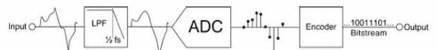

Figure 1.1: The input conversion system ultimately results in numerical coding of the band-limited input signal.

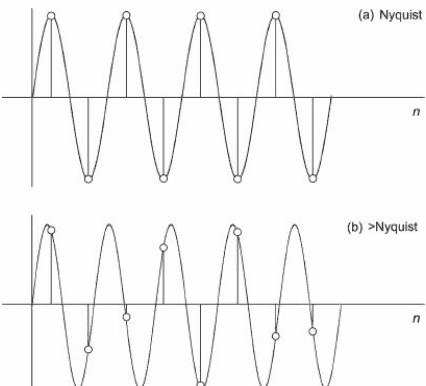

Figure 1.2: (a) The Nyquist frequency is the highest frequency that can be encoded with two samples per period. (b) Increasing the frequency above Nyquist but keeping the sampling interval the same results in an obvious coding error—the aliased signal is the result.

Once the aliased signal is created, it can never be removed and will remain as a permanent error in the signal. The LPF that band-limits the signal at the input is called the *anti-aliasing filter*. Another form of aliasing occurs in movies. An analog movie camera takes 30 pictures (frames) per second. However, it must often film objects that are rotating at much higher rates than 30 per second, like helicopter blades or car wheels. The result is visually confusing—the helicopter blades or car wheels appear to slow down and stop, then reverse directions and speed up, then slow down and stop, reverse, and so on. This is the visual result of the high-frequency rotation aliasing back into the movie as an erroneous encoding of the actual event.

## 1.2 Reconstruction of the Signal

The digital-to-analog converter (DAC or D/A) first decodes the bit-stream, then takes the sampled data points or impulses and converts them into analog versions of those impulses. The D/A output is then low-pass filtered to produce the final analog output signal, complete with all the inter-sample fluctuations. As with the A/D diagram, the decoder and D/A are both inside the same device (a chip). Figure 1.3 shows the conceptual block diagram of the decoding end of the system.

The output filter is called the reconstruction filter and is responsible for re-creating the seemingly missing information that the original sampling operation did not acquire—all the inter-sample fluctuations. The reason it works is that low-pass filtering converts impulses into smeared out, wiggly versions. The smeared out versions have the shape f(x) = sin(x)/x which is also called the sinc() function and somewhat resembles the profile of a sombrero, as shown in Figure 1.4.

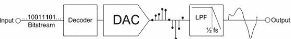

Figure 1.3: The digital bit-stream is decoded and converted into an analog output using a low-pass filter to reconstruct the analog signal.

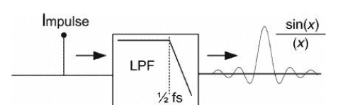

Figure 1.4: The ideal reconstruction filter creates a smeared output with a damped oscillatory shape. The amplitude of the sin(x)/x shape is proportional to the amplitude of the input pulse.

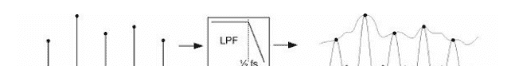

Figure 1.5: The sin(x)/x outputs of the LPF are summed together to reconstruct the original band-limited input waveform; the inter-sample information has been reconstructed.

When a series of impulses is filtered, the resulting set of sin(x)/x pulses overlap with each other and their responses all add up linearly. The addition of all the smaller curves and damped oscillations reconstructs the inter-sample curves and fluctuations (Figure 1.5).

## 1.3 Signal Processing Systems

Signal processing systems combine data acquisition devices with microprocessors to run mathematical algorithms on the audio data. Those algorithms are the focus of this book. Today's plug-ins are descendents of stand-alone hardware effects processors which are based on DSP chips. A DSP chip is a highly specialized processor designed mainly to run DSP algorithms. A DSP would function poorly as a central processing unit (CPU) for a personal computer because it only has a small but highly specialized instruction set. DSP devices (or just “DSPs”) feature a core processor designed to multiply and accumulate data because this operation is fundamental to DSP algorithms. Because this process is repeated over and over, modern DSPs use pipelining to fetch the next data while simultaneously processing the current data. This technique greatly improves the efficiency of the system. A typical signal processing system consists of the following components (Figure 1.6):
- Data acquisition devices (A/D and D/A)
- A DSP chip
- Memory to store the algorithm program (program memory)
- Memory to store the algorithm data (data memory)
- A user interface (UI) with buttons, knobs, switches, and graphic displays

Music synthesis devices are an embedded version of a CPU+DSP arrangement. The microcontroller or microprocessor manages the UI and keyboard, while the DSP performs the audio synthesis and effects algorithms. Practical implementations now involve multiple DSPs, some of which are custom designed specifically for sound synthesis. An example block diagram is shown in Figure 1.7.

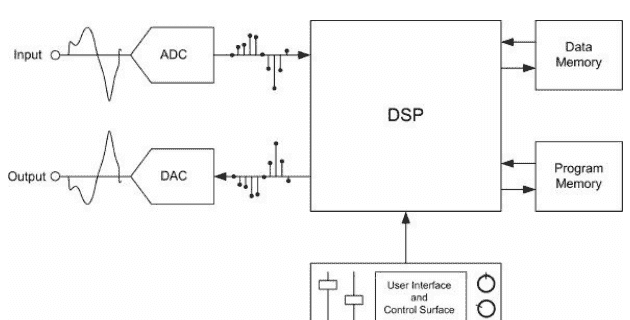

Figure 1.6: A simple signal processing system. The algorithm in this case is inverting the phase of the signal; the output is upside-down.

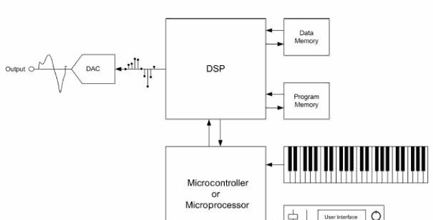

Figure 1.7: Block diagram of a synthesizer.


## 1.4 同步与中断

在处理输入和输出音频数据时，有两种基本的操作模式：同步和异步。在同步操作中，所有音频输入和输出数据字都与 DSP 的同一时钟同步。这些通常是输入/输出（I/O）和外围设备最少的简单系统。更复杂的系统通常涉及异步操作，其中音频数据不同步到 DSP。此外，音频本身可能不同步，也就是说，输入和输出比特流可能不在同一时钟上运行。纯同步系统更加可靠，但灵活性较低。

异步系统几乎总是基于中断的。在基于中断的设计中，处理器进入等待循环，直到处理器中断被触发。处理器中断就像门铃一样。当另一个设备（例如 A/D）有数据准备好传输时，它将数据放在预先指定的缓冲区中，然后通过切换中断引脚来“按门铃”。处理器使用一个函数来服务中断，该函数获取数据，然后继续执行其处理代码。该函数称为中断服务例程或中断处理程序。基于中断的系统是处理器时间最高效的利用方式，因为处理器无法预测输入数据准备就绪的确切时钟周期。

中断的另一个来源是用户界面（UI）。每当用户更改控件、单击按钮或旋转旋钮时，更新的 UI 控件信息需要发送到 DSP，以便它可以更改处理以适应新设置。这也是通过中断和中断处理程序来完成的。在框图或原理图中，中断有时标记为 INT、INTR 或 IRQ（中断请求线）。

## 1.5 信号处理流程

无论处理是在 DSP 芯片上进行还是在插件中进行，整体处理流程（也称为信号处理循环）基本保持不变。对于 DSP 芯片，循环中的过程将被编码在程序内存的指令集中，通常以近乎纯内联的方式进行，以优化处理器周期。对于插件，每个处理块或多或少采用代码中函数的形式，从而实现最大灵活性。

图 1.8 中的处理循环包含

- 一个一次性初始化函数，用于设置处理器的初始状态并为数据中断的到达做准备
- 一个无限等待循环，除了等待中断发生外什么也不做
- 一个中断处理程序，用于解码中断并决定如何处理——或忽略——门铃
- 用于控制和数据信息的数据读取和写入函数
- 一个用于操作和创建音频输出的处理函数
- 一个用于设置下一次循环变量的函数，如果 UI 控件更改需要，则更改变量

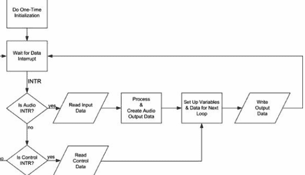

图 1.8：音频信号处理系统的流程图。

为了使采样定理成立，音频数据必须在严格定时的间隔内到达和离开，尽管它可能与 DSP 的内部时钟异步。这意味着，当 DSP 接收到音频 INTR 时，它必须在下一个音频 INTR 在一个采样间隔内到达之前，完成所有音频处理并处理任何 UI 中断。中断处理方案的优先级设置使得音频数据中断最为重要。因此，在服务音频数据中断时，DSP 可能被设置为在音频数据处理完成之前忽略所有其他中断（复位中断除外）。

## 1.6 音频数据的数值表示

音频数据可以以多种不同的方式进行数值编码。基本数字音频理论揭示，可用于编码的量化电平数量由公式 1.1 得出。

```
$$q = 2^N$$ (1.1)
```

其中，$N$ 是系统的位深度。

因此，8 位系统可以编码 $2^8$ 个值或 256 个量化电平。16 位系统可以编码 65,536 个不同的值。图 1.9 显示了编码音频数据的层次结构。作为系统设计师，您必须首先决定是要处理单极性（无符号）还是双极性（有符号）数据。之后，您需要确定数据类型。

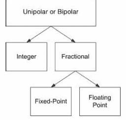

图 1.9：数值编码的层次结构。

- 单极性或 *无符号* 数据的范围是 0 到 +Max，或 −Min 到 0，且只有一种极性（+ 或 −）的数据，加上数字零（0）。
- 双极性或 *有符号* 数据从 −Min 变化到 +Max，是当今最常见的形式。它也包括数字零（0）。
- 整数数据用整数表示，没有小数位。无符号整数音频在 16 位系统中范围为 0 到 +65,535。有符号整数音频在相同的 16 位音频中范围为 −32,768 到 +32,767。在这两种情况下，都有 65,536 个量化电平。
- 分数数据用整数部分和小数部分编码，组合为 int.frac，小数点分隔各部分（例如 12.09）。

在分数数据子集中，有定点和浮点类型。定点数据固定小数点两侧的有效数字位数，并组合为 int-sig-digits.frac-sig-digits。“8.16”数据在小数点前有 8 位有效数字，小数点后有 16 位。浮点数据具有可移动的尾数和指数，用于对电气和电子工程师学会（IEEE）预先确定的范围内的值进行编码。正负部分以 2 的补码编码，因此正好相反的值（例如 −0.5 和 +0.5）相加总是得到零。图 1.10 揭示了量化电平的编码方式。虚线表示最小值和最大值。

一个基本问题是，量化电平的数量总是偶数，因为 2^N 总是偶数。在双极性系统中，您非常希望将数字零（0）编码为数字 0。如果这样做，则会使用一个量化电平来表示它。这样就留下了奇数个电平，无法精确地一分为二。这就造成了图 1.10 中看到的异常——对于双极性编码，负（−）量化电平总是比正电平多。对于单极性情况，没有值能精确编码零或中点电平；在图 1.10 中，它位于 127 和 128 之间。

| 分数双极性 | 16 位双极性 | 8 位双极性 | 8 位单极性 |
|---|---|---|---|
| +0.99999 | 32,767 | 127 | 255 |
| +0.9998 | 32,766 | 126 | 254 |
| . | . | . | . |
| . | . | . | . |
| . | . | . | . |
| 0.0002 | 2 | 2 | 128 |
| 0.0001 | 1 | 1 | 128 |
| 0 | 0 | 0 | 127 |
| –0.0001 | –1 | –1 | 127 |
| –0.0002 | –2 | –2 | 126 |
| . | . | . | . |
| . | . | . | . |
| . | . | . | . |
| –0.9999 | –32,767 | –127 | 1 |
| –1.0000 | –32,768 | –128 | 0 |

图 1.10：几种不同数据表示形式的比较。浮点版本固定为 –1.0 到 +0.9999 的范围，尽管可以使用任何范围。

如果您打算在算法中使用数字零（这几乎可以肯定），那么数据范围的这种轻微偏移是不可避免的。在某些系统中，算法将负音频数据限制为第二个最负值。这是因为相位反转在处理算法中很常见，无论是故意的，还是以负值系数或乘数的形式出现。如果一个样本以 –32,768 的值输入并被反转，则将没有该值的正值版本可供编码。为了防止这种情况，–32,768 被视为 –32,767。从音频硬件适配器（DSP 和声卡）传输的音频数据以及存储在 WAV 文件中的数据均基于有符号整数。但是，对于音频信号处理，我们更倾向于使用浮点表示。

## 1.7 使用浮点数据

在许多音频系统中，DSP 和插件数据被格式化为 –1.0 到 +1.0 的范围（这简化了实际范围 –1.0 到 +0.9999）。事实上，您在本书中编写的插件都将使用同一范围内的数据。原因与溢出有关。在音频算法中，加法和乘法都很常见。使用基于整数的数字时，如果您在数学上组合两个数字，其结果超出已知数字范围，就会很快遇到麻烦。

考虑范围为 –32,768 到 +32,767 的 16 位整数双极性格式。此范围中的大多数值相乘时，乘积将超出这些限制。加法和减法也可能导致这种情况，但仅适用于一半的可能值。然而，–1.0 到 +1.0 之间的数字有一个有趣的特性：它们的乘积始终是该范围内的一个数字。在 N 位数字音频系统中，将整数值转换为沿 –1.0 到 +1.0 标准化范围的分数值很容易，反向分数转换如公式 1.2 所示：

```
Fraction = \frac{Integer}{2^N}
Integer = Fraction * 2^N
(1.2)
```


其中 N 是系统的位深度。

## 1.8 基本 DSP 测试信号

要开始理解 DSP 理论的工作原理，你需要知道几种基本数字信号的数据序列。基本信号集包括

- 直流电（DC）和阶跃：DC 是 0 Hz 信号
- 奈奎斯特
- ½ 奈奎斯特
- ¼ 奈奎斯特
- 冲激

这些信号中的前四种足够让你大致了解一些基本 DSP 滤波器的频率响应。好消息是，所有序列都很简单，容易记住。

### 1.8.1 直流电和阶跃

直流电或 0 Hz 和阶跃响应都可以通过 DC/阶跃输入序列得到：{...0, 0, 1, 1, 1, 1, 1, 1, 1, 1, 1...}。

图 1.11 中的此信号包含两部分：输入从 0 变为 1 的阶跃部分，以及信号永远保持在 1.0 恒定电平的直流部分。当你将此信号应用于 DSP 滤波器并检查输出时，你将得到两个信息。阶跃部分会告诉你瞬态攻击时间，直流部分会给出直流或 0 Hz 处的响应。

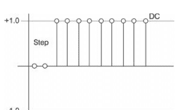

图 1.11 DC/阶跃序列的表示。

### 1.8.2 奈奎斯特

奈奎斯特输入序列表示系统的奈奎斯特频率，与实际采样率无关。奈奎斯特序列是 {...-1, +1, -1, +1, -1, +1, -1, +1...}。

图 1.12 中的奈奎斯特频率信号是可编码的最高频率。它每个周期包含最少两个采样点，每个采样点代表最大值和最小值。两个采样点的最小值是另一种表述奈奎斯特频率与采样定理关系的方式。

### 1.8.3 ½ 奈奎斯特

图 1.13 中的 ½ 奈奎斯特输入序列表示系统的 ½ 奈奎斯特频率，与实际采样率无关。该信号每个周期编码四个采样点，是奈奎斯特的两倍。½ 奈奎斯特序列是 {...-1, 0, +1, 0, -1, 0, +1, 0, -1, 0, +1, 0, -1, 0, +1, 0...}。

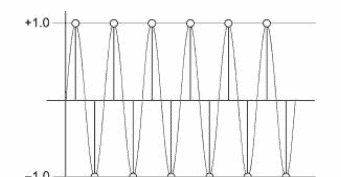

图 1.12 奈奎斯特序列。

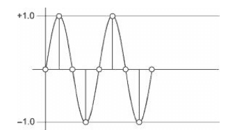

图 1.13 ½ 奈奎斯特序列每个周期有四个采样点。

### 1.8.4 ¼ 奈奎斯特

图 1.14 中的 ¼ 奈奎斯特输入序列表示系统的 ¼ 奈奎斯特频率，与实际采样率无关。它每个周期编码八个采样点。¼ 奈奎斯特序列是 {...0.0, 0.707, +1.0, 0.707, 0.0, -0.707, -1.0, -0.707, 0.0...}。

### 1.8.5 冲激

图 1.15 所示的冲激是在无限长的零流中值为 1.0 的单个采样点。DSP 算法的冲激响应是施加冲激输入后算法的输出。冲激序列是 {...0, 0, 0, 0, 1, 0, 0, 0, 0,...}。

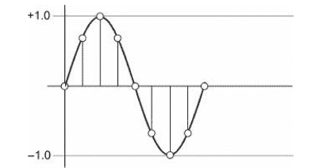

图 1.14 ¼ 奈奎斯特序列每个周期有八个采样点。

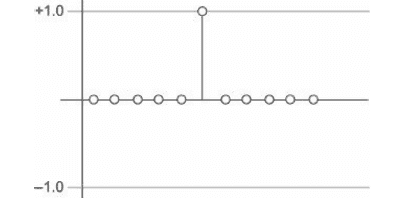

图 1.15 冲激是在零海中的单个非零采样值。

## 1.9 信号处理算法

从最广义的意义上说，算法是完成预定义任务的一组指令。图 1.8 中的信号处理循环是一个用于实时处理音频和控制（UI）数据的算法图示。在音频信号处理的专门情况下，算法是一组对数据进行操作以产生音频输出比特流的指令。本书中的大多数练习涉及处理输入音频数据并将其转换为处理后的输出。然而，合成波形进行输出也符合条件，在这种情况下，没有实时音频输入需要处理。本书中的大多数插件使用效果模型，其中输入采样序列被处理以创建输出序列，如图 1.16 所示。

约定和规则：

- x(n) 始终是输入序列；变量 n 表示 x 序列中第 n 个采样点的位置。
- y(n) 始终是输出序列；变量 n 表示 y 序列中第 n 个采样点的位置。
- h(n) 是算法的冲激响应；一种特殊序列，表示单个采样输入或冲激的算法输出。
- 对于实时处理，算法必须接受新的输入采样点（或一组采样点），进行处理，然后在下一个输入到达之前使输出采样点可用；如果处理时间过长，点击声、爆裂声、故障和噪声将是实时结果。

## 1.10 簿记

你可以看到，已经有三个序列需要处理：输入、输出和冲激响应，它们都使用相同的变量 n 来跟踪序列中采样点的位置。第一步是决定如何使用 n 来完成这项簿记任务。用它来表示序列中的绝对位置很快就会变得乏味——你如何处理像 x(12,354,233) 这样的索引数字？图 1.17 显示了一个从 t = 0 或 x(0) 开始的输入信号 x(n)。x(0) 采样点是进入信号处理算法的第一个采样点。从大局来看，x(0) 将是有史以来最早的输入采样点。使用绝对位置对数字进行索引将会很麻烦，因为索引值会变得非常大，尤其是在非常高的采样率下。

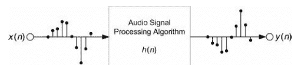

图 1.16：一种将输入序列 x(n) 转换为输出序列 y(n) 的音频信号处理算法。

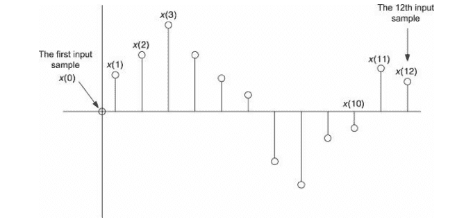

图 1.17：使用序列中的绝对位置是一种跟踪方法，但索引值会变得非常大，而且变得很快。

处理采样点绝对位置的另一个问题是，算法在编码时不使用采样点的绝对位置。相反，算法使用当前采样点的位置，并使所有内容都与该采样点相关。在下一个采样周期，所有内容都会再次相对于当前采样点重新组织。起初这可能听起来令人困惑，但这是跟踪采样点的一种更好的方法，更重要的是，定义算法的 I/O 特性，称为传递函数。图 1.18 显示了在当前时间冻结的输入信号 x(n)，其他采样点基于其位置进行索引。一个采样周期后（图 1.19），你可以看到参考框架已向右移动，x(n) 现在变成了 x(n - 1)。

### 簿记规则：

- 当前采样点标记为“n”。
- 之前的采样点为负，因此 x(n – 1) 将是之前的输入采样点。
- 未来的采样点为正，因此 x(n + 1) 将是相对于当前采样点的下一个输入采样点。
- 在下一个采样间隔，所有内容都会重新排列并参考新的当前采样点 x(n)。

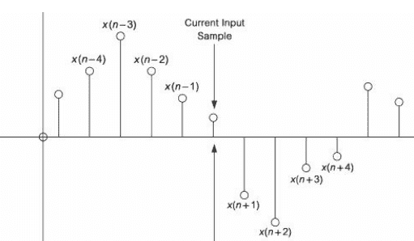

图 1.18：DSP 算法使用当前采样点位置作为参考位置，所有其他采样点都基于该采样点进行索引。在这里，你可以看到算法在当前输入采样点 x(n) 处冻结的当前状态。

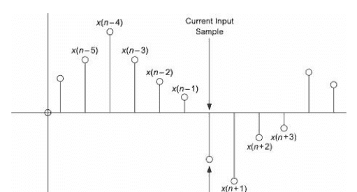

图 1.19：一个采样周期后，所有内容都已移动。之前的 x(n) 现在被索引为 x(n – 1)，而之前的下一个采样点 x(n + 1) 现在变成了当前采样点。

## 1.11 单采样延迟

与模拟处理电路（如音调控制）使用电容和电感来改变模拟信号的相位和延迟不同，数字算法使用时间延迟。当你开始使用它时，你将在后面的第 4 章和第 5 章中揭示这一事实背后的数学和科学。在算法图中，延迟由一个带有字母 z 的方框表示。z 项将带有指数，例如 z^-5 或 z^+2 或 z^0——指数按照相同的簿记规则对采样点中的延迟进行编码，负（-）指数表示时间上的向后延迟（过去的采样点），正（+）表示时间上的向前延迟（未来的采样点）。你称 z 为延迟算子，事实证明，时间延迟将被视为一种数学运算。

你可能会问自己如何能有指向未来的正延迟，答案是对于实时信号处理，你不能。在实时处理中，你永远不知道下一个采样点会是什么。然而，在非实时处理中（例如，你正在离线处理的音频文件），你知道未来的采样点，因为它们在文件中。图 1.20 显示了在算法框图中表示单采样延迟的两种常见方式。

### 延迟规则：

- 每次采样点进入延迟寄存器（内存位置）时，之前存储的采样点就会被弹出。
- 弹出的采样点可以用于处理或删除。
- 延迟元件可以级联在一起，一个的输出作为下一个的输入，以创建更多的延迟时间。

如果采样点 x(n) 进入单采样延迟元件，那么被弹出的采样点叫什么？它是之前进入的采样点，即一个采样间隔之前的采样点。因此，输出采样点是 x(n - 1)。在图 1.21 中，你可以看到延迟元件如何级联，在多个位置取输出，生成多个采样点以在算法中使用。

## 1.12 乘法

下一个算法构建块是标量乘法运算。它是一个逐个采样点的运算符，只需将输入采样点乘以一个系数。乘法运算符几乎用于每个 DSP 算法中。图 1.22 展示了乘法运算器的运作情况。输入仅由系数进行缩放。

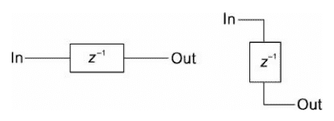

图 1.20：绘制延迟的两种常见方式；单采样延迟用 z^-1 表示。两种版本是等效的。


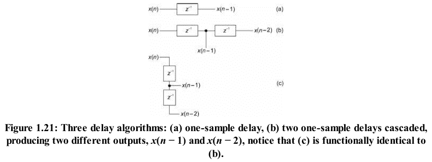

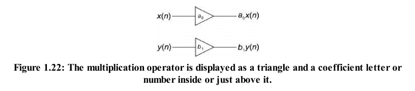

## 1.13 加法与减法

加法和减法本质上是同一种运算——减法就是加上一个负数。有几种不同的算法符号用于表示加法和减法。信号混合的操作本质上就是数学上的加法运算。图 1.23 展示了在框图中显示加法和减法运算的几种方式。

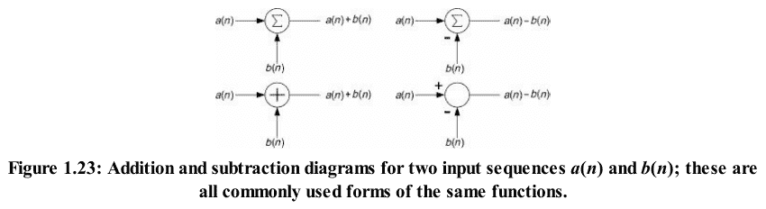

## 1.14 算法示例与差分方程

按照惯例，DSP 算法的输出序列命名为 y(n)，描述其与输入关系的数学方程称为差分方程。将这些运算组合起来，能让你更好地了解差分方程的形式。图 1.24 展示了几种算法构建块组合对应的差分方程。输出 y(n) 是以下内容的数学组合：

## 1.15 增益、衰减与相位反转

如图 1.25 所示，一个简单的系数乘法器可以处理增益、衰减和反转这三种基本音频处理功能。如果系数是负数，则会产生相位反转。如果系数的幅值小于 1.0，则会发生衰减；如果幅值大于 1.0，则会发生放大。

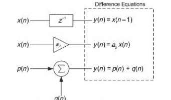

图 1.24：差分方程通过数学运算将输入（或输入们）与输出关联起来。

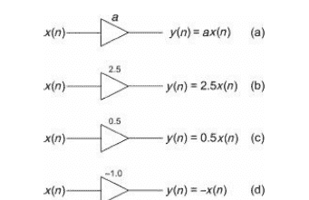

图 1.25：简单乘法器算法示例。请注意系数置于三角形外部的不同标注法；这是另一种常见的指定方式。(a) 以任意值“a”进行简单的标量乘法。(b) 增益通过幅值大于 1 的系数来实现。(c) 衰减使用小于 1 的系数来减小输入值的大小。(d) 相位反转通过使用负系数将信号翻转；值为 –1.0 时可完美反转信号。

## 1.16 实用混音算法

混合多声道数字音频时存在一个问题：可能会出现溢出，或者产生超出系统范围的采样值。你已经看到，通过将双极分数系统限制在 –1.0 到 +1.0 的范围内，这些数字的任何乘法运算结果都会小于其中任意一个数，并且始终在同一 –1.0 到 +1.0 范围内。然而，信号相加很容易产生超出 ±1 限制的值。为解决这个问题，N 声道混音电路会加入衰减器来减小输入的大小，衰减值为 1/N。混合两个声道时，每个衰减器的值为 ½，而三声道混音器在每个混音分支上的衰减器值为 1/3。如果所有声道恰好在同一时间达到最大值或最小值，它们的和或差仍将被限制在 ±1 以内。图 1.26 和 1.27 展示了通用混音和加权求和算法。

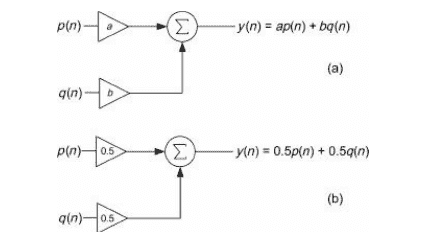

图 1.26：(a) 每条线路带有独立系数的通用混音器/求和器，以及 (b) 不会溢出或削波的归一化混音器。

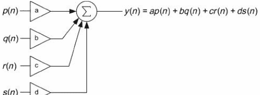

图 1.27：加权求和算法示例；每个声道的每个采样都有自己的加权系数 a–d。

在下一章中，你将从软件角度了解插件的结构。在第 6 章到第 14 章中，你将学习 DSP 理论如何让你将这些构建块组合成滤波器、效果器和振荡器，以用于你自己的插件。

# 参考文献

- Ballou, G. 1987. 《音响工程师手册》，第 898–906 页。印第安纳州：Howard W. Sams & Co.
- Jurgens, R. K.（编）1997. 《数字消费电子手册》，第 2 章。纽约：McGraw-Hill.
- Kirk, R. 和 Hunt, A. 1999. 《面向音乐和多媒体的数字声音处理》，第 1 章。马萨诸塞州：Focal Press.
- KORG, Inc. 1991. 《KORG Wavestation SR 服务手册》。东京，日本：KORG Inc.
- Limberis, A. 和 Bryan, J. 1993. 基于多个数字信号处理器且具有动态声音分配的音乐合成器架构。《音频工程学会杂志》，预印本 No. 3699.
- Pohlmann, K. C. 2011. 《数字音频原理》，第 16–30 页。纽约：McGraw-Hill.
- Stearns, S. D. 和 Hush, D. R. 1990. 《数字信号分析》，第 44–52 页。新泽西州 Englewood Cliffs：Prentice-Hall.

插件是一种软件组件，它与称为客户端的另一软件进行接口交互，以某种方式扩展客户端的功能。例如，Internet 浏览器使用实现搜索和文本消息等附加功能的插件。在计算机音频系统中，插件通常是某种音频效果。但是，插件也可以实现示波器或频谱分析仪功能。合成器插件通过充当乐器来扩展客户端的功能。

要开始编写插件，你需要知道插件如何连接到客户端并与其通信。Windows® 插件通常被打包为动态链接库（DLL）文件。Apple® 插件被打包在一个 *捆绑包* 中，该 *捆绑包* 配置为一个 *组件*。两者的主要区别在于其设计师用来描述它们的术语。在本次讨论中，我们不试图同时兼顾 DLL 和组件这两种标签，而是将使用 DLL 来从概念上描述两者。格式中的特定编程差异将在后面说明，并可以在网站 www.willpirkle.com 上找到。

## 2.1 静态链接与动态链接

C++ 编译器包含一组预编译的函数库，供你在项目中使用。其中最常见的可能是数学库。如果你尝试使用 sin() 方法，编译时通常会报错，提示“sin() 未定义”。要使用这个函数，你需要链接到包含它的库。具体做法是在文件顶部放置 #include <math.h>。取决于你的编译器，你可能还需要告诉它链接到 math.lib。这样做时，你正在对 math.h 库进行静态链接，该库是存储在 .lib 文件中的一组预编译数学函数。静态链接也称为隐式链接。当编译器遇到数学函数时，它会用库中的预编译代码替换函数调用。这样一来，额外的代码会被编译 *到* 你的可执行文件中。你无法对数学函数进行“反编译”。你为什么要这样做？假设在 sin() 函数中发现了一个错误，并且 math.h 库需要重新编译并重新分发。然后你就必须使用新的 math.h 库重新编译你的软件才能获得错误修复。

解决方案是在运行时链接到这些函数。这意味着这些预编译函数将存在于一个单独的文件中，你的可执行文件会了解它并与其通信，但只有在开始运行后才会这样做。这种链接方式称为动态链接或显式链接，如图 2.1 所示。包含这些预编译函数的文件就是 DLL。这更复杂，因为在运行时操作期间必须采取额外步骤，而不是依赖直接编译到可执行文件中的代码。优点是，如果在库中发现错误，你只需要重新分发新编译的文件，而无需重新编译你的可执行文件。另一个优点是，这种系统的设置方式——客户端在运行时连接到组件——可以完美地作为扩展客户端功能的一种方式，而客户端在编译时无需了解组件的任何信息。当 DLL 加载到与客户端相同的虚拟地址空间时，这会变得更简单。如果你已经理解这一点，可以跳过下一节；否则，请继续阅读。

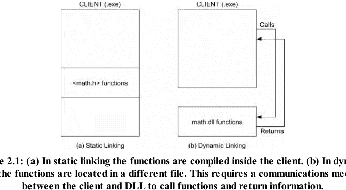

## 2.2 虚拟地址空间与 DLL 访问

当你在 Windows 32 位操作系统（OS）中启动一个程序（客户端）时，首先发生的事情是 OS 创建一个新的虚拟机和虚拟地址空间。32 位微处理器可访问的最大内存量为 2^32，即约 4 GB 内存。客户端可执行文件认为它拥有完整的 4 GB 内存，并且其可执行文件被加载到该内存块的一部分中。这块内存也称为进程地址空间。OS 有责任为客户端以及系统上运行的所有其他可执行文件维持这种“幻觉”。这是通过对微处理器、内存和外设进行虚拟化来实现的。

虽然这个话题本身可以写成另一本书，但你需要知道的主要是：通常情况下，当客户端加载 DLL 并开始通信过程时，DLL 会被加载到与客户端相同的虚拟地址空间中。这意味着客户端代码干脆就可以把 DLL 代码编译进去，因为寻址不需要任何转换。应该注意的是，DLL 可以被加载到另一个进程空间，甚至通过网络加载到另一台机器上。在这种情况下，它被称为“进程外 DLL”；但是，进程间通信很复杂，需要 OS 和/或网络函数调用。在这里我们不会考虑进程外 DLL。当 DLL 与客户端位于同一进程地址空间时，没有额外开销，通信使用进程内寻址。两种类型都在图 2.2 中显示。

要使用 DLL 中的代码，客户端必须执行两项活动：


- 1. 将 DLL 加载到进程地址空间中。
- 2. 建立用于被调用函数的通信机制。

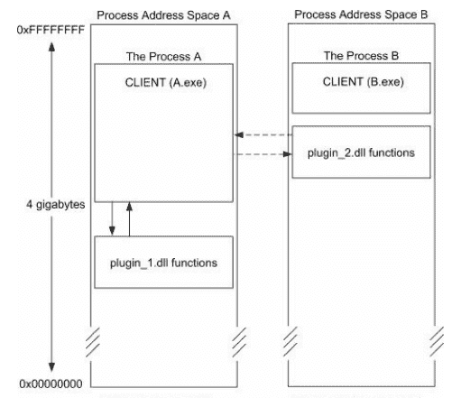

图 2.2: 进程地址空间是一个从地址 0x00000000 开始、一直到 0xFFFFFFFF 的 4GB 内存映射。客户端启动时会被放置在该内存空间中。(a) 进程内 DLL 直接与客户端通信，而 (b) 进程外 DLL 通信需要操作系统介入。

在 Windows OS 中，用于完成这些任务的三个函数是

- 1. LoadLibrary(): 将 DLL 加载到进程地址空间中。
- 2. GetProcAddress(): 检索 DLL 中函数的指针。
- 3. FreeLibrary(): 从进程地址空间卸载 DLL。

### 2.3 C 和 C++ 风格的 DLL

用 C 语言编写的 DLL 由一组独立函数组成。没有 main() 函数。函数可以定义并在一个 .c 文件中实现，也可以拆分为接口文件 (.h) 和实现文件 (.c)——无论哪种方式，DLL 都执行一组独立的函数。使用 C 语言编写 DLL 的一个问题是数据持久性。在 C（和 C++）中，花括号 {} 定义函数的作用域。

一个根本问题是，函数内部声明的数据无法在一次调用到下一次调用之间持久化。一个解决方案是使用全局变量，但这通常不被推荐。解决此问题的更好方法是让 DLL 动态声明一个数据结构（例如，使用 malloc()）来保存所有持久变量，然后将指向该数据结构的指针返回给客户端进行维护。在随后对 DLL 的调用中，客户端将指针作为函数参数传回给 DLL，以便对持久数据进行操作。如图 2.3 所示。当不再需要 DLL 时，它通过删除该结构来清除内存。

在 C++ 编程语言中，类数据类型定义了一个对象，该对象是成员变量和成员函数的集合，这些成员函数可以操作这些变量。通过将插件封装为 C++ 类，你可以获得多种优势：首先，在编码过程中可以使用 C++ 的所有优势（封装、多态等）。其次，DLL 不再是分配一个数据结构并返回指向它的指针，而是可以创建插件对象的新实例，并将指向该对象的指针传递给客户端。现在，客户端可以直接在对象上调用函数——直到需要卸载 DLL 或，更好的做是，创建另一个插件对象实例之前，它都不需要再与 DLL 通信。这带来了相对于基于 C 的 DLL 的第三个优势：客户端可以轻松创建多个插件。DLL 可以提供对象的多个实例。有时，插件被称为服务器，这构成了另一种客户端-服务器系统。如图 2.4 所示。

在函数内部，第一个左花括号 { 之后声明的任何变量，仅在函数持续期间有效。遇到右花括号 } 后，该变量即不再存在。

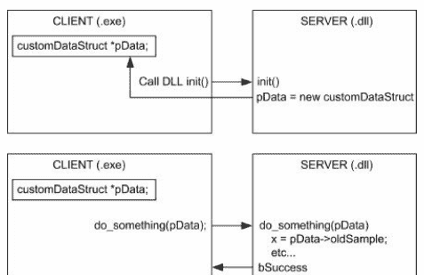

图 2.3: 在 C 风格的 DLL 中，客户端首先调用一个初始化函数，DLL 返回指向动态分配的数据结构 (pData) 的指针，客户端存储该指针。随后，客户端调用函数 do_something() 并将指针作为函数参数传回给 DLL。DLL 访问存储的数据，使用它，然后通常以成功标志进行响应。

### 2.4 维护用户界面

大多数插件都带有用于操作设备的图形用户界面（GUI 或 UI）及其控件。有多种方案，但一般来说，当创建插件的新实例时，会创建一个带有嵌入式 GUI 的新子窗口。每当 GUI 控件状态发生变化时，就会调用插件上的一个函数。客户端或 GUI 会将哪个控件发生了变化以及控件的新值或状态的信息传递给插件。然后插件通过更新其内部变量来处理该消息，以影响信号处理的变化。通常，GUI 外观（滑块或旋钮的位置或开关的状态）由客户端或 GUI 代码本身自动控制。处理 GUI 有三种不同的方式：

- 1. 客户端创建、维护和销毁 GUI，并将控件变更消息转发给插件。
- 2. 客户端创建、维护和销毁 GUI，但 GUI 直接与插件通信。
- 3. 插件创建、维护、销毁并直接与 GUI 通信，与客户端无关。

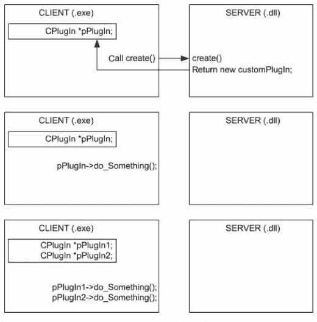

图 2.4: 在 C++ 插件中，客户端调用创建函数，DLL（服务器）创建对象并将指向该对象的指针返回给客户端。客户端使用此指针进行对插件的后续调用，而无需再与 DLL 通信。客户端还可以创建插件的多个实例，然后使用生成的指针来实现处理函数。

图 2.5 至 2.7 展示了三种基本的 GUI 场景。第一个区别在于谁创建、维护和销毁 GUI。当客户端创建和维护 GUI 时，它会将其创建为子窗口，其好处在于如果客户端被最小化或关闭，子窗口将相应地被隐藏或销毁。因此，前两种场景更常见。某些插件除了客户端-子窗口配置外，还可以支持独立的 GUI 操作。第二个区别在于通信流向：是通过客户端间接路由，还是直接从 GUI 到插件。RackAFX 软件采用第二种范式；客户端创建 GUI，但当控件被修改时，GUI 直接与插件通信。

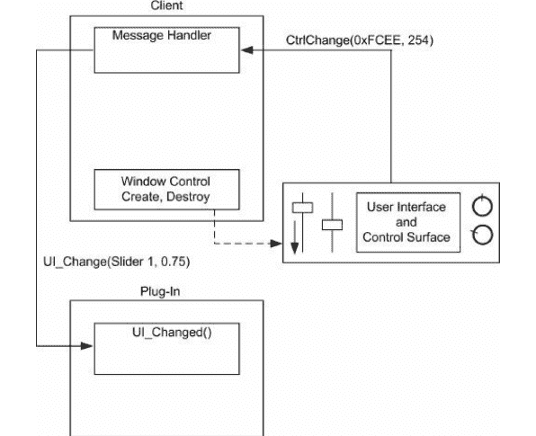

图 2.5: 在这种情况下，客户端维护 GUI 并从中接收控件变更消息；然后客户端可选择在将该信息转发给插件之前对其进行翻译。

### 2.5 应用程序编程接口

为了使客户端-服务器方案正常工作，客户端和 DLL/插件必须就函数命名达成一致。这包括创建函数以及客户端能够在插件对象上调用的所有函数。插件可能有客户端不知道的其他函数，但它们必须就一组基本函数达成一致。此外，必须制定规则来定义函数调用的顺序；插件的作者（即你）需要了解客户端打算如何使用该对象。

客户端必须确保一旦制定了这些规则，在未来版本中遵循它们，以避免破坏插件。另一方面，插件也必须承诺实现使插件工作所需的基本函数。因此，你可以看到客户端和 DLL 服务器之间存在一份隐含的合同。这份合同就是应用程序编程接口或 API。它定义了对象必须实现的函数才能被视为合适的插件，以及可能被调用或重写的任何其他函数。它定义了函数原型，并描述了函数将如何被调用和使用。API 由客户端制造商编写，并提供给希望为该目标客户端创建插件的程序员。一些示例是 Direct-X®、VST®、AU® 和 AAX®。这些制造商中的每一个都发布了一份描述与插件开发者合同的 API。但是，基本操作和核心功能通常是相同的。

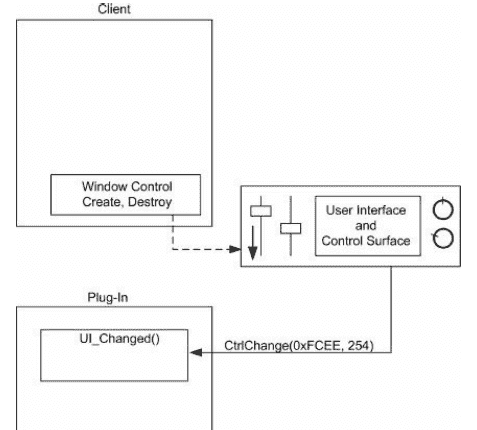

图 2.6: 在这种情况下，客户端维护 GUI，GUI 直接与插件通信。

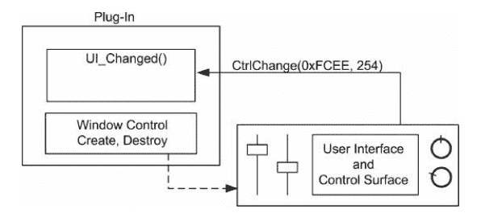

图 2.7: 在另一种场景中，插件维护并直接与 GUI 通信，不受客户端干扰。

C++ 在这里尤其有用。由于插件是 C++ 对象的实例，客户端制造商可以指定插件是其定义的特殊基类的派生类。基类被设计为抽象类，包含派生类重写的虚函数。这些虚函数提供了插件的通用功能。这里有两种选择：


- 1. 制造商将基类定义为抽象类，然后为虚函数提供默认实现。通常，默认实现不执行任何操作，只返回成功代码。插件作者随后根据需要重写所需的方法。例如，插件可能不关心响应音乐数字接口（MIDI）消息，因此 MIDI 函数的默认实现就足够了。

- 2. 制造商通过将一个或多个虚函数设为纯虚函数，将基类定义为纯抽象基类。纯抽象基类不能实例化；只有实现所有纯虚函数的派生类才能实例化。这在插件开发者和客户制造商之间形成了具有约束力的合同，因为除非派生类实现客户指定的纯抽象函数，否则它将无法正常工作。

RackAFX 软件采用第一种方法，为所有虚函数提供默认实现。作为插件作者，你只需重写需要的函数。但是，典型的必需函数有哪些，它们又来自哪里呢？

## 2.6 典型必需的 API 函数

插件是根据它们所替换的硬件设计的。音频处理循环与你在第 1 章中看到的硬件版本相同。图 2.8 显示了该流程图的软件变体。

虽然各种插件 API 在实现上有所不同，但它们共享一组通用的基本操作。表 2.1 详细说明了每个函数的职责。

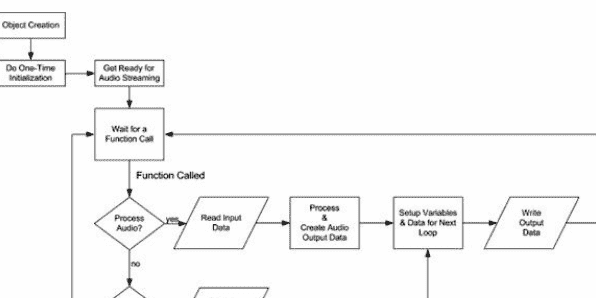

图 2.8：DSP 音频处理循环的软件版本。大多数 API 还包括获取或设置控件信息的函数。

表 2.1：插件 API 共享的典型核心操作。

| 函数 | 职责 |
|---|---|
| 一次性初始化 | 插件实例化时仅调用一次，该函数实现一次性初始化，通常包括初始化插件变量、GUI 以及动态分配内存缓冲区。 |
| 销毁 | 当插件即将被销毁时调用，该函数释放在一次性初始化和/或其他分配内存的函数中声明的任何内存。如果有任何拥有的子窗口，插件会在此处销毁它们。 |
| 准备流式传输 | 用户点击播放按钮或启动音频流传输后、数据实际流动之前调用。此函数通常用于刷新包含旧数据的缓冲区，或初始化任何按每次播放操作的变量（如计数器）（某些 API 中不存在此函数）。 |
| 处理音频 | 执行实际信号处理的主函数。该函数接收音频数据、对其进行处理，并写出结果。这是插件的核心。 |
| 获取 UI 控件信息 | 用于获取 UI 控件的信息（如其名称或标签）。 |
| 设置 UI 控件信息 | 当插件需要更改控件信息（如其名称或标签）时调用。 |
| 获取 UI 控件值 | 用于获取 UI 控件的值，该值将设置其在控制面板上的外观。 |
| 设置 UI 控件值 | 当用户更改插件的控件时调用，此函数是处理用户输入的消息处理程序。它通常会导致插件内部变量的更改或更新。 |

## 2.7 RackAFX 的理念与 API

RackAFX 软件背后的基本理念是提供一个平台，以最少的代码快速开发实时音频信号处理插件，尤其是关于 UI 方面。事实上，RackAFX 插件与 RackAFX UI 屏幕之间连接的大部分细节都对开发者隐藏，以便他或她可以更多地专注于音频信号处理部分，而较少关注 UI 细节。

RackAFX API 规定插件必须使用 C++ 语言编写，因此利用基类/派生类范式。RackAFX API 指定了一个名为 CPlugIn 的基类，所有插件都从中派生。

- RackAFX 将自动为你编写 C++ 代码，通过创建 CPlugIn 的派生类来创建一个空白插件。
- 当你从控制面板添加或删除控件时，RackAFX 客户端会自动相应更新你的 C++ 代码。
- 这让你能够专注于信号处理，而非 UI，使其成为快速插件开发和教授如何编写插件的绝佳工具。
- 学习 RackAFX 后，你将能够理解其他公司的 API，并快速轻松地学习以其格式编写插件。
- 因为你创建的插件对象是用 C++ 编写的，你可以轻松地在其他 API 或计算机平台之间移动它们。你也可以将它们封装，以便在其他系统中轻松使用。

在 RackAFX 中创建插件，你只需实现五个函数：

- 1. 构造函数
- 2. 析构函数
- 3. prepareForPlay()
- 4. processAudioFrame()
- 5. userInterfaceChange()

图 2.9 显示了这些函数在实时音频处理循环中的位置。

### 2.7.1 __stdcall

> 在 RackAFX 代码中，你会看到限定词 __stdcall 出现在每个函数原型及其实现之前。__stdcall 调用约定旨在与其他编译器以及其他第三方软件保持未来兼容性。__stdcall 是一条指令，用于让编译器知道函数调用后如何清理堆栈；它对数学、逻辑或音频处理没有影响，因此你基本上可以忽略它。

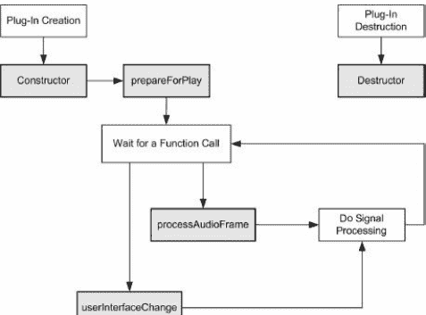

图 2.9：图 2.8 中实时音频处理循环的 RackAFX C++ 插件版本。

以下是 CPlugIn 对象接口文件 plugin.h 的一部分，它定义了原始六种方法的契约或基类对象接口：

```
/*
RackAFX(TM) Rapid Plug-In Development (RapiD) Client
Applications Programming Interface
Base Class Object Definition
Copyright(C) Will Pirkle 2002-2012
In order to write a RackAFX Plug-In, you need to create a C++ object that is
derived from the CPlugIn base class. Your Plug-In must implement the
constructor, destructor and virtual Plug-In API Functions below.
*/

// RackAFX abstract base class for DSP Filters
class CPlugIn
{
public:
    // Plug-In API Member Methods:
    // The following 5 methods must be implemented for a meaningful Plug-In
    // 1. One Time Initialization
    CPlugIn();
    // 2. One Time Destruction
    virtual ~CPlugIn(void);
    // 3. The Prepare For Play Function is called just before audio streams
    virtual bool __stdcall prepareForPlay();
    // 4. processAudioFrame() processes an audio input to create an audio
    // output
    virtual bool __stdcall processAudioFrame(float* pInputBuffer,
                                             float* pOutputBuffer,
                                             UINT uNumInputChannels,
                                             UINT uNumOutputChannels);
    // 5. userInterfaceChange() occurs when the user moves a control.
    virtual bool __stdcall userInterfaceChange(int nControlIndex);
};
```

表 2.2 中的五个函数是 RackAFX API 的核心——实现它们，你就拥有一个合法的 RackAFX 插件。最棒的是，RackAFX 插件设计器会为你编写并提供所有这些函数的默认实现。你只需进入并修改它们以更改插件的行为。有关 RackAFX API 与其他商业可用格式的比较，以及在其他格式的 API 包装器中使用 RackAFX 插件对象的说明，请参见附录 A。

表 2.2：RackAFX API 核心函数。

| RackAFX 函数 | 备注 |
|---|---|
| CPlugIn () 参数：• 无 | 插件对象的构造函数，该函数是一次性初始化函数。 |
| ~CPlugIn () 参数：• 无 | 插件的析构函数。 |


| **函数** | **描述** |
| :--- | :--- |
| **prepareForPlay()**<br>参数：• 无 | 此函数在音频开始流式传输前立即被调用。音频文件的采样率、位深度和通道数会被提取，然后由客户端在调用此方法之前进行设置。 |
| **processAudioFrame()**<br>参数<br>• pInputBuffer<br>• pOutputBuffer<br>• uNumInputChannels<br>• uNumOutputChannels | API 中最重要的函数；音频处理在此处进行。您可以在此函数中完成所有处理，或使用它来调用子函数。您负责通过 pOutputBuffer 将数据写入输出缓冲区。<br>指向一帧音频输入数据的指针。一帧是由 uNumInputChannels 定义的一组通道。<br>指向一帧音频输出数据的指针。一帧是由 uNumOutputChannels 定义的一组通道。<br>此帧数据中的输入通道数量。当前，此值将为 1（单声道）或 2（立体声）。<br>此帧数据中的输出通道数量。当前，此值将为 1（单声道）或 2（立体声）。 |
| **userInterfaceChange()**<br>参数：<br>• nControlIndex | 当用户更改 RackAFX UI 中的控件后，将调用此函数。RackAFX 会在调用此方法之前自动更新与此控件关联的变量。<br>已移动且其值已被 RackAFX 更改的控件的索引。 |

## 参考文献

Apple Computers, Inc. 2011. 《音频单元编程指南》。https://developer.apple.com/library/mac/#documentation/MusicAudio/Conceptual/AudioUnitProgrammingGuide/Introduction/Introduction.html。访问日期：2012 年 8 月 7 日。
Bargen, B. 和 Donnelly, P. 1998. 《深入 DirectX》，第 1 章。Redmond, WA: Microsoft Press。
Coulter, D. 2000. 《数字音频处理》，第 7–8 章。Lawrence, KS: R&D Books。
Petzold, C. 1999. 《Windows 编程》，第 21 章。Redmond, WA: Microsoft Press。
Richter, J. 1995. 《高级 Windows》，第 2 和 11 章。Redmond, WA: Microsoft Press。
Rosenberg, D. 1997. 《深入 COM》，第 1–2 章。Redmond, WA: Microsoft Press。
Steinberg.net. Steinberg VST API。http://www.steinberg.net/en/company/developer/sdk_download_portal.html。（注：您必须创建一个免费的开发者帐户才能下载 API。）访问日期：2012 年 8 月 7 日。

# 使用 RackAFX 编写插件

RackAFX 插件设计器将帮助您编写插件。当您创建新的 RackAFX 项目时，它会为您设置一个新的 Visual C++ 项目文件夹，并用您需要的所有文件填充您的项目。它将根据您的项目名称自动创建一个新的派生类。当您设置滑块和按钮等图形用户界面 (GUI) 控件时，它将为您编写和维护代码。您将在 RackAFX 和 C++ 编译器之间来回切换。RackAFX GUI 上有按钮可让您跳转到编译器，并启动重建和调试等编译器功能。您将使用 RackAFX 维护 GUI，并使用编译器编写信号处理代码。

## 3.1 生成 DLL

RackAFX 会设置您的编译器，将新生成的动态链接库 (DLL) 交付到 RackAFX 应用程序目录中的 /PlugIns 文件夹。如果您想查看、移动或删除 DLL，可以使用菜单项 PlugIn > Open PlugIns Folder 找到该文件夹。每次创建新项目时，RackAFX 默认会创建一个直通插件；建议您在创建新项目后立即生成和测试 DLL，以检查音频输入/输出 (I/O) 和任何其他连接。然后，您可以使用自己的处理算法覆盖直通代码。

生成成功后，您使用 RackAFX 来测试和调试插件。您指示 RackAFX 加载 DLL 并创建您的插件。客户端在组件生命周期中需要处理四个基本操作：

- 1. 创建插件
- 2. 维护 UI
- 3. 通过插件播放和处理音频
- 4. 销毁插件

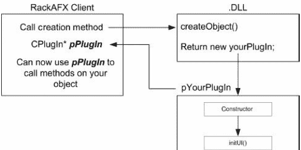

图 3.1：createObject() 中的 new 运算符动态创建您的插件，该插件会调用您的构造函数；构造函数随后调用 initUI() 来创建和初始化用户控件。

### 3.2 创建

在 RackAFX 中加载插件时，您实际上是将系统传递到您创建的 DLL 的路径。RackAFX 使用操作系统 (OS) 函数调用将 DLL 加载到其进程空间中。加载 DLL 后，RackAFX 首先运行兼容性测试，然后请求指向名为 createObject() 的创建方法的指针。它使用此指针调用该方法，DLL 会返回作为 PlugIn* 基类类型转换的您的插件的新创建实例。从那时起，RackAFX 客户端可以在您的对象上调用任何基类方法。图 3.1 显示了创建阶段的操作流程。

您的构造函数是初始化所有变量的地方。构造函数中的第一行代码已为您编写；它调用 initUI()，这是处理 GUI 控件创建和设置的方法。您永远不需要修改 initUI() 方法；RackAFX 会为您维护此代码。

### 3.3 GUI

当您设置滑块和按钮等 GUI 元素时，RackAFX 会将成员变量添加到派生插件类的 .h 文件中。每个滑块或按钮组控制代码中的一个变量。您使用最小值、最大值和初始值设置每个控件，并提供变量名和数据类型。当用户移动控件时，RackAFX 会计算变量的新值并自动将其传递给您的插件，实时更新。在某些情况下，这正是您所需要的，无需再编写其他内容。在其他情况下，除了更改控件变量外，您还需要执行更多计算或逻辑处理。因此，除了更改和更新内部 GUI 变量外，RackAFX 还会在您的插件上调用 userInterfaceChange() 方法，如图 3.2 所示。

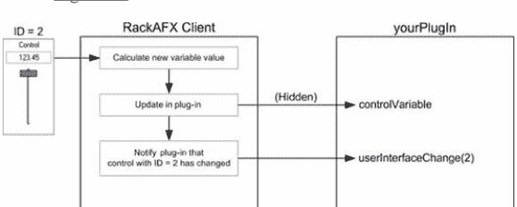

图 3.2：当用户移动 ID = 2 的控件时，事件序列始于对底层关联变量的隐藏更改，随后是调用 userInterfaceChange() 并将控件的 ID 值作为参数传递。

### 3.4 处理音频

当用户加载音频文件并单击播放按钮时，会发生两步事件序列。首先，客户端在插件上调用 prepareForPlay()。插件将在音频开始流式传输前执行所需的任何最后初始化。prepareForPlay() 是需要处理的最重要的函数之一。您的插件中声明了变量（参见 PlugIn.h），其中包含当前选定音频文件的信息：

```
// information about the current playing-wave file
int m_nNumWAVEChannels;
int m_nSampleRate;
int m_nBitDepth;
```

在调用 prepareForPlay() 之前，客户端会在您的插件对象上设置这些值。之所以在此点执行此操作，是因为用户可以随时加载多种通道（单声道或立体声）、采样率和位深度各异的音频文件类型；因此，这是一个每次播放的方法。许多算法在创建或初始化某些内容之前需要知道这些值。几乎所有滤波器插件都需要采样率才能正确计算其参数。prepareForPlay() 返回后，音频开始流式传输。当音频流式传输时，客户端会反复调用 processAudioFrame()，将其输入和输出缓冲区指针传递给它，如图 3.3 所示。这将持续到用户单击暂停或停止。

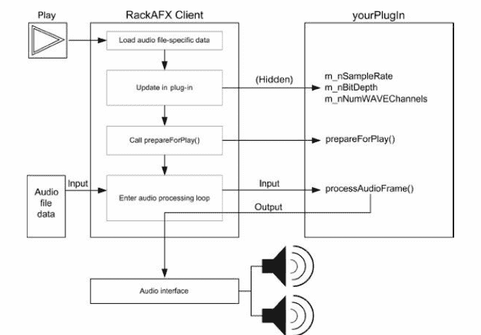

**图 3.3：** 播放/处理操作期间的事件序列；文件中的音频数据在插件中处理并发送到音频适配器以进行监听。

### 3.5 销毁

当用户手动卸载 DLL 或通过加载另一个插件卸载 DLL 时，客户端首先会从内存中删除插件对象，这会调用析构函数。任何动态声明的变量或


此处需要删除缓冲区。销毁后，客户端会从进程空间卸载 DLL。

## 3.6 你的第一个插件

你可以将音频处理分解为两种非常基本的类型：

- 1. 仅处理当前音频样本；不需要内存元素
- 2. 需要当前 _和_ 过去音频样本的处理；需要内存元素

我们将从第一种类型开始，制作一个简单的音量控制。之后，我们将设计一个需要内存元素的简单音频均衡器（EQ）控制。你的计算机上需要安装以下内容：

- RackAFX
- Microsoft Visual C++ Express® 2008 or 2010 (both are free from Microsoft)
- Microsoft Visual C++ Professional® 2008 or 2010

在 RackAFX 编程中，除非你计划使用自己的 GUI 资源，否则拥有 Visual C++（又称 VC++）完整版并无优势。请确保 Visual C++ 安装在与 RackAFX 相同的机器上。有关支持的编译器平台的更新，请参阅网站 www.willpirkle.com。一旦你了解编写和测试插件的流程，你会发现可以轻松快速地完成本书的其余项目，因为它们都遵循相同的设计模式，且设计章节将为每个项目使用相同的约定。

### 3.6.1 项目：Yourplugin

第一步始终是创建新项目。在此阶段，RackAFX 会根据项目名称创建 C++ 项目目录和文件，以及一个派生类。

### 3.6.2 Yourplugin GUI

接下来，根据你遵循的算法布局 GUI 控件，并决定将 GUI 元素与插件连接起来的变量数据类型和名称。这通常从为算法编写差分方程开始。差分方程中的变量将映射到插件的成员变量和 GUI 控件。将 GUI 与算法抽象分离，要求你决定希望用户能够调整哪些参数，以及变量名称、最小值、最大值和初始值以及数据类型。你稍后可以改变主意，删除 GUI 元素或更改其参数。功能齐全的 GUI 设计器允许你最终确定插件的控件，并将它们打包在一个整洁干净的 GUI 中。在原型设计阶段，你通常会设置许多滑块和控件，并对插件进行音色调试。然后，对于最终产品，你会隐藏其中一些，只允许用户访问特定范围内的一组特定控件。这一最后步骤是最终产品音色调试的一部分。

### 3.6.3 Yourplugin.h 文件

下一阶段涉及向派生插件类添加你自己的成员变量和成员方法。变量和方法将取决于你正在实现的算法。在第一个插件中，没有额外的变量或方法需要提供。

### 3.6.4 Yourplugin.cpp 文件

在此步骤中，你将添加新成员方法的实现（如果有的话）。然后，你将逐步处理 .cpp 文件，更改并填充基类方法，通常按以下顺序：

- 1. 构造函数
- 2. prepareForPlay()
- 3. userInterfaceChange()
- 4. processAudioFrame()

实现这些方法后，你在技术上就拥有一个可工作的插件了。

### 3.6.5 构建和测试

最后，你将构建 DLL，查找并修复任何问题。构建成功后，你可以将其加载到 RackAFX 客户端中。你可以使用音频文件、振荡器或声卡输入作为插件的音频激励。你可以以三种模式运行插件：插入、单声道 > 立体声 AUX 或 立体声 > 立体声 AUX，以模拟插件在数字音频工作站（DAW）中的各种使用方式。

### 3.6.6 创建和保存预设

预设在主 RackAFX UI 上创建和维护。加载插件后，你可以随意移动控件，然后将其保存为预设。你使用工具栏上的“保存预设”按钮。预设将保存在一个文件中，直到下次编译插件；之后，预设将内置到 DLL 中。加载插件时，你可以随时添加、修改或删除预设。

### 3.6.7 GUI 设计器

调试并完成插件后，你可以选择使用 GUI 设计器来创建一个紧凑且视觉吸引人的 GUI。有关使用 GUI 设计器工具的最新详细信息，请参阅附录 B 和网站 www.willpirkle.com。通常，本书跳过了 GUI 设计器阶段，因为它非常开放；你可以随意布置最终 GUI。经常查看网站，了解最新新闻、示例 GUI 以及视频教程。

## 3.7 设计音量控制插件

最容易编写的有意义的插件是音量控制，它使用一个名为 a_2 的单一缩放变量，如图 3.4 所示。

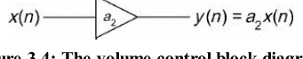

图 3.4：音量控制框图。

> 框图（或传递函数或算法）中的系数将成为插件代码中的 float 成员变量。

- a_2 = 0：静音
- a_2 = 1.0：最大音量

输出样本 y(n) 是输入 x(n) 的缩放版本，缩放因子名为 a_2。a_2 在算法中称为系数。算法规定 a_2 将在 0（静音）和 1.0（全音量）之间变化。

## 3.8 设置 RackAFX 以供使用

启动 RackAFX 软件。你将在原型视图中启动，在那里你会看到如图 3.5 所示的空白控制面板。你的 GUI 可能看起来略有不同或具有不同的背景图像。

控制面板是你用来创建 UI 的工具。它充满了可分配的控件，你可以将其连接到插件的变量。面板包括：

- 40 个可分配的滑块（连续控件）。
- 带有 1024 个更多连续控件的通用 LCD 控件。
- 项目控件（打开、加载、编辑、重建、调试、跳转到 C++）。
- 矢量操纵杆（高级，有关更多详细信息，请参阅网站）。
- 可分配的按钮。
- 10 个可分配的 LED 表。
- 用于测试插入和辅助效果模式的插件路由控件。
- 原型选项卡，主 GUI。
- GUI 设计器选项卡，打开设计器进行编辑；你必须先声明 GUI 控件。有关更多详细信息，请参阅网站。

菜单和工具栏由两部分组成：左侧和右侧。左侧（图 3.6）实现了大部分软件功能，而右侧（图 3.7）维护列表。

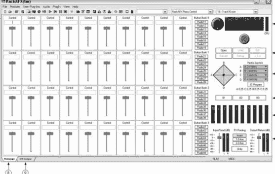

图 3.5：启动 RackAFX 时，它会在原型视图中打开。它具有控制面板和插件路由控件。

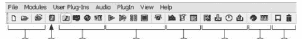

图 3.6：左侧的菜单和工具栏处理大部分插件开发工作。


图 3.7：右侧的下拉框允许你存储和调用预设，选择 MIDI 输入控制器（高级），并跟踪你正在使用的音频文件。

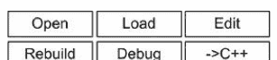

图 3.8：项目/编译器按钮使处理项目和控制编译器变得容易。

菜单项包括：

- 文件：通过创建、编辑或清除项目来管理项目。
- 模块：可用于分析和测试的内置插件。
- 用户插件：你设计的每个新插件都会加载到此菜单中；你可以独立试听或展示你的插件。
- 音频：管理所有音频命令。
- 插件：用于加载/卸载和预设的工具。
- 视图：访问不同的窗口。
- 帮助：帮助信息。

工具栏项包括：

- 1. 新建项目，打开项目文件夹，打开音频文件
- 2. 设置低级音频
- 3. 音频输入模式：文件、模拟音频输入、振荡器、用户振荡器/合成器
- 4. 传输控件：播放、循环、暂停、停止、旁路
- 5. 其他窗口：分析器、框图、状态窗口
- 6. 插件工具：同步代码、加载、重置、卸载
- 7. GUI 窗口：自定义 GUI，RackAFX MIDI 钢琴
- 8. 预设：保存、删除

最后，还有一组按钮，允许你操作项目并控制图 3.8 中显示的 C++ 编译器。按钮设置如下：

- 打开：打开现有项目。
- 加载：从进程空间加载/卸载 DLL。
- 编辑：更改现有项目的设置。
- 重建：重建项目。
- 调试：启动调试器。
- ->C++：跳转到 C++ 编译器，如果已最小化则恢复。

## 3.9 设置首选项

在开始处理项目之前，花些时间配置你的首选项。在这里，你将选择 C++ 编译器并设置默认目录。选择“视图” > “首选项”以获取图 3.9 所示的界面。

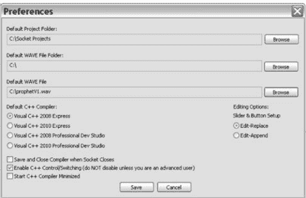


图 3.9: 首选项界面。

在首选项中，你需要：

- 1. 为项目、WAVE 文件和默认 WAVE 文件选择默认文件夹。你可以为项目文件夹使用任何想要的目录，也可以随时从任何其他文件夹打开项目；默认设置只是为了方便地将所有项目组合在一起。
- 2. 选择 Visual C++ 编译器。
- 3. 设置 C++ 选项。除非是最高级用户，否则应始终启用 C++ 控制/切换（Enable C++ Control/Switching）。C++ 控制/切换允许 RackAFX 控制 Visual Studio、保存文件、启动调试器等等。
- 4. 在 GUI 滑块/按钮对话框中输入信息时，设置编辑选项。

## 3.9.1 项目：音量

使用菜单、工具栏或 Ctrl+N 创建新项目，并将其命名为“Volume”。新建/编辑项目窗口将出现，你可以输入项目名称。在输入名称时，.h 和 .cpp 文件将自动命名。

注意图 3.10 中列出的两个 C++ 文件——这些是 RackAFX 为你创建的接口（.h）和实现（.cpp）文件。它们将包含一个名为 CVolume 的派生对象，该对象将包含插件代码的主体。当你点击 OK 时，会发生几件事。如果你在首选项中启用了 C++ 控制（这是默认设置），那么你将看到 C++ 编译器启动。在 Visual C++ 中，你将看到一个名为“Volume”的新项目和解决方案。如果你展开 Volume 项目，则可以看到 RackAFX 为你编写的文件。你的派生类包含在 Volume.h 和 Volume.cpp 中。在继续之前，值得先看看 RackAFXDLL.cpp 文件并找到创建机制 createObject()：

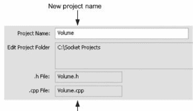

图 3.10: 新建/编辑项目窗口的顶部部分。请注意，你的项目名称将成为 C++ 对象的名称，因此如果以产生非法 C++ 语法的方式命名项目，将会收到错误。下面是更高级的设置，我们将在后面介绍。

```
//RackAFX Creation Function
DLLExport CPlugIn* createObject()
{
    CPlugIn* pOb = new CVolume; // ***
    return pOb;
}
```

这是客户端在你的 DLL 上调用的方法——你使用 new 运算符创建插件对象，并将指针返回给客户端。DllExport 说明符是特定于操作系统的，用于在 DLL 中调用方法。

## 3.9.2 音量 GUI

你需要确保知道想要实现的每个算法的差分方程。差分方程关联输入和输出样本，并且是你将要转换为 C++ 以制作插件的内容。对于此示例，方程为

y(n) = a₂x(n) (3.1)

UI 上的每个滑块或按钮控件都将映射到插件中的一个成员变量并控制它。

在 RackAFX 中，你可以看到所有滑块和按钮都被禁用；滑块不会移动，编辑框也不会接受文本。你首先需要设置一些控件来创建 UI 或控制面板。

现在，决定如何处理差分方程。请注意用于处理变量名的匈牙利表示法。如果你不熟悉这种命名约定，请参阅网站获取更多信息——你当然可以随意命名变量。

- 让我们只有一个音量系数，并在声道之间共享，以便每个声道都有相同的音量控制。
- 让我们用一个滑块控制音量系数。
- 系数 a₂ 将在代码中成为一个 float 成员变量；让我们决定将其命名为“m_fVolume”。
- 我们将在 GUI 上将滑块命名为“Volume”，并将其链接到变量 m_fVolume。
- 滑块最小值 = 0。
- 滑块最大值 = 1.0。
- 初始设置 = 0.75。

## 3.9.3 配置滑块控件

选择左上角的第一个滑块，在外部边界框内部右键单击；将出现滑块属性框（图 3.11）。注意：你的对话框可能略有不同。

你需要用适当的值填写滑块属性。你会注意到，对于这个滑块，uControlID 值为 0。这是将滑块链接到对象中变量的 ID 编号。你无法编辑此单元格。从控件名称开始，输入“Volume”。按 Enter 键进入下一单元格。对于此版本的插件，没有单位，因此使用退格键将其删除。下一单元格是最重要的单元格之一——它是将与之链接的变量的数据类型；可用选项来自下拉列表。如图 3.12 所示，你可以使用鼠标选择数据类型，或者在框高亮时直接输入首字母（例如，输入“d”表示 double）。

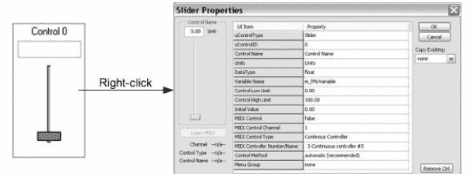

图 3.11: 在滑块的边界框内右键单击，滑块属性窗口将出现。这就是你配置滑块并将其链接到变量的方式。

你可以创建以下类型的变量：

- float
- double
- integer
- enum: 使用字符串列表的枚举无符号整数（UINT），例如 {LPF, HPF, BPF, Notch}。我们将在本书后面使用枚举 UINT。

我们决定使用 float 数据类型，并将变量命名为 m_fVolume——决定名称并坚持使用非常重要。以后更改变量名称可能会很棘手，所以为自己着想，提前规划。完成的滑块属性如图 3.13 所示。低限和高限已设置，初始值设置为 0.75。不要担心此滑块的 MIDI 控制或其他属性；有关这些增强功能的详细信息，请参阅网站。完成后，选择 OK 按钮保存代码。

我们的控制面板非常简单——它仅由一个音量滑块组成。如果你意识到犯了错误或遗漏了什么，只需在滑块框中右键单击并修复问题即可。你也可以通过单击属性窗口上的 Remove Ctrl 按钮来删除滑块。

| UI 项目 | 属性 |
| :--- | :--- |
| uControlType | Slider |
| uControlID | 0 |
| 控件名称 | Volume |
| 单位 | |
| 数据类型 | float |
| 变量名称 | float |
| 控件下限 | double |
| 控件上限 | integer |
| 初始值 | enumeration |
| MIDI 控制 | 0.00 |
| MIDI 控制通道 | False |
| MIDI 控制类型 | 1 |
| MIDI 控制器编号/名称 | Continuous Controller |
| 控制方法 | 3 Continuous controller #3 |
| 菜单组 | automatic (recommended) |
| | none |

图 3.12: 数据类型从下拉列表控件中选择。

| UI 项目 | 属性 |
| :--- | :--- |
| uControlType | Slider |
| uControlID | 0 |
| 控件名称 | Volume |
| 单位 | |
| 数据类型 | float |
| 变量名称 | m_fVolume |
| 控件下限 | 0.00 |
| 控件上限 | 1.00 |
| 初始值 | 0.75 |
| MIDI 控制 | False |
| MIDI 控制通道 | 1 |
| MIDI 控制类型 | Continuous Controller |
| MIDI 控制器编号/名称 | 3 Continuous controller #3 |
| 控制方法 | automatic (recommended) |
| 菜单组 | none |

图 3.13: 已完成的滑块属性。

> 当你从主 UI 添加、编辑或删除控件时，你会注意到 RackAFX 会在编写代码时在编译器之间闪烁。你可以将此闪烁用作代码更新已同步的信号。如果你不喜欢它，最小化编译器，闪烁将不会发生。出于这个原因，在 View > Preferences 中有一个特殊的复选框，用于以最小化状态启动编译器。

你的插件代码将使用索引值 0（属性对话框中的 uControlID）来映射到 m_fVolume 变量，该变量由 UI 上名为“Volume”的滑块控制。

## 3.9.4 Volume.h 文件

在添加代码之前，先浏览一下插件对象文件（volume.h 和 volume.cpp），以便更好地了解正在发生的事情以及你需要修改的内容。首先，打开 volume.h 文件并查看其内容：

```
// RackAFX abstract base class for DSP filters
class CVolume : public CPlugIn
{
public: // plug-in API Functions
//
// 1. One Time Initialization
CVolume();
<SNIP SNIP SNIP>
// 7. userInterfaceChange() occurs when the user moves a control.
virtual bool userInterfaceChange(int nControlIndex);
// Add your code here: ------------------------------------------ //
// END OF USER CODE --------------------------------------------- //
// ADDED BY RACKAFX -- DO NOT EDIT THIS CODE!!! ----------------- //
// ****--0x07FD--****
float m_fVolume;
// ****--0x1A7F--****
// -------------------------------------------------------------- //
};
```

除了我们在第 2 章中讨论的主插件函数之外，你还会看到一些更多带注释的代码区域。在第一个标记为 // Add your code here: 的部分中，你可以像在任何 .h 文件中一样添加更多变量或函数定义。尽量将代码保存在指定区域内，以便更容易查找和阅读。下方标记为：

> // ADDED BY RACKAFX—DO NOT EDIT THIS CODE!!!

的区域非常重要——你将在此区域看到成员变量 m_fVolume 的声明。这是当你从控制面板添加、编辑或删除控件时，RackAFX 修改的 .h 文件部分。必须让 RackAFX 维护这部分 C++ 代码。.cpp 文件中还有几个类似警告和有趣的十六进制符号（0x1A7F 等）的代码部分；不要编辑十六进制代码或带注释区域之间的代码。

> 在打印代码中，你会经常看到 <SNIP SNIP SNIP> 符号，作为提醒代码已被删除以便于阅读。

> RackAFX 会为你编写 C++ 代码！但是，你必须小心，不要以任何方式更改 RackAFX C++ 代码。你始终可以通过警告注释和围绕 RackAFX 代码的奇怪十六进制代码来判断代码是否为 RackAFX 代码。RackAFX 代码仅供你作为调试备份查看，除 RackAFX 外，任何人都不应更改它。


## 3.9.5 Volume.cpp 文件

### 构造函数和析构函数

构造函数是一次性初始化函数，设置如下：

- 调用 initUI()：这是初始化 GUI 控件的地方；m_fVolume 在此函数中初始化为 0.75。重要的是要确保这始终是构造函数的第一行，以便始终先初始化 GUI 变量。
- 设置插件名称变量：这是你将在用户插件菜单和 GUI 窗口中看到的内容。
- 设置插件默认值（此处省略）；你很少需要更改这些变量。
- 为你在末尾完成任何自己的初始化提供一个位置。

析构函数为空，因为此插件中没有动态分配任何内容。

```cpp
CVolume::CVolume()
{
 // Added by RackAFX - DO NOT REMOVE
 // Setup the RackAFX UI Control List and Initialize Variables
 initUI();
 // END initUI
 // built in initialization
 m_PlugInName = "Volume";
 // Default to Stereo Operation:
 // Change this if you want to support more/less channels
 <SNIP SNIP SNIP>
 // Finish initializations here
}
```

```cpp
/* destructor()
 Destroy variables allocated in the constructor()
 */
CVolume::~CVolume(void)
{
}
```

prepareForPlay()

目前无需编写任何内容，因为没有自定义控件或其他分配。

processAudioFrame()

此函数是信号处理发生的地方。定义上方有一个注释块，用于提示如何将音频数据样本读入和写出 I/O 缓冲区。目前，RackAFX 仅支持单声道和立体声插件。左声道和右声道通过常规的数组索引 C++ 指针机制访问。特别值得注意的是，提醒所有输入和输出的值都在（且应在）-1.0 到 +1.0 之间。

```cpp
/* processAudioFrame
// ALL VALUES IN AND OUT ON THE RANGE OF -1.0 TO +1.0
LEFT INPUT - pinpBuffer[0];
RIGHT INPUT - pinpBuffer[1];
LEFT OUTPUT - pOutputBuffer[0]
RIGHT OUTPUT - pOutputBuffer[1]
*/
bool __stdcall CVolume::processAudioFrame(float* pinpBuffer, float* pOutputBuffer,
UINT uNumInputChannels, UINT uNumOutputChannels)
{
    // output = input -- change this for meaningful processing
    //
    // Do LEFT (MONO) Channel; there is always at least one input/one output
    // (INSERT Effect)
    pOutputBuffer[0] = pinpBuffer[0];
    // Mono-In, Stereo-Out (AUX Effect)
    if(uNumInputChannels == 1 && uNumOutputChannels == 2)
        pOutputBuffer[1] = pinpBuffer[0];
    // Stereo-In, Stereo-Out (INSERT Effect)
    if(uNumInputChannels == 2 && uNumOutputChannels == 2)
        pOutputBuffer[1] = pinpBuffer[1];
    return true;
}
```

看看 RackAFX 为你编写的函数——它旨在原样传递音频，不做修改。在这种情况下，你只需用输入缓冲区的数据写入输出缓冲区。在你的 processAudioFrame() 函数中，养成始终先处理第一个声道，然后可选处理第二个声道的习惯。这样可以轻松编写支持单声道/立体声的插件，并且当 RackAFX 拥有更多声道选项时，也更容易扩展。由于代码已经完成，你现在就可以编译它，并在 RackAFX 中尝试，作为合理性检查以确保音频硬件设置正确。事实上，我们将在检查完文件中的最后几个函数后立即这样做（我保证你很快就会写代码）。

### userInterfaceChange()

也许第二个最重要的函数是 userInterfaceChange()，当用户在控制面板上更改控件时会调用它：

// **** BY RACKAFX -- DO NOT EDIT THIS CODE!! ----
// **** -Ox983- ----

| 变量名 | 索引 |
|---------------|-------|
| m_fVolume | 0 |

*** -OxFFDD-***
// --------------------------------------------------------------*/
// Add your UI Handler code here ----------------------------------//

与 processAudioFrame() 一样，函数定义上方有一个“提示”注释，提醒你 RackAFX 如何将变量映射到控件索引。在此示例中，m_fVolume 变量映射到索引 0。

```cpp
bool __stdcall CVolume::userInterfaceChange(int nControlIndex)
{
    // decode the control index, or delete the switch and use brute force calls
    switch(nControlIndex)
    {
        case 0:
        {
            break;
        }
        default:
            break;
    }
    return true;
}
```

userInterfaceChange() 实现了 switch/case 语句的第一部分，以防你需要解码控件索引并对数据做一些处理，然后再修改代码以反映更改。通常，你在这里也没什么可写的。

构建插件。由于默认插件行为只是原样传递音频，不做修改，你现在可以构建项目并在 RackAFX 中测试，以确保一切正常。从编译器或 RackAFX 的 Rebuild 按钮重新构建项目。你应该获得无错误的干净构建。

> 你应该 *始终* 在修改任何代码之前先构建和测试全新的项目！你要这样做是为了确保没有 C++ 错误（你可能不小心按了某个键或更改了一些代码），同时也要确保音频系统正常工作并且可以听到音频数据。

此时，你已经构建了一个 DLL，旨在在客户端请求时提供 CVolume 对象。问题是 RackAFX 尚未知道你的 CVolume 插件可用。在调试阶段，你需要习惯手动加载和卸载 DLL。你可以使用 Load 按钮或工具栏/菜单项来完成此操作。点击 Load 后，RackAFX 会调用相应的函数将 DLL 加载到其地址空间中。你会看到控制面板发生变化，以反映你的插件已加载。你还会看到 Load 按钮变为 Unload。当需要回到 C++ 进行修改和重新编译时，你需要先卸载项目，以便以后可以重新加载其更新状态。

使用 Audio > Load Audio File 加载测试文件。然后使用传输控制按钮播放、循环、暂停或停止文件。音量控制目前应该没有效果，因为我们还没有编写任何代码。在继续之前，请确保此时可以听到音频；如果听不到，请检查音频适配器设置。

为了使音量控制滑块工作，我们需要将其连接到处理代码中。音量滑块直接映射到音量系数 m_fVolume；随着滑块从 0.0 移动到 1.0，音量系数也随之变化。因此，算法很简单：只需将输入音频样本乘以音量系数，并将输出设置为该值。切换到你的 C++ 编译器并找到 processAudioFrame() 函数。通过执行上述乘法来修改它，这实现了滤波器的差分方程。

```cpp
bool __stdcall CVolume::processAudioFrame(float* pInputBuffer, float* pOutputBuffer,
                                      UINT unNumInputChannels, UINT unNumOutputChannels)
{
    // output = input -- change this for meaningful processing
    //
    // Do LEFT (MONO) Channel; there is always at least one input/one output
    // (INSERT Effect)
    pOutputBuffer[0] = pInputBuffer[0]*m_fVolume;

    // Mono-In, Stereo-Out (AUX Effect)
    if(unNumInputChannels == 1 && unNumOutputChannels == 2)
        pOutputBuffer[1] = pInputBuffer[0]*m_fVolume;

    // Stereo-In, Stereo-Out (INSERT Effect)
    if(unNumInputChannels == 2 && unNumOutputChannels == 2)
        pOutputBuffer[1] = pInputBuffer[1]*m_fVolume;

    return true;
}
```

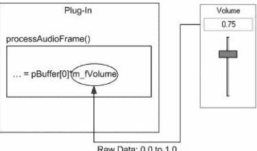

图 3.14：这是滑块与计算中变量之间的连接。processAudioFrame() 函数直接使用原始滑块数据。

只有三行需要修改，一行用于第一个声道，另外两行用于其他路由组合。修改以粗体显示，即按音量系数缩放输入。你能看出这与差分方程有何关系吗？如果看不出来，请立即停止并回去弄清楚。现在，重新构建项目并将其重新加载到 RackAFX 中。尝试滑块，你会发现


the volume does indeed change. Congrats on your first plug-in!

音量确实会发生变化。恭喜你完成了第一个插件！

What makes this plug-in so easy and quick to develop is that the slider volume control maps directly to a variable that is used in the processAudioFrame() function, as depicted in Figure 3.14. This means the data coming from the slider can be used directly in the algorithm. The data coming from the slider and controlling m_fVolume is said to be raw data. You use the raw value to affect the signal processing algorithm.

这个插件之所以如此容易和快速开发，是因为滑块音量控件直接映射到 processAudioFrame() 函数中使用的一个变量，如图 3.14 所示。这意味着来自滑块的数据可以直接在算法中使用。来自滑块并控制 m_fVolume 的数据被称为原始数据。你使用原始值来影响信号处理算法。

## 3.10 设计一个以分贝为单位的音量插件

This next example will show you how to cook your raw data to be used in the signal processing algorithm. The VolumedB plug-in will also be a volume control, but will operate in dB instead of using a raw multiplier. You may have noticed that your previous volume control didn't seem to do much in the upper half of the throw of the slider. This is because your ears hear logarithmically and so linear deflections of the slider do not correspond to linear changes in perceived loudness. To fix this, we'll design another plug-in that will operate in decibels (dB). The block diagram is identical to the first project, only the control range of values has changed.

下一个示例将向你展示如何处理原始数据以便在信号处理算法中使用。VolumedB 插件也将是一个音量控件，但将以分贝（dB）为单位运行，而不是使用原始乘数。你可能已经注意到，你之前的音量控件在滑块上半部分似乎没有太大作用。这是因为人耳是以对数方式听觉的，因此滑块的线性偏移并不对应于感知响度的线性变化。为了解决这个问题，我们将设计另一个以分贝（dB）为单位运行的插件。框图与第一个项目相同，只有控制值的范围发生了变化。

- a2 = -96 dB: Mute
- a2 = 0 dB: Max volume

- a2 = -96 dB：静音
- a2 = 0 dB：最大音量

Now, the volume control is specified in dB, so you need a formula to convert the dB value to a scalar multiplier for the algorithm. You should memorize the dB equations now if you haven't already, since they will reappear over and over in audio plug-ins. This is the cooking formula that will take the raw data from the slider –96 to 0 dB and cook it into a variable we can use in our scalar multiplication:

现在，音量控件以 dB 为单位指定，因此你需要一个公式将 dB 值转换为算法中的标量乘数。如果你还没有记住 dB 方程，现在应该记住，因为它们会在音频插件中反复出现。这是处理公式，它将滑块上的原始数据（–96 到 0 dB）转换为我们可以在标量乘法中使用的变量：

```
dB = 20log(x)
x = 10^(dB/20)
```

You set up the cooking formula by implementing the userInterfaceChange() function which is always called when the user changes anything on the control surface. When the user moves the slider, you cook the data. This is shown conceptually in Figure 3.15.

你通过实现 userInterfaceChange() 函数来设置处理公式，该函数在用户更改控制面板上的任何内容时始终会被调用。当用户移动滑块时，你处理数据。这在图 3.15 中以概念方式展示。

The cooking function simply converts the dB into a scalar multiplier. In this case, the cooking function is short enough to simply leave inside the userInterfaceChange() function; as the cooking functions become more complex, you will probably want to break them out into separate functions, which are called from userInterfaceChange(). Remember the two RackAFX rules you've learned so far:

处理函数只是将 dB 转换为标量乘数。在这种情况下，处理函数足够短，可以直接保留在 userInterfaceChange() 函数中；随着处理函数变得更加复杂，你可能希望将它们拆分为单独的函数，并从 userInterfaceChange() 调用它们。记住你迄今学到的两条 RackAFX 规则：

> Coefficients in a block diagram (or transfer function or algorithm) become float member variables in your plug-in code. Each slider or button control on the UI will map to and control a member variable in your plug-in.

> 框图（或传递函数或算法）中的系数将成为插件代码中的 float 成员变量。UI 上的每个滑块或按钮控件都将映射到并控制插件中的一个成员变量。

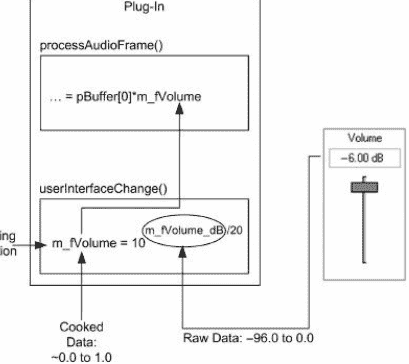

Figure 3.15: The volume-in-dB plug-in will have a single slider that generates values between –96 and 0.0 dB; you need to cook the raw dB values to use in your plug-in.

图 3.15：以分贝为单位的音量插件将有一个生成 –96 到 0.0 dB 之间值的单个滑块；你需要处理原始 dB 值以便在插件中使用。

In the first plug-in, the variable was shared between the slider and the algorithm. Now we need two variables, one for the raw slider data and the other for the cooked algorithm processing. We will name them as follows:

在第一个插件中，变量在滑块和算法之间共享。现在我们需要两个变量，一个用于原始滑块数据，另一个用于处理后的算法处理。我们将它们命名如下：

- m_fVolume_dB: The raw slider data
- m_fVolume: The cooked value used in the algorithm

- m_fVolume_dB：原始滑块数据
- m_fVolume：算法中使用的处理后的值

### 3.10.1 Project: VolumedB

### 3.10.1 项目：Volume dB

Using the same method as before, create a new project named “VolumedB.” As before, you don’t have to worry about the advanced options at the bottom of the new project window. Your compiler will automatically start.

使用与之前相同的方法，创建一个名为“VolumedB”的新项目。与之前一样，你不必担心新建项目窗口底部的高级选项。你的编译器将自动启动。

### 3.10.2 VolumedB GUI

### 3.10.2 Volume dB GUI

We only need a single slider control. It will be adjustable from –96 to 0 dB. Set up the GUI in RackAFX by choosing a slider and right-clicking inside the bounding box. Set the slider according to Table 3.1.

我们只需要一个单个滑块控件。它将可从 –96 调整到 0 dB。在 RackAFX 中通过选择滑块并在边界框内右键单击来设置 GUI。根据表 3.1 设置滑块。

### 3.10.3 VolumedB.h File

### 3.10.3 Volume dB.h 文件

RackAFX has written the code and declared the variable float m_fVolume_dB but we still need to declare our second variable named m_fVolume, which stores the cooked data. Open the VolumedB.h file and declare the variable in the user declarations area:

RackAFX 已编写代码并声明了变量 float m_fVolume_dB，但我们仍需要声明名为 m_fVolume 的第二个变量，用于存储处理后的数据。打开 VolumedB.h 文件并在用户声明区域声明该变量：

```
// abstract base class for DSP filters
class CVolumeDb : public CPlugIn
{
public: // plug-in API Functions

<SNIP SNIP SNIP>

// Add your code here: .................... //

// our Cooked Volume Multiplier
float m_fVolume;

// END OF USER CODE .................... //
```

Table 3.1: The slider properties for the VolumedB project.

表 3.1：VolumedB 项目的滑块属性。

| Slider Property | Value |
|---|---|
| Control name | Volume |
| Units | dB |
| Variable type | float |
| Variable name | m_fVolume_dB |
| Low limit | -96 |
| High limit | 0 |
| Initial value | -6 |

| 滑块属性 | 值 |
|---|---|
| 控件名称 | Volume |
| 单位 | dB |
| 变量类型 | float |
| 变量名 | m_fVolume_dB |
| 下限 | -96 |
| 上限 | 0 |
| 初始值 | -6 |

### 3.10.4 VolumedB.cpp File

### 3.10.4 Volume dB.cpp 文件

### Constructor

### 构造函数

- Cook and initialize the member variable.
- Use the pow() function.

- 处理并初始化成员变量。
- 使用 pow() 函数。

```
CVolumeDb::CVolumeDb()
{
    // Added by RackAFX - DO NOT REMOVE
    //
    // Setup the RackAFX UI Control List and Initialize Variables
    initUI();
    // END InitUI

    <SNIP SNIP SNIP>

    // Finish initializations here

    // Cook the raw data:
    m_fVolume = pow(10.0, m_fVolume_dB/20.0);
}
```

### prepareForPlay()

### prepareForPlay()

There is nothing to do here because the volume variable does not need to be reset on each play event.

这里无需做任何事情，因为音量变量不需要在每次播放事件时重置。

### userInterfaceChange()

### userInterfaceChange()

- Decode the control ID value.
- Cook the raw data using the formula.
- When the plug-ins get more complex, you can create separate cooking functions and then share the functions as needed.
- Make sure you check your control ID values from the comments so that they match properly.

- 解码控件 ID 值。
- 使用公式处理原始数据。
- 当插件变得更加复杂时，你可以创建单独的处理函数，然后根据需要共享这些函数。
- 确保你从注释中检查控件 ID 值，以便它们正确匹配。

```
bool __stdcall CVolumedB::userInterfaceChange(int nControlIndex)
{
    // decode the control index, or delete the switch and use brute force calls
    switch(nControlIndex)
    {
        case 0:
        {
            // Cook the raw data:
            m_fVolume = pow(10.0, m_fVolume_dB/20.0);
        }
        default:
            break;
    }

    return true;
}
```

### processAudioFrame()

### processAudioFrame()

- Implement the difference equation.

- 实现差分方程。

```
bool __stdcall CVolumedB::processAudioFrame(float* pInputBuffer, float* pOutputBuffer,
                                             UINT uNumInputChannels, UINT uNumOutputChannels)
{
    // output = input -- change this for meaningful processing
    //
    // Do LEFT (MONO) Channel; there is always at least one input/one output
    // (INSERT Effect)
    pOutputBuffer[0] = pInputBuffer[0]*m_fVolume;

    // Mono-In, Stereo-Out (AUX Effect)
    if(uNumInputChannels == 1 && uNumOutputChannels == 2)
        pOutputBuffer[1] = pInputBuffer[0]*m_fVolume;

    // Stereo-In, Stereo-Out (INSERT Effect)
    if(uNumInputChannels == 2 && uNumOutputChannels == 2)
        pOutputBuffer[1] = pInputBuffer[1]*m_fVolume;

    return true;
}
```

Build and test your plug-in. You should now hear a smooth volume transition as you move the slider. Depending on your sound system and volume levels, you might not hear much below –40 dB.

构建并测试你的插件。现在当你移动滑块时，应该能听到平滑的音量过渡。取决于你的音响系统和音量电平，你可能在 –40 dB 以下听不到太多声音。

## 3.11 设计一个高频音调控制插件

This example will show you how to implement the last of the digital signal processing (DSP) algorithm building blocks: the delay element (z^-N), where N is the number of samples of delay. In this example, N = 1, so we are dealing with a one-sample delay, a fundamental building block for many DSP algorithms. Although we won’t get to the theory of how this delay creates a tone control until the next chapter, it's worth it to go ahead and build a plug-in that uses it. After this exercise, you will be able to build almost any kind of DSP filter that uses one-sample-delay elements—and that's a lot of DSP filters. The later examples in the book will not be as detailed regarding the operation of RackAFX and your C++ compiler, so be sure you understand how to manipulate the software as needed to complete the project. Figure 3.16 shows the block diagram for the filter.

本示例将向你展示如何实现数字信号处理（DSP）算法构建块的最后一个：延迟元素（z^-N），其中 N 是延迟的样本数。在本示例中，N = 1，因此我们处理的是一个采样延迟，这是许多 DSP 算法的基本构建块。尽管我们要等到下一章才会了解这种延迟如何创建音调控制的理论，但现在先构建一个使用它的插件是值得的。完成此练习后，你将能够构建几乎任何使用单采样延迟元素的 DSP 滤波器——这涵盖了大量的 DSP 滤波器。书中后面的示例将不会对 RackAFX 和你的 C++ 编译器的操作进行那么详细的说明，因此请务必了解如何根据需要操作软件以完成项目。图 3.16 显示了滤波器的框图。

The design equation is as follows:

设计方程如下：

```
0.0 <= a1 <= 0.49
a0 = a1 - 1.0
(3.3)
```

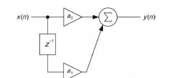

Figure 3.16: The HF tone control block diagram.

图 3.16：高频音调控制框图。

You already know that the coefficients a0 and a1 will become float member variables in our plug-in. But what about the one-sample-delay element, z^-1? In hardware, this would be a register to store the sample for one clock period. In software, it simply becomes another float variable, but it must be able to persist over the lifetime of a processing cycle. Therefore, like the coefficients, it will become a float member variable of our plug-in object.

你已经知道系数 a0 和 a1 将成为我们插件中的 float 成员变量。但是单采样延迟元素 z^-1 呢？在硬件中，这将是一个用于存储一个时钟周期样本的寄存器。在软件中，它只是另一个 float 变量，但它必须能够在处理周期的整个生命周期内持续存在。因此，就像系数一样，它将成为我们插件对象的 float 成员变量。

You will do an example using arrays of floats in Chapter 7 when you implement digital delay lines that require long strings of z^-1 elements. For now, we need to implement the single z^-1 element in the block diagram. Right away, we need to decide if we are going to support multichannel (stereo) operation.

在第 7 章中，当你实现需要长串 z^-1 元素的数字延迟线时，你将使用 float 数组进行示例。目前，我们需要在框图中实现单个 z^-1 元素。我们需要立即决定是否支持多声道（立体声）操作。

The last rule is really important and it is easy to get into trouble if you do not follow it. Unless the algorithm specifically deals with multichannel data, you will need to implement a separate algorithm for each channel, which means having separate coefficient and data (z^-1) elements for each channel. Even if you might be able to share the coefficients, you can never share the delay elements. We will need to declare variables for the following:

最后一条规则非常重要，如果不遵循，很容易遇到麻烦。除非算法专门处理多声道数据，否则你需要为每个声道实现单独的算法，这意味着为每个声道拥有单独的系数和数据（z^-1）元素。即使你可能能够共享系数，也绝不能共享延迟元素。我们需要为以下内容声明变量：

- Left channel a0 and a1 variables
- Left channel z^-1 variable
- Right channel a0 and a1 variables
- Right channel z^-1 variable

- 左声道 a0 和 a1 变量
- 左声道 z^-1 变量
- 右声道 a0 和 a1 变量
- 右声道 z^-1 变量

Delay elements will become float member variables in your plug-in object. For single-delay elements, you can simply assign separate variables. For multiple-sample-delay elements you may also use float arrays to store the data.

延迟元素将成为你插件对象中的 float 成员变量。对于单延迟元素，你可以简单地分配单独的变量。对于多采样延迟元素，你也可以使用 float 数组来存储数据。


仅以单声道或单通道格式描述的 DSP 滤波算法，即一个输入 x(n) 和一个输出 y(n)，无法在多个通道之间共享延迟元素。这意味着你必须复制算法，以便为左声道和右声道各拥有一组变量。

### 3.11.1 项目：SimpleHPF

此插件将实现一个非常原始的 HF（高频）音调控制，其行为类似于高通滤波器。它将衰减低频，只保留最高频率。使用与之前相同的方法，创建一个名为“SimpleHPF”的新项目。检查编译器以确保项目已正确创建。

### 3.11.2 SimpleHPF GUI

此简单插件将只有一个滑块，用于控制 a1 系数的值。另一个系数由其计算得出。规格显示 a1 在 0 到 0.49 之间变化。根据表 3.2 中的属性设置滑块。

### 3.11.3 SimpleHPF.h 文件

要确定 CSimpleHPF 对象需要执行的操作，首先写出差分方程。检查它并找出哪些组件将成为系数，哪些将成为内存位置。此外，找出可能需要的任何中间变量。你可以使用第 1 章学到的规则来绘制输入和输出信号图表，从而得出差分方程。确保你理解该方程是如何从图 3.17 的框图中形成的。

差分方程如下：

y(n) = a0x(n) + a1x(n – 1) (3.4)

接下来，找出框图中的哪些组件将成为 C++ 代码中的变量。系数 a0 和 a1 将在代码中成为 float 成员变量。尽管我们可能会想共享系数，但这些是具有独立延迟元素的独立左声道和右声道算法，因此让我们实现两组，每组分别用于左声道和右声道。

**表 3.2：SimpleHPF 项目的滑块属性。**

| 滑块属性 | 值 |
| :--- | :--- |
| 控件名称 | a1 |
| 单位 | |
| 变量类型 | float |
| 变量名 | m_fSlider_a1 |
| 下限 | 0.0 |
| 上限 | 0.49 |
| 初始值 | 0 |

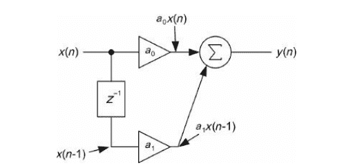

图 3.17：带有显示信号数学的注释的 HF 音调控制框图。

我命名如下：

- m_f_a0_left
- m_f_a1_left
- m_f_a0_right
- m_f_a1_right

z⁻¹ 元素也需要成为成员变量，我们肯定需要为每个通道各一个，因为这些绝不能共享。我命名如下：

- m_f_z1_left
- m_f_z1_right

滑块将仅修改其自身的 m_fSlider_a1 值。我们将使用它来计算其他系数的值。我们需要修改 userInterfaceChange() 函数，就像前面的示例一样，以将滑块连接到算法。跳转到 C++ 编译器，转到 SimpleHPF.h 文件以添加成员变量。注意下面代码中 RackAFX 添加的变量：

```cpp
// 5. userInterfaceChange() occurs when the user moves a control.
virtual bool userInterfaceChange(int nControlIndex)
// Add your code here: -------------------------------------- //
float m_f_a0_left;
float m_f_a1_left;
float m_f_a0_right;
float m_f_a1_right;
float m_f_z1_left;
float m_f_z1_right;
// END OF USER CODE ------------------------------------------ //
// Added by RACKAFX -- DO NOT EDIT THIS CODE!!! -------------- //
/***-0x07FD-***- */
float m_fSlider_a1;
/***-0x1A7F-***- */
```

### 3.11.4 SimpleHPF.cpp 文件

### 构造函数

- 将系数值设置为与初始化的滑块设置匹配。
- 计算新的 \( a_0 \) 值。
- 清除 \( z^{-1} \) 变量。

```cpp
CSimpleHPF::CSimpleHPF()
{
    <SNIP SNIP SNIP>

    // Finish initializations here
    m_f_a1_left = m_fSlider_a1;
    m_f_a1_right = m_fSlider_a1;

    m_f_a0_left = m_f_a1_left - 1.0;
    m_f_a0_right = m_f_a1_right - 1.0;

    m_f_z1_left = 0.0;
    m_f_z1_right = 0.0;
}
```

### prepareForPlay()

```cpp
bool __stdcall CSimpleHPF::prepareForPlay()
{
    // Add your code here:
    m_f_z1_left = 0.0;
    m_f_z1_right = 0.0;

    return true;
}
```

### processAudioFrame()

单通道信号处理的逻辑如下：

- 从 \( z^{-1} \) 元素中读取延迟值 x(n – 1)。
- 实现差分方程。
- 将当前输入 x(n) 写入延迟变量；下次它将成为 x(n – 1)。
- 对两个通道都执行此操作。

```cpp
bool __stdcall CSimpleHPF::processAudioFrame(float* pInputBuffer, float* pOutputBuffer, UINT uNumChannels)
{
    // Do LEFT (MONO)
    //
    // Input sample is x(n)
    float xn = pInputBuffer[0];

    // READ: Delay sample is x(n-1)
    float xn_1 = m_f_z1_left;

    // Difference Equation
    float yn = m_f_a0_left*xn + m_f_a1_left*xn_1;

    // WRITE: Delay with current x(n)
    m_f_z1_left = xn;

    // Output sample is y(n)
    pOutputBuffer[0] = yn;
}
```

好了，现在轮到你来实现另一个通道了。在继续之前，先自己试一试。函数的其余部分应该类似于这样：

```cpp
// Mono-In, Stereo-Out (AUX Effect)
if(uNumInputChannels == 1 && uNumOutputChannels == 2)
    pOutputBuffer[1] = yn;

// Stereo-In, Stereo-Out (INSERT Effect)
if(uNumInputChannels == 2 && uNumOutputChannels == 2)
{
    // Input sample is x(n)
    float xn = pInputBuffer[1];

    // Delay sample is x(n-1)
    float xn_1 = m_f_z1_right;

    // Difference Equation
    float yn = m_f_a0_right*xn + m_f_a1_right*xn_1;

    // Populate Delay with current x(n)
    m_f_z1_right = xn;

    // Output sample is y(n)
    pOutputBuffer[1] = yn;
}

return true;
```

在插件的每个播放事件之前，清除延迟元素以做好准备。通常你不希望旧数据留在这些存储寄存器中。唯一的例外是延迟循环效果，你会利用旧数据。此操作在 prepareForPlay() 中完成。

### userInterfaceChange()

- 存储新的 a1 值。
- 处理滑块数据以获取 a0 值。

```cpp
bool __stdcall CSimpleHPF::userInterfaceChange(int nControlIndex)
{
    switch(nControlIndex)
    {
        case 0:
        {
            // save a1
            m_f_a1_left = m_fSlider_a1;
            m_f_a1_right = m_fSlider_a1;

            // calculate a0
            m_f_a0_left = m_f_a1_left - 1.0;
            m_f_a0_right = m_f_a1_right - 1.0;

            break;
        }
        default:
            break;
    }
    return true;
}
```

构建并加载项目，打开一个音频文件，测试插件以确保其正常工作。此插件是一个简单的低切滤波器，当滑块完全向下时，你应该听不到音乐有任何差异。当你向上移动滑块时，你会失去越来越多的低音频率，只允许高频通过。截止频率约为 11 kHz，滑块控制低频切除的量。即使在小音箱上，你也应该能轻松听到效果。现在，为了了解插件运行的更多信息，请使用 RackAFX 的分析工具。使用传输控制停止音乐播放。单击工具栏上的 Analyzer 按钮或选择视图 > 分析器启动分析器窗口。分析器将如图 3.18 弹出（你的可能略有不同）。

分析器是检查插件性能的强大工具。基本控件包括

1. 示波器/频谱分析器。
2. 基本绘图选项。
3. 示波器控件。
4. 实时响应按钮，可让你测量插件的频率、相位、冲激和阶跃响应（使用这些按钮时音频不得正在流式传输）。

单击 Frequency 按钮，你将获得滤波器的频率响应图。将滑块完全向下移动，你应该得到平坦响应，如图 3.19 所示。如果将滑块完全向上移动，使 a₁ = 0.49，你将得到图 3.20 中的响应。


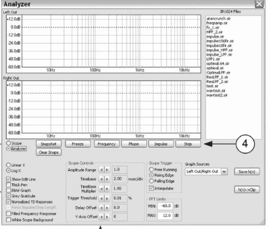

图 3.18：音频分析器。


图 3.19：a1 = 0.0 的平坦频率响应。


图 3.20：一个似乎增强高频的滤波器。你可以看到它实际上是在削减低频；这是你可能只有通过使用音频分析器才会意识到的事情。

## 3.12 设计带音量控制的高频音调控制插件

这个最终示例将向你展示如何通过在框图中添加一个以分贝为单位的音量控制来处理多个滑块控件。计划是向现有插件添加另一个滑块；新滑块将以分贝为单位控制插件的总音量。你已经知道如何实现这两部分，因此这个练习实际上更多是关于向现有项目添加新控件。

### 3.12.1 项目：SimpleHPF

使用“打开”按钮或菜单/工具栏项在 RackAFX 中打开你的 SimpleHPF 项目。

### 3.12.2 SimpleHPF GUI

添加新的音量滑块：右键单击第二个滑块组，添加一个用于音量控制（以分贝为单位）的新滑块，并使用与 VolumedB 项目中完全相同的变量名和设置。你最终应该得到一个如图 3.21 所示的 GUI。

### 3.12.3 SimpleHPF.h 文件

添加你自己的 m_fVolume 变量来处理已处理的音量数据，与之前一样。

```
// Add your code here:
//.......................................................//
float m_f_a0_left;
float m_f_a1_left;
float m_f_a0_right;
float m_f_a1_right;
float m_f_z1_left;
float m_f_z1_right;
float m_fVolume;
```


图 3.21：添加了以分贝为单位的音量控制的新 SimpleHPF GUI。

```
// END OF USER CODE ---------------------------------------------------------------------- //
// ADDED BY RACKAFX -- DO NOT EDIT THIS CODE!!! ------------------------------------------ //
// **--0x07FD--**
float m_fSlider_a1;
float m_fVolume_dB;
// **--0x1A7F--** ---------------------------------------------------------------------- //
```

### 3.12.4 SimpleHPF.cpp 文件

### 构造函数

- 在滤波器初始化后处理音量数据。

```
CSimpleHPF::CSimpleHPF()
{
    <SNIP SNIP SNIP>
    m_f_a0_left = -1.0;
    m_f_a1_left = 0.0;

    m_f_a0_right = -1.0;
    m_f_a1_right = 0.0;

    m_f_z1_left = 0.0;
    m_f_z1_right = 0.0;

    m_fVolume = pow(10.0, m_fVolume_dB/20.0);
}
```

### prepareForPlay()

这里无需添加内容，因为音量变量不需要在每次播放事件时重置。

### processAudioFrame()

- 在滤波操作后添加音量控制缩放。

```cpp
// Do LEFT (MONO) Channel; there is always at least one input/one output
// (INSERT Effect)
// Input sample is x(n)
float xn = pInputBuffer[0];

// READ: Delay sample is x(n-1)
float xn_1 = m_f_z1_left;

// Difference Equation
float yn = m_f_a0_left*xn + m_f_a1_left*xn_1;

// WRITE: Delay with current x(n)
m_f_z1_left = xn;

// Output sample is y(n)
pOutputBuffer[0] = yn*m_fVolume;

// Mono-In, Stereo-Out (AUX Effect)
if(uNumInputChannels == 1 && uNumOutputChannels == 2)
    pOutputBuffer[1] = yn*m_fVolume;

// Stereo-In, Stereo-Out (INSERT Effect)
if(uNumInputChannels == 2 && uNumOutputChannels == 2)
{
    // Input sample is x(n)
    float xn = pInputBuffer[1];

    // Delay sample is x(n-1)
    float xn_1 = m_f_z1_right;

    // Difference Equation
    float yn = m_f_a0_right*xn + m_f_a1_right*xn_1;

    // Populate Delay with current x(n)
    m_f_z1_right = xn;

    // Output sample is y(n)
    pOutputBuffer[1] = yn*m_fVolume;
}
```

### userInterfaceChange()

- 处理音量数据。
- 请确保检查你的控件 ID 值，以防你选择的滑块与我不同。

```
bool __stdcall CSimpleHPF::userInterfaceChange(int nControlIndex)
{
    // decode the control index
    switch(nControlIndex)
    {
        case 0:
        {
            m_f_a1_left = m_fSlider_a1;
            m_f_a1_right = m_fSlider_a1;

            m_f_a0_left = m_f_a1_left - 1.0;
            m_f_a0_right = m_f_a1_right - 1.0;

            break;
        }
        case 1:
        {
            m_fVolume = pow(10.0, m_fVolume_dB/20.0);
            break;
        }
        default:
        break;
    }
    return true;
}
```

构建并测试你的代码，以确保插件按预期工作。你现在了解了从框图和设计方程编写插件的基础知识。

### 添加一些预设

既然你已经拥有了一个带有多个控件的 GUI，不妨尝试添加一些预设。如果你查看工具栏中的预设列表，会看到第一个名为“Factory Preset”。此预设包含你对 GUI 控件的初始设置。你无法删除此预设，并且每当你添加、编辑或删除控件时，它都会自动更新。此预设可让你回到初始状态。在加载插件并（可选）让音频流经它的情况下，调整控件以影响信号。点击工具栏上的“Save Preset”按钮或从插件菜单中选择它。将弹出一个框，允许你为预设命名。你也可以覆盖现有预设。你可以在插件中最多存储 32 个预设。

## 3.13 RackAFX 中的用户插件菜单

随着你使用更多插件，你会注意到它们开始自动填充 RackAFX 中的用户插件菜单项。到现在为止，你应该在这个菜单中有三个插件。关于这个菜单，有几件事你需要了解。

- 它允许你在不打开编译器并手动加载和卸载 DLL 的情况下与插件进行交互。
- 你可以在音频流传输时从此菜单中选择不同的插件，它们会自动插入和移除，因此你可以快速试听或展示你的插件。
- 它允许 RackAFX 表现得就像其他插件客户端一样，在启动软件时一次性加载其 PlugIns 文件夹中找到的所有 DLL。这可能很危险！

最后一项在开发过程中会带来问题——如果你编写的 DLL 在构造函数中做了不好的事情，例如持有带有垃圾值的指针或尝试访问未分配的内存，它可能会在 RackAFX 首次启动时崩溃。如果你的 DLL 表现非常糟糕，你甚至可能会损坏操作系统。如果没有复杂的插件启用和停用规则，这是一个难以避免的难题。此外，如果你正在开发商业插件并使用第三方客户端，你也会遇到同样的问题；大多数这类客户端的设计是首先打开其插件文件夹中的所有 DLL 并检查插件是否可以实例化。如果你编写了一个糟糕的 DLL，你也可能会崩溃这些客户端和/或操作系统。在至少一个商业可用的客户端中，如果你的插件在启动期间崩溃，它将不会在未来的启动中再次加载。当 RackAFX 加载你的 DLL 时，它会进行一些错误检查以尝试确保你的插件是合法的，但它无法检查你的构造代码的有效性。

如果 RackAFX 每次打开时都崩溃，请从 PlugIns 文件夹中删除你最后正在处理的 DLL。或者，你可以删除所有 DLL——你会想要复制它们，并在找到导致崩溃的糟糕 DLL 后稍后恢复它们。编写 DLL 既有挑战性又很有趣，但由于你正在编写一个组件，你可能会最终遇到这样的崩溃。

在本书的学习过程中，你将学习如何实现以下效果：

- 均衡器/音调控制
- 延迟
- 合唱/移相
- 压缩/限制/颤音
- 混响
- 调制滤波器/相位器

均衡器/音调控制理论是所有效果中最难以简单解释的。这些效果基于 DSP 滤波器理论，涉及复杂代数，即复数代数。复数包含实部和虚部。解释基本 DSP 理论有两种基本方法。第一种是直观的，不涉及复杂数学，但需要一些记账工作，可能会很乏味。第二种方法使用复杂代数来解决问题。

我们将从直观方法开始，然后（可选，如果你愿意）跨入复杂数学。别担心——我们不想陷入理论而忘记有趣的部分，即制作音频效果。如果你跳过第二部分，你仍然能够编写均衡器和音调控制插件，但如果你也了解一些理论，你会更好地理解方程的来源。你在过程中学到的传递函数将在许多效果算法中重新出现。

在图 4.1 中，你可以看到 –6 dB/八度的衰减，这表明是一阶滤波器。模拟滤波器的数字版本应具有相同的形状和衰减。一个关键区别是，数字滤波器不会在奈奎斯特频率以上工作。

相位响应图显示了不同频率在滤波器输出时的相对相位。在滤波过程中，不同频率的相位会向前或向后移动。在图 4.2 中，1 kHz 频率相对于输入移动了 –45 度。在非常高的频率下，相位移接近 –90 度。这种相位移不是滤波的副作用，而是其工作原理不可或缺的一部分。

为了理解相位移的影响，请考虑进入滤波器的复杂波形。傅里叶表明，复杂的连续波形可以分解为一组具有不同频率和幅度的正弦波。图 4.3 展示了滤波器的工作过程。输入被分解为四个正弦波、一个基波和三个谐波。各分量的峰值幅度显示为 y 轴左侧的深色柱状图。


图 4.1: DSP 滤波器的基本分析工具是其频率响应图。该图显示滤波器如何放大或衰减某些频段。


图 4.2: 图 4.1 中模拟滤波器的相位响应图显示输出相位如何随频率移相。

我们观察到输出的几个特点：

- 复合波形被平滑处理。
- 基波的幅度和相位移不变。
- 三个谐波的幅度递减，并且随着频率升高，相位移增加。

图 4.4 以不同的方式绘制了相同滤波器的信息；在这里，幅度和相位是针对频率绘制的，而不是处理一组时域正弦波。你可以从输出频率响应图中看出，这种滤波器是一种低通滤波器。其曲线与图 4.1（模拟等效）相似。


图 4.3: 复杂波形被滤波为平滑输出。输入和输出被分解为其傅里叶级数分量。


图 4.4: 相同的信息被绘制为频率和相位响应。

## 4.1 一阶前馈滤波器

为了掌握数字滤波的本质，请从图 4.5 块图中所示的一阶前馈滤波器开始。你在上一章编写的 HPF 音调控制中已经见过它的一个版本。

差分方程如下：

```
y(n) = a₀x(n) + a₁x(n – 1) (4.1)
```

你可以明白为什么它被称为前馈——输入分支前馈到求和器。信号从输入流向输出。输出没有反馈回输入。现在，假设我们在图 4.6 中让系数 $a_0$ 和 $a_1$ 都等于 0.5。

为了分析这个滤波器，我们可以走简单但繁琐的路线，或者困难但优雅的路线。让我们从简单的方法开始。为了弄清楚这个滤波器的作用，你将第 1 章学到的五种基本数字测试信号应用到滤波器中，然后手动将数值推送通过并查看输出结果。你只需要一支铅笔和一张纸或一个简单的计算器。我们要测试的五种波形是：

- 1. 直流 (0 Hz)
- 2. 奈奎斯特频率
- 3. ½ 奈奎斯特频率
- 4. ¼ 奈奎斯特频率
- 5. 冲激


图 4.5: 一阶前馈滤波器。


图 4.6: 这是什么滤波器？它的频率和相位响应是什么？

每进入一个音频样本，操作分为两个阶段：

- 1. 读取阶段：读入样本，并使用差分方程和延迟寄存器中的前一个样本形成输出。
- 2. 写入阶段：延迟元素被输入值覆盖——存储在单个 $z^{-1}$ 寄存器中的样本实际上已丢失。

从直流/阶跃输入开始，按顺序将样本应用到图 4.7 至 4.10 所示的滤波器中。

现在，观察输入与输出的幅度和相位移——输出幅度最终会稳定在恒定的 1.0 或单位增益条件，因此在直流或 0 Hz 下，输出等于输入。但是，响应中有一个样本的延迟，导致阶跃输入的前沿被一个样本间隔拉展。这种时间拉展是滤波的正常结果。


图 4.7: 在第一次迭代中，输入样本被用于差分方程以生成输出，x(n) = 0，y(n) = 0，然后输入被移入延迟寄存器。

在前馈滤波器中，时间拉展的量等于通过前馈分支的最大延迟路径。


图 4.8: 该过程随每个样本继续。这里，输入 1.0 与前一个输入组合；第二个输出 y(n) = 0.5。

接下来，对奈奎斯特频率重复该过程（直流和奈奎斯特频率最简单，所以我们先做它们）。当呈现奈奎斯特频率时，滤波器的行为完全不同（图 4.11 至 4.14）。

现在，对幅度和相位进行观察。在奈奎斯特频率处，经过一个样本延迟时间后，幅度最终变为零。相位难以判断，因为信号已经消失。为什么在奈奎斯特频率处幅度会完全降至零？答案是理解数字滤波器理论的关键之一：一个样本延迟在奈奎斯特频率处引入了恰好 180 度的相位移，并导致其在通过 $a_0$ 与输入分支重新组合时相互抵消。

延迟元素会在信号中产生相位移。相位移的量取决于延迟量以及所涉及的频率。


图 4.9: 序列继续，直到我们观察到一个重复模式；这里 1.0 在重复。

在奈奎斯特频率的情况下，一个样本延迟恰好足以在以相等比例相加时抵消原始信号。其他频率（如 ½ 和 ¼ 奈奎斯特频率）呢？它们处理起来稍微费力一些，但值得付出努力。到现在，你可以看到数据是如何通过滤波器的，所以让我们使用一个表格（表 4.1）并将数据通过它传递，而不是手动推演。½ 奈奎斯特序列是 x(n) = {..., 0, +1.0, 0.0, -1.0, 0.0, +1.0, 0.0, ...}。


图 4.10: 图 4.6 滤波器在直流或 0 Hz 下的输入和输出序列。


图 4.11: 将奈奎斯特序列应用到滤波器。注意延迟元素已被清零。第一次迭代的输出是 y(n) = 0.5。


图 4.12: 奈奎斯特频率下的第二次迭代产生输出 y(n) = 0。

表 4.1: 当我们处理 ½ 奈奎斯特频率时，手动工作继续。

| x(n) | x(n - 1) | y(n) = 0.5x(n) + 0.5x(n - 1) |
|---|---|---|
| 0 | 0 | 0 |
| 1 | 0 | 0.5 |
| 0 | 1 | 0.5 |
| -1 | 0 | -0.5 |
| 0 | -1 | -0.5 |
| 1 | 0 | 0.5 |
| 0 | 1 | 0.5 |
| -1 | 0 | -0.5 |
| 0 | -1 | -0.5 |

你可以看到 x(n) 如何在下一行变成 x(n - 1) 吗？x(n - 1) 列保存输入 x(n) 的一个样本延迟版本。输出是 y(n) = {0, +0.5, +0.5, -0.5, -0.5, +0.5, +0.5}。


图 4.13: 继续在奈奎斯特频率下操作，我们看到最终输出稳定为重复的 0, 0, 0, 0 序列。

接下来，我们在图 4.15 中观察从输入到输出的幅度和相位关系。起初，弄清楚序列 {...-0.5, -0.5, +0.5, +0.5, ...} 可能似乎很困难。½ 奈奎斯特频率也用四个值（0, 1, 0, -1）的重复序列编码。

以同样的方式处理 ¼ 奈奎斯特频率（表 4.2）。¼ 奈奎斯特频率序列是 x(n) = {0, 0.707, 1, 0.707, 0, -0.707, -1, -0.707, 0, ...}。


图 4.14: 图 4.6 滤波器在奈奎斯特频率下的输入和输出序列。

表 4.2: ¼ 奈奎斯特输入/输出。

| x(n) | x(n - 1) | y(n) = 0.5x(n) + 0.5x(n - 1) |
| :--- | :--- | :--- |
| 0 | 0 | 0 |
| 0.707 | 0 | +0.354 |
| 1 | 0.707 | +0.854 |
| 0.707 | 1 | +0.854 |
| 0 | 0.707 | +0.354 |
| -0.707 | 0 | -0.354 |
| -1 | -0.707 | -0.854 |
| -0.707 | -1 | -0.854 |
| 0 | -0.707 | -0.354 |

输出是 y(n) = {...+0.354, +0.854, +0.854, +0.354, -0.354, -0.854, -0.854, -0.354, +0.354, ...}。对输出序列的分析揭示了¼ 奈奎斯特频率下相位移和略微衰减的输出信号。相位移和衰减都小于½ 奈奎斯特频率。如图 4.16 所示，信号开始处也有一个样本的时间拉展。

最后，应用冲激序列并求出冲激响应。冲激响应是第三种分析工具。冲激响应在时域中定义滤波器，就像频率响应在频域中定义滤波器一样。基本思想是，如果你知道滤波器对单个冲激的反应，你就可以预测它对一系列不同幅度冲激的反应。对冲激响应进行快速傅里叶变换（FFT），即可得到频率响应。逆 FFT 将频率响应转换回冲激响应。对于这个滤波器，冲激响应很简单（表 4.3）。


Figure 4.15: 图 4.15: 在 ½ 奈奎斯特频率处的时间域输入/输出关系。½ 奈奎斯特频率被衰减近一半。输出也相位移了 45 度。第一个周期的前沿被一个采样点的时间展开。


Figure 4.16: 图 4.16: ¼ 奈奎斯特频率处的输入/输出关系。

Table 4.3: 表 4.3: 冲激响应输入/输出关系。

| x(n) | x(n - 1) | y(n) = 0.5x(n) + 0.5x(n - 1) |
|---|---|---|
| 0 | 0 | 0 |
| 1 | 0 | 0.5 |
| 0 | 1 | 0.5 |
| 0 | 0 | 0 |
| 0 | 0 | 0 |
| 0 | 0 | 0 |
| 0 | 0 | 0 |

Here you can see that the impulse is flattened and smeared out. 这里可以看到冲激被压平并展开。It is actually two points on a sin(x)/(x)-like curve, as shown in Figure 4.17. 它实际上是 sin(x)/(x) 类曲线上的两个点，如图 4.17 所示。Now, you can combine all the frequency amplitude and phase values into one big graph, as shown in Figure 4.18. 现在，你可以将所有频率幅度和相位值合并到一个大图中，如图 4.18 所示。

We observe that this digital filter is a low-pass variety with a typical low pass filter (LPF) magnitude response. 我们观察到这个数字滤波器是低通类型，具有典型的低通滤波器（LPF）幅度响应。However the phase response is quite interesting—it is linear instead of nonlinear like the analog example at the beginning of the chapter. 然而相位响应非常有趣——它是线性的，而不是像章节开头的模拟示例那样非线性。In fact, this simple filter is a linear phase filter. 事实上，这个简单的滤波器是一个线性相位滤波器。

Figures 4.19 and 4.20 show the measured frequency and phase responses for this filter. 图 4.19 和 4.20 显示了该滤波器的测量频率和相位响应。Compare it with our estimation. 将其与我们的估计进行比较。Notice the linear phase produces a straight line only when plotted on the linear frequency axis. 注意，线性相位仅在线性频率轴上绘制时才会产生直线。What makes this filter a low-pass filter? 什么使这个滤波器成为低通滤波器？It is a combination of the coefficients and the filter topology (first-order feed-forward). 它是系数和滤波器拓扑（一阶前馈）的组合。There are three basic topologies: feed forward (FF), feed back (FB), and a combination of FF/FB. 有三种基本拓扑：前馈（FF）、反馈（FB）以及 FF/FB 的组合。Once the topology has been chosen, it’s really the coefficients that determine what the filter will do. 一旦选择了拓扑，真正决定滤波器行为的是系数。


Figure 4.17: 图 4.17: 冲激响应输入/输出的时域图。

A feed-forward filter will be a linear phase filter if its coefficients are symmetrical about their center. 如果前馈滤波器的系数关于其中心对称，则它将是线性相位滤波器。In this case (0.5, 0.5) is symmetrical. 在这种情况下，(0.5, 0.5) 是对称的。Another example would be (–0.25, 0, –0.25). 另一个示例是 (–0.25, 0, –0.25)。


Figure 4.18: 图 4.18: 图 4.6 中数字滤波器的最终频率和相位响应图。请注意，这是一个线性频率图，因为 ½ 奈奎斯特位于 x 轴的中间。奈奎斯特处的相位会回升到 0 度，因为不存在奈奎斯特分量（输出 = 0）。

## 4.2 Design a General First-Order Feed-Forward Filter

## 4.2 设计通用一阶前馈滤波器

To illustrate this and crystallize it as a concept, modify your SimpleHPF filter so that two sliders control the $a_0$ and $a_1$ coefficients directly. 为了说明这一点并将其具体化为一个概念，修改你的 SimpleHPF 滤波器，使两个滑块直接控制 $a_0$ 和 $a_1$ 系数。Also, alter the range of values they can control to ($-1.0$ to $+1.0$). 同时，将它们可控制的值范围更改为（-1.0 到 +1.0）。Then, experiment with the two values and watch what happens in the analyzer. 然后，尝试这两个值，观察分析器中发生的情况。How to do this is described next. 具体做法如下所述。

Open your SimpleHPF project and modify the user interface (UI). 打开你的 SimpleHPF 项目并修改用户界面（UI）。First, change the values for the $a_1$ slider to match the new low and high limits. 首先，更改 $a_1$ 滑块的值以匹配新的下限和上限。As usual, you right-click inside the slider's bounding box and alter the limits and initial value (shown in bold) as in Table 4.4. 与往常一样，在滑块边界框内右键单击并更改限制和初始值（以粗体显示），如表 4.4 所示。


Figure 4.19: 图 4.19: 你刚才手动分析的滤波器的测量频率和相位响应图。这些图使用线性频率基准绘制。


Figure 4.20: 图 4.20: 使用对数频率基准绘制的测量频率和相位响应图。

Table 4.4: 表 4.4: 修改后的 $a_1$ 滑块属性。

| Slider Property | Value |
|---|---|
| Control Name | a1 |
| Units | |
| Variable Type | float |
| Variable Name | m_fSlider_a1 |
| Low Limit | -1.0 |
| High Limit | +1.0 |
| Initial Value | 0.0 |

Now add a new slider for the $a_0$ coefficient just below the $a_1$ slider (Table 4.5). 现在在 $a_1$ 滑块下方添加一个新的 $a_0$ 系数滑块（表 4.5）。

Table 4.5: 表 4.5: 新的 $a_0$ 滑块属性。

| Slider Property | Value |
|---|---|
| Control Name | a0 |
| Units | |
| Variable Type | float |
| Variable Name | m_fSlider_a0 |
| Low Limit | -1.0 |
| High Limit | +1.0 |
| Initial Value | 1.0 |

Change the userInterfaceChange() function to directly map the slider values to the coefficient values. 更改 userInterfaceChange() 函数，以直接将滑块值映射到系数值。The new slider has a control ID of 10; always check your nControlIndex value since it might be different depending on your UI. 新滑块的控件 ID 为 10；始终检查你的 nControlIndex 值，因为它可能因 UI 而异。

| Variable Name | Index |
|---|---|
| m_fSlider_a1 | 0 |
| m_fVolume_dB | 1 |
| m_fSlider_a0 | 10 |

```
bool CSimpleHPF::userInterfaceChange(int nControlIndex)
{
    switch(nControlIndex)
    {
case 0:
// direct map to the a1 Slider
m_fA1_left = m_fSlider_a1;
m_fA1_right = m_fSlider_a1;
break;

case 1:
// cook the Volume Slider
m_fVolume = pow(10.0, m_fVolume_dB/20.0);
break;

case 10:
// direct map to the a0 Slider
m_fA0_left = m_fSlider_a0;
m_fA0_right = m_fSlider_a0;
break;

default:
; // do nothing
}
return true;
}
```

Rebuild the DLL and load it. 重新生成 DLL 并加载它。Place the volume control at 0 decibels (dB) (maximum) and set $a_0$ and $a_1$ to 1.0 (maxima); then open the analyzer and hit the Frequency button—play with the different values for $a_0$ and $a_1$. 将音量控制设置为 0 分贝（dB）（最大值），并将 $a_0$ 和 $a_1$ 设置为 1.0（最大值）；然后打开分析器并点击 Frequency 按钮——尝试 $a_0$ 和 $a_1$ 的不同值。Figure 4.21 shows the response with various coefficient values. 图 4.21 显示了各种系数值下的响应。

After you play around with the controls, there are several things to note from this experiment: 玩完控件后，从这个实验中有几点需要注意：

- You can get a low-pass or high-pass response, or anything between, including a flat response ($a_0 = 1.0, a_1 = 0.0$). - 你可以获得低通或高通响应，或介于两者之间的任何响应，包括平坦响应（$a_0 = 1.0, a_1 = 0.0$）。


Figure 4.21: 图 4.21: 三种不同的系数设置组合产生三种不同的滤波器。

> The topology of the filter determines its difference equation. The coefficients ($a_N$) of a filter determine its filter frequency and phase response and therefore its type (HPF, LPF, etc.) and its sonic qualities. Your plug-in implements the difference equation in processAudioFrame(). Your plug-in calculates the coefficients in userInterfaceChange() in response to the user making changes to the control surface. > 滤波器的拓扑决定其差分方程。滤波器的系数（$a_N$）决定其频率和相位响应，从而决定其类型（HPF、LPF 等）和声音特性。你的插件在 processAudioFrame() 中实现差分方程。你的插件在 userInterfaceChange() 中计算系数，以响应用户对控制面板的更改。

- Inverted settings give the identical frequency response but the phase responses will be inverted (use the Phase button and have a look for yourself). - 倒置设置会给出相同的频率响应，但相位响应会被反转（使用 Phase 按钮亲自查看）。
- You can get gain out of the filter. - 你可以从滤波器中获得增益。
- You can also get attenuation out of the filter. - 你也可以从滤波器中获得衰减。

## 4.3 First-Order Feed-Back Filter

## 4.3 一阶反馈滤波器

A first-order feed-back filter is shown in Figure 4.22. 图 4.22 显示了一个一阶反馈滤波器。

The difference equation is as follows: 差分方程如下：

y(n) = a₀x(n) – b₁y(n – 1) (4.2)

You can see the feed-back nature of the filter; the output y(n) is fed back into the summer through a one-sample-delay z⁻¹ element. 你可以看到滤波器的反馈特性；输出 y(n) 通过一个单样本延迟 z⁻¹ 元件馈回到求和器中。Notice that the feedback coefficient has a negative sign in front of it and the difference equation reflects this with the –b₁ term. 请注意，反馈系数前面有负号，差分方程通过 –b₁ 项体现了这一点。The negative sign is for mathematical convenience and will make more sense in the next chapter when we analyze the difference equations in more detail. 负号是为了数学上的方便，在下一章详细分析差分方程时会更清楚。Also notice that there is no b₀ coefficient—there will not be a b₀ coefficient in any of the feed-back filters. 还要注意，没有 b₀ 系数——任何反馈滤波器都不会有 b₀ 系数。To analyze this without math requires going through the same procedure as before, analyzing the amplitude and phase of the basic test signals. 如果不使用数学来分析，需要经历与之前相同的程序，分析基本测试信号的幅度和相位。Another option would be to code it as a plug-in in RackAFX and map the coefficients directly to the sliders as you did in the previous example. 另一个选择是在 RackAFX 中将其编码为插件，并像之前的示例一样将系数直接映射到滑块。Then, you can experiment with the coefficients and see how they affect the filter's frequency, phase, DC/step, and impulse responses. 然后，你可以尝试系数，看看它们如何影响滤波器的频率、相位、直流/阶跃和冲激响应。


Figure 4.22: 图 4.22: 一阶反馈滤波器框图。

## 4.4 Design a General First-Order Feed-Back Filter

## 4.4 设计通用一阶反馈滤波器

### 4.4.1 Project FeedBackFilter

### 4.4.1 项目 FeedBackFilter

Create a new RackAFX project called “FeedBackFilter.” The plan is for this filter to let you directly control the coefficients with UI sliders and use the analyzer to check the resulting filters. 创建一个名为“FeedBackFilter”的新 RackAFX 项目。计划是让这个滤波器允许你使用 UI 滑块直接控制系数，并使用分析器检查生成的滤波器。

### 4.4.2 FeedBackFilter GUI

### 4.4.2 FeedBackFilter GUI

The GUI will consist of two sliders, one for the \(a_0\) coefficient and the other for the \(b_1\) coefficient. GUI 将由两个滑块组成，一个用于 $a_0$ 系数，另一个用于 $b_1$ 系数。You can use any two sliders you like, but make sure you keep track of the control index values later on. 你可以使用任何两个滑块，但请确保以后跟踪控件索引值。Figure 4.23 shows my version of the GUI. 图 4.23 显示了我的 GUI 版本。Right-click near the sliders you want to use and set them up according to Table 4.6. 在你想要使用的滑块附近右键单击，并根据表 4.6 进行设置。

### 4.4.3 FeedBackFilter.h File

### 4.4.3 FeedBackFilter.h 文件

Add the \(z^{-1}\) elements and \(a_0\), \(b_1\) coefficient variables for the right and left channels in your .h file: 在你的 .h 文件中添加右声道和左声道的 $z^{-1}$ 元素以及 $a_0$、$b_1$ 系数变量：

```
// Add your code here: ---------------------------------------------------------------- //
float m_f_a0_left;
float m_f_b1_left;
```


Figure 4.23 The GUI for the FeedBackFilter project. 图 4.23 FeedBackFilter 项目的 GUI。

Table 4.6: The \(a_0\) slider properties. 表 4.6: $a_0$ 滑块属性。

| Slider Property | Value |
|---|---|
| Control Name | b1 |
| Units | |
| Variable Type | float |
| Variable Name | m_fSlider_b1 |
| Low Limit | -1.0 |
| High Limit | +1.0 |
| Initial Value | 0.0 |

| Slider Property | Value |
|---|---|
| Control Name | a0 |
| Units | |
| Variable Type | float |
| Variable Name | m_fSlider_a0 |
| Low Limit | -1.0 |
| High Limit | +1.0 |


| 初始值 | 1.0 |
|---|---|

```
float m_f_a0_right;
float m_f_b1_right;

float m_f_z1_left;
float m_f_z1_right;

// END OF USER CODE
```

### 4.4.4 FeedBackFilter.cpp 文件

### 构造函数

- 将内部 $a_0$ 和 $b_1$ 变量初始化为与我们的 GUI 变量匹配。
- 将延迟行元素清零。

```
CFeedBackFilter::CFeedBackFilter()
{
    // Added by RackAFX - DO NOT REMOVE
    //
    // Setup the RackAFX UI Control List and Initialize Variables
    initUI();
    // END InitUI

    <SNIP SNIP SNIP>

    // Finish initializations here
    //
    // setup our coefficients
    m_f_a0_left = m_fSlider_a0;
    m_f_b1_left = m_fSlider_b1;

    m_f_a0_right = m_fSlider_a0;
    m_f_b1_right = m_fSlider_b1;

    // flush the memory registers
    m_f_z1_left = 0.0;
    m_f_z1_right = 0.0;
}
```

### prepareForPlay()

- 清空 z^-1 存储寄存器。

```
bool __stdcall CFeedBackFilter::prepareForPlay()
{
    // Add your code here:
    m_f_z1_left = 0.0;
    m_f_z1_right = 0.0;

    return true;
}
```

### processAudioFrame()

- 在 processAudioFrame() 中实现差分方程；注意差分方程中的 (-) 符号。

```
bool __stdcall CFeedBackFilter::processAudioFrame(float* pInputBuffer, float* pOutputBuffer, UINT uNumInputChannels, UINT uNumOutputChannels)
{
    // Do LEFT (MONO) Channel; there is always at least one input/one output
    // (INSERT effect)
    // Input sample is x(n)
    float xn = pInputBuffer[0];

    // Delay sample is y(n-1)
    float yn_1 = m_f_z1_left;

    // Difference Equation
    float yn = m_f_a0_left*xn - m_f_b1_left*yn_1;

    // Populate Delay with current y(n)
    m_f_z1_left = yn;

    // Output sample is y(n)
    pOutputBuffer[0] = yn;

    // Mono-In, Stereo-Out (AUX effect) -- COPY for now
    if(uNumInputChannels == 1 && uNumOutputChannels == 2)
        pOutputBuffer[1] = yn;

    // Stereo-In, Stereo-Out (INSERT effect)
    if(uNumInputChannels == 2 && uNumOutputChannels == 2)
    {
        // Input sample is x(n)
        float xn = pInputBuffer[1];

        // Delay sample is x(n-1)
        float yn_1 = m_f_z1_right;

        // Difference Equation
        float yn = m_f_a0_right*xn - m_f_b1_right*yn_1;

        // Populate Delay with current y(n)
        m_f_z1_right = yn;

        // Output sample is y(n)
        pOutputBuffer[1] = yn;
    }
    return true;
}
```

### userInterfaceChange()

- 当用户更改滑块时更新系数。
- 检查 nControlIndex 值，确保您正在处理正确的控件。

```
bool CFeedBackFilter::userInterfaceChange(int nControlIndex)
{
    // add your code here
    switch(nControlIndex)
    {
    case 0:
        // map the a0 Slider
        m_f_a0_left = m_fSlider_a0;
        m_f_a0_right = m_fSlider_a0;
        break;

    case 1:
        // map the b1 Slider
        m_f_b1_left = m_fSlider_b1;
        m_f_b1_right = m_fSlider_b1;
        break;

    default:
        ; // do nothing
    }

    return true;
}
```

将插件构建并加载到 RackAFX 中。打开分析器，使用频率、相位、冲激和阶跃按钮分析输出。尝试调整控件。首先请注意，a0 滑块仅控制信号的增益和相位；在频率响应中，这只会使曲线上下移动，并且在 a0 = 0.0 时消失，这很合乎逻辑。真正的作用在于 b1 控件；尝试图 4.24 至 4.26 中的示例。


图 4.24：a0 = 1.0 且 b1 = 0.5；频率响应本质上是高通/低搁带特性，在 11 kHz 以上具有增益，而冲激响应显示轻微铃响。


图 4.25：$a_0 = 1.0$ 且 $b_1 = 0.9$；频率响应比之前具有更陡峭的高通响应，并在奈奎斯特频率处具有 +20 dB 的增益，而冲激响应显示相当明显的铃响。


图 4.26：$a_0 = 1.0$ 且 $b_1 = 1.0$；频率响应已失控，而冲激响应持续铃响不止。

最后那个滤波器发生了什么？为什么没有频率响应？滤波器变得不稳定并失控。之所以失控，是因为 $b_1$ 系数为 1.0，这在回路中引入了 100% 的正反馈。输出在反馈回路中无限循环，导致阶跃和冲激响应中出现无限铃响。另请注意，随着 b1 变量的增加，奈奎斯特频率处的增益也随之增加。当 b1 = 1.0 时，奈奎斯特频率处的增益实际上是无限的。

## 4.5 观察

通过这些练习，您已经取得了很大进步——您知道如何在插件中实现前馈和反馈滤波器。您还对系数如何控制滤波器类型有了良好的直观理解。此外，您还让一个滤波器“失控”了，这很酷。以下是一些观察。

### 4.5.1 一般

- 前馈和反馈拓扑都可以产生高通或低通形状的滤波器响应。
- 滤波器的系数最终决定了滤波器的类型及其声音特性。
- 延迟元件引入的相位移是滤波操作的原因。

### 4.5.2 前馈滤波器

- 通过使某些频率趋于零来工作；在 a0 = 1.0 且 a1 = 1.0 的情况下，奈奎斯特频率趋于零；这称为*传输零点*或*零频率*或简称*零点*。
- 阶跃和冲激响应显示拖尾。拖尾的量正好等于前馈分支中的总延迟量。
- 不要让它失控。
- 称为*有限冲激响应*（FIR）滤波器，因为它们的冲激响应虽然可能会拖尾，但长度始终是有限的。

### 4.5.3 反馈滤波器

- 通过使某些频率趋于无穷大来工作；在 a0 = 1.0 且 b1 = 1.0 的情况下，奈奎斯特频率趋于无穷大，而在 a0 = 1.0 且 b1 = -1.0 的情况下，直流或 0 Hz 趋于无穷大；这称为*传输极点*或*极点频率*或简称*极点*。
- 阶跃和冲激响应根据系数显示超调和铃响或拖尾。铃响或拖尾的量与反馈量成正比。
- 在某些条件下可能会失控（或变得不稳定）。
- 称为*无限冲激响应*（IIR）滤波器，因为它们的冲激响应可能会变得无限。

现在的问题是，我们希望能够以一种在音频中有意义的方式来指定滤波器——例如截止频率为 100 Hz 的低通滤波器，或 Q 为 10 且中心频率为 1.2 kHz 的带通滤波器。我们需要一种比随机尝试系数更好的方法来分析滤波，并且需要根据我们指定滤波器的方式来推导滤波器系数的方法。在下一章中，我们将着手研究基本的 DSP 理论，以实现这一目标。

## 参考文献

Dodge, C. 和 Jerse, T. 1997. 《计算机音乐合成、作曲与表演》，第 3 和 6 章。纽约：施尔默出版社。

Steiglitz, K. 1996. 《DSP 入门：数字音频与计算机音乐应用》，第 4 章。加利福尼亚州门洛帕克：艾迪生-韦斯利出版社。

您希望掌握滤波器底层数字信号处理（DSP）理论有几个原因。理解滤波器的结构很有帮助，因为您需要在代码中实现它；对理论的更深入理解只能有助于您的编码策略。此外，相同的 DSP 滤波器分析和数学模型可以应用于其他效果，包括延迟、合唱、混响和压缩。为了直观理解 DSP 理论的基础，您需要复习一些数学和工程概念。

## 5.1 复正弦

数字滤波器的分析与设计使用正弦作为其基本激励函数。既然傅里叶表明信号可以分解为正弦，那么如果您知道系统对不同频率的正弦激励的反应，您就可以像上一章手动绘制那样绘制频率和相位响应。这类似于冲激响应——由于输入信号是不同幅度的冲激序列，如果您知道滤波器对单个冲激的响应，就可以推断它对多个冲激的响应。当您测量低通滤波器的冲激响应时，也曾手动做过此操作。

每个人都熟悉正弦和余弦函数——正弦和余弦相差 90 度的相位偏移，正弦函数从零开始，而余弦函数从 1.0 开始。在图 5.1 中，您可以根据起始位置识别正弦和余弦波形。但是，下图中那个在任意时间开始的类正弦波形呢？它是向后相位移位的正弦，还是向前相位移位的余弦？您必须小心回答，因为正弦和余弦具有不同的数学特性；它们的导数不相同，而且当您尝试将它们相乘或以复杂方式组合时，通常会变得困难。如果给 sin() 或 cos() 函数的参数添加相位偏移，那么在进行代数和微积分运算时，情况会变得一团糟。您需要的是一种以正弦方式表现、同时封装正弦和余弦函数且在数学上易于处理的函数。这样的函数存在，它被称为复正弦：

```
Complex sinusoid = e^{jωt} ........ (5.1)
```


图 5.1：正弦、余弦和正弦信号。

欧拉公式如下：

```
e^{j\theta} = \cos(\theta) + j\sin(\theta)
j = \sqrt{-1}
(5.2)
```

你可以看到它同时包含正弦和余弦函数。j 项是虚数，即 -1 的平方根（数学家称其为 i，但由于 i 在工程中表示电流，因此我们将其重命名为 j）。j 被称为相位旋转算子；将函数乘以 j 会使相位旋转 90 度。

假设你想将波形的相位移动 180°，从而使其反相。在数学上，你可以通过将波形乘以 -1 来实现这一点，反转其所有点的值。假设你想再次反相该波形（这将使其恢复原状）——你可以通过再次乘以 -1 来实现。但假设你只想将相位移动 90° 呢？是否存在一个数（η）可用作乘数以移动 90°？换句话说，

```
90-degree shifted waveform = (original waveform) (η)
```

你目前还不知道 η 是什么，但可以推导出来。假设你接着想将波形再移动 90 度，这相当于将原始波形移动 180 度。你会再将其乘以 η。那么你将得到以下结果：

```
180-degree shifted waveform = (original waveform) (η)(η)
= (original waveform) (η)²
= (original waveform) (-1)
```

这导出了公式 5.3：

\(\eta^2 = -1\)
\(\eta = \sqrt{-1} = j\)
(5.3)

因此，你可以通过将波形乘以 \(j\) 来执行概念上的 90 度相位移。-90 度相位移通过乘以 \(-j\) 实现。与 \(j\) 的其他一些有用关系如下

\(j^2 = -1\)
\(\frac{1}{j} = -j\)
(5.4)

欧拉公式是复数，包含实部（cos）和虚部（sin），公式中的加号（+）并非字面意义上的加法——你不能将实数和虚数相加。在格式为 A + jB 的复数中，这两个部分作为一个复数的一部分共存。

就我们的目的而言，我们用 \(\omega t\) 替换 \(\theta\)，其中 \(\omega\) 是以弧度/秒为单位的频率，\(t\) 是时间变量。为 \(t\) 代入各种值，并在同一平面上绘制正弦和余弦时，你将得到图 5.1 中的图形。因此，我们将放弃独立使用 sin() 和 cos() 函数，而采用复正弦波作为两者的预打包混合物。原因部分在于数学——事实证明，\(e\) 在数学上很容易处理。除了欧拉公式外，你只需学习四条规则（公式 5.5）。

欧拉公式：\(e^{j\omega t} = \cos(\omega t) + j\sin(\omega t)\)

四条规则：

```
e^a e^b = e^{(a+b)} or e^{ja} e^{jb} = e^{j(a+b)}
\frac{e^a}{e^b} = e^{(a-b)} or \frac{e^{ja}}{e^{jb}} = e^{j(a-b)}
\frac{d(e^{at})}{dt} = ae^{at}
\int e^{at} dt = \frac{1}{a} e^{at}
```
(5.5)

> 实际上，欧拉公式描述的是一对正弦和余弦函数，它们共存于相隔 90 度的两个平面中。正交是工程中表示相隔 90 度的术语。

公式 5.5 中的两个方程表明，即使自变量是时间 \(t\) 的函数，\(e\) 的行为也类似于多项式（\(x^2 * x^5 = x^7\)）。公式 5.5 还展示了它在微积分中的行为有多简单——多次求导或积分只需反复将自变量的常数（a 或 1/a）相乘即可。在离开此主题之前，请确保你记得如何处理复数——你需要它来理解频率和相位响应的来源。

## 5.2 复数数学回顾

由于复数同时具有实部和虚部，因此无法在单一坐标轴上绘制。要绘制复数，你需要两个坐标轴：实轴和虚轴。这两个轴呈直角排列，就像二维几何中的 x 轴和 y 轴一样。它们是正交的。x 维是实轴（Re），y 维是虚轴（Im）。因此，复数被绘制为此 x-y 平面上的一个点，也称为复平面。复数通常写作 A + jB 的形式，其中 A 是实部，B 是虚部。请注意，即使常识可能与此相矛盾，记法始终保持为 A + jB 的形式。对于第二象限中的点，你仍然写作 -2 + j2，尽管 j2 - 2 可能看起来更好看。还要注意，你写作 2 - j1 而不是仅仅 2 - j。点的绘制方式就像在平面上绘制 (x, y) 对一样（图 5.2）。

本示例将点绘制为 (x + jy) 对；这称为笛卡尔坐标系。你也可以使用极坐标法来标识相同的复数。在极坐标法中，你需要指定从坐标原点到所讨论点的矢量的半径 (R) 和角度 (θ)。例如，考虑上面的点 2 + j3。你可以按图 5.3 所示的极坐标形式绘制此点。

我们将笛卡尔形式 (2 + j3) 留作参考。通常，你只会看到 R 和 θ。大多数工程师在处理复数时更偏好极坐标法。极坐标数通常写作 R ∠ θ。幸运的是，从笛卡尔坐标到极坐标的转换很简单。从形式为 A + jB 的复数开始，你可以从公式 5.6 和 5.7 中找到结果半径和角度。


图 5.2：使用笛卡尔 (x, y) 坐标系在复平面上绘制的几个点。


图 5.3：以极坐标形式绘制 2 + j3。

```
R = \sqrt{A^2 + B^2} (5.6)
\theta = \tan^{-1} \left[ \frac{B}{A} \right] (5.7)
```

半径（\(R\)）有时称为 *幅值*，角度 \(\theta\) 称为 *幅角*。你有时只关心幅值的平方（称为“幅值平方”或 \(|R|^2\)）（公式 5.8）。

```
|R|^2 = A^2 + B^2 (5.8)
```

公式 5.9 展示了如何从传递函数中提取幅值和相位。

```
H = \frac{\text{num}}{\text{denom}}
```

那么

```
|H| = \frac{|\text{num}|}{|\text{denom}|} (5.9)
```

并且

```
Arg(H) = Arg(num) - Arg(denom)
```

> 滤波器的频率响应图实际上是称为滤波器 *传递函数* 的复函数的幅值响应。相位响应图实际上是该函数的幅角响应。传递函数是复数，因为它包含复数；许多传递函数实际上非常简单。我们使用字母 H 来表示传递函数。

## 5.3 作为数学算子的时间延迟

你需要理解的下一部分 DSP 理论是将时间延迟视为数学算子的概念。这将非常简单，因为我们将利用 \(e^{j\omega t}\) 函数的简单数学行为。首先，考虑一个复正弦波和一个延迟的复正弦波（图 5.4）。

\(n\) 秒的延迟如何改变复正弦波方程？由于正时间沿正 \(x\) 方向进行，\(n\) 秒的延迟相当于移动 \(-n\) 秒。在复正弦波方程中，你将用 \(t-n\) 替换 \(t\)。换句话说，延迟曲线上的任何点都等于未延迟曲线减去 \(n\) 秒。因此，延迟的正弦波为

```
Delayed sinusoid = e^{j\omega(t-n)} (5.10)
```

但是，通过利用 \(e\) 的多项式行为并逆向运用公式 5.5，你可以将其重写为公式 5.11 所示：

```
e^{j\omega(t-n)} = e^{j\omega t} e^{-j\omega n} (5.11)
```

这是一个微妙的数学方程，但它包含了大量信息：如果你想将复正弦波延迟 \(n\) 秒，请将其乘以 \(e^{-j\omega n}\)——这使我们能够将时间延迟表示为数学算子。

在过去两个部分中，你已经了解到相位旋转和时间延迟都可以表示为数学算子。

> 时间延迟可以通过将要延迟 \(n\) 秒的信号乘以 \(e^{-j\omega n}\) 来表示为数学算子。这很有用，因为 \(e^{-j\omega n}\) 不依赖于时间变量。在离散时间系统中，\(n\) 指的是样本而非秒。


图 5.4：复正弦波 \(e^{j\omega t}\) 及另一个延迟 \(n\) 秒的正弦波。

## 5.4 一阶前馈滤波器再探

能够将延迟表示为乘以 \(e^{-j\omega n}\) 的数学运算意味着，你可以获取 DSP 滤波器的框图和差分方程，并以 \(e^{j\omega t}\) 的形式将正弦波应用于输入，而不必像在第 4 章中那样插入一系列样本。然后，你可以将滤波器的输出视为数学表达式，并针对不同的 \(\omega\) 值（其中 \(\omega = 2\pi f\)，\(f\) 单位为 Hz）对其进行求值，从而直接找到频率和相位响应，而不必等待输出结果然后尝试估算幅度和相位偏移。请考虑上一章中的一阶前馈滤波器，但这次以 \(e^{j\omega t}\) 作为输入信号，如图 5.5 的框图所示。

差分方程如下：

```
$$y(t) = a_0 e^{j\omega t} + a_1 [e^{j\omega t} e^{-j\omega 1}]$$ (5.12)
```

图 5.5 显示了熟悉的框图，但这次使用输入 \(x(t)\) 和输出 \(y(t)\) 而不是 \(x(n)\) 和 \(y(n)\)。请注意，由于存在一个样本的延迟，延迟元件已被 \(e^{-j\omega 1}\) 替换。

当你将复正弦波 \(e^{j\omega t}\) 应用于输入时，差分方程使用延迟即乘法运算来产生输出。经过少量数学运算，你可以得到公式 5.13。

```
$$y(t) = a_0 e^{j\omega t} + a_1 [e^{j\omega t} e^{-j\omega 1}]$$
$$= e^{j\omega t} (a_0 + a_1 e^{-j\omega 1})$$ and the input $x(t) = e^{j\omega t}$ so
$$y(t) = x(t) (a_0 + a_1 e^{-j\omega 1})$$ (5.13)
```

传递函数定义为输出与输入的比值，因此


\frac{Y(f)}{X(f)} = a_0 + a_1 e^{-j\omega}


图 5.5: 带信号分析的一阶前馈滤波器框图。

滤波器的传递函数是输出与输入之比。滤波器的频率响应是在其频谱上不同频率处计算的传递函数的幅值。滤波器的相位响应是在其频谱上不同频率处计算的传递函数的辐角（或角度）。要生成频率和相位响应图，需对 \(\omega\) 的各种值求值，然后在每个频率处求出幅值和辐角。求值过程使用欧拉公式替换 e 项，从而得到实部和虚部。

值得注意的是，尽管输入和输出信号是时间的函数，但传递函数不依赖于时间。传递函数（公式 5.14）仅依赖于频率 \(\omega\)，因此我们将其称为 \(H(\omega)\)。

\[
H(\omega) = a_0 + a_1 e^{-j\omega} \tag{5.14}
\]

请注意，传递函数是复数。

但在求值时应使用哪些 \(\omega\) 值呢？我们知道 \(\omega = 2\pi f\)，但我们真的关心以 Hz 为单位的频率吗？在第 4 章中，当你分析同一个滤波器时，你应用了直流、奈奎斯特、1/2 奈奎斯特和 1/4 奈奎斯特，而没有绘图时，你通常只查看正半部分。图 5.7 显示了直到系统中最高频率（即奈奎斯特频率）的低通响应。

然而，在现实中，滤波器同样也对负频率进行镜像处理。在这种情况下，随着负频率越来越高，它们会像正频率对应项一样被衰减（图 5.8）。这也很合理。如果你取一个音频文件并将其在时间上反转，然后通过低通滤波器，同样的频率滤波仍然会发生。


图 5.6: 定义周期 T 的经典方式。


图 5.7: 仅显示正半部分的频率响应图的经典方式。


图 5.8: 包含正负两侧的更完整的频率响应图。


图 5.9: 一种将 2π 频率范围划分为包含正负频率的方式。

对于滤波器求值，\(\omega\) 在 0 到 2π 弧度/秒范围内变化，思考这个 2π 范围的一种方法是将其分为从 –π 到 +π 的范围，对应于 –奈奎斯特到 +奈奎斯特（图 5.9）。


图 5.10: 将 0 到 2π 的频率范围映射到 0 到 fs 范围。

> 要计算传递函数，让 \(\omega\) 从 0 变化到 \(\pi\) 并得到响应的前半部分。另一半是数据的镜像。

## 5.4.2 ±奈奎斯特以上和以下的频率

采样定理建立了奈奎斯特准则，以便在不发生混叠的情况下完全恢复原始带限信号。然而，高于奈奎斯特频率一直到采样频率的频率在数学上也是允许的。在理论上，任何频率都可能进入系统，并且你可以对其采样而不受奈奎斯特限制。对于频率或相位响应图，从奈奎斯特频率到采样频率的频率是关于奈奎斯特频率的镜像。这是划分 2π 范围的另一种方法，即从 0 Hz 到采样频率（图 5.10）。

请注意，无论采用哪种方法，都传达了相同的信息，因为我们得到了曲线的两半，并且在两种情况下，奈奎斯特映射到 \(\pi\)，0 Hz 映射到 0，正频率映射到 0 到 \(\pi\) 的范围。

## 5.5 计算传递函数 H(ω)

DSP 滤波器传递函数将包含 \(e^{-j\omega n}\) 项，需要在 0 到 \(\pi\) 的范围内进行求值；实现此目的的方法是使用欧拉公式将正弦波分解为其实部（cos）和虚部（sin）分量。然后，在待求频率处计算 cos 和 sin 项。在上一章中，你通过逐步执行滤波器操作手动计算了滤波器的输入/输出关系。在这种改进的方法中，你只需求解传递函数方程。从图 5.11 的框图开始。

传递函数如下：

\[
H(\omega) = a_0 + a_1 e^{-j\omega} \tag{5.15}
\]


图 5.11: 一阶前馈框图。

表 5.1: 在直流、1/4 奈奎斯特、1/2 奈奎斯特、3/4 奈奎斯特和奈奎斯特处的正弦和余弦函数求值。

| 频率 \(\omega\) | \(\cos(\omega)\) | \(\sin(\omega)\) |
|---|---|---|
| 0 | 1.0 | 0.0 |
| \(\pi/4\) | 0.707 | 0.707 |
| \(\pi/2\) | 0.0 | 1.0 |
| \(3\pi/4\) | 0.707 | -0.707 |
| \(\pi\) | -1.0 | 0.0 |

使用滤波器系数 \(a_0 = 0.5, a_1 = 0.5\)。你可以使用表 5.1 来帮助求值。在以下频率处求值：

- 直流: 0
- 奈奎斯特: \(\pi\)
- 1/2 奈奎斯特: \(\pi/2\)
- 1/4 奈奎斯特: \(\pi/4\)

每个频率的求值是一个两步过程：

- 使用欧拉公式将 \(e\) 项转换为实部和虚部。
- 求复数方程的幅值和辐角。

### 5.5.1 直流 (0 Hz)

\[
\begin{aligned}
H(\omega) &= 0.5 + 0.5e^{-j\omega} \\
&= 0.5 + 0.5(\cos(\omega) - j\sin(\omega)) \\
&= 0.5 + 0.5(\cos(0) - j\sin(0)) \\
&= 0.5 + 0.5(1 - j0) \\
&= 1.0 + j0
\end{aligned}
\]

求此频率处的幅值和相位：

\[
\begin{aligned}
|H(\omega)| &= \sqrt{(a+jb)(a-jb)} \\
&= \sqrt{(1+j0)(1-j0)} \\
&= 1.0 \\
\text{Arg}(H) &= \tan^{-1}(b/a) \\
&= \tan^{-1}(0/1) \\
&= 0.0^*
\end{aligned}
\]

将这些数学结果（公式 5.16 和 5.17）与上一章的图形结果（图 5.12）进行比较。

### 5.5.2 奈奎斯特 (\(\pi\))

\[
\begin{aligned}
H(\omega) &= 0.5 + 0.5e^{-j\omega} \\
&= 0.5 + 0.5(\cos(\omega) - j\sin(\omega)) \\
&= 0.5 + 0.5(\cos(\pi) - j\sin(\pi)) \\
&= 0.5 + 0.5(-1 - j0) \\
&= 0 + j0
\end{aligned}
\]

\[
\begin{aligned}
|H(\omega)| &= \sqrt{(a+jb)(a-jb)} \\
&= \sqrt{(0+j0)(0-j0)} \\
&= 0.0 \\
\text{Arg}(H) &= \tan^{-1}(b/a) \\
&= \tan^{-1}(0/0) \\
&= 0^*
\end{aligned}
\]


图 5.12: 图形结果显示相同的信息。幅值为 1.0，相位移为 0。


图 5.13: 图形结果在奈奎斯特处显示相同的信息——幅值为 0，且没有相位移，因为没有东西可以移动。

反正切的参数是 0/0，在这种情况下，相位或 Arg(H) 被定义为 0。你使用的 C++ 函数是 arctan2(im, re)，它执行反正切函数；在这种情况下，它也将求值为 0。现在，将我们的结果与上一章的图形结果（图 5.13）进行比较。

### 5.5.3 1/2 奈奎斯特 (π/2)

\[
\begin{aligned}
H(\omega) &= 0.5 + 0.5e^{-j\omega} \\
&= 0.5 + 0.5(\cos(\omega) - j\sin(\omega)) \\
&= 0.5 + 0.5(\cos(\pi/2) - j\sin(\pi/2)) \\
&= 0.5 + 0.5(0 - j1) \\
&= 0.5 - j0.5
\end{aligned}
\tag{5.20}
\]

\[
\begin{aligned}
|H(\omega)| &= \sqrt{(a+jb)(a-jb)} \\
&= \sqrt{(0.5 + j0.5)(0.5 - j0.5)} \\
&= \sqrt{0.25 + 0.25} = \sqrt{0.5} \\
&= 0.707
\end{aligned}
\tag{5.21}
\]

\[
\begin{aligned}
\text{Arg}(H) &= \tan^{-1}(b/a) \\
&= \tan^{-1}(-0.5/0.5) \\
&= -45^\circ
\end{aligned}
\]

将其与上一章的图形结果（图 5.14）进行比较；幅值为 0.707，相位移为 –45 度，结果一致。

### 5.5.4 1/4 奈奎斯特 (π/4)

\[
\begin{aligned}
H(\omega) &= 0.5 + 0.5e^{-j\omega} \\
&= 0.5 + 0.5(\cos(\omega) - j\sin(\omega))
\end{aligned}
\tag{5.22}
\]


## 图 5.14: 上一章在 ½ 奈奎斯特频率下的图形结果。

```
= 0.5 + 0.5(cos(π/4) - jsin(π/4))
= 0.5 + 0.5(0.707 - j0.707)
= 0.853 - j0.353

|H(ω)| = √(a + jb)(a - jb)
= √(0.853 + j0.353)(0.853 - j0.353)
= √(0.728 + 0.125) = √0.853
= 0.923
(5.23)

Arg(H) = tan⁻¹(b/a)
= tan⁻¹(-0.353/0.853)
= -22.5°
```

与上一章的图形结果（图 5.15）相比，您可以看到通过数学计算我们获得了多么高的精度。与图表相比，幅度和相位移看起来大约是正确的。

现在，您可以将所有评估合并在一起，并绘制滤波器的频率响应（图 5.16）。


## 图 5.15: 上一章在 ¼ 奈奎斯特频率下的图形结果。


## 图 5.16: 最终的复合频率和相位响应图显示与上一章相同的结果，但工作量大大减少。

希望这个简短的例子已经让您相信，进行少量复杂数学计算，比通过时域输入序列的蛮力分析来分析和设计这些滤波器要好。

## 5.6 求解 $e^{j\omega}$

在求解传递函数时，您需要将 0 到 $\pi$ 之间的 $\omega$ 值代入方程中的 $e^{j\omega}$ 项。但是，如果您求解单个 \(e^{j\omega}\) 项，图会是什么样子呢？您已经看到，使用欧拉方程得出了该项的实部和虚部，现在是时候在 0 到 \(\pi\) 的范围内绘制它们了。

如果您在更多频率上求解 \(e^{j\omega}\) 并在复平面上绘制结果值，您会得到一个有趣的结果。表 5.2 中从 0 到 \(+\pi\) 的频率映射到一条弧，该弧是半径为 1.0 的圆的上半部分，如图 5.17 所示。请记住，使用极坐标表示法时，幅度是半径，幅角是角度，这简化了分析。您不需要跟踪实部和虚部。在 \(\omega = \pi/4\) 处的求解结果已绘制在曲线上。该弧所覆盖的圆半径为 1.0，称为 *单位圆*。如果您在对应 0 到 \(-\pi\) 的负频率上求解 \(e^{j\omega}\)，您会得到一个类似但倒置的表格（表 5.3）。

## 表 5.2: 从直流到奈奎斯特频率的 \(e^{j\omega}\) 幅度和角度。

| 频率 \(\omega\) | \(e^{j\omega} = \cos(\omega) + j\sin(\omega)\) | \(|e^{j\omega}|\) | \(\text{Arg}(e^{j\omega})\) |
|---|---|---|---|
| 直流 (0 Hz) | \(1 + j0\) | 1.0 | 0 |
| 1/4 奈奎斯特 | \(0.707 + j0.707\) | 1.0 | \(\pi/4\) |
| 1/2 奈奎斯特 | \(0 + j1\) | 1.0 | \(\pi/2\) |
| 奈奎斯特 | \(-1 + j0\) | 1.0 | \(\pi\) |


## 图 5.17: 正频率映射到单位圆的上半部分。

该表转化为映射到同一单位圆下半部分（图 5.18）。当您从 0 Hz 顺时针移动时，负频率增加，整个弧过程中的半径保持 1.0。

何必费心求解 \(e^{j\omega}\)？当我们很快开始拆解传递函数以试图弄清楚如何设计滤波器时，它将非常有用。它还显示了数字域有限的“频率空间”。从 \(-\text{奈奎斯特}\) 到 \(+\text{奈奎斯特}\) 可能存在的所有频率都映射到一个简单单位圆的轮廓上。相比之下，模拟域拥有无限长的频率轴和无限

## 表 5.3: 从直流到负奈奎斯特频率的 $e^{j\omega}$ 幅度和角度。

| 频率 $\omega$ | $e^{j\omega} = \cos(\omega) + j\sin(\omega)$ | $|e^{j\omega}|$ | $\text{Arg}(e^{j\omega})$ |
|---|---|---|---|
| 直流 (0 Hz) | $1 + j0$ | 1.0 | 0 |
| $-\frac{1}{4}$ 奈奎斯特 | $0.707 - j0.707$ | 1.0 | $-\pi/4$ |
| $-\frac{1}{2}$ 奈奎斯特 | $0 - j1$ | 1.0 | $-\pi/2$ |
| $-$奈奎斯特 | $-1 + j0$ | 1.0 | $-\pi$ |


## 图 5.18: 负频率映射到单位圆的下半部分。

> 滤波器的阶数是描述该滤波器的传递函数中多项式的阶数。多项式的阶数是方程中出现的最大绝对指数值。

## 5.7 z 替换

如果必须频繁书写 $e^{j\omega}$，事情会变得混乱，而且我们知道 $e^{j\omega}$ 在数学上表现得像一个多项式。因此，我们可以通过做一个简单的替换（如方程 5.24 所示）来简化方程。

```
$z = e^{j\omega}$ (5.24)
```

这目前只是一个替换，除此之外别无他作。在方程 5.24 中进行替换，并注意得到的传递函数现在是 z 的函数，而不是 $\omega$ 的函数，我们可以将其写成如方程 5.25 所示：

```
$H(z) = a_0 + a_1 z^{-1}$ (5.25)
```

这样做有用的原因是，它将传递函数转化为 z 中易于操作的多项式。在此例中，该多项式是一阶多项式（最高指数绝对值为 1），这也是滤波器被称为一阶滤波器的真正原因——它是传递函数的多项式阶数。

## 5.8 z 变换

z 替换很好地简化了 $e^{j\omega_0}$ 的底层多项式行为，并让我们能够使用多项式数学来解决 DSP 问题。但是，$z = e^{j\omega_0}$ 有一个有趣的应用，它简化了数字滤波器的设计和分析。在第 1 章的图中（图 5.19），您可以看到样本的索引如何确定它们在时间中的位置。未来样本具有正索引，而过去（延迟）样本具有负索引。

我们已经看到，$e^{j\omega_0}$ 是延迟算子，因此 $e^{-j\omega_0}$ 表示一个样本的延迟，即比当前样本落后一个样本。同样，$e^{-j\omega_0 2}$ 表示落后两个样本，$e^{+j\omega_0 4}$ 表示超前 4 个样本或位于未来。这意味着 $e^{j\omega_0}$ 也可以用作记账工具，因为它可以关联某物在时间中的位置（对我们来说就是一个样本）。

在离散信号或差分方程上实现 z 变换的规则很简单，通常可以通过目测完成。当前样本 x(n) 或 y(n) 变换为信号 X(z) 或 Y(z)。不要再思考样本 x(n)，而是思考信号 X(z)，其中 X(z) 是整个信号——过去、现在和未来。


## 图 5.19: 我们的记账规则以图形显示。

- x(n) → X(z)
- y(n) → Y(z)

不要再将样本 x(n - 1) 视为延迟一个样本，而是将信号 X(z) 视为延迟一个样本，即 z⁻¹。延迟信号是整个信号乘以 z⁻ᴺ 项的结果：

- x(n - 1) → X(z) z⁻¹
- y(n - 1) → Y(z) z⁻¹
- x(n - 2) → X(z) z⁻²
- y(n + 6) → Y(z) z⁺⁶

您可以看到，这个概念依赖于将延迟表示为数学算子的能力。它不仅允许我们基于 z 表达算法，还允许我们基于 z 表达信号。从数学上讲，z 变换是

```
X(z) = \sum_{n=-\infty}^{n=+\infty} x(n)z^{-n} \quad (5.26)
```

## 5.9 信号的 z 变换

请记住，x(n) 是您用于分析的那种样本序列。图 5.20 显示了一个示例。这个简单的有限长度信号由五个样本组成。其余的零样本不需要计数。

```
x(n) = {0, 0.25, 0.5, 0.75, 1.0};
```

序列 x(n) 也可以写成 x(n) = {x(0), x(1), x(2), x(3), x(4)}，因此使用方程 5.26 我们将 x(n) 变换为 X(z) 并写出方程 5.27：

```
X(z) = 0z⁰ + 0.25z⁻¹ + 0.5z⁻² + 0.75z⁻³ + 1.0z⁻⁴ \quad (5.27)
```

您可以这样读取方程 5.27：“整个信号 X(z) 由时间 0 处幅度为 0 的样本组成，后跟一个样本后幅度为 0.25 的样本，再后两个样本幅度为 0.5 的样本，再后三个样本幅度为 0.75 的样本，依此类推……” 这应该揭示这样一个事实：变换实际上涉及时间中样本时间的记账，并且结果是一个多项式。您可以使用多项式数学将此信号与其他信号相乘和相除。您可以通过线性组合多项式来混合两个信号。


让我们再举一个关于输入信号变换的例子。这次，我们选择直流信号——它会一直持续。图 5.21 显示了直流信号，第一个采样点为 1.0，所有前面的采样点为 0.0，序列为 x(n) = {1, 1, 1, 1, 1...}。

使用公式 5.26，你可以直接写出 z 变换（记住，1z^0 = 1），如公式 5.28 所示：

```
X(z) = 1 + z^{-1} + z^{-2} + z^{-3} + ... + z^{-\infty} (5.28)
```

虽然这看起来像是一个丑陋的、无限长的方程，但它也可以用闭式表示。事实上，这个多项式可以使用多项式级数展开来表示闭式形式，如公式 5.29 所示：

```
X(z) = 1 + z^{-1} + z^{-2} + z^{-3} + ... + z^{-\infty}
= \frac{1}{1 - z^{-1}}
= \frac{z}{z - 1} (5.29)
```

## 5.10 差分方程的 z 变换

信号的 z 变换很有趣，但当你对差分方程进行 z 变换时，会发生一些迷人的事情，它会一次性将其转换为 z 域的传递函数。同样的简单规则也适用。让我们用基本的一阶前馈滤波器来做这个。差分方程是

对其进行 z 变换：

Y(z) = a_0 X(z) + a_1 X(z) z^{-1}
Y(z) = X(z) [a_0 + a_1 z^{-1}]
H(z) = \frac{Y(z)}{X(z)} = a_0 + a_1 z^{-1}

这是一个非常有用的结果——你只需几个步骤，使用简单的 z 变换规则就得到了最终的传递函数。让我们回顾一下在学习如何对差分方程进行 z 变换之前，你需要做什么：

- 用 \( e^{-j\omega n} \) 算符在 n 个采样延迟元素中重绘框图。
- 将复正弦 \( e^{-j\omega t} \) 应用到输入。
- 找出输出 \( y(t) \)，并制定传递函数 \( H(\omega) \)。
- 将 \( z \) 替换应用到传递函数。

对 z 变换一次性完成所有这些步骤，我们得到的仍然是关于 z 的同一个简单多项式。如果我们对 \( z = e^{j\omega} \) 的不同值求解传递函数，就可以找到频率和相位图。很快你就会有更多机会对更多差分方程进行 z 变换练习了。

## 5.11 冲激响应的 z 变换

差分方程的 z 变换得到传递函数。但如果你没有差分方程怎么办？假设你只有一个执行某种 DSP 算法的黑盒，你想找出传递函数、对其求值并绘制频率和相位响应。可以通过获取系统的冲激响应来完成，而无需了解算法或其任何细节。你将输入序列 \( x(n) = \{1, 0, 0, 0, 0, ...\} \) 应用到系统，并捕获输出，我们将其称为 \( h(n) \)。如果你对冲激响应进行 z 变换，你会得到以级数形式展开的传递函数。

> 冲激响应 h(n) 的 z 变换是以级数形式展开的传递函数 H(z)。对传递函数求值以绘制频率和相位响应。


图 5.22：来自一阶前馈滤波器的冲激响应。

\( H(z) = \sum_{n=-\infty}^{n=+\infty} h(n)z^{-n} \) (5.31)

尝试对我们一直在研究的一阶前馈滤波器这样做；你已经从上一章“捕获”了冲激响应（图 5.22）。

冲激响应是 h(n) = {0.5, 0.5}。应用 z 变换得到公式 5.32：

\( H(z) = 0.5z^0 + 0.5z^{-1} = 0.5 + 0.5z^{-1} \) (5.32)

请注意，这与对差分方程进行 z 变换的结果完全相同，滤波器系数 (0.5, 0.5) 就是冲激响应 {0.5, 0.5}。

## 5.12 传递函数的零点

当我们使用系数 \( a_0 = a_1 = 0.5 \) 时，得到了一个完全消除奈奎斯特频率的滤波器，你已经看到在手动计算和复正弦计算中，它的输出都变成了 0。我们指出，前馈滤波器在输出变为零时具有传输零点、零频率或简称零点。在手动计算和复正弦计算中，我们只是碰巧发现了这个值，因为奈奎斯特频率恰好是我们正在测试或评估的信号之一。有一种方法可以使用 z 变换的多项式结果来精确找到这些关键频率。你可能还记得在高中或大学里对多项式进行因式分解。当你这样做时，你将多项式设为 0，然后进行因式分解以找到多项式的根。你实际上是在寻找多项式的零点，即使多项式变为零的因变量值。你可以对传递函数做同样的事情，将其设为 0 然后对多项式进行因式分解。假设 \( a_0 = a_1 = 0.5 \)，我们对公式 5.32 中的传递函数进行因式分解，得到公式 5.33：

\( H(z) = 0.5 + 0.5z^{-1} = 0.5 + \frac{0.5}{z} \) (5.33)

你可以通过观察找到零点——它是使 H(z) 变为 0 的 z 值，在这种情况下，零点位于 z = -1.0。但是在 -1.0 处有一个零点是什么意思呢？这就是求值 \( e^{j\omega} \) 的概念发挥作用的地方。当你这样做并绘制各个点时，注意到它们在复平面上形成一个单位圆，你实际上是在 z 平面上工作，即 \(e^{j\omega}\) 的平面。\(z = -1.0\) 处的零点实际上位于 \(z = -1.0 + j0\)，完全在实轴上，并且位于奈奎斯特频率处。在图 5.23 中，零点显示为位于 \(z = -1.0\) 处的一个小圆圈。

**图 5.23：** 零点在 z 平面上绘制在其位于实轴上的位置 \(z = -1 + j0\)。

## 5.13 估计频率响应：零点

z 平面和 z 变换的一个有趣特性是，你可以在 z 平面上以图形方式测量频率响应。在只有一个零点的最简单情况下，方法如下：

- 在单位圆的外缘定位每个评估频率。
- 从圆上的点到零点画一条线并测量该向量的长度。对每个评估频率都这样做。
- 这些线的长度将是频率响应中每个频率的幅度。

在图 5.24 中，你可以看到完整的操作过程，先画线并测量线段——如果你愿意，可以用方格纸和直尺——然后根据它们构建频率响应图。还要注意，从奈奎斯特频率到 -1 处零点的线段长度为零。向量的长度是幅度的数学定义，你一次性对整个滤波器进行求值。这些 z 平面图将对滤波器设计很有用。你也可以推导相位响应，这涉及测量每个向量在零点上的入射角。当有多个零点时，这会变得麻烦。但是，即使对于更复杂的滤波器，估计频率响应也相当简单。

你可能会注意到，尽管这个频率响应看起来与我们之前生成的相似，但增益值并不相同。在这个滤波器中，直流处的增益为 2.0，而在我们的滤波器中，它是其一半。事实上，这个滤波器在评估频率处的幅度都是我们滤波器的两倍。


图 5.24：几何解释展示了从求频点到零点的每个向量长度实际上是响应中的幅度。

## 5.14 滤波器增益控制

你需要做的最后一件事是从传递函数中移除整体增益因子，以便整体滤波器增益（或衰减）可以由单一变量控制。这实际上很简单，但需要对传递函数进行一些重新处理。其思路是将 $a_0$ 变量作为整个函数的乘数提取出来。这样，它的行为就像一个音量旋钮，可以整体增大或减小滤波器的增益。具体做法是用 $a_0$ 归一化滤波器（公式 5.34）：

```
H(z) = a_0 + a_1 z^{-1}
= \frac{a_0}{a_0} + \frac{a_1}{a_0} z^{-1}
= a_0 \left[ 1 + \frac{a_1}{a_0} z^{-1} \right]
Let \alpha_1 = \frac{a_1}{a_0}
H(z) = a_0 [1 + \alpha_1 z^{-1}]
(5.34)
```

通过用 $a_0$ 归一化并使用 $\alpha_1$ 变量，你可以生成一个在多项式形式上基本相同但将 $a_0$ 提取为标量乘数（即增益控制）的传递函数。公式 5.35 中的新传递函数的零点在哪里？

```
H(z) = a_0 [1 + \alpha_1 z^{-1}]
= a_0 \left[ 1 + \frac{\alpha_1}{z} \right]
(5.35)
```

同样，通过观察我们可以得知，如果 $z = -\alpha_1$，则无论 $a_0$ 的值如何，函数都将变为 0。该传递函数在 $-\alpha_1$ 处有一个零点。如果代入我们的值 $a_0 = a_1 = 0.5$，你仍然会在 -1.0 处得到相同的零点。区别在于滤波器的增益。

从 z-平面图中提取幅度响应后，按你的 $a_0$ 值对其进行缩放。这使得图 5.24 中的响应与我们其他的响应一致，因为所有内容都乘以 $a_0 = 0.5$。独立于幅度响应控制增益的思路在音频滤波器中很有用，因此我们将保留它并在所有未来的分析中使用。

此时，你已拥有理解其余经典 DSP 滤波器（一阶反馈、二阶前馈和反馈）以及许多滤波器设计技术所需的所有 DSP 理论工具。本章余下部分将致力于将这些相同的基础应用于其他经典 DSP 滤波器，但我们将快得多，将每种分析技术应用于其他算法。例如，我们将不再评估 \(e^{j\omega}\) 项，而是直接从差分方程的 \(z\) 变换开始。

> 在 z-平面中使用图形解释方法评估滤波器时，假设滤波器已归一化，使得 \(a_0 = 1.0\)。

## 5.15 一阶反馈滤波器再探

现在让我们对上一章中的一阶反馈滤波器应用相同的分析技术。既然我们已经掌握了基本的 DSP 理论，可以进行得更快了。在处理反馈设计时，会有许多相似之处，但也有几个关键区别。你已经看到反馈拓扑可能会发散或持续振荡，而前馈设计则不会。我们将找到一种方法来判断是否会发生这种情况以及如何防止它。从原始的一阶反馈滤波器（框图见图 5.25）及其差分方程开始。

差分方程如下：

\(y(n) = a_0 x(n) - b_1 y(n-1)\) (5.36)

### 步骤 1：对差分方程进行 \(z\) 变换

这可以通过观察完成，使用第 5.8 节中的规则（图 5.26）。因此，\(z\) 变换如公式 5.37 所示。

\(Y(z) = a_0 X(z) - b_1 Y(z) z^{-1}\) (5.37)


图 5.25：一阶反馈滤波器。


图 5.26：将输入 X(z) 推过算法会产生 z 变换。

### 步骤 2：将差分方程整理为传递函数

现在应用一些代数运算将变换后的差分方程转换为 H(z)。过程始终相同：分离 X(z) 和 Y(z) 变量，然后形成它们的商（公式 5.38）

\(Y(z) = a_0X(z) - b_1Y(z)z^{-1}\)

分离变量：

\(Y(z) + b_1Y(z)z^{-1} = a_0X(z)\)
\(Y(z)[1 + b_1z^{-1}] = a_0X(z)\)
\(Y(z) = \frac{a_0X(z)}{1 + b_1z^{-1}}\) (5.38)

从 H(z)

\(H(z) = \frac{Y(z)}{X(z)} = \frac{a_0}{1 + b_1z^{-1}}\)

### 步骤 3：将 \(a_0\) 提取为标量增益系数

在这种情况下，这一步很简单，因为提取 \(a_0\) 是微不足道的，如公式 5.39 所示。然而，在更复杂的滤波器中，这需要像你在上一节中所做的那样进行替换。

\(H(z) = \frac{a_0}{1 + b_1z^{-1}}\)
\(= a_0 \frac{1}{1 + b_1z^{-1}}\) (5.39)

## 5.16 传递函数的极点

序列中的下一步是使用 z-平面中的图形解释方法快速估计频率响应。你分析的纯前馈滤波器产生了传输零点，即输出变为零的频率处的零点。纯反馈滤波器在输出变为无穷大的频率处产生极点。我们在上一章通过应用 100% 反馈实现了这一点。对于简单的一阶情况，通过观察即可找到极点。

> 当传递函数的分母为零时，输出为无穷大。发生这种情况的复频称为极点频率或极点。

检查传递函数，我们可以在公式 5.40 中找到单个极点：

```
H(z) = a_0 \frac{1}{1 + b_1 z^{-1}}
= a_0 \frac{1}{1 + \frac{b_1}{z}}
= a_0 \frac{z}{z + b_1}
(5.40)
```

通过重新排列传递函数，你可以看到当 \(z = -b_1\) 时分母将为零，因此在 \(z = -b_1\) 处有一个极点。你可能还会注意到这个传递函数的一个有趣之处——它的分子中有一个 \(z\)。如果 \(z = 0\)，则该传递函数在 \(z = 0\) 处有一个零点。这个零点被称为平凡零点，因为它对滤波器的频率响应没有影响。因此，你可以忽略 \(z = 0\) 处的零点。事实上，出于同样的原因，你也可以忽略 \(z = 0\) 处的极点。

而且，如果你回顾公式 5.35 中前馈滤波器的传递函数，你会发现它在公式 5.41 中也有一个极点：

```
H(z) = a_0 [1 + \alpha_1 z^{-1}]
= a_0 [1 + \frac{\alpha_1}{z}]
(5.41)
Pole at \(z = 0\)
```

极点在 z-平面中的绘制方式与零点相同，但使用 x 来指示极点频率。在公式 5.40 中，极点位于 \(-b_1 + j0\)，因此它是位于 z-平面实轴上的实极点。对于这个滤波器，让我们使用 \(a_0 = 1.0\) 和 \(b_1 = 0.9\) 进行分析。你在上一章中编写了一个插件并实现了这个滤波器。结果如图 5.27 所示。

让我们先看看如何估计这一点，然后我们可以像以前一样进行直接评估。

### 步骤 4：估计频率响应

单个极点绘制在实轴上的 \(z = -0.9 + j0\) 处，以及一个平凡零点在 \(z = 0 + j0\) 处（图 5.28）。在未来，我们将忽略平凡的零点或极点。

> \(z = 0\) 处的极点或零点是平凡的，为了分析目的可以忽略，因为它对频率响应没有影响。


图 5.27：具有这些系数的一阶反馈滤波器的频率响应。


图 5.28：极点与平凡零点一起在 z-平面中绘制。

在只有一个极点的最简单情况下，估计频率响应的方法如下：

- 在单位圆的外缘定位每个求频点。
- 从圆上的点到极点画一条线并测量该向量的长度。对每个求频点都这样做。
- 这些线的*长度的倒数*将是频率响应中每个频率处的*幅度*，如公式 5.42 所示。

\(\text{幅度} = \frac{1}{L_p}\)
\(L_p = \text{从求频点到极点的长度}\)
(5.42)

因此，机制与单零点情况相同，只是你取向量长度的倒数。这意味着当你接近极点时，向量变短，但幅度变大——这与零点情况正好相反。你可以从图 5.29 中看到，我们的估计与我们在编码滤波器并测试时在现实中看到的结果非常接近。请注意奈奎斯特处的增益为 10.0；将其转换为 dB 后，你将得到 +20 dB 的增益，这正是我们预期的。

### 步骤 5：直接评估频率响应

现在你可以像以前一样使用欧拉公式从传递函数中分离实部和虚部来评估滤波器。在以下频率处进行评估：


- 直流 (DC): 0
- 奈奎斯特 (Nyquist): \(\pi\)
- 1/2 奈奎斯特: \(\pi/2\)
- 1/4 奈奎斯特: \(\pi/4\)

首先，从方程 5.43 获取传递函数的形式，以用于所有评估频率：

\(H(z) = a_0 \frac{1}{1 + b_1 z^{-1}}\)
\(a_0 = 1.0 \quad b_1 = 0.9\)
\(H(z) = \frac{1}{1 + 0.9 z^{-1}}\)
\(z = e^{j\omega}\)

接下来，让我们在幅度响应方程中做一个简化，并使用方程 5.44 中的简化形式。接下来，进行求值。

\(|a + jb| = \sqrt{(a + jb)(a - jb)}\)
\(= \sqrt{a^2 + b^2}\)


图 5.29：估计一阶反馈设计的频率响应。

### 5.16.1 直流 (0 Hz)

\(H(\omega) = \frac{1}{1 + 0.9 e^{-j\omega}}\)
\(= \frac{1}{1 + 0.9[\cos(\omega) - j\sin(\omega)]}\)
\(= \frac{1}{1 + 0.9[\cos(0) - j\sin(0)]}\)
\(= \frac{1}{1 + 0.9[1 - j0]}\)
\(= \frac{1}{1.9}\)
\(= 0.526 + j0\)

\(|H(\omega)| = \sqrt{a^2 + b^2}\)
\(= \sqrt{0.526^2 + 0^2}\)
\(= 0.526\)
\(\text{Arg}(H) = \tan^{-1}(b/a)\)
\(= \tan^{-1}(0/0.526)\)
\(= 0.0^\circ\)
(5.46)

### 5.16.2 奈奎斯特 (\(\pi\))

\(H(\omega) = \frac{1}{1 + 0.9e^{-j\omega}}\)
\(= \frac{1}{1 + 0.9[\cos(\omega) - j\sin(\omega)]}\)
\(= \frac{1}{1 + 0.9[\cos(\pi) - j\sin(\pi)]}\)
\(= \frac{1}{1 + 0.9[-1 - j0]}\)
\(= \frac{1}{0.1}\)
\(= 10 + j0\)
(5.47)

\(|H(\omega)| = \sqrt{a^2 + b^2}\)
\(= \sqrt{10.0^2 + 0^2}\)
\(= 10.0\)
\(\text{Arg}(H) = \tan^{-1}(b/a)\)
\(= \tan^{-1}(0/10.0)\)
\(= 0.0^\circ\)
(5.48)

### 5.16.3 一半奈奎斯特 (\(\pi/2\))

\(H(\omega) = \frac{1}{1 + 0.9e^{-j\omega}}\)
\(= \frac{1}{1 + 0.9[\cos(\omega) - j\sin(\omega)]}\)
\(= \frac{1}{1 + 0.9[\cos(\pi/2) - j\sin(\pi/2)]}\quad (5.49)\)
\(= \frac{1}{1 + 0.9[0 - j1]}\)
\(= \frac{1}{1 - j0.9}\)

\(H(\omega) = \frac{1}{1 - j0.9}\)
\(|H(\omega)| = \frac{|1|}{|1 - j0.9|}\)
\(= \frac{1}{\sqrt{a^2 + b^2}}\)
\(= \frac{1}{\sqrt{1 + 0.81}}\quad (5.50)\)
\(= 0.743\)
\(\text{Arg}(H) = \text{Arg}(\text{Num}) - \text{Arg}(\text{Denom})\)
\(= \tan^{-1}(0/1) - \tan^{-1}(-0.9/1)\)
\(= +42^\circ\)

### 5.16.4 四分之一奈奎斯特 (\(\pi/4\))

\(H(\omega) = \frac{1}{1 + 0.9e^{-j\omega}}\)
\(= \frac{1}{1 + 0.9[\cos(\omega) - j\sin(\omega)]}\)
\(= \frac{1}{1 + 0.9[\cos(\pi/4) - j\sin(\pi/4)]}\quad (5.51)\)
\(= \frac{1}{1 + 0.636 - j0.636}\)
\(= \frac{1}{1.636 - j0.636}\)

\(H(\omega) = 1 / 1.636 - j0.636\)
\(|H(\omega)| = |1| / |1.636 - j0.636|\)
\(= 1 / \sqrt{1.636^2 + 0.636^2}\)
\(= 0.57\)
\(\text{Arg}(H) = \text{Arg}(\text{Num}) - \text{Arg}(\text{Denom})\)
\(= \tan^{-1}(0/1) - \tan^{-1}(-0.636/1.636)\)
\(= +21^\circ\)
(5.52)

需要特别注意的是，如何处理带有分子和分母的分数的幅度。你需要使用方程 5.9 中的两个方程式来处理这个问题。主要问题是，相位是 Arg(分子) – Arg(分母) 的差值。如果分子是复数而不是 1.0，你需要分别计算其幅度然后相除。最终的复合频率/相位响应图如图 5.30 所示。你可以看到，相位在接近极点之前表现为线性，之后表现为非线性。这不是一个线性相位滤波器。

### 步骤 6：冲激响应的 z 变换

从第 4 章你会回忆起，对于这一组特定的系数，冲激响应会产生振铃（图 5.31）。手动求解冲激响应将非常繁琐。需要捕获大量点，并且在冲激响应稳定之前可能需要很多行数学运算。幸运的是，你可以使用 RackAFX 来为你完成这项工作。频率和相位响应图是使用冲激响应的 z 变换制作的。


图 5.30：最终的频率和相位响应图。


图 5.31：所讨论滤波器的冲激响应。

在图 5.32 中，我们观察到与我们的评估有出色的一致性；在直流 (DC) 处响应下降 –6 dB (0.52)，在奈奎斯特处为 +20 dB (10)，且在 π/2 处相位为 45 度。你在评估此滤波器时遵循了六个步骤：

- 1. 对差分方程进行 z 变换。
- 2. 将差分方程整理为传递函数。
- 3. 提取 a0 作为标量增益系数。
- 4. 估计频率响应。
- 5. 直接求解频率响应。
- 6. 冲激响应的 z 变换作为最终检查。


图 5.32：RackAFX 的频率和相位响应取自冲激响应的 z 变换。将这些测量结果与我们在图 5.30 中使用直接求解预测的响应进行比较——请注意，这些是以 dB 而非原始幅度绘制的。


图 5.33：二阶前馈滤波器。

## 5.17 二阶前馈滤波器

二阶前馈滤波器的分析与你迄今所见的一阶滤波器非常相似，但我们需要处理更多的数学内容。二阶前馈滤波器的拓扑结构如图 5.33 的框图所示。

差分方程如下：

y(n) = a_0x(n) + a_1x(n - 1) + a_2x(n - 2)             (5.53)

### 步骤 1 & 2：对差分方程进行 z 变换并将其整理为传递函数

我们可以合并步骤以节省时间。可以通过目测使用第 5.8 节的规则进行 z 变换，然后你需要将其整理成 Y(z)/X(z) 的形式，作为方程中的传递函数：

y(n) = a_0x(n) + a_1x(n - 1) + a_2x(n - 2)
Y(z) = a_0X(z) + a_1X(z)z^{-1} + a_2X(z)z^{-2}
= X(z)[a_0 + a_1z^{-1} + a_2z^{-2}]

形成传递函数 H(z)：

H(z) = \frac{output}{input} = \frac{Y(z)}{X(z)} = a_0 + a_1z^{-1} + a_2z^{-2}

### 步骤 3：提取 a_0 作为标量增益系数

我们需要做一些替换，以将其整理成我们习惯的形式，如方程 5.55 所示：

H(z) = a_0 + a_1z^{-1} + a_2z^{-2}
令 \(\alpha_1 = \frac{a_1}{a_0} \quad \alpha_2 = \frac{a_2}{a_0}\)
H(z) = a_0(1 + \alpha_1z^{-1} + \alpha_2z^{-2})

### 步骤 4：估计频率响应

首先，这是一个纯前馈滤波器，因此你知道只有非平凡零点；没有需要处理的极点。由于 z^{-2} 项，这个传递函数是一个二阶函数。事实上，这是一个二次方程。为了找到极点或零点，你需要先对这个方程进行因式分解并找到根。问题是这是一个复方程，根可能是实数、虚数或两者的组合。我们获得的数学便利是，我们的系数 \(\alpha_1\) 和 \(\alpha_2\) 是实数。唯一可行的方式是零点的位置互为复共轭。当你将复共轭相乘时，虚部会消失。因此，通过一些代数运算，你可以得出方程 5.56 所示的推论：

H(z) = 1 + \alpha_1z^{-1} + \alpha_2z^{-2}

可以因式分解为

H(z) = (1 - Z_1z^{-1})(1 - Z_2z^{-1})

其中

Z_1 = Re^{j\theta} = a + jb
Z_2 = Re^{-j\theta} = a - jb

此分析得到两个零点，Z_1 和 Z_2，位于 z 平面中的复共轭位置。图 5.34 显示了 z 平面中一对任意的复共轭零点。你可以看到它们具有相同的半径，且角度互补。请记住，z 平面中的任何任意点都位于 Re^{j\theta}，圆的外缘对应 R = 1 且 \(\theta\) 在 \(-\pi\) 到 \(+\pi\) 之间（或 0 到 \(2\pi\)）。

但是，位于 \(Re^{j\theta}\) 和 \(Re^{-j\theta}\) 的复共轭零点对与系数 \(\alpha_1\) 和 \(\alpha_2\) 有何关系呢？答案是只需将所有内容展开，使用欧拉公式，并像方程 5.57 所示比较函数：

$$H(z) = a_0(1 + \alpha_1 z^{-1} + \alpha_2 z^{-2}) = a_0(1 - Z_1 z^{-1})(1 - Z_2 z^{-1})$$ (5.57)

其中

$$Z_1 = \text{Re}^{j\theta} \\ Z_2 = \text{Re}^{-j\theta} \\ (1 - Z_1 z^{-1})(1 - Z_2 z^{-1}) = (1 - \text{Re}^{j\theta} z^{-1})(1 - \text{Re}^{-j\theta} z^{-1}) = 1 - \text{Re}^{j\theta} z^{-1} - \text{Re}^{-j\theta} z^{-1} + R^2(e^{j\theta} e^{-j\theta}) z^{-2}$$

图 5.34：z 平面中一对互补的零点。

$$\text{noting that } (e^{j\theta} e^{-j\theta}) = e^{j\theta - j\theta} = e^0 = 1 \\ = 1 - (\text{Re}^{j\theta} + \text{Re}^{-j\theta}) z^{-1} + R^2 z^{-2} \\ = 1 - R(\cos(\theta) + j\sin(\theta) + \cos(\theta) - j\sin(\theta)) z^{-1} + R^2 z^{-2} \\ = 1 - 2R\cos(\theta) z^{-1} + R^2 z^{-2}$$

比较函数：

$$H(z) = a_0(1 + \alpha_1 z^{-1} + \alpha_2 z^{-2}) = a_0(1 - 2R\cos(\theta) z^{-1} + R^2 z^{-2})$$

则

$$\alpha_1 = -2R\cos(\theta) \\ \alpha_2 = R^2$$

方程 5.57 显示了系数 \(\alpha_1\) 和 \(\alpha_2\) 如何在位置 \(Re^{j\theta}\) 和 \(Re^{-j\theta}\) 处创建零点。再次你可以看到，系数 *就是* 滤波器——它们决定零点的位置，而这些位置又决定了滤波器的频率和相位响应。为了估计，我们需要一些

用于测试的系数。使用以下内容：\(a_0 = 1.0, a_1 = -1.27, a_2 = 0.81\)。现在，从方程 5.35 计算零点的位置；由于 \(a_0 = 1.0\)，则 \(a_1 = -1.27\) 和 \(a_2 = 0.81\)。先从 \(a_2\) 开始，然后如方程 5.58 所示求解 \(a_1\)。零点如图 5.35 所示。

```
R^2 = \alpha_2 = 0.81 (5.58)
R = \sqrt{0.81} = 0.9
```


图 5.35：z 平面上半径为 0.9、角度为 ±45 度的互补零点对。

then

```
-2Rcos(θ) = -1.27
2(0.9)cos(θ) = 1.27
cos(θ) = \frac{1.27}{2(0.9)}
θ = arccos(0.705)
θ = 45°
```

对复数对的频率响应进行评估与之前类似，但多了一步。在估计多个零点的频率响应时：

- 在单位圆外缘定位每个评估频率。
- 从圆上的点到每个零点画一条线并测量这些向量的长度。对每个评估频率都这样做。
- 对于每个评估频率，传递函数的幅值是到每个零点对的两个向量的乘积。

从数学上讲，这条最后的规则如方程 5.59 所示：

```
|H(e^{jω})|_ω = a_0 \prod_{i=1}^N U_i (5.59)
```

其中

```
N = filter order
```

$U_i = \text{单位圆上点 } \omega \text{ 到第 } i \text{ 个极点的几何距离}$

按照图 5.36 至 5.39 的进展，通过四个评估频率，从直流（0 Hz）开始。最后，将所有内容合并在一个图中，并在图 5.40 中绘制幅值响应。


它们最长的可能长度。


图 5.40：组合响应揭示了一种带阻（陷波）滤波器。最小幅值出现在零频率处，此时向量乘积最低；这是在正频率弧上评估时获得最小向量的位置。

### 第 5 步：直接评估

现在可以使用欧拉公式以与之前相同的方式评估滤波器，从传递函数中分离实部和虚部。在以下频率处进行评估：

- 直流：0
- 奈奎斯特：\(\pi\)
- 半奈奎斯特：\(\pi/2\)
- 四分之一奈奎斯特：\(\pi/4\)

首先，将传递函数整理为方程 5.60 的形式，以用于所有评估频率：

```
H(z) = a_0(1 + \alpha_1 z^{-1} + \alpha_2 z^{-2})
Where: \alpha_1 = \frac{a_1}{a_0} \quad \alpha_2 = \frac{a_2}{a_0}
H(z) = 1 - 1.27z^{-1} + 0.81z^{-2}
Let: z = e^{j\omega}
H(\omega) = 1 - 1.27e^{-j1\omega} + 0.81e^{-j2\omega}   (5.60)
```

应用欧拉公式：

```
H(\omega) = 1 - 1.27[\cos(\omega) - j\sin(\omega)] + 0.81[\cos(2\omega) - j\sin(2\omega)]
```

现在按方程 5.61 至 5.68 分别评估我们的四个频率。

### 5.17.1 直流（0 Hz）

H(ω) = 1 - 1.27[cos(ω) - jsin(ω)] + 0.81[cos(2ω) - jsin(2ω)]
= 1 - 1.27[cos(0) - jsin(0)] + 0.81[cos(2*0) - jsin(2*0)]
= 1 - 1.27[1 - j0] + 0.81[1 - j0]
= 1 - 1.27 + 0.81
= 0.54 + j0
(5.61)

|H(ω)| = √(a² + b²)
= √(0.54² + 0²)
= 0.54
(5.62)

Arg(H) = tan⁻¹(b/a)
= tan⁻¹(0/0.54)
= 0.0°

精确幅值为 0.54，这与使用 z 平面图形法估计的 0.49 值非常接近。

### 5.17.2 奈奎斯特（π）

H(ω) = 1 - 1.27[cos(ω) - jsin(ω)] + 0.81[cos(2ω) - jsin(2ω)]
= 1 - 1.27[cos(π) - jsin(π)] + 0.81[cos(2π) - jsin(2π)]
= 1 - 1.27[-1 - j0] + 0.81[1 - j0]
= 1 + 1.27 + 0.81
= 3.08
(5.63)

|H(ω)| = √(a² + b²)
= √(3.08² + 0²)
= 3.08
(5.64)

Arg(H) = tan⁻¹(b/a)
= tan⁻¹(0/3.08)
= 0.0°

精确幅值为 3.08，这与使用 z 平面图形法估计的 3.1 值非常接近。

### 5.17.3 半奈奎斯特（π/2）

H(ω) = 1 - 1.27[cos(ω) - jsin(ω)] + 0.81[cos(2ω) - jsin(2ω)]
= 1 - 1.27[cos(π/2) - jsin(π/2)] + 0.81[cos(2π/2) - jsin(2π/2)]
= 1 - 1.27[cos(π/2) - jsin(π/2)] + 0.81[cos(π) - jsin(π)]
= 1 - 1.27[0 - j1] + 0.81[1 - j0]
= 1 + j1.27 - 0.81
= 0.19 + j1.27
(5.65)

```
|H(\omega)| = \sqrt{a^2 + b^2}
= \sqrt{0.19^2 + 1.27^2}
= 1.28
\text{Arg}(H) = \tan^{-1}(1.27/0.19)
= 82^\circ
```

精确幅值为 1.28，这与使用 z 平面图形法估计的 1.26 值非常接近。

### 5.17.4 四分之一奈奎斯特（π/4）

```
H(\omega) = 1 - 1.27[\cos(\omega) - j\sin(\omega)] + 0.81[\cos(2\omega) - j\sin(2\omega)]
= 1 - 1.27[\cos(\pi/4) - j\sin(\pi/4)] + 0.81[\cos(2\pi/4) - j\sin(2\pi/4)]
= 1 - 1.27[\cos(\pi/4) - j\sin(\pi/4)] + 0.81[\cos(\pi/2) - j\sin(\pi/2)]
= 1 - 1.27[0.707 - j0.707] + 0.81[-j1]
= 0.11 + j0.08
```

```
|H(\omega)| = \sqrt{a^2 + b^2}
= \sqrt{0.11^2 + 0.08^2}
= 0.136
\text{Arg}(H) = \tan^{-1}(0.08/0.11)
= 36^\circ
```

精确幅值为 0.136，这与使用 z 平面图形法估计的 0.14 值非常接近。

### 第 6 步：冲激响应的 z 变换

这个二阶前馈滤波器的冲激响应实际上很容易检查。对于冲激激励，冲激响应 h(n) 为 h(n) = {1.0, -1.27, 0.81}。对冲激响应进行 z 变换很容易，如方程 5.69 所示：

```
H(z) = \sum_{n=-\infty}^{+\infty} h(n)z^{-n}
= 1.0z^0 - 1.27z^{-1} + 0.81z^{-2}
= 1 - 1.27z^{-1} + 0.81z^{-2}
```

这正是我们所期望的。这应该能帮助你理解关于纯前馈滤波器的两个非常重要的细节。

最后，我将使用 RackAFX 通过一个我为二阶前馈滤波器编写的插件来验证我们分析中的频率和相位响应。图 5.41 显示了频率和相位响应图。


图 5.41：使用 RackAFX 的冲激响应 z 变换绘制的图。

## 5.18 二阶反馈滤波器

二阶反馈滤波器的分析从框图和差分方程开始。图 5.42 显示了二阶反馈滤波器的拓扑结构。

差分方程如下：

```
y(n) = a_0x(n) - b_1y(n - 1) - b_2y(n - 2) (5.70)
```

步骤 1 至 3：对差分方程进行 z 变换以得到传递函数，然后提取 a_0 作为标量增益系数

我们将继续合并步骤。再次，可以使用第 5.8 节的规则通过观察进行 z 变换，然后需要将其整理成 Y(z)/X(z) 的形式，作为方程 5.71 中的传递函数。

```
y(n) = a_0x(n) - b_1y(n - 1) - b_2y(n - 2)
Y(z) = a_0X(z) - b_1Y(z)z^{-1} - b_2Y(z)z^{-2}
```

分离变量：

$$Y(z) + b_1 Y(z)z^{-1} + b_2 Y(z)z^{-2} = a_0 X(z)$$
$$Y(z)[1 + b_1 z^{-1} + b_2 z^{-2}] = a_0 X(z)$$
(5.71)

形成传递函数：

$$H(z) = \frac{Y(z)}{X(z)} = \frac{a_0}{1 + b_1 z^{-1} + b_2 z^{-2}}$$

提取 $a_0$：

$$H(z) = a_0 \frac{1}{1 + b_1 z^{-1} + b_2 z^{-2}}$$


图 5.42：二阶反馈滤波器。

### 第 4 步：估计频率响应

现在你可以看出为什么反馈滤波器框图中的所有 $b$ 系数都取了负值。它将方程 5.71 中最终传递函数的二次分母置于与前馈传递函数分子相同的多项式形式中。因此，你可以使用相同的逻辑来查找滤波器的极点；由于系数 $b_1$ 和 $b_2$ 是实数值，极点必须互为复共轭，如方程 5.72 所示：

$$H(z) = a_0 \frac{1}{1 + b_1 z^{-1} + b_2 z^{-2}}$$

可以分解为

$$H(z) = a_0 \frac{1}{(1 - P_1 z^{-1})(1 - P_2 z^{-1})}$$

其中

$$P_1 = \text{Re}^{j\theta}$$
$$P_2 = \text{Re}^{-j\theta}$$
$$(1 - P_1 z^{-1})(1 - P_2 z^{-1}) = 1 - 2R\cos(\theta)z^{-1} + R^2 z^{-2}$$
(5.72)

因此

```
H(z) = a_0 \frac{1}{1 + b_1 z^{-1} + b_2 z^{-2}}
= a_0 \frac{1}{(1 - 2R \cos(\theta)z^{-1} + R^2 z^{-2})}
```

和

```
b_1 = -2R \cos(\theta)
b_2 = R^2
```

这将产生两个极点，\(P_1\) 和 \(P_2\)，位于 \(z\) 平面中的复共轭位置。

图 5.43 显示了 \(z\) 平面中一对任意共轭极点的图。你可以看到它们具有相同的半径，并且彼此处于互补角度。

为了估计，我们需要一些系数来进行测试。使用以下内容：\(a_0 = 1.0, b_1 = -1.34, b_2 = 0.902\)。现在，从方程 5.72 计算极点的位置：

```
R^2 = b_2 = 0.902 \qquad (5.73)
R = \sqrt{0.902} = 0.95
```

然后

```
-2R \cos(\theta) = -1.34
2(0.95) \cos(\theta) = 1.34
```


图 5.43：\(z\) 平面中一对互补极点。


图 5.44: 滤波器的极点。

\(\cos(\theta) = \frac{1.34}{2(0.95)}\)
\(\theta = \arccos(0.707)\)
\(\theta = 45^\circ\)

图 5.44 展示了在 z 平面上以 \(\pm 45^\circ\) 角和 0.95 半径绘制的共轭极点对。对复数对进行频率响应求值与之前类似，但多了一步。在估计多个极点的频率响应时：

- 在单位圆外缘定位每个求值频率。
- 从圆上的点到 *每个极点* 画一条线并测量这些向量的长度。对每个求值频率都要这样做。
- 对于每个求值频率，传递函数的幅值是到每个极点对的两个向量的 *逆长度乘积*。

从数学上看，这条最后规则如公式 5.74 所示：

\(|H(e^{j\omega})|_\omega = a_0 \frac{1}{\prod_{i=1}^N V_i}\) (5.74)

其中

- \(N = \text{滤波器阶数}\)
- \(V_i = \text{从单位圆上的点}(\omega) \text{到第 } i \text{个极点的几何长度}\)

因此，该过程与零点的情况相同，只不过要取到极点长度的倒数。

对于前馈滤波器：

- 频率越接近零点，衰减越大。
- 如果零点 *在* 单位圆上，则在该点幅值将趋于零。

### 对于反馈滤波器：

- 求值频率越接近极点，增益越大。
- 如果极点 *在* 单位圆上，幅值理论上将趋于无穷大，并且会产生一个振荡器，在极点频率处持续振铃。

你在第 4 章作为练习让一阶反馈滤波器“爆炸”了。当所有反馈滤波器的极点超出单位圆时，都容易发生“爆炸”。现在我们可以继续对标准四个求值频率进行估计过程。这次，我们将原始幅值转换为 dB。这样做的原因是，如果不使用 dB，数值范围将非常宽，难以绘制。请按照图 5.45 至 5.48 的求值序列进行。最后，你可以将所有内容整合起来，形成图 5.49 中的频率响应图。

- 在数字滤波器中：
  - 零点可以位于 z 平面的任何位置，在单位圆内、上或外，因为滤波器始终稳定；其输出不会低于 0.0。
  - 极点必须位于单位圆内。
  - 如果极点在单位圆上，它会产生一个振荡器。
  - 如果极点在单位圆外，滤波器会“爆炸”，因为输出趋于无穷大。


图 5.47: 在 \(\pi/2\) 处的幅度响应为 –2.98 dB。


图 5.48: 在奈奎斯特频率处的幅度响应为 –10.1 dB。


图 5.49: 滤波器的合成幅度响应表明它是一个谐振低通滤波器；谐振峰出现在极点频率处。

### 步骤 5：直接求值

现在你可以像之前一样使用欧拉公式从传递函数中分离实部和虚部来求值滤波器。在以下频率处求值：

- 直流：0
- 奈奎斯特：\(\pi\)
- 1/2 奈奎斯特：\(\pi/2\)
- 1/4 奈奎斯特：\(\pi/4\)

首先，将传递函数整理成适用于所有求值频率的形式：

H(z) = a_0 \frac{1}{1 + b_1 z^{-1} + b_2 z^{-2}}
= \frac{1}{1 - 1.34z^{-1} + 0.902z^{-2}}
令 z = e^{j\omega}。
H(\omega) = \frac{1}{1 - 1.34e^{-j\omega} + 0.902e^{-j2\omega}}

应用欧拉公式：

H(\omega) = \frac{1}{1 - 1.34e^{-j\omega} + 0.902e^{-j2\omega}}
H(\omega) = \frac{1}{1 - 1.34[\cos(\omega) - j\sin(\omega)] + 0.902[\cos(2\omega) - j\sin(2\omega)]}

现在从直流开始，对每个频率进行求值。

### 5.18.1 直流 (0 Hz)

H(\omega) = \frac{1}{1 - 1.34[\cos(\omega) - j\sin(\omega)] + 0.902[\cos(2\omega) - j\sin(2\omega)]}
= \frac{1}{1 - 1.34[\cos(0) - j\sin(0)] + 0.902[\cos(2*0) - j\sin(2*0)]}
= \frac{1}{1 - 1.34[1 - j0] + 0.902} (5.76)
= \frac{1}{1 - 1.34 + 0.902}
= \frac{1}{0.562 + j0}

H(\omega) = \frac{1}{0.562 + j0}
|H(\omega)| = \frac{|1|}{|0.562 + j0|}
= \frac{1}{\sqrt{a^2 + b^2}} (5.77)
= \frac{1}{\sqrt{0.562^2}} = 1.78 = 5.00 \text{ dB}
\text{Arg}(H) = \text{Arg(Num)} - \text{Arg(Denom)}
= \tan^{-1}(0/1) - \tan^{-1}(0/0.562)
= 0^\circ

请记住，对于分数的幅值，需要分别取分子和分母的幅值；对于相位，总值是 Arg(num) 和 Arg(denom) 的差。直接求值得到 5.0 dB，表明我们的草图求值在 5.9 dB 处略有偏差。

表 5.4: 挑战答案。

| 频率 (ω) | \|H(ω)\| | Arg(H) |
|---|---|---|
| 奈奎斯特 (π) | −10.2 dB | 0.0° |
| ½ 奈奎斯特 (π/2) | −2.56 dB | −85.8° |
| ¼ 奈奎斯特 (π/4) | +123.15 dB | −40.3° |


### 5.18.2 挑战

自行完成其余直接求值计算。答案在表 5.4 中。精确求值再次产生与我们估计版本非常接近的结果。你可以在 RackAFX 网站上获得完整答案。

### 步骤 6：冲激响应的 Z 变换

该滤波器的冲激响应如图 5.50 所示。再次说明，手动求冲激响应会非常繁琐。相反，我将使用 RackAFX 进行分析，以便我们可以比较估计和直接求值结果。测得的响应如图 5.51 所示。

## 5.19 一阶极点-零点滤波器：搁架滤波器

一阶极点-零点滤波器由同一算法中的一阶极点和一阶零点组成。图 5.52 框图中的拓扑结构是前馈和反馈的组合，因为它同时包含这两条路径。

差分方程如下：

```
y(n) = a₀x(n) + a₁x(n − 1) − b₁y(n − 1) ...... (5.78)
```

### 步骤 1 至 3：对差分方程进行 Z 变换以得到传递函数，然后提取 a₀ 作为标量增益系数

```
Y(z) = a₀X(z) + a₁X(z)z⁻¹ − b₁Y(z)z⁻¹ ...... (5.79)
```

分离变量：

Y(z) + b_1Y(z)z^{-1} = a_0X(z) + a_1X(z)z^{-1}
Y(z)[1 + b_1z^{-1}] = X(z)[a_0 + a_1z^{-1}]

构建传递函数：

H(z) = \frac{Y(z)}{X(z)} = \frac{a_0 + a_1z^{-1}}{1 + b_1z^{-1}}

提取 $a_0$：

H(z) = a_0 \frac{1 + \alpha_1z^{-1}}{1 + b_1z^{-1}}

其中

\alpha_1 = \frac{a_1}{a_0}


图 5.51: RackAFX 的频率和相位响应取自冲激响应的 Z 变换。


图 5.52: 一阶极点-零点滤波器。

### 步骤 4：估计频率响应

该传递函数有一个极点和一个零点，且均为一阶。与其他一阶情况一样，我们可以通过检查传递函数来找到极点和零点：

```
H(z) = a_0 \frac{1 + \alpha_1 z^{-1}}{1 + b_1 z^{-1}}
\tag{5.80}
= a_0 \frac{1 + \frac{\alpha_1}{z}}{1 + \frac{b_1}{z}}
```

在分子中，你可以看到如果 \(z = -\alpha_1\)，分子将趋于零，传递函数将趋于零。在分母中，你可以看到如果 \(z = -b_1\)，分母将趋于零，传递函数将趋于无穷大。因此，我们在 \(z = -\alpha_1\) 处有一个零点，在 \(z = -b_1\) 处有一个极点。对于本示例，使用以下系数值：\(a_0 = 1.0, a_1 = -0.92, b_1 = -0.71\)。然后，\(\alpha_1 = -0.92\)，因此我们现在在 \(z = -\alpha_1 = 0.92 + j0\) 处有一个零点，在 \(z = -b_1 = 0.71 + j0\) 处有一个极点。极点/零点对在图 5.53 中绘制。

当你有混合极点和零点时，求频率响应与之前相同，但你必须实现两个幅值步骤。

- 在单位圆外缘定位每个求值频率。
- 从圆上的点到 *每个零点* 画一条线并测量这些向量的长度。对每个求值频率都要这样做。
- 从圆上的点到 *每个极点* 画一条线并测量这些向量的长度。对每个求值频率都要这样做。


**图 5.53:** 极点和零点均为纯实数，并在 z 平面的实轴上绘制。

- 将所有零点幅值相乘。
- 将所有 *逆* 极点幅值相乘。
- 用零点幅值除以极点幅值，得到该频率处的最终结果。

从数学上看，这条最后规则如公式 5.81 所示：


|H(e^{j\omega})|_{\omega} = a_0 \frac{\prod_{i=1}^N U_i}{\prod_{i=1}^N V_i} (5.81)

其中
- \( N = \text{滤波器阶数} \)
- \( U_i = \text{单位圆上点(}\omega\text{)到第 } i\text{个零点的几何长度} \)
- \( V_i = \text{单位圆上点(}\omega\text{)到第 } i\text{个极点的几何长度} \)

方程 5.81 是用于 z 平面极点/零点图几何解释的最终、广义幅度响应方程。为完整起见，以下是使用几何方法计算数字滤波器相位响应的方程：

\(\text{Arg}(H(e^{j\omega}))|_\omega = \sum_{i=1}^N \theta_i - \sum_{i=1}^N \phi_i\) (5.82)

其中
- \( N = \text{滤波器阶数} \)
- \( \theta_i = \text{第 } i\text{个零点与向量 } U_i \text{ 之间的夹角} \)
- \( \phi_i = \text{第 } i\text{个极点与向量 } V_i \text{ 之间的夹角} \)

方程 5.81 和 5.82 共同完成了用于估计任何滤波器频率和相位响应的极点/零点解释 DSP 理论。那么，让我们对这个滤波器进行分析——通过数学推导，你可以看到极点和零点之间的拉锯。请按照图 5.54 至 5.58 的分析顺序进行。

### 第 5 步：直接求值

你可以像以前一样，使用欧拉公式从传递函数中分离实部和虚部来评估滤波器。请在以下频率处进行评估：

- 直流：0
- 奈奎斯特：\(\pi\)
- ½ 奈奎斯特：\(\pi/2\)
- ¼ 奈奎斯特：\(\pi/4\)


图 5.54：直流处的幅度响应为 –11.1 dB。观察方程，你可以看到零点值降低了总值，而极点值试图将其推回。在这种情况下，零点获胜，响应下降了近 12 dB。从几何上看，这是因为零点更靠近评估点，因此对结果有更大影响。


图 5.55：在 \(\pi\) 处的幅度响应几乎为单位增益，因为极点和零点的距离几乎相同。拉锯在此以 0.17 dB 的增益告终，结果平局。


图 5.56：由于极点略微靠近评估频率，\(\pi/2\) 处的幅度响应略有上升至 +0.64 dB。


图 5.57：在 \(\pi/4\) 处，极点/零点比率有利于极点，响应提升至 1.0 dB；请注意，这是极点明显占主导地位的频率，但仅占微弱优势。


图 5.58：合成频率响应图显示了一个 –12 dB 低频搁置滤波器响应，这是一种在音频中有用的滤波器。

首先，将传递函数整理成适用于所有评估频率的形式（方程 5.83）。然后在四个频率处进行评估。

```
H(z) = \frac{a_0 + a_1 z^{-1}}{1 + b_1 z^{-1}}
= \frac{1 - 0.92 z^{-1}}{1 - 0.71 z^{-1}}
Let z = e^{j\omega}
H(\omega) = \frac{1 - 0.92 e^{-j\omega}}{1 - 0.71 e^{-j\omega}}
(5.83)
```

应用欧拉公式：

```
H(\omega) = \frac{1 - 0.92 e^{-j\omega}}{1 - 0.71 e^{-j\omega}}
H(\omega) = \frac{1 - 0.92[\cos(\omega) - j\sin(\omega)]}{1 - 0.71[\cos(\omega) - j\sin(\omega)]}
```

### 5.19.1 直流 (0Hz)

```
H(\omega) = \frac{1 - 0.92[\cos(\omega) - j\sin(\omega)]}{1 - 0.71[\cos(\omega) - j\sin(\omega)]}
= \frac{1 - 0.92[\cos(0) - j\sin(0)]}{1 - 0.71[\cos(0) - j\sin(0)]}
= \frac{1 - 0.92[1 - j0]}{1 - 0.71[1 - j0]}
= \frac{0.08 + j0}{0.29 + j0}
(5.84)
```

```
|H(\omega)| = \frac{|0.08 + j0|}{|0.29 + j0|}
= \frac{\sqrt{a^2 + b^2}}{\sqrt{a^2 + b^2}}
= \frac{\sqrt{0.08^2}}{\sqrt{0.29^2}} = 0.276 = -11.2 \text{ dB} \quad (5.85)
\text{Arg}(H) = \text{Arg(Num)} - \text{Arg(Denom)}
= \tan^{-1}(0/0.08) - \tan^{-1}(0/0.29)
= 0^\circ
```

到现在这应该非常熟悉了；此情况的唯一区别是我们需要分别评估分子和分母，但方法是相同的。

### 5.19.2 挑战

请自行完成其余直接求值计算。答案在表 5.5 中。

表 5.5：挑战答案。

| 频率 (\(\omega\)) | \(|H(\omega)|\) | \(\text{Arg}(H)\) |
|---|---|---|
| 奈奎斯特 (\(\pi\)) | 1.00 dB | \(0.0^\circ\) |
| \(\frac{1}{2}\) 奈奎斯特 (\(\pi/2\)) | 0.82 dB | \(7.23^\circ\) |
| \(\frac{1}{4}\) 奈奎斯特 (\(\pi/4\)) | 0.375 dB | \(16.60^\circ\) |

因此，直接求值再次验证了来自 z 平面的估计。由于存在反馈路径，提取冲激响应会比较繁琐，但我们可以使用 RackAFX 的极点/零点滤波器模块来分析冲激响应。图 5.59 显示了测得的冲激响应，而图 5.60 显示了频率和相位响应。


图 5.59：一阶搁置滤波器的冲激响应。


图 5.60：一阶搁置滤波器的频率和相位响应。


图 5.61：双二阶。

一阶搁置滤波器是一种极点-零点设计。搁置带将位于零点占主导和极点占主导之间的区域。当两者都不明显占主导时，响应大约为单位增益。RackAFX 的频率和相位图如图 5.60 所示；已包含对数频率图以揭示教科书式搁置滤波器曲线。

## 5.20 双二阶滤波器

要研究的最后一种滤波器拓扑是双二阶（bi-quad）滤波器。双二阶由两个二阶组件组成：一个二阶前馈和一个二阶反馈滤波器组合在一起，如图 5.61 的框图所示。得到的传递函数将包含两个二次方程，因此得名。

差分方程如下：

```
y(n) = a_0x(n) + a_1x(n - 1) + a_2x(n - 2) - b_1y(n - 1) - b_2y(n - 2)   (5.86)
```

### 步骤 1 至 3：对差分方程进行 z 变换以获得传递函数，然后提取 a_0 作为标量增益系数

```
y(n) = a_0x(n) + a_1x(n - 1) + a_2x(n - 2) - b_1y(n - 1) - b_2y(n - 2)
Y(z) = a_0X(z) + a_1X(z)z^{-1} + a_2X(z)z^{-2} - b_1Y(z)z^{-1} - b_2Y(z)z^{-2}
```

分离变量：

```
Y(z) + b_1Y(z)z^{-1} + b_2Y(z)z^{-2} = a_0X(z) + a_1X(z)z^{-1} + a_2X(z)z^{-2}
Y(z)[1 + b_1z^{-1} + b_2z^{-2}] = X(z)[a_0 + a_1z^{-1} + a_2z^{-2}]
```

形成传递函数

```
H(z) = \frac{Y(z)}{X(z)} = \frac{a_0 + a_1z^{-1} + a_2z^{-2}}{1 + b_1z^{-1} + b_2z^{-2}}
```

提取 a_0

```
H(z) = a_0 \frac{1 + \alpha_1z^{-1} + \alpha_2z^{-2}}{1 + b_1z^{-1} + b_2z^{-2}}   (5.87)
```

其中

```
\alpha_1 = \frac{a_1}{a_0}
\alpha_2 = \frac{a_2}{a_0}
```

### 步骤 4：绘制传递函数的极点和零点

双二阶将分别从分子和分母中产生一对共轭零点和一对共轭极点。计算这些位置与纯二阶前馈和反馈拓扑相同。你只需要将它们绘制在同一个单位圆上即可。传递函数变为（通过前面各节的简单代换）：

```
H(z) = a_0 \frac{1 - 2R_z \cos(\phi)z^{-1} + R_z^2 z^{-2}}{1 - 2R_p \cos(\phi)z^{-1} + R_p^2 z^{-2}}   (5.88)
```

图 5.62 显示了一对极点和一对零点一起绘制。每个都有自己的半径，\(R_z\) 和 \(R_p\)，以及角度，\(\theta\) 和 \(\phi\)。双二阶中也存在同样的极点/零点拉锯，只是现在有更多竞争实体。

由于额外的极点和零点，估计频率响应变得复杂，但规则仍然相同：

- 在单位圆外缘定位每个评估频率。
- 从圆上的点到 *每个* 零点画一条线并测量这些向量的长度。对每个评估频率都这样做。
- 从圆上的点到 *每个* 极点画一条线并测量这些向量的长度。对每个评估频率都这样做。
- 将所有零点幅度相乘。
- 将所有 *逆* 极点幅度相乘。
- 用零点幅度除以极点幅度，得到该频率处的最终结果。


图 5.62：二阶极点和零点。

使用以下系数，\(a_0 = 1.0, a_1 = 0.73, a_2 = 1.00, b_1 = -0.78, b_2 = 0.88\)，我们可以直接从方程 5.88 找到极点和零点位置（注意，因为 \(a_0\) 是 1.0，你不需要计算 \(a\) 项）。极点和零点对在图 5.63 中绘制。

零点计算如下：

```
a_2 = R_z^2 = 1.00
R_z = \sqrt{1.00} = 1.00
```

和

```
a_1 = -2R \cos(\theta) = 0.73 \quad (5.89)
2(1.00) \cos(\theta) = 0.73
\cos(\theta) = 0.365
\theta = \arccos(0.365)
\theta = 68.6^\circ
```


极点计算如下：

$b_2 = R_p^2 = 0.88$
$R_p = \sqrt{0.88} = 0.94$


图 5.63: 示例双二阶滤波器的极点/零点图。

以及

$b_1 = -2R \cos(\phi) = -0.78$
$2 (0.94) \cos(\phi) = 0.78$
$\cos(\phi) = \frac{0.78}{2(0.94)}$
$\phi = \arccos(0.414)$
$\phi = 65.5^\circ$ (5.90)

极点和零点彼此非常接近。零点直接位于单位圆上（$R_z = 1.0$），因此我们预期会在那里出现一个陷波。极点靠近单位圆但未接触它，因此我们预期会在那里出现共振。

我们不会在此处进行完整的响应估计或直接求值，因为这只是重复的代数运算。但是，我们可以使用 RackAFX 的双二阶模块来设置滤波器并对其进行求值（图 5.64）。频率响应清楚地显示了由于极点引起的共振峰值，然后是由于附近零点引起的突然陷波。

在图 5.64 中，很容易定位极点或零点占主导地位的位置。在低频段，极点占主导；在高频段，零点占主导。这是直接 z 平面设计的一个示例，我们在 z 平面中直接放置一个极点-零点对，然后计算系数。在下一章中，我们将探讨一些基本的无限冲激响应（IIR）设计技术，直接 z 平面方法将是其中的第一个。

## 最终复习笔记

- 1. 对差分方程进行 z 变换。
- 2. 将差分方程整理成传递函数。
- 3. 提取 $a_0$ 作为标量增益系数。
- 4. 估计频率响应。
- 5. 频率响应的直接求值。
- 6. 冲激响应的 z 变换作为最终检查。


图 5.64: RackAFX 的图显示了由极点和零点形成的共振峰和陷波。

对于几何估计，滤波器的频率响应和相位响应可以通过方程 5.91 和 5.92 得到。

```
$$|H(e^{j\omega})|_{\omega} = a_0 \frac{\prod_{i=1}^{N} U_i}{\prod_{i=1}^{N} V_i}$$ (5.91)
```

- 其中
- N = 滤波器阶数
- $U_i$ = 单位圆上点($\omega$)到第 $i$ 个零点的几何长度
- $V_i$ = 单位圆上点($\omega$)到第 $i$ 个极点的几何长度

```
$$\text{Arg}(H(e^{j\omega}))|_{\omega} = \sum_{i=1}^{N} \theta_i - \sum_{i=1}^{N} \phi_i$$ (5.92)
```

- 其中
- N = 滤波器阶数
- \(\theta_i\) = 第 $i$ 个零点与向量 $U_i$ 之间的夹角
- \(\phi_i\) = 第 $i$ 个极点与向量 $V_i$ 之间的夹角

对于直接求值，你只需代入各种频率值并进行代数运算。我们将此相同过程应用于前馈、反馈和组合类型的算法，然后使用 RackAFX 检查我们的结果。我们还将滤波器分类为 IIR 和有限冲激响应（FIR）类型。

## IIR 滤波器

- 任何具有反馈路径的滤波器本质上都是 IIR，即使它也有前馈分支。
- IIR 滤波器中的反馈路径在 z 平面中产生极点，极点导致幅度响应中出现增益。
- 当 IIR 滤波器的输出稳步趋向无穷大时可能会发散，这发生在极点位于单位圆外时。
- 如果 IIR 滤波器也有前馈分支，它将产生零点以及极点。
- IIR 滤波器可以具有快速的瞬态响应，但可能会振铃。

## FIR 滤波器

FIR 滤波器仅具有前馈路径。

- 它仅在 z 平面中产生零点。
- FIR 滤波器是无条件稳定的，因为在最坏情况下其输出只能趋于零。
- FIR 滤波器的瞬态响应会更慢，因为它们对冲激响应进行了时间展宽。
- FIR 中的延迟元件越多，瞬态响应就越差。

## 参考文献

- Ifeachor, E. C. 和 Jervis, B. W. 1993. 《数字信号处理：实用方法》，第 3 章。Menlo Park, CA: Addison-Wesley.
- Kwakernaak, H. 和 Sivan, R. 1991. 《现代信号与系统》，第 3 章。Englewood Cliffs, NJ: Prentice-Hall.
- Moore, R. 1990. 《计算机音乐要素》，第 2 章。Englewood Cliffs, NJ: Prentice-Hall.
- Oppenheim, A. V. 和 Schafer, R. W. 1999. 《离散时间信号处理》（第 2 版），第 3 章。Englewood Cliffs, NJ: Prentice-Hall.
- Orfanidis, S. 1996. 《信号处理导论》，第 10–11 章。Englewood Cliffs, NJ: Prentice-Hall.
- Steiglitz, K. 1996. 《数字音频与计算机音乐 DSP 入门与应用》，第 4–5 章。Menlo Park, CA: Addison-Wesley.

## 音频滤波器设计：IIR 滤波器

是时候将理论付诸实践，制作一些音频滤波器和均衡器（EQ）了。你知道滤波器的系数决定其频率响应和其他特性。但是如何找到系数呢？查找无限冲激响应（IIR）滤波器系数有两种基本方法：

- 直接 z 平面设计
- 模拟滤波器到数字滤波器的转换

本章使用以下滤波器命名约定：

- LPF：低通滤波器
- HPF：高通滤波器
- BPF：带通滤波器
- BSF：带阻滤波器

## 6.1 直接 z 平面设计

在这第一类设计技术中，你直接在 z 平面中操纵极点和零点以创建所需的响应。你利用将系数与极点/零点位置相关联的简单方程。考虑双二阶滤波器。方程 6.1 显示分子。方程 6.2 显示分母。

```
H(z) = a_0(1 + \alpha_1 z^{-1} + \alpha_2 z^{-2})
= a_0(1 - 2R\cos(\theta)z^{-1} + R^2 z^{-2})
(6.1)
```

然后

```
\alpha_1 = -2R\cos(\theta)
\alpha_2 = R^2
```

```
H(z) = a_0 \left[ \frac{1}{1 + b_1 z^{-1} + b_2 z^{-2}} \right]
= a_0 \left[ \frac{1}{(1 - 2R\cos(\theta)z^{-1} + R^2 z^{-2})} \right]
(6.2)
```

然后

```
b_1 = -2R\cos(\theta)
b_2 = R^2
```

对于分子或分母，a_1 或 b_1 系数直接控制零点或极点的角度。到零点或极点的距离 R 由 a_1、a_2 或 b_1、b_2 共同决定。对于一阶滤波器，系数仅控制极点和零点在实轴上的位置。没有共轭对。然而，对极点和零点进行仔细放置仍可产生有用的音频滤波器。

### 6.2 单极点滤波器

单极点滤波器的框图如图 6.1 所示。

差分方程如下：

$y(n) = a_0 x(n) - b_1 y(n - 1)$ (6.3)

### 6.2.1 一阶 LPF 和 HPF

指定：

- $f_c$，截止频率


图 6.1: 一阶反馈滤波器及差分方程。


图 6.2: 一阶 LPF 在实轴上具有一个极点和一个零点。

设计方程如下：

| 低通滤波器 (LPF) | 高通滤波器 (HPF) |
| --- | --- |
| \(\theta_c = 2\pi f_c/f_s\) | \(\theta_c = 2\pi f_c/f_s\) |
| \(\gamma = 2 - \cos(\theta_c)\) | \(\gamma = 2 + \cos(\theta_c)\) |
| \(b_1 = \sqrt{\gamma^2 - 1} - \gamma\) | \(b_1 = \gamma - \sqrt{\gamma^2 - 1}\) |
| \(a_0 = 1 + b_1\) | \(a_0 = 1 - b_1\) |
(6.4)

这些简单的一阶滤波器通过在实轴上来回移动极点，同时将零点固定在奈奎斯特频率，从而工作。当极点位于单位圆右侧时，由于低频与极点非常接近，低频会获得增益。高频靠近零点并被衰减（图 6.2）。这产生了图 6.3 中的低通响应。

当极点/零点对互换时，会发生相反的效果，即高频被增强而低频被衰减。在 0 Hz 处也有一个零点。这产生了高通响应。这些是简单但非常有用的设计，出现在许多效果中，包括延迟和混响算法。

### 6.3 谐振器

谐振器是一种可以制成具有非常窄峰值的带通滤波器。简单版本使用二阶反馈拓扑。

### 6.3.1 简单谐振器

简单谐振器的框图如图 6.4 所示。


图 6.3: 截止频率为 1 kHz 的一极点低通滤波器的线性和对数频率响应。


图 6.4：二阶反馈滤波器框图。

差分方程如下：

y(n) = a_0x(n) - b_1y(n-1) - b_2y(n-2) \quad (6.5)

指定：

- f_c，中心频率
- BW，3 dB 带宽；或 Q，品质因数

设计方程如下：

\theta_c = 2\pi f_c / f_s
BW = f_c / Q
b_2 = e^{(-2\pi \frac{BW}{f_s})}
b_1 = \frac{-4b_2}{1+b_2} \cos(\theta_c)
a_0 = (1-b_2)\sqrt{1 - \frac{b_1^2}{4b_2}} \quad (6.6)

谐振器通过对二阶反馈网络形成的共轭对进行简单操作来工作。b_2 项控制通向极点的距离，这使得谐振峰更陡峭（当极点靠近单位圆时）或更宽（当极点远离单位圆时）。b_1 和 b_2 项控制极点的角度，该角度控制中心频率，如图 6.5 所示。a_0 项用于对滤波器进行缩放，使其峰值输出始终归一化为单位增益或 0 dB。

这种设计的缺点是，它仅在一个频率 \pi/2 处在频率响应上是对称的，此时低频和高频幅度矢量是对称的。在所有其他频率下，响应都是不对称偏移的。当极点位于第一象限时，它更靠近低频而非高频，因此低频端被增强（图 6.6）。当极点移到第二象限时，情况正好相反（图 6.7），高频获得增强。解决不对称问题的方法是一种非常有用的滤波器，尤其是用于制作极窄带通滤波器滤波器组。


图 6.5：谐振器共轭极点的位置由系数决定。


图 6.6：极点位于第一象限时的不对称响应形状；注意直流电压与奈奎斯特频率处的增益差异。该滤波器具有 $f_s = 44.1$ kHz，$f_c = \pi/4 = 5.5125$ kHz，且 $Q = 10$。


图 6.7：极点位于第二象限时的不对称响应形状；注意直流电压与奈奎斯特频率处的增益差异。该滤波器具有 $f_s = 44.1$ kHz，$f_c = 3\pi/4 = 16.5375$ kHz，且 $Q = 10$。

### 6.3.2 Smith-Angell 改进型谐振器

Smith-Angell 改进型谐振器的框图如图 6.8 所示。

差分方程如下：

```
y(n) = a_0x(n) + a_2x(n - 2) - b_1y(n - 1) - b_2y(n - 2) \qquad (6.7)
```


图 6.8：Smith-Angell 改进型谐振器的框图。

指定：

- \( f_c \)，中心频率
- \( BW \)，3 dB 带宽；或 \( Q \)，品质因数

设计方程如下：

```
\theta_c = 2\pi f_c / f_s
BW = f_c/Q
b_2 = e^{(-2\pi \frac{BW}{f_s})}
b_1 = \frac{-4b_2}{1+b_2} \cos(\theta_c)
a_0 = 1 - \sqrt{b_2}
a_2 = -a_0
(6.8)
```

这种设计也使用 \( a_0 \) 进行增益归一化，与之前一样，首先用 \( b_2 \) 设置半径，然后使用 \( b_2 \) 系数和所需的极点频率计算 \( b_1 \)。该滤波器并未真正归一化到 0.0 dB；实际上存在小于 1 dB 的轻微波动。

改进型谐振器也以其发明者的名字命名为 Smith-Angell 谐振器。他们通过在滤波器中加入两个零点（一个在 \( z=1 \)，另一个在 \( z=-1 \)）来改进设计，以便在直流电压和奈奎斯特频率处将响应固定为零。这迫使滤波器变得更加对称（但并非完全对称），并具有使带通特性更具选择性的优势（图 6.9）。


图 6.9：添加零点以抑制直流电压和奈奎斯特频率对谐振器形状的影响。该滤波器具有 $f_s = 44.1$ kHz，$f_c = \pi/4 = 5.5125$ kHz，且 $Q = 20$（注意极点有多接近单位圆）。

## 6.4 模拟滤波器到数字滤波器的转换

滤波器设计中更广泛采用的方法是先从经典模拟设计入手，然后将其转换为数字版本。这样做有充分理由，因为已经有许多优秀的模拟设计可供我们使用。我们只需要一种方法使它们在我们的数字世界中工作。虽然模拟滤波器设计超出了本书的范围，但两个设计领域之间有许多相似之处。例如，模拟和数字滤波器设计都涉及传递函数，你可以操纵该传递函数来产生极点和零点。它们也都使用变换从时域进入频域。一个根本区别是，在模拟领域中，没有奈奎斯特限制，并且包含从 $-\infty$ 到 $+\infty$ 的所有频率。此外，在模拟领域中，使用电感器、电容器和回旋器（一种模拟电感器的电路）等无源元件或电路来产生滤波操作核心的相位移。表 6.1 总结了相似之处和差异。

表 6.1：模拟和数字滤波器设计技术的差异。

| 数字 | 模拟 |
|---|---|
| • 使用传递函数关联输入/输出 | • 使用传递函数关联输入/输出 |
| • 延迟元件产生相位移 | • 无源元件产生相位移 |
| • 使用 z 变换（采样时间到频率） | • 使用拉普拉斯变换（连续时间到频率） |
| • 极点和零点在 z 平面中 | • 极点和零点在 s 平面中 |
| • 奈奎斯特限制 | • 允许从 $-\infty$ 到 $+\infty$ 的所有频率 |
| • 极点必须位于单位圆内才能稳定工作 | • 极点必须位于 s 平面左半部分才能稳定工作 |


图 6.10：z 平面单位圆与 s 平面的比较。

在图 6.10 中，你可以看到右侧的 s 平面——它也是一个复平面。实轴名为 \(\sigma\) 轴，虚轴是 \(j\omega\) 轴。\(j\omega\) 轴是频率轴，范围从 \(-\infty\) 到 \(+\infty\) rad/sec。单位圆映射到 \(j\omega\) 轴上介于 -奈奎斯特 和 +奈奎斯特 之间的部分。为了将模拟滤波器设计转换为数字滤波器设计，我们需要一个映射系统，将 s 平面的极点和零点转换为 z 平面的极点和零点。一旦有了这个，就可以计算出在数字位置产生这些极点和零点的系数。在模拟世界中，靠近 \(j\omega\) 轴的极点会导致数字世界中靠近单位圆的极点。问题是，极点和零点可以沿 \(j\omega\) 轴存在于任何位置，甚至在数字奈奎斯特区域之外的频率处。模拟设计中常见的情况是，在 \(\sigma\) 和/或 \(j\omega\) 轴上存在 \(-\infty\) 和/或 \(+\infty\) 处的极点或零点。

在图 6.11 中，你可以看到这个问题：在 \(\frac{1}{2}\) 奈奎斯特 处靠近 \(j\omega\) 轴的一对零点将映射到 \(\frac{1}{2}\) 奈奎斯特 角度处靠近单位圆的位置。但是，s 平面中奈奎斯特频率之外的一对极点呢？考虑这个问题的另一种方式是，在模拟 s 平面中，整个左半部分（包括所有无限频率）必须映射到 z 平面单位圆的内部。此外，整个右半平面必须映射到单位圆的外部，如图 6.12 所示。

因此，我们需要一种数学工具来实现从 s 平面到 z 平面的变换。它必须将无限大的区域映射到单位圆中。幸运的是，许多此类数学变换已经存在。最适合我们的是称为双线性变换的方法，我们可以使用它将模拟传递函数 \(H(s)\) 转换为数字传递函数 \(H(z)\)。


图 6.11：将模拟 s 平面的极点和零点映射到数字 z 平面。


图 6.12：将无限大的左半平面映射到单位圆内的有限空间，并将右半平面映射到单位圆外部。

我们希望将模拟传递函数 H(s) 转换为其等效的采样形式 H(z)。实际上，这意味着我们需要一种方法来对连续 s 平面进行采样，以生成采样的 z 平面版本。换句话说，我们需要创建一个采样的模拟传递函数 H_s(s)，其中下标 s 代表“采样”。我们要寻找一个函数 g(z)，使得方程 6.9 成立。

```
H(s) \xrightarrow{s=g(z)} H(z) \tag{6.9}
```

由于采样间隔为 T，则项 \(e^{j\omega T}\) 对应于时间域中的一个采样。因此，如果我们通过令 \(z = e^{j\omega T}\) 来计算 H(z)，则会得到方程 6.10 中的采样模拟传递函数 H_s(s)：

```
H(s) \xrightarrow{s=g(z)} H(z) \xrightarrow{z=e^{j\omega T}} H_s(s) \tag{6.10}
```

求解时，我们注意到 s = j\(\omega\)（s 的模拟定义）和 z = \(e^{j\omega T}\)，从而得到方程 6.11：

```
z = e^{sT} \\
ln(z) = ln(e^{sT}) \\
ln(z) = sT \tag{6.11}
```

或

$sT = \ln(z)$

我们现在有了 $s$ 和 $z$ 之间的关系，但需要处理对 $z$ 取自然对数的问题，这没有闭式解。如果我们使用 $\ln()$ 的泰勒级数展开，则对于 $\text{Re}(z) > 0$ 得到方程 6.12：

$$sT = 2 \left[ \frac{z-1}{z+1} + \frac{1}{3} \left( \frac{z-1}{z+1} \right)^3 - \frac{1}{5} \left( \frac{z-1}{z+1} \right)^5 + \frac{1}{7} \left( \frac{z-1}{z+1} \right)^7 - ... \right]$$ 仅取第一项 $$s = \frac{2}{T} \frac{z-1}{z+1}$$ (6.12)

通用解的这一第一项 *近似* 即为双线性变换。我们使用的双线性变换为方程 6.13：

$$s = \frac{z-1}{z+1}$$ (6.13)

2/T 项在数学上会被消去，因此我们可以忽略它。该方程通过取无限频率处的值并将其映射到奈奎斯特频率来完成映射。因此，位于 $-\infty$ 或 $+\infty$ 的极点或零点被映射到奈奎斯特频率。奈奎斯特频率与 $-\infty$ 或 $\infty$ Hz 之间的其他频率被压缩到奈奎斯特频率附近的小区域内，即单位圆内部，如图 6.13 所示。


**图 6.13：** 双线性变换将左半平面中奈奎斯特区域外的区域映射到奈奎斯特附近圆内部的区域。

双线性变换通过 tan() 函数将模拟频率非线性地映射到其对应的数字频率（方程 6.14）：

$$\omega_d = \tan \left[ \frac{\omega_a f_s}{2} \right]$$ (6.14)

其中 $\omega_a$ = 模拟频率 $\omega_d$ = 映射后的数字频率 $f_s$ = 采样率

tan() 函数在较低的 \(\omega\) 值下是线性的，但随着频率增加会变得更加非线性。在低频下，模拟频率和数字频率映射得很接近。在高频下，数字频率会发生畸变，无法正确映射到模拟对应频率。这意味着，给定的具有截止频率 \(f_c\) 的模拟设计在转换后可能具有错误的数字截止频率。

解决方案是对模拟滤波器进行预畸变，使其截止频率在模拟域中位于错误位置，但在数字域中会最终位于正确位置。要对模拟滤波器进行预畸变，只需将相同的方程（方程 6.14）应用于模拟滤波器的截止频率。当你组合所有操作时，就会得到双线性 Z 变换，即 BZT。转换的逐步方法如下（Ifeachor 1993）：

- 1. 从具有归一化传递函数 \(H(s)\) 的模拟滤波器开始——“归一化”意味着截止频率设置为 \(\omega = 1\) rad/sec；这是描述和指定模拟传递函数的典型方式。
- 2. 选择数字滤波器的截止频率 \(\omega_d\)；使用方程 6.15 获取预畸变的模拟角频率：

```
\(\omega_a = \tan \left[ \frac{\omega_d / f_s}{2} \right]\) (6.15)
```

- 3. 通过在模拟传递函数中将 \(s\) 替换为 \(s/\omega_a\)，将归一化滤波器的截止频率缩放到新的模拟截止频率 \(\omega_a\)。
- 4. 应用双线性变换，通过用方程 6.13 替换 \(s\)：\(z-1\)

```
\(s = \frac{z - 1}{z + 1}\) (6.13)
```

- 5. 对传递函数 \(H(z)\) 进行代数运算，使其采用熟悉的形式，以便识别系数（将分子和分母格式化以匹配上一章学习的传递函数）；这通常是最困难的部分。

NOTE：这仅适用于 LPF 设计，但幸运的是，有简单的转换方法。区别在于在应用双线性变换之前缩放模拟滤波器截止频率的步骤。其工作原理将在下文说明。

对于 LPF 和 HPF：

- 指定 \(\omega_d\)，即所需的数字截止频率。
- 使用方程 6.14 计算预畸变的模拟截止频率：

```
\(\omega_a = \tan \left[ \frac{\omega_d / f_s}{2} \right]\) (6.14)

where
\(\omega_a\) = 模拟频率
\(\omega_d\) = 映射后的数字频率
\(f_s\) = 采样率
```

对于 BPF 和 BSF：

- 指定 \(\omega_{dL}\) 和 \(\omega_{dH}\)，即数字滤波器的下角频率和上角频率。
- 使用方程 6.16 计算两个模拟角频率：

```
\(\omega_{al} = \tan \left[ \frac{\omega_{dl} f_s}{2} \right]\)
\(\omega_{aH} = \tan \left[ \frac{\omega_{dH} f_s}{2} \right]\)
\(\omega_0^2 = \omega_{al} \omega_{aH}\)
\(W = \omega_{aH} - \omega_{al}\)
(6.16)
```

接下来，使用方程 6.17 对滤波器进行缩放：

| 滤波器类型 | 缩放因子 |
| :--- | :--- |
| LPF | \(s = \frac{s}{\omega_a}\) |
| HPF | \(s = \frac{\omega_a}{s}\) |
| BPF | \(s = \frac{s^2 + \omega_0^2}{Ws}\) |
| BSF | \(s = \frac{Ws}{s^2 + \omega_0^2}\) |
(6.17)

## 示例：

将图 6.14 中的基本电阻-电容（RC）模拟 LPF 转换为数字 LPF。采样率为 44.1 kHz，所需截止频率为 1 kHz。

步骤 1：获取归一化的 \(H(s)\)：

```
\(H(j\omega) = \frac{1}{j\omega RC + 1}\)
Let \(s = j\omega\)
Normalize by setting RC = 1
\(H(s) = \frac{1}{s + 1}\)
(6.18)
```

步骤 2：计算预畸变的模拟截止频率：

```
\(f_c = 1 \text{ kHz}\)
\(\omega_d = 2\pi f_c = 6283.2 \text{ rad/sec}\)
(6.19)
\(\omega_a = \tan \left( \frac{\omega_d T}{2} \right) = \tan \left[ \frac{(6283.2)(1/44100)}{2} \right] = 0.07136\)
(6.20)
```


图 6.14：一个简单的模拟 RC 低通滤波器。

步骤 3：使用适当的因子对模拟传递函数 H(s) 进行反归一化：

H(s) = \frac{1}{s + 1}

s = \frac{s}{\omega_a} \text{ because this is an LPF}

\hat{H}(s) = \frac{1}{s/\omega_a + 1} = \frac{1}{s/0.07136 + 1}

= \frac{0.07136}{s + 0.07136}

(6.21)

步骤 4：应用 BZT：

H(z) = \hat{H}(s)|_{s=(z-1)/(z+1)}

= \frac{0.07136}{\frac{z-1}{z+1} + 0.07136}

= \frac{0.07136(z+1)}{z-1 + 0.07136(z+1)}

= \frac{0.07136z + 0.07136}{z - 1 + 0.07136z + 0.07136}

= \frac{0.07136z + 0.07136}{z + 0.07136z - 0.9286}

(6.22)

转换为标准 H(z) 格式：

= \frac{0.07136 + 0.07136z^{-1}}{1 + 0.07136 - 0.9286z^{-1}}

H(z) = \frac{0.0667 + 0.0667z^{-1}}{1 - 0.8667z^{-1}} = \frac{a_0 + a_1z^{-1}}{1 + b_1z^{-1}}

方程 6.22 采用了我们需要的格式，分子和分母已正确形成以观察系数。从传递函数中，你可以看到：

- a_0 = 0.0667
- a_1 = 0.0667
- b_1 = -0.8667

差分方程为方程 6.23：

$y(n) = 0.0667x(n) + 0.0667x(n - 1) + 0.8667y(n - 1)$ (6.23)


图 6.15：模拟 RC 低通滤波器的数字等效。

完成设计的框图揭示了一个极点-零点滤波器。这很合理——原始模拟滤波器在 s = -1 处有一个极点，在无穷远处有一个零点。数字等效在 z = 0.8667 处有一个极点，在 z = -1（奈奎斯特频率）处有一个零点，两者都在实轴上（图 6.15）。

### 6.4.1 挑战

二阶 LPF 的模拟传递函数为方程 6.24：

$H(s) = \frac{1}{s^2 + (1/Q)s + 1}$ (6.24)

模拟 LPF 具有以下规格：Q = 1，fc = 1 kHz，fs = 44.1 kHz。应用双线性变换和一些代数运算来求系数。（答案：a0 = 0.0047，a1 = 0.0095，a2 = 0.0047，b1 = -1.8485，b2 = 0.8673。）

## 6.5 无穷远处极点或零点的影响

在前一示例的模拟传递函数（方程 6.19）中，你可以看到 s = -1 处有一个模拟极点，因为这会使传递函数趋于无穷大，并且在 s = \infty 处有一个零点，因为这会导致 H(s) 变为 0.0。在 s = -\infty 处也有一个零点。有趣的是，这两个无穷大值位于同一位置，因为实际上 s 轴和 j\omega 轴会环绕一个无限大的球体并在 \pm\infty 处相互接触。因此，在此一阶情况下，工程师仅显示无穷远处的单个零点，并使用 -\infty 处的零点，这样该传递函数的极点和零点将如图 6.16 所示在 s 平面上绘制。对于低通滤波器无穷远处的零点，双线性变换将无穷远处的零点映射到 z = -1（奈奎斯特频率）（图 6.17）。


图 6.16: 在 s 平面上绘制了 s = -1 处的极点和 s = ±∞ 处的零点。


图 6.17: 双线性变换将无穷远处的实零点映射到 z 平面上的奈奎斯特频率。

接下来考虑二阶模拟低通滤波器传递函数：

```
H(s) = \frac{1}{s^2 + (1/Q)s + 1}

which factors as

H(s) = \frac{1}{(s - P)(s - P^*)} (6.25)
```

该传递函数在 P 和 P* 处（或 (a + bjω) 和 (a − bjω)）具有一对共轭极点，以及在 ±∞ 处的一对零点。双线性变换将 s 平面左侧的极点映射到单位圆内部。同样，它将 ±∞ 处的零点映射到 z = −1 或奈奎斯特频率（图 6.18 和 6.19）。

有几种方法可以克服这个问题（Orfanidis 1997; Massberg 2011）。Massberg 方法将在第 6.9 节中进一步讨论。即使存在 BZT 误差，它仍然是转换现有设计的优秀工具。您会注意到，在设计方法中，我们从所需的截止频率（以及适用的 Q）开始并计算系数。


## 6.6 通用双二阶设计

以下经典模拟滤波器转换为数字滤波器，并实现为双二阶拓扑：

- LPF（低通滤波器）
- HPF（高通滤波器）
- BPF（带通滤波器）
- BSF（带阻滤波器）
- 二阶巴特沃斯 LPF 和 HPF
- 二阶 Linkwitz-Riley LPF 和 HPF（适用于分频器）
- 一阶和二阶全通滤波器（APF）

低通和高通滤波器由其角频率 $f_c$ 以及（对于二阶及更高阶）其 $Q$ 或谐振峰值来表征。$Q$ 为 0.707 是 $Q$ 在出现峰值之前可以达到的最高值。它被称为巴特沃斯或极平响应。当 $Q$ 为 0.707 时，滤波器的 –3 dB 点将正好位于 \(f_c\)。对于这些设计，一旦 \(Q\) 高于 0.707，它将对应于峰值频率而不是 –3 dB 频率。方程 6.26 至 6.29 关联了 \(Q\)、峰值频率、–3 dB 频率和峰值幅值。

\(f_{-3\text{dB}} = f_c \sqrt{\left(\frac{1}{2Q^2} - 1\right) + \sqrt{\left(\frac{1}{2Q^2} - 1\right)^2 + 1}}\) (6.26)

\(f_c = \frac{f_{-3\text{dB}}}{\sqrt{\left(\frac{1}{2Q^2} - 1\right) + \sqrt{\left(\frac{1}{2Q^2} - 1\right)^2 + 1}}}\) (6.27)

\(\text{Peak gain} = \frac{Q^2}{\sqrt{Q^2 - 0.25}} \quad (Q > 0.707 \text{ only})\) (6.28)

\(\text{Peak}_{\text{dB}} = 20 \log(\text{peak gain})\) (6.29)

带通、带阻、图形和参数均衡器由其中心频率 \(f_c\) 和 \(Q\) 或带宽指定（方程 6.30）。根据滤波器类型，使用算术平均值（方程 6.31）或几何平均值（方程 6.32）来关联 \(f_c\) 和频带边缘 \(f_U\) 及 \(f_L\)。

\(Q = \frac{f_c}{BW}\) (6.30)

\(\text{Arithmetic mean} = f_c = \frac{f_U - f_L}{2}\) (6.31)

\(\text{Geometric mean} = f_c = \sqrt{f_U f_L}\) (6.32)


图 6.20: 通用双二阶结构。

框图如图 6.20 所示。

差分方程如下：

\(y(n) = a_0 x(n) + a_1 x(n-1) + a_2 x(n-2) - b_1 y(n-1) - b_2 y(n-2)\) (6.33)

### 6.6.1 一阶 LPF 和 HPF

指定：

- *$f_c*, 角频率；示例见图 6.21

设计方程如下：

LPF
\[\theta_c = 2\pi f_c / f_s\]
\[\gamma = \frac{\cos \theta_c}{1 + \sin \theta_c}\]
\[a_0 = \frac{1 - \gamma}{2}\]
\[a_1 = \frac{1 - \gamma}{2}\]
\[a_2 = 0.0\]
\[b_1 = -\gamma\]
\[b_2 = 0.0\]

HPF
\[\theta_c = 2\pi f_c / f_s\]
\[\gamma = \frac{\cos \theta_c}{1 + \sin \theta_c}\]
\[a_0 = \frac{1 + \gamma}{2}\]
\[a_1 = -\left(\frac{1 + \gamma}{2}\right)\]
\[a_2 = 0.0\]
\[b_1 = -\gamma\]
\[b_2 = 0.0\]

(6.34)


图 6.21: 一阶 LPF，$f_c = 100 \text{ Hz}, 250 \text{ Hz}, 500 \text{ Hz}, \text{ 和 } 1 \text{ kHz}$。

### 6.6.2 二阶 LPF 和 HPF

指定：

- $f_c*, 角频率
- $Q*, 控制谐振峰值的品质因数；图 6.22 显示了 Q 和峰值的影响

设计方程如下：

LPF
\(\theta_c = 2\pi f_c / f_s\)
\(d = \frac{1}{Q}\)
\(\beta = 0.5 \frac{1 - \frac{d}{2} \sin \theta_c}{1 + \frac{d}{2} \sin \theta_c}\)
\(\gamma = (0.5 + \beta) \cos \theta_c\)
\(a_0 = \frac{0.5 + \beta - \gamma}{2.0}\)
\(a_1 = \frac{0.5 + \beta - \gamma}{2.0}\)
\(a_2 = \frac{0.5 + \beta - \gamma}{2.0}\)
\(b_1 = -2\gamma\)
\(b_2 = 2\beta\)

HPF
\(\theta_c = 2\pi f_c / f_s\)
\(d = \frac{1}{Q}\)
\(\beta = 0.5 \frac{1 - \frac{d}{2} \sin \theta_c}{1 + \frac{d}{2} \sin \theta_c}\)
\(\gamma = (0.5 + \beta) \cos \theta_c\)
\(a_0 = \frac{0.5 + \beta + \gamma}{2.0}\)
\(a_1 = -\frac{(0.5 + \beta + \gamma)}{2.0}\)
\(a_2 = \frac{0.5 - \beta + \gamma}{2.0}\)
\(b_1 = -2\gamma\)
\(b_2 = 2\beta\)
(6.35)


图 6.22: 二阶 LPF 响应：\(f_c = 1\) kHz，\(Q = 0.707, 2, 5, 10\)。请注意，当 \(Q\) 高于 0.707 时，\(f_c\) 成为峰值频率。

### 6.6.3 二阶 BPF 和 BSF

指定：

- \(f_c*, 角频率
- \(Q*, 控制峰值或陷波宽度 \(f_c\)/BW 的品质因数；图 6.23 显示了 BSF 版本

注意：这些滤波器系数包含 tan() 函数，该函数在 \(\pi/2\) 处未定义，并在 \(\pi/2\) 到 \(\pi\) 之间变为负值。参数为 \(\theta_c/2Q\)，因此必须小心处理这些滤波器，以确保 \(\theta_c/2Q\) 不落在 \(\pi/2\) 到 \(\pi\) 的范围内。一种解决方案是将 \(\theta_c/2Q\) 的值钳位，使其永远不等于或超过 \(\pi/2\)。

设计方程如下：

BPF
\(\theta_c = 2\pi f_c / f_s\)
\(\beta = 0.5 \frac{1 - \tan(\theta_c/2Q)}{1 + \tan(\theta_c/2Q)}\)
\(\gamma = (0.5 + \beta)\cos \theta_c\)
\(a_0 = 0.5 - \beta\)
\(a_1 = 0.0\)
\(a_2 = -(0.5 - \beta)\)
\(b_1 = -2\gamma\)
\(b_2 = 2\beta\)

BSF
\(\theta_c = 2\pi f_c / f_s\)
\(\beta = 0.5 \frac{1 - \tan(\theta_c/2Q)}{1 + \tan(\theta_c/2Q)}\)
\(\gamma = (0.5 + \beta)\cos \theta_c\)
\(a_0 = 0.5 + \beta\)
\(a_1 = -2\gamma\)
\(a_2 = 0.5 + \beta\)
\(b_1 = -2\gamma\)
\(b_2 = 2\beta\)

(6.36)

### 6.6.4 二阶巴特沃斯 LPF 和 HPF

指定：

- *\(f_c*, 角频率


图 6.23: 二阶 BSF 响应：\(f_c = 1\) kHz，带宽 = 500 Hz（最窄），2 kHz，4 kHz，和 10 kHz（最宽）。

巴特沃斯低通和高通滤波器是普通二阶低通滤波器的专用版本。它们的 Q 值固定为 0.707，这是在频率响应中观察到峰值之前它可以假设的最大值。

设计方程如下：

LPF
\(C = \frac{1}{\tan(\pi f_c / f_s)}\)
\(a_0 = \frac{1}{1 + \sqrt{2}C + C^2}\)
\(a_1 = 2a_0\)
\(a_2 = a_0\)
\(b_1 = 2a_0(1 - C^2)\)
\(b_2 = a_0(1 - \sqrt{2}C + C^2)\)

HPF
\(C = \tan(\pi f_c / f_s)\)
\(a_0 = \frac{1}{1 + \sqrt{2}C + C^2}\)
\(a_1 = -2a_0\)
\(a_2 = a_0\)
\(b_1 = 2a_0(C^2 - 1)\)
\(b_2 = a_0(1 - \sqrt{2}C + C^2)\)

(6.37)

### 6.6.5 二阶巴特沃斯 BPF 和 BSF

指定：

- $f_c*, 角频率
- $BW*, 峰值/陷波带宽 = $f_c/Q$

巴特沃斯 BPF 和 BSF 是通过级联（BPF）或并联（BSF）巴特沃斯 LPF 和巴特沃斯 HPF 制成的。

注意：这些滤波器系数包含 tan() 函数，该函数在 $\pi/2$ 处未定义，并在 $\pi/2$ 到 $\pi$ 之间变为负值。参数是 $\pi f_c BW/f_s$，因此必须小心处理这些滤波器，以确保 $\pi f_c BW/f_s$ 不落在 $\pi/2$ 到 $\pi$ 的范围内。一种解决方案是将 $\pi f_c BW/f_s$ 的值钳位，使其永远不等于或超过 $\pi/2$。

设计方程如下：

| BPF | BSF |
|---|---|
| $C = \frac{1}{\tan(\pi f_c BW/f_s)}$ | $C = \tan(\pi f_c BW/f_s)$ |
| $D = 2 \cos(2\pi f_c/f_s)$ | $D = 2 \cos(2\pi f_c/f_s)$ |
| $a_0 = \frac{1}{1 + C}$ | $a_0 = \frac{1}{1 + C}$ |
| $a_1 = 0.0$ | $a_1 = -a_0 D$ |
| $a_2 = -a_0$ | $a_2 = a_0$ |
| $b_1 = -a_0(CD)$ | $b_1 = -a_0 D$ |
| $b_2 = a_0(C - 1)$ | $b_2 = a_0(1 - C)$ |

### 6.6.6 二阶 Linkwitz–Riley LPF 和 HPF

指定：

- $f_c*, 角频率（–6 dB）

二阶 Linkwitz–Riley LPF 和 HPF 设计为在角频率处具有 –6 dB 的衰减，而不是标准的 –3 dB，如图 6.24 所示。当这些滤波器以相同的截止频率并联时，它们的输出精确相加，结果响应为平坦。它们常用于分频器。我们将在后面的谱动态处理器中使用它们。

设计方程如下：


| 变量 | LPF | HPF |
| :--- | :--- | :--- |
| \(\theta_c\) | \(\pi f_c / f_s\) | \(\pi f_c / f_s\) |
| \(\Omega_c\) | \(\tan(\theta_c)\) | \(\tan(\theta_c)\) |
| \(\kappa\) | \(\frac{\Omega_c}{\tan(\theta_c)}\) | \(\frac{\Omega_c}{\tan(\theta_c)}\) |
| \(\delta\) | \(\kappa^2 + \Omega_c^2 + 2\kappa\Omega_c\) | \(\kappa^2 + \Omega_c^2 + 2\kappa\Omega_c\) |
| \(a_0\) | \(\frac{\Omega_c^2}{\delta}\) | \(\frac{\kappa^2}{\delta}\) |
| \(a_1\) | \(2\frac{\Omega_c^2}{\delta}\) | \(\frac{-2\kappa^2}{\delta}\) |
| \(a_2\) | \(\frac{\Omega_c^2}{\delta}\) | \(\frac{\kappa^2}{\delta}\) |
| \(b_1\) | \(\frac{-2\kappa^2 + 2\Omega_c^2}{\delta}\) | \(\frac{-2\kappa^2 + 2\Omega_c^2}{\delta}\) |
| \(b_2\) | \(\frac{-2\kappa\Omega_c + \kappa^2 + \Omega_c^2}{\delta}\) | \(\frac{-2\kappa\Omega_c + \kappa^2 + \Omega_c^2}{\delta}\) |

全通滤波器具有有趣的设计，能产生同样有趣的结果。它们的频率响应从直流到奈奎斯特频率完全平坦。然而，相位响应与一阶和二阶低通滤波器（LPF）相同。你会得到所有的相位移，但没有频率响应的变化。这些滤波器可用于分频器和混响算法中。它们也用于相位器效果。APF采用极点-零点对设计，其极点/零点半径互为倒数。对于一阶APF，极点位于单位圆内实轴上的某个位置，半径为R。零点位于单位圆外，半径为1/R（图6.25）。

如果你考虑传递函数的几何解释和分析，当你在单位圆上移动时，你到极点和零点的向量距离始终互为倒数，或者说互为倒数。幅度响应因此平坦，但相位响应*确实*会改变，因为它不是基于到该点的距离，而是基于从分析点到极点或零点的射线入射角。二阶APF具有互补的极点和零点，同样位于互为倒数的半径上（图6.26）。


图6.24：巴特沃思滤波器与林克威茨-莱利滤波器的比较，两者的\(f_c = 1\) kHz；林克威茨-莱利滤波器在\(f_c\)处下降–6 dB。


图6.25：一阶APF具有平坦的频率响应，但在fc处将信号相位移动–90度（本例中为π/2）。


图6.26：二阶APF在fc处再增加–90度的相位移（此处为π/2）。

### 6.6.7 一阶和二阶全通滤波器

指定：

- fc，截止频率
- Q，fc处的相位移陡峭程度（仅二阶）

设计方程如下：

| 一阶全通滤波器 | 二阶全通滤波器 |
|---|---|
| \(\alpha = \frac{\tan(\pi f_c / f_s) - 1}{\tan(\pi f_c / f_s) + 1}\) | \(\alpha = \frac{\tan(\pi Q f_c / f_s) - 1}{\tan(\pi Q f_c / f_s) + 1}\) |
| | \(\beta = -\cos \theta_c\) |
| \(a_0 = \alpha\) | \(a_0 = -\alpha\) |
| \(a_1 = 1.0\) | \(a_1 = \beta(1 - \alpha)\) |
| \(a_2 = 0.0\) | \(a_2 = 1.0\) |
| \(b_1 = \alpha\) | \(b_1 = \beta(1 - \alpha)\) |
| \(b_2 = 0.0\) | \(b_2 = -\alpha\) |

## 6.7 音频专用滤波器

基本的经典滤波器在音频中提供许多功能，并且可以非常具音乐性（例如，合成器中的谐振低通滤波器），但你也需要非常音频专用的滤波器。这些滤波器遍布插件中，并在混音台和其他音频设备中使用了几十年。由于其特定的仅音频功能，这些设计通常不出现在DSP教科书中。这些滤波器包括：

- 搁架滤波器
- 参数均衡器
- 图形均衡器

这些都需要稍微修改的双二阶结构。原因是这些滤波器需要按混合比例将原始未滤波输入直接与输出混合。该比例由两个额外系数c0和d0控制。

### 6.7.1 修改后的双二阶

你可以看到图6.27中的滤波器是一个带有两个额外系数c0和d0的双二阶滤波器，这些系数用于这些滤波器类型所需的湿干混合比例。

### 6.7.2 一阶搁架滤波器

低频搁架

指定：

- fc，低频搁架频率
- 低频增益/衰减（dB）

高频搁架

指定：

- fc，高频搁架频率
- 高频增益/衰减（dB）


图6.27：音频滤波器所需的修改后的双二阶滤波器。

设计方程如下：

低频搁架
\(\theta_c = 2\pi f_c / f_s\)
\(\mu = 10^{Gain(dB)/20}\)
\(\beta = \frac{4}{1 + \mu}\)
\(\delta = \beta \tan(\theta_c / 2)\)
\(\gamma = \frac{1 - \delta}{1 + \delta}\)
\(a_0 = \frac{1 - \gamma}{2}\)
\(a_1 = \frac{1 - \gamma}{2}\)
\(a_2 = 0.0\)
\(b_1 = -\gamma\)
\(b_2 = 0.0\)
\(c_0 = \mu - 1.0\)
\(d_0 = 1.0\)

高频搁架
\(\theta_c = 2\pi f_c / f_s\)
\(\mu = 10^{Gain(dB)/20}\)
\(\beta = \frac{1 + \mu}{4}\)
\(\delta = \beta \tan(\theta_c / 2)\)
\(\gamma = \frac{1 - \delta}{1 + \delta}\)
\(a_0 = \frac{1 + \gamma}{2}\)
\(a_1 = - \left( \frac{1 + \gamma}{2} \right)\)
\(a_2 = 0.0\)
\(b_1 = -\gamma\)
\(b_2 = 0.0\)
\(c_0 = \mu - 1.0\)
\(d_0 = 1.0\)

(6.41)

搁架滤波器用于许多音色控制中，尤其是当只有低音和高音两种时，这两者几乎总是实现为搁架类型。这些滤波器具有截止频率和增益或衰减值。图6.28显示了一组搁架滤波器响应曲线。


图6.28：低频和高频搁架滤波器响应。低频搁架频率 = 400 Hz，高频搁架频率 = 5 kHz，带有多种增益/衰减设置。

### 6.7.3 二阶参数/峰值滤波器：非恒Q

指定：

- \(f_c\)，中心频率
- \(Q\)品质因数
- 增益/衰减（dB）

参数均衡器允许你调整中心频率、\(Q\)以及增益或衰减，从而在频率响应中创建任意的凸起或凹槽（图6.30）。参数均衡器是普通带通和带截止滤波器的变体，它生成对称的增益/衰减曲线，并混合干信号以创建最终响应。真正的数字参数均衡器不仅具有独立控制，而且每个控制只改变滤波器中的一个系数。本节中的参数均衡器提供相同的频率响应，但对任何参数的调整都需要重新计算所有系数。这些滤波器也称为峰值滤波器。

这个参数均衡器不是恒Q，这意味着带宽取决于增益/衰减值。一些模拟滤波器也有同样的问题，尽管偶尔会争论这是否在均衡器设计中是可取的。图6.29显示了该均衡器，中心频率为1 kHz，Q = 1.0，有三种不同的增益曲线；因此，带宽也应为1000 Hz。

注意：这些滤波器系数包含tan()函数，该函数在π/2处未定义，并在π/2到π之间变为负值。参数是θc/2Q，因此使用这些滤波器时必须小心，确保θc/2Q不落在π/2到π的范围内。一个解决方案是将θc/2Q的值钳位，使其永远不等于或超过π/2。


图6.29：非恒Q峰值滤波器对不同增益值具有不同的带宽；随着增益降低，带宽变宽。fc = 1 kHz，Q = 0.707。


图6.30：非恒Q参数/峰值滤波器的一组响应，带有多种增益/衰减设置。fc = 1 kHz，Q = 2。

设计方程如下：

\(\theta_c = 2\pi f_c/f_s,\)
\(\mu = 10^{Gain(dB)/20}\)
\(\zeta = \frac{4}{1 + \mu}\)
\(\beta = 0.5 \frac{1 - \zeta \tan(\theta_c/2Q)}{1 + \zeta \tan(\theta_c/2Q)}\)
\(\gamma = (0.5 + \beta) \cos \theta_c\)
\(a_0 = 0.5 - \beta\)
\(a_1 = 0.0\)
\(a_2 = -(0.5 - \beta)\)
\(b_1 = -2\gamma\)
\(b_2 = 2\beta\)
\(c_0 = \mu - 1.0\)
\(d_0 = 1.0\)
(6.42)

### 6.7.4 二阶参数/峰值滤波器：恒Q

指定：

- $f_c$，中心频率
- $Q$，品质因数
- 增益/衰减（dB）

该设计创建了一个近乎完美的恒Q滤波器，仅在低增益（或衰减）值时有少量误差（图6.31）。恒Q设计的效果在频率响应图中明显体现（图6.32）。


图6.31：恒Q峰值滤波器在大部分增益/衰减值范围内保持带宽。$f_c = 1\text{kHz}, Q = 0.707$。

设计方程如下：


$K = \tan(\pi f_c/f_s)$
$V_0 = 10^{boost/cut \, dB/20}$
$d_0 = 1 + \frac{1}{Q}K + K^2$ (6.43)
$e_0 = 1 + \frac{1}{V_0 Q}K + K^2$

| | 增强 | 衰减 |
|---|---|---|
| $\alpha = 1 + \frac{V_0}{Q}K + K^2$ | $a_0 = \frac{\alpha}{d_0}$ | $a_0 = \frac{d_0}{e_0}$ |
| $\beta = 2(K^2 - 1)$ | $a_1 = \frac{\beta}{d_0}$ | $a_1 = \frac{\beta}{e_0}$ |
| $\gamma = 1 - \frac{V_0}{Q}K + K^2$ | $a_2 = \frac{\gamma}{d_0}$ | $a_2 = \frac{\delta}{e_0}$ |
| $\delta = 1 - \frac{1}{Q}K + K^2$ | $b_1 = \frac{\beta}{d_0}$ | $b_1 = \frac{\beta}{e_0}$ |
| $\eta = 1 - \frac{1}{V_0 Q}K + K^2$ | $b_2 = \frac{\delta}{d_0}$ | $b_2 = \frac{\eta}{e_0}$ |
| | $c_0 = 1.0$ | $c_0 = 1.0$ |
| | $d_0 = 0.0$ | $d_0 = 0.0$ |


图 6.32: 带有多种增强/衰减设置的恒Q参数/峰值滤波器的一组响应。\(f_c = 1 \, \text{kHz}, Q = 2\).

### 6.7.5 级联图形均衡器：非恒Q

指定：

- \(f_c\)，中心频率
- 分贝增益/衰减

图形均衡器是参数均衡器的固定Q变体。在图形均衡器中，用户只能控制一组调谐到固定中心频率的滤波器的增强和衰减。所使用的Q取决于增强或衰减设置以及均衡器的频段数量。对于非恒Q图形均衡器，寻找合适的Q可能比较困难，因为带宽会随增强/衰减的各种设置而变化。Q的值有时被选择，使得当所有控件都设置为最大增强或衰减值时，频率响应尽可能平坦。

恒Q滤波器的Q很容易计算，只需知道跨越10个八度音频的频段数量即可。它是开发非恒Q均衡器插件的一个良好起点；可能需要通过实验来找到特定设计的理想Q。你也可以允许用户在合理范围内调整该值。Q与均衡器频段数量之间的关系由方程6.44给出。

```
N = \frac{\text{Number of modules}}{10}

Q = \frac{\sqrt{2^N}}{2^N - 1}

(6.44)
```

对于10频段图形均衡器，Q = 1.414，而对于31频段（即1/3八度）均衡器，Q = 4.32。频段的中心频率通常使用以下国际标准化组织（ISO）标准方程计算：

```
q = \frac{\text{Number of bands}}{10}

f_n = 1000 * 2^{n/q}

n = 0, \pm 1, \pm 2, \pm 3, \text{ etc ...}

(6.45)
```

对于10频段均衡器，这（四舍五入后）可得出32 Hz、64 Hz、125 Hz、250 Hz、500 Hz、1 kHz、2 kHz、4 kHz、8 kHz和16 kHz。

级联图形均衡器拓扑如图6.33所示。它由每个滤波器模块的简单级联组成。非恒Q图形使用相同的非恒Q峰值滤波器算法，但Q根据方程6.42固定。你可以通过查看所有控件都设置为最大增强（或衰减）的图来直观了解Q如何影响整体响应。对于10频段非恒Q图形，我们观察到如图6.34所示的组合响应。

### 6.7.6 级联图形均衡器：恒Q

指定：

- f_c，中心频率
- 分贝增益/衰减


图 6.33: 级联图形均衡器拓扑；这是一个使用ISO中心频率的10频段设计。每个模块的设计方程使用上述非恒Q算法。


图 6.34: 在规定的恒Q值Q = 1.414下，当所有控件设置为最大增强时，我们观察到纹波和增加的高频响应。


图 6.35: 级联图形均衡器拓扑；这是一个使用精确未舍入ISO中心频率的10频段设计。每个模块的设计方程使用上述恒Q算法。


图 6.36: 带有规定Q = 1.414的10频段恒Q图形均衡器，当所有控件设置为全增强时，产生较少的低频纹波和降低的高频响应。

恒Q图形均衡器遵循相同的设计模式（图6.35），区别在于在每个模块中使用恒Q峰值滤波器。查找中心频率和Q的方程与上述相同。Bohn (1986)建议不要舍入ISO中心频率，而是使用精确值。图6.36显示了所有控件设置为全增强时的组合响应。

## 6.8 设计谐振低通滤波器插件

我们将继续进行谐振低通滤波器设计。该滤波器将使用二阶双线性变换设计和双四次结构进行实现。之后，你将使用Massberg技术重新设计滤波器以进行模拟仿真，并检查差异。注意：此滤波器位于RackAFX的模块菜单项“高通/低通滤波器”下，供你实验并用于检查自己的实现。

对于这个项目，我们将使用第一个内置对象。我已经为你准备好了一个双四次对象，可在此（或任何其他）项目中使用。它不是RackAFX插件，而是一个简单的C++对象，只完成一项任务：双四次结构实现。双四次可用于制作任何一阶或二阶前馈或反馈类型滤波器。让我们花点时间了解CBiquad对象。你可以在pluginconstants.h文件中找到接口，在pluginobjects.cpp文件中找到实现。CBiquad对象具有表6.2中的成员和变量。

表 6.2: CBiquad 对象接口。

| CBiquad |
| --- |
| 成员变量 | 用途 |
| protected: float m_f_Xz_1 float m_f_Xz_2 float m_f_Yz_1 float m_f_Yz_2 | 在受保护变量中实现双四次滤波器所需的四个延迟元素：x(n - 1)、x(n - 2)、y(n - 1) 和 y(n - 2) |
| public: float m_f_a0 float m_f_a1 float m_f_a2 float m_f_b1 float m_f_b2 | 滤波器系数 |
| 成员函数 | |
| void flushDelays() | 将所有延迟元素初始化为 0.0 |
| float doBiQuad(float f_xn) | 执行一个滤波周期；返回值为 y(n) |
| 参数 | |
| - float f_xn | 输入：当前输入样本，x(n) |

### 6.8.1 项目：ResonantLPF

创建项目并将其命名为“ResonantLPF”，然后为图形用户界面（GUI）添加滑块。

### 6.8.2 ResonantLPF GUI

图 6.37 显示了最终GUI的外观。你需要表6.3中显示的控件。


图 6.37: 谐振低通滤波器GUI。

表 6.3: 谐振低通滤波器的GUI控件。

| 滑块属性 | 值 |
|---|---|
| 控件名称 | Fc |
| 单位 | Hz |
| 变量类型 | float |
| 变量名 | m_f_fc_Hz |
| 下限 | 100 |
| 上限 | 5000 |
| 初始值 | 1000 |

| 滑块属性 | 值 |
|---|---|
| 控件名称 | Q |
| 单位 | |
| 变量类型 | float |
| 变量名 | m_f_Q |
| 下限 | 0.5 |
| 上限 | 20 |
| 初始值 | 0.707 |

### 6.8.3 ResonantLPF.h 文件

RackAFX为你提供了名为CBiquad的内置双四次对象，你无需做任何事情即可将其添加到项目中。你可以直接在.h文件中声明双四次对象，就像声明任何其他对象一样：

```
CBiquad m_LeftLPF; // or whatever you like to name it
```

这是我的.h文件，其中声明了左和右低通滤波器对象：

```
// Add your code here:-------------------------------------------------- //
CBiquad m_LeftLPF;
CBiquad m_RightLPF;
// END OF USER CODE -------------------------------------------------- //
```

我们还需要一个函数来计算双四次的系数（$a_0, a_1, a_2, b_1,$ 和 $b_2$），并且可以在左和右对象之间共享此函数（即，两个低通滤波器将具有相同的截止频率和Q，因此也将具有相同的系数）。现在声明此函数：

```
// Add your code here:-------------------------------------------------- //
CBiquad m_LeftLPF;
CBiquad m_RightLPF;

void calculateLPFCoeffs(float fCutoffFreq, float f0);
// END OF USER CODE -------------------------------------------------- //
```

### 6.8.4 ResonantLPF.cpp 文件

在.cpp文件中使用方程6.35编写calculateLPFCoeffs()函数。我在这里也使用了相同的中间系数名称。

```
void CResonantLPF::calculateLPFCoeffs(float fCutoffFreq, float f0)
{
    // use same terms as in book:
    // Moat theta_c = 2.0*pi*fCutoffFreq/(float)m_nSampleRate;
    float d = 1.0/f0;

    // intermediate values
    float fBetaNumerator = 1.0 - ((d/2.0)*(sin(theta_c)));
    float fBetaDenominator = 1.0 + ((d/2.0)*(sin(theta_c)));

    // beta
    float fBeta = 0.5*(fBetaNumerator/fBetaDenominator);

    // gamma
    float fGamma = (0.5 + fBeta)*(cos(theta_c));

    // alpha
    float fAlpha = (0.5 + fBeta - fGamma)/2.0;

    // left channel
    m_LeftLPF.m_f_a0 = fAlpha;
    m_LeftLPF.m_f_a1 = 2.0*fAlpha;
    m_LeftLPF.m_f_a2 = fAlpha;
    m_LeftLPF.m_f_b1 = -2.0*fGamma;
    m_LeftLPF.m_f_b2 = 2.0*fBeta;

    // right channel
    m_RightLPF.m_f_a0 = fAlpha;
    m_RightLPF.m_f_a1 = 2.0*fAlpha;
    m_RightLPF.m_f_a2 = fAlpha;
    m_RightLPF.m_f_b1 = -2.0*fGamma;
    m_RightLPF.m_f_b2 = 2.0*fBeta;
}


### prepareForPlay()

- 刷新双二阶缓冲区。
- 预处理原始变量。

```
bool __stdcall CResonantLPF::prepareForPlay()
{
    // Add your code here:
    m_LeftLPF.flushDelays();
    m_RightLPF.flushDelays();

    // calculate the initial values
    calculateLPFCoeffs(m_f_fc_Hz, m_f_Q);

    return true;
}
```

### userInterfaceChange()

- 如果用户移动了任意一个滑块，则必须重新计算所有系数，因为它们对 fc 和 Q 都相互依赖。
- 此处无需检查滑块 nControlIndex 的值。

```
bool __stdcall CResonantLPF::userInterfaceChange(int nControlIndex)
{
    // update coeffs for next time
    calculateLPFCoeffs(m_f_fc_Hz, m_f_Q);

    return true;
}
```

### processAudioFrame()

- 调用滤波器对象的方法来执行处理。
- 它们会自动更新自己的延迟线并自行维护，因此代码很简单。

```
bool __stdcall CResonantLPF::processAudioFrame(float* pInputBuffer, float* pOutputBuffer,
                                                UINT uNumInputChannels, UINT uNumOutputChannels)
{
    // Do LEFT (MONO) Channel; there is always at least one input/one output
    // (INSERT Effect)
    pOutputBuffer[0] = m_LeftLPF.doBiQuad(pInputBuffer[0]);

    // Mono-In, Stereo-Out (AUX Effect)
    if(uNumInputChannels == 1 && uNumOutputChannels == 2)
        pOutputBuffer[1] = pOutputBuffer[0]; // Just copying

    // Stereo-In, Stereo-Out (INSERT Effect)
    if(uNumOutputChannels == 2 && uNumOutputChannels == 2)
        pOutputBuffer[1] = m_RightLPF.doBiQuad(pInputBuffer[1]);

    return true;
}
```

构建并测试你的谐振低通滤波器。使用分析器的频率响应和相位响应功能来验证一切是否按预期工作。你现在有一个可工作的谐振低通滤波器，但奈奎斯特响应始终被钳位到 0.0，因此让我们探讨一种技术，使响应更贴近原始模拟滤波器。

## 6.9 Massberg 模拟匹配低通滤波器

2011 年，在第 131 届音响工程协会大会上，Michael Massberg 提出了一种解决钳位问题的方案，生成的一阶和二阶低通滤波器在靠近及处于奈奎斯特频率时与其模拟对应物非常吻合。它利用了这样一个事实：具有非常高上搁置频率的搁置滤波器具有衰减部分，该部分非常类似于低通滤波器的衰减部分。简而言之，其思路是设计一个上搁置频率高于奈奎斯特频率的搁置滤波器。在从直流到奈奎斯特频率的范围内，它将类似于低通滤波器（图 6.38）。应用一种独特的匹配方案，迫使两个响应在直流增益与奈奎斯特频率增益（以分贝计）的中点处精确匹配增益，在该频率以上的点会有微小误差。结果是一个对其试图模拟的模拟响应具有极佳近似的滤波器。

Massberg 使用一阶和二阶搁置滤波器，通过应用双线性变换生成最终结果，从而生成模拟匹配的低通滤波器。图 6.39 展示了标准数字 LPF 与 Massberg LPF 的对比。

### 6.9.1 一阶 Massberg 低通滤波器

指定：

- $f_c$，截止频率


图 6.38：Massberg 滤波器使用搁置滤波器作为原型。在从直流到奈奎斯特频率的范围内，它非常接近所需的低通滤波器。两条曲线略有偏移。


图 6.39：Massberg 与未修改的 LPF 响应，其中\(f_c = 5 \text{ kHz}\)且\(Q = 10\)。高频响应的差异显而易见。

设计方程如下：

```
\( g_1 = \frac{2}{\sqrt{4 + \left(\frac{f_z}{f_c}\right)^2}} ac \)

\( g_m = \max(\sqrt{0.5}, \sqrt{g_1}) \)

\( \omega_m = \frac{2 \pi f_c \sqrt{1 - g_m^2}}{g_m} \)

\( \Omega_m = \tan\left(\frac{\omega_m}{2 f_s}\right) \)

\( \Omega_z = \Omega_m \frac{\sqrt{(g_m^2 - g_1^2)(1 - g_m^2)}}{1 - g_m^2} \)

\( \gamma_0 = \Omega_z + 1 \)

\( \alpha_0 = \Omega_z + g_1 \)

\( \alpha_1 = \Omega_z - g_1 \)

\( \beta = \Omega_z - 1 \)

\( a_0 = \frac{\alpha_0}{\gamma_0} \)

\( a_1 = \frac{\alpha_1}{\gamma_0} \)

\( a_2 = 0 \)

\( b_1 = \frac{\beta_1}{\gamma_0} \)

\( b_2 = 0 \)
(6.46)
```

### 6.9.2 二阶 Massberg 低通滤波器

指定：

- \(f_c\)，截止频率
- Q，控制谐振峰值的品质因子

设计方程如下：

$\theta_c = 2\pi f_c/f_s$

\( g_1 = \frac{2}{\sqrt{(2 - (\frac{\sqrt{2}\pi}{\theta_c})^2) + (\frac{2\pi}{Q\theta_c})^2}} \)

根据 Q 的值计算 \(\Omega_s\)：

\( Q > \sqrt{5} \)？

\( g_r = \frac{2Q^2}{\sqrt{4Q^2 - 1}} \)

\( \omega_r = \theta_c\sqrt{1 - \frac{1}{2Q^2}} \)

\( \Omega_r = \tan(\frac{\omega_r}{2}) \)

\( \Omega_s = \Omega_r(\frac{g_r^2 - g_1^4}{g_r^2 - 1})^{1/4} \)

\( Q \le \sqrt{5} \)？

\( \omega_m = \theta_c\sqrt{2 - \frac{1}{2Q^2} + \frac{\sqrt{1 - 4Q^2}}{Q^4} + \frac{4}{g_1}} \)

\( \Omega_m = \tan(\frac{\omega_m}{2}) \)

\( \Omega_s = \frac{\theta_c(1 - g_1^2)^{1/4}}{2} \)

\( \Omega_s = \min(\Omega_r, \Omega_m) \)

计算极点和零点频率（w）、增益（g）和 Q 值

\( \omega_p = 2 \arctan(\Omega_s) \)

\( \omega_z = 2 \arctan(\frac{\Omega_z}{\sqrt{g_1}}) \)

\( g_p = \frac{1}{\sqrt{(1 - (\frac{\omega_p}{\theta_c})^2) + (\frac{\omega_p}{Q\theta_c})^2}} \)

\( g_z = \frac{1}{\sqrt{(1 - (\frac{\omega_z}{\theta_c})^2) + (\frac{\omega_z}{Q\theta_c})^2}} \)

\( Q_p = \sqrt{\frac{g_1(g_p^2 - g_z^2)}{(g_1 + g_z^2)(g_1 - 1)^2}} \)

\( Q_p = \sqrt{\frac{g_1^2(g_z^2 - g_z^2)}{g_z^2(g_1 + g_z^2)(g_1 - 1)^2}} \)

```
\gamma_0 = \Omega_z^2 + \frac{1}{Q_p}\Omega_z + 1

\alpha_0 = \Omega_z^2 + \frac{\sqrt{g_1}}{Q_z}\Omega_z + g_1

\alpha_1 = 2(\Omega_z^2 - g_1) \qquad \beta_1 = 2(\Omega_z^2 - 1)

\alpha_2 = \Omega_z^2 - \frac{\sqrt{g_1}}{Q_z}\Omega_z + g_1 \qquad \beta_2 = \Omega_z^2 - \frac{1}{Q_p}\Omega_z + 1 \quad (6.48)

a_0 = \frac{\alpha_0}{\gamma_0}

a_1 = \frac{\alpha_1}{\gamma_0} \qquad b_1 = \frac{\beta_1}{\gamma_0}

a_2 = \frac{\alpha_2}{\gamma_0} \qquad b_2 = \frac{\beta_2}{\gamma_0}
```

挑战：修改你的数字谐振低通滤波器插件以添加 Massberg 滤波器选项，然后使用高保真音乐进行实验，聆听声音的差异。

## 参考文献

- Allred, R. 2003. 二阶 IIR 滤波器将支持级联实现：5 部分数字音频应用教程。EE Times 设计指南。http://www.eetimes.com/design/audio-design/4009473/Second-order-IIR-Filters-will-support-cascade-implementations—5-Part-digital-audio-application-tutorial. 访问日期：2012 年 8 月 15 日。
- Berners, D. P. 和 Abel, J. S. 2003. 用于模拟建模的离散时搁置滤波器设计。音响工程学会期刊，预印本 5939。
- Bohn, D. 1986. 恒 Q 图形均衡器。音响工程学会期刊 34(9): 611–25。
- Bohn, D. 2008. 带通滤波器中的八度带宽与 Q。应用笔记 170。Mukilteo, WA: Rane 公司。
- Dodge, C. 和 Jerse, T. 1997. 计算机音乐合成、作曲与表演，第 6 章。纽约：Schirmer。
- Giles, M., 编. 1980. 音频/无线电手册。Santa Clara, CA: National Semiconductor 公司。
- Kwakernaak, H. 和 Sivan, R. 1991. 现代信号与系统，第 9 章。Englewood Cliffs, NJ: Prentice-Hall。
- Lane, J. 等人. 2001. DSP 滤波器，第 4–10 章和第 20 章。Carmel, IN: Howard W. Sams & Co。
- Lane, J. 和 Hillman, G. 1991. 使用 Motorola 的 DSP56000/DSP56001 实现 IIR/FIR 滤波器。APR7/D Rev1。Schomberg, ON: Motorola, Inc。
- Leach, M. 1999. 电声学与音频放大器设计导论，第 6 章。Dubuque, IA: Kendall-Hunt。
- Lindquist, C. 1997. 主动网络设计，第 2 章。Miami: Steward & Sons。
- Lindquist, C. 1999. 自适应与数字信号处理，第 5 章。Miami: Steward & Sons。
- Massberg, M. 2011. 具有模拟匹配幅度响应的数字低通滤波器设计。音响工程学会期刊，预印本 8551 (Massberg 2011)。
- Moore, R. 1990. 计算机音乐要素，第 2 章。Englewood Cliffs, NJ: Prentice-Hall。
- Motorola, Inc. 1991. 使用 DSP56001 的数字立体声 10 频段图形均衡器。APR2/D。Schomberg, ON: Motorola, Inc。
- Oppenheim, A. V. 和 Schafer, R. W. 1999. 离散时间信号处理，第 2 版，第 7 章。Englewood Cliffs, NJ: Prentice-Hall。
- Smith, J. O. 和 Angell, J. B. 1982. 由单个系数调谐的恒增益数字谐振器。计算机音乐期刊 4(4): 36–40。
- Zölzer, U. 2011. 数字音频效果，第 2 版，第 2 章。West Sussex, U.K.: John Wiley & Sons。

## 参考资料

- Ifeachor, Emmanuel C. 和 Jervis, Barrie W. 1993. 数字信号处理：一种实用方法。Menlo Park: Addison-Wesley. 第 398–400 页。
- Orfanidis, Sophocles. 1997. 具有指定奈奎斯特频率增益的数字参数均衡器设计。音响工程学会期刊 45(6): 444–55。


# 延迟效果与循环缓冲区

在开始研究一些有限脉冲响应（FIR）算法之前，我们需要处理长延迟线或循环缓冲区的概念。它们不仅用于延迟效果，也是制作长FIR滤波器所必需的。在本章中，我们将暂时离开DSP滤波器算法，开发一些数字延迟。如果你回想一下迄今为止使用过的无限脉冲响应（IIR）滤波器，你会记得在实现差分方程后，需要对z^-1延迟元素值进行移位。你可以通过向后覆盖延迟来实现这一点，如下所示：

```
m_f_z2 = m_f_z1;
m_f_z1 = xn; // xn is the input sample
```

假设你有一个高于二阶的滤波器，并且需要使用离散变量为每个延迟元素实现z^-4。你可能会写出类似这样的代码来进行移位：

```
m_f_z4 = m_f_z3;
m_f_z3 = m_f_z2;
m_f_z2 = m_f_z1;
m_f_z1 = xn; // xn is the input sample
```

但是，当延迟线变得非常长时会发生什么情况，比如z^-1024，或者对于1秒的数字延迟，z^-44100？以这种方式实现延迟移位将会很困难。不仅编写代码会很繁琐，而且每个采样周期都要执行所有这些读/写操作也会非常低效。解决长延迟线问题的方法称为循环缓冲。

数字信号处理器（DSP）在地址生成单元（AGU）中有一个有趣的功能，允许你声明一个以循环方式寻址的数据缓冲区。这种寻址方式并未内置在C++编程语言的数组访问操作中。我们必须自己编写该机制。当你声明一个缓冲区时，寻址是线性的。

这意味着指针会添加或减去你提供的偏移量，并线性移动到下一个位置。假设你声明一个浮点数缓冲区，如下所示：

```
float Buffer[1024];
```

以及一个指向缓冲区的指针：

```
float* pBuffer = &Buffer[0];
```

然后进入一个循环来访问数据，每次循环递增五个地址：

```
for(int n=0; n<someNumber; n+=5)
{
    float data = pBuffer[n];
}
```

如果指针在缓冲区外部被访问，如图7.1所示，会发生什么？通常会导致崩溃或调试停止。在设置这样的循环时，你必须始终小心，确保指针永远不会访问缓冲区外部。但是，如果你被限制在某个大小的缓冲区和不同大小的循环中，以至于你永远不确定指针在下一次迭代时是否会超出缓冲区，该怎么办？在DSP芯片中，当你声明一个缓冲区为循环缓冲区时，你正在设置一个指针访问机制。读写操作是通过指针进行的，该指针会按一定量递增或递减以生成下一个访问位置。如果偏移量导致指针超出缓冲区的边界，它会自动绕到另一侧，包括偏移量的大小，如图7.2所示。


图7.1：经过多次访问后，指针超出缓冲区进入未知位置，通常会导致崩溃。


图7.2：在循环缓冲区中，指针会自动绕回顶部，并按适当的量偏移，以继续按每五个采样访问的循环。

循环缓冲区在音频信号处理中很有用。你可以创建音频采样的循环缓冲区或系数缓冲区，并循环访问它们。让我们从最明显的用途开始，制作一个数字延迟效果。

## 7.1 基本数字延迟

数字延迟效果或DDL（数字延迟线）由一个用于存储音频样本的长缓冲区组成。样本进入缓冲区的一端，在D个样本的延迟后从另一端出来，这对应于D个采样周期。反馈路径允许延迟再生，或重复回声，如图7.3所示。当反馈控制fb设置为0时，只有一个延迟样本。对于任何其他值，重复回声将以与延迟线长度相对应的速率形成。框图如图7.3所示。

差分方程如下：

```
y(n) = x(n-D) + fb * y(n-D) (7.1)
```


图7.3：基本DDL。

从方程7.1的差分方程可以看出，输出由一个延迟D个样本的输入样本加上该时刻输出的缩放版本（fb * y(n-D)）组成。在processAudioFrame()函数过程中访问延迟线的顺序如下：

- 1. 从DDL读取输出值y(n)，并将其写入输出缓冲区。
- 2. 形成乘积fb * y(n)。
- 3. 将输入值x(n) + fb * y(n)写入延迟线。

你可能会注意到这里缺少了一些东西：样本在延迟线中的移位。如果我们使用循环缓冲区作为延迟线，那么我们不需要移动数据，但我们需要跟踪缓冲区中的读取和写入访问位置，并根据需要绕回指针。为了理解缓冲区如何工作以产生延迟，请考虑一个循环缓冲区，我们在每个采样周期向其中写入样本，并根据需要自动将指针（或索引）绕回缓冲区顶部。代码看起来会像这样：

```
// buffer size, 1 second of audio data
int nBufferLength = 44100;

float nBuffer[nBufferLength];

.
.
.

// somewhere else in code:
int nIndex = 0;

.

// inside a loop of some kind:
pBuffer[nIndex] = audioSample;

nIndex++;

// if we go outside the buffer
if(nIndex >= nBufferLength) // if we hit nBufferLength, we are one sample outside
    nIndex = 0; // wrap the pointer back to the top for the next iteration

.
```

假设这已经持续了一段时间，在最后一次写入访问后，在递增指针索引之前，缓冲区看起来如图7.4所示。如果pBuffer指向当前样本值x(n)

- x(n-1)样本（最年轻的延迟值）在哪里？
- 延迟中最老的样本在哪里？

在图7.5中，最年轻的样本x(n-1)位于pBuffer[i]之前的位置，即pBuffer[i - 1]。最老的样本通过向后回溯到缓冲区顶部，绕回底部，并找到最早写入的样本来定位；它位于pBuffer[i+1]。如果指针按从上到下的顺序访问样本，那么最年轻的样本就在x(n)上方，最老的样本就在其下方。很容易理解最年轻的样本是x(n-1)，但为什么最老的样本标记为x(n-D+1)而不是x(n-D)？


图7.4：经过多次循环缓冲区后，pBuffer[i]指向x(n)。


图7.5：延迟线中最年轻和最老的样本。

这个问题的答案是，当我们写入x(n)时，我们覆盖了实际最老的样本x(n-D)。这是我们算法中始终先执行读取再执行写入规则的原因之一。这意味着，要获取延迟中的最老样本，你必须先读取pBuffer[i]，然后再向其中写入。换句话说，在写入访问之前，缓冲区看起来如图7.6所示；你可以看到最老的值x(n-D)实际上是当前写入操作的位置。

在你的插件中创建延迟线的步骤如下：

- 1. 决定你需要提供的最大延迟量。
- 2. 声明读取和写入索引值。
- 3. 为每个声道（右声道和左声道）声明一个浮点缓冲区：对于非常长的延迟线，这传统上是在插件构造函数中使用new运算符完成的。
- 4. 使用memset()函数将缓冲区初始化为0.0。


图7.6：最老音频样本x(n-D)的位置。

在processAudioFrame()函数期间，你需要

- * 使用读取和写入索引值来操作延迟。
- * 根据你使用的算法递增或递减索引。
- * 检查是否需要为下一个采样周期绕回索引值。

为了使用延迟线，用户需要提供以样本为单位的延迟量值（在第7.3节中，我们将允许他们以毫秒输入延迟，但我们将把这个转换为


延迟中的采样计数)。在你的代码中，有两种基本方法来实现这一点：

- 1. 从写索引中减去延迟量（以采样为单位），如有需要则将指针向后环绕，以定位延迟采样。
- 2. 存储一个读索引，并在用户更改延迟量时对两个索引进行偏移。

第二种选择更好，因为你只需要在用户更改延迟值时对索引值进行偏移并执行减法/环绕操作，而不是在 processAudioFrame() 循环的每次迭代中都这样做。假设用户选择了 100 个采样的延迟时间。你已声明两个索引，m_nRead 和 m_nWrite，用于缓冲区。在 processAudioFrame() 函数中，你需要执行以下五个步骤。

步骤 1：读出延迟的音频数据 d(n–D–100)，它比当前 x(n) 采样时间早 100 个采样；该值为 y(n)，即当前输出值（图 7.7）。

```
float yn = pBuffer[m_nRead];
```

步骤 2：构建输入组合 input + feedback * output：

```
float xn = pInputBuffer[0] + m_fFeedBack*yn;
```

m_fFeedBack 在你的 .h 文件中声明；此示例代码用于处理左声道，pInputBuffer[0]。

步骤 3：将输入数据写入延迟线的 m_nWrite 位置（图 7.8）。

步骤 4：将读写指针各加一，为下一次函数调用做准备；检查是否需要环绕，如果需要则执行环绕。你还能想到其他实现方法吗？

```
// inc/wrap
m_nWrite++;
if(m_nWrite >= m_nBufferLength)
m_nWrite = 0;

m_nRead++;
if(m_nRead >= m_nBufferLength)
m_nRead = 0;
```


图 7.7：在 d(n–D–100) 位置读取延迟采样，即当前写位置之前 100 个采样处。


图 7.8：将延迟采样加反馈写入当前写位置。

请注意，当递增后的索引达到 nBufferLength 时我们会进行环绕，因为这引用了延迟线外部恰好一个采样的位置。

步骤 5：如果用户更改延迟时间，你需要重新计算 m_nRead 索引以适应此更改。请注意，一旦设置完成，m_nWrite 索引除了沿线递增外永远不会更改。在此示例中，用户在插件中选择了 nSamples 的延迟。

```
// user selects mSample delay
// first subtract the index
m_nRead = m_nWrite - nSamples;

//the check and wrap BACKWARDS if the index is negative
if (m_nRead < 0)
    m_nRead += nBufferLength; // amount of wrap is Read + Length
```

## 7.2 带干湿混合的数字延迟

虽然在某些情况下你可能不需要干湿混合，但一般来说，在制作延迟插件时，你仍然希望听到未受处理的信号。这可以通过将插件用作辅助（AUX）发送效果而非插入效果来实现。但是，为了提供两种功能，你需要为用户提供干湿比控制。框图如图 7.9 所示略作修改。

差分方程如下：

```
y(n) = dry*x(n) + wet*[x(n-D) + fb*y(n-D)] ....................................................(7.2)
```

### 7.2.1 频率和冲激响应

考虑不带反馈且干湿比为 1:1 的基本延迟。此时框图和差分方程将简化为图 7.10 所示。

差分方程如下：

```
y(n) = x(n) + x(n-D) ............................................................................................(7.3)
```

要计算频率响应，首先对差分方程进行 Z 变换并形成传递函数：

y(n) = x(n) + x(n-D)
Y(z) = X(z) + X(z)z^{-D}
= X(z)(1+z^{-D})
H(z) = \frac{Y(z)}{X(z)} = 1+z^{-D}


图 7.9：更实用的数字延迟包含干湿控制。


图 7.10：D 采样延迟的简化 DDL。

接下来，计算传递函数的极点和零点。我们可以看到，在当前状态下这是一个纯前馈滤波器，因此只有零点。我们需要求解 H(z) 方程的根：

0 = 1 + z^{-D}
= z^{D} + 1
z^{D} = -1
令 z = e^{j\omega}
e^{jD\omega} = -1

应用欧拉公式

cos(D\omega) + j sin(D\omega) = -1

函数的根（零点）位于 D\omega 使方程等于 -1 + j0 的任何位置，并且我们知道当方程 7.6 成立时会发生这种情况。

cos(\theta) + j sin(\theta) = -1 + j0
如果
\theta = \pm \pi, \pm 3\pi, \pm 5\pi, etc...

请注意，\pm \pi 都能产生所需的 -1 + j0 结果，\pi 的所有奇数倍也是如此：\pm 3\pi，

\(\pm 5\pi\)，依此类推。因此，求解根的实际解变为方程 7.7：

```
cos(Dw) + j sin(Dw) = -1 + j0
if
Dw = \(\pm \pi, \pm 3\pi, \pm 5\pi, ... \pm N\pi\)
until
N > D-1
or
zeros at w = \(\pm \frac{k\pi}{D} k = 1, 3, 5, ..., D\)
```

在 N > D - 1 之后，整个数学序列会再次重复，循环经过 π 的奇数倍。这意味着单位圆周围均匀分布着 D 个零点。这很合理——代数基本定理预测 D 次多项式有 D 个根。现在考虑 D = 2 采样的简单情况；我们得到方程 7.8：

```
cos(2w) + j sin(2w) = -1
if
w = \(\pm \frac{k\pi}{D} k = 1, 3, 5, ..., D\)
w = \(\pm \frac{\pi}{2}\)
```

有两个零点，一个在 +\(\pi\)/2，另一个在 -\(\pi\)/2。将它们绘制在 z 平面的单位圆上，你就可以看到频率响应会是什么样子，如图 7.11 所示。从图 7.11 可以看出，零点在 \(\pm\pi\)/2 处产生一个陷阱（传输零点）。事实上，当延迟时间非常小时，你的耳朵会将其听作频率响应的变化；你的耳朵无法区分相隔仅 23 微秒的两个采样作为独立的回声。现在考虑如果将延迟量增加到四个采样会发生什么，如图 7.12 所示。最后，如果延迟是奇数值，例如 D = 5（图 7.13），会发生什么？

```
cos(Dw) + j sin(Dw) = -1 + j0
cos(4w) + j sin(4w) = -1 + j0
w = \(\pm \frac{\pi k}{D} k = 1, 3, 5, ..., D\)
w = \(\pm \frac{\pi}{4}, \pm \frac{3\pi}{4}\)
```


图 7.11：z 平面极点/零点图及其频率响应。


```
cos(Dω₀) + j sin(Dω₀) = -1 + j0
cos(5ω₀) + j sin(5ω₀) = -1 + j0
ω = ± kπ/5   k = 1, 3, 5, ..., D-1
ω = ± π/5, ± 3π/5, ± 5π/5
ω = ± π/5, ± 3π/5, ± π
```

图 7.13 中这种频率响应称为逆梳状滤波。随着延迟采样数量的增加，响应中的陷阱也越来越多。你可以使用 RackAFX 中的内置模块进行实验。图 7.14 和 7.15 显示了 32 个采样延迟的频率响应——这是一个在正频率域中具有 16 个零点的逆梳状滤波器。

### 7.2.2 反馈的影响

当你向延迟添加反馈时，会发生两件事：首先，对于长延迟，你的耳朵会听到离散的重复回声，在信号移除后逐渐衰减。随着延迟时间越来越短，回声会合并，开始产生 ping 声，然后实际的滤波（一直在进行）现在主导了你所听到的内容。

在图 7.16 中，你可以看到反馈对冲激响应的影响。初始冲激是通过干路的那个，下一个大小相同的冲激是延迟线的第一个输出。回声会衰减，每次通过滤波器时减少 90%。要理解对频率响应的影响，请写出传递函数并进行 Z 变换。为了更容易找到极点频率，请将反馈值设置为 100% 或 1.0，如图 7.17 的框图所示；尽管我们知道这会导致振荡，但这将使频率计算更容易。


**图 7.14：** 频率响应（线性），D = 32 个样本。


**图 7.15：** 频率响应（对数），D = 32 个样本。


**图 7.16：** 冲激响应，90% 反馈，32 个样本的延迟。


**图 7.17：** 带反馈的 DDL 框图。

差分方程如下：

```
y(n) = x(n) + x(n-D) - fb * x(n-D) + fb * y(n-D) (7.11)
```

为了推导差分方程，标记延迟线的输出为 s(n)（方程 7.12）：

延迟线的输入 = x(n) + fb* s(n)
因此
s(n) = x(n-D) + fb* s(n-D)                                  (7.12)
且
y(n) = x(n) + s(n)
   = x(n) + x(n-D) + fb* s(n-D)

整理得：
s(n) = y(n) - x(n)
s(n - D) = y(n-D) - x(n-D)                                  (7.13)

将方程 7.13 代入方程 7.12，得到以下差分方程：

y(n) = x(n) + x(n-D) + fb*[y(n-D) - x(n-D)]                 (7.14)
   = x(n) + x(n-D) + fb* y(n-D) - fb*x(n-D)

要求传递函数，分离变量并进行 Z 变换：

y(n) - fb*y(n-D) = x(n) + x(n-D) - fb* x(n-D)
Y(z) - fbY(z)z^-D = X(z) + X(z)z^-D [1 - fb]
Y(z)[1 - fbz^-D] = X(z)[1 + z^-D - fbz^-D]
H(z) = Y(z) / X(z) = (1 + z^-D - fbz^-D) / (1 - fbz^-D)     (7.15)
   = (1 + (1-fb)z^-D) / (1 - fbz^-D)

新的传递函数既有零点（我们已经计算过），也有极点。极点由反馈引起，当分母为零时会出现极点。如果令 fb = 1.0，则方程 7.15 简化为方程 7.16。

H(z) = 1 / (1 - z^-D)
     0 = 1 - z^-D
     0 = z^D - 1
     z^D = 1

令 z = e^(jw)
e^(jwD) = 1                                                (7.16)

应用欧拉公式
cos(Dw) + j sin(Dw) = 1

cos(Theta) + j sin(Theta) = 1 + j0
如果
Theta = 0, +/- 2π, +/- 4π, +/- 6π, 等等...

cos(Dω) + j sin(Dω) = 1 + j0
如果
Dω = 0, ± 2π/D, ± 4π/D, ± 6π/D, ..., ± Nπ/D
直到
N > D - 1
(7.17)
或
极点位于 ω = ± kπ/D，k = 0, 2, 4, 6, ..., D

方程 7.17 表明，当欧拉方程变为 1+j0 时，极点将出现在 π 的偶数倍和直流（0 Hz）处；分析与零点情况几乎相同。考虑四个样本的情况：

cos(Dω) + j sin(Dω) = 1 + j0
cos(4ω) + j sin(4ω) = 1 + j0
ω = ± kπ/D k = 0, 2, 4, 6, ..., D
(7.18)
ω = 0, ± π/2, ± 4π/4
ω = 0, ± π/2, ± π

图 7.18 显示了 100% 反馈的效果——在极点频率处响应在技术上趋于无穷大。它产生的是一个梳状滤波器（梳齿向上），而不是你在检查零点时看到的反向梳状滤波器。反馈量会影响极点和零点的半径，但不会影响极点或零点频率，这些频率仅取决于延迟量。考虑反馈值为 0.75 的传递函数：


**图 7.18：** **D = 4** 个样本且 **fb = 1.0** 时的 z 平面极点/零点图及其频率响应。峰值理论上趋于无穷大。

H(z) = \frac{1 + (1-fb)z^{-D}}{1 - fb z^{-D}}
H(z)|_{fb=0.75} = \frac{1 + 0.25z^{-D}}{1 - 0.75z^{-D}}
(7.19)

极点的半径将为 0.75，而零点的半径将为 0.25。这将产生图 7.19 中的 z 平面图和频率响应。你可以看到，降低半径会导致极点频率处的增益减小。峰值现在变得柔和，整体增益从无穷大降低到约 +8 dB。如果继续将反馈降至 50%（0.5），则极点和零点将分布在相等的半径上，如图 7.20 所示。

随着反馈越来越小，当极点消失（收敛于 z = 0）且响应在零点频率处趋于 0.0 时，响应将变为纯反向梳状滤波。如果我们反转反馈会发生什么？这意味着反馈值为负百分比。考虑 –50% 反馈，并查看方程 7.20 中的传递函数：


**图 7.19：** D = 4 个样本、75% 反馈时的 z 平面极点/零点图及其频率响应。


**图 7.20：** D = 4 个样本、50% 反馈时的 z 平面极点/零点图及其频率响应。

```
H(z) = \frac{1 + (1-fb)z^{-D}}{1 - fb z^{-D}}

H(z)|_{fb=-1} = \frac{1 + 1.5z^{-D}}{1 + 0.5z^{-D}}

(7.20)
```

如果查看方程 7.20，你可以发现极点频率将位于零点频率处（注意系数的符号）。零点的半径将为 1.5，而极点的半径将为 0.5。位于单位圆上的频率将受到所有四个极点和零点的影响。

对于四样本延迟，反馈值为 –62% 时，频率响应将完全平坦，但如图 7.21 所示会有 –3 dB 的衰减。极点的半径将为 0.62，零点的半径将为 1.38。这意味着你可以创建一个没有梳状/反向梳状滤波的延迟，但仅在此特定值下。其他负反馈值会产生不同程度的抵消。在实践中，极点将占主导地位，在高反向反馈值下可能会出现小峰值。在时域中，每次在反馈路径中翻转时，回声将在正负值之间交替，如图 7.22 所示。


**图 7.21：** 在 4 个样本延迟且反馈为 –62% 时，频率响应变得平坦但略有衰减。


**图 7.22：** 反向反馈对冲激响应的影响；此处反馈为 –90%。

## 7.3 设计 DDL 模块插件

在之前的项目中，为简单滤波器简单声明左右延迟元素和系数就足够了。然而，随着滤波器变得更加复杂，这变得更加繁琐，而且也是不良的编码实践，因为我们复制了一些代码。出于教学目的，最初最好将代码分开，但现在是时候模块化思考了。如果我们有一个灵活的延迟模块可用，更复杂的延迟效果（如立体声交叉反馈或 LCR（左中右）延迟）将更容易实现。在这个项目中，你将创建一个可在许多其他项目中使用的 DDL 模块。它将是对上述 DDL + 湿/干控制的轻微修改。规格如下：

- 实现 n 样本延迟线，用户可控，延迟最长可达 2 秒。
- 延迟以毫秒为单位给出。
- 具有 –100% 到 +100% 的反馈操作能力。
- 具有湿/干混合比控制；50/50 是等量混合，而 100/0 是全湿（仅延迟）。
- 允许从延迟线获取反馈样本，或从模块“外部”提供；原因将在后面变得明显。
- 允许访问当前反馈输出样本。这允许你通过使用开关选择 feedback_in 将其他效果插入反馈路径；它还允许立体声模块的反馈路径进行交叉耦合。

框图如图 7.23 所示。

对于此设计，让我们实现一个单声道版本。然后我们可以通过将两个成员变量设为模块对象来制作立体声版本。没错——你可以通过将其设为成员对象来在一个插件内使用另一个插件。首先，让我们开始 DDL 模块。注意：对于初始 DDL 模块，不必担心反馈路径切换。我们需要先调试并运行延迟。


**图 7.23：** 我们更灵活的 DDL 模块；一个开关允许用户选择获取反馈样本的位置。此处它使用正常输出反馈路径。反馈输出可在 fb_out 引脚处使用。

### 7.3.1 项目：DDLModule

到现在为止，你应该已经擅长 RackAFX 编程，因此我们可以更快地完成过程。创建项目并添加滑块。

### 7.3.2 DDLModule GUI

图 7.24 中显示了 DDL 模块的最终图形用户界面 (GUI)。你可以使用我的变量名或自行命名。你将需要表 7.1 中显示的控件。我们不需要在 UI 上为反馈选项添加开关；只有将此模块作为成员对象的超级插件才需要它。


**图 7.24：** DDL 模块 GUI。表 7.1：DDL 模块的 GUI 控件

**表 7.1：** DDL 模块的 GUI 控件

| | |
|---|---|
| | |


| 滑块属性 | 值 |
|---|---|
| 控件名称 | Delay |
| 单位 | mSec |
| 变量类型 | float |
| 变量名称 | m_fDelay_ms |
| 下限 | 0 |
| 上限 | 2000 |
| 初始值 | 0 |

| 滑块属性 | 值 |
|---|---|
| 控件名称 | Feedback |
| 单位 | % |
| 变量类型 | float |
| 变量名称 | m_f_Feedback_pct |
| 下限 | -100 |
| 上限 | 100 |
| 初始值 | 0 |

| 滑块属性 | 值 |
|---|---|
| 控件名称 | Wet/dry |
| 单位 | % |
| 变量类型 | float |
| 变量名称 | m_f_WetLevel_pct |
| 下限 | 0 |
| 上限 | 100 |
| 初始值 | 50 |

### 7.3.3 DDLModule.h 文件

在 .h 文件中，添加已处理的变量，m_fDelayInSamples、m_fFeedback 和 m_fWetLevel：

```
// Add your code here: .................................... //
float m_FDelayInSamples;
float m_FFeedback;
float m_WetLevel;
// END OF USER CODE ....................................... //
```

```
// ADDED BY RACKAFX - DO NOT EDIT THIS CODE!!! //
// **-0x07FD-** //
float m_FDelay_ms;
float m_FFeedback_pct;
float m_WetLevel_pct;
// **-0x1AF7-** //
```

注意：我给 RackAFX 控件命名时加上了 _ms 和 _pct 后缀，以提醒自己这些值需要经过烹饪处理才能使用。

注意：延迟时间的已处理变量是 float 类型，即 m_FDelayInSamples，而不是样本的整数个数。这是因为我们将在模块的未来版本中支持_分数延迟_。不过，目前我们将其视为整数。

### 7.3.4 DDLModule.cpp 文件

### 构造函数

- 初始化变量。

```
CDDLModule::CDDLModule()
{
<SNIP SNIP SNIP>
// Finish initializations here
m_FDelayInSamples = 0;
m_FFeedback = 0;
m_FDelay_ms = 0;
m_FFeedback_pct = 0;
m_WetLevel = 0;
}
```

从毫秒延迟时间计算样本延迟时间的公式是公式 7.21。


处理反馈值很简单——只需除以 100 即可将百分比转换为原始乘数。

湿电平值也是如此。在本项目中，我们将引入“烹饪函数”的概念来处理这项工作。因为我们计划将此插件作为未来开发的模块使用，所以这么做是个好主意。从现在起，你应该养成编写烹饪函数的习惯。在此示例中，我们将保持简单，让烹饪函数重新计算插件的所有变量，而不论哪些变量实际发生了变化。这首先是出于教学目的。你可以在插件经过测试并正常运行后，随时回头精简你的函数和代码。首先，在 .h 文件中声明烹饪函数：

```
// Add your code here: -------------------------------------------------- //
float m_fDelayInSamples;
float m_fFeedback;
float m_fWetLevel;

void cookVariables();
// END OF USER CODE --------------------------------------------------- //
```

编写该函数：

```
// function to cook the variables
void CDDLModule::cookVariables()
{
    m_fFeedback = m_fFeedback_pct/100.0;
    m_fWetLevel = m_fWetLevel_pct/100.0;
    m_fDelayInSamples = m_fDelay_ms*(float)m_nSampleRate/1000.0;
}
```

- 构造函数() 的末尾
- prepareForPlay()
- userInterfaceChange()

### 构造函数

```
CDDLModule::CDDLModule()
{
    <SNIP SNIP SNIP>

    // Finish initializations here
    <SNIP SNIP SNIP>
    m_fFeedback_pct = 0;
    m_fWetLevel = 0;
    cookVariables();
}
```

### prepareForPlay()

```
bool __stdcall CDDLModule::prepareForPlay()
{
    // cook
    cookVariables();

    return true;
}
```

请注意这里的重大变化——我们不再使用 switch/case 语句，而是直接对所有数据进行烹饪处理。

### userInterfaceChange()

```
bool __stdcall CDDLModule::userInterfaceChange(int nControlIndex)
{
    // cook
    cookVariables();

    return true;
}
```

现在 UI 细节已处理完毕，我们可以着手声明延迟线、初始化它，并最终实现该效果。

### 7.3.5 Declare and Initialize the Delay Line Components

对于延迟线，你需要以下变量：

- 指向样本缓冲区的 float* 指针
- 整数读取索引
- 整数写入索引
- 表示缓冲区大小（以样本为单位）的整数

将它们添加到你的 .h 文件中：

```
// Add your code here: -------------------------------------------------- //
float m_fDelayInSamples;
float m_fFeedback;
float m_fWetLevel;

float* m_pBuffer;
int m_nReadIndex;
int m_nWriteIndex;
int m_nBufferSize;
// END OF USER CODE -------------------------------------------------- //
```

延迟线将动态创建。它将在析构函数中销毁。问题是，我们目前还不知道采样率是多少；直到用户加载新文件并开始播放时才会知道。就在 RackAFX 调用你的 prepareForPlay() 函数之前，它会将采样率设置到插件的 m_nSampleRate 变量中。因此，每次调用 prepareForPlay() 时，我们都必须动态创建并清空缓冲区。在构造函数中，我们将 m_pBuffer 设置为 NULL 作为标志，以表明它尚未初始化，同时将缓冲区大小以及读取和写入索引值清零。

### 构造函数

```
CDDLModule::CDDLModule()
{
<SNIP SNIP SNIP>
    m_fFeedback_pct = 0;
    m_fWetLevel = 0;

    // reset
    m_nReadIndex = 0;
    m_nWriteIndex = 0;

    // no buffer yet because we don't have a sample rate yet
    m_pBuffer = NULL;
    m_nBufferSize = 0;

    // cook
    cookVariables();
}
```

### prepareForPlay()

- 现在我们知道采样率了，创建缓冲区。

```
bool __stdcall CDDLModule::prepareForPlay()
{
    // setup our delay line
    m_nBufferSize = 2*m_nSampleRate; // 2 seconds delay @ fs

    // delete it if it exists
    if(m_pBuffer)
        delete [] m_pBuffer;

    // create the new buffer
    m_pBuffer = new float[m_nBufferSize];

    return true;
}
```

### 析构函数

- 删除缓冲区。

```
CDDLModule::~CDDLModule(void)
{
    // delete buffer if it exists
    if(m_pBuffer)
        delete [] m_pBuffer;
}
```

要将缓冲区初始化为 0.0，请使用 memset 函数。该 memset() 会刷新缓冲区中的数据，我们需要在每次调用 prepareForPlay() 时执行此操作，以免在开始时播放旧数据。我们将在代码的多个位置刷新和重置缓冲区，因此将其封装为一个函数也是件好事。

### 7.3.6 DDLModule.h 文件

```
// Add your code here: .................................... //
float m_fDelayInSamples;
float m_fFeedback;
float m_fWetLevel;

void cookVariables();
void resetDelay();
//......................................................... //
// END OF USER CODE .................................... //
```

### 7.3.7 DDLModule.cpp 文件

```
// function to flush buffer and set Write pointer back to top
// read pointer will be calculated based on write pointer location
void CDDLModule::resetDelay()
{
    // flush buffer
    if(m_pBuffer)
        memset(m_pBuffer, 0, m_nBufferSize*sizeof(float));

    // init read/write indices
    m_nWriteIndex = 0; // reset the Write index to top
    m_nReadIndex = 0; // reset the Read index to top
}
```

你还可以修改烹饪函数，添加更新读取索引的代码；根据延迟时间设置读取和写入索引，这样你就可以使用第 7.1 节中代码的修改版本。注意：样本延迟使用强制转换方法 (int) 转换为整数。

```
// function to cook the variables
void CDDLModule::cookVariables()
{
    m_fFeedback = m_fFeedback_pct/100.0;
    m_fWetLevel = m_fWetLevel_pct/100.0;
    m_fDelayInSamples = m_fDelay_ms*(float)m_nSampleRate/1000.0;

    // subtract to make read index
    m_nReadIndex = m_nWriteIndex - (int)m_fDelayInSamples; // cast as int!

    // check and wrap BACKWARDS if the index is negative
    if (m_nReadIndex < 0)
        m_nReadIndex += m_nBufferSize; // amount of wrap is Read + Length
}
```

### prepareForPlay()

- 在创建缓冲区后、在 cookVariables() 之前，在 prepareForPlay() 中重置延迟。


bool _stdcall CDDLModule::prepareForPlay()
{
    // setup our delay line
    m_nBufferSize = 2*m_nSampleRate;    // 2 seconds delay @ fs
    // delete it if it exists
    if(m_pBuffer)
    delete [] m_pBuffer;
    // create the new buffer
    m_pBuffer = new float[m_nBufferSize];
    // reset
    resetDelay();
    // then cook variables
    cookVariables();
    return true;
}

processAudioFrame()

- processAudioFrame() 函数的流程图如图 7.25 所示。

注意：还有一个小细节需要处理，当我们以先读后写的方式使用延迟线时就会出现这种情况。如果用户选择了 0.00 mSec 的延迟，那么写指针和读指针将相同。如果用户选择最大延迟值，也会出现这种情况，因为我们希望在写入之前读取最旧的样本。因此，我们需要检查是否根本没有延迟，并相应地处理。


### 图 7.25：processAudioFrame() 的流程图。

```cpp
bool _stdcall CDDLModule::processAudioFrame(float* pInputBuffer, float* pOutputBuffer,
                UINT uNumInputChannels, UINT uNumOutputChannels)
{
    // SYNC CODE: DO NOT REMOVE - DO NOT PLACE CODE BEFORE IT
    WaitForSingleChange();
    setProcessAudioDone(false);
    // END SYNC CODE

    // Do LEFT (MONO) Channel
    // Read the Input
    float xn = pInputBuffer[0];

    // Read the output of the delay at m_nReadIndex
    float yn = m_pBuffer[m_nReadIndex];

    // if zero delay, just pass the input to output
    if(m_fDelayInSamples == 0)
        yn = xn;

    // write the input to the delay
    m_pBuffer[m_nWriteIndex] = xn + m_fFeedback*yn;

    // create the wet/dry mix and write to the output buffer
    // dry = 1 - wet
    pOutputBuffer[0] = m_fWetLevel*yn + (1.0 - m_fWetLevel)*xn;

    // increment the pointers and wrap if necessary
    m_nWriteIndex++;
    if(m_nWriteIndex >= m_nBufferSize)
        m_nWriteIndex = 0;

    m_nReadIndex++;
    if(m_nReadIndex >= m_nBufferSize)
        m_nReadIndex = 0;

    // Mono-In, Stereo-Out (AUX Effect)
    if(uNumInputChannels == 1 && uNumOutputChannels == 2)
    {
        pOutputBuffer[1] = pOutputBuffer[0]; // copy MONO!
    }

    // DDL Module is MONO - just do a copy here too
    // Stereo-In, Stereo-Out (INSERT Effect)
    if(uNumInputChannels == 2 && uNumOutputChannels == 2)
        pOutputBuffer[1] = pOutputBuffer[0]; // copy MONO!

    // SYNC CODE: DO NOT REMOVE
    setProcessAudioDone();

    return true;
}
```

在 RackAFX 中构建并测试模块，以确保其正常工作。您应该能获得一个通用的延迟效果，延迟时间最长可达两秒。要完成模块的第一个版本，我们只需处理两个事项。第一个很简单：我们需要为模块用户提供一种选择外部反馈并访问反馈变量的方法。第二个更困难：我们需要能够处理分数延迟。

为了让某人在另一个插件内部使用此模块并访问反馈路径，我们需要提供一些仅由插件父级调用的函数。我们还需要修改 processAudioFrame() 函数，以使用外部提供的反馈样本。

## 7.4 修改模块以供父插件使用

实际上，将此模块修改为插件的内部模块非常简单。我们需要提供一个反馈样本变量，并允许用户设置该值。我们还需要提供一种方法，允许用户获取当前反馈值。最后，我们需要一个开关，允许用户选择外部反馈模式。该开关将以布尔标志的形式存在。在设置好变量后，我们可以修改 processAudioFrame() 函数以使用外部反馈样本。

### 7.4.1 DDLModule.h 文件

声明以下新变量：

```
bool m_bUseExternalFeedback; // flag for enabling/disabling
float m_fFeedbackIn; // the user supplied feedback sample value
```

此外，声明并实现 get/set 函数。它们非常简短，您可以直接将它们放在 .h 文件中，而不是在 .cpp 文件中实现。

```
// Add your code here: ------------------------------------------------------ //
float m_fDelayInSamples;
float m_feedback;
float m_fWetLevel;
void cookVariables();
void resetDelayline();
float* m_pBuffer;
int m_nReadIndex;
int m_nWriteIndex;
int m_nBufferSize;
bool m_bUseExternalFeedback; // flag for enabling/disabling
float m_fFeedbackIn; // the user supplied feedback sample value
// current FB is fb*output
float getCurrentFeedbackOutput() { return m_feedback * m_pBuffer[m_nReadIndex]; }
// set the feedback sample
void setCurrentFeedbackInput(float f) { m_fFeedbackIn = f; }
// enable/disable external FB source
void setUseExternalFeedback(bool b) { m_bUseExternalFeedback = b; }
// END OF USER CODE ------------------------------------------------------ //
```

当前反馈样本输出位于 m_pBuffer[m_nReadIndex]，并根据框图乘以反馈系数。通过允许用户获取和设置反馈，我们允许他们介入循环并插入其他效果，或者将反馈输出用于其他任何目的。

### 7.4.2 DDLModule.cpp 文件

processAudioFrame()

- 修改函数以允许使用外部提供的反馈样本：

```cpp
bool _stdcall CDDLModule::processAudioFrame(float* pInputBuffer, float* pOutputBuffer,
UINT uNumInputChannels, UINT uNumOutputChannels)
{
    // Do LEFT (MONO) Channel
    // Read the Input
    float xn = pInputBuffer[0];

    // Read the output of the delay at m_nReadIndex
    float yn = m_pBuffer[m_nReadIndex];

    // if zero delay, just pass the input to output
    if(m_fDelayInSamples == 0)
        yn = xn;

    // write the input to the delay
    if(!m_bUseExternalFeedback)
        m_pBuffer[m_nWriteIndex] = xn + m_fFeedback*yn; // normal
    else
        m_pBuffer[m_nWriteIndex] = xn + m_fFeedbackIn; // external feedback

    // create the wet/dry mix and write to the output buffer
    // dry = 1 - wet
    pOutputBuffer[0] = m_fWetLevel*yn + (1.0 - m_fWetLevel)*xn;

    etc...
}
```

您可以看到所需的更改非常微小——只是一个用于更改反馈样本值的开关。当然，如果用户启用此选项，则他们有责任在 fFeedbackIn 变量中放置有意义的数据。

重新构建并测试代码，以确保其仍能正常工作。在下一节中，我们将使用该模块制作两个不同的插件：

- 1. 立体声数字延迟
- 2. 立体声交叉反馈延迟

## 7.5 修改模块以实现分数延迟

在着手更大的项目之前，我们需要解决分数延迟的问题。我们希望用户能够获得任意长度的延迟。通过仅实现基于样本的延迟，我们将用户限制在选择采样周期整数倍的延迟，约为 23 uSec。您可能认为这已经足够准确；然而，有几种情况这还不够。第一种情况是延迟与每分钟节拍数（BPM）同步的情况（例如，将延迟设置为歌曲 BPM 的倍数，以创建同步的回声或打击效果）。第二种情况是合唱和弗兰杰等调制延迟，它们需要从一个延迟时间平滑调制到另一个延迟时间。线性插值将提供可接受的结果。

假设我们的延迟处于这样一种状态：我们已将延迟位置计算为样本位置 23.7183 个样本。我们需要找到样本 23 和样本 24 之间 0.7183 位置处的数据值。在图 7.26 中，您可以看到插值方法的图形表示。由于它是线性插值，一条线在相邻样本之间绘制，插值位于两个样本之间 0.7183 的距离处的线上。

在多项式插值中，例如拉格朗日插值，一条曲线在点（或一系列点）之间绘制，然后插值位于该曲线上。有几种方法可以


实现线性插值，但最简单的方法是将其视为一种DSP滤波器。另一种思考插值的方式是将其视为加权求和。例如，如果插值点位于采样点1和2之间的0.5处，那么插值结果由50%的采样点1加上50%的采样点2组成。在上述情况下，我们的插值距离为0.7183，因此可以将输出视为


图 7.26: 采样点的线性插值。


图 7.27: 线性插值作为一种前馈滤波器。由于我们不知道插值后的采样点是否始终正好相隔一个采样点，因此移除了z⁻¹元素。例如，如果下一个分数延迟采样点位于56.2394处会怎样？

```
interp_output = (0.7183)(Sample 2) + (0.2817)(Sample 1)
```

这是一个你可以使用的线性插值函数；它已在你的pluginconstants.h文件中声明：

```
float dLinTerp (float x1, float x2, float y1, float y2, float x);
```

你给它一对数据点(x1,y1)和(x2,y2)，以及它们在x轴上的距离(x)，它将使用加权求和方法返回插值结果。代码的第一部分检查潜在的除以零故障，从技术上讲这不应该发生。你还应该意识到，线性插值是一种前馈滤波形式。上述函数的框图将如图7.27所示。

因此，在processAudioFrame()中，我们需要找到实际延迟时间所需的两个采样点值，然后进行插值。除了在缓冲区环绕边界（从缓冲区最后一个采样点到第一个采样点）上进行插值的情况外，这相当直接。假设用户输入的延迟时间对应2.4个采样点的延迟。在cookVariables()函数中，我们将读取索引定位在写指针之前两个采样点处，因为我们将值强制转换为整数，去除了小数部分。我们真正想要的实际延迟是当前采样点与其前一个采样点之间0.4个采样点。换句话说，是x(n – 2.4)而不是x(n – 2)。你可以看到，我们需要一个位于x(n – 2)和x(n – 3)之间的采样点；在图7.28中，它们之间恰好相隔0.4。

我们需要按如下修改代码：

- 我们已经在计算和更新需要插值的第一个采样点；它位于索引值m_nReadIndex处，因此处理函数中无需更改。
- 在processAudioFrame()函数中，我们需要在缓冲区中当前读取位置m_nReadIndex和其*之前*的位置m_nReadIndex-1之间进行插值。
- 由于我们每次只关注一对采样点，并且知道它们相隔一个采样点，因此可以为插值函数使用值0和1作为x1 = 0, x2 = 1；然后对它们之间的分数距离进行插值。你可以使用m_nReadIndex，但在跨越缓冲区环绕边界进行插值时会遇到麻烦。
- 如果m_nReadIndex–1将我们带出缓冲区顶部之外，我们需要检查向后的环绕条件。

我们可以从m_fDelayInSamples中以多种方式获取分数值；以下是其中一种：

```
float fFracDelay = m_fDelayInSamples – (int)m_fDelayInSamples
```


图 7.28: 分数插值。

这实际上归结为定位当前读取索引后面1个位置的采样点，然后使用线性插值代码获取分数值。需要考虑两种极端情况：

- 在最大延迟时间下，读取和写入索引将相等，且采样点延迟的小数部分为0，因此不会发生插值——这是可以的。
- 如果采样点延迟小于1，读取和写入索引也将相等，但这会是一个问题。在这种情况下，我们需要在当前x(n)与读取位置后一个采样点的x(n – 1)之间进行插值。需要分支来捕获此事件并处理它。

### 7.5.1 DDLModule.cpp 文件

### processAudioFrame()

```
bool __stdcall CDDLModule::processAudioFrame(float* pInputBuffer, float* pOutputBuffer,
    UINT uNumInputChannels, UINT uNumOutputChannels)
{
    // Do LEFT (MONO) Channel
    // Read the Input
    float xn = pInputBuffer[0];

    // Read the output of the delay at m_nReadIndex
    float yn = m_pBuffer[m_nReadIndex];

    // if delay < 1 sample, interpolate between input x(n) and x(n-1)
    if(m_nReadIndex == m_nWriteIndex && m_fDelayInSamples < 1.00)
    {
        // interpolate x(n) with x(n-1), set yn = xn
        yn = xn;
    }

    // Read the location ONE BEHIND yn at y(n-1)
    int nReadIndex_1 = m_nReadIndex - 1;
    if(nReadIndex_1 < 0)
        nReadIndex_1 = m_nBufferSize-1; // m_nBufferSize-1 is last location

    // get y(n-1)
    float yn_1 = m_pBuffer[nReadIndex_1];

    // interpolate: (0, yn) and (1, yn_1) by the amount fracDelay
    float fFracDelay = m_fDelayInSamples - (int)m_fDelayInSamples;

    // linerp: xl, x2, y1, y2, x
    float fInterp = dLinInterp(0, 1, yn, yn_1, fFracDelay); // interp frac between them

    // if zero delay, just pass the input to output
    if(m_fDelayInSamples == 0)
        yn = xn;
    else
        yn = fInterp;

    // write the input to the delay
    if(!m_bUseExternalFeedback)
        m_pBuffer[m_nWriteIndex] = xn + m_fFeedback*yn; // normInterp1
    else
        m_pBuffer[m_nWriteIndex] = xn + m_fFeedbackIn; // external feedback sample
}
```

现在，构建并测试该模块。尝试各种延迟设置。如果你在输出中听到与延迟时间完全相同速率的重复咔哒声，那么在缓冲区buffer[0]到buffer[size-1]的环绕边界上进行插值时出了问题。只有在该项目完全调试并正常工作后，才进入下一节。我们将在下一个项目（立体声数字延迟）中包含它。

## 7.6 设计立体声数字延迟插件

在本项目中，我们在一个父插件中使用两个DDL模块。RackAFX通过允许你将其他插件组件（.h和.cpp文件）添加到新项目中，使这变得容易。它还会自动#include这些组件。但是，如果你使用外部模块或其他文件，可能需要手动#include它们。在图7.29中，你可以看到我们现在有两个DDL模块声明为新插件的成员对象。该插件实现了自己的三个滑块界面，我们用它来控制我们的模块。

### 7.6.1 项目：StereoDelay

创建一个名为“StereoDelay”的项目。创建项目时，你可以选择在代码中包含其他模块，如图7.30所示。RackAFX会查找你提供的默认目录中所有现有的RackAFX项目并在此列出它们。你使用Add按钮将它们移入项目。如果你有一个位于非默认目录的项目，你需要自己移动文件（将它们复制到新项目目录，并在新的<project>.h文件中#include它们，并将它们添加到编译器中）。RackAFX会自动复制它们并#include你选择的任何模块。在此情况下，选择DDL模块。

> 当你将一个插件用作另一个父插件的模块时，必须创建并实现一个新UI。子插件对象不会将其滑块暴露给RackAFX，但你可以操作UI变量。子对象的其他所有方面都按预期工作。在本插件中，我们将实现另一个UI来控制模块。有关UI变量的高级控制，请参见附录A.2。


图 7.29: 我们立体声延迟的框图。


图 7.30: 可以通过RackAFX以编程方式添加现有模块。

你可以在图7.30中看到我将“DDLModule.h”添加到了项目中。完成新项目对话框后，检查你的新<plugin>.h文件：

```
#pragma once

#include "pluginconstants.h"

#include "DDLModule.h"
#include "plugin.h"

// abstract base class for DSP filters
class CStereoDelay : public CPlugIn
{
public: // Plug-In API Functions
	// 1. One Time Initialization
	CStereoDelay();

etc ..
```

### 7.6.2 StereoDelay GUI

你的GUI将如图7.29所示，并且你使用与DDLModule中表7.1相同的设置。

### 7.6.3 StereoDelay.h 文件

在.h文件中，声明两个CDDLModule类型的成员对象。另外，添加一个名为setDelayVariables()的函数，以将我们的全局延迟变量传输到成员对象，并可选地让成员对象处理数据：

```
// Add your code here: -------------------------------------------------- //
CDDLModule m_DDL_Left;
CDDLModule m_DDL_Right;

// function to pass our variables to member delays
void setDelayVariables(bool bCook);
// -------------------------------------------------- //
// END OF USER CODE
```

我们的DDLModules只是C++对象，因此你可以像对待此类对象一样对待它们，调用它们的成员函数并设置它们的成员变量。在实现上述函数之前，请先添加你的UI滑块，与之前完全相同，使用相同的变量名。你会得到类似这样的内容：


```
// ADDED BY RACKAFX -- DO NOT EDIT THIS CODE!!! ......... //
// **--0x07DFD--** //

float m_fDelay_ms;
float m_fFeedback_pct;
float m_fWetLevel_pct;

// **--0x1a7F--** ......... //
```

### 7.6.4 StereoDelay.cpp 文件

编写 setDelayVariables() 函数。布尔标志允许您可选地对成员调用烹饪函数：

```
void CStereoDelay::setDelayVariables(bool bCook)
{
    // forward our variables over to the member objects
    m_DDL_Left.m_fDelay_ms = m_fDelay_ms;
    m_DDL_Right.m_fDelay_ms = m_fDelay_ms;

    m_DDL_Left.m_fFeedback_pct = m_fFeedback_pct;
    m_DDL_Right.m_fFeedback_pct = m_fFeedback_pct;

    m_DDL_Left.m_fWetLevel_pct = m_fWetLevel_pct;
    m_DDL_Right.m_fWetLevel_pct = m_fWetLevel_pct;

    // cook, if desired
    if(bCook)
    {
        m_DDL_Left.cookVariables();
        m_DDL_Right.cookVariables();
    }
}
```

### 构造函数

- 初始化延迟变量并对其进行烹饪；此版本不使用外部反馈选项，因此相应地设置布尔值。

```
CStereoDelay::CStereoDelay()
{
    <SNIP SNIP SNIP>

    // Finish initializations here
    m_DDL_Left.m_bUseExternalFeedback = false;
    m_DDL_Right.m_bUseExternalFeedback = false;

    // set and (true) cook the delays
    setDelayVariables(true);
}
```

### prepareForPlay()

- 设置延迟变量。
- 将对成员对象的 prepareForPlay() 调用转发过去，它们将对其进行烹饪。

DDL 模块将处理刷新缓冲区等等。

```
bool __stdcall CStereoDelay::prepareForPlay()
{
    setDelayVariables(false);

    m_DDL_Left.prepareForPlay();
    m_DDL_Right.prepareForPlay();

    return true;
}
```

### userInterfaceChange()

- 当我们的任何控件更改时，设置延迟变量并对其进行烹饪。这可以简化以提高效率。

```
bool __stdcall CStereoDelay::userInterfaceChange(int nControlIndex)
{
    // set and cook the variables
    setDelayVariables(true);

    return true;
}
```

### processAudioFrame()

- 将 processAudioFrame() 调用转发给成员对象。
- 请记住，我们需要一次只发送一个通道，并确保是正确的通道。
- 注意“取地址”运算符 (&) 以指向我们传递给它的单个内存位置。

```
bool __stdcall CStereoDelay::processAudioFrame(float* pInputBuffer, float* pOutputBuffer, UINT uNumInputChannels, UINT uNumOutputChannels)
{
    // Do LEFT (MONO) Channel; there is always at least one input/one output
    // forward call to sub-object: pinput, poutput, 1 input ch, 1 output ch
    m_DDL_Left.processAudioFrame(&pInputBuffer[0], &pOutputBuffer[0], 1, 1);

    // Mono-In, Stereo-Out (AUX Effect)
    if((uNumInputChannels == 1 && uNumOutputChannels == 2))
        pOutputBuffer[1] = pOutputBuffer[0]; // just copy

    // Stereo-In, Stereo-Out (INSERT Effect)
    if((uNumInputChannels == 2 && uNumOutputChannels == 2))
        // forward call to sub-object: pinput, poutput, 1 input ch, 1 output ch
        m_DDL_Right.processAudioFrame(&pInputBuffer[1], &pOutputBuffer[1], 1, 1);

    return true;
}
```

重新生成并测试项目，您现在就有了之前项目的立体声版本。希望您对创建可组合的模块有多么强大有了更好的认识，尽管在模块上需要做一些额外工作，因为您需要提前思考并实现独立（简单）插件操作不需要的函数或变量。接下来，我们将通过将此插件转换为交叉反馈延迟来练习该模块。我们将以特定方式进行此操作，以便以后可以使用枚举变量在正常和交叉反馈操作之间切换。

## 7.7 设计立体声交叉反馈延迟插件

交叉反馈延迟是通过交叉两条延迟线的反馈路径实现的。我们将此功能添加到现有的 StereoDelay 项目中。这就是我们将使用构建到模块中的外部反馈选项的地方。在图 7.31 中，您可以追踪反馈路径，看看它们是如何交叉到相反的延迟线中的。您会惊讶于将延迟转换为交叉反馈延迟是多么容易：

- 使用布尔标志启用外部反馈功能。
- 使用 getCurrentFeedbackOutput() 和 setCurrentFeedbackInput() 函数“交叉反馈路径的光束”。


图 7.31：交叉反馈延迟的框图。

## 7.8 枚举滑块变量

您可以从图 7.31 中看到，GUI 中有一个新的滑块控件，用于在正常和交叉反馈操作之间选择。您可以利用 RackAFX 的枚举 UINT 变量来制作一个在多个枚举值之间选择的滑块，就像多位开关一样。在我们的情况中，目前只有两个位置：正常和交叉。

右键单击滑块以打开属性对话框，并添加一个新的滑块/变量组合，如图 7.32 所示。为数据类型选择“enum”，并创建一个名为 m_uDelayType 的变量——该变量将是无符号整数类型（UINT）。低、高和初始值单元格将不再可编辑；RackAFX 将根据您在枚举变量框中键入的内容自行确定它们。您用逗号分隔键入值。第一个值将是默认值。

在底部的框中，键入将在滑块控件中显示的字符串（保持简短）；您可以拥有任意数量的枚举变量，但在此情况下，我们只需要 NORM 和 CROSS。转到插件的 .h 文件以查看新变量：


### 图 7.32：枚举 UINT 数据类型。

```
// ADDED BY RACKAFX -- DO NOT EDIT THIS CODE!!!
// *** -0x07FD- ***

float m_fDelay_ms;
float m_fFeedback_pct;
float m_fWetLevel_pct;
UINT m_uDelayType;
enum (NORM,CROSS);
// *** -0x1A7F- ***
```

对于枚举变量，列表中的第一个将是默认值，滑块在底部。当您向上移动滑块时，其他字符串将按顺序出现。UINT 将自动更新。我们可以将其用作直接控制变量，因此在 userInterfaceChange() 中无需添加任何内容。进行下面讨论的编辑。

### 7.8.1 构造函数

- 将延迟类型初始化为 NORM。

```
CStereoDelay::CStereoDelay()
{
	<SNIP SNIP SNIP>

	// Finish initializations here
	m_DDL_Left.m_bUseExternalFeedback = false;
	m_DDL_Right.m_bUseExternalFeedback = false;

	// set and (true) cook the delays
	setDelayVariables(true);

	// init the delay type
	m_uDelayType = NORM;
}
```

### 7.8.2 PrepareForPlay()

无需操作；我们不关心处于什么模式，也不希望每次用户播放音频时都重置模式。

### 7.8.3 UserInterfaceChange()

无需操作；我们将其用作直接控制变量。

### 7.8.4 ProcessAudioFrame()

- 在 switch/case 语句中使用枚举变量按需修改反馈。对于 CROSS 操作：
  - 将外部反馈标志设置为 true。
  - 获取左反馈输出并将其写入右反馈输入。
  - 获取右反馈输出并将其写入左反馈输入。
- 在 DDL 模块上调用 processAudioFrame() 函数。

```
bool __stdcall CStereoDelay::processAudioFrame(float* pInputBuffer, float* pOutputBuffer, UINT uNumInputChannels, UINT uNumOutputChannels)
{

	switch(m_uDelayType)
	{
	case CROSS:
		// CROSS FB DELAY --- NOTE: MUST HAVE STEREO FILE! ----------- //
		m_DDL_Left.m_bUseExternalFeedback = true;
		m_DDL_Right.m_bUseExternalFeedback = true;

		// cross the Feedbacks
		m_DDL_Left.setCurrentFeedbackInput(m_DDL_Right.getCurrentFeedbackOutput());
		m_DDL_Right.setCurrentFeedbackInput(m_DDL_Left.getCurrentFeedbackOutput());
		break;

	case NORM: // clear the flags
		m_DDL_Left.m_bUseExternalFeedback = false;
		m_DDL_Right.m_bUseExternalFeedback = false;
		break;

	default: // default is NORM operation; clear the flags
		m_DDL_Left.m_bUseExternalFeedback = false;
		m_DDL_Right.m_bUseExternalFeedback = false;
		break;
	}

	// SHARED CODE ------------------------------------------ //
	// Do LEFT (MONO) Channel; there is always at least one input/one output
	// forward call to sub-object: pinput, poutput, 1 input ch, 1 output ch
	m_DDL_Left.processAudioFrame(&pInputBuffer[0], &pOutputBuffer[0], 1, 1);

	// Mono-In, Stereo-Out (AUX Effect)
	if(uNumInputChannels == 1 && uNumOutputChannels == 2)
		pOutputBuffer[1] = pOutputBuffer[0]; // just copy

	// Stereo-In, Stereo-Out (INSERT Effect)
	if(uNumInputChannels == 2 && uNumOutputChannels == 2)
		// forward call to sub-object pinput, poutput, 1 input ch, 1 output ch
		m_DDL_Right.processAudioFrame(&pInputBuffer[1], &pOutputBuffer[1], 1, 1);

	return true;
}
```

重新生成并测试插件；也要练习新的延迟类型控件。

回顾您学到的一些内容：

- 将延迟线声明为循环缓冲区、刷新和操作。
- 使用插值实现分数延迟时间。
- 将插件用作父插件的子模块。
- 如何添加枚举 UINT 变量用于类型选择，或将滑块用作多极开关。

## 7.9 更多延迟算法

以下是一些更复杂的 DDL 模块和其他延迟插件的想法。


### 7.9.1 高级 DDL 模块

图 7.33 中更灵活的模块允许父级访问延迟线的输入和预湿输出以及反馈路径的输入和输出。可以在此处插入另一个模块（例如低通滤波器），或将其用于更多交叉延迟模式。

### 7.9.2 反馈环路中的带 LPF 延迟

模拟延迟在每次通过延迟线/反馈路径时都会遭受高频损失。可以在反馈路径中使用 LPF 来建模，如图 7.34 所示。你可以尝试带有或不带共振的一阶或二阶滤波器，以获得各种有趣的延迟效果。如需其他想法，尝试更改类型（LPF、高通滤波器、带通滤波器、带阻滤波器）或位置（fb 系数之前或之后）。在反馈环路中添加共振或高增益滤波器时要小心。你也可以将一些经过滤波的白噪声注入反馈路径，以模拟典型模拟延迟的噪声特性。


图 7.33：具有更多输入和反馈路径选项的 DDL 模块。

### 7.9.3 多抽头延迟

图 7.35 所示的多抽头延迟线从一个单元产生四个独立的延迟。在此版本中，只有最长的延迟会被反馈。你只需声明更多读取索引值（m_nReadIndexTap_1、m_nReadIndexTap_2 等）即可创建多个抽头；多个抽头的使用和递增方式与单个抽头情况完全相同。


图 7.34：在反馈环路中使用 LPF 建模的模拟延迟。


图 7.35：四抽头多抽头延迟线。

你还可以尝试多个反馈路径、滤波器，或使用 BPM 和音乐节奏设置抽头时间（例如，八分音符和四分音符上的延迟）。

### 7.9.4 乒乓延迟

图 7.36 显示了乒乓延迟如何在左右声道之间来回循环延迟。

### 7.9.5 LCR 延迟

图 7.37 中基于 Korg Triton® 的 LCR 延迟在反馈路径中同时具有 LPF 和 HPF（两者均可切换或旁路），以提供多种反馈音色塑造选项。


图 7.36：乒乓延迟在交叉反馈延迟的基础上，通过交叉输入和反馈路径来产生来回的乒乓效果。你可能希望先设计高级 DDL 模块，并使用其输入、输出和反馈端口。


图 7.37：LCR 延迟，基于 Korg Triton® 中的 LCR 延迟。

## 参考文献

- Coulter, D. 2000. 《数字音频处理》，第 11 章. Lawrence, KS: R&D Books.
- DSP56KFAM/AD. Schomberg, ON: Motorola, Inc.
- Korg, Inc. 2000. 《Triton-Rack 参数指南》, Tokyo: Korg, Inc.
- Motorola, Inc. 1992. 《DSP56000 数字信号处理器系列手册》.
- Roads, C. 1996. 《计算机音乐教程》, 第 3 章. Cambridge, MA: The MIT Press.

# 音频滤波器设计：FIR 滤波器

无限冲激响应（IIR）滤波器具有多种吸引人的特性：

- 它们只需要少量延迟元件和数学运算。
- 你可以直接在 z 平面上设计它们。
- 你可以使用现有的模拟设计，并通过双向 z 变换（BZT）将其转换为数字设计；IIR 拓扑在某种程度上类似于模拟滤波器中的信号流，这一事实强调了它们之间的关系。
- 通过将极点放置在单位圆非常近的位置，可以获得极高的共振/增益。
- 你可以制作滤波器、均衡器等，其控件直接或间接链接到系数，以便对插件进行实时操纵。

它们的主要缺点是可能变得不稳定并发散，或发生振荡。它们的冲激响应（IR）可以是无限的。有限冲激响应（FIR）滤波器全零且具有有限 IR。它们无条件稳定，因此设计永远不会发散。然而，它们可能输出全零、常数值、一系列咔哒声或脉冲，或其他错误输出，但它们实际上不会变得不稳定。

你还可以使用 FIR 制作线性相位滤波器，就像你在第 5 章和第 6 章中分析的简单前馈（FF）拓扑一样；使用 IIR 拓扑无法制作线性相位滤波器，尽管可以通过添加相位补偿滤波器来近似。然而，区分 FIR 滤波器与所有其他类型（包括模拟对应滤波器）的一点是，它们的系数 $a_0, a_1, ..., a_N$ 就是滤波器的 IR。你在手动将冲激通过第 4 章中的简单 FF 滤波器时证明了这一点，随后在第 5 章中对同一滤波器的 IR 进行 $z$ 变换时再次证明了这一点。

## 8.1 再论 IR：卷积

在第 1 章中，你了解到数字化信号是如何通过理想低通滤波器（LPF）滤波重建为其模拟版本的。当一系列冲激被滤波时，生成的 sin(x)/x 脉冲集会相互重叠，它们的响应全部线性叠加。所有较小曲线和阻尼振荡的叠加重建了采样点之间的曲线和阻尼波动（图 8.1）。


图 8.1：LPF 的 sin(x)/x 输出被相加以重建原始带限输入波形。

在时域中，你可以看到每个采样点的 IR 如何叠加在其他采样点之上，并且 sin(x)/x 形状的峰值和谷值的求和最终创建了采样点之间的部分，这些部分在采样过程中似乎丢失了。

将 IR 叠加在输入冲激流 x(n) 之上并将结果相加以得到最终时域输出 y(n) 的过程称为卷积。卷积是科学许多领域中使用的数学运算；数字音频处理只是其中之一。卷积的数学符号是 *，这可能会令人困惑，因为它在 C/C++ 中用于表示乘法运算。在上面的示例中，你通过将 h(n) 信号叠加在每个输入冲激之上，然后将信号相加以创建最终输出 y(n)，从而对输入信号 x(n) 与 IR h(n) 进行了卷积。从数学上讲，你可以将其写作公式 8.1：

```
y(n) = x(n) * h(n)  (8.1)
```

从视觉上看，很容易理解叠加信号并将它们相加以得到最终结果的概念，但如何从数学上描述呢？答案是，这种运算是更广义卷积运算的一种特殊情况。从数学上讲，离散信号的卷积在公式 8.2 中描述：

```
c(n) = f(n) * g(n) = \sum_{m=-\infty}^{+\infty} f(m)g(n - m)  (8.2)
```

在此例中，f 和 g 是两个广义信号，且两者都不必是 IR。卷积满足交换律，即 f * g = g * f，或公式 8.3：

```
c(n) = f(n) * g(n) = \sum_{m=-\infty}^{+\infty} f(m)g(n - m)
c(n) = g(n) * f(n) = \sum_{m=-\infty}^{+\infty} g(m)f(n - m)  (8.3)
```

> 如果你知道一个系统对单个冲激的影响，你就可以通过时域叠加准确预测它对一串冲激（即信号）的影响。如果你拥有系统的 IR，你就拥有了用单个函数编码的系统算法。

该方程描述的运算并不简单。在公式 8.3 的右侧，函数 f(n) 是一个信号，而函数 g(n - m) 表示第二个信号在时间上的反转。两者在 -∞ 到 +∞ 范围内的乘法/求和描述了将两个信号相互滑动以创建重叠区域的过程。在每次迭代中，计算 g(n - m) 与 f(n) 之间重叠曲线下的面积。这会产生第三个（输出）信号 c(n)。该信号 c(n) 由两个输入信号的重叠区域组成。该运算在图 8.2 和图 8.3 中以图形方式展示。

因此，两个任意信号的卷积在数学上相当复杂。如果两个信号


若信号具有任何复杂性，所得卷积信号通常无法辨别为两者的线性组合。如果你知道系统的脉冲响应（IR）h(n)，可以将其与输入信号 x(n) 卷积以产生输出信号 y(n)。这相当于将传递函数 H(z) 与输入信号 X(z) 相乘以产生输出 Y(z)。因此，时域中的卷积等同于频域（z 域）中的乘法（公式 8.4）。


图 8.2：对两个信号 f 和 g 进行卷积。这些是离散信号，但为了便于观察，已移除了采样符号；相反，它们显示为连续形式。在第一步 c(0) 中，其中一个信号被反转，两个信号相互靠近。随着卷积逐步进行到 c(1) 到 c(4) 的每个步骤，重叠区域会被计算并存储。

y(n) = x(n) * h(n) ↔ Y(z) = X(z)H(z) (8.4)

要了解 FIR 滤波器如何实现卷积，首先重新排列框图。让我们考虑图 8.4 中具有 N + 1 个系数的长 FIR 滤波器。


图 8.3：f 和 g 的卷积结果为 c(n)，由五个采样点 c(0) 到 c(4) 组成，表示重叠区域。


图 8.4：熟悉的 FIR 前馈结构展开为具有 $N$ 个延抽头和 $N + 1$ 个系数。重要的是要看到，延迟元件比系数少一个，因为 $a_0$ 与原始未延迟信号相乘。

接下来，在脑海中旋转结构，使其看起来像图 8.5。在图 8.5 中，你可以看到在任何给定时间，输入信号 $x(n)$ 的一部分都被困在延迟线中。在每个采样周期，输入信号向右滑动，并与系数和采样点 $x(n - d)$ 的乘积形成求和。这里的关键词是“滑动、求和和乘积”——它们是描述卷积时使用的相同词汇。

在图 8.6 中，输入信号 $x(n)$ 穿过延迟线，在每个采样周期与 IR 进行卷积。由于延迟线中的每个采样点都是一个冲激，且每个冲激在反转时都是对称的，这在概念上等同于将 IR 重叠在每个采样点之上并按采样值进行缩放。结果是 IR 的所有峰值和谷值与延迟信号 $x(n)$ 的最终求和。因此，FIR 滤波器在时域中精确实现离散卷积。这最终为我们提供了一种全新的滤波信号的方式——通过与冲激进行卷积。


图 8.5：此旋转版本有时称为横向延迟线或横向结构。


图 8.6：你也可以将系数视为冻结在 h(n) 缓冲区中，而输入信号在每次迭代中向右移动一个采样点。

因此，如果理想低通滤波器（LPF）的 IR 形状为 sin(x)/x 并且我们对 IR 进行采样，则得到离散 IR h(n)。采样点越多，我们的 IR 版本就越准确。这介绍了设计 FIR 滤波器的第一种方法：找到你喜欢的 IR，对其进行采样，并与其卷积以产生滤波输出。

## 8.2 使用 RackAFX 的冲激卷积器

RackAFX 内置了一个用于执行冲激卷积的模块，以及一个你可以实验的 IR 文件目录。冲激存储在名为 IR1024 的目录中，它们都是 1024 点 IR。其中一些来自 RackAFX 本身——你可以保存自己制作的任何插件的 IR，然后将其加载到卷积器模块中。你还将学习编写自己的卷积插件，并告诉 RackAFX，当用户使用内置工具加载或创建 IR 时，你的软件希望接收 IR。

首先，让我们来看看冲激卷积器工具。在 RackAFX 中打开模块菜单项。有两个内置的 FIR 模块：位于列表底部的 Impulse Convolver 1024 和 FIR Designer。选择 Impulse Convolver 1024 模块。然后分析器将出现，IR 目录已填充并启用其他 IR 按钮。这些按钮允许你将 IR 文件加载到卷积器中。

### 8.2.1 加载 IR 文件

在分析器右侧（图 8.7），你会看到一个包含 IR1024 目录中所有 IR 的框。你的列表可能不完全和这个一样，但列表中会有文件“optimal.64.sir”。所有 IR 文件都带有“.sir”后缀，并且必须在 RackAFX 中创建或使用 RackAFX IR 文件格式加载（详情请参阅网站）。RackAFX 自动将你的 IR 保存为 .wav 文件，以便你在其他应用程序中使用。你可以在 IR1024 目录中找到这些 .wav 文件。如果你想使用自己的 .wav 文件进行卷积，请参阅网站上的代码示例。


图 8.7：IR 文件在分析器窗口中可见。

在右下角，你会看到加载和保存 IR 文件的按钮。前两个按钮，Save h(n) 和 Load h(n)，将从 IR1024 目录保存和加载 .sir 文件。下面两个按钮将 IR 保存到剪贴板或从剪贴板加载。IR 实际上是 C++ 代码，你可以使用剪贴板将此代码直接粘贴到自己的源代码中。你可能会这样做来硬编码特定的 IR、用于测试目的，或设置默认 IR。

要开始，单击名为“optimal.64.sir”的文件，然后单击 Load h(n) File 按钮（你也可以双击文件名来加载它）。该文件的 IR 将加载到分析器以及 Impulse Convolver 模块本身中。你将自动切换到冲激视图以查看导入的文件数据（图 8.8）。接下来，单击 Frequency Response 按钮以查看滤波器的频率响应（图 8.9）。此 LPF 设计为截止频率为 500 Hz 且滚降非常陡峭，约为 50 dB/oct。加载一个波形文件并通过卷积器播放该文件。它将精确实现这个 500-Hz LPF。尝试加载一些其他 IR 文件并通过它们播放音频。


图 8.8：optimal.64.sir 文件的 IR。


图 8.9：optimal.64.sir 文件的频率响应。

在分析器中单击 Impulse 按钮。滤波器的 IR 如图 8.11 所示。此 IR 完全捕获了在特定设置下的滤波器（$f_c = 1 \text{ kHz}, Q = 12$）。如果我们存储 IIR 滤波器的 IR，可以将其加载到卷积器中，并将其转换为 FIR 滤波器。

单击 Save h(n) File 按钮并为其命名。它将出现在可用 IR 列表中。通过该模块播放一个波形文件并记住它的声音。现在，返回并从模块菜单中打开 Impulse Convolver 1024 模块。你会在列表中看到新创建的 IR。双击它以加载，你将看到原始 IR。单击 Frequency 按钮，你将看到原始频率响应。接下来，通过卷积器播放一个波形文件，你应该会听到与原始 IIR 滤波器非常相似的声音。

但是，相似程度如何？IR 卷积器模块最多可卷积 1024 点 IR。如果原始滤波器的 IR 长度超过 1024 点，则所得的 FIR 滤波器将不完全完美。但是，如果它短于 1024 点（意味着 IR 在某个时刻变为 0.0 并保持该状态），则所得的 FIR 将是原始滤波器的精确复制版本。如果你查看原始滤波器的 IR，可以看到它在末尾仍然微弱地振荡，因此我们无法得到完全重复的副本，但通过聆听，你应该能听到它们几乎相同。


图 8.10: 谐振低通滤波器测试滤波器的频率响应。


图 8.11: 谐振低通滤波器的振铃冲激响应。

### 8.2.3 IR 文件格式

IR 文件实际上包含 C++ 代码，你可以通过使用剪贴板功能快速了解其工作原理。在你仍然打开的分析器窗口中，单击按钮 h(n) → 剪贴板，在出现成功消息后，打开文本编辑器或 C++ 编译器。然后，使用操作系统 (OS) 的粘贴功能将剪贴板数据粘贴到编辑器中。你会在顶部看到类似这样的内容：

```
// h(n) Impulse Response
// Length= 1024
m_nIRLength= 1024;
m_h_Left[0] = 0.00000000;
m_h_Left[1] = 0.00503618;
m_h_Left[2] = 0.01998402;
m_h_Left[3] = 0.03938961;
m_h_Left[4] = 0.05777339;
m_h_Left[5] = 0.07477701;
m_h_Left[6] = 0.09007415;
m_h_Left[7] = 0.10337673;
etc...
```

这是 IR 数据，先是长度 (1024)，然后分别是左声道和右声道。如果向下滚动到底部，你会看到 IR 的最后几个采样点：

```
m_h_Right[1016] = -0.00000850;
m_h_Right[1017] = 0.00004104;
m_h_Right[1018] = 0.00008918;
m_h_Right[1019] = 0.00013495;
m_h_Right[1020] = 0.00017745;
m_h_Right[1021] = 0.00021589;
m_h_Right[1022] = 0.00024953;
m_h_Right[1023] = 0.00027775;
```

这是我的谐振低通滤波器，你可以看到即使在 1024 个采样点之后，它仍在振铃。如果通过这样的滤波器聆听波形文件，你可以在峰值谐振频率处听到 ping 声。这些 ping 声就是滤波器的振铃。如果查看 C++ 代码，你可以看出 IR 数据似乎是 C++ 对象的某种成员变量信息，因为用于描述数据的“m_”匈牙利表示法。

> 所有 RackAFX 插件都已声明两个默认 IR 数组，分别为 m_h_Left[1024] 和 m_h_Right[1024]，以及另一个变量 m_nIRLength，用于定义正在使用的 1024 点 IR 缓冲区的大小。FIR 设计器允许你创建大小可变的 IR——在许多情况下，你不需要全部 1024 个点来描述系统的 IR。你通过在插件构造函数中设置标志 m_bWantIRs 来告诉 RackAFX 填充你的 IR 数组。当用户在分析器中加载或创建 IR 时，它会自动传递到你的插件。

## 8.3 使用 RackAFX 的 FIR 设计器

RackAFX 有一个名为 FIR 设计器的强大内置模块，它允许你使用两种流行方法设计 FIR 滤波器：最优方法和频率采样法。最优方法有时也被称为“Parks–McClellan 算法”。当模块首次打开时，你会在右侧看到新控件，如图 8.12 所示。

此模块用于创建 IR。你可以使用与之前相同的按钮将 IR 保存到文件或剪贴板。如果你的插件设置了 m_bWantIRs 标志，那么每当用户点击 Calculate 按钮生成新 IR 时，它都会自动传递并复制到插件的默认 IR 数组中。尽管 FIR 设计器默认使用最优方法进行设计，但我们先从频率采样法开始，因为最优方法依赖于它。


图 8.12: FIR 设计器控件由三部分组成。阶数滑块和编辑框以及 Calculate 和 Complement 按钮在两种方法之间共享。你使用单选按钮控件启用所选方法。

## 8.4 频率采样法

频率采样法非常有趣，因为它让你可以设计任意想要的频率响应——它可以是任意形状，不必是经典滤波器类型（低通滤波器 [LPF]、高通滤波器 [HPF]、带通滤波器 [BPF]、带阻滤波器 [BSF]），但如果你愿意，也可以制作这些类型。频率采样法包括以下步骤：

- 1. 确定所需的频率响应并在频域中绘制它。
- 2. 按你选择的滤波器阶数确定的均匀间隔对频率响应进行采样。
- 3. 对采样的频率响应进行逆离散余弦变换 (DCT) 以获取采样的 IR（DCT 只是快速傅里叶变换 [FFT] 的实部）。
- 4. 将采样的 IR 加载到卷积器中，然后开始。

### 8.4.1 使用频率采样法的线性相位 FIR

选择：

N = 系数个数

计算：

当 N 为奇数时：

- (N + 1)/2 = 频域中的采样点数，从 0 Hz 开始

当 N 为偶数时

- N/2 = 频域中的采样点数，从 0 Hz 开始 Δf = fs/N = 频率间隔，从 0 Hz 开始

使用公式 8.5 计算滤波器系数 $a_0$ 到 $a_{N/2}$：

```
For $N =$ odd
$$a_n = \frac{1}{N} \left[ H(0) + 2 \sum_{i=1}^{(N-1)/2} |H(i)| \cos \left[ 2\pi i \left[ n - \frac{N-1}{2} \right] / N \right] \right]$$

For $N =$ even
$$a_n = \frac{1}{N} \left[ H(0) + 2 \sum_{i=1}^{N/2-1} |H(i)| \cos \left[ 2\pi i \left[ n - \frac{N-1}{2} \right] / N \right] \right]$$
```

注意：这会产生一半的系数；另一半是镜像，如下面的示例所示。由于 IR 保证关于其中心对称，因此每次都会产生线性相位 FIR 滤波器。

示例：设计一个截止频率为 5.5 kHz、$f_s = 44.1$ kHz、$N = 16$ 的 LPF。

### 解答：

- 1. $N = 16$，在频域中产生八个采样点，间隔为 2.756 kHz。
- 2. 对图进行采样，得到幅度响应 $H(i)$（图 8.13）。

关于此图请注意：

- 该图在频率上是线性的。手动设计频率采样法滤波器时，通常从线性频率轴开始更容易。
- 奈奎斯特点未被使用；它的存在是为了确定奈奎斯特之后会出现的响应。

采样的频率响应直接从图中读取：（0 dB = 1.0，-60 dB = 0.001）。

```
$|H(i)| = \{ 1.0, 1.0, 1.0, 0.001, 0.001, 0.001, 0.001, 0.001 \}$
```

- 1. 使用公式 8.5 提取 IR $h(n)$，即系数 $a_n$。

- $a_0 = 0.04858366$
- $a_1 = 0.00364087$
- $a_2 = -0.05199205$
- $a_3 = -0.07047625$
- $a_4 = -0.02194221$
- $a_5 = 0.08695625$
- $a_6 = 0.21101949$
- $a_7 = 0.29421023$
- $a_8 = 0.29421023$
- $a_9 = 0.21101949$
- $a_{10} = 0.08695625$
- $a_{11} = -0.02194221$
- $a_{12} = -0.07047625$
- $a_{13} = -0.05199205$
- $a_{14} = 0.00364087$
- $a_{15} = 0.04858366$

注意 $a_7$ 到 $a_8$ 边界处的对称性。

- 2. 测量响应（图 8.14）。

生成的滤波器保证仅在采样点处精确匹配所需的频率响应。在采样点之间，频率响应可以是任意形式；通带和阻带中可能会出现纹波，如图所示。你可以看到，这对我们所需响应的还原效果相当差。


图 8.13: 这是我们的原型 LPF，截止频率为 5.5 kHz；其响应在 8.2 kHz 处变为 –60 dB (0.001)，这是一个陡峭的滚降。

阻带中的第一个旁瓣仅产生约 –14 dB 的衰减，考虑到我们希望滤波器具有 –60 dB 的阻带衰减，这效果很差。为了改善响应，你有以下几种选择：

- 放宽规格。
- 在所需响应中添加更多点。
- 提高滤波器阶数。

放宽规格，将 8.2 kHz 处的点从 –60 dB 改为 –12 dB (0.25)，使响应滚降不那么陡峭（图 8.15）。现在，采样的频率响应为

```
|H(i)| = {1.0, 1.0, 1.0, 0.25, 0.0, 0.0, 0.0, 0.0, 0.0}
```

得到的幅度响应 |H(f)| 如图 8.16 所示。


图 8.14: 得到的低通滤波器幅度响应。


图 8.15: 规格放宽后的相同设计；斜率不那么陡峭。


图 8.16: 放宽后的幅度响应显示阻带衰减有所改善。现在，阻带中的第一个旁瓣已移动到约 –30 dB 的幅度，改善了约 15 dB。

## 8.5 线性相位 FIR 滤波器的互补滤波器设计

这种技术会产生一个互补滤波器，围绕奈奎斯特带宽中心（即围绕 Nyquist/2）旋转。要在线性相位 FIR 中将 LPF 转换为 HPF 或反之：

当 N 为偶数时

- 将偶数编号的系数乘以 -1。

当 N 为奇数时

- 将奇数编号的系数乘以 -1。

这将使频率响应围绕 Nyquist/2 旋转，使得 LPF 变为 HPF。


然而，它们不会共享相同的截止频率，而是彼此镜像。因此，上面第一个截止点为 5.5 kHz 的滤波器设计将产生一个截止频率低于奈奎斯特频率 5.5 kHz 的高通滤波器（HPF）。表 8.1 显示了系数，而图 8.17 显示了频率响应。

Table 8.1: The LPF and complementary HPF coefficients for the current design.

表 8.1: 当前设计的低通滤波器（LPF）和互补高通滤波器（HPF）系数。

| Low-Pass Filter | Complementary High-Pass Filter |
|---|---|
| a0 = 0.02598719 | a0 = -0.02598719 |
| a1 = 0.01331121 | a1 = 0.01331121 |
| a2 = -0.02018474 | a2 = 0.02018474 |
| a3 = -0.05761180 | a3 = -0.05761180 |
| a4 = -0.04827195 | a4 = 0.04827195 |
| a5 = 0.04957144 | a5 = 0.04957144 |
| a6 = 0.20692666 | a6 = -0.20692666 |
| a7 = 0.33027202 | a7 = 0.33027202 |
| a8 = 0.33027202 | a8 = -0.33027202 |
| a9 = 0.20692666 | a9 = 0.20692666 |
| a10 = 0.04957144 | a10 = -0.04957144 |
| a11 = -0.04827195 | a11 = -0.04827195 |
| a12 = -0.05761180 | a12 = 0.05761180 |
| a13 = -0.02018474 | a13 = -0.02018474 |
| a14 = 0.01331121 | a14 = -0.01331121 |
| a15 = 0.02598719 | a15 = 0.02598719 |


Figure 8.17: The complementary HPF has its cut-off point at 16.5 kHz and you can see the rotation about the ½ Nyquist frequency.

图 8.17: 互补高通滤波器的截止点位于 16.5 kHz，你可以看到关于 ½ 奈奎斯特频率的旋转。

## 8.6 Using RackAFX's Frequency Sampling Method Tool

## 8.6 使用 RackAFX 的频率采样法工具

RackAFX allows you to implement frequency sampling method filters by drawing responses directly on the analyzer's frequency response plots. You can place as many points as you like as well as choose the order (even only) of the filter. The previous examples were done using the frequency sampling method tool. Let's do an example similar to the last one but in the log frequency domain instead. First, click on the radio button marked frequency sampling method and you will see a red horizontal line appear on the graphs. Make sure the frequency axis is log. In this design, let's try to make a resonant LPF with a peak frequency around 1 kHz.

RackAFX 允许你通过直接在分析仪的频率响应图上绘制响应来实现频率采样法滤波器。你可以放置任意数量的点，并选择滤波器的阶数（仅限偶数阶）。之前的示例均使用频率采样法工具完成。让我们做一个与上一个示例类似的例子，但在对数频率域中进行。首先，单击标记为“频率采样法”的单选按钮，你将在图表上看到一条红色水平线出现。确保频率轴为对数轴。在此设计中，让我们尝试制作一个峰值频率约为 1 kHz 的谐振低通滤波器（LPF）。

You will see two boxes on the red line, one at DC, the other at Nyquist. These points cannot be removed. To enter points and move them, use the following rules:

你将在红线上看到两个方框，一个位于直流（DC），另一个位于奈奎斯特频率（Nyquist）。这些点无法删除。要输入点并移动它们，请使用以下规则：

- Right-click on the red line to add a new point.
- Click on the new point and drag it up or down.
- To remove a point, right-click on it and choose “delete point” from the pop-up menu.
- Hit the Calculate button when you are done to view the resulting filter.

- 在红线上右键单击以添加新点。
- 单击新点并将其向上或向下拖动。
- 要删除点，右键单击它并从弹出菜单中选择“删除点”。
- 完成后，单击“计算”按钮以查看生成的滤波器。

Hit the Frequency Sampling button and note the filter order of 64 (if it is not 64, change it with the slider or the edit control). Create a resonant LPF with a peak frequency of 1 kHz. In Figure 8.18 you can see the bandwidth of the peak is 1.5 kHz and the response goes to –60 dB at = kHz. Next, hit the Calculate button to get Figure 8.19.

单击“频率采样”按钮，并注意滤波器阶数为 64（如果不是 64，请使用滑块或编辑控件将其更改）。创建一个峰值频率为 1 kHz 的谐振低通滤波器（LPF）。在图 8.18 中，你可以看到峰值带宽为 1.5 kHz，且响应在 = kHz 处达到 –60 dB。接下来，单击“计算”按钮以获得图 8.19。

You can use the order slider to slowly increase the filter order until the response matches your sampled points as closely as possible. You can move the slider, or type an order into the edit box and hit the Tab button to inject it. You can also use the small up/down arrow buttons to advance the order up or down in even increments. Typically, the way you would use this is to first get close with the slider, then use the up/down arrows to fine tune the design. Figure 8.20 shows the same filter with the order set to 164.

你可以使用阶数滑块慢慢增加滤波器阶数，直到响应尽可能匹配你的采样点。你可以移动滑块，或在编辑框中输入阶数并单击 Tab 键以注入它。你也可以使用小的上/下箭头按钮以偶数递增的方式将阶数向上或向下推进。通常，使用此方法的方式是先用滑块大致接近，然后使用上/下箭头对设计进行微调。图 8.20 显示了相同的滤波器，阶数设置为 164。


Figure 8.18: The prototype resonant LPF sampled points.

图 8.18: 原型谐振低通滤波器的采样点。


Figure 8.19: The 64-tap FIR filter produces marginal results with poor stop-band attenuation.

图 8.19: 64 抽头 FIR 滤波器产生边缘结果，停带衰减较差。

Play an audio file through the new filter and listen to the resonant LPF characteristics. Here are some interesting things you can do in RackAFX while the audio file is playing or looping:

通过新滤波器播放一个音频文件，并聆听谐振低通滤波器（LPF）的特性。在音频文件播放或循环时，你可以在 RackAFX 中做一些有趣的事情：

- You can move the order control; the filter will be updated in real time and you can hear the results.
- You can add or remove points on the desired response or move them around, then hit Calculate to update the filter in real time, and you can also hear the results.
- You can save the IR as a file, then load it into the Impulse Convolver module just as before.

- 你可以移动阶数控件；滤波器将实时更新，你可以听到结果。
- 你可以在所需响应上添加或删除点，或移动它们，然后单击“计算”以实时更新滤波器，你也可以听到结果。
- 你可以将冲激响应（IR）保存为文件，然后像之前一样将其加载到冲激卷积模块中。

## 8.7 Designing a Complementary Filter

## 8.7 设计互补滤波器

You can convert any design into a complementary design by hitting the Complementary button. With the current 164th-order resonant LPF, first switch to the linear scale (Figure 8.21).

你可以通过单击“互补”按钮将任何设计转换为互补设计。使用当前的 164 阶谐振低通滤波器（LPF），首先切换到线性刻度（图 8.21）。

Hit the Complement button to create the complementary HPF filter. The original design points are left to show you the complementary nature of the filter. You can clearly see the rotation about ½ Nyquist here (Figure 8.22). You can perform this operation while audio files are playing in RackAFX as well. If you look at the IRs in the .sir file you can see the operation of negating the odd-numbered coefficients.

单击“互补”按钮以创建互补高通滤波器（HPF）。原始设计点被保留以向你展示滤波器的互补特性。你可以清楚地看到关于 ½ 奈奎斯特频率的旋转（图 8.22）。你也可以在 RackAFX 播放音频文件时执行此操作。如果你查看 .sir 文件中的冲激响应（IR），可以看到对奇数系数取反的操作。


Figure 8.20: The 164th-order FIR filter produces an excellent match to the specifications.

图 8.20: 164 阶 FIR 滤波器与规格产生出色的匹配。


Figure 8.21: The linear domain frequency response of the 1-kHz LPF.

图 8.21: 1 kHz 低通滤波器（LPF）的线性域频率响应。


Figure 8.22: The complementary HPF shows the mirror image nature of complementary filter designs; the new resonant peak is 1 kHz below Nyquist.

图 8.22: 互补高通滤波器（HPF）显示了互补滤波器设计的镜像特性；新的谐振峰值位于奈奎斯特频率以下 1 kHz。

## 8.8 The Optimal (Parks–McClellan) Method

## 8.8 最优（Parks–McClellan）方法

FIR filters produce all zeros in the z-plane. You can see the effect of these zeros in the frequency sampling method filters we designed—they create the notches and humps in the frequency response. In general, we seek to minimize the humps in the pass band and set some kind of limit for the largest lobe we see in the stop band. In the frequency sampling filters, we changed the design specifications or the order of the filter to get a response that satisfied our initial desired response to some extent. The optimal method is an algorithm for designing classical filters (LPF, HPF, BPF, BSF). You can create filters with extremely steep roll-off edges that would be difficult to synthesize in the analog domain. The word “optimal” comes from the engineering phrase “optimal in the Chebychev way,” which describes a filter design with a certain kind of rippling in the pass band and stop band.

FIR 滤波器在 z-平面中产生所有零点。你可以在我们设计的频率采样法滤波器中看到这些零点的效果——它们在频率响应中创建凹槽和峰值。通常，我们寻求尽量减少通带中的峰值，并为停带中看到的最大旁瓣设定某种限制。在频率采样滤波器中，我们更改了设计规格或滤波器阶数，以获得在某种程度上满足我们初始所需响应的响应。最优方法是一种用于设计经典滤波器（LPF、HPF、BPF、BSF）的算法。你可以创建具有极陡滚降边缘的滤波器，这些边缘在模拟域中难以合成。“最优”一词来自工程短语“切比雪夫意义上的最优”，它描述了一种在通带和停带中具有某种纹波的滤波器设计。

The LPF in Figure 8.23 might be specified like this:

图 8.23 中的低通滤波器（LPF）可能按如下方式指定：

- Pass-band ripple: less than 0.1 dB
- Stop-band attenuation: greater than –24 dB

- 通带纹波：小于 0.1 dB
- 停带衰减：大于 –24 dB

The pass-band ripple (0.1 dB) and stop-band attenuation (–24 dB) are converted into weighting values using Equation 8.6:

通带纹波（0.1 dB）和停带衰减（–24 dB）使用公式 8.6 转换为加权值：

```
Pass-band-weight = (10^(p_ripple/20)) - 1
Stop-band-weight = (10^(s_atten/20))
(8.6)
```

The optimal method uses these weighting values in its design calculation. The weightings give acceptable error tolerances in each band. If the weights are equal, then there will be an equal deviation from the ideal in both bands. This is called an equiripple design. The specifications for the optimal method are:

最优方法在其设计计算中使用这些加权值。加权值在每个带中提供可接受的误差容限。如果权重相等，则两个带中都会有与理想值相等的偏差。这称为等纹波设计。最优方法的规格为：


Figure 8.23: An FIR LPF can be specified by the acceptable ripple in the pass band (barely observable here) and the minimum stop-band attenuation.

图 8.23: FIR 低通滤波器（LPF）可以由通带中可接受的纹波（此处几乎不可观察）和最小停带衰减来指定。

- The pass-band and stop-band frequencies
- The maximum pass-band ripple and minimum stop-band attenuation
- The order of the filter (the number of zeros in the frequency response)

- 通带和停带频率
- 最大通带纹波和最小停带衰减
- 滤波器阶数（频率响应中的零点数量）

The algorithm works by first distributing the zeros out equally across the frequency axis. This is going to produce a series of humps in the pass band (the ripple) and lobes in the stop band. The ripples and lobes will produce a set of maxima and minima frequencies. The problem is that for a given specification, the locations of the extremal frequencies are not known before hand. The optimal method must use a search algorithm to iteratively move the locations around until a solution is found that is within the tolerance of the specifications. The optimal method uses an algorithm called the Remez exchange method to iteratively move the zeros around until a solution converges. It must be noted that the Remez exchange algorithm is not guaranteed to converge for a given set of specifications.

该算法的工作原理是首先在频率轴上均匀分布零点。这将在通带中产生一系列峰值（纹波）和在停带中产生旁瓣。纹波和旁瓣将产生一组极大值和极小值频率。问题是，对于给定的规格，极值频率的位置事先未知。最优方法必须使用搜索算法迭代移动这些位置，直到找到一个在规格容限范围内的解。最优方法使用一种称为雷梅兹交换法的算法来迭代移动零点，直到解收敛。必须注意的是，雷梅兹交换算法不保证对给定的一组规格收敛。

Once the Remez exchange method finds the locations of the extremal frequencies, the resulting H(f) graph is sampled using the frequency sampling method to produce the IR, which is the set of FIR filter coefficients. To summarize the method:

一旦雷梅兹交换法找到极值频率的位置，生成的 H(f) 图将使用频率采样法进行采样以产生冲激响应（IR），即 FIR 滤波器系数集。总结该方法如下：

- Specify the filter parameter and order.
- Equally distribute zeros across the spectrum.
- Set the pass-band and stop-band weights.
- Use the Remez exchange algorithm to iteratively find the location of the zeros.
- Sample the resulting frequency response to produce the final IR.

- 指定滤波器参数和阶数。
- 在频谱上均匀分布零点。
- 设置通带和停带权重。
- 使用雷梅兹交换算法迭代查找零点的位置。
- 对生成的频率响应进行采样以产生最终的冲激响应（IR）。

## 8.9 Using RackAFX's Optimal Method Tool

## 8.9 使用 RackAFX 的最优方法工具

RackAFX lets you design any of the four classical filter types using the equiripple weighting for the pass band and stop band. BPF and BSF filters have an additional band edge to specify, but the meaning of pass-band ripple and stop-band attenuation is the same for all filter types. You can start with an LPF design by clicking on the Optimal button. Try the following filter specifications:

RackAFX 允许你使用通带和停带的等纹波加权来设计四种经典滤波器类型中的任何一种。BPF 和 BSF 滤波器有一个额外的带边缘需要指定，但通带纹波和停带衰减的含义对所有滤波器类型都相同。你可以通过单击“最优”按钮从低通滤波器（LPF）设计开始。尝试以下滤波器规格：


- Type: LPF
- F_pass low: 1 kHz (低边截止频率)
- F_stop low: 2 kHz (必须获得所需阻带衰减的最低频率)
- Filter order: 16

现在，使用 Calculate 按钮生成滤波器。您可以从图 8.24 中看到，滤波器的性能并不完全符合规格。虽然通带看起来良好，但阻带则不然。接下来，开始使用滑块或微调按钮增加滤波器的阶数，直到获得所需的阻带衰减；要获得 –48 dB 的衰减，您需要一个 104 阶滤波器，如图 8.25 所示。最后，检查 IR，您将看到 sin x/x 函数的截断版本（图 8.26）。


图 8.24：通带纹波完全在规格范围内；但是，阻带衰减仅达到约 –12 dB。


图 8.25：104 阶最优方法 LPF 产生了所需的阻带衰减。

> Remez 交换算法不保证收敛。如果不收敛，您将收到一条错误消息。即使算法收敛，得到的 IR 也不保证是有限的。增加滤波器阶数不一定会产生更好的设计。


图 8.26：104 阶最优方法 LPF 的 IR。

### 实验：

- 加载一个波形文件并试听滤波器。
- 尝试其他滤波器类型（HPF、BPF、BSF）。
- 调整阶数控制，注意 Remez 交换算法何时无法收敛或滤波器何时发散。
- 尝试找到刚好满足所需规格的最低可能滤波器阶数。
- 保存您设计的各种滤波器的 IR 文件。
- 将 IR 代码复制并粘贴到您自己的卷积插件中。

## 8.10 设计卷积插件

为了实现卷积（FIR）算法，您需要使用上一章中的延迟线理论。滤波器通常需要数百或数千个延迟元素，您知道循环缓冲区非常适合存储和更新 x(n)、x(n - 1)、x(n - 2)... 这样的序列。此外，IR 需要存储在缓冲区中，并像输入缓冲区一样使用指针顺序访问。方程 8.2 中的卷积方程从 -∞ 累加到 +∞，这使用了过去和未来的数据。我们只能使用过去的数据，因此只需要方程的一半。通用 FIR 卷积方程是方程 8.7：

```
y(n) = h₀x(n) + h₁x(n - 1) + h₂x(n - 2) + ... + h_M x(n - M) ........................ (8.7)
```

延迟元素的数量是 M-1，因为第一项 h₀x(n) 作用于当前的未延迟输入信号。因此，64 抽头 FIR 需要 63 个延迟元素。请记住第 7 章的内容，当我们访问循环缓冲区并写入当前输入样本时，我们正在覆盖最旧的样本 x(n - M)，但在这种情况下，我们可以利用这一点，使用 64 元素循环缓冲区实现 64 抽头 FIR，并在执行卷积操作之前写入第一个样本。这将给我们一个缓冲区，其中 x(n) 到 x(n - M - 1) 排列整齐并准备好访问。我们将有一个大小相同的缓冲区来存储 IR，h(n)。在卷积操作期间，我们同时遍历两个缓冲区，累加每次操作的乘积。唯一棘手的地方是，IR 缓冲区将在每个采样周期内从顶到底顺序读取一次，以创建序列 h(0)、h(1)、h(2) 等等。输入缓冲区将是循环的，并向后读取以创建序列 x(n)、x(n - 1)、x(n - 2) 等等，如图 8.27 所示。

如果您查看基类文件 PlugIn.h，您将找到内置 IR 缓冲区和变量的声明：

```
// impulse response buffers!
float m_h_Left[1024];
float m_h_Right[1024];

// the length of the IR from 0 to 1024
int m_nIRLength;

// flag to set to request impulse responses from the UI
bool m_bWantIRs;
```


图 8.27：卷积操作的前四个乘法操作显示了一个缓冲区如何向后读取而另一个向前读取。

表 8.2：IR 变量

| 变量 | 描述 |
|---|---|
| m_h_Left[1024] | 左声道的 IR 缓冲区 |
| m_h_Right[1024] | 右声道的 IR 缓冲区 |
| m_nIRLength | 当前卷积的长度 |
| m_bWantIRs | 一个标志，告诉 RackAFX 在用户加载 IR 文件或使用 FIR Designer 工具创建滤波器时自动填充您的 IR 缓冲区 |

这些变量在表 8.2 中显示。

### 8.10.1 项目：Convolver

创建一个新的 RackAFX 项目；我将我的命名为“Convolver”。它没有需要设置的 GUI 元素。

### 8.10.2 Convolver.h 文件

声明您需要实现立体声卷积的变量，并记住 IR 缓冲区和长度变量已经为您声明了。我们需要以下内容：

- 用于保存左声道 x 输入的缓冲区
- 用于保存右声道 x 输入的缓冲区
- IR 延迟线（缓冲区）的读取索引
- 输入（x）缓冲区的读取索引
- 用于将输入样本顺序写入延迟线的写入索引

```
// Add your code here: .................................... //
//
// pointers to the left and right input buffers
float* m_pBufferLeft;
float* m_pBufferRight;
// read index for delay lines (input x buffers)
int m_nReadIndexDL;
// read index for impulse response buffers
int m_nReadIndexIR;
// write index for input x buffer
int m_nWriteIndex;
```

### 8.10.3 Convolver.cpp 文件

### 构造函数

- 创建缓冲区。
- 清空缓冲区；重置为 0.0。
- 重置所有索引。

```cpp
CConvolver::CConvolver()
{
    <SNIP SNIP SNIP>
    // Finish initializations here
    // set our max buffer length for init
    m_nIRLength = 1024; // 1024max
    // dynamically allocate the input x buffers and save the pointers
    m_pBufferLeft = new float[m_nIRLength];
    m_pBufferRight = new float[m_nIRLength];
    // Flush x buffers
    memset(m_pBufferLeft, 0, m_nIRLength*sizeof(float));
    memset(m_pBufferRight, 0, m_nIRLength*sizeof(float));
    // Flush IR buffers
    memset(&m_h_Left, 0, m_nIRLength*sizeof(float));
    memset(&m_h_Right, 0, m_nIRLength*sizeof(float));
    // reset all indices
    m_nReadIndexDL = 0;
    m_nReadIndexIR = 0;
    m_nWriteIndex = 0;
}
```

您可以看到，我们已为最大大小为 1024 的输入缓冲区分配了内存。我们还通过将所有数据设置为 0.0 使用 memset() 清空了所有缓冲区，最后将索引重置为都指向缓冲区的顶部。

### 析构函数

- 由于我们在构造函数中分配了内存，需要在析构函数中释放它：

```cpp
CConvolver::~CConvolver(void)
{
    // free up our input buffers
    delete [] m_pBufferLeft;
    delete [] m_pBufferRight;
}
```

### prepareForPlay()

- 我们还需要清空缓冲区并重置索引：

```cpp
bool __stdcall CConvolver::prepareForPlay()
{
    // Add your code here:
    // flush buffers
    memset(m_pBufferLeft, 0, m_nIRLength*sizeof(float));
    memset(m_pBufferRight, 0, m_nIRLength*sizeof(float));

    // reset indices
    m_nReadIndexDL = 0;
    m_nReadIndexIR = 0;
    m_nWriteIndex = 0;

    return true;
}
```

### processAudioFrame()

- 实现卷积循环。

循环需要执行以下操作（这些操作在代码中未精简，以便于阅读；您可以随时通过合并步骤来改进代码）。您正在实现图 8.27 中的操作：

- 读取当前样本 x(n) 并将其写入缓冲区。
- 将延迟线读取指针重置为当前输入样本 x(n)；指针需要重置，因为它的值会在循环后面发生变化并被销毁。
- 将 IR 读取索引重置为指向缓冲区顶部的位置 0。
- 设置累加器并创建卷积循环。
- 在形成每个乘积 h(i)x(n – i) 后，递增 IR 缓冲区读取指针并递减延迟线读取指针。
- 在延迟线指针递减后检查是否环绕。
- 写入输出样本。
- 以相同的方式处理第二个（右）声道。
- 递增延迟线写入索引，如果需要则环绕。


bool _stdcall CCConvolver::processAudioFrame(float* pInputBuffer, float* pOutputBuffer,
    UINT uNumInputChannels, UINT uNumOutputChannels)
{
    // Do LEFT (MONO) Channel; there is always at least one input/one output
    // Read the Input
    float xn = pInputBuffer[0];

    // write x(n) -- now have x(n) -> x(n-1023)
    m_pBufferLeft[m_nWriteIndex] = xn;

    // reset: read index for Delay Line -> write index
    m_nReadIndexDL = m_nWriteIndex;

    // reset: read index for IR -> top (0)
    m_nReadIndexH = 0;

    // accumulator
    float yn_accum = 0;

    // convolve:
    for(int i=0; i<m_nIRLength; i++)
    {
        // do the sum of products
        yn_accum += m_pBufferLeft[m_nReadIndexDL]*m_h_Left[m_nReadIndexH];

        // advance the IR index
        m_nReadIndexH++;

        // decrement the Delay Line index
        m_nReadIndexDL--;

        // check for wrap of delay line (no need to check IR buffer)
        if(m_nReadIndexDL < 0)
            m_nReadIndexDL = m_nIRLength - 1;
    }

    // write out
    pOutputBuffer[0] = yn_accum;
}

现在，请尝试为第二个（右）声道编写代码。完成后，将其与以下代码进行核对：

```
// Mono-In, Stereo-Out (AUX Effect)
//(uNumInputChannels == 1 && uNumOutputChannels == 2)
pOutputBuffer[1] = pOutputBuffer[0]; // just copy
```

// Stereo-In, Stereo-Out (INSERT Effect)
if(uNumInputChannels == 2 && uNumOutputChannels == 2)
{
    // Read the Input
    xn = pInputBuffer[1];

    // write x(n) -- now have x(n) -> x(n-1023)
    m_pBufferRight[m_nWriteIndex] = xn;

    // reset: read index for Delay Line -> write index
    m_nReadIndexDL = m_nWriteIndex;

    // reset: read index for IR -> top (0)
    m_nReadIndexH = 0;

    // accumulator
    yn_accum = 0;

    // convolve:
    for(int i=0; i<m_nIRLength; i++)
    {
        // do the sum of products
        yn_accum +=
            m_pBufferRight[m_nReadIndexDL]*m_h_Right
            [m_nReadIndexH];

        // advance the IR index
        m_nReadIndexH++;

        // decrement the Delay Line index
        m_nReadIndexDL--;

        // check for wrap of delay line (no need to check IR buffer)
        if(m_nReadIndexDL < 0)
            m_nReadIndexDL = m_nIRLength - 1;
    }

    // write out
    pOutputBuffer[1] = yn_accum;
}

// increment the pointers and wrap if necessary
m_nWriteIndex++;
if(m_nWriteIndex >= m_nIRLength)
    m_nWriteIndex = 0;

return true;
```

在右声道处理结束后递增缓冲区写指针。原因是该指针在左右声道之间共享（就像 IR 缓冲区读取索引在左右 IR 缓冲区之间共享一样）。构建并测试代码；为了快速测试代码，您可以使用 FIR Designer 的一个功能，将 IR 复制到剪贴板，然后将其粘贴到构造函数中。打开 FIR Designer 并使用默认的最优方法 LPF 设计——当您第一次看到 FIR Designer 界面时，它会自动计算。点击按钮 h(n) → Clipboard 将 IR 代码复制到 Windows 剪贴板。现在，转到构造函数并使用粘贴功能 Ctrl+V 加载 IR 代码。在您在步骤 2 中编写的所有初始化内容结束处执行此操作。它应该如下所示：

### 构造函数

```
CConvolver::CConvolver()
{
    <SNIP SNIP SNIP>
    // reset all indices
    m_nReadIndexDL = 0;
    m_nReadIndexH = 0;
    m_nWriteIndex = 0;
    // h(n) Impulse Response
    // Length - 1024
    m_nIRLength = 65;
    m_h_Left[0] = -0.00057406;
    m_h_Left[1] = -0.00016395;
    m_h_Left[2] = -0.00015001;
    m_h_Left[3] = -0.00007587;
    m_h_Left[4] = 0.00007552;
    m_h_Left[5] = 0.00029672;
    m_h_Left[6] = 0.00063462;
    m_h_Left[7] = 0.00108109;
    etc...
    m_h_Right[1018] = 0.00000000;
    m_h_Right[1019] = 0.00000000;
    m_h_Right[1020] = 0.00000000;
    m_h_Right[1021] = 0.00000000;
    m_h_Right[1022] = 0.00000000;
    m_h_Right[1023] = 0.00000000;
}
```

此 IR 包含 65 个采样点，将创建一个 65 抽头 FIR 滤波器。编译动态链接库 (DLL) 并将其加载到 RackAFX 中。通过它播放一个波形文件；它是 1 kHz 的 LPF，因此通过听觉很容易验证。打开分析器窗口并查看频率和 IR——这些也将与原始设计完全相同。既然您已验证卷积正常工作，您可以在构造函数中设置 IR 标志，以便让 RackAFX 知道在用户创建、加载或计算 IR 时向您的卷积器提供 IR。您还可以删除或注释掉用于初始测试而粘贴的默认 IR 代码：

```
CConvolver::CConvolver()
{
    <SNIP SNIP SNIP>
    // reset all indices
    m_nReadIndexDL = 0;
    m_nReadIndexH = 0;
    m_nWriteIndex = 0;
    // set the flag for RackAFX to load IRs into our convolver
    m_bWantIRs = true;
}
```

现在，构建并加载您的 DLL。接下来，打开分析器窗口，您将在 IR/FIR 设计区域右下方看到两个新按钮。因为您的插件需要 IR，RackAFX 在分析器面板上显示了这两个隐藏按钮，允许您使用 FIR Designer 或 IR 目录来创建或加载 IR 文件。一旦此窗口打开，它就会提供当前加载的 IR，默认情况下是最优 LPF 设计。如果您更改了设计，关闭分析器时它会记住该设计。

加载一个波形文件并点击播放——这将播放最优 LPF 设计。现在，点击其他按钮之一（HPF、BPF 或 BSF），IR 将自动计算并加载到您的插件中，即使正在播放音频文件。测试其他 IR 工具，例如频率采样法和 IR 目录，并聆听生成的滤波器。

## 8.11 数值方法 FIR 滤波器

最后一种 FIR 滤波器由数值方法组成，不基于 IR 或卷积，尽管其中许多实现了卷积循环。有大量书籍介绍了执行各种操作的数值方法，从积分和微分到移动平均和插值。在本节中，我们将考察一些算法；如果您感兴趣，可以获取一本数值方法书籍，您将拥有大量可供尝试的算法。其中一些滤波器可以实现为 FIR 拓扑，而另一些则更适合作为直接的数学函数调用。

### 8.11.1 移动平均插值器

选择：

N = 插值点数，最小值 = 2

计算：

$a_k = \frac{1}{N}, \text{where } 0 \le k \le N - 1$ (8.8)

图 8.28 中的移动平均插值器（或 MA 滤波器）实现了一个宽度为 N 个采样点的滑动窗口，输入采样点在该窗口上进行平均。每个采样点获得相等的权重 1/N。

示例：设计一个五点 MA 滤波器。

解：

$N = 5, \text{so } a_k = 1/5 = 0.20$

要在 RackAFX 中对此进行编码，您需要先刷新 IR 缓冲区，然后将每个冲激数组的前五个值设置为 0.2，并将 m_nIRLength 变量设置为 5：

```
// disable RackAFX IRs for the MA filter test
m_bWantIRs = false;

// h(n) Impulse Response
// MA Filter N = 5
m_nIRLength = 5;
m_h_Left[0] = 0.2;
m_h_Left[1] = 0.2;
m_h_Left[2] = 0.2;
m_h_Left[3] = 0.2;
m_h_Left[4] = 0.2;
m_h_Right[0] = 0.2;
m_h_Right[1] = 0.2;
m_h_Right[2] = 0.2;
m_h_Right[3] = 0.2;
m_h_Right[4] = 0.2;
}
```

当然，您也可以编写一个函数来计算并填充 IR 缓冲区，但如果您愿意，这个代码足够短，可以手动编写。

MA 滤波器的频率响应（图 8.29）始终是 LPF。平均的采样点越多，阻带衰减越大，插入 z 平面的零点也越多。对于此滤波器，有一对共轭复零点，它们在响应中产生两个零点。

与某些最优滤波器设计相比，这显然是一个相当糟糕的 LPF，但这些滤波器非常有用，例如用于平滑音频检测器输出的响应，或插入到延迟线模块的反馈路径中，以便在每次通过延迟时轻柔地滚降高频。通过提高滤波器阶数，可以获得更好的阻带衰减。这也会有效地拉低截止频率，这里看起来大约是 2.5 kHz。尝试更高阶的 MA 滤波器，或添加一个滑块让用户调整窗口大小。此精确滤波器已作为名为“平滑滤波器”（Smoothing Filter）的 RackAFX 模块存在，供您实验。


### 图 8.28：五点 MA 滤波器的实现。


### 8.11.2 Lagrange 插值器

选择：

- N = 要插值的点数，最小值 = 2

计算：

a_j = \prod_{k=0, k \neq j}^n \frac{x - x_k}{x_j - x_k} (8.9)

Lagrange 插值器使用 j - 1 阶多项式对您提供的点窗口进行插值。上述方程中的窗口长度为 j。这是一个复杂滤波器，因为系数在每个采样周期都会变化，并且基于输入值窗口 x0 到 xj。此滤波器可以实现为纯数学函数调用。为了方便您的编码，Lagrange 插值函数已在您的 pluginconstants.h 文件中实现：

```
/*
Function: lagrpol() implements n-order Lagrange Interpolation
Inputs: double* x Pointer to an array containing the x-coordinates of the input values
        double* y Pointer to an array containing the y-coordinates of the input values
        int n The order of the interpolator, this is also the length of the x,y input arrays
        double xbar The x-coordinates whose y-value we want to interpolate
Returns The interpolated value y at xbar. xbar ideally is between the middle two values in the input array, but can be anywhere within the limits, which is needed for interpolating the first few or last few samples in a table with a fixed size.
*/
```

### 8.11.3 中值滤波器

选择：

- N = 窗口中的点数 = 奇数

计算：

以 N 个值为窗口获取样本，然后排序并选择中位数作为输出。

中值滤波器（图 8.30）是一个非常有趣且有些奇怪的算法。它没有 IR 或频率响应。它平滑输入信号，这是一种 LPF 类型的操作，但它保留瞬态边缘，这在本质上非常不像 LPF。它在不丢失高频瞬态的情况下用于噪声降低。其核心算法使用排序机制按幅度对窗口数据进行排序。中位数从排序操作中作为输出选取。当下一个样本到达时，窗口重新排序并获得下一个中位数。为了理解它如何在不影响高频瞬态的情况下平滑信号，请考虑以下示例。

示例：设计一个五点中值滤波器并用示例进行测试。

考虑图 8.31 中的这个输入序列：x = {1, 2, 1, 0, 1, 2, 3, 3, 2, 1, 8, 9, 9, 7, 5, 5, 4}。


图 8.30：五点中值滤波器实现的框图。


图 8.31：中值滤波器的前四个窗口产生输出序列 {1,1,1,2}。

您可以看到一个瞬态边缘，信号从 1 跳变到 9，然后是另一个瞬态，信号从 9 下降到 7 再到 5。第一个窗口对前五个样本进行操作并将它们从低到高排序。然后，选择中位数作为输出。中位数显示在每个窗口中心的方框中。您可以立即看到平滑效果——滤波器输出的前三个样本都是 1，尽管前三个样本从 1 变化到 2。图 8.32 和 8.33 显示了对图 8.31 中信号进行中值滤波的结果。

FIR 滤波器设计可能很复杂，且直接形式中的长卷积速度较慢。当您需要创建具有非常陡峭滚降（最优方法）或具有任意频率响应（频率采样方法）的线性相位滤波器时，可以使用 FIR 设计工具。您可能还想研究其他 FIR 设计，例如窗口法和递归频率采样法。


| 窗口左侧 | 窗口右侧 |
| :--- | :--- |
| 0 1 [1] 2 | 1 8 [9] 9 9 |
| 0 1 [1] 2 | 7 8 [9] 9 9 |
| 0 1 [1] 2 3 | 5 7 [8] 9 9 |
| 0 1 [2] 3 3 | 5 5 [7] 9 9 |
| 1 2 [2] 3 3 | 3 5 [5] 7 9 |
| 1 2 [2] 3 3 | |
| 1 2 [3] 3 9 | |
| 1 2 [3] 8 9 | |
| 1 2 [8] 9 9 | |

图 8.32：滑动窗口为五的操作的中值滤波器完整输出集。


图 8.33：输入和输出序列一起绘制并移位，以显示稳态部分的平滑和瞬态边缘的保留。

## 参考文献

Ifeachor, E. C. 和 Jervis, B. W. 1993. 《数字信号处理：实用方法》，第 4 和 6 章。Menlo Park, CA: Addison-Wesley。
Kwagernaak, H. 和 Sivan, R. 1991. 《现代信号与系统》，第 3 和 9 章。Englewood Cliffs, NJ: Prentice-Hall。
Lindquist, C. 1999. 《自适应与数字信号处理》，第 10 章。Miami: Steward & Sons。
Oppenheim, A. V. 和 Schafer, R. W. 1999. 《离散时间信号处理》，第 2 版，第 7 章。Englewood Cliffs, NJ: Prentice-Hall。

振荡器在音频效果和插件中有多种用途。最明显的用途是作为音频测试信号，就像 RackAFX 在主界面上提供的那样。音乐声音的加法合成使用谐波频率上的多个正弦振荡器来创建复杂波形。表格合成将周期波形存储在表中，以便在音乐家按下键或发送 MIDI 消息时进行插值和播放。低频振荡器 (LFO) 用于调制延迟线和调制滤波器的设计。振荡器大致分为两类：直接计算和表查找。我们希望振荡器具有以下几个重要特性：

- 在宽频范围内保持稳定
- 无混叠
- 正弦波纯度（低 THD+N），适用于正弦振荡器
- 正交相位输出
- 计算简单

## 9.1 直接形式振荡器

我们可以通过将一对极点直接放置在 z-平面的单位圆上来制作正弦振荡器。这会在极点角度（或频率）处产生正弦波。极点的半径始终为 1.0。使用基本的数字信号处理 (DSP) z-平面方程，我们可以直接写出传递函数和差分方程：

```
H(z) = a_0 [\frac{1}{1 + b_1 z^{-1} + b_2 z^{-2}}]
= a_0 [\frac{1}{1 - 2R\cos(\Theta)z^{-1} + R^2 z^{-2}}]
y(n) = 2\cos(\Theta)y(n - 1) - y(n - 2)
```

由于极点半径为 1.0，因此 b2 系数也是 1.0。b1 系数为 -2cos(Θ)，其中 theta 是从 0 到 pi 的极点频率。


图 9.1：直接形式正弦振荡器的 z-平面和框图。

您可以看到图 9.1 中的框图没有输入。振荡器没有输入；相反，它们具有初始条件，一旦启动就会导致永恒振荡。DSP 理论表明，用冲激启动系统会导致其自振，事实确实如此。但是，幅度和相位取决于频率 \(\theta\)。对于振荡器，我们希望精确控制幅度和起始相位，使其准确无误。如果我们试图创建一个初始相位偏移为 0 度的正弦波，那么振荡器在 \(n = 0\) 处输出的第一个样本将是 0.0，第二个样本将是 \(\sin(\omega n T)\)，其中 \(n = 1\) 且 \(T = 1/f_s\)。

### 9.1.1 初始条件

假设我们要生成上述正弦波，振荡频率为 500 Hz。如果我们希望输出的第一个样本为 0.0，然后继续上升，我们需要将延迟初始化，仿佛正弦波一直在振荡，直到我们打开振荡器。因此，我们可以通过将最后两个样本预加载到振荡器/滤波器的延迟中来设置初始状态，如图 9.2 所示。

振荡器启动后，正弦波在 \(\sin(\omega n T)\) 处振荡，其中 \(n = 0, 1, 2, 3 \dots\)，且 \(T\) 为采样周期。当 \(f_o = 500\) Hz 且 \(f_s = 44,100\) Hz 时，前两个样本将是 \(\sin(\omega(-1T))\) 和 \(\sin(\omega(-2T))\)，分别为 \(-0.0712\) 和 \(-0.1532\)。直接形式振荡器框图如图 9.3 所示。

差分方程如下：

```
y(n) = -b_1 y(n - 1) - b_2 y(n - 2)  (9.2)
```


图 9.2: 会产生首个输出样本为 0.0 的正弦波的初始条件。


图 9.3: 直接形式振荡器实际上是双四元结构的反馈部分。

指定：

- $f_o$，期望振荡频率

设计方程如下：

```
\(\theta = \frac{2\pi f_o}{f_s}\)
\(b_1 = -2\cos(\theta)\)
\(b_2 = 1.0\)
(9.3)
```

初始条件：

```
y(n - 1) = sin(-10)
y(n - 2) = sin(-20)
```

## 9.2 设计直接形式振荡器插件

在直接形式振荡器的第一个版本中，我们将通过在用户更改振荡器频率时重新启动振荡器，使其尽可能简单。这意味着我们将重新计算初始条件，仿佛振荡器从 0 度相位开始，且第一个输出样本的值为 0.0。待其运行起来后，我们将对其进行修改，以实时更改频率，并自动为任何给定输出样本反向计算初始条件。以下是振荡器的规格：

- 单声道正弦波振荡器。
- 我们需要实现一个二阶反馈模块。
- 我们需要一个滑块，供用户以 Hz 为单位控制振荡频率。
- 我们需要一个 cookFrequency() 函数，以在用户移动频率滑块时计算系数并重置初始条件。
- 振荡器的范围将为 200 Hz 至 6 kHz。
- 我们需要分配开始和停止按钮。

### 9.2.1 项目：DirectOscillator

在 RackAFX 中创建一个新项目。在新建项目对话框中，确保勾选“仅输出合成器插件”复选框——对于任何合成插件，您都必须选择此项；您将无法通过它播放音频文件（图 9.4）。

### 9.2.2 DirectOscillator GUI

将频率滑块（图 9.5）添加到用户界面 (UI) 中，参数见表 9.1。接下来，设置可分配按钮以创建开始和停止功能。在标记为“可分配按钮”的框内右键单击，但不要单击按钮本身，只需在中间区域单击。将弹出一个对话框（图 9.6），允许您设置按钮名称。选择“开始”、“停止”，并通过在编辑框中输入字符串，使最后一个按钮为空白（“ ”）。按钮将自动使用您输入的文本。不要勾选“锁存”按钮。有关如何使用锁存按钮的说明，请参阅网站。

表 9.1: DirectOscillator 插件的 GUI 控件

| 滑块属性 | 值 |
|---|---|
| 控件名称 | 频率 |
| 单位 | Hz |
| 变量类型 | float |
| 变量名 | m_fFrequency_Hz |
| 下限 | 200 |
| 上限 | 6000 |
| 初始值 | 1000 |


图 9.4: 为振荡器勾选“仅输出合成器插件”复选框。


图 9.5: DirectOscillator GUI。

这些可分配按钮将使用其 nControlIndex 值为 50、51 和 52 的 userInterfaceChange() 函数进行触发。有关更多详细信息，请参阅 userInterfaceChange() 函数。


图 9.6: 可分配按钮设置；请注意最后一个按钮为空白。加载插件时，RackAFX 将隐藏它。

### 9.2.3 DirectOscillator.h 文件

在 .h 文件中，声明实现振荡器所需的变量：

```
// Add your code here: .................................... //
//
// coefficients, 2nd Order FB
float m_f_b1;
float m_f_b2;

// delay elements, 2nd Order FB
float m_f_y_z1;
float m_f_y_z2;

// flag to start/stop oscillator
bool m_bRunOscillator;

// function to cook the Frequency and set initial conditions
void cookFrequency();
//
// END OF USER CODE ....................................... //
```

### 9.2.4 DirectOscillator.cpp 文件

### 构造函数

- 通过设置在 .h 文件中声明的标志来关闭振荡器。每次制作振荡器或其他仅输出插件时，都需要执行这两个步骤。

```
CDirectOscillator::CDirectOscillator()
{
    <SNIP SNIP SNIP>
    // Finish initializations here
    // turn off
    m_bRunOscillator = false;
    // set 0
    m_f_b1 = 0;
    m_f_b2 = 0;
    // flush memory
    m_f_y_z1 = 0;
    m_f_y_z2 = 0;
    // call the cooking function to calc coeffs
    // and set initial states
    cookFrequency();
}
```

根据设计方程实现计算函数：

```
void CDirectOscillator::cookFrequency()
{
    // Oscillation Rate = theta = wT = w/fs
    float f_wT = (2.0f*pi*m_fFrequency_Hz)/(float)m_nSampleRate;
    // coefficients according to design equations
    m_f_b1 = -2.0f*cos(f_wT);
    m_f_b2 = 1.0;
    // set initial conditions so that first sample out is 0.0
    m_f_y_z1 = sin(-1.0f*f_wT); // sin(wmT) = sin(w*(1-1)T)
    m_f_y_z2 = sin(-2.0f*f_wT); // sin(wmT) = sin(w*(2-2)T)
}
```

### prepareForPlay()

调用计算函数以初始化振荡器：

```
bool __stdcall CDirectOscillator::prepareForPlay()
{
    // Add your code here:
    // calc coeffs and initial conditions
    cookFrequency();
    return true;
}
```

### processAudioFrame()

- 实现二阶反馈滤波器。
- 检查振荡器标志。如果振荡器未运行，则必须向输出流发送 0.0 样本，然后不进行进一步处理直接返回。此操作在函数的最开始处完成。

```
bool __stdcall CDirectOscillator::processAudioFrame(float* pInputBuffer, float* pOutputBuffer, UINT uNumInputChannels, UINT uNumOutputChannels)
{
    //
    // output - input -- change this for meaningful processing
    //
    // Do LEFT (MONO) Channel
    //
    // if not running, write 0s and bail
    if(!m_bRunOscillator)
    {
        // zero it all out
        pOutputBuffer[0] = 0.0;

        // Mono-In, Stereo-Out (AUX Effect)
        if(uNumInputChannels == 1 && uNumOutputChannels == 2)
            pOutputBuffer[1] = 0.0;

        // Stereo-In, Stereo-Out (INSERT Effect)
        if(uNumInputChannels == 2 && uNumOutputChannels == 2)
            pOutputBuffer[1] = 0.0;

    }
    return true;

    // otherwise, do the oscillator
    // do difference equation y(n) = -b1y(n-2) - b2y(n-2)
    pOutputBuffer[0] = m_f_b1*m_f_y_z1 - m_f_b2*m_f_y_z2;

    // Mono-In, Stereo-Out (AUX Effect)
    if(uNumInputChannels == 1 && uNumOutputChannels == 2)
        pOutputBuffer[1] = pOutputBuffer[0];

    // Stereo-In, Stereo-Out (INSERT Effect)
    if(uNumInputChannels == 2 && uNumOutputChannels == 2)
        pOutputBuffer[1] = pOutputBuffer[0];

    // shuffle memory
    m_f_y_z2 = m_f_y_z1;
    m_f_y_z1 = pOutputBuffer[0];

    return true;
}
```

### userInterfaceChange()

- 调用频率计算函数并实现开始和停止功能。
- 确保您的 nControlIndex 值与 switch/case 语句匹配。

```
bool __stdcall CDirectOscillator::userInterfaceChange(int nControlIndex)
{
    // cook variables
    switch(nControlIndex)
    {
    case 0: // freq
        cookFrequency();
        break;

    case 50: // start
        m_bRunOscillator = true;
        break;

    case 51: // stop
        m_bRunOscillator = false;
        break;

    default:
        break;
    }
    return true;
}
```

构建并加载动态链接库 (DLL)。然后，点击开始和停止按钮来控制振荡器。调整频率滑块以更改数值。您会注意到很多咔哒声，这是因为每次将振荡器重置为从 0.0 值重新触发时都会出现不连续性。除此之外，输出应该是失真和噪声非常低的纯正弦波。

### 9.2.5 改进振荡器设计

振荡器的一个缺点是，其初始条件通常必须满足（存在噪声发生器和其他可以随机状态启动的设备）。在此情况下，我们必须用在初始输出样本之前本应出现的样本预加载延迟元件。如果用户更改振荡频率，初始状态也必须更改。问题是，当用户更改控件时，振荡器可能处于任何状态。假设用户稍微降低了振荡频率，且振荡器在 y(n - 1) 和 y(n - 2) 中有一些值。然后，为了设置新的初始状态，您可以在两个正弦波之间共享 y(n - 1) 值，并计算一个新的 y(n - 2) 值。振荡器输出的下一个样本将以新速率输出，使用您创建的新初始状态（图 9.7）。


图 9.7: 新的初始状态样本，y(n - 1) 和 y(n - 2)；我们将 y(n - 1) 样本视为来自新频率，并更改 y(n - 2) 值以将其重新定位到新正弦波上。

设计方程中的初始条件见方程 9.4：


初始条件：
y(n - 1) = sin(ωnT)
y(n - 2) = sin(ω(n - 1)T)
(9.4)

我们的问题是，我们知道新频率 ω，并且由于采样率也是已知的，因此我们也知道 ωT，但我们不知道自己处于第 n 个采样间隔。不过，我们可以按以下方式找出来：

- 对 y(n - 1) 延迟元素取反正弦。
- 将其除以 ωT 来找到 n 的值。
- arcsine() 返回 -π/2 到 +π/2 之间的值，即正弦波的上升沿，与原始初始条件相同。
- 如果处于上升沿，则按 sin((n - 1)ωT) 计算新的 y(n - 2) 值。
- 如果处于下降沿，则按 sin((n + 1)ωT) 计算新的 y(n - 2) 值。

在 cookFrequency() 函数中按以下方式更改很简单，所以请在代码中进行更改。请注意，原始初始条件代码被注释掉了，以便日后参考。同时请注意用于判断是上升还是下降的逻辑。我们需要这个逻辑，因为 arcsine() 函数只返回半个正弦波的角度。仔细想想，这很合理。如果你给它一个 0.707 的值，它无法判断角度是 45 度还是 135 度，两者的正弦值都是 0.707。

```
void CDirectOscillator::cookFrequency()
{
    // Oscillation Rate = theta = wT = w/fs
    float f_wT = (2.0f*pi*mFrequency_Hz)/(float)m_nSampleRate;

    // coefficients according to design equations
    m_f_b1 = -2.0f*cos(f_wT);
    m_f_b2 = 1.0f;

    // set initial conditions so that first sample out is 0.0
    // m_f_y_z1 = sin(-1.0f*f_wT); // sin(wnt) = sin(w-1)T
    m_f_y_z2 = sin(-2.0f*f_wT); // sin(wnt) = sin(w-2)T

    // re calculate the new initial conditions
    // arcsine of y(n-1) gives us wnT
    double wnT1 = asin(m_f_y_z1);
    // find n by dividing wnT by wT
    float n = wnT1/f_wT;

    // re calculate the new initial conditions
    // asin returns values from -pi/2 to +pi/2 where the sinusoid
    // moves from -1 to +1 - the leading (rising) edge of the
    // sinewave. If we are on that leading edge (increasing)
    // then we use the value 1T behind.
    //
    // If we are on the falling edge, we use the value 1T ahead
    // because it mimics the value that would be 1T behind
    if(m_f_y_z1 > m_f_y_z2)
        n-=1;
    else
        n+=1;

    // calculate the new (old) sample
    m_f_y_z2 = sin(n*f_wT);
}
```

构建并加载 DLL。然后，点击“开始”和“停止”按钮来控制振荡器。使用频率滑块更改数值。如果滑块变化过大，由于频率相差太远，会在波形中产生明显的偏移，因此在某些不连续处仍会听到咔哒声。

既然你已经了解如何在 RackAFX 中编写直接计算振荡器，接下来是几个供你尝试的示例振荡器设计。请记住，必须设置标志 m_bOutputOnlyPlugIn，才能使振荡器在 RackAFX 中正常工作。你还必须提供启动/停止机制。附带示例代码以供参考。

## 9.3 戈登-史密斯振荡器

戈登-史密斯振荡器使用一对按圆形配置排列的延迟元件，以产生正弦和余弦振荡。两个输出几乎完全处于正交相位（相差 90 度），仅相差半个采样周期。其正弦振荡足够纯净，可用于音频测试设备。而且，由于每个输出只使用一个延迟元件，更改频率时无需更新初始状态；单个 y(n - 1) 样本以与直接形式振荡器相同的方式与新频率共享。只需更新系数 e。当振荡频率变化时，会观察到微小的幅度变化，但它足够小，不会在输出中造成咔哒声或爆裂声。当缓慢调整频率时，它听起来与直接形式振荡器一样平滑。

两个输出标记为 y(n) 和 yq(n)，其中“q”代表正交。因此，有两个差分方程。必须先求解 yq(n) 的差分方程，因为 y(n) 依赖于它。戈登-史密斯振荡器框图如图 9.8 所示。

差分方程如下：

```
yq(n) = yq(n - 1) - εy(n - 1)
y(n) = εyq + y(n - 1)
```

指定：
- f_o，所需振荡频率

设计方程如下：

```
θ = 2πf_o / fs
ε = 2sin(θ/2)
```

初始条件：
y(n - 1) = sin(-1.0)
yq(n - 1) = cos(-1.0)


图 9.8：戈登-史密斯振荡器。

戈登-史密斯振荡器的 C++ 代码如下（已声明两个内存元素 m_f_yn_z 和 m_f_yq_z，以及系数 m_fGorSmithEpsilon）。在 cookFrequency() 中：

```
// calculate HS Epsilon
```

```
float f_Wt = (2.0*pi*m_Frequency_Hz)/(float)m_nSampleRate;
m_fGorSmithEpsilon = 2.0*sin(f_Wt/2.0);
```

在 processAudioFrame() 中：

```
// form yq(n) first
float f_yqn = m_f_yq_z - m_fGorSmithEpsilon*m_f_yn_z;
// y(n)
float f_yn = m_fGorSmithEpsilon*f_yqn + m_f_yn_z;
// shuffle delays
m_f_yq_z = f_yqn;
m_f_yn_z = f_yn;
// write out
pOutputBuffer[0] = f_yn;
etc...
```

## 9.4 波形表振荡器

波形表振荡器，顾名思义，是一种基于表格的系统，用于创建周期信号。循环缓冲区预加载了一个波形的一个周期（减去一个样本）。该波形可以是数学波形（sin、cos、脉冲、方波、锯齿波、三角波等），也可以是任意波形或录制的信号。基本思路是读取表格并从中输出样本。考虑一个包含 1024 个样本的表格，由一个正弦波的一个周期（减去一个样本）组成（图 9.9）。

假设你从 i = 0 开始，在每个采样周期内读取一个值并移动到下一个。在缓冲区末尾，你会环绕并重新开始。如果你每个采样周期读取一个值，那么生成的波形频率是多少？

答案是，当索引增量在表格中正好为 1.0 时，f_table = fs/L。在 44,100 Hz 采样率下，1024 点波形表的表频率为 43.06 Hz。如果你确实需要精确的 43.06 Hz 正弦波，那么这种方法将产生近乎完美的结果。唯一的因素是加载到表格中的正弦波的精度。如果表格中存储的是锯齿波，它的基频也将是 43.06 Hz。

很可能，你想要生成任意频率，也许侧重于音乐音高频率。除了音符 A 之外，这些频率将是带有小数部分的浮点数。要生成任意频率，请使用公式 9.7 计算 inc 值：


图 9.9：一个正弦波的一个周期减去一个样本。表格用值 $i$ 索引，起始值为 0；表格中的最后一项位于 $i = 1023$，它是波形重新开始前的那个样本。

```
inc = L \frac{f_{desired}}{f_s} (9.7)
```

$L$ 是表格长度，$f_{desired}$ 是目标频率。你得到的增量值将用于跳过表格，在每个采样间隔内向前移动 $inc$。如果 $inc$ 小于 1.0，则所需频率低于表频率；如果大于 1.0，则必须高于表频率。如果 $inc$ 是 2.0，则生成的频率是表频率的两倍。很可能，$inc$ 值将是非整数，因此将由整数部分和小数部分组成。例如，如果 $inc = 24.9836$，则整数部分为 24，小数部分为 0.9836。在这里，整数部分称为 $int$，小数部分称为 $frac$。

与你在第 8 章中构建的延迟模块一样，处理增量值小数部分有几种选择。你可以：
- 截断该值，忽略 $frac$。
- 在 $int$ 和 $int + 1$ 之间按 $frac$ 距离对表格进行线性插值。
- 使用多项式插值或其他插值方法代替线性插值。

如果截断 $inc$ 值，那么你会有多个问题——你合成的音符不会准确调音。此外，由于从表格转录时的不准确，它会失真。线性插值和多项式插值都能克服这些问题，尽管输出中仍然存在失真。行业标准是在波形表上使用四阶拉格朗日插值，使用目标插值点的相邻四个点（左侧两个和右侧两个）。

在编写波形表振荡器之前，你需要注意一件事：波形表的危险在于，存储在其中的数据周期可能充满了混叠分量。换句话说，你可以创建一个数据表，如果它是被采样的模拟信号，则永远无法通过输入低通滤波器（LPF）。我们将正是这样做，并创建一些信号，这些信号 do


混叠，是故意的。然后，我们将探讨一种合成常见信号而不产生混叠的方法。唯一不会混叠的有意义信号是正弦波，所以我们可以从这里开始。

## 9.5 设计波表振荡器插件

要编写波表振荡器，你需要创建一个数据表并在构造函数中对其进行初始化。inc 使用浮点索引值，并将跟踪当前读取位置。将使用线性插值从表中提取样本。只要振荡器处于激活状态，循环缓冲区就会运行。因此，我们需要从与直接形式振荡器相似的插件设计开始。我们可以使用可分配按钮来触发振荡器以模拟 MIDI 记音开和记音关消息，并可以提供一个滑块用于频率控制。

### 9.5.1 项目：WTOscillator

创建一个新的 RackAFX 项目，并确保勾选合成器插件框（如果忘记了，以后随时可以更改）。

### 9.5.2 WTOscillator GUI

最终 GUI 将具有频率控制以及用于波形、模式和极性的多个单选按钮控件。最终，它将具有图 9.10 所示的控件。


**图 9.10：** 最终的 WTOscillator GUI。

**表 9.2：** 波表振荡器插件的 GUI 控件。

| 滑块属性 | 值 |
|---|---|
| 控件名称 | 频率 |
| 单位 | Hz |
| 变量类型 | float |
| 变量名 | m_fFrequency_Hz |
| 下限 | 25 |
| 上限 | 4200 |
| 初始值 | 440 |

首先，向 UI 添加一个频率滑块，并将其连接到名为 m_fFrequency_Hz 的变量，限制为 25 Hz 到 4.2 kHz，初始设置为 440 Hz（表 9.2）。选择这些限制是因为它们接近标准（88 键）钢琴或合成器上音符的低和高基频。接下来，设置可分配按钮以创建启动和停止功能，就像你为 DirectOscillator 插件所做的那样。

### 9.5.3 WTOscillator.h 文件

声明实现振荡器所需的变量：

```
// Add your code here:
// --------------------------------------------------------------- //
// Array for the Table
float m_SinArray[1024]; // 1024 Point Sinusoid

// current read location
float m_fReadIndex; // NOTE its a FLOAT!

// reset the read index
void reset()
{
    m_fReadIndex = 0.0;
}

// our inc value
float m_f_inc;

// our cooking function
void cookFrequency();

// our note on/off message
bool m_bNoteOn;

// END OF USER CODE --------------------------------------------------------------- //
```

可以看出，我们添加了必要的元素（数组、读取索引、inc、记音开/关），以及两个函数：

- cookFrequency() 用于在频率变化时更新 inc 值。
- reset()，它只是将读取索引重新定位到缓冲区顶部。

### 9.5.4 WTOscillator.cpp 文件

### 构造函数

- 通过设置在 .h 文件中声明的标志来关闭振荡器。

```
CWTOscillator::CWTOscillator()
{
    <SNIP SNIP SNIP>
    // Finish initializations here
    // setup array
    for(int i = 0; i < 1024; i++)
    {
        // sample the sinusoid, 1024 points
        // sin(wt) = sin(2pi*t/1024)
        m_SinArray[i] = sin( (float)i/1024.0)*(2*pi) );
    }

    // clear variables
    m_fReadIndex = 0.0;
    m_f_inc = 0.0;

    // silent
    m_bNoteOn = false;

    // initialize inc
    cookFrequency();
}
```

在构造函数中，你设置标志并通过对 1024 个点进行采样来设置波表。此版本设置为生成我们想要的一个周期减一个样本的波形。编写烹饪函数：

```
void CWTOscillator::cookFrequency()
{
    // inc = L*fd/fs
    m_f_inc = 1024.0*m_fFrequency_Hz/(float)m_nSampleRate;
}
```

### prepareForPlay()

- 重置振荡器。
- 更新变量。

```
bool __stdcall CWTOscillator::prepareForPlay()
{
    // Add your code here:
    // reset the index
    reset();

    // cook current frequency
    cookFrequency();

    return true;
}
```

### userInterfaceChange()

- 处理滑块控件以更新变量。
- 处理启动/停止按钮以打开/关闭标志，并在打开时更新变量。
- 确保你的 nControlIndex 变量与 GUI 控件匹配。

```
bool __stdcall CWTOscillator::userInterfaceChange(int nControlIndex)
{
    // add your code here
    switch(nControlIndex)
    {
    case 0:
        cookFrequency();
        break;

    // note on
    case 50:
        reset();
        cookFrequency();
        m_bNoteOn = true;
        break;

    // note off
    case 51:
        m_bNoteOn = false;
        break;

    default:
        break;
    }
    return true;
}
```

### processAudioFrame()

- 实现表查找。
- 请注意，与延迟线一样，我们将插值点的参考框架移动到 n = 0 和 n = 1 之间，然后仅使用 frac 组件来查找样本之间的值。

```
bool __stdcall CWTOscillator::processAudioFrame(float* pInputBuffer, float* pOutputBuffer, UINT uNumInputChannels, UINT uNumOutputChannels)
{
    // Do LEFT (MONO) Channel
    // if not running, write 0s and bail
    if(!m_bNoteOn)
    {
        pOutputBuffer[0] = 0.0;

        // Mono-In, Stereo-Out (AUX Effect)
        if(uNumInputChannels == 1 && uNumOutputChannels == 2)
            pOutputBuffer[1] = 0.0;

        // Stereo-In, Stereo-Out (INSERT Effect)
        if(uNumInputChannels == 2 && uNumOutputChannels == 2)
            pOutputBuffer[1] = 0.0;

        return true;
    }

    // our output value for this cycle
    float fOutputSample = 0;

    // get INT part
    int nReadIndex = (int)m_fReadIndex;

    // get FRAC part
    float fFrac = m_fReadIndex - nReadIndex;

// setup second index for interpolation; wrap the buffer if needed
int nReadIndexNext = nReadIndex + 1 > 1023 ? 0 : nReadIndex + 1;
// interpolate that output (x1,x2,y1,y2,frac) - notice the way we set x1 and x2
// to 0 and 1, then only use the frac value while nReadIndex and nReadIndexNext
// acquire the values from the table
fOutputSample = dLinTerp(0, 1, m_SinArray[nReadIndex], m_SinArray[nReadIndexNext],
                      fFrac);
// add the increment for next time
m_fReadIndex += m_f_inc;
// check for wrap
if(m_fReadIndex > 1024)
    m_fReadIndex -= m_fReadIndex - 1024;
// write out
pOutputBuffer[0] = fOutputSample;
// Mono-In, Stereo-Out (AUX Effect)
if(uNumInputChannels == 1 && uNumOutputChannels == 2)
    pOutputBuffer[1] = fOutputSample;
// Stereo-In, Stereo-Out (INSERT Effect)
if(uNumInputChannels == 2 && uNumOutputChannels == 2)
    pOutputBuffer[1] = fOutputSample;
}
return true;
}
```

构建并运行振荡器，使用分析器窗口检查音调。使用滑块调整振荡频率。如果需要，可以添加一个音量控制滑块。

## 9.6 添加更多波表

正弦振荡器很有趣，但你可以实现任何想要的表类型。你会发现添加更多表实际上很容易，因为它们都使用相同的振荡频率方程。在本节中，我们将添加以下表类型：

- 锯齿波
- 三角波
- 方波

这三种波形在离散时间系统中数学上尽可能接近，但播放时会产生混叠。然而，我们仍然想要实现它们，因为我们可以将波表振荡器用作 LFO（低频振荡器）来用于即将到来的效果，如合唱和弗兰杰。要添加更多表，我们需要执行以下操作：

- 添加更多数组来存储表。
- 在构造函数中初始化数组。
- 为用户提供一种切换振荡器类型的方法。

### 9.6.1 WTOscillator.h 文件

从 .h 文件中的新数组开始：

```
// Add your code here: ----------------------------------------------------------------
// Array for the Table
float m_SinArray[1024]; // 1024 Point Sinusoid
float m_SawtoothArray[1024]; // saw
float m_TriangleArray[1024]; // tri
float m_SquareArray[1024]; // sqr

// current read location
float m_fReadIndex; // NOTE its a FLOAT!
```

### 9.6.2 WTOscillator.cpp 文件

### 构造函数

- 这三个新波表将像正弦表一样是双极的，并在 –1.0 到 +1.0 之间摆动，并且它们都将以第一个样本 = 0.0 开始。

```
CWTOscillator::CWTOscillator()
{
    m_PlugInName = "WTOscillator";

    // set our oscillator flag:
    this->m_bOutputOnlyPlugIn = true;

    // slope and y-intercept values for the
    // Triangle Wave
    // rising edge1:
    float mt1 = 1.0/256.0;
    float bt1 = 0.0;

    // rising edge2:
    float mt2 = 1.0/256.0;
    float bt2 = -1.0;

    // falling edge:
    float mtf2 = -2.0/512.0;
    float btf2 = +1.0;

    // Sawtooth
    // rising edge1:
    float ms1 = 1.0/512.0;
    float bs1 = 0.0;

    // rising edge2:
    float ms2 = 1.0/512.0;
    float bs2 = -1.0;
```


// setup arrays
for(int i = 0; i < 1024; i++)
{
    // sample the sinusoid, 1024 points
    // sin(wt) = sin(2pi*i/1024)
    m_SinArray[i] = sin( (float)i/1024.0*(2*pi) );

    // saw, triangle and square are just logic mechanisms
    // can you figure them out?

    // Sawtooth
    m_SawtoothArray[i] = i < 512 ? ms1*i + bs1 : ms2*(i-511) + bs2;

    // Triangle
    if(i < 256)
        m_TriangleArray[i] = mt1*i + bt1; // mx + b; rising edge 1
    else if (i >= 256 && i < 768)
        m_TriangleArray[i] = mt2*(i-256) + bt2; // mx + b; falling edge
    else
        m_TriangleArray[i] = mt2*(i-768) + bt2; // mx + b; rising edge 2

    // square:
    m_SquareArray[i] = i < 512 ? +1.0 : -1.0;
}

etc...

### 9.6.3 WTOscillator GUI

为了让用户调整表格，你可以在滑块或单选按钮中使用枚举无符号整数类型（UINT）变量。我将使用单选按钮并在此处设置它们——右键单击要标记的按钮周围的区域，并使用表 9.3 填写属性。枚举 UINT 变量让你在振荡器之间进行切换。你在此处设置 UINT 变量名称和单选按钮的标签字符串。

表 9.3：振荡器类型控件的按钮属性。

| 滑块属性 | 值 |
|---|---|
| 控件名称 | Osc Type |
| 单位 | |
| 变量类型 | enum |
| 变量名 | m_uOscType |
| 枚举字符串 | sine, saw, tri, square |

注意：此处，我们使用带有枚举字符串的单选按钮列表。

### 9.6.4 WTOscillator.h 文件

在 .h 文件中，你可以看到 RackAFX 添加变量的位置：

```
// Added BY RACKAFX -- DO NOT EDIT THIS CODE!!!
////////////////////////////////////////////

float m_FrequencyHz;
UINT m_uOscType;
enum{sine,saw,tri,square};

// **--0x1A7F--**
////////////////////////////////////////////
//
```

m_uOscType 是切换变量，枚举列表 {sine, saw, tri, square} 表示整数集合 {0, 1, 2, 3}，用于维护开关的状态。

### 9.6.5 WTOscillator.cpp 文件

### processAudioFrame()

使用 switch/case 语句来选择要插值的表格。操作的其他方面与之前相同，只是表格不同。

```
bool __stdcall CDirectOscillator::processAudioFrame(float* pInputBuffer, float* pOutputBuffer, UINT uNumChannels, UINT uNumOutputChannels)
{
	// Do LEFT (MONO) Channel
	<SNIP SNIP SNIP>
	// setup second index for interpolation: wrap the buffer if needed
	int nReadIndexNext = nReadIndex + 1 > 1023 ? 0 : nReadIndex + 1;

	// interpolate the output
	switch(m_uOscType)
	{
	case sine:
		fOutSample = dLinTerp(0, 1, m_SinArray[nReadIndex],
				m_SinArray[nReadIndexNext], fFrac);
		break;

	case saw:
		fOutSample = dLinTerp(0, 1, m_SawtoothArray[nReadIndex],
				m_SawtoothArray[nReadIndexNext], fFrac);
		break;

	case tri:
		fOutSample = dLinTerp(0, 1, m_TriangleArray[nReadIndex],
				m_TriangleArray[nReadIndexNext], fFrac);
		break;

	case square:
		fOutSample = dLinTerp(0, 1, m_SquareArray[nReadIndex],
				m_SquareArray[nReadIndexNext], fFrac);
		break;

	// always need a default
	default:
		fOutSample = dLinTerp(0, 1, m_SinArray[nReadIndex],
				m_SinArray[nReadIndexNext], fFrac);
		break;
	}

	// add the increment for next time
	m_FReadIndex += m_FInc;
	<SNIP SNIP SNIP>
	return true;
}
```

构建并测试振荡器。使用分析器窗口查看时域和频域中的波形。注意非正弦波形中包含大量高次谐波——其中一些谐波实际上是折叠混叠的。如果我们想要合成这些波形用于监听，就需要找到一种方法来避免混叠；不过，如果我们愿意，仍然可以将此振荡器用作非常有效的低频振荡器（LFO）。

## 9.7 带限加法波表

如果你查看了分析器的快速傅里叶变换（FFT）窗口，你会看到锯齿波、三角波和方波中包含大量高次谐波。这是因为从数学上讲，这些波形包含延伸至无限频率的谐波。方程 9.8 至 9.10 给出了这些波形的傅里叶级数方程。

```
y(n)_{SAW} = \sum_{k=1}^{\infty} (-1)^{k+1} \frac{1}{k} \sin(k \omega n T)
= [ \sin(\omega n T) - \frac{1}{2} \sin(2 \omega n T) + \frac{1}{3} \sin(3 \omega n T) - \frac{1}{4} \sin(4 \omega n T) + ... ]
(9.8)
```

锯齿波同时包含偶次和奇次谐波，其幅度按照 (1/k) 进行缩放：∝ 1

```
y(n)_{TRI} = \sum_{k=0}^{\infty} (-1)^k \frac{1}{(2k + 1)^2} \sin((2k + 1) \omega n T)
= [ \sin(\omega n T) - \frac{1}{9} \sin(3 \omega n T) + \frac{1}{25} \sin(5 \omega n T) - \frac{1}{49} \sin(7 \omega n T) + ... ]
(9.9)
```

三角波仅包含奇次谐波。(-1)^k 项交替谐波的符号。谐波幅度以 1/(2k + 1)^2 的速率衰减，这在本质上是指数性的。

```
y(n)_{SQUARE} = \sum_{k=0}^{\infty} \frac{1}{2k + 1} \sin((2k + 1) \omega n T)
= [ \sin(\omega n T) + \frac{1}{3} \sin(3 \omega n T) + \frac{1}{5} \sin(5 \omega n T) + \frac{1}{7} \sin(7 \omega n T) + ... ]
(9.10)
```

方波也由奇次谐波组成，与三角波类似。谐波幅度以 1/(2k + 1) 的速率衰减，不如三角波那样剧烈。因此，方波具有更高音的谐波和更粗糙的纹理。

使用这些傅里叶级数方程，你可以实现傅里叶合成（或加法合成）来构建一个带限至奈奎斯特频率的波形。让我们修改现有的波表振荡器，以可选地使用带限表格代替。第一个版本会有些原始，但将是一个起始来源，你可以用它来制作更高级的合成器振荡器。此版本还将覆盖钢琴的频率范围。

钢琴上的最高音是 C8，振动频率约为 4186 Hz。这个值的五倍是 20,930 Hz，刚好略低于奈奎斯特频率。这意味着我们可以使用方程 9.8 至 9.10 给出的级数中的基频加上接下来的五个谐波（也称为分音）来合成我们的表格，从而创建带限表格。因此，这些表格可能包含基频、第 2、3、4、5 和 6 次谐波。为了实现这一点，你需要修改插件以允许另一种模式：正常或带限。你可以使用另一个枚举 UINT 数据类型，通过滑块或单选按钮组来实现。在本示例中，我将使用另一个单选按钮组。

### 9.7.1 WTOscillator GUI

从 UI 开始，在第二组单选按钮内部右键单击并填写表 9.4 中的属性，添加另一个枚举 UINT。

表 9.4：UI 上“正常”与“带限”之间模式切换的按钮属性。

| 滑块属性 | 值 |
| :--- | :--- |
| 控件名称 | Osc Type |
| 单位 | |
| 变量类型 | enum |
| 变量名 | m_uOscType |
| 枚举字符串 | normal, bandlimit |

### 9.7.2 WTOscillator.h 文件

此新信息出现在 .h 文件中：

```
// ADDED BY RACKAFX -- DO NOT EDIT THIS CODE!!! -------------------------------------- //
/**--0x07FD--**/
float m_fFrequency_Hz;
UINT m_uOscType;
enum{sine,saw,tri,square};
UINT m_uTableMode;
enum{normal, bandlimit};
/**--0x1A7F--**/
// ------------------------------------------------------------- //
```

只要我们还在 .h 文件中，就需要为带限表格添加更多数组。我们希望将这些数组与其他表格分开，以提供两种操作模式。

```
// Add your code here: ------------------------------------------------------ //
// Array for the Table
float m_SinArray[1024]; // 1024 Point Sinusoid
float m_SawtoothArray[1024]; // saw
float m_TriangleArray[1024]; // tri
float m_SquareArray[1024]; // sqr

// band limited to 5 partials
float m_SawtoothArray_BL5[1024]; // saw, BL - 5
float m_TriangleArray_BL5[1024]; // tri, BL - 5
float m_SquareArray_BL5[1024]; // sqr, BL - 5

// current read location
float m_FReadIndex; // NOTE its a FLOAT!
```

### 9.7.3 WTOscillator.cpp 文件

### 构造函数

- 根据傅里叶级数方程初始化表格。加法方法的一个问题是，最终表格可能略微超出 (-1.0 到 +1.0) 的范围，因此我们需要通过保存最大值，然后将每个表格除以其最大值来制作归一化表格。

以下是五个分音表格的代码：

```
CMTOscillator::CMTOscillator()
{
    <SNIP SNIP SNIP>

    // rising edge2:
    float ms2 = -1.0/512.0;
    float bs2 = -1.0;

    // setup arrays
    // to keep track of max values for normalization later
    float fMaxTri = 0;
    float fMaxSaw = 0;
    float fMaxSqr = 0;

    for(int i = 0; i < 1024; i++)
    {
        // sample the sinusoid, 1024 points
        // sin(wt) = sin(2pi*i/1024)
        m_SinArray[i] = sin( (float)i/1024.0*(2*pi) );

        <SNIP SNIP SNIP>

        // square: 1st sample is zero
        if(i==1)
            m_SquareArray[i] = 0.0;
    }
```


else
m_SquareArray[i] = i < 512 ? +1.0 : -1.0;
// zero to start, then loops build the rest
m_SawtoothArray_BLS[i] = 0.0;
m_SquareArray_BLS[i] = 0.0;
m_TriangleArray_BLS[i] = 0.0;

// sawtooth: += (-1)^g+1(g/sin(wt)
// for(int g=1; g<=6; g++)
{
    double n = double(g);
    m_SawtoothArray_BLS[i] += pow((float)-1.0, (float)(g+1)) *
        (1.0/n)*sin(2.0*pi*i*n/1024.0);
}

// triangle: += (-1)^g(g/(2g+1)^2)sin(w(2n+1)T)
// NOTE: the limit is 3 here because of the way the sum is constructed
// (look at the (2n+1) components
for(int g=0; g<3; g++)
{
    double n = double(g);
    m_TriangleArray_BLS[i] += pow((float)-1.0, (float)n)*
        (1.0/pow((float)(2*n + 1),
        (float)2.0))*
        sin(2.0*pi*(2.0*n + 1)*i/1024.0);
}

// square: += (1/g)sin(wt)
for(int g=1; g<=5; g+=2)
{
    double n = double(g);
    m_SquareArray_BLS[i] += (1.0/n)*sin(2.0*pi*i*n/1024.0);
}

// store the max values
if(i == 0)
{
    fMaxSaw = m_SawtoothArray_BLS[i];
    fMaxTri = m_TriangleArray_BLS[i];
    fMaxSqr = m_SquareArray_BLS[i];
}
else
{
    // test and store
    if(m_SawtoothArray_BLS[i] > fMaxSaw)
        fMaxSaw = m_SawtoothArray_BLS[i];

    if(m_TriangleArray_BLS[i] > fMaxTri)
        fMaxTri = m_TriangleArray_BLS[i];

    if(m_SquareArray_BLS[i] > fMaxSqr)
        fMaxSqr = m_SquareArray_BLS[i];
}

// normalize the bandlimited tables
for(int i = 0; i < 1024; i++)
{
    // normalize it
    m_SawtoothArray_BLS[i] /= fMaxSaw;
    m_TriangleArray_BLS[i] /= fMaxTri;
    m_SquareArray_BLS[i] /= fMaxSqr;
}
} etc..

由于表格中的每个样本都是累加构建的，你首先将值清零，然后进入循环以在样本槽中累加加性信号。要增加谐波的数量，只需增加上述 for() 循环中的限制值即可。

### processAudioFrame()

- switch/case 语句用于在普通版本和带限制版本之间切换。

```
bool __stdcall CMTOscillator::processAudioFrame(float* pInputBuffer, float*
pOutputBuffer, UINT uNumInputChannels,
UINT uNumOutputChannels)
{
	// SNIP SNIP SNIP>

	// setup second index for interpolation: wrap the buffer if needed
	int nReadIndexNext = nReadIndex + 1 > 1023 ? 0 : nReadIndex + 1;

	// interpolate the output
	switch(m_uOscType)
	{
	case sine:
		fOutSample = dLinTerp(0, 1, m_SinArray[nReadIndex],
				m_SinArray[nReadIndexNext], fFrac);
		break;

	case saw:
		if(m_uTableMode == normal) // normal
			fOutSample = dLinTerp(0, 1, m_SawtoothArray[nReadIndex],
					m_SawtoothArray[nReadIndexNext],
					fFrac);
		else // bandlimited
			fOutSample = dLinTerp(0, 1,
				m_SawtoothArray_BLS[nReadIndex],
				m_SawtoothArray_BLS[nReadIndexNext],
				fFrac);

		break;
	case tri:
		if(m_uTableMode == normal) // normal
			fOutSample = dLinTerp(0, 1, m_TriangleArray[nReadIndex],
					m_TriangleArray[nReadIndexNext],
					fFrac);
		else // bandlimited
			fOutSample = dLinTerp(0, 1,
					m_TriangleArray_BLS[nReadIndex],
					m_TriangleArray_BLS[nReadIndexNext],
					fFrac);
		break;
	case square:
		if(m_uTableMode == normal) // normal
			fOutSample = dLinTerp(0, 1, m_SquareArray[nReadIndex],
					m_SquareArray[nReadIndexNext],
					fFrac);
		else // bandlimited
			fOutSample = dLinTerp(0, 1, m_SquareArray_BLS[nReadIndex],
					m_SquareArray_BLS[nReadIndexNext],
					fFrac);
		break;
	// always need a default
	default:
		fOutSample = dLinTerp(0, 1, m_SinArray[nReadIndex],
				m_SawtoothArray[nReadIndexNext], fFrac);
		break;
	} // add the increment for next time
	m_fReadIndex += m_f_inc;
	etc...
	)
```

构建并测试振荡器。在不同模式之间切换并聆听结果，然后使用分析器在频率和时间域中比较振荡器。接下来是一些显示锯齿波和方波差异的截图。

### 9.7.4 锯齿波

图 9.11 显示普通锯齿波形。图 9.12 显示带限制锯齿波形。

### 9.7.5 方波

图 9.13 显示普通方波。图 9.14 显示带限制方波。


图 9.11：时域（顶部）和频域（底部）中 f = 1 kHz 的数学完美锯齿波形，显示 10 kHz 与奈奎斯特频率之间的频率出现混叠。


图 9.12：时域（顶部）和频域（底部）中 f = 1 kHz 的五谐波带限制锯齿波形。对于此 1 kHz 信号，混叠已消失；当频率提高到最高谐波超出奈奎斯特边界时，混叠将重新出现。基波加上五个谐波峰值清晰可见。


图 9.13：时域（顶部）和频域（底部）中 f = 1 kHz 的数学完美方波，显示 10 kHz 与奈奎斯特频率之间的频率出现混叠。方波仅包含奇谐波。


图 9.14：时域（顶部）和频域（底部）中 f = 1 kHz 的五谐波带限制方波。对于此 1 kHz 信号，混叠已消失。只有两个谐波（第三和第五），因为下一个谐波将超出我们的限制。

## 9.8 其他振荡器功能 (LFO)

对于下一章中的调制延迟线，我们需要使用具有几个附加属性的 LFO。具体来说，我们需要

- 正交相位输出
- 单极性或双极性运行
- 选项：将输出反相 180 度
- 返回两个输出的 doOscillate() 函数

将这些添加到当前项目中都很容易。要生成正交相位输出，我们只需声明第二个读取索引，它与当前索引一起对表格进行采样。正交相位读取索引将初始化为表格四分之一处，以设置正交相位输出（图 9.15）。

### 9.8.1 WTOscillator.h 文件

- 为反相输出选项添加新变量。
- 为正交相位读取索引添加新变量；在 reset() 中对其进行初始化。

```
// Add your code here: .................................
<SNIP SNIP SNIP>
// current read location
float m_fReadIndex;         // NOTE its a FLOAT!
float m_fQuadPhaseReadIndex; // NOTE its a FLOAT!
```


图 9.15：两个相隔缓冲区四分之一的读取索引值的概念；只要它们以相同的距离一起前进，就会保持正交相位。我们目前有一个双极性振荡器，可以通过除以 2 然后将整个波形上移 0.5 轻松转换为单极性输出。

```
// invert output
bool m_binvert;

// Reset the read index
void reset()
{
    m_fReadIndex = 0.0;        // top of buffer
    m_fQuadPhaseReadIndex = 256.0; // 1/4 of our 1024 point buffer
}
```

### 9.8.2 WTOscillator.cpp 文件

### 构造函数

- 在构造函数中初始化新索引变量；稍后将重置为适当值。

```
CWTOscillator::CWTOscillator()
{
    <SNIP SNIP SNIP>
    // clear variables
    m_fReadIndex = 0.0;
    m_fQuadPhaseReadIndex = 0.0;
    m_f_inc = 0.0;

    // silent
    m_bNoteOn = false;

    // norm phase
    m_binvert = false;
    etc...
}
```

### 9.8.3 WTOscillator.h 文件

添加 doOscillate() 函数。未来项目中需要外部调用它。它还需要提供两个正交相位输出。它将是一个单声道函数。不需要输入参数，我们可以通过将两个相位发送到左声道和右声道，然后使用分析器查看，从插件内部对其进行测试。在 .h 文件中，添加以下内容：

```
// Add your code here: ---------------------------------------//
// function to do the Oscillator; may be called by an external parent Plug-In too
// pYn is the normal output
// pYqn is the quad phase output
void doOscillate(float* pYn, float* pYqn);

// Array for the Table
float m_SinArray[1024];        // 1024 Point Sinusoid
float m_SawtoothArray[1024];   // saw
float m_TriangleArray[1024];   // tri
float m_SquareArray[1024];     // sqr

Etc...
```

### 9.8.4 WTOscillator.cpp 文件

将新函数 doOscillate() 添加到 .cpp 文件中。剪切并粘贴的内容


processAudioFrame() 仅用于左声道。几乎所有内容都为四相输出复制了一份。当然，你可以深入代码并精简它以提高效率，但你可以在这里清楚地看到两个输出的操作。将加粗的内容添加到你从 processAudioFrame() 复制的代码中：

```
void CWTOscillator::doOscillate(float* pYn, float* pYqn)
{
    // IMPORTANT: for future modules, bail out if no note-on event!
    if(!m_bNoteOn)
    {
        *pYn = 0.0;
        *pYqn = 0.0;
        return;
    }
    // our output value for this cycle
    float fOutSample = 0;
    float fQuadPhaseOutSample = 0;

    // get INT part
    int nReadIndex = (int)m_fReadIndex;
    int nQuadPhaseReadIndex = (int)m_fQuadPhaseReadIndex;

    // get FRAC part - NOTE no Quad Phase frac is needed because it will be the same!
    float fFrac = m_fReadIndex - nReadIndex;

    // setup second index for interpolation: wrap the buffer if needed
    int nReadIndexNext = nReadIndex + 1 > 1023 ? 0 : nReadIndex + 1;
    int nQuadPhaseReadIndexNext = nQuadPhaseReadIndex + 1 > 1023 ? 0 : nQuadPhaseReadIndex + 1;

    // interpolate the output
    switch(m_uOscType)
    {
        case sine:
            fOutSample = dLinTerp(0, 1, m_SinArray[nReadIndex],
                                  m_SinArray[nReadIndexNext], fFrac);
            fQuadPhaseOutSample = dLinTerp(0, 1,
                                           m_SinArray[nQuadPhaseReadIndex],
                                           m_SinArray[nQuadPhaseReadIndexNext], fFrac);
            break;

        case saw:
            if(m_uTableMode == normal) // normal
            {
                fOutSample = dLinTerp(0, 1, m_SawtoothArray[nReadIndex],
                                      m_SawtoothArray[nReadIndexNext], fFrac);
                fQuadPhaseOutSample = dLinTerp(0, 1,
                                               m_SawtoothArray[nQuadPhaseReadIndex],
                                               m_SawtoothArray[nQuadPhaseReadIndexNext], fFrac);
            }
            else // bandlimited
            {
                fOutSample = dLinTerp(0, 1,
                                      m_SawtoothArray_BL5[nReadIndex],
                                      m_SawtoothArray_BL5[nReadIndexNext], fFrac);
                fQuadPhaseOutSample = dLinTerp(0, 1,
                                               m_SawtoothArray_BL5[nQuadPhaseReadIndex],
                                               m_SawtoothArray_BL5[nQuadPhaseReadIndexNext],
                                               fFrac);
            }
            break;

        case tri:
            // ETC.. FOLLOW THE SAME LOGIC AS THE OTHER TABLES //

        case SQUARE:
            // ETC... FOLLOW THE SAME LOGIC AS THE OTHER TABLES //
            // always need a default
        default:
            fOutSample = dLinTerp(0, 1, m_SinArray[nReadIndex],
                                  m_SinArray[nReadIndexNext], fFrac);
            fQuadPhaseOutSample = dLinTerp(0, 1,
                                           m_SinArray[nQuadPhaseReadIndex],
                                           m_SinArray[nQuadPhaseReadIndexNext], fFrac);
            break;
    }

    // add the increment for next time
    m_fReadIndex += m_f_inc;
    m_fQuadPhaseReadIndex += m_f_inc;

    // check for wrap
    if(m_fReadIndex > 1024)
        m_fReadIndex -= 1024;

    if(m_fQuadPhaseReadIndex > 1024)
        m_fQuadPhaseReadIndex -= 1024;

    // invert?
    if(m_bInvert)
    {
        fOutSample *= -1.0;
        fQuadPhaseOutSample *= -1.0;
    }

    // write out
    *pYn = fOutSample;
    *pYqn = fQuadPhaseOutSample;
}
```

### processAudioFrame()

- 使用 doOscillate() 函数。

```
bool __stdcall CWTOscillator::processAudioFrame(float* pInputBuffer, float* pOutputBuffer, UINT uNumInputChannels, UINT uNumOutputChannels)
{
    // Do LEFT (MONO) Channel
    // if not running, write 0s and bail
    if(!m_bNoteOn)
    {
        pOutputBuffer[0] = 0.0;
        if(uNumOutputChannels == 2)
            pOutputBuffer[1] = 0.0;
        return true;
    }

    // some intermediate variables for return
    float fY = 0;
    float fYq = 0;

    // call the oscillator function, return values into fY and fYq
    doOscillate(&fY, &fYq);

    // write fY to the Left
    pOutputBuffer[0] = fY;

    // write fYq to the Right
    if(uNumOutputChannels == 2)
    {
        pOutputBuffer[1] = fYq;
    }
    return true;
}
```

构建并测试代码。图 9.16 清晰地显示了四相输出：左声道中的 sin()，右声道中的 cos()。

## 9.9 双极/单极功能

### 9.9.1 WTOscillator GUI

使用表 9.5 中的属性，通过下一组单选按钮将双极/单极开关添加到 UI 中。像处理之前的按钮一样编辑它，并为其赋予枚举值。我将变量命名为“m_uPolarity”，并使用“bipolar”和“unipolar”作为我的字符串/枚举。默认值将为双极。


图 9.16：左信号和右信号的正交相位输出。注意：你必须将示波器设置为自由运行模式，才能看到声道之间的相位差异。

表 9.5：极性控制的按钮属性。

| 滑块属性 | 值 |
|---|---|
| 控件名称 | 振荡器类型 |
| 单位 | |
| 变量类型 | enum |
| 变量名 | m_uPolarity |
| 枚举字符串 | bipolar, unipolar |

### 9.9.2 WTOscillator.cpp 文件

按照以下方式，将双极/单极功能添加到 doOscillate() 的最后部分，先除以 2 然后偏移 0.5：

```
void CWTOscillator::doOscillate(float* pYn, float* pYqn)
{
    <SNIP SNIP SNIP>
    /* write out
    *pYn = fOutSample;
    *pYqn = fQuadPhaseOutSample;
    // create unipolar; div 2 then shift up 0.5
    if(m_uPolarity == unipolar)
    {
        *pYn /= 2.0;
        *pYn += 0.5;

        *pYqn /= 2.0;
        *pYqn += 0.5;
    }
}
```


### 图 9.17：单极运行，正弦波。

构建并测试代码；图 9.17 显示了单极正弦波的输出。

以下是一些可以尝试的项目：

- 高分辨率表；钢琴指板的每个八度都有自己的表格，包含该八度最高音允许的尽可能多的谐波。
- 一个带有其中一个振荡器去调控制的双振荡器合成器模块。
- 一个仅播放音乐音高的振荡器。

在下一章中，我们将使用新的波表振荡器来制作调制延迟效果。

## 参考文献

- Dattorro, J. 2003. 效果设计，第 3 部分，振荡器：正弦和伪噪声。音频工程学会杂志，50(3): 114–146.
- Gordon, J. W., and Smith, J. O. 1985. 针对 VLSI 应用的正弦生成算法。国际计算机音乐会议论文集，第 165–168 页.
- Moore, R. 1990. 计算机音乐要素，第 3 章。恩格尔伍德克利夫斯，新泽西州：Prentice-Hall.
- Roads, C. 1996. 计算机音乐教程，第 2 章。剑桥，马萨诸塞州：麻省理工学院出版社.

从听觉和工程角度来看，最有趣的音频效果类型或许是调制延迟效果。它们包括合唱和弗兰杰/颤音；此外，调制延迟也出现在某些混响算法中。这些时变滤波器实际上非常精巧且实现起来很有趣，我们不遗余力地创建了有用的子模块。这些子模块包括数字延迟效果或 DDL（数字延迟线）模块和波表振荡器。如果你能设计、构建和实现调制延迟效果，那么你就在音频效果编程方面走向熟练的道路上了。这些效果的参数和系数会在每个采样周期中发生变化。

图 10.1a 显示了标准延迟线或 DDL。输出通过 fb 系数反馈。延迟保持不变，直到用户将其更改为另一个固定值。在图 10.1b 的调制延迟线（MDL）中，延迟量会随时间不断变化。系统仅使用总可用延迟量的一部分。


图 10.1：（a）静态延迟和（b）调制延迟效果。

调制深度与正在读取的延迟线部分的大小相关。调制速率是读取索引在调制延迟部分来回移动的速度。使用低频振荡器（LFO）来调制延迟量，LFO 可以是几乎任何类型的波形，甚至是噪声。最常见的波形是三角波和正弦波。要制作调制延迟效果，你首先需要创建一个延迟线，然后对其进行修改，以便在每个采样间隔不断更改和更新读取位置。


## 10.1 移相/颤音效果

移相效果的名称来源于最初的模拟方法：在一台磁带机的卷轴法兰盘（固定磁带的环形圈）上放置拇指并施加压力，使两台磁带机略微不同步运行，从而轻微减慢磁带速度。其他变体包括圆周摩擦法兰盘。该效果会产生一个随时间变化的延迟，使其与第一台磁带机失去同步，然后重新同步。该效果常被比作喷气发动机的呼啸声，或相位器效果器的声音。无论你如何定义它，移相都具有独特的声音。该效果在众多录音中都能听到。

为了模拟移相效果，你需要一条延迟线，其读取索引会从延迟的顶部或起始点移开，然后再返回。当读取指针回到顶部时，没有延迟；当它远离写入索引时，音调会被调低。当索引转向并移回时，音调会被调高——这在实践中就是多普勒效应。当调制延迟的输出以 100% 湿声（无干声信号）发送时，效果就是颤音——随着指针来回移动，音调上下移动。当干声信号与湿声信号混合时，音调偏移就变成了移相效果。延迟时间在 0 到大约 7–10 毫秒之间变化；在 44,100 Hz 采样率下，这大约对应 308 到 410 个采样点。通常会添加反馈，通过产生共振或反共振来增强效果，具体取决于反馈是正相还是反相。

图 10.2 展示了调制器的两种状态，由于多普勒效应导致音调偏移增加和减少。图 10.3 展示了绘制同一调制器的替代方式。颤音和移相在本质上是同一种效果——只有混合比例决定了你拥有哪种效果。由于延迟在不断移动，我们再次面临如何处理所需分数延迟的选择；在计算出延迟的采样点数（很可能包含小数部分）后，你可以

- 截断该值，仅使用整数部分。
- 将该值向上或向下取整。


图 10.2：（a）随着延迟增加，音调下降。在延迟结束时，索引转向并开始朝写入索引方向返回（b），从而提高音调；在此处，最大延迟约为 44,100 Hz 下的 10 毫秒。


图 10.3：（a）移相/颤音效果的最简单形式。虚线显示了延迟调制的范围，从 0.0（无延迟）到完整范围，\( z^{-D} \) 个采样点。（b）替代版本显示了 LFO 到延迟线调制索引的连接。

- 使用线性或多项式插值对延迟值进行插值。
- 使用全通滤波器来实现分数延迟（参见参考文献）。

移相/颤音控制包括：

- 调制深度：使用了可用范围的多少。
- 调制速率：驱动调制的 LFO 的速率。
- LFO 类型：通常为正弦或三角波，但可以是任何类型。
- 反馈：与普通延迟一样，反馈对最终产品有很大影响。
- 湿/干控制：100% 湿 = 颤音；50/50 = 移相。

如图 10.4 所示，移相/颤音在技术上始终从 0.0 个采样点的延迟开始。因此，我们希望有一个 LFO，能够生成从 0.0 到 +1.0 的单极性输出，然后我们可以将其映射到一组延迟，从 0 到大约 410 个采样点左右。图 10.5 展示了移相的立体声版本。一个共用的 LFO 调制两条延迟线，但它们的相位相差 90 度，使其处于正交或四相状态。这个效果很有趣，因为两个 LFO 似乎在互相追逐，一个在左声道，另一个在右声道。

在技术上，移相会将延迟调制至 0 个采样点。对于模拟磁带移相，这种情况发生在两台磁带机重新完全同步时。这被称为过零移相（TZF）。这意味着在一瞬间，输出值是输入值的两倍。对于低频和/或高反馈值，当移相延迟时间在 0 到大约 0.1 毫秒之间且波形位于峰值位置时，这可能会引起问题。在这种情况下，波形上彼此相邻的大值采样点相加，会产生增强且有时失真的低音响应。


图 10.4：两种调制深度设置；零始终是最小延迟。


图 10.5：立体声正交移相；LFO 处的虚线显示其 90 度偏移调制。最大深度跨越整个延迟线。

表 10.1：移相和合唱效果的延迟时间。

| | 最小延迟(mSec) | 最大延迟(mSec) | 反馈(%) |
|---|---|---|---|
| 移相 | 0 | 7–10 | –90 到 +90 |
| 合唱 | 7 | 20–40 | 通常为 0 |

## 10.2 合唱效果

合唱效果出现在 20 世纪 70 年代末，并在 20 世纪 80 年代用于无数录音，成为那个年代的标志性音效。合唱效果可以产生从微妙的流动光泽到令人眩晕的走调混乱等一系列效果。与移相一样，它也基于由 LFO 驱动的调制延迟线。尽管不同制造商采用了不同的设计，但单个合唱单元的基本算法是相同的。移相与合唱之间的差异如表 10.1 所示。

- 模拟合唱单元通常不使用任何反馈（因为我们的 DDL 模块已经有反馈，我们可以保留它以供实验目的）。
- 设备运行的延迟时间范围是最显著的差异。

读取索引围绕指针中心进行调制，但中心设置为避开禁区（图 10.6 和 10.7）。此外，调制深度和延迟区域中心的位置因制造商而异（图 10.8）。


图 10.6：基本合唱模块。请注意反馈路径是可选的，典型的模拟合唱单元中没有。灰色区域是移相禁区。


图 10.7：描述同一合唱模块的替代框图。


图 10.8：（a）和（b）是两个具有相同最大深度（虚线）但不同工作中心的合唱模块。

基本合唱模块存在许多变体，包括：

- 具有不同工作中心的多个合唱模块
- 应用于不同模块的不同 LFO 频率或 LFO 相位
- 串联模块
- 并联模块
- 前端带有低通滤波器/高通滤波器的低音模块

图 10.9 展示了立体声四相合唱，左右 LFO 相位相差 90 度。在这种变体中，左右声道的最大深度是独立的，调整它们的能力也是独立的。每个 processAudioFrame() 的基本调制延迟效果流程图如图 10.10 所示。


图 10.9：立体声正交合唱；反馈路径是可选的。


图 10.10：调制延迟效果的流程图。

你将使用 DDL 模块完成大部分底层工作并生成延迟值。LFO 将生成用于计算当前延迟偏移的值。由于 LFO 在变化，延迟偏移需要在每个采样间隔重新计算。

## 10.3 设计移相/颤音/合唱插件

现在我们来编码这些效果。由于变体数量众多，


我们应该先编写一个可用于较大父插件对象的模块。图 10.11 显示了框图。

我们将提供多个用户界面（UI）组件来控制插件，它们的变量也可供父插件使用。我们将使用现有的 DDL 模块和波表振荡器插件。由于 DDL 模块具有反馈路径控制，因此有许多方法可以将这些模块组合成复杂的单元。我们将为用户提供的控件将在下一节讨论。操作计划如下：

- LFO：需要设置为单极性运行，并使用非带限表。
- 合唱延迟偏移控件将有效地移动调制延迟的操作中心。
- 颤音模式将强制反馈值为 0.0%，因为带反馈时听起来不好。

- prepareForPlay()
  - 重置 LFO 并通过设置 m_bNoteOn 标志启动它；还要设置 LFO 和 DDL 模块。
  - 设置 DDL m_nSampleRate 变量；它需要此值来正确初始化其缓冲区。
  - 将 prepareForPlay() 调用转发给子对象 LFO 和 DDL。


Figure 10.11: 通用调制延迟框图；它可以是任何类型的 flanger/颤音/合唱。

- processAudioFrame()
  - 在 LFO 上调用 doOscillate() 函数。
  - 使用 LFO 值为 DDL 模块计算毫秒级的延迟偏移量。
  - 将新的延迟时间写入 DDL 模块并调用其烹饪函数。
  - 在 DDL 模块上调用 processAudioFrame() 以获取当前输出样本。

- userInterfaceChange()
  - 调用 LFO 和 DDL 的更新函数。
  - 调用类型切换函数以在 flanger、颤音和合唱之间切换。

我们将继续规划一些辅助函数，以简化此过程。这不会是最精简或最高效的代码，但一旦你掌握了它，随时可以回头改进。虽然这是一个困难的项目，但你只需要两个成员变量和四个函数即可完成设计。

成员对象如下：

```cpp
CWTOscillator m_LFO;    // our LFO
CDDLModule m_DDL;       // our delay line module
```

成员变量如下：

```cpp
float m_fMinDelay_mSec; // min delay time
float m_fMaxDelay_mSec; // max delay time
```

成员函数如下：

```cpp
float updateLFO();      // change/set the type and rate
float updateDDL();      // change/set the wet/dry and feedback
float cookModType();    // set up the min/max delay times
float calculateDelayOffset(float fLFOSample); // convert the LFO to a delay value
```

### 10.3.1 项目：ModDelayModule

启动一个新项目，并确保包含您的 WTOScillator 和 DDLModule 对象（图 10.12）。


Figure 10.12: ModDelayModule 的项目设置。

表 10.2: GUI 组件、变量名和值。

| 滑块属性 | 值 |
|---|---|
| 控件名称 | 深度 |
| 单位 | % |
| 变量类型 | float |
| 变量名 | m_fModDepth_pct |
| 下限 | 0 |
| 上限 | 100 |
| 初始值 | 50 |

| 滑块属性 | 值 |
|---|---|
| 控件名称 | 速率 |
| 单位 | Hz |
| 变量类型 | float |
| 变量名 | m_fModFrequency_Hz |
| 下限 | 0.02 |
| 上限 | 5 |
| 初始值 | 0.18 |

| 滑块属性 | 值 |
|---|---|
| 控件名称 | 反馈 |
| 单位 | % |
| 变量类型 | float |
| 变量名 | m_fFeedback_pct |
| 下限 | -100 |
| 上限 | 100 |
| 初始值 | 0 |

| 滑块属性 | 值 |
|---|---|
| 控件名称 | 合唱偏移 |
| 单位 | 毫秒 |
| 变量类型 | float |
| 变量名 | m_fChorusOffset |
| 下限 | 0 |
| 上限 | 30 |
| 初始值 | 0 |

| 按钮属性 | 值 |
|---|---|
| 控件名称 | 调制类型 |
| 单位 | |
| 变量类型 | 枚举 |
| 变量名 | m_uModType |
| 枚举字符串 | Flanger, Vibrato, Chorus |

| 按钮属性 | 值 |
|---|---|
| 控件名称 | LFO |
| 单位 | |
| 变量类型 | 枚举 |
| 变量名 | m_uLFOType |
| 枚举字符串 | tri, sin |

使用表 10.2 在 RackAFX 中设置图形用户界面（GUI）。

### 10.3.3 ModDelayModule.h 文件

将成员对象、变量和函数声明添加到 .h 文件中：

```cpp
// Add your code here: ------------------------------------------------------ //
CWTOscillator m_LFO; // our LFO
CDDLModule m_DDL; // our delay line module

// these will depend on the type of mod
float m_fMinDelay_mSec;
float m_fMaxDelay_mSec;

// functions to update the member objects
void updateLFO();
void updateDDL();

// cooking function for mod type
void cookModType();

// convert a LFO value to a delay offset value
float calculateDelayOffset(float fLFOSample);

// END OF USER CODE ------------------------------------------------------- //
```

### 10.3.4 ModDelayModule.cpp 文件

### 构造函数

- 初始化所有变量。

```cpp
CModDelayModule::CModDelayModule()
{
	<SNIP SNIP SNIP>

	// Finish initializations here
	m_fMinDelay_mSec = 0.0;
	m_fMaxDelay_mSec = 0.0;
	m_fChorusOffset = 0.0;

	m_LFO.m_fFrequency_Hz = 0;
	m_LFO.m_uOscType = m_uLFOType; // triangle enum(tri,sin);

	m_DDL.m_bUseExternalFeedback = false;
	m_DDL.m_fDelay_ms = 0;
}
```

编写 update() 函数：

```cpp
// LFO function to set:
// - the LFO Frequency
// - the oscillator type
void CModDelayModule::updateLFO()
{
    // set raw data
    m_LFO.m_fFrequency_Hz = m_fModFrequency_Hz;
    m_LFO.m_uOscType = m_uLFOType;

    // cook it
    m_LFO.cookFrequency();
}

// DDL function to set:
// - the DDL Feedback amount (disabled for Vibrato)
void CModDelayModule::updateDDL()
{
    // test and set if needed
    //if(m_uModType != Vibrato)
    m_DDL.m_fFeedback_pct = m_fFeedback_pct;

    // cook it
    m_DDL.cookVariables();
}
```

使用表 10.3 中的信息编写 cookModType() 函数——当用户更改效果类型时会调用此方法。

| 效果 | 最小延迟 (mSec) | 最大延迟 (mSec) | 湿/干比 (%) | 反馈 (%) |
|---|---|---|---|---|
| Vibrato | 0 | 7-10 | 50/50 | -100 到 +100 |
| Chorus | 5 | 20-40 | 50/50 | -100 到 +100 |

```cpp
void CModDelayModule::cookModType()
{
    switch(m_uModType)
    {
        case Flanger:
        {
            m_fMinDelay_mSec = 0;
            m_fMaxDelay_mSec = 7;
            m_DDL.m_fWetLevel_pct = 50.0;
            m_DDL.m_fFeedback_pct = m_fFeedback_pct;
            break;
        }
        case Vibrato:
        {
            m_fMinDelay_mSec = 0;
            m_fMaxDelay_mSec = 7;
            m_DDL.m_fWetLevel_pct = 100.0;
            m_DDL.m_fFeedback_pct = 0.0; // NOTE! no FB for vibrato
        }
        case Chorus:
        {
            m_fMinDelay_mSec = 5;
            m_fMaxDelay_mSec = 30;
            m_DDL.m_fWetLevel_pct = 50.0;
            m_DDL.m_fInputAttenuation = 1.0;
            break;
        }
        default: // is Flanger
        {
            m_fMinDelay_mSec = 0;
            m_fMaxDelay_mSec = 7;
            m_DDL.m_fWetLevel_pct = 50.0;
            m_DDL.m_fFeedback_pct = m_fFeedback_pct;
            break;
        }
    }
}
```

表 10.3: 各种效果的默认延迟线设置。

| | 最小延迟 (mSec) | 最大延迟 (mSec) | 湿/干比 (%) | 反馈 (%) |
|---|---|---|---|---|
| Flanger | 0 | 7-10 | 50/50 | -100 到 +100 |
| Vibrato | 0 | 7-10 | 100/0 | 0 |
| Chorus | 7 | 20-40 | 50/50 | 通常为 0 |

编写 calculateDelayOffset() 函数。它通过获取 0 到 1.0 之间的 LFO 值，并将其映射到最小到最大延迟范围来工作。然后，该值由深度百分比值缩放，以便在 100% 时使用最大范围。对于合唱效果，我们通过在最小值上添加延迟偏移量，然后将其作为计算中的起始（参考）点，从而有效地移动操作范围和合唱中心。

```cpp
// calculateDelayOffset():
/*
 fLFOSample: a value from 0.0 to 1.0 from the LFO object

 returns: the calculated delay time in mSec for each effect

 NOTES: - the range for the flanger/vibrato is simply mapped from min to max
         starting at min: fLFOSample*(m_fMaxDelay_mSec - m_fMinDelay_mSec) +
         m_fMinDelay_mSec
     
     - the range for the Chorus includes the starting offset
        fStart = m_fMinDelay_mSec + m_fChorusOffset;
*/
if(m_uModType == Flanger || m_uModType == Vibrato)
{
  // flanger 0-1 gets mapped to 0->maxdelay
  return (m_fModDepth_pct/100.0)*(fLFOSample*(m_fMaxDelay_mSec -
  m_fMinDelay_mSec)) + m_fMinDelay_mSec;
}
else if(m_uModType == Chorus)
{
  // chorus adds starting offset to move delay range
  float fStart = m_fMinDelay_mSec + m_fChorusOffset;
  return (m_fModDepth_pct/100.0)*(fLFOSample*(m_fMaxDelay_mSec -
  m_fMinDelay_mSec)) + fStart;
}
```

### 10.3.5 PrepareForPlay()

- 转发对成员对象的 prepareForPlay() 调用。
- 以单极性模式重置并启动 LFO。


```cpp
bool __stdcall CModDelayModule::prepareForPlay()
{
    // Add your code here:
    m_LFO.prepareForPlay();

    // DDL needs to know sample rate to initialize its buffer
    m_DDL.m_nSampleRate = m_nSampleRate;
    m_DDL.prepareForPlay();

    m_LFO.m_uPolarity = 1; // 0 = bipolar, 1 = unipolar
    m_LFO.m_uTableMode = 0; // normal, no band limiting
    m_LFO.reset(); // reset it

    // Initialize
    cookModType();
    updateLFO();
    updateDDL();

    // start the LFO!
    m_LFO.m_bNoteOn = true;

    return true;
}
```

### userInterfaceChange()

- 调用更新函数并配置调制类型。我们不必使用 switch/case 语句，因为任何滑块的更改都需要更新 LFO 和 DDL。
- 确保您的 nControlIndex 值与 GUI 组件匹配。

```cpp
bool __stdcall CModDelayModule::userInterfaceChange(int nControlIndex)
{
    // change the min/max limits; set wet/dry and Feedback
    if(nControlIndex == 41) // 41 is mod type switch
        cookModType();

    // else just call the other updates which handle all the rest
    // frequency and LFO type
    updateLFO();

    // Wet/Dry and Feedback
    updateDDL();

    return true;
}
```

### processAudioFrame()

- 在 LFO 上调用 doOscillate() 函数。
- 使用 LFO 值为 DDL 模块计算以毫秒为单位的延迟偏移量。
- 将新延迟时间写入 DDL 模块并调用其 cook 函数。
- 在 DDL 模块上调用 processAudioFrame() 以获取当前输出样本。

```cpp
bool __stdcall CModDelayModule::processAudioFrame(float* pInputBuffer, float* pOutputBuffer, UINT uNumInputChannels, UINT uNumOutputChannels)
{
    // Do LEFT (MONO) Channel
    //
    // 1. Get LFO Values, normal and quad phase
    float fYn = 0;
    float fYqn = 0;
    m_LFO.doOscillate(&fYn, &fYn, &fYqn);

    // 2. calculate delay offset
    float fDelay = 0.0;
    if(m_uLFOPhase == quad)
        fDelay = calculateDelayOffset(fYqn); // quadrature LFO
    else
        fDelay = calculateDelayOffset(fYn); // normal LFO

    // 3. set the delay & cook
    m_DDL.m_fDelay_ms = fDelay;
    m_DDL.cookVariables();

    // 4. get the delay output one channel in/one channel out
    m_DDL.processAudioFrame(&pInputBuffer[0], &pOutputBuffer[0], 1, 1);

    // Mono-In, Stereo-Out (AUX Effect)
    // if(uNumInputChannels == 1 && uNumOutputChannels == 2)
    pOutputBuffer[1] = pOutputBuffer[0];

    // Stereo-In, Stereo-Out (INSERT Effect)
    // if(uNumInputChannels == 2 && uNumOutputChannels == 2)
    pOutputBuffer[1] = pOutputBuffer[0];

    return true;
}
```

构建并测试该模块。请务必在延迟达到零点时聆听弗兰杰效果。

### 10.3.6 挑战

添加另一个单选按钮开关以启用或禁用我们使用的 TZF。要关闭 TZF，请在 cookModType() 方法中将弗兰杰的最小延迟时间设置为非零值（最初可尝试 0.1 mSec）。现在您已拥有一个可正常工作的调制延迟模块，可以以多种方式组合，创建各种调制延迟效果。现在让我们尝试其中几种。

## 10.4 设计立体声正交弗兰杰插件

立体声正交弗兰杰的框图如图 10.5 所示，它由两个相同的弗兰杰延迟线组成，这两条延迟线使用相位正交的 LFO 值运行。由于我们的调制延迟模块内置了 LFO 和延迟，我们可以快速组装此插件。

### 10.4.1 项目：StereoQuadFlanger

创建新的 StereoQuadFlanger 项目时，请务必添加所有现有模块：

- ModDelayModule.h。
- DDLModule.h（因为 ModDelayModule #include 它）。
- WTOscillator.h（因为 DDLModule #include 它）。

### 10.4.2 StereoQuadFlanger GUI

我们将使用一个更简单的 UI，由表 10.4 中显示的控件组成。

### 10.4.3 StereoQuadFlanger.h 文件

在 .h 文件中，声明两个 ModDelayModule 实例，一个用于左声道，一个用于右声道。还要添加一个辅助函数来初始化和更新模块。这两个成员变量和一个函数就是您所需的全部内容。

```cpp
// Add your code here:
//-------------------------------------------------------------- //
CModDelayModule m_ModDelayLeft;
CModDelayModule m_ModDelayRight;

void updateModDelays();
//-------------------------------------------------------------- //
// END OF USER CODE
```

表 10.4：StereoQuadFlanger 的 GUI 元素。

| 滑块属性 | 值 |
|---|---|
| 控件名称 | 深度 |
| 单位 | % |
| 变量类型 | float |
| 变量名 | m_fModDepth_pct |
| 下限 | 0 |
| 上限 | 100 |
| 初始值 | 50 |

| 滑块属性 | 值 |
|---|---|
| 控件名称 | 反馈 |
| 单位 | % |
| 变量类型 | float |
| 变量名 | m_fFeedback_pct |
| 下限 | -100 |
| 上限 | 100 |
| 初始值 | 50 |

| 滑块属性 | 值 |
|---|---|
| 控件名称 | 速率 |
| 单位 | Hz |
| 变量类型 | float |
| 变量名 | m_fModFrequency_Hz |
| 下限 | 0.02 |
| 上限 | 5 |
| 初始值 | 0.18 |

| 按钮属性 | 值 |
|---|---|
| 控件名称 | LFO |
| 单位 | |
| 变量类型 | enum |
| 变量名 | m_uLFOType |
| 枚举字符串 | tri, sin |

### 10.4.4 StereoQuadFlanger.cpp 文件

添加辅助函数 updateModDelays()；这也是强制两条调制线进入正交相位的函数：

```cpp
// update all parameters of the ModDelayModules:
/*
 - setup for stereo quad phase
 - mod depth
 - mod rate
 - feedback
 - mod type = 0 = flanger
 - LFO type
 - call the update() functions to cook everything
*/
void CStereoQuadFlanger::updateModDelays()
{
 // setup quad phase
 m_ModDelayLeft.m_uLFOPhase = 0; // 0: normal
 m_ModDelayRight.m_uLFOPhase = 1; // 1: quad phase

 m_ModDelayLeft.m_fModDepth_pct = m_fModDepth_pct;
 m_ModDelayRight.m_fModDepth_pct = m_fModDepth_pct;

 m_ModDelayLeft.m_fModFrequency_Hz = m_fModFrequency_Hz;
 m_ModDelayRight.m_fModFrequency_Hz = m_fModFrequency_Hz;

 m_ModDelayLeft.m_fFeedback_pct = m_fFeedback_pct;
 m_ModDelayRight.m_fFeedback_pct = m_fFeedback_pct;

 // FLANGER!
 m_ModDelayLeft.m_uModType = 0;
 m_ModDelayRight.m_uModType = 0;

 m_ModDelayLeft.m_uLFOType = m_uLFOType;
 m_ModDelayRight.m_uLFOType = m_uLFOType;

 // cook them
 m_ModDelayLeft.updateLFO();
 m_ModDelayLeft.updateDDL();

 m_ModDelayRight.updateLFO();
 m_ModDelayRight.updateDDL();
}
```

### prepareForPlay()

- 将调用转发给成员对象。
- updateModDelays()。

```cpp
bool __stdcall CStereoQuadFlanger::prepareForPlay()
{
  // Add your code here:
  // call forwarding!
  m_ModDelayLeft.prepareForPlay();
  m_ModDelayRight.prepareForPlay();

  // don't leave this out - it inits and cooks
  updateModDelays();

  return true;
}
```

### userInterfaceChange()

- updateModDelays()。

```cpp
bool __stdcall CStereoQuadFlanger::userInterfaceChange(int nControlIndex)
{
  // just do a brute force update of all
  updateModDelays();
}
```

### processAudioFrame()

- 将 processAudioFrame() 函数转发给成员对象以进行处理。

```cpp
bool __stdcall CStereoQuadFlanger::processAudioFrame(float* pInputBuffer, float* pOutputBuffer, UINT uNumInputChannels, UINT uNumOutputChannels)
{
    // Do LEFT (MONO) Channel
    m_ModDelayLeft.processAudioFrame(&pInputBuffer[0], &pOutputBuffer[0], 1, 1);

    // Mono-In, Stereo-Out (AUX Effect)
    if((uNumInputChannels == 1 && uNumOutputChannels == 2))
        pOutputBuffer[1] = pOutputBuffer[0];

    // Stereo-In, Stereo-Out (INSERT Effect)
    if((uNumInputChannels == 2 && uNumOutputChannels == 2))
        m_ModDelayRight.processAudioFrame(&pInputBuffer[1], &pOutputBuffer[1], 1, 1);

    return true;
}
```

构建并测试项目。代码如此精简是因为我们已经完成了大部分工作。唯一棘手的部分是确保对象已正确初始化和处理，并且调用转发正确。如果出现错误或崩溃，可能是因为您的对象未正确初始化。

### 10.4.5 挑战

- 添加一个控件以切换 TZF 模式。
- 添加一个控件以启用和禁用正交相位（当前已硬编码为“启用”）。
- 添加更多 LFO 波形。

## 10.5 设计多单元 LCR 合唱插件

这种 LCR（左-中-右）合唱效果（基于 Korg Triton®）使用三个合唱模块，由三个独立的 LFO 驱动，每个模块都有自己的深度和速率控件（图 10.13）。如果处理得当，我们可以用最少的代码来实现它，但由于这里有许多变量，我们必须非常小心地管理这些变量。UI 也会更复杂，每个合唱模块有三个滑块：深度、速率和反馈。所有单元的 LFO 类型固定为三角波。L 处于正交相位，R 处于反正交相位，C 处于正常相位。


图 10.13: LCR合唱效果器。

### 10.5.1 项目：StereoLCRChorus

创建新项目时，请确保添加所有现有模块：

- ModDelayModule.h。
- DDLModule.h（因为 ModDelayModule #includes 它）。
- WTOscillator.h（因为 DDLModule #includes 它）。

### 10.5.2 StereoLCRChorus GUI

此项目包含重复的控件组。每个模块都有深度、速率和反馈值。这些控件组共享相同的最小值和最大值。总共有九个滑块控件。使用表 10.5 来设置控件。

### 10.5.3 StereoLCRChorus.h 文件

在 .h 文件中声明成员对象。另外，声明一个 update() 函数以一次性修改所有参数。

```
// Add your code here: .........
// One module for each LCR
```

表 10.5: LCR合唱效果器的 GUI 元素。

| 深度 (%) | 速率 (Hz) | 反馈 (%) |
|---|---|---|
| 最小值 = 0 | 最小值 = 0.02 | 最小值 = -100 |
| 最大值 = 100 | 最大值 = 5 | 最大值 = +100 |
| 初始 L = 50 | 初始 L = 0.18 | 初始 L = 0 |
| 初始 C = 50 | 初始 C = 0.27 | 初始 C = 0 |
| 初始 R = 50 | 初始 R = 0.49 | 初始 R = 0 |
| **变量名：** | **变量名：** | **变量名：** |
| m_fModDepth_pct_L | m_fModFrequency_Hz_L | m_fFeedback_pct_L |
| m_fModDepth_pct_C | m_fModFrequency_Hz_C | m_fFeedback_pct_C |
| m_fModDepth_pct_R | m_fModFrequency_Hz_R | m_fFeedback_pct_R |

```cpp
CModDelayModule m_ModDelayLeft;
CModDelayModule m_ModDelayCenter;
CModDelayModule m_ModDelayRight;

// function to transfer out variables to it and cook
void updateModules(); // you could split this out into smaller functions
// END OF USER CODE
```

### 10.5.4 StereoLCRChorus.cpp 文件

### 构造函数

构造函数中没有需要初始化的内容，因为我们没有变量；成员对象将在构造时自行初始化。接下来实现 updateModules() 函数。我们需要根据框图设置 LFO 相位和反转标志。我们还需要将模块设置为合唱模式并调用内部更新函数：

```cpp
// updateModules()
/*
 - set LFO Phases
 - set LFO inversion (right only)
 - Mod Depths
 - Mod Freqs
 - Feedback
 - Mod Types - chorus (2)
 - LFO Types - triangle (0)
 - call updaters
*/
void CStereoLCRChorus::updateModules()
{
    // setup quad phase
    m_ModDelayLeft.m_uLFOPhase = 1; // 1: quad phase
    m_ModDelayCenter.m_uLFOPhase = 0; // 0: normal
    m_ModDelayRight.m_uLFOPhase = 1; // 1: quad phase

    m_ModDelayLeft.m_LFO_m_bInvert = false;
    m_ModDelayCenter.m_LFO_m_bInvert = false;
    m_ModDelayRight.m_LFO_m_bInvert = true; // this one is inverted

    m_ModDelayLeft.m_fModDepth_pct = m_fModDepth_pct_L;
    m_ModDelayCenter.m_fModDepth_pct = m_fModDepth_pct_C;
    m_ModDelayRight.m_fModDepth_pct = m_fModDepth_pct_R;

    m_ModDelayLeft.m_fModFrequency_Hz = m_fModFrequency_Hz_L;
    m_ModDelayCenter.m_fModFrequency_Hz = m_fModFrequency_Hz_C;
    m_ModDelayRight.m_fModFrequency_Hz = m_fModFrequency_Hz_R;

    m_ModDelayLeft.m_fFeedback_pct = m_fFeedback_pct_L;
    m_ModDelayCenter.m_fFeedback_pct = m_fFeedback_pct_C;
    m_ModDelayRight.m_fFeedback_pct = m_fFeedback_pct_R;

    // CHORUS!
    m_ModDelayLeft.m_uModType = 2;
    m_ModDelayCenter.m_uModType = 2;
    m_ModDelayRight.m_uModType = 2;

    m_ModDelayLeft.m_uLFOType = 0; // triangle
    m_ModDelayCenter.m_uLFOType = 0; // triangle
    m_ModDelayRight.m_uLFOType = 0; // triangle

    // cook them
    m_ModDelayLeft.updateLFO();
    m_ModDelayCenter.updateLFO();
    m_ModDelayRight.updateLFO();

    m_ModDelayLeft.updateDDL();
    m_ModDelayCenter.updateDDL();
    m_ModDelayRight.updateDDL();
}
```

### prepareForPlay()

- 将 prepareForPlay() 的调用转发给成员对象。

```cpp
bool __stdcall CStereoLCRChorus::prepareForPlay()
{
    // Add your code here:
    // call forwarding!
    m_ModDelayLeft.prepareForPlay();
    m_ModDelayCenter.prepareForPlay();
    m_ModDelayRight.prepareForPlay();

    // don't leave this out - it inits and cooks
    updateModules();

    return true;
}
```

### UserInterfaceChange()

- 对所有模块执行暴力更新（以后可以精简此过程）：

```cpp
bool __stdcall CStereoLCRChorus::userInterfaceChange(int nControlIndex)
{
    // add your code here
    // brute force update
    updateModules();

    return true;
}
```

### ProcessAudioFrame()

- 将 L+R 分割并求和以馈送中心合唱效果器。
- 将输出分割并求和（L = L + C）和（R = R + C）。

```cpp
bool __stdcall CStereoLCRChorus::processAudioFrame(float* pinpBuffer, float* pOutputBuffer, UINT uNumInputChannels, UINT uNumOutputChannels)
{
    // declare some output variables
    float fChorusOut_L = 0;
    float fChorusOut_C = 0;
    float fChorusOut_R = 0;

    // get the left and right inputs; note the setup for mono
    float fLeftIn = pinpBuffer[0];
    float fRightIn = pinpBuffer[0];

    // if stereo
    if(uNumInputChannels == 2)
        fRightIn = pinpBuffer[1];

    // form the center channel
    float fCenterIn = 0.5f*fLeftIn + 0.5f*fRightIn;

    // call the processAudioFrame()
    m_ModDelayLeft.processAudioFrame(&fLeftIn, &fChorusOut_L, 1);
    m_ModDelayCenter.processAudioFrame(&fCenterIn, &fChorusOut_C, 1);
    m_ModDelayRight.processAudioFrame(&fRightIn, &fChorusOut_R, 1);

    // sum to create Left Out
    pOutputBuffer[0] = fChorusOut_L + fChorusOut_C;

    // Mono-In, Stereo-Out (AUX Effect)
    if(uNumInputChannels == 1 && uNumOutputChannels == 2)
        pOutputBuffer[1] = pOutputBuffer[0];

    // Stereo-In, Stereo-Out (INSERT Effect)
    if(uNumInputChannels == 2 && uNumOutputChannels == 2)
        pOutputBuffer[1] = fChorusOut_R + fChorusOut_C;

    return true;
}
```

构建并测试代码。尝试为不同乐器找到最有趣的设置，然后相应地设置自己的初始值。务必保存大量预设——此插件可以产生多种声音。

## 10.6 更多调制延迟算法

除了第 10.1 节和第 10.2 节中的额外算法外，接下来是一些供你实验的更多设计。请先确定 UI，然后使用我们已构建的模块来编写代码。

### 10.6.1 立体声交叉弗兰杰/合唱效果器 (Korg Triton®)

与正交版本类似，弗兰杰和合唱效果器之间的唯一区别在于模块设置——两者使用相同的框图。LFO 可以以正常或正交相位启用（图 10.14）。

### 10.6.2 多弗兰杰 (Sony DPS-M7®)

DPS-M7 具有一些强烈的厚重调制算法。该算法有两个弗兰杰电路，可以在任一通道上并联或串联。通道也可以交叉混合。每个标记为“弗兰杰”的模块包含一个完整的弗兰杰模块：深度、速率、反馈和 wet/dry。还要注意带反馈的预延迟的使用。所有 LFO 和预延迟都是独立且完全可调的（图 10.15）。

### 10.6.3 低音合唱效果器

图 10.16 中的低音合唱效果器将信号分割为低频和高频分量，然后仅处理高频分量。这样基本频率保持不变。合唱效果器的梳状滤波会根据使用的延迟量使时间变得模糊。对于低音吉他，这会导致基本频率降低，瞬态边缘或起点模糊。因为低音手需要提供明确的节拍，低音合唱效果器将保留乐器的这一方面。如果你想实现此效果，请使用 Linkwitz–Riley 低通和高通滤波器来分割信号。反转其中一个滤波器的输出——无所谓是哪一个——以便它们的相位响应能够正确叠加。


图 10.14: 立体声交叉弗兰杰/合唱效果器。

### 10.6.4 维度风格 (Roland Dimension D®)

此合唱效果器（图 10.17）基于 Roland Dimension D® 合唱效果器。以其微妙透明的声音而闻名，它具有共享但反相的 LFO，以及一个有趣的输出部分，其中每个输出是三个信号的组合：

- 干信号
- 合唱输出
- 反相并经过高通滤波的对立声道合唱输出


图 10.15: DPS M7 多重弗兰杰效果器。


图 10.16: 低音合唱效果器。


图 10.17: 维度风格合唱效果器。

原始设备上的控制只有四个开关；这些是硬连线预设，并更改了

- LFO 速率（0.25 Hz 或 0.5 Hz）
- 深度
- 对于一个预设，两个声道的湿/干混合比例（$W_L$ 对 $D_L$，$W_R$ 对 $D_R$）

在此基础上，我添加了两个电平控制用于实验，$W_{CL}$ 和 $W_{CR}$，它们分别是来自相对（交叉）声道的经过滤波、反相合唱信号。尝试各种速率、深度和输出混合组合，以及不同的高通滤波器截止频率。

### 10.6.5 十重合唱（Sony DPS-M7®）

十重合唱拥有 10 个（deca）合唱单元，每个声道 5 个。每个合唱单元都有自己的预延迟、LFO、增益和声像控制。它还可以以单声道模式运行（10 个合唱单元并行）（图 10.18）。


图 10.18: DPS-M7 十重合唱。

## 参考文献

- Cole, M. 2007. “适用于 Eventide 7000、Orville 和 H8000 的 Roland Dimension C 克隆版。” 2012 年 8 月访问自 http://www.eventidstompboxes.com/forummedia/PATCHES/Orville/ProFXalgorithms/Roland%20Dimension%20C.doc.
- Coulter, D. 2000. 《数字音频处理》，第 11 章。Lawrence, KS: R&D Books.
- Dattorro, J. 1997. 效果器设计第二部分：延迟线调制与合唱。《音频工程学会杂志》，45(10): 764–786.
- Korg, Inc. 2000. 《Triton 机架参数指南》。Tokyo: Korg Inc.
- Phillips, D. 1991. 《Wavestation SR 参考指南》。Tokyo: Korg Inc.
- Roads, C. 1996. 《计算机音乐教程》，第 3 章。Cambridge, MA: MIT 出版社.
- Roland Corporation, 1990. “Boss CH-1 原理图。” 2012 年 8 月访问自 http://superchorusmods.blogspot.com/2009/08/schematics.html.
- Sony, Corp. 1995. 《DPS-M7 手册》。Tokyo: Sony Corp.
- White, P. 2001. “理解与模拟复古效果器。”《Sound on Sound 杂志》。2012 年 8 月访问自 http://www.soundonsound.com/sos/jan01/articles/vintage.asp.

## 混响算法

混响算法可能代表了音频信号处理的圣杯。它们似乎具有普遍的吸引力，或许是因为我们生活在一个充满混响的世界。我们的耳朵是时域积分设备，利用时域线索和瞬态获取信息，因此我们对任何操纵这些线索的事物都很敏感。在本章中，我们主要讨论应用于房间模拟的混响算法。创建混响效果有两种一般方法：

- 直接卷积混响——物理方法。
- 模拟混响——感知方法。

在物理方法中，房间的冲激响应在大型有限冲激响应（FIR）滤波器中与输入信号进行卷积。对于大房间，这些冲激响应可能长达 10 秒。20 世纪 90 年代中期，Gardner 开发了一种用于快速卷积的混合系统，将直接卷积与分块快速傅里叶变换（FFT）处理相结合（Gardner 1995）。大约在同一时期，Reilly 和 McGrath（1995）描述了一种新的商用系统，能够处理 262,144 抽头 FIR 滤波器，用于卷积长达数秒的冲激。所需的处理能力有时太大，无法在插件中实用。除了计算开销之外，这种方法的另一个缺点是，冲激响应是冻结在时间中的，并且只在特定条件下测量房间的一个位置。要创建一个足够通用的混响单元（或混响器），以提供多种不同空间的多种混响，将需要一个庞大的冲激响应文件库。此外，其参数无法实时调整。

感知方法旨在以足够的质量模拟混响，以欺骗耳朵并产生与真实混响相同的感知，但所需的处理能力要小得多。其优点众多，从所需的最小处理量到能够实时调整许多参数。Browne（2001）提出了一种混合系统，将短冲激响应卷积与递归滤波相结合，结合了两种方法。有几位关键工程师开发了至今仍在使用的大部分理论。这些人包括 Schroeder（1962）在 20 世纪 60 年代初的开创性工作，以及 Moorer、Griesinger、Gerzon、Gardner、Jot、Chaigne、Smith、Roscosso 和其他人在几十年来的持续研究和贡献。本章的大部分内容归功于他们在该领域的工作。我们将专注于感知方法，并尝试寻找计算效率高的算法，以实现有趣的混响效果。

Griesinger（1989）指出，不可能完美模拟真实房间的自然混响，因此算法始终是近似值。似乎混响设计领域在几乎所有音频信号处理领域中，拥有最多的经验性或试错研究。实现混响算法没有单一的“正确”方法，因此本章的重点是为您提供许多不同的混响器模块以供实验。

### 11.1 房间冲激响应的解剖

入门的第一步是检查实际房间的冲激响应。捕获冲激响应有几种流行方法，从玩具手枪和气球到啁啾信号和伪随机序列的去卷积。得到的时域图对于研究混响特性很有用。

图 11.1 显示了两种非常不同空间的冲激响应图；一个大型音乐厅和一座大教堂。初始冲激之后是一个称为预延迟的短暂延迟。随着冲激压力波的扩展，它会与附近的结构（墙壁、地板和天花板）接触，并出现第一批回声。这些初始回声称为早期反射，由于我们从中获得的听觉线索，它们对于混响模拟很重要。压力波继续扩展，发生更多反射，反射信号叠加在反射信号之上，同时能量衰减。得到的混响“尾部”称为后期混响或后续混响。

图 11.1 中顶部的冲激响应是一个为宜人混响质量而设计的现代音乐厅。初始反射来自形状不规则的后墙和侧墙，它们在振幅上堆积；它们在密度上也在堆积，表现为冲激在中间部分变得“更粗”。随后是密集的混响尾部，以指数方式衰减，声压能量被座椅和声学房间处理吸收。大教堂则是另一番景象。

短暂的预延迟之后，来自附近结构的几个大的早期反射到达，但它们的振幅或密度不像音乐厅那样增加。混响的衰减时间也长得多，因为大教堂中几乎没有东西可以吸收声压。

图 11.2 的框图显示了我们观察到的三个组件。但是，关于这是否是分解问题的好方法存在争议。有些人认为混响算法不需要将早期反射与后期混响分开。换句话说，一个好的算法会一次性创建所有混响方面。


图 11.1: 大型音乐厅和大教堂的冲激响应。


#### 11.1.1 RT60：混响时间

混响最常见的测量指标是 RT60 混响时间。测量混响时间时，首先使房间进入混响状态，然后关闭声源，并绘制声压平方级随时间变化的图。该能量衰减曲线下降 60 dB 所需的时间即为混响时间，或 RT60。Sabine（1973）在此领域的开创性工作导出了公式 11.1 中的以下公式：

$$RT_{60} = 0.5 \frac{V_R}{S_R A_{Rave}}$$ (11.1)

其中

- \(V_R\) = 房间体积，单位为 ft³
- \(S_R\) = 房间表面积，单位为 ft²
- \(A_{Rave}\) = 平均吸声系数

Sabine 测量并列出了各种材料的吸声系数。单位以萨宾（Sabines）给出。由多种材料组成的房间首先被划分，以找出每种材料类型的部分表面积，然后通过用吸声系数对面积进行加权并求和来求出平均值。混响时间可能是最常见的控制参数，几乎在各种混响插件中都能找到。

### 11.2 回声与模态

在 Schroeder 的早期工作中，他假设一个听起来自然的人工混响器既具有较大的回声密度，也具有无色的频率响应。回声密度只是听众在混响环境中给定位置每秒经历的回声数量（公式 11.2）。

$$E_D = \frac{\text{echoes}}{\text{second}}$$ (11.2)

如果回声密度太低，耳朵会分辨出单个回声，结果会产生颤动声。随着回声密度增加，回声会融合在一起，产生一片声音。Schroeder（1962）假设，为了获得自然的混响，回声密度需要达到 1000 次/秒。Griesinger（1989）将其提高到 10,000 次/秒或更多。从统计学上讲，


回声密度如方程 11.3 所示，揭示了回声随时间的平方增加。

Echo density \(\propto \frac{4\pi c^3}{V_R}t^2\) (11.3)

其中
c = 声速
t = 时间
\(V_R\) = 房间体积

混响通常被统计建模为衰减白噪声，这意味着理想的混响房间具有平坦的频率响应。房间的几何形状可用于预测其频率响应。房间的尺寸可用于计算声波在平行表面之间来回反射时会自然共振的频率。未经处理的矩形房间会有多个共振和反共振。

给定长、宽、高分别为 \(l, w,\) 和 \(h\) 的矩形房间，共振可通过方程 11.4 求得，这是一个广为人知且有用的预测房间共振的方程，也称为 *模态*（贝拉内克 1986）。随着频率增加，共振的数量也随之增加。

\(f_r = \frac{c}{2}\sqrt{(\frac{n_x}{l})^2 + (\frac{n_y}{w})^2 + (\frac{n_z}{h})^2}\) (11.4)

其中
\(n_x, n_y, n_z =\) 半波数 \(0, 1, 2, 3...\)
\(l, w, h =\) 房间的长(x)、宽(y)和高(z)

超过某个频率后，共振会重叠并融合在一起。每个共振频率都有其自身的包络线，其曲线呈钟形（带通滤波器 [BPF]），这意味着它在模态频率处有峰值共振，但在其周围频率处仍可被激发，因此曲线的品质因数（\(Q\)）与此激发性相关。共振数量随频率增加。图 11.3 展示了一个带有钟形共振的虚构房间示例。

模态密度是每赫兹的共振峰数量。物理学家将共振频率或模态称为 *特征频率*（注意这并非声学特有术语；特征频率是任何系统的共振频率）。施罗德的第二假设是，为了获得无色的频率响应，模态密度应为 0.15 特征频率/Hz，即每 6.67 Hz 一个特征频率，或大约 3000 个分布在音频频谱中的共振。因此，良好的混响环境具有许多非平行墙壁的有趣几何形状是合理的。大量的共振是由冲激从声源到听众可采取的众多路径创建的。库特鲁夫 (1991) 推导了模态密度与房间体积和模态频率关系的近似公式。方程 11.5 显示共振随频率的平方增加。


图 11.3：房间的所有共振都共同构成最终的频率响应。当模态的带宽重叠时，它们会融合在一起。虚线表示组合频率响应。

### 施罗德的自然混响规则：

- 回声密度：至少 1000 次/秒（格莱辛格：10,000 次/秒）
- 模态密度：至少 0.15 特征频率/Hz

在物理房间中，我们知道：

- 回声密度随时间的平方增加。
- 模态密度随频率的平方增加。

```
D_m = \frac{4\pi V_R f_m^2}{c^3} \quad (11.5)
```

其中

$V_R = \text{房间体积}$
$f_m = \text{待定的模态频率}$

能量衰减缓解图（或 EDR）显示了房间给定冲激响应的能量如何随频率和时间衰减。图 11.4 显示了一个非常简单的虚构 EDR。

在图 11.4 中，请注意频率轴垂直于页面向外；低频在后方。它还显示该房间有一个共振峰，几乎立即在时间上形成。在 EDR 中，模态密度沿 z 轴（频率）显示，而回声密度沿 x 轴（时间）显示。这个简化的图表仅显示一个共振且没有回声密度堆积，以便于观看。图 11.5 显示了一个实际房间（本例为剧院）的 EDR。特征频率表现为垂直于频率轴延伸的脊线。


图 11.4：EDR 显示房间能量衰减的时间（x 轴）、频率（z 轴）和幅度（y 轴）。

图 11.6 显示了大教堂的 EDR。在此情况下，回声堆积清晰可见，垂直于时间轴延伸。比较两个 EDR 表明两个房间都具有高回声密度和模态密度；因此，它们应该是良好的混响空间。两个 EDR 都显示初始高频衰减，尤其是在剧院的情况下，高频衰减快于低频。高频衰减是房间表面处理的属性，加上空气比低频更容易吸收高频这一事实。剧院中的高频能量衰减是由地毯、座椅和声学处理引起的，而大教堂缺乏这些。因此，为了获得高质量的混响，我们需要将高频衰减与回声和模态密度一起考虑。

混响算法通常由称为混响器模块的模块组成。根据我们的基本观察，良好的混响器模块将产生密集的回声以及大量的共振。如果共振在频谱上分布得当，混响将听起来平坦。如果不是，将会出现金属音和其他令人不快的现象，以不自然的方式给频率响应着色。本章剩余的大部分内容致力于揭示、分析和解释这些构建块以及使用它们的算法。最好的起点是施罗德的混响器模块。


图 11.5：一个剧院的 EDR。


图 11.6：一个大教堂的 EDR。

## 11.3 梳状滤波器混响器

施罗德提出的混响器模块之一是梳状滤波器。请记住，我们正在寻找产生回声的模块，带反馈的梳状滤波器正好可以做到这一点。梳状滤波器混响器看起来很熟悉，因为它也是你在第 7 章中学习的带反馈的延迟算法。我们在第 7 章中为图 11.7 的梳状滤波器推导了差分方程和传递函数：

```
y(n) = x(n-D) + gy(n-D)
```

and

```
H(z) = \frac{z^{-D}}{1 - gz^{-D}}
```

我们还进行了极点-零点分析并生成了频率图。我们表明反馈路径导致一系列均匀分布在单位圆内部的极点。结果的冲激响应易于预测，因为回声通过反馈路径循环，每次经过循环时都乘以 g 而衰减。

虽然图 11.8 看起来可能很简单，但结果无疑朝着正确的方向发展。频率响应图显示了一组可能对应房间特征频率的共振峰，冲激响应显示了一组衰减冲激，模拟了回声从表面反射时的能量损失。梳状滤波器的模态密度由若特和沙涅 (1991) 在方程 11.7 中给出。

```
M_d = \frac{D}{f_s}
\Delta f = \frac{f_s}{D}
(11.7)
```

其中

- D = 延迟长度
- f_s = 采样率


图 11.7：基本梳状滤波器。


图 11.8：z 平面中的极点产生共振。创建这些极点的反馈也会循环并按 g 缩放回声。在此示例中，D = 8 个样本，反馈 = 80%。

因此，梳状滤波器在 DC 到 $f_s$ 之间产生 $D$ 个共振（或从 DC 到奈奎斯特频率产生 D/2 个共振），每个共振之间相隔 $\Delta f = f_s/D$。这正是我们在第 7 章分析梳状滤波器时发现的结果。为了在 $f_s = 44,100$ 时从 DC 到 20 kHz 获得施罗德期望的 0.15 特征频率/Hz，你需要 $D = 6622$。这也很合理，因为我们需要大约 3000 个（D/2）共振来覆盖从 DC 到 20 kHz 的范围。问题是，虽然我们会得到所需数量的共振，但它们将是线性间距，而不是像方程 11.5 预测的那样随频率的平方堆积。此外，在混响器开始输出样本之前，需要 6622 个样本（在 44.1 kHz 采样率下约为 150 毫秒）。施罗德通过将梳状滤波器并联然后对结果求和来实现高密度。这将导致梳状滤波器响应重叠，但是在选择延迟长度时必须小心——如果它们在数学上相关，则共振或反共振会给声音着色。

图 11.9 显示了四个并联梳状滤波器的示例。每个都有自己的延迟时间（D1–D4）和增益（g1–g4）。但是，必须小心处理增益值。如你在第 7 章中记得，$g$ 的值单独决定极点半径。如果每个滤波器的极点具有相同的半径，它们的冲激将以相同的速率衰减。这是可取的，因为它模拟了无色的混响模式。如果不同梳状滤波器的极点半径不同，则结果混响将具有不希望的着色。极点半径由加德纳在方程 11.8 中给出（卡尔斯和布兰登堡 1998）。极点半径、延迟 $D$ 和混响时间 $RT_{60}$ 之间的关系在方程 11.9 中给出。

```
where
$$r = g^{1/D}$$ (11.8)
$g = \text{the feedback gain}$
$D = \text{the delay length}$
$$RT_{60} = \frac{3DT_s}{\log(1/g)}$$
or
$$1/g = 10^{\frac{3DT_s}{RT_{60}}}$$
or
$$g = 10^{\frac{-3DT_s}{RT_{60}}}$$ (11.9)
$T_s \text{ is the sample period}$
```


图 11.9: 四个并联梳状滤波器。

这意味着我们可以通过使用增益因子或延迟长度 D 来控制混响时间。权衡在于，如果我们增加 g 来增加混响时间，极点会非常接近单位圆，从而引起共振。如果我们增加 D，那么回声会变得清晰可闻，而不是糊在一起。这意味着在设计中存在模态密度与回声密度之间的权衡。公式 11.10 中并联 N 个梳状滤波器的模态密度由 Jot (1991) 给出。从公式 11.10 可以看出，模态密度在所有频率上保持不变，而这与实际房间的情况不同，在实际房间中模态密度随频率的平方增加（公式 11.5）。

$$M_d = \sum_{i=0}^{K} D_i T_s$$
其中
\(D_i\) = 第 \(i\) 个梳状滤波器的延迟长度
\(T_s\) = 采样周期
(11.10)

或

$$M_d = N \overline{D} T_s$$
其中

\(\overline{D}\) = 所有滤波器的平均延迟长度

延迟长度彼此接近的并联梳状滤波器的回声密度由公式 11.11 给出（Jot 1991）。

$E_d = \sum_{i=1}^N \frac{1}{D_i T_s}$
其中
$D_i$ = 第 \(i\) 个梳状滤波器的延迟长度
(11.11)

$E_d = \frac{N}{\overline{D} T_s}$
其中
\(\overline{D}\) = 所有滤波器的平均延迟长度

知道所需的 $M_d$ 和 $E_d$ 后，你可以使用公式 11.12 计算平均延迟时间 $DT_s$ 的并联梳状滤波器数量 $N$。

$N = \sqrt{E_d M_d} / \overline{D} T_s = \sqrt{M_d / E_d}$
(11.12)

将 Schroeder 的 $M_d = 0.15$ 特征频率/Hz 和 $E_d = 1000$ 回声/秒的值代入公式 11.12，得到 $N = 12$ 和平均延迟时间 $DT_s = 12$ mSec。

## 11.4 延迟全通滤波器混响器

Schroeder 还提出将延迟全通滤波器（APF）作为混响器单元。冲激响应是一组衰减的回声，但频率响应在技术上是平坦的。Schroeder 的 APF 如图 11.10 所示。在图 11.11 中，你可以看到回声衰减速度比梳状滤波器更快，且速率不同。由于 APF 的互补零点/极点半径，它具有平坦的幅度响应。然而，正如 Gardner 所指出的，我们的耳朵只执行短时积分，而 APF 需要无限积分时间才能实现平坦响应，因此我们仍会在这个单元中听到一些音色染色。


图 11.10: Schroeder 的 APF 混响器。


图 11.11: Schroeder 的 APF 混响器的冲激响应；频率响应是平坦的。延迟时间为 $D = 35$ mSec，$g = 0.6$。

检查图 11.10 中的框图可知，这是一个相当复杂的反馈/前馈结构。我们需要提取差分方程，以便合成混响器单元。首先，我们在框图中标记节点 $c(n)$ 和 $d(n)$，然后根据它们构建输出 $y(n)$：

```
$c(n) = x(n) + gd(n)$
$d(n) = c(n)z^{-D}$
$y(n) = -gx(n) + (1-g^2)d(n)$
(11.13)
```

现在，我们展开内部节点，并利用我们已经熟悉的 $z$ 变换的时移和频移特性来继续公式 11.14。

```
$d(n) = c(n)z^{-D}$
$= x(n-D) + gd(n-D)$
$y(n) = -gx(n) + (1-g^2)[x(n-D) + gd(n-D)]$
(11.14)
```

检查公式 11.14 中的最后一项 $d(n-D)$，我们可以重新排列公式 11.13 以继续并得到公式 11.15：

```
$d(n) = \frac{y(n)+gx(n)}{(1-g^2)}$
so
$d(n-D) = \frac{y(n-D)+gx(n-D)}{(1-g^2)}$
(11.15)
```

将公式 11.15 代回公式 11.14，你会得到公式 11.16 中的差分方程：

```
$y(n) = -gx(n) + (1-g^2)\left[x(n-D) + g\left(\frac{y(n-D)+gx(n-D)}{(1-g^2)}\right)\right]$
$= -gx(n) + (1-g^2)x(n-D) + gy(n-D) + g^2x(n-D)$
$= -gx(n) + x(n-D) + gy(n-D)$
(11.16)
```

## 11.5 更多延迟全通滤波器混响器

合成延迟 APF 有多种方法。图 11.12 显示了另一种。对于这个版本，推导差分方程更容易；我们只需要在公式 11.17 中定义一个额外的节点 w(n)：

```
w(n) = x(n) + gw(n-D)
y(n) = -gw(n) + w(n-D)
   = -g[x(n) + gw(n-D)] + [(x(n-D) + gw(n-2D)]
   = -gx(n) - g^2w(n-D) + x(n-D) + gw(n-2D)
   = -gx(n) + x(n-D) - g^2w(n-D) + gw(n-2D)

grouping:
```

为了完成，从公式 11.18 的第二行中找到 y(n - D)，并注意这与公式 11.17 中的最后两项相同。

```
y(n) = -gw(n) + w(n-D)

y(n-D) = -gw(n-D) + w(n-2D)

and

gy(n-D) = -g^2w(n-D) + gw(n-2D)
```

因此，公式 11.17 中的最后两项可以用 gy(n-D) 替换，最终的差分方程与 Schroeder 的 APF 匹配：

```
y(n) = -gx(n) + x(n-D) + gy(n-D)
```

图 11.13 显示了同一 APF 的另一个版本。如果你查看公式 11.20 中的节点 w(n)，证明它具有相同的差分方程很容易：

```
w(n) = x(n) + gw(n-D)
y(n) = -gw(n) + w(n-D)
```


图 11.12: 延迟全通混响器的另一个版本。

这些是上面延迟 APF 推导中的前两行。图 11.14 显示了另一种结构。要弄清楚这个，再次找到与输出相关的内部节点 w(n)，如公式 11.21 所示：

```
w(n) = x(n) + gy(n)
y(n) = -gx(n) + w(n-D)

then

w(n-D) = x(n-D) + gy(n-D)

and

y(n) = -gx(n) + x(n-D) + gy(n-D)
```

公式 11.21 与公式 11.20 相同，但在代码中合成这一点时必须小心——你必须先形成内部节点以避免零延迟环路（上面的 x(n) + gw(n) 项）。反相 APF 只是交换 g 系数的符号。这会反转冲激响应，同时保持频率响应在理论上是平坦的。通过结合反相和常规延迟 APF，你可以尝试实现更无相关的回声密度。


图 11.13: 延迟 APF 的替代版本；传递函数和差分方程与其他结构相同。


图 11.14: 另一种延迟 APF 结构。

## 11.6 Schroeder 混响器

Schroeder 将并联梳状滤波器组与两个 APF 结合，创建了他的第一个设计。梳状滤波器产生长长的回声系列，而 APF 则乘以回声，在每个梳状回声上叠加其自身的衰减冲激响应。如图 11.15 所示，生成的混响单元听起来一般，但实现非常简单。

Schroeder 建议梳状滤波器中最小延迟与最大延迟的比率应约为 1:1.5，并最初指定总范围为 30–45 mSec。1:1.5 比率规则对于几乎任何一组并联梳状滤波器都很有用。

梳状滤波器应具有以下属性：

- 选择延迟以具有上述 1:1.5 比率。
- 选择没有公因数的延迟时间（例如，2191、2971、3253、3307）。
- 根据公式 11.9 设置增益值。


图 11.15: Schroeder 的原始混响设计。

APF 应具有以下属性：

- 选择比梳状滤波器短得多的延迟，1 mSec 到 5 mSec。
- 将两个增益值设置为相同，介于 0.5 和 0.707 之间。

## 11.7 低通滤波器–梳状混响器

原始 Schroeder 混响中缺少的一点是，在实际房间中，高频衰减速度远快于低频，如图 11.6 的 EDR 所示（Moorer 1979）。在梳状滤波器的反馈路径中放置一个低通滤波器（LPF）会使连续回声的高频内容呈指数级滚降，这正是我们想要的。LPF–梳状混响器框图如图 11.16 所示。

LPF 被选择为一极点反馈型（无限冲激响应 [IIR]），因此它不仅会引入低通滤波，还会将其自身的冲激响应引入通过反馈路径的回声中。在图 11.17 中，LPF 显示在虚线框内；请注意，它被反向放置以遵循反馈路径的流向。

要找到差分方程，更容易从频域开始，使用梳状滤波器和一阶前馈滤波器的 z 变换，因为我们现在已经对它们很熟悉了（公式 11.22）。


H_C(z) = \frac{z^{-D}}{1-g_1 z^{-D}}
H_{LP}(z) = \frac{1}{1-g_2 z^{-1}}
(11.22)


图 11.16: LPF 和梳状滤波器组合。


图 11.17: 扩展的 LPF-梳状滤波器。

在频域中对反馈环进行滤波，只需将 LPF 传递函数与方程 11.23 中的反馈项 \(g_1 z^{-D}\) 相乘即可。

```
H(z) = \frac{z^{-D}}{1 - H_{LP}(z) g_1 z^{-D}}
= \frac{z^{-D}}{1 - g_1 z^{-D} \frac{1}{1 - g_2 z^{-1}}}
= \frac{z^{-D}}{1 - \frac{g_1 z^{-D}}{1 - g_2 z^{-1}}}
\frac{Y(z)}{X(z)} = \frac{z^{-D}}{1 - \frac{g_1 z^{-D}}{1 - g_2 z^{-1}}}
(11.23)
```

下一步是分离变量并展开分母：

```
Y(z)[1 - \frac{g_1 z^{-D}}{1 - g_2 z^{-1}}] = X(z)z^{-D}
Y(z)(1 - g_2 z^{-1}) - g_1 Y(z)z^{-D} = X(z)z^{-D}(1 - g_2 z^{-1})
Y(z) - g_2 Y(z)z^{-1} - g_1 Y(z)z^{-D} = X(z)z^{-D} - g_2 X(z)z^{-D}z^{-1}
Y(z) - g_2 Y(z)z^{-1} - g_1 Y(z)z^{-D} = X(z)z^{-D} - g_2 X(z)z^{-D-1}
(11.24)
```

最后，通过观察进行逆 Z 变换：

则 Y(z) - g_2 Y(z)z^{-1} - g_1 Y(z)z^{-D} = X(z)z^{-D} - g_2 X(z)z^{-D-1}
且 y(n) - g_2 y(n-1) - g_1 y(n-D) = x(n-D) - g_2 x(n-D-1)
y(n) = x(n-D) - g_2 x(n-D-1) + g_2 y(n-1) + g_1 y(n-D)
(11.25)

为了使滤波器组合保持稳定（毕竟，这是一个巨大的反馈系统），g1 和 g2 可以如方程 11.26 所示相关联：

其中 g = \frac{g_2}{1 - g_1}
g < 1.0
(11.26)

由于 RT60 决定极点半径，因此决定 g1 的值，你可以将方程 11.26 重排为方程 11.27：

其中 g_2 = g(1 - g_1)
g < 1.0
(11.27)

### 11.8 穆尔混响器

穆尔提出了一种与施罗德混响器类似的设计，使用并行的 LPF-梳状滤波器组。由于 LPF 从系统中移除能量，对于给定的混响时间，需要更多的并行单元。穆尔的混响听起来更好，因为它模拟了真实房间的高频损耗。

在图 11.18 中，你可以看到与施罗德混响的区别——有更多的梳状单元，输出端只有一个全通滤波器。必须同样小心，以确保梳状滤波器的极点半径仍然相同，使用方程 11.9 根据所需的混响时间设置它们。表 11.1 显示了穆尔在约 2 秒混响时间下的预设值。

表 11.1: 穆尔混响的一些设置。

| 梳状滤波器 | 延迟 (mSec) | gCOMB (48 kHz) | gLPF (48 kHz) |
|---|---|---|---|
| 1 | 50 | 0.46 | 0.4482 |
| 2 | 56 | 0.47 | 0.4399 |
| 3 | 61 | 0.475 | 0.4350 |
| 4 | 68 | 0.48 | 0.4316 |
| 5 | 72 | 0.49 | 0.4233 |
| 6 | 78 | 0.50 | 0.3735 |
| 全通滤波器 | 延迟 (mSec) | g | - |
| 1 | 6 | 0.7 | - |

注：RT60 2 秒，总 g = 0.83


图 11.18: 穆尔混响。

### 11.9 立体声混响

施罗德（1984）进行听音测试后发现，听众绝大多数更喜欢立体声混响，而不是同一算法的单声道版本。施罗德和穆尔的混响都可以改造为立体声使用。事实上，该方案可用于几乎任何由梳状 APF 组成的混响。首先需要注意的是，从数学上讲，没有理由不能将 APF 放在梳状滤波器之前，因为它们的传递函数在 z 域中相乘。然后，梳状滤波器的各个输出可以通过混合矩阵组合，以提供左声道和右声道输出。混合矩阵是每个梳状滤波器输出的加权值数组。Jot 提出该矩阵应为正交矩阵，以获得最不相关的输出。混合矩阵如方程 11.28 所示。行是梳状滤波器的输出，列是左声道和右声道。图 11.19 显示了施罗德混响单元左声道的混合矩阵。

```
g = [ +1 +1 ; +1 -1 ; +1 +1 ; +1 -1 ] (11.28)
```


图 11.19: 施罗德混响的立体声实现——为清晰起见仅显示一个声道；右声道输出以类似方式制作。注意混合矩阵值不必为 ±1.0，但需要遵循交替符号的正交性。

### 11.10 加德纳嵌套 APF 混响器

施罗德尝试过仅由串联 APF 模块组成的混响。显著的时间 smearing 暗示这可能是一个可行的选项。不幸的是，共识是这种混响听起来有金属声，并且回声密度积累得不够快。施罗德最初的串联 APF 从第一个模块中的最大延迟（约 100 mSec）开始，然后每个后续模块减少 0.3，共五个模块。加德纳（1992）指出，施罗德（1962）、格尔曾（1972）和穆尔（1979）都尝试过嵌套多个全通结构，但均未成功。他建议沿单个横向延迟线嵌套延迟 APF 模块的策略。为了理解其工作原理，请使用第 8 章中看到的横向延迟线结构重新设计延迟 APF 结构。图 11.20 显示了与图 11.13 相同的延迟 APF 结构，但将延迟替换为一组单个延迟元素。

操作顺序——先读后写——是实现此设计的关键。具体来说，你需要

- 读取最后一个延迟单元的输出，x(n - D)。
- 读取第一个延迟单元的值，x(n)。
- 为最后一个单元形成新值 –gx(n) + x(n – D) 并将其写回单元作为 y(n)。
- 为第一个单元形成新值 x(n) = x(n) + gy(n)。

加德纳的想法是将多个 APF 结构相互嵌套，以便它们共享同一条延迟线。这将产生嵌入回声的层次。图 11.20 显示了总延迟时间为 z^{-5} 的延迟 APF。在其中嵌套另一个延迟为 z^{-3} 的 APF 会得到图 11.21。

加德纳还为其嵌套滤波器结构设计了一种新的示意图表示，去除了延迟单元、增益和求和组件的杂乱。图 11.22 显示了一个嵌套 APF 结构。外部 APF 的延迟时间为 D2，增益为 g2，而内部 APF 使用 D1 和 g1 作为其值。此外，前延迟和后延迟可以添加到横向延迟线的嵌套结构之前和之后，如图 11.23 所示。


图 11.20: 横跨横向延迟线的延迟 APF 结构。


图 11.21: 共享同一条延迟线的两个延迟 APF 结构。


图 11.22: 嵌套 APF 示意图；加德纳给出了以 mSec 为单位的延迟时间。


图 11.23: 已向嵌套 APF 结构添加了长度为 N 和 M 的前延迟和后延迟。第二个图显示了加德纳如何以示意图方式布局。

考虑图 11.24 中的嵌套 APF 结构。它有一个外部 APF，延迟时间为 35 mSec，g = 0.3，以及两个内部 APF，延迟和增益值分别为 22 mSec (g = 0.4) 和 8.3 mSec (g = 0.6)。这实际上是加德纳较大设计的第一部分。图 11.25 显示了每个 APF 添加到结构时的冲激响应。

你当然可以看到，随着每个 APF 单元的添加，回声密度开始增长。我们注意到嵌套系统的几点：

- 在示例中，第一个嵌套 APF 长度为 22 mSec；由于延迟算子的交换律，22 mSec 延迟放置在 35 mSec 外部元素中的何处无关紧要。
- 8.3 mSec APF 并未嵌套在 22 mSec APF 内部；它位于其后任何位置，但仍在外部 APF 内部。


图 11.24: 三个 APF——一个外部滤波器和两个嵌套单元。


图 11.25: (a) 单个外部 APF（延迟 35 mSec，增益 0.3）的输出显示了典型的 APF 冲激响应。(b) 已添加第一个嵌套 APF，延迟为 22 mSec。(c) 已将第二个嵌套 APF（延迟 8.3 mSec）添加到前两个中。

- 随着时间增加，回声密度会累积。
- 系统可能会产生颤音或不稳定性。
- 系统听起来仍然带有金属音。

Gardner 解决颤音或金属音的方法是在整个系统周围创建一个带有 LPF 的反馈路径，从而将嵌套 APF 嵌入到一个巨大的梳状滤波器中。他还指出，他的混响设计最终是通过试错法得出的。图 11.26 显示了 Gardner 用于小、中、大房间模拟的三种混响设计。在每种算法中，混响时间由环路增益或“g”控制控制（注意中房间算法中有两个这样的控制）。


图 11.26: 从上到下，这些是 Gardner 用于小、中、大房间模拟的嵌套 APF 混响算法。请注意，中间的中房间算法有两个输入位置。还请注意某些嵌套模块上使用了前后延迟。

## 11.11 调制 APF 和 Comb/APF 混响

调制延迟线可以用于 APF 模块中，以进一步增加时间拖尾和回声密度。低频振荡器（LFO）速率保持较低（<1 Hz），深度也非常低（10–20 个采样点），以确保失调和合唱效果不会过于明显。1997 年，Dattorro 提出了一种“Greisinger 风格”的板混响算法，揭示了调制 APF 的使用。他还指出，调制滤波器在技术上模拟了一个墙壁缓慢来回移动的房间。

Frenette (2000) 表明，使用调制延迟线可以降低计算需求，而不会在感知上降低混响质量。Frenette 除了使用调制 APF 之外，还使用了调制梳状滤波器（合唱模块）来进一步降低整体复杂度和内存需求。调制 APF 如图 11.27 所示。

图 11.27 中的调制 APF 仅调制延迟线的末端，产生由方程 11.29 描述的延迟：

Delay = D + d·u(nT) (11.29)

其中 u(nT) 是离散时间调制信号（LFO）。反相版本可以通过交换 g 系数来实现，与其他 APF 相同。

## 11.12 Dattorro 板混响

图 11.28 中的 Dattorro 板混响算法具有一个框图，揭示了其 8 字形循环罐电路。这个 8 字形电路可以应用于其他混响框图，以生成无数这种主题的变体。


你可能会注意到图 11.29 有些奇怪——它没有输出 y(n) 节点。事实上，左声道和右声道输出是从延迟线内的各个位置取出的，在图中标记为 a–f。这是一个单声道输入、立体声输出的混响器。第一个 LPF 标记为“diffusion”，而第二对（LPF2 和 LPF3）被指定为“damping”。第一个滤波器控制串联 APF 中的扩散，而第二对控制罐电路中的高频滚降。这些 LPF 都是直流归一化的单极反馈滤波器，如图 11.30 所示。

表 11.2 给出了滤波器的各种值，随后是给出左声道和右声道输出的方程。原始设计用于 29.8 kHz 的采样率。fs = 44.1 kHz 的值已计算并列于表中。图 11.30 显示了整个混响算法框图。表 11.3 列出了控制范围和默认值。

表 11.2: Dattorro 板混响的增益和延迟值。

| APF Dx | 延迟 (采样点) f_s = 29.8 k | 延迟 (采样点) f_s = 44.1 k | g (索引) | g (值) |
|---|---|---|---|---|
| 1 | 142 | 210 | 1 | 0.75 |
| 2 | 107 | 158 | 1 | 0.75 |
| 3 | 379 | 561 | 2 | 0.625 |
| 4 | 277 | 410 | 2 | 0.625 |
| 9 | 2656 | 3931 | 3 | 0.5 |
| 10 | 1800 | 2664 | 3 | 0.5 |
| 固定延迟 Dx | 延迟 (采样点) f_s = 29.8 k | 延迟 (采样点) f_s = 44.1 k | - | - |
| 7 | 4217 | 6241 | - | - |
| 8 | 4453 | 6590 | - | - |
| 11 | 3136 | 4641 | - | - |
| 12 | 3720 | 5505 | - | - |
| 调制 APF Dx | 延迟 (采样点) f_s = 29.8 k | 延迟 (采样点) f_s = 44.1 k | g (索引) | g (值) |
| 5 | 908 +/-8 | 1343 +/-12 | 4 | 0.7 |
| 6 | 672 +/-8 | 995 +/-12 | 4 | 0.7 |


图 11.29: (a) 直流归一化的一极滤波器，易于用于混响算法，包括梳状滤波器和 LPF 类型模块。(b) 此版本仅反转滑块或控制的效果。


图 11.30: Dattorro 的板混响算法。

表 11.3: Dattorro 板混响的控制值。

| 控制 | 范围 | 默认值 |
|---|---|---|
| 衰减 (g) | 0.0–1.0 | 0.5 |
| 带宽 | 0.0–1.0 | 0.9995 |
| 阻尼 | 0.0–1.0 | 0.0005 |

左声道和右声道输出（方程 11.30）是从图 11.28 中标记为 a–f 的延迟线内部点求和得到的。

$f_s = 29.8 \text{ kHz}:$
$y_L = a[266] + a[2974] - b[1913] + c[1996] - d[1990] - e[187] - f[1066] (11.30)$
$y_R = d[353] + d[3627] - e[1228] + f[2673] - a[2111] - b[335] - c[121]$

$f_s = 44.1 \text{ kHz}:$
$y_L = a[394] + a[4401] - b[2831] + c[2954] - d[2945] - e[277] - f[1578]$
$y_R = d[522] + d[5368] - e[1817] + f[3956] - a[3124] - b[496] - c[179]$

## 11.13 广义反馈延迟网络混响

另一种混响方法是认识到，听众体验到的是由表面多次反射引起的密集回声，以及潜在的建设性或破坏性干扰。广义反馈延迟网络（FDN）方法始于 Gerzon 1972 年关于多声道混响器中保持能量的工作。随后由 Stautner 和 Puckette (1982) 以及 Jot 和 Chaigne (1991) 继续推进。一般来说，其思路是用若干条延迟线来建模房间，这些延迟线可能有到系统中每条延迟线的反馈路径。每条延迟线的输入和输出也由某些值 b 和 c 缩放。考虑一个简单版本，它由两条延迟线组成，彼此之间有反馈路径，如图 11.31 所示。

如果你看图 11.31 并思考 Schroeder 的并联梳状滤波器组，你会发现这是该结构的一种变体，确实是一种泛化。在通用 FDN 中，考虑了每一种可能的反馈路径。此外，每条延迟线都有输入和输出幅度控制。如果你让 b1、b2、c1 和 c2 都等于 1.0，并将 g12 和 g22 设置为 0.0，你就得到了 Schroeder 的并联梳状滤波器网络。请注意反馈系数是如何标记的：

- g11: 来自延迟线 1 到延迟线 1 的反馈
- g12: 来自延迟线 1 到延迟线 2 的反馈
- g21: 来自延迟线 2 到延迟线 1 的反馈
- g22: 来自延迟线 2 到延迟线 2 的反馈


图 11.31: 两条延迟线反馈网络。

图 11.32 显示了观察图 11.31 的等效方式。你可以看到，反馈系数已被分组在一起，看起来像一个线性代数矩阵。如果系数矩阵是酉矩阵，则总能量被保留。酉矩阵乘以其转置矩阵结果为单位矩阵。转置矩阵是通过将行变为列、列变为行形成的。这些矩阵是方阵。单位矩阵是一个对角线值全为 1 的方阵。使用酉矩阵作为系数的 FDN 称为酉反馈延迟网络或 UFDN。

检查方程 11.31 中的增益矩阵 $G$：

$$
G = \begin{bmatrix} 0 & 1 \\ -1 & 0 \end{bmatrix}
$$

然后将其乘以其转置矩阵得到

$$
GG^T = \begin{bmatrix} 0 & 1 \\ -1 & 0 \end{bmatrix} \begin{bmatrix} 0 & -1 \\ 1 & 0 \end{bmatrix} = \begin{bmatrix} 1 & 0 \\ 0 & 1 \end{bmatrix} \quad \dots \quad (11.31)
$$


这是一个单位矩阵。由于增益值为 1.0，这个混响器会持续回响下去。Jot 提出在每条延迟线上添加吸收系数 k。对于无色混响，公式 11.32 中 k 的值由 Jot 给出。

```
where

$$k = -\gamma^M$$

$$M = \text{the length of the delay}$$
$$\gamma = \text{the decay factor, set by the user}$$

(11.32)
```

在图 11.33 中，每条延迟线都会经历适当的衰减，以保持混响无色。然而，它不包括我们从能量衰减缓解图中注意到的频率相关吸收损失。为了实现这一点，Jot 随后建议插入 LPF 以替代静态衰减器。LPF 的幅值与频率相关的混响时间 RT$_{60}(\omega)$ 巧妙地相关联，如公式 11.33 所示：

```
$$20 \log(|h|) = \frac{-60 T_s}{RT_{60}(\omega)} M$$

(11.33)
```

其中

M = 延迟长度
h = 某个频率 \(\omega\) 处滤波器的幅值

此设置的问题是极点半径不再相同（在 z 平面中为圆形），并且我们知道这会在信号中产生着色。解决方案（Jot 1992）是在整个系统末端添加一个校正滤波器 T(z)，其幅值与频率相关的混响时间 RT60(\(\omega\)) 的反平方根成正比。如图 11.34 所示。

最后，图 11.35 显示了 FDN 的通用版本。为清晰起见，它不包括吸收损耗组件（无论是静态 k 值还是 LPF）。反馈矩阵始终是方阵，N x N，其中 N 是延迟线的数量。因为它是方阵，所以可以将其设为单位矩阵。

作为实验，你可以尝试使用单位矩阵公式 11.34 以及 Stautner 和 Puckette（1982）提出的增益系数来实现一个四延迟线版本，他们一直在研究多声道混响算法。

```
\( G = \frac{g}{\sqrt{2}} \begin{bmatrix} 0 & 1 & 1 & 0 \\ -1 & 0 & 0 & -1 \\ 1 & 0 & 0 & -1 \\ 0 & 1 & -1 & 0 \end{bmatrix} (11.34) \)
```

其中

|g| < 1.0

你也可以尝试使用 Jot 的正交矩阵来去相关四个延迟线输出，并根据公式 11.35 设置系数 c_N：

```
\( C = g_2 \begin{bmatrix} 1 \\ -1 \\ 1 \\ -1 \end{bmatrix} (11.35) \)
```

其中

|g_2| < 1.0


图 11.34: 向延迟线添加吸收性 LPF，并在末端添加校正滤波器 T(z)。


图 11.35: 通用的 N 延迟线 FDN。

## 11.14 其他 FDN 混响

Smith（1985）利用其波导混响器开发了 FDN 主题的一个变体。每个波导由两个沿相反方向移动的延迟线组成，并带有用于连接波导的耦合系数。任意数量的波导可以以任何几何图案或形状连接，从而导致一组通用的散射矩阵。散射矩阵类似于反馈矩阵——它们包含控制波导结增益的系数。通过遵循涉及矩阵特征值和特征向量的数学条件（Smith 和 Rocchesso 1994），散射矩阵也可以设计为无损。

Dahl 和 Jot（2000）提出了另一种基于他们称为吸收全通滤波器（AAPF）结构的 UFDN 类型混响算法。图 11.36 显示了 AAPF 的框图，它由一个标准的延迟全通滤波器组成，并在信号路径中插入了一个 LPF。他们将一个由多抽头延迟线组成的早期反射块与一个晚期混响块相结合。在他们的晚期混响模型中，他们在 UFDN 循环中使用串联 AAPF，如图 11.37 所示。标记为 M 的块是单位反馈矩阵，用于混合并生成滤波器循环的输入。

Chemistruck、Marcolini 和 Pirkle（2012）也对用于混响算法的 FDN 进行了实验。他们在所提出的系统中使用遗传算法（GA）为反馈延迟和滤波块生成系数。编码了一个随机单位矩阵生成器来为 GA 设置种子，使得起点是一个 UFDN。他们的整体算法框图由一个四延迟线 FDN 组成，后面跟着一个扩散块，如图 11.38 所示。GA 仅用于查找延迟网络系数，而扩散块在整个过程中保持不变。


图 11.36: 吸收性 APF 在延迟元件串联中具有 LPF 和衰减器。


图 11.37: Dahl 和 Jot 使用单位反馈矩阵 M 和吸收性 APF 的晚期混响器。


图 11.38: GA 混响中的 FDN 和扩散网络。

使用了两种不同的 FDN：普通的四延迟线，以及串联的延迟和 LPF（图 11.35，但输出端没有校正滤波器）。针对目标监听环境获取了脉冲响应。GA 适应度函数使用目标脉冲响应的时域包络作为系统输出的匹配标准。在每次迭代中，保留顶部 35% 的后代候选者并进行杂交。延迟系数的突变率为 10%，LPF 截止频率的突变率为 5%。更多细节可在原始参考文献中找到。

我们已经分析了多种混响器构建模块和完整算法。到现在，你应该能够看出混响设计是相当开放式的。下面是一个房间混响设计示例。

## 11.15 房间混响示例

作为示例混响，我们组装了一组混响器模块来实现单声道输入、立体声输出的混响。该混响基于我们迄今学习的许多模块和经典算法。其目的是生成一个听起来逼真的算法，使用几种更常见的混响器模块，以便你可以将其作为自己设计的跳板。这是开始实验的好地方，因为它包含多种混响器模块，帮助你更好地理解参数如何改变整体混响声音。图 11.39 显示了出厂预设的立体声脉冲响应；请注意，前延迟、早期反射和晚期混响部分均已存在。图 11.40 显示了示例混响的框图和图形用户界面（GUI）组件。完整算法包含以下内容：

- 带输出衰减的前延迟。
- 输入 LPF（“带宽”）。
- 两个输入 APF 扩散模块。
- 两个并行梳状滤波器组；每个组有四个梳状滤波器；一个组用于左声道输出，一个组用于右声道输出。


**图 11.39: 混响插件的立体声脉冲响应，100% 湿声输出。**

- 每个组中的两个梳状滤波器是 LPF-梳状滤波器。
- 每个并行梳状滤波器组馈送一个输出 LPF（“阻尼”）。
- 输出 LPF 阻尼控制还调整 LPF-梳状滤波器 g 值。
- 每个输出 LPF 馈送一个输出 APF 扩散模块。
- 所有梳状滤波器增益变量的单个 RT60 控制。
- 所有参数的单独 APF 和 LPF 控制。

你可以看到该算法中许多熟悉的组件。输入被加在一起形成单声道信号，左声道和右声道输出分别来自两个独立的并行梳状滤波器回声生成单元。输入带宽和输出阻尼滤波器与 Dattorro 版本相同，但它们也控制 LPF-梳状滤波器截止频率。并行梳状滤波器组让人联想到 Schroeder 和 Moorer 算法。这些混响算法通常包含多个相同类型的滤波器实例——APF、Comb、LPFComb 等等。RackAFX 为你提供了几种这些现成对象，用于在插件中使用。这将使你能够快速组装算法的变体。以下是设计的一些关键点：


- 我们遵循施罗德关于最短到最长梳状滤波器延迟约 1:1.5 比例的经验法则（27.50 到 39.34 是我们的范围，几乎正好是 1:1.5）。
- RT60 时间用于计算梳状滤波器的增益变量，以获得较少着色的声音。
- 扩散 APF 通过交替 g 系数的符号来创建反相/正常扩散。


图 11.40：房间混响算法。

- 调整输入 APF 延迟会影响早期反射。
- 调整输出 APF 延迟会对最终混响产生音色着色效果。
- 减少铃声/金属声的关键在于将并行梳状滤波器延迟调整得恰到好处，并且不违反 1:1.5 规则。
- 并行梳状滤波器衰减器 c0-c7 硬编码为 0.15，但你可以通过多种方式对此进行实验，或允许用户控制它。它们还具有交替符号，发现这能大大减少 pinging。
- 你还可以提供不等权重，使较短（或较长）的梳状滤波器更多（或更少）地被强调。

## 11.16 RackAFX 内置对象

你可以在插件中使用以下任何或全部内置对象——你只需要在最初创建项目时让 RackAFX 知道即可。内置对象包括以下内容：

- COnePoleLPF
- CDelay
- CCombFilter
- CLPFCombFilter
- CDelayAPF

当你指示 RackAFX 将它们添加到项目中时，RackAFX 会自动复制文件、#include 它们，并将它们添加到你的 C++ 项目文件中。以下是这些对象的快速参考指南。有了这些对象，编码我们的示例混响单元将比你想象的容易得多。

### 11.16.1 COnePoleLPF

实现一个带有单个系数 g 的一极点低通滤波器（如图 11.41 所示）。表 11.4 显示了对象成员。


图 11.41：一极点低通滤波器。

表 11.4：COnePoleLPF 对象。

| 成员变量 | 用途 |
| :--- | :--- |
| float m_fLPF_g<br>float m_fLPF_z1 | 实现唯一的增益系数 g。<br>用于保存单采样延迟的寄存器，z^-1。 |
| 成员函数 | |
| void setLPF_g(float fLPF_g)<br>参数：<br>• float fLPF_g | 增益系数的 set() 函数。<br>输入：新的增益值。 |
| void init() | 用于初始化并清空 z^-1 寄存器的函数。 |
| bool processAudio(float* pInput, float* pOutput)<br>参数：<br>• float* pInput<br>• float* pOutput | 处理一个输入样本。<br>输入：指向浮点输入样本的指针。<br>输出：指向输出样本目标的指针。 |

### 11.16.2 CDelay

实现一个带有输出衰减器的 D 采样延迟。这也是图 11.42 中其他内置对象的基类。表 11.5 显示了对象成员。

表 11.5：CDelay 对象。

| 成员变量 | 用途 |
| :--- | :--- |
| float m_fDelayInSamples | 实现唯一的增益系数 g |
| float m_fOutputAttenuation | 输出衰减变量 |
| float* m_pBuffer | 指向我们动态声明的缓冲区的指针 |
| int m_nReadIndex | 当前读取位置 |
| int m_nWriteIndex | 当前写入位置 |
| int m_nBufferSize | 最大缓冲区大小 |
| int m_nSampleRate | 采样率 |
| float m_fDelay_ms | 毫秒延迟，由父插件设置 |
| float m_fOutputAttenuation_dB | 分贝输出衰减，由父插件设置 |
| 成员函数 | |
| void init(int nDelayLength)<br>参数：<br>• int nDelayLength | 声明缓冲区并用 0.0 初始化<br>输入：缓冲区长度（采样数） |
| void cookVariables() | 用于将延迟（mSec）和衰减（dB）转换为计算中实际使用的变量的函数 |
| void resetDelay() | 将指针重置到顶部，刷新缓冲区 |
| void setDelay_mSec(float fmSec)<br>参数：<br>• float fmSec | 由父对象调用以设置毫秒延迟<br>输入：所需的延迟时间 |
| void setSampleRate(int nFs)<br>参数：<br>• int nFs | 设置采样率；由父对象调用<br>输入：采样率整数 |
| void setOutputAttenuation_dB(float fAtten_dB)<br>参数：<br>• float fAtten_dB | 设置输出衰减器；由父对象调用<br>输入：分贝衰减值 |
| float readDelay() | 使用用户定义的延迟时间读取延迟，而不递增任何指针或写入输入数据 |
| float readDelayAt(float fmSec)<br>参数：<br>• float fmSec<br>输入：要读取的延迟时间 | 在任意延迟时间读取延迟，而不递增任何指针或写入输入数据；调用者必须确保这不超过最大延迟时间 |
| void writeDelayAndInc(float fDelayInput)<br>参数：<br>• float fDelayInput<br>输入：输入音频样本 | 写入输入值并递增指针索引 |
| bool processAudio(float* pInput, float* pOutput)<br>参数：<br>• float* pInput<br>• float* pOutput<br>输入：指向浮点输入样本的指针<br>输出：指向输出样本目标的指针 | 处理一个输入样本 |


图 11.42：带输出衰减器的延迟。


图 11.43：梳状滤波器。

### 11.16.3 CCombFilter

实现一个带有反馈系数 g 的 D 采样梳状滤波器（如图 11.43 所示）。表 11.6 显示了对象成员。

表 11.6：CCombFilter 对象。

| 成员变量 | 用途 |
| :--- | :--- |
| float m_fComb_g | 唯一的反馈增益系数 g |
| 成员函数 | |
| void setComb_g(float fComb_g)<br>参数：<br>• float fComb_g | 反馈增益系数的 set() 函数<br>输入：新的反馈增益值 |
| void setComb_g_with_RT60(float fRT)<br>参数：<br>• float fRT | 使用 RT60 时间设置反馈增益<br>输入：RT60 时间（mSec） |
| CDelay 基类重写 | |
| bool processAudio(float* pInput, float* pOutput)<br>参数：<br>• float* pInput<br>• float* pOutput | 处理一个输入样本<br>输入：指向浮点输入样本的指针<br>输出：指向输出样本目标的指针 |

### 11.16.4 CLPFCombFilter

实现一个带有反馈回路中低通滤波器（系数 g2）和反馈系数 g1 的 D 采样梳状滤波器（如图 11.44 所示）。表 11.7 显示了对象成员。


表 11.7：CLPFCombFilter 对象。

| 成员变量 | 用途 |
| :--- | :--- |
| float m_fComb_g | 唯一的反馈增益系数 g1 |
| float m_fLPF_g | LPF 增益系数，g2 |
| float m_fLPF_z1 | 一极点 LPF 寄存器 |
| 成员函数 | |
| void setComb_g(float fComb_g)<br>参数：<br>• float fComb_g | 反馈增益系数的 set() 函数<br>输入：新的反馈增益值 |
| void setComb_g_with_RT60(float fRT)<br>参数：<br>• float fRT | 使用 RT60 时间设置反馈增益<br>输入：RT60 时间（mSec） |
| void setLPF_g(float fOverallGain)<br>参数：<br>• float fOverallGain | 在已知总增益值的情况下设置 LPF 增益；使用公式 11.27<br>输入：公式 11.27 中的总增益 |
| CDelay 基类重写 | |
| void init(int nDelayLength)<br>参数：<br>• int nDelayLength | 动态创建并初始化缓冲区<br>输入：延迟长度（采样数） |
| bool processAudio(float* pInput, float* pOutput)<br>参数：<br>• float* pInput<br>• float* pOutput | 处理一个输入样本<br>输入：指向浮点输入样本的指针<br>输出：指向输出样本目标的指针 |


图 11.45：延迟全通滤波器。

### 11.16.5 CDelayAPF

实现图 11.45 中的 D 采样延迟全通滤波器。表 11.8 显示了对象成员。

表 11.8：CDelayAPF 对象。

| 成员变量 | 用途 |
| :--- | :--- |
| float m_fAPF_g | 唯一的增益系数 g |
| 成员函数 | |
| void setAPF_g(float fAPF_g)<br>参数：<br>• float fAPF_g | 增益系数的 set() 函数<br>输入：新的增益值 |
| CDelay 基类重写 | |
| bool processAudio(float* pInput, float* pOutput)<br>参数：<br>• float* pInput<br>• float* pOutput | 处理一个输入样本<br>输入：指向浮点输入样本的指针<br>输出：指向输出样本目标的指针 |

## 11.17 设计房间混响

### 11.17.1 项目：Reverb

启动一个名为“Reverb”的新项目，并确保勾选框以自动包含内置混响对象。

### 11.17.2 混响 GUI

首先要做的是决定一个用于控制混响模块的用户界面。由于这也是一个学习工具，我们将为用户提供比普通混响更多的控件，以供实验。请参阅图 11.37，其中包含框图和 GUI 组件。由于这是一个复杂的设计，将有大量滑块需要设置（表 11.9）。然而，使用内置混响对象将使其余设计变得容易。

表 11.9：房间混响的 UI 控件属性：预延迟

| 滑块属性 | 值 |
|---|---|
| 控件名称 | 预延迟 |
| 单位 | mSec |
| 变量类型 | float |
| 变量名 | m_fPreDelay_mSec |
| 下限 | 0 |
| 上限 | 100 |
| 初始值 | 40 |

| 滑块属性 | 值 |
|---|---|
| 控件名称 | 预延迟衰减 |
| 单位 | dB |
| 变量类型 | float |
| 变量名 | m_fPreDelayAtten_dB |
| 下限 | -96 |
| 上限 | 0 |
| 初始值 | 0 |


## 输入扩散

| Slider Property | Value |
|---|---|
| Control Name | 带宽 |
| Units | |
| Variable Type | float |
| Variable Name | m_fInputLPF_g |
| Low Limit | 0 |
| High Limit | 1 |
| Initial Value | 0.45 |

| Slider Property | Value |
|---|---|
| Control Name | APF1 延迟 |
| Units | mSec |
| Variable Type | float |
| Variable Name | m_fAPF_1_Delay_mSec |
| Low Limit | 0 |
| High Limit | 100 |
| Initial Value | 13.28 |

| Slider Property | Value |
|---|---|
| Control Name | APF1 增益 |
| Units | |
| Variable Type | float |
| Variable Name | m_fAPF_1_g |
| Low Limit | -1 |
| High Limit | 1 |
| Initial Value | 0.7 |

| Slider Property | Value |
|---|---|
| Control Name | APF2 延迟 |
| Units | mSec |
| Variable Type | float |
| Variable Name | m_fAPF_2_Delay_mSec |
| Low Limit | 0 |
| High Limit | 100 |
| Initial Value | 28.13 |

## 并行梳状滤波器组 1

| Slider Property | Value |
|---|---|
| Control Name | PComb1 延迟 |
| Units | mSec |
| Variable Type | float |
| Variable Name | m_fPComb_1_Delay_mSec |
| Low Limit | 0 |
| High Limit | 100 |
| Initial Value | 31.71 |

| Slider Property | Value |
|---|---|
| Control Name | PComb2 延迟 |
| Units | mSec |
| Variable Type | float |
| Variable Name | m_fPComb_2_Delay_mSec |
| Low Limit | 0 |
| High Limit | 100 |
| Initial Value | 37.11 |

| Slider Property | Value |
|---|---|
| Control Name | PComb3 延迟 |
| Units | mSec |
| Variable Type | float |
| Variable Name | m_fPComb_3_Delay_mSec |
| Low Limit | 0 |
| High Limit | 100 |
| Initial Value | 40.23 |

| Slider Property | Value |
|---|---|
| Control Name | PComb4 延迟 |
| Units | mSec |
| Variable Type | float |
| Variable Name | m_fPComb_4_Delay_mSec |
| Low Limit | 0 |
| High Limit | 100 |
| Initial Value | 44.14 |

## 并行梳状滤波器组 2

| Slider Property | Value |
|---|---|
| Control Name | PComb5 延迟 |
| Units | mSec |
| Variable Type | float |
| Variable Name | m_fPComb_5_Delay_mSec |
| Low Limit | 0 |
| High Limit | 100 |
| Initial Value | 30.47 |

| Slider Property | Value |
|---|---|
| Control Name | PComb6 延迟 |
| Units | mSec |
| Variable Type | float |
| Variable Name | m_fPComb_6_Delay_mSec |
| Low Limit | 0 |
| High Limit | 100 |
| Initial Value | 33.98 |

| Slider Property | Value |
|---|---|
| Control Name | PComb7 延迟 |
| Units | mSec |
| Variable Type | float |
| Variable Name | m_fPComb_7_Delay_mSec |
| Low Limit | 0 |
| High Limit | 100 |
| Initial Value | 41.41 |

| Slider Property | Value |
|---|---|
| Control Name | PComb8 延迟 |
| Units | mSec |
| Variable Type | float |
| Variable Name | m_fPComb_8_Delay_mSec |
| Low Limit | 0 |
| High Limit | 100 |
| Initial Value | 42.58 |

## 输入扩散与阻尼

| Slider Property | Value |
|---|---|
| Control Name | 阻尼 |
| Units | |
| Variable Type | float |
| Variable Name | m_fLPF2_g2 |
| Low Limit | 0 |
| High Limit | 1 |
| Initial Value | 0.5 |

| Slider Property | Value |
|---|---|
| Control Name | APF3 延迟 |
| Units | mSec |
| Variable Type | float |
| Variable Name | m_fAPF_3_Delay_mSec |
| Low Limit | 0 |
| High Limit | 100 |
| Initial Value | 9.38 |

| Slider Property | Value |
|---|---|
| Control Name | APF3 增益 |
| Units | |
| Variable Type | float |
| Variable Name | m_fAPF_3_g |
| Low Limit | -1 |
| High Limit | 1 |
| Initial Value | -0.6 |

| Slider Property | Value |
|---|---|
| Control Name | APF4 延迟 |
| Units | mSec |
| Variable Type | float |
| Variable Name | m_fAPF_4_Delay_mSec |
| Low Limit | 0 |
| High Limit | 100 |
| Initial Value | 11 |

| Slider Property | Value |
|---|---|
| Control Name | APF4 增益 |
| Units | |
| Variable Type | float |
| Variable Name | m_fAPF_4_g |
| Low Limit | -1 |
| High Limit | 1 |
| Initial Value | 0.6 |

## 混响输出

| Slider Property | Value |
|---|---|
| Control Name | 混响时间 |
| Units | mSec |
| Variable Type | float |
| Variable Name | m_fRT60 |
| Low Limit | 0 |
| High Limit | 5000 |
| Initial Value | 1000 |

| Slider Property | Value |
|---|---|
| Control Name | 湿/干 |
| Units | % |
| Variable Type | float |
| Variable Name | m_fWet_pct |
| Low Limit | 0 |
| High Limit | 100 |
| Initial Value | 50 |

使用上面的控件列表构建 UI；我在项目中使用的变量名已在表中列出。你可以使用自己的变量名，但需要确保它们正确实现。图 11.46 显示了我的 GUI；我按照算法框图将控件组合在一起。

## 11.17.3 Reverb.h

在 .h 文件中，声明成员对象以及一个一次性更改所有模块的烹饪函数（它并不精简，但一次性全部烹饪很简单）。算法中的每个块都有一个现成对象。


图 11.46：完成的混响原型 GUI。

```
// Add your code here: ------------------------------------ //
//
// Pre-Delay Block
CDelay m_PreDelay;

// input Diffusion
COnePoleLPF m_InputLPF;
CDelayAPF m_InputAPF_1;
CDelayAPF m_InputAPF_2;

// parallel Comb Bank 1
CCombFilter m_Parallel1CF_1;
CCombFilter m_Parallel1CF_2;
CLPFBCombFilter m_Parallel1CF_3;
CLPFBCombFilter m_Parallel1CF_4;

// parallel Comb Bank 2
CCombFilter m_Parallel2CF_5;
CCombFilter m_Parallel2CF_6;
CLPFBCombFilter m_Parallel2CF_7;
CLPFBCombFilter m_Parallel2CF_8;

// damping
COnePoleLPF m_DampingLPF1;
COnePoleLPF m_DampingLPF2;

// output diffusion
CDelayAPF m_OutputAPF_3;
CDelayAPF m_OutputAPF_4;

// function to cook all member object's variables at once
void cookVariables();

// END OF USER CODE ------------------------------------ //
```

## 11.17.4 Reverb.cpp

编写唯一的额外函数 cookVariables()：

```
// function to cook all variables at once
void CReverb::cookVariables()
{
    // Pre-Delay
    m_PreDelay.setDelay_mSec(m_fPreDelay_mSec);
    m_PreDelay.setOutputAttenuation_dB(m_fPreDelayAtten_dB);

    // input diffusion
    m_InputAPF_1.setDelay_mSec(m_fAPF_1_Delay_mSec);
    m_InputAPF_1.setAPF_g(m_fAPF_1_g);
    m_InputAPF_2.setDelay_mSec(m_fAPF_2_Delay_mSec);
    m_InputAPF_2.setAPF_g(m_fAPF_2_g);

    // Output diffusion
    m_OutputAPF_3.setDelay_mSec(m_fAPF_3_Delay_mSec);
    m_OutputAPF_3.setAPF_g(m_fAPF_3_g);

    m_OutputAPF_4.setDelay_mSec(m_fAPF_4_Delay_mSec);
    m_OutputAPF_4.setAPF_g(m_fAPF_4_g);

    // comb filters
    // set delays first...
    m_Parallel1CF_1.setDelay_mSec(m_fPComb_1_Delay_mSec);
    m_Parallel1CF_2.setDelay_mSec(m_fPComb_2_Delay_mSec);
    m_Parallel1CF_3.setDelay_mSec(m_fPComb_3_Delay_mSec);
    m_Parallel1CF_4.setDelay_mSec(m_fPComb_4_Delay_mSec);
    m_Parallel2CF_5.setDelay_mSec(m_fPComb_5_Delay_mSec);
    m_Parallel2CF_6.setDelay_mSec(m_fPComb_6_Delay_mSec);
    m_Parallel2CF_7.setDelay_mSec(m_fPComb_7_Delay_mSec);
    m_Parallel2CF_8.setDelay_mSec(m_fPComb_8_Delay_mSec);

    // ...then calculate comb g's from RT60:
    m_Parallel1CF_1.setComb_g_with_RT60(m_fRT60);
    m_Parallel1CF_2.setComb_g_with_RT60(m_fRT60);
    m_Parallel1CF_3.setComb_g_with_RT60(m_fRT60);
    m_Parallel1CF_4.setComb_g_with_RT60(m_fRT60);
    m_Parallel2CF_5.setComb_g_with_RT60(m_fRT60);
    m_Parallel2CF_6.setComb_g_with_RT60(m_fRT60);
    m_Parallel2CF_7.setComb_g_with_RT60(m_fRT60);
    m_Parallel2CF_8.setComb_g_with_RT60(m_fRT60);

    // LPFs
    m_DampingLPF1.setLPF_g(m_fLPF2_g2);
    m_DampingLPF2.setLPF_g(m_fLPF2_g2);
    m_InputLPF.setLPF_g(m_fInputLPF_g);

    // LPF-comb filters
    m_Parallel1CF_3.setLPF_g(m_fLPF2_g2);
    m_Parallel1CF_4.setLPF_g(m_fLPF2_g2);
    m_Parallel2CF_7.setLPF_g(m_fLPF2_g2);
    m_Parallel2CF_8.setLPF_g(m_fLPF2_g2);
}
```

## 构造函数

这里无需操作，因为子对象构造函数会处理这些细节。

## prepareForPlay()

- 使用最大延迟时间初始化所有对象；除预延迟外，所有延迟时间的最大值均为 100 mSec。
- 将预延迟初始化为其最大值 2 秒。
- 重置所有延迟。
- 为延迟设置采样率。
- 一次性烹饪所有变量。
- 初始化延迟以刷新缓冲区。


## prepareForPlay()（准备播放）

```cpp
bool __stdcall CReverb::prepareForPlay()
{
// Add your code here:
// up to 2 seconds predelay
m_PreDelay.init(2.0f*(m_nSampleRate));

// init up to 100 mSec
m_InputAPF_1.init(0.1f*(m_nSampleRate));
m_InputAPF_2.init(0.1f*(m_nSampleRate));

// 100 mSec each max
m_ParallelECF_1.init(0.1f*(m_nSampleRate));
m_ParallelECF_2.init(0.1f*(m_nSampleRate));
m_ParallelECF_3.init(0.1f*(m_nSampleRate));
m_ParallelECF_4.init(0.1f*(m_nSampleRate));
m_ParallelECF_5.init(0.1f*(m_nSampleRate));
m_ParallelECF_6.init(0.1f*(m_nSampleRate));
m_ParallelECF_7.init(0.1f*(m_nSampleRate));
m_ParallelECF_8.init(0.1f*(m_nSampleRate));

// 100 mSec each max
m_OutputAPF_3.init(0.1f*(m_nSampleRate));
m_OutputAPF_4.init(0.1f*(m_nSampleRate));

// init the three LPFs
m_InputLPF.init();
m_DampingLPF1.init();
m_DampingLPF2.init();

// Call all delay resets
m_PreDelay.resetDelay();
m_InputAPF_1.resetDelay();
m_InputAPF_2.resetDelay();

m_ParallelECF_1.resetDelay();
m_ParallelECF_2.resetDelay();
m_ParallelECF_3.resetDelay();
m_ParallelECF_4.resetDelay();
m_ParallelECF_5.resetDelay();

m_ParallelECF_6.resetDelay();
m_ParallelECF_7.resetDelay();
m_ParallelECF_8.resetDelay();

m_OutputAPF_3.resetDelay();
m_OutputAPF_4.resetDelay();

// set sample rates on combs (needed to calc g values)
m_ParallelECF_1.setSampleRate(this->m_nSampleRate);
m_ParallelECF_2.setSampleRate(this->m_nSampleRate);
m_ParallelECF_3.setSampleRate(this->m_nSampleRate);
m_ParallelECF_4.setSampleRate(this->m_nSampleRate);
m_ParallelECF_5.setSampleRate(this->m_nSampleRate);
m_ParallelECF_6.setSampleRate(this->m_nSampleRate);
m_ParallelECF_7.setSampleRate(this->m_nSampleRate);
m_ParallelECF_8.setSampleRate(this->m_nSampleRate);

// flush buffers
m_InputLPF.init();
m_DampingLPF1.init();
m_DampingLPF2.init();

// cook everything
cookVariables();
return true;
}
```

## userInterfaceChange()（用户界面更改）

- 调用唯一的烹饪函数

```cpp
bool __stdcall CReverb::userInterfaceChange(int nControlIndex)
{
    // add your code here
    cookVariables();
    return true;
}
```

## processAudioFrame()（处理音频帧）

在此函数中，您通过创建变量来传递给成员对象的 processAudio() 函数，从而将所有成员对象关联在一起。通过逐行查看代码，您可以了解串联和并联元素是如何连接的。您随时可以通过删除中间变量等方式，使此代码更加精简。每个梳状滤波器组的四个输出以 15% 的比例混合，并交替符号。

```cpp
bool __stdcall CReverb::processAudioFrame(float* pInputBuffer, float* pOutputBuffer, UINT uNumInputChannels, UINT uNumOutputChannels)
{
    //
    // output = input - change this for meaningful processing
    //
    // Form our input - L + R (if there is a R)
    //
    float fInputSample = pInputBuffer[0];
    if(uNumInputChannels == 2)
    {
        // mix
        fInputSample += pInputBuffer[1];
        // attenuate by 0.5
        fInputSample *= 0.5;
    }
    // begin the series/parallel signal push
    // Pre-Delay
    float fPreDelayOut = 0;
    m_PreDelay.processAudio(&fInputSample, &fPreDelayOut);
    // Pre-Delay Out -> fAPF_1_Out
    float fAPF_1_Out = 0;
    m_InputAPF_1.processAudio(&fPreDelayOut, &fAPF_1_Out);
    // fAPF_1_Out -> fAPF_2_Out
    float fAPF_2_Out = 0;
    m_InputAPF_2.processAudio(&fAPF_1_Out, &fAPF_2_Out);
    // fAPF_2_Out -> fInputLPF
    float fInputLPF = 0;
    m_InputLPF.processAudio(&fAPF_2_Out, &fInputLPF);

    // comb filter bank
    // variables for each output
    float fPC1_Out = 0;
    float fPC2_Out = 0;
    float fPC3_Out = 0;
    float fPC4_Out = 0;
    float fPC5_Out = 0;
    float fPC6_Out = 0;
    float fPC7_Out = 0;
    float fPC8_Out = 0;
    float fC1_Out = 0;
    float fC2_Out = 0;

    // fInputLPF -> fPC1_Out, fPC2_Out, fPC3_Out, fPC4_Out
    m_ParallelECF_1.processAudio(&fInputLPF, &fPC1_Out);
    m_ParallelECF_2.processAudio(&fInputLPF, &fPC2_Out);
    m_ParallelECF_3.processAudio(&fInputLPF, &fPC3_Out);
    m_ParallelECF_4.processAudio(&fInputLPF, &fPC4_Out);

    // fInputLPF -> fPC5_Out, fPC6_Out, fPC7_Out, fPC8_Out
    m_ParallelECF_5.processAudio(&fInputLPF, &fPC5_Out);
    m_ParallelECF_6.processAudio(&fInputLPF, &fPC6_Out);

    m_ParallelECF_7.processAudio(&fInputLPF, &fPC7_Out);
    m_ParallelECF_8.processAudio(&fInputLPF, &fPC8_Out);

    // form outputs: note attenuation by 0.15 for each and alternating signs
    fC1_Out = 0.15*fPC1_Out - 0.15*fPC2_Out + 0.15*fPC3_Out - 0.15*fPC4_Out;
    fC2_Out = 0.15*fPC5_Out - 0.15*fPC6_Out + 0.15*fPC7_Out - 0.15*fPC8_Out;

    // fC1_Out -> fDampingLPF_1_Out
    float fDampingLPF_1_Out = 0;
    m_DampingLPF1.processAudio(&fC1_Out, &fDampingLPF_1_Out);

    // fC2_Out -> fDampingLPF_2_Out
    float fDampingLPF_2_Out = 0;
    m_DampingLPF2.processAudio(&fC2_Out, &fDampingLPF_2_Out);

    // fDampingLPF_1_Out -> fAPF_3_Out
    float fAPF_3_Out = 0;
    m_OutputAPF_3.processAudio(&fDampingLPF_1_Out, &fAPF_3_Out);

    // fDampingLPF_2_Out -> fAPF_4_Out
    float fAPF_4_Out = 0;
    m_OutputAPF_4.processAudio(&fDampingLPF_2_Out, &fAPF_4_Out);

    // form output = ((100-Wet)/100*x(n) + (Wet/100)*fAPF_3_Out
    pOutputBuffer[0] = ((100.0 - m_fWet_pct)/100.0)*fInputSample +
    (m_fWet_pct/100.0)*(fAPF_3_Out);

    // Do RIGHT Channel if there is one
    if(uNumOutputChannels == 2)
    {
    // form output = ((100-Wet)/100*x(n) + (Wet/100)*fAPF_4_Out
    pOutputBuffer[1] = ((100.0 - m_fWet_pct)/100.0)*fInputSample +
    (m_fWet_pct/100.0)*(fAPF_4_Out);
    }

    return true;
}
```

构建并测试示例混响模块。使用分析器中的 RackAFX 脉冲响应工具来调整您的设置。根据您的 RT60 时间调整脉冲响应时间。注意，仅对参数进行微小修改，脉冲响应就会发生剧烈变化。另外，尝试通过交替符号或使用不同的权重来调整梳状滤波器输出的混合系数。访问网站 www.willpirkle.com 以获取更多示例混响算法和代码。

## 11.18 挑战

设计您自己的混响。首先实现一些经典算法（Schroeder、Moorer）和一些较新的版本（Gardner、Jot、Dattorro），组合不同的模块。或者从这里的混响设计入手并进行修改。例如，尝试将 APF 替换为嵌入式全通滤波器模块，或添加/删除梳状滤波器。您可以使用脉冲响应工具轻松识别铃声和振荡，因此在实验过程中请保持其打开。

## 书目

Griesinger, D. 1995. 我的混响有多响亮？音频工程学会杂志，预印本 3943，第 1–11 页。

Roads, C. 1996. 计算机音乐教程，第 3 章。剑桥，马萨诸塞州：麻省理工学院出版社。

## 参考文献

Beranek, L. 1986. 声学。纽约：美国物理学会。

Browne, S. 2001. “使用截断脉冲响应卷积和递归滤波的混合混响算法。” 硕士论文，迈阿密大学，佛罗里达州迈阿密。

Chemstrum, M., Marcolini, K., and Pirkle, W. 2012. 使用遗传算法为反馈延迟网络生成矩阵系数。音频工程学会杂志，预印本 N/A。

Dahl, L. 和 Jot, J-M. 2000. 基于吸收性全通滤波器的混响器。COST G-6 数字音频效果大会论文集，DAFX-00。第 1–6 页。

Dattorro, J. 1997. 效果器设计第 1 部分：混响器和其他滤波器。音频工程学会杂志 45(9)：660–665。

Frenette, J. 2000. “使用时变反馈延迟网络降低人工混响需求。” 硕士论文，迈阿密大学，佛罗里达州迈阿密。

Gardner, W. G. 1992. “虚拟声学房间。” 硕士论文，麻省理工学院，波士顿，马萨诸塞州。

Gardner, W. G. 1995. 无输入输出延迟的高效卷积。音频工程学会杂志 43(3)：127–135。

Gerzon, M. A. 合成立体声混响。Studio Sound 杂志，1972 年 1 月 14 日。

Griesinger, D. 1989. 数字混响的实用处理器和程序。音频工程学会第 7 届国际会议，第 187–195 页。

Jot, J-M. 和 Chaigne, A. 1991. 用于设计人工混响器的数字延迟网络。音频工程学会杂志，预印本 3030，第 1–16 页。

Jot, J-M. 1992. “基于物理和感知模型的声音空间化器的设计与实现。” 博士论文，巴黎电信学院。

Kahrs, M. 和 Brandenberg, K. 1998. 数字信号处理在音频和声学中的应用，第 3 章。波士顿：克卢韦尔学术出版社。

Kuttroff, H. 1991. 室内声学。纽约：爱思唯尔。

Moorer, J. A. 1979. 关于混响这回事。计算机音乐杂志 3(2)：13–28。

Reilly, A. 和 McGrath, D. S. 1995. 用于逼真混响的卷积处理。音频工程学会杂志，预印本 3977，第 1–8 页。

Sabina, W. 1973 “混响。” Lindsay, R. B. (编)，声学：历史与哲学发展。斯特劳兹堡，宾夕法尼亚州：道登、哈钦森与罗斯出版社。

Schroeder, M. 1962. 听起来自然的人工混响。音频工程学会杂志 10(3)：209–213。

Schroeder, M. 1984. 建筑声学和人工混响的进展：音乐厅声学与数论。音频工程学会杂志 32(4)：194–202。

Smith, J. O. 1985. 使用封闭波导网络的数字混响新方法。1985 年国际计算机音乐会议论文集，第 47–53 页。

Smith, J. O. 和 Rocchesso, D. 1994. 反馈延迟网络与数字混响波导网络之间的连接。1994 年国际计算机音乐会议论文集，第 376–377 页。

Stautner, J. 和 Puckette, M. 1982. 设计多声道混响器。计算机音乐杂志 6(1)：52–65。


# 调制滤波器效果

调制滤波器效果使用称为控制信号的其他信号来改变一个或多个滤波器参数。滤波器参数可能包括截止频率、Q、带宽、滤波器类型或整体增益。控制信号通常是周期性低频振荡器（LFO）、信号包络、包络发生器（EG）甚至另一个音频信号。在调制延迟效果中，LFO 控制信号改变了信号的延迟量。在调制滤波器效果中，发生变化的是滤波器参数。在本章中，你将设计并实现以下效果：

- 使用 LFO 的调制滤波器
- 使用音频检测器的包络跟随器
- 相位器

相位器是一种专用效果，它使用一组全通滤波器（APF）来尝试通过蛮力延迟信号以产生扫频效果。LFO 调制 APF 的深度。在图 12.1 中，你可以看到一个简单的调制滤波器。滤波器类型是低通滤波器（LPF）。控制信号是 LFO。控制参数是滤波器的截止频率。

在图 12.2 中，EG 移动滤波器参数。EG 由某些外部事件触发，例如 note-on 或 note-off 事件，或者可能在输入电平超过阈值时触发。调制滤波器可能有多个参数由多个控制信号控制。例如，图 12.3 显示了另一个具有两个调制源（用于两个不同参数）的 LPF。

在图 12.3 中，你可以看到一个标记为包络检测器的新模块；它检测并跟踪控制信号（此处为输入信号）的峰值、均方（MS）或均方根（RMS）值。控制信号可以来自其他来源，例如另一个音频信号或复杂的 LFO 信号。图 12.2 中的效果也有特殊名称：它称为包络跟随器。


图 12.1: 一个简单的 LFO 调制低通滤波器。


图 12.2: 包络发生器也可以调制滤波器参数。


图 12.3: 具有 $f_c$ 和 $Q$ 控制的双重调制低通滤波器。

## 12.1 设计调制滤波器插件：第一部分 调制 $f_c$

作为我们的第一个效果设计，我们将从一个二阶调制低通滤波器开始，并使用 LFO 调制截止频率。然后，我们可以通过添加另一个 LFO 来控制 Q，甚至提供让两个 LFO 以正交相位运行的选项，从而增加复杂性。我们可以使用你在第 6 章中已经设计过的二阶数字谐振低通滤波器作为滤波器。请注意，对于这个初始项目，我们将保持 LPF Q 恒定为 2.0。并且，我们将引入一个内置的 RackAFX 对象来为我们处理 LFO。框图如图 12.4 所示。

参数如下：

- $f_c$ 调制速率（0.2 到 10 Hz）
- $f_c$ 调制深度（0 到 100%）
- LFO 类型（正弦波、三角波、锯齿波、方波）
- LPF Q：固定为 2.0
- $f_c$ 调制范围：100 Hz 到 5 kHz
- LPF 固定为二阶双四方型

到现在，你应该已经非常擅长构建 RackAFX 插件了。如果你一直只是复制粘贴代码，那么接下来的章节你也不会有问题。我们可以使用第 6 章的数字谐振低通滤波器，配合内置的波表振荡器对象，快速实现调制滤波器效果。这个项目将使用两个内置对象：

1. 用于滤波器的 CBiquad
2. 用于 LFO 的 CWaveTable


图 12.4: 调制滤波器框图。

你在第 6 章中使用 CBiquad 开始了滤波工作。CWaveTable 对象直接取自你的 WTOscillator 对象。你可以在 pluginconstants.h 和 pluginobjs.cpp 文件中找到定义和实现。表 12.1 显示了对象的成员和属性。processAudioFrame() 的流程图如图 12.5 所示。

### 12.1.1 项目：ModFilter

创建项目；因为我们为滤波器和 LFO 使用了内置对象，所以没有成员对象需要添加。

### 12.1.2 ModFilter GUI

对于初始设计，你需要表 12.2 中的以下滑块控件。请注意，这些 LFO 波形枚举与内置 CWaveTable 对象完全一致，以便轻松映射按钮控件。

### 12.1.3 ModFilter.h 文件

声明 BiQuad 和 WaveTable 对象的实例。由于这些是内置对象，你不需要 #include 任何内容：

```
// Add your code here:-----------------------------------------------//
// BiQuad Objects
CBiquad m_LeftLPF;
CBiquad m_RightLPF;

// one LFO for the fc
CWaveTable m_fcLFO;
//-----------------------------------------------//
// END OF USER CODE
```

我们还需要一些变量和函数来控制效果。具体来说，我们需要：

- 最小 fc 变量
- 最大 fc 变量
- 根据 LFO 值计算当前 fc 的函数
- 独立计算左声道和右声道双四方系数的函数（我们希望分别计算它们，以便在项目的第三部分中允许四相 LFO）

表 12.1: CWaveTable 对象接口。

| CWaveTable | |
| 成员变量 | 用途 |
| --- | --- |
| float m_SinArray[1024]; float m_SawtoothArray[1024]; float m_TriangleArray[1024]; float m_SquareArray[1024]; | 用于存储非带限波表的数组 |
| float m_SawtoothArray_BL5[1024]; float m_TriangleArray_BL5[1024]; float m_SquareArray_BL5[1024]; | 用于存储带限波表的数组 |
| float m_fReadIndex; float m_fQuadPhaseReadIndex; | 用于读取波表的索引 |
| float m_f_inc; | 当前输出频率的表增量值 |
| int m_nSampleRate; | 采样率 重要：计算表增量所需；不要忘记！ |
| float m_fFrequency_Hz; | 振荡器频率 |
| bool m_bInvert; | 反转输出标志 |
| UINT m_uOscType; enum{sine, saw, tri, square}; | 振荡器波形类型的枚举无符号整数类型（UINT） |
| UINT m_uTableMode; enum{normal, bandlimit}; | 表模式的枚举 UINT（由于振荡器是 LFO，此插件将使用 normal 模式） |
| UINT m_uPolarity; enum{bipolar, unipolar}; | 振荡器极性的枚举 UINT（此插件将使用 unipolar） |
| 成员函数 | |
| void doOscillate(float* pYn, float* pYqn) 参数：• float* pYn • float* pYqn | 振荡函数 输出：pYn 是正常输出 输出：pYqn 是正交相位输出 |
| bool prepareForPlay() | 振荡器的 prepareForPlay() 函数；与普通插件用法相同 |
| void reset () | 将指针重置到顶部 |
| void setSampleRate(int nSampleRate) | 由父级调用以设置 Hz 的采样率 |
| 参数：• int nSampleRate | 输入：当前采样率 |
| void cookFrequency() | 计算更改振荡频率后的新 inc 值 |


图 12.5: 调制滤波器处理函数的流程图。

表 12.2: ModFilter 的 GUI 控件。

| 滑块属性 | 值 |
|---|---|
| 控件名称 | fc 调制深度 |
| 单位 | % |
| 变量类型 | float |
| 变量名 | m_fMod_Depth_fc |
| 下限 | 0 |
| 上限 | 100 |
| 初始值 | 50 |

| 滑块属性 | 值 |
|---|---|
| 控件名称 | fc 调制速率 |
| 单位 | Hz |
| 变量类型 | float |
| 变量名 | m_fModRate_fc |
| 下限 | 0.2 |
| 上限 | 10 |
| 初始值 | 1.0 |

| 滑块属性 | 值 |
|---|---|
| 控件名称 | LFO |
| 单位 | |
| 变量类型 | enum |
| 变量名 | m_uLFO_waveform |
| 枚举字符串 | sine, saw, tri, square |

将以下内容添加到 .h 文件中：

```
// Add your code here: ------------------------------------------------ //
// BiQuad Objects
CBiquad m_LeftLPF;
CBiquad m_RightLPF;

// one LFO for the fc
CWaveTable m_fcLFO;

// min and max values (to make it easy to change later)
float m_fMinCutoffFreq;
float m_fMaxCutoffFreq;

// function to calculate the fc given the LFO sample
float calculateCutoffFreq(float fLFOSample);

// calculate the coeffs for a given filter
void calculateLPFCoeffs(float fCutoffFreq, float fQ, CBiquad* pFilter);

// END OF USER CODE ------------------------------------------------- //
```

### 12.1.4 ModFilter.cpp 文件

### 构造函数

- 初始化速率最小值和最大值。对象在创建时会自行初始化。

```
CModFilter::CModFilter()
{
	<SNIP SNIP SNIP>

	// Finish initializations here

	// set our Min and Max Modulation points
	m_fMinCutoffFreq = 100.0;
	m_fMaxCutoffFreq = 5000.0;
}
```

编写 calculateCutoffFrequency() 函数。该函数的行为与扫频器中的函数完全相同，用于根据 LFO 样本和调制深度值计算新的延迟偏移。在这里，我们只需根据 LFO 样本和深度，在最小值和最大值之间计算截止频率。

```
float CModFilter::calculateCutoffFreq(float fLFOSample)
{
	return (m_fMod_Depth_fc/100.0)*(fLFOSample*(
		m_fMaxCutoffFreq - m_fMinCutoffFreq)) + m_fMinCutoffFreq;
}
```

接下来，我们需要为 LPF 实现系数计算函数，以设置给定 $f_c$ 和 $Q$ 值的新系数。这与你在第 6 章中设计的谐振低通滤波器相同：


## prepareForPlay()

- 清除 LPF 中的延迟。
- 通过设置初始速率和 LFO 类型来设置 LFO（LFO 类型将与我们的 LFO_waveform 变量匹配）。

```cpp
bool __stdcall CModFilter::prepareForPlay()
{
    // Add your code here:
    //
    // Flush the LPFs
    m_LeftLPF.flushDelays();
    m_RightLPF.flushDelays();
    // now we do NOT need to init the cutoff and Q;
    // these are done in processAudioFrame()

    // setup LFO
    m_fc_LFO.m_Frequency_Hz = m_fModRate_fc;
    m_fc_LFO.m_uPolarity = 1; // 0 = bipolar, 1 = unipolar
    m_fc_LFO.m_uTableMode = 0; // normal, no band limiting
    m_fc_LFO.m_uOscType = m_uLFO_Waveform; // our own variable
    m_fc_LFO.setSampleRate(m_nSampleRate); // really important!

    // the LFO prepareForPlay() calls reset() and cookFrequency()
    m_fc_LFO.prepareForPlay();

    return true;
}
```

## userInterfaceChange()

- 如果用户移动速率滑块，我们需要更改 LFO 速率。
- 如果用户单击单选按钮，我们需要更改 LFO 波形类型。
- 目前，当任何控件移动时，只需重新计算所有内容即可；以后可以精简此过程。

```cpp
bool __stdcall CModFilter::userInterfaceChange(int nControlIndex)
{
    // brute force update all
    m_fc_LFO.m_Frequency_Hz = m_fModRate_fc;
    m_fc_LFO.m_uOscType = m_uLFO_Waveform;
    // cook to calculate
    m_fc_LFO.cookFrequency();

    return true;
}
```

## processAudioFrame()

- 计算新的 LFO 值。
- 使用 LFO 值计算新的 $f_c$ 值。
- 使用 $f_c$ 值计算新的滤波器系数。
- 对输入样本执行双四方运算。

```cpp
bool __stdcall CModFilter::processAudioFrame(float* pInputBuffer, float* pOutputBuffer,
                                    UINT uNumInputChannels, UINT uNumOutputChannels)
{
    //
    // output = input -- change this for meaningful processing
    //
    float fYn = 0; // normal output
    float fYqn = 0; // quad phase output

    // call the LFO function; we only need first output
    m_fc_LFO.doOscillate(&fYn, &fYqn);

    // use the LFO value to calculate the updated fc value
    float fc = calculateCutoffFreq(fYn);

    // use the fc value and a preset Q = 2.0
    // to calculate the LPF coefficients for each channel
    calculateLPFCoeffs(fc, 2.0, &m_LeftLPF);
    calculateLPFCoeffs(fc, 2.0, &m_RightLPF);

    // do the BiQuad operation on the Left LPF
    pOutputBuffer[0] = m_LeftLPF.doBiQuad(pInputBuffer[0]);

    // Mono-In, Stereo-Out (AUX Effect)
    if(uNumInputChannels == 1 && uNumOutputChannels == 2)
        pOutputBuffer[1] = pOutputBuffer[0]; // just copy

    // Stereo-In, Stereo-Out (INSERT Effect)
    if(uNumInputChannels == 2 && uNumOutputChannels == 2)
        pOutputBuffer[1] = m_RightLPF.doBiQuad(pInputBuffer[1]);

    return true;
}
```

构建并测试插件。您将听到 LFO 调制的 $f_c$；调整 LFO 速率和深度控件，并尝试更改 LFO 波形类型；三角波和正弦波似乎是最常见的选择，而锯齿波会产生有趣的脉冲效果。

## 12.2 设计调制滤波器插件：第二部分，调制 $f_c$ Q

在第二种设计中，我们将修改当前插件以包含 LPF Q 值的调制。我们将使用第二个独立的 LFO 来调制 Q，但将与 fc LFO 共享相同的 LFO 波形类型。框图如图 12.6 所示。

参数如下：

- fc 调制速率 (0.2 到 10 Hz)
- fc 调制深度 (0 到 100%)
- Q 调制速率 (0.2 到 10 Hz)
- Q 调制深度 (0 到 100%)
- LFO 类型 (正弦, 三角, 锯齿, 方波)
- fc 调制范围：100 Hz 到 5 kHz
- Q 调制范围：0.5 到 10
- LPF 固定为二阶双四方

### 12.2.1 ModFilter GUI

根据表 12.3，为新的 LFO 向用户界面 (UI) 添加更多滑块。

| 滑块属性 | 值 |
|---|---|
| 控件名称 | 调制深度 Q |
| 单位 | % |
| 变量类型 | float |
| 变量名称 | m_fMod_Depth_Q |
| 下限 | 0 |
| 上限 | 100 |
| 初始值 | 50 |

| 滑块属性 | 值 |
|---|---|
| 控件名称 | 调制速率 Q |
| 单位 | Hz |
| 变量类型 | float |
| 变量名称 | m_fModRate_Q |
| 下限 | 0.2 |
| 上限 | 10 |
| 初始值 | 0.5 |

### 12.2.2 ModFilter.h 文件

我们需要添加以下新函数和变量，基本上只是复制 $f_c$ 调制的那些：

- 用于 Q 调制的 LFO 对象
- calculateQ() 用于从 LFO 样本值计算新的 Q 值
- 最小和最大 Q 值

```cpp
// Add your code here: ---------------------------------------------------------------- //
CBiQuad m_LeftLPF;
CBiQuad m_RightLPF;

CWaveTable m_fc_LFO;
CWaveTable m_Q_LFO;

float m_fMinCutoffFreq;
float m_fMaxCutoffFreq;

float m_fMin0;
float m_fMax0;

// functions to calculate the fc or Q for a given LFO sample
float calculateCutoffFreq(float fLFOSample);
float calculateQ(float fLFOSample);

// calculate the coeffs for a given filter
void calculateLPFCoeffs(float fCutoffFreq, float fQ, CBiQuad* pFilter);

// END OF USER CODE ---------------------------------------------------------------- //
```


### 图 12.6: 带有第二个用于 Q 的 LFO 的调制滤波器。

### 12.2.3 ModFilter.cpp 文件

### 构造函数

- 初始化最小和最大 Q 值。

```cpp
CModFilter::CModFilter()
{
	m_PlugInName = "ModFilter";

	// Default to Stereo Operation:
	// Change this if you want to support more/less channels
	m_uMaxInputChannels = 2;
	m_uMaxOutputChannels = 2;

	// Finish initializations here
	// set our Min and Max Modulation points
	m_fMinCutoffFreq = 100.0;
	m_fMaxCutoffFreq = 5000.0;
	m_fMin0 = 0.577;
	m_fMax0 = 10;
}
```

编写 calculateQ() 函数，其行为与 calculateCutoffFreq() 相同；您只需更改调制深度源以及最小值和最大值：

```cpp
float CModFilter::calculateQ(float fLFOSample)
{
    return (m_fMod_Depth_Q/100.0)*(fLFOSample*(m_fMax0 - m_fMin0)) + m_fMin0;
}
```

### prepareForPlay()

- 通过设置初始速率和 LFO 类型来设置 Q LFO（LFO 类型将与我们的 m_uLFO_Waveform 变量匹配）。

```cpp
bool __stdcall CModFilter::prepareForPlay()
{
    // Add your code here:
    <SNIP SNIP SNIP>

    // the LFO prepareForPlay() calls reset() and cookFrequency()
    m_fc_LFO.prepareForPlay();

    // now do the Q LFO
    m_Q_LFO.m_fFrequency_Hz = m_fModRate_Q;
    m_Q_LFO.m_uPolarity = 1; // 0 = bipolar, 1 = unipolar
    m_Q_LFO.m_uTableMode = 0; // normal, no band limiting
    m_Q_LFO.m_uOscType = m_uLFO_Waveform;
    m_Q_LFO.setSampleRate(m_nSampleRate); // really important!

    // this calls reset() and cookFrequency()
    m_Q_LFO.prepareForPlay();

    return true;
}
```

### userInterfaceChange()

- 当用户更改此值时，更新 Q LFO。

```cpp
bool __stdcall CModFilter::userInterfaceChange(int nControlIndex)
{
    // add your code here:
    // brute force update all
    m_fc_LFO.m_fFrequency_Hz = m_fModRate_fc;
    m_fc_LFO.m_uOscType = m_uLFO_Waveform;

    m_Q_LFO.m_fFrequency_Hz = m_fModRate_Q;
    m_Q_LFO.m_uOscType = m_uLFO_Waveform;

    // cook to calculate
    m_fc_LFO.cookFrequency();
    m_Q_LFO.cookFrequency();

    etc...
}
```

### processAudioFrame()


- 计算一个新的 $f_c$ LFO 值。
- 使用 LFO 值计算一个新的 $f_c$ 值。
- 计算一个新的 Q LFO 值。
- 使用 LFO 值计算一个新的 Q 值。
- 使用 $f_c$ 和 Q 值计算新的滤波器系数。
- 对输入样本执行 bi-quad 运算。

```
bool __stdcall CModFilter::processAudioFrame(float* pInputBuffer, float* pOutputBuffer,
    UINT uNumInputChannels, UINT uNumOutputChannels)
{
    //
    // output = input -- change this for meaningful processing
    //

    float fYn = 0; // normal output
    float fYqn = 0; // quad phase output

    // call the fc LFO function; we only need first output
    m_fc_LFO.doOscillate(&fYn, &fYqn);

    // calculate fc
    float fc = calculateCutoffFreq(fYn);

    // call the Q LFO function
    m_Q_LFO.doOscillate(&fYn, &fYqn);

    // calculate the new Q
    float fQ = calculateQ(fYn);

    // use to calculate the LPF
    calculateLPFCoeffs(fc, fQ, &m_LeftLPF);
    calculateLPFCoeffs(fc, fQ, &m_RightLPF);

    // do the BiQuads
    pOutputBuffer[0] = m_LeftLPF.doBiQuad(pInputBuffer[0]);

    // Mono-In, Stereo-Out (AUX Effect)
    if(uNumInputChannels == 1 && uNumOutputChannels == 2)
        pOutputBuffer[1] = pOutputBuffer[0]; // just copy

    // Stereo-In, Stereo-Out (INSERT Effect)
    if(uNumInputChannels == 2 && uNumOutputChannels == 2)
        pOutputBuffer[1] = m_RightLPF.doBiQuad(pInputBuffer[1]);

    return true;
}
```

你会发现，只需添加几行代码就能让第二个调制源正常工作。构建并测试插件。你将听到两个 LFO 对 $f_c$ 和 Q 进行调制；调整 LFO 速率和深度控制，也可以尝试更改 LFO 波形类型。Q 调制听起来可能更微妙，但如果你使用 RackAFX 的振荡器并将白噪声通过它，调制效果会变得清晰可闻。我们将通过再做一次修改来完成插件：能够将左右 LPF 调制源置于正交相位。

## 12.3 设计调制滤波器插件：第三部分，正交相位 LFO

在第三次设计迭代中，我们将修改当前插件以支持正交相位 LFO。框图如图 12.7 所示。

参数如下：

- $f_c$ 调制速率（0.2 至 10 Hz）
- $f_c$ 调制深度（0 至 100%）
- Q 调制速率（0.2 至 10 Hz）
- Q 调制深度（0 至 100%）
- LFO 类型（正弦、三角、锯齿、方波）
- LFO 相位（普通、正交）
- $f_c$ 调制范围：100 Hz 至 5 kHz
- Q 调制范围：0.577 至 10
- LPF 固定为二阶双二阶（bi-quad）

要将 LFO 切换到正交相位，我们只需添加一个单选按钮控件，并对 processAudioFrame() 函数做轻微修改。

### 12.3.1 ModFilter 图形用户界面

在表 12.4 中添加单选按钮控件。注意：这是一个直接控制变量——无需在 userInterfaceChange() 或 prepareForPlay() 中添加任何额外内容，因为我们仅在 processAudioFrame() 函数中使用它。


图 12.7：带有正交相位 LFO 的调制滤波器。

### 12.3.2 ModFilter.cpp 文件

```
processAudioFrame()
```

- 检查枚举变量并使用相应的 LFO 输出样本。

```
bool __stdcall CModFilter::processAudioFrame(float* pInputBuffer, float* pOutputBuffer,
UINT uNumInputChannels, UINT uNumOutputChannels)
{
  //
  // output = input -- change this for meaningful processing
  //
  float fYn = 0; // normal output
  float fYqn = 0; // quad phase output
  // call the LFO function; we only need first output
  m_fc_LFO.doOscillate(&fYn, &fYqn);
  // calculate both fc values (can be streamlined!)
  float fc = calculateCutoffFreq(fYn);
  float fcq = calculateCutoffFreq(fYqn);
  // get the Q LFO output
  m_Q_LFO.doOscillate(&fYn, &fYqn);
  // calculate both Q values
  float fQ = calculateQ(fYn);
  float fQq = calculateQ(fYqn);
  // use the fc and Q to calculate the Left LPF coeffs
  calculateLPFCoeffs(fc, fQ, &m_LeftLPF);
  calculateLPFCoeffs(fc, fQ, &m_RightLPF);
  // test the Phase variable; if not NORM, use the
  // quad phase values on the Right channel
  if(m_uLFO_Phase == NORM)
    calculateLPFCoeffs(fc, fQ, &m_RightLPF);
  else
    calculateLPFCoeffs(fcq, fQq, &m_RightLPF);
  // do the BiQuads
  pOutputBuffer[0] = m_LeftLPF.doBiQuad(pInputBuffer[0]);
  // Mono-In, Stereo-Out (AUX Effect)
  //(uNumInputChannels == 1 && uNumOutputChannels == 2)
  if(uNumInputChannels == 1 && uNumOutputChannels == 2)
    pOutputBuffer[1] = pOutputBuffer[0]; // just copy
  // Stereo-In, Stereo-Out (INSERT Effect)
  //(uNumInputChannels == 2 && uNumOutputChannels == 2)
  pOutputBuffer[1] = m_RightLPF.doBiQuad(pInputBuffer[1]);
  return true;
}
```

表 12.4：正交相位控件。

| 按钮属性 | 值 |
|---|---|
| 控件名称 | LFO |
| 单位 | |
| 变量类型 | enum |
| 变量名 | m_uLFO_Phase |
| 枚举字符串 | NORM, QUAD |

构建并测试新插件。当你将相位更改为正交时，你会轻松地听到两个调制在两个扬声器之间互相追逐。未来插件的想法包括：

- 更改滤波器类型（高通滤波器、带阻滤波器、带通滤波器）。
- 使用双调制器：用*另一个* LFO 调制一个 LFO，然后用它来控制一个参数。

## 12.4 设计包络跟随器插件

尽管普通的调制滤波器很有趣，但由于 LFO 调制，它具有一种机械感。这对合成器来说可能不是问题，但听起来不够音乐化。我们可以通过实现包络跟随器来将调制与音乐输入信号相关联，包络跟随器使用输入信号的幅度包络来控制滤波器参数。例如，我们可以编写代码，使得当输入信号幅度较高时，$f_c*会被调制*向上*到更高的值，当然，作为插件创建者，我们也可以进行相反的调制。
包络跟随器需要一个音频包络检测器，你可以使用 RackAFX 内置的一个。我们将使用与滤波器相同的二阶 LPF 来进行调制；然后你可以自行尝试不同的滤波器类型。首先，请看图 12.8 中的框图。

参数如下：

- 前置增益：0 至 +20 dB 的前置增益，用于驱动检测电路
- 阈值（信号必须超过的值才能激活检测器）
- 包络攻击时间（mSec）
- 包络释放时间（mSec）
- 上/下调制控制（决定正向幅度偏移是否导致正向或负向 $f_c$ 偏移）
- 数字/模拟检测模式：更改检测器时间常数
- 用户可调 Q
- LPF 固定为二阶双二阶（bi-quad）


图 12.8：包络检测器框图。

我们可以为 LFO 使用相同的 CBiquad 对象，但需要另一个对象来处理包络检测。该对象是内置的；接口在 pluginconstants.h 中，实现位于 pluginobjects.cpp 文件中。CEnvelopeDetector 具有表 12.5 所示的成员变量和函数。

这是一个功能相当丰富的插件，包含多个控件和交互。让我们先从检测器本身开始。CEnvelopeDetector 基于参考文献（musicdsp.org）中列出的一个简单检测器。该检测器将模拟峰值、均方和 RMS 检测器合二为一。要使用检测器，请执行以下步骤：

- 创建检测器的实例，例如 CEnvelopeDetector m_Detector。
- 使用 init() 函数一次性初始化所有参数，例如 m_Detector.init((float)m_nSampleRate, 10.0, 250.0, true, DETECT_MODE_RMS, false)。
- 这段代码使用以下参数初始化检测器：
  - 采样率 = 对象的 m_nSampleRate
  - 攻击时间 = 10 mSec
  - 释放时间 = 250 mSec
  - 模拟时间常数 = true
  - 检测 RMS 信号电平
  - 线性，而非对数检测
- 要随时更改任何参数，请使用各个函数：
  - m_Detector.setAttackTime()
  - m_Detector.setReleaseTime()
  - m_Detector.setDetectMode()
  - m_Detector.setTCModeAnalog()

攻击时间和释放时间只是调整这些常用参数。检测模式可以设置为峰值、均方或 RMS。由于 RackAFX 中的音频信号必须在 –1.0 到 +1.0 的范围内，这意味着 MS 和 RMS 模式的平方函数将产生小于瞬时值的值。在 RMS 模式下，均方值会开平方根，这使得生成的包络更小。因此，在使用 MS 和 RMS 模式时需要小心。在这个包络跟随器中，我们将使用 RMS 值来触发我们的动态滤波器。

时间常数决定检测器上升或下降到其最大值（1.0）和最小值（0.0）的速度。在模拟电路中，电阻-电容（RC）的上升和下降时间仅为边沿的 63.3%。在数字系统中，该值通常为 80% 到 99%。包络检测器有一个控件，允许你在非常快速（数字）版本或较慢（模拟）版本之间更改时间常数。我们将在包络跟随器插件中尝试这两种类型。

表 12.5：CEnvelopeDetector 对象定义。

| CEnvelopeDetector |
| --- |
| 功能：实现一个包络检测单元 |
| 成员变量 | 用途 |
| int m_nSample; | 检测器的 z⁻¹ 延迟元素 |
| float m_fAttackTime; float m_fReleaseTime; | 检测器的攻击时间和释放时间（mSec） |
| float m_fSampleRate; | 采样率，用于检测时序 |
| UINT m_uDetectMode; | 根据这些预编码的枚举值设置的检测模式：DETECT_MODE_PEAK = 0 |


DETECT_MODE_MS = 1
DETECT_MODE_RMS = 2

## 成员函数

**void init(arguments)**
参数：
- float samplerate
- float attack_in_ms
- float release_in_ms
- bool bAnalogTC
- UINT uDetectMode
- bool bLogDetector

初始化函数，在 prepareForPlay() 之前调用一次
输入：以 Hz 为单位的采样率
输入：以 mSec 为单位的攻击时间
输入：以 mSec 为单位的释放时间
输入：如果为 true：使用模拟定义设置攻击和释放时间常数（上升/降至最小/最大值的 36.7% 所需时间）——如果为 false：使用 1% 定义设置攻击和释放时间常数（上升/降至最小/最大值的 1% 所需时间）；数字版本大约快 4 倍
输入：uDetect 模式可以是以下三个常数之一：
DETECT_MODE_PEAK
DETECT_MODE_MS
DETECT_MODE_RMS
输入：如果希望检测器为对数型（通常仅用于 LED 电平表），则为 true

**void setTCModeAnalog(bool bAnalogTC)**
参数：
- bool bAnalogTC

输入：设置时间常数变量；有关更多信息，请参见上文

**void setAttackTime(float attack_in_ms)**
参数：
- float attack_in_ms

实时更改攻击时间
输入：以 mSec 为单位的攻击时间。

**void setReleaseTime(float release_in_ms)**
参数：
- float release_in_ms

实时更改释放时间
输入：以 mSec 为单位的释放时间

**void setDetectMode(UINT uDetect)**
参数：
- UINT uDetect

实时更改检测模式
输入：检测模式；请参见上文的 m_uDetectMode

**void prepareForPlay()**

此对象的 prepareForPlay() 函数

**float detect(float fInput)**

检测函数；它生成当前包络

| 参数： | 给定输入 x(n) 的输出 |
|---|---|
| float input | 输入：当前输入样本 x(n) |

## 12.5 包络检测

软件包络检测器基于先于它们的模拟电路。两种基本类型的检测器是半波和全波，具体取决于它们是跟踪输入波形的正半周或负半周（半波）还是两个半周（全波）。许多经典硬件设备使用半波版本。可以跟踪正半周或负半周。电路由一个二极管组成，用于对信号进行半波整流，后面跟一个“电容”电容器。电容器随音频信号充电和放电。攻击旋钮是与二极管串联的电位器；它控制电容充电的速率。释放旋钮是连接到地的电位器，电容器通过它放电。RC 组合（一个用于充电侧，另一个用于放电侧）创建检测器的攻击和释放时间（图 12.9）。波形的正半周被检测并根据攻击和释放时间跟踪输入（图 12.10 和 12.11）。


图 12.9：简单的正半波检测器。


图 12.10：具有短攻击和释放时间的检测器输出（实线深色线）。


图 12.11：具有中等攻击和释放时间的检测器输出（实线深色线）。

在模拟 RC 电路中，电容器按指数方式充电和放电，如图 12.12 所示。模拟攻击时间计算为达到完全充电 63.2% 所需的时间，而释放时间是从完全充电状态释放到完全充电 36.8% 所需的时间。不同的 R 和 C 组合会改变这些时间。数字包络检测器在百分比电平上有所不同；它使用 99% 和 1% 作为攻击和释放目标值。曲线保持指数。

值得注意的是，为模拟包络检测器设计软件算法有几种方法。Orfanidis (1996) 建议使用全波整流器，后跟带有独立攻击和释放时间常数的低通滤波器（LPF）。Zölzer (2011) 建议使用均方器，后跟只有一个时间常数的低通滤波器。无论哪种情况，运行平均值都会在每个采样间隔不断测量和更新。CEnvelopeDetector（图 12.13）实现了一种类似的方法，使用半波整流器，后跟一个低通滤波器，其输入根据攻击或释放时间进行缩放，具体取决于信号是上升到当前包络输出之上还是下降到其下方。您可以在参考文献中找到原始代码来源（musicdsp.org）。

攻击和释放时间方便地从以毫秒为单位的控件计算得出。计算如方程 12.1 所示：

```
τ_a = e^(TCattack_in_mSec * SampleRate * 0.001)
and
τ_r = e^(TCrelease_in_mSec * SampleRate * 0.001)
where
TC_analog = log(0.368)
TC_digital = log(0.01)
(12.1)
```

差分方程的代码如下：

```
if(fInput > m_fEnvelope)
    m_fEnvelope = m_fAttackTime * (m_fEnvelope - fInput) + fInput;
else
    m_fEnvelope = m_fReleaseTime * (m_fEnvelope - fInput) + fInput;
```


图 12.12：模拟攻击和释放时间。


图 12.13：CEnvelopeDetector 框图。

将其与图 12.13 中的框图进行比较，您可以看到它如何实现检测器。

### 12.5.1 项目 EnvelopeFollower

创建项目；没有要添加的成员插件。

### 12.5.2 EnvelopeFollower GUI

GUI（表 12.6）需要为包络检测器提供控件：

- Pre-gain
- Threshold
- Attack time
- Release time
- Time constant (analog or digital)

表 12.6：包络跟随器插件的 GUI 控件。

| 滑块属性 | 值 |
|---|---|
| 控件名称 | Pre-gain |
| 单位 | dB |
| 变量类型 | float |
| 变量名称 | m_fPreGain_dB |
| 下限 | 0 |
| 上限 | 20 |
| 初始值 | 12 |

| 滑块属性 | 值 |
|---|---|
| 控件名称 | Attack Time |
| 单位 | mSec |
| 变量类型 | float |
| 变量名称 | m_fAttack_mSec |
| 下限 | 10 |
| 上限 | 100 |
| 初始值 | 25 |

| 滑块属性 | 值 |
|---|---|
| 控件名称 | Q |
| 单位 | |
| 变量类型 | float |
| 变量名称 | m_fQ |
| 下限 | 0.5 |
| 上限 | 20 |
| 初始值 | 5 |

| 滑块属性 | 值 |
|---|---|
| 控件名称 | Threshold |
| 单位 | |
| 变量类型 | float |
| 变量名称 | m_fThreshold |
| 下限 | 0 |
| 上限 | 1 |
| 初始值 | 0.2 |

| 滑块属性 | 值 |
|---|---|
| 控件名称 | Release Time |
| 单位 | mSec |
| 变量类型 | float |
| 变量名称 | m_fRelease_mSec |
| 下限 | 20 |
| 上限 | 250 |
| 初始值 | 50 |

| 按钮属性 | 值 |
|---|---|
| 控件名称 | Time Constant |
| 单位 | |
| 变量类型 | enum |
| 变量名称 | m_fTimeConstant |
| 枚举字符串 | analog, digital |

| 按钮属性 | 值 |
|---|---|
| 控件名称 | Direction |
| 单位 | |
| 变量类型 | enum |
| 变量名称 | m_fDirection |
| 枚举字符串 | UP, DOWN |

并且，它还需要为调制滤波器提供控件：

- Q
- 调制方向（向上或向下）

### 12.5.3 EnvelopeFollower.h 文件

我们需要添加以下新函数和变量；大多数可以直接从 ModFilter 项目中获取。我们需要：

- 每个声道（左、右）一个低通双四阶滤波器（LPF bi-quad）
- 每个声道（左、右）一个包络检测器
- 一个从包络值计算新低通截止频率的函数
- 从低通截止频率和 Q 值计算双四阶滤波器系数的函数
- 最小/最大低通截止频率变量

将以下内容添加到 .h 文件中：

```
// Add your code here: ------------------------------------------------------ //
// two LPF BiQuads for the filters
CBiquad m_LeftLPF;
CBiquad m_RightLPF;

// function to calculate the new fc from the Envelope Value
float calculateCutoffFreq(float fEnvelopeSample);

// calculate the coeffs for a given filter
void calculateLPFCoeffs(float fCutoffFreq, float f0, CBiquad* pFilter);

// min/max variables
float m_fMinCutoffFreq;
float m_fMaxCutoffFreq;

// envelope detectors
CEnvelopeDetector m_LeftDetector;
CEnvelopeDetector m_RightDetector;

// END OF USER CODE ------------------------------------------------------ //
```


请注意，除了包络检测器之外，所有内容都直接来自您上一个项目。

## 12.5.4 EnvelopeFollower.cpp 文件

### 构造函数

- 初始化速率最小值和最大值。成员对象在创建时会自行初始化。

```
CEnvelopeFollower::CEnvelopeFollower()
{
    <SNIP SNIP SNIP>
    // Finish initializations here
    // set our Min and Max Modulation points
    m_fMinCutoffFreq = 100.0;
    m_fMaxCutoffFreq = 5000.0;
}
```

编写 calculateCutoffFrequency() 函数。它与之前的调制函数类似，只不过我们将允许上下两个方向的调制。你能弄明白代码是如何工作的吗？

```
float CEnvelopeFollower::calculateCutoffFreq(float fEnvelopeSample)
{
    // modulate from min upwards
    if(m_uDirection == UP)
        return fEnvelopeSample*(m_fMaxCutoffFreq - m_fMinCutoffFreq) +
               m_fMinCutoffFreq;
    else // modulate from max downwards
        return m_fMaxCutoffFreq - fEnvelopeSample*(m_fMaxCutoffFreq -
               m_fMinCutoffFreq);
    return m_fMinCutoffFreq;
}
```

编写 LPF 的系数计算函数，以便为给定的 $f_c$ 和 $Q$ 值设置新系数。这与 ModFilter 项目相同。

```
void CEnvelopeFollower::calculateLPFCoeffs(float fCutoffFreq, float fQ, CBiquad*
    pFilter)
{
    /* use same code as the Mod Filter */
}
```

### prepareForPlay()

- 清空 LPF 中的延迟。
- 初始化检测器对象。

```
bool _stdcall CEnvelopeFollower::prepareForPlay()
{
    // Add your code here:
    m_LeftLPF.FlushDelays();
    m_RightLPF.FlushDelays();

    // init the envelope detectors
    // set all params at once with this function;
    // false = Digital Time Constant NOT Analog one
    if(m_uTimeConstant == digital)
    {
        m_LeftDetector.init((float)m_nSampleRate, m_fAttack_mSec, m_fRelease_mSec,
                            false, DETECT_MODE_RMS, false);
        m_RightDetector.init((float)m_nSampleRate, m_fAttack_mSec,
                             m_fRelease_mSec, false, DETECT_MODE_RMS, false);
    }
    else
    {
        m_LeftDetector.init((float)m_nSampleRate, m_fAttack_mSec, m_fRelease_mSec,
                            true, DETECT_MODE_RMS, false);
        m_RightDetector.init((float)m_nSampleRate, m_fAttack_mSec,
                             m_fRelease_mSec, true, DETECT_MODE_RMS, false);
    }

    return true;
}
```

可以看到，检测器是一次性全部初始化的，使用 m_uTimeConstant 来控制传递给 init 函数的布尔值。检测模式设置为 RMS (DETECT_MODE_RMS)。

### userInterfaceChange()

- 解码控件 ID，然后调用相应的函数；我们只需将滑块值或单选按钮命令传递给这些函数。
- 注意：确保您的 nControlIndex 值与 UI 匹配；这些映射是针对我的项目的。

```
bool _stdcall CEnvelopeFollower::userInterfaceChange(int nControlIndex)
{
    switch(nControlIndex)
    {
        case 2: // Attack
        {
            m_LeftDetector.setAttackTime(m_fAttack_mSec);
            m_RightDetector.setAttackTime(m_fAttack_mSec);
            break;
        }
        case 3: // Release
        {
            m_LeftDetector.setReleaseTime(m_fRelease_mSec);
            m_RightDetector.setReleaseTime(m_fRelease_mSec);
            break;
        }
        case 41: // Time Constant
        {
            if(m_uTimeConstant == digital)
            {
                m_LeftDetector.setTCModeAnalog(false);
                m_RightDetector.setTCModeAnalog(false);
            }
            else
            {
                m_LeftDetector.setTCModeAnalog(true);
                m_RightDetector.setTCModeAnalog(true);
            }
        }
        default:
            break;
    }
    return true;
}
```

### processAudioFrame()

- 包络跟随器的 processAudioFrame() 函数将按照图 12.14 所示的顺序运行。

```
bool __stdcall CEnvelopeFollower::processAudioFrame(float* pInputBuffer, float*
pOutputBuffer, UINT
uNumInputChannels, UINT
uNumOutputChannels)
{
    // LEFT (MONO) Channel; there is always at least one input, one output
    float fGain = pow(10, m_fPreGain_dB/20.0);
    float fDetectLeft = m_LeftDetector.detect(fGain*pInputBuffer[0]);

    // set mod freq to minimum (un-triggered)
    float fModFreqLeft = m_fMinCutoffFreq;

    // if threshold triggered, calculate new LPF cutoff
    if(fDetectLeft > m_fThreshold)
        fModFreqLeft = calculateCutoffFreq(fDetectLeft);

    // use the mod freq and user supplied 0 to calc the fc
    calculateLPFCoeffs(fModFreqLeft, m_f0, &m_LeftLPF);
```


### 图 12.14：包络跟随器左声道的流程图（右声道相同）。

```
// do the BiQuads
pOutputBuffer[0] = m_LeftLPF.doBiQuad(pInputBuffer[0]);

// detect the other channel
float fDetectRight = m_RightDetector.detect(fGain*pInputBuffer[1]);

// set mod freq to minimum (un-triggered)
float fModFreqRight = m_fMinCutoffFreq;

// if threshold triggered, calculate new LPF cutoff
if(fDetectRight > m_fThreshold)
{
    fModFreqRight = calculateCutoffFreq(fDetectRight);
}

// use the mod freq and user supplied 0 to calc the fc
calculateLPFCoeffs(fModFreqRight, m_f0, &m_RightLPF);

// Mono-In, Stereo-Out (AUX Effect)
if(uNumInputChannels == 1 && uNumOutputChannels == 2)
{
    pOutputBuffer[1] = pOutputBuffer[0];
}

// Stereo-In, Stereo-Out (INSERT Effect)
if(uNumInputChannels == 2 && uNumOutputChannels == 2)
{
    pOutputBuffer[1] = m_RightLPF.doBiQuad(pInputBuffer[1]);
}

return true;
}
```

构建并测试插件。尝试所有控件。注意：小心——由于可能的高前置增益值与高 Q 值相结合，您很容易使音频过载。如果听到失真，请调整前置增益值。尝试用吉他、键盘或鼓循环进行测试。更多插件的创意包括：

- 更改滤波器类型（高通滤波器、带阻滤波器、带通滤波器）。
- 以与 $f_c$ 相同或相反的方向调制 Q。

- 使用 LFO 调制 $f_c$ 或 $Q$，并用包络调制另一个参数。
- 允许用户选择检测模式：峰值、MS 或 RMS。
- 允许用户在线性检测和对数检测之间切换（参见 CEnvelopeDetector 的 init() 方法）。

## 12.6 设计移相器插件

移相器效果在本书中将与混响算法一样，属于较为复杂的效果——理论并不那么困难，但要获得听起来像模拟的移相器，需要许多近乎重复的组件，在这里就是全通滤波器（APF）。移相器效果是在必要的模拟集成电路可用之前，试图创建扫频效果的一种尝试。扫频器使用受调制的延迟线来改变延迟时间。移相器使用全通滤波器试图达到同样的效果。全通滤波器的延迟响应在直流到奈奎斯特频带的前大约三分之一范围内是平坦的。事实上，全通滤波器可以设计为执行分数延迟，作为插值的替代方案。移相器听起来完全不像扫频器。原因在于，在扫频器中，逆梳状滤波的凹槽在数学上相互为简单的倍数关系。移相器并非如此。移相器至今仍在电子音乐中使用。与扫频器一样，我们将通过先查看原始模拟设计来获得最佳效果。我们的移相器拓扑将基于图 12.15 和 12.16 中的模拟对应物。即使您无法阅读原理图，也值得花点时间查看整体架构，因为我们将以数字形式对其进行仿真。完整的框图如图 12.17 所示。

信号的相位在方程 12.2 给出的频率处移位 90 度：

$f_p = \frac{1}{2\pi C_1(R_I/r_{DS})}$ (12.2)

正控制电压是一个三角波，它改变了与 $R_I$ 并联的场效应晶体管（FET）的电阻。这反过来改变了 90 度相位移频率。$C_I$ 的值从 1 uF 变化到 0.06 uF，$r_{DS}$ 从 100 $\Omega$（FET 导通）变化到 10 K（FET 截止）。输入信号通过这样的一系列模块级联。最后一个模块（或阶段）的输出随后与干输入信号混合，以产生效果。您只需决定阶段数量和振荡器，即可完成设计。

关于模拟设计需要注意的事项如下：

- 有六个一阶全通滤波器模块。
- 全通滤波器模块串联，一个馈入下一个。
- 深度控制是干信号和滤波信号的混合；100% 的深度实际上是湿信号和干信号的 50/50 混合。


图 12.15：电压控制的一阶全通滤波器模块。


图 12.16：移相器电路（来自 National Semiconductor）。


图 12.17：模拟移相器设计的框图。反馈路径已添加到原始 National Semiconductor 设计中；反馈将命名为“Intensity”。

- 其他移相器型号还包含从滤波输出返回到滤波器链输入的反馈路径，以增加效果的强度。
- 六个 APF 模块的频率范围见表 12.7。

由于这是一个复杂的设计，我们将把它分为两部分：首先，我们将在图 12.18 中设计一个仅包含三个 APF 模块且无反馈控制的精简版本。然后，我们将添加另外三个 APF 级和反馈控制。

接下来给出第 6 章中一阶 APF 的设计方程。

表 12.7：移相器 APF 的最小和最大相位旋转频率。

| APF | 最小 $f_c$ | 最大 $f_c$ |
|---|---|---|
| 1 | 16 Hz | 1.6 kHz |
| 2 | 33 Hz | 3.3 kHz |
| 3 | 48 Hz | 4.8 kHz |
| 4 | 98 Hz | 9.8 kHz |
| 5 | 160 Hz | 16 kHz |
| 6 | 260 Hz | 26 kHz* |

*我们将不得不在 ½ 奈奎斯特频率处截断。

- $f_c$，截止频率

\(\theta_c = 2\pi f_c / f_s\)
\(\alpha = \frac{\tan(\pi Q(f_i) - 1}{\tan(\pi Q(f_i)) + 1}\)
\(\beta = -\cos \theta_c\)
\(a_0 = -\alpha\)
\(a_1 = \beta(1-\alpha)\)
\(a_2 = 1.0\)
\(b_1 = \beta(1-\alpha)\)
\(b_2 = -1.0\)
(12.3)

我们需要使用内置 BiQuad 对象来实现 APF。内置振荡器将用于 LFO；设计和代码块的许多方面可以从你的 ModFilter 项目中借用。此设计特有的是它：


图 12.18：设计简化第一部分的框图。

- 需要多个 APF，每个都有自己的频率范围
- 只需要一个 LFO 来控制所有 APF
- 需要同时计算所有 APF 截止频率和系数

让我们从常规步骤开始。

### 12.6.1 Phaser 项目

创建一个新项目。没有成员插件需要添加。

### 12.6.2 Phaser GUI

将表 12.8 中的控件添加到你的 GUI。

表 12.8：移相器 GUI 元素。

| 属性 | 值 |
|---|---|
| 控件名称 | 速率 |
| 单位 | Hz |
| 变量类型 | float |
| 变量名 | m_fModRate |
| 下限 | 0.02 |
| 上限 | 10 |
| 初始值 | 0.5 |
| 控件名称 | 深度 |
| 单位 | % |
| 变量类型 | float |
| 变量名 | m_fMod_Depth |
| 下限 | 0 |
| 上限 | 100 |
| 初始值 | 50 |
| 控件名称 | LFO 类型 |
| 单位 | |
| 变量类型 | enum |
| 变量名 | m_fuiLFO_Waveform |
| 枚举字符串 | sine, saw, tri, square |

### 12.6.3 Phaser.h 文件

声明 BiQuad 和 WaveTable 对象的实例。同时，声明计算截止频率和滤波器系数的函数。我们将在一对函数中（一个用于左声道，一个用于右声道）计算所有 APF 系数。由于有大量重复代码，我们还将添加一个辅助函数来计算每个 bi-quad 的 APF 系数。由于这些是内置的，你不需要 #include 任何内容。将这些添加到你的 .h 文件中。

```
// Add your code here: ............................................... //
CBiquad m_LeftAPF_1;
CBiquad m_RightAPF_1;

CBiquad m_LeftAPF_2;
CBiquad m_RightAPF_2;

CBiquad m_LeftAPF_3;
CBiquad m_RightAPF_3;

// function to calculate the new fc from the Envelope Value
float calculateAPFCutoffFreq(float fLFOSample, float fMinFreq, float fMaxFreq);

// Two functions to calculate the BiQuad Coeffs: APF
void calculateFirstOrderLeftAPFCoeffs(float fLFOSample);
void calculateFirstOrderRightAPFCoeffs(float fLFOSample);

// helper function for APF Calculation
void calculateFirstOrderAPFCoeffs(float fCutoffFreq,
                                  CBiquad* pBiQuadFilter);

// min/max variables
float m_fMinAPF_1_Freq;
float m_fMaxAPF_1_Freq;

float m_fMinAPF_2_Freq;
float m_fMaxAPF_2_Freq;

float m_fMinAPF_3_Freq;
float m_fMaxAPF_3_Freq;

// LFO Stuff
CWaveTable m_LFO;

// END OF USER CODE ................................................ //
```

### 12.6.4 Phaser.cpp 文件

### 构造函数

- 初始化速率最小值和最大值。对象在创建时会自动初始化。
- 根据表格初始化前三个 APF 最小/最大值对。一旦我们测试并确认其正常工作，将添加其余的。

```
CPhaser::CPhaser()
{
    <SNIP SNIP SNIP>

    // Finish initializations here
    // set our Min and Max Modulation points
    m_fMinAPF_1_Freq = 16.0;
    m_fMaxAPF_1_Freq = 1600.0;

    m_fMinAPF_2_Freq = 33.0;
    m_fMaxAPF_2_Freq = 3300.0;

    m_fMinAPF_3_Freq = 48.0;
    m_fMaxAPF_3_Freq = 4800.0;
}
```

编写 calculateAPFCutoffFreq() 函数。该函数的行为与模组滤波器中的函数完全相同，只是没有调制深度。还要注意，我们将为每个 APF 单元反复调用此函数，因此需要向其传递最小/最大值以进行计算；函数本身很简单，与之前所有模组滤波器一样：

```
float CPhaser::calculateAPFCutoffFreq(float fLFOSample, float fMinFreq, float fMaxFreq)
{
    return fLFOSample*(fMaxFreq - fMinFreq) + fMinFreq;
}
```

实现用于计算给定 fc 的 APF 系数的辅助函数。

```
void CPhaser::calculateFirstOrderAPFCoeffs(float fCutoffFreq,
                                           CBiquad* pBiQuadFilter)
{
    // coeff calculation
    float alpha_num = tan(pi*fCutoffFreq/(float)m_nSampleRate) - 1.0;
    float alpha_den = tan(pi*fCutoffFreq/(float)m_nSampleRate) + 1.0;
    float alpha = alpha_num/alpha_den;

    // set on target filter
    pBiQuadFilter->m_f_a0 = alpha;
    pBiQuadFilter->m_f_a1 = 1.0;
    pBiQuadFilter->m_f_a2 = 0.0;
    pBiQuadFilter->m_f_b1 = alpha;
    pBiQuadFilter->m_f_b2 = 0.0;
}
```

使用上面的辅助函数，为 APF 的右声道和左声道实现以下烹饪函数：

```
void CPhaser::calculateFirstOrderLeftAPFCoeffs(float fLFOSample)
{
    // APF1 - fc -> Bi Quad
    float fCutoffFreq = calculateAPFCutoffFreq(fLFOSample, m_fMinAPF_1_Freq,
                                               m_fMaxAPF_1_Freq);
    calculateFirstOrderAPFCoeffs(fCutoffFreq, &m_LeftAPF_1);

    // APF2 - fc -> Bi Quad
    fCutoffFreq = calculateAPFCutoffFreq(fLFOSample, m_fMinAPF_2_Freq,
                                         m_fMaxAPF_2_Freq);
    calculateFirstOrderAPFCoeffs(fCutoffFreq, &m_LeftAPF_2);

    // APF3 - fc -> Bi Quad
    fCutoffFreq = calculateAPFCutoffFreq(fLFOSample, m_fMinAPF_3_Freq,
                                         m_fMaxAPF_3_Freq);
    calculateFirstOrderAPFCoeffs(fCutoffFreq, &m_LeftAPF_3);
}
```

```
void CPhaser::calculateFirstOrderRightAPFCoeffs(float fLFOSample)
{
    // APF1 - fc -> Bi Quad
    float fCutoffFreq = calculateAPFCutoffFreq(fLFOSample, m_fMinAPF_1_Freq,
                                               m_fMaxAPF_1_Freq);

    calculateFirstOrderAPFCoeffs(fCutoffFreq, &m_RightAPF_1);

    // APF2 - fc -> Bi Quad
    float fCutoffFreq = calculateAPFCutoffFreq(fLFOSample, m_fMinAPF_2_Freq,
                                               m_fMaxAPF_2_Freq);

    calculateFirstOrderAPFCoeffs(fCutoffFreq, &m_RightAPF_2);

    // APF3 - fc -> Bi Quad
    float fCutoffFreq = calculateAPFCutoffFreq(fLFOSample, m_fMinAPF_3_Freq,
                                               m_fMaxAPF_3_Freq);

    calculateFirstOrderAPFCoeffs(fCutoffFreq, &m_RightAPF_3);
}
```

### prepareForPlay()

- 刷新 APF 中的延迟。
- 通过设置初始速率和 LFO 类型来设置 LFO（LFO 类型将与我们的 m_uLFOWaveform 变量匹配）。

```
bool _stdcall CPhaser::prepareForPlay()
{
    // Add your code here:
    m_LeftAPF_1.flushDelays();
    m_RightAPF_1.flushDelays();

    m_LeftAPF_2.flushDelays();
    m_RightAPF_2.flushDelays();

    m_LeftAPF_3.flushDelays();
    m_RightAPF_3.flushDelays();

    // setup LFO
    m_LFO.m_fFrequency = m_fModRate;
    m_LFO.m_uPolarity = 1; // 0 = bipolar, 1 = unipolar
    m_LFO.m_uTableMode = 0; // normal, no band limiting
    m_LFO.m_uOscType = m_uLFOWaveform;
    m_LFO.setSampleRate(m_nSampleRate); // really important!

    // the LFO prepareForPlay() calls reset() and cookFrequency()
    m_LFO.prepareForPlay();

    return true;
}
```

### userInterfaceChange()

- 如果用户移动速率滑块，我们需要更改 LFO 速率，如果他们使用按钮，则切换振荡器类型。
- 注意：确保你的 nControlIndex 值与你的 UI 匹配。


bool __stdcall CPhaser::userInterfaceChange(int nControlIndex)
{
    // decode the control index, or delete the switch and use brute force calls
    switch(nControlIndex)
    {
        case 0:
        {
            m_LFO.m_fFrequency_Hz = m_fModRate;
            m_LFO.cookFrequency();
            break;
        }
        case 41:
        {
            m_LFO.m_uOscType = m_uLFO_Waveform;
            break;
        }
        default:
            break;
    }
    return true;
}

### processAudioFrame()

- 计算一个新的LFO值。
- 依次级联我们的三个APF，将每个的输出馈入下一个的输入，直到完成。
- 使用深度控制混合输出。
- 计算深度，使得100%深度产生50/50混合比例（通过将深度百分比除以200.0而不是100来完成）。

```
bool __stdcall CPhaser::processAudioFrame(float* pInputBuffer, float* pOutputBuffer, UINT uNumInputChannels, UINT uNumOutputChannels)
{
    // Do LEFT (MONO) Channel; there is always at least one input, one output
    float fYn = 0; // normal output
    float fYqn = 0; // quad phase output

    // mod depth is at 100% when the control is at 50% !!
    float fDepth = m_fMod_Depth/200.0;

    // call the LFO function; we only need first output
    m_LFO.doOscillate(&fYn, &fYqn);

    // use the LFO to calculate all APF banks
    calculateFirstOrderLeftAPFCoeffs(fYn);

    // do the cascaded APFs
    float fAPF_1_Out = m_LeftAPF_1.doBiQuad(pInputBuffer[0]);
    float fAPF_2_Out = m_LeftAPF_2.doBiQuad(fAPF_1_Out);
    float fAPF_3_Out = m_LeftAPF_3.doBiQuad(fAPF_2_Out);

    // form the output
    pOutputBuffer[0] = fDepth * fAPF_3_Out + (1.0 - fDepth) * pInputBuffer[0];

    // calculate
    calculateFirstOrderRightAPFCoeffs(fYn);

    // do the cascade
    fAPF_1_Out = m_RightAPF_1.doBiQuad(pInputBuffer[1]);
    fAPF_2_Out = m_RightAPF_2.doBiQuad(fAPF_1_Out);
    fAPF_3_Out = m_RightAPF_3.doBiQuad(fAPF_2_Out);

    // Mono-In, Stereo-Out (AUX Effect)
    if((uNumInputChannels == 1 && uNumOutputChannels == 2))
        pOutputBuffer[1] = pOutputBuffer[0];

    // Stereo-In, Stereo-Out (INSERT Effect)
    if((uNumInputChannels == 2 && uNumOutputChannels == 2))
        pOutputBuffer[1] = fDepth * fAPF_3_Out + (1.0 - fDepth) * pInputBuffer[1];

    return true;
}
```

构建并测试插件。你应该能轻松听到移相器效果，尽管它可能不如你使用其他设备时习惯的那样强烈。我们将通过添加更多APF级、反馈和四相LFO操作选项来修复这一点。

## 12.7 设计具有四相LFO的立体声移相器

添加额外的APF只是更多相同的剪切粘贴操作；你只需更改频率范围并相应调整计算和处理函数。添加反馈很简单——我们需要在UI上添加另一个滑块和一个反馈z⁻¹存储设备。四相很容易实现，因为我们的LFO已经为我们产生了这个输出；我们只需要UI更改和代码中的分支语句。

### 12.7.1 移相器GUI

使用表12.9中的新控件更新GUI。

表12.9: 四相移相器插件的附加控件。

| 属性 | 值 |
|---|---|
| 控件名称 | LFO 类型 |
| 单位 | |
| 变量类型 | enum |
| 变量名称 | m_fuLFO_Phase |
| 枚举字符串 | NORM, QUAD |
| 控件名称 | 强度 |
| 单位 | % |
| 变量类型 | float |
| 变量名称 | m_fFeedback |
| 下限 | 0 |
| 上限 | 99 |
| 初始值 | 50 |

### 12.7.2 Phaser.h 文件

我们需要添加三组额外的APF对象（左声道三个，右声道三个）以及反馈存储元素，左声道和右声道各一个。将以下内容添加到你的.h文件中：

```
// Add your code here: ------------------------------------------------
<SNIP SNIP SNIP>
CBiquad m_LeftAPF_3;
CBiquad m_RightAPF_3;
CBiquad m_LeftAPF_4;
CBiquad m_RightAPF_4;
CBiquad m_LeftAPF_5;
CBiquad m_RightAPF_5;
CBiquad m_LeftAPF_6;
CBiquad m_RightAPF_6;
// function to calculate the new fc from the Envelope Value
float calculateAPFCutoffFreq(float fLFOSample, float fMinFreq, float fMaxFreq);
<SNIP SNIP SNIP>
float m_fMinAPF_3_Freq;
float m_fMaxAPF_3_Freq;
float m_fMinAPF_4_Freq;
float m_fMaxAPF_4_Freq;
float m_fMinAPF_5_Freq;
float m_fMaxAPF_5_Freq;
float m_fMinAPF_6_Freq;
float m_fMaxAPF_6_Freq;
// LFO Stuff
CWaveTable m_LFO;
// Feedback Storage
float m_fFeedbackLeft;
float m_fFeedbackRight;
// END OF USER CODE -------------------------------------------------
```

### 12.7.3 Phaser.cpp 文件

### 构造函数

- 按表初始化APF的最小和最大值。

```
CPhaser::CPhaser()
{
    <SNIP SNIP SNIP>
    m_fMinAPF_3_Freq = 48.0;
    m_fMaxAPF_3_Freq = 4800.0;

    m_fMinAPF_4_Freq = 98.0;
    m_fMaxAPF_4_Freq = 9800.0;

    m_fMinAPF_5_Freq = 160.0;
    m_fMaxAPF_5_Freq = 16000.0;

    m_fMinAPF_6_Freq = 220.0;
    m_fMaxAPF_6_Freq = 22000.0;

    m_fFeedbackLeft = 0.0;
    m_fFeedbackRight = 0.0;
}
```

修改计算函数以计算新的APF系数：

```
void CPhaser::calculateFirstOrderLeftAPFCoeffs(float fLFOSample)
{
    <SNIP SNIP SNIP>

    // APF3 - fc -> Bi Quad
    fCutoffFreq = calculateAPFCutoffFreq(fLFOSample, m_fMinAPF_3_Freq,
        m_fMaxAPF_3_Freq);
    calculateFirstOrderAPFCoeffs(fCutoffFreq, &m_LeftAPF_3);

    // APF4 - fc -> Bi Quad
    fCutoffFreq = calculateAPFCutoffFreq(fLFOSample, m_fMinAPF_4_Freq,
        m_fMaxAPF_4_Freq);
    calculateFirstOrderAPFCoeffs(fCutoffFreq, &m_LeftAPF_4);

    // APF5 - fc -> Bi Quad
    fCutoffFreq = calculateAPFCutoffFreq(fLFOSample, m_fMinAPF_5_Freq,
        m_fMaxAPF_5_Freq);
    calculateFirstOrderAPFCoeffs(fCutoffFreq, &m_LeftAPF_5);

    // APF6 - fc -> Bi Quad
    fCutoffFreq = calculateAPFCutoffFreq(fLFOSample, m_fMinAPF_6_Freq,
        m_fMaxAPF_6_Freq);
    calculateFirstOrderAPFCoeffs(fCutoffFreq, &m_LeftAPF_6);
}
```

```
void CPhaser::calculateFirstOrderRightAPFCoeffs(float fLFOSample)
{
    <SNIP SNIP SNIP>
    // APF3 - fc -> Bi Quad
    fCutoffFreq = calculateAPFCutoffFreq(fLFOSample, m_fMinAPF_3_Freq,
                                         m_fMaxAPF_3_Freq);
    calculateFirstOrderAPFCoeffs(fCutoffFreq, &m_RightAPF_3);
    // APF4 - fc -> Bi Quad
    fCutoffFreq = calculateAPFCutoffFreq(fLFOSample, m_fMinAPF_4_Freq,
                                         m_fMaxAPF_4_Freq);
    calculateFirstOrderAPFCoeffs(fCutoffFreq, &m_RightAPF_4);
    // APF5 - fc -> Bi Quad
    fCutoffFreq = calculateAPFCutoffFreq(fLFOSample, m_fMinAPF_5_Freq,
                                         m_fMaxAPF_5_Freq);
    calculateFirstOrderAPFCoeffs(fCutoffFreq, &m_RightAPF_5);
    // APF6 - fc -> Bi Quad
    fCutoffFreq = calculateAPFCutoffFreq(fLFOSample, m_fMinAPF_6_Freq,
                                         m_fMaxAPF_6_Freq);
    calculateFirstOrderAPFCoeffs(fCutoffFreq, &m_RightAPF_6);
}
```

### prepareForPlay()

- 刷新新的APF缓冲区。
- 重置反馈变量。

```
bool __stdcall CPhaser::prepareForPlay()
{
    // Add your code here:
    <SNIP SNIP SNIP>
    m_LeftAPF_3.flushDelays();
    m_RightAPF_3.flushDelays();
    m_LeftAPF_4.flushDelays();
    m_RightAPF_4.flushDelays();
    m_LeftAPF_5.flushDelays();
    m_RightAPF_5.flushDelays();
    m_LeftAPF_6.flushDelays();
    m_RightAPF_6.flushDelays();
    m_LFO.m_Frequency = m_fModRate;
    m_LFO.m_uPolarity = 1; // 0 = bipolar, 1 = unipolar
    m_LFO.m_utableMode = 0; // normal, no band limiting
    m_LFO.m_uOscType = m_uLFO_Waveform;
    m_LFO.setSampleRate(m_nSampleRate); // really important!
    // the LFO prepareForPlay() calls reset() and cookFrequency()
    m_LFO.prepareForPlay();
    m_fFeedbackLeft = 0.0;
    m_fFeedbackRight = 0.0;
    return true;
}
```

### processAudioFrame()

- 为每个声道添加更多级联APF。
- 存储并使用反馈值。
- 检查四相LFO，如果需要则在右声道上使用四相LFO输出。

```
bool __stdcall CPhaser::processAudioFrame(float* pInputBuffer, float* pOutputBuffer, UINT uNumInputChannels, UINT uNumOutputChannels)
{
    //
    // output = input -- change this for meaningful processing
    //
    // Do LEFT (MONO) Channel; there is always at least one input, one output.

    float fYn = 0; // normal output
    float fYqn = 0; // quad phase output

    // mod depth is at 100% when the control is at 50% !!
    float fDepth = m_fMod_Depth/200.0;
    float fFeedback = m_fFeedback/100.0;

    // call the LFO function; we only need first output
    m_LFO.doOscillate(&fYn, &fYqn);

    // use the LFO to calculate all APF banks
    calculateFirstOrderLeftAPFCoeffs(fYn);

    // do the cascaded APFs
    float fAPF_1_Out = m_LeftAPF_1.doBiQuad(pInputBuffer[0] +
        m_fFeedbackLeft*fFeedback);

    float fAPF_2_Out = m_LeftAPF_2.doBiQuad(fAPF_1_Out);
    float fAPF_3_Out = m_LeftAPF_3.doBiQuad(fAPF_2_Out);
    float fAPF_4_Out = m_LeftAPF_4.doBiQuad(fAPF_3_Out);
    float fAPF_5_Out = m_LeftAPF_5.doBiQuad(fAPF_4_Out);
    float fAPF_6_Out = m_LeftAPF_6.doBiQuad(fAPF_5_Out);

    // for next sample period
    m_fFeedbackLeft = fAPF_6_Out;

    pOutputBuffer[0] = fDepth * fAPF_6_Out + (1.0 - fDepth) * pInputBuffer[0];

    // use the fc and 0 to calculate the Left LPF coeffs
    if(m_uLFO_Phase == QUAD)
        calculateFirstOrderRightAPFCoeffs(fYqn);
    else
        calculateFirstOrderRightAPFCoeffs(fYn);

    // do the cascaded APFs
    fAPF_1_Out = m_RightAPF_1.doBiQuad(pInputBuffer[1] +
        m_fFeedbackRight*fFeedback);

    fAPF_2_Out = m_RightAPF_2.doBiQuad(fAPF_1_Out);
    fAPF_3_Out = m_RightAPF_3.doBiQuad(fAPF_2_Out);
    fAPF_4_Out = m_RightAPF_4.doBiQuad(fAPF_3_Out);
    fAPF_5_Out = m_RightAPF_5.doBiQuad(fAPF_4_Out);
    fAPF_6_Out = m_RightAPF_6.doBiQuad(fAPF_5_Out);

    // for next sample period
    m_fFeedbackRight = fAPF_6_Out;

    // Mono-In, Stereo-Out (AUX Effect)
    if(uNumInputChannels == 1 && uNumOutputChannels == 2)
        pOutputBuffer[1] = pOutputBuffer[0];
}
```


```
// Stereo-In, Stereo-Out (INSERT Effect)
if((uNumInputChannels == 2 && uNumOutputChannels == 2)
pOutputBuffer[1] = fDepth*fAPF_6_Out + (1.0 - fDepth)
*pInputBuffer[1];
return true;
}
```

构建并测试插件。尝试不同的模式；调高强度和深度控制以获得非常强烈的效果。这个移相器应该是你听过最棒的之一，因为它不像某些只使用一个巨大 APF 的数字移相器。级联 APF 是实现此效果的正确方法。带有大量反馈的锯齿波 LFO 听起来非常像经典的脉动“颤音”效果。

## 参考文献

- Anderton, C. 1981. 面向音乐人的电子项目. 伦敦：Wise Publications.
- Dodge, C. and Jerse, T. 1997. 计算机音乐合成、作曲与表演. 第 2 章. 纽约：Schirmer.
- Giles, M., ed. 1980. 音频/无线电手册. 加利福尼亚州圣克拉拉：National Semiconductor Corp.
- Roads, C. 1996. 计算机音乐教程. 第 2 章. 麻省剑桥：MIT Press.

## 参考资料

- musicdsp.org. “不同攻击和释放的包络跟随器.” 访问于 2008 年，http://www.musicdsp.org/archive.php?classid=0#205.
- Orfanidis, S. 1996. 信号处理导论，第 8 章. 新泽西州恩格尔伍德克利夫斯：Prentice-Hall.
- Zölzer, U. 2011. DAFX—数字音频效果，第 4 章. 英国西萨塞克斯：John Wiley & Sons.

# 动态处理

动态处理器旨在自动控制音频信号的幅度（或增益），由压缩器和扩展器两大家族组成。从技术角度讲，压缩器和扩展器都会在信号电平超过预设阈值后改变信号的增益。压缩器在信号超过阈值时会降低信号增益。扩展器在信号超过阈值后会提高信号增益。除了噪声消除系统之外，真正的扩展器很少见，因为它们很容易导致不稳定、增益失控和失真。今天通常被称为“扩展器”的东西，从技术上讲实际上是下行扩展器。下行扩展器在信号低于阈值后会降低信号增益。我们将设计一个下行扩展器，但会使用通用术语，简单地称其为扩展器。压缩器和扩展器都要求用户确定工作阈值以及一个比率值，该值告诉设备要实施多少增益衰减。

图 13.1 显示了压缩器家族的输入/输出传递函数。标记为 1:1 的线表示增益为 1（0 dB）。给定的输入 x(dB) 会产生相同的输出 y(dB)。在阈值以上，输出电平会根据比率进行压缩。例如，在 2:1 线上，阈值以上每增加 1 dB 的输入，输出仅增加 0.5 dB。在 4:1 线上，每增加 1 dB 的输入，输出增加 0.25 dB。在 ∞:1 线上，超过阈值的输入幅度增加不会导致任何输出增加，因此 y(dB) 被限制在阈值处。这种设备称为限制器，代表了压缩的最极端形式。

图 13.2 显示了扩展器家族的输入/输出传递函数。比率是相反的。你可以看到，当信号低于阈值时，它会按比率衰减。例如，在 1:2 线上，阈值以下每减少 1 dB 的输入，输出减少 2 dB。在 1:∞ 线上，当输入低于阈值时，它会受到无限衰减，即被静音。这种设备称为门限器（或噪声门），代表了下行扩展的最极端形式。也许这两大家族最重要的方面是，它们的增益衰减曲线在对数坐标轴上是线性的。这些设备在对数域中运行。动态处理器的两大家族产生四种组合：压缩与限制，以及扩展与门限。我们将实现所有四种。


图 13.3 显示了动态处理器的前馈和反馈拓扑。关于哪种更好存在一些争论；我们不参与这场争论，先设计前馈版本。然后，你可以为自己设计一个反馈版本。两种设计都包括检测器/计算模块和数字控制放大器/衰减器（DCA）。检测器分析输入信号并计算要应用于信号的新增益值。检测器/计算模块位于电路的侧链中。

由于压缩器和下行扩展器都是增益衰减设备，因此需要额外的补偿增益级。在某些设计中，补偿增益在侧链中计算，而在其他设计中，它位于 DCA 之外。两者完成相同的任务。我们将在输入端添加另一个增益级（类似于第 12 章中的调制滤波器）来驱动检测器；当源材料幅度非常低，难以触发检测器时，这个前置增益模块很有用。

图 13.4 显示了第一个动态处理器插件的框图。

图 13.4 将输入和控制信号标记如下：

- $x(n), y(n) = \text{输入/输出}$
- $d(n) = \text{检测器输出}$
- G(n) = 当前样本的增益值
- d₀ = dB 中的阈值
- ρ = 比率

你在上一章中使用的 CEnvelopeDetector 对象具有对数输出模式，因此我们可以将检测器和对数转换模块合并在一起，如图 13.4 中的虚线框所示。这些模块为增益计算模块提供输入，该模块使用阈值（以 dB 为单位）和比率来为给定的检测器输出设置增益。Orfanidis (1996)、Zölzer (2011) 和 Reiss (2011) 给出了描述增益衰减计算的方程。Zölzer 方程（方程 13.1 和 13.2）似乎最为简洁。这些方程需要额外的斜率变量（CS 和 ES），它们从比率计算得出。在压缩器中，随着比率 r 从 1 变化到 ∞，CS 在 0 和 1 之间变化。在下行扩展器中，随着比率 r 从 ∞ 变化到 1，ES 在 0 和 −∞ 之间变化。


图 13.3：动态处理器的前馈和反馈拓扑。检测器计算信号的峰值或有效值以创建控制信号。DCA 根据其控制值衰减输入信号。


图 13.4：压缩器/下行扩展器家族的通用前馈拓扑。

压缩器增益（dB）：

```
G(n) = f(d(n))
```

其中

```
CS = { 1 - (1/ρ)   for compression
       1.0         for limiting
     }
f = { CS · (d₀ - d(n))   if d(n) ≥ d₀
      0.0                if d(n) < d₀
    }
(13.1)
```

下行扩展器增益（dB）：

G(n) = f(d(n))

其中

$$ES = \begin{cases} (1/\rho) - 1 & \text{for downward expansion} \\ 0.0 & \text{for gating} \end{cases}$$ (13.2)

$$f = \begin{cases} ES \cdot (d_0 - d(n)) & \text{if } d(n) < d_0 \\ 0.0 & \text{if } d(n) \ge d_0 \end{cases}$$

输入/输出图中信号达到阈值从而启动设备的点称为压缩曲线的膝点。在硬膝下，信号要么高于阈值，要么低于阈值，设备会相应地启动和停止。软膝压缩器允许增益控制在阈值周围的一个称为膝宽（W）的 dB 范围内更缓慢地变化。这样一来，设备进入和退出压缩或下行扩展时会更加平滑。图 13.5 比较了硬膝和软膝压缩曲线。


图 13.5：硬膝和软膝压缩曲线。


图 13.6：为软膝压缩器设置 CS 值插值的端点。

在计算增益衰减值时，生成曲线软膝部分有几种方法。通过在膝宽范围内插值进行曲线拟合是一种流行的方法。实现曲线拟合有多种不同的方式。软件中已经有一个拉格朗日插值器，因此我们可以使用它来为膝部拟合二阶多项式曲线。这是通过更改 CS 或 ES 值来完成的。阈值以上和以下的两个值是 x 值，而端点处斜率变量的两个值是 y 分量。当检测器信号位于阈值周围的膝部区域时，我们使用其值来计算新的斜率。图 13.6 显示了一个示例。膝宽（W）为 10 dB，阈值为 -40 dB。对于 1:4 的压缩比，CS 为 0.75。因此，软膝 CS 将在 -45 dB 处的 0 到 -35 dB 处的 0.75 之间变化。该


拉格朗日插值将在给定范围内为给定的输入检测值查找CS值。

## 13.1 设计压缩器/限幅器插件

我们将构建一个具有以下功能和特性的完整动态处理器：

- 压缩器
- 限幅器
- 扩展器
- 门限器
- 模拟或数字时间常数
- 检测器的攻击、释放控制
- 增益计算机的阈值、比率控制
- 膝宽控制：0 = 硬膝处理
- 增益衰减表，用于查看衰减量

您会注意到该插件中有一个新功能：能够监控信号并在表上显示它。我们将从压缩器/限幅器功能开始，逐步构建。

### 13.1.1 项目：DynamicsProcessor

创建一个名为“Dynamics Processor”的新项目。您不需要任何存储对象或其他高级功能。

### 13.1.2 DynamicsProcessor：GUI

您需要添加滑块和单选按钮控件以实现插件所需的八个控制块。表13.1显示了设计的图形用户界面（GUI）滑块属性。

### 表13.1：动态处理器插件的GUI控件。

| 滑块属性 | 值 | 滑块属性 | 值 |
|---|---|---|---|
| 控件名称 | 输入增益 | 控件名称 | 阈值 |
| 单位 | dB | 单位 | dB |
| 变量类型 | float | 变量类型 | float |
| 变量名 | m_fInputGain_dB | 变量名 | m_fThreshold |
| 下限 | -12 | 下限 | -60 |
| 上限 | 20 | 上限 | 0 |
| 初始值 | 0 | 初始值 | 0 |

| 控件名称 | 攻击时间 | 控件名称 | 释放时间 |
|---|---|---|---|
| 单位 | mSec | 单位 | mSec |
| 变量类型 | float | 变量类型 | float |
| 变量名 | m_fAttack_mSec | 变量名 | m_fRelease_mSec |
| 下限 | 1 | 下限 | 20 |
| 上限 | 300 | 上限 | 5000 |
| 初始值 | 20 | 初始值 | 1000 |

| 滑块属性 | 值 | 滑块属性 | 值 |
|---|---|---|---|
| 控件名称 | 比率 | 控件名称 | 输出增益 |
| 单位 | | 单位 | dB |
| 变量类型 | float | 变量类型 | float |
| 变量名 | m_fRatio | 变量名 | m_fOutputGain_dB |
| 下限 | 1 | 下限 | 0 |
| 上限 | 20 | 上限 | 20 |
| 初始值 | 1 | 初始值 | 0 |

| 滑块属性 | 值 |
|---|---|
| 控件名称 | 膝宽 |
| 单位 | dB |
| 变量类型 | float |
| 变量名 | m_fKneeWidth |
| 下限 | 0 |
| 上限 | 20 |
| 初始值 | 0 |

| 按钮属性 | 值 |
|---|---|
| 控件名称 | 处理器 |
| 单位 | |
| 变量类型 | enum |
| 变量名 | m_uProcessorType |
| 枚举字符串 | COMP, LIMIT, EXPAND, GATE |

| 按钮属性 | 值 |
|---|---|
| 控件名称 | 时间常数 |
| 单位 | |
| 变量类型 | enum |
| 变量名 | m_uTimeConstant |
| 枚举字符串 | Digital, Analog |

### 13.1.3 DynamicsProcessor.h 文件

我们需要添加以下新函数和变量；大部分可以直接从您的ModFilter项目中获取。基本设备没什么复杂的。您将需要以下内容：

- 每个声道（左、右）的包络检测器。
- 一个用于计算压缩增益值的函数，给定检测器输入；该函数还将实现限幅功能。

```
// Add your code here: ................................... //
// envelope detectors
CEnvelopeDetector m_LeftDetector;
CEnvelopeDetector m_RightDetector;

// calculate the compressor G(n) value from the Detector output
float calcCompressorGain(float fDetectorValue, float fThreshold, float fRatio,
                         float fKneeWidth, bool bLimit);
// END OF USER CODE .................................... //
```

### 13.1.4 DynamicsProcessor.cpp 文件

我们需要实现方程13.1，还需要添加代码以在calcCompressorGain()中启用软膝功能时提供拉格朗日插值。增益计算仅遵循方程13.1。有关文档，请参见pluginconstants.h文件中的拉格朗日插值函数。您需要为它提供端点的x和y数组，以及阶数（两个，因为我们有两个端点）和要计算插值y值的x值。

```
// calculate the compressor G(n) value from the Detector output
float CDynamicsProcessor::calcCompressorGain(float fDetectorValue, float fThreshold,
                                             float fRatio, float fKneeWidth, bool bLimit)
{
    // slope variable
    float CS = 1.0 - 1.0/fRatio; // [Eq. 13.1]

    // limiting is infinite ratio thus CS->1.0
    if(bLimit)
        CS = 1;

    // soft-knee with detection value in range?
    if(fKneeWidth > 0 && fDetectorValue > (fThreshold - fKneeWidth/2.0) &&
       fDetectorValue < fThreshold + fKneeWidth/2.0)
    {
        // setup for Lagrange
        double x[2];
        double y[2];
        x[0] = fThreshold - fKneeWidth/2.0;
        x[1] = fThreshold + fKneeWidth/2.0;
        y[1] = min(0, x[1]); // top limit is 0dBFS
        y[0] = 0; // CS = 0 for 1:1 ratio
        y[1] = CS; // current CS

        // interpolate & overwrite CS
        CS = lagpol(&x[0], &y[0], 2, fDetectorValue);
    }

    // compute gain; threshold and detection values are in dB
    float y6 = CS*(fThreshold - fDetectorValue); // [Eq. 13.1]

    // clamp; this allows ratios of 1:1 to still operate
    y6 = min(0, y6);

    // convert back to linear
    return pow(10.0, y6/20.0);
}
```

### prepareForPlay()

- 初始化检测器对象；注意设置模拟/数字和对数或线性计算的布尔标志；我们使用对数。

```
bool __stdcall CDynamicsProcessor::prepareForPlay()
{
    // Add your code here:
    // init the envelope detectors
    // set all params at once with this function; see function definition
    if(m_uTimeConstant == Digital)
    {
        m_LeftDetector.init((float)m_nSampleRate, m_fAttack_mSec, m_fRelease_mSec,
                            false, DETECT_MODE_RMS, true);
        m_RightDetector.init((float)m_nSampleRate, m_fAttack_mSec,
                             m_fRelease_mSec, false, DETECT_MODE_RMS, true);
    }
    else
    {
        m_LeftDetector.init((float)m_nSampleRate, m_fAttack_mSec, m_fRelease_mSec,
                            true, DETECT_MODE_RMS, true);
        m_RightDetector.init((float)m_nSampleRate, m_fAttack_mSec,
                             m_fRelease_mSec, true, DETECT_MODE_RMS, true);
    }

    return true;
}
```

### userInterfaceChange()

- 在检测器上设置新的攻击时间。
- 在检测器上设置新的释放时间。
- 在检测器上设置时间常数模式。
- 注意：确保检查变量控件ID值以匹配您的UI。

```
bool __stdcall CDynamicsProcessor::userInterfaceChange(int nControlIndex)
{
    // decode the control index, or delete the switch and use brute force calls
    switch(nControlIndex)
    {
        case 2:
        {
            m_LeftDetector.setAttackTime(m_fAttack_mSec);
            m_RightDetector.setAttackTime(m_fAttack_mSec);
            break;
        }
        case 3:
        {
            m_LeftDetector.setReleaseTime(m_fRelease_mSec);
            m_RightDetector.setReleaseTime(m_fRelease_mSec);
            break;
        }
        case 42:
        {
            if(m_uTimeConstant == Digital)
            {
                m_LeftDetector.setTCModeAnalog(false);
                m_RightDetector.setTCModeAnalog(false);
            }
            else
            {
                m_LeftDetector.setTCModeAnalog(true);
                m_RightDetector.setTCModeAnalog(true);
            }
        }
        default:
            break;
    }
    return true;
}
```

### processAudioFrame()

- 按照框图完成操作。
- 将输入增益应用于检测器。
- 检测输入样本。
- 计算增益。
- 应用动态增益衰减和静态补偿增益。

```
bool __stdcall CDynamicsProcessor::processAudioFrame(float* pInputBuffer, float*
    pOutputBuffer, UINT
    uNumInputChannels, UINT
    uNumOutputChannels)
{
    // output <- input -- change this for meaningful processing
    // Do LEFT (MONO) Channel; there is always at least one input, one output
    // calculate gains
    float fInputGain = pow(10.0, m_fInputGain_dB/20.0);
    float fOutputGain = pow(10.0, m_fOutputGain_dB/20.0);

    // detect left channel
    float fLeftDetector = m_LeftDetector.detect(pInputBuffer[0]);
```


```
// gain calc
float fGN = 1.0;

// branch
if(m_uProcessorType == COMP)
    fGN = calcCompressorGain(fLeftDetector, m_fThreshold, m_fRatio,
                             m_fKneeWidth, false);
else if(m_uProcessorType == LIMIT)
    fGN = calcCompressorGain(fLeftDetector, m_fThreshold, m_fRatio,
                             m_fKneeWidth, true);

// form left output and apply make up gain
pOutputBuffer[0] = fGN*pInputBuffer[0]*fOutputGain;

// Mono-In, Stereo-Out (AUX Effect)
if(uNumInputChannels == 1 && uNumOutputChannels == 2)
    pOutputBuffer[1] = pOutputBuffer[0];

// Stereo-In, Stereo-Out (INSERT Effect)
if(uNumInputChannels == 2 && uNumOutputChannels == 2)
{
    // detect right channel
    float fRightDetector = m_RightDetector.detect(pInputBuffer[1]);

    // gain calc
    float fGN = 1.0;

    // branch
    if(m_uProcessorType == COMP)
        fGN = calcCompressorGain(fRightDetector, m_fThreshold, m_fRatio,
                                 m_fKneeWidth, false);
    else if(m_uProcessorType == LIMIT)
        fGN = calcCompressorGain(fRightDetector, m_fThreshold, m_fRatio,
                                 m_fKneeWidth, true);

    // form right output and apply make up gain
    pOutputBuffer[1] = fGN*pInputBuffer[1]*fOutputGain;
}

return true;
}
```

构建并测试插件。尝试所有控件。测试模拟和数字时间常数。尝试极端设置，并聆听称为“泵呼效应”的伪影。软膝功能有时可能很微妙，因此您可能需要尝试多种不同的音频文件才能听到它。能够直观地看到增益衰减会很好，因此我们将使用 RackAFX 的一项高级功能来启用电平表。为了使其更出色，我们可以反转电平表，使增益衰减导致向下的电平表视图——这在模拟和数字动态处理器设备中很常见。

在 RackAFX 中，右键单击主 UI 电平表区域中的一个 LED 电平表，如图 13.7 所示。电平表接受 0.0 到 1.0 之间的值并相应显示。这对我们来说非常完美，因为我们的增益值也在同一范围内波动。您只需声明一个浮点变量来设置电平表；RackAFX 会处理其他所有内容。将弹出一个对话框，允许您命名要附加到电平表的计量变量，并自定义其外观和行为。您将添加两个电平表，一个用于左声道增益衰减，另一个用于右声道增益衰减。

GRL 代表左声道增益衰减，GRR 代表右声道增益衰减。根据表 13.2 设置两个电平表。


**图 13.7: RackAFX 中的 10 个可分配电平表。**

**表 13.2: 动态处理器的电平表设置。**

| 电平表说明 | GRL | 电平表说明 | GRR |
|---|---|---|---|
| 反转电平表 | true | 反转电平表 | true |
| 启用电平表 | true | 启用电平表 | true |
| 电平表标定 | linear | 电平表标定 | linear |
| 检测模式 | PEAK | 检测模式 | PEAK |
| 电平表变量 | m_fGRMeterValue_L | 电平表变量 | m_fGRMeterValue_R |
| 攻击时间 | 0 | 攻击时间 | 0 |
| 释放时间 | 0 | 释放时间 | 0 |

我们将计量的增益衰减值是线性的，范围从 0 到 1.0。增益衰减值将根据我们的设置具有自己的攻击时间和释放时间，因此我们希望以无攻击或释放时间来监控 PEAK 变量类型。

您只需确保变量 m_fGRMeterValue_L 和 m_fGRMeterValue_R 在每个采样间隔重置为当前增益衰减值，电平表就会跟踪它。电平表值需要随着增益衰减的减小而上升，以便正确可视化。要设置电平表，请为左声道和右声道各在 processAudioFrame() 函数中添加一行代码。

### 13.1.5 DynamicsProcessor.cpp 文件

```
processAudioFrame()
```

- 添加计量变量以跟踪增益衰减值。

```
bool __stdcall CDynamicsProcessor::processAudioFrame(float* pInputBuffer, float* pOutputBuffer, UINT uNumInputChannels, UINT uNumOutputChannels)
{
    // Do LEFT (MONO) Channel: there is always at least one input/one output
    <SNIP SNIP SNIP>
    // form left output and apply make up gain
    pOutputBuffer[0] = fGN*pInputBuffer[0]*fOutputGain;
    // set the meter to track left-gain value
    m_fGRMeterValue_L = 1.0 - fGN;
    <SNIP SNIP SNIP>
    // form right output and apply make up gain
    pOutputBuffer[1] = fGN*pInputBuffer[1]*fOutputGain;
    // set the meter to track left-gain value
    m_fGRMeterValue_R = 1.0 - fGN;
}
etc...
```

现在构建并测试插件，您将获得关于正在发生多少增益衰减的视觉提示。尝试模拟限幅器设置，并调整攻击、释放和阈值值以实现平滑限幅（请注意，限幅器模式下比率滑块不起作用）。一旦正常运行，我们将通过添加向下扩展/门限功能来完成动态处理器。

## 13.2 设计向下扩展/门限插件

我们将在当前项目的基础上进行添加。所需内容如下：

- 一个用于计算向下扩展器增益的函数
- 在 processAudioFrame() 函数中添加分支，以实现所有四种动态处理器操作

### 13.2.1 DynamicsProcessor.h 文件

```
// Add your code here: .................................... //
// envelope detectors
CEnvelopeDetector m_LeftDetector;
CEnvelopeDetector m_RightDetector;
// calculate the compressor G(n) value from the Detector output
float calcCompressorGain(float fDetectorValue, float fThreshold, float fRatio, float fKneeWidth, bool bLimit);
// calculate the downward expander G(n) value from the Detector output
float calcDownwardExpanderGain(float fDetectorValue, float fThreshold, float fRatio, float fKneeWidth, bool bGate);
// END OF USER CODE .................................... //
```

为向下扩展计算添加以下函数声明：

### 13.2.2 DynamicsProcessor.cpp 文件

实现包含软膝操作的向下扩展器函数。

```
// calculate the downward expander G(n) value from the Detector output
float CDynamicsProcessor::calcDownwardExpanderGain(float fDetectorValue, float
fThreshold, float fRatio, float
fKneeWidth, bool bGate)
{
    // slope variable
    float ES = -1.0/fRatio - 1; // [Eq. 13.2]

    // gating is infinite ratio; ES -> -1.0
    if(bGate)
        ES = -1;

    // soft-knee with detection value in range?
    if(fKneeWidth > 0 && fDetectorValue > (fThreshold - fKneeWidth/2.0) &&
    fDetectorValue < fThreshold + fKneeWidth/2.0)
    {
        // setup for Lagrange
        double x[2];
        double y[2];
        x[0] = fThreshold - fKneeWidth/2.0;
        x[1] = fThreshold + fKneeWidth/2.0;
        y[0] = min(0, x[1]); // top limit is 0dBFS
        y[0] = ES; // current ES
        y[1] = 0; // 1:1 ratio

        // interpolate the value
        ES = lagrpol(&x[0], &y[0], 2, fDetectorValue);
    }

    // compute gain; threshold and detection values are in dB
    float yG = ES*(fThreshold - fDetectorValue); // [Eq. 13.2]

    // clamp; this allows ratios of 1:1 to still operate
    yG = min(0, yG);

    // convert back to linear
    return pow(10.0, yG/20.0);
}
```

processAudioFrame()

- 与压缩器类似，添加分支代码以计算向下扩展增益。

```
bool __stdcall CDynamicsProcessor::processAudioFrame(float* pInputBuffer, float*
    pOutputBuffer,
    UINT uNumInputChannels,
    UINT uNumOutputChannels)
{
    // Do LEFT (MONO) Channel; there is always at least one input/one output
    <SNIP SNIP SNIP>
    // gain calc
    float fGN = 1.0;
    // branch
    if(m_uProcessorType == COMP)
        fGN = calcCompressorGain(fLeftDetector, m_fThreshold, m_fRatio,
                                 m_fKneeWidth, false);
    else if(m_uProcessorType == LIMIT)
        fGN = calcCompressorGain(fLeftDetector, m_fThreshold, m_fRatio,
                                 m_fKneeWidth, true);
    else if(m_uProcessorType == EXPAND)
        fGN = calcDownwardExpanderGain(fLeftDetector, m_fThreshold, m_fRatio,
                                       m_fKneeWidth, false);
    else if(m_uProcessorType == GATE)
        fGN = calcDownwardExpanderGain(fLeftDetector, m_fThreshold, m_fRatio,
                                       m_fKneeWidth, true);
    // form left output and apply make up gain
    pOutputBuffer[0] = fGN*pInputBuffer[0]*fOutputGain;
    <SNIP SNIP SNIP>
    // Stereo-In, Stereo-Out (INSERT Effect)
    if(uNumInputChannels == 2 && uNumOutputChannels == 2)
    {
        // detect right channel
        float fRightDetector = m_RightDetector.detect(pInputBuffer[1]);
        // gain calc
        float fGN = 1.0;
        // branch
        if(m_uProcessorType == COMP)
            fGN = calcCompressorGain(fRightDetector, m_fThreshold, m_fRatio,
                                     m_fKneeWidth, false);
        else if(m_uProcessorType == LIMIT)
            fGN = calcCompressorGain(fRightDetector, m_fThreshold, m_fRatio,
                                     m_fKneeWidth, true);
        else if(m_uProcessorType == EXPAND)
            fGN = calcDownwardExpanderGain(fLeftDetector, m_fThreshold,
                                           m_fRatio, m_fKneeWidth, false);
        else if(m_uProcessorType == GATE)
            fGN = calcDownwardExpanderGain(fLeftDetector, m_fThreshold,
                                           m_fRatio, m_fKneeWidth, true);
        // form right output and apply make up gain
        pOutputBuffer[1] = fGN*pInputBuffer[1]*fOutputGain;
        etc...
    }
```

现在构建并测试插件，并尝试使用多种不同的输入文件试用所有四种模式；鼓和吉他是很好的测试文件。模拟时间常数与软膝设置通常能提供更平滑、不那么突兀的增益衰减功能。

## 13.3 设计前瞻压缩器插件


检测器电路的一个问题是，对于任何非零的攻击时间和释放时间设置，检测器输出在时间上都会滞后于输入。请回顾第 12 章中检测器输出如何跟踪输入信号，如图 13.8 所示。深色线是检测器输出，它明显滞后于输入。

由于检测器输出滞后，增益衰减实际上会错过需要衰减的事件。在数字域中，我们可以通过使用前瞻技术来补偿这种检测器滞后。我们无法预见信号的未来，但可以延迟当前信号。如果我们在前向信号路径（而非旁路链）中插入一条延迟线，就可以补偿检测器延迟，使检测器在信号实际到达 DCA 之前就开始充电，如图 13.9 所示。


图 13.8: 中等攻击时间和中等衰减时间下的检测器输出。


图 13.9: 前瞻压缩器框图。

你可以使用作为“标准混响对象”自带的 CDelay 对象，现在将其添加到项目中，用于我们的前瞻预延迟。具体操作是使用 Edit 按钮并编辑项目。勾选标记为“标准混响对象”的复选框，然后点击 OK。编译器会询问你是否要重新加载项目，请回答 yes。之后，混响对象就会包含在你的项目中。我们将添加一个新滑块来控制前瞻时间。使用基于 CDelay 的对象时，请记住需要确保将对象初始化为与滑块相同的最大延迟时间。前瞻延迟的量取决于压缩器设置。我们将使最大值与我们的最大攻击时间 300 mSec 匹配。

### 13.3.1 DynamicsProcessor: GUI

使用表 13.3 添加一个用于控制前瞻延迟时间（mSec）的新滑块。

表 13.3: 前瞻滑块属性。

| 滑块属性 | 值 |
|---|---|
| 控件名称 | Look-Ahead |
| 单位 | mSec |
| 变量类型 | float |
| 变量名 | m_fLookAheadDelay_mSec |
| 下限 | 0 |
| 上限 | 300 |
| 初始值 | 0 |

### 13.3.2 DynamicsProcessor.h 文件

声明用于前瞻的延迟：

```
// Add your code here:
//-------------------------------------------------------------- //
// envelope detectors
CEnvelopeDetector m_LeftDetector;
CEnvelopeDetector m_RightDetector;

<SNIP SNIP>

// Delay lines for a look-ahead compressor
CDelay m_LeftDelay;
CDelay m_RightDelay;

//-------------------------------------------------------------- //
// END OF USER CODE
```

### 13.3.3 DynamicsProcessor.cpp 文件

prepareForPlay()

- 现在我们知道采样率了，初始化延迟。
- 设置当前延迟时间（mSec）。
- 清空延迟。

```
bool __stdcall CDynamicsProcessor::prepareForPlay()
{
    // init lookahead delays
    m_LeftDelay.init(0.3f*(float)m_nSampleRate);
    m_RightDelay.init(0.3f*(float)m_nSampleRate);

    // set the current value
    m_LeftDelay.setDelayMSec(m_fLookAheadDelay_mSec);
    m_RightDelay.setDelayMSec(m_fLookAheadDelay_mSec);

    // flush delays
    m_LeftDelay.resetDelay();
    m_RightDelay.resetDelay();

    etc...
}
```

userInterfaceChange()

- 在延迟元素上设置前瞻延迟时间。
- 注意：确保你的控件 ID 与 GUI 匹配。

```
bool __stdcall CDynamicsProcessor::userInterfaceChange(int nControlIndex)
{
	<SNIP SNIP SNIP>

	case 7:
	{
		m_LeftDelay.setDelayMSec(m_fLookAheadDelay_mSec);
		m_RightDelay.setDelayMSec(m_fLookAheadDelay_mSec);
		break;
	}

etc...
}
```

processAudioFrame()

- 延迟发送到 DCA 的信号，而不是检测器旁路链。

```
bool __stdcall CDynamicsProcessor::processAudioFrame(float* pInputBuffer, float* pOutputBuffer,
		UINT uNumInputChannels,
		UINT uNumOutputChannels)
{
	<SNIP SNIP SNIP>

	// delay the left DCA after gain calculation
	float fLookAheadOut = 0;
	m_LeftDelay.processAudio(&pInputBuffer[0], &fLookAheadOut);

	// form left output and apply make up gain
	pOutputBuffer[0] = fGn*fLookAheadOut*fOutputGain;

	<SNIP SNIP SNIP>

	// delay the right DCA after gain calculation
	float fLookAheadOut = 0;
	m_RightDelay.processAudio(&pInputBuffer[1], &fLookAheadOut);

	// form right output and apply make up gain
	pOutputBuffer[1] = fGn*fLookAheadOut*fOutputGain;

	// set the meter to track 1-gain value
	m_fGRMeterValue_R = 1.0 - fGn;
	}

	return true;
}
```

现在构建并测试插件，尝试前瞻功能。调整前瞻值需要一些批判性聆听；首先将其与攻击时间匹配，然后从那里进行微调。

## 13.4 动态处理器立体声链接

从框图和你自己的代码可以看出，我们的立体声动态处理器共享所有控件：增益、攻击、释放、阈值和比率。然而，动态增益因子 G(n) 的最终值实际上取决于每个声道的音频内容，这些内容分别馈入独立的左、右检测器。如果左、右声道的信号差异很大，那么左、右声道产生的截然不同的 G(n) 值可能会产生令人困惑的输出。对动态处理器进行立体声链接，意味着将两个检测器输出绑定在一起，对它们求和并取平均，然后将该信号应用到对数转换器上。得到的 G(n) 值将应用到左、右两个声道。图 13.10 展示了如何移除右声道的增益计算，因为它现在共享左声道的旁路链路径。为了修改现有处理器，我们需要做两件事：修改 UI 以添加立体声链接开关，并在 processAudioFrame() 中添加更多分支以实现链接。

### 13.4.1 DynamicsProcessor: GUI

此次我将使用枚举模式的滑块控件来制作立体声链接开关。请记住，除了按钮之外，你还可以使用滑块来创建枚举列表变量。使用表 13.4 来设置滑块。


图 13.10: 立体声链接的动态处理器。

> 注意：检测器正在以对数输出模式运行。这意味着在对它们求和之前，需要先将它们的值转换回线性域。求和后，必须在用于增益计算函数之前将它们转换回对数域。

表 13.4: 立体声链接滑块属性。

| 滑块属性 | 值 |
|---|---|
| 控件名称 | Stereo Link |
| 单位 | enum |
| 变量类型 | m_uStereoLink |
| 枚举字符串 | ON, OFF |

### 13.4.2 DynamicsProcessor.cpp 文件

实现这种分支有多种不同的方法，你肯定应该尝试自己想出一种方法。我的代码仅用于教育目的，也并不十分精简。对于分支代码，我选择尽早设置立体声链接和右声道检测。

```
bool __stdcall CDynamicsProcessor::processAudioFrame(float* pInputBuffer, float* pOutputBuffer,
 UINT uNumInputChannels,
 UINT uNumOutputChannels)
{
 // calculate gains
 float fInputGain = pow(10.0, m_fInputGain_dB/20.0);
 float fOutputGain = pow(10.0, m_fOutputGain_dB/20.0);

 // setup stereo link
 float xn_L = fInputGain*pInputBuffer[0];
 float xn_R = 0.0; // for later

 // do Left
 float fLeftDetector = m_LeftDetector.detect(xn_L);
 float fRightDetector = fLeftDetector; // use in case of mono file

 // check for right side; can use again in right side code
 if(uNumOutputChannels == 2)
 {
 // get the right side
 xn_R = fInputGain*pInputBuffer[1];

 // detect it
 fRightDetector = m_RightDetector.detect(xn_R);
 }

 // start with Left
 float fLinkDetector = fLeftDetector;
 float fGn = 1.0;

 if(m_uStereoLink == ON) // this works even with mono files
 {

 // detectors output log values; convert to linear to sum them
 fLinkDetector = 0.5*(pow(10.0, fLeftDetector/20.0) + pow(10.0,
 fRightDetector/20.0));

 // convert back to log
 fLinkDetector = 20.0*log10(fLinkDetector);
 }
 // branch
 if(m_uProcessorType == COMP)
 fGn = calcCompressorGain(fLinkDetector, m_fThreshold, m_fRatio,
 m_fKneeWidth, false);
 else if(m_uProcessorType == LIMIT)
 fGn = calcCompressorGain(fLinkDetector, m_fThreshold, m_fRatio,
 m_fKneeWidth, true);

 etc... same for other branches

 // delay the left DCA
 float fLookAheadOut = 0;
 m_LeftDelay.processAudio(&pInputBuffer[0], &fLookAheadOut);

 <SNIP SNIP SNIP>
```


// Stereo-In, Stereo-Out (INSERT Effect)
if(uNumInputChannels == 2 && uNumOutputChannels == 2)
{
    float fGn = 1.0;

    // if not linked, overwrite the variable
    if(m_uStereoLink == OFF)
        fLinkDetector = fRightDetector;

    // branch
    if(m_uProcessorType == COMP)
        fGn = calcCompressorGain(fLinkDetector, m_fThreshold, m_fRatio,
                                     m_fKneeWidth, false);
    else if(m_uProcessorType == LIMIT)
        fGn = calcCompressorGain(fLinkDetector, m_fThreshold, m_fRatio,
                                     m_fKneeWidth, true);
    else if(m_uProcessorType == EXPAND)
        fGn = calcDownwardExpanderGain(fLinkDetector, m_fThreshold,
    // etc. same for other branches

    // delay the right DCA
    float fLookAheadOut = 0;
    m_RightDelay.processAudio(&InputBuffer[1], &fLookAheadOut);

    // etc..
}

## 13.5 设计频谱压缩器/扩展器插件

在本项目中，你将设计一个频谱动态处理器。频谱处理器将输入信号分割为两个或多个频段，然后独立地对每个频段应用信号处理。最后，将处理后的滤波输出相加以产生最终输出。这样一来，你可以只对某个频段应用信号处理，或者对不同频段应用不同类型的处理。在这个设计中，我们将创建一个双频频谱压缩器/扩展器。我们将使用互补的低通滤波器（LPF）和高通滤波器（HPF）单元将输入音频分割为两个频段：低频（LF）和高频（HF）。然后，我们将独立处理每个频段，并如图 13.11 所示重新组合输出。例如，你可以只压缩 HF 内容以压制镲片和其他齿音。或者，你可以通过轻微压缩来平滑低音，或者按喜好组合两者。

查看图 13.8 并了解其功能。输入 LPF 和 HPF 通过单个 fc 控件进行调整。这意味着它们的截止点始终重叠。输出通过两个具有独立补偿增益的独立动态处理器进行处理，然后将结果重新相加。这意味着 UI 将包含大量滑块。但是，RackAFX 将处理大部分 GUI 细节。我们需要先专注于输入滤波器组。

对于输入 LPF 和 HPF，我们将使用一种称为 Linkwitz-Riley 滤波器的 Butterworth 滤波器特殊变体（公式 13.3）。它与 Butterworth 具有相同的二阶衰减，但截止点为 -6 dB 而非 -3 dB，以便重新组合滤波信号后得到平坦响应。请记住，滤波器还会改变相位响应，因此并行重新组合它们在相位如何重新组合方面会带来一个特殊问题。为了使两个信号正确重新组合，你必须反转其中一个滤波器输出。无论你反转的是 LPF 还是 HPF 输出都无关紧要，只要反转其中一个即可。这特定于 Linkwitz-Riley 滤波器。滤波器设计公式在第 6 章中给出。

### 图 13.11：双频频谱压缩器。


```
LPF                                      HPF
θc = πfc/fs                              θc = πfc/fs
Ωc = πfc                                 Ωc = πfc
κ = Ωc / tan(θc)                         κ = Ωc / tan(θc)
δ = κ² + Ωc² + 2κΩc                      δ = κ² + Ωc² + 2κΩc
a0 = Ωc² / δ                             a0 = κ² / δ
a1 = 2Ωc² / δ                            a1 = -2κ² / δ
a2 = Ωc² / δ                             a2 = κ² / δ
b1 = (-2κ² + 2Ωc²) / δ                   b1 = (-2κ² + 2Ωc²) / δ
b2 = (-2κΩc + κ² + Ωc²) / δ              b2 = (-2κΩc + κ² + Ωc²) / δ
```

由于这些是二阶滤波器，我们可以使用 RackAFX 内置的双二阶滤波器进行滤波；我们只需提供系数的计算。因此，我们将需要设计一个具有独立攻击、释放、阈值、比率和补偿增益控制的立体声动态处理器。我们需要一个供两个滤波器共享的 fc 控件。尽管此插件与之前的项目共享大部分功能，但为简单起见，有一些修改：

- 此设计将不包括前瞻功能。
- 膝宽将是两个频段共用的公共控件。

### 13.5.1 项目：SpectralDynamics

创建名为“SpectralDynamics”的新项目。由于我们不实现前瞻功能，因此无需添加内置对象。

#### 13.5.2 SpectralDynamics：GUI

GUI 基本上是之前设计的双倍版本，不带前瞻功能。但是，我们还需要添加一个截止频率滑块来控制频段分割点，以及一个膝宽控件。表 13.5 和 13.6 显示了你需要的所有控件。在表 13.5 中，所有设置都与之前的项目相同，因此仅显示变量名。

> 注意：与上一个插件不同，处理器将被硬编码为立体声链接模式。然后我们可以以线性运行模式运行检测器，执行求和，并在调用增益计算函数之前将链接的检测器输出转换为 dB。这只是为了稍微简化 `processAudioFrame()` 方法。

### 表 13.5：复制的控件集。

| 控件 | 变量名 |
|---|---|
| LF 检测器增益 | m_LF_DetectorGain_dB |
| LF 阈值 | m_LF_Threshold |
| LF 攻击时间 | m_LF_Attack_mSec |
| LF 释放时间 | m_LF_Release_mSec |
| LF 比率 | m_LF_Ratio |
| LF 补偿增益 | m_LF_MakeUpGain_dB |

| 控件 | 变量名 |
|---|---|
| HF 检测器增益 | m_HF_DetectorGain_dB |
| HF 阈值 | m_HF_Threshold |
| HF 攻击时间 | m_HF_Attack_mSec |
| HF 释放时间 | m_HF_Release_mSec |
| HF 比率 | m_HF_Ratio |
| HF 补偿增益 | m_HF_MakeUpGain_dB |

### 表 13.6：用于截止频率和膝宽的两个额外滑块。

| 滑块属性 | 值 |
|---|---|
| 控件名称 | fc |
| 单位 | Hz |
| 变量类型 | float |
| 变量名 | m_fFilterBankCutoff |
| 下限 | 100 |
| 上限 | 8000 |
| 初始值 | 1000 |
| 控件名称 | 膝宽 |
| 单位 | dB |
| 变量类型 | float |
| 变量名 | m_fKneeWidth |
| 下限 | 0 |
| 上限 | 20 |
| 初始值 | 0 |

### 13.5.3 额外滑块控件

注意：这些是复制的控件集，设置方式与之前的项目完全相同，变量名除外。

### 13.5.4 频谱动态按钮

你需要与之前的项目相同的两个按钮组，一个用于处理类型，另一个用于时间常数模式。

### 13.5.5 频谱动态电平表

此插件将使用 LED 电平表组进行广泛监控，以指示 LF 和 HF 输入、增益衰减和输出电平。增益衰减电平表是反相的。你还可以为电平表选择不同的配色方案。除了颜色和反相之外，电平表的设置与之前的项目相同。你需要设置六个电平表以连接到以下变量：

- m_fMeterLFLn
- m_fMeterHFln
- m_fMeterLFGr
- m_fMeterHFGr
- m_fMeterLFOut
- m_fMeterHFOut

电平表对于频谱处理尤其重要，因为各频段的能量存在差异；你将更清楚地了解这种效果的均衡特性。中间两个电平表显示增益衰减，并着绿色和红色且反相。输入和输出使用音量单位或“VU 电平表”配色方案。图 13.12 显示了添加所有控件后的 GUI。

### 13.5.6 SpectralDynamics.h 文件

由于大部分工作都在 UI 代码中，你只需向原始动态处理器添加几个组件。你需要与之前一样的左右检测器和增益计算函数。你还需要四个双二阶滤波器：左右声道各一对 LPF/HPF。最后，你需要一个函数来为给定的 $f_c$ 值一次性计算所有双二阶滤波器系数。

```
// Add your code here:
// ---------------------------------------------------- //
// envelope detectors X2
CEnvelopeDetector m_Left_LF_Detector;
```


### 图 13.12：最终的 SpectralDynamics GUI 滑块、按钮和电平表。

```
CEnvelopeDetector m_Right_LF_Detector;
CEnvelopeDetector m_Left_HF_Detector;
CEnvelopeDetector m_Right_HF_Detector;
// calculate the compressor G(n) value from the Detector output
float calcCompressorGain(float fDetectorValue, float fThreshold, float fRatio);
// calculate the downward expander G(n) value from the Detector output
float calcDownwardExpanderGain(float fDetectorValue, float fThreshold, float fRatio);
// our input filter banks X2
CBiquad m_LeftLPF;
CBiquad m_LeftHPF;
CBiquad m_RightLPF;
CBiquad m_RightHPF;
// function to set all the filter cutoffs
void calculateFilterBankCoeffs(float fCutoffFreq);
// END OF USER CODE ---------------------------------------------------- //
```

检测器变量与你之前的动态处理器相同，但分为 LF 和 HF 部分或频段。

### 13.5.7 SpectralDynamics.cpp 文件


calcCompressorGain() 和 calcDownwardExpanderGain() 函数与你上一个项目中的相同，因此可以剪切并粘贴它们。calculateFilterBankCoeffs() 函数非常直接，遵循 Linkwitz–Riley 滤波器的设计方程。由于所有滤波器共享相同的截止频率，因此处理起来非常简单。

```
// all filters have same cutoff frequency; only need LPF and HPF calcs
void CSpectralDynamics::calculateFilterBankCoeffs(float fCutoffFreq)
{
    // Shared Factors:
    float omega_c = pi*fCutoffFreq;
    float theta_c = pi*fCutoffFreq/(float)m_nSampleRate;

    float k = omega_c/tan(theta_c);
    float k_squared = k*k;

    float omega_c_squared = omega_c*omega_c;

    float fDenominator = k_squared + omega_c_squared + 2.0f*k*omega_c;

    float fb1_Num = -2.0f*k_squared + 2.0f*omega_c_squared;
    float fb2_Num = -2.0f*k*omega_c + k_squared + omega_c_squared;

    // the LPF coeffs
    float a0 = omega_c_squared/fDenominator;
    float a1 = 2.0f*omega_c_squared/fDenominator;
    float a2 = a0;
    float b1 = fb1_Num/fDenominator;
    float b2 = fb2_Num/fDenominator;

    // set the LPFs
    m_LeftLPF.m_f_a0 = a0;
    m_LeftLPF.m_f_a1 = a1;
    m_LeftLPF.m_f_a2 = a2;
    m_LeftLPF.m_f_b1 = b1;
    m_LeftLPF.m_f_b2 = b2;

    // right
    m_RightLPF.m_f_a0 = a0;
    m_RightLPF.m_f_a1 = a1;
    m_RightLPF.m_f_a2 = a2;
    m_RightLPF.m_f_b1 = b1;
    m_RightLPF.m_f_b2 = b2;

    // the HPF coeffs
    a0 = k_squared/fDenominator;
    a1 = -2.0f*k_squared/fDenominator;
    a2 = a0;
    b1 = fb1_Num/fDenominator;
    b2 = fb2_Num/fDenominator;

    // set the HPFs
    m_LeftHPF.m_f_a0 = a0;
    m_LeftHPF.m_f_a1 = a1;
    m_LeftHPF.m_f_a2 = a2;
    m_LeftHPF.m_f_b1 = b1;
    m_LeftHPF.m_f_b2 = b2;

    // right
    m_RightHPF.m_f_a0 = a0;
    m_RightHPF.m_f_a1 = a1;
    m_RightHPF.m_f_a2 = a2;
    m_RightHPF.m_f_b1 = b1;
    m_RightHPF.m_f_b2 = b2;
}
```

### prepareForPlay()

- 刷新所有滤波器中的延迟。
- 计算滤波器的初始设置。
- 初始化检测器——与之前的项目相同，只是数量更多。

```
bool __stdcall CSpectralDynamics::prepareForPlay()
{
    // Add your code here:
    // Flush the filters
    m_LeftLPF.flushDelays();
    m_LeftHPF.flushDelays();
    m_RightLPF.flushDelays();
    m_RightHPF.flushDelays();

    // calculate the Coeffs all at once!
    calculateFilterBankCoeffs(m_fFilterBankCutoff);

    // init detectors
    // set all params at once with this function; false = Digital Time Constant NOT
    // NOTE: Setting detector for linear operation so we can sum the results;
    // we have to convert back to log manually
    if(m_TimeConstant == Digital)
    {
        m_Left_LF_Detector.init((float)m_nSampleRate, m_LF_Attack_mSec,
                                m_LF_Release_mSec, false, DETECT_MODE_RMS,
                                false);

        m_Right_LF_Detector.init((float)m_nSampleRate, m_LF_Attack_mSec,
                                 m_LF_Release_mSec, false, DETECT_MODE_RMS,
                                 false);

        m_Left_HF_Detector.init((float)m_nSampleRate, m_HF_Attack_mSec,
                                m_HF_Release_mSec, false, DETECT_MODE_RMS,
                                false);

        m_Right_HF_Detector.init((float)m_nSampleRate, m_HF_Attack_mSec,
                                 m_HF_Release_mSec, false, DETECT_MODE_RMS,
                                 false);
    }
    else
    {
        m_Left_LF_Detector.init((float)m_nSampleRate, m_LF_Attack_mSec,
                                m_LF_Release_mSec, true, DETECT_MODE_RMS,
                                false);

        m_Right_LF_Detector.init((float)m_nSampleRate, m_LF_Attack_mSec,
                                 m_LF_Release_mSec, true, DETECT_MODE_RMS,
                                 false);

        m_Left_HF_Detector.init((float)m_nSampleRate, m_HF_Attack_mSec,
                                m_HF_Release_mSec, true, DETECT_MODE_RMS,
                                false);

        m_Right_HF_Detector.init((float)m_nSampleRate, m_HF_Attack_mSec,
                                 m_HF_Release_mSec, true, DETECT_MODE_RMS,
                                 false);
    }
    return true;
}
```

### userInterfaceChange()

- 解码 nControlIndex 并将更改应用于滤波器和检测器。
- 基本上与上一个项目相同，只是添加了滤波器，并且检测器数量是原来的四倍。

```
bool __stdcall CSpectralDynamics::userInterfaceChange(int nControlIndex)
{
    // decode the control index, or delete the switch and use brute force calls
    switch(nControlIndex)
    {
        // Filter cutoff
        case 0:
        {
            calculateFilterBankCoeffs(m_fFilterBankCutoff);
            break;
        }

        // HF Attack
        case 3:
        {
            m_Left_HF_Detector.setAttackTime(m_HF_Attack_mSec);
            m_Right_HF_Detector.setAttackTime(m_HF_Attack_mSec);
            break;
        }

        // LF Attack
        case 13:
        {
            m_Left_LF_Detector.setAttackTime(m_LF_Attack_mSec);
            m_Right_LF_Detector.setAttackTime(m_LF_Attack_mSec);
            break;
        }

        // HF Release
        case 4:
        {
            m_Left_HF_Detector.setReleaseTime(m_HF_Release_mSec);
            m_Right_HF_Detector.setReleaseTime(m_HF_Release_mSec);
            break;
        }

        // LF Release
        case 14:
        {
            m_Left_LF_Detector.setReleaseTime(m_LF_Release_mSec);
            m_Right_LF_Detector.setReleaseTime(m_LF_Release_mSec);
            break;
        }

        // Time Constant
        case 42:
        {
            if(m_TimeConstant == Digital)
            {
                m_Left_HF_Detector.setTCModeAnalog(false);
                m_Right_HF_Detector.setTCModeAnalog(false);
                m_Left_LF_Detector.setTCModeAnalog(false);
                m_Right_LF_Detector.setTCModeAnalog(false);
            }
            else
            {
                m_Left_HF_Detector.setTCModeAnalog(true);
                m_Right_HF_Detector.setTCModeAnalog(true);
                m_Left_LF_Detector.setTCModeAnalog(true);
                m_Right_LF_Detector.setTCModeAnalog(true);
            }
        }
        default:
            break;
    }
    return true;
}
```

### processAudioFrame()

- 从 dB UI 版本计算输入/输出增益值。
- 将输入滤波为低频和高频分量；反转一个滤波器的输出。
- 分别检测低频和高频分量。
- 为低频和高频分量计算动态增益因子 G(n)。
- 为每个频带实现增益衰减。
- 重新组合每个频带的输出。

```
bool __stdcall CSpectralDynamics::processAudioFrame(float* pInputBuffer, float*
    pOutputBuffer, UINT
    uNumInputChannels, UINT
    uNumOutputChannels)
{
    // Do LEFT (MONO) Channel; there is always at least one input/one output
    float fLeftInput = pInputBuffer[0];
    float fRightInput = uNumInputChannels == 1 ? fLeftInput : pInputBuffer[1];

    // setup the input and output gains
    float fLFGain = pow(10.0, m_LF_DetectorGain_dB/20.0);
    float fHFGain = pow(10.0, m_HF_DetectorGain_dB/20.0);

    float fLFOutputGain = pow(10.0, m_LF_MakeUpGain_dB/20.0);
    float fHFOutputGain = pow(10.0, m_HF_MakeUpGain_dB/20.0);

    // split the signal into m_Left LF and HF parts
    float fLeft_LF_Out = m_LeftLPF.doBiQuad(fLeftInput*fLFGain);
    float fLeft_HF_Out = m_LeftHPF.doBiQuad(fLeftInput*fHFGain);

    // invert ONE of the outputs for proper recombination
    fLeft_HF_Out *= -1.0;

    // send these to the detectors: NOTE OUTPUTS ARE LINEAR
    float fLeft_LF_Detector = m_Left_LF_Detector.detect(fLeft_LF_Out);
    float fLeft_HF_Detector = m_Left_HF_Detector.detect(fLeft_HF_Out);

    // split the signal into m_Left LF and HF parts
    float fRight_LF_Out = m_RightLPF.doBiQuad(fRightInput*fLFGain);
    float fRight_HF_Out = m_RightHPF.doBiQuad(fRightInput*fHFGain);

    // invert ONE of the outputs for proper recombination
    fRight_HF_Out *= -1.0;

    // send these to the detectors: NOTE OUTPUTS ARE LINEAR
    float fRight_LF_Detector = m_Right_LF_Detector.detect(fRight_LF_Out);
    float fRight_HF_Detector = m_Right_HF_Detector.detect(fRight_HF_Out);

    // This is the stereo linking of the detector paths;
    // The detectors were set for linear operation so we could sum them
    // they must be converted back to dB before use in the gain calculation
    float LFDetectorSum = 0.5f*(fRight_LF_Detector + fLeft_LF_Detector);
    float HFDetectorSum = 0.5f*(fRight_HF_Detector + fLeft_HF_Detector);

    // convert back to dB
    LFDetectorSum = 20.0*log10(LFDetectorSum);
    HFDetectorSum = 20.0*log10(HFDetectorSum);

    // sum for input metering
    m_fMeterLFIn = 0.5f*(fLeft_LF_Out + fRight_LF_Out);
    m_fMeterHFIn = 0.5f*(fLeft_HF_Out + fRight_HF_Out);

    // calculate the gain factors
    float fGn = 1.0;

    // --- LF BAND --------
    // branch: all are LF: detect, thresh, ratio
    if(m_uProcessorType == COMP)
        fGn = calcCompressorGain(LFDetectorSum, m_LF_Threshold, m_LF_Ratio,
                                 m_FKneeWidth, false);
    else if(m_uProcessorType == LIMIT)
        fGn = calcCompressorGain(LFDetectorSum, m_LF_Threshold, m_LF_Ratio,
                                 m_FKneeWidth, true);
    else if(m_uProcessorType == EXPAND)
        fGn = calcDownwardExpanderGain(LFDetectorSum, m_LF_Threshold,
                                       m_LF_Ratio, m_FKneeWidth, false);
}
```


```cpp
else if(m_uProcessorType == GATE)
    fGn = calcDownwardExpanderGain(LFDetectorSum, m_LF_Threshold,
                                   m_LF_Ratio, m_fKneeWidth, true);

// create left and right LF outputs
Aout fLFOutputL = fGn*fLeft_LF_Out*fLFOutputGain;
Aout fLFOutputR = fGn*fRight_LF_Out*fLFOutputGain;

// gain reduction meter
m_fMeterLFGR = 1.0 - fGn;

// --- HF BAND --------
// branch: all are HF: detect, thresh, ratio
if(m_uProcessorType == COMP)
    fGn = calcCompressorGain(HFDetectorSum, m_HF_Threshold, m_HF_Ratio,
                             m_fKneeWidth, false);
else if(m_uProcessorType == LIMIT)
    fGn = calcCompressorGain(HFDetectorSum, m_HF_Threshold, m_HF_Ratio,
                             m_fKneeWidth, true);
else if(m_uProcessorType == EXPAND)
    fGn = calcDownwardExpanderGain(HFDetectorSum, m_HF_Threshold,
                                   m_HF_Ratio, m_fKneeWidth, false);
else if(m_uProcessorType == GATE)
    fGn = calcDownwardExpanderGain(HFDetectorSum, m_HF_Threshold,
                                   m_HF_Ratio, m_fKneeWidth, true);

// create left and right HF outputs
Aout fHFOutputL = fGn*fLeft_HF_Out*fHFOutputGain;
Aout fHFOutputR = fGn*fRight_HF_Out*fHFOutputGain;

// meter output
m_fMeterLFOut = 0.5*(fLFOutputL + fLFOutputR);
m_fMeterHFOut = 0.5*(fHFOutputL + fHFOutputR);

// meter GR
m_fMeterHFGr = 1.0 - fGn;

// sum outputs
Aout fLeftOutput = fLFOutputL + fHFOutputL;
Aout fRightOutput = fLFOutputR + fHFOutputR;

// write the outputs
pOutputBuffer[0] = fLeftOutput;

// Mono-In, Stereo-Out (AUX Effect)
if(uNumInputChannels == 1 && uNumOutputChannels == 2)
    pOutputBuffer[1] = fRightOutput;

// Stereo-In, Stereo-Out (INSERT Effect)
if(uNumInputChannels == 2 && uNumOutputChannels == 2)
    pOutputBuffer[1] = fRightOutput;
}
```

Build and test the plug-in. This is a complex device with many interactions. It can sound a lot like an equalizer because it is a very special case of one. Be careful with gain and threshold settings.

### Ideas for future projects might include:

- Add separate left, right, HF, and LF meters instead of summing them.
- Add the look-ahead function.
- Split the input into three or more bands (tricky—make a band-pass filter by cascading two Linkwitz–Riley filters, and be careful how you sum the band edges) and run dynamics processing on each band.
- Make a feed-back topology compressor.
- Add parallel compression—a dry path that mixes with the effected signal in a user-chosen ratio.
- Try alternate side-chain configurations (next).

## 13.6 Alternate Side-Chain Configurations

As Reiss points out, there are several different configurations for the contents of the side-chain. The version we’ve used so far is a standard linear timing placement configuration. One alternate configuration is called the biased configuration, in which the attack and release levels start at the threshold, not zero. Figure 13.13 shows this configuration. Reiss notes that this has the effect of allowing the release part of the envelope to fade out when the input drops below the threshold. If you want to try to implement this one, you will need to make a modification to the built-in CEnvelopeDetector object to set the low limit levels of the attack and release times—which depend on the linear magnitude of the signal—to match the threshold (which is in dB).

The other two configurations involve the location of the attack and release controls. In the post-gain configuration shown in Figure 13.14 the attack and release controls follow the output of the gain computer and are not intermixed with the RMS detector. The post-gain configuration can also be implemented in RackAFX. You will need to use two CEnvelopeDetectors. The first one runs in RMS mode with zero attack and zero release times. It feeds the gain calculator. The second detector follows the gain computer, runs in PEAK mode and has the user-controlled attack and release controls connected to it. Example code is available at the www.willpirkle.com.

A second variation called log-domain, shown in Figure 13.15, places the timing controls after the gain computer but before the conversion to the linear domain. It could also be implemented using an extra detector placed in the proper location in the side-chain.


Figure 13.13: In the biased configuration, the threshold is used to set the attack and release starting levels.


Figure 13.14: The post-gain configuration with timing controls placed after the gain computer.


Figure 13.15: The log-domain timing configuration places the timing controls after the gain computer but before linear conversion.

## Bibliography

- Ballou, G. 1987. Handbook for Sound Engineers, pp. 850–860. Carmel, IN: Howard W. Sams & Co.

- Floru, F. 1998. “Attack and Release Time Constants in RMS-Based Feedback Compressors.” Journal of the Audio Engineering Society preprint 4703: 1–4.

- Pirkle, W. C. 1995. “Applications of a New High-Performance Digitally-Controlled Audio Attenuator in Dynamics Processing.” Journal of the Audio Engineering Society preprint 3970: 1–8.

## References

- Orfanidis, S. 1996. Introduction to Signal Processing. Chapters 10–11. Englewood Cliffs, NJ: Prentice-Hall.

- Reiss, J. 2011 (October). Under the hood of a dynamic range compressor. Paper presented at the 131st Audio Engineering Society Convention, New York (Tutorials).

- Zölzer, U. 2011. DAFX—Digital Audio Effects, Chapter 4. West Sussex, U.K.: John Wiley & Sons.

# Miscellaneous Plug-Ins

There are a few effects left over that didn't have an exact chapter to reside in, so they are presented here. Interestingly, they are some of the simplest to implement but can have a massive sonic impact on the audio they process. These effects include

- Tremolo
- Auto-panning
- Ring modulation
- Wave shaping

## 14.1 Design a Tremolo/Panning Plug-In

The tremolo is a modulated amplitude effect that uses a low-frequency oscillator (LFO) to directly modulate the output. The LFO waveform is usually triangular or sinusoidal. If the LFO is a square wave, it produces a gapping effect, where intermittent chunks of audio are alternatively muted then restored to unity gain. An auto-panning algorithm pans the signal from left to right following an LFO. Since they are both amplitude-based effects we can combine them into one plug-in. The block diagrams are shown in Figure 14.1.

We will allow the user to switch between tremolo and auto-panning modes. For the tremolo, the LFO will be in unipolar mode, swinging between 0 and 1.0, and the LFO depth will modulate the amplitude of the input signal. The only tricky part is to decide how far below 1.0 the effect will reduce gain. For the tremolo, we define the depth as follows:


Figure 14.1: (a) A tremolo effect uses an LFO to modulate the amplitude of the input. (b) The auto-panning plug-in uses the LFO to calculate scaling values for the two digitally controlled amplifiers DCA L and DCA R to pan the signal from the left to the right.

- Depth = 100%, the gain will swing from 0.0 to 1.0
- Depth = 75%, the gain will swing from 0.25 to 1.0
- Depth = 50%, the gain will swing from 0.5 to 1.0

For auto-panning, a depth of 0 yields no effect while 100% pans the signal through the full left–right stereo field. The panning is calculated using the constant power pan rule (Equation 14.1). In fact, any plug-in you design that has a pan control on it needs to use the same calculation. Instead of linearly adjusting the left and right gains, they follow the curves of the first quarter cycle of a sin/cos pair. This way, they overlap at the 0.707 points. It should be noted that there are other panning schemes, but this one seems to be the most common. The LFO must be in bipolar mode for this to work easily.

```
p = \frac{\pi}{4}(\text{LFO} + 1)

Gain_L = \cos(p)
Gain_R = \sin(p)
LFO is bipolar
```

### 14.1.1 Project: TremoloPanner

Create the project and name it “TremoloPanner.” There are no other objects or options to add.

### 14.1.2 TremoloPanner: GUI

We need rate and depth controls for the LFO and buttons to change the LFO type and the operational mode of the plug-in shown in Table 14.1.

### TremoloPanner.h File

We need to add a wave table object and two gain calculation functions, one for the tremolo and one for the panner; notice the pass-by-pointer method used to return the left and right gain values for the panner.

```
// Add your code here: ----------------------------------- //
// a single LFO
CWaveTable m_LFO;
// a function to calculate the amplitude based on LFO
float calculateGainFactor(float fLFOSample);

void calculatePannerGainFactor(float fLFOSample, float* pLeftVolume,
                               float* pRightVolume);
// END OF USER CODE -------------------------------------- //
```

### Table 14.1: TremoloPanner graphical user interface (GUI) controls.

| Slider Property | Value | Slider Property | value |
|---|---|---|---|
| Control Name | Mod Rate | Control Name | Mod Depth |
| Units | Hz | Units | % |
| Variable Type | float | Variable Type | float |
| Variable Name | m_ModRate | Variable Name | m_ModDepth |


| 下限 | 0.02 | 下限 | 0 |
|---|---|---|---|
| 上限 | 25 | 上限 | 100 |
| 初始值 | 5 | 初始值 | 50 |

| 按钮属性 | 值 |
|---|---|
| 控件名称 | LFO |
| 单位 | |
| 变量类型 | enum |
| 变量名 | m_uLFO_Waveform |
| 枚举字符串 | sine, saw, tri, square |

| 按钮属性 | 值 |
|---|---|
| 控件名称 | 模式 |
| 单位 | |
| 变量类型 | enum |
| 变量名 | m_uMode |
| 枚举字符串 | Tremolo, Panner |

### TremoloPanner.cpp 文件

颤音增益计算将：

- 将 LFO 样本乘以 depth/100.0。
- 将值 1.0-depth/100.0 加到结果中。

这提供了我们需要的效果映射。

```
float CTremoloPanner::calculateGainFactor(float fLFOSample)
{
    // first multiply the value by depth/100
    // fOutput = fLFOSample*(m_fModDepth/100.0);
    fOutput = fLFOSample*(m_fModDepth/100.0);

    // then add the value (1 - m_fModDepth/100.0)
    fOutput += 1 - m_fModDepth/100.0;

    return fOutput;
}

void CTremoloPanner::calculatePannerGainFactor(float fLFOSample,
    float* pLeftVolume, float* pRightVolume)
{
    // calc sin/cos quadrant location
    float fPan = ((m_fModDepth/100.0)*fLFOSample + 1)*pi/4.0;

    // equal power calculation
    *pLeftVolume = cos(fPan);
    *pRightVolume = sin(fPan);
}
```

### prepareForPlay()

- 初始化 LFO。
- 将 prepareForPlay() 方法转发给 LFO。

```
bool __stdcall CTremoloPanner::prepareForPlay()
{
    // Add your code here:
    m_LFO.m_fFrequency_Hz = m_fModRate;
    m_LFO.m_uPolarity = m_uMode == Panner ? 0 : 1; // 0 - bipolar, 1 - unipolar
    m_LFO.m_uTableMode = 0; // normal, no band limiting
    m_LFO.m_uOscType = m_uLFO_Waveform;
    m_LFO.setSampleRate(m_nSampleRate); // really important!

    // the LFO prepareForPlay() calls reset() and cookFrequency()
    m_LFO.prepareForPlay();

    return true;
}
```

### userInterfaceChange()

- 解码控件索引，并根据需要更新变量。
- 注意：确保检查 nControlIndex 值以匹配您的 GUI。

```
bool __stdcall CTremoloPanner::userInterfaceChange(int nControlIndex)
{
    // decode the control index, or delete the switch and use brute force calls
    // switchInControlIndex
    {
    case 0:
    {
        m_LFO.m_fFrequency_Hz = m_fModRate;
        m_LFO.cookFrequency();
        break;
    }

    // 41: LFO Waveform change
    case 41:
    {
        m_LFO.m_uOscType = m_uLFO_Waveform;
        break;
    }

    case 42:
    {
        if(m_uMode == Panner)
        m_LFO.m_uPolarity = 0; // 0 - bipolar, 1 - unipolar
        else // is tremolo
        m_LFO.m_uPolarity = 1; // 0 - bipolar, 1 - unipolar
        break;
    }
    }
}
```

### processAudioFrame()

- 生成 LFO 值。
- 根据模式计算通道增益值。

在 processAudioFrame() 中，我们需要生成一个新的 LFO 值，计算新的增益因子，然后实现增益函数。

```
bool __stdcall CTremoloPanner::processAudioFrame(float* pInputBuffer,
						float* pOutputBuffer,
						UINT uNumInputChannels,
						UINT uNumOutputChannels)
{
	// Do LEFT (MONO) Channel; there is always at least one input/one output
	float fYn = 0; // normal output
	float fYqn = 0; // quad phase output

	// call the LFO function; we only need first output
	m_LFO.doOscillate(&fYn, &fYqn);

	// setup necessary variables
	float fGnL = 1.0;
	float fGnR = 1.0;
	float fMonoIn = 0.0;

	// branch
	if(m_uMode == Tremolo)
		fGnL = calculateTremoloGainFactor(fYn);
	else // panner sums inputs
	{
		if(uNumInputChannels == 1)
			fMonoIn = pInputBuffer[0];
		else
			fMonoIn = 0.5*(pInputBuffer[0] + pInputBuffer[1]);

		calculatePannerGainFactor(fYn, &fGnL, &fGnR);
	}

	// do MONO (Left) channel
	pOutputBuffer[0] = pInputBuffer[0]*fGnL;

	// Mono-In, Stereo-Out (AUX Effect)
	if(uNumInputChannels == 1 && uNumOutputChannels == 2)
		pOutputBuffer[1] = pOutputBuffer[0]; // just copy

	// Stereo-In, Stereo-Out (INSERT Effect)
	if(uNumInputChannels == 2 && uNumOutputChannels == 2)
	{
		// branch
		if(m_uMode == Tremolo)
		{
			// do right channel, use same gain as left
			pOutputBuffer[1] = pInputBuffer[1]*fGnL;
		}
		else
		{
			// do right channel, its value
			pOutputBuffer[1] = pInputBuffer[1]*fGnR;
		}
	}

	return true;
}
```

构建并测试插件。尝试将 LFO 速率最大值从 20 Hz 提高到 200 或 2 kHz 左右；结果非常有趣。

## 14.2 设计环形调制器插件

环形调制是通过将输入信号与称为载波的正弦波相乘来实现的，如图 14.2 所示。从技术上讲，这是幅度调制或频率混频。结果信号包含信号中每个频率的和频与差频对。例如，如果载波为 250 Hz，输入信号为 1 kHz，则输出将包含两个频率：1 kHz – 250 Hz = 750 Hz 和 1 kHz + 250 Hz = 1.25 kHz。原来的 1 kHz 输入信号消失了。对于复杂音频信号，此过程会对信号包含的每个频率分量发生。结果输出可能与输入完全不同。鼓声会改变音调，全频谱信号会被摧毁。由于存在和频与差频对，当和频信号超出奈奎斯特频率时，会发生混叠。处理混叠的一种方法是像频谱压缩器一样对信号进行分频，仅处理较低频率。虽然这不是完美的解决方案，但至少可以缓解一些混叠问题。此处的环形调制器项目仅实现频率调制，而不解决混叠问题。

### 14.2.1 项目：RingModulator

创建一个项目并将其命名为“RingModulator”。没有其他对象或选项需要添加。

### 14.2.2 RingModulator：GUI

我们需要在表 14.2 中为载波振荡器添加频率和深度控制。深度控制将增加或减少调制量。


### 图 14.2：环形调制器框图。

### 表 14.2：RingModulator 插件 GUI 控件。

| 滑块属性 | 值 | 滑块属性 | 值 |
|---|---|---|---|
| 控件名称 | 调制频率 | 控件名称 | 调制深度 |
| 单位 | Hz | 单位 | % |
| 变量类型 | float | 变量类型 | float |
| 变量名 | m_fModFrequency | 变量名 | m_fModDepth |
| 下限 | 100 | 下限 | 0 |
| 上限 | 5000 | 上限 | 100 |
| 初始值 | 1000 | 初始值 | 50 |

### 14.2.3 RingModulator.h 文件

我们只需添加一个单波表对象来实现载波振荡器。

```
// Add your code here: ............................ //
// the Carrier Oscillator
CWaveTable m_Oscillator;
// END OF USER CODE ............................ //
```

### 14.2.4 RingModulator.cpp 文件

### prepareForPlay()

- 初始化振荡器。
- 将 prepareForPlay() 方法转发给振荡器。

```
bool __stdcall CRingModulator::prepareForPlay()
{
    // Add your code here:
    m_Oscillator.m_fFrequencyHz = m_fModFrequency;
    m_Oscillator.m_uPolarity = 0; // 0 = bipolar, 1 = unipolar
    m_Oscillator.m_uTableMode = 0; // normal, no band limiting
    m_Oscillator.m_uOscType = 0; // 0 = sin()
    m_Oscillator.setSampleRate(m_nSampleRate); // really important!
    // the prepareForPlay() calls reset() and cookFrequency()
    m_Oscillator.prepareForPlay();
    return true;
}
```

### userInterfaceChange()

- 如果频率滑块移动，更改振荡器频率并调用频率计算函数。
- 深度控制是直接控制变量，因此此处无需处理。

```
bool __stdcall CRingModulator::userInterfaceChange(int nControlIndex)
{
    // decode the control index, or delete the switch and use brute force calls
    switch(nControlIndex)
    {
        case 0:
        {
            m_Oscillator.m_fFrequencyHz -= m_fModFrequency;
            m_Oscillator.cookFrequency();
            break;
        }
        default:
            break;
    }
    return true;
}
```

### processAudioFrame()

- 生成新的载波振荡器值。
- 将输入信号与其相乘。


```cpp
bool __stdcall CRingModulator::processAudioFrame(float* pInputBuffer, float* pOutputBuffer,
uint uNumInputChannels, uint uNumOutputChannels)
{
    // Do LEFT (MONO) Channel; there is always at least one input/one output
    // generate carrier
    float yn;
    m_Oscillator.doOscillate(&yn, &yn);
    // multiply
    pOutputBuffer[0] = pInputBuffer[0]*yn*(m_fModDepth/100.0);
    // Mono-In, Stereo-Out (AUX Effect)
    if(uNumInputChannels == 1 && uNumOutputChannels == 2)
        pOutputBuffer[1] = pOutputBuffer[0];
    // Stereo-In, Stereo-Out (INSERT Effect)
    if(uNumInputChannels == 2 && uNumOutputChannels == 2)
        pOutputBuffer[1] = pInputBuffer[1]*yn*(m_fModDepth/100.0);
    return true;
}
```

构建并测试插件。你可能会发现它是一个非常出色的效果，或者你可能觉得它听起来很糟糕。你可以对这个项目进行的一些修改包括：

- 使用多个载波频率。
- 使用串联或并联的多重调制。
- 使用 LFO 调制载波频率。

## 14.3 设计波形整形插件

波形整形是一种非线性处理方法，其结果是向输入信号添加谐波。它用于合成器和失真算法中。由于向信号添加了谐波，波形整形器会像环形调制器一样遭受混叠问题。波形整形的过程很简单，因为不需要存储元件。你将输入信号 x 视为函数的自变量。该函数通常是三角函数或多项式函数。一个有趣的可用函数是反正切函数。它属于一组称为 Sigmoid 函数的函数家族。Sigmoid 函数产生 S 形曲线。电子管的幅度传递函数通常类似于 Sigmoid 曲线，因此可以使用此函数来尝试模拟电子管声音。图 14.3 显示了反正切函数 atan(kx)，其中 k 控制输入值的幅度，从而控制应用的非线性处理量。精确方程如公式 14.2 所示，其中添加了一个归一化系数以将输出限制在 -1 到 +1 的范围内。你可以在图 14.3 中看到，当 k = 1 时，输入/输出关系几乎是线性的。随着 k 的增加，S 形曲线出现并增加增益。例如，当 k = 5 且 x(n) = 0.25 时，y(n) 约为 0.6。

```
y(n) = \frac{1}{\arctan(k)} \arctan(kx(n)) (14.2)
```

非对称失真可以通过使用两个不同的 k 值来轻松实现，一个用于正输入样本，另一个用于负输入样本。这种非对称失真存在于 Class-A 电子管电路中。级联多个阶段将导致更多的谐波失真。在某些放大器中，许多阶段串联级联。Class A 电子管电路还会反相信号。这意味着在每个阶段之间，非对称失真曲线也会反相。所产生的声音与仅仅级联模块而不反相有很大不同。我们将设计一个插件，实现反正切波形整形，并允许用户调整以下内容；


Figure 14.3: 方程 14.1 在 k = 1 和 k = 5 时的输入/输出关系。

- 输入信号正半周期和负半周期的 k 值
- 串联的阶数，最多 10 个
- 级联时是否对每隔一个阶段进行反相

### 14.3.1 项目：WaveShaper

创建一个项目并将其命名为“WaveShaper”。没有其他对象或选项需要添加。

### 14.3.2 WaveShaper: GUI

将表 14.3 中的控件添加到 WaveShaper 项目所需的 GUI 中。

### WaveShaper.h 文件

.h 文件中无需任何操作，因为我们不需要额外的变量、内存存储空间、方法或对象！

### WaveShaper.cpp 文件

唯一需要修改的方法是 processAudioFrame()。

Table 14.3: WaveShaper 插件 GUI 控件。

| 滑块属性 | 值 | 滑块属性 | 值 |
|---|---|---|---|
| 控件名称 | +Atan 指数 | 控件名称 | -Atan 指数 |
| 单位 | | 单位 | |
| 变量类型 | float | 变量类型 | float |
| 变量名 | m_fArcTanKPos | 变量名 | m_fArcTanKNeg |
| 下限 | 0.10 | 下限 | 0.10 |
| 上限 | 20 | 上限 | 20 |
| 初始值 | 1 | 初始值 | 1 |
| 控件名称 | 阶数 | 控件名称 | 反相阶数 |
| 单位 | | 单位 | |
| 变量类型 | float | 变量类型 | enum |
| 变量名 | m_nStages | 变量名 | m_uInvertStages |
| 下限 | 1 | | |
| 上限 | 10 | | |
| 初始值 | 1 | 枚举字符串 | 关, 开 |

```cpp
bool __stdcall CWaveShaper::processAudioFrame(float* pInputBuffer, float* pOutputBuffer,
    UINT uNumInputChannels,
    UINT uNumOutputChannels)
{
    // Do LEFT (MONO) Channel; there is always at least one input/one output
    // (INSERT Effect)
    float f_xn = pInputBuffer[0];

    // cascaded stages
    for(int i=0; i<m_nStages; i++)
    {
        if(f_xn > 0)
            f_xn = (1.0/atan(m_fArcTanKPos))*atan(m_fArcTanKPos*f_xn);
        else
            f_xn = (1.0/atan(m_fArcTanKNeg))*atan(m_fArcTanKNeg*f_xn);

        // invert every other stage
        if(m_uInvertStages == ON && i%2 == 0)
            f_xn *= -1.0;
    }

    pOutputBuffer[0] = f_xn;

    // Mono-In, Stereo-Out (AUX Effect)
    if(uNumInputChannels == 1 && uNumOutputChannels == 2)
        pOutputBuffer[1] = pOutputBuffer[0];

    // Stereo-In, Stereo-Out (INSERT Effect)
    if(uNumInputChannels == 2 && uNumOutputChannels == 2)
    {
        float f_xn = pInputBuffer[0];

        // cascaded stages
        for(int i=0; i<m_nStages; i++)
        {
            if(f_xn > 0)
                f_xn = (1.0/atan(m_fArcTanKPos))*atan(m_fArcTanKPos*f_xn);
            else
                f_xn = (1.0/atan(m_fArcTanKNeg))*atan(m_fArcTanKNeg*f_xn);

            // invert every other stage
            if(m_uInvertStages == ON && i%2 == 0)
                f_xn *= -1.0;
        }

        pOutputBuffer[1] = f_xn;
    }

    return true;
}
```

构建并测试插件。请注意，要完全复制电子管电路，你需要的远不止失真组件，因为电子管电路对幅度敏感且带宽受限。然而，这个插件是开始尝试非线性处理的一个好地方。

## 参考文献

- Black, H. S. 1953. 调制理论. New York: Van Nostrand-Reinhold.
- Dodge, C. 和 T. Jerse. 1997. 计算机音乐合成、作曲与表演，第 4 章. New York: Schirmer.
- Roads, C. 1996. 计算机音乐教程，第 2 章. Cambridge, MA: The MIT Press.
- U.S. Navy. 1973. 基础电子学，速成培训手册 NAVPES, 10087-C. New York: Dover Publications.

# VST® 和 AU® 插件 API

一旦你学会如何使用 RackAFX 设计插件，你会发现学习其他插件应用程序编程接口（API）相当简单。主要原因是大多数插件 API 与 RackAFX 共享非常相似的结构和函数调用。一个类比可能是学习飞行：一旦你内化了单飞的基础知识，学习驾驶不同类型的飞机就是了解每种飞机的特殊性问题。在掌握升力、阻力、俯仰和偏航原理后，你不需要再担心这些原理。当前流行的插件 API 包括 Steinberg 的虚拟工作室技术 (VST)、Apple Computer 的音频单元 (AU) 以及 Avid 的 Avid 音频扩展 (AAX)® 格式。如果你想为这些 API 编写代码，第一步是通过制造商的网站设置开发者账户。拥有账户后，你可以下载他们的 API 文档和 SDK（软件开发工具包），其中包括示例代码模板。VST 和 AU API 是公开文档化的，而 AAX 不是。像 RackAFX 一样，VST 插件使用纯 C++ 编写，不需要外部框架或基础类。AU 插件不是，并且需要良好的 Mac 编程知识才能开发。一旦你有了 RackAFX 插件，如何使其在其他插件 API 中工作？

## A.1 在 Windows 上编译为 VST 插件

在第三方客户端中使用 RackAFX 插件的最简单方法是利用这样一个事实：你可以将项目设置为编译为与 RackAFX 和 Windows 操作系统 (OS) 上的 VST 兼容的动态链接库 (DLL)。你可以在创建项目时或开发过程中稍后启用此功能。如果你已经有一个正在开发的项目，请使用 文件 → 编辑项目 或用户界面 (UI) 上的编辑按钮。在编辑项目对话框中，勾选“使 VST 兼容”复选框，如图 A.1 所示。生成的 DLL 将同时适用于 RackAFX 和任何 Windows VST 客户端。只需将 DLL 从你的 /PlugIns 文件夹复制到客户端的指定 VST 文件夹中。

GUI 选项如下：

- 使用 VST 客户端的 GUI：VST 客户端将为你提供一个 *默认界面*，其外观和手感由客户端制造商决定。这些界面从简单的滑块组到更复杂的 GUI 不等。客户端将查询你的插件以获取控件信息并在运行时构建 GUI。对于此选项，你不需要提供任何额外代码。


### Figure A.1: VST兼容开关揭示了GUI的三个选项。

- Use RackAFX custom GUI: 如果你拥有适当版本的RackAFX，此按钮将被启用。选择此选项将允许你使用GUI设计器（附录B）创建的GUI被VST客户端使用。它的外观和工作方式将与你在RackAFX中创建的完全相同。你不需要为此选项提供任何额外代码。

- I will write my own GUI: 如果你具备相应技能，则可以勾选此框并编写自己的GUI。客户端将调用你插件上的一个方法来启动你的GUI。GUI的所有细节均由你负责，你必须提供代码并拥有必要的资源编辑器。

对于最后一个选项，首先在PlugIn.h文件中查找你需要重写的标志和三个方法。

```
// set this to TRUE if you have your own GUI to use; not for RackAFX GUIs
bool m_bUserCustomGUI;
```

首先，在构造函数中将m_bUserCustomGUI标志设置为"true"。这将告知客户端你拥有自己的GUI。接下来，重写以下三个方法：

```
// for user (NOT RackAFX) generated resources/GUIs
virtual void __stdcall showGUI(HWND hParentWnd);
virtual void __stdcall hideGUI(HWND hParentWnd);
virtual void __stdcall refreshGUI(HWND hParentWnd);
```

- 客户端调用showGUI()来显示它。
- 客户端调用hideGUI()来隐藏它。
- 客户端调用refreshGUI()来更新它。有关更新的更多信息，请参见附录B。

在三个方法中，参数是客户端的窗口句柄。你需要使用客户端的句柄作为父窗口来创建子窗口。如果你不明白这是什么意思，那么可能不应该使用此选项。

## A.2 封装你的RackAFX插件

你的RackAFX插件将在Windows（Visual Studio）或Mac（Xcode）上编译，因为它是纯C++，并添加了一些#define语句来分离Windows和Mac特定的组件。音频信号处理和GUI组件对象均使用C++完成，因此你的插件对象可以用一个外部C++对象进行封装，该对象将VST或AU客户端的函数调用转换为RackAFX函数调用。当你选择“Make VST Compatible”选项时，就会发生这种情况；当客户端请求VST对象时，它会接收到一个将你的插件作为成员对象嵌入其中的对象。包装对象随后将调用转发给你的插件，并将信息或音频数据返回给客户端，如图A.2所示。你的插件暴露一个公共方法接口（灰色框）。包装对象暴露其API特定方法（白色框），客户端调用这些方法。转换通常涉及一个简单的转发方法调用。有时，多个包装方法连接到单个插件方法。其他时候，包装方法只需要返回成功代码或特殊字符串，因此无需调用插件对象上的任何内容。

如果你想编写包装对象，这相当简单，如你将在A.3节中看到，我们将比较不同的API函数调用。然而，你需要多了解我们的GUI对象设计方式，以便你可以使用在RackAFX中设置的GUI控件。或者，你可以实现自己的方案。当你在RackAFX中设置一个控件时，你实际上是在创建一个新的C++对象，并将其添加到链表中。该链表是你CPlugIn类的一个成员，名为“m_UIControlList”。它包含一系列C++ CUICtrl对象。CUICtrl对象可以表示以下之一：


### Figure A.2: 包装对象暴露客户端特定接口，并路由插件之间的调用。

- 滑块
- 单选按钮组
- 计量表

解释的最简单方式是通过示例。查看任何插件的initUI()方法，你将看到GUI对象的实例化和初始化。以下是第一个项目中音量滑块代码的第一部分。高亮部分为粗体。请记住，绝不要手动编辑此代码。

```
m_fVolume = 0.750000;
CUICtrl u10;
u10.uControlType = FILTER_CONTROL_CONTINUOUSLY_VARIABLE;
u10.uControlID = 0;
u10.fUserDisplayDataLoLimit = 0.000000;
u10.fUserDisplayDataHiLimit = 1.000000;
u10.uUserDataType = floatData;
u10.fInitUserIntValue = 0;
u10.fInitUserFloatValue = 0.750000;
u10.fInitUserDoubleValue = 0;
u10.fInitUserUINTValue = 0;
u10.m_pUserCookedIntData = NULL;
u10.m_pUserCookedFloatData = &m_fVolume;
u10.m_pUserCookedDoubleData = NULL;
u10.m_pUserCookedUINTData = NULL;
u10.cControlUnits = "";
u10.cVariableName = "m_fVolume";
u10.cEnumeratedList = "SEL1,SEL2,SEL3";
u10.dPresetData[0] = 0.000000;
u10.dPresetData[1] <SNIP SNIP SNIP>
u10.cControlName = "Volume";
```

第一行初始化底层变量m_fVolume，就像你在创建滑块时设置的那样。控件类型是FILTER_CONTROL_CONTINUOUSLY_VARIABLE，这意味着一个连续控制器。uControlID为0——这是在控件被操作时传递给userInterfaceChange()的值。这种用于标识控件的“唯一ID”范式在其他插件API中也是通用的。与变量本身的连接是通过指针实现的。由于这是一个浮点变量，m_pUserCookedFloatData被设置为底层变量的地址。RackAFX就是通过这种方式为你操作它。当你封装插件时，也可以使用此方式来控制该变量。当然，你始终可以使用其他方案。单位变量编码了多个项目，在使用前需要去除空白字符（不过，不要在对象中更改其长度）。因此，你可以看到每个变量的基本要素：ID、最小值、最大值和初始值，以及名称和单位。这些在其他插件API中也同样适用。

> RackAFX会自动按类型对GUI组件对象进行排序。滑块和单选按钮组受VST和AU格式的默认GUI支持，但计量表不受支持。m_UIControlList定义在pluginconstants.h中，并暴露了几个可供你使用的方法：

```
int count(); // returns the total number of GUI objects
int countLegalVST(); // returns the number of legal VST Default GUI objects
CUICtrl* getAt(int nIndex); // returns a pointer to a GUI object at a list index
```

CPlugIn对象还有一些可供你使用的辅助函数。一旦你知道控件的ID值，就可以使用以下CPlugIn方法来访问这些对象：

```
void setParameter (UINT index, float value); // set a parameter 0 -> 1
float getParameter (UINT index); // get a parameter 0 -> 1
```

这两个方法非常重要，因为它们模拟了VST客户端通过默认界面获取或设置值的方式。*索引值是链表中的索引，而不是ID值。* 最后，对于Windows插件，你通常需要知道DLL所在目录的名称，以便处理预设或加载/保存自定义信息。CPlugIn暴露了一个方法供你使用来获取该文件夹名称。

```
char* getMyDLLDirectory(); // return the DLL's owning directory
```

## A.3 对象/方法/GUI比较

RackAFX、VST和AU有许多相似之处。首先，它们都要求你将插件派生自制造商指定的基类（或类）。它们还实现了你一直在编写的同一组基本功能。基类如表A.1所示。方法比较如表A.2所示。

### Table A.1: 实现功能的函数和方法比较。

| API | 基类(们) |
| :--- | :--- |
| RackAFX | CPlugIn |
| VST | AudioEffect, AudioEffectX |
| AU | AUBase, AUEffectBase, AUKernelBase |

### Table A.2: 实现功能的函数和方法比较。

| 函数 | RackAFX | VST | AU |
| :--- | :--- | :--- | :--- |
| 实例化 | CPlugIn() | AudioEffectX() | AUEffectBase()\nAUKernelBase() |
| 销毁 | ~CPlugIn() | ~AudioEffectX() | ~AUEffectBase()\n~AUKernelBase() |
| 初始化 | prepareForPlay() | resume() | Initialize() |
| 准备播放 | prepareForPlay() | setSampleRate()\nupdateSampleRate()\nresume() | N/A |
| 处理音频 | processAudioFrame() | processReplacing() | Process()\nProcessBufferList() |
| 获取UI控件值 | getParameter()\n(optional) | getParameter() | GetParameter() |
| 设置UI控件值 | userInterfaceChange()\n(optional) | setParameter() | SetParameter() |
| 更新GUI (see | | | |


| 附录 B | sendUpdateGUI() | updateDisplay() | N/A |
|---|---|---|---|
| 获取 DLL 目录 | getMyDLLDirectory() | getDirectory() | N/A |
| 显示自定义 GUI | showGUI() | dispatcher() | AudioUnitGetProperty() |

RackAFX、VST 和 AU 均提供默认标准界面——即用户无需编码的 GUI。对于 RackAFX，您可以使用 GUI 设计器（附录 B）可选地设计自己的自定义 GUI，无需编码；或者，您可以自行设计（参见第 A.1 节）。VST 和 AU 也允许您设计自己的 GUI。VST 提供了一组可选用于编码的 GUI 类对象，以实现跨平台兼容性。AU 仅在 Mac 上运行，不提供跨平台兼容性。RackAFX 的默认界面设置只需为所需组件填写属性对话框；GUI 对象代码会为您编写。在 VST 和 AU 中，您必须设置一种描述控件的方式。在所有三种格式中，加载插件时，客户端会查询其默认界面控件，然后在运行时构建 GUI。在 RackAFX 中，客户端只需遍历您的对象链表并设置 GUI。

## A.4 VST Plug-in without Wrapping

让我们假设从头开始编写一个 VST 插件，不封装任何 RackAFX 代码——当然，您始终可以直接从源代码中剪切粘贴处理函数，因为它是纯 C++。这个假想插件将是一个带反馈的延迟，名为 CDelay。

### A.4.1 Default GUI

首先，在 PlugIn.h 文件中定义一个无符号整数类型（UINT）常量的枚举列表，其中“PlugIn”是名称，并且您已从 AudioEffectX 基类派生。这些常量是主机在查询、获取或设置控件变量时将使用的控件 ID 值。延迟插件可能具有延迟时间、反馈和湿/干混合控件，因此您可以按如下方式定义 enum：

```
enum
{
   uDelayTime,    /* ID = 0 */
   uFeedBack,     /* ID = 1 */
   uWetDry,       /* ID = 2 */
   uNumParams     /* Always last = 3 = number of controls */
};
```

接下来，声明一组将在插件中使用的平行成员变量。这些用于已处理的数据值。

```
float m_fDelayTime;
float m_fFeedBack;
float m_fWetDry;
```

最后，声明每个控件的最小值和最大值。

```
float m_fMinDelayTime, m_fMaxDelayTime;
float m_fMinFeedBack, m_fMaxFeedBack;
float m_fMinWetDry, m_fMaxWetDry;
```

枚举中的最后一项通过位于列表末尾来跟踪控件计数。在运行期间，VST 客户端将在以下方法中将这些 ID 值作为变量“index”传递。首先，有三个方法需要填写，用于描述每个控件的名称、显示和单位。

- 1. getParameterName：您将控件名称创建为字符串。

```
void CDelay::getParameterName (long index, char *label)
{
    switch (index)
    {
        case uDelayTime: strcpy (label, "Delay"); break;
        case uFeedBack: strcpy (label, "FeedBack"); break;
        case uWetDry: strcpy (label, "Wet/Dry"); break;
    }
}
```

> 所有默认 VST 控件都使用 0.0 到 1.0 的值，无论它们在实际插件中如何映射。您必须编写处理和反处理函数，以便在内部变量值与 0.0 到 1.0 之间的值进行转换。

- 2. getParameterDisplay：您创建一个表示要在 UI 上显示的值的字符串；float2String() 方法是 VST 对象文件中提供的辅助函数。

```
void CDelay::getParameterDisplay (long index, char *text)
{
    switch (index)
    {
        case uDelayTime: float2string (m_fDelayTime, text); break;
        case uFeedBack: float2string (m_fFeedBack, text); break;
        case uWetDry: float2string (m_fWetDry, text); break;
    }
}
```

- 3. getParameterLabel：您创建一个表示控件单位的字符串。

```
void CDelay::getParameterLabel (long index, char *label)
{
    switch (index)
    {
        case uDelayTime: strcpy (label, "mSec"); break;
        case uFeedBack: strcpy (label, "%"); break;
        case uWetDry: strcpy (label, "%"); break;
    }
}
```

接下来，需要实现两个方法以允许客户端获取和设置控件变量。但是，这些方法处理的是原始 VST 客户端数据。

- 1. getParameter：您返回控件的原始数据（0–1）。

```
float CDelay::getParameter (long index)
{
    float fRawData = 0;

    switch (index)
    {
    case uDelayTime:
    {
        float fDiff = m_fMaxDelayTime - m_fMinDelayTime;
        fRawData = (m_fDelayTime - m_fMinDelayTime)/fDiff;
        break;
    }

    // same thing for the other variables
    }

    return fRawData;
}
```

- 2. setParameter：您将原始数据（0–1）处理后用于插件。

```
void CDelay::setParameter (long index, float value)
{
    switch (index)
    {
    case uDelayTime:
    {
        m_fDelayTime = (m_fMaxDelayTime - m_fMinDelayTime) * value +
                      m_fMinDelayTime;
    }

    // same thing for the other variables
    }
}
```

因此，每次添加或删除变量时，都需要更新枚举列表、更改变量和最小/最大值对，并更新上述五个函数。

### A.4.2 Signal Processing

您会发现，仅为了处理 UI 就不得不编写大量代码；您尚未编写任何用于执行有意义处理的代码。在 RackAFX 中，您需要修改三个函数来进行信号处理：

- 1. 构造函数
- 2. prepareForPlay()
- 3. processAudioFrame()

### 构造函数

- 初始化所有变量。
- 设置输入和输出通道数（这也在 CPlugIn 构造函数中完成）。
- 设置一个唯一的四字符标识符（VST 要求）。
- 调用基类构造函数以传递预设数量（目前为 0）和控件数量。
- 您看到的 audioMasterCallback 是客户端插件通信的一种机制；其细节对开发者隐藏。

```
CDelay::CDelay (audioMasterCallback audioMaster)
: AudioEffectX (audioMaster, 0, uNumParams) // 0 presets, uNumParams controls
{
	m_fDelayTime = 1000;
	m_fFeedback = 0;
	m_fWetDry = 50;

	// VST Specific setup
	// NumInputs (2);
	setNumInputs (2);
	setNumOutputs (2);
	setUniqueID ('WDly');
}
```

### prepareForPlay() → setSampleRate() 和 resume()

prepareForPlay() 对 RackAFX 来说很特殊，因为它在设置采样率后被调用。在 VST 中，这是在 setSampleRate() 中完成的。我们还使用 prepareForPlay() 来清空延迟行缓冲区并为插件的下一次运行做任何其他准备。当 VST 插件打开时会调用 resume() 函数，以便我们可以在那里刷新缓冲区。

```
void CDelay::setSampleRate(float sampleRate)
{
	// Left
	if(m_pLeftBuffer)
		delete m_pLeftBuffer;

	// Create a 2 second buffer
	m_pLeftBuffer = new float[2*(int) sampleRate];

	// Right
	if(m_pRightBuffer)
		delete m_pRightBuffer;

	// Create a 2 second buffer
	m_pRightBuffer = new float[2*(int) sampleRate];

	// flush buffers
	memset (m_pLeftBuffer, 0, 2*(int) sampleRate * sizeof (float));
	memset (m_pRightBuffer, 0, 2*(int) sampleRate * sizeof (float));
}
```

```
void CDelay::resume()
{
	// flush buffer
	memset (m_pLeftBuffer, 0, 2*(int) sampleRate * sizeof (float));
	memset (m_pRightBuffer, 0, 2*(int) sampleRate * sizeof (float));

	// reset read/write indices, etc...
	m_nReadIndex = 0;
	m_nWriteIndex = 0;

	etc...
}
```

### processAudioFrame() → processReplacing()

处理函数的根本区别在于数据到达的方式。在 RackAFX 中，默认机制是数据以帧的形式到达，每帧是每个通道的一个样本。帧以缓冲区指针的形式到达。在 VST 中，音频是以帧缓冲区而非单帧的形式进行处理的。图 A.3 显示了一个双通道输入和双通道输出的 VST 设置。


图 A.3：VST 音频数据以帧缓冲区的形式传递。

与传递缓冲区指针不同，您传递的是指向指针缓冲区的指针，即 float** 变量。processReplacing() 方法还会传递帧数计数。您使用这些变量来遍历并访问音频数据。VST 的设计允许您拥有任意数量的输入和输出通道，您在构造函数中指定这些通道。传递给 processReplacing() 方法的参数如下：

- float** inputs：指向输入缓冲区指针缓冲区的指针
- float** outputs：指向输出缓冲区指针缓冲区的指针
- Long sampleframes：每个缓冲区中的帧数

```
void CDelay::processReplacing(float **inputs, float **outputs, long sampleframes)
{
    // pick up pointers to buffers
    float *inL = inputs[0];
    float *inR = inputs[1];
    float *outL = outputs[0];
    float *outR = outputs[1];

    UINT uFrameCount = 0;

    while (--sampleframes > 0)
    {
        // pick up samples from buffers
        float fxnL = inL[uFrameCount];
        float fxnR = inR[uFrameCount];

        // calculate and write out
        outL[uFrameCount] = doLeftDelayFunction(fxnL);
        outR[uFrameCount] = doRightDelayFunction(fxnR);

        // inc frame counter
        uFrameCount++;
    }
}
```

现在您可以看到 RackAFX 和 VST 之间的异同了：


- 处理 GUI 的开销更大——即使你编写自己的 GUI，也必须提供默认实现函数，因为并非所有 VST 客户端都具有自定义 GUI 功能。
- VST 使用 setSampleRate() 和 resume() 来更改采样率或重新启动插件。
- VST 以帧缓冲区而非单帧进行处理。

## A.5 带 RackAFX 封装的 VST 插件

要封装 RackAFX 插件，首先需要创建一个新的 AudioEffectX 派生类。然后，将其中一个成员变量设为 RackAFX 插件对象。假设你有一个名为“CStereoDelay”的延迟插件，并希望将其嵌入到 VST 插件中。在 .h 文件中，你只需声明其实例：CStereoDelay m_Delay。

### A.5.1 默认 GUI

你仍然需要填写那五个 VST 函数，但将使用你的插件来提供信息。

### getParameterName

- 复制对象的名称；你使用 getAt() 方法在链表中查找 UI 对象。

```cpp
void CDelay::getParameterName (long index, char *label)
{
    // get the GUI object
    CUICtrl* pUICtrl = m_Delay.m_UIControlList.getAt(index);
    if(!pUICtrl) return;

    // copy the ControlName
    strcpy (label, pUICtrl->cControlName);
}
```

### getParameterDisplay

- 通过指针访问变量；此示例假设所有参数都是 float 变量，但你始终可以检查 uUserDataType 变量的值，以了解对象存储的是什么类型的变量，并相应地进行分支处理。

```cpp
void CDelay::getParameterDisplay (long index, char *text)
{
    // get the GUI object
    CUICtrl* pUICtrl = m_Delay.m_UIControlList.getAt(index);
    if(!pUICtrl) return;

    // use the helper function to copy the data
    float2String (*pUICtrl->m_pUserCookedFloatData, text);
}
```

### getParameterLabel

- 创建一个表示控件单位的字符串。

```cpp
void CDelay::getParameterLabel (long index, char *label)
{
    // get the GUI object
    CUICtrl* pUICtrl = m_Delay.m_UIControlList.getAt(index);
    if(!pUICtrl) return;

    // copy the ControlUnits
    strcpy (label, pUICtrl->cControlUnits);
}
```

### setParameter/getParameter

- 这里是 CPlugIn 辅助函数为你工作的地方；你只需转发调用即可。

```cpp
float CDelay::getParameter(long index)
{
    return m_Delay.getParameter(index);
}
void CDelay::setParameter(long index, float value)
{
    m_Delay.setParameter(index, value);
}
```

### 构造函数

对于构造函数，你需要处理一个小细节：你需要知道自己有多少个合法的 VST 控件。不幸的是，你需要在成员对象插件构建之前，将这些控件传递给 AudioEffect 基类构造函数。你需要计算滑块控件（包括附录 B 中 LCD 控件内嵌的任何滑块）和单选按钮组控件。你也可以浏览 initUI() 方法，计算所有 UControlType 为 FILTER_CONTROL_CONTINUOUSLY_VARIABLE 或 FILTER_CONTROL_RADIO_SWITCH_VARIABLE 的控件对象。在此示例中，我们有三个合法的 VST 控件。

```cpp
CDelay::CDelay (audioMasterCallback audioMaster)
: AudioEffectX (audioMaster, 0, 3) // 0 presets, 3 controls
{
    // child object is now instantiated
    // VST specific setup; get info from embedded plug-in
    setNumInputs (m_Delay.m_MaxInputChannels);
    setNumOutputs (m_Delay.m_MaxOutputChannels);
    setUniqueID ('WDly');
}
```

### processReplacing

- 要使用 processReplacing()，你需要将输入/输出（I/O）缓冲区中的样本组合成帧，以发送到 processAudioFrame() 函数。此版本用于立体声插入效果。

```cpp
void CDelay::processReplacing(float **inputs, float **outputs, long sampleFrames)
{
    // pick up pointers to buffers
    float *inL = inputs[0];
    float *inR = inputs[1];
    float *outL = outputs[0];
    float *outR = outputs[1];

    UINT uFrameCount = 0;

    // mini frames
    float fInputFrame[2];
    float fOutputFrame[2];

    while (--sampleFrames >= 0)
    {
        // pick up samples from buffers
        fInputFrame[0] = inL[uFrameCount];
        fInputFrame[1] = inR[uFrameCount];

        // calculate and write out (.2, .2) = 2 in/2 out
        m_Delay.processAudioFrame(&fInputFrame[0], &fOutputFrame[0], 2, 2);

        // inc frame counter
        uFrameCount++;
    }
}
```

## A.6 AU 概述

VST 稍微复杂一些，因为你需要自己完成部分 GUI 工作。无论是从头编写还是封装 RackAFX 插件，你仍然只能使用默认 GUI。AU 插件的复杂程度又高了一个数量级。实际的音频处理函数相当简单。绝大部分工作都用于设置默认 GUI 和维护预设。与 RackAFX 和 VST 不同，AU 插件不是 ANSI C/C++；它们需要 Audio Units 和 Core Foundation 组件，因此如果你要进行 AU 编程，需要熟悉 Mac 编程。AU 共同使用两个基类对象来实现插件。当你在 Xcode 中创建新的 Audio Unit 插件时，它会为你设置派生类，每个基类一个。然后你需要重写它们上的方法。

- AUEffectBase 处理 GUI 控件以及任何其他非音频处理细节。
- AUKernelBase 处理处理和重置控件。

### A.6.1 默认 GUI

假设我们有一个只有一个音量控件的简单音量插件。AU 将控件称为“参数”。与 VST 类似，你首先在 Plugin.h 文件中定义一个 UINT 常量值的枚举列表，其中“Plugin”是名称，并且你已将其从 AUEffectBase 基类派生。这些常量就是控件 ID 值，与之前一样。

```cpp
enum {
    kParam_One = 0,
    //Add your parameters here... increment kNumberOfParameters
    kNumberOfParameters=1
};
```

在同一文件中，你为初始值和名称创建常量定义。

```cpp
// set the initial value
static const Float kDefaultValue_ParamOne = 0.5;

// set the name; CFStringRef is a Core Foundation String object
static CFStringRef kParameterOneName = CFSTR("Volume");
```

你通过填写 GetParameterInfo() 方法来声明控件。超出本书范围，无法逐行分析代码，但你可以通过查看对象的设置方式来了解其工作原理。

```cpp
OSStatus AUVolume::GetParameterInfo(AudioUnitScope
    inScope,
    AudioUnitParameterID    inParameterID,
    AudioUnitParameterInfo  &outParameterInfo)
{
    <SNIP SNIP SNIP>
    switch(inParameterID)
    {
    case kParam_One:
        AUBase::FillInParameterName (outParameterInfo, kParameterOneName,
        false);
        outParameterInfo.unit = kAudioUnitParameterUnit_LinearGain;
        outParameterInfo.minValue = 0.0;
        outParameterInfo.maxValue = 1;
        outParameterInfo.defaultValue = kDefaultValue_ParamOne;
        break;
    default:
        result = kAudioUnitErr_InvalidParameter;
        break;
    }
}
```

在此，当客户端查询插件的第一个参数（kParam_One）时，它会填写一个关于控件的结构体。你可以看到正在设置最小值、最大值和默认值。结构体的“unit”变量被设置为 kAudioUnitParameterUnit_LinearGain。线性增益控件在 0 和 1.0 之间移动。另一个示例是 kAudioUnitParameterUnit_Boolean，它指定一个布尔控件变量。这里有趣的是，你不需要声明实际存储控件数据的变量。该变量是框架为你存储的 float 变量。你告诉框架它代表什么类型的变量。当你需要获取或设置变量时，使用 GetParameter() 和 SetParameter()，它们获取和设置 float 数据类型。

### A.6.2 信号处理

AU 处理函数简单名为 Process()。音频数据在缓冲区中移动。缓冲区可以包含任意数量的通道，最简单的系统是 N × N 或相等的输入/输出。尽管 inNumChannels 变量被传递给函数，但在当前版本的 AU 中它始终设置为 1.0。这对于单声道或不需要独立处理通道的情况是可以接受的。一个布尔标志被传递给方法，指示静音状态，函数直接返回而不进行处理。传递给 Process() 方法的参数如下：


- const Float32: *inSourceP (指向输入缓冲区的指针)
- Float32: *inDestP (指向输出缓冲区的指针)
- UInt32: InSamplesToProcess (输入缓冲区中的样本数)
- UInt32: inNumChannels (要处理的通道数)
- bool: &ioSilence (如果为 true，则表示不进行处理)

以下是音量插件的 AU 处理函数。

```
void AURVolume::AUVolumeKernel::Process(const Float32		*inSourceP,
								Float32		*inDestP,
								UInt32	inFramesToProcess,
								UInt32	inNumChannels,
								bool		&ioSilence)
{
	// setup counter
	UInt32 nSampleFrames = inFramesToProcess;

	// setup pointers to I/O
	const Float32 *sourceP = inSourceP;
	Float32 *destP = inDestP;

	// use our own Get method
	Float32 gain = GetParameter( kParam_One );

	while (nSampleFrames-- > 0) {
		Float32 inputSample = *sourceP;

		sourceP += inNumChannels;

		// here's where you do your DSP work
		Float32 outputSample = inputSample * gain;

		*destP = outputSample;
		destP += inNumChannels;
	}
}
```

如果需要独立处理多声道音频数据，则需要移除 Process() 方法的重写，并改为通过重写 ProcessBufferLists() 来替换。

```
ProcessBufferLists(AudioUnitRenderActionFlags &ioActionFlags,
const AudioBufferList &inBuffer,
AudioBufferList &outBuffer,
UInt32 inFramesToProcess)
```

此方法通过使用 AudioBufferList 对象来传递数据。这些对象包含指针，用于指向交错数据的缓冲区，以及一个告诉你缓冲区包含多少通道的变量。例如，对于输入缓冲区：

```
inBuffer.mNumberBuffers = the number of channels in this Buffer List
inBuffer.mBuffers[0].mData = a float* to the buffer for channel 0
inBuffer.mBuffers[1].mData = a float* to the buffer for channel 1, etc...
```

你通常会编写类似下面的代码来提取它们（在此示例中，我们知道通道数为 2）：

```
// create the mini-frame arrays
float **inputs = new float*[2 * sizeof(float*)];
inputs[0] = (float*)inBuffer.mBuffers[0].mData;
inputs[1] = (float*)inBuffer.mBuffers[1].mData;

float **outputs = new float*[2 * sizeof(float*)];
outputs[0] = (float*)outBuffer.mBuffers[0].mData;
outputs[1] = (float*)outBuffer.mBuffers[1].mData;

// call your processing function
doProcess(inputs, outputs, inFramesToProcess);
```

在此示例中，你的处理函数就像 VST 的 processReplacing() 一样——它将缓冲区指针的指针作为参数，然后像上面 VST 版本中那样拆分数据。最后，AUKernelBase 方法 Reset() 已实现，用于将你的插件重置为刚实例化时的状态。

# 更多 RackAFX 控件和 GUI 设计器

RackAFX 拥有几本图书章节中未介绍的多种可选图形用户界面（GUI）控件。它还拥有一个 GUI 设计器，可让你将基于滑块的默认 GUI 转换为完全自定义的版本。网站 www.willpirkle.com 始终是获取 GUI 设计器及任何后续可能添加的其他控件最新信息的最佳途径。两个额外的 GUI 控件是 alpha 轮和液晶显示器（LCD）以及矢量操纵杆控件。

## B.1 Alpha 轮和 LCD 控件

在主 RackAFX 界面的右上角有一个控件，它代表 alpha 轮、LCD 矩阵视图和控制旋钮。在设计项目的过程中，你已经注意到 LCD 用于提供关于项目和编译器状态的反馈。但是，它也可以像其他滑块一样用作 GUI 控件。LCD 控件允许你在其中存储多达 1024 个连续滑块控件。任何你可以用普通滑块控件设置的内容，都可以作为 LCD 嵌入控件之一使用。而且，GUI 设计器让你将其中一个控件放置在你自己的 GUI 上。该控件有多种用途：

- 它是存储连续控件的一种不同方式。
- 如果滑块用完了，你可以随时在 LCD 中再放入 1024 个。
- 你可以使用枚举列表变量来创建一组预设或其他全局功能或配置控件。

要设置 LCD 控件，请在开发模式（未加载插件）下右键单击它。将弹出一个框，如图 B.1 所示。单击“新建”以打开非常熟悉的滑块属性对话框。像填写任何其他滑块控件一样填写它。添加几个更多控件后，你可能会得到类似图 B.2 的内容，其中包含三个嵌入控件。你可以编辑控件、删除它们，或在列表中上下移动它们（这会更改它们在 LCD 控件中的顺序）。

你将这些嵌入滑块控件视为任何其他滑块一样对待，因此无需向常规操作代码中添加任何内容。运行插件时，使用 alpha 轮选择一个控件，并使用值旋钮调整其值。请注意，目前没有连接到 LCD 的编辑控件用于手动输入控件值。图 B.3 显示了为低音控件调整了 alpha 轮的 LCD 控件。


图 B.1: “新建”按钮会弹出滑块属性，以向 LCD 添加控件。


图 B.2: LCD 已加载三个控件。

使用 LCD 控件的另一种方式是用于全局操作（例如效果配置）或存储预设，无论是因为你需要的比 RackAFX 提供的更多，还是因为你需要编写自己的加载和存储数据的方法。你可以使用枚举列表变量来创建多达 256 个单独的字符串名称。你还可以利用 LCD 控件的一个功能：你可以使用下划线 (_) 来分隔列表中的字符串（枚举名称中不能包含空格）。当 LCD 控件使用它们时，它会将下划线替换为单个空格。这比单选按钮或普通滑块提供的灵活性大得多。例如，你可以设置一个预设列表，名称如 “Heavy_Lead”、“Liquid_Pad”、“Lush_Space” 等等。然后，你可以使用上/下箭头将你的“预设”控件放置在控件列表的顶部。现在，如图 B.4 所示，用户可以选择你的自定义预设之一（记住，由你来编写自己的预设格式），然后滚动以调整其他控件。下划线已被替换为空格。


图 B.3: Alpha 轮和 LCD 控件让人联想到复古合成器和机架效果器。


图 B.4: LCD 控件中的枚举列表变量会自动移除下划线。

### B.2 矢量操纵杆控件

RackAFX 还有一个专用的矢量操纵杆控件，用于与你的插件通信。Dave Smith 最初为 Sequential Circuits, Inc. 设计了第一台矢量合成器，随后又为 Yamaha 和 Korg 设计。矢量操纵杆是传统 x/y 触控板和指数操纵杆的组合。计算文档可在网站上查阅。在原始合成器中，矢量操纵杆用于实时编程或改变两个或四个不同波形的混合。操纵杆的位置决定混合比率，这些比率不是线性的，而是指数性的。在 RackAFX 中，你可以使用操纵杆一次指数性地改变多达四个不同的参数。此外，你的插件还可以使用操纵杆位置的线性 x/y 值。图 B.5 显示了矢量操纵杆及其组件。


图 B.5: RackAFX 矢量操纵杆。

操纵杆沿对角线排列，四个角顺时针标记为 A、B、C、D；这符合 Dave Smith 的原始术语。当操纵杆移动时，会生成一组新的混合比率，并在混合说明中显示。混合比率始终加起来等于 1.0。在中心，the


比例均为 0.25。还存在第二组值，即 AC-mix 和 BD-mix，它们是线性的。在 AC 轴上，0 位于 A 顶点，1.0 位于 C 角。在 BD 轴上，0 位于 D，1.0 位于 B。在中心位置，AC-mix 为 0.5，BD-mix 也为 0.5。图 B.6 显示摇杆大约从原点向 A 角移动了四分之三的距离。然而，混合说明显示 A 的值为 0.79，但其他三个值大幅下降。当摇杆完全位于 A 角时，比例为 {A, B, C, D} = {1, 0, 0, 0}，而且有趣的是，如图 B.7 所示，当摇杆位于菱形外边缘 A 和 B 之间的中点时，A/B 比例为 50/50，其余均为 0。在图 B.7 中，AC-mix 为 0.25，BD-mix 为 0.75。

通过扫描场地，你可以生成许多不同的组合。你可以将这些组合用作插件中某项内容的混合比例。或者，你可以使用它们来控制插件中你喜欢的任何参数或其他方面。你需要负责将 0.0 到 1.0 的值映射到插件的参数上。矢量摇杆不会连接到插件中的任何变量；像可分配按钮一样，这些被动控件仅在移动时通知你。当摇杆移动时，会调用名为 joystickControlChange() 的函数。


### 图 B.6：矢量摇杆中明显体现了指数混合比例。


### 图 B.7：此位置仅产生 A/B 的 50/50 混合。AC-mix = 0.25，BD-mix = 0.75。

/* joystickControlChange

Indicates the user moved the joystick point; the variables are the relative
mixes of each axis; the values will add up to 1.0

B
|
A   x   C
|
D

The point in the very center (x) would be:
fControlA = 0.25
fControlB = 0.25
fControlC = 0.25
fControlD = 0.25

AC Mix - projection on X Axis (0 -> 1)
BD Mix - projection on Y Axis (0 -> 1)
*/

bool __stdcall CVolume::joystickControlChange(float fControlA,
                                             float fControlB,
                                             float fControlC,
                                             float fControlD,
                                             float fACMix,
                                             float fBDMix)
{
    // add your code here

    return true;
}

你可以看到，RackAFX 为摇杆位置的编码留下了一条注释。这六个变量作为函数参数传入，你可以随意使用它们。在图 B.5 中，你还可以看到摇杆右侧有四个下拉列表控件。我已经为演示目的设置了它们，使其包含一些有意义的内容。这些控件通常用于两个目的：

- 它们描述了顶点字母系统当前的“含义”；在图 B.5 中，A 角是“正弦”角。
- 它们允许用户通过选择不同的值来更改插件中顶点的含义。

在开发模式下，你通过点击下拉列表框并选择“选择设置”项来设置它们，这样可以将这些下拉列表框连接到不同的枚举列表。它们遵循与其他枚举列表相同的规则，但是，像 LCD 控件一样，你可以在运行时使用下划线 (_) 在字符串中创建空格。当用户从框中选择一个项目时，客户端会调用你的 userInterfaceChange() 函数，并传递该方法注释部分中描述的参数。然后你可以随意处理这些消息。

| 摇杆下拉列表框 | 索引 |
| :--- | :--- |
| 下拉列表 A | 60 |
| 下拉列表 B | 61 |
| 下拉列表 C | 62 |
| 下拉列表 D | 63 |

摇杆程序是高级用户用于响应某些事件自动化摇杆移动的控件。有关使用该程序的教程和示例代码，请参阅网站。

## B.3 使用 sendUpdateGUI() 方法

这里是解释如何使用 sendUpdateGUI() 方法的绝佳位置。你可以强制用户界面（UI）（RackAFX 或自定义图形用户界面 [GUI]）根据你的内部变量值更改其设置。这与正常流程相反，正常流程中 GUI 计算并更改你的变量。在这种情况下，你更改自己的变量并告诉 GUI 相应更新。这可以用于实时移动滑块或以编程方式切换单选按钮。摇杆下拉列表展示了这种方法的一个有趣用途。假设你想要四个相同的列表来表示摇杆角，例如 {A, B, C, D} = {正弦, 锯齿波, 三角波, 噪声}，并且用户将移动摇杆以在插件中产生低频振荡器（LFO）的混合。你希望列表包含相同的值，但希望用除第一个以外的其他值来初始化它们。例如，你可能希望框的初始状态显示 A 为正弦，B 为锯齿波，C 为噪声，D 为三角波（注意这与列表的顺序不同）。当你设置枚举列表时，你需要提供一个要连接的列表变量（例如，m_uApexA）以及与之对应的列表。通过点击“使用现有字符串列表”，然后双击列表中的任何项目，你可以合法地共享字符串列表。这是我们在书籍章节中未涵盖的内容，因为这是一个更高级的功能。然后，在你的代码中（在 prepareForPlay() 或你需要的任何地方），你可以更改自己的无符号整数类型（UINT）变量，然后调用 sendUpdateGUI() 以显示更改。例如，要按上述方式初始化下拉列表，你可以将此代码添加到 prepareForPlay() 方法中：

```
// set my variables
m_uApexA = SINE;
m_uApexB = SAW;
m_uApexC = NOISE;
m_uApexD = TRIANGLE;

// tell the GUI to change accordingly
sendUpdateGUI();
```

理论上，你可以从代码中的任何点执行此操作，除了构造函数（因为消息指针在构建完成后才分配），即使在需要时也可以从摇杆处理程序中执行。但是，你绝不应该在 processAudioFrame() 方法中以这种方式启动客户端通信，因为它依赖于缓慢的窗口消息系统。这对其他插件格式也适用。请记住，你可以使用 sendUpdateGUI() 方法更改 RackAFX 4 插件连接变量的任何 GUI。

## B.4 使用 GUI 设计器

RackAFX 拥有一个强大的 GUI 设计器，可让你在片刻之间排列出视觉效果出色的 GUI。GUI 设计器始终在更新更多功能，因此请务必查看网站上的最新功能。取决于你拥有的版本，你的 GUI 设计器或多或少会像图 B.8 所示。操作流程如下：

- 在原型视图（主 RackAFX 视图）中，你组装插件。你创建控件，为它们设置最小值、最大值和初始值，将它们连接到变量，等等。由于这是开发模式，你可能会更改一些控件，添加或删除它们，等等。此外，由于我们正在进行原型设计，我们可以设置一组在最终插件中我们不希望用户能够调整的控件。一个很好的例子是混响插件；一旦我们调好了那些并行梳状滤波器，我们就不希望用户去调整它们。
- 当你的插件完成、调试并准备就绪后，点击 GUI Designer 选项卡以显示空白 GUI 表面，如图 B.8 所示。
- 从左侧拖放控件，并按喜好在表面上排列它们。由于它们具有透明背景，因此可以重叠。
- 对于滑块、单选按钮和旋钮控件，你必须将控件与插件中它将控制的变量连接起来。
- LCD 和矢量摇杆控件不需要任何额外设置。

假设测试后我们决定，混响项目的最终 GUI 需要包含以下控件，同时隐藏所有其他控件：

- 预延迟时间
- 预延迟衰减
- 带宽


### 图 B.8：GUI 设计器。


### 图 B.9: 通过右键单击旋钮进行自定义。

- 阻尼
- RT60
- 湿/干

使用左侧调色板，可将原型中的任何滑块拖放为旋钮或滑块。图 B.9 显示了在放置一个旋钮控件并将其映射到预延迟时间后的 GUI 设计器。第二个旋钮刚刚被放置在其旁边。右键单击旋钮本身会弹出另一个自定义框。在此处，您可以执行以下操作：

- 通过下拉列表将旋钮连接到变量。
- 更改旋钮和点组合的外观。
- 更改编辑框的行为，隐藏它，或更改其颜色。
- 将所有其他旋钮设置为与此一致。

您可以对单选按钮、表格或滑块控件执行类似操作，如图 B.10 和 B.11 中的弹出框所示。当前 GUI 设计器规则如下：

- 对于滑块，您将其链接到控制变量，就像旋钮一样。您可以自定义滑块控件外观的许多方面。
- 当连续控件（滑块）用完时，您无法再拖动任何旋钮/滑块控件。
- 每次拖动旋钮或滑块时，必须先对其进行设置，然后再拖动任何其他旋钮或滑块。
- 可以更改摇杆的颜色，并可以将程序按钮设置为类似于可分配按钮的外观。只能有一个摇杆。
- 可以更改可分配按钮的 IN 和 OUT 按钮位图。只能有一个可分配按钮组。
- 可以将任何连续控件（滑块）添加到 GUI LCD 组；它与主 RackAFX GUI 上的控件是独立的实体。此处我添加了带宽和阻尼。只能有一个 LCD 控件。

- 拖动表格控件时，RackAFX 从主 GUI 上最左侧的表格开始，并自动为您链接控制变量。然后在拖放表格时从左到右移动。如果需要跳过表格，请先添加所有表格，然后删除不需要的表格。
- 添加单选按钮控件时，RackAFX 从主 GUI 上最顶层的按钮组开始，并自动为您链接控制变量。然后在拖动单选按钮时从上到下移动。如果需要跳过按钮组，请先添加所有按钮组，然后删除不需要的按钮组。按钮组高度可自定义。


### 图 B.10: 滑块、摇杆、LCD 和表格 GUI 自定义对话框。


### 图 B.11: 单选按钮和可分配按钮 GUI 自定义对话框。


### 图 B.12: 完成的混响 GUI。

图 B.12 显示了我完成的混响 GUI。我选择白色背景只是为了方便打印。完成后，返回原型视图并重新生成您的插件。您需要此重新生成来将新 GUI 信息嵌入到代码中。GUI 样式被编码为控制变量以及插件对象中的 UINT 数组。

有关编码的更多详细信息，请参阅网站。现在，加载您的插件。您会注意到工具栏上的蓝色旋钮按钮现在处于活动状态。您可以使用该按钮或菜单项 查看 > 自定义插件 GUI 打开 GUI。图 B.13 显示了完成的 GUI。设计器会自动将其裁剪以适应您放置在其上的控件。当您更改新 GUI 控件时，RackAFX 控件也会随之更改（但反之则不然）。


### 图 B.13: 混响 GUI 运行中！

如果您已启用插件以编译生成 Virtual Studio Technology (VST) 插件（附录 A），那么您的 RackAFX 自定义 GUI 将在任何支持自定义 GUI 的 Windows VST 客户端（几乎所有客户端）中可用。您可以按照客户端数字音频工作站 (DAW) 要求的任何方式启动它。

# 索引

## A

- 吸收全通滤波器 (AAPFs) 390
- 加法运算 17
- 地址生成单元 (AGU) 207
- 全通滤波器 (APF) 混响器 368–71
- Alpha 轮 GUI 控件 519
- 模数转换 1, 170–8
- 抗混叠滤波器 3
- 应用程序编程接口 (APIs) 27–9, 501
  - 通常要求的函数 29–30
  - 与 RackAFX 理念 31–3
- 异步操作 6
- 包络检测器的攻击时间 428–9
- 衰减函数和衰减器 18–19
- AU 编程和处理 515–18
- 音频滤波器设计 253–87
- 音频特定滤波器 188–96

### B

- 每分钟节拍 (BPM) 同步 235
- 双线性变换 172–5, 179–80
- 双极/单极功能 324–6
- 二次滤波器 (bi-quads) 157–62
  - 设计 181–8
  - 修改 189
- Bohn, D. 196
- 簿记和簿记记录 13–15, 114–15
- Browne, S. 357
- 巴特沃思滤波器 184–7, 475

### C

- C 编程语言 24
- C++ 编程语言 24, 29, 31
- 笛卡尔坐标系 100–1
- 级联图形滤波器 194–6
- Chaigne, A. 385
- Chemistruck, M. 390
- 子插件对象 239
- 合唱效果 331–4
- 环形缓冲区 209–10, 273
- 梳状滤波器混响器 364–8
- 梳状滤波器 221
- 对象、GUI 和函数的比较 505–6
- 互补滤波器设计 266–70
- 复共轭 133–4, 144
- 复数 100–1, 112
- 复正弦函数 97–100
- 压缩/限幅插件设计 457–65
- 压缩器 453–6
- 谐振器的共轭极点 167–70
- 恒 Q 滤波器 192–4
- 卷积插件 273–81
- 卷积过程 254–8, 274
- 烹饪函数 57, 227, 230–1

### D

- Dahl, L. 390
- Dattorro, J. 381
- Dattorro 板混响 382–5
- Decca 合唱 354
- 延迟效果 207–9
  - 调制 327–54
- 延迟算子 16
- 延迟全通滤波器混响器 368–71
- 差分方程 18
  - z 变换 117–18
- 数字音频技术，历史 1
- 数字延迟线 (DDL) 209–15, 327
  - 模块的高级形式 248
  - 模块插件 224–33
- 数字信号处理 (DSP)：地址生成单元 207
  - 基本理论 97–122
  - 芯片 4
  - 滤波器 71–95
  - 理论的实际应用 123–62
  - 测试信号 10–12
- 数模转换器 (DACs) 3
- 数字控制放大器/衰减器 (DCAs) 454
- 维度风格合唱 351–3
- 直接 z 平面设计技术 163–4
- 多普勒效应 328
- 向下扩展器/门插件设计 466–8
- 动态链接库 (DLL)：访问 22
  - 构建 35
- 动态链接 21–2
- 动态处理 453–87

### E

- 早期反射 358
- 回声 360
- 特征频率 361
- 能量衰减浮雕 (EDR) 图 362–4
- 枚举滑块变量 245–8
- 包络检测 426–36
- 包络跟随器插件设计 425–8
- 欧拉方程 98–9, 104–7, 112, 138–9, 148, 152, 155, 215, 221
- 扩展器 453–6

### F

- 反馈滤波器：一阶 88–95, 123–4
  - 二阶 142–9
- 前馈滤波器 119
  - 一阶 74–88, 94–5, 103–6
  - 二阶 132–41
- 反馈 221–2
  - 对冲激响应的影响 218–19, 222–3
- 反馈延迟网络 (FDN) 混响 385–91
  - 广义 385–9
- 有限冲激响应 (FIR) 滤波器 161–2, 253, 262, 266–7, 281–7
- 弗兰杰/颤音效果 328–31
- 弗兰杰/颤音/合唱插件 334–42
- 浮点数据 9–10
- 分数延迟 235–9
- Frenette, J. 381–2
- 频率响应：直接评估 127–30
  - 估计 121, 133–8, 143–7, 151–2, 158–60
- 频率响应图 71–2, 83–5, 104, 111
- 频率采样法 263–6
- 全波包络检测器 428

### G

- 增益控制 122–3
- 增益函数 18
- Gardner, W. G. 357, 366–8, 377–81
- Gardner 的嵌套 APF 混响器 377–81
- 门 453
- 遗传算法 (GA) 390–1
- Gerzon, M.A. 377
- Gordon-Smith 振荡器 299–301
- 图形用户界面 (GUIs) 25–8, 35
  - 适用于 DDL 模块 225–6
- Griesinger, D. 358, 360

### H

- 半波包络检测器 428
- 硬膝压缩曲线 456

### I

- 冲激响应：反馈的影响 218–19, 222–3；
- 另请参见 房间冲激响应；无限冲激响应 (IIR) 滤波器 161–204, 207, 253
- 插值函数 236–7
- 基于中断的设计 6–7
- 逆梳状滤波 217–18

### J

- Jot, J.-M. 385–90

### K

- 压缩曲线的膝点 456
- Korg Triton 250–1, 345, 350
- Kuttruff, H. 361–2


## L

- 拉格朗日插值器 284
- 迟响混响 358
- 限幅器 453
- 线性插值 236–8
- 线性相位滤波器 83, 266–7
- Linkwitz–Riley 滤波器 186–7, 475, 479
- 液晶显示器 (LCD) GUI 控件 519
- 前瞻压缩器插件设计 468–71
- 低频振荡 (LFO) 328, 331
- 低通滤波器–梳状混响器 373–5

## M

- Mac 编程 501, 503, 506, 515
- McGrath, D. S. 357
- Marcolini, K. 390
- Massberg, Michael 201
- Massberg 类比匹配低通滤波器 201–4
- 中值滤波器算法 284–7
- 成员对象 224
- 混音算法 19
- 调制滤波器插件设计 412–25
- 模态密度 361–2
- 模式 (房间共振) 360–1
- 调制全通滤波器混响器 381–2
- 调制延迟效果 327–54
- 调制延迟线 (MDL) 327
- 调制滤波器效果 411–51
- Moorer, J. A. 375, 377
- Moorer 混响器 365–71
- 移动平均 (MA) 插值器 282–3
- 多抽头延迟 249–50
- 多单元 LCR 合唱插件 345–50
- 乘法运算 16–17

## N

- 国家半导体 438
- 负频率 104–5, 113
- 嵌套滤波器结构 379–81
- 归一化频率 104
- 音频信号采样的获取 7–9
- 采样定理 2, 7, 106
- 数值方法 FIR 滤波器 281–7
- 奈奎斯特频率 1–2, 11–12, 76–7, 95

## O

- 一样本延迟 15–16
- 滤波器设计的最优方法 270–3
- 滤波器阶数 114
- Orfanidis, S. 429, 455
- 振荡器 289–326
  - 双极/单极功能 324–6
  - 直接形式 289–99
  - 波表类型 301–8

## P

- 声像定位 参见 颤音/声像定位插件设计
- 参数滤波器 191–4
- 父插件 233, 239
- Parks–McClellan 算法 262, 270
- 峰值滤波器 参见 参数滤波器
- 相位反相功能 18
- 相位响应图 71–2, 83–5, 101, 104, 111
- 移相器插件设计 436–45
- 乒乓延迟 250
- 板混响算法 382–5
- 插件，定义 21
- 极坐标表示法 100–1
- 极零点滤波器 149–57
- 传递函数的极点 124–32, 145
- 无穷远处的极点或零点的影响 178–80
- 多项式，因式分解 119–20
- 预延迟 358
- Puckette, M. 385, 388
- “泵浦和呼吸”伪影 463

## R

- RackAFX 软件 29–70
  - 音色控制插件设计 58–69
  - 音量控制插件设计 40–1, 54–8
  - 插件对象销毁 38
  - 动态链接库 35–6
  - FIR 滤波器设计器 262
  - 频率采样法工具 267–9
  - 图形用户界面 36–7, 525–30
  - 冲激卷积器 258–62
  - 最优方法工具 271–3
  - 音频处理 37–8
  - 设置插件以供使用和首选项设置 41–54
  - 内置对象 394–8
  - 测试 38–40
  - 用户菜单 69–70
  - 重建滤波器 3
  - Reilly, A. 357
  - Reiss, J. 455, 486
  - 包络检测器释放时间 428–9
  - Remez 交换算法 271–3
  - 谐振低通滤波器插件 196–201
  - 谐振器 165–70
  - 混响算法 357–409
  - 混响模块 363
  - 混响时间 359–60
  - 环形调制器插件设计 494–6
  - Roland Dimension D 合唱效果器 351–3
  - 房间脉冲响应 358–60
  - 房间共振 参见 模式
  - 房间混响：设计 398–408
    - 示例 391–3
  - RT60 混响时间 359–60

## S

- Sabine, W. 359–60
- 音频信号采样的获取 1–3
- 采样定理 2, 7, 106
- 锯齿波形 317–18
- 标量乘法运算 16–17
- 散射矩阵 389–90
- Schroeder, M. 357, 360–4, 368, 370, 376–7, 385
- Schroeder 混响器 372–3
- “sendUpdate GUI()” 方法 525
- 搁置滤波器 156–7, 189–90, 201
- Sigmoid 函数 497
- 信号处理算法 13
- 信号处理流程 6–7
- 信号处理系统 4–5
- 单极点滤波器 164–5
- 滑块控件 245
- Smith, Dave 522
- Smith, J. O. 389
- Smith-Angell 改进型谐振器 168–70
- 软膝压缩曲线 456–7
- 软件开发工具包 (SDKs) 501
- Sony DPS-M7 354
- 频谱压缩器/扩展器插件设计 475–86
- 方波 317, 319
- 静态链接 21–2
- Stautner, J. 385, 388
- 立体声交叉反馈延迟插件 244
- 立体声数字延迟插件 239–44
- 立体声链接动态处理器 472–4
- 四相 LFO 立体声移相器 446–51
- 立体声正交法兰插件 342–5
- 立体声混响 376–7
- 后续混响 358
- 减法运算 17
- 同步操作 5–6

## T

- 过零法兰 (TZF) 330
- 时间延迟作为数学算子 102
- 传递函数 101, 104
  - 求值 106–12
- 横向延迟线 257
- 颤音/声像定位插件设计 489–94
- 平凡零点 125

## U

- 单位反馈延迟网络 (UFDNs) 386, 390

## V

- 矢量操纵杆控制 519–24
- 颤音 参见 法兰/颤音/合唱插件
- 法兰/颤音效果
- 虚拟地址空间 22–3

## W

- 波形塑造器插件设计 497–500
- 波表振荡器 301–8
- 波表：叠加 308–12
  - 带限 312–19
- 波导混响器 389
- 湿/干混合 214–15
- 白噪声 360
- “willpirkle.com” 网站 519
- Windows 操作系统 501–3
- 插件对象封装 503–5, 512–14

## Z

- z 代换 114
- z 变换 114–21, 133, 141–2
  - 差分方程的 z 变换 117–18
  - 冲激响应的 z 变换 118–19
  - 信号的 z 变换 116–17
- 零频率 119–20, 145
- Zölzer, U. 429, 455

