# C++ 软件合成器插件设计：适用于 RackAFX、VST3 和 Audio Units

```cpp
// --- 延迟器的输入；默认值为归一化
double leftDelayIn = *inputL + dLeftDelayOut*(m_dFeedback_Pct/
double rightDelayIn = *inputR + dRightDelayOut*(m_dFeedback_Pct/100.0);
class CMoogLadderFilter : public CFilter {
    // --- 执行其他模式：
    switch(m_uMode)
        // --- 注意：如果输入是单声（相同信号应用于两个通道），
        // 交叉模式(cross)与乒乓模式(ping-pong)的声音完全相同
        public:
            case cross:
                CMoogLadderFilter(void);
    CMoogLadderFilter(void);
    ~CMoogLadderFilter(void);
    double m_dGamma: // 参见框图
```

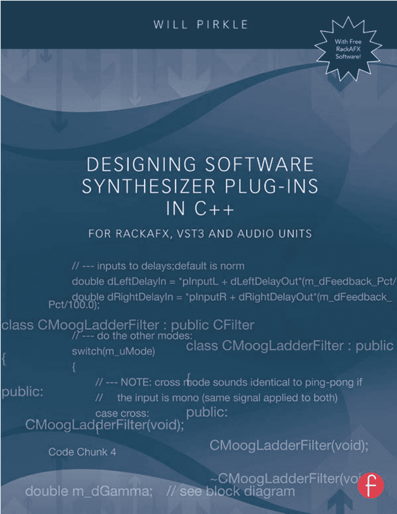

# 前言

在本书开发的过程中，我多次问自己，我到底在想什么。我竟然要写一本包含三种不同插件 API 和平台的书。真的吗？事实上，我有一个非常合理的“小动作”：将这三个 API 并列展示，以证明尽管在实现细节上存在差异，但它们实际上是多么的相似。这是我第一本书《使用 C++ 设计音频效果插件》中的要点之一，那本书专门使用 RackAFX 作为工具，并将其作为一种快速简单的方法，以便以最少的精力让实时信号处理代码运行起来并运行。在过去的两年里，我收到了来自世界关于这本书和 RackAFX 软件的来信，幸运的是反馈非常正面。本书的目标是让对数字信号处理（DSP）几乎没有或完全没有经验的初级程序员，在一个学期的课程时间内，进入插件编程领域。由于你可以将你的 RackAFX 插件编译为 VST2 产品，因此可以将其导出并运行在其他数字音频环境中。其理念是，在你在 RackAFX 上进行训练后，就准备好应对诸如 VST 和 Audio Units 等更复杂的应用程序编程接口（API）了。你需要自己去筛选文档和示例代码，以弄清楚 `processAudioFrame()`、`interface()` 等函数（那些 RackAFX 函数）。对于许多人来说，这要么是困难的，是不可能的，特别是当某人从未接触过商业 API 时。

我回起了我的第一个 API——来自软件开发包（SDK）的 Windows 3.1 API。我在 1990 年花 600 美元买了它。我的目标是学习 Windows 编程并编写一个应用程序——当时我正在读研究生，我收到了大量的软盘和一套巨大的装订平装手册。看起来我从微软公司那里买回了物值的钱。我急切地钻研这些手册，却发现关于如何实际编写一个 Windows 应用程序的一点信息都没有。微乎其微。零。所有的函数都有详尽的文档说明——然后你使用 C 语言语言来编写 Windows 应用程序。这简直让人无所适从。我很惊讶的是，他们竟然没有写一个名为“如何编写 Windows 应用程序”的章节，写着“第一步：打开微软；第二步：新建项目……”。如果你读过我的第一本书，你已经看到了许多关于插件实现的分步指南——拥有 Windows 3.1 API 的经验正是如此的原因。尽管如此，我必须让我的程序运行起来，但从未像现在这种方法，通过在所有三个 API 中并列向你展示完整的合成器项目来实现。你可以使用你喜欢的任何一个。我非常鼓励你在三个 API 中都实现这六个项目中的至少一个，这样你就可以感受每个项目的优缺点。我深信，一旦你在三个平台上都实现了一个合成器，你就会理解我为什么写了 RackAFX 软件和插件 API。但这本书不仅仅是一系列合成器项目；它还教你如何在每个平台上编写插件，并包含了关于信号处理和合成理论的章节。而且包含一些方法，包括一点微积分。就像在《使用 C++ 设计音频效果插件》中一样，我尝试将复杂的数学降到最低，但在某些地方这是无法避免的。另一个相似之处是，本书并不教授 C++；你需要在开始项目之前具备这些技能。同样，这本书也不是不是关于技巧性代码、优化、单元测试或其他软件理论的。

你将在以下 API/平台上编写项目有：

- RackAFX: Windows
- VST: Windows

由于空间限制，我选择不实现 VST3/MacOS 版本。坦率地说，代码与 Windows 版本几乎相同，且 VST3 SDK 包含了这些平台的示例代码。你可能还会注意到 Avid 的 AAX API 非常混乱。你必须是注册的插件开发者才能进行开发。这不是一个简单的过程，因为你必须证明你可以编写并销售插件。通过这种方式，AAX API 是封闭的，不像 RackAFX、VST3 和 AU 那样有公开文档，因此我可以编写 SDK 的实现细节。

如果你读过我的第一本书，就知道 RackAFX 是通过使用 C++ 包装器封装为 VST2 插件的。这掩盖了实际的实现细节。本书并不是这样工作的——每个插件都是使用其原生语言通过 SDK 工具实现的；没有第三方库、框架或其他辅助。你可以看到所有的细节，没有任何掩盖。这种方法对 Audio Units 有影响。每个插件都是使用其原生语言通过 SDK 工具实现的；没有第三方库，框架或其他辅助。你可以看到所有的细节，没有任何掩盖。

在 AU 插件中，你使用 InterfaceBuilder (IB)，它是集成在 Xcode 中的。如果你已经创建了几个自定义控件，你就可以创建令人印象深刻的用户界面。当然，你也可以使用 SDK 对象。

本书的另一个改进领域源于读者的建议。要求的作业以每个章节末尾的“挑战”的形式出现，但并非全部。这直接取自 Joe Conway 和 Aaron Riley 优秀的 iOS 大指南，我在迈阿密大学 iOS 课程使用的教材。“挑战”通常是编程作业，并分为铜、银、金、铂和钻石级，从易到难。书中不提供解决方案，但它们应该在学生和读者实现时出现在论坛上。

在准备书籍计划书的早期阶段，我需要对合成器项目本身做出决定。它们可以是非常简单且留有大量扩展空间，也可以包含每种可能的合成算法而极其复杂。我首先决定不介绍物理建模算法。原因是这很容易变成另一本书的内容，而且会更像是一本理论书而不是编程书。我决定通过各种合成技术展示六个复音合成器。合成器响应常见的 MIDI 控制器消息和调制矩阵，允许你在架构上产生无数变体。我还需要确保理论上没有重叠，本书包含了所有的振荡器和滤波器设计。理论也有所不同，在模拟合成方面有更多的示例。

真正的乐趣从第 3 章开始，你将在你的平台上开始你的第一个“训练合成器”NanoSynth 和 MIDI 消息。在 MIDI 就绪后，我们可以进入第 4 章开始的理论核心部分——第 4 章包含了理解滤波器和振荡器所需的模拟和数字信号处理。第 5 章解释了振荡器，你将它们添加到 NanoSynth 项目中。接下来在第 6 章添加包络发生器（EG）和数字控制放大器（DCA）。第 7 章介绍了虚拟滤波器模型（你将使用不同的滤波器进行测试）；在这里你为 NanoSynth 添加单声道梯形滤波器，然后你就可以测试其他滤波器了。NanoSynth 在第 8 章创建，在该章你添加调制矩阵并最终使其运行。

第 9 章是书中的转折点，因为所有的底层合成器 C++ 对象都在代码中设定，且将不再更改。在这里，你设计了 MiniSynth——一种模拟建模合成器。如果你愿意，可以偏离书籍，实现你自己的合成器语音对象和模型编码。在第 10 章中，你将学习如何使用音频文件导入 DigiSynth，这是一种立体声播放合成器。第 11 章矢量合成使用了 Vector 项目中基于样本的振荡器，并包含一个额外项目 AniSynth，它是对 Moog Anisynthhesizer Android 应用的解读。在第 12 章中，你设计了一个 Yamaha DX100 FM 合成器的克隆版本。第 13 章是音频效果章节，向你展示如何为 MiniSynth 添加延迟效果，从而极大地扩展你的合成器功能。简要附录向你展示如何将 VST 和 AU 模板转换为项目的基础代码（如果 RackAFX 为你创建了项目，则不需要这样做）。

有两个人对本书的早期产生了巨大影响——Bill Jenkins 和 Andy Lear，他们都是 K 研究开发部门的高级工程师，也是原始提案的评审员。Bill 的评论和建议塑造了 C++ 代码的呈现方式，并使其尽可能与描述性文本交织。事实上，他正是不同的 API 在单独章节中编码，而不是像提案中那样混合在一起的原因。英语中没有一个单词可以描述对 Andy 在理论章节（4–8 章）中投入的感激之情。他是这些章节中许多算法的专家，他的投入是无价的。Andy 还反复校对了了章节，提供了源源不断的灵感。模拟的 MiniSynth 对我来说听起来极棒，这很大程度上归功于 Andy 的投入。Bill 和 Andy——感谢你们！

我的教授和学生们也对这项工作充满热情，我得到了同事 Dean Shelby、Serona Elton、Rey Sanchez、Colby Leider、Joe Abbatti 和 Chris Bennett 的全力支持，包括在我在音乐工程论坛（Music Engineering Forum）课程糟糕的缺勤记录中给予宽限。尽管我从 20 世纪 90 年代就开始教授合成器课程，但直到四年前学生才开始使用 RackAFX。最后几代音乐工程专业的学生无论他们是否知晓，也塑造了书的内容和 RackAFX 软件。去年，Colin Franks 和 Mark Gill 改进了几个合成器组件的稳定性能。Rob Reinh 翻新了 GUI 元素。我还需要感谢学生在去年合成器课程中的投入和帮助（按字母顺序）：Daniel Avissar、Andy Ayers、Daniel Bennett、Garrett Claussen、Sammy Falcon、Michael Intenda、Connor McCullough、Tac Nicol、Crispin Odomn、Andrew O'Neil-Smith、Ross Penniman、Michael Tony 和 Francisco Valencia Otalvar。

你可以通过加入网站论坛 `http://www.willpirkle.com/synth/` 与我保持联系，那里包含了书中未涵盖的信息和资源。像往常一样，我鼓励向我发送你的作品或在论坛发布链接。作为我的最后一本书，我迫不及待想听听你在插件开发中出了什么花样！

祝好，

Will Pirkle

2014年6月1日

## 前言

以下关于书籍项目和惯的一些说明。

## 技能

基础的 C++ 编程技能都是用 C++ 编写的。如果你上过该主题的一两门大学课程，应该没有问题。在 API 中，你需要完全精通 Visual Studio 编译器，并且需要知道如何向项目添加文件、使用过滤器重新排列源文件以及使用调试器。如果你想设计 GUI，你需要精通 AppKit 和 CoreAudio 等框架；同样，你需要了解 InterfaceBuilder 和 Xcode。

## 匈牙利命名（Hungarian Notation）

99% 的 RackAFX 和 VST 代码是使用匈牙利命名的。大部分 AU 代码也使用了它（部分来自 Apple 公司）。以下是微软对匈牙利命名的描述：很久在 DOS 早期，微软首席架构师 Charles Simonyi 引入了一种命名规范，在标识符名称前添加前缀以指示其功能类型。该系统在微软内部被广称为“匈牙利命名”，因为前缀让变量名看起来有点像是用非英语语言编写的。事实证明，匈牙利命名非常有用——它是许多技术中一种能帮助程序员编写出更好代码的技术。由于过去 15 年发布的大多数头文件和文档都使用匈牙利命名标识符，因此最重要的出版物是几乎每个 Windows 程序员读的第一本书（Simonyi, 1999）。

## 合成器项目

在本书过程中，你将从任何 API 开发六个项目。代码被分为每个 API 的章节。章节遵循相同的思想呈现顺序，你可以先读理论部分，然后跳到包含你目标平台的章节。这些项目的设计允许你衍生出许多你自己的变体。以下是合成器项目及其包含的组件列表：

| 项目 | 振荡器 | 滤波器 | | | |
| :--- | :--- | :--- | :--- | :--- |
| NanoSynth | 模拟建模 (BLEP) | Moog Ladder | 通用 LFO | 组合 Amp-EG, Filter-EG, Pitch-EG |
| MiniSynth | 模拟建模 (BLEP) | Moog Ladder | 通用 LFO | 组合 Amp-EG, Filter-EG, Pitch-EG |
| DigiSynth | 样本播放 | Oberheim SEMF | 通用 LFO | 组合 Amp-EG, Filter-EG, Pitch-EG |
| VectorSynth | 样本播放 | Korg Lowpass | 通用 LFO | 组合 Amp-EG, Filter-EG, Pitch-EG |
| AniSynth | 样本播放 | Diode Ladder | 通用 LFO | 组合 Amp-EG, Filter-EG, Pitch-EG |
| DxSynth | 波形表 | 无 | 通用 LFO | FM EGs |

## 延迟效果 (Delay FX)

第 13 章中的延迟效果套作为示例添加到 MiniSynth 中，但也可以很容易地添加到任何合成器中，鼓励你在所有合成器中实现效果。

## 参考文献

Simonyi, Charles. 1999. "Hungarian Notation." 2014年8月访问。 `http://msdn.microsoft.com/en-us/library/aa26976vs.aspx`

# 第 1 章：合成器基础

合成器通常被模糊地定义为一种产生并控制声音的电子仪器。在与同事讨论此时，我们同意这个定义的密度可能具有限制性。为什么迪杰鲁（didgeridoo）或口琴不能被称为合成器呢？事实上，难道没有人声不是合成器吗？将美国发明家 Thaddeus Cahill 视为现代合成器的发明者。1897年，他为 Telharmonium 或 Dynaphone 申请了专利，这是一种使用蒸汽动力电机合成正弦波的仪器——它甚至是复声的（能够同时播放多个音符）。Leon Ther 在1919年发明了明琴（Theremin），它包含一个控制正弦波振幅和音高的无接触接口。与 Telharmonium 不同，明琴使用电子放大器重现声音而不是声学喇叭。然而，发明者创造了独特的仪器，如 Ondes Marten、Trautonium 和 Mixtartonium 等。合成器（synthesizer）一词的首次使用是在1929年的 Complexplex Synthesizer。RCA 标记了使用调音叉控制振荡的电子音乐合成器。1957年，Max Mathews 实验使用计算机渲染和控制音频信号，而 Robert Moog 普及了硬件，并被认为在1963年发明了第一台电压控制合成器。他的发明包括 Moog 阶梯滤波器，我们将在第7章中研究它。1967年，他销售了可以连接到系统中以产生各种声音的电子模块——他把这些称为合成器。这些合成器的驱动力不是电子音乐，而是20世纪的新古典音乐作曲家。关于作曲家与电子工程师之间关联的文章并不少见，例如 Moog 与作曲家 Herbert Deutsch 合作，Donald Buchla 与作曲家 Morton Subotnik 和 Ramon Sender 合作创作先锋派。Sergio Franco 和 Ken Pohlmann 在70年代与作曲家 Salvatore Martini 合作，开发了如图1.1所示的 SAL-MAR 结构。

Moog 的合成器由各种组件组成，每个组件都有自己的电路板、旋钮、灯和接口。振荡器产生原始波形——正弦波、锯齿波和方波。放大器使用电压控制放大器修改信号振幅。滤波器实现各种基本功能，如低通和高通类型。包络发生产生变化的输出值，用于控制其他模块的振幅或滤波。以各种方式组合模块产生最有趣的声音；结果在某种程度上大于部分。Moog 的每个模块都有自己的输出，控制插座使用音频跳线线连接在一起，这种做法在录音室被广泛采用。这就是 patch（跳线）一词的起源，我们经常使用它。一个 patch 是连接和设置每个模块参数以形成特定声音的配方。在合成器周围，你会经常听到 patch cord patch patch patch 这些词。

为了许多补丁（patches）。这导致了半模块化合成器的出现，其中某些组件被硬连接在一起且无法更改。其他组件可以在一定范围内进行路由和连接。我们在本书中设计的合成器是半模块化的。你将拥有所有需要的工具来极大地扩展合成器的功能。所有的合成器项目都基于出现有合成器的特性。

## 1.1 合成器组件

合成器的设计包含三种类型的组件：

- 信号源（sources）：产生音频信号的，例如振荡器和噪声生成器
- 修饰器（modifiers）：改变信号源产生的音频信号的，例如滤波器和效果
- 控制器（controllers）：控制源和/或修饰器参数的；这些可以是 MIDI 控制器上的旋钮等固定控制，也可以是连续变化的控制器（如包络生成器）

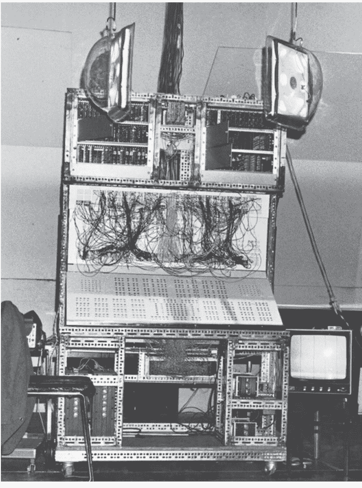

图 1.1：1978 年的 SAL_MAR 构造合成器。


图 1.2 展示了最基础的合成器。它由每种基础构建块的一个单元组成。注意音频信号是如何从左向右流动的，控制信号是从下到上的。这是我们在整本书中使用的范式（也是大多数合成器制造商使用的范式）。

你还可以看到控制信号使用了指向上的箭头，而音频信号被隐含是从左向右移动的；它的路径没有使用箭头。如果你在信号路径中看到箭头，是因为信号正在与其他内容进行混合，如图 1.3 所示。这显示了两个源的输出进入一个加法器（summer）。我们又增加了两个控制器，以说明控制器可以作用于源、修饰器甚至其他控制器。

当控制器作用于某个某物时，它会改变其一个或多个参数。例如，控制器可能会改变振荡器的频率和振幅。改变参数被称为“调制”（modulation），这是贯穿本书的术语。控制器调制其目标参数。控制器也被称为调制器（modulator）。从控制器到单个参数的连接称为目标（destination，即要调制的的目标参数）。每个合成器都包含一个包含所有源/目标对的表格，称为“调制矩阵”（modulation matrix）。你也可以允许用户重新排列调制路由以获得更大的灵活性。一个通用规则是，具有丰富源和目标的大调制矩阵可以产生高度可编程的合成器，但它可能会有陡峭的学习曲线。具有简单调制矩阵的合成器更容易编程，但功能较有限。我们将从设计简单的合成器开始，它们将包含一个非常容易扩展和重新编程的调制矩阵。通过这种方式，你只需少量额外编程就能在基础设计上衍生出无数变体。随着合成器的推进，我们将添加更多的调制路由。

图 1.2：一个由源、修饰器和控制器组成的通用合成器路径；注意信号流的方向。

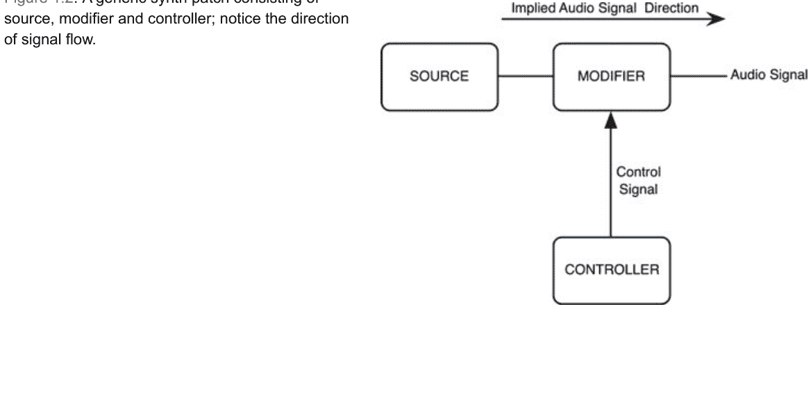

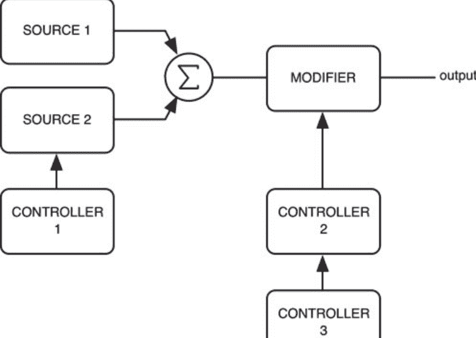

图 1.3：一个由两个源、一个修饰器三个控制器组成的通用合成器补丁。

## 1.2 振荡器

振荡器在没有输入的情况下渲染音频。我们将设计并使用几种类型的振荡器，以各种方式合成波形：

- 数学方式
- 使用称为波表（wavetable）的查找表
- 通过提取 WAV 文件包含的音频样本
- 频率调制（FM）和相位调制（PM）

振荡器既可以作为源也可以作为控制器。我们将振荡器分为两组：音高振荡器和低频振荡器（LFO）。在大多数情况下，我们将音高振荡器简单地称为振荡器。在书中，每个合成器将有两个框图——一个简单的框图和一个详细的连接图。简单的框图易于阅读并显示架构，但没有显示每一个连接，而详细的连接图则显示了所有的连接和图形用户界面（GUI）控制。我们将随着章节的推进讨论这些连接图。振荡器和 LFO 将使用图 [1.4] 中的两个符号表示在简单框图中。在图 [1.4 (a)] 中，一个 LFO 调制单个振荡器。具体的调制类型未标出，但在我们的合成器框中，该振荡器是一个隐含的连接，用于调制振荡器的音高（频率）。该振荡器用圆圈内的斜坡或锯齿波表示。对于我们的合成器来说，这意味着数学生成或波表生成的波形之一。名为 DXSynth 的 FM 合成器将使用正弦振荡器，因此在这种特殊情况下，你会看到正弦波而不是斜坡。

LFO 仅用一对三角形波显示，是因为这是常用的调制波形，并在视觉上将 LFO 与音高振荡器区分开。在图 1.4 (b) 中你可以看到另外两种类型：OSC A 描绘了从 WAV 文件加载的音频样本，而 OSC(noise) 是噪声生成器。LFO 位于左侧，由于它是控制器。图中暗示了控制器作用于上方所有的振荡器。

## 1.3 滤波器

滤波器修改音频信号的频率内容——因此它们是修饰器。我们在第 7 章将设计几种基本滤波器。这些：

- 低通滤波器（lowpass）：衰减高频，共振
- 高通滤波器（highpass）：衰减低频，共振
- 带通滤波器（bandpass）：通过衰减高频和低频允许一个频率范围通过，共振
- 阻带滤波器（bandstop）：通过允许高频和低频通过来衰减一个频率范围，共振但通常不是

尽管我们在第 7 章会介绍细节，你可以看到低通和高通滤波器可以在它们衰减的频率边缘产生共振峰。共振峰可以是柔和或尖锐的。带通和阻带滤波器技术上可能会共振，尽管这并不常见（我们将在第 7 章引入一种阻带滤波器）。图 1.5 显示了滤波器。图 1.5(a) LFO 调制滤波器。图 1.5(a) 调制是截止频率。我们将设计单声道和双声道的。图 1.5(b) LFO 调制左右。

## 1.4 放大器

放大器放大或衰减信号，因此它们也是修饰器。早期模拟类型被称为电压控制放大器（VCA）。我们将实现这些。DCA 控制合成器的输出以及声位功能。它可以是单声或双声但始终是双声。图 1.6 显示了滤波器和 DCA。

## 1.5 包络生成器

包络生成器（EG）产生可以应用于任何目标的包络，例如振荡器音高（称为 Pitch EG）、滤波器截止频率（称为 Filter EG）或 DCA 振（称为 Amp EG）。包络生成器产生的曲线被分为攻击（attack）、衰减（decay）、持续（sustain）和释放（release）段（尽管可能超过四段）。我们将在第 6 章介绍 EG 的细节。图 1.7 (a) 显示三个不同的 EG 作用于三个目标，而 (b) 显示一个 EG 作用于所有。在这种情况下，你对每个组件都有最终控制。

## 1.6 基础合成器架构

除了 DXSynth 外，所有的合成器都具有与图 1.6 类似的架构。MIDI 协会（MMA）将这种架构分为三个块，如图 1.8 所示。

- 数字音频引擎
- 表现
- 控制

数字音频引擎包含音频信号路径中的组件，而表现块包含作为控制器的组件。偶尔会出现重叠。例如，你可能会允许一个音高振荡器作为控制器并修改滤波器截止频率。我们的合成器通常遵循此范式。控制块由 MIDI 键盘、GUI 以及用于控制数字音频引擎和音色块（articulation blocks）的其他信号组成。图 1.8 显示了图 1.7 (b) 中合成器的框图。

## 1.7 音色设计的的基本目标

音乐品味是主观的。构成良好或糟糕音乐声音、音符或事件同样是主观的。尽管存在各种音乐口味和偏好，但通过研究乐器以及人类耳脑的连接，我们可以总结出一个关于音乐表达目标的基本陈述——让听者对发生的音符事件保持专注。这实际上意味着让耳朵保持专注。我们的耳朵是瞬态敏感型换能器。瞬态声音（Transient sounds）会引起我们耳脑的好奇心，而稳态声音会迅速消失在背景中。这也许是进化的结果——一个猎人穿过森林时，当他听到附近树枝断裂声，这预示着可能采集食物的机会，也可能成为他人的猎物。但猎人会自动忽略持续的鸟鸣声或风吹树叶声，除非鸟鸣突然停止——这种标志着非常事件的瞬态事件。因此，我们的耳脑连接对变化的事物更敏感，而不是对不变的事物。在这种情况下，变化的是时域幅度——树枝断裂的声音或鸟鸣的突然停止。我们的耳朵对具有变化的时域幅度包络的声音感兴趣。考虑钢琴、吉他或大提琴等其他乐器——它们产生具有特定幅度包络的声音。这三类乐器都可以在音符起始时产生快速的瞬态边缘（称为瞬态攻击，Transient attack）。钢琴和吉他产生声音消失得很快，而大提琴可以根据演奏者的意愿长时间持续一个音符。

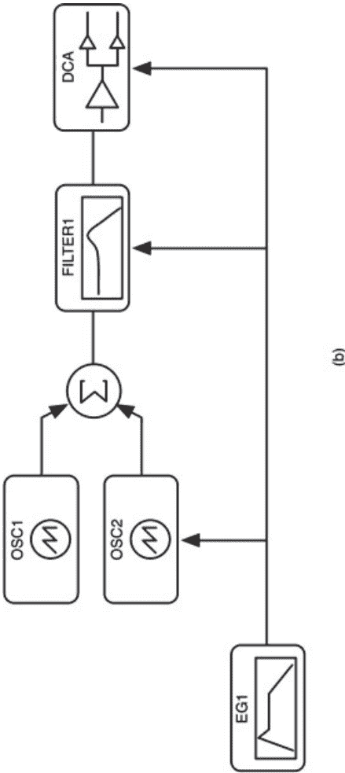

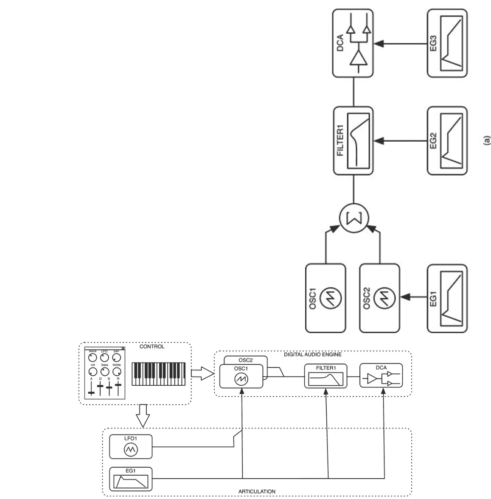

图 1.8：带有数字音频引擎、音色和控制块的典型合成器的 MMA 框图。

但我们的耳朵也被设计用来追踪频率内容发生变化的事物——即使整体幅度保持相对恒定。说话和唱歌都是通信的形式，其中频率内容随时间变化或演变。例如，歌手可能会在保持恒定幅度的同时对音符进行轻微向上滑音（glissando）——这是一个我们的耳朵会追踪并响应的事件。但当歌手达到最终音高并保持住时，耳脑就失去了兴趣。歌手通过什么来重新获得兴趣呢？一个答案是在持续音符时添加音高颤音（ vibrato）。颤音是音乐表达的一种形式，音符的音高在真实音高上下波动。非钢琴和非打击乐器演奏者通常在演奏风格中使用颤音，一种普遍观点认为，如果颤音是在音符持续一段时间后添加而不是从开始添加，效果会更有效。为什么？因为你是在耳朵开始失去兴趣时添加它的。听听一位伟大的萨克斯风演奏手从抒情曲中演奏一段优美的旋律，你一定能听到事后加入的颤音，而不是在音符起始处就。

你可能会说：“好吧，但环境合成器声音呢？”在这种情况下，目标是设计一种适合作为背景材料的声音；关于你最喜欢的电脑游戏中那种阴森的声音。如果你只听背景部分，你可能会惊讶地发现频率在时间内经历了极的变化——变化发生得很缓慢，所以你在游戏过程中并不会注意到。在这些音色中，声音的频率缓慢流动，通常以一种可怕或故意令人不安的方式进行。因此，尽管存在瞬态边缘或快速变化的频率成分，但正在发生频率演变，尽管非常缓慢。如果游戏作曲家使用简单的正弦波作为游戏的背景音乐，你只会忽略它，那种诡异或不安的效果就会消失。因此，我们的耳朵也对声音的频域包络感兴趣——或者不同的频率成分随时间如何变化。

所有这些都导致了我们对合成器音色中希望拥有的内容的总结，这最终决定了系统所需的模块。

通常情况下，我们需要创建在时间和频率上发生演变、变形或改变的声音，以创造听觉上有趣的事件。时域包络决定了事件发生期间信号的幅度，而频域包络控制了频率成分的变化方式。

某些音色（如打击乐）更倾向于将幅度包络作为区分特征，其他（如游戏中的环境背景循环）可能偏向于频率演变。然而，如果你检查大量执行中的声学乐器，你会发现它们往往在时间和频率包络上发生显著变化。观察图 1.9，它显示了一个以强音（fortissimo）演奏的单个钢琴音符事件（音符为 A1），并去除了事件的释放端口。能量衰减释放（EDR）在同一张图中显示了幅度、时间和频率，有时被称为瀑布图（waterfall plot）。

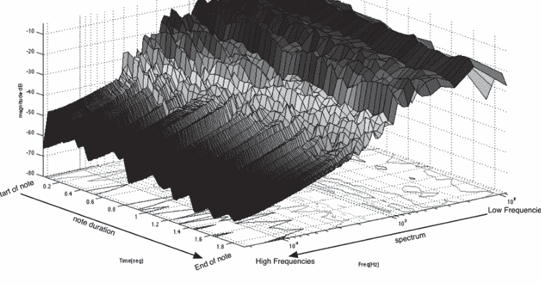

图 1.9：大三角以强音播放音符 A1 的 EDR。

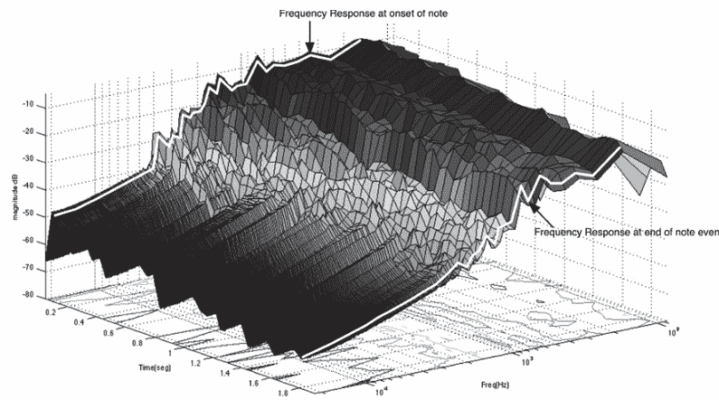

图 1.10：在这个钢琴采样中，你可以看到整体频率响应如何从音符起始到事件结束变化；我们观察到主共峰持续时间更长，但一些早期的中频已经坍塌。

在这些图中，幅度（dB）位于 y 轴，时间位于 x 轴，频率位于 z 轴。注意低频在后面，高频在靠前。沿着频率轴移动，我们可以看到频率响应从背后的音符起始到前面的音符事件结束的变化，如图 1.10 所示。你可以看到主共峰是如何保留的——它们持续了整个音符事件的寿命，但早期共振在事件结束时消失了。你还可以观察到所有高频一起衰减，并且随着时间的推移，更多的高频衰减。

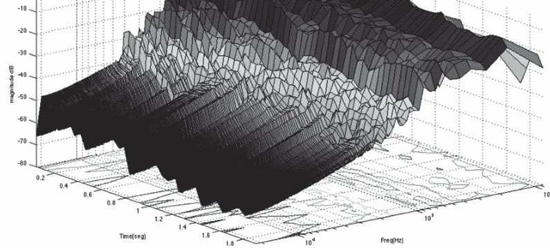

图 1.11：沿着时间轴，你可以看到低频如何从较高的幅度开始并保持几乎不变，而高频成分从较低幅度开始衰减得更快且不平滑。

在时间轴上，你可以看到如图 1.11 所示，每个频率成分如何以波动的方式随时间变化。

图 1.12 显示了声学乐器、掌声和雨的 EDR 集合。花些时间研究这些图之间的差异。即使你没有模仿传统乐器的欲望，它们已经生存了几个世纪甚至更久，所以我们可以从中学学习一些东西——这些是让耳朵专注的乐器。它们的乐器是：

- 声学低音 (F#1)
- 拉弦大提琴 (C#2)
- 单簧管 (D4)
- 英国号 (D4)
- 钢琴 (F#2)
- 铃 (C#3)
- 梆碗（一种西藏铃，Eb5）
- 小鼓
- 掌声
- 雨

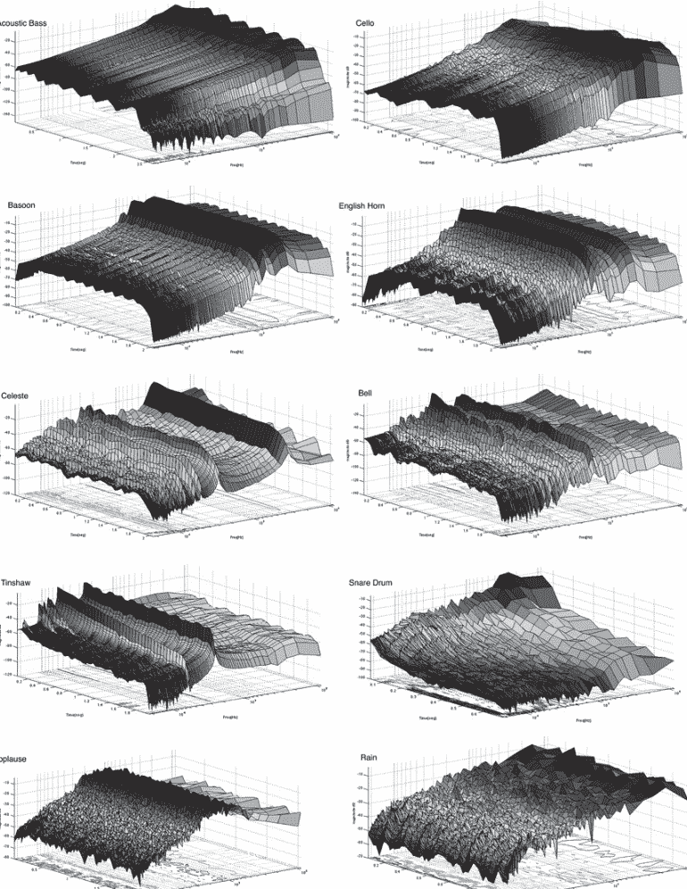

图 1.12：各种声乐器、铃铛、小鼓、掌声和雨声的 EDR 图。

总的来说，我们希望设计的合成器能够便于创建具有这种演变特性的补色。我们需要能够容易地塑造时间和频率轮廓，使其在音符事件启动后发生演变。如果控制直直的，合成器将易于编程。在 VectorSynth/AniSynth 中，我们将使用摇杆控制来大幅改变补色的时间轮廓和音色。然而，某些合成器比其他合成器更难编程——DXSynth 因为频率在其算法中的演变方式，导致学习它需要更多时间。

图 1.13：钢片样本中的高频部分并不像管管中那样有组织。

## 1.8 插件的音频数据格式

幸运的是，我们的三种插件格式——RackAFX、VST3 和 AU——对所有音频输出都使用相同的数据格式。效果插件

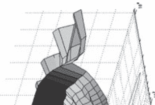

既有输入也有输出，而合成器插件是仅输出设备。音频样本可以用多种格式表示。在最早的模拟数字转换器中，具有最大负值的数据表示为 00000..0，最大正值表示为 11111..1，用于控制电路和显示输出。在数字音频样本中，我们希望同时表示正值、负值，最重要的是 0.0。使用脉冲编码 (PCM) 作为信号可以被编码，使其包含极性和 0.0 值。你的音频输入硬件会做到这一点，并将输入的音频数据转换为基于 PCM 的样本。这些样本是整数，其范围取决于模拟转换器的位深。几种不同位深的范围如表1所示。你可以看到表格向负方向倾斜。这是因为对于给定的位深，量化层级是偶数：

量化级数量 = 2^N

N = 位深

我们将这些级别之一分配给值 0，因此有奇数个级别需要跨越范围分配。负侧获得额外值的原因与 PCM 以补码形式编码的方式有关。详细讨论请参阅《使用 C++ 设计音频插件》。

为了让数字音频工作站 (DAW) 及其插件能够处理任何位深的输入数据，音频会被转换为 -1.0 到 +1.0 范围内的浮点数或双精度浮点数，这是通过简单地将 PCM 值按负限制的绝对值进行缩放来实现的。这对于 24 位音频实际上产生了一个从 -1.0 到 +0.9999999 的值范围。我们将此舍入到 -1.+1 到 +1.0 的范围。在书中，这种括号格式将表示为 [-1.+]。这意味着我们合成器插件的输出必须始终位于 [-1.+] 范围内，否则会发生信号削波（clipping），从而引入失真。通常这很容易检测。然而，如图 1.14 所示，我们合成器内部的信号并不一定需要落在这个范围内。

目前支持的音频输出数据格式：

- RackAFX：32 位浮点数 (float)
- VST3：32 位浮点数 (float) 和 64 位双精度 (double)
- AU：32 位浮点数 (float)

表 1.1：某些不同数字音频位深的范围。

| 位深 | 负限制 (-) | 正限制 (+) |
| :--- | :--- | :--- |
| 16 | -32,768 | +32,767 |
| 24 | -8,388,608 | +8,388,607 |
| 32 | -2,147,483,648 | +2,147,483,647 |

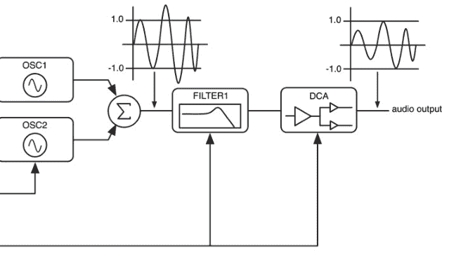

**图 1.14：**合成器内部的音频信号幅度可能会超过 [-1..+1] 范围，但为了无失真音频，输出必须落在该范围内。

我们所有的合成器将默认产生 32 位浮点输出，以获得最大的兼容性和易于比较。如果你目标是 VST3，你可能额外添加产生 64 位输出的能力。我们所有的输出都将是浮点值；然而，这并不意味着我们需要在合成器内部渲染并生成浮点数数据。因此，我们的合成器实际上将渲染并生成双精度数据。

## 1.9 信号处理

我们所有的合成器将默认产生 32 位浮点输出，以获得最大的兼容性和易于比较。如果你目标是 VST3，你可能额外添加产生 64 位输出的能力。我们所有的输出都将是浮点值；然而，这并不意味着我们需要在合成器内部渲染并生成浮点数数据。因此，我们的合成器实际上将渲染并生成双精度数据。

## 1.10 连续信号

我们通常将模拟信号描述为时间的函数 f(t)，如图 1.15(a) 所示。

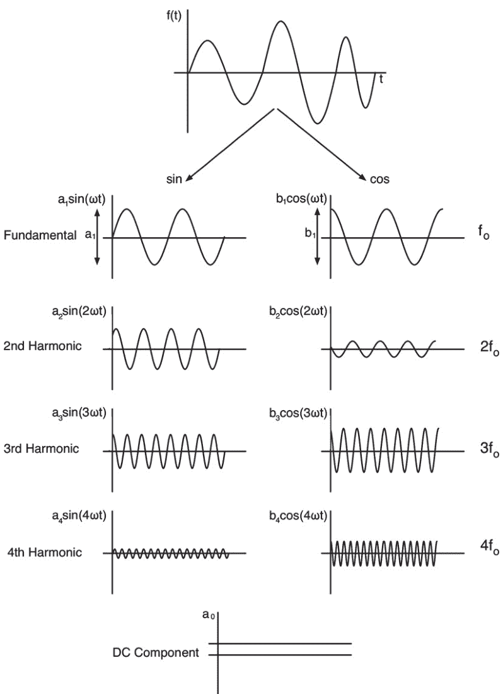

图 1.16：通过傅里级数对模拟波形进行傅里分解。注意：正弦和余弦分量在两个方向上永远存在，在 y 轴处截断以显示它们的相位差异。

$a$ 和 $b$ 系数代表与相同的正弦和余弦谐波幅度。$c$ 项代表每个频率分量的幅值，而 $\phi$ 项代表每个分量的相位偏移。回到图 1.16，你可以看到每个谐波分量（包括基波）的幅度和相位决定了它们的高度和时间偏移。

更进一步一步，我们可以使用欧拉恒等式（读作 "Oiler"），它进一步将正弦和余弦联系成正交关系，如下：

```
e^{jwt}=cos(wt)+jsin(wt) (1.3)
```

正交通常定义为“相差 90 度”，但也许更直观的定义可能是“彼此完全无关；在最纯粹上是不相关的”。欧拉恒等式之所以有用，是因为它在一个方程中结合了正弦和余弦，保留了它们 90 度的关系。更重要的是，它有用是因为它在数学上是连续的，它的行为像多项式一样；用微积分处理非常简单。$e^{at}$ 的导数和积分（$a$ 或是 $1/a$）与其原函数的关系，正是我们在傅里级数中使用它的原因。它极大地简化了我们在第 4 章中观察到的频域传递函数的求解。

```
$e^{it}=\cos t+i\sin t \quad (1.4)$
$\frac{d}{dt}e^{at}=ae^{at} \quad \int e^{at}dt=\frac{1}{a}e^{at}$
```

因此我们可以使用复正弦波代替正弦、余弦或相位偏移的版本，进一步紧凑化傅里级数。

```
$f(t)=\sum_{n=-\infty}^{\infty} F_ne^{in\omega t} \quad (1.5)$
```

方程 1.5 描述了一组幅度为 $F_n$ 的复谐波（和）。因为谐波 $F_n$ 实际上同时包含了幅值和相位，编码为复正弦波的实部和虚部。这就是为什么求和项 $n$ 包含了负值。幅值和相位仍通过相同的方程提取：

```
$|F_n|=\sqrt{Re(F_n)^2+Im(F_n)^2}$
$\phi(F_n)=arg(F_n)=\arctan\frac{Im(F_n)}{Re(F_n)} \quad (1.6)$
```


实部和虚部直接源于欧拉恒等式；实部是余弦幅度，虚部是相同的幅度。相位部分也称为方程的辐角（argument 或 arg）。如果这些关于实部和虚部的内容让你感到困惑，请查看《Designing Audio Effects Plug-in in C++》——它以一种友好的方式解释了如何理解。

要使傅里级数成立必须遵守几条规则。待分解的信号必须：

- 是连续的；没有间断或抖故障
- 是周期的
- 从过去到现在所有时间一直存在
- 在所有时间内保持存在

第一个限制对于经过低通滤波的采样信号来说不是问题；滤波会消除间断。然而，当出现巨大的间断时——必须是周期的。如果信号是准周期的或完全非周期的，比如噪声呢？傅里通过傅里积分给出了回答。它指出，准周期或非周期信号可以表示为谐波的和；然而，这些谐波并不一定在数学上相互关联。和之前一样，可能存在无限多个数学上相关的谐波，但也可能存在无限多个无序谐波。傅里用积分代替了求和——这是描述这种不可计数谐波的数学方法：

```
$F_n=\frac{1}{2\pi}\int_{-\infty}^{\infty}f(t)e^{-in\omega t}dt \quad (1.7)
```

你可以安全地忽略常数 $1/2\pi$。在这里，$F(\omega)$ 项代表任何频率 $\omega$ 的谐波幅度。没有下标 $F(ju)$——也就是说，它存在于从负能量到正能量的所有频率 $f(ju)$ 中。$F(ju)$ 具有幅值。唯一的信号 $F(\omega)$ 被称为频谱。图 1.17(b) 显示了傅里积分的幅度，它表示了图 1.17(a) 中的任意信号 $f(t)$，这只是草图，并非数学上的精确值。你可以看到频谱可以同时具有正幅和负幅度。我们在图 1.17 (c) 中而是绘制了频谱的幅度或绝对值。频谱上的点表示这些点在理论上延伸到正无穷和负无穷。

当你看到书中的频谱图时，你看到的总是以分贝（dB）为单位的幅度。你还会看到频谱和幅度关于 y 轴对称。这是因为输入信号 $f(t)$ 是实数（没有虚部）——我们所有的音频信号都是如此。你可能对频谱中确实存在负频率这一事实感到困扰——事实上，对于每个频率分量，图表的负侧都有一个相同的频率。图 1.17 的设计意图是为了显示幅度如何产生相同的图像，即全为正值。它还显示了峰值（共振）和陷波（反共振），因为这些在音乐信号中很常见。书籍会显示更通用的频谱，通常如图 1.18 (a) 那样的钟形。对该信号进行低通滤波以满足奈奎斯特判则产生裁剪版本的信号，这在 DSP 教科书中也很常见。这种裁剪频谱被称为带限的。

方程 1.7 显示了连续时间信号与其连续频域频谱之间的关系。我们也可以反过来，利用方程 1.8 将频谱表示为时间函数的无限和。

```
F(ω) = \int f(t)e^{-jωt}dt
```

方程 1.7 称为傅里叶变换，它将 $f(t)$ 中的函数转换为频谱 $F(\omega)$。值得注意的是，方程 1.8 称为反傅里叶变换，因为它执行了相反的功能。短时傅叶变换 `STFT` 在 $t_1$ 到 $t_2$ 之间的有限时间段执行积分。

```
F(ω) = \int f(t)e^{jωt}dt
```

（注：原文中方程 1.7 和 1.8 的描述出现了重复，翻译已遵循原文结构）

熟悉基本概念。此外，第7章的滤波器推导和设计将要求对这种时间/频率转换有基本的理解。现在如果你回头看图 1.9–1.13，你会发现它们实际上是在 z 维度上排列的一的一叠又一叠的 `DFT`。

离散傅里叶变换将采样信号或斜坡波 $f(nT)$ 转换为一个因变量为复数频率 $j$ 的信号或函数。

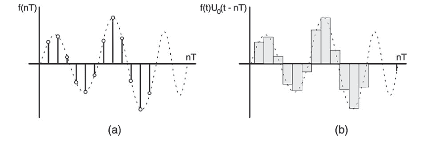

**图 1.19:** (a) 采样间隔为 $T = 0$ 的理想采样信号和 (b) 具有有限采样期的同一组样本。

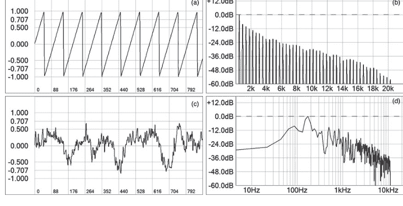

**图 1.20:** (a) 频率为 440 Hz 的锯齿波或斜坡波，(b) 它在线性频域的频谱，(c) 一段短音乐，以及 (d) 它在对数频域的频谱。

快速傅里叶变换 `FFT` 在输出上与 `DFT` 相同。区别在于它的计算方式。数学家 J. W. Cooley 和 John Tukey 在 1965 年推导出了 `FFT`，作为一种更高效计算 `DFT` 的方法。它利用了计算中所用因子之间的相似性来形成一个递归解。在某些书中，`DFT` 和 `FFT` 几乎是互换使用的。

## 1.12 拉普拉斯变换与 z 变换

回顾傅里叶级数的规则，有两个规则可能会让你感到困扰。需要被分解的信号必须：

- 从负无穷大开始的所有时间都存在
- 在所有时间内存在——永远存在

如果你还记得图 1.16，正弦波分量在两个方向上永远存在，且具有相同的幅度。事实证明，傅里叶变换是拉普拉斯变换的一个特例。拉普拉斯取代了关于正弦波分量恒定幅度的限制，这允许了更多类型的信号。在理论上，输入信号可以有明确的开始、中间和结束，且其频率分量可以随时间变化。拉普拉斯变换用更通用的版本 $e^{-(\sigma+j\omega)t}$ 代替了傅里叶核 $e^{-jwt}$，允许正弦波分量随时间指数增长、保持平坦（如傅里叶变换）或指数衰减。实部系数 $\sigma$ 控制正弦波形状随时间的变化。

拉普拉斯变换为：

```
F(s) = \int f(t)e^{-st}dt
s = \sigma + j\omega  (1.12)
```

拉普拉斯变换的离散版本是 z 变换。在 z 变换中，令 $z = e^{ST}$，其中 $T$ 是采样周期；我们需要这样做离开连续时间域 $t$ 进入离散域 $nT$。这产生了：

```
F(z) = \int f(t)z^{-t}dt
F = \sum f(n)z^{-n} (1.13)
```

z 变换是一种巧妙的保持或替换变换——通过简单的替换 $z = e^{ST}$，得到一个包含 $z$ 有理函数的和，而不是无理数的 $e^{ST}$。这意味着 z 变换产生的是 $z$ 的简单多项式或多项式之比，它们遵循多项式数学的所有法则，使其更容易处理。它还可以在固定时长范围内操作，而不是无限周期。

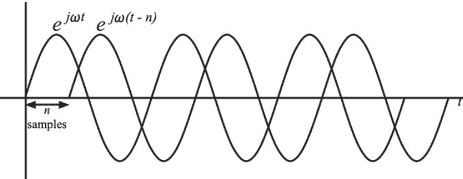

图 1.21：两个延迟了 n 个样本的正弦波。

考虑 $z^{-n}$ 项——它们意味着什么？使用多项式数学：

```
z^n = e^{sn}
z^{-1} = (e^{ST})^{-1} = e^{-ST}
z^{-2} = (e^{ST})^{-2} = e^{-2ST}
等等 (1.14)
```

$T、2T$ 和 $3T$ 值代表 1、2 和 3 个采样间隔。负号表示它们是过去的采样间隔；正号表示不可实现的未来采样间隔，因此你不会在书中看到它们。当我们在第 4 章中使用 z 变换设计和评估滤波器时，我们将令实部 $\sigma = 0$。样本延迟，将信号乘以它将使该信号延迟 $n$ 个样本。

Pirkle, Will. 2012. Designing Audio Effects Plug-Ins in C++, Chap. 8. Burlington: Focal Press.

Steiglitz, Ken. 1996. A DSP Primer with Applications to Digital Audio and Computer Music. Menlo Park: Addison Wesley.

# 第2章

## 编写插件

插件核心是你需要实现的代码，负责与客户端通信的细节、设置渲染系统以及处理图形用户界面（GUI 或 UI）。虽然实现细节非常不同，但所有这三种（以及实际上几乎任何其他插件格式）的运行基本理论是相同的。当你学习飞行时，你会发现俯仰、阻力、偏航和滚滚的基础原理从最小的教练机到战斗机都是通用的；你处理的接口却非常不同。在本章中，我们将从相似之处开始，介绍 `RackAFX` 插件 API 哲学。我们将深入探讨 `VST3` 和 `AU` 平台。如果你从未写过插件，我们强烈建议从 `RackAFX` 开始——事实上，我们每个项目都仍然从 `RackAFX` 开始，然后将它们移植到 `VST3` 和 `AU`，并调试核心。

## 2.1 动态链接库

`C++` 编译器包含了一组预编译的函数库供你在项目中使用。其中最常见的是数学库。如果你尝试使用 `sin()` 方法，通常在编译时会得到“`sin()` is not defined”的错误。为了使用此函数，你需要链接到包含它的库。执行此操作的方法是在文件顶部放置 `#include`。当你这样做时，你是在静态链接到 `math.h` 库，这是一个存储在特殊文件中的预编译函数集，在 Windows 中是库文件（`.lib`），在 MacOS 中是框架（`Framework`）。静态链接将函数调用替换为来自库的预编译代码。通过这种方式，额外的代码被编译到你的可执行文件中。你无法对这些函数本身进行编译。

要在应用程序被编译并销售给客户之后，构建一个扩展应用程序功能的组件，需要一种不同的策略。解决方案是在运行时链接到函数。这意味着预编译的函数存在于单独的文件中，客户端只有在启动后才会知道并与之通信。这种链接被称为动态链接或显式链接。包含新函数的文件称为动态链接库或 `DLL`。在 Windows 中，文件通常使用 `.dll` 扩展名；但在 `VST3` 中，你将扩展名重命名为 `.v3`。在 `AU` 中，`DLL` 扩展名是 `.component`。

为了使用 `DLL` 中的代码，客户端必须执行两个活动：

- 1. 将 `DLL` 加载到进程地址空间
- 2. 为从 `C++` 调用的函数建立通信机制

我们不会担心这些客户端细节，但理解 `C++` 和基类在插件开发中起什么作用是很。

## 2.2 C 和 C++ 风格的 DLL

用 `C` 语言编写的 `DLL` 由一组独立函数组成。没有可以在一个文件中定义并实现的 `main()` 函数，也无法将其拆分为接口；`DLL` 执行一组隔离的函数。使用 `C` 语言编写 `DLL` 的一个问题是，在 `C`（以及 `C++`）中，大括号（`{}`）定义了函数的作用域。在函数内部声明的任何变量在第一个左大括号（`{`）之后只在函数的期间有效。当遇到右大括号（`}`）后，变量就会消失。

一个根本性问题是在函数中声明的数据无法从一次调用持续到下一次。解决方案之一是使用全局变量，这通常是不受欢迎的。另一种方法是让 `DLL` 动态声明一个存储所有持久变量的数据结构，然后将此数据的指针传给客户端。这与回调函数的工作方式非常相似。在后续调用 `DLL` 期间，客户端将指针传回 `DLL`，以便其对持久数据进行操作。当 `DLL` 不再需要时，通过删除该结构来释放内存。

在 `C++` 编程语言中，类定义了一个对象，它是成员变量和成员函数的集合，这些函数可以对这些变量进行操作。通过将插件封装为 `C++` 类，你可以获得几个优势：首先，在编码过程中可以使用所有的 `C++` 特性（继承、封装、多态等）。其次，与其分配数据结构并向 `DLL` 返回指针，客户端可以创建插件对象的新实例并将指针传递给客户端。被调用的函数是创建函数。有了插件指针后，客户端可以简单地调用对象上的函数——在到达需要卸载 `DLL` 或创建另一个插件对象实例之前，它不需要与 `DLL` 通信。这导致了与基于 `C` 的 `DLL` 相比的第三个优势：客户端可以轻松地创建多个实例。`DLL` 可以为对象的多个实例提供服务。有时，插件被称为服务器，这变成了另一种客户端-服务器模型。

## 2.3 应用程序编程接口 (API)

为了让客户端-服务器方案运行，客户端和 `DLL`/插件必须对函数的命名达成一致。这包括创建函数以及所有将在插件上调用的函数。插件对象必须实现客户端不知道的其他函数，但必须对这些函数达成共识。必须建立规则来定义函数调用顺序；插件作者（即你）需要理解客户端如何使用对象。客户端必须确保它建立了这些规则，并在未来的版本中遵守它们以避免破坏插件。另一方面，插件可能承诺正确实现基本所需函数，以使插件运行且不导致客户端崩溃。因此，你可以看到客户端和 `DLL` 服务器之间存在隐式协议。这种协议就是应用程序编程接口或 `API`。它是对象被视为正规插件必须实现的函数定义，以及任何可能被调用或重写的附加函数。它定义了函数原型并描述了如何调用和使用函数。客户端管理 `API` 并供程序员为目标客户端创建插件。`C++` 特别有用。由于插件是 `C++` 对象的实例，客户端可以指定插件派生自管理器定义的特殊基类。该基类是抽象的，包含客户端声明的虚函数。这些虚函数提供了插件的通用功能。这里有两种选择：

- 管理器定义基类为抽象类，并提供函数的默认实现。通常，实现什么都不做。
- 管理器定义基类为抽象类，并提供函数的默认实现。通常，实现什么都不做。

## 2.4 API 对

尽管各种插件 `API` 在实现上有所不同，但 `VST3` 显然获得了支持文件数量最多的奖。在 `VST3` 中，`process()` 函数变得巨大，以至于我们将其分为三个函数。在 `RackAFX` 中没有需要编写的 GUI，因为你将在 `AU` 中自己编写（它是使用 Objective-C 语言的）。你可以看到每个平台的复杂性都不同。

### MIDI 函数

| MIDI 信息 | RackAFX | VST3 | AU |
|---|---|---|---|
| 音高弯 `Pitch Bend` | `midiPitchBend()` | `process()` | `HandlePitchWheel()` |
| 调制轮 `Mod Wheel` | `midiModWheel()` | `process()` | `HandleControlChange()` |
| 所有其他 MIDI 信息 | `midiMessage()` | `process()` | `HandleControlChange()` `HandleMidiEvent()` |

表 2.4：`RackAFX`、`VST3` 和 `AU` 的 GUI 函数。

| GUI 设置与维护 | RackAFX | VST3 | AU |
|---|---|---|---|
| 声明/描述控件，设置限制和默认值 | 使用易用的 Control Designer 完成——你只需填写参数，它就会为你合成代码 | 你必须自己编写代码 | 你必须自己编写代码 |
| 初始化控件 | 自动为你生成 | 你必须在 `initialize()` 中编写代码 | 你必须在 `initialize()` 中编写代码 `GetParameterInfo()` `GetParameterString()` |
| 将控制值写入文件（预设） | 自动为你生成 | 你必须在 `getState()` 中编写代码 | 自动为你生成 |
| 从文件读取控制值（预设） | 自动为你生成 | 你必须在 `setState()` 中编写代码 | 自动为你生成 |
| 声明/创建 GUI | 自动为你生成 | 你必须在 `createView()` 中编写代码 | 由你设计并编写的 GUI 类工厂 |
| GUI 的图形化设计 | RackAFX 内置的拖放式 GUI | 通过 VST3 宿主的拖放式 GUI | XCode 中的 InterfaceBuilder |

表 2.5：本书中三个平台的对比。

| 平台 | 优点 | 缺点 |
|---|---|---|
| RackAFX | - 最简单的 API，文件极少且无需 GUI 编程<br>- RackAFX 会为你编写部分代码<br>- 支持多个 Visual Studio 编译器，包括免费的 Expressions<br>- 运行开销极小，具有良好的复音数<br>- 项目可移植性强，不需要特定的文件夹层次结构<br>-可以通过 RackAFX 进行调试<br>- 内置矢量摇杆编程器 | - 仅运行在 Windows 上<br>- 对于移植项目，你必须编写并维护自己的 GUI；无法使用拖放编辑器<br>- GUI 控件受限（位图选项数量固定，无法添加自己的图形文件） |
| VST3 | - Windows 和 macOS 版本的代码几乎相同（尽管本书仅涵盖 Windows 版本）<br>- 可以 VSTGUI 库和编辑器进行相对简单的 GUI 设计<br>- VSTGUI 允许你通过皮肤/位图自定义自己的 GUI 控件<br>- VSTGUI 包含许多类型的控件<br>- 得益于 COM 实现，高度灵活且安全 | - 最复杂的 API<br>- 需要微软通用对象模型 `COM` 的知识<br>- 需要维护大量的支持文件<br>- SDK 创建的目录层次结构难以修改<br>- 必须拥有 Visual Studio 专业版<br>- 开销中等，会略微减少复音数<br>- 需要通过你必须购买的 VST 客户端进行调试<br>- 少数 DAW（尚未）不支持 VST3<br>- Visual Studio 项目很复杂；难以复制和重命名项目<br>- 无内置摇杆编程器；你需要为它编写代码 |
| AU | - 纯洁且相对简单的 API<br>- 使用 XCode（Apple 免费提供）<br>- 运行开销极小，具有良好的复音数<br>- 目前是 Apple Logic 软件的事实标准，也被 Ableton Live 等其他客户端支持<br>- 与 iPhone/iPad 开发有相似之处<br>- 项目可移植性强，不需要特定的文件夹层次结构<br>- 易于复制和重命名项目——仅运行在 MacOS 上<br>- OS 10.6 及之前的版本略有不同（本书仅支持 OS 10.7 及更高版本，插件兼容）<br>- 要求使用 Objective-C 编写 GUI 代码（用于原生编码）<br>- 平坦的 Cocoa 命名空间需要每个项目重命名对象<br>- 构建规则很奇怪，需要容易忘记或出错的精确设置<br>- 无内置摇杆编程器；你需要为它编写代码 |

在接后的章节中，函数的许多实现细节位于这里。细节将随着书籍的进展从第 5 章开始逐章详细解释，在那里你开始第一个训练合成器 NanoSynth。我们将在后面的章节中更深入地讨论如何修改 GUI。

与任何编程一样，你需要在实现项目之前才能真正开始理解 API。本章将向你展示底层架构和一些代码，后续章节将揭示更底层的细节。

## 2.5 RackAFX 哲学与 API


RackAF 软件背后的基本思想是提供一个平台用于快速开发实时音频处理插件，尽可能减少编码，特别是在用户界面方面。事实上，RackAFX 插件与 RackAFX UI 界面之间连接的大部分细节对开发者隐藏，以便让他们更集中在音频信号上。

RackAFX API 指定插件必须用 C++ 编写，因此利用了基类。RackAFX 插件将根据项目名称自动创建一个派生类。它将帮助你从 UI 中解脱出来。

你只需要实现以下函数：

- `constructor()`
- `destructor()`
- `prepareForPlay()`
- `processAudio()`
- `userChange()`
- `midiNoteOn()`
- `midiNoteOff()`
- `midiPitchBend()`
- `midiModWheel()`
- `midiMessage()`

## 2.6 编写插件

简单来说，RackAFX 是编写插件最简单的方法。你使用 RackAFX 创建信号处理而不是 UI。RackAFX 还处理 MIDI 消息，并且原生支持 MIDI。它将 MIDI 消息传递到你的插件并与你的控制器接口：如果你有一个内置的钢琴控制器；然而，你需要硬件 MIDI 控制器来执行所有连续和延音踏板等控制器选项。

RackAFX 配置你的编译器在 RackAFX 应用程序目录下的 `/Plugins` 文件夹中开发你的 DLL。如果你想查看、移动或删除 DLL，可以使用菜单项 `Plugin->Open Plugins` 或 菜单->All Programs->RackAFX->Plugins 找到此文件夹。

要求：

- Windows 操作系统 (`XP`, `Vista`, `7`, `8`, `10`)
- Visual Studio (专业版)
- `http://www.pirkle.com/`

### 创建

当你在 RackAFX 中加载插件时，你实际上是在将系统路径设置为你创建的 DLL。RackAFX 使用操作系统函数将 DLL 加载到其进程空间中。一旦 DLL 加载，RackAFX 首先运行兼容性测试，然后请求获取一个名为 `createObject()` 的构造函数指针。它使用该指针调用该方法，DLL 返回一个新创建的插件实例，并强制转换为 `CPlugin` 基类类型。从那时起，RackAFX 客户端就可以调用你对象上的任何基类方法。图 2.1 显示了创建阶段的操作流程。

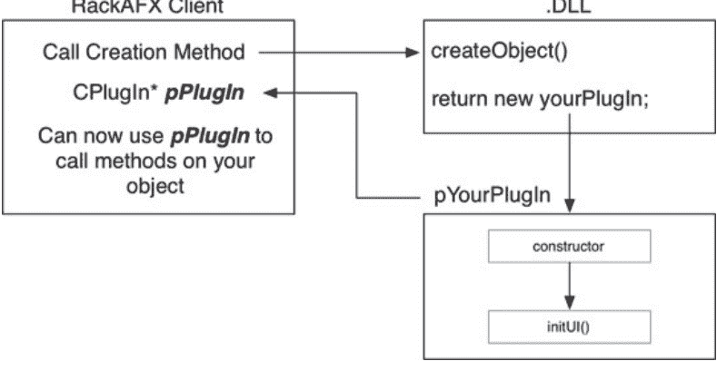

图 2.1：`setObject()` 中的 `new` 操作符动态创建你的插件，并调用你的构造函数；构造函数反过来调用 `initUI()` 来创建并初始化用户控件。

你的构造函数是初始化所有变量的地方。构造函数的第一行已经为你写好了；它调用了 `initUI()`，这是一个处理你的 GUI 控件的控制和设置的方法。你永远不需要修改 `initUI()` 方法；RackAFX 会为你维护这段代码。

### 析毁 (Destruction)

当用户手动或通过加载另一个插件使用 DLL 时，客户端会先从内存中删除插件，这将调用析构函数。任何动态声明的变量或缓冲区都需要在这里被删除。析毁后，客户端将从进程空间删除该 DLL。

### GUI

RackAFX 使用两阶段法进行 GUI 设计。第一阶段是原型设计——在这里，你使用主界面创建一组控件，主界面由滑块控件、按钮和一个低 LCD 控件组成（一次可以有多个）。你不需要担心控件的顺序。用户界面并不华丽；它是一组行和按钮，但它允许你快速构建插件的原型。当你在原型面板（Prototype Panel）上设置元素时，RackAFX 会向你派生插件的 `.h` 文件中添加成员。每个滑块或按钮组控制你中的一个变量。你为每个控件设置最小值、最大值和初始值，以及名称和数据类型。RackAFX 计算变量的值并将其传递给你的插件，自动实时更新它。在某些情况下，这就是你需要的全部，什么都不需要写了。在其他情况下，你需要执行更多的计算或逻辑处理来更改控件。

在你的插件完成并测试后，你通过切换到 GUI 设计器面板（GUI Designer Panel）进入第二阶段。在这里，你将控件拖到空白表面上，并将它们链接到你在原型阶段设置的变量上。你还可以在合理范围内自定义控件，更改其尺寸、位图、颜色、字体和其他属性。你可以随心所欲地重新排列控件。为用户提供比你在原型阶段实现的更有限的最终 GUI 并不罕见——你决定不想让用户控制你插件的某些音色方面。许多公司都会竭力通过限制控件及其范围来防止用户发出非常非常难听的声音。

### 构建与测试 (Building and Testing)

最后，你将构建 DLL 然后修复任何问题。构建成功后，你就可以将其加载到 RackAFX 客户端中。你可以使用内置的 MIDI 钢琴控件（受限）或任何兼容 Windows 的 MIDI 输入设备（推荐）来生成测试插件所需的 MIDI 消息。

### 创建和保存预设 (Creating and Saving Presets)

预设在主 RackAFX UI 上进行创建和维护。加载插件后，你可以像你意愿那样移动控件，然后将它们保存为预设。使用工具栏上的保存预设（Save Preset）按钮。预设将保存在文件中，直到你下次编译插件；之后，预设将被构建到 DLL 中。当你的插件加载时，你可以添加、修改或删除预设。

## 2.7 设置 RackAFX

启动 RackAFX 软件。你将从原型视图（Prototype View）开始，在那里可以看到图 2.2 所示的空白控制表面。你的 GUI 可能会略有不同，或有不同的背景图像。

控制表面是你用来创建用户界面的工具。它充满了可以分配的控件，你可以将其连接到插件的变量。该表面由：

- 1. 40 个可分配滑块（连续控件）
- 2. 一个带有 1024 个更多连续控件的通用 LCD 控件
- 3. 项目控件（打开、加载、编辑、重建、调试、跳转到 C++）
- 4. 4 个开关 2 状态开关
- 5. 带有示波器和频谱分析仪以及摇杆控制的微分析仪（用于矢量合成器）
- 6. 可分配按钮
- 7. 10 个可分配 LED 电表
- 8. 输入/输出控件
- 9. 原型标签页：主 GUI
- 10. GUI 设计器标签页：打开设计器进行编辑；你必须先声明 GUI 控件

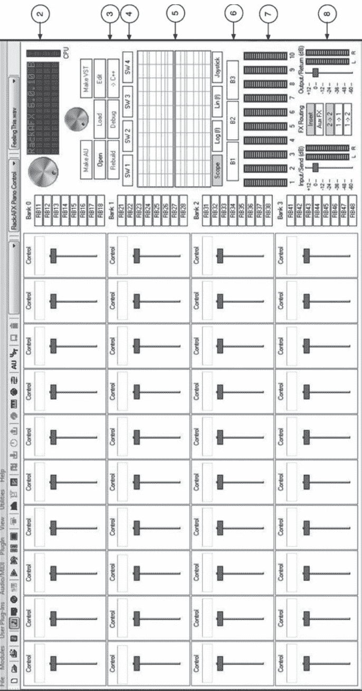

菜单和工具栏由两部分组成：左侧和右侧。左侧实现了大部分软件功能，而右侧维护列表。

### 菜单项 (Menu Items)

- File (文件)：通过创建、编辑或清除项目来管理项目
- Modules (模块)：你可以用于分析和测试的内置插件
- User plug-ins (用户插件)：你设计的每个新插件都会加载到此菜单；你可以独立地试听或展示你的插件
- Audio (音频)：管理所有音频命令
- Plug-in (插件)：用于加载/卸载和预设的工具
- View (视图)：访问不同的窗口
- Utilities (工具)：AU 和 VST 模板生成器
- Help (帮助)：帮助信息

### 工具栏项 (Toolbar Items)

- 1. New project (新建项目)：打开项目文件夹，打开音频文件
- 2. Setup low-level audio (设置底层音频)
- 3. Audio input mode (音频输入模式)：文件、模拟音频输入、振荡器、用户振荡器/同步
- 4. Transport controls (传输控制)：播放、暂停、停止
- 5. Additional windows (额外窗口)：分析仪、框图
- 6. Plug-in tools (插件工具)：同步、加载、重置
- 7. GUI windows (GUI 窗口)：GUI、钢琴
- 8. Rescan (重新扫描) midi
- 9. AU and VST (AU 和 VST)
- 10. Presets (预设)：保存、删除

右侧是用于存储预设、选择 MIDI 输入并跟踪你所使用的音频文件的下拉框。在开发插件时，我们不需要播放，但该功能确实在那里。最后，有一个如图 2.5 所示的按钮组：

- Open (打开)：打开现有项目
- Load (加载)：从进程空间加载 DLL
- Edit (编辑)：编辑现有项目
- Rebuild (重建)：重建
- Debug (调试)：启动调试器
- ->C++：跳转到 C++
- Make AU (生成 AU)：导出到 XCode
- Make VST (生成 VST)：导出到 Visual Studio

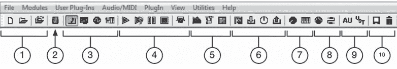

图 2.3：左侧的菜单和工具栏处理你的插件。

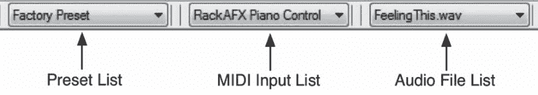

图 2.4：右侧的下拉框让你能够存储预设，选择 MIDI 输入并跟踪你所使用的音频文件。

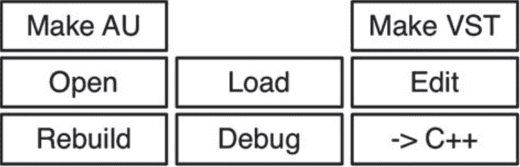

图 2.5：项目/编译器按钮让处理项目和控制编译器变得简单。

### 设置偏好 (Setup Preferences)

在启动项目之前，花些时间配置偏好。在这里你将选择 C++ 编译器并设置默认目录。选择 `View->Preferences` 进入界面。

在偏好设置中，你需要：

- 选择项目、WAV 文件和默认 WAV 文件的目录。你可以使用任何目录作为项目文件夹，也可以随时从任何文件夹打开项目；默认设置只是为了方便将项目组合在一起。你还可以设置导出项目到 AU 和 VST 的默认文件夹。
- 选择 Visual C++ 编译器。
- 设置 C++ 选项——除了最高级的用户，“启用 C++ 控制/切换”应该保持开启。C++ 控制/切换允许 RackAFX 控制 Visual Studio、保存文件、启动调试器等。
- 设置在 GUI 滑块/对话框中输入信息时的编辑选项。

注意区域 (3) 中的最后一个复选框，它会自动为你的对象命名加上“C”，以匹配书中前言中提到的匈牙利命名法——请参见 `http://www.willpirkle.com/synthbook/` 获取有关匈牙利命名法的解释。

### 开始新项目 (Starting a New Project)

对于 RackAFX，你有两种启动新项目的方法：下载我的示例项目，或者从零开始创建一个项目并进行开发。与 VST3 和 AU 不同，启动新项目非常简单，耗时不到 30 秒。我建议每个项目都从零开始，但如果你倾向于从代码开始，也可以使用现有项目。每个项目都有对应的可下载项目：

- 仅 GUI——GUI 已经为你制作好并声明了变量，但你必须完成其余工作，包括为每个项目添加额外文件。
- 完整项目；我们不建议仅仅通过编译他人的代码作为一种学习方法，拥有完整代码不仅可以让你检查自己的工作，还可以在调试模式下单步执行代码，让你看到客户端是如何交互的——简而言之，完整项目对于帮助你调试和理解你的项目非常有帮助。

与 VST3 和 AU 不同，RackAFX 会为你创建项目。使用 `File->New Project` 或按 `N` 启动新项目。表单允许你输入项目名称。


图 2.6：接口界面。

对于 MiniSynth，你将从图 2.7 中的新项目对话框开始。

在这种情况下，你将项目命名为 MiniSynth 并在 `View->Preferences` 中勾选匈牙利命名法框。RackAFX 会为你创建 Visual Studio 项目并复制所有需要的代码文件。Visual Studio 项目文件将封装在名为 `<Project Name>` 的文件夹中，在本例中为 MiniSynth。C++ 对象将封装在 `MiniSynth.h` 和 `MiniSynth.cpp` 文件中。对象将命名为 MiniSynth。确保你勾选了 "Only Output Synthesizer plug-in"，如果你忘记了，可以随时返回 `File->Edit Project` 或点击 `< Edit>` 按钮。

项目名称（Project Name）将是你的 C++ 类的名称。因此，你需要小心使用符合 C++ 对象命名法的名称。此外，如果你在偏好中勾选了匈牙利命名法，对象的名称将添加一个 "C"。

书中的合成器项目将需要额外的文件——一些由我们提供，另一些将在接几章节中编写。你始终需要 `synthfunctions.h`，可以从网站获取。其他文件是实现振荡荡器、滤波器和包络生成器的 C++ 对象。要添加额外文件，你需要将它们复制到你的项目文件夹（这里是 MiniSynth），然后在解决方案上点击右键并选择 `Add->Existing Items`，选择所有新文件。然后你可以使用 Visual Studio 来组织文件。总结一下，当你编写合成器项目时，你将创建一个新项目，然后手动添加所需的额外文件。

## 2.8 设计用户界面

在原型阶段（Prototype Phase），每个项目都从一个 GUI 表开始，该表列出了所有界面控件及其控制的底层参数。在 RackAFX 中，每个控件都自动连接到你定义的变量。RackAFX 会为你编写代码。在 VST3 和 AU 中，你必须通过编程方式手动定义每个控件。在 RackAFX 中，你使用设计器。当你创建一个新项目或打开现有项目且编译器已启动时，你将能够添加控件来设置或更改它。所有的合成器项目包含三种类型的控件：

- 连续控件——值可以连续调整的 float、double 或 int 类型。
- 枚举控件（enumerated）——这些控件向用户展示一组字符串；一次选择这些字符串中的一个。
- 开关（on/off）——枚举控件的一种特殊情况，其枚举固定为两个值：OFF 和 ON。

连续控件的一个示例是 dB 为单位的音量控制。滑动块连续调整一个控制振幅的浮点变量。枚举控件的示例是一个 GUI 元素，它允许用户从字符串列表（如 "HPF"、LPF" 和 "BPF"）中选择滤波器类型。我们之所以称之为枚举，是因为该列表是从枚举生成的：

```
enum (LPF, HPF, BPF);
```


图 2.7：新项目对话框是你设置将成为你项目的 C++ 对象的地方。在枚举中，LPF 被赋值为 0，HPF 赋值为 1，以此此类推。在 VST3 和 AU 中，你使用“字符串”来定义具有从 0 开始值的控件。UINT 也被定义了，以便你可以匹配这段代码（Apple 使用 Uint2 代替）。在 RackAFX 中，使用 LCD 控制的 40 个滑动块可以是连续或枚举类型。枚举类型支持多达 256 个字符串，尽管你可能永远不需要。此外，还有四组单选按钮，每组可以包含多达八个字符串的枚举。

对于每个项目，你将得到一个表 2.6。对于 RackAFX 项目，你可以忽略列出索引值的最后一列，该列仅适用于 AU。此表包含了所有的 GUI 控件、限制、默认值、变量名以及附加到控件上的值。在该表中你可以看到“Variable Type”（变量类型）和“Variable Name”（变量名）两列。基本类型是 float、double 和枚举 UINT。Volume（音量）和 Octave（八度）控件最终生成用户在 GUI 上看到的数值，并具有最小或最大 Limit（限制）和默认值。控件也可以没有单位（"" 或空字符串）。Cutoff（截止频率）控件没有 "volt/octave"，这意味着该控件是对数性的。注意 Octave 控件在选择八度后会交付相应值。


图 2.8：MiniSynth 项目的 Visual Studio 文件示例。

表 2.6：某些 GUI 控件示例。

### 连续参数示例

| 控件名称 (单位) | 类型 | 变量名 | 低/高/默认* | VST3/AU 索引 |
| :--- | :--- | :--- | :--- | :--- |
| Volume (db) | double | m_d_DB | -96 / 24 / 0.0 | OUTPUT_AMPLITUDE_DB |
| Octave | int | m_nOctave | ~4 / 4 / 0 | OCTAVE |
| Fc (Hz/octave) | double | m_dFilter | 80 / 18000 / 10000 | FILTER_FC |

*低默认值在每个项目的 SynthParamLimits.h 中为 VST3 和 AU 定义

### 枚举参数 (UINT)

| 控件名称 | 变量名 |枚举字符串 | VST3/AU 索引 |
| :--- | :--- | :--- | :--- |
| Filter Type | m_uFilterType | LPF,HPF,BPF | FILTER_TYPE |
| FX Filter | m_uFXFilter | LPF,HPF,BPF | FX_FILTER |
| Patches | m_uPatches | Heavy-Lead,Lush_Pad, Space_Cadet | PATCHES |

表 2.7：RAFX 预分配的控件索引值。

| 控件 | 索引范围 |
| :--- | :--- |
| 主面板上的 40 个滑动块 | 0–39 |
| LCD 中的 1024 个控件 | 100–1123 |
| 8 个单选按钮 | 41–44 |
| 二状态开关 | 45–48 |

## 2.9 设置连续控件

你每个新合成器项目的首要工作是将 GUI 控件表转换为 RackFX 界面上的控件组。为了练习这一点，请在 RackAFX 中创建一个丢性项目（命名为 ThrowAway）。在编译器


启动并处于激活状态后，你可以开始添加控件了。让我们从第一个名为 `Volume`（音量）卷开始。设置这种连续控制，在滑块控制的边界框内点击右键。边界框是每个滑块周围的细灰色框，如图 2.2 所示。重新启动 `Slider Designer`（滑块设计师），使用它的一种简单方法是通过填充内容来创建控件。例如，右键点击左角的第一个滑块。它会生成你在图 2.9 中所示的表单。

你需要在 `Slider Properties`（滑块属性）中填写正确的值。你会注意到此滑块的 `uControlID` 为 `0`。这是将滑块链接到变量的 ID。你无法编辑此单元格。从 `Control Name`（控件名称）开始输入“`Volume`”（不带引号）。按进到下一个单元格，然后将 `Units`（单位）设置为“`dB`”。下一个单元格是最重要的之一——它是将链接的变量的数据类型；可以从下拉列表中选择。你可以用鼠标选择数据类型，也可以在框被高亮时直接输入第一个字母（例如，对于 `double` 输入 "`d`”）。将此图与表 2.6 的第一行进行比较，你就可以看到如何将表格行转换为控件配置。你现在可以忽略 MIDI 相关内容——请查看我的网站了解如何将 MIDI 控制器连接到任何 GUI 组件以使用此选项。然而，在左侧有一组重要的设置：

- `Linear Slider`（线性滑块）
- `Log Slider`（对数滑块）
- `One/octave Slider`（单八度滑块）

线性对数（算术）滑块随这些偏移移动，如果需要，可以使用对数控制音量。然而，对于某些合成器频率控制（如滤波器的截止频率），你需要选择 `volt/octave`（伏/八度）选项。这将使控件以 2N 方式（即以八度为单位）工作，这是合成器使用这种比例的工作方式（注意：在 VST3/AU 中，这种 volt/octave 被称为 "`arithmic Scale`”）。如果你发现错误或漏掉了某些，只需在滑块框内点击右键修复问题。你也可以通过点击属性窗口上的按钮删除滑块，并通过 `Copy Existing Slider Control`（复制现有滑块控件）下拉列表复制另一个滑块的设置。

当你从主 UI 添加、编辑或删除控件时，你会注意到 `RackAFX` 会闪烁编译器并为你编写代码。你可以将此闪烁作为代码更新已同步的信号。如果你不喜欢，最小化编译器，闪烁就不会发生。在 `View->Preferences`（视图->设置）中有一个特殊的复选框可以启动编译器（仅限 Visual Studio 2008；Microsoft 后来删除了此功能）。

你的插件代码将使用索引值 `0`（属性对话框中的 `uControlID`）将 UI 上名为 `Volume` 的滑块映射到 `m_dB` 变量。设置好 `Volume` 控制后，切换到 Visual Studio 编译器（提示：使用 `File -> C++` 提示来保存 `.sln` 文件，始终选 YES，并查看我的网站获取如何消除大部分弹出窗口的信息）并打开你的项目 `.h` 文件。在底部附近你会看到 `RackAFX` 为你编写的新变量声明：

```cpp
class CThrowAway : public CPlugin
{
public:

  <SNIP SNIP SNIP>

  // ADDED BY RACKAFX -- DO NOT EDIT THIS CODE!!! ---
  // **-0xD7FD-**

  double m_dVolume_dB;

  // **-0x1A7F-**
  //
```

| Volume | UI Item | Property |
|---|---|---|
| 0.00 dB | `uControlType` | Slider |
| | `uControlID` | 0 |
| | `Control Name` | Volume |
| | `Units` | db |
| | `DataType` | double |
| | `Variable Name` | m_dVolume_dB |
| | `Control Limit` | -96 |
| | `Control High Limit` | 24 |
| | `Initial Value` | 0.00 |
| Learn MIDI | MIDI Controller | false |
| Channel -n/- | MIDI Controller Type | Continuous Controller |
| Type -n/- | MIDI Controller | 3 Continuous Controller #3 |
| Control Method | | |

图 2.9：`Slider Designer` 使定义你的代码并将其链接到底层变量变得简单。

你将会在代码中频繁看到该注释，作为一种提醒，为了方便阅读可以将其删掉。除了第 2 章讨论的插件函数外，你还会看到更多注释代码区域。在第一部分，你可以像在 `.h` 文件中那样添加变量或函数定义。尝试将你的代码保持在指定区域。下面的区域写着：`// ADDED BY RACKAFX -- DO NOT EDIT THIS CODE!!!` 这非常重要——你会在该区域看到你的变量 `m_dVolume` 定义。这是 `RackAFX` 在你添加、编辑或删除控件时修改的 `.h` 文件部分。代码还有具有有趣的十六进制符号（`0x1A7F...`）的属性，不要编辑它们之间的代码。`RackAFX` 为你编写 C++ 代码。你必须小心不要以任何方式更改 `RackAFX` 的 C++ 代码。

现在练习设置 `Octave`（八度）控制——选择整数数据类型并进行填充表格。由于这是一个 C++ 枚举，你必须确保对字符串使用合法值；例如，你的子字符串不能以数字开头，不能包含保留字符 `*`。如果你编译并得到引用枚举的错误，请检查字符串名称的合法性。如果你需要更改枚举字符串，请在 `RackAFX` 中进行。在图 2.10 的左侧，你可以通过输入文本看到枚举字符串的模拟图。这就是你确保字符串不会超出控件的方法（提示：使用有意义的字符串）。你还可以看到它的索引为 41。

### 2.10 设置索引控件：单选按钮

继续查看表格，我们找到了两个枚举控件。让我们先练习设置单选按钮。在与第一个滑块位于同一行的第一个按钮组的任何位置点击右键，并使用类似的 `Radio Button Designer`。从数据类型列表中选择 `enum`（枚举）。对话框打开，显示字符串输入框和另一个填充了当前枚举字符串的列表。你可以通过双击下框框中的字符串，在控件之间共享这些列表，这会将字符串传输到“This enum list:”。图 2.11 显示了新的 `Slider Designer`。在 `enum` 模式下，高限、下限和默认值是不可编辑的。双击此行以填充枚举列表。

### 2.11 设置索引控件：滑块

继续查看表 2.6，我们找到了另一个名为 `FX Filter`（滤波器）的滤波器类型。该控件使用三个滑块作为第一种滤波器类型：`LPF`（低通）、`HPF`（高通）、`BPF`（带通）。你可以放置一个滑块控件作为枚举控件使用。右键点击另一个滑块组并选择 `enum`。

### 2.12 在 LCD 控件内部放置控件

图 2.10：配置单选按钮组像滑块控件一样简单。

`RackAFX` UI 的右上角有一个代表 alpha 轮、`LCD` 显示器视图和旋钮的控件。在项目设计期间，我注意到 `LCD` 用于向你提供项目和计算机状态的反馈。然而，它也可以像其他滑块一样作为 GUI 控件。`LCD` 允许内部存储多达 1024 个连续滑块。任何使用普通滑块设置的内容在嵌入 `LCD` 中也同样有效，`GUI Designer` 让你在自定义的 GUI 上选择一个。该控件有几种用途：

- 它是存储连续控件的一种方式
- 如果滑块用完了，你可以在 `LCD` 中放入更多的 1024 个
- 你可以使用枚举控件创建一组预设或其他全局函数/配置——我们将广泛用于合成器的全局参数，如音高范围，并通过使用小控件来精简 GUI

图 2.12 显示了嵌入了两个控件的 `LCD` 控件示例。alpha 轮用于选择 `Filter Fc` 或补丁（patches）。数值旋钮用于调整控件值。右侧显示你正在使用哪个控件。

让我们从表 2.6 添加 `Filter Fc` 控制。首先要设置 `LCD` 控件，请在开发模式下（未加载插件）点击右键。弹出的对话框如图 2.13。点击打开非常相似的 `Slider Properties` 对话框。使用表 2.6 填写表单，注意 `volt/octave` 比例为

限值和默认值不可编辑。双击此行以填充枚举列表。

图 2.11：你可以将滑块作为索引控件。

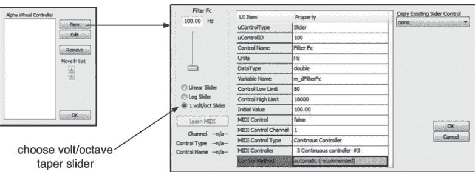

图 2.13：使用“New”（新建）、“Edit”（编辑）和“Remove”（删除）按钮向 `LCD` 添加控件；在这里我们正在设置使用伏特/八八aves为单位的 `Filter Fc` 控制。

你可以通过按钮添加、编辑或删除控件。你还可以使用“Move In List”（在列表中移动）微调按钮更改列表中控件的顺序。列表中的顺序就是控件在编译后的插件（即 `LCD` 控制）中出现的顺序。接下来，设置 `Patch`（补丁）控制，使用下划线（`_`）来分隔你列表中的字符串（你可以在枚举名称中使用空格）。你可以利用 `LCD` 控制的一项功能：当 `LCD` 使用这些名称时，它会将下划线替换为带空格的标题。当你输入一个枚举名称时，这比使用旋转旋钮或普通滑块提供了更大的灵活性。因此，请在 `Heavy_Lead`、`Lush_Pad` 和 `Space_Cad` 单词之间使用下划线。设置好此控件后，在 Visual Studio 或 `RackAFX` 中使用“Rebuild”（重新生成）重建项目。编译完成后，使用“Load”（加载）按钮加载 DLL。尝试不同的控件，注意带有 `Patch` 的 `LCD` 控制单词之间是否有如图 2.14 所示的空间。

如果你下载了示例项目，你会发现 `LCD` 控制内部嵌入了多个控件。

## 2.13 使用 RackAFX GUI 设计器

`RackAFX` 拥有一个强大的 GUI 设计器，可以让你在几分钟内布置出视觉良好的 GUI。GUI 设计器不断更新以包含更多功能，因此请务必在网站上查看最新添加。根据你拥有的版本，你的 GUI 设计器看起来与图 2.15 所示相似。操作流程如下：

- 在原型（prototype，即主 `RackAFX`）中，你组装你的插件。创建控件，为它们赋予最小值、最大值初始值，将它们连接到变量等。由于这是开发模式，你可能会更改某些控件、添加或删除它们等。此外，由于我们处于原型设计阶段，你可以设置一组你不希望用户在最终插件中调整的控件。
- 你的插件编译、调试并准备就绪后，使用 GUI 标签页显示图 2.15 所示的空白 GUI。
- 从左侧的调色板上拖放控件并将它们排列在表面。由于它们具有透明背景，因此可以相互重叠。
- 对于滑块、单选按钮和旋钮控件，你必须将它们连接到插件中受控制的变量。
- 矢量摇杆不需要任何额外设置。

图 2.14：通过在设计表单中插入下划线，枚举字符串可以包含空格。

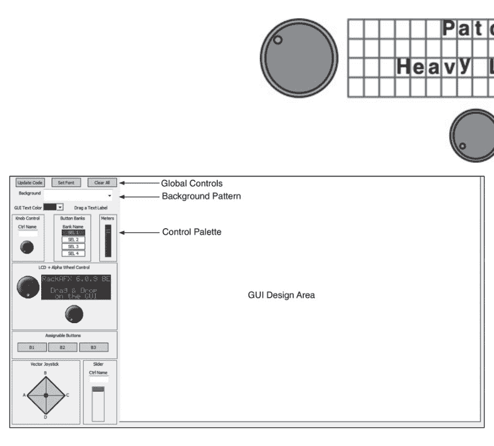

2.15：GUI 设计器主要由左侧的控件面板和右侧的大 GUI 设计区域组成。

使用“Background Pattern”（背景图案）框选择背景图像或颜色；在这里选择了白色。顶部的全局按钮允许你更改字体、清空设计区域中的所有控件并更新代码（稍后详细介绍）。当你拖动控件时，右键点击旋钮本身；对于单选按钮，点击任何一个按钮；对于滑块，点击滑块控件。如果你将其释放到设计区域，就可以对其进行移动和自定义。右键点击控件以调出变量链接和自定义框。

注意：当向设计区域添加控件时，始终从左上角开始排列，这样控件在最终的 GUI 中就能被正确裁剪。

原型中的任何滑块都可以使用左侧的调色板作为旋钮或滑块进行拖放。图 2.16 显示了在放置第一个旋钮后，并在右键点击已放置的旋钮进行设置后的 GUI 设计器。在 GUI 控件设置中，你可以：

- 通过下拉列表将旋钮连接到变量
- 更改旋钮和组合的外观
- 更改行为；隐藏它或更改其颜色
- 设置所有其他旋钮以匹配这一个

现在，执行相同的操作，但拖入一个滑块。它连接到 `Filter` 控制，因此在带有滑块自定义选项的下拉框中选择它。要移除滑块或旋钮，请从变量下拉列表中选择“none”（无）。拖入一个单选按钮组并同样通过右键点击进行设置。它会自动为你分配单选按钮，从第一个组开始向下处理。如果你尝试绘制单选按钮组但系统不允许，这意味着你已经用完了这些控件。最后，将 `LCD` 拖入设计区域并右键点击进行设置。你应该会得到与图 2.17 类似的结果。

在 `LCD` 设置中，你可以添加或删除控件并设置配色方案。你可以更改控件的顺序。GUI 与原型 UI 略有不同，任何连续控件都可以放在内部，而不只是你正在分配的那些。这意味着你可以拥有一个仅由 `LCD` 控制和单选按钮组成的 GUI。使用“Add”和“Remove”按钮添加和删除控件。你可以通过“Move In List”更改列表顺序。添加控件后，关闭设置。此时，在准备就绪之前还有最后一步——你需要返回并重新编译插件以将 GUI 嵌入其中。这与 VST GUI 设计器的工作方式相同。在 `RackAFX` 中，这意味着你需要更新代码。有两种方法可以：要么切换回 Prototype，要么使用左上角的“Update Code”按钮。如果不通过这种方式更新代码，设计将不会保存。切换回 Prototype 查看 GUI 并点击“Rebuild”重新生成项目。现在使用“Load”按钮加载 DLL。你会发现 Custom GUI 现在处于激活状态——它看起来像一个旋钮。点击此按钮，你会发现带有 `Patch` 的 `LCD` 控制单词之间有空格，如图 2.14 所示。

如果你下载了示例项目，你会发现 `LCD` 控制内部嵌入了多个控件。

在 Visual Studio 中，选择 `MiniSynth.h` 文件并滚动到底部，查看设置 GUI 时添加的所有变量。注意 `double`、`int`、`UINT` 和 `enum` 的组合。例如，`UINT m_uVoiceMode` 使用其正下方的枚举列表向用户显示可能的声色设置。

```cpp
class CMiniSynth : public CPlugin
{
public:
    // RackAFX plug-in API Member Methods:

<SNIP SNIP SNIP>

// ADDED BY RACKFX -- DO NOT EDIT THIS CODE!!!
// **--0x07FD--**

UINT m_uVoiceMode;
enum(Saw3,Sqr3, Saw2Sqr, Tri2Saw, Tri2Sqr);
double m_dDetune_cents;
double m_dFCcControl;
double m_dLF01Rate;
etc...

// **--0x1A7F--**
//
};
```

现在，关注文件顶部的成员函数。我们将为自己的合成器项目重写和或实现 `CPlugin` 函数：

## 标准插件函数：

Here 你看到构造函数和析构函数，我们使用它们来初始化变量和销毁对象。

```cpp
CMiniSynth():
  allocate dynamic memory
  initialize variables
```

```cpp
virtual ~CMiniSynth():
  deallocate any allocated memory
```

```cpp
virtual bool __stdcall prepareForPlay():
  每次运行初始化函数
  始终在子组件上设置采样率
  始终更新合成器对象
```

```cpp
virtual bool __stdcall processAudioFrame(float* pInputBuffer,
  float* pOutputBuffer,
  UINT uNumInputChannels,
  UINT uNumOutputChannels);
```

```cpp
virtual bool __stdcall userInterfaceChange(int nControlIndex):
  这里是渲染合成的音频输出的地方
  在用户移动 GUI 上的控件后调用；你可以选择在此处不进行处理：在所有情况下我们都会调用合成器更新函数
```

## MIDI 和摇杆控制函数

表 2.3 列出了我们将实现的 MIDI 函数，你可以在标记为“高级函数”的区域找到它们的原型。在 `VectorSynth` 和 `AniSynth` 中，我们将使用矢量摇杆，它会发出位置和混合信息。该方法也在组函数中：

```cpp
virtual bool __stdcall joystickControlChange(float fControlA,
  float fControlB,
  float fControlC,
  float fControlD,
  float fACMix,
  float fBDMMix);
```

- 表示用户移动了内置的矢量摇杆，我们在 `VectorSynth` 中使用了它
- AniSynth

```cpp
<SNIP SNIP SNIP> -- 你可以跳过函数 8 和 9
virtual bool __stdcall midiNoteOn(UINT uchannel,
                               UINT uMIDINote,
                               UINT velocity);
```

- 为每个 MIDI note 事件调用，传递通道、音符和速度

```cpp
virtual bool __stdcall midiNoteOff(UINT uchannel, UINT uMIDINote,
                                      UINT velocity, bool bAllNotesOff);
```

- 为每个 MIDI note off 事件调用
- 也在所有 notes off 紧急（panic）消息时调用


```cpp
virtual bool __stdcall midiModWheel(UINT uchannel, UINT uModValue);
```
- 处理调制轮（常见于大多数合成器控制器）变化的函数

```cpp
virtual bool __stdcall midiPitchBend(UINT uchannel,
                                       int nActualPitchValue,
                                       float nNormalizedPitchBendValue);
```

- 针对音变轮/摇杆的专用函数

```cpp
<SNIP SNIP SNIP> -- 我们不会在书中的项目中实现 MIDI 时钟
virtual bool __stdcall midiMessage(unsigned char cchannel,
                                     unsigned char cStatus,
                                     unsigned char cData,
                                     unsigned char cData2);
```

- 所有其他 MIDI 消息，包括连续控制器

`MiniSynth.h` 文件的最后部分包含几个成员变量。对于 `MiniSynth`，这些变量是：

```cpp
CMiniSynth* m_pVoiceArray[MAX_VOICES];
void incrementVoiceTimestamps;
CMiniSynth* getOldVoice();
CMiniSynth* getOldVoiceWithNote(UINT uMIDINote);
```

```cpp
// --- 一性更新所有 voice
void update();
```

```cpp
// --- 用于滑音 (portamento)
double m_dLastNoteFrequency;
```

```cpp
// --- 我们的接收通道
UINT m_uMidiRxChannel;
```

合成器的多音性通过维护一个 voice 指针对象数组来实现。对于所有合成器，该数组命名为 `m_pVoiceArray`。区别在于它们所持有的指针类型；在这种情况下，数组持有 `Synth` 指针。其定义下方的三个函数用于处理 voice 的时间顺序。`update()` 函数用于一次性更新所有合成器变量。随着第 3-12 章的学习，我们将深入这些细节以及剩余的几个变量。

现在，让我们逐个查看每个函数的实现。从插件对象的角度来看，所有的合成器项目非常相似。区分合成器的大部分工作在我们设计的 `CVoice` 对象中完成。因此，一旦你理解了一个合成器，其他的就很容易掌握。打开 `MiniSynth.cpp` 文件，让我们从顶部开始向下研究实现。

## 构造函数

每个 RackAFX 插件中的构造函数执行以下操作：

- 分配动态内存
- 初始化变量
- 释放任何分配的内存
- 每次运行初始化函数
- 始终在子组件上设置采样率
- 始终更新合成器对象
- 渲染合成的音频输出
- 在用户移动 GUI 上的控件后调用；你可以选择在此处不进行处理：在所有情况下我们都会调用合成器更新函数

合成器的多音性通过维护一个 voice 指针对象数组来实现。对于所有合成器，该数组命名为 `m_pVoiceArray`。区别在于它们所持有的指针类型；在这种情况下，数组持有 `Synth` 指针。其定义下方的三个函数用于处理 voice 的时间顺序。`update()` 函数用于一次性更新所有合成器变量。随着第 3-12 章的学习，我们将深入这些细节以及剩余的几个变量。

```cpp
bool __stdcall cMiniSynth::processAudioFrame(float* pInputBuffer,
float* pOutputBuffer,
UINT uNumInputChannels,
UINT uNumOutputChannels)
{
  // Do LEFT (MONO) Channel
  double dLeftAccum = 0.0;
  double dRightAccum = 0.0;

  // --- 12dB headroom
  float fMix = 0.25;
  double dLeft = 0.0;
  double dRight = 0.0;

  // --- loop and accumulate voices
  for(int i=0; i<MAX_VOICES; i++)
  {
    // detailed in future chapters
  }
  pOutputBuffer[0] = dLeftAccum;

  // Mono-In, Stereo-Out (AUX Effect)
  if(uNumInputChannels == 1 && uNumOutputChannels == 2)
    pOutputBuffer[1] = dLeftAccum;

  // Stereo-In, Stereo-Out (INSERT Effect)
  if(uNumInputChannels == 2 && uNumOutputChannels == 2)
    pOutputBuffer[1] = dRightAccum;

  return true;
}
```

在 `userInterfaceChange()` 中，你通常首先解码控件的索引（通过 `nControlIndex` 参数传递），然后根据该索引调用相应的更新函数或计算。在我们的 RackAFX 合成器项目中（以及 VST3 和 AU 版本）中，如果其中一个变量发生了变化，我们将强制强制更新所有变量。这主要是为了极大简化代码。经过特性化测试，我们发现全量更新带来的额外销并没有显著影响 CPU 负载；与实际的音频合成相比，更新函数的开销非常小。然而，我们鼓励你在完成同步运行后改变这种范式，并单独解码每个控件。为了方便解码，RackAFX 在 `userInterfaceChange` 函数上方留了一个注释，提醒你索引映射。

```cpp
/* ADDED BY RACKAFX -- DO NOT EDIT THIS CODE!!! */
**--0x2983--**

Variable Name Index
m_uVoiceMode 0
m_dDetune_cents 1
m_dFcControl 2
m_dLF01Rate 3

etc...
**--0xFFDD--**
n// ... */
// Add your UI Handler code here
//
bool _stdcall CMiniSynth::userInterfaceChange(int nControlIndex)
{
    // --- just update all, ignoring the index value
    update();
    return true;
}
```

# MIDI 消息函数与辅助函数

最后一个块全部涉及 MIDI 消息。很棒在于，除了数组持有的音色指针类型外，所有合成器项目的 MIDI 函数都是相同的，因此一旦你掌握了它们，就可以复制粘贴到其他地方。

# MIDI 音符时间戳函数

有三个函数有助于多声部。

```cpp
void CMiniSynth::incrementVoiceTimestamps()
CMiniSynthVoice* CMiniSynth::getOldestVoice()
CMiniSynthVoice* CMiniSynth::getOldestVoiceWithNote(UINT uMIDNote)
```

我们将在第 8 章详细讨论这些内容。它们用于实现动态音色分配或偷声（voice-stealing）。现在你可以跳过它们。

# MIDI 音符 On 和 Off

这是我们将处理的两个最重要的 MIDI 消息。我们将在第 8 章介绍这些方法的具体细节；然而，你需要了解 RackAFX 如何根据 MIDI 消息为你简化一些工作。对于音符开启（note on），RackAFX 将 MIDI 字节数据转换为可管理的 UINT 类型。这三个参数是：

- `UINT uChannel`: 0–15，总共 16 个通道
- `UINT uMIDINote`: 音符事件的 MIDI 音符编号 0->127
- `UINT uMIDIVelocity`: 音符事件的 note ON 速度 0->127

第一步是检查 `midiNote`，如果它不是我们正在播放或支持的通道，则退出。更多细节将在下一章我们仔细查看 MIDI 消息时显示。之后，我们执行必要的事件处理。

```cpp
bool __stdcall CMiniSynth::midiNoteOn(UINT uChannel, UINT uMIDINote, UINT uVelocity)
```

对于音符关闭（note off），RackAFX 将 MIDI 字节数据转换为更容易管理的 UINT 类型。这三个参数是：

- `UINT uChannel`: 0–15，总共 16 个通道
- `UINT uMIDINote`: 音符事件的 MIDI 音符编号 0->127
- `UINT uMIDIVelocity`: 音符事件的 note off 0->127（大多数 MIDI 键盘不传输此值）
- `bool bAllNotesOff`: 用于关闭所有音符的 MIDI 消息

```cpp
bool __stdcall CMiniSynth::midiNoteOff(UINT uChannel, UINT uMIDNote, UINT uVelocity, bool bAllNotesOff)
```

# MIDI 调制轮 (Mod Wheel)

调制轮（mod wheel）是大多数 MIDI 控制器上的标准。它通常与连续控制器（CC）消息分开管理，VST3 和 AU 除外。在处理音符 On 和 Off 时，RackAFX 将字节转换为易于管理的 UINT。调制轮值为 0 到 127。

- `UINT uChannel`: 0–15，总共 16 个通道
- `UINT uModValue`: 0 到 127 的调制轮位置

```cpp
bool __stdcall CMiniSynth::midiModWheel(UINT uChannel, UINT uModValue)
```

# MIDI 弯音 (Pitch Bend)

弯音是一种特殊的 MIDI 消息，因为它使用 14 位值来表示弯音量。对于此消息，RackAFX 发送两个版本的弯音以产生声音转换：一次是有符号整数（-8192 到 +8191），另是浮点值（-1.0 到 +1.0）。0 表示中心位置或无偏移。

```cpp
// nActualPitchBend = -8192 -> +8191, 0 为中心
// nNormalizedPitchBend = -1.0 -> +1.0, 0 为中心
bool _stdcall CMiniSynth::midiPitchBend(UINT uChannel, int nActualPitchValue, float fNormalizedPitchValue)
```

# 其他 MIDI 消息

要告诉主机所有 MIDI 消息，你在构造函数中将 `m_bWantMIDIMessages` 设置为 true。我们的所有合成器（在所有平台上）都支持以下消息：

- 音量 (volume CC7)
- 声 (pan CC10)
- 表现 (expression CC11)
- 延音踏 (sustain pedal)
- 程序更改 (program change)
- 多声部触 (polyphonic aftertouch)
- 通道触 (channel aftertouch)

我们将在下一章讨论 "CC 7" 的含义。现在重要的是理解此消息将字节作为参数（`unsigned char`）发送。在检查通道后，如果是控制更改消息（control change），我们会解码数据字节 1 并将其传递给音色对象。值编码在数据字节 2 中。

```cpp
bool _stdcall CMiniSynth::midiMessage(unsigned char channel, unsigned char status, unsigned char data1, unsigned char data2)
```

这结束了我们对 RackAFX 插件的基本讨论。在处理对象和 MIDI 消息的过程中，你将学习更多关于 RackAFX 的知识。第 3 章将要求你进行编程。当我们到达设计章节（第 9-13 章）时，你将变得精通且不需要任何指导——你可以从头开始自己的合成器项目。

## 2.15 编写 VST 插件

Steinberg 最初在 1996 年开发 VST 插件 API 以提供简单的跨平台解决方案。版本 1 和 2 的 API 与当时的 DirectX（一种竞争格式）相比非常基础，几乎每个录音软件包最终都遵循 VST 规范。VST2 代表了迄为止最成熟的版本，插件封装在具有 `.dll` 扩展名的动态库中。


VST3 在 2008 年引入，不是更新而是完全的重做，因此它们不直接兼容。与 VST2 不同，插件封装在动态链接库中，扩展从 `.dll` 重名为 `.vist`。2013 年 9 月，Steinberg 正式停止了对 VST2 的支持并从网站删除了 VST 软件开发包（SDK）。Steinberg 的移除和废弃意味着只有主要的客户端将支持 VST3。由于存在大量的 VST2 插件，客户端仍仍支持 VST2。VST3 提供了一种封装机制，如果插件没有实现 GUI，VST 客户端会提供一个默认 GUI。也有自定义 GUI 的选项。我们将实现两者。我们需要先定义 GUI，然后将 GUI 连接到其参数。你可以在 VST 客户端中不同的 GUI 之间切换。

本书仅涵盖 VST3。如果你想从 VST2 开始，你需要 VST2 SDK（免费）和版本的 Microsoft Visual Studio（示例适用于 VS2008 和 VS2010）。你可以在 http://www.steinberg.net/en/company/developer.html 获取 SDK，当时的最新版本为 3.6.0。当你解压 SDK 时，你会发现一个子文件夹层次结构，包含所有基类文件、VSTGUIGUI 文件和示例代码。你可以将这组文件夹放在本地驱动器的任何位置，但建议将其放在根目录。文档位于主目录下的 HTML 格式，名为 `index.html`——你应该在浏览器中打开并书签；你会经常参考它。SDK 的一个根本问题在于文件夹的层次结构性质，这体现在各个文件夹文件的 `#include` 语句中。换句话说，文件设置为在特定的目录层次中相互引用。如果你修改了层次结构、尝试移动文件、合并或平铺目录，当你尝试 Steinberg 示例项目或书中的任何项目时，就会发生故障。

在任何情况下都不要更改 SDK 文件夹的层次结构。在某些情况下，你可能可以重命名文件夹，但通常你应该避免修改目录，除非如本章所示。

# 设置目录层次结构

在正确的文件夹层次结构中创建项目至关重要，否则编译器将无法找到文件并进行链接。当你安装 SDK 时，你需要找到包含 Windows 插件示例代码的文件夹；这里我们将使用项目名称 `name_expression_synth`，但任何示例代码文件夹都位于：

`win` 文件夹包含 Visual Studio 项目文件。需要注意的是，当项目文件夹在 `public.sdk` 内部深 4 层时，你有两个选择：将你所有的合成器项目放在 `vst` 文件夹中并在每个项目文件夹下声明子文件夹（如果你喜欢命名为 `win`，但实际名称并不重要），或者构建自己的模拟 `public.sdk` 四层结构的层次结构。这是

我们做了哪些工作，以便将我们的合成器项目保持在一个主文件夹中。我们创建了以下层次结构：

每个合成器文件夹都在 Windows 文件夹内，并且每个文件夹在 public.sdk 内部深达四层。确保你在开始时处理好这个问题，否则你的代码将无法编译。

- `<Root>`
- `VST3 SDK`
- `public.sdk`
- `MyProjects`
- `SynthProjects`
- `Windows`
- `Nanosynth`
- `MiniSynth`
- `DigiSynth`
- `VectorSynth`
- `AniSynth`
- `DXSynth`

# 开始新项目

从零开始一个一个新的 VST3 项目在最好的情况下也是艰辛的，在最坏的情况下是令人沮丧的。我们最强的建议是下载示例项目并将它们作为基础。我们提供了多个版本供你下载，每个合成器项目进行了设置：

- `empty`（空）——编写所有内容并设计 GUI——如果你已经是高级 VST3 程序员，这可能是一个不错的选择。
- `GUI`——代码和 UI 已经完成，因此你可以专注于合成器组件和处理；在每一章中，你都有机会进入并逐步修改 GUI，在完成几个项目之后，你可能需要考虑 GUI 设计：这是推荐的选项！
- `full`（完整）——项目包含了全部；我们不建议简单地编译别人的代码作为学习方法，然而，拥有完整代码允许你不仅不用检查自己的工作，还能在调试模式下单步执行代码，查看客户端是如何交互的——简而言之，完整项目对于帮助你理解正在进行的项目非常有帮助。

另一种方法是从示例项目之一开始，将项目文件夹复制并重命名为项目名称，然后按照附录 A 中的描述修改 Files 和 Visual。它逐步展示了如何修改项目以转换为 anis。这在利用 MiniSynth、DigiSynth、VectorSynth、AnySynth 的演进过程中特别有用，因为它们将相互构建。如果你真的想从零开始一个项目，你也可以从网站上获取这些信息，但请注意：这不适合意志不坚定的人。


一旦你安装了 SDK 并运行了支持版本的 Visual Studio，你就可以准备开发 VST3 插件了。然而，你需要一种方法来测试你的插件功能。记住，`DLL` 是一个实体，需要客户端加载它、实例化它的对象并使用它。你需要安装一个 Visual VST3 宿；我们更倾向于使用 C#，因为它是 Steinberg 的产品，我们需要最紧密且稳健的集成。记住确保你的客户端特别支持 VST3。合成器经常会引用这一章，请标记以备后用。让我们开始吧。

# 项目详情

每个 VST3 都封装在一个 Visual Studio 解决方案 `Solution` 中。它的名称取决于你的 Visual Studio 版本。`VS2008` 用户需要使用解决方案 `.sln` 文件打开项目，而 `VS2010` 及更高版本的用户将打开 `.vcn` 项目；第一个是库项目。第二个项目是你的实际合成器。基础项目根据 Visual Studio 版本而不同，但合成器项目对于两者都是相同的。`MiniSynth` 项目的解决方案如图 2.19 所示。我们使用视觉过滤器 `Visual Filters` 来相应地对文件集进行分组。`SynthCore` 过滤器包含了合成器的所有文件——这在每个项目中会有所不同。插件文件位于 `VSTource`。

当你编译解决方案时，它会将基础项目编译为静态库。然后，它会编译你的合成器项目并静态链接到之前构建的基础项目。生成的文件是一个后缀更改为 `.vst3` 的 `DLL`。唯一真正的重大问题是所有这些文件（总共 127 个）可能很难维护。从零开始创建这些项目的文件数量非常繁琐。无论如何，你必须做的一件事是决定输出文件夹放在哪里。这将接收最终 `vst` 插件文件的文件夹。然后你将你的文件复制到你的 `VST3` 文件夹，并让客户端重新扫描以获取更改。你可能想将文件目标设为客户端的 `VST3` 文件夹，从而省去拷贝文件的麻烦。然而，这样做风险自负。另一个问题也是你编译的静态库的输出目标。编译器会在此文件夹创建并写入大量中间文件，这些文件在成功编译后不会被删除。

要设置输出文件夹，请同时打开基础库和合成器的项目属性。在配置属性 `Configuration Properties` -> 通用 `General` 中，浏览并找到它们。

# 附加文件

为了让合成器尽可能保持原样，我们有 the following of the plug-in as possible. The synth own C++ 集合是：

- `synthfunctions.h`
- `pluginconstants.h`
- `pluginobjects.cpp`

# 我们做了哪些工作，以便将我们的合成器项目保持在一个主文件夹中

我们创建了以下层次结构：

每个合成器文件夹都在 Windows 文件夹内，并且每个文件夹在 `public.sdk` 内部深达四层。确保你在开始时处理好这个问题，否则你的代码将无法编译。

- `<Root>`
- `VST3 SDK`
- `public.sdk`
- `MyProjects`
- `SynthProjects`
- `Windows`
- `Nanosynth`
- `MiniSynth`
- `DigiSynth`
- `VectorSynth`
- `AniSynth`
- `DXSynth`

# 开始新项目

从零开始一个一个新的 VST3 项目在最好的情况下也是艰辛的，在最坏的情况下是令人沮丧的。我们最强的建议是下载示例项目并将它们作为基础。我们提供了多个版本供你下载，每个合成器项目进行了设置：

- `empty` ——编写所有内容并设计 GUI——如果你已经是高级 VST3 程序员，这可能是一个不错的选择。
- `GUI` ——代码和 UI 已经完成，因此你可以专注于合成器组件和处理；在每一章中，你都有机会进入并逐步修改 GUI，在完成几个项目之后，你可能需要考虑 GUI 设计：这是推荐的选项！
- `full` ——项目包含了全部；我们不建议简单地编译别人的代码作为学习方法，然而，拥有完整代码允许你不仅不用检查自己的工作，还能在调试模式下单步执行代码，查看客户端是如何交互的——简而言之，完整项目对于帮助你理解正在进行的项目非常有帮助。

另一种方法是从示例项目之一开始，将项目文件夹复制并重命名为项目名称，然后按照附录 A 中的描述修改 Files 和 Visual。它逐步展示了如何修改项目以转换为 anis。这在利用 `MiniSynth`、`DigiSynth`、`VectorSynth`、`AnySynth` 的演进过程中特别有用，因为它们将相互构建。如果你真的想从零开始一个项目，你也可以从网站上获取这些信息，但请注意：这不适合意志不坚定的人。

# VST3 插件架构

| 处理器 `Processor` | 音频输入 | 音频输出 | GUI | 控制器 `Controller` |
| :--- | :--- | :--- | :--- | :--- |
| | | | | |

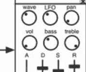

广义地说，COM 接口是一组函数，其指针在内存中以特定方式排列。用 C++ 编写时，COM 接口将由 C++ 基类对象上的成员函数组成。有趣的是，这个 COM 基类也被称为接口。两个 C++ 类（接口）是纯抽象的 `pure abstract`。当我们在一个插件对象中实现 COM 接口时，我们将从该接口派生我们的插件对象。换句话说，我们将继承抽象基类并实现这些函数。通过将类设为纯抽象，它强制派生类实现特定的函数。这在两者之间形成了一种契约。

一旦派生类正确地实现了所需的函数，它现在被认为拥有该接口，客户端可以安全地使用它。如果我们实现另一个允许我们添加某些新功能的 COM 接口，我们将 COM 接口添加到我们的类声明中并继承它——尽管多重继承是在对象上实现多个 COM 接口的关键。特别是，当你派生自 COM 基类（接口）并实现基类函数时，你正在“暴露接口”。基础 COM 接口位于 COM 库中。32 版本的 COM 封装在 `OLE32.LIB` 中。VST 使用它自己的 COM 版本，这些函数被直接编译到你的 VST 插件中。接口和函数的名称与微软的版本几乎相同。记住，COM 是一种编程方式，因此制造商之间可能存在差异。

COM 对象与接口连接并通信。如果你进行过任何严肃的 C++ 编程，你可能已经使用过许多类似的概念。假设对象 A 需要调用对象 B 上的函数——它们需要连接，且连接必须发生。处理此问题的一种方法是给对象 A 一个指向 B 的指针 `pObjectB`。对象 A 需要该指针来调用 B 方法：

```cpp
float fCoefficient = pObjectB->calculateCoefficient();
```

这里有一个安全问题。假设这是大型项目的一部分，一个团队正在工作。清理工程师写了：

```cpp
delete pObjectB;
```

砰！对象 B 被销毁了。对象 B 随后在另一个模块中使用仍。由于项目很大，这个 Bug 可能在几个月后当另一个团队连接组件时才出现。有人需要解释这个问题。COM 解决了这个问题。客户端只能获取派生对象的接口指针。客户端创建对象时，并不使用 `new` 操作符，而是使用一个 COM 函数——在 VST 中它被称为 `CreateInstance()`。该函数创建对象（使用 `new` 操作符），但它返回的是指向基类的指针。如果客户端调用 `CreateWindow()` 方法，它必须有某种方式来指定它想要实例化的组件。我们将看到如何处理这种情况——不用担心——大部分 COM 操作。所有对象必须暴露一个客户端使用的通用接口。从客户端到插件的所有通信都是通过接口完成的。如果你使用匈牙命名法，我们会给你的 C++ 类命名为大写的 `C`，例如 `CProcessor`。大写的 `I` 表示这是一个接口。你的 VST Processor 对象派生自 `IProcessor`，Controller 对象派生自 `IController`。由于所有对象必须暴露一个客户端使用的通用接口，该接口应该是什么？微软将其命名为 `IUnknown`。Steinberg 的版本也叫 `IUnknown`。无论如何，“unknown”接口的名称让一些程序员感到困惑；我们没有更好的名称来称呼它。

让我们结束这一节关于 COM COM，通过学习创建函数如何知道要实例化哪种 COM 对象。这是通过唯一标识每个 COM 对象来实现的。你的 Processor 和 Controller 对象。当客户端创建 VST 插件时，它将使用这些唯一标识符之一来指定它想要的插件。每个 VST 组件都有唯一的标识符是非常重要的。两个开发者可能会意外给插件取相同的名字——`GoldenFlanger`。只要你有唯一标识符，VST 宿主机就可以实例化两个冲突。如果你创建一个与客户端已加载的标识符相同的 VST 插件，客户端将忽略它的存在或在被询问时返回错误。微软将这些称为全局标识符或 `GUID`（读作 "guide-idz"）。Steinberg 将它们命名为 `FUID`——“foo-idz”。一个 `FUID` 或 `GUID` 是一个 128 位的值。生成它最简单的方法是使用微软的生成器 `uuidgen.exe`。你可以在 Visual Studio 项目文件夹中找到它。运行此可执行文件，会弹出一个窗口，上面有一个写着“GUID”的按钮——你点击按钮将其复制到剪贴板。然后，通过手动格式化将其粘贴到 VST 代码中。`uuidgen` 程序根据 1582 年 10 月午夜以来的 100 纳秒间隔唯一时间戳生成 GUID。这保证了在 3400 年之前不会生成重复的 GUID。微软在此处的 GUID 为：

```cpp
GUID({846EB93F-3247-4B8F-A901-10E8EDACC34})
```

Steinberg 的 `FUID` 定义如下（这里是 Controller 对象的 `FUID`）：

```cpp
FUID Controller::cid(0xB561D747, 0xBA004597, 0xA3BF11A5DA2FA4)
```

VST3 是使用通用模型 `Common Model` 开发的，而 COM 是微软的一项发明。简单来说，COM 编程是一种编写软件组件的方法。它既不是一种独立的语言，也不是语言的扩展。事实上，它是语言无关的，尽管在本课程中我们将使用 C++。COM 编程是一种源于微软 20 世纪 80 年代技术——对象链接与嵌入 `OLE` 的范式，其思想是允许你在一个文档中编辑多个对象。它有效地允许一个软件——或至少是另一个——作为插件（正如你看到的与插件之间的关系，其中 `DLL` “运行”在客户端内部）。`OLE` 经常有 Bug 有时会崩溃。COM 帮助修复了其中的一些问题。微软随后在 20 世纪 90 年代的 DirectX 插件中使用了 COM，其部分一直保留至今。

好消息是，如果你使用书书中已经为你写好了代码的项目，你就不需要进行 COM 编程。事实上，大多数低层 COM 操作都深埋在基类中，我们不需要去那里。但是，你会在 VST3 文档和我们的代码中看到 COM 范式。如果你想深入研究并实现像 Steinberg 表达式 `expression` 这样的功能，或者赋予你的插件加载和存储预设库或其他扩展功能的能力，你就必须进行 COM 编程工作了。

COM 的最重要的功能之一是它能以安全的方式将组件和插件相互完全分离。它通过使用组件和接口 `interfaces` 的概念来实现这一点。很久以前，软件是以单体方式编写的，所有的变量声明和运行循环都封装在一个可执行文件中。随着分配规模的扩大，软件意味着程序员团队可以对不同的组件进行工作。这种方法的一个特殊问题是确保组件之间能够正确地匹配并通信，最重要的是确保它们最终不会破坏应用程序（即所谓的崩溃）。这正是接口概念发挥作用的地方。


微软和 Steinberg 的 ID 都是 128 位的，所以你只需要格式化数字。例如，为了将上述 Microsoft GUID 作为此 Controller 的 VST FUID，你如下所示复制数字，删除横线并合并：

```
GUID({846EB93F-3247-4B8F-A901-10E8EDACC34})
```

变为：

```cpp
FUID Controller::cid(0x846EB93F, 0x32474B8F, 0xA90110E8, 0xED4ACC34)
```

## 2.18 VST3 插件架构

现在你已经了解 COM 的一些基础知识，让我们回顾 VST3 插件架构，特别关注你的插件。图 2.21 显示了更以 COM 为中心的 VST3 插件架构；Processor 和 Controllers 是具有接口的真实 COM 对象，由圆和线表示，这些是某种程度上偏移的控件。你可能会将 VST 客户端认为是一个多臂实体，手放在每个接口控件上，在接口之间来回跳跃。

在 Processor 上，`IAudioProcessor` 接口暴露了许多接口，我们将使用它们来接收 MIDI 事件、控制信息和音频 I/O，因此你的插件将是仅输出的。在 Controller 上，

`jTextField` 维护 GUI 参数，`IMIDIMapping` 负责处理 MIDI CC 到 GUI 参数的映射，而 `IVGroup` 用于实例化我们的 GUI。

Processor（处理器）的职责之一是声明插件的输入和输出能力。Processor 具有三种不同的 I/O 类型：音频、MIDI 事件和参数。图 2.22 显示了一个通用 Processor 的块图。音频和 MIDI 事件在总线（busses）中移动，总线是从 0 开始索引的，并命名为 `bus 0`、`bus 1` 等。插件可以拥有输入和输出总线的任意组合。在本文最通版本中，Processor 可以接收和传输 MIDI 事件和控制变化信息。

音频总线可以具有任意数量的通道，以防将总线（bus）与通道（channel）混淆。我们的合成器插件将实现一个名为 `bus 0` 的单音频输出总线，以及一个具有立体声通道的 `bus 3`。MIDI 事件总线包含我们决定的若干个 MIDI 通道。Processor 只有一个不需要声明的唯一参数总线。我们的合成器插件仅接受输入参数而不会传输任何参数，尽管模板代码在你想实验从插件外传递参数和 MIDI 信息时提供了支持。

图 2.23 所示的组件描述了 GUI 如何与其容器中的参数进行通信。在这种情况下，GUI 可能是默认版本也可能是自定义设计。MIDI CC 信息可以映射到 GUI 控制控件，作为一种外部控制机制。我们可能还会使用子控制器作为某些复杂 GUI 控制控件的助手；我们将在第 11 章中将其用于摇杆控制器。`Controller` 对象不需要声明任何总线，底层接口已经为你完成了大部分工作，因此你实际上只需要设置 Controller 以及可选的自定义 GUI。在一切都妥善设置后，它基本上会处理自己的操作。这是 VST3 的一个非常好的特性。

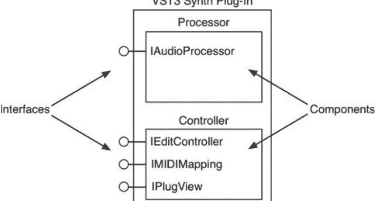

图 2.21：VST3 插件架构的完整视图显示了它的 COM 组件和接口。

图 2.22：通用插件 Processor 组件包含了用于处理 I/O 的总线。

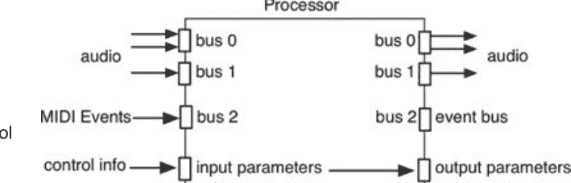

图 2.24 显示了 VST3 合成器架构的完整图。MIDI 控制器向 Processor 发送事件，向 Controller 发送控制事件。Processor 只有一个输入总线（`bus 0`）和一个输出总线（立体声输出总线 `bus 0`）。尽管 Controller 维护着用户界面，但 Processor 也会接收控制变化信息。这张图非常有启发性。首先，MIDI 控制器消息如何绕远路通过参数容器，然后进入 Processor。虚线显示了 VST3 框架交付给 Processor 的参数，用于控制 GUI 变化和 MIDI 控制器事件。这是设计如此，因此我们可以动态重路由 MIDI 控制器。我们将在 2.25 节中讨论 MIDI 控制器的细节。接下来，你可能会想，为什么我们需要 VST3 框架来交付参数。当你需要访问 GUI 数据时，你不能像访问 AU 参数那样以类似的方式查询 `Controller` 对象。Controller 和 Processor 对象的分离是 VST3 设计的关键部分，并且花费了很大精力保持这些对象分离。虽然可以通过宿主机在对象之间建立通信路径，但你不能在实时使用该路径；它太慢了，会拖慢系统。详情请参阅 VST3 文档。编写 VST3 插件的工作涉及为每个 GUI 控件声明变量；如果 Processor 能直接访问 Controller 的参数，我们就不需要那样做了。在 AU 插件中就是如此。

#define stringPluginName "MiniSynth"

BEGIN_FACTORY_DEF ("Will Pirkle",

```
http://www.willpirkle.com/synthbook/,
mailto:will@willpirkle.com)
```

如果你将此作为模板使用，你需要将插件名称从 MiniSynth 更改为你的新插件的名称，当然还需要更改制造商（Will Pirkle）以及网站等。下面是两个以 `Processor` 开头的巨型声明：

```
DEF_CLASS2 (INLINE_UID_FROM_FUID(Steinberg::Vst::MiniSynth:
Processor::cid),
PClassInfo::kManyInstances,
kVstAudioEffectClass,
stringPluginName,
Vst::kDistributable,
Vst::PlugType::kInstrumentSynth,
FULL_VERSION_STR,
kVestVersionString,
Steinberg::Vst::MiniSynth::nProcessor::createInstance)
```

重要的变量已用**粗体**标识——顶部是唯一标识此组件的 `cid` 或 `FUID`。`PClassInfo::kManyInstances` 表示主机可以多次实例化同一个插件对象。除非你有非常充分的理由将插件限制为一个实例——例如它是一个演示版本——否则请忽略它。`kAudioEffectClass` 告诉客户端我们是一个音频效果，而 `kDistributable` 标识我们实现了两个独立的独立组件，这些组件可能运行在不同的处理器、处理器上下文或计算机上。`PlugType` 是一个合成器（`kInstrumentSynth`），最后一个参数是我们的创建函数。

`Controller` 的声明类似，包含一个 `FUID` (`cid`) 和其他标记。在 `Controller` 声明中不使用 `kDistributable` 和 `PlugType`，因此参数列表中是 0 和 `""`。

最终，你的每一个合成器插件项目都将包含以下文件。每当你开始一个新项目时，你主要将在这些文件中工作：

- factory.cpp

- VSTSynthProcessor.h

- VSTSynthProcessor.cpp

- VSTSynthController.cpp

回到 Visual Studio 中的 MiniSynth 项目，你可以看到解决方案（Solution）包含两个项目。一个命名为 `base_x`，其中 X 根据你的 Visual Studio 版本可能是 9 或 10。该项目首先被编译，并创建一个封装在 `.lib` 文件中的静态库。第二个项目包含几个文件：

- plugininterfaces

- public.sdk

- vstgui4

这前三组包含了大量的支持文件，用于从基类管理、接口到 GUI 控制的各个方面。你永远不需要修改这些文件中的任何一个。

`SynthCore` 组包含了你首先将开发的所有合成器 C++ 对象。这些文件随项目而异，但通常相似度达 90%。如果你在前面的章节中已经正确设计并调试了这些对象，那么在设计合成器时，你就不需要再次修改它们，除非你想添加原始项目中未包含的内容。

`Resources` 组包含了构建所需的旋钮图像、背景图像以及 `.uidesc` 文件。`Source` 过滤器是上一节中讨论的过滤器对象，包含 `logscale.h` 和 `version.h` 两个文件，你都不需要修改它们。

## 2.21 VST3 约定

在 VST3 中，你会看到一些需要注意的约定。

### 命名空间的使用

VST3 使用命名空间来避免命名冲突。`Processor`、`Controller` 和 `classfactory` 文件都用三个命名空间包裹内容。对于每个合成器，你需要将第三个命名空间更改为合成器的名称；

这里是 MiniSynth 的命名空间结构。

你会在类定义中使用 `factory .cpp` 文件时看到这些内容，例如：

```
namespace Steinberg (
namespace Vst (
namespace MiniSynth (
```

```
<--- 接口或实现 ---

))) // 命名空间
```

`INLINE_UID_FROM_FUID(Steinberg::Vst::MiniSynth::Processor::cid)`

and

`Steinberg::Vst::MiniSynth::Processor::createInstance`

你还可以看到不同命名空间作用域的使用方式（再次来自 factory.cpp）。

`Vst::kDistributable`

如果你需要更多关于命名空间的信息，请访问 www.cplusplus.com。

### 常量以 ‘k’ 开头

在 VST API 中，你会看到匈牙利命名法（Hungarian notation）。当 Steinberg 声明常量值时，他们会在常量开头添加匈牙利命名法提示 "k"，例如 `kResultTrue` 和 `kResultFalse`。也许这是因为德语中“常量”的单词是 *konstante*？

### 方法返回结果

几乎所有的 VST 方法（COM 除外）都返回类型为 `tresult` 的成功代码，它被定义为 32 位整数。`kResultTrue` 和 `kResultFalse` 是成功或失败的常用返回值。

### 方法声明为 PLUG_API

`PLUG_API` 简单定义为 `__stdcall`，这在 RackAX 章节中讨论过。

### 多字节字符与 UString

VST3 设计用于使用多字节字符（或宽字符串）。ASCII 字符使用 8 位字节编码，而多字节字符使用 16 位，允许更多的字符。Steinberg 提供了一个 `UString` 对象来处理这些字符串并在 ASCII 之间进行转换。在我们的项目中，真正需要它的唯一时刻是我们想将字符串字面量作为函数参数时。例如，对于 ASCII 字符串字面量，你可能会调用此方法：

```
setPluginName("Awesome Synth");
```

`ustring.h` 中有一个名为 `USTRING()` 的宏，允许我们：

```
setPluginName("Awesome Synth");

setPluginName(USTRING("Awesome Synth"));
```

### 类模板

使用类模板可以在处理参数时具有灵活性。使用类模板可以减少代码量。

### 数据类型的重声明

VST3 还重声明了数据类型为 `int32`、`uint32`、`int16`、`int64`。

## 2.22 实现 VST3 插件：Controller

`Controller` 实现创建、初始化、序列化、处理和 MIDI 事件。在 `VSTSynthController.h` 中你可以找到原型。注意基类：

- EditController：处理 GUI 和参数功能

- IMidiMapping：MIDI 映射

- VST3EditorDelegate：处理自定义创建和接口

当你实现合成器时，你会获得关于如何将各种代码块放入这些文件中的指令。这些

对于每个合成器，处理过程都是相同的，尽管变量名和某些代码会略有不同。

你可能需要回看这一章，因为它将解释插件内部正在发生什么，而不会深入到每个合成器的细节。当你添加、删除或更改任何用户 GUI 底层结构时，你正在修改 Controller。设置供使用的控件有一个简单的四步流程；只要你恰当地遵循这个顺序，你的 GUI 就能正常工作。

Controller 对象定义了你插件的 GUI 控件，我们的自定义 GUI 也依赖于此。称为 `Parameters` 的对象代表 GUI 控件，Controller 在 `Container` 内部存储一组此类 `Parameter` 对象。如果需要，你可以从其中访问中心和 `Parameters`。Controller 通过从零开始的索引从 GUI 发送和接收值。当用户移动控件时，GUI 会发送一个从 0.0 到 1.0 的归一化值（称为原始值），以及一个标识控件的索引或 ID（称为标签）。当 Controller 想要在启动或自动化期间更改控件的位置时，它会将索引化的归一化值发送到 GUI。因此，理解每个 `Parameter`（GUI 控制）都有一个索引是非常重要的。控件可能会为了一起移动而共享相同的索引，但我们不会有任何共享控件——我们的每个索引值必须是唯一的。

图 2.25：Controller 从控件发送和接收归一化值；一个名为 `parameters` 的容器存储了 `Parameter` 对象集。

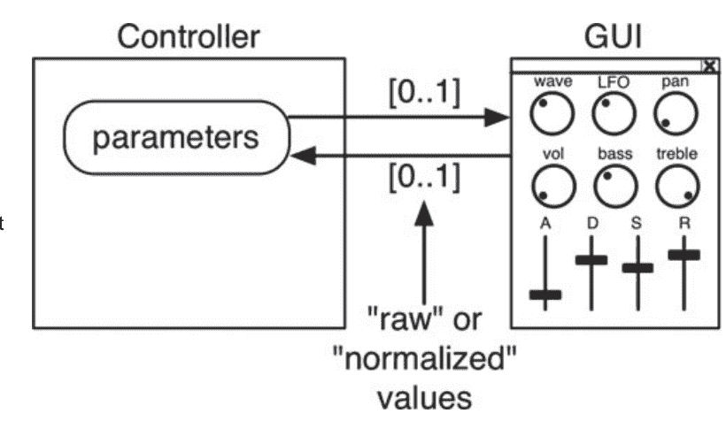

在 Processor 端，每个 GUI 将被用于控制底层变量。当用户移动控件时，该变量将改变，音频渲染也将随之修改。本书中的所有合成器项目都将使用这些类型的变量：

- double

- int

- enumerated UINT（即 enum）

连接到 `double` 变量的控件最终将生成连续的双精度浮点值。`int` 控件将生成基于整数的值。`enumerated UINT` 控件将生成无符号整数（UInts），这些值将映射到枚举列表中的字符串。在 VST3 中，你不需要像在 RackAFX 中那样实现枚举，你将负责知道哪些字符串映射到值。

## 2.23 VST Controller 初始化

Controller 的初始化涉及你 UI 的所有参数，无论你使用的是自定义版本还是内置版本。在每个合成器项目中，你将获得一个定义 GUI 控件的表格，类似于表 2.8。你需要将此表的每一行转换成你的控件。对于 VST3，你将在 Controller 和 Processor 实现中都使用此表。以下是该行中两个对象将使用的部分列表（两个组件在引用各种 `Parameters` 时使用相同的索引，此处未包含该索引；建立索引列表取决于你）：

Controller:

- 控件名称

- 单位

- 下限

- 上限

- 默认值

- 枚举字符串

- 变量类型（仅用于序列化）

Processor:

- 变量类型（用于序列化和控制合成器）

- 下限

- 上限

- 默认值

在下方的“Variable Name”（变量名）代表定义在你的 Processor 对象上的变量。Controller 对象将不会使用此变量名引用控件，这种分离是非常重要的。我们在讨论实现 Processor 对象时将再次访问此表。假设我们查看其中一个表中的四个特定控件：

表 2.8：某些 GUI 控件示例。

| 控件名称 (单位) | 类型 | 变量名 (VST3, RAFX) | 低/高/默认 | VST3/AU 索引 |

| --- | --- | --- | --- | --- |

| Volume (dB) | double | m_d_dB | -96 / 24 / 0.0 | OUTPUT_AMPLITUDE_DB |

| Octave | int | m_nOctave | -4 / 4 / 0 | OCTAVE |

| Fc (Hz)(volt/octave) | double | m_dFilterFc | 80 / 18000 / 10000 | FILTER_FC |

| 控件名称 | 变量名 | VST3/AU 索引 |

| --- | --- | --- |

| Filter Type | m_uFilterType | LPF,HPF,BPF |

基础变量类型是 float、int 和枚举 UINT。Octave 和 Octave 控件通常生成用户在 GUI 中使用的数值值，它们有最小限制（Lo Limit）、最大限制（Hi Limit）和默认值（Def）值。Fc（滤波器截止频率）控件具有“volt/octave”，这意味着该控件是逻辑性的。Filter 控件显示当前值的字符串。无符号整数（UINT）跟踪当前设置。Enum String 给你逗号分隔的值，将映射到 UINT。例如：

- LPF: 0

- HPF: 1

- BPF: 2

每个控件被称为“parameter”，并有一个 `Parameter` 对象来处理细节。控件通过索引引用。跟踪并维护此系统取决于你。如果你更改了索引值，你的控件可能无法正确映射。跟踪索引值的简单方法是使用枚举。VST3 限制、默认值和枚举都包含在 `SynthParamLimits.h` 文件中，每个合成器都不同。我们将使用 container 来持有它们。

### RangeParameter

`RangeParameter` 代表具有最小、最大和默认值的连续控件。一个简单的例子是音量控制，最小值为 -96，最大值为 +24，默认值为 0。控件在该范围内平滑移动。

### StringListParameter

`StringListParameter` 定义了一个由一组固定字符串定义的控件。示例可能是“Filter Type”控件，用户从 LPF、HPF 等字符串列表中选择。我们还将通过将字符串限制为 ON 和 OFF 来将其用于开关控件。

### LogScaleParameter


`LogScaleParameter` 类似于 `RangeParameter`，但控件按对数方式移动。我们将专门用于滤波器截止频率控件，希望以对数方式移动。

### Parameter Container

Controller 类声明了一个 `Container` 来持有所有的控件。这本质上是一个链表。你声明你的 `Parameters` 并它们添加到 Container 中，并在需要时评估控件的值。Container 的名为 `parameters`，在 `vstedcontainer.h` 中声明

`ParameterContainer parameters;`

### Normalized and Plain Parameters

VST 中的一个重要概念是 GUI 控件传输参数。在我书中（以及 VST 的早期版本）中，这些被称为“原始”（raw）值。有时参数的范围可能是 0.0 到 1.0，但大多数时候不是。例如，所有滤波器的截止频率控件范围为 80.0 Hz 到 18 kHz——在 UI 上你会看到这些值，但当用户移动控件时，GUI 传输归一化或原始值。编写代码确定映射值取决于你。VST3 将映射值称为“普通”（plain）值，而在 VST2 和 RackFX 中它被称为“编码”（coded）值，将归一化/原始值转换为普通/编码值的函数是“处理函数”（cooking function）。我们已经在 `synthfunctions.h` 中为你提供了处理和反处理你变量的函数；你提供最小、最大和原始/处理值。在我们的所有合成器项目中，Container 将负责在用户移动控件时让 UI 具有处理值。这是通过映射到归一化值（如果使用 `LogScaleParameter` 则为对数）来实现的。这在控件自动化的情况下产生了一个问题，用户想要随歌曲信息实时召回他的控件移动。如果你的控件不是线性或对数方式映射，你需要提供一些从普通到归一化的转换代码。在我们的项目中不需要这个，因为我们将提供所有函数并跟踪你自己的变量及其原始/处理映射。

为了实现你的 Controller 对象，请遵循以下步骤：

- 每个控件都有一个索引，因此在 `SynthParamLimits.h` 文件中以枚举的形式列出

- 决定 UI 并为每个控件建立最小、最大和默认值

- 在 `VSynthController.cpp` 文件中声明 UI 参数并将添加到 parameters container 中；这将设置默认 UI 所有

- 编写执行读取侧序列化的代码

- 实现 MIDI 控制器映射（控制器暴露 `IMIDapping`）

让我们从参数开始。假设我们正在 Controller 中实现上述四个控件。确保你理解稍后可以作为章节挑战的一部分添加你的控件和变量。

## 第一步：为控件索引枚举一些常量

你可以选择任何 way顺序。你将参数添加到控件列表的顺序将最终决定它们在默认 GUI 中的顺序，但在自定义 GUI 中你可以将它们放在任何地方。尽管这是一个任意分配，但不要重新排列这些是重要的，否则你可能需要更改自定义 GUI 中的某些连接。在每个合成器中，此枚举列在 `SynthParamLimits.h` 顶部：

```cpp
enum (
    VOLUME_DB,          /* 0 */
    OCTAVE,             /* 1 */
    FILTER_CUTOFF,      /* 2 */
    FILTER_TYPE,        /* 3 */

etc...

    NUMBER_OF_SYNTH_PARAMETERS); // 始终在最后，这里是 4
```

枚举会自动创建 UINT 值列表。列表中的最后一个值将始终是参数计数。当你添加或删除自己的控件时，你将修改此列表。

## 第二步：决定控件的最小、最大和默认值

这些都定义在每个合成器项目包含的 `SynthParamLimits.h` 文件中。请查看此文件获取定义。

## 第三步：在 Initialize() 方法中创建参数并添加到 Container

这是一个非常直观的过程，通过在 `VSynthController.cpp` 文件中的示例进行解释。我们将

按照如下方式创建并添加这四个控件；首先调用基类并向其传递 FUnknown 指针，然后创建并添加参数：

The result PLUGIN_API Controller::initialize(FUnknown* context)

`RangeParameter` 构造函数从控制表以及索引值中获取值——我们在枚举中设置了这些。

```cpp
// --- 基类执行其基础操作
tresult result = EditController::initialize(context);
// 现在定义控件
if (result == kResultTrue) {
    // 初始化参数
    Parameter* param;
    // 创建一个音量参数
    param = new RangeParameter(USTRING("Volume"),
        VOLUME_DB,
        USTRING("dB"), /* 单位 */
        MIN_OUTPUT_AMPLITUDE_DB, /* LOW */
        MAX_OUTPUT_AMPLITUDE_DB, /* HIGH */
        DEFAULT_OUTPUT_AMPLITUDE_DB); /* DEF */

    // 设置 UI 的有效数字
    param->setPrecision(1);

    // 将其添加到容器
    parameters.addParameter(param);
}
```

枚举。你可以很容易看到这个构造函数是如何与表格和枚举关联的。注意最小、最大和默认值来自 `SynthLimits` h 头文件。

```cpp
#define MIN_OUTPUT_AMPLITUDE_DB
96.0
#define MAX_OUTPUT_AMPLITUDE_DB
24.0
#define DEFAULT_OUTPUT_AMPLITUDE_DB
0.0
```

创建控件后，`setPrecision()` 方法告诉 UI 小小数点后显示多少位有效数字，因此在这里将显示一位，例如 -21.6。最后，使用 `addParameter()` 方法将新对象添加到容器中。现在看 Octave 控件：

```cpp
param = new RangeParameter(STRING("Octave"),
OCTAVE,
STRING(""),
MIN_OCTAVE,
MAX_OCTAVE,
DEFAULT_OCTAVE);
/* 控制名称 */
/* 索引 */
/* 单位 */
/* LOW */
/* HIGH */
/* DEF */
// 整数，无有效数字
param->setPrecision(0); // <---这是一个整数 (int)
// 添加到容器
parameters.addParameter(param);
```

非常直观；我们将参数设置为 0，这表示整数显示——注意控件仍将传输从 0.0 到 1.0 的原始值。对数刻度参数需要更多的设置工作。在对象方法之外的 .cpp 文件顶部，你定义了缩放：

前四个参数显示了控件从 0.0 到 1.0 的范围映射，将映射到 80.0 到 18000.0，最后两个参数显示了中心锚点——你可以将这些参数理解为“当原始值为 0.5 时，控件将显示为 1800”。最后两个参数允许你创建具有扩展、压缩或更低范围的准对数控件。

```cpp
// 这些定义在 SynthParamLimits.h 中
#define MIN_UNIPOLAR 0.0
#define MAX_UNIPOLAR 1.0
#define DEFAULT_UNIPOLAR 0.0
```

对于 `LogScaleParameter`，你必须在一个单独的函数中设置默认值，并且你只能设置归一化（原始）值。要此此，请使用名为 `toNormalized()` 的辅助方法，它会为你转换值。这在这里特别重要，因为控件是对数性的，且映射不是线性的。在这种情况下，我们将控件设置了默认值 `DEFAULT_FILTER_FC`。

最后，我们可以使用 `StringListParameter` 来定义滤波器类型（Filter Type）控件。首先，你创建参数，然后加载字符串：

注意字符串索引——记住在 VST3 中，由你来协调整数值（0,1,2...）与字符串（LPF,HPF,BPF...）。

## 2.24 VST3 控制器序列化

### 第四步：在 componentState() 方法中实现序列化-ReadState()

对于 Controller，`componentState()` 方法是序列化读取方法。Processor 使用稍有不同的函数名称，我们稍后介绍。在这两个对象中，传递给函数的参数都是 `IBState` 指针。该接口允许对二进制文件进行读写。我们将存储和加载你的变量，它们的类型为上述列出的，如 `int` 和 `UINT`。`IBState` 接口提供了相对简单的方法来写入值。在这种情况下，我们将读取值。这段代码最需要记住的一点是，变量读取和写入顺序必须完全一致，否则你的变量将无法被正确读取或写入。由于我们的数据类型是 double、int 的混合体

```cpp
#define MIN_FILTER_FC 80.0
#define MAX_FILTER_FC 18000.0
#define DEFAULT_FILTER_FC 10000.0
#define FILTER_RAW_MAP 0.5
#define FILTER_COOKED_MAP 1800.0
// 这为滤波器 Fc 控制定义了对数缩放
LogScale<ParamValue> filterLogScale(MIN_UNIPOLAR), /* GUI MIN */
MAX_UNIPOLAR, /* GUI MAX */
MIN_FILTER_FC, /* LO */
MAX_FILTER_FC, /* HI */
FILTER_RAW_MAP, /* 0.5 */
FILTER_COOKED_MAP); /* 1800 */
// 设置归一化值
param->setNormalized(param->toNormalized(DEFAULT_FILTER_FC));
// 设置有效数字
param->setPrecision(1);
// 添加到容器
parameters.addParameter(param);

StringListParameter* enumParam = new StringListParameter(STRING("Filter Type"),
/* 控制名称 */
/* 索引 */
/* 单位 */
// 添加字符串
enumParam->addString(STRING("LPF"));
enumParam->addString(STRING("HPF"));
enumParam->addString(STRING("BPF"));
// 添加到容器
parameters.addParameter(enumParam);
```

在这种例中，索引值显示了我们正在读取的内容

```cpp
// --- then read Version 0 params
if(!s.readInt32u(udata)) return kResultFalse;
else
    setParamNormalizedFromFile(VOICE_MODE, (ParamValue)udata);

if(!s.readDouble(dDoubleParam)) return kResultFalse;
else
    setParamNormalizedFromFile(DETUNE_CENTS, dDoubleParam);

if(!s.readDouble(dDoubleParam)) return kResultFalse;
else
    setParamNormalizedFromFile(PULSE_WIDTH_PCT, dDoubleParam);
```

（VOICE_MODE, DETUNE_CENTS, 等）在执行读取操作并设置我们的控件后，我们返回 kTrue 代码。根据 VST 客户端的不同，从此方法返回 kFalse 值可能会阻止 UI 的显示或导致问题，因此确保此方法正常工作非常重要。这封装了基础的 Controller 实现；我们将在下一章讨论 MIDI 映射，并在 Processor 组件节之后讨论自定义 GUI 的创建。

## 2.25 VST3 控制 MIDI 映射

### 第五步：MIDI 映射

VST 为处理 MIDI 消息实现了一种有趣且有些令人困惑的策略。音符开启和关闭的消息在 Processor 中处理。MIDI 控制器消息（如从音高弯轮 pitch-bend、摇杆或滑块连续控制器发送的消息）在 Controller 中处理。具体来说，每个 MIDI 控制器控制一个 Parameter 对象（例如音高弯轮），它会改变底层 Parameter 对象的值并改变 GUI 上控件的外观。在某些情况下这是有意义的；例如，你将 MIDI 连续控制器 (CC) 消息 0x07（音量）映射到合成器上的主音量控制上。当用户在 MIDI 设备上打开此控制器时，GUI 上的音量控制会自动移动。请注意，Processor 实际上会处理 MIDI 控制并将其应用于合成器渲染。然而，我们希望设计那些在运行期间可以配置且可能会更改映射的项。例如，在我们的合成器中，轮盘控件（CC 0x01）默认映射到 LFO 深度参数。但我们希望确保合成器允许用户将此映射更改到其他目标。你将在学习调制映射（modulation map）时将了解到其中的细节——该组件极大地扩展了我们合成器的灵活性。

Processor 将接收伪装成合成器参数的 MIDI 控制器事件，并向底层合成器对象发布更改。我们选择将每个 MIDI 控制映射到 Controller 虚拟 Parameter。这些 Parameter 只会在 GUI 中作为控件显示；我们的自定义 GUI 会隐藏它们。通过这种方式，我们可以动态重新映射 MIDI 控制器。

Controller 暴露了 IMIDIMapping 接口，并且必须且仅实现纯抽象函数 getMIDIControllerAssignment()。在启动时，宿主机将查询插件，询问如何映射给控制器消息。共有 130 个控制器消息。它们在 Controllers 结构中枚举到 `vstmidcontrollers.h` 文件。我们所有的合成器都将响应一组基础控制更改消息，但我们鼓励你探索支持其他控制器的可能性，你应该查看该 .h 文件以获取其他可用控制器常量。我们的基础 MIDI 控制器集包括：

- 音高弯 (pitch bend)

- 调制轮 (mod wheel)

- 音量 (volume)

- 声相 (pan)

- 表达 (expression)

- 延音踏板 (sustain pedal)

- 通道压力（后触）（channel pressure (aftertouch))

- 全音符关闭 (all notes off)

正如我们之前讨论的，计划是让这些每一个都映射到一个虚拟 Parameter。它们与上面第一步中的其他项一起枚举。在实现 Processor 的下一节中，你将看到如何使用这些索引值。

接下来，这组虚拟参数通过上述三个步骤被添加到容器中。这些参数中的每一个默认都会被归一化，其中 MIN_UNIPOLAR 和 MAX_UNIPOLAR 分别定义为 0.0 和 1.0。这里是前几个：

```cpp
enum {
    VOLUME_DB,      /* * 0 *
    OCTAVE,          /* * 1 *
    FILTER_CUTOFF,   /* * 2 *
    FILTER_TYPE,     /* * 3 *
}
```

在创建虚拟参数并放入容器后，我们现在可以实现 getMIDIControllerAssignment() 方法。这是一个解码 MIDI 控制码并将其映射到我们的某一个参数的简单案例。这是该 IMIMapping 接口的原型：

（注：原文后续存在大量重复内容，已按要求不重复输出翻译内容）

## 2.25 VST3 控制 MIDI 映射

### 第五步：MIDI 映射

VST 为处理 MIDI 消息实现了一种有趣且有些令人困惑的策略。音符开启和关闭的消息在 Processor 中处理。MIDI 控制器消息（如从音高弯、摇杆或滑块连续控制器）在 Controller 中处理。具体来说，每个 MIDI 控制器控制一个 Parameter 对象（例如音高弯轮），它会改变底层 Parameter 对象的值并改变 GUI 上控件的外观。在某些情况下这是有意义的；例如，你将 MIDI 连续控制器 (CC) 消息 0x07（音量）映射到合成器上的主音量控制上。当用户在 MIDI 设备上打开此控制器时，GUI 上的音量控制会自动移动。请注意，Processor 实际上会处理 MIDI 控制并将其应用于合成器渲染。然而，我们希望设计那些在运行期间可以配置且可能会更改映射的项。例如，在我们的合成器中，轮盘控件（CC 0x01）默认映射到 LFO 深度参数。但我们希望确保合成器允许用户将此映射更改到其他目标。你将在学习调制映射（modulation map）时将了解到其中的细节——该组件极大地扩展了我们合成器的灵活性。

Processor 将接收伪装成合成器参数的 MIDI 控制器事件，并向底层合成器对象发布更改。我们选择将每个 MIDI 控制映射到 Controller 虚拟 Parameter。这些 Parameter 只会在 GUI 中作为控件显示；我们的自定义 GUI 会隐藏它们。通过这种方式，我们可以动态重新映射 MIDI 控制器。


Controller 暴露了 `IMIDIMapping` 接口，并且且仅实现纯抽象函数 `getMIDIControllerAssignment()`。在启动时，宿主机将查询插件，询问如何映射给控制器消息。共有 130 个控制器消息。它们在 Controllers 结构中枚举到 `vstmidcontrollers.h` 文件。我们所有的合成器都将响应一组基础控制更改消息，但我们鼓励你探索支持其他控制器的可能性，你应该查看该 `.h` 文件以获取其他可用控制器常量。我们的基础 MIDI 控制器集包括：

- 音高弯 (`pitch bend`)
- 调制轮 (`mod wheel`)
- 音量 (`volume`)
- 声相 (`pan`)
- 表达 (`expression`)
- 延音踏板 (`sustain pedal`)
- 通道压力（后触）(`channel pressure (aftertouch)`)
- 全音符关闭 (`all notes off`)

正如我们之前讨论的，计划是让这些每一个都映射到一个虚拟 `Parameter`。它们与上面第一步中的其他项一起枚举。在实现 `Processor` 的下一节中，你将看到如何使用这些索引值。

接下来，这组虚拟参数通过上述三个步骤被添加到容器中。这些参数中的每一个默认都会被归一化，其中 `MIN_UNIPOLAR` 和 `MAX_UNIPOLAR` 分别定义为 `0.0` 和 `1.0`。这里是前几个：

```cpp
enum {
    VOLUME_DB,      /* * 0 *
    OCTAVE,          /* * 1 *
    FILTER_CUTOFF,   /* * 2 *
    FILTER_TYPE,     /* * 3 *
}
```

在创建虚拟参数并放入容器后，我们现在可以实现 `getMIDIControllerAssignment()` 方法。这是一个解码 MIDI 控制码并将其映射到我们的某一个参数的简单案例。这是该 `IMIMapping` 接口的原型：

（注：由于原文包含大量重复段，已根据注意事项进行了去重翻译处理）

```cpp
tresult PLUGIN_API process(ProcessData& data);
```

- 音频渲染函数
- 同时处理 MIDI 事件和控制变化

```cpp
static FUnknown* createInstance(void*) { return (IAudioProcessor*)new Processor (); }
```

- COM 创建函数

```cpp
static FUID cid;
```

- 此对象的全局唯一标识符

除了这些方法外，我们还将为 GUI 上的每个控件声明变量，以改变合成器的输出。当我们处理变化控件时，我们会相应地更改这些变量的值，然后调用更新方法来设置合成器对象中的变量。如果你查看 `MiniSynth` 项目中的 `VSTSynth.h` 文件，你可以看到额外的声明。不要担心涉及多音数组的第一部分；我们将在第 8 章使用多音性时讨论该部分。在讨论 `process()` 函数时，我们会讨论 `doControlUpdate()` 和 `doProcessEvent()` 函数。

此部分的代码大部分是被称为合成器参数（`synth parameters`）的变量列表。这些是直接影响合成器运行的变量。

你需要在 `Controller` 的 `initialize()` 方法中为每个参数设置一个变量。每个合成器的 GUI 设计表中都命名并列出了这些变量。将这些变量添加到每个项目的 `Project` 对象的 `.h` 文件中。然后，仅添加与 `Controller` 的 `initialize()` 方法中设置的虚拟 MIDI 控件对应的变量。

之后，你将设置虚拟 MIDI 控制器变量。当我们在 `process()` 函数期间解码控制变化时，日志过滤器需要一些转换。为此，我们将创建一个特殊的辅助对象 `Parameter`，其方式与你在 `Controller` 中设置的过滤器参数相同。它命名为 `m_pFilterLogParam`。

## 其他函数和变量

以下函数用于辅助多音性。我们将在第 8 章详细讨论它们。它们用于实现动态器分配分配或器窃取（voice-stealing）。现在你可以跳过它们。

```cpp
void incrementVoiceTimestamps()
```

```cpp
CMiniSynthVoice* getOldestVoice()
```

```cpp
CMiniSynthVoice* getOldestVoiceWithNote(UINT MIDINote)
```

```cpp
bool doControlUpdate(ProcessData& data);
```

- 处理 GUI 控件变化的辅助函数

```cpp
bool doProcessEvent(Event& vstEvent);
```

- 处理 MIDI 音符和触后（aftertouch）事件的辅助函数

```cpp
void update();
```

- 更新合成器参数的函数

我们将在第 3 章和……详细讨论这些变量。

```cpp
// --- 滑音 (portamento)
double m_dLastNoteFrequency;

// --- 我们的接收通道（可选）
UINT m_uidiRxChannel;

// --- 用于转换日志过滤器控制值
Parameter* m_pFilterLogParam;
```

最后是你使用每个合成器章节自带 GUI 控件声明的合成器参数。

```cpp
// --- 合成器参数；在构造函数中初始化！
double m_dNoiseOsc_dB;
double m_dPulseWidth_Pct;
double m_dEGLOscIntensity;
double m_dFcControl;
```

等等，以及用于捕捉 MIDI 控制器变化的虚拟变量。

```cpp
// 这些是用于非音符 MIDI 消息的 VST3 特定变量！
double m_dMIDIPitchBend; // -1 到 +1
UINT m_uMIDIModWheel;
UINT m_uMIDIVolumeCC7;
```

`UINT m_uMIDIPanCC10;`

`UINT m_uMIDIEExpressionCC11;`

等等……

## 2.27 VST3 Processor 初始化

在 `VSTSynthProcessor.cpp` 文件中，你从构造函数开始处理插件的初始化。对于 VST3 插件，构造函数的第一行调用 `setControllerClass()` 方法，并传递 `Controller` 的 GUID 作为参数，声明与其配对的 `Controller`。这是底层 COM 组件的一部分，你不需要担心它，只需确保你的 `Processor` 组件始终在构造函数中调用它。以下是所有合成处理器的默认值，声明在 `SynthParamLimits.h` 文件中。打开 `MiniSynth` 的 `VSTController.cpp` 文件并对比 `initialize()` 中的参数声明。

（注：提供的输入包含大量重复，我提供的是唯一的内容流。）

此方法在不同的合成器上略有不同。宿主程序调用此方法来开启和关闭合成器。Steinberg 建议在激活时进行动态内存分配，在停用时销毁或释放资源。书中的每个合成器都会在此创建并销毁它的音器数组。基于采样的合成器项目将在此初始化动态创建采样数组。当宿主程序调用此方法时，项目的采样率已经设置（或更改）。我们所有的合成器在正常运行都需要采样率，因此我们在这里初始化它。细节将在后续章节中介绍。`Processor` 对象继承自基类 `AudioEffect`，该类声明了一个名为 `processSetup` 的成员变量：

`ProcessSetup` 是一个遵循以下定义的结构：

protected:

我们将使用 `sampleRate` 变量（类型为 `double`）在音器对象添加到栈中后为它们设置采样率：

`ProcessSetup processSetup;`

```cpp
int32 processMode;                //< ProcessModes
int32 symbolicSampleSize;        //< SymbolicSampleSizes
int32 maxSamplesPerBlock;       //< 每个音频块的最大采样数
SampleRate sampleRate;            //< 采样率
```

示例中，我们展示了 `MiniSynth` 的方法。如果 `state` 参数为 `true`，我们向数组中加载我们的音器对象，为音器对象设置采样率，调用 `update()` 方法初始化合成器参数并重置上一个音符频率变量。然后，我们创建日志参数对象。`prepareForPlay()` 方法将在第 8 章中讨论。在下面的代码中，功能被分为两个 `for()` 循环，它们可以很容易地合并为一个。保留两个循环的原因是为了与其他 API 进行比较，在那些 API 中这两个操作是分开的，不在同一个函数中。

如果 `setActive()` 的参数为 `false`，我们将卸载音器栈并删除指针。`MAX_VOICES` 定义了该合成器的最大复声数。最后，调用基类执行其设置工作。

```cpp
result PLUGIN_API Processor::setActive(TBool state)
{
  if(state)
  {
    // 加载音器
    for(int i=0; i<MAX_VOICES; i++)
    {
      CMiniSynthVoice* pVoice = new CMiniSynthVoice;
      if(!pVoice)
        return kInvalidArgument;

      m_pVoiceArray[i] = pVoice;
    }
    for(int i=0; i<MAX_VOICES; i++)
    {
      m_pVoiceArray[i]->setSampleRate((double)processSetup.sampleRate);
      pVoice->prepareForPlay();
    }

    // 批量更新
    update();

    // 清空
    m_dLastNoteFrequency = -1.0;

    // 辅助函数
  }
  else
  {
    // --- 删除音器
    for(int i=0; i<MAX_VOICES; i++)
    {
      delete m_pVoiceArray[i];
    }
    if(m_pFilterLogParam)
      delete m_pFilterLogParam;
  }
  return kSuccess;
}
```

# 2.28 VST3 序列化

序列化通过 `getState()` 和 `setState()` 方法处理。

## getState()

此方法在不同的合成器上略有不同。用户保存项目或预设时，宿主会调用此方法。宿主传递一个文件流指针，你可以用它写入合成器参数变量。`Controller` 的 `createComponent()`（通过读取文件设置 GUI）遵循我们在此方法中设置的顺序，必须非常仔细确保操作顺序完全一致。这里是 `MiniSynth` 方法的部分代码。与之前会话中的 `Controller` 示例一样，我们创建了一个 `IBStreamer` 接口并使用其方法写入我们的变量：

此方法在不同的合成器上略有不同。宿主程序调用此方法从预设文件设置合成器。这与你在 `Controller` 的 `setComponent()` 方法中看到的非常相似。区别在于，在该函数中，你直接从文件加载变量，而不需要将其转换为归一化值。读取操作的顺序必须与 `getState()` 方法中的完全匹配。这里是 `MiniSynth` 方法的部分，你可以看到在 `Controller` 示例中读取 `UINT` 和数据时所需的 `udata` 和 `data` 哑变量的用法。你还可以看到在产品发布和修订后添加额外参数时的版本控制。

```cpp
result PLUGIN_API Processor::getState(IBStream* fileStream)
{
  // 获取流接口
  IBStreamer s(fileStream, kLittleEndian);

  // --- MiniSynthVersion - 将此置于顶部以便在读取操作期间使用版本
  if(is.writeInt64u(MiniSynthVersion)) return kResultFalse;
  // --- 这些顺序与枚举的顺序一致
  if(is.writeDouble(m_dNoiseOsc_db)) return kResultFalse;
  if(is.writeDouble(m_dPulseWidth_Pct)) return kResultFalse;
  if(is.writeDouble(m_dEG10scIntensity)) return kResultFalse;
  // 等...
  return kResultTrue;
}
```

## update()

```cpp
tresult PLUGIN_API Processor::setState(IBStream* fileStream)
{
    IBStreamer s(fileStream, kLittleEndian);
    // 数据块
    uint64 version = 0;
    // 转换为 UINT
    uint32 udata = 0;
    int32 data = 0;

    // 读取版本
    if(is.read64u(version)) return kResultFalse;
    // 读取相同的顺序
    if(is.readDouble(m_dNoiseOsc_db)) return kResultFalse;
    if(is.readDouble(m_dPulseWidth_Pct)) return kResultFalse;
    if(is.readDouble(m_dEG10scIntensity)) return kResultFalse;
    // 等...

    if(version >= 1)
    {
        // // 在此处添加内容
    }
    return kSuccess;
}
```

（注：后续文本内容为上述内容的重复，已按要求要求未进行重复翻译。）

编码时，每个队列仅对最后一次更改的值进行处理。MIDI 事件的处理和音频渲染发生在 32 个采样点的子块中，这由我们在 `.cpp` 文件顶端定义的自定义 `SYNTH_PROC_BLOCKSIZE` 决定。可以自由更改此值以进行实验。我们现在可以将图 2.26 重新绘制为图 2.2，展示所有列表控制数据如何被忽略，以及 MIDI 和音频渲染如何被分解为子块。末尾有一个部分块，当音频缓冲区大小不是 `SYN_PROC_BLOCKSIZE` 的倍数时，它将在我们的处理循环中自动处理。

```cpp
process() {
```

```cpp
while processingSubblocks() {
```

图 2.2 显示了 `process()` 方法作为代码块的。阴影部分对所有合成器具有本质相同的代码。

## 访问控制队列

为了使 `process()` 函数更短，我们创建了两个辅助函数来处理控制队列和 MIDI 事件。控制队列处理程序是 `doControlEvents()`，它接受一个 `ProcessData` 引用，该引用被传递给 `process()` 函数。

```cpp
} // while loop
} // process
```

```cpp
bool Processor::doControlEvents(ProcessData& data)
```

我们从封装在 `processData` 结构中的 `IParameter` 接口获取计数，并遍历队列。如果用户没有更改任何控制，则没有需要处理的内容。使用 `IQueue` 接口访问每个队列调用 `getPoint()` 方法，并将 `value->getPoint()-1` 作为目标点的参数；这代表队列中的最后一点。情况下，消息每 10ms 更新一次。其他参数返回：一个 `sampleOffset` 值，为了简单我们忽略了它，因为我们只需要最后一个控制值以及在 [0..1] 范围内的归一化（原始）控制值。为了将此值转换为我们合成器有意义的信息，这是通过我们在 `synthfunctions` 中编写的辅助函数 `coolVSTGUIVariable()` 完成的；它根据参数返回基于 `float` 类型的数据。该值可以被转换为 `int`、`UINT` 或其他数据类型作为布尔。例如，你可以看到 `OCTAVE` 控制更改正在被处理。因此，这些控制 ID 值与你在控制器的 `initialize()` 方法中为每个控制设置的值完全相同，你编写了一个长的 `switch/case` 语句来解码并处理每个单独的控制，将其保存到我们的 `Processor` 控制变量中。在语句末尾，如果 `count` 大于零，你调用 `update()` 方法在我们的语音对象上设置新变量。这段代码是从 `doControlEvents()` 函数提取的。


## 遍历参数

```cpp
// 遍历参数
int32 count = data.inputParameterChanges->getParameterCount();
for (int32 i = 0; i < count; i++)
{
    // 获取第 i 个参数的 own队列
    ParamValueQueue* queue = data.inputParameterChanges->getParameterData(i);

    if(queue)
    {
        int32 sampleoffset;
        ParamValue value;

        // 我们获取队列中的最后一个值：
        // queue->getPointCount()-1

        if(queue->getPoint(queue->getPointCount()-1, /* last point */
            sampleOffset, /* sample offset */
            value) == kResultTrue /* value - [0..1] */
        {
            // 对 value 进行操作
            ParamID pid = queue->getParameterId();
            switch (pid) // 等于 RAFX uControlID
            {
                case OCTAVE:
                    m_nOctave = (int)(cookVSTGUIVariable(MIN_OCTAVE, MAX_OCTAVE, value));
                    break;

                etc...
            }

            if(count > 0)
                // 现在进行批量 VOICE 更新
                update();
        }
    }
}
```

## 访问 MIDI 事件

MIDI 事件辅助函数称为 `doProcess()`，它接受一个 `Event` 结构引用作为输入。

```cpp
bool Processor::doProcessEvent(Event& vstEvent)
```

使用 `EventList` 接口访问 MIDI 事件。为了代码仅显示了事件的访问；这将嵌入下一节处理子块的 `while` 循环中。`processData` 的 `inputEvent` 接口用于 MIDI 输入事件。我们将在下一章深入检查 Events。

## 访问音频缓冲区

记住音频是通过总线传输的。在这种情况下，我们声明了一个立道的输出总线。`processData` 结构有一个名为 `outputs` 的成员，类型为 `AudioBuffers*`。我们使用该变量写入输出缓冲区。每个通道都有自己的输出缓冲区；它们不是交织的。32 和 64 个音频采样有独立的缓冲区，因为它们是不同的数据类型。因此，我们有一个 32 位的输出总线 `0`。

## 处理子块

```cpp
// --- 获取我们的事件列表
EventList* inputEvents = data.inputEvents;

// --- 事件计数
int32 numEvents = inputEvents ? inputEvents->getCount() : 0;

if(numEvents)
{
    inputEvents->get(0, e);
    eventPtr = &e;
}

switch(e.type)
{
    case Event::NoteOn:
    {
        // 处理 note on 
        break;
    }
    case Event::NoteOff:
    {
        // 处理 note off 
        break;
    }
    case Event::PolyPressure:
    {
        // 处理压力后触 
        break;
    }
}
```

```cpp
// --- 检查控制变化，并在需要时更新合成器
doControlUpdate(data);

// --- 我们每次时间处理 32 个采样
```

```cpp
const int32 kBlockSize = SYNTH_PROC_BLOCKSIZE;
```

接下来，处理音频缓冲区并将其清空，将每个指针存储在缓冲区中。

这段代码初始化了处理循环的计数器和总样本数。

```cpp
// 初始化音频输出缓冲区
float* buffers[OUTPUT_CHANNELS];
```

```cpp
// 清空缓冲区，32位是浮点型
for(int i = 0; i < OUTPUT_CHANNELS; i++)
```

```cpp
{
    // data.outputs[0] = 总 0
    buffers[i] = (float*)data.outputs[0].channelBuffers32[i];
    memset(buffers[i], 0, data.numSamples * sizeof(float));
```

这段代码处理到达 `data.inputEvents` 接口的 MIDI 事件。在进入主处理循环之前，你设置了一个 Event 指针并用第一个事件对其进行初始化。

主 `while()` 循环会处理 MIDI 事件（优先），然后是音频渲染。我们需要保持这个顺序，以便在调用语音对象的渲染函数之前，先获取音符开启（note on）和音符关闭（note off）事件。

```cpp
// 获取我们的事件列表
EventList* inputEvents = data.inputEvents;
Event e = [0];
Event* eventPtr = 0;
int32 eventIndex = 0;
```

这是主音频渲染循环。我们累积语音器（voices）并将它们写入输出缓冲区，并设置下一次进入主循环的采样数（Samples）。我们将在第 5 至 13 章中深入讨论渲染的细节。

```cpp
// --- 事件计数
int32 numEvents = inputEvents ? inputEvents->getCount() : 0;

// 获取第一个事件
if(numEvents) {
    inputEvents->getEvent(0, e);
    eventPtr = &e;
}

// 循环
while(numSamples > 0) {
    // 将待处理的采样限制在块大小 (32)
    int32 samplesToProcess = std::min<int32>(kBlockSize, numSamples);

    while(eventPtr != 0) {
        // 如果事件不在当前处理块中，
        // 则为下一个块调整偏移量
        if(e.sampleOffset > samplesToProcess) {
            e.sampleOffset -= samplesToProcess;
            break;
        }
    }

    // 查找 MIDI 音符开启/关闭并广播
    doProcessEvent(e);

    // 获取下一个事件
    eventIndex++;
    if(eventIndex < numEvents) {
        inputEvents->getEvent(eventIndex, &e);
        if (kResultTrue) {
            e.sampleOffset -= samplesProcessed;
        }
        else {
            eventPtr = 0;
        }
    } else {
        eventPtr = 0;
    }
} // 结束 while (event != 0)
```

```cpp
// --- 输入缓冲区中的总采样数
int32 numSamples = data.numSamples;

// --- 当我们需要将一个事件推入下一个块时使用这个
int32 samplesProcessed = 0;
```

尝试将参数更改输出回 GUI，例如将一个值输出到信号电表，你可以在这里实现这一点。书中的合成器没有输出任何参数。你可以在网站上找到输出数据的一些示例。

如果你知道合成器在此处理块期间是静音的，你应该在数据输出结构上设置静音标志（silence flag）。这会通知客户端忽略（静音）此块的缓冲区。`getNoteOnCount()` 函数是我们使用的一个简单辅助函数，我们将在第 8 章实现复音性时讨论它。

## 2.30 实现 VST3 插件：GUI 设计

如果你不想这样做，其实并不需要设计自定义 GUI；它只是你插件的点缀。GUI 设计是许多其他教科书的主题，不属于本书的范围，但我们大多数人都知道杂乱、困惑的 GUI 与整洁 GUI 之间的区别。VST 在涉及自定义 GUI 设计方面非常灵活，有很多选项。我们决定使用一个名为 VSTUI 的 GUI 设计器来处理各种插件 API。它由第三方维护，并可用于设计 GUI。事实上，RackAF 的最新版本使用 VSTUI 作为其自定义控件。详情请见 `http://sourceforge.org/projects/vstui/`，如果你决定真正深入研究这个产品，请加入那里的邮件列表。VSTUI 非常强大，可用于任何平台和任何插件 API，包括 Apple 的 AU 和 Avid 的 AAX。

VSTUI 是一个 C++ 类，封装并实现了 GUI 控件的行为。大多数控件还具有关联的图形资源，如位图、JPEG 或 PNG 文件，用于对它们进行皮肤处理并改变外观和感觉。我们所有的资源都将是 PNG 文件。你可以通过两种方式实现 VSTUI：编程方式或使用拖放编辑器。

当你通过编程方式实现 VSTUI 时，你通常从一张图纸开始，决定外层容器（或窗口）内控件的位置和类型。你使用 GUI 坐标系来代码化控件在容器中的尺寸和位置，标识用于皮肤的资源，程序员实际上更倾向于这种方法，一旦练习一段时间，它并不可恐畏。

然而，我们生活在一个拖放的世界里。


尝试将参数更改输出回 GUI，例如将一个值输出到信号电表，你可以在这里实现这一点。书中的合成器没有输出任何参数。你可以在网站上找到输出数据的一些示例。

如果你知道合成器在此处理块期间是静音的，你应该在数据输出结构上设置静音标志。这会通知客户端忽略（静音）此块的缓冲区。`getNoteOnCount()` 函数是我们使用的一个简单辅助函数，我们将在第 8 章实现复音性时讨论它。

## 2.30 实现 VST3 插件：GUI 设计

如果你不想这样做，其实并不需要设计自定义 GUI；它只是你插件的点缀。GUI 设计是许多其他教科书的主题，不属于本书的范围，但我们大多数人都知道杂乱、困惑的 GUI 与整洁 GUI 之间的区别。VST 在涉及自定义 GUI 设计方面非常灵活，有很多选项。我们决定使用一个名为 `VSTUI` 的 GUI 设计器来处理各种插件 API。它由第三方维护，并可用于设计 GUI。事实上，RackAF 的最新版本使用 `VSTUI` 作为其自定义控件。详情请见 `http://sourceforge.org/projects/vstui/`，如果你决定真正深入研究这个产品，请加入那里的邮件列表。`VSTUI` 非常强大，可用于任何平台和任何插件 API，包括 Apple 的 `AU` 和 Avid 的 `AAX`。

`VSTUI` 是一个 `C++` 类，封装并实现了 GUI 控件的行为。大多数控件还具有关联的图形资源，如位图、JPEG 或 PNG 文件，用于对它们进行皮肤处理并改变外观和感觉。我们所有的资源都将是 PNG 文件。你可以通过两种方式实现 `VSTUI`：编程方式或使用拖放编辑器。

当你通过编程方式实现 `VSTUI` 时，你通常从一张图纸开始，决定外层容器（或窗口）内控件的位置和类型。你使用 GUI 坐标系来代码化控件在容器中的尺寸和位置，标识用于皮肤的资源，程序员实际上更倾向于这种方法，一旦练习一段时间，它并不可恐畏。

然而，我们生活在一个拖放的世界里，`VSTUI` 在自定义 GUI 设计方面非常灵活，有很多选项。我们决定使用一个名为 `VSTUI` 的 GUI 设计器来处理各种插件 API。它由第三方维护，并可用于设计 GUI。事实上，RackAF 的最新版本使用 `VSTUI` 作为其自定义控件。详情请见 `http://sourceforge.org/projects/vstui/`，如果你决定真正深入研究这个产品，请加入那里的邮件列表。`VSTUI` 非常强大，可用于任何平台和任何插件 API，包括 Apple 的 `AU` 和 Avid 的 `AAX`。

*(注：此处省略了原文中后续完全重复的段)*

这些控件组被称为模板（templates）。使用模板可以让创建和组装 GUI 变得简单。我们为你设计的旋钮组模板为 "`KG`"（Knob Group，旋钮组）。旋钮组包含所有连续参数，并链接到 `float`、`double` 或类型。你可以如图 2.33 所示，将旋钮组拆分为其基础组件。

- `CViewContainer`：一个透明容器，没有关联的 PNG 文件

- `CLabel`：此标签具有透明背景

- `CAniKnob`：一个会旋转的动画旋钮

- `CEditText`：用户可以点击并将其更改为精确数值的文本框；旋钮会随之旋转

所有旋钮组的大小均为 75x85（像素宽 x 高）。需要注意的是，标签和编辑框都是相对于其 `CViewContainer` 定位的。当你设置一个模板时，就像是在制作一个微型 GUI，所有内容都是相对定位的。图 2.30：列容器根据其相对于外层容器的坐标被放置在外层容器内部。

| Filter（过滤器） | LFO | MOD | Voice（音色） |

| :--- | :--- | :--- | :--- |

| (515,15) | Global | | |

| (542,35) | MiniSynth | | |

图 2.31：垂直容器顶部的文本标签相对于该容器向下偏移若干单位；水平容器中的标签定位于 (100,3)，且两者的尺寸均为 75x20 像素。图 2.32：一组控件。图 2.33：一个 `KG` 组由 `CViewContainer`、`CLabel`、`CAniKnob` 和 `CEditText` 控件组成。当你将这些组插入 `CViewContainer` 时，它们是相对于列视图进行定位的。对于所有的合成器来说，由于它们是相对定位的，因此在所有列中都是相同的。我们将旋钮的间隔设为 85 像素；每个组的 y 坐标比上方组大 90 像素。在图 2.34 中你可以看到 y 坐标的递增（20,110,200）；对于垂直放置的控件，不需要 5 像素的间距，因此 x 坐标以 75 像素为增量增加（5,80）。对于 MiniSynth、DigiSynth、VectorSynth 和 AniSynth，这些控件容器的大小都是相同的。

你需要实现的第二种控件将为用户提供一个项目列表供其选择。例如，你可能会有一个诸如表 2.8 所示的过滤器类型控件（LPF、HPF、BPF）。在控制器的 `initialize()` 函数中，你将字符串加载到处理这些基于字符串参数的 Parameter 对象中，该函数被称为 `COOptionMenu`。我们为你提供了一组将标签和选项菜单合为一体的模板；这些被指定为 "`OMG`"（Option Menu，选项菜单），由以下部分组成：

- `ContentView`：一个没有关联 PNG 文件的容器

- `CTextLabel`：此标签具有透明背景

- `COOptionMenu`：项目列表

所有菜单组的大小均为 75x42（像素宽 x 高），因此你可以将两个组堆叠在同一个空间内，相当于一个旋钮组。图 2.35 显示了选项菜单组件。MiniSynth、DigiSynth、VectorSynth 和 AniSynth 的 Global 和 Voice 行结合了全尺寸和半尺寸模板，其坐标如图 2.37 所示。给出这些坐标是为了让你能够快速在 GUI 上为模板定位。

VectorSynth 和 AniSynth 项目使用了理想的旋钮列。DXSynth 则使用行而非列进行布局。这些合成器的 `ContentView` 位置如图 2.38 和 2.39 所示。由于模板的位置是相对于承载它们的 `ContentView` 的，因此旋钮组和选项菜单组的坐标与图 2.37 相同。图 2.34：垂直和水平 `ContentView` 模板的位置。图 2.35：(a) 选项菜单组（OMG）包含一个带有文本标签和选项菜单的容器；(b) 两个选项菜单组的面积与一个旋钮组相同，它们之间有 1 像素的间距。

`img/b42d0dca53f4a889d8162d55f7c8c05d_118_0.png`

`img/b42d0dca53f4a889d8162d55f7c8c05d_118_1.png`

图 2.36：开关组（switch group）在同一个半尺寸模板中结合了一个选项和一个微型旋钮。

`img/b42d0dca53f4a889d8162d55f7c8c05d_119_0.png`

图 2.37：嵌入行中的控件的角坐标是相同的，因为它们总是相对于外层容器的。图 2.38：VectorSynth 和 AniSynth 项目的角坐标；摇杆控件将在第 10 章介绍。图 2.39：DXSynth 的布局和角坐标；Operator 1、2 和 3 的控件位置是相同的，第四行 Voice、Global 和 LFO 的控件位置如图 2.37 所示——注意为每一行添加你的控件留出了空间。

`img/b42d0dca53f4a889d8162d55f7c8c05d_119_0.png`

## 2.31 使用 VSTGUI 拖放界面

打开 `VSTGUI` 编辑器，首先在 Visual Studio 中以调试模式编译你的合成器。然后将 `.vst3` 文件复制到 `VST3` 文件夹并打开它。创建一个带有你的插件的新轨道并打开 GUI（从宿主机到客户端）。如果你使用的是无 GUI 模板，你会看到项目自带的 GUI 黑色框。右键点击 GUI 并从菜单中选择“Open Editor”（打开编辑器）。你可以从 VST SDK 文档、`VSTGUI` 网站以及 `http://www.willinkle/synthbook/` 获取更多信息和帮助。

图 2.40：`VSTGUI` 编辑器的布局。注意：这是编写时的 `VSTGUI` 编辑器版本；编辑器布局如图 2.40 所示。未来的版本可能会有所不同，请查阅文档以获取更多信息。

关于此编辑器最重要的点是，主控件都通过左上角的 FILE 和 EDIT 框访问。FILE 包含保存（Save）和关闭（Close）功能，而。

`img/b42d0dca53f4a889d8162d55f7c8c05d_119_2.png`

此区域用于设置嵌入模板的控件的属性。这些控件包括旋钮（knobs）、选项菜单和编辑框。你设置的属性包括：

- origin（起始位置）：控件左上角的 (x,y) 坐标

- size（尺寸）：控件的宽度和高度

- bitmap（位图）：对于旋钮控件，你选择“knob”位图映射

- control-tag（控件标签）：控件标签是一个从 0 开始的索引，用于将控件链接到底层变量；虽然它们可以是任何字符串，但将它们与你在 `SynthParamLimits.h` 文件中创建的枚举进行匹配是有意义的

- transparent（透明）：所有具有透明背景的模板功能；你可以通过取消勾选“transparent”复选框来更改此设置

- title（标题）：对于基于文本的控件，在此处设置默认文本

- font（字体）：对于基于文本的控件，在此处设置字体（及大小）

- font color（字体颜色）：文本字段的颜色，你可能想要修改字体颜色

# D: Views/Tags/Bitmaps

这是编辑器中的一个重要区域，因为它向你展示了 `C++` 对象（Views）、控件 ID 值（Tags）和图形元素（Bitmaps）。

## Views

标签页（Tabs）显示了你可以拖放到 GUI 中的 `C++` 对象列表。你点击一个作为 `CViewContainer` 句的视图，将其拖放到 GUI 中。一旦它被添加到界面，控件属性将发生变化以反映这个新的 GUI。此时，你通常会调整 origin 和 size，以便将控件移动到 GUI 中的精确位置并具有精确的尺寸。你在 MiniSynth GUI 中看到的列是位图设置为“groupframe”的 `CViewContainers`——对于某些控件类型，`VSTUI` 会自动拉伸图像以适应容器。

## Tags

Tags（标签）是你在 GUI 设计的枚举步骤中设置的带索引的控件值列表。你使用底部的 + 和 - 按钮来添加或删除 Tags。双击第二列中的 Tag 值可以进行更改。Tags 按字母顺序排序，因此它们很可能按数字顺序排列。Tags 可以是任何文本字符串，但在枚举中使用相同的字符串（例如 `OCTAVE`）是有意义的，以确保一切都能匹配。如果你在 Tags 上出错，你的控件将无法正常工作。如果你重复了 Tag 值，那么具有相同索引的控件将相互移动，并在自动化时一起移动。

## Bitmaps

Bitmaps（位图）是你 GUI 中的图形元素。它们并不非严格遵守 `.BMP` 格式；你可以使用 JPEG、PNG 或 Visual Studio 支持的其他类型。位图是你添加到 Visual Studio 的资源。你会在 Visual Studio 项目的 Resources 文件夹中看到它们。我们在所有项目中使用的文件有：

- `background.png`：主 `CContainer` 的灰色图像

- `groupframe.png`：透明的灰色框架，作为列形和行形控件的背景图像

- `knob.png`：用于大多数旋钮控件的中型蓝色旋转旋钮

如果你想添加自己的图形来更改外观效果，或对 `VSTGUI` 库提供的许多控件进行实验，你必须小心导入资源到 Visual Studio 的路径位置。我们合成器中的图形是随 SDK 包含的静态对象，但你可以在 `http://www.willpark.com/synthbook/` 找到更多旋钮和按钮图形。在导入并编译项目后，重新打开 `VSTGUI` 编辑器，使用标签页底部的 + 和 - 按钮来添加和删除资源。添加项目后，点击标记为“more”的按钮，你应该能获得图像文件的预览。如果预览为空，说明你的文件路径有问题。请访问 `VSTGUI` 网站 `http://sourceforge.org/projects/vstgui` 获取更多信息。

## 2.32 VSTGUI 设计示例

为了演示我们在书中所有项目中使用的范式，请下载 `VST3` "MiniSynth–Empty" 项目模板，将 `VST3` 文件编译到客户端，并在 DAW 中创建一个新轨道以实例化插件，然后使用 `UIDescriptor`。图 2.41 显示了我们将采用的过程，这不仅用于创建许多 GUI，还用于……

在此区域，你将看到一个黑色矩形，它是空容器。点击空容器，它周围会出现一个红色轮廓。控件属性将发生变化以反映该 `CViewContainer` 的属性。在属性区域，点击 bitmap 将出现一个列表；选择“background”，容器将由灰色背景图像填充。或者，你也可以在 background-color 字段中设置背景。

接下来，点击 `Views/Tags/Attributes` 区域中的 Tabs。点击 `CViewContainer` 并将其拖入外部容器中。它将以黑框的形式出现，并自动选择到属性区域中。此时，你可以使用鼠标调整容器的大小（这在某些机器上可能会很缓慢），你也可以在属性区域中快速设置其精确的位置和尺寸。回到图 2.38，你可以看到列形视图容器的大小为 85 x 380 像素 (85,380)。在图 2.38 中，你发现第一列角的位置是 (5,5)。因此，在属性中设置如下：

- origin: 5

- size: 85,380

图 2.41：(a) 黑色容器，(b) 带背景图像，(c) 添加新的 `CViewContainer`，(d) 重新定位和调整容器大小，(e) 添加 groupframe 背景位图以及 (f) 在 NoiseOsc `KG` 顶部添加白色文本标签。

容器将跳转到正确位置并根据你的新测量值调整。通过点击 bitmap 并分组 groupframe 来添加图形组件。容器将改变以显示新图形。

确保容器被选中且带有红色轮廓——通过点击 GUI 的其他区域很容易丢失对容器的选取。在选定容器的情况下，从 Views 标签页将 `CLabel` 对象点击并拖放到容器中。回到图 2.31，进入属性区域并放置在位置：

- origin: 5,3

- size: 75,020

现在更改文本属性：

- title: Oscillators

- font: ~System

- font-color: ~WhiteColor

此时我们有一个白色标题的列形容器，并准备为其添加控件组。再次确保容器被选中，然后点击主编辑框并选择 Template。从列表中选择 Noise `KG`，模板将出现在容器内，位置在 0,0。现在点击新添加的模板使其具有红色轮廓（如果模板没有子控件，你将拥有错误的属性）。

回到图 2.34，将 origin 设置为 5,20，控件组将对齐到列顶部。这是基本操作——在它们创建行和列。如果你重新定位行或列的 `CViewContainer`，所有插入的模板将很好地移动，使得该行或该列像一个图形块一样工作。


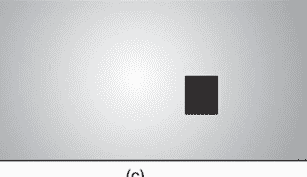

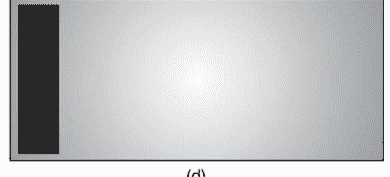

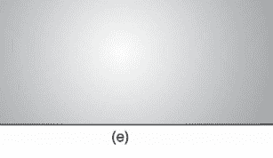

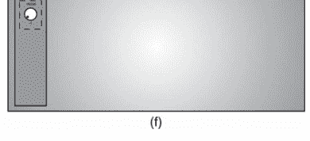

移到了错误的位置，与第一个按钮重叠。参考图 2.34，将原点更改为 5,110，新的控件组（Cluster of controls）将对齐到第一个按钮之前。

# 创建模板

尽管如果你使用项目（projects），你就不需要创建任何新模板（空版本包含了所有模板），但你可能仍然需要尝试构建你自己的模板。这个过程本质上与构建第一列是完全相同的——从一个空的视图容器开始，并向其添加控件。该控件容器可以作为一个组被插入和移动。如果你想进行一些实验，请回到 Test `KG` 模板并写下控件的位置及其属性，包括外部容器的大小。然后使用 `EDIT>Add New Template` 并选择 `CViewContainer`。现在，为了复制 `KG` 控件，你需要拖放树形位图（tree bitmap）；尝试三个对象 `CTextLabel`、`CAKiknob` 和 `CTextEdit` `knob1` 和 `knob2`。尝试制作不同的尺寸和颜色变化。然后你可以尝试将它们放入其他视图容器中。顺便提一下，项目自带的位图是你可以配合 VST SDK 使用的库存项目，除了第 11 章中关于摇杆的请求。拖放式 VST 使用 XML 文件名，该文件包含在你的 Visual Studio 项目中并编译为资源。如果你喜欢冒险（或者你厌倦了使用拖放编辑器），你可以编辑此文件。你可以在 `VSTGUI` 网站和 `http://www.willpirkle/synthbook/` 找到更多关于直接编辑此文件的信息。

## 2.3 实现 VST 插件：调试


调试你的合成器插件（`synth-plugin`）对你的成功至关重要。一旦你开始尝试自己的代码和完成课书中的“挑战（Challenges）”，你在实现新代码或想法时很可能也会遇到问题。要调试你的插件，你需要一个已经开发的 VST 客户端。要用它进行调试，你需要告诉 Visual Studio 它的位置。打开项目属性（`Project Properties`）并选择配置属性（`Configuration Properties`）-> 调试（`Debugging`）。在 `Command` 字段中，从列表中找到可执行文件。现在，在 `Attach` 字段中选择 `Yes`。将你的 VST 文件放在正确的文件夹中并启动客户端。在客户端运行之前，你无法启动调试器。在客户端运行后，启动 Studio 调试器并设置断点。当你实例化你的插件时，断点将激活，你可以按照意愿逐步执行代码并进行调试。你将在 Visual Studio 和插件之间来回切换——这在任何平台的开发中都是常的。

## 2.4 编写 Audio Unit (AU) 插件

Apple 的音频格式与 RackAFX 和 VST3 不同，后者是用“直连”的 C++ 构建的，不需要 ANSI C++ 之外的任何额外库。AU 插件使用 Apple 的 Xcode 编译器用 C++ 编写。有许多 MacOS 特有的功能要求程序员了解不仅仅是 C++ 的更多知识。要编写 AU 插件，你必须已经熟悉 macOS 编程，特别是 CoreServices 和 AppKit 框架。此外，Apple 推荐的为你的插件创建 GUI 的方法是使用 Cocoa 框架，这是用另一种编程语言：Objective-C 完成的。所有的 AU 插件都使用 Cocoa，因此你还需要理解 Objective-C 语言以及如 `Ictions`、`IBOutlets`、`target-actions` 和引用输出（referencing outlets）等概念。我们为 Cocoa GUI 开发了自己的自定义控件，全部用 Objective-C 编写，如果你想修改书中的项目代码、感觉或行为，你不需要理解它们在内部是如何工作的。这意味着你将要在 Objective-C 上达到胜任。如果你不知道 Objective-C 但已经很擅长 C++，那么好消息是你可以轻松学习它。

AU 提供了两种实现 GUI 的机制。如果插件没有实现 GUI，AU 客户端会提供一个默认 GUI。还有一个自定义 GUI 的选项。我们将实现两者：首先需要定义默认 UI，然后将自定义 GUI 连接到其参数。你可以在 AU 客户端中两个 GUI 之间来回切换。

尽管存在所有差异，AU API 遵循与本章开头讨论的相同模式，以及 RackAFX 和 VST3 遵循的相同范式——在这方面，它和其他插件一样普通。插件派生自一个特殊类。你重写并实现必要的函数来处理 GUI 变化和音频处理。如果你制作了自定义 GUI，你需要为之添加代码。如果你具备基本的 MacOS 和 Objective-C 技能，AU甚至比 VST3 更加简单。对于合成器插件，AU 在处理 MIDI 消息方面类似于 RackAFX，从 RackAFX 转向 AU 实际上比转向 VST3 更容易。为了开发书中的插件，你需要：

- 一台运行 MacOS 10.7 或更高版本的 Mac
- 适用于你系统的最新 Xcode 版本
- 来自网站的 AU 项目文件
- 一个像 Logic 或 Ableton Live 这样的 AU 客户端

本身并没有 SDK。你需要的支持文件通常包含在 Xcode 中或作为附加下载提供。在编写本文时，这些文件的最后一次更新是在 2013 年 11 月，你可以通过在 developer.apple.com 搜索以下字符串：“Audio Unit Examples (AudioUnit, Instrument, and Offline)”来获取最新更新。除了支持文件，你还会找到示例代码。这些文件都包含在一组文件夹中。如果你想玩 Apple 的示例代码，它将像 VST3 一样访问其他文件夹中的文件。然而，与 VST3 不同，附加文件并没有相互引用。因此，为了让项目更容易管理，像 RackAFX 一样……（此处原文似乎不完整，已按逻辑翻译）。

## 2.5 AU 项目

所有的 AU 项目都设计得尽可能相似。主要区别将在于 SynthCore——构成每个合成器的 C++ 对象集合。你会为每个合成器项目得到一个文件列表，然而有三个文件是每个项目都需要的且是相同的。这些包含在每个合成器示例代码中：

### 开始一个新项目

启动一个新的 AU 项目有两种方法：从零开始或修改现有项目。修改现有项目要简单得多。将一个现有项目转换为新项目仅需十个简单的步骤（附录）。

你有多个项目可以下载并设计 GUI——对于每个合成器项目：

- Empty（空）：你编写一切并设计 GUI——如果你已经是高级程序员，这可能是一个不错的选择。
- GUI：代码和 GUI 已经存在，你可以专注于合成器组件和处理；在每一章中你都需要进入并修改一次 GUI，在几个项目后，你可能想要完整的 GUI 设计。注意：这是推荐选项！
- Full（完整）：包含所有内容；我们不建议编译别人的代码作为学习方法，但拥有完整代码允许你不仅检查自己的工作，还能在调试模式下逐步执行代码，你可以看到客户端是如何交互的——简而言之，完整项目对于你调试和理解正在开发的项目非常有帮助。

`synthfuncs.h`：贯穿合成器使用的结构体和函数集合；你可以添加更多自己的内容。

`pluginconstants.h`：项目使用的另一组结构体、函数和对象集合。

`pluginobjects.cpp`：`pluginconstants.h` 中声明的对象的实现。

下载 MiniSynth 项目并在 Xcode 中打开它以查看内容。检查以下组（Groups）：

- AU Source：包含插件本身的文件以及一些必要的文件。
- MiniSynth: 所有文件；包括你开发的振荡器、滤波器和包络生成器，以及
- CoreAudio: 基础文件及其支持文件。
- CocoUI: GUI 文件，包括自定义控件。
- Resources: 用于自定义控件和背景的图像、项目的 `.NIB` 文件和 `.plist` 文件。
- Frameworks:
    - AppKit
    - QuartzCore
    - CoreMIDI
    - Cocoa
    - CoreServices
    - AudioToolbox
    - AudioUnit
- Products: 包含输出文件的引用，即 `.component` 和 `.bundle`；你可以右键点击其中任何一个或选择“在 Finder 中显示（Show in Finder）”来找到它们。

在这些文件夹中，你大部分时间都会花费在 AU Source 中。它的文件包括：

- `AUSynth.h` 和 `AUSynth.cpp`：你的插件对象；该对象的名称在不同项目之间不会改变。
- `AUSStructures.h` 和 `AUSynthVersion.h`：结构体定义和版本信息的辅助文件。
- `AUSynth.r`：项目文件（这仅用于与 Logic 的向后兼容）；它现在被你文件中的 Dictionary（字典）取代。
- `AUSynth.exp`：导出的文件（稍后会详细介绍）。
- `AUSynth_Prefix.pch`：你可以安全忽略的头文件。

在 CocoaUI 组中，你可以看到用于 GUI 的 Objective-C 文件（h 和 .m）以及带有 AU 前缀的自定义控件：所有对象都根据合成器项目命名，直接为：

- Factory：加载 View 的 `.NIB` 文件所有者。
- View：自定义视图。
- RotaryKnob：自定义旋转旋钮控件。
- EditBox：自定义编辑控件。
- OptionGroup：自定义选项菜单控件（又称弹出按钮）。
- PopUpToggleButton：自定义弹出按钮。

这些文件之所以以合成器项目命名，是因为 Cocoa 具有平铺命名空间，每个对象必须有一个唯一的名称。例如，如果所有合成器都使用 RotaryKnob 作为这些控件的名称，而你在项目中自定义了旋钮使其外观与其他众不同，那么名称就会发生冲突，你将丢失对象的唯一性；例如，如果你先加载了带有唯一旋钮的插件，随后的插件即使使用不同的资源编译，也会加载相同的旋钮。**规则：** 以一种潜在的唯一方式重命名所有对象——苹果建议使用你的姓名缩写作为对象的首字母。

在 Xcode 中，选择 MiniSynth target（目标）并检查其 Build Phases（构建阶段）。让我们逐一查看：

- Target Dependencies：确保需要 GUI 的合成器项目也能无错误地构建。
- Copy Headers：支持插件所需的所有 `.h` 文件。
- Copy Bundle Resources：`.plist` 文件。
- Compile Sources：支持插件的所有 `.cpp` 文件。
- Link Binaries with Libraries：插件合成器部分所需的框架。
- Build Carbon Resources：这仅用于与 Logic 9 兼容。
- Copy Files (1 Item)：将你的 `MiniSynth.bundle` 复制到 `/Resources` 文件夹。
- Copy Files (1 Item)：将你的 `synth.component` 文件复制到 `/Components` 文件夹。

选择 CocoaUI target 并检查其 Build Phases，你会看到基本上相同的内容，尽管没有文件复制。当你选择并构建 MiniSynth 项目时，它会先构建 CocoaUI，然后构建 Synth，最后将两个文件复制到目标位置。

重新选择 MiniSynth target 并检查其 Build Settings（构建设置）。需要注意的最重要点：

- 使用扩展名为 `.exp` 的导出符号。
- Info.plist 命名为 `Info.plist`。
- product name（产品名称）为 `MiniSynth`。
- wrapper extension（封装扩展名）为 `component`。

`.exp` 文件包含了定义组件入口的符号。这些入口在不同项目之间不会改变，所以不需要担心这个。这两个符号命名如下，并且在我们的项目中永远不应更改：

```
_AUSynthEntry
_AUSynthFactory
```

### 2.36 The Info.plist 文件

`Info.plist` 文件包含了一些在向客户端声明插件时至关重要的项。你必须确保此文件正确，否则你的插件可能不会出现在客户端中。`Info.plist` 文件包含了关于你的 `.component` 的信息，以便客户端能够正确识别并加载你的 GUI。

你的插件最终通过两个四字符值进行唯一标识。其中一个四字符值代表你的公司名称（我的是“WILL”）。另一个代表 MiniSynth 的“MS0x”，其中“x”是修订号（目前是三，所以代码是“MS03”）。

在客户端中显示的名称基于 ID 的字符串设置；例如，“Will Pirkle MiniSynth” 会导致 Logic 创建一个名为“Will Pirkle” 的新 AU 菜单项和一个名为“MiniSynth” 的新子项，而 Ableton 则会创建一个名为“Will Pirkle”的文件夹，其中包含内容项“MiniSynth”。

AU 插件通过特殊的字符代码进行区分：音乐合成器使用代码“aumu”。

你的 AU 插件是一个 bundle（包）的一部分，并有一个 bundle identifier（包标识符）。该标识符用于访问 Cocoa GUI 查找你的文件夹（我们在采样 WAV 文件时需要这样做，这些文件必须位于相对于 .components 的特定位置）。每个合成器都有自己的 bundle identifier。项目设置了默认标识符：`developer.audiounit.yourname.yourname`

因此，对于 MiniSynth，我们指定的标识符为：

`developer.audiounit.willpikle.MiniSynth`

在 MiniSynth 的 Resources 组中打开 Info.plist 文件。每当你创建一个新的合成器插件时，都需要修改此文件。首先，打开 Dictionary：

- Type: synth
- Subtype: aumu
- Manufacturer: WILL
- Version: MS03
- Name: Will Pirkle MiniSynth
- Description: 由 Will Pirkle 开发的自定义合成器

Type 和 Subtype 对于宿主机识别插件至关重要。Manufacturer 和 Version 用于标识。Name 和 Description 是用户在 UI 中看到的内容。

Info.plist 文件还包含用于 GUI 的字典。

Volume（音量）和 Octave（八度）控件最终生成用户在 GUI 上看到的数值，它们具有最小限制（或 Lo Limit，下限）、最大（或 Hi Limit，上限）和默认（Def）值。控件还可能有 Units（单位，"" 或空字符串）。Fc（滤波器截止频率）控件带有“volt/octave”注释，这意味着该控件是对数性的。

Filter 控件显示定义当前值的字符串。一个无符号整数（UINT）跟踪当前设置。enum String 列提供了用逗号分隔的值，这些值将映射到 UINT 变量。在本例中：

- LPF: 0
- HPF: 1
- BPF: 2

表 2.9：GUI 控件示例。

对于枚举类型的 UINT，默认值始终是 RackFX 字符串列表（此处为 LPF）中的第一个值。所有变量都是浮点型，由你正确判断并使用数据类型。

在此表中，你可以看到 Type（类型）和 Variable Name（变量名）两列。四个基础变量是 float、double 和 int。

通过枚举，你可以像处理 VST3 那样简单且明智地进行操作。枚举定义在你的合成器项目 `SynthParamLimits.h` 文件中。例如，MiniSynth 的前几个参数：

## ExampleSynth 连续参数

| 控制名称(单位) | 类型 | 变量名(VST3, RAFX) | 低/高/默认值 * | VST3/AU 索引 |
|---|---|---|---|--|
| 音量 (dB) | double | `m_dVolume_DB` | -96 / 24 / 0.0 | OUTPUT_AMPLITUDE_DB |
| 八度 (Octave) | int | `m_dOctave` | -4 / 4 / 0 | OCTAVE |
| 截止频率 Fc (Hz) | double | `m_dFilterFc` | 80 / 18000 / 10000 | FILTER_FC |

> * 高值和默认值在 `SynthParamLimits.h` 中为每个项目的 VST3 和 AU 被 #defined

## 枚举字符串参数 (UINT)

| 控制名称 | 变量名 | 枚举字符串 | VST3/AU 索引 |
|---|---|---|--|


| 滤波器类型 | `m_uFilterType` | LPF,HPF | `FILTER_TYPE` |

你在声明、初始化时使用这些枚举值：

```c
enum {
NOISE_OSC_AMP_DB,
```

或者在 AU 容器上访问你的参数。通过将枚举 `NUMBER_OF_SYNTH_PARAMETERS` 放在列表的最后，它代表了你的参数计数。

2.44 显示了概念性的中心（或云）存储布局。当通过以下代码获取容器的指针时：

```c
EG1_TO_OSC_INTENSITY,
FILTER_FC,
etc...
NUMBER_OF_SYNTH_PARAMETERS)
```

全局变量 `()` 然后通过以下代码设置参数值：

```
SetParameter(AudioUnitParameterID paramID)
SetParameter(AudioUnitParameterID paramID, AudioUnitParameterValue inValue)
```

`paramID` 是从零开始的（`AudioUnitParameterID` 被 `#defined` 为 `Uint32`，`AudioUnitParameterValue` 为 `Float32`）。

要进行声明，你只需调用一次 `SetParameter()` 并传入索引和默认值。随后的调用将设置该参数。当你的插件插入时，不需要销毁参数。我们将在 2.40 节中详细查看参数的设置。

## 2.38 AU 转换

### 函数返回值：

大多数 AU 函数返回 `OSStatus` 或 `ComponentResult` 类型的错误代码。它们在本质上是同一种东西（都是无符号整数）。两种类型的成功返回代码都是 `noErr`。有很多错误代码，但最常见的有：

```
kAudioUnitErr_InvalidProperty
kAudioUnitErr_InvalidParameter
```

### 数据类型的重新声明

与 VST3 类似，AU 重新声明了 `Int32`、`UInt32`、`Float32` 等数据类型，因此请注意这一点。你始终可以使用你熟悉的数据类型，如 `int`、`float`、`double` 等；然而，有时如果你尝试重写使用重新声明类型的基类函数，但你用标准类型替换了它，可能会吃亏。编译器不会将你的函数识别为重写。

### 作用域与元素 (Scopes and Elements)

在我们重覆盖的多个 AU 函数中，你会看到参数数据类型 `AudioUnitScope` 和 `AudioUnitElement`。作用域用于识别音频单元的“主要属性”。通常你会看到输入（`input`）、输出（`output`）和全局（包括输入和输出）。例如，输出总线 #2 将使用 `Scope = output` 和 `Element = 2`，而输入总线 #1 将使用 `Scope = input` 和 `Element = 1`。

图 2.4：AU 框架为你存储了变量。

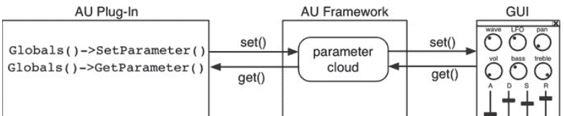

## 2.39 AUSynth 与 AUInstrument

作用域用于识别音频单元的“主要属性”。通常你会看到输入、输出和全局（包括输入和输出）。例如，输出总线 #2 将使用 `Scope = output` 和 `Element = 2`，而输入总线 #1 将使用 `Scope = input` 和 `Element = 1`。高值和默认值在 `SynthParamLimits.h` 中为每个项目被 `#defined` 为 VST3 和 AU。

枚举字符串参数 (UINT)

| 控制名称 | 变量名 | 枚举字符串 | VST3/AU 索引 |
|---|---|---|---|
| 滤波器类型 | `m_uFilterType` | LPF,HPF | `FILTER_TYPE` |


在我们重覆盖的多个 AU 函数中，你会看到参数数据类型 `AudioUnitScope` 和 `AudioUnitElement`。作用域用于识别音频单元的“主要属性”。通常你会看到输入（input）、输出（output）和全局（包括输入和输出）。例如，输出总线 #2 将使用 `Scope = output` 和 `Element = 2`，而输入总线 #1 将使用 `Scope = input` 和 `Element = 1`。

图 2.4：AU 框架为你存储了变量。


## 2.39 AUSynth 与 AUInstrument

作用域用于识别音频单元的“主要属性”。通常你会看到输入、输出和全局（包括输入和输出）。例如，输出总线 #2 将使用 `Scope = output` 和 `Element = 2`，而输入总线 #1 将使用 `Scope = input` 和 `Element = 1`。

```
virtual OSStatus
GetPropertyInfo()
```

```
virtual OSStatus
GetProperty()
```

```
virtual OSStatus
SetProperty()
```

首次调用将触发你的 `GetPropertyInfo()` 函数来查看你支持哪些额外的属性。我们将通过对以下属性返回 `noErr` 来响应：

```
kAudioUnitProperty_CocoaUI
```

由于我们支持 Cocoa GUI，因此我们需要对你的查询回答 `noErr`。

在 `GetPropertyInfo()` 之后，宿主机将对我们回复 `noErr` 的项目调用 `GetProperty()`。在这个函数中，你必须回复宿主机可以检索并保存/维护你 GUI 的信息。完美实现此函数至关重要，否则即使你的代码编译正常，你的 GUI 也不会显示。

### 处理 MIDI 事件的函数：

类似于 RackAF 的插件基类，`AUInstrumentBase` 的设计是自动为最常见的消息调用一组 MIDI 消息。我们将实现其中的每一个函数，并且对所有它们都感兴趣。这些都是 `AUInstrumentBase` 或其一个基类 `AUMIDIBase` 的覆盖方法。

```
virtual OSStatus
StartNote()
```

```
virtual OSStatus
StopNote()
```

```
virtual OSStatus
HandlePitchWheel()
```

```
virtual OSStatus
HandleControlChange()
```

```
OSStatus
HandleMidiEvent()
```

前四个函数相当自而易懂；它们处理 MIDI 音符开启、音符关闭、音高弯和连续控制器变化。第五个函数是你处理其他任何内容的地方。我们将使用它来处理程序更改（program change）和触后（aftertouch）消息。

`AUSynth.h` 文件的最后一部分包含几个私有成员变量。我们将在 3-12 章详细讨论这些变量。对于 MiniSynth，这些是：

合成器的多音通过维护一个音器对象指针数组来实现。所有合成器的该数组都命名为 `m_pVoiceArray`。区别在于它们持有的指针类型；在这种情况下，该数组持有 `CMiniSynth` 指针。下面定义的三个函数用于处理音器的时间顺序。`update()` 函数用于更新所有合成器变量。随着章节的推进行，我们将进入剩余变量的细节。

```
CMiniSynth* m_pVoiceArray[MAX_VOICES];
void incrementVoiceTimestamps();
CMiniSynth* getDestVoice();
CMiniSynth* getDestVoiceWithNote(UINT uMIDNote);
// --- 同时更新所有音器
void update();

// --- 用于滑音
double m_dLastNoteFrequency;

// --- 我们的接收通道
UINT m_uMidiRxChannel;
```

## 2.40 实现 AUSynth 对象

打开 `AUSynth.cpp` 文件并检查其内容。该文件对于每个合成器几乎相同。在文件的最顶部，你会看到预设名称的定义。我们将利用它在调用 `GetPresets()` 函数期间告诉宿主机关于我们的预设名称。

接下来的代码对于插件的操作至关重要：

```
static const int numPresets = 1;
static AUSPreset presetNames[numPresets] = {

// --- (索引, 预设名称)
// 使用逗号添加更多项

// (0, CFSTR("Factory Preset")),
// (1, CFSTR("Another Preset")) <-- 此处不再有逗号
(0, CFSTR("Factory Preset"))
};
```

`AUDCOMPONENT_ENTRY (AUMusicDeviceFactory, AUSynth)`

这是进入动态链接库的入口。这行代码对于所有合成器都是相同的。语法为：

`AUDCOMPONENT_ENTRY (AUMusicDeviceFactory, ).`

### 构造函数：

构造函数初始化插件和或多个预设：

- 调用基类 `CreateElements()` 创建输入和输出端口
- 初始化我们唯一的预设
- 为 GUI 设置我们的全局参数（控件）
- 创建音器对象并加载音器指针数组

在构造函数的 `AUInstrumentBase` 部分，末尾的两个参数是输入和输出的数量；我们没有输入但有一个输出。输出可以是多通道的，我们将支持单声道立体声。使用我们的参数数量作为参数调用 `UseIndexedParameters()` 来设置我们的云存储。然后，调用 `SetParameter()` 创建参数骨架。

```
AUSynth::AUSynth(AudioUnitinComponentInstance)
: AUInstrumentBase(inComponentInstance, 0, 1)
```

```
// --- 创建输入、输出端口、组和部分
CreateElements();
```

```
// --- 定义参数（控件）的数量
Globals()->->UseIndexedParameters(NUMBER_OF_SYNTH_PARAMETERS);
```

```
// // 在这里初始化控件！
// // 这些在 SynthParamList.h 中定义
Globals()->->SetParameter(NOISE_OSC_AMP_DB
```

```
// 在这里完成初始化
m_dLastNoteFrequency = -1.0;
```

```
// 在所有通道上接字
m_uMidiRxChannel = MIDI_CH_ALL;
```

```
// 加载音器
// 细节见后续章节
}
```

### 析构函数：

在析构函数中，我们只需删除所有音器。如果有任何需要预处理的操作，会在破坏之前调用 `CleanUp()` 函数。该函数的基类版本也是空的。

### Reset()

在 `Reset()` 函数中，你调用基类函数，然后可选地杀死任何可能正在播放的笔记。基类会填充名称（你可以忽略第二个参数，它是用于释放名称字符串的）。然后我们设置单位。对于字符串列表控件，单位是：

```
ComponentResult AUSynth::Reset(AudioUnitScope, AudioInputElement)
{
    AUInstrumentBase::Reset(scope, Element);
    // --- 所有音符
    for(int i=0; i<MAX_VOICES; i++) {
        CMiniSynth* pVoice = m_pVoiceArray[i];

        if (pVoice) {
            // --- 关闭
            pVoice->noteOff();
        }
    }
    return noErr;
}
```

### Initialize()

在 `Initialize()` 函数中，你调用基类函数，然后可选地杀死任何可能正在播放的笔记。基类函数识别参数是对对数的（我们将其用于滤波器截止频率）还是字符串列表。字符串列表使用逗号分隔的字符串来向用户显示一组选择。

```
ComponentResult AUSynth::Initialize()
{
    AUInstrumentBase::Initialize();

    // 清空
    m_dLastNoteFrequency = -1.0;

    // --- 初始化
    // 非常重要
    for(int i=0; i<MAX_VOICES; i++)
    {
        m_VoiceArray[i]->preparePlay();
    }

    return noErr;
}
```

### SetParameterInfo()

为了减少代码，我们创建了一个名为 `SetParameterInfo()` 的辅助函数，用于设置参数名称、单位、最小值、最大值和默认值。`AudioParameter` 结构体包含给定参数的属性。我们的参数可能是读或可写的，因此我们设置了这些标志。

```
void setsetAUParameterInfo(AudioUnitParameterInfo& outParameterInfo,
CFStringRef paramName,
CFStringRef paramUnits,
Float32 fMinValue,
Float32 fMaxValue,
Float32 fDefaultValue,
bool bLogControl,
bool bStringListControl)
{
 // --- 设置标志
outParameterInfo.flags = kAudioUnitParameterFlag_IsWritable;
outParameterInfo.flags += kAudioUnitParameterFlag_IsReadable;

 // --- 设置名称
AUBase::FillInParameterName(outParameterInfo, paramName, false);

 // --- 设置单位
if(bStringListControl)
outParameterInfo.unit = kAudioUnitParameterUnit_Indexed;
else
{
outParameterInfo.unit = kAudioUnitParameterUnit_CustomUnit;
outParameterInfo.unitName = paramUnits;
}

 // 是否为对数控制？
if(bLogControl)
outParameterInfo.flags += kAudioUnitParameterFlag_DisplayLogarithmic;

 // --- 设置最小、最大、默认值
outParameterInfo.minValue = fMinValue;
outParameterInfo.maxValue = fMaxValue;
outParameterInfo.defaultValue = fDefaultValue;
}
```

`ParameterInfo()` 会为每个参数调用一次，这里就是上述辅助函数发挥用场的地方。在检查你正在初始化全局参数（Global parameters）后，你解码 `ParameterID`（索引）并调用辅助函数完成操作。如果未找到结果，则返回一个错误代码。

```
ComponentResult AUSynth::GetParameterInfo(AudioUnitScope inScope,
AudioUnitParameterID inParameterID,
AudioUnitParameterInfo& outParameterInfo)
// --- we only handle Global params
if (inScope != kAudioUnitScope_Global)
return kAudioUnitErr_InvalidScope;
//setUPParameterInfo(outParameterInfo, CFSTR("Noise Osc"),
CFSTR("dB"), MIN_NOISE_OSC_AMP_DB,
MAX_NOISE_OSC_AMP_DB,
DEFAULT_NOISE_OSC_AMP_DB);
return noErr;
break;
case PULSE_WIDTH_PCT:
setUPParameterInfo(outParameterInfo, CFSTR("Pulse Width"),
CFSTR("%%"), MIN_PULSE_WIDTH_PCT,
MAX_PULSE_WIDTH_PCT,
DEFAULT_PULSE_WIDTH_PCT);
return noErr;
```

### SetAUParameterStringList()

另一个辅助函数用于方便设置字符串列表控件。该函数名为 `SetAUParameterStringList()`，它仅仅是从一个逗号分隔的字符串创建一个数组。

```
break;

etc...

return kAudioUnitErr_InvalidParameter;

void AUSynth::setAUParameterStringList(CFStringRef stringList
```

### GetParameterValueStrings()

在 `GetParameterValueStrings()` 中，你使用辅助函数声明将填充控件的字符串集。在检查范围（scope）后，你声明 `ParameterID` 并设置字符串列表。注意最后一组参数，它们都是开启/关闭二状态开关变量。

### update()

在 `update()` 中，我们遍历所有音器（voices）并一次性更新所有参数。除非我们重写 `SetParameter()` 函数，否则我们不知道从上一个缓冲区到下一个哪个（是否）发生了变化，因此会暴力更新；这与其他合成器保持一致。更新所需的开销异常地小，但如果你需要，始终可以使其效率效率。注意你如何通过 `Globals()->Get()` 传递索引作为参数来获取你的参数。

### Render()

至关重要的 `Render()` 函数执行了三件事：

- 1. 广播接收到的 MIDI 事件
- 2. 更新合成器音色
- 3. 合成音频

MIDI 事件使用基类函数 `PerformEvents()` 更新，然后合成器音色的更新 AU 使用缓冲区处理。在这里的渲染操作中，你遵循了与 VST3 类似的策略，即在整个处理块期间只更新一次合成器声音。作为一个挑战，你可以尝试将控制交织到缓冲区处理中。你通过访问插件的输出缓冲区（Scope = output, Element = 0）并获取缓冲区列表来获取缓冲区。这是一个指向缓冲区指针数组。第一个指针指向第一个通道，第二个指向右声道。我们只支持单声道或立体声，因此我们首先检查缓冲区数量。你的缓冲区指针位于：

```
ComponentResult AUSynth::GetParameterStrings(AudioUnitScope inscope)
AudioUnitParameterID
inParameterID,
CFArrArrayRef* outStrings)
```

```
{
  if(inscope == kAudioUnitScope_Global)
  {
    if (outStrings == NULL)
      return noErr;
    // --- decode the ID value and set the string list:
    switch(inParameterID)
      {
        case VOICE_MODE:
          setParameterStringList(CFSTR("3Saw,3Sqr,2Sqr,2TriSaw,2TriSqr"), outStrings);
          return noErr;
          break;
      }
  }
  etc...
  // --- all are OFF,ON 2-state switches
```

`bufferList.mBuffers[0].mData` 然而，`mData` 成员实际上是 `void`，所以你必须将其转换为 `float` 才能使用。其余的操作非常直接：你遍历帧数（每个缓冲区中的样本）并累加声音。然后，你将结果写入输出缓冲区。我们将在第 8 章讨论 `doVoice()` 循环。

```
OSStatus AUSynth::Render(AudioUnitRenderActionFlags& ioActionFlags, const
AudioTimeStamp& inTimestamp, UInt32 inNumberFrames)
```

首先，广播 MIDI 事件，然后更新合成器音色。

```
// --- broadcast MIDI
events PerformEvents(inTimestamp)
// --- do the mass update for this frame
update();
```

接下来，获取


```
case RESET_TO_ZERO:
case FILTER_KEYTRACK:
case VELOCITY_TO_ATTACK:
case NOTE_NUM_TO_DECAY:
{
    setAParameterStringList(CFSTR("OFF,ON"),
    outStrings);
    return noErr;
    break;
}

return kAudioUnitErr_InvalidParameter;
```

缓冲区的指针并设置处理循环。这是

```
// --- get the number of channels
AudioBufferList& bufferList = GetOutput(0)->GetBufferList();
Uint32 numChans = bufferList.mNumberBuffers;
```

```
// --- we only support mono/stereo
if(numChans > 2) return kAudioUnitErr_FormatNotSupported;
```

```
// --- get pointers to the buffers
float* left = (float*)bufferList.mBuffers[0].mData;
float* right = numChans > 1 ? (float*)bufferList.mBuffers[1].mData : NULL;
```

然而，`mData`成员实际上是`void`，所以你必须将其转换为`float`才能使用。其余的操作非常直接：你遍历帧数（每个缓冲区中的样本）并累加声音。然后，你将结果写入输出缓冲区。我们将在第8章讨论`doVoice()`循环。

```
// --- the processing loop
for (Uint32 frame = 0; frame < inNumberFrames; frame++)
{
    float sample = 0;
    // ... accumulate voices ...
    if(left) left[frame] = sample;
    if(right) right[frame] = sample;
}
```

MIDI事件使用基类函数`PerformEvents()`更新，然后合成器音色的更新AU使用缓冲区处理。在这里的渲染操作中，你遵循了与VST3类似的策略，即在整个处理块期间只更新一次合成器声音。作为一个挑战，你可以尝试将控制交织到缓冲区处理中。

```
// The mPitch 变量是一个浮点数。通常它本质上是整数的。如果它有小数部分，这将代表全局调音偏移，所以 mPitch =60.75 就是 MIDI 符 60（中音 C）+ 75 音分（cents）。
```

此函数，除非你想要实现更高级的属性处理，例如延迟或混响尾时间。然而，你不能忽略以下函数：

`GetProperty()`。宿主机会针对我们在上一个函数中确认的每个属性再次向我们查询。当查询我们的Cocoa接口时，确保每个微小的细节都是正确的至关重要的，否则你的GUI可能不可见，甚至可能导致宿主机崩溃。在`if()`语句的第一部分，你通过在`Info.Plist`文件中设置的Bundle Identifier（包标识符）找到包（bundle）。你需要让这些字符串完全匹配。接下来，使用bundle和你的GUI视图的名称解析出bundle URL。在我们所有的合成器中，这个名称都将是`CocoaSynthView`。最后，你需要声明将加载`CocoaSynthView`的视图工厂名称，且该名称对于每个合成器必须是唯一的。`MiniSynth`的工厂命名为`MiniSynthViewFactory`。最后的语句设置了一个info结构，用于存储宿主机从包中实例化你的GUI所需的所有信息。该结构体通过`outData`参数返回。

```c
OSStatus AUSynth::getProperty(AudioUnitPropertyID inID,
AudioUnitScope inScope,
AudioUnitElement inElement,
void* outData)
```

```c
(
if (inScope == kAudioUnitScope_Global)
    if(inID == kAudioUnitProperty_CocoaUI)
        // 在主包中按名称和类型查找资源。
        CFBundleRef bundle = CFBundleGetBundleWithIdentifier(
            CFSTR("developer.audiounit.yourname.MiniSynth"));

        if(bundle == NULL) return fnErr;

        CFURLRef bundleURL = CFBundleCopyResourceURL(bundle,
            CFSTR("CocoaSynthView"),
            CFSTR("bundle"), NULL);

        if(bundleURL == NULL) return fnErr;

        CFString className = 
            CFSTR("MiniSynthViewFactory");

        AudioUnitCocoaViewInfo cocoaInfo;
        cocoaInfo.mCocoaAUViewBundleLocation = bundleURL;
        cocoaInfo.mCocoaAUViewClass[0] = className;
        *(outData) = cocoaInfo;

 // 调用基类执行其操作
return AUBase::getProperty(inID, inScope, inElement, outData);
```

## 预设与状态变化

剩余的函数处理预设和状态变化。当有人在宿主机打开项目并保存了某个状态时，会调用`RestoreState()`。宿主机将负责设置你的参数并恢复GUI。如果你在参数更新后有任何额外需要处理，则会调用此函数。除了调用基类实现外，我们不需要做任何事情。

`GetPresets()`在启动时被调用，我们填充一个表示预设名称的字符串数组。宿主机随后使用该数组填充其预设菜单。列表中字符串的顺序必须与你的预设匹配。在案例中，我们只有一个预设，所以非常简单。

```c
ComponentResult AUSynth::RestoreState(CFPropertyListRef plist)
    return AUInstrumentBase::RestoreState(plist);
```

```c
OSStatus AUSynth::GetPresets(CArrayRef *outData) const {
    // --- 这用于判断是否支持预设
    // 在此单元中是支持的，所以我们实现了这个方法！
    if (outData == NULL) return noErr;

    // --- 创建数组
    CFMutableArray theArray = CFArrayCreateMutable(NULL, numPresets, NULL);

    // 拷贝我们的预设名称
    for (int i = 0; i < numPresets; ++i) {
        CFArrayAppendValue(theArray, &presetNames[i]);
    }

    // --- 设置
    *outData = (CArrayRef)theArray;

    return noErr;
}
```

`NewFactoryPreset()`在用户加载工厂预设时被调用。我们通过使用预设变量数组更新全局参数来做出响应。

```c
OSStatus AUSynch::NewFactoryPresetSet(const AUPreset&, inNewFactoryPreset) {
```

```c
// 解析预设
Int32 chosenPreset = inNewFactoryPreset.presetNumber;
```

```c
if (chosenPreset < 0 || chosenPreset >= numPresets)
    return kAudioUnitErr_InvalidPropertyValue;
```

```c
// 只有一个预设，可以作为数组数组挑战
for(int i=0; i<NUMBER_OF_SYNTH_PARAMETERS; i++)
{
    Globals()->SetParameter(i, factoryPreset[i]);
}
```

```c
return noErr;
```

注意Cocoa GUI。

## 2.41 实现 Cocoa 视图对象

合成器项目的GUI均实现为Cocoa类。要使用Cocoa，你需要创建两组文件：一个视图工厂（view factory）和一个主GUI视图（main GUI view）。在合成器项目中，工厂始终命名为`ViewFactory`（例如`MiniSynthFactory`），视图命名为例如`MiniSynthView`。这两个对象封装在标准的`.h`和`.m`文件中。当你告诉宿主机支持Cocoa接口时，你回复视图工厂的名称。当框架初始化工厂对象时，它会传递指向Audio Unit插件的指针。工厂加载视图对象并将其传递给AU。你就可以与Audio Unit建立通信，以便传输控制更改信息。工厂与视图之间的关系在Interface Builder中设置。所有合成器的NIB文件均命名为`CocoaView.NIB`。图2.45显示了两者在InterfaceBuilder中是如何连接的。

NIB文件的所有者（Owner）设置为`ViewFactory`，视图通过引用输出（Referencing Outlet）连接。由于它们在IB中连接，因此视图会在NIB反序列化时加载，工厂不需要显式地初始化然后加载子视图。视图上的所有控件都通过引用输出（IBOutlets）和发送动作（Sent Actions，即IBactions）连接到它。动作动作不连接到工厂，只连接到视图。

图2.45：引用输出是工厂连接到`uiFreshLoadedView`的`IBOutlet`。

图2.46：旋钮和菜单控件通过引用输出和发送动作连接到视图；由于这是MiniSynth (MS)，对象已相应命名。

图2.47：IB中的MiniSynth Cocoa视图。

书中的每个合成器都有种类的控件：一种显示连续控制（如旋钮或滑块），另一种显示菜单或字符串列表（这些列表是带索引的）。我们自定义设计了两种控件：一个旋转旋钮和一个选项菜单组。旋转控件类型为`WPRotaryKnobXY`，选项组为`WOptionMenuGroupXY`对象，其中XY是两个字母的缩写（MS = MiniSynth, DX = DXSynth）。正如我们讨论过的，Cocoa有一个扁平命名空间，你需要工厂、视图以及任何自定义视图。在IB中，从调板中拖入一个视图对象到视图中，然后将其类设置为`WKnob`或`WOption`。然后连接一个输出和一个动作来使用该控件。这在图2.46中所示。


如果你在MiniSynth中打开`CocoaView.IB`文件，它看起来像图2.47。用于列标题的`NSTextFields`是白色的，因为背景是深色的。

右键点击任何自定义视图将显示输出和动作连接。控件的深层细节超本书的范围，但你可以通过 http://www.willpinkle.com/synthbook/ 获取更多信息。旋钮特别有趣——你会注意到阴影也在移动。

| 振荡器 | | EG | LFO | MOD | DCA | 声器 | |

| --- | --- | --- | --- | --- | --- | --- |

| WRotary | WRotary | WRotary | WOption | WRotary | WRotary | | WOption | WRotary | WRotary |

| WRotary | WRotary | WRotary | WRotary | WRotary | | WOption | WOption | WRotary |

| | | | | | | WOption | WOption | |

| WRotary | WRotary | | WRotary | | MiniSynth will.willpinkle.com | |

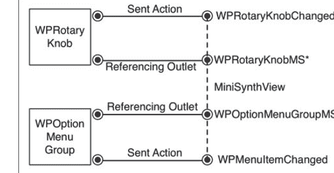

## 2.42 WRotaryKnob

`WRotaryKnob`对象由三个控件组成：一个作为控件名称的静态文本标签、一个用户拖动时会旋转的旋钮和一个显示当前值的编辑框。这在图2.48中所示。

用户也可以在框中输入值并回车，旋钮将旋转到更新后的位置。通过这种方式，可以输入精确的值。这也是`WPEditBox`自定义控件。`WRotaryKnob`对象派生自`Controls`，而`WPEditBox`派生自`NSTField`。

图2.48：`WRotaryKnob`实际上是一个控件簇。

由于IB被用于连接引用输出（Referencing Outlet），因此你不需要显式地`alloc/init`控件。初始化在View的`awakeFromNib`中通过调用一个初始化标准控件的特殊函数来完成。

在该函数中，你通过两个标志位设置控件的索引、最小值、最大值和默认值，其中一个用于电压/八度（对数型）控制，另一个用于指定整数显示。默认情况下，编辑框的背景是透明的，且编辑框可见的。你可以通过使用两个方法并传递一个布尔值来切换开启或关闭：

```
(void)initControlWithName:(NSString*)name controlIndex:(int)index min:(float)min max:(float)maxV def:(float)defaultV voltOctave:(bool)vpo integerControl:(bool)intControl;
```

- (void)hideEditBox;

- (bool)hide;

- (void)setTransparentEditBoxBackground;

- (bool)transparent;

旋钮（knob）有一个绘制选项——你可以通过调用方法创建一个大小仅为普通旋钮1/4的迷你旋钮：

- (void)setMiniKnob;

- (bool)mini;

## 设置和获取旋钮的位置

你使用以下方法设置旋钮的位置（以及输入编辑框的文本）：

- (void)setValue;

(float)userValue;

你传递的值是“用户值（user value）”，这意味着它不像VST3那样经过了归一化。这是你用于计算的常规数值（coated）。

控件的一个重要方面是，它存储了最终连接的全局参数的从0开始的索引。它在初始化控件时设置。View将使用两个访问器方法在旋钮移动时检索索引和控件值：

```
(int)controlID;
(float)controlValue;
```

旋钮移动的动作处理器是`WPRotaryKnobChanged`，旋钮将其id作为参数传递。该

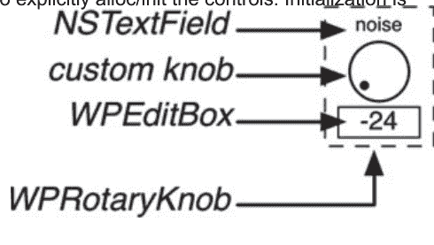

处理器随后使用`controlID`和`controlValue`方法来更改全局参数。通过这种方式，处理器可以用于所有的旋钮，且不需要对控件的GUI参数索引进行解码。

如果你想修改 {

control,

请查看

- (IAction)WPrototaryKnobChanged:(id)sender

```
if([!sender respondsToSelector(@selector(controlID)]) ||
    ![sender respondsToSelector:@selector(controlValue)])
    return;
if([[sender controlID]) >= 0)
{
    // -- 获取旋钮的用户值
Float32 floatValue = [sender controlValue];
    // -- 使用该值创建参数（Parameter）
AudioUnitParameter param = (buddyAU, [sender controlID];audioUnitScope_Global, 0);
    // -- 更改全局参数（下文将解释）
<SNIP SNIP SNIP>
}
```

.m文件中的初始化方法`initWith`。在这里你可以看到如何更改编辑框的背景和文本颜色，以及一些自定义设置。旋钮图像存储在一个数组中；有128张图像描述了旋钮在128个不同旋转位置的状态。当你拖动鼠标时，会选中一张图像，从而实现运动动画。由于使用了离散图像，阴影也会正确移动。这是通过简单的图像旋转无法实现的。如果你想绘制自己的图像，可以可以通过.m文件顶部的`#define`语句更改它们的数量：

```
#define KNOB_COUNT 128
```

图像在初始化器中加载到数组中。对于我们的图像，文件名是顺序编号的，因此你使用此方案来获取文件路径。在开始修改图像之前，确保你理解如何向Xcode资源资源。

## 2.43 WPOptionMenuGroup


`WPOptionMenuGroup` 对象由两个控件组成：一个作为控件名的静态文本标签和一个在菜单中显示字符串列表的 `NSPopUpButton`。如图 2.49 所示。该控件的高度是旋钮的一半，宽度相同。

图 2.49：`WPOptionMenuGroup` 也是一组控件。

字符串列表是从 0 开始索引的，当用户选择一个新字符串时，会触发动作处理器。该控件传输一个表示始终被选中字符串索引的整数值。与 `WPRotaryKnob` 一样，该控件也存储了它连接的全局参数。

## NSTextField

### Filter

### NSPopUpButton

### LPF

### WPOptionMenuGroup

### 初始化

由于 IB 被用于连接引用对象，`Referencing Object`，你不需要显式地 `alloc/init` 控件。初始化在你的 `awakeFromNib` 方法中通过调用初始化控件的特殊函数完成。

```
(void)initWithName:(NSString*) name
controlIndex:(int)index
enumString:(NSString*)enumStr
def:(float)defaultV
verySmallFont:(bool)smallFont;
```

你通过前两个参数设置名称。第三是是“`enumString`”，由逗号分隔的子串集，例如 `"LPF,BPF"`，它将填充菜单。在此示例中，子串被枚举为 LPF 是 0，HPF 是 1 等。默认值是一个浮点数，但我们不在宿主机使用它。小字体 `very small font` 是一个标志，取决于宿主机是否使用。

## 设置和获取旋钮的位置

- `(void)setValue;`
- `(float)userValue;`

你传递的值是“用户值”，这意味着它不像 VST3 那样经过了归一化。这是你用于计算的常规数值。控件的一个重要方面是，它存储了最终连接的全局参数的从 0 开始的索引。它在初始化控件时设置。View 将使用两个访问器方法在旋钮移动时检索索引和控件值：

```
(int)controlID;
(float)controlValue;
```

旋钮移动的动作处理器是 `WPRotaryKnobChanged`，旋钮将其 id 作为参数传递。该处理器随后使用 `controlID` 和 `controlValue` 方法来更改全局参数。通过这种方式，处理器可以用于所有的旋钮，且不需要对控件的 GUI 参数索引进行解码。

如果你想修改 `control`，请查看 `- (IAction)WPrototaryKnobChanged:(id)sender`

```
if([!sender respondsToSelector(@selector(controlID)]) ||
    ![sender respondsToSelector(@selector(controlValue)])
    return;
if([[sender controlID]) >= 0)
{
    // -- 获取旋钮的用户值
Float32 floatValue = [sender controlValue];
    // -- 使用该值创建参数
AudioUnitParameter param = (buddyAU, [sender controlID];audioUnitScope_Global, 0);
    // -- 更改全局参数
<SNIP SNIP SNIP>
}
```

`.m` 文件中的初始化方法 `initWith`。在这里你可以看到如何更改编辑框的背景和文本颜色，以及一些自定义设置。旋钮图像存储在一个数组中；有 128 张图像描述了旋钮在 128 个不同旋转位置的状态。当你拖动鼠标时，会选中一张图像，从而实现运动动画。由于使用了离散图像，阴影也会正确移动。这是通过简单的图像旋转无法实现的。如果你想绘制自己的图像，可以可以通过 `.m` 文件顶部的 `#define` 语句更改它们的数量：

```
#define KNOB_COUNT 128
```

图像在初始化器中加载到数组中。对于我们的图像，文件名是顺序编号的，因此你使用此方案来获取文件路径。在开始修改图像之前，确保你理解如何向 Xcode 资源。

## 2.43 WPOptionMenuGroup

`WPOptionMenuGroup` 对象由两个控件组成：一个作为控件名的静态文本标签和一个在菜单中显示字符串列表的 `NSPopUpButton`。如图 2.49 所示。该控件的高度是旋钮的一半，宽度相同。

图 2.49：`WPOptionMenuGroup` 也是一组控件。

字符串列表是从 0 开始索引的，当用户选择一个新字符串时，会触发动作处理器。该控件传输一个表示始终被选中字符串索引的整数值。与 `WPRotaryKnob` 一样，该控件也存储了它连接的全局参数。

## 2.44 The View Factory and CocoaView.plist

View Factory 是一个简单的对象，其唯一的真实工作是加载视图并将其传递 AU 指针。然而，View Factory 是一个简单的对象，其唯一的真实工作是加载视图并将其传递 AU 指针。然而，你必须将名称正确绑定到 `GetProperty` 函数以使其工作。此外，你需要在一个 `.plist` 文件中设置工厂。`MiniSynthView` 的类定义如下：

`@class MiniSynthView;`

```
@interface SynthFactoryBean : NSObject <AUCoUIView>
IBOutlet MiniSynthView *uiFreshlyLoaded;
```

```objc
NSView *returnView = uiFreshLoadedView;
// 清空指针。这是一个工厂方法。
// 一旦视图被创建
// 并交接后，工厂就不再保留它的记录。
uiFreshLoadedView = nil;
return [returnView autorelease];
@end
```

`CocoaSynth.plist` 文件包含正确的信息。它被用于识别工厂的属性，这些属性与我们重写的 `GetProperty` 方法相关，用以通知程序我们支持 Cocoa GUI。请检查 `CocoaSynth.plist` 文件并确保字段已正确设置；**粗体**的字段随不同的合成器而异，而其他字段保持不变。其中一个来自 MiniSynth：

- `CFBundleExecutable` `CocoaFilterView`
- `CFBundleIdentifier` `developer.audiunit.yourname.MiniSynth`
- `CFBundlePackageType` `BNDL`
- `NSMainNibFile` `CocoaView`
- `NSPrivateClass` `MiniSynthViewFactory`

该字段至关重要——这是你使用工厂的地方。如果它与你在 `GetProperty` 方法中暴露的工厂不匹配，你的 GUI 将不会显示或导致宿主机崩溃。

## 2.45 事件监听器

该对象更为复杂，但主要是因为我们的合成器有许多控制控件，并且我们需要符合一种事件回调方案。我们需要为每个控制组准备 `IBOutlets`。接下来，我们需要 `IBActions` 作为动作处理程序。与其为每个控制控件编写单独的句处理器，我们只需实现两个：分别用于旋钮 `knob` 和选项菜单控件。我们还设置了控件使其存储参数的索引。通过这种方式，我们可以让处理程序变得非常短。

我们还需要某种方式与我们的“伙伴”音频插件 `Audio Plug-in` 进行通信。通信需要是双向的——当用户移动控件时，我们需要通知插件；当用户使用预设或更改插件状态时，我们需要相应地更新我们的控件。这些通过事件监听器回调方案 `Event Listener Callback scheme` 来实现。

要建立事件监听系统，你需要实现一些方法并调用一些 AU 函数。首先，我们需要实现一个供宿主机查询的方法，以确定我们想要支持什么种类型的事件。事件包括：

- 参数更改：用户移动控件并更改参数
- 手势：这些包括鼠标点击和移动
- 属性更改：属性如混响尾迹时间或你对 Cocoa GUI 的支持发生了变化

对于我们的合成器，我们只关心参数更改，因此我们使用常量设置事件类型并调用 `AUEventListenerAddEventType` 来注册它。

```objc
void addParamEventListener(AUEventListenerRef listener,
    void* refCon, AudioUnitEvent *inevent)
```

```objc
// 将事件类型设置为 kAudioUnitEvent_ParameterValueChange
inevent->mEventType = kAudioUnitEvent_ParameterValueChange;
```

```objc
// 注册它
verify_noerr(AUEventListenerAddEventType(listener, refCon,
inevent));
```

下一步是创建 `AUEventListener` 向它传递一个选择器 `selector`，指向你实现的回调函数。然后你告诉 `AUEventListener` 关于你所有的参数，它会为每个参数设置一个私有的监听器 `Listener`。你还定义了一个私有的监听器函数，通过告诉控件更新其位置来响应。事件监听器回调命名为 `AUEventListenerDispatcher`，但你可以随心命名。查看创建 `AUEventListener` 的函数调用：

你需要理解的两个参数是：第一个命名回调方法，第二个是指向 `self` 的指针。该指针将以 `void*` 的伪装传递给回调函数，这是回调函数中的标准技巧，因为该函数是独立的，位于任何其他对象定义之外。如果这对你来说新鲜，请访问网站获取更多关于回调的信息。回调函数声明在 `View.cpp` 文件的顶部，对象实现之外：

```objc
verify_noerr(AUEventListenerCreate(AUEventListenerDispatcher,
self,
CFRunLoopGetCurrent(),
CFRunLoopDefaultMode,
```

```cpp
// 从我们的 AU buddy 获取 AudioUnitParameter
AudioUnitParameter parameter = (buddyAU, 0, kAudioUnitScope_Global, 0);

// -- 参数 0 -> NUMBER_OF_SYNTH_PARAMETERS-1
// 注意使用 mParameterID 添加额外参数的方式
for(int i=0; i<NUMBER_OF_SYNTH_PARAMETERS; i++)
{
    // --- 更改后续控件的参数 ID
    parameter.mParameterID = i;

    if(AudioUnitGetParameter(buddyAU, i, kAudioUnitScope_Global, 0,
        &paramValue) != noErr) {
        return;
    }

    // -- 更新控件
    id control = [self getControlWithIndex:i];
    if(control && [control respondsToSelector(
        @selector(setControlValue:))]) {
        [control controlValue:paramValue];
    }
}
```

回调函数 `eventListener` 设置了 `controlValue`，进而通知控件更新自身，包括任何可能需要的重绘。

我们设计这些控件不仅仅是为了在 AU 中使用，因此它们拥有方法可以在不使用事件监听器方案的情况下自动更新控件。换句话说，当你移动控件时，它会重绘并更新自己，而不需要 AU 插件允许它这样做。有几行代码你可以取消注释来启用此功能。你现在可以无任何问题地取消代码注释，此时控件会被重绘两次。

## 2.46 视图接口与初始化

现在我们可以通过查看视图接口 `.h` 文件和初始化来找到拼图的最后碎片。我们已经涵盖了 view 中的所有函数。打开 `MiniSynth.h` 文件并查看接口定义。首先是每个控件的 `IOutlets`。它们按列排列，因为最终的 MiniSynth GUI 也是这样排列的。其之后是两个数组；一个用于存储图像，另一个用于存储视图上所有的控件。为了效率考虑，我们只创建了一个旋钮图像数组，所有旋钮控件共享该数组。

数组之后，你可以看到事件监听器对象——`buddy AU`、`AUEEventListener` 以及背景图像对象。最后，`getControlWithMethod` 在控件中搜索具有特定控件索引 `全局参数索引` 的对象。

打开 `MiniSearchView.m` 文件并查看初始化器 `awakeFromNib`。在第一部分，你创建了旋钮数组并加载了图像。之后是旋钮和选项菜单组的初始化器，它们设置了名称、索引值、最小、最大和默认值。控件限制和默认值定义在 `SynthParamLimits.h` 中。对于选项，你还传递了枚举字符串。设置控件后，它们被添加到控件数组中。你设置了

```objc
(void)event:(void*)hObject
    event:(const AudioUnitEvent*)inEvent
    value:(Float32)inValue
```


```objc
switch (inEvent->mEventType) {
    // 对于预设，每个参数都会被调用一次
    case kAudioUnitEvent_ParameterChange: {
        // --- 从我们的数组中获取控件
        id control = [self getControlWithIndex:
            inEvent->mArgument.mparameter.mparameterID];

        // --- 所有的 MY (WP) 控件都使用相同的方法，
        // setControlValue: 所以没有其他需要做的
        if(control && [control respondsToSelector:@selector(setControlValue:)])
            [control setValue:inValue];
    }
}
```

```objc
(IBAction)WPRotaryKnobChanged:(id)sender {
    if(![sender respondsTo:@selector(controlID)] ||
        ![sender respondsTo:@selector(controlValue)])
        return;

    // controlID 是参数的索引
    if([sender controlID] >= 0) {
        // -- 获取旋钮的用户值
        Float32 floatValue = [sender controlValue];

        // -- 在我们的 AU buddy 中设置 AudioUnitParameter
        AudioUnitParameter* param = (buddyAU, [sender controlID],
            kAudioUnitScope_Global, 0);

        // -- 设置 AU 参数；这会调用 au 中的 SetParameter()
        AUParameterSet(AUEventListener, sender, &param,
            (Float32)floatValue, 0);
    }
}

(IBAction)WPOptionMenuItemChanged:(id)sender

if([sender respondsToSelector:@selector(controlID)] ||
    [sender respondsToSelector:@selector(getSelectedIndex)])
    return;

if([sender controlID] >= 0) {
    // -- 获取选择索引
    Float32 floatValue = [sender getSelectedIndex];

    // -- 在我们的 AU buddy 中设置 AudioUnitParameter
    AudioUnitParameter param = (buddyAU, sender, controlID,
        kAudioUnitScope_Global, 0);

    // -- 设置 AU 参数；这会调用 au 中的 SetParameter()
    AUParameterSet(AUEventListener, sender, &param,
            (Float32)floatValue, 0);
}
```

`initialize` 方法通过 `setKnob` 调用。创建每个控件并添加到控件中。初始化器的最后部分找到并存储了背景图像。对于这个合成器，它是拉丝金属材质。你可以在这里更改背景图像进行实验。图像将被平铺。`dealloc` 方法释放我们保留的资源；注意它还移除了我们设置的监听器。最后，`drawRect` 方法平铺背景图像并为每一行或每一列设置组帧。图像来自 GUI 库并拉伸以适应。通过简单的图形计算来放置行和列帧，并使用 `drawRect` 放置组图像。

## 2.5 实现 AU 插件：调试

在将插件加载到客户端之前，使用 AU 验证工具对其进行验证至关重要。如果插件验证失败，客户端可能会拒绝再次加载它。

```objc
@interface MiniSynthView : NSView

{
// --- 旋钮组
    // --- 第1列
    @IBOutlet RotaryKnobMS* wRotaryKnob_0;
    @IBOutlet RotaryKnobMS* wRotaryKnob_1;

    // --- 声部行
    @IBOutlet OptionMenuGroupMS* wOPMG_1;
    @IBOutlet OptionMenuGroupMS* wOPOMG_2;
    @IBOutlet RotaryKnobMS* wRotaryKnob_24; // 未使用
    @IBOutlet RotaryKnobMS* wRotaryKnob_25; // 未使用

    // 控件数组
    @property NSMutableArray* controlArray;
    @property NSMutableArray* knobImages;

    // --- AU 成员
    @property AudioUnit buddyAU; // 我们连接的 AU
    @property AUEventListenerRef AUEventListener;

    // --- 背景颜色
    @property NSColor* backgroundColor; // 背景颜色
    @property NSImage* backImage;
}

// --- 在我们的数组中查找控件
-(id)getControlAtIndex:(int)index;

// --- 设置我们的 buddy AU 并初始化
-(void)setAU:(AudioUnit)inAU;

// --- 动作处理器
-(IBAction)WProtaryKnobChanged:(id)sender;
-(IBAction)WOptionMenuItemChanged:(id)sender;

// - 事件监听器相关
-(void)synchronizeUIParameterValues;
-(void)addListeners;
-(void)removeListeners;

-(void)eventListener:(void *)object event:(const AudioUnitEvent*)event value:(Float32)inValue;

@end

@implementation MiniSynthView
```

存储一个曾经失败过验证的产品代码列表，之后不再验证。通过打开终端并使用 AU 验证来验证你的插件：

```objc

-(void)awakeFromNib {

// --- 初始化旋钮

Bundle* bundle = [CFBundleForClass:[self class]];

// --- 创建图像数组

knobImages = [[NSMutableArray alloc] initWithCapacity:KNOB_COUNT];

for(int i=0; i<KNOB_COUNT; i++) {

    NSImage* image = nil;

    NSString* file = [NSString stringWithFormat:@"knob%04d", i];

    NSString* path = [[bundle pathForResource:file ofType:@"png"] autorelease];

    if(path)

    image = [[NSImage alloc] initWithContentsOfURL:[NSURL fileURLWithPath:path]];

    if(image)

    [knobImages addObject:image];

}

```
```

auval -v aumu

其中 `<PLUG>` 是你的 4 位插件代码，`<COMP>` 是你的 4 位公司名称。对于我的 MiniSynth，它将是：

```objc

// --- 初始化旋钮

controlArray = [[NSMutableArray alloc] init];

// --- 列

[wpRotaryKnob_0 initControlWithName:@"Noise Osc (dB)" controlIndex:NOISE_OSC_AMP_DB

```
```

auval -v aumu MS03n

如果你的验证没有成功，请回去检查你的代码。一旦成功，你就可以准备好调试合成器了。

调试你的合成器对于你自己的代码和章节挑战至关重要。当你开始尝试自己的代码或想法时，可能会像我们在实现新代码时遇到问题。为了调试和测试插件，你需要一个 AU 宿主（客户端）；我们用 AULab、Logic 9 和 Ableton 9 测试过。有两种调试方法。

简单的方法是编辑项目的 Scheme（在附录中描述）并选择一个执行文件——执行文件就是 AU 宿主。然后，你可以点击三角形按钮重新构建并启动宿主进行调试。这种方法允许你在控制窗口记录字符串。

你还可以在客户端运行时启动调试器（你需要手动启动客户端）。客户端运行时，调试-附加进程 并在进程列表中选择客户端，然后设置断点。当你实例化插件时，断点将激活，你可以像往常一样单步执行。区别在于当你使用附加进程机制时，无法通过 printf 语句向控制窗口记录信息。调试日志非常有用，我们将在下一节中使用它记录 MIDI 事件。Apple, Inc. "The Audio Programming Guide." Accessed June 2014,
://developer.apple.com/library/mac/documentation/MusicAudio/Conceptual/AudioProgrammingGuide/Introduction.html

Pirkle, Will. 2012. Designing Audio Effects Plug-Ins in C++, Chap. 2. Burlington: Focal Press.

Rogerson, Dale. 1997. Inside COM, Chap. 1–7. Redmond: Microsoft Software.

Steinberg GmbH. "VST3 SDK." Accessed June 2014,
http://www.steinberg.net/en/cn/company/developers/sdk_download_portal.html
```

min:MIN_NOISE_OSC_AMP_DB

max:MAX_NOISE_OSC_AMP_DB

def:DEFAULT_NOISE_OSC_AMP_DB

oltOctave:no

integerControl:NO;
```

```

[controlArray addObject:wpRotaryKnob_0];

[wpRotaryKnob_0 setKnobImageArray:knobImages];

```
```

[wpRotaryKnob_1 initControlWithName:@"脉冲宽度**"

controlIndex:PULSE_WIDTH_PCT

min:MIN_PULSE_WIDTH_PCT

max:MAX_PULSE_WIDTH_PCT

def:DEFAULT_PULSE_WIDTH_PCT

```
```

voltOctave:no

integerControl:NO;
```

```

[controlArray addObject:wpRotaryKnob_1];

[wpRotaryKnob_1 setKnobImageArray:knobImages];

etc...
```

```

[wpOMG_0 initControlWithName:@"LFO 波形**"

controlIndex:LFO_WAVEFORM

enumString:"sine,usaw,dsaw,tri,square,expo,rsh,qrsh"

def:DEFAULT_LFO_WAVEFORM

```
```

VerySmallFont:NO;
```

```

[controlArray addObject:wpRotaryKnob_03];

etc...
```

```

[wpRotaryKnob_27 initControlWithName:"音高范围**"

controlIndex:PITCHBEND_RANGE

min:MIN_PITCHBEND_RANGE

max:MAX_PITCHBEND_RANGE

def:DEFAULT_PITCHBEND_RANGE

```
```

voltOctave:no

integerControl:YES;
```

```

[controlArray addObject:wpRotaryKnob_27];

[wpRotaryKnob_27 setKnobImageArray:knobImages];

```
-- -- 解析背景图

```

NSString* path = [[NSBundle bundleForClass:[MiniSynthView class]] pathResource:@"medgrey-Brushed" ofType:@"bmp"] autorelease];

```
```

backImage = [[NSImage alloc] initWithContentsWithPath:path];

```
```

[NSURL URLWithPath:path];
```


```objc
- (void)dealloc
{
    [self removeListeners];
    [backImage release];
    [backgroundColor release];
    [controlArray dealloc];
    [knobImages dealloc];
    [super dealloc];
}

- (void)drawRect:(NSRect)rect
```

```objc
// --- 使用 UIColor 创建平铺背景图案
NSColor *backgroundPattern = [NSColor colorWithPatternImage:backImage];

// --- 填充背景

[backgroundPattern setFill];
NSRectFill(rect);

// --- 分组框背景图
float x, y, w, h;
float y0Offset = -7;

// --- 第 1 列
//
// --- 底部旋钮
NSRect knob3Rect = [wpRotaryKnob_3 frame];
x = NSMinX(knob3Rect);
w = NSWidth(knob3Rect);

// --- 顶部旋钮
NSRect knob0Rect = [wpRotaryKnob_0 frame];
y = NSMinY(knob0Rect);

// --- 列高
h = y + NSHeight(knob0Rect) + 50;

// --- 分组框
NSRect rect1 = [NSMakeRect(x, y0Offset, w, h)];

// --- 获取图片
NSString* path = [[[NSBundle bundleForClass:[MiniSynthView class]] pathForResource:@"groupframe" ofType:@"png"] autorelease];

NSImage* image = [[NSImage alloc] initWithContentsOfURL:[NSUrl fileURLWithPath:path]];

float alpha = 1.0;

// --- 绘制
if(image) {
    [image drawInRect:groupRect1 fromRect:NSZeroRect
    operation:NSCompositesSourceover fraction:alpha];

    // --- 第 2 列
    etc...

    // --- 在填充背景后，调用 super 绘制所有其他控件
    // 背景
    [super drawRect:rect];
}
```

# 第 3 章：MIDI

在本章中，我们将开始一个名为 `NanoSynth` 的合成器项目。这是一个非常重要的项目，因为我们将用它来构建合成器架构，该架构将用于后续所有的项目。此外，当你在第 4 章设计将成为合成器核心的 C++ 对象时，你将在 `NanoSynth` 中对其进行测试。我们在 `NanoSynth` 中设置的 MIDI 消息解码将贯穿本书。为了节省空间，它不会在每个项目中重复出现；即使你了解 MIDI，理解 `NanoSynth` 的工作原理仍然很重要。

## 3.1 MIDI 消息

MIDI 是一种消息系统。每条消息都有一个发送者和一个接收者。这些消息的设计是为了在尽可能短的消息中编码尽可能的信息。消息还需要传达截然不同的信息类型。某些消息需要额外数据来完整传输信息。MIDI 的发明者首先拆分了合成器需要发送和接收的消息类型。他们实现了一个系统，用来处理未来随着时间推移可能发明的后续消息和数据。图 3.1 显示了规范中不同类型的 MIDI 消息。语音消息（Voice Message）是你将在书中花费时间最多的地方。通道消息（Channel Messages）在设备上有一个特定的目标，而系统消息（System Messages）是全局性的，并广播到所有设备。其余消息如下：

**通道（Channel）：**
- 语音（Voice）：性能信息和音符事件
- 通道模式（Channel Mode）：配置更改

**系统（System）：**
- 系统通用（System Common）：针对所有设备的信息
- 系统实时（System Real Time）：定时（时钟）
- 系统专用（System Exclusive）：任何及一切（开放式）

书中的合成器项目只处理通道消息，这是最常见且无疑重要的。这些不仅包括音符消息，还包括旋钮和滑块的所有连续消息（CCs）。MIDI 消息通过字节串行传输。图 3.2 显示了 MIDI 字节的结构。MIDI 字节编码了两种信息类型：状态（status）——正在发送的消息类型以及数据（data）——关于消息的信息。状态/数据位是有效位（MSB），即 MIDI 字节最左侧的位。状态字节被分为四个半字节（nibbles）。低位半字节编码 0–15 通道。高位半字节是消息内容，其高位始终为 1。对于数据字节，低 7 位编码数据。这提供了从 0 到 127 的 128 个不同的值。一个 MIDI 消息包含至少一个状态字节和零或多个数据字节。状态字节始终是消息的第一位。它决定了随其后的数据字节数量。通过这种方式，

## 3.2 通道消息

通道消息包含最重要的信息。这些在表 3.1 中。

### 08n—音符关闭（Note Off）

音符关闭消息编码音符编号和释放键时的速度。键盘以相同的方式解释这些消息。

### 09n—音符开启（Note On）

音符开启消息编码音符编号和击击时的速度。MIDI 控制器通常提供这种功能。

### 0An—压力（Aftertouch）

某些键盘可以感应按键按下并触底后的压力。你按下键并在声音产生后向下按。传感器组件将压力转换为电压，然后转换为压力值。如果键盘可以对单个音符这样做——即感应已按下按键的不同压力——那么它支持压力（也称为键盘压力、多音压力）。

### 0Bn—控制变化（Control Change）

大多数 MIDI 控制器具有大量的可用控制器旋钮、滑块、带和开关，此外还有音高控制（操杆或轮）和调制控制（通常是标记为 Mod 或 Modulation 的轮或滑块）。所有这些控制（包括延音踏板）都是连续控制器。共有 128 个连续控制器，索引从 0 到 127。MIDI 规范实现了其中一部分；许多被标记为“未定义”。我们所有的合成器都响应一组核心 CC。这些在表 3.2 中。

表 3.2：所有合成器将支持的控制变化消息。

| 控制编号 | 控制消息 |
|---|---|
| 1 = 0x01 | 调制轮轮 |
| 7 = 0x07 | 通道音量 |
| 10 = 0x0A | 声位 |
| 11 = 0x0B | 表达式 |
| 64 = 0x40 | 延音踏 |
| 123 = 0x7B | 所有音符关闭 (恐慌/重置) |

### 0xC—程序更改 (Program Change)

程序更改消息传输介于 0 到 127 之间的单字节值，它用于选择合成器上数字为 1 到 128 的音色（patch）。我们将在合成器中拦截并识别此消息，但在你继续开发并构建自己的多程序合成器之前，我们不会使用它。

### 0xD—通道触后压力 (Channel Aftertouch)

通道触后压力与触后（Aftertouch）类似，但它不是为每个音符单独传输。相反，它是全局发送到特定通道上的所有音符。由于这是一个更廉价的方案，许多控制器实现了它，而不是多声道按键压力（Polyphonic Key Pressure）。

| 状态：弯调 (Pitch Bend) | 数据 1: LSB | 数据 2: MSB |
|---|---|---|
| 1 1 1 0 X X X X | 0 L L L L L L L | 0 M M M M M M M |
| | | M M M M M M L L L L L L |
| | | 14位值 |

图 3.3：弯调消息有两个数据字节，每个字节向 14 位字贡献 7 位数据。

### 0xE—音高弯调 (Pitch Bend)

由于解码方式的原因，音高弯调消息是一种特殊的语音消息（Voice Message）。它通常由操纵杆或轮产生。音高弯调解码使用两个数据字节来编码一个中心点为 0 的双极值（无弯调）。正的弯调值表示音高升高（升），而负值表示音高下降（降）。大多数合成器的音高弯调范围至少为一个八度到 +/- 4 个八度。如果只使用一个数据字节来传输值，你的耳朵将把弯调听为一系列离散的音高跳变，而不是平滑且连续的变化。平滑过渡是通过使用两个数据字节实现的，每个字节贡献 7 位形成一个 14 位值，产生 16,384 个值——这足以产生平滑的弯调。

MIDI 1.0 规定音高弯调为一个双极值范围，其如下：

- `0x00 00` = 最大负（降）音高弯调
- `0x00 64` = 中心 (0)
- `0x7F 7F` = 最大正（升）音高弯调

为了便于计算，将其转换为双极值更简单，这样 0 就不产生任何音高变化。这 16,384 个值随后分布在 -8192 到 +8191 或 -1.0 到 +0.999 的双极范围内。

## 3.4 项目：NanoSynth

`NanoSynth` 将成为后续每个其他合成器 MIDI 部分的基础，并作为你 C++ 对象的测试平台。你将在接下来的五章构建 `NanoSynth`。在本章中，你将学习你的平台如何处理 MIDI 消息并配置基础消息系统。没有需要处理的控制项，因为这是一个简单的项目，你应该能快速运行它。你需要一个 MIDI 控制器来提供 3.2 节中尽可能多的控制消息。你将拦截 MIDI 事件并将其记录到输出窗口，以创建一个基础 MIDI 监控器。在下一章中，你将使用音符开启/关闭事件来开启并测试振荡器。这个插件不会产生声音，但它将帮助你熟悉在所选择的平台上进行编码。查看上一章的表 3.3，它显示了每个 API MIDI 函数实现的差异。在这个项目中，我们将在这些函数中工作。

表 3.3：用于 RackAFX、VST3 和 AU 的 MIDI 函数。

| 函数 | RackAFX | VST3 | AU |
| --- | --- | --- | --- |
| MIDI 消息 | | | |
| 音符开启 (Note On) | `midiNoteOn()` | `process()` | `StartNote()` |
| 音符关闭 (Note Off) | `midiNoteOff()` | `process()` | `StopNote()` |
| 音高弯调 (Pitch Bend) | `midiPitchBend()` | `process()` | `HandlePitchWheel()` |
| 调制轮 (Mod Wheel) | `midiModWheel()` | `process()` | `HandleControl()` |
| 所有其他 MIDI 消息 | `midiMessage()` | `process()` | `HandleMouseEvent()` |

对于 VST3，你将创建一个子函数 `processEvents()` 来处理解码，但信息是在 `process()` 函数期间到达的；我们将从 `process()` 中调用 `processEvents()`。

### 通用文件

所有平台将使用一些相同并包含在每个合成器中的通用函数：

- `synthfunctions.h`——每个项目中广泛使用的常量、结构体和函数集合。
- `pluginconstants.h`——最初是一个 RackAFX 文件，它包含了更多常量、函数和对象，如 GUI 控制项。
- `pluginobjects.cpp`——用于对象的实现文件。
- `synthlimits.h`——用于定义参数限制的枚举文件。
- `synthconstants.h`——用于定义常量。
- 3参数的实现文件。
- `synthparameters.h`——用于定义参数值范围的枚举。


`bool __stdcall CNanoSynth::midiNoteOff(UINT uChannel, UINT uMIDiNote, UINT uVelocity, bool bAllNotesOff)` {

  // test channel/ignore

  if(m_uMidiRxChannel != MIDI_CH_ALL && uChannel != m_uMidiRxChannel)

    return false;

#ifdef LOG_MIDI

  if(bAllNotesOff)

    TRACE("-- All Notes Off Ch:%d \n", uChannel);

  else

    TRACE("-- Note Off Ch:%d Note:%d Vel:%d \n", uChannel, uMIDiNote, uVelocity);

#endif

  return true;

}
```

```cpp
bool __stdcall CNanoSynth::midiModWheel(UINT uChannel, UINT uModValue)
{
  // test channel/ignore
  if(m_uMidiRxChannel != MIDI_CH_ALL && uChannel != m_uMidiRxChannel)
    return false;
#ifdef LOG_MIDI
  TRACE("-- Mod Wheel Ch:%d Value:%d \n", uChannel, uModValue);
#endif
  return true;
}
```

构建 MIDI 日志以确保你已正确捕获消息。现在为音弯消息（Pitch Bend Message）添加代码。RackAFX 会自动从 14 位拼接字中计算音弯值，并将其交付两种形式：实际值是一个双极整数，而归一化值是一个浮点数。此消息将以以下格式记录：

`+ Pitch Bend Ch:1 int:2048 float:0.2500`

其中第一项是双极值 (`+2048`)，第二项是归一化版本 (`0.25`)。再次构建并测试你的插件，注意当你移动音弯控制控件时，状态窗口中会流过音弯值。

```cpp
// nActualPitchBendValue             = -8192 -> +8191, 0 at center
// fNormalizedPitchBendValue      = -1.0 -> +1.0, 0 at center
bool __stdcall CNanoSynth::midiPitchBendValue(UINT uChannel, int nActualPitchBendValue, float fNormalizedPitchBendValue)
{
  // test channel/ignore
  if (m_uMidiRxChannel != MIDI_CH_ALL && uChannel != m_uMidiRxChannel)
    return false;
#ifdef LOG_MIDI
  TRACE("-- Pitch Bend Ch:%d int:%d float:%f \n", uChannel, nActualPitchBendValue, fNormalizedPitchBendValue);
#endif
  return true;
}
```

所有剩余消息都将在全捕获函数 `finish()` 中处理，但它默认是不启用的。要启用它，你需要在构造函数中设置一个标志（你会在所有合成器中都这样做），让 RackAFX 知道你将处理所有消息。返回构造函数，在指定区域添加以下行代码。

现在我们需要解码剩余的消息（总共十种）：

`CNanoSynth::CNanoSynth()`

音色消息：

- 触后（Aftertouch）
- 控制变化（Control Change）
    - 声相控制 Pan CC10
    - 表达控制 Expression CC11
    - 延延板 Sustain Pedal CC64
- 程序更改（Program Change）
- 通道压力（Channel Pressure）

```cpp
// Added by RackAFX - DO NOT REMOVE
//
// initUI() for GUI controls
```

< SNIP SNIP SNIP>

```cpp
// Finish initializations here
// receive on all channels
m_uMidiRxChannel = MIDI_CH_ALL;
// set flag for all MIDI
m_bWantAllMIDIMessages = true;
```

你可以使用 `synthfunctions.file` 中的常量定义来提高代码的可读性。在 `CNanoSynth.cpp` 文件找到 `midiMessage()` 函数。注意参数是字节（unsigned char - byte）。然后，如果是 CC，首先解码 `cStatus` 字节。然后，如果控制编号是第一个数字的 `cData1`。这些都是通过 `switch/case` 语句完成的。CC 逻辑中的 `default` 处理任何未被你的支持列表捕获到的内容。MIDI 通道测试代码略有不同，因为通道必须转换为 `UINT`。此外注意延延板的逻辑，

```cpp
bool __stdcall CNanoSynth::midiMessage(unsigned char cChannel, unsigned char cStatus, unsigned char cData, unsigned char cData2)
{
  // test channel/ignore
  if(m_uMidiRxChannel != MIDI_CH_ALL && (UINT)cChannel != m_uMidiRxChannel)
    return false;
  switch(cStatus) {
    case POLY_PRESSURE:
      #ifdef LOG_MIDI
      TRACE("-- Poly Pressure Ch:%d Value:%d \n", (UINT)cChannel, (UINT)cData1, (UINT)cData2);
      #endif
      break;
    case CONTROL_CHANGE:
      switch(cData) {
        case VOLUME_CC07:
          #ifdef LOG_MIDI
          TRACE("-- Volume Ch:%d Value:%d \n", (UINT)cChannel, (UINT)cData2);
          #endif
          break;
        case PAN_CC10:
          #ifdef LOG_MIDI
          TRACE("-- Pan Ch:%d Value:%d \n", (UINT)cChannel, (UINT)cData2);
          #endif
          break;
        case EXPRESSION_CC11:
          #ifdef LOG_MIDI
          TRACE("-- Expression Ch:%d Value:%d \n", (UINT)cChannel, (UINT)cData2);
          #endif
          break;
        case SUSTAIN_PEDAL:
          // -- 64 or greater = ON for switch messages
          bool sus = (UINT)cData2 > 63 ? true : false;
          #ifdef LOG_MIDI
          if(sus)
            TRACE("-- Sustain Pedal ON");
          else
            TRACE("-- Sustain Pedal OFF");
          #endif
          break;
        case ALL_NOTES_OFF:
          // // handled in midiNoteOff() for RackAFX
          break;
        case MOD_WHEEL:
          // // handled separately
          break;
        // all other controllers
        default:
          #ifdef LOG_MIDI
          if((UINT)cData1 != RESET_ALL_CONTROLLERS)
            TRACE("-- CC Ch:%d Num:%d Value:%d \n", (UINT)cChannel, (UINT)cData1, (UINT)cData2);
          #endif
          break;
      }
      break;
    case PROGRAM_CHANGE:
      #ifdef LOG_MIDI
      TRACE("-- Program Change Ch:%d Value:%d \n", (UINT)cChannel, (UINT)cData);
      #endif
      break;
    case CHANNEL_PRESSURE:
      #ifdef LOG_MIDI
      TRACE("-- Channel Pressure Ch:%d Value:%d \n", (UINT)cChannel, (UINT)cData);
      #endif
      break;
  }
  return true;
}
```

```cpp
bool __stdcall CNanoSynth::midiNoteOn(UINT uChannel,
                               UINT uMIDINote,
                               UINT uVelocity)
{
    // 测试通道/忽略
    if (m_uMidiRxChannel != MIDI_CH_ALL && uChannel != m_uMidiRxChannel)
        return false;
    // --- 将 NOTE 转换为 char*
    char* note = uintToString(uMIDINote);
    // -- 添加空格
    char* note_ = addStrings(note, " ");
    // -- 将 VEL 转换为 char*
    char* vel = uintToString(uVelocity);
    // -- 创建子字符串
    char* noteVel = addStrings(note_, vel);
    // -- 最终消息
    char* message = addStrings("MIDI Note On: ", noteVel);
    // -- 记录它！
    sendStatusWndText(message);
    // -- 清理
    delete [] note;
    delete [] note_;
    delete [] vel;
    delete [] noteVel;
    delete [] message;
    return true;
}
```

第一步是使用 `uintToString()` 将音符转换为字符串（还有 `floatToString()`、`doubleToString()` 和 `intToString()` 函数）。然后，使用 `addStrings()` 插入分隔音符和速度的空格。同样，将速度转换为字符串，并在另一个 `addStrings()` 调用中将其与音符拼接。最终消息通过将字符串字面量 `"MIDI Note On: "` 添加到音符/速度组合来创建。调用状态日志消息，然后删除所有的 `char*`。这样做的原因是，所有数字到字符串的转换函数以及 `addStrings()` 都会从内存中分配返回的字符串。由调用者在完成后后删除这些字符串。我们在 RackAFX 中选择使用 `char*` 是为了尽可能地增加与 macOS 以及我们之前支持的任何 C++ 编译器的兼容性。

编译插件并将其加载到 RackAFX 中，打开状态窗口并在你的控制器上弹几个音符。你可以看到窗口顶部记录了几个事件——这是因为 RackAFX 使用状态窗口向用户提供信息。你可以区分出来，来自插件的消息是缩进的。如果你想使用状态窗口，请先确保这第一条消息日志正常工作，然后再实现剩下的 MIDI 日志。

## 3.6 NanoSynth: VST3

以 `TemplateSynth` 或带有 MIDI 项目的 `TemplateSynth` 为基础，并按照附录 A 中的指令将其改为 NanoSynth。它预装了所需的头文件以及你的第一个名为 `VSynthParamLimits.h` 的文件，你将为每个合成器修改该文件。如果你想通过编写本章的 MIDI 日志器来练习，请使用 `TemplateSynth`；另一个带有 MIDI 的 `TemplateSynth` 包含了本章的 MIDI 日志代码，但没有其他内容。

VST3 处理 MIDI 的方式非常特殊且令人困惑。从一开始开始，VST3 就不支持语音程序更改（0xn 其中 n = 通道），因此我们将在我们的 VST3 版本中省略它。处理连续控制器消息（Continuous Controller Messages）的机制非常有限；为了通过直接将 MIDI 控制器映射到你的控件来让你的生活更轻松，创建一个调制矩阵变得更加困难，因为控制器可能有多个目标并且需要动态配置。某些事件（如音符开启和关闭）以典型方式处理，但其他则不是。VST3 还提供了一种名为 Note Expression（音符表达式）的 MIDI 控制器，但我们不会在书中的任何项目中使用。

## 3.7 VST3 中的 MIDI 事件

VST3 将消息分为两个部分：事件（events）和控制变化（control changes）。事件包括音符开启、音符关闭、多声道压力（触后）、独占以及两种音乐类型：和（chord）和音阶（scale）。不同的事件以结构的形式传递——每个事件都有不同的结构。所有的和和音阶事件都包含标准的 MIDI 信息，如通道、音符编号、速度等。

事件封装在 VST3 Event 结构中，它包含一个事件类型索引以及一组作为联合（union）封装的成员结构。事件类型索引命名为 `type`。我们将捕获以下事件类型：

```
kNoteEvent
kNoteOffEvent
kPolyPressureEvent
```

每个类型对应于 union 中的一个：

```
NoteOnEvent
noteOn
NoteOffEvent noteOff
PolyPressureEvent polyPressure
```

将结构体放在 union 中可以方便访问各种事件属性。传递到 `doProcessEvent()` 的 Event 被命名为 `vstEvent`。对于音符开启和音符关闭，你像普通的 MIDI 范围（0–127）中这样获取通道、音符和速度：

音符开启：

```cpp
UINT uMIDiChannel = (UINT) vstEvent.noteOn.channel;
UINT uMIDINote = (UINT) vstEvent.noteOn.pitch;
UINT uMIDIVelocity = (UINT)(127.0*vEvent.noteOn.velocity);
```

音符关闭：
```cpp
UINT uMIDIChannel = (UINT)vEvent.noteOff.channel;
UINT uMIDIDoteNote = (UINT)vEvent.noteOff.pitch;
UINT uMIDIVelocity = (UINT)(127.0*vEvent.noteOff.velocity);
```

对于多声道压力，你这样获取音符和压力：

```cpp
UINT uMIDIDoteNote = (UINT)vEvent.polyPressure.pitch;
float pressure = vEvent.polyPressure.pressure;
```

我们将只跟踪这三个事件。所有工作都将通过一个名为 `doProcessEvent()` 的特殊函数完成，用于处理第 2 章所述的消息。它在 `process()` 函数中被调用，该函数在它的输入参数中接收事件。在 `TemplateSynth` 中，`doProcessEvents()` 部分空白的，因此你需要填充代码来记录 MIDI 消息。

接下来，找到或声明跟踪 MIDI 通道的变量。你希望能够识别 MIDI 通道，特别是对于多音色项目。在我们的合成器中，我们默认在所有通道上接收。当你的项目变得更高级，并且你想允许用户控制 MIDI 接收通道时，你可以之后更改这一点。在 `.h` 文件附近添加以下 `UINT` 变量：

```cpp
class Processor : public AudioEffect
{
    <SNIP SNIP SNIP>
protected:
    // --- 减少 process 大小的函数


```cpp
bool doControlUpdate(ProcessData& data);

// 用于 MIDI 音符开启/关闭

bool doProcessEvent(Event& vEvent);

// 一次更新所有声音

void update();

};
```

现在在构造函数 `VSTProcessor` 中初始化它。在 `synthfunctions.h` 中有一个枚举，可以容纳 16 个通道加上全模式：

```cpp
// -- 我们的接收通道
UINT m_uMidiRxChannel;
```

```cpp
enum midiChannels(
    MIDI_CH_1 = 0, MIDI_CH_2, MIDI_CH_3, MIDI_CH_4, MIDI_CH_5,
    MIDI_CH_6, MIDI_CH_7, MIDI_CH_8, MIDI_CH_9, MIDI_CH_10,
    MIDI_CH_11, MIDI_CH_12, MIDI_CH_13, MIDI_CH_14, MIDI_CH_15, MIDI_CH_16,
    MIDI_CH_ALL);
```

```cpp
## Processor::Processor() {
    // -- 我们是一个 Processor
    setControllerClass(Controller::);
    // -- 我们的初始化
    // 在所有通道上接收
    m_uMidiRxChannel = MIDI_CH_ALL;
}
```

```cpp
#define LOG_MIDI 1
```

当 MIDI 音符开启时，我们希望记录该事件、音符编号和速度，显示方式所示：

```
-- Note On: Ch: 1 Note:60
Vel:96
```

这表示在 MIDI 通道 1 上的音符开启事件，MIDI 音符编号为 60（中音），速度为 96。你可以按照喜欢的方式格式化字符串，但上述方法简单明了。找到 `doProcessEvents()` 函数，找到音符开启、音符关闭、多声道压力的 `case` 语句。用 `FDebugPrint` 语句填充它们。注意 `doProcessEvent()` 在处理了事件后返回 `true`。现在你可以安全地忽略音符开启和关闭选项涉及 `noteID` 的第一行。你在这些函数中执行的第一件事是测试 MIDI 通道，以确保你能够在其上接收消息。这些代码在所有函数中几乎是相同的。`FDebugPrint` 宏仅在项目的调试版本中可用，这就是为什么你在 `#if` 语句中看到了额外的 `_DEBUG` 术：

```cpp
#if(LOG_MIDI && _DEBUG)
#endif
// 测试通道/忽略
if(m_uMidiRxChannel != MIDI_CH_ALL && uChannel != m_uMidiRxChannel)
    return false;
```

```cpp
bool Processor::doEvent(Event& v) {
    bool noteEvent = false;
    // --- 在此处处理 Note On 或 Note Off 消息
    switch(vstevent.type) {
        // --- NOTE ON (音开启)
        case Event::kNoteEvent:
        {
            // --- 获取通道/音符/力度
            UINT uMIDiChannel = (UINT)vstevent.noteon.channel;
            UINT uMIDiNote = (UINT)vstevent.noteon.pitch;
            UINT uMIDiVelocity = (UINT)((127.0) * vstevent.noteon.velocity);
            // --- 通道/忽略
            if(m_uMidiRxChannel != MIDI_CH_ALL && uMIDiChannel != m_uMidiRxChannel)
                return false;
            // --- 发生事件
            noteEvent = true;
            // --- 根据 SDK 修正 noteid
            if(vstevent.noteon.noteid == -1)
                vstevent.noteon.noteid = uMIDiNote;
            #if(LOG_MIDI && _DEBUG)
            DebugPrint("-- Note On Ch:%d Note:%d Vel:%d \n", uMIDiChannel, uMIDiNote, uMIDiVelocity);
            #endif
            break;
        }
        // --- NOTE OFF (音关闭)
        case Event::kNoteOffEvent:
        {
            // --- 获取通道/音符/力度
            UINT uMIDiChannel = (UINT)vEvent.noteoff.channel;
            UINT uMIDiNote = (UINT)vEvent.noteoff.pitch;
            UINT uMIDiVelocity = (UINT)(127.0 * vEvent.noteoff.velocity); // 未使用
            // --- 测试通道/忽略
            if(m_uMidiRxChannel != MIDI_CH_ALL && uMIDiChannel != m_uMidiRxChannel)
                return false;
            // --- 发生事件
            noteEvent = true;
            // --- 根据 SDK 修正 noteID
            if(vEvent.noteoff.noteID == -1)
                vEvent.noteoff.noteID = uMIDiNote;
            #if(LOG_MIDI && _DEBUG)
            FDebugPrint("-- Note Ch:%d Note:%d Vel:%d \n", uMIDiChannel, uMIDiNote, uMIDiVelocity);
            #endif
            break;
        }
        // --- 多声触 (polyphonic aftertouch)
        case Event::kPolyPressureEvent:
        {
            // --- 获取通道
            UINT uMIDIDChannel = (UINT)vEvent.polypeure.channel;
            UINT uMIDINote = (UINT)vEvent.polypeure.pitch;
            float fPressure = vEvent.polypeure.pressure;
            // --- 测试通道/忽略
            if (m_uMidiRxChannel != MIDI_CH_ALL && uMIDIDChannel != m_uMidiRxChannel)
                return false;
            //--- 音事件未发生
            noteEvent = false;
            #if(LOG_MIDI && _DEBUG)
            FDebugPrint("-- Poly Pressure Ch:%d Note:%d Value:%d\n", uMIDIDChannel, uMIDINote, fPressure);
            #endif
            break;
        }
    }
    // -- 是否发生了音事件？
    return noteEvent;
}
```

我们将在接下来的章节中添加额外的代码来启动和停止振荡器并控制合成器。在此期间，对于 MIDI 事件你只需要完成这些操作。

## 3.8 VST3 中的 MIDI 控制器

有趣的是（也令人困惑的是），VST 宿主不会直接将 MIDI 控制变化（control changes）传递给你的插件。Steinberg 试图通过这一点来解释：直接将 MIDI 数据传递到使用该数据更改其参数和 GUI 的插件中可能会干扰宿主的自动化。为了让事情变得更有趣，VST3 将通道压力（Channel Pressure）和音高偏移（Pitch Bend）消息与控制索引值分组在一起。这些是 MIDI 消息，而不是控制器索引！这产生了一个需要大于 127 的索引值的情况，这可能会让验证程序产生混乱。

如果你接收这些消息，VST3 需要使用 MIDI 映射（MIDI Map）。其思路是创建一个带有参数控制控件的 GUI，并将 CC——例如，表情（Expression）——映射到你的参数之一，例如滤波器截止频率（Filteroff Frequency）。默认情况下，调制轮（mod wheel）始终映射到 LFO。音量控制通常映射到输出电平。

一个简单的解决方案是为你想要接收的 MIDI 消息创建虚拟参数（dummy parameters）。你并不打算用户在最终的 GUI 上看到它们。然后，将这些控制器消息映射到你的虚拟参数上。在 `process()` 函数期间，这些参数被提取出来就像它们来自 GUI 一样。一个根本性的缺点是参数值（Parameter value）在 0 到 1 之间归一化。通道信息丢失了，因此你不知道原始的 CC 通道。一个名为 `doUIControl()` 的辅助函数处理参数变化。它在 `process()` 函数中被调用，该函数在其参数中接收事件。

### 定义参数索引值

对于所有 GUI 参数，这些虚拟参数通过一个索引值进行标识。我们使用相同的索引来初始化参数，并在稍后 `doUIControl()` 函数中解码时使用。对于所有 VST3 合成器，这些参数索引值是通过位于 `SynthParamLimits.h` 顶部的枚举实现的：

```cpp
enum {
    MIDI_PITCHBEND,
    MIDI_MODWHEEL,
    MIDI_VOLUME_CC7,
    MIDI_PAN_CC10,
    MIDI_EXPRESSION_CC11,
    MIDI_SUSTAIN_PEDAL,
    MIDI_CHANNEL_PRESSURE,
    MIDI_ALL_NOTES_OFF // 最后
```

### 初始化 MIDI 参数

GUI 参数始终在 `Controller::initialize` 函数中创建并初始化。初始化参数对象涉及将它们与枚举索引关联，同时建立最大值和默认值。我们的参数值传递到 `Processor` 时已经是归一化值，因此简单的方法是将它们设置为单极性（unipolar）。`SynthParamLimits.h` 文件包含了所有合成器参数的最大值和默认值声明，并包含了双极性（bipolar）限制。打开 `SynthController.cpp` 文件并设置变量（如果需要，请参考第 2 章）、以及限制：

```cpp
PLUGIN_API Controller::initialize(FUnknown* context)
{
    // -- 基类处理其逻辑
    result = EditController::initialize(context);
    // -- 现在定义控件
    if(result == kResultTrue) {
        // 初始化
        Parameter* param;
        // MIDI 参数在自定义 GUI 中没有旋钮，但必须出现在默认中
        // 注意：仅限 V3！AU 或 RAF 不需要
        param = new RangeParameter(UString("PitchBend"), MIDI_PITCHBEND, UString(" MIN_UNIPOLAR, MAX_UNIPOLAR, DEFAULT_UNIPOLAR);
        param->setPrecision(1);
        parameters.addParameter(param);
        param = new RangeParameter(UString("MIDI Vol1"), MIDI_VOLUME_CC7, UString(" MIN_UNIPOLAR, MAX_UNIPOLAR, DEFAULT_UNIPOLAR);
        param->setPrecision(1);
        parameters.addParameter(param);
        param = new RangeParameter(UString("MIDI Pan"), MIDI_PAN_CC10, UString(" MIN_UNIPOLAR, MAX_UNIPOLAR, DEFAULT_UNIPOLAR);
        param->setPrecision(1);
        parameters.addParameter(param);
        param = new RangeParameter(UString("MIDI Mod Wheel"), MIDI_MODWHEEL, UString(" MIN_UNIPOLAR, MAX_UNIPOLAR, DEFAULT_UNIPOLAR);
        param->setPrecision(1);
        parameters.addParameter(param);
        param = new RangeParameter(UString("MIDI Expression"), MIDI_EXPRESSION_CC11, UString(" MIN_UNIPOLAR, MAX_UNIPOLAR, DEFAULT_UNIPOLAR);
        param->setPrecision(1);
        parameters.addParameter(param);
    }
}
```

```cpp
param->setPrecision(1);
parameters.addParameter(param);
param = new RangeParameter(USTRING("MIDI Sustain Pedal"),
MIDI_SUSTAIN_PEDAL, USTRING(""),
MIN_UNIPOLAR, MAX_UNIPOLAR,
DEFAULT_UNIPOLAR);
param->setPrecision(1);
parameters.addParameter(param);
param = new RangeParameter(USTRING("All Notes Off"),
MIDI_ALL_NOTES_OFF, USTRING(""),
MIN_UNIPOLAR, MAX_UNIPOLAR,
DEFAULT_UNIPOLAR);
param->setPrecision(1);
parameters.addParameter(param);
)
return kResultTrue;
```

下一步是重写并实现 `IMidiMapping` 接口函数 `getMidiControllerAssignment()`，并将 MIDI 控制映射到您的虚拟参数。这涉及到解码 `midiControlNumber` 并将参数 ID 值设置为您关联参数索引。

```cpp
tresult PLUGIN_API Controller::getMidiControllerAssignment(
int32 busIndex,
int16 channel,
CtrlNumber midiControllerNumber,
ParamID& id /*out*/ );
```

```cpp
// 注意：我们只有一个 EventBus(0)
// 但它上面有 16 个通道
if(busIndex == 0)
{
    id = -1;
    switch (midiControllerNumber)
    {
        // 处理逻辑请参见 Processor::process() 方法
        case kPitchBend:
            id = MIDI_PITCHBEND;
            break;
        case kCtrlModWheel:
            id = MIDI_MODWHEEL;
            break;
        case kCtrlVolume:
            id = MIDI_VOLUME_CC7;
            break;
        case kCtrlPan:
            id = MIDI_PAN_CC10;
            break;
case kCtrlExpression:
```


```cpp
  id = MIDI_EXPRESSION_CC11;

  break;

case kTouch:

  id = MIDI_CHANNEL_PRESSURE;

  break;

case kCtrlSustainOnOff:

  id = MIDI_SUSTAIN_PEDAL;

  break;

case kCtrlAllNotesOff:

  id = MIDI_ALL_NOTES_OFF;

  break;

}

return id >= 0 ? kResultTrue : kResultFalse;

}

return kResultFalse;
```

既然已经在控制器中设置了虚拟变量，您需要在 `Processor` 对象上创建一组新的并行变量，并在构造函数中初始化它们。您只需要为合成器支持的功能创建变量；尽管，您仍然需要拦截这些消息。打开 `VSTSynthProcessor.h` 文件并添加变量：

```cpp
class Processor : public AudioEffect
{
  <SNIP SNIP SNIP>
  protected:
    // --- 用于减少 process() 体积函数
    bool doControlUpdate(ProcessData& data);
    // --- MIDI 音符开启/关闭
    bool doProcessEvent(Event& vstEvent);
    // --- 我们的 MIDI 接收通道
    UINT m_uMidiRxChannel;
    // 这些是非音符 MIDI 消息的 VST3 特定变量！
    double m_dMIDIPitchBend;
    UINT m_uUMIDiModWheel;
    UINT m_uUMIDIVolumeCC7;
    UINT m_uMIDIPanCC10;
    UINT m_uUMIDIEressionCC11;
};
```

现在使用 `SynthParamLimits.h` 文件中的默认值在 `Processor` 构造函数中初始化它们。唯一注意的是，默认 MIDI 音量为 127，以避免打开时合成器没有输出。

```cpp
Processor::Processor()
{
  // --- 我们是一个 Processor
  setControllerClass(Controller::cid);
// --- MIDI 接收
m_uMidiRxChannel = MIDI_CH_ALL;
// --- VST3 特定
m_dDMIDIPitchBend = DEFAULT_MIDI_PITCHBEND;
m_uUMIDiModWheel = DEFAULT_MIDI_MODWHEEL;
m_uUMIDIVolumeCC7 = DEFAULT_MIDI_VOLUME; // 默认值为 127
m_uUMIDIPanCC10 = DEFAULT_MIDI_PAN; // 64 - 中位声
m_uUMIDiExpressionCC11 = DEFAULT_MIDI_EXPRESSION;
)
```

现在，实现 `doControlUpdate()` 函数以访问参数更改并将其记录到输出窗口（队列详情请参见第 2 章）。注意那些用于将归一化值转换为合成器有意义值的转换函数。如果处理了参数更改，此函数将返回 true：

```cpp
bool Processor::doControlUpdate(ProcessData& data)
{
bool paramChange = false;
<SNIP SNIP SNIP 见第 2 章>
```
```cpp
// 循环（打印已移除缩进）
for(int32 i=0; i<count; i++)
{
    // 获取第 i 个参数的消息队列
    IParamValue* queue = data;
    inputParameterChanges->getParameterData(i);
if(queue)
{
// 检查控制点
if(queue->getPointCount() <= 0) return false;
ParamID pid = queue->getParameterID();
// 获取最后一个点
if(queue->getPoint(queue->getPointCount()-1)) // 至少有一个变化
paramChange = true;
int32 sampleOffset = 0;
double value = 0.0;
{
switch(pid) // 相同的 MIDI 消息
case kPitchBend: // 想要 -1 到 +1
m_dDMIPitchBend = value;
break;
case kCtrlModWheel: // 想要 0 到 127
m_uUMIDiModWheel = value;
break;
case kCtrlVolume: // 想要 0 到 127
m_uUMIDIVolumeCC7 = value;
break;
case kCtrlPan: // 想要 0 到 127
m_uMIDIPanCC10 = value;
break;
case kCtrlExpression: // 想要 0 到 127
m_uUMIDiExpressionCC11 = value;
break;
case kTouch: // 想要 0 到 127
m_dMIDIChannelPressure = value;
break;
case kCtrlSustainOnOff: // 想要 0 到 1
m_bSustainal = value > 0.5;
break;
case kCtrlAllNotesOff:
m_aNotesOff = true;
break;
}
}
```
*(注：上述代码块逻辑是根据碎片化的 OCR 重构的)*

由于 OCR 文本在后续页面中严重损坏，以上代表了从片段中提取的代码逻辑流。

```cpp
enum midiChannels{MIDI_CH_1 = 0, MIDI_CH_2, MIDI_CH_3, MIDI_CH_4, MIDI_CH_5,
MIDI_CH_6, MIDI_CH_7, MIDI_CH_8, MIDI_CH_9, MIDI_CH_10,
MIDI_CH_11, MIDI_CH_12, MIDI_CH_13, MIDI_CH_14, MIDI_CH_15,
MIDI_CH_16, MIDI_CH_ALL};
```

在构造函数中使用 `MIDI_CH_ALL` 初始化 MIDI 接收变量：
`USynth::USynth(AudioUnit inComponentInstance)`
`:AUInstrumentBase(inComponentInstance, 0, 1)`

```cpp
// 创建输入、输出端口、组和部分
CreateElements();
<SNIP SNIP SNIP>
// 在所有通道上接收
m_uMidiRxChannel - MIDI_CH_ALL;
```

你将成为使用 `printf` 宏将日志打印到 Xcode 控制台（输出）窗口。请确保你理解函数如何配合 `%d`、`%u` 等说明符工作。你还希望能够启用或禁用日志。定义一个 `#define` 来启用日志。在 `USynth.cpp` 顶部添加该 `#define`：

```cpp
#define LOG_MIDI
1
```

当 MIDI 音符开启（Note On）时，你想要记录该事件、音号数字和速度，使其显示如下所示：

```
-- Note On: Ch:1 Note:60
Vel:96
```

这表示在 MIDI 通道 1 上有一个 MIDI 音号为 60（中音 C）、速度为 96 的 Note On 消息。当然，你可以按照自己的方式格式化字符串，但上面的方法简短简单。MIDI 音号消息在 `StartNote()` 和 `StopNote()` 函数中处理。有趣的是，这两个函数的参数不同。

```cpp
OSStatus USynth::StartNote(MusicDeviceInstrumentID inInstrument,
MusicDeviceGroupID inGroupID,
NoteID *outNoteID,
Uint32 inOffsetSampleFrame,
const MusicDeviceNoteParams &inParams);
```

你可以安全地忽略这五个参数中的三个——你所有的信息都包含在 `MusicDeviceGroupID` 和 `MusicNoteParams` 参数中。`inGroupID` 是 MIDI 通道。音号和速度信息在 `inParams` 中。该结构体包含两个变量：

- * mPitch: 分数形式，例如 60.5 表示 MIDI 音号 60 带有 +50 音分的偏移，该偏移源于主调调整；在我们的项目中我们将忽略此偏移，但鼓励你对其对其进行调查。

在所有 MIDI 函数中，你做的第一件事是测试 MIDI 通道，以确保你有能力接收该通道的消息。这段代码对于所有函数基本上是相同的。

```cpp
// 测试通道/忽略
if(m_uUMidiRxChannel != MIDI_CH_ALL && uChannel != m_uUMidiRxChannel)
    return false;
```

在音符开启和关闭的处理程序中填充音符，并使用 `printf` 将信息记录到控制台。
// / -- Note On 事件处理程序

```cpp
OSStatus AUSynth::StartNote(MusicDeviceInstrumentID inInstrument,
                                        MusicDeviceGroupID inGroup,
                                        NoteID *outNoteInstanceID,
                                        UINT32 inOffsetsSampleFrame,
                                        const MusicDeviceNoteParams &inParams)
```
```cpp
{
    UINT uUMidiNote = (UINT)inParams.mPitch;
    UINT uVelocity = (UINT)inParams.mVelocity;
    UINT uChannel = (UINT)inGroup;
    // -- 测试通道/忽略; inGroup = MIDI 通道 0-15
    if(m_uUMidiRxChannel != MIDI_CH_ALL && uChannel != m_uUMidiRxChannel)
        return noErr;
```
```cpp
#ifdef LOG_MIDI
    printf("-- Note On Ch:%d Note:%d Vel:%d \n", uChannel, uMIDINote, uVelocity);
#endif
```
```cpp
    return noErr;
}
// / -- Note Off 处理程序
OSStatus AUSynth::StopNote(MusicDeviceGroupID inGroup,
                                           NoteID inNoteInstanceID,
                                           UINT32 inOffsetsSampleFrame)
```
```cpp
{
    UINT uUMidiNote = (UINT)inNoteInstanceID;
    UINT uChannel = (UINT)inGroup;
    // -- 测试通道/忽略; inGroup = MIDI 通道 0-15
    if(m_uUMidiRxChannel != MIDI_CH_ALL && uChannel != m_uUMidiRxChannel)
        return noErr;
```
```cpp
#ifdef LOG_MIDI
    // -- 注意：AU 不传输音符关闭的速度！
    printf("-- Note Off Ch:%d Note:%d \n", uChannel, uMIDINote);
#endif
```
```cpp
    return noErr;
}
```

接下来，实现音弯（pitch bend）处理程序，它有一组不同的参数：

- inChannel: MIDI 接收通道
- inPitch1 和 inPitch2: 音弯消息的低位字节（LSB）和高位字节（MSB）

首先将 LSB 和 MSB 转换为 14 位字并解码。

控制变化消息（Control Change Messages）在 `HandleControlChange()` 中处理，参数为：

- inChannel: MIDI 通道
- inController: MIDI CC 索引
- inValue: CC 值 0 到 127

所有合成器都会响应一组默认的 CC：

- 调制轮（Mod Wheel）
- 音量 CC7
- 声全 CC10
- 表达（Expression）CC11
- 延音踏板（Sustain Pedal）CC64
- 所有音符关闭（All Notes Off）

你将在 `HandleControlChange()` 中拦截并记录这些消息，同时解码控制器索引。当 CC 值为 64 或更大时，延音踏板开启。CC 索引（例如 `MOD_WHEEL`）定义在 `synthfunctions.h` 中。

```cpp
OSStatus AUSynth::HandleControlChange(Uint8 inChannel,
	Uint8 inController,
	Uint8 inValue,
	Uint32 tStartFrame)
```
```cpp
UINT uChannel = (UINT)inChannel;
// 测试通道/忽略
if (m_uUMidiRxChannel != MIDI_CH_ALL && uChannel != m_uUMidiRxChannel)
	return noErr;
switch(inController)
{
	case MOD_WHEEL:
		#ifdef LOG_MIDI
		printf("-- Mod Wheel Ch:%d Value:%d \n", uChannel, inValue);
		#endif
		break;
	case VOLUME_CC7:
		// -- 自身拦截音量 ---
		#ifdef LOG_MIDI
		printf("-- Volume Ch:%d Value:%d \n", uChannel, inValue);
		#endif
		break;
	case PAN_CC10:
		// -- 自身拦截声全 ---
		#ifdef LOG_MIDI
		printf("-- Pan Ch:%d Value:%d \n", uChannel, inValue);
		#endif
		break;
	case EXPRESSION_CC11:
		#ifdef LOG_MIDI
		printf("-- Expression Ch:%d Value:%d \n", uChannel, inValue);
		#endif
		break;
	case SUSTAIN_PEDAL:
		// 64 或更大为开启
		bool m_bSustain = (UINT)inValue > 63 ? true : false;
		#ifdef LOG_MIDI
		if(m_bSustain)
			printf("-- Sustain Pedal ON");
		else
			printf("-- Sustain Pedal OFF");
		#endif
		break;
	case ALL_NOTES_OFF:
		#ifdef LOG_MIDI
		printf("-- All Notes Off!");
		#endif
		break;
	// --- 其他控制器
	default:
		#ifdef LOG_MIDI
		printf("-- CC Ch:%d Value:%d \n", uChannel, inValue);
		#endif
		break;
}
return true;
```

你在 `HandleEvent()` 中拦截剩余的 MIDI 消息，其参数为 MIDI 字节：

- status
- channel
- data1
- data2

你在此函数处理多音压力、程序更改和通道压力。

```cpp
OSStatus AUSynth::HandleMidiEvent(Uint8 status,
Uint8 channel,
Uint8 data1,
Uint8 data2,
Uint32 inStartFrame)
```
```cpp
UINT uChannel = (UINT)channel;
// 测试通道/忽略
if(m_uUMidiRxChannel != MIDI_CH_ALL && uChannel != m_uUMidiRxChannel)
	return false;
switch(status)
{
	case POLY_PRESSURE:
		#ifdef LOG_MIDI


```c
printf("-- Poly Pressure Ch:%d Note:%d Value:%d \n", uChannel, (UINT)data1, (UINT)data2);

#endif

break;

case PROGRAM_CHANGE:

#ifdef LOG_MIDI

printf("-- Program Change Num Ch:%d Value:%d \n", uChannel, (UINT)data1);

#endif

break;

case CHANNEL_PRESSURE:

#ifdef LOG_MIDI

printf("-- Channel Pressure Value:%d Value:%d \n", uChannel, (UINT)data1);

#endif

break;

// --- 调用基类处理其逻辑 ---

return AUMIDIBase::HandleMidiEvent(status, channel, data1, data2,

inStartFrame);
```

```
-- Mod Wheel Ch:0: Value:3
-- Mod Wheel Ch:0: Value:4
-- Mod Wheel Ch:0: Value:5
-- Mod Wheel Ch:0: Value:6
-- Mod Wheel Ch:0: Value:7
-- Pitch Bend Ch:0 int:08448 float:0.031250
-- Pitch Bend Ch:0 int:08576 float:0.046875
-- Pitch Bend Ch:0 int:08702 float:0.026200
-- Pitch Bend Ch:0 int:08192 float:0.000000
-- Expression Ch:0: Value:72
-- Expression Ch:0: Value:71
-- Note On Ch:0: Note:47 Vel:65
-- Note On Ch:0: Note:43 Vel:88
-- Note On Ch:0: Note:45 Vel:55
-- Note On Ch:0: Note:40 Vel:59
-- Note Off Ch:0: Note:47
-- Note Off Ch:0: Note:41
-- Note Off Ch:0: Note:45
-- Note Off Ch:0: Note:43
-- Note Off Ch:0: Note:41
-- Note Off Ch:0: Note:40
-- CC Ch:0: Num:17 Value:83
-- CC Ch:0: Num:17 Value:82
-- CC Ch:0: Num:5 Value:2
-- CC Ch:0: Num:5 Value:3
-- CC Ch:0: Num:5 Value:4
-- CC Ch:0: Num:5 Value:5
-- CC Ch:0: Num:5 Value:6
```

图 3.6：Xcode 控制台窗口显示了我们记录的 MIDI 事件。

MIDI 制造商协会. 2006. Downloadable Sounds Level 2. Amendment 2.

MIDI 制造商协会. "Tutorial: History of MIDI." 访问于2014年6月，http://www.midi.org/aboutmidi/tut_history.php

Smith, Dave and Wood, Chet. 1981. The 'USI' or Universal Synthesizer Interface. 70th Audio Engineering Society Convention, Preprint 1845.

由于我们正在设计合成器，模块模块显然显然是模拟世界，因为原始模块是模拟的。我们希望在数字领域中制作模拟的等效设备。在本章中，我们将讨论实现这一点的两种方法，大部分时间将放在后者，即虚拟模拟（Virtual Analog）。在第7章中，我们将实现第1章中的合成器滤波器（低通、高通、带阻），我们需要先解决信号处理理论。在模拟章节第5章中，我们的一些振荡器设计也将使用本章中的一些信号处理模块。

## 4.1 模拟与数字构建模块

模拟和数字信号处理算法要么将输入 `$x$` 处理为输出 `$y$`（例如低通滤波器），要么产生输出（例如振荡器）。在模拟信号处理中，输入和输出信号通常标记为 `$x(t)$` 和 `$y(t)$`，其中 `$t$` 是连续时间变量。模拟算法可以用框图格式而不是电路图来描述。这样做可以消除电路的细节，使你能够关注算法的细节以理解它，并找出实现或改进它的不同方法。框图使用了由三个部分组成的模拟构建模块：

- 标量系数乘法器
- 加法器
- 积分器

标量系数乘法器仅是将信号乘以称为系数的值，而加法器则对两个信号进行加法或减法。积分器对信号执行时间积分的数学运算。之所以需要积分，是因为包含电容器和电感器的模拟电路可以使用微分方程（或一组方程）进行数学上的描述。求解这些方程通常需要一次或多次积分。

在数字信号处理中，输入和输出信号标记为 `$x(n)$` 和 `$y(n)$` 或 `$x[n]$` 和 `$y[n]$`，其中 `$n$` 是离散时间变量。一些工程师专门将括号版本 `$x[n]$` 保留给数字信号，将 `$x(t)$` 保留给模拟信号，我们并不采用这种范式。数字算法可以用框图格式而不是流程图来描述。框图使用了由三个部分组成的数字构建模块：

- 标量系数乘法器
- 加法器
- 延迟元件

标量系数乘法器和加法器的行为与它们的模拟物相同。延迟元件执行时间延迟的数学运算。时间延迟用于创建信号中相移的数字等效值。数字算法通常产生的框图会加上或减去延迟信号的前馈和反馈子分支。图4.1显示了模拟和数字构建模块。展示了输入/输出关系。`$z^{-1}$` 代表一次延迟。延迟用 `$(–)$` 符号表示，后面的数字表示样本数。输出为 `$y(n) = x(n−1)$`，其中延迟用 `$(–)$` 符号表示，其后的数值是样本数。正如你在第1章中所看到的，将信号乘以 `$z^{-1}$` 有效地将其延迟一个采样间隔。

## 4.2 模拟与数字传递函数

在频率域而不是时间域内描述模拟和数字算法中信号的输入/输出关系是非常方便的。所得方程解释了算法如何影响信号的频率成分，而不是时间域。对于模拟算法，这是通过拉普拉斯变换实现的，而数字算法使用 `$z$` 变换。回顾第1章，拉普拉斯变换将依赖变量为 `$t$` 的信号或函数转换为依赖变量为 `$s$` 的函数。`$s$` 是一个复频率，这意味着它可以用实部和虚部来描述，标记为 `$s = \sigma + ju$`，其中 `$\omega$` 的单位是弧度/秒。对复数的需求源于拉普拉斯变换的核心是 `$s$`，它代表一个可能是稳态信号、指数衰减信号或指数增长信号，取决于 `$s$` 项中 `$\sigma$` 的值。输入和输出信号 `$x(t)$` 转换为 `$X(s)$` 和 `$Y(s)$`，即输入和输出的拉普拉斯谱。算法的传递函数是其输出除以输入，标记为 `$H$`。`$H$` 的时域是 `$h$`，以及脉冲作用于输入时的冲击响应。对于模拟信号，脉冲是无限窄的，被称为狄拉克函数（Dirac function）。拉普拉斯变换看起来可能令人望畏，但你可以学习一些规则并在不进行任何微积分的情况下使用拉普拉斯变换。事实上，对于本书的项目，你可以通过观察来分析框图并应用变换。首几个拉普拉斯变换关系很容易学习。


图4.1：构建模块

```
x(t) → X(s)
ax(t) → ax(s)
y(t) → Y(s)
by(t) → bY(s) (4.1)
```

这些初始规则说明 `$x(t)$` 的实例将变成 `$X(s)$`，同样，`$y(t)$` 变成 `$Y(s)$`。标量属性也通过变换传递，使得在时间乘以标量 `$a$` 或 `$b$` 变为拉普拉斯谱中的乘法。图4.2 显示了一个放大器的简单示例框图，它通过因子 `$K$` 放大输入。

图4.2：简单框图的拉普拉斯变换。

你可以看到输入和输出 `$x(t)$` 和 `$y(t)$` 通过观察已转换为 `$X(s)$` 和 `$Y(s)$`。让我们看看如何形成传递函数 `$H(s)$`：


将输入乘以 `$H(s)$` 得到 `$Y(s)$`。因此，在图4.2的框图中，当输入作用于传递模块 `$H(s)$` 时，输出只是输入乘以传递函数。

图4.3：简单框图的 `$z$` 变换。

回顾第1章，`$z$` 变换是拉普拉斯变换的离散版本，它将依赖变量为 `$t$` 的信号或函数转换为依赖变量为 `$s$` 的函数。`$s$` 是一个复频率，这意味着它可以用实部和虚部来描述，标记为 `$s = \sigma + ju$`，其中 `$\omega$` 的单位是弧度/秒。对复数的需求源于拉普拉斯变换的核心是 `$s$`，它代表一个可能是稳态信号、指数衰减信号或指数增长信号，取决于 `$s$` 项中 `$\sigma$` 的值。输入和输出信号 `$x(t)$` 转换为 `$X(s)$` 和 `$Y(s)$`，即输入和输出的拉普拉斯谱。算法的传递函数是其输出除以输入，标记为 `$H$`。`$H$` 的时域是 `$h$`，以及脉冲作用于输入时的冲击响应。对于模拟信号，脉冲是无限窄的，被称为狄拉克函数。拉普拉斯变换看起来可能令人望畏，但你可以学习一些规则并在不进行任何微积分的情况下使用拉普拉斯变换。事实上，对于本书的项目，你可以通过观察来分析框图并应用变换。首几个拉普拉斯变换关系很容易学习。


图4.1：构建模块

```
x(t) → X(s)
ax(t) → ax(s)
y(t) → Y(s)
by(t) → bY(s) (4.1)
```

这些初始规则说明 `$x(t)$` 的实例将变成 `$X(s)$`，同样，`$y(t)$` 变成 `$Y(s)$`。标量属性也通过变换传递，使得在时间乘以标量 `$a$` 或 `$b$` 变为拉普拉斯谱中的乘法。图4.2 显示了一个放大器的简单示例框图，它通过因子 `$K$` 放大输入。

图4.2：简单框图的拉普拉斯变换。

你可以看到输入和输出 `$x(t)$` 和 `$y(t)$` 通过观察已转换为 `$X(s)$` 和 `$Y(s)$`。让我们看看如何形成传递函数 `$H(s)$`：


将输入乘以 `$H(s)$` 得到 `$Y(s)$`。因此，在图4.2的框图中，当输入作用于传递模块 `$H(s)$` 时，输出只是输入乘以传递函数。

图4.3：简单框图的 `$z$` 变换。

为了形成传递函数 `$H(z)$`，通过观察对方程 4.5 进行 `$z$` 变换：

```
y(n) = x(n - M)
apply z-Transform
y(n) → Y(z)
x(n - M) → X(z)z^{-M}
so
Y(z) = X(z)z^{-M}
H(z) = \frac{Y(z)}{X(z)} = z^{-M}  (4.7)
```

## 4.4 数字微分

我们将看到很少有带有数字微分器的振荡器。微分器用于取信号的时间导数。由于导数代表变化率，因此微分器的输出是信号的当前（或瞬时）斜率。通过公式找到斜率 `$m_i$` 非常容易：

```
\frac{\Delta y}{\Delta x}  (4.8)
```

对于我们的数字化信号，`$x$` 的变化在点与点之间是恒定的，因此数字微分器将提供：

```
\frac{\Delta y}{sample}  (4.9)
```

由于 `$y$` 的变化是当前与上次输入值之间的差值，我们可以如图 4.5 所示轻松地构建微分器。

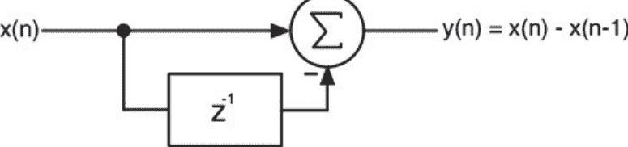

图 4.5：一个简单的数字微分器输出当前与上一次输入之间的斜率。

## 4.5 模拟与数字积分

模拟积分器在连续时间上进行积分；它们计算信号曲线下的面积。传统的模拟积分器电路由一个反馈路径中带有电容器的运算放大器组成（如果你不知道这意味着什么，不用担心——担心你没有在分析它）。你可以将电容器上的电荷视为积分元件。图 4.6 框图所示的模拟积分器的传递函数，是通过在取拉普拉斯变换时将 `$x(t)$` 作为复数正弦波以形成输出 `$y(t)$` 得到的。

图 4.6：模拟积分器及其拉普拉斯变换框图。

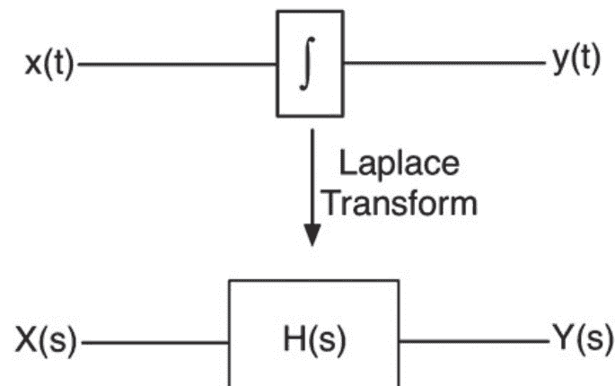
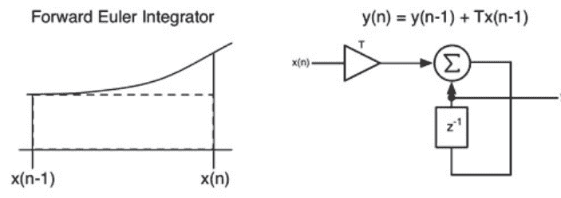
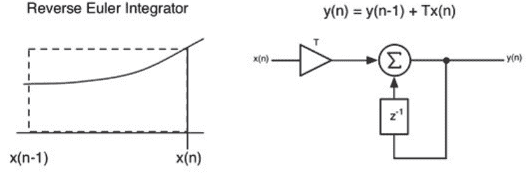
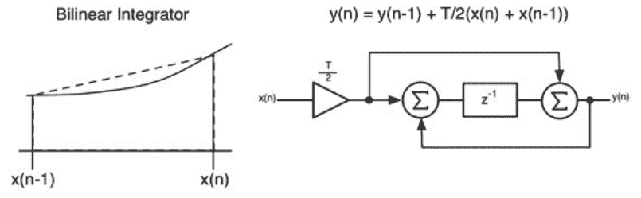

图 4.7：三个简单的数字积分器（Lindquist, 1989），显示了在一个采样间隔内的 `$v_{integration}$` 似值。

要找到传递函数，令模拟系统的输入为 `$e^{st}$`，进行积分，并通过观察应用拉普拉斯变换：

模拟方程：`$y(t) = \int x(t)dt$` 令 `$x(t) = e^{at}$` `$y(t) = \int e^{at}dt$` `$y(t) = \frac{1}{a}e^{at}$` 应用拉普拉斯：`$y(t) → Y(s)$` `$x(t) → X(s)$` `$Y(s) = \frac{X(s)}{s}$` `$Y(s) = \frac{Y(s)}{s}$` (4.10)

积分器的传递函数为 `$H(s) = 1/s$`，通过 `$s=ju$` 进行评估。随着 `$\omega$` 的增加，`$H(s)$` 减小。当 `$\omega=0$` 时，`$H(s)$` 为无穷大。数字积分器试图执行此功能，计算离散“曲线”（阶梯形）下的面积。积分器的输出越接近实际面积，性能就越好。由于数字积分器只能处理离散点，因此必须逼近这个面积。

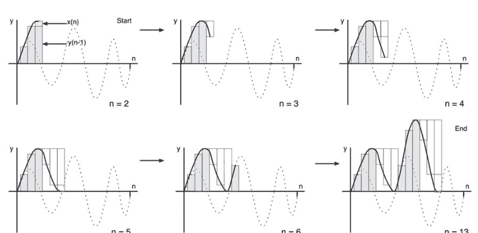

**图 4.8：** 前向欧拉积分器（实线）在多个采样点的输出；正值（灰色）块加到运行总量中，而负值（白色）块则从中减去。

有三种常见的数字积分器：前向欧拉、后向或反向欧拉、双线性积分器。向前和后向欧拉积分器实现简单，但逼近曲线下面积的效果较差，因为它们是零阶保持函数。如图 4.7 所示，`$T$` 是信号周期。为了简单起见，我们归一化方程使得 `$T=1$`。

**图 4.8** 展示了模拟曲线的演示以及前向欧拉积分器的逐步视觉演示；这些矩形产生了曲线下的面积，或信号的积分。在图 4.8 中，正矩形涂成灰色，负矩形为白色。正部分累加了运行总和。在第一个采样 `$n=0$` 时，我们令 `$x(n-1)=0$`。每个后续输出都是之前输出（加上或减去）当前输入的之和。

**图 4.8** 揭示了某些信息：有些人认为双线性积分是平滑的，但在这种情况下并不成立。在低频率处，映射非常接近，但随着频率增加，映射误差随正切函数 `$\tan(1)$` 增大。其次，它是将无限数量的模拟频率映射到有限数量的数字，并且以这种分形方式，将所有模拟频率压缩到奈奎斯特附近的一个微小区域。此外，它将无穷处的频率直接映射到奈奎斯特。

## 4.6 双线性 Z 变换

有两种方法将模拟滤波器转换为数字滤波器。第一种方法（经典）使用双线性。第二种方法（虚拟模拟）使用双线性。两种方法都会产生相同的频率响应，但虚拟模拟的优势将会变得明显。

要找到双线性积分器的传递函数，将规则应用于图 4.7 中的差分方程：

```
y(n) = y(n-1) + \frac{T}{2}[x(n) + x(n-1)]→ Y(z) = y(z)z^{-1} + \frac{T}{2}[X(z) + X(z)z^{-1}]
Y(z)[1-z^{-1}] = \frac{T}{2}X(z)[1+z^{-1}]
H(z) = \frac{Y(z)}{X(z)} \frac{T}{2-z^{-1}}  (4.11)
```

双线性 Z 变换的原理是，如果数字积分器 `$H(z)$` 近似模拟 `$H(s)=1/s$`，那么我们在 `$z$` 和 `$s$` 之间就有稳固的关系。

```
H(s) = \frac{1}{s}
H(z) = \frac{1}{T} \frac{z-1}{z+1}  (4.12)
```


这意味着可以取模拟传递函数 $H(s)$ 并将其替换为 $2/T(z-1)/(z+1)$。这应该在数字域产生一个对应于模拟域 $H(s)$ 的传递函数 $H(z)$。

这种交易似乎并非完美，我们首先并不是这样做。在低频处，映射非常接近，但随着频率增加，映射误差随 $\tan$ 函数而增大。第二个问题是将是将无限数量的模拟频率映射到有限数量的数字，并且以这种分形方式，将所有模拟频率压缩到奈奎斯特附近的一个微小区域。此外，它将无穷处的频率直接映射到奈奎斯特。参见《Designing Audio Effects Plug-Ins in C++》以获得详细讨论。

第一个问题的后果是对模拟频率域进行预畸，以便变换后获得所需的数字频率响应。映射方程为：

```
\omega_s = \tan \frac{\omega_a T}{2}
```

`\omega_a` = 预畸处理的模拟频率

`\omega_s` = 目标数字频率

`T` = 采样周期  (4.13)

假设你想实现一个截止频率为 `f_c` 的双线性变换低通滤波器。在进行任何计算之前，你需要对 `f_c` 进行预畸变（pre-warp）。实现此操作的代码如下：

```cpp
double wd = 2*pi*fc;
double T = 1/sampleRate;
double wa = (2/T)*tan(wd*T/2);
```

在这段代码中，`wd` (`\omega_d`) 是期望的数字频率，`wa` (`\omega_a`) 是经过畸变后的模拟频率。

第二个问题的后果是，对于某些滤波器类型（特别是低通和带通滤波器），在极高频率响应处会出现一个误差，导致滤波器的输出一直上升到奈奎斯特频率，而不是趋于一个有限值。关于该问题的更多信息，请参见参考文献。

一旦将双线性变换应用于任意的 `H(s)`，得到的多项式分子和分母将被分组为一阶和二阶节。一个简单的示例展示了图 4.9 中的模拟 RC 低通滤波器如何转换为双线性等效滤波器。完整的推导过程在*Designing Audio Effects Plug-Ins in C++*中完成。

该滤波器的传输函数为：

```cpp
double wd = 2*pi*fc;
double T = 1/sampleRate;
wa = (2/T)*tan(wd*T/2);
```

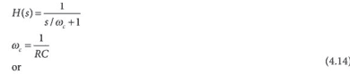
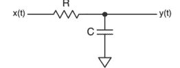

图 4.9：一个简单的模拟 RC 低通滤波器。

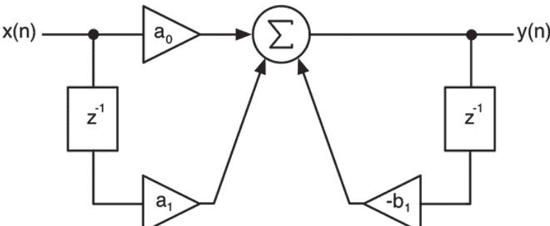

图 4.10：一阶模拟低通滤波器的数字框图。

项 `b_1` 被称为系数，分母是 `s` 的一阶多项式。

通过将 `s` 替换为 `(z-1)/(z+1)` 应用双线性变换，得到传输函数 `H(z)`：

```latex
H(z) = \frac{a_0+a_1z^{-1}}{1+b_1z^{-1}} \quad (4.15)
```

双线性变换方程中的 `T/2` 项消失了。项 `a_0, a_1` 和 `b_1` 被称为新传输函数的系数，它们与截止频率 `f_c` 紧密相关。你可能会发现它与模拟传输函数有某种相似之处，但 `b_1` 并不像模拟版本那样简单等于 `RC`。这导致了图 4.10 所示的数字框图。

系数的方程为：

```latex
\theta_0 = 2\pi f_c / f, \gamma = \frac{1}{1+\sin\theta}, a_0 = \frac{1-\gamma}{2}, \quad a_1 = \frac{1+\gamma}{2}, \quad b_1 =-\gamma \quad (4.16)
```

当用户改变滤波器的 `f_c` 控制时，必须重新计算这些系数。此外，使用了两个内存位置来实现两个延迟器。有趣的是，这种变换将一个具有一阶分母的传输函数转换为另一个分子分母均为一阶的传输函数；该传输函数仍然是一阶的。

高阶模拟滤波器将产生高阶的数字传输函数。二阶低通滤波器（`H`）将产生二阶的 `H(z)`，描述如下：

```latex
H(z) = \frac{a_0+a_1z^{-1}+a_2z^{-2}}{1+b_1z^{-1}+b_2z^{-2}} \quad (4.17)
```

由于分子和分母都是二次方程，这被称为双二次传输函数，或简单称为“biquad”（双二次）。双二次的框图如图 4.11 所示。你可以看到这种结构相比一阶版本又增加了两个系数和两个存储位置。系数的计算将再次涉及三角函数和代数。

由于所得的高阶双线性 z 变换滤波器被分成了双二次节，我们称这种方法为“BZT-to-biquad”。BZT 在市面上几乎每本 DSP 书中都有详细介绍，如果你感兴趣，那里有丰富的信息。

## 4.7 虚拟模拟滤波器

“虚拟模拟”（Virtual Analog）这一术语有一些变体；它可能指的是使用数字组件设计的滤波器，这些组件模仿了单端口和双端口网络（模拟滤波器理论的一部分），并以数字方式实现模拟电路，称为波形滤波（Wave Filtering）。对于其他人来说，它可能意味着一种具有模拟滤波器响应的滤波器。在某些书中，虚拟模拟可能指的是通过数字技术实现的模拟电路。

归一化传递函数使得数学计算变得更容易，因为滤波器是可扩展的。这种方法以一种相对简单的方式产生传递函数，但它隐藏了滤波器内部发生的模拟信号流。我们希望利用该信号流来直接产生数字等效值。接下来，我们来看电路的微分方程。联系模拟输出信号 `y` 与输入信号 `x` 的微分方程见方程 4.20；如果你感兴趣，可以在 http://www.willpirkie/synthbook/ 找到该方程的两种不同的推导方法。

```
$$\frac{dy}{dt} = \frac{1}{RC}(x(t)-y(t))\quad$ (4.20)
```

对两边进行积分即可求解该方程。结果可以简化为：

```
$y(t) = \int \frac{1}{RC}(x(t)-y(t))dt\quad$ (4.21)
```

可以根据方程 4.21 构建一个框图，如图 4.12 所示。

现在我们可以对整个框图进行拉普拉斯变换。所有的规则都适用。在第 4.5 节中，我们看到积分器的传递函数为 `H(s)=1/s`，因此积分器可以被替换为 `1/s` 模块，如图 4.13 所示。我们还可以进行我们在某些分压加法器情况下发现的替换 `f_s=1/RC`。为了形成虚拟积分器，将模拟积分器替换为数字积分器。这有效地实现了模拟滤波器的数字化。

## 4.9 一阶 VA 低通滤波器

VA 方法用数字版本替换了积分器 `H(s)=1/s`，我们选择使用双线性积分器，因为它优于前两种者。对于好奇的人来说，还有许多其他的数字变换可以使用；然而，只有双线性变换保留了频率响应的幅值，尽管在方程 4.13 中存在响应压缩/畸变。在某些情况下（例如运行在低频下的系统），其他方法也适用于全系统（0 Hz 到奈奎斯特频率），而双线性变换规则有效。双线性积分器的另一种形式如图 4.14 所示。它产生与图 4.13 中的双线性积分器相同的输入/输出关系。需要注意的是，任何双线性积分器结构都可以在这些形式中使用；图 4.14 中的形式是一种理想的版本，因为它只需要一个存储元件。其他版本使用一个或两个存储位置。你可以在 http://www.willpirkie/synthbook/ 找到使用这些替代双线性结构形式的推导——它们都产生相同的频率响应。

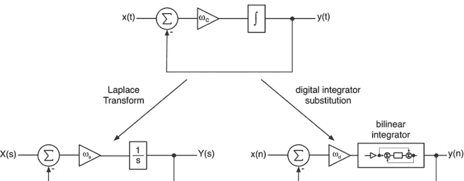

图 4.13: 使用拉普拉斯变换，积分器被替换为模拟滤波器等效的 1/s，通过数字积分器替换将其替换为双线性积分器。

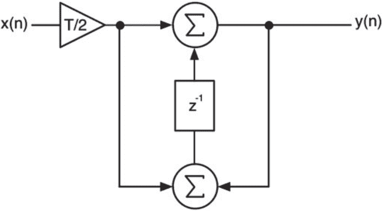

图 4.14: 双线性积分器的另一种形式，或梯形积分器。

图 4.15: 双线性积分器的非归一化版本。

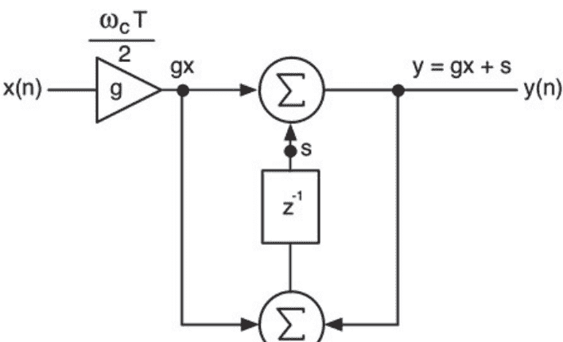

双线性积分器的非归一化版本如图 4.15 所示，其中归一化的 `T/2` 乘法器被替换为 `fc`。`z^{-1}` 延迟模块的输出标记为 `s，`fc T/2` 乘法器标记为 `g`。积分器的输出变为线性方程

`y(n) = gx(n) + s(n)`

这是 Zavalishin 的记法：`g` 对应增益，`s` 对应存储。Zavalishin 方法和改进 Härad 方法都依赖于将系统的输入/输出关系表示为线性方程或一组线性方程的能力。在这种情况下，系统是一个单一积分器。通过构建 VA 电路，整个系统仍具有相似的输入/输出关系。非归一化版本如图 4.16 所示，其中归一化的 `T/2` 乘法器被替换为 `fc`。

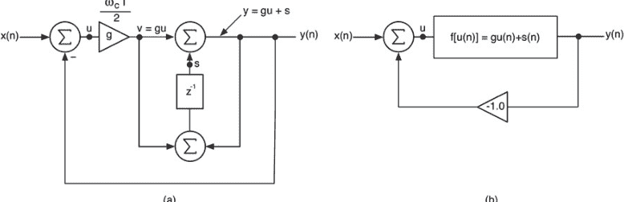

图 4.16: (a) 反馈路中带有双线性积分器的模拟框图数字化版本；`u` 是积分器的输入；(b) 将积分器替换为简单函数 `f(u)` 并使用 -1.0 的正反馈增益而不是减法。

在该电路中，积分器的输出 `y` 最终是低通滤波器的输出。积分器的输入 `u(n) = (x(n) - y(n))`，因此方程变为

```
$y = gu(n) + s(n)$
$y = gx(n) - y(n)) + s(n)
$y = gx(n) - gy(n) + s(n) \quad (4.22)$
```

这看起来是有问题的，因为 `y(n)` 同时出现在方程的两侧，由于我们在输入和输出之间存在一个无延迟回路。Zavalishin 的代数解允许忽略离散时间输出 `y(n)` 出现在方程两边的事实，并断言回路是可以解决的，因为 `g` 和 `s` 项是固定的。因此，方程 4.22 可以被看作瞬时响应。丢弃离散时间 `n`（为了方便）并分离变量得到方程 23。

```
$y = g(x-y) + s \quad (23)$
```

然后，应用代数运算：

```
$y = g(x-y) + s
$y + gy = gx + s
$y = \frac{gx+s}{1+g} \quad (24)$
```

该方程又是 `y = gx + s` 的版本，通过分离分子并因式分解得到：

```
$y = \frac{g}{1+g}x + \frac{s}{1+g} \quad (25)$
```

将两个商替换为 `G` 和 `S`：

```
$y = \frac{G}{1+G}x + \frac{S}{1+G}$
let:
$G = \frac{g}{1+g}$
$S = \frac{s}{1+g}$
then:
$y = Gx + S \quad (26)$
```

`y = gx + s` 的线性关系允许无延迟回路在输入/输出方程中解决，因此现在需要修改框图以移除该路径。对输入 `v` 求求和节点揭示了修改后的结构。这相对容易（Zavalishin）：

```
$v = g(x-y) = g(x-\frac{gx+s}{1+g})$
$= (x-s)\frac{g}{1+g}$
$= G(x-s) \quad (27)$
```

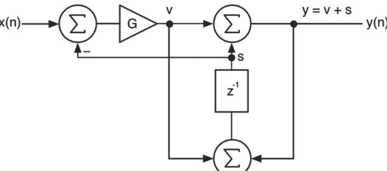

4.17: 完成的一阶 VA LPF。

通过这种方式，最终形式如图 4.17 所示，你可以看到 `v = G(x - s)`。这是通过将反馈路径从滤波器输出移动到延迟元件 `s(n)` 实现的。

`y = Gx + S` 关系的重要性无论如何强调都不为过。考虑一下：我们取了一个输出为 `y = gx + s` 的积分器，将其放入反馈回路中，得到一个可以表示为 `y = Gx + S` 的输出。假设我们有这个低通滤波器并放入另一个反馈回路，或者我们取了一系列这样的滤波器并放入反馈回路？输出始终以 `y = G + S` 的形式出现（`G` 和 `S` 代表通用的 `G` 和 `S`）会让你惊讶吗？

选择双线性积分器的影响是产生的滤波器与 BZT-biquad 方法相同——它也是双线性滤波器，但没有应用 BZT 传递函数。它还需要对滤波截止频率进行预畸变。单个系数 `G` 的计算为：

```
double wd = 2*pi*Fc;
double T = 1/SampleRate;
double wa = (2/T)*tan(wd*T/2);
double g = wa*T/2;
```

看图 4.17 中的 VA LPF 与图 4.10 中的直接型（半双二）滤波器之间的差异。VA 版本只需要使用一个三角函数 `tan()` 计算一个系数，并且只需要一个存储位置。对于实现速度来说是一个巨大的优势。还有其他优势，关于滤波器对系数舍入误差的敏感性。

## 4.10 一阶 VA 高通滤波器

一阶 VA 高通滤波器同样地从模拟 RC 高通滤波器导出。产生的滤波器输出 `y_{HP}` 在数学上与低通滤波器输出 `y_{LP}` 相关。关系为：

$$y(n)_{HP} = x(n) - y(n)_{LP} \quad (4.28)$$

我们可以简单地复用 VA 低通滤波器并从低通输出中减去输入。如图 4.18 所示。

由于两个滤波器共享相同的低通组件，我们可以实现一个产生两个输出的滤波器。最终，我们在第 7 章中的 C++ 对象将通过极少的额外代码提供两个版本。

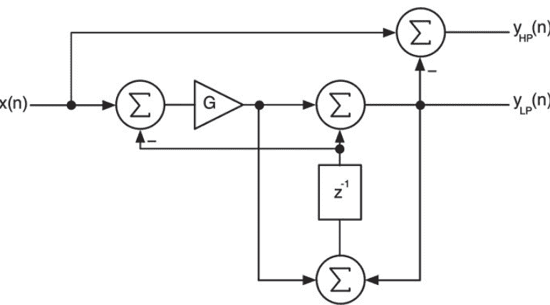

图 4.18: VA 高通滤波器使用了低通滤波器的修改版本。

如果低通滤波器可以描述为 `y_{LP} = Gx + S`，那么高通滤波器将是：

```
$$y_{HP} = x-(Gx+S)
=x-Gx-S
=(1-G)x-S=G_0x+S_0
G_0=1-G
S_0=-S$$\hfill(4.29)
```

这意味着再次，滤波器具有 `y = Gx + S` 的形式。第 7 章中除一个外所有的滤波器都只使用这些一阶构建块来实现它们的结构。

## 4.11 二阶 VA 滤波器

二阶模拟传递函数产生广义传递函数：

```
$$H(s) = H_s \frac{num}{s^2+2\zeta\omega_s s+\omega_s^2}$$\hfill(4.30)
```

`num` 或分子项随滤波器类型而变化，但分母是相同的，`H_s` 代表整体滤波器增益，是一个从传递函数中提取出来的常数标量。`\zeta` 项在经典滤波器理论中指的是“阻尼因子”，但在音乐应用中，我们倾向于用术语 `Q` 替换它，它代表“品质因子”，其中：

```
$$Q = \frac{1}{2\zeta}$$\hfill(4.31)
```

二阶滤波器可以从任何包含标量乘法器、求和器和积分器的二阶框图中合成。有趣的是，有许多模拟框图可以产生相同的传递函数。在历史上，模拟滤波书籍会对使用不同结构的优缺点进行分类和列举。Lindquist 的《具有信号滤波应用的有源网络设计》表中列出了许多不同滤波器结构、方程和框图的分值。其中一些结构对滤波器元件的误差（即现实世界中 R、L 或 C 的非理想值）更为敏感。另一些结构则允许滤波器的截止频率或 Q 值通过一个单一增益因子来控制。在模拟设计中，选择合适的结构可以简化当前的问题，因此并没有一个所有人都认同的算法。然而，有一种在音频设计师中特别受欢迎的结构，被称为状态变量滤波器或 **SVF**。它也根据发明者的命名被称为 **Kerwin-Huisman-Newcomb (KNH) 滤波器**。这种滤波器拓扑结构的有趣特征之一是它直接实现了四个母滤波器：二阶低通滤波器（LPF）、高通滤波器（HPF）和带通滤波器（BPF）。通过相加 LPF 和 HPF 的输出可以计算出 BPF。图 4.19 显示了在任何模拟滤波器理论书中都能找到 SVF 滤波器框图。从 `y_LP` 推导传递函数的过程在本章稍后的部分完成，并产生标准的 LPF 函数；你也可以从该函数开始，反向推导出该框图。

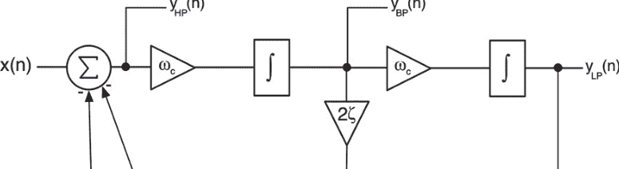

图 4.19：带有标记输出的 SVF（或 KNH 滤波器）框图。

图 4.20：VA SVF。

Zavalishin 使用之前相同的方法将其转换为虚拟模拟（VA），将模拟积分器替换为数字梯形积分器，并处理了无延迟反馈回路。这产生了图 4.20 所示的 VA SVF；回路被重新定位到每个元件 `s_i` 的输出端，第一个延迟元件的系数 `c_i` 为 `\rho = 2R+g`，而第二个延迟输出的系数为 `1.0`。


输入系数：

```
\alpha_0 = \frac{1}{1+2Rg+g^2}
```

处理回路。该方法首先找到馈给结构其余部分的输出 `y_{HP}`。完整的推导过程在 Zavalishin (2012) 中有描述。图 4.20 中的框图使用了我们在第 7 章中使用的惯例，其中前馈系数（一阶 LPF 和 HPF 中的 `G`）被替换为 `\zeta`。设计方程为：

```
$$\omega_f = 2\pi f_f$,$
T = 1/f_f$,$
$\alpha_p = \tan\left(\frac{\omega_f T}{2}\right),$
$g = \frac{\omega_f T}{2} \quad R = \frac{1}{2Q},$
$\alpha_s = \frac{1}{1+2Rg+g^2} \quad \alpha_c = \alpha_g = g$$
```

在此实现中，你首先计算 `y_{HP}(n)` 并用它来馈给结构的其余部分。找到该内部回路的方法之一是你可以推导出这些 VA 滤波器的实现，尽管你也可以采用不同的方法并计算部分的输出或输入。对于任何给定的结构，都有几种不同的实现方法，它们都会产生相同的结果。我们倾向于使用能产生最简单框图、系数和方程最少的方法。

带通和低通输出为：


$y_{BP}(n) = \alpha_b y_{in}(n) + s_b(n)$, 
$y_{LP}(n) = \alpha_l y_{in}(n) + s_l(n)$

我们还可以通过另一个捷径方法生成缺失的带阻滤波器输出：

$y_{BS}(n) = x(n) - 2Ry_{in}(n)$

该滤波器的每个输出产生另一个具有瞬时响应方程 $y = Gx + S$ 的 VA 滤波器。对于高通 $y_{HP}$，我们可以展开方程来看到这一点。

$y_{out}(n) = \alpha_s(x(n) - \rho_s(n) + s_s(n))$, 
$x - (2R+g)s_1 - s_2$, 
$\frac{1}{1+2Rg+g^2}$, 
$= Gx + S$, 
where 
$G = \frac{1}{1+2Rg+g^2}$, 
$S = \frac{-(2R+g)s_1 + s_2}{1+2Rg+g^2}$

LP 和 BP 输出的推导留给读者练习。答案如下：

$y_{LP} = Gx + S$, 
$G = \frac{1}{1+2Rg+g^2}$, 
$S = \frac{-(2R+g)s_1 + g_1 + s_2}{1+2Rg+g^2}$, 
$y_{BP} = Gx + S$, 
$G = \frac{1}{1+2Rg+g^2}$, 
$S = \frac{g_2 - g_1 + s_2}{1+2Rg+g^2}$

Zavalishin 的 SVF 版本并非解。Simer (2011, 2013) 使用节点分析的模拟电路分析详细说明了 SVF 的完全不同的推导和实现。Simer 还有计算滤波器系数的优化解决方案。更多细节请参见参考文献。

## 串联和并行 VA 滤波器

很容易推导出图 21 所示的串联和并行 VA 滤波器的滤波器方程，它们最终都成为 $Gx + S$ 类型的滤波器。再次，只需简单的代数即可创建必要的滤波器方程。在串联滤波的情况下，在它们之间插入一个中间节点 $u$ 并用于计算输出。

图 4.21：VA 滤波器的串联（顶部）和并行（底部）连接。

图 4.22：三个无延迟网络；(a) 前馈路径包含一个简单的乘法器 (b) 前馈路径通过某些函数 $f(u)$ 处理以及 (c) 前馈路径包含一个...

`img/b42d0dca53f4a889d8162d55f7c8c05d_234_1.png` (此处为原文未完整路径的占位符)

Zavalishin 使用之前相同的方法将其转换为虚拟模拟，将模拟积分器替换为数字梯形积分器，并处理了无延迟反馈回路。这产生了图 4.20 所示的 VA SVF；回路被重新定位到每个元件 $s_i$ 的输出端，第一个延迟元件的系数 $c_i$ 为 $\rho = 2R+g$，而第二个延迟输出的系数为 $1.0$。

`img/b42d0dca53f4a889d8162d55f7c8c05d_234_1.png`

输入系数：

```
\alpha_0 = \frac{1}{1+2Rg+g^2}
```

处理回路。该方法首先找到馈给结构其余部分的输出 $y_{HP}$。完整的推导过程在 Zavalishin (2012) 中有描述。图 4.20 中的框图使用了我们在第 7 章中使用的惯例，其中前馈系数（一阶 LPF 和 HPF 中的 $G$）被替换为 $\zeta$。设计方程为：

```
$$\omega_f = 2\pi f_f$, 
T = 1/f_f$, 
$\alpha_p = \tan\left(\frac{\omega_f T}{2}\right), 
$g = \frac{\omega_f T}{2} \quad R = \frac{1}{2Q}, 
$\alpha_s = \frac{1}{1+2Rg+g^2} \quad \alpha_c = \alpha_g = g$$
```

在此实现中，你首先计算 $y_{HP}(n)$ 并用它来馈给结构的其余部分。找到该内部回路的方法之一是你可以推导出这些 VA 滤波器的实现，尽管你也可以采用不同的方法并计算部分的输出或输入。对于任何给定的结构，都有几种不同的实现方法，它们都会产生相同的结果。我们倾向于使用能产生最简单框图、系数和方程最少的方法。

带通和低通输出为：

$y_{BP}(n) = \alpha_b y_{in}(n) + s_b(n)$, 
$y_{LP}(n) = \alpha_l y_{in}(n) + s_l(n)$

我们还可以通过另一个捷径方法生成缺失的带阻滤波器输出：

$y_{BS}(n) = x(n) - 2Ry_{in}(n)$

该滤波器的每个输出产生另一个具有瞬时响应方程 $y = Gx + S$ 的 VA 滤波器。对于高通 $y_{HP}$，我们可以展开方程来看到这一点。

$y_{out}(n) = \alpha_s(x(n) - \rho_s(n) + s_s(n))$, 
$x - (2R+g)s_1 - s_2$, 
$\frac{1}{1+2Rg+g^2}$, 
$= Gx + S$, 
where 
$G = \frac{1}{1+2Rg+g^2}$, 
$S = \frac{-(2R+g)s_1 + s_2}{1+2Rg+g^2}$

LP 和 BP 输出的推导留给读者练习。答案如下：

$y_{LP} = Gx + S$, 
$G = \frac{1}{1+2Rg+g^2}$, 
$S = \frac{-(2R+g)s_1 + g_1 + s_2}{1+2Rg+g^2}$, 
$y_{BP} = Gx + S$, 
$G = \frac{1}{1+2Rg+g^2}$, 
$S = \frac{g_2 - g_1 + s_2}{1+2Rg+g^2}$

Zavalishin 的 SVF 版本并非解。Simer (2011, 2013) 使用节点分析的模拟电路分析详细说明了 SVF 的完全不同的推导和实现。Simer 还有计算滤波器系数的优化解决方案。更多细节请参见参考文献。

## 串联和并行 VA 滤波器

很容易推导出图 21 所示的串联和并行 VA 滤波器的滤波器方程，它们最终都成为 $Gx + S$ 类型的滤波器。再次，只需简单的代数即可创建必要的滤波器方程。在串联滤波的情况下，在它们之间插入了一个中间节点 $u$ 并用于计算输出。

图 4.21：VA 滤波器的串联（顶部）和并行（底部）连接。

图 4.22：三个无延迟网络；(a) 前馈路径包含一个简单的乘法器 (b) 前馈路径通过某些函数 $f(u)$ 处理以及 (c) 前馈路径包含一个...

通过通过前馈路径从 $u_0$ 找到临时输出 $y_0$ 和 $y_s$，如图 4.24 (b) 所示；此处 $y_s = 0$，表示前馈路径中没有存储组件。

**图 4.23：** 在无延迟环路反馈路径中带有滤波器的通用结构。

**图 4.24：** (a) 断开环路并找到断开的输出。(b) 通过前馈路径应用临时（断开的）输入 $u_0$ 以形成输出 $y_0$。(c) 通过移除结构中所有的延迟元件并对带有断开单元的输入路应用 1.0 来找到环路增益。注意：为了方便阅读，已移除了离散变量 $n$。


### 第 3 步：

通过移除滤波器中的延迟元件并在环路输入应用 1.0 的值来找到总环路增益。如果我们移除滤波器的延迟元件，将不再有 $S$ 组件，因为它是位于延迟的输出端。滤波器仍然具有增益 $G$。因此，如图 4.24 所示，总环路增益为：

### 第 4 步：

使用方程 4.39 找到差分方程，从而你可以通过观察法合成框框图。对于一组乘积，组件将像方程 4.43 所示进行交换和重新排序。

```
y_s(n) = y_0(n) + y_s(n)
y_s(n) = Ku_0(n)
y_s(n) = 0 (4.41)
```

```
X = KG (4.42)
```

### 第 5 步：

找到滤波器的 $u(n)$：

```
y(n) = \frac{y_0(n) + y_s(n)}{1 - KG}
```

```
y(n) = \frac{K(x(n) + S(n))}{KG} + 0 (4.43)
```

重新排序：
```
y(n) = \frac{K(x(n) + S(n))}{1 - KG}
```

参考框框图，你可以看到环路输入值 $u(n)$ 是输入 $x(n)$ 与经过滤波器处理的 $y_s(n)$ 之和。通过追踪图 4.25 来证明它正确地实现了该差分方程。

**图 4.25：** 解决了延迟环路的改进后滤波器结构。

让我们尝试图 4.26 (a) 所示的另一种通用反馈滤波器。在这种情况下，组件位于前馈路径中，我们仅在反馈路径中有一个常数值 $K=-1$，表示求加器的器的减法。这次我们会快速通过。

### 第 1 步：

断开环路并向前馈路径注入 0.0，产生反馈输出 $y_s(n)$如图 4.26(b) 所示，以及一个临时环路输入值：

### 第 2 步：

通过前馈路径处理输入 $u(n)$ 来找到临时输出：

### 第 3 步：

通过从原始结构中移除延迟元件并追踪图 4.26(c) 中的环路来找到环路增益：

### 第 4 步：

使用方程 4.39 找到最终差分方程和框框图。图 4.26(d) 显示了解决了延迟环路的改进结构。追踪框框图以证明它确实实现了 4.48：

```
u(n) = x(n) + Gy(n)
y(n) = Ku(n)
so
u(n) = \frac{x(n) + S(n)}{1-KG}
```

```
u(n) = x(n) + KS(n)
```

```
y(n) = Gy(n) + y(n)
y(n) = S(n)
```

```
X = KG
```


### 第 5 步：

找到滤波器实现所需的 $u(n)$。参考框框图，你可以看到环路输入值 $u(n)$ 是输入 $x(n)$ 和 $y_p(n)$ 之和：

$y(n) = \frac{y_c(n) + y_n(n)}{1 - X} = G(x(n) + KS(n))$

**图 4.26：** (a) 延迟环路前馈路径中带有滤波器的通用结构。(b) 断开环路以提取临时反馈值并计算 $u_0$。(c) 通过移除延迟元件找到环路增益 $X$。(d) 解决了延迟环路后的最终算法。


作为最后一个示例，让我们使用 Hard 方法来解决原始结构中图 4.26 (a) 处的延迟环路。在这种情况下，组件位于前馈路径中，我们仅在反馈路径中有一个常数值 $K=-1$，表示求加器的减法。这次我们会快速通过。

图 4.33：一个待检查的更复杂的滤波器。

在第 7 章中，我们将实现一个带有 PFB 延迟环的滤波器，其前馈路径和反馈路径中都包含滤波器，如图 4.33 所示。增益 $K2$ 为 1.0。正向带中有一个低通滤波器（LPF），在反向带中有一个高通滤波器（HPF）。两个滤波器都是一阶的。最初，LPF 和 HPF 具有相同的截止频率 $f_c$，因此仅根据截止频率，它们具有相同的 $G$ 值。在方程中，它们将共享相同的 $G$，但每个都有自己的值，LPF2 对应 $S3$，HPF1 对应 $S2$。对它们进行索引的原因将在第 7 章中变得显而易见，因为在完整结构中还有其他的滤波块。

让我们推导 $u$ 的方程，它是 LPF2 的输入。你可以看到滤波器的最终输出 $y$：

首先，定义每个组件的滤波器方程：

现在形成 $u$：

图 4.34：图 4.33 中滤波器在无延迟环下的实现。

令 $\alpha$ 为缩放因子：

通过使用这些 $\beta$ 系数，我们可以改变 VA 滤波器的结构，引入一个反馈输出端口，这将简化滤波器的处理。这将在第 7 章中介绍。最终结构如图 4.34 所示。再次，通过追踪滤波器来验证输入 $u$ 的值是否正确。使用改进 Härmärt 方法（Modified Härmärt method）和方程 4.39 来验证结果。

```
$u_{in} = \frac{x+K_1K_2G_1+K_2S_2}{1+K_1K_2G_1}, \quad u_{out} = \frac{x-K_1K_2G_1-K_2S_2}{1+K_1K_2G_1} \quad (4.59)$
```


## 4.15 模拟信号流图

我们在章节开头检查了模拟信号流图的示例。另一种信号图是信号流图（signal flow graph）。它以图形方式描述连接在一起的前馈路径和反馈路径中的滤波器。

 带有节点。每个滤波器组件的传输函数标记为 $T_{NM}$，其中 $N$ 是输入节点，$M$ 是输出节点，因此 $T_{13}$ 就是从节点 1 到节点 3 的传输。在图 4.33 所示的示例中，我们在前馈路径中有一个 LPF，在反馈路径中有一个 HPF。该信号流图如图 4.35 所示。注意节点编号的方式；输入始终是节点 1，输出是节点 2，其余节点在从节点 3 开始的环中串联。


$y = Ky_3$

$HPF1$
$LPF2$
$y_2 = y-(Gy+S2)$
$y_3 = Gu+S3$
$= y-Gy-S2$
$S3 = \frac{s_1}{1+g}$

$S2 = \frac{s_2}{1+g}$
$y = K(Gu+S3)$
$y_2 = y-Gy-S2$
$u = x+y_1$
$= x+y-Gy-S2$
$= x+KGu+KS3-G(KU+S3)-S2$
$= x-S2+S3(K-KG)$
$= 1-KG+KG'$

(4.60)

(4.61)

通常，标签 LPF1 和 HPF1（代表一阶 LPF 和 HPF）被省略在图中；识别 $T$ 值取决于读者的能力；经过一些练习后，这相对容易的。梅森增益公式（Mason's gain equation）可以让你直接从图上写出系统图的模拟传输函数。

对于这个简单的图：

对于这种简单的框图/信号流，梅森增益公式的规则是：

- 分子是是所有前馈传输（又称前馈增益）的乘积
- 分母是 [1 - (所有环传输（又称环增益）之和）逐一取出]，通过追踪每个环并相乘传输完成的。这与改进 Härmärt 方法的第三步相似但不完全相同。

注意，环包括环中的任何前向传输，图 4.35 中简单反馈环的环增益是 $T_{34}$（正向）乘以 $T_{33}$（反向）。在更复杂的信号图中，分子和分母都将增加更多因子。完整的分析超出了本书的范围，但可以在任何良好的模拟滤波书中找到，例如 (Lindquist, 1977)。我们将在第 7 章讨论框图时使用此信号图作为视觉辅助，但你不需要解决这些任何方程；它们出现在这里仅是为了说明模拟滤波器可以用这种方式描述和解决，而不是使用模拟框图。事实上，你可以将模拟信号转换为。

一个指数 Sigmoid 函数。这些非线性处理（NLP）函数的方程如下：

| | arctan | sigmoid |
|---|---|---|
| $y = \frac{2}{\pi}(1-\frac{x^2}{3})$ | $y = \frac{\arctan(kx)}{\arctan(k)}$ | $y = \frac{2}{1+e^{-x}}-1$ | (4.67) |

为了简单起见，我们合成器中所有的非线性处理模块都使用了 `tanh(x)` 函数。在某些情况下，这是必要的，因为非线性性源于滤波器方程中的双曲正切函数。在其他涉及基于二极管的失真的情况下，使用其他波形器可能会产生更准确的结果。当然，我们鼓励你在项目中尝试所有的波波形。

图 4.39：(a) 和 (b) 双线性积分器的两种变体版本。


## 4.17 挑战

### 铜级
推导 VA（电压控制）状态变量滤波器 $y_{HP}$ 的方程。

### 银级
推导 VA 状态变量滤波器 $y_{LP}$ 和 $y_{BP}$ 的方程。

### 金级
使用信号图和梅森增益公式（Mason's Gain Equation）验证三个滤波器反馈回路（图 4.29、4.31 和 4.33）的输入/输出关系是否都产生 $y = Gx + S$。

### 铂级
使用改进的 Härmä 方法解决图 4.33 中的无延迟环。

### 钻石级
图 4.39 显示了双线性积分器的两种变体版本。将 VA 低通滤波器中的双线性积分器替换为其中任意一个，并使用改进的 Härmä 方法导出解决延迟环后的修改结构。使用 s 节点值建立积分器的差分方程。

# 参考文献

Avanini, Federico, Fontana, Federico and Rocchesson, Davide. 2000. "Computation of Nonlinear Filter Networks Containing Delay Free Paths." Proceedings from the Seventh International Conference on Digital Audio Effects.

Borin, Gianpaolo, De Poli, Gianovani and Rocchesson, Davide. 2000. "Estimation of Delay Free Loops in Discrete-Time Models of Nonlinear Acoustic Systems." IEEE Transactions on Speech and Signal Processing, vol. 23, pp. 558–562.

Brut, Len. 1975. "Low-Sensitivity Digital Ladder Filters." IEEE Transactions on Circuits and Systems, vol. CAS-22, no. 3, pp. 168–176.

Charles, and Jerse, Thomas. 1997. Computer Music Synthesis: Composition and Performance, Chap. 6. New

El-Masry, Ezz. 1979. "Low-Sensitivity Digital Ladder Networks," Proceedings from the 13th Asilomar Conference on Circuits, Systems, and Computers, pp. 273–278. Pacific Grove, California.

Fettweis, Alfred. 1991. "Some Principles on Designing Digital Filters Imitating Classical Filter Networks." IEEE Transactions on Circuit Theory, vol. CT-18, pp. 314–316.

Härmä, Aki. 1998. "Implementation of Recursive Filters Using Delay Free Loops." Proceedings from the 1998 International Conference on Acoustics, Speech and Signal Processing, vol. 3, pp. 1261–1264.

Lindquist, Claire. 1977. Active Design with Signal Filtering Applications , pp. 61–69. Long Beach: Steward and Sons.

Lindquist, Claire. 1989. Adaptive and Digital Signal Processing, pp. 804–808. Long Beach: Steward

Pakarinen, Jyri, and Yeh, 2009. "A Review of Digital Techniques for Modeling Vacuum-Tube Guitar Amplifiers." The Computer Music Journal, 30, no. 2, pp. 85–100. Cambridge: MIT

Pirkle, Will. 2014. "Resolving Delay-Free Loops in Recursive Filters Using the Modified Härmä Method." Presented at the 136th Audio Engineering Society Convention. Los Angeles.

Simper, Andrew. 2011. "Linear Trapezoidal Integrated Variable Filter with Low Noise Optimization." Accessed June 2014, http://cytomic.com/dsp/SvfLinearTrapOptimised.pdf

Simper, Andrew. 2013. "Solving the Continuous SVF Equations using Trapezoidal Integration and Equivalent Currents." Accessed June 2014, http://cytomic.com/dsp/SvfLinearTrapOptimised2.pdf

Szczupak, Jaques and Mitra, Sanjit. 1975. "Detection, Location, and Removal of Delay-Free Loops in Digital Filter Configurations." IEEE Transactions on Acoustics, Speech and Signal Processing, vol. 23, pp. 558–562.

```cpp
// 模回循环测试

if(modulo >= 1.0)

modulo -- 1.0;
```

```cpp
// 单极到双极

double trivial_square - modulo > PW/100.0 ? -1.0 : +1.0;
```

```cpp
// 计数器增加

modulo += m_Inc;
```

```cpp
// 输出双极锯齿波

return trivial_square;
```


图 5.2：脉宽为 20%、50% 和 80% 的方波。

## 5.4 简易三角波形振荡器

三角波的形状正如其名称所示，也可以通过模计数器生成。其方程为：

`triangle = 2 *abs(trivialsaw)-1.0` (5.2)

三角波的代码同样简单：

```cpp
// 模回循环测试

if (modulo >= 1.0)

modulo -- 1.0;
```

```cpp
// (2*modulo - 1) = 简易锯齿波

double trivial_tri = 2.0*fabs(2.0*modulo - 1.0) - 1.0;
```

```cpp
// 计数器增加

modulo += m_Inc;
```

```cpp
// 输出双极三角波

return trivial_tri;
```


简易振荡器中的混叠


图 5.3：$f_o = 440$ Hz 时（上）简易方波、（中）三角方波和（下）三角波的波形和频谱；锯齿波和方波表现出严重的混叠，而三角波的频谱则很干净。

锯齿波和方波振荡器充满了混叠分量。然而，不表现出不连续性的三角波几乎没有混叠。它可以作为音高振荡器使用，但我们还将实现另一种产生纯净输出的算法。你可以自行判断是否存在可听的混叠。图 5.3 显示了三个振荡器的波形和频谱。振荡器频率为 440 Hz。锯齿波频谱在基频的每个倍频上（440 Hz、880 Hz、1320 Hz 等）都应该应有尖峰，而方波和三角波仅包含奇次谐波（440 Hz、1320 Hz、2200 Hz 等）。你可以看到，所有其他尖峰和填充区域都是混叠分量。本章中的 FFT 图是使用 131,072 点的 Blackman-Harris 窗口绘制的。

## 5.5 准带限振荡器算法

现在我们可以关注音高振荡器设计器了。对于混叠，我们有两个方向：消除它，或者当混叠分量电平足够低（特别是在奈奎斯特频率附近）且离基频较远时允许其发生。要完全消除需要加法合成，这可以在事件发生时实时完成，也可以将波形存储在表中并使用合成法（这将在本章中介绍）。纯加法合成的问题是计算开销大。尽管使用了 `sin(x)`、`cos(x)` 和 `tan(x)` 等三角函数，其开销依然很高。这种方法在实时处理中是具有挑战性的。

*(注：此处原文文本似乎存在重复或乱码，已根据要求按翻译逻辑翻译如下：)*

现在我们可以关注音高振荡器设计器了。对于混叠，我们有两个方向：消除它，或者当混叠分量电平足够低（特别是在奈奎斯特频率附近）且离基频较远时允许其发生。要完全消除需要加法合成，这可以在事件发生时实时完成，也可以将波形存储在表中并使用合成法（这将在本章中介绍）。纯加法合成的问题是计算开销大。尽管使用了 `sin(x)`、`cos(x)` 和 `tan(x)` 等三角函数，其开销依然很高。

## 5.6 带限脉冲串 (BLIT)

Stilon 和 Smith 提出使用带限脉冲串（BLIT）来产生无混叠的方法。其思想是生成一个带限的脉冲串，然后产生一个经过滤波的脉冲流。这产生了 `sinc()` 函数，如图 5.4 所示。

*(注：原文后续段落存在大量重复和无意义字符组合，已根据翻译原则对核心逻辑进行处理)*

### sinc() 函数


**图 5.7：** (a) 理想低通器的脉冲响应。(b) 对脉冲响应进行积分并转换为双极性的阶跃信号。

### BLEP 残差（上升沿）

### BLEP 残差（下降沿）


**图 5.8：** (a) 从图 5.7 中减去单位阶跃信号后的 BLEP 结果，(b) 用于下降沿的反转版本。

### sinc() 函数

### sinc() 函数


**图 5.9：** (a) 矩形窗口（虚线）选择了 `sinc()` 函数的中心脉冲，(b) 一个更宽的、非矩形的窗口覆盖了函数的更大部分区域。

在确定了脉冲响应后，下一步是选择你想要调整边缘的范围。通常情况下，调整的点越多，混叠消除的效果就越好，但会以处理时间和存储空间为代价。你通常会在不连续点周围对称地选择脉冲。在我们最简单的 BLEP 振荡器中，我们将在每个不连续点的每侧仅应用一个点的修正，总共两个点。我们将在下一节中实现四点修正。混叠的减少非常显著，尽管并非 100% 完全消除。这可能是你自己设计中一个可以实验的领域。因为我们将实现完全无混叠的波表波形。你的一些窗口列表可以对准带带限制和波表振荡器进行测试，并自行做出判断。

**图 5.10：** (a) 窗口 `sinc()` 仅选择中心脉冲 (b) 积分和双极性修正后生成的 BLEP 边缘 (c) 上升沿和下降沿情况的 BLEP 残差。

知道了调整区域的宽度，你就可以对脉冲响应进行加窗（即只取其一部分）。这是另一个可以实验的领域——你可以选择不同的窗口函数，如 Hann、Hamming、Blackman，甚至缩放脉冲响应的值。窗口值和尺寸因子决定了混叠消除的程度。在我们最简单的 BLEP 振荡器中，我们在原始 `sinc()` 函数上使用矩形窗口，以将脉冲限制在它的过零点处，如图 5.9(a) 所示，这提供的修正宽度为两个样本。如果你在关注 Legacy/Bright 专利，这也是该专利采用的选择。然而，Krog 和其他人可能会使用不同的修正窗口和宽度；这是另一个秘密交易。图 5.9 (b) 显示了在较宽的脉冲区域周围使用非矩形窗口。

在选定窗口尺寸和类型后，我们就可以生成 BLEP 残差。BLEP 残差在 `synthfunctions.h` 中预计算并在一个 4096 元素的数组中供你使用，名为 `dBLETable[4096]`。你可以下载本章的 C/C++ 代码，我们在本章中为你生成了残差以便你实验。你也可以使用 MATLAB 或其他工具生成并对脉冲进行加窗。残差存储在这个相对较大的 4096 点采样数组中。我们然后可以使用查找技术来找到应用于给定波形样本的残差值。

### BLEP 残差（上升沿）

### BLEP 残差（下降沿）


实现 BLEP 振荡器有很多方法。残差存储在一个相对较大的精细采样数组中。其他形式内存密集性较低，并且应用不同的表查找技术。例如，如果你进入不连续点的八个点（或四个点），那么你可以为模块控制器的不同增量值创建八点表，并在它们之间进行插值。我们的实现是不依赖硬件的；BLEP 是一个返回残差修正值或在不连续过渡区域外时返回 0.0 的函数。你可以使用简单的表查找技术根据振荡器的当前相位来获取残差值。你可以启用或禁用 BLEP 表的插值（为了节省处理时间，已禁用），当然，我们也鼓励你尝试其他形式的插值。

图 5.11：节选自 Learning and Bright (2009)，一个简单的锯齿波形；偏移量包含将应用于样本的值（箭头将发生变化）(b) BLEP 残差信号（下降沿）显示了幅度，且 (c) 修正显示了 (d) 锯齿波形中的结果。

图 5.10 (a)-(d) 显示了我们生成 BLEP 残差的结果。在实现时，我们不会保留单独的下降沿版本；相反，我们只是减去而不是加上上升的值。我们将使用图 5.10 (c) 中残差的左侧来处理一种不连续性，右侧处理另一种。

图 5.11（来自 Learning/Bright 面板中的图 4）显示了我们 BLEP 函数的输出；注意残差是如何偏移到不连续点周围的样本上的。5.11 (b) 显示它是下降沿，因为锯齿波只包含下降沿，且在不需要修正的地方通常为零。样本是修正的目标。BLEP 残差将简单的波形向上或向下平移。你还可以看到，点越靠近不连续点，BLEP 脉冲就越集中在原始波形周围。调整后，在 5.11 (d) 中，你可以看到改变 5.7 周围的两个点是如何的，5.12 (a) 显示了简单波形的频谱，而 5.12(b) 显示了在应用两点 BLEP 修正后混叠分量的极剧减少。我们将 -60 dB 作为混叠分量的阈值；如果它们低于此值，我们就认为它们是不存在的。然而，你可以使用 RackAFX 分析器的控制设置来更改此值（例如改为 -96 dB）以查看混叠分量的形状。

## 5.8 宽窗口 BLEP

我们通过两点 BLEP 在抑制混叠方面取得了良好结果，因此让我们增加 `sinc()` 函数的宽度并进行更多。代价将是计算量。窗口 `sinc()` 函数被修改以包含下一个过零点。这产生了每个窗口修正四个样本，但保持相同的长度（过零点现在位于边界）。图 5.13 (a) 显示了矩形加窗的 `sinc()` 脉冲，而图 5.13 (b) 显示了生成的 BLEP 边缘，图 5.13 (c) 显示了生成的残差。

图 5.12：(a) 锯齿频谱显示大量的混叠 (b) 两点 BLEP 抑制了大部分混叠，将组件推至 -60 dB 以下并离开图像；$f_0=440$ Hz。

**加窗 sinc() 脉冲**
**BLEP**


图 5.13：(a) 宽窗口提取了中心脉冲和下一对波 (b 积分后生成的 BLEP 边缘) 以及 (c) 生成的残差。

我们现在可以实验宽窗口并生成一组应用不同窗口的 BLEP 表，以查看加窗如何影响混叠以及扭曲所需的锯齿频谱。图 5(a)-(e) 显示了应用各种窗口函数后生成的频谱。如果你没有使用 RackAFX，你需要使用第三方 FFT 分析器来测试本章的实现。在图 5.14 (a) 中，矩形形状加窗引入的混叠组件比图 5.12 中的两点版本更宽但幅度更低；附近的混叠组件得到了更多的抑制。

img/b42d0dca53f4a889d8162d55f7c8c05d_257_1.png)

这些宽版本的 BLEP 残差也预封装在 `synth.h` 中供使用，格式如下数组（均为 4096 点）：

- `dBLEPTable_8_RECT`
- `dBLEPTable_8_TRI`
- `dBLEPTable_8_HANN`
- `dBLEPTable_8_HAMM`
- `dBLEPTable_8_BLHKAR`
- `dBLEPTable_8_WELCH`

我们的振荡器将默认使用原始的、在查找表之间没有插值的两点版本。你可以轻松在后面描述的 BLEP 函数中更改此；你也可以使用 BLEP 函数生成并测试你自己的 BLEP 表。在本章的剩余部分，“两点”指的是上一节中每侧一个点的 BLEP 修正。“八点 BLEP”指的是具有四个点的宽过渡区域版本。

修正了这一点。

尽管图 5.14 (b)-(d) 的频谱非常干净，但请注意频谱分量相对于彼此的形状——随着窗化程度的加剧，锯齿波包络变得越来越不像锯齿波（对比图 5.34 (a) 中的频谱）。这应该帮助你理解窗口长度、窗口类型以及原始脉冲响应对 BLEP 算法成功有多有多重要。


图 5.14：带有四点侧修正的 BLEP 锯齿波振荡器频谱，并在 `sinc(l)` 脉冲积分前应用了以下窗：(a) 矩形、(b) 三角形、(c) Hann、(d) Hamming、(e) Blackman-Harris 以及 (f) Welch 窗，频率 = 440 Hz


## 5.9 多项式 BLEP (PolyBLEP)

Valimaki 通过多项式近似原始的 `sinc()` 函数来产生 BLEP 残差。可以选择不同阶数的不同多项式，但一种简单的解决方案是使用图 5.15 (a) 中的三角脉冲——即窗化 `sinc (10)` 的线性近似。对其进行积分会产生图 5.15 (b) 中的曲线，该曲线可以用解析式表示，因此不需要查找表。积分后的三角脉冲是：


在该方程中，时间 `t` 是距离中心位于 `t=0.0` 处的不连续点的距离。通过减去完美阶跃然后转换为双极性，得到图 5.15 (c) 所示的两部分残差。多项式比较了图 5.15 (c) 中的每条曲线。

图 5.15 (d) 比较了我们目前生成的 PolyBLEP 和普通 BLEP 残差。你可以看到它们大部分完美对齐。BLEP 版本的误差体现在最后段的对齐略多。PolyBLEP 残差的 DC 分量测量值为可观的 6.05 × 10⁻¹⁰


图 5.15：(a) 三角脉冲积分窗化的 `sinc()`，而 (b) 积分并转换为双极性，(c) 生成的 PolyBLEP，以及 (d) 与普通 BLEP 残差的比较。

PolyBLEP 消除了对查找表的需求，并通过简单的二阶方程产生偏移值，一个用于左侧，另一个用于右侧。对于内存受限的设备（如手机和平板电脑），PolyBLEP 可能是一个很好的替代方案，因为它在牺牲了一点对齐精度的代价下，不需要查找。我们的带限振荡器默认使用普通 BLEP，但我们为你的实验同时实现了 BLEP 和 PolyBLEP。你也可以生成自己的多项式；一旦有了良好的残差表，可以将某些数据点输入多项式曲线拟合算法，并得出你自己的多项式方程来近似残差曲线。这样，你就可以展示两点 BLEP 和 PolyBLEP 频谱之间的差异。图 5.16 (a) 和 (b) PolyBLEP 的近似误差导致了略更多的对齐。


## 5.10 编写 BLEP 和 PolyBLEP 算法

BLEP 和 PolyBLEP 函数非常相似。它们都需要执行以下操作：

- 识别平凡锯齿波点何时位于不连续点周围的过渡区域
- 识别该点是否位于不连续点的左侧
- 测量该点到不连续点的距离

- 从表中查找残差偏移值 (BLEP)
- 通过多项式方程计算残差偏移值 (PolyBLEP)

我们的 BLEP 和 PolyBLEP 函数将用于锯齿波，其中边缘是模（modulo）控制数值超过 1.0 的地方。对于锯齿波，边缘总是下降的；对于反相锯齿波，边缘总是上升的。如果你想使用 BLEP 或 PolyBLEP 函数处理不在模 1.0 处的不连续点，将需要对这些函数进行一些微调。你可以在 `http://www.willpirinkle.com/synthbook/` 获取更多信息。

让我们考虑简单的情况：不连续点每侧的点数为一个，这样我们可以使用 BLEP 或 PolyBLEP。图 5.17 显示了当点位于过渡区域及其与不连续点的距离时，两者的逻辑是如何工作的。识别和距离计算如下：

### 识别：

- 左侧：`modulo > (1 - inc)`
- 右侧：`modulo < inc`

### 距离：

`t(-) = (modulo - 1) / inc`

`t(+) = modulo/ inc`

PolyBLE 函数命名为 `doPolyBLE_2`，并硬编码为使用之前的逻辑处理不连续点两侧的每个点。参数如下：

| 参数 | 说明 |
| :--- | :--- |
| `double dModule` | 当前的模计数值 |
| `double dInc` | 当前的相位增值 |
| `double dHeight` | 0.0 到 1.0 之间不连续点的高度 |
| `bool risingEdge` | true 为上升沿，false 为下降沿 |

点的位置和 `t` 使用逻辑找到；如果在区域外，函数返回

图 5.16：（该）普通两点 BLEP 振荡器与 BLEP 版本的混叠；$f₀ = 440$ Hz。


图 5.17：不连续点显示为模计数器从 1.0 越到 0.0 的深线；识别位置和计算距离如方程所示。

处理两个点的普通 BLEP 函数是理想的，残差值的计算除外。如果启用了，BLEP 函数将从表中查找残差值。表的前半部分包含不连续点左侧点的残差。后半部分包含不连续点右侧点的残差。

为了对这些合成器进行精确建模而予以保留。我们将在第 7 章讨论非线性滤波器模型。

然而，一种廉价且灵活的生成许多不同锯波形的方法，是使用你在第 4 章中看到的波形整形非线性函数来改变初始锯波斜坡的形状，并让 BLEP/PolyBLEP 处理不连续性。

- `pBLETable`: 指向所选 BLEP 表的指针
- `dTableLen`: BLEP 表的长度
- `dPointsPerSide`: 需要修正的不连续点每侧的点数 (N)
- `binterpolate`: 启用线性插值的标志；默认值为 false（禁用）

```cpp
inline double dBLE_N(const double dBLETable, double dTableLen,
double dModulo, double inc, double dHeight,
bool bRisingEdge, double dPointsPerSide,
bool binterpolate = false)
```

```cpp
// return value
double BLEP = 0.0;
// t = 不连续点的距离
double t = 0.0;
// --- 找到表中心（不连续点位置）
double dTableCenter = dTableLen/2.0 - 1;
// 左左侧
// -1 < t < 0
for(int i = 1; i <= (UINT)dPointsPerSide; i++)
{
    if(dModulo > 1.0 - (double)i*dinc)
    {
        // --- 计算距离
        t = (dModulo - 1.0)/(dPointsPerSide*dinc);
    }
    // 计算剩余索引位置
    float fIndex = (1.0 + t)*dTableCenter;
    // --- 截断
    if(binterpolate)
        dBLEP = pBLETable[(int)fIndex];
    else
    {
        float frac = fIndex - int(fIndex);
        dBLEP = dLerp(0, pBLETable[(int)fIndex], pBLETable[(int)fIndex+1], frac);
    }
```


```
// --- 下降沿减去，上升沿相加

if(bRisingEdge)

    dBLEP ~ -1.0;

return dBLEP*dHeight;

}

// 不连续点右侧

// 0 < t < 1

for(int i = 1; i < (UINT)dPointsPerSide; i++) {

    if(dModulo((double)i)*dinc) {

        // 计算距离

        t = dModulo/(dPointsPerSide*dinc);

        // 计算剩余索引位置

        float index = t*dTableCenter + (dTableCenter + 1.0);

        // 截断

        if(binterpolate)

            dBLEP = pBLETable[(int)index];

        } else {

            float frac = index - int(index);

            if((int)index+1 > dTableLen)

                dBLEP = dLinInterp(0, 1, pBLETable[(int)index], pBLETable[0], frac);

            } else {

                dBLEP = dLinInterp(0, 1, pBLETable[(int)index], pBLETable[(int)index+1], frac);

            }

        }

    } // 下降沿减去，上升沿相加

    if(bRisingEdge)

        dBLEP ~ -1.0;

    return dBLEP*dHeight;

} // 无 BLEP 剩余

return 0.0;
```

在单极到双极转换后的代码中实现如下：

```cpp
// 单极到双极

trivial_saw = 2.0*SawModulo - 1.0;

// 通过波形整形器饱和

trivial_saw = tanh(sat*trivial_saw)/tanh(sat);
```

```y = tanh(sat*x) / tanh(sat) (5.7)```

另一种方案是在转换为双极之前或期间对模值进行单侧饱和。这会使用“肥胖锯波”产生另一组波形，它也类似于我们在图 5.18 (a) 所示合成器中不完美的模拟锯波形。这通过以下代码实现：

```cpp
// 波形整形模块，然后转换为双极
trivial_saw = 2.0*(tanh(sat*SawModule)/tanh(sat)) - 1.0;
```

图 5.19(g-j) 展示了来自 K Volta Keys 和 MS-20 Mini 模拟合成器的锯波形。它们在时间和频率上都类似于未整形的锯波。请注意，这些合成器的振荡器输出是硬连接到滤波器的。这些滤波器处于最极端的位置（低截止频率在最大，高截止频率在最大）。例如，在图 5.19 (j) 中你可以清楚地看到在 15 kHz 处衰减的低截止频率。

图 5.22：BLEP 锯齿波振荡器组合形成方波振荡器；之间的相位偏移决定了生成的脉冲宽度。

图 5.23：BLEP 方波振荡器输出和 50% 频谱宽（a）波形，（b）两点 BLEP，（c）带有 Blackman-Harris sinc 的八点 BLEP sinc()（d）波形，以及 20% 脉冲宽度的（e）两点 BLEP，（f）带有 Blackman-Harris sinc 窗口的八点 BLEP，以及 80% 宽（g）波形，（h）两点 BLEP，（i）带有 Blackman-Harris sinc 窗口并与 Korg MS20 Mini 输出对齐的八点 BLEP，脉冲宽度的（j）波形和（k）频谱；作为 MS-20 锯齿波，振荡器硬连接到滤波器上；所有频谱的 $f_0 = 440$ Hz。

低幅值成分。再次，你可以看到 12 kHz 以上的对齐成分是非谐波尖峰，八点 BLEP 振荡器没有混叠，但也衰减了极高频率。两点 BLEP 和八点 BLEP 输出在混叠与包络之间的这种权衡也同样存在。20% 和 80% 脉冲宽度波形中隆起的波峰和缺失的频谱成分是正确的；对齐成分是误差。20% 和 80% 频谱包络已按预期被识别。为了进行比较，Korg MS20 Mini 模拟合成器的 80% 脉冲宽度输出包含在 (j) 和 (k) 中。

随着脉冲宽的变化，波形的直流偏移也发生变化——在 50% 脉冲宽度下，直流偏移为零。在图 5.23 (e) 和 (g) 中，你可以看到输出应该是什么。

当脉冲宽度小于 50% 时，波形向上平移以减少直流偏移。它在幅度上也被缩放。同样，当宽度大于 50% 时，它会被向下平移并略微缩放。如果不这样做将导致信号中产生巨大的直流偏移。幸运的是，这种缩放的代码非常简单。公式 5.8 显示了给定百分比脉冲宽度的直流修正值。在求和位于 50% 电平的锯齿波后，你可以计算修正值并将其乘以输出。

## 5.13 延迟抛物波振荡器

Välimäki (2005) 观察到对抛物波进行微分产生的输出形状上与简单的锯齿波相似，但混叠大大减少。


通过对双极斜坡或锯齿波进行平方，可以生成抛物波，如图 5.24 所示的简单数字微分器所示。

差分抛物波（DPW）锯齿波振荡器的框图如图 5.25 所示。微分器的输出通过系数 $c$ 进行修改，其中：

图 5.26 比较了 PolyBLEP 和 DPW 锯齿波振荡器的频谱，显示 DPW 输出有轻微混叠。此外，谐波是完全相同的，因为 DPW 锯齿波并不是完美的斜坡形状。即使存在混叠成分，DPW 输出也比简单的锯齿波干净。

DPW 锯齿波的代码使用简单的锯齿波生成器，因为我们所有的振荡器都对以下执行 DPW 操作：

图 5.24：简单的数字微分器。

图 5.25：DPW 锯齿波框图。

图 5.26：（a）PolyBLEP 锯齿波和（b）$f_o = 440$ Hz 的 DPW 锯齿波频谱。

## 5.14 DPW 三角波振荡器

PolyBLEP 在锯齿和方波生成方面优于 DPW，但它不能用于创建三角波。记得三角波生成器产生低混叠成分。DPW 三角波产生极微的混叠成分。DPW 算法如图 [注：源文中缺少编号] 所示。

在此算法中，双极模块计数器的频率是两倍。运行在 $2 f_o$ 的简单方波调制双极转换后的计数器值。然后它像锯齿波生成器一样通过系数 $c$ 进行微分和缩放，但使用的是 $2 f_o$ 值。


图 5.28 比较了简单三角振荡器与 DPW 版本的频谱，显示谐波幅度仅有细微差异。


## 5.15 其他非正弦振荡器

有几种非正弦波形常用于音高振荡器和低频振荡器。这些包括：


图 5.27：DPW 三角振荡器框图。


音高和 LFO：

- 白噪声

- 伪随机噪声

仅 LFO：

- 随机采样保持

- 指数衰减

## 5.16 白噪声振荡器

白噪声是一种纯随机波形。它的频谱是平坦的，包含了直到奈奎斯特频率的所有谐波。C 函数 `rand()` 将生成 0 到 32767 之间的随机数。在此之前，随机数生成器应该使用每次振荡器或插件运行时都会改变的值来设置种子。`srand()` 函数接收一个种子值作为参数。通常使用 `time()`（在 `time.h` 中）。该函数返回自 1970 年 1 月 1 日午夜（UTC）以来的秒数。

随机噪声生成函数在 `synthfunctions.h` 中可用，命名为 `doWhiteNoise()`。你必须首先种子随机数生成器（`preparePlay()` 是一个很好的位置）。

```
rand(NULL);
```

然后你可以使用 `synthfunctions.h` 中的 `doWhiteNoise()` 函数产生随机值。


## 5.17 伪随机噪声（PN 序列）振荡器

伪随机噪声（PN）生成器产生平坦的类噪声输出。随机噪声生成函数是：

```
float fNoise = (float)rand() / 32767.0 - 1.0;
```

PN 序列算法为：

- 从一个初始化为任意值的 32 位寄存器开始

- 在每个采样周期内形成结果：

$b31 = b0\oplus b1\oplus b27\oplus b28$;

- 将寄存器向右移

- 将计算出的值加载到最高位 (b31)

当两个输入不同时，异或操作产生二进制 1。每个长度的缩放公式如下：

| 字长 | 公式 |

|---|---|

| 8 | $h_0 = b_0\oplus b_1\oplus b_2\oplus b_3$ |

| 16 | $h_4 = b_0\oplus b_1\oplus b_4\oplus b_7$ |

| 24 | $h_8 = b_0\oplus b_1\oplus b_8\oplus b_{11}$ |

| 32 | $h_{12} = b_0\oplus b_1\oplus b_{12}\oplus b_{15}$ |

| 64 | $h_{16} = b_0\oplus b_1\oplus b_{16}\oplus b_{31}$ |

```cpp
#define EXTRACT_BITS(the_val, bits_start, bits_len) ((the_val >> (bits_start)) & ((1 << (bits_len)) - 1))
```

图 5.29：

a) 白噪声和

b) PN 序列生成器的频谱。

```cpp
inline double doPNSequence(UINT& uPNRegister)
{
    // 获取位
    UINT b0 = EXTRACT_BITS(uPNRegister, 1, 1); // 1 - b0
    UINT b1 = EXTRACT_BITS(uPNRegister, 2, 1); // 2 - b1
    UINT b27 = EXTRACT_BITS(uPNRegister, 28, 1); // 28 - b27
    UINT b28 = EXTRACT_BITS(uPNRegister, 29, 1); // 29 - b28

    // 异或运算
    UINT b31 = b0^b1^b27^b28;

    // 掩码与寄存器进行或运算以加载 b31
    if(b31) {
        b31 = 0x10000000;

        // 向右移一位
        uPNRegister >>= 1;

        // 设置 b31 位
        uPNRegister |= b31;

        // 将输入转换为浮点数
        // 范围为 0 到 +2.0
        float fOut = (float)(uPNRegister)/(pow(float)2.0,(float)32.0))/16.0;

        // 向下移动以形成 -1.0 到 +1.0 的结果
        fOut -= 1.0;
    }
}
```

图 5.30：两个不同时间的随机采样保持振荡器（RS&H）的输出。

图 5.31：两个不同时间的随机采样保持器的输出；揭示了某种准周期性。

为了在代码中实现 RS&H 振荡器，我们需要一个计数器来计算源连续采样之间的样本数。当计数器 fS/fO 溢出回绕时，类似于模计数器。在振荡器对象的构造中，你将计数器初始化为 -1.0，作为函数的标志，让函数知道何时生成第一个样本。你还需要一个变量在计数器未过期期间存储值。你可以这样初始化这些变量：

```cpp
return fOut;
```

rshCounter = -1.0;

rsHoldValue = 0.0;


然后，在振荡器函数中，你可以检查定时器并在需要时重新采样噪声。

## 5.19 指数衰减振荡器

指数衰减振荡器输出衰减曲线的脉冲。衰减时间是波形的周期。传统上，这是一个单极振荡器。振荡器如图 5.32 所示。该波形在某些用途上作为 LFO 很有用。

这种振荡器使用凹反反变换（CIT）设计简单。CIT 接收 0 到 1 之间的值，并产生一个从 1 降到 0 的指数衰减输出。我们只需要一个计数器来跟踪重复调用函数之间的音色，该函数实现在 `synthfunctions.h` 中。

图 5.32：指数衰减振荡器的输出。

## 5.20 波形查找振荡器

波形振荡器（Waveable Oscillator）是一种用于创建周期信号的基于表的系统。缓冲区预加载了一个周期的波形，减去一个样本。波形可以是数学的（正弦、余弦、脉冲、方波、三角波等），也可以是录制的信号。其思想是读取该表并从中输出样本。考虑一个包含 1024 个样本的表，由一个正弦波周期组成如图 5.33 所示。

表使用值 `i` 进行索引，该值从 0 开始；表中的最后一项位于 `i = 1023`，即波形重新开始之前的那个样本。

假设你处于 `i = 0`，在每个采样周期内，你读取一个值并移动到下一个。在缓冲区末尾，你进行回绕并重新开始。现在你可以看到表存储了一个周期，但并不完全——这允许通过循环回绕将波形的两端缝合在一起。如果每个采样读取一个值，波形的频率是多少？答案是 `fs/n`，其中 `n` 是增量。对于 44.1 kHz 采样率下的 1024 点波形，表频率为 43.066 Hz。如果你在表中有锯齿波，它的频率将是 43.066 Hz。

你也可以再次使用一个回绕时间基的计数器来观察这一点，因此它也有已知的增量，称为相位增量（phase increment）。为了将其与你的时间基 `it = f0` 分隔开，我们包含了一个 WT。`inc` 的增量将用于在表中移动，在每个采样间隔移动 `inc`。。由于 `inc` 值很可能是非整数，因此它将由一个整数部分和一个小数部分组成。如果 `inc = 24.9836`，整数部分为 24，小数部分为 0.9836。这里，整数部分是


然后，在振荡器函数中，你可以检查定时器并在需要时重新采样噪声。

或者是资源限制的设备。另一种可能性是为从 A0 到 C8 的每个八度设置一组表，或者为从 20 Hz 到 20480 Hz 的所有八度设置表。另一种是为 A0 到 C8 附近的每个三音程设置一组表，这将产生平滑的过渡，因为音符是通过音程播放的，而跨八度表在跨越八度边界时可能会产生可听的音色变化。

图 5.34 (a) 是 440 Hz 带限锯齿波的频谱，包含基频加谐波，而图 5.34 (b) 显示了使用相同方法的 150 Hz 锯齿波波形。波纹看起来很夸张是因为缺少缺少高谐波；一个 150 带限锯齿波应该包含 147 个谐波。增加更多谐波将平滑波纹。将每个谐波乘以 Lanczos sigma 因子可以进一步平滑波纹，但在某些对完美频率需求比时域需求更高的振荡器中，这一点有时会被忽略。Lanczos sigma 因子：

方波的脉宽调制在带脉冲方波的波形合成中是一个问题。一种可能是预计算多个不同脉宽的表并对其进行插值。更简单的选项是使用 5.12 节中的锯齿求加法（sum-of-saws）。


图 5.35 显示了应用 Lanczos sigma 因子前后波形形状的差异。Lanczos 锯齿波方法的频谱没有平滑的那么光滑；但对于锯齿波，我们可以应用它，使得我们用锯齿求加方法生成的波形具有调制的脉冲，这更多取决于波形的形状而不是其频谱。

你还应该知道，对于使用非矩形窗的八点 BLEP 振荡器，Lanczos sigma 修正还会影响波形和频谱结果中的位深限制。图 5.36 显示了带有和不带 sigma 修正的 440 Hz 锯齿波频谱。将其与包括波在内的 BLEP 振荡器频谱进行比较。你还应该进行听测，看看是否能在普通版本和修正版本之间听出区别。

代码使用读取索引和索引值实现了查找表查询。

- 找到目标索引值周围的两个样本

- 输出在它们之间进行插值

- 读取索引按 `inc` 值增加

图 5.34: (a) 使用带限查找表的 440 Hz 锯齿波波的频谱，以及 (b) 使用与 (a) 相同方法的 150 Hz 锯齿波波形形状。


图 5.35: 150 Hz 锯齿波 (a) 带有 (b) 不带 Lanczos sigma 修正。

图 5.36: 不带 Lanczos sigma 修正的 440 Hz 查找表频谱 (b) 带有 sigma 修正的 440 Hz 查找表。

- 检查正向和反向（用于 FM/PM 中的负频率）

- 将读取索引限制在表边界（FM/PM）

- m_currentTable 是指向所用表的指针


通过傅里叶方程，我们可以创建受限的三角形波和方波。三角形波工作完美。

然而，方波是静态的，无法改变它们的脉宽。解决方案是使用 BLEP 波振荡器中使用的求加方法。稍后会讨论相同的框图数组，但你应该像 5.37 所示将查找表版本与 BLEP 振荡器进行比较。再次，通过使用 BLEP 修正过渡区域改进了混叠。

## 5.22

```cpp
double dWavetable(double& dReadIndex, double dWT_inc)
double dOut = 0;

// get INT part
int nReadIndex = abs((int)dReadIndex);

// get FRAC part
float frac = dReadIndex - nReadIndex;

// setup second index for interpolation
int nReadIndexNext = nReadIndex + 1 > WT_LENGTH-1 ? 0 : nReadIndex + 1;

// interpolate the output
dOut = dInterp(0, 1, m_pCurrentTable[nReadIndex], m_pCurrentTable[nReadIndexNext], frac);

// add the increment for next time
dReadIndex += dWT_inc;

// check for wrap
if(dWT_inc > 0) // forward
{
    if(dReadIndex > WT_LENGTH)
        dReadIndex = dReadIndex - WT_LENGTH;
}
else
{
    if(dReadIndex < 0) // reverse
        dReadIndex = WT_LENGTH + dReadIndex;
}

// clamp the index to table bounds for FM
dReadIndex = min(dReadIndex, WT_LENGTH);
```


## 5.23 近似正弦波振荡器

带有线性插值的查找表可以产生非常干净的波形。振荡器的基频来自

允许八音度、半音或音调的变化。这通过音高倍增器轻松实现，其中：

我们提供了一个函数来实现此功能：

```cpp
const double B = 4/pi;
const double C = -4/(pi*pi);
const double P = 0.225;
```

```cpp
// devmaster.net/posts/9648/fast-accurate-sine-cosine
// input = -pi to +pi

inline double sine(double x, bool bHighPrecision = true)
{
    double y = B * x + C * x * abs(x);

    if(bHighPrecision)
        y = P * (y * abs(y) - y) + y;
    return y;
}
```

`synfunctions.h` 调用了 `PitchShiftMultiplier()`。假设你有一个运行在 440 Hz 的振荡器，它允许调节三个值，且用户修改了控制参数：

```cpp
const double D = 5.0*pi*pi;
inline double BhaskaraSine(double x)
{
    double sgn = x/abs(x);
    return 16.0*x*(pi - sgn*x)/(D - sgn*4.0*(pi - sgn*x));
}
```

- 八音度 `octave` = +2
- 半音 `semitones` = -7
- 分音 `cents` = +50


音高的最终计算是基础频率乘以每个频率倍数的乘积。然而，通过调用一次音高偏移倍增器函数即可产生相同的结果实现，这是一种简单的数学规则：使用指数而不是计算每个倍数，你可以在调用音高倍增器之前对调制值进行求和：


```cpp
double finalOscFreq = m_frequency_Hz*pitchShiftMultiplier(2.0*12.0 + -7.0 + (50.0/100.0));
```

## 5.24 调制源

调制振荡器的音高是一种常用的合成技术。声音具有时间域和频率域的演变，而调制音高是频率域演变的组成部分。音乐家使用颤音 `vibrato` 效果来调制乐器或人声的音高。使用低频振器 `LFO` 调制振荡器的音高会产生颤音。大多数合成器还包含轮或摇杆形式的专用弯音控制。控制在释放时重置并在移动时发送弯音消息。包络发生器 `EG` 通常用于在音符事件期间调制音高。对于 LFO 和 EG 音，音高调制是指数级的，并以分 `cents` 为单位。

```cpp
double k = 1.059463094359; // 2的十二次方
double a = 6.875; // a
a *= k; // b
a *= k; // bb
a *= k; // c, midi 音符 0 的频率
for (int i = 0; i < 128; i++) // 128 个 音符

    // Hz 表
    midifreqTable[i] = (float)a;

    // 更新循环...
    a *= k;

/* pitchShiftMultiplier()
```

你对 440 Hz 的音符应用深度为一八音度的颤音，那么上限将是 880 Hz，而下限将是 220 Hz——这并不是围绕 440 Hz 线性中心的。然而，在 FM 合成中，调制在振荡器周围是线性的。这意味着我们需要实现音高倍增器。对于我们的振荡器，我们需要三个输入：为给定的音高返回倍数：

- 偏移八音度，调用 `pitchShiftMultiplier(octave*12.0)`；
- 偏移半音，调用 `pitchShiftMultiplier(semitones)`；
- 偏移分，调用 `pitchShiftMultiplier(cents/100.0)`；

```cpp
// 2^(N/12)
return pow(2, semitones/12.0);

double octave = pitchShiftMultiplier(2.0*12.0);
double semi = pitchShiftMultiplier(-7.0);
double cents = pitchShiftMultiplier(50.0/100.0);
```

```cpp
// 汇总
double finalOscFreq = m_frequency_Hz*octave*semi*cents;
```


音高和指数调制输入使用相同的倍数来计算它们的偏移。线性调制将增加或减去代表在任何时刻调制量的偏移量。对于弯音，它选择偏移的最小值和最大值。对于 FM 合成，限制如第 13 章所述被采用。

## 双极调制

如果波形是方波，我们允许调制脉宽。振荡器的 PWM 输入接受 `[-1,+1]` 之间的值。值得注意的是脉宽细节，因为我们将看到同时进行的其他计算。脉宽控制充当调制的中心。通过将其与 `[-1,+1]` 中的值相乘，可以产生正确的输出。对于任何类型的双极调制，函数将先将单极值转换为双极值：

```cpp
finalValue = center + modValue * (highLimit - lowLimit) / lowLimit
```

最后，我们还注意到任何振荡器都应该被其他振荡器调制。例如，LFO 调制频率。图 5.39 `a` 显示该振荡器的详细框图，5.39 `b` 显示了简化版本。对于第一个，我们将使用许多振荡器，所以现在可以关注重点。振荡器块的输入包括两类调制：控制和双极。图 5.39 `a` 显示了接口上所有可能的控制输入，它们将与其他对象连接。在我们的图中，如果不使用某些输入，可能会排除它们。例如，相位调制输入仅用于 FM 合成。在图 5.39 `b` 中，注意底部的输入与双极频率相反。

图 5.39：两个振荡器：`a` 通用详细框图和 `b` 简化版本。


## 5.25 振荡器起始相位

对于准带振荡器，振荡器的相位与正弦波正确对齐非常重要。这意味着假设方波占空比为 50% 时，半点的零点是对齐的。方波已经正确对齐，但锯齿波和三角波没有。过零点边缘相对于正弦波或方波偏移了 50%。这意味着振荡器的起始点需要是锯齿波，而三角波将从 `modulo=0.5` 开始。这在图 5.40 中以图形所示。我们不会为 LFO 实现这种相位线，因为我们希望它们抖动，特别是在单次 `one-shot` 模式下。对于波表来说也是必要的，因为它们的位置基于索引而不是模块值，且带状波表在图 5.40 `b` 中已经正确对齐了。

## 5.26 LFO 特性

对于 LFO，允许用户调整波表速率。声音具有时间域和频率域的演变，而调制音高是频率域演变的基础组成部分。音乐家使用颤音 `vibrato` 效果来调制乐器或人声的音高。使用低频振器 `LFO` 调制振荡器的音高会产生颤音。大多数合成器还包含以轮或摇杆形式的专用弯音控制。控制在释放时重置并在移动时发送弯音消息。包络发生器 `EG` 通常用于在音符事件期间调制音高。对于 LFO 和 EG 弯，音高调制是指数级的，并以分 `cents` 为单位。

```cpp
double k = 1.059463094359; // 2的十二次方
double a = 6.875; // a
a *= k; // b
a *= k; // bb
a *= k; // c, midi 音符 0 的频率
for (int i = 0; i < 128; i++) // 128 个 音符

    // Hz 表
    midifreqTable[i] = (float)a;

    // 更新循环...
    a *= k;

/* pitchShiftMultiplier()
```

你对 440 Hz 的音符应用深度为一八音度的颤音，那么上限将是 880 Hz，而下限将是 220 Hz——这并不是围绕 440 Hz 线性中心的。然而，在 FM 合成中，调制在振荡器周围是线性的。这意味着我们需要实现音高倍增器。对于我们的振荡器，我们需要三个输入：为给定的音高返回倍数：

- 偏移八音度，调用 `pitchShiftMultiplier(octave*12.0)`；
- 偏移半音，调用 `pitchShiftMultiplier(semitones)`；
- 偏移分，调用 `pitchShiftMultiplier(cents/100.0)`；

```cpp
// 2^(N/12)
return pow(2, semitones/12.0);

double octave = pitchShiftMultiplier(2.0*12.0);
double semi = pitchShiftMultiplier(-7.0);
double cents = pitchShiftMultiplier(50.0/100.0);
```

```cpp
// 汇总 
double finalOscFreq = m_frequency_Hz*octave*semi*cents;
```


音高和指数调制输入使用相同的倍数来计算它们的偏移。线性调制将增加或减去代表在任何时刻调制量的偏移量。对于弯音，它选择偏移的最小值和最大值。对于 FM 合成，限制如第 13 章所述被采用。

## 5.27 定义振荡器对象

我们现在开始为合成器设计对象。这包括包络振荡器、发生、滤波器和控制振荡器。所有对象都是交叉兼容的，因此它们可以在项目之间自由移动。此外，我们设计的对象以独立方式运行，这样你就可以将其整合到不一定是设备的插件中。例如，你可能想在你的音频效果插件中使用一些滤波器。在第 8 章中，我们将引入调制矩阵的概念和全局参数化。届时我们需要回溯并对对象进行一些修改——这些修改只会让合成器设计器运行更快、更灵活，而不会改变任何对象的独立运行能力。

实现我们的 LFO 和变频振荡器的 C++ 对象包括以下三个类。在第 10 章中，我们将添加第四种振荡器，它使用从 WAV 文件中提取的采样数据，名为 `CSampleOscillator`。由于该对象与其他对象非常不同，我们将其留到第 10 章。

图 5.41：两个 LFO `a` 通用详细框图和 `b` 简化版。

### CLFO：仅用于 LFO

- 简易的锯齿波 `usaw` 和 `dsaw`
- 三角波
- 带有 PWM 的方波
- 抛物线正弦近似
- 指数波
- 随机采样/保持
- 准随机采样/保持

### CQBLimitedillator：用于虚拟模拟合成器

- BLEP 单极波采样锯齿波
- BLEP 双极波采样锯齿波
- BLEP 带有 PWM 的锯齿波和方波
- DPW 三角波
- 抛物线正弦近似
- 白噪声
- 准随机噪声


### CWTOillator：用于波表合成器

- 波表锯齿波

- 波表锯齿波

- 波表三角波

- 带有 PWM 的锯齿波和方波

所有振荡器都派自一个名为 `COscillator` 的抽象基类。基类对象还将处理所有变量的更新和计算，以及调制振荡器的频率（线性和指数）、相位偏移（用于调制）、脉冲宽度以及我们以后决定添加的任何其他内容。由于所有振荡器都派生自它，因此它需要包含大多数派生类通用的属性和成员函数。按照 C++ 的典型做法，如果我们需要某些其他振荡器不共具备的功能，我们将对现有对象进行子类化并添加功能。我们将在第 11 章完成这一点。

## 5.28 COscillator 基类

`COscillator` 基类将暴露振荡器接口。它将存储所有模型共有的变量。


两行代码：

```cpp
double dAmplitude = Oscillator.m_dAmplitude;

m_Oscillator.m_dAmplitude = 0.707;
```

直接访问变量，必须将其声明为 public。遵循“将所有变量声明为 private/protected”的范式，你会这样写：

```cpp
double dAmplitude = Oscillator.getAmplitude()
```

```cpp
m_Oscillator.setAmplitude(0.707);
```

这种编码方式允许程序员对变量进行读/写访问。然而，对于始终都需要读/写访问的变量，删除额外的 `get()` 和 `set()` 函数可以减少代码（请不要把每一个建议都塞进我的邮箱……）。我们的对象创建遵循以下约定，这有助于记住何时使用直接访问，何时使用函数：

- 控制输入的成员变量是可读/写的且声明为 public；使用点操作符访问它们

- 调制输入的成员变量是只写的且声明为 protected；使用 `set()` 函数来控制它们

- 内部使用且不读不写的成员变量将声明为 protected，以允许类访问其属性

- 专门连接到 GUI 控制的变量包含 "control" 字样，如 `m_dpWidthControl`

- 专门连接到 MIDI 变量或控制的变量包含 "MIDI" 字样

- 使用匈牙命名法（Hungarian Notation）命名的变量

- 在运行时渲染期间调用的成员函数被声明在类定义的 .h 文件中已实现

当我们结合使用这些对象时，这种范式将更有意义。一旦我们在那里使用了调制矩阵和全局参数，就不需要担心 public 变量上的点操作符了。合成器将始终改用函数调用。

## Oscillator.h

表 5.1(a)：`COscillator` 成员变量。

表 5.1(b)：`COscillator` 保护成员变量。

从 http://www.willpirke.com/synthbook/ 下载 NanoSynth 的对象代码。打开 `oscillator.h` 文件并检查变量。表 5.1a) 和 5.2b 显示了 public 和 protected 成员变量。这些是通过提取本章中的所有算法并提取所需的变量而成的。随着你编写代码和测试合成器，你会对它们越来越熟悉。需要时，变量范围为 `[low..high]`，因此单极为 `[0..1]`，双极为 `[-1..1]`。

成员函数要么作用于调制变量，要么执行振荡器对象所需的动作（振荡器、GEG、滤波器之间的相似性）。例如，所有对象都有同名的函数 `update()` 和 `reset()`，这简化了代码。

表 5.2(a)：`COscillator` 非虚成员函数。

表 5.2(b)：`COscillator` 虚成员函数。

## Limits

调制参数需要知道被调制变量的范围。在我们的每个合成器对象中，调制范围都在 .h 文件的顶部。对于振荡器对象，这些是：

| 类型 | 变量名 | 说明 |

| --- | --- | --- |

| double | `m_dOscFo` | 振荡器频率；对于振荡器是 MIDI 频率；对于 LFO 是 GUI 上的控制 |

| double | `m_dFoRatio` | 振荡器频率（仅限 FM/PM 合成器） |

| double | `m_dAmplitude` | 输出幅度 (-) |

| double | `m_dPulseWidthControl` | 脉冲宽度（由 GUI 控制） |

| double | `m_dModulo` | 模计数器值 |

| double | `m_dinc` | 相位增量 |

| int | `m_nOctave` | 八八偏移 |

| int | `m_nSitemones` | 半音偏移 |

| int | `m_nCounts` | 音高偏移 |

| bool | `m_nKnOff` | 状态变量；true = 振荡器运行，false = 振荡器关闭 |

| UINT | `m_uWaveform` | 振荡器 |

| UINT | `m_uLFOMode` | LFO 模式 |

| UINT | `m_uMIDINumber` | 当前音高的 MIDI 编号（不用于 LFO） |

- 为振荡器设置随机生成器种子，在 `m_uPNRegister` 中为 PN 振荡器设置初始值，并将采样保持值重置为 -1（这是重置条件的标志位）。

- 振幅调制默认为 1.0（其他则为 0.0），因此振荡器将以未静音状态启动。

最重要的是，注意振荡器频率和脉冲变量似乎发生了变形，请参阅表 5.1：

- `m_dOscFo` 是通过 MIDI 音符或 GUI 控制设置的振荡器音高。

- `m_dFo` 是振荡器的实际当前音高，它是所有调制源（八度、半音音分偏移、频率调制等）的组合结果。

- `m_dPulseControl` 是使用脉冲控制作为中心值计算的当前脉冲值；通过这种方式，调制将围绕用户在 GUI 上选择的中心值发生。

我们需要分别存储用户控制值和当前值。这对于那些具有 GUI 且调制可能会作为中心位置在 GUI 上移动的类来说，这是一个反复出现的主题，请确保你理解为什么我们需要双写这些变量。

## reset ()

```
// // construction
COscillator::COscillator(void)
```

振荡器会在每个新音符事件时被重置。重置函数有一个基类实现，处理了大部分变量的重新初始化。它本质上与构造函数相似，重置了每个音符需要的值。然而，每个派生类都需要实现此函数，调用基类函数，然后重置该对象特定的附加参数。

```
// // initialize variables
m_SampleRate = 44100;
m_bNoteOn = false;
m_uUMIDNoteNumber = 0;
m_dModulo = 0.0;
m_dInc = 0.0;
m_dAmplitude = 1.0; // 默认开启
m_dOscFo = OSC_FO_DEFAULT; // GUI
m_dFo = OSC_FO_DEFAULT;
m_dPulseWidth = OSC_PULSEWIDTH_DEFAULT;
m_dPulseWidthControl = OSC_PULSEWIDTH_DEFAULT; // GUI
```

## update ()

振荡器的函数将在每个采样间隔上被调用。保持这段代码尽可能短且高效至关重要。不要在此函数中分配或销毁内存，因为这些是 CPU 密集型操作。如果有必要，可以在派生类中覆盖 `update()` 函数（我们只需要波表振荡器这样做）。`update()`：

- 为线性频率调制以外的所有振荡器计算频率偏移倍数

- 根据当前节点/频率和所有指数调制源计算新的 `fo`

- 加上线性频率调制值

- 设置当前脉冲值

- 将振荡器频率和脉冲宽度限制在极限值范围内

对于音高计算，我们采用在调用音高倍数函数之前相加所有调制（以半音为单位）的方法。得到的偏移将乘以当前振荡器音高和比例值。除了合成器外，该比例值将为 1.0，因为合成器的振荡器被设计为相互的倍数关系运行。注意音高是先被调制的，然后是线性频率调制。

```
// 为随机数生成器种子
rand(time(NULL));
m_uPNRegister = rand();
```

脉冲宽计算值得检查，因为它使用了线性双极调制，如方程 5.22 所示。

```
// 继续初始化
m_nRSHCounter = -1; // 重置条件的标志
d_dRSHValue = 0.0;
d_dAmpMod = 1.0; // 注意默认为 1 以避免振荡器静音
d_dFoolin = 0.0;
d_dPhaseMod = 0.0;
d_dFoMod = 0.0;
d_dPitchBendMod = 0.0;
d_dPWMod = 0.0;
m_nOctave = 0.0;
m_nSemitones = 0.0;
m_nCents = 0.0;
d_dFoRatio = 1.0;
m_uLOMode = 0.0;
```

## 5.29 NanoSynth：振荡器

我们将继续在第 3 章开始学习的合成器，在该章中我们捕获并记录了 MIDI 事件。在本章中，我们将使用 MIDI 音符和音符关闭触发器创建用于测试振荡器。这是你第一次需要使用第 2 章中的策略来负责你的 GUI 设计，并结合示例代码：

```
// waveform = SINE;
```

http://www.wilpirke.com/synth/; 敦促你实现部分或全部挑战，这将帮助你从示例代码中学习，并练习在你的 API 中维护用户界面。图 5.42 显示了 NanoSynth 的简化框图。虚线显示了我们在接下来几章节中实现的模块。在这里我们只关注振荡器部分。NanoSynth 需要三个振荡器：两个音高振荡器之间相差 2.5 音分，以及一个 LFO 来修改它们的音高。这将为除正弦波以外的任何波形提供悦耳的声音，并附带了颤音效果。

我们将首先设计 NanoSynth GUI，然后可以使用 NanoSynth-plugin 来完成并增强对象和振荡波形的质量，并完成章节挑战。表 5.3 显示了你想要在 NanoSynth 中实现的连续列表和枚举列表 GUI 控件。你可能想先查看示例代码，然后运行你的实现。图 5.43 展示了其中一种实例化。在运行你的实现之前，你可能想先查看示例代码，图 5.43 展示了其中一种实例化。

最重要的是，注意振荡器频率和脉冲变量似乎发生了变形，请参阅表 5.1：

- `m_dOscFo` 是通过 MIDI 音符或 GUI 控制设置的振荡器音高。

- `m_dFo` 是振荡器的实际当前音高，它是所有调制源（八度、半音音分偏移、频率调制等）的组合结果。

- `m_dPulseControl` 是使用脉冲控制作为中心值计算的当前脉冲值；通过这种方式，调制将围绕用户在 GUI 上选择的中心值发生。

我们需要分别存储用户控制值和当前值。这对于那些具有 GUI 且调制可能会作为中心位置在 GUI 上移动的类来说，这是一个反复出现的主题，请确保你理解为什么我们需要双写这些变量。

## reset ()

```
// // construction
COscillator::COscillator(void)
```

振荡器会在每个新音符事件时被重置。重置函数有一个基类实现，处理了大部分变量的重新初始化。它本质上与构造函数相似，重置了每个音符需要的值。然而，每个派生类都需要实现此函数，调用基类函数，然后重置该对象特定的附加参数。

```
// // initialize variables
m_SampleRate = 44100;
m_bNoteOn = false;
m_uUMIDNoteNumber = 0;
m_dModulo = 0.0;
m_dInc = 0.0;
m_dAmplitude = 1.0; // 默认开启
m_dOscFo = OSC_FO_DEFAULT; // GUI
m_dFo = OSC_FO_DEFAULT;
m_dPulseWidth = OSC_PULSEWIDTH_DEFAULT;
m_dPulseWidthControl = OSC_PULSEWIDTH_DEFAULT; // GUI
```

## update ()

振荡器的函数将在每个采样间隔上被调用。保持这段代码尽可能短且高效至关重要。不要在此函数中分配或销毁内存，因为这些是 CPU 密集型操作。如果有必要，可以在派生类中覆盖 `update()` 函数（我们只需要波表振荡器这样做）。`update()`：

- 为线性频率调制以外的所有振荡器计算频率偏移倍数

- 根据当前节点/频率和所有指数调制源计算新的 `fo`

- 加上线性频率调制值

- 设置当前脉冲值

- 将振荡器频率和脉冲宽度限制在极限值范围内

对于音高计算，我们采用在调用音高倍数函数之前相加所有调制（以半音为单位）的方法。得到的偏移将乘以当前振荡器音高和比例值。除了合成器外，该比例值将为 1.0，因为合成器的振荡器被设计为相互的倍数关系运行。注意音高是先被调制的，然后是线性频率调制。

```
// 为随机数生成器种子
rand(time(NULL));
m_uPNRegister = rand();
```

脉冲宽计算值得检查，因为它使用了线性双极调制，如方程 5.22 所示。

```
// 继续初始化
m_nRSHCounter = -1; // 重置条件的标志
d_dRSHValue = 0.0;
d_dAmpMod = 1.0; // 注意默认为 1 以避免振荡器静音
d_dFoolin = 0.0;
d_dPhaseMod = 0.0;
d_dFoMod = 0.0;
d_dPitchBendMod = 0.0;
d_dPWMod = 0.0;
m_nOctave = 0.0;
m_nSemitones = 0.0;
m_nCents = 0.0;
d_dFoRatio = 1.0;
m_uLOMode = 0.0;
```

## 5.29 NanoSynth：振荡器

我们将继续在第 3 章开始学习的合成器，在该章中我们捕获并记录了 MIDI 事件。在本章中，我们将使用 MIDI 音符和音符关闭触发器创建用于测试振荡器。这是你第一次需要使用第 2 章中的策略来负责你的 GUI 设计，并结合示例代码：

```
// waveform = SINE;
```

http://www.wilpirke.com/synth/; 敦促你实现部分或全部挑战，这将帮助你从示例代码中学习，并练习在你的 API 中维护用户界面。图 5.42 显示了 NanoSynth 的简化框图。虚线显示了我们在接下来几章节中实现的模块。在这里我们只关注振荡器部分。NanoSynth 需要三个振荡器：两个音高振荡器之间相差 2.5 音分，以及一个 LFO 来修改它们的音高。这将为你的除正弦波以外的任何波形提供悦耳的声音，并附带了颤音效果。

我们将首先设计 NanoSynth GUI，然后可以使用 NanoSynth-plugin 来完成并增强对象和振荡波形的质量，并完成章节挑战。表 5.3 显示了你想要在 NanoSynth 中实现的连续列表和枚举列表 GUI 控件。你可能想先查看示例代码，然后运行你的实现。图 5.43 展示了其中一种实例化。

下载 NanoSynth: Oscillators 项目的相关文件。如果你是从零开始创建合成器，你需要添加以下文件：

- `Oscillator.h`

- `Oscillator.cpp`

- `synthfunctions.h`

- `SynthParamLimits.h` (仅限 VST3 和 AU)

图 5.46：LFO 对象的类图。

现在我们准备好实现音高振荡器和 LFO 振荡器。

## 5.31 CLFO 对象


让我们从创建和实现 LFO 对象开始。在项目中添加名为 `CLFO` 的新类，并确保将其基类设置为 `COscillator`。图 5.46 显示了类图。请参考下方的 LFO 文件代码列表并将其复制到你的文件中（或者，你也可以下载示例代码）。图 5.46：`CLFO` 的类图。

## CLFO 成员变量

没有需要声明的成员；它们都在基类中。

## CLFO 成员方法

我们只需要覆盖几个虚函数，因为很多功能内置在基类中。

### LFO.cpp

实现以下方法以填充对象的其余部分。

#### 构造函数

- 将 LFO 变量初始化为同步 `sync`；波形在基类中初始化为正弦——你可以在这里更改默认值

#### `reset()`

- 调用基类方法进行基础重置


#### `startOscillator()`

- 如果不在自由运行 `free run` 模式，则调用 `reset`

- 设置 `note on` 标志

#### `stopOscillator()`

- 清除 `note on` 标志

#### `doOscillator()`

这是对象上最重要的函数。它将使用第 5.x 和 5.y 节中的算法和代码段来实现简单的波形和噪声振荡器。函数 `doOscillator()` 具有以下原型：


```
inline virtual double doOscillator(double* pQuadPhaseOutput = NULL)
```

该参数是一个用于接收相位输出的可变参数。如果接收对象不需要此输出，则可以在不带参数的情况下调用函数。该函数实现了以下序列：

- 首先，通过检查 `note on` 标志来确保振荡器正在运行
- 调用 `checkWrapModulo()` 来检查并在需要时回绕
- 对于单次 `one-shot` LFO，如果我们刚刚完成了取模回绕，则处理完成并返回 `0.0` 同时关闭 `note`
- 创建一个临时四相位取模 `quad phase modulo` 计数器并对其加 `0.25`；检查回绕
- 遵循章节中的算法，如果存在四相位变量，则计算此次要输出
- 正弦使用抛物线近似
- 锯波 `向上和向下` 直接从取模计数器提取
- 三角波和方波通过取模计数器进行数学计算
- 指数波使用内置的 `convexInvertedFunction()`
- 噪声振荡器调用 `synthfunctions.h` 中的函数，然后使用计数器对保持时间的采样周期进行计数

### LFO.h

```
class CLFO : public COscillator {
public:
    CLFO(void);
    CLFO(void);
```

```
// 虚函数覆盖
void reset();
virtual void startOscillator();
virtual double doOscillate();
virtual void stopOscillator();
```

- 对于斜坡 `ramp` 和三角波，检查 LFO 模式并为单次触发设置为单极 `unipolar`
- 增加取模值并返回幅度缩放输出
- 通过乘以输出值和 `amp` 值计算普通和四相位输出

## 5.32 CQLimitedOscillator 对象

在项目中添加名为 `CQLimitedOscillator` 的新类，并确保将其基类设置为 `Oscillator`。参考下方的代码列表并将其复制到你的文件中（或者，你也可以下载示例代码）。图 5.47 显示了 `CQLimitedOscillator` 的类图。

```
CLFO::CLFO(void) {
    m_uLFOMode = sync;
}
```

```
void CLFO::reset() {
    // --- 调用基类
    COscillator::reset();
}
```

### CQLimitedOscillator 成员变量

没有需要声明的额外成员；它们都在基类中。

### CQLimitedOscillator 成员方法

除了类覆盖 `reset` 外，`startOscillator()` 和 `stopOscillator()` 是处理每种振荡器类型的子函数。`doOscillate()` 函数将为锯波和三角波调用这些子函数并直接计算其他波形。

#### 构造函数

- 这里无须操作，因为一切都在基类中完成

#### `reset()`

- 始终先调用基方法
- 为锯波和三角波调整取模计数器的起始相位

图 5.47：`CQLimitedOscillator` 对象的类图。

#### `startOscillator()`

- 调用 `reset()`
- 设置 `note on` 标志

#### `stopOscillator()`

- 清除 `note on` 标志

#### `stopSquare()`

- 使用锯波之和 `sum-of-saws` 方法；这需要一些技巧
- 临时将我们的波形设置为 `SAW1` 纯锯波并执行两次 `doSawtooth`
- 第一次调用是正常的，然后我们根据脉冲宽度偏移来修改取模计数器；注意我们如何检查相位增量值为正频率 `正常` 或负频率操作——回绕操作在正向和反向上均有效
- 我们可以安全地调用两次锯波函数，因为模块计数器在方波结束之前不会递增

```
// 用于 QP 输出
// 增加取模 0.25 = 90 度
double dQuadModulo = m_dModulo + 0.25;
// 检查并回绕
if(dQuadModulo >= 1.0)
    dQuadModulo = 1.0;
// 解码并计算
switch(m_uWaveform)
{
case sine:
// 计算角度
double dAngle = m_dModulo*2.0*pi - pi;
// 调用抛物线正弦近似器
dOut = parabolicSine(-dAngle);
// 使用第二个取模用于四相位
dAngle = dQuadModulo*2.0*pi - pi;
dQPOut = parabolicSine(-dAngle);
break;
case usaw:
case dsaw:
// --- 单次触发锯波是单极的
if(m_uLFOMode == shot)
// 单极转双极
dOut = unipolarToBipolar(m_dModulo);
// (见文)
dQPOut = unipolarToBipolar(dQuadModulo);

}else
{
  dOut = m_dModulo - 1.0;
  dQPOut = dQuadModulo - 1.0;
}

// 翻转向下锯波
if(m_uWaveform == dsaw)
{
  dOut *= -1.0;
  dQPOut *= -1.0;
}

break;

case square:
{
// 检查脉冲宽度并输出 +1 或 -1
dOut = m_dModulo > m_PulseWidth/100.0 ? -1.0 : +1.0;
dQPOut = m_dModulo > m_PulseWidth/100.0 ? -1.0 : +1.0;

break;

case tri:
{
// 三角波
dOut = bipolarToTri(m_dModulo);
dQPOut = bipolarToTri(dQuadModulo);

if(m_uLFOMode == shot)
  // 转单极
  dOut = bipolarToUnipolar(dOut);
break;
}
}
```

```
inline virtual double doOscillator(double* pQuadPhaseOutput = NULL)
```

该参数是一个用于接收相位输出的可变参数。如果接收对象不需要此输出，则可以在不带参数的情况下调用函数。该函数实现了以下序列：

- 首先，通过检查 `note on` 标志来确保振荡器正在运行
- 调用 `checkWrapModulo()` 来检查并在需要时回绕
- 对于单次 `one-shot` LFO，如果我们刚刚完成了取模回绕，则处理完成并返回 `0.0` 同时关闭 `note`
- 创建一个临时四相位取模计数器并对其加 `0.25`；检查回绕
- 遵循章节中的算法，如果存在四相位变量，则计算此次要输出
- 正弦使用抛物线近似
- 锯波 `向上和向下` 直接从取模计数器提取
- 三角波和方波通过取模计数器进行数学计算
- 指数波使用内置的 `convexInvertedFunction()`
- 噪声振荡器调用 `synthfunctions.h` 中的函数，然后使用计数器对保持时间的采样周期进行计数
- 对于斜坡 `ramp` 和三角波，检查 LFO 模式并为单次触发设置为单极 `unipolar`
- 增加取模值并返回幅度缩放输出
- 通过乘以输出值和 `amp` 值计算普通和四相位输出

## 5.32 CQLimitedOscillator 对象

在项目中添加名为 `CQLimitedOscillator` 的新类，并确保将其基类设置为 `Oscillator`。参考下方的代码列表并将其复制到你的文件中（或者，你也可以下载示例代码）。图 5.47 显示了 `CQLimitedOscillator` 的类图。

```
CLFO::CLFO(void) {
    m_uLFOMode = sync;
}
```

```
void CLFO::reset() {
    // --- 调用基类
    COscillator::reset();
}
```

### CQLimitedOscillator 成员变量

没有需要声明的额外成员；它们都在基类中。

### CQLimitedOscillator 成员方法

除了类覆盖 `reset` 外，`startOscillator()` 和 `stopOscillator()` 是处理每种振荡器类型的子函数。`doOscillate()` 函数将为锯波和三角波调用这些子函数并直接计算其他波形。

#### 构造函数

- 这里无须操作，因为一切都在基类中完成

#### `reset()`

- 始终先调用基方法
- 为锯波和三角波调整取模计数器的起始相位

图 5.47：`CQLimitedOscillator` 对象的类图。

#### `startOscillator()`

- 调用 `reset()`
- 设置 `note on` 标志

#### `stopOscillator()`

- 清除 `note on` 标志

#### `doSquare()`

- 使用锯波之和 `sum-of-saws` 方法；这需要一些技巧
- 临时将我们的波形设置为 `SAW1` 纯锯波并执行两次 `doSawtooth`
- 第一次调用是正常的，然后我们根据脉冲宽度偏移来修改取模计数器；注意我们如何检查相位增值为正频率 `正常` 或负频率操作——回绕操作在正向和反向上均有效
- 我们可以安全地调用两次锯波函数，因为模块计数器在方波结束之前不会递增

```
// 用于 QP 输出
// 增加取模 0.25 = 90 度
double dQuadModulo = m_dModulo + 0.25;
// 检查并回绕
if(dQuadModulo >= 1.0)
    dQuadModulo = 1.0;
// 解码并计算
switch(m_uWaveform)
{
case sine:
// 计算角度
double dAngle = m_dModulo*2.0*pi - pi;
// 调用抛物线正弦近似器
dOut = parabolicSine(-dAngle);
// 使用第二个取模用于四相位
dAngle = dQuadModulo*2.0*pi - pi;
dQPOut = parabolicSine(-dAngle);
break;
case usaw:
case dsaw:
// --- 单次触发锯波是单极的
if(m_uLFOMode == shot)
// 单极转双极
dOut = unipolarToBipolar(m_dModulo);
// (见文)
dQPOut = unipolarToBipolar(dQuadModulo);

}else
{
  dOut = m_dModulo - 1.0;
  dQPOut = dQuadModulo - 1.0;
}

// 翻转向下锯波
if(m_uWaveform == dsaw)
{
  dOut *= -1.0;
  dQPOut *= -1.0;
}

break;

case square:
{
// 检查脉冲宽度并输出 +1 或 -1
dOut = m_dModulo > m_PulseWidth/100.0 ? -1.0 : +1.0;
dQPOut = m_dModulo > m_PulseWidth/100.0 ? -1.0 : +1.0;

break;

case tri:
{
// 三角波
dOut = bipolarToTri(m_dModulo);
dQPOut = bipolarToTri(dQuadModulo);

if(m_uLFOMode == shot)
  // 转单极
  dOut = bipolarToUnipolar(dOut);
break;
}
}
}
```

```cpp
// -- 四相
// 简单齿波
dQPOut = unipolarToBipolar(dQuadModulo);

// 双极三角
dQPOut = 2.0*fabs(dQPOut) - 1.0;

if(m_uLFMode -- shot) {
    // 转换为单极
    dQPOut = bipolarToUnipolar(dQPOut);
    break;
}
// --- expo 是单极的！
case expo: {
    // 直接计算输出
    dOut = concaveInvertedTransform(m_dModulo);
    dQPOut = concaveInvertedTransform(dQuadModulo);
    break;
}
case rsh:
case qrsh: {
    // 这是初次运行
    if(m_nRSHCounter < 0) {
        if(m_uWaveform -- rsh)
            m_dRSHValue = doWhiteNoise();
        else
            m_dRSHValue = doPNSequence(m_uUPNRegister);

        m_nRSHCounter -= 1.0;
    } // 保持时间超过；
} else if(m_nRSHCounter > m_nSamplesRate/m_dFo) {
    m_nRSHCounter -= m_nSamplesRate/m_dFo;
    if(m_uWaveform -- rsh)
        m_dRSHValue = doWhiteNoise();

else
    m_dRSHValue = dOPNSequence(m_uPNRegister);

    // 增加计数器
    m_nRSHCounter += 1.0;

    // 输出保持的值
    dOut = m_dRSHValue;

    // 对此输出无意义
    dPOut = m_dRSHValue;
    break;

default:
    break;

// --- 现在可以增加取 了
incModulo();();

// -- 四相输出
if(pQuadPhaseOutput)
    *pQuadPhaseOutput = dPOut*m_dAmplitude*m_dAmpMod;

// -- m_dAmplitude & m_dAmpMod 在基类的 update() 中计算
    return dOut*m_dAmplitude*m_dAmpMod;
```

`doOscillate()`

+ 最后应用直流修正以保持 `0.0` 的直流偏移值

# `doTriangle()`

+ 该算法参考图 5.27 中的 DPW 框图

* 创建双极三角波

* 将其平方以得到抛物线

* 反转抛物线

* 使用平方取模进行调制

* 使用简单的微分器进行微分，通过存储并减去上一个输入来寻找曲线斜率

* 使用 c 修正因子修正

# `doOscillate()`

+ 这些振荡器基于类似于 LFO 的取模计数器，采用了类似的策略：检查 `WrapModulo()`，调用相应的函数，然后增加取模

- 对于音调振荡器，我们在 `doOscillate()` 函数中通过根据相位调制调整当前的取模计数器值来实现相位调制，然后检查是否回绕——我们将在第 12 章讨论这一点

- 正弦波近似与 LFO 相同

- 注意三角波的指针传递机制，以便更新 DPW z-1 寄存器 `参见算法`

- 三角波必须处理增加两次的取模值 `参见算法`

- 与 LFO 一样，输出值基于当前的幅度和幅值调制值

- 对于音调振荡器的 `doOscillate()`，其原型为：

| `COscillator` | 抽象基类 | |
|---|---|---|
| `CQBLimitedOscillator` | `COscillator` | 类 |
| 方法 | 变量 | |
| `CQBLimitedOscillator - CQBLimitedOscillator` | | |
| `doSawtooth` | | |
| `doSquare` | | |
| `doTriangle` | | |
| `reset` | | |
| `startOscillator` | | |
| `stopOscillator` | | |
| `doOscillate` | | |


```cpp
void CQBLimitedOscillator::reset() {
// --- 齿波/三角从 0.5 开始
if(m_uWaveform == SAW1 || m_uWaveform == SAW2 ||
    m_uWaveform == SAW3 || m_uWaveform == TRI)
{
    m_dModulo = 0.5;
}
```

```cpp
void CQBLimitedOscillator::startOscillator() {
    reset();
    m_bNoteOn = true;
}
```

```cpp
void CQBLimitedOscillator::stopOscillator() {
    m_bNoteOn = false;
}
```

`virtual inline double doOscillate(double* pAuxOutput = NULL`

在这种情况下，我们重命名了可选作为参数传递的次输出。它现在被称为 `pAuxOutput`，并将用于双声道 `inline double doSawtooth(double dModule, double dinc)` 振荡器。

```cpp

double dTrivialSaw = 0.0;

doubleOut = 0.0;

```

```cpp

if (m_uWaveform == SAW1) { // SAW1 = 普通齿波（斜坡）

    dTrivialSaw = unipolarToBipolar(dModule);

}

else if (m_uWaveform == SAW2) { // SAW2 = 单边波整形器

    dTrivialSaw = 2.0*(tanh(1.5*dModule)/tanh(1.5)) - 1.0;

}else if (m_uWaveform == SAW3) { // SAW3 = 双边波整形器

    dTrivialSaw = unipolarToBipolar(dModule);

    dTrivialSaw = tanh(1.5*dTrivialSaw)/tanh(1.5);

}

```

```cpp

// // fs/8 = Nyquist/4; 取消注释以 8-点 BLEP

// // fs/8 = Nyquist/4; 取消注释使用 8-点 BLEP

if (m_dFo <= m_nSamplesRate+doPLE_N&dBLETABLE_8_BLKHAR[0], 4096,

    dOut = dTrivialSaw + doPLE_N&dBLETABLE_8_BLKHAR[0], 4096,

    dModule, fabs(dinc), 1.0, false,

    4, false);

else if // 2-点 BLEP 修正

ndOut = dTrivialSaw + doPLE_N&dBLETABLE_4096,

    dModule, fabs(dinc), 1.0, false,

    1, false);

// --- 或者取消注释以使用 PolyBLEP 修正

dOut = dTrivialSaw + doPolyBLEP_2(dModule);

    dModule, fabs(dinc), 1.0, false,

    4, false);

// --- 现在可以增加取 了

incModulo();();

// -- 四相输出

if(pQuadPhaseOutput)

    *pQuadPhaseOutput = dPOut*m_dAmplitude*m_dAmpMod;

// -- m_dAmplitude & m_dAmpMod 在基类的 update() 中计算

    return dOut*m_dAmplitude*m_dAmpMod;

```

```cpp

double

m_dWT_inc;

```

```cpp

// --- 处理正频率

if(dInc > 0 && dModulo >= 1.0)

dModulo -= 1.0;

```

对于表格，我们需要一个专门的正弦波表以及锯波和三角波数组。

```cpp

// 单个正弦波表

```

```cpp

// 处理负频率

if(dInc < 0 && dModulo <= 0.0)

dModulo += 1.0;

```

```cpp

// 获取第二个锯波输出

double dSaw2 = doSawtooth(dModulo, dInc);

```

```cpp

// 减去 180 度相位

double dOut = 0.5*dSaw1 - 0.5*dSaw2;

```

```cpp

// 计算 DC 修正

doubleCorr = 1.0/(m_dPulseWidth/100.0);

```

```cpp

// 针对小于 50% 的进行修改

if((m_dPulseWidth/100.0) < 0.5)

dCorr = 1.0/(1.0-(m_dPulseWidth/100.0));

```

```cpp

// 应用修正

dOut *= dCorr;

```

```cpp

// 重置回方波

m_uWaveform -= SQUARE;

```

```cpp

double

d_SineTable[WT_LENGTH];

```

```cpp

// 指向锯波和三角表的指针数组

```

```cpp

double* m_pSawTables[NUM_TABLES];

```

```cpp

double* m_pTriangleTables[NUM_TABLES];

```

我们需要跟踪当前选定的表格并存储其索引，以便用于方波修正弧度。

```cpp

// 用于存储当前表格

```

```cpp

double*

m_pCurrentTable;

```

```cpp

return dOut;

```

`double COBLimitedOscillator::doTriangle(double dModulo, double dInc,`
`double dFo,`
`double dSquareModulator,`
`double* pZ_register)`

```cpp

double dOut = 0.0;

 bDone = false;

// 双极性转换与平方化

double dBipolar = unipolarToBipolar(dModulo);

double dSq = dBipolar*dBipolar;

// 反转

double dInv = 1.0 - dSq;

// 使用方波调制器调制

double dSqMod = dInv*dSqSquareModulator;

// 原始差分

double dDifferentiatedSqMod = dSqMod - *pZ_register;

*pZ_register = dSqMod;

// c = fs/[4fo(1-2fo/fs)]

double c = m_nSamplesRate/(4.0*2.0*dFo*(1-dInc));

return dDifferentiatedSqMod*c;

```

`int m_nCurrentTableIndex; // 0 - 9`
`// 修正因子表锯波之和`
`double`
`m_dSquareCorrFactor[NUM_TABLES];`

## CWTOscillator 成员方法

再次，实现子函数是有意义的，这些函数将使用查表索引和增值执行正确的振荡器算法。使用引用传递在子函数内部修改这些变量。

// 执行选定的波形表

`double doWaveTable(double& dReadIndex, double`

`dWT_inc;`

```cpp
virtual inline double doOscillate(double* pAuxOutput = NULL)
(
    if(!m_bNoteOn)
        return 0.0;
)
```

```cpp
double dOut = 0.0;
```

```cpp
// 始终优先
bool bWrap = checkWrapModulo();
```

```cpp
// 为相位调制添加
double dCalcModulo = m_dModulo + m_dPhaseMod;
checkWrapIndex(dCalcModulo);
```

```cpp
switch(m_uWaveform)
(
    case SINE: // 与 LFO相同

    case SAW1:
    case SAW2:
    case SAW3:
        dOut = doSawtooth(dCalcModulo, m_dInc);
```

```cpp
// 用于方波
double
dsoSquareWave();
```

我们还需要创建和销表格的函数，以及根据当前振荡器频率选择合适的表格。

```cpp
// 为我们的音高找到具有合适谐波数量的表格
```

```cpp
int
getTableIndex();

void
selectTable();
```

```cpp
// 创建和销表格
```

```cpp
void
createWaveTables();

void
destroyWaveTables();
```

最后，我们需要重写典型的基类虚函数，以及用于更改采样率的函数（在这些函数中必须重新计算表格）。我们还需要重写 `update()` 来计算我们的读取位置，并在频率发生变化时选择新表格。

```cpp
break;
```

```cpp
case SQUARE:
dOut = doSquare(dCalcModulo, m_dInc);
break;
```

```cpp
case TRI:
{
if(bWrap)
m_dDPWSSquareModulator *= -1.0;
dOut = doTriangle(dCalcModulo, m_dInc,
m_dFo, m_dDPWSSquareModulator,
&m_dDPW_z1);
break;
```

```cpp
case NOISE: // 与 LFO相同
case PISE: // 与 LFO相同
default:
break;
```

```cpp
// --- 现在可以递增
incModulo();

// --- 三角波递增两次
if(m_uWaveform == TRI)
incModulo();

// --- 在 update 中设置了 dampMod
if(pAuxOutput)
*pAuxOutput = dOut*m_dAmplitude*dampMod;

// --- 在 update 中设置了 dampMod
return dOut*m_dAmplitude*dampMod;
```

## 构造函数

`m_pSawTables`

* 初始化/清除变量

* 初始化修正表

* 将正弦表设置为当前选定的表格

```
pTable_0
pTable_1
```


在 `.h` 文件有两个常量定义；你可以在这里更改表格长度或使用更短的表格等...

`pTable_8`

| 音八度 | 基础频率 | 奎斯特频率前的谐波数 |
|---|---|---|
| A0 | 27.500 | 800 |
| A1 | 55.000 | 399 |
| A2 | 110.000 | 199 |
| A3 | 220.000 | 99 |
| A4 | 440.000 | 49 |
| A5 | 880.000 | 24 |
| A6 | 1760.000 | 11 |
| A7 | 3520.000 | 5 |
| A8 | 7040.000 | 2 |

## 析构函数

* 销毁动态创建的表格

`reset()`

* 调用基类的 `reset` 方法

* 将索引重置为缓冲区顶部

`startOscillator()`

`stopOscillator()`

* 与 LFO 和带限振荡器相同

`setSampleRate()`

* 调用基类实现

* 如果采样率已更改则重新创建表格

`update()`

* 计算表格增值

* 调用 `selectTable()` 确保我们有对应振荡频率的表格

`createWaveTables()`

遵循 5.22 中的公式加载一个周期的波形

对锯波应用 Lanczos 平滑（三角波已经是平滑的）

正弦波有自己的表，其他的按每个八度一个表格的循环排列

`destroyWaveTables()`

* 卸载数组并删除指针

`TabIndex()`

- 获取给定频率的锯波或三角表索引

- 返回 ~1 以改用正弦表

- 使用与设置表格相同的频率方法

`selectTable()`

- 获取给定频率的锯波或三角表索引

- 如果需要方波修正则存储索引

- 选择适当地址并设置指针

`checkWrapIndex()`

DXSynth 将使用相位调制。相位调制会将相位偏移 8π 弧度，因此我们需要检查表格多次封装。这是通过 `while()` 循环完成的。

`doWaveTable()`

- 应用相位调制并检查封装

- 计算两个样本的位置

- 对输出进行插值

- 添加 WT 增值

- 同时检查正负方向的 Read Index

`doSquareWave()`

- 使用 sum-of-s 方法计算方波输出

- 偏移索引以创建相位偏移版本

| COscillator | 抽象基类 |  |
|---|---|---|
| CWTOscillator | 类 |  |
| 方法 | 变量 |  |
| CWTOscillator | m_ReadIndex |
| ~ CWTOscillator | m_DWTInc |
| createWaveTables | m_DSineTable |
| destroyWaveTable | m_DSavTables |
| doWaveTable | m_TriangleTables |
| doSquareWave | m_pCurrentTable |
| checkWrapIndex | m_nCurrentIndexArray |
| update | m_DSquareCorrFactor |
| getTabIndex |  |
| reset |  |
| startOscillator |  |
| stopOscillator |  |
| doOscillate |  |

```cpp
#define WT_LENGTH 512
#define NUM_TABLES 9
```

- 使用一个索引用于普通锯波，另一个用于三角波

`CWTOscillator::CWTOscillator(void)`

```cpp
// --- 清除数组
memset(m_psawTables, 0, NUM_TABLES*sizeof(double)*);
memset(m_pTriangleTables, 0, NUM_TABLES*sizeof(double)*);
```

```cpp
// --- 初始化变量
m_dReadIndex = 0.0;
d_dWT_inc = 0.0;
m_nCurrentTableIndex = 0.0;
```

```cpp
// --- 设置修正因子（经验性）
d_dSquareFactor[0] = 0.5;
d_dSquareFactor[1] = 0.5;
d_dSquareFactor[2] = 0.5;
d_dSquareFactor[3] = 0.49;
d_dSquareFactor[4] = 0.48;
```

```cpp
m_dSquareFactor[5] = 0.468;
m_dSquareFactor[6] = 0.43;
d_dSquareFactor[7] = 0.34;
d_dSquareFactor[8] = 0.25;
```

- 反转/偏移的一个

- 使用方波修正因子

- 使用常规 DC 偏移修正

- 你可以看到这个函数大纲与 `CQLimitedOscillator` 的方波相同，但使用的是 `doWaveTable()` 辅助函数而不是 `doSawtooth`

# doOscillator

- 如果是方波，可以缩放输出幅度

- 其他情况使用 `doWaveTable()` 方法

- 输出是单声的，所以如果需要可以复制任何输出

- 与所有其他振荡器使用相同的幅度和调制缩放

```cpp
// --- SINE
m_nCurrentTable = &m_dSineTable[0];
```

# CQBLimitedOscillator m_Osc1;

```cpp
void CWTOscillator::reset();
COscillator::reset();
```

```cpp
CQBLimitedOscillator m_Osc2;
// -- 一个
LFO
CLFO m_LFO1;
// -- 合成器的更新函数
void update();
```

```cpp
// 回到缓冲区顶部
m_dReadIndex = 0.0;
```

```cpp
void CWTOscillator::setSampleRate(double dfs)
{
    // 检查变化
    bool bNewSR = m_dSampleRate != dfs ? true : false;
    // -- 先处理基类
    COscillator::setSampleRate(dfs);
}
```

我们将测试：

```cpp
// -- 仅当采样率变化时才重建表格
if(bNewSR)
```

首先测试 `CQBLimitedOscillator`，然后你可以将其替换为波表振荡器并重新测试。

```cpp
// -- 然后重建
destroyWaveTables();
```


# NanoSynth 处理代码

`NanoSynth` 的处理代码将渲染音频。这是一个非常重要的函数，我们需要理解它，因为我们在后续章节中将保留它，然后在第 6 章，我们将找到一种既简化又能大幅扩展合成器功能的方法。如果你没有跟随处理代码，这将非常困难。无论什么种平台，`NanoSynth` 将遵循相同的模式。第一部分通过检查其音符标志位来检查振荡器是否正在运行。在文中，我们渲染了调制器输入。在这种情况下，它是一个 `LFO` 对象：

```cpp
void CWTOscillator::updateOscillator()
{
// -- 先处理基类
COscillator::updateOscillator();
// -- 计算增量
m_dWT_inc = WT_LENGTH*m_dInc;
// -- 选择表格
selectTable();
}
```

接下来是处理该 `LFO` 输出，它在 `[-1,+1]` 范围内摆动，通过调用 `eFoModExp` 函数来调制音高振荡器的频率。注意 `LFO` 值（在振荡器中定义并以半音为单位给出）如何创建一个在 `[-OSC_FO_MOD_RANGE]` 之间波动的值。理解其工作原理以后将非常重要。应用修改后，我们调用 `update` 函数来应用振荡器中的更改。

最后，实现了音频引擎。两个振荡器按 50/50 的比例混合。

我们需要修改 `MIDI` 音符开启和关闭（`note` and `note off`）的处理。在第 3 章中，我们简单地记录了 `MIDI` 消息。现在我们要使用它们了。

```cpp
void WT0oscillator::createWaveTables()
```

## 音符说明 (Note On)

对于音符开启事件，我们需要：

```cpp
// 创建表格
//
// 正弦波: 只需要一个表格
for(int i = 0; i < WT_LENGTH; i++)
{
    // 采样正弦波，WT_LENGTH 点
    // sin(wNT) = sin(2*pi*i/WT_LENGTH)
    mDSineTable[i] = sin((double)i/WT_LENGTH)*(2*pi));
}
```

- 设置

```cpp
// 锯波、三角波: 需要 10 个表格
double dSeedFreq = 27.5; // 音符 A0，钢琴底部
for(int j = 0; j < NUM_TABLES; j++)

{
    double* pSawTable = new double[WT_LENGTH];
    memset(pSawTable, 0, WT_LENGTH*sizeof(double));

    double* pTTable = new double[WT_LENGTH];
    memset(pTTable, 0, WT_LENGTH*sizeof(double));
}
```

```cpp
int nHarms = (int)(m_nSamplesRate/2.0/dSeedFreq) - 1.0;
int nHalfHarms = (int)((float)nHarms/2.0);

double dMaxSaw = 0;
double dMaxTri = 0;
```

```cpp
for(int i = 0; i < WT_LENGTH; i++)
{
    // 锯波 += (-1)^g+1(1/g)sin(wNT)
    for(int g = 1; g <= nHarms; g++)
    {
        // Lanczos Sigma 因子
        double x = g*pi/nHarms;
        double sigma = sin(x)/x;

        // 仅应用于基频以上的泛音
        if(g - 1)
            sigma = 1.0;

        double n = double(g);

        pSawTable[i] += pow((float)-1.0,(float(g+1))*(1.0/n) * sigma*sin(2.0*pi*i/WT_LENGTH);
    }
}
```

```cpp
// 三角波: += (-1)^g(1/(2g+1^2)sin(w(2n+1)T))
// 注意：这里的限制是 nHalfHarms，因为
// 求和的构建方式（看 (2n+1））
// 分量
for(int g = 0; g <= nHalfHarms; g++)

else 
{
    double n = double(g);
    pTTable[i] += pow((float)-1.0,(float)n) * (1.0/pow((float)(2*n + 1),(float)2.0))*sin(2.0*pi*(2.0*n + 1)*i/WT_LENGTH;
}
```

```cpp
// 存储最大值
if(i == 0) {
    dMaxSaw = pSawTable[i];
    dMaxTri = pTTable[i];
}
```

使用 `MIDI` 码计算新的频率查找表，该表在 `synth.h` 中声明 - 更新振荡器变量

```cpp
if(pSawTable[i] > dMaxSaw)
    dMaxSaw = pSawTable[i];
if(pTTable[i] > dMaxTri)
    dMaxTri = pTTable[i];
```

```cpp
// 归一化
for(int i = 0; i < WT_LENGTH; i++) {
    // 归一化
    pSawTable[i] = dMaxSaw;
    pTTable[i] = dMaxTri;
}

// 存储
m_pSawTables[j] = pSawTable;
m_pTriangleTables[j] = pTriangleTable;
```

对于音符关闭（`note off`）事件，我们只需要停止所有振荡器。

```cpp
// --- 进入下一个八度
dSeedFreq *= 2.0;
```

## 音符关闭 (Note Off)

对于音符关闭事件，我们需要停止所有振荡器。

由于你没有跟随处理代码，这将非常困难。无论什么平台，`NanoSynth` 将遵循相同的模式。第一部分通过检查其音符标志位来检查振荡器是否正在运行。在文中，我们渲染了调制器输入。在这种情况下，它是一个 `LFO` 对象：

```cpp
void CWTOscillator::updateOscillator()
{
// -- 先处理基类
COscillator::updateOscillator();
// -- 计算增量
m_dWT_inc = WT_LENGTH*m_dInc;
// -- 选择表格
selectTable();
}
```

接下来是该 `LFO` 输出，它在 `[-1,+1]` 范围内摆动，通过调用 `eFoModExp` 函数来调制音高振荡器的频率。注意 `LFO` 值（在振荡器中定义并以半音为单位给出）如何创建一个在 `[-OSC_FO_MOD_RANGE]` 之间波动的值。理解其工作原理以后将非常重要。应用修改后，我们调用 `update` 函数来应用振荡器中的更改。

最后，音频引擎的实现。两个振荡器按 50/50 的比例混合。

我们需要修改 `MIDI` 音符开启和关闭的处理。在第 3 章中，我们简单地记录了 `MIDI` 消息。现在我们要使用它们了。

```cpp
void WT0oscillator::createWaveTables()
```


# CQBLimitedOscillator m_Osc1;

```cpp
void CWTOscillator::reset();
COscillator::reset();
```

```cpp
CQBLimitedOscillator m_Osc2;
// -- 一个
LFO
CLFO m_LFO1;
// -- 合成器的更新函数
void update();
```

```cpp
// 回到缓冲区顶部
m_dReadIndex = 0.0;
```

```cpp
void CWTOscillator::setSampleRate(double dfs)
{
    // 检查变化
    bool bNewSR = m_dSampleRate != dfs ? true : false;
    // -- 先处理基类
    COscillator::setSampleRate(dfs);
}
```

我们将测试：

```cpp
// -- 仅当采样率变化时才重建表格
if(bNewSR)
```

首先测试 `CQBLimitedOscillator`，然后你可以将其替换为波表振荡器并重新测试。

```cpp
// -- 然后重建
destroyWaveTables();
```

NanoSynth 的处理代码将渲染音频。这是一个非常重要的函数，我们需要理解它，因为我们在后续章节中将保留它，然后在第 6 章，我们将找到一种既简化又能大幅扩展合成器功能的方法。如果你没有跟随处理代码，这将非常困难。无论什么平台，NanoSynth 将遵循相同的模式。第一部分通过检查其音符标志位来检查振荡器是否正在运行。在文中，我们渲染了调制器输入。在这种情况下，它是一个 LFO 对象：

```cpp
void CWTOscillator::updateOscillator()
{
// -- 先处理基类
COscillator::updateOscillator();
// -- 计算增量
m_dWT_inc = WT_LENGTH*m_dInc;
// -- 选择表格
selectTable();
}
```

接下来是处理该 LFO 输出，它在 [--1,+1] 范围内摆动，通过调用 `eFoModExp` 函数来调制音高振荡器的频率。注意 LFO 值（在振荡器中定义并以半音为单位给出）如何创建一个在 `[-OSC_FO_MOD_RANGE]` 之间波动的值。理解其工作原理以后将非常重要。应用修改后，我们调用 `(update)` 函数来应用振荡器中的更改。

最后，音频引擎的实现。两个振荡器按 50/50 的比例混合。

我们需要修改 MIDI 音符开启和关闭（note and note off）的处理。在第 3 章中，我们简单地记录了 MIDI 消息。现在我们要使用它们了。

```cpp
void WT0oscillator::createWaveTables()
```

# 音符说明 (Note On)

对于音符开启事件，我们需要：

```cpp
// 创建表格
//
// 正弦波: 只需要一个表格
for(int i = 0; i < WT_LENGTH; i++)
{
    // 采样正弦波，WT_LENGTH 点
    // sin(wNT) = sin(2*pi*i/WT_LENGTH)
    mDSineTable[i] = sin((double)i/WT_LENGTH)*(2*pi));
}
```

- 设置

```cpp
// 锯波、三角波: 需要 10 个表格
double dSeedFreq = 27.5; // 音符 A0，钢琴底部
for(int j = 0; j < NUM_TABLES; j++)

{
    double* pSawTable = new double[WT_LENGTH];
    memset(pSawTable, 0, WT_LENGTH*sizeof(double));

    double* pTTable = new double[WT_LENGTH];
    memset(pTTable, 0, WT_LENGTH*sizeof(double));
}
```

```cpp
int nHarms = (int)(m_nSamplesRate/2.0/dSeedFreq) - 1.0;
int nHalfHarms = (int)((float)nHarms/2.0);

double dMaxSaw = 0;
double dMaxTri = 0;
```

```cpp
for(int i = 0; i < WT_LENGTH; i++)
{
    // 锯波 += (-1)^g+1(1/g)sin(wNT)
    for(int g = 1; g <= nHarms; g++)
    {
        // Lanczos Sigma 因子
        double x = g*pi/nHarms;
        double sigma = sin(x)/x;

        // 仅应用于基频以上的泛音
        if(g - 1)
            sigma = 1.0;

        double n = double(g);

        pSawTable[i] += pow((float)-1.0,(float(g+1))*(1.0/n) * sigma*sin(2.0*pi*i/WT_LENGTH);
    }
}
```

```cpp
// 三角波: += (-1)^g(1/(2g+1^2)sin(w(2n+1)T))
// 注意：这里的限制是 nHalfHarms，因为
// 求和的构建方式（看 (2n+1））
// 分量
for(int g = 0; g <= nHalfHarms; g++)

else 
{
    double n = double(g);
    pTTable[i] += pow((float)-1.0,(float)n) * (1.0/pow((float)(2*n + 1),(float)2.0))*sin(2.0*pi*(2.0*n + 1)*i/WT_LENGTH;
}
```

```cpp
// 存储最大值
if(i == 0) {
    dMaxSaw = pSawTable[i];
    dMaxTri = pTTable[i];
}
```

使用 MIDI 码计算新的频率查找表，该表在 `synth.h` 中声明 - 更新振荡器变量

```cpp
if(pSawTable[i] > dMaxSaw)
    dMaxSaw = pSawTable[i];
if(pTTable[i] > dMaxTri)
    dMaxTri = pTTable[i];
```

```cpp
// 归一化
for(int i = 0; i < WT_LENGTH; i++) {
    // 归一化
    pSawTable[i] = dMaxSaw;
    pTTable[i] = dMaxTri;
}

// 存储
m_pSawTables[j] = pSawTable;
m_pTriangleTables[j] = pTriangleTable;
```

对于音符关闭（note off）事件，我们只需要停止所有振荡器。

```cpp
// --- 进入下一个八度
dSeedFreq *= 2.0;
```

# 音符关闭 (Note Off)

对于音符关闭事件，我们需要停止所有振荡器。

由于你没有跟随处理代码，这将非常困难。无论什么平台，NanoSynth 将遵循相同的模式。第一部分通过检查其音符标志位来检查振荡器是否正在运行。在文中，我们渲染了调制器输入。在这种情况下，它是一个 LFO 对象：

```cpp
void CWTOscillator::updateOscillator()
{
// -- 先处理基类
COscillator::updateOscillator();
// -- 计算增量
m_dWT_inc = WT_LENGTH*m_dInc;
// -- 选择表格
selectTable();
}
```

在这里我们简单地实现了上一节中提到的说明。你可以根据需要保留或删除 MIDI 日志代码。

```cpp
double dPWIndex = m_dPulseWidth/100.0;
double dPWIndex = m_dReadIndex + dPW*WT_LENGTH;

// --- render first sawtooth using dReadIndex
double dSawl = doWaveTable(m_dReadIndex, m_dWT_inc);

// --- find the phase shifted output
if(m_dWT_inc >= 0)
{
    if(dPWIndex >= WT_LENGTH)
        dPWIndex = dPWIndex - WT_LENGTH;
}
else
{
    if(dPWIndex < 0)
        dPWIndex = WT_LENGTH + dPWIndex;
}
// --- render second sawtooth using dPWIndex (shifted)
double dSaw2 = doWaveTable(dPWIndex, m_dWT_inc);

// --- find the correction factor from the table
double dSqAmp = m_squareCorrFactor[m_nCurrentTableIndex];

// --- subtract
double dOut = dSqAmp*(dSawl - dSaw2);

// --- calculate the DC correction factor
double dCorr = 1.0/dPW;
if(dPW < 0.5)
    dCorr = 1.0/(1.0-dPW);

// --- apply correction
dOut *= dCorr;

return dOut;
```

midiNoteOff() *

再次实现上一节中的音符释放（note off）。你可以根据需要保留或删除 MIDI 日志代码。

你现在可以移动到 RackAFX GUI 设计器，使用拖放界面来创建基于旋钮/滑块/LCD 的 GUI。详情请参见第 2 章。

## 5.36 NanoSynth 振荡器：VST3

打开 NanoSynth 项目。由于这是第一个带有 GUI 控制的项目，我们将将介绍它们的设置、初始化和消息处理。请参阅第 2 章，因为它详细说明了 GUI 控制的设置。在未来的项目中，将由你来读取和解码 GUI 控制表及图表来实现用户控制。

```cpp
if(im_bNoteOn)
{
    if(pAuxOutput)
        *pAuxOutput = 0.0;
    return 0.0;
}

// 如果是方波，它有自己的例程
if(m_uWaveform == SQUARE && m_nCurrentTableIndex > 0) {
    double dOut = doSquareWave();
    if(pAuxOutput)
        *pAuxOutput = dOut;
    return dOut;
}

// --- get输出
double dOutSample = doWaveTable(m_dReadIndex, m_dWT_inc);
```

### VST3 GUI 控制步骤 1：枚举与声明

```cpp
// 单声道振荡器
if(pAuxOutput)
    *pAuxOutput = dOutSample*m_dAmplitude*m_dAmpMod;
return dOutSample*m_dAmplitude*m_dAmpMod;
```

对于 VST3，第一步是在 `SynthParamLimits.h` 中设置 GUI 索引。新参数需要放在第 3 章实现的 MIDI 参数之前。

然后，在 `VSTProcessor.h` 文件中声明表 5.3 中的变量。每个变量都对应一个枚举索引值以便于账。

```cpp
if(m_Osc1.m_bNoteOn)
{
    // -- ARTIC BLOCK -- /
    // --- render LFO output
    double dLFO1Out = m_LFO1.oscillate();
```

### VST3 GUI 控制步骤 2：创建

现在你在初始化函数中设置默认 GUI 对象。我们需要处理两种类型的控制——连续类型和枚举类型。到目前为止 NanoSynth 上有五个 GUI 控制，因此会有五段代码来创建这些参数。

### VSTController.cpp

修改 `initialize()` 函数以根据第 2 章的说明添加新的控制项。你已经在第 3 章中添加了 MIDI 控制的参数，因此你可以在其之前或之后添加——我们喜欢将所有的 MIDI 控制都放在底部。

```cpp
// 应用于 Exp 调制输入
m_osc1.setFoModExp(dLF010out_OSC_FO_MOD_RANGE);
m_osc2.setFoModExp(dLF010out_OSC_FO_MOD_RANGE);
```

### VST3 GUI 控制步骤 3：初始化

```cpp
// update
m_osc1.update();
m_osc2.update();
```

```cpp
// DIGITAL AUDIO ENGINE BLOCK //
```

现在切换到 Processor 对象（我们稍后会回到 Controller）。我们需要在构造函数中初始化 GUI 控制。对于此项目，默认值在在 `SynthParamLimits.for` 中。

```cpp
dOut = 0.5*m_osc1.dooscillate() + 0.5*m_osc2.dooscillate();
```

> << 代码列表 5.1：关于 ** 的说明 >>

```cpp
// 使用表设置新的振荡器音高
m_osc1.m_d0scFo = midFreqTable[uMIDIDNote]
m_osc2.m_d0scFo = midFreqTable[uMIDIDNote]
m_osc1.update();
m_osc2.update();
```

### VST3 GUI 控制步骤 4：序列化写入

```cpp
// 所有振荡器
m_osc1.startOscillator();
m_osc2.startOscillator();
m_LF01.startOscillator();
```

你需要按照第 2 章讨论的方法编写代码来保存当前的 GUI 控制。有五个 GUI 变量需要写入。始终要留心写入的方向。读取代码必须与之匹配。在 Processor 对象中，写入是在 `getState()` 中完成的。

> <<结束 代码列表 5.1：Note On >>

### VST3 GUI 控制步骤 5：序列化读取 (Processor)

```cpp
// 停止所有振荡器
m_osc1.stopOscillator();
m_osc2.stopOscillator();
m_LF01.stopOscillator();
```

接下来，你需要按照第 2 章讨论的方法编写代码从文件中读取当前的 GUI 参数值。修改 `setState()` 函数以执行与写入相同的的操作。

> <<结束 代码列表 5.2：Note off >>

### VST3 GUI 控制步骤 6：序列化读取 (Controller)

切回 Controller 对象并在 `setState()` 中实现读取代码。

### VST3 GUI 控制步骤 7：值解析

最后，你需要按照第 2 章讨论的方法编写代码从文件中读取当前的 GUI 参数值。修改 `setState()` 函数以执行与写入相同的的操作。

消息处理。请参阅第 2 章，因为该详细说明了 GUI 控制的设置。在未来的项目中，将由你来读取并解码 GUI 控制表和详细的连接图来实现用户控制。

```cpp
#include "BLimitedOscillator.h"
```

```cpp
#include "WToscillator.h"
```

```cpp
#include "LFO.h"
```

```cpp
// abstract base class for RackAFX filters
```

```cpp
class CNanoSynth : public CPlugin
```

```cpp
public:
```


# AU GUI 控制步骤 1：

```cpp
// Add your code here:
```

```cpp
// our two oscillators
CQBLimitedOscillator m_Osc1;
CQBLimitedOscillator m_Osc2;
```

```cpp
// one LFO
CLFO m_LFO1;
```

```cpp
// update function for synth
void update();
```

```cpp
// MIDI receive channel
UINT m_uMidiRxChannel;
// END OF USER CODE
```

# 枚举


对于 AU，第一步是在 `SynthParamList.h` 中设置 GUI 索引。与 VST3 和 RackAFX 不同，你不需要为控件声明变量——它们将存储在你的参数计数器中。

# AU 控制步骤 2：初始化

声明索引参数的数量，然后在 `AUSynth` 构造函数中初始化这些参数。参数的数量与步骤 1 中的枚举匹配。

# AU 控制步骤 3：设置参数信息

GUI 参数的属性在 `GetParameterInfo()` 中设置。请使用：

```cpp
bool __stdcall CNanoSynth::prepareForPlay() {
```

```cpp
// sample rates
m_Osc1.setSampleRate((double)m_nSampleRate);
m_Osc2.setSampleRate((double)m_nSampleRate);
m_LFO1.setSampleRate((double)m_nSampleRate);
```

```cpp
// detune 2.5 cents
m_Osc2.m_nCents = 2.5;
```

```cpp
// update the synth
update();
```

```cpp
return true;
```

参考表 5.3 来设置此函数。辅助函数名为 `setAUParameter()`，最后两个参数是用于索引字符串的标志。将索引参数设置为 `type` 类型将其识别为枚举类型。接下来，对于任何你设置为索引字符串的参数，你需要查询字符串列表。你可以从表 5.3 中获取这些内容。现在 GUI 部分已完成，我们可以将注意力转向合成器本身。请记住，你需要实现这三步 GUI 编码来添加新控件。

# AUSynth.h

在 h 文件中，我们需要包含成员对象并声明它们。我们先从 `QBLimitedOscators` 开始。

# AUSynth.cpp

```cpp
void CNanoSynth::update() {
    // oscillators
    m_Osc1.m_Waveform = m_uWaveform;
    m_Osc2.m_Waveform = m_uWaveform;
    m_Osc1.update();
    m_Osc2.update();

    // --- LFO
    m_LFO1.m_Waveform = m_uWaveform;
    m_LFO1.m_Amplitude = m_dAmplitude;
    m_LFO1.m_Rate = m_dRate;
    m_LFO1.m_Mode = m_uMode;
    m_LFO1.update();
}
```

从文件顶部开始逐个处理函数：

```cpp
bool _stdcall CNanoSynth::processAudio(args...) {
    // render
    double dOut = 0.0;
    if(m_Osc1.m_bNoteOn) {
        // --- OSCILLATION BLOCK --
        // --- render LFO output
        double dLFOOut = m_LFO1.Oscillate();
    }
```

# 构造函数

你已经在那里设置了 GUI 控制。

## Initialize()

在 `Initialize()` 函数中执行上一节描述的一次性初始化。然后调用 `update()` 函数。

## update()

在 `update()` 函数中更新合成器变量。通过 `GetParameter()` 从容器中检索参数。始终调用子组件的 `update()` 函数以重新计算参数。

## Render()

按照之前的描述执行音频渲染。首先调用我们刚刚编写的 `update()` 函数。它设置了整个处理块的参数。与 VST3 一，你可能决定在块处理期间定期调用 `update` 以使参数的粒度更细。注意：RackAFX 以采样帧（单声道或立体声对）处理，因此控制变化在一个采样周期内生效。

# StartNote()

在 MIDI 日志之后添加来自 5.10 节的 Note On 事件代码。

```cpp
// --- apply modulation inputs
m_Osc1.setModExp(dLFOOut * OSC_MOD_RANGE);
m_Osc2.setModExp(dLFOOut * OSC_MOD_RANGE);

// -- update
m_Osc1.update();
m_Osc2.update();

// -- DIGITAL AUDIO ENGINE --
dOut = 0.5*m_Osc1.Oscillate() + 0.5*m_Osc2.Oscillate();
```

```cpp
pOutputBuffer[0] = dOut;

// Mono-In, Stereo-Out (AUX Effect)
if(uNumInputChannels == 1 && uNumOutputChannels == 2)
pOutputBuffer[1] = dOut;

// Stereo-In, Stereo-Out (INSERT Effect)
if(uNumInputChannels == 2 && uNumOutputChannels == 2)
pOutputBuffer[1] = dOut;
```

```cpp
return true;
```

# StopNote()

在 MIDI 日志之后添加来自 5.10 节的 Note Off 事件代码。

`__stdcall CNanoSynth::userInterfaceChange(int nControlIndex)`

```cpp
// --- all at once
update();
```

```cpp
// --- done
return true;
```

使用 Interface Builder 和第 2 章描述的方法设计你的 GUI。在 Xcode 中拷贝项目时，记住扁平 Cocoa 命名空间的问题。

# 5.38 NanoSynth: Wavetables

在你的平台上构建并测试插件。如果你想确保振荡器正常工作，请比较它们的频谱。独立开启 LFO 和调频振荡器然后尝试调制。接下来，你可以独立将准带限振荡器替换为波表振荡器进行比较。这在所有平台上都是简单且一致的。在插件对象的 .h 文件中，将波表振荡器替换为准带限振荡器：

```cpp
bool _stdcall CNanoSynth::midiNoteOn(args...)
{
    // test channel/ignore
    if(m_uMidiRxChannel != MIDI_CH_ALL && uChannel != m_uMidiRxChannel)
        return false;

    #ifdef LOG_MIDI
    TRACE("-- Note On Ch:%d Note:%d Vel:%d \n", uChannel, uMIDINote, uVelocity);
    #endif

    // INSERT ** Code Listing 5.1: Note On ** HERE

    return true;
}
```

```cpp
bool _stdcall CNanoSynth::midiNoteOff(args...)
{
    // test channel/ignore
    if(m_uMidiRxChannel != MIDI_CH_ALL && uChannel != m_uMidiRxChannel)
        return false;

    #ifdef LOG_MIDI
    TRACE("-- Note Off Ch:%d Note:%d Vel:%d \n", uChannel, uMIDINote, uVelocity);
    #endif

    // INSERT ** Code Listing 5.2: Note Off ** HERE

    return true;
}
```

```cpp
// our two oscillators
CQBLimitedOscillator m_Osc1;
CQBLimitedOscillator m_Osc2;

// one LFO
CLFO m_LFO1;

// update function for synth
void update();

// MIDI receive channel
UINT m_uMidiRxChannel;
// END OF USER CODE
```

# AU GUI 控制步骤 1

```cpp
// Add your code here:
```

```cpp
// our two oscillators
CQBLimitedOscillator m_Osc1;
CQBLimitedOscillator m_Osc2;
```

```cpp
// one LFO
CLFO m_LFO1;
```

```cpp
// update function for synth
void update();
```

```cpp
// MIDI receive channel
UINT m_uMidiRxChannel;
// END OF USER CODE
```

因此，在这种两个锯波振荡器硬同步（hard syncing）的情况下，我们产生了多个不连续点。

`result PLUGIN_API Controller::initialize(FUnknown* context)`

```cpp
// -- base class does its thing
tresult result = EditController::initialize(context);

// -- define the controls
if (result == kResultTrue)
{
    // -- Init parameters
    Parameter* param;

StringListParameter* enumStringParam = new StringListParameter(USTR("Osc Waveform"),
OS_WAVEFORM);
// 现在按照 Synth 项目 中枚举中声明的相同顺序为列表添加字符串
enumStringParam->appendString(USTR("SINE"));
enumStringParam->appendString(USTR("SAW1"));
enumStringParam->appendString(USTR("SAW2"));
enumStringParam->appendString(USTR("SAW3"));

enumStringParam->appendString(USTR("TRI"));
enumStringParam->appendString(USTR("SQUARE"));
enumStringParam->appendString(USTR("NOISE"));
enumStringParam->appendString(USTR("PNOISE"));
parameters.addParameter(enumStringParam);

enumStringParam = new StringListParameter(USTR("LFO Waveform"), LFO1_WAVEFORM);
// 现在添加字符串
enumStringParam->appendString(USTR("sine"));
enumStringParam->appendString(USTR("usaw"));
enumStringParam->appendString(USTR("dsaw"));
enumStringParam->appendString(uSTR("tri"));
enumStringParam->appendString(USTR("square"));
enumStringParam->appendString(USTR("expo"));
enumStringParam->appendString(USTR("rsh"));
enumStringParam->appendString(USTR("qrsh"));
parameters.addParameter(enumStringParam);

param = new RangeParameter(USTR("LFO Rate"), LFO1_RATE,
USTRING(MZ), MIN_LFU_KITE,
MAX_LFO_RATE, DEFAULT_LFO_RATE);

param->setPrecision(2); // 小数有效数字
parameters.addParameter(param);

param = new RangeParameter(USTRING("LFO1 Amplitude"),
LFO1_AMPLITUDE, USTRING(""),
MIN_UNIPOLAR, MAX_UNIPOLAR,
DEFAULT_UNIPOLAR);

param->setPrecision(1); // 小数有效数字
parameters.addParameter(param);

enumStringParam = new StringParameter(USTRING("LFO1 Mode"),
LFO1_MODE);
```

```cpp
// 现在添加字符串
enumStringParam->appendString(USTRING("sync"));
enumStringParam->appendString(USTRING("shot"));
enumStringParam->appendString(USTRING("free"));
parameters.addParameter(enumStringParam);
```

```cpp
// MIDI 参数 - 这些在 GUI 中没有旋钮，但必须
// 出现在默认列表中
// 注意：这仅适用于 VST3！AU 或 RAFX 不需要

etc...
```

我们的两个振荡器将使用某些耦合，我们需要知道在下一个采样周期内是否有待处理的重置（reset）操作，或者是否在采样周期内发生。如果没有待处理或正在发生的重置，我们仍然需要检查相对于普通锯波不连续点的位置。重置不连续点的高度是通过振荡频率比例的函数部分找到的。

图 5.51: 两个硬锯波波形的硬同步。

图 5.52: 两个硬锯波波形 (a) 和 (b) 的频谱，在 f (master) = 440 Hz 且 f (slope) = 600 Hz 时应用了双点 PolyBLEP。

BLEP/PolyBLEP 可用于平滑处理不连续点，但仍有一些主要问题需要解决。事实上，Brand 的专利并未披露任何实现细节或任何真实或模拟结果。在主从振荡器运行在较低频率的情况下，可以获得如图 5.52 所示的半离散结果，其中双点 PolyBLEP 已应用于不连续点。正如 Andrey 所指出的，当频率足够高且 BLEP 修正被应用于重叠脉冲时，或者当主从振荡器在同一采样间隔内重置时，就会出现问题（参见参考文献中的 Lear/Bright 专利）。这在主和/或振荡器频率变得非常高时尤为糟糕，此时会发生不可接受的混叠（aliasing）。产生图 5.52 的 PolyBLEP 振荡器受到此问题的影响，在较高的主从频率下或当同步率在高频下调制时，无法产生可接受的结果。

另开 Lear/Bright 专利，研究作者是如何处理硬同步情况的。使用提供的块来实现无混叠的硬同步振荡器部分。

```cpp
// -- 定义我们的控制器类 FUID
setControllerClass(Controller::cid);
```

# 参考文献

Brand, Eli. 2001. "Hard Sync Without Aliasing." Proceedings from the International Conference, Havana.

```cpp
// 初始化
m_uWaveform = DEFAULT_OSC;
m_LF1Waveform = DEFAULT_LFO;
m_dLF1Rate = DEFAULT_RATE;
m_dLF1Amplitude = DEFAULT_UNIPOLAR;
m_LF1Mode = DEFAULT_MODE;
```

Dattorno, Jon. 2003. "Effect Design Part 3." Journal of Audio Engineering, vol. 50, no. 3.

```cpp
// 所有通道
m_uChannel = DEFAULT_ALL;
```

imola, Jari and Välämki, 2012. "Reducing Aliasing from Synthetic Signals." IEEE Processing Letters, vol. 19, no. 2.

Leary, Andrew and Bright, Charles. 2009. "Alias-free Oscillators." IEEE Processing Letters.

```cpp
// 获取状态
m_uPitch = DEFAULT_BEND;
```

Pekonen, Jussi; Lazzarini, Victor; Timoney, Joseph; Kleimola, Jari; and Välämki, Vesa. 2011. "Discrete-Time Modeling of the Sawtooth Waveform." EURADISP Journal on Advances in Signal Processing.

Silston, Tim and Smith, Julius. 1996. "Digital Synthesis of Classic Waveforms." Proceedings from the 1996 International Music Conference.


# 参考文献

Välämki, Vesa and Huovilainen, Antti. 2005. "Oscillator and Filter Algorithms for Virtual Audio." Computer Music Journal, vol. 30, no. 2, pp. 19–31. Cambridge: MIT Press.

Välämki, Vesa. 2015. "Discrete-Time Synthesis of the Sawtooth Waveform With Reduced Aliasing." IEEE Signal Letters, vol. 12, no. 3.

Välämki, Vesa; Nam, Juhan; Abel, Jonathan; and Smith, Julius O. 2010. "Alias-Suppressed Oscillators on Differential Polynomial Waveforms." IEEE Transactions on Audio, Speech and Language Processing, vol. 18, no. 4.

# 代码示例

```cpp
if(!s.readInt32(udata)) return kResultFalse;
else
    setParamNormalizedFromFile(OSC_WAVEFORM, (ParamValue)udata);

if(!s.readInt32(udata)) return kResultFalse;
else
    setParamNormalizedFromFile(LF01_WAVEFORM, (ParamValue)udata);

if(!s.readDouble(dDoubleParam)) return kResultFalse;
else
    setParamNormalizedFromFile(LF01_RATE, dDoubleParam);

if(!s.readDouble(dDoubleParam)) return kResultFalse;
else
    setParamNormalizedFromFile(LF01_AMPLITUDE, dDoubleParam);

if(!s.readInt32(udata)) return kResultFalse;
else
    setParamNormalizedFromFile(LF01_MODE, (ParamValue)udata);

// --- 执行下一个版本...
if (version >= 1)
{
    // 在此处添加 v1 的内容
}

return kResultTrue;
```

```cpp
bool Processor::doControl(ProcessData& data)
{
    bool paramChange = false;
    <SNIP SNIP SNIP and Indents Removed>
if(queue)
{
    // 检查控制点
    if(queue->getPointCount() <= 0) return false;

    int32 sampleOffset = 0.0;
    ParamValue value = 0.0;
    ParamID pid = queue->getParameterId();

    // 获取队列中的最后一个点
    if(queue->getPointCount(queue->getPointCount())-1, /* 最后更新点 */
        /* 采样偏移量 */
        value == kResultTrue /* value = [0..1] */

    // 至少有一个参数发生了变化
    paramChange = true;

    switch(pid) // 等于 RAFX uControlID
    {
        // --- 控制代码
        case OSC_WAVEFORM:
        {
            m_uOscWaveform = (UINT)cookVSTGUIVariable
                (MIN_PITCHED_OSC_WAVEFORM,
                MAX_PITCHED_OSC_WAVEFORM, value);
            break;
        }
        case LF01_WAVEFORM:
        {
            m_uLF01Waveform = (UINT)cookVSTGUIVariable
                (MIN_LFO_WAVEFORM,
                MAX_LFO_WAVEFORM, value);
            break;
        }
        case LF01_RATE:
        {
            m_dLFO1Rate = cookVSTGUIVariable(MIN_LFO_RATE,
                MAX_LFO_RATE, value);
            break;
        }

        case LF01_AMPLITUDE:
        {
            m_dLF01Amplitude = cookVSTGUIVariable(MIN_UNIPOLAR,
                MAX_UNIPOLAR, value);
            break;
        }

        case LF01_MODE:
        {
            m_uLF01Mode = cookVSTGUIVariable(MIN_LFO_MODE,
                MAX_LFO_MODE, value);
            break;
        }

        // --- MIDI 消息
        case MIDI_PITCHBEND: // 需要 -1 到 +1
        etc...
    }
}
```

```cpp
#include "QBLimitedOscillator.h"

#include "WTOOscillator.h"

#include "LFO.h"

// RackAFX 滤波器的抽象基类

class Processor : public AudioEffect

{

public:

<SNIP SNIP SNIP>

// --- 我们的两个振荡器

CQBLimitedOscillator m_0sc1;

CQBLimitedOscillator m_0sc2;

// --- 一个 LFO

CLFO m_LF01;

// --- 合成器的更新函数

void update();

etc...

}
```

```cpp
result PLUGIN_API Processor::setActive(TBool state)
{
    if(state)
    {
        // --- 执行开启时的逻辑；
        // 设置采样率
        m_0osc1.setSampleRate((double)processSetup.sampleRate);
        m_0osc2.setSampleRate((double)processSetup.sampleRate);
        m_LF01.setSampleRate((double)processSetup.sampleRate);
        // -- 调音
        m_0osc2.m_nCents = 2.5; // 调了 +2.5 分音
        // --- 更新所有
        update();
    }
    else
    {
        // // 执行关闭时的逻辑；删除上方分配的内容
    }
    // --- 最后调用基类方法
    return AudioEffect::setActive (state);
}
```

```cpp
void Processor::update()
{
    // --- 振荡器
    m_0sc1.m_uWaveform = m_u0scWaveform;
    m_0sc2.m_uWaveform = m_u0scWaveform;
    m_0sc1.update0Oscillator();
    m_0sc2.updateOscillator();
    // --- LFO
    m_LF01.m_uWaveform = m_uLF01Waveform;
    m_LF01.m_dAmplitude = m_dLF01Amplitude;
    m_LF01.m_d0scFo = m_dLF01Rate;
    m_LF01.m_uLFOMode = m_uLF01Mode;
}
```

```cpp
result PLUGIN_API Processor::process(ProcessData& data)
{
    // --- 检查控制变化并更新合成器
    doControl(data);
    <SNIP SNIP and Indents Removed>
    // --- 输出累加器
    double dOut = 0.0;
    for(int32 j=0; j<samplesToProcess; j++)
    {
        // --- 清空累加器
        dOut = 0.0;
        if(m_0sc1.m_bOn)
        {
            // --- 逻辑块
        }
        // --- 渲染 LFO 输出
        double dLF01out = m_LF01.oscillate();
        // --- 应用到指数输入
        m_0sc1.setFoExp(dLF01out*OSC_MOD_RANGE);
        m_0sc2.setFoExp(dLF01out*OSC_MOD_RANGE);
        // --- 更新
        m_0sc1.update();
        m_0sc2.update();
        // --- 数字音频引擎
        dOut = 0.5*m_0sc1.oscillate() + 0.5*m_0sc2.oscillate();
        // 写入缓冲区
        buffers[0][j] = dOut; // 左声道
        buffers[1][j] = dOut; // 右声道
    }
    // --- 更新计数器
    for(int i = 0; i < OUTPUT_CHANNELS; i++)
        buffers[i] += samplesToProcess;
}
```

```cpp
bool Processor::doEvent(Event& vEvent)
{
    bool noteEvent = false;
    // -- 处理 Note On 或 Off 消息
    switch(vEvent.type)
    {
        // -- ON
        case Event::NoteOn:
        {
            #if(LOG_MIDI && DEBUG)
                FDebug("Note On:%d Note:%d Vel:%d\n", uMIDIChannel, uMIDINote, uMIDIVocity);
            #endif
            // 代码 5.1：Note On
            break;
        }
        // -- OFF
        case Event::NoteOff:
        {
            #if(LOG_MIDI && DEBUG)
                FDebug("Note Off:%d Note:%d Vel:%d\n", uMIDIChannel, uMIDINote, uMIDIVocity);
            #endif
            // 代码 5.2：Note Off
            break;
        }
    }
}
```

```cpp
enum
{
  OSC_WAVEFORM,
  LF01_WAVEFORM,
  LF01_RATE,
  LF01_AMPLITUDE,
  LF01_MODE,
  NUMBER_OF_SYNTH_PARAMETERS // 最后一个
};

ASynth::ASynth(AudioUnit inComponent)
  : AUBase(inComponent, 0, 1)
{
    // -- 创建输入、输出端口、组
    CreateElements();
    // -- 定义参数（控制项）
    UseParameters(NUMBER_OF_SYNTH_PARAMETERS);
    // -- 在此处初始化控制项！
    // -- 这些在 SynthLimits.h 中定义
    SetParameter(OSC_WAVEFORM, DEFAULT_PITCHED_OSC_WAVEFORM);
    SetParameter(LF01_WAVEFORM, DEFAULT_LFO_WAVEFORM);
    SetParameter(LF01_RATE, DEFAULT_LFO_RATE);
    SetParameter(LF01_AMPLITUDE, DEFAULT_UNIPOLAR);
    SetParameter(LF01_MODE, DEFAULT_LFO_MODE);
}

// 在所有通道接收
m_MIDIChannel = MIDI_CH_ALL;
```

```cpp
ComponentResult ASynth::GetParameterInfo(args...)
{
    // -- 处理全局参数
    if (inScope != AudioUnitScope_Global)
        return AudioUnitErr_InvalidScope;
    // -- 解码参数，使用内置函数
    setAUParameterInfo();
    switch(inParameterID)
    {
        case OSC_WAVEFORM:
            setAUParameterInfo(outParameter, CFSTR("Osc Waveform"),
                CFSTR(""), MIN_PITCHED_OSC_WAVEFORM,
                MAX_PITCHED_OSC_WAVEFORM,
                DEFAULT_PITCHED_OSC_WAVEFORM, false,
                true); // 索引字符串
            return noErr;
            break;
        case LF01_WAVEFORM:
            setAUParameterInfo(outParameter, CFSTR("LFO Waveform"),
                CFSTR(""), MIN_LFO_WAVEFORM,
                MAX_LFO_WAVEFORM, DEFAULT_LFO_WAVEFORM,
                false, true);
            return noErr;
            break;
        case LF01_RATE:
            setAUParameterInfo(outParameter, CFSTR("LFO Rate"),
                CFSTR("Hz"), MIN_LFO_RATE, MAX_LFO_RATE,
                DEFAULT_LFO_RATE);
            return noErr;
            break;
        case LF01_AMPLITUDE:
            setAUParameterInfo(outParameter, CFSTR("LFO Amp"),
                CFSTR(""), MIN_UNIPOLAR, MAX_UNIPOLAR,
                DEFAULT_UNIPOLAR);
            return noErr;
            break;
        case LF01_MODE:
            setAUParameterInfo(outParameter, CFSTR("LFO Mode"),
                CFSTR(""), MIN_LFO_MODE, MAX_LFO_MODE,
                DEFAULT_LFO_MODE, false, true);
            return noErr;
            break;
    }
    return AudioUnitErr_InvalidParameter;
}
```


```cpp
ComponentResult ASynth::ParameterValueStrings(args...)
{
    if(inScope == AudioUnitScope_Global)
    {
        if(outStrings == NULL)
            return noErr;
        // -- 解码 ID 值和字符串列表；我用这种方式
        //是为了匹配书中描述的枚举；从 GUI 表中提取字符串
        // 并嵌入此处
        switch(inParameterID)
        {
            case OSC_WAVEFORM:
            {
                setAUParamStringList(CFSTR("SINE,SAW1,W2,SAW3,TRI,QUARE,NOISE,PNOISE"), outStrings);
                return noErr;
                break;
            }
            case LF01_WAVEFORM:
            {
                setAUParamStringList(CFSTR("sine,usaw,dsaw,tri,square,expo,rsh,qrsh"), outStrings);
                return noErr;
                break;
            }
            case LF01_MODE:
            {
                setAUParamStringList(CFSTR("sync,shot,free"), outStrings);
                return noErr;
                break;
            }
        }
    }
}
```

```cpp
#include "QBLimitedOscillator.h"
#include "WTOOscillator.h"
#include "LFO.h"
```

// RackAFX 过滤器的抽象基类
class AUSynth : public AUInstrumentBase
(
public:
<SNIP SNIP SNIP>

```cpp
// --- 我们的两个振荡器
QLimOscillator m_osc1;
QLimOscillator m_osc2;
// --- 一个 LFO
LFO m_LFO01;
// --- 合成器的更新函数
void update();
// --- 我们的接收通道
UINT m_uMidiRxChannel;
```

etc...

```cpp
ComponentResult AUSynth::Initialize()
{
    // --- 初始化基类
    AUInstrumentBase::Initialize();
    // --- 初始化
    m_Osc1.setSampleRate(GetOutput(0)->GetStreamFormat().mSampleRate);
    m_Osc2.setSampleRate(GetOutput(0)->GetStreamFormat().mSampleRate);
    m_Osc2.m_nCents = 2.5; // +2.5 音分的离调调
    m_LF01.setSampleRate(GetOutput(0)->GetStreamFormat().mSampleRate);
    // --- 初始化合成器
    update();
    return noErr;
}
void AUSynth::update()
{
    // --- 振荡器
    m_Osc1.m_uWaveform = Globals()->GetParameter(OSC_WAVEFORM);
    m_Osc2.m_uWaveform = Globals()->GetParameter(OSC_WAVEFORM);
    m_Osc1.update();
    m_Osc2.update();
    // --- LFO
    m_LF01.m_uWaveform = Globals()->GetParameter(LF01_WAVEFORM);
    m_LF01.m_dAmplitude = Globals()->GetParameter(LF01_AMPLITUDE);
    m_LF01.m_dOscFo = Globals()->GetParameter(LF01_RATE);
    m_LF01.m_uFOMode = Globals()->GetParameter(LF01_MODE);
    m_LF01.update();
}
```

```cpp
OSStatus AUSynth::Render(args...)
{
  // -- 广播 MIDI 事件
  PerformEvents(inTimestamp);
  // -- 对此帧进行批量更新
  update();
  <SNIP SNIP SNIP>
  // --- 输出“累加器”
  double dOut = 0.0;
  // -- 帧处理循环
  for(Uint32 frame=0; frame<numberOfFrames; ++frame) {
    // -- 清除累加器
    dOut = 0.0;
    if(m_Osc1.m_bNoteOn) {
      // -- 表现力块 --
      // -- 渲染 LFO 输出
      double dLF01out = m_LF01.dooscillate();
      // -- 应用到指数调制输入
      m_Osc1.setFoModExp(dLF01out*OSC_FO_MOD_RANGE);
      m_Osc2.setFoModExp(dLF01out*OSC_FO_MOD_RANGE);
      // -- 更新
      m_Osc1.update();
      m_Osc2.update();
      // -- 数字音频引擎块 --
      dOut = 0.5*m_Osc1.dooscillate() + 0.5*m_Osc2.dooscillate();
    }
    // // 写入缓冲区
    // -- 单声道
    left[frame] = dOut;
    // -- 双声道
    if(right) right[frame] = dOut;
  }
  return noErr;
}
```

```cpp
OSStatus AUSynth::StartNote(args...)
{
  // -- 表现力块 --
  <SNIP SNIP SNIP>
#ifdef debug
    printf("Note On: %d\n", uChannel);
#endif
// --- 5.1: Note On ---
  return noErr;
}
```

```cpp
OSStatus AUSynth::StopNote(args...)
{
  // -- 表现力块 --
  <SNIP SNIP SNIP>
#ifdef debug
    printf("Note Off: %d\n", uChannel);
#endif
// --- 5.2: Note Off ---
  return noErr;
}
```


6.4: 通过将电容充电停止在约 77% 处，消除了 (a) 中的平坦顶部，由此产生的 (b) 中的攻击轮廓变得更加线性。


6.5: 一个基础的模拟 ADSR 包络发生器，其攻击（attack）、衰减（decay）和释放（release）时间标记正如你在合成器手册中会看到的那样。


6.6: (a) 的衰减和释放时间是从满量程到 0.0 的放电时间。(b) 降低维持水平（sustain level）的效果是延长衰减时间并缩短释放时间。

低维持值会延长衰减段并缩短释放段，而高维持值则反之。事实证明，这在我们的耳朵听来是自然的。例如，如果我们有一个非常低的维持水平，我们预计它会有更短的释放时间；我们通常观察到软声音的衰减更快。当我们软件中实现这种 EG（包络发生器）时，我们仍然存储用户的测试时间，但根据维持水平计算实际的衰减和释放时间。此外，我们将参考放电速率而非时间。归归一化为单位电压和值的电容充电 Q 和放电方程为：

```
$$\text{charging} \quad \text{discharging}\
Q = C(1-e^{-t/\tau}) \quad Q = Ce^{-t/\tau} \qquad (6.1)$$
```

RC 项被称为时间常数或 $\tau$。电容的充电/放电时间与时间常数有关。现实世界中的非理想电容在 $t=5\tau$ 时可以充电到高达 98%。放电到 2% 需要同样的时间。为了对 CEM3310 进行建模，我们将让电容充电到 77% 并从那里开始放电。它在大约 $t=1\tau$ 时充电到总量的 77%。在大约 $t=4.95\tau$ 时放电。这如图 6.7(a) 所示。我们将生成一个 x 和 y 范围都在 [0,1] 的图，其中 x 轴是归一化时间，y 轴是归一化电荷。这允许我们生成按任何时间持续缩放的曲线。将 R 和 C 值归一化为 1.0，我们得到了在 $x=[0..1]$ 和 $y=[0..1]$ 范围内 77% 电容充电/放电的方程。

```
$$\text{charging} \quad \text{discharging}\
y = \frac{1}{0.77}(1-e^{-t/\tau}) \quad y = e^{-t/\tau} \qquad (6.2)$$
```

因此，图 6.7(a) 可以分为两个部分，一个用于攻击（充电），另一个用于衰减和释放（放电）部分。

为了控制放大器，实现一个对分贝线性（linear-in-dB）的 EG 输出可能是理想的；当你使用调音台上的推子来控制信号的包络，并随时间线性地移动推子时，振幅的变化将是对分贝线性的。指数级的电容电压变化模拟了调音推子中常见的对数电位器的线性分贝行为。图 6.8 显示了归一化到 0 到 1 范围的指数电容放电和对分贝线性曲线。对于对分贝线性曲线，输出归一化到 0 dB 到 -96 dB 的范围（选择 -96 dB 作为下限，因为它是 16 位数字音频的理论噪声底）。


**图 6.7：** (a) 充电和放电端口可以通过 RC 归一化为 1 分为 (b) 充电曲线和 (c) 放电曲线。

**图 6.8：** 指数电容曲线近似于对分贝线性曲线。

假设我们使用下限 -96 dB（其值为 0.000016），并反向求解使用自然对数 $\ln(0.000016) = -RC$ 来找到在 $x=1$ 时产生相同最小值的 RC 乘数。答案是 11.05，$e^{11.05x}$ 曲线与对分贝线性曲线相同；这并不意外，因为 $e$ 和 $log_{10}$ 在数学上是相关的。你可以从图 6.8 中看出电容曲线没有像对分贝线性曲线那样产生同样的急转。对于我们的包络发生器模型，我们将使用对分贝线性版本，这将给我们一个略有不同且更紧密的指数形状。重要的是，它们都是同一个攻击和衰减函数的变体；区别在于时间常数。

## 6.2 触发、门控和复位零

为了控制放大器，实现一个对分贝线性（linear-in-dB）的 EG 输出可能是理想的；当你使用调音台上的推子来控制信号的包络，并随时间线性地移动推子时，振幅的变化将是对分贝线性的。指数级的电容电压变化模拟了调音推子中常见的对数电位器的线性分贝行为。图 6.8 显示了归一化到 0 到 1 范围的指数电容放电和对分贝线性曲线。对于对分贝线性曲线，输出归一化到 0 dB 到 -96 dB 的范围（选择 -96 dB 作为下限，因为它是 16 位数字音频的理论噪声底）。

在某些模拟系统中，触发是下降沿。如图 6.9 所示，信号已经是高电。这意味着后续事件将被忽略。

## 6.3 注意模式

如果用户按下一个键然后释放第一个会发生什么？在这种情况下，S-触发不会重启每个音符，而是重启弦。这是音乐家收集不同合成器的原因之一——每种可能比另一种更适合某种声音。

S-触发变体通常称为连奏模式（legato），而触发/门版本有时称为单音模式（mono），如果有名字的话。某些合成器仅有一个标记为“legato”的开关。

另一种触发包络发生器的变体称为复位零（reset-to-zero）或简单的复位（reset）。在这种模式下，EG 在激活时被再次触发，它首先通过低电阻快速排电电容复位到零。这在新音符触发之前产生了超快速释放。在我们的包络发生器中，我们将这个短阶段称为关闭（shutdown）。这种快速释放不是瞬间发生的，而是在几毫秒内发生的。图 6.10 中相同的快速连续音符现在变成了图 6.12 中切碎的音符序列。


**图 6.11：** 在具有 S 触发功能的合成器中，只要按住一个以上的音符，后续的音符事件将被忽略。


**图 6.12：** 带归零功能的包络发生器（EG）在 EG 仍激活时发生新音符事件时，会将电压强制恢复 0.0。

## 6.4 断音模式（Note Off Modes）

释放（Release）或持续（Sustain）可能会在 EG 进入图 6.13 中“NOTE OFF”箭头所示的持续点之前就被触发。在这种情况下，我们使用上一个 EG 输出作为起点，然后从该点开始下降释放或持续段。对于我们的模拟 EG，这意味着如果音符在高于持续点电平处释放，释放时间将更长；如果在下方释放，释放时间则更短，如图 6.13(c) 和 (d) 所示。这对于许多类型的音色听起来也往往更加自然。在图 6.13(a) 中，我们可以看到释放时间是从比例尺到 0.0 的衰减时间这一概念的重要性，因为此时音符位于持续电平之上。

一些设备，如 Moog Memoryoff 有另一种工作模式，被称为“无条件模式”（unconditional mode）。在这种情况下，音符事件不会立即让 EG 进入释放状态。相反，当前状态将持续直到过期，然后 EG 才会移动到释放状态。这允许你在从键盘上移开手指后创建出包含相同长度段的渐强（swells）。图 6.14 显示了这种释放触发，其中断音发生在攻击阶段（attack phase）。EG 会等待该阶段完成后才移动到释放阶段。如果在发生断音事件时 EG 处于持续阶段，它将正常地演进到释放阶段。


**图 6.13：** 音符在攻击段 (a) 的持续电平上方释放，导致了 (b) 和 (c) 在持续电平以下，最终导致了 (d)。


**图 6.14：** 无条件包络形状仅在当前阶段过期后才移动到释放阶段。

## 6.5 数字包络发生器

当数字合成器在 20 世纪 80 年代出现时，制造商和计算机音乐家都意识到他们不再受限于电容，而是可以创建任何任意形状和任意段数量的包络发生器。由于曲线是以数字方式创建的，我们可以实现一个分贝线性（linear-in-dB）或遵循我们喜欢的任何曲线或方程的包络发生器。雅马（Yamaha）DX7 的包络发生器是使用模拟指数行为的计数器以数字实现的。

对于数字合成，我们将电容电压 `VCAP` 表示为最大值 1.0，因此持续电压 `VSUS` 将用小于 1.0 的持续电平 `LSUS` 表示。在设计 EG 时，通常将各个分段表示为直线而不是曲线，并绘制在标记为“dB—linear-in-dB”的 y 轴上。此外，我们可以自由地使用攻击/释放速率或绝对时间作为分段。图 6.15 显示了这些以 dB 绘制分段的数字版本。分段本身不是分贝线性的；只有衰减和释放是。

分贝线性 EG 是一种流行的 EG 形式，但在此处你仅受限于自己的想象力。可以使用各种曲线方程实现非常奇特的 EG。这些 EG 在音乐上是否有用尚有待争议，但你所拥有的这种纯粹的力量是令人兴奋的。图 6.16 显示了一些带有相应方程的攻击和释放曲线。

```
A: y=x^{4-0.4}   B: y=x^{3-0.4}   C: y=x^{5-0.4}
D: y=x^{3+0.4}   E: y=x^{3+0.6}   F: y=x^{2+0.4}
G: y=x^{1+0.4}   H: y=x^{3-0.6}   I: y=x^{1-0.4}
j: y=x^{1+0.6}   K: y=x^{1-0.4}   L: y=x^{1-0.6}
                               (6.3)
```

## 6.6 包络发生器变体


尽管四段 `ADSR` 或是最常见的 `EG` 配置，但也存在其他更多更复杂的配置。注意，在本章中我们将持续部分称为“分段”（segment），尽管在技术上它是一个电平。图 6.17 显示了其他四种形式，包括：(a) 攻击-释放 (`AR`)、(b) 攻击-持续-释放 (`ASR`)、(c) 攻击-衰减-持续-衰减 (`ADSD`) 以及 (d) 攻击-保持-衰减-持续-释放 (`AHDSDR`) 包络发生器。为了便于观察，所有分段都显示为直线。Roland `TB-303` 贝斯合成器就是一个具有 `AR EG` 的示例。而 `Moog Memoryoff` 有另一种工作模式，被称为无条件模式。在这种情况下，音符事件不会立即让 `EG` 进入释放状态。相反，当前状态将持续直到过期，然后 `EG` 才会移动到释放状态。这允许你在从键盘上移开手指后创建出包含相同长度段的渐强。


**图 6.13：** 音符在攻击段 (a) 的持续电平上方释放，导致了...


**图 6.14：** 无条件包络形状仅在当前阶段过期后才移动到释放阶段。


**图 6.11：** 在具有 S 触发功能的合成器中，只要按住一个以上的音符，后续的音符事件将被忽略。


**图 6.12：** 带归零功能的包络发生器（`EG`）在 `EG` 仍激活时发生新音符事件时，会将电压强制恢复 0.0。

## 6.4 断音模式（Note Off Modes）

释放（Release）或持续（Sustain）可能会在 `EG` 进入图 6.13 中“NOTE OFF”箭头所示的持续点之前就被触发。在这种情况下，我们使用上一个 `EG` 输出作为起点，然后从该点开始下降释放或持续段。对于我们的模拟 `EG`，这意味着如果音符在高于持续点电平处释放，释放时间将更长；如果在下方释放，释放时间则更短，如图 6.13(c) 和 (d) 所示。这对于许多类型的音色听起来也往往更加自然。在图 6.13(a) 中，我们可以看到释放时间是从比例尺到 0.0 的衰减时间这一概念的重要性，因为此时音符位于持续电平之上。

一些设备，如 `Moog Memoryoff` 有另一种工作模式，被称为“无条件模式”（unconditional mode）。在这种情况下，音符事件不会立即让 `EG` 进入释放状态。相反，当前状态将持续直到过期，然后 `EG` 才会移动到释放状态。这允许你在从键盘上移开手指后创建出包含相同长度段的渐强。图 6.14 显示了这种释放触发，其中断音发生在攻击阶段。`EG` 会等待该阶段完成后才移动到释放阶段。如果在发生断音事件时 `EG` 处于持续阶段，它将正常地演进到释放阶段。


**图 6.13：** 音符在攻击段 (a) 的持续电平上方释放，导致了 (b) 和 (c) 在持续电平以下，最终导致了 (d)。


**图 6.14：** 无条件包络形状仅在当前阶段过期后才移动到释放阶段。

## 6.5 数字包络发生器

当数字合成器在 20 世纪 80 年代出现时，制造商和计算机音乐家都意识到他们不再受限于电容，而是可以创建任何任意形状和任意段数量的包络发生器。由于曲线是以数字方式创建的，我们可以实现一个分贝线性（linear-in-dB）或遵循我们喜欢的任何曲线或方程的包络发生器。雅马（Yamaha）`DX7` 的包络发生器是使用模拟指数行为的计数器以数字实现的。

对于数字合成，我们将电容电压 `$VCAP$` 表示为最大值 1.0，因此持续电压 `$VSUS$` 将用小于 1.0 的持续电平 `$LSUS$` 表示。在设计 `EG` 时，通常将各个分段表示为直线而不是曲线，并绘制在标记为“dB—linear-in-dB”的 y 轴上。此外，我们可以自由地使用攻击/释放速率或绝对时间作为分段。图 6.15 显示了这些以 dB 绘制分段的数字版本。分段本身不是分贝线性的；只有衰减和释放是。

分贝线性 `EG` 是一种流行的 `EG` 形式，但在此处你仅受限于自己的想象力。可以使用各种曲线方程实现非常奇特的 `EG`。这些 `EG` 在音乐上是否有用尚有待争议，但你所拥有的这种纯粹的力量是令人兴奋的。图 6.16 显示了一些带有相应方程的攻击和释放曲线。

```
A: y=x^{4-0.4}   B: y=x^{3-0.4}   C: y=x^{5-0.4}
D: y=x^{3+0.4}   E: y=x^{3+0.6}   F: y=x^{2+0.4}
G: y=x^{1+0.4}   H: y=x^{3-0.6}   I: y=x^{1-0.4}
j: y=x^{1+0.6}   K: y=x^{1-0.4}   L: y=x^{1-0.6}
                               (6.3)
```

## 6.6 包络发生器变体

尽管四段 `ADSR` 或是最常见的 `EG` 配置，但也存在其他更多更复杂的配置。注意，在本章中我们将持续部分称为“分段”（segment），尽管在技术上它是一个电平。图 6.17 显示了其他四种形式，包括：(a) 攻击-释放 (`AR`)、(b) 攻击-持续-释放 (`ASR`)、(c) 攻击-衰减-持续-衰减 (`ADSD`) 以及 (d) 攻击-保持-衰减-持续-释放 (`AHDSDR`) 包络发生器。为了便于观察，所有分段都显示为直线。Roland `TB-303` 贝斯合成器就是一个具有 `AR EG` 的示例。而 `Moog Memoryoff` 有另一种工作模式，被称为无条件模式。在这种情况下，音符事件不会立即让 `EG` 进入释放状态。相反，当前状态将持续直到过期，然后 `EG` 才会移动到释放状态。这允许你在从键盘上移开手指后创建出包含相同长度段的渐强。


**图 6.13：** 音符在攻击段 (a) 的持续电平上方释放，导致了 (b) 和 (c) 在持续电平以下，最终导致了 (d)。


**图 6.14：** 无条件包络形状仅在当前阶段过期后才移动到释放阶段。

## 6.7 指数函数的迭代生成

为了实现指数衰减输出，唯一的计算将是系数 `$b$`，它设置了乘法步长。我们仍然面临输出永远不会达到零的问题。有几种方法可以处理这个问题，Nigel Redmon 的实现（参见参考文献）解决了指数衰减问题，并为许多不同的形状提供了灵活性。然而，除非你打算每个采样周期调制分段持续时间，否则计算开销很大。

对于时间常数系数 5.0，我们仅会在归一化的 `$x = 1$` 处得到 0.00673。但我们可以通过一个基准或偏移值 `$x_0$` 来设置滤波器，该值在输出衰减到零时每次迭代从输出中减去，直到 -0.0067，如图 6.20 所示。这种方式，我们得到了特定曲线的形状，其衰减到零。

为了实现这种指数衰减输出，我们需要以迭代的方式生成曲线。这在概念上与数字滤波器的反馈循环是相同的。具有单一系数 0.9 的反馈滤波器，其输出随着滤波器不断乘以 0.9 呈指数衰减。输出的序列将是 {1.0, 0.9, 0.8, 0.73, 0.66, 0.59, 0.53, 0.48,...} 且输出永远不会真正衰减到零。

为了实现这种指数衰减输出，唯一的计算将是系数 `$b$`，它设置了乘法步长。我们仍然面临输出永远不会达到零的问题。有几种方法可以处理这个问题，Nigel Redmon 的实现（参见参考文献）解决了指数衰减问题，并为许多不同的形状提供了灵活性。然而，除非你打算每个采样周期调制分段持续时间，否则计算开销很大。

对于时间常数系数 5.0，我们仅会在归一化的 `$x = 1$` 处得到 0.00673。但我们可以通过一个基准或偏移值 `$x_0$` 来设置滤波器，该值在输出衰减到零时每次迭代从输出中减去，直到 -0.0067，如图 6.20 所示。这种方式，我们得到了特定曲线的形状，其衰减到零。

使用反馈滤波器来生成指数衰减输出。


图 6.19：使用反馈滤波器生成指数衰减输出。

当从每个连续输出中减去一个常量偏移 `$x_0$` 时，信号将衰减到 0.0 以下。


图 6.20：当从每个连续输出中减去常量偏移 `$x_0$` 时，信号将衰减到 0.0 以下。

# EG 输出

数字和模拟模式下的包络输出，其维持电（sustain level）均为 0.5。时间（采样）是指段从 0 上升到 1 或从 1 衰减到 0（即全范围）的时间，根据界面上的时间控制计算。我们提供 `TCO` 值来控制曲率，例如，如果我们让 `TCO = 0.00673`（由于 `$e^{-5} = 0.00673$`），则：

$$ln\left(\frac{1+0.00673}{0.00673}\right) = \frac{-5}{-b}$$

对于我们的模拟 `EG`，我们让 `TCO` 等于衰减指数（见公式 6）。这给了我们正确的充电/放电周期。对于数字版本，我们可以通过将 `TCO` 设置为 1.0 来使攻击变得更具线性，然后使用线性包络。输出如图 6.21 所示。

$$\begin{aligned}

analog & TCO_{in\_start} = e^{-3} & TCO_{out\_start} = 0.9999 \\

digital & TCO_{in\_end} = e^{-4.95} & TCO_{out\_end} = e^{-1.0}

\end{aligned}$$

每个段的偏移量 `$x_0$` 计算方法是不同的。它是迭代乘法中形式中加上或减去的值：

$$y(n) = x_0 + b(n-1)$$

`y(n-1)` = 上一次 `EG` 输出

这两个系数和偏移量值经过设置，使得每个段的初始值都是正确的。它们是：

$$x_{attack} = (1+attackTCO)b$$

$$x_{decay} = (sustain-decayTCO)b$$

$$x_{release} = -releaseTCOb$$

这两个系数和偏移量值就是生成指数段所需的全部。由于由于段经常会超过或低于其目标值，我们可以使用此机制在包络生成器的各个段之间进行移动。

## 偏置包络生成器输出

图 6.21 中的 `EG` 可以很好地控制音符的振幅。包络开始和结束于 0.0 的值。如果此 `EG` 用于调制振荡器的音高或滤波器的截止频率，可能无法达到理想效果。例如，用 `EG` 改变振荡器的音高，最大偏移为 2 个半音。`EG` 将从 0.0 开始，因此没有应用音高。当 `EG` 经过攻击段时，音符将升高两个升音。在衰减期间，音高将下降到维持电平并保持升音状态。只有在释放段结束时，音符的音高才会正确。在这种情况下，开关将以跑调状态播放。值得注意的是，在某些值上，这是标准的运行模式。音高 `EG` 和滤波器通常使用偏置 `EG`。输出中减去维持电平以确保不产生调制。在音高 `EG` 的情况下，音符将从低音开始，然后变为升音，最后在维持段期间降到准音。释放后，音高将回到准音。设置非零的起始和结束值是在这些极端情况下保持音符准确的选项。偏置 `EG` 如图 6.22 所示。

## 包络生成器强度控制与连接

许多功能在 `EG` 和其调制的目标值之间增加了一个额外的控制。该控制通常标记为强度（intensity），范围通常为 `[-1,+1]`。强度控制比例尺以及在为负值时，会反转 `EG` 的输出。这会根据用户控制的设置来改变语音补丁（patch）。假设使用普通的偏置 `EG` 来过滤截止频率，并且用户如图 6.23 所示控制滤波器截止位置。强度控制可能是用户的表观设置——控制本身不移动，但它是 `EG` 的操作中心。在图 6.23(a) 中，强度设置为 +1，在攻击结束时，截止频率将达到最大值。当强度为 +0.5 时，截止向相反方向移动，导致截止频率随攻击的增加而减少。如果用户将控制放在图 6.23(a) 范围的顶部会怎样？答案是滤波器将尝试超过其最大值以达到最大值。负值也是如此。强度控制是用户的表观设置——控制本身不移动，但它是 `EG` 的操作中心。

## 包络实现

`EG` 可以建模为具有以下状态的有限状态机 (`FSM`)：

- `OFF`（关闭）
- `ATTACK`（攻击）
- `DECAY`（衰减）
- `SUSTAIN`（维持）
- `RELEASE`（释放）
- `SHUTDOWN`（关闭，可选）

`EG` 从 `OFF` 状态开始。音符事件使 `FSM` 进入 `ATTACK` 状态，输出开始。当 `EG` 的输出达到维持电平时，`FSM` 推进到 `SUSTAIN` 状态，在其中它只需等待。音符事件使 `FSM` 进入 `RELEASE` 状态，输出持续直到变为零。如果 `EG` 被关闭（重置为零），`FSM` 进入 `SHUTDOWN` 状态，在其中应用一个短的线性衰减。如果在任何状态下发生音符事件，`FSM` 将将回到 `RELEASE` 状态。

`EG` 对象的框图如图 6.28 所示，绘图中使用了典型的线性线段。

虽然状态机的操作似乎有很多变量和方法，但你将学到 `EG` 的状态非常重要。它有助于判断音符事件（note events）是否结束，或者 `EG` 是否能够接收音符事件。还有很多重复的变量；每个状态都有一组用于计算的变量。还要注意成员变量 `m_bOutputEG`，这是一个标志位，如果 `EG` 连接到输出放大器，则会被被设置为 `true`。当连接到输出放大器的 `EG` 过期并进入关闭状态时，该信号表示一个音符事件已完全结束。在我们制作多音性合成器时，它将发挥重要作用。理解该对象最简单的方法是逐步执行函数并讨论它们。让我们从最重要的函数 `doEnvelope()` 开始。打开 `EnvelopeGenerator.h` 和 `.cpp` 文件并检查这些函数。

## doEnvelope()

一旦我们计算出指数系数和基数，`EG` 输出的计算就很简单了。虽然我们稍后会讨论包络生成器的代码，但查看这种直接且简单的实现是值得的。`doEnvelope()` 函数每个样本周期会被调用一次。返回值是当前 `EG` 的输出值。它还可以根据函数参数可选地返回偏置输出，该参数是一个指向接收信息的变量指针。花点时间研究流程并跟踪状态机操作。

表 6.1：`EnvelopeGenerator` 成员变量和方法。


| 类型 | 变量名 | 说明 |
| --- | --- | --- |
| bool | `m_bResetToZero` | RTZ 模式标志 |
| bool | `m_bLegacyMode` | legato 模式标志 |
| bool | `m_bOutputEG` | 如果此 `EG` 连接到补丁的输出放大器，则为 true |
| UINT | `m_uEGMode` | 模式标志 |
| enum | `analog_digital` | 模式字符串 |

## EnvelopeGenerator 保护成员变量

| 类型 | 变量名 | 说明 |
| --- | --- | --- |
| double | `m_DSampleRate` | 采样率 |
| double | `m_DEnvelopeOutput` | 当前包络输出值 |
| double | `m_dAttackCoef` | 攻击系数 |
| double | `m_dAttackOffset` | 偏移量 x_ |
| double | `m_dAttackTC` | 时间常数过冲 |
| double | `m_dDecayCoef` | 衰减系数 |
| double | `m_dDecayOffset` | 衰减量 x_ |
| double | `m_dDecayTC` | 时间常数过冲 |
| double | `m_dReleaseCoef` | 释放系数 |
| double | `m_dReleaseOffset` | 释放偏移量 x_ |
| double | `m_dReleaseTC` | 释放时间常数过冲 |
| double | `m_dAttackTime_mSec` | 毫秒级攻击时间 |
| double | `m_dDecayTime_mSec` | 毫秒级衰减时间 |
| double | `m_dReleaseTime_mSec` | 毫秒级释放时间 |
| double | `m_dShutdownTime_mSec` | 毫秒级关闭时间 |
| double | `m_dSustainLevel` | 持续电平 [0..+1] |
| double | `m_dIncShutdown` | 关闭模式的增量值 |
| UINT | `m_uState` | 状态变量 |
| enum | `off,attack,decay,sustain,release,shutdown` | 可能的状态 |

## EnvelopeGenerator 成员函数（非虚）

| 函数名 | 说明 |
| --- | --- |
| `getState` | 返回当前状态变量 |
| `isActive` | 如果 `EG` 正在运行则为 true |
| `canNoteOff` | 如果 `EG` 可以接收 Note Off 消息则为 true |
| `reset` | 设置模式；模拟/analog |
| `setEGAttackTime` | 根据毫秒级攻击时间计算攻击变量 |
| `calculateDecayTime` | 根据毫秒级衰减时间计算衰减变量 |
| `calculateReleaseTime` | 根据毫秒级释放时间计算释放变量 |
| `setAttackTime_mSec` | 设置毫秒级攻击时间 |
| `setDecayTime_mSec` | 设置毫秒级衰减时间 |
| `setReleaseTime_mSec` | 设置毫秒级释放时间 |
| `setSustainLevel` | 设置持续电平 |
| `setSampleRate` | 设置采样率 |


| `update` | 更新变量（尚未使用） |

| `startEG` | 启动 EG 的有限状态机 |

| `stopEG` | 停止 EG 的有限状态机 |

| `doEnvelope` | 渲染包络输出值（正常和偏置） |

`function` 是一个大的 `switch/case` 语句

在非 `off` 状态下，首先渲染输出，然后评估状态更改条件（对于 `attack`，这意味着这意味着超过了 `1.0` 等）

`sustain`（持续）段仅保持恒定的输出值

`shutdown`（关闭）状态实现了第 6.3 节中的重置零操作；如果没有启用，它将直接移动到 `off` 状态，并将当前的电容“电荷”作为 `m_dEnvelopeOutput` 中的最后一个输出值

`off` 状态仅在启用了重置零时才将包络设置为 `0.0`

偏置输出的计算很简单——只需减去持续电平

接下来，逐步其余部分：

```cpp
inline double dEnvelope(double* pBiasedOutput - NULL)

// --- 解码状态
switch(m_uState)
    case off:
        // --- 输出为关闭
        if(m_bResetToZero)
            m_dEnvelopeOutput = 0.0;
        break;
    case attack:
        // --- 渲染输出
        m_dEnvelopeOutput = m_dAttackOffset + m_dAttackCoef * m_dAttackTC;
        // 检查 状态


        if(m_dEnvelope >= >= 1.0 || m_dAttackTime_mSec <= 0.0) {
            m_dEnvelopeOutput = 1.0;
            m_uState = decay; // 进入下一个状态
        }
        break;
    case decay:
        // --- 渲染输出
        m_dEnvelopeOutput = m_dDecayOffset + m_dDecayCoef * m_dDecay;;
        // 检查状态状态
        if(m_dEnvelopeOutput <= m_dSustainLevel || m_dDecayTime_mSec <= 0.0) {
            m_dEnvelopeOutput = m_dSustainLevel;
            m_uState = sustain; // 进入下一个状态
        }
        break;
    case sustain:
        // --- 渲染输出
        m_dEnvelopeOutput = m_dSustainLevel;
        break;
    case release:
        // --- 渲染输出
        m_dEnvelopeOutput = m_dReleaseOffset + m_dReleaseCoef * m_dRelease;
        // 检查状态状态
        if(m_dEnvelopeOutput <= 0.0 || m_dReleaseTime_mSec <= 0.0) {
            m_dEnvelopeOutput = 0.0;
            m_uState = off; // 进入下一个状态
        }
        break;
    case shutdown:
        // --- 渲染输出
        m_dEnvelopeOutput -= m_dIncShutdown;
        if(m_dEnvelopeOutput <= 0.0) {
            m_dEnvelopeOutput = 0.0;
            m_uState = off;
        }
        break;
}

if(pBiasedOutput)
    *pBiasedOutput = m_dEnvelopeOutput - m_dSustainLevel;
// 如果存在，则设置偏置输出
return m_dEnvelopeOutput;
}
```

## 方法

## 构造函数

## 析构函数

## `setEGMode()`

## `reset()`

## 重新计算释放时间（解释）

## `noteOff()`

## `shutDown()`

```cpp
CEnvelopeGenerator::CEnvelopeGenerator(void)
// 默认值
m_dSampleRate = 44100;
m_dAttackTime_mSec = EG_DEFAULT_STATE_TIME;
m_dDecayTime_mSec = EG_DEFAULT_STATE_TIME;
m_dReleaseTime_mSec = EG_DEFAULT_STATE_TIME;
m_dSustainLevel = 1.0;
m_dEnvelopeOutput = 0.0;
m_dIncShutdown = 0.0;

// -- 用户通常不允许设置时间
m_dShutdownTime_mSec = 10.0; // 毫秒
```

```cpp
// -- 状态和标志
m_uState = off;
m_bOutputEG = false;
m_uEGMode = analog;
setEGMode(m_uEGMode);
m_bResetToZero = false;
m_bLegatoMode = false;
```

```cpp
// 如果重置零已启用，//清除输出变量
```

```cpp
// reset()
- 将状态重置为 off
- 重置模式
```

```cpp
// 在 legato 模式下忽略；我们希望
EG 保持其状态
```

计算线性关机值（1000 转换为毫秒关机时间）

-   进入关机状态

## `startEG()`, `stopEG()` 与 Legato 模式（连奏）

在单音合成器的 legato 模式下，如果你按住一个键然后按下另一个键，你将收到关机信号，因为合成器的音符已经用尽。在上面的 shutdown 函数中，我们简单地忽略了请求并返回而不关机。同样，我们忽略了启动消息并在不离开当前状态的情况下返回。关闭 EG 将其推入该状态（你可能需要对特殊的 EG 进行此修改）：

```
void EnvelopeGenerator::setEGMode(UINT u)
{
    // --- 保存它
    m_uEGMode = u;
    // --- 模拟 - 使用 e^-1.5x, e^-4.95x
    if (m_uEGMode == analog)
    {
        m_dAttackTCO = exp(-1.5); // 快速攻击
        m_dDecayTCO = exp(-4.95);
        m_dReleaseTCO = m_dDecayTCO;
    }
    else {
        // 数字是分贝线性的，所以使用
        m_dAttackTCO = 0.99999;
        m_dDecayTCO = m_dDecayTCO - exp(-11.05);
        m_dReleaseTCO = m_dDecayTCO;
    }
}
```

## `isActive()` & `canNoteOff()` 状态查询

我们需要回答拥有 EG 的外部对象的问题。我们将这些状态定义为：

-   active（激活）：如果我们不在 release（释放）或 off（关闭）状态

-   can note off（可以释放音符）：如果我们不在 release、shutdown（关机）或 off 状态，我们可以接受音符释放事件

## set ADSR 值

```
// --- 重新计算
calculateAttackTime();
calculateDecayTime();
calculateReleaseTime();
```

用户将使用一个（但并不一定）带有单位标记的接口。我们讨论过衰减（decay）和释放（release）段的时间与速率。此 EG 遵循相同的规则，并使用速率计算其参数。以下函数存储当前值并更新段变量。注意持续（sustain）电平影响衰减和释放。如果已经处于 release 状态，我们不会重新计算任何内容，以避免产生可能的抖动。

## 6.12 数字控制放大器 (DCA)

在本章中，我们还将研究并实现一个数字控制放大器或 DCA。DCA 将对每个合成器声部或补丁的最终输出应用所有增益控制。它还将实现声位（左/右平衡），并且该值可以被调制。图 6.29 显示了 DCA 的详细连接和简单框图。DCA 可以是单声道或立体声输入，但始终是立体声输出。

图 6.29：DCA 和声位控制组合在一个 DCA 对象中。你在 GUI 上看到的音量和声位控制按钮。幅度调制控制是单极性的，因此它只能衰减输出而不能放大输出。DCA 具有多个输入用于控制增益和声位：

```
void EnvelopeGenerator::reset()
{
    // -- 状态
    m_uState = off;

    // -- 重置
    setEGMode(m_uEGMode);

    // -- 可能在 noteOff() 中修改
    calculateReleaseTime();

    // -- 如果重置为零，让它保持冻结
    if(m_bResetToZero)
    {
        m_dEnvelopeOutput = 0.0;
    }
}
```

```cpp
void EnvelopeGenerator::calculateAttackTime()
{
    // -- 指数速率的采样
    double dSamples = m_dSampleRate*((m_dAttackTime_Sec)/1000.0);

    // -- 迭代指数计算的系数和基数
    m_dAttackCoeff = exp(-log((1.0 + m_dAttackTCO)/m_dAttackTCO)/dSamples);
    m_dAttackOffset = (1.0 + m_dAttackTCO)*(1.0 - m_dAttackCoeff);
}
```

```cpp
void EnvelopeGenerator::calculateDecayTime()
{
    // --- 指数速率的采样
    double dSamples = m_dSampleRate*(m_dDecayTime_Sec)/1000.0;

    // -- 迭代指数计算的系数和基数
    m_dDecayCoeff = exp(-log((1.0 + m_dDecayTCO)/m_dDecayTCO)/dSamples);
    m_dDecayOffset = (m_dSustainLevel - m_dDecayTCO)*(1.0 - m_dDecayCoeff);
}
```

```cpp
void EnvelopeGenerator::calculateReleaseTime()
{
    // --- 指数速率的采样
    double dSamples = m_dSampleRate*(m_dReleaseTime_Sec)/1000.0;

    // -- 迭代指数计算的系数和基数
    m_dReleaseCoeff = exp(-log((1.0 + m_dReleaseTCO)/m_dReleaseTCO)/dSamples);
    m_dReleaseOffset = -m_dReleaseTCO*(1.0 - m_dReleaseCoeff);
}
```

-   Amplitude（幅度）：用于音量的 GUI 控制

-   MIDI Velocity（MIDI 速度）：DCA 将 note on 事件的 MIDI 值转换为增益倍数

-   MIDI Volume（MIDI 音量）：MIDI 音量控制是连续控制器 CC7

-   MIDI Pan（MIDI 声位）：MIDI 声位控制是 CC10

-   Amplitude Modulation（幅度调制）：这连接到一个单极源用于幅度调制

-   Pan（声位）：用于声位的 GUI 控制

-   Amplitude Modulation（幅度调制）：连接到单极源用于幅度调制

-   Amp（幅度）：用于调制

```
void EnvelopeGenerator::noteOff()
{
    // 直接进入 release 状态
    if(m_dEnvelopeOutput > 0)
        m_uState = release;
    else // 持续电平为零
        m_uState = off;
}
```

DCA 在考虑输入后将计算最终增益值。它还将根据 GUI 计算声位值（这可能不是这样）。声位值基于正弦和余弦波的第一象限计算，因此没有真正的中心值——它是不对称的。声位的计算方法如下：

## 6.13 CDCA 对象

DCA 功能封装在 CDCA 对象中。该对象实现了增益和声位功能，并允许这些值进行调制。在第 8 章中，我们将修改它以接受来自 MIDI 连续控制器 7（音量）和 10（声位）的输入。表 6.2 列出了成员变量和方法。

```cpp
最简单的方法是 {
    if(m_uState != release && m_uState != off) {
        return true;
    }
}inline bool canNoteOff() {
    if(m_uState != release && m_uState != shutdown && m_uState != off) {
        return false;
    }
}
```

理解该对象的目的是遍历函数并讨论它们。打开 `DCA.h` 和 `.cpp` 文件并检查函数。

## 构造函数

-   初始化所有变量；注意此对象的许多变量默认值为 `1.0`，以避免 DCA 处于关闭状态——这些包括幅度控制、增益和 EG 调制变量

-   MIDI 速度也默认为最大值，以避免在未使用 MIDI 速度时出现静音

表 6.2：CDCA 成员变量和方法。

## 析构函数

-   这里不需要做什么，因为此对象中没有动态创建的变量

清除调制变量

## `update()`

```cpp
// --- called during updates
inline void setAttackTime_mSec(double d)
{
    m_dAttackTime_mSec = d;
    calculateAttackTime();
}
```

- 重新计算增益变量

- 注意，它是所有调制输入和 MIDI 控制值的组合

- 使用 `synthfunctions.h` 中提供的 `midiToAtten()` 函数来使用凸变换，你可以自由将其更改为任何你需要的幅度曲线

```cpp
inline void setDecayTime_mSec(double d)
{
    m_dDecayTime_mSec = d;
    calculateDecayTime();
}
```

## DCA()

- 计算控制值和调制的和作为总声位值

- 将声位值限制在 `[-1..+1]` 之间，以防用户控制设置导致偏移

- 计算等功率声位（equal power pan）值

- 根据增益和声位值的组合形成左右输出

- 使用 pass-reference 传递输出值；始终以立体声模式运行，即使不存在右输入

```cpp
inline void setReleaseTime_mSec(double d)
{
    m_dReleaseTime_mSec = d;
    calculateReleaseTime();
}
```

```cpp
inline void setSustainLevel(double d)
{
    m_dSustainLevel = d;
    // --- 持留水平影响衰减
    calculateDecayTime();
}
```

## 6.14 NanoSynth: EG/DCA

```cpp
// --- and release, 如果不在 release 状态
if(m_uState != )
    calculateReleaseTime();
```

我们继续学习上一章中修改过的学习合成器。在本章中，我们将添加一个包络生成器（EG）和 DCA。图 6.30 显示了添加了 EG 和 DCA 的 NanoSynth 简化框图。在本章中，我们只使用 EG 作为 DCA 的输出。在随后的章节中，我们将使用它来调制振荡器和滤波器。

你可以使用 NanoSynth 来测试对象的功能，并通过挑战（Challenges）来扩展它们。表 6.3 显示了你需要添加到现有 NanoSynth 项目中的连续列表控制和枚举列表控制。你可能想先查看示例代码，然后尝试自己的实现。记住，在你选择的平台上设计、编写代码和管理 GUI 由你决定。请参阅 `http://www.willinkle.com/synthbook/` 的第 2 章寻求帮助。

图 6.31 和 6.32 显示了在本章完成后在 RackAFX、VST3 和 AU 中的 NanoSynth GUI。在随后的章节中，我们将继续填充其余的控制。对于 RackAFX，几个控制已嵌入 LCD 中——这些将始终由全局参数组成，而不是单个控制。


图 6.33 显示了 NanoSynth 的详细连接图。它显示了表 6.3 中的控制如何连接到基础合成器对象。你也可以看到强度控制的添加。你现在应该熟悉项目进展的流程了。对于所有平台，第一件事是实现 GUI。如果需要帮助，请回看第 2 章。一旦你有了 GUI 控制代码，就可以开始为新模块添加代码。你需要添加四个新文件（或手动创建它们）：

- `EnvelopeGenerator.h` 和 `.cpp`
- `DCA.h` 和 `.cpp`

图 6.30：NanoSynth 项目增加了两个部分：EG 和 DCA。

表 6.3：NanoSynth GUI 新增的连续和枚举参数。

图 6.31：RackAFX 中的一个 NanoSynth GUI；注意几个控制被嵌入在 LCD 控制中。

图 6.32： VST3 和 AU 项目的 NanoSynth GUI。

## 6.15 NanoSynth: EG/DCA 音频渲染

对于所有平台，核心音频渲染是相同的。与上一章的代码进行比较（此处仅对新代码加粗）。

- EG 是数据块的一部分，因此我们需要在输出的同一块代码中渲染它
- EG 输出乘以强度变量

```cpp
$p = \frac{(control+1)}{4}$
$L_{out} = \cos(p)$
$R_{out} = \sin(p)$
```

```cpp
$attenuation = \frac{-x}{20\log_{10}(x)}$
$x=0, \quad 0 < x \le 127$
```

```cpp
DCA::DCA() {
    // 初始化变量
    m_dAmplitudeControl = 1.0;
    m_dAmp_dB = 0.0;
    m_dGain = 1.0;
    m_dAmplitude_dB = 0.0;
    m_dEGMod = 1.0;
    m_dPanControl = 0.0;
    m_dPan = 0.0;
    m_uVelocity = 127;
}
```

### DCA 成员变量

| 类型 | 变量名 | 说明 |
|---|---|---|
| double | `m_dGain` | 期间的总增益值 |
| double | `m_dAmplitude_dB` | dB 单位的幅度 |
| double | `m_dAmplitudeControl` | 原始形式的幅度 |
| double | `m_dPanControl` | [-1..+1] 范围内的声位控制，-1 为左，1 为右 |
| double | `m_dAmp_dB` | dB 调制 |
| double | `m_dEGMod` | EG 输入 |
| double | `m_dPanMod` | 声位调制 |

### DCA 成员函数（虚函数）

| 函数名 | 说明 |
|---|---|
| `setmidiVelocity` | 设置 MIDI 速度 |
| `setPanControl` | 设置 [-1..+1] 范围内的声位控制，-1 为左，1 为右 |
| `reset` | 重置 |
| `setAmplitude_dB` | 设置 dB 单位的幅度（音量） |
| `setAmpMod_dB` | dB 调制输入 |
| `setEGMod` | [0..1] 的 EG 输入 |
| `setPanMod` | [-1..+1] 的声位调制 |
| `update` | 更新增益和声位值 |
| `doDCA` | 渲染 DCA，单声道或立体声 |

```cpp
inline void setAmplitude_db(double d)
{
  m_dAmplitude_dB = d;
  m_dAmplitudeControl = pow((double)10.0, m_d/20.0);
}
```

- 渲染输出后，我们检查 EG 是否进入了关闭 状态，这表示音符事件结束，我们可以停止振荡器

```cpp
inline void reset()
{
  m_dEGMod = 0.0;
  m_dAmpMod = 0.0;
}
```

**图 6.33：** NanoSynth 连接图显示了来自表 6.3 的新控制；Pan 和音量控制在 DCA 块内部。

## 6.16 NanoSynth EG/DCA: RackAFX

使用表 6.3 将新控制添加到 GUI。打开 `NanoSynth.h` 和 `.cpp` 文件进行编辑。

### NanoSynth.h

为两个新对象添加新的 `#include` 语句并添加成员变量。

### NanoSynth.cpp

处理 `.cpp` 文件并在需要修改函数。我们主要添加新行，因为没有声明任何新函数。

构造函数：`inline void update()`

- 不需要添加，因为成员构造函数会初始化对象

```cpp
{
 // 检查极性
if (m_dEGMod >= 0)
    m_dGain = m_dEGMod;
else
    m_dGain = m_dEGMod + 1.0;
}
```

### prepareForPlay()

- 在 EG 上设置采样率
- 将 EG 的 `m_bOutputEG` 标记为 true，因为此 EG 将连接到 DCA

```cpp
// --- 调制仅为衰减，dB 单位
m_dGain *= pow(10.0, m_dAmpDB/20.0);
// --- 使用 MIDI->Atten (凸) 变换
m_dGain *= midiToAtten(m_uVelocity);
```

### update()

- 使用 GUI 控制变量更新 EG 和 DCA

```cpp
inline void doDCA(double dLeftInput, double dRightInput,
double& dLeftOutput, double& dRightOutput)
{
 // 总声位值
dPanTotal = m_dPanControl + m_dPanMod;
 // 防止声位控制偏移的限制
dPanTotal = fmin(dPanTotal, 1.0);
dPanTotal = fmax(dPanTotal, -1.0);

double dLeft = 0.707;
double dRight = 0.707;

 // 等功率声位
calculatePanValues(dPanTotal, dLeft, dRight);

 // 形成左右输出
dLeftOutput = dLeft * m_dGain;
dRightOutput = dRight * m_dGain;
}
```

### processFrame()

- 修改音频渲染

### midiNoteOn()

- 我们需要修改此来启动 EG


| 控制名称 (单位) | 类型 | 变量名 (VST3, RAFX) | 低/高/默认 | VST3/AU 索引 |
|---|---|---|---|---|
| Attack (mS) | double | `m_AttackTime_MSec` | 0.0 / 5000 / 100 | EG_ATTACK_MSEC |
| Decay (mS) | double | `m_DecayTime_MSec` | 0.0 / 5000 / 100 | EG_DECAY_MSEC |
| Sustain (mS) | double | `m_SustainTime_MSec` | 0.0 / 1.0 / 0.707 | EG_SUSTAIN_LEVEL |
| Release (mS) | double | `m_ReleaseTime_MSec` | 0.0 / 10000 / 2 | EG_RELEASE_MSEC |
| Pan | double | `m_PanControl` | -1.0 / 1.0 / 0.0 | OUTPUT_PAN |
| Volume (dB) | double | `m_volume_DB` | -96.0 / +24.0 / 0.0 | OUTPUT_AMPLITUDE_DB |
| EG DCA In | | `m_EGDCAIntensity` | -1.0 / 1.0 / 0.0 | EG_TO_DCA_INTENSITY |
| 控制名称 | 变量名 | 枚举字符串 | VST3/AU 索引 |
|---|---|---|---|
| Legato Mode | `m_uLegatoMode` | mono,legacy | LEGATO_MODE |
| Reset To Zero | `m_uResetToZero` | OFF | RESET_TO_ZERO |

同上

### midiNoteOff()

- （取消注释）停止振荡器的原始代码；这在 EG 衰减到相应阶段后才进行
- 只有当振荡器正在播放设计的 MIDI 音高时，才调用 EG 的 `noteOff()` 函数


**图 6.33：** NanoSynth 连接图显示了来自表 6.3 的新控制；Pan 和音量控制在 DCA 块内部。

# VSTynthProcessor.h

为两个新对象添加新的 `#include` 语句，并将它们作为每个对象的成员变量添加。


# VSTynthProcessor.cpp

处理 `.cpp` 文件并根据需要修改函数。我们主要只是添加新的代码行，因为我们没有声明任何新函数。

# 构造函数：

- 无需添加内容，因为构造函数会初始化对象（尽管你需要在此处初始化你的 GUI 控制器）

```cpp
if(m_osc1.m_bNoteOn)
{
    // << 代码列表 6.1: 渲染音频 >>
    // --- 调音块 --- //
}
```

# setActive()

- 设置采样率
- 将 EG 的 `m_bOutputEG` 标记置为 true，因为这个 EG 将连接到 DCA


图 6.3：NanoSynth 详细图揭示了表 6.3 中的新控制器；这些控制器位于 DCA 内部。

### update()

```cpp
double lF01Out = m_LF1.oscillate();
double DEGOut = m_EG1.envelope();
```

```cpp
m_Osc1.setFoExp(dLF01Out*OSC_MOD_RANGE);
m_Osc2.setFoExp(dLF01Out*OSC_MOD_RANGE);
m_Osc1.update();
m_Osc2.update();
```

```cpp
m_DCA.setEGMod(DEGOut*m_EG1Intensity);
m_DCA.update();
```

```cpp
// --- 数字音频引擎 ---
// (OSC1 + OSC2) --> DCA
double doscout = 0.5*m_osc1.oscillate() + 0.5*m_osc2.oscillate();
```

```cpp
// 现在通过 DCA 处理
m_DCA.doDCA(doscout, doscout, dOutL, dOutR);
```

```cpp
// 现在检查 note off
if(m_EG1.getState() == 0) // 关闭
```

- 使用 GUI 变量更新 EG 和 DCA
- 还没有理由调用 EG 的 update 函数；我们将在第 8 章添加

```cpp
m_Osc1.stoposcillator();
m_Osc2.stoposcillator();
m_LF01.stoposcillator();
m_EG1.stopEG();
// << 代码列表 6.1: 渲染音频 >>
```

# process()

- 修改音频渲染代码

### doProcess()

```cpp
// 合成器对象

#include "LimitedOscillator.h"

#include "Oscillator.h"

#include "LFO.h"

#include "EnvelopeGenerator.h"

#include "DCA.h"

// 滤波器的抽象基类

class NanoSynth : public CPlugin

{

public:

// <代码片段>

// 在此处添加你的代码：

LimitedOscillator m_osc1;

LimitedOscillator m_osc2;

LFO m_LF01;

// -- EG

EnvelopeGenerator m_EG1;

// -- DCA

DCA m_DCA;

void update();

etc...
```

- 对于 MIDI note 事件，我们需要修改此处以启动 EG
- 对于 MIDI note off 事件，移除（注释掉）停止振荡器的原始代码；现在仅在输出 EG 衰减到关闭状态后执行
- 如果振荡器播放指定的音高，则调用 EG 的 `noteOff()` 函数

通过将 DLL 加载到 VST3 并使用第 2 章描述的拖放方法设计 VST3 GUI。如果你不想执行此操作，可以使用默认的 VST3 GUI。更多信息见 VST 网站。6.18 NanoSynth EG/DCA: AU 使用表 6.3 为 GUI 添加新控制器。然后打开 `NanoSynth.h` 和 `.cpp` 文件进行编辑。

# NanoSynth.h

为两个新对象添加 `#include` 语句，然后为它们的每一个添加成员变量。

```cpp
bool stdcall NanoSynth::prepareForPlay(
    // 初始化：
    m_Osc1.setSampleRate((double)m_nRate);
    m_Osc2.setSampleRate((double)m_nRate);
    m_Osc2.m_Cents = 2.5; // +2.5 音分调
    m_LF01.setSampleRate((double)m_nRate);
    m_EG1.setSampleRate((double)m_nRate);
    m_EG1.m_bOutput = true;
```

# NanoSynth.cpp

处理 `.cpp` 文件并根据需要修改函数。我们主要只是添加新的代码行，因为我们没有声明任何函数。

# 构造函数：

- 无需添加内容，因为构造函数会初始化对象（尽管你需要在此处初始化 GUI 控制器）

```cpp
// 批量更新
update();
return true;
```

## Initialize()

- 设置 EG 的采样率
- 将 EG 的 `m_bOutputEG` 标记置为 true，因为这个 EG 将连接到 DCA

## update()

- 使用 GUI 控制变量更新 EG 和 DCA
- 还没有理由调用 EG 的 update 函数；我们将在第 8 章添加

## Render()

- 修改音频渲染代码

# StartNote()

- 对于 MIDI note 事件，我们需要修改此处以启动 EG

# StopNote()

- 对于 MIDI note off 事件，移除（注释掉）停止振荡器的原始代码；现在仅在输出 EG 衰减到关闭状态后执行
- 如果振荡器播放指定的音高，则调用 EG 的 `noteOff()` 函数

使用 Interface Builder 和第 2 章描述的方法设计 AU GUI。在 Xcode 中拷贝项目时注意扁平命名空间问题。

在你的平台上构建并测试插件。尝试新的 EG 和 DCA 控制器。务必尝试 EG DCA 强度中的 legato 和重零模式。在下一章中，我们将为 NanoSynth 的核心添加最后一个组件——一个

```cpp
void NanoSynth::update()
{
```

# 6.19 挑战

### 铜级

在 EG 中添加另一种模式以实现简单但非常有用的 AR（攻击-释放）EG。


```cpp
// EG 控制器
m_EG1.setAttackTime_msec(m_dAttackTime_msec);
m_EG1.setDecayTime_msec(m_dDecayTime_msec);
m_EG1.setSustainLevel(m_dSustainLevel);
m_EG1.setReleaseTime_msec(m_dReleaseTime_msec);
m_EG1.mResetToZero=(bool)m_u;
```

### 银级

在 EG 中实现 ADSR 模式。

```cpp
// EG 控制器
m_EG1.setAttackTime_msec(m_dAttackTime_msec);
m_EG1.setDecayTime_msec(m_dDecayTime_msec);
m_EG1.setSustainLevel(m_dSustainLevel);
m_EG1.setReleaseTime_msec(m_dReleaseTime_msec);
m_EG1.mResetToZero=(bool)m_u;
```

### 金级

在 EG 中实现 ADSR 模式。

```cpp
// EG 控制器
m_EG1.setAttackTime_msec(m_dAttackTime_msec);
m_EG1.setDecayTime_msec(m_dDecayTime_msec);
m_EG1.setSustainLevel(m_dSustainLevel);
m_EG1.setReleaseTime_msec(m_dReleaseTime_msec);
m_EG1.mResetToZero=(bool)m_u;
```

# 铂金级

在 EG 中实现 ADSR 模式。


```cpp
// EG 控制器
m_EG1.setAttackTime_msec(m_dAttackTime_msec);
m_EG1.setDecayTime_msec(m_dDecayTime_msec);
m_EG1.setSustainLevel(m_dSustainLevel);
m_EG1.setReleaseTime_msec(m_dReleaseTime_msec);
m_EG1.mResetToZero=(bool)m_u;
```

Redmon, Nigel.. 包络发生器.. 访问于2014年6月, http://www.earlevel.com/main/2013/06/02/envelope-generators-adrs-part-2

```cpp
m_LF01.setSampleRate((double)processSetup.sampleRate);
```

Sound on Sound 杂志。

"合成器秘密。"

访问

2014年6月，

```cpp
m_EG1.setSampleRate((double)processSetup.sampleRate);
m_EG1.m_bOutputEG = true;
```

```cpp
update();
}
netc;
```

```cpp
void Processor::update(){
{
<SNIP SNIP SNIP>

// --- EG 控制
m_EG1.setAttackTime_mSec(m_dAttackTime_mSec);
m_EG1.setDecayTime_mSec(m_dDecayTime_mSec);
m_EG1.setSustainlevel(m_dSustainLevel);
m_EG1.setReleaseTime_mSec(m_dReleaseTime_mSec);
m_EG1.m_bResetToZero = (bool)m_uResetToZero;
m_EG1.m_bLegatoMode = (bool)m_uLegatoMode;

// --- DCA 控制
m_DCA.setPanControl(m_dPanControl);
m_DCA.setAmplitude_dB(m_dVolume_dB);
m_DCA.update();
}
```

http://www.soundsounds.com/sos/allsynthsecrets.htm

synthtech.com..CEM3310 电压包络发生器数据表.. 访问于2014年6月，

http://www.synthtech.com/cem/c3310pdf.pdf

Yamaha, Inc. 1983. DX7 用户手册。东京：Yamaha, Inc.

Yamaha, Inc. 1998. EX5/EX7 用户手册。东京：Yamaha, Inc.

```cpp
bool _stdcall Processor::process(args...)
{
    <SNIP SNIP SNIP and Indents Removed>
    for(int32 j=0; j<samplesToProcess; j++)
    {
        // --- 清空累加器
        dOutL = 0.0;
        dOutR = 0.0;
        if(m_Osc1.m_bNoteOn)
        {
            << 插入 代码列表 5.1：音频渲染 ** 此处 >>
        }

        // 写入缓冲区
        buffers[0][j] = dOutL; // 左
        buffers[1][j] = dOutR; // 右
    }

    etc...
}
```

```cpp
bool Processor::doProcessEvent(Event& vstEvent)
{
    bool noteEvent = false;

    // --- 在此处处理 Note On 或 Note Off 消息
    switch(vstEvent.type)
    {
        // --- Note ON
        case Event::kNoteEvent:
        {
            <SNIP SNIP SNIP>
            m_LF01.startOscillator();
            m_EG1.startEG();
            break;
        }

        // --- Note OFF
        case Event::kNoteOffEvent:
        {
            <SNIP SNIP SNIP>
            // --- 如果是正确的音符，则关闭
            // (最后一个播放的音符)
            if(uMIDINote == m_Oscl.m_uMIDINoteNumber)
                m_EG1.noteOff();
        }

        break;
    }
    etc...
}
```

```cpp
// --- 合成器对象
#include "QBLimitedOscillator.h"
#include "WTOillator.h"
#include "LFO.h"
#include "EnvelopeGenerator.h"
#include "DCA.h"
```

```cpp
// --- AU 合成器
class AUSynth : public AUInstrumentBase
{
public:
```

```cpp
<SNIP SNIP SNIP>

// 在此处添加你的代码：--------------------
QBLimitedOscillator m_osc1;
QBLimitedOscillator m_osc2;
CLFO m_LFO1;

// --- 一个 EG
CEnvelopeGenerator m_EG1;

// --- 一个 DCA
CDCA m_DCA;

void update();

etc...
```

```cpp
ComponentResult AUSynth::Initialize(
{
    // --- 初始化基类
    AUInstrumentBase::Initialize();

    // --- 初始化
    m_Osc1.setSampleRate(GetOutput(0)->GetStreamFormat().msSampleRate);
    m_Osc2.setSampleRate(GetOutput(0)->GetStreamFormat().msSampleRate);
    m_Osc2.m_nCents = 2.5;

    m_LF01.setSampleRate(GetOutput(0)->GetStreamFormat().msSampleRate);
    m_EG1.setSampleRate(GetOutput(0)->GetStreamFormat().msSampleRate);

    // --- 大更新
    update();

    return noErr;
}
```

```cpp
void AUSynth::update()
{
    <SNIP SNIP SNIP>

    // --- 更新 EG
m_EG1.setAttackTime_msec(Globals())->GetParameter(EG1_ATTACK_MSEC);
m_EG1.setDecayTime_msec(Globals())->GetParameter(EG1_DECAY_MSEC);
m_EG1.setSustainLevel(Globals())->GetParameter(EG1_SUSTAIN_LEVEL);
m_EG1.setReleaseTime_msec(Globals())->GetParameter(EG1_RELEASE_MSEC);
m_EG1.m_bResetToZero = Globals()->GetParameter(RESET_TO_ZERO);
m_EG1.m_bLegatoMode = Globals()->GetParameter(LEGATO_MODE);

    // --- 更新 DCA
m_DCA.setPanControl(Globals())->GetParameter(OUTPUT_PAN);
m_DCA.setAmplitude_dB(Globals())->GetParameter(OUTPUT_AMPLITUDE_DB);
m_DCA.update();
}
```

```cpp
OSStatus ASynth::Render(args...)
{
    // --- 广播 MIDI 事件
    PerformEvents(inTimestamp);

    <SNIP SNIP SNIP>
    // --- 帧处理循环
    for(Uint32 frame=0; frame<inFrames; ++frame)
    {
        // --- 清空累加器
        dOutL = 0.0;
        dOutR = 0.0;
        if(m_Osc1.m_bNoteOn)
        {
            << 插入 代码列表 5.1：音频渲染 ** 此处 >>
        }
        // 写入缓冲区
        buffers[0][frame] = dOutL; // 左
        buffers[1][frame] = dOutR; // 右
    }
    etc...
}
```

对于 `LPF`（低通滤波器）：

$$y_{LPF} = Gx + S$$

$$G = \frac{g}{1+g} \quad S = \frac{s}{1+g}$$

对于 `HPF`（高通滤波器）：

$$y_{HPF} = x-(Gx+S)$$

$$G = \frac{g}{1+g} \quad S = \frac{s}{1+g}$$

瞬态响应方程中的变量 `x`、`y` 和 `s` 指的是框图中的节点 `x(n)`、`y(n)` 和 `s(n)`，而 `v(n)` 是用于计算的中间节点。

`VA SVF`（电压状态滤波器）如图 7.4 所示，具有三个输出 `$y_{LPF}$`、 `$y_{HPF}$` 和 `$y_{BP}$`。

$$\omega_0 = 2\pi f$$

$$T = 1/f$$

$$\omega_s = \tan \frac{\omega_0 T}{2}$$

$$g = \frac{1}{2} \quad R = \frac{1}{3Q}$$

$$\alpha_1 = \frac{1}{1+2Rg+g} \quad \alpha_2 = \alpha_1 \quad \rho = 2Rg$$

在此设计中，你首先计算 `$y_{HPF}(n)$`：

$$y_{HPF}(n) = a_2x(n) - p_1(n) - s_2(n)$$


图 7.3：多模式滤波器同时产生 LPF 和 HPF 输出。


图 7.4：具有三个输出的 SVF VA 实现；左侧显示了信号图。

带通和低通输出为：

```
$y_{lp}(n) = a_1 y_{lp}(n) + b_1 x(n)$
$y_{bp}(n) = a_2 y_{bp}(n) + b_2 x(n)$
```

我们还可以通过另一种快捷方法生成缺失的带阻滤波器（BSF）：

```
$y_{bs}(n) = x(n) - 2R_s y_{bp}(n)$
```

## 7.2 Oberheim SEM 状态变量模型

Oberheim 在 1974 年推出的合成器扩展器模块（SEM）采用了一种改进后的状态变量设计。它允许为 `LPF`、`HPF` 和 `BPF` 提供三个标准输出，外加了一个可变的 `BSF`（带阻滤波器），除了产生完美的陷波外，它还可以产生非对称的共振带阻响应。更重要的是，它限制了内部反馈路径中的一种机制，该机制将 `BP` 部分的输出通过负反馈回路连接到输入。在模拟设计中，反馈电平通过电位器（可变电阻）进行控制。因此，随着该反馈信号的增加，整体共振或 `Q` 值将降低。`SVF` 设计的一个问题是，当共振增加时，增益也会之增加。当共振控制设置得非常高时，这会导致削波和失真，尤其是在低频处。由于仅应用了少量的反馈，级联部分的输出被极大地放大。`SEM` 滤波器有一个开关，当 `BP` 部分的输出足够大时开启，并绕过共振电位器。图 7.5(a) 显示了 `SEM` 的简化电路版本。每个方框中的运算放大器（OTA）和电容器实现了调控积分部分的电压控制滤波。你可以看到类似的 `HPF`、`BPF` 和 `LPF` 输出的相似级联结构。`BSF` 输出通过相加 `HPF` 和 `LPF` 输出形成。电阻 `R_s` 提供了从 `LPF` 输出回到输入的全局负反馈路径，该路径的设计是使用一个反相求和电路，其输入阻抗与 `Rs` 相同。我们特别关注形成从 `BP` 输出回到输入的这种内部反馈路径的电路。

图 7.5(b) 显示了用数字积分器替换 `OTA` 版本的框图。使用了二对二极管 `D1` 和 `D2`，并通过由可变 `R1/R2` 组成的衰减器进行反馈。当 `y_{sim}` 处的输出变大时，两个二极管的开关开启，并将部分信号绕过反馈控制。电阻 `R3` 和 `R4` 控制双极信号和直线信号的混合。阈值通过衰减器调整。这导致了非线性，即二极管的开启关闭并非完美的开关。此外，每个二极管分别用于反馈波形的负半部分（`D1`）和正部分（`D2`）。我们可以使用任意数量的波形来模拟二极管，并使用分路器将部分信号绕过它们；一个更大的问题是，由此产生的非线性会导致滤波器的设计方程出现问题。

对几种方案的实验产生了具有糟糕调谐稳定性和经常出现共振频率不稳定的滤波器。Avalashin 通过通过将非线性放在第一个积分器内部提出了一个简单的解决方案。这产生了一个具有良好调谐稳定性的滤波器，但这很大程度上近似，“SEM 模型”一词应该谨慎对待。我们非常鼓励你对这个设计问题进行实验。我们的 `SEM` 仿真框图如图 7.6 所示。使用值 `B` 来混合 `HPF` 和 `LPF` 输出以创建 `BSF` 变体。


图 7.5：(a) 简化模拟电路和 (b) Oberheim 滤波器的框图。


图 7.10：Karg35 设计中使用的 Sallen-key 低通滤波器放大版本。


图 7.11：分子中的信号流图是 Sallen-key LPF（滤波器）的框图。

分子中的项 `T_{13}T_{45}` 是一阶低通滤波器（`LPF1` 和 `LPF2`）的级联，代表正向路径。分母中的项 `T_{45}T_{63}` 代表反馈路径中的二阶带通滤波器（`BPF`），由 `LPF2` 和 `HPF1` 组成。所有滤波器具有相同的截止频率 `f_c`，被称为同步调谐。这导致反馈支路产生一个 `Q` 值为 0.5 的 `BPF`。

通过将此信号与输入 `LPF` 级联部分反馈，`Q` 值会被增强（高反馈）或削弱（低反馈），而 `K` 的值决定了这种反馈量，从而决定滤波器的 `Q` 值。该概念图如图 7.12 所示。

我们可以从传递函数提取增益、截止频率和 `Q` 值：

```
$H_0 = K = K1K2$$
$$Q_0 = \frac{1}{\sqrt{R_cR_cC_c}} = \frac{1}{(1-K1K3)R_c+R_c}} (7.9)
```

对于 `R_1C_1 = R_2C_2 = 1` 的归一化滤波器：

```
$Q = \frac{1}{2-2K1} (7.10)
```

令 `K_1 = 1.0`，当 `K_2 = 2.0` 时发生自激荡，`Q` 趋于无穷，这正是我们模型的值。同样注意 `H_0 = K`，我们需要将输出归一化为 `1/K`，以保持整体滤波器增益为 `1.0`。在原始滤波器，， `C_2` 的反馈可以设置为 `0.0`，导致产生 `Q = 0.5` 的临界阻尼 `LPF`。问题是当 `K = 0` 时，我们的模型没有反馈增益。因此，我们可以让 `K` 变化非常小的非零值以模拟零反馈条件。在我们的模型中，`K` 从 `0.1` 变化到 `2.0`。

类似于 Oberheim `SEM` 滤波器，高共振会导致滤波器削波和失真。当共振接近自激荡时，该处的增益会变得过大并超过 60 dB（1000 倍因子）。

为了缓解这一点，Korg 的工程师在反馈回路中引入了二极管削波电路。该电路类似于效果器和处理器中使用的二极管削波故障。这种削波产生了限幅函数，但也增加了软削波失真，而 Karg35 滤波器以其在高共振设置下的输出而闻名。在我们的 Karg35 虚拟模拟模型中，我们使用了带有 `LPF` 和 `HPF` 组件的无延迟反馈回路的 `VA` 块。反馈回路的非线性处理（NLP）添加会导致很大的调谐漂移，但只要我们使用削波函数，这种漂移是可以忽略不计的。图 7.13 显示了线性模型。注意 `NLP` 放置在 `LPF2` 之前；这是因为反馈回路中概念带通滤波器的工作方式。`LPF2` 形成了该带通滤波器的一部分，信号在进入回路前在此之前需要饱和。


Karg35 LPF 的合成始于对所有滤波器的输入输出节点进行标记。接下来，可以从滤波器的级联中提取 `VA` 方程。然后，可以解析通过 `BPF` 的无延迟反馈路径，得到一个描述完整滤波器的 `VA` 方程。这种技术的示例在第 4 章中展示过；如果你打算设计该滤波器，请回顾该示例。图 7.14 显示了标记了滤波器输入和输出的框图，以建立瞬时响应（如果我们使用 `NLP` 和缩放块；它们稍后将插入到模型中）。我们将在滤波器设计中使用相同的变量命名方案。

图 7.12：Sallen-Key LPF 的概念性框图。

图 7.13：反馈回路中带有 `NLP` 的 `Karg35` LPF 非线性模型。

图 7.14：标记了所有节点的 `Karg35` LPF 模型。


通过反复使用相同的 `VA` 技术可以找到每个输出的设计方程；一个滤波器的输出成为下一个滤波器的输出，以此此类推。第 4 章我们推导了滤波器的回路部分，并在 4.14 节使用 Zavlinin 的方法求解了输入（如果需要，请回顾它）。


我们需要从每个滤波器提取并使用值来过滤上面的 `$S$` 项（例如 `$S_2 = \beta_2$`）。这可以通过修改一阶 `LPF` 和 `HPF` 的框图以包含反馈路径 `fb_out` 来。图 7.15 显示带有新反馈系数的 `LPF`。


这成了滤波器的最终框图（包括 `NLP` 和输出缩放），如图 16 所示。图 17 显示了使用第 4 章符号的缩写形式滤波器。查看节点 `u` 并验证它确实是 `u = \alpha_0(y_1 + \beta_2s_2 + \beta_3s_3)` (7.12)。图 7.15 现在包含了反馈路径。

滤波器的序列为：

- 通过 `LPF1` 得到 `y`
- `u = \alpha_0(y_1 + \beta_2s_2 + \beta_3s_3)`
- 对 `u` 添加非线性处理
- 通过 `LPF2` 得到 `y_3`
- 计算 `y = Ky_3`
- 通过 `HPF`（其输出似乎无处不在）


## 7.5 Karg35 HPF 模型

`Karg35` `HPF` 电路通过接地输入将 `LPF` 转换为 `HPF` 的模拟方法（Lindquist, 1977）。当将其应用于 Sallen-Key 拓扑时，所得 `HPF` 只有每倍频 6 dB 的衰减，而不是 12 dB。Stinchcombe (2006) 推出的模拟传递函数显示并行 `BPF` 导致了一阶衰减现象。通过从 Sallen-Key `HPF` 拓扑开始并在 `HPF` 输入部分添加并行 `BPF`，可以获得相同的结果。图 7.18 显示了 Sallen-Key 框图img/b42d0dca53f4a889d8162d55f7c8c05d_400_1.png

带有输入路径并行 `BPF` 和反馈回路中 `NLP` 的 `HPF`。然而，我们可以通过在前馈路径中创建另一个混合流 `HPF` 和反馈回路中的二阶 `BPF` 来极大地简化它，得到图 7.19 中的信号流图和框图。相对于模拟电路，我们可以在代码中合成混合版本。我们也可以推导出结果并显示它与概念模型相同（Pyrkle, 2013）。类似于 `LPF`，`HPF` 模拟滤波器可以从信号流图中推导出。并行带通滤波器（第一）和高通滤波器（第二）的增益、截止频率和 Q 值。

对于 `R_1C_1 = R_2C_2 = 1` 的归一化滤波器：

```
$$\frac{KT_{C2}}{1-K} = \frac{sR_{C1}R_{C2}}{(sR_{C1}R_{C2}+(s(1-K)R_{C1}+R_{C2})+1)(sR_{C1}R_{C2}+(s(1-K)R_{C1}+R_{C2})+1)}$$
```

令 `K_1 = 1.0`，当 `K_2 = 2.0` 时发生自激荡，这正是我们模型的值。由于 `H_{\omega} = \frac{1}{\sqrt{R_{C1}R_{C2}}} = K`，我们需要将输出归一化为 `1/K` 以保持滤波器增益为 `1.0`。类似于 `LPF`，块 `K` 可以设置为 `0.0`，使得没有带通信号被添加到输入路径。当 `K=0` 时，通过滤波器的正向增益。因此，我们可以让 `K` 取一个非常小的非零最小值。在我们的仿真中，它从 `0.01` 变化到 `2.0`。

```
$Q = \frac{\sqrt{R_{C1}R_{C2}}}{(1-K1K2)R_{C1}+R_{C2}}$ (7.13)
```

```
$Q = \frac{1}{2-K1K2}$ (7.14)
```

图 7.18：`Karg35` `HPF` 概念模型。

图 7.19：简化混合信号流图和框图产生与复杂版本相同的频率响应和传递函数。

`HPF` 的推导使用了寻找放大器 `K` 输入的相同策略以及与 `LPF` 相同的逻辑，因为它缺少一个滤波块。得到的滤波器方程如方程 7.15 所示。这产生了图 7.20 中的最终框图和图 7.21 中的缩写版本。

现在寻找 `u`：

图 7.20：带有 `NLP` 块的 `Karg35` `HPF` 模型。

图 7.21：缩写版本的 `Karg35` `HPF`。


观察该节点，可以看到它确实是：

`u = \alpha_0 (y_1 + \beta_2s_2 + \beta_3s_3)` (7.17)

滤波器的处理顺序为：

- 经过 `HPF1` 处理到 `y_1`
- 形成 `u = y_1 +` 反馈值 `S2 + S3`
- 计算 `y = Ku`
- 如果需要，添加非线性处理
- 经过 `HPF2` 处理到 `y_2`
- 将 `y_2` 经过 `LPF1`（其输出似乎没有去向）

图 7.22 显示了在不同反馈值 `K` 下的 `LPF` 和 `HPF` 响应。你可以看到这两个滤波器不同的滚降斜（rollout slopes）。峰值（peaking）的细微差异（对于相似的 `K` 值）是因为 `HPF` 版本增加了额外的 `BPF` 来增强 `Q` 值。图 7.20 显示了 Korg L35 `LPF` 模型在 `f_0=250 Hz` 带有 0 dBFS 正弦波输入、滤波器 `fc=250 Hz`、`K = 1.6` 时的输出。在图 7.23(b) 中，你可以看到使用 `tanh` 饱和器进行 `NLP`（非线性处理）的软裁剪动作，它减少了环路增益。在图 7.23(c) 中，饱和控制为 2.0，增加了环路增益并引入了更多失真。总幅度减小，但感知亮度几乎相同。你可以通过 `K` 值将增益略微增加到2.0，以恢复哨声和振铃振荡。

```
HPF1 HPF2 LPF1
y₁ = x - (Gx+S1) y₂ = y - (Gy+S2) y₃ = y - (Gy+S3)
= x - Gx - S1 = y - Gy - S2 = y - Gy'-Gy - S2 + S3 (7.15)
G/(1+g) S₂/(1+g) S₃/(1+g)
S₁ = 1/(1+g)
```

```
u = y₁ + y₂ = y₁ + Gy - G'
and
y = Ku
y = y₁ + Gx - G'Ku - GS2 + S3
y = -GS2 + S3
let 1-KG+KG
```


```
αₓ = 1/(1-KG+KG²)

u = αₓ(y₁, -Gy+S3)

define
S₂ = βsₓ S₃ = βsₓ β₁ = -G/(1+g) β₁ = 1/(1+g)

u = αₓ(y₁, + βsₓ + βsₓ) (7.16)
```

最后，图 7.24 显示了宽范围的稳定性和自激能力。

我们可以利用 Sallen-Key 拓扑结构和其他两个滤波器的灵活性：一个具有 6db/octave 的混合二阶 `LPF` 和一个具有 12db/octave 的真二阶 `HPF`。

图 7.22：`Karg35` `LPF` 和 `HPF` 响应；对于 `LPF`，我们有 100 Hz 和从 0.15 到 1.95 的 `Q` 值；而 `HPF` c=5 kHz，`Q` 值从 0.26 到 1.95。


图 7.23：无 `NLP` 的 `Karg35` `LPF` 模型 (a) 发生裁剪，显示 (b) 的软裁剪输出；将饱和增加到 2.0 (c) 产生更多失真的波形（250 Hz 0dBFS 正弦输入；滤波器 `fc=250 Hz`，`K=1.6`）。


图 7.24：频率响应 (a) `K=1.99` 且扫描频率；脉冲响应 (b) 显示自激。


## 7.6 梯形滤波器 (Moog Ladder Filter)

通过串联（forward）和并行（ground）路径，Robert Moog 发明了由晶体管和电容器组成的梯形滤波器。从那起起，梯形滤波器成为了任何滤波器中最著名的设计。许多集成电路（IC）在 70 年代和 80 年代的几乎每个合成器中使用了这种电路，包括 `CEM328`、`CEM3372` 和 `SSM3024`。该滤波器的一个独特特征是共振的变化会导致整体增益的变化；随着 `Q` 的增加，滤波器增益下降，如图 7.25 所示。作为四阶滤波器，其滚衰为 24db/octave。


在 Sallen-Key 滤波器中，通过增强滤波器共振频率的正反馈环形成共振。梯形滤波器也为共共振频率创建一个正反馈路径。它还可以在共振频率产生自激。梯形滤波器由四个同步调谐的 `LPF` 级联组成，如图 7.26 所示。

图 7.25：不同 `Q` 设置下的梯形滤波器。

图 7.26：梯形滤波器拓扑和模拟信号图。


使用一阶 `LPF` 可以产生这种滤波器，但它不是共振的。这种滤波器变为共振的方法与每个部分的相位响应有关。一阶 `LPF` 的截止相位偏移为 -45 度。每级再增加约 45 度。经过四级后，滤波器偏移了约 180 度。输出与输入相反。输出通过负 `K` 反馈到输入，使其在截止频率处与输入同步。这放大了截止频率和非常接近它的频率，导致共振峰值。如果 `K = 0`，则没有反馈且发生共振。当 `K = 4` 时，我们通过环路实现 100% 反馈；`K` 需要为 4（而不是 1），因为反馈能量分布在四个滤波器级之间。当 `K = 4` 时，滤波器自激。

## 7.7 梯形滤波器增益补偿

随着 `Q` 的增加，增益损失有时是有问题的，特别是当滤波器作为低音器使用时。然而，增益的减少也防止了滤波器过载。与 Oberheim SEM 不同，内置了缓解裁剪的机制。Curtis Electronics Specialists 展示了如何控制增益损失。ARP6200 中的滤波器也是包含通带补偿的梯形滤波器衍生产品。Zavalishin 建议只需将输入放大 1 + `K` 倍。通过将放大因子设为 1 + `K`，实现了如图 7.27 所示的可变版本。

## 7.8 Oberheim Xander 变体

1984 年，Tom Oberheim 为 Xander 合成器修改了梯形滤波器设计。他意识到，通过从四个 `LPF` 中提取输出并以各种比例组合，可以获得许多新滤波器。以下是可用的一些变体（除普通 `LPF` 外）：

- 二阶 `LPF`
- 二阶 `BPF`
- 四阶 `BPF`
- 二阶 `HPF`
- 四阶 `HPF`

关于如何在模拟中实现这些点的细节以及进一步的组合请见 (Oberheim, 1984)。Xander 使用了 `CEM3372` IC，它将低滤波器标记为 `A`、`B`、`C`、`D`。我们可以以相同的方式标记增益系数，并产生图 7.28 中的结果。

`A`、`B`、`C`、`D` 和 `E` 系数的值列在表 7.1（Välmäki 和 Huovilainen, 2006）中，频率响应报告在图 7.29 中。你可以看到带通滤波器是峰值类型的，没有单位增益通带。实验表明，这些滤波器在适当条件下可以自激。

## 7.9 非线性梯形滤波器模型

由于晶体管对导通电流，模拟滤波器本质上是非线性的。差分电压与电流的关系使用了 `tanh()` 函数。Huovilainen (2006) 了一种非线性模型，在每个一阶 `LPF` 级中插入 `tanh` 块（基于双极结构），并在反馈路径中插入了另一个。Zavalishin (2012) 通过在梯形积分中插入两个 `tanh` 块（输入端和反馈路径中）提出了“非线性模型”。Välmäki 和 Zavalishin 都提出了只有一个 `tanh` 块的“廉价”版本；对于 Välmäki 它在输入 `x(n)`，对于 Zavalishin 它在图 7.30 所示的反馈环路内部。我们还实验了 Oberheim SEM 或一个 `LPF` 级中的饱和积分器。敦促你尝试这些以及自己的非线性变体。记住，对于真正的自激，环路必须是 4.0 非线性饱和增益。这就是波形具有饱和控制的原因，它将其增益提高到并超过单位值。

图 7.27：带有通带补偿的梯形滤波器。


1996 年，Stilson 和 Smith 实现了梯形滤波器的数字版本。他们的版本特征是四个级联的一阶低通滤波器，使用修改后的双极性变换设计。为了处理零延迟反馈环路，在反馈路径中插入了一个单位，这增加了一个额外的极点并偏离了滤波器的调谐。Välmäki 和 Huovilainen (2006) 提出的使用多项式曲线将调谐回归的修正因子；然而，反馈路径中的延迟仍然是实现的，且滤波器似乎被过度修正了。有趣的是，Stilson 和梯形滤波器的二进制和变换滤波器级，使用了简单的一阶低通双极。

第 4.6 节中的方程。这个修复滤波器的调谐在整个十个八度音频范围内都是稳定的。Zavalashin 的版本：

| 滤波器 | A | B | C | D | E |
|---|---|---|---|---|---|
| 二阶 LPF | 0 | 0 | 1 | 0 | 0 |
| 四阶 LPF | 0 | 0 | 0 | 0 | 1 |
| 二阶 BPF | 0 | 2 | -2 | 0 | 0 |
| 四阶 BPF | 0 | 0 | 4 | -8 | 4 |
| 二阶 HPF | 1 | -2 | 1 | 0 | 0 |
| 四阶 HPF | 1 | -4 | 6 | -4 | 1 |

简单的将一阶半双二次（half-biquad）替换等效的一阶 `VA` 结构，并去掉了反馈路径。

Härmä 配对的 Simon 和 Smith 滤波器与 Zavalashin 的版本具有相同的频率响应，同样也会发生自振荡。缺点是它像 Zavalashin 版本一样使用了内存寄存器和系数，可能会受到系数舍入误差的影响。它在截止频率调制时也表现良好。我们使用锯齿波 `LFO` 调制每个模型的截止频率进行测试，发现结果中存在 -48 dB (0.4%) 的差异，当截止频率在锯齿波不连续处发生突变时，滤波器的行为表现出极端差异。这两个滤波器在时变操作下的表现明显不同，如果你对实现和比较这些滤波器感兴趣，可以在 `http://www.willprike/synthbook/` 获取完整的改进 Härmä 推导过程和示例代码。我们将使用一阶 `VA` 节来实现我们的滤波器。它的调谐非常准确，在 Ny奎斯特频率之前均保持稳定，并且使用了最少的内存寄存器和系数。它也可以自振荡。

该框图与 `Karg35` 模型从根本上不同；乘法器 `K` 位于反馈路径中，而滤波器位于前馈带。合成该框图需要首先将输入到级联滤波器的输入与滤波器的输出 `y` 联系起来，如图 7.31 所示，以解决无延迟环路。

这次让我们使用我们的改进 Härmä 方法来解决无延迟环路并推导出框图。我们将在模型中使用简单的 `VA` 极滤波器，并使用输入输出方程 `y = Gx + S`。

图 7.29：Oberheim Xander 变体；`HPF` 的 `fc = 5\text{ kHz}`，而其他所有的 `fc = 1\text{ kHz}`；所有滤波器的 `K = 3.2`。

图 7.30：Välimä 和 Zavalashin “廉价”非线性版本中 `NLP` 的位置。


参考图 7.32，该图显示了改进的 Härmä 序列：

第 1 步：

断开图 7.32(b) 中的环路并向前馈路径注入 0.0，产生反馈输出值：


临时环路输入值：

`u_0(n) = x(n) - K\Sigma(n)` (7.19)

`loop_{fb} = -K(G'(n) + G'S2(n) + G'S3(n) + S4(n)) = -K\Sigma(n)`

`\Sigma(n) = G'S7(n) + G'S2(n) + G'S3(n) + S4(n)` (7.18)

第 2 步：

通过通过前馈路径处理临时输入来找到临时输出：

图 7.31：`VA` 梯形滤波器的三个节点。


```
$y_n(n) = G'u(n) + G'S1(n) + G'S2(n) + G'S3(n) = y_{n-1} + y_n$
$y_n(n) = G'u(n) + G'S1(n) + G'S2(n) + G'S3(n)$
$St:$
$\Gamma = G^*$
$y_n(n) = G^\Gamma_u(n) + \Sigma(n)$
```

第 3 步：7.20)

通过从原始结构中移除所有元素，连接输入 `$x$` 并追踪图 7.32(c) 所示的环路来寻找环路增益：

第 4 步：


使用方程 4.39 找到最终差分方程和框图。图 7.32 (d) 显示了解决无延迟环路的改进结构。追踪框图证明它确实实现了方程 4.39。

第 5 步：

找到用于滤波器实现的 `u(n)`。参考框图，你可以看到环路输入值 `u(n)` 是输入 `x(n)` 和 `yp(n)` 之和。结果在：

`X = -RG^*/KT` (7.21)

图 7.32(d) 显示了解决环路的简化框图。

`y_n(n) = \frac{y_c(n) + y_n(n)}{1-X} - K\Sigma(n) + G'S3(n) + G'S2(n)` (7.22)

图 7.33 显示了使用以下系数的框图：

`u_n(n) = x(n) - Ky(n)`

`y_n(n) = \Gamma_u(n) + \Sigma(n)`

`u_n(n) = \frac{x(n)-K\Sigma(n)}{1+KT}` (7.23)

图 7.32：改进 Härmä 方法。(b) 断开环路以提取临时值 `u_0` 和 `y_0`，(c) 环路增益，(d)合成带有延迟环路的最终框图；环路再次重新移到寄存器处。

图 7.33：VA 梯形滤波器的详细框图。

图 7.34：VA 梯形滤波器的频率响应。(a) `K = 0` 和 (b) `K = 3.99`，`fc = 500\text{ Hz}`, `1\text{ kHz}`, `2.5\text{ kHz}`, `5\text{ kHz}` 和 `20\text{ Hz}`。

`G = \frac{\alpha}{1+\alpha}`

`S_1 = \frac{s_1}{1+g_1}, S_2 = \frac{s_2}{1+g_2}, S_3 = \frac{s_3}{1+g_3}, S_4 = \frac{s_4}{1+g_4}`

`\sum \beta = \beta_1 + \beta_2 + \beta_3 + \beta_4`

`G_1 = \frac{G'}{1+g_1}, G_2 = \frac{G'}{1+g_2}, G_3 = \frac{G'}{1+g_3}, G_4 = \frac{G'}{1+g_4}`

`\alpha = \frac{1}{1+KT}`

查看框图并定位节点 `u(n)`。它是 `a_0(n)-K\Sigma(n)`: 图 7.34 显示了滤波器在不同 `fc` 设置下的输出，`K = 0` 和 `K = 3.99`。对于非线性模型，你可以选择几个选项之一；Miami 在加法器输入简化了 NLP，而 Zavalashin 版本通过饱和积分器将其放在节点之后、第一个 LPF 之前。


## 7.10 二阶 Moog 半梯形滤波器

这个有趣的滤波器最初是迈密大学音乐技术专业学生的一个作业项目。半梯形是我们的发明，文献中并未找到。想法是使用相同的 Moog 梯形环路创建一个二阶版本的滤波器。除了 -12 dB/八度的衰减外，该滤波器还损失了更多的低频响应。图 7.35 显示了 (a) 和 (b) 半梯形滤波器的差异。

图 7.35：`fc = 1\text{ kHz}` 时，(a) 普通四阶 `K = 0, 2.0, 3.2` 和 `3.99`，以及 (b) `K = 0, 1.6` 和 `2.0` 的二阶半梯形滤波器。

为了使用相同的拓扑结构但降低滤波器阶数，使用一阶全通滤波器（APF）替换两个 LPF 模块。APF 提供了缺失的 -90 度相位移，但不会改变频率响应，因此不改变带内增益。图 7.36 显示了基于 Moog 梯形的滤波器图。滤波器具有典型的 12 dB/八度衰减和约 9 dB 的带内衰减。因为只有两个 LPF 从环路中吸收能量，K 值从 -4 减到 -2 以实现振荡。


虚拟 APF 如图 7.37 所示。它是单极 VA 滤波器，输出相减结果为 `YAP = YLP - YHP`。与其它 VA 实现一样，我们使用反馈系数 `\beta` 修改原始结构以产生输出 `\beta(n)`，这允许简化框图和实现。这个单一构建单元用于实现设计中的三个滤波器。


首先，让我们看看 APF 的 VA 方程：

求解 `u`（反馈环路中第一个 LPF 的输入并忽略 NLP `tanh()` 块），我们从 `y` 的方程开始：

图 7.36：Moog 半梯形滤波器的框图和信号流图。

图 7.37：虚拟模拟中的 APF 构建单元。


> `y_{it} = G_xt + S`
> `y_{yp} = x - G_x + S`
> `y_{zp} = (G_z-1)x + S_x`
> `G_z = 2G_z-1`
> `s_z=2`

现在重新排列并找到 `u`：

使用 `u` 的结果，我们可以构建滤波器的框图，如图 7.38 所示。非线性过程也可以在之前滤波器相同的位置添加。

## 7.11 二极管梯形滤波器模型

二极管梯形滤波器首次出现在 David Cockerell 在 1969 年设计的 EMS VCS3 单声合成器中。它是

更著名的是被应用于 1982 年的 Roland TB-303 中。1974 年，Steiner 提交了另一种使用二极管的低通滤波器，但它实现的是 Sallen-Key 拓扑。1977 年，Yamaha 专利了在 Sallen-Key 拓扑中实现电压滤波器的环二极管方法，而 Korg 在包括 S700 在内的许多型号使用了另一种 Sallen-Key 环二极管变体。总之，二极管执行了可变电阻功能，而这些 Sallen-Key 版本与本节中的二极管阶梯滤波器无关。

这种二极管阶梯滤波器基于 Moog 阶梯拓扑，但使用二极管作为电压控制电阻而非晶体管，并在各个部分之间整合了多个反馈路径。反馈路径对信号的影响体现在：首先，像 Moog 阶梯一样，随着谐振的增加，整体滤波器增益会降低，但这种降低更为极端（约 12 dB）；其次，谐振频率向上偏移，但永远不会达到截止频率，这在 Moog 阶梯中是不会发生的。与 Moog 阶梯一样，它本身会振荡。在自振荡点，极点（以及谐振峰）已漂移到 0.70i。图 7.39 显示了随着回路 K 的变化，滤波器增益的变化比 Moog 阶梯更加剧烈。K 的范围从 0 到 17，在该点处它发生自振荡。

与 Moog 阶梯滤波器一样，二极管阶梯滤波器包含了四个同步的一阶 LPF，嵌入在一个全局反馈回路中。负反馈回路具有增益 K，它会像 Moog 阶梯滤波器一样，在截止频率处产生正反馈。输出为 -K，导致截止频率翻转，使其与输入同相位。这放大了截止频率和非常接近它的频率，导致谐振峰。当 K 变为非零时，Q 值增加并出现峰值。当 K = 0 时，没有反馈也没有谐振。当 K = 17 时，我们通过回路获得了 100% 的反馈。当 K = 17 时，滤波器发生自振荡。


### 7.38: 二阶 Moog 半阶梯滤波器的框框图。

### 7.39: 二极管阶梯滤波器中滤波器增益与谐振之间的关系；`f_c = 1` kHz，`K = 0, 4, 8,` 和 `16`；当 `K=16` 时，滤波器接近振荡，峰值接近 `0.70f_c`。

与 Moog 阶梯不同，二极管阶梯结构在每个部分周围创建了多个反馈回路（如图框所示，LPF2 反馈到 LPF1，LPF3 反馈到 LPF2，LPF4 反馈到 LPF3）。除了反馈路径外，在最后三个 LPF 的输入端也有衰减器。对于 Moog 阶梯滤波器，我们可以通过将输入放大 `1+K` 倍来消除所有通过损耗。可变版本可以使用放大因子 `1+a` 来实现，其中 `a` 的范围从 `0` 到 `1`，方法如图 7.27 所示。根据你的喜好和应用，你可能会发现需要某种补偿。

二极管阶梯滤波器充满了非线性因素。如果我们尝试使用类似的方案，将非线性部分放置在每个部分 `u` 之后、第一个 LPF 之前的回路内部输入端，那么由于巨大的增益衰减，它的作用是在保持滤波器的振荡特性的，同时其性能优于其他滤波器。由于多个反馈路径的复杂性，其分析比其他滤波器困难得多。检查图 7.40 中的框框图可以发现存在反向反馈路径，LPF4 反馈到 LPF3 等，因此每个 LPF 部分的框框图都需要修改，以允许反馈输出到 `N-1` 级，同时也允许来自 `N+1` 的输入。

Figure 7.40: 二极管阶梯滤波器的框框图和信号图，中间节点标记为 `x`（输入）、`y_1, y_2, y_3` 和 `y_4`（输出）。我们需要为 LPF 找到 `x_N`，其中 `x_N` 是反馈求和器之后的输入（或带有衰减器 `a_0` 的滤波器）。由于四个 LPF 中有三个带有 0.5 衰减器，该系数将影响滤波器框框图（以及 C 代码）。查看图 7.24 并考虑输入 LPF3 的输入。求解此输入 `x_3`：


`G_4` 和 `S_4` 值代表反馈组件。我们需要在框框图中实现这种结构。隔离此部分后，我们可以在图 7.41 中实现它。反馈回路和衰减器构成了一个复杂的框框图。图 7.42 显示了一个修改过的 LPF 级，带有多个系数以处理合成方程以及反馈输入输出端口。Figure 7.41: 通过直接应用方程形成 LPF3 的输入 `x_3`。

具有相同标签的反馈输入和输出端口之间存在隐含连接。图 7.43 显示了最后两个滤波器 LPF3 和 LPF4 之间的连接。虚线显示了从 `S_4` 到 LPF4 的隐含连接。标记为 `S_3` 的端口将连接回 LPF2，而其端口 `S_2` 将连接回 LPF1。图 7.44 显示了二极管阶梯滤波器的完整框框图。整个反馈回路使用相同的方法来计算馈给滤波器组的值。为了将这一系列 LPF 插入反馈回路，我们使用与之前以及第 4 章中相同的方法来寻找 `u` 的值。

Figure 7.42: 用于 VA 阶梯滤波器的带有反馈输入和输出端口的修改后单极滤波器级。

Figure 7.43: LPF3 和 LPF4 之间的连接显示了相同标签端口之间的隐含连接。

要找到串联连接的最终输出 `y_4`，你需要通过将一个方程代入另一个方程来求解方程 7.29–7.30。这不是简单的操作，请查看网站获取完整的推导。我们将符号更改为大写希腊字母，以避免与其他所有 `G` 和 `S` 项发生混淆。我们可以：


```
$x_4 = y_3 + y_4$
$y_4 = G_4y_4 + S_4$
$y_3 = G_3(G_4y_4 + S_4) + S_3$
$y_3 = y_1(G_3G_4 + G_4S_3) + S_4$
```


通过观察 `1/(1+KG)` 是一个标量值来实现 `u`，因此输入将是 `x` 与 `K` 之差乘以 `1/(1+KG)`，其中 `\Sigma` 是所有 `S` 的和。

在图 7.44 中，我们在每个滤波器级标记了节点 `G_4, G_3` 和 `G_2`。这些对于整个结构的全局反馈路径，最终由回路增益求和。每个模块中的 `a_0` 系数代表最后三个 LPF 的 0.5 衰减器，第一个 LPF 设置为 1.0，如图 7.24 所示。

Figure 7.44: 完整的阶梯滤波器图。

Figure 7.45: 滤波器的响应在整个范围内是一致的；这里 K=16，`f_c` 为 100 Hz、500 Hz、1 kHz、2.5 kHz、5 kHz、10 kHz 和 20,480 Hz。

## 7.12 设计滤波器对象

现在是时候设计处理我们合成器项目滤波任务的 C++ 对象了。我们将为本章中的五类滤波器每类设计一个单独的 C++ 对象。这将为你自己的项目提供共 15 种滤波器供选择。

- `CVAOnePoleFilter`: 一阶 VA LPF 和 HPF
- `CSEMFilter`: Oberheim SEM LPF、HPF、BPF 和可变 BSF
- `CKThreeFiveFilter`: Korg35 二阶 LPF 和 HPF
- `CMogLadderFilter`: Moog 阶梯四阶 LPF 以及所有 Oberheim 变体 (LPF2, HPF2, HPF4, BPF2, BPF4)
- `CDiodeLadderFilter`: 二极管阶梯四阶 LPF

所有滤波器都派自一个抽象基类 `CFilter`。基类对象将处理截止频率调制，因为这对所有滤波器来说都是相同的。除了一阶 LPF 和 HPF 外，所有滤波器都可以选择性地具备非线性处理。`CFilter` 对象将定义用户界面变量和控制参数。SEM 滤波器中的 BSF 控制变量将分配一个辅助控制（Aux Control），以便在这些阶梯滤波器中传递通带补偿。您可以在其他模型中使用它来实现您需要的任何功能。我们将首先设计并编写所有滤波器。然后将 Moog 阶梯滤波器添加到 NanoSynth 中。之后您就可以测试所有其他滤波器。由于所有滤波器都派自同一个对象并具有相同的核心功能，它们是简化过的。


正如许多合成器一样，我们的滤波器将使用指数截止频率 Q 控制，被称为“vol/octave”（每八度电压）控制。当我们移动控制时，截止频率按八度变化，从而产生更具音乐性的结果。此外，调制截止频率本质上也是指数级的。`synthfunctions.hs` 文件包含了必要的函数，以辅助指数控制和调制。所有滤波器在从 20 Hz 到 20,480 Hz 的全截止频率范围内运行。然而，在我们的合成器设计中，我们将工作范围限制在 80 Hz 到 18 kHz，如果您喜欢，完全可以更改它。与许多合成器一样，Q 将标记为 1 到 10，我们将根据滤波器类型对其进行映射。对于 SEM 滤波器，这将变为 Q 0.5（临界阻尼）和 25（高共振）的值；对于其他滤波器，它将转换为滤波器反馈增益 K 值。所有滤波器将使用相同的非线性处理块，由 `tanh()` 函数和饱和控制组成。饱和控制的范围从 1（无）到 2（+6dB），提供幅度失真。

## 7.13 CFilter 基类

`CFilter` 基类暴露了滤波器接口。它存储了所有模型通用的变量，并为调制输入提供了修改器（`set()`）方法。提供了虚函数，以便派生滤波器可以重写它们并实现它们自己的特殊功能。表 7.2 列出了 `CFilter` 的成员变量和方法。

7.46 显示了滤波器的详细和简化框图。关于模块的注意事项：

- 滤波器始终显示为低通类型，但当然可以是任何类型或切换（例如带有 Oberheim 变体的 Moog 阶梯滤波器）。
- 在详细框图中，NLP 块内联显示在滤波器之后；这是不准确，因为 NLP 块存在于滤波器模型结构的不同位置。

理解该对象的最简单方法是逐步通过函数并讨论它们。打开 `Filter.h` 和 `.cpp` 文件并检查这些函数。在 `Filter.h` 顶部，您将找到用于设置限制、限制调制变量数值的默认和常量声明。如果您需要，可以在这里调整滤波器的截止频率范围。您必须计算下限和上限截止限制之间的半音数并除以二。我们为您提供了 `semitoneBetweenFrequencies()` 函数，稍后将在其他地方使用。

表 7.2：CFilter 成员变量和方法。

| CFilter 公有成员变量 | 变量名 | 说明 |
|---|---|---|
| double | m_dFcControl | GUI 截止频率 [80 Hz, 18 kHz] |
| double | m_dQControl | GUI Q 值 [10] |
| double | m_dAuxControl | 备用控制；用于 SEM 和阶梯滤波器 |
| double | m_dSaturation | NLP 的饱和控制 |
| UINT | m_filterType | 选定的滤波器类型 |
| UINT | m_uNLP | NLP 开启/关闭开关 |
| enum | LPF1,HPF1,LPF2,HPF2, BPF2,BSF2,LPF4,HPF4,BPF4 | 各种类型 |
| enum | Off, ON | NLP 的开启/关闭 |
| CFilter 保护成员变量 | 变量名 | 说明 |
|---|---|---|
| double | m_dSampleRate | 采样率 |
| double | m_dfc | 当前截止频率值 |
| double | m_dQ | 当前 Q 值 |
| double | m_dFcMod | 截止频率调制输入 |
| CFilter 成员函数（非虚） | 说明 |
|---|---|
| setFcMod | 设置截止频率的调制值 |
| CFilter 成员函数（虚函数） | 说明 |
|---|---|


| `doFilter`（纯抽象） | 对输入执行滤波操作以产生输出；所有滤波器都是单声的 |
| `setSampleRate` | 设置采样率 |
| `reset` | 重置滤波器 |
| `setQControl` | 计算 Q 控制；任何带有 Q 的滤波器必须重写它 |
| `Update` | 重新计算滤波器变量 |

`Filter.h` 和 `Filter.cpp` 文件中的方法本身。

# 构造函数

- 初始化所有变量

```cpp
// 46.88187993645680 = semitonesBetweenFrequencies(80,18000)/2.0
#define FILTER_FC_MOD_RANGE 46.88187993645680
#define FILTER_FC_MIN 80 // 80 Hz
#define FILTER_FC_MAX 18000 // 18 kHz
#define FILTER_FC_DEFAULT 10000 // kHz
#define FILTER_Q_DEFAULT 0.707 // Butterworth
```

- NLP 默认关闭（您可以更改它）

图 7.46：(a) 详细和 (b) 简单滤波器图。

```cpp
setFcMod() and SampleRate()
```

这些简单的修改器只是设置底层变量。如果需要，您可以重写它们。


```cpp
CFilter::Filter(void)
{
    // --- 默认
    mdSampleRate = 44100;
    mdQControl = 1.0; // Q 为 1 到 10
    mdFc = FILTER_FC_DEFAULT;
    mdQ = FILTER_Q_DEFAULT;
    mdFcControl = FILTER_FC_DEFAULT;

    // --- 清空
    mdFcMod = 0.0;
    mdAuxControl = 0.0;
    mdNLP = OFF;
    mdSaturation = 1.0;
}
```

```cpp
inline void setFcMod(double d) { m_dFcMod = d; }
```

```cpp
inline virtual void setSampleRate(double d) { m_dSampleRate = d; }
```

# `reset()` 和 `setQControl()`

这些函数必须在派生类中重写。它们在基类中为空（空白）实现。编写这些代码是为了防您需要添加任何内容。

# `doFilter()`

这是对象上唯一的纯虚函数。这有两个影响：派生类必须重写此方法，且 `CFilter` 对象是纯抽象的，因此不能单独实例化。该函数接收输入 `xn` 并产生滤波后的输出。

```cpp
virtual double doFilter(double xn) { return 0; }
```

## `update()`

`update()` 函数每采样执行一次。它使用 `shiftMultiplier()` 函数进行截止频率的调制。`setQControl()` 函数在 `update()` 中被调用。截止频率的调制是指数的。

```cpp
inline virtual void update() {
  // --- 更新 Q
  setQControl();

  // --- 执行调制
  mdFc = shiftMultiplier(mdFcMod);

  // --- 边界限制
  if(mdFc > FILTER_FC_MAX) {
    mdFc = FILTER_FC_MAX;
  }
  if(mdFc < FILTER_FC_MIN) {
    mdFc = FILTER_FC_MIN;
  }
}
```

## 7.14 COneFilterObject

`COneFilter` 对象是除了 SEM 模型外的所有滤波器所需的。它包含了低通和高通版本。然而，这种结构是简单的。图 7.47(a) 显示了单极滤波器的简单形式。图 7.47(b) 显示了二极阶滤波器更复杂的结构。

我们需要实现存储寄存器和所有滤波器参数的成员变量。我们还将提供函数来获取或设置反馈输入。图 7.48 显示了 `COneFilter` 的类图。成员变量非常直观——它们代表了结构中的所有值和系数。让我们逐步通过函数。

- 初始化成员变量
- 设置默认滤波器类型 (`LPF1`)
- 调用 `reset()` 刷新寄存器

图 7.47：(a) 简单的低通/高通结构和 (b) 二极管阶梯滤波器更复杂的结构。

图 7.48：`COneFilter` 的类图。

```cpp
COneFilter::COneFilter(void) {
    // --- 初始化默认值
    // LPF/HPF 结构
    m_dAlpha = 1.0;
    m_dBeta = 0.0;
    m_dZ1 = 0.0;
    m_dGamma = 1.0;
    m_dDelta = 0.0;
    m_dEpsilon = 0.0;
    m_dA0 = 1.0;
    m_dFeedback = 0.0;
    // --- 始终设置默认值
    m_uFilterType = LPF1;
    // --- 刷新存储
    reset();}
}
```

# `setFeedback()`, `getFeedbackOutput` 和 `reset()`

这些都是获取、设置和清除数值的简单函数。重新参考图 7.47(b) 以理解 `getOutput()` 函数。变量 `m_dZ1` 是存储寄存器值，对应我们结构中的节点 `s(n)`。

- 设置反馈


```cpp
void setFeedback(double fb) { m_dFeedback = fb; }
```

提供对反馈的访问
`output`

```cpp
void CVAOnePoleFilter::update()
{
    // 基类处理调制，改变 m_ffC
    CFilter::update();

    double wd = 2*pi*m_dFc;
    double T = 1/m_nSamplesRate;
    double wa = (2/T)*tan(wd*T/2);
    double g = wa*T/2;

    m_dAlpha = g/(1.0 + g);
}
```

非二极管时 `m_dFeedback` & `m_dDelta` = 0

```cpp
double getFeedbackOutput() { return m_dBeta*(m_dZ1 + m_dFeedback*m_dDelta); }
```

清空存储并清除
`feedback`

```cpp
virtual void reset() { m_dZ1 = 0; m_dFeedback = 0; }
```

## `doFilter()`

梯形积分器低通滤波器（LPF）和高通滤波器（HPF）的计算序列包括：

- 计算中间变量 `v(n)`
- 通过加上存储值形成输出
- 使用新值更新存储位置
- 形成 HPF 输出
- 返回适当输出

此函数还实现了为二极管阶梯结构添加的代码。

## 7.15 CSEM 滤波器对象

基于 SEM 模型是唯一没有使用我们编写的 VA 单极滤波器的模型；它有自己的架构。我们将实现图 7.6 中的框图，因此你需要对它非常熟悉。图 7.4 显示了该对象的图。

与 `CVAOnePoleFilter` 类似，该对象的成员变量在引用框图和方程时是自言自语的。这些方法都是基类的重写，让我们逐一查看它们。

```cpp
CVAOnepoleFilter::doFilter(double xn)
{
// --- 如果滤波器不支持则返回 xn
if(m_uFilterType != LPF1 && m_uFilterType != LPF1)
  return xn;

// --- 参见二极管滤波器结构

xn = xn*m_dGamma + m_dFeedback + m_dEpsilon*getFeedbackOutput();
```

## 构造函数

```cpp
// --- 计算 v(n)
- 初始化所有变量
- 初始化滤波器类型为 LPF2
- 将辅助控制（Aux Control）设置为 0.5，这使得 BSF 输出的控制位于
- 调用 reset() 以刷新存储寄存器

double vn = (m_da0*xn - m_dZ1)*m_dAlpha;

// 形成 LP 输出
double lpf = vn + m_dZ1;
```

图 7.49：`CSEMFilter` 类图。

```cpp
// --- 更新内存
m_dZ1 = vn + lpf;

// 执行 HPF
double lpf = xn - lpf;
```

## `reset()`

这个简单的函数只是清空存储寄存器。

```cpp
if(m_uFilterType == LPF1)
  return lpf;
else if(m_uFilterType == HPF1)
  return hpf;

return xn; // 永远不会到达这里

}

virtual void reset (m_dZ1 = 0; m_dZ12 = 0.0);
```

## `setQControl()`

GUI 上的 Q 控制始终标记为 1 到 10 或范围 `[1..10]`，这需要为每个滤波器重新映射到一个有意义的值。我们将让滤波器的实际 Q 在此范围内从 0.5 变化到 25。映射函数是直观的。

## `filter()`

此函数根据当前的截止频率和 Q 值重新计算滤波器参数。它使用了第 7.2 节中的方程进行参数计算。

- 在 `update` 方法中始终首先调用基类
- 与双线性滤波器器（bilinear filters）一样，我们需要对截止频率进行预翘波（pre-warp）


## `doFilter()`

`doFilter()` 函数执行处理。其代码直接从滤波器框图中提取。它计算所有输出并返回适当的输出。与其他所有滤波器一样，你必须首先检查滤波器是否被支持（这使得在插件中实现多种滤波器选择变得更容易）。

- 检查滤波器是否被支持，否则返回输入值
- 计算 HPF 输出（即 u，第一个模块的输入）
- 处理以获得 BPF
- 如果开启了 NLP，则饱和积分器
- 使用辅助控制处理 BSF
- 更新滤波器
- 决定输出什么


## 7.16 CKFiveFilter 对象

该对象将使用 Sallen-Key 滤波器设计低通和高通滤波器。该模型使用了已设计的 VA-pole滤波器。它们负责处理，因此滤波器对象需要这些模块的计算和最终处理。相同的 `CFilter` 重写将实现。图 7.50 显示了 `CKFiveFilter` 的类图。


## CKFiveFilter 成员变量

参考 7.19 看到三个滤波器：`LPF1`、`LPF2` 和 `HP1`，以及两个系数 Q 值和 f0。这些将组成对象的成员变量。为了制作 LPF，我们需要第一阶 LPF 和第一阶 HPF。为了制作 HPF，我们需要两个 HPF。因此，每个类型都需要两个。这些是声明为类型 `poleFilter` 的对象，命名为 `LPF1`、`LPF2`、`HPF1` 和 `HPF2`。

```cpp
// --- 初始化
m_dAlpha0 = 1.0;
m_dAlpha = 1.0;
m_dRho = 1.0;
m_dAuxControl = 0.5; // 用于 BSF

// --- 默认滤波器
m_uFilterType = LPF2;

// --- 刷新寄存器
reset();
```

```cpp
void CSEMFilter::setQControl(double dQControl)
{
  // 将 dQControl 1->10 映射到 Q 0.5->25
  m_dQ = (25.0 - 0.5)*(dQControl - 1.0)/(10.0 - 1.0) + 0.5;
}

void CSEMFilter::update()
{
  // 基类处理调制
  CFilter::update();

  // 预翘波截止频率——这些是双线性滤波器
  double wd = 2*pi*m_dFC;
  double T = 1/m_nSamplesRate;
  double wa = (2/T)*tan(wd*T/2);
  double g = wa*T/2;

// 注意 R 是传统的阻尼因子
double R = 1.0/(2.0*m_dQ);
```

## CKFiveFilter 成员方法

构造函数：

- 初始化成员变量
- 设置默认类型为二阶 LPF
- 重置以存储

```cpp

// 设置系数

_dAlpha0 = 1.0/(1.0 + 2.0*R*g);

_dAlpha = g;

_dRho = 2.0*R + g;

```

图 7.50：`CKFiveFilter` 的类图。

## `reset()`

- 对成员对象调用 `reset()`；主对象不需要我们重置

## `setQControl()`

- 将 GUI 上的 Q 控制 (1 到 10) 映射到 Q 值范围 0.01 到 2（自振荡）
- 使用相同的方程映射范围

```cpp

double CSEMFilter::doFilter(double xn)

{

    // 如果滤波器支持则返回 xn

    if(m_uFilterType != LPF2 && m_uFilterType != HPF2 &&

        m_uFilterType != BPF2 && m_uFilterType != BSF2)

        return xn;

    // 首先形成 HP 输出

    double hpf = m_dAlpha0*(xn - m_dRho*m_dZ1 - m_dZ12);

    // BPF 输出

    double bpf = m_dAlpha*hpf + m_dZ11;

    // 非线性处理

    if(m_uNLP == ON)

        bpf = tanh(m_dSaturation*bpf);

    // LPF 输出

    double lpf = m_dAlpha*bpf + m_dZ12;

    // 注意 R 是传统的阻尼因子

    double R = 1.0/(2.0*m_dQ);

    // BSF 输出

    double bsf = xn - 2.0*R*bpf;

    // SEM BPF 输出

    // 使用 m_dAuxControl 进行这种一次控制

    double semBSF = m_dAuxControl*hpf + (1.0 - m_dAuxControl)*lpf;

    // 更新内存

    m_dZ11 = m_dAlpha*hpf + bpf;

    m_dZ12 = m_dAlpha*bpf + lpf;

}

```

`update()`

- 始终首先调用基类方法
- 预翘波截止频率并在成员对象上设置 a 值
- 计算 beta 反馈值
- 根据方程设置系数

```cpp

// 返回我们选择的类型

if(m_uFilterType == LPF2)

    return lpf;

else if(m_uFilterType == HPF2)

    return hpf;

else if(m_uFilterType == BPF2)

    return bpf;

else if(m_uFilterType == BSF2)

    return semBSF;
```


## `doFilter()`

- 检查滤波器是否支持，否则返回输入值
- 两个滤波器都遵循相同的序列（参见上文）
- 通过输入滤波器（`LPF` 或 `HPF`）处理输入
- 在此处形成反馈项 `S35`
- 计算 `u`，下一个滤波器的输入
- 如果需要添加 `NLP`
- 将输出滤波器馈入反馈回路（`HPF` 或 `BPF`）
- 通过 `1/K` 归一化输出

## 7.17 `CMogLadderFilter` 对象

该对象实现了标准的四阶 Moog 滤波器以及表 7.1 中的 Oberheim 变。模型使用四个单极滤波器对象来实现四个滤波阶段。相同的 `CFilter` 重写也将实现。图 7.51 显示了 `CMogLadderFilter` 的类图。

### `CMogLadderFilter` 成员变量

参考图 7.27 和 7.28 看到四个子滤波器（`LPF1`、`LPF2`、`LPF3`、`LPF4`）、几个系数、`K` 和 `f0` 以及所有的 Oberheim 变系数。这些将组成对象的成员变量。它的滤波器

是声明为 `CVAOnePoleFilter` 类型的成员对象，名为 `m_LPF1`、`m_LPF2`、`m_LPF3` 和 `m_LPF4`。

### 构造函数

除了构造函数和析构函数外，成员方法是基类中 `SEM` 和 `Karg35` 滤波器实现的相同的四个重写方法。


### 构造函数

- 初始化成员变量
- 将默认类型设为四阶低通滤波器 (`LPF`)
- 重置滤波器

### `reset()`

- 对成员对象调用 `reset()`；主外部对象中没有需要重置的内容

### `setQControl()`

- 将 GUI 上的 Q 控制（1 到 10）映射到 0 到 4 的 K 值范围（自激荡）
- 使用相同的简单方程映射范围

### `update()`

- 始终调用基类方法 `method`
- 对每个成员对象的截止频率进行预翘处理并设置 α 值
- 计算 β 反馈值
- 根据方程设置系数

参见 7.25 和 7.27 以及滤波器；它是在

```cpp
void CKThreeFiveFilter::setQControl(double dControl)
{
    // 清空所有内容
    m_LPF1.reset();
    m_LPF2.reset();
    m_HPF1.reset();
    m_HPF2.reset();
    // 此路径将 dControl = 1->10 映射到 K = 0.01 -> 2
    m_DK = (2.0 - 0.01)*(dControl - 1.0)/(10.0 - 1.0) + 0.0;
}
```

在此方法中实现。

### `doFilter()`

- 检查并确保滤波器受支持，否则返回输入值
- 计算主反馈和 Σ

### `void CKFiveFilter::update()`

- 使用辅助控制 (`Aux Control`) 添加带带增益补偿（注释下方代码）
- 形成滤波器的输入 `u`
- 如果需要，添加非线性处理 (`NLP`)
- 级联滤波器并计算各个输出
- 根据 Oberheim 值进行缩放

```
// 先进行任何调制
Filter::update();
```

## 7.18 `CDodeLadderFilter` 对象

`CDode Ladder` 梯形滤波器是该组中最复杂的。多个反馈路径增加了设计的难度并提高了框图的复杂性，以及实现每个阶段的 VA 单极滤波器对象的复杂性。因此，该模型是可选的；可以随时跳过它，因为它又增加了一个滤波器——另一个四阶低通滤波器。该模型使用四个单极滤波器元素来实现四个滤波阶段。相同的四个 `Filter` 重写方法也将在在此实现。图 7.52 显示了 `CDodeLadderFilter` 的类图。

### `CDodeLadderFilter` 成员变量

参考图 7.40 和 7.44 可看到有四个子滤波器：`LPF1`、`LPF2`、`LPF3` 和 `LPF4`，以及系数 `SG1`、`SG2`、`SG3` 和 `SG4`。我们将创建对象的成员变量。滤波器声明为 `CVAOnePoleFilter` 类型的成员对象，名为 `m_LPF1`、`m_LPF2`、`m_LPF3` 和 `m_LPF4`。

图 7.52：`CDodeLadderFilter` 类图。

### `CDodeLadderFilter` 成员方法

除了构造函数和析构函数外，成员方法是在基类中实现的相同的重写方法。

### 构造函数

- 初始化成员变量
- 将默认类型设为四阶低通滤波器 (`LPF`)
- 重置滤波器

### `reset()`

- 对成员对象调用 `reset()`；主外部对象中没有需要重置的内容

### `setQControl()`

- 将 GUI 上的 Q 控制（1 到 10）映射到 0 到 17 的 K 值范围（自激荡）
- 使用相同的简单方程映射范围

### `update()`

- 始终调用基类 `set` 方法
- 对截止频率进行预翘处理并设置每个成员对象的 alpha 值

```
// 为 BZT 进行预翘处理
double wd = 2*pi*m_dFc;
double T = 1/m_nSamples;
double wa = (2/T)*tan(wd*T/2);
double g = wa*T/2;
```

- 主滤波器系数和 SG 值
- 根据方程设置 VA 单极滤波器系数
- 你可以从此处获取这些方程的完整推导

```
// G - VA 极中的前馈系数
// LPF, HPF 相同
double G = g/(1.0 + g);
```

```cpp
// 设置 alphas；LPF, HPF 相同
m_LPF1.dAlpha = G;
m_LPF2.dAlpha = G;
m_HPF1.dAlpha = G;
m_HPF2.dAlpha = G;
```

```cpp
// 设置 m_d0；LPF, HPF 相同
m_LPF1.dAlpha = G;
m_LPF2.dAlpha = G;
m_HPF1.dAlpha = G;
m_HPF2.dAlpha = G;
```

```cpp
// 设置 m_d0；LPF, HPF 相同
m_LPF1.d0 = G;
m_LPF2.d0 = G;
m_HPF1.d0 = G;
m_HPF2.d0 = G;
```

```cpp
// 设置 m_d0；LPF, HPF 相同
m_LPF1.d0 = G;
m_LPF2.d0 = G;
m_HPF1.d0 = G;
m_HPF2.d0 = G;
```

```cpp
// 设置 m_d0；LPF, HPF 相同
m_LPF1.d0 = G;
m_LPF2.d0 = G;
m_HPF1.d0 = G;
m_HPF2.d0 = G;
```

```cpp
// 设置 m_d0；LPF, HPF 相同
m_LPF1.d0 = G;
m_LPF2.d0 = G;
m_HPF1.d0 = G;
m_HPF2.d0 = G;
```

```cpp
// 设置 m_d0；LPF, HPF 相同
m_LPF1.d0 = G;
m_LPF2.d0 = G;
m_HPF1.d0 = G;
m_HPF2.d0 = G;
```

```cpp
// 设置 m_d0；LPF, HPF 相同
m_LPF1.d0 = G;
m_LPF2.d0 = G;
m_HPF1.d0 = G;
m_HPF2.d0 = G;
```

```cpp
// 设置 m_d0；LPF, HPF 相同
m_LPF1.d0 = G;
m_LPF2.d0 = G;
m_HPF1.d0 = G;
m_HPF2.d0 = G;
```

```cpp
// 设置 m_d0；LPF, HPF 相同
m_LPF1.d0 = G;
m_LPF2.d0 = G;
m_HPF1.d0 = G;
m_HPF2.d0 = G;
```

```cpp
// 设置 m_d0；LPF, HPF 相同
m_LPF1.d0 = G;
m_LPF2.d0 = G;
m_HPF1.d0 = G;
m_HPF2.d0 = G;
```

```cpp
// 设置 m_d0；LPF, HPF 相同
m_LPF1.d0 = G;
m_LPF2.d0 = G;
m_HPF1.d0 = G;
m_HPF2.d0 = G;
```

```cpp
// 设置 m_d0；LPF, HPF 相同
m_LPF1.d0 = G;
m_LPF2.d0 = G;
m_HPF1.d0 = G;
m_HPF2.d0 = G;
```

```cpp
// 设置 m_d0；LPF, HPF 相同
m_LPF1.d0 = G;
m_LPF2.d0 = G;
m_HPF1.d0 = G;
m_HPF2.d0 = G;
```

```cpp
// 设置 m_d0；LPF, HPF 相同
m_LPF1.d0 = G;
m_LPF2.d0 = G;
m_HPF1.d0 = G;
m_HPF2.d0 = G;
```

```cpp
// 设置 m_d0；LPF, HPF 相同
m_LPF1.d0 = G;
m_LPF2.d0 = G;
m_HPF1.d0 = G;
m_HPF2.d0 = G;
```

```cpp
// 设置 m_d0；LPF, HPF 相同
m_LPF1.d0 = G;
m_LPF2.d0 = G;
m_HPF1.d0 = G;
m_HPF2.d0 = G;
```

```cpp
// 设置 m_d0；LPF, HPF 相同
m_LPF1.d0 = G;
m_LPF2.d0 = G;
m_HPF1.d0 = G;
m_HPF2.d0 = G;
```

```cpp
// 设置 m_d0；LPF, HPF 相同
m_LPF1.d0 = G;
m_LPF2.d0 = G;
m_HPF1.d0 = G;
m_HPF2.d0 = G;
```

```cpp
// 设置 m_d0；LPF, HPF 相同
m_LPF1.d0 = G;
m_LPF2.d0 = G;
m_HPF1.d0 = G;
m_HPF2.d0 = G;
```

```cpp
// 设置 m_d0；LPF, HPF 相同
m_LPF1.d0 = G;
m_LPF2.d0 = G;
m_HPF1.d0 = G;
```

```cpp
m_LPF1.dAlpha = G;
```

```cpp
m_LPF1.dAlpha = G;
```

```cpp
m_LPF1.dAlpha = G;
```

```cpp
m_LPF1.dAlpha = G;
```

```cpp
m_LPF1.dAlpha = G;
```

```cpp
m_LPF1.dAlpha = G;
```

```cpp
m_LPF1.dAlpha = G;
```

```cpp
m_LPF1.dAlpha = G;
```

```cpp
m_LPF1.dAlpha = G;
```

```cpp
m_LPF1.dAlpha = G;
```

```cpp
m_LPF1.dAlpha = G;
```

```cpp
m_LPF1.dAlpha = G;
```

以及系数 `SG1`, `SG2`, `SG3`, 和 `SG4`。我们将创建对象的成员变量。滤波器被声明为 `CVAOnePoleFilter` 类型的成员对象，名为 `m_LPF1`、`m_LPF2`、`m_LPF3` 和 `m_LPF4`。

图 7.52：`CDodeLadderFilter` 类图。

### `CDodeLadderFilter` 成员方法

除了构造函数和析构函数外，成员方法是在基类中实现的相同的重写方法。

### 构造函数

- 初始化成员变量
- 将默认类型设为四阶低通滤波器 (`LPF`)
- 重置滤波器

### `reset()`

- 对成员对象调用 `reset()`；主外部对象中没有需要重置的内容

### `setQControl()`

- 将 GUI 上的 Q 控制（1 到 10）映射到 0 到 17 的 K 值范围（自激荡）
- 使用相同的简单方程映射范围

### `update()`

- 始终调用基类 `set` 方法
- 对截止频率进行预翘处理并设置每个成员对象的 alpha 值

```
// 为 BZT 进行预翘处理
double wd = 2*pi*m_dFc;
double T = 1/m_nSamples;
double wa = (2/T)*tan(wd*T/2);
double g = wa*T/2;
```

- 主滤波器系数和 SG 值
- 根据方程设置 VA 单极滤波器系数
- 你可以从此处获取这些方程的完整推导

```
// G - VA 极中的前馈系数
// LPF, HPF 相同
double G = g/(1.0 + g);
```

```cpp
// 设置 alphas；LPF, HPF 相同
m_LPF1.dAlpha = G;
m_LPF2.dAlpha = G;
m_HPF1.dAlpha = G;
m_HPF2.dAlpha = G;
```

```cpp
// 设置 m_d0；LPF, HPF 相同
m_LPF1.dAlpha = G;
m_LPF2.dAlpha = G;
m_HPF1.dAlpha = G;
m_HPF2.dAlpha = G;
```

```cpp
// 设置 m_d0；LPF, HPF 相同
m_LPF1.dAlpha = G;
```

```cpp
m_LPF1.dAlpha = G;
m_LPF2.dAlpha = G;
m_HPF1.dAlpha = G;
m_HPF2.dAlpha = G;
```

```cpp
m_LPF1.dAlpha = G;
m_LPF2.dAlpha = G;
m_HPF1.dAlpha = G;
m_HPF2.dAlpha = G;
```

```cpp
m_LPF1.dAlpha = G;
m_LPF2.dAlpha = G;
m_HPF1.dAlpha = G;
m_HPF2.dAlpha = G;
```

```cpp
m_LPF1.dAlpha = G;
m_LPF2.dAlpha = G;
m_HPF1.dAlpha = G;
m_HPF2.dAlpha = G;
```

```cpp
m_LPF1.dAlpha = G;
m_LPF2.dAlpha = G;
m_HPF1.dAlpha = G;
m_HPF2.dAlpha = G;
```

```cpp
m_LPF1.dAlpha = G;
m_LPF2.dAlpha = G;
m_HPF1.dAlpha = G;
m_HPF2.dAlpha = G;
```

```cpp
m_LPF1.dAlpha = G;
m_LPF2.dAlpha = G;
m_HPF1.dAlpha = G;
m_HPF2.dAlpha = G;
```

```cpp
m_LPF1.dAlpha = G;
m_LPF2.dAlpha = G;
m_HPF1.dAlpha = G;
m_HPF2.dAlpha = G;
```

```cpp
m_LPF1.dAlpha = G;
m_LPF2.dAlpha = G;
m_HPF1.dAlpha = G;
m_HPF2.dAlpha = G;
```

```cpp
m_LPF1.dAlpha = G;
m_LPF2.dAlpha = G;
m_HPF1.dAlpha = G;
m_HPF2.dAlpha = G;
```

```cpp
m_LPF1.dAlpha = G;
m_LPF2.dAlpha = G;
m_HPF1.dAlpha = G;
m_HPF2.dAlpha = G;
```

```cpp
m_LPF1.dAlpha = G;
m_LPF2.dAlpha = G;
m_HPF1.dAlpha = G;
m_HPF2.dAlpha = G;
```

```cpp
m_LPF1.dAlpha = G;
m_LPF2.dAlpha = G;
m_HPF1.dAlpha = G;
m_HPF2.dAlpha = G;
```

```cpp
m_LPF1.dAlpha = G;
m_LPF2.dAlpha = G;
m_HPF1.dAlpha = G;
m_HPF2.dAlpha = G;
```

```cpp
m_LPF1.dAlpha = G;
m_LPF2.dAlpha = G;
m_HPF1.dAlpha = G;
m_HPF2.dAlpha = G;
```

```cpp
m_LPF1.dAlpha = G;
m_LPF2.dAlpha = G;
m_HPF1.dAlpha = G;
m_HPF2.dAlpha = G;
```

```cpp
m_LPF1.dAlpha = G;
m_LPF2.dAlpha = G;
m_HPF1.dAlpha = G;
m_HPF2.dAlpha = G;
```

```cpp
m_LPF1.dAlpha = G;
m_LPF2.dAlpha = G;
m_HPF1.dAlpha = G;
m_HPF2.dAlpha = G;
```

```cpp
m_LPF1.dAlpha = G;
m_LPF2.dAlpha = G;
m_HPF1.dAlpha = G;
```

```cpp
m_LPF1.dAlpha = G;
```

```cpp
m_LPF1.dAlpha = G;
```

```cpp
m_LPF1.dAlpha = G;
```

```cpp
m_LPF1.dAlpha = G;
```

```cpp
m_LPF1.dAlpha = G;
```

```cpp
m_LPF1.dAlpha = G;
```

```cpp
m_LPF1.dAlpha = G;
```

```cpp
m_LPF1.dAlpha = G;
```

```cpp
m_LPF1.dAlpha = G;
```

```cpp
m_LPF1.dAlpha = G;
```

```cpp
m_LPF1.dAlpha = G;
```

```cpp
m_LPF1.dAlpha = G;
```


```cpp
m_LPF1.dAlpha = G;
```

```cpp
m_LPF1.dAlpha = G;
```

```cpp
m_LPF1.dAlpha = G;
```

```cpp
m_LPF1.dAlpha = G;
```

```cpp
m_LPF1.dAlpha = G;
```

```cpp
```
，参见 7.25 和 7.27 以及滤波器；它是在

在此方法中实现。

```
void CKThreeFiveFilter::setQControl(double dControl)
{
    // 清空所有内容
    m_LPF1.reset();
    m_LPF2.reset();
    m_HPF1.reset();
    m_HPF2.reset();

    // 此路径将 dControl = 1->10 映射到 K = 0.01 -> 2
    m_DK = (2.0 - 0.01)*(dControl - 1.0)/(10.0 - 1.0) + 0.0;
}
```

## doFilter()

- 检查并确保滤波器受支持，否则返回输入值
- 计算主反馈和 Σ

## void CKFiveFilter::update()

- 使用辅助控制 `Aux Control` 添加带增益补偿（注释下方代码）
- 形成滤波器的输入 `u`
- 如果需要，添加非线性处理 `NLP`
- 级联滤波器并计算各个输出
- 根据 Oberheim 值进行缩放

```
// 先进行任何调制
Filter::update();
```

## 7.18 CDodeLadderFilter 对象

`CDodeLadderFilter` 梯形滤波器是该组中最复杂的。多个反馈路径增加了设计的难度并提高了框图的复杂性，以及实现每个阶段的 VA 单极滤波器对象的复杂性。因此，该模型是可选的；可以随时跳过它，因为它又增加了一个滤波器——另一个四阶低通滤波器。该模型使用四个单极滤波器元素来实现四个滤波阶段。相同的四个 Filter 重写方法也将在在此实现。图 7.52 显示了 `CDodeLadderFilter` 的类图。

### CDodeLadderFilter 成员变量

参考图 7.40 和 7.44 可看到有四个子滤波器：`LPF1`、`LPF2`、`LPF3` 和 `LPF4`，以及系数 `SG1`、`SG2`、`SG3` 和 `SG4`。我们将创建对象的成员变量。滤波器被声明为 `CVAOnePoleFilter` 类型的成员对象，名为 `m_LPF1`、`m_LPF2`、`m_LPF3` 和 `m_LPF4`。

图 7.52：`CDodeLadderFilter` 类图。

### CDodeLadderFilter 成员方法

除了构造函数和析构函数外，成员方法是在基类中实现的相同的重写方法。

#### 构造函数

- 初始化成员变量
- 将默认类型设为四阶低通滤波器 `LPF`
- 重置滤波器

#### reset()

- 对成员对象调用 `reset()`；主外部对象中没有需要重置的内容

#### setQControl()

- 将 GUI 上的 Q 控制（1 到 10）映射到 0 到 17 的 K 值范围（自激荡）
- 使用相同的简单方程映射范围

#### update()

- 始终调用基类 `set` 方法
- 对截止频率进行预翘处理并设置每个成员对象的 alpha 值

```
// 为 BZT 进行预翘处理
double wd = 2*pi*m_dFc;
double T = 1/m_nSamples;
double wa = (2/T)*tan(wd*T/2);
double g = wa*T/2;
```

- 主滤波器系数和 SG 值
- 根据方程设置 VA 单极滤波器系数
- 你可以从此处获取这些方程的完整推导

```
// G - VA 极中的前馈系数
// LPF, HPF 相同
double G = g/(1.0 + g);
```

```cpp
// 设置 alphas；LPF, HPF 相同
m_LPF1.dAlpha = G;
m_LPF2.dAlpha = G;
m_HPF1.dAlpha = G;
m_HPF2.dAlpha = G;
```

```cpp
// 设置 m_d0；LPF, HPF 相同
m_LPF1.dAlpha = G;
```

```cpp
m_LPF1.dAlpha = G;
m_LPF2.dAlpha = G;
m_HPF1.dAlpha = G;
m_HPF2.dAlpha = G;
```

`CDodeLadderFilter` 梯形滤波器是该组中最复杂的。多个反馈路径增加了设计的难度并提高了框图的复杂性，以及实现每个阶段的 VA 单极滤波器对象的复杂性。因此，该模型是可选的；可以随时跳过它，因为它又增加了一个滤波器——另一个四阶低通滤波器。该模型使用四个单极滤波器元素来实现四个滤波阶段。相同的四个 Filter 重写方法也将在在此实现。图 7.52 显示了 `CDodeLadderFilter` 的类图。

### CDodeLadderFilter 成员变量

参考图 7.40 和 7.44 可看到有四个子滤波器：`LPF1`、`LPF2`、`LPF3` 和 `LPF4`，以及系数 `SG1`、`SG2`、`SG3`、 和 `SG4`。我们将创建对象的成员变量。滤波器被声明为 `CVAOnePoleFilter` 类型的成员对象，名为 `m_LPF1`、`m_LPF2`、`m_LPF3` 和 `m_LPF4`。

图 7.52：`CDodeLadderFilter` 类图。

### CDodeLadderFilter 成员方法

除了构造函数和析构函数外，成员方法是在基类中实现的相同的重写方法。

#### 构造函数

- 初始化成员变量
- 将默认类型设为四阶低通滤波器 `LPF`
- 重置滤波器

#### reset()

- 对成员对象调用 `reset()`；主外部对象中没有需要重置的内容

#### setQControl()

- 将 GUI 上的 Q 控制（1 到 10）映射到 0 到 17 的 K 值范围（自激荡）
- 使用相同的简单方程映射范围

#### update()

- 始终调用基类 `set` 方法
- 对截止频率进行预翘处理并设置每个成员对象的 alpha 值

```
// 为 BZT 进行预翘处理
double wd = 2*pi*m_dFc;
double T = 1/m_nSamples;
double wa = (2/T)*tan(wd*T/2);
double g = wa*T/2;
```

- 主滤波器系数和 SG 值
- 根据方程设置 VA 单极滤波器系数
- 你可以从此处获取这些方程的完整推导

```
// G - VA 极中的前馈系数
// LPF, HPF 相同
double G = g/(1.0 + g);
```

```cpp
// 设置 alphas；LPF, HPF 相同
m_LPF1.dAlpha = G;
m_LPF2.dAlpha = G;
m_HPF1.dAlpha = G;
m_HPF2.dAlpha = G;
```

`LCD` 控制——你将在第 2 章中学习如何实现此。对于 VST3 和 AU 用户，你可以使用微旋钮进行按键启用和强度控制。

详情请参考第 2 章，并使用示例代码作为指南。

图 7.53：NanoSynth 项目升级了滤波器，带有 EG（包络）调制路由。

图 7.54：RackAFX 中一种可能的 NanoSynth GUI；注意几个控件被嵌入在 LCD 控制中。

图 7.55：用于 VST3 和 AU 项目的 NanoSynth GUI。

表 7.3：NanoSynth GUI 新增的连续型和枚举字符串参数。

图 7.56：NanoSynth 详细连接图揭示了表 6.x 中的新控件。

图 7.56 显示了 NanoSynth 的详细连接图。它展示了表 7.3 中的控制项如何连接到底层物理层。注意 EG 和 LFO 输出在应用到振荡器频率调制之前是如何求和的。当我们在第 8 章处理调制矩阵时，你需要记住这一点。

## CMoogLadderFilter::CMoogLadderFilter(void)

对于所有平台，你首先实现 GUI 控件。如果需要帮助，请参考第 2 章。一旦 GUI 代码就绪，你就可以开始为新模块和连接添加代码了。你还需要为新对象添加所有新的滤波器（或手动创建）。

```cpp
-- init
m_dK = 0.0;
m_dAlpha_0 = 1.0;
```

```cpp
-- Oberheim variables
m_dA = 0.0; m_dB = 0.0; m_dC = 0.0;
m_dD = 0.0; m_dE = 0.0;
```

```cpp
-- set all as LPF types
m_LPF1.m_uFilterType = LPF1; m_LPF2.m_uFilterType = LPF1;
m_LPF3.m_uFilterType = LPF1; m_LPF4.m_uFilterType = LPF1;
```

- `CVAOnePoleFilter.h` 和 `.cpp`
- `CSEMFilter.h` 和 `.cpp`
- `CKThreeFiveFilter.h` 和 `.cpp`
- `CMoogLadderFilter.h` 和 `.cpp`

## CDiodeLadder.h 和 .cpp (可选)

```cpp
// -- set default filter type
m_uFilterType = LPF4;
```

## 7.21 NanoSynth：滤波器音频渲染

```cpp
// --- flush everything
reset();
```

对于所有平台，核心音频渲染是相同的。与上一章的代码进行对比（此处仅对新代码加粗）：

- 基于 EG 的输出现在同时连接到滤波器截止频率和振荡器频率调制输入端
- EG 到滤波器的调制是直接的；没有强度控制
- EG 到振荡器的调制具有强度控制
- 我们需要检查滤波器键跟踪，并在必要时强制滤波器的截止频率设为调制值
- 滤波器处理发生在振荡器和 DCA 块之间

```cpp
void CMoogLadder::reset() {
  // flush everything
  m_LPF1.reset();
  m_LPF2.reset();
  m_LPF3.reset();
  m_LPF4.reset();
}
```

注意调制计算是如何工作的非常重要。在任何情况下，公式都等于：

```
mod = (intensity) (range) (modulator output)
```

```cpp
void CMoogLadder::setControl(double dQControl) {
  // maps dQControl - 1->10 to K = 0 - 4
  m_dK = (4.0)*(dQControl - 1.0)/(10.0 - 1.0);
}
```

在某些情况下，强度和范围可能是 1.0，但该公式是通用的。我们将在下一章设计调制矩阵时利用它。

## 7.22 NanoSynth

滤波器：RackAFX

从你现有的 NanoSynth 项目开始（如果你想直接看代码，可以下载 NanoSynth: Filters 项目）。使用表 7.3 为 GUI 添加新控件。然后编辑 `NanoSynth.h` 和 `.cpp` 文件。

### NanoSynth.h

为 Moog 阶梯滤波器对象添加新的 `#include` 语句，并添加其成员变量实例。测试后，你可以回来添加其他的。

### NanoSynth.cpp

处理 `.cpp` 文件并根据需要修改函数。我们主要只是添加新的代码行，因为我们没有声明任何新函数。

#### 构造函数：

- 无需添加，因为成员构造函数将初始化对象。

```cpp
inline virtual void update()
```

```cpp
// do any modulation first
CFilter::update();

// pre-warp for BZT
double wd = 2*pi*m_dFC;
double T = 1/nSamplesRate;
double wa = (2/T)*tan(wd/2);
double g = wa*T;
```

#### preparePlay()

- 设置滤波器的采样率

#### update()

- 直接更新 `fc` 控制
- 调用 `setQControl()` 函数相应设置 Q 值；每个合成器都不同，绝不是像 GUI 那样简单的 1 到 10
- 调用滤波 `update()` 函数应用更改

```cpp
// set alphas
m_LPF1.m_dAlpha = G; m_LPF2.m_dAlpha = G;
m_LPF3.m_dAlpha = G; m_LPF4.m_dAlpha = G;

// set betas
m_LPF1.m_dBeta = G*G/(1.0 + g);
m_LPF2.m_dBeta = G*G/(1.0 + g);
m_LPF3.m_dBeta = G/(1.0 + g);
m_LPF4.m_dBeta = 1.0/(1.0 + g);
// G - the feedforward coeff in One Pole
// same for LPF, HPF
double G = g/(1.0 + g);
```

```cpp
m_dGamma = G*G*G; // G^4
```

```cpp
m_dAlpha_0 = 1.0/(1.0 + m_dK*m_dGamma);
```

```cpp
// Oberheim variation
switch(mFilterType)
case LPF4:
    m_dA = 0.0; m_dB = 0.0; m_dC = 0.0; m_dD = 0.0; m_dE = 1.0;
    break;
case LPF2:
    m_dA = 0.0; m_dB = 0.0; m_dC = 1.0; m_dD = 0.0; m_dE = 0.0;
    break;
case BPF4:
    m_dA = 0.0; m_dB = 0.0; m_dC = 4.0; m_dD = -8.0; m_dE = 4.0;
    break;
case BPF2:
    m_dA = 0.0; m_dB = 2.0; m_dC = -2.0; m_dD = 0.0; m_dE = 0.0;
    break;
case HPF4:
    m_dA = 1.0; m_dB = -4.0; m_dC = 6.0; m_dD = -4.0; m_dE = 1.0;
    break;
case HPF2:
    m_dA = 1.0; m_dB = -2.0; m_dC = 1.0; m_dD = 0.0; m_dE = 0.0;
    break;
default:
    m_dA = 0.0; m_dB = 0.0; m_dC = 0.0; m_dD = 0.0; m_dE = 1.0;
    break;
}
```

#### processAudioFrame()

- 修改音频渲染

现在你可以移动 RackAFX 设计器并拖放界面创建你的旋钮/滑动条 GUI。详情见第 2 章。

## 7.23 NanoSynth：VST3

从你现有的 NanoSynth 项目开始（如果你想直接看代码，可以下载 NanoSynth: Filters 项目）。使用表 7.3 为 GUI 添加新控件。然后打开 `VSTSynth.h` 和 `.cpp` 文件进行编辑。

### VSTSynthProcessor.h

为 Moog 阶梯滤波器对象添加新的 `#include` 语句并添加其成员变量实例。测试后，你可以回来添加其他的。

```cpp
double CMoogLadderFilter::doFilter(double xn) {
    // 如果不支持滤波器则返回 xn
    if(m_uFilterType == BPF2 || m_uFilterType == LPF1 || m_uFilterType == HPF1)
        return xn;
}
```

```cpp
double dSigma = m_LPF1.getFeedbackOutput() +
    m_LPF2.getFeedbackOutput() +
    m_LPF3.getFeedbackOutput() +
    m_LPF4.getFeedbackOutput();
```

```cpp
// 用于通带补偿
// xn *= 1.0 + m_dControl*m_dK;
```

```cpp
// 计算滤波器的输入
double du = (xn - m_dK*dSigma)*m_dAlpha_0;
```

```cpp
if(m_uNLP == ON)
    du = tanh(m_dSaturation*du);
```

```cpp
// 4级级联滤波器
double dLP1 = m_LPF1.doFilter(du);
double dLP2 = m_LPF2.doFilter(dLP1);
double dLP3 = m_LPF3.doFilter(dLP2);
double dLP4 = m_LPF4.doFilter(dLP3);
```

```cpp
// Oberheim variation
return m_dA*du + m_dB*dLP1 + m_dC*dLP2 + m_dD*dLP3 + m_dE*dLP4;
}
```

### VSTSynthProcessor.cpp


处理`.cpp`文件并根据需要修改函数。我们主要只是添加新的代码行，因为我们没有声明任何新函数。

### 构造函数：

- 无需添加，成员构造函数将初始化对象（尽管你需要在这里初始化你的 GUI 控件）。

### `setActive()`

- 设置滤波器的采样率

## `update()`

- 直接更新 `fc` 控制

- 调用`setQControl()`函数相应设置 Q 值；每个合成器都不同，绝不是像 GUI 那样简单的 1 到 10

- 调用滤波器`update()`函数应用更改

### `process()`

- 修改 VST3 渲染代码

通过将 DLL 加载到 VST3 客户端并使用第 2 章描述的拖放方法来设计 VST3 GUI。如果你不想执行此步骤，始终可以使用默认的 VST3 GUI。所需信息请访问 VSTGUI 网站。

## 7.24 NanoSynth：AU

从你现有的 NanoSynth 项目开始（如果你想直接看代码，可以下载 NanoSynth: Filters 项目）。使用表 7.3 为 GUI 添加新控件。然后打开 `AUSynth.h` 和 `.cpp` 文件进行编辑。

### `AUSynth.h`

为 Moog 阶梯滤波器对象添加新的 `#include` 语句并添加其成员变量实例。测试后，你可以回来添加其他的。

### `AUSynth.cpp`

处理`.cpp`文件并根据需要修改函数。我们主要只是添加新的代码行，因为我们没有声明任何新函数。

### 构造函数：

- 无需添加，成员构造函数将初始化对象。

• 自定义成员变量后无须添加的内容

```cpp
CDiodeLadderFilter::CDiodeLadderFilter(void)
{
    // --- 初始化
    m_dK = 0;
    m_dGamma = 0.0;

    // --- 反馈增量
    m_dSG1 = 0.0; m_dSG2 = 0.0; m_dSG3 = 0.0; m_dSG4 = 0.0;

    // --- 将所有滤波器设置为低通滤波器 (LPF) 类型
    m_LPF1.setFilterType(LPF1);
    m_LPF2.setFilterType(LPF1);
    m_LPF3.setFilterType(LPF1);
    m_LPF4.setFilterType(LPF1);

    // --- 设置默认滤波器类型
    m_uFilter = LPF4;

    // --- 清空所有状态
    reset();
}
```

构造函数将初始化对象（尽管你在这里需要初始化你的 GUI 控件）

```cpp
void CDiodeLadderFilter::reset()
{
    // --- 清空所有状态
    m_LPF1.reset();
    m_LPF2.reset();
    m_LPF3.reset();
    m_LPF4.reset();
}
```

## `Initialize()`

- • 在滤波器上设置采样率

## `update()`

- • 直接更新滤波器截止频率 (`fc`)

- • 调用`setQControl()`函数设置 Q 值；对于每个合成器，其范围简单为 1 到 10

- • 调用`update()`函数以应用更改

## `Render()`

- • 修改音频渲染代码

# 使用第 2 章描述的方法设计你的 GUI。在复制到 Xcode 项目时请注意命名空间问题。

```cpp
void CDiodeLadderFilter::setQControl(double dQControl) {
    // 此映射 dQControl 从 1->10 到 K 从 0->17
    m_dK = (17.0)*(dQControl - 1.0)/(10.0 - 1.0);
}
```

## 7.25 构建与测试

在平台上构建并测试。虽然这是一个简单的合成器，但得益于虚拟振荡器和滤波器，你可以获得一些厚实的声音。使用滤波器跟踪和强度控件来感受调制对补丁的影响程度。当 Q 达到最大且启用 NLP 调制时，测试滤波器的自激荡模式。一旦对结果满意，返回并测试其余滤波器。由于它们派自同一个类，你需要执行：

- `.h` 文件

- 修改滤波器成员声明为新滤波器

- 在 GUI 中添加所需的任何控件；例如，如果你想使用 BSF，SEM滤波器需要；同样，Moog 和二极梯滤波器需要通带增益补偿

在下一章中，我们将返回并检查代码。我们将再次修改 NanoSynth：

- 使合成器在调制方面更具活性

- 添加复声功能

- 减少冗余编码

## 7.26 挑战

### 铜牌挑战

SEM 滤波器的 Q 控制从 0.5 调整到 25 但不会自激荡。当 Q 达到限制 25 时添加自激荡的能力。提示：查看`update()`函数中的 R 变量。什么值会导致自激荡？一旦开始振荡，启用 NLP 并调整控制直到其符合你的要求。

### 银牌挑战

修改基类和所有派生滤波器以实现可调的 Q 控制。你将以线性方式调制 Q，因此不需要音八度转换。对于此挑战，仅实现单一输入`setQ()`并确保在`updateFilter()`中正确计算调制后的 Q 值。

### 金牌挑战

赋予 NanoSynth 创建多个滤波器模型的能力。例如，你可以使用带有 Oberheim 波形的 Moog 梯滤波器。扩展控件允许用户选择滤波器类型，然后通过修改`m_filterType`变量来更新滤波器。随后，对其他滤波器进行尝试。设计一个实现所有滤波器类型的 C++ 对象。这将极大增加你合成器的活性。

```cpp
void CDiodeLadderFilter::update()
{}
```

# 铂金挑战

使用 Modified 方法推导 LPF 和 HPF 框。提示：Zavalishin 方法产生相同的结果，这就是解决方案。

```cpp
// 基类调制
CFilter::update();
// 计算 alphas
double wd = 2*pi*m_dFc;
double T = 1/m_sampleRate;
double wa = (2/T)*tan(wd*T/2);
double g = wa*T/2;
```

# 钻石挑战

使用 Modified 方法推导 Moog 半梯滤波器。在代码中实现（这是可选的，不是书的一部分，如果你需要帮助的话）。

```cpp
// 大 G 值
double G4 = 0.5*g/(1.0 + g);
double G3 = 0.5*g/(1.0 + g);
double G2 = 0.5*g/(1.0 + g - 0.5*G3);
double G1 = g/(1.0 + g - g*G2);
G4 = G3*G2*G1;
```

等待，文本提到：http://www.willpirkle.com/synthbook/。接下来，回顾反馈路径并推导方程。设计之间有什么差异？你期望频率响应是双极性的（相同或否）吗？

```cpp
// 设置 betas
m_LPF1.m_dBeta = 1/(1.0 + g - g*G2);
m_LPF2.m_dBeta = 1/(1.0 + g - 0.5*g*G3);
m_LPF3.m_dBeta = 1/(1.0 + g - 0.5*g*G4);
m_LPF4.m_dBeta = 1/(1.0 + g);
// 设置 deltas
m_LPF1.m_dDelta = g;
m_LPF2.m_dDelta = 0.5*g;
m_LPF3.m_dDelta = 0.5*g;
m_LPF4.m_dDelta = 0.0;
// 设置 Gamma
m_LPF1.m_dGamma = 1.0 + G1*G2;
m_LPF2.m_dGamma = 1.0 + G2*G3;
m_LPF3.m_dGamma = 1.0 + G3*G4;
m_LPF4.m_dGamma = 1.0;
// 设置 epsilons
m_LPF1.m_dpsilon = G2;
m_LPF2.m_dpsilon = G3;
m_LPF3.m_dpsilon = G4;
m_LPF4.m_dpsilon = 0.0;
// 设置 a0
m_LPF1.m_da0 = 1.0;
m_LPF2.m_da0 = 0.5;
m_LPF3.m_da0 = 0.5;
m_LPF4.m_da0 = 0.5;
}
```

# 参考文献

Nagahara, Yasuo. 1977. "Voltage Controlled Filter." 美国专利.


# NanoSynth

| 振荡器 (Oscillator) | LFO | | 包络器 (EG) | DCA |
| --- | --- | --- | --- | --- |
| 振荡器波形 | | 音量 (Volume) | | 起始 (Attack) | 声相控制 (Pan) |
| | | -6 0 0 dB | | | |
| LFO 波形 | sine | | | 衰减 (Decay) | EG1 DCA |
| | | 1/4 | | | |
| LFO 模式 | | 滤波器 (Filter) | | 持续 (Sustain) | | |
| 同步 (sync) | | 滤波器频率 (Fc) | 滤波器因数 (Q) | | | |
| LFO 速率 | | 12.34 | 12.34 | | | |
| | 12.34 | | | | 释放 (Release) |
| LFO 深度 | | | | | | | |
| | 12.34 | | | | | www.willperinkle.com |

| 振荡器 (Oscillator) | LFO | 包络器 (EG) | DCA | 音色 (Voice) |
| --- | --- | --- | --- | --- |
| 振荡器波形 | LFO 模式 | 起始 (Attack) | | 传统模式 (Legacy Mode) |
| SINE | sine | | 音量 (Volume) | 单声道 (mono) |
| | | 12.34 | 12.34 | | 复置零 (Reset to Zero) |
| EG1 振荡器调制 | LFO 速率 | 衰减 (Decay) | 声相控制 (Pan) | | 关闭 (OFF) |
| | | 12.34 | 12.34 | | | | |
| LFO 放大 | 持续 (Sustain) | EG1 DCA | 滤波器键跟踪 | 全局 (Global) | | | |
| | | 12.34 | 12.34 | | | | |
| | | 释放 (Release) | | | | |
| | | 12.34 | | NanoSynth.www.willperinkle.com |

http://www.synthtech.com/cem/ssm2044.pdf

Välämi, Vesa and Huovilainen, Antti. 2006. "Oscillator and Filter Algorithms for Virtual Analog Synthesis." Computer Music Journal, vol. 30, no. 2, pp. 19–39. Massachusetts: MIT Press.

Zavalishin, Vadim. 2012. The Art of VA Filter Design. Accessed June 2014, http://native-instruments.com/fileadmin/ni_media/downloads/pdf/VAFilterDesign_1.0.3.pdf

| 控制名称 (单位) | 类型 | 变量名称 (VST3, RAFX) | 低/高/默认 * | VST3/AU 索引 |
|---|---|---|---|--|
| 滤波器频率 Fc (Hz) | double | m_dFcControl | 80 / 1800 / 10000 | FILTER_FC |
| 滤波器因数 Q | double | m_dQControl | 1 / 10 / | FILTER_Q |
| 滤波器键跟踪强度 | double | m_dFilterKeytrackIntensity | 0.5 / 2.0 / 1.0 | FILTER_KEYTRACK_INTENSITY |
| EG1 振荡器调制强度 | double | m_dEG1OScIntensity | -1.0 / 1.0 / 0.0 | EG1_TO_OSC_INTENSITY |

| 控制名称 | 变量名称 | 枚举字符串 | VST3/AU 索引 |
|---|---|---|--|
| 滤波器键跟踪 | m_uFilterKeytrack | OFF,ON | FILTER_KEYTRACK |


```cpp

if(m_osc1.m_bNoteOn)

|

```

## << 代码列表 7.1: 渲染音频 >>

```cpp

// --- 表现力块 --- //

double dLF01Out = m_LFO1.doOscillate();

double dBiasedEG = 0.0;

double dOut = m_EG1.doEnvelope(&dBiasedEG);

// --- 计算 EG -> 振荡器的调制 (强度)(范围)(输出)

double dEG0scMod = m_dEG10Intensity*OSC_FO_MOD_RANGE*dBiasedEG;

// --- 将 EG 调制与 LFO 调制相加

// (强度 = 1.0)(范围)(输出) 并应用于振荡器音高

m_osc1.setFoModExp(OSC_FO_MOD_RANGE*dLF01Out + dEG0scMod);

m_osc2.setFoModExp(OSC_FO_MOD_RANGE*dLF01Out + dEG0scMod);

m_osc1.update();

m_osc2.update();

// --- 检查键跟踪

if(m_uFilterKeyTrack == ON)

// --- 设置以匹配振荡器音高

// 由强度进行缩放

m_Filter1.m_dFCcControl = -m_osc1.m_doscFo*m_dFilterKeyTrackIntensity;

```

```cpp

// -- 设置 EG->滤波器的调制 ((强度 = 1.0)(范围)输出)

m_Filter1.setFCMod(FILTER_FC_MOD_RANGE*dEGOut);

m_Filter1.update();

```

```cpp

// -- 设置 EG->DCA 的调制 (强度)(1.0)(输出)

m_DCA.setEGMod(m_EG1DCAIntensity*dEGOut);

m_DCA.update();

```

```cpp

// 数字音频引擎块 -- /

// (Osc1 或 OSC2) --> 滤波器 --> DCA

double doscOut = 0.5*m_osc1.doOscillate() + 0.5*m_osc2.doOscillate();

```

```cpp

// 滤波器

double dFilterOut = m_Filter1.doFilter(doscOut);

```

```cpp

// DCA

m_DCA.doDCA(dFilterOut, dFilterOut, dOutL, dOutR);

// 现在检查是否松键

if(m_EG1.getState() == 0) // 0 = 关闭

(

```

```cpp

m_osc1.stopOscillator();m_osc2.stopOscillator();m_LF01.stopOscillator();m_EG1.stopEG();

)

```

```cpp

<< 结束 ** 代码列表 7.1: 渲染音频 >> >>

```

```cpp

// --- 合成器对象

#include "Oscillator.h"

#include "LFO.h"

#include "EnvelopeGenerator.h"

#include "DCA.h"

#include "MoogLadderFilter.h"

class NanoSynth : public PluginIn

{

  public:

<SNIP SNIP SNIP>

// 在此处添加您的代码：

Oscillator m_osc1;

Oscillator m_osc2;

LFO m_LF01;

EnvelopeGenerator m_EG1;

DCA m_DCA;

// --- Moog 低通滤波器

MoogLadderFilter m_Filter1;

void update();

```

```cpp

bool NanoSynth::prepareForPlay()

{

  // 初始化：

  m_osc1.setSampleRate((double)sampleRate);

  m_osc2.setSampleRate((double)sampleRate);

  m_osc2.mCents = 2.5; // +2.5 离调

  m_LF01.setSampleRate((double)sampleRate);

  m_EG1.setSampleRate((double)sampleRate);

  m_EG1.mOutputEG = true;

  m_Filter1.setSampleRate((double)sampleRate);

  // --- 更新

}
```

```cpp

OSStatus AUSynth::Render(args...)

{

    // --- 广播 MIDI 事件

    PerformEvents(inTimestamp);

    <SNIP SNIP SNIP>

    // --- 帧处理循环


```cpp
for(Uint32 frame=0; frame<inNumberFrames; ++frame)
{
    // --- 清空累加器
    dOutL = 0.0;
    dOutR = 0.0;
    if(m_oscl1.bNoteOn)
    {
        << INSERT ** 代码列表 7.1：音频渲染 ** >>
    }
    // 写入缓冲区
    // --- 单声道
    left[frame] = dOutL;
}
etc...
}
```

## 第 8 章
参数化

NanoSynth 项目已初具规模，但仍有一些需要解决的问题以及需要增加的灵活性。首先，NanoSynth 是硬编码在特定的配置或补丁中的。例如，用户无法将 LFO 从振荡器重新路由到其他其他目标（例如滤波器截止频率）。此外，每当我们设计一个新的合成器架构时，都必须通过代码布线来手动连接组件。其次，它是单声的，而我们希望制作多声合成器（或至少理解它）。在本章中，我们将通过调制矩阵来解决第一个问题，该矩阵将补丁配置编程为矩阵中的一系列行。这将允许用户对调制路由有更多的控制权，并简化渲染函数的编码工作。接下来，我们将使用所有项目都将包含的标准 MIDI 控制器调制。然后，我们将为合成器添加另一个多声音符，并在双音符的 NanoSynth Poly 中实验音色抢取（voice-stealing）。最后，我们将使用全局参数化来简化合成器的更新过程。我们将尝试以尽可能易于理解的方式为 NanoSynth 添加这些新功能。然而，在下一章中，我们将处理出现的一些问题，并稍作修改范式——NanoSynth 是我们的“学习型合成器”，我们将利用经验来帮助塑造未来的项目。这是一个重要的章节——因为其余的项目将使用相同的核心 MIDI 功能、调制矩阵概念和全局参数化，这是我们最后一次打印合成器插件的详细细节。

强烈建议您获取《MIDI 制造商协会 DLS 二级规范》。它是一个在振荡器中使用音频样本的软件规范。更重要的是，它是本章基于的调制概念。它还包含了一套 GUI 以及对象的最小值、最大值和默认值，一种替代且有趣的滤波器设计，以及关于基于样本合成的大量信息。最后，这是一份供主要合成器制造商使用的实际规范。除非你在合成器公司工作，否则这将是你看到实际合成器规范的最接近。

## 8.1 调制路由

图 8.1 显示了目前 NanoSynth 的框图。调制路由为虚线。你可以观察到以下几点：

- EG1 到振荡器和 EG1 到 DCA 的路由具有强度控制，可以改变它们的调制量
- LFO 到振荡器和 EG1 到滤波器的路由没有这些控制
- LFO 强度通过其幅度变量进行全局控制
- EG 和 LFO 输出在应用到振荡器调制之前会求和
- EG1 和滤波器截止频率之间没有控制
- 没有可以重新路由调制输出的开关
- 没有可以启用/禁用路由的开关

在本章中，我们将学习如何设置带有和不带强度控制的调制矩阵，多个调制源可以以高度灵活的方式馈调制目标。对于你添加自己的自定义源和目标来说将非常容易。你还将学习如何在大矩阵中启用或禁用路由。图 8.1 显示了目前 NanoSynth 的详细连接图。虚线表示调制路由。

让我们通过追踪虚线连接，列出图 8.1 中的调制源和目标。

源：

- EG1 输出
- EG1 偏置输出
- LFO1 输出
- MIDI 音符编号（用于滤波器键跟踪调制）


图 8.1：详细的 NanoSynth 框图。

目标：

- Osc1 $f_0$ 调制
- Osc2 $f_0$ 调制
- Filter $f_c$ 调制

### DCA EG 调制

还有更多可能的源和目标，在本章中添加其中几个。图 8.2 显示了 NanoSynth 当前版本中调制路由的概念图。源与右侧的目标对齐。我们看到了一个源馈给多个目标的情况，以及一个目标的强度是多个源之和的情况。我们希望描述一种具有这种灵活性且对路由数量没有限制的调制矩阵。

现在，考虑一下在渲染音频时代码是怎样的。对于 EG 到 振荡器的路由，其调制值是多个源的乘积：

```cpp
// （此处为代码）
```

对于 LFO 到路由器的路由，其调制值是多个源的乘积：

```cpp
// （此处为代码）
```

对于 EG 到 DCA 的路由，其调制值是多个源的乘积：

```cpp
// （此处为代码）
```

对于 EG 到滤波器的路由，其调制值是多个源的乘积：

```cpp
// （此处为代码）
```

对于 MIDI 到滤波器的路由，其调制值是多个源的乘积：

```cpp
// （此处为代码）
```

| 源 | 转换 | 强度 | 目标 |
| :--- | :--- | :--- | :--- |
| LFO1 输出 | 无 | 1.0 | Osc1 调制 |
| LFO1 输出 | 无 | 1.0 | Osc2 调制 |
| LFO1 输出 | 无 | 1.0 | Filter 调制 |
| EG1 输出 | 无 | 1.0 | Osc1 调制 |
| EG1 输出 | 无 | 1.0 | Osc2 调制 |
| EG1 输出 | 无 | 1.0 | Filter 调制 |
| EG1 偏置输出 | 无 | 1.0 | Osc1 调制 |
| EG1 偏置输出 | 无 | 1.0 | Osc2 调制 |
| EG1 偏置输出 | 无 | 1.0 | Filter 调制 |
| MIDI 音符编号 | 无 | 1.0 | Osc1 调制 |
| MIDI 音符编号 | 无 | 1.0 | Osc2 调制 |
| MIDI 音符编号 | 无 | 1.0 | Filter 调制 |

图 8.2：调制路由。

## 8.2 调制矩阵

调制矩阵背后的想法是：目前你必须编写代码来获取 LFO、EG 和 MIDI 音符编号的调制输出，并对其进行缩放。在本章中，我们将学习如何设置带有和不带强度控制的调制矩阵，多个调制源可以以高度灵活的方式馈调制目标。对于你添加自己的自定义源和目标来说将非常容易。你还将学习如何在大矩阵中启用或禁用路由。图 8.1 显示了目前 NanoSynth 的详细连接图。虚线表示调制路由。

| 源 | 转换 | 强度 | 目标 |
| :--- | :--- | :--- | :--- |
| LFO1 输出 | 无 | 1.0 | Osc1 调制 |
| LFO1 输出 | 无 | 1.0 | Osc2 调制 |
| LFO1 输出 | 无 | 1.0 | Filter 调制 |
| EG1 输出 | 无 | 1.0 | Osc1 调制 |
| EG1 输出 | 无 | 1.0 | Osc2 调制 |
| EG1 输出 | 无 | 1.0 | Filter 调制 |
| EG1 偏置输出 | 无 | 1.0 | Osc1 调制 |
| EG1 偏置输出 | 无 | 1.0 | Osc2 调制 |
| EG1 偏置输出 | 无 | 1.0 | Filter 调制 |
| MIDI 音符编号 | 无 | 1.0 | Osc1 调制 |
| MIDI 音符编号 | 无 | 1.0 | Osc2 调制 |
| MIDI 音符编号 | 无 | 1.0 | Filter 调制 |

图 8.2：调制路由。

每个单独路由都占据表格中的一行。

```cpp
// -- 调制衔接块 -- //
double dLF01Out = m_LF01.doOscillate();
double dBiasedEG = 0.0;
double dEGOut = m_EG1.Envelope(&dBiasedEG);
// -- 计算 EG->振荡器调制 (强度)(范围)(输出)
double dEGscMod = m_dEG10scIntensity*OSC_FO_MOD_RANGE*dBiasedEG;
// -- 将 EG 调制与 LFO 调制叠加 (强度)(1.0)(输出)
// 并应用到振荡器频率
m_0sc1.setFoModExp(dLF01Out*OSC_FO_MOD_RANGE + dEGscMod);
m_0sc2.setFoModExp(dLF01Out*OSC_FO_MOD_RANGE + dEGscMod);
m_0sc1.update();
m_0sc2.update();
// -- 检查键位跟踪 (keytrack)
if(m_uFilterKeyTrack == ON)
    // -- 设置为匹配经强度缩放的振荡器频率
    m_Filter1.m_dFcControl = m_0sc1.dOscFo*m_dFilterKeyTrackIntensity;
// -- 设置 EG->滤波器调制 (1.0)(范围)(输出)
m_Filter1.setFcMod(dEGOut*FILTER_FC_MOD_RANGE);
m_Filter1.update();
// -- 设置 EG->DCA 调制 (强度)(1.0)(输出)
m_DCA.setEGMod(dEGOut*m_dEG1DCAIntensity);
m_DCA.update();
```

调制矩阵替换了上述内容。伪代码如下：

```cpp
// --- 调制器渲染它们的输出
m_LFQ1.dooscillate();
m_EG1.doEnvelope();
```

```cpp
// --- 让调制矩阵处理连接和缩放
m_ModMatrix.doModulationMatrix();
```

```cpp
// --- 更新目标对象
m_Osc1.update();
m_Osc2.update();
m_Filter1.update();
m_DCA.update();
```

```cpp
// --- 现在进行数字音频渲染
etc...
```

注意杂乱的代码被消除了；不再有中间变量，也不再需要在对象之间传递变量。事实上，函数上不再有参数了！这变得非常简洁且高效。此外，由于补丁信息被编码在调制矩阵内部，相同的代码可以重复用于许多不同的补丁（patches）。我们的渲染函数不再需要知道或处理补丁路由的细节。

调制矩阵是以 C++ 对象的的形式实现的。该矩阵实际上由三个部分组成：

- 一个源（Source）寄存器数组
- 一个目标（Destination）寄存器数组
- 一个指向 `modMatrixRow` 结构体的指针数组，称为矩阵核心（matrix core）

源和目标寄存器是双精度浮点数（double），因此源和目标简单来说就是 `double` 数组。调制源将它们的输出写入源数组中预定义的位置。目标将从目标数组中预定义的位置读取其值。

调制核心的工作是从源数组中取值，可选地对其进行转换，根据其范围和强度变量进行缩放，然后将这些值累加到目标数组的位置中。

矩阵核心是定义每个调制路由的矩阵行指针数组。核心是动态创建的，并具有 get/set 函数，因此单个核心可以被多个矩阵共享。

图 8.3 显示了调制核心；它是一个填满了 `modMatrix` 指针和表示不存在某行的 `NULL` 指针的固定大小数组。矩阵核心的大小等于非 NULL 行的数量。

图 8.4–8.6 显示了通过调制矩阵进行调制的操作序列。这些操作可以分为三个阶段：

阶段 1：调制器将它们的输出写入 Sources 数组（MIDI 调制将通过 MIDI 到达）。

阶段 2：调制矩阵遍历其数组，从 Sources 数组提取值，进行转换、缩放，并将其累加到 Destinations 数组。

阶段 3：合成器组件从 Destinations 数组读取它们的调制值。

图 8.3：矩阵核心包含矩阵行指针或 NULL 指针；由于它有 8 个非 NULL 行，该矩阵的大小为 8。

图 8.4：阶段 1：调制器将输出写入预定义位置的 Sources 数组。
```cpp
enum sources {
SOURCE_NONE = 0,
```


图 8.6：阶段 3：合成器从预定义位置的 Destinations 数组读取调制值。SOURCE_LF01,SOURCE_LF02,<SNIP SNIP_X,SOURCE_MIDI_JS,SOURCE_MIDI_Y,MAX_SOURCES, 
```cpp
enum destinations{
    DEST_NONE = 0,
    // --- 第 0 层
    // 见调制矩阵
    DEST_LF01,
    DEST_LF02,
    <SNIP SNIP_X,
    DEST_MIDI_JS,
    DEST_MIDI_Y,
    // --- 第 1 层
    // 见调制矩阵
    DEST_EG01,
    DEST_EG02,
    <SNIP SNIP_X,
    // --- 第 1 层结束
};
```

注意以下“通用”目标：

- DEST_OSC1
- DEST_OSC2
- DEST_FILTER1
- DEST_DCA

```cpp
enum sources {
    SOURCE_NONE = 0,
    // --- 第 0 层
    // 见调制矩阵
    SOURCE_OSC1,
    SOURCE_OSC2,
    SOURCE_LF01,
    SOURCE_LF02,
    <SNIP SNIP_X,
    SOURCE_MIDI_JS,
    SOURCE_MIDI_Y,
    // --- 第 1 层
    // 见调制矩阵
    SOURCE_EG01,
    SOURCE_EG02,
    <SNIP SNIP_X,
    MAX_SOURCES
};
```

```cpp
enum destinations {
    DEST_NONE = 0,
    // --- 第 0 层
    DEST_OSC1,
    DEST_OSC2,
    DEST_FILTER1,
    DEST_DCA1,
    <SNIP SNIP_X,
    // --- 第 1 层
    DEST_OSC3,
    DEST_OSC4,
    DEST_FILTER2,
    DEST_DCA2,
    <SNIP SNIP_X,
    MAX_DESTINATIONS
};
```

调制矩阵替换了上述内容。伪代码如下：

```cpp
// --- 调制器渲染它们的输出
m_LFQ1.dooscillate();
m_EG1.doEnvelope();
```

```cpp
// --- 让调制矩阵处理连接和缩放
m_ModMatrix.doModulationMatrix();
```

```cpp
// --- 更新目标对象
m_Osc1.update();
m_Osc2.update();
m_Filter1.update();
m_DCA.update();
```

```cpp
// --- 现在进行数字音频渲染
etc...
```

注意杂乱的代码被消除了；不再有中间变量，也不再需要在对象之间传递变量。事实上，函数上不再有参数了！这变得非常简洁且高效。此外，由于补丁信息被编码在调制矩阵内部，相同的代码可以重复用于许多不同的补丁。我们的渲染函数不再需要知道或处理补丁路由的细节。

调制矩阵是以 C++ 对象的的形式实现的。该矩阵实际上由三个部分组成：

- 一个源（Source）寄存器数组
- 一个目标（Destination）寄存器数组
- 一个指向 `modMatrixRow` 结构体的指针数组，称为矩阵核心（matrix core）

源和目标寄存器是双精度浮点数（double），因此源和目标简单来说就是 `double` 数组。调制源将它们的输出写入源数组中预定义的位置。目标将从目标数组中预定义的位置读取其值。

调制核心的工作是从源数组中取值，可选地对其进行转换，根据其范围和强度变量进行缩放，然后将这些值累加到目标数组的位置中。

矩阵核心是定义每个调制路由的矩阵行指针数组。核心是动态创建的，并具有 get/set 函数，因此单个核心可以被多个矩阵共享。

图 8.3 显示了调制核心；它是一个填满了 `modMatrix` 指针和表示不存在某行的 `NULL` 指针的固定大小数组。矩阵核心的大小等于非 NULL 行的数量。

图 8.4–8.6 显示了通过调制矩阵进行调制的操作序列。这些操作可以分为三个阶段：

阶段 1：调制器将它们的输出写入 Sources 数组（MIDI 调制将通过 MIDI 到达）。

阶段 2：调制矩阵遍历其数组，从 Sources 数组提取值，进行转换、缩放，并将其累加到 Destinations 数组。

阶段 3：合成器组件从 Destinations 数组读取它们的调制值。

图 8.3：矩阵核心包含矩阵行指针或 NULL 指针；由于它有 8 个非 NULL 行，该矩阵的大小为 8。

图 8.4：阶段 1：调制器将输出写入预定义位置的 Sources 数组。
```cpp
enum sources {
SOURCE_NONE = 0,
```


图 8.6：阶段 3：合成器从预定义位置的 Destinations 数组读取调制值。SOURCE_LF01,SOURCE_LF02,<SNIP SNIP_X,SOURCE_MIDI_JS,SOURCE_MIDI_Y,MAX_SOURCES,
```cpp
enum destinations{
    DEST_NONE = 0,
    // --- 第 0 层
    // 见调制矩阵
    DEST_LF01,
    DEST_LF02,
    <SNIP SNIP_X,
```


`DEST_MIDI_JS`,

`DEST_MIDI_Y`,

```
// --- 第 1 层

// 见调制矩阵

`DEST_EG01`,

`DEST_EG02`,

`<SNIP SNIP_X`,

// --- 第 1 层结束
};
```

## 创建行

在调制矩阵中，我们在启动时创建所有行，即使某些调制是关闭的。在第 8.11 节中，我们将实验开关行让用户配置补丁。通过创建固定矩阵，我们避免了这些问题。尽管你可以自己创建行，我们在 `syncfunctions.h` 中添加了一个辅助函数来为你创建行。该函数直观且易懂。

```cpp
enum transform {
TRANSFORM_NONE = 0,
TRANSFORM_UNIPOL_TO_BIPOLAR,
TRANSFORM_BIPOLAR_TO_UNIPOL,
TRANSFORM_MIDI_NORMALIZE,
TRANSFORM_INVERT_MIDI_NORMALIZE,
TRANSFORM_MIDI_TO_BIPOLAR,
TRANSFORM_MIDI_TO_PAN,
TRANSFORM_MIDI_TO_SWITCH,
TRANSFORM_MIDI_TO_ATTENUATION,
TRANSFORM_NOTE_NUMBER_TO_FREQUENCY,
MAX_TRANSFORMS
};
```

```cpp
struct modMatrixRow {
// --- 源索引
UINT uSourceIndex;
// --- 目标索引
UINT uDestinationIndex;
// --- 如果没有 GUI，默认为 1.0
double* pIntensity; // MMA 中的 "Control"
double* pModRange; // MMA 中的 "Scale"
// --- 源上的转换
UINT uSourceTransform;
// --- 按行启用或禁用
bool bEnable;
};
```

```cpp
inline modMatrixRow* createModMatrixRow(UINT uSource, UINT uDestination, double* pIntensity, double* pRange, UINT uTransform, bool bEnable) {
    modMatrixRow* pRow = new modMatrixRow;
    pRow->uSourceIndex = uSource;
    pRow->uDestinationIndex = uDestination;
    pRow->pIntensity = pIntensity;
    pRow->pModRange = pRange;
    pRow->uSourceTransform = uTransform;
    pRow->bEnable = bEnable; // 启用/关闭
    return pRow;
}
```

# 调制层

在查看调制矩阵对象之前，我们需要先考虑调制层。对于 NanoSynth 来说，非常简单：LFO 和 EG 调制振荡器、滤波器和 DCA。这里只有一层调制。但如果我们为 NanoSynth 添加了另一个名为 LFO2 的 LFO，并如图 8.7 所示用来调制 LFO1 的频率会怎样？那么我们就有了两层，并且需要使用两次调制矩阵。需要记住的一点是，目标（destinations）定义了层数。

调制矩阵的设计最多仅使用两层；不过你可以轻松地修改它以使用你需要的任意层数。我们将从在 NanoSynth 中实现层 1 调制开始。在章节后面的部分，我们将添加一些发生在层 0 的高级 MIDI 调制。


图 8.7：(a) 层 1 的目标点是引擎组件。(b) 层 0 的目标点是层 1 的源（Sources）。

图 8.8 显示了一个概念性的 `CMod` 类图，而表 8.2 列出了成员变量和函数。该对象相当简单；成员变量包括源（sources）和目标（destinations）的数组、指向矩阵的指针以及一个指示矩阵行数的变量。成员函数的命名非常直观；最重要的函数有：

- `addMatrixRow()`——在检查该行已存在后，向矩阵添加新创建的行。
- `doMod()`——执行遍历行并将源累积到目标的操作。

大部分功能实现在 `ModulationMatrix.h` 文件中，因此请查看该文件。第一部分是成员声明。注意，矩阵是静态声明的，其大小为每个源都调制每个目标时的最坏情况最大。没有 `removeMatrixRow()` 函数——你做不到。在设计合成器时，你只需要填充路由所需的行即可。未使用的行不会被处理。

```cpp
class CModulationMatrix{
public:
    CModulationMatrix(void);
    ~CModulationMatrix(void);
protected:
    // --- 调制行矩阵，具有最坏情况的大小（每个源
    // 调制每个目标
    // 这是一个双指针，因为它是动态分配的 (*)
    // 并指向指针数组(**)
    modMatrixRow** m_ppMatrixCore;
```

**图 8.8：** `CModulationMatrix` 的概念类图，显示了其成员属性；在此示例中，矩阵大小为八。

**表 8.2：** `CModulationMatrix` 变量和函数。

| CModulationMatrix | 矩阵核心 |
|--- |--- |
| m_ppMatrixCore | pRow0 -> |
| m_nSize = 8 | pRow1 -> |
| m_dSources[] | pRow2 -> |
| LFO1 Out | ... |
| LFO2 Out | ... |
| 等... | ... |
| m_dDestinations[] | pRow7 -> |
| OSC1 Fo | 0x00000000 |
| OSC2 Fo | 0x00000000 |
| 等... | |

## CModulationMatrix 成员变量

| 类型 | 变量名 | 描述 |
|---|---|---|
| modMatrixRow** | m_ppMatrixCore | 指向矩阵行指针数组的指针——核心 |
| int | m_nSize | 核心中空行的数量 |
| double [] | m_dSources | 源寄存器数组 |
| double [] | m_dDestinations | 目标寄存器数组 |

## CModulationMatrix 成员函数

| 函数名 | 描述 |
|---|---|
| getMatrixCore | 返回矩阵核心的指针 |
| setMatrixCore | 设置矩阵核心指针 |
| getMatrixSize | 返回空行的数量 |
| clearMatrix | 清空核心矩阵，不删除指针 |
| clearSources | 清空源数组 |
| clearDestinations | 清空目标数组 |
| addMatrixRow | 添加新行，在添加前检查行是否存在 |
| matrixRowExists | 检查行是否存在 |
| createMatrixCore | 创建新矩阵；删除现有核心 |
| deleteMatrix | 删除行然后删除矩阵数组 |
| enableDestinationRow | 启用或禁用现有行以实现灵活路由 |
| checkDestinationLayer | 检查目标是否在层 N 组中 |
| doModulationMatrix | 执行矩阵操作 |

```cpp
// --- 当前大小取决于添加的行数
int m_nSize;
```

public:

```cpp
// sources：每个源 (LFO, EG, ETC) 写入输出值的地方
double m_dSources[MAX_SOURCES];
```

```cpp
// destinations：从这里读取新计算的调制值
double m_dDestinations[MAX_DESTINATIONS];
```

### getModMatrixCore() 和 setMatrixCore()

`getModMatrixCore()` 和 `setMatrixCore()` 只是获取和设置指针；在设置期间，如果矩阵已存在则将其删除。矩阵核心在构造过程中动态分配。`getMatrixSize()` 只是遍历行并计算大小。

```cpp
// --- 获取矩阵核心
modMatrixRow** getModMatrixCore(){return m_ppMatrixCore;}
// --- 设置矩阵核心
void setModMatrixCore(modMatrixRow** pModMatrix)
{
    if(m_ppMatrixCore)
    {
        for(int i=0; i<m_nSize; i++)
        {
            // 删除指针
            modMatrixRow* pRow = m_ppMatrixCore[i];
            delete pRow;
            m_nSize--;
        }
    }
    m_nSize = 0;
    delete [] m_ppMatrixCore;
}
m_ppMatrixCore = pModMatrix;
m_nSize = getMatrixSize();
```

### clearSources() 和 clearDestinations()

随后是源数组、目标数组以及矩阵核心的简单清空方法。每次调制矩阵运行时都会调用 `clearDestinations()`，因为它会将值累积到目标数组中。

```cpp
// 在初始化时调用一次
inline void clearSources()
{
    memset(m_dSources,0,sizeof(m_dSources));
}
```

```cpp
// 每次遍历矩阵时调用
inline void clearDestinations()
{
    memset(m_dDestinations,0,sizeof(m_dDestinations));
}
```

## addMatrixRow() 和其他

`addMatrixRow()` 函数添加行，但使用 `matrixRowExists()` 函数确保其不存在。行永远不会重复。`deleteMatrix()` 函数销毁所有指针和数组。`enableDestinationRow()` 函数使用 `modRow` 结构体中的布尔标志来启用或禁用矩阵行。

```cpp
inline void addMatrixRow(modMatrixRow* pRow)
{
    if(!m_ppMatrixCore)
        createMatrixCore();
    // 如果不存在则添加
    if(!matrixRowExists(pRow->uSourceIndex, pRow->uDestinationIndex))
    {
        m_ppMatrixCore[m_nSize] = pRow;
        m_nSize++;
    }
    else
        delete pRow;
}
inline bool matrixRowExists(UINT uSourceIndex, UINT uDestinationIndex)
{
    if(!m_ppMatrixCore) return false;
    for(int i=0; i<m_nSize; i++)
    {
        modMatrixRow* pRow = m_ppMatrixCore[i];
        // 寻找匹配的索引源/目标对
        if(pRow->uSourceIndex == uSourceIndex &&
            pRow->uDestinationIndex == uDestinationIndex)
        {
            return true;
        }
    }
    return false;
}
```

```cpp
inline void deleteMatrix(){
    if(!m_ppMatrixCore) return;
    for(int i=0; i<m_nSize; i++)
    {
        // 删除指针
        modMatrixRow* pRow = m_ppMatrixCore[i];
        delete pRow;
        m_nSize--;
    }
    m_nSize = 0;
    delete [] m_ppMatrixCore;
    m_ppMatrixCore = NULL;
}
```

## checkDestinationLayer()

`checkDestinationLayer()` 函数检查目标索引以判断其是层 0 还是层 1 目标。如果你愿意，可以在这里定义更多层。现在你应该明白为什么目标枚举将层 0 目标放在前面——你只需要检查目标是否在组第一个和最后一个枚举的边界内。

最后，对象的方法在 `deModificationMatrix()` 函数中。参数是目标层。参考 `modMatrix` 结构体；每一行指向这些结构之一，且每一行都包含了所有的

将一个源处理到一个目标所需的必要信息。

操作如下：

- 清除所有目标

```cpp
if(!m_ppMatrixCore) return false;
for(int i=0; i<m_nSize; i++) {
    modMatrixRow* pRow = m_ppMatrixCore[i];
    // 寻找匹配的源/目标对
    if(pRow->uSourceIndex == uSourceIndex && pRow->uDestinationIndex == uDestinationIndex) {
        if (pRow->bEnable == bEnable) {
            return true; // 找到了
        }
    }
}
return false;
```

- 遍历矩阵行并：
  - 获取矩阵行指针
  - 检查行是否已启用
  - 确保这是要处理的正确目标（层）
  - 从数组获取源值
  - 如果有变换，则应用变换
  - 检查目标；如果是通用“ALL”类型之一，则处理到所有这些类型中（注意它也会也将值写入 ALL 槽位），否则仅执行单次源->目标操作

请注意，对于所有将目标缩放源累积到目标的行，处理函数是相同的：

`ModulationMatrix.cpp` 文件包含了非常简单的构造函数和析构函数。注意，构造函数分配了矩阵核心，而析构函数什么都没做——因为核心是共享的，它将由全局所有者负责删除该核心。

### 8.3 使用和对调制矩阵编程：

在我们所有的合成器中，调制矩阵都是一个共享对象；每个设备只有一个矩阵。在 NanoSynth 中，插件插件对象通过创建并填充其行来使用调制矩阵程序，然后将调制矩阵对象的指针传递给设计的每个系统组件。当我们引入以下内容时，将会发生细微变化：

```cpp
inline bool checkDestinationLayer(UINT uLayer, modMatrixRow* pRow)
{
    bool bLayer0 = false;
    if(pRow->uDestinationIndex >= DEST_LF01_FO &&
        pRow->uDestinationIndex <= DEST_ALL_EG_SUSTAIN_OVERRIDE)
        bLayer0 = true;
    if(uLayer == 0)
        return bLayer0;
    if(uLayer == 1)
        return !bLayer0;
    return false;
}
destination += source*intensity*range
inline void doModulationMatrix(UINT uModLayer)
{
    if(!m_ppMatrixCore) return;
    // 清除目标寄存器
    clearDestinations();
    for (int i=0; i<m_nSize; i++)
    {
        // 获取行
        modMatrixRow* pRow = m_pModMatrix[i];
        // --- 这不应该发生
        if(!p) continue;
        // --- 如果禁用，跳过该行
```
```cpp
if(! pRow->bEnable) continue;
```
```cpp
// --- 检查调制层
if(!checkDestinationLayer(uModLayer, pRow)) continue;
```
```cpp
// 获取源值
double dSource = m_dSources[pRow->uSourceIndex];
```


```cpp
switch(pRow->uSourceTransform) {
    case TRANSFORM_UNIPOLAR_TO_BIPOLAR:
        dSource = unipolarToBipolar(dSource);
        break;

case TRANSFORM_BIPOLAR_TO_UNIPOLAR:
        dSource = bipolarToUnipolar(dSource);
        break;

    <SNIP SNIP>
    default:
        break;
}
```

```cpp
// destination += source*intensity*range
//
```

```cpp
double dModValue = dSource*(pRow->pModIntensity)
    *(pRow->pModRange);
```

```cpp
// 检查 DEST_ALL 类型
switch(pRow->uDestinationIndex);
```

图图 8.9 显示了 NanoSynth 的简化连接图，以及一个显示调制矩阵和每个组件拥有该矩阵指针的示意图。

矩阵分两步编程：首先，必须告诉每个对象源数组或目标的调制值。然后，动态分配矩阵行并添加到矩阵，然后设置

```cpp
case DEST_ALL_OSC_FO:
    m_dDestinations[DEST_OS1_FO] += dModValue;
    m_dDestinations[DEST_OS2_FO] += dModValue;
    m_dDestinations[DEST_OS3_FO] += dModValue;
    m_dDestinations[DEST_OS4_FO] += dModValue;
    m_dDestinations[DEST_ALL_OSC_FO] += dModValue;
    break;
```

<SNIP SNIP>

```cpp
// 对于所有“单个”源/目标，这是调制
default:

m_dDestinations[pRow->uDestinationIndex]
    += dModValue;
```

```cpp
CModulationMatrix::CModulationMatrix(void)
```

```cpp
// --- 矩阵的动态分配
m_ppMatrixCore = new modMatrixRow*[MAX_SOURCES*MAX_DESTINATIONS];
    memset(m_ppMatrixCore, 0,
        sizeof(modMatrixRow));
```

```cpp
m_nSize = 0;
clearMatrix(); // 填充

clearSources();
clearDestinations();
```

```cpp
CModulationMatrix::~ModulationMatrix(void)
```


- 幅度（幅度调制 AM）

目标（我们写入输出的地方）：

- 输出 1（对于 LFO 来说是普通输出；对于振荡器来说是左输出）

- 输出 2（对于 LFO 来说是相位输出；对于振荡器来说是右输出）

## "ModulationMatrix.h"

```cpp
#define OSC_FO_MOD_RANGE 2      // 2 半音
#define OSC_HARD_SYNC_RATIO 4  // 4
#define OSC_PITCHEND_MOD_RANGE 12 // 12 Hz-等待，12 半音
#define OSC_FC_MIN 20                // 20 Hz
#define OSC_FC_MAX 20480             // 2048 kHz
#define OSC_ULSEWIDTH_MIN 2         // 2%
#define OSC_ULSEWIDTH_MAX 98        // 98%
```

```cpp
class CModulationMatrix {
public:
    CModulationMatrix(void);
    virtual ~CModulationMatrix(void);

    // 共享矩阵核心
    modMatrixRow** m_ppMatrixCore;
    int m_nSize;

    void clearMatrix();
    void clearSources();
    void clearDestinations();
};
```

```cpp
class COscillator {
public:
    COscillator(void);
    virtual ~COscillator();

    // 调制矩阵
    CModulationMatrix* m_pModMatrix;

    // 我们读取的源
    UINT m_uSourceFo;
    UINT m_uSourceWidth;
    UINT m_uSourceAmp;

    // 我们写入的目标
    UINT m_uDestOutput1;
    UINT m_uDestOutput2;

    // 振荡器运行标志
    bool m_bNoteOn;

    virtual void updateOscillator();
};
```

你在构造函数中初始化变量。调制矩阵指针为 `NULL`，在我们的对象中总是可选的。如果此指针不为空，我们知道使用了该矩阵。

## COscillator 派生类

```cpp
inline void updateOscillator()
{
    // --- 噪声源忽略 LFO 模式
    if(m_uWaveform == rsh || m_uWaveform == qrsh)
        m_uLFMode = free;
    
    // --- 调制矩阵
    // --- 从矩阵获取
    if (m_pModulationMatrix) {
        // --- 这些置零
        m_dFMod = m_pModulationMatrix->m_Destinations[m_uSourceFo];
        m_dPWMod = m_pModulationMatrix->m_Destinations[m_uSourceWidth];
        // --- 幅度调制 0->1
        // --- 振荡器输出反转
        m_dAmpMod = m_pModulationMatrix->m_Destinations[m_uSourceAmp];
        m_dAmpMod = 1.0 - m_dAmpMod;
    }
}
```

```cpp
// --- 完成完整的频率调制
m_dFo = m_d0scFo*m_dFoRatio*pitchShiftMultiplier(m_dFoMod +
    m_dPitchMod +
    m_noctave*12.0 +
    m_nSemitones +
    m_nC/100.0);
```

等等...

功能。对于 LFO，目标输出是普通和四相，而振荡器则以左右对的形式写入输出。

```cpp
COscillator::COscillator(void)
{
    // --- 初始化变量
    m_dSampleRate = 44100;

    <SNIP SNIP SNIP>

    // --- 用于硬同步
    m_pBuddyOscillator = NULL;
    m_bMasterOsc = false;

    // --- 默认调制矩阵初始化
    m_pModulationMatrix = NULL;

    // --- 除非使用调制矩阵，否则都是断开的
    m_uSourceFo = DEST_NONE;
}
```

```cpp
inline virtual double oscillate(double* pQuadPhaseOutput = NULL)
{
  if(!m_bNoteOn)
  {
    if(pQuadPhaseOutput)
      *pQuadPhaseOutput = 0.0;
    return 0.0;
  }
  // 输出
  double dOut = 0.0;
  double dQOut = 0.0;
  <SNIP SNIP SNIP>
  // 现在可以增加模值
  incModulo();
  if(m_pModulationMatrix)
  {
    // 将我们的输出写入对应的目标
    m_pModulationMatrix->m_dSources[m_uModDestOutput1] = 
      dOut*m_dAmplitude*m_dAmpMod;
    // 添加四相位/立体声输出
    m_pModulationMatrix->m_dSources[m_uModDestOutput2] = 
      dQOut*m_dAmplitude*m_dAmpMod;
  }
  etc...
}
```

# QBLimitedOscillator.h

修改 `doOscillate()` 函数将输出写入矩阵的 `Sources` 数组。这是一个单声振荡器，因此你只需要将最终输出拷贝到数组中的左右插槽中。

```cpp
virtual inline double doOscillate(double* pAuxOutput = NULL)
{
    if(!m_bNoteOn)
        return 0.0;

    <SNIP SNIP SNIP>

    // 现在可以增加模值
    incModulo();
    if(m_uWaveform == TRI)
        incModulo();

    if(m_pModulationMatrix)
    {
        // 将我们的输出写入对应的目标
        m_pModulationMatrix->m_dS[m_uModDestOutput1] = dOut*m_dAmplitude*m_dAmpMod;

        // 添加四相位/立体声输出 (QBL 是单声的)
        m_pModulationMatrix->m_dS[m_uModDestOutput2] = dOut*m_dAmplitude*m_dAmpMod;
    }

    // m_dAmpMod 在 updateOscillator() 中设置
    if(pAuxOutput)
        *pAuxOutput = dOut*m_dAmplitude*m_dAmpMod;

    // m_dAmpMod 在 updateOscillator() 中设置
    return dOut*m_dAmplitude*m_dAmpMod;
}
```

# WTOcillator.cpp

修改 `doOscillate()` 函数将输出写入矩阵的 `Sources` 数组。这是一个单声振荡器，因此你只需要将最终输出拷贝到数组中的左右插槽中。

# Filter.h

在 `Filter.h` 文件中，你首先 `#include` `modulation matrix.h` 文件，然后对调制矩阵指针、源和目标进行声明。对于滤波器，我们有：

- 源：`double CWToscillator::dooscillate(double* pAuxOutput)`

- 滤波器 fc

- 滤波器控制（用于 Filter Key Track，其中 `fc` 控制值会被 MIDI Note音高覆盖）

```cpp
if(Im_bNoteOn) {
    if(pAuxOutput)
        *pAuxOutput = 0.0;
    return 0.0;
}

// SNIP SNIP SNIP

// 获取第一个输出
double dOutSample = doWaveTable(m_dReadIndex, m_dWT_inc);

if(m_pModulationMatrix) {
    // 将我们的输出写入对应的目标
    m_pModulationMatrix->m_dS[m_uModDestOutput1] = dOutSample*m_dAmplitude*m_dAmpMod;

    // 添加四相位/立体声输出 (QBL 是单声的)
    m_pModulationMatrix->m_dS[m_uModDestOutput2] = dOutSample*m_dAmplitude*m_dAmpMod;

    // 单声振荡器
    if(pAuxOutput)
        *pAuxOutput = dOutSample*m_dAmplitude*m_dAmpMod;

    return dOutSample*m_dAmplitude*m_dAmpMod;
}
```

目标：

- 无

```cpp
#include "ModulationMatrix.h"

// 46.8817993634 半音 = semitonesBetweenFrequencies(80, 18000.0)/2.0
#define FILTER_FC_MOD_RANGE 46.881799364656880
#define FILTER_FC_MIN 80                   // 80 Hz
#define FILTER_FC_MAX 18000              // 18 kHz

class CFilter{
public:
    CFilter(void);
    ~CFilter(void);

    // --- 调制矩阵 ---
    //
    // -- 共享调制矩阵
    CModulationMatrix* m_pModulationMatrix;

    // -- 我们从处读取的源
    //
    // m_pModulationMatrix->Sources[] 中的索引
    UINT m_uModSourceFc;

    UINT m_uSourceFcControl; // 直接控制 Fc，用于 Key跟踪模式

    // -- 用户截止频率控制位置
    double m_dfcControl;

    etc...
```

# Filter.cpp

与振荡器类似，你只需要在构造函数中初始化变量。调制矩阵指针为 `NULL` 且是的。默认连接为 `DEST_NONE`。

```cpp
CFilter::CFilter(void)
{
    // 默认值
    m_dSampleRate = 44100;
    m_dFc = 10000.0;
    m_dQ = 0.707;
    m_dcFControl = 10000.0;

    m_dcFMod = 0.0;
    m_dAuxControl = 0.5;
    m_uNLP = OFF;
    m_dSaturation = 1.0;

    // --- 调制矩阵初始化
    m_pModulationMatrix = NULL;

    // --- 除非使用调制矩阵，否则都是断开的
    m_uModSourceFc = DEST_NONE;
    m_uFcControl = DEST_NONE;
}
```

# EnvelopeGenerator.h

在 `EnvelopeGenerator.h` 文件中，你首先 `#include` 调制矩阵文件，然后对调制矩阵指针、源和目标进行声明。对于 EG（包络），我们有：

字体 源：

- EG Attack 缩放

- EG Decay 缩放

目标：

- 正常 EG 输出

- 偏置 EG 输出

我们将很快讨论 EG 的 Attack 和 Decay 缩放。目标仅仅是对象的两个输出。

# EnvelopeGenerator.cpp

与振荡器类似，你只需要在构造函数中初始化变量。调制矩阵指针为 `NULL` 且是可选的。默认连接为 `NONE`。

```cpp
#include "ModulationMatrix.h"

class CEnvelopeGenerator
{
public:
    CEnvelopeGenerator(void);
    ~CEnvelopeGenerator(void);

    // --- 调制矩阵
    // --- 共享调制矩阵
    CModulationMatrix* m_pModulationMatrix;

    // // 我们从处读取的源
    // m_pModulationMatrix->Sources[] 中的索引
    UINT m_uModSourceEGScaling;
    UINT m_uSourceEGDecayScaling;
};
```

## 编程主矩阵

还有部分需要处理——调制强度和范围值位于 `modulationRow` 结构中。这样你就可以通过 GUI 参数直接控制这些值。我们需要声明一些变量来连接到它们。我们需要 1.0 的默认强度和范围值，并且还需要滤波器和振荡器的频率范围（我们在 NanoSynth 处理中使用的相同）。插件的 h 文件，你需要添加：

这些是在构造函数中初始化的。注意范围是用对象 .h 文件中定义的常量初始化的，但你也可以将其连接到 GUI 参数并使其变为变量或用户可编程。

表 8.1 如下：

| 源 | LFO1 |

| --- | --- |

| 目标: | 所有 OSC f0 |

| 强度: | m_dDefaultIntensity |

| 范围: | m_dOSfoRange |

|  | 无 |

| 默认启用 | 是 |


检查表 8.1，你可以看到 `LFO1` 输出调制振荡器的 `f0` 值。表 8.3 显示了调制矩阵中的此类信息。注意 `DEST_ALL_OSC_FO` 值的用法。我们尽可能使用这些值以减少矩阵行数并简化代码。

源：
- `EG Mod`
- 用于颤音的 `Amp Mod (dB)`
- 速度
- 平移

目标：
- 无

插件对象将拥有主调制矩阵，并与合成器组件共享。在这一版本的 `NanoSynth` 中 //

```cpp
// --- 默认调制矩阵初始化
m_pModulationMatrix = NULL;

// --- 除非使用调制矩阵，否则一切都是断开的
m_uModSourceEG = DEST_NONE;
m_uModSourceAmp_dB = DEST_NONE;
m_uModSourceVelocity = DEST_NONE;
m_uModSourcePan = DEST_NONE;
```

它完整地共享该对象—— // 调制矩阵核心需要这些、源数组和目标数组。

`double m_dDefaultModIntensity;` // 1.0 多音合成器，插件将只共享

`double m_dDefaultModRange;` // 1.0 矩阵核心。在所有插件中，

`double m_d0scFoModRange;` // 变量调制在对象的 `.h` 文件中声明并命名为相同

`m_dFilterModRange;` // 变量

`CModulationMatrix m_GlobalModMatrix;`

你通过创建调制行（`modulationRows`）并将其添加到核心数组来对矩阵进行编程。为合成器功能的每一个源/目标都需要创建一个行；矩阵中有足够的空间容纳所有可能的连接组合（总计约 4000 字节）。你在调制表中解码这些行，并将每一行转换为两行 `C++` 代码，创建该行并将其添加到矩阵中。检查表 8.3 和下面的代码，以你理解行是如何转换为代码的。

### 代码列表 8.1: 调制矩阵路由 I

表 8.3：`NanoSynth` 调制矩阵表

| NanoSynth 调制矩阵 | 目标/强度 | 转换/范围 | 启用 |
| --- | --- | --- | --- |
| `SOURCE_LFO1` | `DEST_ALL_FO` | `TRANSFORM_NONE` | `TRUE` |
| | | `m_dDefaultModIntensity` | `m_d0scFoModRange` | |
| `SOURCE_BIASED_EG1` | `DEST_ALL_FO` | `TRANSFORM_NONE` | `TRUE` |
| | | `m_dEG1OscIntensity` | `m_d0scFoModRange` | |
| `SOURCE_BIASED_EG1` | `DEST_ALL_FILTER` | `TRANSFORM_NONE` | `TRUE` |
| | | `m_dDefaultModIntensity` | `m_dFilterModRange` | |
| `SOURCE_EG1` | `DEST_CA_EG1` | `TRANSFORM_NONE` | `TRUE` |
| | | `m_dEG1OscIntensity` | `m_dDefaultModRange` | |
| `SOURCE_MIDIE_NOTE_NUM` | `DEST_ALL_FILTER_KEYTRACK` | `TRANSFORM_NONE` | `TRUE` |
| | | `NUMBER_TO_FREQUENCY` | `m_dFilterKeyTrackintensity` | |

在用矩阵行加载核心后，你随后初始化范围 // --- 所有合成器默认的调制矩阵“布线” * 变量，并使用主调制矩阵的指针设置单独的合成器组件。仔细检查代码列表 8.2，注意组件的初始化

```cpp
// 为每个源/目标对创建一个行
modMatrixRow pRow = NULL;
```

```cpp
// LF01 -> ALL OSC1 FC
pRow = createModMatrixRow(SOURCE_LF01,
  DEST_ALL_OSC_FO,
  &m_DefaultModIntensity,
  &m_d0scFomModRange,
  TRANSFORM_NONE,
  true); // 启用;
```

```cpp
m_GlobalModMatrix.addModMatrixRow(pRow);
```

```cpp
// EG1 -> ALL OSC1 FC
pRow = createModMatrixRow(SOURCE_BIASED_EG1,
  DEST_ALL_OSC_FO,
  &m_dEG1OscIntensity,
  &m_d0scFomModRange,
  TRANSFORM_NONE,
  true); // 启用;
```

```cpp
m_GlobalModMatrix.addModMatrixRow(pRow);
```

```cpp
// EG1 -> FILTER1 FC
pRow = createModMatrixRow(SOURCE_BIASED_EG1,
  DEST_ALL_FILTER_FC,
  &m_DefaultModIntensity,
  &m_dFilterModRange,
  TRANSFORM_NONE,
  true); // 启用!
```

```cpp
m_GlobalModMatrix.addModMatrixRow(pRow);
```

```cpp
// EG1 -> DCA EG
pRow = createModMatrixRow(SOURCE_EG1,
  DEST_DCA_EG,
  &m_dEG1DCAIntensity,
  &m_dDefaultModRange,
  TRANSFORM_NONE,
  true); // 启用

m_GlobalModMatrix.addMatrixRow(pRow);
```

```cpp
// Note 编号 -> Filter Fc 控制
pRow = createModRow(SOURCE_MIDI_NUM,
  DEST_ALL_FILTER_KEYTRACK,
  &m_dFilterKeyTrackIntensity,
  &m_dDefaultModRange,
  TRANSFORM_NOTE_NUMBER_TO_FREQUENCY,
  true); // 启用!

m_GlobalModMatrix.addMatrixRow(pRow);
```

<< 代码列表 8.1: 调制矩阵路由 I >>

`m_PModulationVariable`。然后，查看每个组件的默认源和目标：这些对于主体中的所有合成器来说都是相同的，因此我们只在这里进行详细检查。在这一版本的 `NanoSynth` 中，`DCA` 仅与 `EG` 有一个连接，其他没有。随着我们在本章中进一步开发 `NanoSynth`，这将发生变化。仔细研究这些初始化，你将看到范式：这里的“目标”对于主体中的所有合成器来说都是相同的，因此我们只在这里进行详细检查。在这一版本的 `NanoSynth` 中，`DCA` 仅与 `EG` 有一个连接，其他没有。随着我们在本章中进一步开发 `NanoSynth`，这将发生变化。`m_PModulationVariable`。然后，查看每个组件的默认源和目标：这些对于主体中的所有合成器来说都是相同的，因此我们只在这里进行详细检查。在这一版本的 `NanoSynth` 中，`DCA` 仅与 `EG` 有一个连接，其他没有。随着我们在本章中进一步开发 `NanoSynth`，这将发生变化。`m_PModulationVariable`。然后，查看每个组件的默认源和目标：这些对于主体中的所有合成器来说都是相同的，因此我们只在这里进行详细检查。在这一版本的 `NanoSynth` 中，`DCA` 仅与 `EG` 有一个连接，其他没有。随着我们在本章中进一步开发 `NanoSynth`，这将发生变化。`m_PModulationVariable`。然后，查看每个组件的默认源和目标：这些对于主体中的所有合成器来说都是相同的，因此我们只在这里进行详细检查。在这一版本的 `NanoSynth` 中，`DCA` 仅与 `EG` 有一个连接，其他没有。随着我们在本章中进一步开发 `NanoSynth`，这将发生变化。`m_PModulationVariable`。然后，查看每个组件的默认源和目标：这些对于主体中的所有合成器来说都是相同的，因此我们只在这里进行详细检查。在这一版本的 `NanoSynth` 中，`DCA` 仅与 `EG` 有一个连接，其他没有。随着我们在本章中进一步开发 `NanoSynth`，这将发生变化。`m_PModulationVariable`。然后，查看每个组件的默认源和目标：这些对于主体中的所有合成器来说都是相同的，因此我们只在这里进行详细检查。在这一版本的 `NanoSynth` 中，`DCA` 仅与 `EG` 有一个连接，其他没有。随着我们在本章中进一步开发 `NanoSynth`，这将发生变化。`m_PModulationVariable`。然后，查看每个组件的默认源和目标：这些对于主体中的所有合成器来说都是相同的，因此我们只在这里进行详细检查。在这一版本的 `NanoSynth` 中，`DCA` 仅与 `EG` 有一个连接，其他没有。随着我们在本章中进一步开发 `NanoSynth`，这将发生变化。`m_PModulationVariable`。然后，查看每个组件的默认源和目标：这些对于主体中的所有合成器来说都是相同的，因此我们只在这里进行详细检查。在这一版本的 `NanoSynth` 中，`DCA` 仅与 `EG` 有一个连接，其他没有。随着我们在本章中进一步开发 `NanoSynth`，这将发生变化。`m_PModulationVariable`。然后，查看每个组件的默认源和目标：这些对于主体中的所有合成器来说都是相同的，因此我们只在这里进行详细检查。在这一版本的 `NanoSynth` 中，`DCA` 仅与 `EG` 有一个连接，其他没有。随着我们在本章中进一步开发 `NanoSynth`，这将发生变化。`m_PModulationVariable`。然后，查看每个组件的默认源和目标：这些对于主体中的所有合成器来说都是相同的，因此我们只在这里进行详细检查。在这一版本的 `NanoSynth` 中，`DCA` 仅与 `EG` 有一个连接，其他没有。随着我们在本章中进一步开发 `NanoSynth`，这将发生变化。`m_PModulationVariable`。然后，查看每个组件的默认源和目标：这些对于主体中的所有合成器来说都是相同的，因此我们只在这里进行详细检查。在这一版本的 `NanoSynth` 中，`DCA` 仅与 `EG` 有一个连接，其他没有。随着我们在本章中进一步开发 `NanoSynth`，这将发生变化。`m_PModulationVariable`。然后，查看每个组件的默认源和目标：这些对于主体中的所有合成器来说都是相同的，因此我们只在这里进行详细检查。在这一版本的 `NanoSynth` 中，`DCA` 仅与 `EG` 有一个连接，其他没有。随着我们在本章中进一步开发 `NanoSynth`，这将发生变化。`m_PModulationVariable`。然后，查看每个组件的默认源和目标：这些对于主体中的所有合成器来说都是相同的，因此我们只在这里进行详细检查。在这一版本的 `NanoSynth` 中，`DCA` 仅与 `EG` 有一个连接，其他没有。随着我们在本章中进一步开发 `NanoSynth`，这将发生变化。`m_PModulationVariable`。然后，查看每个组件的默认源和目标：这些对于主体中的所有合成器来说都是相同的，因此我们只在这里进行详细检查。在这一版本的 `NanoSynth` 中，`DCA` 仅与 `EG` 有一个连接，其他没有。随着我们在本章中进一步开发 `NanoSynth`，这将发生变化。`m_PModulationVariable`。然后，查看每个组件的默认源和目标：这些对于主体中的所有合成器来说都是相同的，因此我们只在这里进行详细检查。在这一版本的 `NanoSynth` 中，`DCA` 仅与 `EG` 有一个连接，其他没有。随着我们在本章中进一步开发 `NanoSynth`，这将发生变化。`m_PModulationVariable`。然后，查看每个组件的默认源和目标：这些对于主体中的所有合成器来说都是相同的，因此我们只在这里进行详细检查。在这一版本的 `NanoSynth` 中，`DCA` 仅与 `EG` 有一个连接，其他没有。随着我们在本章中进一步开发 `NanoSynth`，这将发生变化。`m_PModulationVariable`。然后，查看每个组件的默认源和目标：这些对于主体中的所有合成器来说都是相同的，因此我们只在这里进行详细检查。在这一版本的 `NanoSynth` 中，`DCA` 仅与 `EG` 有一个连接，其他没有。随着我们在本章中进一步开发 `NanoSynth`，这将发生变化。`m_PModulationVariable`。然后，查看每个组件的默认源和目标：这些对于主体中的所有合成器来说都是相同的，因此我们只在这里进行详细检查。在这一版本的 `NanoSynth` 中，`DCA` 仅与 `EG` 有一个连接，其他没有。随着我们在本章中进一步开发 `NanoSynth`，这将发生变化。`m_PModulationVariable`。然后，查看每个组件的默认源和目标：这些对于主体中的所有合成器来说都是相同的，因此我们只在这里进行详细检查。在这一版本的 `NanoSynth` 中，`DCA` 仅与 `EG` 有一个连接，其他没有。随着我们在本章中进一步开发 `NanoSynth`，这将发生变化。

**启用**

表 8.3：`NanoSynth` 调制矩阵表

| NanoSynth 调制矩阵 | 目标/强度 | 转换/范围 | 启用 |
| --- | --- | --- | --- |
| `SOURCE_LFO1` | `DEST_ALL_FO` | `TRANSFORM_NONE` | `TRUE` |
| | | `m_dDefaultModIntensity` | `m_d0scFoModRange` | |
| `SOURCE_BIASED_EG1` | `DEST_ALL_FO` | `TRANSFORM_NONE` | `TRUE` |
| | | `m_dEG1OscIntensity` | `m_d0scFoModRange` | |
| `SOURCE_BIASED_EG1` | `DEST_ALL_FILTER` | `TRANSFORM_NONE` | `TRUE` |
| | | `m_dDefaultModIntensity` | `m_dFilterModRange` | |
| `SOURCE_EG1` | `DEST_CA_EG1` | `TRANSFORM_NONE` | `TRUE` |
| | | `m_dEG1OscIntensity` | `m_dDefaultModRange` | |
| `SOURCE_MIDIE_NOTE_NUM` | `DEST_ALL_FILTER_KEYTRACK` | `TRANSFORM_NONE` | `TRUE` |
| | | `NUMBER_TO_FREQUENCY` | `m_dFilterKeyTrackintensity` |

# NanoSynth MM 第一部分：RackAFX

将 `ModulationMatrix.h` 和 `.cpp` 文件复制到你的项目文件夹，并将它们添加到 `Visual Studio` 项目中。

```cpp
// -- 表现块 --
// -- 执行第 0 层调制器
m_GlobalModMatrix.doModulationMatrix(0);
```

```cpp
// -- 更新第 1 层调制器
m_EG1.update();
```

# NanoSynth.h

打开 `NanoSynth.h` 文件并添加以下内容：

```
m_LF01.update();

// --- DO 层 1 调制器
m_EG1.doEnvelope();
m_LF01.doOscillate();

// --- 调制矩阵层 1
m_GlobalModMatrix.doModulationMatrix(1);

// --- 更新层 1 目标
m_DCA.update();
m_Filter1.update();
m_0sc1.update();
m_0sc2.update();

// --- 数字音频引擎块 -- //
// (OSC1 + OSC2) --> FILTER --> DCA
double d0sc0Out = 0.5*m_0sc1.doOscillate() +
0.5*m_0sc2.doOscillate();
```

// --- 对混合信号进行滤波

double dFilterOut = m_Filter1.doFilter(d0scOut);

// --- 将 DCA 应用到输出

m_DCA.doDCA(dFilterOut, dFilterOut, dOutL, dOutR);

<< END 代码列表 8.3: 调制矩阵渲染 I END >>

```
#include
"ModulationMatrix.h"
```

在变量声明中，添加矩阵及其强度、范围变量。

# NanoSynth.cpp

在构造函数（`Constructor`）中，添加调制范围的初始化代码，然后创建并添加矩阵行。之后，你通过设置源和/或目标索引值，并将它们的调制矩阵指针指向我们的全局矩阵来初始化子组件。请确保你理解了如何根据表 8.1 设置矩阵行，这样你就可以随着项目的进展轻松地添加调制路由了。

```
class CNanoSynth : public CPlugIn
{
public:
```

在析构函数中，销毁我们创建的行。

```
<SNIP SNIP SNIP>
```

```
// 在此处添加你的代码：/
// -- 合成器组件
CQBLimitedOscillator m_0scl;
```

```
<SNIP SNIP SNIP>

// --- 合成器更新函数
void update();
```


```
// --- RX 通道
UINT `m_uMidiRxChannel`;
```

```
// --- 调制矩阵
CModulationMatrix `m_GlobalModMatrix`;
```

```
// 调制矩阵需要这些变量
double `m_dDefaultModIntensity` // 1.0
double `m_dDefaultModRange` // 1.0
double `m_d0scFoModRange`;
double `m_dFilterModRange`;
```

```
// 用户代码结束
```

修改 `processAudioFrame()` 函数以使用新的调制矩阵：

在 `midiNoteOn()` 中添加一行代码，将新的音符编号写入调制矩阵的源数组中：

编译并测试合成器——它的声音和行为应该与之前完全相同，但现在使用的是调制矩阵。如果某些功能无法运行，请返回并仔细检查你的代码。

# 8.5 NanoSynth MM 第一部分：VST

将 `Modulation.h` 和 `.Matrix.cpp` 文件复制到你的项目文件夹中，并将它们添加到 Visual Studio 项目中。

## VSTSynthProcessor.h

打开 `VSTSynthProcessor.h` 文件并添加以下内容：

```
#include
"ModulationMatrix.h"
```

在变量声明中，添加矩阵及其强度、范围变量。

## VSTSynthProcessor.cpp

在构造函数中，添加调制范围的初始化。确保你理解如何根据表 8.1 设置矩阵行，这样你就可以随着项目轻松地添加更多调制路由。

在 `setActive()` 中，初始化对象，然后动态分配矩阵行，并在激活时使用源/目标索引值以及指向全局矩阵的调制矩阵指针来初始化组件，在取消激活时销毁全局矩阵。

在 `update()` 中添加代码来启用和禁用

```
CNanoSynth::CNanoSynth(
{
// RackAFX 添加 - 不要删除
//
initUI();

// END initUI()
)

<SNIP SNIP SNIP>

// 接收自所有通道
```

```
// -- 创建调制矩阵行
// 在此此处插入 ** 代码列表 8.1: 调制矩阵路由 ** >>
// -- 在组件上设置源和目标索引
// 在此此处插入 ** 代码列表 8.2: 调制矩阵连接 I ** >>
```

```
m_uMidiRxChannel = MIDI_CH_ALL;

// -- 初始化调制范围
m_DefaultModIntensity = 1.0;
m_DefaultModRange = 1.0;

// -- 初始化调制范围
m_0dScFoModRange = OSC_FO_MOD_RANGE;
m_dfFilterModRange = FILTER_FC_MOD_RANGE;
```

矩阵中的滤波器音键跟踪行。

在 `process()` 中移除旧的硬编码代码，并替换为使用调制矩阵的精简版本。

在 `doProcessEvent()` 中修改音符开启逻辑，将数字写入矩阵：

```
CNanoSynth::CNanoSynth(void)
{
// -- 仅主主删除
m_GlobalModMatrix.deleteModMatrix();
```

编译并测试合成器——它的声音和行为应该与之前完全相同，但现在使用的是调制矩阵。如果某些功能无法运行，请返回并仔细检查你的代码。

```
bool __stdcall cNanoSynth::processAudioFrame(float* pInputBuffer,
float* pOutputBuffer,
UINT uNumInputChannels,
UINT uNumOutputChannels;
```

```
double dOutL = 0.0;
double dOutR = 0.0;
```

```
if(m_Osc1.m_bNoteOn)
{
    << 插入 ** 代码列表 8.3: 调制矩阵渲染 I ** >>

// 现在检查音符关闭
if(m_EG1.getState() == 0) // 0 - 关闭
{
    m_Osc1.stoposcillator();
    m_Osc2.stoposcillator();
    m_LF01.stoposcillator();
    m_EG1.stopEG();
}
```

```
pOutputBuffer[0] = dOutL;
```

```
<SNIP SNIP SNIP>
```

```
return true;
}
```

```
bool __stdcall cNanoSynth::midiNoteOn(UINT uChannel, UINT uMIDINote,
UINT uVelocity)
```

# NanoSynth MM 第一部分：AU

将 `ModulationMatrix.h` 和 `.cpp` 文件添加到你的 Xcode 项目。然后修改 `AUSynth` 对象：

```
// 测试通道/忽略
if(m_uMidiRxChannel != MIDI_CH_ALL && uChannel != m_uMidiRxChannel)
    return false;
```

```
<SNIP SNIP SNIP>

// 如果未播放，重置并执行 update0Oscillator
if(!m_Oscl1.m_bNoteOn)
(
    m_osccl1.startOscillator(); // 这执行了 update0Oscillator()
    m_osccl2.startOscillator();
)
else // 如果音符正在播放，仅更改音高
(
    m_osccl1.updateOscillator();
    m_osccl2.updateOscillator();
)

// --- KT 路由
// 在调制矩阵中为滤波器音键跟踪设置音符
m_GlobalModMatrix.m_dSources[SOURCE_MIDI_NOTE_NUM] = uMIDiNote;

return true;
```

### USynth.h

打开 `VSTSynthProcessor.h` 文件并添加以下内容：

```
#include
"ModulationMatrix.h"
```

在变量声明中，添加矩阵及其强度、范围变量。

### USynth.cpp

在构造函数中，初始化对象和矩阵。确保你理解如何根据表 8.1 设置矩阵行，这样你就可以随着项目轻松地添加。

在 `update()` 中添加代码来启用/禁用滤波器音键跟踪。

在 `Render()` 中修改函数以使用新的调制矩阵。首先获取你声明的新变量的最新值，然后使用之前描述的代码渲染音频。

# Class Processor : public AudioEffect

public:

在 `StartNote()` 中修改音符逻辑，将数字写入矩阵：

```
<SNIP SNIP SNIP>
CMoogLadderFilter m_Filter;
// -- 调制矩阵
ModulationMatrix m_GlobalMatrix;
// 调制矩阵需要这些变量
double m_dDefaultModIntensity // 1.0
double m_dDefaultModRange // 1.0
double m_d0scFoRange;
double m_dFilterModRange;
```

编译并测试合成器——它的声音和行为应该与之前完全相同，但使用的是调制索引。如果某些功能无法运行，请返回并仔细检查你的代码。

# 8.7 更多 MIDI 调制路由

在本节中，我们将添加所有合成器将拥有的 MIDI 调制路由。这包括添加速度到 DCA 的路由，以便你的合成器具有速度敏感性。表 8.4 列出了新的调制路由。

前四行非常显而易见——我们希望将速度映射到 DCA 输入，将音程映射到振荡器音高，并将 MIDI 音量和全景控制（分别为 CC7 和 CC10）映射到 DCA 音量和全景输入。延音踏板发送低于 64（关闭）或大于 64（开启）的值。MIDI 开启/开关处理这种简单的技术。

这些并不是唯一的路由——你可以在这里变得非常聪明且富有表现力。例如，你可以添加一行让 MIDI 速度改变截止频率的路由，使截止频率随着速度的增加而上升。将 MIDI 音符作为调制源也非常流行。最后两个路由更高级，因为它们是层 0 调制。这些调制需要在包发生器写入其输出之前应用。

表 8.4：用于所有合成器的附加 MIDI 调制路由。

# Processor::Processor()

```
<SNIP SNIP SNIP>

m_dFilterKeyTrackIntensity = DEFAULT_FILTER_KEYTRACK_INTENSITY;
m_dDEGIoscIntensity = DEFAULT_BIPOLAR;

// --- 初始化强度
m_dDefaultModIntensity = 1.0;
m_dDefaultModRange = 1.0;
m_dOscFoModRange = OSC_FO_MOD_RANGE;
m_dFilterModRange = FILTER_FC_MOD_RANGE;

// VSTMIDID 特定
m_dDMIDIPitchBend = DEFAULT_MIDI_PITCHBEND; // -1 到 +1
```

etc...

```
tresult PLUGIN_API Processor::setActive(TBool state)
{
if(state)
{
  <SNIP SNIP SNIP>

  // 清空
m_dlastNoteFrequency = 0.0;

  // -- 创建调制矩阵行
  << 插入 ** 代码列表 8.1: Mod Matrix Routings I ** 此此处 >>
  // -- 在组件上设置源和目的索引
  << 插入 ** 代码列表 8.2: Mod Matrix Connections I ** 此此处 >>
}
```

etc...

# 持续延踏板 (Sustain Pedal)

MIDI 持续踏板直接影响 EG 对象；当按住持续踏板时，EG 将保持在持续（sustain）状态，即使音符已释放。这被称为持续踏板覆盖（sustain pedal override）。当发生持续踏板覆盖时，我们会设置一个指示此条件的标志。当在按住持续踏板的情况下释放音符时，我们将设置释放（release）标志，表示我们需要在释放持续踏板时移动到释放状态。

```
 // --- 执行关闭相关操作；删除上方分配的内存
if(m_pFilterLogParam)
    delete m_pFilterLogParam;

// --- 仅在主实例上删除
m_GlobalModMatrix.deleteModMatrix();

// --- 最后调用基类方法
return AudioEffect::setActive(state);

void Processor::update() {
    <SNIP SNIP SNIP>
    // --- DCA
    m_DCA.setPanControl(m_dPanControl);
    m_DCA.setAmplitude_dB(m_dVolume_dB);

    // -- 调制矩阵处理
    if(m_FilterKeyTrack == 1)
        m_GlobalModMatrix.enableMatrixRow(SOURCE_MIDI_NOTE_NUM, DEST_ALL_FILTER_KEYTRACK, true);
else
        m_GlobalModMatrix.enableMatrixRow(SOURCE_MIDI_NOTE_NUM, DEST_ALL_FILTER_KEYTRACK, false);
}
```

# 速度到攻击时间缩放 (Velocity to Attack Scaling)

在这种调制中，键力度控制攻击时间（attack time）；较高的速度会缩短攻击时间，而较低的速度则不会（或者相反地延长它）。在这种情况下，我们跨速度线性硬编码了缩放范围，但你可以更改此以创建各种奇特的攻击时间缩放调制路由。

# Note

```
tresult PLUGIN_API Processor::process(ProcessData& data)
{
    <SNIP SNIP SNIP 缩进已移除>

    // --- 输出累加器*
    double dOutL = 0.0;
    double dOutR = 0.0;

    for(int32 j=0; j<samplesToProcess; j++) {
        // --- 清空累加器
        dOutL = 0.0;
        dOutR = 0.0;

        if(m_0sc1.m_bNoteOn) << << 插入 ** 代码列表 8.3: Mod Matrix Render ** 此此处 >>

            // 现在检查音符释放
            if(m_EG1.getState() == 0) // 0 - 关闭 {
                m_0sc1.stoposcillator();
                m_0sc2.stoposcillator();
                m_LF01.stoposcillator();
                m_EG1.stopEG();
            }
        }
    }
    etc...
```

# 音号到衰减时间缩放 (Number to Decay Scaling)

在这种调制中，音号缩放包络的衰减时间（decay time）。通常，将其设置为较高的音号会缩短衰减时间，而较低的数字则不会（或者相反地延长它）。缩放可能仅应用于衰减时间，也可以同时应用于衰减和释放时间。

这两种调制都需要将 MIDI 值 [0..127] 归一化为 [0..] 然后反转 [1..]，这是因为调制的方向（注意：你也可以尝试相反的版本）。我们需要在 EG 对象中额外添加四个变量，用于处理持续踏板和两个新的调制路由。在 .h 文件中声明这些变量：

接下来，实现设置此覆盖值的函数。如果释放了持续键且我们有释放踏板，则调用 `noteOff()` 方法，将 EG 转移到释放状态。

最后，在 `doEnvelopeGenerator()` 函数中实现持续覆盖。只要按住踏板，EG 就会保持在释放状态。我们将在讨论这种调制路由时添加剩余的持续踏板代码。

修改函数中的释放状态部分，以便在发生持续覆盖时保持持续电平。

`bool Processor::doProcessEvent(Event&, vstEvent)`

在

.h

.cpp

文件中，首先

```
<SNIP SNIP SNIP>

// -- 关于音符开启的注意 (NOTE ON)
case Event::kNoteEvent:
(
    <SNIP SNIP SNIP>

m_LFQ1.startOscillator();
m_EG1.startEG();

// -- 调制矩阵中滤波器跟踪的音号
m_GlobalModMatrix.m_dSources[SOURCE_MIDI_NOTE_NUM] - uID;

    break;
```

etc...

在构造函数中添加这些变量。

class Synth：

| 控制名称 | 变量名 | 枚举类型 | VST3 索引 |
|---|---|---|---|

| 速度->攻击 | m_velocityToAttack | 关闭/开启 | VELOCITY_ATTACK |
| 音号->衰减 | m_numberToDecay | 关闭/开启 | NOTE_NUM_DECAY |

你还需要对 MIDI 消息处理进行一些修改，因为这些调制是平台特定的，我们将单独处理它们。在 8.5 表中添加新的 GUI 控制。

## 8.8 NanoSynth 第二部分: RackAFX

添加新的 GUI 控制，在项目的 .h 文件中使用一些范围变量：

```
AUSynth(AudioUnit inComponent)
  : AuInstrumentBase(inComponent, 0)
```

```
// 创建输入、输出端口、组和部分
CreateElements();
```

# NanoSynth.h


添加变量声明：

# NanoSynth.cpp

在构造函数中：

```
// 接收所有通道
m_uidiRXChannel = MIDI_CH_ALL;
```

```
m_DEGI0scIntensity = 0.0;
m_DEGI1CAIntensity = 1.0;
m_dFilterKeyTrackIntensity = 1.0;
```

初始化范围变量：

```
// 初始化强度
m_dDefaultModIntensity = 1.0;
m_dDefaultModRange = 1.0;
```

```
// 初始化调制范围
m_d0OscModRange = OSC_FO_MOD_RANGE;
m_dFilterModRange = FILTER_FC_MOD_RANGE;
```

```
// --- 调制矩阵
CMulationMatrix m_GlobalModMatrix;
```

// --- 仅在 AU 中

m_DEGI0scIntensity = 0.0;

m_DEGI1CAIntensity = 1.0;

m_dFilterKeyTrackIntensity = 1.0;

// --- 更新所有声音

void update();

```

所以，我们需要设置一个默认值。这在 `prepareForPlay()` 中很容易实现，只需将值强制送入矩阵 `ASynth::update()` 中。

```cpp

<SNIP SNIP SNIP>

// / -- 矩阵相关操作
```


`if(Globals()->GetParameter(FILTER_KEYTRACK)`

    `m_GlobalModMatrixRow.enableModMatrixRow(SOURCE_MIDI_NOTE_NUM`,

        `DEST_ALL_FILTER_KEYTRACK`, `true`);

`else`

    `m_GlobalModMatrixRow.enableModMatrixRow(SOURCE_MIDI_NOTE_NUM`,

        `DEST_ALL_FILTER_KEYTRACK`, `false`);

```
Sources 数组：
```

现在我们需要向 MIDI 函数添加代码，以捕获并将 MIDI 消息添加到矩阵的 `Sources` 数组中。列表分解如下：

### `midiNoteOn()`

- 速度 (`Velocity`)
- （从上一个项目中已经有了 MIDI 音符编号）

### `midiPitchBend()`

- 变音偏移 (`Pitch Bend`)

### `midiMessages()`

- 音量 (`CC 7`)
- 声相 (`Pan`, `CC 10`)
- 持续延板 (`Sustain Pedal`)

因此，修改函数以在矩阵中传输信息：

最后，添加代码来启用和禁用路由，就像你在 `update()` 函数中对 filter key-track 所做的那样。将你的控制器设置为传输音量和声相，构建并测试合成器。它将对音量、声相和变音偏移做出响应。启用和禁用速度攻击（attack）和音符衰减（decay）调制，以验证这些工作是否正常。

## 8.9 NanoSynth MM 第二部分：VST

在表 8.5 中为为新的调制路由添加 GUI 控制器。接下来，你需要在项目的 `.h` 文件中声明几个新的调制范围变量：

### `VSTSynthProcessor.h`

```cpp
OSStatus AuSynth::Render(AudioUnitRenderFlags& ioActionFlags,
const AudioTimeStamp& inTimeStamp,
Uint32 inNumberFrames)
```

```cpp
// --- 广播 MIDI 事件
PerformEvents(inTimeStamp);
```

```cpp
// --- 对此帧进行批量更新
update();
// --- NanoSynth/AU 变量传递
m_dEG10scensity = Globals()->GetParameter(EG1_TO_OSC_INTENSITY);
m_dEG1DCAIntensity = Globals()->GetParameter(EG1_TO_DCA_INTENSITY);
m_dfFilterTrackIntensity = Globals()->GetParameter(FILTER_KEYTRACK_INTENSITY);
```

```cpp
// --- 获取通道数
AudioBufferList& bufferList = GetOutput(0)->GetList();
Uint32 numChans = bufferList.mNumberBuffers;
```

> <SNIP SNIP SNIP>

```cpp
// --- 帧处理循环
for(Uint32 frame=0; frame<inNumberFrames; ++frame)
```

变量声明：

### `VSTSynthProcessor.cpp`

在构造函数中初始化新的范围变量。

在 `setActive()` 中，当对象激活时，添加代码列表 8.5 中调制矩阵的新行。MIDI 音量和声相控制的问题是，它们需要在启动时初始化，以便将音量调到最大且声相处于中心位置。当合成器加载时，它无法请求这些值的 MIDI 消息，因此我们需要一个默认设置。所以，你需要：

- 为速度、音符编号缩放以及持续延板向 EG 添加新的调制源

```cpp
// --- 清空累加器
dOutL = 0.0;
dOutR = 0.0;
if(m_0sc1.m_bNoteOn) {
    // << 在此处插入 ** 代码列表 8.3: 调制矩阵渲染 I ** 处
    // 现在检查音符关闭
    if(m_EG1.getState() == 0) // 0 = 关闭 {
        m_0sc1.stoposcillator();
        m_0sc2.stoposcillator();
        m_LF01.stoposcillator();
        m_EG1.stopEG();
    }
}
```

等等等……

- 强制 MIDI 音量和声相取默认值，否则音符可能没有声音，或者在用户移动控件之前可能出现错误的调色
- 向 EG 添加新的攻击和衰减调制源
- 向 DCA 添加新的音量和声相调制源

接下来，为 MIDI 函数编写代码以捕获并将 MIDI 消息添加到矩阵数组中。`Sources` 分解如下：

`doProcess()` - 音符开启 (`Note On`):

- 速度
- （从上一个项目中已经有了 MIDI 音符编号）

音符消息在 `doProcess()` 中捕获，你需要添加速度路由：

接下来，处理所有其他 MIDI 消息：

### `doControlUpdate()`

- 变音偏移 (`Pitch Bend`)
- 音量 (`CC 7`)

```cpp
OSStatus AUSynth::StartNote(MusicDeviceID inInstrument, MusicDeviceGroupID inGroupID, NoteInstanceID *outNoteID, UInt32 inOffsetFrame, const MusicDeviceParams &inParams)
<SNIP SNIP SNIP>
```

```cpp
m_LF01.startOscillator();
m_EG1.startEG();
// --- 在调制矩阵中设置 filter key track 的音符编号
m_GlobalModMatrix.m_dSources[SOURCE_MIDI_NOTE_NUM] = inNote;
return noErr;
```

| 源 (`Source`) | 目标/强度 (`Destination/Intensity`) | 转换/范围 (`Transform/Range`) | 启用 (`enabled`) |
| :--- | :--- | :--- | :--- |
| `SOURCE_VELOCITY` | `DEST_DCA_VELOCITY` | `TRANSFORM_NONE` | `TRUE` | `m_dDefaultRange` |
| `SOURCE_PITCHBEND` | `DEST_ALL_OSC_FO` | `TRANSFORM_NONE` | `TRUE` | |
| `SOURCE_VOLUME_CC7` | `DEST_DCA_AMP` | `TRANSFORM_INVERT` | `TRUE` | |
| `SOURCE_PAN_CC10` | `DEST_PAN` | `TRANSFORM_TO_PAN` | `TRUE` | |
| `SOURCE_SUSTAIN_PEDAL` | `DEST_ALL_SUSTAIN` | `TRANSFORM_SWITCH` | `TRUE` | |
| `SOURCE_VELOCITY` | `DEST_ALL_EG_ATTACK_SCALING` | `TRANSFORM_NORMALI` | `FALSE` | |
| `SOURCE_NOTE_NUM` | `DEST_ALL_EG_DECAY_SCALING` | `TRANSFORM_NORMALI` | `FALSE` | |

*(注：此处表格内容根据上下文逻辑进行了对应翻译，保持了格式对齐)*

- 音量 (`CC 7`)
- 持续延板 (`Sustain Pedal`)

修改函数以在矩阵中传输信息：最后，添加代码来启用和禁用路由，就像你在 `update()` 函数中对 filter key-track 所做的那样。将你的控制器设置为传输音量和声相，构建并测试合成器。它将对音量、声相和变音偏移做出响应。启用和禁用速度攻击（attack）和音符衰减（decay）调制，以验证这些工作是否正常。

## 8.10 NanoSynth MM 第二部分：AU

### `classEnvelopeGenerator`

```cpp
{
    <SNIP SNIP SNIP>
    // 持续是一个电而不是时间
    double m_dSustainLevel;
    // 用于攻击和衰减的时间
    double m_AttackTimeScalar; // 用于速度攻击
    double m_DecayTimeScalar; // 用于音符衰减
    // 持续延板的特殊覆盖
    bool m_bSustainOverride;
    bool m_ReleasePending;
}
```

等等等……表 8.5 中的 GUI 输出。接下来，你需要在项目的 h 文件中声明几个新的调制范围变量：

`AUSynth.cpp`

```cpp
// 持续延板
inline void setSustainOverride(bool b)
{
    m_bSustainOverride = b;
}
if(m_ReleasePending && !m_bSustainOverride)
{
    m_ReleasePending = false;
    noteOff();
}
```

在构造函数中：

- 初始化新的范围变量
- 为速度、音符编号缩放以及持续延板向 EG 添加新的调制源
- 向 DCA 添加新的音量和声相调制源
- 创建并添加调制行

MIDI 音量和声相控制的问题是，它们需要在启动时初始化，以便将音量调到最大且声相处于中心位置。当合成器加载时，它无法请求这些值的 MIDI 消息，因此我们需要一个默认设置。这在 `Initialize()` 中很容易实现，只需将值强制送入矩阵数组：

```cpp
inline doubleEnvelope(double* pasedOutput = NULL)
{
  // 解码状态
  switch(m_uState)
  {
    <SNIP SNIP SNIP>
    case release:
      // 如果持续延板按下，则覆盖并返回
      if(m_bSustainOverride)
      {
        m_dEnvelopeOutput = m_dSustainLevel;
        break;
      }
      else
        // 渲染值
        m_dEnvelopeOutput = m_dReleaseOffset +
        m_dEnvelopeOutput*m_dReleaseCoeff;
        // 检查是否进入下一个状态
        if(m_dEnvelopeOutput <= 0.0 || m_dReleaseTime_mSec <= 0.0)
        {
          m_dEnvelopeOutput = 0.0;
          m_uState = off; // 进入下一个状态
          break;
        }
  }
}
```

等等等……

### 音量 (`CC 7`)

### 声相 (`CC 10`)

### 延音键 (`Sustain Pedal`)

`CEnvelopeGenerator::CEnvelopegenerator(void)`

因此，修改函数以在矩阵传输信息：

<SNIP SNIP SNIP>

最后，添加代码来启用和禁用路由，就像你在 `update()` 函数中为滤波器力度跟踪（filter keytrack）做的那样。

```
m_dAttackTimeScalar = 1.0;
m_dDecayTimeScalar = 1.0;
m_bSustainOverride = false;
m_bReleasePending = false;
```

将你的控制器设置为传输音量和声相，并构建测试合成器。它将对音量、声相和音变（pitch bend）做出响应。启用或禁用速度对起始的影响以及音符对衰减的影响

```cpp
void CEnvelopeGenerator::calculateAttackTime(
    // -- 用于指数速率的采样
    double dSamples = m_dSampleRate;
    ((m_dAttackTimeScalar*m_dAttackTime_msec)/1000.0);
```

```cpp
// -- 用于迭代指数计算的系数和底
m_dAttackCoeff = exp(-log((1.0 + m_dAttackTCO)/m_dAttackTCO)/dSamples);
m_dAttackOffset = (1.0 + m_dAttackTCO)*(1.0 - m_dAttackCoeff);
```

```cpp
void CEnvelopeGenerator::calculateDecayTime(
    // -- 用于指数速率的采样
    double dSamples = m_dSampleRate;
    ((m_dDecayTimeScalar*m_dDecayTime_msec)/1000.0);
```

```cpp
// -- 用于迭代指数计算的系数和底
m_dDecayCoeff = exp(-log((1.0 + m_dDecayTCO)/m_dDecayTCO)/dSamples);
m_dDecayOffset = (m_dSustainLevel - m_dDecayTCO)*(1.0 - m_dDecayCoeff);
```

通过调制来验证这些是否正常工作。

## 8.11 用户控制的调制路由

在本节中，我们将允许用户对调制路由进行一些控制。你的调制路由越灵活，用户就能创建越多的补丁（patches）。这反为你的合成器创造了更丰富的音色库。

```cpp
inline void update() {
if(m_pModulationMatrix || !m_bOutputEG) {
    // --- 使用调制矩阵时，当值为 0 时没有调制，
    // 所以在这里我们计算 (1.0 - dScale) 作为比较
    if(m_uSourceEGAttackScaling != DEST_NONE && m_dAttackTimeScalar == 1.0) {
        double dScale = m_pModulationMatrix->m_dDestinations;
        [m_uSourceEGAttackScaling];
    }
}
```

在本节中，我们将修改 NanoSynth 并允许用户选择 `LFO1` 的目标。目前，它是硬连到振荡器的以产生颤音（vibrato）效果。现在通过在 GUI 上增加另一个控件，让用户选择目标为振荡器（振荡器音高）或滤波器（滤波器截止频率）。如图 8.10 所示。

表 8.6 显示了此新参数的属性。将此添加到你的项目和 GUI 中。表 8.7 显示了新的调制矩阵行输入。得益于调制矩阵，这种修改添加起来非常简单。

表 8.7 中的调制路由导致了如代码列表 8.7 所示的新矩阵行的添加。

图 8.10：NanoSynth 通过增加 LFO1 目标 1 开关得到了升级。

表 8.6：LFO1 目标路由的 GUI 参数表。

| NanoSynth 枚举字符串参数 (`UINT`) | | | |
| :--- | :--- | :--- | :--- |
| 控制名称 | 变量名 | enum 字符串 | VST/AU 索引 |
| :--- | :--- | :--- | :--- |
| LFO1 Dest 1 | `m_FO1 Destination` | Osc, Filter | `LFO1_DESTINATION` |

表 8.7：新路由的调制矩阵行。

| 源 | 目标/强度 | 转换/范围 | 启用 |
| :--- | :--- | :--- | :--- |
| `SOURCE_LFO1` | `DEST_ALL_FILTER` | `TRANSFORM_NONE` | `FALSE` |
| `mDefaultModIntensity` | `dFilterRange` | | |

我们为该参数添加了一个新目标，你需要修改 `update()` 函数来切换目标——注意这里的逻辑：你可以添加多个目标（包括振荡器、滤波器）。

# 8.12

```cpp
if(m_dAttackTimeScalar != 1.0 - dscale)
{
    m_dAttackTimeScalar = 1.0 - dscale;
    calculateAttackTime();
}
```

```cpp
// 速度->起始和音符->衰减的调制
// 注意：确保在新的音符期间仅调用一次
if(m_uSourceEGDecayScaling != DEST_NONE &&
    m_dDecayTimeScalar -= 1.0) {
    double dScale = m_pModulationMatrix->m_dDestinations;
    [m_uSourceEGDecayScaling];
    if(m_dDecayTimeScalar != 1.0 - dscale)
    {
        m_dDecayTimeScalar = 1.0 - dscale;
        calculateDecayTime();
    }
}
```

```cpp
// 延音键
if(m_uSourceSustain != DEST_NONE)
{
    double dSustain = m_pModulationMatrix->m_dDestinations;
    [m_uSourceSustain];
    if(dSustain == 0)
        setSustain(false);
    else
        setSustain(true);
}
```

# NanoSynth MM 第三部分：Rack


添加表 8.6 中 `LFO1` 目标路由的 GUI 控件。其余工作在 `NanoSynth.cpp` 和 `synth.h` 中完成。接下来，添加到 `update()` 函数（这是最简单的选项，你也可以为它定义子函数）。这段代码仅切换各种组合的状态。

# NanoSynth MM 第三部分：VST3

添加表 8.6 中新调制路由的 GUI 控件。你需要将新的矩阵行添加到 `setActive()` 函数并在 `update()` 中启用/禁用行。注意在 `update()` 中你需要使用可选的 if 语句：

```cpp
// 速度 -> DCA
pRow = createModMatrixRow(SOURCE_VELOCITY,
DEST_DCA_VELOCITY,
&m_dDefaultIntensity,
&m_dDefaultRange,
TRANSFORM_NONE,
true);
m_GlobalModMatrix.addMatrixRow(pRow);
```

```cpp
// 音变 -> 振荡器
pRow = createModMatrixRow(SOURCE_PITCHBEN,
DEST_ALL_OSC,
&m_dDefaultIntensity,
&m_dOscPitchRange,
TRANSFORM_NONE,
true);
m_GlobalModMatrix.addMatrixRow(pRow);
```

```cpp
// MIDI 音量 CC07
pRow = createModMatrixRow(SOURCE_MIDI_VOLUME_CC07,
DEST_DCA_AMP,
&m_dDefaultIntensity,
&m_dAmpRange,
TRANSFORM_NORMALIZE);
m_GlobalModMatrix.addMatrixRow(pRow);
```

```cpp
// MIDI 声相 CC10
pRow = createModMatrixRow(SOURCE_MIDI_PAN_CC10,
DEST_DCA_PAN,
&m_dDefaultIntensity,
&m_dDefaultRange,
m_GlobalModMatrix.addMatrixRow(pRow);
```

```cpp
// 延音键
pRow = createModMatrixRow(SOURCE_SUSTAIN_PEDAL,
DEST_ALL_EG_SUSTAIN_OVERIDE,
&m_dDefaultIntensity,
&m_dDefaultRange,
TRANSFORM_MIDI_SWITCH,
true);
m_GlobalModMatrix.addMatrixRow(pRow);
```

```cpp
// 速度 -> 起始 SOURCE_VELOCITY
// 0 速度 -> 因子 = 1，正常起始时间
// 128 速度 -> 因子 = 0，最快 (0) 起时间；
// 我们使用 TRANSFORM_MIDI_NORMALIZE，反转
// 在 EG update() 中发生
pRow = createModMatrixRow(SOURCE_VELOCITY,
DEST_ALL_EG_ATTACK_SCALING,
&m_dDefaultIntensity,
&m_dDefaultRange,
TRANSFORM_MIDI_NORMALIZE,
false); /* 默认禁用 */
m_GlobalModMatrix.addMatrixRow(pRow);
```

// 音符编号 -> 衰减缩放

// 音符#0 -> 因子 = 1，正常衰减时间

使用 `(m_uLFO1Destination == 0)` 而不是 `(m_uLFO1Destination == Osc)`；

除非你希望为它们定义枚举。

## 8.14 NanoSynth MM 第三部分：AU

```cpp
// 音符#128 -> 因子 = 0，最快 (0) 衰减时间
// 我们使用 TRANSFORM_MIDI_NORMALIZE，反转
// 在 EG update() 中发生
```

添加表 8.6 中新调制路由的 GUI 控件。你需要将新的矩阵行添加到构造函数并在 `update()` 中启用/禁用行。注意你需要使用全局参数容器的变体。

```cpp
pRow = createModMatrixRow(SOURCE_NOTE_NUM,
DEST_ALL_EG_DECAY_SCALING,
&_dDefaultIntensity,
&_dDefaultRange,
TRANSFORM_NORMALIZE,
false); /* 默认禁用 */
m_GlobalModMatrix.addMatrixRow(pRow);
```

## 8.15 复音性第一部分

`NanoSynth` 在其新的调制和扩展表现能力方面进展顺利。在本节中，我们将修改 `NanoSynth` 变为复音，能够同时播放两个音符。在下一章中，我们将 MiniSynth 的复音扩展到 16 个音符。将 `NanoSynth` 限制在两个音符将使其

更容易测试诸如归零（Reset-To-Zero）模式等功能。在本节中，我们的目标是用尽可能少的代码添加多音功能。

### 代码列表 8.6：调制矩阵更新 I

```cpp
if(m_uVelocityToAttackScaling -- 1)
    m_GlobalModMatrix.enableMatrixRow(SOURCE_VELOCITY,
    DEST_ALL_EG_ATTACK_SCALING,
    true);
else
    m_GlobalModMatrix.enableMatrixRow(SOURCE_VELOCITY,
    DEST_ALL_EG_ATTACK_SCALING,
    false);
if(m_uNoteNumberToDecayScaling -- 1)
    m_GlobalModMatrix.enableMatrixRow(SOURCE_MIDI_NOTE_NUM,
    DEST_ALL_EG_DECAY_SCALING,
    true);
else
    m_GlobalModMatrix.enableMatrixRow(SOURCE_MIDI_NOTE_NUM,
    DEST_ALL_EG_DECAY_SCALING,
    false);
```

<< 结束 ** 代码列表 8.6：调制矩阵更新 I ** 结束 >>

我们发现插件代码正变得越来越复杂，插件对象也在不断增长。插件对于底层合成器的了解过于深入，但目前没关系，因为这样写代码更简单。在下一章中，我们将退后一步，思考如何精简操作。

`NanoSynth` 的核心包含一组构成单个合成器音色的对象：

- `QBLimitedOscillators` 1 和 2
- `EnvelopeGenerator`（包络生成器）
- `CMoogLadderFilter`（梯形滤波器）
- `CLFO`
- `CDCA`
- `CModulationMatrix`（每个矩阵都必须有自己的速度、音符等）

```cpp
class CNanoSynth : public CPlugin
public:
    <SNIP SNIP SNIP>
    double m_dFilterRange; //
    double m_doscFoPitchBendModRange;
    double m_dAmpModRange;
    void update();

etc...
```

### CNanoSynth::CNanoSynth()

```cpp
<SNIP SNIP SNIP>
```

```cpp
// --- 初始化调制范围
m_d05cFoModRange = OSC_FO_MOD_RANGE;
m_dFilterModRange = FILTER_FC_MOD_RANGE;
m_d05cFPitchBendModRange = OSC_PITCHBEND_MOD_RANGE;
m_dAmpModRange = AMP_MOD_RANGE;
```

```cpp
<SNIP SNIP SNIP>
```

```cpp
// 音符编号 -> 滤波器 Fc 控制
pRow = createModMatrixRow(SOURCE_MIDI_NOTE_NUM,
DEST_ALL_FILTER_KEYTRACK,
&m_dFilterKeyTrackIntensity,
&m_dDefaultModRange,
TRANSFORM_NOTE_NUMBER_TO_FREQUENCY,
true);
```

```cpp
m_GlobalModMatrix.addModMatrixRow(pRow);
```

> << 在此处插入 ** 代码列表 8.4：矩阵路由 II ** >>

```cpp
m_LF01.m_uModDestOutput1 = SOURCE_LF01;
m_LF01.m_uModDestOutput2 = SOURCE_LF01;
```

> << 插入 ** 代码列表 8.5：矩阵连接 II ** >>

```cpp
} // 构造函数结束
```

一组合成器组件的集合。它们精确的接线构成了一个补丁（patch）。一个音色可以将其组件连接起来形成许多不同的补丁。

在某些合成器中，多音性是根据振荡器定义的；某些补丁可能会使用更多振荡器，而另减少多音性。对于我们的合成器，多音性定义为同时播放的最大音色数；某些合成器的音色使用的资源较少，可以实现更大的最大多音性。

实现多音性有不同的方法，但由于我们处理的是 C/C++，一种方案是将合成器核心对象放入一个合成器音色结构体中：

```cpp
A bool __stdcall cNanoSynth::prepareForPlay()
```

```cpp
<SNIP SNIP SNIP>
```

```cpp
update();
```

```cpp
// --- 默认开启音量并将全位于中间
m_GlobalModMatrix.m_dSources[SOURCE_MIDI_VOLUME_CC07] = 127;
m_GlobalModMatrix.m_dSources[SOURCE_MIDI_PAN_CC10] = 64;
```

```cpp
return true;
```

```cpp
bool __stdcall cNanoSynth::midiOn(UINT uChannel, UINT uMIDNote, UINT uVelocity)
```

```cpp
// 测试通道/忽略
if(m_uidiRxChannel != MIDI_CH_ALL && uChannel != m_uidiRxChannel)
return false;
```

```cpp
<SNIP SNIP SNIP>
```

```cpp
// --- 在调制矩阵中为滤波器跟踪设置音符编号
m_ModulationMatrix.m_dSources[SOURCE_MIDI_NOTE_NUM] = uMIDNote;
```

```cpp
// --- 速度路由
m_GlobalModMatrix.m_dSources[SOURCE_VELOCITY] = uVelocity;
```

```cpp
return true;
```

```cpp
bool __stdcall cNanoSynth::midiPitchBend(UINT uChannel, int ActualPitchValue, float fNormalizedPitchValue)
```

```cpp
<SNIP SNIP SNIP>
```

```cpp
// --- 发送到矩阵
m_GlobalModMatrix.m_dSources[SOURCE_PITCHEND] = fNormalizedPitchValue;
return true;
```

```cpp
bool __stdcall cNanoSynth::midiMessage(unsigned char cChannel, unsigned char cStatus, unsigned char cData, unsigned char cData2)
```

```cpp
<SNIP SNIP SNIP>
```

```cpp
switch(cStatus)
```

```cpp
<SNIP SNIP SNIP>
```

这使得更改音色限制变得容易，我们可以添加如下：

```cpp
#define MAX_VOICES 2
```

那么，在插件的 .h 文件，我们可以移除组件的固定静态声明，并用它们替换为 nanoSynth 结构体数组：

```cpp
nanoSynth m_Voices{MAX_VOICES};
```

现在我们有两个相同的音色结构体副本，每个副本都有自己的一组对象。你将看到多音版本几乎完全相同，区别在于我们更新和处理的是音色数组，而不是处理单组对象。

### 共享全局矩阵

你已经看到单声道 `NanoSynth` 如何在插件中共享它唯一的矩阵，以便插件在发生 MIDI 事件时可以进行更改。单声道 `NanoSynth` 共享其插件中独一无二的矩阵，以便插件在发生 MIDI 事件时进行更改。单声道 `NanoSynth` 共享其插件中独一无二的矩阵，以便插件在发生 MIDI 事件时可以进行更改。单声道 `NanoSynth` 共享其插件中独一无二的矩阵，以便插件在发生 MIDI 事件时可以进行更改。单声道 `NanoSynth` 共享其插件中独一无二的矩阵，以便插件在发生 MIDI 事件时可以进行更改。单声道 `NanoSynth` 共享其插件中独一无二的矩阵，以便插件在发生 MIDI 事件时可以进行更改。单声道 `NanoSynth` 共享其插件中独一无二的矩阵，以便插件在发生 MIDI 事件时可以进行更改。单声道 `NanoSynth` 共享其插件中独一无二的矩阵，以便插件在发生 MIDI 事件时可以进行更改。

```。

```cpp

case CONTROL_CHANGE:

    switch(cData)

        case VOLUME_CC07:

            // 逻辑在这里

            // 发送到矩阵

            m_GlobalModMatrix.m_dSources[SOURCE_MIDI_VOLUME_CC07] = (UINT)cData;

            break;

        case PAN_CC10:

            // 逻辑在这里

            // 发送到矩阵

            m_GlobalModMatrix.m_dSources[SOURCE_MIDI_PAN_CC10] = (UINT)cData;

            break;

        case EXPRESSION_CC11:

            // 尚未实现

            break;

        case SUSTAIN_PEDAL:

            // 逻辑在这里

            // 发送到矩阵

            m_GlobalModMatrix.m_dSources[SOURCE_SUSTAIN_PEDAL] = (UINT)cData;

            break;

```

这种方法在音色之间共享核心。由于对象拥有 `getMatrixCore()` 和 `setMatrixCore()` 方法，这种方法是简单的。

另一个我们需要处理的是音色窃用（voice-stealing）。如果玩家连续三个三个符，但我们只能渲染两个，我们需要停止一个正在播放的音色并窃用它播放新的音符。这同时也让我们测试 EG 的关机模式。为了尽可能简单，我们需要数组来存储新被窃用的音符编号和速度，当 EG 遍历时。

```cpp

void CNanoSynth::update()

```

```cpp

<SNIP SNIP SNIP>

```

```cpp

// -- 调制矩阵设置

```

```cpp

if(m_uFilterTrack == 1) 

```

```cpp

m_GlobalModMatrix.enableMatrixRow(SOURCE_MIDI_NOTE_NUM, DEST_ALL_FILTER_KEYTRACK, true);

```

else

```cpp

m_GlobalModMatrix.enableMatrixRow(SOURCE_MIDI_NOTE_NUM, DEST_ALL_FILTER_KEYTRACK, false);

```

关闭操作。我们将稍后讨论细节，但现在你需要将此添加到插件中

# << 插入 ** 代码列表 8.6：调制矩阵更新 I ** >>

```cpp

class Processor : public AudioEffect

```

```cpp

(

```

```cpp

public:

```

```cpp

<SNIP SNIP SNIP>

```

我们与数组中的每个音色共享核心。循环中的最后一条将挂起的音符设置为 -1，这有效地清空了数组。此外，如果你将代码与上版本的 `NanoSynth` 进行比较，区别在于对象现在属于 `m_Voices` 数组而不是孤立存在。

```cpp

// NS MM2

```

```cpp

UINT m_uVelocityToAttackScaling:

```

```cpp

UINT m_uNumberToDecayScaling:

```

```cpp

double m_dOscfPitchBendModRange:

```

```cpp

double m_dAmpModRange:

```

图 8.11：插件与合成器矩阵共享全局调制矩阵；只有核心是共享的，而不是源和目标数组。

等...

然而，在写入输出之前，我们还声明了累加器变量以及普通的语音输出变量。两个振荡器通过 0.5 的标量值进行混合，以尽量减少削波（clipping）。我们将在下一节中讨论处理窃取和关闭振荡器的代码，目前保持不变。

## Processor::Processor()

```cpp

// -- 初始化调制范围


`nm_dOscFoModRange` = `OSC_FO_MOD_RANGE`;

`m_dFilterModRange` = `FILTER_FC_MOD_RANGE`;

`m_dOscFoPitchBendModRange` = `OSC_PITCHBEND_MOD_RANGE`;

`m_dAmpModRange` = `AMP_MOD_RANGE`;

## 8.16 动态声音分配

声音窃取（voice stealing，也称为声音分配或动态声音分配）是多声性的副产品，它可能非常棘手复杂。如果用户触发新音符而声音供应已耗尽，你需要关闭一个声音并将其偷取给新音符。决定终止哪个声音取决于你，即合成器设计者。我们使用启发式方法来决定被偷取音符的命运。启发式的权衡涉及其机制；所有方法都有其优缺点。选项包括：

- 窃取最旧的音符
- 窃取不是最低音高的最旧音符
- 窃取速度最低的音符
- 窃取已经释放的第一个音符
- 窃取和弦构型内部音符

`result PLUGIN_API Processor::setActive(TBool state)`

```cpp
if(state){
    <SNIP SNIP SNIP>
    update();
    // --- 默认开启音量并居中面板
    m_GlobalModMatrix.m_dSources[SOURCE_MIDI_VOLUME_CC07] = 127;
    m_GlobalModMatrix.m_dSources[SOURCE_MIDI_PAN_CC10] = 64;
    <SNIP SNIP SNIP>
    // 音符数字 -> Filter Fc 控制
    pRow = createMatrixRow(SOURCE_MIDI_NOTE_NUM,
        DEST_ALL_FILTER_KEYTRACK,
        &m_dFilterKeyTrackIntensity,
        &m_dDefaultModRange,
        TRANSFORM_NUMBER_TO_FREQUENCY,
        false); /* 默认禁用 */
    m_GlobalModMatrix.addModMatrixRow(pRow);
```
<< 在此处插入 ** 代码列表 8.4：调制矩阵路由 II ** >> >>

<SNIP SNIP SNIP>

```cpp
m_LF01.m_uModDestOutput1 = SOURCE_LF01;
nm_LF01.m_uModDestOutput2 = SOURCE_LF01Q;
```

<< 在此处插入 ** 代码列表 8.5：调制矩阵连接 II ** >> >>

- 窃取和弦构型之外的音符
- 窃取不属于旋律线的音符
- 基于 MIDI 通道优先级

列表还列出了更多——请参阅 Limberis 和 Bryan (1993)，那里有一篇关于纯软件合成器动态声音分配的有趣论文。列表中的最后一项来自 MMA DLS 规范，在该规范中多音色声音分布在 16 个 MIDI 通道上。通道根据编号进行优先级排序，1 号通道优先级最高，16 号通道最低。
由于我们的合成器是单音色的，我们将使用基于音符的启发式方法。

对于此版本的 NanoSynth，启发式方法是窃取不是最低音高的音符：

- 首先尝试窃取一个具有相同音符数字的音符，如果这发生在

```cpp
Processor::doProcessEvent(Event& vstEvent)
{
<SNIP SNIP SNIP>
// --- 音符开启 (NOTE ON)
case Event::kNoteOnEvent:
<SNIP SNIP SNIP>
// --- 调制矩阵中用于滤波器键跟踪的音符数字 m_GlobalModMatrix.m_dSources[SOURCE_MIDI_NOTE_NUM] = uMIDINote:
// --- 用于速度-衰减缩放
m_GlobalModMatrix.m_dSources[SOURCE_VELOCITY] = uMIDIVelocity:
}
```

等等...
用户释放然后快速重新击击同一个音符

- 如果较高的音符尚未被窃取，则窃取它
- 如果新音符比其他音符低，则窃取当前正在播放的两个中较低的一个
- 如果两个音符都被窃取，则任意窃取第二个音符

对于多声性和音符窃取，我们需要在插件的 `:file:` 中声明几个辅助函数：

```cpp
void startNote(int nIndex, UINT uMIDINote, UINT uMIDIVelocity)
void stealNote(int nIndex, UINT uPendingMIDINote, UINT uPendingVelocity)
```

实现在 `.cpp` 文件中（如 RackAFX 所示）。对于起始事件，它与单声道版本相同，只是我们从数组中选择一个声音。调制代码已从处理器移动，它现在是特定特定的信息。

对于窃取事件，非常简单——将 EG 进入关闭模式。EG 对象将为你处理遗留和返回零的情况。你也可以添加 TRACE 语句以便观察窃取的发生。

开启关闭处理程序是最后修改的内容。在音符处理程序中，首先测试是否有可用音符——如果是，则调用 `startNote()`。如果不是，进行音符窃取并正确调用 `stealNote()` 函数——这非常基础，但始终保留最低音符。

```cpp
bool Processor::doControlUpdate(ProcessData& data)
```

音符关闭处理程序很简单。在这种情况下，你只需要找到带有 case 的音

> <SNIP SNIP SNIP 删除了缩进>

```cpp
// MIDI 消息
case MIDI_PITCHBEND: // 需要 -1 到 +1
// 记录 MIDI
// -- 发送到矩阵
m_dMIDIDIPitchBend = unipolarToBipolar(value);
m_GlobalModMatrix.m_dSources[SOURCE_PITCHBEND]
break;
case MIDI_VOLUME_CC7: // 需要 0 到 127
// 记录 MIDI
// -- 发送到矩阵
m_uMIDIVolumeCC7 = unipolarToMIDI(value);
m_GlobalModMatrix.m_dSources[SOURCE_VOLUME_CC07]
break;
```

`m_dMIDIPitchBend`（音弯）：

`m_uMIDIVolumeCC7`：

匹配的 MIDI 音符数字并将 `noteOff()` 消息发送给 EG，将其置于关闭模式。

音弯、音量和面板需要依赖平台的 MIDI 消息处理程序，我们将查看这些。

如果音符没有被窃取，我们使用旧代码并将其替换为多声版本；注意这发生在全局矩阵初始化并设置范围变量之后：

```cpp
m_dFilterModRange
```

### 构造函数

替换原始代码为多声版本；注意这发生在全局矩阵初始化并设置范围变量之后：

```cpp
<SNIP SNIP SNIP>
```

```cpp
m_d0scFoPitchBendModRange;
```

```cpp
m_dAmpModRange;
```

### 析构函数

删除我们的全局矩阵核心。

### preparePlay()

同样，将旧代码替换为多声版本：

### update()

在这里，通过一次性设置所有声音的参数来实现多声化；只替换合成器更新，不替换调制矩阵代码。

```cpp
void update()
{
    <SNIP SNIP SNIP>
    // 调制矩阵
    if(mUFilterTrack == 1)
        m_GlobalModMatrix.enableMatrixRow(SOURCE_MIDI_NOTE_NUM, DEST_ALL_FILTER_KEYTRACK, true);
    else
        m_GlobalModMatrix.enableMatrixRow(SOURCE_MIDI_NOTE_NUM, DEST_ALL_FILTER_KEYTRACK, false);
}
```
<< 在此处插入 ** 代码列表 8.6：调制矩阵更新 I ** >>

等...

单个声音。

这完成了我们对多声性的首次尝试。现在，启动编译器并为 NanoSynth 添加功能。

## 8.17 Poly NanoSynth: RackAFX

没有添加控件，因此我们可以直接进入 `NanoSynth.h` 添加新声明。

### NanoSynth.h

### AUSynth.h

在对象声明之外添加新的声音结构和 `MAX_VOICES` 定义，并在对象内部声明数组和辅助函数。删除之前的对象声明。

添加范围变量声明：

```cpp
class AUSynth : public AUInstrumentBase
```

```cpp
public:
```

### NanoSynth.cpp

我们需要修改讨论的所有函数加上几个特定的 MIDI 函数。大部分代码只是从列表中复制粘贴。

```cpp
<SNIP SNIP SNIP>
```

```cpp
m_dFilterModRange
```

### 构造函数

替换原始代码为多声版本；注意这发生在全局矩阵初始化并设置范围变量之后：

```cpp
m_d0scFcoPitchBendModRange;
```

```cpp
m_dAmpModRange;
```

### 析构函数

```
etc...
```

```删除我们的全局矩阵核心。

# preparePlay()

同样，将旧代码替换为多声版本：

## update()

在这里，通过一次性设置所有声音的参数来实现多声化；只替换合成器更新，不替换调制矩阵代码。

```cpp
void update()
{
    <SNIP SNIP SNIP>
    // 调制矩阵
    if(mUFilterTrack == 1)
        m_GlobalModMatrix.enableMatrixRow(SOURCE_MIDI_NOTE_NUM, DEST_ALL_FILTER_KEYTRACK, true);
    else
        m_GlobalModMatrix.enableMatrixRow(SOURCE_MIDI_NOTE_NUM, DEST_ALL_FILTER_KEYTRACK, false);
}
```

```cpp
AUSynth::AU Synth()
```

```cpp
<SNIP SNIP SNIP>
```

```cpp
// --- 初始化调制范围
m_d0scFcoModRange = OSC_FO_MOD_RANGE;
m_dFilterFcModRange = FILTER_FC_MOD_RANGE;
m_d0scFcoPitchBendModRange = OSC_PITCHBEND_MOD_RANGE;
m_dAmpModRange = AMP_MOD_RANGE;
```

```cpp
<SNIP SNIP SNIP>
```

```cpp
// 注意 编号 -> 滤波器 Fc 控制
pRow = createModMatrixRow(SOURCE_MIDI_NOTE_NUM,
DEST_ALL_FILTER_KEYTRACK,
&_dFilterKeyTrackIntensity,
&_dDefaultModRange,
TRANSFORM_NOTE_NUMBER_TO_FREQUENCY,
true);
```

```cpp
m_GlobalModMatrix.addModMatrixRow(pRow);
```

```

<< 插入 ** 代码列表 8.4: 调制矩阵路由 II 此处 >>

```

```cpp
<SNIP SNIP SNIP>
```

```cpp
m_LF01.m_uModDestOutput1 = SOURCE_LF01;
m_LF01.m_uModDestOutput2 = SOURCE_LF01Q;
```

```

<< 插入 ** 代码列表 8.5: 调制矩阵连接 II 此处 >>

```

```cpp
} // 构造函数结束
```

### processAudioFrame()

移除旧代码并添加新的累加代码，同时保持声音抢占（voice-steal）代码不变。注意输出现在从新的累加变量中获取。

```cpp
ComponentResult AUSynth::Initialize()
```

```cpp
<SNIP SNIP SNIP>
```

update();
// --- 默认开启音量并居中位置
m_GlobalModMatrix.m_dSources[SOURCE_MIDI_VOLUME_CC07] = 127;
m_GlobalModMatrix.m_dSources[SOURCE_MIDI_PAN_CC10] = 64;

return noErr;
}
```

### startNote() and stealNote()

使用代码列表实现 `startNote()` 和 `stealNote()` 函数。

### midiNoteOn() and midiNoteOff()

移除旧代码并使用代码列表实现函数。

### midiPitchBend()

移除旧代码并插入代码将这些消息发送到所有声音。

### midiMessages()

移除旧代码并插入代码将音量和位置消息发送到所有声音。

## 8.18 Poly NanoSynth: VST3

没有新增 GUI 控件，因此我们可以直接进入 `VSynthProcessor.h` 文件并添加新的声明。

### VSTSynthProcessor

在对象声明之外，添加新的声音结构和 `MAX_VOICES` 定义，并在对象内部声明数组和辅助函数。移除之前的对象声明。

### VSTSynthProcessor.cpp

### setActive()

移除旧代码，并在激活部分替换为多声版本。代码列表顺序为 8.10 然后是 8.9，因为该操作顺序与 RackAFX 和 AU 不同。

```cpp
OSStatus AUSynth::StartNote(MusicDeviceInstrumentID inInstrument,
MusicDeviceGroupID inGroupID,
NoteInstanceID *outNoteInstanceID,
UInt32 offsetSampleFrame,
const MusicDeviceNoteParams &inParams)
{
```

```cpp
<SNIP SNIP SNIP>
// --- 在调制矩阵中为滤波器键跟踪设置 Note编号
m_GlobalModMatrix.m_dSources[SOURCE_MIDI_NOTE_NUM] = uMIDiNote;
// 用于 速度--> 攻击缩放
m_GlobalModMatrix.m_dSources[SOURCE_VELOCITY] = uVelocity;
return noErr;
{
```

```cpp
<SNIP SNIP SNIP>
update()
```

在这里，通过一次设置所有声音的所有语音参数来实现多音化；仅替换合成器更新部分，而不是调制矩阵代码。

### process()

移除旧代码并添加新的累加代码，同时保持声音抢占代码不变。注意输出现在从累加器获取。

### startNote() and stealNote()

使用代码列表实现 `startNote()` 和 `stealNote()` 函数。

```cpp
// 记录 MIDI
// --- 发送到矩阵
m_GlobalModMatrix.m_dSources[SOURCE_PITCHBEND] = fNormalizedPitchBendValue;
return noErr;
```

```cpp
OSStatus ASynth::HandleControlChange(Uint8 inChannel,
Uint8 inController,
Uint8 inValue,
Uint32 inFrame)
```

```cpp
<SNIP SNIP SNIP 已移除缩进>
case VOLUME_CC07:
(
// 记录 MIDI
// --- 发送到矩阵
m_GlobalModMatrix.m_dSources[SOURCE_MIDI_VOLUME_CC07] = inValue;
break;
```

```cpp
case PAN_CC10:
(
// 记录 MIDI
// --- 发送到矩阵
m_GlobalModMatrix.m_dSources[SOURCE_MIDI_PAN_CC10] = inValue;
break;
```

```cpp
case SUSTAIN_PEDAL:
(
// 记录 MIDI
// --- 发送到矩阵 (note - 此处需要实际 MIDI)
m_GlobalModMatrix.m_dSources[SOURCE_SUSTAIN_PEDAL] = inValue;
break;
```

等...

### ProcessEvent()


```cpp
void AuSynth::update()
{
    <SNIP SNIP SNIP>

    // --- 调制矩阵
    // --- 调制矩阵
    if(Globals()->GetParameter(FILTER_KEYTRACK))
        m_GlobalModMatrix.enableMatrixRow(SOURCE_MIDI_NOTE_NUM,
        DEST_ALL_FILTER_KEYTRACK, true);
    else
        m_GlobalModMatrix.enableMatrixRow(SOURCE_MIDI_NOTE_NUM,
        DEST_ALL_FILTER_KEYTRACK, false);

    if(Globals()->GetParameter(VELOCITY_TO_ATTACK))
        m_GlobalModMatrix.enableMatrixRow(SOURCE_VELOCITY,
        DEST_ALL_EG_ATTACK, true);
    else
        m_GlobalModMatrix.enableMatrixRow(SOURCE_VELOCITY,
        DEST_ALL_EG_ATTACK, false);

    if(Globals()->GetParameter(NOTE_NUM_TO_DECAY))
        m_GlobalModMatrix.enableMatrixRow(SOURCE_MIDI_NOTE_NUM,
        DEST_ALL_EG_DECAY, true);
    else
        m_GlobalModMatrix.enableMatrixRow(SOURCE_MIDI_NOTE_NUM,
        DEST_ALL_EG_DECAY, false);
}
```

# ProcessEvent()

移除旧代码并替换为多声版本。

# doControlChange()

移除旧代码并替换为多声版本。

# midiMessages()

移除旧代码并替换为多声版本。

`TRANSFORM_MIDI_NORMALIZE`,

false); /* 默认禁用 */

`m_GlobalModMatrix.addModMatrixRow(pRow);`

# << 在此处插入 ** 代码列表 8.7: 调制矩阵路由 III ** >>

等...

```cpp
void Processor::update()
{
```

```cpp
if(m_uNumberToDecayScaling == 1)
    m_GlobalModMatrix.enableModMatrixRow(SOURCE_MIDI_NOTE_NUM,
    DEST_ALL_EG_DECAY_SCALING,
    true);
else
    m_GlobalModMatrix.enableModMatrixRow(SOURCE_MIDI_NOTE_NUM,
    DEST_ALL_EG_DECAY_SCALING,
    false);
```

# << 在此处插入 ** 代码列表 8.8: 调制矩阵更新 II ** >>

等...

# StartNote() 和 StopNote()

移除旧代码并使用代码列表实现这些函数；代码被插入在 MIDI 日志语句之后、结束括号之前。

```cpp
AUSynth::AUSynth(AudioUnitInComponentInstance)
  : AUInstrumentBase(inComponentInstance, 0, 1)
{
  <SNIP SNIP SNIP>
```

```cpp
pRow = createModMatrixRow(SOURCE_MIDI_NOTE_NUM,
  DEST_ALL_EG_DECAY_SCALING,
  &m_dDefaultModIntensity,
  &m_dDefaultModRange,
  TRANSFORM_MIDI_NORMALIZE,
  false); /* 默认禁用 */
m_GlobalModMatrix.addModMatrixRow(pRow);
```

<< 插入 ** 代码列表 8.7: 调制矩阵路由 III ** >>

```cpp
等...
```

```cpp
void AUSynth::update()
{
  <SNIP SNIP SNIP>
```

# HandlePitchWheel()

移除旧代码并插入代码将此消息发送到所有音部。

```cpp
if(Globals())->GetParameter(NOTE_TO_DECAY)
    m_GlobalModMatrix.enableModRow(SOURCE_MIDI_NOTE_NUM,
    DEST_ALL_EG_DECAY_SCALING, true);
```

```cpp
else
    m_GlobalModMatrix.enableModRow(SOURCE_MIDI_NOTE_NUM,
    DEST_ALL_EG_DECAY_SCALING, false);
```

```cpp
// --- LFO 路由
if(Globals())->GetParameter(LFO1_DESTINATION) == 0)
{
    // -- 启用/禁用
    m_GlobalModMatrix.enableModRow(SOURCE_LFO1,
    DEST_ALL_OSC_FO, true); /* 启用 */
    m_GlobalModMatrix.enableModRow(SOURCE_LFO1,
    DEST_ALL_FILTER_FC, false); /* 禁用 */
```

```cpp
else if(Globals())->GetParameter(LFO1_DESTINATION) == 1)
{
    // -- 禁用/启用
    m_GlobalModMatrix.enableModRow(SOURCE_LFO1,
    DEST_ALL_OSC_FO, false); /* 禁用 */
    m_GlobalModMatrix.enableModRow(SOURCE_LFO1,
    DEST_ALL_FILTER_FC, true); /* 启用 */
}
```

# ControlChange

移除旧代码并插入代码将音量和声位消息发送到所有音部。

构建并测试复声 NanoSynth；确保测试了抢音（note stealing）和重置零模式，这在复声模式中变得更加重要。你可能可以通过重新触发相同的颤音音对来欺骗我们的启发式算法——不要在这上面花费太多时间，因为我们将在后的合成器中使用一种不同且更稳健的逻辑。

# 8.20 全局复声参数化

通过复制结构（或对象）来处理复声性是非常直接的；你已经看到使用 `for()` 循环遍历所有音部并处理它们。我们有一个共享的调制矩阵核心，因此当用户更改或启用/禁用路由时，我们只需要更改一次矩阵核心。但如果你查看 Poly NanoSynth 插件的 `update()` 函数，你会发现一些浪费的代码。我们正在循环对象并反复设置同一个变量。而且，我们正在可能甚至未处于激活的对象上设置变量。想象一个拥有 16 个复声音部和 40-50 个 GUI 控制的合成器，这在项目的其他部分将会存在。一次性更新所有音部会导致大量的浪费函数调用。由于所有音部共享相同的 GUI 控制（例如，更改滤波器截止频率会改变所有音部的截止频率），为什么不有一种方法来共享公共或全局参数呢？图 8.12 显示了全局参数化的概念。

```cpp
// --- 一个完整的音部
struct nanoSynthVoice {
```

所有音部通用的 GUI 控制可以泛化并仅存储/设置一次（未显示共享的调制矩阵核心连接）。

```cpp
COBLimitedOscillator m_osc1;
COBLimitedOscillator m_osc2;
CLFO m_LF01;
CEnvelopeGenerator m_EG1;
CMoogLadderFilter m_Filter1;
CDCA m_DCA;
CModulationMatrix m_ModulationMatrix;
```

你已经看到调制和复声是如何使代码变得臃肿的。使我们的合成器参数不会减少代码量，但它会让合成器更高效——我们只更新一个全局变量，对象在更新时将使用它们而不是它们自己的局部变量。如果你有：

```cpp
int m_nPendingMIDNote[MAX_VOICES];
int m_nPendingMIDVelocity[MAX_VOICES];
```

```cpp
// 如果 -1，没有待处理音符
// 如果 -1，没有待处理速度
```

DLS 级规范，你会发现通过指定调制矩阵来持有全局参数。然而，缺点是全局变量在每个采样周期都会更新，即使没有 GUI 控制移动。我们将全局参数分离到它们自己的数据结构中以避免这种处理，但将全局参数合并到调制矩阵中是可以尝试的。这种全局参数簿记录和数据结构化代码的程度可能会令人望而却步，但它是必要的。在下一章中，我们将采取措施减少我们需要做的工作量，创建一个所有合成器共用的音部基类，并完成大部分组件工作：振荡器、滤波器、EG 和 DCA。

# ** 代码列表 8.9: 全局参数初始化 I **

```cpp
for(int i=0; i<MAX_VOICES; i++)
```


在我们的项目中，全局参数被封装在结构中。每个组件都有一个独立的结构：振荡器、滤波器、EG 和 DCA，以及一个音部的容器。如果你查看任何合成器对象，你可以看到哪些变量是允许允许调整的。`synthfunctions.h` 文件描述了这些结构。事实上，所有 NanoSynth 将使用相同的全局参数。请注意，这些结构包含了用户允许的变量。`globalillatorParams` 结构包含了振荡器的参数。

```cpp
// 注意：单音部的子对象共享调制
//矩阵
m_Voices[i].mModulationMatrix.setCore(m_GlobalModMatrix.get());

// --- 这设置了
m_Voices[i].mModulationMatrix.addRow(pRow);

// --- 这些是调制器：它们写入什么
m_Voices[i].mModulationMatrix.enableRow(SOURCE_LFO1, DEST_ALL_OSC_FO, true);
m_Voices[i].mModulationMatrix.enableRow(SOURCE_LFO1, DEST_ALL_FILTER_FC, false);

// --- 对于 Osc2 相同
m_Voices[i].mModulationMatrix.enableRow(SOURCE_LFO1, DEST_ALL_OSC_FO, false);
m_Voices[i].mModulationMatrix.enableRow(SOURCE_LFO1, DEST_ALL_FILTER_FC, true);

// --- 振荡器是一个目标
m_Voices[i].mModulationMatrix.enableRow(SOURCE_LFO1, DEST_ALL_OSC);
m_Voices[i].mModulationMatrix.addRow(pRow);

// --- DCA 设置：
m_Voices[i].m_DCA.addModMatrixRow(pRow);
```

NanoSynth 全局参数

第10 章

现在查看滤波器、EG 和 DCA 全局结构。所有这些与其对应的对象结构完全相同，只是命名为全局。

NanoSynth 全局参数是另一个结构包含

当我们引入调制矩阵时，必须编辑每个合成器对象并添加一种使用调制矩阵的独立方式。我们在全局参数上将再次使用相同的策略；我们将增强而不是替换代码。这允许你在我们合成器项目范围之外的项目和插件中使用这些对象。

我们的每个合成器对象都需要对全局参数进行相同的修改：

- 一个全局参数指针；如果为 NULL，则不使用全局参数
- 在对象中实现一个 `init(GlobalParameters())` 函数，在其中保存你的新全局参数指针（从而启用该功能），并初始化你的合成器变量
- 在你的 `update()` 函数中使用全局参数，其中对象的参数将根据（部分基于）GUI 控制值进行更新

# VST3:

将 `(double)m_nSampleRate` 替换为

`(double)processSetup.m_nSampleRate`

# AU:

将 `(double)m_nSampleRate` 替换为

`(double)getOutput(0)->GetStreamFormat().m_nSampleRate`

<< ** 代码列表 8.10: 全局参数初始化 II ** >>

```
for(int i=0; i<MAX_VOICES; i++)
{
    m_Voices[i].m_Osc1.setSampleRate((double)m_nSampleRate);
    m_Voices[i].m_Osc2.setSampleRate((double)m_nSampleRate);
    m_Voices[i].m_Osc2.m_nCents = 2.5; // +2.5 cents 调音

    m_Voices[i].m_LF01.setSampleRate((double)m_nSampleRate);
    m_Voices[i].m_EG1.setSampleRate((double)m_nSampleRate);
    m_Voices[i].m_EG1.mOutputEG = true;
    m_Voices[i].m_Filter1.setSampleRate((double)m_nSampleRate);

    // --- 用于声部抢占 (voice stealing)
    m_nPendingMIDINote[i] = -1;
    m_nPendingMIDIVel[i] = -1;

    // --- 默认开启音量并将声位置居中
    m_Voices[i].m_ModulationMatrix.m_dSources[SOURCE_MIDI_VOLUME_CC07] = 127;
    m_Voices[i].m_ModulationMatrix.m_dSources[SOURCE_MIDI_PAN_CC10] = 64;
}
```

<< END ** 代码列表 8.10: 全局参数初始化 II ** END >>

<< ** 代码列表 8.11: 全局参数更新 I ** >>

```cpp
for(int i=0; i<MAX_VOICES; i++)
{
    // --- 在对象上设置公共属性
    // --- 振荡器
    m_Voices[i].m_Osc1.m_uWaveform = m_uOscWaveform;
    m_Voices[i].m_Osc2.m_uWaveform = m_uOscWaveform;

    // --- 滤波器
    m_Voices[i].m_Filter1.m_dFcControl = m_dFcControl;
    m_Voices[i].m_Filter1.m_dQControl = m_dQControl;

    // --- LFO
    m_Voices[i].m_LF01.m_uWaveform = m_uLF01Waveform;
    m_Voices[i].m_LF01.m_dAmplitude = m_dLF01Amplitude;
    m_Voices[i].m_LF01.m_dOscFo = m_dSustainLevel;
    m_Voices[i].m_LF01.m_uLFOMode = m_uLF01Mode;

    // --- EG1
    m_Voices[i].m_EG1.setAttackTime_mSec(m_dAttackTime_mSec);
    m_Voices[i].m_EG1.setDecayTime_mSec(m_dDecayTime_mSec);
    m_Voices[i].m_EG1.setSustainLevel(m_dSustainLevel);
    m_Voices[i].m_EG1.setReleaseTime_mSec(m_dReleaseTime_mSec);
    m_Voices[i].m_EG1.bResetToZero = (bool)m_uResetToZero;
    m_Voices[i].m_EG1.bLegatoMode = (bool)m_uLegatoMode;

    // --- DCA
    m_Voices[i].m_DCA.setPanControl(m_dPanControl);
    m_Voices[i].m_DCA.setAmplitude_dB(m_dVolume_dB);
}
```

<< END ** 代码列表 8.11: 全局参数更新 ** END END >>

// --- 调制矩阵部分（与相同）

if(m_uFilterKeyTrack == 1)

    m_GlobalModMatrix.enableModMatrixRow(SOURCE_MIDI_NOTE_NUM, DEST_ALL_FILTER_KEYTRACK, true);

else

    m_GlobalModMatrix.enableModMatrixRow(SOURCE_MIDI_NOTE_NUM, DEST_ALL_FILTER_KEYTRACK, false);

# ** 代码列表 8.12: 调制矩阵渲染 II **


```cpp
for(int i=0; i<MAX_VOICES; i++)
{
    // --- 清空循环
    dOutL = 0.0;
    dOutR = 0.0;

    if(m_Voices[i].m_Osc1.m_bNoteOn)
    {
        // --- 表现块 (ARTICULATION BLOCK) ---
        // --- 层 0 调制器：速度 -> 攻击
        // 音号 -> 衰减
        m_Voices[i].m_ModulationMatrix.doModulationMatrix(0);

        // --- 更新层 1 调制器
        m_Voices[i].m_EG1.update();
        m_Voices[i].m_LF01.update();

        // --- 层 1 调制器
        m_Voices[i].m_EG1.doEnvelope();
        m_Voices[i].m_LF01.dooscillate();

        // --- 调制矩阵 1
        m_Voices[i].m_ModulationMatrix.doModulationMatrix(1);

        // --- 更新 DCA 和 滤波器
        m_Voices[i].m_DCA.updateDCA();
        m_Voices[i].m_Filter1.updateFilter();

        // --- 更新振荡器
        m_Voices[i].m_Osc1.updateOscillator();
        m_Voices[i].m_Osc2.updateOscillator();

        // --- 数字音频引擎
        // (OSC1, OSC2) --> 滤波器 --> DCA
        double dOscOut = 0.5*m_Voices[i].m_Osc1.doOscillator() + 0.5*m_Voices[i].m_Osc2.doOscillator();

        double dFilterOut = m_Voices[i].m_Filter1.doFilter(dOscOut);

        m_Voices[i].m_DCA.doCA(dFilterOut, dOutL, dOutR);

        // --- 累加音频
        dAccumL += dOutL;
        dAccumR += dOutR;

        // 现在检查音符关闭
        // 如果音符开启但 EG 关闭，则音符结束
        if(m_Voices[i].m_EG1.getState() == 0) // 关闭
        {
            // --- 声部被抢占？
            if(m_nPendingMIDNote[i] >= 0)
            {
                // --- 设置并更新新音号
                m_Voices[i].m_Osc1.m_uMIDote = m_nPendingMIDNote[i];
                m_Voices[i].m_Osc1.m_dOscFo = midiFreqTable[m_nPendingMIDNote[i]];

                m_Voices[i].m_Osc2.m_uMIDote = m_nPendingMIDNote[i];
                m_Voices[i].m_Osc2.m_dOscFo = midiFreqTable[m_nPendingMIDNote[i]];

                m_Voices[i].m_Osc1.updateOscillator();
                m_Voices[i].m_Osc2.updateOscillator();

                // --- 启动 EG
                m_Voices[i].m_EG1.startEG();

                // --- 设置最新音号和速度
                m_Voices[i].m_ModulationMatrix.m_dSources[SOURCE_MIDI_NOTE_NUM] = m_nPendingMIDNote[i];
                m_Voices[i].m_ModulationMatrix.m_dSources[SOURCE_VELOCITY] = m_nPendingMIDel[i];
            }
            // 重置
            m_nPendingMIDNote[i] = -1;
        }
    }
}
```

# ** 代码列表 8.12: 调制矩阵 ** END

```cpp

void NanoSynth::startNote(int nIndex, UINT uMIDote, UINT uMIDocity)

{

    // ** 代码列表 8.13: 音符 **

    if(nIndex > MAX_VOICES-1)

        return;

    // -- 设置音高

    m_Voices[nIndex].m_Osc1.m_uMIDote = uMIDote;

    m_Voices[nIndex].m_Osc1.m_dOscFo = midiFreqTable[uMIDote];

    m_Voices[nIndex].m_Osc2.m_uMIDote = uMIDote;

    m_Voices[nIndex].m_Osc2.m_dOscFo = midiFreqTable[uMIDote];

    // -- 启动调制器

    m_Voices[nIndex].m_LF01.startOscillator();

    m_Voices[nIndex].m_EG1.startEG();

    // << END 代码列表 8.13: 音符 ** >>

}

```

- 在构造函数中将全局指针置为空以默认禁用

遍历每个对象进行修改——它们都很简单且直接。

## Oscillator.h

添加新的全局参数变量：

接下来，添加你的初始化函数：

# Oscillator.cpp

你只需要将全局指针置为空即可。

# Filter.h

其余对象的处理过程相同，即声明、初始化并如下所示使用全局变量：

# Filter.cpp

```cpp

// --- 在对象上设置公共属性

    //

    // --- 振荡器

    m_Voices[i].m_Osc1.m_uWaveform = m_uOscWaveform;

    m_Voices[i].m_Osc2.m_uWaveform = m_uOscWaveform;

    // --- 滤波器

    m_Voices[i].m_Filter1.m_dFcControl = m_dFcControl;

    m_Voices[i].m_Filter1.m_dQControl = m_dQControl;

    // --- LFO

    m_Voices[i].m_LF01.m_uWaveform = m_uLF01Waveform;

    m_Voices[i].m_LF01.m_dAmplitude = m_dLF01Amplitude;

    m_Voices[i].m_LF01.m_dOscFo = m_dSustainLevel;

    m_Voices[i].m_LF01.m_uLFOMode = m_uLF01Mode;

    // --- EG1

    m_Voices[i].m_EG1.setAttackTime_mSec(m_dAttackTime_mSec);

    m_Voices[i].m_EG1.setDecayTime_mSec(m_dDecayTime_mSec);

    m_Voices[i].m_EG1.setSustainLevel(m_dSustainLevel);

    m_Voices[i].m_EG1.setReleaseTime_mSec(m_dReleaseTime_mSec);

    m_Voices[i].m_EG1.bResetToZero = (bool)m_uResetToZero;

    m_Voices[i].m_EG1.bLegatoMode = (bool)m_uLegatoMode;

    // --- DCA

    m_Voices[i].m_DCA.setPanControl(m_dPanControl);

    m_Voices[i].m_DCA.setAmplitude_dB(m_dVolume_dB);

```

# << ** 代码列表 8.15: Note On 注意 ** >>

```cpp

// --- 这里的辅助函数

if(m_Voices[0].m_Osc1.m_bNoteOn)

    startNote(0, uMIDINote, uVelocity);

else if(m_Voices[1].m_Osc1.m_bNoteOn)

    startNote(1, uMIDINote, uVelocity);

else

{

    // voice steal: NanoSynth 启发算法是

    // --- 如果新音符比两个都低，则窃取两个中较小的

    // 否则取较大的

    //

    // --- 测试音符

    UINT uNote0 = m_Voices[0].m_Osc1.m_uMIDINoteNumber;

    UINT uNote1 = m_Voices[1].m_Osc1.m_uMIDINoteNumber;

    // --- 如果新音符比两个都低，则窃取两个中较小的

    if(uMIDINote < uNote0 && uMIDINote < uNote1)

    {

        if(uNote0 < uNote1)

            stealNote(0, uMIDINote, uVelocity);

        else

            stealNote(1, uMIDINote, uVelocity);

    } else // --- 窃取较大的

        if(uNote0 > uNote1)

            stealNote(0, uMIDINote, uVelocity);

        else

            stealNote(1, uMIDINote, uVelocity);

}

```

# << ** 代码列表 8.15: Note On 结束 ** >>

等等...

```cpp

bool __stdcall CNanoSynth::midiNoteOff(UINT uChannel, UINT uMIDINote,

UINT uVelocity, bool bAllNotesOff)

{

  <SNIP SNIP SNIP>

```

```cpp

// --- 仅当此是正确的音符（最后一个播放的音符）时才关闭

if(bAllNotesOff)

{

  m_Voices[0].m_EG1.noteoff();

  m_Voices[1].m_EG1.noteoff();

}

  return true;

}

```

** 代码列表 8.16: Note Off ** >>

```cpp

// --- 通过 MIDI 音符编号测试

if(uMIDINote == m_Voices[0].m_Oscl1.m_uMIDINoteNumber)

  m_Voices[0].m_EG1.noteoff();

if(uMIDINote == m_Voices[1].m_Oscl1.m_uMIDINoteNumber)

  m_Voices[1].m_EG1.noteoff();

```

** 代码列表 8.16: Note Off 结束 >>

等等...

与与调制矩阵的互连。全局参数使合成器的更新更高效。信不信，为 NanoSynth 加上这最后的点睛之笔非常简单，包含四个步骤；大部分工作在合成器对象的初始化和更新函数中完成。

- 如前所示修改振荡器、滤波器、包络生成器和 DCA 类（或从我的网站下载它们）
- 在插件的 .h 文件中添加全局参数声明
- 在每个声部子组件上调用全局参数初始化
- 移除插件 `update()` 函数中的 `for()` 循环，并用单组全局参数调整替换循环

子组件的初始化是在构造函数中完成的，你在那里设置声部组件上的矩阵路由信息。在此代码中，变量 `m_GlobalSynthParams` 是插件的全局参数结构。一旦理解了代码结构，更新全局参数就很简单。你必须将你的 GUI 控制与每个声部的组件匹配。

在 `preparePlay()`、`setActive()` 中，有一个细节需要处理。振荡器编号 2 通过 2.5 cents 检测，但现在这是一个全局参数。因此，我们需要将声部初始化替换为全局参数初始化：

```cpp

m_Voices[i].m_Osc2.m_nCents = 2.5;

```

变为

```cpp

m_GlobalSynthParams.osc2Params.nCents = 2.5;

```

并且由于它是全局变量，你只需要设置它。

# 8.21 最终版 NanoSynth: Rack

# NanoSynth.h

最终版 NanoSynth 从插件的 .h 文件开始，用于全局参数声明。

# NanoSynth.cpp

修改构造函数中的声部设置。

# preparePlay()


`preparePlay()` 将旧的初始化代码替换为稍微修改的版本，该版本将调谐放在全局中：

```cpp

m_Voices[i].m_0sc2.m_uMIDINoteNumber = m_nPendingINote[i];

m_Voices[i].m_0sc2.m_d0scFo = midiFreqTable[m_nPendingINote[i]];

```

```cpp

m_Voices[i].m_0sc1.updateOscillator();

m_Voices[i].m_0sc2.updateOscillator();

```

```cpp

// --- 调大 EG

m_Voices[i].m_EG1.startEG();

```

```cpp

// --- 设置最新音符的编号 #速度

m_Voices[i].m_ModulationMatrix.m_dSources[SOURCE_MIDI_NOTE] = m_nPendingINote[i];

m_Voices[i].m_ModulationMatrix.m_dSources[SOURCE_VELOCITY] = m_nPendingMIDIVocity[i];

```

```cpp

// --- 重置

m_nPendingINote[i] = -1;

m_nPendingMIDIVocity[i] = -1;

```

```cpp

else

{

  m_Voices[i].m_0sc1.stopOscillator();

  m_Voices[i].m_0sc2.stopOscillator();

  m_Voices[i].m_LF01.stopOscillator();

  m_Voices[i].m_EG1.stopEG();

}

```

`parameter.update()`

最后，移除 `update()` 函数并替换 `for()` 循环。确保保持调制矩阵代码不变。

# 8.22 最终版 NanoSynth: VST

# VSTSynthProcessor.h

最终版 NanoSynth 从插件的 .h 文件开始，用于全局参数声明。

```cpp

// --- 一个完整的声部

struct nanoSynthVoice{}

```

# VSTSynthProcessor.cpp

# setActive()

在 `setActive()` 中，在同一个 `for()` 循环中为声部对象添加全局初始化调用，同时将调谐移到全局参数中。

```cpp

振荡器 1 m_0sc1;

振荡器 2 m_0sc2;

LFO m_FO1;

包络生成器 m_EG1;

滤波器 m_Filter1;

DCA m_DCA;

调制矩阵 m_ModulationMatrix;

```

## update()

```cpp

#define MAX_VOICES

```

最后，移除 `update()` 函数并替换 `for()` 循环。确保保持调制矩阵代码不变。

# 8.23 最终

`CNanoSynth::CNanoSynth()`

```cpp

<SNIP SNIP>

```

```cpp

m_d0scPitchBendRange = OSC_PITCHEND_MOD_RANGE;

m_dAmpModRange = AMP_MOD_RANGE;

```

```cpp

<< 代码列表 8.9: 全局参数初始化 I >>

}

```

# NanoSynth: AU

`CNanoSynth::CNanoSynth(void)`

# AUSynth.h

最终版 NanoSynth 从插件的 .h 文件开始，用于全局参数声明。

```cpp

// --- 删除主删除

m_GlobalModMatrix.deleteModMatrix();

}

```

# AUSynth.cpp

```cpp


`bool __stdcall CNanoSynth::preparePlay()`

```cpp
<< 代码列表 8.10: 全局参数初始化 II >>

update();

return true;
}
```

```cpp
void CNanoSynth::update()
{

```cpp

<< 代码列表 8.11: 全局参数更新 I >>

// --- 调制矩阵

if(m_uFilterTrack == 1)

等等...

}

```

## 构造函数

```cpp

bool __stdcall CNanoSynth::processAudioFrame(float* pInputBuffer,

float* pOutputBuffer,

UINT uNumInputChannels,

UINT uNumOutputChannels

```

```cpp

double dOutL = 0.0;

double dOutR = 0.0;

double dAccumOutL = 0.0;

double dAccumOutR = 0.0;

```

<< 代码列表 8.12: 调制矩阵渲染 II >>

pOutputBuffer[0] = dAccumOutL;

```cpp

// 单声道，双路输出 (AUX 效果)

if(uNumInputChannels == 1 && uNumOutputChannels == 2)

pOutputBuffer[1] = dAccumOutL;

```

```cpp

// 单声道，双路输出 (插入 效果)

if(uNumInputChannels == 2 && uNumOutputChannels == 2)

pOutputBuffer[1] = dAccumOutR;

```

<< 代码列表 8.13: 开始音符 这里 >>

<< 代码列表 8.14: 窃取音符 这里 >>

最后，完成 `update()` 函数并用修复后的全局代码替换 `for()` 循环。确保不要修改调制矩阵的代码。

```cpp

bool __stdcall CNanoSynth::midiNoteOn(UINT uChannel, UINT uMIDINote,

    UINT uVelocity)

{

    // test channel/ignore

    if(m_uMidiRxChannel != MIDI_CH_ALL && uChannel != m_uMidiRxChannel)

        return false;

    <<  ** 代码列表 8.15: Note On ** 此处 >>

    return true;

}

```

```cpp

bool __stdcall CNanoSynth::midiNoteOff(UINT uChannel, UINT uMIDINote,

    uVelocity, bool bAllNotesOff)

{

    // test channel/ignore

    if(m_uMidiRxChannel != MIDI_CH_ALL && uChannel != m_uMidiRxChannel)

        return false;

    // --- all notes off!

    if(bAllNotesOff)

    {

        m_Voices[0].m_EG1.noteOff();

        m_Voices[1].m_EG1.noteOff();

    }

    << 插入 ** 代码列表 8.16: Note Off ** 此处 >>

    return true;

}

```

构建并测试你的最终 NanoSynth。在下一章节中，我们将开始构建一个新的合成器 MiniSynth，它将基于你目前所学到的所有内容。在后续的项目中，由于调制矩阵和全局参数，我们没有足够的空间打印每一行代码，因此这部分内容将与你目前所做的相同或几乎相同。你可能想要标记此章节签以备日后参考。

```cpp

bool __stdcall CNanoSynth::midiPitchBend(UINT uChannel,

               int nActualPitchBendValue,

               float fNormalizedPitchBendValue,

```

```cpp

// test channel/ignore

if(m_uMidiRxChannel != MIDI_CH_ALL && uChannel != m_uMidiRxChannel)

    return false;

```

```cpp

#ifdef LOG_MIDI

TRACE("-- Pitch Bend Ch:%d int:%d float:%f \n", uChannel,

       nActualPitchBendValue, fNormalizedPitchBendValue);

#endif

```

```cpp

for(int i=0; i<MAX_VOICES; i++)

{

    // -- send to matrix

    m_Voices[i].m_ModulationMatrix.m_dSources[SOURCE_PITCHBEND] =

        fNormalizedPitchBendValue;

return true;

}

```

# 参考文献

- Limmeris, Alex and Bryan, Joe. 1993. "An Architecture for a Multiple Digital Signal Processor Based Music Synthesizers with Dynamic Voice Allocation." Presented at the 95th Audio Engineering Society Convention. New York.
- MIDI Manufacturers Association. 1999. Downloadable Sounds Level 2, vol. 1.0.
- MIDI Manufacturers Association. 2004. Downloadable Sounds Level 1, vol. 1.1b.
- MIDI Manufacturers Association. 2006. Downloadable Sounds Level 2, Amendment 2.

```cpp

bool __stdcall cNanoSynth::midiMessage(unsigned char cChannel,

                              unsigned char cStatus,

                              unsigned char cData,

                              unsigned char cData2)

{

    // test channel/ignore

    if(m_uMidiRxChannel != MIDI_CH_ALL && (UINT)cChannel !=

m_uMidiRxChannel)

        return false;

    switch(cStatus)

    {

        <SNIP SNIP SNIP>

        case CONTROL_CHANGE:

        {

            switch(cData)

            {

                case VOLUME_CC07:

```

```cpp

// --- send to matrix

for(int i=0; i<MAX_VOICES; i++)

(

    m_Voices[i].m_ModulationMatrix.m_dSources

    [SOURCE_MIDI_VOLUME_CC07] = (UINT)cData2;

)

break;

```

```cpp

case PAN_CC10:

{

    // --- send to matrix

    for(int i=0; i<MAX_VOICES; i++)

    (

        m_Voices[i].m_ModulationMatrix.m_dSources

        [SOURCE_MIDI_PAN_CC10] = (UINT)cData2;

    )

    break;

```

```cpp

etc...

```

```cpp

case SUSTAIN_PEDAL:

{

    // indents removed for readability

    for(int i=0; i<MAX_VOICES; i++)

    {

        // ---send to matrix

        m_pVoiceArray[i]->m_ModulationMatrix.m_dSources

        [SOURCE_SUSTAIN_PEDAL] = (UINT)cData2;

    }

    break;

```

```cpp

// --- one complete voice

struct nanoSynthVoice

{

```

```cpp

CQBLimitedOscillator m_0sc;

CQBLimitedOscillator m_0sc2;

CLFO m_LFO1;

CEnvelopeGenerator m_EG1;

CMoogLadderFilter m_Filter1;

CDCA m_DCA;

CModulationMatrix m_ModulationMatrix;

);

```

```cpp

#define MAX_VOICES 2

```

class Processor : public AudioEffect

{

```cpp

<SNIP SNIP SNIP>

```

```cpp

// Add your code here:
// --- the Modulation Matrix

CModulationMatrix m_GlobalMatrix;

```

```cpp

nanoSynthVoice m_Voices[MAX_VOICES];

```

```cpp

int m_nPendingMIDote[MAX_VOICES]; // -1 no pending note

int m_nPendingIVel[MAX_VOICES]; // -1 no pending velocity

```

```cpp

void startNote(int nIndex, UINT uMIDINote, UINT uMIDocity);

void stealNote(int nIndex, UINT uPendingMIDote,

UINT uPendingVelocity);

```

etc...

}

```cpp

tresult PLUGIN_API Processor::setActive(TBool state)

{

  if(state)

    {

      // 10: Global Parameter Init

    update();

    // clear

    m_dLastFrequency = -1.0;

    // -- individual rows

    modMatrixRow* pRow = NULL;

    <SNIP SNIP SNIP>

    LF01 -> FILTER1

    pRow = createMatrixRow(SOURCE_LF01,

      DEST_ALL_FILTER,

      &m_dDefaultIntensity,

      &m_dFilterRange,

      TRANSFORM_NONE,

      false);

    m_GlobalMatrix.addMatrixRow(pRow);

  // 9: Global Parameter Init

```

```cpp

void Processor::update()

{

  // 11: Global Parameter Update

  // --- mod matrix

  if(m_uFilterTrack == 1)

etc...

}

tresult PLUG_API Processor::process(ProcessData& data)

{

  <SNIP SNIP SNIP>

  // --- output "accumulator"

  double dOutL = 0.0;

  double dOutR = 0.0;

  double dAccum = 0.0;

  double dOutL = 0.0;

  for(int j=0; j<samplesToProcess;

    // clear accumulators

    dAccumOutL = 0.0;

    dAccumOutR = 0.0;

  for(int j=0; j<samplesToProcess; j++)

    // write to buffer

    buffers[0][j] = dAccumOutL; // left

    buffers[1][j] = dAccumOutR; // right

  // --- update the counter

  for(int i=0; i < OUTPUT_CHELS; i++)

    etc...

```

```cpp

Processor::startNote(int nIndex, UINT uMIDINote, UINT uMIDocity)

{

  // 13: Start Note

}

```

```cpp

Processor::stealNote(int nIndex, UINT uPendingMIDote, UINT uPendingVelocity)

{

  // 14: Steal Note

}

```

```cpp

bool Processor::doProcessEvent(Event& vstEvent)

{

  bool noteEvent = false;

  // --- Note On or Off messages

  switch(vstEvent.type)

  {

    // --- Note On

    case Event::kNoteEvent:

    {

      <SNIP SNIP SNIP>

      // place after the MIDI

      // 15: Note On

    }

    // --- Note Off

    case Event::kOffEvent:

    {

      <SNIP SNIP SNIP>

      // place after the MIDI

      // 16: Note Off

    }

  }

}

```

```cpp

bool Processor::doControlUpdate(ProcessData& data)

{

  <SNIP SNIP SNIP>

  // --- MIDI messages

  switch(data.type)

  {

    case MIDI_PITCHEND: // want -1 to +1

    (

        m_dMIDIPitchBend = unipolarToBipolar(value);

        // LOG MIDI

        // --- send to matrix

        for(int i=0; i<MAX_VOICES; i++)

        {

            m_Voices[i].m_ModulationMatrix.m_dSources

            [SOURCE_PITCHBEND] = m_dMIDIPitchBend;

        }

        break;

    )

    case MIDI_VOLUME_CC7: // want 0 to 127

    (

        m_uMIDIVolCC7 = unipolarToMIDI(value);

        // LOG MIDI

        // --- send to matrix

        for(int i=0; i<MAX_VOICES; i++)

        {

            m_Voices[i].m_ModulationMatrix.m_dSources

            [SOURCE_MIDI_VOLUME_CC07] = m_uMIDIVolCC7;

        }

        break;

    )

    case MIDI_PAN_CC10: // want 0 to 127

    {

        m_uMIDIPanCC10 = unipolarToMIDI(value);

        // LOG MIDI

        // --- send to matrix

        for(int i=0; i<MAX_VOICES; i++)

        {

            m_Voices[i].m_ModulationMatrix.m_dSources

            [SOURCE_MIDI_PAN_CC10] = m_uMIDIPanCC10;

        }

        break;


```cpp
    }

    case MIDI_ALL_NOTES_OFF:

    {

      for(int i=0; i<MAX_VOICES; i++)
        m_Voices[i].m_EG1.noteOff();
      break;

    }

    case MIDI_SUSTAIN_PEDAL: // want 0 to 1
    {

      bool bSus = value > 0.5 ? true : false;
      // LOG MIDI
      // --- send to matrix
      UINT uMIDI = unipolarToMIDI(value);
      for(int i=0; i<MAX_VOICES; i++)
      {
            m_Voices[i].m_ModulationMatrix.m_dSources
            [SOURCE_SUSTAIN_PEDAL] = uMIDI;
      }
      break;

    }

  }

}
```

```cpp
// --- 一个完整的音色

struct nanoSynthVoice
{
    CQBLimitedOscillator m_Oscl;
    CQBLimitedOscillator m_Osc2;
```

```cpp
CLFO m_LF01;
CEnvelopeGenerator m_EG1;
MoogLadderFilter m_Filter1;
CDCA m_DCA;
CModulationMatrix m_ModulationMatrix;
;
```

```cpp
#define MAX_VOICES 2
```

```cpp
class AUsynth : public AUInstrumentBase
(
```

```cpp
<SNIP SNIP SNIP>
// 在此处添加你的代码: ----------------/
// --- 调制矩阵
CModulationMatrix m_GlobalModMatrix;
```

```cpp
nanoSynthVoice m_Voices[MAX_VOICES];
int m_nPendingMIDINote[MAX_VOICES];           // 如果为 -1 表示没有等待的音符
int m_nPendingMIDIVelocity[MAX_VOICES];      // 如果为 -1 表示没有等待的力度
```

```cpp
void startNote(int nIndex, UINT uMIDINote, UINT uMIDIVelocity);
void stealNote(int nIndex, UINT uPendingMIDINote, uPendingVelocity);
```

```cpp
etc...
```

```cpp
AUSynth::AUSynth()
{
    <SNIP SNIP SNIP>
    m_d0scFoPitchBendModRange = OSC_PITCHBEND_MOD_RANGE;
    m_dAmpModRange = AMP_MOD_RANGE;
    << 在此处插入 ** 代码列表 8.9: 全局参数初始化 I ** >>
}
```

```cpp
AUSynth::~AUSynth(void)
{
    // --- 仅在主实例上删除
    m_GlobalModMatrix.deleteModMatrix();
}
```

```cpp
ComponentResult AUSynth::Initialize()
{
    AUInstrumentBase::Initialize();
}
```

```cpp
<< 在此处插入 ** 代码列表 8.10: 全局参数初始化 II ** >>
update();
etc...
```

```cpp
void AUSynth::update()
{
    for(int i=0; i<MAX_VOICES; i++)
    {
        // -- 设置对象上的公共属性
        // -- 振荡器
        m_Voices[i].mOsc1.mUwaveform = Globals()->GetParameter(OSC_WAVEFORM);
        m_Voices[i].mOsc2.mUwaveform = Globals()->GetParameter(OSC_WAVEFORM);
        // -- 滤波器
        m_Voices[i].mFilter1.mdfcControl = Globals()->GetParameter(FILTER_FC);
        m_Voices[i].mFilter1.mdQControl = Globals()->GetParameter(FILTER_Q);
        // -- LFO
        m_Voices[i].mLFO1.mUwaveform = Globals()->GetParameter(LFO1_WAVEFORM);
        m_Voices[i].mLFO1.mAmplitude = Globals()->GetParameter(LFO1_AMPLITUDE);
        m_Voices[i].mLFO1.mOscfo = Globals()->GetParameter(LFO1_RATE);
        m_Voices[i].mLFO1.mULFOMode = Globals()->GetParameter(LFO1_MODE);
        // -- EG1
        m_Voices[i].mEG1.setAttackTime_mSec(Globals()->GetParameter(EG1_ATTACK_MSEC));
        m_Voices[i].mEG1.setDecayTime_mSec(Globals()->GetParameter(EG1_DECAY_MSEC));
        m_Voices[i].mEG1.setSustainLevel(Globals()->GetParameter(EG1_SUSTAIN_LEVEL));
        m_Voices[i].mEG1.setReleaseTime_mSec(Globals()->GetParameter(EG1_RELEASE_MSEC));
        m_Voices[i].mEG1.bResetToZero = Globals()->GetParameter(RESET_TO_ZERO);
        m_Voices[i].mEG1.bLegatoMode = Globals()->GetParameter(LEGATO_MODE);
        // -- DCA
        m_Voices[i].mDCA.setPanControl(Globals()->GetParameter(OUTPUT_PAN));
        m_Voices[i].mDCA.setAmplitude_DB(Globals()->GetParameter(OUTPUT_AMPLITUDE));
        // -- 调制相关
        if(m_uFilterTrack == 1)
        {
            ...
        }
    }
}
```

```cpp
OSStatus AUSynth::Render(AudioUnitRenderFlags& ioActionFlags, const AudioTimestamp& inTimeStamp, Uint32 inNumberFrames)
{
    <SNIP SNIP SNIP>
    float* right = (numChannels == 2) ? (float*)bufferList[1].mData : NULL;
    // 输出“累加器”
    double dOutL = 0.0;
    double dOutR = 0.0;
    double dAccumOutL = 0.0;
    double dAccumOutR = 0.0;
    // --- 帧循环
    for(Uint32 frame=0; frame<inNumberFrames; ++frame) {
        // --- 清空累加器
        dAccumOutL = 0.0;
        dAccumOutR = 0.0;
        << 在此处插入 ** 代码列表 8.12: 调制矩阵 II ** >>
        // 写入缓冲区
        // --- 单声道
        left[frame] = dOutL;
        // --- 双声道
        if(right) right[frame] = dOutL;
    }
    return noErr;
}
```

```cpp
void AUSynth::startNote(int nIndex, UINT uMIDINote, UINT uMIDelocity)
{
    << 在此处插入 ** 代码列表 8.13: 音符开启 ** >>
}
```

```cpp
void AUSynth::stealNote(int nIndex, UINT uPendingMIDINote, uPendingVelocity)
{
    << 在此处插入 ** 代码列表 8.14: 偷取音符 ** >>
}
```

```cpp
OSStatus AUSynth::StartNote(MusicDeviceID inInstrument, MusicDeviceGroupID inGroupID, NoteInstanceID outNote, Uint32 inOffsetFrame, const MusicDeviceParams &inParams)
{
    <SNIP SNIP SNIP>
    // MIDI 处理
    << 在此处插入 ** 代码列表 8.15: 音符开启 ** >>
    return noErr;
}
```

```cpp
// --- 音符关闭处理器
OSStatus AUSynth::StopNote(MusicDeviceGroupID inGroupID, NoteInstanceID inID, Uint32 inOffsetFrame)
{
    <SNIP SNIP SNIP>
    // MIDI 处理
    << 在此处插入 ** 代码列表 8.16: 音符关闭 ** >>
    return noErr;
}
```

```cpp
OSStatus AUSynth::HandlePitchWheel(UInt8 inChannel, UInt8 inPitch1, UInt8 inPitch2, Uint32 inStartFrame)
{
    <SNIP SNIP SNIP>
    // MIDI 处理
    // 发送到多音器矩阵
    for(int i=0; i<MAX_VOICES; i++) {
        m_Voices[i].mModulationMatrix.m_dSources[SOURCE_PITCHEND] = normalizedPitch;
    }
    return noErr;
}
```

```cpp
OSStatus AUSynth::HandleControlChange(Uint8 inChannel, Uint8 inController, Uint8 inValue, Uint32 inStartFrame)
{
    switch(inController){
    case VOLUME_CC07:
        {
            // MIDI 处理
            // 发送到多音器矩阵
            for(int i=0; i<MAX_VOICES; i++) {
                m_Voices[i].mModulationMatrix.m_dSources[SOURCE_MIDI_CC07] = inValue;
            }
        }
        break;
    case PAN_CC10:
        {
            // MIDI 处理
            // 发送到多音器矩阵
            for(int i=0; i<MAX_VOICES; i++) {
                m_Voices[i].mModulationMatrix.m_dSources[SOURCE_MIDI_CC10] = inValue;
            }
        }
        break;
    case SUSTAIN_PEDAL:
    {
        // 发送到多音器矩阵
        for(int i=0; i<MAX_VOICES; i++) {
            m_Voices[i].mModulationMatrix.m_dSources[SOURCE_SUSTAIN_PEDAL] = inValue;
        }
    }
    case ALL_NOTES_OFF:
    {
        // MIDI 处理
        // 发送到多音器矩阵
        for(int i=0; i<MAX_VOICES; i++)
            m_Voices[i].mEG1.noteOff();
        break;
    }
    etc...
}
```


```cpp
struct globalOscillatorParams
{
    // --- 通用
    double d0scFo;
    double dRatio;
    double dAmplitude;
    double dPulseWidth;
    int nOctave; // 八度
    int nSemitones; // 半音
    int nCents; // 音分
    UINT uWaveform; // 波形
    // --- LFO
    UINT uLFMode;
    // --- 采样振荡器
    UINT uLoopMode;
};
```

```cpp
struct globalFilterParams
{
    double dFcControl;
    double dQControl;
    double dAuxControl;
    double dSaturation;
    UINT uFilterType;
    UINT uNLP;
};
```

```cpp
struct globalEGParams
{
    double dAttackTime_mSec;
    double dDecayTime_mSec;
    double dReleaseTime_mSec;
    double dSustainLevel;
    double dShutdown_mSec;
    bool bResetToZero;
    bool bLegatoMode;
};
```

```cpp
struct globalDCAPams
{
    double dAmplitude_dB;
    double dPanControl;
};
```

```cpp
struct globalSynthParams
{
    globalOscillatorParams osc1Params;
    globalOscillatorParams osc2Params;
    globalOscillatorParams lfo1Params;
    globalFilterParams filter1Params;
    globalEGParams eg1Params;
    globalDCAPams dcaParams;
};
```

```cpp
class COscillator
{
public:
    COscillator(void);
    virtual ~COscillator(void);
<SNIP SNIP SNIP>
};
```

```cpp
// --- 我们写入的目标
// m_pModulationMatrix->Destinations[] 中的索引
UINT m_uDestOutput1;
UINT m_uDestOutput2;
```

```cpp
// --- 全局参数 ---
//
globalOscillatorParams* m_pGlobalOscParams;
//
//
etc...
```

```cpp
// --- 初始化全局参数
inline void initGlobalParameters(global0scillatorParams* pGlobal0OscParams)
{
    // --- 保存指针
    m_pGlobal0OscParams = pGlobal0OscParams;
    // --- 初始化
```


```cpp
m_pGlobal0OscParams->d0scFo = -1.0; // 音符关闭
m_pGlobal0OscParams->dRatio = m_dRatio;
m_pGlobal0OscParams->dAmplitude = m_dAmplitude;
m_pGlobal0OscParams->dpulseWidthControl = m_dpulseWidthControl;
m_pGlobal0OscParams->nOctave = m_nOctave;
m_pGlobal0OscParams->nSemitones = m_nSemitones;
m_pGlobal0OscParams->nCents = m_nCents;
m_pGlobal0OscParams->uWaveform = m_uWaveform;
m_pGlobal0OscParams->uLFOMode = m_uLFOMode;
}
```

```cpp
inline virtual void update()
{
  // --- 全局参数
  if(m_pGlobalOscParams) {
    if(m_pGlobalOscParams->dOscFo >= 0) {
      m_dOscFo = m_pGlobalOscParams->dOscFo;
    }
    m_dRatio = m_pGlobalOscParams->dRatio;
    m_dAmplitude = m_pGlobalOscParams->dAmplitude;
    m_dpulseWidthControl = m_pGlobalOscParams->dpulseWidthControl;
    m_noctave = m_pGlobalOscParams->noctave;
    m_nSemitones = m_pGlobalOscParams->nSemitones;
    m_ncents = m_pGlobalOscParams->ncents;
    m_uWaveform = m_pGlobalOscParams->uWaveform;
    m_uLFOMode = m_pGlobalOscParams->uLFOMode;
  }
  // --- 噪声源忽略 LFO 模式
  if(m_uWaveform == noise || m_uWaveform == noise) {
    m_uLFOMode = free;
  }
  // --- 调制矩阵
  // --- 从矩阵源获取
  if(m_pModulationMatrix) {
    // --- 0 是这些参数的标准值
    m_dFoMod = m_pModulationMatrix->m_dDestinations[m_uModSourceFo];
  }
}
```

etc...

```cpp
COscillator::COscillator(void)
{
    <SNIP SNIP SNIP>
    m_uModDestOutput2 = SOURCE_NONE;
    m_uModSourceAmp = DEST_NONE;
    // --- 默认无全局参数
    m_pGlobalOscParams = NULL;
}
```

```cpp
class CFilter
{
  <SNIP SNIP SNIP>
  // -- 全局参数
  // /
  globalFilterParams* m_globalFilterParams;
  // /
  <SNIP SNIP SNIP>
  // -- 初始化全局参数
  inline virtual void initGlobalParameters(globalFilterParams* pGlobalFilterParams)
  {
    // -- 保存指针
    m_globalFilterParams = pGlobalFilterParams;
    // -- 初始化
    m_globalFilterParams->dAuxControl = m_dAuxControl;
    m_globalFilterParams->dFcControl = m_dFcControl;
    m_globalFilterParams->dQControl = m_dQControl;
    m_globalFilterParams->dSaturation = m_dSaturation;
    m_globalFilterParams->uFilterType = m_uFilterType;
    m_globalFilterParams->uNLP = m_uNLP;
  }
  // -- 重新计算 Fc（调制后调用）
  inline virtual void update()
  {
    // -- 全局参数
    if(m_globalFilterParams)
    {
      m_dAuxControl = m_globalFilterParams->dAuxControl;
      m_dFcControl = m_globalFilterParams->dFcControl;
      m_dQControl = m_globalFilterParams->dQControl;
      m_dSaturation = m_globalFilterParams->dSaturation;
      m_uFilterType = m_globalFilterParams->uFilterType;
      m_uNLP = m_globalFilterParams->uNLP;
    }
  }
  // -- 调制矩阵
  // /
}
```

etc...

```cpp
CFilter::CFilter(void)
{
    <SNIP SNIP SNIP>
    // --- 默认无全局参数
    m_pGlobalFilterParams = NULL;
}
```

```cpp
class CEnvelopeGenerator
{
    <SNIP SNIP SNIP>
    // --- 全局参数
    //
    globalEGParameters* m_pGlobalEGParameters;
    //
    <SNIP SNIP SNIP>
```

```cpp
// -- 初始化全局参数
inline virtual void initGlobalParameters(globalEGParameters* pGlobalEGParameters)
{
    // -- 保存
    m_pGlobalEGParameters = pGlobalEGParameters;
    // -- 初始化
    m_pGlobalEGParameters->dAttackTime_mSec = m_dAttackTime_mSec;
    m_pGlobalEGParameters->dDecayTime_mSec = m_dDecayTime_mSec;
    m_pGlobalEGParameters->dReleaseTime_mSec = m_dReleaseTime_mSec;
    m_pGlobalEGParameters->dSustainLevel = m_dSustainLevel;
    m_pGlobalEGParameters->dShutdownTime_mSec = m_dShutdownTime_mSec;
    m_pGlobalEGParameters->bResetToZero = m_bResetToZero;
    m_pGlobalEGParameters->bLegatoMode = m_bLegatoMode;
}
```

```cpp
// -- 更新参数
inline void update()
{
    // -- 全局参数
    if(m_pGlobalEGParameters)
{
  // -- 在变化时更新
  if(m_dAttackTime_mSec != m_pGlobalEGParameters->dAttackTime_mSec)
    setAttackTime_mSec(m_pGlobalEGParameters->dAttackTime_mSec);
  if(m_dDecayTime_mSec != m_pGlobalEGParameters->dDecayTime_mSec)
    setDecayTime_mSec(m_pGlobalEGParameters->dDecayTime_mSec);
  if(m_dReleaseTime_mSec != m_pGlobalEGParameters->dReleaseTime_mSec)
    setReleaseTime_mSec(m_pGlobalEGParameters->dReleaseTime_mSec);
  if(m_dSustainLevel != m_pGlobalEGParameters->dSustainLevel)
    setSustainLevel(m_pGlobalEGParameters->dSustainLevel);
  m_dShutdownTime_mSec = m_pGlobalEGParameters->dShutdownTime_mSec;
  // -- 存储
  m_bResetToZero = m_pGlobalEGParameters->bResetToZero;
  m_bLegatoMode = m_pGlobalEGParameters->bLegatoMode;
}
// -- 调制矩阵
etc...
CEnvelopeGenerator::CEnvelopeGenerator(void)
{
  <SNIP SNIP SNIP>
  // --- 默认无全局参数
  m_pGlobalEGParameters = NULL;
}
```

```cpp
class CDCA
{
    <SNIP SNIP SNIP>
    // --- 全局参数
    //
    globalDCAPams* m_globalDCAPams;
    //
    <SNIP SNIP SNIP> params
// -- 初始化全局参数
inline virtual void initGlobalParameters(globalDCAPams* pGlobalDCAPams)
{
    // -- 保存
    m_globalDCAPams = pGlobalDCAPams;
    // -- 初始化
    m_globalDCAPams->dAmplitude_dB = m_dAmplitude_dB;
    m_globalDCAPams->dPanControl = m_dPanControl;
}
// --- DCA 操作
// --- 重新计算值
inline void update()
{
    // --- 全局参数
    if(m_globalDCAPams)
    {
        setAmplitude_dB(m_globalDCAPams->dAmplitude_dB);
        m_dPanControl = m_globalDCAPams->dPanControl;
    }
}
// --- 调制矩阵
etc...
CDCA::CDCA(void)
{
    <SNIP SNIP SNIP>
    // --- 默认无全局参数
    m_pGlobalDCAPams = NULL;
}
for(int i=0; i<MAX_VOICES; i++) {
    // ** 代码列表 8.17: 全局参数 III **
    // --- 设置全局指针以启用
    m_Voices[i].m_osc1.initGlobalParameters(&m_GlobalSynthParams.osc1Params);
    m_Voices[i].m_osc2.initGlobalParameters(&m_GlobalSynthParams.osc2Params);
    m_Voices[i].m_filter1.initGlobalParameters(&m_GlobalSynthParams.filter1Params);
    m_Voices[i].m_EG1.initGlobalParameters(&m_GlobalSynthParams.eg1Params);
    m_Voices[i].m_LFO1.initGlobalParameters(&m_GlobalSynthParams.lfo1Params);
    m_Voices[i].m_DCA.initGlobalParameters(&m_GlobalSynthParams.dcaParams);
}
**  代码列表 8.17: 全局参数 III **
```

## 代码列表 8.18: 全局参数更新 II

```cpp
// --- 设置全局参数
// --- 振荡器
m_GlobalSynthParams.osc1Params.uWaveform = m_u0OscWaveform;
m_GlobalSynthParams.osc2Params.uWaveform = m_u0OscWaveform;
// --- 滤波器
m_GlobalSynthParams.filter1Params.dFcControl = m_dFcControl;
m_GlobalSynthParams.filter1Params.dQControl = m_dQControl;
// --- LFO01
m_GlobalSynthParams.lfo1Params.uWaveform = m_uLF01Waveform;
m_GlobalSynthParams.lfo1Params.dAmplitude = m_dAmplitude;
m_GlobalSynthParams.lfo1Params.uLFOMode = m_uLF01Mode;
// --- EG1
m_GlobalSynthParams.eg1Params.dAttackTime_mSec = m_dAttackTime_mSec;
m_GlobalSynthParams.eg1Params.dDecayTime_mSec = m_dDecayTime_mSec;
m_GlobalSynthParams.eg1Params.dReleaseTime_mSec = m_dReleaseTime_mSec;
m_GlobalSynthParams.eg1Params.dSustainLevel = m_dSustainLevel;
m_GlobalSynthParams.eg1Params.dShutdownTime_mSec = m_dShutdownTime_mSec;
m_GlobalSynthParams.eg1Params.bResetToZero = (bool)m_bResetToZero;
m_GlobalSynthParams.eg1Params.bLegatoMode = (bool)m_bLegatoMode;
// --- DCA
m_GlobalSynthParams.dcaParams.dAmplitude_dB = m_dAmplitude_dB;
m_GlobalSynthParams.dcaParams.dPanControl = m_dPanControl;
```

```cpp
class Processor : public AudioEffect
{
    <SNIP SNIP SNIP>
    // --- 调制矩阵
    CModulationMatrix m_GlobalModMatrix;
    // --- 全局参数
    globalNanoSynthParams m_GlobalSynthParams;
    etc...
};
tresult PLUGIN_API Processor::setActive(TBool state)
{
    if(state)
    {
        for (int i=0; i<MAX_VOICES; i++)
        {
            << INSERT ** 代码列表 8.17: 全局参数初始化 III >>
            m_Voices[i].m_Oscl.setSampleRate((double)processsetup.sampleRate);
        }
        // --- 此处处理任何全局内容：调音
        m_GlobalSynthParams.osc2Params.nCents = 2.5;
        // --- 批量更新
        update();
    }
}
void Processor::update()
{
    << INSERT ** 代码列表 8.18: 全局参数更新 II ** >>
    // --- 启用/禁用调制矩阵功能
    if(m_uLF01Destination == Osc)
    {
        m_GlobalModMatrix.enableModMatrixRow(SOURCE_LF01,
            DEST_ALL_OSC_FO, true); // 启用
        etc...
    }
}
```


```cpp
class AUsynth : public AUInstrumentBase
{
    <SNIP SNIP SNIP>
    // --- 调制矩阵
    CModulationMatrix m_GlobalModMatrix;
    // --- 全局参数
    globalNanoSynthParams m_GlobalSynthParams;
    etc...
}
```

```cpp
AUsynth::AUsynth(AudioUnit inComponentInstance)
    : AUInstrumentBase(inComponentInstance, 0, 1)
{
    for(int i=0; i<MAX_VOICES; i++)
    {
        << INSERT ** 代码列表 8.17: 全局参数初始化 III ** HERE >>
        // --- 注意：子对象共享一个调制矩阵
        m_Voices[i].m_ModulationMatrix.setModMatrixCore(
            (m_GlobalModMatrix.getMatrixCore()));
    }
    etc...
    // --- 初始化基类
    AUInstrumentBase::Initialize();
}
```

<SNIP SNIP SNIP>

```cpp
// --- 此处处理任何全局内容：调音
m_GlobalSynthParams.osc2Params.nCents = 2.5;
// --- 执行全局更新
update();

void AUSynth::update() {
    // --- 设置全局参数
    //
    // --- 振荡器
    m_GlobalSynthParams.osc1Params.uWaveform = Globals()->GetParameter(OSC_WAVEFORM);
    m_GlobalSynthParams.osc2Params.uWaveform = Globals()->GetParameter(OSC_WAVEFORM);
    // --- 滤波器
    m_GlobalSynthParams.filter1Params.dFcFControl = Globals()->GetParameter(FILTER_FC);
    m_GlobalSynthParams.filter1Params.d0Control = Globals()->GetParameter(FILTER_Q);
    // --- LF01
    m_GlobalSynthParams.filter1Params.uWaveform = Globals()->GetParameter(LF01_WAVEFORM);
    m_GlobalSynthParams.filter1Params.dAmplitude = Globals()->GetParameter(LF01_AMPLITUDE);
    m_GlobalSynthParams.filter1Params.uLFOMode = Globals()->GetParameter(LF01_RATE);
    m_GlobalSynthParams.filter1Params.dOscFco = Globals()->GetParameter(LF01_MODE);
    // --- EG1
    m_GlobalSynthParams.eg1Params.dAttackTime_msec = Globals()->GetParameter(EG1_ATTACK_MSEC);
    m_GlobalSynthParams.eg1Params.dDecayTime_msec = Globals()->GetParameter(EG1_DECAY_MSEC);
    m_GlobalSynthParams.eg1Params.dSustainlevel = Globals()->GetParameter(EG1_SUSTAIN_LEVEL);
    m_GlobalSynthParams.eg1Params.dReleaseTime_msec = Globals()->GetParameter(EG1_RELEASE_MSEC);
    m_GlobalSynthParams.eg1Params.bResetZero = Globals()->GetParameter(RESET_TO_ZERO);
    m_GlobalSynthParams.eg1Params.bLegatoMode = Globals()->GetParameter(LEGATO_MODE);
    // --- DCA
    m_GlobalSynthParams.dcaParams.dPanControl = Globals()->GetParameter(OUTPUT_PAN);
    m_GlobalSynthParams.dcaParams.dAmplitude_db = Globals()->GetParameter(OUTPUT_AMPLITUDE_DB);
    // --- 调制矩阵内容
    if(Globals()->GetParameter(FILTER_KEYTRACK))
    etc...
}
```


# 第 9 章

`MiniSynth` 基于 `Korg Volca Keys` 和 `Moog MiniMoog` 合成器的架构构建，`MiniSynth` 具有与 `NanoSynth` 相同的 `MIDI` 实现，并使用调制矩阵来简化编程并增加灵活性。你可以为你的项目派生出许多 `MiniSynth` 的变体。在本章中，我们将 `NanoSynth` 的音色结构替换为名为 `MiniSynthVoice` 的新音色对象。该对象派自基类 `CVoice`。`CVoice` 对象处理了其他合成器使用的大部分核心功能，本章中的每个新合成器将根据特定设计需求引入新的派生音色类。`CVoice` 承担了大量工作，使得创建音色变得简单。

# 9.1 音色架构与 CVoice

`MiniSynth` 音色架构由：

- 个振荡器
- 一个滤波器
- 一个 DCA
- 一个 LFO
- 一个 EG

你可以看到它与 `NanoSynth` 几乎相同，但增加了更多的调制路由和振荡器。`CVoice` 对象的设计用于封装通用合成器的功能。但什么是通用音色？

```cpp
// --- 设置全局参数
//
// --- 振荡器
m_GlobalSynthParams.osc1Params.uWaveform = Globals()->GetParameter(OSC_WAVEFORM);
m_GlobalSynthParams.osc2Params.uWaveform = Globals()->GetParameter(OSC_WAVEFORM);

// --- 滤波器
m_GlobalSynthParams.filter1Params.dFcFControl = Globals()->GetParameter(FILTER_FC);
m_GlobalSynthParams.filter1Params.d0Control = Globals()->GetParameter(FILTER_Q);

// --- LF01
m_GlobalSynthParams.filter1Params.uWaveform = Globals()->GetParameter(LF01_WAVEFORM);
m_GlobalSynthParams.filter1Params.dAmplitude = Globals()->GetParameter(LF01_AMPLITUDE);
m_GlobalSynthParams.filter1Params.uLFOMode = Globals()->GetParameter(LF01_RATE);
m_GlobalSynthParams.filter1Params.dOscFco = Globals()->GetParameter(LF01_MODE);

// --- EG1
m_GlobalSynthParams.eg1Params.dAttackTime_msec = Globals()->GetParameter(EG1_ATTACK_MSEC);
m_GlobalSynthParams.eg1Params.dDecayTime_msec = Globals()->GetParameter(EG1_DECAY_MSEC);
m_GlobalSynthParams.eg1Params.dSustainlevel = Globals()->GetParameter(EG1_SUSTAIN_LEVEL);
m_GlobalSynthParams.eg1Params.dReleaseTime_msec = Globals()->GetParameter(EG1_RELEASE_MSEC);
m_GlobalSynthParams.eg1Params.bResetZero = Globals()->GetParameter(RESET_TO_ZERO);
m_GlobalSynthParams.eg1Params.bLegatoMode = Globals()->GetParameter(LEGATO_MODE);

// --- DCA
m_GlobalSynthParams.dcaParams.dPanControl = Globals()->GetParameter(OUTPUT_PAN);
m_GlobalSynthParams.dcaParams.dAmplitude_db = Globals()->GetParameter(OUTPUT_AMPLITUDE_DB);
```

# MiniSynth

图 9.1: `MiniSynth` 简化框图。

# K Polysix

图 9.2: `Polysix` 音色架构。

# Korg MS-20

图 9.3: `Korg MS-20` 音色架构（未显示跳板连接）。

# Yamaha AWM

图 9.4: 来自 `EX-5` 的 `Yamaha AWM` 音色架构。


图 9.5：`Sequential Circuits Prophet VS` 语音架构——这是第 11 章 `VectorSynth` 的基础，将在该中讨论其独特的矢量混合包络生成器（`Vector Mix Envelope Generator`）。


图 9.6：来自 `Triton` 和 `Karma` 的 `Korg H.I.` 语音架构；在这里 `Korg` 将一个子音色称为“`OSC`”，它由振荡器、滤波器、`LFO`、`EG` 和 `DCA` 组成——两个 `OSC` 组成一个音色。

## CVoice 子组件


图 9.7：`CVoice` 是合成器对象的集合，你通过连接它们来创建一个音色；补丁编程通过调制矩阵完成，对象使用全局参数来调整组件属性。

```cpp
```


`class CVoice` {

public:

    `CVoice(void)`;

    virtual `~CVoice(void)`;

    // 注意：public;此由源和终点共享

    `CModulationMatrix` `m_ModulationMatrix`;

protected:

    // --- 4 个振荡器

    `COscillator*` `m_p0sc1`;

    `COscillator*` `m_p0sc2`;

    `COscillator*` `m_p0sc3`;

    `COscillator*` `m_p0sc4`;

    // --- 2 个滤波器；2 个单声道或 1 个立体声

    `CFilter*` `m_pFilter1`;

    `CFilter*` `m_pFilter2`;

    // --- 4 个 EG

    `CEnvelopeGenerator` `m_EG1`;

    `CEnvelopeGenerator` `m_EG2`;

    `CEnvelopeGenerator` `m_EG3`;

    `CEnvelopeGenerator` `m_EG4`;

    // --- 2 个 LFO

    `CLFO` `m_LF01`;

    `CLFO` `m_LF02`;

    // --- 1 个 DCA (可以是单声道或立体声)

    `CDCA` `m_DCA`;

};

`LFO`、`EG` 和 `DCA` 仅仅是静态声明，因为它们不会变化。在构造函数中，所有指针（振荡器、滤波器和全局参数）都被置为空，这禁用了它们。派生新类并设置它们的组件取决于你。

// --- 全局参数
```cpp
globalVoiceParams* m_pGlobalVoiceParams;
globalSynthParams* m_pGlobalSynthParams;
```

声明特定于新音色的振荡器和滤波器，并在派生类的构造函数中初始化这些指针。由于 MiniSynth [是] 模拟建模，我们使用以下组件：

- 振荡器：准带限幅 (`COBLimitedOscillator`)
- 滤波器：四阶低通滤波器配置的 Moog 梯形滤波器 (`CMoodLadderFilter`)

因此，`MiniSynthVoice` 对象的声明如下：

对象在构造函数中连接到指针：
```cpp
class MiniSynthVoice : public CVoice {
    public:
        CMiniSynthVoice(void);
        ~CMiniSynthVoice(void);
```

`CVoice` 对象在使用振荡器和滤波器之前会对其进行测试，因此将第二个滤波器指针设置为 `NULL` 将会禁用它。如果你以后决定将振荡器更改为 `CWaveTable` 并将滤波器更改为 `CDiodelFilter`，你只需更改 `.h` 文件中的声明，其他所有工作将自动完成。注意滤波器被命名为 `m_LadderFilter` 是为了提醒其类型，但你也可以选择使用 `m_Filter1` 或在设计中让切换对象变得更容易。

```cpp
struct_globalVoiceParams {
    // -- 通用
    UINT uVoiceMode;
    double dHSRatio;
    double dportamentoTime_mSec;
    // -- 范围
    double dOsFoPinchBendModRange;
    double dFilterterModRange;
    double dAmpModRange;
    double dOsFoMaxModRange;
    double dCHardnessSyncModRange;
    // -- 强度
    double dFilterKeyTrackensity;
    double dLF01OscModensity;
    double dLF01Filter1Modensity;
    double dLF01Filter2Modensity;
    double dLF01DCAMModensity;
    double dLF01DCAMModensity;
    double dLF02OscModensity;
    double dLF02Filter1Modensity;
    double dLF02Filter2Modensity;
    double dLF02DCAmpModensity;
    double dLF02DCAPANModensity;
    // -- DX
    double d0p1Feedback;
    double d0p2Feedback;
    double d0p3Feedback;
    double d0p4Feedback;
    double dEG01OscModensity;
    double dEG01Filter1Modensity;
    double dEG01Filter2Modensity;
    double dEG01DCAMModensity;
    double dEG02OscModensity;
    double dEG02Filter1Modensity;
    double dEG02Filter2Modensity;
    double dEG02DCAmpModensity;
    double dEG03OscModensity;
    double dEG03Filter1Modensity;
    double dEG03Filter2Modensity;
    double dEG03DCAmpModensity;
    double dEG04OscModensity;
    double dEG04Filter1Modensity;
    double dEG04Filter2Modensity;
    double dEG04DCAmpModensity;
    // -- 矢量合成器
    double dOrbitAmp;
    double dOrbitYamp;
    double amplitude_A;
    double amplitude_B;
    double amplitude_C;
    double amplitude_D;
    double amplitude_ACmix;
    double amplitude_BDmix;
    UINT uVectorPathMode;
}
```

## `CVoice::CVoice(void)`
```cpp
{
    m_dportamentoTime_mSec = 0.0;
    m_bNoteOn = false;
    m_uTimeStamp = 0;
    m_bNotePending = false;
    m_dSampleRate = 44100;
    m_uVoiceMode = 0; // 含义将根据合成器而异
    m_dHSRatio = 1.0;
```

## `initializeModMatrix()`

在 `initializeModMatrix()` 中，你创建并添加了所有合成器的通用调制路由行；大多数默认是启用的。通用调制路由包括：
```cpp
m_0dscPitch = OSC_FO_DEFAULT;
m_0dscPitchPending = OSC_FO_DEFAULT;
m_0dPortamentoStart = OSC_FO_DEFAULT;
m_dModuloPortamento = 0.0;
m_dPortamentoInc = 0.0;
m_dPortamentoSemitones = 0.0;
m_ulegatoMode = legato; // 
m_dDefaultModIntensity = 1.0;
m_dDefaultModRange = 1.0;
m_p0sc1 = NULL;
m_p0sc2 = NULL;
m_p0sc3 = NULL;
m_p0sc4 = NULL;
m_pFilter1 = NULL;
m_pFilter2 = NULL;
m_pGlobalSynthParams = NULL;
m_pGlobalVoiceParams = NULL;
```

- 速度到 DCA 幅度
- 音高弯音到振荡器频率
- MIDI 音量到 DCA 音量
- MIDI 声相到 DCA 声相
- MIDI 持续踏板到所有 EG（包络）持续覆盖
- 音号到滤波器截止频率（用于键位跟踪，默认禁用）
- 速度到攻击时间缩放（默认禁用）
- 音号到衰减时间缩放（默认禁用）

你在 NanoSynth 中见过所有这些调制行设置，因此这仅仅是职责的重复和重新分配；它将调制矩阵的初始化从插件对象移动到了它所属的音器对象中。
```cpp
void cVoice::initializeModMatrix(CModulation* pMatrix)
{
  // -- 所有合成器的默认值调制矩阵“布线”
  // -- 为每个源/目标对创建一个行
  modMatrixRow* pRow = NULL;
  // 速度 -> DCA 速度 
  pRow = createModMatrixRow(SOURCE_VELOCITY,
    DEST_DCA_VELOCITY,
    &m_dDefaultModIntensity,
    &m_dDefaultModRange,
    TRANSFORM_NONE,
    true);
  pMatrix->addModMatrixRow(pRow);
```

等等…… - 你之前见过这个了！

## `setSampleRate()`

`setSampleRate()` 函数存储采样率，然后将其设置到子组件上。注意在之前前对指针进行了检查。
```cpp
void CVoice::setSampleRate(double dSampleRate)
{
  m_dSampleRate = RafałRate;
  if(m_p0sc1)m_p0sc1->setSampleRate(dSampleRate);
  if(m_p0sc2)m_p0sc2->setSampleRate(dSampleRate);
  if(m_p0sc3)m_p0sc3->setSampleRate(dSampleRate);
  if(m_p0sc4)m_p0sc4->setSampleRate(dSampleRate);
  if(m_pFilter1)m_pFilter1->setSampleRate(dSampleRate);
  if(m_pFilter2)m_pFilter2->setSampleRate(dSampleRate);
  m_EG1.setSampleRate(dSampleRate);
  m_EG2.setSampleRate(dSampleRate);
  m_EG3.setSampleRate(dSampleRate);
  m_EG4.setSampleRate(dSampleRate);
  m_LF01.setSampleRate(dSampleRate);
  m_LF02.setSampleRate(dSampleRate);
}
```

## `prepareForPlay()`

`prepareForPlay()` 函数用于初始化所有子组件的调制源和目标。它包含了 NanoSynth 中使用的所有默认布线，作为子组件。它在启动时初始化 MIDI 音量和声相。特别是 DCA 的设置必须在派生类中完成，因为并不是每个合成器都使用 EG1 作为输出。在 DXSynth 中，输出 EG 有从 1 到 4 不等的数量。

## `update()`

在 `update()` 函数中，你将更改应用于全局参数。它每采样调用一次。它存储音器模式，并在滑音发生变化时计算新的滑音增量（我们很快会涉及到）。硬同步率被存储了，但本文书中未使用。

## `reset()`

`reset()` 函数简单地将重置传递给子对象：在 `Voice.h` 中可以找到初始化和状态函数。

## `initGlobalParameters()` and `setModCore()`

你在此函数中初始化音器级和子组件的全局参数。大部分工作在使用的子组件初始化函数中完成。`setModCore()` 只是将调用传递给调制矩阵。接收器持有连接到子组件的调制矩阵，每个音器都有自己的调制。

## State Functions

你可能需要覆盖的状态函数。我们所有的合成器默认都使用 DXSynth EG1。这些函数用于查询调制状态和释放操作。如果需要：当 EG 处于 release（释放）或 releasePending（等待释放）之外的任何状态时，它是“激活”的；当处于 release 或 releasePending 之外的任何状态时，调用 `noteOff()`。当 EG 退出状态时，音器显示为“完成”。
```cpp
// 设置默认的调制矩阵
MF01.mModulationMatrix &AMModulationMatrix;
MF01.DestOutput1 = SOURCE_EG1;
MF01.DestOutput2 = SOURCE_EG2;
MF02.mModulationMatrix &AMModulationMatrix;
MF02.DestOutput1 = SOURCE_EG3;
MF02.DestOutput2 = SOURCE_EG4;
G03.mModulationMatrix &AMModulationMatrix;
G03.DestOutput1 = SOURCE_EG5;
G03.DestOutput2 = SOURCE_BIASED_EG;
G03.DestSourceAttackScaling = DEST_EG1_ATTACK_SCALING;
G03.DestSourceDecayScaling = DEST_EG1_DECAY_SCALING;
G03.DestSourceOverride = DEST_SUSTAIN_OVERRIDE;
```

## 9.3 Portamento

许多合成器具有滑音（portamento）或滑行（glide）。通过这种效果，触发的音符不会从 MIDI 音高开始，而是从上一个触发的音符平滑地向上或向下滑动。用户控制滑动时间。音高以指数方式移动，就像普通调制一样。对于使用音高弯音轮或摇杆的人来说非常理想——当他们移动控件时，音高连续或指数地变化。书中所有的合成器都内置了此功能。`CVoice` 对象将处理这一切，因此不需要重新编写任何代码。
```cpp
<SNIP SKIP>
// DCA
MCA.mModulationMatrix &AMModulationMatrix;
如果正常使用 EG1，则必须在派生类中连接
MCA.mDestSourceEG = DEST_NOTE;
MCA.mDestSourceAmp = DEST_DECA_AMP;
MCA.mDestSourceVelocity = DEST_DECA_VELOCITY;
MCA.mDestSourcePan = DEST_PAN;
// 振荡器
if(osc1) {
nm01.mModulationMatrix &AMModulationMatrix;
m01.mDestSource = DEST_EG1;
m01.mDestSourcePulseWidth = DEST_EG1_PULSEWIDTH;
m01.mDestSourceAmp = DEST_EG1_OUTPUT_AMP;
```

在滑音期间，你计算从起始音高到结束音高的秒数。插件跟踪它收到的最后一个 MIDI 消息音高频率。滑音计数器增值在我们使用的 `update()` 函数中计算。该公式与 LFO 和准带限制振荡器使用的计数器相同。
```cpp
<SNIP SKIP>
// 过滤器
if(filter1) {
filter1.mModulationMatrix &AMModulationMatrix;
filter1.mDestSource = DEST_FILTER_FC;
mfilter1.mModSourceFilter = DEST_ALL_FILTER_KEYTRACK;
```

# NoteOn 逻辑说明
```cpp
void cVoice::update() {
    // --- 音色模式
    m_uVoiceMode = m_pGlobalVoiceParams->uVoiceMode;
    // --- 仅在变化时更新
    if(m_dPortamentoTime_mSec != m_pGlobalVoiceParams->dPortamentoTime_mSec) {
        m_dPortamentoTime_mSec = m_pGlobalVoiceParams->dPortamentoTime_mSec;
        if(m_dPortamentoTime_mSec == 0.0) {
            m_dPortamentoInc = 0.0;
        } else {
            m_dPortamentoInc = 1000.0/m_dPortamentoTime_mSec/m_SampleRate;
        }
    }
    // -- 硬同步比例
    m_dHSRatio = m_pGlobalVoiceParams->dHSRatio;
}
```


# 逻辑 (Logic)

NoteOn 的逻辑基于我们在 NanoSynth 中的用法，加上滑音（portamento）。该逻辑还处理了声音窃取（voice stealing）。图 9.8 显示了流程图。如果没有音符在播放且有待处理音符，则认为该音符是可选。在这种情况下，你设置事件标记，计算起始音高（如果使用了滑音），并启动振荡器、包络（EG）和 LFO。如果声音被窃取，你首先存储所有待处理的音符信息并设置待处理标记。如果被窃取的声音正处于滑音滑动的中间，就会出现问题。在这种情况下，增量值根据当前振荡器音高与目标音高之间的半音计算。最后，你关闭窃取阶段的 EG。此函数可能会重写，也可能不会，取决于合成器的需求。我们的所有合成器都不需要重写，但你可能会设计出一种架构，使得

## `noteOn()`

`noteOn()` 函数遵循图 9.8 中的流程图。请注意，所有组件都已启动，即使它们在当前音色算法中没有被使用。启动未使用的 EG 或 LFO 将忽略。如果音符可用，则时间戳设为 0，我们稍后会讨论时间戳。仔细检查滑音的代码，确保你理解它的工作原理——它根据上一个音符频率设置音高，并计算每样本的半音增量。在音符期间，音高将移动到存储在声音对象 `m_dOscPitch` 上的目标频率。这里还有关于振荡器的优化空间；如果你硬编码振荡器成员，你就不需要检查它们的指针，但对象将不再那么灵活。

图 9.8：`CVoice` NoteOn 逻辑。

```cpp
void CVoice::reset()
{
    if(m_pOsc1)m_pOsc1->reset();
    if(m_pOsc2)m_pOsc2->reset();
    if(m_pOsc3)m_pOsc3->reset();
    if(m_pOsc4)m_pOsc4->reset();
}
```

# Off 逻辑 (Off Logic)

NoteOff 逻辑比 NoteOn 逻辑简单得多。流程如图 9.9 所示。EG 只能关闭：

- 音符处于 ON 状态且输出 EG 处于非 Note Off 状态
- 数字与正在播放的音符相同

```cpp
if(m_pFilter1)m_pFilter1->reset();
if(m_pFilter2)m_pFilter2->reset();
```

图 9.9：`CVoice` 音符逻辑。

```cpp
m_EG1.reset();
m_EG2.reset();
m_EG3.reset();
m_EG4.reset();
```

如果 NoteOff 是针对一个待处理但尚未播放的音符，只需清除待处理标记并让音符继续即可。

## `noteOff()`

`noteOff()` 函数遵循流程图。注意逻辑中使用了 `canNoteOff()` 函数。当合成器声音使用输出 EG 以外的其他 EG 时，`canNoteOff()` 被重写。这在 `DXSynth` 中发生。所有其他合成器都使用输出 EG（注意：如果你使用了不同的 EG，则你需要修改 `canNoteOff()`）。

```cpp
m_LF01.reset();
m_LF02.reset();
m_DCA.reset();
```

```cpp
inline void initGlobalParameters(globalSynth* globalParams)
{
    // 保存全局参数
    m_pGlobalSynthParams = globalParams;
}
```

图 9.10：`CVoice` doVoice() 流程图。

# doVoice() 逻辑

`CVoice` 类处理所有合成器通用的底层渲染操作。你总会在派生的合成器对象中重写此函数，并且总是先调用此函数；如果它返回 `false`，则没有需要渲染的音符，这可能发生在音符刚刚结束时。注意，只有当当前正在播放音符或窃取声音时它才会返回 `true`。将代码与流程图对比以确保理解理解实现。注意滑音的工作方式。如果在传输音符时启滑音，则滑音起始音高为当前的滑音值。滑音事件结束，音高达到目标值。否则，它将为当前样本计算新音高。你的派生类将添加特定的声音参数。

```cpp
// --- 声音参数
m_pGlobalVoiceParams = &GlobalParams;
m_pGlobalVoiceParams->uVoiceMode = m_uVoiceMode;
m_pGlobalVoiceParams->dHSRatio = m_dHSRatio;
m_pGlobalVoiceParams->dPortamentoTime_mSec = m_dPortamentoTime_mSec;
// --- 范围
m_pGlobalVoiceParams->dOscPitchRange = OSC_PITCH_END_RANGE;
m_pGlobalVoiceParams->dOscModRange = OSC_FO_MOD_RANGE;
m_pGlobalVoiceParams->dOscSyncModRange = OSC_HARD_SYNC_RANGE;
m_pGlobalVoiceParams->dFilterModRange = FILTER_FC_MOD_RANGE;
m_pGlobalVoiceParams->dAmpModRange = AMP_MOD_RANGE;
// --- 强度
m_pGlobalVoiceParams->dFilterTrackIntensity = 1.0;
// --- 初始化子组件
if(m_pOsc1)m_pOsc1->initGlobalParameters(&m_pGlobalSynthParams->osc1);
if(m_pOsc2)m_pOsc2->initGlobalParameters(&m_pGlobalSynthParams->osc2);
if(m_pOsc3)m_pOsc3->initGlobalParameters(&m_pGlobalSynthParams->osc3);
if(m_pOsc4)m_pOsc4->initGlobalParameters(&m_pGlobalSynthParams->osc4);
```

etc..

```cpp
void setModMatrix(matrixRow** pModMatrix)
{
    _ModulationMatrix.setMatrix(pModMatrix);
}
```

# 9.4 MiniSynth 规格

MiniSynth 派生类在理解 MiniSynth 规格之前是没有意义的。具体来说，我们需要处理 MiniSynth 的模式。从图 9.1 的框图中可以看到四个振荡器。一个振荡器始终播放低音（`OSC3`），另一个是噪声振荡器（`OSC4`）。然而，这个想法来自 Virtual Keys；它通过向用户提供波形组合巧妙地使用了 UI。MiniSynth 的模式还决定了应用于振荡器的 LFO 调制。

锯波和三角波对其音高进行调制。方波对其宽度调制。对于方波与其他组合的模式，音高和脉冲宽度都会被调制。

这些组合产生了有趣的色调。`Saw2S` 非常有趣；当方波处于 50% 占空比时，次低音振荡器会被抵消。向任何方向移动脉冲宽度都会产生有趣的效果，因为低音组件混入其中。

调调使声音更浑厚。表 9.3 显示了枚举中的 MiniSynth 模式和缩写。图 9.13 显示了详细的连接图；与 NanoSynth 进行对比。

## 表 9.3：MiniSynth 模式是振荡器和调制的组合。

| 声音模式 | 细节 | LFO 调制 |
| :--- | :--- | :--- |
| Saw | 三个锯波振荡器 | 音高 |
| Sqr3 |三个方波振荡器 | 脉冲宽度 |
| Saw2Sqr | 两个锯波和一个方波振荡器 | 音高和脉冲宽度 |
| Tri2Saw | 两个三角波和一个锯波振荡器 | 音高 |
| Tri2Sqr | 两个三角波和一个方波振荡器 | 音高和脉冲宽度 |

## 表 9.4：MiniSynth 的调制矩阵。

## 表 9.5：MiniSynth GUI 控制列表。

## 图 9.11：RackAFX 中的一个 MiniSynth GUI；注意有几个控件被嵌入在 LCD 控制器中。

RackAFX：在 MiniSynth 示例项目中，如下所示：

```cpp
inline void noteOn(UINT uMIDINote, UINT uMIDIVocity, double dFrequency,
double dLastNoteFrequency)
{
    // --- 保存音符音高
    m_d0scPitch = dFrequency;
    // --- 我们的音色是否可用？
    if(!m_bNoteOn && !m_bNotePending)
    {
        // --- 保存音符编号（供以后音色抢占使用）
        m_uMIDINoteNumber = uMIDINote;
        // --- 保存力度（另一种音色抢占启发式算法）
        m_uMIDIVocity = uMIDIVocity;
        // --- 在调制矩阵中设置力度
        m_ModulationMatrix.m_dSources[SOURCE_VELOCITY] = (double)m_uMIDIVocity;
        // --- 在调制矩阵中设置 MIDI 音符编号
        m_ModulationMatrix.m_dSources[SOURCE_MIDI_NOTE_NUM] = (double)m_uMIDINote;
        // --- 设置滑音
        if(m_dPortamentoInc > 0.0 && dLastNoteFrequency >= 0)
        {
            // --- 重置
            m_dModuloPortamento = 0.0;
        }
        // --- 计算滑音中的半音数
        m_dPortamentoSemitones = semitonesBetweenFrequencies(dLastNoteFrequency, dFrequency);
        // -- 保存起始频率
        m_dPortamentoStart = dLastNoteFrequency;
        // -- 设置振荡器起始音高
        if(m_p0sc1)->m_p0sc1->m_doscFo = m_dPortamentoStart;
        if(m_p0sc2)->m_p0sc2->m_doscFo = m_dPortamentoStart;
        if(m_p0sc3)->m_p0sc3->m_doscFo = m_dPortamentoStart;
        if(m_p0sc4)->m_p0sc4->m_doscFo = m_dPortamentoStart;
    }
    else
    {
        // -- 无滑音：设置最终音高
        if(m_p0sc1)->m_p0sc1->m_doscFo = m_doscPitch;
        if(m_p0sc2)->m_p0sc2->m_doscFo = m_doscPitch;
        if(m_p0sc3)->m_p0sc3->m_doscFo = m_doscPitch;
        if(m_p0sc4)->m_p0sc4->m_doscFo = m_doscPitch;
    }
    // -- 设置 MIDI 音符编号（采样采样振荡器需要）
    if(m_p0sc1)->m_p0sc1->m_uUMINoteNumber = m_uUMINoteNumber;
    if(m_p0sc2)->m_p0sc2->m_uUMINoteNumber = m_uUMINoteNumber;
    if(m_p0sc3)->m_p0sc3->m_uUMINoteNumber = m_uUMINoteNumber;
    if(m_p0sc4)->m_p0sc4->m_uUMINoteNumber = m_uUMINoteNumber;
    // -- 开始：NOTE 此将重置但不会调用 update()
    if(m_p0sc1)->m_p0sc1->startOscillator();
    if(m_p0sc2)->m_p0sc2->startOscillator();
    if(m_p0sc3)->m_p0sc3->startOscillator();
    if(m_p0sc4)->m_p0sc4->startOscillator();
    // -- 开始 EG（包络器）
    m_EG1.startEG();
    m_EG2.startEG();
    m_EG3.startEG();
    m_EG4.startEG();
    // -- 开始 LFO
    m_LF01.startOscillator();
    m_LF02.startOscillator();
    // --- 我们正在渲染！
    m_bNoteOn = true;
    // -- 音色抢占
    m_uTimeStamp = 0;
    return;
    // // 如果我们到达这里，说明正在播放一个音符并需要抢占它
    // --- 已经在抢占这个音色了吗？（快速重触发）
    if(m_bNotePending && m_uMIDINotePending == uMIDINote)
        return;
    // -- 保存待处理（PENDING）的音符编号、力度和音高
    m_uMIDINotePending = uMIDINote;
    m_uMIDIVocityPending = uMIDIVocity;
    m_doscPitchPending = dFrequency;
    // --- 设置待处理标记
    // --- 待处理音符已标记
    m_bNotePending = true;
    // --- 设置滑音
    if(m_dPortamentoInc > 0.0 && dLastNoteFrequency >= 0)
    {
        double PortamentoMultiplier = m_dPortamentoInc / m_dPortamentoInc; // 注：此处原文逻辑可能简化，此处翻译结构
        m_dModuloPortamento = 0.0;
        m_dPortamentoStart = dLastNoteFrequency;
    }
    else
    {
        m_dPortamentoStart = dFrequency;
    }
    // --- 重置
    m_dModuloPortamento = 0.0;
    // --- 计算滑音半音数
    m_dPortamentoSemitones = semitonesBetweenFrequencies(dLastNoteFrequency, dFrequency);
    // --- 停止 EG
    m_EG1.stopEG();
    m_EG2.stopEG();
    m_EG3.stopEG();
    m_EG4.stopEG();
}
```

LCD 控制器中的控件嵌入在 LCD 控制器中：

- 音量
- 连音模式
- 重置
- 范围

- 保存待处理（PENDING）的 待处理音符编号、力度和音高
- 设置待处理标记
- 待处理音符已标记
- 设置滑音
- 重置
- 计算滑音半音数
- 停止 EG

LCD 控制器中的控件嵌入：

- 音量
- 连音模式
- 重置
- 范围

VST3 和 AU 项目中的：

- 音色跟踪
- 连音
- 力度衰减

VST3 项目，请确保在文件最后添加新的索引值。对于 AU，顺序是不重要的。

# 9.5 MiniSynthVoice 对象

MiniSynth 项目。你可能会对它的简单性感到满意；基类处理了大部分底层工作。打开 `MiniSynthVoice.h` 和 `.cpp`，我们将遍历变量和函数。振荡器和过滤器首先声明。注意音色模式枚举是从 GUI 重复的，以便编码。

## 构造函数

构造函数执行以下初始化，你可以根据需要进行修改：

- 将振荡器连接到指针
- 将过滤器连接到指针
- 关闭过滤器的 NLP（可选）
- 将滤波器的 `m_dAuxControl` 设置为 0.75 以用于带补偿（更基础）
- 将振荡器初始化为音色模式 0（可选）
- 将 EG 模式设置为模拟（可选）
- 设置 EG1 输出标记
- 设置 EG1 的 DCA 调制源（重要——必须在派生类构造函数中完成！）

图 9.13：MiniSynth 详细连接图。

表 9.6：MiniSynthVoice 成员变量和函数。

## initGlobalParameters()

该函数首先调用基类，然后设置强度控制的默认值。注意，如果用户在 GUI 上没有控件，默认值为 1.0。你可能想在合成器中更改这种行为，

```cpp
// --- PORTAMENTO BLOCK -- //
if(m_dPortamentoInc > 0.0 && m_p0sc1->m_d0scFo = m_d0scPitch)
{
    // --- 循环回，，滑音完成
    if(m_dModuloPortamento >= 1.0)
    {
      // --- 重置
      m_dModuloPortamento = 0.0;
      // 目标音高已到达
```


```cpp
if(m_p0sc1) m_p0sc1->m_d0scFo = m_d0scPitch;

if(m_p0sc2) m_p0sc2->m_d0scFo = m_d0scPitch;

if(m_p0sc3) m_p0sc3->m_d0scFo = m_d0scPitch;

if(m_p0sc4) m_p0sc4->m_d0scFo = m_d0scPitch;

}
}
else
{
    // --- 计算当前滑音音高
    double dPortamentoStart*PitchShiftMultiplier,
          (m_dModuloPortamento*m_dPortamentoSemitones);
    // --- 设置振荡器
    if(m_p0sc1) m_p0sc1->m_d0scFo = dPortamentoPitch;
    if(m_p0sc2) m_p0sc2->m_d0scFo = dPortamentoPitch;
    if(m_p0sc3) m_p0sc3->m_d0scFo = dPortamentoPitch;
    if(m_p0sc4) m_p0sc4->m_d0scFo = dPortamentoPitch;
    // --- 增加滑音模值
    m_dModuloPortamento += m_dPortamentoInc;
}
}
    // --- 如果到达此处，说明我们正在渲染
    return true;
}
```

特别是当你移除了强度控制以为其他控制留出空间时。

# MiniSynth 调制矩阵

| 源 | 目标/强度 | 变换/范围 | 启用 |
| --- | --- | --- | --- |
| SOURCE_LFO1 | DEST_ALL_OSC_FO<br>dLFO10OscModulation | TRANSFORM_NONE<br>dOscFoModRange | TRUE |
| SOURCE_BIASED_EG1 | DEST_ALL_FILTER_FC<br>dEG1FilterModulation | TRANSFORM_NONE<br>dFilterRange | TRUE |
| SOURCE_EG1 | DEST_DCA_EG<br>dEG10OscModulation | TRANSFORM_NONE<br>m_dVarModRange | TRUE |
| SOURCE_BIASED_EG1 | DEST_ALL_OSC_FO<br>dEG10OscModulation | TRANSFORM_NONE<br>dOscFoModRange | TRUE |
| SOURCE_LFO1 | DEST_ALL_FILTER_FC<br>dLFO1FilterModulation | TRANSFORM_NONE<br>dFilterModRange | TRUE |
| SOURCE_LFO1 | DEST_ALL_OSC_PULSEWIDTH<br>m_dDefaultModulation | TRANSFORM_NONE<br>m_dDefaultModRange | TRUE |
| SOURCE_L1 | DEST_DCA_AMP<br>dLFO1DCampModulation | TRANSFORM_BIPO-<br>LAR_TO_UNIPOLAR<br>dAmpModRange | TRUE |
| SOURCE_LFO1 | DEST_DCA_PAN<br>dLFO1DCampModulation | TRANSFORM_NONE<br>m_dDefaultModRange | TRUE |

# MiniSynth 连续参数

| 控制名称 (单位) | 类型 | 变量名 (VST3, RAFX) | 低/高/默认 * | VST3/AU 索引 |
| --- | --- | --- | --- | --- |
| 噪声振荡器 (db) | double | m_NoiseOsc_dB | -96 / 0 | NOISE_AMP_DB |
| 低音振荡器 (db) | double | m_SubOsc_dB | -96 / 0 | SUB_OSC_AMP |
| 脉冲宽度 (%) | double | m_PulseWidth_Pct | 1 / 99 | PULSE_WIDTH_PCT |
| 振荡器 EG 强度 | double | m_dEG1Intensity | -1 / 0 / 1 | EG1_TO_OSC_INT |
| 滤波器截止频率 (Hz) | double | m_dfFcControl | 80 / 16000 | FILTER_FC |
| 滤波器 Q | double | m_dQControl | 1 / 10 | FILTER_Q |
| 滤波器 EG 强度 | double | m_dEG1FilterIntensity | -1 / 0 | EG1_FILTER_INTENSITY |
| 键力度跟踪强度 | double | m_dFilterKeyTrackInintensity | 0.5 / 1 / 10 | EG1_KEYTRACK_INTENSITY |
| 攻击 (ms) | double | m_attackTime_ms | 0 / 5000 / 100 | EG1_ATTACK_MSE |
| 衰减/释放 (ms) | double | m_dDecayReleaseTime_ms | 1 / 1000 | EG1_DECAY_RELEASE_MSE |
| 持续 | double | m_dSustainLevel | 0 / 0.1 / 707 | EG1_SUSTAIN_LEVEL |
| LFO 速率 | double | m_dLFO1Rate | 0.0 / 20 / 0.5 | LFO_RATE |
| LFO 深度 | double | m_dLFO1Amplitude | -1 / 1 / 0 | LFO_AMPLITUDE |
| LFO 截止频率强度 | double | m_dLFO1FilterIntensity | -1 / 1 / 0 | LFO_TO_FILTER_INTENSITY |
| LFO 音高强度 | double | m_dLFO1OscIntensity | -1 / 1 / 0 | LFO1_TO_OSC_INTENSITY |
| LFO 音量强度 | double | m_dLFO1Amplintensity | 0 / 1 / 0 | LFO1_TO_DCA_INTENSITY |

```
initializeModMatrix()
```

在此函数中，你使用表 9 编写调制以创建行，你始终会调用基类。

LFO 声像强度 `double` `m_LFOPanintensity` 0 / 1 / 0 | LFO_TO_PAN_INTENSITY
音量 `double` `m_Volume_DB` -96 / 20 | OUTPUT_AMPLITUDE
DCA EG 强度 `double` `m_dEG1DCAIntensity` -1 / 1 / 1 | EG1_TO_DCA_INTENSITY
微分音调 `double` `m_Detune_counts` -100 / 100 / 0 | DETUNE_COUNTS
滑音 `double` `m_dPortamentoTime_Msec` 0 / 5000 / 0 | PORTAMENTO_TIME_MSE
八度 `double` `m_Octave` -4 / 4 / 0 | OCTAVE
音高弯曲范围 `double` `m_PBendRange` 0 / 12 / 0 | PITCHBEND_RANGE

低值、高值和默认值在 `SynthParam.h` 中为每个项目的 VST 和 AU 进行定义。

# MiniSynth 枚举字符串 (UINT)

| 控制名称 | 变量名 | 枚举字符串 | VST3/AU 索引 |
| --- | --- | --- | --- |
| LFO 波形 | m_LFOWaveform | sine, saw, square, expo, rush | LFO_WAVEFORM |
| 语音模式 | m_uVoiceMode | Saw3, Saw2sq, Tr2Saw, Tr2sq | VOICE_MODE |
| 速度+攻击 | | VelocityToAttack | VELOCITY_TO_ATTACK |
| 音符+衰减 | | NoteToDec | NOTE_TO_DECA |
| 重置为零 | | ResetToZero | RESET_TO_ZERO |
| 滤波器键 | | FilterKey | FILTER_KEY |
| 滑音模式 | | LegatoMode | LEGATO_MODE |

# setSampleRate()

只需调用基类进行实现。

# prepareForPlay()

在 `prepareForPlay()` 中你只需调用基类然后重置。

## update()

`update()` 函数对于 MiniSynth 非常重要，因为这是根据语音模式配置振荡器的地方。注意在调用覆盖它的基类函数之前保存语音模式（配置完成后，对振荡器调用 `reset()`）。`MiniSynthVoice::MiniSynth(void)`

```cpp
// 1) 声明你的振荡器和滤波器
// 振荡器
m_posc1 = &m_osc1;
m_posc2 = &m_osc2;
m_posc3 = &m_osc3;
m_posc4 = &m_osc4;
```

| 振荡器 | 语音 | 滤波器 | EG | 调制 |
| --- | --- | --- | --- | --- |
| 噪声振荡器 LFO 波形 | 音量 | 攻击 LFO 截止频率 | | |
| | | -6 to 0 db | 1/8 | |
| | | 12.34 | 12.34 | |
| 脉冲宽度 LFO 速率 | 微分音调 | | | |
| | | 12.34 | 12.34 | |
| 低音振荡器 LFO 深度 | 滑音 | 滤波器 C | 滤波器 EG 强度 | |
| | | 12.34 | 12.34 | 12.34 | 12.34 |
| 音高 EG 八度 | | 持续 | EG LFO 八度 | |
| | | 12.34 | 12.34 | 12.34 | 12.34 |
| | | will.pirinkle.com | LFO 声像强度 | |
| | | 12.34 | 12.34 | |

# doVoice()

`doVoice()` 是所有函数中最重要的，因为它实现了渲染，而且它与 NanoSynth 的渲染代码几乎相同。调制层是相同的，唯一的区别在于音频引擎中的布线。注意音频引擎中对音高振荡器的基类调用以及求和前的缩放。

## reset()

在 `reset()` 中你首先调用基类，然后配置振荡器类型并清零滑音时间。

## CminiSynth 成员变量

| 类型 | 变量名 | 说明 |
| --- | --- | --- |
| QBLimitedOscillator | m_Osc1 | 振荡器 1 |
| QBLimitedOscillator | m_Osc2 | 振荡器 2 |
| QBLimitedOscillator | m_Osc3 | 振荡器 3 (子模块) |
| QBLimitedOscillator | m_Osc4 | 振荡器 4 (噪声) |
| CMogLadderFilter | m_MoogLadderFilter | 低滤波器 |
| UINT | m_uOscForRatio | 硬同步；调制矩阵中的比例索引 |
| enum | Saw3,Sqr3,Saw2,Sqr2,TriSaw,Tri2 | 此处重复音色字符串为了方便编码 |

## CminiSynthVoice 成员函数

| 函数名 | | |
| --- | --- | --- |
| initGlobalParameters | 使用其全局参数结构设置所有子组件 |
| initializeModMatrix | 设置所有音色调制程序 |
| setSampleRate | 将采样率分发给所有子组件 |
| prepareForPlay | 一次初始化；在子组件指针设置后发生（即在派生类构造之后） |
| update | 更新新的音色参数 |
| reset | 重置所有子组件 |
| doVoice | 执行 MiniSynth 特定的渲染 |

```
// --- filters
m_pFilter1 = &m_MoogLadderFilter;
m_pFilter2 = NULL;
// ---  NLP 实验
m_MoogLadderFilter.m_uUNLP = OFF;
// --- 用于 MoOG 中的带通增益补偿；可以用户调节
m_MoogLadderFilter.m_dAuxControl = 0.75;
// --- 音色模式 0
m_osc1.m_Uwaveform = SAW1;
m_osc2.m_Uwaveform = SAW1;
m_osc3.m_Uwaveform = SAW1;
m_osc4.m_Uwaveform = NOISE;
// 2) --- 设置任何组件特定的内容
m_EG1.setEGMode(analog);
m_EG1.m_bOutputEG = true; // --- 我们的 DCA EG
// --- DCA 设置：在此处设置源 EG
m_DCA.m_uModSourceEG = DEST_DCA_EG;
```

- 当一个音符被触发时，音色对象将 `m_uTimeStamp` 设置为零

```cpp
inline virtual void initGlobalParameters(globalSynthParams* pGlobalParams)
{
    // --- 始终调用基类
    CVoice::initGlobalParameters(pGlobalParams);
    // 在此处添加任何 CThis 特定的变量
    // (你首先需要将它们添加到全局参数结构中)
    // 如果用户没有这些它们的 GUI 控制，则这些值默认为 1.0
    // 注意：我们只设置了在该音色中使用的强度
m_pVoiceParameters->dLF01scModIntensity = 1.0;
m_globalVoiceParameters->dLF01Filter1ModIntensity = 1.0;
m_globalVoiceParameters->dLF01Filter2ModIntensity = 1.0;
m_globalVoiceParameters->dLF01DCAPanModIntensity = 1.0;
m_globalVoiceParameters->dLF01DCAmpModIntensity = 1.0;
m_globalVoiceParameters->dEG01scModIntensity = 1.0;
m_globalVoiceParameters->dEG01Filter1ModIntensity = 1.0;
m_globalVoiceParameters->dEG01Filter2ModIntensity = 1.0;
m_globalVoiceParameters->dEG1DCAmpModIntensity = 1.0;
}
```

- 然后，插件增加所有音色上时间戳变量的值，包括刚刚触发的那一个
- 时间戳最高的音色正在播放最旧的音符
- `m_bNote` 标志用于标识音符是否开启，在音符被重新触发之前，不需要清除时间戳

在插件的 `.file` 文件中，你将声明音色数组和三个辅助函数。`update()` 函数的工作方式与 NanoSynth 相同，所有未来的合成器都将使用它。你还需要声明用于滑音（portamento）和 MIDI 接收通道的最后一个符频率变量，以及未来的所有变量。

这三个辅助函数的实现对于所有合成器都是相同的，除了数组中音色指针的类型。这些函数都非常简单且自解释性强。它们要么增加时间戳，要么检查并比较时间戳与 MIDI 音符号。

## 初始化和设置音色

初始化是在 RackAFX 和 AU 的构造函数中，以及 VST3 的 `setActive()` 中完成的。对于每个合成器项目，代码几乎相同，包含：

- 初始化最后一个音符和 MIDI 接收变量
- 在 `for( )` 循环中，创建每个音色并添加到数组，然后初始化全局参数
- 接下来，使用数组中的第一个音色来初始化全局调制矩阵

```cpp
void CMiniSynthVoice::initializeMatrix(CModulationMatrix* pMatrix)
(
  // --- 始终首先：调用基类创建核心并
  // // 使用基础路由初始化
  CVoice::initializeMatrix(pMatrix);
  if (lpMatrix->getModMatrixCore()) return;
    // --- MiniSynth 特定的路由
    // // 为每个源/目的对创建一个行
    modMatrixRow* pRow = NULL;
```

```cpp
// // LFO01 -> ALL OSC1 FC
pRow = createModMatrixRow(LFO01, ALL_OSC1_FC);
pRow = createModMatrixRow(LFO02, ALL_OSC1_FC);
// ... (此处省略重复逻辑，保持结构一致)
```

```cpp
// --- 音色模式 0
m_osc1.m_Uwaveform = SAW1;
m_osc2.m_Uwaveform = SAW1;
m_osc3.m_Uwaveform = SAW1;
m_osc4.m_Uwaveform = NOISE;
// 2) --- 设置任何组件特定的内容
m_EG1.setEGMode(analog);
```


m_EG1.m_bOutputEG = true; // --- 我们的 DCA EG

// --- DCA 设置：在此处设置源 EG

m_DCA.m_uModSourceEG = DEST_DCA_EG;

```
*(注：由于原文文本中存在部分代码片段的断裂或重复描述，翻译时已根据“高级文档工程师”的逻辑对齐进行了对齐处理，确保技术描述的完整性。)*
```

# MIDI Note On

在 `note on` 事件期间，你首先尝试寻找一个空闲音色（voice）；如果找到了空闲音色，则增加时间戳并调用该音色的 `noteOn()` 函数。如果没有找到空闲音色，则为下一个 `if()` 语句设置 `bStealNote` 标志。你使用辅助函数找到合适的被抢占（steal）的音符，然后遵循该程序：增加时间戳并调用音色的 `noteOn()` 函数。MIDI 日志是可选的。注意音符是如何保存为 `m_dLastNoteFrequency` 并在音色的 `noteOn()` 调用中被用于滑音（portamento）。

# MIDI Note Off/All Notes Off

`note off` 事件很容易处理。对于 `all notes off` 事件，你只需要遍历所有音色，并使用 `noteOff()` 参数中的各个 MIDI 音符编号强制将每个音色关闭。对于单个 `note off`，你使用辅助函数找到具有相同音符编号的最旧音符，以便音符能够连续关闭。

```cpp
CMiniSynthVoice::reset();
CVoice::reset();
m_dPortamentoInc = 0.0;
m_Osc1.m_uWaveform = SAW1;
m_Osc2.m_uWaveform = SAW1;
m_Osc3.m_uWaveform = SAW1;
m_Osc4.m_uWaveform = NOISE;
```

# All

```cpp
inline virtual bool doVoice(double& dLeftOutput, double& dRightOutput)
{
    // 执行基础的开启/关闭工作，对速度没有影响
    if(!CVice::doVoice(dLeftOutput, dRightOutput))
        return false;
    // --- ARTICULATION BLOCK -- /
    // --- 层 0 调制器: ->attack
    //                               音符编号->decay
    m_ModulationMatrix.doModulationMatrix(0);
    // --- 更新层 1 调制器
    m_EG1.update();
    m_LF01.update();
    // --- 执行层 1 调制器
    m_EG1.doEnvelope();
    m_LF01.doOscillate();
    // --- 调制矩阵层 1
    m_ModulationMatrix.doModulationMatrix(1);
    // --- 更新 Voice 的 DCA 和 Filter
    this->update();
    m_DCA.update();
    m_MoogLadderFilter.update();
    // --- 更新振荡器
    m_0sc1.update();
    m_0sc2.update();
    m_0sc3.update();
    m_0sc4.update();
}
```

## 其他 MIDI 事件

我们支持的其余 MIDI 事件实现起来非常简单。你只需要遍历音色并设置每个调制矩阵的源。MIDI 消息的全局化留给你作为一项章节挑战（Chapter Challenge）。由于这些在每个 API 中略有不同，它们在下方展示了完整的实现代码。

# 9.7 MiniSynth 文件

MiniSynth 使用以下文件，你需要按照通常的方式将它们添加到编译器的项目中。你也可以

```cpp
// --- 数字音频引擎引擎代码块 ---
double d0scMix = 0.333*m_0sc1.dooscillate() +
                 0_333*m_0sc2.dooscillate() +
                 0.333*m_0sc3.dooscillate() +
                 m_0sc4.dooscillate();
```

```cpp
// --- 应用滤波器
double LPFOut = m_MoogLadderFilter.doFilter(d0scMix);
```

```cpp
// --- 应用 DCA
m_DCA.doCA(dLPFOut, dLPFOut, dLeftOutput, dRightOutput);
```

```cpp
return true;
```

从此处下载完整的项目代码：

<< ** 代码列表 9.1: 声明 ** >>

```cpp
MiniSynthVoice* m_pVoiceArray[MAX_VOICES];
```

```cpp
// --
ModulationMatrix m_GlobalMatrix;
```

```cpp
// --- 全局参数
globalParams m_GlobalParams;
```

```cpp
// -- note on/off 辅助函数
void incrementTimestamps();
MiniSynthVoice* getOldest();
MiniSynthVoice* getOldestWithNote(UINT uInNote);
```

http://www.willinkle.com/synth/ MiniSynth 核心由以下部分组成：

对于 VST3 和 AU，你还需要添加 `SynthLimits.h` 文件，该文件包含 GUI 索引。

# 9.8 MiniSynth:

创建一个名为 MiniSynth 的新项目并使用表 9.5 进行设置。

## MiniSynth.h

添加音色数组、辅助函数以及音符和 MIDI 接收变量：

```cpp
// 一次更新所有音色
void update();
```

## MiniSynth.cpp

```cpp
// 滑音
double m_dLastFrequency;
```

### 构造函数

- 创建并初始化音色
- 同步所有矩阵核心

```cpp
// 我们的接收通道
UINT m_uRxChannel;
```

> << END 代码列表 9.1: 声明 >>

### 析构函数

- 销毁全局矩阵
- 销毁音色

## prepareForPlay()

- 设置采样率并调用音色的 `prepareForPlay()`
- 批量更新
- 初始化音符频率

## update()

插入此函数，它在上方已完整列出。

## processAudio()

- 插入渲染循环
- 输出累加值。

```cpp
// 为新事件增加时间戳
void CMiniSynth::incrementTimestamps() // RAFX
void Processor::incrementTimestamps() // VST3
void ASUSynth::incrementTimestamps() // AU
(
    for(int i=0; i<MAX_VOICES; i++)
    {
        MiniSynthVoice* pVoice = m_pVoiceArray[i];
        // 如果开启，则增加
        if(pVoice->m_NoteOn)
            pVoice->m_Timestamp++;
    }
)
// --- 获取旧的音符
void CMiniSynth::getOldest() // RAFX
void Processor::getOldest() // VST3
void ASUSynth::getOldest() // AU
(
    int nTimeStamp = -1;
    MiniSynthVoice* pfoundVoice = NULL;
    for(int i=0; i<MAX_VOICES; i++)
    {
        MiniSynthVoice* pVoice = m_pVoiceArray[i];
        // 如果开启且更旧，则保存
        // 时间戳最大的旧旧
        if(pVoice->m_NoteOn && (int)pVoice->m_Timestamp > nTimeStamp)
        {
            pfoundVoice = pVoice;
            nTimeStamp = (int)pVoice->m_Timestamp;
        }
    }
    return pfoundVoice;
)
incrementTimestamps();
getOldest();
getOldestWithNote();
```

```cpp
// --- 同时获取带有 MIDI 音符的旧音色
void CMiniSynth::getOldestVoiceNote(UINT uInNote) // RAFX
void Processor::getOldestVoiceNote(UINT uInNote) // VST3
void ASUSynth::getOldestVoiceNote(UINT uInNote) // AU
{
  int nTimestamp = -1;
  MiniSynthVoice* pFoundVoice = NULL;
  for(int i=0; i<MAX_VOICES; i++) {
    MiniSynthVoice* pVoice = m_pVoiceArray[i];
    // 如果开启且更旧，则保存
    // 时间戳最大的旧
    if(pVoice->m_NoteOn && (int)pVoice->m_Timestamp > nTimeStamp) {
      pFoundVoice = pVoice;
      nTimestamp = (int)pVoice->m_Timestamp;
    }
  }
  return pFoundVoice;
}
```

这些函数在上方已完整列出：只需将它们插入到 `.cpp` 中。

## midiNoteOn()

- 使用开启代码完成函数
- 注意：此函数在其他合成器项目中将是相同的，因此不再显示。

## midiNoteOff()

- 使用关闭代码完成函数
- 注意：此函数在其他合成器项目中将是相同的，因此不再显示。

<< ** 代码列表 9.2: 初始化音色 ** >>

```cpp
// 在此处完成初始化
m_dLastNoteFrequency = -1.0;
```

```cpp
// 接收所有通道
m_uMidiRxChannel = MIDI_ALL;
```

```cpp
// 加载音色
for(int i=0; i<MAX_VOICES; i++)
{
    // 创建音色
    m_pVoiceArray[i] = new MiniSynthVoice;
    // // 不应该发生
    if(!m_pVoiceArray[i]) return;
}
```

```cpp
// --- 全局参数（必须在设置矩阵之前完成！）
m_pVoiceArray[i]->initGlobalParameters(&m_GlobalSynthParams);
```

```cpp
// --- 使用第一个音色设置矩阵
m_pVoiceArray[0]->initializeModMatrix(&m_GlobalModMatrix);
```

```cpp
// 然后为剩余音色设置矩阵核心
for(int i=0; i<MAX_VOICES; i++)
{
    // --- 所有矩阵共享一个公共的矩阵行
    m_pVoiceArray[i]->setMatrixCore(m_GlobalModMatrix.getMatrixCore());
}
```

<< END 代码列表 9.2: 初始化音色 >>

## midiModWheel()

## midiPitchBend()

- 遍历音色并在调制矩阵中设置适当的值
- 注意：这些函数在其他合成器项目中将是相同的，因此不再显示。

## midiMessage()

- 解码消息
- 遍历音色并在调制矩阵中设置对应的：
- 音量（Volume）
- 声相（Pan）
- 表达控制（Expression）

```cpp
// 仅在主程序销毁
m_GlobalModMatrix.deleteMatrix();
// --- 销毁音色
for(int i=0; i<MAX_VOICES; i++) {
    delete m_pVoiceArray[i];
}
```

### Sustain Pedal

- 注意：此函数在其他合成器项目中将是相同的，因此不再显示。

# 9.9 MiniSynth: VST3

VST3:

创建一个名为 MiniSynth 的命名空间项目并使用表 9.5 进行设置。

将 `(double)m_nSampleRate` 替换为 `(double)processSetup.sampleRate`

AU:

# << 代码列表 9.4: 一次初始化 >>

```cpp
for(int i=0; i<MAX_VOICES; i++) {
```

# VSTSynthProcessor.h

添加音色数组、辅助函数以及音符和 MIDI 接收变量的声明：

```cpp
CMiniSynthVoice* pVoice = m_pVoiceArray[i];
m_pVoice->setSampleRate((double)m_nSampleRate);
pVoice->prepareForPlay();
```

```cpp
// mass update
update();
```

```cpp
// clear
m_dLastNoteFrequency = -1.0;
```

<< END ** 代码列表 9.4: 一次初始化 ** END >>

# VSTSynthProcessor.cpp

## 构造函数

- 初始化所有为 GUI 控制声明的变量；默认值在项目的 SynthParamLimits.h 中

## setActive()

- 激活状态：
    - 创建并初始化音器（voices）
    - 同步所有调制矩阵（mod matrix）核心
    - 设置采样率并在音器上调用 preparePlay()
    - 批量更新

- 去激活状态：
    - 销毁全局调制矩阵
    - 销毁音器

注意：可以随意合并音器的 `for()` 循环（列表 9.2 和 9.4）；在这里将它们分开仅是为了与 RackAFX 和 AU 保持一致。

## update()

插入此函数，该函数在上方完整列出。

## process()

- 插入渲染代码以执行渲染循环
- 输出累积值。

## incrementVoiceTimestamps();

```cpp
void CMiniSynth::update() // RAFX
void Processor::update() // VST3
{
  // -- 更新全局参数
  //
  // -- 音器:
  m_GlobalSynthParams.voiceParams.uVoiceMode = m_uVoiceMode;
  m_GlobalSynthParams.voiceParams.dPortamentoTime_mSec = -
      m_dPortamentoTime_mSec;
  // -- 范围
  m_GlobalSynthParams.voiceParams.doscFoPitchModRange = -
      m_nPBendRange;
  // -- 强度
  m_GlobalSynthParams.voiceParams.dFilterKeyIntensity = -
      m_dFilterKeyIntensity;
  m_GlobalSynthParams.voiceParams.dLF01FilterIntensity = -
      m_dLF01FcIntensity;
  m_GlobalSynthParams.voiceParams.dLF01scModIntensity = -
      m_dLF01scPitchIntensity;
  m_GlobalSynthParams.voiceParams.dLF01DCAmpIntensity = -
      m_dLF01AmpIntensity;
  m_GlobalSynthParams.voiceParams.dLF01DCAPanModIntensity = -
      m_dLF01PanIntensity;
  m_GlobalSynthParams.voiceParams.dEG10scModIntensity = -
      m_dEG10scIntensity;
  m_GlobalSynthParams.voiceParams.dEG1FilterModIntensity = -
      m_dEG1FilterIntensity;
  m_GlobalSynthParams.voiceParams.dEG1DCAmpIntensity = -
      m_dEG1DCAIntensity;
  // -- 振荡器:
```


```cpp
double dNoiseAmplitude = m_dNoiseOsc_dB == -96.0 ? 0.0 :
      pow(10.0, m_dNoiseOsc_dB/20.0);
```

```cpp
// --- OSC3 是子振荡器

m_GlobalSynthParams.osc3Params.Amplitude = dSubAmplitude;

// --- OSC4 是噪声振荡器

m_GlobalSynthParams.osc4Params.dAmplitude = dNoiseAmplitude;

// --- 脉宽

m_GlobalSynthParams.osc1Params.dPulseWidthControl = m_dPulseWidth_Pct;

m_GlobalSynthParams.osc2Params.dPulseWidthControl = m_dPulseWidth_Pct;

m_GlobalSynthParams.osc3Params.dPulseWidthControl = m_dPulseWidth_Pct;

// --- 八度

m_GlobalSynthParams.osc1Params.noctave = m_noctave;

m_GlobalSynthParams.osc2Params.noctave = m_noctave;

m_GlobalSynthParams.osc3Params.noctave = m_noctave;

// --- MiniSynth 的调音

m_GlobalSynthParams.osc1Params.nCents = m_dDetune_cents;

m_GlobalSynthParams.osc2Params.nCents = m_dDetune_cents;

// --- 滤波器:

m_GlobalSynthParams.filter1Params.dFcControl = m_dFcControl;

m_GlobalSynthParams.filter1Params.dQControl = m_dQControl;

// --- LF01:

m_GlobalSynthParams.lf01Params.uWaveform = m_uLF01Waveform;

m_GlobalSynthParams.lf01Params.dAmplitude = m_dLF01Amplitude;

m_GlobalSynthParams.lf01Params.dOSfo = m_dLF01Rate;

// --- EG1:

m_GlobalSynthParams.eg1Params.dAttackTime_mSec = m_dAttackTime_mSec;

m_GlobalSynthParams.eg1Params.dDecayTime_mSec = m_dDecayTime_mSec;

m_GlobalSynthParams.eg1Params.dSustainLevel = m_dSustainLevel;

m_GlobalSynthParams.eg1Params.dReleaseTime_mSec = m_dReleaseTime_mSec;

m_GlobalSynthParams.eg1Params.bResetToZero = (bool)m_ResetToZero;

m_GlobalSynthParams.egParams.bLegato = (bool)m_uLegato;

// --- DCA:

m_GlobalSynthParams.caParams.dAmplitude_dB = m_dVolume_dB;

// --- 启用/禁用调制矩阵

if(m_uVelocityToAttack == 1)
  m_GlobalModMatrix.enableRow(SOURCE_VELOCITY, DEST_ALL_EG_ATTACK, true); // 启用
else
  m_GlobalModMatrix.enableRow(SOURCE_VELOCITY, DEST_ALL_EG_ATTACK, false);

if(m_uNumberToDecay == 1)
  m_GlobalModMatrix.enableRow(SOURCE_MIDI_NUM, DEST_ALL_EG_DECAY, true); // 启用
else
  m_GlobalModMatrix.enableRow(SOURCE_MIDI_NUM, DEST_ALL_EG_DECAY, false);

if(m_uFilterKey == 1)
  m_GlobalModMatrix.enableRow(SOURCE_MIDI_NUM, DEST_ALL_FILTER_KEYTRACK, true); // 启用
else
  m_GlobalModMatrix.enableRow(SOURCE_MIDI_NUM, DEST_ALL_FILTER_KEYTRACK, false);
```

```cpp
void ASynth::update() {
  // --- 音器:
  m_GlobalSynthParams.voiceParams.uVoiceMode = Globals()->GetParameter(VOICE_MODE);
  m_GlobalSynthParams.voiceParams.dPortamentoTime_mSec = Globals()->GetParameter(PORTAMENTO_TIME_MSEC);

  // --- 范围
  m_GlobalSynthParams.voiceParams.doscFoPitchModRange = Globals()->GetParameter(PITCH_END_RANGE);

  // --- 强度
  m_GlobalSynthParams.voiceParams.dFilterKeyIntensity = Globals()->GetParameter(FILTER_TRACK_INTENSITY);
  m_GlobalSynthParams.voiceParams.dLF01FilterIntensity = Globals()->GetParameter(LF01_TO_FILTER);
  m_GlobalSynthParams.voiceParams.dLF01ScModIntensity = Globals()->GetParameter(LF01_TO_OSC);
  m_GlobalSynthParams.voiceParams.dLF01CAmpIntensity = Globals()->GetParameter(LF01_TO_CA);
  m_GlobalSynthParams.voiceParams.dLF01DCANModIntensity = Globals()->GetParameter(LF01_TO_PAN);
  m_GlobalSynthParams.voiceParams.dEGI0OscIntensity = Globals()->GetParameter(EGI1_TO_OSC);
  m_GlobalSynthParams.voiceParams.dEGI1FilterIntensity = Globals()->GetParameter(EGI1_TO_FILTER);
  m_GlobalSynthParams.voiceParams.dEGI1CAmpIntensity = Globals()->GetParameter(EGI1_TO_CA);

  // --- 振荡器:
  double dNoiseAmplitude = Globals()->GetParameter(NOISE_OSC_AMP_DB) == -96.0 ? 0.0 : pow(10.0, Globals()->GetParameter(NOISE_OSC_AMP_DB) / 20.0);
  double dSubAmplitude = Globals()->GetParameter(SUB_OSC_AMP_DB) == -96.0 ? 0.0 : pow(10.0, Globals()->GetParameter(SUB_OSC_AMP_DB) / 20.0);

  // --- OSC3 是子振荡器
  m_GlobalSynthParams.osc3Params.Amplitude = dSubAmplitude;

  // --- OSC4 是噪声振荡器
  m_GlobalSynthParams.osc4Params.dAmplitude = dNoiseAmplitude;

  // --- 脉宽
  m_GlobalSynthParams.osc1Params.dPulseWidthControl = Globals()->GetParameter(PULSE_PCT);
  m_GlobalSynthParams.osc2Params.dPulseWidthControl = Globals()->GetParameter(PULSE_PCT);
  m_GlobalSynthParams.osc3Params.dPulseWidthControl = Globals()->GetParameter(PULSE_PCT);

  // --- 八度
  m_GlobalSynthParams.osc1Params.noctave = Globals()->GetParameter(OCTAVE);
  m_GlobalSynthParams.osc2Params.noctave = Globals()->GetParameter(OCTAVE);
  m_GlobalSynthParams.osc3Params.noctave = Globals()->GetParameter(OCTAVE) - 1;

  // --- MiniSynth 的调音
  m_GlobalSynthParams.osc1Params.nCents = Globals()->GetParameter(DETUNE_CENTS);
  m_GlobalSynthParams.osc2Params.nCents = Globals()->GetParameter(DETUNE_CENTS);

  // --- 滤波器:
  m_GlobalSynthParams.filter1Params.dFcControl = Globals()->GetParameter(FILTER_FC);
  m_GlobalSynthParams.filter1Params.dQControl = Globals()->GetParameter(FILTER_Q);

  // --- LF01:
  m_GlobalSynthParams.lf01Params.uWaveform = Globals()->GetParameter(LF01_WAVEFORM);
  m_GlobalSynthParams.lf01Params.dAmplitude = Globals()->GetParameter(LF01_AMPLITUDE);
  m_GlobalSynthParams.lf01Params.dOSfo = Globals()->GetParameter(LFO1_RATE);

  // --- EG1:
  m_GlobalSynthParams.eg1Params.dAttackTime_mSec = Globals()->GetParameter(EG1_ATTACK_MSE);
  m_GlobalSynthParams.eg1Params.dDecayTime_mSec = Globals()->GetParameter(EG1_DECAY_RELEASE_MSE);
  m_GlobalSynthParams.eg1Params.dSustainLevel = Globals()->GetParameter(EG1_SUSTAIN_LEVEL);
  m_GlobalSynthParams.eg1Params.dReleaseTime_mSec = Globals()->GetParameter(EG1_RELEASE_MSE);
  m_GlobalSynthParams.eg1Params.bResetToZero = (bool)Globals()->GetParameter(RESET_TO_ZERO);

  m_GlobalSynthParams.egParams.bLegato = (bool)Globals()->GetParameter(LEGATO_MODE);

  // --- DCA:
  m_GlobalSynthParams.caParams.dAmplitude_dB = Globals()->GetParameter(VOLUME_DB);

  // --- 启用/禁用调制矩阵
  if(m_uVelocityToAttack == 1)
    m_GlobalModMatrix.enableRow(SOURCE_VELOCITY, DEST_ALL_EG_ATTACK, true); // 启用
  else
    m_GlobalModMatrix.enableRow(SOURCE_VELOCITY, DEST_ALL_EG_ATTACK, false);

  if(m_uNumberToDecay == 1)
    m_GlobalModMatrix.enableRow(SOURCE_MIDI_NUM, DEST_ALL_EG_DECAY, true); // 启用
  else
    m_GlobalModMatrix.enableRow(SOURCE_MIDI_NUM, DEST_ALL_EG_DECAY, false);

  if(m_uFilterKey == 1)
    m_GlobalModMatrix.enableRow(SOURCE_MIDI_NUM, DEST_ALL_FILTER_KEYTRACK, true); // 启用
  else
    m_GlobalModMatrix.enableRow(SOURCE_MIDI_NUM, DEST_ALL_FILTER_KEYTRACK, false);
}
```

```cpp
Globals()->GetParameter(EG1_DECAY_RELEASE_MSEC);
m_GlobalSyncParams.eg1Params.bResetToZero =
(bool)Globals()->GetParameter(RESET_TO_ZERO);
m_GlobalSyncParams.eg1Params.bLegatoMode =
(bool)Globals()->GetParameter(LEGATO_MODE);

// --- DCA:
m_GlobalSyncParams.dcaParams.dAmplitude_DB =
Globals()->GetParameter(OUTPUT_AMPLITUDE_DB);

// -- 启用/禁用矩阵矩阵
if((bool)Globals()->GetParameter(VELOCITY_TO_ATTACK)) // 1
    m_GlobalModMatrix.enableModMatrixRow(SOURCE_VELOCITY, DEST_ALL_EG_ATTACK_SCALING, true); // enable
else
    m_GlobalModMatrix.enableModMatrixRow(SOURCE_VELOCITY, DEST_ALL_EG_ATTACK_SCALING, false);

if((bool)Globals()->GetParameter(NOTE_NUM_TO_DECAY)) // 1
    m_GlobalModMatrix.enableModMatrixRow(SOURCE_MIDI_NOTE_NUM, DEST_ALL_EG_DECAY_SCALING, true); // enable
else
    m_GlobalModMatrix.enableModMatrixRow(SOURCE_MIDI_NOTE_NUM, DEST_ALL_EG_DECAY_SCALING, false);

if((bool)Globals()->GetParameter(FILTER_KEYTRACK)) // 1
    m_GlobalModMatrix.enableModMatrixRow(SOURCE_MIDI_NOTE_NUM, DEST_ALL_FILTER_KEYTRACK, true); // enable
else
    m_GlobalModMatrix.enableModMatrixRow(SOURCE_MIDI_NOTE_NUM, DEST_ALL_FILTER_KEYTRACK, false);
```

```cpp
getOldestVoiceWithNote();
```

这些函数已在上方完整列出；根据需要插入到 `.cpp` 文件的任何位置即可。

```cpp
doProcessEvent()
```

- 使用 `code` 上的注释来完成对应事件的函数

- 使用 `offcode` 上的注释来完成对应 off 事件

注意：此函数在其他合成器项目中将是相同的，唯一的例外是 voice 数组中的指针类型，因此将不再显示。

```cpp
<< ** 代码列表 9.5: 渲染 ** >>
double dLeftAccum = 0.0;
double dRightAccum = 0.0;

// -- 12db 裕量
float fMix = 0.25;
double dLeft = 0.0;
double dRight = 0.0;
```

# `doControlChange()`

- 遍历 `voices`并在调制矩阵中设置合适的源值：

    - 型轮 `Model Wheel`

    - 变音 `Pitch Bend`

    - 音量 `Volume`

    - 声相 `Pan`

    - 表达 `Expression`

    - 全关音 `All Notes Off`

    - 延续踏板 `Sustain Pedal`


注意：函数的这部分在其他合成器项目中是相同的，因此将不再显示。

```cpp
// 循环并累加声音
for(int i=0; i<MAX_VOICES; i++)
{
    // --- 渲染合成器
    m_pVoiceArray[i]->doVoice(dLeft, dRight);

    // --- 累加并缩放
    dLeftAccum += fMix*dLeft;
    dRightAccum += fMix*dRight;
}
```

<< END ** 代码列表 9.5: 渲染 ** END >>

# 9.10 MiniSynth: AU

创建一个名为 `MiniSynth` 的新项目并使用表 9.5 设置 GUI。

# AUSynth.h

为 `voice` 数组、辅助函数以及上一次音和 MIDI 接收变量添加声明：

# << ** 代码列表 9.6: Note On ** >>

```cpp
bool bStealNote = true;
for(int i=0; i<MAX_VOICES; i++)
{
    // 循环寻找空闲 voice
    CMiniSynthVoice* pVoice = m_pVoiceArray[i];

    // 如果有空闲 voice，则开启
    if(!pVoice->m_bNoteOn)
    {
        // 先执行这个
        incrementVoiceTimestamps();

        // 然后触发 note on
        pVoice->noteOn(uMIDINote, uVelocity, midiFreqTable[uMIDINote], m_dLastNoteFrequency);
    }

    // 记录 MIDI 事件

    // 保存
    m_dLastNoteFrequency = midiFreqTable[uMIDINote];
}

bStealNote = false;
break;
}
// --- 需要抢占音
if(bStealNote)
{
    // --- 抢占最旧的音
    CMiniSynthVoice* pVoice = getOldestVoice();
    if(pVoice)
    {
        // --- 先执行这个
        incrementVoiceTimestamps();
        // --- 然后触发 note on
        pVoice->noteOn(uMIDINote, uVelocity, midiFreqTable[uMIDINote], m_dLastNoteFrequency);
        // 记录 MIDI 事件
    }
    // --- 保存
    m_dLastNoteFrequency = midiFreqTable[uMIDINote];
}
```

<< END ** 代码列表 9.6: Note On ** END >>

# AUSynth.cpp

## 构造函数

- 初始化为 GUI 控制声明的所有变量；默认值位于项目的 `SynthParamLimits.h` 中
- 创建并初始化 `voices`
- 同步所有调制矩阵核心

## 析构函数

- 销毁全局矩阵
- 销毁 `voices`

## Reset()

## Initialize()

- 这些函数的代码完全相同；先调用基类，然后：
- 设置采样率并在 `voices` 上调用 `prepareFor()`
- 批量更新
- 初始化上一次音频率

## update()

插入此函数，该函数已完整列出。

# << ** 代码列表 9.7: All Notes Off ** >>

```cpp
// 强制全部关闭
for(int i=0; i<MAX_VOICES; i++)
{
    m_pVoiceArray[i]->m_uoteNumber);
}
```

<< END ** 代码列表 9.7: All Notes Off ** END >>

# << ** 代码列表 9.8: Note Off ** >>

// 寻找并关闭

// 可能有多个持续音；这确保

// 从栈顶开始

```cpp
for(int i=0; i<MAX_VOICES; i++)
{
    CMiniSynth* pVoice = getOldestVoiceWithNote(uMIDINote);

    if(pVoice)
    {
        pVoice->noteOff(uMIDINote);
        // 记录 MIDI
        break;
    }
}
```

<< END ** 代码列表 9.8: Note Off ** END >>

| DCA.h | MoogLadderFilter.h |
| DCA.cpp | MoogLadderFilter.cpp |
| EnvelopeGenerator.h | Oscillator.h |
| EnvelopeGenerator.cpp | Oscillator.h |
| Filter.h | QBlitedOsc.h |
| Filter.cpp | QBlitedOsc.cpp |
| LFO.h | synth.h |
| LFO.cpp | VAoneFilter.h |
| MiniSynthVoice.h | VAoneFilter.cpp |
| MiniSynthVoice.cpp | Voice.h |
| ModulationMatrix.h | Voice.cpp |

## Render()

```cpp
class CMiniSynth : CPlugin
{
public:
  * 插入渲染代码来渲染循环
  * 输出累加值
```

```cpp
incrementVoiceTimestamps();
// 在此处添加你的代码：------------------------------------
```

<< INSERT ** 代码列表 9.1: Declarations ** >>

```cpp
CMiniSynth::CMiniSynth()
{
  m_bOutputOnlyPlugin = true;
  // 设置所有消息标记
  m_bWantAllIMessages = true;
}
```

<< INSERT ** 代码列表 9.2: Init Voices ** >>

```cpp
CMiniSynth::~CMiniSynth(void)
{
}
```

<< INSERT ** 代码列表 9.3: Destruction ** >>

```cpp
bool __stdcall CMiniSynth::prepareForPlay()
{
  return true;
}
```

<< INSERT ** 代码列表 9.4: One Time Init ** >>

```cpp
return false;
switch(cStatus)
{
    <SNIP SNIP SNIP>
    case CONTROL_CHANGE:
    {
        switch(cData)
        {
            case VOLUME_CC07:
            {
                // --- send to matrix
                for(int i=0; i<MAX_VOICES; i++)
                {
                    m_VoiceArray[i]->mModulationMatrix.m_dSources[SOURCE_MIDI_VOLUME_CC07] = (UINT)cdata2;
                }
            }
            break;
    }}
    case PAN_CC10:
    {
        // --- send to matrix
        for(int i=0; i<MAX_VOICES; i++)
        {
            m_VoiceArray[i]->mModulationMatrix.m_dSources[SOURCE_MIDI_PAN_CC10] = (UINT)cdata2;
        }
    }
    break; SOURCE_MIDI_EXPRESSION_CC11
    case EXPRESSION_CC11:
    {
        // --- send to matrix
        for(int i=0; i<MAX_VOICES; i++)
        {
        }
    }
}
```

- 使用 `note off` 代码来完成该函数

```cpp
m_pVoiceArray[i]
  ->mModulationMatrix.m_dS [SOURCE_MIDI_EXPRESSION_CC11] = (UINT)cData2;
  break;
}
case SUSTAIN_PEDAL:
(
  for(int i=0; i<MAX_VOICES; i++)
  {
    m_pVoiceArray[i]
      ->mModulationMatrix.m_dS
      [SOURCE_SUSTAIN_PEDAL] =
      (UINT)cData2;
  }
  break;
}
```

等等 . . .

```cpp
class Processor : public AudioEffect
{
public:
  <SNIP SNIP SNIP>
  // Add your code here:                                               //
  << INSERT ** Code Listing 9.1: Declarations ** HERE >>
  etc. . .
  - 注意：此函数在其余的同步项目中将是相同的，区别在于音器数组中指针的类型，因此它不再再次显示
```

```cpp
Processor::Processor()
{
  // --- we are a Processor
  setController(Controller::cid);
```

```cpp
// --- our inits
m_dNoiseOsc_db = DEFAULT_NOISE_OSC_AMP_DB;
m_dPulseWidth_Pct = DEFAULT_PULSE_WIDTH_PCT;
m_dDHSRatio = DEFAULT_HARD_SYNC_RATIO;
m_dDEGIScIntensity = DEFAULT_BIPOLAR;
```

```cpp
// VST3 specific
m_dMidiIDIPitchBend = DEFAULT_MIDI_PITCHBEND; // -1 to +1
m_uUMidiModWheel = DEFAULT_MIDI_MODWHEEL;
m_uUMidiVolumeCC7 = DEFAULT_MIDI_VOLUME; // note defaults to 127
m_uUMidiPanCC10 = DEFAULT_MIDI_PAN; // 64 = center pan
m_uUMidiExpressionCC11 = DEFAULT_MIDI_EXPRESSION;
```

```cpp
// Finish initializations here
m_dLastNoteFrequency = -1.0;
```

```cpp
// receive on all channels
m_uUMidiRxChannel = MIDI_CH_ALL;
```

```cpp
// this is created/destroyed in SetActive()
m_pFilterLogParam = NULL;
```

# HandlePitchWheel()

- 遍历 `voice` 并在调制矩阵中设置合适的源值

```cpp
result PLUGIN_API Processor::setActive(TBool state)
{
if(state)
{
    << INSERT ** Code Listing 9.2: Init Voices ** HERE >>
    << INSERT ** Code Listing 9.4: One Time Init ** HERE >>
    // mass update
    update();
    // helper
m_pFilterLogParam = newLogScaleParameter<ParamValue>(USTRING("Filter fc"),FILTER_FC,
filterLogScale2, (USTRING("Hz")));
}
else
{
    << INSERT ** Code Listing 9.3: Destruction ** HERE >>
    // base class method is last
    return AudioEffect::setActive(state);
}
```

- 注意：这些函数在合成器的其余部分将是相同的，因此不再再次显示

```cpp
result PLUGIN_API Processor::process(ProcessData& data)
{
<SNIP SNIP SNIP>
float fMix = 0.25; // 12dB headroom
double dLeft = 0.0;
double dRight = 0.0;
double dLeftAccum = 0.0;
double dRightAccum = 0.0;

for(int j=0; j<samplesToProcess; j++) {
    // --- clear accumulators
    dLeftAccum = 0.0;
    dRightAccum = 0.0;

    for (int i=0; i<MAX_VOICES; i++) {
        // --- render left and right
        m_pVoiceArray[i]->doVoice(dLeft, dRight);
        // --- accumulate
        dLeftAccum += fMix*dLeft;
        dRightAccum += fMix*dRight;
    }
    // write out to buffer
    buffers[0][j] = dLeftAccum; // left
    buffers[1][j] = dRightAccum; // right
}
```

etc.. .

# HandleControl()

- 解码消息
- 遍历 `voice` 并在调制矩阵中设置合适的源值：

```cpp
bool Processor ::doProcessEvent(Event& vstEvent)
{
    bool noteEvent = false;
    switch(vstEvent.type)
    {
        // --- NOTE ON
        case Event::*NoteEvent:
        {
            // --- get the channel/note/vel
            UINT uMIDiChannel = (UINT)vstEvent.channel;
            UINT uMIDiNote = (UINT)vstEvent.pitch;
            UINT uVelocity = (UINT)(127.0*vstEvent.velocity);
            // --- test channel/ignore
            if(m_uMIDiRxChannel != MIDI_CH_ALL && uMIDiChannel != m_uMIDxChannel)
                return false;
            // --- event occurred
            noteEvent = true;
            // --- fix noteID per SDK
            if(vstEvent.noteID == -1)
                vstEvent.noteID = uMIDiNote;
            << INSERT ** Code Listing 9.6: Note On >>
            break;
        }
        // --- NOTE OFF
        case Event::*NoteOff:
        {
            // --- get the channel/note/vel
            UINT uMIDiChannel = (UINT)vstEvent.channel;
            UINT uMIDiNote = (UINT)vstEvent.pitch;
            UINT uVelocity = (UINT)(127.0*vstEvent.velocity);
        }
    }
}
```

- Mod Wheel
- Volume

```cpp
// --- test channel/ignore
if(m_uMidiRxChannel != MIDI_CH_ALL && uMIDIChannel != m_uMIDxChannel)
    return false;
```


```cpp
// --- event occurred
noteEvent = true;

// fix noteID per SDK
if(vstEvent.noteOff == -1)
    vstEvent.noteOff = uMIDiNote;
```

<< INSERT ** Code Listing 9.8: Note Off >>

break;

```

etc..

- Pan
- Expression
- All Notes Off
- Sustain Pedal

注意：此函数在合成器的其余部分将是相同的，因此不再显示

构建并测试 `MiniSynth`；尝试不同的 `voice` 模式并运行调制程序。

# 911 Challenges

# Bronze

修改 EG 控制并将共享的 `decay`/`release` 控制拆分为两个控制，这样你就有完整的 `attack`、`decay`、`sustain` 和 `release` 控制。

图914：`MiniSynth`（等等，mkII）具有第二个 EG 和开关。

图915：`MiniSynth` 增加了另一个 LFO。

# Silver

将滤波器升级为多滤波器对象，允许用户选择第7章中的任何滤波器。这将通过订阅 `CFilter` 并使用指针来选择和操作各种滤波器。如果你实现了 Moog 半阶滤波器，合成器中将会有16个不同的滤波器。

# Gold

实现图914所示的 `MiniSynth`。此版本增加了连接到滤波器的第二个 EG，使其

```cpp

bool Processor::doControlUpdate(ProcessData& data)

{

bool paramChange = false;

<SNIP SNIP>

switch(pid) // same as RAFX uControlID

(

    <SNIP SNIP SNIP Indents Removed>

    // --- MIDI messages
    case MIDI_PITCHEND: // want -1 to +1
    (

        m_dMIDIPitchBend = unipolarToBipolar(value);
        for(int i=0; i<MAX_VOICES; i++)
        {
            // --- sendArray to matrix
            m_pVoiceArray[i]->m_ModulationMatrix;
            m_dSources[SOURCE_PITCHEND] = m_dMIDIPitchBend;
        }
        break;
    )

case MIDI_MODWHEEL: // want 0 to 127
    (
    m_uMIDIDModWheel = unipolarToMIDI(value);
    for(int i=0; i<MAX_VOICES; i++)
    {
        m_pVoiceArray[i]->m_ModulationMatrix;
        m_dSources[SOURCE_MODWHEEL] = m_uMIDIDModWheel;
    }
    break;
    )

case MIDI_VOLUME_CC7: // want 0 to 127
    (
    m_uMIDIVolumeCC7 = unipolarToMIDI(value);
    for(int i=0; i<MAX_VOICES; i++)
```

```cpp

{
  m_voiceArray[i]->m_ModulationMatrix;
  m_dSources[SOURCE_MIDI_VOLUME_CC07] = m_uMIDIVolumeCC7;
}
break;
case MIDI_PAN_CC10: // want 0 to 127
    {
  m_uMIDIPanCC10 = unipolarToMIDI(value);
  for (int i=0; i<MAX_VOICES; i++) {
    m_voiceArray[i]->m_ModulationMatrix;
    m_dSources[SOURCE_MIDI_PAN_CC10] = m_uMIDIPanCC10;
  }
}
break;
case MIDI_EXPRESSION_CC11: // want 0 to 127
    {
  m_uMIDIExpressionCC11 = unipolarToMIDI(value);
  for (int i=0; i<MAX_VOICES; i++) {
    m_voiceArray[i]->m_ModulationMatrix;
    m_dSources[SOURCE_MIDI_EXPRESSION_CC11] = m_uMIDIExpressionCC11;
  }
}
break;
case MIDI_SUSTAIN_PEDAL: // want 0 to 1
    {
  UINT uMIDI = value > 0.5 ? 127 : 0;
  for (int i=0; i<MAX_VOICES; i++) {
    m_voiceArray[i]->m_ModulationMatrix;
    m_dSources[SOURCE_SUSTAIN_PEDAL] = uMIDI;
  }
}
break;
    }
}
```

```

```cpp

break;
}
case MIDI_ALL_NOTES_OFF:
{
  // 强制关闭
  for(int i=0; i<MAX_VOICES; i++)
  {
    m_pVoiceArray[i]->noteOff(m_pVoiceArray[i]->m_uMIDINoteNumber);
  }
}
break;
}
```

etc ..

```cpp

class AUSynth : public AUInstrumentBase
{
public:
  <SNIP SNIP SNIP>
  // 在此处添加你的代码： //
  << 在此处插入 ** 代码列表 9.1：声明 ** >>
};
```

etc. . .

```cpp

// --- 创建输入、输出端口、组和部分
CreateElements();
```

```cpp

// --- 设置默认工厂预设（示例）
factoryPreset[NOISE_OSC_AMP_DB] = -12.0;
factoryPreset[PULSE_WIDTH_PCT] = 25;
```

<SNIP SNIP SNIP>

```cpp

// --- 定义参数（控制项）的数量
Globals()->UseIndexedParameters(NUMBER_OF_SYNTH_PARAMETERS);
```

具有完全不同的轮廓。允许用户在滤波器 EG1（经典模式）和 EG2 之间选择。

```cpp

// 在此处初始化控制项！
// -- 这些定义在 SynthParamLimits.h 中
```

```cpp

Globals()->SetParameter(NOISE_OSC_AMP_DB, DEFAULT_NOISE_OSC_AMP_DB);
Globals()->SetParameter(PULSE_WIDTH_PCT, DEFAULT_PULSE_WIDTH_PCT);
```

<SNIP SNIP SNIP>

```cpp

<< 插入 ** 代码列表 9.2：初始化语音 ** >>
```

```cpp

}
```

例如。

```cpp

AUSynth::AUSynth(void)
: Platinum
{
  << 在此处插入 ** 代码列表 9.3：析构 ** >>
```

实现图 9.15 所示的 `MiniSynth` mkIII。此版本在...中增加了第二个 LFO。

```cpp

ComponentResult AUSynth::Reset(args. ..)
{
  // -- 重置基类
  AUBase::Reset(inScope, inElement);
```

```cpp

<< 插入 ** 代码列表 9.4：一次初始化 ** >>
```

```cpp

return noErr;
}
```

```cpp

ComponentResult AUSynth::Initialize()
{
  // -- 初始化基类
  AUInstrumentBase::Initialize();
```

```cpp

<< 插入 ** 代码列表 9.4：一次初始化 ** >>
```

```cpp

return noErr;
}
```

```cpp

OSStatus AUSynth::Render(args. ..)
{
// --- 广播 MIDI 事件
PerformEvents(intTimestamp);
// --- 对此帧进行批量更新
update();
// --- 获取通道数
AudioBufferList& bufferList = GetOutput(0)->GetBufferList();
UInt32 numChans = bufferList.mNumberBuffers;
```

<SNIP SNIP SNIP>

float fMix = 0.25; // 每个音符 -12dB HR
double dLeft = 0.0;
double dRight = 0.0;
double dLeftAccum = 0.0;
double dRightAccum = 0.0;

```cpp

// --- 帧处理循环
for(UInt32 frame=0; frame<inNumberFrames; ++frame)
{
    // --- 每次循环时清零
    dLeftAccum = 0.0;
    dRightAccum = 0.0;
    // --- 合成并累加每个音符的采样
    for(int i=0; i<MAX_VOICES; i++)
    {
        // --- 渲染
        m_pVoiceArray[i]->doVoice(dLeft, dRight);
        // --- 累加并缩放
        dLeftAccum += fMix*(float)dLeft;
        dRightAccum += fMix*(float)dRight;
    }
```

```cpp

// --- 累加到输出缓冲区
// --- 单声道
left[frame] = dLeftAccum;
// --- 立声
if(right) right[frame] = dRightAccum;
return noErr;
}
# OSStatus AUSynth::StartNote(args. . )
{
UINT uidiNote = (UINT)inParams.mPitch;
UINT uVelocity = (UINT)inParams.mVelocity;
UINT uChannel = (UINT)inGroupID;
// 忽略通道
if(m_uMidiRxChannel != MIDI_CH_ALL && uChannel != m_uMidiRxChannel)
    return false;
<< 插入 ** 代码列表 9.6：Note On >>
```cpp
return noErr;
}
# OSStatus AUSynth::StopNote(args. . )
{
UINT uidiNote = (UINT)inNoteID;
UINT uChannel = (UINT)inGroupID;
// 忽略通道
if(m_uMidiRxChannel != MIDI_CH_ALL && uChannel != m_uMidiRxChannel)
    return false;
<< 插入 ** 代码列表 9.6：Note On >>
```cpp

return true;
}
```

立体 LFO1 保留用于颤音（有时称为 'vibrato'），而 LFO2 用于通用调制。如果你已经实现了硬同步

OSStatus AUSynth::HandlePitchWheel(args.. )
{
// 忽略通道
if(m_uMidiRxChannel != MIDI_ALL && uChannel != m_uMidiRxChannel)
    return noErr;
// -- in1, in2 的 14 位连接
int ActualPitchBendValue = (int)((inPitch1 & 0x7F) | ((inPitch2 & 0x7F) << 7));
float fNormalizedPitch = (float)(ActualPitchBendValue-16384)/(float)16384;
#ifdef LOG_MIDI
printf("Pitch:%d int:%d float:%f \n", nChannel, ActualPitchBendValue, fNormalizedPitch);
#endif
// -- 设置语音
for(int i=0; i<MAX_VOICES; i++) {
    // 发送到矩阵
m_pVoiceArray[i]->m_ModulationMatrix[SOURCE_PITCH] = fNormalizedPitch;
}
return noErr;
}

OSStatus AUSynth::HandleControlChange(args. ..
{
  // 我们感兴趣的其他 MIDI 消息
  UINT uChannel = (UINT)inChannel;
  // 忽略通道
if(m_uMidiRxChannel != MIDI_CH_ALL && uChannel != m_uMidiRxChannel)
    return noErr;
  MiniSynthVoice* pVoice = NULL;
  switch(inController) {
    case VOLUME_CC7:
      // --- 逻辑 9 捕获音量
      for(int i=0; i<MAX_VOICES; i++)
      {
        m_pVoiceArray[i]->m_ModulationMatrix[SOURCE_MIDI_VOLUME_CC07] = (UINT)inValue;
      }
      break;
    case PAN_CC10:
      // --- 逻辑 9 捕获声平衡
      for(int i=0; i<MAX_VOICES; i++)
      {
        m_pVoiceArray[i]->m_ModulationMatrix[SOURCE_MIDI_PAN_CC10] = (UINT)inValue;
      }
      break;
    case EXPRESSION_CC11:
      for(int i=0; i<MAX_VOICES; i++)
      {
        m_pVoiceArray[i]->m_ModulationMatrix[SOURCE_MIDI_EXPRESSION_CC11] = (UINT)inValue;
      }
      break;
    case MOD_WHEEL:
      for(int i=0; i<MAX_VOICES; i++)
      {
        m_pVoiceArray[i]->m_ModulationMatrix[SOURCE_MODWHEEL] = (UINT)inValue;
      }
      break;
    case SUSTAIN_PEDAL:
      for(int i=0; i<MAX_VOICES; i++)
      {
        m_pVoiceArray[i]->m_ModulationMatrix[SOURCE_SUSTAIN_PEDAL] = (UINT)inValue;
      }
      break;
    case ALL_NOTES_OFF:
      // --- 注意：某些客户端可能会拦截此
      for(int i=0; i<MAX_VOICES; i++)
      {
        m_pVoiceArray[i]->noteOff(m_pVoiceArray[i]->m_uMIDINoteNumber);
      }
      break;
  }
}


# MiniSynth mkII


# MiniSynth mkIII


# 参考文献

- Junglieb, Stanley. 1986. Prophet Digital Synthesizer. San Jose: Sequential Circuits, Inc.
- Junglieb, Stanley. 1990. Wavstation Player's Guide.
- Korg, Inc. 1978. MS-20 User's Manual.
- Korg, Inc. 1981. Polysix Service Manual.
- Korg, Inc. 1997. Karma Workstation Parameter Guide.
- Korg, Inc. 1997. Triton Workstation Basic Guide.
- Korg, Inc. 1991. Wastestation SR Reference Guide.
- Yamaha, Inc. 1998. EX5/EX7 User's Manual.

最常见的播放操作模式；循环并释放（loop-and-release）是一个章节挑战题。

样本通常有四个版本：

- 无音调（pitch-less）
- 单次周期（single cycle）
- 循环（loop）
- 持续循环（sustain loop）

无音调样本包括音或其他或其他噪音。单周期样本等同于波形表，处理方式相同。循环样本可能包含无限循环的鼓点或音乐线条。我们在本章及接下来的部分重点关注持续循环类型。我们将在 AniSynth 中使用单周期样本。DigiSynth 中的振荡器可以播放这四种类型的任意一种样本。


图 10.1：一个典型的音符事件由瞬态攻击（transient attack）随后的稳态部分组成。


图 10.2：两个音频样本的准周期稳态部分。


图 10.3：无限维持样本的瞬态法和循环方法。

`CSampleOscillator` 是本章的新内容。它打开并加载 `.wav` 文件的内容加载到缓冲区中。然后，它处理这些缓冲区的方式与波形表几乎，读取并插值样本（再次使用线性插值）。使用一个增量值来更新读取索引，该索引最终控制样本的音调。

## 10.2 .wav 文件

`.wav` 文件格式对于传输音频样本非常流行。它的设计旨在包含我们以正确音调播放样本所需的的相关信息。这些 `.wav` 文件有时被称为“波形文件”。除了音频数据本身外，`.wav` 文件还编码了：

- 制造商名称
- 产品名称
- 采样周期 `1/fₛ`
- MIDI 统一音符 `MIDI Unity Note`
- MIDI 音调分数 `MIDI Pitch Fraction`
- SMPTE 时间码信息
- 循环点


图 10.4：在循环并释放模式下，当振荡器循环到样本末尾时发生音符关闭事件。

MIDI 统一音符是原始采样音调的 MIDI 音符编号。你需要此值来设置播放音符的音调。MIDI 音调分数是一个微调调整——我们的样本已经经过了调优，因此为了简化起见，我们将忽略它；它被留作为一个章节挑战给你。你也将忽略 SMPTE 时间码信息。这些文件可以包含任意数量的循环起始和停止点，它们被编码为绝对样本位置。`CWaveData` 对象会读取这些大部分额外数据，包括 SMPTE 时间码和 MIDI 音调分数（如果你想实验的话）。该对象只读取并保存第一组循环点，你可以轻松地修改它以收集所有的循环点。

### 播放比例 Playback Ratio

计算增量值（也称为播放比例）的方法有两种。第一种方法需要二幂运算，以及两个 MIDI 音符：播放的数量 `M` 和来自 `.wav` 文件的统一音符编号 `U`。

```
rate = 2^n
M = 目标音调的 MIDI 音符编号
U = 统一音符编号 (10.1)
```

如果播放的 MIDI 音符为 60，统一音符为 54，则比例为 1.414，因此增量值为 1.414，这是合理的。考虑到原始样本低于目标音符，我们预期增量值大于 1.0。注意该公式减去 MIDI 音符得到的是它们的半音差。在 `CSampleOscillator` 中，我们使用所有振荡器共享的不同计数器和增量值，并在调制频率、半音、分等时使用它。记得第 5 章，振荡器的模运算值是：

```
inc_{modulus} = f_s / f_m (10.2)
```

以及波形表的增量值为：

```
inc_{wavetable} = \frac{f_s}{f_0}
= (L)inc_{midi} (10.3)
```

其中 `L` 是波形表的长度。波形表只包含一个波形周期，所以 `L` 是一个周期的长度。我们可以很容易地确定这个等效长度：

```
$inc_{midi} = \frac{f_{midi}}{f_s}$
$f_{unity} = 统一音符的频率$
thus
$inc_{sample} = \frac{L}{f_{unity}}inc_{midi} (10.4)$
```

注意：如果你没有使用计数器/增量时间基，你可以稍微简化公式：

```
$inc_{sample} = \frac{f_s}{f_{unity}} (10.5)$
```

对于单周期，我们使用：

```
$inc_{sample} = \frac{L}{f_{unity}}inc_{midi} (10.4)$
```

## 10.3 多采样 Multi-Samples

多采样的目标是通过多个音调对器进行高质量播放。这避免了样本过度拉伸或压缩时产生的混叠失真（aliasing artifacts）。


图 10.6：每个圆角框代表单个样本，覆盖了一个八度的音高范围和一个由高度决定的速度范围。


图 10.7：四个区域；区域 2 和 4 经过影处理以便观察。

## 10.5 CWaveData 对象

让我们来看 `CWaveData` 对象。记住，它的作用是打开 `.wav` 文件并将音频提取到浮点缓冲区中。该对象可以处理具有任意通道数的文件，尽管解码交错样本取决于你。对于交错文件，通道的编码方式为 L、R、L、R、L、R 等。`CWaveData` 可以在 Windows 和 MacOS 上打开并读取以下 `.wav` 文件类型：

- 16 位有符号整数
- 封装在三个或四个字节中的 24 位有符号整数
- 32 位有符号整数
- 32 位浮点
- 64 位双精度浮点

它不读取 8 位文件（尽管你可以很轻松地做到），并且只读取 PCM 或未压缩文件。一段时间以来，样本文件的行业标准是 24 位整数，尽管这可能会发生。合成器文件都是 24 位的。使用用于 `.wav` 文件的字符串初始化 `CWaveData` 对象。它打开文件并将音频提取到新创建的浮点缓冲区。一旦成功，你就可以访问其成员变量来获取样本信息，例如 MIDI 单位音符、MIDI 音高分数、长度、通道数等。该对象可以重用以打开多个文件，但缓冲区将被销毁并根据新内容重建。我们将在荡器中使用一个 `.wav` 文件。如果你是经验丰富的 RackFX 用户，这个对象一直都在，尽管没有文档说明。表 10.1 显示了 `CWaveData` 的成员变量。

### SMPTE 格式

- 0 无 SMPTE 偏移
- 24 每秒 24 帧
- 25 每秒 25 帧
- 29 每秒 30 帧，带丢帧 `30 drop`
- 30 每秒 30 帧

### SMPTE 偏移

表 10.1：`CWaveData` 的成员变量为你提供了关于 `.wav` 文件所需的所有信息。

| 类型 | 变量名 | 描述 |
|---|---|---|
| float* | `m_pWaveBuffer` | 从 `.wav` 文件中提取的音频的缓冲区 |
| bool | `m_bWaveLoaded` | 如果对象成功打开并解析音频数据，则为 true |
| HANDLE | `m_file` | 文件句柄（仅限 Windows）——你可以安全地忽略它 |
| UINT | `m_uNumChannels` | 通道数 |
| UINT | `m_usampleRate` | 文件采样率 |
| UINT | `m_usampleCount` | 文件中的样本总数 |
| UINT | `m_uLoopCount` | 文件中的循环次数 |
| UINT | `m_uLoopStartIndex` | 第一次循环的起始索引 |
| UINT | `m_uLoopEndIndex` | 第一次循环的结束索引 |
| UINT | `m_uLoopType` | 循环类型值 |
| | 0 | 正向循环（正常） |
| | 1 | 交替循环（来回循环） |
| | 2 | 反向循环（倒序） |
| | 3-31 | 厂商特定 |
| UINT | `m_uMIDINote` | MIDI 单位音符数 |
| UINT | `m_uPitchFraction` | MIDI 音高分数 |
| UINT | `m_uSMPTEFormat` | SMPTE 格式 |
| UINT | `m_uSMPTEOffset` | SMPTE 偏移 |

SMPTE 偏移值指定了用于波形第一个样本同步/校准的时间。该值使用 `0hhhhmmssff` 格式，其中 `hh` 是小时的有符号值（-23 到 23），`mm` 是分钟的无符号值（0 到 59），`ss` 是秒的无符号值（0 到 59），`ff` 是帧的无符号值（0 到 79）。

`CWaveData` 对象只有两个成员函数，都涉及音频数据的提取。构造函数为：

```cpp
CWaveData(char* pFilePath = NULL);
```

如果你在构造时传递有效路径，它将用于一次性加载并初始化对象。如果你传递 NULL 指针，则不会分配对象的音频数据数组。

```cpp
bool initWithUserWAVEFile(char* pInitDir = NULL);
```

`initWithWAVEFile()` 仅适用于 Windows 版本。当你调用此函数时，会打开 Windows 文件对话框，用户浏览查找 `.wav` 文件；你可以提供初始目录作为参数，或者留空以使用当前目录。我们不会在合成器中使用此函数，但你可能会想出有趣的用法。

使用此对象可以更简单。只需构造它并将文件路径作为参数传递，然后检查 `m_bWaveLoaded` 以确定是成功还是失败。

遍历音频缓冲区需要你检查...

# 文件夹首次遍历后

# 遍历完成后

注释索引

注释索引

| F# | 54 | 0x1234ABCD |
| F# | 54 | 0x1234ABCD |
| G | 55 | 0x00000000 |
| G | 55 | 0x1234AAAA |
| Ab | 56 | 0x00000000 |
| Ab | 56 | 0x1234AAAA |
| A | 57 | 0x1234AAAA |
| A | 57 | 0x1234AAAA |
| Bb | 58 | 0x00000000 |
| Bb | 58 | 0x1234BBBB |
| B | 59 | 0x00000000 |
| B | 59 | 0x1234BBBB |
| C | 60 | 0x1234BBBB |
| C | 60 | 0x1234BBBB |
| Db | 61 | 0x00000000 |
| Db | 61 | 0x1234CCCC |
| D | 62 | 0x00000000 |
| D | 62 | 0x1234CCCC |
| Eb | 63 | 0x1234CCCC |
| Eb | 63 | 0x1234CCCC |

图 10.8：读取多样本文件后，数组中的某些槽可能是空的（NULL）；遍历过程会替换共享这些节点的组的指针。

表 10.2：`CSampleOscillator` 成员变量。

| 类型 | 变量名 | 说明 |
| --- | --- | --- |
| WaveData* | `m_pWaveSample` | 单个样本的波形样本对象 |
| WaveData* | `m_WaveSamplePtrArray[128]` | 多样本的波形样本数组 |
| WaveData** | `m_ppWaveSamplePtrArray` | 指向共享波形样本对象的指针数组（默认指向点的对象数组） |
| bool | `m_bSharedWaveSample` | 如果我们正在与其他 `CSampleOscillator` 共享波形对象，则为真 |
| bool | `m_bSharedWaveSamplePtrArray` | 如果我们正在与其他 `CSampleOscillators` 分配波形对象数组，则为真 |
| bool | `m_bSingleCycleSample` | 设置此文件已加载；用于循环样本 |
| bool | `m_PitchlessSample` | 设置此文件已加载；用于无音样本 |
| UINT | `m_uLoopMode` | 循环模式 |
| enum | sustain, loop, oneShot | 当前读取位置；它是一个 double 类型是因为我们 |
| double | `m_dReadIndex` | 可能具有小数增量值 |
| double | `m_dLeftOutputSample` | 当前的左输出样本 |
| double | `m_dRightOutputSample` | 当前的右输出样本 |

表 10.3：`CSampleOscillator` 成员函数。

| 函数名 | 说明 |
| --- | --- |
| `initGlobalParameters` | 初始化全局参数 |
| `update` | 更新振荡器 |
| `reset` | 重置所有变量 |
| `startOscillator` | 启动振荡器 |
| `stopOscillator` | 停止振荡器 |
| `clearDestinations` | 清空调制矩阵数组方向 |
| `addWaveSample` | 向数组添加新的多样本 |
| `getNumChannels` | 返回 `.wav` 文件的数量 |
| `getSampleMIDINote` | 从 `.wav` 返回 MIDI 符号 |
| `sampleLoaded` | 如果样本已加载，则为真 |
| `initWithFilePath` | 使用 `.wav` 文件初始化单个样本 |
| `initWithFolderPath` | 使用文件夹中的所有 `.wav` 文件初始化多样本 |
| `setWaveDataPtr` | 设置样本数据指针 |
| `setWaveSamplePtrArray` | 设置共享样本数据数组 |
| `readSample` | 使用给定的索引和增量读取缓冲区 |
| `doOscill` | 音频渲染函数 |

让我们详细查看对象的函数。请参考 `CSampleOscillator.h` 和 `.cpp` 文件获取完整的定义。

## 构造函数

构造函数将波形数据置为空并清除数组，然后设置对象的默认值。注意默认循环模式是 `sustain`（持续），这是音频样本的瞬态操作。

```cpp
CSampleOscillator::CSampleOscillator(void)
{
    // NULL
    m_pWaveSample = NULL;
    // --- 清除数组
    memset(m_WaveSamplePtrArray[0], 0, sizeof(WaveData)*128);
    // --- 允许数组共享
    m_ppWaveSamplePtrArray = &m_WaveSamplePtrArray[0];
    // --- 清除输出
    m_dLeftOutputSample = 0.0;
    m_dRightOutputSample = 0.0;
    // --- 重置索引到缓冲区顶部（地址 0）
    m_dReadIndex = 0.0;
    // 设置默认值
    m_bSingleCycleSample = false;
    m_bPitchlessSample = false;
    m_bSharedWaveSample = false;
    m_bSharedWavePtrArray = false;
    m_uLoopMode = sustain; // 默认循环
```

## initGlobalParameters()

这是全局参数函数，首先调用基类，然后初始化对象特定的全局变量。有一个名为 `uLoopMode` 的全局参数建立了我们的循环机制。

## update()

该函数根据振荡器的频率计算新的读取索引增量值，首先检查是单个样本还是多样本。注意该逻辑在对象的后续部分中使用：

```cpp
void CSampleOscillator::update()
{
    // 计算调后的频率
    CSampleOscillator::update();
    // --- 全局参数
    if(m_pGlobalParams) {
        m_uLoopMode = m_pGlobalParams->uLoopMode;
    }
    // --- 检查样本
    WaveData* pSample = m_pWaveSample;
    if(!pSample) {
        pSample = m_WaveSamplePtrArray[m_MIDINote];
    }
    if(!pSample) return;
    // --- 无音处理
    if(m_bPitchlessSample) {
        m_dInc = 1.0;
        return;
```


```cpp
    }

    // --- 获取单位频率

    double dUnityFrequency = m_bSingleCycleSample ?

    (m_SampleRate / pSample->uNumChannels) :

    m_SampleRate / pSample->m_MIDINote;

    // 等效长度

    double dLength = m_SampleRate / dUnityFrequency;

    // 计算增量

    // inc = fs

    m_dInc *= dLength;

}
```

## `reset()`

该函数简单的清除输出变量并将读取索引重置为0（缓冲区顶部）。

```cpp
void CSampleOscillator::reset()
{
    // --- 首先调用基类
    CSampleOscillator::reset();
    // --- 清除输出
    m_dLeftOutputSample = 0.0;
    m_dRightOutputSample = 0.0;
    // --- 重置索引到缓冲区顶部（地址 0）
    m_dReadIndex = 0.0;
    // 更新
    update();
}
```

## `startOscillator()` 和 `stopOscillator()`

与所有振荡器相同——只需设置/清除标记并在需要时调用 `reset()`。

## `addWaveSample()`

这是一个简化文件遍历的辅助函数；它只需使用提供的文件路径创建对象并将指针添加到数组中。如果 `nMIDINoteNumber` 为 -1，则没有 MIDI 符号信息。

```cpp
bool CSampleOscillator::addWaveSample(char* pSamplePath, int nMIDINoteNumber)
{
    // --- 创建新对象
    WaveData* pSample = new WaveData(pSamplePath);
    // --- 有 MIDI 符号吗？
    if(pSample && nMIDINoteNumber < 0)
        nMIDINoteNumber = pSample->m_MIDINote;
    // --- 添加到波表
    m_WaveSamplePtrArray[nMIDINoteNumber] = pSample;
    return true;
}
```

## `getNumChannels()` 和 `getMIDINote()` 以及 `samplesLoaded()`

这些是自言自明的；新的 `SynthVoice` 对象将使用它们进行查询。

## `initWithFilePath`

此函数使用新创建的 `WaveData` 对象初始化 `m_pWaveSample` 指针。它还清除共享数据标记。

```cpp
bool CSampleOscillator::initWithFilePath(char* pSamplePath)
{
    // --- 如果已则销毁
    if(m_pWaveSample)
      delete m_pWaveSample;
    // -- 创建新对象
    m_pWaveSample = new WaveData(pSamplePath);
    // --- 我们找到样本了吗？
    if(!m_pWaveSample->m_bWaveLoaded)
      delete m_pWaveSample;
      m_pWaveSample = NULL;
      return false;
    // -- 如果我们刚刚创建它
    m_bWaveSample = false;
    return true;
}
```

## `initWithFolderPath`

此函数使用整个文件夹的 `.wav` 文件初始化波形数据数组，并实现设置数组的过程。定位文件的细节是特定于系统的，此处已移除以便阅读。注意我们将数组指针存储在另一个想要共享的对象中。

```cpp
bool CSampleOscillator::initWithFolderPath(char* pSampleFolderPath)
{
    // 清除掉
    if(!m_bSharedSampleArray)
      WaveData* pSample = NULL;
      WaveData* pDeletedSample = NULL;
for(int i=0; i<127; i++)
    {
        if(m_WaveSamplePtrArray[i]) {
            pSample = m_WaveSamplePtrArray[i];
            if(pSample != pDeletedSample)
            {
                pDeletedSample = pSample;
                delete pSample;
            }
            m_WaveSamplePtrArray[i] = NULL;
        }
    }
    // --- 现在遍历文件夹中的 .wav 文件
for(). {
    // 调用子函数添加文件
    if(success) addWaveSample(path);
    // 删除路径
    delete [] path;
}
}
```

```cpp
bool CSampleOscillator::setWaveDataPtr(CWaveData* pWaveData)
{
  // --- 是否有样本？
  if(!pWaveData)
    return false;
  // --- 仅拷贝指针
  m_pWaveSample = pWaveData;
  // --- 我们正在共享，所以设置标志位
  m_bSharedWaveSample = true;
  return true;
}
```

## `setWaveSamplePtrArray()`

此函数为多样本设置数组——它拷贝新的数据指针并将共享标志位设为 true。

```cpp
bool CSampleOscillator::setWaveSamplePtrArray(CWaveData** ppWaveSamplePtrArray)
{
  // --- 测试
  if(!ppWaveSamplePtrArray)
    return false;
  // --- 仅拷贝它
  m_pWaveSamplePtrArray = ppWaveSamplePtrArray;
  // --- 标志位防止我们删除
  m_bSharedWaveSamplePtrArray = true;
  return true;
}
```

## `readSampleBuffer()`

此函数从波形数据缓冲区读取并插值样本。它处理单声道和立体声缓冲区，并使用了你在 `CWaveTable` 对象中看到的相同技术。其核心操作上几乎完全相同。对于单声道，它将左通道写入右输出。你会发现此函数主要处理索引和计数工作，并将缓冲区视为波形查找表。

## `doOscillate()`

渲染函数使用了上述辅助函数，该函数处理了读取和插值音频数据的细节。`doOscillate()` 函数主要处理读取索引值的封装和循环。它在持续循环模式（sustain loop mode）下起始和结束循环值。对于单次（one-shot）模式，样本通过一次后，读取索引被设置为 -1；这是退出函数并返回我们清除的 0.0 样本的标志。在持续模式下，循环模式被处理为单次模式。

```cpp
void CSampleOscillator::readSampleBuffer(CWaveData* pWaveSample,
    double dReadIndex, double dinc,
    double dLeftSample,
    double dRightSample)
{
    // 波形表读取：从左通道开始
    int nReadIndex = (int)dReadIndex;
    // 获取分数部分
    float ffrac = dReadIndex - nReadIndex;
    // 单声道或立体声文件：目前仅支持这两种
    if(pWaveSample->m_NumChannels == 1) {
        // 设置用于插值的第二个索引；
        // 如果需要则循环缓冲区
        int nReadIndexNext = nReadIndex + 1;
        pWaveSample->m_sampleCount > 0 ? nReadIndex + 1 : 0;
        // 在两者之间进行插值
        dLeftSample = dInterp(0, 1, pWaveSample->m_pWaveBuffer[nReadIndex], pWaveSample->m_pWaveBuffer[nReadIndexNext], ffrac);
        dRightSample = dLeftSample;
        // 下次使用的增量
        dReadIndex += dinc;
    } else if(pWaveSample->m_NumChannels == 2) {
        // 跨交错缓冲区进行插值！
        int nReadIndexLeft = (int)dReadIndex * 2;
        // 设置用于插值的第二个索引；
        // 如果需要则循环缓冲区，我们知道最后一个样本是右通道
        // 所以重置为顶部（?? 之后的 0）
        int nReadIndexNextLeft = nReadIndexLeft + 2;
        pWaveSample->m_sampleCount > 0 ? nReadIndexLeft + 2 : 0;
        // 在两者之间进行插值
        dLeftSample = dInterp(0, 1, pWaveSample->m_pWaveBuffer[nReadIndexLeft], pWaveSample->m_pWaveBuffer[nReadIndexNextLeft], ffrac);
        // 处理右通道
        int nReadIndexRight = nReadIndexLeft + 1;
        // 找到下一个，跳过。
    }
}
```

在循环模式下，封装代码的工作与 `CWaveTable` 对象类似。在持续模式下，读取索引使用循环起始和结束点计算，当你移动到结束循环样本之外时会发生相位偏移，逻辑如下：

```cpp
// 注意封装跳转索引从 1 --> 1
int nReadIndexNextRight = nReadIndexRight + 2 > pWaveSample->m_sampleCount - 1 ? 1 : nReadIndexRight + 2;
// 在两者之间进行插值
dRightSample = dInterp(0, 1, pWaveSample->m_pWaveBuffer[nReadIndexRight], pWaveSample->m_pWaveBuffer[nReadIndexNextRight], ffrac);
// 下次使用的增量
dReadIndex += dinc;
if (dReadIndex > (double)(pSample->m_uLoopIndex)/dChannels)
```

## 10.7 音频文件位置

基于样本的合成器需要单个样本或文件夹，插件需要知道这些文件的所在位置。一些选项包括硬编码位置、使用安装程序将位置写入注册表，或使用其他方法让 DLL 知道文件位置。解决此问题的一种无需注册文件的简单方法是将文件放置在与 DLL（或组件）相同的目录中，或者放在该文件夹的子目录中。这种方法在 Windows 和 MacOS 中都适用，你可以查询操作系统获取应用程序的位置。所有基于样本的合成器将使用 DLL 或组件因子来存储样本。样本本身位于名为 `/Samples` 和 `/MultiSamples` 的子目录中。寻找 DLL/组件因子的方法是打开软件并使用文件夹放置：

- RackAFX;
- VST3;
- AU: `~Library/Audio/Plug-Ins/Components`

```cpp
CPlugin::getMyDLLDirectory(), 位于 Plugin.cpp
VSTSynth::getMyDLLDirectory(), 位于 VSTSynth.h
```

## AU;

`getMyComponentDirectory()` 在 `AUSynth` 顶部全局声明。

```cpp
double CSampleOscillator::dooscillate(double dOutput)
{
    // 清除样本
    m_dleftSample = 0.0;
    m_dRightSample = 0.0;
    if(pOutput) *pOutput = 0.0;
}
```

## 单样本示例

这是一个使用单声道 `Fuzz.wav` 初始化 `CSampleOscillator` 的示例。单声道位于 `Samples` 目录。

```cpp
// 获取指针
WaveData* pSample = m_pWaveSample;
if(m_pSamplePtrArray[m_uNumber]);
```

## RackAFX

注意 `addStrings()` 的使用；这是你在第 3 章中看到的单声道事件。你必须处理 `addStrings()` 返回的字符串。

```cpp
// 获取路径
char* pPath = addStrings(getMyDLLDirectory(), UString("\\Samples"));
```

## VST3

在 VST3 中，函数需要你传递插件名称，然后像 `RackAFX` 一样使用 `addStrings()`。

```cpp
// 获取路径
char* pPath = getMyDLLDirectory(UString("DigiSynth.vst"));
```

```cpp
if(dReadIndex > (double)(pSample->m_uLoopIndex)/dChannels)
    m_dReadIndex = dReadIndex - (double)(pSample->m_uLoopIndex)/dChannels + (double)(pSample->m_uStartIndex);
}
else if(m_loopMode == loop) // 使用结束-开始样本
{
    if(m_dReadIndex > (double)(pSample->m_sampleCount - dChannels - 1)/dChannels)
        m_dReadIndex = 0.0;
}
else if(m_loopMode == oneshot) // 读取索引 -1 标志
{
    if(m_dReadIndex > (double)(pSample->m_sampleCount - dChannels - 1)/dChannels)
        m_dReadIndex = -1;
}
}
// 无循环计数，将持续模式处理为单次
if(pSample->m_uLoopCount == 0)
{
    if(m_loopMode == oneshot || m_loopMode == sustain)
    {
        if(m_dReadIndex > (double)(pSample->m_sampleCount - dChannels - 1)/dChannels)
            m_dReadIndex = -1;
    }
else if(m_loopMode == loop)
    {
        if(m_dReadIndex > (double)(pSample->m_sampleCount - dChannels - 1)/dChannels)
            m_dReadIndex = 0.0;
    }
}
// 输出到输出
if(m_pModulationMatrix)
{
    // // 将我们的输出写入目标
    m_pModulationMatrix->m_dSources[m_uModDestOutput] = m_dleftSample*m_Amplitude*m_dAmp;
    // // CSampleOscillator 是立体声的
    m_pModulationMatrix->m_dSources[m_uModDestOutput] = m_dRightOutputSample*m_Amplitude*m_dAmp;
}
```

```cpp
// --- aux 是右输出
if(pAuxOutput)
    *pAuxOutput = m_dRightOutputSample*m_dAmplitude*m_dAmpMod;
// -- 独立模式使用
    return m_dLeftOutputSample*m_dAmplitude*m_dAmpMod;
```

```cpp
char* pPath =
addStrings(pDLLPath,\"Samples\FuzzVibeAl.wav");
```

# AU


在 AU 中，该函数要求你包含为每个项目设置的束 ID（bundle ID），然后像使用 RackAFX 一样使用 `addStrings()`。你必须始终删除 `addStrings()` 返回的字符串。

建立路径后，每个 API 中初始化振荡器的代码是相同的：

```cpp
// --- init
init
pSampleOsc->initWithFilePath(pPath)

// --- delete
path
delete []
pPath;
```

# 多采样示例

这是一个展示如何使用来自名为 `OldFlatty` 文件夹中的多采样初始化 `CSampleOscillator` 的示例，该文件夹位于 `\MultiSamples` 目录下。

## RackAFX

```cpp
// --- get
path
char* pPath =
addStrings(getMyDLLDirectory(),\MultiSamples\OldFlatty");
```

## VST3

```cpp
// --- get
path
char* pDLLPath =
MyDLLDirectory(USTRING("DigiSynth.v3"))
char* pPath =
addStrings(pDLLPath,\\MultiSamples\OldFlatty");
```

```cpp
// --- get
path
char* componentFolder =
getMyComponentDirectory(CFSTR("developer.audiounit.yourname.digisynth"));
char* pPath =
addStrings(componentFolder,"/MultiSamples/Flatty");
```

建立路径后，每个 API 中初始化振荡器的代码是相同的：

```cpp
// --- init
pampleOsc->initWithFolderPath(pPath);

// --- delete delete
path
delete []
pPath;
```

# 10.8 DigiSynth 规范

DigiSynth 的架构与 MiniSynth 几乎相同，这便于你复用 GUI 和其他代码。区别在于 DigiSynth 使用了两个振荡器而不是四个，每个振荡器都有振幅控制，没有脉冲宽度控制，它使用了分区域（split）和分层（layer）语音模式，并且有一个你可以尝试的循环模式。循环模式允许你尝试不同的循环文件。图 10.9 显示了简化的框图，图 10.10 显示了详细的连接图。两者都很明显的一点是，振荡器是声道的，且每个通道都需要两个滤波器。设计中选择的振荡器和滤波器是：

- 振荡器：两个 `CSampleOscillator`

- 滤波器：两个 `CSEMFilters`，一个左侧，一个右侧，启用 NLP（开启）

## noteRegion

`noteRegion` 结构包含音区（note region）的音高和速度范围信息。DigiSynth 为每个振荡器都需要一个音区结构。默认范围设置如图 10.1 所示。注意它们同时重叠了速度和音高范围。

## 语音模式

### struct noteRegion

在 DigiSynth 中，`m_uVoiceMode` 变量有四种选择，如 10.4 所示。图 10.12 显示了分区域和分层模式的排列。在分区域模式下，某些音高重叠；在分层模式下，某些速度重叠。在这些情况下，振荡器会被混合。

```cpp
{
  // --- Region 的音高范围
  UINT uMIDINoteLow;
  UINT uMIDINoteHigh;

  // -- Region 的速度范围
  UINT uMIDiVelocityLow;
  UINT uMIDiVelocityHigh;
}
```

表 10.5 显示了 DigiSynth 的调制矩阵，表 10.6 显示了 GUI 控制列表。调制矩阵与 MiniSynth 相同，但去掉了从 LFO 到脉冲宽度调制的路由。默认的调制连接与 MiniSynth 相同，但没有 LFO 到脉冲宽度调制的路由。图 10.9 显示了简化的框图，图 10.10 显示了详细的连接图。两者都很明显的一点是，振荡器是声道的，且每个通道都需要两个滤波器。设计中选择的振荡器和滤波器是：

- 振荡器：两个 `CSampleOscillator`

- 滤波器：两个 `CSEMFilters`，一个左侧，一个右侧，启用 NLP（开启）

查询每个振荡器的结构，或根据结果返回 true 或 false。第三个函数用于处理结果。在这些及后续函数中，振荡器使用从零开始的索引；0 是 Osc1，1 是 Osc2。


## DiSynth 连续参数

| 控制名称 (单位) | 类型 | 变量名称 (VST3, RAFX) | 低/高/默认 * | VST3/AU 索引 |
| --- | --- | --- | --- | --- |
| 噪声振荡器 (db) | double | `m_DNoiseOsc_db` | -96 / 0 / 0 | `NOISE_OSC_AMP_DB` |
| 振荡器引擎 (Osc Eng) | double | `m_DEGIOScIntensity` | -1 / 0 / 1 | `EG1_TO_OSENSITY` |
| 滤波器 Fc (Hz/八度) | double | `m_dFilterControl` | 80 / 18000 / 10000 | `FILTER_FC` |
| 滤波器截止频率 (Filter Cutoff) | double | `m_dQControl` | 1 / 1 | `FILTER_Q` |
| 滤波器输入 (Filter In) | double | `m_DEGIFilterIntensity` | -1 / 0 / 1 | `EG1_TO_FILTER_INTENSITY` |
| 键跟踪输入 (Key Track In) | double | `m_filterKeyTrackIndex` | 0.5 / 10 / 1 | `FILTER_KEYTRACK_INDEX` |
| 攻击时间 (Attack (ms)) | double | `m_attackTime_ms` | 0 / 5000 / 100 | `ATTACK_MS` |
| 衰减/释放 (Decay/Release (ms)) | double | `m_dDecayReleaseTime_ms` | 0 / 10000 / 1000 | `EG1_DECAY_RELEASE_MS` |
| LFO 频率 (LFO Rate) | double | `m_dLFRate` | 0.02 / 20 / 5 | `LFO_RATE` |
| LFO 深度 (LFO Depth) | double | `m_dLFOAmplitude` | 0 / 1 / 0 | `LFO_AMPLITUDE` |
| LFO 射频输入 (LFO Pitch In) | double | `m_dFilterFilterCenter` | -1 / -1 / 0 | `LFO_TO_FILTER_INTENSITY` |
| LFO 放大输入 (LFO Amp In) | double | `m_dLFOAmplitude` | 0 / 1 / 0 | `LFO_TO_DCA_INTENSITY` |
| LFO 泛控制输入 (LFO Pan In) | double | `m_dLFOPanIntensity` | 0 / 1 / 0 | `LFO_TO_PAN_INTENSITY_DB` |
| 音量 (Volume) | double | `m_volume_db` | -96 / 20 / 0 | `OUTPUT_AMPLITUDE_DB` |
| DCA 引擎 (DCA Eng) | double | `m_DEGIACutoff` | -1 / -1 / 1 | `EG1_TO_DCA_INTENSITY` |
| 调音 (Detune) | double | `m_dDetune_center` | -100 / 0 / 100 | `DETUNE_CENTS` |
| 滑音 (Portoamento (ms)) | double | `m_PortoamentoTime_ms` | 0 / 5000 / 0 | `PORTOAMENTO_TIME_MS` |
| 振荡器 1 (Osc 1) | double | `m_osc1Amplitude_db` | -96 / 24 / 0 | `OSC1_AMPLITUDE_DB` |
| 振荡器 2 (Osc 2) | double | `m_osc2Amplitude_db` | 0 / 0 / 0 | `OSC2_AMPLITUDE_DB` |
| 八度 (Octave) | int | `m_nOctave` | -4 / 0 / 0 | `OCTAVE` |
| 弯音轮范围 (PBendRange (semi)) | int | `m_pitchBendRange` | 0 / 12 / 1 | `PITCHBEND_RANGE` |

> * 低、高和默认值在 `SynthParamLimits.h` 中为每个 VST 和 AU `#Defined` 了。

# DiSynth 枚举字符串参数 (UINT)

| 控制名称 | 枚举字符串 | VST3/AU 索引 |
| --- | --- | --- |
| LFO 波形 (LFO Waveform) | `m_uLFaveform` | sine,saw,sa,tri,exp,rsh,qsh | `LFO_WAVEFORM` |
| 音色模式 (Voice Mode) | `m_uVoiceMode` | Osc1,Osc2,split,lfo | `VOICE_MODE` |
| 循环模式 (Loop Mode) | `m_uLoopMode` | sustain,loop,oneShot | `LOOP_MODE` |
| 速度攻击 (Vel-Str Attack) | `m_uVelocityToAttacking` | OFF,OFF | `VELOCITY_TO_ATTACK` |
| 音符比例 (Note->Dy Scale) | `m_uNumberToDecaying` | OFF,OFF | `NOTE_TO_DECAY` |
| 重置零 (Reset to Zero) | `m_uResetToZero` | OFF,OFF | `RESET_TO_ZERO` |
| 滤波器跟踪 (Filter KeyTrack) | `m_filterKeyTrack` | OFF,OFF | `FILTER_KEYTRACK` |
| 连奏模式 (Legato Mode) | `m_uLegatoMode` | OFF,OFF | `LEGATO_MODE` |

```
getOscData()
```

```
getOscSamplePtrArray()
```

```
initOscWithFilePath()
```

```
initOscWithFolderPath()
```

这些函数以与 `OscCycleSample` 相同解码振荡器索引，然后直接调用成员函数或成员值。

这是所有函数中最重要的一个，因为它负责渲染，并且与 MiniSynth 相似。调制层相同；唯一的区别在于音频布线有两个滤波器。注意对基类的调用。

# DiSynthVoice::DiSynthVoice(void)

```
{
    // 振荡器和过滤器
    m_osc1 = &0sc1;
    m_osc2 = &0sc2;
    m_osc3 = NULL;
    m_osc4 = NULL;

    m_Filter1 = &LeftSEMFilter;
    m_Filter2 = &RightSEMFilter;
}
```

# DiGiSynth.cpp

以下函数与 MiniSynth（以及书中的其余项目）相同，不同在于在 voice 数组中创建和存储的 voice 指针类型。

```cpp
// -- 为振荡器设置音域
m_Osc1NoteRegion.uMIDINoteLow = 0;
m_Osc1NoteRegion.uMIDINoteHigh = 72;
m_Osc1NoteRegion.uMIDIVelocityLow = 0;
m_Osc1NoteRegion.uMIDIVelocityHigh = 100;
```

- 构造函数

- 析构函数

- prepareForPlay()

- processAudioFrame()

- midiNoteOn()

- midiNoteOff()

- midiModWheel()

- midiPitchBend()

- midiMessage()

```cpp
m_Osc2NoteRegion.uMIDINoteLow = 60;
m_Osc2NoteRegion.uMIDINoteHigh = 127;
m_Osc2NoteRegion.uMIDIVelocityLow = 70;
m_Osc2NoteRegion.uMIDIVelocityHigh = 127;
```

# loadSamples()

```cpp
// -- 设置滤波器
m_LeftSEMFilter.m_uNLP = ON;
m_RightSEMFilter.m_uNLP = ON;
```

在 `.cpp` 文件中的任意位置插入代码列表 10.2。

```cpp
// -- 设置 EG
m_EG1.setEGMode(analog);
m_EG1.m_bOutputEG = true; // 我们的 DCA EG
```

# initialize()

```cpp
// -- DCA 设置：在此处设置源 EG
m_DCA.m_uSourceEG = DEST_DCA_EG;
```

这是一个你尚未使用的 RackAFX 函数；`initialize()` 在构造函数之后被调用。这是我们加载样本的函数。

## update()

另一个区别在于 `update()` 函数，它仅有细微不同，因为删除了一些控件并添加了其他新的。此外，现在有两个滤波器需要处理。此函数仅用加粗显示了新添加的代码。

从 MiniSynth 中移除：

- 脉冲宽度 (pulse width)

- 所有对振荡器 3 (子振荡器) 和振荡器 4 (噪声) 的引用

新增的：

- Osc1 输出 (dB)

- Osc2 输出 (dB)

```cpp
inline virtual void initGlobalParameters(globalSynthParams* pGlobalParams)
{
// --- 始终调用基类
CVoice::initGlobalParameters(pGlobalParams);

// -- 在此处添加任何 CThisVoice 特有的变量
if(m_p0sc1)((CSampleOscillator*)m_p0sc1)->initGlobalParameters(&pGlobalParams->osc1);
if(m_p0sc2)((CSampleOscillator*)m_p0sc2)->initGlobalParameters(&pGlobalParams->osc2);

<SNIP SNIP>

if(m_pFilter1)((CSEMFilter*)m_pFilter1)->initGlobalParameters(&pGlobalParams->filter1);
if(m_pFilter2)((CSEMFilter*)m_pFilter2)->initGlobalParameters(&pGlobalParams->filter2);

// 注意：我们只设置了在此声部中使用的强度
m_pGlobalParams->dOsc1ModIntensity = 1.0;
}
```

等...

- 循环模式 (Loop Mode)

# 10.12

```cpp
void CDigiSynthVoice::initializeModMatrix(CModulationMatrix* pMatrix)
{
    // --- 始终优先：调用基类以创建核心
    // 并初始化基础路由
    CVoice::initializeModMatrix(pMatrix);

    if(!pMatrix->getModMatrixCore()) {
        // --- MiniSynth 特有的路由
        // --- 为每个源/目的创建行
        modMatrixRow* pRow = NULL;

        // LF1 -> 所有振荡器
        pRow = createModMatrix(
            DEST_ALL_OSC,
            &m_pGlobalParams->dOsc1ModIntensity, // 注意：此处逻辑
            TRANSFORM_NONE,
            true);

        pMatrix->addModMatrix(pRow);
    }
}
```

等...# DigiSynth: VST

创建一个名为 `DigiSynth` 的新项目，并使用表 10.6 设置 GUI。你也可以从 `http://www.willinkle.com/synthbook/` 下载完整项目。

```cpp
void CDigiSynthVoice::setSampleRate(double sampleRate)
{
    CVoice::setSampleRate(sampleRate);
}

void CDigiSynthVoice::prepareForPlay()
{
    CVoice::prepareForPlay();
    reset();
}
```

在文件顶部包含 `DigiSynth.h`，并设置 voices 数组和所有辅助函数。不要忘记从 GUI 添加所有变量。

# Processor.h

# Processor.cpp

函数与 MiniSynth（以及书中的其余项目）相同，不同在于 voice 数组中创建和存储的 voice 指针类型。

- 析构函数

- process()

- doProcess()

## 构造函数

使用表 10.6 初始化所有变量；其余与 MiniSynth 相同。

# loadSamples()

在 `.cpp` 中的任意位置插入代码列表 10.2。

# setActive()

此处执行与 MiniSynth 相同的初始化，但你也将加载样本。

## update()

另一个区别在于 `update()` 函数，它仅有细微不同，因为删除了一些控件并添加了新的。此函数用加粗显示了新添加的代码。

从 MiniSynth 中移除：

- 脉冲宽度 (pulse width)

- 所有对振荡器 3 (子振荡器) 和振荡器 4 (噪声) 的引用

新增的：

- Osc1 输出 (dB)

- Osc2 输出 (dB)

- 循环模式 (Loop Mode)

# doControlUpdate()

`doControlUpdate()` 函数必须修改 MiniSynth 以匹配新增/移除的变量。在 switch/case 语句中，删除移除的 case 并添加此处显示的新的 case。

# 10.13 DigiSynth: AU

创建一个新的 `DigiSynth` 项目并使用表 10.6 设置 GUI。你也可以从 `http://www.willinkle.com/synthbook/` 下载完整项目。

# Synth.h

```cpp
// -- 始终基类
CVoice::update();

// -- 特定的更新
if(m_pGlobalParams) return;

// -- 添加任何新内容
void DigiSynthVoice::reset();
CVoice::reset();
m_dPortamentoInc = 0.0;
```

```cpp
// --- 测试是否在 Osc Split 范围内
inline bool inoscSplitRange(int noscIndex) {
  if (noscIndex == 0) {
    if (m_uUMINoteNumber >= m_Osc1NoteRegion.uMIDINoteLow &&
        m_uUMINoteNumber <= m_Osc1NoteRegion.uMIDINoteHigh)
      return true;
  } else if (noscIndex == 1) {
    if (m_uUMINoteNumber >= m_Osc2NoteRegion.uMIDINoteLow &&
        m_uUMINoteNumber <= m_Osc2NoteRegion.uMIDINoteHigh)
      return true;
  }
  return false;
}

// --- 测试是否在 Osc Velocity 范围内
inline bool inoscVelocityRange(int noscIndex) {
  if (noscIndex == 0) {
    if (m_uUMIDVelocity >= m_Osc1NoteRegion.uMIDIVelocityLow &&
        m_uUMIDVelocity <= m_Osc1NoteRegion.uMIDIVelocityHigh)
      return true;
  }
  return false;
}
```

```cpp
inline bool isOscSingleCycleSample(UINT uosc)
{
    // 解码振荡器索引
    CSampleOscillator* p0sc = NULL;
    switch(uosc) {
        case 0:
            p0sc = (CSampleOscillator*)m_p0sc1; break;
        case 1:
            p0sc = (CSampleOscillator*)m_p0sc2; break;
        case 2:
            p0sc = (CSampleOscillator*)m_0sc3; break;
        case 3:
            p0sc = (CSampleOscillator*)m_p0sc4; break;
        default:
            break;
    }

    // --- 返回标志位
    if(p0sc) {
        return p0sc->m_bSingleCycleSample;
    }
    return false;
}
```

# Synth.cpp


```cpp
// --- 从对象返回指针
if(p0sc) {
    return p0sc->getWaveData();
}
return NULL;
```

```cpp
inline CWaveData** getOscSamplePtrArray(UINT uosc)
{
    // --- 返回数组的指针
    if(p0sc) {
        return p0sc->getWaveSamplePtrArray();
    }

    return NULL;
}
```

```cpp
// --- 用于单样本
inline bool initOscWithFilePath(UINT uosc, char* pPath,
    bool bSingleCycleSample,
    bool bPitchlessSample)
{
    // --- 调用初始化函数
    if(p0sc) {
        ((CSampleOscillator*)p0sc)->m_bSingleCycleSample = bSingleCycleSample;
        ((CSampleOscillator*)p0sc)->m_bPitchlessSample = bPitchlessSample;

        return p0sc->initWithFilePath(pPath);
    }

    return false;
}
```

```cpp
{
< 解码采样器索引 >

// --- 调用初始化函数
if(p0sc) {
    ((CSampleOscillator*)p0sc)->m_bSingleCycleSample = -bSingleCycleSample;

    ((CSampleOscillator*)p0sc)->m_bPitchlessSample = -bPitchlessSample;
    return ((CSampleOscillator*)p0sc)->initWithFolderPath(pPath);
}

return false;
}
```

以下内容与 MiniSynth（以及书中的其他项目）相同，区别在于声部数组中创建和存储的声部指针类型。

- 析构函数 `destructor`

- `Reset()`

- `Render()`

- `StartNote()`

- `StopNote()`

- `HandlePitchWheel()`

- `HandleControlChange()`

## 构造函数 Constructor

初始化工厂预设（可选）以及表 10.6 中的所有变量；其余部分与 MiniSynth 相同。

## `loadSamples()`

在 `.cpp` 文件中任何你希望的地方插入代码。

## `Initialize()`

`Initialize()` 与 MiniSynth 的区别在于增加了对 `loadSamples()` 的调用。

## `update()`

另一个区别在于 `update()` 函数，它仅略有不同，因为删除了一些控件并添加了其他。此外，现在有两个滤波器需要处理。

```cpp
inline bool initSynthVoice(CDigiSynthVoice* pVoice, bool bSingleCycleSample, bool bPitchlessSample);
```

```cpp
if (pVoice->getWaveData(0))
    ((CSampleOscillator*)m_p0sc1)->setWaveData(pVoice->getWaveData(0));
if (pVoice->getWavePtrArray(0))
    ((CSampleOscillator*)m_p0sc1)->setWavePtrArray(0);
```

<SNIP - 采样器部分相同>

```cpp
if (m_p0sc1)
    ((CSampleOscillator*)m_p0sc1)->m_bSingleCycleSample = bSingleCycleSample;
    ((CSampleOscillator*)m_p0sc1)->m_bPitchlessSample = bPitchlessSample;
```

<SNIP - 采样器部分相同>

```cpp
return true;
```

```cpp
inline virtual bool doVoice(double& dLeftOutput, double& dRightOutput)
```

```cpp
// 此处执行基础的开关工作
if(!this::doVoice(dLeftOutput, dRightOutput))
    return false;
```

```cpp
// --- 调制块 //
// 层 0 调制器：速度->攻击，音符->衰减
m_ModulationMatrix.doModulationMatrix(0);
```

```cpp
// --- 更新层 1 调制器
m_EG1.update();
m_LF01.update();

// --- 执行层 1 调制器
m_EG1.update();
m_LF01.update();

// --- 调制矩阵 层 1
m_ModulationMatrix.doModulationMatrix(1);

// --- 更新声部、DCA 和滤波器
this->update();
m_DCA.update();
m_LeftSEMFilter.update();
m_RightSEMFilter.update();

// --- 更新采样器
m_Osc1.update();
m_Osc2.update();
```

```cpp
// --- 数字音频引擎 //
double dLeftAccum = 0.0;
double dRightAccum = 0.0;
double dLeft1 = 0.0;
double dRight1 = 0.0;
double dLeft2 = 0.0;
double dRight2 = 0.0;

// --- 检查速度和分离
if(m_pGlobalVoiceParams->uVoiceMode == Osc1)
    dLeftAccum = m_Osc1.oscillate(&dRightAccum);
else if(m_pGlobalVoiceParams->uVoiceMode == Osc2)
    dLeftAccum = m_Osc2.oscillate(&dRightAccum);
else if(m_pGlobalVoiceParams->uVoiceMode == split)
{
  bool osc0n = getWaveData(0);
  bool osc2n = inWaveData(1);

  dLeft1 = m_Osc1.oscillate(&dRight1);
  dLeft2 = m_Osc2.oscillate(&dRight2);

  ```cpp

    ((CSampleOscillator*)m_p0sc1)->m_bSingleCycleSample = bSingleCycleSample;

    ((CSampleOscillator*)m_p0sc1)->m_bPitchlessSample = bPitchlessSample;

  ```
  <SNIP - 采样器部分相同>
```

}

```cpp
// --- 应用滤波器
dLeftOutput = m_LeftSEMFilter.doFilter(dLeftAccum);
dRightOutput = m_RightSEMFilter.doFilter(dRightAccum);

// --- 应用 DCA
m_DCA.doDCA(dLeftOutput, dRightOutput, dLeftOutput, dRightOutput, dRightOutput);

return true;
```

该函数仅**加粗**了新添加的代码。

从 MiniSynth 中移除了：

- 脉宽

- 对采样器 3 (sub osc) 和采样器 4 (noise) 的所有引用

新增：

- Osc1 输出 (dB)

- Osc2 输出 (dB)

- 循环模式 Loop

在你选择的平台上构建并测试 DigiSynth。你会发现合成器核心部分大部分与 MiniSynth 相同。尝试任何其他的采样集、循环和单采样文件。

## 10.14 挑战

| DCA.h | SEMFilter.h |

| DCA.cpp | SEMFilter.cpp |

| EnvelopeGenerator.h | Oscillator.h |

| EnvelopeGenerator.cpp | Oscillator.cpp |

| Filter.h | SampleOscillator.h |

| Filter.cpp | SampleOscillator.cpp |

| LFO.h | synth.h |

| LFO.cpp | VAOPoleFilter.h |

| DigiSynth.h | VAOPoleFilter.cpp |

| DigiSynth.cpp | Voice.h |

| ModulationMatrix.h | Voice.cpp |

| ModulationMatrix.cpp | Voice.cpp |

# ** 代码列表 10.2: 加载样本 >>

```cpp
bool CDIGisynth::loadSamples()           //RAFX
bool Processor::loadSamples()            //VST3
bool ASynth::loadSamples()               //AU
(
    // -- RackAFX
    char* pPath0 = addStrings(getMyDLLDirectory(),"\\MultiSamples\\n\\Heaver");
    char* pPath1 = addStrings(getMyDLLDirectory(),"\\MultiSamples\\n\\OldFlatty");

    // -- VST3
    char* pDLLPath = getMyDLLDirectory(strstr("Digisynth.vst3"));

    char* pPath0 = addStrings(pPath0,"\\MultiSamples\\Heaver");
    char* pPath1 = addStrings(pPath1,"\\MultiSamples\\OldFlatty");

    // -- AU
    char* componentFolder = getMyComponentDirectory(
        CFSTR("developer.audiounit.yourname.digisynth"));

    char* pPath0 = addStrings(componentFolder,"\\MultiSamples\\Heaver");
    char* pPath1 = addStrings(componentFolder,"\\MultiSamples\\OldFlatty");
)

// // 为了加速样本加载。在此处初始化第一个样本
// -- 初始化为 false, false - 不是单样本，不是无音调样本
if(Im_pVoiceArray[0]->InitWithFolderPath(0, pPath0, false, false)) {
    return false;
}
if(Im_pVoiceArray[0]->InitWithFolderPath(1, pPath1, false, false)) {
    return false;
}

// 然后使用另一个函数拷贝样本指针
// 这样它们共享相同的数据缓冲区指针
for(int i=1; i<MAX_VOICES; i++) {
    // -- 初始化为 false, false = 不是单样本，
    // 不是无音调样本
    m_pVoiceArray[i]->initA110ScWithDigiSynthVoice(m_pVoiceArray[0], false, false);
}

// // 始终删除 addStrings() 返回的内存
delete [] pPath0;
delete [] pPath1;

// --- 仅限 VST3
delete [] pDLLPath;

// --- 仅限 AU
delete [] componentFolder;

return true;

<< END ** 代码列表 10.2: 加载样本 ** END >>

class CDigiSynth : public CPlugin
{
public:
    <SNIP SNIP SNIP>

    // 在此处添加你的代码：--------------------------------------
    << 插入 ** 代码列表 10.1: 声明 ** 在 >>

    etc...
bool _stdcall CDigiSynth::initialize()
{
    // --- 加载样本
    return loadSamples();
}
```

```cpp
void CDigiSynth::update() // RAFX
{
    // --- 更新全局参数
    // --- 振荡器：
    double d0scAmplitude = m_d0sc1Amplitude_dB == -96.0 ? 0.0 :
        pow(10.0, m_d0sc1Amplitude_dB/20.0);
    m_GlobalSynthParams.osc1Params.dAmplitude = d0scAmplitude;

    d0scAmplitude = m_d0sc2Amplitude_dB == -96.0 ? 0.0 :
        pow(10.0, m_d0sc2Amplitude_dB/20.0);
    m_GlobalSynthParams.osc2Params.dAmplitude = d0scAmplitude;

    // --- 循环模式
    m_GlobalSynthParams.osc1Params.uLoopMode = m_uLoopMode;
    m_GlobalSynthParams.osc2Params.uLoopMode = m_uLoopMode;

    // --- 滤波器：
    m_GlobalSynthParams.filter1Params.dFcControl = m_dfcControl;
    m_GlobalSynthParams.filter1Params.dQControl = m_dQControl;
    m_GlobalSynthParams.filter2Params.dFcControl = m_dfcControl;
    m_GlobalSynthParams.filter2Params.dQControl = m_dQControl;
}
```

```cpp
class Processor : public AudioEffect
{
    public:
        <SNIP SNIP SNIP>

        // 在此处添加你的代码：--
        << 插入 ** 代码列表 10.1: 声明 ** 在 >>

        etc...

        Processor::Processor()
        (
            // --- 定义我们的控制器 FUID
            setControllerClass(Controller::cid);

            // --- 初始化
            m_d0sc1Amplitude_dB = DEFAULT_OUTPUT_AMPLITUDE_DB;
            m_d0sc2Amplitude_dB = DEFAULT_OUTPUT_AMPLITUDE_DB;
            m_dEG10scIntensity = DEFAULT_BIPOLAR;

        etc... 其余部分与 MiniSynth 相同
}
```

```cpp
result PLUGIN_API Processor::setActive(TBool state)
{
    if(state)
    {
        <SNIP SNIP SNIP>

        // --- 保持分开是因为它们在 RAFX/AU 中是分开的
        for(int i=0; i<kMAX_VOICES; i++)
        {
            CDigiSynthVoice* pVoice = m_pVoiceArray[i];
            pVoice->setSampleRate((double)processup.samplerRate);
            pVoice->prepareForPlay();
        }

        // --- 现在加载样本
        loadSamples();

        // --- 批量更新
        update();
    }
    etc...
}
```


```cpp
void Processor::update()
{
    // --- 更新全局参数
    // --- 振荡器：
    double d0scAmplitude = m_d0sc1Amplitude_dB == -96.0 ? 0.0 :
        pow(10.0, m_d0sc1Amplitude_dB/20.0);
    m_GlobalSynthParams.osc1Params.dAmplitude = d0scAmplitude;

    d0scAmplitude = m_d0sc2Amplitude_dB == -96.0 ? 0.0 :
        pow(10.0, m_d0sc2Amplitude_dB/20.0);
    m_GlobalSynthParams.osc2Params.dAmplitude = d0scAmplitude;

    // --- 循环模式
    m_GlobalSynthParams.osc1Params.uLoopMode = m_uLoopMode;
    m_GlobalSynthParams.osc2Params.uLoopMode = m_uLoopMode;

    // --- 滤波器：
    m_GlobalSynthParams.filter1Params.dFcControl = m_dfcControl;
    m_GlobalSynthParams.filter1Params.dQControl = m_dQControl;
    m_GlobalSynthParams.filter2Params.dFcControl = m_dfcControl;
    m_GlobalSynthParams.filter2Params.dQControl = m_dQControl;
}
```

```cpp
bool Processor::doControlUpdate(ProcessData& data)
{
  <SNIP SNIP SNIP>

  switch (pid)
  {
    // cookValue(min, max, currentValue) - 将原始数据转换为有意义的信息
    case OSC1_AMPLITUDE_DB:
    {
      m_d0sc1Amplitude_dB = cookValue(MIN_OUTPUT_AMPLITUDE_DB,
                              MAX_OUTPUT_AMPLITUDE_DB);
      break;
    }

    case OSC2_AMPLITUDE_DB:
    {
      m_d0sc2Amplitude_dB = cookValue(MIN_OUTPUT_AMPLITUDE_DB,
                              MAX_OUTPUT_AMPLITUDE_DB);
      break;
    }

    case LOOP_MODE:
    {
      m_uLoopMode = (UINT)cookValue(MIN_LOOP_MODE,
                              MAX_LOOP_MODE);
      break;
    }
  }
}
```

```cpp
class AUSynth : public AUInstrumentBase
{
public:
    <SNIP SNIP SNIP>

    // 在此处添加你的代码：----------------------
    << 插入 ** 代码列表 10.1: 声明 ** >>

    etc...
ASynth::AUSynth(AudioUnit inComponentInstance)
    : AUInstrumentBase(inComponentInstance, 0, 1)
{
    // --- 创建输入、输出端口和分组
    CreateElements();

    // --- 设置默认工厂预设（示例）
    factoryPreset[OSC1_AMPLITUDE_DB] = 0.0;
    factoryPreset[OSC2_AMPLITUDE_DB] = 0.0;

    <SNIP SNIP SNIP>

    // --- 定义参数数量（控制项）
    Globals()->UseIndexedParameters(NUMBER_OF_SYNTH_PARAMETERS);

    // --- 在此处初始化控制项！
    // --- 这些定义在 SynthParamLimits.h 中
    Globals()->SetParameter(OSC1_AMPLITUDE_DB, DEFAULT_OUTPUT_AMPLITUDE_DB);
    Globals()->SetParameter(OSC2_AMPLITUDE_DB, DEFAULT_OUTPUT_AMPLITUDE_DB);
    Globals()->SetParameter(LOOP_MODE, DEFAULT_LOOP_MODE);

    etc...
}
```

```cpp
ComponentResult USynth::Initialize()
{
    // --- 初始化基类
    AUInstrumentBase::Initialize();

    // 清空
    m_dLastNoteFrequency = -1.0;

    // --- 注意：设置采样率并调用 prepareForPlay 非常重要
    for(int i=0; i<MAX_VOICES; i++) {
        CDigiSynthVoice* pVoice = m_pVoiceArray[i];
        pVoice->setSampleRate(GetOutput(0)->GetStreamFormat().mSampleRate);
        pVoice->prepareForPlay();
    }

    // --- 现在加载样本
    loadSamples();

    // --- 更新合成器
    update();

    return noErr;
}
```

```cpp
void AUSynth::update()
{
    // -- 更新全局参数
    // //
    // -- 振荡器：
    // //
    // -- 振荡器：
    double d0scAmplitude = Globals()->GetParameter(OSC1_AMPLITUDE_DB) ==
    -96.0 ? 0.0 : pow(10.0, Globals()->GetParameter(OSC1_AMPLITUDE_DB)/20.0);
    m_GlobalSynthParams.osc1Params.dAmplitude = d0scAmplitude;
    d0scAmplitude = Globals()->GetParameter(OSC2_AMPLITUDE_DB) ==
    -96.0 ? 0.0 : pow(10.0, Globals()->GetParameter(OSC2_AMPLITUDE_DB)/20.0);
    m_GlobalSynthParams.osc2Params.dAmplitude = d0scAmplitude;
    // -- 循环模式
    m_GlobalSynthParams.osc1Params.uLoopMode = Globals()->GetParameter(LOOP_MODE);
    m_GlobalSynthParams.osc2Params.uLoopMode = Globals()->GetParameter(LOOP_MODE);
    // ...
    // -- 滤波器：
    // // ...
    m_GlobalSynthParams.filter1Params.dFcControl = Globals()->GetParameter(FILTER_FC);
    m_GlobalSynthParams.filter1Params.dQControl = Globals()->GetParameter(FILTER_Q);
    m_GlobalSynthParams.filter2Params.dFcControl = Globals()->GetParameter(FILTER_FC);
    m_GlobalSynthParams.filter2Params.dQControl = Globals()->GetParameter(FILTER_Q);
    // ...
    // ...
    etc...
}
```


# 第 11 章

Dave Smith 和他的 Sequential Circuits 公司发明了矢量合成（Vector Synthesis, VS），并在 1986 年推出了 ProphetVS。不久后，Yamaha 收购了 Sequential Circuits 并在 SY22/SY35/TG33 中引入了矢量合成。Dave Smith 和原始的 VS 团队成员随后加入了 Karg Research and Development，设计了名为“荒野”（Wasteland）的合成器，这些合成器全部都是矢量合成的。合成的一个基本目标是创建同时存在于时间与频率之中的声音。传统上，你使用包络发生器（EG）和滤波器在音符事件期间操纵幅度和音色。MiniSynth 和 DigiSynth 使用 EG 来操纵滤波器并使用 DCA 创建这种演变，但它对每个音符事件遵循相同的模式，且这种模式是短暂的；EG 只有几个阶段。

矢量合成采用了一种不同的方法，这种方法实际上非常巧妙且简单：你动态地交叉淡（混音）多个声源的输出。这种交叉淡根据声源的原始幅度和频率内容引入了幅度和频率的变化。“荒野”仅需按住一个按键就能产生复杂、丰富且不断演化的声音。在 ProphetVS 中，交叉淡可以在之前使用相同混合引擎创建的复合体上进行，使得堆叠的混合声音可以被重新混合，并再次相互混合。通过正确的编程，Wave 引入了波形序列（Wave Sequencing），它在序列中交叉淡波形以创建节奏模式，你可以通过本章的“矢量”（Vector）小节中使用矢量合成来实现这一点。

矢量合成在 20 世纪 90 年代流行起来，但在屡获殊荣的 Moog Analog iPad App 中回归，该 App 是该时代第二个项目：AniSynth 的基础。Sorg 将 WaveSR 重新作为软件插件引入。其他形式的合成也出现在当前的的设计中，例如 Alchemy（它对变量以及有音高的声音使用矢量混音）以及 Bowen Synth Design。John 曾是 Sequential 和 Sorg 两地 VS 团队的原始成员，因此矢量合成是 Solaris 中不可或缺的组件。图 11.1 显示了标记为 A、B、C、D 的四个振荡器的简化框图，你可以将其看作四个 EG 为一。

在 ProphetVS 中，这四个波形振荡器可以使用任何 96 种“波形”，这些波形主要由数学生成的波形和短段音频采样组成。尽管它与 ProphetVS 有许多相似之处，但 Karg 的波形架构如图 11.2 所示非常不同。每个“振荡器”实际上都是一个独立的音；每个音都有独立的滤波器、DCA、EG、两个可选的低频振荡器（LFO）和一个可选的 EG。滤波器是非共振的，尽管新的 WaveSR 插件具有共振功能。振荡器波形可以是单个样本或波形序列。WaveSR 具有 484 种波形，由单周期、多周期、瞬态爆发、瞬态+循环、数学生成的波形、漂移以及声学乐器轨道样本组成。虽然 ProphetVS 是数字/模拟混合设计，而“荒野”则是纯数字的。

## 11.1 矢量摇杆

矢量合成的核心是一个摇杆，用于混合标记为 A、B、C、D 的四个声源的输出。摇杆在“混合平面”或“矢量平面”上运行。摇杆标记为 A-C（x 轴）和 B-D（y 轴），如图 11.3 所示。如果你用过环境混合或街机游戏的摇杆，Prophet 和 Wavestation 的摇杆也会沿圆周移动，但只有中心区域（一个侧置的正方形）有效，其余区域是禁区。

该摇杆有两个重要的属性：

- 摇杆的线性运动产生混合包络，为我们的耳朵创造听感良好的交叉淡

- 四个声源的混合值之和始终为 1.0；当摇杆位于中心时，混合值为：A:0.25 B:0.25 C:0.25 D:0.25，如图 11.3 所示

- 摇杆坐标的范围为 x = [-1.+1] 且 y = [-1.+1]，(0,0) 为原点

图 11.4 显示了混合值的指数值；这里摇杆沿 x 轴向顶点移动。随着它的移动，你可以看到 C 的值迅速下降，而 A 组件在增加——由于摇杆到 B 的距离相同，它们的混合值是相同的。注意，当摇杆位于 (x,y)=(0,0) 时，所有内容的混合值均为 100%。摇杆沿菱形的周边界移动，混合交叉淡将一个声源淡入下一个，如图 11.5 所示。

## 矢量路径


图 11.1 显示了标记为 A、B、C、D 的四个振荡器的简化框图，你可以将其看作四个 EG 为一。

图 11.2 显示了 Karg 的波形架构。

图 11.3 显示了摇杆平面。

图 11.4 显示了混合值的指数值。

图 11.5 显示了矢量路径。

图 11.6 显示了 ProphetVS 的简化框图。

图 11.7 显示了矢量合成。

图 11.8 显示了 AC 和 BD 输出。

图 11.9 显示了矢量路径。

## 11.2 矢量路径

使用摇杆的一种方法是在按住一个音符或多个音符时，简单地实时移动它。输出是多个声源的混合。随着你移动摇杆，声音随着混合比例的变化而演变，但总和始终保持为 1.0，因此不会出现削真。当你移动摇杆时，每个声源的矢量 EG 振幅值随之变化。这是一个近乎完美的技巧，但你必须使用弹奏的手来移动摇杆。矢量合成器一个更有趣且实用的功能是编程让摇杆沿着路径移动。每当你触发一个新音符时，摇杆就会沿着你分配的路径移动。路径由一组顶点和每个顶点之间的时间值组成，如图 11.9 所示。每对顶点形成一个段。在这种情况下，路径从顶点 0 开始，在 1 秒内到达顶点 1，然后用 0.75 秒到达顶点 2，依此类推，直到停止在顶点 4。因此，段 1 持续 1 秒，段 2 持续 0.75 秒。


图 11.9：编程的矢量路径和时间值的示例。


图 11.10：移动摇杆会改变路径的中心点；注意路径是如何被限制且不移动到方向之外的。

正如 Stanley Jungfield (1986) 在《ProphetVS 手册》中所指出的，在段时间内设置较短的持续时间可以诱导更快的演奏，而较长的设置则邀请演奏者弹奏持续音符。作者指出，矢量被定义为同时具有幅度和方向的东西。矢量路径规定了摇杆的方向，从而控制了瞬时混合。需要注意的是，在所有这些合成器中，编程的摇杆并不会物理移动（它需要为每个音符事件单独移动！）并且在编程矢量路径运动时仍然可以使用它。在图 11.10 中，摇杆位于混合表面的中心，显示为一个小黑色圆饼。移动摇杆会移动图 11.10 中路径的中心。注意路径是如何绑定到请求形状的——它不被允许进入禁区。图 11.10 有了一定程度的。如果你在音符/程序播放时移动摇杆——例如，如果在第一段播放完后移动摇杆——那么只有未来的段会被移动，因为前一个段已经过期了。这在实际上沿着摇杆运动的方向上拉伸了路径。


图 11.11：(a) 在混合表面显示的路径和 (b) 随路径周期演变的单个包络；注意路径在顶点 3 停止，直到音符释放；此外，包络并不一定结束于零。

ProphetVS 和 Wastestation 允许你编写一个由四个段组成的路径，这些对应于 EG 传统的攻击（attack）、衰减（decay）、维持（sustain）和释放（release）组件。RackFX 内置的路径程序允许最多 15 个段，而可选的矢量路径生成器（所有 API 可用）为你提供了无限数量的段。

图 11.11(a) 中的编程路径只有一种类型。在最简单的情况下，混合矢量在音符开启期间停止在顶点 0，通过路径并终止于顶点 4，并一直保持直到音符释放。如果音符在路径结束后释放，它就会简单地停止。这是 VectorSynth 的模式之一。ProphetVS 和 Wastestation 并不具备这种路径；相反，它们的路径方式是移动前三个段，然后在顶点 3 停止并保持不关闭，而当路径移动到最后一段时，如图 11.11(b) 所示（改编自《Wastestation 用户指南》）。

VectorSynth 和 AnySynth 都具有这种操作模式，称为“维持模式”（sustain mode），摇杆程序中的倒数第二个顶点被用作维持路径。除了正常的维持模式外，ProphetVS 和 Wastestation 还提供了循环选项。例如，通过路径移动到顶点 3 并在维持路径上停留，你可以移动到顶点 3 然后循环部分或全部之前的段，如：0->1->2->3->2->3->2...，你在顶点 2 和 3 之间循环返回维持路径。

## 11.7 轨道（Orbits）与轨道运动


你可以使用 `LFO`、`包络发生器`、`MIDI` 音符或其他调制源来调制摇杆的 `(x,y)` 坐标。`ProphetVS` 和 `Wastestation` 允许你独立调制 `x` 和 `y` 坐标。例如，你用 `LFO` 调制 `x` 坐标而保持 `y` 坐标不变。这将摇杆从左向右移动，如图 11.12 所示（摇杆可以位于任何位置；在这个示例中它位于 `(0,0)`）。`LFO` 振幅设置了调制深度以及摇杆坐标移动的 `LFO` 频率。在图 11.12(b) 中，声音在极端情况下于 `100% A` 和 `100% C` 之间波动。

调制混合矢量的一种特别有趣的方法是应用 `LFO` 调制坐标，使用正交输出调制一轴，使用四相位输出（`quad phase output`）调制另一轴。这产生了一种从椭圆到完美圆变化的运动，取决于两个分量的振幅，如图 11.13 所示。你可能记得在数学或物理课上使用过相量（空间中一个旋转的点）来生成正弦和余弦函数。这是相反的思路——在这里，正弦和余弦函数被用来生成一个旋转的点。这种调制创建了一个“转子”（`rotor`）——这是 Klaus Pohl 在 1998 年为 DSP 库创建“转子模块”时创造的词。根据 John Bowen 的说法，Pohl 获取转子的灵感来自旋转发动机。它创造出了一种具有周期性的调制声音。`Moog` 将这种调制称为“轨道”（`orbit`）。我们将这两个术语交替使用；项目有一个转子，允许你调整轨道-`X` 和轨道-`Y` 深度。如果你修改 `LFO` 以允许两个输出之间存在可调的相位关系，你可以创建任何类型的椭圆，例如利萨图形（`lissajous patterns`）。如果你用另一个 `LFO` 调制 `LFO` 的输出振幅，你就可以创建一个从椭圆到圆形变化的轨道，如图 11.14 所示。


图 11：如果你用另一个 `LFO` 调制输出振幅，你可以创建一个从椭圆到圆形变化的轨道，如图所示所示。


图 12：`LFO` 调制 (a) `50%` 深度和 (b) `100%` 深度


图 13：正交输出和四相位输出调制 (a) 圆形和 (b) 椭圆形


图 14：旋转子。用另一个 `LFO` 调制输出 振幅


图 15：旋转子。


图 16：旋转子。


图 17：旋转子。


图 18：旋转子。

*(注：由于部分图片说明在原文中重复，翻译已根据上下文进行了逻辑对齐)*

## 11.4 路径与轨道（Paths and Orbits）

你可以通过路径和轨道来创建持续且不断演变的声音。在这种情况下，轨道绕着路径旋转，如图 11.15 所示。你不被允许在每个段之间编程时间，正如在 `ProphetVS` 中那样；相反，你可以在轨道移动时移动摇杆来改变整体中心，如图 11.16 所示。

## 11.5 Moog Anisog 合成器

在 2011 年，`Moog` 通过其 `Anisog App` 重新引入了矢量合成。该 `App` 在音乐和技术类别中多次获得奖项。像它的先驱一样，它擅长产生丰富的声音。`Moog` 将他们的矢量合成命名为“向异性”（`anisotropic`）。韦氏词词典将向异性定义为“在不同方向测量时表现出不同的值”，矢量强调了方向和幅度。控制表面由 128 个声波组成的网格组成，分为 8 行 16 列，如图 11.17 所示。没有摇杆，因为网格和触摸表面取代了它。

行是完整的音色。每行由 16 个在音乐或声音上相关的声波组成。每个音波都是具有音色、噪声或其他属性细微变化的声音样本。例如，一行可能具有一个低音扫描声。从左到右移动过行可以发现连续的音波比上一个更亮，就像是在略微增加的滤波器位置采样的一样。随着你从左向右移动，声波变得更多或更少共鸣、噪声、低音、中频、瞬态等。每一行都是声音的完整集合。当你分配行时，你可以分配相似或不同的声音。你可能会在上行填充刺耳的金属声，在下方填充柔和的声音，或者交叉分布。

`Anisog` 允许你通过在 `iOS` 设备上点击使用 15 个顶点创建一个连接最多 14 个段的矢量路径。这产生了一个熟悉的矢量路径，如图 11.18 所示——明显的区别是路径跨越了 128 个声音的矩形而不是菱形。同样，当你沿着路径移动时，你可以听到声波平滑地交叉。你不像 `ProphetVS` 和 `Wastenv` 那样编程段之间的时间；相反，你控制一个速率来控制从起始顶点到结束顶点的总时间。因此，较长的段从开始到结束的时间较长，较短的段从开始到结束的时间较短。你还可以编程路径模式为单次、循环或来反复复。


**图 11.17:** `AniMooog` 的混合表面由八行称为音色（`timbres`）的内容组成，每行包含 16 个波形表。


**图 11.18:** `AniMooog` 的混合表面显示了五个顶点四个段。

图 11.19 显示了一个简化的框图。你可以看到，有一个 `LFO` 被硬连线作为转子（`rotor`），其正常相位和四相输出连接到向量混合生成器。具有速率（`rate`）、`x` 振幅和 `y` 振幅的控制。速率是 `LFO` 振荡器频率，`x` 和 `y` 值是正常相位和四相 `LFO` 输出的幅度。除了硬连线的幅度包络器（`amp EG`）和滤波器包络器（`filter EG`），你还有一个通用的 `EG` 和 `LFO` 作为调制源。调制矩阵由四个可编程行组成，每行都有一个源、控制和目标。

凭借流畅的触摸屏界面，`AniMooog` 将路径/转子的概念提升了一个层次，通过不同的颜色向你展示每个音符的轨道。轨道在路径周围相互追逐，看起来就像电子绕着不断运动的原子核。对于缓慢的轨道速率，这会产生螺旋轨迹；随着你增加轨道速率，圆形轨道变为十二边形，然后是八角形，依此类推，直到变成多角星。这些视觉线索不仅仅是为了好看——它们会告诉你速率何时快到导致当 `(x,y)` 位置快速移动时，波形表会被跳过。轨道也像之前的合成器一样被限制，但这次限制在包含网格的外部矩形内。图 11.20 显示了一个缓慢运行的转子。我们将在几几节介绍 `AniSynth` 项目时讨论更多细节。在其他向量合成器中，你可以通过点击并移动路径来偏移路径及其轨道，同样的避让规则也适用。

**图 11.19:** `Moog AniMooog` 的简化框图。

**图 11.20:** 在 `AniMooog` 中，轨道是一个绕着路径运行的视觉动画，向你展示正在使用的波形表范围；轨道在绕路径旋转时会有轨迹。

## 11.6 VectorSynth 和 AniSynth 路径模式

`RackAFX` 和 `VST3/AU` 之间的摇杆程序是不同的——程序的一部分部分是内置在 `RackAFX` 客户端中的。`RackAFX` 使用一个 `C++` 对象 `JoystickProgram` 来存储和执行向量路径生成。`VST3` 和 `AU` 使用一个几乎完全相同的对象 `CVectorPathGenerator`，如果你愿意，也可以在 `RackAFX` 中使用它。然而，这两个对象都具有相同的向量路径模式，这是 `ProphetVS` 和 `AniMoog` 中路径模式的混合。

图 11.21 显示了不同的模式。在两个对象中，混合比例都会在所需的时间在线分段进行线性变换。

### once (单次)

在 `once` 模式下，摇杆沿向量路径从末端移动而没有暂停。当它到达末端顶点时，它会停留在那里直到音符事件结束。如果音符位于轨道中间，它将一直遵循路径，直到遇到最后一个顶点或音符事件结束。这种模式取自 `AniMoog`，在 `ProphetVS/Wavestion` 上可用。

### loop (循环)

在 `loop` 模式下，摇杆从起点移动到终点顶点，并在预定义的时间内回到起点。这种模式包含一个隐藏的段——从末端到起点的段，如图 11.21 所示。在 `loop` 模式下，路径永远不会停止。这种模式取自 `AniMoog`，在 `ProphetVS/Wavestion` 上可用。

图 11.21: `VectorSynth` 和 `AniSynth` 的路径模式有 `once`、`loop`、`sustain` 和 `bckfrth`。

### sustain (持续)

在 `sustain` 模式下，向量路径将从开始开始并一直移动，直到到达程序中的倒数第二个顶点。它将暂停程序并停在这个顶点上，直到音符事件恢复程序操作，此时它将沿最后一段移动。这种模式取自 `ProphetVS/Wavestion`，在 `AniMoog` 上不可用。

### bckfrth (往返)


在 `Bckfrth` 中，向量路径从顶点 0 无中断地开始到最终顶点，在顶点转头向后回到起点 0，再次反转方向并向最后一个顶点移动。此操作重复，程序进行。这种模式取自 `AniMog`，在 `ProphetVS/Wastvation` 上不可用。


## 11.7 RackAFX 中的向量和 JS 程序

`RackAFX` 包含一个经典的 `ProphetVS/Wastvation` 方向的向量摇杆控制，这是一个旋转并形状像菱形的方形，如图 11.22 所示。`x` 轴为 `A-C`，`y` 轴为 `B-D`。摇杆用于导航向量路径。摇杆的值代表 `A`、`B`、`C` 和 `D`，这些是四个振荡器的混合。

调制矩阵由四个可编程行组成，每行都有一个源、控制和目标。这允许你将任何调制源映射到合成器的任何参数上。

路径从 `v0` 开始，此时摇杆和所有混合比例均为 `0.25` (`25%`)。到下一个顶点的持续时间为 `2.5` 秒（`2500` 毫秒）。`AC` 和 `BD` 混合值是根据 `A`、`B`、`C`、`D` 混合值预计算的，并存储起来以便在生成时节省时间。向量将发生形变：

```cpp
m_GlobalSynthParams.voiceParams.dAmplitude_ACmix = fACmix;
m_GlobalSynthParams.voiceParams.damplitude_BDmix = fBDmix;
```

```cpp
return;
```

| 顶点 | A | B | C | D | 时间 (mSec) | AC | BD |
|---|---|---|---|---|---|---|---|
| 0 | 0.2 | 0.25 | 0.25 | 0.25 | 2500 | 0.5 | 0.5 |
| 1 | 1.00 | 0.0 | 0.0 | 0.0 | 750 | 0.0 | 0.5 |
| 2 | 0.0 | 0.0 | 1.0 | 0.0 | 3000 | 1.0 | 0.5 |

秒，此时该点是 `100%` 的 `A` 和 `0%` 的其他。到下一个的时间是 `750` 毫秒。程序处于待机模式（`stand mode`），程序将启动并设置顶点 1，直到节点事件将程序执行返回到下一行。最后一行显示向量将结束于 `100%` 的 `C` 和 `0%` 的其他。注意在此示例中，到下一个的时间为 `3000` 毫秒。如果程序处于循环模式，则是循环回 `v0` 所需的时间。

在 `C++` 中，当需要将数组指针作为函数参数传递时，多维数组可能会变得棘手。因此，`CJoystick` 使用了一种回调编程技巧，将数组扁坦化为单维块（编译器通常也会这样做）。一个宏允许你轻松地找到数组中的单元格。该宏称为 `JS_PROG_INDEX`：

```cpp
#define JS_PROG_INDEX(x,y) ((x)+(MAX_JS_PROGRAM_STEPS(y)))
```

例如，如果数组名为 `m_pJoystickTable`，你将找到第 2 行第 5 列的单元格：

```cpp
fAC_Mix = m_pJoystickTable[JS_PROG_INDEX(2,5)];
```

你不需要修改此对象。`CJoystick` 对象要求你在实例化对象之前创建一个空白的扁坦化表，并将该对象的指针作为参数传递给默认构造函数。遗憾的是，这在 `CPlugin` 基类中已经完成了。所有名为 `m_pJoystickProgram` 的内置成员变量在构造时都会被创建并清空。它会为你自动销毁。使用动态扁坦化表的原因是在在 `RackAFX` 中，你可以随时根据需要更改程序（即使在插件编译后，这也是一个 `RackAFX` 效果，除非你添加了一些 GUI 控制和代码，否则对于 `VST/AU` 不可用）。在 `RackAFX` 中，你可以创建一个编译到对象中的默认摇杆程序，或者将其留空。你被强制要求声明一个默认程序，否则将没有程序可执行。表 11.2 显示了使用该对象时需要的一些成员函数。

## 编写 CJoystickProgram 对象

`RackAFX` 使该对象的编程变得简单。它使用的方法类似于 `ProphetVS/Wavestation` 中的。在那些设备中，你打开程序面板并在试听的同时将摇杆移动到所需位置。当你移动摇杆时，你在设置混合比例。满意后，将其作为第一个顶点输入。然后，你将摇杆移动到第二个顶点位置并输入，然后是片段的时间。在 `RackAFX` 中，当你点击按钮时，会出现图 11.23 所示的对话框。表 11.2：你将使用的 `CJoystickProgram` 函数。

## 图 11.23：CJoystickProgram 成员函数

| 函数名称 | 说明 |
| --- | --- |
| CJoystickProgram | 构造函数 |
| setSampleRate | 设置操作的采样率 |
| startProgram | 在时间上启动程序 |
| resumeProgram | 在关闭模式下恢复程序 |
| incTimer | 按一个采样间隔增加程序 |
| getVectorValues | 返回 A, B, C, D、AC 混合和 BD 混合值 |
| getABCDMix | 仅返回 AC 混合和 BD 混合值 |

`RackAFX` 摇杆程序的编程遵循类似于图 11.22 概述的序列：

- 1 点击它选择第一行
- 2 将摇杆移动到位置 0；当你移动摇杆时，你会看到实时更新混合值
- 3 位置满意后，点击 `Time to Next` 并输入毫秒数，这会将选中的行推进到下一行（你也可以点击其他行）
- 4 将摇杆移动到下一个顶点并重复步骤 3
- 5 直到你完成（你不允许跳过行）；在最后一行，`Time to Next` 将跳转到第一个片段

你可以使用 `<Clear Row>` 和 `<Clear Table>` 按钮对行进行编辑。你可以在开发时通过摇杆创建预设，并在试听时对其重编程。这些对话框在 GUI 页面也可用——这是一个拖放界面，你可以使用。

## 使用 CJoystickProgram

一旦你在开发模式下获得了一个程序，就需要创建并实现该对象：

| 步骤 | A 混合 | B 混合 | C 混合 | D 混合 | 到下一个的时间 (mSec) |
|---|---|---|---|---|---|
| 0 | 0.0 | 0.0 | 0.0 | 0.0 | 0.0 |
| 1 | 0.0 | 0.0 | 0.0 | 0.0 | 0.0 |
| 2 | 0.0 | 0.0 | 0.0 | 0.0 | 0.0 |
| 15 | 0.0 | 0.0 | 0.0 | 0.0 | 0.0 |
| 计数: 0 | 清空行 | 清空表 | | | 我们将声明一个 `UINT m_uPathMode`，带有枚举（`loop`, `sustain`）；

## 构造

当你构造对象时，你需要像这样传递扁坦表和默认模式：

```cpp
m_pVoiceArray[i]->m_pProgram = new CJoystickProgram(m_pVectorJS, m_uPathMode);
```

**图 11.24**：在 `RackAFX` 中编写向量很容易：选择一行，移动摇杆并输入片段时间。我们的 `CVectorSynthVoice` 和 `CSynthVoice` 对象都包含一个用于 `RackAFX` 的 `CJoystickProgram` 指针。这里的参数是：`m_pVectorJS` (img/42d0dca53fa889d8162d557c8c05d745_0.png)

|  | A 混合 | B 混合 | C 混合 | D 混合 | 到下一个的时间 (sec) |
|---|---|---|---|---|---|
| 0 | 0.78 | 0.18 | 0.01 | 0.04 | 2500 |
| 1 | 0.0 | 0.0 | 0.0 | 0.0 | 0.0 |
| 2 | 0.0 | 0.0 | 0.0 | 0.0 | 0.0 |
| 15 | 0.0 | 0.0 | 0.0 | 0.0 | 0.0 |
| 计数: 1 | 清空行 | 清空表 | | | (img/42d0dca53fa889d8162d557c8c05d745_1.png)

| | | A 混合 | B 混合 | C 混合 | D 混合 | 到下一个的时间 (sec) |
|---|---|---|---|---|---|
| 0 | 0.78 | 0.18 | 0.01 | 0.04 | 2500 |
| 1 | 0.24 | 0.66 | 0.07 | 0.03 | 750 |
| 2 | 0.0 | 0.0 | 0.0 | 0.0 | 0.0 |
| 15 | 0.0 | 0.0 | 0.0 | 0.0 | 0.0 |
| 计数: 2 | 清空行 | 清空表 | | | (img/42d0dca53fa889d8162d557c8c05d745_2.png)


| | | A 混合 | B 混合 | C 混合 | D 混合 | 到下一个的时间 (sec) |
|---|---|---|---|---|---|
| 0 | 0.78 | 0.18 | 0.01 | 0.04 | 2500 |
| 1 | 0.24 | 0.66 | 0.07 | 0.03 | 750 |
| 2 | 0.0 | 0.0 | 0.0 | 0.0 | 0.0 |
| 15 | 0.0 | 0.0 | 0.0 | 0.0 | 0.0 |

# 11.8 VST3 中的摇杆

到目前为止，我们在 VST 中使用的所有控件都局限于旋钮和选项菜单。组组控件自动连接到索引值（标签），并且它们每个控件生成一个值。摇杆带来了一点问题，因为我们需要生成两个信号，一个用于 x 坐标，另一个用于 y 坐标。这两个信号会自动控制参数对象以创建摇杆的 x 和 y 坐标。像往常一样，这需要我们在 `SynthParams.h` 中放置索引值。

```cpp
VECTORJOYSTICK_X
VECTORJOYSTICK_Y
```

VSTGUI 为 GUI 控件有一个内置 C++ 对象称为 `CYPad`，这是一个旋转了 45 度的双维触摸板样式。为了获取控件的两个值，你需要使用 VSTGUI 子控制器功能。子控制器是一个 C++ 对象。VGUI 随带了一些常用控件的内置 C++ 对象；你也可以编写自己的。VSTGUI 提供了一个名为 `PadController` 的对象。它的功能编写在 `vstpadcontroller.h` 和 `vstpadcontroller.cpp` 中，你不需要编辑任何内容。你将 C++ pad 对象连接到 `CYPad` GUI 控件，然后传递初始化期间创建的参数对象的指针。

## 第一部分：控制器

在 Controller 对象中，你需要添加一个新函数以允许使用子控制器。它是 `VSTEditorDelegate` 对象中一个函数的覆盖，因此你的 Controller 对象必须继承此新对象。一个步骤是更改类定义和覆盖函数 `createSubController()`（你可以安全地忽略函数结尾的 `VSTGUI_OVERRIDE_VMETHOD` 宏）：

在类 `Controller: public EditController, public IMidiMapping, public VST3EditorDelegate`

```
<SNIP SNIP SNIP>
```

```cpp
// --- VST3EditorDelegate （针对摇杆控制器的）
//
```

```cpp
IController* createSubController(UTF8StringPtr name,
UIDescription* description,
VST3editor* editor)
VSTGUI_OVERRIDE_VMMETHOD;
```

在 `VSTSynthController.cpp` 文件中你需要实现此函数。此函数是 GUI 中所有子控制器的汇总，因此如果你添加了更多子控制器，将相应地修改此函数。子控制器通过简单的字符串值来标识。我们选择字符串 `"Vector,Joystick"` 作为矢量摇杆的标识符，尽管你也可以根据需要对其重命名。GUI 将查询此函数以获取在 GUI 设计编辑器中标记的任何子控制器。该函数足够简单：

- 解码子控制器名称并查找 `VectorJoystick`
- 获取摇杆的 X 和 Y 参数
- 创建新的 `PadController` 对象并将其连接到摇杆的 X 和 Y 参数

## `IController Controller::createSubController (UTFStringPtr* _name, UIDscription* description, VST3Editor* editor)`

这是你唯一需要编写的代码

```cpp
// --- 获取名称字符串进行测试
ConstString name (_name);
```

```cpp
// --- 检查子控制器名称
if(name == "VectorJoystick")
```

```cpp
// --- 从我们的列表中获取 X 和 Y 参数对象
Parameter* jX = getParameterObject(VECTORJOYSTICK_X);
Parameter* jY = getParameterObject(VECTORJOYSTICK_Y);
```

```cpp
// 创建 pad controller 并传递 X 和 Y 
// 参数指针
PadController* padController = new PadController(editor, this,
jX, jY);
```

```cpp
// --- 返回新创建的
return padController;
```

```cpp
return NULL;
```

其他内容都由 VSTGUI 和 `PadController` 对象处理。

## 第二部分：GUI

现在你可以在 VST3 客户端中打开 VSTGUI 编辑器并添加新的摇杆控件，或者使用已添加的示例代码。步骤如下：

- 选择持有控件的外部视图（outer view）
- 将 `CXYPad` 的实例拖入容器并根据你的意愿进行定位/尺寸调整
- 转到编辑器右上角的属性（Attributes）部分，你通常在这里设置 x,y 坐标、大小和控制标签（control-tag）；在这种情况下，不是将控件连接到控制标签，而是将其连接到列表底部的子控制器；你只需输入图 11.25 所示的子控制器字符串 `"Vector.Joystick"`

创建控件的操作就此结束；当用户在笔周围移动滑块时，它会自动更新你的 X 和 Y 参数。我们还向 GUI 中添加了一些静态对象 A、B、C 和 D，将它们放置在方形的四个顶点。此外，我们还添加了一个显示径向渐变的图像文件。`VectorSynth` 中的摇杆控件看起来如图 11.26 所示。

图 11.25：连接 `CXYPad` 对象很容易——只需提供在 `createSubController()` 中创建的子控制器的 ID 字符串。

| 提示 (tool-tip) |
| :--- |
| 子控制器 | VectorJoystick |

图 11.26：VST3 中的矢量摇杆只是经典菱形的旋转版本，带有一个可选的渐变背景图像。

# 11.9 AU 中的矢量摇杆

对于 AU 合成器，我们创建了另一个自 `NSControl` 的自定义控件类，名为 `WPTrackPad`。接口和实现位于 `WPTrackPad.h` 和 `WPTrackPad.cpp` 中。你不需要了解任何操作细节，因为它是完全封装的。该对象的工作方式非常简单——当你点击对象的框架时，它会跟踪鼠标的位置并将屏幕坐标转换为 `[-1,+1]` 范围内的 `(x,y)` 坐标。与 VST 类似，它不是菱形，而是将菱形旋转 45 度后的方形。摇杆的位置通过从四个顶点绘制的简单线条所示：

`WPTrackPad` 的声明如下。只有一个名为 `getControlCoordsX:Y:` 的成员方法，它返回范围 `[-1,+1]` 内的 `(x,y)` 坐标。其他变量用于维护鼠标位置。`knobScale` 变量留供以后使用。

## 将摇杆控件添加到你的插件中分为三个部分。

```objc
@interface WPTrackPad : NSControl
    // --- 这些是原始位置 -1 到 +1
    CGSize currentPosition; // 当前位置
    CGSize mouseDownPosition; // 鼠标按下位置

    // --- 鼠标按下位置
    CGSize mouseDownLocation;

    // --- 鼠标点
    NSPoint mousePoint;

    // --- 默认值为 1.0
    float knobScale;

    // --- 获取鼠标的 XY 坐标
    -(void)getControlCoords:(float*)x Y:(float*)y;
```
由于 Cocoa 的命名空间，你需要重命名控件及其自定义单元格。第一部分：声明控件

按照习惯，这需要在 `SynthParam.h` 的控件枚举中放置：

`VECTORJOYSTICK_X`

`VECTORJOYSTICK_Y`

## 第二部分：视图对象

在视图对象包含适当的文件和新对象的 `IBOutlet`；这里是 `VectorSynthView`。你还需要为控件声明一个名为 `WPTrackChanged` 的消息处理器（你可以随意命名该函数）。接下来，在 `.m` 文件中按照通常的方法实现消息处理器，该控件处理两个值而不是一个。你还需要将双极坐标转换为单极值，因为 `VectorSynth` 和 `AniSynth` 使用单极版本。

```objc
// --- 旋转按钮组
// --- 列 1
IBOutlet WRotaryKnob* wpRotaryKnob_0;
IBOutlet WRotaryKnob* wpRotaryKnob_1;
``` 第三部分：Interface Builder

在 Interface Builder (IB) 中编辑 `CocoaView.nib` 文件以添加新控件：

```objc
<SNIP SNIP>
// --- 用于矢量摇杆的自定义 NSControl
IBOutlet WPTrackPad* vectorJoystick;

// --- 控件数组
MutableArray* controlArray;
```

- 将 CustomView 对象的实例拖入 GUI
- 在检查器中，将其 Custom Class 设置为 `WTrackPad`
- 将对象的 Outlet 连接到你之前声明的 `IBOutlet` 变量 `vectorJoystick`
- 将对象的 Actions 连接到处理器 `WTrackPadChanged`

```objc
<SNIP SNIP>
-(id)getControlWith:(int)index;
#pragma mark PUBLIC FUNCTIONS
-(void)setAU:(AudioUnit)inAU;
#pragma mark INTERFACE ACTIONS
-(IBAction)WRotaryKnobChanged:(id)sender;
-(IBAction)WPOMenuItemChanged:(id)sender;
-(IBAction)WPTrackPadChanged:(id)sender;
```

有了 Synth 对象中声明的全局参数和 GUI 控件，剩下的就是获取 `(x,y)` 值并在处理期间使用它们。图 11.27 显示了摇杆控件的 AU 版本。

图 11.27：摇杆控件的 AU 版本。

# 11.10

- `(IBAction)WPTrackChanged:(id)sender`

```objc
// --- WPTrackPad 在范围内生成双极 x,y 值
// x:[-1..+1] 和 y:[-1..+1]
float x,y;
[sender getControlCoordsX:&x
Y:&y];

// 但 Synth 中的摇杆是单极
// 所以在这里先转换
x = 0.5*x + 0.5;
y = 0.5*y + 0.5;
```

```objc
// 在我们的 AU buddy 中设置 AudioUnitParameter
AudioUnitParameter paramX = {buddyAU, VECTORJOYSTICK_X,
kAudioUnitScope_Global, 0};
```

```objc
// 设置 AU 参数；这会调用 au 中的 SetParameter()
AUParameterSet(AUEventListener sender, &paramX, (Float32)x, 0);
```

```objc
// 在我们的 AU buddy 中设置 AudioUnitParameter
AudioUnitParameter paramY = {buddyAU, VECTORJOYSTICK_Y,
kAudioUnitScope_Global, 0};
```

```objc
// 设置 AU 参数；这会调用 au 中的 SetParameter()
AUParameterSet(AUEventListener sender, &paramY, (Float32)y, 0);
```

# 编写矢量路径：VST3 和 AU

`RackAFX` 已经具备内置的摇杆编程接口，`RackAFX` 插件使用名为 `CJoystickProgram` 的现有对象来存储程序并运行以生成路径。VST3 和 AU 使用与 `CJoystickProgram` 几乎相同的对象，名为 `CVectorPathGenerator`。

`CVectorPathGenerator` 几乎为你完成了所有的工作，你不需要了解大部分细节，除非要尝试其中一个挑战；请访问网站查看对象（Object）的详细描述。该对象的核心是一个多维数组，其行存储了路径中顶点的信息。

表 11.3 显示了一个典型的程序，它包含三个顶点或两个段。该数组从 0 开始索引，每一行都是一个顶点，顶点 0 摇杆居中且所有比例均为 0.25。到下一个顶点的持续时间为 2.5 秒（mSec）。AC 和 BD 混合是根据 A、B、C、D 值预先计算的，并在编程时存储在表中以便以后保存。向量混合（vector mix）将在 2.5 秒内变形为下一行，在结束时，该点为 100% 的 A 和 0% 的其他值。到下一段的时间为 750 mSec。如果程序使用持续模式（sustain mode），程序将停止并停在顶点 1，直到有任何事件恢复执行到下一行。最后一行显示向量混合将结束在 100% 的 C 和 0% 的其他值。在本示例中，到达顶点的时间为 3000 mSec。如果程序处于循环模式（loop mode），这就是循环回顶点 0 所需。


在 C/C++ 中，当你想将数组指针作为函数参数传递时，多维数组可能会很复杂。因此，`CVectorPathGenerator` 使用了一种经典的编程技巧，即将数组扁坦化为单维内存块，并排列为连接的表行（编译器通常也是这样做的）。定义了一个宏允许你查找数组中的单元格。该宏是 `JS_PROG_INDEX`：

```
#define JS_PROG_INDEX(x,y) (x)+(MAX_PROGRAM_STEPS*(y))
```

例如，数组名为 `m_pVPGProgramTable`，通过以下方式找到第 2 行第 5 列的单元格：

`AC_Mix = m_pVPGProgramTable[JS_PROG_INDEX(2,5)];`

除非你想修改对象，否则不需要担心这个。

表 11.4 显示了使用该对象时需要的一组可选成员函数。设置实际上非常简单。

# CVectorPathGeneratorObject

表 11.3：多维数组将摇杆臂存储为行。

| 顶点 (Vertex) | A | B | C | D | 时间 (mSec) | AC | BD |
|---|---|---|---|---|---|---|---|
| 0 | 0.25 | 0.25 | 0.25 | 0.25 | 2500 | 0.5 | 0.5 |
| 1 | 1.00 | 0.0 | 0.0 | 0.0 | 750 | 0.5 | 0.5 |
| 2 | 0.0 | 0.0 | 1.0 | 0.0 | 3000 | 1.0 | 0.5 |

你将使用的 `CVectorPathGenerator` 函数。

图 11.28：`CVectorPathGenerator` 使用旋转坐标来识别混合面中的位置，尽管你也可以使用传统的字面摇杆坐标对其进行编程。

图 11.29：一个编程示例路径。

与 `RackAFX` 的 `JoystickProgram` 不同，向量路径生成器必须在代码中编程，除非你想像挑战中建议的那样创建一个编程对话框/面板，并且你必须在构造时设置这个唯一的默认程序。区别的原因在于，用于编程和更新 `RackAFX` 路径生成器的 GUI 面板是内置在客户端中的，而这里不是。如果你擅长 Windows 对话框或 MacOS 窗口，那么你就可以创建自己的界面。那种设计超出了本书的范畴。

# CVectorPathGenerator 选成员函数

| 函数名称 | 描述 |
|---|---|
| CVectorPathGenerator | 构造函数 |
| setProgramStep | 向数组添加新的一行 |
| setSampleRate | 设置用于程序操作的采样率 |
| startProgram | 在音符开启（note on）时启动程序 |
| resumeProgram | 在持续模式的音符关闭（off time）时恢复程序 |
| incTimer | 增加一个采样的程序 |
| getMixValues | 返回 A, B, C, D, AC-混合和 BD-混合值 |
| getVectorMix | 仅返回 AC-混合和 BD-混合 |

在处理 `CVectorPathGenerator` 对象时，要记住的主要点是摇杆已经旋转了 45 度，因此菱形像正方形一样侧卧着。图 11.28 显示了 A、B、C 和 D 的坐标。中心仍然是 `(0,0)`。在编程 `CVectorPathGenerator` 对象时，你可以选择使用 `RackAFX` 的字面坐标系，也可以使用旋转坐标进行编程；这些很容易记忆，这实际上非常简单，而且你的代码展示了如何使用旋转坐标。

# 编程

本章都使用了现在熟悉的对象来处理声音。它们都声明了一个类型为 `CVectorPathGenerator` 且名为 `m_VPG` 的静态成员。编程需要一组名为 `setProgramStep` 的函数调用。

```
void CVectorPathGenerator::setProgramStep(int nIndex, float fX, float fY, float fTimeToStep_mSec, bool bJoystick)
```

参数为：


- `nIndex`：基于 0 的步骤索引
- `fX` 和 `fY`：`(x,y)` 坐标
- `fTimeToStep_mSec`：到下一个步骤的时间
- `bJoystick`：如果使用摇杆坐标则为 true，否则为 false。

图 11.31：VectorSynth 详细连接图。

表 11.5：VectorSynth 的调制矩阵与 DigiSynth 几乎相同；新增部分显示了位于转子振荡器处的 LFO2。

表 11.6：VectorSynth GUI 控制列表。

图 11.32：RackAFX 中一种可能的 VectorSynth GUI；注意有几个控件被嵌入在 LCD 控制中。


## 11.12 CVectorSynth 对象

`CVectorSynth` 对象派自 `CDiSynthVoice`，因此它继承了所有的振荡器加载功能。它为矢量摇杆添加了新变量以及一些简单的函数。它像之前的所有对象一样，重写了标准的 `CVoice` 函数。表 11.7 列出了成员变量，表 11.8 列出了成员函数。到目前，这些内容看起来应该很熟悉了。

### 音色全局参数

我们需要为新的 `CVectorSynthVoice` 对象使用更多的默认全局参数。这些包括以下内容（见 `synthfunctions.h` 中的 `struct GlobalParams`）。

```cpp
// --- vector_synth
double dOrbitXAmp;
double dOrbitYAmp;
double dAmplitude_A;
double dAmplitude_B;
double dAmplitude_C;
double dAmplitude_D;
double dAmplitude_ACmix;
double dAmplitude_BDmix;
UINT juVectorPathMode;
```

音色对象的成员变量是言自自明的，所以让我们关注成员函数，其中一些与上一章中的 `CMiniSynthVoice` 对象几乎相同。

### 构造函数

构造函数执行以下初始化，其中某些你可能会进行修改：

- 将振荡器连接到成员指针
- 将滤波器连接到成员指针
- 开启滤波器上的 NLP（可选）
- 将 EG 模式设为模拟（可选）
- 设置 EG1 输出标志
- 设置 EG1 的 DCA EG 调制源（重要——必须在派生类构造函数中始终完成）
- 初始化新的矢量合成器变量
- 初始化矢量路径生成器（注意 `#define _RAFXX`）


**表 11.7：** `CVeterSynthVoice` 成员变量。

**表 11.8：** `CVeterSynthVoice` 成员变量。

构造函数还包含一个简单的矢量路径程序示例；对于 RackAFX 它是禁用的，因此你可以使用内置的摇杆程序，但可以通过设置 `m_bEnableVPG = true` 来重写此项并对该对象进行实验。

### VectorSynth 调制矩阵

| 源 | 目标/强度 | 变换/范围 | 启用 |
| --- | --- | --- | --- |
| `SOURCE_LFO1` | `DEST_ALL_OSC_FO` | `TRANSFORM_NONE` | TRUE |
| | `dLFO1OscModIntensity` | `dOscFoModRange` | | |
| `SOURCE_BIASED_EG1` | `DEST_ALL_FILTER_FC` | `TRANSFORM_NONE` | TRUE |
| | `dFilter1ModIntensity` | `dFilterModRange` | | |
| `SOURCE_EG1` | `DEST_CA_EG` | `TRANSFORM_NONE` | TRUE |
| | `dEG1CAAmpModIntensity` | `m_dDefaultModRange` | | |
| `SOURCE_BIASED_EG1` | `DEST_ALL_OSC_FO` | `TRANSFORM_NONE` | TRUE |
| | `dEG10OscModIntensity` | `dOscFoModRange` | | |
| `SOURCE_LFO1` | `DEST_ALL_FILTER_FC` | `TRANSFORM_NONE` | TRUE |
| | `dLFO1FilterMod` | `dFilterModRange` | | |
| `SOURCE_LFO1` | `DEST_CA_AMP` | `TRANSFORM_BIPOLAR_TO_UNIPOL` | TRUE |
| | `dLFO1CAAmpModIntensity` | `dAmpModRange` | | |
| `SOURCE_LFO1` | `DEST_CA_PAN` | `TRANSFORM_NONE` | TRUE |
| | `dLFO1DCanModIntensity` | `m_dDefaultModRange` | | |
| `SOURCE_LFO2` | `DEST_VS_AC_AX` | `TRANSFORM_NONE` | TRUE |
| | `m_dDefaultModRange` | `d_DefaultModRange` | | |
| `SOURCE_LFO2` | `DEST_VS_BD_AX` | `TRANSFORM_NONE` | TRUE |
| | `m_dDefaultModRange` | `d_DefaultModRange` | | |

### VectorSynth 连续参数

| 控制名称 (单位) | 类型 | 变量名称 (VST, RAFX) | 低/高/默认 | VST/AU 索引 |
| --- | --- | --- | --- | --- |
| Osc EG Int | double | `m_dEG1Intensity` | -1 / 0 | EG1_TO_OSC |
| Filter fc (Hz/octave) | double | `m_dFcControl` | 80 / 18000 | FILTER_FC |
| Filter Q | double | `m_dQControl` | 1 / 10 | FILTER_Q |
| Filter EG Int | double | `m_dEG1Intensity` | -1 / 0 | EG1_TO_FILTER |
| Key Track Int | double | `m_dFilterTrack` | 0 / 10 | FILTER_KEYTRACK |
| Attack (ms) | double | `m_dAttackTime` | 0 / 5000 | EG1_ATTACK |
| Decay/Release (ms) | double | `m_dDecayTime` | 0 / 10000 | EG1_DECAY_RELEASE |
| Sustain | double | `m_dSustainLevel` | 0 / 1 / 0.7 | EG1_SUSTAIN_LEVEL |
| LFO Rate | double | `m_dLFO1Rate` | 0 / 2 / 0.5 | LFO_RATE |
| LFO Depth | double | `m_dLFO1Amplitude` | 0 / 1 | LFO1_TO_FILTER |
| LFO Pitch Int | double | `m_dLFO1OscIntensity` | -1 / 0 | LFO1_TO_OSC |
| LFO Amp Int | double | `m_dLFO1AmpIntensity` | 0 / 1 | |
| LFO Pan Int | double | `m_dLFO1PanIntensity` | 0 / 1 | LFO1_TO_PAN |
| Volume | double | `m_Volume` | -96 / 200 | OUTPUT_AMPLITUDE |
| DCA EG Int | double | `m_dEG1CA` | -1 / 1 | EG1_TO_DCA |
| Detune | double | `m_dDetune_cents` | -100 / 100 | DETUNE_CENTS |

### initParameters()

此函数与 `CDigSynthVoice` 大体相同——调用基类函数并初始化新的音色参数。

| Portamento (mS) | double | `m_dPortamento_mSec` | 0 / 5000 / 0 | PORTAMENTO_TIME_SEC |
| --- | --- | --- | --- | --- |
| A-Cut Output | double | `m_dOsc1Amplitude_dB` | -96 / 24 / 0 | OSC1_AMPLITUDE_DB |
| B-D Output | double | `m_dOsc2Amplitude_dB` | -96 / 24 / 0 | OSC2_AMPLITUDE_DB |
| Rotor Rate | double | `m_dRotorRate` | 0.01 / 2 / 0.5 | ROTOR_RATE |
| Orbit X | double | `m_dOrbitX` | 0 / 1 / 0 | ORBIT_X |
| Orbit Y | double | `m_dOrbitY` | 0 / 1 / 0 | ORBIT_Y |
| Octave | int | `m_Octave` | -4 / 4 / 0 | OCTAVE |
| PBandRange (semi) | int | `m_nPitchRange` | 0 / 12 / 1 | PITCHBAND_RANGE |
| Vector Joystick X | int | `m_dJoystickX` | 0 / 1 / 0 | VECTOR_JOYSTICK_X |
| Vector Joystick Y | int | `m_dJoystickY` | 0 / 1 / 0 | VECTOR_JOYSTICK_Y |

- 低值和高值定义在每个项目的 `SynthParamLimits.h` 中
- 仅适用于 VST 和 AU（客户端没有内置摇杆控制）

### VectorSynth 枚举字符串参数

| 控制名称 | 变量名称 | 枚举字符串 | VST3/AU 索引 |
| --- | --- | --- | --- |
| LFO Waveform | `m_uLFOWaveform` | sine,saw,tri,square,exp,rsq | LFO_WAVEFORM |
| Rotor Waveform | `m_uRotorWaveform` | sine,saw,tri,square,exp,rsq | | ROTOR_WAVEFORM |
| Voice Mode | `m_uVoiceMode` | manual,program | VOICE_MODE |
| Path Mode | `m_uVectorPathMode` | off,sustain,backfreq | PATH_MODE |
| Vel->Att Scale | `m_uVelocityToAtt` | OFF | VELOCITY_TO_ATTACK |
| Note->Dcy Scale | `m_uNumberToDecaying` | OFF | NOTE_NUM_TO_DECAY |
| Reset to Zero | `m_uResetToZero` | OFF | RESET_ZERO |
| Filter KeyTrack | `m_uFilterKeyTrack` | OFF | FILTER_KEYTRACK |
| Legato Mode | `m_uLegato` | OFF | LEGATO_MODE |

### initializeModMatrix()

此函数创建并设置调制矩阵；与 DigiSynth 相同，但增加了新的 LFO2 路由

### CVectorSynth 成员变量

| 类型 | 变量名称 | 说明 |
| --- | --- | --- |
| `CSampleillator` | `m_OscA, m_OscB, m_OscC, m_OscD` | 四个振荡器 |
| `CKFiveFilter` | `m_LeftK35Filter, m_RightK35Filter` | 左右通道滤波器 |
| double | `m_Amplitude_A, m_Amplitude_B, m_Amplitude_C, m_Amplitude_D, m_Amplitude_ACmix, m_Amplitude_BDmix` | 存储当前混合的变量；这些每个采样更新一次 |
| double | `m_CenterX, m_CenterY, m_OrbitXAmp, m_OrbitAmp` | 处理转子以及通过摇杆偏移路径中心的变量 |
| `JoystickProgram*` | `m_jsProgram` | RackAFX 摇杆程序 |
| `CVectorPathGenerator` | `m_VPG` | 所有的矢量路径对象 |
| bool | `m_EnableVPG` | 仅用于 RackAFX——允许选择程序或矢量生成器 |
| | | once, loop, sustain - 程序的路径模式 |
| enum | | 音色模式枚举 |

### CVectorSynth 成员函数

| 函数名称 | 说明 |
| --- | --- |
| `initGlobalParameters` | 初始化全局参数 |
| `initializeModMatrix` | 初始化调制矩阵 |
| `setSampleRate` | 在子组件上设置采样率 |
| `prepareForPlay` | 在子组件上准备播放，仅需执行一次——针对矢量路径生成器对象；它们需要采样率，因为它们随时间生成事件 |
| `update` | 更新音色变量 |
| `reset` | 重置音色变量 |
| `noteOn` | 重写基类方法；在音符开启期间启动摇杆程序（如果使用） |
| `noteOff` | 重写基类方法；在音符关闭期间（且处于持续模式时）恢复摇杆程序（如果使用） |
| `doVoice` | 渲染音频 |

```cpp
// --- voice stealing
m_EG1.m_bResetZero = true;

// --- experiment with NLP
m_LeftK35Filter.m_nULP = ON;
m_RightK35Filter.m_nULP = ON;

// m_EG1.setEG(analog);
m_EG1.m_bOutput = true;

// --- VS Specific
m_dAmplitude_A = 0.25;
m_dAmplitude_B = 0.25;
m_dAmplitude_C = 0.25;
m_dAmplitude_D = 0.25;
m_dAmplitude_ACmix = 0.5;
m_dAmplitude_BDmix = 0.5;
m_dCenterX = 0.0;
m_dCenterY = 0.0;
m_dOrbitXAmp = 0.0;
m_dOrbitYAmp = 0.0;

// --- plug-in must set this RAFX only!!
m_pProgram = NULL;
m_uVoice = manual;

// // example of programmatically creating a path
// without RAFX generator

// -- Setup path generator; this just moves around
// one apex to the next.

// start at 100% A morph to next step in 2 sec
// start at 100% B morph to next step in 2 sec
// start at 100% C morph to next step in 2 sec
// start at 100% D morph to BEGINNING in 2 sec (if LOOP)

#ifdef _RAFX
// the true argument means using Korg/RAFX
m_VPG.setStep(0, -1.0, 0.0, 2000);

first, then any voice specific
```

```cpp
m_vpg.setStep(1, 0.0, 1.0, 2000);

m_VPG.setStep(2, 1.0, 0.0, 2000);

m_VPG.setStep(3, 0.0, -1.0, 2000);
```

```cpp
// --- RAFX version, VPG is disabled so you can use the

// joystick in RAFX (hit the Program button)

m_bEnableVPG = false;

// m_bEnableVPG = true; <-- uncomment to use VPG instead of JS

#else

// -- the flag means you rotated

m_VPG.setStep(0, -1.0, 1.0, 2000);

m_VPG.setStep(1, 1.0, 1.0, 2000);

m_VPG.setStep(2, 1.0, -1.0, 2000);

m_VPG.setStep(3, -1.0, -1.0, 2000);

// --- for VST/AU, there is no built-in generator, do it by hand

m_bEnableVPG = true;

#endif
```


initializations. You need to update the new global parameters where you simply parse the variables off your global parameter structure.

### `reset()`

In `reset()` you just call the base function.

### `noteOn()`

In `noteOn()` you need to add a call to start the vector path generator or RAFX joystick program; the path is executed for each note that is played. This is done after calling the base implementation. Notice the use of the `m_bEnableVPG` flag and checking of the `JSProgram` pointer prior to calling the `start()` function.

### `noteOff()`

In `noteOff()` you need to add a call to resume the vector path generator or RAFX joystick program in sustain mode since these objects will halt at the second-to-last vertex during the sustain portion of the event.

```cpp
inline virtual void initGlobalParameters(GlobalParams* pGlobalParameters)
{
// --- always call base class
// ---
// add any CVector specific variables here (you need to add them to the global struct
m_pGlobalParams->dOrbitXAmp = m_dOrbitXAmp;
m_pGlobalParams->dOrbitYAmp = m_dOrbitYAmp;
m_pGlobalParams->uVectorMode = m_uVectorMode;

m_pGlobalParams->dAmplitude_A = m_dAmplitude_A;
m_pGlobalParams->dAmplitude_B = m_dAmplitude_B;
m_pGlobalParams->dAmplitude_C = m_dAmplitude_C;
m_pGlobalParams->dAmplitude_D = m_dAmplitude_D;

m_pGlobalParams->dAmplitude_ACmix = m_dAmplitude_ACmix;
m_pGlobalParams->dAmplitude_BDmix = m_dAmplitude_BDmix;
}
```

```cpp
void CVectorSynth::initializeModMatrix(ModulationMatrix* pMatrix)
{
// --- always first: call base class to create core and init with basic routing
CDigiSynthVoice::initializeModMatrix(pMatrix);

if(!pMatrix->getModMatrixCore()) return;

MatrixRow* pRow = NULL;

// --- vs uses LFO2 as "Rotor"
// LFO2 -> VS AC Mod
```

### `doVoice()`

This is the most important function of all since it does the rendering, and it is nearly identical to DigiSynth. The modulation layers are the same, however you need to deal with the vector mix component and the new Rotor LFO2.

The differences from DigiSynth are shown in bold. The vector synth implementation requires a call to the function:

```cpp
pRow = createMatrixRow(SOURCE_LF02, DEST_VS_AC_AXIS, &m_dModIntensity, &m_dDefaultModRange, true);
pMatrix->addMatrixRow(pRow);
```

```cpp
// LF02Quad -> VS Axis Mod
pRow = createMatrixRow(SOURCE_LF02Q, DEST_VS_BD_AXIS, &m_dModIntensity, &m_dDefaultModRange, true);
pMatrix->addMatrixRow(pRow);
```

DiGiSynth，仅仅是因为现在有四个振荡器而不是两个。它们使用与 DiGiSynth 相同的免税采样集。

```
inline virtual void noteOn(args...)
```

## 11.14

### Vectorsynth:

RackAFX

```
CVoice::noteOn(uMIDINote, uMIDIVelocity, dFrequency,
lastNoteFrequency);
```

创建一个名为 Vectorsynth 的新项目并使用表 11.6 设置 GUI。

```
if(m_uVoiceMode == program)
(
```

```
if(m_bEnableVPG);
```

### Vectorsynth.h

```
m_VPG.startProgram();
else if(m_pJSProgram)
```

在文件顶部，添加对 Vectorsynth.h 的 #include 语句，然后设置声器数组和所有的辅助成员函数。同样添加 `loadSamples()` 函数。

```
m_pJSProgram->startProgram();
)
```

### Vectorsynth.cpp

```
inline virtual void noteOff(UINT uMIDINumber)
(
```

以下函数与以下相同：

```
CVoice::noteOff(uMIDINumber);
```

```
if(m_uVoiceMode == program && m_uVectorPathMode == sustain)
(
```

```
// 需要重启 JSProgram;
// 它在持续音期间会自行暂停
if(m_benEnableVPG);
```

```
m_VPG.resumeProgram();
else if(m_pJSProgram)
```

```
m_pJSProgram->resumeProgram();
)
```

```
inline virtual bool doVoice(double& dLeftOutput, double& dRightOutput)
(
```


```
// 这执行基础的开启/关闭工作
```

```
if(!CVoice::doVoice(dLeftOutput, dRightOutput))
  return false;

// --- 表现区块 (ARTICULATION BLOCK) ---
// --- 层 0 调制器：力度->淡入
//                               音符编号->衰减
m_ModulationMatrix.doModulationMatrix(0);

// --- 更新层 1 调制器
m_EG1.update();
m_LF01.update();
m_LF02.update(); // 旋转器

// --- 执行层 1 调制器
m_EG1.doEnvelope();
m_LF01.doOscillate();
m_LF02.doOscillate(); // 旋转器

// --- 调制矩阵层 1
m_ModulationMatrix.doModulationMatrix(1);

// --- 更新 Voice、DCA 和滤波器
this->update();
m_DCA.update();
m_LeftK35Filter.update();
m_RightK35Filter.update();

// --- 更新振荡器
m_OscA.update();
m_OscB.update();
m_OscC.update();
m_OscD.update();

// --- 执行音色
double dLeftA,dRightA;
```

```
double dLeftB,dRightB;
double dLeftC,dRightC;
double dLeftD,dRightD;

// --- 如果处于程序模式，运行 JS 或 VPG
if(m_uVoiceMode == program) {
    // --- 微调计时器：如果两者都存在则 VPG “胜出”
    if(m_bEnableVPG) {
        m_VPG.incTimer();
    }

    // --- 使用引用传递为放大器设置值
    m_VPG.getVectorMixValues(m_dAmplitude_A, m_dAmplitude_B, m_dAmplitude_C, m_dAmplitude_D);
    m_VPG.getVectorACBDMixes(m_dAmplitude_ACmix, m_dAmplitude_BDmix);
} else if (m_pJSProgram) {
    // --- JS 程序较旧且使用浮点数
    // 因为这些是引用传递，需要
    // 在这里声明并设置
    float fA, fb, fc, fac, fbd;
    m_pJSProgram->incTimer();
}

// 使用引用传递为放大器设置值
m_pJSProgram->getVectorMixValues(fA, fb, fc, fbd);
m_pJSProgram->getVectorACBDMixes(fac, fbd);

//-- 设置我们的变量
m_dAmplitude_A = fA;
m_dAmplitude_B = fb;
m_dAmplitude_C = fc;
```

```
m_dAmplitude_D = fD;
m_dAmplitude_ACmix = FAC;
m_dAmplitude_BDmix = FBD;
```

```
// --- 找到当前的中心位置
m_dVectorCenterX = unipolarToBipolar(m_dAmplitude_ACmix);
d_dVectorCenterY = unipolarToBipolar(m_dAmplitude_BDmix);
```

```
double dRotorACMix, dRotorBDMix = 0.0;

// --- 这些来自 LF02
double dRotorX = m_ModulationMatrix.m_dDestinations[DEST_VS_AC_AXIS];
double dRotorY = m_ModulationMatrix.m_dDestinations[DEST_VS_BD_AXIS];
```

```
// 对于 RAFX，使用 Korg 摇杆坐标
bool bJoystickCoords = true;

#ifdef RAFX
bJoystickCoords = false;
#endif
```

```
// --- 根据路径、旋转和摇杆位置计算最终混合
calculateVectorMixValues(m_dVectorCenterX, m_dVectorCenterY,
dRotorX*m_dOrbitX, dRotorY*m_dOrbitY,
m_dAmplitude_A, m_dAmplitude_B;
```

MiniSynth/DiGiSynth（声器指针类型除外）

- 析构函数

- `prepareForPlay()`

- `processAudioFrame()`

- `midiNoteOn()`

m_dAmplitude_C, m_dAmplitude_D,

dRotorACMix, dRotorBDMix,

bJoystickCoords);

```

```

// --- 获取我们的四个振荡器输出

LeftA = m_p0sc1->doOscillate(&dRightA);

LeftB = m_p0sc2->doOscillate(&dRightB);

LeftC = m_p0sc3->doOscillate(&dRightC);

LeftD = m_p0sc4->doOscillate(&dRightD);

```

```

// --- 执行大规模混合

leftVectorMix = m_dAmplitude_A*LeftA + m_dAmplitude_B*LeftB +

m_dAmplitude_C*LeftC + m_dAmplitude_D*LeftD;

rightVectorMix = m_dAmplitude_A*RightA + m_dAmplitude_B*RightB +

m_dAmplitude_C*RightC + m_dAmplitude_D*RightD;

```

```

// --- 挑战：将 AC 和 BD 混合应用到左右截止频率

leftOutput = m_LeftK35Filter.doFilter(leftVectorMix);

rightOutput = m_RightK35Filter.doFilter(rightVectorMix);

```

```

// --- 应用 DCA

m_DCA.doDCA(leftOutput, rightOutput, leftOutput, rightOutput);

```

return true;

- `midiNoteOff()`
- `midiModWheel()`
- `midiPitchBend()`
- `midiMessage()`

## 构造函数

构造函数与 DigiSynth 相同（声器指针类型除外），但你还需要声器对象上创建并设置 CJoystick 对象。这可以在创建声器的相同循环中完成。

### `loadSamples()`

在 `.cpp` 文件中的任意位置插入代码列表 11.2。

### `initialize()`

这是加载采样的函数。

## `update()`

`update()` 函数略有不同，因为删除了一些控件并添加了一些新的。此函数显示了加粗的新代码。

从 DigiSynth 中移除：

- 模式

- Osc1, Osc2 输出幅度

新增：

- 模式

- Orbit X 和 Y 数量

- 旋转速率

- 波形

- AC, BD 输出

### Vectorsynth:

VST3

创建一个名为 Vectorsynth 的新项目并使用表 11.6 设置 GUI。第 11.x 节描述的新摇杆控制。

### Processor.h

在文件顶部，添加对 VectorSynth.h 的 #include 语句，然后设置声器数组和所有的辅助成员函数。同样添加 `loadSamples()` 函数。忘记添加 GUI 需要的所有变量。

### Processor.cpp

以下函数与 DigiSynth 相同（声器指针类型除外）。

- 析构函数

- `setActive()`

- `process()`

- `doProcessEvent()`

| DCA.h | Oscillator.h |

|---|---|

| DCA.cpp | Oscillator.h |

| EnvelopeGenerator.h | SEMFilter.h |

| EnvelopeGenerator.cpp | SEMFilter.h |

| Filter.h | SampleOscillator.h |

| Filter.cpp | SampleOscillator.cpp |

| LFO.h | synthfunctions.h |

| LFO.cpp | VAOnePoleFilter.h |

| DigiSynthVoice.cpp | VAOnePoleFilter.cpp |

| DigiSynthVoice.cpp | VectorSynth.h |

| ModulationMatrix.h | VectorSynth.cpp |

| ModulationMatrix.cpp | VectorPathGenerator.h |

| KThreeFiveFilter.h | VectorPathGenerator.cpp |

| KThreeFiveFilter.cpp | Voice.cpp |

## << 代码列表 11.1: 声明 >>

初始化表 11.6 中的所有 GUI 变量；其余与 DigiSynth 相同。

```
// 我们的声器数组
CVectorsSynth* m_pVoiceArray[MAX_VOICES];
```

### `loadSamples()`

```
// --- mM
CModulationMatrix m_GlobalModMatrix;
```

在 `.cpp` 文件中的任意位置插入代码列表 11.2。

```
// --- 全局参数
globalSynthParams m_GlobalSynthParams;
```


## `update()`

该函数略有不同，因为删除了一些控件并添加了一些新的。此函数显示了加粗的新代码。对于 VST3 和 AU，你还需要从摇杆控制计算向量混合值（在 RackAFX 中，客户端为你完成此操作）。注意此函数使用引用传递，因此我们可以将值计算到全局参数中。

```
// --- 用于 note on/off/voice steal 的辅助函数
void incrementVoiceTimestamps();
CVectorsSynth* getgetOldestVoice();
CVectorsSynth* getOldestVoiceWithNote(UINT uMIDINote);
```

// --- 加载采样集

`bool loadSamples();`

```
// 一次更新所有声器
void update();
```

```
// 用于滑音
double m_dLastNoteFrequency;
```

```
// 我们的接收通道
UINT m_uMidiRxChannel;
```

新增：

## Osc A: Heaver

Osc B: OldFlatty

Osc C: Divider

Osc D: FuzzVibe

- 路径模式 (`path mode`)

- 轨道 X 和 Y 数量 (`orbit X and Y amounts`)

- 旋转速率 (`rotor rate`)

- 旋转波形 (`rotor waveform`)

- AC, BD 输出幅度 (`AC, BD Output Amplitude`)

- 循环模式 (`Loop Mode`)

<< 代码列表 11.2: 加载样本 >>

## `doControlUpdate()`

`doControlUpdate()` 函数必须从 { 修改：

```cpp
bool CVectorsynth::loadSamples() //RAFX
_bool Processor::loadSamples() //VST3

bool ASynth::loadSamples() //AU

// -- 加载 4 组多采样
// -- 用于多采样处理 -- /

// RackAFX
char* pPath0 = addStrings(getMyDLLDirectory()) + "MultiSamples\\Heaver";
char* pPath1 = addStrings(getMyDLLDirectory()) + "MultiSamples\\OldFlatty";
char* pPath2 = addStrings(getMyDLLDirectory()) + "MultiSamples\\Divider";
char* pPath3 = addStrings(getMyDLLDirectory()) + "MultiSamples\\FuzzVibe";

// // --- VST3
char* pDLLPath = getMyDLLDirectory(USTRING("VectorSynth.vst3"));
char* pPath0 = addStrings(pDLLPath) + "MultiSamples\\Heaver";
char* pPath1 = addStrings(pDLLPath) + "MultiSamples\\OldFlatty";
char* pPath2 = addStrings(pDLLPath) + "MultiSamples\\Divider";
char* pPath3 = addStrings(pDLLPath) + "MultiSamples\\FuzzVibe";

// // --- AU
char* componentFolder = getMyComponentDirectory(
CFSTR("developer.audiounit.yourname.vectorsynth");
```
```cpp
char* pPath0 = addStrings(componentFolder, "/MultiSamples/Heaver");
char* pPath1 = addStrings(componentFolder, "/MultiSamples/OldFlatty");
char* pPath2 = addStrings(componentFolder, "/MultiSamples/Divider");
char* pPath3 = addStrings(componentFolder, "/MultiSamples/Fuzzibe");
//
```
```cpp
// 为了加速样本加载，初始化第一个声音，我们
init(false, false) = 不是单采样，不是无音高样本
if(im_pVoiceArray[0]->initOscWithFolderPath(0, pPath0, false, false))
    return false;
if(im_pVoiceArray[0]->initOscWithFolderPath(1, pPath1, false, false))
    return false;
if(im_pVoiceArray[0]->initOscWithFolderPath(2, pPath2, false, false))
    return false;
if(im_pVoiceArray[0]->initOscWithFolderPath(3, pPath3, false, false))
    return false;
// 然后使用其他函数拷贝样本指针
// 以共享指向相同数据缓冲指针
for(int i=1; i<MAX_VOICES; i++)
```

修改 DigiSynth 以匹配上述列出的新变量添加/删除。在 `switch/case` 语句中，删除已删除变量的 `case` 语句，并为新变量添加 `case` 语句（此处**加粗**所示）。这些与你在 `update()` 函数中实现的添加/删除相同。同样注意，你在此处获取了矢量摇杆的位置；它来自新的摇杆控制。

## 11.16 VectorSynth: AU

创建一个新项目 `VectorSynth`，并使用表 11.6 设置 GUI。如第 11.9 节所述，添加新的矢量摇杆控制。

## `AUSynth.h`

在文件顶部，添加对 `VectorVoice.h` 的 `#include` 语句，并设置声音数组和所有辅助成员函数。同样添加 `loadSamples()` 函数。

## `AUSynth.cpp`

以下函数与 DigiSynth 相同，但存储在数组中的声音指针类型除外。

- 析构函数

```cpp
// -- init false, false = 不是单采样
// 无音高样本
m_pVoiceArray[i]->initAllscWithiSynth(m_pVoiceArray[0],
    false, false);

// 总是 addStrings() 返回
delete [] p0;
delete [] p1;
delete [] p2;
delete [] p3;

// --- VST3
delete [] pDLLPath;

// --- AU
delete [] componentFolder;

<< 代码列表 11.2: 加载样本 >>

class CVectorSynth : public CPlugin
{
public:
    <省略内容>

    // 添加你的代码：--------------------

<< 代码列表 11.1: 声明 >>
etc...

- Initialize()

## `CVectorSynth::CVectorSynth()`

```cpp

{

  <省略内容>

  // 加载声音

  for(int i=0; i<MAX_VOICES; i++)

    // 创建声音

    m_pVoiceArray[i] = new Synth;

    // 全局参数（必须在设置矩阵之前完成）

    m_pVoiceArray[i]->initGlobal(&GlobalParams);

    // VectorSynth 添加

    // CJoystickProgram(m_pJSProgram, m_uPathMode)

    m_pJSProgram 指向 JS 数组

    （RAFX 中，无需代码）

    // m_uPathMode 初始路径模式

    m_pVoiceArray[i]->m_pJSProgram = new

      CJoystickProgram(m_pJSProgram, m_uPathMode);

}

etc...

```

- `Reset()`
- `Render()`
- `StartNote()`
- `StopNote()`
- `HandleWheel()`
- `HandleChange()`

`bool stdcall CVectorSynth::initialize()`

```cpp

{

  // --- 加载样本

  return loadSamples();

}

```

构造函数

初始化工厂预设（可选）以及表 11.6 中的所有 GUI 变量；其余与 MiniSynth 相同。

## `loadSamples()`

在 `.cpp` 文件中任何位置插入代码列表 11.2。

```cpp

void CVectorsSynth::update() // RAFX

{

    // --- 更新参数

    etc...

    // --- AC/BD 混合：

    double dscAmplitude = m_d01Amplitude_dB <= -96.0 ? 0.0 :

        pow(10.0, m_d01Amplitude_dB/20.0);

    m_GlobalSynthParams.osc1Params.Amplitude = dscAmplitude;

    m_GlobalSynthParams.osc2Params.Amplitude = dscAmplitude;

    dscAmplitude = m_d02Amplitude_dB <= -96.0 ? 0.0 :

        pow(10.0, m_d02Amplitude_dB/20.0);

    m_GlobalSynthParams.osc3Params.Amplitude = dscAmplitude;

    m_GlobalSynthParams.osc4Params.Amplitude = dscAmplitude;

    // -- VS 特有

    m_GlobalSynthParams.voiceParams.uVectorPathMode = m_uPathMode;

    m_GlobalSynthParams.voiceParams.dorXamp = dbitX;

    m_GlobalSynthParams.voiceParams.dorYamp = dbitY;

    // -- LFO2:

    m_GlobalSynthParams.lfo2Params.uWaveform = m_uRotorWaveform;

    m_GlobalSynthParams.lfo2Params.dsc = m_dRotorRate;

    etc...

}

class Processor : public AudioEffect

{

public:

    <省略内容>

    // 在处添加你的代码：--

    update()

```

## << 代码列表 11.1: 声明 >>

其他差异在于 `update()` 函数，它略有不同，因为一些控件被删除了，另一些被新增。此外，现在有两个过滤器需要处理。

```cpp

Processor::Processor () {

    // --- 我们是一个 Processor

    setControllerClass(Controller::cid);

    // --- 初始化

    m_dsc1Amplitude_dB = DEFAULT_OUTPUT_AMPLITUDE_DB;

    m_dsc2Amplitude_dB = DEFAULT_OUTPUT_AMPLITUDE_DB;

    // 矢量摇杆

    m_dJoystickX = DEFAULT_UNIPOLAR_HALF; // 注意这些是 0->1

    m_dJoystickY = DEFAULT_UNIPOLAR_HALF; // 同上

    m_uVectorPathMode = DEFAULT_PATH_MODE;

    m_OrbitX = DEFAULT_BIPOLAR;

    m_dOrbitY = DEFAULT_BIPOLAR;

    m_dRotorRate = DEFAULT_SLOW_LFO_RATE;

    m_uRotorWaveform = DEFAULT_LFO_WAVEFORM;

```

etc... 剩余函数显示了**加粗**的新添加代码。对于 VST3 和 AU，你还需要从摇杆控制计算矢量混合值（在 RackAFX 中，客户端会为你完成）。注意此函数使用引用传递，因此我们可以直接将值计算到全局参数中。

从 DigiSynth 中移除：

- 循环模式
- Osc1, Osc2 输出幅度

新增：

- 路径模式
- 轨道 X 和 Y 数量
- 旋转速率

```cpp

void Processor::update() 

{

    // --- 更新全局参数

    etc...

    // -- VS 特有

    m_GlobalSynthParams.voiceParams.uVectorPathMode = m_uPathMode;

    m_GlobalSynthParams.voiceParams.dbitX = dbitX;

    m_GlobalSynthParams.voiceParams.dbitYAmp = dbitY;

    // --- 仅 VST3/AU

    // 根据 x,y 位置计算矢量摇混合值

    // (x,y 为 0-1)

    calculateVectorJoystickValues(m_dJoystickX, m_dJoystickY, m_GlobalSynthParams.voiceParams.dAmplitude_A,

    m_GlobalSynthParams.voiceParams.dAmplitude_B, m_GlobalSynthParams.voiceParams.dAmplitude_C, m_GlobalSynthParams.voiceParams.dAmplitude_D, m_GlobalSynthParams.voiceParams.dAmplitude_ACmix, m_GlobalSynthParams.voiceParams.dAmplitude_BDmix);

    // -- LFO2:

    m_GlobalSynthParams.lfo2Params.uWaveform = m_uRotorWaveform;

    m_GlobalSynthParams.lfo2Params.dsc = m_dRotorRate;

}

```

似乎唯一的不同在于随着向量移动，混合过程中所经历的音色数量。

```cpp

Processor::doControlUpdate(ProcessData& data) mix {\<SNIP SNIP SNIP Indents Removed>

switch (pid) {

  // cookVSTGUIVable(min, max, currentValue) - 将原始数据处理为

  // 我们有用的信息
case VECTORJOYSTICK_X:
{
  m_dJoystickX = value;
  break;
}
case VECTORJOYSTICK_Y:
{
  m_dJoystick = value;
  break;
}
case PATH_MODE:
{
  m_uVectorPathMode = (UINT)cookVSTGUIVable(MIN_PATH_MODE, MAX_PATH_MODE, value);
  break;
}
case ORBIT_X:
{
  m_dOrbitX = value;
  break;
}
case ORBIT_Y:
{
  m_dOrbitY = value;
  break;
}
```

```cpp

}
case ROTOR_RATE:
(
  m_dRotorRate = cookVSTGUIVariable(MIN_SLOW_LFO_RATE,
    MAX_SLOW_LFO_RATE, value);
  break;
```

```cpp

case ROTOR_WAVEFORM:
(
  m_uRotorWaveform = (UINT)cookVSTGUIVariable(MIN_LFO_WAVEFORM,
    MAX_LFO_WAVEFORM,
    value);
  break;
```

```cpp

// --- MIDI messages
case MIDI_PITCHBEND: // 想要 -1 到 +1
```

等等……然而，我们可以对其运行提出一些假设。注意在这些要点中波形表、振荡器和音色的术语是不断变化的。

```cpp

class AUSynth : public AUInstrumentBase

{
```

public:

```cpp

// 在此处添加您的代码：


<< 插入代码列表 11.1: 声明 **此处** >>

等……

- 创建一个包含 128 个振荡器和 128 个向量混合值的混合表面是困难且低效的；在任何时刻，对于远离混合点的样本，大多数混合值将是零或接近于零
- 在 iPad 上为每个笔记事件运行 128 个振荡器将非常繁琐，如果不是不可能的话
- 如果所有 128 个振荡器在混合点位于波形表之间时以非零比例进行混合，你将得到一大堆噪音

```cpp
AUSynth::AUSynth(AudioUnitInComponentInstance)
: AUInstrumentBase(inComponentInstance, 0, 1)
```
```cpp
{
  // --- 创建输入、输出端口、组和部分
  CreateElements();
```
```cpp
// --- 设置默认工厂预设（示例）
factoryPreset[OSC1_AMPLITUDE_DB] = 0.0;
factoryPreset[OSC2_AMPLITUDE_DB] = 0.0;
```
```cpp
<SNIP SNIP SNIP>
```
```cpp
// --- 定义参数（控件）的数量
Globals()->SetUseIndexedParameters(NUMBER_OF_SYNTH_PARAMETERS);
```
```cpp
// --- 在此处初始化控件！
// --- 这些定义在 SynthParamLimits.h 中
```
```cpp
<SNIP SNIP SNIP>
```
```cpp
// -- VS 特有
Globals()->SetParameter(VECTORJOYSTICK_X, DEFAULT_UNIPOLAR_HALF);
Globals()->SetParameter(VECTORJOYSTICK_Y, DEFAULT_UNIPOLAR_HALF);
Globals()->SetParameter(PATH_MODE, DEFAULT_PATH_MODE);
Globals()->SetParameter(ORBIT_X, DEFAULT_UNIPOLAR);
Globals()->SetParameter(ORBIT_Y, DEFAULT_UNIPOLAR);
```

- 当 `Globals()->SetParameter(ROTOR_RATE, DEFAULT_SLOW_LFO_RATE);`
`Globals()->SetParameter(ROTOR_WAVEFORM, DEFAULT_LFO_WAVEFORM);`

等……关于设备上的注释，你会听到靠近混合点的振荡器的混合，而听不到远处的音色

- - 声音平滑地相互变换，没有不连续性，除非转子速率和轨道幅度非常高，此时你可以听到波形表被跳过了

```cpp
void AuSynth::update()
{
    // --- 更新全局参数
    //
    等……
    // --- VS 特有
m_GlobalSynthParams.voiceParams.uvectorPathMode =
    Globals()->GetParameter(PATH_MODE);
m_GlobalSynthParams.voiceParams.dorbitXAmp =
    Globals()->GetParameter(ORBIT_X);
m_GlobalSynthParams.voiceParams.dorbitYAmp =
    Globals()->GetParameter(ORBIT_Y);
// --- 仅限 VST3/AU ---
// 根据 x,y 位置计算向量摇杆混合值
// (x,y 为 0到1)
calculateVectorJoystickValues(
    Globals()->GetParameter(VECTORJOYSTICK_X),
    Globals()->GetParameter(VECTORJOYSTICK_Y),
    m_GlobalSynthParams.voiceParams.dAmplitude_A,
    m_GlobalSynthParams.voiceParams.dAmplitude_B,
    m_GlobalSynthParams.voiceParams.dAmplitude_C,
    m_GlobalSynthParams.voiceParams.dAmplitude_D);
```

混合方程效果非常好且易于实现——为什么要发明轮子？`AUSynth` 将四个振荡器视为一个较小的混合表面。每个振荡器组构成一个混合表面。在任何时刻，合成器的输出是包含混合点的四个振荡器的组合。注意到任何相邻单元格都会共享两个波形表。为了简化计算并复用摇杆控件，`AUSynth` 使用正方形波形表而不是矩形。如果将摇杆控件修改为矩形，通过使用非摇杆坐标系更容易看到 `AUSynth` 如何工作，其中混合点呈正方形排列。

等…… -- LFO: `m_GlobalSynthParams.lfoParams.uWaveform = Globals()->Get(ROTOR_WAVEFORM);`
`m_GlobalSynthParams.lfofo = Globals()->Get(ROTOR_RATE);`

它不仅决定了波形表的数量，还作为计算的一部分。每边单元格的数量与总波形表数量：

图11.34：`AUSynth` 表面上的几个单元格。

图11.35：当 `C=3` 时，有 (a) 三行三列共九个单元格和 (b) 编号 0 到 15 的波形表。

`num samples = (C + 1)^2`

`AUSynth` 使用 `C=5` 波形表。我们将很快讨论这些表。为了显示 `AUSynth` 如何清晰地跨越混合表面，使用 `C=3` 或 16 的较小混合表面更简单。单元格结构和波形表如图11.35 所示。注意到每边单元格的数量也是行数。行索引值在稍后需要。在这种情况下，`C=3` 用于使图表复杂。


# Wavetable Grid

当混合点位于单元格之外时，该单元格被激活，其顶点被视为 VS 表面的 A、B、C 和 D。随着路径/路由器的移动，活跃单元格进行切换。由于相邻单元格共享公共顶点，这只是将正确的波形表映射到语音对象的问题。`AUSynth` 对象与具有振荡器的 `VectorSynth` 对象类似，每个从采样文件读取。图11.36(a) 显示第一个单元格中的混合点正向单元格移动。注意到顶点已索引。在图11.36(b) 中，混合点触碰了 D-C 边界，其混合比例为 50% C、50% D 以及其他。

现在假设混合点跨越 D-C 边界进入下方单元格（单元格 3），如图11.37 所示。当发生时，语音对象必须为下一个单元格切换当前的波形表。然而，有两个是共享的——波表 4 和 5（D 和 C）变为下一个单元格的 A 和 B。在边界处，由于位置的原因，D 和 C 波形表被重命名为 A 和 B。注意到现在的混合比例为 50% A、50% B 以及其他，由于波形表共享共享，单元格切换没有故障或不连续。如果路径直接通过顶点，则混合值将为 100%，波形表将分布，混合继续到下一个单元格（100% 水平）。


图11.36：(a) 单元格 0 中的混合点使用单元格顶点计算当前混合 (b) 混合点已移动到单元格顶点 D 和 C 的边缘。


图11.37：(a) 混合点跨入下一个单元格，那里的振荡器名称被洗牌，但边缘波形表保持不变，因此当混合点进入新单元格时没有听到的点击声 (b) 混合点继续沿路径 3 移动。


图 11.39 显示，路径和轨道的概念保持不变，只是被应用到了更大的表面上。

图 11.39：(a) 矢量路径和 (b) 路径加旋转器现在在更大的表面上移动，但它们被视为每个单元格内的局部向量混合。


## 11.18 AniSynth 规范

图 11.40 显示了 `AniSynth` 的简化框图。它与 `VectorSynth` 相同，不同之处在于波表矩阵向振荡器 A、B、C 和 D 提供信号。

图 11.41 显示了如何将 36 个波表映射到摇杆控制上。当你移动摇杆时，混合表面变得稠密得多，波表数量是原来的八倍。


波表以 0 索引，并如图 11.40 所示通过连续行推进。`AniSynth` 在渲染和 `loadSamples()` 函数上确实与 `VectorSynth` 有不同。GUI 和调制矩阵是相同的，因此你可以修改 `VectorSynth`，也可以将其作为 `AniSynth` 的基础。为了演示另一种滤波器，你在该项目中使用了二极管阶梯滤波器。

## 振荡器：

- 四个 `CSampleOscillators`，每个播放 36 个不同波表之一；每个波表都从 `.wav` 文件提取。

## 滤波器：

- 两个 `CDiodeLadderFilters`（一个用于左声道，一个用于右声道）。

## LFO

- 两个 `CLFOs`，一个通用的，一个用于旋转器。

`AniSynth` 并不像 `VectorSynth` 那样预先定义任何 `CSampleOscillators`。相反，它根据 `CSample` 振荡器数组运行。它会跟踪当前激活的单元格。当不同的单元格激活时，`CAniSynthVoice` 会切换四个振荡器指针。这如图 11.42 所示。此版本的 `AniSynth` 使用单采样（single-samples）而非多采样（multi-samples）。

## 波表

对波表有一些重要的限制。`CAniSynthVoice` 在激活单元格改变时会切换表指针。振荡器的索引值在切换期间不会更改。因此，波表必须遵循以下规则（注意：你可以使用单采样或多采样）。

- 所有表的长度必须以采样数为单位。
- 所有表都应该包含一个波形的周期，并且每个表包含的周期数相同。
- 如果每个表的周期数多于一个，你将需要修改调谐方程。
- 合成质量与波表的质量直接相关。
- 表行的排列（即 AniMoog 的音色）也是一个重要的考虑因素。

图 11.40：`AniSynth` 简化框图。

图 11.41：在 (a) RackAFX 和 (b) VST3 及 AU 中将 36 个波表映射到摇杆控制。

对于 `AniSynth`，我们使用一个包含 4,300 个单周期波表的库作为选择所需的 36 个波表的基础。该库被称为 Adventure Kid Wave Forms (AKWF)，它是免费的：


www.adventurekid.se/akrt/waveforms/adventure-kid-waveforms/，或者我的网站。该集合包含了 4,300 个单周期波形，提取自合成器、计算机以及大提琴、单簧等声学器。还有 FM、原始（锯波、正弦波、方波）以及人声波。这些波表是单声的，长度均为 600 采样。

波表在 `Table(function)` 中加载。`CAniSynthObject` 存储了从 `.wav` 文件动态创建的 `CSampleOscillator` 对象的数组。这些 `CSOscillator` 对象实际上是波表。指针以采样的相同顺序填充数组。你可以从图 11.43 查看指针在单元格中的排列模式。

## 图 11.42：`AniSynth` 在激活单元格改变时切换振荡器表；注意表 5 和表 4 分别从 OscC 和 OscD 移动到 OscB 和 OscA 单元格；新表被添加而旧表被丢弃。


一些 AKWF 波形听起来很悦耳，另一些则不然。该库巨大且免费。强烈鼓励你为该项目寻找自己的高质量单周期波形。首选立体波形，因为它们听起来更好。你还应该尝试使用声音相似的采样行。使用 AKWF 采样这很容易，它们根据来源或声音被分成若干文件组。

# initOscWithFilePath()

# initOscWithFolderPath()

```cpp
void CAniSynth::prepareForPlay()
{
```

这两个函数通过文件或文件夹从主数组中初始化一个从零开始索引的振荡器。它会在数组中找到该振荡器并调用其初始化函数。

```cpp
// --- 始终先基类
VectorSynth::prepareForPlay();
```
```cpp
// --- 找到中心单元格
```

# setActiveCell()

```cpp
if(m_nCells != 0)
	setActiveCell((m_nCells - 1)/2.0);
```

此函数实现了根据单元格索引对四个振荡器指针的查找逻辑。

# doVoice()

`doVoice()` 函数的实现与 `VectorSynthVoice()` 中的实现几乎相同，因此我们只讨论新部分。根本区别在于，在运行摇杆程序并找到当前的摇杆混合位置后，你需要找到该点所在的单元格。这是通过 `synthfunctions.h` 中的函数 `translateRotorPointToGridCell()` 完成的。它仅仅是一个从坐标到单元格的数学映射。如果单元格自上一个采样周期以来发生了变化，则调用 `setActiveCell()` 函数来切换振荡器指针。单元格被视为局部混合表面，函数的其余部分与 `VectorSynthVoice` 相同。

`loadSamples()` 函数在每个平台上几乎完全相同，并且类似于 `VectorSynth`。该函数使用单独的 `.wav` 文件初始化每个振荡器；文件名被保留，且由于该函数体量过大，在此处无法完整重复。请下载示例代码以获取完整列表。此处显示的是 RackAFX 版本；平台之间唯一的区别是根据 DLL 位置生成路径。

# 11.20 AniSynth 文件

`AniSynth` 使用以下文件，你将按照通常的方式将它们添加到编译器的项目单元。

对于 VST3 和 AU，你还需要添加 `SynthParamLimits.h`，它位于 `AniSynth` 示例代码中——记住，每个合成器的该文件都略有不同，因为它包含了 GUI 控制索引枚举。

`AniSynth` 与 `VectorSynth` 相同，仅使用 `CAniSynthVoice` 代替了 `CVectorSynthVoice`，且 `loadSamples()` 函数有所不同。调制矩阵和 GUI 控制是相同的。你可以选择复制并修改你的 `VectorSynth` 项目，或者从头开始。

对于 `plugin.h` 文件：

- 在文件顶部包含 `"AniSynthVoice.h"`
- 使用下方的代码列表——注意唯一的区别是存储在数组中的语音对象指针的类型

# 11.21 AniSynth,

RackAFX, VST3 和 AU。使用 `VectorSynth` 作为起点创建 `AniSynth` 项目——GUI 控制是相同的。用新的 `loadSamples()` 函数替换原始函数，并更改所有引用，以：

```cpp
bool AniSynth::createOscillatorArray(int nCellsPerSide) {
    // --- 如果已存在则删除
    if(m_ppOscArray) {
        // --- 尺寸
        int nArraySize = pow(m_nCellsPerSide + 1.0, 2.0);
        for(int i=0; i<nArraySize; i++)
            delete m_ppOscArray[i];
    }
    // --- 尺寸（使用参数）
    int nArraySize = pow(nCellsPerSide + 1.0, 2.0);
# --- 创建新的指针数组
    m_ppOscArray = new CSampleOscillator[nArraySize];
    // --- 验证
    if(!m_ppOscArray)return false;
    // --- 载入新的振荡器指针
    for (int i=0; i<nArraySize; i++)
        m_ppOscArray[i] = new CSampleOscillator();
    // --- 存储备后用
    m_nCellsPerSide = nCellsPerSide;
    m_nCells = pow(m_nCellsPerSide, 2.0);
    return true;
}
```

将插件对象中的 `CVectorSynthVoice` 更改为 `CAniSynthVoice`。不要删除或修改 `CSynthVoice`，因为 `CAniSynthVoice` 派自它。此合成器的外观和行为与 `VectorSynth` 完全相同，只是混合表面有 36 个声源而不是4 个。路径、旋转器和编程完全相同。如果你决定使用自己的 wavetable 文件，请确保遵守规则。

```cpp
inline bool initOscWithFilePath(int noscIndex, char* pPath, bool bSingleCycleSample, bool bPitchlessSample) {
    if(!m_ppOscArray) return false;
```


# initOscWithFilePath()

# initOscWithFolderPath()

```cpp
void CAniSynth::prepareForPlay()
{
```

这两个函数通过文件或文件夹从主数组中初始化一个从零开始索引的振荡器。它会在数组中找到该振荡器并调用其初始化函数。

```cpp
// --- 始终先基类
VectorSynth::prepareForPlay();
```

```cpp
// --- 找到中心单元格
```

# setActiveCell()

```cpp
if(m_nCells != 0)
	setActiveCell((m_nCells - 1)/2.0);
```

此函数实现了根据单元格索引对四个振荡器指针的查找逻辑。

# doVoice()

`doVoice()` 函数的实现与 `VectorSynthVoice()` 中的实现几乎相同，因此我们只讨论新部分。根本区别在于，在运行摇杆程序并找到当前的摇杆混合位置后，你需要找到该点所在的单元格。这是通过 `synthfunctions.h` 中的函数 `translateRotorPointToGridCell()` 完成的。它仅仅是一个从坐标到单元格的数学映射。如果单元格自上一个采样周期以来发生了变化，则调用 `setActiveCell()` 函数来切换振荡器指针。单元格被视为局部混合表面，函数的其余部分与 `VectorSynthVoice` 相同。

`loadSamples()` 函数在每个平台上几乎完全相同，并且类似于 `VectorSynth`。该函数使用单独的 .wav 文件初始化每个振荡器；文件名被保留，且由于该函数体量过大，在此处无法完整重复。请下载示例代码以获取完整列表。此处显示的是 RackAFX 版本；平台之间唯一的区别是根据 DLL 位置生成路径。

# 11.20 AniSynth 文件

AniSynth 使用以下文件，你将按照通常的方式将它们添加到编译器的项目单元。

对于 VST3 和 AU，你还需要添加 `SynthParamLimits.h`，它位于 `AniSynth` 示例代码中——记住，每个合成器的该文件都略有不同，因为它包含了 GUI 控制索引枚举。

AniSynth 与 `VectorSynth` 相同，仅使用 `CAniSynthVoice` 代替了 `CVectorSynthVoice`，且 `loadSamples()` 函数有所不同。调制矩阵和 GUI 控制是相同的。你可以选择复制并修改你的 `VectorSynth` 项目，或者从头开始。

对于 `plugin.h` 文件：

- 在文件顶部包含 `"AniSynthVoice.h"`
- 使用下方的代码列表——注意唯一的区别是存储在数组中的语音对象指针的类型

# 11.21 AniSynth

RackAFX, VST3 和 AU。使用 `VectorSynth` 作为起点创建 `AniSynth` 项目——GUI 控制是相同的。用新的 `loadSamples()` 函数替换原始函数，并更改所有引用，以

```cpp
bool AniSynth::createOscillatorArray(int nCellsPerSide) {
    // --- 如果已存在则删除
    if(m_ppOscArray) {
        // --- 尺寸
        int nArraySize = pow(m_nCellsPerSide + 1.0, 2.0);
        for(int i=0; i<nArraySize; i++)
            delete m_ppOscArray[i];
    }
    // --- 尺寸（使用参数）
    int nArraySize = pow(nCellsPerSide + 1.0, 2.0);
# --- 创建新的指针数组
    m_ppOscArray = new CSampleOscillator[nArraySize];
    // --- 验证
    if(!m_ppOscArray)return false;
    // --- 载入新的振荡器指针
    for (int i=0; i<nArraySize; i++)
        m_ppOscArray[i] = new CSampleOscillator();
    // --- 存储备后用
    m_nCellsPerSide = nCellsPerSide;
    m_nCells = pow(m_nCellsPerSide, 2.0);
    return true;
}
```

插件对象中的 `CVectorSynthVoice` 更改为 `CAniSynthVoice`。不要删除或修改 `CSynthVoice`，因为 `CAniSynthVoice` 派自它。此合成器的外观和行为与 `VectorSynth` 完全相同，只是混合表面有 36 个声源而不是4 个。路径、旋转器和编程完全相同。如果你决定使用自己的 wavetable 文件，请确保遵守以下的。

```cpp
inline bool initOscWithFilePath(int noscIndex, char* pPath, bool bSingleCycleSample, bool bPitchlessSample) {
    if(!m_pposcArray) return false;
    ((CSampleOscillator*)m_ppOscArray[noscIndex])->m_bSingleCycleSample = bSingleCycleSample;
    ((CSampleOscillator*)m_ppOscArray[noscIndex])->m_bPitchlessSample = bPitchlessSample;
    return m_ppOscArray[noscIndex]->initWithFilePath(pPath);
}
```

```cpp
inline bool initOscWithFolderPath(int noscIndex, char* pPath, bool bSingleCycleSample, bool bPitchlessSample) {
    if(!m_pposcArray) return false;
    ((CSampleOscillator*)m_ppOscArray[noscIndex])->m_bSingleCycleSample = bSingleCycleSample;
    ((CSampleOscillator*)m_ppOscArray[noscIndex])->m_bPitchlessSample = bPitchlessSample;
    return m_ppOscArray[noscIndex]->initWithFilePath(pPath);
}
```


| `AniSynthVoice.h` | `Oscillator.h` |
| `AniSynthVoice.cpp` | `Oscillator.cpp` |
| `DCA.h` | `SEMFilter.h` |
| `DCA.cpp` | `SEMFilter.cpp` |
| `DiodeLadderFilter.h` | `SampleOscillator.h` |
| `DiodeLadderFilter.cpp` | `SampleOscillator.cpp` |
| `EnvelopeGenerator.h` | `synthfunctions.h` |
| `EnvelopeGenerator.cpp` | `VAONPoleFilter.h` |
| `Filter.h` | `VAONPoleFilter.cpp` |
| `Filter.cpp` | `VectorSynthVoice.h` |
| `LFO.h` | `VectorSynthVoice.cpp` |
| `LFO.cpp` | `VectorPathGenerator.cpp` |
| `DigiSynthVoice.h` | `Voice.h` |
| `DigiSynthVoice.cpp` | `Voice.cpp` |
| `ModulationMatrix.h` |  |
| `ModulationMatrix.cpp` |  |
| `KThreeFiveFilter.h` |  |
| `KThreeFiveFilter.cpp` |  |

## 钻石

当 `AniSynth` 的混合点移动速度快到使其移动到非相邻单元格时，会出现一个潜在的故障——找到一种方法来平滑这种情况下可能出现的不连续性。

## 参考文献

danphillips.com. "Wavestation Mix Calculation." 访问于 2014年6月，http://www.danphillips.com/wavestation/SYSEX/WSDevDoc.zip

Junglieb, Stanley. 1986. Prophet VS Digital Vector Synthesizer. San Jose: Sequential Circuits, Inc.

Junglieb, Stanley. 1996. Wavestation Player's Guide. Tokyo: Korg, Inc.

musictech.net. "Vector Synthesis Tutorial." 访问于 2014年6月，http://www.musictech.net/2012/06/10mm-no207-vector-synthesis/

Phillips, Dan. 1991. Wavestation SR Reference Guide. Tokyo: Korg, Inc.

Roads, Curtis. 1996. The Computer Music Tutorial, Chap. 5. Cambridge: MIT Press.

```
// --- 我们的语音器数组

CVectorsSynthVoice* m_pVoiceArray[MAX_VOICES];

// --- 调制矩阵

CModulationMatrix m_GlobalModMatrix;

// --- 全局参数

globalSynthParams m_GlobalSynthParams;

// --- 音符开启/关闭/语音窃取的辅助函数

void incrementVoiceTimestamps();

CVectorsSynthVoice* getOldestVoice();

CVectorsSynthVoice* getOldestVoiceWithNote(UINT uMIDINote);

// --- 加载采样集

bool loadSamples();

// 一次性更新所有语音

void update();

// 用于滑音 (portamento)

double m_dLastNoteFrequency;

// 我们的接收通道

UINT m_uMidiRxChannel;
```

## 第12章

### DXSynth: FM 频率合成器

1973年，John Chowing 在《音频工程学会杂志》上发表了《通过频率调制合成复杂的音频频谱》。该该论文描述了一种方法，利用少数几个正弦振荡器和包络生成器合成出具有潜在高密度频谱的声音。频率调制（FM）仅通过两个振荡器就能产生多个谐波。这种实时改变频谱的能力非常强大，以至于不需要滤波器。这种合成技术是无滤波器种类的一种，另一种是加法合成，在加法合成中，频谱成分被直接合成并修改。为了保持稳定运行，振荡器需要是数字化的，以便其输出易重复，并且需要在正向时间（正频率）或反向时间（负频率）运行。在Chowing 原文发表十年后，技术追上了理论，达到了可以生产出价格合理的合成器的程度。雅马哈于1982年生产并营销了第一款商用 FM 合成器，称为 DX7。它成为历史上最畅销的合成器之一，销量约为 16 万台，仅次于 Karg M1（销量约 25 万台）。雅马哈将该产品衍生出多个 DX 变体，这些也被标记为 FM 合成器。手册将该技术称为“数字音色发生”。

然而，DX7 及其任何 DX 变体都不是 FM 合成器。它们全都是相位调制（PM）合成器。有人推测，“FM”一词已经通过 FM 广播被公众使用并广所周知，而 PM 则不然。此外，在当时 FM 是“高质”的同义词，因为它的保真度远高于 AM 广播。无论如何，相位调制与频率调制实际上是相同的，因此大部分理论是可以互换的。它的实现也相对简单。波形表和准带限振荡器已经设计为可以正向或反向运行。对于本章的 DXSynth 项目，你只需要正弦振荡器和包络生成器。此外，由于没有滤波器，因此 DXSynth 能够实现高复音。

FM/PM 合成能够产生极其广泛的音色，从刺耳的、倾向于色彩的 Lead 音色到音乐铃声和钟声（这些声音可能在不使用采样的情况下进行合成）。但如果你想理解其理论，有一些数学需要处理。幸运的是，这些是广为人知的且相对容易。

## 12.1 FM 和 PM 理论

在 Chowing 于 1973 年发表论文时，频率调制和相位调制在工程界已经得到了理解。任何关于通信系统和理论的工程教科书中涵盖了这两者。将通常用于高频的应用应用于低频音频。在本节中，我们将观察 FM 如何从两个正弦波产生频谱成分。这两个正弦波被称为载波和调制器。FM 和 PM 都是角度调制的形式。我们通常使用一般形式的正弦函数（sin 和 cos）：

```
f(t) = A sin(at + φ)

g(t) = A cos(at + φ)

or

f(t) = A sin(θ(t))

g(t) = A cos(θ(t))

t(t) = at + φ
```

θ(t) 是三角函数的参数，被称为角度。它分为两部分：频率和相位。振荡频率是 ω，旋转矢量的角速度，而相位成分是 φ。通常频率是固定的且不随时间变化的。同样，相位成分是恒定的；它通常是一个偏移量，为了方便我们将其设置为 0.0。它代表矢量的初始起始点。如果频率和相位不是固定的，而是随时间变化的，如何量化频率和相位？答案是瞬时频率和相位的关系。瞬时频率 ω 和相位 θ_i 的关系如下：

```
$$\omega_i(t) = \frac{d\theta}{dt}$$

$$\theta(t) = \int \omega_i(t)dt$$ \qquad (12.2)
```


图 12.1：一个简单的 FM 合成器补丁；载波频率 `f_c` 是 MIDI 音符频率，调制器频率设置为 `f_c` 的某些倍数。

因此，你可以看到在 FM（频率调制）中，调制指数取决于调制频率，而在 PM（相位调制）中不是——这是我们之后将利用的第一个理想属性。当你改变滤波器的瞬时相位时，它会改变瞬时频率并产生峰值偏移：

$$\Delta\omega = \Delta\theta_c$$

(12.7)

| | I = 1.0 | | I = 2.0 | | I = 3.5 | |
|---|---|---|---|---|---|---|---|---|---|---|---|---|---|---|---|---|---|---|---|---||
| 20k | | 18k | 16k | 14k | 12k | 10k | 8k | 6k | 4k | 2k | | 20k | 18k | 16k | 14k | 12k | 10k | 8k | 6k | 4k | 2k | | 20k | 18k | 16k | 14k | 12k | 10k | 8k | 6k | 4k | 2k |
| 18k | | 16k | 14k | 12k | 10k | 8k | 6k | 4k | 2k | | 18k | 16k | 14k | 12k | 10k | 8k | 6k | 4k | 2k | | 18k | 16k | 14k | 12k | 10k | 8k | 6k | 4k | 2k |
| 16k | | 14k | 12k | 10k | 8k | 6k | 4k | 2k | | 16k | 14k | 12k | 10k | 8k | 6k | 4k | 2k | | 16k | 14k | 12k | 10k | 8k | 6k | 4k | 2k |
| 14k | | 12k | 10k | 8k | 6k | 4k | 2k | | 14k | 12k | 10k | 8k | 6k | 4k | 2k | | 14k | 12k | 10k | 8k | 6k | 4k | 2k |
| 12k | | 10k | 8k | 6k | 4k | 2k | | 12k | 10k | 8k | 6k | 4k | 2k | | 12k | 10k | 8k | 6k | 4k | 2k |
| 10k | | 8k | 6k | 4k | 2k | | 10k | 8k | 6k | 4k | 2k | | 10k | 8k | 6k | 4k | 2k |
| 8k | | 6k | 4k | 2k | | 8k | 6k | 4k | 2k | | 8k | 6k | 4k | 2k |
| 6k | | 4k | 2k | | 6k | 4k | 2k | | 6k | 4k | 2k |
| 4k | | 2k | | | 4k | 2k | | 4k | 2k |
| 2k | | | | | | | | | |
| +12.0dB | 0.0dB | -12dB | -24dB | -36dB | -48dB | | +12dB | 0.0dB | -12dB | -24dB | -36dB | -48dB | | +12dB | 0.0dB | -12dB | -24dB | -36dB | -48dB |
| I = 0.5 | | | | | | | I = 2.0 | | | | | | | I = 3.5 | | | | | | |
| sidebands | | | | | | | | | | | | | | | | |
| 20k | | 18k | 16k | 14k | 12k | 10k | 8k | 6k | 4k | 2k | | 20k | 18k | 16k | 14k | 12k | 10k | 8k | 6k | 4k | 2k | | 20k | 18k | 16k | 14k | 12k | 10k | 8k | 6k | 4k | 2k |
| 18k | | 16k | 14k | 12k | 10k | 8k | 6k | 4k | 2k | | 18k | 16k | 14k | 12k | 10k | 8k | 6k | 4k | 2k | | 18k | 16k | 14k | 12k | 10k | 8k | 6k | 4k | 2k |
| 16k | | 14k | 12k | 10k | 8k | 6k | 4k | 2k | | 16k | 14k | 12k | 10k | 8k | 6k | 4k | 2k | | 16k | 14k | 12k | 10k | 8k | 6k | 4k | 2k |
| 14k | | 12k | 10k | 8k | 6k | 4k | 2k | | 14k | 12k | 10k | 8k | 6k | 4k | 2k | | 14k | 12k | 10k | 8k | 6k | 4k | 2k |
| 12k | | 10k | 8k | 6k | 4k | 2k | | 12k | 10k | 8k | 6k | 4k | 2k | | 12k | 10k | 8k | 6k | 4k | 2k | | | 1 |k | | 8k |  |k |  |k |  |k | | 1 |k |  |k |  k |  k |  k | | 1 |k |  |k |  k |  |k | 2k | | |  10k | | 8k | 6k | 4k | 2k | | 10k | 8k | 6k | 4k | 2k | | 10k | 8k | 6k | 4k | 2k |
| 8k | | 6k | 4k | 2k | | 8k | 6k | 4k | 2k | | 8k | 6k | 4k | 2k |
| 6k | | 4k | 2k | | 6k | 4k | 2k | | 6k | 4k | 2k |
| 4k | | 2k | | | 4k | 2k | | 4k | 2k |
| 2k | | | | | | | | | |
| +12.0dB | 0.0dB | -12dB | -24dB | -36dB | -48dB | | +12dB | 0.0dB | -12dB | -24dB | -36dB | -48dB | | +12dB | 0.0dB | -12dB | -24dB | -36dB | -48dB |
| I = 0.5 | | | | | | | I = 2.0 | | | | | | | I = 3.5 | | | | | | |
| sidebands | | | | | | | | | | | | | | | | |
| 20k | | 18k | 16k | 14k | 12k | 10k | 8k | 6k | 4k | 2k | | 20k | 18k | 16k | 14k | 12k | 10k | 8k | 6k | 4k | 2k | | 20k | 18k | 16k | 14k | 12k | 10k | 8k | 6k | 4k | 2k |
| 18k | | 16k | 14k | 12k | 10k | 8k | 6k | 4k | 2k | | 18k | 16k | 14k | 12k | 10k | 8k | 6k | 4k | 2k | | 18k | 16k | 14k | 12k | 10k | 8k | 6k | 4k | 2k |
| 16k | | 14k | 12k | 10k | 8k | 6k | 4k | 2k | | 16k | 14k | 12k | 10k | 8k | 6k | 4k | 2k | | 16k | 14k | 12k | 10k | 8k | 6k | 4k | 2k |
| 14k | | 12k | 10k | 8k | 6k | 4k | 2k | | 14k | 12k | 10k | 8k | 6k | 4k | 2k | | 14k | 12k | 10k | 8k | 6k | 4k | 2k |
| 12k | | 10k | 8k | 6k | 4k | 2k | | 12k | 10k | 8k | 6k | 4k | 2k | | 12k | 10k | 8k | 6k | 4k | 2k |
| 10k | | 8k | 6k | 4k | 2k | | 10k | 8k | 6k | 4k | 2k | | 10k | 8k | 6k | 4k | 2k |
| 8k | | 6k | 4k | 2k | | 8k | 6k | 4k | 2k | | 8k | 6k | 4k | 2k |
| 6k | | 4k | 2k | | 6k | 4k | 2k | | 6k | 4k | 2k |
| 4k | | 2k | | | 4k | 2k | | 4k | 2k |
| 2k | | | | | | | | | |
| +12.0dB | 0.0dB | -12dB | -24dB | -36dB | -48dB | | +12dB | 0.0dB | -12dB | -24dB | -36dB | -48dB | | +12dB | 0.0dB | -12dB | -24dB | -36dB | -48dB |
| I = 0.5 | | | | | | | I = 2.0 | | | | | | | I = 3.5 | | | | | | |
| sidebands | | | | | | | | | | | | | | | | | |


这是可以使用 FM 理论来执行 PM 的链接。在两种情况下，调制指数都是从零（无调制，正弦输出）到最大值 `I_MAX` 可调。在 FM 和 PM 中，调制指数与偏移（频率）成正比。图 12.1 显示了应用于合成的简单振荡器补丁。载频率 `f_c` 设置 MIDI 音符。调制器频率 `f_m` 通常设置为载波频率的某些倍数；对于 DX 系列，比率可选从 0.5 到 25。两个频率的比率加上调制指数，决定了结果频谱以及音乐特性。这两个正弦振荡器和两个控制可以产生大量的复杂的谐波信号。

FM 信号的频谱由载波频率加上其他侧带组成。谐波出现在载波的下方。载波和谐波取决于调制指数。在某些情况下，载波可能会消失。图 12.2 显示了谐波的演变（注意峰值归一化为最高峰；如果没有归一化，侧带随指数的增加而增大）：

- `f_c = 500` Hz
- `f_m = 500` Hz（比率 1）
- 调制指数：从 0 到 4

在看数学公式之前做一些观察。你可以看到增加调制指数会产生更多侧带并在载波周围形成。如果你观察包括载波在内的任何频率，可以看到随着调制指数的增加或减少，谐波分量的幅度会波动。载波和谐波分量都会波动。与典型的频谱（基频是最低成分，谐波随频率增加而衰减）不同，FM 产生的频谱的一个困难点在于无法直观地看出指数如何改变频谱的谐波成分。当你调节低通滤波器的截止频率时，位置是如何影响频谱的。在 FM 合成中，指数和频谱之间的关系并不是简单的。你会在图 12.2 中注意到我们在 `I = 4.0` 时停止了实验，就在侧带达到 0 Hz 之前。如果我们降低载波或增加指数使谐波出现在 0 Hz 以下会怎样？答案是，这些谐波被反射回正频率域，如图 12.3 所示。当谐波绕过 0 Hz 反射时，它们可能与正半部分的谐波不对齐。图 12.3 显示了它们没有对齐，而是填充了谐波之间的空间。这将对频谱产生影响。因此，我们观察到包括载波在内的所有频率成分随指数的变化而移动。我们还观察到 0 Hz 以下的侧带反射为正频率。数学证实了这些观察。

## 12.2 FM Spectra

对方程 12.1 进行傅里叶变换发现了一个有趣的故事并解释了我们的观察。第一项告诉我们会有无限多个侧带，它们的谐波将出现在载波的倍数加上调制器的谐波处，即：

```
f_c ± n f_m, n=1^∞ (12.8)
```


因此，如果 $f_c=1000$ Hz 且 $f_m=400$ Hz，FM 将产生载波以及表 12.1 中列出的成分；负分量将反射回正域。


图 12.3：负频率侧带跨越0 Hz 线反射回正频率。

表 12.1：对于 $f_c=1000$ Hz 和 $f_m=400$ Hz 的前几对侧带。

| n | $f_c-nf_m$ | $f_c+nf_m$ |
|---|---|---|
| 1 | 600 Hz | 1400 Hz |
| 2 | 200 Hz | 1800 Hz |
| 3 | -200 Hz | 2200 Hz |
| 4 | -600 Hz | 2600 Hz |

表 12.2：载波幅度为 $J_0(l)$，侧带幅度如下。

| $J_0(l)$ | 侧带(-) | 侧带(+) |
|---|---|---|
| $J_1(l)$ | $f_c-f_m$ | $f_c+f_m$ |
| $J_2(l)$ | $f_c-2f_m$ | $f_c+2f_m$ |
| $J_3(l)$ | $f_c-3f_m$ | $f_c+3f_m$ |
| $J_4(l)$ | $f_c-4f_m$ | $f_c+4f_m$ |

$J_4(5) = 0.3912$
$J_5(5) = 0.2611$


图 12.4: 前六阶第一类贝塞尔函数 $J_0$ 到 $J_5$。

**表 12.3：** 前几个侧带及其幅度。

| 下侧带 | 幅度 | 上侧带 | 幅度 |
|---|---|---|---|
| $f_c-f_m = 0$ Hz | $-J_1(5) = 0.3276$ | $f_c + f_m = 400$ Hz | $J_1(5) = -0.3276$ |
| $f_c-f_{2m} = -200$ Hz | $J_2(5) = 0.0466$ | $f_c + f_{2m} = 600$ Hz | $J_2(5) = 0.0466$ |
| $f_c-f_{3m} = -400$ Hz | $-J_3(5) = -0.3648$ | $f_c + f_{3m} = 800$ Hz | $J_3(5) = 0.3648$ |
| $f_c-f_{4m} = -600$ Hz | $J_4(5) = 0.3912$ | $f_c + f_{4m} = 1000$ Hz | $J_4(5) = 0.3912$ |
| $f_c-f_{5m} = -800$ Hz | $-J_5(5) = -0.2611$ | $f_c + f_{5m} = 1200$ Hz | $J_5(5) = 0.2611$ |

这组数值缩放了每个谐波成分；载波幅度为 $J_0(5) = -0.1776$。侧带列于表 12.3 中。符号决定了分量的相位（$+$ 为同相，$-$ 为反相 180 度），如图 12.5 中绘制的侧带所示。请注意，当侧带跨越 0 Hz 轴反射时，它们会反转。反射后的分量与正频率精确对齐，取决于相位（符号）进行相加或相减。图 12.5(d) 中的最终幅度图揭示了巨大的直流偏移（DC offset）。这在以后将是一个重要问题，最终决定了 FM 在音乐合成中的命运。

现在想象一个改变调制指数的控制。每个分量的谐波幅度将移动到贝塞尔函数曲线上的新位置，跨越 0 Hz 轴的反射将改变正半部分的频谱，音色也会发生变化；谐波成分将沿着贝塞尔函数的运动上下起伏。图 12.6 显示了随着载波频率降低，频谱的演变；你可以看到反射分量如何构建并将形状变为非对称。


图 12.5：(a) 贝塞尔函数缩放的侧带 (b) 跨越 0 Hz 轴的反射交叉了侧带的相位，正变负，反之亦然 (c) 相加或相减分量后得到的频谱以及 (d) 最终幅度图；注意 0 Hz 处的直流偏移。

接下来，考虑一个双调制 FM “堆叠”，如图 12.7 的方框图所示。在这种情况下，两个调制器形成了一个载波-调制器对。也就是说，在局部基础上，调制器 2 的行为就像调制器 1 的载波。假设它们之间的调制指数与我们的示例相同，为 5。

由于两个调制器的工作条件与之前的分析相同，调制器 2 的输出是我们计算的信号，并包含相同大小的直流偏移。这种恒定偏移会影响载波吗？它会引入调调偏移。在这种情况下，直流偏移恰好为正（$+0.3276$），它会导致载波的音高变尖。这意味着补丁将调不准。而且，如果你改变了调制指数，直流偏移将会改变，音符的调准将是不稳定的。这对于乐器显然是不可接受的。

相位调制（PM）解决了调准问题。PM 侧带的工作原理和发展与 FM 相同，但在相位调制中，直流分量消失了——它代表恒定的相位偏移，而直流没有相位。从现在起，“FM 合成器”意味着“PM 合成器”。

图 12.6：随着载波频率降低，反射分量折叠并改变谐波的形状和密度。


而且不是一个 DCA。这个简单的补丁（patch）由其中两个这样的构建块组成。Chowing 将这些 FM 结构命名为“操作器”（operators），它们用于 DX 合成器的架构，正如本章中的 DXSynth。FM 补丁的基本音色（刺耳的、柔和的、闷的、锐的、铃音等的）是多个操作器排列的结果。Chowing 从上到下绘制信号流，因为振荡器指向下方。图 12.10 显示了 Chowing 的缩写。注意省略了关于 EG（包络器）和振荡器控制频率的细节。每个操作器始终包含一个随附 EG，载波振荡器始终设置为 MIDI 音符音高，而调制振荡器始终使用 MIDI 音符音高的比例；每个调制器可以调至不同的比例。

图 12.9：具有一个载波器和一个调制器的简单 FM 补丁框图。

图 12.10：(a) 简单的操作器补丁 (b) Chowing 版本。

图 12.11：(a) 带有细节四操作器 FM 补丁 (b) Chowing 缩写。

除了在多个调制器上堆叠多个调制器外，FM 操作器还可以进行自调制，例如图 12.11 中堆叠的四个操作器。链中的最后一个操作器（第 4 号）是自调制的。

DX7 具有 32 种不同组合的六个 FM 操作器。DX100 具有 8 种不同组合的 FM 操作器。Chowing 将这些组合称为“算法”，而 DX 合成器被标记为“数字可编程算法合成器”——事实上，合成器外壳上处处出现“FM”字样。操作器可以串联或并联，并且可以有多个载波。图 12.12 显示了另外两种算法以及涉及的含义。本章中的 DXSynth 是 DX100 的紧密复制，在相同的算法组合中使用四个操作器。这些算法在图 12.13 中所示。


## 12.5 DXSynth 规格

由于 DXSynth 基于 DX100，其音色需要四个振荡器和四个包络生成器。没有滤波器。它有一个 DCA，但用于声位控制（panning）和音量控制；没有 EG 连接到 DCA。相反，载波的包络决定了最终的时域包络。与 DX100 一样，这里有一个 LFO，可以独立地调制每个操作器的音高颤音或输出幅度（幅度调制或 AM）。图 12.14 显示了简化的框图，而图 12.15 显示了详细连接。不要被这个合成器的简单性误导——它在极极的 CPU 开销下，可以合成比其他合成器丰富得多的声音。

图 12.12：(a) 多个调制器输出并联求和四操作器补丁 (b) 四个并行载波；输出求和形成最终输出。


图 12.13：DX100 和 DXSynth 中的八种算法。

表 12.4 显示了 DXSynth 的调制矩阵，由八行组成。这些将 LFO 路由到每个操作器的输出目标（AM 或颤音）。

表 12.5 显示了 GUI 控制。这些大多是重复的操作器控制。图 12.16 和 12.17 分别显示了 RackKFX 和 VST3/AU 的 GUI 设计。VST3 包含了八种 DX 算法的奖励。

图 12.14：DXSynth 简化框图。

表 12.4：DXSynth 将 LFO 路由到每个操作器目标的调制矩阵。


图 12.15：DXSynth 详细连接。注意 Op1 Out、Op2 Out、Op3 Out 和 Op4 Out 的范围从 0 到 9，默认值为 7。这是该项目特殊的输出计算。DX 系列合成器具有 0 到 9 的输出控制。在之前的合成器中，默认使用 EG1 作为输出。在 DXSynth 中，这些控制产生接近对数的音量变化。使用从 DX100 收集的实证数据，synth.h 中的 `calculateAmplitude()` 函数复制了这种行为，并计算幅度标量。DXSynth 的另一个问题涉及输出 EG。从算法图中可以看出，某些情况下多个载波。载波 EG 是控制每个载波时间包络的输出 EG。这允许你创建有趣的补丁，因为你控制着在释放（release）阶段消失较快的谐波组。


| 源 | 目标/强度 | 变换/范围 | 启用 |
| :--- | :--- | :--- | :--- |
| SOURCE_LFO | DEST_C1_OUTPUT_AMP | TRANSFORM_BIPOL_TO_BIPOL | FALSE |
| | dLFO1scModIntensity | m_DefaultRange | |
| SOURCE_LFO | DEST_C1_FO | TRANSFORM_NONE | FALSE |
| | dLFO1scModIntensity | | |
| SOURCE_LFO | DEST_C2_OUTPUT_AMP | TRANSFORM_BIPOL_TO_BIPOL | FALSE |
| | dLFO1scModIntensity | m_DefaultRange | |
| SOURCE_LFO | DEST_C2_FO | TRANSFORM_NONE | FALSE |
| | dLFO1scModIntensity | dOscFoRange | |
| SOURCE_LFO | DEST_C3_OUTPUT_AMP | TRANSFORM_BIPOL_TO_BIPOL | FALSE |
| | dLFO1scModIntensity | m_DefaultRange | |
| SOURCE_LFO | DEST_C3_FO | TRANSFORM_NONE | FALSE |
| | dLFO1scModIntensity | dOscFoRange | |
| SOURCE_LFO | DEST_C4_OUTPUT_AMP | TRANSFORM_BIPOL_TO_BIPOL | FALSE |
| | dLFO1scModIntensity | m_DefaultRange | |
| SOURCE_LFO | DEST_C4_FO | TRANSFORM_NONE | FALSE |
| | dLFO1scModIntensity | dOscFoRange | |

图 12.16：RackKFX 中可能的 DXSynth GUI；注意 LCD 中嵌入了多个控制。

图 12.17：VST3 和 AU 项目的 DXSynth GUI。

对于 DX 算法，只有当载波操作器的 EG 过期时触发音符。此外，延续（legato）模式和重置仅应用于输出 EG，而不是调制器，尽管你也可以尝试这一点。我们将使用之前 DXSynth 项目中使用的标准 EG，但如果你想要真实的，请考虑实现图 12.18 所示的 EG；只有这个 EG 有五个段和不同的编程模式，其攻击曲线与其他任何状态都不同。具体操作请参见挑战章节。

图 12.18：Yamaha DX 包络生成器有一个额外的段并使用 LEVEL 和 RATE 值进行。

## 12.6 振荡器中的 FM 和 PM

两个振荡器对象 `WTOillator` 和 `CBLimillator` 已经为 FM 和 PM 操作进行了设计和编码。首先，如第 5 章所示，允许正负频率。接下来，两者都允许瞬时频率。我们之前跳过了这一点，现在来看看。

# FM


我们最终正在设计一个 PM 合成器，但今天仍然可以尝试 FM。频率调制在此计算之前作为音符频率的偏移进行计算——我们实际上在每个采样间隔内改变瞬时频率。

这段代码位于 `update()` 函数中：

你使用 `setModLn()` 函数设置线性频率偏移。要使用它，你需要将调制器的输出乘以频率偏差值，这将调制器缩放到某些正负频率偏移。

```
// --- Op2*EG2 值的输出
```

| 操作器 1 | Attack | Decay | Sustain | Release | 输出 |
| :--- | :--- | :--- | :--- | :--- | :--- |
| 12.34 | 12.34 | 12.34 | 12.34 | 12.34 | |

| 操作器 2 | Attack | Decay | Sustain | Release | 输出 |
| :--- | :--- | :--- | :--- | :--- | :--- |
| 12.34 | 12.34 | 12.34 | 12.34 | 12.34 | |

| 操作器 3 | Attack | Decay | Sustain | Release | 输出 |
| :--- | :--- | :--- | :--- | :--- | :--- |
| 12.34 | 12.34 | 12.34 | 12.34 | 12.34 | |

| 操作器 4 | Attack | Decay | Sustain | Release | 反馈 | Op21 | Op22 | Op23 | Op24 |
| :--- | :--- | :--- | :--- | :--- | :--- | :--- | :--- | :--- | :--- |
| 12.34 | 12.34 | 12.34 | 12.34 | | | | | | |

$$\frac{\Delta\omega_{mod}}{\omega_c} = \sin(\omega_r t)\omega_{out} = (\omega_c + \omega_{mod})t$$ (12.19)

```cpp
// --- 执行完整的频率调制
m_dFo = m_d0scFo*m_dDFoRatio*pitchShiftMultiplier(m_dDFoMod + 
m_dPitchBendMod + 
m_nOctave*12.0 + 
m_nSemititones + 
m_nCents/100.0);
```

```cpp
// --- 应用线性 FM（未在书中项目未使用）
m_dFo += m_dFoModLin;
```

```cpp
// --- 计算增量，等..
```

```cpp
dOut2 = 
dEG2*m_Op2.doOscillate();
```

// --- 计算频率偏移 DF = 
(fm)
```cpp
dFreqDev =
IMAX*m_Opl.m_d0scFo;
```

图 1.29：模计数器也是相位增量计数器；当它在 0.0 和 1.0 之间摆动时，振荡器的瞬时相位从 0 移动到 $2\pi$ 弧度。


```cpp
// --- 设置 FM 
调制
m_Opl1.setFoModLin(dFreqDev*dOut2);
// --- 更新新振荡器
fo
m_Opl.update();
```

PM

相位调制在两个振荡器对象之间的实现方式略有不同。QCBLimitOscillator 使用模计数器并对其进行增加，不仅是为了一来而是为了形成输出波形。在波形的一个周期内，模值从 0.0 变为 1.0，因此当前的模输出代表 0 到 2π 弧度的相位值。这在图 12.19 中所示。

因此，我们可以通过偏移模计数器的当前值来获取振荡器的瞬时相位。

在 DXSynth 中，相位模的索引（也是相位偏移）是以 2π 弧度的倍数给出的。对 DX100 的实验表明最大相位偏移为 8.0π 弧度。在 DXSynth 中，根据 Chowings 0 到 4 的 iMAX 范围，相位偏移被给出 0.0 到 4.0 之间的值。当应用于双极正弦波振荡器时，它会产生从 -8.0π 到 +8.0π 的相位偏移。因此，+1.0 的相位偏移意味着相当于一个完整波形或 +2π 弧度的位移。

所以，如果我们给当前模值加上 1.0，相位就会向前位移 2π 弧度。如果我们减去 1.0，我们就在向后位移 2π 弧度。COscillator 对象有一个相位调制变量和一个用于它的 `set()` 函数。因此，相位调制被实现为模计数器的偏移。由于偏移可能大于 1，我们必须多次取模（wrap）增量值，直到它落在 [0..1] 的模区间内。这段代码是 QCBLimitOscillator 的 `dooscillator()` 方法。

虚拟内联双精度 dooscillator(double* pAuxOutput = NULL`

```cpp
{
    if(!m_bNoteOn)
        return 0.0;
    double dOut = 0.0;
    // 总是优先
```


`bool bWrap = checkWrapModulo();`

// 为相位调制添加

`double dCalcModulo = m_dModulo + m_dPhaseMod;`

`checkWrapIndex(dCalcModulo);`

```
`checkWrapIndex()` 位于 `synthfunctions.h` 中，它简单地反复封装该值，直到它位于范围内。
```

在波形表振荡器中，我们几乎处于相同的情况——模计数器跟踪一个周期循环的时间，但我们使用索引值来遍历表格。由于增量值是：

```cpp
switch(m_uWaveform)
{
    case SINE:
        etc...
```

1.0 的相位偏移（代表 2π 弧度）意味着我们需要通过一个完整周期的长度来改变当前索引值，即波形表本身的长度。因此，在它的 `doWetable()` 函数内部，我们通过乘以表长度来更改用于查找的索引值。所以你可以看到两种 PM 计算几乎完全相同，且非常容易实现。

# 12.7 Yamaha DX100 vs. DXSynth

DXSynth 的基本架构与 DX100 非常吻合。在设计 DXSynth 时，使用一台真实的 DX100 进行比较和调优。DX 输出幅度建模便于测试，以便可以快速评估补色（patches）。图 12.20–23 显示了在某些设置下 DX100 与 DXSynth 的时域输出。

```cpp
inline void checkWrapIndex(double& dIndex)
    while(dIndex < 0.0)
        dIndex += 1.0;
```

```cpp
while(dIndex >= 1.0)
    dIndex -= 1.0;
```

```cpp
inc = L / f;
```

(12.20)

```cpp
double CWTOscillator::waveTable(double& dReadIndex, double dWT_inc)
    double dOut = 0;
```

```cpp
// 应用相位调制，任意
double dReadIndex = dReadIndex + m_dPhaseMod*WT_LENGTH;
// 检查读取索引上的多次取模
checkWrapIndex(dModReadIndex);
// 获取整数部分
int nReadIndex = abs((int)dReadIndex);
```

等...12.24–12.25 显示了某些补色下 DX100 与 DXSynth 的频谱。我们还注意到 DX 输出的微小变化会导致频谱分量发生巨大变化。例如，在图 12.24 中，将 DXSynth Op3 输出从 75.0 更改到 75.2 会导致非常不同的频谱。这导致了你在频谱中看到的差异。

图 12.20：(a) 真实的 DX100 和 (b) 基本双算子补色的 DXSynth 输出：算法：DX1, Op1 输出: 99, Op2 输出: 99, Op3 输出: 0, Op4 输出: 0, Note：F2。

图 12.21：(a) 真实的 DX100 和 (b) 基本三算子补色的 DXSynth 输出：算法：DX1, Op1 输出: 99, Op2 输出: 99, Op3 输出： 75, Note：F2。

图 12.22：(a) 真实的 DX100 和 (b) 基本四算子补色的 DXSynth 输出：算法：DX1, Op1 输出: 99, Op2 输出: 99, Op3 输出: 75, Op4 输出：0, Note：F2。

图 12.23：(a) 真实的 DX100 和 (b) 基本四算子补色的 DXSynth 输出：算法：DX1, Op1 输出: 99, Op2 输出: 99, Op3 输出： 75, Op4 输出：50, Note：F2。


图 12.24：(a) 真实的 DX100 和 (b) 基本双算子补色的 DXSynth 输出：算法：DX1, Op1 输出: 99, Op2 输出: 99, Op3 输出： 0, Op4 输出：0, Note：F2。


图 12.25：(a) 真实的 DX100 和 (b) 基本三算子补色的 DXSynth 输出：算法：DX1, Op1 输出: 99, Op2 输出: 99, Op3 输出： 75, Note：F2。

# DXSynthVoice 成员函数

| 函数名 | 描述 |
| --- | --- |
| `initGlobalParameters` | 初始化全局参数 |
| `initializeModMatrix` | 初始化调制矩阵 |
| `setSampleRate` | 设置子组件的采样率 |
| `prepareForPlay` | 在子组件上准备工作，初始化 |
| `update` | 更新变量 |
| `reset` | 重置变量 |
| `setLFODestination` | 将 LFO 目标设置为任何操作器的 Amp 或颤抖调制输入 |
| `canNoteOff` | 重写；当所有载波器都可以进入关闭状态时返回 true |
| `isVoiceDone` | 重写；当所有载波器过期时返回 true |
| `setOutputEGs` | 设置载波器的输出 EG 标记（延续、归零以及任何其他输出 EG 操作） |
| `doVoice` | 渲染音频 |

## `setSamplerRate()`

在此处你只需要调用基类。

## `prepareForPlay()`

在 `prepareForPlay()` 中你调用基类，然后像之前的合成器一样调用 `reset()`。

### `reset()`

在 `reset()` 中你首先调用基类，然后将 portamento（滑音）时间归零，类似于之前的合成器。

### `update()`

`update()` 函数在 DXSynthVoice 中非常简单——只需调用基类，然后进行任何 voice 特定的初始化；我们只需要在对象上设置四个新参数。

```cpp
CDSynthVoice::CDSynthVoice(void) {
    // 你的振荡器和滤波器
    m_p0sc1 = &m_0p1;
    m_p0sc2 = &m_0p2;
    m_p0sc3 = &m_0p3;
    m_p0sc4 = &m_0p4;
    // 清除我们的变量
    m_dop1Feedback = 0.0;
    m_dop2Feedback = 0.0;
    m_dop3Feedback = 0.0;
    m_dop4Feedback = 0.0;
}
inline virtual void initGlobalParameters(globalSynthParams* pGlobalParams)
// --- 首先调用基类
CVoice::initGlobalParameters(pGlobalParams);
// --- 添加 voice 特定的变量
// 注意：我们在此处设置 VOICE 使用的强度
m_pGlobalVoiceParams->d01Feedback = m_dop1Feedback;
m_pGlobalVoiceParams->d02Feedback = m_dop2Feedback;
m_pGlobalVoiceParams->d03Feedback = m_dop3Feedback;
m_pGlobalVoiceParams->d04Feedback = m_dop4Feedback;
// --- 如果用户没有 GUI 控制，则设置为 1.0
m_pGlobalVoiceParams->dLFO1scModIntensity = 1.0;
```

## `setLFODestination()`

在 `setLFODestination` 中解码操作器的索引，然后操作其调制矩阵源。你在一个巨大的 switch/case 语句中将 `m_uSourceAmp` 和/或 `m_uSourceFo` 设置为相应的 LFO 输出目标。如果用户选择了 none（无），你将两者都设置为 `DEST_NONE`。这是对每个操作器独立进行的（`DEST_OSC1_OUTPUT_AMP` 和 `DEST_OSC1_FO` 对应操作器 1，而 `DEST_OSC2_OUTPUT_AMP` 和 `DEST_OSC2_FO` 对应操作器 2，依此类推）。

```cpp
void DXSynthVoice::initializeMatrix(CModulationMatrix* pMatrix)
{
  // --- 始终首先调用基类来创建核心并初始化基础路由
  CVoice::initializeMatrix(pMatrix);
  if(!pMatrix->getModMatrixCore()) return;
  // DX 合成器特定的调制矩阵 - 与其他不同
  // 因为它对所有 LFO 路由使用单一 LFO 强度控制
  // -- 这些默认关闭，但你可以允许用户启用/禁用
  modMatrixRow* pRow = NULL;
  // LFO1 -> DEST_OSC1_OUTPUT_AMP (幅度调制)
  pRow = createModMatrixRow(SOURCE_LFO1,
      DEST_OSC1_OUTPUT_AMP,
      &m_GlobalVoiceParams->dLFO1scModIntensity,
      &m_dDefaultRange, // 此用于 AM
  TRANSFORM_BIPOLAR_TO_UNIPOLAR,
      false); /* 默认禁用 */
  pMatrix->addModMatrixRow(pRow);
  等等... 在此处添加后续行
```

## `canNoteOff()`

这是我们第一次需要重写此函数。通常，它将调用转发到默认输出 EG (`EG1`)。如果 EG 可以进入关闭状态，则返回，这意味着它不处于释放（release）、等待释放（releasePending）、关闭（shutdown）或偏移（offsets）状态。对于 DXVoice，当所有 EG 都连接到可以进入关闭状态的载波时，我们需要返回 true。这涉及检查算法和检查所有载波 EG。注意算法索引中的偏移；这只是匹配 DX 图形上的数字（AU 和 VST3 用户可用）。因此算法 1 实际上是模式 0。switch/case 语句根据载波振荡器的数量分为若干部分。

## `isVoiceDone()`

下一个 DX 特定的重写是 `VoiceDone()`，它以与 `canNoteOff()` 相同检查载波 EG。

## `setOutputEGs()`

`setOutputEGs()` 遵循之前相同的模式，两个函数——识别输出 EG（连接到载波的 EG）并在它们上设置标记。

```cpp
void CDSynthVoice::update()
```

```cpp
{
    // -- voice 特定的更新
    if(!m_pGlobalVoiceParams) return;
```

## `doVoice()`

`doVoice()` 中的音频渲染与与其他合成器略有不同，因为这里没有滤波器。这是唯一不使用调制矩阵将 EG 连接到振荡器的渲染函数。可以那样做，但那会让调制矩阵编程变得非常复杂，因为更改算法索引将重新布线调制器和信号流。相反，调制矩阵仅用于 LFO 调制路由以及 MIDI 速度到起始时间和音符到衰减的循环。算法块是按老办法连接在一起的。

```cpp
// -- 始终调用基类
CVoice::update();
```

```cpp
// --- 这里的代码
m_dop1Feedback = m_pGlobalVoiceParams->d01Feedback;
m_dop2Feedback = m_pGlobalVoiceParams->d02Feedback;
m_dop3Feedback = m_pGlobalVoiceParams->d03Feedback;
m_dop4Feedback = m_pGlobalVoiceParams->d04Feedback;
```

# 算法 DX3

与 DX2 算法类似，此版本也会产生不同的音色，如图 12.28 所示。同样，它具有相似的音色范围，但本质上通常柔和且圆润。

```cpp
inline virtual bool canNoteOff() {
    bool bRet = false;
    if(!m_NoteOn)
        return bRet;
    else {
        switch (m_uVoiceMode+1) {
            case 1:
            case 2:
            case 3:
            case 4:
                if(m_EG1.canNoteOff())
                    bRet = true;
        }
    }
}
```

图 12.28：DX3 算法。

# 算法 DX4

DX4 算法如图 12.29。与前两个算法对比显示它们具有相似的声音。该算法可以创建具有鼻音质的声音，且听起来比之前的算法不那么激进。

图 12.29：DX4 算法。

# 算法 DX5

DX5 算法如图 12.30 所示。它是第一个具有多个载波的算法，与其他算法不同。它对产生的音色有巨大影响。听起来通常不那么强烈。该算法可以产生大提琴的声音。

图 12.30：DX5 算法。

# 算法 DX6

DX6 算法与另外两个算法产生不同的声音；这些是加法类的声音。当你将算子的比例设置为非整数时，你会得到钟声的声音。该算法如图 12.31 所示。

图 12.31：DX6 算法。

# 算法 DX7

如图 12.32 所示的 DX7 算法是第一个包含不受调制载波的算法。这使得你可以得到的声音种类发生了巨大变化——比堆叠算法更柔和且不那么强烈。它继续产生管风和钟声的声音。这个补丁并非以 DX7 命名，它只是算法中的第七种。

图 12.32：DX7 算法。

```cpp
break;
)
case 5:
  if(m_EG1.canNoteOff() && m_EG2.canNoteOff())
    bRet = true;
  break;
)
```

```cpp
case 6:
case 7:
  if(m_EG1.canNoteOff() && m_EG2.canNoteOff()) &&
  m_EG3.canNoteOff())
    bRet = true;
  break;
)
```

```cpp
case 8:
(
  if(m_EG1.canNoteOff() && m_EG2.canNoteOff()) &&
  m_EG3.canNoteOff() && m_EG4.canNoteOff())
    bRet = true;
  break;
)
)
return bRet;
```

# 算法 DX8

图 12.33 中的最后一个 DX8 算法产生最真实的钟声和锣声，以及管风和其他加法声音。它是所有算法中调制最少的，产生的声音最柔和、最不强烈。你也可以用该算法合成木块或其他打击乐声。

图 12.33：DX8 算法。

# 编程

关于编程此类合成器的更多信息和视频请访问网站。这可能非常有挑战性，因为所有算法都可能产生极其糟糕的声音（除非是你想要的），而且通过控件调整特定算法整体音色的方法需要大量的练习才能理解。即使是 Chowning 在写作时也意识到了这一点：“频谱中反射频率的存在极大地复杂了单个组件的演变，以至于难以精确地可视化振幅函数”（Chowning, 1973）。

```cpp
inline virtual bool isVoiceDone()
bool bRet = false;
switch(m_uVoiceMode+1)
case 1:
case 2:
case 3:
case 4:
  if(m_EG1.getState()) -- off
    bRet = true;
  break;
```

最简单的方法是从算法 DX1 开始得到一个有趣的声音。然后在不改变其他任何东西的情况下切换算法：

```cpp
case 5:
if(m_EG1.getState()) -- off && m_EG2.getState()) -- off
bRet = true;
break;
etc.
```

你会发现相似的算法之间会有细微的变化，而后期算法之间会有巨大的变化。尝试每个算法中的控件，以感受你获得获得的声音类型。然后回过来专注于每一个。

# 比例

比例对音色有极大影响。从算法 DX1 开始，将 EG 和输出都保持相同（默认设置）。然后，通过输入来调整比例值。首先，尝试像 2.0 和 3.0 这样的完美值——这些会引入声音组件向上八度的偏移。1.0 以下的完美比例同样会降低八度；0.5 会将输出降低一个八度。接下来，尝试让比例非常接近整数，例如 1.99 和 1.99。

比例对音色有极大影响。对于某些算法，比例值的细微变化会对音色产生巨大影响。对于堆叠算法，频率的微小变化。对于并行算法，频率的微小变化会对音色产生巨大影响。对于堆叠算法，频率的微小变化会对音色产生巨大影响。对于并行算法，频率的微小变化会对音色产生巨大影响。对于堆叠算法，频率的微小变化会对音色产生巨大影响。对于并行算法，频率的微小变化会对音色产生巨大影响。

```cpp
// _up_update();
// --- DCA
m_DCA.update();
// --- 现在解码算法 (m_uVoiceMode+1) 并实现
// --- 注意：在此处使用模数矩阵可能会变得杂乱
switch(m_uVoiceMode+1)
{
    // -- 下方 --
}
```


```
// 执行 DCA：我们有一个单声道信号，因此将 dOut 重复两次作为 L/R
m_DCA.doDCA(dOut, dOut, dLeftOutput, dRightOutput);

return true;
}
```

合成器；唯一的区别是存储在声器数组（voice array）中的声器指针类型。

# 声器声明 (Voice Declaration)

对于插件的 h 文件声明：

- 在文件顶部添加 `#include "DXSynthVoice.h"`
- 复制与其它合成器相同的代码，但使用不同的声器指针（不同之处已**加粗**显示）

# 更新声器 (Updating the Voice)


`DX` 更新函数非常庞大——比之前的任何更新都要长。该合成器有更多的控制和参数可以调整，并且为 `LFO1` 提供了非常灵活的调制路由。这些因素共同导致了一个很长的更新变量列表。其中有大量的重复代码，在这里全部打印是不切实际的。请参考示例代码查看所有更新。

```
// --- 调制器层 3

dout4 = IMAX*DEG64*m_op4.dooscillate();

// -- 自调制

m_op4.setPhaseMod(dout4*m_d0p4Feedback);
```

# 12.10 DXSynth: RackAFX

# 12.10 创建名为 DXSynth 的新项目并使用表 12.5 设置 GUI

## DXSynth.h

在文件顶部，添加 `DXSynthVoice.h` 的 `#include` 语句，然后设置声器数组和所有辅助成员函数。

## DXSynth.cpp

以下函数与 `MiniSynth/Digis`（以及书中的其他项目）相同，仅在于在声器数组中创建和存储的声器指针类型不同。

- 析构函数 (`destructor`)
- `prepareForPlay()`
- `processAudioFrame()`
- `midiNoteOn()`
- `midiNoteOff()`
- `midiModWheel()`
- `midiPitchBend()`
- `midiMessage()`

# 构造函数 (Constructor)

构造函数与 `MiniSynth` 相同（仅在于在声器数组中创建和存储的声器指针类型不同）。

## update()

添加上述代码列表中的 `update()` 函数。

# processAudioFrame()

该处理函数与所有其他函数相同。

# 12.11 DXSynth: VST3

```
// --- 调制器层 2

m_op4.update();

// --- 调制器层 2

m_op3.setPhaseMod(dOut4);

m_op3.update();
```

```
// --- 构建 Op3 输出

dout3 = IMAX*dEG3*m_op3.doOscillate();
```

```
// --- 调制器层 1

m_op2.setPhaseMod(dOut3);

m_op2.update();
```

```
// --- 构建 Op2 输出

dout2 = IMAX*dEG2*m_op2.doOscillate();
```

```
// --- 载波层 1

m_op1.setPhaseMod(dOut2);

m_op1.update();
```

```
// --- 构建 Op1 输出

dout1 = IMAX*dEG1*m_op1.doOscillate();
```

```
// --- 单载波为 Op1

dOut = dOut1;

break;
```

创建一个名为 `DXSynth` 的新项目并使用表 12.5 设置 GUI。

# Processor.h

在文件顶部，添加 `SynthVoice.h` 的 `#include` 语句，然后设置声器数组和所有辅助成员函数。


# Processor.cpp

以下函数与之前的合成器相同，仅在于在声器数组中创建和存储的声器指针类型。

- 析构函数 (`destructor`)
- `setActive()`
- `process()`
- `doProcessEvent()`

# 构造函数 (Constructor)

初始化表 12.5 中的所有 GUI 变量；默认值可以在 `SynthParam.h` 中找到

## update()

添加下方代码列表中的 `update()` 函数。

# doControlUpdate()

`doControlUpdate()` 需要解析控制队列并设置任何新变量。完整函数请参见示例代码；它遵循与合成器其他部分相同的策略和编码方式。

# 12.12 DXSynth: AU

创建一个名为 `DXSynth` 的新项目并使用表 12.5 设置 GUI。

# AUSynth.h

在文件顶部，添加 `SynthVoice.h` 的 `#include` 语句，然后设置声器数组和所有辅助成员函数。

# AUSynth.cpp

以下函数与 `MiniSynth`（以及书中的其他项目）相同，仅在于数组中创建和存储的声器指针类型。

- 析构函数 (`destructor`)

# 用例 2:

- `Reset()`
- `Render()`
- `StartNote()`
- `StopNote()`
- `HandlePitchWheel()`
- `HandleControlChange()`

# 构造函数 (Constructor)

初始化工厂预设（可选）以及表 12.5 中的所有 GUI 变量。

## Initialize()

`Initialize()` 与书中的其他项目相同。

```
// 构建 Op3 输出

dout3 = IMAX*dEG3*m_op3.doOscillate();
```

## update()

`update()` 函数与所有合成器的工作方式相同；从全局变量提取并应用到全局变量。

```
// --- 调制器层 1

m_op2.setPhaseMod(dOut3);

m_op2.update();
```

# 12.13 DXSynth: Challenges

# Bronze

真正的 `DX` 更新 包含更多的控制和参数，以及 `LFO1` 的灵活调制路由。

```
// 构建 Op2 输出

dout2 = IMAX*dEG2*m_op2.doOscillate();
```

```
// 载波层 1

m_op1.setPhaseMod(dOut2);

m_op1.update();
```

# Silver

```
// 构建 Op1 输出

dout1 = IMAX*dEG1*m_op1.doOscillate();
```

```
// 单载波

dOut = dOut1;
```

# Gold

```
// --- 调制器层 1

m_op2.setPhaseMod(dOut3);

m_op2.update();
```

# Diamond

```
// --- 调制器层 2

m_op3.setPhaseMod(dOut4);

m_op3.update();
```

# Platinum

```
// --- 调制器层 3

dout4 = IMAX*DEG64*m_op4.dooscillate();
```

# Sapphire

# Emerald

# Ruby

# Titanium

# Obsidian

# Pearl


# case 4:

```cpp
(
// --- 调制器层级 2
dOut4 = IMAX*dEG4*m_Op4.dooscillate();

// --- 自调制
m_Op4.setPhaseMod(dOut4*m_d0p4Feedback);
m_Op4.update();

// --- 设置 Op3
m_Op3.setPhaseMod(dOut4);
m_Op3.update();

// --- 生成 Op3 输出
dOut3 = IMAX*dEG3*m_Op3.dooscillate();

// --- 调制器层级 1
dOut2 = IMAX*dEG2*m_Op2.dooscillate();

// --- 载波层级 1
m_Op1.setPhaseMod(dOut2 + dOut3);
m_Op1.update();

// --- 生成 Op1 输出
dOut1 = IMAX*dEG1*m_Op1.dooscillate();

// --- 单载波
dOut = dOut1;

break;
)
```


# case 5:

```cpp
{ // --- 调制器层级 3
dout4 = IMAX*dEG4*m_0p4.dooscillate();

// --- 自调制
m_0p4.setPhaseMod(dout4*m_d0p4Feedback);
m_0p4.update();

// --- 调制器层级 2
dout3 = IMAX*dEG3*m_0p3.dooscillate();

// --- 调制器层级 1
m_0p2.setPhaseMod(dout4);
m_0p2.update();

// --- 载波层级 1
dout2 = IMAX*dEG2*m_0p2.dooscillate();

// --- 载波层级 1
m_0p1.setPhaseMod(dout3);
m_0p1.update();

// --- 生成最终输出
dout1 = IMAX*dEG1*m_0p1.dooscillate();

// --- 双载波
dout = 0.5*dout1 + 0.5*dout2;

break;
}
```


# case 6:

```cpp
{
  // --- 调制器层级 3
dOut4 = IMAX*dEG4*m_op4.dooscillate();

  // --- 自调制
  m_op4.setPhaseMod(dOut4*m_dop4Feedback);
  m_op4.update();

  // --- 调制器层级 2
  m_op3.setPhaseMod(dOut4);
  m_op3.update();

  // --- 生成 Op3 输出
  dOut3 = IMAX*dEG3*m_op3.dooscillate();

  // --- 调制器层级 1
  m_op2.setPhaseMod(dOut4);
  m_op2.update();

  // --- 生成 Op3 输出
  dOut2 = IMAX*dEG2*m_op2.dooscillate();

  // --- 载波层级 1
  m_op1.setPhaseMod(dOut4);

m_0p1.update();

// --- 生成 Op1 输出
dOut1 = IMAX*dEG1*m_0p1.dooscillate();

// --- 三载波
dOut = 0.33*dOut1 + 0.33*dOut2 + 0.33*dOut3;

break;

case 7:
{
    // --- 调制器层级 3
    dOut4 = IMAX*dEG4*m_0p4.dooscillate();

    // --- 自调制
    m_0p4.setPhaseMod(dOut4*m_d0p4Feedback);
    m_0p4.update();
}

// --- 调制器层级 2
m_0p3.setPhaseMod(dOut4);
m_0p3.update();

// --- 生成 Op3 输出
dOut3 = IMAX*dEG3*m_0p3.doOscillate();

// --- 调制器层级 1
dOut2 = IMAX*dEG2*m_0p2.doOscillate();

// --- 载波层级 1
dOut1 = IMAX*dEG1*m_0p1.doOscillate();

// --- 三载波
dOut = 0.33*dOut1 + 0.33*dOut2 + 0.33*dOut3;

}
```

```

# case 8:

```cpp

{

// --- 载波与调制器 3

dout4 = IMAX*dEG4*m_0p4.dooscillate();

// --- 自调制

m_0p4.setPhaseMod(dout4*m_d0p4Feedback);

m_0p4.update();

// --- 载波 3

dout3 = IMAX*dEG3*m_0p3.dooscillate();

// --- 载波 2

dout2 = IMAX*dEG2*m_0p2.dooscillate();

// --- 载波 1

dout1 = IMAX*dEG1*m_0p1.dooscillate();

// --- 四载波

dout = 0.25*dout1 + 0.25*dout2 + 0.25*dout3 + 0.25*dout4;

break;

}

```


| | | | | |
|---|---|---|---|---|
| 0.5 | 0.71 | 0.78 | 0.87 | 1.00 |
| 1.57 | 1.73 | 2.00 | 2.82 | 3.00 |
| 3.46 | 4.00 | 4.24 | 4.71 | 5.00 |
| 5.65 | 6.00 | 6.28 | 6.92 | 7.00 |
| 7.85 | 8.00 | 8.48 | 8.65 | 9.00 |
| 9.89 | 10.00 | 10.38 | 10.99 | 11.00 |
| 12.00 | 12.11 | 12.56 | 12.72 | 13.00 |
| 14.00 | 14.10 | 14.13 | 15.00 | 15.55 |
| 15.57 | 15.70 | 16.96 | 17.27 | 17.30 |
| 18.37 | 18.84 | 19.03 | 19.78 | 20.41 |
| 20.76 | 21.20 | 21.98 | 22.49 | 23.53 |
| 24.22 | 25.95 | | | |

| | |
|---|---|
| DCA.h | Oscillator.h |
| DCA.cpp | Oscillator.cpp |
| EnvelopeGenerator.h | WTOillator.h |
| EnvelopeGenerator.cpp | WTOillator.cpp |
| Filter.h | synthfunctions.h |
| Filter.cpp | Voice.h |
| LFO.h | Voice.cpp |
| LFO.cpp | Optional: |
| ModulationMatrix.h | QBLOscillator.h |
| ModulationMatrix.cpp | QBLOscillator.cpp |

```cpp

CDXSynthVoice* m_pVoiceArray[MAX_VOICES];

CModulationMatrix m_GlobalModMatrix;

globalSynthParams m_GlobalSynthParams;

void incrementVoiceTimestamps();

CDXSynthVoice* getOldestVoice();

CDXSynthVoice* getOldestVoiceWithNote(UINT uMIDote);

void update();

double m_dLastFrequency;

UINT m_uMidiRxChannel;

```

代码列表 12.2: Update

```cpp

// --- 更新全局参数

//

// --- Voice:

// 对于 FM 合成器，语音模式 = FM 算法

m_GlobalSynthParams.voiceParams.uVoiceMode = m_uVoiceMode;

m_GlobalSynthParams.voiceParams.d0p4Feedback = m_d0pFeedback/100.0;

m_GlobalSynthParams.voiceParams.dPortamentoTime_msec = dPortamentoTime_msec;

// --- 范围

m_GlobalSynthParams.voiceParams.d0scFopitchModRange = m_nPitchBendRange;

// --- 强度

m_GlobalSynthParams.voiceParams.dLF010ModInt = m_dLF01Intensity;

// --- 振荡器:

m_GlobalSynthParams.osc1Params.dAmplitude = -calculatedDXAmplitude(m_d0p10outputLevel);

m_GlobalSynthParams.osc2Params.dAmplitude = -calculatedDXAmplitude(m_d0p20outputLevel);

m_GlobalSynthParams.osc3Params.dAmplitude = -calculatedDXAmplitude(m_d0p30outputLevel);

m_GlobalSynthParams.osc4Params.dAmplitude = -calculatedDXAmplitude(m_d0p40outputLevel);
```


`m_GlobalSynthParams.osc1Params.dForRatio` = `m_d0p1Ratio`;

`m_GlobalSynthParams.osc2Params.dForRatio` = `m_d0p2Ratio`;

`m_GlobalSynthParams.osc3Params.dForRatio` = `m_d0p3Ratio`;

`m_GlobalSynthParams.osc4Params.dForRatio` = `m_d0p4Ratio`;

// --- EG1:

`m_GlobalSynthParams.eg1Params.dAttackTime_msec` = `m_dEG1Attack_msec`;

`m_GlobalSynthParams.eg1Params.dDecayTime_msec` = `m_dEG1Decay_msec`;

`m_GlobalSynthParams.eg1Params.dSustainLevel` = `m_dEG1SustainLevel`;

`m_GlobalSynthParams.eg1Params.dReleaseTime_msec` = `m_dEG1Release_msec`;

```
m_GlobalSynthParams.voiceParams.bResetZero = (bool)m_uResetZero;
m_GlobalSynthParams.voiceParams.bLegato = (bool)m_uLegato;
m_GlobalSynthParams.voiceParams.bWaveform = m_uWaveform;
m_GlobalSynthParams.voiceParams.dLF01Rate = m_dLF01Rate;
m_GlobalSynthParams.voiceParams.dca_dB = m_dca_dB;
```

```cpp
double dLeftAccum = 0.0;

double dRightAccum = 0.0;
```

```cpp
// --- 12dB HR

float fMix = 0.25;

double dLeft = 0.0;

double dRight = 0.0;
```

```cpp
// --- 循环并累加声音

for(int i=0; i<MAX_VOICES; i++) {
```

```cpp
// --- 渲染合成器

m_pVoiceArray[i]->doVoice(dLeft, dRight);
```

```cpp
// --- 累加并缩放

dLeftAccum += fMix*dLeft;

dRightAccum += fMix*dRight;
```

```cpp
// 输出

poutputBuffer[0] = dLeftAccum;
```

```cpp
// 单声道输入，立体声输出 (AUX效果)

if(uNumInputChannels == 1 && uNumOutputChannels == 2)

poutputBuffer[1] = dLeftAccum;
```

```cpp
// 声道输入，立体声输出 (插入效果)

if(uNumInputChannels == 2 && uNumOutputChannels == 2)

poutputBuffer[1] = dRightAccum;
```

```cpp
return true;
```

```cpp
class Processor : public AudioEffect
{
public:
    <SNIP SNIP SNIP>
    // 在此处添加你的代码：------------------------------------------------------------/
    << 在此处插入 ** 代码列表 12.1: 声明 ** >>
```

等等...

```cpp
Processor::Processor ()
{
    // --- 定义我们的控制器类 FUID
    setControllerClass(Controller::cid);
    // 我们的初始化
    m_uVoiceMode = DEFAULT_VOICE_MODE;
    m_uLF01Waveform = DEFAULT_LFO_WAVEFORM;
    m_dLFO1Intensity = DEFAULT_UNIPOLAR;
    m_dLFO1Rate = DEFAULT_LFO_RATE;
    m_uLF01ModDest1 = DEFAULT_DX_LFO_DESTINATION;
    m_uLF01ModDest2 = DEFAULT_DX_LFO_DESTINATION;
    m_uLF01ModDest3 = DEFAULT_DX_LFO_DESTINATION;
    m_uLF01ModDest4 = DEFAULT_DX_LFO_DESTINATION;
    m_dOp1Ratio = DEFAULT_OP_RATIO;
    m_dEG1Attack_mSec = DEFAULT_EG_ATTACK_TIME;
    m_dEG1Decay_mSec = DEFAULT_EG_DECAY_TIME;
    m_dEG1SustainLevel = DEFAULT_EG_SUSTAIN_LEVEL;
    m_dEG1Release_mSec = DEFAULT_EG_RELEASE_TIME;
    m_dOp1OutputLevel = DEFAULT_DX_OUTPUT_LEVEL;
<SNIP SNIP SNIP --- 其他操作器本质上相同>
```

```cpp
m_dPortamentoTime_mSec = DEFAULT_PORTAMENTO_TIME_MSEC;
m_dVolume_dB = DEFAULT_OUTPUT_AMPLITUDE_DB;
m_uLegatoMode = DEFAULT_LEGATO_MODE;
m_uResetToZero = DEFAULT_RESET_TO_ZERO;
m_nPitchBendRange = DEFAULT_PITCHBEND_RANGE;
m_uVelocityToAttackScaling = DEFAULT_VELOCITY_TO_ATTACK;
m_uNumberToDecayScaling = DEFAULT_NOTE_TO_DECAY;
```

// VST3 特有

```cpp
m_dMIDIPitchBend = DEFAULT_MIDI_PITCHBEND; // -1 到 +1
m_uMIDiModWheel = DEFAULT_MIDI_MODWHEEL;
m_uUMidiVolumeCC7 = DEFAULT_MIDI_VOLUME; // 注意：默认值为 127
m_uUMIDiPanCC10 = DEFAULT_MIDI_PAN; // 64 - 中间声
m_uUMidiIEExpressionCC11 = DEFAULT_MIDI_EXPRESSION;
```

// 在此处完成初始化

```cpp
m_dLastNoteFrequency = -1.0;
```

// 在所有通道上接收

```cpp
m_uMidiRxChannel = MIDI_CH_ALL;
}
```

```cpp
void Processor::update() {
    << 在此处插入 ** 代码列表 12.2: 更新 ** >>
}
```

```cpp
bool Processor::doControlUpdate(ProcessData& data)
{
    bool paramChange = false;
    <SNIP SNIP SNIP 并删除了缩进>
    switch (pid) // 等于 RAFX uControlID
    {
        case VOICE_MODE:
        {
            // cookVSTVARIABLE(min, max, currentValue)
            m_uVoiceMode = (UINT)cookVSTVARIABLE(MIN_VOICE_MODE, MAX_VOICE_MODE, value);
            break;
        }
        case LF01_WAVEFORM:
        {
            m_uLF01Waveform = (UINT)cookVSTVARIABLE(MIN_LFO_WAVEFORM, MAX_LFO_WAVEFORM, value);
            break;
        }
        case LF01_AMPLITUDE_MODE:
        {
            m_dLF01Intensity = value; // 不需要 cook，单极性
            break;
        }
        case LF01_RATE:
        {
            m_dLF01Rate = cookVSTVARIABLE(MIN_LFO_RATE, MAX_LFO_RATE, value);
            break;
        }
    }
}
```

```cpp
case LF01_DESTINATION_OP1:
{
    m_uLF01ModDest1 = (UINT)cookVSTVARIABLE(MIN_DX_LFO_DESTINATION, MAX_DX_LFO_DESTINATION, value);
    break;
}
```

```cpp
case LF01_DESTINATION_OP2:
{
    m_uLF01ModDest2 = (UINT)cookVSTVARIABLE(MIN_DX_LFO_DESTINATION, MAX_DX_LFO_DESTINATION, value);
    break;
}
```

```cpp
class Processor : public AudioEffect
{
public:
    <单声道，删除缩进>
    // 在此处添加你的代码：------------------------------------------------------------/
    << 在此处插入 ** 代码列表 12.1: 声明 ** >>
```

等等...

```cpp
Processor::Processor ()
{
    // --- 定义我们的控制器类 FUID
    setControllerClass(Controller::cid);
    // 我们的初始化
    m_uVoiceMode = DEFAULT_VOICE_MODE;
    m_uLF01Waveform = DEFAULT_LFO_WAVEFORM;
    m_dLFO1Intensity = DEFAULT_UNIPOLAR;
    m_dLFO1Rate = DEFAULT_LFO_RATE;
    m_uLF01ModDest1 = DEFAULT_DX_LFO_DESTINATION;
    m_uLF01ModDest2 = DEFAULT_DX_LFO_DESTINATION;
    m_uLF01ModDest3 = DEFAULT_DX_LFO_DESTINATION;
    m_uLF01ModDest4 = DEFAULT_DX_LFO_DESTINATION;
    m_dOp1Ratio = DEFAULT_OP_RATIO;
    m_dEG1Attack_mSec = DEFAULT_EG_ATTACK_TIME;
    m_dEG1Decay_mSec = DEFAULT_EG_DECAY_TIME;
    m_dEG1SustainLevel = DEFAULT_EG_SUSTAIN_LEVEL;
    m_dEG1Release_mSec = DEFAULT_EG_RELEASE_TIME;
    m_dOp1OutputLevel = DEFAULT_DX_OUTPUT_LEVEL;
<SNIP SNIP SNIP --- 其他操作器本质上相同>
```

```cpp
m_dPortamentoTime_mSec = DEFAULT_PORTAMENTO_TIME_MSEC;
m_dVolume_dB = DEFAULT_OUTPUT_AMPLITUDE_DB;
m_uLegatoMode = DEFAULT_LEGATO_MODE;
m_uResetToZero = DEFAULT_RESET_TO_ZERO;
m_nPitchBendRange = DEFAULT_PITCHBEND_RANGE;
m_uVelocityToAttackScaling = DEFAULT_VELOCITY_TO_ATTACK;
m_uNumberToDecayScaling = DEFAULT_NOTE_TO_DECAY;
```

// VST3 特有

```cpp
m_dMIDIPitchBend = DEFAULT_MIDI_PITCHBEND; // -1 到 +1
m_uMIDiModWheel = DEFAULT_MIDI_MODWHEEL;
m_uUMidiVolumeCC7 = DEFAULT_MIDI_VOLUME; // 注意：默认值为 127
m_uUMIDiPanCC10 = DEFAULT_MIDI_PAN; // 64 - 中间声
m_uUMidiIEExpressionCC11 = DEFAULT_MIDI_EXPRESSION;
```

// 在此处完成初始化

```cpp
m_dLastNoteFrequency = -1.0;
```

// 在所有通道上接收

```cpp
m_uMidiRxChannel = MIDI_CH_ALL;
}
```

```cpp
void Processor::update() {
    << 在此处插入 ** 代码列表 12.2: 更新 ** >>
}
```

```cpp
bool Processor::doControlUpdate(ProcessData& data)
{
    bool paramChange = false;
    <SNIP SNIP SNIP 并删除了缩进>
    switch (pid) // 等于 RAFX uControlID
    {
        case VOICE_MODE:
        {
            // cookVSTVARIABLE(min, max, currentValue)
            m_uVoiceMode = (UINT)cookVSTVARIABLE(MIN_VOICE_MODE, MAX_VOICE_MODE, value);
            break;
        }
        case LF01_WAVEFORM:
        {
            m_uLF01Waveform = (UINT)cookVSTVARIABLE(MIN_LFO_WAVEFORM, MAX_LFO_WAVEFORM, value);
            break;
        }
        case LF01_AMPLITUDE_MODE:
        {
            m_dLF01Intensity = value; // 不需要 cook，单极性
            break;
        }
        case LF01_RATE:
        {
            m_dLF01Rate = cookVSTVARIABLE(MIN_LFO_RATE, MAX_LFO_RATE, value);
            break;
        }
    }
}
```

```cpp
case LF01_DESTINATION_OP1:
{
    m_uLF01ModDest1 = (UINT)cookVSTVARIABLE(MIN_DX_LFO_DESTINATION, MAX_DX_LFO_DESTINATION, value);
    break;
}
```

```cpp
case LF01_DESTINATION_OP2:
{
    m_uLF01ModDest2 = (UINT)cookVSTVARIABLE(MIN_DX_LFO_DESTINATION, MAX_DX_LFO_DESTINATION, value);
    break;
}
```

```cpp
class Processor : public AudioEffect
{
public:
    <单声道，删除缩进>
    // 在此处添加你的代码：------------------------------------------------------------/
    << 在此处插入 ** 代码列表 12.1: 声明 ** >>
```

等等...

```cpp
Processor::Processor ()
{
    // --- 定义我们的控制器类 FUID
    setControllerClass(Controller::cid);
    // 我们的初始化
    m_uVoiceMode = DEFAULT_VOICE_MODE;
    m_uLF01Waveform = DEFAULT_LFO_WAVEFORM;
    m_dLFO1Intensity = DEFAULT_UNIPOLAR;
```


```cpp
m_dLFO1Rate = DEFAULT_LFO_RATE;

m_uLF01ModDest1 = DEFAULT_DX_LFO_DESTINATION;

m_uLF01ModDest2 = DEFAULT_DX_LFO_DESTINATION;

m_uLF01ModDest3 = DEFAULT_DX_LFO_DESTINATION;

m_uLF01ModDest4 = DEFAULT_DX_LFO_DESTINATION;

m_dOp1Ratio = DEFAULT_OP_RATIO;

m_dEG1Attack_mSec = DEFAULT_EG_ATTACK_TIME;

m_dEG1Decay_mSec = DEFAULT_EG_DECAY_TIME;

m_dEG1SustainLevel = DEFAULT_EG_SUSTAIN_LEVEL;

m_dEG1Release_mSec = DEFAULT_EG_RELEASE_TIME;

m_dOp1OutputLevel = DEFAULT_DX_OUTPUT_LEVEL;

<SNIP SNIP SNIP --- 其他操作器本质上相同>
```

```cpp
m_dPortamentoTime_mSec = DEFAULT_PORTAMENTO_TIME_MSEC;

m_dVolume_dB = DEFAULT_OUTPUT_AMPLITUDE_DB;

m_uLegatoMode = DEFAULT_LEGATO_MODE;

m_uResetToZero = DEFAULT_RESET_TO_ZERO;

m_nPitchBendRange = DEFAULT_PITCHBEND_RANGE;

m_uVelocityToAttackScaling = DEFAULT_VELOCITY_TO_ATTACK;

m_uNumberToDecayScaling = DEFAULT_NOTE_TO_DECAY;
```

// VST3 特有

```cpp
m_dMIDIPitchBend = DEFAULT_MIDI_PITCHBEND; // -1 到 +1

m_uMIDiModWheel = DEFAULT_MIDI_MODWHEEL;

m_uUMidiVolumeCC7 = DEFAULT_MIDI_VOLUME; // 注意：默认值为 127

m_uUMIDiPanCC10 = DEFAULT_MIDI_PAN; // 64 - 中间声

m_uUMidiIEExpressionCC11 = DEFAULT_MIDI_EXPRESSION;
```

// 在此处完成初始化

```cpp
m_dLastNoteFrequency = -1.0;
```

// 在所有通道上接收

```cpp
m_uMidiRxChannel = MIDI_CH_ALL;
}
```

```cpp
void Processor::update() {
    << 在此处插入 ** 代码列表 12.2: 更新 ** >>
}
```

```cpp
bool Processor::doControlUpdate(ProcessData& data)
{
    bool paramChange = false;
    <SNIP SNIP SNIP 并删除了缩进>
    switch (pid) // 等于 RAFX uControlID
    {
        case VOICE_MODE:
        {
            // cookVSTVARIABLE(min, max, currentValue)
            m_uVoiceMode = (UINT)cookVSTVARIABLE(MIN_VOICE_MODE, MAX_VOICE_MODE, value);
            break;
        }
        case LF01_WAVEFORM:
        {
            m_uLF01Waveform = (UINT)cookVSTVARIABLE(MIN_LFO_WAVEFORM, MAX_LFO_WAVEFORM, value);
            break;
        }
        case LF01_AMPLITUDE_MODE:
        {
            m_dLF01Intensity = value; // 不需要 cook，单极性
            break;
        }
        case LF01_RATE:
        {
            m_dLF01Rate = cookVSTVARIABLE(MIN_LFO_RATE, MAX_LFO_RATE, value);
            break;
        }
    }
}
```

```cpp
case LF01_DESTINATION_OP1:
{
    m_uLF01ModDest1 = (UINT)cookVSTVARIABLE(MIN_DX_LFO_DESTINATION, MAX_DX_LFO_DESTINATION, value);
    break;
}
```

```cpp
case LF01_DESTINATION_OP2:
{
    m_uLF01ModDest2 = (UINT)cookVSTVARIABLE(MIN_DX_LFO_DESTINATION, MAX_DX_LFO_DESTINATION, value);
    break;
}
```

```cpp
class Processor : public AudioEffect
{
public:
    <单声道，删除缩进>
    // 在此处添加你的代码：------------------------------------------------------------/
    << 在此处插入 ** 代码列表 12.1: 声明 ** >>
```

等等...

```cpp
Processor::Processor ()
{
    // --- 定义我们的控制器类 FUID
    setControllerClass(Controller::cid);
    // 我们的初始化
    m_uVoiceMode = DEFAULT_VOICE_MODE;
    m_uLF01Waveform = DEFAULT_LFO_WAVEFORM;
    m_dLFO1Intensity = DEFAULT_UNIPOLAR;
    m_dLFO1Rate = DEFAULT_LFO_RATE;
    m_uLF01ModDest1 = DEFAULT_DX_LFO_DESTINATION;
    m_uLF01ModDest2 = DEFAULT_DX_LFO_DESTINATION;
    m_uLF01ModDest3 = DEFAULT_DX_LFO_DESTINATION;
    m_uLF01ModDest4 = DEFAULT_DX_LFO_DESTINATION;
    m_dOp1Ratio = DEFAULT_OP_RATIO;
    m_dEG1Attack_mSec = DEFAULT_EG_ATTACK_TIME;
    m_dEG1Decay_mSec = DEFAULT_EG_DECAY_TIME;
    m_dEG1SustainLevel = DEFAULT_EG_SUSTAIN_LEVEL;
    m_dEG1Release_mSec = DEFAULT_EG_RELEASE_TIME;
    m_dOp1OutputLevel = DEFAULT_DX_OUTPUT_LEVEL;
<SNIP SNIP SNIP --- 其他操作器本质上相同>
```

```cpp
m_dPortamentoTime_mSec = DEFAULT_PORTAMENTO_TIME_MSEC;

m_dVolume_dB = DEFAULT_OUTPUT_AMPLITUDE_DB;

m_uLegatoMode = DEFAULT_LEGATO_MODE;

m_uResetToZero = DEFAULT_RESET_TO_ZERO;

m_nPitchBendRange = DEFAULT_PITCHBEND_RANGE;

m_uVelocityToAttackScaling = DEFAULT_VELOCITY_TO_ATTACK;

m_uNumberToDecayScaling = DEFAULT_NOTE_TO_DECAY;
```

// VST3 特有

```cpp
m_dMIDIPitchBend = DEFAULT_MIDI_PITCHBEND; // -1 到 +1

m_uMIDiModWheel = DEFAULT_MIDI_MODWHEEL;

m_uUMidiVolumeCC7 = DEFAULT_MIDI_VOLUME; // 注意：默认值为 127

m_uUMIDiPanCC10 = DEFAULT_MIDI_PAN; // 64 - 中间声

m_uUMidiIEExpressionCC11 = DEFAULT_MIDI_EXPRESSION;
```

// 在此处完成初始化

```cpp
m_dLastNoteFrequency = -1.0;
```

// 在所有通道上接收

```cpp
m_uMidiRxChannel = MIDI_CH_ALL;
}
```

```cpp
void Processor::update() {
    << 在此处插入 ** 代码列表 12.2: 更新 ** >>
}
```

```cpp
bool Processor::doControlUpdate(ProcessData& data)
{
    bool paramChange = false;
    <SNIP SNIP SNIP 并删除了缩进>
    switch (pid) // 等于 RAFX uControlID
    {
        case VOICE_MODE:
        {
            // cookVSTVARIABLE(min, max, currentValue)
            m_uVoiceMode = (UINT)cookVSTVARIABLE(MIN_VOICE_MODE, MAX_VOICE_MODE, value);
            break;
        }
        case LF01_WAVEFORM:
        {
            m_uLF01Waveform = (UINT)cookVSTVARIABLE(MIN_LFO_WAVEFORM, MAX_LFO_WAVEFORM, value);
            break;
        }
        case LF01_AMPLITUDE_MODE:
        {
            m_dLF01Intensity = value; // 不需要 cook，单极性
            break;
        }
        case LF01_RATE:
        {
            m_dLF01Rate = cookVSTVARIABLE(MIN_LFO_RATE, MAX_LFO_RATE, value);
            break;
        }
    }
}
```

```cpp
case LF01_DESTINATION_OP1:
{
    m_uLF01ModDest1 = (UINT)cookVSTVARIABLE(MIN_DX_LFO_DESTINATION, MAX_DX_LFO_DESTINATION, value);
    break;
}
```

```cpp
case LF01_DESTINATION_OP2:
{
    m_uLF01ModDest2 = (UINT)cookVSTVARIABLE(MIN_DX_LFO_DESTINATION, MAX_DX_LFO_DESTINATION, value);
    break;
}
```

```cpp
class Processor : public AudioEffect
{
public:
    <单声道，删除缩进>
    // 在此处添加你的代码：------------------------------------------------------------/
    << 在此处插入 ** 代码列表 12.1: 声明 ** >>
```

等等

```cpp
double dLeftAccum = 0.0;
double dRightAccum = 0.0;
```

```cpp
// --- 12dB HR
float fMix = 0.25;
double dLeft = 0.0;
double dRight = 0.0;
```

```cpp
// --- 循环并累加声音
for(int i=0; i<MAX_VOICES; i++) {
```

```cpp
// --- 渲染合成器
m_pVoiceArray[i]->doVoice(dLeft, dRight);
```

```cpp
// --- 累加并缩放
dLeftAccum += fMix*dLeft;
dRightAccum += fMix*dRight;
```

```cpp
// 输出
poutputBuffer[0] = dLeftAccum;
```

```cpp
// 单声道输入，立体声输出 (AUX效果)
if(uNumInputChannels == 1 && uNumOutputChannels == 2)
poutputBuffer[1] = dLeftAccum;
```

```cpp
// 声道输入，立体声输出 (插入效果)
if(uNumInputChannels == 2 && uNumOutputChannels == 2)
poutputBuffer[1] = dRightAccum;
```

```cpp
return true;
```

```cpp
class Processor : public AudioEffect
{
public:
    <SNIP SNIP SNIP>
    // 在此处添加你的代码：------------------------------------------------------------/
    << 在此处插入 ** 代码列表 12.1: 声明 ** >>
```

等等...

```cpp
Processor::Processor ()
{
    // --- 定义我们的控制器类 FUID
    setControllerClass(Controller::cid);
    // 我们的初始化
    m_uVoiceMode = DEFAULT_VOICE_MODE;
    m_uLF01Waveform = DEFAULT_LFO_WAVEFORM;
    m_dLFO1Intensity = DEFAULT_UNIPOLAR;
    m_dLFO1Rate = DEFAULT_LFO_RATE;
    m_uLF01ModDest1 = DEFAULT_DX_LFO_DESTINATION;
    m_uLF01ModDest2 = DEFAULT_DX_LFO_DESTINATION;
    m_uLF01ModDest3 = DEFAULT_DX_LFO_DESTINATION;
    m_uLF01ModDest4 = DEFAULT_DX_LFO_DESTINATION;
    m_dOp1Ratio = DEFAULT_OP_RATIO;
    m_dEG1Attack_mSec = DEFAULT_EG_ATTACK_TIME;
    m_dEG1Decay_mSec = DEFAULT_EG_DECAY_TIME;
    m_dEG1SustainLevel = DEFAULT_EG_SUSTAIN_LEVEL;
    m_dEG1Release_mSec = DEFAULT_EG_RELEASE_TIME;
    m_dOp1OutputLevel = DEFAULT_DX_OUTPUT_LEVEL;
<SNIP SNIP SNIP --- 其他操作器本质上相同>
```

```cpp
m_dPortamentoTime_mSec = DEFAULT_PORTAMENTO_TIME_MSEC;

m_dVolume_dB = DEFAULT_OUTPUT_AMPLITUDE_DB;

m_uLegatoMode = DEFAULT_LEGATO_MODE;

m_uResetToZero = DEFAULT_RESET_TO_ZERO;

m_nPitchBendRange = DEFAULT_PITCHBEND_RANGE;

m_uVelocityToAttackScaling = DEFAULT_VELOCITY_TO_ATTACK;

m_uNumberToDecayScaling = DEFAULT_NOTE_TO_DECAY;
```

// VST3 特有

```cpp
m_dMIDIPitchBend = DEFAULT_MIDI_PITCHBEND; // -1 到 +1

m_uMIDiModWheel = DEFAULT_MIDI_MODWHEEL;
```


`m_uUMidiVolumeCC7 = DEFAULT_MIDI_VOLUME;` // 注意：默认值为 127

`m_uUMIDiPanCC10 = DEFAULT_MIDI_PAN;` // 64 - 中间声

`m_uUMidiIEExpressionCC11 = DEFAULT_MIDI_EXPRESSION;`

```
// 在此处完成初始化
```

```cpp
m_dLastNoteFrequency = -1.0;
```

```
// 在所有通道上接收
```

```cpp
m_uMidiRxChannel = MIDI_CH_ALL;
}
```

```cpp
void Processor::update() {
    << 在此处插入 ** 代码列表 12.2: 更新 ** >>
}
```

```cpp
bool Processor::doControlUpdate(ProcessData& data)
{
    bool paramChange = false;
    <SNIP SNIP SNIP 并删除了缩进>
    switch (pid) // 等于 RAFX uControlID
    {
        case VOICE_MODE:
        {
            // cookVSTVARIABLE(min, max, currentValue)
            m_uVoiceMode = (UINT)cookVSTVARIABLE(MIN_VOICE_MODE, MAX_VOICE_MODE, value);
            break;
        }
        case LF01_WAVEFORM:
        {
            m_uLF01Waveform = (UINT)cookVSTVARIABLE(MIN_LFO_WAVEFORM, MAX_LFO_WAVEFORM, value);
            break;
        }
        case LF01_AMPLITUDE_MODE:
        {
            m_dLF01Intensity = value; // 不需要 cook，单极性
            break;
        }
        case LF01_RATE:
        {
            m_dLF01Rate = cookVSTVARIABLE(MIN_LFO_RATE, MAX_LFO_RATE, value);
            break;
        }
    }
}
```

```cpp
case LF01_DESTINATION_OP1:
{
    m_uLF01ModDest1 = (UINT)cookVSTVARIABLE(MIN_DX_LFO_DESTINATION, MAX_DX_LFO_DESTINATION, value);
    break;
}
```

```cpp
case LF01_DESTINATION_OP2:
{
    m_uLF01ModDest2 = (UINT)cookVSTVARIABLE(MIN_DX_LFO_DESTINATION, MAX_DX_LFO_DESTINATION, value);
    break;
}
```

```cpp
class Processor : public AudioEffect
{
public:
    <单声道，删除缩进>
    // 在此处添加你的代码：------------------------------------------------------------/
    << 在此处插入 ** 代码列表 12.1: 声明 ** >>
```

反向的。这在图 13.2 中所示，我们正使用指针和索引偏移量来访问循环缓冲区。索引偏移量为 +5，因此指针以五个缓冲区位置为步长移动，从而进行跳跃访问。当它跳过末尾边界时，它会绕回顶部，并回偏移相同数量的缓冲区位置。

假设我们正在使用指针将音频样本写入此缓冲区，并且这一操作已经持续了一段时间，指针已经绕回顶部好几次。如果我们在一次写入事件期间冻结程序并思考缓冲区的内容，我们就能看到样本在时间轴上是如何对齐的。假设我们正使用一个索引值 `$m_{nwrite}$` 来跟踪缓冲区中的写入位置，每个样本周期对其递增 1。我们将使用另一个索引 `$m_{nread}$` 来从数组中读取值。在图 13.3(a) 中，你可以看到缓冲区中最旧的样本就是我们正在写入的那个。最的样本是写入位置的前一个位置。其他值介于最旧和最新的样本之间。如果我们想让信号延迟 100 个样本，我们将读取索引相对于写入索引向前偏移 100 个样本；这可能意味着索引绕过了缓冲区的顶部。如图 13.3(b) 所示，读取索引和写入索引之间的差决定了延迟时间。

因此，通过实现一个循环缓冲区从中/向其读写音频样本，我们可以创建一个基础延迟。这种延迟时间是以样本为单位的，而不是秒或毫秒。事实证明，我们需要比样本周期所提供的更高的精度。例如，


图 13.1: 带有效果升级的 MiniSynth 添加了一个插入效果（压缩器）和一个主效果（延迟）——注意延迟效果允许你通过 MIDI 调制其部分参数；在本章中我们将设计延迟效果，而 FX 调制将留给章节挑战中。


图 13.2: 循环缓冲区访问操作：当指针跨越末尾边界时，它会绕回顶部。


图 13.3: (a) 缓冲区中最旧的延迟是我们要覆盖写入的那个。(b) 读取指针和写入指针之间的偏移量决定了以样本为单位的延迟时间。

在 44.1 kHz 下，样本周期为 23µs。这看起来是一个很小的值，但如果这就是我们延迟效果的分率，如果用户尝试将延迟时间与歌曲的每分钟拍数（BPM）同步，我们将遇到问题。如果延迟没有精确地落在要求的间隔上，延迟将随时间漂移。这可能需要一段时间，但在一首长歌曲中，延迟可能会显著漂移。因此，我们需要指定并实现——以毫秒为单位的延迟值的分数延迟时间。这意味着我们需要能够读取两个实际值之间的值；延迟是单个样本距离的分数。实现此点的一种简单方法是使用插值。插值器本质上是低滤波器，其便利性和实现的简单性使其极具吸引力。有关分数延迟和滤波的更多信息，请参见参考文献。

由于线性插值是最简单的形式，让我们来看这种操作。实现插值有多种方法，将其视为一个 DSP 滤波器而不是 $y = mx + b$。你也可以将插值视为一种加权和操作。例如，如果插值是 1 和 2 之间的 0.5，那么插值就是 1 的 50% 加上 2 的 50%。假设插值是 1 和 2 之间的 0.7，那么插值就是 1 的 70% 加上 2 的 30%。（注：此处处原文似乎有部分重复或逻辑跳跃，已根据上下文逻辑翻译）

我们可以通过简单的线性插值来实现一个插值函数：

```c
float lerp(float y1, float y2, float frac) {
    return y1 + frac * (y2 - y1);
}
```

```cpp
CDelayLine::CDelayLine(void)
{
    // --- 全部置零
    m_pBuffer = NULL;
    m_dDelay_ms = 0.0;
    m_dDelayInSamples = 0.0;
```


(a) tap1 变体


(b) tap2 变体


图 13.9: (a) tap1 拓扑仅反馈了主延迟，而 (b) tap2 变体混合了主输出和输出作为反馈信号。

```cpp
m_nSampleRate = 0;
// --- 重置
resetDelay();
```


图 13.10: 多抽延迟（tap 变体）的另一种版本，显示了从主延迟线内部提取的第二个抽头；此处比例控制为 +0.8，使得左通道的次级延迟时间为总长度的 80%，右通道为总长度的 20%。

表 13.1: CDayLine 成员变量。

| CDayLine 成员变量 | 变量名 | 描述 |
|---|---|---|
| double* | m_pBuffer | 指向实现延迟的循环缓冲器的指针 |
| double | m_dDelay_ms | 用户控制的毫秒级延迟时间 |
| double | m_dDelaySamples | 分数采样点的延迟时间 |
| Int | m_nReadIndex | 缓冲区中当前读取位置的索引 |
| Int | m_nWriteIndex | 缓冲区中当前写入位置的索引 |
| Int | m_nBufferSize | 以采样为单位缓冲区长度 |
| Int | m_nSampleRate | 采样率 |

表 13.2: CDayLine 成员函数。

| 函数名 | 描述 |
| --- | --- |
| init | 分配缓冲区；长度以采样为单位 |
| resetDelay | 清除延迟线，将索引值重置为 0 |
| setSampleRate | 设置采样率 |
| setDelay_mSec | 设置毫秒级延迟时间 |
| cookVariables | 将用户设置转换为读写操作的索引值（内部使用，通常不从对象外部调用） |
| readDelay | 读取当前用户分配的延迟输出 |
| readDelayAt | 读取任意毫秒时间点的延迟，用于多抽头效果（可选） |
| writtenDelayAndInc | 向延迟线写入值并增加索引值（可选） |
| processAudio | 获取输入并将其处理为输出 |

### init()

接收采样点长度作为参数，并动态声明后清除缓冲区。

```cpp
void CDDelayLine::init(int nDelayLength) {
    // --- 保存稍后备用
    m_nBufferSize = nDelayLength;
    // --- 如果已存在则删除
    if(m_pBuffer) {
        delete m_pBuffer;
    }
    // --- 创建
    m_pBuffer = new double[m_BufferSize];
    // --- 清空缓冲区
    memset(m_pBuffer, 0, m_nBufferSize*sizeof(double));
}
```

### resetDelay()

清除延迟线的旧数据并重置索引；如果上次运行以来有变化，则重新计算变量。

```cpp
void CDayLine::resetDelay()
{
    // --- 清空缓冲区
    if(m_pBuffer) {
        memset(m_pBuffer, 0, m_nBufferSize*sizeof(double));
    }
    // --- 读写索引
    m_nWriteIndex = 0;
    m_nReadIndex = 0;
    // --- 计算
    cookVariables();
}
```

### setSampleRate()

设置采样率。由于对象会据此计算延迟时间，因此这是重要的。

```cpp
void CDayLine::setSampleRate(int nFs) {
    m_nSampleRate = nFs;
}
```

### setDelay_mSec()

设置毫秒级延迟时间，然后计算变量将延迟转换为读写索引之间的偏移量。

### cookVariables()

将延迟转换为读写索引之间的偏移量。注意读取索引在写入索引之后，因此需要减法。我们需要检查是否越过了数组开头并在需要时进行循环。

```cpp
void CDayLine::setDelay_mSec(double dmSec)
{
    // --- 保存
    m_dDelay_ms = dmSec;
    // --- 计算
    cookVariables();
}
```

```cpp
void CDelayLine::cookVariables()
{
    // --- 计算分数延迟
    m_dDelayInSamples = m_dDelay_ms*((double)m_nSampleRate/1000.0);
    // --- 减去读取索引
    m_nReadIndex = m_nWriteIndex - (int)m_dDelayInSamples;
    // --- 如果索引为负，则向前循环
    if(m_nReadIndex < 0)
        m_nReadIndex += m_nBufferSize;
}
```

### readDelay()

此函数根据采样点分数延迟找到插值所需的两个采样点。然后按照图 13.4 应用插值。注意如何从总延迟值中提取分数部分。

```cpp
double CDayLine::readDelay()
{
    // -- 读取 m_nReadIndex 的延迟输出
    double yn = m_pBuffer[m_nReadIndex];
    // -- 读取前一个位置 y(n-1)
    int nReadIndex_1 = m_nReadIndex - 1;
    if(nReadIndex_1 < 0)
        nReadIndex_1 = m_nBufferSize-1;
    // -- 获取 y(n-1)
    double yn_1 = m_pBuffer[nReadIndex_1];
    // -- 获取分数部分
    double dFracDelay = m_dDelayInSamples - (int)m_dDelayInSamples;
    // -- 通过 dFracDelay 插值 (0, yn) 和 (1, yn_1)
    return dLerp(0, 1, yn, yn_1, dFracDelay);
}
```

### readDelayAt()

与 readDelay() 类似，但从缓冲器的任意位置读取。为了不干扰变量，它必须计算自己的读取索引。否则，它执行相同的插值操作。

```cpp
double CDayLine::readDelayAt(double dmSec)
{
    // --- 局部变量
    double dDelayInSamples = dmSec*((float)m_nSampleRate)/1000.0;
    // -- 产生读取索引
    int nReadIndex = m_nWriteIndex - (int)dDelayInSamples;
    // --- 需要时循环
    if (nReadIndex < 0)
        nReadIndex += m_nBufferSize; // 循环量
    // -- 读取 nReadIndex 处的延迟输出
    double yn = m_pBuffer[nReadIndex];
    // -- 读取 yn 前一个位置 y(n-1)
    int nReadIndex_1 = nReadIndex - 1;
    if(nReadIndex_1 < 0)
        nReadIndex_1 = m_nBufferSize-1;
    // -- 获取 y(n-1)
    double yn_1 = m_pBuffer[nReadIndex_1];
    // --- 获取分数部分
    double dFracDelay = dDelayInSamples - (int)dDelayInSamples;
    // -- 通过 dDelay 插值 (0, yn) 和 (1, yn_1)
    return dLerp(0, 1, yn, yn_1, dFracDelay);
}
```

### writeDelayAndInc()

将值写入当前写入位置，然后增加读写索引并检查循环。

```cpp
void CDelay::writeDelayAndInc(double dDelayInput)
{
  // --- 写入延迟线
  m_pBuffer[m_nWriteIndex] = dDelayInput; // 外部反馈采样
  // --- 增加指针并在必要时循环
  m_nWriteIndex++;
  if(m_nWriteIndex >= m_nBufferSize)
    m_nWriteIndex = 0;
  m_nReadIndex++;
  if(m_nReadIndex >= m_nBufferSize)
    m_nReadIndex = 0;
}
```

### processAudio()

此函数使用 readDelay() 读取当前位置的延迟，然后使用 writeDelayAndInc() 将输入值写入。

```cpp
bool CDelay::processAudio(double* pinput, double* poutput)
{
  // --- 读取输出
```


```
  *poutput = m_dDelayInSamples == 0 ? *pinput : readDelay();

  // --- 写入延迟线

  writeDelayAndInc(*pinput);

  return true;

}
```

## 13.4 CStereFX 对象

`CStereFX` 对象将两个 `CDelay` 对象组合成四种算法：

- `norm`: 常规立体延迟
- `tap1`: 多抽头延迟变体 1
- `tap2`: 多抽头延迟变体 2
- `pingpong`: 乒乓延迟

该对象负责初始化和维护底层的线条对象。它还实现了 GUI 用于更新这些底层对象的方法。最后，它实现了四种工作模式。

延迟比例很有趣。它允许你像 K Wave 那样设置左右延迟时间。在这些产品中，用户从预定义的比例列表中选择以设置延迟时间的缩放。一个通道获取完整的延迟时间，另一个通道获取其部分。延迟比例控制这部分。与其实现并解码比例表，我们实现了一个从 -0.9 到 +0.9 可调的连续控制，对于常规和乒乓延迟如下：

如果比例为负数：
- 左延迟为 `abs(比例)*总延迟`
- 右延迟为总延迟

如果比例为正数：
- 左延迟为总延迟
- 右延迟为比例*(总延迟)

如果比例为零：
- 比例为 1:1，因此左右延迟均为总延迟（相同）

对于多抽头变体，该控制器的行为略有不同，它根据主抽头的比例调整次级抽头的时间。

如果比例为负数：
- 左次级抽头为 `abs(比例)*总延迟`
- 右次级抽头为总延迟 `(1.0 – abs(比例))*总延迟`

如果比例为正数：
- 左次级抽头为总延迟 `(1.0 – abs(比例))*总延迟`
- 右次级抽头为 `abs(比例)*总延迟`

### CStereoDelayFX 成员变量

| 变量名称 | 说明 |
| --- | --- |
| `CDelayLine` | `m_Delay`, `m_RightDelay` | 左、右延迟线对象 |
| `double` | `m_dDelayTime_mSec` | 用户控制的延迟时间（单位：毫秒） |
| `double` | `m_dFeedback_Pct` | 用户控制的反馈（单位：%） |
| `double` | `m_dDelayRatio` | 左右通道之间延迟时间的比例 |
| `double` | `m_dWetMix` | 0 到 100 的湿信号（延迟）混合量；0.5 = 50% 混合 |
| `UINT` | `m_uMode` | 运行模式（目前下方有三种） |
| `enum` | `norm,tap1,tap2,pingpong` | 运行模式的枚举 |

表 13.4：`CStereoDelayFX` 成员函数。

### CStereoDelayFX 成员函数

| 函数名称 | 说明 |
| --- | --- |
| `setMode` | 设置模式变量 |
| `setDelayTime_mSec` | 设置延迟时间变量 |
| `setFeedback_Pct` | 设置反馈变量 |
| `setDelayRatio` | 设置比例变量 |
| `setWetMix` | 设置湿混合初始化函数 |
| `preparePlay` | 一次性初始化函数 |
| `reset` | 清空并重置两条延迟线 |
| `update` | 解码模式变量并在两个延迟线对象上设置两个延迟时间 |
| `processAudio` | 执行效果 |

与 `CDelayLine` 对象一样，`CStereoDelayFX` 也是一个短且简单的对象。你可以向该对象添加运行模式、更多的延迟线，甚至是滤波器和其他处理组件。插件需要新的控件来配合该对象：延迟时间、反馈、延迟比例、干湿混合以及延迟模式。这些控件会调用你在表 13.4 中看到的五个 `set()` 函数。其他函数函数如下：

#### 构造函数

初始化成员变量。

#### `reset()`

`reset()` 函数简单地调用了两个成员对象的 `resetDelay()` 方法。

```
CStereoDelayFX::CStereoDelayFX(void)

{

    // -- 将所有内容置零

    m_dDelayTime_mSec = 0.0;

    m_dFeedback_Pct = 0.0;

    m_dDelayRatio = 0.0; // 1:1

    m_dWetMix = 0.5; // 50%

}
```

```
void CStereoDelayFX::reset() {

    // --- 清空缓冲区并重置索引值

    m_LeftDelay.resetDelay();

    m_RightDelay.resetDelay();

}
```

#### `prepareForPlay()`

这是该对象的一次性初始化函数。插件在其自身的一次性初始化函数中调用它，并传递当前的采样率。该函数将采样率传递给成员对象，然后调用 `init()` 函数请求分配两秒长的缓冲区。

```
// --- 一次性初始化
void CStereoDelayFX::prepareForPlay(double sampleRate) {

    // --- 先设置采样率

    m_LeftDelay.setSampleRate((int)dSampleRate);

    m_RightDelay.setSampleRate((int)dSampleRate);

    // --- 初始化为2秒最大延迟

    m_LeftDelay.init(2.0*sampleRate);

    m_RightDelay.init(2.0*sampleRate);

    // --- 执行清空

    reset();

}
```

#### `update()`

`update()` 函数接收延迟比例，并使用该节开头的逻辑计算左、右延迟线上的独立延迟时间。对于负比例，请注意取反操作，这等同于此处调用了绝对值函数。

```
void CStereoDelayFX::update()

{

    if(m_uMode == tap1 || m_uMode == tap2)

    {

        // 如果负向左偏移

        // 如果正向右偏移

        // 如果比例为 0.0 则为 1:1

        if(m_dDelayRatio < 0)

        {

            // 注意取反！

            m_dTap2LTime_mSec = -m_dDelayRatio*m_dDelayTime_mSec;

            m_dTap2RTime_mSec = (1.0 + m_dDelayRatio)*m_dDelayTime_mSec;

        } else if (m_dDelayRatio > 0)

        {

            m_dTap2LTime_mSec = (1.0 - m_dDelayRatio)*m_dDelayTime_mSec;

            m_dTap2RTime_mSec = m_dDelayRatio*m_dDelayTime_mSec;

        } else

        {

            m_dTap2LTime_mSec = 0.0;

            m_dTap2RTime_mSec = 0.0;

        }

        // 普通时间

        m_LeftDelay.setDelay(m_dDelayTime_mSec);

        m_RightDelay.setDelay(m_dDelayTime_mSec);

        return;

    } else // 否则

    m_dTap2LTime_mSec = 0.0;

    m_dTap2RTime_mSec = 0.0;

    // --- 根据控制设置延迟时间

    // 如果负向左偏移

    // 如果正向右偏移

    // 如果比例为 0.0 则为 1:1

    if(m_dDelayRatio < 0)

    {

        // --- 注意取反！

        m_LeftDelay.setDelay(-m_dDelayRatio*m_dDelayTime_mSec);

        m_RightDelay.setDelay(m_dDelayTime_mSec);

    } else if (m_dDelayRatio > 0)

    {

        m_LeftDelay.setDelay(m_dDelayTime_mSec);

        m_RightDelay.setDelay(m_dDelayRatio*m_dDelayTime_mSec);

    } else

    {

        m_LeftDelay.setDelay(m_dDelayTime_mSec);

        m_RightDelay.setDelay(m_dDelayTime_mSec);

    }
```

#### `processAudio()`

这是实现立体延迟的主函数。它遵循以下逻辑：

- 获取左、右延迟输出
- 根据运行模式形成延迟输入
- 调用 `processAudio()` 函数处理延迟输入
- 根据用户控制将干信号输入与湿信号混合

```cpp

bool CStereoFX::processAudio(double* pInputL, double* pInputR, double* pOutputL, double* pOutputR)

{

    // --- 执行延迟

    // 通用组件：

    double dLeftOut = m_LeftDelay.readDelay();

    double dRightOut = m_RightDelay.readDelay();

    // --- 输入延迟：默认为 norm

    double dLeftIn = *pInputL + dLeftOut*(m_dFeedback_Pct/100.0);

    double dRightIn = *pInputR + dRightOut*(m_dFeedback_Pct/100.0);

    double dLeftTap2out = 0.0;

    double dRightTap2out = 0.0;

    // --- 执行其他模式：

    // 注意：如果输入是单声（两个信号相同），cross 模式与 ping-pong 相同

    case cross:

        dLeftTap2out = m_LeftDelay.readDelayAt(m_dTap2LTime_mSec);

        dRightTap2out = m_RightDelay.readDelayAt(m_dTap2RTime_mSec);

        break;

    // 左输入 -> 左延迟； 左反馈 -> 右延迟

    // 右输入 -> 右延迟; 右反馈 -> 左延迟

    case ping:

        dLeftTap2out = m_LeftDelay.readDelayAt(m_dTap2LTime_mSec);

        dRightTap2out = m_RightDelay.readDelayAt(m_dTap2RTime_mSec);

        dLeftIn = *pInputL + (0.5*dLeftOut + 0.5*dLeftTap2out)*(m_dFeedback_Pct/100.0);

        dRightIn = *pInputR + (0.5*dRightOut + 0.5*dRightTap2out)*(m_dFeedback_Pct/100.0);

        break;

    case pong:

        // 左输入 -> 右延迟; 左反馈 -> 右延迟

        // 右输入 -> 左延迟; 右反馈 -> 左延迟

        dLeftIn = *pInputR + dRightOut*(m_dFeedback_Pct/100.0);

        dRightIn = *pInputL + dLeftOut*(m_dFeedback_Pct/100.0);

        break;

}

    // --- 中间变量

    double dLeftOut = 0.0;

    double dRightOut = 0.0;

    // --- 执行延迟线

    m_LeftDelay.processAudio(&dLeftIn, &dLeftOut);

    m_RightDelay.processAudio(&dRightIn, &dRightOut);

    // --- 生成输出

    *pOutputL = *pInputL*(1.0 - m_dWetMix) + dLeftOut*m_dWetMix;

    *pOutputR = *pInputR*(1.0 - m_dWetMix) + dRightOut*m_dWetMix;

```
    // --- 返回全部
    return true;
```

## 13.5 在插件中使用 CStereoDelayFX 对象


图 13.11：在 DCA 之后添加延迟的新型 MiniSynth。

使用延迟对象是令人耳目的。当然，接口是如此，但之后只有几个函数需要调用。这个延迟对象不是声部的成员——作为主效果，它位于声部之外。为了方便实现，我们将延迟对象作为插件的成员。插件对象将形成当前采样输出，然后在写入输出位置之前通过延迟处理。请记住，这是按样本进行的，而不是按声部半径进行的。图 13.11 显示了在 DCA 之后添加延迟的 MiniSynth。我们没有添加调制例程，但如果需要可以作为一个章节挑战。记住插件与声部共享调制核心，并且接收 MIDI 控制输入，因此我们可以根据需要将其添加到 FX 部分。

使用延迟对象，你需要实现以下代码块：

### 声明

在插件的 h 文件中 `#include` 语句并添加延迟成员变量。

```
CStereDelayFX
m_DelayFX;
```

### 初始化

在已知采样率的一次性函数中初始化该对象。这是在主更新函数之前添加的一行代码。

### CStereoFX 连续参数

| 控制名称 (单位) | 类型 | 变量名 (VST3, RAFX) | 低/高默认值 * | VST3/AU 索引 |
|---|---|---|---|---|
| 延迟 (ms) | double | `m_dDelayTime_mSec` | 0 / 2000 / 0 | `DELAY_MS` |
| 反馈 (%) | double | `m_dFeedback_Pct` | -100 / 100 | `DELAY_FEEDBACK_PCT` |
| 延迟比率 | double | `m_dDelayRatio` | -0.9 / 0.9 | `DELAY_RATIO` |
| 延迟混合 | double | `m_dWetMix` | 0 / 1 | `DELAY_MIX` |

* 低、高和默认值已针对每个 VST3 和 AU 在 `SynthParamLimits.h` 中通过 `#defined` 定义

### CStereoFX 举举参数 (单位)

| 控制名称 | 变量名 | 枚举字符串 | VST3/AU 索引 |
|---|---|---|---|
| 延迟模式 | `m_uDelayMode` | `norm,tap1,tap2,pingpong` | `DELAY_FX_MODE` |


图 1.12: RackAFX 中一种可能的 MiniSynth + FX GUI；注意在 LCD 控制中启用了几个控件。

图 1.13: 用于 VST3 和 AU 项目的 MiniSynth + FX GUI。

- RackAFX: `prepareForPlay()`
- VST3: `setActive()`
- AU: `Initialize()`

RackAFX 版本为：

### 更新

在你的用户控件更改函数中更新该对象。更新代码可以在全局参数更新之前或之后。你使用你的控件值更新插件：

### RackAFX 和 VST3:

### AU:

### 处理


MiniSynth.www.willpinkle.com

在应用到输出缓冲区之前对合成输出进行处理。这发生在语音 `for()` 循环之外，并在写入输出之前。这里的唯一技巧是原地处理（in-place）采样，使得同一个变量既用于输入也用于输出。这是可以接受的，因为我们之后不需要未处理过的值。

```
bool __stdcall MiniSynth::prepareForPlay() {
    // 在此处添加你的代码：
    for(int i=0; i<MAX_VOICES; i++) {
        MiniSynth* pVoice = m_pVoiceArray[i];
        pVoice->setSampleRate((double)m_nSampleRate);
        pVoice->prepareForPlay();
    }
    // --- pFP 创建并刷新延迟
    m_DelayFX.prepareForPlay((double)m_nSampleRate);

    etc...
}
```

## 13.6 MiniSynth + FX: RackAFX

打开 MiniSynth 项目并添加新文件。在表 13.5 中添加 GUI 控件。


```cpp
m_DelayFX.setDelayTime_msec(m_dDelayTime_msec);
m_DelayFX.setFeedback_Pct(m_dFeedback_Pct);
m_DelayFX.setDelayRatio(m_dDelayRatio);
m_DelayFX.setWetMix(m_dWetMix);
m_DelayFX.setMode(m_dUpdateMode);
m_DelayFX.update();
```

```cpp
m_DelayFX.setDelayTime_msec(Globals)->GetParameter(DELAY_TIME);
m_DelayFX.setFeedback_Pct(Globals)->GetParameter(DELAY_FEEDBACK);
m_DelayFX.setDelayRatio(Globals)->GetParameter(DELAY_RATIO);
m_DelayFX.setWetMix(Globals)->GetParameter(DELAY_WET_MIX);
m_DelayFX.setMode(Globals)->GetParameter(DELAY_MODE);
m_DelayFX.update();
```

## MiniSynth.h

在文件顶部添加 `StereoDelayFX.h` 的 `#include` 语句并声明成员变量 `m_DelayFX`。

```cpp
// // 添加主 FX
 // 注意：原地处理以节省变量
m_DelayFX.processAudio(&dLeftAccum, &dRightAccum); // 输入值
    &dLeftAccum, &dRightAccum); // 输出值
```

```cpp
class CMiniSynth : public CPlugin
{
public:
    <SNIP SNIP SNIP>

    // 在此处添加你的代码：
    // // --- 新的延迟 FX
    CStereoDelayFX m_DelayFX;

    etc...
}
```

## MiniSynth.cpp

按照之前的说明修改函数：

### prepareForPlay()

添加单行代码调用延迟对象的 `prepareForPlay()`。

## update()

在 `update` 函数中添加更新代码；我们在全局变量设置后添加它。

```cpp
bool __stdcall CMiniSynth::prepareForPlay() {
    // 在此处添加你的代码：
    for(int i=0; i<MAX_VOICES; i++) {
        CMiniSynth* pVoice = m_pVoiceArray[i];
        pVoice->setSampleRate((double)m_nSampleRate);
    }
}
```

### processAudio()

在循环之外添加处理代码。

## 13.7 MiniSynth + FX: VST

打开 `MiniSynth` 项目并添加新文件。在表 13.5 中添加 GUI 控件。

## VSTProcessor.h

在文件顶部添加 `#include StereoDelayFX.h` 并声明成员变量 `m_DelayFX`。在 `.h` 中声明来自 13.5 的 GUI 变量。

```cpp
pVoice->prepareForPlay();
```

```cpp
// --- pFP 创建并刷新延迟
m_DelayFX.prepareForPlay((double)m_nSampleRate);
```

```cpp
// 批量更新
m_dLastFrequency = -1.0;
```

```cpp
return true;
```

```cpp
void CMiniSynth::update()
{
<SNIP SNIP SNIP>
```

```cpp
// --- 更新延迟
m_DelayFX.setDelayTime_mSec(m_dDelayTime_mSec);
m_DelayFX.setFeedback_Pct(m_dFeedback_Pct);
m_DelayFX.setDelayRatio(m_dDelayRatio);
m_DelayFX.setWetMix(m_dWetMix);
m_DelayFX.setMode(m_uDelayMode);
m_DelayFX.update();
}
```

## VSTProcessor.cpp

按照之前的说明修改函数：

## 构造函数

照常初始化新的 GUI 变量。

### setState()

## getState()

首先，在 `Processor.cpp` 顶部修订版本号。加载早期版本的预设时需要此操作，否则可能会发生崩溃。

```cpp
bool _stdcall CMiniSynth::processAudio(args...) {
    double dLeftAccum = 0.0;
    double dRightAccum = 0.0;

    // --- 动态余量
    float fMix = 0.25;
    double dLeft = 0.0;
    double dRight = 0.0;

    // --- 循环与累加
    for(int i=0; i<MAX_VOICES; i++) {
        // --- 渲染
        m_pVoiceArray[i]->doVoice(dLeft, dRight);
```

在两个函数中，为版本=1 添加版本块。我们以相同的顺序序列化文件，添加每个新版本的块。对于写入文件的函数 `getState()`，没有检查版本——由读取函数来解码。

### setActive()

添加一行代码调用新延迟 FX 的 `preparePlay`。我们需要这样做是因为每当插件开启时，采样率可能已经改变。

```cpp
// --- 累加与缩放
dLeftAccum += fMix*dLeft;
dRightAccum += fMix*dRight;
}
```

```cpp
// --- 添加主 FX
// 注意：原地处理以节省变量
m_DelayFX.processAudio(&dLeftAccum, &dRightAccum), // 输入值
dLeftAccum, &dRightAccum); // 输出值
```

```cpp
pOutputBuffer[0] = dLeftAccum;
```

```cpp
// 单入双出 (AUX 效果)
if(uNumInputChannels == 1 && uNumOutputChannels == 2)
pOutputBuffer[1] = dLeftAccum;
```

```cpp
// 双入双出 (INSERT 效果)
if(uNumInputChannels == 2 && uNumOutputChannels == 2)
pOutputBuffer[1] = dRightAccum;
```

```cpp
return true;
```

## update()

在 `update` 函数中添加更新代码；我们在全局变量设置后添加它。

```cpp
class Processor : public AudioEffect {
public:
    <SNIP SNIP SNIP>

    // --- 新的延迟 FX
    CStereoDelayFX m_DelayFX;

etc...
}
```

```cpp
Processor::Processor()
{
    // --- 我们是一个 Processor
    setControllerClass(Controller::cid);

<SNIP SNIP SNIP>

// --- 延迟 FX
m_dDelayTime_mSec = DEFAULT_DELAY_TIME;
m_dFeedback_Pct = DEFAULT_DELAY_FEEDBACK;
m_dDelayRatio = DEFAULT_DELAY_RATIO;
m_dWetMix = DEFAULT_DELAY_WET_MIX;
m_uDelayMode = DEFAULT_DELAY_MODE;

// VST3 特有
m_dMIDitchBend = DEFAULT_MIDI_PITCHEND; // -1 到 +1
m_uUMIDModWheel = DEFAULT_MIDI_MODHEEL;
m_uUMIDVolumeCC7 = DEFAULT_MIDI_VOLUME; // 注意默认值为 127

etc...
}
// --- 用于序列化的版本控制
static uint64 MiniSynthVersion = 1; // v1 添加了立体声延迟
```

## doControlUpdate()

添加解码新延迟变量的新逻辑。将有五个新的 `case` 语句，每个变量一个。

## Process()

在语音循环之外添加处理代码。

## VSTsynth.cpp

除了在 `initialize()` 函数中添加 GUI 控件外，记得在 `setComponentState()` 中添加来自预设的 GUI 控件。你在所有其他项目中都是这样做的：

```cpp
result PLUGIN_API Processor::setState(IBStream* fileStream)
```

然而，这个函数也略有不同，类似于

```cpp
IBStream s(fileStream, kLittleEndian);
uint64 version = 0;
```

```cpp
// 需要转换为 UINT
int32 udata = 0;
int32 data = 0;
```

```cpp
// 读取版本
if(!s.readInt64u(version)) return kResultFalse;
```

```cpp
if(!s.readDouble(m_NoiseOsc_dB)) return kResultFalse;
if(!s.readDouble(m_PulseWidth_Pct)) return kResultFalse;
```

<SNIP SNIP SNIP>

```cpp
// 处理下一个版本...
if (version >= 1)
```

```cpp
// 延迟效果
if(!s.readDouble(m_dDelayTime_mSec)) return kResultFalse;
if(!s.readDouble(m_FeedBack_Pct)) return kResultFalse;
if(!s.readDouble(m_dDelayRatio)) return kResultFalse;
if(!s.readDouble(m_dWetMix)) return kResultFalse;
if(!s.readInt32u(udata)) return kResultFalse;
else m_uDelayMode = data;
```

```cpp
return kResultTrue;
)
```

```cpp
result PLUGIN_API Processor::getState(IBStream* fileStream)
{
  // 获取流接口
  IBStreamer s(fileStream, kLittleEndian);

  // --- MiniSynth - 将此部分置于顶部，以便在 READ 操作
  // 中可以使用版本控制
  if(!is.writeInt64u(MiniSynthVersion)) return kResultFalse;

  // --- 这些内容的顺序与枚举中的索引值
  // 保持一致（但并非非要如此）
  if(!is.writeDouble(m_dNoiseOsc_dB)) return kResultFalse;
  if(!is.writeDouble(m_dPulseWidth_Pct)) return kResultFalse;

  <SNIP SNIP*>

  // --- v1
  // --- 延迟 FX 属性
  if(!is.writeDouble(m_dDelayTime_msec)) return kResultFalse;
  if(!is.writeDouble(m_dFeedback_Pct)) return kResultFalse;
  if(!is.writeDouble(m_dDelayRatio)) return kResultFalse;
  if(!is.writeDouble(m_dWetMix)) return kResultFalse;
  if(!is.writeInt32u(m_uDelayMode)) return kResultFalse;

  return kResultTrue;
}
```

`componentState()`，你需要在此处解码版本号并在适当的位置添加延迟控制初始化。按照习惯，这些顺序与 `getState()` 和 `setState()` 函数的顺序一致。

你可以在 VST3 客户端中打开新的 MiniSynth，并使用 VSTGUI4 编辑器将新控件添加到 UI。

# 13.8 MiniSynth + FX: AU

打开 `MiniSynth` 项目并添加新文件。在表 13.5 中添加 GUI 控件。

```cpp
result PLUGIN_API Processor::setActive(TBool state)
{
    if(state)
    {
      // 在此处完成初始化
      m_dLastNoteFrequency = -1.0;

      // 在所有通道上接收 MIDI
      m_uMidiRxChannel = MIDI_CH_ALL;

      // --- PFP 创建并刷新延迟效果
      m_DelayFX.preparePlay((double)processSetup.sampleRate);

      // 加载音色
      for(int i=0; i<MAX_VOICES; i++)
      {
        // --- 创建音色
        m_pVoiceArray[i] = new CMiniSynthVoice;

        etc...
      }
    }
}
```

# AUSynth.h

在文件顶部添加对 `StereoDelayFX.h` 的 `#include` 语句并声明成员变量 `m_DelayFX`。你还将在 `.h` 文件中声明表 13.5 中的 GUI 变量。

# AUSynth.cpp

按照之前的说明修改函数：

# Constructor 构造函数

初始化工厂预设（可选）以及表 13.5 中的所有 GUI 变量。

## Reset()

# Initialize() 初始化

在这两个函数中都对延迟 FX 对象调用 `preparePlay()`，以检测采样率的变化。

## update()

将更新代码添加到 `update` 函数中；在这里我们在设置全局变量之后添加。

```cpp
void Processor::update() // VST3
{
    // -- 更新全局参数
```

## Render()

在 Cocoa 循环之外添加处理代码。

```cpp
<SNIP SNIP SNIP>
```

最后，照常修改 Cocoa 视图文件以添加新的 GUI 控件。

```cpp
// -- 更新主 FX延迟
m_dDelayFX.setDelayTime_mSec(m_dDelayTime_mSec);
m_dDelayFX.setFeedback_Pct(m_dFeedback_Pct);
m_dDelayFX.setDelayRatio(m_dDelayRatio);
m_dDelayFX.setWetMix(m_dWetMix);
m_dDelayFX.setMode(m_uDelayMode);
m_dDelayFX.update();
```

就是这些——测试你的代码并听听酷延迟效果，特别是特定比例的左右回响（ping-pong delay）。确保延迟比例设置为非零值以听到回响效果（可以从 0.9 开始尝试调整）。

```cpp
bool Processor::doControlUpdate(ProcessData& data)
```

# 13.9 挑战

# Bronze 铜级

将新的延迟效果块添加到合成器的其余部分；像新的 MiniSynth 一样，添加后听起来非常专业。

```cpp
<SNIP SNIP and Indents Removed>
```

```cpp
switch(pid) // 同于 ControlID
```

# Silver 银级

```cpp
// -- 延迟 FX
case DELAY_TIME:
{
    m_dDelayTime_mSec = cookGUIVariable(DELAY_TIME,MAX_DELAY_TIME,value);
    break;
}
case DELAY_FEEDBACK:

m_dFeedback_Pct = cookGUIVariable(DELAY_FEEDBACK,
MAX_DELAY_FEEDBACK,
value);

break;
}
```

```cpp
case DELAY_RATIO:
m_dDelayRatio = cookGUIVariable(DELAY_RATIO,
MAX_DELAY_RATIO,
value);

case DELAY_WET_MIX: {
m_dWetMix = cookGUIVariable(DELAY_WET_MIX,
MAX_DELAY_WET_MIX,
value);
break;
}

case DELAY_MODE:
m_uDelayMode = (UINT)cookGUIVariable(DELAY_MODE,
MAX_DELAY_MODE,
value);
break;
}
```

```cpp
etc...
result PLUGIN_API Processor::process(ProcessData& data) {
```


```cpp
// --- 检查变化并在需要更新合成器
doControlUpdate(data);
```

<SNIP SNIP and Indents Removed>

下载 [Korg Triton Parameter Guide](http://www.tritonhaven.com/downloads/ParameterGuide.zip)—该指南包含了 Triton 块中所有的效果。

```cpp
for(int j=0; j<samplesToProcess; j++)
{
    // 清空累加器
    LeftAccum = 0.0;
    RightAccum = 0.0;

    for(int i=0; i<MAX_VOICES; i++)
    {
        // --- 渲染左右声道
        m_pVoiceArray[i]->doVoice(dLeft, dRight);

        // --- 累加
        LeftAccum += fMix*dLeft;
        RightAccum += fMix*dRight;
    }
    // --- 添加主 FX
    // 注意：原地处理以节省变量
    m_DelayFX.process(&dAccum, &RightAccum, &dLeft, &dAccum); // 输入

    // 写入缓冲区
    buffers[0][j] = LeftAccum; // 左
    buffers[1][j] = RightAccum; // 右
}
```

带有参数限制和默认值的图表。它还列出了可调制参数。选择几个延迟效果并在 `StereoDelayFX` 对象中实现以支持更多的延迟模式。

# Gold 金级

下载 [Korg Triton Parameter Guide](http://www.tritonhaven.com/downloads/ParameterGuide) 并实现“反转”`Reverse`效果（提示：使用双缓冲方案）。

# Platinum 铂级

通过通过传入的 MIDI 控制器、速度等来调制 FX 参数。例如，让当前的 MIDI 数值缩放延迟时间；数值越大，添加的延迟越多。

# Diamond 钻石级

使用《Designing Audio Effects in C++》中的任何效果作为插入效果和主效果。如果你完成了书中的项目，可以为你的合成器插件添加压缩器、EQ、混响、合唱/法拉/颤音、颤音、环形调制、相位器等。

# Bibliography 参考文献

Dattorro, Jon. 1997. "Effect Design Part 2: Delay Line Modulation and Chorus." Journal of the Audio Engineering Society, Vol. 45, No. 10.

Pirkle, Will. 2012. Designing Audio Effects in C++, Chap. 8. Burlington: Focal Press.

```cpp
result PLUGIN_API Controller::setComponentState(IBStream* fileStream)
{
    // -- 使用 IBStream 创建流接口；这是小端格式
    IBStream s(fileStream, kLittleEndian);

    // -- 读取所需的变量
    uint64 version = 0;
    double dDoubleParam = 0;

    // -- 需要转换为 UINT
    uint32 udata = 0;
    int32 data = 0;

    // -- 读取版本
    if(!is.writeInt64u(version)) return kResultFalse;
}
```

```cpp
<SNIP SNIP>
if(version >= 1)
(
    if(!s.readDouble(dDoubleParam)) return kResultFalse;
    else
        setParamFromFile(DELAY_TIME, dDoubleParam);

    if(!s.readDouble(dDoubleParam)) return kResultFalse;
    else
        setParamFromFile(DELAY_FEEDBACK, dDoubleParam);

    if(!s.readDouble(dDoubleParam)) return kResultFalse;
    else
        setParamFromFile(DELAY_RATIO, dDoubleParam);

    if(!s.readDouble(dDoubleParam)) return kResultFalse;
    else
        setParamFromFile(DELAY_WET_MIX, dDoubleParam);

    if(!s.writeInt32u(udata)) return kResultFalse;
    else
        setParamFromFile(DELAY_MODE, (ParamValue)udata);
)

// --- 其他版本处理...
if(version >= 2)
(
    // 在此处添加 v2 内容
)

return kResultTrue;
```

```cpp
// --- 重置基类
AUBase::Reset(inscope, inElement);

// --- pFP 创建并刷新延迟效果
m_DelayFX.prepareForPlay(GetOutput(0)->GetStreamFormat().mSampleRate);

for(int i=0; i<MAX_VOICES; i++) {
    CMiniSynthVoice* pVoice = m_pVoiceArray[i];
    pVoice->setSampleRate(GetOutput(0)->GetStreamFormat().mSampleRate);
    pVoice->prepareForPlay();
}

// 批量更新
update();

// 清除
m_dLastNoteFrequency = -1.0;

return noErr;
}

ComponentResult ASynth::Initialize() {
    // --- 初始化基类
    AUInstrumentBase::Initialize();

    // --- pFP 创建并刷新延迟效果
    m_DelayFX.prepareForPlay(GetOutput(0)->GetStreamFormat().mSampleRate);

    for(int i=0; i<MAX_VOICES; i++) {
        CMiniSynthVoice* pVoice = m_pVoiceArray[i];
        pVoice->setSampleRate(GetOutput(0)->GetStreamFormat().mSampleRate);
        pVoice->prepareForPlay();
    }
}

// 批量更新
update();

// 清除
m_dLastNoteFrequency = -1.0;

  return noErr;
}
void AUSynth::update()
{
  // // --- 更新全局参数
  <SNIP SNIP SNIP>

   // --- 更新主 FX 延迟
m_DelayFX.setDelayTime_mSec(Globals())->GetParameter(DELAY_TIME);
m_DelayFX.setFeedback_Pct(Globals())->GetParameter(DELAY_FEEDBACK);
m_DelayFX.setDelayRatio(Globals())->GetParameter(DELAY_RATIO);
m_DelayFX.setWetMix(Globals())->GetParameter(DELAY_WET_MIX);
m_DelayFX.setMode(Globals())->GetParameter(DELAY_MODE);
m_DelayFX.update();
}

OSStatus AUSynth::Render(args...)
{
    // --- 广播 MIDI 事件
    PerformEvents(inTimestamp);

    <SNIP SNIP SNIP>
    // --- 帧处理循环
    for(Uint32 frame=0; frame<inNumberFrames; ++frame)
    {
        // --- 每次循环清零
        dLeftAccum = 0.0;
        dRightAccum = 0.0;

        // --- 合成并积累每个音符的
        for (int i=0; i<MAX_VOICES; i++) {
            // --- 渲染
            m_pVoiceArray[i]->doVoice(dLeft, dRight);

            // --- 累加并缩放
            dLeftAccum += fMix*(float)dLeft;
            dRightAccum += fMix*(float)dRight;
        }

        // --- 添加主 FX
        // 注意：原地处理以节省变量
        m_DelayFX.processAudio(&dLeftAccum, &dRightAccum, // 输入值
        &dLeftAccum, &dRightAccum); // 输出值
    }

    // --- 累加到输出缓冲区
    // --- 单声道
    left[frame] = dLeftAccum;

// --- 双声道
if(right) right[frame] = dRightAccum;
}
    return noErr;
}

# 附录 A

## A.1 将 VST3 TemplateSynth 转换（九个步骤）

示例：将 `TemplateSynth` 转换为 `NewSynth`（其中 `NewSynth` 是你新项目的名称）——你需要一个简单的文本编辑器来编辑 `.sln`、`.vcproj` 和 `.vcxproj` 文件

- 1. 复制 `TemplateSynth` 目录并将目录名称重命名为 `NewSynth`
- 2. 打开该目录，将所有文件名从 `TemplateSynth.xxx` 改为 `NewSynth.xxx`
- 3. 使用文本编辑器打开 `.sln` 文件（针对 VS2008）或 `_vc10.sln` 文件（针对 VS2010 及更高版本），并将所有的 `TemplateSynth` 替换为：
- 4. 使用文本编辑器打开 `.vcproj` 文件，将所有的 `TemplateSynth` 替换为 `NewSynth` 并保存
- 5. 使用文本编辑器打开 `.vcproj` 文件，将所有的 `TemplateSynth` 替换为 `NewSynth` 并保存
- 6. 在 Visual Studio 中打开 `.sln` 文件（针对 VS2008）或 `_vc10.sln` 文件（针对 VS2010 及更高版本）（其他操作在 VS 中完成），并使用“项目内替换”将所有的 `TemplateSynth` 实例替换为 `NewSynth`

- 7. 使用 `guidgen.exe` 为以下内容生成 GUID：

```
FUID Controller::cid (0xB561D747, 0xBA004597, 0xA3BF911A,0xD5DA2FA1);

FUID Processor::cid (0x91F037DC, 0xA35343AB, 0x85C237B1,0x3774DC90)
```

`Guidgen.exe` 和 `FIDs` 在第 2 章中解释。将 `VSTSynthProcessor.cpp` 和 `VSTSynthController.cpp` 文件顶部的现有 `FIDs` 替换为你生成的且格式正确的 `FIDs`

- 8. 设置你的输出目录：打开 `NewSynth` 的项目属性，在常规（General）面板中，浏览你的输出目录（Output Directory）和中间目录（Intermediate Directory）；这是你的 `.vst3` 输出位置。确保使用与 `NewSynth` 项目中相同的目录

- 9. 设置你的调试器 VST 宿：打开项目属性的调试（Debugging）面板；在 `Command` 字段中，找到你的 VST3 host 可执行文件（例如 `Cubase LE Ai Elements 7.exe`），并将 Attach（附加）文件设置为 YES。如果你忘记勾选 Attach 补丁，调试器将永远启动

## A.2 将 AU TemplateSynth 转换（十个步骤）

示例：将 `TemplateSynth` 转换为 `NewSynth`（其中 `NewSynth` 是你新项目的名称）

- 1. 复制 `TemplateSynth` 目录并将目录名称重命名为 `NewSynth`
- 2. 打开 `.codeproj`（你不需要重命名它）：在 Code 的左上角，点击 `TemplateSynth` 项目（下方显示“Two Targets”），并将名称更改为 `NewSynth`；当提示重命名项目项时，回答 YES
- 3. 使用查找/替换将 `TemplateSynth` 强制替换为 `NewSynth`

`close`（关闭） `.codeproj`（你不需要重命名它）：在 Code 的左上角，点击 `TemplateSynth` 项目（下方显示“Two Targets”），并将名称更改为 `NewSynth`；当提示重命名项目项时，回答 YES
- 4. 关闭 `.codeproj`（你不需要重命名它）：在 Code 的左上角，点击 `TemplateSynth` 项目（下方显示“Two Targets”），并将名称更改为 `NewSynth`；当提示重命名项目项时，回答 YES
- 5. 关闭 `.codeproj`（你不需要重命名它）：在 Code 的左上角，点击 `TemplateSynth` 项目（下方显示“Two Targets”），并将名称更改为 `NewSynth`；当提示重命名项目项时，回答 YES
- 6. 在 Visual Studio 中打开 `.sln` 文件（针对 VS2008）或 `_vc10.sln` 文件（针对 VS2010 及更高版本）（其他操作在 VS 中完成），并使用“项目内替换”将所有的 `TemplateSynth` 实例替换为 `NewSynth`
- 7. 使用查找/替换将 `TemplateSynth` 强制替换为 `NewSynth`：在 Code 的左上角，点击 `TemplateSynth` 项目（下方显示“Two Targets”），并将名称更改为 `NewSynth`；当提示重命名项目项时，回答 YES
- 8. 关闭 `.codeproj`（你不需要重命名它）：在 Code 的左上角，点击 `TemplateSynth` 项目（下方显示“Two Targets”），并将名称更改为 `NewSynth`；当提示重命名项目项时，回答 YES
- 9. 使用查找/替换将 `TemplateSynth` 强制替换为 `NewSynth`：在 Code 的左上角，点击 `TemplateSynth` 项目（下方显示“Two Targets”），并将名称更改为 `NewSynth`；当提示重命名项目项时，回答 YES
```
