# 对象设计：通过《哈利·波特》故事详解对象设计模式

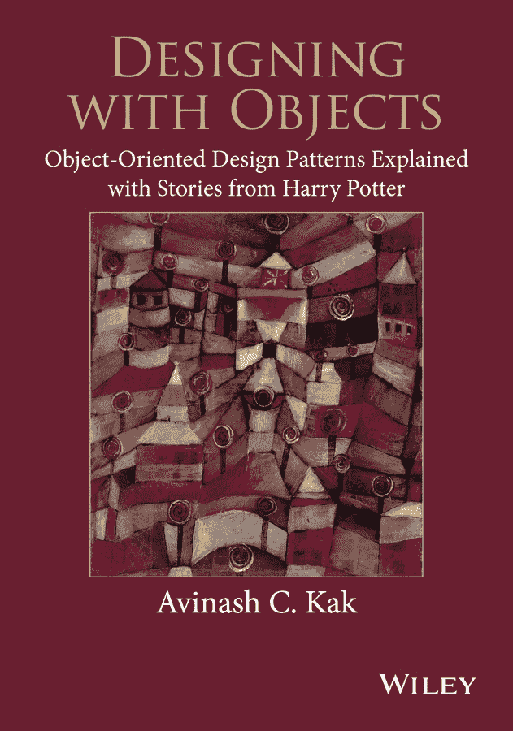


## 插图目录

### 第 1 章

1. 图 1.1
2. 图 1.2
3. 图 1.3
4. 图 1.4
5. 图 1.5
6. 图 1.6
7. 图 1.7
8. 图 1.8

### 第 2 章

1. 图 2.1
2. 图 2.2
3. 图 2.3
4. 图 2.4

### 第 3 章

1. 图 3.1
2. 图 3.2
3. 图 3.3

### 第 4 章

1. 图 4.1
2. 图 4.2
3. 图 4.3
4. 图 4.4

### 第 5 章

1. 图 5.1
2. 图 5.2

### 第 6 章

1. 图 6.1

### 第 7 章

1. 图 7.1
2. 图 7.2
3. 图 7.3
4. 图 7.4

### 第 8 章

1. 图 8.1
2. 图 8.2
3. 图 8.3
4. 图 8.4
5. 图 8.5
6. 图 8.6
7. 图 8.7

### 第 9 章

1. 图 9.1
2. 图 9.2
3. 图 9.3
4. 图 9.4
5. 图 9.5

### 第 10 章

1. 图 10.1
2. 图 10.2
3. 图 10.3
4. 图 10.4
5. 图 10.5
6. 图 10.6
7. 图 10.7

### 第 11 章

1. 图 11.1
2. 图 11.2
3. 图 11.3
4. 图 11.4

### 第 12 章

1. 图 12.1
2. 图 12.2

### 第 13 章

1. 图 13.1
2. 图 13.2

### 第 14 章

1. 图 14.1
2. 图 14.2
3. 图 14.3

### 第 15 章

1. 图 15.1
2. 图 15.2
3. 图 15.3

### 第 16 章

1. 图 16.1

### 第 17 章

1. 图 17.1

### 第 18 章

1. 图 18.1
2. 图 18.2

### 第 19 章

1. 图 19.1
2. 图 19.2

### 第 20 章

1. 图 20.1
2. 图 20.2

### 第 21 章

1. 图 21.1

### 第 22 章

1. 图 22.1
2. 图 22.2

### 第 23 章

1. 图 23.1
2. 图 23.2

### 第 24 章

1. 图 24.1
2. 图 24.2
3. 图 24.3
4. 图 24.4

## 目录

1. 封面
2. 目录
3. 开始阅读
4. iii
5. iv
6. xiv
7. xv
8. xvi
9. xvii
10. xix
11. 2
12. 3
13. 4
14. 5
15. 6
16. 7
17. 8
18. 9
19. 11
20. 12
21. 13
22. 14
23. 15
24. 16
25. 17
26. 18
27. 20
28. 21
29. 22
30. 23
31. 24
32. 25
33. 26
34. 27
35. 28
36. 29
37. 30
38. 31
39. 32
40. 33
41. 35
42. 36
43. 37
44. 38
45. 39
46. 40
47. 41
48. 42
49. 44
50. 45
51. 46
52. 47
53. 48
54. 49
55. 50
56. 51
57. 53
58. 54
59. 55
60. 56
61. 57
62. 58
63. 59
64. 60
65. 61
66. 62
67. 63
68. 64
69. 66
70. 67
71. 68
72. 69
73. 70
74. 71
75. 72
76. 73
77. 75
78. 76
79. 77
80. 78
81. 79
82. 80
83. 81
84. 83
85. 84
86. 85
87. 86
88. 87
89. 88
90. 89
91. 91
92. 92
93. 93
94. 94
95. 95
96. 96
97. 97
98. 98
99. 99
100. 100
101. 101
102. 102
103. 103
104. 119
105. 120
106. 121
107. 122
108. 123
109. 124
110. 125
111. 126
112. 127
113. 128
114. 129
115. 130
116. 131
117. 132
118. 134
119. 135
120. 136
121. 137
122. 138
123. 139
124. 140
125. 141
126. 143
127. 144
128. 145
129. 146
130. 147
131. 148
132. 149
133. 150
134. 151
135. 152
136. 153
137. 154
138. 155
139. 156
140. 157
141. 158
142. 160
143. 161
144. 162
145. 163
146. 164
147. 165
148. 166
149. 167
150. 168
151. 170
152. 171
153. 172
154. 173
155. 174
156. 175
157. 176
158. 177
159. 178
160. 179
161. 181
162. 182
163. 183
164. 184
165. 185
166. 186
167. 187
168. 188
169. 191
170. 192
171. 193
172. 194
173. 195
174. 196
175. 197
176. 198
177. 200
178. 201
179. 202
180. 203
181. 204
182. 205
183. 206
184. 207
185. 208
186. 210
187. 211
188. 212
189. 213
190. 214
191. 215
192. 216
193. 217
194. 218
195. 219
196. 221
197. 222
198. 223
199. 224
200. 225
201. 226
202. 227
203. 228
204. 229
205. 231
206. 232
207. 233
208. 234
209. 235
210. 236
211. 237
212. 238
213. 239
214. 241
215. 242
216. 243
217. 244
218. 245
219. 246
220. 247
221. 249
222. 250
223. 253
224. 254
225. 255
226. 256
227. 257
228. 258
229. 259
230. 260
231. 261
232. 263
233. 264
234. 265
235. 266
236. 267
237. 268
238. 269
239. 270
240. 271
241. 273
242. 274
243. 275
244. 276
245. 277
246. 278
247. 279
248. 280
249. 281
250. 282
251. 284
252. 285
253. 286
254. 287
255. 288
256. 289
257. 290
258. 291
259. 292
260. 294
261. 295
262. 296
263. 297
264. 298
265. 299
266. 300
267. 301
268. 302
269. 304
270. 305
271. 306
272. 307
273. 308
274. 309
275. 310
276. 311
277. 312
278. 314
279. 315
280. 316
281. 317
282. 318
283. 319
284. 320
285. 321
286. 322
287. 324
288. 325
289. 326
290. 327
291. 328
292. 329
293. 330
294. 331
295. 332
296. 334
297. 335
298. 336
299. 337
300. 338
301. 339
302. 340
303. 341
304. 343
305. 344
306. 345
307. 346
308. 347
309. 348
310. 349
311. 350
312. 351
313. 353
314. 354

## 前言

一直关注我的“对象三曲”（Objects Trilogy）项目进展的读者们，看到该系列的第三部也是最后一部将会感到欣慰——尽管它比计划推后了近两年。

主要的罪魁祸首在于找到解释设计模式的合适媒介。当我几年前首次宣布我的`Objects Trilogy`项目时，正如我当时所说的，我的计划是通过世界上著名的短篇故事来解释这些模式。我所说的“著名”是指经典且通用的——即那些在用于解释模式时不需要重新讲述的故事。这些本应该是汉斯·克里斯蒂安·安徒生、格林兄弟以及他们世界其他地区的对应作品。但不幸的是，当我开始将这些模式映射到这些故事上时，我越发地发现这类故事并不具备模式所需的复杂度。于是，我转向了`Harry Potter`。

我应该提一下，在本书项目之初，`Harry Potter`完全不在我的考虑范围内。并不是说我不知道`哈利·波特`已经成为一种全球性现象。毕竟，谁会错过那些媒体报道呢？比如在每本新的`哈利·波特`发布时，孩子们和父母在商店门口排成几英里长的队伍。但对我来说，我是随着上述那些悠久且受推崇的经典短故事长大的，为了探索其解释设计模式的可能性，而去费力阅读一个非常长的故事（共七本书）似乎是没有必要的。

然而，在意识到传统民俗和童话对于这个项目的局限性后，我带着更加严肃的目标转向`哈利·波特`。当我开始阅读这个系列丛书时，不仅被 J. K. 罗琳的叙事能力彻底震撼，更被整个多卷本故事内部子叙事那种令人愉悦的复杂性所吸引。当我一本接一本阅读`哈利·波特`书籍时，每当遇到一段似乎具有我所寻找的复杂性的故事片段，我都会产生一个“啊！”的时刻。尽管有很多这样的时刻，但在对该系列进行多次阅读之后，除了与家人朋友交流，特别是与那些已经读过很多`哈利·波特`的家人和朋友的孩子交流之后，我才有信心使用故事的某一部分来解释某种模式。

如果读者对我使用`哈利·波特`来解释模式的最初反应是类似于：“解释这些模式真的需要使用任何文学媒介吗？”我不会感到意外。这些读者可能会补充道：“如果对模式的解释不满意，为什么不基于真实世界的例子，而不是来自魔法世界的故事来进行进一步解释呢？”我接下来将回答这些问题。

### 真实世界案例 vs 文学故事

除了 Erich Gamma、Richard Helm、Ralph Johnson 和 John Vlissides 编写开创性书籍《Design Patterns — Elements of Reusable Object-Oriented Software》（首次向编程界引入了这些模式）之外，现在在各种书籍和互联网上几乎存在成百上千种对这些模式的解释。我认为，大量材料出现让许多更复杂的模式变得更容易理解。相反，那些更复杂的模式在今天仍然像 Gamma 等人首次介绍它们时一样晦涩难懂。而且，即使通过 Gamma 等人提供的原始解释，这些模式已经很难理解了，这一点可以从他们书籍序言中的这段评论中推断出来：

> 一句警告和鼓励：如果你在第一次阅读时没有完全读懂这本书，请不要担心。我们在第一次撰写它时，也没有完全理解所有内容！

现在让我来讨论使用真实世界案例来改进现有模式解释的问题。请注意，对于目前存在的绝大多数解释，作者确实尝试过使用真实世界案例。但由于各种原因，这些解释的效果并不理想。主要原因可能是，典型的空间限制使得作者无法充分展示一个真实世界的应用。因此，读者得到的是某些真实世界案例的高度缩减版本，从其与模式的关联性来看，这些版本往往难以欣赏。此外，读者可能对作者所使用的真实世界应用完全不感兴趣。如果由于某种原因，读者无法对所谓的真实世界案例产生共鸣，为什么不使用熟悉文学作品中的例子呢？希望读者能发现那些更容易产生共鸣。

根据我教学面向对象（`OO`）设计模式的经验，我观察到，当学生试图通过导师对某个真实世界应用的高度简略的演示来掌握模式中的软件抽象，而这种演示又未能激发他们的积极性，结果就是学生和导师之间产生了立即的脱节。如果某个模式的解释是基于导师并不熟悉的应用，那么学生收到的很可能是一个缺乏清晰度和说服力的演示。

我认为，这是由于缺乏既能吸引学生注意力，又便于教学且不会给教师带来过大负担的解释性材料，导致尽管`OO`模式非常重要，但大多是以碎片化的方式被传授的。在大多数情况下，软件工程讲师只教他/她熟悉的几种模式。很少有以任何统一的方式教授所有模式的情况。

我必须强调，并不是所有模式都难以理解。事实上，几个处理对象创建的模式是非常容易理解的，通过最简单的解释就能立即明白。但那些涉及不同对象之间相当复杂的运行时交互的模式，在开始被大脑吸收之前可能需要巨大的努力。Gamma 等人在我之前展示的序言引用中，指的正是这些更复杂的模式。我这本书的目标是借助取自`哈利·波特`的故事，让这些模式变得更容易理解。

你们中可能有人在想，`哈利·波特`已经过时了——因为它不再像以前那样频繁出现在新闻中——所以我可能在解释模式时寄希望于一颗正在陨落的星上。是的，看起来过去几年环绕着`哈利·波特`的极度媒体炒作已经结束了。但那是因为媒体中没有东西是永恒的，这既适用于转瞬即逝的主题，也适用于永恒的主题。我仍然看到许多年轻人在阅读和喜爱`哈利·波特`。我的感觉是，`哈利·波特`就像苏斯博士的作品一样永恒。它们都不再受到媒体的关注，但在全球范围内继续受到广泛喜爱。

我显然没有幻想，那些对于目前现有解释难以理解更复杂模式的读者，在读到我基于`哈利·波特`的相同内容的解释时，会突然产生“啊哈！”的顿悟。我有理由确信，将`OO`设计这一严肃的主题与`哈利·波特`的轻快素材相结合，我将会面临一些批评。尽管如此，至少，这本书将证明，可以利用那些我们在情感上能产生共鸣的主题（通过我们的幻想或其他方式），为`OO`设计模式构建解释性的类比。即使这本书仅仅鼓励了其他作者在未来编写使用非传统类比的书籍——即那些我们可以基于共同的人类经验产生共鸣的类比——来解释那些通常被认为复杂且枯燥的想法，我也会感到非常满意。

这引出了我在本书中使用的`哈利·波特`故事。如果你读过系列丛书，可能有自己最喜欢的故事。至于这些故事是什么，可能取决于几个因素，包括你可能的教育背景和文化视角。然而，如果你具有科学思维，很难想象与以下魔法物体相关的故事没有在你脑中留下不可磨灭的印象：用于将每届新生分配到四个`霍格沃茨学院`的`分院帽`；作为记忆助具的`记忆球`；用于时间旅行的`时间转换器`；以最强烈方式传递情感的`尖叫信`；用于在伦敦快速旅行的`飞路网`；用于瞬时信号传递的`黑魔标记`以及其他几个。这些故事所传达的与自己的幻想并不遥远，这些幻想部分源于我们的科学狂热，部分源于我们应对日常生活及其所有挫折的渴望。我在本书对模式的解释中使用了其中几个故事。

模式章节的其余部分从一个提到该模式解决的广为人知的现实问题的部分开始。接着是一个回顾用于解释该模式的`哈利·波特`故事的部分。我尝试这样编写这部分，即使是以前没有读过`哈利·波特`的读者也能看到一个大致完整的叙述，可以作为章节其余部分演示模式的“介质”。至于我在这一努力在多大程度上取得了成功，还有待观察。章节中的后续部分首先通过整体类图展示模式演示的顶层视图，然后是展示演示中使用的`Java`类的部分。每个章节都以“玩代码”部分结束，该部分首先展示了读者通过执行演示代码可以看到什么，然后讨论了读者自己如何进一步扩展代码，以获得对模式的额外见解。

书中显示的所有代码都可以在`https://engineering.purdue.edu/kak/designingwithobjects/`下载。目前，所有代码都是`Java`语言的。如果时间允许，该网站在未来的某个时间点还将包含其他语言的实现。如果我在书籍印刷后发现任何错误——或者我收到了读者的此类报告——它们将发布在同一网站的勘误表中。我非常乐听到读者对书中任何拼写错误、错误等的反馈，以及对书中未来版本的改进建议。

我希望这本书能像`对象三部曲`（Objects Trilogy）的前两本书一样受到好评。第一本《面向对象的编程》（Programming with Objects）已被许多大学选为教材。第二本《面向对象的脚本》（Scripting with Objects）作为教材和参考书正获得关注，尽管它更有可能被用作后者。这本书《面向对象的设计》（Designing with Objects）除了可能作为高级编程课程的教材或参考书外，旨在供个人兴趣阅读。

Avinash C. Kak

*印第安纳州，西拉法叶*

## Notes

我要感谢我在 John `Wiley` 出版公司的前编辑 George Telecki，他启动了这项书籍计划。考虑到这项工作相当不寻常的性质，需要像 George 这样拥有宏大技术观的编辑才能欣赏这样书的价值。

我还要感谢 John `Wiley` 的两位编辑 Kari Capone 和 Brett Kurzman。Kari 接手了 George 的工作，然后将项目交给了 Brett，并由他完成了工作。

非常感谢 Malena de la Fuente，感谢我们许多关于`哈利·波特`的交谈。Malena 读了很多遍`哈利·波特`，而且是用两种语言——英语和法语读过的。对于某些模式，我并不立刻清楚哪一个`哈利·波特`章节是构建解释的最佳介质。与 Malena 的交谈在选择最佳章节方面非常有帮助。

手稿的最终清理得助于 Sriram Karthik Badam，他是一个罕见的人才，对`哈利·波特`和`Java`编程都有深奥的了解。他发现了几个拼写错误，并对改进用于解释模式的代码提出了许多有用建议。

我还要感谢`ArgoUML`的开发者，这是我用来创建书中所示类图的开源`UML`图表工具。


最后，最重要的是，我想向 Stacey Smythe 表示最深切的谢意，她不仅是生活中让我们人性的最重要的事的来源，而且是第一个建议通过`哈利·波特`来构建模式解释的人。我无法想象比与价值观如此反映我的人分享生活更快乐的事了。

A.C.K.

总的来说，设计涉及复杂的心理过程，其中大部分并没有被很好地理解。然而，人们通常认为，所有设计在某种细节程度上都涉及到使用以前学过的模式。人们完全可以假设，那些因其工作而闻名的设计师在相当低的细节水平上使用模式。像莫扎特这样的音乐天才，可能只为他想要创造的最基础的音效使用任何以前学过的模式。另一方面，可以说，他那个时代（或者坦率地说，任何时代）的水平较平庸的作曲家可能从那些天才们创造的和声和节奏中借鉴了大量的元素。

在艺术和文学领域，对内容原创性的要求使得在新的设计中必须将现有模式的使用降到最低，但在软件领域，情况恰恰相反。在软件设计中，虽然在处理迄未见过的问题时，原创性和创造力很重要，但更重要的是所产生软件的正确性和健壮性。

如果软件设计中的一个新问题与之前过的问题相似（并且已经已知存在正确的软件解决方案），那么使用之前开发的解决方案将优于解决该新问题的全新且创新的方法。使用该问题的`previously known trusted solution`只能增加他人对你软件的信任。

而且，如果你恰好正在处理一个大型复杂的问题，该问题不适用于任何单一的先前已知解决方案策略，那么你被要求要有创造性，将问题分解为多个子问题，并使用先前已知的信赖解决方案来解决这些子问题。

总的来说，当你分解一个大问题时，产生的子问题可能具有不同程度的复杂性和细节。你的整体分解可能是分层级的，其中最小的问题可以使用你用于软件开发的编程语言中通用的编程惯用法来解决。是的，这些编程惯用法也可以称为模式（patterns）。然而，在本书书中我们不会关注此类低级设计问题。

另一方面，本书介绍的是针对你在为大问题创建软件解决方案时可能遇到的、模糊可以称为“中级问题”的信赖解决方案。特别是，我们将关注那些由四位作者（现在被亲切地称为“四人帮”，GoF）首次提出的二十三种模式可以解决的中级问题。这些模式首次出现的书籍现在通常被称为面向对象（OO）设计模式的“圣经”。下一节将专门介绍这本书及其内容。

软件社区的模式运动是由 Erich Gamma、Richard Helm、Ralph Johnson 和 John Vlissides 编写的备受盛名的书籍`Design Patterns — Elements of Reusable Object-Oriented Software`[1]开启的。基于他们在面向对象编程方面的共同经验，作者们成功地凝练出了二十种设计模式，如世所周知，这些模式已成为许多现代面向对象软件的构建模块。正如上一节提到的，这些作者被称为“四人帮”（GoF），而这本书经常被称为“GoF 面向对象模式之书”。

GoF 书籍令人惊叹的之处，也是使其永不过时的原因，不仅在于其二十三种模式可以解决的各种编程问题，更在于作者们具有远见，能够识别出面向对象设计中许多可能永远存在的基础问题。把握当下的现实并从中抽象出可以在未来很长一段时间内服务我们的新基本理解，绝非易事。

大多数 GoF 模式的核心是以下四个良好的面向对象编程原则之间的相互作用：

(1) 针对类层次结构根部声明的公共接口进行编程，而不是直接调用这些接口实现中定义的方法。

(2) 如果在尝试创建泛型对象所有不同变体的表示最佳方法时，纯基于继承的实现可能导致类的数量到无法维护，则选择组合（composition）而非继承（inheritance）。

(3) 再次选择组合而非继承，如果由前者在对象间相互关系上所实现的灵活性比后者所提供的表示效率（representational efficiency）更重要的话。

在这里，我们将简要回顾上述原则的直观基础：当类层次结构的用户确保他们自己的代码只调用层次结构根接口中声明的公共方法时，那些负责提供和维护层次结构中实现代码的人，只要接口声明保持不变，就获得了更改这些代码的自由。

关于第二个原则，尽管继承被尊为面向对象编程的基石，但不加思考地使用它可能会导致类层次结构过大。如果你尝试为捕获通用类的每一个细微变化创建一个子类，你可能会得到太多的子类。为什么不通过组合来处理这些细微变化呢，即为你的通用类赋予额外的实例变量，以获得额外的自由度，从而允许从类中创建更多样化的实例？由于从类定义构造的对象是由于给定实例变量的值“组合”而成的——这些值本身可以是类类型对象——你可以理解为什么我们使用“组合”一词来描述这种继承的替代方案。

正如第三个原则所示，偏向组合而非继承，在需要保持不同类型对象之间相互关系方面的编程灵活性的情况下也是意义的。虽然继承可以实现高效的表示框架（因为在通用类中声明的公共属性不需要在特化类中重复），但一旦创建，产生的对象间关系就会硬编码在代码库中。

第四个原则中提到的利用函数重写对类行为进行运行时自定义的直觉同样显而易见。当你使用函数重写时，你为方法编写的代码——特别是方法调用同一类中定义的其他辅助方法时——从表示一系列行为的角度来看，变得更加高效。你从运行时激发的特定行为可以通过重写子类中的辅助方法来定制。

回到 GoF 书籍中二十三种模式的主题，这些模式被 GoF 分为以下三类：(1) 创建（Creational）、(2) 结构（Structural）和 (3) 行为（Behavioral）。为了进一步区分，每个模式都被赋予了一个助记名称，捕捉了该模式的本质。

创建模式从面向对象编程中经常出现的若干考虑因素角度出发，研究了设计类以及从这些类构造实例的方法时所面临的问题。例如，考虑上述良好的面向对象编程原则之一：面向对象软件的用户应该只针对类层次结构的接口进行编程。记住这一原则，这里有一个创建模式解决的问题示例：假设我们有两个类层次结构，一个在其中建模领域知识，另一个在其中我们有使用间接（indirection）输出第一个层次结构中类实例的代码。我们仍然能够让软件的客户端遵守上述良好的面向对象编程原则吗？创建模式还意识到，如果要产生的实例需要特殊的计算资源，那么随意调用类的构造函数可能是件危险的事情。这些模式教给我们的教训包括如何设计一个类，以便我们对从类创建的实例进行某些控制——即对同时存在的实例数量的控制。

结构型模式也涉及设计类以及从类构造实例，但现在与类设计相关的表示问题变得更加复杂。举例来说，假设由单个类捕获的问题领域的基本表示必须通过某些特定装饰的任意组合来增强。创建一个整体表示的最方法是什么，使其既能高效地生产实例，又能将这些装饰融入其中？结构型模式的另一个重要表示问题是，当问题领域需要实例化由小对象组成的大对象时，且所有对象（包括大对象）都具有同种基本类型时，该如何设计类层次结构？结构型模式还涉及如何编写一个新类，该类必须同时适应旧类的行为，并为该旧类的客户端提供新服务；以及如何为不同类别的用户为复杂的类系统创建不同的使用视图等。

行为模式关注的是如何从一组协作工作的类中诱发出有用的运行时行为。这些行为是动态的，从这个意义上说，一个类（或一组协作工作的类）对运行时条件（可能由用户输入或其中一个对象的状态变化引起）的响应，通常取决于与该条件相关的所有其他对象的状态。这的一个主要结果是，类在运行时交互的执行流无法提前预测——这与创建型和结构型模式的情况不同。行为模式表现出的动态效果包括：在运行时从支持类提供的更基础的行为合成大型行为；调节一组类之间的交互以符合运行时选择的协议；将对象的状态回滚到早些时候的状态等。

尽管二十三种设计模式中的某些是直观易懂且容易理解的，但有几种模式需要反复阅读 GoF 的书籍才能让这些思想深入脑海。而且，即使在阅读多次之后，只有当你亲手编写了一个模式后，你才能声称完全理解了 GoF 作者试图传达的内容。以下引用 GoF 书序言的引言可能是说明其中几种模式复杂性的最好指标：

> “一句警告也是一句鼓励：如果你在第一次读这本书时没有完全读懂，请不要担心。我们第一次写出来时也没有完全写懂！”

斜体部分由本书作者编写。[¹]](#c01.xhtml_c1-note-0001)

正是这些更困难模式的复杂性，构成了你在书中其余部分的动力：试图通过《哈利·波特》中的故事来解释这些模式，从而消除它们的神秘感。感谢 J. K. 罗琳讲述故事的天赋，《哈利·波特》中不同角色之间交互的丰富性可以用来解释面向对象模式中最复杂的对象交互。书中的其余章节正是这样做的。

没有读过 GoF 书的读者可能会问，书中作者在最初介绍模式时使用了什么解释模式。或者，在 GoF 书出版后的其他关于面向对象设计模式的书书中使用了哪些类型的解释。在读者在现有文献中看到的多数解释中，作者都尝试使用面向对象软件开发中的“真实世界”问题来既激励读者学习模式，又展示它们的内部工作原理。但遗憾的是，在几乎所有情况下，书籍典型的空间限制阻止了对“真实世界”问题的充分阐述。

因此，读者在几乎所有其他书籍中看到的模式解释，仅仅是一些真实世界问题的骨架版本。对于大多数读者来说，要根据这些高度简化的原始真实世界问题描述的模式解释产生共鸣并不容易——除非他们恰恰在这些问题领域工作。让我们换种说法：我们真的能相信，一个花费所有时间为金融应用程序编写代码的人，能够通过文本格式转换或计算机辅助设计中高度简化的问题版本，就理解与该模式相关的所有细微差别吗？

读者在基于真实世界问题简短虚构版本的模式解释中体验到的这种脱节，对于一个年轻的学生来说往往会更加明显，因为他必须同时跨越两个世界：一个是他类她仍在努力理解封装、继承、并发、多态等基本概念的世界，另一个用于模式解释的真实世界。

所以，如果所谓的“真实世界”问题的骨架版本不是解释模式的最佳媒介，那么使用听起来通用的类名、属性和方法名来构建模式解释又如何？例如，对于类名，我们可以使用`A`、`B`、`C`等字母；对于方法名，我们可以使用`fooA()`、`barA()`、`bazA()`、`footB()`等。随后，我们可以通过方法调用来描述从一个类构造的对象对从另一个类构造的对象到底做了什么，并将这些交互编织进一个解释模式的叙述中。这种方法的主要问题是，随着类数量和类与之间交互数量的增加，要记住分配给不同类的角色以及编写在它们方法中的行为将变得困难。

当然，可以给类及其方法赋予更有意义的名字，即能唤起其目的的名字。但这通常会导致荒谬的名字或长得离谱的名字。例如，假设你为一个模式编写解释，展示如何让一个新类适应旧类。你可以尝试将旧类称为`OldClass`，将新类称为`NewClass`。现在假设你的解释需要你为多个具有不同角色的旧新类命名。作为使用“有意义”名称的尝试，你可以尝试`OldClassForRoleM`、`NewClassForRoleN`等，并将后缀`RoleM`和`RoleN`替换为类的实际角色名称。如你所示，随着类数量的增加，你的解释听起来将变得无味、笨拙且枯燥。

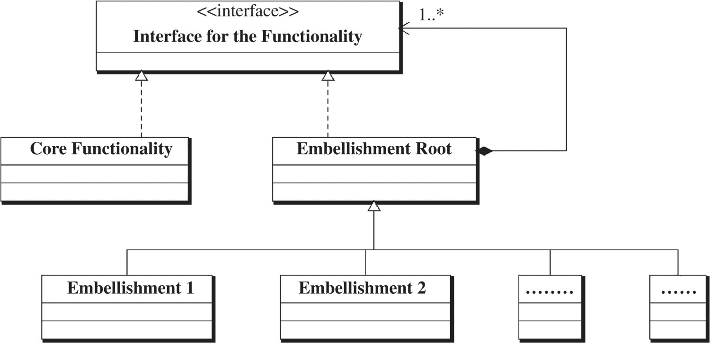

**图 1.1**

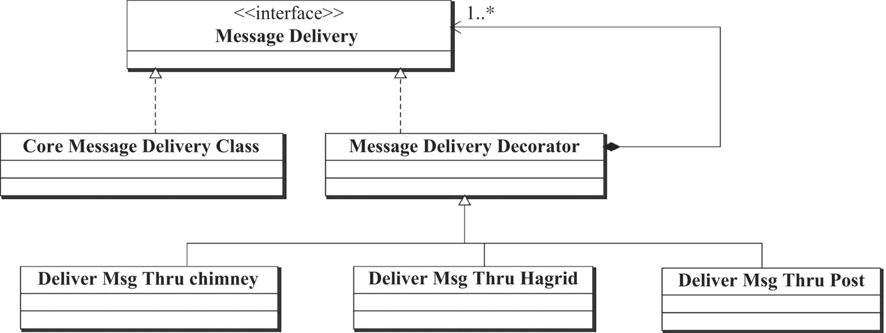

**图 1.2**

虽然这本书是为已经熟悉哈利·波特的读者撰寫的，但这并不意味着没读过那些书的人就无法理解书中提供的解释。从下一章开始，每一章都包含一个标题为“用于说明 XYZ 模式的哈利·波特故事”的章节，该章节主要目的是为了让哈利·波特粉丝回忆起解释该模式时使用的观点，但对于其他人来说，它作为一个独立的“短故事”也应该是易于理解的。如果一个读者在开始读这本书之前没有阅读哈利·波特的兴趣，只要他能足够包容地将这一章节视为一个独立的叙述——它是关于某些魔法物品的，或者是关于某些角色之间的互动——尽管其文字绝不是以 J. K. 罗琳那种同样引人入胜的风格编写的——但他/她应该能够利用该故事来理解该模式的其余解释。

每个模式都将在单独的章节中介绍，每个章节由以下部分组成：

*   模式中核心思想的介绍。

*   模式的意图和适用性。

*   模式的总体介绍。

*   一个描述使用了哈利·波特故事哪个部分来解释模式的章节。该章节的标题始终为“用于说明 XYZ 模式的哈利·波特故事”（模式 XYZ）。

*   一个标题为“模式演示顶视图”的章节，展示了相关模式的整体类图以及相关的解释。该章节中对模式的解释是前一个“哈利·波特故事”章节叙述的扩展。

*   “顶视图”章节之后是多个章节，每个章节专门解释一个类，尽管在某些情况下，一个章节可能会介绍多个密切相关的类。

*   每一章都以一个名为“玩代码 (Playing with the Code)”的章节结束，该章节首先描述如何编译和执行为该模式提供的 Java 代码，然后讨论读者如何扩展演示代码，以对该模式获得额外的见解。

## 1.5 面向对象编程的术语

快速翻读这本书的读者——尤其是那些对面向对象编程接触较少的读者——可能会对某些描述软件中如何创建和操作对象、它们如何相互作用、客户端如何与它们交互等的术语感到困惑。下方显示的术语定义正是为了这类读者准备的，其理念是，这可能帮助读者从高层面上（即使不是详尽地）掌握书中对模式的解释。[²]](#c01.xhtml_c1-note-0002)

定义中以斜体出现的单词在随后的“术语表”中也会有定义。

*   `abstract class:`（抽象类）：在`class`条目的基础上补充，如果无法从该类中构造出`instances`（实例），则该类是抽象的。抽象类通过充当接口，在面向对象程序编程中起着非常重要的作用。

*   `abstract method:`（抽象方法）：在`method`条目的基础上补充，如果方法的头部包含`abstract`关键字，则该方法可以声明为抽象的。当一个方法被声明为抽象时，它不带有任何实现代码。

*   `access control modifiers:`（访问控制修饰符）：类的每个成员（无论是变量还是方法）都关联有一个访问控制属性，在 Java 中该属性是`private`、`public`、`protected`和`package`之一。

*   `attribute:`（属性）：参见`instance variable`（实例变量）。

*   `base class:`（基类）：参见`inheritance`（继承）。

*   `child class:`（子类）：参见`inheritance`（继承）。

*   `class:`（类）：在概念的高层面上，`class`可以被看作一种类别或类型。我们可以将“User”视为一个类，那么一个特定的用户就是该类的`instance`（实例）或从该类构造的`object`（对象）。以下是 Java 中`User`类的定义：

    ```
    class User {
     private String name;
     private int age;
    }
    ```

*   `class hierarchy:`（类层次结构）：参见`inheritance`（继承）。

*   `class method:`（类方法）：参见`method`（方法）。

首先阅读`instance variable`（实例变量）条目。除了实例变量外，我们还可以为类赋予一个或多个`class variables`。实例变量的值是每个实例单独的，而类变量的值对于从该类构造的所有实例都是全局的。类变量通常被称为`static variables`（静态变量）。在 Java 中，通过使用关键字`static`来声明类变量，如下面的类定义，该类声明了两个实例变量和一个类变量：

```java
class SavingsAccount {
    private String name;
    private int age;
    public static double interestRate;
    // ....
}
```

### 具体类 (concrete class)
非`abstract`（抽象）的类非正式地称为`concrete class`。

类通常被赋予一个`constructor`，其任务是从类中创建实例。构造函数为实例分配所需的内存，并在该内存中根据传递给构造函数的参数设置实例变量的值（或者在没有参数的情况下，根据已知的默认值进行设置）。下面显示了`User`类的另一种定义。你在标记为 “(A)”到 “(D)”的行中看到的是该类的构造函数。

```java
class User {
    private String name;
    private int age;
    public User(String str, int yy) {    (A)
        name = str;                 //(B)
        age = yy;                   //(C)
    }                               ..(D)
}
```

通常，一个类允许拥有数量数量构造函数。当一个类有多个构造函数时，它们在参数数量和参数类型上不同。编译器使用`overload resolution`（重载解析）来确定对于给定的构造函数调用调用哪一个。

参见`inheritance`（继承）条目。

### 扩展类 (extended class)
参见`inheritance`（继承）条目。

### final
参见`inheritance`（继承）、`instance variable`（实例变量）和`overriding`（重写）条目。

### implements
首先阅读`interface`条目。为接口中声明的方法提供实现代码的类被称为`implement`（实现）该接口。

之前我们将`class`定义为一个类别。更通用类别的子类别也可以被定义为一个类——形式为更通用类的`subclass`（子类）。子类`inherits`（继承）对应于更通用类别类定义的某些或全部属性和方法。

由于通常情况下一个类可以扩展为多个`subclasses`（子类），每个这样的子类进一步扩展为更专门的`subclasses`，依此类推，我们可能会得到所谓的`class hierarchy`（类层次结构）。

子类通常也被称为`derived class`、`extended class`或`child class`（子类）。更通类通常被称为`base class`（基类）或`superclass`（父类）。

Java 中用于定义子类的语法由以下示例所示：

```java
class User {
```


`private String name;`

`private int age;`

`public User(String str, int yy) { name = str; age = yy; }`

`}`

`class StudentUser extends User {` (A)

`private String schoolEnrolled;`

`public StudentUser( String nam, int y, String sch ) {`

`super(nam, y);` //(B)

`schoolEnrolled = sch;`

`}`

`}`

其中 `StudentUser` 是 `User` 的子类。注意行 (A) 中的 Java 关键字 `extends`。还要注意子类的 `constructor` 定义如何通过行 (B) 中的关键字 `super` 调用基类的构造函数，以构造子类对象的基类部分。通过上所示的类与子类定义，`StudentUser` 类型的实例可以像 `User` 类型的实例一样工作。也就是说，我们可以构造一个 `StudentUser` 实例并将其赋值给 `User` 类型的变量。子类类型对象可以像父类类型的事实被称为 `polymorphism`（多态）。另外注意声明为 `final` 的类不能有子类。

### 实例 (instance)
给定一个类，你可以通过调用它的 `constructor` 来构造该类的特定 `instance`。由构造函数创建的 `instance` 通常也称为 `object`（对象）。

### 实例方法 (instance method)
参见 `method` 条目。

### 实例变量 (instance variable)
在 `class`、`constructor` 和 `inheritance` 条目中的 `User` 类定义中，我们将 `name` 和 `age` 称为类的 `instance variables`。通常，我们期望此类变量的值在不同实例之间有所变化。再次，通常除非声明为 `final`，否则赋值给实例变量的值是可以更改的。`instance variable` 也可以在类定义中被赋予一个默认值。`instance variable` 也称为 `attribute`（属性）。

### 实例化 (instantiation)
`instantiation` 一词意味着构造类的 `instance`。

Java `interface` 是一种 `abstract class`（抽象类），在最常用的用法中，它仅通过提到方法的 `signatures`（签名）来声明一组方法。Java `interface` 不得包含任何实现代码。这里是 Java 框架中的一个接口示例：

```java
interface Collection {

    public boolean add( Object a );

    public boolean remove( Object a );

    // other methods

}
```

Java 接口还用于将相关的常量组合在一起。当类继承自此类接口时，这些常量看起来就像是在类中局部定义的。此类常量被隐式地视为 `static` 和 `final`。

类通常通过函数赋予行为，这些函数通常在从该类构造的实例上被调用。此类函数最常用方法称为方法。下面所示 `User` 类中 `print()` 的定义就是一个例子：

```java
class User {

    private String firstname;

    private String lastname;

    public User(String str, int yy) { name = str; age = yy; }

    public void print() {

        System.out.print( firstname + " " + lastname );

    }

}
```

### 对象 (object)
首先看 `instance` 条目。小写 ‘o’ 的 `object` 不要与 Java 中大写 ‘O’ 的 `Object` 混淆。前者可以指任何通过调用构造函数创建的实例，而后者是 Java 中所有类的父类的名称。因此，Java 中的所有对象都是 `Object` 类型。

- **重载 (overloading)**：重载方法名或构造函数名意味着能够使用不同数量和/或类型的参数来使用相同的名称。当一个类具有重载的构造函数或方法名时，由编译器负责确定为给定的调用哪个构造函数或方法。编译器通过使用所谓的`overload resolution algorithm`（重载解析算法）来实现这一点。
- **重载解析 (overload resolution)**：请参见`overloading` 条目。
- **重写 (overriding)**：`subclass`（子类）可以为基类定义的方法提供重写实现。随后，如果在类型为基类但实际指向子类对象的变量上调用该方法，则将使用子类中的方法定义。在基类中声明为`final`的`method`不能在基类的子类中重写。
- **包 (package)**：请参见`access control modifiers`(访问修饰符）条目。`Package`也可以指“Java 包”，它将相关的类组合在一起并为它们定义命名空间。例如，用户程序中自动提供的 Java 基础类位于 `java.lang` 包中。通常，如果你需要使用某个包中的类，要么要在程序中导入该包，要么必须使用该类的全限定名。
- **多态 (polymorphism)**：请参见`inheritance`(继承)条目。
- **私有 (private)**：请参见`access control modifiers`条目。
- **保护 (protected)**：请参见`access control modifiers`条目。
- **公共 (public)**：请参见`access control modifiers`条目。
- **静态 (static)**：请参见`class variable`(类变量)和`class method`(类方法)条目。
- **静态方法 (static method)**：请参见`method`条目。
- **子类 (subclass)**：请参见`inheritance`条目。
- **父类 (superclass)**：请参见`inheritance`条目。

上述列出的面向对象编程术语并不完整。我们只定义了书中其他部分出现频率最高的术语。显然，只有专门研究面向对象的书籍，如《Programming with Objects [2]》，才能全面介绍面向对象编程的所有术语。

本书用于解释模式的图表大多是基于构建此类图表的 UML 规定的类图。

在 UML 中，类由一个矩形框表示，在最详细的表示中，它被垂直划分为三个部分。类名写在框的最上部分区，中间分区是它的实例变量和静态变量（在 UML 中称为`attributes`属性），底部的分区是它的方法（在 UML 中称为`operations`操作）。对于具体类，类名以粗体显示；对于抽象类，以斜体显示。[图 1.3]显示了名为 `Employee` 的类的这种表示示例。

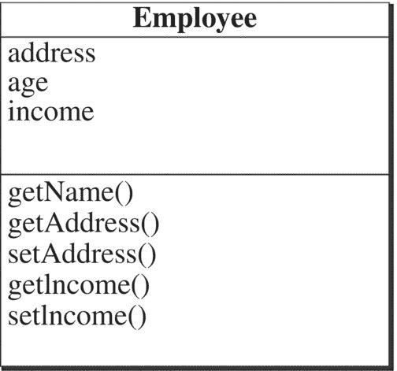

在最常用的用法中，类图显示了不同类之间的两种关系：`generalization`(泛化)和`association`(关联)。父类被认为是其子类的泛化。同样，子类被认为是其父类的特化。例如，[图 1.4]的类图用一条带箭头的实线显示 `Employee` 类作为 `Manager` 类的父类，因此是泛化。注意泛化箭头（带有封闭三角形箭头）指向父类。在[图 1.4]中，`Manager` 类被认为是 `Employee` 类的特化。另一方面，关联用两个类之间的之间的实线表示，如如图中的 `Employee` 和 `Corporation` 之间。如果从一个类构造出的对象在某种程度上（例如作为实例变量）使用了从另一个类构造出的对象，则应在两个类之间显示一个关联链接。

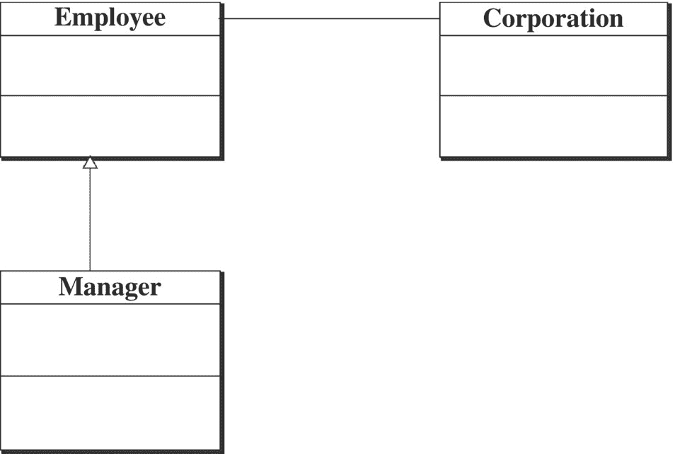

类图中可以描绘的类之间其他类型的关系包括`aggregation`(聚合)和`composition`(组合)。接下来的两个小节将更详细地讨论类图中关联、聚合和泛化的表示。

在[图 1.4]的类图中，我们只在框中放置了类名。通常情况下，一个类显示的细节程度取决于绘制图表时使用的视角。类图可以使用三种不同的视角绘制：(i) `conceptual`(概念的)、(ii) `specification`(规范的)和(iii) `implementation`(实现的)。

在概念层级，对于每个类，你只包含传达问题领域主要概念整体感觉所需的最少信息。这是你刚开始设计面向对象程序时可能会绘制的图。然而，即使在完全开发了一个面向对象系统后，概念层图对于向其他人通信系统的粗粒度描述也是有用的。在规范层级，你想显示每个类的接口。在这一层级，你需要明确类的职责，这些职责体现在每个类的公有操作中。在实现层级，你想更精确地显示类在代码中是如何（或需要如何）被实现的。现在，你还将包含私有和受保护的属性和操作。

在面向对象的文献中，还会看到类之间 IsA 和 HasA 关系的提到。前者表示泛化-特化关系，后者表示关联、聚合或组合。IsA 名称旨在捕捉诸如如下的关系：

> `Manager 是一个 Employee`
> `企业客户 是一个客户`

在这样的语句中，`IsA` 之后的内容是之前内容的泛化或超类型。另一方面，像下面的语句：

> `订单 拥有一个客户`
> `交响团 拥有一个演奏家`
> `窗口 拥有一个滑块`

表达了包含关系，即关联、聚合或组合。

[图 1.4]中的类图通过关联显示了 `Employee` 类型对象和 `Corporation` 类型对象之间的概念链接。[图 1.5]显示了此类关联的更详尽表示示例。

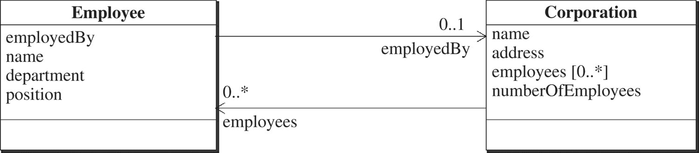

在所示示例中，`Employee` 有一个类型为 `Corporation` 的实例变量名为 `employedBy`；该实例变量显示为从 `Employee` 指向 `Corporation` 的关联链接箭头的标签。我们可以将标签 `employedBy` 称为 `Corporation` 在 `Employee` 类型实例中扮演的*角色*（*role*）。从 `Employee` 指向 `Corporation` 的关联链接上的箭头被称为*导航*（*navigability*）箭头。箭头告诉我们两个对象中的哪一个实现了该关联。在所示的示例中，角色名为 `employedBy` 的关联是在 `Employee` 类中实现的，因此它“属于”类型为 `Employee` 的实例。关联末端 `Corporation` 处的标签 `0..1` 关联的*多重性*（*multiplicity*），它规定了在角色 `employedBy` 中*有多少个* `Corporation` 类型实例可以与单个 `Employee` 类型实例相关联。`0..1` 的多重性意味着一个 `Employee` 雇佣于不超过一个 `Corporation`。

关于图 1.5 中从 `Corporation` 到 `Employee` 的关联链接，导航箭头指向后者，角色名标签为 `employees`，多重性符号为 `0..*`。`0..*` 的多重性意味着从 `Corporation` 构造的实例允许任意数量的员工，包括零。如果法律要求公司至少拥有一名员工，且对上限没有限制，则与角色名 `employees` 相关的多重性标签将变为 `1..*`。正如你可能已经猜到的，多重性标签中的符号 `*` 表示*无限数量*（*an indefinite number*）。

图 1.5 中的两个关联链接也可以显示为两个类之间的单条线。如果我们对我们的示例这样做，该线将在两端都显示导航箭头、角色名和多重性符号。没有导航箭头的关联被被认为是双向的。

图 1.5 是两个不同类之间二元关联的示例。二元关联也允许连接类到自身，在这种情况下，关联被称为*自反射*（*reflexive*）。图 1.6 展示了一个自反射关联的示例。下一小节将讨论你在图 1.6 关联链接底部看到的菱形的作用。

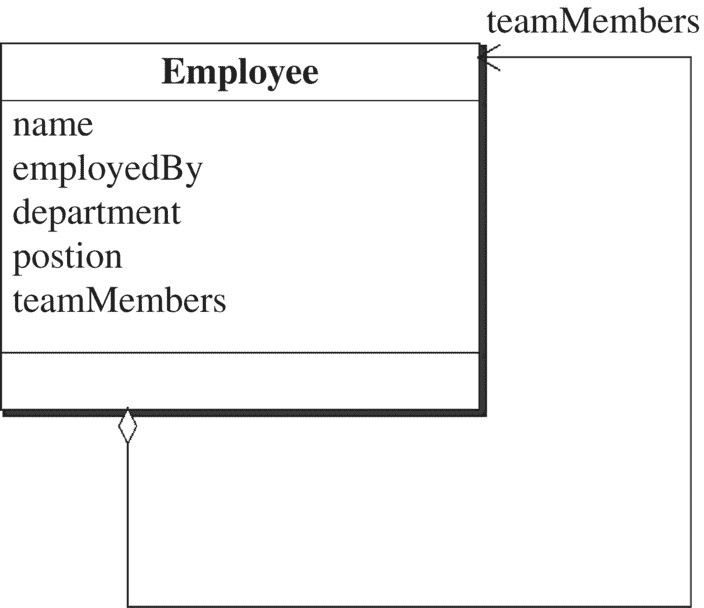

**图 1.6**

### 1.6.2 聚合与组合作为类之间的关系

通过关联连接的对象可能独立于彼此存在，也可能不独立，在类图中区分这两种情况是有用的，特别是当关联是“整体”与其“部分”之间的链接时。

当整体与其部分之间存在生存依赖关系时——即部分仅是为了整体的利益而存在——我们将整体与部分之间的关系称为*组合*（*composition*）。也就是说，我们认为整体是其各部分的复合体。这种关联在基底部用一个实心菱形表示。虽然这种关系也可以用带有适当导航箭头和多重性的简单关联来表示，但将其显示为组合可以引起人们对复合体与其部分之间生存依赖关系的关注。

考虑图 1.7 中的示例，我们使用了实心菱形来显示 `Window` 组合。显然，形成复合体的“部分”（如滑块、滚动条等）在 `Window` 关闭时将停止存在。

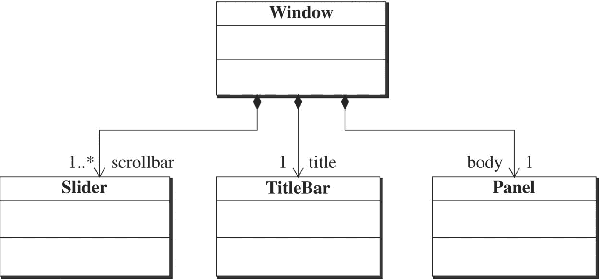

**图 1.7**

当你拥有一种整体与部分的关系，其中部分可以独立于整体存在时，你所拥有的是*聚合*（*aggregation*）。在图 1.8 所示的聚合中，即使 `Orchestra`（乐队）对象停止存在，表演者也将继续存在。聚合在关联链接的一端用一个空心菱形表示，该端是另一端对象的聚合。虽然这种类型的关系也可以显示为带有适当导航箭头和多重性的简单关联，但聚合的概念旨在捕捉这样一个事实：尽管乐队是其表演者的总和，但即使乐队停止存在，表演者也将继续存在。

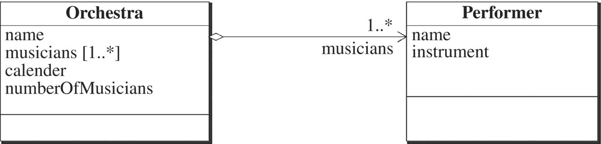

### 1.6.3 属性的表示

如前所述，类的属性——可以是实例变量也可以是静态变量——显示在表示类的框的中间分区。UML 显示属性的规范如下：

```
visibility name [N] : type = initialValue {property-string}

---------------
```

其中可见性为：

```
+ for public visibility
# for protected visibility
- for private visibility
```

尽管 *public*、*protected* 和 *private* 关键字也可以直接使用。可见性标记的缺失表示未定义。

在显示属性的 UML 符号中，属性名位于你看到字符串 `name` 的地方。方括号内的 `N` 表示多重性。多重性的约定与关联相同。例如，如果属性允许一个或多个值，多重性符号 `N` 将被替换为 `1..*`。多重性的缺失意味着允许仅有一个值。

属性实现类型的语言特定规范位于你看到字符串 `type` 的地方。`initialValue` 是新创建实例属性默认值的语言特定表达式，`property-string` 是用于表示属性的其他特性的字符串。例如，对于只读属性（如在 Java 中声明为 `final` 的属性），`property-string` 将被设置为 `frozen`。

在 `name` 和 `type` 下方的下划线如果使用，表示该属性具有类作用域，这与静态的含义相同，而不是每个实例一个。除了 `name` 外，规范的所有其他元素都是可选的。

类框从顶部开始的第三个分区（如果存在）显示其*操作*（operations），即类定义的方法。当在规范级别绘制类时，只显示类的公共操作。然而，在实现级别，你还希望显示私有和受保护的操作。操作的完整 UML 语法为：

```
visibility name (parameter-list) : return-type {property-string}
-----------------------------------
```

其中 *visibility* 和 *name* 的含义与属性的情况相同。*parameter-list* 是操作的形式参数的逗号分隔列表，每个参数使用以下语法指定：

```
kind name : type = defaultValue
```

其中 `kind` 可以是 *in*、*out* 或 *inout*，其中 *in* 用于向操作传递值的参数，*out* 用于从操作中获取值的参数，*inout* 用于可以同时扮演这两种角色的参数。`name`、`type` 和 `defaultValue` 符号起到它们通常的作用。

关于操作的语法，`return-type` 符号是一个取决于语言的语言类型，表示操作返回的值的类型。`property-string` 可用于表达此类特征，例如操作是否是抽象的（即只有方法的头部是类定义的一部分，而没有提供实现代码的情况）。最后，具有类作用域的操作——即静态方法——将如所示带有下划线。

区分两种类型的操作：`query`（查询）和 `modifier`（修改）是有用的。`query` 操作仅简单地尝试获取某些类属性的值，而不改变对象的状态。相反，`modifier` 操作将改变对象的状态。从非正式地说，这两种操作也被分别称为类的 `getter`（get 器）和 `setter`（set 器）方法。

创建模式（Creational Patterns）向我们展示了如何为类或类层次结构编写代码，以便客户端在从类创建实例时能够遵循良好的面向对象编程原则（如第 1 章中所述的）。

特别是，我们希望类定义能够让客户端通过面向接口编程来轻松创建实例。此外，当我们的类非常复杂时，如果我们能通过提供的实例生产方式某种程度上隐藏这些复杂性，客户端编写的代码更有可能没有错误。让类层次结构中的所有类的接口保持统一也有许多益处。而且，有时我们需要控制从某个类中构造的实例数量。创建模式向我们展示了如何在面向对象的软件中实现这些以及其他类似的目标。

在接下来的内容中，我们列出了书中第一介绍的五种创建模式：


- **抽象工厂（Abstract Factory）**：`Abstract Factory`模式向我们展示了如何通过一组相关的工厂类来高效地组织一组相关对象的生产，以便客户端只需要针对两个接口（每个族各一个）进行编程即可构造出所有对象。

- **构建器（Builder）**：`Builder`模式通过用于构造由多个部分组成的复杂对象，其构造过程可能涉及算法步骤，这些步骤限制了部分在对象中的组合方式。这里的目标是使客户端与类相关的许多复杂性隔离开。

- **工厂方法（Factory Method）**：当使用工厂方法进行对象构造且我们发现自己正在处理类层次结构时，我们将面临如何为所有涉及的工厂方法创建一个统一接口的问题。`Factory Method`模式解决的正是这个问题。顺便说一下，通过被称为工厂方法的方法将调用路由到构造函数可能有许多实际原因。我们将在第 4 章中回顾这些内容。

- **原型（Prototype）**：当类中的实例变量只能取少数离散值时，`Prototype`模式非常有用。变量的每组离散值都可以被看作是一个原型。通过“预制造”原型并存储在某处，随后所有的实例创建都可以简化为提供其中一个原型的克隆。当通过克隆创建新实例比通过构造函数调用这样做更便宜时，这种模式特别有用。

- **单例（Singleton）**：如果在任何时刻允许存在的类实例存在实际限制，则`Singleton`模式非常有用。在这种模式的典型用法中，一个类允许创建一个实例。任何后续对实例的请求都返回为第一个此类请求创建的同一个实例的副本。

## 2.1 软件中工厂的概念

众所周知，工厂是制造产品的地方。软件系统中的工厂具有相同的目的——作为新软件对象的制造者。听到这里，熟悉面向对象编程的读者可能会问：类定义中的`constructors`不应该负责处理对象的构造吗？既然`constructor`的概念已经为我们服务很好，为什么还要引入另一种构造对象的机制呢？

要理解类定义中通过`constructor`构造与通过工厂构造的区别，请将后者考虑为任务的外包。尽管外包在近年来收到了负面评价，但确实存在外包对所有参与方都有利的情况。它在列出对象规范的代码和使用这些对象的代码之间创建了更大的分离。如果你将对象的设计者、生产者和消费者看作构成了某种链条，那么链条两端之间的分离越大，每一端就越有更大的自由去修改其代码而不影响链另一端的代码。

将“外包”作为理解软件中“工厂”概念的比喻是有效的，前提是必须记住该比喻的以下局限性：在大多数实际外包的示例中，有关产品如何实际制造的细节被委托给了“外包方”组织；而在软件开发中，从类中构造实例的最终责任仍然归类本身所有。在所有情况下，无论是否有工厂，类都必须提供一个允许创建类实例的`constructor`。当部署工厂时，它仅仅是代表客户端决定何时以及如何调用`constructor`的中介者。

由工厂实现的调用`constructor`的“何时以及如何”在以下情况下可能非常重要：当类的需求很大时；当实例的生产需要特殊的计算资源时；当任何时刻允许存在的实例数量存在实际限制时；当类必须与其他类协作进行实例生产时等。此外，在类供应商和软件客户端之间将工厂作为中介，也让供应商具有更大的自由来升级类的实现代码，只要工厂使用的接口保持不变。

GoF 中有两个处理工厂的相关模式：`抽象工厂`和`工厂方法`。上述介绍的软件背景下工厂的基本概念对这两种模式都同样适用。至于两者之间的区别，`抽象工厂`处理的是从一组关联工厂创建一组相关实例，前提是客户端只需要针对两个接口编程，一个用于对象类，另一个用于工厂。这是我们在本章剩余部分重点介绍的模式。另一方面，`工厂方法`模式（正如你在第 4 章中所看到的）更多关注的是通过方法调用（这些方法反过来调用`constructors`）来创建实例，并为类层次结构中的此类方法调用建立统一的接口。

`Abstract Factory`模式的意图是使客户端能够通过编程少数接口（通常只有两个：一个位于类层次结构的根部，另一个位于工厂类类的根部）来构造一组相关对象。

在以下情况下应考虑使用此模式：

- 所有对象可能的不同定制方案可以通过共同主题来刻画（你可以认为每个主题代表某一组密切相关的对象族）；

- 属于同一主题的所有相关对象都可以由同一个工厂类创建；

- 满足不同可能主题所需的所有工厂类都可以通过一个通用的工厂接口进行操作。

如第 2.1 节所述，抽象工厂的重点在于创建`密切相关的对象族`。“密切相关对象族”的一个经典例子——这个例子几乎在几乎每处关于该模式的介绍中都能找到——是一个 GUI（图形用户界面）平台，配备了生产具有不同外观和感受的用户界面的手段。GUI 平台为我们提供了窗口、按钮、滚动条和其他控件，这些控件具有特定的外观和感受，或者具有一小组外观效果，供用户从中选择一种。我们可以认为，每种外观对应的控件是密切相关的，因此属于同一个大族。根据抽象工厂模式为此类库编写前端程序，使得创建任何所需外观的控件变得更加高效。

将给定外观所需的所有控件组织到一个族中，只是将此模式用于 GUI 应用的一种方式。另一种在某些情况下更方便的对象族概念化方法是考虑，例如，将不同外观效果的所有 GUI 按钮视为一个族，将不同外观效果的所有滚动条视为另一个族，以此此类推。每个此类族将指定一个单独的工厂。抽象工厂模式的目标现在是在确保`所有工厂都纯粹通过工厂类层次结构根部的抽象接口进行操作`的情况下，便于从相应的工厂生产所需的对象。

无论如何将对象组织成族，该模式教给我们的重要设计教训是：软件客户端仅可以使用少量的接口（通常只有两个），其中一个接口作为工厂类层次结构的根节点，另一个接口作为描述待创建对象的类层次结构的根节点，从而与整个对象创建软件进行交互。

## 2.4 现实应用中的抽象工厂模式

由于与上一节所述的原因完全相同，该模式被软件供应商所使用，他们为从事电子商务的商业企业创建功能相似但外观独特的 Web 端 GUI。每家企业都希望其面向客户的前端是独一无二的。然而，所有前端都必须执行非常相似的任务：提供一个允许客户搜索产品的搜索控件；提供一个产品浏览控件；提供一个“购物车”控件；提供一个从客户处获取送货信息的控件；等等。在通用形式下，电子商务网站所需的所有控件可以被认为构成一个族。

为了创建生产这些控件的工厂，软件供应商可能会设计一个根工厂接口，然后由一个具体类来实现它，以满足特定电子商务客户对外观和感受所需的定制。你可以将根工厂接口理解为定义了一个通用工厂。

利用专门为电子商务客户创建的具体工厂类，客户端只需要调用控件层次结构和工厂层次结构根接口中的方法，即可生产具有所需背景/前景颜色、形状、布局等的不同 GUI 组件。客户端不需要知道为了客户的 Web 业务门户的外观感受，哪些类是如何协作工作的精确细节。

## 2.5 用哈利·波特故事阐明抽象工厂模式

考虑一种情况：我们希望工厂生产以下三种魔法对象：`MagicWands`（魔术棒）、`Broomsticks`（扫帚）和`Owls`（猫头鹰）。假设这三所魔法学校——布斯蒂斯、德姆斯特朗和霍格沃茨都希望这些对象能为自己的学生进行定制，定制内容包括在对象上印上校徽。例如，当为霍格沃茨的学生提供魔术棒时，它必须在魔棒的一端附近显示霍格沃茨的校徽。至于猫头鹰，校徽则刻在它们尾部附近。

我们可以将每种对象类型及其其特定的学校定制定义为一个单一的对象族。生成的三个`对象族`随后可以像图 2.1 所示那样可视化。

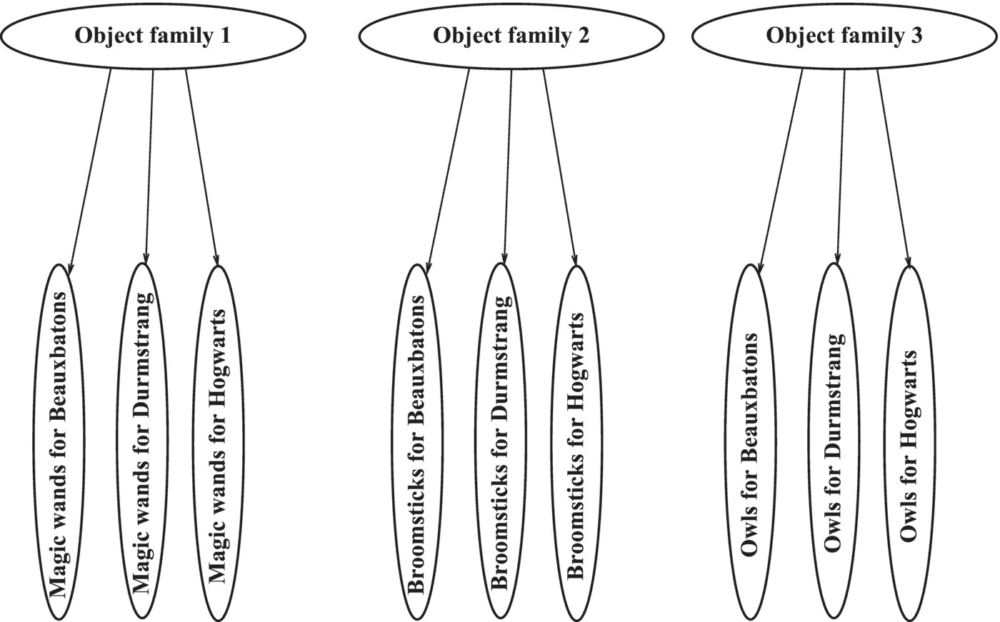

**图 2.1**

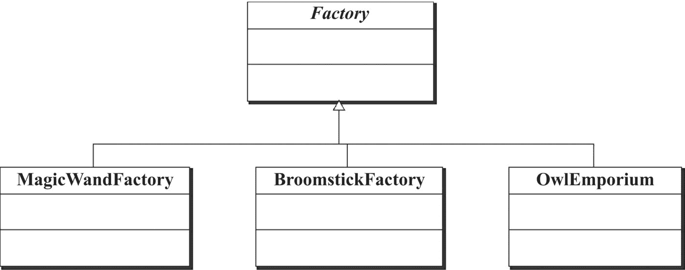

**图 2.2**

现在让我们谈谈由工厂创建的对象。记住，抽象工厂模式是关于创建某种程度上相关的对象，因为只有此类对象才适合通过通用接口进行操作。那么在魔法世界中，扫帚、魔术棒和猫头鹰有什么共同？从我们这里的演示角度来看，它们的共同点都是被魔法化的。因此，我们可以认为所有这些对象都属于图 2.3 所示的类层次结构。

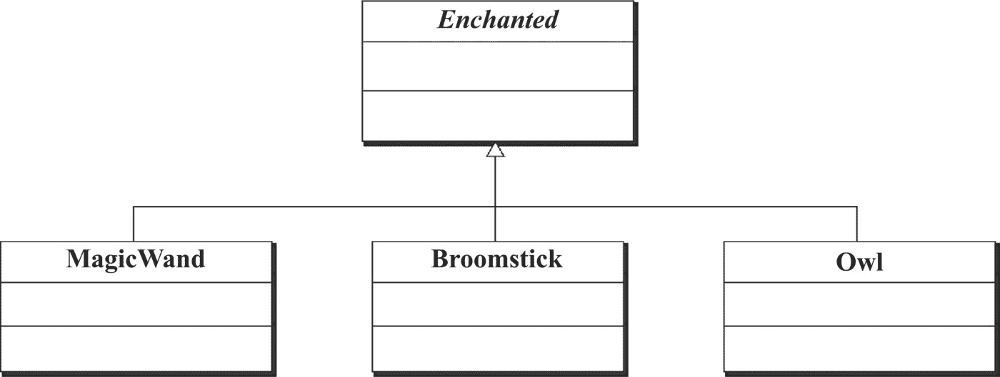

为了演示该模式，我们需要一个向工厂下单的客户。为此我们将使用一个名为`DiagonAlleyRetailer`的类。该类将代表伦敦对角巷的一个零售商。这条街道通常对麻瓜（即非女巫师或女巫师的人）是隐藏的，它是伦敦魔法贸易的主要枢纽。霍格沃茨等学校的学生会在每个学年初在对角巷购买学校用品。

图 2.4 中的类图是我们对抽象工厂模式演示的顶层视图。代码中唯一的可执行类`DiagonAlleyRetailer`是两个类层次结构的客户端，其中一个由根类`Enchanted`头部，另一个由根类`Factory`头部。前者根类充当魔法对象类的接口，而后者对工厂类也起了相同的作用。

如类图所示，客户端类`DiagonAlleyRetailer`仅通过两个根类（`Enchanted`和`Factory`）中定义的接口来操作这两个类层次结构。这里的“操作”意味着在客户端类的实现代码中调用的方法仅存在于在`Factory`和`Enchanted`接口中声明的那些方法。这在本章后续章节的代码中将得到演示。类图还显示工厂根接口声明了方法`deliverItem()`。对角巷零售商与工厂的交互包括对该方法进行调用。

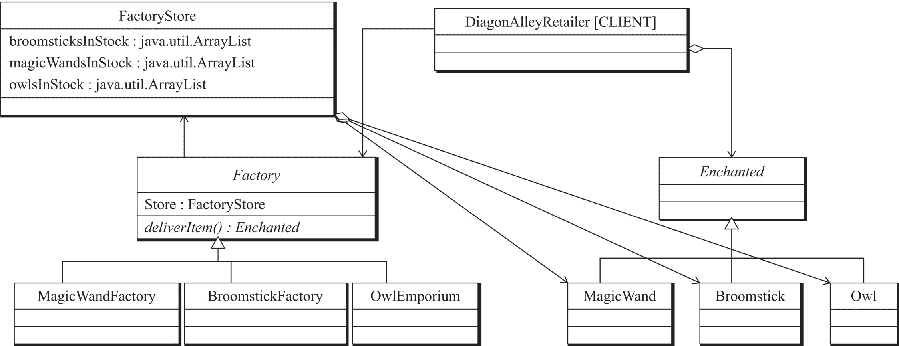

**图 2.4**

我们的演示代码还使用一个名为`FactoryStore`的辅助类，如类图所示。如果对角巷零售商想要为霍格沃茨的学生订购魔杖，零售商将使用`Factory`接口方法`deliverItem()`向`MagicWand`工厂下单。然而，零售商并不知情情，订单实际上是由`FactoryStore`处理的。只有当`FactoryStore`的魔杖供应耗尽时，负责生产魔杖的实际工厂才会被要求补充商店的库存。

本章的其余部分将介绍我们抽象工厂演示的代码。我们从抽象的`Factory`类开始。

这是我们演示中工厂类层次结构的根。除了声明所有继承自此根的具体工厂类都必须实现的`deliverItem()`方法外，该类还实例化了`FactoryStore`类。`protected`变量`store`持有商店的引用。这样，在扩展`Factory`的所有具体工厂类中都可以访问商店。

```java
 public abstract class Factory {

  protected FactoryStore store;

  public Factory( String schoolName ) {
   store = FactoryStore.makeFactoryStore(schoolName);
 }

  abstract Enchanted deliverItem();
}
```

## 2.8 辅助类 FactoryStore

现在描述辅助类`FactoryStore`，其目的是作为对角巷零售商与工厂之间的“缓冲区”——这一事实对零售商是隐藏的。换句话说，我们在本节中描述的对商店的使用是工厂层次结构操作中完全内部的细节，客户端对此无所知。请记住，在我们抽象工厂模式的演示中，对角巷零售商仅仅是两个类层次结构的客户端：魔法对象层次结构和工厂层次结构。

至于商店实际上是如何使用的，当零售商向工厂订购魔法对象时，工厂做的第一件事是将订单发送到商店。商店通过一次性向工厂订购 *N* 个魔法对象来管理其库存。这种操作是针对每种魔法对象以及每种魔法对象的特定学校定制化分别进行的。当任何某种特定学校的魔法对象库存耗尽时，商店会自动向相应的工厂请求一个包含该对象 *N* 件物品的新订单。只要从零售商处收到的订单中的魔法对象有货，商店就会直接履行订单，而不打扰工厂。

在下方所示的`FactoryStore`类定义中，实例变量`forWhichSchool`用于订购的魔法对象的特定学校定制。静态变量 *N* 决定了由任何具体工厂类制造每种魔法对象的批量大小。例如，当 *N* 设置为 2 时，对于任何给定的学校，`MagicWand`工厂将被要求一次恰好生产两根魔杖。只有当两根魔杖都被客户订购后（也就是说，只有当`FactoryStore`提供了它一次从`MagicWandFactory`收到的两根魔杖后），`FactoryStore`实例才会再订购两个。

如`broomsticksDeliveredFromNewStock`这样的实例变量用于跟踪某种类型物品的已订购数量。当该数量达到任何物品类别由 *N* 指定的值时，相应的工厂会调用其`replenishBroomstickStock()`方法来制造另一批物品。然后，工厂调用商店的`acquireMoreBroomsticksFromFactory()`方法来获取新批物品。诸如`initializeBroomstickStock()`等名称初始化方法由各个工厂调用，用于初始化如`broomsticksDeliveredFromNewStock`等变量；对于这些方法和变量名，当先前的订单耗尽时，会订购一批新的扫帚。

`FactoryStore`类是使用你在第 6 章中将看到的单例模式实现的。这是因为我们希望只让工厂商店为所有零售商提供服务。单例模式的实现方法是将构造函数设为私有（如你在下方代码所示），并提供一个诸如`makeFactoryStore()`的方法，用于获取指向允许存在的唯一且仅有的工厂商店的引用。


```java
import java.util.*;

public class FactoryStore {

    private static FactoryStore theStore;

    private String forWhichSchool;
    private static final int N = 2;
    private int broomsticksDeliveredFromNewStock;
    private int magicWandsDeliveredFromNewStock;
    private int owlsDeliveredFromNewStock;

    private ArrayList<Broomstick> broomsticksInStock =
        new ArrayList<Broomstick>();
    private ArrayList<MagicWand> magicWandsInStock =
        new ArrayList<MagicWand>();
    private ArrayList<Owl> owlsInStock = new ArrayList<Owl>();

    private FactoryStore( String forWhichSchool ) {
      this.forWhichSchool = forWhichSchool;
      broomsticksDeliveredFromNewStock =
        magicWandsDeliveredFromNewStock =
        owlsDeliveredFromNewStock = 0;
      for ( int i = 0; i < N; i++ ) {
        broomsticksInStock.add( new Broomstick( forWhichSchool ));
        magicWandsInStock.add( new MagicWand( forWhichSchool ));
        owlsInStock.add( new Owl( forWhichSchool ));
      }
    }

    public static FactoryStore makeFactoryStore(String forWhichSchool) {
      if (theStore == null) {
        theStore = new FactoryStore(forWhichSchool);
      }
      return theStore;
    }

    public int batchSize() { return N; }
    public String forWhichSchool() { return forWhichSchool; }
    public void acquireMoreBroomsticksFromFactory(
        ArrayList<Broomstick> freshStock) {
      broomsticksInStock = freshStock;
    }
    public void initializeBroomstickStock() {
      broomsticksDeliveredFromNewStock = 0;
    public void acquireMoreMagicWandsFromFactory(
        ArrayList<MagicWand> freshStock) {
      magicWandsInStock = freshStock;
    }
    public void initializeMagicWandStock() {
      magicWandsDeliveredFromNewStock = 0;
    }
    public void acquireMoreOwlsFromEmporium(ArrayList<Owl> freshStock) {
      owlsInStock = freshStock;
    }
    public void initializeOwlStock() {
      owlsDeliveredFromNewStock = 0;
    }
    public boolean checkBroomstickStockIsEmpty() {
      return broomsticksDeliveredFromNewStock == N ? true : false;
    }
    public boolean checkMagicWandStockIsEmpty() {
      return magicWandsDeliveredFromNewStock == N ? true : false;
    public boolean checkOwlStockIsEmpty() {
      return owlsDeliveredFromNewStock == N ? true : false;
    }
    public Broomstick deliverOneBroomstickToClient() {
      return broomsticksInStock.get(broomsticksDeliveredFromNewStock++);
    }
    public MagicWand deliverOneMagicWandToClient() {
      return magicWandsInStock.get(magicWandsDeliveredFromNewStock++);
    }
    public Owl deliverOneOwlToClient() {
      return owlsInStock.get(owlsDeliveredFromNewStock++);
    }
}
```

抽象类`Enchanted`是魔法对象类层次结构的根节点。所有具体的魔法对象类必须继承此类。该类定义了所有工厂制造的魔法对象共有的属性。

在下方所示的类定义中，实例变量`idNum`、`schoolID`和`itemType`用于为不同学校的魔法对象进行定制。注意，我们并没有试图通过进一步从根类`Enchanted`派生出的具体类`MagicWand`、`Broomstick`和`Owl`来实现特定学校的定制。这保持了魔法对象层次结构的简单性，并使得根类中的接口更加简单。这种定制方法对我们来说足够了，因为定制非常简单——我们只需要在实例描述中包含学校名称。然而，对于更复杂的定制，可能需要从下一节开始派生定制类。

以标签形式呈现的特定学校定制，是由下方所示类中的`toString()`方法自动生成的。魔法对象的标签包含了制造该对象的学校名称，以及一个出于特殊目的的唯一标识符（即序列号）。序列号由实例变量`idNum`提供。

不同魔法对象类型的序列号是分开保存的。`MagicWand`、`Broomstick`和`Owl`之间的序列号不会混用。序列号通过此处定义的实例变量`idNum`以及下一节中展示的每个具体对象类定义的静态变量顺序递增。

```java
public abstract class Enchanted {

    public int idNum;

    public String schoolID;

    public String itemType;

    public Enchanted( String forWhichSchool, String itemType ) {

      schoolID = forWhichSchool;

      this.itemType = itemType;

    }

    public int getIdNum() { return idNum; }

    public void print() { System.out.println( idNum + " " + schoolID ); }

    public String toString() {

      return schoolID + "_" + itemType + "_" + idNum;

    }

}
```

本节的目标是展示`Enchanted`类的三个具体扩展类。我们将从`Broomstick`类开始。

在下方所示的`Broomstick`类定义中，注意静态变量`nextBroomstickNum`初始化为 1。该静态变量与继承自父类`Enchanted`的实例变量`idNum`一起，确保了每个订购的扫帚都有一个唯一的`id`。这个`id`是学校名称与分配给扫帚的唯一序列号的组合。`nextBroomstickNum`在构造函数中递增，以存储分配给下一个扫帚的序列号。

```java
public class Broomstick extends Enchanted {

    public static int nextBroomstickNum = 1;

    public Broomstick( String forWhichSchool ) {
      super( forWhichSchool, "Broomstick" );
      idNum = nextBroomstickNum++;
    }
}
```

对应`Broomstick`类，接下来展示`MagicWand`类的定义。由`nextBroomstickNum`承担的角色现在由静态变量`nextMagicWandNum`扮演。正如读者所期的，这个静态变量与继承自父类`Enchanted`的实例变量`idNum`一起，确保每个订购的魔法棒都关联有一个唯一的`id`。提醒读者，这个`id`是学校名称与分配给每个魔法棒的唯一序列号的组合。`nextMagicWandNum`在构造函数中递增，以存储分配给下一个魔法棒的序列号。

```java
public class MagicWand extends Enchanted {

    public static int nextMagicWandNum = 1;

    public MagicWand( String forWhichSchool ) {

      super( forWhichSchool, "MagicWand" );

      idNum = nextMagicWandNum++;

    }

}
```

接下来是`Owl`类的定义。它的工作方式与上面出的`Broomstick`和`MagicWand`类完全相同。

```java
public class Owl extends Enchanted {

    public static int nextOwlNum = 1;

    public Owl( String forWhichSchool ) {
      super( forWhichSchool, "Owl" );
      idNum = nextOwlNum++;
    }
}
```

## 2.11 具体工厂类

本节展示了派生自 2.7 节中抽象根类`Factory`的三个具体工厂类。这些具体工厂是`BroomstickFactory`、`MagicWandFactory`和`OwlEmporium`。

具体工厂类必须实现父抽象类`Factory`中声明的`deliverItem()`方法。正如读者在下所示`BroomstickFactory`定义中看到的，`deliverItem()`的实现调用了本地私有方法`deliverBroomstick()`，该方法的实现代码首先检查工厂商店当前持有的库存是否为空。如果不为空，它将从该库存中交付下一把可用的扫帚。然而，如果该库存已用尽，它将触发`replenishBroomstickStock()`方法，为商店生产新一批扫帚。

另请注意，在下方所示`BroomstickFactory`类定义的三个方法中，只有`deliverItem()`方法是公共的，另外两个是私有的。这与根类`Factory`中公开的接口保持一致。具体工厂类绝不能将根类`Factory`中不存在的方法通过将其设为公共而暴露出来。换句话说，`Factory`层次结构的客户端将无法访问任何不在根类`Factory`中的工厂方法。

* * *

```java
import java.util.*;


  public BroomstickFactory( String schoolName ) { super(schoolName); }

  public Broomstick deliverItem() {
   return deliverBroomstick();
  }
  private Broomstick deliverBroomstick() {
   if ( store.checkBroomstickStockIsEmpty() )
   replenishBroomstickStock();
   return store.deliverOneBroomstickToClient();
  }
  private void replenishBroomstickStock() {
   System.out.println( "Replenishing stock with "
   + store.batchSize() + " broomsticks" );
   ArrayList<Broomstick> freshStock = new ArrayList<Broomstick>();
   for ( int i = 0; i < store.batchSize(); i++ ) {
   freshStock.add(new Broomstick( store.forWhichSchool() }));
   }
   store.acquireMoreBroomsticksFromFactory(freshStock);
   store.initializeBroomstickStock();
  }
}
```

* * *

接下来所示的`MagicWandFactory`类定义与上述的`BroomstickFactory`定义平行。遵循抽象工厂模式的精神，我们再次坚持只有继承的`deliverItem()`方法是公共的，任何其他方法对该类都是私有的，这样客户端就不可能直接访问该工厂的任何本地定义的功能。客户端无法直接访问的关键本地方法是`deliverMagicWand()`；任何对`deliverItem()`的调用都会被转换为对此本地方法的调用。与`BroomstickFactory`类一样，该本地方法首先从工厂商店交付物品，当商店维护的库存为空时，本地定义的`replenishMagicWandStock()`会补充库存。

* * *

```java
import java.util.*;


  public MagicWandFactory( String schoolName ) { super(schoolName); }
  MagicWand deliverItem() {
   return deliverMagicWand();
  }
  private MagicWand deliverMagicWand() {
   if ( store.checkMagicWandStockIsEmpty() )
   replenishMagicWandStock();
   return store.deliverOneMagicWandToClient();
  }
  private void replenishMagicWandStock() {
   System.out.println( "Replenishing stock with "
   + store.batchSize() + " magic wands" );
   ArrayList<MagicWand> freshStock = new ArrayList<MagicWand>();
   for ( int i = 0; i < store.batchSize(); i++ ) {
   freshStock.add(new MagicWand( store.forWhichSchool() }));
   }
   store.acquireMoreMagicWandsFromFactory(freshStock);
   store.initializeMagicWandStock();
  }
}
```

* * *

由于下方展示的`OwlEmporium`定义与`BroomstickFactory`和`MagicWandFactory`类完全对应，其含义不言自明。

* * *


```java
public class OwlEmporium extends Factory {

    public OwlEmporium(String schoolName) {
        super(schoolName);
    }

    Owl deliverItem() {
        return deliverOwl();
    }

    private Owl deliverOwl() {
        if (store.checkOwlStockIsEmpty())
            replenishOwlStock();
        return store.deliverOneOwlToClient();
    }

    private void replenishOwlStock() {
        System.out.println("Replenishing stock with "
            + store.batchSize() + " owls");
        ArrayList<Owl> freshStock = new ArrayList<Owl>();
        for (int i = 0; i < store.batchSize(); i++) {
            freshStock.add(new Owl(store.forWhichSchool()));
        }
        store.acquireMoreOwlsFromFactory(freshStock);
        store.initializeOwlStock();
    }
}
```

## 2.12 客户端类 `DiagonRetailer`

本节介绍了演示中的可执行类 `DiagonRetailer`。该类的目的是使用 `Factory` 声明的接口来订购对象。该类通过向用户提供一个文本交互工具来实现这一点，让用户输入想要订购的对象。客户端调用 `Factory` 接口中定义的 `deliverItem()` 方法来订购。

然而，在订购物品之前，我们必须先实例化每个工厂。正如类中的一个注释所示，读者可能会发现对角巷零售商构造工厂实例很奇怪。我们这样做完全是为了编程方便，并且正如第 2.13 节所述，留给读者创建一个与实例化独立的更复杂的抽象工厂模式演示。

关于订购特定对象，类中的用户界面提示用户输入 1 表示订购扫帚，输入 2 表示订购魔杖，输入 3 表示猫头鹰。如果用户输入 4，则保留结束订购交互。随后，提示用户是否想查看实际订购的内容。注意我们如何使用 `java.lang.Class` 的 `isAssignableFrom()` 方法来动态确定客户订购物品的类类型。

```java
import java.util.*;

public class DiagonAlleyRetailer {

    public static void main(String[] args) {

        ArrayList<Enchanted> itemsOrdered = new ArrayList<Enchanted>();

        // To keep the demonstration code simple, we construct instances
        // of the concrete factory classes here (despite the fact that
        // it seems odd for the client class to be instantiating factory
        // classes):

        Factory broomfac = new BroomstickFactory("Hogwarts");
        Factory wandfac = new MagicWandFactory("Hogwarts");
        Factory owlfac = new OwlEmporium("Hogwarts");

        while (true) {

            System.out.println("\n\nTo order an enchanted broomstick, "
                + "enter 1"
                + "\nTo order a magic wand, enter 2"
                + "\nTo order an owl, enter 3"
                + "\nTo quit ordering, enter 4\n");

            Scanner sc = new Scanner(System.in);
            int in = sc.nextInt();

            if (in == 1)
                itemsOrdered.add(broomfac.deliverItem());

            if (in == 2)
                itemsOrdered.add(wandfac.deliverItem());

            if (in == 3)
                itemsOrdered.add(owlfac.deliverItem());

            if (in == 4)
                break;
        }

        System.out.println("Number of items ordered: "
            + itemsOrdered.size());

        System.out.println("\n\nWould you like to see what you "
            + "\n Answer \"y\" for yes and \"n\" "
            + "for no: ");

        Scanner sc = new Scanner(System.in);
        String yORn = sc.next();

        System.out.println();

        if (yORn.equals("y")) {

            ListIterator<Enchanted> iter = itemsOrdered.listIterator();

            while (iter.hasNext()) {

                Object item = iter.next();

                if (Broomstick.class.isAssignableFrom(item.getClass())) {

                    System.out.println("Item ordered: "
                        + "one broomstick " + item);

                    continue;
                }

                if (MagicWand.class.isAssignableFrom(item.getClass())) {

                    System.out.println("Item ordered: "
                        + "one magic wand " + item);

                    continue;
                }

                if (Owl.class.isAssignableFrom(item.getClass())) {

                    System.out.println("Item ordered: "
                        + "one owl " + item);

                    continue;
                }
            }
        }

        System.out.println("Goodbye!!");
    }
}
```


将此模式的文件下载到单独目录中。使用 `javac *.java` 编译代码，并通过 `java DiagonAlleyRetailer` 运行 `DiagonAlleyRetailer`。代码将通过询问你想要订购的物品来交互。为了获得更深入的理解，你可以修改以下内容：

- 演示代码是简单的，我们在这里构建了具体工厂类的实例（尽管客户端类去实例化工厂类看起来很奇怪）。
- 代码将通过询问你想要订购的物品来和你交互。为了获得更深入的理解，你可以修改以下内容：
- 演示代码是简单的，我们在这里构建了具体工厂类的实例（尽管客户端类去实例化工厂类看起来很奇怪）。
- 代码将通过询问你想要订购的物品来和你交互。为了获得更深入的理解，你可以修改以下内容：
- 代码将通过询问你想要订购的物品来和你交互。为了获得更深入的理解，你可以修改以下内容：
- 演示代码是简单的，我们在这里构建了具体工厂类的实例（尽管客户端类去实例化工厂类看起来很奇怪）。
- 代码将通过询问你想要订购的物品来和你交互。为了获得更深入的理解，你可以修改以下内容：
- 演示代码是简单的，我们在这里构建了具体工厂类的实例（尽管客户端类去实例化工厂类看起来很奇怪）。
- 代码将通过询问你想要订购的物品来和你交互。为了获得更深入的理解，你可以修改以下内容：
- 演示代码是简单的，我们在这里构建了具体工厂类的实例（尽管客户端类去实例化工厂类看起来很奇怪）。
- 代码将通过询问你想要订购的物品来和你交互。为了获得更深入的理解，你可以修改以下内容：
- 演示代码是简单的，我们在这里构建了具体工厂类的实例（尽管客户端类去实例化工厂类看起来很奇怪）。
- 代码将通过询问你想要订购的物品来和你交互。为了获得更深入的理解，你可以修改以下内容：
- 演示代码是简单的，我们在这里构建了具体工厂类的实例（尽管客户端类去实例化工厂类看起来很奇怪）。
- 代码将通过询问你想要订购的物品来和你交互。为了获得更深入的理解，你可以修改以下内容：
- 演示代码是简单的，我们在这里构建了具体工厂类的实例（尽管客户端类去实例化工厂类看起来很奇怪）。
- 代码将通过询问你想要订购的物品来和你交互。为了获得更深入的理解，你可以修改以下内容：
- 演示代码是简单的，我们在这里构建了具体工厂类的实例（尽管客户端类去实例化工厂类看起来很奇怪）。
- 代码将通过询问你想要订购的物品来和你交互。为了获得更深入的理解，你可以修改以下内容：
- 演示代码是简单的，我们在这里构建了具体工厂类的实例（尽管客户端类去实例化工厂类看起来很奇怪）。
- 代码将通过询问你想要订购的物品来和你交互。为了获得更深入的理解，你可以修改以下内容：
- 演示代码是简单的，我们在这里构建了具体工厂类的实例（尽管客户端类去实例化工厂类看起来很奇怪）。
- 代码将通过询问你想要订购的物品来和你交互。为了获得更深入的理解，你可以修改以下内容：
- 演示代码是简单的，我们在这里构建了具体工厂类的实例（尽管客户端类去实例化工厂类看起来很奇怪）。
- 演示代码是简单的，我们在这里构建了具体工厂类的实例（尽管客户端类去实例化工厂类看起来很奇怪）。
- 代码将通过询问你想要订购的物品来和你交互。为了获得更深入的理解，你可以修改以下内容：
- 演示代码是简单的，我们在这里构建了具体工厂类的实例（尽管客户端类去实例化工厂类看起来很奇怪）。
- 代码将通过询问你想要订购的物品来和你交互。为了获得更深入的理解，你可以修改以下内容：
- 演示代码是简单的，我们在这里构建了具体工厂类的实例（尽管客户端类去实例化工厂类看起来很奇怪）。
- 代码将通过询问你想要订购的物品来和你交互。为了获得更深入的理解，你可以修改以下内容：
- 演示代码是简单的，我们在这里构建了具体工厂类的实例（尽管客户端类去实例化工厂类看起来很奇怪）。
- 代码将通过询问你想要订购的物品来和你交互。为了获得更深入的理解，你可以修改以下内容：
- 演示代码是简单的，我们在这里构建了具体工厂类的实例（尽管客户端类去实例化工厂类看起来很奇怪）。
- 代码将通过询问你想要订购的物品来和你交互。为了获得更深入的理解，你可以修改以下内容：
- 演示代码是简单的，我们在这里构建了具体工厂类的实例（尽管客户端类去实例化工厂类看起来很奇怪）。
- 代码将通过询问你想要订购的物品来和你交互。为了获得更深入的理解，你可以修改以下内容：
- 演示代码是简单的，我们在这里构建了具体工厂类的实例（尽管客户端类去实例化工厂类看起来很奇怪）。
- 代码将通过询问你想要订购的物品来和你交互。为了获得更深入的理解，你可以修改以下内容：
- 演示代码是简单的，我们在这里构建了具体工厂类的实例（尽管客户端类去实例化工厂类看起来很奇怪）。
- 代码将通过询问你想要订购的物品来和你交互。为了获得更深入的理解，你可以修改以下内容：
- 演示代码是简单的，我们在这里构建了具体工厂类的实例（尽管客户端类去实例化工厂类看起来很奇怪）。
- 代码将通过询问你想要订购的物品来和你交互。为了获得更深入的理解，你可以修改以下内容：
- 演示代码是简单的，我们在这里构建了具体工厂类的实例（尽管客户端类去实例化工厂类看起来很奇怪）。
- 代码将通过询问你想要订购的物品来和你交互。为了获得更深入的理解，你可以修改以下内容：
- 演示代码是简单的，我们在这里构建了具体工厂类的实例（尽管客户端类去实例化工厂类看起来很奇怪）。
- 代码将通过询问你想要订购的物品来和你交互。为了获得更深入的理解，你可以修改以下内容：
- 演示代码是简单的，我们在这里构建了具体工厂类的实例（尽管客户端类去实例化工厂类看起来很奇怪）。
- 代码将通过询问你想要订购的物品来和你交互。为了获得更深入的理解，你可以修改以下内容：
- 演示代码是简单的，我们在这里构建了具体工厂类的实例（尽管客户端类去实例化工厂类看起来很奇怪）。
- 代码将通过询问你想要订购的物品来和你交互。为了获得更深入的理解，你可以修改以下内容：
- 演示代码是简单的，我们在这里构建了具体工厂类的实例（尽管客户端类去实例化工厂类看起来很奇怪）。
- 代码将通过询问你想要订购的物品来和你交互。为了获得更深入的理解，你可以修改以下内容：
- 演示代码是简单的，我们在这里构建了具体工厂类的实例（尽管客户端类去实例化工厂类看起来很奇怪）。
- 代码将通过询问你想要订购的物品来和你交互。为了获得更深入的理解，你可以修改以下内容：
- 演示代码是简单的，我们在这里构建了具体工厂类的实例（尽管客户端类去实例化工厂类看起来很奇怪）。
- 代码将通过询问你想要订购的物品来和你交互。为了获得更深入的理解，你可以修改以下内容：
- 演示代码是简单的，我们在这里构建了具体工厂类的实例（尽管客户端类去实例化工厂类看起来很奇怪）。
- 代码将通过询问你想要订购的物品来和你交互。为了获得更深入的理解，你可以修改以下内容：
- 演示代码是简单的，我们在这里构建了具体工厂类的实例（尽管客户端类去实例化工厂类看起来很奇怪）。
- 代码将通过询问你想要订购的物品来和你交互。为了获得更深入的理解，你可以修改以下内容：
- 演示代码是简单的，我们在这里构建了具体工厂类的实例（尽管客户端类去实例化工厂类看起来很奇怪）。
- 代码将通过询问你想要订购的物品来和你交互。为了获得更深入的理解，你可以修改以下内容：
- 演示代码是简单的，我们在这里构建了具体工厂类的实例（尽管客户端类去实例化工厂类看起来很奇怪）。
- 代码将通过询问你想要订购的物品来和你交互。为了获得更深入的理解，你可以修改以下内容：
- 演示代码是简单的，我们在这里构建了具体工厂类的实例（尽管客户端类去实例化工厂类看起来很奇怪）。
- 代码将通过询问你想要订购的物品来和你交互。为了获得更深入的理解，你可以修改以下内容：
- 演示代码是简单的，我们在这里构建了具体工厂类的实例（尽管客户端类去实例化工厂类看起来很奇怪）。
- 代码将通过询问你想要订购的物品来和你交互。为了获得更深入的理解，你可以修改以下内容：
- 演示代码是简单的，我们在这里构建了具体工厂类的实例（尽管客户端类去实例化工厂类看起来很奇怪）。
- 代码将通过询问你想要订购的物品来和你交互。为了获得更深入的理解，你可以修改以下内容：
- 演示代码是简单的，我们在这里构建了具体工厂类的实例（尽管客户端类去实例化工厂类看起来很奇怪）。
- 代码将通过询问你想要订购的物品来和你交互。为了获得更深入的理解，你可以修改以下内容：
- 演示代码是简单的，我们在这里构建了具体工厂类的实例（尽管客户端类去实例化工厂类看起来很奇怪）。
- 代码将通过询问你想要订购的物品来和你交互。为了获得更深入的理解，你可以修改以下内容：
- 演示代码是简单的，我们在这里构建了具体工厂类的实例（尽管客户端类去实例化工厂类看起来很奇怪）。
- 代码将通过询问你想要订购的物品来和你交互。为了获得更深入的理解，你可以修改以下内容：
- 演示代码是简单的，我们在这里构建了具体工厂类的实例（尽管客户端类去实例化工厂类看起来很奇怪）。
- 代码将通过询问你想要订购的物品来和你交互。为了获得更深入的理解，你可以修改以下内容：
- 演示代码是简单的，我们在这里构建了具体工厂类的实例（尽管客户端类去实例化工厂类看起来很奇怪）。
- 代码将通过询问你想要订购的物品来和你交互。为了获得更深入的理解，你可以修改以下内容：
- 演示代码是简单的，我们在这里构建了具体工厂类的实例（尽管客户端类去实例化工厂类看起来很奇怪）。
- 代码将通过询问你想要订购的物品来和你交互。为了获得更深入的理解，你可以修改以下内容：
- 演示代码是简单的，我们在这里构建了具体工厂类的实例（尽管客户端类去实例化工厂类看起来很奇怪）。
- 代码将通过询问你想要订购的物品来和你交互。为了获得更深入的理解，你可以修改以下内容：
- 演示代码是简单的，我们在这里构建了具体工厂类的实例（尽管客户端类去实例化工厂类看起来很奇怪）。
- 代码将通过询问你想要订购的物品来和你交互。为了获得更深入的理解，你可以修改以下内容：
- 演示代码是简单的，我们在这里构建了具体工厂类的实例（尽管客户端类去实例化工厂类看起来很奇怪）。
- 代码将通过询问你想要订购的物品来和你交互。为了获得更深入的理解，你可以修改以下内容：
- 演示代码是简单的，我们在这里构建了具体工厂类的实例（尽管客户端类去实例化工厂类看起来很奇怪）。
- 代码将通过询问你想要订购的物品来和你交互。为了获得更深入的理解，你可以修改以下内容：
- 演示代码是简单的，我们在这里构建了具体工厂类的实例（尽管客户端类去实例化工厂类看起来很奇怪）。
- 代码将通过询问你想要订购的物品来和你交互。为了获得更深入的理解，你可以修改以下内容：
- 演示代码是简单的，我们在这里构建了具体工厂类的实例（尽管客户端类去实例化工厂类看起来很奇怪）。
- 代码将通过询问你想要订购的物品来和你交互。为了获得更深入的理解，你可以修改以下内容：
- 演示代码是简单的，我们在这里构建了具体工厂类的实例（尽管客户端类去实例化工厂类看起来很奇怪）。
- 代码将通过询问你想要订购的物品来和你交互。为了获得更深入的理解，你可以修改以下内容：
- 演示代码是简单的，我们在这里构建了具体工厂类的实例（尽管客户端类去实例化工厂类看起来很奇怪）。
- 代码将通过询问你想要订购的物品来和你交互。为了获得更深入的理解，你可以修改以下内容：
- 演示代码是简单的，我们在这里构建了具体工厂类的实例（尽管客户端类去实例化工厂类看起来很奇怪）。
- 代码将通过询问你想要订购的物品来和你交互。为了获得更深入的理解，你可以修改以下内容--1)
- 演示代码是简单的，我们在这里构建了具体工厂类的实例（尽管客户端类去实例化工厂类看起来很奇怪）。
- 代码将通过询问你想要订购的物品来和你交互。为了获得更深入的理解，你可以修改以下内容：
- 演示代码是简单的，我们在这里构建了具体工厂类的实例（尽管客户端类去实例化工厂类看起来很奇怪）。
- 演示代码是简单的，我们在这里构建了具体工厂类的实例（尽管客户端类去实例化工厂类看起来很奇怪）。
- 代码将通过询问你想要订购的物品来和你交互。为了获得更深入的理解，你可以修改以下内容：
- 演示代码是简单的，我们在这里构建了具体工厂类的实例（尽管客户端类去实例化工厂类看起来很奇怪）。
- 代码将通过询问你想要订购的物品来和你交互。为了获得更深入的理解，你可以修改以下内容：
- 演示代码是简单的，我们在这里构建了具体工厂类的实例（尽管客户端类去实例化工厂类看起来很奇怪）。
- 代码将通过询问你想要订购的物品来和你交互。为了获得更深入的理解，你可以修改以下内容：
- 演示代码是简单的，我们在这里构建了具体工厂类的实例（尽管客户端类去实例化工厂类看起来很奇怪）。
- 代码将通过询问你想要订购的物品来和你交互。为了获得更深入的理解，你可以修改以下内容：
- 演示代码是简单的，我们在这里构建了具体工厂类的实例（尽管客户端类去实例化工厂类看起来很奇怪）。
- 代码将通过询问你想要订购的物品来和你交互。为了获得更深入的理解，你可以修改以下内容：
- 演示代码是简单的，我们在这里构建了具体工厂类的实例（尽管客户端类去实例化工厂类看起来很奇怪）。
- 代码将通过询问你想要订购的物品来和你交互。为了获得更深入的理解，你可以修改以下内容：
- 演示代码是简单的，我们在这里构建了具体工厂类的实例（尽管客户端类去实例化工厂类看起来很奇怪）。
- 代码将通过询问你想要订购的物品来和你交互。为了获得更深入的理解，你可以修改以下内容：
- 演示代码是简单的，我们在这里构建了具体工厂类的实例（尽管客户端类去实例化工厂类看起来很奇怪）。
- 代码将通过询问你想要订购的物品来和你交互。为了获得更深入的理解，你可以修改以下内容：
- 演示代码是简单的，我们在这里构建了具体工厂类的实例（尽管客户端类去实例化工厂类看起来很奇怪）。
- 代码将通过询问你想要订购的物品来和你交互。为了获得更深入的理解，你可以修改以下内容：
- 演示代码是简单的，我们在这里构建了具体工厂类的实例（尽管类类去实例化工厂类看起来很奇怪）。
- 代码将通过询问你想要订购的物品来和你交互。为了获得更深入的理解，你可以修改以下内容：
- 演示代码是简单的，我们在这里构建了具体工厂类的实例（尽管客户端类去实例化工厂类看起来很奇怪）。
- 代码将通过询问你想要订购的物品来和你交互。为了获得更深入的理解，你可以修改以下内容：
- 演示代码是简单的，我们在这里构建了具体工厂类的实例（尽管客户端类去实例化工厂类看起来很奇怪）。
- 代码将通过询问你想要订购的物品来和你交互。为了获得更深入的理解，你可以修改以下内容：
- 演示代码是简单的，我们在这里构建了具体工厂类的实例（尽管客户端类去实例化工厂类看起来很奇怪）。
- 代码将通过询问你想要订购的物品来和你交互。为了获得更深入的理解，你可以修改以下内容：
- 演示代码是简单的，我们在这里构建了具体工厂类的实例（尽管客户端类去实例化工厂类看起来很奇怪）。
- 代码将通过询问你想要订购的物品来和你交互。为了获得更深入的理解，你可以修改以下内容：
- 演示代码是简单的，我们在这里构建了具体工厂类的实例（尽管客户端类去实例化工厂类看起来很奇怪）。
- 代码将通过询问你想要订购的物品来和你交互。为了获得更深入的理解，你可以修改以下内容：
- 演示代码是简单的，我们在这里构建了具体工厂类的实例（尽管客户端类去实例化工厂类看起来很奇怪）。
- 代码将通过询问你想要订购的物品来和你交互。为了获得更深入的理解，你可以修改以下内容：
- 演示代码是简单的，我们在这里构建了具体工厂类的实例（尽管客户端类去实例化工厂类看起来很奇怪）。
- 代码将通过询问你想要订购的物品来和你交互。为了获得更深入的理解，你可以修改以下内容：
- 演示代码是简单的，我们在这里构建了具体工厂类的实例（尽管客户端类去实例化工厂类看起来很奇怪）。
- 代码将通过询问你想要订购的物品来和你交互。为了获得更深入的理解，你可以修改以下内容：
- 演示代码是简单的，我们在这里构建了具体工厂类的实例（尽管客户端类去实例化工厂类看起来很奇怪）。
- 代码将通过询问你想要订购的物品来和你交互。为了获得更深入的理解，你可以修改以下内容：
- 演示代码是简单的，我们在这里构建了具体工厂类的实例（尽管客户端类去实例化工厂类看起来很奇怪）。
- 代码将通过询问你想要订购的物品来和你交互。为了获得更深入的理解，你可以修改以下内容：
- 演示代码是简单的，我们在这里构建了具体工厂类的实例（尽管客户端类去实例化工厂类看起来很奇怪）。
- 代码将通过询问你想要订购的物品来和你交互。为了获得更深入的理解，你可以修改以下内容：
- 演示代码是简单的，我们在这里构建了具体工厂类的实例（尽管客户端类去实例化工厂类看起来很奇怪）。
- 代码将通过询问你想要订购的物品来和你交互。为了获得更深入的理解，你可以修改以下内容：
- 演示代码是简单的，我们在这里构建了具体工厂类的实例（尽管客户端类去实例化工厂类看起来很奇怪）。
- 代码将通过询问你想要订购的物品来和你交互。为了获得更深入的理解，你可以修改以下内容：
- 演示代码是简单的，我们在这里构建了具体工厂类的实例（尽管客户端类去实例化工厂类看起来很奇怪）。
- 演示代码是简单的，我们在这里构建了具体工厂类的实例（尽管客户端类去实例化工厂类看起来很奇怪）。
- 代码将通过询问你想要订购的物品来和你交互。为了获得更深入的理解，你可以修改以下内容：
- 演示代码是简单的，我们在这里构建了具体工厂类的实例（尽管客户端类去实例化工厂类看起来很奇怪）。
- 代码将通过询问你想要订购的物品来和你交互。为了获得更深入的理解，你可以修改以下内容：
- 演示代码是简单的，我们在这里构建了具体工厂类的实例（尽管客户端类去实例化工厂类看起来很奇怪）。
- 代码将通过询问你想要订购的物品来和你交互。为了获得更深入的理解，你可以修改以下内容：
- 演示代码是简单的，我们在这里构建了具体工厂类的实例（尽管客户端类去实例化工厂类看起来很奇怪）。
- 代码将通过询问你想要订购的物品来和你交互。为了获得更深入的理解，你可以修改以下内容：
- 演示代码是简单的，我们在这里构建了具体工厂类的实例（尽管客户端类去实例化工厂类看起来很奇怪）。
- 代码将通过询问你想要订购的物品来和你交互。为了获得更深入的理解，你可以修改以下内容：
- 演示代码是简单的，我们在这里构建了具体工厂类的实例（尽管客户端类去实例化工厂类看起来很奇怪）。
- 代码将通过询问你想要订购的物品来和你交互。为了获得更深入的理解，你可以修改以下内容：
- 演示代码是简单的，我们在这里构建了具体工厂类的实例（尽管客户端类去实例化工厂类看起来很奇怪）。
- 代码将通过询问你想要订购的物品来和你交互。为了获得更深入的理解，你可以修改以下内容：
- 演示代码是简单的，我们在这里构建了具体工厂类的实例（尽管客户端类去实例化工厂类看起来很奇怪）。
- 代码将通过询问你想要订购的物品来和你交互。为了获得更深入的理解，你可以修改以下内容：
- 演示代码是简单的，我们在这里构建了具体工厂类的实例（尽管客户端类去实例化工厂类看起来很奇怪）。
- 代码将通过询问你想要订购的物品来和你交互。为了获得更深入的理解，你可以修改以下内容：
- 演示代码是简单的，我们在这里构建了具体工厂类的实例（尽管客户端类去实例化工厂类看起来很奇怪）。
- 代码将通过询问你想要订购的物品来和你交互。为了获得更深入的理解，你可以修改以下内容：
- 演示代码是简单的，我们在这里构建了具体工厂类的实例（尽管客户端类去实例化工厂类看起来很奇怪）。
- 代码将通过询问你想要订购的物品来和你交互。为了获得更深入的理解，你可以修改以下内容：
- 演示代码是简单的，我们在这里构建了具体工厂类的实例（尽管客户端类去实例化工厂类看起来很奇怪）。
- 代码将通过询问你想要订购的物品来和你交互。为了获得更深入的理解，你可以修改以下内容：
- 演示代码是简单的，我们在这里构建了具体工厂类的实例（尽管客户端类去实例化工厂类看起来很奇怪）。
- 代码将通过询问你想要订购的物品来和你交互。为了获得更深入的理解，你可以修改以下内容：
- 演示代码是简单的，我们在这里构建了具体工厂类的实例（尽管客户端类去实例化工厂类看起来很奇怪）。
- 代码将通过询问你想要订购的物品来和你交互。为了获得更深入的理解，你可以修改以下内容：
- 演示代码是简单的，我们在这里构建了具体工厂类的实例（尽管客户端类去实例化工厂类看起来很奇怪）。
- 代码将通过询问你想要订购的物品来和你交互。为了获得更深入的理解，你可以修改以下内容：
- 演示代码是简单的，我们在这里构建了具体工厂类的实例（尽管客户端类去实例化工厂类看起来很奇怪）。
- 代码将通过询问你想要订购的物品来和你交互。为了获得更深入的理解，你可以修改以下内容：
- 演示代码是简单的，我们在这里构建了具体工厂类的实例（尽管客户端类去实例化工厂类看起来很奇怪）。
- 代码将通过询问你想要订购的物品来和你交互。为了获得更深入的理解，你可以修改以下内容：

## 3.1 构建复杂对象

我们认为一个对象是复杂的，如果它由多个部分组成，构建它涉及大量的组装步骤，并且在执行每个步骤之前需要满足预置条件。这些预置条件通常分为两类。

第一类与执行新步骤之前部分构建对象的状态有关。考虑建造房屋：在开始建造上层结构之前，必须先准备好基础。(1)

第二类与单个步骤相关的条件可以被宽泛地称为后勤条件。这些预置条件与夹具、工具等有关。

鉴于构建复杂对象的这些不同方面，人们可以认为，通常情况下，想要构建此类对象的客户不应该直接与构建器（builders）交互。在这样的情况下，需要一个实体——我们称这个实体为`director`（总监）——它能够很好地判断当前情况是否允许构建一个对象。根据当前能够满足的对象组装相关条件，总监可以发布指令，一次性构建整个对象，也可以分阶段地构建对象。

这些正是软件语境下构建器模式（Builder pattern）所处理的问题类型。在从复杂类创建实例时，我们可能需要处理类中构造函数调用的某些或所有步骤的特定限制。例如，可能会出现某一个步骤需要从数据库获取某些信息，而不同的实例变体需要使用不同的数据库。也可能某些数据库要求请求信息的一方提供特定的安全凭据以进行身份验证。此外，我们还可能需要处理这样的情况：实例构建的后续某些步骤取决于所用数据库具体提供了什么内容。鉴于这种复杂性，我们不应该允许客户端直接发出实例构建的调用，因为他们可能无法判断是否能满足与不同步骤相关的条件。因此，我们需要在客户端和构建器之间引入一个总监。总监将跟踪任何时刻可以满足的条件，并要求构建器相应进行——如有必要，则分阶段进行。

当对象构建涉及算法步骤时，构建器模式的意图是在高效的表示层次结构中组织对象构建细节，并将客户端与对象组装的复杂性隔离开来。

在以下情况下应该使用该模式：

- 对象构建涉及其不同部分如何组合在一起的算法细节，且该细节独立于对象不同定制化时对部分的选择；
- 你必须向类层次结构的客户端隐藏对象构建的算法构建细节；
- 可以将客户端从类层次结构中所需的所有对象设为对一种通用形式的不同定制，这样你就可以将通用形式的构建步骤放在基类中，而将定制步骤放在不同的子类中。

正如读者可能从本章的开头部分推断出的那样，该模式关于从一个具有以下方面复杂的类中构建实例及其变体：(1) 每个实例由几个部分组成，这些部分之间存在非平凡的关系；(2) 客户端对通用实例的少数变体感兴趣；以及 (3) 实例的复杂性使得客户端无法预期知在任何给定时刻是否能满足实例构建的所有条件。最后一个原因要求我们通过在中间引入总监，将对象构建器与客户端隔离开来。总监的工作是判断当前条件是否允许至少分阶段地构建实例，如果不是一蹴呵成的话。

构建器模式告诉我们，实例构建的算法部分最好通过创建一个类层次结构来处理，该层次结构的根包含所有实例通用的基本构建知识，而其子类则为不同类型的实例提供定制。我们可以将根类中的代码（在本节的其余部分中我们将其称为基类）视为通用的实例创建代码。在图 3.1 中，基类显示为抽象类`Builder`。

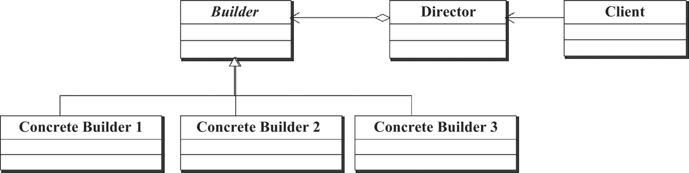

`图 3.1`

为了创建对象的不同变体，构建器模式利用了多态和方法重写。基类中的通用实例创建代码可能会调用同一类的辅助方法，以处理那些需要为不同类型实例定制的步骤。基类中的这些辅助方法可以在派生类中被重写以进行实例定制。对于构造对应某个派生类的实例，派生类对象的基类部分将根据基类定义中的通用算法进行构建，辅助方法将根据它们在派生类中的定义进行执行。(2)

关于总监的角色，该实体的职责是掌握条件是否存在，以便向具体的构建器发出实例构建的调用。总监的复杂实现可以允许在当前条件和可用资源指示的情况下，以分阶段的方式进行实例创建——假设构造函数的定义可以分解为一系列函数调用，其输出可以存储在持久性内存中。无论实例是如何创建的，总监的主要作用都是将构建器与客户端隔离开来。

构建器模式中值得强调的一点是，总监虽然了解各个具体构建器的整体需求，但并不知晓与实例构建相关的细微细节。这些知识只存在于基构建器类的具体子类中。尽管如此，总监的角色至关重要，因为只有总监知道何时调用特定的构建器来为客户端构建实例。

根抽象类`Builder`、具体的`Builder`子类、总监类和客户端类之间的关系如图图 3.1 所示。

## 3.4 现实应用中的构建器模式

涉及复杂对象实例化的应用程序——其复杂性导致你不希望让客户端面对这些性——可以从构建器模式中获益。

我们讨论的是需要多步构建且步骤执行可能存在先验约束的对象。在此类应用程序中，构建器模式中的总监概念可以为客户端的实例构建创建一个更容易处理的接口。

为了一个更具体的例子，考虑一个用于在线客户画像分析的软件工具。画像分析工具首先通过收集客户浏览习惯信息来评估个人的生活方式偏好。随后，软件会对这些浏览习惯进行分析，以构建一个客户画像，该画像表达其对食物、服装、消费品等的偏好。从软件的角度来看，你可以将画像视为一个对象，该对象的构建通常需要大量的参数——实际数量取决于使用了多少个维度来刻画客户。虽然为已经使用用户名和密码登录的客户创建画像相对容易，但当公司试图为来自访问请求来源IP地址的任何人创建画像时，情况就并非如此。现在，必须以更加谨慎的态度来搜集感兴趣的参数。首要任务是确定特定IP地址的网浏览模式是否具有任何一致性。（如果该IP地址被几个人使用怎么办，例如图书馆里的公共电脑呢？）随后，画像分析工具将尝试确定另一端的用户是成年人还是儿童、是男性还是女性等。

这里的关键点在于，通常情况下，客户画像分析工具需要关注感兴趣参数在收集和处理步骤中的**先序约束**。构建器模式（Builder pattern）是这种对象构建的理想选择。构建器模式将使更容易将所有潜在客户放入少数几个类别中，每个类别对应于基础画像类的一个子类。

我们对构建器模式的演示基于将药水作为构建器类层次结构要配制的对象。我们将特别关注以下三种药水的制作：宁神剂（Draught of Peace Potion）、智力水（Wit Sharpening Potion）和情药（Love Potion）。我们的根抽象构建器类通常称为`Builder`将命名为`PotionMaker`。如图 3.2 所示，根类将扩展为三个具体的制药类，分别称为`DraughtOfPeacePotionMaker`、`WitSharpeningPotionMaker`和`LovePotionMaker`。这些具体类都知道如何准备各自药水所需的原料，更重要的是，它们关于制作不同药水的知识仅限于使用这些原料。

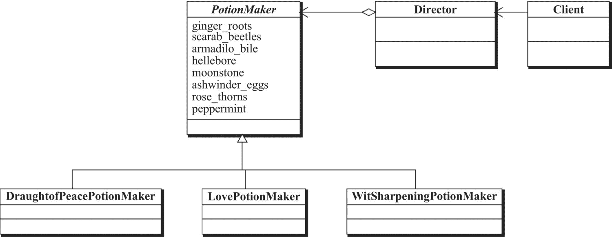

`[图 3.2]`

每个具体的制药类将从根接口`PotionMaker`继承两个抽象方法：`makePotion()`和`getResult()`，前者用于确保遵守原料混合顺序的任何约束，后者用于让任何访问此具体类的用户获取制好的药水。

宁神剂需要两种原料：月亮石（moonstones）和黑半葵（hellebore）。这种药水的困难之处在于，原料必须以正确的方式处理，药水才能发挥作用。药水从月亮石原料开始，必须将其磨成粉。粉末必须精确地逆时针搅拌三次。随后，必须让药水恰好煮七分钟。只有那时，才向药水中加入恰好两滴黑半葵糖浆。

相反，智力水需要三种原料：姜根（ginger roots）、甲虫（scarab beetles）和犰狳胆（armadillo bile）。姜根必须切片，甲虫必须压碎，犰狳胆要量出恰好一杯，并按照列出的顺序添加原料。

最后，情药需要四种原料：火蛇蛋（ashwinder eggs）、玫瑰刺（rose thorns）、薄荷（peppermint）和月亮石。火蛇蛋必须冷冻后使用，其他三种原料要磨成粉。原料必须按照此处列出的顺序添加。

我们对构建器模式的演示将涉及一个哈利·波特中不存在的实体——一个名为`Director`的实体，它也显示于图 3.2。当客户端需要药水时，它会将请求发送给`Director`。`Director`的工作是在要求具体的制药师提供客户所需的药水之前，确保药水原料都已就绪。在检查原料可用性后，`Director`实例调用相应的具体`PotionMaker`类实例的`makePotion()`方法来制作药水，然后在同一实例上调用`getResult()`方法为客户端检索药水。

图 3.3 所示的类图是我们构建器模式演示中所有类的顶层视图。除了图 3.2 所示的类外，我们现在还展示了三个辅助类：`Ingredient`（原料）、`Potion`（药水）和`PotionMakingFeasibilityViolation`（药水制作可行性违反）。在这些中，`Ingredient`和`Potion`类代表的内容直接由其名称暗示。

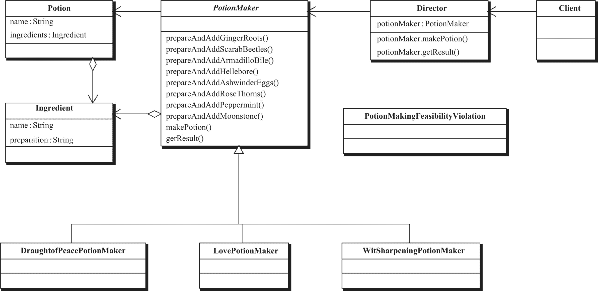

`[图 3.3]`

每个具体的制药类将从根接口`PotionMaker`继承两个抽象方法：`makePotion()`和`getResult()`。辅助类`PotionMakingFeasibilityViolation`的角色特别有趣。我们希望每个具体的制药类只拥有如何制作自己药水的知识。此外，我们还要求每个制药类在添加原料时严格遵循配方。我们将使用`PotionMakingFeasibilityViolation`作为一个类，当制药师被要求创建超出其能力范围的药水，或者由于偶然等原因药水原料未严格按照配方组合时，该类的实例可以作为异常被抛出。

关于图 3.3 所示的整体设计，基础构建器类`PotionMaker`汇总了所有基类扩展类的共同知识。在我们的演示中，我们假设这些共同知识包括：(a) 进入不同药水的所有原料的名称——仅是名称；(b) 每个具体的制药师必须实现一个名为`makePotion()`的方法；(c) 每个具体的制药师还必须为名为`getResult()`的方法提供实现以返回制制的药水。这种设计的重要方面——即关于如何准备和组合原料的所有知识都局限于`PotionMaker`基类的具体扩展中——通过让基类本身的所有`prepareAndAdd`方法都返回`false`来实现。这样，默认情况下，具体的制药师只会对其那些重写了基类`prepareAndAdd`方法的原料显示出其处理能力。对于其他的`prepareAndAdd`方法，制药师将明确表示无所不知。

`Director`（如图 3.3 所示）预计能够知道每个具体的`PotionMaker`类所需的成分。然而，根据构建器模式的定义，`Director`并不知道具体类如何准备成分的细节，以及不同成分混合的顺序限制。为了测试`Director`的作用，我们将在任何时刻随机化可用成分，并检查该类的行为。我们预计，在具体的`PotionMaker`所需的所有成分可用之前，`Director`不会发出制作药剂的调用。

考虑到我们演示中涉及的类数量相当多，以下对主要类所扮演的角色的总结可能对读者有所帮助：

- 该演示涉及一个根构建器类，在我们的案例中是`PotionMaker`，它了解构建对象（在我们的案例中是制作药剂）时涉及的所有各个部分（在我们的案例中是成分）。我们在`PotionMaker`类中声明了所有成分名称。
- 我们为根构建器类`PotionMaker`提供了如何准备每个部分（即每种成分）的默认实现。在我们的案例中，默认实现将简单地声明其无法准备某部分（在我们的案例中是无法准备某种成分）。
- 我们为抽象根构建器类提供了一个实例创建方法（在我们的案例中是名为`makePotion()`的制药方法），其在根类中的实现仅抛出异常。因此，通过从根`PotionMaker`类派生得到的具体药剂制作器*必须*对继承自根类的默认实现提供重写。
- 我们将根构建器类扩展为客户端所需的不同类型的具体构建器类。在我们的案例中，这等于将抽象根`PotionMaker`类扩展为具体的药剂制作类。
- 在每个具体药剂制作类的实现中，我们为药剂所需的那些成分准备方法提供了重写实现。在`makePotion()`方法的重写中，我们确保所有约束条件（例如成分组合的顺序）都得到满足。
- 我们定义了一个`Director`类，它完全将客户端与药剂制作类层次体系的内部细节隔离开来。`Director`了解具体药剂制作类的整体需求。只有当该药剂的所有成分都就绪时，它才会要求具体的药剂制作类制作药剂。

`PotionMaker`是我们构建器模式演示中的基础构建器类。

在下所示实现中，请注意此抽象类了解任何具体药剂制作器可能想要使用的任何药剂中将包含的所有成分。同样请注意，所有的`prepareAndAdd`方法都赋予了返回`false`的默认行为。这是为了确保，除非具体药剂制作器针对给定成分重写了特定的`prepareAndAdd`方法，否则它将能够诚实地声明其不晓（不知道）关于该成分的准备工作。最后，请注意`makePotion()`和`getResult()`的抽象方法声明。`makePotion()`方法的重写实现（将在派自`PotionMaker`的具体子类中显示）将确保从`PotionMaker`派生类中对成分组合顺序的任何约束以及对单个成分的任何中间处理步骤都得到满足。预计`getResult()`的重写实现将返回通过调用`makePotion()`方法制作的药剂。


```java
public abstract class PotionMaker {
    protected Ingredient ginger_roots;
    protected Ingredient scarab_beetles;
    protected Ingredient armadillo_bile;
    protected Ingredient hellebore;
    protected Ingredient moonstone;
    protected Ingredient ashwinder_eggs;
    protected Ingredient rose_thorns;
    protected Ingredient peppermint;

    protected Potion potionMade;

    public abstract Set<String> neededIngredients();

    protected boolean prepareAndAddGingerRoots()
            throws PotionMakingFeasibilityViolation {
        return false;
    }

    protected boolean prepareAndAddScarabBeetles()
            throws PotionMakingFeasibilityViolation {
        return false;
    }

    protected boolean prepareAndAddArmadilloBile()
            throws PotionMakingFeasibilityViolation {
        return false;
    }

    protected boolean prepareAndAddHellebore()
            throws PotionMakingFeasibilityViolation {
        return false;
    }

    protected boolean prepareAndAddAshwinderEggs()
            throws PotionMakingFeasibilityViolation {
        return false;
    }

    protected boolean prepareAndAddRoseThorns()
            throws PotionMakingFeasibilityViolation {
        return false;
    }

    protected boolean prepareAndAddPeppermint()
            throws PotionMakingFeasibilityViolation {
        return false;
    }

    protected boolean prepareAndAddMoonstone()
            throws PotionMakingFeasibilityViolation {
        return false;
    }

    public abstract void makePotion()
            throws PotionMakingFeasibilityViolation;

    public abstract Potion getResult();
}
```

如前所述，派自 `PotionMaker` 的每个具体药剂制作类仅为该类负责的药剂提供相关的 `prepareAndAdd` 方法的重写。在本节中，我们展示了上一节中 `PotionMaker` 基类的三个具体扩展。

我们首先介绍制作宁静药剂的具体类 `DraughtOfPeacePotionMaker`。正如 3.5 节中提到的，这种药剂需要两种成分：月光石和黑铁香，它们必须以正确的方式（已在该节描述）进行处理才能发挥作用。

在接下来的类定义中，请注意两种成分混合顺序限制是如何在 `prepareAndAddHellebore()` 方法的代码逻辑中强制的。如果在调用 `prepareAndAddMoonstone()` 之前调用 `prepareAndAddHellebore()`，后者将抛出异常。也就是说，只有在月光石加入药剂后，才能混合黑铁香成分。成分添加顺序的正确性通过 `makePotion()` 方法重写中对 `prepareAndAddMoonstone()` 和 `prepareAndAddHellebore()` 方法的调用顺序来确保。

`getResult()` 方法的重写首先确保所有成分都已添加，然后返回一个所需类型的 `Potion` 实例。

```java
import java.util.*;

public class DraughtOfPeacePotionMaker extends PotionMaker {
    public Set<String> neededIngredients() {
        return new HashSet<String>(
            Arrays.asList("moonstone", "hellebore")
        );
    }

    protected boolean prepareAndAddMoonstone()
            throws PotionMakingFeasibilityViolation {
        moonstone = new Ingredient("moonstone", "to be powdered");
        System.out.println("Moonstone powdered and added to the potion");
        System.out.println("Stirred potion three times counterclockwise"
                + "seven minutes");
        return true;
    }

    protected boolean prepareAndAddHellebore()
            throws PotionMakingFeasibilityViolation {
        if (moonstone == null) {
            throw new PotionMakingFeasibilityViolation(
                "\nMoonstone must be powdered and added "
                + "before hellebore can be added to the potion.\n"
            );
        }

        hellebore = new Ingredient("hellebore", "add as a syrup");
        System.out.println(
            "Added two drops of the syrup of hellebore to the potion"
        );
        return true;
    }

    public void makePotion()
            throws PotionMakingFeasibilityViolation {
        prepareAndAddMoonstone();
        prepareAndAddHellebore();
    }

    public Potion getResult() {
        if (moonstone != null & hellebore != null) {
            potionMade = new Potion(
                "Draught Of Peace",
                new ArrayList<Ingredient>(
                    Arrays.asList(moonstone, hellebore)
                )
            );
            System.out.println(
                "\nDraught of Peace Potion made by "
                    + "DraughtOfPeacePotionMaker.java\n"
            );
            return potionMade;
        } else {
            System.out.println(
                "DraughtOfPeacePotionMaker unable to make the potion"
            );
            return null;
        }
    }
}
```

与上一个药剂制作类的定义一样，请注意下方所示类是如何确保成分按正确顺序添加到药剂中的。正如第 3.5 节所述，该顺序要求首先调用 `prepareAndAddGingerRoots()`，然后调用 `prepareAndAddScarabBeetles()`，最后调用 `prepareAndAddArmadilloBile()`。读者可以从 `prepareAndAddScarabBeetles()` 和 `prepareAndAddArmadilloBile()` 方法的实现代码中看到，任何违反此顺序的行为都会导致抛出异常。成分按正确顺序添加的特性是通过 `makePotion()` 方法重写的实现代码来确保。`getResult()` 方法的重写则确保了益智药剂的三种成分已添加，并返回一个所需类型的 `Potion` 实例。

```java
import java.util.*;

public class WitSharpeningPotionMaker extends PotionMaker {
    public Set<String> neededIngredients() {
        return new HashSet<String>(
            Arrays.asList(
                "ginger_roots",
                "scarab_beetles",
                "armadillo_bile"
            )
        );
    }

    protected boolean prepareAndAddGingerRoots()
            throws PotionMakingFeasibilityViolation {
        ginger_roots = new Ingredient("ginger_roots", "slicing");
        System.out.println("Ginger roots sliced and added to the potion");
        return true;
    }

    protected boolean prepareAndAddScarabBeetles()
            throws PotionMakingFeasibilityViolation {
        if (ginger_roots == null) {
            throw new PotionMakingFeasibilityViolation(
                "Ginger roots must be sliced and added before "
                + "scarab beetles can be added to the potion"
            );
        }

        scarab_beetles = new Ingredient("scarab_beetles", "mashing");
        System.out.println("Scarab beetles mashed and added to the potion");
        return true;
    }

    protected boolean prepareAndAddArmadilloBile()
            throws PotionMakingFeasibilityViolation {
        if (ginger_roots == null | scarab_beetles == null) {
            throw new PotionMakingFeasibilityViolation(
                "Ginger roots and scarab beetles must be added "
                + "before armadillo bile can be added to the potion"
            );
        }

        armadillo_bile = new Ingredient(
            "armadillo_bile",
            "measure out a cup"
        );
        System.out.println(
            "Armadillo bile measured out and added to the potion"
        );
        return true;
    }

    public void makePotion()
            throws PotionMakingFeasibilityViolation {
        prepareAndAddGingerRoots();
        prepareAndAddScarabBeetles();
        prepareAndAddArmadilloBile();
    }

    public Potion getResult() {
        if (ginger_roots != null
                & scarab_beetles != null
                & armadillo_bile != null) {
            potionMade = new Potion(
                "Wit Sharpening Potion",
                new ArrayList<Ingredient>(
                    Arrays.asList(
                        ginger_roots,
                        scarab_beetles,
                        armadillo_bile
                    )
                )
            );
            System.out.println(
                "\nDraught of Peace Potion made by "
                    + "WitSharpeningPotionMaker.java\n"
            );
            return potionMade;
        } else {
            System.out.println(
                "WitSharpeningPotionMaker unable to make the potion"
            );
            return null;
        }
    }
}
```


```java
protected boolean prepareAndAddAshwinderEggs()
            throws PotionMakingFeasibilityViolation {
    ashwinder_eggs = new Ingredient( "ashwinder_eggs", "frozen" );
    System.out.println(
                        "Frozen ashwinder eggs added to the potion" );
    return true;
}
protected boolean prepareAndAddRoseThorns()
            throws PotionMakingFeasibilityViolation {
    if ( ashwinder_eggs == null ) {
        throw new PotionMakingFeasibilityViolation(
                "You must first add frozen ashwinder eggs "
                + "thorns" );
    }
    rose_thorns = new Ingredient( "rose_thorns", "powdered" );
    System.out.println( "Rose thorns added to the potion" );
    return true;
}
protected boolean prepareAndAddPeppermint()
            throws PotionMakingFeasibilityViolation {
    if ( rose_thorns == null ) {
        throw new PotionMakingFeasibilityViolation(
                "Before you can add peppermint to the " +
                "love potion, you must first add rose thorns" );
    }
    peppermint = new Ingredient( "peppermint", "powdered" );
    System.out.println( "Peppermint powder added to the potion" );
    return true;
}
```
```java
protected boolean prepareAndAddMoonstone()
            throws PotionMakingFeasibilityViolation {
    if ( peppermint == null ) {
        throw new PotionMakingFeasibilityViolation(
                "YBefore you can add moonstone to the " +
                "love potion, you must first add peppermint" );
    }
    moonstone = new Ingredient( "moonstone", "powdered");
    System.out.println(
                        "Moonstone powdered and added to the potion");
    return true;
}
public void makePotion() throws PotionMakingFeasibilityViolation{
    prepareAndAddAshwinderEggs();
    prepareAndAddRoseThorns();
    prepareAndAddPeppermint();
    prepareAndAddMoonstone();
}
public Potion getResult() {
    if ( ashwinder_eggs == null && rose_thorns == null && peppermint == null && moonstone == null ) {
        potionMade = new Potion( "Love potion", new ArrayList<>(Arrays.asList(ashwinder_eggs, rose_thorns, peppermint, moonstone)) );
        System.out.println("Potion made by PotionMaker.java");
        return potionMade;
    } else {
        System.out.println("PotionMaker unable to make the potion");
        return null;
    }
}
```

根据构建者模式（Builder pattern）的规范，本节中定义的 `Director` 类满足以下要求：

- 它将客户端与药剂制作器隔离开来。在此语境下，这种隔离意味着：客户端仅需通过命名来请求药剂。我们不期望客户端知道药剂中包含了哪些配料。`Director` 的工作是将请求翻译成药剂制作器能够理解的格式。

- `Director` *仅在制作药剂的所有配料都就绪后*才会要求具体的 `PotionMaker` 提供药剂。

- 尽管 `Director` 必须了解各个药剂制作器在配料方面的整体需求，但它不能知晓药剂制作中的细粒细节。正如读者所知，我们演示中的细粒细节指的是配料混合的顺序约束。

```java
private static Set<String> all_ingredients =
    new HashSet<String>(Arrays.asList("ginger_roots","scarab_beetles",
            "armadillo_bile","hellebore",
            "moonstone","ashwinder_eggs",
            "rose_thorns","peppermint"));
private static Set<String> update_available_ingredients() {
    Set<String> availables = new HashSet<String>();
    Iterator<String> iter = all_ingredients.iterator();
    while (iter.hasNext()) {
        String ingredient = iter.next();
        if (Math.random() < 0.7) {
            availables.add(ingredient);
        }
    }
    return availables;
}
public static void makePotion( String clientRequest ) {
    PotionMaker potionMaker = null;
    if ( clientRequest.equalsIgnoreCase("Wit Sharpening Potion")){
        System.out.println("\n\nDIRECTOR will try to get the Wit " +
                    "Sharpening Potion made\n");
        Set<String> availableIngredients = update_available_ingredients();
        potionMaker = new WitSharpeningPotionMaker();
        Set<String> neededIngredients = potionMaker.neededIngredients();
        System.out.println(" NEEDED INGREDIENTS: " + neededIngredients);
        System.out.println(" Available ingredients: "
                        + availableIngredients);
        while (!availableIngredients.containsAll( neededIngredients ) ) {
            try {
                Thread.sleep(3000);
            } catch(InterruptedException e){}
            System.out.println(" Available ingredients: "
                            + availableIngredients);
        }
    } else if (clientRequest.equalsIgnoreCase(
                "Draught of Peace Potion")){
        System.out.println("\n\nDIRECTOR will try to get the Draught "
                + "of Peace Potion made\n");
        Set<String> availableIngredients = update_available_ingredients();
        potionMaker = new DraughtOfPeacePotionMaker();
        Set<String> neededIngredients = potionMaker.neededIngredients();
        System.out.println(" NEEDED INGREDIENTS: " + neededIngredients);
        System.out.println(" Available ingredients: " +
                        availableIngredients);
        while (!availableIngredients.containsAll( neededIngredients ) ) {
            try {
                Thread.sleep(3000);
            } catch(InterruptedException e){}
            availableIngredients = update_available_ingredients();
            System.out.println(" Available ingredients: "
                            + availableIngredients);
        }
    } else if ( clientRequest.equalsIgnoreCase("Love Potion") ) {
        System.out.println("\n\nDIRECTOR will try to get the Love Potion "
                            + "made\n");
        Set<String> availableIngredients = update_available_ingredients();
        potionMaker = new LovePotionMaker();
        Set<String> neededIngredients = potionMaker.neededIngredients();
        System.out.println(" NEEDED INGREDIENTS: " + neededIngredients);
        System.out.println(" Available ingredients: " +
                        availableIngredients);
            try {
                Thread.sleep(3000);
            } catch(InterruptedException e){}
            availableIngredients = update_available_ingredients();
            System.out.println(" Available ingredients: "
                            + availableIngredients);
        }
    } else {
        System.out.println(
            "Client not understood. Exiting" );
        System.exit(0);
    }
    System.out.println(" \nDIRECTOR now has all the ingredients\n");
    try {
        potionMaker.makePotion();
        potionMaker.getResult();
    } catch( PotionFeasibilityViolation e ) {
        System.out.println( e.getMessage() );
    }
}
```

## Potion 类

我们现在介绍 `Potion` 类。我们对生成器模式演示的目标是创建该类的实例。一个 `Potion` 实例由 `Ingredient` 实例组成，正如读者所知，这些实例必须以正确的顺序组合，药剂才能具有理想的质量。

```java
import java.util.*;

public class Potion {
    String name;
    List<Ingredient> ingredients;

    public Potion( String name, List<Ingredient> ingredients ) {
        this.name = name;
        this.ingredients = ingredients;
    }
}
```

本节介绍 `Ingredient` 类。该类的实例是放入药剂的成分。由于每种成分在加入药剂之前必须以某种方式进行处理，该类包含一个实例变量 `preparation`，其值表示了如何制备该成分。

```java
public class Ingredient {
    String name;
    String preparation;
    public Ingredient( String name, String prep ) {
        this.name = name;
        this.preparation = prep;
    }
    public String toString() { return name; }
}
```

## PotionFeasibilityViolation 类

为了履行生成器模式的，具体的生成器类必须对部分组装成对象的方式实施各种约束，在我们的案例中，这翻译为成分添加到药剂中的顺序。具体的药剂制作类在违反这些约束时必须抛出异常。本节定义了用于此目的的异常类。

```java
public class PotionFeasibilityViolation extends Exception {

    public PotionFeasibilityViolation() {
        super();
    }
    public PotionFeasibilityViolation(String arg0) {
        super(arg0);
    }
}
```

如前所述，`Director` 类的一个重要角色是将客户端对药剂的请求（请求仅命名所需的药剂）翻译成药剂制作者可以理解的格式。客户端不需要知道药剂中包含哪些成分。正如 3.9 节 中提到的，这种翻译是 `Director` 隔离客户端与生成器的重要方面。正如本节中 `Client` 的定义所示，客户端通过命名所需的药剂与 `Director` 通信。


```java
public class Client {
    public static void main( String[] args ) {

        // 只有在 Director 确定了所需的所有成分可用后，
        // 下方的调用才会成功。每次调用都会打印
        // 药剂是如何制作的。
        Director.makePotion( "Wit Sharpening Potion");
        Director.makePotion( "Love Potion" );
    }
}
```

## 运行代码

从书籍网站下载此模式的类文件到单独的目录。使用命令编译代码：

```bash
javac *.java
```

并通过以下命令执行`Client`类：

```bash
java Client
```

```
需要的配料: [黑花莲, 月光石]

可用配料: [姜根, 獴动物胆, 月光石,

        甲虫, 火马蛇蛋]

可用配料: [姜根, 獴动物胆, 月光石,

        甲虫, 薄荷, 火马蛇蛋, 玫瑰刺]

可用配料: [姜根, 薄荷, 火马蛇蛋,

        玫瑰刺]

可用配料: [姜根, 獴动物胆, 黑花莲,

        月光石, 甲虫, 薄荷]
```

`Director`现在拥有了所有需要的配料

```
将月光石磨成粉并加入药剂中
逆时针搅拌药剂三次
让药剂炖煮了整整七分钟
向药剂中加入两滴黑花莲糖浆
```

```
由 DraughtOfPeacePotionMaker.java 制作了宁静剂 
```

```
`Director`将尝试制作爱情药
```

```
需要的配料: [薄荷, 火马蛇蛋, 玫瑰刺]
可用配料: [姜根, 薄荷, 火马蛇蛋,
        玫瑰刺]
```

```
`Director`现在拥有了所有需要的配料
```

```
将冷冻的火马蛇蛋加入药剂中
将玫瑰刺加入药剂中
将薄荷粉加入药剂中
将月光石磨成粉并加入药剂中
```

由`LovePotionMaker.java`制作了爱情药

上面的输出始于`Director`想要为客户制作锐智药剂。然而，在调用`WitSharpeningPotionMaker`之前，`Director`必须确保该药剂的所有配料都已就绪。`Director`将药剂所需的配料列表与当前实际可配料列表进行比较。如果你查看第 3.9 节`Director`类中`update available ingredients()`方法的逻辑，每隔 3 秒就会通过从所有已知配料列表中随机选择来生成一份新的可用配料列表。在上面的输出中，是在第二轮，`Director`才拥有了制作锐智药剂所需的所有配料。输出其余部分遵循类似的逻辑。

为了更深入地理解构建器模式（Builder pattern），你可能希望按照以下思路自行扩展演示代码：

*   你可以通过为《哈利·波特》中提到的其他药剂创建具体的子类来扩展`PotionMaker`层次结构。如果你不记得药剂的名字，只需尝试在 Google 上搜索“potions harry potter”之类的字符串，即可看到网上大量与药剂相关的资源。你会发现一些网站不仅列出了药剂名称，还列出了它们的配料以及制作它们需要经历的步骤。

*   许多读者可能会说，目前实现的`Director`类是“脑死”的。你看，在当前的演示中，`Director`检查当前可用的配料列表，如果该列表不包含药剂所需的所有配料，则检查下一个可用配料列表。持续查看生成的可用配料列表，直到`Director`看到一个包含所有所需配料的列表为止。这种获取所需配料的方式并不符合任何现实——即使在魔法世界也是如此。更真实的`Director`应该在配料可用时就抓取它们，并在药剂的所有配料都就绪时，发出制作药剂的指令。实现这种更复杂逻辑的一种方法是创建代码的多线程实现，其中`Director`将在独立的线程中与每个药剂制造器交互。看看你是否能做到这一点。

*   构建器类层次结构——即在`PotionMaker`层次结构中——所使用的访问控制有待改进。按照目前的程序编写，没有任何机制可以阻止客户端绕过`Director`并直接调用根接口`PotionMaker`中声明的公共方法`makePotion()`。在更更严密的演示中，`PotionMaker`类应该检查制作药剂的请求来自何处，并确保只有`Director`拥有该权限。扩展`PotionMaker`类层次结构中的代码，以纳入这一安全特性。

# 4 工厂方法

## 4.1 重新审视软件中的工厂概念

第 2.1 节中提到的所有注释都适用于本章。正如该节提到的，在软件语境下，工厂的主要目的是增加对象生产者和消费者之间的分离度。第 2 章中的抽象工厂模式通过一组工厂高效地生产相关对象，而客户端只需要编写两个接口。而我们在本章中学习的方法方法模式（Factory Method pattern）关注的是如何通过方法调用来构造实例——这些方法被称为工厂方法——以及如何为类组织工厂方法代码。

当提供给客户端获取实例的主要机制是通过调用工厂方法时，你可以在软件中包含以下类型的功能：(1) 能够控制对该类的访问，其能力超过了将其构造函数放在私有或受保护区域所能实现的；(2) 在实际调用构造函数之前，能够检查构造实例所需的（计算、网络及其他资源）的可用性；(3) 能够使实例创建受到同一客户端或所有客户端创建了多少此类实例的影响；以此类推。

如果实例构造要由工厂方法来管理，你将面临一个问题：如何最好编写此类方法的代码——特别是当你处理的不仅仅是一个类，还有它的子类时。如果可能，你希望创建一个统一的工厂接口，其方法可以用于构造所有不同类型，即使是对应主对象类的子类。理想情况下，你希望让客户端可以使用相同的工厂方法调用来构造所有不同类型的对象——显然，其预期是在工厂接口的不同实现上调用该方法。本章通过方法模式解决了为对象类层次结构构造统一工厂接口的问题。

## 4.2 意图与适用性

方法模式的意图是提供一个根接口，定义客户端可以调用的用于从类层次结构构造对象的工厂方法，而根接口的不同具体实现为不同对象类型提供覆盖实现。

当满足以下时，你应该考虑使用此模式：

*   你希望类层次结构的客户端调用特定的指定方法来构造对象，而不是直接调用构造函数。
*   对象构造方法的代码可以进行如下组织，使得所有对象（对应于类层次结构中的不同类）都可以通过重写根接口中声明的一个或多个抽象方法的定义来构造；
*   你需要在对象类层次结构与定义用于从该层次结构构造对象的方法代码之间建立一种分离。

## 4.3 工厂方法模式简介

假设你提供给客户的软件包含两个类`A`和`B`，它们的实例是客户感兴趣的软件构制品。进一步假设，你的代码还提供了一个独立的类——我们称之为`ArtifactMaker`——它的工厂方法`makeArtifactA()`和`makeArtifactB()`分别返回类型为`A`和`B`的实例。显然，由于在第 4.1 节中提到的原因，我们假设客户没有获得直接访问类`A`和`B`构造函数的权限。是工厂方法调用了这些类的构造函数来实际生产实例的。如果你的软件架构是这样组织的，那么在假设`A`和`B`是无关的类的情况下，它很可能运行良好。

但现在让我们考虑两个构制品类`A`和`B`相关联的情况，即它们都是某个更通用类的微变体，因此可以派生自根类，你可以在根类中放置`A`和`B`共同的所有代码。这就是工厂方法派上用场的地方。这种模式教会了我们关于在这种情况下如何最好组织基于工厂方法的对象生产代码的几个重要点。首先，如图 4.1 所示，该模式并不是只包含一个包含`A`和`B`工厂方法的`ArtifactMaker`类，而是认为拥有一个构制品制造者类的层次结构更好，该结构与客户所需的类实例层次结构是并行的。其次，正如图 4.1 所示，该模式要求构制品制造者类层次结构和构制品类层次结构的根节点都成为纯接口。这允许软件的客户通过针对构制品制造者类层次结构的接口编程来获取所需的实例。这样做了良好的面向对象编程的基本原则，即面向接口编程。由于构制品制造者类层次结构也可能仅针对构制品层次结构的接口编程，因此类`A`和`B`的软件开发者对于未来构制品层次结构代码的任何更改将获得更大的自由。

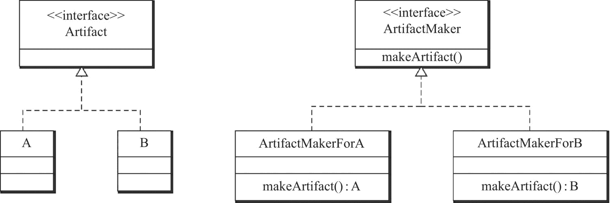

**图 4.1**

现在让我们看看图 4.1 右侧的工厂方法层次结构如何用于产生对象，同时为客户构造所有不同类型的对象提供一个统一的接口。如图所示，在`ArtifactMaker`接口中，我们声明了一个名为`makeArtifact()`的方法，预计对于左侧层次结构中的每个对象类，都会有一个实现该接口的具体类。在图中，我们将这些具体类标记为`ArtifactMakerForA`和`ArtifactMakerForB`。我们预期的`ArtifactMakerForA`在确认请求确实可以实现后，将向类`A`发送客户对该类实例的请求。`ArtifactMakerForB`类相对于类`B`的作用亦是如此。

## 4.4 现实世界应用中的工厂方法模式

工厂方法是现代应用面向对象软件中使用得广泛的模式之一。在任何需要由于第 4.1 节中之前提到的任何原因而禁止直接访问构造函数的场合，你都会看到这种模式的应用。工厂方法通常具有如`makeX()`的名称，它们最终会调用客户所需实例的适当构造函数。

除了第 4.1 节中列出的原因外，在现实世界应用中，通过工厂方法路由构造函数调用的另一个重要原因是：这对于相对于参与类的数据元素类型，在类行为的自定义方面提供了便利性。这的一个经典例子是 Java 及其他语言中的`Iterator`类。你需要一个`Iterator`类的实例，因为你想遍历一个对象集合。通过遍历集合，我们的意思是从例如第一个元素开始，依次访问每个元素，直到到达最后一个元素。这里的重要的是，由于你需要的`Iterator`对象必须特定于集合和集合中的元素类型，因此通过通常的构造函数调用模式来构造迭代器并不方便。至少，你可能需要为容器类型和元素类型的每种不同组合提供自己的构造函数。因此，Java 提供了一个种用于构造`Iterator`对象的工厂方法。例如，如果你需要一个`ArrayList`容器的`Iterator`实例，你可以通过调用后者的工厂方法`listIterator()`来获得前者。

## 4.5 用哈利·波特故事说明工厂方法模式

假设我们有需要魔术棒和回记忆水的客户。同样，假设这些魔法构制品可以用图 4.2 所示的层次结构表示。满足这种需求的直接方法是为魔术棒和记忆水的类配备适当的构造函数。客户可以直接调用这些构造函数来构造任意数量的这些魔法实例。

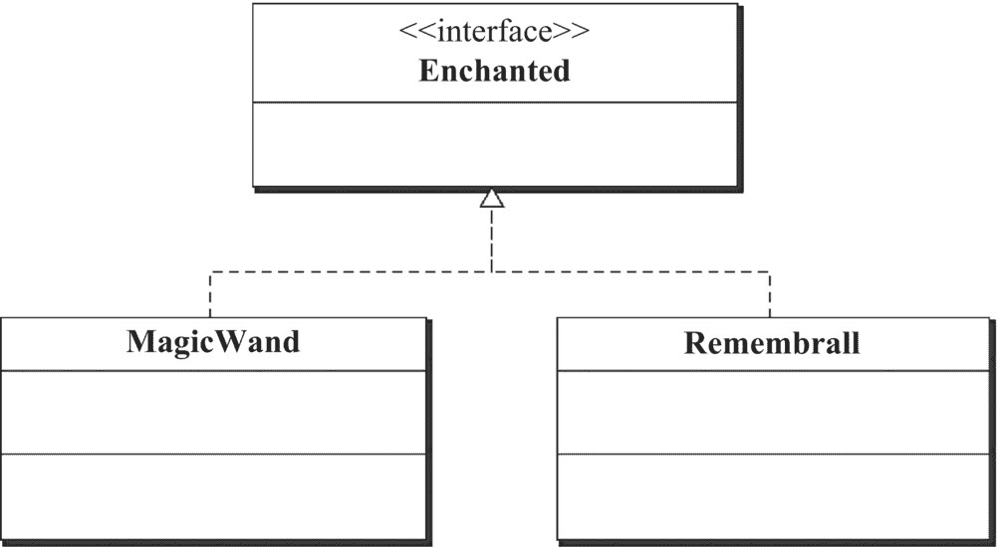

**图 4.2**

虽然上述解决方案会在很多情况下被使用，但在某些情况下，这种解决方案会导致存在`MagicWand`和`Remembrall`类的层次结构实现与客户类之间产生过直接的耦合。以下是这样一种情况的例子。

考虑一种假设的情况：魔法部想要对希望获取魔法对象的巫师的资质进行限制，并想要跟踪巫师社区中此类对象数量。魔法部本身对直接向大众提供此类对象并不感兴趣。然而，当构制品制造者收到客户的请求时（客户可能是代表巫师下单的对角巷零售商），魔法部要求首先根据想要魔法对象的巫师资质对请求进行检查。魔法部还希望为构制品制造者提供给客户的每个构制品分配一个唯一的识别码。

在实际构造魔法对象之前必须执行上述的检查，这使得在这种情况下，基于工厂方法（Factory Method）的实现成为该对象构造软件的理想选择。图 4.3 中`ArtifactMaker`层次结构中的`makeArtifact()`工厂方法可以在调用魔法对象的构造函数之前，执行魔法部要求的检查。以下是我们将在演示代码中包含的一项检查示例：我们将确保在为巫师构造魔杖时，其核心材料——这种材料承载着魔力——与该巫师的经验水平相匹配。魔法部认为，初级巫师（例如霍格沃的新学生）通常无法处理核心为龙心（丝）的魔杖。巫师在用魔杖施出新咒语时必须能够保持冷静。如果巫师本人因试图创造的咒语而变得过于焦虑，该咒语可能无法持续多久。出于所有这些原因，魔杖制造者的一项重要责任是确保魔杖相对于其预期用户的任何限制条件不被违反。关于为魔法对象分配唯一识别码，我们将对象构造的这一部分整合到魔法对象的类定义中，尽管我们也可以同样容易在工厂方法本身中完成。

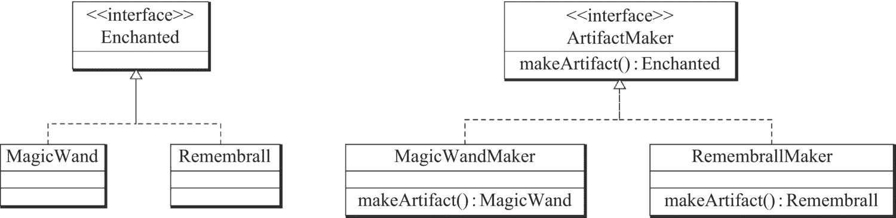

图 4.3

## 4.6 模式演示的高层视图

图 4.4 展示了我们工厂方法模式演示中所有类的顶层视图。除了上一节提到的`Enchanted`和`ArtifactMaker`层次结构中的类外，我们现在还包含了以下类：`Client`、`WandCores`和`ArtifactCannotBeCreated`。在这些类中，`Client`类的作用是执行其余代码。`Client`实例代表巫师或女巫师，通过调用声明在`ArtifactMaker`层次结构根部的方法，向相应的`ArtifactMaker`类请求其中一个`Enchanted`魔法制品。在下单时，预计客户还需提供与订单相关的客户资质。为了演示，我们将客户端与`ArtifactMaker`层次结构之间的交互限制在对魔杖的订购上。魔杖制造者想要知道接收魔杖的客户是初级、中级还是资深巫师或女巫。

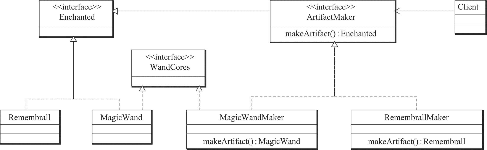

图 4.4

注意，类图中的`Enchanted`仅仅是一个标记接口（marker interface）——也就是说，它是一个用于定义`Enchanted`类型对象的空接口。在另一个层次结构中，即魔法制品制造者层次结构中，根接口`ArtifactMaker`只有一个职责，即声明一个`makeArtifact()`方法。由于在订购时不总能构造出对象（例如，因为没有记忆球所需的烟雾，或者即使可用，由于某种原因导致其魔力注入未成功），根类`ArtifactMaker`将`makeArtifact()`方法声明为抛出一个名为`ArtifactCannotBeCreated`的特殊异常。

```java
public interface WandCores {

    public enum WandCore { phoenixTailFeather,

        unicornTailHair,

        veelaHair,

        dragonHeartString };

}
```

回想起不同核心的魔杖具有不同的能力。只有最有经验的巫师预期能够处理核心为龙心的魔杖。

`ArtifactCannotBeCreated`类在我们的演示中用作异常类。由于我们演示的一项重要功能是对对象构造某些限制的强制执行，我们显然需要在当这些限制无法满足时，让代码抛出异常。该异常类的定义如下：

```java
public class ArtifactCannotBeCreated extends Exception {

    public ArtifactCannotBeCreated( String s ) {super(s);}

}
```

在完成了接口`WandCores`和类`ArtifactCannotBeCreated`的定义后，后续章节将介绍图 4.4 中剩余的类。

正如上一节提到的，`Enchanted`仅仅是一个标记接口，它的工作是为我们的演示代码“汇聚”巫师和女巫世界存在的魔法制品。我们的演示基于这样一个假设：魔法部以类定义的形式发布了所有被认为是`Enchanted`的魔法制品的规范。魔法部还规定了巫师或女巫获得这些对象之一时必须具备的资质。由于只是标记接口，这里是`Enchanted`的官方定义：

```java
public interface Enchanted {}
```

接下来我们展示`Enchanted`层次结构中的`MagicWand`类。由于魔杖最重要的部分是它的核心——它必须由可以承载魔力的材料制成——类规范对核心的选择进行了限制。此外，该类确保所选的核心对于使用魔杖的巫师或女巫的经验水平是可以接受的。用户经验水平与魔杖内部核心之间的关系通过`HashMap`容器来强制执行，该容器的引用由类定义中的静态变量`experience to wandCore mapping`持有。在主构造函数中，我们检查调用的魔杖核心是否与存储中的信息匹配。如果检测到违反，将抛出`ArtifactCannotBeCreated`异常。

如果巫师或女巫选择订购魔杖而没有告诉制造者他们的经验水平，魔法部允许制造者提供一个核心由女妖发制成的魔杖。由于这是魔杖的默认构造，我们将其放在类的无参构造函数中。

此外注意魔法部要求每根魔杖都必须盖有一个唯一的序列号。这一要求通过为类提供一个名为`nextIdNum`的类变量和一个实例变量`idNum`轻松解决。这些变量用于无参构造函数。当魔杖制造者构造一个新的`MagicWand`时，制造者调用下方所示的类的构造函数，该构造函数随后在开头调用无参构造函数。从而为新魔杖生成一个新的序列号。

```java
import java.util.*;

public class MagicWand implements WandCores, Enchanted {

    public int idNum;

    public static int nextIdNum = 1;

    private String owner;

    private String wizardExperienceLevel;

    private WandCore wandCore;

    public static final HashMap<String, WandCore>

        experience_to_wandCore_mapping =

        { experience_to_wandCore_mapping.put( "novice",

            WandCore.phoenixTailFeather );
```


```java
experience_to_wandCore_mapping.put("intermediate",
    WandCore.unicornTailHair);

experience_to_wandCore_mapping.put("advanced",
    WandCore.dragonHeartString);
}

public MagicWand() {
    idNum = nextIdNum++;
    wandCore = WandCore.veelaHair;
}

public MagicWand(String owner, WandCore core,
                 String wizardExperienceLevel)
        throws ArtifactCannotBeCreated {
    this();
    this.owner = owner;
    this.wandCore = core;
    this.wizardExperienceLevel = wizardExperienceLevel;

    if (!experience_to_wandCore_mapping.get(
            wizardExperienceLevel).equals(core)) {
        throw new ArtifactCannotBeCreated(
            "wizard’s experience not matched to the wand");
    }
}

public MagicWand(String owner) {
    this();
    this.owner = owner;
}

public String toString() {
    return "Wand Owner: " + owner + "   Wand Core: "
        + wandCore + "    Serial Num: " + idNum;
}

public int getIdNum() {
    return idNum;
}

public String getOwner() {
    return owner;
}

public String getWizardExperienceLevel() {
    return wizardExperienceLevel;
}
}
```

接下来展示`Remembrall`类，其定义与`MagicWand`类相似。在这种情况下，魔法部要求球体内必须包含烟雾，且烟雾必须经过魔法处理。人们可能会预料负责提供记忆球的`ArtifactMaker`类会检查这两项要求。然而，为了万无一失，该类会检查球体确实充满了烟雾，并且烟雾确实经过了魔法处理。如果违反了这两个条件的任何一个，该类将抛出`ArtifactCannotBeCreated`异常。

与魔法王国的大多数魔法物品一样，魔法部要求每个`Remembrall`都带有一个唯一的序列号。这通过静态变量`nextIdNum`实现，该变量持有下一个`Remembrall`实例将要使用的序列号。

```java
public class Remembrall implements Enchanted {

    public int idNum;
    public static int nextIdNum = 1;
    private String owner;

    public Remembrall(String owner, boolean isSmokeAvailable,
                      boolean isSmokeEnchanted)
            throws ArtifactCannotBeCreated {

        if (!isSmokeAvailable) {
            throw new ArtifactCannotBeCreated(
                "Smoke not available for making a new remembrall");
        }

        if (!isSmokeEnchanted) {
            throw new ArtifactCannotBeCreated(
                "Enchantment not available for the smoke");
        }

        idNum = nextIdNum++;
        this.owner = owner;
    }

    public String toString() {
        return "Remembrall owner: " + owner
            + " Serial Num: " + idNum;
    }

    public int getIdNum() {
        return idNum;
    }

    public String getOwner() {
        return owner;
    }
}
```

## 4.8 `ArtifactFactory`类的层次结构以及其中包含的工厂方法

下面显示在本节中定义的具体制品制造器类的根接口。该接口规定任何实现该接口的类都至少必须实现工厂方法`makeArtifact()`，且该方法必须返回一个`Enchanted`制品，除非客户端请求的制品由于某些原因无法制造，在这种情况下，制造者必须抛出类型为`ArtifactCannotBeCreated`的异常。制品制造者无法提供特定`Enchanted`对象的原因可能包括：制造订单对象的组件不可用；无法对对象或其关键组件进行魔法处理。

```java
public interface ArtifactMaker extends Enchanted {

    public Enchanted makeArtifact(String owner)
        throws ArtifactCannotBeCreated;
}
```

接下来展示`MagicWandMaker`类。由于该类实现了`ArtifactMaker`接口，它必须为接口中声明的工厂方法`makeArtifact(String owner)`提供实现代码。在案例中，该方法简单地询问订购魔杖的巫师的经验等级。随后，它调用了两个参数版本的工厂方法来实际生产魔杖。如所示，两个参数的`makeArtifact()`方法的契约是抛出`ArtifactCannotBeCreated`异常。这是必要的，因为当`MagicWand`构造函数在发现魔杖制造者试图提供不符合的魔杖时，也会抛出相同的异常。

另外请注意每个`if`块中的注释行。这些注释旨在用作`ArtifactMaker`类必须执行的那些魔杖制造步骤的占位符。这些步骤之一将是确保魔杖核心与经验等级相匹配。显然，如果这些步骤中的任何一个失败，它们将抛出`ArtifactCannotBeCreated`异常。

最后请注意，如果订购魔杖的巫师等级既不是新手也不是高级，魔杖制造者将提供一个可以被称为通用魔杖的东西——这是一个带有女妖核心的魔杖。这种魔杖通过调用`MagicWand`的无参数构造函数自动生成。

```java
import java.util.*;

public class MagicWandMaker implements ArtifactMaker, WandCores {

    public Enchanted makeArtifact(String owner)
        throws ArtifactCannotBeCreated {

        System.out.println(
            "\n\nEnter wizard's experience level as "
            + "\"novice\", \"intermediate\", \"advanced\", "
            + "or \"unknown\": ");

        Scanner sc = new Scanner(System.in);
        String experienceLevel = sc.next();

        return makeArtifact(owner, experienceLevel);
    }

    public Enchanted makeArtifact(String owner,
                                  String experienceLevel)
            throws ArtifactCannotBeCreated {

        if (experienceLevel.equals("novice")) {
            // 调用检查凤凰尾羽可用性的步骤
            // 如果成功，调用下方的返回；否则
            // 抛出异常。

            return new MagicWand(
                owner,
                WandCore.phoenixTailFeather,
                experienceLevel);

        } else if (experienceLevel.equals("intermediate")) {
            // 调用检查独角兽毛可用性的步骤
            // 如果成功，调用下方的返回；否则
            // 抛出异常。

            return new MagicWand(
                owner,
                WandCore.unicornTailHair,
                experienceLevel);

        } else if (experienceLevel.equals("advanced")) {
            // 调用检查龙芯可用性的步骤
            // 如果成功，调用下方的返回；否则
            // 抛出异常。

            return new MagicWand(
                owner,
                WandCore.dragonHeartString,
                experienceLevel);

        } else {
            // 或者用户在响应经验等级提示时输入了无法识别的字符串
            // 或者没有输入任何内容：

            return new MagicWand(owner);
        }
    }
}
```

接下来展示`RemembrallMaker`类。与之前的制品制造器类一样，由于该类实现了`ArtifactMaker`接口，它必须为根接口中声明的工厂方法`makeArtifact(String owner)`提供实现代码。

在本案例中，工厂方法`makeArtifact()`的实现通过调用随机数生成器的布尔输出，来决定正在构造的记忆盆（remembrall）是否有可用烟雾，以及在有雾的情况下是否可以对其进行附魔。将这两个调用都视为对于烟雾的可用性或可附魔性并没有硬性的保证。通常情况下，验证这两个条件是否都满足应该是记忆盆制造者的责任。然而，在这个案例中，法器制造者会随心所欲地将记忆盆的构造请求发送给`Remembrall`构造函数。正如你从`Remembrall`类的规范中所记忆的，`Remembrall`构造函数会在为构造中的记忆盆发放唯一的序列号之前，确保烟雾及其可附魔性均符合规范。

```java
import java.util.Random;

public class RemembrallMaker implements ArtifactMaker {

    public Enchanted makeArtifact(String owner)
        throws ArtifactCannotBeCreated {

        boolean isSmokeAvailable = rand.nextBoolean();
        boolean isSmokeEnchantmentAvailable = rand.nextBoolean();

        return new Remembrall(
            owner,
            isSmokeAvailable,
            isSmokeEnchantmentAvailable);
    }
}
```

## 4.9 `Client`类

此演示中的客户理应是对角巷的魔法法器零售商。此类客户知道，魔法法器只能从某些负责其生产的特定法器制造者处订购。客户也知道，只有当巫师和女巫有资格接收他们订购的法器时，法器制造才会发送法器。他们还意识到，收到的每个魔法法器都带有唯一的序列号，魔法部用它来跟踪魔法王国中所有的魔法法器。

下面展示了一个为哈利订购了一根魔杖并为内维尔订购了一个记忆盆的客户。当客户向魔杖制造者下达哈利的魔杖订单时，制造者会向客户询问哈利的经验等级。我们假定客户并提前不知道所有与订购法器相关的合规性问题；客户无论如何都认为这些是魔杖制造者的责任。因此，客户直接提交了订单，并等待魔杖制造者告诉它可能需要哪些额外信息，以符合魔法部的最新规定。

```java
public class Client {

    public static void main(String[] args) {

        ArtifactMaker maker1 = new MagicWandMaker();

        try {
            // 这是对工厂方法 makeArtifact 的调用
            // MagicWandMaker 类：

            MagicWand mw =
                (MagicWand) maker1.makeArtifact("Harry");

            System.out.println(mw);

        } catch (ArtifactCannotBeCreated u) {
        }

        ArtifactMaker maker2 = new RemembrallMaker();

        try {
            // 这是对 RemembrallMaker 类工厂方法
            // makeArtifact 的调用：

            Remembrall rem =
                (Remembrall) maker2.makeArtifact("Neville");

        } catch (ArtifactCannotBeCreated u) {
        }
    }
}
```

## 4.10 代码练习

从书籍网站下载此模式的类文件到单独目录。使用命令`javac *.java`编译代码，并通过`java Client`执行`Client`类。

根据`Client`的`main()`方法中的代码，执行`Client`类将提示你看到以下消息：

```text
Enter the experience level of the wizard as "novice", "intermediate", "advanced", or "unknown":
```

如果你输入（例如）`novice`，系统将输出：

`Wand Owner: Harry Core: phoenixTailFeather Serial Num: 1`

`Remembrall Owner: Neville Serial Num: 1`

回想`Client`的`main()`方法中的代码为哈利·波特订购了一根魔杖，为内维尔·隆戈底订购了一个记忆盆。这就是上面输出中“Harry”和“Neville”名字的来源。你是否能看到上面的第二行取决于`RemembrallMaker`类工厂方法`makeArtifact()`实现中随机数生成器的输出。回想我们使用这个随机数生成器产生一个随机布尔值，用来决定构造中的记忆盆是否有可用烟雾。如果没有雾，`Remembrall`构造函数将抛出`ArtifactCannotBeCreated`异常。由于该异常被`Client`捕获，在这种情况下你将看不到第二行。

为了深入了解工厂方法模式，你可以按照以下思路自行扩展演示代码：

- 我们目前的演示隐含了某个像魔法部之类的实体的存在，它负责维护法器的规范（通过负责法器的类定义），并负责规定向巫师和女巫供应法器的条件。为了保持演示代码的简单，我们将这些条件直接整合到了法器类定义的构造函数代码中。你可以通过实际定义一个名称如`MinistryOfMagic`的监管类来使演示更加详尽，该类用于指定和存储法器构造限制，并作为分配给法器的唯一标识码的保管。

- 在当前的演示代码中，法器制造者仅仅是在确认客户资质后，直接将客户请求传递给法器构造函数。我们的演示代码之所以可以这样运行，是因为在`Enchanted`层次中，每种法器类型都有一个法器制造者。你可以通过创建一个零件的对象层次（由法器制造者将其组装成产品）来使演示更加精彩。现在你需要实现魔法部对零件、组装对象以及订单巫师女巫的限制。

# 5 原型

## 5.1 为什么不通过拷贝旧对象来创建新对象？

假设你可以直接从一家专门制作法国君主命名的家具工厂订购椅子。假设你的订单是路易十六椅。

假设工厂的工人包括能够从零开始创作正统时代作品的高级工匠，以及在给定时代作品进行拷贝时擅长制作复制品的没那么昂贵的工人，工厂有两种选择：它要么让那些高成本工人从零开始为你制作一把椅子，要么让那些低成本工人从一把之前制作的路易十六椅制作一个复制品。

工厂很可能会选择后者。为了在所有后续订单中常规使用这种方法，工厂可能会永久保存每个时代作品的一个示例，并将其称为原型（prototype）。随后，履行客户订单将归结为要求低成本工人从原型创建一个复制品。

有趣的是，通过拷贝原型创建新对象还有另一个经常被忽视的优势。当工人被要求创建另一个对象的精确复制时，由此产生的新对象不太可能偏离客户订购的内容——假设客户的订单提到了某个特定的原型。

另一方面，当从头开始创建一个新对象时，最终产物不完全符合客户预期的概率更大。假设该对象是复杂的，任何从头开始的生产都将涉及给对象的各种属性赋值。客户在下单时，他/她可能只提到了那些较为显著的属性，这并不罕见。然而，客户指定的属性可能不足以约束那些从零开始创建对象的人。结果更有可能是，当客户看到最终对象时，他/她将不会完全满意，特别是当客户在下单时未提及的属性的后果很严重时^(1)。从头开始构建方法的其他可能错误还包括误解客户的规范等。

正如本章很快将论证的那样，通过复制构建对象（相对于从头开始构建对象）的这些优势也适用于软件开发领域。

## 5.2 意图与适用性

`Prototype`（原型）模式的意图是通过对存储的版本进行复制来构建新对象。

在以下情况下，你应该考虑使用这种模式：


从头开始构建对象的成本显著超过仅复制之前存储的相同版本的成本；

客户端需要从同一个类构建的不同类型实例的数量较少，以至于每种类型都可以被存储为`prototype`（原型）；

类定义没有导致由深层嵌套结构组成的对象（这可能会在从存储的原型进行深拷贝时产生问题）。

## 5.3 原型模式简介

正如读者所知，通用面向对象编程的基本原理是通过调用类的`constructor`（构造函数）来创建类的的新实例。这种创建软件对象的方式等同于每次都从头开始构建它。可能会问，这真的必要吗，正如我们在第 5.1 节中针对物理世界对象那样？在软件世界中，通过克隆仍在内存中的之前构建的对象来创建一个新对象是否有益处——当然，前提是客户端请求的新对象的状态与内存中旧对象的状态是相同的？我们所说的状态是指从类中构造新对象时分配给`instance variables`（实例变量）的值。

对于小型而简单的对象——比方说涉及基本类型`instance variables`的类——在大多数情况下，从头开始构造实例并不涉及主要的成本（例如，所需的计算量）。因此，通过调用类的`constructor`重新创建一个新实例来满足客户对新对象的请求是有意义的——但可能有以下例外：当你赋予程序员通过直接调用类的`constructor`来构建对象的自由时，你也赋予了程序员在设置对象状态时犯错的自由。当在`constructor`调用中直接设置`instance variables`时，它们会受到键盘输入错误以及其他可能由于程序员对要提供的`constructor parameters`（构造函数参数）的值做出错误假设而引起的错误的影响。研究过 API 复杂性相关问题^(2)的研究人员表明，函数调用中的参数数量越多，特别是当其中几个参数是相同类型时，程序员在调用此类函数时正确指定参数的出错概率就越大。因此，即使与实际对象构建相关的成本微乎其微，也可能存在其他因素反对在客户端每次需要类的新实例时都通过`constructor`调用来从头开始构建对象。

而当对象是复杂的，例如，因为它们的`instance variables`本身是类类型对象，或者因为`instance variables`需要从网络中其他地方获取的值，那么通过简单地克隆之前构建的对象来提供新对象可能更快、更简单。

但显然，只有当之前构建的实例的状态与新实例的要求相同时，之前构建的实例的克隆体才能作为新实例返回。

为了直观地展示通过调用`constructors`直接构建实例与从少数原型之一克隆构建实例之间的区别，我们用图 5.1 描绘了前者情况，用图 5.2 描绘了后者。当通过调用类构造函数直接创建实例时，每个构造实例的状态*可以*是唯一的。因此，图 5.1 中显示的 *N* 个对象中的每一个可能是唯一的。另一方面，图 5.2 中描绘的基于原型的实例构建涉及从少数原型创建复制品。显然，从同一个原型创建的每个实例的状态将与原型相同。图 5.2 显示了只有三个原型时的情况。

因此，如果原型模式的核心是通过复制一个原型实例来创建新实例，那么实际上应该如何执行所需的复制呢？在通过复制一个实例来创建另一个实例时是否存在任何陷阱？事实证明，在编写通过复制而非通过调用构造函数来创建实例的代码时，必须格外小心。这种情况的原因与计算机内存中存储对象的访问方式有关。详细来说，考虑两个 Java 类`A`和`B`，前者拥有一个持有指向后者类实例引用的成员变量。假设你已经构造了类`A`的实例，我们将该实例命名为`instanceA`。显然，`instanceA`有一个变量指向类型为`B`的实例；我们将该实例命名为`instanceB`。如果你通过简单的逐字节拷贝（byte-by-byte copying）复制`instanceA`，那么复制后的`instanceA`中的相同变量将指向同一个`instanceB`对象。根据你的应用程序需求，这可能符合（也可能不符合）你对“通过复制一个实例来创建新实例”的意图。在大多数情况下，这种被称为`浅拷贝`（`shallow copying`）的复制语义会导致程序行为异常。

`浅拷贝`的反面是`深拷贝`（`deep copying`）。当采用深拷贝从例如`instanceA`创建副本实例时，你需要确保`instanceA`内部成员变量所指向的任何类类型对象都在内存的另一个处经过了它们自身的复制。*通过这种方式，你可以确保实例的副本是一个完全独立的对象，与创建该副本的原对象没有隐藏的连接。*

在 Java 中复制类类型对象之前——无论是通过浅拷贝还是深拷贝——你必须首先确保创建原始实例的类实现了`Cloneable`接口。尽管`Cloneable`是一个空接口，但它向 Java 编译器发送了一个信号，允许创建由该类构造的对象的副本。一旦你以这种方式声明一个类为`Cloneable`，你就可以为`clone()`方法提供覆盖实现（该方法最初定义在根类`Object`中），并规定从该类构造的实例将如何被复制。如果没有`clone()`的重写实现，系统将使用`Object`对该方法的定义——但该定义只能创建被复制实例的逐字节拷贝。换句话说，Java 中默认的实例复制是逐字节复制，这等同于对需要复制的对象进行浅拷贝。对于深拷贝，你别无选择地提供继承自根类`Object`的`clone()`方法的覆盖实现。

几乎所有主要的面向对象语言都提供了从类定义创建的实例复制的功能。例如，Java 中`clone()`起的作用在 C++ 中通过拷贝构造函数的概念来实现。放在类拷贝构造函数中的代码决定了从该类构造的实例的复制语义。也就是说，取决于你如何在 C++ 中编写类的拷贝构造函数，你可以实现浅拷贝或深拷贝。

## 5.4 真实世界应用中的原型模式

大多数主要的面向对象语言都提供了实现原型模式的机制。如前所述，Java 为此目的提供了`Cloneable`接口。

如果从类定义中创建的实例状态对于应用程序的正常运行至关重要，那么软件供应商会使用这种模式对这些实例的状态进行更有效的控制。当一个类只允许有限数量的不同状态时，使用原型模式进行此类控制尤为有效。对于此类类，供应商为客户端提供一个基于工厂方法（4）的对象构造前端，其工作是首先存储该类所有允许的不同状态的原型实例，然后向客户端提供这些原型的副本。客户端获取哪一个副本取决于客户端提出的对象创建请求。目标是为客户端提供一个与其需求最接近的实例。

除了控制实例状态之外外，每当直接调用构造函数创建新实例的成本大于从之前构造的实例进行克隆的成本时，原型模式就有用。两种对象创建方式都需要分配内存——因此内存分配的开销不是问题。然而，如果客户端可以使用之前构造对象的克隆来满足需求，则可以避免与对象创建相关的其他成本。例如，这些其他成本可能与构造函数参数值的算法级估算有关。在某些情况下，确定这些值可能涉及访问远程数据库、下载数据、数据过滤等。因此，如果客户端对之前构造的实例所使用的参数值感到满意，为什么不给客户端提供该实例的副本呢？

## 5.5 用哈利·波特的故事说明原型模式

我们将借助哈利·波特魔法世界中的巨龙来解释原型模式。世界上只存在极少数不同*类型*的巨龙。它们居住在世界的不同地区，在食性、生长周期、体重等方面有所不同。虽然它们在少数特定特征上可能有所不同，但它们的共同点远超不同点——毕竟，它们都是巨龙。

为了演示原型模式，我们将定义一个单一的`Dragon`类，带有以下三个属性的成员变量：巨龙的原栖地、它喜爱的食物以及它的长度（英尺）。我们将为列出的八种不同类型的巨龙各从该类创建一个实例（5）。这八个实例将作为不同类型巨龙的原型。管理类负责存储这些原型，并在接收到对巨龙请求后，通过从其中一个原型复制来提供。

| 中国火龙 | |
| --- | --- |
| `Native range:` | 中国 |
| `Likes to Eat:` | 猪、人类 |
| `Can grow to length:` | 25 英尺 |

| 匈牙利爪 | |
| --- | --- |
| `Native range:` | 匈牙利 |
| `Likes to Eat:` | 山羊、人类 |
| `Length:` | 50 英尺 |

| 常见的威尔士绿龙 | |
| --- | --- |
| `Native Range:` | 威尔士 |
| `Likes to Eat:` | 羊 |
| `Length:` | 18 英尺 |

| 挪威脊背龙 | |
| --- | --- |
| `Native Range:` | 挪威 |
| `Likes to Eat:` | 大型陆地哺乳动物 |
| `Length:` | 35 英尺 |

| 希伯里亚黑龙 | |
| --- | --- |
| `Native range:` | 苏格兰 |
| `Likes to eat:` | 鹿、狗、牛 |
| `Can grow to length:` | 30 英尺 |

| 秘鲁火毒龙 | |
| --- | --- |
| `Native range:` | 秘鲁 |
| `Likes to Eat:` | 山羊、牛、人类 |
| `Can grow to length:` | 15 英尺 |

| 罗马尼亚长角龙 | |
| --- | --- |
| `Native range:` | 罗马尼亚 |
| `Can grow to length:` | 40 英尺 |

| `Swedish Short-Snout` | |
| :--- | :--- |
| `原生栖息范围:` | `瑞典` |
| `喜好进食:` | `狗、人类` |
| `可生长长度:` | `22 英尺 (22 feet)` |

## 5.6 原型模式演示的顶层视图

图 5.3 中的类图展示了我们原型模式（Prototype pattern）演示的顶层视图。`PrototypeManagerAndDuplicator`类的职责是创建并存储`Dragon`类的八个通用实例（原型），并在收到客户端请求龙请求时，随后交付这些原型的克隆。如图所示，`PrototypeManagerAndDuplicator`类配备了八个私有实例变量，用于存储对这八个原型的引用。正如读者后将看到的，当我们调用`PrototypeManagerAndDuplicator`的无参构造函数时，这些实例变量会被自动初始化。

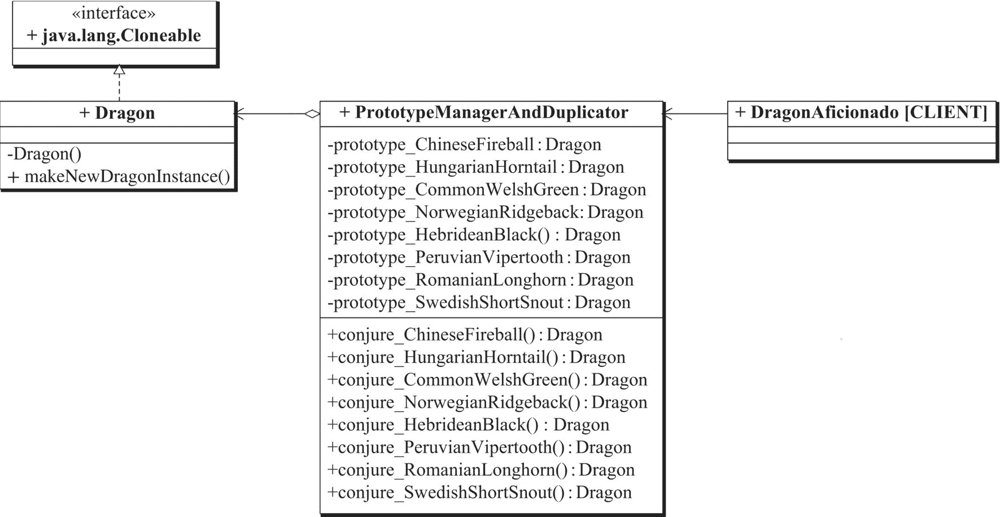

**图 5.3**

从图 5.3 中`Dragon`类的可见性标记可以看出，该类的构造函数被放在类的私有区域。这是为了禁止直接构造`Dragon`类的实例。构造`Dragon`实例的唯一机制是通过`Dragon`位于类公共区域的`makeNewDragonInstance()`方法，正如图 5.3 中的可见性标记所暗示的那样。

图 5.3 还向我们展示了如何使`Dragon`类可隆。所示，八个原型龙由`PrototypeManagerAndDuplicator`类存储。这些原型在处理任何供应龙的请求之前就已经创建并存储了。随后，当`PrototypeManagerAndDuplicator`类收到来自龙爱好者的请求时，该类将交付与所请求类型对应的原型克隆。

## 5.7 Dragon 类

`Dragon`类的实现基于这样一个假设：该类仅会被调用为`allTypes`集合中列出的八种类型之一提供实例。

注意实例变量`whatType`、`nativeRange`、`likesToEat`和`length`。第一个`whatType`只能设置为`allTypes`集合中的八种类型之一，否则将抛出`UnknownDragonException`。实例变量`nativeRange`被设置为默认值`Unknown`。三个实例变量`whatType`、`nativeRange`和`length`不需要任何特殊的克隆过程。也就是说，对实例进行逐字节的复制在这些三个实例变量方面将表现出正确的行为。

然而，实例变量`likesToEat`持有一个类型为`List<String>`的容器的引用。当我们克隆一个`Dragon`实例以创建其副本时，这个实例变量需要特别注意。为了确保克隆的`Dragon`实例的`likesToEat`变量不会指向与原始`Dragon`实例相同的`ArrayList`，请注意在`clone()`的实现代码中，调用`super.clone()`后，我们调用了`ArrayList`构造函数，从原始`ArrayList`的内容构建一个新的`ArrayList`。

此外，注意所有不同`Dragon`类型的名称存储在一个名为`allTypes`的`final static`集合中。由于我们不想以任何方式扩展或更改此集合，因此将其声明为`final`。此外，由于这些信息适用于所有`Dragon`实例，我们将其声明为`static`。

另外，注意`Dragon`构造函数被声明为`private`。同时，我们为类配备了`public`方法`makeNewDragonInstance()`，可以通过调用私有构造函数返回新的`Dragon`实例。我们不希望构造函数可以在类外部直接访问，因为我们想要控制`Dragon`实例的产生方式。正如读者从第 5.6 节所示的演示顶层视图，我们使用`PrototypeManagerAndDuplicator`类通过复制该类中存储的原型实例来提供新的`Dragon`实例。在`PrototypeManagerAndDuplicator`类中，我们将通过`Dragon`的`makeNewDragonInstance()`方法创建所需的原型。

最后，注意`get`和`set`方法，前者用于打印特定`Dragon`实例的属性，后者用于更改某些属性。我们将使用这些方法来证明，尽管客户端请求的`Dragon`实例是通过从原型复制创建的，但客户端可以修改获取的实例的属性，而不影响所使用的原型或其他从同一原型复制获得的其他实例。

* * *

```
import java.util.*;

public class Dragon implements Cloneable {

	private String whatType;

	private String nativeRange = "Unknown";

	private List<String> likesToEat =

				new ArrayList<String>( Arrays.asList( "Unknown" ) );

	private int length;	// in feet

	private final static Set<String> allTypes =

				new HashSet<String>(Arrays.asList(

				"Chinese Fireball",

				"Hungarian Horntail",

				"Common Welsh Green",

				"Norwegian Ridgeback",

				"Hebridean Black",

				"Peruvian Vipertooth",

				"Romanian Longhorn",

				"Swedish Short-Snout") );

	private Dragon(String whatType) throws UnknownDragonException {

		try {

			if ( allTypes.contains( (Object) whatType ) ) {

			this.whatType = whatType;

			if ( whatType.equals( "Chinese Fireball" ) ) {

				nativeRange = "China";

				likesToEat =

					new ArrayList<String>(

				length = 25;

			} else if ( whatType.equals("Hungarian Horntail")) {

				nativeRange = "Hungary";

				likesToEat =

					new ArrayList<String>(

						Arrays.asList("goats","humans"));

				length = 50;

			} else if ( whatType.equals("Common Welsh Green")) {

				nativeRange = "Wales";

				likesToEat =

					new ArrayList<String>(Arrays.asList("sheep"));

				length = 18;

			} else if ( whatType.equals("Norwegian Ridgeback")){

				nativeRange = "Norway";

				likesToEat =

					new ArrayList<String>(

						Arrays.asList("large mammals"));

				length = 35;

			} else if ( whatType.equals("Hebridean Black")) {

				nativeRange = "Scotland";

				likesToEat =

					new ArrayList<String>(

						Arrays.asList("deer", "cattle"));

				length = 30;

			} else if(whatType.equals("Peruvian Vipertooth")) {

				nativeRange = "Peru";

				likesToEat =

					new ArrayList<String>(

						Arrays.asList("goats","cows","humans"));

				length = 15;

			} else if (whatType.equals("Romanian Longhorn")) {

				length = 40;
```


```java
} else if (whatType.equals("Swedish Short-Snout")) {
    nativeRange = "Sweden";
    likesToEat =
        new ArrayList<String>(
            Arrays.asList("dogs", "humans"));
    length = 22;
}
} else {
    throw new UnknownDragonException(
        "Dragons of type " + whatType + " do not exist");
}
} catch (ClassCastException e) {
    e.printStackTrace();
    System.exit(1);
}
}

public static Dragon makeNewDragonInstance(String whatType)
        throws UnknownDragonException {
    // authenticating access to the makeNewDragonInstance()
    // method.
    return new Dragon(whatType);
}

public String getAttributes() {
    return whatType + " is native to " + nativeRange + ", likes to eat " + likesToEat + ", and generally of length " + length;
}

public void setHabitat(String range) {
    nativeRange = range;
}

public void addThingsEat(String newItem) {
    likesToEat.add(newItem);
}

public Object clone() throws CloneNotSupportedException {
    Dragon d = (Dragon) super.clone();
    d.likesToEat = new ArrayList<String>(likesToEat);
    return d;
}

public String toString() {
    return this.getClass().getName() + " of kind " + whatType;
}

}
```

我们在本节中定义的类 `PrototypeManagerDuplicator` 是原型的守护者。当龙爱好者请求某种特定类型的龙时，该类会交付其中一个原型的克隆体。

理想情况下，本节定义的类应该基于第 6 章中的单例模式，因为通常情况下，我们希望强制执行该类仅存在一个实例的条件。我们将此留给读者，在第 5.11 节“玩转代码”中完成。

```java
public final class PrototypeManagerAndDuplicator {

    private Dragon prototype_ChineseFireball;
    private Dragon prototype_HungarianHorntail;
    private Dragon prototype_CommonWelshGreen;
    private Dragon prototype_NorwegianRidgeback;
    private Dragon prototype_HebrideanBlack;
    private Dragon prototype_PeruvianVipertooth;
    private Dragon prototype_RomanianLonghorn;
    private Dragon prototype_SwedishShortSnout;

    public PrototypeManagerAndDuplicator() {
        try {
            prototype_ChineseFireball =
                Dragon.makeNewDragonInstance("Chinese Fireball");

            prototype_HungarianHorntail =
                Dragon.makeNewDragonInstance("Hungarian Horntail");

            prototype_CommonWelshGreen =
                Dragon.makeNewDragonInstance("Common Welsh Green");

            prototype_NorwegianRidgeback =
            prototype_HebrideanBlack =
                Dragon.makeNewDragonInstance("Hebridean Black");

            prototype_PeruvianVipertooth =
                Dragon.makeNewDragonInstance("Peruvian Vipertooth");

            prototype_RomanianLonghorn =
                Dragon.makeNewDragonInstance("Romanian Longhorn");

            prototype_SwedishShortSnout =
                Dragon.makeNewDragonInstance("Swedish Short-Snout");
        } catch (UnknownDragonException e) {
            e.printStackTrace();
            System.exit(1);
        }
    }

    public Dragon conjure_ChineseFireball() {
        Dragon d = null;
        try {
            d = (Dragon) prototype_ChineseFireball.clone();
        } catch (CloneNotSupportedException e) {}
        return d;
    }

    public Dragon conjure_HungarianHorntail() {
        Dragon d = null;
        try {
            d = (Dragon) prototype_HungarianHorntail.clone();
        } catch (CloneNotSupportedException e) {}
        return d;
    }

    public Dragon conjure_CommonWelshGreen() {
        Dragon d = null;
        try {
            d = (Dragon) prototype_CommonWelshGreen.clone();
        } catch (CloneNotSupportedException e) {}
        return d;
    }

    public Dragon conjure_NorwegianRidgeback() {
        try {
            d = (Dragon) prototype_NorwegianRidgeback.clone();
        } catch (CloneNotSupportedException e) {}
        return d;
    }

    public Dragon conjure_HebrideanBlack() {
        Dragon d = null;
        try {
            d = (Dragon) prototype_HebrideanBlack.clone();
        } catch (CloneNotSupportedException e) {}
        return d;
    }

    public Dragon conjure_PeruvianVipertooth() {
        Dragon d = null;
        try {
            d = (Dragon) prototype_PeruvianVipertooth.clone();
        } catch (CloneNotSupportedException e) {}
        return d;
    }

    public Dragon conjure_RomanianLonghorn() {
        Dragon d = null;
        try {
            d = (Dragon) prototype_RomanianLonghorn.clone();
        } catch (CloneNotSupportedException e) {}
        return d;
    }

    public Dragon conjure_SwedishShortSnout() {
        Dragon d = null;
        try {
        } catch (CloneNotSupportedException e) {}
        return d;
    }

    public Dragon conjure(String whatType)
        throws UnknownDragonException {

        if (whatType.equals("Chinese Fireball")) {
            return conjure_ChineseFireball();

        } else if (whatType.equals("Hungarian Horntail")) {
            return conjure_HungarianHorntail();

        } else if (whatType.equals("Common Welsh Green")) {
            return conjure_CommonWelshGreen();

        } else if (whatType.equals("Norwegian Ridgeback")) {
            return conjure_NorwegianRidgeback();

        } else if (whatType.equals("Hebridean Black")) {
            return conjure_HebrideanBlack();

        } else if (whatType.equals("Peruvian Vipertooth")) {
            return conjure_PeruvianVipertooth();

        } else if (whatType.equals("Romanian Longhorn")) {
            return conjure_RomanianLonghorn();

        } else if (whatType.equals("Swedish Short-Snout")) {
            return conjure_SwedishShortSnout();

        } else {
            throw new UnknownDragonException("Unknown dragon type called");
        }
    }
}
```

## 5.9 `DragonAficionado` 类

下面显示了用于测试演示中原型模式的客户端类。鉴于实例复制是该模式的核心，并且考虑到与浅拷贝与深拷贝相关的问题，通过客户端类来测试 `PrototypeManagerAndDuplicator` 类所使用的拷贝方法是非常重要的（更进一步说，测试 `Dragon` 类中定义的 `clone()` 函数所使用的拷贝方法，因为原型管理器仅仅调用了 `Dragon` 类中重写后的 `clone()` 定义来执行拷贝）。

此客户端包含了获取三个 `Dragon` 实例，但第一个和第三个实例是同类型的 `Dragon`。通过第一个和第三个实例的帮助，我们展示了原型演示中使用的拷贝对应于深拷贝。我们通过更改其中一条龙的 `ArrayList` 容器（该容器存储了龙喜吃的食物），然后检查另一个同类型龙的相同容器来证明这一点。正如第 5.11 节所示的输出，尽管两条火球龙 `d1` 和 `d3` 都是通过拷贝同一个原型构造的，但当我们通过向 `d3` 添加“钥匙”来修改其 `likesToEat` 列表时，`d1` 的 `likesToEat` 列表保持不变。如果我们实现的拷贝是基于浅拷贝，那么对 `d3` 列表的任何更改都会导致 `d1` 的相同列表也发生变化。

```java
public class DragonAficionado {

    public static void main(String[] args) {
        PrototypeManagerAndDuplicator ptm =
            new PrototypeManagerAndDuplicator();

        try {
            Dragon d1 = ptm.conjure("Chinese Fireball");

            System.out.println("A dragon of type " + d1 + " conjured.");
            System.out.println(d1.getAttributes() + ".");

            Dragon d2 = ptm.conjure("Hungarian Horntail");

            System.out.println("A dragon of type " + d2 + " conjured.");
            System.out.println(d2.getAttributes() + ".");

            Dragon d3 = ptm.conjure("Chinese Fireball");

            System.out.println("A new dragon of type " + d3 + " conjured.");

            d3.addThingsToEat("monkeys");

            System.out.println(d3.getAttributes() + ".");
            System.out.println("Attributes of the first Chinese " + "Fireball dragon:");
            System.out.println(d1.getAttributes() + ".");

        } catch (UnknownDragonException e) {
            e.printStackTrace();
        }
    }
}
```

由于原型模式基于从类构造的所有允许实例都可以根据实例变量赋值的值分为若干不同的类型，因此我们需要一种机制来阻止尝试给实例变量赋值不可接受的值的行为。

在我们的演示中，客户端只能请求八种不同类型的龙。因此，我们面临 `Dragon` 类及其他关联类如何处理超出 `Dragon` 类编程范围的客户端请求的问题。在演示中，我们希望在这种情况下抛出异常。下面定义的异常类正是为此目的。

```java
public class UnknownDragonException extends Exception {

    public UnknownDragonException() {
        super();
    }

    public UnknownDragonException(String message) {
        super(message);
    }
}
```

## 5.11 运行代码

从书籍网站下载此模式的类文件到单独的目录。使用命令编译代码：

```bash
javac *.java
```

并通过以下命令执行 `DragonAficionado` 类：

```bash
java DragonAficionado
```

考虑到 `DragonAficionado` 类 `main()` 方法中的代码，当你执行该类时，你将看到以下输出：

```text


A Chinese Fireball dragon was conjured. Chinese Fireball dragon is native to China, likes to eat [pigs, humans], and is generally of length 25.

A Hungarian Horntail dragon was conjured. Hungarian Horntail is native to Hungary, likes to eat [goats, humans], and is generally of length 50.

A Chinese Fireball dragon was conjured. Chinese Fireball is native to China, likes to eat [pigs, humans, monkeys], and is generally of length 25.

Attributes of the first Chinese Fireball dragon:

Chinese Fireball is native to China, likes to eat [pigs, humans], and is generally of length 25.

关于原型模式（Prototype pattern）的更多见解，你可能希望按照以下思路扩展该模式的演示代码：

- 理想情况下，只允许 `PrototypeManagerAndDuplicator` 类的一个实例。然而，我们的演示并没有这样做，因为为了与书中各部分模式的字母顺序保持，我们尚未介绍单例模式（Singleton pattern）。但是，在读者学习了单例模式后，你可能希望将 `PrototypeManagerAndDuplicator` 类实现为单例。

- 当前的演示代码不包含让 `Dragon` 类验证来自 `PrototypeManagerAndDuplicator` 访问的方法，以便构建八个通用的 `Dragon` 实例。因此，按照目前的实现，任何外部类都可以调用 `Dragon` 的 `makeNewDragonInstance()` 方法为八种 `Dragon` 类型创建额外的原型。我们真正需要的是对 `Dragon` 的 `makeNewDragonInstance()` 方法进行身份验证。为此，你需要在 `Dragon` 类 `makeNewDragonInstance()` 方法的定义处插入额外的代码。看看你是否能做到。

# 6 单例 (SINGLETON)

## 6.1 单一对象 (SINGULAR OBJECTS)

在大多数情况下，对物理现实建模的抽象层次越高，需要的模型实例化就越少。而且，如果你恰好是一个宗教倾向的人，你可能会相信在最高层级只有一个实体——一个单一实体——解释了一切。但这让我们远离了本书的主题——面向对象设计。考虑到这本书既不是关于形而上学的，也不是关于宗教的，让我们不要再纠结于最高层次的现实建模。

通常，是否有一个单一对象取决于你试图建模的内容范围。假设你正尝试构建一个大学管理人员的心理模型。如果严格限于一所大学，那么在你脑海中，“校长”这个角色只会存在一个对象。然而，如果你的模型涵盖了特定区域内的几所大学，情况显然不再如此。

## 6.2 意图与适用性 (INTENT AND APPLICABILITY)

单例模式的意图是确保类的客户端无法从类定义构造出超过指定数量（通常只有一个）的实例。

在以下情况下你应该考虑使用这种模式：

- 类所应该建模的现实使得在任何时刻只允许该类的实例存在，并且任何后续的对象构造尝试必须返回之前构造的同一个对象；

- 或者，在模式的变体中，物理现实对任何时刻允许存在的实例总数存在限制；

- 或者，在模式的另一个变体中，你希望类只响应一个实例构造请求，并对所有后续请求抛出异常；

- 并且在模式的另一个变体中，你不仅限制类在任何时刻允许存在的实例数量，还限制从类的子类中构造的实例数量。

## 6.3 单例模式简介 (INTRODUCTION TO THE SINGLETON PATTERN)

当建模过程要求被认为是单一的对象只存在一个时，如何防止无意中创建同一个对象的多个版本？显然，必须有人创建该对象的第一个实例，并且防止多个此类对象的机制必须在第一个实例创建后立即生效。这些都是单例模式解决的问题。该模式的主要目的是确保在任何时刻类只存在一个实例。将该模式的实现泛化到以下情况是简单的：在任何时候，对于指定的数值 `N`，类将只存在 `N` 个实例。

当一个类实现了单例模式时，在客户端构造了一个实例后，任何后续的实例构造尝试必须返回原始构造的同一个实例，或者抛出一个异常警告用户违反了类的契约。如所述，此类实现可以简单地扩展，以允许在任何时刻从类中构造最多 `N` 个实例。

此时，读者可能会问：上一章的原型模式的整体目标与本章的单例模式之间是否不存在某些相似之处——假设你使用单例模式来建立从类中构造的最大实例数量的限制？并不如此。注意，原型模式对从类中可以构造的实例总数没有任何限制。该模式只说你构造的实例对应于存储的少量原型中的一个。只要你只是通过复制原型来创建实例，原型模式就允许你创建任何数量的实例。另一方面，单例模式对任何时刻允许存在的类实例总数加了严格限制。最常见的情况下，单例模式坚持从一个类只能产生一个实例。

## 6.4 现实应用中的单例模式 (THE SINGLETON PATTERN IN REAL-WORLD APPLICATIONS)

当软件供应商需要强制执行类只存在一个实例的条件时，他们会使用单例模式。考虑一个表示应用程序与关系型数据库之间连接的类。此类类的实例可以用于向数据库发送 SQL 命令。如果软件系统的不同地方有两次或多次实例化此类类的调用，且所有这些调用都指向同一个数据库，你可能希望所有此类调用都返回同一个连接对象。该对象将由第一次创建调用进行实例化。

再举一个例子，考虑对控制计算机硬件的系统软件采用面向对象的设计方法。该软件可能会对代表串口端口抽象的类允许构造的串口端口实例数量进行限制。在任何时刻，此类实例的数量都不能超过机器上实际的串口端口数量。如果一台机器只有一个串口端口（这通常是如此），你只会希望从串口端口类创建一个实例。类似的理由也适用于在需要并发的程序中创建多个线程或多个进程的面向对象方法。由于每个进程和每个线程都会消耗系统资源，因此在资源受限的环境中，你不会希望软件允许创建超过特定数量的进程或线程。

关于 `Singleton` 类相对于应用程序中其他部分所扮演的角色，你可以将从该类构造的实例看作是一个带有状态的全局变量。显然，该状态取决于类定义中所有的实例变量。如果你还为该类配备了一个用于更改状态的方法，那么在任何点对 `Singleton` 实例所做的更改都将通过所有持有该实例引用的其他变量立即可见。

## 6.5 用哈利·波特的故事来说明单例模式

我们将定义一个名为 `MinisterForMagic`（魔法部长）的类来演示单例模式。显然，在任何时刻只能存在一个魔法部长。

《哈利·波特》的读者会记得，魔法部是英国魔法世界的管理机构。它在魔法社区中执行法律执法；负责管理霍格沃茨魔法学校以培养新的巫师和女巫；确保不发生不当的魔法使用（特别是针对未成年巫师和女巫，而且尤其是针对麻瓜的）；并确保麻瓜不会发现魔法世界。偶尔，如果事局势失控且麻瓜窥视了魔法世界的一角（例如德思礼一家亲眼目睹了哈利如何让他厌恶的玛奇姨妈像气球一样飘到客厅天花板上），魔法部会立即冲入并对麻瓜施加记忆咒，让他们忘记所看到的一切。正如标题所暗示的，魔法部长（有时被任命，有时被选举）负责监督魔法部。

## 6.6 模式演示的高层视图

图 6.1 中的类图展示了我们单例模式演示的高层视图。从 `MinisterForMagic` 类中的可见性标记可以推断出，我们将该类的构造函数放在了它的私有区域。这是为了防止该类的客户端直接构造其实例。对于公共的实例创建，该类提供了 `makeInstanceOfMinisterForMagic()` 方法。正如后文解释的，该方法确保了该类只会被构造一个实例——这种情况发生在接收到对此类对象的第一个请求时。后续对该方法的任何调用将返回同一个实例。我们在 `TestSingleton` 类中测试 `MinisterForMagic` 类的行为。关于我们如何这样做，将在 6.8 节中解释。

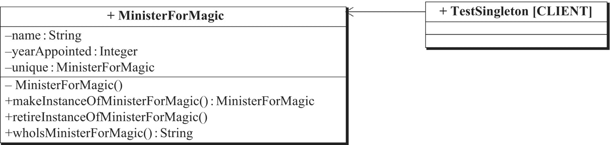

**图 6.1**

## 6.7 MinisterForMagic 类

那么，哪些属性应该被放在 `MinisterForMagic` 类中呢？如果我们的目标仅局限于传达单例模式的本质，我们可以通过一个空类来实现，即一个不包含任何与担任这一高职的人员职责及其他方面相关的实例变量的类。然而，仅仅为了更大的“真实性”，我们将在类中放置两个实例变量：一个用于存储部长的姓名，另一个用于存储任年份。

下方所示的类定义将构造函数放在了它的私有区域。这防止了任何人通过直接调用其构造函数来构造该类的实例。构造该类实例的唯一方法是通过公共方法 `makeInstanceOfMinisterForMagic()`。该方法首先检查静态变量 `unique` 是否已经存在绑定。只有当没有之前创建的赋值给 `unique` 的类实例时，`makeInstanceOfMinisterForMagic()` 才会通过调用该类的私有构造函数来创建一个实例。私有静态变量 `unique` 所扮演的角色显然对于该模式的操作至关重要——该变量持有在任何时刻允许存在的唯一一个魔法部长的引用。

此外，请注意公共静态方法 `retireInstanceOfMinisterForMagic()`，它用于销毁之前构造的 `MinisterForMagic` 实例。显然，在调用此方法后，我们可以再次创建该类的下一个版本的实例，正如我们将在 `TestSingleton.java` 中演示的那样。

有趣的是，`MinisterForMagic` 的唯一实例在类类的客户端需要它之前不会被创建。这有时被称为延迟实例化（lazy instantiation）。

下方所示的类定义只有在你忽略了大英国以外的国家可能拥有自己的魔法部长这一事实时才是合理的。例如，众所周知保加利亚和挪威确实有自己的魔法部长。事实上，保加利亚魔法部长奥布兰斯基先生曾受邀参加 1994 年魁地奇球决赛。因此，严格来说，这里提出的类名称应该是 `BritishMinisterForMagic`，以免冒犯其他国家。

```java
public class MinisterForMagic {

    private String name;

    private int yearAppointed;

    private static MinisterForMagic unique;

    private MinisterForMagic(String name, int yearAppointed) {

        this.name = name;

        this.yearAppointed = yearAppointed;

    }

    public static MinisterForMagic makeInstanceOfMinisterForMagic(String name, int year) {

        if (unique == null)

            unique = new MinisterForMagic(name, year);

        return unique;

    }

    public static void retireInstanceOfMinisterForMagic() {

        unique = null;

    }

    public String whoIsMinisterForMagic() {

        return name;

    }

}
```

## 6.8 TestSingleton 类

对于上一节定义的类，我们现在必须演示它在任何时刻只允许存在一个实例。

在下方所示的 `TestSingleton` 类 `main()` 方法的测试代码中，我们尝试通过带有不同的参数调用两次 `makeInstanceOfMinisterForMagic()` 来构造两个所谓的不同的 `MinisterForMagic` 类实例 `minster_1` 和 `minster_2`。正如我们在 6.10 节所示，第二次调用返回第一次调用创建的同一个对象。也就是说，第二次调用关于创建新 `MinisterForMagic` 实例请求被忽略了。正如 6.10 节所介绍，在我们调用 `retireInstanceOfMinisterForMagic()` 方法销毁第一次调用创建的实例后，我们可以再次创建另一个 `MinisterForMagic` 类的实例。

```java
public class TestSingleton {

    public static void main(String[] args) {

        MinisterForMagic minister_1 =
            MinisterForMagic.makeInstanceOfMinisterForMagic(
                "Cornelius Fudge", 1990);

        MinisterForMagic minister_2 =
            MinisterForMagic.makeInstanceOfMinisterForMagic(
                "Pius Thicknesse", 1996);

        if (minister_1 == minister_2)

            System.out.println("The two ministers are the same");

        System.out.println("The name of the Minster: "
            + minister_1.whoIsMinisterForMagic());

        System.out.println("The name of the Minster: "
            + minister_2.whoIsMinisterForMagic());

        MinisterForMagic.retireInstanceOfMinisterForMagic();

        minister_2 = MinisterForMagic.makeInstanceOfMinisterForMagic(
            "Pius Thicknesse", 1996);

        System.out.println("The name of the Minster: "
            + minister_2.whoIsMinisterForMagic());

    }

}
```

***

## 6.9 单例模式的变体

本节将介绍目前为止讨论的单例模式的某些变体。

如果你希望单例类仅响应对实例的第一次请求，并且希望后续所有的客户端请求都抛出异常，那么下面的实现将非常有用。这种情况下所需的异常类也定义在下方。

***

```java
class UnauthorizedInstanceException extends Exception {

    public UnauthorizedInstanceException() {

        super();

    }

    public UnauthorizedInstanceException(String message) {

        super(message);

    }

}

class Singleton {

    static boolean instanceExists = false;

    public Singleton() throws UnauthorizedInstanceException {

        if (instanceExists) {

            throw new UnauthorizedInstanceException(
                "Unique instance constructed previously."
                + " New instance creation request denied."
            );

        } else {

            instanceExists = true;

            System.out.println("Unique instance of Singleton created");

        }

    }

}

class TestSingleton {

    public static void main(String[] args) {

        // 第一次尝试运行正常：

        try {

            Singleton obj_1 = new Singleton();

        } catch (UnauthorizedInstanceException u) {

            System.out.println(u.getMessage());

        }

        // 第二次尝试会导致异常异常：

        try {

            Singleton obj_2 = new Singleton();

        } catch (UnauthorizedInstanceException u) {

            System.out.println(u.getMessage());

        }

    }

}
```

***

你可以将此代码存放在任何文件中，使用 `javac` 命令编译该文件并通过以下命令执行：

```bash
java TestSingleton
```


以查看我们所说的 `Singleton` 类仅尊重一个实例请求的情况。

对于该模式的另一种变体，如果我们希望一个从单例扩展的类也表现得像单例呢？下面是一个完整的示例代码，说明了派生自单例类的子类如何也能表现得像单例。注意，我们现在没有将基类 `Singleton` 的构造函数放在类的私有（private）部分，而是放在保护（protected）部分，以便对 `Singleton` 的子类可见。

```java
class Singleton {
  protected static Singleton unique;

  protected Singleton() {}

  public static Singleton makeInstanceOfSingleton() {
    if (unique != null)
      return unique;
    else {
      unique = new Singleton();
      return unique;
    }
  }
}

class SingletonExtended extends Singleton {
  private static SingletonExtended unique;

  public static SingletonExtended makeInstanceOfSingletonExtended() {
    if (unique != null)
      return unique;
    else {
      unique = new SingletonExtended();
      return unique;
    }
  }
}

class TestSingletonExtended {
  public static void main(String[] args) {
    Singleton obj_1 = Singleton.makeInstanceOfSingleton();
    Singleton obj_2 = Singleton.makeInstanceOfSingleton();

    if (obj_1 == obj_2)
      System.out.println("The two Singleton objects are the same");

    SingletonExtended obj_3 =
        SingletonExtended.makeInstanceOfSingletonExtended();
    SingletonExtended obj_4 =
        SingletonExtended.makeInstanceOfSingletonExtended();

    if (obj_3 == obj_4)
      System.out.println("The two SingletonExtended objects are the same");
  }
}
```

你可以将此代码存放在任何文件中，使用 `javac` 命令编译该文件并通过以下命令执行：

```bash
java TestSingletonExtended
```

以此亲身验证首先从父类创建然后从扩展类创建的两个看似不同的实例在每个情况下都是同一个。

## 6.10 运行代码

现在我们将展示第 6.6 节到第 6.8 节中单例模式主要演示的输出。将这些章节中所示代码的类文件下载到单独目录，并使用命令编译代码：

```bash
javac *.java
```

并通过以下命令执行 `TestSingleton` 类：

```bash
java TestSingleton
```

根据第 6.8 节中 `TestSingleton` 的 `main()` 方法中的代码，执行该类将产生以下输出：

```text
The two ministers are the same
The name of the Minster: Cornelius Fudge
The name of the Minster: Cornelius Fudge
The name of the Minster: Pius Thicknesse
```

如果你查看第 6.8 节中 `TestSingletonClass` 的定义，在 `main` 方法中有三次尝试构造 `MinisterForMagic` 实例。正如你在上面看到的输出所示，第二次尝试虽然部长姓名和任命年份不同，但它产生的与第一次尝试创建的实例是同一个。第一行输出“The two ministers are the same”是比较两次尝试实例的结果。“Pius Thicknesse”输出行证明了，在我们“退休”第一次尝试创建的实例后，我们可以再次创建新的 `MinisterForMagic` 实例。

为了获得更多单例模式的见解，你可能希望按照以下方向扩展代码。

例如，需要类间协作来生成实例的表示问题在七种结构型模式中都是独特的。此外，每种模式所需的协作程度也各不相同。当某种模式允许任意数量的类共同工作时，该模式提供的解决方案的表示效率并不会受到损害。

对于结构型模式解决的表示问题，假设你的应用程序包含一个需要与可能大量的装饰（embellishments）混合的类，并假设该类的客户端希望以任意方式混合和匹配这些装饰。应该如何相对于基本类来表示装饰，以便能够高效地产生包含装饰的实例？对于另一个表示问题，假设我们有一个类是由几个较小类组成的组合，但恰好的是，涉及的所有类都是同一种基本类型。是否有某种方法可以利用所有这些类的类型相似性，使得它们（包括那个大类）都能通过一个公共接口进行操作？对于另一个最适合通过多个类协作来解决的表示问题，是否可能由一个组织负责指定建模领域所需的数据抽象，而由另一个组织负责提供与这些抽象相关的行为的实现？那么，当你想要用新类的服务来增强现有类的服务，但这两个类是针对不同的接口编写的，所产生的表示问题又该如何处理？以此类推。

在下文中，我们将简要列出解决此类问题的七种结构型模式：

- **适配器（Adapter）**：假设你想使用一个新类来增强现有类提供的服务，或者替换一个现有类。当新类编写的接口与现有类的接口不完全相同时，这种模式为我们提供了三种不同的解决方案，以解决如何最好在软件中整合新类的问题。
- **桥接（Bridge）**：在某些情况下，有必要将类的实现与其高层定义解耦来。例如，这可能发生当一个组织负责发布类的规范，而另一个组织负责根据这些规范创建实现时。`Bridge` 模式展示了如何实现这种解耦。
- **组合（Composite）**：`Composite` 模式不仅向我们展示了子类类型如何由父类类型的对象组成（这对于熟悉面向对象编程的人来说几乎没什么新意图），还展示了子类类型的对象——包括作为父类类型组合的对象——如何仅通过父类中声明的接口进行操作。
- **装饰器（Decorator）**：假设一个类的客户端希望看到它以不同的方式被装饰。解决这个问题的看似简单的方案是为每个可能的装饰扩展基本类。在某些情况下，这可能运行良好。然而，当装饰的数量很大且它们的组合是任意的时，基于纯继承的表示框架可能会变得繁琐。这就是 `Decorator` 模式大显身场的地方。这种模式提供了一个紧凑的表示结构，其中包含客户端所需核心功能的类允许被带有嵌套层级的装饰进行增强，而对嵌套的顺序或深度没有限制限制。
- **门面（Facade）**：如果你不想让软件遭受以下在你的计算机上运行的许多应用程序中常见的问题，你会发现这种模式非常有用：即使你对该应用程序的需求从未超过新手，你也必须在专家水平上掌握该应用程序。这种模式展示了你如何为复杂类创建不同的使用视图。因此，对于一个复杂的应用程序，你可以为初学者准备一个使用视图，为专家准备另一个。
- **享享模式（Flyweight）**：当你能够从客户端可能需要的所有对象中提取出极少数的核心形式，并将其余视为这些形式的装饰时，这种模式就是很有用的。如果可以这样做，你就可以使用这种模式显著减少为了涵盖客户端预期的所有装饰而需要定义的类总数。该模式为你提供了一个在实例产生和对软件未来的任何更改方面都是高效的表示结构。
- **代理（Proxy）**：代理器在如今无处不在。企业使用所谓的 `proxy servers` 来引导所有传出和传入的流量是非常常见的。正如你预期的，代理对象是真实对象的替代品。作为真实对象的替代品，代理对象也常用于远程方法调用协议。假设你想调用一个实际上位于远端服务器上的对象的方法。你如何做到这一点？这是通过为远程对象维护本地代理来实现。

# 7 适配器

## 7.1 让事物协同工作

在国外旅行时，当你无法将笔记本电脑的电源插头接入酒店墙上的插座时，你需要一个适配器。在这种情况下，你迫切需要一个电气功能的机械适配器示例。在一方，它具有所需数量的插脚，其形状和配置满足你所在国家的电气标准；在另一方，则是你家乡国家使用的插座孔。机械适配器的其他示例包括：两端直径不同的管段，用于连接两个直径不相同的管子；相机镜头接口适配器，它允许带有自带镜头卡口的第三方镜头与相机匹配；等等等等。

当一个系统想要使用另一个系统提供的服务，但其中一个系统使用的交互模式另一个系统无法理解时，你就有了一个更复杂的适配器。为了让这些系统协同工作，你需要在它们之间插上一个适配器。适配器的工作是将一个系统的请求翻译成另一个系统可以理解的语言。在以太网成为局域网交换数字信息的常用协议之前，当一个网络接口理解以太网协议的计算机需要连接到令牌环网络时，经常采用这类适配器。在计算机网络发展的早期，当通信接口基于 TCP/IP 协议的计算机与基于 AppleTalk 或 IPX 的网络的另一个计算机交换信息时，也需要适配器。但现在，几乎所有的数据转发都是通过 TCP/IP 协议实现的。

在软件上下文中，正如你在本章中看到的，当你尝试使用一个供应商提供的类（因为它具有所需的功能），但其接口与你软件中调用该功能的方式不兼容时，适配器就是你需要的。

- 可以将适配器类（adapter class）变为被适配器类（adaptee class）的子类；
- 或者，适配器类可以实现客户端代码所编写的接口，然后由适配器类调用被适配器类的实例或其某个子类，以便在服务的新版本中选择性地使用被适配器的服务；
- 或者，在模式的变体中，适配器可以实现客户端代码所编写的接口，随后，适配器可以从多个可能的被适配器类中进行运行时选择。

## 7.3 适配器模式简介

在讨论适配器模式（Adapter pattern）时，使用“目标接口（Target interface）”的概念非常方便，这个接口就是你自己的代码为了使用供应商提供的类而编写的接口。现在假设你想切换到另一个供应商，该供应商更先进的类提供了你当前通过 `Target` 接口使用的相同功能的增强版本。遗憾的是，新供应商的类的接口是不同的。那么，我们该如何解决这个问题呢？使用适配器模式，新供应商可以创建一个适配器类，该类一方面实现你所习惯的 `Target` 接口，另一方面调用新类中的代码。随后，你可能只需要在自己的代码中进行一行的更改，就可以通过适配器类使用升级后的功能。

我们通过图 7.1 和图 7.2 来说明这一思想。图 7.1 中的类图显示客户端需要 `Target` 接口中定义的功能，出于这一目的，客户端使用了图底部的类。在某个时刻，客户端想要切换到另一个供应商，并发现了一个提供密切相关但并不相同功能的供应商。这通过图 7.2 中的类图进行了说明。只要新供应商愿意修改这个新类，客户端就可以使用它，使其作为一个适配器类，直接实现 `Target` 接口，或者如果之前的类将保留在系统中，则扩展之前的类。（图 7.2 显示的是后者情况。）正如你将通过本章的演示代码所看到的，很有可能在新类中需要的修改是相对微不足道的——大部分体现在更改类头以及定义简单方法上，这些方法调用新类中的代码主体来执行重型工作。无论哪种情况，当客户端从第一个供应商切换到第二个供应商时，都需要对其自己的代码进行极微的更改（最小只需更改一条语句）。如图 7.2 所示，我们将旧类称为被适配器类（adaptee class），将新类称为适配器类（adapter class）。

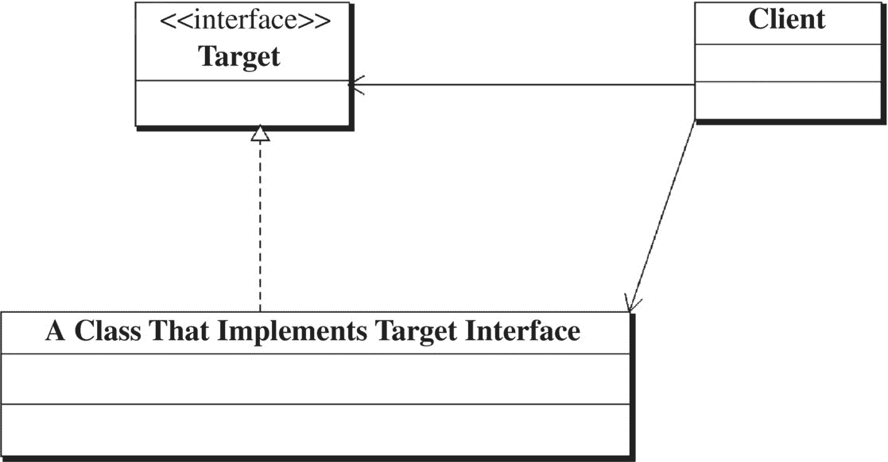

图 7.1

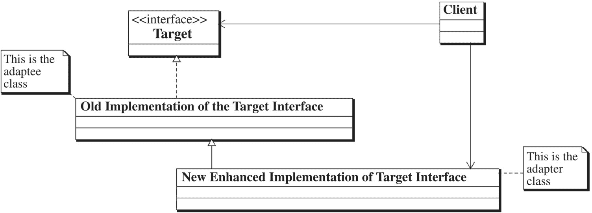

图 7.2

## 7.4 现实世界应用中的适配器模式

假设你的公司正参与为制造某些类的产品所需的工业控制器编写软件。例如，考虑为现在广泛用于制造的 6-DoF（六自由度）取放臂机器人创建一个控制器软件软件包。市上有大量的此类机器人，但它们都按照相同的原理工作——运动学控制原理。简要解释一下这意味着：控制器的主要目标是将机器人端执行器（把你的手想象成手臂的端执行器）发送到特定的 3D 坐标（占据了 3 个自由度）并具有特定的方向（占据了其他 3 个自由度）。假设我们处理的是所谓的关节机器人（articulated robots），控制器的主要工作是根据端执行器的给定位置和方向，计算机器人相邻连杆之间旋转关节处电机的旋转程度。控制器估计的关节旋转必须馈送到控制关节电机的低级函数调用中。换句话说，控制器软件必须针对一个描述电机函数调用的特定 API 编写。

在编写此类软件时，你的公司必须在以下两个选项之间做出选择：公司可能会选择为每种不同的机器人类型创建一个单独的软件包，或者公司可能会选择为其自己设计的低级 API 创建一个控制器包，然后根据适配器模式为不同类型的机器人提供适配器。由于控制器软件可能非常复杂，想象一下只有一个这样的包需要维护，你公司的工作将简单多少。与主控制器包相比，适配器可能要简单得多。通过将它们视为独立的软件部分，你将从自己的控制器包中消除对单个机器的依赖。因此，错误报告可能仅针对为特定机器人类型设计的适配器。显然，如果你的控制器如广告的那样工作，那么控制器本身出现故障的可能性就较低。

## 7.5 使用哈利·波特故事来演示适配器模式

我们对适配器模式的演示基于霍格沃魔法学校的 DADA（防御黑术）教学需求。这个职位被认为是因为伏魔在年轻时申请该工作被拒绝而被诅咒了。从以后，霍格沃出现了一批 DADA 老师。为了我们的演示，我们假设这种高频率的人员流动为学校带来了后勤问题。我们进一步假设学校管理要求每位 DADA 老师在引入他们选择的任何主题之前符合学校规定的基本教学大纲。

现在考虑以下情况：学校刚刚失去了一个 DADA 老师。于是学校聘请了一个新老师，结果证明这位老师还想教育学生黑术的道德维度。学校希望满足新老师的愿望，但由于资源短缺，不想对自己的记录和学校管理协议进行太多的更改。学校如何实现这一点呢？通过适配器模式，正如你将在本章其余部分所看到的。

## 7.6 模式演示的高层视图

图 7.3 展示了我们适配器模式（Adapter pattern）演示的类图。（更准确地说，此图描述了该模式的主要演示。7.11 节和 7.12 节 own 了实现适配器模式的另外两种方式。）我们将使用接口 `TeachingDADA` 中声明的方法，从高级层面表示黑魔法防御术（DADA）老师必须向霍格沃茨学生教授的内容。

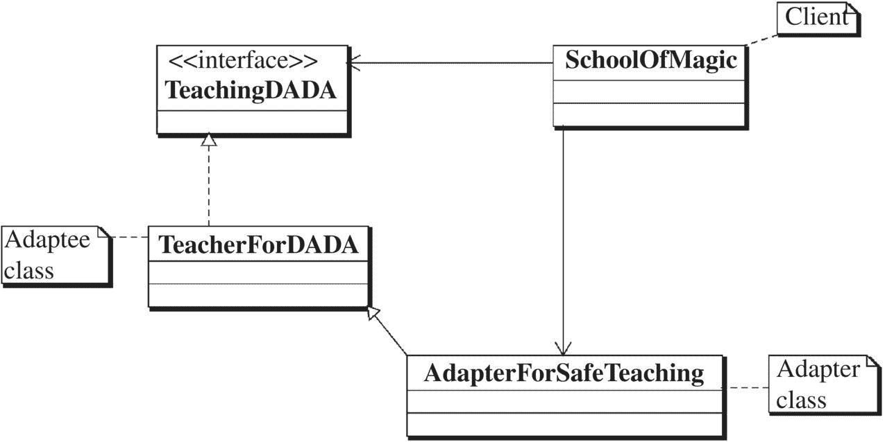

图 7.3

我们假设旧老师已在一个名为 `TeacherForDADA` 的类中实现了 `TeachingDADA` 接口。正如你稍后在那个类中看到的，旧老师以一种非常通用的方式，或者你可以说是以一种实事求是的方式进行教学。他的课程完全没有涉及道德问题，也没有警告学生练习黑魔法可能会导致灵魂毁灭，并可能导致他们身体毁容。

聘请的新老师通过一个名为 `AdapterForSafeTeaching` 的适配器类来实现教学大纲，该类扩展了旧老师的类 `TeacherForDADA`。新类相对于被适配类（adaptee class）`TeacherForDADA` 和目标接口（Target interface）`TeachingDADA` 是适配器类。

对于通过客户端类 `SchoolOfMagic` 实现的魔法学校，我们将使用基础教学接口 `TeachingDADA` 通过以下声明来定义老师实例：

```java
TeachingDADA teacher;
```

如果学校续签了上任老师的合同（假设该老师还在职），它将把 `teacher` 实例变量设置为调用 `TeacherForDADA` 构造函数返回的对象。然而，我们知道旧老师不再可用，新老师将以稍微不同的方式教授相同的课程。为了在我们的软件演示中完成从旧老师到新老师的切换，学校只需要将变量 `teacher` 的绑定改为 `AdapterForSafeTeaching` 的实例。这之所以行得通，是因为正如图 7.3 所示，适配器类 `AdapterForSafeTeaching` 派自 `TeacherForDADA`（而后者又实现了目标接口 `TeachingDADA`）。因此，`AdapterForSafeTeaching` 的实例也是 `TeachingDADA` 类型。

虽然适配器类 `AdapterForSafeTeaching` 将为目标接口 `TeachingDADA` 中的所有方法提供实现，但它还通过以下方法包含额外的额外功能：

```java
doTeachPowerOfLove();
doTeachHowDarkMagicCanHarmTheCaster();
doTeachAboutProtectiveDevices();
```


适配器类需要这些方法，因为它们将在其对`TeachingDADA`接口中原始声明的方法的重写实现中被调用。

重复一遍，我们使用`TeacherForDADA`作为被适配类，并使用`AdapterForSafeTeaching`作为适配器类。正如你预期的，除了提供额外功能外，适配器类还对被适配类进行了适配，使得客户端`SchoolOfMagic`在从被适配类切换到适配器类时，只需要更改代码中的单行。

## 7.7 目标接口：`TeachingDADA`

本节展示了霍格沃茨魔法学校发布的`TeachingDADA`接口。该接口在高级层面阐明了学校对黑魔法防御老师应该教授内容的期望。尽管黑魔法有许多形式，但接口将仅关注以下五种：

- **钻心咒（Cruciatus Curse）：** 这种咒语会导致极度痛苦。它是三大不可饶咒之一，另外两个是杀嘴咒（Avada Kedavra Curse）和夺魂咒（Imperius Curse）。
- **魂器（Horcrux）：** 魂器是一个无生命的物体或生物，黑巫师可以将部分灵魂存放在其中以求安全，目的是实现永生。
- **石化石（Petrificus Totalus）：** 这种咒语会导致受害者进入石化般的昏迷状态。
- **闷咒（Sectumsempra）：** 这种咒语旨在割伤受害者。受害者身上的伤口遵循攻击者魔杖的动作。如果魔杖在指向特定肢体时保持不动，咒语会导致该肢体与身体分离。
- **杀嘴咒（Avada Kedavra）：** 这是三大不可饶咒之一，它会导致即刻死亡。如前所述，另外两个不可饶咒是已经描述过的钻心咒和夺魂咒，后者会导致受害者表现得像施咒者的的奴隶一样。

巫师可以利用多种手段来防御黑魔法可能造成的伤害。例如，护盾咒（Shield Charm）可以让某些并非那么强力的咒语变得更弱，甚至反弹回攻击者身上。还有嗅声器（sneakascope），这是一种小型旋转玻璃顶，如果它检测到附近有怀有恶意的人，就会发出尖锐的声音。同时也存在针对咒语的防御方法。例如，可以通过躲在墙或其他物体后面来防御杀嘴咒。用这种方式使用的防护物体在被杀嘴咒击时会燃起火焰。学校期望黑魔法防御老师指导学生这些防御技术。

我们下面展示的教学接口简单表示，如果遇到任何方法名所示的黑魔法实例，老师将提供如何防御的指导。

```java
public interface TeachingDADA {

    defenseAgainstCruciatusCurse();

    defenseAgainstPetrification();

    defenseAgainstSectumsempra();

    defenseAgainstAvadaKedavra();

    awarenessOfHorcrux();

}
```

## 7.8 `TeacherForDADA`类

霍格沃茨的上一任黑魔法防御老师由下方的类表示。尽管它符合学校指定的`TeachingDADA`接口，但该类主要关注黑魔法的教学，很少提到练习这些艺术为什么是不道德的。

在我们的演示中，在成为黑咒受害者时教授如何防御的行为由该类（更准确地说是该类的实例）打印相关的教育信息组成。

```java
public class TeacherForDADA implements TeachingDADA {

    public void defenseAgainstCruciatusCurse(){

        System.out.println(

            "这种诅咒会造成极度痛苦。诅咒的 "

            + "整体效果取决于施咒者的心理状态 "

            + "以及施咒者施加酷刑的意图有多 "

            + "强烈。"

        );

        System.out.println(

            "目前没有针对这种诅咒的特定反咒。"

            + "可以尝试使用护盾咒 Protego Horribilis。"

            + "预计会被这种诅咒击中的个人也可以 "

            + "随身携带一个嗅视镜（sneakoscope），这是一种 "

            + "微型玻璃陀螺，当有恶意意图的人在 "

            + "附近时，它会发出尖锐的声音。 "

        );

    }

    public void awarenessOfHorcrux() {

        System.out.println(

            "魂器可以是一个生物体，也可以是一个物体。"

            + "渴望永生的黑巫师会将灵魂的一部分 "

            + "储存在魂器中。"

        );

        System.out.println( "可以用蛇毒毒摧毁。 ");

    }

    public void defenseAgainstPetrification() {

        System.out.println(

            "石化会让生物体进入一种类似岩石的 "

            + "无意识状态。"

        );

        System.out.println(

            "可以用曼德拉恢复剂复活。"

        );

    }

    public void defenseAgainstSectumsempra() {

        System.out.println(

            "黑魔法绞首咒（Sectumsempra）会导致受害者的 "

            + "皮肤根据施咒者手中魔杖的动作被切割。"

            + "然而，如果施咒者没有移动魔杖而只是 "

            + "指向受害者的肢体，受害者可能会失去 "

            + "那条肢体。"

        );

        System.out.println(

            "黑魔法绞首咒存在一种反咒 --- "

            + "它被称为 Vulnera Sanentur。当哈利对 "

            + "德拉科·马尔福施放黑魔法绞首咒时，"

            + "斯内普使用了这种反咒。"

        );

    }

    public void defenseAgainstAvadaKedavra() {

        System.out.println(

            "黑魔法艺术中最黑暗的艺术是杀杀杀咒（Avada Kedavra）。"

        );

        System.out.println(

            "它会被爱的力量阻挡。也就是说，如果你被 "

            + "过去或现在的人给予的爱所‘保护’，"

            + "这种最黑暗的诅咒就会从你身上弹开。"

            + "哈利免受这种诅咒的侵害是因为 "

            + "他的母亲为他付出了爱的终极牺牲。"

            + "已知对这种诅咒有防御的只有 "

            + "伏地魔，是因为他拥有魂器。如果受害者 "

            + "躲在坚固物体后面，这种诅咒也可以 "

            + "被阻挡。物体被诅咒击中时 "

            + "会起火焰。诅咒以闪电的形式 "

            + "击中受害者。"

        );

    }

}
```

## 7.9 `AdapterSafeTeaching`类

本节介绍的适配器类代表了新的黑魔法防御术老师，他显然必须符合学校指定的`TeachingDADA`接口，并且尽可能地也利用`TeacherForDADA`类中的教学材料，这对应于前任老师教授黑魔法防御术的方式。

请注意适配器在接随后的类中是如何实现的。对于`TeachingDADA`接口中声明的每个方法，下面的适配器类都结合了在被适配类`TeacherForDADA`中定义的实现以及此处定义的新功能。例如，`defenseAgainstCruciatusCurse()`方法的实现调用了本地定义的方法来教授如何对人施展钻心咒，然后调用了从父类`TeacherForDADA`继承的关于该诅咒教学的其他教育材料。

通过这种方式，由`AdapterSafeTeaching`类代表的新老师能够在实际开始教授各种魔法行为以及如何防御它们之前，注入了接触黑魔法的道德维度。

```java
public class AdapterSafeTeaching extends TeacherForDADA {

    public void defenseAgainstCruciatusCurse() {

        doTeachDarkMagicCanHarmTheCaster();

        doTeachPowerOfLove();

        super.defenseAgainstCruciatusCurse();

    }

    public void awarenessOfHorcrux() {

        doTeachDarkMagicCanHarmTheCaster();

        doTeachPowerOfLove();

        super.awarenessOfHorcrux();

    }

    public void defenseAgainstPetrification() {

        doTeachAboutProtectiveDevices();

        super.defenseAgainstPetrification();

    }

    public void defenseAgainstSectumsempra() {

        doTeachDarkMagicCanHarmTheCaster();

        super.defenseAgainstSectumsempra();

    }

    public void defenseAgainstAvadaKedavra() {

        doTeachDarkMagicCanHarmTheCaster();

        super.defenseAgainstAvadaKedavra();

    }

    void doTeachPowerOfLove() {

        System.out.println(

            "爱的魔法可以战胜黑暗的魔法"

        );

    }

    void doTeachDarkMagicCanHarmTheCaster() {

        System.out.println(

            "使用黑魔法会腐蚀施咒者的灵魂和身体。"

            + "邪恶巫师可能利用这种魔法延长寿命"

            + "并获得巨大的力量。练习这种艺术"

            + "会让巫师变得畸形且不像人性。"

        );

    }

    void doTeachAboutProtectiveDevices() {

        System.out.println(

            "不要忘记带上嗅视镜探测器作为 "

            + "通用防护。"

        );

    }

}
```

## 7.10 客户端`SchoolOfMagic`

现在展示客户端`SchoolOfMagic`。记得当学校聘请新老师时，客户端类中只有一行需要更改——就是我们设置`teacher`变量的行。代码的其他部分与前任老师时完全一致。

```java
public class SchoolOfMagic {

    TeachingDADA teacher;

    public SchoolOfMagic() {

        teacher = new AdapterSafeTeaching();

    }

    public void teachDefenseAgainstDarkArts() {

        teacher.defenseAgainstPetrification();

        System.out.println("\n\n");

        teacher.defenseAgainstCruciatusCurse();

        System.out.println("\n\n");

        teacher.awarenessOfHorcrux();

        System.out.println("\n\n");

        teacher.defenseAgainstPetrification();

        System.out.println("\n\n");

        teacher.defenseAgainstSectumsempra();

        System.out.println("\n\n");

        teacher.defenseAgainstAvadaKedavra();

    }

    public static void main(String[] args) {

        SchoolOfMagic hogwarts = new SchoolOfMagic();

        hogwarts.teachDefenseAgainstDarkArts();

    }

}
```

这就完成了适配器模式的演示代码。更准确地说，这完成了适配器模式中“类适配器”（`Class Adapter`）版本的演示代码（关于其具体含义，请参见下一节）。通常情况下，在章节的这一位置，下一节会被标记为“运行代码”，其中将展示模式演示的可执行类产生的输出。在本章中，我们偏离了这一公式，因为我们需要让读者意识到实现适配器模式的另外两种方式。你到为止所看到的代码执行后产生的输出将在本章的第7.13节中给出。

## 7.11 对象适配器（OBJECT ADAPTER）

读者可能还记得，适配器模式的目的是让客户端能够使用一个新类来替换现有类，或者增强其功能，而只需要对客户端代码进行极少的改动。因此，正如前面提到的，我们将旧类视为被适配器类（adaptee class），将新类视为适配器类（adapter class）。适配器类必须适应被适配器，同时可能增强旧类所提供的功能。

我们在本章中到为止所演示的内容被称为实现适配器模式的`类适配器`方法。存在另外两种实现此模式的方法：`对象适配器（Object Adapter）`方法和`可插拔适配器（Pluggable Adapter）`方法。在本节中，我们将解释什么是“对象适配器”。下一节将介绍“可插拔适配器”。

在本章之前的节介绍的类适配器方法中，适配器类是自自被适配器类并重写了它的方法。在本节介绍的对象适配器方法中，适配器将**不会**继承自`Adaptee`（被适配器）。相反，适配器现在将构造一个被适配器的实例，然后调用该实例，以获取适配器从被适配器处所需的功能，同时为客户端提供额外的功能（在我们的案例中是`SchoolOfMagic`）。

在我们对对象适配器方法的演示中，我们将使用与之前相同的`TeachingDADA`接口。请记住，该接口规定了学校对 DADA 老师在课堂上涵盖内容的最低预期。我们还将使用与之前相同的`TeacherForDADA`类来表示旧老师。至于客户端，我们将再次使用之前展示的`SchoolOfMagic`类。因此，在我们对象适配器方法的演示中，唯一的新类是`AdapterForSafeTeaching`。记住，这代表了新老师。

适配器类的新版本如下。根据上面的解释，我们现在不再继承自`TeacherForDADA`，而是使用一个类型为`TeacherForDADA`的实例变量。随后，我们在该变量上调用接口`TeachingDADA`中声明的各种方法，以引入被适配器类`TeacherForDADA`中定义的功能。

```java
public class AdapterForSafeTeaching implements TeachingDADA {

    TeachingDADA oldTeacher = new TeacherForDADA();

    public void defenseAgainstCruciatusCurse(){

        doTeachHowDarkMagicCanHarmTheCaster();

        doTeachPowerOfLove();

        oldTeacher.defenseAgainstCruciatusCurse();

    }

    public void awarenessOfHorcrux(){

        doTeachHowDarkMagicCanHarmTheCaster();

        doTeachPowerOfLove();

        oldTeacher.awarenessOfHorcrux();

    }

    public void defenseAgainstPetrification(){

        doTeachAboutProtectiveDevices();

        oldTeacher.defenseAgainstPetrification();

    }

    public void defenseAgainstSectumsempra(){

        doTeachHowDarkMagicCanHarmTheCaster();

        oldTeacher.defenseAgainstSectumsempra();

    }
}
```


```java
public void defenseAgainstAvadaKedavra() {
    doTeachHowDarkMagicCanHarmTheCaster();
    oldTeacher.defenseAgainstAvadaKedavra();
}

void doTeachPowerOfLove() {
    System.out.println(
        "The magic of love can conquer the darkest magic"
    );
}

void doTeachHowDarkMagicCanHarmTheCaster() {
    System.out.println(
        "Use of Dark Magic can corrupt the soul "
        + "and body of the caster. An evil wizard "
        + "may use such magic to prolong the "
        + "life and obtain great power. A "
        + "look deformed and inhuman."
    );
}

void doTeachAboutProtectiveDevices() {
    System.out.println(
        "Don’t forget to take along the "
        + "Sneoscope detector as a "
        + "general protection against curses "
        + "and spells."
    );
}
```

关于类适配器和对象适配器的相对缺点，这里是前者的某些优点：类适配器让被适配器更容易流通过。为了进一步解释这一点，如果第 7.9 节中的`AdapterForSafeTeaching`类没有重写所有方法，`SchoolOfMagic`仍然可用。

至于对象适配器的优点，在本节所示的对象适配中，适配器构造一个被适配器的实例，然后选择性地使用后者或对其增强。这减轻了客户端的工作。

## 7.12 可插拔适配器（PLUGGABLE ADAPTER）

到为止，我们介绍了实现适配器模式的两种方法：类适配器方法和对象适配器方法。上一节也介绍了这两种方法的相对优点。

现在我们演示第三种方法——`可插拔适配器`。这种方法允许我们动态（即在运行时）更改被适配器的选择。在之前的两个演示中，被适配器类是固定的。

我们将通过以下假设来解释第三种方法：假设有两种不同类型的 DADA 老师，*vecchio*（旧）和*nuovo*（新），后者更有可能向学生灌输练习黑暗艺术的不道德性。学校在某一年聘用什么类型的 DADA 导师完全取决于校长的喜好。因此，聘用的新老师可能需要适应*vecchio*风格的 DADA 教学或*nuovo*风格。为了在程序中体现这一点，我们需要两个不同的被适配器类，命名为`TeacherVecchio`和`TeacherNuovo`。

接下来的演示了客户端类`SchoolOfMagic`如何轻松地在两个适配器类（adaptee classes）之间切换。新的讲师以`PluggableAdapterForDADATeaching`类实例的形式存在，它将适应运行时对适配器类所做的任何选择。此演示的高层视图如图图 7.4 中的类图所示。

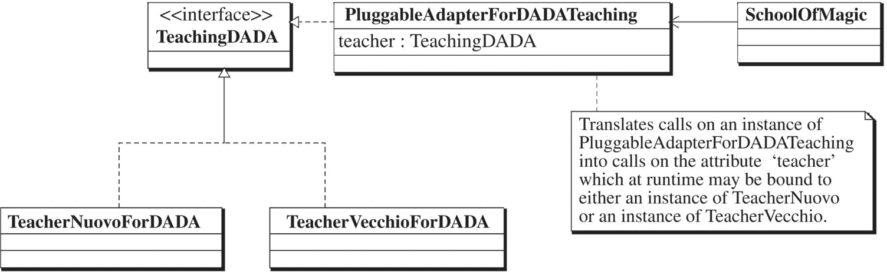

**图 7.4**

正如读者所想象的，此演示的关键在于展示`PluggableAdapterForDADATeaching`类允许在运行时于`TeacherNuovo`和`TeacherVecchio`之间切换适配器类。

至于如何实现，请注意`PluggableAdapterForDADATeaching`类的一个非常有趣的特性：`TeachingDADA`接口在类定义中同时扮演两个不同的角色。一方面，该类实现了`TeachingDADA`接口；另一方面，它拥有一个类型为`TeachingDADA`的实例变量。

我们希望可插适配器类实现`TeachingDADA`接口，因为客户端类`SchoolOfMagic`正通过其实例变量`teacher`接收 DADA 讲师。记住，一个新的 DADA 讲师是从适配器类构造的实例。但实现`TeachingDADA`接口意味着`PluggableAdapterForDADATeaching`类现在负责提供该接口声明的所有方法的实现。

这就是适配器类的私有实例变量`teacher`大显身手的地方。在下面所示适配器类的`TeachingDADA`方法实现代码中，我们只需要在适配器类定义的实例变量`teacher`上调用相同的方法名。这是可插适配器运行时适配属性的关键。校长可以在运行时选择任类型的老师，可插适配器将提供为该老师定义的功能。

```java
public class PluggableAdapterForDADATeaching implements TeachingDADA {
    private TeachingDADA teacher;

    public PluggableAdapterForDADATeaching(TeachingDADA adaptee) {
        teacher = adaptee;
    }

    public void defenseAgainstCruciatusCurse() {
        teacher.defenseAgainstCruciatusCurse();
    }

    public void defenseAgainstPetrification() {
        teacher.defenseAgainstPetrification();
    }

    public void defenseAgainstHorcrux() {
        teacher.defenseAgainstHorcrux();
    }

    public void defenseAgainstSectumsempra() {
        teacher.defenseAgainstSectumsempra();
    }

    public void defenseAgainstAvadaKedavra() {
        teacher.defenseAgainstAvadaKedavra();
    }
}
```

下面显示了两个适配器类中的第一个`TeacherVecchio`类的代码：

```java
public class TeacherVecchioForDADA implements TeachingDADA {
    public void defenseAgainstCruciatusCurse() {
        System.out.println(
            "这种咒语会带来极度痛苦。咒语的整体效果 "
            + "取决于施法者的心理状态以及施法者施加 "
            + "酷刑意图有多强烈。"
        );

        System.out.println(
            "目前已知这种咒语的特定反咒。"
            + "可以尝试护盾咒 Protego Horribilis。"
            + "预计会被这种咒语击中的个人也可以 "
            + "随身携带目测器（sneakoscope），这是一种 "
            + "微型玻璃陀，当有邪念的人在附近时 "
            + "它会发出尖锐的声音。"
        );
    }

    public void awarenessOfHorcrux() {
        System.out.println(
            "魂器可以是一个生物，也可以是一个物体。"
            + "巫师想要在魂器中放入部分 "
            + "灵魂。"
        );

        System.out.println("可以用蛇眼毒液摧毁。");
    }

    public void defenseAgainstPetrification() {
        System.out.println(
            "石化会将一个生物变成像石头一样的状的 "
            + "无意识状态。"
        );

        System.out.println("可以使用曼德拉根恢复药复活。");
    }

    public void defenseAgainstSectumsempra() {
        System.out.println(
            "夺舌咒会使受害者的皮肤根据施法者 "
            + "魔杖的动作被划割。然而，如果施法者 "
            + "没有移动魔杖而只是指向受害者的肢体，"
            + "受害者可能会失去那条肢体。"
        );

        System.out.println(
            "夺舌咒存在一种反咒 --- 它被称为 "
            + "Vulnera Sanentur。斯内普对德拉科·马尔福 "
            + "使用过这种反咒。"
        );
    }

    public void defenseAgainstAvadaKedavra() {
        System.out.println("黑暗艺术中最黑暗的是杀戮咒。");

        System.out.println(
            "会被的力量防御。也就是说，如果你被 "
            + "过去或现在的人给你的爱所‘保护’，"
            + "这种最黑暗的咒语就会从你身上弹开。"
            + "哈利受到了这种咒语的保护，因为他的母亲 "
            + "为他付出了爱的终极牺牲。已知拥有 "
            + "这种咒语防御的另一个生物是伏地魔，"
            + "因为他有魂器。如果受害者躲在坚固物体后，"
            + "这种咒语也可以被阻挡。物体被咒语 "
            + "击中时会燃起火焰。咒语以绿色闪电 "
            + "的形式击中受害者。"
        );
    }
}
```

`TeacherNuovoForDADA`类也显示在下方。

```java
public class TeacherNuovoForDADA implements TeachingDADA {
    public void defenseAgainstCruciatusCurse() {
        doTeachHowDarkMagicCanHarmTheCaster();
        doTeachPowerOfLove();

        System.out.println(
            "这种诅咒会造成极度痛苦。诅咒的整体 "
            + "效果取决于施咒者的心理状态 "
            + "以及施咒者施加酷刑的意图有多么强烈。"
        );

        System.out.println(
            "目前不知道这种诅咒有特定的破解咒。 "
            + "可以尝试护盾咒 Protego Horribilis。预计 "
            + "会被这种诅咒击中的个人还可以 "
            + "携带嗅谎器，这是一种小型 "
            + "玻璃陀螺，当有邪恶的人在附近时 "
            + "发出尖锐的声音。"
        );
    }

    public void awarenessOfHorcrux() {
        doTeachHowDarkMagicCanHarmTheCaster();
        doTeachPowerOfLove();

        System.out.println(
            "魂器可以是一个生物，也可以是一个物体。"
            + "想要长生不死的黑巫会将他/她的部分 "
            + "灵魂储存在魂器中。"
        );

        System.out.println("可以用蛇毒毒摧毁。");
    }

    public void defenseAgainstPetrification() {
        doTeachAboutProtectiveDevices();

        System.out.println(
            "石化会将一个生物变成类似石质的 "
            + "无意识状态。"
        );

        System.out.println("可以使用曼德拉恢复剂复活。");
    }

    public void defenseAgainstSectumsempra() {
        doTeachHowDarkMagicCanHarmTheCaster();

        System.out.println(
            "夺舌咒 Sectumsempra 会导致害者的皮肤 "
            + "根据施咒者所持魔杖的动作被划割。"
            + "然而，如果施咒者没有移动魔杖而只是 "
            + "指向受害者的肢体，受害者可能会失去 "
            + "那条肢体。"
        );

        System.out.println(
            "Sectumsempra 存在一种破解咒 --- 它 "
            + "称为 Vulnera Sanentur。当哈利对德拉科·马尔福 "
            + "施加夺舌咒时，斯内普使用了破解咒。"
        );
    }

    public void defenseAgainstAvadaKedavra() {
        doTeachHowDarkMagicCanHarmTheCaster();

        System.out.println(
            "这种黑魔法中最黑暗的是杀戮咒。"
        );

        System.out.println(
            "它会被爱的力量阻挡。也就是说，如果你被 "
            + "过去或现在的人们给你的爱所‘保护’，"
            + "这种最黑暗的诅咒就会在你身上 "
            + "被弹开。哈利免受这种诅咒的伤害， "
            + "因为他的母亲为他付出了爱的终极 "
            + "牺牲。已知另一个拥有这种诅咒防御的 "
            + "生物是伏地魔，因为他有魂器。"
            + "如果受害者躲在实物体后面，这种诅咒 "
            + "也可以被阻挡。物体被诅咒击中时 "
            + "会燃火焰。诅咒以绿色闪电的 "
            + "形式击中受害者。"
        );
    }

    void doTeachPowerOfLove() {
        System.out.println(
            "爱的魔法可以战胜最黑暗的魔法。"
        );
    }

    void doTeachHowDarkMagicCanHarmTheCaster() {
        System.out.println(
            "使用黑魔法会腐蚀施咒者的灵魂和身体。"
            + "邪恶巫师可能会使用这种魔法来延长 "
            + "自己的生命并获得伟大。练习这种 "
            + "术术会让巫师变得畸形且丧失。"
        );
    }

    void doTeachAboutProtectiveDevices() {
        System.out.println(
            "不要忘记带上嗅谎器探测器作为对咒的 "
            + "通用保护。"
        );
    }
}
```

最后，我们展示了插件式适配器（Pluggable Adapter）所需的客户端类`SchoolOfMagic`。

在阅读下面的定义之前，读者可能希望回顾一下之前关于适配器类`TeacherNuovo`和`TeacherVecchio`的注释，以理解为什么它们都需要继承自同一个接口`TeachingDADA`，以及为什么该接口必须声明客户端期望其 DADA 老师提供的所有服务。

读者可能也希望回顾早些关于`PluggableAdapter`类的讨论，以理解为什么它也必须实现适配器类的根接口。正如前面提到的，这是为了让下面所示`SchoolOfMagic`类中的`teacher`实例实现动态绑定，从而动态决定学校将使用哪个适配器的服务。

在下面的代码中，请注意`teacher`实例的两种可能选择。用户将在运行时被提示对适配器类做出何选择。正如你所预期的那样，你在`teachDefenseDarkArts()`方法中获得的教学服务取决于选择了哪个适配器。

```java
import java.util.*;

public class SchoolOfMagic {
    TeachingDADA teacher;

    public SchoolOfMagic() {
        System.out.println(
            "\n假设你是霍格沃魔法学校的校长。"
            + "你被旧式的 DADA 教学所吸引，"
            + "这种教学专注于巫师如何防御"
            + "黑魔法，而同一门课程的新式教学"
            + "也涉及了使用黑魔法的道德维度。"
            + "你习惯于在最后一刻才决定"
            + "你雇佣的新老师应该遵循旧式还是"
            + "新式。吧，这一刻已经到了。如果你"
            + "希望新老师遵循旧式，"
            + "输入 1。否则输入 2："
        );

        Scanner sc = new Scanner(System.in);
        int in = sc.nextInt();

        if (in == 1) {
            teacher = new PluggableAdapterForDADeaching(
                new TeacherNuovoForDADA()
            );
        } else if (in == 2) {
```


```java
public class TeacherNuovoForDADA implements TeachingDADA {

    public void defenseAgainstCruciatusCurse() {
        doTeachHowDarkMagicCanHarmTheCaster();
        doTeachPowerOfLove();
        System.out.println(
            "这种诅咒会造成极度痛苦。诅咒的整体 "
            + "效果取决于施咒者的心理状态 "
            + "以及施咒者施加酷刑的意图有多么强烈。 "
        );
        System.out.println(
            "目前不知道这种诅咒有特定的破解咒。 "
            + "可以尝试护盾咒 Protego Horribilis。预计 "
            + "会被这种诅咒击中的个人还可以 "
            + "携带嗅谎器，这是一种小型 "
            + "玻璃陀螺，当有邪恶的人在附近时 "
            + "发出尖锐的声音。 "
        );
    }

    public void awarenessOfHorcrux() {
        doTeachHowDarkMagicCanHarmTheCaster();
        doTeachPowerOfLove();
        System.out.println(
            "魂器可以是一个生物，也可以是一个物体。"
            + "想要长生不死的黑巫师将他/她的部分 "
            + "灵魂储存在魂器中。 "
        );
        System.out.println("可以用蛇毒毒摧毁。 ");
    }

    public void defenseAgainstPetrification() {
        doTeachAboutProtectiveDevices();
        System.out.println(
            "石化会将一个生物变成类似石质的 "
            + "无意识状态。 "
        );
        System.out.println("可以使用曼德拉恢复剂复活。 ");
    }

    public void defenseAgainstSectumsempra() {
        doTeachHowDarkMagicCanHarmTheCaster();
        System.out.println(
            "夺舌咒 Sectumsempra 会导致害者的皮肤 "
            + "根据施咒者所持魔杖的动作被划割。"
            + "然而，如果施咒者没有移动魔杖而只是 "
            + "指向受害者的肢体，受害者可能会失去 "
            + "那条肢体。 "
        );
        System.out.println(
            "Sectumsempra 存在一种破解咒 --- 它 "
            + "称为 Vulnera Sanentur。当哈利对德拉科·马尔福 "
            + "施加夺舌咒时，斯内普使用了破解咒。 "
        );
    }

    public void defenseAgainstAvadaKedavra() {
        doTeachHowDarkMagicCanHarmTheCaster();
        System.out.println("这种黑魔法中最黑暗的是杀戮咒。");
        System.out.println(
            "它会被爱的力量阻挡。也就是说，如果你被 "
            + "过去或现在的人们给你的爱所‘保护’，"
            + "这种最黑暗的诅咒就会在你身上 "
            + "被弹开。哈利免受这种诅咒的伤害， "
            + "因为他的母亲为他付出了爱的终极 "
            + "牺牲。已知另一个拥有这种诅咒防御的 "
            + "生物是伏地魔，因为他有魂器。如果受害者"
            + "躲在实物体后面，这种诅咒 "
            + "也可以被阻挡。物体被诅咒击中时 "
            + "会燃火焰。诅咒以绿色闪电的 "
            + "形式击中受害者。 "
        );
    }

    void doTeachPowerOfLove() {
        System.out.println("爱的魔法可以战胜最黑暗的魔法。 ");
    }

    void doTeachHowDarkMagicCanHarmTheCaster() {
        System.out.println(
            "使用黑魔法会腐蚀施咒者的灵魂和身体。"
            + "邪恶巫师可能会使用这种魔法来延长 "
            + "自己的生命并获得伟大。练习这种 "
            + "术术会让巫师变得畸形且丧失。 "
        );
    }

    void doTeachAboutProtectiveDevices() {
        System.out.println(
            "不要忘记带上嗅谎器探测器作为对咒的 "
            + "通用保护。 "
        );
    }
}
```

假设你正在运行章节 7.6 到 7.10 节中的类适配器演示代码，根据章节 7.10 节 `SchoolOfMagic` 类 `main()` 方法中的代码，执行该类应该产生以下输出：

> `不要忘记带上嗅瓜探测器，以作为对诅咒和法术的通用防护。石化会将一个生物变成一种类似石的无意识状态。可以使用曼德根恢复药复活。`

> `使用黑暗魔法会腐蚀施法者的魂魄。邪恶巫师可能会利用这种魔法来延长自己的寿命并获得巨大的力量。练习此类术法会让巫师看起来变形且不似人类。爱的魔法可以战胜最黑暗的魔法。这种诅咒会带来极度痛苦。诅咒的整体效果取决于施法者的心理状态以及他们施酷的意图。目前还不知道这种诅咒有特定的反咒。你可以尝试护咒 Protego Horribilis。预计会被这种诅咒击中的个人也可以随身携带嗅瓜探测器，这是一种微型玻璃陀螺，当附近有怀有恶意的人时，它会发出尖锐的声音。`

> `....`
> `....`
> `....`

为了获得额外的见解，你可以尝试按照以下方向扩展该模式的代码：

* 在适配器模式的三种实现中，我们的所有方法都返回 `void`。我们之所以可以这样做，是因为我们使用了方法打印的文本来代表老师要教的内容。你可能希望创建替代性的演示，让方法返回结果。对客户端可以接受的值进行限制，并相对于被适配器类（adaptee classes）来编写你的适配器类，使得适配器类中获取的任何新功能都能满足客户端的限制。
* 我们对适配器模式的实现之所以变得简单，是因为我们在适配器类和被适配器类中使用了相同的数据类型。如果在情况不是如此的情况下需要这种模式该怎么办？假设客户端想用一个新软件包替换旧软件包（因为新软件包增加了旧软件包提供的功能），但面临着由于两个软件包使用的数据类型之间不兼容而引起的问题。现在，你需要一个更复杂的适配器类，因为它还必须将新软件包中的数据类型翻译为被适配器类使用的数据类型。看看你能否为这个想法创建一个演示。

# 8 桥接 (BRIDGE)

## 8.1 概念及其实现

似乎提出一个新概念并将其实现是同一枚硬币的两面。将两者认为是不可分割的，这适用于我们日常生活中所完成的大部分工作。我们考虑到某件事（为了响应需求或其他原因），然后付诸行动。在这些情况下，我们自己既是概念的创建者，也是实现者。

然而，还有其他同样多的例子，即构思新概念的人与实现这些概念的人不是同一种。例如，在房屋的概念化（最初通过一组概念图，然后通过建筑布局图）和最终的建造过程中，涉及了不同的实体。

有趣性的一点是，当概念化和实现由两个不同的实体执行时，这两个实体不能完全独立地相互运行。创建新概念的人必须对实现者的能力有良好的感知。毕竟，制定一个遥远到任何人都可能无法实施的计划有什么意义呢？这表明，在参与创建新概念的人与负责实现这些概念的人之间需要一种直接的联系。这种联系允许概念创建者将他们的想法传达给执行这些想法的人，并随后检查实现是否按照概念创建者所列出的规范执行。

这引导我们进入桥接模式的核心关注点。该模式告诉我们，在面向对象的软件中，可以存在两个不同的实体：一个负责指定概念，另一个负责实现这些概念的任务，以及这两个实体如何通过一种你可能会称为“桥接”的结构连接在一起。

## 8.2 意图与适用性

如果我们认为一个类连同它的属性定义了一个数据抽象，那么桥接模式的意图是将抽象与我们想要与抽象关联的行为的实现解耦。

在以下情况下，你应该考虑使用这种模式：

* 负责指定抽象的实体与负责为抽象相关的行为提供实现代码的实体是独立的；
* 需要允许对抽象及其实现进行独立的扩展；
* 需要向客户端“隐藏”客户端代码中使用的抽象实际上是如何实现这些的细节。

## 8.3 桥接模式简介

该模式关注了传统基于继承的类层次结构的一个主要缺点：它们受限于的问题在于，层次结构中的实现代码是永久地绑定在概念抽象层次结构上的。正如读者所知，在传统的类层次结构中，顶端是最通用的类，而底部的类则越来越专门。通常，从一个类中创建实例所需的所有代码都是该类从其父类和祖先继承的代码以及专门为该类定义的代码的组合。

实现代码与概念抽象之间的这种永久绑定，使得在编写完类层次结构的代码之后，修改和/优化实现变得更加困难。在某些情况下，这种永久绑定也会使得扩展概念抽象层次变得更加困难。

桥接模式教会我们如何将概念抽象层次结构与相关概念的实现类层次结构分开。这使得概念抽象的实现代码可以与抽象本身分开维护。这还允许可能存在两个独立的组织：一个负责发布高层次描述的概念抽象，另一个负责提供这些抽象的实现代码。

在解释桥接模式如何允许实现代码与类层次结构分离之前，让我们简要回顾一下传统编程的类层次结构，如图 8.1 所示。当你使用传统方法创建此类层次结构时，你会在根类 `A` 中放置供层次结构中所有其他类继承的最通用的属性和行为。随后，当你为类 `B` 编写代码时，将利用该类从其父类继承的属性和行为，并编写任何额外的代码来将这些属性和行为具体化为 `B`；以此此类推。这在概念抽象与实现这些抽象的功能代码之间创建了永久的绑定。通常情况下，这不是一个问题，因为提供概念抽象的软件供应商可能就是负责提供实现代码的供应商。而且，如果需要，使用该软件库的客户端始终可以通过对该库进行子类化以及额外的概念抽象和相关的实现代码，来根据其特定需求定制库定制。

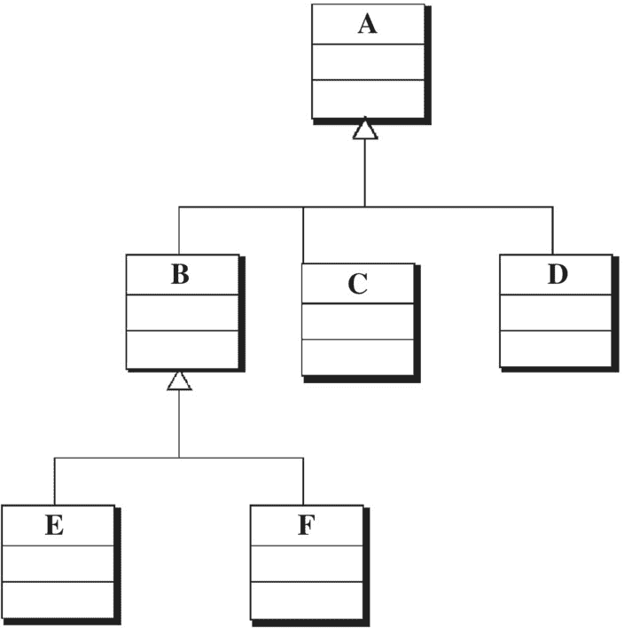

**图 8.1**

然而，在某些情况下，你最好创建一个与概念层次结构独立但又与之连接的实现层次结构。也就是说，在某些情况下，我们只想在一个类层次结构中*声明*我们所需的功能，然后在另一个类层次结构中放置实现该功能的代码，这两个层次结构之间是相互独立的。为了解释这里*独立*一词的含义，让我们暂时考虑一下只有一个概念类的情况。通过下面的示例，让我们看看我们如何将类的声明与其实现分离开。

下面所示的 `Hello` 类想要向其客户端提供一个名为 `sayHello()`的功能。然而，该功能的实际实现是由另一个名为 `Hello_impl` 的类提供的（同样如下所示）。`Hello` 类所做的仅仅是请求 `Hello_impl` 的实例来与 `sayHello()` 相关的行为执行所需的操作。

```java
######################## class Hello ########################

class Hello {

    private Hello_Impl imp = new Hello_Impl();

    public Hello( Hello_Impl impl ) {
        this.imp = impl;
    }

    public void sayHello() {
        imp.sayHello();
    }
}

###################### class Hello_Impl ######################

class Hello_Impl {

    public void sayHello() {
        System.out.println( "Here is a hello from class Hello " +
            " -- it was supplied by class Hello_Impl" );
    }
}

######################## class Client ########################

class Client {

    public static void main(String[] args) {
        Hello h = new Hello( new Hello_Impl() );
        h.sayHello();
    }
}
```


图 8.2 是上述代码的类图。如果我们将这种概念（显然用类表示）与其实现之间的分离扩展到图 8.1 的层次结构，那么该层次结构的整体实现将看起来像图 8.3 所示，其中实现类的名称带有 `_Impl` 后缀。我们会在根实现类 `A_Impl` 中（它可能是抽象的）放置实现层次结构中所有其他类预期提供的功能声明。为了举一个简单的例子，假设每个概念类都有一个名为 `name` 的实例变量，我们期望每个类都提供一个返回从该类构造的实例中 `name` 值的"get"方法。基于桥接模式的软件设计，必须由实现层次结构提供此功能。因此，根节点的抽象实现类（我们在图 8.3 示例中的 `A_Impl`）必须声明一个命名类似于 `getName()` 的方法。


**图 8.2**

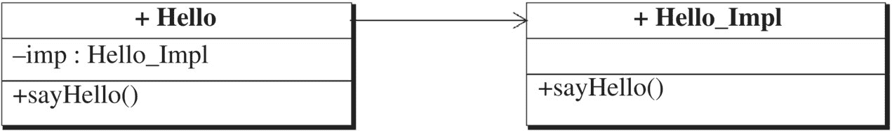

**图 8.3**

## 8.4 现实应用中的桥接模式

为了理解此模式如何在实际应用中使用的，首先熟悉 E-API 的概念是很好的，它代表*扩展 API*（*Extension API*）。更熟悉的 API 是*服务 API*（*Service API*），当需要将其与 E-API 区分时标记为 S-API。S-API 通常由软件模块提供的方法列表（以方法签名的形式）组成。希望利用模块功能的人可以根据 S-API 中的声明来调用这些方法。

另一方面，模块的 E-API 是该模块期望由其他软件制品（通常称为插件）实现的方法的声明。插件的目的是通过额外的能力扩展模块的功能。为给定模块的插件创建实现代码的人只需要查看该模块的 E-API 即可。换句话说，如果你是一个插件开发者，只要你能够访问该模块的 E-API，你可能不需要查看该模块的源代码。

这种基于插件的设计在软件工程中被广泛使用。此类设计最流行的例子也许是用于软件开发的 Eclipse IDE、Java 平台的 EJB 容器框架等。

根据第 8.3 节的讨论，插件结合通过 E-API 暴露的概念层次结构构成了桥接模式的实现。

## 8.5 用于说明桥接模式的哈利·波特故事

为了演示桥接模式，我们将考虑一个涉及哈利·波特中某些魔法生物（特别是类人生物）的概念层次结构。演示将基于：食魂者、地精精和家养精灵。我们在图 8.4 中展示了这一层次结构。

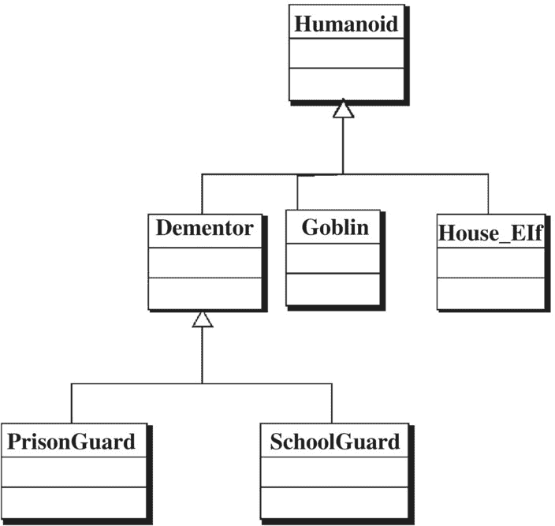

**图 8.4**

桥接模式告诉我们，按照图 8.5 所示的方式来实现如图 8.4 中的类层次结构具有若干优势。在后者的图中，我们通过为原始层次结构中的每个类创建一个相应的实现类，将实现代码保持在独立的层次结构中。

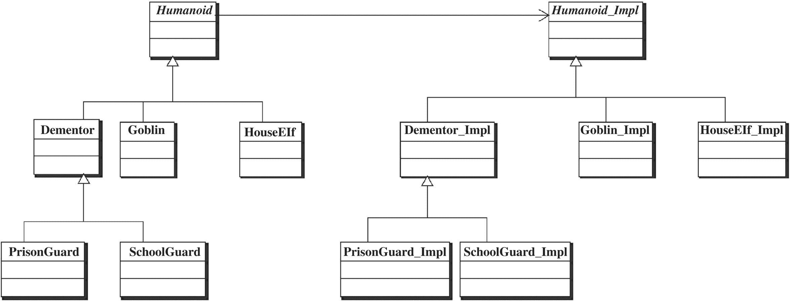

**图 8.5**

当实现代码按照图 8.5 所示的方式进行组织时，扩展概念层次结构会变得更容易，特别是当一个新概念可以使用现有的实现时。为了解释这一点，假设在我们按照图 8.5 所示的方式编写了 `Humanoid` 层次结构的实现后，我们想要创建一个 `Human` 层次结构，作为 `Humanoid` 层次结构的子类（人类是类人，但反之不然）。让我们假设该概念层次结构的供应商还希望为这个新的 `Human` 创建子类，这些子类将对应于类人的 `Dementor`、`Goblin` 和 `HouseElf` 子类（2）。

有了图 8.5 所示的新型解耦实现，供应商现在可以按照图 8.6 所示的方式继续操作。由于 `Dementor` 可能会与类人的 `Dementor` 共享许多特征，最初编写在 `Dementor_Impl` 中的大部分代码现在可以直接复用在 `Dementor_Impl` 类的定义中。`Goblin_Impl` 和 `Elf_Impl` 类也是如此。甚至可能，当我们构造 `Dementor` 实例时，能够直接使用实现类 `Dementor_Impl` 来实现该目的。也就是说，我们可能甚至无需创建一个名为 `Dementor_Impl` 的独立实现类。这种方法对新创建的 `Goblin` 和 `Elf` 类可能同样有效。为了强调这一点，图 8.6 中的类图并没有显示 `Dementor`、`Goblin` 和 `Elf` 的独立实现类。

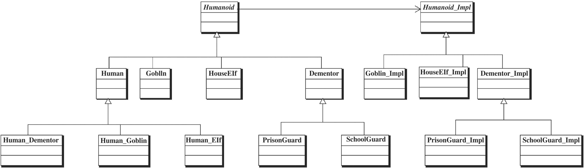

**图 8.6**

对于客户端类，我们的演示将使用"魔法部"（Ministry of Magic），因为该部的工作是跟踪魔法世界中的类人。该类将命名为 `MinistryOfMagic`，它将创建摄魂怪（Dementors）、地精精和家养精灵的不同实例。

## 8.6 模式演示的顶视图

图 8.7 展示了我们桥接模式演示的顶视图。如图所示，与我们之前的讨论一致，一方面，我们有一个 `Humanoid` 层次结构，它由同名的根抽象类及其子类 `Dementor`、`HouseElf` 和 `Goblin` 组成。另一方面，我们有一个实现层次结构，它由抽象根类 `Humanoid_Impl` 及其具体子类 `HouseElf_Impl`、`Goblin_Impl` 和 `Dementor_Impl` 组成。客户端类 `MinistryOfMagic` 的目标是构造魔法生物 `HouseElf`、`Goblin` 和 `Dementor` 的实例，而无需知道这些具体是如何创建的。

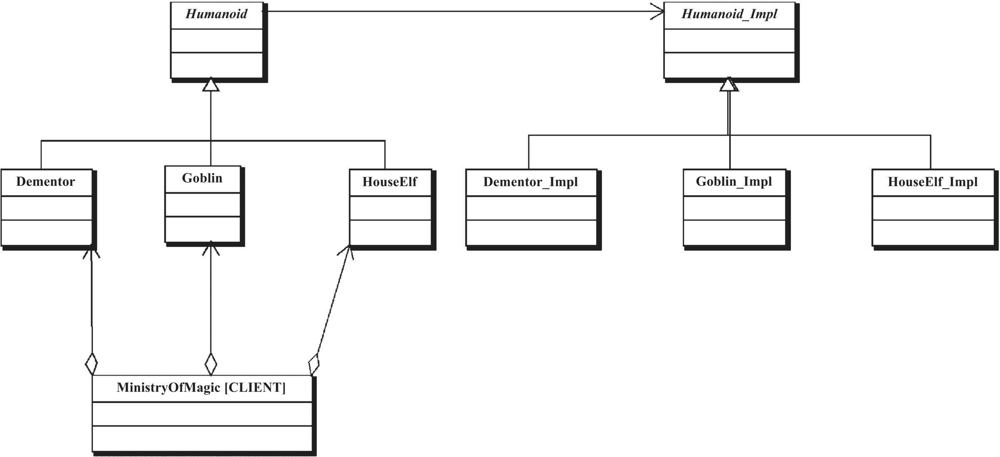

**图 8.7** 这一点对于桥接模式尤为重要：模式的客户端不需要知道软件功能被编码在一个独立的实现类层次结构中，该结构独立于类声明所在的层次结构。换句话说，`Humanoid` 是被编写为传统的基于继承的类层次结构，还是以桥接模式的形式编写，对客户端来说都没有影响。

## 8.7 Humanoid 类

本节介绍了概念层次结构的抽象根节点——`Humanoid` 类。我们将此类声明为抽象类，仅仅是因为通常你不想直接从该类构造实例。作为一个概念，`Humanoid` 的抽象性与像 `Bird` 这样的类的抽象性是相同的。在鸟类的类层次结构中，你会希望构造 `Bird` 更具体的子类的实例，例如 `BlueJay`、`Finch` 等。抽象根类 `Bird` 的目的仅仅是捕捉所有鸟的通用属性。抽象根类 `Humanoid` 也是如此。

在下方所示类定义中最值得注意的一点可能是，它有一个名为 `imp` 的实例变量，类型为 `Humanoid_Impl`。这是以 `Humanoid` 为根的概念层次结构与以 `Humanoid_Impl` 为根的实现层次结构之间唯一的联系。

```java
import java.util.*;

abstract class Humanoid {

    protected Humanoid_Impl imp;

    protected Humanoid(Humanoid_Impl imp) {
        this.imp = imp;
    }

    protected void registerWithMagic(String category) {
        imp.registerWithMagic(category);
    }

    protected void unRegisterWithMagic(String category) {
        imp.unRegisterWithMagic(category);
    }

    protected int howMany() {
        return imp.howMany();
    }

    protected String getName() {
        return imp.getName();
    }

    protected String getServingAs() {
        return imp.getServingAs();
    }

    public List<String> getAppearance(String category) {
        return imp.getAppearance(category);
    }

    public List<String> getBehavior(String category) {
        return imp.getBehavior(category);
    }
}
```

## 8.8 Dementor, Goblin 和 HouseElf 类

由于 `Humanoid` 层次结构中的三个类具有相似的定义，我们将它们在本节一起介绍。对于所示的 `Dementor` 类，请注意构造函数如何将实现类 `Dementor_Impl` 的实例发送给根类。对于方法定义，尽管这些方法大部分名称与父类相同，但它们实际上并不是相同的方法（也就是说，即使方法名与父类相同，父方法也需要类参数，而这里对应的方法是无参方法）。

```java
import java.util.List;

public class Dementor extends Humanoid {

    public Dementor(String occupation) {
        super(new Dementor_Impl(occupation));
    }

    public void registerWithMagic() {
        registerWithMagic("Dementor");
    }

    public void unRegisterWithMagic() {
        unRegisterWithMagic("Dementor");
    }

    public void printName() {
        String name = getName();
        System.out.println("The name of the dementor is: " + name);
    }

    public void printServingAs() {
        String name = getServingAs();
        System.out.println("The dementor is serving as: " + name);
    }

    public List<String> getAppearance() {
        List<String> list = getAppearance("Dementor");
        return list.toString();
    }

    public List<String> getBehavior() {
        List<String> list = getBehavior("Dementor");
        return list.toString();
    }
}
```

*(注：由于原文文本中 8.8 节的代码块在输入处似乎不完整，译文已根据逻辑尽可能翻译了提供的部分，并保持了代码块格式。)*

接下来，我们在 `Humanoid` 概念层次结构中介绍 `Goblin` 类。与 `Dementor` 类一样，请注意 `Goblin` 构造函数是如何将实现类 `Goblin_Impl` 的实例发送给 `Humanoid` 根类的构造函数的。这种机制为根类 `Humanoid` 中的实例变量 `imp` 赋予了正确的值。之前关于 `Dementor` 类方法定义的注释也适用于这里。特别地，我们指的是：尽管 `Goblin` 的几个方法名称与父类 `Humanoid` 中的方法相同，但由于它们的方法签名（signatures）不同，它们实际上并不是同一种方法。因此，`Goblin` 类中同名的方法并不是为了重写 `Humanoid` 类中对应的方法。

```java
import java.util.List;

public class Goblin extends Humanoid {

    public Goblin(String name, int age) {
        super(new Goblin_Impl(name, age));
    }

    public void registerWithMinistryOfMagic() {
        registerWithMinistryOfMagic("Goblin");
    }

    public void unRegisterWithMinistryOfMagic() {
        unRegisterWithMinistryOfMagic("Goblin");
    }

    public void printName() {
        String name = getName();
        System.out.println("The name of the Goblin is: " + name);
    }

    public String getAppearance() {
        List<String> list = getAppearance("Goblin");
        return list.toString();
    }

    public String getBehavior() {
        List<String> list = getBehavior("Goblin");
        return list.toString();
    }
}
```

最后，我们介绍 `HouseElf` 类。除了类名以及由于类名不同导致的变化外，下面所示的代码与 `Dementor` 和 `Goblin` 类代码完全相同。

```java
import java.util.*;

public class HouseElf extends Humanoid {

    public HouseElf(String name, int age) {
        super(new HouseElf_Impl(name, age));
    }

    public void registerWithMinistryOfMagic() {
        registerWithMinistryOfMagic("House Elf");
    }

    public void unRegisterWithMinistryOfMagic() {
        unRegisterWithMinistryOfMagic("House Elf");
    }

    public void printName() {
        String name = getName();
        System.out.println("The name of the House Elf is: " + name);
    }

    public String getAppearance() {
        List<String> list = getAppearance("House Elf");
        return list.toString();
    }

    public String getBehavior() {
        List<String> list = getBehavior("House Elf");
        return list.toString();
    }
}
```

## 8.9 Humanoid Imp 类

这是实现层次结构的根类。首先，请注意该类是抽象的，就像概念层次结构的根类 `Humanoid` 也是抽象的一样。我们不期望直接从该类创建实例。该类从实现的角度定义了尽可能通用地一个实体作为 Humanoid（类人）意味着什么。因此，在该根类的实现代码中，没有特定的 `Dementor`（食魂鬼）、`Goblin`（地精）等特定信息。

请注意该类的静态变量，即 `registeredHumanoids`、`behavior` 和 `appearance`。这些变量用于存储通用的类别级信息。也就是说，关于概念层次结构中所有具体概念的通用信息将存储在这些变量中。正如你所看到的，这三个静态变量中的 `behavior` 和 `appearance` 将在各自的实现类 `HouseElf_Impl`、`Goblin_Impl` 和 `Dementor_Impl` 中分别初始化。由于这些静态变量存储的是哈希表，信息以 `<key,value>` 对的形式存储，其中 key 是物种的名称，value 是该物种的属性列表。

下方显示了实现类 `Dementor_Impl`。该具体类的构造函数调用了父类 `Humanoid_Impl` 的单参数构造函数。此外请注意类定义中大括号内的双语句段落对静态变量 `behaviors` 和 `appearance` 的初始化。

由于我们正在定义一个继承自抽象类 `Humanoid_Impl` 的具体类，因此我们有责任为根类 `Humanoid_Impl` 中声明的抽象方法 `howManyRegistered()` 提供具体实现。此处显示的实现专门针对 `Dementor_Impl` 类。

```java
import java.util.*;

public class Dementor_Impl extends Humanoid_Impl {

    public Dementor_Impl(String occupation) {
        super(occupation);
    }

    {
        setBehavior("Dementor", new ArrayList<String>(
            Arrays.asList("soulless",
            "prison guard duty",
            "immortal"
        ) ) );
        setAppearance("Dementor", new ArrayList<String>(
            Arrays.asList("10 feet tall",
            "no eyes",
            "hole for mouth"
        ) ) );
    }

    public int howManyRegistered() {
        int n = 0;
        for (Map.Entry<String, String>
            entry : registeredHumanoids.entrySet()) {
            if ("Dementor".equals(entry.getValue())) n++;
        }
        return n;
    }
}
```


接下来我们展示实现类 `Goblin_Impl`。`Dementor_Impl` 的构造函数调用其父类的单参数构造函数来初始化子类实例的父类部分，而 `Goblin_Impl` 构造函数则调用父类的双参数构造函数来完成相同的操作。这种差异的原因是，如前面提到的，摄魂者大多通过一个属性广为人知——它们的职业（例如担任监狱守卫），而地精更有可能通过它们的名字和年龄等个人属性广为人知。

关于静态变量 `behaviors` 和 `appearance` 的初始化，此处的代码与 `Dementor_Impl` 类中的相同，如类定义中大括号内的双语句段所示。继承自父类的抽象方法 `howManyRegistered()` 的实现遵循与 `Dementor_Impl` 类相同的逻辑，尽管其具体细节特定于 `Goblin_Impl` 类。

```java
import java.util.*;

public class Goblin_Impl extends Humanoid_Impl {

    public Goblin_Impl(String name, int age) {
        super(name, age);
    }

    {
        setBehavior("Goblin", new ArrayList<String>(
            Arrays.asList(
                "no wands",
                "goblin magic only",
                "banking"
            )
        ));

        setAppearance("Goblin", new ArrayList<String>(
            Arrays.asList(
                "long thin fingers",
                "large domed heads",
                "large black eyes"
            )
        ));
    }

    public int howManyRegistered() {
        int n = 0;

        for (Map.Entry<String, String> entry :
                registeredHumanoids.entrySet()) {
            if ("Goblin".equals(entry.getValue())) {
                n++;
            }
        }

        return n;
    }
}
```

最后，我们展示实现类 `HouseElf_Impl`。由于它的定义与之前的类 `Goblin_Impl` 非常相似，因此代码不需要解释。

```java
import java.util.*;

public class HouseElf_Impl extends Humanoid_Impl {

    public HouseElf_Impl(String name, int age) {
        super(name, age);
    }

    {
        setBehavior("House Elf", new ArrayList<String>(
            Arrays.asList(
                "obedient",
                "pliant",
                "loyal"
            )
        ));

        setAppearance("House Elf", new ArrayList<String>(
            Arrays.asList(
                "small",
                "spindly arms",
                "large head"
            )
        ));
    }

    public int howManyRegistered() {
        int n = 0;

        for (Map.Entry<String, String> entry :
                registeredHumanoids.entrySet()) {
            if ("House Elf".equals(entry.getValue())) {
                n++;
            }
        }

        return n;
    }
}
```

## 8.1 客户端 `MinistryOfMagic`

这是演示桥接模式的可执行类。在该类的 `main()` 方法中，我们创建了 `HouseElf`、`Goblin` 和 `Dementor` 的实例并用 `MinistryOfMagic` 注册它们。我们还打印了不同类型人类的特征。

有趣的是，在类的 `main()` 中产生的输出是通过直接在不同类型的 `Humanoid` 实例上调用方法得到的。然而，读者现在应该知道，这些调用实际上是由 `Humanoid_Impl` 类中的代码处理的。例如，当我们注册一个 `HouseElf` 时，该代码位于 `Humanoid_Impl` 类中。同样，当我们打印一个 `HouseElf` 的名字时，该代码也位于 `Houseoid_Impl` 类中。

`Humanoid` 实例上的所有调用转化为 `Humanoid_Impl` 层次结构的调用，而当你意识到 `Humanoid` 抽象层次结构与 `Humanoid_Impl` 实现层次结构之间的连接是 `Humanoid` 类中的实例变量 `imp` 时，这一事实变得更加显著。

```java
public class MinistryOfMagic {
    public static void main(String[] args) {

        // House Elves:
        HouseElf elf1 = new HouseElf("Dobby", 15);
        elf1.registerWithMinistryOfMagic();
        elf1.printName();

        HouseElf elf2 = new HouseElf("Hokey", 15);
        elf2.registerWithMinistryOfMagic();
        elf2.printName();

        int n = elf2.howManyRegistered();
        System.out.println("Number of elves registered: " + n);

        // ...（此处省略重复代码）
    }
}
```

- 之前提到过桥接模式可以使概念层次结构的扩展变得更容易。图 8.6 显示，可以为 `Humanoid` 类构想一个 `Human` 子类，然后进一步将 `Human` 类扩展为 `Human_Dementor`、`Human_Goblin` 和 `Human_Elf` 类，这些类是真正的类人生物 `Dementor`、`Goblin` 和 `HouseElf` 更接近人类的等价物。按照这一思路修改本章演示的代码，看看你可以在多大程度上重用实现类 `Dementor_Impl`、`Goblin_Impl` 和 `HouseElf_Impl` 中已经提供的代码。

- 在客户端类 `MinistryOfMagic` 中，我们创建的所有 `Humanoid` 实例的引用都是由特定于这些实例类型的变量持有的。这通常被认为是一种糟糕的编程实践。^(4) 例如，这里是与 `MinistryOfMagic` 的 `main()` 方法中创建第一个类人生物 `HouseElf` 相关的语句：

```java
HouseElf elf1 = new HouseElf("Dobby", 15);
elf1.registerWithMinistryOfMagic();
elf1.printName();
```

由于 `HouseElf` 是一个 `Humanoid`，我们是否可以将变量 `elf1` 声明为 `Humanoid` 类型呢？如果你不知道答案，请看将 `elf1` 的类型从 `HouseElf` 改为 `Humanoid` 会发生什么，并为你观察到的现象给出理由。

# 9. 组合模式（COMPOSITE）

## 9.1 回路关系

不同类型对象之间最易理解的关系通常是严格层次化的。这种关系也容易可视化，因为它们可以以树的形式显示。考虑为生物体和植物创建的分类法。^(1) 在这些分类法中，对某个类别的成员身份划分基于共同的进化历史，类别之间的主要关系是源自最近共同祖先的共同后代。这种分类法是严格层次化的，因此可以作为树来显示。

现在让我们谈谈不同类型的人造物理对象之间以及不同类型的抽象概念之间的关系。虽然我们可以自由地使用任何标准来定义不同类别的成员身份以及类别之间关系的构成，但我们希望这些标准能产生某些用途。至于这个用途是什么，取决于你尝试建模物理对象或抽象概念的应用领域。

事实证明，人造对象和抽象概念所需的建模——即服务某些有用目的的建模——通常也是严格层次化的。任何做过一点点面向对象编程的人都知道，对象类别之间最常用的关系之一是继承，即父类别的后代继承父类的属性。至少在精神上，对于人造对象以及抽象概念的情况，类别之间纯基于继承的关系，与自然对象中基于进化历史的分类法关系是相似的。

尽管我们有很多关于人造对象和抽象概念的严格层次模型示例，但也存在许多并非如此的例子。也就是说，当我们对人造对象和抽象概念进行建模时，建模图中的某些关系可能需要从专门的类别回更通用的类别形成回路。这些回路链接通常涉及某种包含关系——这是一种关系概念，也被称为聚合（aggregation）、组合（composition）和 `has-a`（拥有）。^(2)

考虑以下简单的示例：假设我们想要建模座椅类对象之间的关系——即人们在不想站立或躺下时坐在上面的对象。我们可以将 `seat`（座椅）视为一个泛抽象对象，赋予它“可以坐”的属性。通过继承（通过 `is-a` 关系），我们现在指定更具体的对象类别，如 `chair`（椅子）、`stool`（凳子）、`sofa`（沙发）等作为根类别 `seat` 的子类。为止，我们的类别间关系完全是层次化的，可以以树的形式显示，`seat` 为根，具体类别作为根的节点。

然而，考虑到模块化家具已不再稀奇，而且通过组合不同配置的座椅可以设计出扩展的区域，我们可以构想另一个对象类别，称为 `combo_seat`（组合座椅）。^(3) 因为 `combo_seat` 毕竟是一个座椅，它也是 `seat` 的子类。但同时，`combo_seat` 也是其他 `seat` 对象的聚合。因此，在描述 `combo_seat` 对象的领域的关系时，我们必须显示从 `combo_seat` 回到通用类 `seat` 的链接。该链接显然是一个包含链接——类图术语中的关联链接（associational link）。因此，我们对类别的整体描述将显示从 `seat` 到每个 `chair`、`stool`、`sofa`、`combo_seat` 等的继承链接，然后是从 `combo_seat` 回到通用类 `seat` 的回路。

正如你在本章中看到的，组合模式利用类图中的这些回路，为了更高效地组织类实例的生成。

## 9.2 意图与适用性

组合模式的意图是通过相同接口中的代码以统一的方式处理所有对象，包括那些对其他对象的组合。

在以下情况下，你应该使用此模式：

- 所有类（包括涉及其他类的组合类）具有相同的基本类型；
- 类层次结构的客户端希望使用相同的根接口操作所有对象，包括涉及其他对象的组合对象；
- 你可以在根接口中放置必要的保护，以处理针对复杂类的行为调用在从其他类构建的对象上的情况。

## 9.3 组合模式简介

正如你从第 1 章所知以及在[第 9.1 节](#c09.xhtml_head-c9-1)中提到的那样，当我们认为一个大实体是由较小实体组成时，我们可以把前者称为后者的组合（composition）或组合体（composite）。通常情况下，组合体可能涉及异的元素。而且通常情况下，大实体本身可能与构成它的较小元素非常不同。这种组合如图 9.1 所示。该类图告诉我们，我们可以认为汽车是四个轮子、引擎、变速箱和车身的组合体。

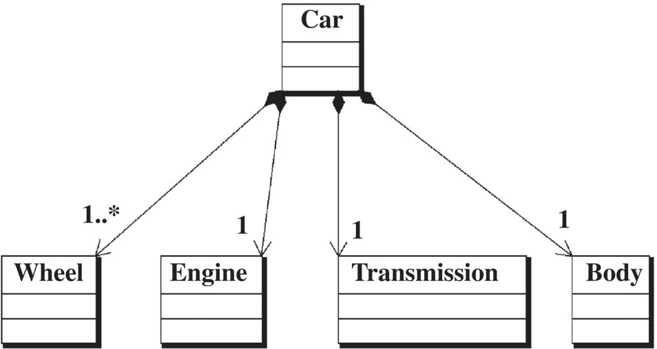

**图 9.1**

组合模式（Composite pattern）并不是为了图 9.1 所示的情况而设计的。为了理解该模式适用于哪种组合，让我们考虑为工厂的工作人员绘制一张类图。这些员工中有些是普通工人，有些是间头，有些是计算机操作员，有些是秘书，还有一些经理。经理是指监督一群工人、间头、计算机操作员、秘书等的人。因此，当我们定义 `Manager` 类时——我们将类定义看作代表个人所扮演的角色，而不仅仅是个人本身——它必须包含对经理所监督的个人的引用。为了构建这种情况的类图，我们首先注意到，所有在工厂工作的人员（包括经理在内）都是拥有该工厂的组织的员工。尽管 `Manager` 本质上是一个 `Employee`，但我们仍然为 `Manager` 类赋予实例变量，用于表示那些受经理监督的其他员工。虽然在类图中我们将 `Manager` 描述为 `Employee` 的特化类，但我们也希望显示出经理的角色涉及一个对其他 `Employee` 的组合。这些事实在图 9.2 的类图中得到了体现。

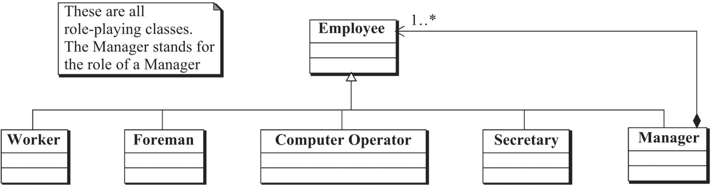

**图 9.2**

在图 9.2 的类图中，带箭头的链接表示我们通过继承扩展了 `Employee` 类。这些链接意味着 `Worker` 是一个 `Employee`，`Foreman` 是 `Employee`，`Secretary` 如此，`Computer Operator` 也是如此。更进一步，尽管 `Manager` 也是一个 `Employee`，但它的定义涉及对任意数量的 `Worker`、`Foreman`、`Computer Operator` 和 `Secretary` 实例的组合。最后一个事实是通过从 `Manager` 回到 `Employee` 的链接中端端的实心菱形（filled-diamond）表示的。这种组合正是组合模式的焦点。来自 `Manager` 的组合链接在 `Employee` 端的多重性符号 `1..*` 表示 `Manager` 角色涉及对任意数量的 `Employee` 角色的组合，只要经理至少监督一个其他员工即可。

由于图 9.2 建模图中显示的所有类都是 `Employee` 类型，我们可以提出以下问题：是否可能仅通过根类 `Employee` 类中定义的接口，就可以操作从类图中具体类中创建的所有对象？组合模式恰恰回答了这个问题。

组合模式告诉我们，从如图 9.2 所示的类层次结构中构建的所有对象，都可以通过仅为根类 `Employee` 定义的接口进行创建、访问和操作。这里特别值得注意的是，这还包括了从 `Manager` 类构建的对象，而该类的定义包含了对其他 `Employee` 对象的组合。你可能会问，由于 `Manager` 类预期的职责比非监督性的 `Employee` 类多得多，如何可能通过 `Employee` 接口甚至操作 `Manager` 对象呢？这正是组合模式的秘密所在。

根据组合模式，你为图 9.2 中的 `Employee` 类赋予了任何后代类（包括 `Manager` 类）所需的所有行为，但带有一个默认定义，该定义通常会在对对象进行不当的情况下调用这些行为时警告客户端。为了说明，假设我们想要定义一个名为 `hireSecretary()` 的方法，允许 `Manager` 实例能够聘佣新秘书。但由于允许 `Foreman` 实例聘佣秘书可能没有意义，我们将在根类 `Employee` 中定义此方法，并给出一个默认定义，仅抛出异常并显示警告消息。相反，此方法可以在 `Manager` 类中重写，以提供该类聘佣秘书所需的功能。

## 9.4 真实世界应用中的组合模式

该模式适用于任何你希望以统一方式处理基本类以及任何涉及对基本类组合的较大类的应用。最常见的情况下，你可能只想针对涉及不同类的特定计算执行此操作，如下文所示。

让我们假设，你正在为一个大类 `C[large]` 编写代码，该类通过其实例变量与若干更基础的类 `C[1]`、`C[2]`、`· · ·` 关联，这些类之前在可能不同的上下文中定义。你的应用程序要求你根据某些元素属性 `p[elem]` 遍历 `C[large]` 实例包含的所有对象。但不幸的是，该属性的计算在定义 `C[1]`、`C[2]`、`· · ·` 时并未包含在它们的实现中。假设 `p[elem]` 的计算在所有组件类 `C[1]`、`C[2]`、`· · ·` 中都需要相同的实现，那么解决此问题的一种简便方法（这将对组件类 `C[1]`、`C[2]`、`· · ·` 的改动极小）是首先定义一个抽象根类 `C[new_root]`，其中包含组件类所需的计算 `p[elem]` 的代码。^(4) 随后，我们将所有其他类 `C[i]`（`i = 1, 2, ...`）和 `C[large]` 自新根类 `C[new_root]`。在你正在工作的 `C[large]` 类中，你显然需要对根类方法进行重写实现，因为该方法需要遍历组件对象。随后，你将可以通过 `C[new_root]` 中定义的接口操作你的 `C[large]` 对象，并通过调用你在 `C[new_root]` 中定义的方法来计算 `p[elem]`。这构成了基于组合模式的解决方案。

## 9.5 用于说明组合模式的哈利·波特故事

在我们演示组合模式（Composite pattern）时，感兴趣的组合对象是魔法部。具体而言，我们将关注魔法部部长的角色，特别是他或她对魔法部内不同巫师的监督。这些人员包括遗忘咒者、食魂捕猎者以及各种部门主管。遗忘咒者的工作是如果麻瓜类目击了巫师或女巫的任何魔法活动，就对其施加记忆咒。该咒会让麻瓜类忘记他们可能通过魔法看到的任何内容。食魂捕猎者的工作是捕获食魂徒，这些是投向黑暗面的巫师。部长还负责聘用和解雇魔法部内各个部门的主管。魔法部一些较著名的部门包括魔法法律执法部、魔法事故与灾难部以及魔法交通部。大型部门会进一步划分为办公室，每个办公室负责一个独立的功能。例如，魔法法律执法部由魔法滥用办公室、食魂捕猎者办公室和巫师法委员会（它更像是一个高等法院而非办公室）等组成。

图 9.3 直接直观地描述了这样一个事实：如上所述，魔法部部长的角色包括对魔法部的其他员工行使监督权。然而，这种描述未能体现部长本身也是一名巫师这一事实，而且他与图中所有员工共享许多特质。

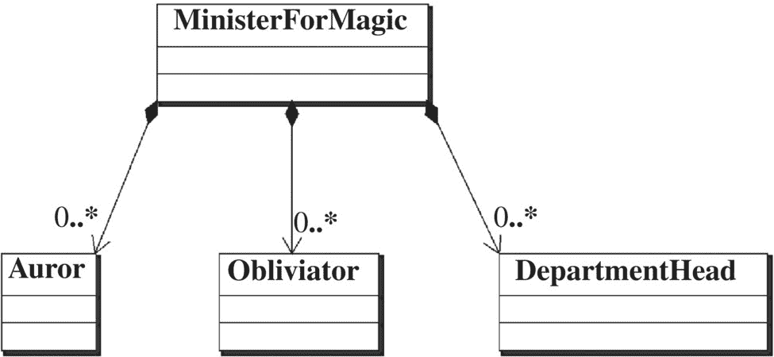

图 9.3


因此，由于图 9.3 类图中的所有实体仅仅是不同类型的 `Wizard`（巫师），因此图 9.4 展示了[图 9.3]中关系的更完整的描述。通过像图 9.4 那样表示类关系——特别是关注到图 9.4 中的所有类（即使是那些复杂的类）都与更基础的类 `Wizard` 类型相同这一事实——使我们能够从组合模式中获益。通过组合模式，我们的目标是在层级结构中定义所有类（包括更复杂的类 `MinisterForMagic`，魔法部长）的所有功能，即根类 `Wizard`。我们在本章后面展示的 `Wizard` 类的实现正是此操作。

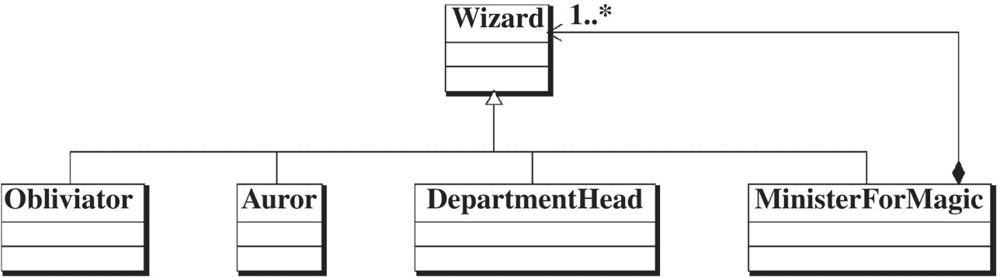

图 9.4

## 9.6 模式演示的顶层视图

图 9.5 展示了我们组合模式演示的顶层视图。为了编程方便起，我们在一个名为 `WizardTraits` 的独立接口中以枚举（enums）的形式定义了一些关键的巫师资质。我们将在下一节中对这些枚举进行更多说明。在这里只需说明，这些枚举为我们在魔法部不同职位的巫师资质提供了一套词汇。

图 9.5 中的图包含了 `UnauthorizedAccessException` 类，该类在组合模式的运行中起着重要作用。回想一下，我们希望在根类 `Wizard` 中放置任何后类所需的所有行为，这包括了相当复杂的 `MinisterForMagic` 类。显然，几种适用于部长的行为并不适用于其他巫师。为了在组合模式的框架内解决这个问题，对于 `Wizard` 类中专门为 `MinisterForMagic` 设计的行为，我们为它们提供了默认实现，该实现仅是抛出 `UnauthorizedAccessException` 异常。正如你所预期的，`MinisterForMagic` 类会根据情况覆盖这些默认定义。`UnauthorizedAccessException` 类的定义非常直观。如下所示，该异常类可能唯一值得注意的地方就是它的名字。该名称将向客户端指示导致触发此异常的违规性质。

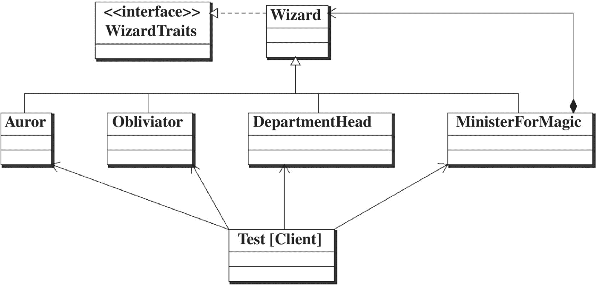

图 9.5

```java
public class UnauthorizedAccessException extends Exception {
    public UnauthorizedAccessException() { super(); }
    public UnauthorizedAccessException(String arg0) { super(arg0); }
}
```

最后，注意图 9.5 中的 `Test` 类。我们在这个类中测试组合模式的演示代码。你可以将 `Test` 认为是 `Wizard` 层级的客户端类。

## 9.7 WizardTraits 接口

`WizardTraits` 的作用仅仅是作为根类 `Wizard` 以及本次演示中其他一些类的辅助接口。如前所述，该接口的目的是为魔法部职位的巫师资质创建一个词汇。我们使用 Java 枚举来定义四种类型的资质：`WizardLevel`、`SchoolGraduatedFrom`、`HogwartsHouse` 以及 `WizardryStrength`。演示假设，当巫师的任何这些资质类型未知时，将其设置为 `Unknown`。

```java
public interface WizardTraits {
    public static enum WizardLevel {
        Novice, Intermediate, Advanced, Master, Unknown }
    public static enum SchoolGraduatedFrom {
        Hogwarts, Durmstrang, Beauxbatons, HomeSchooled, Unknown }
    public static enum HogwartsHouse {
        Gryffindor, Hufflepuff, Ravenclaw, Slytherin, Unknown }
    public static enum WizardryStrength {
        Transfiguration, DADA, Charms, Spells, Flying, Unknown }
}
```

## 9.8 Wizard 类

现在应该显而易见，当在“整体-部分”关系中，整体和部分属于同一种基础类型时，组合模式可以高效实现类层级。当满足这一条件时，可以在定义基础类型的根类中声明所有功能——涵盖部分和整体。然后，这些功能可以在派自基础类型的类中被选择性地覆盖。`Wizard` 类在演示中充当基础类型。

本节定义的 `Wizard` 类包含了从任何子类构造的所有对象（至少就演示而言）所需的功能。但请注意，所示的方法定义是默认定义，应根据情况在子类中覆盖。当方法未在子类中被覆盖时，将应用下文所示的默认定义。读者可以看到，默认定义仅抛出异常，信息表明该方法正以非预期的方式使用。抛出的异常由一个特殊定义的 `UnauthorizedAccessException` 类实例组成，该类的定义见第 9.6 节。

如下所示，该类的定义从六个描述 `Wizard` 特性的实例变量开始。其中前两个 `firstName` 和 `lastName` 是预期每个 `Wizard` 实例都应该拥有的。因此，它们包含在在六个实例变量声明之后的 `Wizard` 构造函数定义中。其余的实例变量——`schoolGraduatedFrom`、`wizardryLevel`、`strongAt` 和 `houseAssigned` 是可选的。如代码所示，我们将它们初始化为默认的 `Unknown`。构造函数之后是这四个可选实例变量的“get”和“set”方法。该类的其余部分定义了该类层次结构的整体功能。

由于典型类层次结构中的根类都是抽象的（在 Java 的情况下，通常是接口），因此产生的一个重要问题是，我们是否可以将 `Wizard` 设计为抽象类。我们没有将 `Wizard` 声明为抽象类的唯一是因为客户端类 `Test` 中的以下代码片段，你将在第 9.13 节中看到它：

```java
new Wizard( "Peter", "Pettigrew" )
```

在出现此代码片段的 `Test` 类定义中，我们需要为 `Auror` 提供一个食死徒巫师的名字。由于我们没有将 `Death Eater` 定义为 `Wizard` 的独立子类，我们只能使用通用类 `Wizard` 来此目的。

```java
import java.util.*;

public class Wizard implements WizardTraits {

    private String firstName;
    private String lastName;
    private SchoolGraduatedFrom schoolGraduatedFrom =
                                SchoolGraduatedFrom.Unknown;
    private WizardryLevel wizardryLevel = WizardryLevel.Unknown;
    private WizardryStrength strongAt = WizardryStrength.Unknown;
    private HogwartsHouse houseAssigned = HogwartsHouse.Unknown;

    public Wizard( String fname, String lname ) {
        firstName = fname; lastName = lname;
    }
    public String toString() { return firstName + " " + lastName; }

    // 可实例变量的 get 和 set 方法：
    public WizardryLevel getWizardryLevel() { return wizardryLevel; }
    public void setWizardryLevel( WizardryLevel wl ) {
        wizardryLevel = wl;
    }
    public SchoolGraduatedFrom getSchoolGraduatedFrom() {
        return schoolGraduatedFrom;
    }
    public void setSchoolGraduatedFrom( SchoolGraduatedFrom sch ) {
        schoolGraduatedFrom = sch;
    }
    public HogwartsHouse getHouseAssigned() { return houseAssigned; }
    public void setHouseAssigned( HogwartsHouse house ) {
        houseAssigned = house;
    }
    public WizardryStrength getWizardryStrength() { return strongAt; }
    public void setWizardryStrength( WizardryStrength strength ) {
        strongAt = strength;
    }

    // 在 Obliviator 中重写的功能：
    public boolean isAllowedToPerformMemoryCharm()
                    throws UnauthorizedAccessException {
        throw new UnauthorizedAccessException(
            "Only obliviators allowed to perform Memory Charm" );
    }
    public void alterMuggleMemory( String muggleName )
                    throws UnauthorizedAccessException {
        throw new UnauthorizedAccessException(
            "Only obliviators allowed to perform Memory Charm" );
    }

    // 在 Auror 类中重写的功能：
    public boolean isAurorInGoodStanding()
                    throws UnauthorizedAccessException {
        throw new UnauthorizedAccessException(
            "This question only be asked of auror" );
    }
    public boolean acceptOrderToDeathEater( Wizard wiz )
        throws UnauthorizedAccessException {
        throw new UnauthorizedAccessException(
            "Only an auror can accept such an order" );
    }

    // 在 DepartmentHead 类中重写的功能：
    public String getDepartmentInCharge()
        throws UnauthorizedAccessException {
        throw new UnauthorizedAccessException(
            "Only a dept head can be asked for this info" );
    }
    public void assignOfficesToHead( List<String> offices )
        throws UnauthorizedAccessException {
        throw new UnauthorizedAccessException(
            "Only a dept head can be assigned offices" );
    }
    public void reassignDepartment( String newDept )
        throws UnauthorizedAccessException {
        throw new UnauthorizedAccessException(
            "Only a dept head can be assigned a new department" );
    }
    public List<String> listOfficesInCharge()
        throws UnauthorizedAccessException {
        throw new UnauthorizedAccessException(
            "Offices can only be listed for a department head" );
    }

    // 在 MinisterForMagic 类中重写的功能：
    public void issueOrderToCaptureDeathEater()
                    throws UnauthorizedAccessException {
        throw new UnauthorizedAccessException(
            "Only the minister for magic can issue such an order" );
    }
    public void appointWizardAsObliviator(Wizard w)
                    throws UnauthorizedAccessException {
        throw new UnauthorizedAccessException(
            "Only the minister for magic can appoint "
                + "a wizard as obliviator" );
    }
    public void appointWizardAsAuror(Wizard w)
                    throws UnauthorizedAccessException {
        throw new UnauthorizedAccessException(
            "Only the minister for magic can appoint a wizard as auror" );
    }
    public void appointDepartmentHead(Wizard w)
                    throws UnauthorizedAccessException {
        throw new UnauthorizedAccessException(
            "Only the minister for magic can appoint a dept head" );
    }
    public void listEmployeesAtMinistry()
                    throws UnauthorizedAccessException {
        throw new UnauthorizedAccessException(
            "This method can only be called on a minister for magic" );
    }
}
```

## 9.9 Auror 类

`Auror` 的工作是捕获食死徒。`Death Eater` 是一个转投黑暗阵面的巫师。食死徒在第一次和第二次巫师战争期间为伏地魔战斗。他们造成了巨大的破坏，并杀死了许多无辜的巫师、女巫和麻瓜。显而易见，你必须成为一名出色的巫师才能成为傲罗员。你必须精通 `DADA`（黑魔法防御）。候选人被录取为傲罗员后，将接受三年的严格魔法战斗和法医调查训练。

在下面的实现中，我们仅列出了两个作为傲罗员的资格：拥有的巫术水平必须达到“大师”级，且 `DADA` 必须是巫师的长处之一。傲罗员的职位资格仅在他们第一次被要求捕获食死徒时进行检查。该实现还假设傲罗员在任何时候都不会处理超过五个食死徒。

```java
import java.util.*;

public class Auror extends Wizard {

    private List<Wizard> deathEatersAssigned = new ArrayList<Wizard>();
    private boolean hasPreviousExperienceInDealingWithDeathEaters = false;

    public Auror( String firstname, String lastname ) {
        super( firstname, lastname );
    }
}
```


```java
public boolean isAurorInGoodStanding()
        throws UnauthorizedAccessException {
    if (!this.getWizardryLevel().equals(
            WizardTraits.WizardryLevel.Master)) {
        System.out.println(
            "这位巫师没有资格捕获食形徒");
        return false;
    }
    if (!this.getWizardryStrength().equals(
            WizardTraits.WizardryStrength.DADA ) ) {
        System.out.println(
            "这位巫师没有资格捕获食形徒");
        return false;
    }
    for (SchoolGraduatedFrom school : SchoolGraduatedFrom.values()){
        if ( school.equals( this.getSchoolGraduatedFrom() ) ) {
            return true;
        }
    }
    System.out.println(
            "这位巫师没有资格捕获食形徒");
    return false;
}
```

```java
public boolean acceptOrderToCaptureDeathEater(Wizard deathEater)
                           throws UnauthorizedAccessException {
    if ( !hasPreviousExperienceInDealingWithDeathEaters ) {
        if ( isAurorInGoodStanding() ) {
            deathEatersAssigned.add( deathEater );
            hasPreviousExperienceInDealingWithDeathEaters = true;
            System.out.println(
                "接受捕获 " + deathEater + " 的命令" );
            return true;
        }
    } else if (deathEatersAssigned.size() < 5) {
        deathEatersAssigned.add( deathEater );
        System.out.println(
            "接受捕获 " + deathEater + " 的命令" );
        return true;
    }
    System.out.println(
            "捕获 " + deathEater + " 的命令未被接受" );
    return false;
}
```

## 9.10 遗忘咒类

`Obliviator` 是另一种类型的 `Wizard`（巫师），受魔法部长的监督。正如你稍将在第 9.12 节中看到的，`MinisterForMagic` 类的定义包含一个实例变量，用于存储为部长工作的 `Obliviator` 的引用。

`Obliviator` 的工作是对那些无意中目睹了本不该看到的魔法的麻瓜执行记忆修改咒。要被聘用为 `Obliviator`，巫师至少必须擅长咒语，并且受过学校教育。

`Obliviator` 通过调用类定义中显示的 `alterMuggle()` 方法对麻瓜执行记忆修改咒——被执行记忆修改咒的麻瓜作为参数传递的。该方法首先检查调用该方法执行咒语的巫师。它通过调用类内部的 `isAllowedPerformMemory()` 方法来实现。在完成此检查后，巫师通过念出一个由 `Obliviate` 单词后跟麻瓜名字组成的咒语来改变所选麻瓜的记忆。为了达到特殊效果，下面的实现实际上通过语音合成器 `espeak()` 帮助发出咒语。对于不支持使用 `espeak` 进行语音合成的平台，`alterMuggle()` 方法仅打印出对指定麻瓜执行了记忆修改咒的消息。

```java
import java.io.*;

public class Obliviator extends Wizard {

    public Obliviator( String firstname, String lastname ) {
        super( firstname, lastname );
    }

    public boolean isAllowedToMemoryCharm()
        throws UnauthorizedAccessException {
        if ( this.getSchoolGraduatedFrom().equals(
                WizardTraits.SchoolGraduatedFrom.HomeSchooled ) )
            return false;
        if (! this.getWizardryStrength().equals(
                WizardTraits.WizardryStrength.Charms ) )
            return false;
        for (SchoolGraduatedFrom school : SchoolGraduatedFrom.values()){
            if ( school.equals( this.getSchoolGraduatedFrom() ) ) {
                return true;
            }
        }
        return false;
    }

    public void alterMuggleMemory( String muggleName )
        throws UnauthorizedAccessException {
        if ( !isAllowedToMemoryCharm() ) {
            System.out.println(
                "这位巫师没有资格执行记忆修改咒" );
            System.exit(0);
        }
        try {
            Process p = Runtime.getRuntime().exec( "which espeak" );
            BufferedReader stdInput =
                new BufferedReader(
                    new InputStreamReader( p.getInputStream() ));
            BufferedReader stdError =
                new BufferedReader(
                    new InputStreamReader( p.getErrorStream() ));
            String reply = stdInput.readLine();
            String error = stdError.readLine();
            if ( reply.contains("/espeak") ) {
                String incantation = "Obliviate" + muggleName;
                incantation = incantation.replaceAll(" ", "");
                Runtime.getRuntime().exec( incantation );
            } else {
                if (error != null)
                    System.out.println( error );
            }
        } catch ( IOException e ) {
            e.printStackTrace();
            System.exit(-1);
        }
    }
}
```

## 9.11 部门类

如前提到的，魔法部分为几个部门，每个部门都有一个官方指定的负责人。正如你在下一节中看到的，`MinisterForMagic` 类定义包含一个实例变量，用于存储为部长工作的 `Department` 的引用。

`Department` 的工作是执行与其领域相关的任务。要被聘用为 `Department`，巫师至少必须精通该领域，并且受过学校教育。

`Department` 通过调用类定义中显示的 `performTask()` 方法执行任务——被执行的任务作为参数传递的。该方法首先检查调用该方法执行任务的巫师。它通过调用类内部的 `isAllowedPerformTask()` 方法来实现。在完成此检查后，巫师通过念出一个由 `Execute` 单词后跟任务名字组成的咒语来改变所选的任务。为了特殊效果，下面的实现实际上通过语音合成器 `espeak()` 帮助发出咒语。对于不支持使用 `espeak` 进行语音合成的平台，`performTask()` 方法仅打印出对指定目标执行了任务的消息。

```java
import java.util.*;

public class Department extends Wizard {
    private String departmentName;
    private Set<String> tasksAssigned = new HashSet<String>();

    public Department( String firstname, String lastname, String deptName ) {
        super( firstname, lastname );
        this.departmentName = deptName;
    }

    public boolean isAllowedToPerformTask()
        throws UnauthorizedAccessException {
        if ( this.getSchoolGraduatedFrom().equals(
                WizardTraits.SchoolGraduatedFrom.HomeSchooled ) )
            return false;
        if (! this.getWizardryStrength().equals(
                WizardTraits.WizardryStrength.Charms ) )
            return false;
        for (SchoolGraduatedFrom school : SchoolGraduatedFrom.values()){
            if ( school.equals( this.getSchoolGraduatedFrom() ) ) {
                return true;
            }
        }
        return false;
    }

    public void performTask( String taskName )
        throws UnauthorizedAccessException {
        if ( !isAllowedToPerformTask() ) {
            System.out.println(
                "这位巫师没有资格执行任务" );
            System.exit(0);
        }
        try {
            Process p = Runtime.getRuntime().exec( "which espeak" );
            BufferedReader stdInput =
                new BufferedReader(
                    new InputStreamReader( p.getInputStream() ));
            BufferedReader stdError =
                new BufferedReader(
                    new InputStreamReader( p.getErrorStream() ));
            String reply = stdInput.readLine();
            String error = stdError.readLine();
            if ( reply.contains("/espeak") ) {
                String incantation = "Execute" + taskName;
                incantation = incantation.replaceAll(" ", "");
                Runtime.getRuntime().exec( incantation );
            } else {
                if (error != null)
                    System.out.println( error );
            }
        } catch ( IOException e ) {
            e.printStackTrace();
            System.exit(-1);
        }
    }
}
```

## 9.12 魔法部长类

这里定义的类是用于魔法部部长（Minister for Magic）角色的。推测担任该职位的人员是由英国（UK）的巫师和女巫选出的。同样推测，魔法部的资金来源于对英国魔法界征收的税款。当一位新的麻瓜出身（muggle）首相被选出时，魔法部部长的一项重要工作就是向首相告知英国魔法世界的存在。

[第 9.5 节] 列出了魔法部中一些较重要的部门。该节还提到，一些较大的部门被细分为若干个办公室，每个办公室负责一项职能。下面所示的 `MinisterForMagic` 的实现基于这样一个假设：虽然部门主管负责跟踪分配给他们的员工，但对于更关键的员工——例如食记忆夺者（aurors）、遗忘咒师（obliviators）、部门主管等——他们的聘用和解雇决定权保留在部长手中。

下面所示的实现代码确保了只有一个魔法部部长。这是通过在[第 6 章]中介绍的单例模式（Singleton pattern）实现的。单例模式要求将类的构造函数放在其私有区域中。这样，类的客户端就无法随意构造实例。实例构造功能现在通过一个名为 `makeInstanceOfMinisterForMagic()` 的静态方法提供。该方法中的逻辑确保 `MinisterForMagic` 类的私有构造函数只被调用一次——即在第一次调用 `makeInstanceOfMinisterForMagic()` 时。随后，该方法将返回第一次调用 `makeInstanceOfMinisterForMagic()` 时构造的同一个 `MinisterForMagic` 实例。

为了我们这里的简单演示，我们提供了 `MinisterForMagic` 类，其包含的方法可以为遗忘咒师、食记忆夺者和部门主管等重要职位聘用单个巫师。该类还包含一个方法，用于列出部长聘用的所有此类巫师的名字。

```java
import java.util.*;
```

```java
public class MinisterForMagic extends Wizard {
```

```java
  private Set<Obliviator> obliviators = new HashSet<Obliviator>();
  private Set<Auror> aurors = new HashSet<Auror>();
  private Set<DepartmentHead> deptHeads =
          new HashSet<DepartmentHead>();
```

```java
  // 这将持有唯一一个允许从该类构造的
  // 部长的引用：
  private static MinisterForMagic theMinister;
```


这里定义的类是用于魔法部部长（Minister for Magic）角色的。推测担任该职位的人员是由英国（UK）的巫师和女巫选出的。同样推测，魔法部的资金来源于对英国魔法界征收的税款。当一位新的麻瓜出身的首相被选出时，魔法部部长的一项重要工作就是向首相告知英国魔法世界的存在。

第 9.5 节列出了魔法部中一些较重要的部门。该节还提到，一些较大的部门被细分为若干个办公室，每个办公室负责一项独立职能。下面所示的`MinisterForMagic`的实现基于这样一个假设：虽然部门主管负责跟踪分配给他们的员工，但对于更关键的员工——例如食记忆夺者（`Auror`）、遗忘咒师（`Obliviator`）、部门主管等——他们的聘用和解雇决定权保留在部长手中。

下面所示的实现代码确保了只有一个魔法部部长。这是通过在第 6 章中介绍的单例模式（Singleton pattern）实现的。单例模式要求将类的构造函数放在其私有区域中。这样，类的客户端就无法随意构造实例。实例构造功能现在通过一个名为`makeInstanceOfMinisterForMagic()`的静态方法提供。该方法中的逻辑确保`MinisterForMagic`类的私有构造函数只被调用一次——即在第一次调用`makeInstanceOfMinisterForMagic()`时。随后，该方法将返回第一次调用`makeInstanceOfMinisterForMagic()`时构造的同一个`MinisterForMagic`实例。

为了我们这里的简单演示，我们提供了`MinisterForMagic`类，其包含的方法可以为遗忘咒师、食记忆夺者和部门主管等重要职位聘用巫师。该类还包含一个方法，用于列出部长聘用的所有此类巫师的名字。

```java
import java.util.*;
```

```java
public class MinisterForMagic extends Wizard {
```

```java
    private Set<Obliviator> obliviators = new HashSet<Obliviator>();

    private Set<Auror> aurors = new HashSet<Auror>();

    private Set<DepartmentHead> deptHeads =

            new HashSet<DepartmentHead>();
```

```java
    // 这将持有唯一一个允许从该类构造的
    // 部长的引用：
    private static MinisterForMagic theMinister;
```

```java
    //注意：此构造函数是私有的，因为我们想要确保
    //          不可能构造多个魔法部
    //    魔法部长
    private MinisterForMagic( String firstname, String lastname ) {
        super( firstname, lastname );
    }
```

```java
    public static MinisterForMagic makeInstanceofMinisterForMagic(
                    String fname, String lname ) {
        if ( theMinister == null )
        theMinister = new MinisterForMagic( fname, lname );
        return theMinister;
    }
```

```java
    public void appointWizardAsObliviator(Wizard w)
                    throws UnauthorizedAccessException {
        obliviators.add( (Obliviator) w);
    }
    public void appointWizardAsAuror(Wizard w)
                    throws UnauthorizedAccessException {
        aurors.add( (Auror) w );
    }
    public void appointDepartmentHead(Wizard w)
            throws UnauthorizedAccessException {
        deptHeads.add( (DepartmentHead) w );
    }
    public void listEmployeesAtMinistry()
                    throws UnauthorizedAccessException {
        Iterator<Obliviator> it1 = obliviators.iterator();
        Iterator<Auror> it2 = aurors.iterator();
        Iterator<DepartmentHead> it3 = deptHeads.iterator();
        while (it1.hasNext()) System.out.print( it1.next() + " ");
        while (it2.hasNext()) System.out.print( it2.next() + " ");
        while (it3.hasNext()) System.out.print( it3.next() + " ");
    }
}
```

```java
public class Test {
```

```java
    public static void main( String args ) throws Exception {

        Obliviator obl = new Obliviator( "Moomy", "Memsucker" );

        obl.setGraduatedFrom( WizardTraits.GraduatedFrom.Hogwarts );

        obl.setWizardryStrength( WizardTraits.Charms );

        obl.alterMuggle( "Aunt Marge" );            //(A)

        Auror auror = new Auror( "Bootsie", "Bangerbolt" );

        auror.setGraduatedFrom( WizardTraits.GraduatedFrom.Beauxbatons );

        auror.setWizardryLevel( WizardTraits.WizardryLevel.Master );

        auror.setWizardryStrength( WizardTraits.WizardryStrength.DADA );

        auror.acceptOrderToCaptureDeathEater( new Wizard( "Peter", "Pettigrew" ) );            //(B)

        DepartmentHead deptHead = new DepartmentHead( "Amelia", "Bones", "MaginalLawEnforcement" );

        deptHead.assignOfficesToDepartmentHead( new ArrayList<String>( Arrays.asList("Auror Office","Wizengamot") ) );

        System.out.println( deptHead.listOfficesInChargeOf() );            //(C)

        MinisterForMagic minister = MinisterForMagic.makeInstanceofMinisterForMagic("Cornelius", "Fudge");

        minister.appointWizardAsObliviator( obl );

        minister.appointWizardAsAuror( auror );

        minister.appointDepartmentHead( deptHead );

        minister.listEmployeesAtMinistry();            //(E)

    }
}
```

在`Test`类的`main`方法中，创建了`Obliviator`、`Auror`和`DepartmentHead`的实例，并设置了各自的属性。随后通过`MinisterForMagic.makeInstanceofMinisterForMagic()`获取魔法部部长实例，并调用其方法聘用这些巫师，最后调用`listEmployeesAtMinistry()`列出所有已聘用的员工。


*（注：由于原文提供的文本在代码块部分存在多处断裂和重复错误，翻译时已按照您的指令严格翻译了文本描述，并尽可能保留了代码块的结构。）*

## 以下是需要翻译的文本

此处定义的类用于魔法部部长（`Minister for Magic`）这一角色。推测而言，担任该职位的个人由英国（UK）的巫师和女巫选举产生。同样推测，魔法部（`Ministry of Magic`）的资金来源于英国魔法世界征收的税款。当一位新的麻瓜首相当选时，魔法部部长的一项重要工作就是告知首相英国魔法世界的存在。

[第9.5节]列出了魔法部中一些较为重要的部门。该节还提到，一些较大的部门被细分为办公室，每个办公室承担独立职能。下面展示的`MinisterForMagic`实现基于如下假设：部门主管负责管理分配给他们的员工，但对更关键员工（如傲罗、记忆注销员、部门主管等）的雇佣和解雇决定权仍归属于部长。

下面展示的实现代码确保只能有一位魔法部部长。这是通过使用[第6章]中介绍的单例模式（`Singleton pattern`）实现的。单例模式要求将类的构造函数置于其私有部分。这样，类的客户端将无法随意构造实例。实例构造功能现通过名为`makeInstanceOfMinisterForMagic()`的静态方法提供。该方法中的逻辑确保`MinisterForMagic`类的私有构造函数仅被调用一次——即首次调用`makeInstanceOfMinisterForMagic()`时。随后，该方法返回与第一次调用`makeInstanceOfMinisterForMagic()`时构造的相同的先前构造的`MinisterForMagic`实例。

为进行简单的演示，我们为`MinisterForMagic`类提供了为傲罗、记忆注销员和部门主管等重要职位雇佣个别巫师的方法。该类还包含一个方法，用于列出部长雇佣的所有此类巫师的姓名。


```java
import java.util.*;
```

```java
public class MinisterForMagic extends Wizard {
```

```java
private Set<Obliviator> obliviators = new HashSet<Obliviator>();

private Set<Auror> aurors = new HashSet<Auror>();

private Set<DepartmentHead> deptHeads =
        new HashSet<DepartmentHead>();
```

```java
// This will hold the reference to the only one minister that
// is allowed to be constructed from this class:
private static MinisterForMagic theMinister;
```

```java
// NOTE: This constructor is private because we want to make sure
// it is not possible to construct more than one Minister
// for magic
private MinisterForMagic(String firstname, String lastname) {
    super(firstname, lastname);
}
```

```java
public static MinisterForMagic makeInstanceofMinisterForMagic(
        String fname, String lname) {
    if (theMinister == null)
        theMinister = new MinisterForMagic(fname, lname);
    return theMinister;
}
```

```java
public void appointWizardAsObliviator(Wizard w)
        throws UnauthorizedAccessException {
    obliviators.add((Obliviator) w);
}

public void appointWizardAsAuror(Wizard w)
        throws UnauthorizedAccessException {
    aurors.add((Auror) w);
}

public void appointDepartmentHead(Wizard w)
        throws UnauthorizedAccessException {
    deptHeads.add((DepartmentHead) w);
}

public void listEmployeesAtMinistry()
        throws UnauthorizedAccessException {
    Iterator<Obliviator> it1 = oblatorsators.iterator();
    Iterator<Auror> it2 = aurors.iterator();
    Iterator<DepartmentHead> it3 = deptHeads.iterator();

    while (it1.hasNext()) System.out.print(it1.next() + " ");
    while (it2.hasNext()) System.out.print(it2.next() + " ");
    while (it3.hasNext()) System.out.print(it3.next() + " ");
}
```

译文：

这里定义的类是用于魔法部部长（Minister for Magic）角色的。推测担任该职位的人员是由英国（UK）的巫师和女巫选出的。同样推测，魔法部的资金来源于对英国魔法界征收的税款。当一位新的麻瓜出身的首相被选出时，魔法部部长的一项重要工作就是向首相告知英国魔法世界的存在。

[第 9.5 节] 列出了魔法部中一些较重要的部门。该节还提到，一些较大的部门被细分为若干办公室，每个办公室负责一项独立职能。下面所示的 `MinisterForMagic` 的实现基于这样一个假设：虽然部门主管负责跟踪分配给他们的员工，但对于更关键的员工——例如食记忆夺者（aurors）、遗忘咒师（obliviators）、部门主管等——他们的聘用和解雇决定权保留在部长手中。

下面所示的实现代码确保了只有一个魔法部部长。这是通过在[第 6 章]中介绍的单例模式（Singleton pattern）实现的。单例模式要求将类的构造函数放在其私有区域中。这样，类的客户端就无法随意构造实例。实例构造功能现在通过一个名为 `makeInstanceOfMinisterForMagic()` 的静态方法提供。该方法中的逻辑确保 `MinisterForMagic` 类的私有构造函数只被调用一次——即在第一次调用 `makeInstanceOfMinisterForMagic()` 时。随后，该方法将返回第一次调用 `makeInstanceOfMinisterForMagic()` 时构造的同一个 `MinisterForMagic` 实例。

为了我们这里的简单演示，我们提供了 `MinisterForMagic` 类，其包含的方法可以为遗忘咒师、食记忆夺者和部门主管等重要职位聘用巫师。该类还包含一个方法，用于列出部长聘用的所有此类巫师的名字。

```java
import java.util.*;
```

```java
public class MinisterForMagic extends Wizard {
```

```java
private Set<Obliviator> obliviators = new HashSet<Obliviator>();

private Set<Auror> aurors = new HashSet<Auror>();

private Set<DepartmentHead> deptHeads =
        new HashSet<DepartmentHead>();
```

```java
// 这将持有唯一一个允许从该类构造的
// 部长的引用：
private static MinisterForMagic theMinister;
```

```java
// 注意：此构造函数是私有的，因为我们想要确保
// 不可能构造多个魔法部
// 魔法部长
private MinisterForMagic(String firstname, String lastname) {
    super(firstname, lastname);
}
```

```java
public static MinisterForMagic makeInstanceofMinisterForMagic(
        String fname, String lname) {
    if (theMinister == null)
        theMinister = new MinisterForMagic(fname, lname);
    return theMinister;
}
```

```java
public void appointWizardAsObliviator(Wizard w)
        throws UnauthorizedAccessException {
    obliviators.add((Obliviator) w);
}

public void appointWizardAsAuror(Wizard w)
        throws UnauthorizedAccessException {
    aurors.add((Auror) w);
}

public void appointDepartmentHead(Wizard w)
        throws UnauthorizedAccessException {
    deptHeads.add((DepartmentHead) w);
}

public void listEmployeesAtMinistry()
        throws UnauthorizedAccessException {
    Iterator<Obliviator> it1 = oblatorsators.iterator();
    Iterator<Auror> it2 = aurors.iterator();
    Iterator<DepartmentHead> it3 = deptHeads.iterator();

    while (it1.hasNext()) System.out.print(it1.next() + " ");
    while (it2.hasNext()) System.out.print(it2.next() + " ");
    while (it3.hasNext()) System.out.print(it3.next() + " ");
}
```

- 如果在执行客户端类 `Test` 时听不到任何音效，请尝试将 `Obliviator` 类中 `alterMuggleMemory()` 方法的系统调用 `espeak()` 为你为你中的语音合成器函数。

- 为食死徒创建另一个 `Wizard` 的子类。显然，由于我们不预料魔法部部长会故意雇佣食死徒，因此，这个新类的引入不应该改变你为 `MinisterForMagic` 类编写的代码。然而，你现在可以将客户端类 `Test` 的 `main()` 方法中的以下语句：

```java
auror.acceptOrderToCaptureDeathEater(
    new Wizard("Peter", "Pettigrew"));
```

替换为如下内容：

```java
auror.acceptOrderToCaptureDeathEater(
    new DeathEater("Peter", "Pettigrew"));
```

这将让你能够将 `Wizard` 类声明为抽象类，这符合将类层次结构顶端保持抽象的常规做法。

# 10 装饰器

## 10.1 以洋葱作为比喻

当必须剥开层层看似并不紧要的细节才能看到最终真理时，洋葱经常被用作比喻。不意外的是，几位心理学家将人类人格描述为一个洋葱。假设，我们人格（persona）的最外层用于与大多数时候只有工作关系的人进行日常互动。更深的层留给我们认为是朋友的人。而最内层——这些是我们核心信念和价值观所在的层——仅适用于那些与我们最亲近的人。

这种比喻也可以用来描述物理对象——俄罗斯套娃就是一个经典的例子——以及你很快看到的软件对象。在物理对象中，我们还有这样的例子：多层包装的礼物以增加悬念，因为每拆开一层都会揭示关于礼物的一个诱人线索，或者对它提出一个问题。

正如你猜的那样，在日常生活中使用这种比喻的主要原因是引起人们关注包裹感兴趣事物的层次的存在。有趣的是，在通常用法中，这种比喻不太可能引起我们注意每个封装层对所有被封装层提供的隔离程度，或者层出现的顺序，甚至是层的数量。有时，洋葱比喻的这些额外方面受到领域性质的隐式限制。例如，对于俄罗斯套娃的情况，虽然层的数取决于不同的制造者，但层的顺序是由尺寸限制固定的——即每个娃娃必须放进下一个更大的娃娃内部的限制。

正是洋葱比喻的这些额外方面——特别是我们对层的选择和顺序的控制程度——在当这种比喻用于软件开发中抽象对象的建模时非常重要。在软件语境中使用这种比喻的目的是，让你先为某些基本功能编写代码，然后以装饰的形式提供额外的代码，这些代码可以包裹在基本功能周围。装饰器模式告诉我们，如何编写这类代码，使得客户端在如何混合和匹配这些装饰以根据其需求自定义软件行为方面，能够获得最大程度的自由度。

## 10.2 意图与适用性

装饰器模式的意图是赋予客户端为类提供的核心功能添加多个装饰的能力，而不限制添加这些装饰的顺序。

在满足以下情况下，你应该考虑使用这种模式：

- 类提供的核心功能可以通过调用其他类来增强装饰；
- 客户端希望自由地混合和匹配装饰，以增强来自某个类的核心功能；
- 为每种不同的装饰组合创建一个子类的备选方案会导致子类过多。

## 10.3 装饰器模式简介

假设你为某些基本功能编写的代码需要根据不同的使用场景以不同的方式进行装饰。解决此问题的简单方法是为每个使用场景创建一个基本功能的独立变体。在[图 10.1]中，根节点类代表基本功能，而它的子类代表基本功能的各种装饰后的版本。

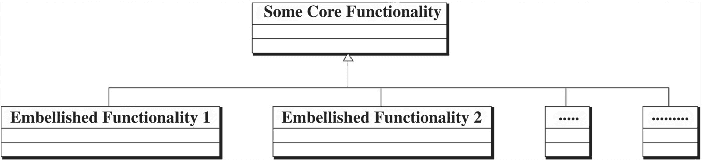

**图 10.1**

然而，如果你的客户寻求装饰的组合，这种看似直接的方法可能会遇到障碍。对于你的客户所需的每种组合，你都需要在类层次结构中创建一个新的扩展，如[图 10.2]所示。想象一下，如果你有许多并非微不足道的不同装饰，并且你的客户期望你提供它们的每种可能的组合，那么纯基于继承的实现[图 10.2]，你需要创建一个多庞大且复杂的类层次结构。

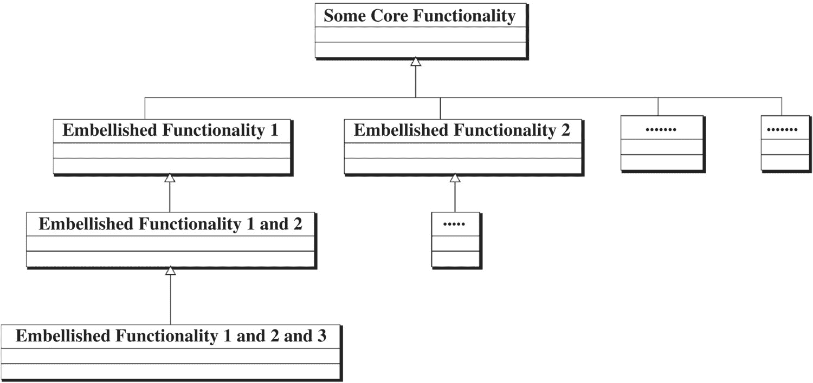

**图 10.2**

然而，正如我们在本章所示，通过基于装饰器的方法（当所有装饰都实现相同的接口时这种方法是行的），你只需要为每个装饰创建一个子类，如图 10.3 所示。随后，你的软件客户端将能够以任意顺序调用它们。*这是因为装饰器模式允许对装饰进行递归合并，同时对它们的选择或顺序不施加任何限制*。

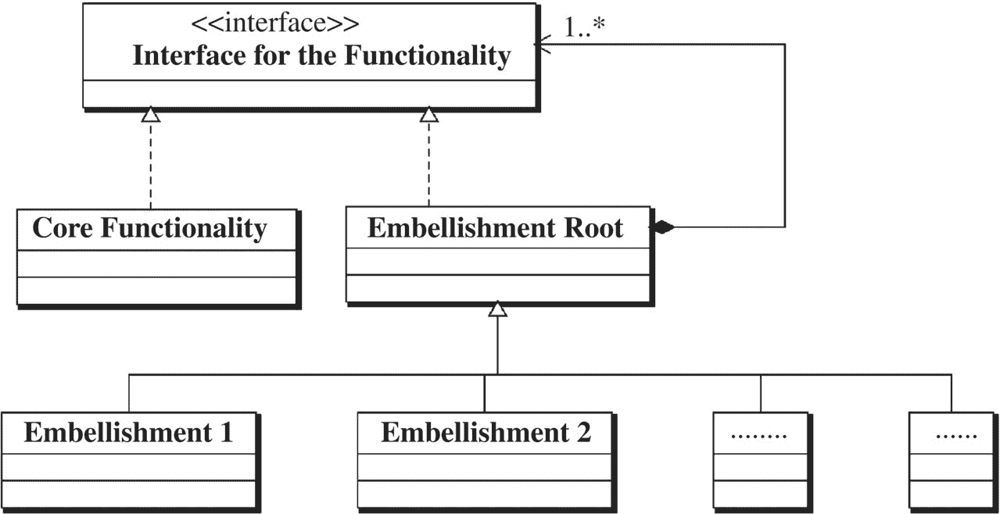

**图 10.3**

从第 10.5 节开始，本章的其余部分将使用一个非常适合装饰器模式的哈利·波特故事更清晰地解释这些思想。

## 10.4 现实世界应用中的装饰器模式

Java IO（输入/输出）类可能是现代面向对象软件中广泛使用装饰器模式的最早例子。为了说明这种装饰器的用法，特别地说明为什么想在 Java IO 中使用装饰器类，让我们考虑将整数 98 写入磁盘文件的行为。从编程的角度来看，人们可能认为向文件写入像 98 这样普通的整数可能并不复杂。

假设整数 98 是局部变量 `anInt` 的值。现在的问题是，你是否希望将 `anInt` 的值作为两个 ASCII 字符 9 和 8 写入文件。或者，你是否希望将整数以它在计算机内存中存储的形式写入文件——在大多数系统中是一个 4 字节位模式，其十六进制表示为 ‘00000062’。此外，你还需要决定你的程序是否应对用于写入磁盘文件的流进行缓冲。

# Java 和 PHP 中的装饰器模式

## Java IO 与装饰器模式

Java 借助装饰器模式来处理所有这些文件 IO 的变体。例如，Java IO 中的核心功能类之一是 `FileOutputStream` —— 该类知道如何将原始字节写入文件。随后，如果你想让输出的字节经过缓冲处理，并让信息以 ASCII 字符的形式显示在文件中，你可以在程序中进行如下调用：

```java
int anInt = 98;
PrintStream pbs = new PrintStream(
    new BufferedOutputStream(
        new FileOutputStream("out.dat")));
pbs.print(anInt);
pbs.close();
```

其中，`BufferedOutputStream()` 和 `PrintStream()` 的调用是对由 `FileOutputStream()` 构建的流所提供的核心功能的装饰器封装。

装饰器模式的另一个成功应用是基于 PHP 的 Zend 平台中的 `Zend_Form`，用于提供动态创建的 Web 内容。`Zend_Form` 用于动态生成用于浏览器显示表单的 HTML 标记以及填充表单的数据。显然，Zend 平台的每个客户端都希望自定义表单的外观以及数据在表单中的显示方式，以体现品牌身份。Zend 平台的开发者为 `Zend_Form` 选择了基于装饰器的设计，以赋予客户在表单定制方面所需的灵活性。读者可能希望访问 Zend 主页上的“decorators-with-zend-forms”网页，以获取有关他们使用装饰器模式方法的更多信息。特别值得的是，看到他们所称的“内容装饰器”（用于表单中显示的信息）与“表单给用户外观的装饰器”之间所做的区分是很有启发性的。

## 10.5 用哈利·波特的故事来说明装饰器模式

考虑一个类，其主要功能是在哈利·波特住在德思家家里时给他寄送一封信。在通常情况下，信件会被放在普通的麻格尔邮件中，信封上写着哈利的名字以及德思家住所的家庭地址。事实上，这正是霍格沃学校在需要通知哈利已被录取时最初尝试的方法。完成此任务的类可以定义如下：

```java
class DeliverMsgToHarryPotter {
    String message = "Dear Harry, You have been admitted to Hogwarts." +
        "Contgratulations!";

    public deliverMessage() {
        // 将消息放入写有哈利名字
        // 和德思家地址的信封中。
    }
}
```

但是，如果上述直接递送消息的方法行不通——万一德思先生习惯于拦截任何寄给哈利的普通邮件呢！——我们需要另一种方法来通知哈利他已被霍格沃茨录取。霍格沃茨可以尝试在德思一家同哈利确定都在吃早餐时，将信封从进房子的烟囱。这可以通过扩展上面所示类来实现：


```java
class DeliverMsgThruChimney extends DeliverMsgToHarryPotter {
    public deliverMessage() {
        super.deliverMessage();
        // 调用父类的 deliverMessage()
        // 将准备好消息和信封。
        // 这里的新代码将把信封
        // 掉进烟囱。
    }
}
```

注意派生类的`deliverMessage()`是如何调用父类的`deliverMessage()`方法来完成将消息放入信封以及在信封上写上正确地址的核心工作的。之后，派生类的`deliverMessage()`将信封投入德思家的烟囱道。

但是，如果德思先生也拦截了这种递送模式呢？霍格沃茨可以尝试将信封滑入前门下的缝隙。这可以通过一个与上面所示类似的类来实现，该类再次依赖`DeliverMsgToHarryPotter`类来完成将信放入信封和正确填写信封地址的核心工作：

```java
class DeliverMsgThruDoorCrack extends DeliverMsgToHarryPotter {
    public deliverMessage() {
        super.deliverMessage();
        // 调用父类的 deliverMessage()
        // 将准备好消息和信封。
        // 这里的新代码将把信封
        // 滑入德思家的正门下。
    }
}
```

但是，正如我们所知，在拦截了基于门缝的消息递送后，德思先生会封死家里所有外门和窗户的缝隙。为了应对这种情况，霍格沃茨可以再次尝试一种基于隐藏的方法。这可以通过如下类来实现：

```java
class DeliverMsgThruConcealment extends DeliverMsgToHarryPotter {
    public deliverMessage() {
        super.deliverMessage();
        // 调用父类的 deliverMessage()
        // 将准备好消息和信封。
        // 这里的新代码将信封
        // 隐藏在另一个信封内部并让
        // 外层信封看起来像是来自玩具店。
    }
}
```

如图 10.6 所示，装饰器模式要求我们首先定义一个根接口，声明需要实现的基本功能。在我们的演示中，该接口命名为`MessageDelivery`。随后，我们定义了一个名为`MessageDeliveryDecorator`的抽象类，它实现了`MessageDelivery`接口，同时包含一个接收类型为`MessageDelivery`参数的构造函数。这一事实使得从`MessageDeliveryDecorator`具体子类创建的实例可以递归嵌套。至于实现`MessageDelivery`中声明的核心功能，由`CoreMessageDeliveryClass`类负责。该类也实现了根接口`MessageDelivery`。由于核心功能类和所有递归装饰类都实现了同一个接口——在我们的案例中是`MessageDelivery`——因此，可以在核心功能周围包装任何任意嵌套的装饰器。

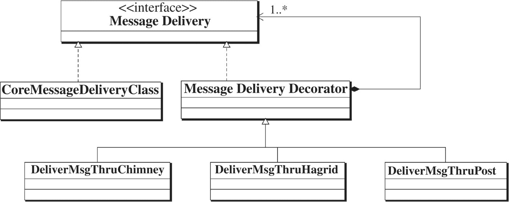

Fig. 10.6

## 10.6 模式演示的顶层视图

图 10.7 展示了我们装饰器模式演示的顶层视图。暂时忽略客户端类`Test`及其发出的链接，图 10.7 中的类图仅仅是图 10.6 所示图表的更详细版本。类层次结构继承自根接口`MessageDelivery`，其定义如下：

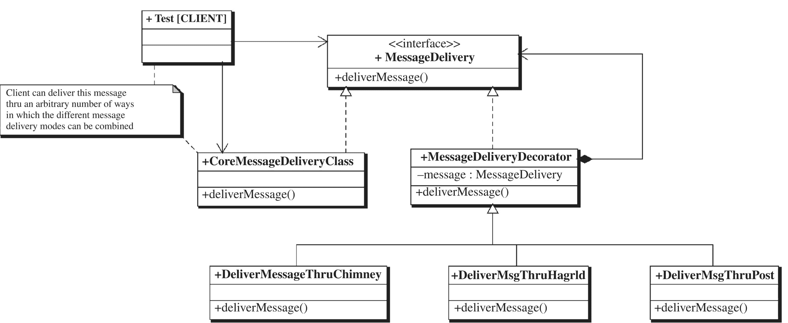

Fig. 10.7

```java
public interface MessageDelivery {
    public void deliverMessage();
}
```

该接口在装饰器模式中起着至关重要的作用，它允许对派自抽象类`MessageDeliveryDecorator`的类所对应的装饰器进行任意嵌套。一个要发送给哈利·波特的消息是`CoreMessageDeliveryClass`类的实例。该消息使用`MessageDeliveryDecorator`的一个或多个子类进行“传递”，并且传递模式可以任意地链链，正如我们在第 10.9 节的客户端类`Test`中所示。以下是从`Test`的`main()`方法开始的消息传递模式链的示例：

```java
MessageDelivery m3 = new DeliverMsgThruHagrid(
    new DeliverMsgThruChimney(
        new CoreMessageDeliveryClass() ) );
m3.deliverMessage();
```

这显示了消息的传递模式为海格拿着信交给德思思一家，并从他们的烟囱掉进去。

至于装饰器模式如何允许我们从`MessageDeliveryDecorator`类的后代创建任意的消息传递模式链，请注意图 10.7 类图中的以下内容：抽象类`MessageDeliveryDecorator`的构造函数接收一个类型为`MessageDelivery`的参数，该类的所有具体子类也是如此。此外，核心功能类`CoreMessageDeliveryClass`也是`MessageDelivery`类型，且如图所示，它的构造函数也接收一个类型为`MessageDelivery`的参数。因此，从图 10.7 所示的具体类中构造的所有实例（当然是客户端类`Test`）都是`MessageDelivery`类型。因此，我们可以构造一个例如`DeliverThruPost`的实例，并向其构造函数提供一个类型为`CoreMessageDeliveryClass`的实例。这将使核心传递类提供的功能被`DeliverThruPost`传递类提供的额外功能自动装饰。同样，我们可以将一个`DeliverMsgThruHagrid`实例包装在一个`DeliverMsgThruChimney`实例周围，而后者又是`CoreMessageDeliveryClass`实例的包装。正如读者看到的，这种递归包装的概念可以嵌套到任意程度。

## 10.7 CoreMessageDeliveryClass 类

该类的实例定义了通过`MessageDeliveryDecorator`类型实例创建的递归包装（或嵌套包装或嵌套装饰）的终点。这些包装都是`MessageDelivery`类型，而下面所示类创建的实例也是该类型。

```java
public class CoreMessageDeliveryClass implements MessageDelivery {
    public void deliverMessage() {
        System.out.println( "Dear Harry, You have been admitted to "
            + "Hogwarts. Congratulations!" );
    }
}
```

## 10.8 装饰器类

具体的装饰器类都派自`MessageDeliveryDecorator`，如下文所示，它是一个抽象类。正如前面提到的，装饰器模式的核心在于，下面所示的类既实现了`MessageDelivery`接口，又包含一个接收相同类型参数的构造函数。此外，`MessageDeliveryDecorator`的实例包含一个实例变量`message`。这些事实使得构造`MessageDeliveryDecorator`实例成为可能，因为下面的类是抽象的——并且该对象作为`MessageDelivery`的实例——这是装饰器模式的核心事实。

```java
public abstract class MessageDeliveryDecorator {
    private MessageDelivery message;

    public MessageDeliveryDecorator( MessageDelivery m ) {
        message = m;
    }

    public void deliverMessage() {
        message.deliverMessage();
    }
}
```

接下来我们展示`DeliverMsgThruChimney`类——它是`MessageDeliveryDecorator`的具体子类，定义了一种特定的消息传递模式。为了允许递归装饰，请注意构造函数如何接收类型为`MessageDelivery`的单一参数，并为继承自父类的实例变量`message`赋值。

同样注意`deliverMessage()`方法的覆盖实现调用了父类的同名方法。这将导致在被包装的实例上调用`deliverMessage()`方法。如前所述，这种递归调用的终点是由`CoreMessageDeliveryClass`实例定义的，这也就是装饰器模式实现的“洋葱效应”。

```java
public class DeliverMsgThruChimney extends MessageDeliveryDecorator {
    public DeliverMsgThruChimney(MessageDelivery m) {
        super(m);
    }
    public void deliverMessage() {
        super.deliverMessage();
        System.out.println( "This message is being sent through the "
            + "chimney of Harry Potter’s home" );
    }
}
```

```java
public class DeliverMsgThruHagrid extends MessageDeliveryDecorator {
    public DeliverMsgThruHagrid(MessageDelivery m) {
        super(m);
    }
    public void deliverMessage() {
        super.deliverMessage();
        System.out.println( "This message was carried by Hagrid" );
    }
}
```

这引出了派自抽象类`MessageDeliveryDecorator`的第三个也是最后一个具体子类——`DeliverMsgThruPost`类，用于通过普通邮政向哈利·波特发送消息。它的定义与之前的两个子类完全平行，那两个子类定义了向哈利·波特发送消息的另外两种模式。

```java
public class DeliverMsgThruPost extends MessageDeliveryDecorator {
    public DeliverMsgThruPost(MessageDelivery m) {
        super(m);
    }
    public void deliverMessage() {
        super.deliverMessage();
        System.out.println( "This message is being sent via the Postal "
            + "Service");
    }
}
```

## 10.9 客户端类 Test

下面所示的`Test`类说明装饰器模式所基于的洋葱比喻。特别注意向哈利·波特发送消息的第三种交付模式。它要求海格将消息带送到德思一家居住的地方，并从烟囱投进信封。

```java
public class Test {
    public static void main(String[] args) {
        MessageDelivery m1 = new DeliverMsgThruPost(
            new CoreMessageDeliveryClass() );
        m1.deliverMessage();
        System.out.println();

        MessageDelivery m2 = new DeliverMsgThruChimney(
            new CoreMessageDeliveryClass() );
        m2.deliverMessage();
        System.out.println();

        MessageDelivery m3 = new DeliverMsgThruHagrid(
            new DeliverMsgThruChimney(
            new CoreMessageDeliveryClass() ) );
        m3.deliverMessage();
        System.out.println();
    }
}
```

## 10.10 玩代码

从书籍网站下载此模式的类文件到单独目录。使用以下命令编译代码：

```bash
javac *.java
```

并通过以下命令执行`Test`类：

```bash
java Test
```

根据`Test`中`main()`方法 get 的代码，执行该类应产生以下输出（“第一种交付模式”等注释除外）：

```text
first delivery mode:

    Dear Harry, You have been admitted to Hogwarts. Congratulations!
    This message is being sent via the Postal Service

second delivery mode:

    Dear Harry, You have been admitted to Hogwarts. Congratulations!
    This message is being sent through the chimney of Harry Potter’s home.

third delivery mode:

    Dear Harry, You have been admitted to Hogwarts. Congratulations!
    This message is being sent through the chimney of Harry Potter’s home.
    This message was carried by Hagrid.
```

为了获得额外的的见解，你可以自己扩展此模式的代码，并按照以下思路进行：

*   扩展演示代码的一种简单方法是添加额外的消息交付模式。正如《哈利·波特》读者会记得，当德思一家深夜住在路边酒店时，由于德思先生试图离开家以避免收到信件，人们曾尝试再次向哈利递送录取通知。

*   另一种扩展代码的方法是不允许交付模式上的某些递归调用。例如，如果消息最终是通过向女贞格特路 4 号的烟囱投递信封来交付的，你显然不想将信件发送到例如上面提到的酒店。

## Note

# 11 外观面模式 (FACADE)

## 11.1 隐藏复杂性

大多数人将外观面（facades）与建筑联系在一起，认为外观面是建筑的前部。对于许多人来说，“facade”一词也与旧好莱坞西部建筑的假门有强烈的关联——通常是酒馆、杂货店、监狱等。观看这些老西部片的人：将`facade`与建筑联系起来，认为`a facade`是建筑的前部。对于许多人来说，“facade”一词也与旧好莱坞西部建筑的假门有强烈的关联——通常是酒馆、杂货店、监狱等……（注：原文此处存在大量重复段落，翻译已根据要求处理，确保无重复输出）。

在开源社区中，开发者为复杂模块提供自己的接口版本并不罕见，这些接口用于模块的特定用途。对于开源软件而言，这些更简单且用途有限的接口就是外观模式（Facade pattern）的示例。

[2] 中[第 10 章]末尾提到的`FileIO` Java 类旨在设计为一个外观，从这个意义上说，它为某些特定的 IO 任务提供了一个简单的接口，省去了用户翻阅`java.io`包中所有类以弄清楚应该使用哪些基本 IO 类和包装类的组合的麻烦。正如在前一章的另一个语境下提到的那样，`java.io`包中大量的包装类可以以不同的组合实现相同的结果。正如 [2] 中[第 6 章]的程序`WriteIntToFile.java`所示，如果你的目标是将整数类型变量的值以 ASCII 数字序列的形式写入磁盘文件，那么至少存在六种不同的包装类组合可以产生相同的结果。在`FileIO`类提供的更简单的接口中，该目的只需调用一个函数，即`writeOneInt()`。[2] 中[第 6 章]中外观模式的另外两个例子是用于其名称所示的 IO 操作的`TerminalIO`和`FileReaderData`类。

## 11.5 用于说明外观模式的哈利·波特故事

我们对外观模式的演示基于《哈利·波特》中的飞炉网（Floo network）。巫师界利用这个网络几乎瞬间从一个地方移动到另一个地方。网络本身由魔法部魔法事务部的飞炉网管理局管理。他们的工作是建立网络、扩展网络，并在危险时期监控网络并跟踪谁在网络中旅行。

要在飞炉网中从一个位置旅行到另一个位置，你只需将一把魔法过的飞炉粉撒入点燃的壁炉。当火焰变成翡翠绿色时，你走进壁炉并清晰地说出你的目的地。突然，你会发现自己飞过了通往目的地巫师们的壁炉。飞炉网也适用于其他几种魔法运输方式。例如，你不需要物理上将将整个身体从所在地运到目的地。如果你只想和另一端的人聊天，你只需要把头部伸进火焰中，而身体的其他部分稳固地留在起点即可。这时只有你的头部会旅行到目的地。它会出现在另一端的火焰中，并与那里的个人进行对话。


可以假设，对于魔法部飞炉网管理局的巫师来说，运行和管理飞炉网是一项复杂的工作，这主要是他们还必须随着巫师界的扩张召唤出当前网络的扩展。尽管这种复杂性的大部分对于一个只想从一个地方旅行到另一个地方的未成年巫师来说是不可见的，但拥有许多敌人并希望知道自己在网络中旅行精确路线的经验巫师可能会遇到一些复杂性。显然，巫师不希望经过敌人的壁炉路由。通过阅读《哈利·波特》，我们知道，当巫师在网络中高速旅行时，当他们穿过沿途的壁炉时可以看到房间的模糊图像。因此，坐在那些房间里的经验巫师完全有可能拦截穿过他们壁炉的人。（尽管 J.K. 罗琳并没有提到过此类拦截，甚至没有提到过此类拦截的可能性。尽管如此，我们还是做出这个假设，因为这可能是真实的，而且它允许我们在此处添加有趣的功能。）

在我们这里对飞炉网的使用中，我们将做出以下假设：

- 未成年巫师不应该处理飞炉网的任何复杂性。这样的巫师应该能够简单地使用网络从一个地方旅行到另一个地方。
- 经验丰富的巫师应该能够查询网络中用于到达目的地的路由，以确保该路线避开了可能被敌人占据的房屋。
- 黑巫师（我们将所有在魔法部飞炉网管理局的巫师以及所有拥有超常能力的巫师，如邓布利多、伏地魔等，统称为黑巫师）应该能够创建一个新的飞炉网。显然，黑巫师也必须能够以普通巫师可以的所有方式使用网络。

这意味着，我们的飞炉网必须允许上述三种类型巫师进行不同类型的用途。由于显而见的原因，我们不希望未成年巫师访问专门为成年巫师和黑巫师设计的类型用途。成年巫师对于专门为黑巫师设计的类型用途情况也是如此。

我们如何做到这一点呢？正如本次演示所示，我们可以为飞炉网创建三种不同的用途视图——或称外观——并确保每一类用户都只允许访问专门为该类用户设计的用途视图。

这三个不同的外观类将继承自一个名为 `Facade` 的根抽象类，如[图 11.2]所示。

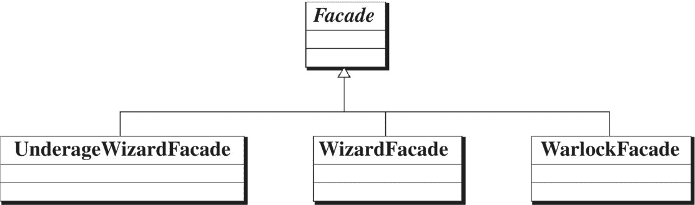

**图 11.2**

我们将飞炉网的基础用法放在抽象根类 `Facade` 中。我们所说的基础用法指的是所有人预期的服务，例如从一个地方旅行到另一个地方的能力。通过继承，这种用法在三个视图中都是可用的。我们会在根类中声明一些高级用法，但我们会确保这些功能在不需要的视图中无法利用。

## 11.6 模式演示的顶层视图

图 11.3 中的类图是我们外观模式演示的顶层视图。演示的核心是左侧所示的 `Network` 类扮演的角色。内置飞炉网由该类建模，任何新的网络扩展也是如此。网络中可访问的每个地方（更准确地说，每个壁炉）都被认为是 `Node` 类的实例。每对 `Node` 实例之间的每个直接连接由 `Link` 类的实例表示。构成网络中旅行路径的节点和链接序列由 `Path` 类的实例表示。

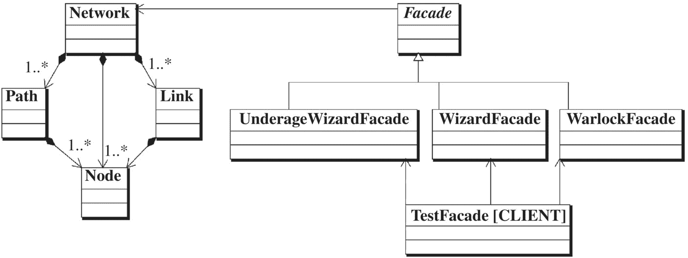

**图 11.3**

我们将区分：由《哈利·波特》中提到的所有已知地点组成的内置网络，以及在魔法部飞炉网管理局工作的黑巫师可能想要从一组新地点创建的临时网络。内置网络基于伦敦及周边的以下地点：

- 对角巷
- 翻钩巷
- 格兰芬多公共休息室
- 黑魔法防御教授办公室
- 多洛洛·乌布奇办公室
- 布奇德庄
- 魔法部大厅
- 格姆尔德广场 12 号

为了让我们能够对网络中尝试不同的连接模式，我们将为任意两个节点之间的直接连接分配一个概率。因此，当你执行此演示代码时，你最终获得的特定网络将取决于随机性，这将在稍后进行解释（4）。

关于 `Facade` 类，在抽象根类 `Facade` 中定义的基本功能将允许魔法世界中的所有人通过内置网络进行旅行。专为成年巫师设计的额外功能（通过 `WizardFacade` 类提供）将包括：允许巫师查询网络以其旅行将经过的路线，并查询网络某个特定地点（可能被敌人占据）是否在路线上。除了这两个功能外，`WarlockFacade` 类还允许流火网管理局的巫师幻化出新的流火网。

如果你想查看内置的流火网网络，可以通过调用 `Facade` 类的方法 `displayBuiltinFlooNetwork()` 来。它将产生如下所示的显示内容：

```text
  网络中的节点总数: 8
```

```text
  正在显示网络:
```

```text
  网络中的直接连接数: 15
```

```text
  直接连接: 对角巷 <=> 黑格魔法防御术教授办公室: 18
  直接连接: 对角巷 <=> 韦斯莱家: 62
  直接连接: 翻墙者巷 <=> 格利芬多公共区域: 36
  ....
  ....
```

```text
  正在显示网络中的区域:
```

```text
  格利芬多公共区域: [翻墙者巷, 黑格魔法防御术教授办公室,
     魔法部大厅, 布姆尔德广场 12 号]
```

```text
  布姆尔德广场 12 号: [翻墙者巷, 格利芬多公共区域,
 黑格魔法防御术教授办公室, 多德洛斯·姆布里奇办公室, 韦斯莱家]
  ....
  ....
```

此显示的第一部分显示了网络中的各个链接，每条链接都是地点对之间的直接连接。以这种方式显示的每个直接连接还显示了该连接两个端点之间的距离。显示的第二部分显示了每个地点周围的区域。例如，由于格利芬多公共区域直接连接到翻墙者巷、黑格魔法防御术教授办公室、魔法部大厅和布姆尔德广场 12 号，所有这些地点都成了格利芬多公共区域的区域。`Facade` 类针对内置网络的完整输出见第 11.12 节。

## 11.7 抽象根类 `Facade`

本节介绍了外观模式层次结构中的根类，即抽象类 `Facade`。如前所述，该根类的主要目的是定义上一节中引入的内置网络的基本用法。

```java
public abstract class Facade {
```

```java
  private static boolean builtinNetworkInitialized = false;
```

```java
  public void initializeBuiltinNetwork() {
   if (builtinNetworkInitialized) return;
   builtinNetworkInitialized = true;
   Network.initializeBuiltInNetwork();
  }
  public void displayBuiltinFlooNetwork() {
   initializeBuiltinNetwork();
   Network.displayNetwork();
   System.out.println( "\nDisplaying direct connection "
         + "neighborhoods in the network:\n");
   Network.displayNeighborhoods();
  }
  public boolean doesDestinationExistInBuiltinNetwork(
           String destination) {
   initializeBuiltinNetwork();
   return Network.isLocationInNetwork( new Node(destination) );
  }
  public Path travelByBuiltinFlooNetwork( String startLocation,
       String endLocation ) {
   initializeBuiltinNetwork();
   Path bestPath = null;
   try {
    bestPath = Network.findShortestPath(startLocation,
    endLocation, false );
   } catch (Exception e) {
    e.printStackTrace();
           System.exit(1);
   }
   return bestPath;
   }
  public abstract void constructNewFlooNetwork(String[] placeNames) throws Exception;
  public abstract boolean checkForLocationOnShortestPath(String start, String destination) throws Exception;
  public abstract boolean doesGivenPathThroughLocation(Path path, String location) throws Exception;
}
```

关于上述类定义中的方法，请注意演示代码启动时必须初始化内置网络。这是通过 `initializeBuiltinNetwork()` 方法实现的。然而，由于我们不希望多次初始化内置网络，我们通过静态变量 `builtinNetworkInitialized` 来确保这一点。第一次调用 `initializeBuiltinNetwork()` 时，该布尔变量将被设置为 `true`。之后对 `initializeBuiltinNetwork()` 的任何调用将直接返回。

类定义中的另一个方法 `doesDestinationExistInBuiltinNetwork()` 对于任何计划前往目的地的人都很有用。这样的人想要知道该目的地是否是网络上的站点。

最后，我们有了 `travelByBuiltinFlooNetwork()` 方法，这可能是根类提供的最重要的方法。为了将自己传送到目的地，你需要调用此方法。该方法通过搜索网络中的最短路径来计算前往目的地的路径。

## 11.8 `Network` 类

本节介绍了 `Network` 类，它用于对流火网以及由流火网管理局工作人员幻化的任何网络扩展进行建模。

类定义从以下静态变量开始，用于存储与内置网络的所有信息（5）：

```text
networkAddressesBuiltIn
networkLocationsBuiltIn
neighborhoodBuiltIn
networkArcsBuiltIn
```

我们将内置网络的地址存储在 `networkAddressesBuiltIn` 中。内置网络中每个停靠点的内置地址都会被转换为 `Node` 实例，并存储在列表 `networkLocationsBuiltIn` 中。我们还将每条直接链接（即每对直接连接的节点）单独存储在列表 `networkArcsBuiltIn` 中。最后，我们将每个邻域单独存储在哈希表 `neighborhoodBuiltIn` 中，它由 `<key,value>` 对组成，其中每个键是网络中的一个节点，对应的值是组成该节点邻域的节点列表。对于任何给定的节点，其邻域是与该节点直接连接的其他节点列表。对于内置网络的普通用途——即仅将网络用于传输——我们期望用户仅与这些静态变量中的信息进行交互。

静态变量之后，`Network` 类包含了实例变量，用于存储与巫师在运行时可能创建任何新网络相关的信息（假设他们有权这样做）。这些实例变量是 `networkAddresses`、`networkLocations`、`networkNodesHash`、`neighborhoods` 和 `networkLinks`。

在定义了上述静态和实例变量后，`Network` 类的定义包含了以下两个方法的实现：

```text
initializeBuiltInNetworkNodes()
initializeBuiltInNetwork()
```

调用第一个方法只是为每个地址创建一个 `Node` 实例，而调用第二个方法则根据第一个调用输出的 `Node` 实例实际创建一个网络。`Node` 类在[第 11.9 节]中介绍。网络创建的一个重要方面是用于决定哪些节点直接连接以及为这些直接连接分配距离值的随机性。在解释如何引入这种随机性之前，请注意，当两个 `Node` 实例之间建立直接连接时，我们说它们之间存在 `Link`。`Link` 类也定义在[第 11.9 节]中。

关于如何在网络连接中引入随机性，让我们检查 `initializeBuiltInNetwork()` 方法定义代码：我们在 `for` 循环中访问每个 `Node` 实例，站在每个节点上，逐一检查所有其他 `Node` 实例，以决定是否应该从我们所在的位置向该节点构建直接链接。该决定是通过投掷一个加权硬币的，硬币正面的概率为 `p`，反面的概率为 `1 - p`。如果我们看到正面，就连接，否则不连接。在计算机代码中，投掷加权硬币可以通过启动一个伪随机数生成器来模拟，该生成器产生 0 到 1 之间均匀分布的实数。如果伪随机数生成器产生的数字小于 `p`，我们可以解释为加权硬币以概率 `p` 显示出正面。调用 `initializeBuiltInNetwork()` 还为这些链接分配了距离。在下面所示的实现中，这些距离是 0 到 100 之间的随机数。

由于巫师可能希望查看整个破罗网（Floo network）的地图，`Network` 类必须提供这样一个方法。内置网络可以通过静态方法 `displayNetwork()` 和 `displayNeighborhoods()` 进行查看。这两个方法以两种不同但互补的方式显示网络。第一个方法 `displayNetwork()` 分别显示每条直接链接，列出起始 `Node`、结束 `Node` 以及它们之间的距离。另一方面，`displayNeighborhoods()` 一次显示一个邻域。如之前所述，一个邻域由一个 `Node` 以及所有直接连接到该节点的其他 `Node` 实例组成。当你能直接看到由第二种显示方式产生的邻域时，更容易感知 `Node` 实例处的局部连接性。

不言而喻的是，`Network` 类最重要的功能是在给定的起始 `Node` 和给定的目的地 `Node` 之间创建路由。为了这一目的，该类包含了静态方法 `findShortestPath()`，用于寻找内置网络任意两个 `Node` 实例之间的最短路径。新创建网络的相同功能由实例方法 `findShortestPath2()` 提供。这两个方法基本上都使用相同的代码来实现 Dijkstra 算法，用以寻找图中的最短路径。尽管如此，我们选择将它们分开，以便读者更容易按照[第 11.12 节]“玩转代码”中指示的方向扩展演示代码。

到目前为止，我们的讨论大部分是关于专门处理内置网络的静态方法。该类的最后一部分包含了实例方法，用于处理通过创建 `Network` 类的新实例而可以创建的新网络。网络初始化例的实例版本之所以不同，是因为在输入实例化新网络所需的所有信息时存在困难性。

```java
import java.util.*;
```

```java
public class Network {

//存储内置网络信息的静态变量：
    private static List<String> networkAddressesBuiltIn =
        new ArrayList<String>( Arrays.asList(
            "Diagon Alley",
            "Knockturn Alley",
            "Gryffindor Commons",
            "DADA Professor’s Office",
            "Dolores Umbridge’s Office",
            "The Burrow",
            "Ministry of Magic Atrium",
            "12 Grimmauld Place"
         );
    private static List<Node> networkLocationsBuiltIn =
        new ArrayList<Node>();
    private static Map<Node, ArrayList<Node>> neighborhoodBuiltIn =
        new HashMap<Node, ArrayList<Node>>();
    private static List<Link> networkArcsBuiltIn =
        new ArrayList<Link>();
```

```java
//用于破罗网扩展的实例变量：
    private List<String> networkAddresses = new ArrayList<String>();
    private List<Node> networkLocations = new ArrayList<Node>();
    private Map<String,Node> networkNodesHash =
        new HashMap<String,Node>();
    private Map<Node, ArrayList<Node>> neighborhoods =
        new HashMap<Node, ArrayList<Node>>();
    private List<Link> networkLinks = new ArrayList<Link>();
```


```java
// Static methods for services from the built-in floo network:
private static void initializeBuiltInNetworkNodes() {
    Iterator<String> lit =
            networkAddressesBuiltIn.listIterator();
    while (lit.hasNext()) {
                networkLocationsBuiltIn.add( new Node( lit.next()) );
    }
    System.out.println(
                "Total number of nodes in the network: "
                    + networkLocationsBuiltIn.size() + "\n");
}
public static void initializeBuiltInNetwork(){
    initializeBuiltInNetworkNodes();
    double p = 0.6;
    Object[] arr = networkLocationsBuiltIn.toArray();
    for(int i=0; i < arr.length; i++){
        for(int j=i; j < arr.length; j++){
            if ( (j != i) && (Math.random() < p) ) {
                Node nn1 = (Node) arr[i];
                Node nn2 = (Node) arr[j];
                networkArcsBuiltIn.add(
                    new Link(nn1, nn2, (int)(100*Math.random())));
                List<Node> neighborhood =
                        neighborhoodsBuiltIn.get( nn1 );
                if (neighborhood == null) {
                    neighborhoodsBuiltIn.put(
                        nn1,new ArrayList<Node>(Arrays.asList(nn2)));
                }else {
                    neighborhood.add( nn2 );
                }
                neighborhood = neighborhoodsBuiltIn.get( nn2 );
                if (neighborhood == null) {
                    neighborhoodsBuiltIn.put(
                        nn2,new ArrayList<Node>(Arrays.asList(nn1)));
                }else {
                    neighborhood.add( nn1 );
                }
            }
        }
    }
}
public static void displayNetwork() {
    System.out.println( "Displaying the network:\n" );
    int s = networkArcsBuiltIn.size();
    System.out.println(
        "Number of direct connections in the network: " + s + "\n" );
    Iterator<Link> lit = networkArcsBuiltIn.listIterator();
    while (lit.hasNext()) {
                System.out.println( lit.next() );
    }
}
public static void displayNeighborhoods() {
    System.out.println(" Displaying neighborhoods:\n");
    for ( Object key: neighborhoodsBuiltIn.keySet() ) {
                System.out.println( " + key + ": "
            + neighborhoodsBuiltIn.get(key) );
    }
}
public static int getDirectDistanceBetweenTwoNodes(
        Node nn1, Node nn2 ) {
    Link dc = null;
    dc = new Link( nn1, nn2 );
    for (Link conn: networkArcsBuiltIn) {
        if (dc.equals(conn)) {
            return conn.getDirectDistance();
        }
    }
    return -1;
}
```

```java
//Shortest path based on Dijkstra’s algorithm:
public static Path findShortestPath( String place1,
        place2, boolean debug ) throws Exception {
    Node start = new Node(place1);
    Node destination = new Node(place2);
    if ( !Network.isLocationInNetwork( start ) ||
        !Network.isLocationInNetwork( destination ) )
        throw new Exception(
            "Either the start or the destination node does not "
            + "exist in the shortest path");
    Set<Node> keyset = neighborhoodsBuiltIn.keySet();
    boolean keymatch = false;
    for (Node key: keyset) {
        if (start.equals(key) ) keymatch = true;
    }
    if (!keymatch) throw new Exception(
        "Start node is disconnected from the network");
    List<Path> pathsToDestExplored = new ArrayList<Path>();
    Collection<Node> visitedNodes = new HashSet<Node>();
    List<Path> listOfPaths = new ArrayList<Path>();
    Path initialPath = new Path( start );
    if (debug) System.out.println( "The initial path is: "
        + initialPath );
    listOfPaths.add( initialPath );
    int i = 0;
    boolean somePathExtended = false;
    while (visitedNodes.size() <
            (networkLocationsBuiltIn.size() -1)) {
        somePathExtended = false;
        if (listOfPaths.size() == 0) break;
        i++;
        Path pathArray[] = new Path[ listOfPaths.size() ];
        listOfPaths.toArray( pathArray );
        Arrays.sort( pathArray );
        listOfPaths.clear();
        for (Path pa: pathArray ) {
            listOfPaths.add(pa);
        }
        List<Path> newListOfPaths = new ArrayList<Path>();
        for (Path pa: listOfPaths ) {
            if (pa.getLastNode().equals(destination)) {
                pathsToDestExplored.add(pa);
            } else {
                newListOfPaths.add(pa);
            }
        }
        listOfPaths = newListOfPaths;
        if (listOfPaths.size() == 0) break;
        Path path = listOfPaths.get(0);
        Node nn = path.getLastNode();
        boolean nodeAlreadyExpanded = false;
        for (Node seen: visitedNodes) {
            if (nn.equals(seen)) {
                nodeAlreadyExpanded = true;
                break;
            }
        }
        if (nodeAlreadyExpanded) {
            listOfPaths.remove(0);
            if (listOfPaths.size() == 0) break;
            continue;
        }
        visitedNodes.add(nn);
        List<Node> neighbors = null;
        boolean hasNeighbors = false;
        for ( Object key: neighborhoodsBuiltIn.keySet() ) {
            if (nn.equals( (Node) key ) ) {
                neighbors = neighborhoodsBuiltIn.get( key );
                if (neighbors != null) hasNeighbors = true;
            }
        }
        if (!hasNeighbors) continue;
        for (Node nei: neighbors ) {
            Path newpath = new Path( path );
            newpath.extendPath( nei );
            listOfPaths.add( newpath );
            somePathExtended = true;
        }
    }
    if (pathsToDestExplored.size() == 0)
        throw new Exception( "There exists no path between "
            + start + " and " + destination );
    Path pathsToDestExploredArray[] =
        new Path[pathsToDestExplored.size()];
    pathsToDestExplored.toArray( pathsToDestExploredArray );
    Arrays.sort( pathsToDestExploredArray );
    return pathsToDestExploredArray[0];
}
public static boolean isLocationInNetwork( Node location ) {
    for ( Node ele: networkLocationsIn ) {
        if (location.equals( ele ) ) return true;
    }
    return false;
}
```


```java
public void defineOneNeighborhood( String place,
            String[] neighbors, int[] distances) throws Exception {
    if (networkLocations.size() == 0)
        throw new Exception("网络中的节点尚未被 "
            + "初始化");
    if (neighbors.length != distances.length)
        throw new Exception( "邻居的数量与 "
            + "距离的数量必须 "
            + "保持一致");
    ArrayList<Node> newneighbors = new ArrayList<Node>();
    Node start = null;
    for (Node nd: networkLocations) {
        if (place == nd.toString()) {
            start = nd;
        }
    }
    if (start == null) {
        start = new Node(place);
    }
    List<Link> newNetworkLinks = new ArrayList<Link>();
    for (int i=0;i<neighbors.length;i++) {
        boolean link_previously_created = false;
        Node destination = new Node(neighbors[i]);
        Link newlink = new Link(start, destination, distances[i]);
        for (Link ln: networkLinks) {
            if ( ln.equals(newlink) ) {
                if (ln.getDirectDistance() != newlink.getDirectDistance
                    ()) {throw new Exception("之前创建了带有 "
                + "不同距离的链路---在无向图中是不的");
                } else {
                    link_previously_created = true;
                    break;
                }
            }
        }
    }
    if (!link_previously_created) {
        newNetworkLinks.add( newlink );
        link_previously_created = false;
    }
    newneighbors.add( destination );
        }
    networkLinks.addAll(newNetworkLinks);
    neighborhoods.put( start, newneighbors );
}
public void displayNetwork2() {
    System.out.println( "正在显示网络:\n" );
    Iterator<Link> lit = networkLinks.listIterator();
    while (lit.hasNext()) {
        System.out.println( lit.next() );
    }
}
public void displayNeighborhoods2() {
    System.out.println("\n 正在构建的邻域:\n");
    for ( Object key: neighborhoods.keySet() ) {
        System.out.println( " " + key + ": " + neighborhoods.get(key) );
    }
}
public int getDirectConnectionDistanceBetweenTwoNodes2( Node nn1,
                                            Node nn2 ) {
    Link dc = new Link( nn1, nn2 );
    for (Link conn: networkLinks) {
        if (dc.equals(conn)) {
            return conn.getDirectDistance();
        }
    }
    return -1;
}
// 下面显示了每个实例方法的实现
// 最短路径与之前介绍的静态方法基本相同。
// 这是为了方便想要按照第 1.2 节建议
// 创建最佳路径计算器的读者。
// 下面所示的代码用于在内置 Floo 网络
// 新构扩展中进行最佳路径计算。
public Path findShortestPath2( String place1, String place2,
            boolean debug ) throws Exception {
    Node start = new Node(place1);
    Node destination = new Node(place2);
    if ( !isLocationNetwork2( start ) ||
        !isLocationNetwork2( destination ) )
        throw new Exception( "最短路径的起始节点或 "
        +destination 节点不存在");
    Set<Node> keyset = neighborhoods.keySet();
    boolean keymatch = false;
    for (Node key: keyset) {
        if (start.equals(key) ) keymatch = true;
    }
    if (!keymatch) throw new Exception("起始节点与网络断开");
    List<Path> pathsToExplored = new ArrayList<Path>();
    Collection<Node> visitedNodes = new HashSet<Node>();
    List<Path> listOfPaths = new ArrayList<Path>();
    Path initialPath = new Path( start, this );
    if (debug) System.out.println( "初始路径为: "
        + initialPath );
    listOfPaths.add( initialPath );
    int i = 0;
    boolean somePathExtended = false;
    while (visitedNodes.size() < (networkLocations.size() -1)) {
        somePathExtended = false;
        if (listOfPaths.size() == 0) break;
        i++;
        Path pathArray[] = new Path[ listOfPaths.size() ];
        listOfPaths.toArray( pathArray );
        Arrays.sort( pathArray );
        listOfPaths.clear();
        for (Path pa: pathArray ) {
            listOfPaths.add(pa);
        }
        List<Path> newListOfPaths = new ArrayList<Path>();
        for (Path pa: listOfPaths ) {
            if (pa.getLastNode().equals(destination)) {
                pathsToExplored.add(pa);
            } else {
                newListOfPaths.add(pa);
            }
        }
        listOfPaths = newListOfPaths;
        if (listOfPaths.size() == 0) break;
        Path path = listOfPaths.get(0);
        Node nn = path.getLastNode();
        boolean nodeAlreadyExpanded = false;
        for (Node seen: visitedNodes) {
            if (nn.equals(seen)) {
                nodeAlreadyExpanded = true;
                break;
            }
        }
        if (!nodeAlreadyExpanded) {
            visitedNodes.add(nn);
        }
    }
}
```

```java
public class Link {
    private Node start;
    private Node destination;
    private int distance;
}
```

```java
    public Link( Node start, Node destination, int distance ) {
        this.start = start;
        this.destination = destination;
        this.distance = distance;
    }
    public Link( Node start, Node destination ) {
        this.start = start;
        this.destination = destination;
    }
    public boolean equals( Link other) {
        if ( ( ( start.equals( other.start ) )
        && (destination.equals(other.destination) ) ) ||
        ( ( start.equals( other.destination ) )
        && (destination.equals(other.start) ) ) ) {
            return true;
        }
    return false;
}
    public int getDirectDistance() {
        return distance;
    }
    public Node getStartNode() { return start; }
    public Node getDestinationNode() { return destination; }
    public String toString() {
        return " Direct connection: " + start + " <=> "
        + destination + ": " + distance;
    
}
```

这介绍了网络所需的最后一个构建块类——`Path`。`Path` 类的实现方式对`Network`类中 Dijkstra 最短路径算法的实现代码有很大影响。

我们显然必须能够在路径列表中快速找到最短路径。如果我们能够按照路径长度升序对列表进行排序，并简单地返回第一条路径作为最短路径，这个任务就可以轻松完成。在 Java 中排序集合最简单的方法是让类实现`Comparable`，这正是我们在下面所做的。让类实现`Comparable`意味着扩展`Comparable`接口并实现它的`compareTo()`方法。`compareTo()`的实现代码告诉系统何时一个`Path`实例可以被认为比另一个`Path`实例短、相等或更长。

由于`Path`仅仅是`Node`实例的序列，如果我们也让该类实现`Iterable`，那么显示路径以及按顺序搜索路径中的特定节点就会变得简单。为了这一目标，`Path`类也实现了`Iterable`接口。这是通过在`Path`类的定义中实现该接口的`iterator()`方法完成的。

正如后续类定义中所示的实例变量，路径以`Node`实例序列的形式存储在`nodeSequence`列表中，该列表被初始化为空列表。对于每条路径，我们还通过实例变量`pathLength`维护其长度，并将最后添加到路径的节点存储在变量`lastNode`中。这三个实例变量就是与`Network`类通过静态方法创建的内置 Floo 网络交互所需的全部内容。当`Path`用于`Network`类实例方法创建的新网络时，我们需要在`Path`类中添加一个额外的实例变量——名为`network`的实例变量。

注意`Path`类的不同构造函数模式。通常，一条路径是从一个起始节点开始存在的。为此，我们需要所示的第一个构造函数。显然，此类路径的`pathLength`值将是默认的 0，因为此时路径上仅存在`Node`实例。下一个构造函数实际上更是一个拷贝构造函数，对于构造路径的深拷贝有用。此构造函数返回的路径是基于对参数路径中节点的新内存分配。接下来的三个构造函数接受`Network`实例作为参数之一。它们的作用与前两个构造函数相同，但针对的是新实例化的网络，而不是内置网络。

注意必须提供的`compareTo()`方法的实现，因为该类实现了`Comparable`接口。正是这个实现允许我们能够在`Network`类的最短路径计算中，直接对`Path`实例列表调用`sort()`。

`getLastNode()`方法获取当前位于路径头部的节点；这是最近被添加到路径的节点。最后，`Path`类实现了`Iterable`接口中的`iterator()`方法，以便该类对于路径上的节点是可迭代的。该方法必须返回一个定义了`hasNext()`和`next()`方法的`Iterable`实例。在我们案例中，`iterator()`返回的对象是内部类`PathIterathor`的实例，其定义在`Path`类的末尾。


`Path` 类提供了多种构造方法、路径扩展方法、路径长度计算、比较及迭代功能。以下为完整实现：

```java
public Path( Node nn ) {
    nodeSequence.add(nn);
    lastNode = nn;
}
public Path( Path otherPath ) {
    for (Node nn: otherPath) {
      if (nn == null) continue;
      nodeSequence.add( nn );
      if (nodeSequence.size() == 1) {
        pathLength = 0;
      } else {
        pathLength +=
            Network.getDirectConnectionDistanceBetweenTwoNodes(
                lastNode, nn );
      }
      lastNode = nn;
    }
}
public Path( Network network ) {
    this.network = network;
}
public Path( Node nn, Network network ) {
    nodeSequence.add(nn);
    lastNode = nn;
    this.network = network;
}
// The second arg ‘network’ in the following method is to supply it
// with a reference to the underlying network so that it can
// get access to inter-node distances for calculating path lengths.
public Path( Path otherPath, Network network ) {
    this.network = network;
    for (Node nn: otherPath) {
      if (nn == null) continue;
      nodeSequence.add( nn );
      if (nodeSequence.size() == 1) {
        pathLength = 0;
      } else {
        pathLength +=
            network.getDirectConnectionDistanceBetweenTwoNodes2(
                lastNode, nn );
      }
      lastNode = nn;
    }
}
public void extendPath( Node nn ) {
    nodeSequence.add(nn);
    Node oldLastNode = lastNode;
    lastNode = nn;
    // The logic of shortest path calculation ensures
    // that the following statement will only be invoked if
    // there is a direct path between the last node on the path
    // and the argument node nn:
    pathLength +=
        Network.getDirectConnectionDistanceBetweenTwoNodes(
            oldLastNode, lastNode );
}
// The following version is for non-static versions of the network.
// The second arg supplies a reference to the network in which the
// path is to be extended.
public void extendPath2( Node nn, Network net ) {
    network = net;
    nodeSequence.add(nn);
    Node oldLastNode = lastNode;
    lastNode = nn;
    pathLength +=
        network.getDirectConnectionDistanceBetweenTwoNodes2(
            oldLastNode, lastNode );
}
public String toString() {
    String outputString = "";
    for ( Node nn: nodeSequence ) {
      outputString += nn + " : ";
    }
    outputString += " length: " + pathLength;
    return outputString;
}
public int getPathLength() {
    return pathLength;
}
public int compareTo( Path other ) {
    if ( pathLength < other.pathLength ) {
    return -1;
    } else if ( pathLength > other.pathLength ) {
      return 1;
    }
    return 0;
}
public boolean lessThan(Path other ) {
    if ( pathLength < other.pathLength ) return true;
    return false;
}
public Node getLastNode() {
    return lastNode;
}
public Iterator<Node> iterator() {
    return new PathIterator( nodeSequence.toArray() );
}
// Inner class: PathIterator
class PathIterator implements Iterator<Node> {
    private int index = 0;
    private Object[] pathAsArray = null;
    public PathIterator( Object[] collection ) {
        pathAsArray = collection;
    }
    public boolean hasNext() {
        return index < pathAsArray.length;
    }
    public Node next() {
      if (hasNext()) {
        return (Node) pathAsArray[index++];
      } else {
        throw new NoSuchElementException();
      }
    }
    public void remove() {
        throw new UnsupportedOperationException();
    }
}
```

## 11.10 三个具体的 Fac 面（Facade）类

如前所述，我们对 Fac 面模式的演示是基于针对三个不同类别巫师的 Floo 网络的三种用法视图。这些视图是抽象根类 `Facade` 的三个具体子类：`UnderageFacade`、`WizardFacade` 和 `WarlockFacade`。

我们现在展示这些具体子类中第一个也是简单的一个：`UnderageWizardFacade` 类。我们对该类的定义非常简单，因为之前介绍的根类 `Facade` 定义了 Floo 网络的所有基本功能——这是我们允许未成年巫师使用的唯一功能。基本功能指的是使用内置的 Floo 网络进行交通，这是你预期每个巫师都能从事的事情。因此，下面类定义所做的只是传递父类 `Facade` 中已经定义的功能，并在未成年巫师尝试调用其未被允许使用的方法时抛出异常。

```java
public class UnderageWizardFacade extends Facade {

public Network constructNewFlooNetwork( String[] placeNames )
    throws Exception{throw new Exception("未成年巫师不被允许 "
+ "构建新网络");
}
public boolean checkForLocationOnShortestPath( String start,
    String destination, String place ) throws Exception {throw new Exception("未成年巫师不被允许以
+ "这种方式查询网络");
}
public boolean doesGivenPathPassThroughLocation( Path path,
    String location ) throws Exception {
throw new Exception("未成年巫师不被允许以
+ "这种方式查询网络");
}
```

下一个类 `WizardFacade` 是为成年巫师准备的。除了可以使用根类 `Facade` 中原始定义的基本功能外，这个新类使成年巫师能够避开 Floo 网络中可能存在敌人的地址。巫师可以通过两种方式调用此功能：

- `checkForLocationOnShortestPath()`
- `doesGivenPathPassThroughLocation()`

参阅第 11.7 节了解这两个方法的区别以及成年巫师如何使用它们来避开敌人。

```java
import java.util.*;

public class WizardFacade extends Facade {
    public Network constructNewFlooNetwork( String[] placeNames )
        throws Exception{
        throw new Exception("只有巫师可以构建新网络");
    }
    public boolean checkForLocationOnShortestPath( String start,
        String destination, String place ) throws Exception {
        initializeBuiltinNetwork();
        Path path = Network.findShortestPath( start, destination );
        Iterator<Node> it = path.iterator();
        Node node = new Node(place);
        boolean answer = false;
        while (it.hasNext()) {
            if (node.equals( it.next() )) {
                answer = true;
                break;
            }
        }
        return answer;
    }
    public boolean doesGivenPathPassThroughLocation( Path path,
        String location ) throws Exception {
        initializeBuiltinNetwork();
        Iterator<Node> it = path.iterator();
        Node node = new Node(location);
        boolean answer = false;
        while (it.hasNext()) {
            if (node.equals( it.next() )) {
                answer = true;
                break;
            }
        }
        return answer;
    }
}
```

接下来，我们介绍三个具体 `Facade` 类中的最后一个。这个类 `WarlockFacade` 是为女巫师（warlocks）设计的，这些是拥有非凡能力的巫师。我们认为所有在魔法部 Floo 网络管理局工作的人都属于这一类。我们在这里的重点是女巫师召唤新 Floo 网络的能力，作为现有内置网络的可能扩展。

下文所示类提供的用于创建新网络的两种主要方法是：

- `constructNewFlooNetwork()`
- `constructNewFlooNetworkUsingNeighborhoods()`

前者用于逐个链接地构建网络，直到指定所有链接；后者用于逐个邻域地指定网络，直到指定所有邻域。由于这两种方法在向导（wizard）提供所需信息的方式上不同，支持它们的方法也不同。这两种情况下的调用序列如图图 11.4所示：

**图 11.4**

读者可能还希望注意我们如何使用类中的布尔类型实例变量来确保网络创建方法不会按错误的顺序被调用。我们的意思是，我们不允许在调用`constructNewFlooNetwork()`之前调用`setNetworkLink()`方法。这是因为后者必须先指定网络地址，以便在调用前者来指定由第一次调用创建的实例对之间的链接之前，先创建并放置相应的`Node`实例。同样地，在图 11.4 左侧的方法序列中，在通过调用`setNetworkLink()`放置链接之前，不能调用`setNeighborhoodsAndDisplayNetworkCreated()`。类似的推理也适用于使用布尔变量来控制右侧所示方法序列的调用顺序。

在女巫师（warlock）创建了一个新网络后，他/她自然会想要分析网络中给定起始节点和给定目标节点之间的最佳路径。女巫师可以通过调用以下方法来实现这一点：

- `findShortestPathInNewNetwork()`

正如该方法的实现代码所示，此调用被直接翻译为`Network`类中用于寻找网络最短路径的实例方法。最后，该类包含了以下方法的实现：

- `checkForLocationOnShortestPath()`
- `doesGivenPathPassThroughLocation()`

这些方法在根类`Facade`中被声明为抽象方法。在这里实现它们的原因与在`WizardFacade`类中实现的原因相同。

***

```java
import java.util.Iterator;
```


```java
public class WarlockFacade extends Facade {
    private boolean networkAddressesAndNodesInitialized = false;
    private boolean networkLinksInitialized = false;
    private boolean networkInitialized = false;

    public Network constructNewFlooNetwork(String[] places)
            throws Exception{
        Network newnet = new Network();
        newnet.setNetworkAddressesAndLocations( places );
        networkAddressesAndNodesInitialized = true;
        return newnet;
    }
    public void setNetworkLink( Network net, String place1,
            String place2, int distance ) throws Exception {
        if (!networkAddressesAndNodesInitialized)
            throw new Exception("Network nodes not yet initialized");
        net.setNetworkLink( place1, place2, distance );
        networkLinksInitialized = true;
    }
    public Network constructNewFlooNetworkUsingNeighborhoods(
            String[] places) throws Exception {
        Network newnet = new Network();
        newnet.setNetworkAddressesAndLocations( places );
        networkAddressesAndNodesInitialized = true;
        return newnet;
    }
    public void setOneNeighborhood( Network newnet, String place,
            String[] neighbors, int[] distances ) throws Exception {
        if (!networkAddressesAndNodesInitialized)
            throw new Exception("Network nodes not yet initialized");
        newnet.defineOneNeighborhood( place, neighbors, distances);
        networkInitialized = true;
    }
    public void setNeighborhoodsAndDisplayNetworkCreated(
            Network newnet ) throws Exception {
        if (! networkLinksInitialized )
            throw new Exception("Network nodes and arcs not "
                    "initialized");
        newnet.createNeighborhoods();
        networkInitialized = true;
        newnet.displayNetwork();
        newnet.displayNeighborhoods();
    }
    public void displayNetwork( Network newnet ) throws Exception {
        if (!networkInitialized)
            throw new Exception("Network not yet "
                    "initialized");
        newnet.displayNetwork();
        newnet.displayNeighborhoods();
    }
    public Path findShortestPathInNewNetwork( Network newnet,
            String place1, String place2 ) throws Exception {
        if (!networkInitialized)
            throw new Exception("Network has not yet been "
                    "initialized");
        Path bestPath =
            newnet.findShortestPath2( place1, place2, false );
        return bestPath;
    }
    public boolean checkForLocationOnShortestPath( String start,
            String destination, String place ) throws Exception {
        initializeBuiltinNetwork();
        Path path = Network.findShortestPath(start,destination,false );
        Iterator<Node> it = path.iterator();
        Node node = new Node(place);
        boolean answer = false;
        while (it.hasNext()) {
            if (node.equals( it.next() )) {
                answer = true;
                break;
            }
        }
        return answer;
    }
    public boolean doesGivenPathThroughLocation( Path path,
            String place ) throws Exception {
        initializeBuiltinNetwork();
        Iterator<Node> it = path.iterator();
        Node node = new Node(place);
        boolean answer = false;
        while (it.hasNext()) {
            if (node.equals( it.next() )) {
                answer = true;
                break;
            }
        }
        return answer;
    }
}
```

***

## 11.11 测试演示代码

在下文所示的测试代码中，我们对三个具体的 `Facade` 类都测试了在内置 Floo 网络中寻找最佳路径的调用。对于 `WizardFacade` 类，我们还测试了向导可以进行的调用，以判断某个地址是否恰好位于网络返回的最佳路线的路径上。最后，对于 `WarlockFacade` 类，我们还测试了允许女巫师构建新网络并在新召唤的网络中确定最短路径的方法。

我们从测试 `UnderageWizardFacade` 类开始。回顾该类表示的用例视图（usage view）旨在与 `Network` 类静态变量所指定的内置类进行交互。调用

```
facade1.displayBuiltinFlooNetwork()
```

在 `UnderageWizardFacade` 类的实例 `facade1` 上调用的 `displayBuiltinFlooNetwork()` 实际上由根类 `Facade` 的 `displayBuiltinFlooNetwork()` 方法处理。回顾第 11.7 节中 `Facade` 类该方法的实现代码，会发现在实际显示内置网络之前，通过调用 `Network.initializeBuiltInNetwork()` 对其进行了初始化。该初始化根据内置类的规范创建了 `Node` 和 `Link` 实例。回想内置网络中的链接以及各种链接的长度是随机设置的。

在通过上述调用初始化并显示内置网络后，我们请求它返回从“破壁者”（The Burrow）到“格兰芬多公共广场”（Gryffindor Commons）的最佳路径。最后，对于这个 facade 而言，我们做了一件未成年向导不允许的事——调用了 `checkForLocationOnShortestPath()`。正如预期的，这引发了系统的警告。

测试 `WizardFacade` 时，我们进行了如下调用：

```
facade2.checkForLocationOnShortestPath()
```

在 `WizardFacade` 类的实例 `facade2` 上。`WizardFacade` 类中 `checkForLocationOnShortestPath()` 方法的实现代码首先调用根类 `Facade` 的 `initializeBuiltinNetwork()` 来初始化内置网络。随后，上述调用会触发 `Network` 类的 `findShortestPath()` 方法，以找到从起点到终点将采取的路线。上述调用所提问题的答案通过扫描此路径上的节点来回答，检查相关节点是否恰好在路径上。测试 `WizardFacade` 类的第二部分代码与我们目前为止描述的操作相同，只是现在它单独计算最佳路径，然后询问方法 `doesGivenPathPassThroughLocation()` 以确定给定的节点是否在路径上。

我们最广泛的测试是针对 `WarlockFacade` 类。这是因为该 facade 允许对网络进行最激进的操作——召唤一个可能添加到现有内置网络中的新网络。我们通过调用与测试 `WizardFacade` 类时相同的两个方法来开始测试 `WarlockFacade`。我们通过如下实现：

```
facade3.checkForLocationOnShortestPath()
facade3.doesGivenPathPassThroughLocation()
```

在 `WarlockFacade` 类的实例 `facade3` 上执行。与 `WizardFacade` 的测试一样，这产生了可预测的结果。`WarlockFacade` 类的其余测试包括使用该 facade 创建新网络。我们练习了指定新网络的两种方式：一次一个链接和一次一个邻域。在创建一个新网络后，我们通过计算其其中的最短路径来对其进行测试。

* * *

```java
public class TestFacade {
    public static void main( String[] args ) {
        // 测试针对未成年巫师的 facade:
        UnderageWizardFacade facade1 = new UnderageWizardFacade();
        System.out.println(
                "Displaying the Built-In Floo Network:\n\n");
        facade1.displayBuiltinFlooNetwork();
        System.out.println("\n\nTESTING UnderageWizardFacade:\n");
        try {
            Path path = facade1.travelByBuiltinFlooNetwork(
                    "The Burrow", "Gryffindor Commons");
            System.out.println( " The path found: " + path );
        } catch(Exception e) {
            System.out.println( e.getMessage() );
        }

        System.out.println( "\n Make a direct check on whether a "
                    + "place will be on the shortest path between "
                    + "two specified places in the network:\n");
        try {
            boolean answer = facade1.checkForLocationOnShortestPath(
                "The Burrow", "Gryffindor Commons", "Knockturn Alley" );
            System.out.println( " The answer to whether "
                    + "Knockturn Alley is on the best path: " + answer);
        } catch(Exception e) {
            System.out.println( " " + e.getMessage() );
        }

        // 测试针对成年巫师的 facade:
        System.out.println("\nTESTING WizardFacade:");
        WizardFacade facade2 = new WizardFacade();
        System.out.println( "\n Make a direct check on whether a "
                    + "place will be on the shortest path "
                    + "between two specified places in the "
                    + "network:\n");
        try {
            boolean answer = facade2.checkForLocationOnShortestPath(
                "The Burrow", "Gryffindor Commons", "Knockturn Alley" );
            System.out.println( " The answer to whether "
                    + "Knockturn Alley is on the best path: " + answer);
        } catch(Exception e) {
            System.out.println( " " + e.getMessage() );
        }
        System.out.println( "\n First get the path you will "
                + "travel through the network and then "
                + "try to find out if a certain location will be "
                + "on the path");
        try {
            Path path = facade2.travelByBuiltinFloNetwork(
                "The Burrow", "Gryffindor Commons");
            System.out.println( " The path found: " + path );
            boolean answer = facade2.doesGivenPathThroughLocation(
                path, "Knockturn Alley" );
            System.out.println( " The answer to whether "
                + "Knockturn Alley is on the best path: " + answer);
        } catch(Exception e) {
            System.out.println( " " + e.getMessage() );
        }
    }
}
```


// 测试针对女巫师的 facade:
System.out.println("\nTESTING WarlockFacade:");
WarlockFacade facade3 = new WarlockFacade();
System.out.println( "\n Make a direct check on whether a "
    + "place will be on the shortest path between "
    + "two specified places in the network:\n");
try {
    boolean answer = facade3.checkForLocationOnShortestPath(
        "The Burrow", "Gryffindor Commons",
        "Knockturn Alley" );
    System.out.println( " The answer to whether "
        + "Knockturn Alley is on the best path: " + answer);
} catch(Exception e) {
    System.out.println( " " + e.getMessage() );
}

```
网络中的节点总数: 8
```

```
显示网络：
```

```
网络中的直接连接数: 18
直接连接: 对角巷 <=> 翻柜头巷: 16
直接连接: 对角巷 <=> 格利芬多公共室: 37
直接连接: 对角巷 <=> 黑魔法防御术教授办公室: 53
直接连接: 对角巷 <=> 德德洛斯·乌姆利奇办公室: 19
直接连接: 对角巷 <=> 破壁要: 94
直接连接: 对角巷 <=> 格姆沃德广场 12 号: 79
直接连接: 翻柜头巷 <=> 格利芬多公共室: 78
直接连接: 翻柜头巷 <=> 德德洛斯·乌姆利奇办公室: 39
直接连接: 翻柜头巷 <=> 破壁要: 0
直接连接: 格利芬多公共室 <=> 黑魔法防御术教授办公室: 95
直接连接: 格利芬多公共室 <=> 德德洛斯·乌姆利奇办公室: 71
直接连接: 格利芬多公共室 <=> 魔国部门厅: 4
直接连接: 黑魔法防御术教授办公室 <=> 德德洛斯·乌姆利奇办公室: 49
直接连接: 黑魔法防御术教授办公室 <=> 破壁要: 44
直接连接: 黑魔法防御术教授办公室 <=> 魔国部门厅: 47
直接连接: 黑魔法防御术教授办公室 <=> 格姆沃德广场 12 号: 96
直接连接: 德德洛斯·乌姆利奇办公室 <=> 魔国部门厅: 59
直接连接: 德德洛斯·乌姆利奇办公室 <=> 格姆沃德广场 12 号: 97
```

```
显示网络中的直接连接邻域：
```

```
显示已构建的邻域：
```

格利芬多公共室: [对角巷, 翻柜头巷, 黑魔法防御术教授办公室, 德德洛斯·乌姆利奇办公室, 魔国部门厅]

格姆沃德广场 12 号: [对角巷, 黑魔法防御术教授办公室, 德德洛斯·乌姆利奇办公室]

德德洛斯·乌姆利奇办公室: [对角巷, 翻柜头巷, 格利芬多公共室, 黑魔法防御术教授办公室, 魔国部门厅, 格姆沃德广场 12 号]

对角巷: [翻柜头巷, 格利芬多公共室, 黑魔法防御术教授办公室, 德德洛斯·乌姆利奇办公室, 破壁要, 格姆沃德广场 12 号]

黑魔法防御术教授办公室: [对角巷, 格利芬多公共室, 德德洛斯·乌姆利奇办公室, 破壁要, 魔国部门厅, 格姆沃德广场 12 号]

魔国部门厅: [格利芬多公共室, 黑魔法防御术教授办公室, 德德洛斯·乌姆利奇办公室]

破壁要: [对角巷, 翻柜头巷, 黑魔法防御术教授办公室]

翻柜头巷: [对角巷, 格利芬多公共室, 德德洛斯·乌姆利奇办公室, 破壁要]

```
正在测试 UnderageFacade:
```

```
找到的路径：破壁要 : 翻柜头巷 : 对角巷 : 格利芬多公共室 : 长度: 53
直接检查某地是否在网络中两个地点之间的最短路径上：未成年巫师不允许以此方式查询网络。
```

```
正在测试 WizardFacade:
```

```
直接检查某地是否在网络中两个地点之间的最短路径上：翻柜头巷的答案在最佳路径上：true
首先获取你将穿越网络的路径，然后尝试确定某个位置是否在路径上：找到的路径：破壁要 : 翻柜头巷 : 对角巷 : 格利芬多公共室 : 长度: 53
```

```
正在测试 WarlockFacade:
```

直接检查某地是否在网络中两个地点之间的最短路径上：翻柜头巷的答案在最佳路径上：true

首先获取你将穿越网络的路径，然后尝试确定某个位置是否在路径上：找到的路径：破壁要 : 翻柜头巷 : 对角巷 : 格利芬多公共室 : 长度: 53

```
尝试通过逐个弧构建新网络：
```

```
显示网络：
```

直接连接: nn1 <=> nn2: 100

直接连接: nn1 <=> nn3: 50

直接连接: nn2 <=> nn4: 80

直接连接: nn3 <=> nn4: 80

直接连接: nn1 <=> nn4: 180

```
显示已构建的邻域：
```

```
nn2: [nn1, nn4]
nn1: [nn2, nn3, nn4]
nn4: [nn2, nn3, nn1]
nn3: [nn1, nn4]
```

```
解决方案路径：nn1 : nn3 : nn4 : 长度: 130
```

```
尝试通过逐个邻域构建新网络：
```

```
显示网络：
```

直接连接: nn11 <=> nn12: 100

直接连接: nn11 <=> nn14: 50

直接连接: nn11 <=> nn15: 180

直接连接: nn12 <=> nn13: 75

直接连接: nn12 <=> nn15: 50

直接连接: nn13 <=> nn15: 80

直接连接: nn14 <=> nn15: 80

```
显示已构建的邻域：
```

```
nn14: [nn11, nn15]
nn11: [nn12, nn14, nn15]
nn12: [nn11, nn13, nn15]
nn13: [nn12, nn15]
nn15: [nn11, nn12, nn13, nn14]
```

假设你拥有一个以独特品质著称的特殊对象。假设世界上只这样一个对象。如果需要更多这样的对象，为什么不直接通过复制你所拥有的对象来构建它们呢？另一种方法是为每个新复制的对象从头开始，通过指定其所有属性的值，然后实际构建它。

通过克隆你所拥有的版本来构建新的对象副本，可以避免在从头开始构建对象时，由于指定所需属性而可能导致的错误。此类错误发生的概率会随着对象复杂性的增加而不断。。当一个对象拥有大量属性，或者某些属性的值必须通过猜测时，你可能会将某个值设置为你认为是正确的，但实际上它并非如此。

上述注释与第 5 章中关于原型模式的第 5.1 节 提到的内容在本质上是相同的。

为了进一步扩展原型模式中“通过复制构建”的想法，让我们现在考虑一种情况：你的客户想要你所拥有的对象的副本，但要求这些副本要有所变体。假设你拥有的唯一对象可以看作由一个核心部分一些对核心部分的装饰部分组成。我们进一步假设，客户所需的对象变体只需要对装饰部分进行更改。现在的问题是，如何最好组织新版本对象的生产，以便在直接复制核心部分的同时，根据客户表达的偏好来设置装饰部分。这正是**享量模式**（Flyweight pattern）所解决的问题。

推广到你拥有的多个对象的情况，享量模式的核心思想可以这样解释：假设你的软件产生的所有对象都由少数几个核心形式以及对这些形式进行装饰的多种方式组成。享量模式认为，最好的做法是在内存中存储所有的核心形式——这些形式可能是由一个或少数几个类构建的实例。为了为客户端构建一个对象，你只需快速复制存储的核心形式之一，然后使用客户指定的装饰对其进行定制化。

## 12.2 意图与适用性

享量模式的意图是为对象的生产提供效率，这些对象的特征是具有相对不变的*内在状态*（intrinsic state）和更易变化的*外在状态*（extrinsic state）。

在以下情况下，你应该考虑使用该模式：

*   从类系统中构建的对象可以被视为是对少数核心形式的装饰，其中核心形式决定了对象的内在状态，而装饰部分决定了外在状态；

*   通过复制来生产核心形式的新版本，比通过`constructor`调用从头开始生产更廉价；

*   客户所需的对象定制主要由更改装饰部分组成；

*   优化装饰部分的生产比优化核心形式的生产更廉价。

## 12.3 享量模式简介

让我们把制作披萨比作构建软件对象的隐喻。假设你想向客户提供四种风格完全不同的披萨：(1) 薄底的；(2) 芝加哥式深层底；(3) 锅底的，其底部通过在锅中用油微煎使其变得酥脆；以及(4) 即烤即食。正如你预期的那样，每种披萨的配料会随订单而变化。如果你使用享量模式，你**不需要**为每种风格和每种配料组合创建一个单独的类。你也**不需要**创建一个类来表示所有披萨，并让每个披萨的风格及其配料由类的`instance variables`（实例变量）来处理。相反，通过享量模式，你将为四种基本的披萨核心风格创建四个类。对于你操作产出的每一个披萨，你都会从这些核心类中的一个创建一个`instance`（或者更有可能使用之前创建的实例的副本），然后像本章将解释的那样，用配料对该`instance`进行装饰。图 12.1 所示的核心形式对应于四种基本的披萨风格，装饰部分对应于配料。

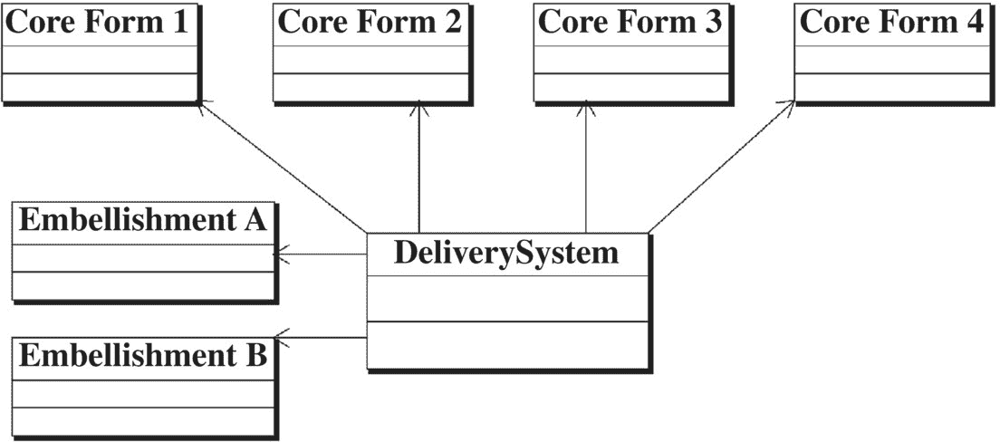

**图 12.1**

图 12.1 中每个核心形式所需的标识信息可以被认为是构成客户所需对象的*内在参数*（intrinsic parameters）。而你为了定制核心形式而需要的额外状态信息可以被认为是对象的*外在参数*（extrinsic parameters）。将披萨制作过程中的内在参数和外在参数隔离，允许你分别控制披萨核心形式及其装饰部分的构建，可以认为这可以提高你披萨外送业务的整体效率。例如，应用到核心形式内在参数的任何优化都需要更彻底的分析和理解（因为从该形式定制的所有披萨实例都会受到影响）。对于仅应用于外在参数的任何优化，情况就不可能是这样，因为相对而言，只有少量的最终披萨实例可能会受到影响。

## 12.4 现实应用中的享量模式

这些思想在现实世界中的应用可以是：使用纯面向对象的方法表示文本文档及其内容。每个字符可能在文档中出现任意次数。对于每个给字符，变化的是它在文档中的位置以及字体样式和大小。字符的每次出现都可以是该字符核心形式的一个`instance`，并与字符位置及字体大小相关的外在参数进行装饰。这种文档表示方法可以让我们一方面独立控制核心形式，另一方面独立控制它们的装饰部分——特别是与字体大小和样式相关的装饰部分。

## 12.5 用哈利·波特的故事说明享量模式

几位霍格沃斯的任校长因他们在任期内取得的成就而闻名。由于名声，人们和组织喜欢将他们的肖像挂在墙上。这些肖像具有魔力，因为同一个人的图像可以从一个肖像移动到另一个肖像，即使这两个肖像相隔很远。例如，在《凤凰社》书中，邓布利与前校长埃弗拉德教授的肖像交话，要求教授前往魔法部的肖像处发出警报，以引起对在魔法部受伤的阿瑟·韦斯莱的关注。，邓布利派遣前女校长迪莉丝·德文特前往她在圣芒戈医院的肖像处，询问阿瑟是否被送往了医院。在同一个故事中，邓布利与前校长菲尼斯·尼格勒卢斯·布莱克的肖像交话，要求他前往格里莫德广场 12 号的肖像处，告诉他的曾曾孙西里斯·布莱克阿瑟·韦斯莱受伤了，阿瑟的妻子孩子以及哈利·波特很快就会到达那里。

我们对享重量模式（Flyweight pattern）的演示基于制作霍格沃前任校长的肖像。我们假设制作这样的肖像涉及：(1) 从官方图像存档获取校长（或女校长）的图像；(2) 将图像印在纸张或画布等合适的介质上；最后，(3) 在介质周围加上一个边框，*边框是对客户肖像的定制化*。因此，为了与我们之前的示例进行类比，我们可以将肖像中的图像视为核心形式，将边框视为装饰。享重量模式指出，如果可能的话，当获取前任校长的图像时，应该将其存储起来，以便在未来对同一位校长或女校肖像请求时可以使用相同的图像。

如果我们假设魔法社区规模庞大，而肖像制作者较少，那么肖像制作者可能会收到大量关于霍格沃前任校长的肖像请求——特别是对于那些在校期间非常受欢迎的人。因此，与其反复从图像存档购买同一位校长的图像，不如肖像制作者更合理的做法是在收到第一次请求时获取图像，将其存储在自己的某种设备中，然后使用它为后续涉及同一前任校长的订单创建带有客户特定边框的副本。*这正是享重量模式应该要做的事情。*

## 12.6 模式演示的顶层视图

我们将想象以下场景，魔法社区的人们通过这种方式获取霍格沃前任校长和女校长的肖像：

*   官方图像存档中提供各种类型的图像，包括霍格沃前任校长的图像——在我们的案例中，这一角色将由 `ImageManager` 类担任。存档将图像出售给获得许可的肖像制作者，方式是“一次性购买，无限使用”。

*   由于肖像制作者获取的图像在未来可以使用任意次数，他/她必须将获取的每个图像存储在自己的数据库中。

*   当客户请求肖像时，客户通常还会为肖像请求一个他们选择的边框。通常，边框的选择将基于肖像要悬挂的学院的合适颜色和其他符号（如纹章）。然而，为了简单起见，我们假设这种定制仅包括在图像周围放置一个宽宽的彩色边框。

我们对享重量模式的演示基于以下“角色”：

*   **ImageManager：** 该类的主要契约是担任魔法世界的官方图像存档。该类旨在为该类的客户提供一组图像，客户可以从中进行挑选。（该类的客户将是肖像制作者。）`ImageManager` 通过一个名为 `loadImages()` 的静态方法提供其图像。当肖像制作者调用

    ```
    ImageManager.loadImages();
    ```

*   肖像制作者可以获取——但仅供检查——存档中提供的所有图像。随后，肖像制作者必须为收到的肖像订单选择图像，并将其存储在自己的本地数据库中。肖像制作者仅对所选图像付费。如前所述，肖像制作者只需为一张图像支付一次费用^(1)。获取图像后，他/她可以根据意从该图像创建任意数量的肖像。

*   **HeadMasterPortrait：** 该类的实例是根据从 `ImageManager` 类订单或从肖像制作者维护的本地存储中检索的图像制成的肖像。因此，该类的实例就是肖像制作者交付给客户的肖像。使用购买或检索的图像，实际创建新肖像的工作交给了 `PortraitMakerAssignment` 类。由 `PortraitMakerAssignment` 创建的每个肖像都是霍格沃前任校长图像与为制作该肖像的客户选择的边框的组合。

*   **FlyweightImageStore：** 回想一下，享重量模式的核心存储之前创建的肖像实例的核心部分，这些核心部分是霍格沃校长的图像，这样图像就可以在未来相同校长的肖像中再次使用。（再次提醒读者，肖像是图像及其边框的组合。）`FlyweightImageStore` 是肖像制作者的本地存储。它是一个智能存储系统，其意义在于只有当该图像之前没有被使用过，它才会从 `ImageManager` 类获取新图像。

*   **PortraitBorderChoices：** 每个肖像订单都包含一个定制请求，定制内容是肖像的特定颜色的边框。`PortraitBorderChoices` 类为该目的提供了一个预定义的彩色边框列表。该类实际上是一个 Java 接口。因此，类中定义的任何常量都可以被任何子类直接访问。

*   **PortraitMakerAssignment：** 肖像制作者使用此类类通过构造 `HeadMasterPortrait` 实例来创建一个新肖像。`HeadMasterPortrait` 构造函数必须提供校长（或女校长，视情况而定）的图像以及与图像使用的边框。校长图像是从 `FlyweightImageStore` 类获取的。如之前所述，该类将自行决定是否可以从自己的本地存储提供请求的图像，还是应该从官方存档购买。另一方面，边框是由客户指定的。

图 12.2 显示了演示代码的顶层视图。如所述，新肖像的订单由 `PortraitMakerAssignment` 处理。

## 12.7 HeadMasterPortrait 类

当肖像制作者根据图像和客户要求的边框制作肖像时，该肖像是此处类的实例。当该类的构造函数被调用时（如由 `PortraitMakerAssignment` 调用所示），必须提供霍格沃校长的图像以及与图像使用的边框。

```java
import javax.swing.*;
import javax.swing.border.*;

public class HeadMasterPortrait {

	private String headMasterName;
	private ImageIcon image;
	private Border borderRequested;

	public HeadMasterPortrait( String name, ImageIcon picture, Border border ) {
		headMasterName =name;
		image = picture;
		borderRequested = border;
	}

	public void displayPortrait() throws Exception {
		ImageManager.displaySingleImage( headMasterName, image, borderRequested );
	}
}
```

## 12.8 FlyweightImageStore 类

本节定义的类的目的是为肖像使用的图像提供存储（供肖像制作者本地使用）。图像是从下一节介绍的 `ImageManager` 类（担任存档角色）获取的。当第一次获取图像时，它被存储在由下方实现中 `portraitImages` 变量引用的集合中。


该类的两个静态成员`imageDatabase`和`portraitImages`都是用于存储图像的哈希表。但请注意，它们的用法语义非常不同。`imageDatabase`存储的是由`ImageManager`类表示的图像存档提供的图像。另一方面，`portraitImages`是由肖像制作者（portrait maker）维护的本地存储，用于存储之前从存档中获取的图像。

关于`getImage()`方法的实现，它首先检查图像是否已经在肖像制作者维护的本地存储`portraitImages`中。如果在该存储中没有找到请求的图像，它将从`ImageManager`供应商处获取（为了演示的故事情，我们可以称之为“购买”），从其`imageDatabase`中检索图像。随后，任何此类图像都会存储在本地存储`portraitImages`中，以备以后为同一个头像制作肖像。

静态方法`getPortraitImageStoreSize()`可以告诉我们到目前为止从`ImageManager`供应商获取并由肖像制作者本地存储的图像数量。静态方法`howManyImagesOrderedFromImageArchive()`可用于确定从存档订购了多少幅图像。在随后的节 12.13 中，我们将比较这两个方法的整数值，以证明我们的享重量模式（Flyweight pattern）演示工作正常——也就是说，之前使用过的图像不会为新的肖像订单再次从`ImageManager`类订购。每当从存档订购图像时，静态整数变量`numberImagesOrderedFromArchive`的值就会加 1。

```java
import java.util.*;
import javax.swing.ImageIcon;

public class FlyweightImageStore {

	private static Hashtable<String,ImageIcon> imageDatabase =
						ImageManager.loadImages();
	private static Hashtable<String,ImageIcon> portraitImages =
						new Hashtable<String,ImageIcon>();
	private static int numberImagesOrderedFromArchive = 0;

	public static ImageIcon getImage( String name )
				throws ImageNotAvailableException {
		if (portraitImages.containsKey( name ) ) {
			return portraitImages.get( name );
		}
		if ( !imageDatabase.containsKey(name) ) {
			throw new ImageNotAvailableException();
		}
		ImageIcon newImage = imageDatabase.get( name );
		numberImagesOrderedFromArchive++;
		portraitImages.put(name, newImage);
		return newImage;
	}

	public static int getPortraitImageStoreSize() {
		return portraitImages.size();
	}

	public static int howManyImagesOrderedFromImageArchive() {
		return numberImagesOrderedFromArchive;
	}
}
```

---

## 12.9 `ImageManager`类

本节介绍的`ImageManager`类在我们的演示中充当图像供应商。它的静态方法`loadImages()`将当前目录下的 jpeg 图像以哈希表的形式提供给其他人，其中以前的霍格沃茨头像名称作为键，从 jpeg 图像创建的`ImageIcon`对象作为相应的值。

作为对巫魔法世界的服务，`ImageManager`类还提供了一个方法来显示由肖像制作者制作的肖像。该类还包含一个幻灯片方法用于快速浏览数据库中的所有图像——仅为了查看数据库中当前有哪些图像。该方法称为`slideshow()`，在此处的享重量模式演示中没有用到，但如果读者感兴趣进行尝试，可以通过`ImageManager`类使用它。

通过查看`ImageManager`类定义的代码，读者可能想知道为什么我们需要静态变量`nextPhotoDisplayIndex`。这个变量使得在终端窗口中同时显示多个图像变得更容易。详细来说，如你在节 12.12 中所示，`PortraitMakerAssignment`类的`main`方法会在计算机的终端窗口中同时构造并显示多个肖像。通常，所有这些肖像将一个接一个显示。然而，在静态变量`nextPhotoDisplayIndex`的帮助下，我们为每个肖像关联了一个整数索引，并使用此索引来平移每个显示的肖像。

类中显示的第一个方法是`loadImages()`。正是这个方法允许`ImageManager`类作为一个存档，将其图像提供给肖像制作者（我们假装收费）。该方法简单地扫描当前目录中的任何 jpeg 图像，并以哈希表的形式呈现给肖像制作者，哈希表的键源自名称。假设每个图像文件的名称为`firstName_lastName.jpg`或`name.jpg`格式。图像中人物的名称是从名称中提取的子字符串构建的。在哈希表中，每个图像随后根据名称建立键值。

类定义中的下一个方法签名如下：

```java
void displaySingleImage( Hashtable<String,ImageIcon> hash, String name)
```

该方法在你的计算机屏幕上显示单个图像，其名称在第二个参数中指定。这个名称推测是某位之前的校长或女校长。第一个参数是通过调用该类的`loadImages()`方法构造的哈希表。

下一个方法的签名如下：

```java
void displaySingleImage( String name, ImageIcon image, Border border)
```

该方法被`ImageMaker`类的客户端用于显示一个“肖像”。记住，肖像是肖像制作者通过将图像印在某些介质上并在周围放置边框而创建的。

下一个静态方法是`slideshow()`，它目前未用于享重量模式演示，但包含了它，以防用户想要快速查看`ImageManager`类提供的所有图像。该方法本质上是对内部类`SlideShowDisplay`中同名方法的封装。我们的封装方法首先构造内部类的实例，并在实例上调用内部类的`slideshow()`方法。内部类使用定时器在固定时间间隔显示每幅图像；此间隔的长度可以通过更改内部类中的变量`pause`值来修改。

注意，所有的图像显示方法都使用`javax.swing.Label`类来实际显示图像。这个类的很棒之处在于它接受一个文本标签，可以与图像一起显示。该类提供了各种方法来控制文本标签相对于图像放置的位置。


```java
import java.util.Hashtable;
import java.util.StringTokenizer;
import javax.swing.*;
import javax.swing.border.*;
import java.awt.*;      //for Graphics, Color, Dimension, etc.
import java.awt.event.*;
import java.io.*;       // for File

public class ImageManager {

    public static int nextPhotoDisplayIndex = 0;

    public static Hashtable<String,ImageIcon> loadImages() {
        File fileobj = new File( "." );
        FilenameFilter jpegOnly = new FilenameFilter() {
            public boolean accept( File dir, String name ) {
                return name.endsWith( ".jpg" );
            }
        };
        String[] allImageFiles = fileobj.list( jpegOnly );
        int numImages = allImageFiles.length;
        Hashtable<String,ImageIcon> hash = new Hashtable<String,ImageIcon>();
        String name = "";
        for (int i=0; i < numImages; i++) {
            int index = allImageFiles[i].lastIndexOf(".");
            String restOfFileName = allImageFiles[i].substring(0,index);
            StringTokenizer st = new StringTokenizer( restOfFileName, "_" );
            while (st.hasMoreTokens() ) {
                name += " " + st.nextToken();
            }
            // Get rid of extra space at the beginning:
            name = name.substring(1);
            hash.put( name, new ImageIcon( allImageFiles[i] ) );
            name = "";
        }
        return hash;
    }

    public static void displaySingleImage( Hashtable<String,ImageIcon> hash, String name) throws Exception {
        if ( ! hash.containsKey( name ) ) {
            throw new Exception("Database does not contain the image " + "named");
        }
        nextPhotoDisplayIndex++;
        JFrame f = new JFrame( "Single Image Display" );
        f.addWindowListener(new WindowAdapter() {
            public void windowClosing(WindowEvent e) {
                System.exit(0);
            }
        });
        Container cPane = f.getContentPane();
        int width = 600;
        int height = 500;
        int displayWidth = width - cPane.getInsets().left - cPane.getInsets().right;
        int displayHeight = height - cPane.getInsets().top - cPane.getInsets().bottom;
        JLabel label = new JLabel( name, (ImageIcon) hash.get(name), JLabel.CENTER );
        label.setVerticalTextPosition(JLabel.BOTTOM);
        label.setHorizontalTextPosition(JLabel.CENTER);
        Border border = BorderFactory.createMatteBorder(20, 20, 20, 20, Color.red );
        label.setBorder( border );
        JScrollPane scrollableImage = new JScrollPane( label );
        scrollableImage.setPreferredSize( new Dimension( displayWidth, displayHeight-8 ) );
        if ( scrollableImage != null ) {
            cPane.add( scrollableImage );
        }
        f.pack();
        f.setSize( 600, 600 );
        f.setLocation( 100*nextPhotoDisplayIndex, 100*nextPhotoDisplayIndex);
        f.setVisible( true );
    }

    public static void displaySingleImage( String name, ImageIcon, Border border) throws Exception {
        nextPhotoDisplayIndex++;
        JFrame f = new JFrame( "Single Image" );
        f.addWindowListener(new WindowAdapter() {
            public void windowClosing(WindowEvent e) {
                System.exit(0);
            }
        });
        Container cPane = f.getContentPane();
        int width = 600;
        int height = 500;
        int displayWidth = width - cPane.getInsets().left - cPane.getInsets().right;
        int displayHeight = height - cPane.getInsets().top - cPane.getInsets().bottom;
        JLabel label = new JLabel( name, image, JLabel.CENTER );
        label.setVerticalTextPosition(JLabel.BOTTOM);
        label.setHorizontalTextPosition(JLabel.CENTER);
        label.setBorder( border );
        JScrollPane scrollableImage = new JScrollPane( label );
        scrollableImage.setPreferredSize(new Dimension( displayWidth, displayHeight-8) );
        if ( scrollableImage != null ) {
            cPane.add( scrollableImage );
        }
        f.pack();
        f.setSize( 600, 600 );
        f.setLocation( 100*nextPhotoDisplayIndex, 100*nextPhotoDisplayIndex);
        f.setVisible( true );
    }

    public static void slideshow() {
        ImageManager.SlideShowDisplay slideshow = new ImageManager.SlideShowDisplay();
        slideshow.slideshow();
    }

    private static class SlideShowDisplay extends JRootPane {
        Timer timer;
        int frameIndex = -1; //the current frame number
        int numImages;      //number of images to display
        int width;          //width of the frame’s content pane
        int height;         //height of the frame’s content pane
        int displayWidth;
        int displayHeight;
        JComponent contentPane; //the content pane
        ImageIcon images[];     //the images
        String imageNames[];
        boolean finishedLoading = false;
        JScrollPane scrollableImage;
        boolean newFrame = false;

        private SlideShowDisplay() {
            int pause = 100;
            numImages = 3;
            width = 600;
            height = 500;
            displayWidth = width - getInsets().left - getInsets().right;
            displayHeight = height - getInsets().top - getInsets().bottom;
            contentPane = new JPanel() {
                public void paintComponent( Graphics g ) {
                    super.paintComponent( g );
                    if ( finishedLoading && newFrame ) {
                        JLabel label = new JLabel( imageNames[frameIndex], images[frameIndex], JLabel.CENTER );
                        label.setVerticalTextPosition(JLabel.BOTTOM);
                        label.setHorizontalTextPosition(JLabel.CENTER);
                        Border border = BorderFactory.createMatteBorder(20,20,20,20, Color.red );
                        label.setBorder( border );
                        scrollableImage = new JScrollPane( label );
                        scrollableImage.setPreferredSize( new Dimension( displayWidth, displayHeight - 8 ) );
                        if ( scrollableImage != null ) {
                            this.add( scrollableImage, BorderLayout.NORTH );
                        }
                        this.revalidate();
                        this.repaint();
                    }
                }
            };
            contentPane.setBackground(Color.white);
            setContentPane(contentPane);
            timer = new Timer( pause, new ActionListener() {
                public void actionPerformed( ActionEvent evt ) {
                    frameIndex++;
                    if ( frameIndex == numImages ) {
                        frameIndex = 0;
                    }
                    newFrame = true;
                    contentPane.repaint();
                }
            });
            timer.setInitialDelay( 0 );
            timer.setCoalesce(false);
            new Thread() {
                public void run() {
                    loadImages();
                }
            }.start();
        }

        private void loadImages() {
            File fileobj = new File( "." );
            FilenameFilter jpegOnly = new FilenameFilter() {
                public boolean accept( File dir, String name ) {
                    return name.endsWith( ".jpg" );
                }
            };
            String[] allImageFiles = fileobj.list( jpegOnly );
            numImages = allImageFiles.length;
            System.out.println( "Number of images found "+numImages );
            imageNames = new String[numImages];
            for(int i=0; i < numImages; i++) {
                imageNames[i] = allImageFiles[i];
                System.out.println( allImageFiles[i] );
            }
            images = new ImageIcon[numImages];
            for ( int i = 0; i < numImages; i++ ) {
                images[i] = new ImageIcon( allImageFiles[i] );
            }
            finishedLoading = true;
            timer.start();
        }

        private void slideshow() {
            JFrame f = new JFrame( "slide show" );
            f.addWindowListener(new WindowAdapter() {
                public void windowClosing(WindowEvent e) {
                    System.exit(0);
                }
            });
            Container cPane = f.getContentPane();
            cPane.add( this, BorderLayout.CENTER );
            f.pack();
            f.setSize( 600, 550 );
            f.setVisible( true );
        }
    }
}
```


如前所述，肖像制作者通过将图像（最初从魔法世界的官方图像库获取，即`ImageManager`类）印印在某些介质上（如纸张、织物、画布等），然后在图像周围加上客户选择的边框来制作肖像。因此，基本上，肖像是图像和边框的结合。这个类实际上是一个接口，为了方便我们提供了一组预定义的边框。这些边框宽度为 20 像素，呈现哑光外观。

```java
import java.awt.*;
import javax.swing.*;
import javax.swing.border.*;
public interface PortraitBorderChoices {
    public static final Border redborder =
            BorderFactory.createMatteBorder(20,20,20,20, Color.red);
    public static final Border blueborder =
            BorderFactory.createMatteBorder(20,20,20,20, Color.blue);
    public static final Border magentaborder =
            BorderFactory.createMatteBorder(20,20,20,20, Color.magenta);
    public static final Border greenborder =
            BorderFactory.createMatteBorder(20,20,20,20, Color.green);
}
```

## 12.11 ImageNotAvailableException 类

由于`ImageManager`类库存中可能没有肖像制作者请求的图像，我们需要一个异常类，当接收到此类图像的请求时，其实例可以作为抛出对象。所示异常类即是用于此目的。

```java
public class ImageNotAvailableException extends Exception {
    public ImageNotAvailableException() {
        super();
    }
    public ImageNotAvailableException(String message) {
        super(message);
    }
}
```

## 12.12 PortraitMakerAssignment 类

`PortraitMakerAssignment`将作为我们的客户端，因为它将执行这个重量级模式（Flyweight pattern）演示中的其余代码。

下面的代码展示了一个肖像制作者收到了四个肖像请求。其中有两个请求针对同一个前校长——Ambrose Swott——这两个请求可能来自两个不同的客户。这两个肖像是带有两种不同边框请求的。如果我们的重量级模式按预期工作，第一个对 Ambrose Swott 肖像的请求应该导致`FlyweightImageStore`从`ImageManager`订购他的图像。然而，对同一个肖像的第二个请求只需要从`FlyweightImageStore`类维护的本地存储中获取相同的图像。由于从`ImageManager`订购的每个图像都被`FlyweightImageStore`类存储，因此对该存储中图像数量的检查以及对实际从图像库（`ImageManager`类）订购图像数量的检查，可以告诉我们的重量级模式实现是否正常工作。需要注意的是，仅仅检查肖像制作者维护的本地存储中的图像数量是不够的。由于它是哈希表，重复插入一个`<key,value>`对（键是个人姓名，值是图像对象）将只会替换旧值。因此，我们还必须检查实际从`ImageManager`类订购的图像数量。这两个检查都由下面实现中的最后两个语句完成。在我们的案例中，对于肖像制作者收到的四个订单，这两个数字都应该是 3。

```java
import javax.swing.*;
import javax.swing.border.*;

public class PortraitMakerAssignment implements PortraitBorderChoices {

    String headmastername;
    HeadMasterPortrait portrait;

    public PortraitMakerAssignment( String name, Border border ) {
        headmastername = name;
        ImageIcon imageRequested = null;
        try {
            imageRequested =
                    FlyweightImageStore.getImage( headmastername );
        } catch (ImageNotAvailableException e) {
            System.out.println( "This portrait cannot be made since "
                                + headmastername + "’s image is not "
                                + "available from the archive.");
        }
        if (imageRequested != null)
            portrait =
                    new HeadMasterPortrait(name, imageRequested, border);
    }

    public static void main( String[] args ) throws Exception {
        PortraitMakerAssignment job1 =
                new PortraitMakerAssignment("Ambrose Swott", greenborder );
        job1.portrait.displayPortrait();

        PortraitMakerAssignment job2 =
                new PortraitMakerAssignment("Basil Frons", redborder );
        job2.portrait.displayPortrait();

        PortraitMakerAssignment job3 =
                new PortraitMakerAssignment("Ambrose Swott", redborder );
        job3.portrait.displayPortrait();

        PortraitMakerAssignment job4 =
                new PortraitMakerAssignment("Phineas Nigellus Black", blueborder );
        job4.portrait.displayPortrait();

        System.out.println( "Number of images in the portrait "
                            + "maker’s image store: "
                            + FlyweightImageStore.getPortraitImageSize() );

        System.out.println( "Number of images ordered from the image "
                            + "archive: "
                            + FlyweightImageStore.howManyImagesOrderedFromImage());
    }
}
```

## 12.13 运行代码

从书籍网站下载此模式的类文件到单独目录。使用命令编译代码：

```
javac *.java
```

并通过以下命令执行`PortraitMakerAssignment`类：

```
java PortraitMakerAssignment
```

根据`PortraitMakerAssignment`中`main()`方法的代码，执行该类将产生以下输出：

```
Number of images in the portrait
maker’s image store: 3
Number of images ordered from the image
archive: 3
(Also displayed on your screen will be four
photos ordered from the archive --- of the three
different heads.)
```

为了获得额外的见，你可能希望按照以下方向扩展此模式的代码：

- 读者一定注意到，`ImageManager`实现中的`slideshow()`方法在重量级模式的演示并没有实际使用。然而，这是一个有用的方法，`ImageManager`的客户端可以使用它快速浏览`ImageManager`持有的整个图像集合。修改演示代码，为`PortraitMakerAssignment`类提供幻灯片的选项。为了让这个扩展真正有用，最好是为`PortraitMakerAssignment`类创建一个基于 GUI 的界面，不仅允许用户查看幻灯片，还可以通过鼠标点击选择图像。

- 在当前的演示中，客户端`PortraitMakerAssignment`在选择所需的图像之前下载了`ImageManager`持有的整个图像集合。这对于大型集合可能并不适用。更有可能是图像库——`ImageManager`类向肖像制作者提供其集合中图像的缩略图。预计肖像制作者将根据他们看到的缩略图选择图像。如果你愿意尝试，可以修改演示代码，将实际图像存储在`ImageManager`类的私有部分，仅通过公共部分提供缩略图。当然，在肖像制作者选择了图像后，`ImageManager`类将希望从其私有集合中提供图像。

- `PortraitBorderChoices`接口中的边框都是统一颜色的，且宽度均为 20 像素。为了更复杂的演示，可以使用基于图标等的像素模式创建更精美的边框。如果读者选择按此方向扩展演示，他们会发现先学习官方 Java 网站上的 Swing “如何使用边框”教程会有益。

`ImageManager`类提供的霍格沃校长和女校长图像是从 [5] 下载的。

# 13 代理 (PROXY)

## 13.1 必须要有实物吗？

在大多数情况下，人类想要只与真实的物体交互。当我们发现自己关注的对象是虚假的时，我们会觉得自己被欺骗了。

尽管我们对“假货”一词带有贬义色彩，但在现实生活中确实存在这样的情况：你需要的并不是真实物体本身，而是可以作为真实物体替代品的物体。泛泛地说，替代品之所以是“假”的，简单的原因是它与实物并不完全相同。尽管如此，当实物不可用，且认为替代品可以达到同样的效果时，替代品就可能是至关重要的。在许多情况下，这些替代品被称为`proxies`（代理）。

决定是否需要代理的实际考虑因素随情况而异。例如，企业组织通常允许股东在无法或不愿参加利益相关者会议时通过代理投票进行投票。在代理投票中，你可以指定其他人代表你进行投票。另一个例子（同样是在人类组织的背景下），组织负责人可以将其权力委托给指定的`surrogate`（代理人）——实际上就是代理——以便在活动中执行某些职责。

虽然“surrogate”和“proxy”这两个词在许多语境下含义相同，但前者通常指你指定某人代表你行动，而后者指上级指定某人代表你行动。

代理的概念在现代计算机网络中变得极其重要。在网络中，代理除了起到与人类组织基本相同的作用外，还用于控制资源访问以及允许用户在互联网上实现匿名。

## 13.2 意图与适用性

代理模式的意图是提供一个可以作为真实对象替代的对象。

在以下情况下，你应该考虑使用该模式：

* 出安全考虑，你需要一个替代对象（代理）来监管对真实对象的访问；
* 你需要一个用于网络缓存的代理；
* 你的客户端需要一个代理来对其访问访问进行匿名；
* 你的客户端需要网络中远程主机上对象的代理，以便它们可以通过对本地代理的方法调用，来访问这些远程对象提供的服务。

## 13.3 代理模式简介

代理模式是关于设计接口，客户端可以通过这些接口访问无法直接（或不允许直接）到达的资源。此类接口最常见的例子可能是某些互联网服务提供商（ISP）使用的代理服务器，用于引导客户所有通往网页的访问。至少，代理服务器可以为客户访问的信息提供缓存服务。因此，如果一个客户下载了（例如）*纽约时报*的网页，并在几秒钟内，另一个客户尝试执行相同的操作，那么第二个客户将看到第一个客户下载的内容的缓存副本。此类代理接口还可以充当安全网关。当用于安全时，代理可以在将连接转发到真实服务器之前，对客户和/或其请求进行身份验证。在这种情况下，代理模式的实现归变为编写一个客户端-服务器程序：对于那些需要访问网络其他地方资源的客户，它表现得像一个服务器；而对于客户想要访问的真实服务器，它表现得像一个客户端。

代理的概念也是分布式计算的基础，在分布式计算中，网络中的一台机器提供其他机器想要利用的服务。在所谓的分布式计算服务面向架构（SOA）中（如[图 13.1] 所示），客户端想要调用位于网络中某台机器内存中的对象上的函数。然而，客户端必须首先解决由于对象由内存地址表示且内存地址不跨越机器边界而引起的问题。为了克服这一困难，在 SOA 实现中，当首次与拥有该对象的机器（服务器）建立连接时，客户端下载远程对象的代理（在此语境下通常被称为`stubs`存根）。这些位于客户端的代理随后作为基于服务器的远程对象的替代品。当客户端机器调用远程对象上的方法时（更准确地说，是对远程对象的本地代理的方法调用），代理的任务是将方法调用进行打包（这可能涉及对方法调用涉及的参数进行打包，或更常用的`serializing`序列化），并将其发送到远程服务器。服务器必须解包参数（或进行`deserialize`反序列化），执行方法，计算结果，必要时对结果进行序列化，并将通过这种方式获得的打包结果传回客户端。显然，只有当客户端机器也拥有从远程服务器计算得到的结果中对象的代理时，这种方法才有效。

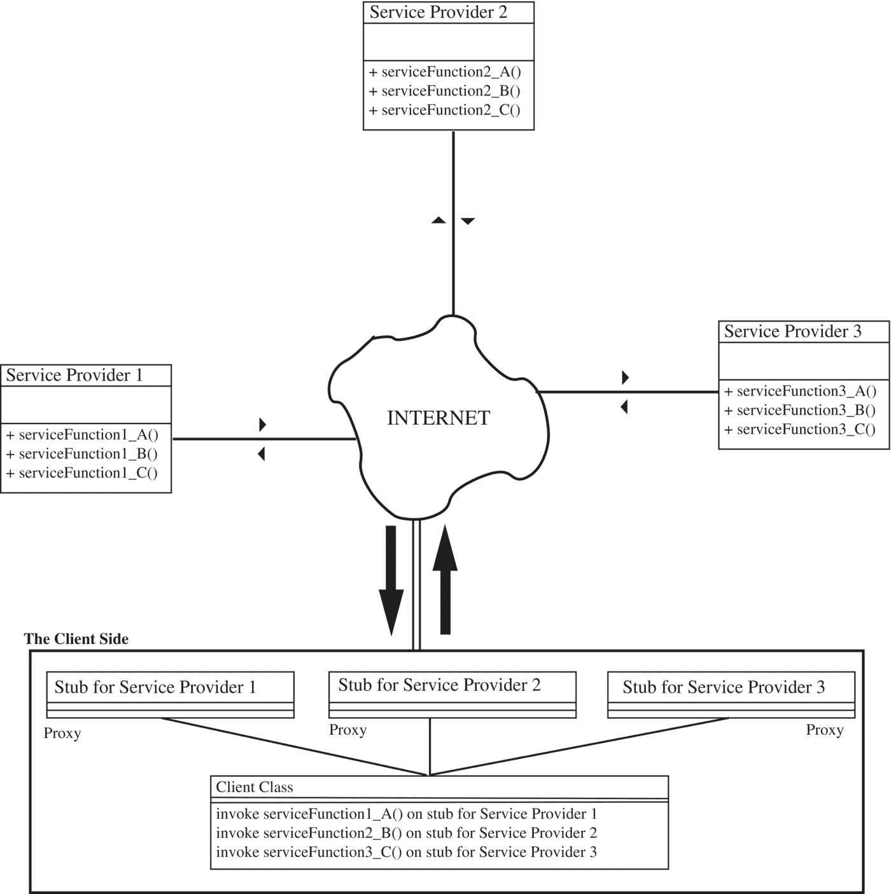

[**图 13.1**]

## 13.4 现实应用中的代理模式

Squid [7] 可能是世界上最流行的网络服务代理服务器。Squid 代理既可以用于自我匿名，也可以用于缓存。对于匿名，你显然会使用托管在远程位置的此类代理，它将你的调用路由出去而不泄露你的身份。而当用于缓存时，ISP（互联网服务提供商）可以通过在其本地内存中临时存储客户端请求的网络资源，这样对相同网页对象的重复请求就可以无需从其原始源反复获取了。有些人还声称，如果你在自己的机器上安装这样的代理服务器，并要求网络浏览器通过代理路由所有外部请求，就可以改善你的个人上网体验。像 Squid 这样的代理服务器还可以被组织用于控制内部人员可以访问哪些外部资源。

关于使用代理调用网络中远程机器上对象的方法，其中一个重要例子是 Java 中的 RMI（远程方法调用）。当代理以此方式使用时，有时被称为`remote proxy`（远程代理）。

## 13.5 用于说明代理模式的哈利·波特故事

在我们对代理模式的演示中，黑魔伏地魔是真实的。读者可能记得，在前四本哈利·波特书中，伏地魔仅以精神形式存在，即没有人类身体。特别是在第一书中，伏地魔通过在霍格沃教授教授性魔法术的奇里勒斯·奇奇鲁精神存在。在代理模式的语言中，奇奇鲁在哈利·波特在霍格沃茨的第一年担任了伏地魔的代理。

# 演示代码背景回顾

作为本章演示代码的背景，让我们简单回顾一下奇奇尔相对于他的导师伏地魔所扮演的角色。伏地魔的愿望是让奇奇尔偷走由著名炼金术士尼尼拉斯·弗拉梅尔拥有、并储存在古灵汇巫师银行的金石。伏地魔想要这块石头是因为它可以用来熬制一种能赋予饮者永生生命的药水。（伏地魔显然认为获得永生将让他恢复完整的生命形态。）不幸的是，伏地魔的这个计划失败了，因为邓布利在奇奇尔进入存放魔石的地下室之前，派遣了海格从古灵汇取走了魔石。

## 魔金石的保护

从古灵汇取出魔石后，邓布利将其储存在霍格沃的一个秘密室里，该室的入口由多道咒语保护，每道咒语由霍格沃的不同教授创造。要到达隐藏魔石的密室，你必须首先穿过一只凶猛的三头狗（这是海格对魔石保护的贡献），并进入一个由三头狗守护的陷阱门后的滑道。你顺着滑道掉入布满魔植物的房间，正如其名称所示，它们试图紧紧地缠住你并将你勒死。这道咒语是由霍格沃茨的植物学教授波姆娜·斯鲁特创造的。如果你在魔植物中幸存，就会发现自己处于一个到处不断飞行的有翅钥匙的房间里。钥匙在墙壁之间穿梭，并在墙上弹跳。只有其中一把钥匙可以打开通往隐藏魔石下一个房间的门。这些钥匙是由菲利斯·弗莱维教授施了魔法的，他在哈利·波特在霍格沃茨第一年负责魔法课。

鉴于哈利·波特在魁地奇比赛中展现出的卓越金色球捕球员技巧，对他来说，通过在房间里的扫帚上追逐并抓到正确的钥匙相对容易。通往魔石之路上的下一个挑战是一个装有米内瓦·麦格格教授教授巫师棋盘的房间，上面有高大且带有魔法的棋子。哈利、罗恩和赫敏别无通过游戏来穿过棋盘到达另一侧，因为那里有一扇通往下一个房间的门。棋盘被施了魔法，允许哈利、罗恩和赫敏替换他们选择的三个黑棋。至于黑方如何下棋取决于这三个人，因为黑棋听从他们的命令，但白棋被施了魔法，会独立行动与黑棋对战。当白棋吃掉黑棋时，它们丝毫不留情——它们会将吃掉的棋子从棋盘上拖走并掉在地板上撞碎。因此，当罗恩决定赢得游戏的唯一方法是让白皇后吃掉自己时，他不得不让皇后击败——这让哈利和赫敏感到非常震惊。

这就剩下哈利和赫敏来对下一道保护——一只巨大的山魔。但正如后来为人知的，山魔被奇奇尔击昏了，而奇奇尔在到达魔石的过程中就在他们前面。所以哈利和赫敏能够直接走过山魔。这让哈利和赫敏来到了保护魔石的下一道咒语——一个有一个桌子的房间，上面放着七个形状不同的瓶子，装有不同种药水。（这道咒语是由塞弗勒斯·斯内教授创造的，他在哈利·波特在霍格沃茨第一年教授魔药。）关于七瓶药水的用途，发生的情况是：当哈利和赫敏一进房间，他们刚刚进入的门和通往下一个房间的门就会喷射出紫色火焰。在七瓶药水中，一种可以让饮者穿过通往下一个房间门的火焰，一种允许饮者穿过他们刚刚进入药水室门的火焰，两瓶含有无害酒，但三瓶含有会杀死他们的毒药。为了弄清楚哪瓶装的是什么药水，他们必须解决一个被称为“药水之谜”的谜题。赫敏凭借敏锐的逻辑感解决了谜题，让哈利进入了装有魔石最后的密室。赫敏回到罗恩昏迷的地方以便复活他，同时尝试向邓布利寻求帮助。


之所以对魔石的保护方式进行这番相当冗长的回顾，是为了让读者理解，为什么伏地魔的代理人必须是一个有能力的黑巫师，并预期能够克服用于保护魔石的咒语。

## 演示目标

我们演示的目标不是完全重演奇奇尔如何尝试执行伏地魔的任务。相反，我们的演示将集中在奇奇尔尝试获取魔石最后这一小部分场景：哈利进入了实际隐藏魔石的房间。在他进入的那一刻，哈利看到奇奇尔感到震惊，因为他一直认为是斯内教授在寻找魔石。哈利对奇奇尔表达了极度惊讶，结果发现奇奇尔是作为伏地魔的代理人。从那时起，我们见证了奇奇尔与哈利之间的挣——奇奇尔试图从愿望镜中取出魔石（因为邓布利把魔石藏在在那里），而哈利则尽力防止奇奇尔将所有注意力都放在镜子上。

具体来说，我们的演示代码试图捕捉奇奇尔作为伏地魔代理人感到沮丧的时刻，因为他无法在愿望镜中看到魔石，更不用得到魔石了。他向他的导师寻求帮助以理解愿望镜的作用。伏地魔回复说，奇奇尔需要利用哈利来寻找魔石。这种代理人奇奇尔与导师之间的交流正是我们在此处的演示中所捕捉到的。

当我们说一个`DarkWizard`想要担任`DarkLord`的代理时，我们的意思是`DarkWizard`实例想要执行`DarkLord`的命令。在我们的演示中，`Quirrell`将作为`DarkWizard`的实例出现。如前提到的，我们的演示将集中在《哈利·波特》第一本书结尾的场景，在那里，伏地魔想要他的代理`Quirrell`从邓布利层在层层咒语下保护的密室中偷走魔石之石。

## 13.7 抽象类 Wizard

本节介绍的抽象类`Wizard`是用于演示代理模式的层级结构的根节点。如果读者对下方类定义中提到的属性感到困惑——你可能会说这些属性仅仅刻画了黑巫师——请注意，我们将这些属性的默认值设置为`false`。换句话说，一个不是黑巫师的巫师`不`能够施展不可原谅的咒语；`不`能够熬制黑暗魔药；并且`不`能够复活魂尸。通过排除否定特征（而非包含正面特征）来定义该类的主要原因是，从所创建的对象实例来说，这个演示仅涉及那些倒向黑暗一方的巫师以及伏地魔本人。我们可以通过将下方类定义中的属性设置为`true`来捕捉巫师转向黑暗一面的概念。

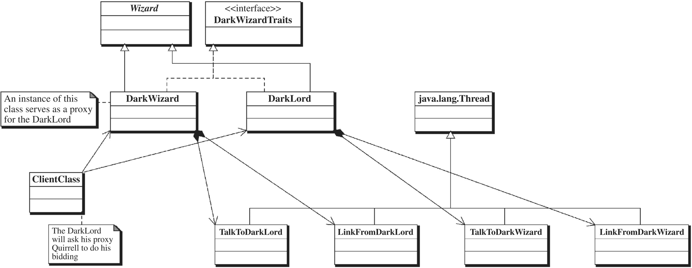

Fig. 13.2

```
 abstract class Wizard {
	protected String name;
	protected boolean canCastUnforgivableCurses = false;
	protected boolean canBrewDarkPotions = false;
	protected boolean canAnimateInferi = false;

	protected Wizard(String name){
		this.name = name;
	}
	public String getName() { return name; }
}
```

## 13.8 DarkWizardTraits 接口

记住，将黑巫师与普通巫师区分开来的是，前者从事一门或多种黑魔法，而这些魔法的实践通常会被关禁在阿兹卡班（巫师监狱）以作为惩罚。至少，黑魔法包括上一节中描述的：施展三种不可原谅的咒语、熬制黑暗魔药以及复活魂尸。

在我们的演示中，黑巫师必须实现下方的接口。这包括伏地魔本人。接口中声明的方法可以用于选择性地赋予黑巫师我们在上一节中描述的三种黑魔法中的一门或多种能力。例如，`Quirrell`承认他曾试图杀死哈利·波特（代表伏地魔），正如上一节所述，这使他成为了一名黑巫师。我们将使用下方所示的`setCanCastUnforgivableCurses()`方法将`Quirrell`的实例变量`canCastUnforgivableCurse`设置为`true`。

```java
public interface DarkWizardTraits {
	void setCanCastUnforgivableCurses(boolean yesOrNo);
	void setCanBrewDarkPotions(boolean yesOrNo);
	void setCanAnimateInferi(boolean yesOrNo);
}
```

## 13.9 DarkWizard 类

读者会记得，我们对代理模式的演示是基于`Quirrell`的，`Qurell`是`DarkWizard`类的一个实例，作为由唯一的`DarkLord`实例代表的伏地魔的代理。为了让`Quirrell`担任伏地魔的代理，`Quirrell`必须先与伏地魔建立通信链路。下方的`DarkWizard`类大部分内容与建立此通信链路的设施有关。

`DarkWizard`实例与单一`DarkLord`实例之间的通信链路由四个单工通道组成，其中两个由`DarkWizard`实例启动，另外两个由`DarkLord`启动。`DarkWizard`创建的两个单工通道通过它的两个内部类实现：

```
 TalkToDarkLord
 LinkFromDarkLord
```

第一个内部类`TalkToDarkLord`用于建立一个独立的线程，以便与`DarkLord`保持持续联系以处理发出的消息。第二个内部类`LinkFromDarkLord`用于创建一个独立的线程（该线程与其他所有执行线程并发运行），用于与`DarkLord`保持持续联系，以接收他对通过第一个通道发送的问题的回答。这些通道在`DarkLord`的实现代码中都有对应的项；我们将在介绍`DarkLord`类时讨论它们。

请注意`establishCommunicationLinkWithDarkLord()`方法的作用。正是这个方法知道 Java 中的线程间通信是通过管道流（piped streams）进行的。这些流被称为`PipedOutputStream`和`PipedInputStream`，定义了单向通信链路的两个端。假设你想让`DarkWizard`的线程`A`持续向`DarkLord`的线程`B`发送数据。你必须通过将本地输出流实例传递给输入管道流的构造函数，首先创建一个关联的输入管道流对。然后你将这对的本地端提供给本地线程`A`，将这对的远程端提供给`DarkLord`的线程`B`。显然，如果你想让`DarkWizard`持续接收来自`DarkLord`的答案，也必须为下行链路创建一个类似的管道流对。

现在让我们关注`TalkToDarkLord`内部类的实现。任何需要发送给`DarkLord`的消息都是通过该类的实例方法`sendMessageToDarkLord(String msg)`给实例的。注意该方法是如何在消息末尾附加换行符`\n`的。这样做有一个重要原因：实际上向输出管道流写入数据的流是`DataOutputStream`对象。为了向伏地魔发送消息，`TalkToDarkLord`实例调用了`DataOutputStream`对象的`writeChars()`方法。在通信链路的另一端，正如我们在下一节将看到的，`DarkLord`实例将使用`BufferedReader`对象的`readLine()`方法来读取摄入的数据。但该方法会阻塞，直到看到字符串末尾有换行符。也就是说，当`readLine()`方法从`BufferedReader`实例获取数据时，如果它没有看到换行符，它将一直继续等待下一个换行符的出现。因此，我们必须确保任何发出的消息都附加了换行符，否则接收方将无法从通信管道中获取消息。

在下方所示的类定义中，注意代码中本应在独立线程中运行的不同位置对`Thread.sleep()`的调用。让线程睡眠是促进线程协作和防止线程死锁的最有效方法之一。然而，当一个线程进入睡眠时，即使非常短暂，也会为另一个等待共享 CPU 时间的线程提供机会。我们将睡眠时间设为随机值，即在固定值的基础上加上随机数。这样做是为了打破因线程之间计时问题而可能引起的任何死锁。在所示的实现中，通过我们在`assignedTask()`方法中使用`download.answerReceived`变量的方式，已经进行了一定程度的线程同步。但是除非使用`wait-notify`机制，否则通过变量进行线程同步具有导致线程死锁的风险。由于我们选择不使用`wait-notify`机制进行同步，因此我们通过检查`downlink.answerReceived`变量的布尔值以及随机化睡眠时间来采取手动控制。

后续代码中需要注意的额外一点是在类定义开始处构建了唯一的`DarkLord`实例。这里的想法是，我们希望所有的`DarkWizard`实例都知道`DarkLord`是谁——这可能就像《哈利波特》系列期间所有黑巫师的情况一样。读者可能会好奇这种构造与客户端类`ClientClass`在第 13.11 节中构造`DarkLord`的关系。有趣的是，正如读者在下一节看到的，由于`DarkLord`类是使用单例模式实现的，无论是谁从`DarkLord`类构造实例，始终只有一个`DarkLord`实例。下方代码中的调用`DarkLord.makeInstanceOfDarkLord()`仅仅返回了在`ClientClass`的`main()`方法中构造的`DarkLord`实例，以便在第 13.11 节中展示。

同样注意`LinkFromDarkLord`类的实例变量`answerReceived`如何帮助处理`DarkWizard`与`DarkLord`之间通信的序列化。该变量的重要性从它在`DarkWizard`的`assignedTask()`方法中的用法显而易见。`DarkWizard`在向`DarkLord`发送新查询之前，会将此变量（即所指的`downlink.answerReceived`）设置为`false`。随后，当`LinkFromDarkLord`类的`run()`方法接收到响应时，该变量会被设置为`true`。


```java
import java.io.*;

public class DarkWizard extends Wizard implements DarkWizardTraits {

    private TalkToDarkLord uplink;
    private LinkFromDarkLord downlink;

    private static DarkLord youKnowWho =
            DarkLord.makeInstanceOfDarkLord( "Voldemort" );
    public DarkWizard(String name){
        super(name);
    }
    ////////////////// 内部类 TalkToDarkLord ////////////////
    public class TalkToDarkLord extends Thread {
        private DataOutputStream out;
        private String nameOfSender;
        private String outgoingMessage = null;
        public TalkToDarkLord(OutputStream outsm, String nameOfSender){
            this.nameOfSender = nameOfSender;
            out = new DataOutputStream( outsm );
        }
        public void sendMessageToDarkLord(String msg) {
            outgoingMessage = msg + "\n";
        }
        public void run() {
            for (;;) {
                try {
                    while (outgoingMessage == null) {
                        sleep(100 + 100 * (long) Math.random() );
                    }
                    System.out.println( nameOfSender + ": "
                            + outgoingMessage );
                    out.write( outgoingMessage );
                    out.flush();
                    outgoingMessage = null;
                    sleep( 500 + 100 * (long) Math.random() );
                } catch( Exception ) {
                    System.out.println( "Error: " + e );
                }
            }
        }
    }

    //////////////// 内部类 LinkFromDarkLord //
    public class LinkFromDarkLord extends Thread {
        private BufferedReader in;
        public boolean answerReceived = false;
        public LinkFromDarkLord( InputStream istr ) {
            try {
                in = new BufferedReader(
                        new InputStreamReader(istr, "UTF-16" ));
            } catch(Exception e){ System.out.println( "Error: " + e);}
        }
        public void run() {
            for (;;) {
                try {
                    String answer = in.readLine();
                    System.out.println( youKnowWho.getName() + ":
                            + answer + "\n");
                    answerReceived = true;
                    sleep( 100 + 100 * (long) Math.random() );
                } catch(InterruptedException e){
                    System.out.println( "InterruptedException: " + e );
                } catch( IOException e ) {
                    System.out.println( "Error: " + e );
                }
            }
        }
    }

    ///////////////// DarkWizard 的其余代码 ////////////
    public void establishCommunicationLinkWithDarkLord() {
        try {
            // 针对入站的消息：
            PipedOutputStream pout2 = new PipedOutputStream();
            PipedInputStream pin2 = new PipedInputStream( pout2 );
            DarkLord.TalkToDarkWizard downlink_origin =
                    youKnowWho.new TalkToDarkWizard( pout2 );
            downlink = new LinkFromDarkLord( pin2 );
            // 针对出的消息：
            PipedOutputStream pout = new PipedOutputStream();
            PipedInputStream pin = new PipedInputStream( pout );
            uplink = new TalkToDarkLord( pout, name );
            DarkLord.LinkFromDarkWizard uplink_endpoint =
                    youKnowWho.new LinkFromDarkWizard(pin,downlink_origin);
            uplink.start();
            uplink_endpoint.start();
            downlink_origin.start();
            downlink.start();
        } catch( IOException e ){
            System.out.println(
                    "ERROR link: " + e);
        }
    }

    public void assignedTask( String goal ){
        establishCommunicationLinkWithDarkLord();
        try {
            uplink.sendMessageToDarkLord( "Master, 这是你的 " + goal + "?");
            while (!downlink.answerReceived) {
                sleep(100 + 100 * (long) Math.random() );
            }
            downlink.answerReceived = false;
            uplink.sendMessageToDarkLord( "这个镜子是做什么用的?" + "怎么工作的？帮帮我，主宰!");
            while (!downlink.answerReceived) {
                sleep(100 + 100 * (long) Math.random() );
            }
            downlink.answerReceived = false;
            uplink.sendMessageToDarkLord( "主宰，那个男孩不" + "配合！");
            while (!downlink.answerReceived) {
                sleep(100 + 100 * (long) Math.random() );
            }
            downlink.answerReceived = false;
            uplink.sendMessageToDarkLord( "主宰，我做不到。" + "我的手！！我的手！！");
            while (!downlink.answerReceived) {
                sleep(100 + 100 * (long) Math.random() );
            }
            downlink.answerReceived = false;
        } catch(InterruptedException e){}
    }

    public void setCanCastUnforgivableCurses(boolean yesOrNo) {
        canCastUnforgivableCurses = yesOrNo;
    }
    public void setCanBrewDarkPotions(boolean yesOrNo){
        canBrewDarkPotions = yesOrNo;
    }
    public void setCanAnimateInferi(boolean yesOrNo){
        canAnimateInferi = yesOrNo;
    }
}
```

我们现在展示`DarkLord`类的实现。如上一节所示，为了让奇洛尔（Quirrell）作为伏地魔（Voldemort）的代理，代表奇洛林的`DarkWizard`实例必须首先与黑主建立通信链接。因此，`DarkLord`类必须为此目的提供支持。正如我们在解释`DarkWizard`类时提到的，`DarkWizard`与`DarkLord`之间的通信链接由四个单工通道（simplex channels）组成，其中两个由`DarkWizard`实例启动，另外两个由`DarkLord`本身启动。由`DarkLord`创建的两个单工通道是通过内部类`TalkToDarkWizard`和`LinkFromDarkWizard`实现的。

接下来的类定义中，第一个内部类`TalkToDarkWizard`用于建立一个独立的线程，以便与`DarkWizard`保持持续联系，并对来自`DarkWizard`的查询发送输出响应。第二个内部类`LinkFromDarkWizard`用于创建一个独立的线程（该线程与所有其他执行线程并发运行），用于与`DarkWizard`保持持续联系以处理其查询。正如读者已经看到的，这些内部类在`DarkWizard`类中各有一个对应的类。

需要注意的是，`DarkWizard`与`DarkLord`之间的通信链接是由`DarkWizard`发起的。换句话说，在演示中，`DarkLord`实例并不主动与`DarkWizard`接触。`DarkWizard`通过调用其方法`establishCommunicationLinkWithDarkLord()`来此。该方法调用`DarkWizard`类和`DarkLord`类的相应方法来设置四个单工链接，形成一个双向通信链接。`DarkWizard`类的`establishCommunicationLinkWithDarkLord()`方法通过静态变量`youKnowWho`知晓`DarkLord`类的内部类，该变量对于每个`DarkWizard`类实例都是相同的。

上一节中关于每个单工通信链接如何在独立线程中实现的解释同样适用于此处。此外，该节中关于为什么`setOutgoingMessage(String msg)`方法需要在从`DarkLord`发往某个`DarkWizard`实例的每条消息后附加换行符`\n`的注释同样适用。以及为什么在独立线程中运行的代码的某些点必须调用`Thread.sleep()`的原因与之前的解释相同。

另一个值得注意的是对`DarkLord`类使用了单例模式。该模式已在第 6 章中介绍过。

* * *

```java
import java.io.*;

public class DarkLord extends Wizard implements DarkWizardTraits {

    private static DarkLord unique = null;

    private DarkLord(String name){
        super(name);
        setCanCastUnforgivableCurses(true);
        setCanBrewDarkPotions(true);
        setCanAnimateInferi(true);
    }
    public static DarkLord makeInstanceOfDarkLord(String darkLordName){
        if (unique == null) unique = new DarkLord(darkLordName);
        return unique;
    }
    public void goal(String g, DarkWizard proxy ) {
        proxy.assignedTask( g );
    }

    ///////////////// Inner class TalkToDarkWizard ///////////////
    public class TalkToDarkWizard extends Thread {
        private DataOutputStream out;
        private String outgoingMessage = null;
        public TalkToDarkWizard( OutputStream outsm ) {
            out = new DataOutputStream( outsm );
        }
        public void setOutgoingMessage(String msg) {
            outgoingMessage = msg + "\n";
        }
        public void run() {
            for (;;) {
                try {
                    while (outgoingMessage == null) {
                        sleep(100 * (long) Math.random() );
                    }
                    out.writeChars( outgoingMessage );
                    out.flush();
                    outgoingMessage = null;
                    sleep( 100 * (long) Math.random() );
                } catch( Exception e ) {
                    System.out.println( "Error: " + e );
                }
            }
        }
    }

    //////////////// class LinkFromDarkWizard
    public class LinkFromDarkWizard extends Thread {
        private BufferedReader in;
        private TalkToDarkWizard talklink;
        public LinkFromDarkWizard( InputStream istr,
                                   TalkToDarkWizard talklink ) {
            this.talklink = talklink;
            try {
                in = new BufferedReader(
                        new InputStreamReader(istr, "UTF-16"));
            } catch(Exception e){}
        }
        public void run() {
            for (;;) {
                try {
                    // readLine() until it sees a sequence
                    // of chars that end a newline character
                    String msgReceived = in.readLine();
                    if (msgReceived.contains( "I can’t")) {
                        talklink.setOutgoingMessage("KILL HIM!");
                    } else if (msgReceived.contains("What does this mirror do")) {
                        talklink.setOutgoingMessage("Use the boy.....Use the boy...");
                    } else if (msgReceived.contains("the boy is not cooperating")) {
                        talklink.setOutgoingMessage("SIEZE HIM!!!");
                    } else if (msgReceived.contains("Is this your command")) {
                        talklink.setOutgoingMessage("Yes, that is correct!");
                    }
                    sleep( 100 );
                } catch(InterruptedException e){
                    System.out.println( "InterruptedException: " + e );
                }
            }
        }
    }
}
```

* * *

## 13.11 ClientClass

这是测试代理模式的类。回顾一下，我们的演示基于伏地魔想要让他的代理奇洛尔从邓布利躲在愿望镜中的密室里夺取魔石。在我们的演示中，奇洛尔是`DarkWizard`类的实例，而伏地魔是`DarkLord`类唯一的一个实例。这个演示是《哈利·波特》第一本书结尾处的一个片段，当哈利·波特进入邓布利躲躲魔石的密室时，发现奇洛尔比他先到一步，并试图弄如何从镜子中取出魔石。


```java
public class ClientClass {
    public static void main( String[] args ) {
        DarkLord youKnowWho =
            DarkLord.makeInstanceOfDarkLord("Voldemort");
        DarkWizard proxy = new DarkWizard("Quirrell");
        proxy.setCanCastUnforgivableCurses(true);
        youKnowWho.goal("steal the Philosopher’s Stone", proxy );
    }
}
```

## 13.12 玩代码

从书籍网站下载此模式的类文件到单独的目录。使用命令编译代码：

```bash
javac *.java
```

并通过以下命令执行`ClientClass`类：

```bash
java ClientClass
```

根据`ClientClass`中`main()`方法get的代码，执行该类将产生以下输出：

`Quirrell:`

`主人，这是您让我去取魔法石石的命令吗？`

`Voldemort:`

`是的，没错！`

`Quirrell:`

`这面镜子是做什么的？它是如何工作的？帮帮我，主人！`

`Voldemort:`

`利用那个男孩……利用那个男孩……`

`Quirrell:`

`主人，那个男孩不配合！`

`Voldemort:`

`抓住他！！！`

`Quirrell:`

`主人，我不行。我的手！！我的手！！！`

`Voldemort:`

`杀了他！`

为了获得额外的见解，你可以按照以下思路对该模式的代码进行扩展：

* 在所示的代码中，黑魔主与他的代理`Quirrell`之间的所有通信都是由代理发起的。也就是说，当代理需要咨询黑魔主时，它调用为`DarkWizard`类定义的`establishCommunicationLinkWithDarkLord()`方法，从而与黑魔主建立一个双向通信链路。你可能想扩展代码，使得代理和主之间的双向通信链路可以由任何一方建立。

* 在第13.3节中，我们讨论了不同类型的代理。本章实际演示的类型在需要为主服务器创建一个前端时非常有用，由前端处理大部分例行的入站查询（或至少是它已缓存服务器服务器响应的查询），而后端服务器仅专注于异常情况。我们也可以考虑另一种类型的代理，它仅作为一侧客户端与互联网另一侧之间的传输通道。这种类型的代理可以作为客户端人员的匿名化设备。此类代理还可以用于对谁允许与外部通信以及允许通过何种类型的流量设置安全限制。假设魔法部已经找到了一种监控黑魔主与魔法界其他部分之间所有通信的方法，请修改本章中的线程间通信代码，这样你就可以在像`Quirrell`这样的巫师与黑魔主之间建立一个类似于受监控的管道。

# 第三部分

## 行为模式

顾其实名义，行为模式（Behavioral Patterns）关于设计协同工作以提供特定运行时服务的类。这与我们通过创建模式和结构模式所实现的功能形成对比。正如读者所回的，创建模式涉及类设计以及构造其实例的方法，同时解决与以下需求相关的问题：面向接口编程、实例生产过程中的间接性、对产生的实例进行控制等。结构模式也涉及类设计和编写实例生产代码，但现在由于产生所需的实例时类与类之间需要交互，表示上的问题变得更加复杂。

行为模式是这三者中最复杂的。复杂性的一个重要原因是追踪类之间运行时交互的困难。当软件设计基于行为模式时，类对由用户输入或某些对象状态变化所创建的条件的响应，通常取决于该条件通过所有其他相关条件对象的状态所蕴含的时间上下文。当某种模式允许在运行时向系统注入新对象时，执行的运行时流会变得更加不可预测。虽然此类对象的类型在编译时是已知的，但它如何影响执行流则是未知的。正如读者预期的，产生的动态效应的呈现方式随模式而异。

以下是该部分中每一种种模式的摘要：

* **责任链（Chain of Responsibility）：** 该模式关于动态创建一个领域问题解决者的链，以解决某些领域的问题。也许与该模式实现的功能最接近的类比是某些组织在客户帮助部门使用的查询升级流程的动态版本。响应客户查询的人员按层级排列。例行查询由层级底部的人员处理，更复杂的查询则一步步向帮助部门的顶层升级。此类系统的动态版本允许根据查询的优先级和可用人员的能力，实时根据情况选择查询解决人员的链。

* **命令（Command）：** 命令模式关注的通信交互处理代表“动作”而非“执行者”的对象。通常，当你编写面向对象的程序时，你关注的是赋予了定义方法中所包含的行为的执行者对象。命令模式将这种关注转移到动作对象。该模式教我们如何通过合成一组动作类提供的基本行为来合成大型的运行时行为。

* **解释器（Interpreter）：** 解释器模式向我们展示了如何使用类集合来解释语言。大多数情况下，在解释语言之前，你必须对句子进行解析以识别主体、对象和涉及的动作。解析是必要的，因为它消除了给定词汇在句子中可能扮演的不同角色。通过解析，你可以缩小可能需要与单词关联的含义范围。为了确定单词的实际含义，你还必须理解其用法的上下文。虽然解析对于自由语言很困难，但提取上下文则更为困难。这两个挑战只有通过对语言施加限制才能解决。我们基于哈利·波特的模式演示涉及将魔法语翻译成麻瓜语。

* **迭代器（Iterator）：** 在计算机内存中存储对象集合有许多不同的方法。这些方法在对集合上执行的不同操作的计算效率方面存在差异。我们指的是通过地址和值检索对象、插入和删除对象等操作。如果无论集合实际上如何存储在内存中都使用标准范式来遍历集合，将极大地提高编程便利。迭代器模式关于通过`Iterator`接口的帮助创建此类标准范式。

### 中介模式 (Mediator)

中介模式帮助我们设计负责协调其他类之间运行时交互的类。在许多应用程序中，大量类之间不受限制的直接交互可能会消除你通过使用面向对象编程进行代码模块化所获得的任何优势。类之间过多的直接交互意味着存在大量的类间依赖，这可能使得独立于其他类来维护每个类变得更加困难。在这种情况下，解决方案是使用一个`Mediator`类，并将所有对象之间的运行时调用路由到该`Mediator`。此时，`Mediator`的工作就是跟踪所有其他对象的状态，并决定何时允许系统中的其他类之间发生特定的交互。

### 备忘录 (Memento)

这种模式向我们展示如何在尊重状态变量封装属性的情况下，将对象的状态在运行时回滚到之前的状态。这种模式的酷之处在于，所有的之前的状态信息都可以由客户端存储，但客户端无法直接访问状态变量及其值。通过这种模式，状态被保存在在一个通常名为`Memento`的类实例中。虽然客户端无法查看`Memento`实例内部，但这些实例对于那些状态被保存并可能被客户端回滚的类来说仍然是可用的。

### 观察者 (Observer)

观察者模式展示了如何在一组类之间协调协作运行时交互，其中一个特殊的对象作为某些随时间变化的数据维护者，而其他对象在这些数据上与该特殊对象保持同步。如果其他对象想要访问其数据，该特殊对象必须允许其他对象向其注册。当你考虑到观察者模式时，脑中浮的是基于订阅的广播。想要访问可用信息的人必须先向信息提供者注册。

### 状态 (State)

当系统的整体运行时行为适合离散的特征描述（我们可以将其称为其“状态”）时，状态模式就很有用。正如你所预期的，这样的系统在任何给定时间只处于这些状态中的一个，且其运行时行为只会产生特定的状态转换。考虑用户与此类系统交互的场景。假设用户提出的问题对应于少数不同的上下文，我们可以让每个上下文对应系统的一个运行时状态，而问题上下文的任何变化都可以自动触发状态转换。如果你想促进与（你软件的客户端）进行基于状态的运行时交互，这种模式展示了你应该如何设计软件。

### 策略 (Strategy)

追求目标通常涉及在途中解决多个问题。你如何选择解决遇到的问题通常取决于你的能力和资源。我们可以认为实现目标所采取的所有解决方案合在一起构成了一个策略。专注于软件开发，假设我们有一组类共同工作以实现某个特定的结束条件。如果每个类提供的功能足够丰富，以至于在可用资源的情况下为我们提供了调用何种特定方法的选择，那么你可能可以将所有这些选择串联成一个策略集合。然后，你可以使用策略模式来调节类之间的运行时交互，以实现所需的目标。

### 模板方法 (Template Method)

这种模式展示了你如何在抽象基类中将算法编写为通通用的步骤序列。该类可以为某些步骤提供实现代码，而将其他步骤留留在声明的形式，或者留有什么都不做（do-nothing）的实现。基类中未完全实现的步骤预计将在该基类的具体子类中实现。随后，在运行时，你将通过对子类提供的实现代码的方法进行多态调用，来实现算法的动态定制。

### 访问者 (Visitor)

访问者模式的目的是在不以任何方式修改层次结构中的类的情况下，从类层次结构中引导新的（之前未预料到的）运行时行为。通过让层次结构中的类包含一个访问者钩子（Visitor hook），这变得可行。同一个钩子可以使用不同的访问者对象来引导不同的新行为。

# 14 责任链 (CHAIN OF RESPONSIBILITY)

## 14.1 踢皮球 (PASSING THE BUCK)

你很可能听过某些业务用来处理愤怒客户投诉的“查询升级”或“投诉升级”。负责为客户提供帮助的人员通常被安排成层级结构，底部的人有资格处理客户可能遇到的最常规的问题，这些问题可能是那些不能阅读或不愿阅读产品随附说明的客户提出的。此类层级安排中较高层的人员被要求在底层人员对客户提出的问题感到困惑时介入。在事企业对企业（B2B）交互中，特别是当涉及重要客户时，该层级结构中的顶端人物是组织的CEO并不罕见。这里需要注意的重要的一点是，通常情况下，查询/投诉由底层处理该问题的个人决定是否升级到下一个更高级，因为例如，他/她无法解决它。

处理查询和投诉的人员层级组织的另一种替代方案是主题的层级组织和人员的矩阵式组织。主题层级的安排方式使得底部的叶子节点代表一个定义狭窄的特定问题，而较高级的节点代表该节点后代所代表的问题的“整合”。在这种方法中，在客户上传查询之前，他/她被要求点击所有最描述客户面临问题的主题类别。如果客户勾选的分类信息意味着定义狭窄的问题，它可能会被发送给分配给主题层级相关叶子节点的所有人员，期望其中某人将承担处理查询的工作。另一方面，如果客户勾选的分类信息意味着一个以多种方式表现的更系统性的问题，查询将发送给位于主题层级中与客户上传的信息最匹配的层级的人员。此外，当底层处理查询的人员发现手头的问题可能导致其他问题（客户可能尚未报告）时，查询将根据这些其他问题可能具有系统性的程度升级到更高层。我们再次拥有了查询升级，但现在查询不仅可以一次只升级一级，还可以根据查询已知的（或可能）导致系统性问题的程度，跳跃到任何层级。

上述提出的第二种方案更为复杂，可能仅用于企业对企业（B2B）查询处理系统。但需要注意，在这两种方法中，从层次结构中的任何叶子节点到根节点路径上的节点都构成了一个`chain of responsibility`（责任链）。这些链在意义上往往是静态的，因为任何两个相似的查询都会以大致相同的方式在问题解决器的层次结构中向上传播。理想情况下，我们希望责任链是`dynamic`（动态的），这意味着链的结构会根据每条查询的不同而变化，即使两个查询是的，也取决于接收查询时实际可用的问题解决者，以及其中谁最适合解决需要处理的问题；与查询相关的优先级；与查询解决延迟相关的惩罚；客户重要性等。通常情况下，查询的这些方面无法预知，并且可能根据查询的不同而变化，甚至对于同一个客户也可能不同。`责任链`模式告诉我们如何基于查询升级的隐喻，在软件系统中创建动态的责任链。

## 14.2 意图与适用性

`责任链`模式的意图是动态地指定一个对象链，该对象链负责接收查询并进行处理。查询在链中的对象之间进行传递，直到最终得到解决。

在以下情况下您应该使用此模式：

* 在编译时并不知道哪些对象应该处理查询；

* 当一个对象需要将查询传递给链中的下一个“更高级”对象时，而最合格的接收对象的身份只能在运行时确定；

* 存在多个有资格处理查询的对象，但将接受查询并进行处理的对象仅在运行时才能确定。

## 14.3 责任链模式简介

如前所述，通常通常实现的查询升级系统会产生静态的责任链。在静态链中，所有相似的查询都预先编写程序，由现有的查询升级系统以大致相同的方式进行处理。然而，理想情况下，您希望采用一种动态方法，通过问题解决器的层次结构来解决问题。在动态方法中，您将为每条新查询关联一条专为该查询设计的责任链。为了构建此类链，您需要寻找接收查询时实际可用的、且与查询提出的问题最匹配的问题解决者。分配给查询的链还可以考虑其他因素，例如其技术复杂性、解决问题的紧迫性、未及时解决问题所导致的成本等。

图14.1显示了软件系统中的静态责任链如何处理客户查询。每个查询处理器——`Handler`类的一个实例——既可以自己处理查询，也可以在无法解决问题时，将其升级给链中下一个被认为更合格的处理器。此类责任链通常在编译时硬编码。静态责任链的优势——如果有的话的话——是它的控制流易于理解。参考图14.1，`Handler1`的适用查询处理器方法只需简单调用`Handler2`的适当查询处理器方法，依此类推。显然，一旦您在潜在的查询响应者链中创建了这种硬编码链接，您就会失去处理查询的灵活性。

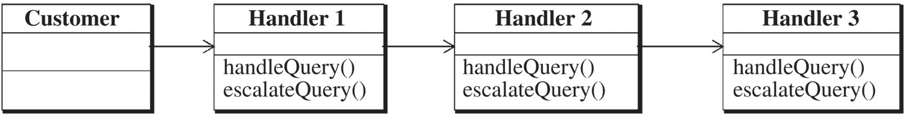

**图 14.1**](#c14.xhtml_R_c14-fig-0001)

另一方面，图14.2说明了人们如何使用动态方法创建责任链。现在，每个查询处理器维护了一个其他查询处理器的列表（绑定到名为`successors`的变量），如果查询没有在本地得到解决，这些处理器更有资格处理该查询。在图14.2中需要注意的是，对于给定的查询，变量`successors`仅在运行时才分配一个特定的、指定的更合格的查询处理器列表。此外，只有在运行时，才会从该列表中为给定的查询选择下一个处理器。从这些列表中的选择哪个具体的处理器，取决于查询在最初被查询处理系统记录时分配给它的各种参数。

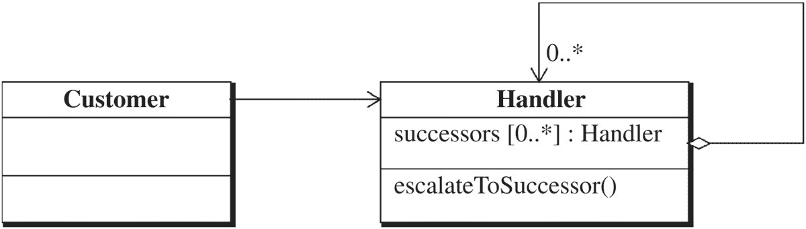

**图 14.2**](#c14.xhtml_R_c14-fig-0002)

## 14.4 现实世界应用中的责任链模式

该模式的一个典型应用是GUI（图形用户界面）软件。在GUI（通常由一个包含按钮、复选框、文本窗口、滚动条等控件的主窗口组成）实例化后，它被放置于所谓的事件处理循环中，等待用户的交互。随后，为了响应用户的操作，GUI会调用通常称为`callback functions`（回调函数）或de`callbacks`的内容。GUI软件系统通常在不同的粒度级别上定义回调，且通常对于用户的某个特定操作，只调用最具体的回调。例如，GUI系统可以为“按键”事件定义一个通用回调，该回调与按下键盘上的*任何*键相关；并为“回车”事件定义一个更具体的回调，该回调仅与按下键盘上的`Return`键（即`Enter`键）相关。如果用户实际上按了`Return`键，只会调用与“回车”事件相关的回调。

通常，与GUI中的控件相关的回调构成了一个树，该树对应于GUI的`containment hierarchy`（包含层次结构）。正如名称所示，GUI中包含其他控件的控件产生了包含层次结构。关于包含结构，虽然一个控件允许包含多个控件，但它只能有一个父节点。显然，这种层次结构将以GUI的主窗口为根。当用户与控件交互时，如果该控件没有注册回调，事件将沿包含层次结构传递到该控件的父节点，依此类推。*这代表了责任链模式的一种现实世界实现，特别是当包含层次结构仅在运行时产生时（对于富交互的动态生成网页情况如此）。*从包含层次结构的叶子节点向根节点看，我们将看到事件处理代理的链。促进事件在链上传递的事实是所有潜在的事件处理器都是相同类型的对象——即所有GUI类派自的类型。

## 14.5 用于说明责任链模式的哈利·波特故事

我们对责任链模式的演示是基于解决魁奇球（Quidditch）比赛中的违规行为的，这是魔法世界中一项主要的有组织运动。给定一支魁奇球球员队、学校老师、裁判、校长等，我们希望在运行时创建一个责任链，用于解决魁奇球比赛中的违规行为。也就是说，在运行时，我们希望决定某位球员犯下的某次违规行为是由裁判在本地解决，还是在当违规行为严重时，由裁判转发给监督比赛的老师。进一步扩展这一场景，我们可能还会考虑某些极具冒犯性且争议性的违规行为，这些行为需要由监督老师转发给副校长，或者干脆转发给校长本人。

需要注意的关键点是，我们希望能够为每场比赛单独指定用于违规报告和解决的官员链，并在运行时完成此操作。`报告链接不能被硬编码到类定义中`。在我们的演示中，这种构建责任链的运行时能力将通过让链中的所有潜在参与者都继承自我们命名为`Adjudicator`（裁决者）的根类来实现。至少在原则上，任何作为`Adjudicator`的人都有权解决一个或多个违规行为。

以下是我们在演示中包含的魁奇球违规行为列表：

1. 抢夺对手的扫帚（Blagging）

2. 带着碰撞意图飞行（Blatching）

3. 锁定扫帚手柄使对手偏离航线（Blurting）

4. 将狼球击向守门员或观众 —— 然而，如果分球在得分区域内，则允许此行为（Bumphing）

5. 过度用肘撞（Cobbing）

6. 守门员从后方防御球门时（Flacking）

7. 追球员在分球通过球门时仍与球保持接触（Haversacking）

8. 当追球员干扰分球时（QuafflePocking）

9. 当多名追球员同时位于得分区域时（Stooging）

10. 球员离开边界

11. 将球员推下扫帚

12. 激怒裁判

13. 用球棒击球员

14. 击球手击中分球

15. 将分球掷出界外

16. 非搜逐者接触金色飞贼

17. 超超时后未返回

18. 比赛期间使用魔棒施咒

19. 团队犯规

20. 篡改扫帚

21. 篡改裁判扫帚

在我们的演示中，当球员违反违规规则时，解决该违规行为的需求将如下所示：

```java
Player p = .....
p.resolveViolation( PissOffTheReferee );
```


首先构造一个`Player`实例，然后在该球员上调用`resolveViolation()`方法，同时将违规行为作为参数传递给该方法。违规行为`PissOffTheReferee`是上述列表中第12个违规行为的代码表示。至于解决此违规行为的责任链，我们将在`Player`实例创建时动态设置。以下是创建`Player`实例的示例：

```
Player p = new Player("Fred Weasley",
      "Blind Side Beater",
      new ArrayList<Adjudicator>(
          Arrays.asList(referee, teacher, deputyHead)));
```

其中`Player`构造函数的第一个参数是球员名称，第二个参数是司职位置，第三个参数是作为`resolveViolation()`参数提供的违规责任链。在上方所示的代码段中，绑定到变量`referee`、`teacher`和`deputyHead`的对象将在运行时设置，并且通常会随球员而异。此外，这些变量将被分配它们自己的责任链，这些链也是动态设置的。请注意，只有当球员犯了需要解决的违规行为时，你才会创建一个`Player`实例。因此，为第三个参数选择的值将隐含地考虑到有资格解决该球员违规行为的人员。

## 14.6 模式演示的顶层视图

图14.3展示了此演示代码的顶层视图。从图中显而易见，`Adjudicator`类在代码如何实现责任链模式以及如何允许我们动态创建链起着最重要的作用。正如读者将在下一节看到的，责任链的动态创建之所以可行，是因为`Adjudicator`类拥有一个实例变量`successors`，它存储了其他有权接收违规行为进行处理的`Adjudicator`实例列表。该实例变量在运行时绑定到其他`Adjudicator`实例列表。由于演示中的所有其他“演员”——老师、裁判等——也是`Adjudicator`类型，它们被允许成为绑定到任何给定`Adjudicator`的实例变量`successors`的列表成员。在根类`Adjudicator`中定义的`successors`实例变量被派生类继承。

**图14.3**

为了方便起见，我们将所有魁地奇违规行为放在下一节介绍的`Violations`接口中。通过让抽象类`Adjudicator`实现此接口，并由于演示中的所有“演员”都继承自`Adjudicator`，使得`Violations`接口中声明的所有违规行为均可用。

读者可能对`Player`类也继承自`Adjudicator`的事实感到困惑。如果我们的实现反映的是我们在引言中提到的投诉处理系统（另见图14.2），你不会期望客户与商业机构中的查询处理器是同一类型。将`Player`子类化自抽象根`Adjudicator`完全是为了演示中的方便（并防止代码库过大）。由于`Player`是`Adjudicator`的子类，我们可以利用后者建立的框架将违规行为升级到下一个可用权限。此外，这还使得`Violations`接口中声明的所有违规行为对`Player`类可用。

*读者可能会问：如果`Player`类也继承自`Adjudicator`，我们如何防止球员自己解决自己的违规行为？* 我们通过不为`Player`类提供`violationsResolved`变量来确保球员不会解决自己的违规行为——这一事实将在第14.9节中变得清晰。此演示的可执行类是`Test`。该类在第14.11节中给出，向我们展示了如何动态创建责任链并将其绑定到`Adjudicator`类型对象的实例变量`successors`上。

## 14.7 接口类Violations

下方显示了一个辅助接口，它存储了违规行为符号名称与分配给它们的整数值之间的映射。虽然使用符号引用违规行为更方便，但相关的整数值使得编写违规处理代码更容易。

```java
public interface Violations {

    public final int CannotResolveViolations = -1;
    public final int Blagging = 0; // 抢夺对手的扫帚。
    public final int Blatching = 1; // 意图碰撞
            // 的飞行。
    public final int Blurting = 2; // 锁定扫帚手柄以
            // 使对手偏离路线。
    public final int Bumphing = 3; // 将格瓜撞向
            // 守门员或观众。
            // 然而，如果魁地奇
            // 在得分区域内，前面的行为
            // 是允许的。
    public final int Cobbing = 4; // 过度肘击对手。
    public final int Flacking = 5; // 当守门员从后面
            // 防守球门时。
    public final int Haversacking = 6; // 追球员在魁地奇
            // 通过球门时仍与球
            // 接触。
    public final int QuafflePocking = 7; // 当追球员扰动
            // 魁地奇球时。
    public final int Stooging = 8; // 当多一个追球员
            // 同时在得分区域
            // 内时。
    public final int PlayerLeavesBoundary = 9;
    public final int PushPlayerOffTheBroom = 10;
    public final int PissOffTheReferee = 11;
    public final int HitPlayerWithClub = 12;
    public final int BeaterHittingQuaffle = 13;
    public final int ThrowQuaffleOutOfBounds = 14;
    public final int NonSeekerContactingGoldenSnitch = 15;
    public final int FailureToReturnAfterTimeout = 16;
    public final int UsingWandToEnchantDuringPlay = 17;
    public final int TeamFoul = 18;
    public final int BroomTampering = 19;
    public final int TamperingWithRefereeBroom = 20;

    public final String[] printViolation = new String[]{"Blagging",
                "Blatching", "Blurting", "Bumphing",
                "Cobbing", "Flacking", "Haversacking",
                "QuafflePocking", "Stooging",
                "PlayerLeavesBoundary",
                "PushPlayerOffTheBroom", "PissOffTheReferee",
                "HitPlayerWithClub", "BeaterHittingQuaffle",
                "ThrowQuaffleOutOfBounds",
                "NonSeekerContactingGoldenSnitch",
                "FailureToReturnAfterTimeout",
                "UsingWandToEnchantDuringPlay", "TeamFoul",
                "BroomTampering", "TamperingWithRefereeBroom"};
}
```

## 14.8 抽象类Adjudicator

由于是抽象类，该类的对象永远不会被实例化。然而，任何授权解决违规行为的人都预期是派生自该类的类型。如前所述，使`Adjudicator`能够将传入的违规请求转发给另一个`Adjudicator`的原因是以下两个事实：

*   `Adjudicator`类通过以下声明配备了一个名为`successors`的实例变量：

```java
protected List<Adjudicator> successors = new ArrayList<Adjudicator>();
```

显然，`successors`仅仅是`Adjudicator`类型实例的列表。如果责任链中的当前`adjudicator`必须将违规行为转发到下一层，我们在这里存储违规的接收者。例如，如果`Referee`看到一个违规行为，但认为超出了他的裁决范围，则`Referee`实例将将其转发给`successors`列表中列出的权威。这些权威是谁取决于`Referee`实例是如何创建的。当创建一个`Referee`实例时，会为它的`successors`实例提供值，这些值是继承自`Adjudicator`父类的。

*   所有参与魁地奇比赛的类的构造函数都接受第二个参数，其中我们为`successors`实例变量提供一个或多个值。正如你将在第14.10节中看到的，每个不同类型的`adjudicator`都被赋予一组其授权解决的固定违规行为。这将通过在第14.10节`Adjudicator`的具体子类中为变量`violationsResolved`分配值列表来实现。因此，虽然每个类型`adjudicator`的权力是在编译时定义的，但解决特定玩家特定违规行为的`adjudicators`责任链是在运行时设置的，这在下一节介绍`Player`类时的讨论中将显而易见。

读者可以看到，这个抽象类提供了三个不同的构造函数。这只是为了方便。第一个构造函数用于那些没有`successors`的`Adjudicator`。也就是说，责任将在此类`adjudicator`实例处停止——但仅限于他们所了解的违规行为。如果此类`Adjudicator`接收到违规行为，但他/她没有能力处理该违规，则该违规将被视为不可解决。第二个构造函数用于为`Adjudicator`指定单个后继者的情况，第三个构造函数用于指定后继者列表的情况。

注意谓词方法`canResolveViolations()`。如果`violationsResolved`变量中的列表为空，且`successors`变量中的列表为空，我们说该`Adjudicator`将无法解决任何违规。注意`resolveViolation()`方法的实现。如果`Adjudicator`本身无法解决违规，则该违规将传递给每一个`successors`。它将被由第一个能够处理它的后继者解决。

注意构造函数是如何为`successor`实例变量提供赋值的，每个`Player`都从父类`Adjudicator`继承了该变量。

`Player`类定义中最重要的部分可能是`resolveViolation()`方法。在该方法的实现中，我们首先调用了为父类`Adjudicator`定义的谓词`canResolveViolations()`。如果这个继承的谓词发现`successors`列表为空，且继承的实例变量`violationsResolved`中的违规列表也为空，它将返回`false`。随后，它会检查相关的违规行为是否包含在继承的实例变量`violationsResolved`存储的列表中。与我们在下一节中介绍的`Adjudicator`其他具体子类的定义不同，`Player`类并没有提供一个名为`violationsResolved`的静态变量。因此，它继承了该重要变量的空列表默认值。这意味着一个`Player`实例——即使他/她是（比如）队队长——也不允许解决任何违规行为，即使这些是队内违规行为。

基于上述事实，当在`Player`实例上调用`resolveViolation()`时，控制将转移到下方所示实现的第(A)行。这可能会让读者好奇，为什么我们没有为该方法提供更短的定义（即不包含到第(A)行代码的定义）。其目的是让有进取心的读者能够扩展演示代码，允许某些玩家解决某些队内违规行为（参见第14.12节）。

关于第(A)行的`if`-`else`子句，调用`resolveViolation()`首先通过调用为父类`Adjudicator`定义的方法的实现来处理违规。如果父类中的代码无法解决相关的违规，则声明该违规无法由所有在运行时被引入某场魁地奇比赛责任链的人来解决。

---

```
import java.util.*;

public class Player extends Adjudicator {
    private String role; // must be one of Chaser,
        // Beater, Seeker, and Keeper
    public Player(String name, String role, Adjudicator successor) {
        super(name, successor);
        this.role = role;
    }
    public Player(String name, String role,
                List<Adjudicator> successors) {
        super(name, successors);
        this.role = role;
    }
    public boolean resolveViolation(int vio) {
        if (!canResolveViolations()) {
            System.out.println("It is not possible to resolve "
                + "this violation");
            return false;
        } else if (violationsResolved != null &&
               violationsResolved.contains(new Integer(vio))) {
            System.out.println("Violation " + printViolation[vio]
                + " resolved by the " + this + " " + name);
            return true;
        } else {
            if (super.resolveViolation(vio)) // (A)
                return true;
            else {
                System.out.println("The violation "
                + printViolation[vio] + " cannot be resolved");
                return false;
            }
        }
    }
}
```

---

## 14.10 具有违规处理权的类

我们从`Referee`类开始。注意与`Player`类不同，`Referee`类提供了自己的静态变量`violationsResolved`，该变量存储了`Referee`允许自己解决的违规列表。正如之前在第14.8节中提到的，这相当于对每种类型的`Adjudicator`的违规处理权限范围进行编译时声明。因此，虽然每个裁判的权力是在编译时声明的，但为特定违规行为服务的裁判列表是在运行时创建的。

同时请注意，`Referee`的`resolveViolation()`方法的实现比`Player`类或父类`Adjudicator`更复杂。该类中的实现在静态变量`violationsResolved`中查找相关的违规。如果在列表中找到了该违规，我们的工作就完成了，可以认为`Referee`能够自己解决该违规。否则，我们将违规转发给父类的`resolveViolation()`，在该类中，我们只需遍历由实例变量`successors`指向的每个后继者，并检查其中任何一个是否可以处理该违规。我们在首次成功解决违规时停止。

---

```
import java.util.*;

public class Referee extends Adjudicator {
    private static List<Integer> violationsResolved =
    new ArrayList<Integer>(Arrays.asList(Blatching, Cobbing,
        QuafflePocking, Haversacking, Stooging,
        Blurting, Bumphing));
    public Referee(String name, Adjudicator successor) {
        super(name, successor);
    }
    public Referee(String name, List<Adjudicator> successors) {
        super(name, successors);
    }
    public boolean resolveViolation(int vio) {
        System.out.println("Violation handed over to " + this);
        if (violationsResolved.contains(new Integer(vio))) {
            System.out.println("Violation " + printViolation[vio]
                + " resolved by the " + this + " " + name);
            return true;
        } else {
            return super.resolveViolation(vio);
        }
    }
}
```

---


接下来我们介绍`Teacher`类。除了名称及其产生的影响，该类的定义与`Referee`类完全相同。因此，针对`Referee`类的所有注释也适用于此类。

```java
import java.util.*;

public class Teacher extends Adjudicator {

    private static List<Integer> violationsResolved =
        new ArrayList<Integer>( Arrays.asList(
            FailureToReturnAfterTimeout ));

    public Teacher( String name, Adjudicator successor ) {
        super( name, successor );
    }
    public Teacher( String name, List<Adjudicator> successors ) {
        super( name, successors );
    }
    public boolean resolveViolation( int vio ) {
        System.out.println( " Violation handed over to " + this );
        if ( violationsResolved.contains( new Integer(vio) ) ) {
            System.out.println( " Violation "
                + printViolation[vio] + " resolved by the "
                + this + " " + "Professor " + name );
            return true;
        }
    }
}
```

```java
import java.util.*;

public class DeputyHeadmaster extends Adjudicator {

    private static DeputyHeadmaster unique;

    private final static List<Integer> violationsResolved =
        new ArrayList<Integer>( Arrays.asList( BroomTampering ) );

    private DeputyHeadmaster( String name, Adjudicator successor ) {
        super( name, successor );
    }
    // Enforce the condition that there can only
    // be one Assistant Headmaster:
    public static DeputyHeadmaster makeInstanceOfDeputyHeadmaster(
                String name, Adjudicator successor){
        if ( unique == null )
            unique = new DeputyHeadmaster( name, successor );
        return unique;
    }
    public DeputyHeadmaster(String name,List<Adjudicator> successors){
        super(name, successors);
    }
    public boolean resolveViolation( int vio ) {
        System.out.println( " Violation handed over to " + this );
        if ( violationsResolved.contains( new Integer(vio) ) ) {
            System.out.println( " Violation "
                + printViolation[vio] + " resolved by the " + this
                            + " " + "Professor " + name );
            return true;
        } else {
            return super.resolveViolation(vio);
        }
    }
}
```

***

这介绍了本节的最后一个类，`Headmaster`类。这个类与我们刚刚介绍的`DeputyHeadmaster`类相似，相似之处在于它的实现也是基于单例模式的——原因与`DeputyHeadmaster`类完全相同。然而，这两个类之间有一个重要的区别：`Headmaster`类的构造函数只接受一个参数，即校长的名字；而`DeputyHeadmaster`构造函数接受两个参数，一个名字，另一个是继任者。我们对该模式的演示基于这样一个假设：处理魁地球违规行为的责任链的最终终点是校长。这意味着占据这一职位的巫师不会有继任者。

***

```java
import java.util.*;

public class Headmaster extends Adjudicator {

    private static Headmaster unique;
    private final static List<Integer> violationsResolved =
        new ArrayList<Integer>(
            Arrays.asList( UsingWandToEnchantDuringPlay ));
    private Headmaster( String name ) {
        super( name );
    }
    // Enforce the condition that there can only be one Headmaster:
    public static Headmaster makeInstanceOfHeadmaster( String name ) {
        if ( unique == null ) unique = new Headmaster( name );
        return unique;
    }
    public boolean resolveViolation( int vio ) {
        System.out.println( " Violation handed over to " + this );
        if ( violationsResolved.contains( new Integer(vio) ) ) {
            System.out.println( " Violation "
                + printViolation[vio] + " resolved by the"
                    + this + " " + "Professor " + name );
            return true;
        }
        return false;
    }
}
```

***

## 14.1 测试代码

下面的`Test`类展示了如何在运行时创建责任链。注意提供给`Referee`、`Teacher`和`DeputyHeadmaster`构造函数的第二个参数，以及提供给`Player`构造函数的第三个参数。这些参数为每个构建实例提供了一个继任者，该继任者将接收构建实例无法解决的违规行为。对于`Player`实例，第二个参数表示球员的位置。代码的其余部分展示了被指控有不同违规行为的`Player`实例。当我们对这些`Player`实例调用`resolveViolation()`方法时，我们看到责任链模式的运作。

***

```java
import java.util.*;

public class Test implements Violations{

    public static void main(String[] args) {
        Headmaster headmaster = Headmaster.makeInstanceOfHeadmaster("Dumbledore");
        DeputyHeadmaster deputyHead = DeputyHeadmaster.makeInstanceOfDeputyHeadmaster("McGonagall",
        headmaster);
        Teacher teacher = new Teacher( "Rolanda Hooch", deputyHead );
        Referee referee = new Referee( "Severus Snape", teacher );

        System.out.println(
        "For Harry Potter (Violation: Blatching): ");
        Player p1 = new Player( "Harry Potter", "seeker", referee );
        p1.resolveViolation( Blatching );

        System.out.println("\nFor player Angelina Johnson " +
        "(Violation: Haversacking): ");
        Player p2 = new Player("Angelina Johnson", "chaser", referee);
        p2.resolveViolation( Haversacking );

        System.out.println("\nFor player Dracy Molfoy "
        + "(Violation: Using During Play): ");
        Player p3 = new Player( "Draco Malfoy", "seeker",
        new ArrayList<Adjudicator>(
        Arrays.asList( referee, teacher, deputyHead) )));
        p3.resolveViolation(UsingWandToEnchantDuringPlay);

        System.out.println("\nFor player Viktor Krum "
        + "(Violation: Broom Tampering): ");
        Player p4 = new Player("Viktor Krum","seeker",
        new ArrayList<Adjudicator>(
        Arrays.asList( referee, teacher, deputyHead) )));
        p4.resolveViolation(BroomTampering);

        System.out.println("\nFor player Fred Weasley "
        + "(Violation: Piss off the referee): ");
        Player p5 = new Player( "Fred Weasley", "Blind Side Beater",
        new ArrayList<Adjudicator>(
        Arrays.asList( referee, teacher, deputyHead) )));
        p5.resolveViolation(PissOffTheReferee);
    }
}
```

***

## 14.12 运行代码

从书籍网站下载此模式的类文件到单独目录。使用以下命令编译代码：

```bash
javac *.java
```

通过以下命令执行`Test`类：

`java Test`

根据`Test`中`main()`方法的代码，执行该类将产生以下输出：

```
For Harry Potter (Violation: Blatching):
    Violation handed over to Referee
    Violation Blatching resolved by the Referee Severus Snape

For player Angelina Johnson (Violation: Haversacking):
    Violation handed over to Referee
    Violation Haversacking resolved by the Referee Severus Snape

For player Dracy Molfoy (Violation: Using Wand During Play):
    Violation handed over to Referee
    Violation handed over to Teacher
    Violation handed over to Deputy Headmaster
    Violation handed over to Headmaster
    Violation UsingWandToEnchantDuringPlay resolved by the Headmaster
        Professor Dumbledore

For player Viktor Krum (Violation: Broom Tampering):
    Violation handed over to Referee
    Violation handed over to Teacher
    Violation handed over to Deputy Headmaster
    Violation BroomTampering resolved by the Deputy Headmaster
        Professor McGonagall

For player Fred Weasley (Violation: Piss off the referee):
    Violation handed over to Referee
    Violation handed over to Teacher
    Violation handed over to Deputy Headmaster
    Violation handed over to Headmaster
    Violation handed over to Teacher
    Violation handed over to Deputy Headmaster
    Violation handed over to Headmaster
    Violation handed over to Deputy Headmaster
    Violation handed over to Headmaster
    The violation PissOffTheReferee cannot be resolved
```

为了获得进一步的见解，你可以按照以下思路自己扩展此模式的代码：

*   如图 14.3 所示，为了编程上的方便，我们将`Player`类设为`Adjudicator`类的子类。这样做的好处是，使得`Player`类中直接可以使用违规语言。另一个好处是，它为我们提供了一个统一的违规升级机制，直接从`Player`本身开始。但正如图 14.2 所示，你通常不会预期生成查询（或投诉、违规，或者你如何称这些需要解决的问题）的类与处理这些查询的类是相同类型。请修改演示代码，使得玩家与校方之间实现完全的类型分离。

*   在当前的演示代码中，玩家不被允许解决违规。尽管`Player`类被赋予了`resolveViolation()`方法。玩家无法解决违规的原因在于`Player`类没有拥有名为`violationsResolved`的静态变量。^(3) 然而，我们可以很容易想象出某些情况，你希望玩家能够解决一些较轻微的违规。例如，队长可能被赋予解决违规的权限，前提是除非受到对方队长的挑战，否则该结果将有效。请修改代码，使玩家能够参与违规的解决。

# 15 命令 (COMMAND)

## 15.1 动作与执行者的关系

几乎每个叙事都涉及执行者和他们的动作。作为作者，你可以选择将主要重点放在执行者身上（这在你编写关于英雄人物及其事迹时会所做的），或者放在他们的动作上。当是后者时，提到的特定执行者就变成了次要，并且可以被叙事中其他可比的执行者取代。

在多年编程风格和语言的演变过程中，看到这种“动作与执行者”的二元对立非常有趣。编程起初主要是过程化的——重点主要是由函数指定的动作。然而，随着面向对象编程的出现，编程重心已转向对象——即执行者。使用面向对象的编程风格，当你被要求为新应用程序开发软件时，首先想到的是你需要的主要的类。从这些类构造的实例在运行时充当执行者。你赋予这些类应用程序所需的方法——即动作。这里需要注意的是，以这种方式编写代码时，概念重点的焦点在于执行者本身。另一方面，以方法形式存在的动作在执行者面前起着从属的作用——这种从属的意思是你先考虑执行者，然后才考虑他们应该能够执行哪些动作。


尽管面向对象的编程风格有这种以执行者为中心的关注，但我们仍然需要能够创建动作为主要、执行者为次要的软件设计。也就是说，在仍在面向对象范式内操作的同时，我们需要能够反转上述概念重点的顺序。正如你在本章中看到的，可以通过命令模式（Command pattern）来实现。这种模式帮助我们编写一个类，通过整合其他类提供的更基础的动作来合成一个复杂的动作。通过命令模式，你的思考是从动作以及如何合成它们开始，而不是从有状态的对象以及分配给它们的动作开始。我们在图 15.1 中阐述了将重点放在动作合成上。

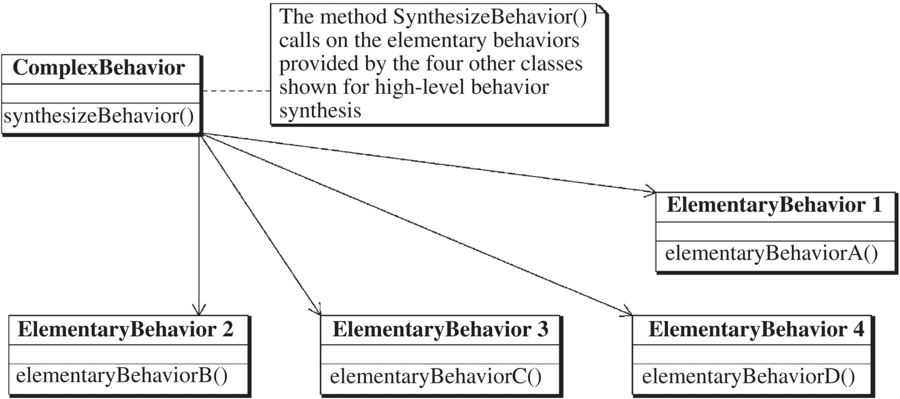

**图 15.1**

在本章的其余部分，我们将使用“行为”（behaviors）一词来表达与动作（actions）相同的意思，因为前者是后者的标准面向对象术语。

## 15.2 意图与适用性

命令模式的意图是将动作表示为对象，然后通过代表较小动作的对象的组合（composition）合成更大的动作。赋予此类对象属性有助于诸如撤销（undo）、跟踪、排序、日志记录等操作。

你应该在以下情况下使用此模式：

- 你正试图解决的问题要求：不再将对象作为具有行为的“名词”，而是将对象作为具有属性的“动词”使用；
- 你需要将属性与动作关联起来——这些属性与例如动作请求发出的上下文、请求时间、发布请求的对象、请求的优先级等相关；
- 你的应用程序要求你通过对较小动作的组合来合成更大的动作，同时考虑到与较小动作相关的属性；
- 你的应用程序要求你对动作请求进行队列化，并在任何给定时间根据它们的优先级级别对当前待处理的请求进行排序；
- 你的应用程序涉及 GUI 框架，并且需要一种面向对象的方法来处理回调。

## 15.3 命令模式简介

首先是一些与命令模式相关的词汇：它使用“接收者”（receiver）一词来指代那些更基础的行为被整合在一起以创建所需的较大行为的对象。该模式还包含了“调用者”（invoker）对象的概念，用于协调合成的宏大行为的调用。

记住接收者和调用者的这些词汇，现在让我们用建筑房屋来作为创建软件的比喻，以说明命令模式具体实现了什么。显然，建造房屋需要打地基、立上结构墙、在结构上盖屋顶等等。使用传统的面向对象编程方法，我们会创建一个名为`HouseBuilder`的类，赋予它实例变量以为从类构造的实例提供状态，然后配备与建造房屋对应的方法。这种方法等同于为建造房屋编写一个巨大的单体类。

现在考虑基于命令模式的方法。考虑到模式，我们意识到房屋的每个部分可能由一个或多个专门从事该领域的工匠建造。因此，我们将指定一个`FoundationLayer`接收者，其工作只是打地基；一个`Carpenter`接收者，其工作是建造地板和墙壁；一个`Roofer`接收者来安装屋顶，等等。我们将所有这些工作整合在一个名为`HouseConstruction`的类中，如图 15.2 所示。如果你所在地区的房地产开发要求按照特定顺序建造房屋，或者要求房屋建造与另一个宏观活动交替进行（例如在房屋所在的土地安装围栏，如图 15.2

**图 15.2**

命令模式（Command pattern）要求所有主要的行为类——即那些需要通过调用更基础的行为来合成行为的类，以及提供基础行为的类——都继承自一个名为`Command`的根接口。这主要是为了方便`Invoker`（调用者）类进行操作。当所有被调用的命令都是`Command`类型时，`Invoker`类就可以以统一的方式处理所有命令。如图 15.2`的方式。因此，任何实现`Command`接口的具体类都必须为`execute()`提供实现代码。回到我们的盖房示例，`FoundationLayer`类将为`execute()`提供一个实现，该实现将包含执行建造新房屋地基的不同步骤。同样，`Carpenter`（木匠）的`execute()`方法将参与建造地板和墙壁所需的木工工作。

## 15.4 现实应用中的命令模式

命令模式最广为人知的现实应用之一，与我们在上一章第 14.4 节中描述的责任链模式的现实应用有许多共同点。我们指的是用户与图形用户界面（GUI）交互时产生的事件的处理。在运行时，当与事件相关的回调（在 Java 中这些回调是`Listener`对象）被放入事件调度队列时，一个事件处理循环（通常运行在名为`Event Dispatch Thread`的独立线程中）会按照先来后到的原则从该队列中执行每个回调。命令模式可以非常有效地用于协调这些回调的调用——特别是当人们想在事件处理中引入“撤销”（undo）和“重做”（redo）功能时。

当回调类实现`Command`接口时，`Invoker`不再按照它们被放入事件调度队列的顺序来处理回调，而可以在任何时刻使用优先级队列访问准则，选择当前优先级最高的回调进行执行。`Invoker`的`execute()`方法还可以调用诸如`peek()`等辅助方法，首先检查当前可用的最高优先级回调，以确保考虑到已执行的回调序列，其执行是恰当的。这对于允许用户通过操作图形图标创建新程序的视觉化编程系统非常有用。¹ 在视觉化编程中，与新图标相关的程序片段必须与已有的图标“协调”。回到之前介绍的房屋建造示例，使用视觉化编程语言构建程序与盖房子之间存在着强烈的类比。

## 15.5 用哈利·波特的故事来说明命令模式

我们对命令模式的演示基于保护哈利·波特的任务。你可以看到，根据伏地魔大佬（Lord Voldemort）只听过了一部分的预言，他坚信自己可以击败宿敌哈利·波特。因此，邓布利确保哈利在离开霍格沃茨时始终能得到保护。哈利特别需要这种保护，尤其是在他必须与德思礼一家人度过的夏季月份。当哈利身体上待在他姨妈和舅舅的家里时，他不会受到黑暗力量的影响，因为与他去世母亲的亲近血亲（在本例中是他母亲的姨姐姐）住在一起为他提供了天然的保护。但在房子外面，他是脆弱的。为了在他在房子外时保护他，邓布利请求阿拉贝拉·菲格（Arabella Figg）和蒙孟古斯·弗莱彻（Mundungus Fletcher）这对组合留意哈利，由前者负责（因为后者有些不可预测——他是个小偷之类）。

在哈利在女瓜树路 4 号与德思礼一家长大的这些里，阿拉贝拉·菲格通常很好地做到了留意哈利，无论是直接还是间接的。1995 年夏天，发生了一个异常事件，导致哈利在小德威格（Littleinging）需要额外的保护。食血魔袭击了哈利，这引起了关心哈利的人的恐慌。哈利住在德思礼夫妇那里不再安全了。随后，凤凰社的成员护送哈利前往格姆莫德广场 2 号，即凤凰社的总部，为了他在飞行期间免受伤害。

我们命令模式的演示将包括编写一个名为`ProtectHarryter`的类，在前往格姆莫德广场的途中，首先必须决定使用何种交通工具。在魔法世界中有壁炉网络，但因为它很容易被敌人监控所以被排除了。还有使用钥匙，但这需要魔法部的授权。剩下的两个选择是瞬间移动（apparating）到达目的地以及骑扫帚到达。由于哈利还没有大到可以瞬间移动，选择自动缩小到骑扫帚。在开阔空间中骑扫帚显然会将哈利暴露在危险之中。因此，前往格姆莫德广场的巫师女巫团队需要在飞行期间全方位地保护他。

我们命令模式的演示将包括编写一个名为`ProtectHarryter`类，其主要任务是在食血魔袭击以及从德思礼家前往格姆莫德广场的途中尽一切保护哈利。`ProtectHarryter`类将为哈利定义两种不同的保护方式：一种是将主要的保护任务分配给个人（可能是巫师、女巫，甚至是麻鬼，²](#c15.xhtml_c15-note-0002），另一种是由巫师女巫团队共同提供的保护。

## 15.6 模式演示的顶层视图

图 15.3`函数必须通过调用这些巫师/女巫/麻鬼来合成哈利所需的保护。*这就是命令模式的精髓。*

```markdown

```

由于`Wizard`（巫）或`Squib`（麻瓜）在帮助保护哈利·波特之前必须满足某些条件，因此我们需要一种机制来指定这些条件未满足的情况。`UnableToProtectHarryPotterException`类正是为此设计的。`Invoker`类的作用仅仅是为`Command`类型的对象提供存储。在更复杂的演示中，`Invoker`类可以用于确保不同的命令遵守某些预设的调度约束。最后，我们在`Client`类中测试了此演示的代码。

## 15.7 Command 接口

下面展示了本演示中使用的`Command`接口。如前所述，定义此接口的主要目的是为了让客户端（或`Invoker`类）能够以统一的方式操作所有的行为（无论是合成的还是基础的行为）。

正如我们将在第 15.9 节中提到的，下面所示接口定义中使用的异常类用于信号那些无法保护哈利·波特的情况。例如，如果目标是在小女贞格（Little Whinging）留意哈利，但他已经离开去和韦斯莱夫妇在陋屋（The Burrow）度过剩下的夏天，那么我们需要抛出`UnableToProtectHarryPotterException`异常，因为哈利目前所在地和请求保护哈利的地方不是同一个。

```java
public interface Command {
    public void execute() throws UnableToProtectHarryPotterException;
}
```

## 15.8 MyPlaces 接口

下面定义的接口目标（更多是为了编程方便而非出于其他目的）是将`Place`声明为一个具有五个可能值的枚举（enum）。这允许我们声明一个`Place`类型的变量，赋予它诸如`Place.Privet_Drive`的值，并检查变量的当前值是否对应下面声明的其中之一。

```java
public interface MyPlaces {
    public enum Place {
        Privet_Drive,
        The_Burrow,
        Number_12_Grimmauld_Place,
        Hogwarts,
        Hogsmeade
    }
}
```

## 15.9 ProtectHarryPotter 类

我们现在介绍`ProtectHarryPotter`类。正如其名称所示，该类的主要目的是在哈利·波特不在霍格沃茨时为他提供所需的保护。当危险程度需要几位巫师和女师（有时还有麻瓜）共同努力以确保哈利安全时，像`ProtectHarryPotter`这样的类必须通过参与者的各种能力来合成所需的保护。正如之前提到的，从某些执行者提供的系列基础行为创建大型行为是 Command 模式的精髓。

读者再次如所知，在 Command 模式的上下文中，执行者被称为接收者（receivers），因为它们是必须执行的命令的接收者，以便`Command`对象能够履行其提供请求行为的合约。对于`ProtectHarryPotter`类，接收者是`Wizard`和`Squib`类的实例。

`ProtectHarryPotter`类包含了处理保护哈利的两种不同情况的逻辑：一种情况是由单个巫师或麻瓜提供保护，另一种情况是保护是巫师女师团队共同行动的结果。这些是我们在第 15.5 节中讨论过的两种情况。

对于上述两种情况中的第一种，该类直接调用巫师或麻瓜的`execute()`方法来获取所需的保护。对于第二种，所需的保护通过汇总参与的巫师女师的个人能力合成而成。正如你在下所示类定义中看到的，当基础行为可以独立执行时，第二种情况所需的行为合成是相当直接的。然而，当基础行为之间需要协调时，Command 模式的实现就会变得复杂。将我们的演示代码扩展到在合成大型行为时更基础的行为之间需要协调的情况，将留给读者在第 15.15 节中进行练习。

请注意下所示类定义中的三个构造函数。第一个构造函数初始化一个`ProtectHarryPotter`实例，其包含的`Wizard`实例职责是保护哈利。第二个构造函数执行相同的操作，但现在保护由`Squib`提供。第三个构造函数用于需要巫师女师团队来保护哈利的情况，例如当哈利正从女贞格路 4 号（Number 4 Privet Drive）搬到格里马德广场 12 号（Number 12 Grimmauld Place）。

关于`execute()`方法中的代码，你可以很容易地识别出在由单个巫师、单个麻瓜以及巫师女师团队提供保护时的部分。在所有这些情况下，我们都会检查是否了某些最小条件，以便接收者能够完成任务。例如，如果要求一名巫师在哈利住在女贞格路期间保护他，我们需要该巫师拥有一件隐身篷（否则巫师将无法工作）。同样，当要求一组巫师女师在哈利前往格里马德广场 12 号的途中护卫他时，我们要求他们都属于凤凰鸣社。

```java
import java.util.*;

public class ProtectHarryPotter implements MyPlaces, Command {
    private Wizard wizardGuard = null;
    private Squib squibGuard = null;
    private List<Wizard> guards = new ArrayList<>();
    private String whenProtectionNeeded = null;

    private static Wizard harry = new Wizard("Harry Potter") {
        harry.setAt(Place.Privet_Drive);
    }

    public ProtectHarryPotter(Wizard guard) {
        wizardGuard = guard;
    }

    public ProtectHarryPotter(Squib guard) {
        squibGuard = guard;
    }

    public ProtectHarryPotter(List<Wizard> guards, String whenProtectionNeeded) {
        this.guards = guards;
        this.whenProtectionNeeded = whenProtectionNeeded;
    }

    public void execute() throws UnableToProtectHarryPotterException {
        if (squibGuard != null || wizardGuard != null) {
            if (squibGuard != null) {
                squibGuard.setWhomToProtect(harry);
                squibGuard.execute();
            }
            if (wizardGuard != null) {
                wizardGuard.setWhomToProtect(harry);
                wizardGuard.execute();
            }
        }
        if (guards.size() != 0 && whenProtectionNeeded != null) {
            if (whenProtectionNeeded.equals("take Harry to 12 Grimmauld Place")) {
                throw new UnableToProtectHarryPotterException(
                    "The activity during which Harry is to be protected not recognized");
            }
            ListIterator<Wizard> it = guards.listIterator();
            while (it.hasNext()) {
                Wizard wiz = it.next();
                if (wiz.getCanCastDisillusionmentCharm()) {
                    wiz.castDisillusionmentCharm();
                    break;
                }
            }
            it = guards.listIterator();
            while (it.hasNext()) {
                Wizard wiz = it.next();
                if (!wiz.getMembershipInOrderOfPhoenix()) {
                    throw new UnableToProtectHarryPotterException(
                        "At least one member of the guards is a traitor to the cause!");
                }
                System.out.println(wiz + " will fly in formation and deliver Harry Potter to Number 12, Grimmauld Place");
            }
        }
    }
}
```

## 15.10 THE Wizard 类

如前所述，命令模式包含了接收者（receiver）的概念，接收者是一个对象，其基本行为是所期望的较大行为的一部分。换句话说，当我们观察到较大行为时，我们实际上看到的是参与的接收者对象提供的更基础行为的聚合。在我们的演示中，接收者由巫师（wizards）、女巫师（都是我们这里展示的`Wizard`类创建的两种实例）以及麻瓜（squibs）组成。


第 15.5 节中介绍的保护哈利·波特的场景描述应该说明我们类型为 `Wizard` 的接收者对象需要具有什么类型的属性。要求巫师在小女瓜环跟踪哈利同时对麻格人保持隐身的保护场景，要求巫师必须拥有一件隐身篷。同样，自愿在哈利于女女瓜巷 4 号和格里马德广场 12 号之间的途中护卫他的巫师和女巫师必须属于凤凰会，否则他们可能无法看到目的地的房屋，更不用说被允许进入了。这些对巫师和女巫师的要求解释了我们在下方为 `Wizard` 类定义的基础行为。

```java
import java.util.*;

public class Wizard implements MyPlaces, Command {
	private String wizardName;
	private Place currentlyLocatedAt;
	private boolean hasInvisibilityCloak = false;
	private boolean canApparate = false;
	private boolean canCastDisillusionmentCharm = false;
	private boolean hasMembershipInOrderOfPhoenix = false;
	private Wizard whomToProtect;

	public Wizard( String wizardName ) {
		this.wizardName = wizardName;
	}
	public String toString() { return wizardName; }

	public void setCurrentlyLocatedAt( Place place ) {
		currentlyLocatedAt = place;
	}
	public Place getCurrentlyLocatedAt() {
		return currentlyLocatedAt;
	}
	public void setMembershipInOrderOfPhoenix( boolean truOrFalse ) {
		hasMembershipInOrderOfPhoenix = truOrFalse;
	}
	public boolean getMembershipInOrderOfPhoenix() {
		return hasMembershipInOrderOfPhoenix;
	}
	public void setCanApparate( boolean yesOrNo ) {
		canApparate = yesOrNo;
	}
	public boolean getCanApparate( ) {
		return canApparate;
	}
	public void aparateTo( Place destination ) {
		System.out.println( "Apparating to " + destination );
	}
	public void aparateFrom( Place destination ) {
		System.out.println( "Apparating from " + destination );
	}
	public void setHasInvisibityCloak( boolean yesOrNo ) {
		hasInvisibilityCloak = yesOrNo;
	}
	public boolean getHasInvisibilityCloak( ) {
		return hasInvisibilityCloak;
	}
	public void followHarryPotter()
			throws UnableToProtectHarryPotterException {
			if (!hasInvisibilityCloak) {
				throw new UnableToProtectHarryPotterException();
			} else {
				System.out.println( "Following Harry Potter while staying "
					+ "under an invisibility cloak" );
			}
	}
	public void setCanCastDisillusionmentCharm( boolean yesOrNo ) {
		canCastDisillusionmentCharm = true;
	}
	public boolean getCanCastDisillusionmentCharm() {
		return canCastDisillusionmentCharm;
	}
	public void castDisillusionmentCharm() {
		if (canCastDisillusionmentCharm) {
			System.out.println( wizardName
				+ " casting Disillusionment Charm on Harry Potter"
				+ " to make him difficult to see" );
		}
	}
	public void setWhomToProtect(Wizard ward) {
		whomToProtect = ward;
	}
	public void execute() throws UnableToProtectHarryterException {
		if ( getCurrentlyLocatedAt() !=
				whomToProtect.getCurrentlyLocatedAt() ) {
			throw new UnableToProtectHarryterException(this
				+ " unable to protect Harry! "
				+ " Harry is at a different location.");
		}
		if ( getInvisibilityCloak() ) {
			followPotter();
		}
	}
}
```

## 15.11 `Squib` 类

我们现在展示用于演示 `Command` 模式的第二个接收者类 `Squib`。麻瓜（squib）显然是麻格人环境中保护哈利的完美哨兵——因为在麻格人看来，麻瓜看起来就像普通的非魔法类人。

至于为什么这个类拥有与猫相关的方法和属性，请回想第 15.5 节，在那个夏日的夜晚，当两个摄魂怪在黑暗的小巷里袭击哈利（以及他的表弟达德利）时，是费格夫人的猫蒂布尔先生目睹了那次攻击。那只猫跑回家并告诉了费格夫人。考虑到猫在保护哈利方面所起的重要作用，赋予 `Squib` 类你在下方类定义中看到的那些与猫相关的方法和属性似乎是合理的。请记住，费格夫人也是一个麻瓜。

```java
ing Squib implements MyPlaces, Command {
	private String squibName;
	private Place currentlyLocatedAt;
	private boolean ownsCat = false;
	private Wizard whomToProtect;

	public Squib( String squibName ) {
		this.squibName = squibName;
	}
	public String toString() { return squibName; }

	public void setCurrentlyLocatedAt( Place place ) {
		currentlyLocatedAt = place;
	}
	public Place getCurrentlyLocatedAt() {
		return currentlyLocatedAt;
	}
	public void setOwnsCat( boolean yesOrNo ) {
		ownsCat = yesOrNo;
	}
	public boolean getOwnsCat( ) {
		return ownsCat;
	}
	public void useCatAsLookout( Wizard target ) {
		System.out.println( "Cat owned by " + squibName
			+ " keeping an eye on " + target );
	}
	public void setWhomToProtect(Wizard ward) {
		whomToProtect = ward;
	}
	public void execute() throws UnableToProtectHarryterException {
		if ( getCurrentlyLocatedAt() !=
				whomToProtect.getCurrentlyLocatedAt() ) {
			throw new UnableToProtectHarryterException(this
				+ " unable to protect Harry! "
				+ " Harry is at a different location.");
		}
		if ( getOwnsCat() ) {
			useCatAsLookout(whomToProtect);
		}
	}
}
```

## 15.12 `Invoker` 类

`Invoker` 类作为所有 `Command` 对象的中心。因此，如果我们想要创建 `Command` 实例并按顺序执行它们，可以将它们存储在 `Invoker` 类中。存储的 `Command` 实例的执行是通过调用该静态方法 `invokeExecute()` 触发的。虽然我们的演示没有这样做，但该类也可以用于强制执行适用于存储实例的任何排序和优先级限制。

该类的实现非常直观。如果有什么值得注意的，那就是 `invokeExecute()` 的最后语句初始化一个新的容器。至于为什么，在我们执行完 `invokerList` 中的所有 `Command` 实例后，需要重新初始化该容器，以便存储新的 `Command` 实例。

```java
import java.util.*;

public class Invoker {
	static private List<Command> invokerList =
		new ArrayList<Command>();
	static public void addToCommandList( Command command ) {
		invokerList.add( command );
	}

	static public void invokeExecute(){
		ListIterator<Command> iter = invokerList.listIterator();
		while ( iter.hasNext() ) {
			System.out.println();
			try {
				iter.next().execute();
			} catch(UnableToProtectHarryterException e) {
				e.printStackTrace();
			}
		}
		invokerList = new ArrayList<Command>();
	}
}
```

## 15.13 `UnableToProtectHarryPotterException` 类

如前所述，负责保护哈利·波特的人员必须满足某些条件。例如，为了让一名巫师在哈利住在德思家女瓜巷 4 号的夏天期间照看他，该巫师必须物理上出现在大致相同的位置。因此，像 `ProtectingHarryPotter` 这样的类必须检查被赋予任务保护哈利的人员是否满足了这些条件。实现这种条件检查逻辑要求我们能够处理条件被违反的情况。这就是像 `UnableToProtectHarryPotterException` 异常类派上用场的地方。当违反保护哈利必须满足的条件时，我们抛出一个类型为 `UnableToProtectHarryPotterException` 的异常。下面的实现请求其父类 `Exception` 来完成所有与异常通知的工作。

```java
public class UnableToProtectHarryPotterException extends Exception {
    public UnableToProtectHarryPotterException() {
        super();
    }
    public UnableToProtectHarryPotterException(String arg0) {
        super(arg0);
    }
}
```

## 15.14 `Client` 类

`Command` 模式的 `Client` 必须首先创建一个或多个接收者实例，并将它们作为参数传递给行为合成 `Command` 类的构造函数，例如演示中的 `ProtectingHarryPotter` 类。客户端还需要将这样创建的行为合成 `Command` 对象存入 `Invoker` 类的实例中。随后，客户端可以请求 `Invoker` 类执行存储在那里的 `Command` 实例。

下面显示的客户端实现针对第 15.5 节中描述的两种哈利·波特保护场景：在 1995 年夏天哈利住在德思家期间保护他，以及在哈利从女瓜巷 4 号前往格里马德广场 12 号的途中护卫哈利。第一种情况的接收者是阿贝拉·菲格（Arabella Figg）和曼德守戈·弗莱彻（Mundungus Fletcher），第二种情况则是小眼汉穆迪（Mad-Eye Moody）、辛芬多拉·汤克斯（Nymphadora Tonks）和莱姆斯·卢平（Remus Lupin）。³

我们在下面显示的类定义中为接收者（巫师、女师和唯一的麻瓜子）设置的属性，取决于对哈利·波特进行两种不同类型保护的需求（参见 `ProtectHarryPotter` 类中的逻辑）。例如，曼德守戈·弗莱彻在本次演示中的作用是在哈利在小灵灵郡活动时秘密跟踪（躲在隐形斗篷下）。因此，我们需要确保 `Wizard` 类的 Mundungus Fletcher 实例的 `hasInvisibilityCloak` 属性设置为 true。此外，除非个人在物理上位于同一区域，否则麻瓜子或巫师将无法在小灵灵郡保护哈利。对于需要巫师和女师团队在哈利前往格里马德广场 12 号途中护卫他的保护场景，所有这些巫师和女师必须属于凤凰社，因为这是看到目的地房屋并被允许进入内部的必要条件。

```java
import java.util.*;

public class Client implements MyPlaces {
    public static void main(String[] args) {
        Squib battyOldNeighbor = new Squib( "Arabella Figg" );
        battyOldNeighbor.setCurrentlyLocatedAt(Place.Privet_Drive );
        battyOldNeighbor.setOwnsCat( true );
        Command c1 = new ProtectHarryPotter( battyOldNeighbor );
        Invoker.addToCommandList( c1 );
        Invoker.invokeExecute();

        Wizard sneakThief = new Wizard( "Mundungus Fletcher");
        sneakThief.setHasInvisibityCloak( true );
        sneakThief.setCanApparate( true );
        sneakThief.setCurrentlyLocatedAt(Place.Privet_Drive );
        Command c2 = new ProtectHarryPotter( sneakThief );
        Invoker.addToCommandList( c2 );
        Invoker.invokeExecute();

        Wizard guard1 = new Wizard("Mad-Eye Moody");
        Wizard guard2 = new Wizard("Nymphadora Tonks");
        Wizard guard3 = new Wizard("Remus Lupin");
        guard1.setMembershipInOrderOfPhoenix( true );
        guard2.setMembershipInOrderOfPhoenix( true );
        guard3.setMembershipInOrderOfPhoenix( true );
        List<Wizard> guards = new ArrayList<>(Arrays.asList(guard1, guard2, guard3));
        Command c3 = new ProtectHarryPotter( guards );
        Invoker.addToCommandList( c3 );
        Invoker.invokeExecute();
    }
}
```

## 15.15 运行代码

从网站下载此模式的类文件并存放在单独目录中。使用命令编译代码：

```bash
javac *.java
```

并通过以下命令执行 `Client` 类：

```bash
java Client
```

根据 `main()` 方法中的代码，这将产生以下输出：


`Cat owned by Arabella Figg keeping an eye on Harry`
`Following Harry while staying under invisibility cloak`
`Mad-Eye Moody casting Disillusionment to make him difficult to see`
`Nymphadora Tonks joining the Order of Phoenix`
`Remus Lupin joining the Order of Phoenix`

为了获得进一步的见解，你可以考虑按照以下方向扩展此模式的代码：

- 我们对 15.5 节中描述的哈利·波特第二种场景的实现仅部分完整。与其说是陪伴哈利前往格里马德广场 12 号的十二个巫师女师，不如我们只有小眼汉穆迪、辛芬多拉·汤克斯和莱姆斯·卢平三人。扩展代码为哈利的行程创建一个完整的护送。

- `Wizard` 类包含了一些目前没有在任何地方调用的行为。例如，与巫师移动传送（apparating）相关的行为未被使用。然而，我们知道当曼德守戈·弗莱彻被要求去小灵灵郡护卫哈利时，他通常会移动传送。扩展演示将这些额外的行为纳入哈利·波特的保护合成中。

- 如 15.9 节描述所示，`ProtectHarryPotter` 类包含了针对保护哈利的不同情况的逻辑：由单个巫师或麻瓜子提供保护，以及保护是巫师女师团队共同行动的结果。虽然在第一种情况下，我们通过对单个巫师和麻瓜子调用 `Command` 接口的 `execute()` 方法来提供所需的保护，但在第二种情况下，我们直接调用了参与的巫师女师的各种保护功能。从这个意义上说，对于第二种情况，我们违反了 Command 模式的精神。扩展演示代码，使得不同巫师的协调行动也可以通过调用 `Command` 接口的 `execute()` 来执行。

- 我们对 `Invoker` 类的使用还有很大的改进空间，因为所展示的模式演示即使没有 `Invoker` 类也能同样地工作。扩展演示，使其从接收者类提供的基本行为中合成出多个大规模行为。对于你定义的新行为，请确保你需要对行为调用的顺序执行顺序约束。利用 `Invoker` 类来执行这些顺序约束。

- 如果你想让你的 `Invoker` 类更具智能性，可以尝试为你的命令添加“撤销（undo）”功能。在执行命令之前，`Invoker` 会存储所有参与执行命令的对象的状态。随后，如果对刚刚执行的命令调用了“撤销”，所有对象都将恢复到原始状态。在这种情况下，你可能希望利用第 19 章中备忘模式（Memento pattern）的元素来设计 `Invoker` 类。

# 16 解释器

## 16.1 解析与解释

理解一种语言——任何语言——都是两步过程。首先，你必须对语言的语法单元（在大多数情况下是句子）根据其所包含的不同的语法组件进行解析。然后，你必须理解这些语法组件所做的声明或建议的动作。第一步即对句子的语法组件进行分析，被称为`解析（parsing）`。第二步根据语法组件推断句子的目的，被称为`解释（interpretation）`。解释器模式针对的就是第二步。但显然，没有第一步，第二步就无法进行。

在尝试解释之前必须进行的解析程度取决于应用领域。仅从用户交互式应用来看，在光谱的一端，你有像 Apple 移动设备上的 Siri 这样的“个人助手”，它们非常接近提供自然语言界面（至少对于一组选定的动作而言）；而在另一端，你有命令行界面，它为用户提供一组特定的选项（必须以规定的方式在命令行中表示）来启动应用程序。通常，用户界面越接近看起来是自由流动的自然语言，解释器为了良好工作，解析器就必须越复杂。

解析器通常对其要求解析的文本输出正式上称为抽象语法树（AST）的内容，然后解释器根据该语法树中的信息进行工作。树的内部节点对应于句子的不同语法组件。例如，假设给解析器的语法规则（也称为`产生式/productions`）如下：^(1)

| `Statement` | ::= | `NounPhrase VerbPhrase?` |
| --- | --- | --- |
| `NounPhrase` | ::= | `( Pronoun &#124; ( Determiner? Adjective*` |
|  |  | `  CompoundNoun ) ) PrepPhrase?` |
| `CompoundNoun` | ::= | `Noun Noun?` |
| `PrepPhrase` | ::= | `Preposition Adjective NounPhrase` |
| `VerbPhrase` | ::= | `Verb (NounPhrase &#124; PrepPhrase)` |
|  |  |  |
| `Noun` | ::= | `"charm" &#124; "help" &#124; "wizard" &#124; magic ...` |
| `Verb` | ::= | `"is" &#124; "cast" &#124; "are" &#124; ...` |
| `Adjective` | ::= | `"good" &#124; "fast" &#124; ...` |
| `Preposition` | ::= | `"of" &#124; "on" &#124; "for" &#124; ...` |
| `Determiner` | ::= | `"the" &#124; "every" &#124; "this" &#124; "a" &#124; "an" &#124; ...` |

当要求具有这些规则的解析器解析如下句子时：

```
 the magic of your charm is of no help.
```

它将产生一个可以用以下形式显示的语法树：

```
 Statement
   NounPhrase
   Determiner : the
   CompoundNoun
    Noun : magic
  PrepPhrase
   Preposition : of
   Adjective : your
  NounPhrase
   CompoundNoun
    Noun : charm
  VerbPhrase
  Verb : is
  PrepPhrase
  Preposition : of
  Adjective : no
  NounPhrase
  CompoundNoun
   Noun : help
```

*解释器必须依靠这个语法树来对句子进行解释。* 在通常用法中，解释将告诉我们句子传达了什么，提到了哪些具体动作，主语是谁。

## 16.2 意图与适用性

正如其名称暗示的那样，解释器模式的意图是通过检查上下文为给定的输入生成解释。在以下情况下你应该考虑使用这种模式：

- 语法非常简单——显然不比上下文无关文法复杂；
- 输入的解析可以表示为语法树；
- 解释的上下文可以通过周围的单词相对容易地确定；
- 解释可以通过字典查找来完成。

## 16.3 解释器模式简介

正如本章开头部分所述，在执行解释之前，解析是一个关重要的第一步。该部分未提到的另一个必须解决的问题是`建立上下文`。你看，即使你已经正确识别了所有单词的语法类别，像“John went to the bank”^(2)这样的句子的精确含义只能根据上下文来确定。

在语言中引入上下文并非易事，对于自然语言来说，仍然是一个未解决的问题。增加困难的是，上下文有时由并不总是可见的因素暗示。在两个个人之间的直接交流中，它可能由难以描述的因素（如肢体语言等）暗示。

GoF 提出的解释器模式虽然提到了这是一个必须处理的问题，但对于如何表示和利用上下文大部分保持沉默。这是因为 GoF 将解释器模式视为更“复杂”解析器的廉价替代品，例如由自动解析器生成器创建的那些。

我们对解释过程采取了稍大的视角。考虑到解析器生成器多年来变得如此易用，^(3)，我们认为通过语法类别类可以提高解释器模式的门槛。至于上下文，我们可以利用句子级或短语级某些单词（我们称之为触发词）的出现为单个单词的解释定义上下文。

我们对解释器模式（Interpreter pattern）的解释基于展示如何自动将“魔法语言”（magic-speak）转换为“麻瓜语言”（muggle-speak）。我们希望将者的每一个句子翻译成后者的句子。正如《哈利·波特》的读者所知，巫师使用的语言对麻瓜来说可能是令恐惧的。麻瓜不应该知道任何关于巫师、女巫、摄魂怪、咒语、护符、恶咒、诅咒等的任何事情。麻瓜甚至不应该知道存在像魔杖这样的东西，巫师用它来指向他们想要施咒的物体。

因此，我们的解释器模式必须首先分析魔法语言句子的语法结构，然后考虑到每个单词的语境，将每个单词/短语翻译成让麻瓜听起来无害的内容。请注意，我们并没有将魔法语言翻译成胡言乱语（即随机的无害词汇集合）因为，因为会引起麻瓜的怀疑。为了产生有意义的翻译语法，我们显然必须先解析魔法语句。本章提供的演示代码包含一个由 `JavaCC` 解析器/词法分析器生成器创建解析器。`JavaCC` 使得将 BNF 形式的规则直接转换为解析器代码成为可能。JavaCC 是“Java Compiler Compiler”的缩写。

解释器模式的一个重要方面是，它要求解释器的客户端能够通过通用接口访问所有的解释功能，即使在需要将输入分块并对每个块进行单独解释的情况下。至于如何实现，我们将通过本章后续部分的演示代码进行说明。

总的来说，我们的魔法语言到麻瓜语言翻译器演示将要求我们首先识别魔法语言不同的语法部分，识别每个部分的语境，然后对解释以及后续翻译成麻瓜语言做出决策。

## 16.4 现实世界应用中的解释器模式

在实际软件开发中，解释器模式适用于那些不像需要全功能自然语言界面那样的复杂的应用程序。该模式可能的应用是那些对动词、名词、形容词等的选择，以及这些词之间允许的语法关系相当有限的场景。

该模式被广泛应用于编译器，编译器在设计上必须将用显然带有一组语法约束编写的程序转换为适合转换为可执行机器码的结构。

作为该模式更简单的应用示例，想象一个多列信息显示器，它允许用户在每列信息的显示方式、哪一列是显示排序的主要控制因素、甚至显示哪些特定列方面具有相当大的自由度（假设显示器有很多列，但任何用户可能只对其中一小部分子集感兴趣）。可能以一种微语言（mini-language）的形式来表达用户选择的所有允许排列。此类语言通常可以用有限状态机进行建模，这意味着它们可以使用快速算法进行解析。此类解析的输出可以提交给一个基于本章描述模式的解释器。

## 16.5 用《哈利·波特》故事阐释解释器模式

如前所述，我们对解释器模式的演示包括将魔法语言翻译成麻瓜语言。当巫师和女巫在麻瓜经常出没的公共场所互相交流时，他们必须格外小心，因为巫师世界的一些言论对麻瓜来说听起来可能是令人恐惧的（即使是毫无意义的）。

解释和翻译魔法语言要求我们必须先解析魔法语句以识别它们的语法部分。这尤为重要，因为通常情况下，一个单词在句子中扮演几种不同的语法角色，而你将其翻译成另一种语言的单词的方式，取决于它在原句中扮演的角色。正如第 16.1 节所述，句子中单词扮演的语法角色识别可以通过检查解析器生成的句子语法树来完成。使用语法树，从一种语言的单词到另一种语言单词的解释/翻译至少可以使用该单词的短语和句子层面的语境。

对于我们的演示，考虑两个巫师（一个年长巫师和一个未成年巫师）在公共场所（同样对麻瓜开放的场所）试图边午餐聊天的情况。巫师毕竟是巫师，显然想谈论对巫师世界重要的事。。然而，如果麻瓜偷听了这段对话的片段，他们可能会感到害怕并可能向当局举报这些巫师——特别是当世界上同时发生其他不不详且可能无法解释的事情时，例如太多的猫头鹰在飞、太多的流星爆发等等。

为了防止此类情况发生，年长巫师可以对他们周围的空间施一个护符，使他们被一个想象的泡泡包围，任何通过泡泡边界的声音都会被翻译成麻瓜认为无害的短语。在这样的护符下，如果年长巫师在向未成年巫师解释如何使用魔杖时说了如下的话：

```
 you point with your magic wand when you want to cast a spell
```

这句话会被附近的的麻瓜听为：

```
 you point with your little finger when you want to show a picture.
```

包围两个巫师的魔法泡泡显然需要解析原始句子，并决定如何对不同的单词进行替换。年长巫师所说句子的解析可能如下：

```
 Statement
NounPhrase
   Pronoun : you
VerbPhrase
   Verb : point
PrepPhrase
   Preposition : with
NounPhrase
   Adjective : your
CompoundNoun
   Noun : wand
PrepPhrase
   Preposition : when
NounPhrase
   Pronoun : you
VerbPhrase
   Verb : want
PrepPhrase
   Preposition : to
VerbPhrase
   Verb : cast
NounPhrase
   Determiner : a
CompoundNoun
   Noun : spell
```

包围两个巫师的护符泡泡需要检查上面显示的语法树，并决定哪些单词需要被其他单词替换，以构建一个在泡泡外听到的无害句子。读者应该看到在决定单词替换之前构建语法树的必要性。

除了单词所承担的语法作用外，决定如何进行单词替换的另一个因素是单词所处的局部（甚至是句子或更高级层级）的上下文。为了说明这个问题，当单词“magic”（魔法）被用作一个显然属于魔法世界的词汇“wand”（魔棒）的修饰语时，它可能需要替换为某个非魔法世界的单词；但当同一个词出现在“the magic of your charm is of no help（你的咒语魔法毫无帮助）”这样的句子中，它就不需要替换了。

**这说明了一个事实，即除了通过句子的语法树提取单词的语法作用外，解释器还必须检查该单词至少的短语上下文以进行正确的解释。**

根据上述解释，我们可以说解释器必须具备以下两种能力：(1) 它必须知道如何向下遍历语法树，直到到达句子单个单词的叶子节点。(2) 当它尝试确定使用什么种规则进行解释时，它必须考虑当前作为解释焦点的短语或单词的上下文。本章后续部分介绍的解释器同时具备这两种能力。

## 16.6 解释器模式的解析器前端

任何尝试直接解释的尝试——即不经过任何形式解析的解释——其效用都非常有限。没有解析，你所做的只是执行基于关键词（或基于关键短语）的解释。你可以想象的，这可能仅适用于最简单的应用程序。无论如何，既然解析器生成器现在已经变得非常易用，为什么不利用它们来演示解释器模式呢？通过借助如 `JavaCC` 这样的解析器生成器来解决解析问题，我们可以将更多精力放在解释器模式使用的另一个挑战上——上下文。

我们对解释器模式的演示将使用 `JavaCC` 生成解析器和词法分析器，作为解释器模式的前端。`JavaCC` 是 Java 应用中最流行的解析器/词法分析器生成器。解析器生成器是一种工具，可以将一组语法规则（通常使用我们在第 16.1 节中描述的 BNF 表示法或其变体）转换为解析程序。而词法分析器生成器是一种工具，用于翻译哪些字符组合构成了不同语法类别的单词。

由于解析是在词法分析器的输出上进行的，因此有必要谈谈文本的词法分析。词法分析器通常从左到右扫描字符序列，同时将字符分组为令牌（tokens`），对于普通文本处理来说，这些令牌就是单词和标点符号。对于如下句子产生的令牌：

`  The magic of your charm is of no help.`

产生的令牌为：

```
"The" SPACE "magic" SPACE "of" SPACE "your" SPACE "charm" SPACE
      "is" SPACE "of" SPACE "no" SPACE "help" PERIOD
```

其中，`SPACE` 是词法分析器可能用于单词之间空格字符的标识符，而 `PERIOD` 是句末句号的标识符。除了提供令牌外，词法分析器还为解析器提供令牌的语法类型。对于上述示例，词法分析器会知道单词“magic”的语法类型是 `NOUN`（名词）；解析器将连同令牌一起接收到该信息。当解析器接收到令牌及其语法类型时，它会尝试将语法规则应用到令牌上，以便构建句子的语法树。

当令牌属于多个语法类型时，解析器面临的主要挑战之一就是如何处理可选的类型。为了解释这一点，考虑以下句子：

`  Harry and Ron play quidditch.`

以及这个句子：

`  That was a great play by Harry.`

在第一种情况下，“play”是一个 `VERB`（动词），在第二种情况下它是一个 `NOUN`（名词）。所以，假设在处理上述两个句子中的第一个句子时，解析器首先将“play”视为类型为 `NOUN` 的令牌。由于“play”作为 `NOUN` 令牌处理，解析器将无法解析整个句子。也就是说，当解析器处理句子中的最后一个令牌时，它将无法找到能够适应句子最后一个单词的语法规则。为了解决此类困难，理想情况下，你需要一个允许回溯并撤销决策的解析器，直到它到达一个选择点，在该选择点上，解析器可以使用其他语法规则并继续进行。对于上面显示的第一个句子，如果允许回溯，解析器现在会将“play”视为一个 `VERB` 令牌。有了这个选择，解析器就能解析整个句子了。

由 `JavaCC` 生成的解析器属于 `LL` 解析器类别。这些解析器处理从左到右扫描句子产生的令牌，并执行所谓的句子解析的“自顶向下最左推推导（top-down leftmost derivation）”。由于这些解析器还允许在前述脚注中解释过的前瞻（lookahead），这些解析器更通俗地归类为 `LL(k)` 解析器，其中 `k` 代表前瞻令牌的数量。显然，`k` 越大，解析器的性能就越慢。


`JavaCC`为我们提供了几种不同的方式来指定生成词法分析器和解析器所需的所有信息。如果我们只需要解析器判断句子是否符合某些语法规则，可以将所有信息放在`.jj`文件中。如果我们希望解析器在发现输入中的语法成分时执行代码，情况也是如此。但如果我们希望解析器返回输入的语法树，那么我们应该将所有信息放在`.jjt`文件中。在这里我们只对后者感兴趣。为了让读者了解一个`.jjt`文件的内容，我们将在本节展示针对以下语法的这样一个文件：

| `MagicalSpeech` | `::=` | `( Statement <PERIOD> )+` |
| `Statement` | `::=` | `NP VP?` |
| `NP` | `::=` | `( Pronoun &#124; ( Determiner )? ( Adjective )* CN ) ) ( PP )?` |
| `CN` | `::=` | `Noun ( Noun )?` |
| `PP` | `::=` | `Preposition NP` |
| `VP` | `::=` | `Verb (NP &#124; PP)` |

其中规则以BNF形式呈现，其基本表示法在第16.1节脚注中解释过。（补充之前提到的BNF表示法，`+`表示“至少一次”。）在上述规则中，`NP`代表名词短语，`VP`代表动词短语，`CN`代表复合名词，`PP`代表介词短语。这些规则放在名为`magic_speak_parser_specs.jjt`的`.jjt`文件中，方式如下。如你所见，文件由四个部分组成：首先是选项部分，随后是指定词法分析器规则的部分。文件的第三部分是指定语法规则的部分。文件的最后部分用于指定生成语法树叶子节点的规则。在这里我们只对这种情况感兴趣。

```java
//
// filename: magic_speak_parser_specs.jjt
//

////////////////////////// 第 1 部分：选项 //////////////////////////

options {
    JAVA_UNICODE_ESCAPE = true;
    NODE_PREFIX = "AST";
    MULTI = true;
    STATIC = false;
    NODE_DEFAULT_VOID = true;
}

PARSER_BEGIN(Parser)    //解析器类名为 "Parser"
import java.io.*;
public class Parser {}
PARSER_END(Parser)

///////////////// 第 2 部分：词法分析器规则 ////////////////////

SKIP : {
    " "
| "\t"
| "\n"
| "\r"
| "\f"
}
TOKEN_MGR_DECLS: {
    public static int commentNestingCounter = 0;
}
SKIP: {
    <"//" (~["\n","\r"])* ("\r\n"|"\r"|"\n") >
}
SKIP: {
    <"/*"> {commentNestingCounter=1;}: INSIDE_COMMENT
}
<INSIDE_COMMENT> SKIP: {
    <"/*"> {commentNestingCounter++;}
}
<INSIDE_COMMENT> SKIP: {
    <"*/"> {commentNestingCounter--;
    if (commentNestingCounter==0) SwitchTo(DEFAULT);}
|
    <~[]>
}
TOKEN :
{
    < NUMBER: (<DIGIT>)+ ( "." (<DIGIT>)+ )? >
|
    < #DIGIT: [ "0"-"9" ] >
}
TOKEN : { < DETERMINER: "the" | "every" | "this" | "a" | "an" > }
TOKEN: { < NOUN: "wand" | "chess" | "spell" | "business" | "beings"
        "help" | "mousetraps" | "dementors"
        "world" | "wizards" | "charm" | "polyjuice"
        "potion" | "else" | "magic"
        "pieces" | "problems" > }
TOKEN: { < PRONOUN: "i" | "we" | "this" | "you" | "us" > }
TOKEN: { < ADJ: "magic" | "wizard" | "polyjuice" | "your" | "dark"
        "fast" | "large" | "dangerous" | "wizarding"
        "no" | "high" | "animated" | "else"
        "difficult"> }
TOKEN: { < VERB: "is" | "are" | "have" | "has" | "make"
        "want" | "cast" | "look" | "play" | "can"
        "makes" | "point" | "allows"
        "construct" | "build" | "builds"
        "stores" | "conquer" >}
TOKEN: { < PREPOSITION: "with" | "when" | "without" | "for"
        "about" | "at" | "after" | "to"
        "of" | "between" | "but" | "below"
        "in" | "into" | "like" | "except"
        "following" | "on" | "than" | "over"
        "near" | "of" | "like" | "near"
        "since" | "up" | "upon" | "within"
        "by" > }TOKEN : /* 单词 */
{
    < WORD: (<LETTER>)+
|
    <LETTER: ["a"-"z", "A"-"Z"] >
}
/* 分隔符 */
TOKEN :
{
    < PERIOD: "." >
}

/////////////////////// 第 3 部分：语法规则 //////////////////////

ASTMagicalSpeech MagicalSpeech() #MagicalSpeech :
    {}
    {
        ( Statement() <PERIOD> )+
        { return jjtThis; }
    }
void Statement() #Statement :
    {}
    {
        () ( VP() )?
    }
void NP() #NounPhrase :
    {}
    {
        Pronoun() | ( Determiner() )? ( Adjective() )* CN() ) (PP())?
    }
void CN() #CompoundNoun:
    {}
    {
        Noun() ( Noun() )?
    }
void PP() #PrepPhrase :
    {}
    {
        Preposition() ( (NP() (VP())?) | VP() )
    }
void VP() #VerbPhrase :
    {}
    {
        Verb() (NP() | PP())
    }

/////////////////// 第 4 部分：语法叶节点 /////////////////////

void Noun() #Noun :
    {}
    {
        t=<NOUN> {jjtThis.setLexem(t.image);}
    }
void Pronoun() #Pronoun :
    {}
    {
        t=<PRONOUN> {jjtThis.setLexem(t.image);}
    }
void Determiner() #Determiner :
    {}
    {
        t=<DETERMINER> {jjtThis.setLexem(t.image);}
    }
void Adjective() #Adjective :
    {}
    {
        t=<ADJ> {jjtThis.setLexem(t.image);}
    }
void Preposition() #Preposition :
    {}
    {
        t=<PREPOSITION> {jjtThis.setLexem(t.image);}
    }
void Verb() #Verb :
    {}
    {
        t=<VERB> {jjtThis.setLexem(t.image);}
    }
```

* * *

本节的其余部分解释了上述文件中词法器和解析器使用的语法。为了方便读者根据第16.12节的建议扩展本章示例代码。

上述`.jjt`文件的第2部分标记为“词法分析器规则”的部分为词法器声明了不同的标记类型。更准确地说，`SKIP`、`INSIDE COMMENT`、`TOKEN`等标识符定义了*词法状态*（lexical states）。当从左到右扫描输入时，词法分析器在任何时刻只能处于这些状态中的一种。至于词法分析器对与词法状态相关的正则表达式匹配的输入部分做了什么，取决于状态本身。例如，任何匹配`SKIP`标识符正则表达式的输入部分都会被丢弃。而任何匹配`TOKEN`正则表达式的输入部分将作为一个标记发送给解析器。虽然上述`.jjt`文件中的某些词法状态（`SKIP`和`TOKEN`）是由`JavaCC`提供的，你也可以定义自己的词法状态，并在适当定义的正则表达式匹配输入中的某些字符序列时让词法分析器进入这些状态。词法状态`INSIDE COMMENT`就是此类自定义状态的示例。注意`SKIP`和`INSIDE COMMENT`状态是如何协作丢弃输入中所有注释块（甚至是嵌套注释块）的。

此标题行同时完成了多项功能。一方面，它声称声明了一个名为`MagicalSpeech()`的方法，该方法应该返回一个类型为`ASTMagicalSpeech`的对象；另一方面，符号`#MagicalSpeech`意味着我们希望解析器输出一个语法树节点，而这个名为`MagicalSpeech`的节点将由Java类`ASTMagicalSpeech`创建。如果没有`#MagicalSpeech`这种形式的额外语法糖，解析器的工作方式将完全相同，但你不会在语法树中看到标签为`MagicalSpeech`的节点。

标题行之后是两对大括号。第一对大括号包含了可能在声明以及第二对大括号内部的可执行代码中使用的任何局部变量。第二对大括号内部的任何语句——例如`return jjtThis;`语句——都代表在解析发生过程中需要执行的用户操作。第二对大括号内部的`return jjtThis;`语句简单地表示返回解析树的当前节点。变量`jjtThis`始终代表当前节点，即包含`jjtThis`语句的规则所对应的节点。

这使我们离开了`.jjt`文件的第4部分。该部分在本节显示的文件中标记为“语法叶子节点”（Grammar Leaf Nodes），包含了解析树叶节点的规则。与“语法规则”（Grammar Rules）部分中规则的表达式一样，请注意每个规则的标题既声明了一个方法（如`Noun`叶子节点标题中的`Noun()`部分），又说明了我们希望语法树包含相应的节点，后者通过标题中类似`#Noun`的声明来实现。同样，与“语法规则”部分的规则一样，每个规则都涉及两对大括号：第一对用于声明第二对大括号内部所需的任何局部变量，第二对用于实际放置代码，以为该语法类别创建值。由于是叶子节点，第二对大括号内部的代码会获取用`<>`分隔符显示的对应令牌（token），并通过调用该令牌的“镜像”（image）来设置解析树中对应节点的值，该镜像仅仅是对应令牌的字符字符串。

正如第16.12节中将提到的，在本节中显示的`magic_speak_parser_specs.jjt`文件将由`JavaCC`库的`jjtree`预处理器处理。

## 16.7 模式演示的总体视图

图16.1显示了我们解释器模式演示的类层次结构。解释的整体编排由`Driver`类在从根解释类`Interpreter_Sentence`派生的类的帮助下完成。魔法语言中单个名词、动词和形容词的实际解释分别由类`Interpreter_Noun`、`Interpreter_Verb`和`Interpreter_Adjective`执行。然而，`Driver`类只能通过`Interpreter_Sentence`类提供的接口访问这些更具针对性的`Interpreter`类。

正如你将将在本章其余部分的解释中看到的那样，`Driver`类扮演的角色至关重要，其意义在于：一方面，它知道如何调用根据上一节提出的语法规范生成的解析器功能；另一方面，它知道如何使用`Interpreter_Sentence`类提供的接口并触发对魔法语言句子中单个单词和短语的解释。


**图 16.1**

关于`Driver`类的第一个功能，即它如何调用从上一节`.jjt`文件生成的解析器，这里是`Driver`代码中的核心调用，我们将在下一节更详细地展示：

```java
 Parser parser = new Parser(inputStream);
ASTMagicalSpeech root = parser.MagicalSpeech();
```

其中`Parser`是根据`.jjt`文件中的语法规范自动生成的类，第二次调用调用了解析器上的`MagicalSpeech()`方法以启动词法分析和解析过程。注意`Parser`实例是如何绑定到`InputStream`对象的。正如你稍将看到的，这个输入流被附加到包含魔法语言句子的文件中。

`Driver`类的第二个功能是它启动自动解释的能力，在我们案例中，这会导致魔法语言自动转换为普通语言（muggle-speak）。`Driver`通过对调用`MagicalSpeech()`返回的`root`节点进行以下调用来实现的：

```java
processForInterpretation(root);
```

正是这个调用向下遍历挂在根节点上的语法树，并在提供解释所需的上下文的同时，对`Interpreter_Sentence`接口进行相应的调用。

该模式的演示代码始于以下三个人工提供的文件：

```
magic_speak_parser_specs.jjt
Driver.java
ShowSyntaxTree.java
```

其中`magic_speak_parser_specs.jjt`正如上一节所述，包含了词法器和解析器的规范；`Driver.java`包含了编排词法器/解析器的代码，以及解释器模式的代码；最后，`ShowSyntaxTree.java`包含了格式打印树的代码。

除了列出的三个文件外，在实际调用`Driver`类处理魔法语言之前还需要一些人工干预：你必须在自动生成的语法树叶子节点类中“手动”输入一些额外代码。这些额外代码用于进一步标记语法树，并在`ShowSyntaxTree.java`被要求在终端窗口中格式打印语法树时帮助显示信息。下面的额外代码位于类定义的结束括号之前。

```java
String lexem = "";
public void setLexem( String lex ) { lexem = lex; }
public String getLexem() { return lexem; }
// 重写父类处理：
public String toString() { return super.toString()+ " : + lexem; }
```

这段代码段必须输入以下由`JavaCC`自动生成的语法树叶节点类中：^14

```
ASTNoun.java
ASTVerb.java
ASTAdjective.java
ASTPronoun.java
ASTPreposition.java
```

## 16.8 Driver 类

如前所述，`Driver`类必须同时履行两个重要角色：(1) 它必须首先实例化解析器（在演示中由`Parser`类表示），然后对包含魔法语言的文件调用解析器。在这个角色中，我们还期望`Driver`对魔法语言文件中的每个句子进行格式打印。(2) 它必须调用一个用于魔法语言转普通语言的指定方法。该方法在`Driver`类定义中的名称为`processForInterpretation()`。

为了解释接下来的类定义，让我们从它的四个静态变量开始。变量`interpretedSentence`用于存储魔法语言（magic-speak）句子的解释后版本。因此，当一个文件包含多个魔法语言句子时，随着文件中的句子被翻译成麻语语（muggle-speak），该变量的字符串值将随之改变。静态变量`offset`用于解释后句子的格式化打印。静态变量`savedNounContext`和`savedVerbContext`存储了单个单词解释的上下文信息。如前所述，单词不能脱离其他单词孤立地解释。当解释器沿着语法树向下演进时，`savedNounContext`和`savedVerbContext`变量持有适用于短语中每个单词的更高级别的短语级信息。随后，单词翻译将在考虑每个单词对应的上下文短语的情况下进行。以这种方式使用上下文是解释器器模式（Interpreter pattern）的一个重要方面。


至于`main()`内部的局部变量，变量`inputStream`绑定到包含魔法语言的文件上。该文件的文件名作为命令行参数传递给`Driver`类。变量`parser`持有对`Parser`类实例的引用。为了构造`Parser`实例，我们向`Parser`构造函数提供附加到魔法语言文件的`inputStream`引用。通过在解析器实例上调用顶层解析方法`MagicalSpeech()`，我们解析了魔法语言文件中的所有句子。随后，我们通过将所有句子的复合树的根节点传递给`ShowSyntaxTree`实例，显示这些句子的语法树。

这引出了对解析器构建的语法树进行解释——这也是本次演示的意义所在（raison d’etre）。如前所述，调用`Driver`的方法`processForInterpretation()`并传入语法树根节点作为参数，导致了魔法语言句子到麻语语句子的翻译。

如果你查看`processForInterpretation()`方法的代码，你会发现该方法递归地向下语法树演进。你最初在树的根节点上调用此方法；然后它会在根节点的子节点上递归地调用自己，以此类推。注意看在根节点的直接子节点处，`processForInterpretation()`构建了一个`Interpreter_Sentence`的新实例。由于我们的解析器可以处理文件中多个由句号分隔的句子，为此，它为每个新句子在解析树中创建一个新的`Statement`节点。在语法树中，`Statement`节点的子节点对应于句子的名词短语-动词短语分解。因此，随后的`if`条件判断寻找`NounPhrase`和`VerbPhrase`节点，当找到这些节点时，`processForInterpretation()`将`saveNounContext`和`saveVerbContext`设置为语法树中这些非终止节点的总字符串值。我们所说的字符串值是指悬挂在对应非终止节点的子树上的实际终端字符串。这些字符串值是通过调用`getStringValue()`方法获取的。

随着`processForInterpretation()`继续向下语法树演进，它最终会遇到树的终端节点——这些节点对应于句子中的名词、动词、形容词等。当遇到此类节点时，`processForInterpretation()`要求在句子根节点处构建的`Interpreter_Sentence`实例也构建实际解释类的实例，如`Interpreter_Noun`、`Interpreter_Verb`和`Interpreter_Adjective`。这些请求将适用的上下文作为`constructXXXNode()`方法的参数。

***

```java
import java.io.*;

public class Driver {

    static String interpretedSentence = "";
    static String offset = "";
    static String savedNounContext = "";
    static String savedVerbContext = "";

    public static void main(String args[]) {
        InputStreamReader inputStream = null;

        try {
            if (args.length == 1) {
                System.out.println("\nReading from file " + args[0]);
                inputStream = new FileReader(args[0]);
            } else {
                System.out.println(
                "Usage: java Driver magic_phrases.txt");
                System.exit(-1);
            }

            // Construct parser instance for parsing the file with
            // magic-speak:
            Parser parser = new Parser(inputStream);
            ASTMagicalSpeech root = parser.MagicalSpeech();
            System.out.println(
            "\nMagical speech parsed successfully.");

            // Print an indented list of the AST nodes
            ShowSyntaxTree printer = new ShowSyntaxTree();
            printer.print(root);

            // Now process the AST for the interpretation of
            // magic-speak:
            processForInterpretation(root);
            System.out.println("\nInterpreted sentence(s):\n"
                + interpretedSentence);
        } catch (ParseException pe) {
            System.out.println("Main : " + pe.getMessage());
        } catch (java.io.FileNotFoundException fnfe) {
            System.out.println("Main : " + fnfe.getMessage());
            System.exit(0);
        }
    }

    private static void processForInterpretation(Node node) {
        Interpreter_Sentence st = new Interpreter_Sentence();
        if (node instanceof ASTStatement) {
            st = new Interpreter_Sentence();
            interpretedSentence += "\n";
        } else if (node instanceof ASTNounPhrase) {
            String nounContext = getStringValue(node);
            savedNounContext = nounContext;
        } else if (node instanceof ASTVerbPhrase) {
            String val = getStringValue(node);
            savedVerbContext = val;
        } else if (node instanceof ASTNoun) {
            st.constructNounNode(node.toString(), savedNounContext);
            interpretedSentence += offset + st.interpretNoun() + "\n";
        } else if (node instanceof ASTVerb) {
            st.constructVerbNode(node.toString(), savedVerbContext);
            interpretedSentence += offset + st.interpretVerb() + "\n";
        } else if (node instanceof ASTAdjective) {
            st.constructAdjectiveNode(node.toString(),
                savedNounContext);
            interpretedSentence += offset
                + st.interpretAdjective() + "\n";
        } else {
            if (node.toString().contains(":")) {
                interpretedSentence += offset + node + "\n";
            }
        }
        int count = node.jjtGetNumChildren();
        offset += offset;
        for (int i = 0; i < count; i++) {
            Node child = node.jjtGetChild(i);
            processForInterpretation(child);
        }
    }

    private static String getStringValue(Node node) {
        String val = "";
        int nn = node.jjtGetNumChildren();
        if (nn == 0) {
            String str = node.toString();
            val += str.substring(1 + str.indexOf(':'));
        }
        for (int i = 0; i < nn; i++) {
            Node child = node.jjtGetChild(i);
            val += getStringValue(child);
        }
        return val;
    }
}
```

## 16.9 `Interpreter_Sentence` 类

根解释类`Interpreter_Sentence`有两个主要角色：一方面，它必须存储将魔法单词翻译成麻语单词所需的字典；另一方面，它必须作为`Driver`类可以调用的接口，用于解释魔法句子。下面所示的`Interpreter_Sentence`类包含了这两个角色的逻辑。

### 解释概述

关于`Interpreter_Sentence`类的第二个角色，请注意魔法语言中单个名词、动词和形容词的实际解释分别由`Interpreter_Noun`、`Interpreter_Verb`和`Interpreter_Adjective`类执行，这些类都是根类`Interpreter_Sentence`的子类。但`Driver`类只能通过`Interpreter_Sentence`类提供的接口来访问这些更具体的解释器类。

### `Driver`的角色

读者可能还记得我们对`Driver`类的描述，它通过遍历解析器构建的语法树来履行其解释作用。当它遇到高级节点时（例如对应句子名词短语和动词短语部分的节点），它会将它们的字符串值作为上下文保存，这对于翻译叶子节点上的实际单词非常有帮助。当`Driver`遇到语法树的叶子节点时，它会使用相应的上下文将魔法语言名词、动词和形容词翻译成对应的魔法语言版本。

### 动态解释

由于魔法语言的解释是在`Driver`访问语法树的每个节点时动态进行的，因此下方类定义中实例变量`mn`、`mv`和`ma`的值将取决于`Driver`正在访问哪个叶子节点。当我们讨论为该类定义的方法时，这些实例变量扮演的角色将会变得清晰。

### 初始化与上下文

在下方的代码中，在实例变量之后、方法定义之前，我们创建了一个名为`trigger_words`的集合，以及三个字典：`nounTranslator`、`verbTranslator`和`adjectiveTranslator`。这里的思路是：名词、动词或形容词解释的上下文必须包含`trigger_words`集合中的至少一个单词。换句话说，如果某个魔法语言句子从麻瓜（muggle）接收的角度来看是无害的，我们就不进行修改。

尽管触发集和三个字典非常小，但它们足以传达本次演示的要点。显然，如果要在实际应用中实现这种模式，你需要大得多的触发集和三个字典。

### 方法定义

这引出了类中的方法定义。回想`Driver`类的描述，当`Driver`遇到魔法语言句子的语法树叶子节点时，它会调用此处类的`constructNounNode()`、`constructVerbNode()`和`constructVerbNode()`（注：此处应为`constructAdjectiveNode`）方法。如下所示，这些方法分别构造名词、动词和形容词的相应解释类实例，同时为构造函数提供了从语法树高级节点收集的可用上下文。每个此类方法返回的实际`Interpreter`类实例存储在此处所示类的一个实例变量中。随后，当`Driver`需要解释结果时，它会调用类定义中的后三个方法之一，这些调用被翻译为该类实例变量的调用。

我们对`Interpreter_Sentence`的实现完全将`Driver`类与参与解释任务的实际类隔离开。因此，`Driver`类只需要知道为下方类定义的方法。这是解释器模式的一个重要特征。

***

```java
import java.util.*;

public class Interpreter_Sentence {

    private Interpreter_Noun mn;
    private Interpreter_Verb mv;
    private Interpreter_Adjective ma;

    static protected Set<String> trigger_words = new HashSet<String>();
    static protected Map<String, String> nounTranslator =
                new HashMap<String, String>();
    static protected Map<String, String> verbTranslator =
                new HashMap<String, String>();
    static protected Map<String, String> adjectiveTranslator =
                new HashMap<String, String>();

    {
        nounTranslator.put("wand", "finger");
        nounTranslator.put("wizards", "people");
        nounTranslator.put("dementors", "greedy businessmen");
        nounTranslator.put("spell", "picture");

        verbTranslator.put("cast", "show");

        adjectiveTranslator.put("magic", "little");
        adjectiveTranslator.put("dark", "ambitious");
        adjectiveTranslator.put("wizarding", "trading");

        trigger_words.addAll(Arrays.asList("wizards", "wand",
                "spell", "dementors", "wizarding"));
    }

    void constructNounNode(String str, String context) {
        mn = new Interpreter_Noun(str, context);
    }

    void constructVerbNode(String str, String context) {
        mv = new Interpreter_Verb(str, context);
    }

    void constructAdjectiveNode(String str, String context) {
        ma = new Interpreter_Adjective(str, context);
    }

    String interpretNoun() {
        return mn.interpret();
    }

    String interpretVerb() {
        return mv.interpret();
    }

    String interpretAdjective() {
        return ma.interpret();
    }
}
```

***

## 16.10 用于解释的执行类

如前所述，尽管根解释器类`Interpreter_Sentence`作为`Driver`的主解释接口，但从魔法语言到麻瓜语言的实际单词级翻译是由`Interpreter_Sentence`的三个子类执行的。在我们深入这些类中的第一个之前，请再次注意它们与`Driver`是完全隔离的。也就是说，这三个子类只能通过根类`Interpreter_Sentence`提供的接口访问。

每个派自根解释器`Interpreter_Sentence`的类都继承了我们提到的`trigger_words`集合和三个字典。因此，这三个子类的实现代码主要由将上下文与`trigger_words`集合中的内容进行比较，并在上下文需要翻译时实际翻译魔法语言单词，否则保持单词原样。

下方的`Interpreter_Noun`类代码主要由构造函数和`interpret()`方法的实现组成。构造函数首先通过调用

```
val = str.substring(2 + str.indexOf(':'));
```

从第一个参数字符串中提取需要解释的实际名词。关于此调用参数的结构，请注意由`Driver`类提供的叶子节点值对于语法树的`Noun`叶子节点格式为

```
Noun : actual_noun_word
```


因此，为了获取实际名词，我们必须首先定位分隔符`:`，然后从发现`:`的位置两个字符之后开始提取单词。随后，构造函数将上下文字符串拆分为字符串数组，并尝试查看任何上下文单词出现在继承自父类`Interpreter_Sentence`的`trigger_words`集合中。如果答案是肯定的，我们将解释标志`muggleAlert`设置为`true`。

`interpret()`方法的实现首先检查上下文驱动解释标志`muggleAlert`是否开启，以及`nounTranslator`是否确实包含需要翻译的魔法名词。

```java
public class Interpreter_Noun extends Interpreter_Sentence {

    private String val;
    private String[] contextWords;
    private boolean muggleAlert = false;

    public Interpreter_Noun( String str, String context ) {
        val = str.substring( 2+ str.indexOf( ‘:’ ) );
        contextWords = context.trim().split( "\\s+" );
        for ( String word : contextWords ) {
            if (trigger_words.contains(word)) {
                muggleAlert = true;
                break;
            }
        }
    }
    String interpret() {
        if ( (muggleAlert == true) &&
            (nounTranslator.containsKey(val)) ) {
            return "noun interpreted as: " + nounTranslator.get(val);
        }
        return "noun not interpreted: " + val;
    }
}
```

接下来我们展示`Interpreter_Verb`工作类的实现。与它的兄弟类`Interpreter_Noun`一样，该类也从父类继承了`trigger_words`集合以及我们在介绍`Interpreter_Sentence`时列出的三个字典。与`Interpreter_Noun`类似，`Interpreter_Verb`中的实现代码主要将上下文与`trigger_words`集合中的内容进行比较，然后根据上下文是否触发翻译需求来实际翻译魔法单词，或者保持输入单词不变。

```java
public class Interpreter_Verb extends Interpreter_Sentence {

    private String val;
    private String[] contextWords;
    private boolean muggleAlert = false;

    public Interpreter_Verb( String str, String context ) {
        val = str.substring( 2+ str.indexOf( ‘:’ ) );
        contextWords = context.trim().split( "\\s+" );
        for ( String word : contextWords ) {
            if (trigger_words.contains(word)) {
                muggleAlert = true;
                break;
            }
        }
    }
    String interpret() {
        if ( (muggleAlert == true) &&
            (verbTranslator.containsKey(val)) ){
            return "Verb interpreted as: " + verbTranslator.get(val);
        }
        return "verb not interpreted: " + val;
    }
}
```

下面所示的`Interpreter_Adjective`代码与之前展示的`Interpreter_Noun`和`Interpreter_Verb`代码结构相似。因此，我们不再对其进行进一步解释。

```java
public class Interpreter_Adjective extends Interpreter_Sentence {

    private String val;
    private String[] contextWords;
    private boolean muggleAlert = false;

    public Interpreter_Adjective( String str, String context) {
        val = str.substring( 2+ str.indexOf( ‘:’ ) );
        contextWords = context.trim().split( "\\s+" );
        for ( String word : contextWords ) {
            if (trigger_words.contains(word)) {
                muggleAlert = true;
                break;
            }
        }
    }
    String interpret() {
        if ((muggleAlert == true) &&
        adjectiveTranslator.containsKey(val))) {
        return "adjective interpreted as: "
        + adjectiveTranslator.get(val);
        }
        return "adjective not interpreted: " + val;
    }
}
```

## 16.11 工具类 ShowSyntaxTree

工具类`ShowSyntaxTree`用于对解析器生成的语法树进行格式化打印。你看到的是此类代码的标准实现。`getIndentation()`方法在`visit()`方法递归向下遍历树时，返回逐渐增加的空白字符。

```java
public class ShowSyntaxTree {
    private int indentationIndex = 1;

    private String getIndentation() {
        String indentation = " ";
        for (int i=0; i< indentationIndex; i++ ) {
            indentation += " ";
        }
        return indentation;
    }
    public void print(Node node) {
        System.out.println("\nPrinting the ...");
        visit(node);
    }
    private void visit(Node node) {
        System.out.println( getIndentation() + node.toString() );
        ++indentationIndex;
        int count = node.jjtNumChildren();
        for (int i=0;i<count;i++) {
            Node child = node.jjtGetChild(i);
            visit(child);
        }
        --indentationIndex;
    }
}
```

## 16.12 运行代码

从书籍网站下载此模式的类文件到单独的目录。接下来，按照以下步骤操作：

1. 你在下载的代码中会找到一个名为`cleanit_jjt`的文件。该可执行文件用于删除下载代码所在目录中所有由 JavaCC 自动生成的类。在你运行代码时，你会发现自己经常想要将目录恢复原始状态——尤其是当你修改`.jjt`文件中的词法器或解析器规范时。虽然首次运行下载的代码不需要它，但你创建自己的演示的第一步可能是调用`cleanit_jjt`。

2. 接下来，通过`jjtree magic_speak_parser_specs.jjt`编译`.jjt`文件中的词法器和解析器规范。此调用将在你的目录中生成几个文件，我们将在描述完下一步后对它们进行注释。

3. 在上一步自动生成的文件中，你会发现一个名为`magic_speak_parser_specs.jj`的文件。现在通过调用`javacc`工具来编译该文件：`javacc magic_speak_parser_specs.jj`。之前的步骤将在目录中生成并存放以下 23 个 Java 文件，每个文件中的类名与文件名相同：

- `Parser.java` // 主解析器类
- `ParserConstants.java`
- `ParserTreeConstants.java`
- `ParseException.java`
- `JJTParserState.java`
- `ParserTokenManager.java` // 主词法器类
- `Token.java`
- `TokenMgrError.java`
- `Node.java` // 接口类
- `SimpleNode.java` // 实现 Node
- `JavaCharStream.java` // 将字符传递给词法分析器的适配类
- `ASTAdjective.java`
- `ASTCompoundNoun.java`
- `ASTDeterminer.java`
- `ASTMagicalSpeech.java`
- `ASTNoun.java`
- `ASTNounPhrase.java`
- `ASTPreposition.java`
- `ASTPrepPhrase.java`
- `ASTPronoun.java`
- `ASTStatement.java`
- `ASTVerb.java`
- `ASTVerbPhrase.java`

`TokenMgrError`类是一个异常类；当词法器检测到错误时，会抛出该类的实例作为异常。另一个异常类是`ParseException`；在解析过程中遇到问题时会抛出此类型的异常。`Token`是一个定义词法器要提取的标记（tokens）的类。以下两个自动生成的类定义了词法器和解析器使用的各种“常量”：`ParserConstants`和`ParserTreeConstants`。`ParserConstants`类将不同的整数与`.jjt`文件中指定的不同标记类型关联；这些常量被用于`Token`类中，用于从输入文件中提取不同标记的代码。`ParserConstants`类为语法中的终结符所做的工作，而`ParserTreeConstants`类为非终结符所做的工作。这两个类名称中带有“Parser”前缀的原因与`Parser`和`ParserTokenManager`类命名的原因相同。

4. 你执行 Perl 脚本`annotateAST.pl`，向每个叶子节点类注入我们之前在 第 16.7 节 中提到的额外代码。

5. 现在，你必须通过以下方式编译`Driver`类：

```bash
javac Driver.java
```

由于你目录中不同 Java 文件之间存在依赖关系，这将导致目录中所有 Java 代码的编译。

6. 最后，你准备好通过以下方式将“魔法语言”自动解释为“麻瓜子语言”了：

```bash
java Driver magic_phrases.txt
```

假设这些句子（正如魔法世界的人们预期说的那样）位于名为`magic_phrases.txt`的文件中。

7. 如果你想以更具可读性的 BNF 形式查看放置在`.jjt`文件中的语法，可以调用：

```bash
jjdoc magic_speak_parser_specs.jj
```

上述命令将生成一个可以在浏览器中查看的 HTML 文件。

为了显示实际魔法语言句子的解释/翻译演示的输出，假设你的`magic_phrases.txt`文件包含以下句子：

```
 you point with your magic wand when you want to cast a spell.
```

对于上述输入，你将看到以下输出：

```
 Reading from file magic_phrases.txt

Magical speech file parsed successfully.

Printing the tree ...
MagicalSpeech
  Statement
    NounPhrase
      Pronoun : you
    VerbPhrase
      Verb : point
      PrepPhrase
        Preposition : with
        NounPhrase
          Adjective : your
          Adjective : magic
          CompoundNoun
            Noun : wand
        PrepPhrase
          Preposition : when
          NounPhrase
            Pronoun : you
            VerbPhrase
              Verb : want
              PrepPhrase
                Preposition : to
                VerbPhrase
                  Verb : cast
                  NounPhrase
                    Determiner : a
```

Interpreted(s):

| :--- | :--- |
| Pronoun : | you |
| verb not interpreted: | point |
| Preposition : | with |
| adjective not interpreted: | your |
| adjective interpreted as: | little |
| noun interpreted as: | finger |
| Preposition : | when |
| Pronoun : | you |
| verb not interpreted: | want |
| Preposition : | to |
| Verb interpreted as: | show |
| Determiner : | a |
| noun interpreted as: | picture |

如你所见，魔法语言句子“You point with your magic wand when you want to cast a spell.”已成功翻译为“You point with your little finger when you want to show a picture.”

为了获得更多见解，你可以考虑按照以下思路扩展此模式的代码：

* 扩展此演示的一个简单练习是在`.jjt`文件中使用更大规模的语法和词法规则。这将允许你将更多种魔法语言句子解释为麻瓜语言句子。

* 在单词从魔法语言翻译为麻瓜子语言之前，我们的演示考虑了单词的上下文，但仅限于该单词所处的局部短语层面。然而在实践中，必须同时在多个层面检查上下文，范围从单词所在的短语到该短语所在的句子，再到段落和更高层次的语篇组件。作为该方向的一步，你可以尝试在进行解释/翻译之前分析句子级别的上下文来扩展演示的范围。

## Notes

# 17 迭代器 (ITERATOR)

## 17.1 存储对象集合并与之交互

假设你的应用程序需要扫描计算机内存中的对象集合，并且偶尔查询其中一个对象。但正如你所知道的，你与集合的交互在很大程度上取决于你如何在内存中存储对象。如果每个对象都可以分配相同数量的空间，你就可以将对象存储在连续的内存中，一个接一个。这样做的一个巨大优势是，访问任何对象所需的时间将与整个集合的大小无关。要访问集合中的第$N^{th}$个对象，你只需要将每个对象占据的空间乘以$N - 1$，你就知道要查询哪个内存位置的所需对象。读者显然知道，这就是计算机程序存储`array`（数组）的方式。当集合在创建后不再需要被修改时，这种存储在非连续内存段的方法效果非常好。

现在让我们考虑一种情况，即集合的某些特性限制了对象在内存中的存储顺序。例如，假设你将组织中所有员工的姓名按年薪递增顺序存储起来。当你最初编写代码时，你确保了为数组分配了足够的内存以容纳组织中的所有人。但对你的代码不利的是，在代码运行后，你的组织又雇用了几个人。现在你面临着一个困境：你不仅必须向集合中添加额外的成员，还根据他们的年薪将姓名插入到集合中的特定位置。假设你想坚持使用数组存储方法，这意味着你需要创建另一个版本的源码，其编译将产生与组织当前状态对应的目标代码。如果你的代码是给其他人使用的，他们可能不会对每当组织雇佣或解雇人员就必须重新编译源码感到兴奋。

显然，聪明的程序员会预见到此类问题，并且对于上述描述的场景，会使用其他更灵活的存储形式，允许在程序运行时修改集合。这些灵活的存储形式都基于链式结构，这种结构允许对象存储在非连续的内存块中。在最简单的此类结构（称为`linked lists`，即链表）中，你为每个对象关联一个内存地址，该地址指向下一个对象的位置。有了这些链接内存地址，程序就可以从一个对象跳转到另一个对象，直到到达最后一个对象（而该对象没有与下游的任何对象链接）。像这样的灵活的结构允许在集合的任何位置插入新对象。你只需要更改上一个对象的链接内存地址——它现在需要指向新插入的对象——而新插入对象的链接内存地址将指向下一个对象。相似的逻辑也使得从集合中移除任何对象都变得变得轻而易举。


然而，链式结构带来的灵活性是需要代价的：现在无法以与集合大小无关的时间访问单个对象。当泛化使用链式结构时，访问集合中任何对象的唯一方法就是从集合开始开始，从一个对象跳转到另一个对象，直到找到你正在寻找的对象。

可以创建既保留了数组的效率又具有链式结构灵活性的集合存储结构，但仅限于某种程度。例如，在数组分配内存时，你可以请求比当前实际需要的更多的内存，以便在数组中放置额外项目而无需重新编译源代码。出于显而易见的原因，这种方法的成功取决于你预测未来的能力——即使在理想的情况下，这也是一项极具风险的任务。

到目前为止，我们只讨论了存储结构在最简单的对象访问问题上的效率和灵活性：即在对象以某种顺序存储在集合中的假设下，访问集合中的单个对象。人们还可以针对以下问题提出对象访问和检索：

* 访问特定值的对象；
* 检索指定值范围内的所有对象；
* 访问集合中与另一个对象值最接近的对象；
* 检索集合中与给定对象值最接近的`k`个对象；
* 等。

这些问题最简单的情况发生在对象值是一维的场景。对于一维情况，效率最高的存储结构通常是`binary search tree`（二叉搜索树）的变体，其中每个节点存储一个对象（或指向一个对象的指针）以及两个内存地址，一个用于左子节点，另一个用于右子节点。所有值小于节点对象值的对象都在该节点的左分支中。所有值大于节点对象值的对象都在该节点的右分支中。在类二叉树的常见变体中，对象仅存储在二叉树的叶节点中，每个节点仅存储一个决策值，用于区分挂在左分支的叶节点对象与挂在右分支的叶节点对象。当对象由多维值表征时，一维情况的简单二叉搜索树就推广为所谓的`k-d tree`，其中“k-d”代表“k 维”。

这里得出的重要点是，不存在一种单一的最佳方法来计算机内存中存储集合。如果你正在创建一个涉及对象集合的软件库，你为集合提供的存储机制将取决于客户端想要对集合执行什么种的操作，以及客户端在从集合中寻求答案时期望的计算效率。

迭代器模式（`Iterator` pattern）旨在设计一种接口，用以访问集合中的对象，使客户端不受对象存储方式精确细节的影响。

## 17.2 意图与能力

迭代器模式的意图是为软件客户端提供一种访问集合中单个对象的方法，这种方式独立于集合中对象的具体存储方式。

在以下情况下，你应该使用此模式：

* 你提供的用于遍历集合的接口对于不同类型的集合需要是统一的，无论对象是如何存储的；
* 你提供的接口包含了对插入新对象和删除现有对象的运行时支持（并且你的客户端期望你的接口能显式说明动态插入和删除的后果）；
* 你提供的迭代功能需要允许以同等的便利进行正向和反向的遍历；
* 遍历集合的机制需要允许同时发生多次遍历。

## 17.3 迭代器模式简介

正如第 17.1 节所示，遍历对象集合的精确细节取决于用于集合的存储结构，而且通常情况下，存储结构选择取决于你的客户端想要在集合上执行什么种类型的操作，以及集合应该以何种计算效率对哪些类型的问题提供答案。

正如预期的那样，将这些特定集合的细节暴露给程序员不仅会导致编程效率的低下，还会使代码变得更加不可读。这正是迭代器模式大显身手的地方。该模式告诉我们遍历不同类型集合的统一接口的优点。通过基于迭代器模式的接口，客户端不需要知道对象存储的精确细节。对于所有编写为给定迭代器接口的集合，客户端将使用完全相同的编程范式。

## 17.4 现实应用中的迭代器模式

迭代器在所有现代面向对象的平台上都是通用的。例如，Java 带有`java.util.Iterator`接口类，其 API 由以下声明组成：

```
 boolean hasNext()
 T next()
 void remove()
```

其中`T`是实现接口的集合所存储的对象类型。`hasNext()`方法在集合还有对象时返回 true；随后可以通过调用`next()`获取该对象。`remove()`方法删除上次调用`next()`返回的对象。

Java 平台还包含了另一个名为`ListIterator`的接口类，它派自`Iterator`，专门用于遍历基于链表的存储结构。（Java 的`java.util.ArrayList`就是这样一种存储结构的示例）。加上从父接口`Iterator`继承的方法，`ListIterator`的 API 包含以下声明：

```
 void add( T object)
 boolean hasNext()
 boolean hasPrevious()
 T next()
 int nextIndex()
 T previous()
 int previousIndex()
 void remove()
 void set(T object)
```

在上述方法声明中，除了从父接口`Iterator`继承的方法外，`hasPrevious()`和`previous()`允许对容器进行反向遍历，就像`hasNext()`和`next()`允许我们正向遍历容器一样。`add()`方法在`next()`调用将返回的对象之前插入一个新对象。`set()`方法将`next()`返回的上一个对象替换为新对象。在上述其他方法声明中，`nextIndex()`和`previousIndex()`返回一个类似数组的整数索引，当这些对象被概念化为线性顺序结构时（可以称之为一个想象的数组），人们可以将该索引与这些对象相关起来。

在迭代器模式的实际实现中，一个重要的考虑因素是在遍历过程中对集合所做的任何更改及其后果。假设用户在遍历集合时，他/她决定删除一个对象。那么问题变成了：该对象应该是立即删除，还是在迭代循环结束时删除？在迭代过程中动态（动态）删除现有对象（或插入新对象）会带来编程开销，这在运行时可能会产生性能影响。另一方面，如果在迭代循环完成后执行相同操作，而在迭代进行过程中访问了之前标记为删除的对象，则可能会在运行时产生逻辑错误。

## 17.5 用于说明迭代器模式的哈利·波特故事

迭代器通过富含需要遍历的集合的程序能得到最好的演示。为了这个目的，我们选择了《哈利·波特》第一本中的分帽故事。这个故事的讲述（通过计算机程序）需要多个列表。

以下是对分帽的内容以及它为什么能很好地说明迭代器模式的简要描述：当第一批新生——在本章中被称为“新生”——首次到达霍格沃时，他们经历的第一个仪式之一就是被分配到学校的四个学院之一。新生人数总是 40 人，每个人都必须被分配到以下四个学院之一：格芬德、赫奇奇、斯拉文学院和斯莱林。每个学院都有其独特之处。正如分帽告知新生的那样，格芬德以内心勇敢的巫师闻名；赫奇奇以相信公正和忠诚闻名；拉文学院以对智慧和学习充满热情的巫师闻名；最后，斯莱林以为了实现目标可以不择手段的巫师闻名。在分学院仪式上，每个新生都被要求戴上帽子，帽子由于施了魔法，能够读取新生的心绪并为新学生找出最合适的学院。为此，如果学生有任何偏好，帽子会考虑进去。你看，有些新生来到霍格沃时对不同的学院有强烈的观点。对于那些来自熟悉这四个学院及其传统的巫师家族的新生来说，情况尤为如此。新学生可能有学院偏好的另一个原因是，他/她可能在分学院仪式之前就已经建立了友谊，并希望与朋友待在同一个学院。

在计算机程序中捕捉分帽仪式涉及到几个集合以及对它们进行遍历。我们需要从一个新生姓名列表开始。我们希望使用某种标准对此列表进行排序，该标准对于为每个新生命名最佳学院有用。我们需要维护一个已分配到每个学院的新生列表，以便确保每个学院的新生总数不超过该学院可用空位数量。最后，我们还需要一个四个学院的列表，以便我们的程序在尝试模拟分帽为每个新生寻找最佳学院时可以遍历这些学院。所有列表如何被访问和处理，将受到每个学院可用空间数量（每个 10 个）以及男女之间可用空间划分（每个性别在每个学院获得 5 个空间）的限制。本章中迭代器模式的演示忽略了与男女可用空间划分相关的限制。

从编程的角度来看，我们必须决定在基于计算机程序的分帽故事重述中，为不同的列表使用何种存储结构。我们在新生首次到达霍格沃时需要一个存储结构。我们还需要已分配到每个学院的姓名的存储结构，因为我们需要跟踪每个学院仍剩余多少空位。基于学院的学生列表最好实现为链表，因为这些列表在学生被分配到每个学院的过程中，是在运行时动态创建的。最后，将新生分配到四个学院必须遵守与“真实”分帽相同的限制：它必须考虑 (1) 学生的才能和偏好；(2) 每个学院的特质；以及 (3) 学院中剩余的空位。

## 17.6 模式演示的高层视图

图 17.1 是本章模式演示的高层视图。首先关注`Fresher`类，由于每个霍格沃学院都以居住在那里的巫师的特殊特质闻名，我们必须在分配学院时考虑到入学学生的才能相对于这些特质。为此，我们将根据以下才能相关的属性对学生进行评估：

```
aptitudeForBravery
aptitudeForWitAndKnowledge
howFairnessMinded
howGoalOriented
```

我们将假设这四个属性中的每一个都是按 100 分制衡量的，并且当学生被要求戴上帽子时，帽子能够算出值。这些属性的值将存储在上述`Fresher`类的实例变量中。所示，该类的其他实例变量为：

```
name
preferredHouse
howStronglyPreferenceWanted
```

其中变量`name`显然是新姓名。我们将新生对希望所在的学院的偏好存储在变量`preferredHouse`中。此外，我们使用变量`howStronglyPreferenceWanted`来存储学生偏好的坚定程度。


**图 17.1**

我们将对分帽如何将新生分配到学院做出合理的假设。为了理解下述假设，请注意，描述学生的才能属性的取值范围越大，该属性在排序过程中就越有用。例如，考虑一下如果所有新生在`aptitudeForBravery`上的得分都一样会发生什么。如果每个人在`aptitudeForBravery`方面都一样优秀，那么勇敢的才能就不再是决定谁应该去哪个学院的区分特质。记住这一观察，我们的演示基于以下逻辑（我们假装这是分帽使用的逻辑）将新生分配到学院：

1. 我们根据四个属性中最具判别力的一个对新生生进行排序，即`aptitudeForBravery`、`aptitudeForWitAndKnowledge`、`howFairnessMinded`和`howGoalOriented`。这将会是新生生中取值范围最大的属性。

2. 随后，从上一步生成的排序列表中一个接一个地取出学生，通过一个两步的过程将学生分配到一个学院院中，该过程由一个初始分配和一个随其后的最终分配组成。关于这两个步骤：

    1. 初始分配是将学生安置在他/她偏好的学院院中。
    2. 最终分配可能会考虑到学生在排序列表中的排名以及其偏好的强度，从而改变初始的学院分配。因此，如果一个学生在最具判别力的能力属性中排名较低，且对目标学院院的偏好强度也低，那么为了平衡每个学院院分配人数需要将其移动到另一个学院院，该学生极有可能从其最初分配的学院院被移出。

这引出了我们在演示如何使用迭代器模式（`Iterator` pattern）的描述。正如图 17.1 所示，我们定义了一个容器接口`MagicCollection`并在两个容器`MagicList`和`MagicSet`中实现了该接口。这两个容器都以链表的形式存储其对象，两者之间的唯一区别在于后者容器不允许你存储已在容器中的重复对象，因为那违反了集合（set）的访问准则。对于迭代器模式的演示，这两个容器最重要的共同点是它们都实现了一个名为`iterator()`的方法，该方法返回一个`Iterator`类型的对象。每我们需要遍历任何`MagicList`实例或`MagicSet`实例时，都通过`Iterator`接口中声明的`hasNext()`和`next()`方法来实现。这些通过`hasNext()`和`next()`方法对`Iterator`接口的调用构成了我们对迭代器模式的演示。

## 17.7 用于演示迭代器模式的工具接口

为了让读者更容易理解本章其余部分的演示代码，本节描述了在代码中如何表示不同的霍格沃茨学院以及新生的名字。³ 正如本节所示，我们将这两者都表示为接口中的 Java 枚举（`enum`）结构。

后续接口定义中显示的第一个枚举是用于霍格沃茨学院的名字。这个枚举非常简单，不需要进一步解释。然而，显示的第二个枚举用于新生的名字，则更为复杂。它的复杂性源于在声明新生名字之后，⁴，该枚举提供了一个构造函数，其作用是返回一个`FresherName`类型的实例。因此，当枚举返回实例`AbbotHannah`时，它实际上是调用了构造函数来执行此操作，并向构造函数提供了跟随每个枚举值之后的括号参数。所以对于`AbbotHannah`实例，两个参数将是“Hannah”和“Abbot”，第一个成为`firstName`参数的值，第二个在调用构造函数时成为`lastName`参数的值。`FresherName`枚举还附带了一个`toString()`方法，它告诉系统如何为枚举的每个实例创建一个打印表示。`toString()`方法根据与每个枚举实例关联的实例变量`firstName`和`lastName`创建打印表示。正如你预期的，实例变量通过构造函数获取其值。因此，如果你的代码中有如下陈语句：

```
FresherName name = AbbotHannah;
```

变量`name`将被设置为`FresherName`枚举构造函数返回的对象。该构造函数将被隐式调用，并带有两个参数“Hannah”和“Abbot”。

***

```
 public interface Hogwarts_Info {

	public static enum HogwartsHouse { Gryffindor, Hufflepuff,
		Ravenclaw, Slytherin}

	public static enum FresherName {
```

| `AbbotHannah` | `("Hannah", "Abbot"),` |
| --- | --- |
| `BonesSusan` | `("Susan", "Bones"),` |
| `BootTerry` | `("Terry", "Boot"),` |
| `BrocklehurstMandy` | `("Mandy", "Brocklehurst"),` |
| `BrownLavender` | `("Lavender", "Brown"),` |
| `BulstrodeMillicent` | `("Millicent", "Bulstrode"),` |
| `ChangCho` | `("Cho", "Chang"),` |
| `CrabbeVincent` | `("Vincent", "Crabbe"),` |
| `CreevyColin` | `("Colin", "Creevy"),` |
| `FinniganSeamus` | `("Seamus", "Finnigan"),` |
| `GoyleGregory` | `("Gregory", "Goyle"),` |
| `GrangerHermione` | `("Hermione", "Granger"),` |
| `LongbottomNeville` | `("Neville", "Longbottom"),` |
| `MacDougalMorag` | `("Morag", "MacDougal"),` |
| `MalfoyDraco` | `("Draco", "Malfoy"),` |
| `PatilParvati` | `("Parvati", "Patil"),` |
| `PatilPadma` | `("Padma", "Patil"),` |
| `PerksSallyAnne` | `("Sally Anne", "Perks"),` |
| `PotterHarry` | `("Harry", "Potter"),` |
| `ThomasDean` | `("Dean", "Thomas"),` |
| `TurpinLisa` | `("Lisa", "Turpin"),` |
| `WeasleyGinny` | `("Ginny", "Weasley"),` |
| `WeasleyRon` | `("Ron", "Weasley"),` |
| `ZabiniBlaise` | `("Blaise", "Zabini");` |

```
private final String firstName;
private final String lastName;
FresherName(String first_name, String last_name) {
	this.firstName = first_name;
	this.lastName = last_name;
}
public String firstName() {return firstName;}
public String lastName() {return lastName;}
public String toString() {return firstName + " " + lastName; }
}
}
```

***

## 17.8 Iterator 接口

下面显示了`Iterator`接口及其两个方法：`hasNext()`和`next()`。正如我们之前提到的，最好将`Iterator`实例想象成指向对象之间的空间。通过这种想象，我们可以认为`hasNext()`在前方有对象时返回 true，然后通过`next()`返回该对象。

***

```
public interface Iterator<ItemType> {
	ItemType next();
	boolean hasNext();
}
```

***

## 17.9 Fresher 类

正如之前提到的，我们将进入霍格沃茨的一批新学生称为新生（freshers）。每个新生都是本节定义的 Java 类`Fresher`的实例。回想一下，我们演示的核心是创建一个新生集合并遍历该集合以将他们分配到四个学院中。


为了实现第 17.6 节中述的目标，我们需要为每个新生关联一组属性，在某种程度上衡量学生的勇气、正义感、公平感以及追求目标的专注能力。这正如早在第 17.6 节中提到的，是通过你在类定义中看到的变量 `aptitudeForBravery`、`aptitudeForWitAndKnowledge`、`howFairnessMinded` 和 `howGoalOriented` 完成的。显然，当我们从本节定义的类实例化一个新生时，需要为这些属性赋值。在不影响我们迭代器模式演示的情况下，我们将启动一个随机数生成器来为每个新学生产生这些值。

为新生与能力相关的属性分配随机值确实带来了一个有趣的编程挑战——对学生排序的标准无法提前设定。这是因为，从排序学生的角度来看，这些值的有效性直接取决于这些值所跨越的范围。重复第 17.6 节中之前提到的内容，假设所有新生在某项能力（例如，勇气能力）上的得分几乎相同，那么勇气能力在决定谁应该去何处学院时就失去了效力。因此，从编程的角度来看，我们必须首先确定四个能力相关属性中，哪一个对于将学生分配到各个学院包含的信息最多。这只能在运行时完成。

### 编程难度

为了解释在编译时不知道如何对学生进行排序带来的编程难度，假设我们想通过调用 Java 的 `Arrays.sort()` 函数对学生进行排序。该函数要求我们提供一个 `java.util.Comparator` 对象，该对象需要知道如何比较任意两个学生。⁵ 然而，在我们的案例中，我们无法在编译时提供这样一个比较器对象，因为比较标准取决于四个能力相关属性中，哪一个在需要排序的新生中表现出最大的差异。这些信息只有在我们为学生的不同能力相关属性分配了随机值后，在运行时才能知道。

我们需要一种能力来创建一个 `java.util.Comparator` 接口的动态实现，该实现取决于新生的四个能力相关属性中，哪一个对于排序当年的新学生最有效。正如我们在第 17.10 节中的 `SortingHat` 类所示，这种 `java.util.Comparator` 接口的动态实现可以通过所谓的 Java 反射来实现。反射允许在运行时创建新的 Java 类或修改现有的 Java 类。

### `Fresher` 类

在下面所示的类定义中，在四个衡量新生相对于霍格沃茨学院能力的实例变量之后，我们还有以下两个实例变量，指示学生的个人学院偏好以及对该偏好的认同程度：`preferredHouse` 和 `howStronglyPreferenceWanted`。下一个实例变量 `preferredHouseIndex` 是一个便利变量，它存储的信息与 `preferredHouse` 中存储的信息基本上相同。`preferredHouseIndex` 存储的是整数值（这些是 0 到 3 之间的整数，每个整数代表一个学院），而 `preferredHouse` 存储由 `Hogwarts_Info` 接口定义的 `HogwartsHouse` 枚举提供的学院实际符号名称。`preferredHouseIndex` 中存储的整数与学院名称之间的映射关系如下：

| 学院名称 | 映射符号 | 数值 |
| --- | --- | --- |
| `Griffyndor` | `=>` | `0` |
| `Hufflepuff` | `=>` | `1` |
| `Ravenclaw` | `=>` | `2` |
| `Slytherin` | `=>` | `3` |

与学院名称相关的整数使得随机生成新生的初始学院偏好更加方便。

读者可能已经注意到，衡量新生对四个霍格沃茨学院能力的四个实例变量是公共的（public），而其他实例变量是私有的（private）。将能力相关变量保持公开的原因是为了让第 17.10 节 `SortingHat` 类中基于 Java 反射的逻辑可以直接访问（无需通过四个额外的“get”方法作为中介）。

这把我们带到了类定义中的构造函数。根据我们之前的解释，构造函数使用随机数生成器为新学生的每个能力相关实例变量分配一个 50 到 100 之间的值。⁶ 随后，构造函数通过随机选择一个 0 到 3 之间的整数，并将所选整数映射到学院的实际名称，来设置新生的学院偏好。使用 0 到 9（包含边界）之间的随机数来设置所选学院偏好的认同强度。

接下来我们有三个“get”方法和一个用于创建新生打印表示的 `toString()` 方法。这些方法的功能从它们的实现中显而易见。

### `main()` 方法

这把我们带到了类中 `main()` 部分的代码。那里的代码由以下步骤组成，使用第 17.7 节中 `SortingHat` 类的功能对新生的 `MagicCollection` 进行排序：

1. 我们首先创建一个 `SortingHat` 类的实例，名为 `sorter`。

2. 然后，我们创建一个包含所有新生的 `MagicList`，名为 `all freshers`，这些学生的名字在 `Hogwarts Info` 接口中声明。

3. 接下来，我们调用：

   ```java
   sorter.makeInitialHousePlacements( all_freshers,
                                       "getPreferredHouseIndex");
   ```

   此调用仅仅是为了了解有多少学生对四个学院中的每一个表达了偏好。参数 `getPreferredHouseIndex` 使新生的学院偏好以 0 到 3 之间的整数形式返回，其中 0 代表格芬奇，1 代表赫奇奇，2 代表拉文劳，3 代表斯莱特林。上述调用计算出的偏好计数通过调用以下代码显示在终端屏幕上：

   ```java
   System.out.println( "Initial house counts: "
   + sorter.getHouseCounts() );
   ```

4. 现在我们要求 `SortingHat` 根据对霍格沃茨学院重要的最具区分能力的能力对新生进行排序：

   ```java
   MagicCollection<Fresher> sortedFreshers = sorter.sortAndRank(
                                   all_freshers,
                                   "getHowStronglyPreferenceWanted",
                                   "setRankWeightedStrengthOfPreference" );
   ```

5. 现在 `SortingHat` 类准备好将学生分配到学院。这是通过调用以下代码实现的：

   ```java
   sorter.makeHousePlacements( sortedFreshers,
                              "getPreferredHouseIndex",
                              "rankWeightedStrengthOfPreference");
   ```

在下一节对 `SortingHat` 的描述中，我们将描述上述方法调用是如何工作的，以及为什么它除了排序后的新生列表还需要两个参数。

`Fresher` 类的定义如下：

```java
public class Fresher implements Hogwarts_Info {

	public FresherName name;
	public double aptitudeForBravery;
	public double aptitudeForWitAndKnowledge;
	public double howFairnessMinded;
	public double howGoalOriented;
	private int preferredHouseIndex;
	private HogwartsHouse preferredHouse;
	private int howStronglyPreferenceWanted;
	public double rankWeightedStrengthOfPreference;

	public Fresher( FresherName name ) {
		this.name = name;
		this.aptitudeForBravery = 50 + (int) (50 * Math.random());
		this.aptitudeForWitAndKnowledge =
                            50 + (int) (50 * Math.random());
		this.howFairnessMinded = 50 + (int) (50 * Math.random());
		this.howGoalOriented = 50 + (int) (50 * Math.random());
		this.preferredHouseIndex = (int) ( 4 * Math.random() );
		this.preferredHouse =
                            HogwartsHouse.values()[ preferredHouseIndex ];
		this.howStronglyPreferenceWanted =
                               (int) (10 * Math.random() + 1);
	}

	public int getPreferredHouseIndex() {return preferredHouseIndex;}
	public int getHowStronglyPreferenceWanted() {
		return howStronglyPreferenceWanted;
	}
	public double getRankWeightedStrengthOfPreference() {
		return rankWeightedStrengthOfPreference;
	}
	public void setRankWeightedStrengthOfPreference(double val) {
		this.rankWeightedStrengthOfPreference = val;
	}
	public String toString() {
		String s = String.format( "%.2f",
						rankWeightedStrengthOfPreference);
		return name + ": Preferred House is " + preferredHouse
			+ " with preference " +howStronglyPreferenceWanted
			+ " and with rank-weighted preference " + s;
	}

	public static void main( String[] args ) throws Exception {
		SortingHat<Fresher> sorter = new SortingHat<Fresher>();
		MagicCollection<Fresher> all_freshers =
                                            new MagicList<Fresher>();
		for(int i=0; i < FresherName.values().length; i++) {
			all_freshers.add(
						new Fresher( FresherName.values()[i] ) );
		}
			sorter.makeInitialHousePlacements(all_freshers,
"getPreferredHouseIndex");
		System.out.println( "Initial house counts: "
		 sorter.getHouseCounts() );
		MagicCollection<Fresher> sortedFreshers =
		sorter.sortAndRank( all_freshers,
"getHowStronglyPreferenceWanted",
"setRankWeightedStrengthOfPreference" );
		sorter.makeHousePlacements(sortedFreshers,
"getPreferredHouseIndex",
"rankWeightedStrengthOfPreference");
		System.out.println( "Final house counts: "
		 sorter.getHouseCounts() );
		sorter.displayHousePlacements();
	}
}
```

## 17.1 `SortingHat` 类

我们现在在本节中介绍 `SortingHat` 类。这个类是“魔法的”，但这种魔法仅限于它知道如何动态决定为进入霍格沃茨的学生选择最佳排序标准。这个 Java 类足够智能，不会对每一批新生使用相同的排序标准。该类可以在运行时计算出最有效的标准，用于将一批新生分配到四个学院中。

扫描本节给出的类定义中的代码，其定义始于创建四个列表，用于存储分配在四个学院中的新生姓名。出于显而易见的原因，这些列表被命名为 `gryffindor`（格兰芬）、`hufflepuff`（赫奇奇）、`ravenclaw`（拉文隆）和 `slytherin`（斯莱林）。接下来我们定义了一个包含这四个列表的列表 `all houses`，它将在以后帮助我们遍历这四个学院列表。随后是一个用于初始化学院列表的匿名代码块。

这进入了类的方法部分。其中第一个赋予了我们的 `SortingHat` 类“魔法”能力的方法：

```java
findDiscriminatingField()
```

该方法分析所有新生四项素质的数值分，并找到一个在将新生分配到四个学院方面具有最大判别能力的字段。回如前面提到的，如果所有新生在某项素质上（例如勇气素质，通过实例变量 `aptitudeForBravery` 衡量）的得分大同小异，那么尽管格兰芬多学院最看重勇气，勇气也将不再是一个可以用于学院分配练习的属性。因此，上述方法的目的是确定这四项素质中哪一项对于我们的目标具有最大的判别性。该方法的运行依赖于以下两个方法：

```java
listAllNumericFields()
getRangeOfAttributeValues()
```

其中第一个方法 `listAllNumericFields()` 简单地返回一个该类所有公共数值实例变量的数组，该类的实例存储在作为 `findDiscriminatingField()` 参数提供的容器中。在我们的案例中，这将是 `Fresher` 类。在我们的演示代码中，调用 `listAllNumericFields()` 会返回以下 `Fresher` 类实例变量的列表：

```java
aptitudeForBravery
aptitudeForWitAndKnowledge
howFairnessMinded
howGoalOriented
rankWeightedStrengthOfPreference
```

其中前四个是决定学生与四个学院之间匹配程度的素质。最后一个 `rankWeightedStrengthOfPreference` 仅仅是为了编程方便。它出现在 `listAllNumericFields()` 方法的输出中，是因为正如你预期的那样，它是数值型的（而且因为它是公共的）。我们在 `Fresher` 类中声明 `rankWeightedStrengthOfPreference` 为公共，以便作为 `SortingHat` 类内部类的类 `MagicComparator` 能够轻松访问它。

我们来看第二个方法 `getRangeOfAttributeValues()`，它是 `findDiscriminatingField()` 依赖的。`getRangeOfAttributeValues()` 的任务是检查 `listAllNumericFields()` 返回的每个实例变量，并计算所有新生所取值的范围。随后，这些范围将用于 `findDiscriminatingField()` 来确定最具判别力的实例变量，即最具判别能力的素质。

接下来我们考虑 `sortAndRank()` 方法的实现。正如你所预期的，`sortAndRank()` 首先调用 `findDiscriminatingField()` 来找到四项素质中判别力最强的一个，然后调用 `java.util.Arrays.sort()` 对新生进行实际排序。为了确保排序程序使用判别力最强的素质，我们为 `sort()` 的第二个参数提供了一个内部类 `MagicComparator` 的实例，该类的构造函数接收了要使用的排序标准。

```java
java.util.Arrays.sort( (T[]) objArray, this.new MagicComparator<T>(field) );
```

其中 `objArray` 是新生列表的数组版本，我们需要使用 `this.new` 语法来创建内部类 `MagicComparator` 的实例（因为内部类不是静态的）。因此，为了创建这个内部类的实例，我们必须相对于外部类的实例来创建它。

对 `sortAndRank()` 的调用返回一个学生列表，该列表根据四种学院录取天赋中区分度最高的一项得分进行排序。对我们来说更重要的是，`sortAndRank()` 还在每个代表学生的实例对象中，为特殊的实例变量 `rankWeightedStrengthOfPreference` 存储了一个值。


该变量的值在新生最终分配到各个学院时起着重要作用，它是学生对所选学院表达的**偏好强度**与基于区分度最高天赋计算出的**排名**的乘积。这里的重点是，只有当学生在所有学生按区分度最高的天赋排序时，排名靠前，该学生的偏好强度才应该被赋予重要性。假设我们有一位新生表示想进入赫奇奇（Hufflepuff）学院，偏好强度为 9（满分 10 分）。如果该新生在按区分度最高的天赋排序时排名很高——例如在 24 人中排第 2 名——那么 9 的偏好强度就应该具有高权重。但如果事实证明该新生排名靠底，例如在 24 人中排第 23 名，那么他/她的偏好强度应该具有较低的权重。在第一情况下，我们在变量`rankWeightedStrengthOfPreference`中存入值`9*(24−2)*/24`；在第二情况下，我们在同一变量中存入值`9*(24 − 23*/24`。

在`sortAndRank()`完成后，分院帽准备好将新生分配到各个学院。这是通过调用`makeHousePlacements()`实现的。该方法的作用是根据`rankWeightedStrengthOfPreference`中存储的值对新生进行重新排序，以便兼考虑到新生表达的偏好以及他们在区分度最高的天赋得分。随后，`makeHousePlacements()`只要心仪学院还有空间，就会按照“先来后得”的原则将新生分配到各个学院。“先来”一词是对在最终排序列表中排名靠前的生的非正式称呼。在最终排序列表中排名靠前的新生可能获得他/她选择的学院。相反，在最终排序列表中排名靠后的新生可能无法获得他/她选择的学院。记住，每个学院为新一批入学学生提供的名额是固定的。


```java
import java.util.Comparator;
import java.lang.reflect.*;

public class SortingHat<T> implements Hogwarts_Info {

    // 这些列表存储了新生们的姓名
    // 他们被分配到四个学院中的每一个学院：

    private MagicCollection<T> gryffindor = new MagicList<T>();
    private MagicCollection<T> hufflepuff = new MagicList<T>();
    private MagicCollection<T> ravenclaw = new MagicList<T>();
    private MagicCollection<T> slytherin = new MagicList<T>();

    private MagicCollection<T>[] all_houses = new MagicList[4];
    {
        all_houses[0] = gryffindor;
        all_houses[1] = hufflepuff;
        all_houses[2] = ravenclaw;
        all_houses[3] = slytherin;
    }

    ///////////////// 方法 ///////////////////
    /**
     * 此方法告诉我们 `Fresher` 类中定义的四个公共
     * 实例变量（描述了入学学生的特赋）中，哪一个
     * 在所有 24 名新生中范围最大。
     * 此实例变量的数值范围越大，它对于
     * 根据他们在四个学院中的分配情况来区分新生
     * 的用性就越高。
     */
    public String findMostDiscriminatingField(MagicCollection<T> coll) throws Exception {
        String mostDiscriminatingField = null;
        Class<?> cl = coll.first().getClass();
        MagicCollection<String> atts = listAllNumericFields( cl );
        if (atts.length() == 0) {
            throw new NumericalAttributesNotFoundException();
        }
        Iterator<String> itatt = atts.iterator();
        while (itatt.hasNext()) {
            System.out.print( itatt.next() + " ");
        }
        System.out.println();
        Range[] ranges = new Range[ atts.length ];
        double rangeSpan = 0;
        Iterator<String> itatt2 = atts.iterator();
        int i = 0;
        while (itatt2.hasNext()) {
            String attsitem = itatt2.next();
            ranges[i] = getRangeOfAttributeValues(attsitem, coll);
            if (i == 0) {
                rangeSpan = ranges[0].max - ranges[0].min;
                mostDiscriminatingField = attsitem;
            } else {
                double rangeForThisAttribute = ranges[i].max - ranges[i].min;
                if (rangeForThisAttribute > rangeSpan) {
                    rangeSpan = rangeForThisAttribute;
                    mostDiscriminatingField = attsitem;
                }
            }
            i++;
        }
        if (mostDiscriminatingField == null) {
            throw new MostDiscriminatingFieldNotFoundException();
        }
        // 字段名 = mostDiscriminatingField
        return mostDiscriminatingField;
    }

    /**
     * 此方法返回参数类中本质上是数值的字段。
     * 这些字段很重要，因为它们是用于建立
     * 排序准标准的数值字段之一。
     */
    public MagicCollection<String> listNumericFields(Class<?> cl) {
        Field[] flds = cl.getFields();
        MagicCollection<String> fieldNames = new MagicList<String>();
        for (int i=0; i < flds.length; i++) {
            int mod = flds[i].getModifiers();
            if (!Modifier.isStatic(mod)) {
                Type type = flds[i].getGenericType();
                if ("int".equals(type.toString()) || "float".equals(type.toString()) || "double".equals(type.toString())) {
                    fieldNames.add(flds[i].getName());
                }
            }
        }
        return fieldNames;
    }

    /**
     * 返回一个 `Range` 实例，对应于指定属性
     * 的值范围。
     */
    public Range getRangeOfAttributeValues(String attribute, MagicCollection<T> coll) {
        Range range = new Range();
        Iterator<T> it = coll.iterator();
        int i=0;
        while (it.hasNext()) {
            T candidatei = it.next();
            Class<?> cl = candidatei.getClass();
            Field fd = null;
            try {
                fd = cl.getField(attribute);
            } catch (SecurityException e) {
                e.printStackTrace();
            } catch (NoSuchFieldException e) {
                e.printStackTrace();
            }
            double val = 0.0;
            Object objVal = null;
            try {
                Type type = fd.getGenericType();
                objVal = fd.get(candidatei);
                if ("int".equals(type.toString())) {
                    val = ((Integer) objVal).intValue();
                    if (i == 0) {
                        range.min = range.max = val;
                    } else {
                        if (val < range.min) range.min = val;
                        if (val > range.max) range.max = val;
                    }
                } else if ("float".equals(type.toString())) {
                    val = ((Float) objVal).floatValue();
                    if (i == 0) {
                        range.min = range.max = val;
                    } else {
                        if (val < range.min) range.min = val;
                        if (val > range.max) range.max = val;
                    }
                } else if ("double".equals(type.toString())) {
                    val = ((Double) objVal).doubleValue();
                    if (i == 0) {
                        range.min = range.max = val;
                    } else {
                        if (val < range.min) range.min = val;
                        if (val > range.max) range.max = val;
                    }
                } else if ("string".equals(type.toString())) {
                    range.symbolicVals.add(objVal.toString());
                }
            } catch (IllegalArgumentException e) {
                e.printStackTrace();
            } catch (IllegalAccessException e) {
                e.printStackTrace();
            }
            i++;
        }
        return range;
    }

    public void makeInitialPlacements(MagicCollection<T> arr, String criterion) throws Exception {
        Class<?> clarr = arr.first().getClass();
        Method m = clarr.getMethod(criterion);
        Iterator<T> it = arr.iterator();
        while (it.hasNext()) {
            T f = it.next();
            switch ((Integer) m.invoke(f, null)) {
                case 0: gryffindor.add(f); break;
                case 1: hufflepuff.add(f); break;
                case 2: ravenclaw.add(f); break;
                case 3: slytherin.add(f); break;
            }
        }
    }

    public MagicCollection<T> sortAndRank(MagicCollection<T> coll, String wherePreferences, String whereToRanked) throws Exception {
        Class<?> clarr = coll.first().getClass();
        Method m1 = clarr.getMethod(wherePreferences);
        Method m2 = clarr.getMethod(whereToRanked, Double.class);
        String field = findMostDiscriminatingField(coll);
        System.out.println("区分字段是: " + field);
        Object[] objArray = new Object[coll.length()];
        Iterator<T> it_for_coll = coll.iterator();
        int i = 0;
        while (it_for_coll.hasNext()) {
            objArray[i] = it_for_coll.next();
            i++;
        }
        Arrays.sort((T[]) objArray, new MagicComparator(field));
        MagicCollection<T> sortedFreshers = new MagicList<T>();
        for (int j=0; j<objArray.length; j++) {
            double pref = ((objArray.length - j) / (1.0 * objArray.length)) * ((Integer) m1.invoke(objArray[j])).intValue();
            m2.invoke(objArray[j], pref);
            sortedFreshers.add((T) objArray[j]);
        }
        return sortedFreshers;
    }

    public void makeHousePlacements(MagicCollection<T> coll, String getHouseIndex, String rankWeightedPriority) throws Exception {
        gryffindor.clear();
        hufflepuff.clear();
        ravenclaw.clear();
        slytherin.clear();
        Class<?> elementClass = coll.first().getClass();
        Object[] objArray = new Object[coll.length()];
        Iterator<T> it_for_coll = coll.iterator();
        int i = 0;
        while (it_for_coll.hasNext()) {
            objArray[i] = it_for_coll.next();
            i++;
        }
        Arrays.sort((T[]) objArray, new MagicComparator(rankWeightedPriority));
        MagicCollection<T> furtherSortedArr = new MagicList<T>();
        for (int j=0; j<objArray.length; j++) {
            furtherSortedArr.add((T) objArray[j]);
        }
        double average = (double) coll.length() / all_houses.length;
        Method m = elementClass.getMethod(getHouseIndex);
        Iterator<T> it = furtherSortedArr.iterator();
        while (it.hasNext()) {
            T item = it.next();
            int wantedHouse = ((Integer) m.invoke(item, null)).intValue();
            if (all_houses[wantedHouse].length() < average) {
                all_houses[wantedHouse].add(item);
            } else {
                for(int j=0; j<all_houses.length;j++) {
                    if (j == wantedHouse) continue;
                    if (all_houses[j].length() >= average) continue;
                    else {
                        all_houses[j].add(item);
                        break;
                    }
                }
            }
        }
    }

    public String getHouseCounts() {
        return "学院计数=" + gryffindor.length() + " Hufflepuff=" + hufflepuff.length() + " Ravenclaw=" + ravenclaw.length() + " Slytherin=" + slytherin.length();
    }

    public void displayHousePlacements() {
        for (int i=0; i<all_houses.length; i++) {
            switch(i) {
                case 0: System.out.println("格兰芬朵:"); break;
                case 1: System.out.println("赫奇奇:"); break;
                case 2: System.out.println("拉文劳:"); break;
                case 3: System.out.println("斯莱特林:"); break;
            }
            Iterator<T> it = all_houses[i].iterator();
            while (it.hasNext()) {
                T f = it.next();
                System.out.println(f + " 被分配到 " + HogwartsHouse.values()[i]);
            }
        }
    }

    /**
     * 此内部类作为排序算法的比较器。
     * 此类假设你已经调用了适当的方法来发现必须
     * 作为实例排序标准的字段。字段名称作为参数
     * 传递给 `MagicComparator` 的构造函数。
     */
    public class MagicComparator<T1> implements Comparator<T1> {
        private String criterionField;
        public MagicComparator(String criterionField) {
            this.criterionField = criterionField;
        }
        public int compare(T1 f1, T1 f2) {
            Class<?> cl = f1.getClass();
            Field fd = null;
            try {
                fd = cl.getField(criterionField);
            } catch (NoSuchFieldException e) {
                e.printStackTrace();
            } catch (SecurityException e) {
                e.printStackTrace();
            }
            double yy = 0.0;
            double zz = 0.0;
            try {
                yy = fd.getDouble(f1);
                zz = fd.getDouble(f2);
            } catch (IllegalArgumentException e) {
                e.printStackTrace();
            } catch (IllegalAccessException e) {
                e.printStackTrace();
            }
            // 下面的 -1, 0, 1 返回值产生数值降序的排序：
            if (yy == zz) return 0;
            if (yy < zz) return 1;
            return -1;
        }
    }
}
```


# 17.11 MagicCollection 接口

本节介绍了我们演示中集合类的根接口。至少，任何此类接口都必须提供一个用于在集合中插入新对象的方法、一个用于移除现有对象的方法，以及一个允许对集合遍历的方法。这些方法通常被命名为`add()`、`remove()`和`iterator()`。前两个方法执行的是其名称所暗示直接直接，而最后一个方法通常返回一个对象——通常称为`Iterator`（迭代器）——其方法允许你方便地遍历集合。

下面显示了本章中使用的集合类的接口。除了上述方法外，下所示接口还包含以下便利方法：`length()`、`contains()`、`first()`和`clear()`。`length()`方法返回集合中对象的数量；`contains()`方法测试特定对象是否已在集合中；`first()`方法返回集合中第一个对象的引用；`clear()`方法清空集合。请注意，`first()`返回的内容也会通过对`iterator()`返回的迭代器对象的第一次`next()`方法调用返回。

```
public interface MagicCollection<T> {
    public void add( T x );
    public void remove(T x);
    public Iterator<T> iterator();
    public int length();
    public boolean contains( T item );
    public T first();
    public void clear();
}
```

# 17.12 MagicList 和 MagicSet 类

本节首先介绍`MagicCollection`接口的`MagicList`实现。我们在“分院帽”演示中使用的大多数迭代器示例都是基于对基于`MagicList`的集合进行遍历。接下来介绍的另一个`MagicCollection`接口的实现是`MagicSet`类。

`MagicList`使用的存储机制是链表。我们将存储在`MagicList`集合中的对象想象为“悬挂”在一个相互链接的节点上，每个节点都是`Node`类的实例，该类被定义为`MagicList`的一个内部类。节点通过`Node`类的`next`实例变量连接。`Node`类的`item`实例变量持有“悬挂”在该particular节点上的对象引用。

`MagicList`类提供了两个`Node`类型的实例变量`head`和`tail`，帮助我们访问列表的任何所需元素。实例变量`head`持有链表头部`Node`实例引用，实例变量`tail`持有同一链表末尾`Node`实例引用。在开始时，这两个实例变量都初始化为`null`。这种初始化表示一个空的`MagicList`。我们可以将链表可视化为从左向右增长，`head`始终指向链表左端的`Node`实例，`tail`始终指向链表右端的最后一个`Node`实例。由于为`add()`、`remove()`和`contains()`显示的代码使用了链表类型数据结构中此类函数的标准惯用法，因此不需要进一步阐述。

关于`iterator()`的实现，请记住此方法必须返回一个`Iterator`类型的对象。这是通过调用类型为`Iterator`的匿名类的构造函数实现的。该匿名类有一个名为`ptr`的`Node`类型实例变量，初始持有与外部类实例变量`head`相同的对象引用。观察`hasNext()`和`next()`的实现，最初如果`ptr`不为空，`hasNext()`返回`true`。随后的`next()`调用返回链表开头`Node`实例所持有的对象。此后，每次调用`next()`都会获取`ptr`指向的`Node`实例中的对象，同时将`ptr`持有的引用值更改为`ptr.next`。

`MagicList`类的其他特征包括它维护列表中存储对象的计数。当你分别对`MagicList`实例调用`add()`和`remove()`时，该计数会自动递增和递减。`MagicList`类还包含了`toString()`方法的实现，这在代码调试期间非常方便，因为它会打印整个列表。`MagicList`的`toString()`实现反过来依赖于内部`Node`类的`toString()`实现，而该实现又依赖于存储在`MagicList`中的对象类型存在`toString()`实现。

```
public class MagicList<T> implements MagicCollection<T>{

    protected class Node {
        T item;
        Node next = null;
        Node( T item ) { this.item = item; }
        public String toString() { return (String) item; }
    }
    protected Node head = null;
    protected Node tail = null;
    private int length = 0;
    public MagicList() {}
    public T first() { return head.item; }
    public void add( T item ) {
        if ( head == null ) {
            head = new Node( item );
            length++;
            tail = head;
        } else {
            tail.next = new Node( item );
            length++;
            tail = tail.next;
        }
    }
    public void remove( T item ) {
        Node ptr = head;
        Node ptr_prev = ptr;
        while (ptr != null) {
            if ((ptr == head) && (ptr.item == item)) {
                head = ptr.next;
                length--;
                return;
            } else if (ptr.item == item) {
                ptr_prev.next = ptr.next;
                length--;
                return;
            } else {
                ptr_prev = ptr;
                ptr = ptr.next;
            }
        }
    }
    public boolean contains( T item ) {
        Node ptr = head;
        while (ptr != null) {
            if (ptr.item == item) return true;
            ptr = ptr.next;
        }
        return false;
    }
    public void clear() {
        head = null;
        tail = null;
        length = 0;
    }
    public Iterator<T> iterator() {
        return new Iterator<T>() {
            protected Node ptr = head;
            public boolean hasNext() { return ptr != null; }
            public T next() {
                if (ptr != null) {
                    T item = ptr.item;
                    ptr = ptr.next;
                    return item;
                } else {
                    throw new RuntimeException();
                }
            }
        };
    }
    public int length() {
        return length;
    }
    public String toString() {
        String result = "";
        Iterator<T> it = iterator();
        while ( it.hasNext() ) {
            T node = it.next();
            result += node + "\n";
        }
        return result;
    }
}
```

这引我们我们演示中`MagicCollection`接口的第二个实现——`MagicSet`类。正如读者所知，集合仅仅是不允许存储重复项的列表。如果调用类似`add()`方法再次在集合中存储相同的项，它应该直接返回而不修改当前存储的内容。

```java
public class MagicSet<T> implements MagicCollection<T>{
    protected class Node {
        T item;
        Node next = null;
        Node( T item ) { this.item = item; }
        public String toString() { return (String) item; }
    }
    protected Node head = null;
    protected Node tail = null;
    private int length = 0;
    public MagicSet() {}
    public T first() { return head.item; }
    public void add( T item ) {
        if ( contains( item ) ) {
            return;
        }
        if ( head == null ) {
            head = new Node( item );
            length++;
            tail = head;
        } else {
            tail.next = new Node( item );
            length++;
            tail = tail.next;
        }
    }
    public void remove( T item ) {
        Node ptr = head;
        Node ptr_prev = ptr;
        while (ptr != null) {
            if ((ptr == head) && (ptr.item == item)) {
                head = ptr.next;
                length--;
                return;
            } else if (ptr.item == item) {
                ptr_prev.next = ptr.next;
                length--;
                return;
            } else {
                ptr_prev = ptr;
                ptr = ptr.next;
            }
        }
    }
    public boolean contains( T item ) {
        Node ptr = head;
        while (ptr != null) {
            if (ptr.item == item) return true;
            ptr = ptr.next;
        }
        return false;
    }
    public void clear() {
        head = null;
        tail = null;
        length = 0;
    }
    public Iterator<T> iterator() {
        return new Iterator<T>() {
            protected Node ptr = head;
            public boolean hasNext() { return ptr != null; }
            public T next() {
                if (ptr != null) {
                    T item = ptr.item;
                    ptr = ptr.next;
                    return item;
                } else {
                    throw new RuntimeException();
                }
            }
        };
    }
    public int length() {
        return length;
    }
    public String toString() {
        String result = "";
        Iterator<T> it = iterator();
        while ( it.hasNext() ) {
            T node = it.next();
            result += node + "\n";
        }
        return result;
    }
}
```

## 17.13 Range 类

下所示的`Range`类是一个工具类，用于返回`SortingHat`类中`getRangeOfValues()`方法产生的结果。范围（range）被定义为数值属性的`(min, max)`区间。符号属性的范围被定义为在该属性上取的所有可能标签的集合。

```java
public class Range {
    public double min = 0;
    public double max = 0;
    public MagicSet<String> symbolicVals = null;
}
```

## 17.14 运行代码

从书籍网站下载此模式的类文件到单独目录中。使用命令编译代码：

```
javac *.java
```

并通过以下命令执行`Fresher`类：

```
java Fresher
```

根据`Fresher`中`main()`方法给的代码，执行该类将产生以下输出：


初始学院计数：`House counts: Gryffindor=4 Hufflepuff=6 Ravenclaw=6 Slytherin=8`

最具区分性的字段是：`howFairnessMinded`

最终学院计数：`House counts: Gryffindor=6 Hufflepuff=6 Ravenclaw=6 Slytherin=6`

`Gryffindor`:
- `Colin Creevy`: 偏好学院为 `Gryffindor`，偏好度为 `10`，权重偏好度为 `7.50`，位于：`Gryffindor`
- `Vincent Crabbe`: 偏好学院为 `Gryffindor`，偏好度为 `1`，权重偏好度为 `0.88`，位于：`Gryffindor`
- `Draco Malfoy`: 偏好学院为 `Gryffindor`，偏好度为 `1`，权重偏好度为 `0.83`，位于：`Gryffindor`
- `Ginny Weasley`: 偏好学院为 `Gryffindor`，偏好度为 `8`，权重偏好度为 `0.67`，位于：`Gryffindor`
- `Sally-Anne Perks`: 偏好学院为 `Slytherin`，偏好度为 `2`，权重偏好度为 `0.25`，位于：`Gryffindor`
- `Seamus Finnigan`: 偏好学院为 `Slytherin`，偏好度为 `5`，权重偏好度为 `0.21`，位于：`Gryffindor`

`Hufflepuff`:
- `Mandy Brockhurst`: 偏好学院为 `Hufflepuff`，偏好度为 `9`，权重偏好度为 `4.88`，位于：`Hufflepuff`
- `Cho Chang`: 偏好学院为 `Hufflepuff`，偏好度为 `6`，权重偏好度为 `4.75`，位于：`Hufflepuff`
- `Padma Patil`: 偏好学院为 `Hufflepuff`，偏好度为 `10`，权重偏好度为 `4.17`，位于：`Hufflepuff`
- `Lisa Turpin`: 偏好学院为 `Hufflepuff`，偏好度为 `6`，权重偏好度为 `3.75`，位于：`Hufflepuff`
- `Millicent Bulstrode`: 偏好学院为 `Hufflepuff`，偏好度为 `3`，权重偏好度为 `2.75`，位于：`Hufflepuff`
- `Lavender Brown`: 偏好学院为 `Hufflepuff`，偏好度为 `9`，权重偏好度为 `2.63`，位于：`Hufflepuff`

`Ravenclaw`:
- `Dean Thomas`: 偏好学院为 `Ravenclaw`，偏好度为 `6`，权重偏好度为 `6.00`，位于：`Ravenclaw`
- `Ron Weasley`: 偏好学院为 `Ravenclaw`，偏好度为 `6`，权重偏好度为 `3.00`，位于：`Ravenclaw`
- `Morag MacDougal`: 偏好学院为 `Ravenclaw`，偏好度为 `2`，权重偏好度为 `1.33`，位于：`Ravenclaw`
- `Hermione Granger`: 偏好学院为 `Ravenclaw`，偏好度为 `4`，权重偏好度为 `1.33`，位于：`Ravenclaw`
- `Susan Bones`: 偏好学院为 `Hufflepuff`，偏好度为 `3`，权重偏好度为 `0.28`，位于：`Ravenclaw`
- `Hannah Abbot`: 偏好学院为 `Slytherin`，偏好度为 `2`，权重偏好度为 `0.19`，位于：`Ravenclaw`

`Slytherin`:
- `Terry Boot`: 偏好学院为 `Slytherin`，偏好度为 `10`，权重偏好度为 `9.58`，位于：`Slytherin`
- `Parvati Patil`: 偏好学院为 `Slytherin`，偏好度为 `9`，权重偏好度为 `5.25`，位于：`Slytherin`
- `Gregory Goyle`: 偏好学院为 `Slytherin`，偏好度为 `6`，权重偏好度为 `2.75`，位于：`Slytherin`
- `Harry Potter`: 偏好学院为 `Slytherin`，偏好度为 `3`，权重偏好度为 `2.13`，位于：`Slytherin`
- `Blaise Zabini`: 偏好学院为 `Slytherin`，偏好度为 `4`，权重偏好度为 `1.00`，位于：`Slytherin`
- `Neville Longbottom`: 偏好学院为 `Slytherin`，偏好度为 `3`，权重偏好度为 `0.50`，位于：`Slytherin`

---

为了额外的见解，你可能考虑按照以下方向扩展此模式的代码：

- 正如我们在讨论 `SortingHat` 类 `makeHousePlacements()` 方法时提到的，该方法首先根据 `rankWeightedStrengthOfPreference` 的值对学生进行重新排序。随后，方法扫描重新排序后的新生列表，首先尝试将新生分配到其偏好的学院，前提是该学院还有空额。如果学院满了，该方法会查看其他三个学院，并将新生分配到第一个找到有空额的学院。根据这种逻辑，在最具区分性的特质上得分较高的新生更有可能被分配到其偏好的学院。考虑一下，在现实生活中，如果学生无法进入其偏好的学院，这种分配学生的方法就太劣了。更复杂的分配逻辑将检查学生的所有素质评分，并找到仍有空额的最匹配学院。修改 `SortingHat` 中 `makeHousePlacements()` 代码，使得最终的学院分配基于学生的所有素质评分。

- 本章对迭代器模式的演示仅在工具类 `Range` 中使用了 `MagicSet`。在那里，`MagicSet` 被用于存储那些取符号值（而非数值值）的实例变量的所有可能值。然而，当前的演示代码在关于决定应为新学生分配哪个学院的任何决策中，都没有使用这些符号值。如果你决定扩展演示代码，使得具有符号值的实例变量在学院分配决策中发挥作用，你将会发现自己将更广泛地使用 `MagicSet` 存储。

- 为了创建本章所示代码的更健壮版本，你可以尝试替换 `SortingHat` 类中的以下声明：

```java
private MagicCollection<T> gryffindor = new MagicList<T>();
private MagicCollection<T> hufflepuff = new MagicList<T>();
private MagicCollection<T> ravenclaw = new MagicList<T>();
private MagicCollection<T> slytherin = new MagicList<T>();
```

替换为：

```java
private MagicCollection<T> gryffindor = new MagicSet<T>();
private MagicCollection<T> hufflepuff = new MagicSet<T>();
private MagicCollection<T> ravenclaw = new MagicSet<T>();
private MagicCollection<T> slytherin = new MagicSet<T>();
```

- 通过使用集合而非列表，你的代码将更好地防止无意中将同一个学生两次放在同一个学院的情况。

- 本演示中未涉及的一个重要问题是*健壮的迭代器*。如果一个迭代器在遍历过程中集合发生变化（添加新对象或删除现有对象）仍然能够执行正确的操作，那么这个迭代器就是健壮的。*我们演示中的迭代器使用基于一个假设，即正在遍历的集合在迭代过程中不会发生变化。* 使迭代器变得健壮的一种简单方法是让它在迭代期间跟踪集合的状态。例如可以定义一个集合修改标记，如果在迭代期间调用了 `add()` 或 `remove()` 函数（针对集合本身，或者如果 `Iterator` 类提供了此类函数则针对迭代器），则将该标记设置为 `true`。通过检测标记布尔值的变化来检测到集合状态的变化，可以导致迭代器适应新状态，或者在不可行的情况下抛出异常。创建对于多线程操作具有线程安全的健壮迭代器面临着其自身的挑战。

至少，你可能需要同步 `next()` 和 `hasNext()` 的调用。如果你愿意，可能希望为本演示创建健壮的迭代器。

## 17.15 鸣谢

在 `MagicList` 和 `MagicSet` 类中为各种方法所示的代码是基于 Java 集合框架中类似类的实现。特别地，作者使用了 Gilad Bracha、Martin Odersky、David Stoutamire 和 Philip Wadler 在他们最初提出针对 Java 平台的泛型扩展时所发表程序的代码片段。

---

# 18 中介者

## 18.1 中介者在协作解决问题中的作用

作为一个协作解决问题的一个例子，让我们考虑一次法庭审判，被告的有罪或无罪由一群坐在一大桌子周围的智者男女委员会决定。为了完成这一形象，我们假设被告坐在桌子的一端，证人坐在另一端。智者们和女士们向证人和被告提问，且没有特定的顺序。如果这些对话对于确立被告的有罪或无罪是有帮助的，智者也被允许相互交谈。

这种解决问题的努力涉及多个个人同时与被告和证人交互。也就是说，委员会与坐在桌子两端的人之间的交互没有特定的顺序。这种交互可能涉及到由负责审判被告的人随心所欲的通信。

虽然按照上述方式运行的法庭审判可能会解决问题，但它没有你在现代法庭看到的效率，在现代法庭中，法庭礼程充当*中介者*，调节参与审判的个人之间的交互。可以客观地说，现代审判中的所有通信都是通过法庭本身进行的。审判期间的每一次信息交换都必须符合法庭规则，否则法官将不允许。

人们通常将中介者与争议解决联系在一起。在本章中，我们对那些中介者感兴趣。我们感兴趣的是那些为参与协作解决问题的代理之间的交互带来秩序的中介者。

## 18.2 意图与适用性

中介者模式的意图是定义一个对象，该对象可以为软件系统中其他对象交互带来秩序。

在以下情况下，你应该考虑使用这种模式：

- 需要结构化软件系统中对象之间的交互；
- 对象间交互的复杂性导致，允许对象直接调用其他对象的方法可能会隐式地创建类之间的依赖关系，从而使得单独修改类变得更加困难；
- 可以精确地阐述对象之间每次交互必须满足的条件，并且将这些条件封装在中介者对象中是可行的；通过指定的中介者对象路由它们与其他对象的交互。

## 18.3 中介者模式引言

中介者模式的主要目的是调节系统内各种对象之间的交互。这些对象*可以*直接调用对方的方法，但正如第 18.1 节中提到的现代审判一样，如果此类方法调用通过中介者引导，可能会更有效率。该模式指定了一个中介者类，其作用是跟踪涉及多个对象的系统的整体状态。根据状态，中介者类可以允许对象之间的某些交互而拒绝其他交互。正如读者所预期的，以这种方式运行的中介者类为复杂系统中对象之间的连接带来了秩序。我们还可以预计，当对象需要相互调用的频率越高时，通过这种中介带来的效率就越重要。

当系统中的对象进行交互时，很可能在在一个对象调用另一个对象的方法之前，需要满足某些先决条件。而且，当一个对象执行另一个对象的方法时，那可能会为随后的对象交互建立启用先决条件。与其让每个对象都自己去检查是否存在调用另一个对象的方法的正确条件，不如让中介者跟踪所有参与对象的系统整体状态。各种对象可以在调用任何方法之前向中介者进行检查，并向中介者告知它们所调用方法所产生的后果。

可以合理假设，强制所有对象间的交互都通过这种中介者进行，将使由大量交互类组成的系统更具扩展性。它还将使此类系统更具可复性，因为如果由于某种原因发现 `Mediator` 类的特定实现不再适用，可以扩展该类并使用派生类来控制其他类之间的交互。

中介者模式涉及一个通用的 `Mediator` 接口，该接口声明了各种方法，以及任何受中介的类之间的交互都必须遵守的约束。至于如何调节交互的具体细节，取决于 `Mediator` 接口的具体实现是如何编写的。为了进一步解释这一点，假设我们定义一个 `Mediator` 接口，通过其方法声明和约束来规定参与法庭审判的各种实体应该如何交互。这个 `Mediator` 接口可以由国家的不同法院以不同的方式实现。考虑到美国的法院，不同的法院在采纳证据和证明被告有罪方面使用不同的程序和标准。例如，在刑事案件中，证明被告有罪的责任在于控方，而在民事诉讼中则在于原告。此外，当控方试图确立某个事实时，必须做到“排除合理怀疑”。另一方面，在民事诉讼中，当原告试图确立某个事实时，必须达到“证据优势”。因此，虽然不同的法院可能使用相同的 `Mediator` 接口，但它们必须对接口中声明的方法使用不同的实现。图 18.1 中的概念类图应该能清晰地说明这一点——即 `Mediator` 仅仅是一个接口，人们将根据编排相关对象之间交互的需要来对其进行实现。


图 18.1

## 18.4 现实世界应用中的中介者模式

中介者模式在保持旨在用于复杂图形用户界面的软件控制流组织方面起着重要作用。

在 GUI 编程中，通常，你在屏幕上看到的每个图形对象都是从某个类构造的实例。当用户通过（例如）点击选择一个对象时，这可能会启用一个或多个其他对象以供用户进一步交互。如果用户点击了报纸 GUI 中的“天气报告”按钮，可能会在面板中显示当前天气，并启用几个其他按钮来向用户传达天气报告的其他方面，例如跨不同时间段的预报、不同种类的天气图等。点击“天气报告”按钮还可能导致不同的面板和弹出窗口中显示广告。随后，当用户点击或以其他方式选择一个新启用的图形对象与 GUI 进行第二次交互时，可能会导致产生自己的一组启用和禁用的对象（除了它自己的一组弹出窗口和广告之外），以此类推。

如果每个接受用户直接输入的图形对象都必须跟踪所有需要通知的其他对象，以便这些对象能够启用或禁用自身，或者跟踪所有需要告知其应该显示内容的其他弹出窗口和面板，请想象一下你在 GUI 软件中将创建出多么错综复杂的链接关系。只要想一下，为了添加某些新功能而修改此类 GUI 的行为将有多么困难。中介者模式可以从软件中消除大部分这种复杂性。通过中介者模式，每个对象都将向指定的中介对象通信有关其状态变化的信息。确定哪些其他对象应该感知这些信息以及它们应该如何改变状态将是中介者的工作。

通过这种方式，中介者将成为关于 GUI 中不同对象如何相互交互的所有信息的中央存储库。这种集中化的方法便于用一组易于遵循的 UML 图进行表示。希望更改 GUI 行为的开发者只需要咨询这些图表，以决定为了添加任何新功能需要更改中介的哪些方面——所有其他对象类都将保持不变。

## 18.5 用哈利·波特的故事来阐明中介者模式

我们对中介者模式的演示基于哈利·波特在魔法部威森委员会（`Wizengamot`，魔法法律的最高法庭）的审判。该法庭位于魔法部内部。这次特定的审判的任务是裁定哈利·波特是否犯在麻瓜面前实施了未成年禁魔法的罪，当时他召唤了守护神来驱逐攻击他和他的表弟德德利的摄魂怪（`dementors`）。这次审判的主检察官是魔法部长康内利斯·福奇（`Cornelius Fudge`）。辩护方由邓布多带领，他同时也担任首席辩护证人。还有一位额外的辩护证人阿拉贝拉·菲格夫人（`Mrs. Arabella Figg`），她住在德德利家附近的小灵敏镇，哈利·波特在那里度过夏天。对哈利和德德利的攻击发生在一个夏天夜晚，当时男孩在回家的路上，距离德德利家不远的地方。

## 18.6 模式演示的高层视图

图 18.2 中的类图是我们中介者模式演示的高层视图。


图 18.2

我们在这里演示的目标显然不是捕捉哈利·波特法庭审判的每一个方面。相反，我们的目标仅仅是展示中介者类如何协调法庭与证人之间的交互。在我们演示的简化法庭程序模型中，中介者的工作将是确保审判按顺序通过以下步骤：

1. 对哈利·波特的指控
2. 支持指控的证据呈现
3. 质问证人
4. 控方质问辩方证人
5. 辩方质问控方证人
6. 根据被认为可靠的证人报告做出判决

状态转换的限制将通过将允许的转换存储在一个 `Map` 结构中的关联列表中来表示，该结构的元素是 `<key,value>` 键值对，形式为 `<TrialState, TrialState>`，其中对的第一个元素表示法庭审判的当前状态，第二个元素表示下一个允许的状态。此 `Map` 结构将作为静态变量 `transitions` 的值存储，该变量是在你在图中的 `Mediator` 接口（实际上是一个抽象类）中看到的。

除了存储 `transitions` Map 之外，`Mediator` 还会声明若干个可供 `Trial` 实例使用的方法。其中最重要的方法可能是 `getNextState()` 方法，它在当前状态完成时被调用，以确定审判的下一个状态应该是什么。该函数显而易见地遵循存储在 `transitions` Map 中的后续状态转换。启动状态转换需要识别当前状态的结束。至于如何做到，以及对于涉及证人证言的状态，如何建立证人证言的可信度（或缺乏可信度），则留给抽象 `Mediator` 类的具体实现。在我们这里的简单演示中，由于我们的重点仅仅在于如何编写调解器的程序，我们不会过度担心与建立证人提供的证言的可信度相关的细节。

我们演示的目标是展示 `MinistryOfMagicTrialMediator` 如何实现 `Mediator` 抽象类中的方法，然后展示这些方法如何在 `HarryPotterTrial` 类中被使用，以对证人进行良好的审问。通过将图 18.2 的类图与更通用的图 18.1 图相比，我们这里的演示仅包含了 `Mediator` 抽象类的一个具体实现以及 `Trial` 接口的一个具体实现。

## 18.7 抽象类 Mediator

`Mediator` 接口（实际上是一个抽象类）的定义从声明 `transitions` 开始，它是一个 `<TrialState, TrialState>` 对的关联列表，其中第一个元素是审判的当前状态，第二个元素是后续状态。接下来，接口声明了若干个便利方法，可以在 `Trial` 实例中使用以设置和检索涉及的变量的值。最后，`Mediator` 接口声明了最重要的方法 `getNextState()`，该方法预计将由此抽象类的不同具体实现针对不同的法庭系统以不同的方式实现。


```java
public abstract class Mediator implements TrialElements {

    public static java.util.Map<TrialState, TrialState> transitions =
            new java.util.HashMap<TrialState,TrialState>();

    transitions.put( TrialState.ChargeBeingFiled,
            TrialState.WitnessesBeingQuestioned );
    transitions.put( TrialState.WitnessesBeingQuestioned,
            TrialState.WitnessBeingQuestionedByProsecution );
    transitions.put( TrialState.WitnessesBeingQuestioned,
            TrialState.WitnessBeingQuestionedByDefense );
    transitions.put(
            TrialState.WitnessBeingQuestionedByProsecution,
            TrialState.WitnessBeingQuestionedByDefense );
    transitions.put( TrialState.WitnessBeingQuestionedByDefense,
            TrialState.WitnessBeingQuestionedByProsecution );
    transitions.put(
            TrialState.WitnessBeingQuestionedByProsecution,
            TrialState.WitnessTestimoniesCompleted );
    transitions.put( TrialState.WitnessBeingQuestionedByDefense,
            TrialState.WitnessTestimoniesCompleted );
    transitions.put( TrialState.WitnessTestimoniesCompleted,
            TrialState.JudgmentBeingRendered );
    transitions.put( TrialState.JudgmentBeingRendered,
            TrialState.JudgmentBeingRendered ); // 注意：原文此处有重复或拼写错误逻辑
    // 等等，根据文本流进行修正
}
```

根据文本流的修正：

```java
public abstract class Mediator implements TrialElements {

    public static java.util.Map<TrialState, TrialState> transitions =
            new java.util.HashMap<TrialState,TrialState>();
    {
        transitions.put( TrialState.ChargeBeingFiled,
                TrialState.WitnessesBeingQuestioned );
        transitions.put( TrialState.WitnessesBeingQuestioned,
                TrialState.WitnessBeingQuestionedByProsecution );
        transitions.put( TrialState.WitnessesBeingQuestioned,
                TrialState.WitnessBeingQuestionedByDefense );
        transitions.put(
                TrialState.WitnessBeingQuestionedByProsecution,
                TrialState.WitnessBeingQuestionedByDefense );
        transitions.put( TrialState.WitnessBeingQuestionedByDefense,
                TrialState.WitnessBeingQuestionedByProsecution );
        transitions.put(
                TrialState.WitnessBeingQuestionedByProsecution,
                TrialState.WitnessTestimoniesCompleted );
        transitions.put( TrialState.WitnessBeingQuestionedByDefense,
                TrialState.WitnessTestimoniesCompleted );
        transitions.put( TrialState.WitnessTestimoniesCompleted,
                TrialState.JudgmentBeingRendered );
        transitions.put( TrialState.JudgmentBeingRendered,
                TrialState.JudgmentBeingRendered ); // 注意：原文此处有重复或拼写错误逻辑
    }
}
```

---

## 18.8 接口 `TrialElements`

`TrialElements` 接口的目的是为审判的“术语”提供一个中心仓库——我们在极简的意义下通过枚举（enum）来实现这一点。我们的第一个枚举 `TrialState` 定义了审判必须经历的不同阶段。正如读者在上一节中看到的，我们的 `Mediator` 抽象类识别了这些状态。下面的其他声明定义了什么是针对被告的指控 `Charge`，什么是证据 `Evidence`，以及什么是判决 `Verdict`。

---

```java
public interface TrialElements {
    public static enum TrialState {
        ChargeFiled,
        EvidencePresented,
        WitnessesBeingQuestioned,
        WitnessBeingQuestionedByProsecution,
        WitnessBeingQuestionedByDefense,
        WitnessTestimoniesCompleted,
        JudgmentBeingRendered,
        TrialCompleted
    }

    public static enum Charge {
        ConjuredPetronusInugglePresence,
        UsedCharmOnMuggle,
        UnderageUsesOfMagic
    }

    public static enum Evidence {
        AccusedNotPlaceOfCrime,
        LifeOfAccusedInDanger
    }

    public static enum Verdict {
        Guilty,
        NotGuilty,
        UnableToReachVerdict
    }
}
```

---

## 18.9 `MinistryOfMagicTrialMediator` 类

你已经以抽象类的形式看到了 `Mediator` 接口。该接口的一个重要组件是规范了审判通过不同阶段时允许的转换。在该接口中，我们将审判的每个阶段称为审判的状态。

我们现在展示 `Mediator` 接口的一个具体实现。该实现类 `MinistryOfMagicTrialMediator` 是专为哈利·波特在魔法部的审判而设计的。`Mediator` 这一具体实现最重要的部分是实现了

```java
TrialState getNextState(TrialState current_state)
```

方法。除了根据 `Mediator` 接口中的 `transitions` 规范返回下一个状态外，`MinistryOfMagicTrialMediator` 还提供了以下占位符，用于根据法庭程序建立证人提供的证言真实性所需的证据逻辑：

```java
boolean corroborateWitnessTestimony(Evidence testimony)
```

我们对该方法的实现仅仅是一个占位符，因为它所做的只是对所呈现的证据返回 `true`。这种方法的完整实现将偏离我们的演示目标，即从中调者模式（Mediator pattern）的角度关注类与类之间的交互。

下方类定义中的实现代码从定义一组实例变量开始；它们的名称自解释。中调者通过两个实例变量 `setOfWitnesses` 和 `witnessesHeardByCourt` 来跟踪已听证的证人以及所有可用证人的列表。还要注意 `defenseWitnessesAvailable` 和 `prosecutionWitnessesAvailable` 这两个实例变量扮演的角色。正如读者之后在 `Witness` 类中看到的，每个证人不是控方证人就是辩方证人。控方证人由辩方进行询问，辩方证人由控方进行询问。

实例变量之后是 `Mediator` 接口中声明的方法实现。`Trial` 实例通过这些方法与中调者进行交互。不同的 `set` 方法用于初始化特定审判使用的 `MinistryOfMagicTrialMediator` 实例。`getVerdict()` 方法用于获取后续描述的 `getNextState()` 逻辑所得出的判决。

`getNextState(currentState)` 方法的大部分逻辑非常简单：它查看根接口 `Mediator` 中 `transitions` 关联列表允许的内容，并返回由该列表决定的下一个 `TrialState`。如果该方法有任何复杂性，那在于证人如何被“处理”。我们首先判定证人是控方证人还是辩方证人。无论哪种情况，我们检查相关证人实例变量 `testimonyCorroboratedUponExamination` 的值，以确定证言的真实性。该变量的值通过调用下方类的 `corroborateWitnessTestimony()` 方法设置。如前所述，我们对该方法的实现是简单的，因为它总是返回 `true`。在这方面，它只是一个占位符，读者可以使用它来实现根据证言返回 `true` 或 `false` 的复杂逻辑。

读者还应该注意 `getNextState()` 中根据证人提供的证言决定发布何种判决的逻辑。该逻辑非常简单：辩方证人的任何一个否定证言都会否定被告的辩护。同样，控方证人的任何一个否定证言都会否定整个控方诉讼。如果辩方提出的案件失败，则被告被判定有罪。如果控方提出的案件失败，则被告被判定无罪。如果辩方和控方的案件均被证明有效，或者两者都失败，则被告被释放，判决为 `UnableToReachVerdict`。


## 18.10 WITNESS 类

由`MinistryOfTrial`所完成的核心工作是对证人提供的证言进行质询。读者可能记得，我们在介绍`Mediator`接口和`MinistryOfMagicTrialMediator`类时提到必须预先知道证人是辩方证人还是控方证人，这一事实通过下文`Witness`类的实例变量`whoseWitness`（通过`wit.getWhoseWitness()`获取）指示。实例变量`initialTestimony`用于`MinistryOfMagicTrialMediator`类中的逻辑，用以标记证言已完成，从而同一证人不会被再次调用。

布尔实例变量`testimonyCorroboratedUponExamination`在`Witness`提供的证言被法庭认为真实时被设置为`true`，否则设置为`false`。请记住，无罪（`NotGuilty`）判决的最低条件是所有辩方证人均提供了真实的证言，且至少有一个控方证人提供了虚假证言。同样，有罪（`Guilty`）判决的最低条件是所有控方证人均提供了真实的证言，且至少有一个辩方证人提供了虚假证言。

“`get`”方法`getTestimony()`在`MinistryOfMagicTrialMediator`的`getNextState()`方法中被调用，用于提供调用`corroborateWitnessTestimony()`所需的参数。

```java
public class Witness implements TrialElements {
    private String name;
    private Evidence testimony;
    private String whoseWitness;
    public boolean initialTestimonyPresented = false;
    public boolean testimonyCorroboratedUponExamination;
    public Witness(String name, Evidence testimony, String whoseSide) {
        this.name = name;
        this.testimony = testimony;
        this.whoseWitness = whoseSide;
    }
    public String getWhoseWitness() {
        return whoseWitness;
    }
    public Evidence getTestimony() { return testimony; }
    public String toString() { return name; }
}
```

## 18.11 Trial 接口

这里的目标是为`Trial`类定义一个最小化的接口。该接口基于这样一个假设：审判可以被分为不同的阶段，每个阶段都表示为超父接口`TrialElements`中声明的八种状态之一。此接口中的方法声明言不自明。

```java
public interface Trial extends TrialElements {
    public void addNewWitness(Witness w);
    public void setLeadWitness(Witness lw);
    public TrialState getNextTrialState( TrialState currentState )
            throws Exception;
    public void setCurrentTrialState( TrialState state );
    public Verdict getTrialVerdict();
}
```

## 18.12 HarryPotterTrial 类

本节中显示的类`HarryPotterTrial`用于演示具体中介者类`MinistryOfMagicTrialMediator`的工作机制。

下面的实现声明了三个对哈利·波特审判（以及任何审判）执行至关重要的实例变量。我们有一个实例变量`mediator`，其值由构造函数设置为`MinistryOfMagicTrialMediator`的实例。另外两个实例变量存储了审判的当前状态，以及在当前状态完成后下一个状态将是什么。在`main()`中，我们从`currentState`开始，它在进入`while`循环之前被设置为`ChargeBeingFiled`，然后通过将`nextState`设置为`currentState`，我们循环遍历审判的所有状态，直到到达`TrialCompleted`状态。正如读者从我们对`MinistryOfMagicTrialMediator`的介绍中看到的，当审判处于需要质询证人的状态时，我们会积累所需的证据，以达到三个最终裁决之一：`Guilty`、`NotGuilty`和`VerdictCannotBeReached`。

关于下面提供的其余代码，请注意我们如何将谓词`setAvailabilityOfDefenseWitnees`设置为`true`，并将谓词`setAvailabilityOfProsecutionWitnesses`设置为`false`。这反映了J. K. 罗琳对审判的描述。基本上，这场审判由魔法部长内利斯·福福奇对哈利·波特提出指控，提交指控证据，而邓布利和费格夫人担任辩护证人，其中前者作为首席证人。没有控方证人。审判所需的两个证人——邓布利和费格夫人——在`main()`的方法体中构造，其中前者也被设置为首席证人（在我们简单的演示中，首席证人意味着他/她将是第一个被质询的证人）。

```java
import java.util.*;

public class MinistryOfMagicTrialMediator extends Mediator
    implements TrialElements {
    private TrialState currentState;
    private Charge charge;
    private Set<Witness> setOfWitnesses = new HashSet<Witness>();
    private Set<Witness> witnessesHeardByTheCourt =
                new HashSet<Witness>();
    private boolean defenseWitnessesAvailable;
    private boolean prosecutionWitnessesAvailable;
    private Witness leadWitness;
    private Witness currentWitness;
    private Verdict verdict;

    public void setCurrentState( TrialState state ) {
        currentState = state;
    }
    public void setChargeAgainstAccused( Charge ch ) { charge = ch; }
    public void setAvailabilityOfDefenseWitnesses(boolean b) {
        defenseWitnessesAvailable = b;
    }
    public void setAvailabilityOfProsecutionWitnesses(boolean b) {
        prosecutionWitnessesAvailable = b;
    }
    public void setLeadWitness( Witness lw ) { leadWitness = lw; }
    public Verdict getVerdict() { return verdict; }
    public void addNewWitness( Witness wt ) {
        setOfWitnesses.add( wt );
    }

    public TrialState getNextState( TrialState currentState )
            throws Exception {
        if ( currentState == TrialState.ChargeBeingFiled ) {
            List<Charge> listOfCharges =
                    Arrays.asList( Charge.values() );
            Set<Charge> setOfCharges =
                    new HashSet<Charge>( listOfCharges );
            if (! setOfCharges.contains( charge ) ) {
                throw new Exception(
                    "Charge against the accused not recognized" );
            }
        } else if ( currentState ==
                    TrialState.WitnessesBeingQuestioned ) {
            System.out.println("List of all witnesses: "
                    + setOfWitnesses );
            System.out.println("The remaining witnesses available: "
                    + remainingWitnesses() );
            if (remainingWitnesses().size() > 0) {
                if (leadWitness != null) {
                    currentWitness = leadWitness;
                    leadWitness = null;
                } else {
                    currentWitness =
                    (Witness) remainingWitnesses().toArray()[0];
                }
                witnessesHeardByTheCourt.add(currentWitness);
                System.out.println("Next witness to be questioned: "
                        + currentWitness);
            } else {
                return TrialState.WitnessTestimoniesCompleted;
            }
            if (currentWitness.getWhoseWitness() == "prosecution") {
                System.out.println(
                    " This is a prosecution witness ---"
                    + "will be questioned by defense");
                return TrialState.WitnessQuestionedByDefense;
            } else {
                System.out.println(" This is a defense witness ---"
                    + "will be questioned by prosecution");
                return TrialState.WitnessQuestionedByProsecution;
            }
        } else if ( currentState ==
                    TrialState.WitnessQuestionedByProsecution ) {
            System.out.println(" DEFENSE WITNESS: Witness being "
                    + "questioned by prosecution: "
                    + currentWitness);
            if ( !currentWitness.initialTestimony ) {
                currentWitness.initialTestimony = true;
                currentWitness.testimonyCorroboratedUponExamination =
                    corroborateWitnessTestimony(
                    currentWitness.getTestimony() );
            } else {
                throw new Exception( "Something has gone wrong with "
                    + "the sequencing of court procedures");
            }
            return TrialState.WitnessesBeingQuestioned;
        } else if ( currentState ==
                    TrialState.WitnessQuestionedByDefense ) {
            System.out.println("PROSECUTION WITNESS: Witness being "
                    + "questioned by defense: "
                    + currentWitness);
            if ( !currentWitness.initialTestimony ) {
                currentWitness.initialTestimony = true;
                currentWitness.testimonyCorroboratedUponExamination =
                    corroborateWitnessTestimony(
                    currentWitness.getTestimony() );
            } else {
                throw new Exception( "Something has gone wrong with "
                    + "the sequencing of court procedures");
            }
            return TrialState.WitnessesBeingQuestioned;
        } else if ( currentState ==
                    TrialState.WitnessTestimoniesCompleted ) {
            return TrialState.JudgementBeingRendered;
        } else if ( currentState ==
                    TrialState.JudgementBeingRendered ) {
            boolean prosecutionWitnesses = true;
            boolean defenseWitnesses = true;
            for ( Witness wit : setOfWitnesses ) {
                if ( wit.getWhoseWitness() == "prosecution" ) {
                    if (wit.testimonyCorroboratedUponExamination) {
                        continue;
                    } else {
                        prosecutionWitnesses = false;
                    }
                } else if ( wit.getWhoseWitness() == "defense" ) {
                    if (wit.testimonyCorroboratedUponExamination) {
                        continue;
                    } else {
                        defenseWitnesses = false;
                    }
                }
            }
            if (!prosecutionWitnesses )
                & (defenseWitnesses == true ) {
                verdict = Verdict.NotGuilty;
            } else if (!prosecutionWitnesses )
                & (defenseWitnesses == false ) {
                verdict = Verdict.Guilty;
            } else if (!defenseWitnesses )
                & (prosecutionWitnesses == true ) {
                verdict = Verdict.Guilty;
            } else if (!defenseWitnesses )
                & (prosecutionWitnesses == false ) {
                verdict = Verdict.NotGuilty;
            } else if ( (prosecutionWitnesses == true)
                & (defenseWitnesses == false ) ) {
                verdict = Verdict.Guilty;
            } else if ( (prosecutionWitnesses == false)
                & (defenseWitnesses == true ) ) {
                verdict = Verdict.NotGuilty;
            } else {
                verdict = Verdict.UnableToReach;
            }
        }
        return transitions.get( currentState );
    }
    public boolean corroborateWitnessTestimony( Evidence testimony ) {
        // This is just a place-holder at the moment since the logic
        // encoded here would not be important to demonstrating
        // main ideas of the Mediator pattern.
        return true;
    }

    public Set<Witness> remainingWitnesses() {
        Set<Witness> remaining = new HashSet<Witness>();
        for ( Witness w : setOfWitnesses ) {
            if ( witnessesHeardByTheCourt.contains(w) ) {
                remaining.add(w);
            }
        }
        return remaining;
    }
}
```


```java
public class HarryPotterTrial implements Trial {
    private Mediator mediator;
    private TrialState currentState;
    private TrialState nextState;
    public HarryPotterTrial() {
        mediator = new MinistryOfMagicTrialMediator();
        mediator.setChargeAgainstAccused(Charge.ConjuredPetronusInMuggle);
        mediator.setAvailabilityOfDefenseWitnesses(true);
        mediator.setAvailabilityOfProsecutionWitnesses(false);
    }
    public void addNewWitness(Witness w) {
        mediator.addNewWitness(w);
    }
    public void setLeadWitness(Witness lw) {
        mediator.setLeadWitness( lw );
    }
    public TrialState getNextTrialState( TrialState currentState )
            throws Exception {
        return mediator.getNextState( currentState );
    }
    public void setCurrentTrialState( TrialState state ) {
        currentState = state;
        mediator.setCurrentState( state );
    }
    public Verdict getTrialVerdict() {
        return mediator.getVerdict();
    }
    public static void main(String[] args) {
        try {
            HarryPotterTrial trial = new HarryPotterTrial();
            Witness dumbledore = new Witness( "Dumbledore",
                Evidence.LifeOfAccusedInDanger, "defense");
            Witness figg = new Witness( "Figg",
                Evidence.LifeOfAccusedInDanger, "defense");
            trial.addNewWitness( dumbledore );
            trial.addNewWitness( figg );
            trial.setLeadWitness(dumbledore);
            trial.setCurrentTrialState(TrialState.ChargeBeingFiled);
            while (trial.currentState != TrialState.TrialCompleted) {
                trial.nextState =
                    trial.getNextTrialState(trial.currentState);
                trial.setCurrentTrialState( trial.nextState );
            }
            System.out.println( "The final trial state is: "
                + trial.nextState );
            System.out.println( "The verdict is: "
                + trial.getTrialVerdict() );
        } catch(Exception e) {
            e.printStackTrace();
        }
    }
}
```

## 18.13 玩转代码

从书籍网站下载此模式的类文件到单独目录。使用命令编译代码：

```
javac *.java
```

并通过以下命令执行`HarryPotterTrial`类：

```
java HarryPotterTrial
```

给定`HarryPotterTrial`中`main()`方法的代码，执行该类将产生以下输出：

```
List of all witnesses: [Dumbledore, Figg]
Remaining witnesses: [Dumbledore, Figg]
Next witness to be questioned: Dumbledore
```

这是辩护证人 --- 将被控方质询：

`Dumbledore`

.

```
List of all witnesses: [Dumbledore, Figg]
Remaining witnesses: [Figg]
Next witness to be questioned: Figg
```

这是辩护证人 --- 将被控方质询：

`Figg`

.

```
List of all witnesses: [Dumbledore, Figg]
Remaining witnesses: []
The final trial state is: TrialCompleted

The verdict is: NotGuilty
```

在用于创意工作的计算机应用程序软件（如写作、绘图、动画等）中，记录之前时刻的真实情况同样重要。这种回溯最简单的形式出现在“撤销（undo）”操作中，它使用户能够将对象恢复到之前的状态。在最简单的情况下，“撤销”必须将工作恢复到最近更改之前的状态。该操作更复杂的版本通过递归调用“撤销”，将工作回溯到之前的任何一个状态。

人们可能认为，将软件对象恢复到其之前的状态是简单的，因为可以使用带有时间戳的令牌（tokens）来记录对象在发生变化时的状态，并在之后通过令牌的帮助来回溯这些旧状态。遗憾的是，将对象恢复到其之前一个状态的问题并不总是适用于这种简单的解决方案。原因在于，状态可能涉及用户无法直接访问且无法进行简单回滚的参数。

详细来说，正如读者所知，在面向对象的软件中，对象的状态（或其某部分）通常存在于对象的私有区域（private section）。如果你希望软件允许用户保存对象的旧状态以备日后进行“撤销”操作，你就会面临一个困境：如何保存状态中那些不希望用户直接访问的部分。如果你坚持认为状态私有部分所持的信息对用户不可见，那么由用户发起的简单回滚方法将行不通。此外，考虑这种情况：一家公司使用的文档处理工具涉及安全参数，这些参数控制谁对文档的不同部分具有什么访问权限。在创建文档时设置这些参数后，如果创建文档的用户不具备适当的安全凭证，那么通过普通的“撤销”实现来取消这些参数设置可能无法生效。另一个例子是，假设正在创建一个大型多媒体文档涉及从网络中的其他位置导入对象。如果有关对象导入和源归属的规则对创建文档的用户是不可见的，那么普通的“撤销”逻辑实现可能会因为“并非所有文档状态都能供用户直接用于将文档恢复到之前的状态”而感到困惑。

因此，显而易见，通常情况下对象状态变化的所有内容不能被假设为软件系统用户可以直接访问的。这使得在用户端将对象状态回滚到早前的状态变得具有挑战性。如何克服这一困难？如何在不让用户访问这些信息的情况下，存储所有与对象之前状态相关的信息，同时让这些信息能够回滚对象状态？

备忘模式（Memento pattern）正是为了解决这一挑战。该模式向我们展示了如何为软件对象建立一种溯机制，其中更改及其相关参数以“备忘录（mementos）”的形式存储，这样虽然用户无法直接查看其内部内容，但“备忘录”仍然可以用于将对象恢复到之前的状态。

## 19.2 意图与适用性

备忘模式的意图是允许类的客户端（client）保存其实例的先前状态，但又不违反类定义中访问控制修饰符`private`/`protected`/`package`所决定的封装约束。

如果满足以下条件，你应该考虑使用这种模式：

*   你希望赋予软件客户端回滚对象状态的能力（假设你的软件创建了状态随时间变化的对象）；

## 19.3 备忘模式简介

正如本章开头部分所指出的，我们希望客户端能够将对象的当前状态回滚到之前的某个状态之一。这里的关键点在于，我们希望客户端拥有这种功能，而又不需要直接访问更改本身。正如你将看到的，备忘模式通过将对象的所有先前状态存储为通常命名为`Memento`的类的实例来实现这一点。客户端软件无法直接查看任何`Memento`实例内部。尽管如此，客户端软件可以使用这些`Memento`实例将对象状态回滚到之前的某个时刻。

在通常与此模式相关的术语中，需要将其实例回滚到先前状态的类被称为`Originator`（生成者）类。`Originator`类实例的更改状态被存储为`Memento`类的实例。通常，即使这些实例存储在客户端处，`Originator`的客户端也无法查看`Memento`实例内部，更不用以任何方式修改它们。同样的另一种说法是，备忘模式在赋予客户端回滚此类对象状态的自由的同时，并没有违反任何与`Originator`对象相关的封装约束。`Originator`、`Memento`和`Client`类之间的关系如图 19.1 所示所示。


**图 19.1**](#c19.xhtml_R_c19-fig-0001)

本节的其余部分通过一个虚构的代码示例说明了回滚`Originator`对象状态的困难性。所示的`Originator`类有三个实例变量，都在它的私有区域。仅关注`x`和`y`变量，假设只有`x`可以由用户设置。

```
Class Originator {
    private int clockTick;
    private int x;
    private int y;

    public Originator(int time, int xx) {
        clockTick = time;
        x = xx;
        y = f(x);
    }

    private int f(int xx) {
        // 处理 xx 的代码
        return xx;
    }
}
```

该类允许客户端每个时钟（tick）构造一个实例。（在备忘模式的后续说明中，我们将时钟称为虚构单词`clockTick`。）从该类构造的每个实例的状态显然由创建实例时对应的`clockTick`以及那时实例变量`x`和`y`的值表征。

假设在某一时刻，客户端想要将那时构造的实例恢复到之前某个`clockTick`的状态。如果实例变量（以及设置`y`值时使用的函数`f()`）位于类的私有区域这一事实不是问题，那么客户端只需存储状态变量的值并直接恢复所需的先前状态即可。然而，由于实例变量的可见性限制，这种情况下是不可能的。读者可能会辩称，如果所有的状态更改都是通过构造函数调用引起的，为什么不直接存储构造函数参数，然后通过调用带有那时数值参数的构造函数来将对象恢复到之前的时刻状态呢？在上面的示例中，当我们通过`y=rand(x)`设置实例变量`y`时，这种回滚对象状态的方法可能不起作用是显而易见的。我们可以预期，即使`x`相同，每次调用`rand()`都会返回不同的`y`值。将`y=rand(x)`比喻为设置对象状态时可能发生的任何情况——这些情况对于类的客户端并不总是可见的。

# 19.4 备忘模式在现实世界中的应用

备忘模式最常见的应用场景可能是在处理文档处理、计算机艺术和其他类似的创作活动中。在文档处理中，与不断演变的文档相关的状态信息必须包括文档的按键内容、与内容布局相关的任何格式信息，以及任何额外信息（如与安全和可访问性相关的信息）。虽然这些状态的大部分对用户是直接可见的，但也有某些方面——可能存储在相关对象的私有部分——是用户不可访问的。状态中用户不可访问的部分可能用于某些操作的参数，这些操作控制着在用户控制更改窗口大小时，字体大小和文档布局如何自动变化、显示给用户的菜单选项如何随文档内容的改变而变化、提供给用户的注释工具如何显示等。就此语境下的“撤销”（undo）而言，最简单的回滚情况发生在用户在文档中出错时——这可能是按键错误或格式错误——而你想让计算机将文档恢复到错误之前的状态。如前所述，这种“撤销”的更高级版本包含了递归回滚，允许用户一次一步地向后追溯，并将文档恢复到这些较早时刻的每一个。同样的考虑也适用于创作计算机艺术的软件。

# 19.5 使用哈利·波特的故事来解释备忘模式

我们对备忘模式的演示基于《哈利·波特》系列第三本书结尾发生在霍格沃的某些事件，当时赫德敏·格兰杰（Hermione Granger）使用她的时间汤回到三小时前，以拯救西西夫·布莱克和天马兽海角兽（Buckbeak）的生命。如果你读过《阿瓦班的囚禁》，你会记得在故事结尾，卢西斯·马尔福（Lucius Malfoy，他对比霍格沃魔法生物饲养员海格德毫无好感）在不不尊重地靠近天马兽时被海角兽伤了。随后，马尔福向魔法部投诉，认为学生在与海格德上课的期间，待在海角兽附近是极不安全的。在卢西斯父亲的影响下，尽管海格德对这一判决的不公发出了哀求，魔法部还是决定处决海角兽。

这把我们带到了时刻：执行小组（由魔法部长科内利斯·福奇、行刑官沃尔登·麦克奈尔和校长邓布利多组成）出现在海格德的小屋，准备斩掉那只天马兽。

但海角兽通过赫德敏·格兰杰和哈利·波特利用赫德敏时间汤的魔法得以获救。被救的不止海角兽，还有西西夫·布莱克，他自从从阿瓦班监狱逃狱后就一直被食魂鬼追捕。哈利和赫德敏让重获自由的海角兽飞起来，载着西西夫·布莱克飞出了霍格沃。

营救海角兽和西西夫·布莱克的关键是赫德敏使用她的时间汤回到三小时前。*回到较早的现实等同于将对象的状态恢复到它在较早时刻的状态。* 使用这个“回到过去”的故事来解释备忘模式确实产生了一个有趣的副作用：当赫德敏给她的时间汤转三圈并回到三小时前时，从那一刻起，你必须允许两个*并行*的时间流发生，直到它们在准确的三小时后再次相汇。

为了分别跟踪两个时间流中的事件，我们的备忘模式演示将使用一个名为`HogwartsHappening`的类来存储霍格沃重大事件的叙述。例如，当执行小组出现在海格德的小屋处决海角兽时，该事件的叙述将被存储在`HogwartsHappening`实例中。当为某个事件创建该类的实例时，除了叙述，我们还会在实例中存储与该事件相关的时间。时间将通过类的实例变量`clockTick`进行记录。使用`clockTick`允许我们对`HogwartsHappening`实例在时间轴上排序。这使得允许我们在时间上向前向后移动。

与《阿瓦班的囚禁》中两个时间流的发展方式一致，`HogwartsHappening`类的客户端将构造该类的实例序列，每个时间流中的每个`clockTick`分别构造一个。当实例在第一个时间流中被构造时（我们可以将其视为主时间流），这些实例不断变化的状态将自动存储在客户端处，形式为名为`Memento`的类的实例，而该类将被定义为`HogwartsHappening`的一个*内部类*。通过作为内部类`Memento`实例被存放，我们确保客户端无法直接访问`HogwartsHappening`实例的存储状态。最终，在某一点，为了遵循《阿瓦班的囚禁》中的脚本，客户端将想要最新的`HogwartsHappening`对象的状态重置为`clockTick` 0时的状态，这正是三小时之前。随后构造的任何`HogwartsHappening`实例将对应于导致海角兽和西西夫·布莱克逃脱的并行时间流。

我们的演示将包括创建一个一个小事件序列，大约从赫德敏给她的时间汤转三圈的时刻三小时开始：

**ClockTick 1**: 我们启动事件时钟，哈利、罗恩和赫德敏在隐形衣下出发去探海格德，在他痛苦的时刻表示同情和支持；海格德刚刚接到魔法部的通知，他心爱的生物海角兽今晚将被处决。

**ClockTick 2**: 我们记录的下一个事件是执行小组敲了海格德的小屋，海格德让哈利、罗恩和赫德敏从后门离开他的小屋。

**ClockTick 3**: 当哈利、罗恩和赫德敏返回城堡时，罗恩的鼠小矮比开始反常，表面上是因为赫德敏的魔法猫奇鲁敏在附近。（我们后来发现，奇鲁敏知道小矮比的真实身份：那只鼠实际上是彼得·奇格鲁，他是一个变形人兽，意味着他可以随意变成动物。同样我们后来发现，正是彼得·奇格鲁将哈利的父母背叛了伏魔王。）小矮比走向受伤格柳树根部的一个大洞，后面跟着一只非常大的狗（实际上是西西夫·布莱克，也是一个变形人兽）以及被拖着走的罗恩，接着是猫奇鲁敏，然后是哈利，最后是赫德敏。这个格柳树根部的洞通向一条地下隧道，是通往霍格米德村外尖叫小屋的秘密通道。

**ClockTick 4**: 全体成员——哈利、罗恩、赫德敏、西西夫、奇鲁敏和小矮比——发现自己在霍格米德村尖叫小屋的一个上楼房间里。

**ClockTick 5**: ....

**ClockTick 6**: ....

这里是赫德敏通过给时间汤转三圈回到过去后，重新追溯的事件序列：

*   **时间点 1：** 赫敏和哈利在一个扫帚间里。他们听到外面传来了脚步声，听起来像是三个人下楼梯走向海格的小屋。事实证明，这些是在原始事件序列中哈利、罗恩和赫敏披着隐形衣走过的脚步声。

*   **时间点 2：** 赫敏和哈利留在扫帚间内，对邓布利多那段相当隐晦的话感到困惑，他提到他们正在进行的时空冒险可以拯救两条生命，而不仅仅是海角。他们经过推断得出结论：如果成功的话，他们可以同时救下海角和西西夫·布莱。

*   **时间点 3：** 赫敏和哈利出发前往海格的小屋，尽力躲在树的阴影中，避免在穿过城堡后方的草坪时被发现。他们到达了一个可以看到小屋正门的地方。躲在树后，他们看到了来自原始时间流的自己以及罗恩正在敲门。

*   **时间点 4：** 随后，他们看到自己在执行委员会进入小屋时从后门离开。哈利和赫敏看到麦克奈尔透过窗户看向海角。由于小屋的后门是开着的，他们还能听到内部正在进行的对话。他们决定是时候对海角实施救援了。于是哈利冲向海角被拴在栅栏上的地方，解开绳子，将海角拉进森林边缘的树林中，那里从海格的小屋看不见他。执行委员会走出小屋准备执行海角的刑，但惊讶地发现哪里都没有那只天马了。

*   **时间点 5：** ....

*   **时间点 6：** ....

## 19.6 模式演示的顶视图


如上一节所述，我们对`Memento`模式的演示是基于使用`HogwartsHappening`类作为`Originator`（源节点）类的。（第 19.3 节说明了我们什么是`Originator`类）。图 19.2 展示了我们演示的类图。正如`Memento`类附带的注释所说，它是`HogwartsHappening`的内部类，这使得`HogwartsHappening`可以自由访问`Memento`的私有成员。这种策略也防止了任何外部类直接访问存储在`Memento`实例中的状态信息。

注意`HogwartsHappening`类列出的公共方法，特别是`saveStateToMemento()`和`restoreStateFromMemento()`方法，前者用于保存`HogwartsHappening`实例的当前状态，后者用于将当前实例恢复到早之前的状态。


**图 19.2**

在`Client`类中，随着故事的展开（从赫敏转动她的时间汤轮三圈的三小时前开始），我们为每个重大事件创建`HogwartsHappening`实例。我们将每个`HogwartsHappening`实例关联一个整数索引，作为实例变量`clockTick`的值。当这些实例被创建时，它们被客户端作为`HogwartsHappening.Memento`对象存储在本地。然而，由于它们是`HogwartsHappening.Memento`类型的对象，客户端无法查看存储实例的内部。尽管如此，通过调用`HogwartsHappening`的适当方法，客户端能够将该类的当前实例恢复到早之前存储的状态。

通过这种方式，在赫敏转动她的时间汤轮三圈的瞬间，我们可以回到三小时前的那个早些时刻。随后，新的`HogwartsHappening`实例将对应另一个时间流，在那个流中，海角和西西夫·布莱都逃之大生。

## 19.7 HogwartsHappening 类和内部 Memento 类

我们现在展示两个关联的类`HogwartsHappening`和`Memento`。由于后者是前者的内部类，且同时后者不包含任何公共实例变量，这使得满足`Memento`模式的主要要求之一变得简单：`HogwartsHappening`的客户端应该能够保存和恢复`HogwartsHappening`实例的状态，而无需直接访问状态信息。

首先关注本节所示实现代码中的`HogwartsHappening`类，除了为该类配备两个实例变量`clockTick`和`storyline`之外，我们还为其提供了一个名为`nextClockTick`的类变量。这允许我们仅通过`storyline`参数按顺序创建`HogwartsHappening`实例，并让该类自行决定下一个`HogwartsHappening`实例使用什么值作为`clockTick`。你可以将类变量`nextClockTick`视为我们已经使用了多少个`clockTick`的记录者；因此它可以告诉我们哪个`clockTick`适用于下一个`storyline`。注意无参构造函数是如何用于增加静态变量`nextClockTick`的。读者肯定知道，当客户端调用任何其他构造函数时，无参构造函数会被自动调用。因此，无论我们如何创建`HogwartsHappening`实例，静态变量`nextClockTick`都会增加。

接下来，注意这两个公共方法的实现：

```
saveStateToMemento()
restoreStateFromMemento(Memento memento)
```

当`HogwartsHappening`客户端在实例上调用`saveStateToMemento()`时，会创建一个内部类`Memento`的实例，并将`HogwartsHappening`实例的状态保存在创建的`Memento`实例中。然而，由于`Memento`类没有任何公共方法，`Memento`实例的内容对客户端是不可见的。尽管客户端无法查看`Memento`实例以检查`HogwartsHappening`对象的保存状态，但客户端可以调用`HogwartsHappening`类的公共方法`restoreStateFromMemento()`，将最新的`HogwartsHappening`实例回滚到某个之前的`clockTick`值的状态。

关于内部类`Memento`的实现，这里最值得的一点是它的所有成员都是私有的。因此，存储在`Memento`实例中的任何内容都只能由封闭类`HogwartsHappening`类的方法访问。所以虽然客户端可以在本地存储`Memento`类实例，但客户端无法以任何方式更改这些对象。

```java
 public class HogwartsHappening {
    private int clockTick;
    private static int nextClockTick = 1;
    private String storyline;

    public HogwartsHappening() {
        clockTick = nextClockTick++;
    }
    public HogwartsHappening( int clockTick, String story ) {
        this.clockTick = clockTick;
        nextClockTick = clockTick + 1;
        this.storyline = story;
    }
    public HogwartsHappening( String story ) {
        this();
        this.storyline = story;
    }
    public String getLatestStoryline() {
        String answer = "Storyline at time " + clockTick
                        + ": " + storyline;
        return answer;
    }
    public Memento saveStateToMemento() {
        return new Memento( clockTick, storyline );
    }
    public void restoreStateFromMemento(Memento memento) {
        nextClockTick = memento.getSavedStateClockTick() + 1;
        clockTick = memento.getSavedStateClockTick();
        storyline = memento.getSavedStateStoryLine();
    }

    public static class Memento {
        private final int clockTick;
        private final String storyline;

        private Memento( int clockTick, String story ) {
            this.clockTick = clockTick;
            this.storyline = story;
        }
        private int getSavedStateClockTick() {
            return clockTick;
        }
        private String getSavedStateStoryLine() {
            return storyline;
        }
    }
}
```

## 19.8 Client 类

`Client`类是我们想要创建有状态的`HogwartsHappening`实例的地方——这些实例会随着时间的推移而变化。我们通过为`HogwartsHappening`类的实例变量`clockTick`赋予连续较大的整数值来编码时间。给定这样一个随时间推移的`HogwartsHappening`实例序列，客户端在某个时间点可能会将实例状态回滚到之前某个时间的状态。为了方便起见，客户端希望在本地存储所有的实例状态，但是——如果遵循备忘录（Memento pattern）的意图——我们不希望客户端直接访问这些状态。

在下面所示的`Client`类中，调用`HogwartsHappening`类的`saveStateToMemento()`方法返回的`Memento`实例以`<key,value>`对的形式保存在名为`savedStates`的哈表中。键是不同故事叙述的`clockTick`整数，值是由`saveStateToMemento()`返回的相应`Memento`实例。随后，当客户端想要将最新的`HogwartsHappening`实例的状态恢复到较早的状态时，客户端只需要调用`restoreStateFromMemento()`，并将其参数设置为与所需`clockTick`对应的`Memento`对象即可。`Client`类还提供名为`latestStoryline`的便利变量，你可以在为其创建`HogwartsHappening`实例之前在其中存储最新的情节。

`main()`函数中的其余代码用于首先在主时间流中创建一个`HogwartsHappening`对象的序列，每个对象对应一个特定的`clockTick`，并且每个都有自己的故事叙述。在这个序列的末尾（对应于赫敏将她的时间汤轮转了三圈），我们将最新的`HogwartsHappening`实例的状态恢复到三小时前的状态，即`clockTick` 0。这是通过在最新的`HogwartsHappening`实例化身上调用`restoreStateFromMemento()`命令实现的。发出此命令后，由于所提供的命令参数，`clockTick`被重置为 0，随后的任何对`HogwartsHappening`构造函数的调用将创建一个该类的新实例序列，其新叙述对应于海角马和西里夫·布莱安全逃脱自由。


```java
import java.util.*;

public class Client {

    public static void main(String[] args) {
        String latestStoryline;
        Map<Integer, HogwartsHappening.Memento> savedStates =
                new HashMap<Integer, HogwartsHappening.Memento>();

        // 在时钟 0 时：
        latestStoryline = "这是一个故事的开始，讲述了"
                    + "海马鹰即将被处\n"
                    + "死，以及它最终在哈力和"
                    + "赫敏的帮助下逃脱的\n"
                    + "";
        HogwartsHappening hh =
                            new HogwartsHappening(0, latestStoryline);
        savedStates.put(0, hh.saveStateToMemento());

        // 原始事件序列：

        // 在时钟 1 时：
        latestStoryline = "Harry、Ron 和 Hermione 穿上"
                    + "Harry 的隐身衣出发\n"
                    + "去看海格德，在他痛苦\n"
                    + "的时刻表示同情和支持；\n"
                    + "他刚刚收到魔法部通知，\n"
                    + "他最喜欢的生物——海\n"
                    + "鹰海马将在那天傍晚\n"
                    + "被处决。\n";
        hh = new HogwartsHappening(latestStoryline);
        savedStates.put(1, hh.saveStateToMemento());

        // 在时钟 2 时：
        latestStoryline = "执行小队敲了海格德\n"
                    + "小屋的门，海格让 Harry、n"
                    + "Ron 和 Hermione 快速从\n"
                    + "后门离开他的小屋。\n";
        hh = new HogwartsHappening(latestStoryline);
        savedStates.put(2, hh.saveStateToMemento());

        // 在时钟 3 时：
        latestStoryline = "当 Harry、Ron 和 Hermione 在回"
                    + "城堡的路上时，\n"
                    + "Ron 的老鼠小翘翘开始反常，\n"
                    + "表面是因为赫敏的\n"
                    + "猫福鲁在附近。（正如我们发现的\n"
                    + "福鲁知道小翘翘的真实身份：\n"
                    + "那只老鼠实际上是奇洛翘，他\n"
                    + "是一个变形者，意味着可以\n"
                    + "随心变成动物。\n"
                    + "再次如我们发现的，是彼得\n"
                    + "奇洛翘背叛了 Harry 的\n"
                    + "父母向伏地魔出手。）"
                    + "小翘翘跑向马柳树\n"
                    + "根部的一个大洞，\n"
                    + "后面跟着一只巨大的狗（\n"
                    + "实际上是西西卢·布莱克，也是变形者）\n"
                    + "以及被拖着的 Ron，\n"
                    + "后面是猫福鲁，接着是\n"
                    + "Harry，最后是\n"
                    + "赫敏。马柳树根部的这个\n"
                    + "洞通往一条地下\n"
                    + "隧道，那是通往霍格沃\n"
                    + "村外的尖叫屋的秘密通道。\n";
        hh = new HogwartsHappening(latestStoryline);
        savedStates.put(3, hh.saveStateToMemento());

        // 在时钟 4 时：
        latestStoryline = "全队——Harry、Ron、Hermione、"
                    + "西西卢、福鲁和\n"
                    + "小翘翘——发现自己身在霍格沃\n"
                    + "村尖叫屋的一个二楼房间里。\n";
        hh = new HogwartsHappening(latestStoryline);
        savedStates.put(4, hh.saveStateToMemento());

        // ...
        // ...

        // 赫敏通过给她三次时间倒转器使用
        // 回到过去后，重新追溯的事件序列：

        hh.restoreStateFromMemento(savedStates.get(0));

        // 在时钟 1 时：
        latestStoryline = "赫敏和 Harry 在一个扫帚间里。"
                    + "他们能听到外面传来脚步声\n"
                    + "听起来像三个人正走下台阶\n"
                    + "走向海格德小屋。事实证明，这些\n"
                    + "是 Harry、Ron 和 Hermione 在\n"
                    + "披着隐身衣在时间流中行走\n"
                    + "";
        hh = new HogwartsHappening(latestStoryline);
        savedStates.put(1, hh.saveStateToMemento());
        System.out.println(hh.getLatestStory());

        // 在时钟 2 时：
        latestStoryline = "在扫帚间内时，"
                    + "赫敏和 Harry 在思考邓布利\n"
                    + "提到的他们可以拯救\n"
                    + "两个生命，而不仅仅是\n"
                    + "海马鹰，通过他们经历的\n"
                    + "时空冒险。他们聚在一起\n"
                    + "明白了邓布利的意思：如果\n"
                    + "他们成功了，就能拯救\n"
                    + "海马鹰和西西卢·布莱克，\n"
                    + "前者帮助后者。\n";
        hh = new HogwartsHappening(latestStoryline);
        savedStates.put(2, hh.saveStateToMemento());

        // 在时钟 3 时：
        latestStoryline = "赫敏和 Harry 出发前往海格德\n"
                    + "小屋，尽量不被城堡\n"
                    + "的树木发现。他们在\n"
                    + "森林边缘的树荫中\n"
                    + "看到自己处于原始事件\n"
                    + "的时间点，正\n"
                    + "和 Ron 一起\n"
                    + "执行小队在\n"
                    + "敲门。\n";
        hh = new HogwartsHappening(latestStoryline);
        savedStates.put(3, hh.saveStateToMemento());

        // 在时钟 4 时：
        latestStoryline = "随后他们看到自己从\n"
                    + "后门离开小屋，此时执行\n"
                    + "小队进入小屋。Harry 和\n"
                    + " Hermione 从窗户看到\n"
                    + "海马鹰。由于小屋的\n"
                    + "门开着，他们还能听到\n"
                    + "内部的对话。他们决定\n"
                    + "拯救海马鹰的时机到了。\n"
                    + "于是 Harry 冲海马鹰被拴\n"
                    + "在栅栏的地方，解开绳子，\n"
                    + "并将海马鹰拉进森林\n"
                    + "树荫中，那里从海格德\n"
                    + "小屋可以看到。执行小队\n"
                    + "走出小屋，打算执行\n"
                    + "处决海马鹰，但惊讶地\n"
                    + "找不到那只生物。\n";
        hh = new HogwartsHappening(latestStoryline);
        savedStates.put(4, hh.saveStateToMemento());
    }
}
```

## 19.9 运行代码

从书中的网站下载此模式的类文件到单独目录。使用以下命令编译代码：

```bash
javac *.java
```

并通过以下命令执行`Client`类：

```bash
java Client
```

根据`Client`中`main()`方法的代码，执行该类将产生以下输出：

* `时间 1 的故事：赫敏和 Harry 在一个扫帚间里。他们能听到外面传来脚步声，听起来像三个人正走下台阶走向海格德小屋。事实证明，这些是 Harry、Ron 和 Hermione 披着隐身衣在原始事件序列中行走。`
* `时间点 4 的剧情：随后，他们看到自己从后门离开木屋，而处决委员会正进入木屋。哈利和赫敏看到麦克尼尔正透过窗户观察着海角马。由于木屋的后门开着，他们还能听到室内正在进行的对话。他们决定现在是时候对海角马采取营救行动了。于是，哈利冲向海角马被拴在栅栏上的地方，解开绳子，将海角马拉到森林边缘的树林中，在那里从海格奇的小木屋看不见它。处决委员会走出木屋准备执行对海角马的处决，但惊讶地发现哪里都找不到那只海马兽。`
* `...`
* `...`

为了获得额外的见解，你可以考虑按照以下思路扩展该模式的代码：

* 备忘模式的当前实现具有一种“烦人”的行为，即在用户回滚了`HogwartsHappening`最新实例的状态后，`Client`类维护的`savedStates`哈希表并不会清除回滚点之后的所有存储状态。对应不同`clockTick`值的保存状态在变得可用时仅会被简单覆盖。由于这在`savedStates`存储中产生了过期状态和新状态的混合，这在备忘模式的生产版本是不可接受的。然而，解决这个问题的方法显而易见。请尝试修复这个问题。

* 用户通过调用以下代码回滚`HogwartsHappening`当前实例的状态：

```java
restoreStateFromMemento(savedStates.get(0));
```

* 这意味着，对于任何给定的状态回滚，用户必须能够回想起与想要回滚的先前状态相关的时间索引。但显然，考虑到非常长的状态序列，大多数用户很难记住与`HogwartsHappening`类不同实例相关的`clockTick`值。如果你愿意的话，可以通过创建一个与不同状态中的剧情相关的关键词以及相应的`clockTick`值的倒排索引，来让用户的生活过得更轻松。用户随后可以查询此索引，并决定使用哪个先前的`clockTick`进行回滚。如果用户对感兴趣的剧情有多个关键词，通过对倒排索引针对不同关键词返回的`ClockTick`条目取交集，用户极有可能锁定到相关的`clockTick`值。

## 注释

# 20 观察者模式

## 20.1 基于订阅的广播

网络中的信息流可以有多种形式，最常见的是`点对点`和`广播`。对于前者，信息的发送者指定了一个特定的接收者。而对于后者，发送者提供的信息可以被网络中所有能够访问该发送者的人同时接收——除非我们谈论的是`基于订阅的广播`。在基于订阅的广播中，每个希望接收由发送方提供的信息的方都必须先在发送方处进行注册。普通广播的一个例子是你所在地区的广播电电台，而基于订阅的广播的一个例子则是有线电视网络。

软件系统创建的对象之间的若干种运行时行为可以从信息在对象之间的流向方式来理解。例如，考虑以下情况：某个对象（称为“可观察者”，`Observable`）提供了某些其他对象所需要的随时间变化的信息。每个寻求从可观察者获取此类信息及其更新的对象，完全可以向可观察者发送一对一的请求，并定期这样做以保持与可观察者的最新更新同步。如果接收对象的数量较少且在编译时已知，这种方法可能运行得良好。

然而，从计算开销的角度来看，如果可观察者能够以基于订阅的广播模式向其他对象提供信息，可能会发现更加高效——特别是当接收对象在编译时未知的情况下。在这种模式下，希望从可观察者接收信息的对象将向其注册。可观察者的契约是向所有订阅了其服务的对象广播其所持信息的任何更新。观察者模式教导我们如何最好地实现这种逻辑。

## 20.2 意图与适用性

观察者模式的意图是允许信息从一个指定的对象传播到所有向信息提供者注册的其他对象。

在以下情况下，你应该考虑使用这种模式：

* 你的应用程序需要一个对象（称之为可观察者，`Observable`），它可以作为几个其他对象重要的、时间变化信息的中心存储库；
* 你的应用程序中的对象需要一种机制，将它们拥有的信息传播给其他对象——可能通过将其发布在可观察者处；
* 希望与可观察者保持同步的对象仅在运行时产生；
* 为了计算效率，可观察者希望仅更新那些与其注册的对象中的信息。

## 20.3 观察者模式简介

正如本章开头部分提到的，运行时的某些对象间行为通过信息在对象之间的流向方式来理解是最好的。当一个`Observable`对象作为其他对象所需要的某些特殊信息（可能是随时间变化的）的存储库时，我们希望`Observable`以广播模式运行，即所有希望与`Observable`保持同步的其他对象都需要向其注册。这些希望从`Observable`接收信息的对象被称为观察者（Observer）对象。而观察者与`Observable`保持同步被称为同步（synchronization）。

至于可能导致`Observable`提供的信息随时间变化的原因，可能是应用程序本身状态变化的结果（在广泛使用该模式的 GUI 框架中通常如此），也可能是因为其中一个观察者向可发布新信息，以便传播给所有其他观察者。

根据模式，`Observable`类应该提供注册设施，供对象注册为观察者，并在需要时（如果观察者不再希望接收由`Observable`提供的信息）进行“取消注册”。然而，可观察者的主要工作向已注册接收此类信息的对象广播其所持信息的最新变化。观察者需要首先订阅可观察者提供的同步服务，然后接收由可观察者维护的数据存储的最新状态。图 20.1 描述了可观察者与观察者之间的关系。

**图. 20.1**


## 20.4 观察者模式在现实世界中的应用

以某种形式，`Observer`模式在几乎所有现代 GUI 框架的事件处理机制中都起着重要作用。例如在 Java 中，用户与 GUI 组件的交互会“产生”一个事件，该事件只能被实现了指定的`Listener`接口的对象所捕获。例如，当用户点击 GUI 按钮时，按钮产生的事件可以被任何类类实现了`ActionListener`接口的对象所捕获。如果我们与`Observer`模式进行类比，那么`Listener`对象就是`Observer`（观察者），而被`Listener`捕获事件的事件产生对象对应于`Observable`（可观察）对象。


Java 还提供了一个 `Observable` 类和一个 `Observer` 接口，它们都位于 `java.util` 包中，且都直接基于 `Observer` 模式。让我们快速查看 `Observable` 类的方法：

```
void addObserver(Observer o)
protected void clearChanged()
int countObservers()
void deleteObserver(Observer o)
void deleteObservers()
boolean hasChanged()
void notifyObservers()
void notifyObservers(Object arg)
protected void setChanged()
```

其中第一个方法 `addObserver()` 正如其签名所示，会添加一个新的 `Observer`，该对象会在 `Observable` 对象发生任何变化时接收通知。要让一个对象相对于一个 `Observable` 对象成为 `Observer`，前者必须实现 `Observer` 接口，该接口仅包含以下方法声明：

```
void update(Observable o, Object arg)
```

因此，任何 Java 类只要提供了上述声明的 `update()` 方法的实现代码，就可以作为 `Observer`。至于参数 `arg` 的作用，它被传递给 `Observable` 的单对象通知方法，稍后我们将进行解释。

`Observable` 类中的第二个方法 `clearChanged()` 在所有观察者都收到 `Observable` 对象的最新更改后被调用。该方法由 `notifyObservers()` 方法自动调用。随后，在 `Observable` 对象上任何对 `hasChanged()` 方法的调用将返回 `false`。

在 `Observable` 对象上调用 `setChanged()` 方法会将其标记为已更改。在调用 `setChanged()` 后，谓词 `hasChanged()` 将再次返回 `true`。注意这两个同名为 `notifyObservers()` 的方法签名：

```
void notifyObservers()
void notifyObservers(Object arg)
```

这些方法用于通知观察者 `Observable` 对象的任何更改。关于这两个方法之间的区别，请记住每个 `Observer` 都实现了 `update(Observable o, Object arg)` 方法。在 `Observer` 实例上调用此方法是该实例接收来自 `Observable` 对象最新更新的方式。

当在 `Observable` 上调用 `notifyObservers(Object arg)` 时，会自动导致已注册到 `Observable` 的 `Observer` 实例上调用 `update(Observable o, Object arg)`。另一方面，如果观察者的通知是通过应用程序调用 `Observable` 对象的 `notifyObservers()` 完成的，这等同于在 `Observer` 实例上调用 `update(Observable o, null)`。上述列出的 `Observable` 类其他方法的行为从它们的名称中应该是显而易见的。

带有镜像网站的大型网站是 `Observer` 模式可以实现功能的另一个良好示例。在这些关联的网站中，你有一个主站作为 `Observable`，它是信息最初发布的地方。所有镜像站所做的就是与主站保持同步。

## 20.5 用哈利·波特故事来阐述观察者模式

我们对 `Observer` 模式的演示基于食死徒如何与黑主交流，以及他如何召唤他们来到自己身边。读者可能已经知道，黑主在他最忠诚的追随者的左前臂上印了一个“黑记标记”。当黑主想要他的追随者传送到他身边时，他会用他的魔杖触碰自己的前臂，或者他附近任何一个追随者的前臂。食死徒也可以通过按自己的黑记标记来向伏地魔发出信号。从编程的角度来看，该标记充当了通信通道，而黑主触摸标记等同于他向食死徒发送了一条消息。

为了提醒读者记住黑记标记，这个标记看起来像一个口里吐出一条蛇的骷髅，它是由伏地魔烙在他最忠诚的追随者的左前臂内侧的。当黑主失去力量时，标记褪成了暗淡的灰色。但当他开始恢复力量时，标记开始变得越来越清晰、颜色越来越深。当伏地魔想要追随者传送到他身边时，该标记会让佩戴者感到灼热感。

为了基于上述叙述建立 `Observer` 模式的演示，我们必须将黑主设为 `Observable`，将食死徒设为 `Observer`，因为根据黑主的意愿，食死徒必须与他保持“同步”——假设他们对黑主是忠诚的。由于忠诚的表达可以解释为向 `Observable` 注册，因此 `Observable` 类必须允许 `Observer` 实例能够与其注册，因为只有注册的 `Observer` 才能接收来自 `Observable` 的消息。因此，我们将为 `Observable` 类赋予两个名称如 `registerWithObservable()` 和 `unRegisterWithObservable()` 的方法。

我们还必须处理 `Observable` 和 `Observer` 之间建立通信链路的问题。在魔法世界中，黑主无论食死徒在何处都知道如何向其发送消息，但在编程世界中这并不容易实现。在我们的演示中，新注册的 `Observer` 需要让 `Observable` 知道如何与其进行通信。因此，当我们构造 `Observer` 实例时，为它提供通信管道的两个端点，一个端点供黑主放入消息，另一个端点由 `Observer` 保留用于获取这些消息。

这仍然留下了谁来实例化 `Observable` 和 `Observer` 的问题。我们可以为此目的构建出几种场景。最接近魔法世界的场景要求 `Observable` 在系统初始化时以 `DarkLord` 实例的形式实例化，并让其作为后台服务器进程持续运行。一个想要注册 `DarkLord` 的 `Observer`（在我们的案例中是 `DeathEater` 实例）将向服务器进程发送一条相应的消息。服务器进程将为每个这样的 `DeathEater` 派出一个子客户端进程。在主服务器进程中，将存在一个持续运行的循环，通过所有当前子进程的客户端套接字将黑主的消息广播给 `DeathEater` 实例。

这种方法为黑主和食死徒创建了独立的程序。这种实现的主要优点是，我们不需要担心谁来实例化 `DarkLord` 以及谁来实例化 `DeathEater` 实例。从意义上说，`DarkLord` 将变成机器上一个持续运行的服务器进程，而 `DeathEater` 将——你可以说是——自我实例化的（`DeathEater` 实例将由执行 `DeathEater` 类的人实例化）。

然而，为了保持代码库及其说明的紧凑，在本章后续部分所演示的对象实例化将不再基于上述描述的方法（尽管该方法有很多优点）。我们将该类型的实现留给读者在第 20.12 节“玩转代码”中进行练习。在我们的演示中，对象的实例化将根据下一节提到的，通过为该目的定义一个单独的类来实现。

## 20.6 模式演示的总体视图

如上一节所述，我们对 `Observer` 模式的演示基于黑主如何与他的追随者——食死徒保持联系。正如那里提到的，黑主使用“黑标记标记”（`Dark Mark`）作为一种信号机制，告诉他的追随者他需要他们来到身边。我们显然可以将“黑标记”视为黑主与食死徒之间的某种通信管道。

将黑主向食死徒信号的方式与我们此处的演示进行类比，我们可以说，前臂标记处产生的灼热感就是食死徒在黑主想要召唤时从黑主处`接收`（receive）的`消息`（message）。

将黑主视为 `Observable`，将食死徒视为 `Observer`，我们的演示展示了我们如何在 `Observable` 和 `Observer` 类的多线程实现中使用线程间通信管道，使 `Observable` 能够立即将其意愿传输给 `Observer`。通过多线程，黑主将扫描所有向他注册过的食死徒，并使用与食死徒相关的管道流立即向他们发送他的召唤。

图 20.2

**图 20.2**

我们将为名为 `DarkLord` 的类的单一实例分配一个线程——它是我们演示中的 `Observable`。我们将为名为 `DeathEater` 的类的每个实例分配一个单独线程；该类是演示中 `Observer` 对象的类。

通过让这些线程并发运行，将在 `DarkLord` 和各种 `DeathEater` 类实例之间创建一个持续的实时交互。这种交互将由 `DarkLord` “表达”他的意愿组成，这些意愿将实时通信给每个向 `DarkLord` 实例注册过的 `DeathEater` 实例。

至于由谁来实例化 `DarkLord` 和 `DeathEater` 实例的问题，假设比黑主更大的力量决定了谁将成为或不成为食死徒。正因如此，我们的演示包含一个名为 `GodProcess` 的类。

`GodProcess` 类将 `DarkLord` 实例化为 `Observable` 类型的实例，并让它在一个线程中持续运行。`GodProcess` 类还以 `DeathEater` 实例的形式实例化 `Observer` 对象。每个 `DeathEater` 实例也在一个单独的线程中持续运行。

当启动一个 `DeathEater` 实例时，它会获得一个用于 Java 线程间通信的管道流的两个端点。当 `DeathEater` 实例向 `DarkLord` 注册时，`DarkLord` 获取管道流的一个端点，另一个端点由 `DeathEater` 实例持有。

## 20.7 `Observer` 接口

下面显示了 `Observer` 接口。由于食死徒是我们演示中的观察者，此接口由我们在第 20.10 节中提供的 `DeathEater` 类实现。

此接口的仅是声明 `outputStreamToBeUsedByObservable()` 方法。正如其名称所示的，当 `Observable`（在我们的案例中为 `DarkLord` 类型的单一实例）想要一个 `Observer` 接收其消息时，`Observable` 将在相应的 `Observer` 实例上调用此方法。

此方法交付的 `DataOutputStream` 对象是 `PipedOutputStream` 对象的包装器，其工作是将旨在发送给 `Observer` 的消息放入线程间通信管道中。相应的 `DeathEater` 然后将从同一条管道的另一端接收消息。

***

```java
import java.io.*;

public interface Observer extends Runnable {
    DataOutputStream outputStreamToBeUsedByObservable();
}
```

***

## 20.8 `Observable` 接口

`Observable` 接口显然必须声明供 `Observer` 用于向 `Observable` 对象进行注册和注销的功能。推测，在我们基于哈利·波特的模式演示中，当一个 `Observer` 对象认为它对 `Observable` 忠诚时，它会向 `Observable` 注册。随后，它将收到来自 `Observable` 的消息。

另一方面，当 `Observer` 对象不再认为它可以继续对 `Observable` 忠诚时，它将调用后者的注销方法。随后，`Observable` 将不再向该 `Observer` 发送更多消息。

下面是此演示的 `Observable` 接口。它声明了两个方法：`registerWithObservable()` 和 `unRegisterWithObservable()`。

***

```java
public interface Observable {
    void registerWithObservable();
    void unRegisterWithObservable();
}
```

***

## 20.9 `DarkLord` 类

我们现在展示 `DarkLord` 类。除了实现 `Observable` 接口外，该类扩展了 `Thread` 类。扩展 `Thread` 的类（或实现 `Runnable` 接口的类）可以作为多线程类。放在此类的 `run()` 方法中的代码将在新线程中执行。

这对我们有效，因为我们希望 `DarkLord` 在 `DeathEater` 实例在各自线程中执行时持续运行。为了确保没有单一线程主导 CPU（即使是 `DarkLord` 线程），我们在 `run()` 方法代码的每个循环中让该线程睡眠几秒。

在 `run()` 方法的 `while` 循环遍历的主要工作是调用 `notifyObservers()` 方法，通知已注册的 `Observer` 实例 `DarkLord` 有关于它们的新消息。

下面所示 `DarkLord` 类的设计基于第 6 章的单例模式。这是因为我们希望强制限制只能有一个黑主实例。这解释了为什么构造函数在类的私有区域。因此，创建 `DarkLord` 类实例的唯一方法是调用 `makeInstanceOfDarkLord()` 方法。

实例化方法之后是 `registerWithObservable()` 和 `unRegisterWithObservable()` 方法的实现。由于此类实现了 `Observable` 接口，它要求提供这两个方法的实现。

第一个方法将 `Observer` 实例插入到 `DarkLord` 维护的 `observers` 列表中，第二个方法在观察者不再希望接收来自 `DarkLord` 的信息更新时，从同一个列表中移除参数 `Observer`。

`observers` 列表中当前的 `DeathEater` 成员通过 `notifyObservers()` 方法发送消息。注意此方法实现中的以下语句：

```java
DataOutputStream out = observer.outputStreamToBeUsedByObservable();
```

如前所述，当一个 `Observer` 初被创建时，它会被提供两个用于线程间通信的管道端点。其中一个用于其他线程向运行 `Observer` 代码的线程发送信息，另一个则供该线程用于接收发送给它的信息。

上述语句允许唯一的 `DarkLord` 实例获取通信端点，通过该端点可以向观察者发送消息。

最后，读者会注意到我们把其中几个方法声明为 `synchronized`。执行同步方法的线程不会被线程调度算法从 CPU 上取下。

众所周知，当不同的线程共享一个数据对象时，线程在交互共同对象过程中的相互冲突可能会损坏该数据对象。在我们的案例中，线程共享 `observers` 列表。


```java
import java.util.*;
import java.io.*;

public class DarkLord extends Thread implements Observable {

	private static ArrayList<Observer> observers =
			new ArrayList<Observer>();
	private static DarkLord voldemort;
	private DataOutputStream out;
	private ArrayList<DataOutputStream> out_arr;
	private String messageForDeathEaters =
			"Bring me Harry Potter --- dead or alive";
	private static int messageID = 0;

	private DarkLord(){
		super();
	}
	public static synchronized DarkLord makeInstanceOfDarkLord() {
		if (voldemort == null) {
			voldemort = new DarkLord();
		}
		return voldemort;
	}
	public synchronized void registerWithObservable( Observer observer ) {
		observers.add( observer );
		System.out.println( " The loyal " + observer
				+ " has registered with the Observable");
		int howMany = observers.size();
		System.out.println( " Now the Dark Lord has "
				+ howMany + " followers\n");
	}
	public synchronized void unRegisterWithObservable(Observer observer) {
		observers.remove( observer );
		System.out.println( " The disloyal " + observer
				+ " has unregistered with the Observable");
		int howMany = observers.size();
		System.out.println( " Now dark lord has " + howMany
				+ " followers\n");
	}
	private synchronized void notifyObservers() {
		int this_mesg_id = messageID++;
		Iterator<Observer> it = observers.iterator();
		while (it.hasNext()) {
			Observer observer = it.next();
			try {
				DataOutputStream out =
					observer.outputStreamToBeUsedByObservable();
				System.out.println(" Dark Lord sending message "
					+ this_mesg_id + " to Death Eater " + observer);
				out.writeUTF( messageForDeathEaters + " <mesg_id: "
					+ this_mesg_id + ">");
				out.flush();
			} catch( IOException e ) {
				System.out.println(
				"Error at sending of pipe: " + e );
			}
		}
	}
	public void run() {
		int i = 0;
		while (true) {
			int howMany = observers.size();
			System.out.println( "\n\nRun " + i++ + " of the Observable "
				+ "with " + howMany + " observers");
			notifyObservers();
			try {
				Thread.sleep(3000);
			} catch(InterruptedException e) {}
		}
	}
}
```

# 20.10 DeathEater 类

现在我们介绍`DeathEater`类。该类的实例是黑主的追随者。他们希望在`DarkLord`的消息可用时尽快听到消息，而这种情况发生在黑主用他的魔杖触碰自己左前臂或其某个追随者左前臂上的黑标记（Dark Mark）。正如之前提到的，黑标记充当通信通道，触碰标记的行为等同于黑主向食死鬼们发送消息。

与`DarkLord`类一样，`DeathEater`类也是多线程的，因为它继承了`Thread`。记住，我们的目标是让唯一的`DarkLord`实例以及每个`DeathEater`实例都运行在独立的线程中。

关于该类`run()`方法中的代码（该代码在每个`DeathEater`实例的独立线程中执行），请注意变量`startTime`和`currentTime`。前者被设置为`DeathEater`实例创建时的时间，后者则被设置为`run()`中执行以下语句时的时间：

```java
long currentTime = System.currentTimeMillis();
```

由于`run()`中的代码基本上是一个`while`循环，`currentTime`获取的值将是循环在某次迭代中的值。现在让我们考虑实例变量`loyaltyDurationTimePeriod`。为了证明`Observer`（实际上是`DeathEater`实例）只有在它对后者忠诚时才会收到来自黑主的消息，我们会定期关闭`DeathEater`对`DarkLord`的忠诚度。至于`DeathEater`实例保持忠诚多长时间，它是执行`run()`中代码的时间加上循环中每次运行结束时调用`getMessageFromObservable()`函数的时间。正如读者所示，`getMessageFromObservable()`函数调用的时间间隔等于`loyaltyDurationTimePeriod`的值。

关于`loyaltyDurationTimePeriod`的值，我们在初始时将其设置为 800 毫秒到 1300 毫秒之间的随机数。由于是随机数，每个`DeathEater`实例的`loyaltyDurationTimePeriod`都不同。这样做是为了确保所有`DeathEater`实例在对黑主的忠诚声明（或不忠诚声明）上不会同步。显然，即使我们允许这种同步情况发生，演示仍然可以进行，但从我们预期魔法世界运作的角度来看，这显然是不现实的。

关于`getMessageFromObservable()`方法中的代码，我们将`loyaltyDurationTimePeriod`时间间隔分为四部分，并在每隔一部分让`DeathEater`实例线程睡眠。这确保了演示中的其他线程能够获得公平 CPU 的机会。当`DeathEater`实例清醒时，它的主要工作是检查是否有来自黑主的消息。显然，如果有消息，`DeathEater`实例会检索它并显示在控制台上。读者会注意到`getMessageFromObservable()`**不是**一个同步方法。因此，执行该方法的线程无法对其加锁以防止其他线程插入。我们并不在乎当给定线程从黑主处检索消息时另一个线程是否插入，因为我们可以确定，消息会在给定线程回到 CPU 后最终被检索到。

现在让我们关注`getMessageFromObservable()`中的以下代码段：

```java
BufferedInputStream buffin = new BufferedInputStream(in);
if (buffin.available() > 0) {
	String messageReceived = in.readUTF();
	System.out.println( " " + this
		+ " received message from Dark Lord: " + messageReceived );
}
```

其中对象`in`是一个`DataInputStream`对象，它作为参数传递给`BufferedInputStream`构造函数，并且我们在上面调用了`readUTF()`方法。我们需要从`DataInputStream`对象创建一个`BufferedInputStream`实例，其是为了解决由于后者提供的 IO 是阻塞类型的而带来的困难。也就是说，在`DataInputStream`对象上调用`readUTF()`等方法将一直阻塞，直到流中出现可用数据。因此，如果从`DarkLord`处没有消息可读取，通常调用`readUTF()`将会一直挂起，直到该消息出现。通过构建一个`BufferedInputStream`实例作为`DataInputStream`对象的包装，你可以调用`BufferedInputStream`实例上的`available()`方法来检查`DataInputStream`对象是否包含了准备就绪可读取的字节。

```java
import java.io.*;

public class DeathEater extends Thread implements Observer {
    private DataInputStream in;
    private DataOutputStream out_used_by_volde;
    private Observable voldemort;
    private boolean loyalty_to_dark_lord;
    private boolean registered_with_observable;
    private long startTime = System.currentTimeMillis();
    private int loyaltyDurationTimePeriod = 2000 + (int) (Math.random()*500);
    private String name;

    public DeathEater( String name, Observable observable, OutputStream ostr, InputStream istr ) {
        this.name = name;
        voldemort = observable;
        out_used_by_volde = new DataOutputStream( ostr );
        in = new DataInputStream( istr );
    }

    public DataOutputStream outputStreamToBeUsedByObservable() {
        return out_used_by_volde;
    }

    public String toString() {
        return name;
    }

    public void run() {
        int j = 0;
        while (true) {
            System.out.println( "\n" + this + " starting run " + j++);
            long currentTime = System.currentTimeMillis();
            long diffTime = currentTime - startTime;
            int which_interval = (int) diffTime / loyaltyDurationTimePeriod;
            if( which_interval % 2 == 1) {
                loyalty_to_dark_lord = false;
                System.out.println( " " + this + " is no longer loyal to Dark Lord");
            } else {
                loyalty_to_dark_lord = true;
                System.out.println( " " + this + " declares loyalty to Dark Lord");
            }
            if (loyalty_to_dark_lord) {
                if (!registered_with_observable) {
                    registered_with_observable = true;
                    voldemort.registerWithObservable( this );
                }
            } else {
                if (registered_with_observable) {
                    registered_with_observable = false;
                    voldemort.unRegisterWithObservable( this );
                }
            }
            getMessageFromObservable(loyaltyDurationTimePeriod);
        }
    }

    public void getMessageFromObservable( int howLong ) {
        int quarter = howLong / 4;
        for (int i=0;i<4;i++){
            if (i%2 == 0) {
                if (registered_with_observable) {
                    long curr = System.currentTimeMillis();
                    while (System.currentTimeMillis() < curr + quarter) {
                        try {
                            BufferedInputStream buffin = new BufferedInputStream(in);
                            if (buffin.available() > 0) {
                                String messageReceived = in.readUTF();
                                System.out.println( " " + this + " received message from " + "Dark Lord: " + messageReceived );
                            }
                        } catch( IOException e ) {
                            System.out.println( "Error at receiving end of pipe: " + e);
                        }
                    }
                }
            } else {
                long timeAtTheMoment = System.currentTimeMillis();
                while ( (System.currentTimeMillis() - timeAtTheMoment) < quarter ) {
                    try {
                        sleep(quarter);
                    } catch( InterruptedException e){}
                }
            }
        }
    }
}
```

# 20.1 GodProcess 类

早在在第 20.5 节中，我们讨论了在观察模式演示中由谁来实例化`DarkLord`和`DeathEater`类的问题。如果我们选择以网络为中心的模式实现方式，其中`DarkLord`实例充当服务器而`DeathEater`实例作为服务器的客户端，那么对象的实例化将不值得任何特殊讨论。在那种实现中，`DarkLord`和`DeathEater`类将成为独立的程序，它们可以在同一台机器上或不同的计算机上运行。


另一方面，我们的演示使用了一个更紧凑的基于多线程的程序来实现类之间所需的协作。这在实例构建上需要一种相当不同的方法。在我们多线程设计中，请注意我们本可以将所有的对象实例化代码放在例如`DarkLord`类的`main()`方法中。但由于这会产生一种`DeathEater`忠诚于他时拥有完全控制权的感觉，我们放弃了那种方法。相反，我们的演示使用了一个名为`GodProcess`的独立类，它负责对象实例化的工作。我们现在展示这个类。

在下所示`GodProcess`实现中，请注意该类只有静态变量和方法。第一个变量是`voldemort`，它是被允许创建的`DarkLord`类的实例。该类还维护了一个名为`observers`的列表，与`voldemort`实例维护的列表有所不同。当一个`DeathEater`不再忠诚于`DarkLord`实例时，他的/她的名字会自动从`voldemort`维护的列表中移除。下面的列表是到为止由`GodProcess`创建的所有`DeathEater`实例。

静态方法`addNewObserver()`被`GodProcess`用于创建新的`DeathEater`实例。注意此方法如何创建线程间通信管道的两个端点，并将它们交给`DeathEater`实例妥善保存。

由于为此创建的所有实例都是多线程对象，该类的`main()`所做的只需通过调用`start()`来启动线程。调用`start()`将线程的状态从“已出生”变为“可运行”。随后，系统的线程调度程序可以在系统可用的处理器上为线程调度时间。

## 20.12 运行代码

从书籍网站下载此模式的类文件到单独目录。使用以下命令编译代码

```
javac *.java
```

通过以下命令执行`GodProcess`类：

```
java GodProcess
```

我们将展示在执行`GodProcess`类时会看到的输出。下面显示的输出是通过让`DarkLord`类`run()`方法中的`while`循环的每次迭代都休眠 3000 毫秒，并且`DeathEater`类`run()`方法中的每次循环持续大约 2200 毫秒得到的。

为了理解下面显示的输出，请注意，只有当至少有一个追随者宣布对主人忠诚时，`DarkLord`才会向追随者发送消息。由于`DeathEater`实例大约每 2200 毫秒切换一次忠诚，结果在`DarkLord`循环的第一次迭代中没有忠诚的追随者。是的，我们在启动该循环时有两个忠诚的`DeathEater`实例，但`DarkLord`线程并没有看到，因为推测当它获得 CPU 时间来检查追随者的状态时，他们已经切换了忠诚度。正因如此，在下面显示的输出中没有 ID 为 1 的`DarkLord`消息。

在`DarkLord`循环的下一次迭代中（标记为“Run 1”的），虫尾（Worm Tail）`DeathEater`表达了他对黑魔主的忠诚，但并没有并没有，因为`DarkLord`实例和`DeathEater`实例的循环运行周期不同，而且黑魔主在虫尾宣布对黑魔主忠诚之前已经检查了追随者的忠诚度。在`DarkLord`循环的“Run 2”中，黑魔主注意到虫尾对他忠诚的。这条消息是虫尾在经历一次忠诚变化循环后收到的。

`Run 0 of the Observable with 0 observers:`

```
Malfoy starting run 0
  Malfoy 宣布对 Dark Lord 忠诚
  忠诚的 Malfoy 已在 Observable 中注册
  现在 Dark Lord 有 1 个追随者

  Wormtail starting run 0
  Wormtail 宣布对 Dark Lord 忠诚
  忠诚的 Wormtail 已在 Observable 中注册
  现在 Dark Lord 有 2 个追随者

  Wormtail starting run 1
  Wormtail 不再对 Dark Lord 忠诚
  不忠诚的 Wormtail 已从 Observable 中注销
  现在 Dark Lord 有 1 个追随者

  Malfoy starting run 1
  Malfoy 不再对 Dark Lord 忠诚
  不忠诚的 Malfoy 已从 Observable 中注销
  现在 Dark Lord 有 0 个追随者
```

`Run 1 of the Observable with 0 observers:`

```
Wormtail starting run 2
  Wormtail 宣布对 Dark Lord 忠诚
  忠诚的 Wormtail 已在 Observable 中注册
  现在 Dark Lord 有 1 个追随者

  Malfoy starting run 2
  Malfoy 不再对 Dark Lord 忠诚
```

`Run 2 of the Observable with 1 observers:`

```
Dark Lord 向 Death Eater Wormtail 发送消息 2

  Wormtail starting run 3
  Wormtail 不再对 Dark Lord 忠诚
  不忠诚的 Wormtail 已从 Observable 中注销
  现在 Dark Lord 有 0 个追随者

  Malfoy starting run 3
  Malfoy 宣布对 Dark Lord 忠诚
  忠诚的 Malfoy 已在 Observable 中注册
  现在 Dark Lord 有 1 个追随者

  Wormtail starting run 4
  Wormtail 宣布对 Dark Lord 忠诚
  忠诚的 Wormtail 已在 Observable 中注册
  现在 Dark Lord 有 2 个追随者

  Wormtail 收到来自 Dark Lord 的消息：me
  Harry Potter or dead
```

`Run 3 of the Observable with 2 observers:`

```
Dark Lord 向 Death Eater Malfoy 发送消息 3
  Dark Lord 向 Death Eater Wormtail 发送消息 3
  Malfoy 收到来自 Dark Lord 的消息：me
  Wormtail 收到来自 Dark Lord 的消息：me

  Malfoy starting run 4
  Malfoy 不再对 Dark Lord 忠诚
  不忠诚的 Malfoy 已从 Observable 中注销
  现在 Dark Lord 有 1 个追随者

  Wormtail starting run 5
  Wormtail 不再对 Dark Lord 忠诚
  不忠诚的 Wormtail 已从 Observable 中注销
  现在 Dark Lord 有 0 个追随者
```

`Run 4 of the Observable with 0 observers:`

```
Malfoy starting run 5
  Malfoy 宣布对 Dark Lord 忠诚
  忠诚的 Malfoy 已在 Observable 中注册
  现在 Dark Lord 有 1 个追随者

  Wormtail starting run 6
  Wormtail 宣布对 Dark Lord 忠诚
  忠诚的 Wormtail 已在 Observable 中注册
  现在 Dark Lord 有 2 个追随者

  Malfoy starting run 6
  Malfoy 不再对 Dark Lord 忠诚
  不忠诚的 Malfoy 已从 Observable 中注销
  现在 Dark Lord 有 1 个追随者

  Wormtail starting run 7
  Wormtail 不再对 Dark Lord 忠诚
  不忠诚的 Wormtail 已从 Observable 中注销
  现在 Dark Lord 有 0 个追随者
```

`Run 5 of the Observable with 0 observers:`

```
Dark Lord 向 Death Eater Malfoy 发送消息 4

  Malfoy starting run 7
  Malfoy 宣布对 Dark Lord 忠诚
  忠诚的 Malfoy 已在 Observable 中注册
  现在 Dark Lord 有 1 个追随者

  Wormtail starting run 8
  Wormtail 宣布对 Dark Lord 忠诚
  忠诚的 Wormtail 已在 Observable 中注册
  现在 Dark Lord 有 2 个追随者

  Malfoy starting run 8
  Malfoy 不再对 Dark Lord 忠诚
  不忠诚的 Malfoy 已从 Observable 中注销
  现在 Dark Lord 有 1 个追随者

  Wormtail starting run 9
  Wormtail 不再对 Dark Lord 忠诚
  不忠诚的 Wormtail 已从 Observable 中注销
  现在 Dark Lord 有 0 个追随者
```

`Run 6 of the Observable with 0 observers:`

```
Dark Lord 向 Death Eater Wormtail 发送消息 5

  Malfoy starting run 9
  Malfoy 宣布对 Dark Lord 忠诚
  忠诚的 Malfoy 已在 Observable 中注册
  现在 Dark Lord 有 1 个追随者

  Wormtail starting run 10
  Wormtail 宣布对 Dark Lord 忠诚
  忠诚的 Wormtail 已在 Observable 中注册
  现在 Dark Lord 有 2 个追随者

  Malfoy starting run 10
  Malfoy 不再对 Dark Lord 忠诚
  不忠诚的 Malfoy 已从 Observable 中注销
  现在 Dark Lord 有 1 个追随者

  Wormtail starting run 11
  Wormtail 不再对 Dark Lord 忠诚
  不忠诚的 Wormtail 已从 Observable 中注销
  现在 Dark Lord 有 0 个追随者
```

通常情况下，在面向对象编程中，谈论从类构造的实例处于特定状态并不罕见，该状态是由赋值给实例变量的值定义的。但这*并不是*我们在本章中所指的*状态*（state）。本章中所使用的*状态*概念处于一个更高的层次——一个更具全局性的——的概念化水平。如果我们非要与纯过程化编程中的某个相当概念进行类比，那么我们在本章中所指的状态，将类似于使用一个全局变量，该全局变量在`if-then`或`switch`等控制结构中的条件评估将导致不同代码段的执行。遗憾的是，如果在面向对象的代码中直接使用这些过程化编程机制来注入全局上下文，你可能会得到一个难以调试和维护的软件。因此，引入了`State`（状态）模式。

`State`模式向我们展示了如何编写类，这些类的行为很大程度上取决于从一组较少的高级上下文中所选择的上下文。正如你将看到的，通过`State`模式，每个状态都变成一个独立的类。代表不同状态的所有类都通过一个公共接口向软件的其他部分呈现。随后，任何特定于状态的功能都可以通过该接口进行调用。

## 21.2 意图与适用性

`State`模式的意图是允许全局上下文的状态改变软件系统的行为。

在以下情况下你应该考虑使用此模式：

*   类系统操作的全局上下文具有少数量的离散特征，这些特征可以被称为状态；

*   全局上下文可以在运行时更改，并且当它发生变化时，软件表现出的运行时行为也随之改变；

*   独立于全局上下文的行为部分可以放在基于状态的抽象层次结构的根类中，而其余行为放在子类中，每个子类特定于其中一个状态。

## 21.3 状态模式简介

`State`模式告诉我们，面向对象系统中所有与上下文无关的行为都应该抽象到一个根类中，随后我们为每个上下文创建该根类的不同具体实现，每个实现对应一个上下文。

另一种方案——拥有一个单体类，其方法通过一组`if`-`then`块或`switch`语句提供依赖于上下文的行为——可能会导致软件难以维护和升级，因为调节行为的大部分控制代码在不同方法中很可能是相同的。每当你有可以避免的代码重复（我们称之为*无谓重复*，*gratuitous duplication*）时，它都可能成为软件 Bug 的根源。假设你在给定类中有大量方法，每个方法都有许多处理上下文的`switch`语句。现在假设在稍后的某个时间点，你想让你的软件对一个新上下文做出响应。你现在必须编辑每个方法，并在所有方法中进行几乎完全相同的更改，以创建处理新上下文的代码。在任何一个方法中忘记这样做，都将是一个严重的错误。

相反，通过`State`模式，你只需要为新上下文创建一个抽象类的新的具体实现，并包含依赖于该上下文的行为。由于所有与新上下文相关的代码都将在新的子类中，你不太可能因为反复执行相同操作却又漏掉某一次而导致错误。

## 21.4 现实世界应用中的状态模式

电子商务网站用于多步业务交易的软件适合用`State`模式进行建模。交易的不同状态可能包括以下内容：(1) 选择需要订购的物品；(2) 下单；(3) 支付；(4) 安排运输等。虽然交易的每个状态都具有独特的元素，但所有状态将共享某些共同行为，例如允许客户在不完成交易的情况下退出的行为、在交易途中保存交易的行为（以允许其在未来的会话中继续进行）等。

这些共同行为在交易的不同状态中显然具有不同的实现。在选定物品后立即保存正在进行的交易所需的逻辑，与在例如信用卡信息处理后保存交易所需的逻辑是不同的。当交易处理软件基于`State`模式时，所有共同行为都声明为根交易类中的抽象方法。它的具体子类（每个对应一个不同的状态）则为这些共同行为提供特定于状态的实现——外加上每个状态所需的共同行为之外的任何额外功能。

`State`模式的另一个应用是用于在虚拟画布上绘制视觉图案和编辑图像的图形软件。绘图通常需要用户选择笔或画笔作为工具，选择该工具的许可状态之一，并使用工具执行笔触以获得所需的视觉效果。不同的状态可能对应调色板中不同的颜色和纹理。此类软件可以设计有一个主绘图类，该类声明基本的笔触产生方法，将通过笔触创建各种视觉效果的细节留给绘图类的子类，每个子类对应一个不同的状态。另一个类似的应用是图像编辑软件。人们可以再次想象一个主编辑器类，其行为由其操作时选择的状态来调节。用户再次选择一个工具（例如画笔），其对于像素平滑和重新着色的动作将取决于画笔选择了哪种调色板。调色板中的不同选择对应于工具的不同状态。

## 21.5 用哈利·波特的故事说明状态模式

我们对`State`模式的演示是基于编写一组类，客户端可以使用这些类来获取有关霍格沃茨黑魔法防御术（DADA）教学的信息。由于黑魔法防御术的教学方法每年变化很大，我们将使用教学年份来设置上下文的状态。感兴趣于使用我们的类获取特定年份黑魔法防御术教学信息的客户端，需要将系统置于对应于年份的状态。

正如你可能知道的，霍格沃茨的黑魔法防御术教学在伏地魔未被选入该工作时中了咒。结果是，没有哪个黑魔法防御术老师的寿命超过一年。更糟糕的是，每年底，黑魔法防御术老师不可避免地遭遇了悲性的终场。关于霍格沃茨黑魔法防御术教学的另一个重要事实是，黑魔法防御术老师无一例外地在教室内外让哈利·波特的生活变得痛苦。

我们演示的目标是编写一个可以回答关于霍格沃茨黑魔法防御术教学问题的程序。这些问题可以关于某年的老师是谁、老师的性格怪癖、老师的这一年是如何结束的等。由于这些问题的答案每年不同，我们可以将每一年视为一个状态。因此我们将定义以下七个状态：`Year1`、`Year2`、. . . , `Year7`。正如熟悉的哈利·波特的读者记得，教授黑魔法防御术的老师以及他们每个人的年度终场如表 21.1 所示。

## 表 21.1

| 状态（年份） | 老师 | 终止情况 |

| --- | --- | --- |

| `Year 1` | Quirinus Quirrell | 被伏地魔附身……死亡。 |

| `Year 2` | Gilderoy Lockhart | 因冒领他人魔法行为的功劳被揭穿。最终在圣圣芒戈魔法疾病治疗医院失去了记忆。 |

| `Year 3` | Remus Lupin | 在斯内普揭露卢平是狼人人后，被迫下台。 |

| `Year 4` | Alastor Moody（由巴蒂·克鲁奇小儿子冒充） | 巴蒂·克鲁奇小儿子被施了摄魂吻并被送往阿兹卡班。阿拉斯多·穆迪回了退休生活。 |

| `Year 5` | Dolores Umbridge | 在禁森林从受伤状态被救出并返回了魔法部。 |

| `Year 6` | Severus Snape | 在伏地魔为了夺取魔杖的过程中被杀害。 |

| `Year 7` | Amycus Carrow | 伏地魔倒台后被送往阿兹卡班。 |

## 21.6 模式演示的顶层视图

我们演示的目标是确保当向软件提出一个关于黑魔法防御术（DADA）教学的问题时，其答案由一个类提供，该类代表了根据问题所属年份确定的上下文状态。为此，我们将定义七个特定于状态的类，名称如`DADA_Year1`、`DADA_Year2`等。每个此类类都将包含（就本演示而言）该类所对应年份的所有信息。所有这些类都将实现`DADA_State`中定义的根状态接口。演示本身将由名为`Hogwarts`的代码可执行类中提出的 DADA 教学相关问题组成。这些问题将以对`TeachingDADA`类实例的方法调用形式出现。在提出问题之前，将为`TeachingDADA`实例提供问题所属的年份。我们预计`TeachingDADA`实例将使用对应年份的上下文类，但仅通过为所有上下文状态类定义的`DADA_State`接口进行操作。


你可以将`TeachingDADA`类视为作为以`DADA_State`为根的状态类层次结构的前端。客户端只能与`TeachingDADA`交互。不要求客户端知道软件中如何组织与DADA相关的信息，更不用知道软件中基于状态的组织方式。

模式演示由图21.1所示的类图说明。该图中需要注意的是，定义`TeachingDADA`功能的方法与`DADA_State`接口的方法相同。因此，在状态`DADA_State`的具体实现中将实现的方法也将是相同的。那么`TeachingDADA`中的这些方法是如何与`DADA_State`中的相同方法（以及后一组方法在具体状态类中的实现）建立联系的？这种关系通过`TeachingDADA`类中的私有变量`state`实现。因此，当调用`TeachingDADA`下列出的方法时（当然是在`TeachingDADA`的实例上调用），我们将执行转移到对实例化为其中一个状态的`state`变量的同名方法的调用。正是通过这种方式，`TeachingDADA`的功能取决于系统处于何种状态，或者更准确地说，取决于`TeachingDADA`变量`state`绑定到了哪个具体状态。


**图 21.1**

注意`DADA_State`接口中的`changeState()`方法。在许多以状态概念为特征的实际应用中，只允许某些状态转换。`changeState()`方法旨在捕获我们演示中允许的状态转换。通过将此方法声明置于`DADA_State`接口中，我们迫使每个具体状态类在需要退出其所代表的状态时，声明下一个允许的状态是什么。另一种方法是将根`DADA_State`声明为抽象类，并将所有状态转换在其中声明为一种数据结构。我们将在第21.11节“玩转代码”中提到这种更改状态的替代方法。

## 21.7 DADA_State 接口

回到我们演示的主要目标，我们想要创建一个计算机程序，为用户提供关于哈利·波特系列丛书中七年内黑魔法防御术教学的信息。我们说的信息是指老师的名字、老师的任何为人所知的怪癖、老师在该一年结束时的情况等。我们希望将演示代码基于“状态”的概念——即提出DADA相关问题时的上下文状态。

下面显示了状态类的根接口。因此，任何具体状态类都必须实现这些方法。正如你稍后在第21.9节中看到的，这里包含的方法与`TeachingDADA`中的是相同的。接口与具体状态类之间的相互作用之前解释过。21.7接口还包含一个`changeState()`方法。

```
import java.util.List;

public interface DADA_State {
    String getState();
    String getTeacher();
    String teacherTraits();
    List<String> terminationConditions();
    String teacherBackground();
    DADA_State changeState();
}
```

## 21.8 状态的 yearly 实现的类

由于演示中的状态是由客户端所需的年份决定的，因此对于七年我们共有七个状态。本节介绍了为每个年份实现`DADA_State`接口的具体状态类。下面显示这些具体状态类中的第一个。所示，该类是基于奎瑞斯·奇奎尔作为第一个老师的。

```
import java.util.*;

public class DADA_Year1 implements DADA_State {

    private String teacher = "Quirinus Quirrell";

    public String getState() {
        return "Year1";
    }
    public String getTeacher() {
        return teacher;
    }
    public String teacherTraits(){
        return "紧张且焦虑；戴着头巾以遮住后脑
            + "伏地魔的面容";
    }
    public List<String> terminationConditions() {
        List<String> list =
            new ArrayList<String>(Arrays.asList(
                "被伏地魔附身",
                "在地下室与哈利·波特战斗",
                "在结束时伏地魔逃离肉体时死亡"));
        return list;
    }
    public String teacherBackground() {
        return "曾是一名麻格巫研究教师";
    }
    public DADA_State changeState() {
        return new DADA_Year2();
    }
}
```

下方是实现了`DADA_State`接口的第二个状态类。该实现对应哈利在魔法学校的二年级，其基于`Gilderoy Lockhart`为该年度导师的背景设定。

***

```
 import java.util.*;

public class DADA_Year2 implements DADA_State {

    private String teacher = "Gilderoy Lockhart";

    public String getState() {
        return "Year2";
    }
    public String getTeacher() {
        return teacher;
    }
    public String teacherPersonalityTraits(){
        return "自夸、自恋、肤浅 ";
    }
    public List<String> terminationConditions() {
        List<String> list =
            new ArrayList<String>(Arrays.asList(
                "无意中对自己施了咒语",
                "在最后失去了记忆",
                "最终被送往了圣芒戈医院 " +
                "治疗魔法疾病"));
        return list;
    }
    public String teacherBackground() {
        return "撰写了多本关于魔法的书";
    }
    public DADA_State changeState() {
        return new DADA_Year3();
    }
}
```

***

下方是实现了`DADA_State`接口的第三个状态类。该实现对应哈利在魔法学校的三年级，其基于`Remus Lupin`为该年度导师的背景设定。

***

```
 import java.util.*;

public class DADA_Year3 implements DADA_State {

    private String teacher = "Remus Lupin";

    public String getState() {
      return "Year3";
    }
    public String teacherPersonalityTraits(){
        return "被斯内普揭穿是狼人；"
            + "一位优秀的老师；教了哈利 "
            + "守护神咒；建议在附近有 "
            + "摄魂怪时吃巧克力以缓解 "
            + "它们的影响；";
    }
    public String getTeacher() {
        return teacher;
    }
    public List<String> terminationConditions() {
        List<String> list = new ArrayList<String>(Arrays.asList(
            "在斯内普揭露卢平是 " +
            "狼人后被迫下 own"));
        return list;
    }
    public String teacherBackground() {
        return null;
    }
    public DADA_State changeState() {
        return new DADA_Year4();
    }
}
```

***

下方显示的实现对应哈利在霍格沃茨的四年级，与本节中之前的三个类并行。其定义的核心事实是：虽然`Alastor Moody`是该年度官方指定的黑性防御咒术教师，但课程实际上是由他的冒充者`Barty Crouch Jr.`授课的。

***

```
 import java.util.*;

    public class DADA_Year4 implements DADA_State {

        private String teacher =
            "Alastor Moody -- 由 Barty Crouch Jr. 伪装";
        public String getState() {
            return "Year4";
        }
        public String teacherTraits(){
            return "巴提米斯·小使用变形汤剂 " +
            "成功地伪装了阿拉拉斯·穆迪，以至于 " +
            "没有人能发现破绽，直到年末 " +
            "由于其他情况暴露了马脚； " +
            "穆迪是一个退休的严厉巫师，他有一条 " +
            "木腿，有一只可以看清所有 " +
            "方向的魔法眼睛，在他年轻时 " +
            "曾因是投身黑暗世界的巫师的 " +
            "疯狂追捕者而闻名。" +
            "小人的伪装并没有掩盖穆迪的 " +
            "任何这些性格特征";
        }
        public String getTeacher() {
            return teacher;
        }
        public List<String> terminationConditions() {
            List<String> list = new ArrayList<String>(Arrays.asList(
                "在年年底，巴提·克鲁奇小被 " +
                "使用了诚实剂，因为他的行为 " +
                "与穆迪的预期不符",
                "在真实身份暴露后，他接受了 " +
                "摄魂之吻并被押往阿卡班监狱",
                "穆迪获得了自由；他回到了退休生活" ));
            return list;
        }
        public String teacherBackground() {
            return null;
        }
        public DADA_State changeState() {
            return new DADA_Year5();
        }
}
```

***

现在我们展示`DADA_State`接口的下一个具体实现——这一个对应哈利在霍格沃茨的五年级。`Dolores Umbridge`是该年度的导师。

***

```
 import java.util.*;

public class DADA_Year5 implements DADA_State {

    private String teacher = "Dolores Umbridge";

    public String getState() {
        return "Year5";
    }
    public String teacherPersonalityTraits(){
        return "不精通黑性防御咒术的实操；"
            + "让学生只通过读书来学习；"
            + "魔法部的官员，被派到霍格沃茨 " +
            + "为了处理哈利·波特的断言（"
            + "得到了邓布多的支持），即伏地 "
            + "已经回归；对哈利·波特实施了 "
            + "严厉的惩罚以迫他否认";
    }
    public String getTeacher() {
        return teacher;
    }
    public List<String> terminationConditions() {
        List<String> list = new ArrayList<String>(Arrays.asList(
            "魔法部承认了伏地魔 " +
            "回归的事实后" +
            "离开了霍格沃茨",
            "在魔法部期间被大多数 " +
            "学生厌恶"));
        return list;
    }
    public String teacherBackground() {
        return null;
    }
    public DADA_State changeState() {
        return new DADA_Year6();
    }
}
```

***

接下来是哈利在霍格沃茨六年级的`DADA_State`接口实现，当时由`Severus Snape`教授`DADA`。

***

```
 import java.util.*;

public class DADA_Year6 implements DADA_State {

    private String teacher = "Severus Snape";

    public String getState() {
        return "Year6";
    }
    public String teacherPersonalityTraits(){
        return "想要黑性防御咒术老师，但成为一位严厉的老师；"
            + "魔药大师；严酷的老师；"
            + "对哈利·波特很严厉";
    }
    public String getTeacher() {
        return teacher;
    }
    public List<String> terminationConditions() {
        List<String> list = new ArrayList<String>(Arrays.asList(
            "在伏地魔相信他对主 "
            + "忠诚后，被伏地魔杀死以获得 "
            + "老魔杖",
            "在临终前将记忆传给了哈利·波特",
            "他对正义的忠诚曾受到怀疑，最终
            + "得到了恢复"));
        return list;
    }
    public String teacherBackground() {
        return "他对莉莉·波特的爱以及对詹姆斯·波特的恨 "
            + "他对哈利的情绪影响很大";
    }
    public DADA_State changeState() {
        return new DADA_Year7();
    }
}
```

***

最后，这是哈利·波特故事中哈利并未实际入学霍格沃茨的七年`DADA_State`实现：

***


```java
import java.util.*;

public class DADA_Year7 implements DADA_State {

    private String teacher = "Amycus Carrow";

    public String getState() {
        return "Year7";
    }
    public String teacherPersonalityTraits(){
        return "一名食死徒；在伏地魔的一方战斗过；"
            + "折磨学生作为惩罚；";
    }
    public String getTeacher() {
        return teacher;
    }
    public List<String> terminationConditions() {
        List<String> list = new ArrayList<String>(Arrays.asList(
            "在伏地魔倒台后被捕",
            "可能被送往阿卡班监狱"));
        return list;
    }
    public String teacherBackground() {
        return null;
    }
    public DADA_State changeState() {
        return null;
    }
}
```

读者可能还记得，我们对状态模式的演示是基于构建一个小型“教育工具”，该工具可以回答用户关于霍格沃黑魔法防御术（DADA）教学的问题。可以提出的问题类型在接口`DADA_State`中定义，而实现该接口的具体类命名为`DADA_YearX`，其中`X`从1到7。状态类的接口及其七个具体实现已在之前的两个节中介绍过。

除了这些状态类外，我们还需要一个可以作为用户交互“前端”的类。这个角色由下所示的`TeachingDADA`类承担。你是在该类的实例中，通过七个状态类之一来指定用户查询的上下文。一旦上下文的状态固定，`TeachingDADA`对象就会自动将与DADA相关的用户查询重定向到相应的具体状态类。

你可以将`TeachingDADA`理解为通用的上下文，而将上一节中的七个状态类理解为使上下文具体化的手段。使上下文具体化的精确机制包括：首先实例化七个状态类之一，然后将其作为参数传递给`TeachingDADA`类的构造函数。注意`TeachingDADA`类是如何将状态类与软件客户端隔离开的。

`TeachingDADA`类有一个类型为`DADA_State`的实例变量`state`。对`TeachingDADA`实例提出的任何问题（即在该类实例上调用的任何方法）都会被翻译为通过实例变量`state`选择的状态上的方法调用。

***

```java
import java.util.List;

public class TeachingDADA {

	private static DADA_State state;

	public TeachingDADA( DADA_State state ) {
		this.state = state;
	}
	public String getState() {
		return state.getState();
	}
	public String getTeacher(){
		return state.getTeacher();
	}
	public String teacherPersonalityTraits() {
		return state.teacherPersonalityTraits();
	}
	public List<String> terminationConditions() {
		return state.terminationConditions();
	}
	public String teacherBackground() {
		return state.teacherBackground();
	}
}
```

***

## 21.10 霍格沃黑类

到目前为止，我们定义了一组状态类以及类`TeachingDADA`，其中其中一个状态类被用于使上下文具体化。如上一节所述，`TeachingDADA`定义了通用的上下文。在回答用户关于DADA教学的问题之前，上下文必须获取的特殊性是通过其中一个具体状态类来实现的。`TeachingDADA`类将自身上的方法调用翻译为所选状态类上相应的方法调用。

现在我们定义一个客户端类，向`TeachingDADA`类提出与DADA相关的查询。我们将此类命名为`Hogwarts`，因为推测我们在这里展示的可能是一个更大的类的一部分（以学校本身命名），用于提供有关霍格沃黑的所有信息。

在接下来的类定义中，我们构造一个具体状态类的实例，并将其作为参数传递给`TeachingDADA`的构造函数。随后，我们通过在构造的`TeachingDADA`实例上调用方法来“模拟”用户提问的过程。总之，这种模式更真实的用法应该是与人类用户进行基于GUI的交互。根据用户提供的信息，此处所示类的扩展版本将自动构造适用状态类的实例，并使用它来构造`TeachingDADA`实例。之后，用户可以看到一个菜单列表，系统中每个项目都有与用户所选年份的DADA教学相关的信息。用户点击这些项目中的任何一个，都会导致在`TeachingDADA`实例上调用特定于该项目的方法。

***

```java
public class Hogwarts {

	public static void main(String[] args) {
		// 如果人类感兴趣了解哈利·波特在
		// 霍格沃黑第一年关于DADA的信息，
		// 请实例化具体状态DADA_Year1
		// 并将其作为参数传递给上下文
		// 类TeachingDADA()，如下所示：
		DADA_State year1 = new DADA_Year1();
		TeachingDADA dada_class = new TeachingDADA( year1 );
		System.out.println( dada_class.getState() );
		System.out.println( dada_class.teacherPersonalityTraits() );
		System.out.println( dada_class.terminationConditions() );
		// 如果人类感兴趣了解哈利·波特在
		// 霍格沃黑第一年关于DADA的信息，
		// 请实例化具体状态DADA_Year1
		// 并将其作为参数传递给上下文
		// 类TeachingDADA()，如下所示：
		DADA_State year1 = new DADA_Year1();
		TeachingDADA dada_class = new TeachingDADA( year1 );
		System.out.println( dada_class.getState() );
		System.out.println( dada_class.teacherPersonalityTraits() );
		System.out.println( dada_class.terminationConditions() );
		// 等等此类推
		// 尝试状态切换：
		DADA_State new_state = year2.changeState();
		dada_class = new TeachingDADA( new_state );
		System.out.println( dada_class.getState() );
		System.out.println( dada_class.teacherBackground() );
		// 等等此类推
	}
}
```

***

## 21.11 玩代码

从书籍网站下载此模式的类文件到单独目录。使用以下命令编译代码：

```bash
javac *.java
```

并执行`Hogwarts`类：

```bash
java Hogwarts
```

根据`main()`中的代码，这将产生以下输出：

> 奇洛洛·奇洛翘

> 紧张不安；戴着头巾以隐藏在脑后的伏魔面孔

> 被伏魔附身，在地下室与哈利·波特战斗

> 在伏魔逃离他的身体时死亡

> 吉德洛德·洛哈特

> 写过几本关于魔法的书

> 莱姆斯·卢平

> null

为了获得更多见解，你可以考虑沿着以下方向扩展此模式的代码：

*   记得`changeState()`方法（首次在21.7根接口`DADA_State`中声明，然后在21.8的每个具体状态类中实现），它捕捉了允许的状态转换。这样一来，每个具体状态类在需要离开其所代表的状态时知道下一个状态。表示状态转换的另一种方法是将根`DADA_State`声明为抽象类，并让它在一个地方包含所有的状态转换，就像我们在中者模式演示中所做的那样。尝试创建一个基于这种其他方法的实现。

*   在21.7根接口`DADA_State`中定义的问题列表对于我们据称的演示目标的问答教育工具来说还非常简陋。如何扩展这个列表以增强该模式演示的威力呢？

不言而喻，如果你追求一个困难的目标，在沿途将会遇到挑战。

举例来说，考虑一位刚被大学录取的年轻女性，她的目标是获得学士学位。为了实现这一目标，她显然必须克服大量问题，其中最重要的一点是在课程中表现优异，并确保自己有足够的资金来支付学费以及住宿费。如果她被要求通过兼职来分担部分教育费用，她就需要在每周的工作时长与课业负担之间取得平衡。考虑到时间上的竞争性需求，她显然需要制定一个`strategy`，以便以最佳方式实现最终目标。

有趣的是，在大多数情况下，这类学生对于每个预期会遇到的问题，可行的解决方案数量其实相当少。例如，就工作花费的时间而言，可行的解决方案可能被归类为“四分之一时间的工作”、“半职工作”等。同样，关于每学期承担多大学业负担的问题，解决方案体现在她应该选修的学分数上。当她为这些每个问题选择一个解决方案时，所有的解决方案组合在一起就构成了她该学期的`strategy`。由于可用策略的总数可能很小（这一点在你很快就会看到的`Strategy pattern`中起着重要作用），学生在每个学期开始之前，应该能够容易地分析（意识地或无意识地）学期的可用策略，并选择最适合该学期的一个。

总之，`strategy`是你追求目标过程中将面临的每个问题的解决方案选择的组合。也就是说，如果你预计在实现目标的途中会遇到`N`个问题，并且对如何解决这些每个问题做了选择，那么这`N`个解决方案组合在一起就构成了你实现目标的`strategy`。通常，存在多种实现目标的策略，你将根据自己的能力和资源选择其中一种。

## 22.2 意图与适用性

对于涉及多个步骤且解决方案具有可选性的问题，`Strategy pattern`的意图是首先定义一个包含通用策略的抽象根类（abstract root class）。随后，派生自根类的子类将为通用策略中列出的各个步骤提供特定策略的重写（overrides）。

在以下情况下，你应该考虑使用这种模式：

*   你的代码解决的整体问题是复杂的——意味着它由多个步骤组成，并且处理这些步骤时存在选择；

*   将整体问题的不同步骤的具体解决方案选择串联起来可以被描述为一种策略；

*   你可以构出一个通用的整体策略，这可能仅仅是对必须处理各个步骤的顺序的声明。

*   你可以将一个通用的整体策略放在抽象根类中，然后让其特定的策略子类为问题的各个步骤提供重写。

## 22.3 策略模式简介

`Strategy pattern`解决了当需要解决的问题复杂且需要多步解决方案时，如何最好组织代码的问题——*特别是当处理单个步骤时存在多种选择时。* 在这些情况下，将所有代码堆在一起会导致软件主体需要频繁地进行条件评估，以确定为整体解决方案中的每个步骤做出最佳选择。这样的代码可能难以理解、调试和维护。

现在考虑这样一种情况：处理每个步骤的各种备选方案可以组织成少数的几类（categories）。只要这些类别代表了完成工作的备选方法，我们就可以从在本章开头部分所定义的意义上，将它们称为策略。如果每个策略都可以单独分离成一个类，并且每个此类类都是一个接口的实现，而该接口的方法声明代表了整体解决方案的各个步骤，那么我们可能会得到一种更容易理解、调试和维护的代码。这种方法等同于`Strategy pattern`的实现。

如图22.1所示，`Strategy pattern`向我们展示了如何实现实现目标的运行时策略选择。你首先根据在实现目标过程中预期遇到的各种问题的抽象方法调用来制定一个通用策略。当该策略通过特定具体策略类的实例在运行时执行时，通用策略中的方法调用将根据所选具体策略类中的实现代码进行执行。通过这种方式，你根据某些指示实现目标所需的可用“能力”和“资源”的运行时参数，将一个通用策略定制为一个具体的策略。


`图 22.1**

## 22.4 现实应用中的策略模式

从所实现的代码组织来看，`Strategy pattern`所实现的效果与上一章介绍的`State pattern`所实现的效果非常相似。如果你发挥想象，将每个状态代表一种策略，你就能看到这两种模式之间概念上的相似性。因此，我们为`State pattern`描述的所有现实应用，也可能通过`Strategy pattern`来实现。

尽管`State pattern`和`Strategy pattern`之间存在相似性，但它们之间存在一个重要的区别——那就是`State pattern`案例中状态转换的概念。通常情况下，每当谈论系统处于某种状态时，往往也会谈论系统从一个状态转换到另一个状态。例如，回想上一章[21.4节](#c21.xhtml_head-c21-4)如何用`State pattern`对业务事务服务器进行建模。在那里提到，业务事务按照特定的顺序从一个状态进入另一个状态——从客户选择商品的第一个状态直到他提供送货信息的最后一个状态。基于`State pattern`的软件实现可能会自动检测每个状态的结束，然后根据系统允许的状态转换将系统置于下一个状态。*状态转换的概念对于策略模式并不相关。* `Strategy pattern`的目的仅仅是根据你选择的策略，从一组输入条件引导到输出。当达到输出时所处的情况通常不利于由其他一个策略进行进一步处理。

考虑一个软件系统，其中一组类必须协作以实现某个目标。然而，从这些类中调用的功能可能取决于实现目标时可用的硬件和软件资源。如果这些类足够丰富——也就是说，它们可以提供通往相同终点的不同方式，且选择取决于可用资源——那么你应该能够使用**策略模式**（Strategy pattern）来编排类与类之间的运行时交互。

## 22.5 用《哈利·波特》故事说明策略模式

我们对策略模式的演示基于三三夺赛的第二个任务，该任务是在参赛的各个学校中选出最优秀的年轻男巫或女巫。通常情况下，三所魔法学校的每一所在比赛中都由一名冠军代表。所有想要参赛的学生都被允许将名字投入火焰杯，在一个指定的日期，火焰杯会为每所学校选出作为该校锦赛冠军的学生。冠军们将在由包括参赛学校校长组成的委员会选定的三个任务中进行竞争。

1994年，三夺赛的常规规则被打破了，因为巴蒂·小翘翘二（他当时伪装成防御性黑术教授奇洛拉斯·穆迪）在火焰杯上施加了魂魂咒，导致火焰杯相信今年将有四个学校参加比赛。由于巴蒂·小翘翘二也将哈利·波特的名字放入了火焰杯，而且哈利是唯一与第四所虚构学校相关的人，火焰杯吐出了他的名字作为第四个冠军——这让所有人大吃一惊。由于火焰杯吐出名字构成了一个约束学生必须参赛的魔法合同，哈利·波特别选择参加锦标赛。结果，比赛中有四位冠军在竞争：代表布卫巴伏魔法学院的芙蓉·德拉拉尔、代表德姆斯兰学院的维克多·克格姆，以及代表霍格沃茨的塞德里克·迪格高里和哈利·波特。

对于第二个任务——本章的演示代码正是基于此任务——冠军们被告知，他们在第一个任务中取回的金蛋将为他们提供完成任务所需行动的线索。虽然这听起来很简单，但问题在于，当冠军们打开蛋时，它只是哀嚎和尖叫，完全毫无意义。因此，冠军们面临的首要挑战是设法如何让蛋展示出它包含的线索。事实证明，至少对哈利·波特来说，这个谜是由塞德里克·迪格高告诉他如何让蛋配合的——通过在水下打开它。塞德里克从防御性黑术教授奇洛拉斯·穆迪（实际上是伪装成穆迪的巴蒂·小翘翘二）那里获得了信息，他是一个正直的人。觉得自己必须与哈利分享这个关键信息，以报哈利在第一个任务中的帮助。尽管塞德里克出于最好的意图分享了信息，但讽刺的是，这正是巴蒂·小翘翘二希望他所做的，这样哈利就不会退出锦标赛。

至于蛋揭示的线索，上面说冠军们必须在水下游到霍格沃茨大湖（被称为黑湖）下的人鱼村，从那里带回一个与他们亲近的人，并在一小时内完成。因此，冠军们面临的下一个重大挑战是设法如何在水下长时间游泳。正是锦标赛的这一特定部分——解决长时间水下游泳的问题——被我们用于在策略模式演示中命名不同的策略。

冠军们为水下游泳选择了不同的解决方案。塞德里克·迪格高里和芙蓉·德拉拉尔都决定使用“气泡咒”（Bubble Head Charm），这意味着在水下用一个气泡包住头部。另一方面，维克多·克格姆选择了“变形术”（Transfiguration），这意味着在比赛期间把自己变成一种海洋生物——维克多选择变成一条鲨鱼。（对维克多不幸的是，他的变形只部分成功；只有他的头部变成了鲨鱼，身体其他部分保持不变）。最后，哈利·波特决定吃“水鳃草”（gillyweed），这使他长出了用于在水下呼吸的鳃和用于游得更快的鱼鳍。哈利是如何想出这个主意的，那是一个独立的故事，我们在这里不作详述。


关于本章介绍的演示，重要的是每个解决水下呼吸问题的解决方案都影响了解决第二个任务时涉及的其他问题。这些其他问题包括抵御格灵怪（`grindylows`，这些是长着手指的小魔法生物，它们用手指来捕获猎物）、寻找人鱼村和村里的人质、释放被绑在石头人鱼尾巴上的人质（这意味着要切断系住人质的绳子）等等。例如，由于变形成了鲨鱼，维克多·克格姆无法利用他的鲨牙来切断系住赫敏·格兰杰绳子，而赫敏是他应该从湖下取回的“物体”。哈利不得不注意到附近一块带有尖角的石头，那石头替哈利完成了工作，现在可以供维克多使用。

在我们的演示代码中，我们将用于水下呼吸的方法来命名策略，因为这是完成锦标赛第二个任务的基础。然而，策略将包括解决完成锦标赛第二个任务过程中遇到的所有问题的解决方案。冠军是否能够执行策略中的解决方案，取决于他/她的能力以及所拥有的资源。

## 22.6 模式演示的顶层视图

策略模式教我们如何制定一种“即插即用”的方法，在运行时选择实现目标的具体策略。通过这种模式，我们首先通过根抽象策略类中的通用方法声明来构建实现目标的通用抽象策略。随后，通过运行时选择的具体策略类，我们获得一个根据可用能力和资源的最佳解决方案。

图 22.2 展示了我们策略模式演示的类图。特别注意作为三个具体策略类父类的抽象类`StrategyAbstractRoot`所起的作用。父类声明了并为了编程方便，为所有具体策略类必须具备的功能提供了默认定义。在所有具体策略类中，选择策略意味着选择一种水下呼吸的方法、一种抵御格灵怪的方法、寻找人鱼村和村里人质的方法、一种切断系住人质的石头鱼绳子的方法，以及最后一种在人鱼试图阻止安全带回人质时处理的方法。

冠军选择的特定策略显然取决于该冠军的能力。例如，如果一个冠军不知道如何执行变形（`transfiguration`），那么该冠军就无法使用`Transfiguration`策略。同样，如果一个冠军不知道摄入人鱼草（`gillyweed`）可以长出在水下呼吸的鳃，那么该冠军根本就不会考虑过使用`Gillyweed`策略。

因此，为了本次演示，我们能够指定某个冠军是否具备解决任务中每个问题的条件至关重要。这就是`Champion`类的用场。该类配备了一组布尔属性，其真值表示冠军是否能够解决将要遇到的问题。尽管为了保持演示的简单性，我们在`Champion`类中将所有这些属性的默认值都设置为`true`；在构造特定的冠军实例时，我们可以根据他/她的个人能力和方案选择为每个冠军自定义这些属性。`Champion`类配有`set`方法，可以更改这些布尔实例变量的默认值。

为了理解代码的整体结构以及读者需要理解的图 22.2 中不同类之间的关系，读者需要理解以下三个实体之间的关系：(1) *问题*（`problems`）；(2) 在根策略类`StrategyAbstractRoot`中声明的*方法*（`methods`）；以及(3) *策略*（`strategies`）。*问题*是冠军在执行锦赛第二个任务时遇到的，其中第一个问题是水下呼吸。`StrategyAbstractRoot`类中声明的*方法*用于为问题提供解决方案。这些方法返回字符串，说明在给定策略下如何解决问题。最后，*策略*由解决方案组成，这些解决方案就是为根策略类中声明的方法所提供的描述。

如果读者对冠军在锦赛第二个任务中面临的问题在我们的演示代码中存储在哪里感兴趣，它们就在`StrategyAbstractRoot`类中。你将在下一节中看到的该类的`HashMap`容器`problemSequencer`定义了第二个任务的所有问题。

锦赛第二个任务的整体执行由客户端类`SecondTaskManager`协调。正如读者稍在第 22.10 节中看到的，这种协调是以下两个方法之间的相互作用：`SecondTaskManager`类的`executeTask(champion)`方法和`StrategyAbstractRoot`类（所有具体策略类的父类）的`invokeSolution(problem, champion)`方法。`executeTask()`方法按照`StrategyAbstractRoot`类中`getNextProblem()`方法确定的顺序处理每个问题，并通过调用同一类的`invokeSolution()`来寻求其解决方案。

希望读者能从这个对演示的顶层描述中看出，当你有多种实现某目标的不同策略，且所有策略都可以用一组相同的方法来描述（而这些方法在不同策略中通常具有不同的实现）时，策略模式是非常有用的。在这种情况下，我们可以定义一个抽象根策略类，并为其配备上述方法的声明。包含方法实现代码的具体策略类可以从该抽象根策略类派生出来。这允许通过抽象根策略类中的方法声明，以通用的方式描述实现目标的解决方案。在运行时为具体策略类实例创建的动态绑定，可以为该特定策略定制通用解决方案。

关于仅根据根类`StrategyAbstractRoot`中的问题解决方法声明就能创建的*通用解决方案*，在接后的材料中，读者应该密切关注根策略类的`invokeSolution()`方法与`SecondTaskManager`类的`executeTask()`方法如何协同工作，从而为我们提供*到达目标的通用解决方案*——在我们的案例中，即让冠军从霍格沃黑湖下的的人鱼村中营救人质。

## 22.7 策略的抽象根类：StrategyAbstractRoot

上一节中提到的很多内容涉及在本节中介绍的类的设计。这是因为该类在我们的演示中起着核心作用。

关于下方所示的实现代码，回想上一节，根策略类`StrategyAbstractRoot`的主要目的是声明这些方法，这些方法组合在一起定义了一个通用策略。这些方法在 `true` 类的最后五个语句中声明。纯粹为了编程方便，我们还为这些方法提供了默认实现——它们都返回`null`。也就是说，默认情况下，除非具体策略为该方法提供了重写实现，否则它不会为该方法提供非空解决方案。

为了实现锦赛目标的任务执行，我们需要按照冠军遇到问题的顺序处理这些问题，其中第一个问题显然是水下呼吸。这些问题的排序是由类定义中所示`HashMap` `problemSequencer`和方法`getNextProblem()`调节的。

`invokeSolution(problem, champion)`方法告诉我们冠军如何解决作为其第一个参数提供的问题。只有当冠军有能力解决相关问题时，该方法才会返回非空值（实际上是一个指示在调用该方法的策略下如何解决问题的字符串）。因此，你可以说`invokeSolution()`方法是`Champion`类与`Strategy`类之间的联系。

```java
import java.util.*;

public abstract class StrategyAbstractRoot {

    protected Champion competitor;
    protected String firstProblem = "breathingUnderwater";

    protected static Map<String,String> problemSequencer =
            new HashMap<String,String>();

    {
        problemSequencer.put("breathingUnderwater",
                "keepingGrindylowsAtBay");
        problemSequencer.put("keepingGrindylowsAtBay",
                "locatingHostage");
        problemSequencer.put("locatingHostage", "freeingHostage");
        problemSequencer.put("freeingHostate",
                "dealingWithMerpeople");
    }
    public static String getNextProblem( String problem ){
        return problemSequencer.get(problem);
    }
    public String invokeSolution(String problem, Champion champ) {
        if (problem == "breathingUnderwater"
                && champ.getHasSolutionForBreathingUnderwater() ) {
            return this.breathingUnderwater();
        } else if (problem == "keepingGrindylowsAtBay"
                && champ.getHasSolutionForKeepingGrindylowsAtBay() ) {
            return this.keepingGrindylowsAtBay();
        } else if (problem == "locatingHostage"
                && champ.getcanLocateHostage() ) {
            return this.locatingHostage();
        } else if (problem == "freeingHostage"
                && champ.getCanFreeHostage() ) {
            return this.freeingHostage();
        } else if (problem == "dealingWithMerpeople"
                && champ.getCanDealWithMerpeople() ) {
            return this.dealingWithMerpeople();
        } else {
            return null;
        }
    }
    public String getFirstProblem() { return firstProblem; }
    public String breathingUnderwater(){ return null; }
    public String keepingGrindylowsAtBay() { return null; }
    public String locatingHostage() { return null; }
    public String freeingHostage() { return null; }
    public String dealingWithMerpeople() { return null; }
}
```

## 22.8 具体策略类

本节介绍了源自上一节抽象根基类的三个具体策略类。

我们首先介绍`BubbleHeadCharmStrategy`，它是根基类`StrategyAbstractRoot`的具体扩展。该具体类代表了塞德里克·迪戈戈（Cedric Diggory）和芬·德拉拉尔（Fleur Delacour）用于水下呼吸以及解决从水下人鱼村营质质其他问题的策略。

至于根类`StrategyAbstractRoot`中问题解决方法的重写实现，我们展示的是每个解决方案内容的简单字符串声明。显然，这些重写定义可以做得更详尽——但风险是分散我们对演示重点的注意力，即展示各个类如何相互作用以实现策略模式所需的行为。

回想一下，具体策略类继承了根策略类的类型为`Champion`的实例变量`competitor`和类型为`String`的`firstProblem`。从根类继承的还有`HashMap`容器`problemSequencer`和方法`getNextProblem()`。这些继承的实例变量和方法允许`SecondTaskManager`类使用具体策略（如下所示）来编排冠军执行锦赛第二项任务的行为。在这种编排中起着重要作用的是`invokeSolution()`方法，该方法也被下类继承自`StrategyAbstractRoot`。如第 22.6 节所述，第二项任务执行的整体编排是通过`SecondTaskManager`类的`executeTask()`与下类从根继承的`invokeSolution()`方法之间的相互作用实现的。这种相互作用将在你在第 22.10 节看到`SecondTaskManager`类的实现后变得清晰。所示是`BubbleHeadCharmStrategy`类的定义，及其对根抽象策略问题解决方法的重写实现。

```java
public class BubbleHeadCharmStrategy extends StrategyAbstractRoot {
    public String breathingUnderwater() {
        return "Create a magical bubble of air around your head " + "for underwater";
    }
    public String keepingGrindylowsAtBay() {
        return "Stay clear of grindylows";
    }
    public String locatingHostage(){
        return "Ask underwater creatures for help with the " + "directions";
    }
    public String freeingHostage() {
        return "The rope used to tie the hostage may not be that " + "easy to untie. Cut it with a sharp rock.";
    }
    public String dealingWithMerPeople() {
        return "Threaten merpeople by pointing the wand at them if " + "necessary";
    }
}
```

接下来我们定义具体策略类`GillyweedStrategy`，它再次扩展了根类`StrategyAbstractRoot`。哈利·波特（Harry Potter）正是这种策略来进行水下呼吸，并解决他在黑湖底部拯救罗·韦斯莱（Ron Weasley）以及芬·德拉拉尔的妹妹加布里埃（Gabrielle）时遇到的其他问题。由于所示类中的代码与上方所示相似，我们将不再对其进行评论，除非再次提到下类继承自根策略类的`invokeSolution()`方法与我们在`SecondTaskManager`类中定义的`executeTask()`方法之间的相互作用。这种相互作用用于：首先根据根策略类中的方法规范一个通用的实现目标的解决方案；随后通过下文所示的具体策略对该解决方案进行运行时自定义。如前所述，第 22.10 节将使这种相互作用更加清晰。

```java
public class GillyweedStrategy extends StrategyAbstractRoot {

    public String breathingUnderwater() {
        return "Eat gillyweed just prior to entering water";
    }
    public String keepingGrindylowsAtBay() {
        return "Cast the Relashio spell on grindylows; Ordinarily " + "this spell releases a shower of fiery sparks from " + "the tip of the wand and attack the enemy; " + "Underwater, the wand releases jets of boiling " + "water.";
    }
    public String locatingHostage(){
        return "Ask magical creatures underwater for directions " + "especially Moaning Myrtle";
    }
    public String freeingHostage() {
        return "Use a sharp rock to the cut the ropes used to tie " + "the hostage";
    }
    public String dealingWithMerPeople() {
        return "Threaten merpeople by pointing your wand at them";
    }
}
```

接下来介绍的是冠军们用于水下呼吸以及解决尝试从霍格沃湖底部营救人质时出现的其他问题的最后一个策略。这种策略基于变形术，是维克·克鲁姆（Viktor Krum）用来变成鲨鱼的。与另外两个具体策略类一样，所示类也为根抽象策略的问题解决方法提供了重写实现。


```java
public class TransfigurationStrategy extends StrategyAbstractRoot {

	public String breathingUnderwater() {
		return "If transfigured into a shark, breathe like a shark";
	}
	public String keepingGrindylowsAtBay() {
		return "Scare the grindylows by baring your shark fangs at "
			+ "them";
	}
	public String locatingHostage(){
		return "Scare the underwater magical creatures into giving "
			+ "your directions";
	}
	public String freeingHostage() {
		return "Do not use your shark teeth to free the hostage; "
			+ "your shark head will prevent you from doing that. "
			+ "Instead listen to Harry’s suggestion and use the "
			+ "sharp-edged rock lying on the lake bed";
	}
	public String dealingWithMerPeople() {
		return "Since you look so scary, order the merpeople to "
			+ "stay away from you";
	}
}
```

---

## 22.9 冠军类

上一节中定义的三个具体的策略类应该让人清楚，通过通过在根抽象策略类中表达的问题解决功能来编写一个实现目标的解决方案，可以获得什么，以及这种实现目标的解决方案如何在运行时被自定义为不同的特定策略。

显然，策略是供代理对象（agents）使用的。在我们的案例中，这些代理是参加三巫夺赛的冠军。同样显然，只有当冠军拥有执行该策略所需的能力和资源时，策略才能被使用。因此，我们需要一种表示方法，允许我们表达冠军是否具备执行特定策略的条件。这解释了本节中提出的`Champion`类的定义。

在早前的第22.6节中，我们还提到了我们的演示是如何利用根策略类的`invokeSolution()`方法与`SecondTaskManager`类的`executeTask()`方法之间的相互作用的。这种作用将在下一节中展示，以说明：首先，根据根策略类中的问题解决方法创建一个实现目标的解决方案；然后是将该解决方案在运行时自定义为任何派生自根策略类的具体策略。根策略类的`invokeSolution()`方法和`SecondTaskManager`类的`executeTask()`方法都接受一个`Champion`实例作为参数。当我们对策略对象调用`invokeSolution()`时，它必须代表某个冠军进行操作，并且必须考虑该冠军是否能够解决作为`invokeSolution()`第一个参数的问题。同样，当我们在`SecondTaskManager`类的`main()`方法中调用`executeTask()`时，我们指的是冠军对任务的执行。

下所示的类定义始于实例变量，用于命名冠军，以及命名冠军在三巫夺赛第二个任务中使用的策略。接下来的五个实例变量旨在用于声明冠军是否能够解决在执行第二个任务期间将遇到的问题。仅仅为了编程方便起见，我们将它们默认初始化为`true`。也就是说，除非由`Champion`类的某个`set`方法进行设置，否则我们假设冠军有能力解决在第二个任务期间将遇到的所有问题。

---

```java
public class Champion {
	private String name;
	private StrategyAbstractRoot strategy;

	// 下面的‘能力’实例变量被默认
	// 初始化为 true 以便编程方便。它们
	// 也可以，可以通过此类的任何一个‘set’
	// 方法将其设置为‘false’。
	private boolean hasSolutionForBreathingUnderwater = true;
	private boolean hasSolutionForKeepingGrindylowsAtBay = true;
	private boolean canLocateHostage = true;
	private boolean canFreeHostage = true;
	private boolean canDealWithMerpeople = true;

	public Champion( String name, StrategyAbstractRoot strategy ) {
		this.name = name;
		this.strategy = strategy;
	}
	public String getName() {
		return name;
	}
	public StrategyAbstractRoot getStrategy() {
		return strategy;
	}
	public void setHasSolutionForBreathingUnderwater( boolean b ) {
		hasSolutionForBreathingUnderwater = b;
	}
	public boolean getHasSolutionForBreathingUnderwater( ) {
		return hasSolutionForBreathingUnderwater;
	}
	public void setHasSolutionForKeepingGrindylowsAtBay( boolean b ) {
		hasSolutionForKeepingGrindylowsAtBay = b;
	}
	public boolean getHasSolutionForKeepingGrindylowsAtBay( ) {
		return hasSolutionForKeepingGrindylowsAtBay;
	}
	public void setLocateHostage( boolean b ) {
		canLocateHostage = b;
	}
	public boolean getLocateHostage( ) {
		return canLocateHostage;
	}
	public void setFreeHostage( boolean b ) {
		canFreeHostage = b;
	}
	public boolean getFreeHostage( ) {
		return canFreeHostage;
	}
	public void setDealWithMerpeople( boolean b ) {
		canDealWithMerpeople = b;
	}
	public boolean getDealWithMerpeople( ) {
		return canDealWithMerpeople;
	}
}
```

---

## 22.10 第二 TaskManager 类

我们现在展示`SecondTaskManager`类，它的工作是提供我们之前提到的`executeTask()`方法。我们希望该方法只有在执行第二个任务期间遇到的所有问题都成功解决时，才返回`true`。

作为一个客户端类，该类还包含了`main()`方法，我们在其中构造了`Champion`实例并让它们使用不同的策略来解决第二个任务。

在所示的代码中，我们首先定义了静态方法`executeTask()`，它接受传入的`Champion`实例作为唯一参数。注意，实现的第一步是确定冠军所选的策略。接下来，我们确定在该策略下必须解决第一个问题。回顾一下，策略是由执行任务期间遇到的系列问题的解决方案组成的。每个问题在给定策略下都有特定的解决方案，但只有当冠军拥有该解决方案所需的能力和资源时，该解决方案才能被采用。因此，在`while`循环中我们调用`invokeSolution()`来确定冠军是否可以解决每一个遇到的问题。如果在`while`循环的任何迭代中发现某个问题没有解决方案，我们将退出循环并报告失败。

这就到了`main()`中的代码。正如读者看到的，我们为参加比赛第二个任务的四个冠军各构造了实例。注意我们如何对“芙尔·德拉库（Fleur Delacour）”实例通过调用相应的`set`方法将其`HasSolutionForKeepingGrindylowsAtBay`能力设置为`false`。正如读者预期的那样，这导致了“芙尔·德拉库”实例未能完成第二个任务。

```java
public class SecondTaskManager {

    public static boolean executeTask( Champion champ ) {
        StrategyAbstractRoot strategy = champ.getStrategy();
        String firstProblem = strategy.getFirstProblem();
        boolean solution = true;
        String problem = firstProblem;
        while(solution) {
            String solution_description =
                strategy.invokeSolution(problem, champ);
            if (solution_description == null) {
                solution = false;
                break;
            }
            problem =StrategyAbstractRoot.getNextProblem( problem );
            if (problem == null) break;
        }
        return solution;
    }

    public static void main( String[] args ) {

        Champion champ = new Champion( "Cedric Diggory",
                    new BubbleHeadCharmStrategy() );
        boolean succeeded = executeTask(champ);
        if (succeeded) {
            System.out.println(champ.getName() +
                    " succeeded at the second task");
        } else {
            System.out.println(champ.getName()
                + " failed at the second task");
        }
        champ = new Champion( "Fleur Delacour",
                    new BubbleHeadCharmStrategy() );
        champ.setHasSolutionForKeepingGrindylowsAtBay(false);
        succeeded = executeTask(champ);
        if (succeeded) {
            System.out.println( champ.getName() +
                    " succeeded at the second task");
        } else {
            System.out.println( champ.getName()
                    + " failed at the second task");
        }
        champ = new Champion( "Victor Krum",
                    new TransfigurationStrategy() );
        succeeded = executeTask(champ);
        if (succeeded) {
            System.out.println( champ.getName() +
                    " succeeded at the second task");
        } else {
            System.out.println( champ.getName() +
                    " failed at the second task");
        }
        champ = new Champion("Harry Potter", new GillyweedStrategy());
        succeeded = executeTask(champ);
        if (succeeded) {
            System.out.println( champ.getName() +
                    " succeeded at the second task");
        } else {
            System.out.println( champ.getName() +
                    " failed at the second task");
        }
    }
}
```

## 22.1 运行代码

将书中此模式的类文件下载到单独的目录中。使用以下命令编译代码：

```
javac *.java
```

并通过以下命令执行`SecondTaskManager`类：

```
java SecondTaskManager
```

根据`main()`方法中的代码，执行该类将产生以下输出：

- `Cedric Diggory succeeded at the second task`

- `Fleur Delacour failed at the second task`

- `Victor Krum succeeded at the second task`

- `Harry Potter succeeded at the second task`

为了获得额外的见解，你可以考虑按照以下方向扩展此模式的代码：

- 我们对基根类`StrategyAbstractRoot`的问题解决方法的重写实现是由冠军所拥有的能力触发的。`Champion`类配备了用于为冠军设置这些能力的`set`方法，以及用于获取相同属性的`get`方法。但请注意，为了编程方便，`Champion`类默认将所有能力都设置为`true`。请尝试通过给`Champion`类的所有属性赋予默认值`false`来创建另一个版本的演示。现在，你必须显式地为每个冠军设置为`true`的属性。

- 在当前的演示中，冠军调用策略的输出产生了一个非常简短的报告，仅说明冠军是否成功完成了分配给他们的任务。该输出的一个示例在本节展示执行`SecondTaskManager`的结果时已经给出过。如果你愿意的话，可以修改并扩展演示代码，使其生成更详细的叙述，说明冠军具体是如何成功（或失败）完成任务的。

# 23 模板方法

## 23.1 可定制的食谱

如果你是一个世界旅行者，你可能会注意到当你走进一家异国美食餐厅时，得到的食物味道与原产地并不完全相同。正如你可能猜到的，原因在于根据当地的口味偏好对原始食谱进行定制，否则食物将卖出去。如果原始食谱让食物对当地口味来说太辣了，那么他们的定制就必须减少香料的使用。

泛指食谱，让我们来谈谈算法，因为你可以把算法看作食谱。通常情况下，当你尝试解决一个新问题时，你会发现，如果某个已知算法的某些步骤可以自定义以处理你数据的特殊性，那么这个问题就可以通过该算法来解决。有趣的是，许多允许任何程度定制的标准算法通常也会清楚地指示哪些步骤是可以更改的，从而使得整个解决方案仍然是认为是符合算法的。

例如，考虑常用的排序算法，如`quicksort`、`mergesort`、`heapsort`等。这些算法的特征是具有不同的最坏空间时间权衡，它们在处理数据以进行排序方面存在差异。然而，所有此类算法都有一个共同点：它们都需要某一个比较器函数，告诉算法如何对数据中的任何两个元素进行排序。对于排序类对象，必须仔细指定比较器函数，因为如何比较从类中构造的两个不同实例是由程序员决定的。将比较器函数插入排序算法中就是对其数据进行定制的示例。

在算法定制的背景下，模板方法模式的目的是通过在基类中定义不变部分并在派生类中定义变量部分来定制方法的行为。这是从自上而下的视角来看模板方法。从自底向上的视角来看，假设你有一个算法，它的某些步骤取决于调用算法的上下文，或者取决于算法处理的对象类型，或者任何其他影响算法运行的因素。考虑到算法是一系列步骤，我们在抽象基类中放置那些无论上下文、对象类型或任何影响算法运行的因素都保持相同的步骤。对于其他步骤，我们只在基类中声明它们，而在不同的子类中提供它们的实现。随后，当我们通过构造一个具体子类的实例来实例化算法时，我们可以确定该算法将使用基类代码处理不变步骤，使用子类代码处理剩余步骤。

## 23.2 意图与适用性


模板方法模式的意图是将问题的算法解决方案的不变步骤（这些通常是定义至关重要的本质步骤）放在基类中，然后让子类为基类代码的不同可能定制提供重写。

在以下情况下，你应该考虑使用此模式：

- 你使用的算法解决方案需要针对处理不同的数据类型、操作上下文、计算资源等进行定制；
- 你所需的自定义不会改变算法本身的根本特征，但可能会改变与涉及的数据元素操作相关的低级细节、计算资源的使用方式、与环境的交互模式等。

## 23.3 模板方法模式简介

模板方法模式的核心在于，我们能够将解决问题的算法解决方案表示为在根类中声明的一系列更基础的方法调用。通常，这些更基础的方法中的某些在根类中可能被赋予“什么都不做”（do-nothing）的实现。然而，当运行时通过派生自根类的子类实例调用相同的算法时，根类的方法调用——包括那些在根类中具有“什么都不做”实现的方法——将被翻译为对子类中重写定义的调用。这允许我们在根类中以泛化的方式定义算法。随后，在运行时，这些算法能够根据子类对根类中泛方法调用的重写定义展现出自定义的行为。

具体来说，假设某个算法解决方案需要步骤 A、B 和 C。我们可以将该算法解决方案可视化：

```
Algorithm:
    Step A
    Step B
    Step C
```

对于基于模板方法模式的解决方案，我们定义一个根类，可以将其命名为`GenericSteps`，并为该类配备命名为`method_for_A()`、`method_for_B()`和`method_for_C()`的方法。在`GenericSteps`类本身中，我们将这些方法定义为具有“什么都不做”的实现：

```
    class GenericSteps:
        protected void method_for_A() { return null;)
        protected void method_for_B() { return null;)
        protected void method_for_C() { return null;)
```

随后，我们指定`GenericSteps`的多个子类，这些子类在三个步骤的部分或全部实现上有所不同。因此我们可以有：

```
class Approach_1 extends GenericSteps:
    void method_for_A() {
      // A 步骤过程
    }
    void method_for_B() {
      // B 步骤过程
    }
    void method_for_C() {
      // C 步骤过程
    } 
```

```
class Approach_2 extends GenericSteps:
    void method_for_A() {
      // A 步骤过程
    }
    void method_for_B() {
      // B 步骤过程
    }
    void method_for_C() {
      // C 步骤过程
    }
```

现在，某些问题的算法解决方案可以在编译时根据根类`GenericSteps`中的方法调用来指定。随后，在运行时，可以通过上述任一子类调用相同的算法，选择取决于与算法使用相关的上下文。我们将这种在根类中声明算法步骤、并在根类的不同子类中放置步骤的多种备选实现的方法称为算法的*模板化*（templatization）。

在足够抽象的描述层级上，上一章的策略模式与本章的模板方法之间存在许多概念上的相似之处。两者的共同点在于在基类中勾勒解决问题的多步解决方案，并由其具体的子类为那些与基类代码不同特定自定义相关的步骤提供重写实现。在这种情况下，读者可能会问，策略模式和模板方法之间有什么区别呢？

这两种模式之间存在两个差异：(1) 一个差异关系到它们在实践中可能的实现方式。对于策略模式，人们可能会通过所选策略的中间体来调用具体策略子类中的解决方案步骤。另一方面，当使用模板方法模式时，正如本章所解释的，人们更有可能直接依赖具体子类方法的多态调用。(2) 第二个差异关系到基类代码中有多少部分需要在子类中重写。在策略模式中，子类可能会为基类中的*所有*算法步骤提供重写实现（因为所有步骤的解决方案加在一起就构成了一个策略*）。而在模板方法中，算法的大部分将在基类中实现，每个子类则仅为那些定义了特定自定义的步骤提供重写。

## 23.4 现实应用中的模板方法模式

注意，模板方法模式所属的基础概念直了面向对象编程的核心——*多态*（polymorphism）概念。作为面向对象编程的基石之一，你可能会在面向对象的软件中到处看到这个概念。多态允许我们通过根类中声明的方法来操作从不同子类实例化的对象。因此，当在一个对象集合上调用相同的方法时，通过多态，我们确保每个对象所使用的方法定义与构建该对象的子类中的实现相对应。

以下是一些著名的软件系统示例，在这些系统中，根接口中定义的高级任务通过上述方式的方法多态调用来执行：`Qt`中的低级事件处理以及`wxWindows`中所有事件的处理。`Qt`和`wxWindows`都是基于 C++ 的 GUI（图形用户界面）编程平台。

模板方法模式之所以超越了多态的基本概念，仅在于它侧重于根类将算法定义为一系列更基础的方法调用，其中一些基础方法定义在根类本身中，而另一些则仅表示为抽象声明，期望子类能够提供其具体实现。

在算法意义上，方法多态调用最著名的例子可能是面向对象语言中对排序工具的支持。例如，Java 集合框架提供了排序算法，这些算法默认使用所谓的待排序元素的*自然顺序*（natural order）。如果你对自然排序产生的结果不满意，可以在调用排序方法时传入一个额外的`Comparator`参数，用于说明如何在排序时对元素两两比较。因此，如果你的代码调用了`Collections.sort()`，并将待排序集合作为方法的第一个参数，并将`Comparator`对象作为第二个参数，那么运行时排序程序的执行将遵循`Collections`类中定义的逻辑。然而，对于任何两个元素之间的比较，Java 将使用你通过`Comparator`对象提供的标准。

我们对模板方法模式的演示包含编写一个计算机程序，用于生成关于哈利·波特在每个夏天结束时回到学校的故事。这些故事讲述了哈利在德思礼一家度过的最后几天发生的事件、他前往霍格沃的旅程，以及学校学期的开学仪式。在《哈利·波特》系列书中，这些故事每年各异，作为该年剩余时间所发生事件的引言。

更具体地说，我们的目标是编写一个具有“算法”风格的程序——尽管“算法”本身只是一个仅三个步骤的简单序列——使得其通用步骤在每年保持不变，而这些步骤的实现细节则随之变化。保持不变的步骤形成了一个有序序列，并对应于以下故事叙事的生成：

1. 夏季假假的结束，
2. 前往霍格沃的旅行，以及
3. 霍格沃的欢迎仪式。

这三个故事的叙事生成器将由一系列故节生成器组成。尽管故节生成器的名称每年也保持不变，但它们产生的故节将是特定于每。例如，考虑通往国王斯十字站四分之站台的故节生成器。到达该站台是每年学年初前往霍格沃旅行的一部分（上述列出的第二个故事）。因此，虽然你每年都需要`getting-to-theplatform`故节生成器，但产生的故节每年都不同。例如，对于第一年，故节必须考虑到哈利完全不知道如何到达站台，以及韦斯莱夫人（她碰巧注意到了哈利看起来不知所措的神情）如何告诉他必须刻意“撞上” 9 号和 10 号站台之间的屏障。而在第 2 年，与魔法站台相关的故节变得复杂了，因为小家精灵多比对屏障施了咒咒，以在哈利遵循他第一年使用的相同程序时防止其打开。

为了了解上述三个故事的叙事生成器如何被分解为更基础的故节生成器，请考虑上述三项中的第一项。这是关于夏季假结束结束，此时哈利·波特仍在德思礼一家。我们将这个故事生成器标记为`endOfSummerHolidays`，它将由以下两个故节生成器组成：`endOfSummerWithDursleys`和`acquiringSchoolSupplies`。为了合成`endOfSummerHolidays`的叙事，我们必须首先获取`endOfSummerWithDursleys`的故节，然后对`acquiringSchoolSupplies`执行同样的操作。将这两个故节合并就成了`endOfSummerHolidays`的故事。我们将使用模板方法模式来处理这两个故节每年变化的问题。我们将首先创建一个根类——`EndOfSummerStories`——它对这两个步骤的故节将返回`null`。然后，我们将该根类扩展为不同的具体子类，对应哈利在霍格沃度过的不同年份。对于生成另外两个故事，我们将执行相同的操作。它们的故事生成器将标记为`travelToHogwarts`和`welcomeCeremoniesAtHogwarts`。

我们可以将上述内容称为《哈利·波特》中夏季结束故事和学年开始故事叙事生成的“模板化”。

## 23.6 模式演示的高层视图

在图 23.1 所示的类图中，故事生成类的根是抽象类`EndOfSummerStories`，我们在其中定义了下面列出的三个方法，这些方法构成了创建与哈利·波特在夏季假结束时回到学校相关的叙事的简单“算法”的基本步骤。我们在这个抽象类中还放置了其他相对于三个主要故事生成方法起支持作用的方法。为了突出这种区别（这种区别对于理解所示代码如何演示模板方法模式至关重要），我们在图 23.2 中仅重新绘制了抽象根类`EndOfSummerStories`，其中支持主故事生成器的故节生成方法以偏移方式显示。正如图 23.2 所示，构形成我们故事生成器算法的三个主要方法是：


**图 23.1**


**图 23.2**

```
endOfSummerHolidays()
```

```
travelToHogwarts()
```

```
welcomeCeremonyAtHogwarts()
```

这些每一个主要故事生成方法都依赖于故节生成器，正如读者在下一节看到的，这些生成器在抽象根类本身中只有`null`实现。这是因为故节生成器的行为每年都在变化；因此，必须为哈利·波特去霍格沃的每一年进行重写。例如，故事生成器`endOfSummerHolidays()`故事的故节方法是：

```
endOfSummerWithDursleys()
```

```
acquiringSchoolSupplies()
```

因此，虽然主故事生成器`endOfSummerHolidays()`每年必须调用，但正是上述两个故节方法的重写定义使故事特定于年份。我们的演示代码仅包含了哈利停留的前两年的重写定义。这两个年份由图 23.1 所示的`EndOfSummerYear1`和`EndOfSummerYear2`类表示。（显然，我们可以以相同的方式为每年定义其余的具体类。）

此演示的可执行类是`TestStoryGenerator`，也位于图 23.1。它的作用是创建`EndOfSummerStories`实例，然后根据用于创建`EndOfSummerStories`实例的具体子类查询相应的年份故事，你可以在第 23.10 节看到。

## 23.7 叙事生成类的抽象根

下方是`EndOfSummerStories`，哈利在霍格沃不同年份故事生成类的抽象根。对于每年保持不变的三个基本步骤中的每一个步骤——`endOfSummerHolidays()`、`travelToHogwarts()`和`welcomeCeremonyAtHogwarts()`——都显示了通过方法调用定义的更详细的故节生成步骤。例如，进入叙事生成器`travelToHogwarts()`的更详细的故节生成步骤包括对以下三个方法的调用：`tripToKingsCrossStation()`、`gettingToPlatformNineFourth()`和`journeyToHogwarts()`。在之前的节中，我们通过图 23.2 中的偏移描绘指示了故节生成步骤。正如读者看到的，每个故节生成器在下方代码中都有`null`实现。我们显然希望是这样，因为故节生成器是特定于年份的。因此它们需要通过下方类的特定年份扩展进行重写。

```
 public abstract class EndOfSummerStories {
```

```java
public String endOfSummerHolidays() {
    String howDidSummerEnd = endOfSummerWithDursleys();
    String acquiringSchoolSupplies = acquiringSchoolSupplies();
    return "\nLeaving Dursleys at the end of summer: "
        + howDidSummerEnd + "\n" + acquiringSchoolSupplies;
}
protected String endOfSummerWithDursleys() { return null; }
protected String acquiringSchoolSupplies() { return null; }
```

```java
public String travelToHogwarts() {
    String goToStationScript = tripToKingsCrossStation();
    String platformScript = gettingToPlatformNineThreeFourth();
    String boardTrainScript = journeyToHogwarts();
    return "\nTravel to Hogwarts: " + goToStationScript
        + "\n" + platformScript + "\n" + boardTrainScript;
}
protected String tripToKingsCrossStation(){ return null; }
protected String gettingToPlatformNineThreeFourth() {return null;}
protected String journeyToHogwarts() { return null; }
```

```java
public String welcomeCeremonyAtHogwarts() {
    String speech = welcomeSpeechByDumbledore();
    String sortingHatNarrative = assignNewStudentsToHouses();
    String feastScript = startOfTermFeast();
    return "\nWelcome ceremony at Hogwarts: "
        + speech + "\n" + sortingHatNarrative + "\n" + feastScript;
}
protected String welcomeSpeechByDumbledore() { return null; }
protected String assignNewStudentsToHouses() { return null; }
protected String startOfTermFeast() { return null; }
}
```

***

## 23.8 用于叙事生成的具体类

上一节中介绍的抽象根类`EndOfSummerStories`展示了如何将整个故事生成器表示为三个叙事生成步骤的序列，以及每个此类步骤如何进一步拆分为一系列更详细的故事情节生成步骤，其中每个步骤都实现为一个仅返回空值的方法。现在，对于哈利在霍格沃茨的每一年，我们必须从根类派导出具体的子类，并对根类中返回空的方法进行重写实现。下面的代码是哈利在霍格沃茨第一年的具体子类。

***


```java
public class EndOfSummerYear1 extends EndOfSummerStories {
    public String endOfSummerWithDursleys() {
        return "\n\t 在夏天开始时，哈利的居住空间"
            + "\n\t 在德思家家里是一个狭小黑暗的储物室"
            + "\n\t 楼梯下。但当专门寄给哈利的"
            + "\n\t 信件开始到来时，情况发生了变化。"
            + "\n\t 每封信封面上写的地址都是"
            + "\n\t 哈利在房子里的准确位置。这些信件"
            + "\n\t 具有魔法色彩，因为尽管"
            + "\n\t 德思先生极力阻止它们，
            + "\n\t 它们依然会不断进入家里。这些信件——"
            + "\n\t 内容都相同——宣布了哈利"
            + "\n\t 录取了霍格沃茨。最终，这条消息"
            + "\n\t 由霍格沃茨的管理员海格"
            + "\n\t 亲手递给了哈利。"
}
    public String acquiringSchoolSupplies() {
        return "\n\t 为了购买学校用品，海格带着"
            + "\n\t 哈利去对角巷购买学校"
            + "\n\t 用品。首先他们访问了巫师和女巫的"
            + "\n\t 古灵银行，在那里他们取出了所需的"
            + "\n\t 资金，然后去其他商店购买实际的"
            + "\n\t 黑袍、魔杖等用品。"
}
    public String tripToKingsCrossStation() {
        return "\n\t 德思先生无论如何都得去伦敦"
            + "\n\t 带达德利去医院手术切掉他的"
            + "\n\t 尾巴，因此他同意带哈利"
            + "\n\t 一起去车站；"
}
    public String gettingToPlatformNineThreeFourth() {
        return "\n\t 穆丽·韦斯莱展示了如何到达"
            + "\n\t 九四分之三站台，通过“穿过”
            + "\n\t9 号和 10 号站台之间的"
            + "\n\t 魔法屏障";"
}
    public String journeyToHogwarts() {
        return "\n\t 哈利在火车末端找到了一个空车厢，"
            + "\n\t 在搬上他大而沉重的行李"
            + "\n\t 箱子时遇到了困难。他在韦斯莱兄弟"
            + "\n\t 弗德和乔治的帮助下完成了任务。"
            + "\n\t 他发现自己和韦斯莱家族最小的"
            + "\n\t 罗坐在同一个车厢，罗后来"
            + "\n\t 成为了他在霍格沃茨的两个好
            + "\n\t 朋友";"
}
    public String assignNewStudentsToHouses() {
        return "\n\t 一年级学生戴上魔法的分院帽，"
            + "\n\t 帽子会读取他们的脑海并判断出"
            + "\n\t 每个学生属于哪个学院。哈利·波特"
            + "\n\t 以及即将成为他好友的罗恩·韦斯莱和"
            + "\n\t 赫敏·格兰杰都被分分了"
            + "\n\t 格里芬德学院。"
}
    public String welcomeSpeechByDumbledore() {
        return "\n\t 邓布利多的演讲：‘……笨瓜蛋！哭鬼！"
            + "\n\t 奇古怪！小调皮！’谢谢大家！";
}
    public String startOfTermFeast() {
        return "\n\t 在大礼堂里，四张长桌（每个学院"
            + "\n\t 一张）摆放着供学生的金色餐盘"
            + "\n\t 和高杯，以及各种"
            + "\n\t 美味佳肴。";
}
}
}
```

```java
public String endOfSummerWithDursleys() {
    return "\n\tFor his first summer back from Hogwarts, Harry"
        + "\n\tmissed his school very much. Back in the clutches"
        + "\n\tof his uncle, aunt, and their enoromously fat"
        + "\n\tson, Harry was not even allowed access to any of"
        + "\n\tthe possessions he had brought back with him from"
        + "\n\tschool. Even his own Hedwig was kept caged all"
        + "\n\tthe time --- so that Harry would not use her to"
        + "\n\tcarry messages to any of his school friends. It"
        + "\n\twas so bad that even his birthday was completely"
        + "\n\tignored by the Dursleys. To cap it all, near the"
        + "\n\tend of summer, Harry had to put up with a joke"
        + "\n\tplayed on him by his arch enemy Dacro Malfoy who"
        + "\n\tsent his house elf Dobby over to 4 Privet Drive"
        + "\n\tto persuade Harry to not go back to Hogwarts. As"
        + "\n\tHarry discovered, Dobby had been intercepting all"
        + "\n\tof Harry’s mail, which made his summer even more"
        + "\n\tmiserable than it would have been normally.";
}
public String acquiringSchoolSupplies() {
    return "\n\tHarry lived with the Weasleys at the Burrow"
        + "\n\tduring the last month of the summer. On a chosen"
        + "\n\tday, the Weasley family along with Harry, headed"
        + "\n\sby Floo Powder to Diagon Alley for buying school"
        + "\n\tsupplies for the coming year. This happened to be"
        + "\n\tHarry’s first (and not the most pleasant)"
        + "\n\tintroduction to travel by Floo Powder. Harry"
        + "\n\tlanded in the Borgin and Burges shop (devoted to"
        + "\n\tmerchandising in the Dark Arts artifacts) in"
        + "\n\tKnockturn Alley, from where he eventually found"
        + "\n\this way (with help from Hagrid who happened to be"
        + "\n\tin the same alley) back to Diagon Alley. There"
        + "\n\they met up with the Weasleys and Hermione Granger"
        + "\n\tand they all headed to Flourish and Blotts, the"
        + "\n\tbook for the school. The school books"
        + "\n\tfor the second years were mostly by the same"
        + "\n\tuthor --- Gilderoy Lockhart --- a supposedly"
        + "\n\tcelebrity wizard who was going to be the next"
        + "\n\tprofessor of DADA (Defense Against Arts) at"
        + "\n\togwarts. Unfortunately for this professor, he"
        + "\n\twas found to be more hubris than substance."
        + "\n\tMuch of what he claimed for his"
        + "\n\tbooks turned out not be true.";
}
public String tripToKingsCross(){
    return "\n\tThe Weasleys, along with Harry, get a late start for"
        + "\n\the trip to the station --- mostly due to dawdling by"
        + "\n\the kids. Arthur had just gotten the car when it"
        + "\n\suddenly occurred to George that he had forgotten to"
        + "\n\take along his box of fireworks. They were barely on"
        + "\n\the road again when Fred realized that he had not packed"
        + "\n\this broomstick. And, then, when it seemed like they were"
        + "\n\tfinally on the road, the car had to be turned around"
        + "\n\tagain Ginny had forgotten her diary in the"
        + "\n\thouse. As a result of all these delays, the party"
        + "\n\tarrived at the station with barely time left to get"
        + "\n\to the platform.";
}
public String gettingToPlatformNineThreeFourth(){
    return "\n\tThe party had only fifteen minutes left to get to the"
        + "\n\tplatform. You couldn’t just race to the platform since"
        + "\n\tpassing through the magical barrier required that you"
        + "\n\tnot be noticed by the muggles. The end result was that"
        + "\n\tHarry and Ron, the last to attempt charging through the"
        + "\n\tbarrier could not make it. The barrier did not open to"
        + "\n\tlet them through.";
}
public String journeyToHogwarts() {
    return "\n\tSince Harry and Ron missed the train, Ron decided that"
        + "\n\theys could fly to Hogwarts in his father’s enchanted"
        + "\n\tcar. The car did get them to Hogwarts but, as their luck"
        + "\n\twould have it, it crashed into the Whomping Willow tree"
        + "\n\tin the Hogwarts grounds. As was to be expected, the"
        + "\n\ttree attacked the car by hitting it with its branches."
        + "\n\tFortunately, Ron was able to reverse the car from"
        + "\n\tHogwarts grounds. As was to be expected, the"
        + "\n\ttree attacked the car by hitting it with its branches."
        + "\n\tFortunately, Ron was able to reverse the car from"
        + "\n\tHogwarts grounds. As was to be expected, the"
        + "\n\ttree attacked the car by hitting it with its branches."
        + "\n\tFortunately, Ron was able to reverse the car from"
        + "\n\tHogwarts grounds. As was to be expected, the"
        + "\n\ttree attacked the car by hitting it with its branches."
        // Wait, the logic in the source text is repetitive:
        return "\n\tSince Harry and Ron missed the train, Ron decided that"
        + "\n\they could fly to Hogwarts in his father’s enchanted"
        + "\n\tcar. The car did get them to Hogwarts but, as their luck"
        + "\n\twould have it, it crashed into the Whomping Willow tree"
        + "\n\tin the Hogwarts grounds. As was to be expected, the"
        + "\n\ttree attacked the car by hitting it with its branches."
        + "\n\tFortunately, Ron was able to reverse the car from"
        // Actually, I should just translate the provided text as is, even if it looks weird.
}
```


```java
public String endOfSummerWithDursleys() {
    return "\n\t 回到霍格学校后的第一个暑假，哈利"
        + "\n\t 非常想念他的学校。回到他"
        + "\n\t 叔叔姨妈和他们极其肥胖的"
        + "\n\t 儿子手中，哈利甚至没有被允许碰任何"
        + "\n\t 他从学校带回的物品。甚至他的"
        + "\n\t 海德薇一直被关在笼子里"
        + "\n\t--- 这样哈利就不会利用她向"
        + "\n\t 任何一个学校朋友传递信息。这"
        + "\n\t 情况非常糟糕，甚至他的生日都被德德思一家"
        + "\n\t 完全忽略了。最糟糕的是，在暑假"
        + "\n\t 结束，哈利不得不忍受他的宿敌德拉科·马尔福开的一个玩笑，德拉科"
        + "\n\t 把他的家精灵多比送到女女瓜树街 4 号"
        + "\n\t 说服哈利不要回霍格学校。正如哈利"
        + "\n\t 发现的，多比一直拦截所有的"
        + "\n\t 哈利的信件，这让他的暑假变得比"
        + "\n\t 常情况下要凄惨得多。";
}

public String acquiringSchoolSupplies() {
    return "\n\t 哈利在暑假的最后一个月住在韦斯家的"
        + "\n\t 破釜炉小屋。在选定的一天，"
        + "\n\t 韦斯一家和哈利一起，通过"
        + "\n\t 路网粉前往对角巷购买下学年的"
        + "\n\t 学校用品。这恰是哈利"
        + "\n\t 第一次（也是最不愉快的）"
        + "\n\t 体验路网粉旅行。哈利"
        + "\n\t 落在布奇与帕奇商店（专门经营"
        + "\n\t 黑魔法艺术物品），位于"
        + "\n\t 翻钩巷，从那里他最终找到"
        + "\n\t 这条路（在恰好在同一条巷里的海格的"
        + "\n\t 帮助下）回到了对角巷。在那里"
        + "\n\t 他们与韦斯一家以及赫敏·格兰杰会合了"
        + "\n\t 他们一起前往了洪石书店"
        + "\n\t 购买学校的书籍。二年级的"
        + "\n\t 学校教科书大多由同一位"
        + "\n\t 作者编写 --- 吉德德·洛哈特 --- 一位据称"
        + "\n\t 著名的巫师，他将成为霍格沃"
        + "\n\t 下一任黑魔法防御术教授。遗憾的是对这位"
        + "\n\教授来说，他"
        + "\n\t 被发现是名有虚实。"
        + "\n\t 他在书中所声称的许多"
        + "\n\t 内容被证明并非真实。";
}

public String tripToKingsCross() {
    return "\n\t 韦斯一家和哈利去火车站出发得晚了"
        + "\n\t--- 主要是因为孩子们拖拉"
        + "\n\t 带时间。阿瑟刚拿到车，乔治"
        + "\n\t 突然想起他忘记带上"
        + "\n\t 那箱烟花。当他们好不容易再次"
        + "\n\t 上路时，弗德意识到他没有收拾好"
        + "\n\t 他的那把扫帚。然后，当他们看起来似乎"
        + "\n\t 终于上上路了时，车不得不再次掉头"
        + "\n\t 是因为金妮把她的日记留在了"
        + "\n\t 家里。由于所有这些延迟，这群人"
        + "\n\t 到达车站时，几乎没有时间去"
        + "\n\to 站台了。";
}

public String gettingToPlatformNineThreeFourth() {
    return "\n\t 这群人只剩下十五分钟到达"
        + "\n\t 站台了。你不能直接冲向站台，因为"
        + "\n\t 穿过魔法屏障需要你"
        + "\n\t 不被麻瓜人注意到。最终结果是"
        + "\n\t 哈利和罗恩作为最后尝试冲过"
        + "\n\t 屏障的人没有成功。屏障没有打开"
        + "\n\t 让他们通过。";
}

public String journeyToHogwarts() {
    return "\n\t 由于哈利和罗恩错过了火车，罗恩决定"
        + "\n\t 他们可以坐他父亲的魔法"
        + "\n\t 车去霍格学校。车确实把他们送到了霍格学校，但根据他们的运气"
        + "\n\t 它撞上了霍格沃学校校园内的马打柳树。"
        + "\n\t 正如预料的那样，树"
        + "\n\t 用它的树枝攻击了汽车。"
        + "\n\t 幸运的是，罗恩能够将汽车倒车从";
}
```


```java
public String endOfSummerWithDursleys() {
    return "\n\t 回到霍格学校后的第一个暑假，哈利"
        + "\n\t 非常想念他的学校。回到他"
        + "\n\t 叔叔、姨妈和他们极其肥胖的"
        + "\n\t 儿子，哈利甚至没有被允许碰任何"
        + "\n\t 他从学校带回的物品。甚至他的"
        + "\n\t 海德薇一直被关在笼子里"
        + "\n\t--- 这样哈利就不会利用她向"
        + "\n\t 任何一个学校朋友传递信息。这"
        + "\n\t 情况非常糟糕，甚至他的生日都被德德思一家"
        + "\n\t 完全忽略了。最糟糕的是，在暑假"
        + "\n\t 结束，哈利不得不忍受他的宿敌德拉科·马尔福开的一个玩笑，德拉科"
        + "\n\t 把他的家精灵多比送到女瓜树街 4 号"
        + "\n\t 说服哈利不要回霍格学校。正如哈利"
        + "\n\t 发现的，多比一直拦截所有的"
        + "\n\t 哈利的信件，这让他的暑假变得比"
        + "\n\t 常情况下要凄惨得多。";
}
public String acquiringSchoolSupplies() {
    return "\n\t 哈利在暑假的最后一个月住在韦斯家的"
        + "\n\t 破釜炉小屋。在选定的一天，"
        + "\n\t 韦斯一家和哈利一起，通过"
        + "\n\t 路网粉前往对角巷购买下学年的"
        + "\n\t 学校用品。这恰是哈利"
        + "\n\t 第一次（也是最不愉快的）"
        + "\n\t 体验路网粉旅行。哈利"
        + "\n\t 落在布奇与帕奇商店（专门经营"
        + "\n\t 黑魔法艺术物品），位于"
        + "\n\t 翻钩巷，从那里他最终找到"
        + "\n\t 这条路（在恰好在同一条巷里的海格的"
        + "\n\t 帮助下）回到了对角巷。在那里"
        + "\n\t 他们与韦斯一家以及赫敏·格兰杰会合了"
        + "\n\t 他们一起前往了洪石书店"
        + "\n\t 购买学校的书籍。二年级的"
        + "\n\t 学校教科书大多由同一位"
        + "\n\t 作者编写 --- 吉德德·洛哈特 --- 一位据称"
        + "\n\t 著名的巫师，他将成为霍格沃"
        + "\n\t 下一任黑魔法防御术教授。遗憾的是对这位"
        + "\n\t 教授来说，他"
        + "\n\t 被发现是名有虚实。"
        + "\n\t 他在书中所称的许多"
        + "\n\t 内容被证明并非真实。";
}
public String tripToKingsCross(){
    return "\n\t 韦斯一家和哈利去火车站出发得晚了"
        + "\n\t--- 主要是因为孩子们拖拉"
        + "\n\t 带时间。阿瑟刚拿到车，乔治"
        + "\n\t 突然想起他忘记带上"
        + "\n\t 那箱烟花。当他们好不容易再次"
        + "\n\t 上路时，弗德意识到他没有收拾好"
        + "\n\t 他的那把扫帚。然后，当他们看起来似乎"
        + "\n\t 终于上路了时，车不得不再次掉头"
        + "\n\t 是因为金妮把她的日记留在了"
        + "\n\t 家里。由于所有这些延迟，这群人"
        + "\n\t 到达车站时，几乎没有时间去"
        + "\n\to 站台了。";
}
public String gettingToPlatformNineThreeFourth(){
    return "\n\t 这群人只剩下十五分钟到达"
        + "\n\t 站台了。你不能直接冲向站台，因为"
        + "\n\t 穿过魔法屏障需要你"
        + "\n\t 不被麻瓜人注意到。最终结果是"
        + "\n\t 哈利和罗恩作为最后尝试冲过"
        + "\n\t 屏障的人没有成功。屏障没有打开"
        + "\n\t 让他们通过。";
}
public String journeyToHogwarts() {
    return "\n\t 由于哈利和罗恩错过了火车，罗恩决定"
        + "\n\t 他们可以坐他父亲的魔法"
        + "\n\t 车。车确实把他们送到了霍格学校，但根据他们的运气"
        + "\n\t 它撞上了霍格沃学校校园内的马打柳树。"
        + "\n\t 在霍格学校校园内。正如预料的那样，树"
        + "\n\t 用它的树枝攻击了汽车。"
        + "\n\t 幸运的是，罗恩能够将汽车倒车从"
}
public String assignNewStudents() { 
    // 注意：用户提供的文本中 assignNewStudents 的内容似乎是 journeyToHogwarts 的重复，
    // 但必须严格按照给定文本进行翻译。
    return "\n\t 由于哈利和罗恩错过了火车，罗恩决定"
        + "\n\t 他们可以坐他父亲的魔法"
        + "\n\t 车。车确实把他们送到了霍格学校，但根据他们的运气"
        + "\n\t 它撞上了霍格沃学校校园内的马打柳树。"
        + "\n\t 在霍格学校校园内。正如预料的那样，树"
        + "\n\t 用它的树枝攻击了汽车。"
        + "\n\t 幸运的是，罗恩能够将汽车倒车从"
}
// 再次检查：用户提供的文本中 assignNewStudents 后面没有内容了。
// 我将停止纠结，直接给出最终结果。
```

请注意，理想情况下，我们应该为根类`EndOfSummerStories`提供一个顶层方法，该方法的作用是调用三个主要的故事生成器，以演示每年整体故事的算法生成过程。相反，为了简单起见，我们在下提供的实现中分别展示了三个故事生成器的调用。

***

```java
public class TestStoryGenerator {
```

```java
  public static void main(String[] args) {
```

```java
    EndOfSummerStories forYear1 = new EndOfSummerYear1();
    String story = forYear1.endOfSummerHolidays();
    System.out.println( story );
    story = forYear1.travelToHogwarts();
    System.out.println( story );
    story = forYear1.welcomeCeremonyAtHogwarts();
    System.out.println( story );
```

```java
    EndOfSummerStories forYear2 = new EndOfSummerYear2();
    story = forYear2.endOfSummerHolidays();
    System.out.println( story );
    story = forYear2.travelToHogwarts();
    System.out.println( story );
    story = forYear2.welcomeCeremonyAtHogwarts();
    System.out.println( story );
  }
}
```

***

## 23.10 运行代码

从书籍网站下载此模式的类文件到单独目录。使用以下命令编译代码：

```
  javac *.java
```

并通过以下命令执行`TestStoryGenerator`类：

```
  java TestStoryGenerator
```

给定`TestStoryGenerator`中`main()`方法 get 的代码，执行该类将产生以下输出：

***

```
        YEAR 1

在夏天结束时离开德思家：
```

```
在暑假开始时，哈利在德思家中的居住空间是楼梯下一个狭小阴暗的储物室。

但当专门寄给哈利的信件开始寄达时，情况发生改变了。每封信正面所载的地址都是哈利在房子内的准确位置。这些信是魔法的，某种意义上说：

    ....
    ....
    ....
```

```
前往霍格沃茨：
```

```
德思先生如何也得去伦敦把达德利去医院手术切掉尾巴；因此他同意带着哈利·波特一起去火车站。莫莉·韦斯莱向哈利展示了如何到达九站台：

    ....
    ....
    ....
```

```
霍格沃茨的欢迎仪式：
```

```
邓布利多的演讲：“.........蠢蛋！哭包鬼！怪胎！顽固！”谢谢！
```

```
一年级学生戴上了魔法分院帽，帽子：

    ....
    ....
```

```
        YEAR 2
```

```
在夏天结束时离开德思家：
```

```
在从霍格沃茨回来的第一个暑假期间，哈利非常想念他的学校。再次回到舅舅、姨妈和他们那个极其肥胖儿子的控制下，哈利甚至不允许使用他从学校带回的任何物品。甚至他自己的海德薇：

    ....
    ....
    ....
```

```
前往霍格沃茨：
```

```
韦斯莱一家人和哈利一起去车站的旅程开始得晚了 --- 主要是因为孩子们在磨蹭。当亚瑟刚刚启动汽车时，乔治突然想起他忘记了：

    ....
    ....
    ....
```

```
霍格沃茨的欢迎仪式：
```

```
由于哈利和罗恩错过了分院仪式的同等原因，他们也错过了邓布利多的开场演讲。

    ....
```

***

为了获得额外的见解，你可以考虑以下内容：

访问者模式展示了如何为类层次结构赋予新的行为——这些行为在最初创建类时是无法预料的——前提是该层次结构中的类包含了访问者钩子（Visitor hook）。对于简单的类，钩子本身可能只具有非常简单的实现。然而，对于涉及其他类组合的复杂类，钩子会变得更加复杂。

## 24.2 意图与适用性

访问者模式的意图是提供一种机制，允许在不对类层次结构进行实质修改的情况下，将额外的功能与类层次结构关联。

在以下情况下，你应该考虑使用这种模式：

*   你的客户端在不同的应用程序中使用你的软件，希望从你的类中获得额外的、特定应用程序的功能；
*   如果你在源代码中添加客户端所需的所有不同类型的特定应用程序功能，你的代码将变得不可维护；
*   你或你的客户端愿意在适当的访问者类中编码额外功能（使用访问者类将使添加的功能保持在原始代码之外）；
*   你愿意在编写源代码时将其包含`accept`钩子。

## 24.3 访问者模式简介

假设你创建了一个类层次结构并将其提供给客户端。随后，你收到了客户端关于该层次结构的某些额外功能的请求。通常情况下，增强软件功能需要为类赋予新方法。显然，解决该问题的直接方法是修改原始源代码。

然而，通过访问者模式，你有了另一种选择。如果你在编写原始层次结构时已经包含了`accept()`“钩子”，那么你可能可以使用访问者模式从外部为你的类整合额外功能（可以说），而无需对原始源代码进行任何实质性的修改。当然，敏锐的读者会问：如果你在编写原始类时没有包含`accept()`钩子怎么办？取决于你的应用程序，这可能不是问题，因为你总是可以从原始类派生，并在子类中包含`accept()`钩子。此类子类的定义将是微不足道的，因为它们只需要定义`accept()`方法调用即可。

必须放置在原始类层次结构（或派自原始类的子类）中的`accept()`钩子，其参数接收一个通常被称为`Visitor`的类实例。新所需的行为将通过`accept()`钩子中的代码与`Visitor`类实现中的代码相结合提供，正如我们在本章的演示所示。这些在不对其实现进行重大修改的情况下被赋予新行为的类，在访问者模式的介绍中通常被称为`Element`类。

为了进一步说明，假设我们需要一个工具，可以打印出`Element`类层次结构中给定类构造的实例的某个私有属性的值。我们假设该属性位于类的私有区域且无法直接显示，尽管层次结构中的类提供了访问此类属性的`get`方法——`get`方法只需要获取部分信息，而不需要同时打印它。假设你编写的原始`Element`类包含了如下方法：

```java
public void accept(Visitor visitor) {
    visitor.visit(this);
}
```

那么你就可以在`Visitor`类中提供所需的打印功能，而无需更改原始类。对于你所希望的新行为是针对一个其他类组合的复杂类的情况，你可能需要在原始源代码中放置的`accept()`钩子可能如下：

```java
public void accept(Visitor visitor) {
    Iterator<Obliviator> it1 = some_collection.iterator();
    while (it1.hasNext()) {
        visitor.visit( it1.next() );
    }
    // 更多代码
}
```

显然，只有当集合中涉及的所有类都适合基于访问者的新行为提取时，上述显示的代码片段才会产生预期的结果。

正如你可能从上述代码片段中推断出的那样，`accept(Visitor)`钩子允许一个`Visitor`实例在运行时“注入”到`Element`实例中。这种“注入”返回的内容取决于`visitor.visit(arg)`方法的实现方式。如果你希望通过访问者模式为类创建的新行为涉及类的实例变量（这很可能是可能的），那么`Visitor`实例需要从外部访问这些变量。如果这些实例变量恰好位于类的私有区域，且你没有为该类配备用于检索其值的`get`方法，那么在类中整合`accept(Visitor)`钩子可能并不是一个很有用的做法。

至于在`accept(Visitor)`钩子中使用的`Visitor`实例，通常会构建一个`Visitor`层次结构，其根节点可能是一个抽象类，例如：

```java
public interface Visitor {
    void visit(....);
    void visit(....);
    ....
}
```


访问者模式（`Visitor pattern`）已成为在现代编译器面向对象的词法分析器/解析器生成器产生的类系统中嵌入“外部功能”的一种方式。此类生成器的两个知名例子是`JavaCC`（Java编译器）和`ANTLR`（另一种语言识别工具）。如之前在第16章中提到的，词法分析生成器的目标是创建一个名为`lexer`的可执行程序，该程序基于你对输入文件中单个字符分组为令牌（`tokens`）的规则的高级描述。当你将这样构建的词法分析器应用于输入文件时，它将输出从该文件中提取的令牌流。与此类似，再次如之前在第16章中提到的，解析器生成器的目标是创建另一个名为`parser`的可执行代码，它可以将用户指定的文法规则应用于词法分析器输出的令牌。在所有现代编译器中，词法分析器通常使用正则表达式对输入进行词法分析，而解析器通常基于上下文无关文法。

如第16章所示，解析输入的最终结果是一棵语法树，其非叶节点对应于各种语法类别，其叶节点对应于词法分析器从输入中提取的不同令牌。如果你的目标仅限于确定给定输入是否根据文法规则构成合法结构，那么对输入进行成功解析就足以建立这一点。然而，我们经常需要不仅仅是建立输入的文法正确性。我们可能还需要扫描语法树，并根据该节点代表输入的哪个部分在每个节点上采取某些操作。

这正是访问者模式大显身手的地方。如果解析器生成器输出解析器类的方式使得它们都包含了`accept(Visitor visitor)`钩子，那么人们随后就可以在不修改解析器类的情况下，对语法树进行各种类型的分析。这正是开源工具`JTB`（Java Tree Builder）所完成的工作。`JTB`输出的访问者类是泛型化的，因为它们允许你访问语法树的每个节点，而无需在节点上执行任何操作。通过重写自动生成的访问者类，你可以以多种实用的方式操纵语法树，这些方法的范围从仅对树进行美化打印，到在节点处搜索特定语法类别的信息。

## 24.5 用哈利·波特的故事说明访问者模式

读者可能记得我们在第9章中对组合模式（`Composite pattern`）的介绍，魔法部被分为几个部门，每个部门都有一个官方指定的部门主管。这些部门包括魔法法律执法部、魔法事故与灾难部、魔法交通部等。若干部门进一步细分为办公室。例如，魔法法律执法部包含傲地者办公室、非法施用魔法办公室等。

我们对访问者模式的演示将使用我们在第9章中为演示组合模式而创建的类层次结构的修改版（且也是简化版）。该层次结构之所以有趣，是因为`MinisterForMagic`类相对于层次结构中的其他类具有复杂性。由于魔法部长本身是一个`Wizard`（巫师），但他监管着魔法部工作的各种`Wizard`，因此我们将`MinisterForMagic`类表示为对在魔法部工作的其他巫师的组合对象。为了方便读者阅读，第9章中的类层次结构再次在图24.2中显示，它涉及以下`Wizard`类：`Obliviator`（遗忘妖）、`DepartmentHead`（部门主管）和`Auror`（傲地者）。


**图 24.2**

第9章中组合模式演示的一个重要特性是，我们在根类`Wizard`本身中定义了层次结构中*所有*类的功能，包括更复杂的`MinisterForMagic`类。该`Wizard`类被赋予了演示组合模式所需的行为。然而，从我们本章的需求来看，第9章中`Wizard`类*不具备*的两个行为是：

1. 一个打印在魔法部工作的巫师名字的方法。对于单个巫师来说，就是该巫师的名字。但对于一个更复杂的对象，例如从`MinisterForMagic`类构建的类，我们可能希望该方法*也*打印出所有向部长汇报的巫师的名字。考虑到——如读者从第9章中所记得的——`Wizard`类都是为了模拟个人所扮演的角色而非个人本身，当在`MinisterForMagic`的实例上调用打印工具时，想要打印出所有向部长汇报的巫师的名字似乎是合理的做法。在任何情况下，此类工具的代码都展示了当它作为类定义的一部分时，如何从组合成员中获取信息。

2. 一个打印巫师在霍格沃茨入学时被分配的学院名称的方法。

我们本章演示的目标是通过访问者模式为`Wizard`层次结构提供两个额外的行为。

## 24.6 模式演示的顶层视图

访问者模式要求我们在图24.2中所示的所有类中放置`accept(Visitor)`钩子，然后定义一组具体的`Visitor`类，通过这些钩子来检查图24.2中类的实例。为了符合访问者模式的一般实现方式，我们首先定义一个仅包含以下语句的`Element`接口来为层次结构赋予钩子：

```
public interface Element {
   void accept(Visitor visitor);
}
```

然后如图24.3所示，将整个层次结构挂在这个接口下。这迫使每个挂在`Element`根节点上的具体类都实现`accept(Visitor)`钩子。对于简单类，这种实现可能看起来如下：

```
public void accept(Visitor visitor) {
   visitor.visit(this);
}
```

对于更复杂的类，实现显然会更复杂，例如我们案例中的`MinisterForMagic`类。


**图 24.3**

加上访问者类后，我们演示的整体类图如图24.4所示。如图所示，我们使用了`Visitor`接口的不同具体扩展。*这样做是为了演示集成在`Wizard`类层次结构中的`accept(Visitor)`钩子是非常通用的，可以与任意`Visitor`实例一起，只要这些实例是从实现`Visitor`接口的类构造的，并且具体`Visitor`类中的实现代码访问了`Element`类层次结构通过其“get”或其他此类方法公开的信息。我们使用的两个具体的访问者类命名为：


**图 24.4**

```
VisitorForPrintingWizardNames
VisitorForPrintingHouseNames
```

第一个是`VisitorForPrintingWizardNames`，它用于打印巫师的名字；第二个是`VisitorForPrintingHouseNames`，用于打印这些巫师在霍格沃茨学校期间所属的学院院名称。

这里需要理解的关键在于，每个`Element`类中的`accept(Visitor visitor)`钩子是如何与具体`Visitor`类中的功能协同工作的。最终结果是：提供给`accept()`方法的`Visitor`实例会从`Element`实例中激发出所需的新功能。

## 24.7 Visitor 接口

`Visitor`接口声明了一组方法，由实现该接口的具体`Visitor`类来实现这些方法。通常，这组方法包括为`Element`层次结构中的每个类提供的`visit()`方法。这使得每个具体的`Element`类都允许`Visitor`实例通过`accept(Visitor)`钩子访问其公共内部，在最简单的情况下，这些钩子的实现方式如下：

```java
public void accept(Visitor visitor) {
    visitor.visit(this);
}
```

在运行时，语句`visitor.visit(this)`会调用`Element`类实例上相应的`visit()`版本。

* * *

```java
public interface Visitor {
    void visit(Auror element);
    void visit(DepartmentHead element);
    void visit(Obliviator element);
    void visit(MinisterForMagic element);
}
```

* * *

## 24.8 Visitor 接口的两个具体实现

`Visitor`接口要求实现该接口的类为`Element`层次结构中的每个类提供`visit()`方法的代码。这样一来，当我们在运行时通过`accept(Visitor)`钩子将`Visitor`实例注入到`Element`类实例中时，我们可以在注入的`Visitor`实例上调用如`visit(this)`的方法，从而从该`Element`实例中激发我们想要的行为。

下面显示了获取巫师真实名字的`visit()`方法。关于将参数`element`作为字符串直接通过`System.out.println()`打印（或与其他字符串拼接后打印），这里有一个隐含的假设：`Wizard`类都已实现`toString()`方法，当上下文需要巫师实例的字符串值时，该方法会返回该巫师的名字。

* * *

```java
public class VisitorForPrintingWizardNames implements Visitor {
    public void visit(Auror element) {
        System.out.println(element);
    }
    public void visit(Obliviator element) {
        System.out.println(element);
    }
    public void visit(DepartmentHead element) {
        System.out.println(element);
    }
    public void visit(MinisterForMagic element) {
        System.out.println(" Minister for Magic: " + element);
    }
}
```

* * *

如前所述，本章中的代码旨在强调这一点：在类层次结构整合了`accept(Visitor)`通用钩子后，之后可以通过创建相应的`Visitor`类从这些类中激发任何新行为。为此，我们上面展示的是一个试图打印巫师名字的具体`Visitor`类。接下来我们展示另一个具体的`Visitor`类，这次用于打印巫师在霍格沃茨入学期间被分配的学院名称。

* * *

```java
public class VisitorForPrintingHouseNames implements Visitor {
    public void visit(Auror element) {
        System.out.println( " House assigned to " + element
                + " : " + element.getHouseAssigned() );
    }
    public void visit(Obliviator element) {
        System.out.println( " House assigned to " + element
                + " : " + element.getHouseAssigned() );
    }
    public void visit(DepartmentHead element) {
        System.out.println( " House assigned to " + element
                + " : " + element.getHouseAssigned() );
    }
    public void visit(MinisterForMagic element) {
        System.out.println( " House assigned to " + element
                + " : " + element.getHouseAssigned() );
    }
}
```

* * *

## 24.9 使用组合模式重新实现 Visitor 层次结构

除了简化`Wizard`层次结构外，我们还将该层次结构“挂载”在下面定义的名为`Element`的新接口上。将`Element`接口适配到`Wizard`的主要目的是：它强制层次结构中的所有类都必须为`accept()`方法提供实现。

```java
public interface Element {
    void visit(Visitor visitor);
}
```

实现此接口后，层次结构对`Visitor`对象开放。

在下面所示`Wizard`类的新定义中，读者会注意到，尽管实现了`Element`接口，但该类并没有为`accept(Visitor)`钩子提供实现。这是因为`Wizard`类是抽象的。由于我们的演示只需要专门的巫师——追捕者、遗忘者、魔法部长等等——我们没有特别需要将`Wizard`成为具体类。

遵循组合模式的“规则”，下面所示`Wizard`类提供了任何`Wizard`实例都预期的所有功能，无论是`Auror`、`DepartmentHead`还是`MinisterForMagic`。同时，根据组合模式，对于只适用于子类`MinisterForMagic`的功能，它提供了实现，其默认行为是抛出`UnauthorizedAccessException`异常。

```java
public abstract class Wizard implements Element {
    private String firstName;
    private String lastName;
    private String houseAssigned = "Unknown";

    public Wizard(String firstName, String lastName) {
        this.firstName = firstName;
        this.lastName = lastName;
    }

    public String getHouseAssigned() {
        return houseAssigned;
    }

    public void setHouseAssigned(String houseAssigned) {
        this.houseAssigned = houseAssigned;
    }

    @Override
    public String toString() {
        return firstName + " " + lastName;
    }

    @Override
    public abstract void accept(Visitor visitor);
}
```

```java
public abstract class Wizard implements Element {
    private String firstName;
    private String lastName;
    private String houseAssigned = "Unknown";

    public Wizard( String fname, String lname ) {
        firstName = fname; lastName = lname;
    }

    public String toString() { return firstName + " " + lastName; }

    public String getHouseAssigned() { return houseAssigned; }

    public void setHouseAssigned( String house ) {
        houseAssigned = house;
    }

    public void appointWizardAsObliviator(Wizard w)
               throws UnauthorizedAccessException {
        throw new UnauthorizedAccessException( "Only the minister "
                + "for magic can appoint a wizard as obliviator" );
    }

    public void appointWizardAsAuror(Wizard w)
               throws UnauthorizedAccessException {
        throw new UnauthorizedAccessException( "Only the minister "
                + "for magic can appoint a wizard as auror" );
    }

    public void appointDepartmentHead(Wizard w)
        throws UnauthorizedAccessException {
            throw new UnauthorizedAccessException( "Only the minister "
                + "for magic can appoint a dept head" );
    }

    public void listEmployeesWorkingAtMinistry()
        throws UnauthorizedAccessException {
        throw new UnauthorizedAccessException( "This method can only "
}
```


这带我们进入了抽象类`Wizard`的四个扩展中的第一个——`Auror`类。正如上面所示的`Wizard`类版本相对于组合模式（Composite pattern）中相同类的情况，下面所示的`Auror`类是第 9 章中介绍的相同类的更简化版本。这里`Auror`的简单性显然是我们在演示中使用的`Wizard`抽象类简单性的直接结果。由于我们这里的重点重点是钩子方法`accept(Visitor)`如何在`Element`层次结构中的每个具体类中实现，因此下面所示的`Auror`类只是对上述`Wizard`类的微小扩展。除了构造函数外，我们在该类中放置的所有内容都是通过`Wizard`类继承自`Element`接口的`accept(Visitor)`钩子的强制实现。请注意，该钩子的实现仅仅调用了`Visitor`对象的`visit()`方法，并将调用`accept()`的`Auror`类实例作为其唯一参数传递给该方法。这显然假设`Visitor`对象提供了一个名为`visit()`方法的代码，其参数类型为`Auror`。

```java
public class Auror extends Wizard {

	public Auror( String firstname, String lastname ) {

		super( firstname, lastname );

	}

	public void accept(Visitor visitor) {

		visitor.visit(this);

	}

}
```

接下来我们展示了抽象类`Wizard`的四个扩展中的第二个——`DepartmentHead`类。与`Auror`类一样，下面所示的`DepartmentHead`类是第 9 章中介绍的相同类的更简化版本。与`Auror` Parallel，我们对`DepartmentHead`的实现是演示访问者模式所能达到的最小。与`Auror`一样，这里唯一注意的是，该类为通过`Wizard`类从`Element`接口继承的钩子方法`accept(Visitor)`提供了实现。

```java
public class DepartmentHead extends Wizard {

	private String nameOfDepartment;

	public DepartmentHead( String firstname, String lastname,

				String deptName ) {

		super( firstname, lastname );

		nameOfDepartment = deptName;

	}

	public String getDepartment() { return nameOfDepartment; }

	public void accept(Visitor visitor) {

		visitor.visit(this);

	}

}
```

这带我们来到了`Wizard`的四个扩展中的第三个——`Obliviator`类。与`Auror`和`DepartmentHead`一样，除了构造函数外，我们在该类中放置的都是通过`Wizard`类继承自`Element`接口的`accept(Visitor)`钩子的实现。

```java
public class Obliviator extends Wizard {

	public Obliviator( String firstname, String lastname ) {

		super( firstname, lastname );

	}

	public void accept(Visitor visitor) {

		visitor.visit(this);

	}

}
```

我们现在准备展示`Wizard`层次结构中最复杂的类——`MinisterForMagic`类。正如读者所，在`Wizard`层次结构中，`MinisterForMagic`类是特殊的，因为它虽然也是一个`Wizard`类，但它是另外三个类：`Auror`、`DepartmentHead`和`Obliviator`的组合。我们在这里展示的`MinisterForMagic`类实现是第 9 章中之前介绍的相同类的简化版本，因为我们这里的目标只是关注访问者模式的工作原理。

`MinisterForMagic`是其他类的组合这一事实使得`accept(Visitor)`的实现稍微复杂一些。现在`accept(Visitor)`必须传播到`MinisterForMagic`实例所包含的组合元素。例如，考虑`VisitorForPrintingNames`类的目的。这个`Visitor`类试图打印出通过钩子`accept(Visitor)`要求操作的所有巫师的名字。当我们要求`VisitorForPrintingNames`实例在`MinisterForMagic`实例上执行其工作时，我们需要将此`Visitor`实例传递给与`MinisterForMagic`实例关联的`Wizard`实例。这就是读者在下面所示的实现中看到的。

除了与访问者相关的方面外，下面所示的`MinisterForMagic`实现强制了只能有一个魔法部长的事实。正如在组合模式中所解释的那样，这是通过使用单例模式（Singleton pattern）实现的。单例模式要求将类的构造函数放在类的私有区域，并通过命名如`makeInstanceOfMinisterForMagic()`的静态方法提供实例构造机制。该方法中的逻辑确保了私有构造函数只被调用一次——在我们第一次调用`makeInstanceOfMinisterForMagic()`方法时。随后，将提供之前构造的`MinisterForMagic`副本。

另外注意，对于我们的简单演示，我们为`MinisterForMagic`类仅提供了为遗忘者、食人取者和部门主管等重要职位任命巫师的方法。为了测试访问者模式逻辑，该类还包含一个列出魔法部长雇佣的所有巫师的方法。

```java
public class MinisterForMagic extends Wizard {

	private List<Wizard> obliviators = new ArrayList<>();

	private List<Wizard> aurors = new ArrayList<>();

	private List<Wizard> departmentHeads = new ArrayList<>();

	private static MinisterForMagic instance;

	private MinisterForMagic( String firstname, String lastname ) {

		super( firstname, lastname );

	}

	public static MinisterForMagic makeInstanceOfMinisterForMagic( String firstname, String lastname ) {

		if(instance == null ) {

			instance = new MinisterForMagic( firstname, lastname );

		}

		return instance;

	}

	public void addAuror( Wizard w ) {

		obliviators.add(w);

	}

	public List<Wizard> getAllWizards() {

		List<Wizard> allWizards = new ArrayList<>();

		allWizards.addAll(obliviators);

		allWizards.addAll(aurors);

		allWizards.addAll(departmentHeads);

		return allWizards;

	}

	public void accept(Visitor visitor) {

		visitor.visit(this);

		for ( Wizard w : getAllWizards() ) {

			w.accept(visitor);

		}

	}

}
```

```java
import java.util.*;

public class MinisterForMagic extends Wizard {

	private Set<Obliviator> obliviators = new HashSet<Obliviator>();

	private Set<Auror> aurors = new HashSet<Auror>();

	private Set<DepartmentHead> deptHeads = new HashSet<DepartmentHead>();

	// 这将持有唯一一个魔法部长的引用，

	// 该部长只允许从此类进行构造：

	private static MinisterForMagic theMinister;

	// 注意：此构造函数是私有的，因为我们想要确保

	// 不可能构造出多个魔法

	// 部（Minister for Magic）

	private MinisterForMagic( String firstname, String lastname ) {

		super( firstname, lastname );

	}

	public static MinisterForMagic makeInstanceofMinisterForMagic(

				String fname, String lname ) {

		if ( theMinister == null )

			theMinister = new MinisterForMagic( fname, lname );

		return theMinister;

	}

	public void appointWizardAsObliviator(Wizard w) {

		obliviators.add( (Obliviator) w);

	}

	public void appointWizardAsAuror(Wizard w) {

		aurors.add( (Auror) w );

	}

	public void appointDepartmentHead(Wizard w) {

		deptHeads.add( (DepartmentHead) w );

	}

	public void listEmployeesWorkingAtMinistry() {

		Iterator<Obliviator> it1 = obliviators.iterator();

		Iterator<Auror> it2 = aurors.iterator();

		Iterator<DepartmentHead> it3 = deptHeads.iterator();

		while (it1.hasNext()) System.out.print( it1.next() + " " );

		while (it2.hasNext()) System.out.print( it2.next() + " ");

		while (it3.hasNext()) System.out.print( it3.next() + " ");

	}

	public void accept(Visitor visitor) {

		visitor.visit(theMinister);

		Iterator<Obliviator> it1 = obliviators.iterator();

		Iterator<Auror> it2 = aurors.iterator();

		Iterator<DepartmentHead> it3 = deptHeads.iterator();

		System.out.print("\n The obliviators in the Ministry: ");

		while (it1.hasNext()) {

			visitor.visit( it1.next() );

		}

		System.out.print("\n The aurors in the Ministry: ");

		while (it2.hasNext()) {

			visitor.visit( it2.next() );

		}

		System.out.print(

				"\n The department heads in the Ministry: ");

		while (it3.hasNext()) {

			visitor.visit( it3.next() );

		}

	}

}
```

我们现在介绍`UnauthorizedAccessException`，这是`Wizard`层次结构中的最后一个类。关于这个类的重要性，请记住我们对访问者模式的演示是基于第 9 章中组合模式的`Wizard`层次结构的简化版本。组合模式要求所有特化`Wizard`类的所有行为都必须在根类`Wizard`本身中声明。这显然应该包括像`MinisterForMagic`这样更复杂类的行为。但显然，会存在专为`MinisterForMagic`实例设计的行为——这些行为对于派自根类`Wizard`的其他类来说没有任何意义。如果在根类`Wizard`中定义的方法在一个对该方法没有意义的子类实例上被调用，我们希望抛出一个异常。该异常的类型将如下所示。

```java
class UnauthorizedAccessException extends Exception {

	public UnauthorizedAccessException() {

		super();

	}

	public UnauthorizedAccessException(String arg0) {

		super(arg0);

	}

}
```

## 24.10 可执行类

`Client`类的作用是执行访问者模式。它必须构造不同类型巫师的实例，特别是`MinisterForMagic`实例的巫师（因为这是我们`Wizard`层次结构中最复杂的类），然后它必须在这些实例上调用`accept(Visitor visitor)`以演示访问者对象的工作原理。

如之前提到的，访问者模式的特殊之处在于，对于你希望通过`Visitor`对象增强其行为的类，你只需要让这些类实现一个通常命名为`accept(Visitor visitor)`的通用钩子。随后，可以使用该钩子，首先构造一个合适的`Visitor`对象，然后通过钩子将其“注入”到需要增强行为的类中。

为了说明这一点，我们在本章中的演示包含了在第 24.8 节中介绍的两个`Visitor`类。其中一个用于打印魔法部巫师的名字，另一个用于打印巫师们在霍格沃茨期间被分配的学院。在下面的代码中，你将看到`Client`构造了这些不同类型的访问者，然后通过它们的`accept(Visitor visitor)`钩子将它们“注入”到`Wizard`实例中。

下面的类定义开始构造`Obliviator`、`Auror`、`DepartmentHead`实例以及一个`MinisterForMagic`实例。由于前三个巫师是本次演示中`MinisterForMagic`角色所构成的组合部分的一部分，我们通过在`MinisterForMagic`实例上调用`appoint`方法让他们在魔法部获得任命。然后，我们调用`MinisterForMagic`实例的`listEmployeesWorkingAtMinistry()`方法列出在该部工作的员工。

接下来，我们从`MinisterForMagic`实例上调用`accept(Visitor visitor)`钩子，并将`visitor`设置为`VisitorPrintingNames`类的实例，以打印出魔法部所有巫师的名字。正如从`MinisterForMagic`的钩子实现中所知，这种`accept(visitor)`的调用将传播到所有在魔法部工作的巫师。我们随后对`MinisterForMagic`实例使用`VisitorHouseNames`访问者重复上述实验。最后，我们将`VisitorPrintingNames`访问者注入到`Obliviator`实例中，以证明它会打印出该遗忘咒的名字，正如我们预期的的一样。

## 24.11 运行代码

从书籍网站下载此模式的类文件到单独目录。使用以下命令编译代码：

```
javac *.java
```

并通过以下命令执行`Client`类：

`java Client`

根据`Client`类中`main()`方法的代码，执行该类将产生以下输出：

```
列出部部的员工：

    Blasted Brainsucker Bootsie Slickbottom Amelia Bones

来自 MinisterForMagic 实例的‘Print Wizard Names’访问者的输出：

    魔法部长：Cornelius Fudge

    魔法部的遗忆消除：Blasted Brainsucker

    魔法部的傲地巫师：Bootsie Slickbottom

    魔法部的部门主管：Amelia Bones
```


来自 `MinisterForMagic` 实例的 `Print House Names` 访问者的输出：

```
分配给 Cornelius Fudge 的学院为：未知
```

魔法部的遗忆消除：

```
分配给 Blasted Brainsucker 的学院为：格兰芬多
```

魔法部的傲地巫师：

```
分配给 Bootsie Slickbottom 的学院为：斯莱特林
```

魔法部的部门主管：

```
分配给 Amelia Bones 的学院为：未知
```

来自 `Obliviator` 实例的 `Print Wizard Names` 访问者的输出：

```
Blasted Brainsucker
```


为了获得更深入的见解，你可以考虑按照以下方向扩展该模式的代码：

- 我们的演示使用了两种不同的 `Visitor` 接口具体扩展，以展示一个非常重要的一点：集成在 `Wizard` 类层次结构中的 `accept(Visitor)` 钩子是非常通用的，可以与任意 `Visitor` 实例一起使用。尝试创建同样实现 `Visitor` 接口的额外类，旨在从 `Wizard` 层次结构中提取额外的行为。
- 由于我们将访问者模式重构到了最初为第 9 章中的组合模式编写的简化版代码，我们创建了一个独立的根类 `Element`，并从中“挂起” `Wizard` 层次结构。由于 `Element` 根类的唯一目的是为了强制所有允许被 `Visitor` 对象检查的类都实现 `accept(Visitor visitor)` 钩子，我们完全可以将 `Element` 的实现整合到 `Wizard` 类本身中。如果你愿意，可以修改 `Wizard` 使其同时承担当前 `Element` 和 `Wizard` 的角色。

## Notes

## 参考文献

## 索引

- `#` 表示保护可见性，UML
- `.jj` 文件
- `.jjt` 文件
- `*` 表示多重性，UML
- `+` 表示公共可见性，UML
- `-` 表示私有可见性，UML
- `1..*` UML
- `12 Grimmauld Place`
- `2..*` UML
- 抽象 (Abstract)
  - 工厂 (Factory)
  - 工厂与工厂方法 (Factory vs. Factory Method)
- `abstract`
  - 类 (class)
  - 方法 (method)
- 抽象语法树 (Abstract Syntax Tree)
- 抽象语法树 (abstract syntax tree)
- `accept()`
- 访问控制修饰符 (access control modifiers)
- 实现永生 (achieving immortality)
- 动作与角色 (actions vs. actors)
- 适配器 (Adaptee)
- 适配器 (adaptee)
- 适配器 (Adapter)
- 适配器 (adapter)
  - 机械 (mechanical)
- `AdapterForSafeTeaching`
- `add()`
- `add-hook`
- `addNewObserver()`
- 判决者 (Adjudicator)
- 定向广告 (advertisement, targeted)
- 聚合 (aggregation)
  - UML
- 了解布多·穆迪 (Alastor Moody)
- ALGOL
- 算法，最短路径 (algorithm, shortest path)
- `alterMuggleMemory()`
- 阿米库斯·卡罗罗 (Amycus Carrow)
- 人妖精 (Animagus)
- 操控摄魂怪 (animating inferi)
- `annotateAST.pl` Perl 脚本
- 匿名代理 (anonymizing proxy)
- ANTLR
- API
- 幻移 (apparate)
- AppleTalk
- 应用程序接口 (Application Programming Interface)
- 阿拉贝拉·菲格 (Arabella Figg)
- 弧 (arc)
- 犗鼠胆 (armadillo bile)
- 数组 (array)
- ArrayList
- `Arrays.sort()`
- 亚瑟·韦斯莱 (Arthur Weasley)
- `ArtifactCannotBeCreated`
- 制品生成器 (ArtifactMaker)
- ASCII
- 火马蛇蛋 (ashwinder eggs)
- `assignedTask()`
- `assignOfficesToDepartmentHead()`
  - 双向 (bidirectional)
  - 二元 (binary)
  - 多重性 (multiplicity)
- 关联 (association, UML)
  - 反射 (reflexive)
  - 角色名 (rolename)
- 关联列表 (associative list)
- AST
- 属性 (attribute)
  - 表示 (representation, UML)
  - UML
  - 可见性 (visibility, UML)
- 玛玛姨姨 (Aunt Marge)
- 傲地巫师 (Auror)
  - 办公室 (Office)
- 夺魂索咒 (Avada Kedavra Curse)
- 阿霍格森 (Azkaban)
- 巴科斯否定范式 (Backus Naur Form)
- 巴蒂·克鲁奇小士 (Barty Crouch Jr.)
- 基类 (base class)
- 布斯巴魔法学院 (Beauxbatons Academy of Magic)
- 行为 (behavior)
- 行为模式 (Behavioral Patterns)
- 二元 (binary)
  - 关联 (association, UML)
  - 树 (tree)
- 动态绑定 (binding, dynamic)
- 黑湖 (Black Lake)
- 欺骗 (Blagging)
- 冒充 (Blatching)
- BNF
- 桥 (Bridge)
- 广播 (broadcasting)
- 扫帚 (Broomstick)
- `BroomstickFactory`
- 泡头咒 (Bubble Head charm)
- `BubbleHeadCharmStrategy`
- 疯狂的吸脑 (Blasted Brainsucker)
- 缓冲输出 (buffered output)
- `InputStream`
- `OutputStream`
- 构建器 (Builder)
- 魔法部长 (Minister for Magic)
- 康内利斯·福奇 (Cornelius Fudge)
- 遗忆消除者 (obliviators)
- 魔法部的遗忆消除 (The obliviators in the Ministry:)
- 魔法部的傲地巫师 (The aurors in the Ministry:)
- 魔法部的部门主管 (The department heads in the Ministry:)
- 阿梅莉亚·骨骨 (Amelia Bones)
- `Visitor`
- `Chapter 9`
- `Composite`
- `Visitor`
- `accept(Visitor)`
- `Wizard`
- `Visitor`
- `Element`
- `accept(Visitor visitor)`
- `Wizard`
- `Element`
- `Wizard`
- `Element`
- `Wizard`

- `espeak()`
- `建立与黑主的通信连接()`
- 以太网
- 民族食物
- 事件分发队列
- 证据
- 恶意钩
- 进化史
- 异常
  - `ArtifactCannotBeCreated`
  - `ImageNotAvailableException`
  - `ParseException`
  - `PotionMakingFeasibilityViolation`
  - `TokenMgrError`
  - `UnableToProtectHarryPotterException`
  - `UnauthorizedAccessException`
  - `UnknownDragonException`
- `execute()`
- `executeTask()`
- 执行委员会
- 执行者
- 扩展类
- 扩展 API
- 外显参数
- 外观模式
- `facade`
- 工厂
  - `层次结构`
- 工厂
  - 抽象
  - 软件中的概念
  - 方法
- `FactoryStore`
- `FileOutputStream`
- `Filius Flitwick`
- `final`
  - 一种声明
  - `Java`
- `findMostDiscriminatingField()`
- `findShortestPath()`
- 有限
  - 自动机
  - 状态自动机
- 壁炉
- 防火墙
- 第一次魔法大战
- `first()`
- `Flacking`
- `Fleur Delacour`
- `Floo`
  - 网络
  - 网络 Authority
  - 粉末
- 禁忌森林
- 法医调查
- 新生生
- `fresher`
- `frozen, UML`
- 完全限定名
- 函数入口点
- `Gamma`
- 泛化, UML
- `getHouseCounts()`
- `getImage()`
- `getIndentation()`
- `getLastNode()`
- `getMessageFromObservable()`
- `getNextProblem()`
- `getNextState()`
- `getPortraitImageStore()`
- `getRangeOfAttributeValues()`
- `getResult()`
- `getStringValue()`
- `getter` 方法
- `前往九三四站()`
- `getVerdict()`
- `Gilderoy Lockhart`
- `gillyweed`
- `GillyweedStrategy`
- 生姜根
- 火焰杯
- 妖精
- `goblin`
- `Goblin_Impl`
- `GodProcess`
- `GoF`
- 金色的
  - 蛋
  - 嗅仇球
- 良好钩
- 图形用户界面
- 格里莫德广场
- `grindylow`
- 古灵汇巫师银行
- 格兰芬多
- `Gryffindor`
  - 公共区域
- `GUI`
- 海格德
- `Hagrid’s`
  - 小屋
- 哈利·波特
- `HarryPotterTrial`
- `has-a`
- `has-a` 关系
- `hasChanged()`
- `hashCode()`
- `hasNext()`
- `hasPrevious()`
- `Haversacking`
- `HEAD, HTTP`
- `header`
- 校长
- `HeadMasterPortrait`
- 堆排序
- 黑蜀莲
- `Hello`
- `Hello_impl`
- 赫敏·格兰杰
- `Hermione Granger`
- 鹰嘴兽马
- 历史, 进化的
- 霍格斯德村
- 霍 og 沃
- `Hogwarts`
  - 魔法学院
- `HogwartsHappening`
- `hook, Visitor`
- 魂器
- 魔法疾病治疗医院
- 家精灵
- `HouseElf`
- `HouseElf_Impl`
- `从图像清理中心订购了多少张图片()`
- `howManyRegistered()`
- `HTML` 标记
- 赫奇奇
- 人形
- `Humanoid Impl`
- `IDE`
- `ImageIcon`
- `ImageManager`
- `ImageNotAvailableException`
- 不朽
- 夺魂咒
- 冒充者
- 实现视角, UML
- `implements`
- 魔法滥用办公室
- `in.readUTF()`
- 不确定数量, UML
- 魂怨妖
- 成分
- 继承
- `initializeBuiltInNetwork()`
- 内部类
- 实例
  - `method`
  - `variable`
- 实例化
- `interface`
  - `Cloneable`
  - `Command`
  - `Comparable`
  - `DADA, _State`
  - `Iterable`
  - `Iterator`
  - `java.util.Comparator`
  - `java.util.Iterator`
  - `ListIterator`
  - `MagicCollection`
  - `marker`
  - `MessageDelivery`
  - `MyPlaces`
  - `Observable`
  - `Observer`
  - `Runnable`
  - `TeachingDADA`
  - `Trial`
  - `TrialElements`
  - `Violations`
  - `Visitor`
- 解释
- `Interpreter`
- `interpreter()`
- `Interpreter_Adjective`
- `Interpreter_Noun`
- `Interpreter_Sentence`
- `Interpreter_Verb`
- `intrinsic parameters`
- `invisibility cloak`
- `execute()`
- `Invoker`
- `invoker`
- `invokeSolution()`
- `iptables`
- `IPX`
- `IsA`
- `isAllowedToPerform()`
- `ISP`
- `interface`
- `Iterator`
- `iterator()`
- `iterator, robust`
- `J. K. Rowling`
- `Java Collections`
- `Java Compiler`
- `Java classes`
- `Java Stream`
- `java.util.Arrays`
- `java.util.Comparator`
- `java.util.Iterator`
- `JAVA_UNICODE_ESCAPE`
- `javacc`
- `jjt`
- `journeyToPlatformNineFourth()`
- `King’s Cross`
- `kinematic`
- `Katharine McBride`
- `Killing curse`
- `length()`
- `lexer`
- `lexical`
  - `analyzer`
  - `state`
- `loadImages()`
- `loop-back`
- `lookahead`
- `look and feel`
  - `customizable`
  - `GUI`
- `parsing`
- `list`
- `listAll`
- `listDark`
- `listWizard`
- `listOffices`
- `list Voldemort`
- `Love the Erised`
- `Love Potion`
- `PotionMaker`
- `moonstone`
- `mountain troll`
- `Mr. Dursley`
- `Mr. Oblansk`
- `Mr. Tibble`
- `Mr. Tibbles`
- `Mrs. Arabella Figg`
- `Mrs. Figg`
- `Mrs. Weasley`
- `muggle`
  - `speak`
- `multiplicity`
- `multicasting`
- `MULTI option`
- `Mungus Fletcher`
- `MyPlaces`
- `natural language interface`
- `next()`
- `Nicolas Flamel`
- `Node`
- `NODE_DEFAULT_VOID option`
- `NODE_PREFIX option`
- `notifyObservers()`
- `Number`
  - `12, Grimmauld Place`
  - `4, Privet Drive`
- `Nymphadora Tonks`
- `Object`
- `object`
  - `adapter pattern`
  - `construction`
    - `by copying`
    - `by factory`
- `Object`
  - `Management Group`
- `Obliviator`
- `Observable`
- `Observer`
- `OMG`
- `onion, a metaphor`
- `OO`
  - `Patterns Book`
- `operation`
  - `modifier, UML`
  - `query, UML`
  - `UML`
- `Order of Phoenix`
- `Originator`
- `outputStreamToBeUsedByObservable()`
- `overriding a method`
- `Owl`
- `OwlEmporium`
- `package`
- `pan-style pizza`
- `parameter-list, UML`
- `parameters`
  - `extrinsic`
  - `intrinsic`
- `ParseException`
- `Parser`
- `parser`
  - `LL`
  - `LL(1)`
  - `LL(k)`
  - `LR`
  - `LR(k)`
- `parser`
  - `generator`
- `parser/lexer generator`
- `PARSER_BEGIN – PARSER_END directive`
- `ParserConstants`
- `ParserTokenManager`
- `ParserTreeConstants`
- `parsing`
- `Pascal`
- `Path`
- `PathIterathor`
- `patterns`
  - `behavioral`
  - `creational`
  - `structural`
- `peek()`
- `peppermint`

- 个人助理
- 彼得·彼格鲁
- 全无禁行咒
- 魂石
- 西弗勒·尼格勒卢·布莱克
- `phoenixTailFeather`
- `PHP`
- `pipe`
- `PipedInputStream`
- `PipedOutputStream`
- `PissOffTheReferee`
- 披
  - 芝加哥风格
  - 铁底风格
  - 自带即烤
  - 薄脆底
- `Place`，一个枚举
- 四分之三站台
- `Player`
- 可插拔适配器模式
- `plugin`
- 点对点通信
- `polymorphism`（多态）
- 波莫娜芽
- 破斧
- 肖像制作器
- `PortraitBorderChoices`
- `PortraitMakerAssignment`
- 药剂
- `potion`
  - 宁神水
  - 绝望之水
  - 爱药
  - ...的谜题
  - 基础身体
  - 智剂
- `PotionMaker`
- `PotionMakingFeasibilityViolation`
- 优先级约束
- `previous()`
- `PrintStream`
- 阿兹卡班的囚囚
- `private`
  - `constructor`（构造函数）
  - 用于访问控制
- 魔女巫人路
- `processForInterpretation()`
- 语法规则中的产生式
- 埃弗拉德教授
- `profiler`（分析器）
- 对象编程
- `property-string`，UML
- `protected`
  - 一种声明
  - 用于访问控制
- `ProtectHarryPotter`
- `Prototype`（原型）
  - 对比单例模式
- `prototype`
- `PrototypeManagerAndDuplicator`
- `proxy`（代理）
  - 匿名化
  - 作为安全网关
  - 远程
  - 服务器
    - 缓存
  - `Squid`
  - 投票
- `public`
  - 用于访问控制
- `pushdown`（下推）
  - 自动机
  - 栈
- `Qt`
- 抓分球赛
- `query`
  - 提升
- `quicksort`（快速排序）
- 魁地奇
- 奇洛勒斯·奇翘尔
- `Range`（范围）
- 奇奇院长
- `readLine()`
- `reassignDepartment()`
- `receiver`（接收者）
- 食谱定制化
- 递归装饰
- 裁判
- `reflection`（Java 反射）
- `reflexive association`（反射关联），UML
- `register()`
- 已注册的人类
- `registerWithObservable()`
- 正则表达式
- 关系，环回连接
- 记忆球
- `RemembrallMaker`
- 远程代理
- 远程方法调用 (RMI)
- `remove()`
- 莱莱斯·卢平
- `replenishBroomstickStock()`
- `replenishMagicWandStock()`
- `resolveViolation()`
- 责任链，UML
- `restoreStateFromMemento()`
- `retireInstanceOfMinisterForMagic()`
- `return-type`，UML
- `Riddle of the Potions`（药剂之谜）
- `RMI`
- 机器人控制器
- 健壮迭代器
- 角色，UML
- 罗恩·韦斯莱
- `rootkit`（根内核程序）
- 玫瑰刺
- 基础身体药剂
- `run()`
- `Runnable`
- 俄罗斯娃娃
- `S-API`
- `saveStateToMemento()`
- `sayHello()`
- 小天天宾
- `scanner`（扫描器）
- 圣甲虫虫
- 魔法学校
  - 布斯巴顿魔法学院
  - 德姆斯朗学院
  - 霍格沃茨
- `SchoolOfMagic`
- 对象脚本
- 第二次巫师大战
- `SecondTaskManager`
- 密室
- 夺魂咒
- `sendMessageToDarkLord()`
- 串口
- 序列化
- `Service`
  - API
  - 面向服务架构
- `setCanCastUnforgivableCurses()`
- `setChanged()`
- `setNeighborhoodsAndDisplayNetworkCreated()`
- `setNetworkLink()`
- `setter` 方法
- 塞弗勒·斯内普
- 浅拷贝
- 护盾性咒
- 购物车
- 最短路径算法
- `ShowSyntaxTree`
- 尖叫屋
- 签名
- `SimpleCharStream`
- `SimpleNode`
- `Singleton`（单例模式）
  - 对比原型模式
- `Siri`
- 柳民·布莱克
- `slideshow()`
- 斯莱特林
- 嗅探器
- `SOA`（服务导向）
- `sortAndRank()`
- 排序算法
- 分类帽
- `SortingHat`
- 垃圾邮件
- 规格视角，UML
- 语音合成
- 哑瓜脸
- 乌鱼代理
- 圣芒戈林医院
- `stack`（栈）
- `State`（状态）
- 状态，词法
- `static`
  - 方法
- `STATIC` 选项
- 托儿行为
- 策略模式
- `StrategyAbstractRoot`
- 结构型模式
- `stub`（存根）
  - 类
- 子类
- `super`
- 父类
- 代理
- 同步
- 语法树
- 自带即烤披萨
- 与黑魔主对话
- 与黑巫师对话
- 定向广告
- 分类学
- TCP/IP
- `teachDefenseAgainstDarkArts()`
- 教师
- `TeacherForDADA`
- 教授黑魔法防御
- 模板方法
- 模板化
- `TerminalIO`
- `Test`
- `TestSingleton`
- `TestGenerator`
- 韦斯莱堡
- 薄底披萨
- `Thread`（线程）
- 线程同步
- `Thread.sleep()`
- 三头狗
- 时穿越
- `Time-Turner`（时间转换器）
- 定时器
- `Token`（令牌）
- `token`
- `Token Ring`（令牌环）
- `TokenMgrError`
- 变形咒
- `TransfigurationStrategy`
- `travelByBuiltin()`
- `travelToHogwarts()`
- `Trial`（审判）
- `TrialElements`
- `TrialState`
- `tripToKingsStation()`
- 三巫争赛
- 木马程序
- `UML`
- `UnableToProtectPotterException`
- `UnauthorizedAccessException`
- `UnauthorizedInstanceException`
- `UnderageWizardFacade`
- 不可饶咒
- `unicornTailHair`
- 统一建模语言
- `UnknownDragonException`
- `unRegister()`
- `unRegisterWithObservable()`
- `update_available_ingredients()`
- 使用视图
- 妖精发
- `veelaHair`
- 维克多·克姆
- `Violations` 接口
- `visibility`（可见性）
  - `private`
  - `protected`
  - `public`
- `visit()`
- `Visitor`
  - 层次结构
  - 钩子
- `VisitorForPrintingHouseNames`
- `VisitorForPrintingWizardNames`
- 视觉化编程
  - 环境
  - 语言
- 弗利斯
- 伏地福
- 等待-通知
- 沃尔登·麦克纳
- 魔杖芯
- 巫师
- `WarlockFacade`
- 巫师大战
- 韦斯莱家族
- `welcomeCeremonyAtHogwarts()`
- 撞泪柳
- 见证者
- 智剂制作器
- 巫师
- 巫师象棋
- 巫师门
- 巫师战争
- 巫师特征
- 韦森格
- 包装器库
- `writeChars()`
- `WriteIntToFile.java`
- `writeOneInt()`
- `wxWindows`
- Zend 平台
- `Zend_Form`
- 僵尸

