# 以心理为本的设计：用户界面设计指南简易指南

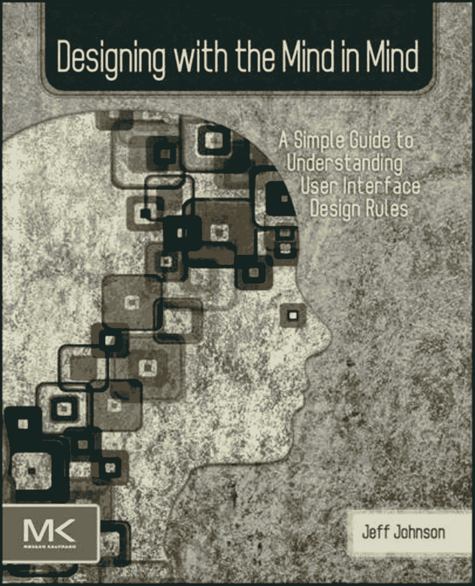

# 注意事项

该领域的知识和最佳实践不断变化中。随着新的研究和经验拓宽了我们的理解，研究方法、专业实践或医疗治疗方面的变化可能会变得必要。

执业人员必须根据自己的经验和知识，来评估和使用本文中描述的任何信息、方法、化合物或元素。在使用信息时，他们应该注意自己及他人的安全，包括他们负有专业责任的方。

在法律允许的最大范围内，出版者及作者、贡献者或编辑对于因产品责任、疏忽或其他原因导致的人或财产的任何伤害和/或损害，或对材料范围内任何方法、产品、说明或思想的使用或操作，不承担任何责任。

中国制造

# 致谢

如果没有许多人的帮助和支持，我无法写出这本书。

首先要提到的是 2006 年冬季学期在新西兰坎特伯雷大学担任 Erskine 研究员期间所教的人机交互课程的学生。正是为了他们，我开发了一门提供感知和认知心理学简要背景的讲座——足以让他们理解并应用用户界面设计指南。这后来扩展成了一门职业发展课程，最后演变成了这本书。

其次是初稿的审稿人：Sun Fowler, Robin Jefferson, Tim McCoy 和 Jon Meads。他们提供了许多非常有帮助的意见和建议，让我大大改进了这本书。

第三是三位认知科学研究人员，他们提供了有用内容，指导我阅读价值文献，或允许我与他们交流想法：Edward Adelson 教授（麻省理工学院大脑与认知科学系）、Dan Osherson 教授（普林斯顿大学心理学系）和 Dan Bullock 博士（波士顿大学认知与神经系统）。

本书得到了 Elsevier 工作人员提供的关怀、监督、后勤支持和培养的巨大帮助，特别是 Mary Jane、David Bevans 和 Andre Cuello。

额外的校对由 Cate de Heer 提供。最重要的是，感谢我的妻子和朋友 Karen 在我研究和编写这本书期间的爱与支持，这一切格外难得，因为她正在完成《面对面：非洲艾滋病危机下的儿童》，一本摄影集。

# 前言

交互式系统的设计不仅是一门艺术，而且至少目标上是一门科学。嗯，实际上并不是科学，而是一种联合计算机认知工程，即基于科学的技术来满足特定要求的系统。

就像汽车、建筑和衣服一样，交互计算产物可以带来情感愉悦，展示风格时尚，并具有社会意义。在制作吸引眼球且具有互动性的物品方面，艺术和工业设计有很大的空间。这些产物还必须正常工作并顺应人类活动。一个漂亮的建筑如果让居民在夏天酷热或在风暴中倒塌，那就是失败的。

然而，设计规则往往存在问题。在实践中，设计规则可能具有模糊性或需要微妙的解读。这引入了本书。

本书的想法是将设计规则与支持它的科学结合起来。这种形式有许多优点：通过与实际设计相结合，心理科学变得具体且易于吸收；而设计规则由于与其深层逻辑相关，变得更容易根据上下文进行调整。

Jeff Johnson 是尝试本书的完美人选。他的整个职业生涯结合了界面设计和心理科学两方面的工作。我第一次见到他在 Xerox Star 系列产品的用户界面团队——那是首个商业化的图形用户界面。因此，在设计方面，他基本上处于 GUI 的起点。在心理学方面，他在耶鲁大学和斯坦福大学获得了学位。

—Stuart Card

# 引言

## 用户界面设计规则：它们源自何处？又如何有效使用？

自从人们设计交互式计算机系统以来，一直有人尝试通过发布用户界面设计指南（也称为设计规则）来促进良好的认知。早期的研究包括：

- Cheriton (1976) 为早期交互式（分时共享）计算机系统提出了用户界面设计指南。
- Norman (1983a, 1983b) 基于人类认知（包括认知错误）提出了软件用户界面的设计规则。
- Smith 和 Mosier (1986) 编写了或许是（目前为止编写的）最全面的用户界面设计指南。
- Shneiderman (1987) 在其著作《用户界面设计》的第一版及随后的所有版本中都包含了“界面设计的八大黄金准则”。
- Brown (1988) 编写了一本关于设计指南的书，书名恰当为《人机界面设计指南》。
- Nielsen 和 Molich (1990) 提供了一套用于用户界面启发式评估的设计规则。
- Marcus (1991) 提出了在线文档和用户界面中图形设计的设计规则。

### 在二十一世纪

用户界面设计指南有多大价值？这取决于谁将它们应用于设计问题。

## 用户体验设计与评估需要理解和经验

遵循用户界面设计指南并不像遵循菜谱那样简单。设计规则通常描述的是目标而非动作。它们被刻意设计得非常通用，以便具有广泛适用性，但这意味着它们的精确含义以及对特定设计情景的适用性存在解释空间。

更复杂的是，对于给定的设计情况，往往会有多条规则看起来适用。在这种情况下，适用的设计规则往往会冲突，即它们建议不同的设计方案。这要求设计者判断在竞争性规则中哪一个更适用于给定情况，并应该具有优先权。

设计问题——即使没有竞争的设计指南——通常也具有多重冲突的目标，例如：

- 高亮度屏幕和长电池续航
- 轻量且坚固
- 多功能且易于学习
- 强大且简单
- 所见即所得（`WYSIWIG`）且盲人可用

要满足基于计算机的产品或服务的所有设计目标通常需要权衡——大量的权衡。在竞争的设计规则之间找到正确的平衡点需要进一步的权衡。

考虑到所有这些复杂性，用户界面设计规则和指南必须由精通 UI 设计/或评估艺术的人员彻底应用，而不是盲目应用。用户界面设计规则和指南更像法律，而不像一套法律最好由精通法的律师和法官来应用和解释，一套用户界面设计指南也最好由理解指南基础并从应用经验中获得教训的人员来应用和解释。

遗憾的是，除少数例外外（例如 Norman, 1983a），用户界面设计指南通常以简单的设计准则列表形式提供，几乎没有原理或背景说明。

此外，尽管用户界面设计和可用性专业领域的许多早期成员具有认知心理学背景，但该领域的许多新来者并没有。这使得他们难以无缝地应用用户界面设计指南。

提供这些原理和背景教育正是本书的功能所在。

## 比较用户界面设计指南

表 1 将两个最广为人知的用户界面指南列表并列，以展示它们包含的规则类型以及它们之间的比较（另见附录中的更多指南列表）。例如，两份列表都从要求设计一致性开始。两份列表都包含一条关于防止错误的规则。Nielsen-Molich 的规则“帮助用户识别、设计并从错误恢复”与 Shneiderman-Plaisant 的规则“允许易地撤销操作”密切对应。“用户控制和自由”对应于“让用户感觉处于控制之中”。这种相似性是有原因的，而不仅仅是后来的作者受早期作者的影响。

## 设计指南源自何处？

**表 I.1** 最广为人知的用户界面设计指南列表

| Shneiderman (1987); Shneiderman and Plaisant (2009) | Nielsen and Molich (1990) |
| :--- | :--- |
| - 追求一致性 | - 标准的一致性 |
| - 符合通用可用性 | - 系统状态可见性 |
| - 提供信息反馈 | - 系统与现实世界的匹配 |
| - 设计任务产生完成感 | - 用户控制和自由 |
| - 防止错误 | - 错误预防 |
| - 允许易地撤销操作 | - 识别而非记忆 |
| - 最小化短期记忆负载 | - 灵活性和极简设计 |
| | - 帮助用户识别、诊断并从错误恢复 |
| | - 提供在线文档和帮助 |

### 设计指南源自何处？

就目的而言，每套指南中的详细设计规则（如表 I.1 所示）并不如它们的内容重要，即：其基础和起源。设计规则源自何处？它们的作者——就像时尚设计师一样——仅仅是为了将他们个人的设计品味强加于计算机和软件行业吗？

如果是这样，那么不同的设计规则集将与其他非常不同，因为不同的作者会寻求与他人产生差异化。事实上，如果我们忽略措辞差异以及编写每套指南时的计算机技术水平，所有这些用户界面设计指南都是非常相似的。

答案是，所有的设计规则都基于人类心理学：人们如何感知、学习、记忆以及将意图转化为行动。设计指南的许多作者至少具有心理学背景，并将其应用于计算机系统设计中。

例如，Don Norman 是人机交互领域的教授、研究人员和多产作家。Norman 早期的人机界面设计指南是基于他以及他人的对人类认知的研究。他特别关注人们经常犯的认知错误，以及如何设计计算机系统来学习或消除这些错误的影响。

同样，其他用户界面设计指南的作者（例如 Brown, Shneiderman, Molich）利用感知和认知心理学知识来改进实用且有效的系统设计。

结论：用户界面设计指南基于人类心理学。

通过阅读，你将了解用户界面和可用性设计指南背后的最重要的方面。

## 本书的读者

本书主要面向需要应用用户界面和交互设计指南的软件开发人员。这当然包括交互设计师、用户界面设计师、用户体验设计师、图形设计师以及硬件产品设计师。它还包括可用性测试人员和评估人员，他们在审查软件或分析观察到的问题时经常参考启发式规则。

本书的第二个读者是软件开发经理，他们希望了解用户界面设计规则的心理背景，以便理解和评估他们管理的工作。

## 我们感知我们所期待

我们对周围世界的感知并非实际事物的真实描述。我们在很大程度上感知的是我们*预期*感知到的东西。我们的预期——因此我们的感知——受到三个因素的影响：

- *过去*：我们的经验
- *现在*：当前的上下文
- *未来*：我们的目标

### 受经验影响的感知

假设你有一家保险公司。你正在与一位房地产经理会面，讨论公司新园区的计划。该园区由一排五栋建筑组成，最后两座带有 T 型庭院，为食堂和健身中心提供采光。如果房地产经理向你展示图 1.1 所示的地图，你会看到五个代表建筑的黑色形状。

图 1.1

建筑地图还是单词？你看到的取决于被告知看什么。

# 第一章 我们感知到的正是我们预期的

现在想象一下，你不是在与一位房地产经理见面，而是在与一位广告经理见面。你们正在讨论一个放置在全国某些市场的广告牌。广告经理向你展示了同一张图片，但在这种情况下，这张图片是一个广告的草图，仅由一个单词组成。在这种情况下，你看到了一个单词，非常清晰且无歧义。

当你的感知系统被“启动”为看到建筑形状时，你看到的就是建筑形状，而建筑之间的白色区域在你的感知中几乎没有被察觉。当你的感知系统被启动为看到文本时，你看到的就是文本，而字母之间的黑色区域几乎没有被察觉。

关于心理启动如何影响感知，一个相对著名的例子是一幅草图，据说是 R. C. James¹ 所画的，它最初在大多数人看来就像是随机喷溅的墨水（见图 1.2）。在继续阅读之前，请看这张草图。

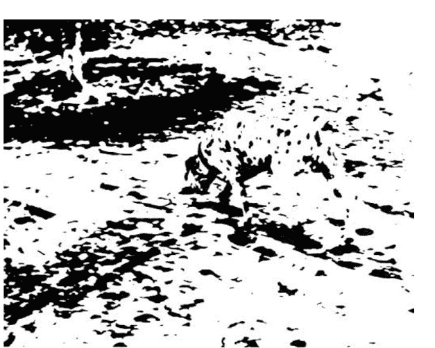

图 1.2

显示视觉系统心理启动效应的图像。你看到了什么？

只有在你被告知这是一只正在树旁嗅闻地面的达尔马提亚斑犬后，你的视觉系统才能将图像组织成一个连贯的画面。此外，你已经“看到”了那只狗，很难再回到将图像看作随机斑点集合的状态。

> ¹ 出版于 Marr D. (1982) *Vision*. W. H. Freeman, New York, NY, p. 101, Figure 3-1.

#### 受经验偏的感知

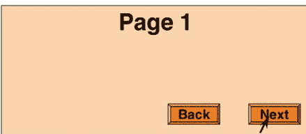
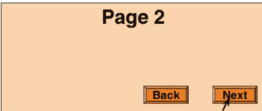
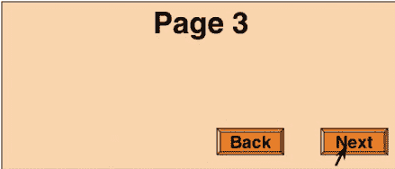
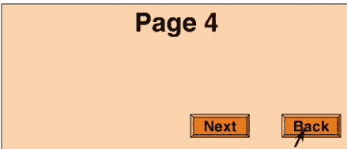

图 1.3

“下一页”按钮被感知在一致的位置，即使它实际上并不在那儿。

上面的例子是视觉的。经验也可以偏向其他类型的感知，例如句子理解。例如，“新疫苗含有狂犬病毒”这一标题，对于近期听过疫苗污染故事的人来说，其理解可能与近期听过使用疫苗成功抗击疾病故事的人，其理解会有所不同。

计算机软件和网站的用户通常在点击按钮或链接时并不会仔细看它们。他们对显示内容的感知更多是基于他们过去的经验引导他们预期的内容，而不是屏幕上实际显示的内容。这有时会困惑软件设计师，因为他们期望看到屏幕上显示的内容。但感知并不是这样运作的。

例如，如果多页对话框最后一页的“下一页”和“上一步”按钮的位置交换了，许多人不会立即注意到这种切换（见图 1.3）。他们的视觉系统已经因为按钮在几个页面上的一致放置而进入了不注意状态。即使在无意中向后退了几次，他们可能仍然感知到按钮位于标准位置。这就是为什么“一致地放置控件”是一项常见的用户界面设计准则。

同样，如果我们试图寻找某物，但它在另一个不同的地方或者看起来与我们预想的不符，尽管它显而易见，我们可能会错过它，因为它引导我们去在预期的位置寻找预期的特征。例如，如果 Web 页面某一个表单的“提交”按钮形状与网站上其他表单不同或颜色不同，用户可能找不到它。这种由预期引起的盲目将在稍后讨论。

### 目标偏向感知

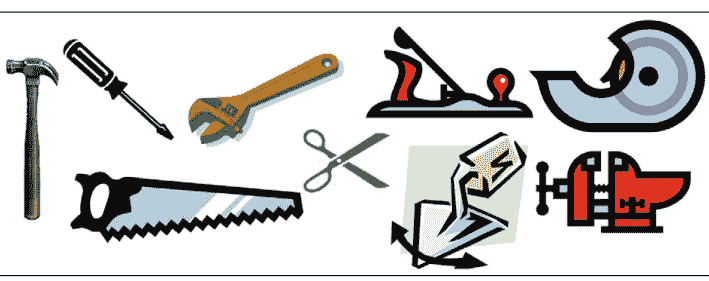

图 1.6

工具箱：那里有剪刀吗？

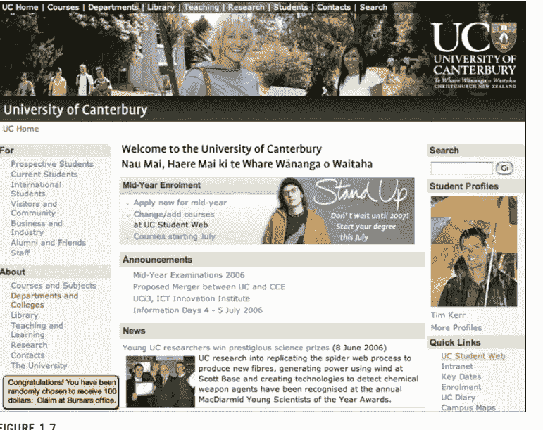

图 1.7

坎特伯雷大学首页：浏览网站包含感知过滤。

无论你是浏览还是搜索，你很可能在离开首页时，并没有注意到自己被随机选中获得了 100 美元（左下角）。而这与你的目标无关。

我们当前的目标偏向感知的机制是什么？共有两种：

- *影响我们的视线方向。* 感知既是主动的也是被动的。我们不断地移动眼睛、耳朵、手等，以对环境中与我们正在做或要做最相关的事物进行采样（Ware, 2008）。如果我们在网站上寻找校园地图，我们的眼睛和控制光标的手会被那些可能引导我们实现目标的内容所吸引。我们会多或少忽略与目标无关的事物。
- *使我们的感知系统对特征变得敏感。* 当我们在寻找某物时，大脑可以引导我们的感知，对正在寻找的物体的特征特别敏感（Ware, 2008）。当我们在大型停车场寻找一辆红色汽车时，当我们扫描停车场时，红色汽车似乎会脱颖而出，而其他颜色的汽车几乎不会在我们的意识中留下痕迹，尽管在某种意义上我们“看到”了它们。同样，当我们试图在拥挤的房间里寻找配偶时，大脑会“程序”我们的听觉系统，使其对组成声音的频率组合特别敏感。

## 设计启示

所有这些感知偏向对用户界面设计都有影响。共有三点。

### 避免歧义

避免产生歧义的信息显示，并测试你的设计以验证所有用户都以相同的方式解释显示。歧义是不可避免的，可以通过标准或惯例来解决它，或者引导用户以预期的方式解决歧义。

例如，计算机显示通常会对按钮和文本字段进行阴影处理，使它们看起来相对于背景表面是凸起的（见图 1.8）。这种外观

图 1.8

计算机屏幕上的按钮通常经过阴影处理，使其看起来具有三维效果，但这种惯例只有在假设光源位于左上角时才有效。

这依赖于大多数经验丰富的计算机用户熟悉的惯例，即光源位于屏幕的左上方。如果一个物体被描绘为来自不同位置的光源照射，用户将认为该物体不是凸起的。

### 保持一致

将信息和控件放置在一致的位置。在不同页面上实现相同功能的控件和数据显示应该放置在它们出现的每个页面的相同位置。它们还应该具有相同的颜色、文本字体、阴影等。这种一致性允许用户快速发现并识别出它们。

### 理解目标

用户来到系统时带有他们想要实现的目标。设计师应该理解这些目标。意识到用户的目标是各异的，而且他们的目标强烈影响着他们的感知。确保在交互的每一点，用户所需的信息都是可用、突出的，并清晰地映射到可能的用户目标，以便用户能够注意到并使用这些信息。

# 第二章 我们的视觉是为了观察结构而优化的

二十世纪初，一组德国心理学家试图解释人类视觉感知是如何工作的。他们观察并记录了许多重要的视觉现象。他们的基本发现之一是人类视觉是整体性的：我们的视觉系统自动对视觉输入施加结构，并天生能够感知完整的形状、图形和物体，而不是断开的边缘、线条和区域。德语中“形状”或“图形”的词是 *Gestalt*（格式塔），因此这些理论被称为视觉感知的格式塔原理。

今天的感知和认知心理学家将格式塔感知理论视为一种*解释性*框架和*预测性*理论。

#### 格式塔原理：相似性

方向设置显然意在于分组显示。三个菜单的间距并不紧密，但看起来相似，以至于它们看起来相互关联，尽管这并非本意。

同样，图书出版商 Elsevier 网站上表单中的文本字段被组织成上方的一组七个（包含三个子组）用于地址，一组三个拆分字段用于电话，以及两个单独的文本字段。四个菜单除了数据字段外，还分离了文本字段组（图 2.7）。相比之下，标签与其字段之间的距离太远，无法看出是连接的。

| 标题（先生、女士、博士等）： | | **请选择*** |
|---|---|---|
| 名字: | | | |
| 姓: | | | | |
| 职位: | | | | |
| 机构/组织: | | | | |
| 门号和街道: | | | | |
| 城市: | | | | |
| 州/县: | | | | |
| 邮政编码/邮编: | | | | |
| 国家: | **请选择*** | | |
| 工作电话: | | | | |
| 家庭电话: | | | | |
| 传真: | | | | |
| 您是如何知道这个网站的: | | 请选择 | |
| 其他: | | | | |
| 请选择最符合您客户身份的选项: | | 请选择 | |
| 电子邮箱: | | | | |

图 2.7

Elsevier 的在线表单。相似性使得文本字段看起来是分组的。

## 格式塔原理：连续性

除了分组之外，几种格式塔原理描述了我们在视觉系统中将物体组织化的倾向，这种倾向旨在通过消除歧义或填充缺失数据，感知完整物体。第一个原理，连续性原理指出，我们的视觉感知倾向于感知连续的形式而非断开的线段。

例如，在图 2.8 的左侧，我们会自动看到两条交叉的线——一条蓝色的，一条橙色的。我们没有看到两个橙色片段和两个独立的蓝色片段，也没有看到一个倒置的橙色 V 字叠在一个蓝橙色 V 字上方。在图 2.8 的右侧，我们看到水中的一只海怪，而不是三个部分的组合体。

图形设计中连续性原理的一个著名例子是 IBM 标志。它由不连接的斑块组成，但它完全没有歧义；它很容易被看作两个粗体字母，也许是通过类似于威尼斯百叶窗的东西看到的（见图 2.9）。

滑块控件是连续性原理的一个用户界面示例。我们认为滑块描绘了一个由显示在滑块某处的手柄控制的单一范围，而不是被看作两个被手柄隔开的范围（见图 2.10A）。即使在滑块手柄的每一侧显示不同的颜色，也不会完全“打破”我们对滑块作为一个单一连续物体的感知，尽管 ComponentOne 选择了对比鲜艳的颜色（灰色对比红色）稍微加剧了这种感知（见图 2.10B）。

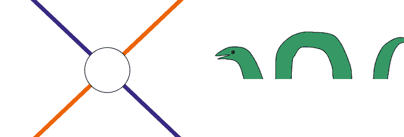

图 2.8

连续性：人类视觉倾向于看到连续的形式，在必要时甚至补充缺失的数据。

图 2.9

IBM 公司标志利用连续性原理从不连接的斑块形成字母。

## 格式塔原理：闭合性 (CLOSURE)

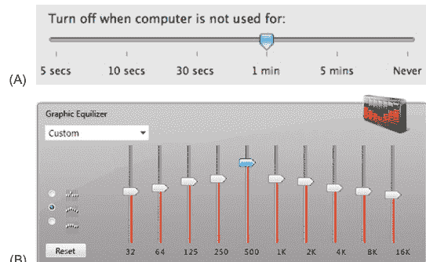

图 2.10

连续性：我们将滑块看作一个带有某处手柄的单一槽，而不是两个被手柄隔开的槽。（(A) Mac OS，(B) ComponentOne。

## 格式塔原理：闭合性 (CLOSURE)

与连续性相关的是格式塔闭合性原理，它指出我们的视觉系统会自动尝试封闭开放的图形，使其被感知为整体物体而非分离碎片。因此，我们将图 2.11 左侧断开的弧线感知为一个圆圈。

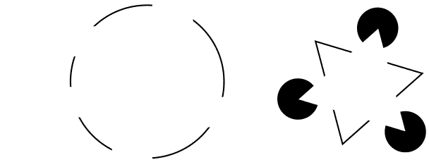

图 2.11

闭合：人类视觉倾向于看到整体物体，即使它们是不完整的。

我们的视觉系统对观察物体的倾向是如此强烈，以至于它甚至可以将一个完全空白的区域解释为一个物体。我们将图 2.11 右侧的形状组合感知为一个白色三角形叠在另一个三角形和三个黑色圆圈上，尽管该图形实际上只包含三个 V 形和三个黑色的吃豆人形状。

闭合性原理经常应用于图形用户界面 (GUI)。例如，GUI 经常重复物体的集合——例如文档或消息——形成**堆叠**（见图 2.12）。只需显示一个物体以及它“后面”其他物体的边缘，就足以让用户感知到一组完整的物体。

图 2.12

描绘物体堆的图标展示了闭合性原理：部分可见的物体被感知为整体。

## 格式塔原理：对称性 (SYMMETRY)

关于我们观察物体的倾向的第三个事实包含在格式塔对称性原理中。它指出，我们的视觉系统会自动组织视觉字段以简化数据。例如，我们将图 2.11 右侧的形状组合感知为一个白色三角形叠在另一个三角形和三个黑色圆圈上，尽管该图形实际上只包含三个 V 形和三个黑色的吃豆人形状。

## 第 2 章 我们的视觉优化目标是识别结构

图/底（Figure/Ground）通常用于在其他内容上方弹出信息。曾经作为“图形”（即用户注意力焦点）的内容会暂时成为新信息的背景，而新信息则作为新的“图形”短暂出现（见图 2.19）。这种方法通常比临时用新信息完全替换旧信息要好，因为它提供了上下文，帮助人们明确自己在交互过程中的位置。

## 格式塔原理：共同命运

之前的六个格式塔原理涉及对静态（不移动的）图形和对象的感知。最后一个格式塔原理——**共同命运（Common Fate）**——涉及移动的物体。共同命运原理与接近性（Proximity）和相似性（Similarity）原理有关：与它们一样，它会影响我们是否将物体感知为一组。共同命运原理指出，一起移动的物体会被感知为一组或相互相关。

例如，在一个显示了几十个五边形的屏幕上，如果其中一些在同步地来回晃动，人们会认为它们是一个相关的组，即使这些晃动的五边形彼此分离，且看起来与其他所有五边形并无异（见图 2.20）。

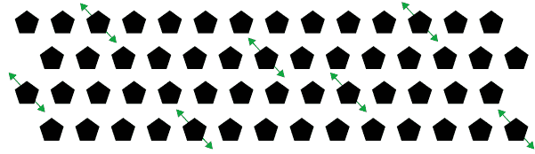

图 2.20

共同命运：如果项目一起移动，它们会被感知为一组或相关。

共同运动——意味着共同命运——被用于某些动画中展示实体之间的关系。例如，GapMinder 图表通过让代表国家的点移动，来展示经济发展各项因素随时间的变化。一起移动的国家拥有共同的发展历史（见图 2.21）。

## 格式塔原理：组合

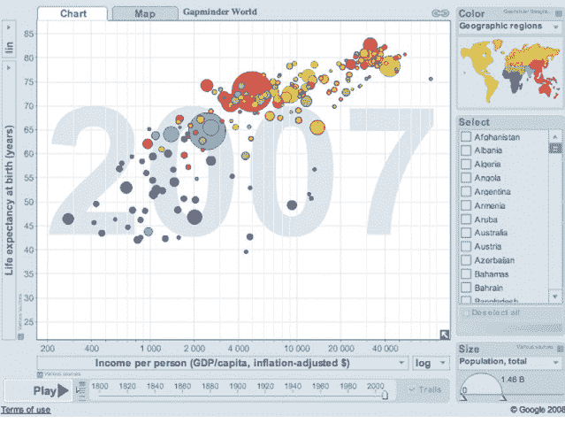

共同命运：GapMinder 通过点点动画显示哪些国家具有相似的发展历史。

## 格式塔原理：组合

当然，在现实世界的视觉场景中，格式塔原理是协同工作的，而不是孤立存在的。例如，一个典型的 Mac OS 桌面通常体现了上述七个原理中的六个（不包括共同命运）：接近性、相似性、连续性、闭合、对称性和图/底（见图 2.22）。在典型的桌面上，当用户选择多个文件文件夹并将它们作为一个整体拖到新位置时，就会用到共同命运（连同相似性）（见图 2.25）。

当所有这些格式塔原理同时运行时，设计可能会暗示一些无意产生的视觉关系。一种建议的实践是在设计完显示界面后，顾及每种格式塔原理——接近性、相似性、连续性、闭合、对称性、图/底和共同命运——来查看它，以检查设计是否暗示了任何你并非设计的元素之间的关系。

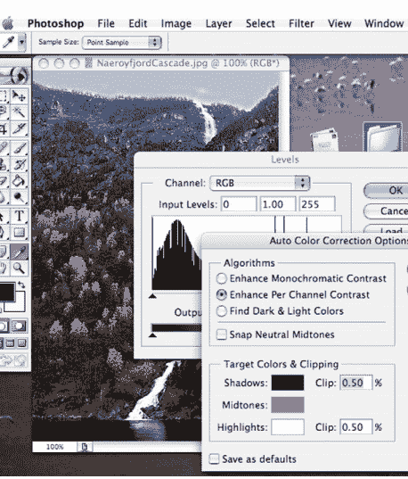

图 2.22

除了共同命运外，所有的格式塔原理在 Mac OS 桌面的这部分都发挥了作用。

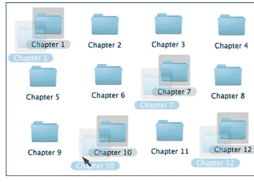

图 2.23

相似性与共同命运：当用户拖动已选的文件夹时，共同的高亮和运动让所选文件夹看起来像一组。

## 第 3 章 我们寻找并使用视觉结构

第 2 章利用视觉感知的格式塔原理，展示了我们的视觉系统是如何优化以感知结构的。在环境中感知结构有助于我们快速理解物体和事件。第 2 章还提到，当人们在软件或网站中导航时，他们不会仔细检查屏幕并阅读每一个单词。他们扫描的是相关信息。本章提供的示例说明，当信息以简洁、结构化的方式呈现时，更容易被扫描和理解。

考虑关于航空公司航班预订的两种信息呈现方式。第一种呈现方式是非结构化的散文；第二种是大纲形式的结构化文本（见图 3.1）。结构化的预订信息比散文要快得多被扫描和理解。信息的呈现越结构化、越简洁，人们扫描和理解就越快越容易。看看加州车辆管理局的目录页（图 3.2）。冗长、重复的链接会减慢用户的速度，并“埋没”他们需要的重要词汇。

| 非结构化： | 结构化： |
|---|---|
| 您已预订联合航空 237 航班，该航班于 10 月 15 日周二 14:30 从奥克兰出发，并于 10 月 15 日周二 11:40 到达旧金山。 | **航班：联合航空 237，奥克兰 → 旧金山** |
| | 出发：14:30 10月15日周二 |
| | 到达：11:40 10月15日周二 |

**图 3.1** 航空公司航班预订信息的结构化呈现更容易扫描和理解。

- 如何亲自更新驾驶执照
- 如何通过邮寄更新驾驶执照
- 如何申请补办驾驶执照或身份证件（ID）卡
- 如何向车管所（DMV）通知地址变更
- 如何注册生命捐赠计划

加州车辆管理局（DMV）网站以重复的散文承载着重要信息。

| 身份证：续期、补办、变更 |
|---|---|
| 续期：亲自或邮寄 |
| 续期：指示许可 |
| 申请补办：身份证 |
| 变更：地址 |
| 注册为：器官捐献者 |

加州 DMV 网站消除了重复并具有更好结构的页面。与一种较差的、更具结构化的设计相比，这种设计排除了不必要的重复，并仅将代表选项的单词标记为链接（见图 3.3）。实际目录页呈现的所有选项都是可用的，占用空间更小，且更容易扫描。显示结果是另一种情况，通过结构化数据和避免重复的“噪声”，可以提高人们快速扫描并找到他们所需内容的能力。2006 年，HP.com 的搜索结果为每个检索到的项目包含了大量的重复导航数据和元数据。到 2009 年，HP 已消除了重复并结构化了结果。结构化数据和避免重复的“噪声”可以提高人们快速扫描并找到他们所需内容的能力。

搜索img/

**图 3.4** 2006 年，hp.com 网站产生了重复的噪声（左侧），但在 2009 年改进了（右侧）。结构化数据和避免重复的“噪声”可以提高人们快速扫描并找到他们所需内容的能力。

相比之下，修订后的设计允许用户在无需刻意识思考的情况下感知标签与值之间的对应关系（见图 3.5，右）。

## 结构增强了人类扫描数字的能力

即使是少量信息，如果经过结构化也可以变得更容易扫描。两个例子是电话号码和信用卡号（见图 3.6 和图 3.7）。传统上，这些数字会被分成若干部分，以便扫描和记忆。

长数字有两种拆分方式：用户界面通过为数字的每个部分提供单独字段来显式地拆分；或者界面提供单一数字字段，但允许用户使用空格或标点符号将数字拆分成部分（见图 3.8a）。然而，今天许多计算机显示的电话号码和信用卡号并没有对数字进行分段，也不允许用户使用空格（见图 3.8b）。这种限制使得人们扫描数字或验证输入是否正确变得更加困难。

即使要输入的数据严格来说不是数字，分段数据字段也可以提供有用的视觉结构。日期就是一个典型的例子，分段字段可以提高可读性并防止数据输入错误，如美国银行网站上的日期字段所示（见图 3.8）。

| | |
| :--- | :--- |
| 容易 | (415) 123-4567 |
| 困难 | 4151234567 |
| 容易 | 1234 5678 9012 3456 |
| 困难 | 1234567890123456 |

图 3.6

电话和信用卡号分段后更容易扫描和理解。

| 信用卡号：1234 5678 9012 3456 有期日期：月 [v] 年 [v] 支付选项 信用卡 1234567890123456 (* 请勿使用空格或破折线。例如：4321342134213421) |

(A)

(B)

图 3.7

(A) 在 Democrats.org，信用卡号可以包含空格。(B) 在 Stufflit.com，它们不能包含，这使得它们更难扫描和验证。

## 特定数据的控件提供更多结构

| 出生日期 | MM/DD/YYYY |
| :--- | :--- |
| 您必须至少满 18 岁，且是美国公民或美国永久居民，或者至少 21 岁且是波多黎的永久居民。 | |

图 3.8

BankOfAmerica.com：分段数据字段提供了有用的结构。

比分段数据字段更进一步的结构是特定数据的控件。设计师不再使用简单的文本字段（无论是否分段），可以使用专门设计用于显示（并作为输入接受）特定类型值的控件。例如，日期可以以菜单结合弹出日历控件的形式呈现（并被接受）（见图 3.9）。

通过将分段文本字段与特定数据的控件混合，也可以提供视觉结构，如美国西南航空网站上的电子邮件字段所示（见图 3.10）。

| 出发 | 十月 | 21 |
| :--- | :--- | :--- |
| 上午 | | |

图 3.9

NWA.com：使用专门为日期设计的控件显示和输入日期。

| 电子邮件地址： | fred | bedrock | com |
| :--- | :--- | :--- | :--- |

图 3.10

NWA.com：使用专门为日期设计的控件显示和输入日期。

## 视觉层级让人们关注相关信息

结构化信息呈现时最重要的目标之一是提供视觉层级——这是一种信息的排列方式，它能够：

- 将信息划分为不同的章节，并将大章节分为子章节
- 显著地为每个章节和子章节标记标签，其方式能够清晰地识别其内容
- 以层级结构的形式呈现章节和子章节，较高层级章节的呈现方式比较低层级的更强。

视觉层级允许人们在扫描时将相关信息与无关信息分开，并将注意力集中在相关信息上。由于他们可以跳过所有其他内容，因此可以更快速地找到他们寻找的内容。

自己尝试一下。看图 3.11 中的两个信息显示，并找到关于显著性的信息。在非层级化的呈现中，你找到它需要多花长时间？

| 创建清晰的层级 | 创建清晰的层级 |
| :--- | :--- |
| 使用大小、显著性和内容关系来组织并优先考虑页面内容。让我们更仔细地观察这些关系。标题越重要，其字体应该越大。大标题有助于在用户扫描 Web 页面时吸引他们的注意力。页面越高，放置的位置就越靠上。最重要或受欢迎的内容应始终放置在页面顶部，以便用户无需滚动即可查看。 | n| |

图 3.11

## 第 4 章 阅读并非天生

因为人类天生就“布好了”学习程序，那些缺乏为他们读书的照顾者、或在学校没有接受足够指导的孩子，可能永远无法学会阅读。这类人有很多，尤其是在发展中国家。相比之下，很少有人学会过口语语言。

出于各种原因，即使是学会了阅读的人也可能永远无法精通。也许他们的父母没有重视和推广阅读。也许他们就读的是质量标准的学校，或者根本没有上过学。也许他们学会了第二语言，但从未在该语言上学会良好的阅读。最后，患有认知或感知障碍（如阅读障碍）的人可能永远无法成为读者。

学习阅读涉及训练我们大脑——包括视觉系统——去识别模式。我们大脑学习识别的模式涵盖了从低级到高级的范围：

- 线条、轮廓和形状是我们大脑天生识别的基本视觉特征。我们不需要刻意识别它们。
- 基本特征组合成我们学习识别为字符的模式——字母、数字和其他标准符号。在表意文字（如中文）中，符号代表词汇或概念。
- 在字母系统中，字符模式形成了我们学习识别为意义包的语素，例如，“farm”、“tax”、“ed”和“ing”是英语中的语素。
- 语素组合成我们识别为单词的模式，例如，“farm”、“tax”、“ed”和“ing”可以组合成单词“farm”、“farmed”、“farming”、“tax”、“taxed”和“taxing”。即使是表意文字，也包含了作为语素或意义修饰符的符号，而不是作为单词或概念。
- 单词组合成我们学习识别为短语、习语表达和句子的模式。
- 句子组合成段落。

要看看未学会阅读的人眼中文本是什么样子的，只需看一段用你不熟悉的语言和字体打印的段落（见图 4-1A 和 B）。

或者，你也可以通过将一页熟悉的字体和语言打印的页面（例如这本书的一页）倒过来来看，来近似体验不识字的感觉。把这本书倒过来，尝试阅读那几个段落。这种练习模拟了不识字的感觉。你会发现，倒置的文字起初看起来陌生且无法辨，但一分钟后你就能阅读了，尽管很缓慢且费力。

## 阅读是特征驱动的还是上下文驱动的？

| አዲስ አባብ ሲኒ 15/93/እዛቤ -- ዓላሴ ኢትዮጵያ ፳5 ሜኒባን |
| :--- | :--- |
| የ ዓፍር ጽህረት አማርኛ አዲስ አባብ የሚሟጥ የነራት አሞባል |
| ዳርቦኖአማያኛ የዋጽንባይባሽዥሉ ሚንድኖዋርባዋን ዓምይቼ፤ምጥወድያጋሽko|| |
| ᲊንስ መጥንግ ስዋንደደዋርዳንባን፳ቃዩን፤ይንይንይንክንንንانداን��ይባን፳ባan ||

(A) (B)

图 4.1

体验不识字的感觉，就像看到外国字体打印的文字。(A) 阿姆哈拉语，(B) 藏语。

如前所述，阅读涉及识别特征和模式。模式识别（因此阅读）可以是自底而上的、特征驱动的过程，也可以是自上而下的、上下文驱动的过程。

在特征驱动的阅读中，视觉系统首先识别页面或显示器上的简单特征——特定方向的线段或特定半径的曲线——然后将它们组合成更复杂的特征，如角度、曲线、形状和模式。然后大脑将字符识别为代表字母、数字或（对于表意文字而言）词汇的符号。在字母系统中，字母组被感知为语素和单词。在所有类型的文字中，单词序列被解析为具有意义的短语、句子和段落。

特征驱动的阅读被称为“自底而上”或“无上下文的”。大脑识别基本特征（线条、边缘、角度等）的能力是与生的，因此从出生起就是自动的。相比之下，对语素、单词和短语的识别必须通过学习。它始于一个非自动的意识过程，需要对字母、语素和单词进行分析，但通过足够的练习，它会变得自动（Souza, 2005）。显然，一个单词或短语越常见，它的识别就越自动。对于像中文这样的表意文字，符号比字母系统多得多，人们需要更长的时间才能成为熟练的读者。

上下文驱动或自上而下的阅读与特征驱动的阅读并行运行，但工作方式相反：从句子或段落的大意到单词和字符。视觉系统开始识别高级模式，如单词、短语和句子，或者通过预先知道文本含义。然后它利用知识来判断——高级模式的组成部分是什么（Boulton, 2009）。上下文驱动的阅读不太可能自动，因为短语级和句子级的模式及上下文发生的频率还不足以让它们的识别转化为神经模式。但也有例外，例如习语。

要体验上下文驱动的阅读，请看图 4.2。要体验特征驱动的阅读，请看图 4.3。

# 糟糕的信息设计会干扰阅读

要体验上下文驱动的阅读，请看图 4.2。要体验特征驱动的阅读，请看图 4.3。

自那以后进行的实证研究已经明确地证明了事实与早期理论预测的相反（Boulton, 2009）。

换句话说，最高效的阅读方式是通过经过充分学习变为自动的无上下文、自底而上、特征驱动的过程。

## 使用大脑的不同部分

在 20 世纪 80 年代之前，想要了解大脑哪些部分参与语言和阅读的研究局限于研究脑损伤的人。例如，第 10 章描述了自动处理和控制认知处理之间的区别。对于目前的目的，我们简单地说，控制过程会负担工作记忆，而自动过程不会。

人类大脑显示了布罗卡区和韦尼克活跃区。

### 高级读者

**高级读者：** 跳过了词汇分析区域。相反，枕额颞区（耳朵后方，远离视觉皮层）变得活跃。目前主流的观点是，该区域将单词作为一个整体进行识别，而不是逐字发音，然后这种活动会激活通往大脑前部的路径，这些路径对应单词的含义和心理图像。布罗卡区仅略有参与。

脑扫描方法的结果并没有准确说明使用了哪些过程，但它们确实支持了这一理论：高级读者所使用的过程与初级读者有所不同。

## 不常用或不熟悉的词汇

软件干扰阅读的一种方式是使用不熟悉的词汇——目标读者并不熟悉，或完全不知道。

不熟悉的术语的一种类型是计算机术语，有时被称为“极客语”（geek speak）。例如，如果用户在空置超过 15 分钟后尝试使用某个内部应用程序，它会显示以下错误信息：

> 您的会话已过期。请重新身份验证。

该应用程序用于查找公司内部的资源——房间、设备等。其用户包括接待员、会计师、经理以及工程师。大多数非技术用户不会理解“重新身份验证”（reauthentication）这个词，他们会从自动阅读模式掉入对信息含义的意识担忧中。为了避免干扰，该程序本可以使用更熟悉的指令“再次登录”。关于计算机系统中的“极客语”如何影响学习的讨论，请参阅第 11 章。

即使不是计算机技术术语，不常用的词汇也可能干扰阅读。英语中存在一些单词，包括许多出现在合同、隐私声明或其他法律文件中的词汇：

- **Afforementioned（上述）：** 之前提到的。
- **Bailwick（专长/领域）：** 治安官拥有法律权的区域；更宽泛地说：控制领域。
- **Disclaimer（免责声明）：** 放弃任何主张或联系；放弃；否认。
- **Jurisprudence（法学）：** 法律体系基础的原则和理论。
- **Obfuscate（模糊）：** 使某事难以察觉或理解。
- **Penultimate（倒数第二个）：** 最后的，如“书中倒数第二章”。

当读者——即使是熟练的读者——遇到这样的单词时，他们的自动阅读过程无法识别它。相反，他们的大脑会使用不自动的过程，如读出单词的部分并利用它们来推断含义、从单词出现的上下文中推断含义，或在词典中查找该单词。

## 困难的字体和字体

即使词汇很熟悉，难以阅读的字体和字体也可能干扰阅读。自下而上、脱离上下文的自动阅读是基于根据视觉特征识别字母和单词。因此，一种具有难以识别的特征和形状的字体将很难阅读。例如，尝试用全大写的轮廓字体阅读亚伯拉罕·林肯的《格蒂斯堡演说》（见图 4.5）。

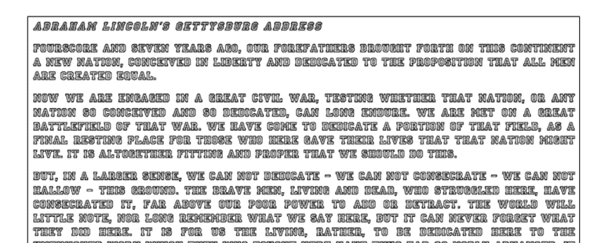

**图 4.5** 全大写文本通常很难阅读，因为字母之间看起来相似。轮廓字体增加了识别难度。这个例子说明了这一点。

## 微小字体

在软件应用程序、网站和电子设备中，使文本难以阅读的另一种方法是使用太小的字体，以至于目标读者的视觉系统无法解析。例如，尝试用 7 号字体阅读《美国宪法》的第一段（见图 4.6）。

**图 4.6** 《美国宪法》的开头段使用了 7 号字体。

开发者有时使用微小字体是因为他们有大量的文本要显示。但如果用户无法阅读，这些就毫无意义了。

## 视觉噪音

视觉噪音也可能来自文本本身。如果连续的文本包含大量重复内容，读者接收到的关于他们关注哪一行的反馈很差，很难从中挑选出重要信息。例如，上一章中来自加州车辆管理局网站的例子（见第 26 页的图 3.2）。

### 在背景上的文本

视觉噪音通常由于设计者将文本放置在花纹背景上，或者使用与背景对比度差的颜色。

**图 4.7** RedTele.com：文本在花纹背景上，与背景对比度差。

在某些情况下，设计者故意让文本难以阅读。例如，Web 上的一个常见安全措施是要求用户识别扭曲的字符，以证明他们是人类而不是网络“机器人”。这取决于大多数人能够识别图片中的字符。

**图 4.8** 爬虫软件无法读取的内容。

## 埋没在重复中的信息

产生噪音的另一个重复例子是 Apple.com 上的电脑商店。购买笔记本电脑的页面列出了不同的键盘选项。

### 键盘与文档

请根据以下键盘语言选项配置您的 MacBook，并参考随附的用户文档。

- 背光键盘（英语）/ 用户指南
- 背光键盘（西西西班牙语）/ 用户指南
- 背光键盘（法语）/ 用户指南
- 背光键盘（日语）/ 用户指南

**图 4.11** Apple.com 的“购买电脑”列表列出的选项中，重要信息（键盘语言兼容性）以一种非常重复的方式埋没在重复的内容中，使得人们很难发现键盘之间的本质区别在于它们支持的语言。

## 居中文本

阅读的一个方面对于大多数熟练的阅读者来说，眼球运动是高度自动化的。在自动（快速阅读）模式下，我们的眼睛被训练为回到相同的水平位置并向下移动一行。如果文本居中或右对齐，每行文本都起始于不同的水平位置。因此，自动眼球运动会将我们带回错误的位置，我们必须有意识地调整视线到每行的实际起点。这会让我们离开自动模式并大大减慢速度。对于诗歌和婚礼请函，这可能是可以的，但对于任何其他类型的文本，这都是一个缺点。房地产公司 FargoHomes 的网站提供了一个居中文本的示例（见图 4.12）。尝试快速阅读这段文本，向你自己证明你的眼睛是如何移动的。

> 独家买家代理提议
>
> （购房者免费！）
>
> Dan 和 Lisa 想要为您服务。
>
> 您是否想避开那些推销、销售并试图完成销售额的代理人？
>
> 您是否希望您的代理站在您这一边，而不是另一边？
>
> 您是否希望您的代理是负责且专业的……？ 
>
> 如果您不喜欢时间被浪费，Dan 和 Lisa 想要为您服务……
>
> 如果您理解我们所说所做的一切都是为您节省时间、金钱并规避麻烦……
>
> - 而且如果您理解时间就是金钱，我们会消除与您最佳利益的竞争……
> - 而且如果您理解我们承担风险，为您提供 24/7 的服务，并为您承担其他费用……
> - 而且如果您理解我们对帮助您学会做出所有正确的选择有着共同利益……
> - 那么，请现在联系我们，因为 Dan 和 Lisa 想要为您服务！！

**图 4.12** FargoHomes.com 将文本居中，阻碍了自动眼球运动模式。

同一个网站还让编号列表居中，真的搞乱了读者的自动眼球运动（见图 4.13）。尝试快速扫描该列表。

**图 4.13** FargoHomes.com 将编号项目居中，真的阻碍了自动眼球运动模式。

## 结合干扰阅读的缺陷

另一家房地产公司 Keller Williams 的网站结合了上述描述的许多干扰阅读的方式。在某些地方，前景和背景之间的对比度不足。在其他地方，对比度过大，例如红色背景上的蓝色文字，导致令人心躁的闪烁。它还有居中文本和花纹背景上的文本。以上所有因素结合使得该网站非常难以阅读（见图 4.14）。

**图 4.14** Keller Williams 的网站以几种不同的方式变得难以阅读。

## 设计启示：不要干扰阅读；要支持它！

显然，设计师的目标应该是支持阅读，而不是干扰阅读。熟练（快速）的阅读大部分是自动的，并且大部分基于特征、字符和单词的识别。识别越容易，阅读就越容易越快速。相比之下，不熟练的阅读很大程度上依赖上下文线索。

交互系统的设计师可以通过遵循以下指南来支持这两种阅读方法：

- 确保用户界面中的文本通过避免上述破坏性缺陷（如困难或微小的图案、花纹背景、居中等）来允许基于特征的自动过程有效运行。
- 使用限制的、高度一致的词汇——行业有时将其称为通俗语言³或简化语言 (Redish, 2007)。
- 格式化文本以创建视觉层级（见第 3 章），以便于快速扫描：使用标题、项目列表、表格和视觉强调的单词（图 4.15）。

**图 4.15** Microsoft Word 的首页易于扫描和阅读。

经验丰富的信息架构师、内容编辑人员和平面设计师在确保文本呈现以支持易于扫描和阅读方面非常有用。

## 软件所需的阅读内容大部分是不必要的

除了出错之外，许多用户界面呈现的文本比需要的多。软件设计师经常使用长描述来解释如何操作（见图 4.14）。

对比 Costco.com 在 2007 年和 2009 年对笔记本电脑的描述（见图 4.18）。

| 2007 | 2009 |
| :--- | :--- |
| 定制 HP Pavilion dv2000 娱乐笔记本电脑 | 选择一台全能的 PC，它集了大脑、美感以及移动技术。这台有趣且强大的 PC 在数字化你的生活方面表现优异。不适用于有需求的人群：(1) 14 英寸宽屏显示器，配备 HP BrightView 技术、用于视频通话的内置摄像头和两个音频插口。无论随身携带何处都能尽情展示，或者在旅行两天时轻松应对。通过如 QuickPay (2) 等简便的触控控制一键访问音乐、电影和照片，获得即时满足感。只要有无线 (3) 网络，即可随时保持连接，使用内置 Wi-Fi 轻松设置的集成路由器 (4) 移动技术。在移动时保持联系，配备内置 HP Pavilion 视频会议摄像头 (3) 和 VoIP (4)。浏览网页 (3) 并使用强大的 Intel Core™ 处理器 (4) 与朋友聊天、下载音乐和分享视频。使用这台纤薄的 PC 带上你所需的一切，HP 技术使其具有敏锐的细节和鲜艳的色彩。如果你需要高分辨率内容（例如 WMV 文件）。网络上的大部分内容并不需要高分辨率图像，且用户无法访问。 |
| 定制 HP Pavilion dv66t 娱乐电脑 | HP Pavilion dv66t 笔记本电脑是一款中型笔记本电脑，精湛的设计与娱乐性能完美结合：电视、电影、音乐等——在移动性、风格和视觉性能之间达到了理想平衡。“请参阅‘帮助我决定’获取重要信息。 | |

**图 4.18** 在 2007 年到 2009 年之间，Costco.com 大幅减少了产品描述中的文字。

## 设计启示：减少阅读需求

用户界面中过多的文本会失去阅读能力较弱的读者，不幸的是这些人是人口中很大一部分。过多的文本甚至会疏远阅读良好的读者：它将一个交互系统变成了一个令人生畏的大量工作。

尽量减少用户界面中的文本量；不要向用户呈现长块的文本来阅读。在指令中，使用最少的文本让大多数用户达到他们的预期目标。在产品描述中，提供产品的简要概述，让用户在需要时请求更多细节。技术写作人员和内容编辑可以在方面提供极大帮助，特别是从我们关于如何消除不必要文本的建议，参见 Krug (2005) 和 Redish (2007)。

## 真实用户测试

最后，设计人员应该在目标用户群体中对其设计进行测试，以确保用户能够快速、轻松地阅读所有核心文本。某些测试可以在早期使用原型和部分实现来完成，但应该在发布前不久进行。幸运的是，最后时刻对文本字体大小和格式的更改通常很容易完成。

# 我们的色彩视觉是有限的

人类的色彩感知既有优势也有局限性。这些优势和局限性许多与用户界面设计有关：

- 我们的视觉优化用于检测对比度（边缘），而非绝对亮度。
- 我们区分颜色的能力取决于色彩呈现的方式。
- 有些人患色盲。
- 用户的显示器和观看条件会影响色彩感知。

为了理解人类色彩视觉的这些特性，让我们从简要描述人类视觉系统如何处理来自环境的色彩信息开始。

## 色视觉原理

如果你在大学上过入门心理学或神经生理学，你可能学习过人类眼后部的视网膜——眼睛聚焦图像的表面——有两种类型的光受器细胞：视细胞和锥体细胞。你可能还学习过视细胞检测光水平但不检测颜色，而锥体细胞检测颜色。最后，你可能学习过有三种细胞，分别对红、绿、蓝光敏感，这表明我们的色彩视觉类似于摄像机和电脑显示器，通过红、绿、蓝像素的组合来检测或投影各种颜色。

你在大学中学到的知识只有部分正确。我们的视网膜中确实有视细胞和三种锥体细胞。视细胞对整体亮度敏感，而三种锥体细胞对不同频率的光敏感。但直到最近，这里的真理才与大多数人在大学中学到的内容有所出入。

首先，我们这些住在工业化社会的人几乎不使用视细胞。它们只在低光水平下起作用。它们用于在光线昏暗的环境中移动——我们的祖先直到 19 世纪一直生活的环境。今天，我们只有在烛光晚餐时、晚上在家里摸索、天黑后户外露营时使用视细胞。在明亮的白天和现代的人工光环境中——我们大部分时间都待在那里——视细胞完全过载，不再提供任何有用信息。大多数时候，我们的视觉完全取决于锥体细胞的输入（Waren, 2008）。

我们的锥体细胞是如何工作的呢？那三种对红、绿、蓝光敏感的锥体细胞？事实上，每种锥体细胞对光频率的范围比你想象的要宽，而且三种细胞的敏感性大部分交叉。此外，三种锥体细胞的整体敏感性差异很大（见图 5.1A）：

- **低频：** 这些锥体细胞对几乎整个可见光范围的光敏感，但对中间（黄色）和低频（红色）频率最敏感。
- **中频：** 这些锥体细胞对从高频蓝色到低中频黄色的光做出反应。
- **高频：** 这些锥体细胞对可见光谱末端的光——紫色和蓝色最敏感，但它们对中频（如绿色）也有反应。这些锥体细胞比其他两种少得多。一个结果是我们的眼睛对蓝色和紫色比对其他颜色敏感得多。

对比视网膜锥体细胞的光敏感度图（图 5.1A）与如果电子工程师将视网膜设计成对红、绿、蓝敏感的感受器时会是什么样子（图 5.1B）。

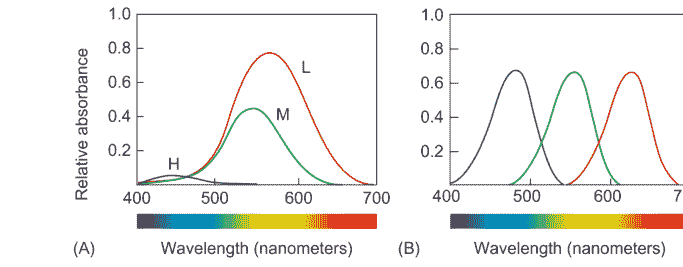

**图 5.1** 三种锥体细胞的（A）对比人工红、绿、蓝感受器（B）。

鉴于我们三种锥体细胞敏感性之间的旧关系——人们可能会好奇大脑如何连接这些细胞的信号以让我们看到广泛的色彩。

答案是减法。大脑后部视觉皮层的神经将来自中频和低频锥体细胞的视神经信号相减，产生一个“红-绿”差异通道。视觉皮层的其他神经将高频和低频锥体细胞的信号相减，产生一个“黄-蓝”差异通道。视觉皮层中的第三组神经将来自低频和中频锥体细胞的信号相加，产生一个整体亮度（或“黑-白”）信号通道。这些细胞被称为色彩对立细胞。

大脑随后对所有三个色彩对立通道应用减法过程：来自视网膜给定区域的信号会有效地从来自视网膜相邻区域的信号中减去。

## 视觉针对边缘对比进行了优化而非亮度

所有这些减法让我们的视觉系统对色彩和亮度的差异——即对比边缘更敏感，而非绝对亮度水平。

为了看到这一点，请对比图 5.2 中的两个圆。它们是完全相同的绿色——右侧的圆是从左侧复制的——但不同的背景使得左侧的圆在我们对比敏感系统中看起来更暗。

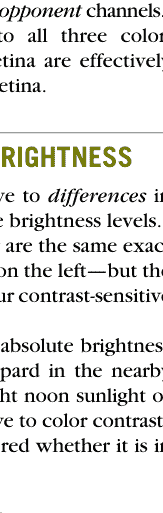

图 5.2

圆看起来颜色不同是因为背景不同，但它们是相同的。

> ¹整体亮度和忽略了来自高频（蓝-紫色）锥体细胞的信号。那些细胞非常不敏感，以至于它们对总量的贡献可以忽略不计，因此忽略它们几乎没有影响。

## 第 5 章 我们的色彩视觉是有限的

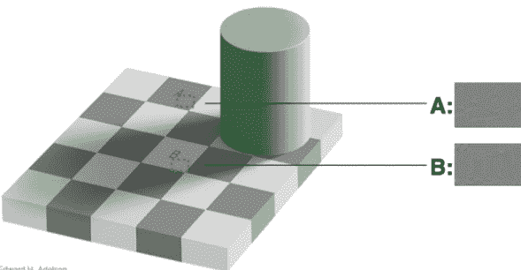

图 5.3

标记为 A 和 B 的方块是相同的灰色。我们认为 B 是白色是因为它处于“阴影中”。

麻省理工学院的大脑研究人员爱德华·H·阿德森（Edward H. Adelson）开发了一个出色的插图，说明了我们的视觉系统对绝对亮度的不敏感以及对对比度的敏感性（见图 5.3）。尽管难以置信，棋盘上的方块 A 与方块 B 的颜色完全相同。B 之所以看起来白色，是因为它被描绘在柱体的阴影中。

## 区分颜色取决于颜色呈现的方式

即使我们检测颜色差异的能力也是有限的。由于我们视觉系统的工作方式，三个呈现因素影响着我们区分颜色的能力：

- **浅度**：两种颜色越浅（饱和度越低），越难区分它们（见图 5.4A）。
- **色块大小**：物体越小或越细，越难区分它们的颜色（见图 5.4B）。文本通常很细，因此文本的准确颜色很难确定。
- **间距**：色块之间的间距越大，区分颜色就越困难，特别是当间距大到需要在色块之间移动眼球时（见图 5.4C）。

几年前，在线旅行网站 NET 使用两种浅色——白色和淡黄色——来指示用户正处于预订的哪一步（见图 5.5）。一些访问者无法看出自己处于哪一步。

较小的色块经常出现在数据图表和图中。许多业务图表软件包在图表上生成图例，但图例中的色块非常小（见图 5.6）。图表图例中的色块应该足够大，以帮助人们区分颜色（见图 5.7）。

## 区分颜色取决于颜色呈现的方式 57

图 5.4

影响区分颜色能力的因素：(A) 浅度，(B) 大小，(C) 间距。

图 5.5

NET.net (2003)：浅色标记当前步骤使用户难以看到他们处于航空公司预订流程的哪一步。

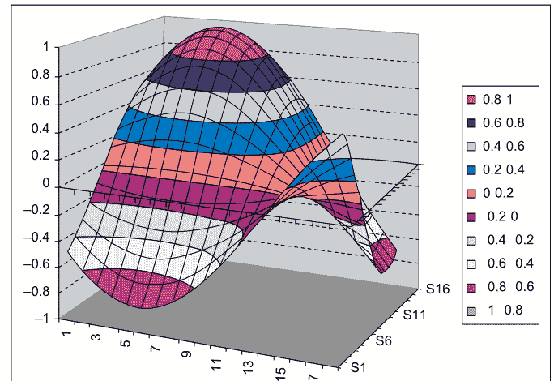

图 5.6

此图图例中微小的色块很难区分。

## 58 第 5 章 我们的色彩视觉是有限的

| 图例 |
| :--- |
| 饮料 |
| 调味料 |
| 甜点 |
| 乳制品 |
| 谷物/麦类 |
| 肉类/禽类 |
| 农产品 |
| 海鲜 |

图 5.7

较大的色块更容易区分颜色。

- 授权住房单位，2005 年 10 月百分比变化
- 与去年同期相比至今
- 人均用电量，2004 年
- 人均饮料和废水节点，2003 年
- 预制房屋占总住房的百分比，2000 年
- 占用住房单位中自住的百分比
- 按机构增长/减少的就业百分比变化，2000–2002
- 劳动力参与率，2002 年
- 每万人银行网点数量，2003 年
- 外生人士总数，2000 年
- 人均制成品出口总额，2003 年
- 房屋价格指数，
- 2002 年第三季度至 2003 年第三季百分比变化
- 州和地方政府人均基金支出，1977–2005

图 5.8

MinneapolisFed.org：已访问链接与未访问链接之间的颜色差异太微妙了²

在网站上，颜色的常见用途是区分已访问链接和未访问链接。在某些网站上，“已访问”和“未访问”的颜色太相似了。明尼阿波利联邦储备银行的网站（见图 5.8）就有这个问题。此外，这两种颜色都是蓝色调，是我们眼睛最不敏感的颜色范围。你能认出那两个已访问的链接吗？（答案在下方。）

## 色盲

影响交互系统设计原则的第四种颜色呈现因素是颜色是否能被常见类型色盲的人区分。

> ² 图 5.8 中已访问的链接：授权住房单位和房屋价格指数。

## 色盲 59

色盲，患色盲并不意味着无法看到颜色。它只是意味着一个或多个颜色减法通道（见上文）无法正常工作，难以区分某些颜色对。大约 8% 的男性和略少的女性有视觉缺陷⁵，难以区分某些颜色对（Wolfmeier, 1999）。最常见的色盲类型是红绿色盲；其他类型要罕见得多。图 5.9 显示了红绿色盲难以区分的颜色对。

财务应用 MoneyDance 提供了家庭开支的图化分解，使用颜色指示各种支出类别图 5.10。遗憾的是，许多颜色色盲人士无法

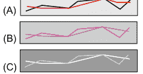

图 5.9

红绿色盲人士无法区分：(A) 深红色和黑色，(B) 蓝色和紫色，(C) 浅绿色和白色。

| 礼物 | 支出 |
| :--- | :--- |
| 平均值：597.28 | 最大值：527.76 |
| 中位数：19911.33 | 中位数：586.00 |
| 最大值：21761.62 | 最大值：614.04 |
| 房贷利 | |
| 税收/收入 | |
| 维护 | |
| 杂货 | |
| 电脑 | |

## 60 第 5 章 我们的色彩视觉是有限的

| 礼物 | 支出 |
| :--- | :--- |
| 平均值：597.28 | 最大值：527.76 |
| 中位数：19911.33 | 中位数：586.00 |
| 最大值：21761.62 | 最大值：614.04 |
| 房贷利 | |
| 税收/收入 | |
| 维护 | |
| 杂货 | |
| 电脑 | |

（等等，最后一个表格的 OCR 文本非常乱。让我根据提供的视觉结构重新解析。）

| 礼物 | 支出 |
| :--- | :--- |
| 平均值：597.28 | 最大值：527.76 |
| 中位数：19911.33 | 中位数：586.00 |
| 最大值：21761.62 | 最大值：614.04 |
| 房贷利 | |
| 税收/收入 | |
| 维护 | |
| 杂货 | |
| 电脑 | |

*实际上，查看第 66/67 页的 OCR 文本：*

| 礼物 | 支出 |
| :--- | :--- |
| 平均值：597.28 | 最大值：527.76 |
| 中位数：19911.33 | 中位数：586.00 |
| 最大值：21761.62 | 最大值：614.04 |
| 房贷利 | |
| 税收/收入 | |
| 维护 | |
| 杂货 | |
| 电脑 | |

*根据提供的 OCR 重新对齐表格：*

| 礼物 | 支出 |
| :--- | :--- |
| 平均值：597.28 | 最大值：527.76 |
| 中位数：19911.33 | 中位数：586.00 |
| 最大值：21761.62 | 最大值：614.04 |
| 房贷利 | |
| 税收/收入 | |
| 维护 | |
| 杂货 | |
| 电脑 | |

*等等，第 66 页表格的 OCR 文本是：*

| 礼物 | 支出 |
| :--- | :--- |
| 平均值：597.28 | 最大值：527.76 |
| 中位数：19911.33 | 中位数：586.00 |
| 最大值：21761.62 | 最大值：614.04 |
| 房贷利 | |
| 税收/收入 | |
| 维护 | |
| 杂货 | |
| 电脑 | |

*我将提供最干净的表格版本。*

图 5.9

红绿色盲人士无法区分：(A) 深红色和黑色，(B) 蓝色和紫色，(C) 浅绿色和白色。

区分开。³常用术语是“盲目”，但“视觉缺陷”、“视觉不足”和“弱视”更准确。完全无法看到颜色是罕见的。

## 影响区分颜色能力的外部因素

涉及外部环境的因素也会影响人们区分颜色的能力。例如：

- **显示器之间的差异**：计算机显示器显示颜色的方式取决于其技术、驱动软件或颜色设置。即使是相同型号、相同设置的显示器，显示的颜色也略有不同。在一种显示器上看起来是黄色，在另一种上看起来可能是米色。在一种显示器上明显不同的颜色，在另一种上看起来可能是相同的。
- **灰度显示**：虽然现在大多数显示器都是彩色的，但仍有一些设备（特别是小型手持设备）具有灰度显示。图 5.11（上方）显示灰度显示可以让不同颜色的区域看起来相同。
- **显示角度**：某些计算机显示器（尤其是 LCD）在直视时比从角度看的效果更好。当 LCD

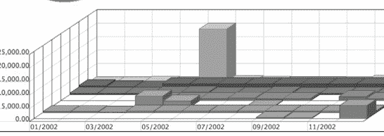

图 5.11

灰度渲染的 MoneyDance 图表。

由于显示器是从角度观察的，颜色以及色彩差异——往往会发生变化。

- **环境光**：显示器上的强光在冲淡明暗区域之前就会冲淡颜色，使彩色显示变为灰度显示，就像任何尝试在直射下使用银行 ATM 机的人所经历的一样。

这些外部因素通常不在软件设计人员的控制范围内。因此，设计师应该记住，他们无法控制用户的色彩查看体验。在开发团队的计算机和正常办公光照条件下看起来非常容易区分的颜色，在软件使用的某些环境中可能没有那么容易区分。

## 使用颜色的指南

- 通过饱和度和亮度以及色调来区分颜色。避免颜色差异。确保颜色之间的对比度足够（但请参见指南 5）。测试颜色是否足够不同的一种方法是使用灰度模式查看它们。如果你在渲染为灰度时无法区分这些颜色，说明它们的差异不够。
- 使用鲜艳的颜色。记住，我们的视觉系统结合来自视网膜锥体细胞的信号，产生三个“色彩对立”通道：红绿、黄-蓝和黑-白。人们最容易识别的颜色是那些在两个色彩感知通道之一上产生强信号（正或或负），而在其他通道上产生中性信号的颜色。惊讶的是，这些颜色是绿、黄、蓝和白色（见图 5.12）。所有其他颜色都会在多个一个通道上产生信号，因此我们的视觉系统无法像区分这六种颜色那样快速、容易地区分其他颜色（Ware, 2008）。

图 5.12

最鲜艳的颜色。每种颜色仅在色彩对立通道的其中一个上产生强信号。

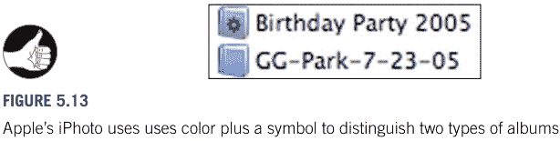
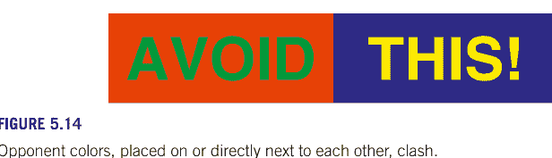

- 3. **避免色盲人士无法区分的颜色对**。此类颜色对包括深红与黑色、深红与深绿色、蓝色与紫色、浅绿色与白色。不要在任何颜色上使用深红、深蓝或紫色。相反，在浅黄色上使用深红、深蓝和紫色，并使用 Vischeck 网页和图像，以查看具有不同色彩缺陷的人是如何看到它们的。
- 4. **与其他线索冗余地使用颜色**。不要仅依赖颜色。如果你用颜色来标记某物，请用另一种方式标记。Apple 的 iPhoto 同时使用颜色和符号来区分“智能”相册和普通相册（见图 5.13）。
- 5. **分离对立色**。将对立色紧挨在一起会引起干扰性的闪烁感，应该予以避免（见图 5.14）。

如上所述，ITN.net 使用淡黄色来标记客户预订过程中的步骤（见上方的图 5.5），这太微妙了。加强标记的一种简单方法是将颜色步骤加粗，并增加黄色的饱和度（见图 5.15A）。但 ITN.net 选择了完全全新的设计，该设计也与形状冗余地使用了颜色（见图 5.15B）。

来自联邦储备银行的一张图表使用了白色和不同深浅绿色（图 5.16）。这是一个设计良好的图表。任何视力正常的人都可以阅读，即使在灰度显示器上也是。

## 使用颜色的指南 63

(A)

(B)

图 5.15

ITN.net：当前步骤通过颜色和形状两种方式突出显示。

图 16

Minneapolis.org：图表使用了所有视力正常的人可见的色彩差异。

## 我们的周边视觉很差

上一章解释了人类视觉系统检测和处理颜色的方式与数字相机不同。我们的视觉系统在中心区域也与相机不同。在数字相机的传感器上，光感受元件均匀地分布在矩阵中，因此整个帧的空间分辨率是恒定的。

本章解释了为什么：

- 位于视视野边缘的柔和静态物体不会被注意到。
- 周边的运动通常会被注意到。

## 中央凹与边缘的视觉对比

人类视视野的空间分辨率从中心到边缘大幅增加。每只眼睛约有六百万个视网膜细胞。它们在视视野中心（一个被称为 `fovea` 的小区域）的排列密度比边缘高得多（见图 6.1）。中央凹仅占视网膜的约 1%，但它提供了我们大部分的视觉敏锐度。

# 第 6 章 我们的外周视觉很糟糕

同样如此，我们在视野中心对颜色的辨别能力比边缘好。

关于我们视野的另一个有趣事实是，它存在一个间隙——一个什么也看不见的小区域。这个间隙对应于视网膜上视神经和血管离开眼后的部位（见上方图 6.1）。该位置没有视网膜杆细胞或锥细胞；当视野中的物体图像恰好落在视网膜的这部分时，我们就看不到它。我们通常不会注意到视觉中的这个洞，因为我们的大脑用周围的内容来填充它，就像图形设计师使用 Photoshop 利用附近的像素来填充照片中的瑕疵一样。

当我们观察星空时，会经历盲点。当你看着某颗星时，附近的另一颗星可能会短暂消失在盲点中，直到你移开视线。你也可以尝试图 6.3 中的练习来观察这个间隙。有些人由于视网膜缺陷产生其他间隙，例如影响视觉皮层的视网膜脑中；而视神经间隙是所有人共有的缺陷。

图 6.3

要“看到”视网膜间隙，请遮住左眼，将这本书拿近脸，并将右眼聚焦在 `+` 号上。慢慢将书远离你，保持对 `+` 号的聚焦。`+` 号会在某个点点消失。

## 外周视觉有什么用吗？

看来中心凹在几乎所有方面都比外周视觉好。人们纳闷，为什么我们会有外周视觉？它有什么用？

答案是，我们的外周视觉主要为了提供低分辨率的线索，以引导我们的眼球运动，使我们的中心凹访问视野中所有有趣且关键的部分。我们的眼睛不能随机扫描环境；我们会移动使中心凹聚焦在重要事情上，并且（通常）先关注最重要的事情。视野边缘的模糊细胞提供了数据，帮助大脑规划眼睛移动到哪里、按什么顺序移动：

例如，我们使用药品标签查看“保质期”日期，外周一个具有模糊形状的模糊斑块就足以引发一次眼球运动，让中心凹落在那里以便我们检查。如果我们正在为草莓做营销，视野边缘一个模糊的红色斑块会吸引我们的眼睛和注意力，尽管它有时结果可能是红萝卜而不是草莓。如果我们听到动物的低吼声，眼角一个模糊的形状会引导我们的眼睛向那个方向移动，特别是当该形状正朝我们移动来时（见图 6.4）。

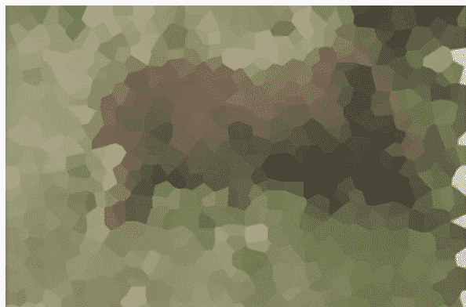

# 图 6.4

视野边缘的移动形状会吸引我们的注意力：它可能是食物，也可能把我们看作食物。

这引出了外周视觉的另一个优势：它擅长检测运动。我们视野外周任何移动物体，即使极其微小，都可能吸引我们的注意力——从而引导中心凹转向它。这种现象的原因是我们的祖先（包括前人类）因发现食物和躲避捕食者的能力而被筛选。因此，尽管我们可以在意识和有意控制下移动眼睛，但某些控制眼睛看向何处的机制是前意识的、不自主且非常快的。

如果我们没有理由预计外周的某个位置会有有趣的东西，且该位置没有任何东西吸引我们的注意力怎么办？我们的眼睛可能永远不会将中心凹移到那个位置，因此我们可能永远看不到那里有什么。

## 计算机用户界面的示例

我们外周视觉低敏锐度解释了为什么软件和网站用户无法注意到消息和网站中的错误信息。当用户点击按钮或链接时（这通常是他们中心凹所在的位置），屏幕上不在点击位置 1-2 厘米范围内（假设观看距离正常）的内容都在外周视觉范围内，那里的分辨率很低。如果点击后错误信息出现在外周，这个人可能没有注意到它，并不令人意外。

> 参见第 1 章，关于预期如何偏向我们的感知。

例如，InformaWorld.com（Healthcare 的在线出版网站），如果用户输入了错误的用户名或密码并点击“登录”，错误信息将出现在远离用户眼睛最聚焦区域的“消息栏”中（图 6.5）。红色的“Error（错误）”字样可能表现为一个小的红色斑块，这会吸引外周视觉的眼睛。然而，红色斑块可能会落在用户视野的间隙中，因此完全没有被注意到。

从用户的角度考虑这一系列事件。用户输入用户名和密码并点击“登录”。页面刷新后字段为空。用户叹了口气：“糟糕！我有登录信息并点击了登录，难道不是点错按钮了吗？”用户重新输入用户名和密码，再次点击“登录”。页面再次刷新显示为空。现在用户真的很困惑了。用户叹了口气，向后坐，看着屏幕。突然，注意到错误信息，用户说：“啊！一直都在这。”尽管错误信息放置在用户附近，但某些因素会降低它的可见性。例如，如果错误信息是黑色或红色以外的任何颜色，它更有可能被注意到。然而，红色斑块可能会落在用户视野的间隙中，因此完全没有被注意到。

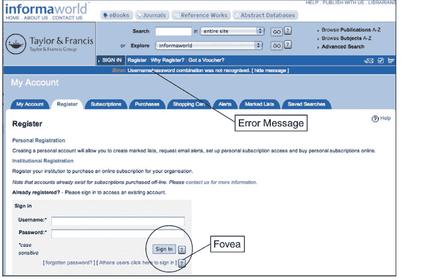

图 6.5

外周视觉中的一个小红色斑块。

| 客户登录 |
| :--- |
| 未找到登录信息。 |
| 登录 ID: |
| 密码: |

图 6.6

输入字段附近的错误信息。

图 6.7

输入字段的错误信息。

# 使消息可见的常用方法 73

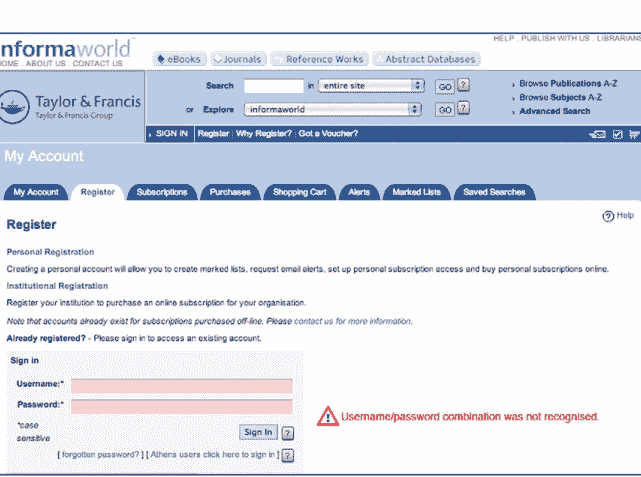

图 6.8

此登录失败的错误消息显示得更加显著，位于用户视线停留的地方。

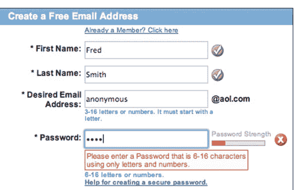

图 6.9

# 第 6 章 我们的外周视觉很差

## 让用户注意消息的“重型武器”：请谨慎使用

如果让用户注意消息的常用常规方法还不够用，用户界面设计师还有三种更强力的方法。然而，这些方法虽然非常有效，但会产生显著的负面影响，因此应该谨慎使用并极加小心对待。

### 错误对话框中的弹出消息

在对话框中显示错误消息是直接将其呈现在用户面前，使其难以被忽略。错误对话框会中断用户的工作并要求立即关注。如果良好的错误消息信号了一个关键状态，这样做是合理的；但如果将这种方法用于次要消息（如确认用户请求的操作的执行），可能会让人感到烦恼。

弹出消息的烦恼程度随着模态（`modality`）程度而增加。应用模态（`Application-modal`）弹出窗口会阻止显示程序中的任何后续工作，但允许用户与计算机上的其他软件进行交互。系统模态（`System-modal`）弹出窗口在对话框被关闭之前会阻塞任何用户操作。

应用模态错误弹出窗口应谨慎使用，例如，仅当用户不处理错误时可能会丢失数据时。系统模态弹出窗口应极少使用——基本上只在系统即将崩溃并导致数小时工作丢失时，或者当用户错过错误消息会导致人员伤亡时使用。

在 Web 上，避免弹出错误对话框的另一个原因是，有些人将浏览器设置为阻止所有弹出窗口。如果你的网站依赖于弹出式错误消息，某些用户可能永远也看不到它们。

### 使用声音（例如蜂鸣声）

当电脑发出蜂鸣声时，它告诉人们发生了需要注意的事情。人的眼睛会反射性地扫描屏幕，寻找引起蜂鸣的原因。这可以使用户注意到一个比他们刚才看的地方更常见的错误消息，例如显示器上的标准错误框。这就是蜂鸣的价值。

然而，在立方间式的工作环境或教室中，许多人都在使用同一个应用程序，通过蜂鸣来信号所有错误和警告。这样的工作场所会非常烦人，最坏的情况下，人们无法判断是自己的电脑还是他人的电脑在蜂鸣。

在嘈杂的环境中（例如工厂或计算机服务器机房），声音可能会被环境噪音掩盖。

最后，有些人的电脑上声音是静音或调低的。因此，用补救措施来信号错误和其他情况只能在非常特殊、受控的情况下使用。

### 短暂闪烁和晃动

如前所述，我们的外周视觉擅长检测运动，而外周的运动会引发反射性的眼球运动，将运动带入中央凹。用户界面设计师可以在想要确保用户看到消息时，通过让消息晃动或闪烁来利用这一点。触发眼睛向运动物体移动并不动作。只需一点微小的运动就足以让观众的眼睛向那个方向移动。数百万年的进化产生了相当的效果。

然而，像弹出对话框和蜂鸣一样，这必须谨慎使用。大多数经验丰富的计算机用户认为屏幕上晃动、闪烁的物体是烦人的。我们大多数人已经学会了忽略闪烁的显示，因为许多此类闪烁显示都是广告。相反，少数计算机用户有注意力障碍，使他们难以忽略闪烁或晃动的东西。

因此，如果使用运动或闪烁，它应该是短暂的：持续时间应大约在四分之一到半秒之间，不应更长。否则，它会迅速从一个不寻常注意力吸引者变成一个显眼的烦恼。

### 谨慎使用

谨慎使用所有这些“重型武器”方法——仅用于关键消息。当频繁使用弹出、声音、运动和闪烁来吸引用户注意力时，一种被称为“习惯化”（`habituation`）的心理现象就会发生。我们大脑对频繁发生的任何刺激关注得越来越少。这就像关于那个经常喊“狼来了”的小孩子的寓言：最终，当狼真的来时，村民们学会了忽略大叫，所以当狼真的来时，大叫声没有被理会。过度使用强力吸引注意的方法会导致重要消息被习惯化阻挡。

REI.com 有一个使用弹出对话框显示错误消息的示例。当有人注册新客户并遗漏表单中的必填字段时，会显示消息（见图 6.10）。这是弹出对话框的恰当用法。AOL.com（见上文图 6.9）显示，不需要弹出对话框也可以很好地信号数据错误，REI.com 使用弹出对话框似乎过于用力了。

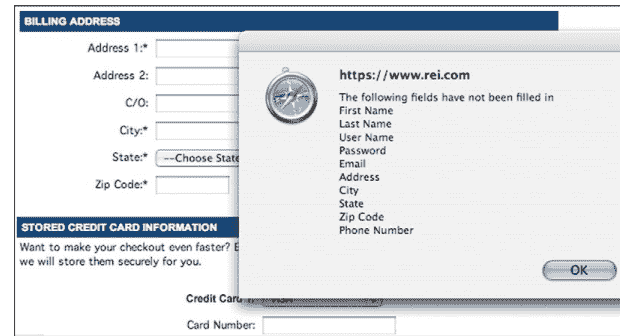

图 6.10 REI 的弹出对话框信号了遗漏所需的数据。它很难被忽略，但可能过度了。

# 第 7 章 我们的注意力是有限的；我们的记忆是不完美的

| 感知 | 短期记忆 | 长期记忆 |
| :--- | :--- | :--- |
|  | 你好 | 鸭场 火腿朋友 比尔 打 微笑 |

图 7.1 短期记忆与长期记忆的传统（过时的）观点。

## 记忆的现代观点

关于记忆和大脑功能的近期研究表明，短期和长期记忆是单一记忆系统的功能——这个系统与感知的联系比以前认为的要密切（Jonides et al., 2008）。

## 长期记忆

感知通过视觉、听觉、嗅觉、味觉或触觉感觉系统进入，触发大脑中负责每种感官区域（例如视觉皮层、听觉皮层）的反应，并扩散到大脑中不特定于任何感觉记忆的区域。大脑中特定的感觉模式区域只检测数据的简单特征，例如明暗边缘、对角线音调、酸味、红色或向右运动。大脑的下游区域结合低级特征，以检测输入的高级特征，例如动物、凯文叔叔、小调、呼吸或“鸭”这个词。

感知的初始强度取决于它如何被其他大脑活动放大或抑制。所有的感知都会产生某种痕迹，但有些痕迹如此微弱，以被视为未记录：激活一次但再也没有出现过的模式。

记忆的形成涉及参与神经活动模式的神经元的持久且永久的变化，这使得该模式在将来更容易重新激活。¹

> ¹ 有证据表明，与学习相关的长期神经变化主要发生在睡眠期间，这表明通过睡眠时间分隔学习阶段可能有助于学习（Stafford & Webb, 2005）。

某些变化涉及化学物质释放到神经元周围，这些区域对刺激的敏感性持续相当长时间，直到化学物质消失或被其他物质中和。更永久的变化包括神经元的生长与其他神经元形成新的连接。

激活记忆包括重新激活记忆形成时发生的相同活动模式。大脑以某种方式将神经模式的初始与重新激活区分开——可能是通过测量模式重新激活的难易。与原始非常相似的新感知会激活相同的神经元模式，如果去激活的感知达到意识，就会产生识别。在缺乏感觉感知的情况下，来自大脑其他部分的刺激也可以重新激活神经活动模式，如果这达到意识，就会导致回想。

神经模式被重新激活得越多，它就变得越“强”——也就是说越容易重新激活——反过来意味着感知更容易被识别和回想起。神经记忆模式也可以通过来自大脑其他部分的兴奋或抑制信号得到加强或唤醒。

特定的记忆并不位于大脑的任何特定位置。构成记忆的神经活动模式涉及跨越广泛区域的神经元网络。不同记忆的活动模式重叠，取决于它们显示的内容。移除、损坏或抑制大脑特定部分的神经元，通常不会完全抹除涉及这些特征的记忆。然而，神经活动模式中的某些区域可能是关键通路，因此移除、损坏或抑制它们可能会阻止大部分模式的激活，从而有效地消除了记忆。

## 短期记忆

上述讨论的过程是关于长期记忆的。所有这些情况中，记忆都是短期记忆吗？答案就在“意识”一词中。

短期记忆不是一个存储器——它不是记忆和感知被用来处理的地方。更准确地说，它不是从感觉系统引入或从长期记忆中检索的信息的临时仓库。相反，短期记忆是产生感知和注意力现象的结合。

每种感知感官都有自己非常短的短期“记忆”，这是感知刺激后残余神经活动的结果，就像被敲击后短暂响起的铃声。在这些残余感知消失之前，它们可以作为我们大脑注意力机制的可能输入，这些机制整合了来自我们各种感知系统的输入，并将我们的意识集中在某些输入上。这些感觉-感觉残余感知共同构成了短期记忆的主要部分。

> 这是剪掉全息图像片段的效果：它降低了图像的整体分辨率，而不是像普通照片那样移除它的片段。

作为我们注意力机制的潜在输入，还有通过识别或回想重新激活的长期记忆。如上所述，每个记忆都对应分布在大脑各处的特定神经活动模式。在被激活时，记忆模式是我们注意力的候选。

人类大脑具有多种机制，有些是自愿的，有些是非自主的。我们将意识集中在极小部分的感知和激活的长期记忆上，同时忽略其他所有内容。我们现在意识到的来自感知系统和长期记忆的所有可用信息中的那极小部分是短期记忆的主要成分，即认知科学家经常称为工作记忆的部分。

不要将工作记忆看作一个临时缓冲区，感知和记忆在那里被带入我们大脑进行处理。相反，把它看作是我们意识到的注意力集中焦点——即当前激活的神经模式。在任何给定时刻，短期记忆中的项目数量是极其有限且不稳定的。

早前的发现，大脑某些部分的损伤会导致短期记忆缺陷，而其他类型的脑损伤会导致长期记忆缺陷是怎么？目前对该发现的解释是，某些类型的损伤减少或消除了大脑对特定物体和事件集中注意力的能力，而其他类型的损伤损害了大脑存储或回想长期记忆的能力。

## 短期记忆的特征

如上述描述，短期记忆等于我们注意力的焦点。该焦点中的任何内容都是我们任何时刻意识到的内容。

现在你意识到了你读过的最后几个词和想法，但可能没有意识到你面前墙的颜色。但现在如果你转移了注意力，你就意识到了墙的颜色，并可能忘记了你在上一页读的一些想法。

短期记忆的主要特征是其低容量和不稳定性。

短期记忆的低容量是相当广为人知的。许多受过大学教育的人都读过认知心理学家乔治·米勒（George Miller）在 1956 年提出的“神奇数字加减二”，这是人类短期记忆中同时存在的不相关项目数量的限制（Miller, 1956）。

### 短期记忆中的项目是什么？

米勒对短期记忆限制的描述自然引发了几个问题。

- **短期记忆中的项目是什么？** 它们是当前的感知和检索的记忆。它们是目标、数字、单词、名字、声音、图像、气味。

- **为什么项目必须是不相关的？** 因为如果两个项目相关，它们对应一个神经活动模式——而不是两个项目。

- **为什么有加减二的修正因子？** 因为研究人员无法准确测量记忆量，并且由于个体之间的差异。

20 世纪 60 年代和 70 年代的后期研究发现米勒的估计太高了。在所考虑的实验中，提供给人们的项目被“分组”（即相关的），这使得似乎人们的短期记忆存储了更多项目。当实验被修订为不允许无意的分组时，短期记忆的容量显示为大约四或减一，即三到五个项目（Broadbent, 1975）。

将短期记忆视为当前注意力的焦点的现代观点使其变得更加清晰：将注意力集中在新信息上会使其远离原本关注的内容。

无论我们如何描述，信息都很容易从短期记忆中丢失。如果短期记忆中的条目没有得到整合或复述，它们就面临焦点转移的风险。这种不稳定性不仅适用于目标，也适用于物体的细节。从短期记忆中丢失项对应于遗忘或丢失你正在做的事情。我们都曾经历过这样的经历，例如：

- 去另一个房间拿东西，但一旦到达那里，就不记得为什么要去了。
- 接听电话，之后就不记得接电话之前在做什么了。
- 某些事情将我们的注意力从对话中夺走，然后就不记得在谈论什么。
- 在记录一长串数字的过程中，某些事情分散了我们的注意力，导致我们重新开始。

一位研究人员表明，短期记忆的容量和持续时间是有限的。他们向人们展示一张图片，然后向他们展示同一张图片的第二个版本，并询问第二张图片与第一张是相同还是不同。令人惊讶的是，第二张图片在许多方面可能与第一张不同——而人们并没有察觉到任何差异。为了进一步探索，研究人员让人们回答关于第一张图片的问题，影响了他们在其中的目标，从而影响了他们关注图片的哪些特征。结果是：除了他们可能关注的那些目标，人们没有注意到其他特征的任何差异。这被称为“变化盲”（Angier, 2008）。

短期记忆不稳定性的一个特别引人注目的例子来自实验：实验中，研究人员扮演迷路的游客，带着地图路过询问方向。当当地人盯着游客的地图以寻找最佳路线时，两名工人——实际上是抬着一扇大门——路过，在那一刻，“游客”被另一个实验人员取代了。震惊的是，门经过后，所有当地人都继续与那个“游客”交流而没有察觉到任何变化，即使两个“游客”的发色或是否有胡须有所不同。结论是：人们关注的是地图（Simons & Levin, 1998）。有些人对“游客”的关注仅足以判断他们是否是威胁或是否值得帮助，仅“记录”了那个人是一个需要帮助的游客，然后将注意力转向地图和指路的任务。

## 短期记忆测试

要测试你的短期记忆，请准备一支笔或铅笔和两张白纸并按照以下说明操作：

1. 在书中本页之后放置一张白纸，并用它遮住下一页。
2. 翻到下一页停留 3 秒，拉下纸盖并阅读顶部的黑色数字，然后翻回这一页。除非你想破坏测试，否则不要看该页上的其他数字。
3. 大声倒背你的电话号码。
4. 现在凭记忆写下那些黑色数字。……你都记到了吗？
5. 翻回下一页停留 3 秒，阅读红色数字（黑色数字下方），然后翻回来。
6. 记忆写下这些数字。如果你注意到它们是圆周率的前七位数字（3.141592），它们会比第一组数字更容易想起，因为它们只是一个数字，而不是七个。
7. 翻回下一页停留 3 秒，阅读绿色数字，然后翻回来。
8. 记忆写下这些数字。如果你注意到它们是 1 到 13 之间的奇数，它们更容易想起，因为它们是三个组（从“1”中的“奇数、1、13”），而不是七个。
9. 翻回下一页停留 3 秒，阅读绿色数字，然后翻回来。
10. 记忆写下这些数字。如果你注意到它们是 1 到 13 之间的奇数……
11. 翻回下一页停留 3 秒，阅读蓝色数字，然后翻回来。
12. 记忆写下这些数字。……你都记到了吗？如果你注意到它们是……句子，因为它们是一个句子，而不是七个。

## 短期记忆特征对界面设计的影响

当人们使用计算机系统时，他们需要记住信息。短期记忆的容量和不稳定性对界面设计有很大影响。基本影响是，界面设计应该帮助用户记住系统状态，而不是记住他们做了什么。具体例子如下：

### 模式（Modes）

短期记忆的容量和不稳定性是使用模式的原因之一。在模式化界面中，某些操作具有不同的效果。例如：

- 在汽车中，踩油门可以使汽车前进、倒车或停车，取决于变速箱处于什么状态。
- 在数码相机中，按下快门可以拍照或录视频，取决于选择了哪种模式。

模式化界面具有优势，这就是为什么系统允许设备拥有比控件更多的功能。然而，模式的一个广为人知的缺点是人们经常会犯模式错误；他们忘记了系统处于什么状态（Johnson, 1990）。因为模式错误的问题，许多界面设计指南建议避免模式或提供强反馈。人类的短期记忆太不可靠，设计者不能假设用户在没有持续反馈的情况下跟踪系统状态。

### 搜索结果

当人们在计算机上使用搜索功能查找信息时，他们输入搜索词，开始搜索，然后查看结果。评估结果通常需要知道搜索词是什么。如果短期记忆不有限，人们在浏览结果时将能够记得几秒前输入的搜索词。但正如我们所见，短期记忆是非常有限的。当结果出现时，人的注意力自然地从输入的内容转向结果。因此，人们查看搜索结果时不记得他们输入的搜索词并不意外。

遗憾的是，某些在线搜索功能的设计者并不理解这一点。例如，2006 年的搜索结果提供了搜索框让用户再次搜索，但没有显示用户搜索过什么（见图 7.2A）。该网站的新版本显示了用户的搜索词（见图 7.2B），减轻了短期记忆的负担。

### 指令（Instructions）

如果你向朋友询问食谱或去她家的路线，而她给你给出了一长系列步骤，你可能无法全部记住。你知道自己无法可靠地将所有指令留在短期记忆中，所以你会把它写下来或要求朋友通过电子邮件发送给你。稍后在遵循指令时，你会把它们放在可以参考的地方，直到达到目标。

搜索：

高级搜索选项

主题

部门

作者

出版日期

自

| 种类 | 标题 | 作者 | 出版日期 | 部门 |
|---|---|---|---|---|
| *** | DefenderDeLay? 第 2 部分 | Timothy Noah | 2004年10月06日 | Chatterbox |
| | 是谁大喊出“100,000美元”一个假设 | | | |
| | Tom Delay 丑闻 | Nicholas Thompson | 2005年4月07日 | Gist. The |
| | 再次升起 | | | |
| | 华尔街日报对阵 | Timothy Noah | 2001年12月12日 | Chatterbox |
| | Tom Delay | | | |
| | 社论版是否变得……不错了？ | | | |
| | DefenderDeLay? | Timothy Noah | 2004年10月01日 | Chatterbox |
| | Nicholas Smith 的指控 | | | |

(A)

# 搜索

日期：[ ] 过去 7 天 [ ] 过去 30 天 [ ] 过去 90 天 [ ] 过去一年 [ ] 自1996年以来

巴拉克·奥巴马

- 高级

# 排序方式 « 1 - 25 共 2131 条 »

| 标题 | 作者 | 日期 | 部门 |
|---|---|---|---|
| 关于巴拉克·奥巴马的真相 | Christopher Beam | 2008年6月17日 | Low Concept |
| 负责奥巴马竞选的人不应试图修正。 | | | |
| Slate 投票：奥巴马在这场混乱中赢得了杂志。 | | 2008年10月28日 | Politicos |
| 巴拉克·奥巴马的 Facebook 动态 | | 2009年6月12日 | Politicos |
| Slate 对总统秘密社交网络持续报道的每一次更新。 | | | |
| 探访奥巴马的肯尼亚祖母 | Andy Isaac | 2008年10月28日 | Dispatches |
| 在非洲成为一个奥巴马意味着什么。 | | | |
| 奥巴马的婚姻 | Melissa Henriberger | 2007年10月26日 | First Males |
| 这米歇尔·奥巴马来说是如何工作的？ | | | |

图 7.2 Slate.com 搜索结果：(A) 在2007年，未显示用户的搜索词；(B) 在2009年显示了搜索词。

# 长期记忆的特征 89

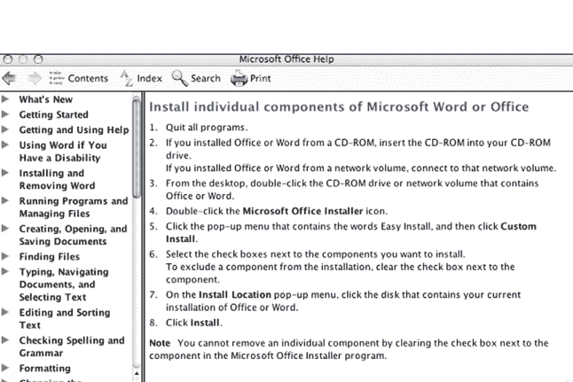

图 7.3 Windows 帮助文件中的指令在用户执行时保持显示。

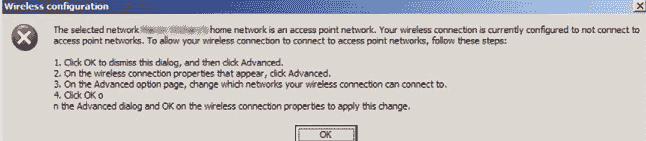

图 7.4 Windows XP 启动帮助的指令，通过告诉用户遵循指令来设置。

显示多步操作指令的类似交互式系统应该允许人们在执行步骤时查阅指令。大多数系统都这样做（见图 7.3），但有些则不能（见图 7.4）。

## 长期记忆的特征

长期记忆在许多方面与短期记忆不同。与短期记忆不同，它实际上是一个存储器。

然而，特定的记忆并不存储在脑的任何一个神经元中。如上所述，记忆（如感知）是由神经元的模式组成的。这意味着每段记忆都以分布式方式存储在脑的许多部分。这种方式使得脑中的长期记忆类似于全息。

长期记忆的进化是为了帮助我们的祖先更好地适应世界。然而，它有许多缺点：它是容易出错的、联性的、离性的、可追溯修改的，并在记录或检索时受到各种因素的影响。让我们检查这些缺点。

### 容易出错

我们经历的一切几乎存储在长期记忆中。与短期记忆不同，人类长期记忆的容量似乎是无限的。Landauer (1986) 使用学习率来计算一个人一生可以学习的信息，计算机工程师可以将记忆描述为使用压缩方法。图像、概念、感觉——都减少为抽象的组合。不同的记忆存储在不同的细节水平，特征多或少。例如，一个不重要的人脸可能被简单存储为“一个有胡子的男人”，如果你被要求描述这个人，你可能无法从警察认领名单中选出他。相比之下，你对好朋友的记忆包含更多特征，允许你给出更详细的描述并将其认出来。尽管如此，它仍然不是位图。另一个例子是，我有被犁撞过的生动记忆，但我父亲说那没发生。在人机交互领域，`Microsoft Word` 可能记住某个命令，但用户可能不记得是哪个命令。特定的特征可能在用户尝试回忆它时没有被激活——10 位，或者记录了位置特征但几百兆字节。

### 情感影响

第 1 章描述了一只狗，每次回到家里都记得院子里有一只猫。狗第一次看到猫时非常兴奋，所以对猫的记忆非常深刻且生动。另一个例子：一个成年人对上幼儿园的第一天有深刻记忆，但可能不记得。第一天，她被父母丢下感到难过，而到了最后一天，并没有什么。

### 可追溯修改

假设你和家人一起海游，看到了一头鲸。多年后，当你和家人讨论这次旅行时，你记得看到的是鲸，而你的一个亲属可能记得看到的是鲨。对你们来说，长期记忆中的某些细节丢失了，因为它们不符合常见的概念。一个真实的例子来自1983年，故里根总统在首任期内与犹太领袖会面。他谈到二战期间呆在欧洲，并帮助犹太人从纳粹集中营中解放出来。问题是，他在二战期间从未在欧洲。当他还是演员时，他在一部关于二战的电影中，完全是在好莱坞拍摄的。

## 长期记忆测试

通过回答以下问题来测试你的长期记忆：

1. 第 1 章工具箱里的胶卷是什么？
2. 你之前的电话号码是多少？
3. 这些词中哪些*不在*在本章之前提到的短期记忆列表中？城市、玉米、自动、绳子
4. 你一年级老师的名字是什么？二年级？三年级？……
5. 前面提到的哪个网站在显示搜索结果时不显示搜索词？

关于问题 3：当记忆单词时，通常保留的是*概念*，而不是呈现的确切单词。例如，人可能会听到“town”（城镇）这个词，后来将其回忆为“city”（城市）。

# 92 第 7 章 我们的注意力是有限；我们的记忆是不完美的

## 长期记忆特征对用户界面设计的启示

长期记忆特征意味着的主要点是人们需要工具来增强它。从史前时代开始，人类就发明了技术来帮助他们长期记住事物：刻痕木棍、结绳、记忆法、营火旁重述的口头故事和历史、卷轴、书籍、数字列表、清单、电话簿、日志、会计账、烤箱计时器、计算机、便式数字助手（PDA）、在线共享日历等。

鉴于人类需要增强记忆的技术，显然软件设计师应该尝试提供满足他们需求的软件。至少，设计者应该避免开发负担长期记忆的系统。这正是许多交互式系统没有做的。

身份验证是许多软件系统要求用户长期记忆的功能区域之一。例如，几年前开发的 Web 应用程序告诉用户将个人识别码（PIN）更改为容易记住的数字，但随后实施了无法操作的限制（图 7.5）。任何写这些指令的人都知道 PIN 要求是不合理的，指令最后甚至建议用户写下他们的 PIN！更不用说 PIN 会产生安全风险，并增加了记忆：用户必须记住他们把写下的 PIN 藏在哪里。

另一个为了安全而负担人们长期记忆的对比例子来自 `Intuit.com`。为了购买软件，访问者必须注册。该网站要求用户从菜单中选择一个安全问题（见图 7.6）。如果你不记得任何问题怎么办？如果你不记得你的名字、你的母校吉祥物或任何其他问题的答案怎么办？

但那就是记忆产生负担的时候。有些问题可能有多个可能的答案。许多人有多个小学、童年朋友或英雄。为了注册，他们必须选择一个问题，并记住他们给 `Intuit` 的答案。怎么做？写在某处。然后，`Intuit.com` 会问他们安全问题，他们必须记住把答案放在了哪里。

对人们长期记忆的不合理要求抵消了计算机程序所谓的安全性和生产力（Schrage, 2005），因为用户会：

- 贴便利条或“藏”在抽屉里
- 联系客服找回忘记的密码
- 使用容易被别人猜到的密码
- 设置完全没有登录要求的系统，或者使用共享登录和密码

## 长期记忆特性对用户界面设计的影响 93

指令：

将您的 PIN 更改为您容易记忆的数字。PIN 可以是 6-10 位数字，且不能以 0 开头。

您的 PIN 必须是数字。

新 PIN：

确认新 PIN：

记住：请写下您的 PIN。

图 7.5 指令告诉用户创建一个易于记忆的 PIN，但限制条件使得这无法实现。

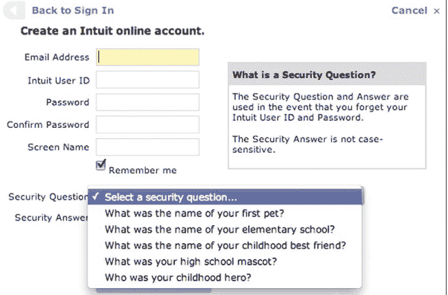

图 7.6 `Intuit.com` 的注册增加了长期记忆的负担：用户对于任何一个问题可能没有独特、易记的答案。

`NetworkSolutions.com` 的注册表单代表了向更可用安全性迈出的一步。`Intuit.com` 提供了安全问题的选择，但也允许用户创建自己的安全问题——一个他们可以更容易记住答案的问题（见图 7.7）。

长期记忆特性对交互式系统的另一个影响是，用户界面的一致性可以增强学习能力和长期留存率。

## 94 第 7 章 我们的注意力是有限的；我们的记忆是不完美的

选择您的密码安全问题：

| | | |
|---|---|---|
| | 从列表中选择一个问题：你最喜欢的电影是什么？ | |
| 或者 | | |
| | 创建您自己的问题：（例如，我从小到大的环境是什么？） | |

如果菜单上没有一个问题适合用户，`NetworkSolutions.com` 允许用户创建一个安全问题。

| 表 7.1 哪种 UI 设计最容易学习和记忆？哪种最难？ |
|---|---|---|---|
| 文档编辑器键盘快捷键：替代设计 | | | |
| 设计 A | 设计 B | 设计 C |
| 剪切 | 粘贴 | 剪切 | 粘贴 | 剪切 | 粘贴 |
| 文本 | CNTR-X | CNTR-V | CNTR-X | CNTR-V | CNTR-X | CNTR-V |
| 绘图 | CNTR-X | CNTR-V | CNTR-C | CNTR-P | CNTR-X | CNTR-V |
| 表 | CNTR-X | CNTR-V | CNTR-Z | CNTR-Y | CNTR-X | CNTR-V |
| | CNTR-X | CNTR-V | CNTR-M | CNTR-N | CNTR-X | CNTR-V |
| 视频 | CNTR-X | CNTR-V | CNTR-Q | CNTR-R | CNTR-E | CNTR-R |

不同功能的操作越一致，或者对不同类型对象的动作越一致，用户需要学习的就越少。用户界面有很多异常，且功能或对象之间缺乏一致性，这要求用户在使用的上下文文中长期记忆中存储关于每个功能和对象的许多特征。编码更多特征使得此类用户界面更难以学习。它也可能导致用户的记忆在存储或检索过程中丢失特征，增加了用户无法记忆、记错或产生更多记忆错误的概率。

考虑一个假设的多媒体文档编辑器中关于“剪切”和“粘贴”键盘快捷键的三种替代设计。该编辑器支持创建包含文本、表格、图像和视频的文档。在设计 A 中，无论编辑什么类型的内容，剪切和粘贴都使用相同的两个快捷键。在设计 B 中，每种类型内容的剪切和粘贴快捷键都是不同的。在设计 C 中，除视频外的所有类型内容都具有相同的剪切和粘贴快捷键（见表 7.1）。

> ⁴ 另见第 11 章。

第一个问题是：这些设计中哪一个最容易学习？显然设计 A 最容易。如果我们的意思是“用户花费最长时间达到生产效率的设计”，那无疑是设计 B。大多数用户需要时间来学习不同类型内容的所有不同剪切和粘贴快捷键。但如果有足够的动力——例如使用工作所需的软件——人们的适应能力惊人。也许一个月后——用户就能 Design B 变得熟练且快速。相比之下，设计 C 的用户达到与 A 用户相同的生产效率的时间——可能只需要几分钟。然而，如果我们把“最难学习”解释为“用户花费最长时间才能无错误的设计”，那么就是设计 C。所有类型的内容都使用相同的快捷键，视频除外。尽管设计 C 的用户就能投入生产，但他们将持续努力至少几个月——也许是永远。尽管有人人批评这种概念由于定义模糊且难以应用（Grudin, 1989），但事实是，用户界面的一致性大大减轻了用户长期记忆的负担。马克·吐温曾写道：“如果你说了（告诉别人），你就永远不需要记忆。” 也可以说：“如果一切都以相同的方式运行，你就不需要记忆太多。”我们稍后回到一致性问题。

## 注意力、形状和动作的限制

当人们有目的地与周围的世界（包括计算机系统）交互时，他们的行为某些方面遵循可预测的模式，其中某些是由于注意力和短期记忆容量有限导致的。当交互系统被设计为识别并支持模式时，它们会更契合。因此，某些用户界面规则直接基于注意力和短期记忆的限制。

## 关注目标并少关注工具

正如第 7 章解释的那样，我们的注意力是有限的。当人们执行任务时——试图实现目标时——他们大部分注意力都集中在目标和与任务相关的数据上。通常，人们对工具的注意力很少。

# 我们追着信息的“气味”走向目标 99

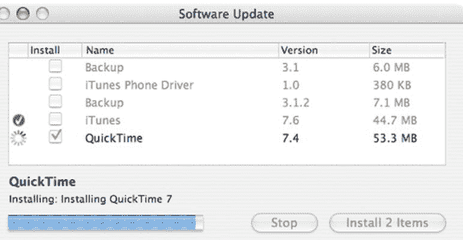

QuickTime

安装：正在安装 QuickTime 7

**图 8.1** OS软件更新显示了哪些更新已完成（绿色勾选），哪些正在进行（旋转圆圈）。

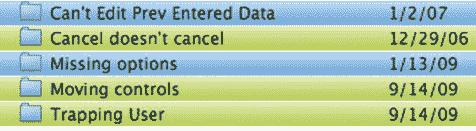

**图 8.2** 操作系统允许用户为文件夹或文件分配颜色；用户可以使用颜色来追踪他们的工作进度。

尚未处理过。Mac OS 用户为文件夹分配颜色。就像在文件夹之间移动文件一样，这种技术可以用来跟踪自己在任务中的进度（见图 8.2）。

# 我们追着信息的“气味”走向目标

将注意力集中在目标上，会让我们以非常字面的方式解释我们在显示器上看到或在电话菜单中听到的内容。人们并不深入理解指令、命令名称、选项标签、导航栏项目或计算机工具界面的任何其他方面。如果他们大脑中的目标是预订机票，他们的注意力就会被显示的“购买”、“机票”、“票”或“预订”等词所吸引。设计者或营销人员可能吸引客户的其他项目（如“廉价酒店”）并不会吸引试图买机票的人的注意力，尽管它们可能会被寻找廉价优惠的人注意到。

这种只注意计算机显示器上符合其目标内容的倾向，以及他们在计算机上执行任务时表现出的字面思维，被称为“通向目标的信息的……气味” (Chi, Pirolli, Chen, & Pitkow, 2001; Nielsen, 2003)。考虑图 8.3 所示的 ATM 机显示器。当你被赋予任何目标时，屏幕上最吸引你注意力的东西是什么？

对于下面的每个目标，屏幕上的什么内容会吸引你的注意力？

- 支付账单
- 转账到你的储蓄账户
- 通过转账支付牙科费用
- 更改你的 码
- 开立账户
- 购买旅行支票

图 8.3 ATM 屏幕。我们的注意力最初被吸引到与我们的目标字面上匹配的项目上。

你可能注意到，某些目标最初将你的注意力引导了错误的选项。“支付”或“转账”是否可能让你在“开新账户”时短暂地移向“开放基金”，尽管它实际上位于“其他服务”之下。“购买旅行支票”这个目标是否会因为它们共有的词汇而让你瞥一眼“申请支票簿”？

信息的“气味”这种寻求目标的策略在各种情况和系统中可见，这表明交互式系统的设计应当使这种气味足够强烈，并能够真正引导用户实现目标。为了进行设计，我们需要理解用户在任务的每个决策点可能拥有的目标，并确保清楚哪个选项通向哪个目标。

例如，想象你想要取消已预订的席位或计划中的付款。你使用系统进行取消，如果真的想这样做，就会弹出一个确认对话框。选项应该如何标记？鉴于人们会根据字面意思或遵循通向目标的信息的气味进行解释，标准的确认对话框标签“确定”（代表是）和“取消”（代表否）会提供误导性的气味。我们将 `Marriott.com` 的取消对话框与 `Quicken.com` 的对话框进行比较（见图 8.4）。Marriott 优于 Quicken.com，因为它的标签提供了更的气味。

第二个例子，想象你忘记了某个文档已经打开，并尝试再次打开它。`Microsoft Excel` 的设计师比 `Microsoft Word` 的设计师更能预测这种情况，理解你在此刻可能拥有的目标，并向你提供指令和选项，让你清楚该做什么（见图 8.5）。

## 我们偏好熟悉的路径

人们知道自己的注意力是无意识的，并据此行事。在追求目标时，他们尽可能采取熟悉的路径，而不是探索新路径，特别是在在截止日期面前工作时。正如第 10 章详细解释的那样，探索新路径是解决问题，会对注意力和短期记忆带来沉重负担。相比之下，采取熟悉的、熟练的路线可以自由完成，不会消耗注意力和短期记忆。

几年前，在一次可用性测试中，一位测试参与者说：

> 我很赶，所以我走熟悉的路径。

信息的“气味”这种寻求目标的策略在各种情况和系统中可见，这表明交互式系统的设计应当使这种气味足够强烈，并能够真正引导用户实现目标。为了进行设计，我们需要理解用户在任务的每个决策点可能拥有的目标，并确保清楚哪个选项通向哪个目标。

例如，想象你想要取消已预订的席位或计划中的付款。你使用系统进行取消，如果真的想这样做，就会弹出一个确认对话框。选项应该如何标记？鉴于人们会根据字面意思或遵循通向目标的信息的气味进行解释，标准的确认对话框标签“确定”（代表是）和“取消”（代表否）会提供误导性的气味。我们将 `Marriott.com` 的取消对话框与 `Quicken.com` 的对话框进行比较（见图 8.4）。Marriott 优于 Quicken.com，因为它的标签提供了更的气味。

第二个例子，想象你忘记了某个文档已经打开，并尝试再次打开它。`Microsoft Excel` 的设计师比 `Microsoft Word` 的设计师更能预测这种情况，理解你在此刻可能拥有的目标，并向你提供指令和选项，让你清楚该做什么（见图 8.5）。

这种只注意计算机显示器上符合其目标内容的倾向，以及他们在计算机上执行任务时表现出的字面思维，被称为“通向目标的信息的……气味” (Chi, Pirolli, Chen, & Pitkow, 2001; Nielsen, 2003)。考虑图 8.3 所示的 ATM 机显示器。当你被赋予任何目标时，屏幕上最吸引你注意力的东西是什么？

你可能注意到，某些目标最初将你的注意力引导了错误的选项。“支付”或“转账”是否可能让你在“开新账户”时短暂地移向“开放基金”，尽管它实际上位于“其他服务”之下。“购买旅行支票”这个目标是否会因为它们共有的词汇而让你瞥一眼“申请支票簿”？

这种偏好熟悉路径的对交互设计有以下启示：

- **引导用户走向目标。** 确保信息气味足够强烈并清晰引导用户实现目标。
- **最小化认知负载。** 使用熟悉的模式和熟练的路线，减少对注意短期记忆的心理需求。
- **需要时提供清晰的反馈。** 如果路径不熟悉或模糊，提供清晰的信息帮助用户保持正轨。

## 循环：目标、执行、评估

## 我们的思维循环：目标、执行、评估

几十年来，研究人类行为的科学家发现了一个似乎适用于各种活动的循环模式：

- 形成目标，例如开立账户，或吃桃子，或从文档中删除一个单词
- 选择并执行动作以尝试实现目标
- 评估动作是否有效，目标是否已实现或更近了
- 重复直到目标实现（或无法实现）

# 第 8 章 注意力、形状、思维和行动的限制

在航空机票的示例中，为了保持示例简短，我们没有进入每个步骤的细节。如果我们那样做，我们将会看到紧随“目标-执行-评估”循环之后的子步骤。

让我们尝试另一个例子，这次我们关注高层步骤的细节。这次的任务是给朋友送花。如果我们只看顶层，任务看起来如下所示：

给朋友送花。

如果我们想为这个任务建立所需的“目标-执行-评估”循环，我们必须将此任务拆解。我们必须问：我们如何给朋友送花？为了做到这一点，我们将顶层任务拆分为子任务。

- 给朋友送花。
- 寻找送卖网站。
- 送给朋友的订单。

对于许多目的来说，我们识别出的这两个步骤已经足够详细了。在执行每个步骤后，我们评估自己是否更接近了目标。但步骤是如何执行的呢？为了看到这一点，我们必须将每个主要步骤视为子目标，并将其分解为子步骤。

- 给朋友送花。
- 寻找送卖网站。
- 打开浏览器。
- 访问 `Google` 搜索页面。
- 在 `Google` 中输入“flower delivery”。
- 扫描搜索结果的第一页。
- 访问列出的某些链接。
- 选择一种送货服务。
- 送给朋友的订单。
- 检查服务的花卉选择。
- 选择花卉。
- 指定送货地址和日期。
- 付花和运费。

在执行每个子步骤后，我们都会评估它是否正在更接近它所所属的子目标。如果我们检查一个子步骤是如何执行和评估的，我们必须将其视为子目标并将其分解为它的组成步骤。

- 给朋友送花。
- 寻找送卖网站。
- 打开浏览器。
- 点击任务栏、启动菜单或桌面上的浏览器图标。
- 访问 `Google` 搜索页面。
- 如果 `Google` 不是浏览器的起始页，从收藏列表中选择 `Google`。
- 如果 `Google` 不在收藏列表中，在浏览器的地址框中输入“Google.com”。

## 我们的思维循环：目标、执行、评估

- 在 `Google` 中输入“flower delivery”。
- 在搜索框中设置文本插入点。
- 输入文本。
- 纠正拼写错误：“floowers”改为“flowers”。
- 访问结果中的某些链接。
- 将屏幕指针移动到链接上。
- 点击链接。
- 查看生成的网页。
- 选择一种鲜花交付服务。
- 在浏览器中输入选定的 URL。
...

你明白这个意思了。我们可以继续扩展到单个按键输入和单个鼠标移动的程度，但我们很少需要那种程度的细节来充分理解任务，从而设计出符合其需求的软件，以及应用于每个步骤的“目标-执行-评估”循环。

软件如何帮助用户执行“目标-执行-评估”循环呢？

可以通过以下任何一种方式：

- **目标：** 为软件旨在支持的用户目标创建清晰的路径——包括初始步骤。
- **执行：** 软件概念（实体和动作）应该基于任务而非实现（第 11 章）。不要强迫用户去思考软件的实体和动作是如何映射到省份任务的。在选择点提供清晰的信息气味，以引导用户实现目标。不要让他们为了实现目标而选择那些看似会让他们偏离目标的动作。
- **评估：** 提供反馈和状态信息，向用户展示他们朝着目标的进展。允许用户退出未朝着目标进行的任务。

“评估”指南的一个示例——关于用户通过一系列步骤完成进展的清晰反馈——由 ITN 的航班预订系统提供（见图 8.6）。顺便问一下，这个图看起来熟悉吗？如果是，那是因为你在第 5 章看过它（见图 5.15B，第 63 页），你的大脑识别出了它。

图 8.6

ITN 的航班预订系统清晰地显示了用户预订的进展。

# 第 8 章 注意力、形状、思维和行动的限制

## 在我们完成任务的主要目标后，我们经常忘记清理步骤

“目标-执行-评估”循环与短期记忆有强烈的相互作用。这种相互作用完全合理：短期记忆实际上就是任何时刻注意力的焦点。注意力的一部分是我们当前的目标。我们注意力资源的其他部分被用于获取执行当前目标所需的信息。随着任务的执行，当前目标从高层目标转向低层级目标，然后再回到下一个高层目标，焦点随之移动。

注意力是一种非常稀缺的资源。大脑不会通过关注任何不再重要的事情来浪费它。因此，当我们完成一项任务时，专注于任务主要目标的注意力资源就可以释放，专注于现在更重要的其他信息。我们留下的印象是，一旦我们实现了一个目标，与之相关的一切往往会立即“掉出”我们的短期记忆，即我们忘记它。

结果之一是人们忘记任务的结尾。例如，人们经常忘记做这些事：

- 后关闭大灯，以防止电池耗电
- 从复印机和扫描仪上取出文档的最后几页
- 使用后关闭炉灶和烤箱
- 在输入文本段落后添加闭合括号和引号
- 完成转弯后关闭转向灯
- 离开飞机时，把在飞机上读的书带走
- 使用完公共电脑后注销
- 将设备和软件置于特殊模式后将其恢复到正常模式

这些任务结束时的短期记忆遗忘是代价高昂的且可以避免的。当这些情况发生在我们身上时，我们称自己为“心不在焉”，但它们是大脑工作方式（或不工作方式）与设备缺乏支持共同的结果。为了避免此类遗漏，交互式系统可以并且被设计成提醒人们还有未完成的尾。在某些情况下，系统可能自己完成任务。例如：

- 汽车在转弯后会自动关闭转向灯。
- 汽车在不再被使用时（现在已经做到）应自动关闭灯，或者至少提醒灯是开启的。
- 复印机和扫描仪在任务完成后应自动弹出所有文档，或者至少信号提示有遗留。
- 炉灶在炉头离开超过某些时间间隔后发出信号，烤箱在被放置时也应如此。
- 如果用户在完成保存文件或打印文档之前关机或睡眠，计算机应发出警告。
- 特殊模式应自动恢复到“正常”状态，就像某些电器那样，或者通过弹簧装置来实现（Johnson, 1990）。

软件设计人员应该考虑他们正在设计的任务是否存在用户可能忘记的清理步骤，如果是的话，他们应该设计系统帮助用户记忆，或者消除记忆的需求。

## 识别容易，回忆困难

第 7 章描述了长期记忆的优势和局限性及其对交互式系统设计的影响。本章通过描述长期记忆的两个功能——识别和回忆之间的重要区别，扩展了这一讨论。

## 识别容易

人类大脑通过数百万自然选择和进化被“设计”成能够快速识别事物。相比之下，回忆记忆（即在没有感知支持的情况下检索记忆）对生存并非至关重要，因为我们的大脑在这方面较差。

记得长期记忆的工作原理（见第 7 章）：感知通过感官系统进入，其信号到达大脑引起神经模式。感知产生的神经模式不仅取决于感知本身的特征，还取决于其所处的语境。相似的模式在相似模式会导致相似的神经模式。重复激活特定模式使得该模式在未来更容易被激活。随着时间的推移，神经模式之间的连接会建立，一个模式会激活另一个。简单来说，每个神经模式都构成了不同的记忆。

神经模式（即记忆的形式）可以通过两种方式激活：(a) 来自感官的更多感知，(b) 其他大脑活动。如果进来的感知与之前的感知相似且语境足够近，它就能很容易刺激相似的神经模式，产生识别感。

# 第 9 章 识别容易，回忆困难

从高高的草丛中出现的，要么是他们视为食物的东西，要么是把他们视为食物的东西（见图 9.1）。他们的生存取决于此。

同样，人类识别人脸的速度非常快——通常在几分之一秒内（见图 9.2）。直到最近，这一过程的原理还是一个谜团。然而，科学家们曾认为识别是一个将感知到的脸部存储在独立的短时记忆中的过程。

图 9.1

早期人类必须快速识别他们发现的动物是猎物还是捕食者。

图 9.2

你识别这些脸脸花了多长时间？¹

> ¹ 巴拉克·奥巴马和比尔·克林顿。

并与长期记忆中的内容进行比较。由于大脑识别脸部的速度很快，认知科学家假设大脑必须同时搜索长期记忆的部分，通过计算机科学家所谓的“并行处理”。然而，即使是大规模的并行处理，也无法解释脸部识别那惊人的速度。

如今，感知和长期记忆被认为是紧密相连的，这在某种程度上揭开了脸部识别速度的神秘。脸以不同的模式刺激数百万个神经元。构成脸部的单个神经元和神经元组会对脸特定特征以及感知脸的环境产生反应。不同的脸刺激不同的神经反应模式。如果以前感知过某张脸，其相应的神经模式已经被激活。再次感知同一张脸会重新激活相同的神经活动模式，只是比以前更容易。这就是对长期记忆的搜索：新的感知或多地重新激活与之前相同的神经活动模式。重新激活模式就是对应长期记忆的重新激活。

在计算机术语中，我们可以说长期记忆中的信息是通过其内容寻址的，但“寻址”一词错误地暗示了每个记忆都位于大脑的特定位置。事实上，每条记忆都对应于跨大脑大部分区域的神经活动模式。

这解释了为什么当我们看到以前从未见过的脸并被问及它们是否熟悉时，我们并不会花费大量时间搜索记忆，试图看看那张脸是否存储在某处（见图 9.3）。并没有搜索。一张新脸刺激了一个尚未被激活的神经活动模式

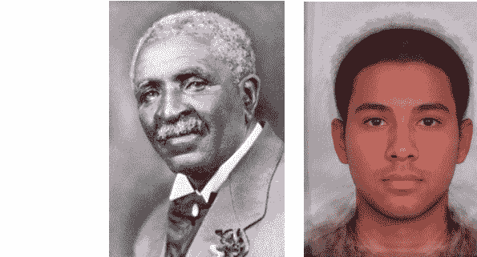

图 9.3

你意识到自己不认识这些脸花了多长时间？²

² 乔治·华盛顿·卡弗（美国科学家、教育家和发明家）和普通男性脸（FaceResearch.org）。

# 第 9 章 识别容易，回忆困难

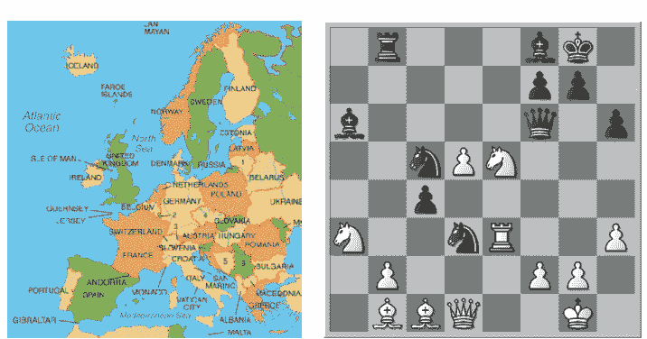

图 9.4

我们可以快速识别复杂的模式。之前没有被激活，所以没有产生识别的结果。当然，一张新脸可能与我们见过的脸相似，以至于触发*误认*，或者它可能恰好使其激活的神经模式激活了一个熟悉的模式，导致一种新脸*让我们想起*我们认识的人的感觉。

使我们的视觉组装快速识别脸部的机制也使其识别复杂模式变得很快。任何至少受过高中教育的人都能快速轻松地识别欧洲地图和国际象棋盘（见图 9.4）。研究过国际象棋历史的大师可能会识别出该棋局是 1986 年的卡斯帕罗夫战卡普夫。

## 回忆困难

相比之下，回忆是长期记忆在没有即时感知输入的情况下重新激活旧模式。这比重新激活具有相同或相似模式的神经模式要困难得多。人们可以回忆记忆，其他神经模式的活动或来自大脑其他区域的输入来重新激活与记忆相应的神经活动模式显然是可能的。然而，回忆记忆所需的协调和时机增加了错误模式或正确模式的子集被激活的概率，导致回忆失败。

无论进化的原因是什么，我们的大脑并不是为了回忆事实而进化的。许多学生不喜欢历史课，因为它要求他们记住事实，例如英国《大宪章》签署的年份、阿根廷的首府以及美国所有 50 个州的名称。他们的厌恶并不意外；人类大脑并不擅长这类任务。

因为人们不擅长回忆，他们开发了方法和技术来帮助他们记住事实和程序（见第 7 章）。古希腊的演讲家使用“记忆宫”来记忆长篇的要点。他们想象一座大型建筑或广场，并在脑中将他们的论点放在周围。在演讲时，他们在脑海中“走过”那里，在经过时捡起他们的论点。

今天，我们更多地依赖外部工具而不是内部方法。现代演讲者通过在纸上写下或在投影灯片或演示软件中显示它们来记住他们的论点。企业跟踪他们拥有多少钱。

## 识别与回忆：对 UI 设计的启示

我们能够识别而非回忆的相对容易性是图形用户界面（GUI）的基础（Johnson 等人，1989）。“识别与回忆对比”是尼尔森和莫利奇（1990）评估用户界面的广泛使用的启发式方法。“识别比输入更容易”是 GUI 几乎取代命令行界面（CLI）的原因（见图 9.5）。

| 编辑 | 插入 | 格式 |
|---|---|---|
| 撤销 | Z | |
| 重复 剪贴板 | Y | |
| 剪切 | X | |
| 复制 | C | |
| 粘贴 | | V |
| 粘贴为超链接 | | |
| 清除 | | |
| 全选 | A | |
| 复制 | B | |
| 删除幻灯片 | D |

图 9.5

今天界面的主要设计规则：“识别比记忆更容易。”

识别容易，回忆困难

方法，特别是在用户可以轻松想起输入什么的情况下，例如在搜索框中输入关键词。

- 尽可能使用图片来传递功能。人们识别图片非常快，识别图片还会刺激相关信息的提取。由于由于，今天的界面经常使用图片来传递功能（见图 9.6 和 9.7），作为桌面或工具栏图标、错误符号和图形化选择。人们从现实世界识别的图片非常有用，因为它们不需要学习就能识别。这种识别只要熟悉的含义与计算机系统中的意图匹配，就是有效的（Johnson，1987）。然而，使用现实世界中的熟悉图片并非绝对关键。如果这些图形设计良好，计算机用户可以学会将新的图标和符号与其意图联系起来。记忆性的图标和符号暗示了它们的含义，与其他区分开，并在不同的应用程序中具有相同的含义。GUI 于 20 世纪 70 年代中期出现并在几十年前的 1980 年代和 1990 年代变得流行。此后，出现了一些基于人类人类感知特别是基于识别和回忆的新规则。本章将以其中一些新规则结束。

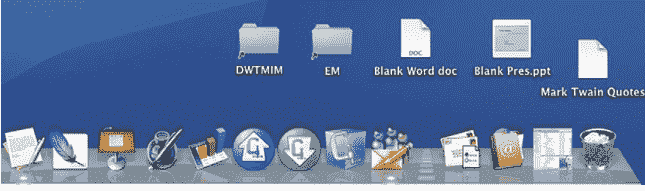

图 9.6

桌面图标通过识别（通过物理物体类比或通过经验）传递功能。

| 外观 |
| 用户 |
| 工具 |
| 设置 |

图 9.7

Wordpress.com 使用符号加文字来标记面板上的功能页面。

## 识别与回忆：对 UI 设计的意义

## 使用缩略图紧凑地描述全尺寸图像

识别对物体和事件显示的尺寸相当敏感。毕竟，我们必须能够独立于它们与我们的距离远近来识别事物。作为特征，重要的是：只要新图中出现的大部分特征与原图中的特征相同，新的知觉就会产生相同的神经模式，从而导致识别。

因此，显示人们已经看过的图片的极佳方法是让它们以较小的“缩略图”形式呈现。图片越熟悉，其缩略图就可以越小而仍然可被识别。显示小缩略图而不是全尺寸图像，可以让人一次性看到更多的选项、数据、历史记录等。

照片管理和演示应用程序使用缩略图来为用户提供其图像或幻灯片的概览（见图 9.8）。网页浏览器使用缩略图来显示用户最近访问的页面（见图 9.9）。

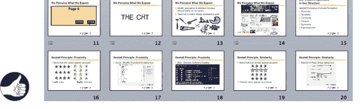

图 9.8

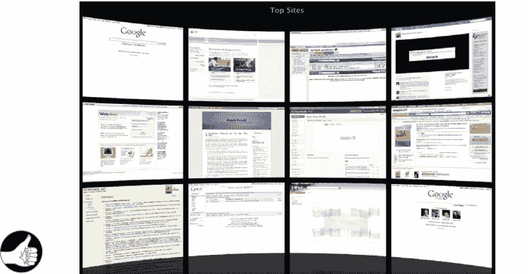

图 9.9

Apple Safari 可以将最近访问的页面显示为缩略图，以便快速识别和选择。

## 使用某功能的人越多，该功能就应该越可见

由于上述原因，回忆往往会失败。如果一个软件应用程序隐藏了其功能并要求用户回忆该做什么，那么会有一定比例的用户失败。如果该软件有大量用户，即使未能回忆的百分比很小，累加起来也是一个相当的数字。软件设计人员显然不希望有大量用户在使用产品时失败。

解决方案是让许多人需要的功能具有高度可见性，让用户看到并识别他们的选项，而不是回忆它们。相比之下，少数人会使用的功能——尤其是当这少数人受过高度训练时——是可以隐藏的，例如，隐藏在“详情”面板后面、右键菜单中或通过特殊组合键。

## 使用视觉线索识别所处位置

视觉识别是快速且可靠的，设计师可以使用视觉线索立即告诉用户他们身处何地。例如，一个为人周知的设计规则是，网站的所有页面都具有共同的独特风格，人们可以很容易判断自己仍在该网站还是已经去了另一个网站。但网站视觉风格的系统性变化可以显示他们处于网站的哪个部分。

某些桌面操作系统允许用户设置多个桌面，这些桌面位于安全的“房间”或“工作空间”中，作为不同工作类别的区域。每个桌面都有自己的背景图形，以便于识别。

某些网站使用 cookie 来确保用户正处于安全网站。每当系统从 cookie 中识别出用户，或者在用户输入了有效的用户名但尚未输入密码后，用户就会显示标志（见图 9.10）。这让用户知道自己处于真实的公司网站，而不是由运行钓鱼诈的人员托管的虚假网站。

## 让身份验证信息易于回忆

人们知道回忆任意的事实、单词以及字母或数字序列是很困难的。这就是为什么他们经常选择密码并将信息记录在易于获取的地方，因此那里是不安全的。他们根据孩子的首字母、生日、街道地址和其他他们知道自己可以回忆的信息来设置密码。遗憾的是，此类密码太容易被他人猜到（Schrage, 2005）。设计师可以帮助用户避免这种不安全行为吗？

首先，我们至少可以让他们回忆登录信息变得困难，例如第 7 章中创建的系统，它们施加了沉重的限制或提供了有限的挑战问题选择。

相反，我们可以赋予用户创建他们可以记住的密码以及他们可以记住的挑战问题的自由。我们可以

（注：此处原文似乎截断，根据上下文要求翻译至提供的文本结束）

丰田普锐斯是一辆好车，但如果我们的姐妹或叔叔对其中一辆有过不快的经历，我们可能会对它产生负面评价。我们这样做是因为我们的中脑将家人成员视为与我们相似，因此比成千上万匿名购车者更可靠，尽管从随机角度来看，这些统计数据是可靠的（Weischenk, 2009）。

第三，当人们犯错时，他们并不总是能从中吸取教训。等他们意识到自己处于困境时，他们可能已经不记得最近的行为，不足以将自己的状况与真正的原因或多个原因联系起来。

人们从经验中学习的第四个问题是，他们往往会过度泛化，即基于不完整的数据做出总结。例如，许多人假设所有的乌鸦都是黑色的，因为他们见过的乌鸦都是黑色的。事实上，存在不是黑色的乌鸦（见图 10.1）。

然而，有人认为过度泛化并不是问题——而是一种特性。一个人很难看到某事的所有可能例子。例如，一个人永远无法看到所有的乌鸦，但在日常生活中（尽管不是科学研究），假设所见的许多乌鸦是证明所有乌鸦都是黑色的证据可能仍然是有用的。过度泛化似乎是现实生活中的一种必要适应。只有当我们以极端的方式过度泛化时——例如，基于一个例子或非典型的例子做出总结——我们才会陷入麻烦。

从经验中学习的能力具有很长的进化历史。一种生物不需要大脑皮层（新脑）就能做到这一点。老脑和中脑都可以从经验中学习。即使是昆虫、软体动物和蠕虫，没有老脑——只有几个神经簇——也能从经验中学习。然而，只有具有皮层或类似功能²大脑结构的生物才能从经验中学习。

图 10.1

所有乌鸦都是黑色的普遍观点是错误的。左侧：非洲乌鸦（Thomas Schoch 拍摄）。右侧：俄亥州的白色（非白化症）乌鸦。

> ²之所以有这个警告，是因为某些鸟可以通过观察其他鸟来学习。

从他经验中学习。皮层对于意识到自己已经从经验中学习无疑是必要的，而且只有具有最大新脑（相对于身体尺寸）的生物——可能是人类——才能清晰地表达他们从经验中学到了什么。

尽管我们从直接经验和他人经验中学习的能力存在局限，但底线是，学习和总结经验对于人类大脑来说相对容易的。

## 执行学过的动作是容易的

当我们去以前去过很多次的地方，或者做以前做过很多次的事情时，我们几乎是自动完成的，不需要太多的意识思考。路线、惯例、程序、动作已经变得自动或全自动了。以下是一些例子：

- 练习多年后骑自行车
- 第 300 次从家里的车道倒车开车上班
- 成年后刷牙
- 在乐器上弹奏过数百次的一首曲子
- 练习几天后，使用鼠标或触控板在电脑显示器上移动光标
- 在旧熟悉的银行账户软件中输入银行交易信息
- 从长期使用的手机上读取并删除一条短信

事实上，“自动”是认知心理学家对例行性、熟练行为的称呼（Schneider & Shifrin, 2017）。研究人员确定，这种类型的动作消耗很少或不消耗认知资源，即它不受第 7 章中描述的注意力和短期记忆限制的影响。

自动动作可以与其他活动并行进行。因此，你可以在煎锅时边打蛋边敲脚，同时让你的大脑保持“空闲”，以关注你的孩子，或者在即将到来的假期中。

动作是如何变成自动的？你去卡内基厅的方式（那个老笑话）证明了：练习，练习，再练习。

当一个人试图开车时——尤其是开手动挡的汽车——动作的每个部分都需要意识的注意。我的挡位对吗？我用哪只脚踩油门、刹车踏和离合器踏？我应该如何按这些踏板？我是如何踩离合器踏的？我往哪个方向开？我开得有多快？我面前、我身边有什么？我应该检查哪些后视镜？前面是我的路吗？“物体看起来比实际的要近”——这是什么意思？仪表盘上闪烁的灯是什么？

即使涉及开车仍是有意识的，跟踪所有事情也超过了我们的注意力容量——记住那是四项，加上两项（见第 7 章）。仍在学习的人通常会感到不知所措。这就是为什么他们经常在停车场、公园、农村地区和安静的社区练习驾驶，那里的交通很稀：以减少他们必须关注的次数。

经过大量练习后，开车涉及的所有动作都变得自动。它们不再竞争注意力，并从意识中退去。我们可能甚至意识不到它们。例如，你用哪只脚踩油门？为了记住，你可能不得不短暂地动一下脚。

同样，当音乐老师教学生演奏乐器时，他们不会让学生同时监控和控制演奏的每一个方面。那会使学生的注意力容量崩溃。相反，老师通常将注意力集中在演奏的一个或两个方面：正确的音符、节奏、发音或速度。为了向自己证明熟练（自动）与新（控制）任务之间的区别，尝试这些：

- 倒背字母表 A 到 M。然后倒背字母表 M 到 A。
- 从 10 倒到 0——火箭发射。然后从 21 数到 1。
- 使用惯常路线开车。第二天，使用完全不同的路线。
- 用惯用手扔球。然后用另一只手。
- 使用标准电话键盘输入电话号码。然后使用键盘顶部的数字键输入电话号码。
- 在电脑键盘上输入你的全名。交叉双手在键盘上再次输入你的全名。（打算去）

在计算机术语中，拥有巨大的皮层使我们能够现场设计程序并在高度监控的模式下运行。这基本上就是我们在遵循食谱、建筑、计算所得税、遵循软件说明或找出为什么播放视频时没有声音时正在做的事情。

交互系统的设计者如何使他们支持的任务更快、更容易且更不容易出错？通过让它们快速变得自动。人们怎么做？第 11 章描述了一些方法。

## 解决问题和计算是困难的

爬行动物、两栖动物和大多数鸟类仅凭老脑和中脑就能它们的世界里生活得很好。昆虫、蜘蛛和软体动物在更少的环境中生存。没有皮层（或鸟类的对应物）的动物可以从经验中学习，但通常需要大量经验，它们只能对行为进行微调。它们的大部分行为是典型的、重复的且可预测的，只要我们理解环境的要求（Simon, 1969）。当环境只需要它们已经拥有的行为时，这可能是好的。

但如果环境抛出一个变弯球：它需要新的行为，而且现在就要？如果一个生物面临它从未遇到过的情况，并且可能再也不会遇到？简而言之，如果它面临一个问题怎么办？在这种情况下，没有皮层或对应物的生物应对

拥有大脑皮层（新脑）使生物不再依赖本能的、反应性的、练习的行为。皮层是意识推理发生的地方（Monti, Osherson, Martinez, & Parsons, 2007）。通常情况下，生物皮层相对于大脑的大小越大，它们现场解释和分析情况或寻找策略和程序、执行这些策略和程序并监控其进展的能力就越强。

> ³例如，��选择一个有四只果蝇的罐子优于有两或三只果蝇的罐（Sohn, 2003）。

## 新大脑也充当冲动行为的刹车

新大脑——特别是前额叶皮层——还起到抑制来自中脑和旧脑的反射性和冲动行为的作用，这些行为可能会干扰新大脑精心设计的计划的执行（Sapolsky, 2002）。当我们准时赶上班时，它能阻止我们跳起来冲下地铁车——即便这时有一个气味很重的人上了车，但毕竟，我们确实得去上班。它让我们在古典音乐会场坐在座位上，但却让我们在摇滚演唱会上站起来大声尖叫。它帮助我们忍住购买红色跑车，因为维护婚姻比拥有那辆车是更高的目标。当老脑和中脑正被一封提议一项“价值1250万美元的商业机会”的邮件干扰时，新大脑阻止了我们的点击，并说：“那是垃圾邮件和骗局，你心里清楚，不是吗？”

拥有一个大大脑给了我们处理突发问题的灵活性，但这种灵活性是有代价的。从经验中学习和执行熟练动作在很大程度上是因为它们不需要持续的意识或集中的注意力，并且可以并行发生。相比之下，控制处理——包括问题解决和计算——需要集中的注意和持续的监控，且执行缓慢而稳定（Schneider & Shuffin, 1977）。它挑战了我们短期记忆的极限，因为执行某个特定程序所需的所有信息块都在竞争意识的心理努力，正如你尝试从 M 到 A 倒背字母表时所看到的那样。

在计算机术语中，人类在仿真模式（即过程的控制执行）下只有一个处理器。该处理器在临时存储容量上受到严重限制，且其时钟比大脑高度并行化和编译的自动处理要慢一个数量级。

现代人类是于20万年至5万年前从更早的类古人种演化而来的，但数值计算直到公元前3400年左右才出现，当时美索不达米亚（现伊拉克）的人们在商业中发明并开始使用数字系统。到那时，人类大脑的构造已与今天大同小异。由于人类大脑进化在数值计算出现之前，因此它并没有针对计算进行优化。

## 第10章 问题解决与计算是困难的

计算主要在大脑的控制、监控模式下进行。这是一项消耗稀缺注意力和短期记忆资源的任务，因此当我们尝试完全在脑海中进行计算时，就会遇到困难。例外是，计算中的某些步骤可能会被记住并自动完成。例如，计算 `479 × 832` 的整个过程是控制的，但如果我们记住了单数字的乘法表，该过程的某些子步骤可能是自动的。

对于大多数人来说，涉及一或两个步骤、某些步骤已记忆（自动）、不涉及大量信息、或所有相关信息立即可可用（因此不需要保留在短期记忆中）的问题和计算，在脑海中解决起来轻而易举。例如：

- `9 × 10 = ?`
- 我需要把洗衣机移出车库，但车挡了路，我的车钥匙在口袋里。该怎么办？
- 我女朋友有两个兄弟，Bob 和 Fred。我见过 Fred，而这里这一个不是 Fred，所以一定是 Bob。

然而，那些超出我们短期记忆限制的问题、或者需要从长期记忆中提取特定信息的问题，或者我们在其中遇到干扰的问题，会耗费我们的大脑。例如：

- 我需要把洗衣机移出车库，但车挡了路，我的钥匙在……嗯……它们不在我的口袋里。它们在哪儿？……[搜索] 它们不在车里。也许我把它们落在外套里了……现在我把外套落在哪儿了？[搜索房屋；最终在卧室找到了外套] 好了，找到了钥匙。……为什么这个卧室这么乱——在我们回家之前必须打扫。……嗯。我为什么需要车钥匙？[回到车库，看到洗衣机]（此处] 噢，对，为了挪车，我可以把洗衣机移出车库。（高层级目标被中间子目标挤出了短期记忆）。
- 约翰的猫不是黑色的，而且喜欢牛奶。苏的猫不是棕色的，不喜欢牛奶。萨的猫不是白色的，不喜欢牛奶。玛里的猫不是黄色的，喜欢牛奶。有人发现了一只黄色且喜欢牛奶的猫。那是谁的猫？⁴（否定句产生的信息块超过了大多数人短期记忆能同时容的容量。）

⁴答案提供在本章末尾。

- 有人造了一个四面墙房子。四面墙都面向南方。一只熊走过。熊是什么颜色的？（需要推理并已知且检索关于世界及其野生动物的具体事实。）
- 你必须精确测量四升水，但你只有一个三升瓶和一个五升瓶。你该怎么做？（需要在大脑中模拟一系列倒水过程直到找到正确的序列，这消耗了短期记忆并可能超过了你的心理模拟能力。）

在解决问题时，人们经常使用外部记忆辅助，例如写下中间结果、绘制草图以及操作问题的模型。这些工具利用了我们的短期记忆以及想象问题元素的能力。

如果问题解决和计算需要我们不知的认知策略或程序，它们也是困难的。例如：

- `9 × 10 = ?`
- 一个农场有牛和鸡——共30条腿。农场有多少只动物？（需要转化为方程。）
- 一个禅师蒙住了学生的眼睛。他告诉他们会在每个人的额头上画一个红点或蓝点。“一分钟后我会摘掉眼罩。你们如果看到红点，就举手。”然后他摘掉了眼罩。一个学生说：“我的点是红色的。”（需要反向推理。）
- 你在电脑上播放 YouTube，但没有声音。问题是在视频、视频播放器、电脑还是扬声器上？（需要设计并执行一系列诊断测试。）

这些假设说明某些问题需要许多人并不具备的培训。

## 解决技术问题需要技术兴趣和培训

软件工程师接受过系统化诊断问题的培训。他们的工作职责包括知道如何设计并执行一系列测试以消除可能的故障原因，直到找到真相。工程师在设计技术产品时，往往假设目标用户精通诊断技术问题。然而，大多数非软件工程师并没有接受过此类诊断的培训，因此无法有效地解决问题。以下是非技术人员在没有帮助的情况下面临这些问题的真实案例：

- Ann 想订机票，但失败了，因为航空公司网站不让她操作。它要求密码，但她没有。她打给一位计算机工程师朋友，朋友询问了几个问题来了解情况。结果发现网站认为她是她丈夫，因为他之前在那台电脑上买过该航空公司的机票。网站想要他的用户名和密码。她不知道他的密码，而他又不在。工程师告诉她登出网站，然后以新客户身份返回并创建自己的账户。
- 是放大器输出而不是电缆。事实证明是显示器放大器输出插口的连接松动。

即使人们知道如果付出努力，他们*可以*解决某个问题或进行计算，但有时他们并不这样做，因为他们认为潜在的回报不值得付出的精力。当解决问题不是他们的工作或其他任务时，这种现象尤为常见。以下是一些真实的例子：

- 旧金山自由职业网络上的一个帖子：“免费：Epsilon 学生 C86。之前运行良好。”
- 弗雷德（Fred）和爱丽（Alice）是一对夫妻，分别是老师和护士，他们从不在家庭电脑上安装或更新软件。他们不知道怎么做，也不想知道。他们只使用自带的软件。如果电脑有更新，他们会忽略。如果某个应用程序（例如网络浏览器）因为过时而停止工作，他们停止使用。需要时，他们会买一台新电脑。
- 另一对夫妇泰德（Ted）和苏（Sue）有一台电视、一台录带播放器 DVD 播放器。这些设备的遥控器堆在电视旁，一直闲置。泰德和苏通过站起来走过房间来控制设备。他们说学习操作遥控器并记住哪个对应哪个设备太麻烦了。然而，他们每天又使用电脑处理电子邮件和网页。

这些例子中的人并不愚蠢。许多人拥有大学学位，受教育程度位居美国前 30%。有些人甚至接受过不同领域（如医学）的问题诊断培训。他们只是对解决计算机和基于计算机设备的计算问题没有培训或兴趣。

## 第 10 章 解决问题和计算是困难的

人类发明计算器和计算机，主要是为了执行计算和解决人类无法轻松独立解决问题的工具。计算机和计算器执行计算和解决问题远比我们要容易得多，也可靠得多，至少在问题定义良好的情况下。

## 对用户界面设计的启示

人们经常会通过创建或解决谜题来刻意地挑战和娱乐自己——或者说，“锻炼”自己的大脑（见图 10.2）。然而，这一事实并不意味着人们会乐意接受由他人或某事物引发的脑难题。人们有自己的目标。他们使用计算机是为了帮助自己实现目标。他们想要并且需要将注意力集中在该目标上。交互式系统及其设计师应该尊重用户，而不应通过强加他人并不想要的技术问题和目标来分散注意力。

以下是计算机和 Web 服务向用户强加的一些技术问题示例：

- “它想要我的成员‘ID’。这和我的‘用户名’是一样的吗？一定是。”
- “哈？它收了我全价！它没给我折扣。现在怎么办？”
- “它说软件可能与电脑上已有的插件不兼容。‘可能？’到底是兼容还是不兼容？如果是，哪个插件是罪魁祸首？我该怎么办？”
- “我想让章节的页码从 23 开始而不是 1，但我没看到执行该操作的命令。我试了‘设置','文档布局’以及‘页眉和页脚’，但那里没有。只有‘插入页码’命令。我不想插入页码：章节已经有页码了。我只想更改起始数字。”
- “嗯。这个复选框的标签是‘水平对齐图标’。我想知道如果勾选它会发生什么。我的图标会垂直对齐，还是不会对齐？”

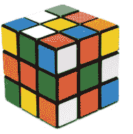

| | | 5 | 3 | 7 | |
|---|---|---|---|---|---|
| | | 1 | 9 | 5 | |
| | | 9 | 8 | | |
| | | 8 | | 6 | |
| | | 4 | | 6 | 3 |
| | | 7 | | 2 | 6 |
| | | | 4 | 1 | 5 |
| | | | 8 | | 7 |

图 10.2 我们通过创建和解决谜题来挑战自己的智力。

## 用户界面设计的启示

交互式系统应该减少用户投入在它们身上的注意力（Krug, 2005），因为这会分散任务资源。以下是一些设计规则：

- 显著指示系统状态和进度。如果用户可以通过直觉轻松检查状态，使用系统就不会消耗他们的注意力。
- 引导用户走向目标。设计师可以隐式地做到这一点，让每个选择提供引导用户走向目标的信息，或者使用向导框。
- 显式地告诉用户需要什么。不要让他们通过排除法推断信息。
- 不要让用户诊断问题，例如连接故障。这需要技术培训，而大多数用户并不具备。
- 减少设置的数量和复杂性。不要期望用户去优化参数。人们在这方面真的很糟糕。
- 让人们使用直觉而不是计算。某些看似需要计算的问题可以通过图形化表示，让人们通过估算来实现目标。一个简单的例子：假设你想去文档中间。70 年代和 80 年代的文档编辑要求你查看文档长度，减半，然后发出前往中间的命令。在现代文档编辑软件中，你只需将滚动条拖到中间即可。同样，绘图工具中的捕捉网格和对齐指南消除了用户确定坐标的需求的需求。
- 让系统变得熟悉。即使系统提供了用户以前没过的功能，设计师可以使用用户熟悉的概念、术语和图形来实现这一点。一种方法是遵循约定和标准（例如 Apple Computer, 2009；Microsoft Corporation, 2009）。第二种方法是使用用户熟悉的应用程序。第三种方法是基于隐喻，例如桌面隐喻（Johnson et al., 1989）。最后，设计师可以通过研究用户来了解他们不熟悉的内容。
- 让计算机来数学数学。不要让人们计算他们不熟悉的内容。

33. 列出你在过去 18 个月内工作过的所有主名称、在每个主处工作的天数、工资以及支付方式。请通过选择该主旁的单选按钮指示工作时间最长的主：

| 雇名称 | 开始日期 (mm/dd/yyyy) | 结束日期 (mm/dd/yyyy) | 工资 | 支付方式 |
|---|---|---|---|---|
| □ | | | | |
| □ | | | | |
| □ | | | | |
| □ | | | | |
| □ | | | | |
| □ | | | | |

34. 关于第 33 题中你指示工作时间最长的主，请回答以下问题：

34a. 你在该主处工作了多久？

| 年份 | 月份 |
|---|---|
| | |

图 10.3 加州在线表单请求了在这两个问题中它可以自己计算的数据。

## 124 页和 125 页谜题的答案

- 猫是约翰的。
- 熊是白色的，因为要有四面朝南的墙，房子必须位于北极。
- 要得到四升水，装满 3 升瓶并倒入 5 升瓶，然后再次装满 3 升瓶并将其能容的部分倒入 5 升瓶。这时 3 升瓶中剩下 1 升。空 5 升瓶，将 3 升瓶中的 1 升倒入 5 升瓶。
- 令 A = 牛的数量，B = 鸡的数量。“农有牛和鸡——共 30 只动物”对应“A+B=30”。动物总共有 74 条腿”对应“4A+2B=74”。解 A 和 B 得到：A=7，B=23，所以农夫有 7 只牛和 23 只鸡。
- 学生展示了三只手和其他学生身上的红点。从这些信息中，她不知道自己的点是红色还是蓝色的。她推断，其他学生在假设有一个蓝点和一个另一个红点的情况下，意识到三只手都举起来需要两个红点，并很快判断出自己的点必须是红色的。但一分钟后，两个学生都没有说话，这让这位禅学生知道其他学生无法确定自己点的颜色，这意味着她自己的点不是蓝色的；必须是红色的。

## 影响学习的许多因素

第 10 章对比了我们大脑用于执行熟练活动的“自动”过程，与我们用于解决新问题和执行计算时使用的意识的、高度监控的、受控的控制。自动过程消耗极少或不消耗短期记忆（注意力）资源，并且彼此之间并行运行；而受控过程对短期记忆有很高要求，且一次只能运行一个（Schneider & Shiffrin, 1977）。

# 当操作以任务为导向、简单且一致时，我们学得更快

当我们第一次或甚至前几次执行某项活动时，是以高度受控且有意识的方式进行的，但随着练习，它会变得越来越自动。例如：削苹果、开车、抛接球、骑自行车、阅读、弹乐器。即使是某些可能需要我们注意的活动（例如从坏樱桃中挑选出好樱桃），也可以变得自动到我们可以将其作为后台任务来处理，同时留出大量的认知资源来聊天、看电视新闻等。

这种从受控到自动的演进为交互式应用、在线服务和电子设备的设计师提出了一个明显的问题：我们如何设计它们，以便它们在合理的时间内变得自动？

本章解释并演示了影响人们学习使用交互系统速度的因素。为了预习这些因素，我们在以下条件下会学得更快：

- 操作以任务为导向、简单且一致
- 词汇以任务为导向、熟悉且一致
- 风险较低

## 当操作以任务为导向、简单且一致时，学得更快

当我们使用工具（无论是基于计算机的还是其他的）来完成任务时，我们必须将想做的事情转换为工具提供的操作。一些示例包括：

- 假设你是一个天文学家。你想让望远镜指向人马座α星。大多数望远镜都不让你指定想要观察的内容。例如，你必须将其转换为望远镜定位控制的操作方式：即垂直角（方位角）和水平角，或者甚至是望远镜当前指向的地方与你想让它指向的地方之间的差。
- 假设你有一个没有快捷拨功能的电话。要给某人打电话，你必须将某人转换为电话号码并输入手机。
- 你想使用一个通用绘图程序为公司创建一个组织架构图。为了表示组织、子组织及其经理，你需要画框、标记组织和经理名称，并用线将它们连接起来。

认知心理学家将用户想要的操作与工具提供的操作之间的差距称为“执行鸿沟”（Norman & Draper, 1986）。使用工具的人必须花费精力将她想要的内容转换为工具可用操作，反之亦然。认知努力会将人的注意力从工具上移开，并重新集中在工具的要求上。工具提供的操作与用户想要做的操作之间的差距越小，用户对工具的思考就越少，他们越能专注于自己的任务。结果是，工具学得越快。

减少鸿沟的方法是设计工具以提供与用户正在尝试的操作匹配的操作。基于上面的示例：

- 望远镜的控制系统可以有一个天体数据库，这样用户只需在显示器上点击某个物体即可指定他们想要观察的对象。
- 带有快捷拨功能的电话允许用户只需指定想要拨打的人或组织，而无需先转换为号码。
- 专用的组织架构图编辑应用程序可以让用户只需输入组织和经理的名字，将用户从创建框和连接线中解放出来。

为了设计提供与用户目标和任务匹配的操作的软件和服务设备，设计师必须彻底理解工具旨在支持的用户目标和任务。获得这种理解需要三个步骤：

1. 执行任务分析
2. 设计以任务为导向的概念模型，主要由对象/动作分析组成
3. 严格基于任务分析和概念模型设计用户界面

### 任务分析

详细描述如何分析用户的目标和任务超出了本书的范围。关于这一点，已经有整个章节——甚至是整本书——被著作（Beyer & ...）。现在，只需说任务分析回答了：

- 目标是什么？
- 预期支持哪些任务？
- 哪些任务是常见的，哪些是稀有的？
- 哪些任务最重要？
- 每个任务的结果是什么？
- 信息从哪里来？
- 每个任务使用什么工具？
- 任务之间的关系是什么？
- 每个任务的属性是什么？

一旦这些问题得到了答案（通过观察和采访），下一步就是设计一个概念模型。界面与用户任务之间的映射越直接，工具就越容易学习。当操作以任务为导向、简单且一致时，我们学得更快。

### 对象/动作

概念模型最重要的部分是对象/动作分析。它规定了暴露给用户的概念、他们对每个对象可以执行的动作以及每个对象的属性（Johnson & Henderson, 2022）。遵循这条规则：“如果它不在对象/动作分析中，用户就不应该知道它。”

如果我们正在设计用于管理账户的软件，基于任务的对象/动作分析将包括交易、支票和账户等对象。它将排除与任务无关的对象，如缓冲区、对话框、模式、数据库、表和字符串。

基于任务的概念模型将包括写入和存款、取款和平衡账户等动作，排除与任务无关的动作，如点击按钮、加载数据库、编辑表行、刷新缓冲区和切换模式。

在一个专注于任务的概念模型中，属性可能如下：

- 支票有收款人、单号、金额、备注文本和日期
- 账户有者和余额
- 交易（存款和取款）有金额和日期

如果模型包含了计算机技术的属性（如交易记录格式），它将不是以任务为导向的。用户不在应用程序使用什么格式存储交易记录。无论在用户界面上投入了多少努力，强制他们关注这些都会损害软件的学习性和易用性。

账户管理的对象、动作和属性似乎显而易见，所以让我们考虑一个对象/动作分析似乎不那么明确的任务：客户在网上商店对产品发表评论。

适合概念模型的对象可能包括产品、评论和对评论的回复。不需要的对象包括数据库、表和持久性评论。

对产品的动作包括查看和添加评论。对评论的动作包括查看和回复，对于用户自己的评论，还有编辑。评论的属性可能包括标题、客户姓名和发布日期。

对于账户管理应用程序和客户评论系统，重要的概念设计可以在设计用户界面之前决定，甚至在不知道用户界面是在个人电脑屏幕上呈现还是通过电话语音菜单呈现之前决定。

### 简单越好

除了专注于用户的任务之外，概念模型应该越简单越好。简单意味着概念越少。模型拥有的概念越少，对于用户来说，掌握的越多越好，只要它提供了所需的功能即可。少即是多，前提是存在的功能与用户的目标和任务完美匹配。

例如：

- 在待办事项应用中，用户需要能够为项目分配 1–10 级的优先级，还是说两个优先级等级——低和高——就足够了？
- 搜索功能是否需要允许用户输入完整的布尔表达式？如果允许这样做，会有大量人真的使用它吗？如果不会，就将其删掉。
- 火车站的售票机是否需要能够提供该车站所经路线之外其他线路的火车票？

在开发过程中，存在着增加额外功能的压力，理由“以防用户可能需要”。除非有充分的证据表明大量的潜在客户和用户真的需要这些额外功能，否则请抵制这种压力。为什么呢？因为每一个概念都会增加软件的复杂性。它确实多了一项东西，但实际上不仅仅是多一项。应用程序中的每个概念都与其他许多概念发生相互作用，而这些相互作用会导致更多的复杂性。因此，随着概念被添加到应用程序中，应用程序的复杂性并非线性增长的，而是呈倍数增长的（见图 11.1）。

### 一致性

交互系统的一致性强烈影响用户从受控、有意识监控的缓慢操作转向自动、无监控的快速操作的速度（Schneider & Shifrin, 1977）。操作的可预测性越高，

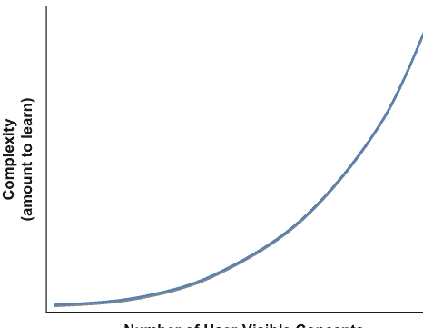

图 11.1 随着概念的增加，应用程序的复杂性呈非线性增长。

#### 由于概念过于相似导致的冗余复杂性

某些软件应用程序之所以复杂，是因为它们的概念在意义或功能上存在重叠。例如，某公司的客户支持网站展示了四个开发者认为完全不同的概念：

- **会员**：公司是否支付了客户支持服务费用。
- **订阅**：公司是否订阅了客户支持新闻邮件。
- **访问**：公司内的用户可以访问客户支持网站的哪些区域。
- **权限**：为每个会员级别提供的服务。

这四个概念令人困惑。这四个概念本应该合并为一个，或者至少少于四个。

另一家公司为寻求购房的人开发了一个网站。寻找房子有两种方式：(a) 给出州、县或城镇名称；(b) 在地图上指明位置。该网站分别将这些方法称为“按位置”或“按地图”，并要求用户选择其一。一次可用性测试发现，许多用户并不认为这些是寻找房屋的不同方式。对他们来说，两种方法都是“按位置”的，只是指定位置的方式不同。

系统的不同功能越一致，一致性就越高。在一个高度一致的系统中，特定功能的操作可以根据其类型进行预测，因此人们可以快速学会系统中的所有工作原理，并迅速形成习惯。在不一致的系统中，用户无法预测其不同功能如何工作，因此他们必须重新学习每一个功能，这减慢了他们对整个系统的学习，并使他们的使用处于一种受控且消耗注意力的过程中。

交互系统至少在两个层面上可以是一致或不一致的：概念层面和按键层面。概念层面的一致性取决于概念模型中对象、动作和属性之间的映射（见上文）。系统中的大多数对象是否具有相同的动作和属性？按键层面的一致性取决于概念动作与执行这些动作所需的物理移动之间的映射。某一类型的概念动作是否都由相同的物理动作启动并控制，还是不是？

#### 对象/动作矩阵

在设计交互系统时，可选但有时有用的步骤是将其概念模型说明为对象和动作的矩阵。对象列在左侧，动作横在顶部（见图 11.2）。目前，我们忽略了对象的类型层级，仅列出对象。对象越多，矩阵越大；动作越多，矩阵越宽。

构建对象/动作矩阵可以让你直观地看到概念模型的简单或复杂。矩阵越大，需要学习的概念就越多。高矩阵表示有很多对象需要学习。宽矩阵表示有很多动作需要学习。矩阵还说明了概念模型的不一致程度——即用户多容易将学到的系统某部分的知识转移到另一个部分。

一个小而密集的矩阵表示设计易于学习：对象少、动作少，且对每种对象的操作都是相同的（见图 11.3A）。例如，简单绘图中的概念对象将图形元素：线条、椭圆、弧、三角形、文本标签等。图形对象上的适用动作预计为创建、删除、查看/编辑属性、更多、复制、调整大小、旋转、翻转等。此类简单绘图的对象/动作矩阵为每个对象类型有一行，为每个动作有一列。所有动作适用于每个对象类型，因此矩阵将非常密集，如图 11.3A 所示。

一个大而稀疏的矩阵反映了不一致的设计，难以学习和记忆，因为每个概念对象都有不同的动作（见图 11.3B）。这种设计将很难学习和记忆。

一个好的经验法则是简化概念模型，使矩阵尽可能小。

图 11.3 代表易于学习与难学习概念的对象/动作矩阵。

图 11.4 代表更符合实际且易于设计的对象/动作矩阵。

我将创建对象/动作矩阵视为可选的设计步骤，原因有两个：

- 经验丰富的交互设计师很少需要通过绘制矩阵来判断其设计底层的概念模型是简单还是复杂、一致还是不一致。
- 可用性测试可以揭示应用程序概念模型中设计师并不知道需要简化的方面。

对于设计师来说，在设计应用程序概念模型时，只需想象一下如果画出来，其对象/动作矩阵会是什么样的，可能就足够了。

目标是设计出一个以任务为导向、尽可能简单且尽可能一致的概念模型。从这种模型中，可以设计出一个用户界面，最大限度地减少使用应用程序达到自动操作所需的时间和体验。

## 击键级一致性

当设计师从概念设计转向实际的用户界面设计时，击键级的一致性变得非常重要。

击键级的一致性更难隔离和测量，但在决定交互系统操作多快变得自动化的方面，它至少与概念一致性一样重要。其目标是培养所谓的“肌肉记忆”（即运动习惯）的发展。

实现击键级的一致性需要对所有相同类型的活动的物理动作进行标准化。编辑文本是一个例子。文本编辑的击键级一致性要求，无论编辑文本的语境如何（文档、表单字段、文件名等），其击键（以及指针移动）都必须保持相同。其他需要击键级一致性的活动类型还包括打开文档、点击链接、从菜单中选择、从显示的选项集中进行选择、点击按钮、滚动显示屏等。

在击键层级不一致的系统无法让人们陷入“肌肉记忆”运动习惯，而是让他们在语境仅有细微差别时，仍需猜测每个语境下应该使用哪些击键。

开发者促进击键级一致性的常用方法是遵循外观和感官标准。此类标准可以在样式指南中呈现，也可以构建到常用的用户界面构建工具和组件集中。整个行业都存在样式指南，并且分别针对桌面软件（Apple Computer, 2009；Microsoft Corporation, 2009）和 Web 设计（Koyani, Bailey, & Null, 2006）存在独立的样式指南。理想情况下，公司还拥有内部样式指南，以增强行业样式指南，并定义其产品的外观和感官。

然而，当约定被封装时，目标是在寻求击键层级约定的同时，增强概念和任务层级的约定。因为设计师很少希望软件用户在工作时不断思考他们的击键级动作，而用户也不想思考这些。

# 当词汇以任务为导向、熟悉且一致时，我们学得更快

确保应用程序、Web 服务或设备向用户暴露一组小型的、一致且符合任务需求的概念是一大步，但仍不足以缩短人们学习交互式系统所需的时间。你还必须确保这些词汇——即概念的称呼——符合任务、熟悉且一致。

## 术语应该以任务为导向

正如交互系统中用户可见的概念应该以任务为导向一样，概念的名称也应该是。通常，以任务为导向的概念术语源于设计师在任务分析中对用户进行的访谈和观察。偶尔软件可能会向用户展示一个他们来说全新的概念；设计师的挑战是让这些概念及其名称专注于任务，而不是技术。

以下是一些使用非任务导向型术语的交互软件系统示例：

- 一家公司开发了一个用于投资交易的桌面软件应用程序。该应用程序允许为常见交易创建并保存模板。它为用户提供了将模板保存到 PC 或网络服务器的选项。存储在 PC 上的模板是私有的。存储在服务器上的模板其他人可以访问。开发者对服务器上的模板使用“数据库” 一词，因为它们存储在数据库中；对用户自己 PC 上的模板使用“本地”，因为对他们来说这就是“本地”的意思。更符合任务导向的术语应该是“共享”或“公共”而不是“数据库”，用“私有”而不是“本地”。

- iCasualties.org 提供伊拉克和阿富汗战争中丧亡或受伤的联盟军人员人数的最新统计。它首先让访问者选择一个“数据库”。

图 11.5 iCasualties.org 使用了非任务导向的语言

然而，网站的访问者并不关心数据存储在多个数据库中（见图 11.5）。任务导向的指令应该让他们选择一个国家。

## 术语应该是熟悉的

为了减少人们掌握应用程序、网站或设备的时间，使其使用变得自动，因此需要确保词汇是熟悉的。熟悉的单词更容易阅读和理解。不熟悉的词汇会导致人们使用更多的意识解码方法，并消耗短期记忆。

遗憾的是，许多基于计算机的产品和服务向用户展示不熟悉的术语——通常被称为“工程极客话”——并要求他们掌握这些术语（见图 11.6）。操作炉灶不需要我们学习 `USB`、`TIFF` 或宽带等术语，Web 上的错误信息也不需要我们学习关于压力或天然气的化学组成。

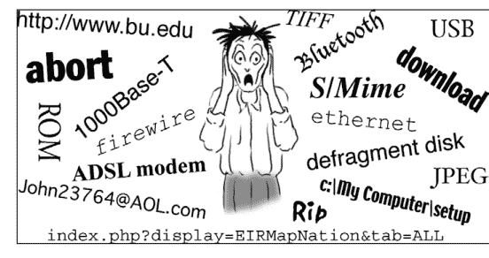

图 11.6 不熟悉的计算机术语（即极客话）减慢了学习

使用熟悉术语的交互软件系统示例：

- 一个开发团队正在为教师设计一个视频点播系统。该系统的目的是让教师根据学区找到视频、下载并在教室显示。开发人员最初的计划是将视频按“类别”和“子类别”进行组织。然而，对教师的访谈显示他们使用“学科”和“单元”来组织。如果使用了开发人员的术语，他们将不得不学习“类别”意味着“学科”，“子类别”意味着“单元”，这使得系统更难掌握。

- Continental 网站显示了几条使用“极客话”的错误信息（见图 11.7）。大多数尝试告诉 Web 用户一个问题，因为使用了不熟悉的术语，很少有人理解它在说什么，也不确定该做什么。此类错误信息更适合向系统工程师报告问题。这些错误信息应该重写为易懂的术语，或者应该由网站管理员监控网站运行而不是展示给用户。

- Windows Media Player 有时会使用熟悉的术语以不熟悉的、极客的方式显示信息（见图 11.8）。错误信息指的是软件的状态，但普通媒体用户可能会将其解释为他们所处环境的状态。

# 当词汇以任务为中心、熟悉且保持一致时，我们学习得更快

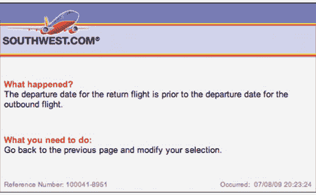

图 11.9

西南航空网站上的错误信息以任务为中心且表述清晰，促进了学习。

与这些示例形成对比，西南航空的网站试图防止错误的发生，但当错误发生时，它会使用以任务为中心、熟悉的语言来解释问题（见图 11.9）。

## 术语应该保持一致

人们希望将认知资源集中在自己的目标和任务上，而不是他们正在使用的软件上。他们只想完成目标，无论目标是什么。他们对软件并不感兴趣。他们对系统的呈现仅进行表面且非常字面的解释。由于有限的注意力资源高度集中在目标上，如果他们正在寻找“搜索”功能，而它在当前屏幕或页面上被标记为“查询”，他们可能会错过它。因此，交互系统中的术语设计应该实现最大一致性。

当每个概念只有一个且只有一个名称时，交互系统中使用的术语就是一致的。用户界面和表单设计领域的权威 Caroline Jarrett 遵循这一规则：

> 同名，同物；异名，异物。(FormsThatWork.com)

这意味着术语和概念应该严格 1:1 映射。永远不要为同一个概念使用不同的术语，或为不同的概念使用同一个术语。即使是现实世界中具有歧义的术语，在系统中也应该只有一个含义。否则，系统将更难学习和记忆。

Earthlink 网站 Web 托管部分的常见问题（FAQ）页面提供了一个相同概念使用不同术语的示例（见图 11.10）。在问题中，两个可用的 Web 托管平台被称为“基于 Windows”和“基于 UNIX”，而在表格中它们被称为“标准型”和“ASP”。客户不得不停下来试图弄清楚哪是哪一个。你呢？

**基于 Windows 和基于 UNIX 的平台之间有什么区别？**

关于在这两个操作系统之间选择详细信息，请访问我们的 Windows 或 UNIX 页面。

要快速查看每个平台支持哪些功能和程序，请参考下表：

| 特性 | 标准型 (Standard) | ASP |
| --- | --- | --- |
| Microsoft FrontPage 扩展 | YES | YES |
| RealVideo 和 RealAudio | YES | NO |
| ASP (活动服务器页) | NO | YES |
| ODBC (活动数据对象) | NO | YES |
| Windows Media Server | NO | YES |
| PHP | YES | NO |
| MySQL 数据库 | YES | NO |

**图 11.10**

Earthlink 的 Web 托管 FAQ 在问题和表格对相同选项使用了不同的术语。

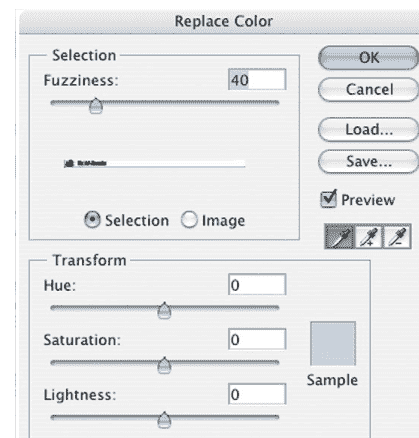

(A)

Photoshop 文件 编辑 图层 选择 滤镜 视图 窗口 帮助填充: 前景 图案模式: 正常 透明度: 100% 容差: 22 ☑ 抗锯

**图 11.11**

Photoshop 在两个颜色替换功能中对“容差”参数使用了不同的名称：(A) 替换颜色中的“模糊度”；(B) 油漆桶中的“容差”。

Adobe Photoshop 的示例表明，不一致的术语会阻碍学习。Photoshop 有两个功能可以将整个图像中的目标颜色替换为新颜色。

最后，WordPress.com 提供了一个为不同概念使用*相同术语*的示例——这也称为一个术语。为了管理博客，WordPress 为每位博主提供了一个*控制面板*，它由多个包含监控和功能的页面组成。问题是，控制面板中的其中一个管理页面也称为“Dashboard”，因此同一个名称指代整个控制面板以及其中的一个页面（见图 11.12）。因此，当新博主学习使用 WordPress 时，他们必须发现并记住，“Dashboard”有时意味着整个管理区域，有时意味着管理区域的 *Dashboard 页面*。

## 有良好的概念模型，开发以任务为中心、熟悉、一致的术语更容易

好消息是，当你进行任务分析并开发出以任务为中心的概念模型时，你也获得了用户群体在谈论任务时使用的词汇。你不需要为应用程序中用户可见的概念虚构术语——你可以使用那些*已经在*执行任务的人使用的术语。事实上，你不应该为概念分配新名称，因为你分配的任何名称都可能是计算机技术概念，对于任务领域来说是陌生的。

从概念模型，软件开发团队应该创建一个*产品词汇*。词汇为产品向用户的每个对象、动作和属性提供名称和定义。词汇应该将术语与对象 1:1 映射。它不应该为单个概念分配多个术语，或为多个概念分配单个术语。

词汇中的术语应该来自软件支持的*任务*，而不是它的实现方式。术语应该很好地融入实现。贯穿软件、用户手册和营销文献。将其视为动态文档：随着产品的演进，词汇会发生变化。

## 风险低时学习更快

想象你正在一个外国出差，为期一周。工作任务结束后你有空闲时间。比较两个可能的城市：

- 你被告诉这座城市很容易：它由整齐的街道和大道组成，街道和地铁标志使用你听得懂的语言，居民很友好。
- 你被警告说这座城市布局复杂混乱，标记不清；街道和地铁标志使用你无法阅读的语言，且居民通常对游客很蔑视。

在哪个城市里，你更有可能去探索？

## 摘要

本章的目标是解释并演示影响人们学习使用交互系统速度的因素，使他们熟练到操作系统在很大程度上由自动认知过程处理的程度。在以下情况下，我们可以更快地学会使用交互系统：

- 它们的操作基于用户的目标和任务（而非基于系统的实现），在概念上简单且具有一致性。
- 它们使用的词汇对用户来说是熟悉的，基于任务领域的语言，并且在使用上是一致的，即术语与概念之间 1:1 映射。
- 它们提供了一个低风险的环境，在这个环境中，错误很难产生；当用户确实出错时，成本低且易于纠正。

# 我们有时间

## 需求 12

世界上的事件需要时间来发生。感知物体和事件也需要时间。因此，记忆感知到的事件、思考过去和未来的事件、从事件中学习、根据计划行动以及对感知和记忆的事件做出反应都需要时间。需要多少时间？了解感知和认知过程的持续时间如何帮助我们设计交互系统？

本章提供了这些问题的答案。它给出了感知和认知过程的持续时间，并在此基础上提供了一些交互系统必须满足的实时截止时间，以便与人类用户良好同步。今天，与用户时间需求不同步的系统效率较低，并被认为没有响应。

第二个问题响应性看起来可能没有有效性重要，但事实上它更重要。在过去的四十年里，研究人员不断发现，交互系统跟上用户、让用户了解其状态以及不让他们意外等待的能力，是决定用户满意度的最重要的因素。它不仅仅是最重要的因素之一；它是最重要的因素。它比学习更重要。它比易用性更重要。一项又一项研究证实了这一发现（Barber & Lucas, 1983; Carroll & Rosoll, 1984; Lambert, 1984; Miller, 1968; Rushnik & Rushnik, 1986; Shneiderman, 1984; Thadhani, 1981）。

本章首先定义了响应性。它列出了人类感知和认知的一些重要时间常数。最后以交互系统设计的实时指南结束，并在示例中演示。

> 一些研究人员认为，对于用户对网站加载速度的感知，因果关系可能是反过来的：人们在一个网站上越成功，他们就认为该网站越快，即使他们的评分与网站的实际速度并不相关（Perfetti & Landesman, 2001）。

## 响应性的定义

响应性与性能有关，但它们不同。性能是以单位时间内的计算量来衡量的。响应性是根据对人类时间要求的符合程度来衡量的，如上述，即用户满意度。

即使性能较低，交互系统也可以具有响应性。如果你去问问题，即使他无法立即回答你的问题，他也可以做出响应：他可以确认问题并承诺回电。他通过说明何时回电可以变得更有响应性。

响应系统在无法满足用户请求时会告知用户。它们提供关于用户做了什么以及正在发生的反馈，根据人类感知、运动和认知截止时间对反馈进行排序。具体来说，它们做到了：

- 让你知道你的输入已被接收
- 提供操作将花费多长时间的指示（见图 12.1）
- 让你在等待时可以做其他事情
- 智能地管理队列事件
- 在后台执行家务和低优先级任务
- 预判你最常见的请求

即使运行很快，软件也可能响应性差。即使一个修理工修表非常快，但如果你走进他的店而他忽略了你，他就是没有响应的。即使修理工修表非常快，但如果他没告诉你要修好几秒还是几分钟，他就是没有响应的。

图 12.1 进度条：良好的反馈，时间估算。

响应性差的系统无法跟上用户需求。它们没有提供对按键的及时反馈，它们无法跟上用户的节奏。

## 大脑的许多时间常数

响应性问题会让用户感到不安。以下是响应性问题的具体示例：

- 动作的视觉模糊（见图 12.2）
- 未提供操作需要多久的反馈（见图 12.2）
- 动画卡顿导致视觉模糊
- 在执行家务任务期间没有反馈
- 阻塞用户输入的视觉延迟

这些问题会让用户感到沮丧。尽管研究表明响应性对满意度至关重要。

为了理解交互系统的时间需求，让我们从神经生理学开始。

大脑和神经系统并不是单一器官；相反，它们是由神经组成的集合，出现在进化链的各个点。这个集合提供了各种感官、调节、运动和认知功能。这些功能的速度差异很大。有些非常快，在几分之一秒内执行功能，而另一些慢得多，持续数秒、分钟甚至更久。例如，第 10 章解释过，自动处理（如背诵歌曲）运行的“时钟”比高度监控的控制处理（如作曲）快至少 10 倍。

## 大脑需要多久……？

下面列出了影响我们响应性的感知和认知功能的测量持续时间。按短到长排列：

| 感知和认知功能 | 持续时间 |
|---|---|
| 声音可检测到的最短沉默间隔 | 1 毫秒 (0.001 秒) |
| 听神经元脉冲之间的最小时间，大脑中最快的神经元 | 2 毫秒 (0.002 秒) |
| 视觉刺激显示并能影响我们的最短时间（可能是无意识的） | 5 毫秒 (0.005 秒) |
| 手写笔绘图时明显的延迟 | 10 毫秒 (0.01 秒) |
| 连续声音脉冲融合为音调的最大间隔 | 20 毫秒 (0.02 秒) |
| 连续图像融合的最大间隔 | 50 毫秒 (0.05 秒) |

## 人脑的多种时间常数

| 事件 | 持续时间 |
| :--- | :--- |
| 在视觉范围内快速数出（确定数量）多四五个物体的时间 | 200 毫秒（0.2 秒；每个物体 50 毫秒） |
| 事件进入意识的编辑“窗口” | 200 毫秒（0.2 秒） |
| 识别（即命名）视觉呈现的物体的时间 | 250 毫秒（0.25 秒） |
| 当场景中超过四个物体时，在心中数清每个物体所需的时间 | 300 毫秒（0.3 秒） |
| 识别物体后的“注意闪烁”（对其他输入不关注） | 500 毫秒（0.5 秒） |
| 视觉运动反应时间（对意外事件的意图反应） | 700 毫秒（0.7 秒） |
| 人与人对话中轮之间沉默的最大持续时间 | 约 1 秒 |
| 对单一任务（“单元任务”）持续关注的持续时间 | 6–30 秒 |
| 在紧急情况下（如医疗分诊）做出关键决策的时间 | 1–5 分钟 |
| 重要购买决策的持续时间（例如买车） | 1–10 天 |
| 选择正确的终身伴侣的时间 | 20 年 |

……音乐乐曲。另一个例子是惊跳反射：大脑中一个被称为上丘的区域——进化史上的古老大脑的一部分——可以“看到”快速逼近的物体，并在你的皮层大脑感知并识别该物体很久之前，就能让你畏缩或举起手臂。

侧边栏给出了某些重要的感知和认知脑功能的持续时间。它们是不言而喻的，但有几个需要额外的解释。

## 我们在声音中能检测到的最短沉默间隔：1 毫秒（0.001 秒）

我们的听觉对短事件和微小差异的敏感度远高于视觉。我们的耳朵通过机械声音换能器工作，而不是电化学神经电路。鼓膜将振动传给听骨（中耳骨骼），听骨再次将振动传给耳蜗的毛细胞，毛细胞在振动时触发传向大脑的电脉冲。由于连接是机械性的，我们耳朵对声音的反应快于视网膜上的杆细胞和锥细胞对光的反应。这种速度使我们的听觉系统能够检测到声音到达两个不同耳朵时极微的时间差异，大脑借此计算出声源的方向。

## 视觉刺激显示并仍能影响我们的最短时间（可能是无意识的）：5 毫秒（0.005 秒）

这是准潜意识感知的基础。如果你看到一张持续 5–10 毫秒的图像，你不会察觉自己看到了它，但你视觉系统的低级部分会记录它。这种图像暴露的一个效果是你对它的熟悉度会增加；如果你以后再次看到它，它看起来会很熟悉。短暂接触图像或逼近的物体还会触发你老脑和中脑的反应——回避、恐惧、愤怒、悲伤、喜悦——即使图像在意识大脑识别它之前就消失了。然而，与流行说法相反，潜意识并不是行为的强力决定因素。它不能让你做你本不会做的事，或让你得到想要的东西。

## 惊跳反射速度（对可能危险的非自主运动反应）：80 毫秒（0.08 秒）

当物体（甚至是影子）快速靠近时，或者当你听到附近有声音时，或者有人突然推、刺或抓你时，你的反射反应是惊跳：退后、遮住眼睛、举手防御；这就是惊跳反射。与对感知事件的意图反应相比，它非常快：大约快了 10 倍。惊跳反射的速度不仅出现在这种情况，也出现在人们受到攻击或发生交通事故时的受伤中：通常他们的手臂和手受伤的方式是因为他们设法在几毫秒内举起了手。

## 视觉事件与我们完全感知之间的时间差：100 毫秒（0.1 秒）

从外部事件的光线击中你的视网膜到该事件的神经冲动到达你的大脑皮层，大约过去了 0.1 秒。假设意识对世界的认知后于现实十分之一秒。这种延迟不利于我们的生存：当你捕猎的兔子穿过草地时，十分之一秒是一个很长的时间。你的大脑通过外推移动物体 0.1 秒后的位置来补偿。

因此，一只兔子跑过你的视觉区域，你看到的是你的大脑估计它现在的位置，而不是它在 0.1 秒前的位置。

## 感知到一个事件导致另一个事件的最大间隔：140 毫秒（0.14 秒）

这个间隔是感知因果关系的期限。如果一个交互系统响应你的动作的时间超过 0.14 秒，你就不会认为你的动作导致了反应。例如，如果你输入的字符回声比你的打字延迟超过 140 毫秒，那么你将失去正在输入这些字符的感知。你的注意力会从文本含义转移到打字动作上，这会减慢你的速度。

## 对单个任务的无断注意力（“单元任务”）：~ 10 秒

当人们执行某项任务时，他们将其拆分为小部分：子任务。例如，在线购买机票包括：(1) 访问旅游或航空公司网站，(2) 输入行程详情，(3) 扫描结果，(4) 选择一组航班，(5) 提供信用卡信息，(6) 检查购买内容，以及 (7) 完成购买。某些子任务会进一步细分，例如逐个输入行程的出发地、目的地、日期、时间等。这种将任务拆分为子任务的过程最终止于可以在不中断注意力的情况下完成的小子任务，此时目标和所有必要信息要么在工作记忆中，要么在环境中可以直接感知到。这些底层的子任务被称为“单元任务”。在单元任务之间，人们通常会从工作中抬头起来，检查是否有其他事情需要注意，向窗外看或喝口咖啡。在编辑文档、输入复选框事务、设计电子电路以及飞行中操控喷气式飞机等活动中都可以观察到单元任务，它们的持续时间通常在 6–30 秒之间。

# 时间常数的工程估算：数量级

交互式系统的设计应当满足人类用户的时间需求。然而，试图为各种不同的感知和认知时间常数设计交互式系统几乎是不可能的。

但设计交互式系统的人是工程师，而不是科学家。我们不需要考虑各种大脑相关的时间常数和时钟周期。我们只需要设计出适用于人类的交互式系统。这种更合理的要求赋予了我们自由，可以将感知和认知时间常数合并为一组较小的集合，以便在设计中更容易教学、记忆和使用。

检查上述关键持续时间列表可以得出一些有用的分组。与声音感知相关的时间都在毫秒级，因此我们可以将它们全部合并为该值。无论它们是 1 毫秒、2 毫秒还是 3 毫秒——我们不在乎。

同样，还有一组位于 10 毫秒、100 毫秒、1 秒、10 秒和 100 秒左右的持续时间。超过 100 秒，就超出了大多数交互式设计师所关注的范围。因此，对于设计交互式系统，这些合并后的截止时间提供了所需的精度：

- 0.001 秒（1 毫秒）：最短可探测静音间隙
- 0.01 秒（10 毫秒）：前意识（“无”）视觉感知、最短可察觉的笔墨延迟、听觉融合
- 0.1 秒（100 毫秒）：四个项目内的瞬视、自主眼动（扫视）、因果感知、感知-运动反馈、视觉融合、惊跳反射、物体识别、意识的编辑“窗口”、意识感知中的一个“瞬间”
- 1.0 秒：平均对话间隔、视觉运动反应时间、注意力闪烁
- 10 秒：单元任务、对任务的无断注意力、复杂任务的一个步骤
- 100 秒（1.6 分钟）：紧急情况下的关键决策

注意这些截止时间形成了一个方便的序列：每个连续的截止时间都比前一个大 10 倍——即一个数量级。这使得序列对于设计师来说很容易记忆，尽管记住每个截止时间可能具有挑战性。

# 设计以满足实时人类交互截止时间

为了被用户感知为响应迅速，交互式软件必须遵循以下指南：

- 立即确认用户操作，即使返回答案需要时间——保留用户对因果关系的感知
- 让用户知道软件何时忙碌，何时空闲
- 在等待功能完成时允许用户移动其他事物
- 动画要平滑且清晰
- 允许用户中止（取消）他们不想要的长时间操作
- 允许用户设定自己的工作节奏

在上述指南中，“立即”意味着在 `0.1` 秒内。如果比这长得多，用户界面将离开因果关系、反射-感知-运动反馈和自动行为的领域，进入对话间隔和意图行为的领域。侧栏：“我们的大脑认为需要多久来……” 两秒后，系统就超过了接收对话的预期时间，进入了单元任务、决策和规划的范围。

现在我们列出了人类感知和认知的时间常数，并将其合并为一个简化的集合，我们可以在上述指南中量化“立即”、“花费时间”、“平滑”和“长时间”等术语（见表 12.1）。

# 0.001 秒（1 毫秒）

如上所述，人类听觉系统对声音之间非常短暂的间隔非常敏感。如果交互式系统提供听觉反馈或内容，其

## 表 12.1 人机交互的截止时间

| 截止时间 | 感知与认知功能 | 交互式系统设计的截止时间 |
|---|---|---|
| `0.001` 秒 | • 最低可探测静音间隙 | • 音频反馈的最大可接受延迟或中断时间（例如：提示音、听觉图标、音乐） |
| `0.01` 秒 | • 前意识感知 • 最短可察觉的笔墨延迟 | • 引起图像或符号的无意识熟悉 • 生成音调 • 最大延迟 |
| `0.1` 秒 | • 四个项目内的瞬视 • 自主眼动（扫视） • 因果感知 • 感知-运动反馈 • 视觉融合 • 惊跳反射 • 物体识别 • 意识的编辑“窗口” • 意识感知中的一个“瞬间” | • 感知-运动反馈 • 因果反馈 • 展示后的时间 |
| `1.0` 秒 | • 平均对话间隔 • 视觉运动反应时间 • 注意力闪烁 | • 对话间隔 • 视觉运动反应时间 • 意图闪烁 |
| `10` 秒 | • 单元任务 • 对任务的无断注意力 • 复杂任务的一个步骤 | • 单元任务 • 对任务的无断注意力 • 复杂任务的一个步骤 |
| `100` 秒（`1.6` 分钟） | 紧急情况下的关键决策 | • 紧急情况下的关键决策 |

# 设计以满足实时人类交互截止时间 161

（注：上述表格内容根据跨页提供的碎片 OCR 文本重构。）

## 为了满足实时人交互截止时间的设计 163

如果一个操作的完成所需时间超过了感知上的“瞬间”（`0.1` 秒），则应该显示忙碌指示器（`busy indicator`）。如果能在 `0.1` 秒内显示忙碌指示器，则它可以兼作操作确认。如果不能，软件的响应应该分两部分：在 `0.1` 秒内给出快速确认，随后在 `1` 秒内显示忙碌（或进度）指示器。下提供了更多关于忙碌指示器的指导。

在事件发生乱序之前，大脑会在这一时间窗口内对事件进行重新排序。如果你听几个人在说话，其中某些人在上一个人说完之前就开始说话了（在这一时间窗口内），人类语言非常容易发生重排序，你的大脑会自动“理清”重叠。电视和电影有时会利用这种现象来加速通常需要很长时间的对话。

我们还认为每秒 `10` 帧是感知流畅动画的大致最小帧率，尽管流畅动画实际上需要每秒 `20` 帧左右的帧率。

## 1 秒

因为一秒是对话中预期的最大时间，而操作交互系统是一种对话形式，所以交互式系统应该避免在对话的一侧出现长时间空隙。否则，人类用户会怀疑到底发生了什么。系统有大约 `1` 秒的时间来完成用户要求的操作，或者指示需要多久。否则，用户就会失去耐性。

如果一个操作将需要几秒钟，就需要进度指示器。进度指示器是交互系统维持其对话侧预期对话协议的方式：“我正在处理这个问题。这是我取得的进度，以及对所需时间的指示。”下方提供了更多关于进度指示器的准则。

一秒也是用户对意外事件做出反应所需的大致最小时间。当信息突然出现在屏幕上时，设计师可以假设用户需要一秒时间来做出反应（除非它导致了闪回反应；见上文）。在系统需要显示交互对象但无法在 `0.1` 秒内渲染该对象并实现交互的情况下，延迟时间是有用的。相反，系统可以显示该对象的“虚假”、非活动版本，然后用时间（`1` 秒）来填充细节并使对象变得完全可交互。现在的计算机在 `1` 秒内可以完成很多事情。

## 10 秒

十秒是人们通常用来分解计划和执行较大任务的大致时间单位。单元任务的示例：在文本编辑应用程序中完成单次编辑、在银行程序中输入交易、以及在飞机空斗战中执行机动。软件应该支持将任务分割成这些 `10` 秒的片段。

## 164 第 12 章 我们的时间需求

十秒大约也是用户愿意花在执行“重量级”操作（如文件传输或搜索）上的时间——如果耗时间更长，用户就会开始失去耐性。如果系统提供了进度反馈，那么计算结果可能会花费更长的时间。

同样，多页“向导”对话框中的每一步都应该给用户留出大约 `10` 秒的时间完成。如果向导的某一步完成时间明显超过 `10` 秒，那么它可能应该被拆分成多个较小的步骤。

## 100 秒（约 1.5 分钟）

支持快速关键决策的交互系统设计应使得：所有必要信息要么已经处于决策者面前，要么可以通过最少的浏览或搜索轻松获得。这种情况下，最好的用户界面是用户只需将眼睛移动到信息显示处即可获取关键信息² (Isaac & Walendorf, 2001)。

## 实现响应式交互系统的额外准则

除了针对每种合并的人机交互截止时间有特定设计准则外，还有关于在交互系统中实现响应能力的通用准则。

## 使用忙碌指示器

忙碌指示器的复杂程度各不相同。在低端，我们有简单的静态光标（例如沙钟）。忙碌指示器在低范围内。它们提供的信息很少：只有系统被暂时占用且无法使用。

接下来，我们有等待动画。当系统需要显示交互对象但无法在 `0.1` 秒内渲染并实现交互时，系统可以显示一个“假的”、对象的，对象的然后 `1` 秒时间填充细节并使其变得完全可交互。现在的计算机在 `1` 秒内可以完成很多事情。等待动画比静态的忙碌指示器更友好，因为它们是独立运行，否则会误导用户。

不显示忙碌指示器的常见借口是操作应该执行得很快，所以不需要。但“快”是指多快？如果操作执行得并不快呢？

> ²有时被称为“无点击”界面。

## 实现响应式交互系统的额外准则 165

如果操作尝试访问被锁定的数据怎么办？如果操作使用了网络服务且网络拥堵怎么办？

软件应该对任何执行期间阻塞用户操作显示忙碌指示器，如果操作通常执行得很快（例如小于 `0.1` 秒）。这种指示器对于由于某些原因卡顿的用户可能非常有用。此外，它没有害：当操作以正常速度执行时，忙碌指示器的出现和消失用户几乎察觉。

## 进度指示器

进度指示器比忙碌指示器更好，因为它们让用户看到还需要多久。设计进度指示器的截止时间是 `1` 秒。

进度指示可以是图形的（例如进度条）、文本的（例如待复制的文件计数），或者是图形与文本的结合。它们极大提高了应用程序的感知响应能力，尽管并没有缩短完成操作的时间。

对于任何需要几秒钟的操作，应该显示进度指示。

- 显示剩余的工作，而不是已完成的工作。错误：“已复制 3 个文件”。正确：“4 个文件中已复制了 3 个”。
- 显示总进度，而不是当前步骤的进度。错误：“这一步还需要 5 秒”。正确：“还剩 15 秒”。
- 显示操作完成的百分比，从 `1%` 开始，而不是 `0%`。如果进度条停留在 `0%` 超过一或两秒，用户会担心。
- 同样，在操作结束时仅短暂显示 `100%`。进度条停留在 `100%` 超过一或两秒，用户会认为是错误的。
- 显示平滑、线性的进度，而不是跳跃式的进度。
- 使用人类尺度的精度，而不是计算机精度。错误：“`240` 秒”。正确：“大约 `4` 分钟”。

## 单元任务之间的延迟比单元任务内部的延迟不令人烦

单元任务的价值不仅在于理解用户如何（以及为什么）分解大任务。它们还让我们了解系统响应延迟在什么情况下最有害或最不令人烦。

在单元任务的执行期间，用户会将目标和必要信息保留在工作记忆或感知视野内。在完成一项任务后，在进入下一项任务之前，他们会稍微放松，然后将下一个单元任务所需的信息调入内存或视野中。

由于单元任务是工作记忆和感知视野内容必须保持稳定的间隔，因此单元任务执行期间意外的系统延迟是特别有害且令人恼烦的。它们会导致用户丢失正在进行的部分或全部操作。相比之下，单元任务之间的系统延迟就没有那么有害或恼烦，尽管它们可能会减慢用户的整体工作速度。

系统延迟与单元任务之间的这种影响差异，有时会在用户界面设计指南中用“完成度”（`closure`）来表示，正如经典的用户界面设计手册《人机界面设计指南》（`Human-Computer Interface Design Guidelines`, Brown, 1988）所示：

> 决定响应延迟的关键因素是完成度。……完成一项主要工作单元后的延迟可能不会打扰用户或对性能产生不利影响。然而，较大工作单元中次要步骤之间的延迟可能会导致用户忘记计划的后续步骤。通常，具有高完成度的操作（如将完成的文档保存到文件中）对响应时间不敏感。而在完成度最低水平的操作（如输入一个字符并在显示器上回显）对响应时间最敏感。

结论：如果系统必须实施延迟，应该安排在单元任务之间，而不是在任务执行期间。

## 首先显示重要信息

交互式系统可以通过先显示重要信息，稍后显示细节和辅助信息，从而看起来运行非常快。不要等待显示完全渲染完成后才让用户看到。尽快给用户提供一些可以思考和采取行动的内容。

这种方法有几个益处。它分散了用户对其他信息缺失的注意力，误导他们认为计算机快速完成了他们的请求。研究表明，用户更倾向于渐进式结果而非进度指示器（Geelhoed, Toft, Roberts, & Hyland, 1995）。渐进式显示结果允许用户开始下一个单元任务。最后，由于用户对所看到的内容产生有意反应需要时间，这种方法为系统在用户尝试任何操作之前争取了至少一秒的时间来赶。以下是一些例子：

- *文档编辑软件*：当你打开文档时，软件一旦获取第一页就会立即显示，而不是等待加载完整个文档。
- *Web 或数据库搜索功能*：当你进行搜索时，应用程序在发现项目时立即显示它们，同时继续搜索更多。

高分辨率图像有时渲染很慢，尤其是在 Web 浏览器中。为了减少图像渲染的感知时间，系统可以先以低分辨率快速显示图像，然后以高分辨率重新渲染。由于视觉系统是整体处理图像的，这看起来比从上到下缓慢地显示全分辨率图像要快（见图 12.3）。例外：对于文本，不建议先以低分辨率渲染页面然后替换为高分辨率版本：这会让用户感到反感（Geelhoed et al., 1995）。

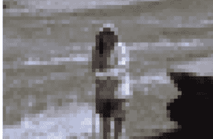

(A)

(B)

## 图 12.3

如果显示图像花费超过两秒，请先以低分辨率显示整个图像 (A)，而不是从上到下以全分辨率显示 (B)。

## 在手眼协作任务期间伪造高负载计算

在交互式系统中，某些用户操作需要快速更新的连续调整——通过手眼协作——直到实现目标。示例包括滚动文档、在景观中移动游戏角色、调整窗口大小或将对象拖到新位置。如果反馈滞后于用户操作超过 `0.1` 秒，用户将难以达到目标。当你的系统无法快速更新显示以满足这种手眼协作截止日期时，请提供模拟反馈，直到目标明确，然后应用真实操作。

图形编辑器在为用户尝试移动或缩放的对象提供橡皮轮廓（`rubberoutlines`）时会伪造反馈。某些文档编辑应用程序会对内部文档数据结构进行快速粗略的修改以表示用户操作的效果，稍后再修正。

## 提前工作

尽可能领先用户工作。软件可以在低负载期间计算对高概率请求的响应。因为用户是人，所以会出现低负载时期。交互通常会花费大量时间等待输入。不要浪费时间！利用它来准备用户可能想要的内容。如果用户想要，又怎样？软件是在“空闲”时间完成的，并没有占用任何其他任务的时间。以下是使用后台处理领先用户工作的例子：

- 文本搜索功能在查看当前词时寻找目标词的下一次出现。当你告诉函数查找该词的下一次出现时，它已经找到了，所以看起来非常快。
- 文档查看器在你查看当前页时渲染下一页。当你请求查看下一页时，它已经准备好了。

## 根据优先级和接收顺序处理用户输入

任务执行的顺序通常很重要。盲目地按照请求顺序执行任务可能会浪费时间和和资源，或产生额外工作。交互式系统应该寻找重新排列队列中任务的机会。有时重新排列任务可以使完成一组任务变得更高效。航空公司人员在走动检查即将起飞乘客的登机口时，使用了不紧要的输入处理。在 Web 浏览器中，点击“返回”或“停止”按钮会立即中止当前页的显示过程。考虑到加载和显示页面可能需要长时间，中止页面加载的能力对于用户接受至关重要。

## 监控时间遵守情况；降低工作质量以跟上

交互式系统可以衡量自己满足实时截止日期的情况。如果错过了截止或确定面临错过截止的风险，它可以采用更简单、更快的方法，通常会导致输出质量的暂时降低。这种方法必须基于实时时间而非处理器周期，以便在不同的计算机上都能产生某些响应性。

一些交互式动画使用这种技术。如上述，动画需要每秒约 `20` 帧才能保持流畅。20 世纪 80 年代，Xerox Palo Alto 研究中心（`PARC`）的研究人员开发了一种用于演示交互动画的软件引擎，该引擎将帧率视为动画最重要的方面（Robertson, Card, & Mackay, 1989, 1993）。如果图形引擎因为图像复杂或用户正在与之交互而难以维持最低帧率，它会简化渲染，牺牲文本标签、三维效果、高亮和阴影以及颜色等细节。这种思想是，将三维动画暂时还原为线条图比让帧率下降到限制以下好。

`PARC` 开发的锥树（`Cone Tree`）基于这种图形引擎。它是分层数据结构（如文件目录和子目录）的交互式显示（图 12.4）。用户可以抓住树的任何部分并旋转它。当树

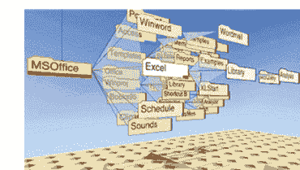

(A)

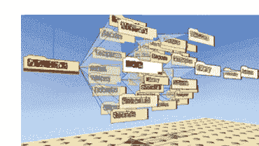

(B)

## 图 12.4

当用户旋转树 (B) 时，锥树 (A) 将文件夹标签渲染为区块。

# 第 12 章 我们时间需求

当进行旋转时，软件可能没有时间在保持动画流畅的同时渲染每帧的所有细节。在这种情况下，例如，可能会通过渲染文件夹叶片上的文件名标签而不是文本来节省时间。当用户开始旋转树形结构时，它会再次以完整的细节进行渲染。大多数用户在移动过程中并没有注意到图像质量的下降，因为他们将无法渲染标签归因于运动模糊。

# 即使在 Web 上也提供及时的反馈

Web 应用程序的开发者可能认为上述截止日期是纯粹的幻想。事实确实，在 Web 上满足截止日期是困难的——往往是不可能的。然而，事实也是，截止日期是心理时间常数，是由数百万年的进化刻在人类体内的，主宰着我们对响应能力的感知。它们并不是我们可以根据需要调整以适应 Web 或任何技术平台局限性的任意目标。如果一个交互系统没有满足这些截止日期，即使它是一个 Web 应用，用户也会认为其响应性很差。这意味着大多数软件的响应性都很差。问题是：设计师和开发者如何在 Web 上最大化响应能力呢？以下是一些方法：

- 尽可能减少图像的大小和数量
- 提供快速显示的缩略图或概览，并提供在需要时显示细节的方法
- 当数据量过大或一次性显示过于耗时时，设计系统提供所有数据的概览，并允许用户钻取特定数据部分以达到他们所需的细节水平
- 使用层叠样式表 (`CSS`) 对页面进行样式和布局，而不是呈现 HTML、框架或表格
- 使用浏览器内置组件——例如错误对话框——而不是在 HTML 中构建它们
- 将小程序和脚本下载到浏览器中；使用 `AJAX` 方法

# 实现响应性至关重要

通过遵循本章描述的指南以及 Johnson (2007) 中提供的额外响应性指南，交互设计师和开发者可以创建符合人类实时截止日的系统，并因此被用户感知为响应良好。

然而，软件行业必须首先认识这些关于响应性的事实：

- 它对用户具有重要意义
- 它与性能不同；响应性问题无法仅通过调整性能或提高硬件速度来解决
- 这是一个设计问题，而不仅仅是一个实现问题

历史表明，更快的处理器无法解决问题。如今的个人计算机像 `30` 年前的超级计算机一样快，但人们仍然在等待电脑，并抱怨响应性不足。多年以后，当个人计算机和电子设备变得像今天最强大的超级计算机一样强大时，响应性仍然是一个问题，因为那时的软件将对这些机器和连接它们的网络提出极高的要求。例如，虽然今天的文本和文档编辑程序会在后台进行拼写检查，但未来的版本将进行基于互联网的事实检查。从现在起可能会基于这些能力和技术：

- 演绎推理
- 图像识别
- 实时语音生成和识别
- 下载 `TB` 文件
- 几十个家用电器之间的无线通信
- 从成千万个远程数据库中汇总数据
- 对整个 Web 进行复杂搜索

结果是系统对计算机施的负载比现在的系统重得多。随着计算机变得越来越强大，历史表明，其大部分性能被需要越来越多处理能力的应用程序所消耗。因此，尽管性能不断提高，响应性作为一个问题将永远不会消失。

对于损害响应性的设计缺陷（失误）、设计响应性系统的原则以及实现响应性的更多技术，请参考 Johnson (2007)。

# 总结

在引言中，我提到在实际设计中应用交互设计指南并非简单且盲目的。约束会发生并迫使做出权衡。有时设计师必须违反其中一条指南来遵循另一个，因此他们必须能够确定在那种情况下哪条指南具有优先权。

这就是为什么交互设计是一项技能，而不是任何人通过遵循配方就能完成的事情。学习这项技能等同于不仅学习设计指南是什么，还学习在每种设计情况下识别要遵循的规则。

本书的目的是提供作为交互设计指南基础的人类感知和认知心理学的简要背景。现在你已经拥有了这些背景知识，希望你一直遵循的任何用户界面指南将更有意义——它们不再看起来像是某些用户界面大师随意的意来之笔。也应该变得更加清晰，所有用户界面设计指南（见附录）的基础是相同的。最后，你现在更有能力在现实世界的情况中解释、权衡和应用用户界面设计指南。

# 注意事项

技术——特别是计算机技术——发展非常快。基于计算机的交互系统的技术水平变化之快，以至于在本书出版之前，书中提到的某些技术和设计可能已经过时。

另一方面，人类感知、学习和思考的基础原理并不会很快改变。人类感知和认知的基本操作在几万甚至几十万年前一直保持相当稳定。从长远来看，人类的感知和认知功能将继续演变，但在本书的流通期间不会。然而，人们已经在利用技术来提高我们的感知、记忆和推理；这种趋势将继续。因此，随着工具的普及、改进以及我们对工具的依赖增加，人类的感知和思考将在几十年内变化。

第三，人类对感知和认知的知识与计算机技术一样，正在快速发展。特别是过去的 20 年里，在功能磁性共振 (`fMRI`)、眼动追踪系统和神经网络模拟等研究工具的帮助下，我们对大脑如何工作的理解发生了飞跃。这使得认知心理学超越了仅仅预测行为的“黑箱”模型，甚至解释了大脑如何存储信息和产生行为。在书中我尝试整合并介绍这些新发现，因为它们对设计师很有价值。我这样做是知道，正如计算机技术水平一样，认知/感知心理学的知识水平将继续进步，可能使书中某些内容过时。使用基本正确的人类感知思考知识进行设计，比毫无知识的设计要好。

# 著名的用户界面设计规则

这里是一些已发表的用户界面设计指南。

## Norman (1983a) 从研究中得出的推论

- 模式错误暗示需要更好的反馈
- 描述错误暗示需要更好的系统配置
- 缺乏一致性会导致错误
- 捕获错误意味着需要避免冲突的命令序列
- 激活问题暗示了记忆提醒的重要性

## 经验训

- **反馈**：系统的状态应该对用户清晰可见，最好采用无模糊的形式，并使选项集触手可用，以避免模式错误。
- **响应序列的相似性**：不同类别的动作应该具有相当不同的命令序列（或菜单模式），以避免捕获错误和描述错误。
- **操作应该是可逆的**：尽可能是可逆的，对于不可逆且后果相对较大的操作，它们应该是难以执行的从而防止意外操作。
- **系统的一致性**：系统在结构和命令设计上应该保持一致，以减少检索操作时的记忆问题。

# Shneiderman (1987); Shneiderman and Plaisant (2009)

- 力求一致性
- 顾及通用可用性
- 提供信息丰富的反馈
- 设计任务流以产生结束感
- 预防错误
- 允许易地撤销操作
- 让用户感觉他们处于控制之中
- 最小化短期记忆负载

# Nielsen and Molich (1990)

- 一致性与标准
- 系统状态的可见性
- 系统与真实世界的匹配
- 用户控制权与自由
- 错误预防
- 识别而非记忆
- 使用的灵活性与效率
- 审美与极简设计
- 帮助用户识别、诊断并从错误中恢复
- 提供在线文档和帮助

# Stone et al. (2005)

- **可见性 (Visibility)**：目标的第一步应该是清晰的
- **示性 (Affordance)**：控制暗示了如何使用它
- **反馈 (Feedback)**：应该清楚地发生了什么或正在发生什么
- **简单性 (Simplicity)**：越简单越好，并以任务为中心
- **结构 (Structure)**：内容组织合理
- **一致性 (Consistency)**：相似性带来可预测性
- **容错性 (Tolerance)**：预防错误，帮助恢复
- **可访问性 (Accessibility)**：所有预定用户都能使用，无论是否存在残疾、接入设备或环境条件限制

# Johnson (2007)

## 原则 1：关注用户及其任务，而非关注技术

- 理解用户
- 理解任务
- 考虑软件运行的语境（上下文）

## 原则 2：先考虑功能，后考虑呈现

- 开发一个概念模型

## 原则 3：符合用户对任务的认知

- 力求自然
- 使用用户的词汇，而不是你自己的
- 将程序内部细节保留在程序内部
- 在功率/复杂度权衡中找到平衡点

## 原则 4：为常见情况设计

- 让常见结果易于实现
- “常见”的两种类型：“大量用户”与“频率”
- 为核心用例设计；不要纠结“边缘”案例

## 原则 5：不要增加用户的任务复杂度

- 不要给用户增加额外问题
- 不要让用户通过排除法进行推理

## 原则 6：促进学习

- 采用“从外向内”思考，而不是“从内向外”
- 一致性、一致性、一致性
- 提供低风险环境

## 原则 7：传递信息，而不只是数据

- 谨慎显示；寻求专业帮助
- 屏幕属于用户
- 保持显示惯性

## 原则 8：为响应性设计

- 立即确认用户操作
- 让用户知道软件何时忙碌何时空闲
- 在等待时让用户去做其他事情
- 平滑且清晰地制作动画
- 允许用户取消他们不想的长耗操作
- 允许用户估计操作所需的时间
- 尝试让用户设定自己的工作节奏

## 原则 9：在用户身上测试；然后修复

- 测试结果甚至会让经验丰富的设计师感到惊讶
- 留出时间修正通过测试发现的问题
- 测试有两个目标：信息性和社交性
- 针对任何时间和任何目的都有测试

# 参考文献

Angier, N. (2008). Blind to change, even as we stares us in the face. *New York Times*. April 1, 2008. https://www.nytimes.com/2008/04/01/science/01angi.html.

Arons, B. (1992). A review of the cocktail party effect. *Journal of the American Voice I/O Society, 12*, 35–50.

Apple Computer (2009). *Apple human interface guidelines*. developer.apple.mac/library/UserExperience/Conceptual/AppleHIGGuidelines

Barber, R., & Lucas, H. (1983). System response time, operator productivity, and job satisfaction. *Communications of the ACM*, 26(11), 972–986.

Bays, P. M., & Hussain, M. (2008). Dynamic shifts of limiting working memory resources in human vision. *Science*, 321, 851–854.

Beyer, H., & Holtzblatt, K. (1997). *Contextual design: A customer-centered approach to systems design*. Morgan-Kaufmann Publishers.

Blauer, T. (2007). On the starlie/flinch response. Blauer lateral intro to the spear system: Finching and the first two seconds of an ambush*. YouTube video: https://www.youtube.com/watch?v=Jk_AI8QT2s4

Broadbent, D. E. (1975). The mayoral memory remains after seven years. In A. Kennedy & A. Wilkes (Eds.), *Studies in long-term memory* (pp. 33–188). London: Wiley.

Brown, C. M. (1988). *Human-computer interface design guidelines*. Norwich, NJ Publishing Corporation.

Boulton, D. (2009). Cognitive science: The conceptual components of reading & what reading does for the mind. Interview of Dr. Keith Stanislav, *Children of the Website*: http://www.childrenofthe.org/article/stanislavich.html

Card, S. (1990). Pioneers and setters: Methods used in successful user design. In M. Rudisch, C. Lewis, P. Polson, & T. McKay (Eds), *Human-computer interface design: Success cases, emergencies and San Francisco*. Morgan Kaufmann.

Card, S., Moran, T., & Newell, A. (1983). *The psychology of human-computer interaction*. Hillsdale, NJ: Lawrence Associates.

Carter, G., & Rosson, M. (1991). Visualizer, an Information Workspaces. *Proceedings of ACM*, 91, 181–188.

Cheriton, D. R. (1976). Man-computer interface for time-sharing systems. *Proceedings of ACM*, 362–380.

Chi, E. H., Pirolli, P., Kder, J. (2001). Using science to model user needs and actions on the web. *Proceedings of ACM Conference on Computer-Human Interaction (CHI 2001)*, 490–497.

Cowan, N., Chen, Z., & Rouder, J. (2009). Constant capacity in immediate-recall task: A sequel to Miller (1956). *Psychological Science*, 15(9), 634–640.

Clark, A. (1998). Being there: Putting brain, body, and world. Cambridge, MA: MIT Press.

Duis, D., & Johnson, J. (1990). Improving user-interface performance despite limitations. *Proceedings of IEEE '90*, 380–386.

Geelho, E., Toft, P., & Hyland, P. (1995). To influence time perception. *Proceedings of ACM'95*, 272–273.

Grudin, J. (1989). The case against user interface. *Communications of the ACM*, 32(10), 1164–1173.

Hacks, J., & Redish, J. (1998). Task analysis for interface design. New York: Wiley.

Isacs, E., & Walendowski, A. (2001). Designing from both sides of the screen: How designers and engineers collaborate to build design. Indiana: SAMS.

Johnson, J. (1987). How faithfully should the electronic office simulate the real one? *SIGCHI Bulletin*, 21–25.

Johnson, J. (1990). Modes in non-computer devices. *International Journal of Man-Machine Studies*, 32, 423–438.

Johnson, J. (2007). GUI 2.0: Common user interface design and dos. San Francisco, CA: Morgan-Kaufmann Publishers.

Johnson, J., & Henderson, A. (2002). Conceptual models: Begin by what to design. *Interactions*, 25–32.

Johnson, J., Roberts, T., Verplank, W., Smith, D. C., Irby, C., Beard, M., & Mackey, K. (1989). The Xerox: A retrospective. *IEEE Computer*, September, 11–29.

Jonides, J., Lewis, R., Lee, D. E., Lustig, C. A., Berman, M. G., & Moore, K. S. (2008). The mind and short-term memory. *Annual Review of Psychology*, 59, 193–224.

Koyan, S. J., Baer, R. W., & National, J. R. (2006). Research-based web design and usability guidelines. US Department of Health and Human Services. Website: www.usability.org/pdfs/guidelines.html.

Krug, S. (2005). *Don’t make me: A common sense approach to usability (2nd ed.). Indianapolis: New Riders Press.

Lambert, G. (1984). A comparative study of system response to program developer productivity. *IBM Systems Journal*, 23(1), 407–423.

Landauer, T. K. (1986). How many people do remember? Some estimates of the learned information in long-term memory. *Cognitive Science*, 10, 477–493.

Liang, P., Zhong, N., Lu, S., Liu, J., Yao, Y., Li, K., & Yang, Y. (2007). The neural mechanism of human inductive reasoning processing: A combined ERP and fMRI study. Berlin: Springer Verlag.

Lindsay, P., & Norman, D. A. (1972). *Human information processing*. New York and London: Academic Press.

Marcus, A. (1992). Graphic design for electronic documents and user interfaces. Reading: Addison-Wesley.

Marr, D. (1982). *Vision*. New York, NY: W. H. Freeman. p. 101, Figure 3-1, attributed to R. C. James.

McIn. Progress indication: Concepts, design, and implementation, July, IBM. Developer Works. Website: www-128.ibm.com/developerworks/library/us-progress.

Microsoft Corporation (2009). Windows User Experience Interaction Guidelines: http://www.msdn.com/en-us/library/aa511258.aspx

Miller, G. A. (1956). The magical number seven, plus minus or two: Some limits on our capacity for processing information. *Psychological Review*, 63, 81–97.

# 参考文献

Miller, R. (1968). 人机对话事务中的响应时间。Proceedings of IBM Fall Joint Computer Conference Vol. 33, 267–277.

Monti, M. M., Osherdon, D. M., Martínez, M. J., & Parsons, L. M. (2007). 演绎推理的功能性神经剖析：一种独立无关分布式网络。NeuroImage, 37(3), 1005–1016.

Mullet, K., & Sano, D. (1994). 视觉界面设计：以通信导向的技术。Prentice-Hall.

Nielsen, J. (2003). 信息觅食：为什么 Google 让人们更快离开你的网站。Alertbox, 2003年6月30日。

Nielsen, J., & Molich, R. (1990). 用户界面启发式评估。Proceedings of ACM CHI'90 Conference (Seattle, WA, 4月1日–5日), 240–256.

Norman, D. A. (1983a). 基于人类错误分析的设计规则。Communications of the ACM, 26(4), 254–258.

Norman, D. A. (1983b). 人机界面的设计原则。于 A. Janda (编)，Proceedings of the CHI-83 conference on human factors in computing systems (Boston)。New York: ACM。收录于《人机交互导读》，由 Ronald M. Baecker 和 William A. Buxton 编。San Mateo, CA: Morgan-Kaufmann Press (1987)。

Norman, D. A., & Draper, S. W. (1986). 以用户中心的设计：人机交互的新视角。Hillingdale, NJ

Oracle/Microsystems (2001). Java 外观与外观设计指南，ednd。http://www.oracle.com/java/jfc/book/index.html

Perfetti, C., & Landesman, L. (2001). 下载时间的真相。网络文章，User Interface Engineering, 2001年1月31日，http://uie.com/articles/download_time/

Redish, G. (2007). 放下文字：编写有效的网页内容。San Francisco: Morgan-Kaufmann Publishers.

Robertson, G., Card, S., & Mack McKin, J. (1989). 交互式用户界面的认知协处理器架构。Proceedings of the ACM Conference on User Interface and Technology (UIST'89)。1989年11月，ACM Press, 10–18.

Robertson, G., Card, S., & McKin, J. (1993). 使用3D交互式动画进行交互式视觉化。Communications of the ACM, 36(4), 56–71.

Rushinek, A., & Rushinek, S. (1986). 什么让用户快乐？Communications of the ACM, 29, 584–598.

Sapolsky, R. M. (2002). 回忆：一位神经科学家在狒狒群体中的非常生活。New York: Scribner.

Schneider, W., & Shiffrin, R. M. (1977). 控制与自动化人类交互：1. 检测、搜索与选择。Psychological Review, 84, 1–66.

Schrage, M. (2005). 密码是 faylere。Technology Review, 三月。http://www.technologyreview.com/read_article.php?search=sectionsections&sc=security&id=16350

Shneiderman, B. (1984). 人类计算机性能中的响应时间与显示速率。ACM Computing Surveys, 16(4), 265–285.

Shneiderman, B. (1987). 用户设计：有效人机交互的策略（第1版）。Reading, MA: Addison-Wesley.

Shneiderman, B., & Plaisant, C. (2009). 用户设计：有效人机交互的策略（第5版）。Reading, MA: Addison-Wesley.

Simon, H. A. (1969). 人造科学。Cambridge, MA: MIT Press

Simons, D. J., & Levin, D. T. (1998). 在现实世界交互中未能检测到人的变化。Psychonomic Bulletin and Review, 5, 644–669.

Smith, S. L., & Moser, N. K. (1986). 用户界面软件设计指南。Springfield, VA: National Technical Information Service. 技术报告 ESD-TR-86-278.

Soegaard, M. (2007). 知觉的格式塔原理。网络文章，Interaction-Design.org。http://www.interaction-design.org/encyclopedia/gestalt_principles_of_perception.html

Sohn, E. (2003年10月8日)。这是一个动物的世界。Science News for Kids。http://www.sciencenewsforkids.org/articles/20031008/Feature1.asp.

Sousa, D. A. (2005). 大脑如何学会学习。Thousand Oaks, CA: Corbin Press.

Stafford, T., & Webb, M. (2005). 脑力：训练大脑的技巧与工具。Sebastapol, CA: San Francisco: Morgan Kaufmann.

Stone, D., Jarrett, C., Woodroof, M., & Minocha, S. (2005). 用户界面设计与评估。IBM Journal, 20(4), 407–423.

Thadani, A. (1981). 交互式用户生产力。视觉障碍：SAP Design Guild。http://www.sapdesign.org/editions/01/vision_physiology.

Ware, C. (2008). 设计的视觉思维。San Francisco, CA: Morgan-Kaufmann Publishers.

Weschenk, S. (2009). 神经设计：什么让他们点击？Berkeley, CA: New Riders, 1999年3月。http://www.internetg.org/newsletter/accessibility_challenged.

# 索引

## A

- 歧义，知觉的，8
- 物体的识别，158
- 达成后的清理，106–107
- 任务持续时间，159
- 外部辅助，98–99
- 熟悉路径，102
- 与短期记忆的关系，82
- 信息的气味，99–100, 101f
- 自动与受控处理，23, 126

## B

- 背景噪音，阅读干扰，41–42, 41f
- 大脑功能维度，119–120
- 额叶皮层的冲动行为，125
- 知觉与认知功能，154–160
- 阅读与功能性图像，37–59, 38f
- 布罗卡区，38, 38f
- 忙碌，164–165

## C

- 数据特定控制，29, 29f
- 截止日期，见 时间
- 显示，颜色差异，60–61
- 编辑窗口，时间分辨率，157–158
- EEG，见 脑电图
- 脑电图 (EEG)，38
- 外周视觉问题，69–72, 70f, 71f
- 符号使用，72, 73f
- 评估，思维循环，103–105
- 执行，循环，103–105
- 计算，难度，124–130
- 界面设计影响，130–131, 150f, 152f
- 大写，全大写与阅读干扰，40f
- 说明，38
- 居中文本，阅读干扰，44–45, 44f, 45f
- 封闭原理，格式塔理论，17–18, 17f, 18f
- 颜色亮度，58–60, 60f
- 颜色视觉，颜色呈现与差异，影响差异的因素，60–61
- 苍白，56, 57f
- 尺寸，56, 57f, 58f
- 分离，56, 57f
- 边缘对比与亮度感知，55–56, 55f, 56f
- 颜色使用指南，61–62, 61f, 62f, 63f
- 机制，53–55, 54f

### 经验

- 从经验学习，120–122, 121f
- 知觉偏差，1–4, 2f, 3f
- 外部认知辅助，98

## F

- 图/底原理，格式塔理论，19–22, 20f, 21f
- 惊跳反射，时间分辨率，156
- fMRI，见 功能磁共振成像
- fMRS，见 功能磁共振光谱
- 字体，阅读干扰，困难用途，40
- 有色字体，41, 41f
- 斑中心，空间分辨率，65–66, 66f, 68f
- 功能磁共振成像 (fMRI)，38
- 功能磁共振 (MRS)，38
- 一致性，学习的事实，137–139, 145–147f
- 一致性，知觉，9
- 原理，格式塔理论，15–16, 16f, 17f
- 视觉优化的对比，55
- 额叶皮层，124–125
- 当前知觉，知觉偏差，4–5, 4f

## G

- 命令行用户界面，界面，命令行
- 共同命运，格式塔理论，22, 22f, 23f
- 计算机提示声，消息通知，74
- 概念模型，135–136
- 视网膜分布，66f
- 视觉敏感性，54, 54f
- 间隙，视觉，68
- 泛化，119–120
- 知觉格式塔理论，17–18, 17f, 18f
- 组合，22, 22f, 23f
- 连续原理，15–16, 16f
- 图/底原理，19–22, 20f, 21f
- 接近性原理，11–13, 14f
- 相似性原理，18–19, 18f

## H

- 听觉，见 声音
- 层级，视觉，30

## I

- 冲动行为，额叶皮层抑制，125
- 气味信息，见 信息的气味
- 指令，记忆的设计影响
- 长期记忆，93f
- 短期记忆，87–89, 89f

## K

- 键一致性，学习促进，141–142

## L

- 语言，处理与阅读，33–34
- 学习促进

## #

- 对象/动作分析，学习促进，135–136
- 对象/动作矩阵，学习促进，139–141, 140f, 141f

## P

- 苍白，色彩呈现与辨别，56, 57
- 斑块大小，色彩呈现与辨别，56, 57f, 58f

## 感知

- 偏见
  - 当前内容，4–5, 4f, 45f
  - 设计影响，8–9
  - 经验，1–4, 1f, 2f, 3f
  - 目标，5–8
- 颜色，色彩视觉
- 格式塔理论，参见 格式塔感知理论
- 性能，152–155
- 边缘（视觉
  - 计算机界面问题，69–72, 70f, 71f
  - 消息可见性
    - 辅助技术，74–77, 75f, 76f
    - 实现，72, 73f
  - 运动敏感性，65–68, 66f, 67f, 68f
  - 空间分辨率，65–68
  - 弹出消息，错误对话框，74, 75f, 76f
- 解决问题
  - 困难的，123–140
  - 谜题，126–127, 132
  - 技术问题需求，128–129
  - 用户界面设计影响，130–131, 130f, 132
- 进度指示，165
- 邻近性原则，格式塔理论，111–123, 13f

## R

### 阅读

- 干扰
  - 全大写，40f
  - 背景噪声，41–42, 42f
  - 居中文本，44–45, 44f, 45f
  - 干扰因素组合，46, 46f
  - 设计影响，46–47
- 字体
  - 弥散情况，40
  - 微小字形，41, 41f
  - 重复，43–44, 44f
  - 词汇，39–40
  - 特性驱动对比上下文驱动，35–37
  - 识字经验，34, 35f
  - 优秀设计中的最小化，50
  - 装饰性，53
  - 识别模式，34
  - 熟练阅读与未使用的阅读及功能性阅读
  - 大脑成像，37–39, 38f
  - 软件对话框，47–50, 48f
  - 自上而阅读，36f

### 回忆

- 难度，112–113
- 识别对比与用户界面
  - 身份验证信息与易于回忆，116–117, 117f
  - 选择对比回忆与输入，113–114, 115f
  - 按流行程度划分可见性，116
  - 用图片传递功能，114, 114f
  - 缩略图，115, 116f

### 识别

- 易用性，109–112, 111f, 112f
- 面部，112
- 回忆与设计影响
  - 身份验证信息与易于回忆，116–117, 117f
  - 选择对比回忆与输入，113–114, 115f
  - 按流行程度划分可见性，116
  - 用图片传递功能，114, 114f
  - 缩略图，115, 116f
- 红/绿色彩混合，58–59, 59f
- 重复，右侧干扰，43–44, 44f

### 响应性

- 定义，152–153
- 设计考虑
  - 眼手协调期间的人工反馈
  - 忙碌指示，164–165
  - 任务与任务延迟，166–167, 167f
  - 重要信息显示，167
  - 进度指示，165
- 时间尺度
  - 0.001 秒，160–162
  - 0.01 秒，162
  - 0.1 秒，162–163
  - 1.0 秒，163
  - 10 秒，163–164
  - 100 秒，164
  - 时间合规监控，169–170
  - 及时反馈，170
- 按优先级处理用户输入，168
- 领先于用户操作，168
- 重要性，170–171
- 感知与认知功能，154–160
- 人机交互的时间截止，60–164, 161t
- 视网膜间隙，68
- 风险，对学习的影响，149

## S

- 信息的线索，目标，99–100
- 脚本，难以阅读，40
- 搜索结果，短期记忆的影响，87, 88f
- 色彩呈现与辨别，56, 57
- 短期记忆，参见 记忆
- 相似性原则，格式塔理论，18, 19
- 概念的学习促进，136–137, 14f
- 软件对话框，47–50, 48f
- 声音，时间分辨率，155–156
- 特定的，25, 29f
- 示例，25, 26f
- 格式塔理论，参见 知理论
- 长时间感知，28–29
- 视觉层级构建，30–31, 30f
- 字幕时间分辨率，参见 促进

## U

- 用户界面
  - 命令行，113
  - 图形界面 (GUI)，113–114
- 用户设计规则
  - Johnson 规则，176–178
  - Nielsen 和 Molch，176
  - 正常，175
  - Shneiderman 和 Plaisant，176

## V

- 视觉，参见 色彩视觉；边缘（视觉）
- 视觉层级，30
- 视觉时间分辨率，156–157f
- 视觉结构，参见 结构
- 视觉运动反应，158
- 韦尼克区，38, 38f

## 词汇

- 学习促进
  - 概念模型，147–148, 14f
  - 一致性证词，145–146, 14f
  - 熟悉的术汇，143–145, 143f, 145f
  - 以任务为中心的词汇，142–145, 143f
  - 阅读干扰，39–40

## T

- 任务分析，学习促进，135
- 术语，参见 词汇
- 文本，参见
- 思维循环，元素，103–105
- 时间截止
  - 设计考虑
    - 忙碌用户，164–165
    - 任务与任务延迟，165–160
    - 眼手协调期间的反馈
  - 任务，168
  - 重要信息显示，166–167, 167f
  - 进度指示，165
- 时间尺度
  - 0.001 秒，160–162
  - 0.01 秒，162

## W

- 网站
  - 消息可见性
    - 辅助技术，74–77, 75f, 76f
    - 实现，72–73f
  - 边缘视觉问题，69–72, 70f, 71f
  - 搜索结果及短期记忆的影响，87, 88f
- 抖动，消息通知，75f, 76f
- 工作记忆，参见 记忆
