# Microsoft Enterprise Library 开发者指南（Visual Basic 版）（patterns & Practices）


## 前言

你手中拿着一本书，它将使你作为企业开发人员的生活轻松得多。

这是一本关于 Microsoft 企业库的指南，旨在*指导*你如何将 .NET 应用于企业开发。Enterprise Library 由 patterns & practices 小组开发，是一组可重用组件的集合，每个组件都针对特定的横向关注点——无论是系统日志、数据验证还是异常管理。其中许多可以轻松使用。这些组件与架构无关，可以应用于多种不同的上下文。

本书将带你了解企业库的功能块，包括数据访问、缓存、加密、异常处理、日志记录、安全性和验证。它包含大量练习、技巧和窍门。

开发健壮、可重用且易于维护的应用程序需要了解设计模式、软件架构和扎实的编码技能。我们可以通过企业库帮助你培养这些技能，因为它封装了在 .NET 平台上开发企业应用程序的经过验证和推荐的最佳实践。尽管本指南不深入讨论架构和平台，但它为你从一组可重用组件中发现和实现这些模式提供了坚实的基础。这就是为什么我也鼓励你查看企业库源代码并阅读它。

本指南不旨在成为企业库的完整参考。为此，你应该去 MSDN。相反，本指南涵盖了最常用的场景，并说明了如何应用企业库来实现这些场景。本指南传递的有力信息是代码重用的重要性。在当今复杂大型软件系统的世界中，高质量的可插拔组件是必不可少的。毕竟，谁能承担在系统中编写并维护几十种不同的框架——所有这些只是为了完成同一件事？企业库让你利用经过验证的代码补充来管理广泛的任务，并让你专注于应用程序的核心业务逻辑和其他“工作部分”。

本指南强调的另一个重要方面是软件设计，这些设计易于配置、可测试且易于维护。企业库具有一个灵活的配置子系统，可以由外部配置文件、以编程方式或两者兼用来驱动。企业库本身以身作则，采用松耦合方式设计。它提倡关键的设计原则，包括关注点分离、单一职责原则、最少知识原则和 DRY 原则（不要重复自己）。话虽如此，不要指望本指南是设计模式的全面参考。它不是。它仅提供足够的内容来演示如何将关键模式与企业库一起使用。一旦你看到并理解它们，就尝试将它们推广到其他问题、上下文和场景中。

作者成功编写了一本书，既面向经验丰富的企业库开发人员（他们想了解 5.0 版中的改进），也面向完全不了解企业库的新手。希望，对于第一组人来说，它能帮助你定位并快速复习一些关键概念。对于第二组人来说，本书可能会降低你的学习曲线，让你快速上手企业库。

最后，不要只读这本书。它旨在作为一本实用教程。学习只能通过实践获得。体验企业库。用它构建一些东西。在实践中应用所学概念。别忘了分享你的经验。

总而言之，我对企业库 5.0 的发布和这本书都感到兴奋。特别是，因为它们随附并支持我们的一些重大新版本——Visual Studio 2010、.NET Framework 4.0 和 Silverlight 4，这些将共同使你作为开发人员变得更加高效。

Scott Guthrie
公司副总裁
Microsoft .NET 开发人员平台
华盛顿州雷德蒙德


## About This Guide

当你随意在当地书店拿起一本书，或从你喜欢的网站上无穷无尽的藏书中挑选一本时，你可能会想知道这本书实际上涵盖什么内容，你能从中学到什么，内容是否可能有趣且有用，当然，它是否真的好。我们将在此尝试回答前三个问题。最后一个问题只有你自己才能回答。当然，我们很乐意通过我们的社区网站 http://entlib.codeplex.com/ 听取你的意见。

## WHAT DOES THIS GUIDE COVER?

从标题你大概可以看出，本指南专注于如何开始使用 Enterprise Library。它将帮助你学习如何在应用程序中使用 Enterprise Library 来管理横向关注点，简化并加速你的开发周期，并利用经过验证的最佳实践。Enterprise Library 是一组预先编写的代码组件集合，这些组件经过多年的开发和精调。你可以开箱即用，按需修改，并随应用程序分发它们。你甚至可以将 Enterprise Library 用作学习资源。它包含演示 Microsoft® .NET 编程技术和常用设计模式的源代码，这些设计模式可以改善你应用程序的设计和可维护性。顺便说一句，如果你不熟悉横向关注点这个术语，不用担心，我们会在讲解过程中进行说明。

Enterprise Library 是一个庞大的集合，包含大量组件。对于初学者来说，如何最好地利用它并不完全直观。因此，在本指南中，我们将帮助你快速了解 Enterprise Library 是什么，它包含什么，如何选择和仅使用你需要的特定功能，以及开始使用它们有多么容易。你将看到如何快速简单地将 Enterprise Library 添加到你的应用程序中，将其配置为完全按照你的需求运行，然后从它提供的简单易用且极具吸引力的机会中受益，这些机会可以让你编写更少的代码来实现更多功能。

本指南的第一章概括介绍了 Enterprise Library，并提供各个部分的详细信息，以便你熟悉整个框架。

目的是让你了解 Enterprise Library 中每个应用程序块的基本原理，以及如何选择你需要的确切块和功能。第 1 章还讨论了使用块的基础知识，例如如何配置它们、如何实例化组件，以及如何在代码中使用这些组件。

其余七章详细讨论了提供基本横向功能（如数据访问、缓存、日志记录和异常处理）的应用程序块。这些章节解释了驱动块开发的概念、它们可以处理的任务类型，以及它们如何帮助你实现许多众所周知的设计模式。当然，它们还通过代码片段和示例程序解释了如何在应用程序中实际使用这些块。读完每一章后，你应该熟悉该块，并能够快速轻松地使用它来执行一系列功能，无论是在新应用程序还是现有应用程序中。

最后，附录提供了有关特定主题的更详细信息，你不需要详细了解这些信息即可使用 Enterprise Library，但它们作为额外资源很有用，并将帮助你了解依赖注入、拦截和加密等功能如何融入 Enterprise Library 世界。

你还可以下载并学习 Enterprise Library 的实验室，可在 http://go.microsoft.com/fwlink/?LinkId=188936 上获得。

## WHAT THIS GUIDE DOES NOT COVER

本指南的目的是帮助你学习如何从 Enterprise Library 的功能中受益。它不会深入描述常见的设计模式，也不会试图教你关于应用程序架构的一般知识。相反，它专注于让你快速上手，尽可能少麻烦，以便你可以使用 Enterprise Library 来管理你的横向关注点。

现代应用程序设计的核心原则之一是，你应该减少组件和对象之间的耦合或依赖，Enterprise Library 5.0 通过使用依赖注入（DI）设计模式帮助你实现这一目标。但是，你不必成为 DI 专家才能使用 Enterprise Library；所有复杂性都由框架内的核心机制在内部管理。虽然我们确实会在 Enterprise Library 的范畴内解释 DI 的基本用法，但这并不是本指南的基本特征。

Enterprise Library 设计为可扩展的。你可以通过编写自定义插件提供程序、修改库的核心代码，甚至创建全新的块来扩展它。在本指南中，我们提供了如何做到这一点的指引，并解释了你可能想要创建的提供程序类型，但这并不是我们深入讨论的主题。这些主题在随 Enterprise Library 安装的文档中讨论得更加详细，并可在 http://go.microsoft.com/fwlink/?LinkId=188874 在线查阅，以及在我们社区网站 http://www.codeplex.com/entlib 上提供的许多其他资源中查阅。

有关依赖注入（DI）设计模式及相关模式的更多信息，请参阅“控制反转容器和依赖注入模式” at http://martinfowler.com/articles/injection.html。

## HOW WILL THIS GUIDE HELP YOU?

如果你构建运行在 Microsoft .NET Framework 上的应用程序，无论是企业级业务应用程序，还是相对规模较小的 Windows® Forms、Windows Presentation Foundation (WPF)、Windows Communication Foundation (WCF) 或 ASP.NET 应用程序，你都可以从 Enterprise Library 中受益。本指南帮助你快速掌握 Enterprise Library 能为你做什么，展示其运行示例，并使你更容易开始尝试 Enterprise Library。

示例应用程序易于理解，带有完整注释，并包含演示所有主要功能的代码。如果你愿意，可以将此代码直接复制到你的应用程序中，或者在需要实现其提供的常见功能时将其作为指南。示例是基于控制台的应用程序，为其演示的每个功能包含单独的过程。你可以从 http://go.microsoft.com/fwlink/?LinkId=189009 下载这些示例。

最后，也许本指南最重要的特性是，它希望能够消除你对在应用程序中使用他人代码的任何顾虑。通过了解如何选择你需要的确切功能，并安装实现这些功能所需的最低要求，你会发现，看似庞大复杂的框架实际上是一组非常有用的单独组件和功能，你可以从中挑选和选择——这是架构师和开发人员的糖果店。

## What Do You Need to Get Started?

使用本指南的先决条件相对简单。你需要对 Visual Basic 有相对丰富的经验，并理解面向对象编程的一般技术。使用 Enterprise Library 的系统要求和先决条件如下：

- 支持的体系结构：x86 和 x64。
- 操作系统：Microsoft Windows® 7 Professional、Enterprise 或 Ultimate；Windows Server® 2003 R2；带 Service Pack 2 的 Windows Server 2008；Windows Server 2008 R2；带 Service Pack 2 的 Windows Vista®；或带 Service Pack 3 的 Windows XP。
- Microsoft .NET Framework 3.5 with Service Pack 1 或 Microsoft .NET Framework 4.0。
- 为了获得丰富的开发环境，推荐以下内容：
  - Microsoft Visual Studio® 2008 Development System with Service Pack 1（任何版本）或 Microsoft Visual Studio 2010 Development System（任何版本）。
- 要运行单元测试，还需要以下内容：
  - Microsoft Visual Studio 2008 Professional、Visual Studio 2008 Team Edition、Visual Studio 2010 Premium、Visual Studio 2010 Professional 或 Visual Studio 2010 Ultimate Edition。
  - Moq v3.1 程序集。


- 对于数据访问应用程序块，还需要以下内容：
  - 运行受 .NET Framework 3.5 Service Pack 1 或 .NET Framework 4.0 数据提供程序支持的数据库的数据库服务器。这包括 Microsoft SQL Server® 2000 或更高版本、SQL Server 2005 Compact Edition 和 Oracle 9i 或更高版本。数据库服务器还可以运行受 .NET Framework 3.5 Service Pack 1 或 .NET Framework 4.0 针对 OLE DB 或 ODBC 的数据提供程序支持的数据库。

- 对于日志记录应用程序块，还需要以下内容：
  - 用于维护日志消息的存储。如果您使用 MSMQ 跟踪侦听器来存储日志消息，则需要安装 Microsoft Message Queuing (MSMQ) 组件。如果您使用数据库跟踪侦听器来存储日志消息，则需要访问数据库服务器。如果您使用电子邮件跟踪侦听器来存储日志消息，则需要访问 SMTP 服务器。

除此之外，您只需要一些空闲时间来坐下来阅读，并尝试示例程序。希望您会发现内容有趣（甚至可能很有趣味），并且是了解 Enterprise Library 的有用来源。

## 为您带来本指南的团队

**创意/愿景** Grigori Melnik
**主要作者** Alex Homer
**参与作者** Nicolas Botto、Bob Brumfield、Olaf Conijn、Grigori Melnik、Erik Renaud、Fernando Simonazzi 和 Chris Tavares。
**审阅者** Scott Densmore、Tom Hollander、Hernan de Lahtite、Ajoy Krishnamoorthy、Ade Miller 和 Don Smith。
**平面设计师** Patrick Lanfear 和 Tom Draper。
**编辑** RoAnn Corbisier 和 Nancy Michell。

## Enterprise Library 5.0 开发团队

**产品/项目管理** Grigori Melnik (Microsoft Corporation)。
**架构/开发** Bob Brumfield 和 Chris Tavares (Microsoft Corporation)；Fernando Simonazzi (Clarius Consulting)；Nicolas Botto (Digit Factory)；以及 Olaf Conijn (Olaf Conijn BV)。
**测试** Carlos Farre、Masashi Narumoto 和 Rohit Sharma (Microsoft Corporation)；Nicolas Botto (Digit Factory)；Lavanya Selvaraj、Magdelene Sona、Mani Krishnaswami、Meenakshi Krishnamoorthy、Santhosh Panneerselvam 和 Ravindra Varman (Infosys Technologies Ltd)；Erik Renaud 和 François Tanguay (nVentive Inc)；以及 Rick Carr (DCB Software Testing, Inc)。
**用户体验** Damon van Vessem、Heidi Adkisson、Jen Amsterlaw 和 Kelly Franzack (Blink Interactive)；以及 Brad Cunningham (Interknowlogy)。
**文档** Alex Homer (Microsoft Corporation) 和 Dennis DeWitt (Linda Werner & Associates Inc)。

**编辑/制作** RoAnn Corbisier 和 Steve Elston (Microsoft Corporation)；Nancy Michiel (Content Master Ltd.)；John Hubbard (Eson) Ted Brian Nevelen (Ballard Indexing Services) 以及 Patrick Lanfear 和 Tom Draper (Twist Creative LLC)。

**发布管理** Richard Burte (ChannelCatalyst.com, Inc.) 和 Jennifer Burch (DCB Software Testing, Inc.)

**行政支持咨询委员会** Tracy Emory (Microsoft Corporation)；Brian Button (Asynchrony Solutions)；Kyle Huntley (Avanade)；David Starr (Pluralsight)；Wallin Ludwik (Volvo)；Bill Wilder (Fidelity)；Andrej Golcov (Hermes SoftLab)；John Askew、Nicholas Blumhardt、Martin Bennedik 和 Serge Baranovsky (Independent)；Evgeny Sorokin 和 Ksenia Mukhortova (Intel)；Scott Nichols (Idaho Central)；Eng Chong Lim 和 Isabel Niu (McDonald's Corporation)；Aaron Hanks、Glenn Block、Hugo Batista、Jason Hogg、Jason Olson、John Czerneszka、Josh Joseph、Lenny Fenster、Massimo Mascari、Matthew Podwysocki、Tom Hollander、Piyush Gupta 和 Scott Densmore (Microsoft Corporation)；Matthew Buonomo 和 Nikolar Malovic (Monster.com)；Daniel Piessens 和 Phill Van Hoven (Red Prairie)；以及 Walter Wu (Royal Bank of Canada)。

**社区** 在 patterns & practices 峰会、PDC、TechReady 和 TechEd 会议上提供非正式反馈的与会者；以及在 CodePlex 上、通过我们的博客、调查和电子邮件对本指南发表评论的 Enterprise Library 用户。

谢谢！

## 欢迎使用企业库

## 会见管理员

在开始探索 Microsoft® Enterprise Library 及其包含的奇妙功能和机会范围之前，您需要会见管理员。有时我们称他为 Tom，有时称他为 Chris，有时称他为 Grigori。但是，尽管名称有些令人不安的变化，他——与行业和其他内部 Microsoft 产品组的专家顾问委员会以及大量其他社区贡献者合作——是 Microsoft Enterprise Library 的守护者和保护者。

自其作为单个应用程序块的松散集合诞生以来，管理员一直在指导、推动、激励和鼓励他的团队，将其转变为一个全面、强大、易于使用且经过验证的代码库，该库可以帮助最大限度地减少设计和维护的痛苦，最大限度地提高开发效率，并降低成本。现在，在 5.0 版本中，它包含更多内置的优点，应该能让您的工作更轻松。甚至有可能，通过您节省的时间和精力，Enterprise Library 可以降低您的高尔夫差点，帮助您掌握滑雪场，让您与孩子共度更多时光，或者只是让您成为一个更好的人。但是，请注意，如果您最终只是看更多电视或发现自己其实有生活，作者、出版商及其员工不承担责任。

## 使用 Enterprise Library 获得的内容

Enterprise Library 由一系列应用程序块组成，每个块旨在管理特定的横切关注点。如果这个概念不熟悉，横切关注点是指您需要在应用程序的多个位置完成的那些烦人任务。在尝试管理横切关注点时，通常存在这样一种风险：您会在应用程序的每个位置为每个任务实现略有不同的解决方案，或者干脆完全忘记它们。将条目写入系统日志文件或 Windows® 事件日志、缓存数据以及验证用户输入是典型的横切关注点。虽然有几种方法可以管理它们，但 Enterprise Library 应用程序块可以集中管理。

什么是应用程序块？我们使用的定义是“可插拔且可重用的软件组件，旨在帮助开发人员解决常见的企业开发挑战。”应用程序块有助于解决开发人员从一个业务线项目到下一个项目时通常面临的问题。其设计封装了针对基于 Microsoft .NET Framework 的应用程序的 Microsoft 推荐做法，开发人员可以将它们添加到基于 .NET 的应用程序中，并快速轻松地进行配置。

除了应用程序块，Enterprise Library 还包含配置工具，以及一组管理适用于所有块的任务的核心功能。其中一些功能（例如处理配置和序列化的例程）已公开，可供您在自己的应用程序中使用。

而且，鉴于您需要学习如何使用比锤子或螺丝刀更复杂的任何新工具，Enterprise Library 包含一系列示例应用程序、每个块的关键场景描述、实验室以及全面的参考文档。您甚至可以获得团队在构建每个块时创建的所有源代码和单元测试（团队遵循测试驱动设计方法，先编写测试再编写代码）。因此，您可以了解其工作原理，了解团队如何遵循良好实践来创建它，然后如果您希望它做不同的事情，可以对其进行修改。图 1 显示了 Enterprise Library 的全景。

## Enterprise Library 全景

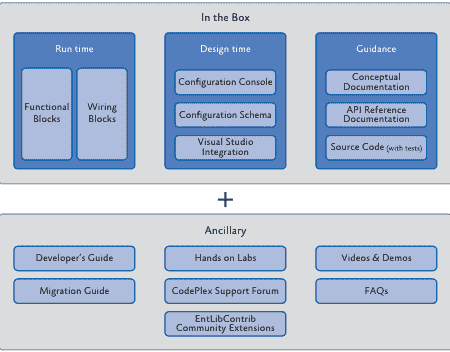

## 使用 Enterprise Library 可以做的事情

如果您查看已安装的文档，您会发现 Enterprise Library 今天实际上包含九个应用程序块。但是，实际上只有七个块“执行操作”——这些块被称为功能块。另外两个块涉及“连接事物”（连接块）。这实际上意味着，有七个块针对特定的横切关注点，例如缓存、日志记录、数据访问和验证。另外两个块（Unity 依赖注入机制和策略注入应用程序块）旨在帮助您实现更松散耦合、可测试且易于维护的系统。所有块中还使用了一些共享的核心组件。图 2 显示了这一点。

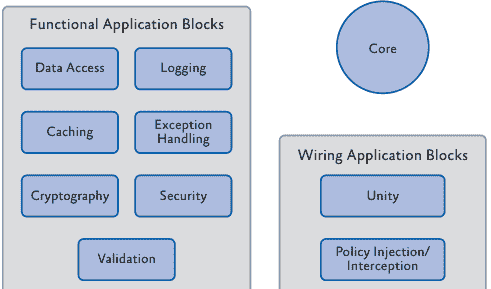

**图 2** Enterprise Library 的组成部分

在本书中，我们将专注于七个功能块。如果您想了解有关如何使用 Unity 和策略注入应用程序块的更多信息，请查看本指南的附录。它们更详细地描述了 Unity 作为依赖注入机制的功能以及策略注入的使用。

- **缓存。** 缓存应用程序块允许您在应用程序中集成本地缓存，该缓存使用内存缓存，并可选地使用数据库或独立存储后备存储。该块提供检索、添加和删除缓存数据所需的所有功能，并支持可配置的过期和清理策略。您还可以通过创建自己的可插拔


提供商或使用第三方提供商——例如，以支持分布式缓存和其他功能。缓存可以在许多应用程序场景中带来显著的性能和效率提升。

- 凭据管理。安全应用程序块让您轻松实现常见的授权相关功能，例如缓存用户的授权和身份验证数据，并与 Microsoft .NET Framework 安全功能集成。

- 数据访问。数据访问应用程序块简化了许多常见的数据访问任务，例如读取用于显示的数据、在应用程序层之间传递数据，以及将更改的数据提交回数据库系统。它支持存储过程和内联 SQL，可以将数据公开为对象序列以供客户端查询，并通过易于使用的类提供对 ADO.NET 最常用功能的访问。

- 加密。加密应用程序块使加入加密功能变得容易，例如加密和解密数据、从数据创建哈希，以及比较哈希值以验证数据未被篡改。使用此块可以帮助您在开发自定义机制时避免常见陷阱，这些机制可能会引入安全漏洞。

- 异常处理。异常处理应用程序块让您能够快速轻松地设计和实施一致的策略，以管理应用程序各架构层中发生的异常。它可以记录异常信息，通过用另一个异常替换原始异常来隐藏敏感信息，并通过将原始异常包装在另一个异常中来维护异常的上下文信息。

- 日志记录。日志记录应用程序块简化了常见日志功能的实现，例如将信息写入 Windows 事件日志、电子邮件、数据库、Windows 消息队列、文本文件、Windows 管理规范 (WMI) 事件或自定义位置。

- 验证。验证应用程序块提供一系列功能，用于使用属性和规则集实现结构化且易于维护的验证机制，并与大多数类型的应用程序界面技术集成。

## 为何应使用企业库

如前一节所示，企业库提供了一套全面的功能，可帮助您通过可重用的组件和核心功能来管理横切关注点。当然，与许多开发人员一样，您可能患有著名的 NIH（此处未发明）综合征。但是，认真地说，您团队中的每个开发人员是不是也该停止编写自己的日志框架了？使用标准且经过验证的代码库和组件可以节省开发时间、最大限度地降低成本、减少宝贵测试资源的使用并降低总体维护工作量，这是公认的事实。正如管理员所说：“如今，您无法承受不重用的代价。”

您可以下载 Nucleus Research 2009 年关于 Microsoft patterns & practices 的报告，该报告回顾了关键组件和优势，并包含采用 patterns & practices 交付成果的软件架构师和开发人员的直接反馈，网址为 http://msdn.microsoft.com/en-us/practices/ee406167.aspx。

而且，企业库并非某个可能下个月就变得面目全新的新来者。作为一个概念，企业库已经存在多年，经历了五个完整版本以及中间增量版本的发布。

企业库继续随着 .NET Framework 的功能而发展。随着 .NET Framework 随时间变化，原本属于企业库的一些功能已被并入核心，而企业库也随之改变，以利用 .NET Framework 和底层系统中可用的新功能。示例包括新的编程语言功能，以及 .NET 配置和 I/O 机制中性能和功能的改进。然而，即使在 5.0 版中，绝大部分代码也完全与使用企业库 2.0 编写的应用程序向后兼容。

您还可以将企业库用作学习材料——不仅可以在应用程序中实现设计模式，还可以了解开发团队在编写代码时如何应用模式。企业库体现了许多设计模式，并展示了良好的架构和编码技术。整个库的源代码均已提供，因此您可以探索实现方式，并在自己的应用程序中重用这些技术。

最后，它是免费的！或者更确切地说，它根据 Microsoft 公共许可证 (MSPL) 分发，该许可证授予您免版税许可来构建衍生作品，并免费分发它们——甚至可以出售它们。您必须保留源文件中的归属标头，但可以修改代码并包含您自己的自定义扩展。您真的还需要其他理由来尝试企业库吗？

您会注意到，尽管我们没有在封面上用大号友好字体印刷“别慌！”，但本书确实需要一点时间才能进入更典型的文档风格，并开始提供实际示例。但是，您可以确定——从这里开始——您将找到一系列指导和示例，帮助您快速轻松地掌握企业库。如果您刚开始使用企业库，还有其他资源可供帮助（例如动手实验），对于现有用户也有帮助（例如以前版本的重大更改和迁移信息），可在 http://www.codeplex.com/entlib/ 上找到。您还可以访问网站的源代码部分，查看企业库团队在您阅读本指南时正在处理的工作。

## 企业库的一些基础知识

在深入探索企业库的应用程序块和功能之前，您需要掌握一些基础知识。在本章中，管理员将帮助您探索诸如如何安装和部署库以及如何执行初始配置等主题。之后，您可以自由跳转到任何其他章节，了解每个块如何帮助您简化代码并管理横切关注点。有关本章涵盖主题的更多信息，请参阅随企业库安装的产品文档，或可在 http://go.microsoft.com/fwlink/?LinkId=188874 上找到的在线文档。

## 选择要安装的块

企业库就像一家“自选糖果”商店，您可以选择想要使用的功能，并简单忽略其余功能。当然，在您从糖果店诱人的展示柜中挑选喜欢的糖果之前，需要找一个纸袋来装它们。您可以将此视为挑选和混合的先决条件，是一项您每次都会使用的基本功能——无论您选择的是软糖熊、榛子巧克力还是薄荷糖。

同样，使用企业库时也有先决条件和基本功能。开始开发前的主要先决条件是将二进制文件和支持文件安装到您的计算机上。每次使用企业库时都需要的基本功能是核心程序集，它们实现对配置、对象创建以及所有块使用的辅助功能的访问。

但是，安装企业库时，您可以选择要安装的应用程序块；不过，除非您确定不会使用特定块，否则通常最好全部安装。某些块依赖于其他块，在开发应用程序时全部安装它们将简化配置，并确保您不必重新运行安装程序来稍后添加其他块。在部署应用程序时，您只需部署正在使用的块及其依赖块。

例如，异常处理块依赖于日志记录块来记录异常信息。表 1 列出了这些依赖项的完整列表。

表 1 应用程序块可选依赖项

| 应用程序块 | 可选依赖项 |
|---|---|
| 缓存块 | 可使用数据访问块将数据缓存在数据库中。可使用加密块加密缓存的数据。 |
| 异常处理块 | 可使用日志记录块记录异常信息。可使用数据访问块将异常信息记录到数据库中。 |
| 日志记录块 | 可使用数据访问块记录到数据库。 |
| 安全块 | 可使用缓存块缓存凭据。可使用数据访问块将凭据缓存在数据库中。可使用加密块加密缓存的凭据。 |


配置工具将在需要时，使用默认配置自动将所需块添加到应用程序配置文件中。例如，当你向异常处理块策略添加日志记录处理程序时，配置工具将使用默认设置将日志记录块添加到配置中。

本指南中介绍的七个应用程序块是专门设计用于帮助你管理一系列横切关注点的功能块。所有这些块都依赖于 Enterprise Library 的核心功能，而核心功能又依赖于 Unity 依赖注入和拦截机制（Unity 应用程序块）来执行对象创建和其他基本功能。

## 安装 ENTERPRISE LIBRARY

要开始使用 Enterprise Library，你必须先安装它。你可以从 http://msdn.microsoft.com/entlib/ 下载当前版本。只需运行 Microsoft Installer (MSI) 包即可开始安装，并选择要安装的块和功能。这将安装可直接使用的预编译二进制文件，以及随附的工具和资源，例如配置编辑器和用于安装示例及检测的脚本。

如果你想查看源代码，甚至可能想根据自己的要求对其进行修改，请务必在运行安装程序时选择安装源代码的选项。源代码作为单独的包包含在主安装程序中，这样你可以制作所需数量的源代码工作副本，并在需要时轻松恢复到原始版本。如果你选择安装源代码，那么选择让安装程序为你编译库也是个好主意，这样你就可以立即开始使用它。但是，如果你满意于使用预编译的程序集，则不需要安装或编译源代码。

安装完成后，你将看到开始菜单项，其中包含指向 Enterprise Library 工具、源代码安装程序和文档的链接。工具包括用于安装检测、数据库文件和其他功能的批处理文件。还有批处理文件可用于编译整个库源代码，并将所有程序集复制到源代码文件夹中的 bin 文件夹，如果你想从源代码重新生成库的话。

## 程序集和引用

当人们初次接触 Enterprise Library 时，脸上露出一丝惊慌并不罕见。是的，程序集相当多，但请记住：

- 你只需使用与自己的场景直接相关的程序集。
- 只有在非常特殊的情况下才需要几个程序集。
- 你在应用程序中使用的运行时程序集大多小于 100 KB；最大的也只有大约 500 KB。
- 在大多数应用程序中，你将使用的所有程序集的总大小将在 1 到 2 MB 之间。

任何使用 Enterprise Library 的应用程序都应添加以下程序集：公共（核心）程序集、Unity 依赖注入机制（如果你使用默认的 Unity 容器）以及容器服务定位程序集：

- Microsoft.Practices.EnterpriseLibrary.Common.dll
- Microsoft.Practices.Unity.dll
- Microsoft.Practices.Unity.Interception.dll
- Microsoft.Practices.ServiceLocation.dll

如果你希望在代码中引用特定的 Unity 配置类，还需要程序集 **Microsoft.Practices.Unity.Configuration.dll**。但是，在大多数情况下，你不需要此程序集。

除了必需的程序集外，你还必须引用实现应用程序中将使用的 Enterprise Library 功能的程序集。每个应用程序块都有多个程序集。通常，这些程序集包括一个与块同名的主程序集（例如 **Microsoft.Practices.EnterpriseLibrary.Logging.dll**），以及实现块特定处理程序或功能的其他程序集。只有当你想要使用这些程序集添加的功能时，才需要这些其他程序集。例如，对于日志记录块，有一个用于记录到数据库的单独程序集（**Microsoft.Practices.EnterpriseLibrary.Logging.Database.dll**）。如果你不记录到数据库，则不需要引用这个其他程序集。

### GAC 或 Bin，已签名或未签名？

所有程序集都作为预编译的已签名版本提供，如果你愿意，可以将其安装到全局程序集缓存 (GAC) 中。但是，如果你需要并行运行不同版本的 Enterprise Library 程序集，这可能会出现问题，你可能更愿意将它们放在靠近应用程序的文件夹中。

然后，你可以在项目中引用编译后的程序集，这会自动将它们复制到 bin 文件夹。在 Web 应用程序中，你可以直接将它们复制到应用程序的 bin 文件夹。这种方法提供了简单的可移植性和易于安装。

或者，你可以安装 Enterprise Library 的源代码，并使用提供的脚本编译未签名版本的程序集。如果你决定修改源代码以满足自己的特定要求，这很有用。如果需要，之后可以使用自己的凭据对程序集进行强命名和签名。

有关并行操作和其他部署问题的更多信息，请参阅随 Enterprise Library 安装的文档，并在线访问 http://go.microsoft.com/fwlink/?LinkId=188874。

### 导入命名空间

在项目中引用适当的程序集后，你可能希望向项目文件添加 **Imports** 语句，以简化代码并避免使用完全限定的命名空间名称来指定对象。首先导入每个使用 Enterprise Library 的项目都需要的两个核心命名空间：

- Microsoft.Practices.EnterpriseLibrary.Common
- Microsoft.Practices.EnterpriseLibrary.Common.Configuration

根据你决定如何在 Enterprise Library 中实例化它包含的对象，你可能需要导入另外两个命名空间。我们将在本章稍后介绍 Enterprise Library 中的对象实例化时再讨论这个问题。

你还需要导入所使用的特定应用程序块的命名空间。大多数 Enterprise Library 程序集包含多个命名空间来组织内容。例如，如图 3 所示，日志记录块（较复杂的块之一）的主程序集包含十几个子命名空间。如果你使用这些命名空间中的类，例如特定的筛选器、侦听器或格式化程序，可能需要导入其中的几个命名空间。

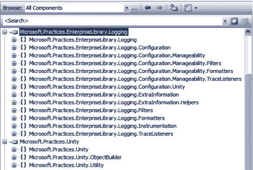

图 3 日志记录块中的命名空间

## 配置 Enterprise Library

在最初的单独应用程序块合并为 Enterprise Library 之前，用户面临的最大挑战之一就是配置。你必须手动编辑应用程序配置文件的各个部分，这既容易出错又非常烦人。在 Enterprise Library 中，你有多种工具可用于执行配置，并有大量机会来定义和管理配置信息。

这种灵活性之所以存在，是因为 Enterprise Library 使用配置源将配置信息公开给应用程序块和库的核心功能。配置源可以从标准 .NET 配置文件（如 App.config 和 Web.config）、其他文件、数据库（使用可从 http://entlib.codeplex.com 获取的示例 SQL 配置源）中读取配置，还可以考虑计算机或域的组策略规则。

此外，你可以使用流式接口或 .NET 配置 API 以编程方式创建和填充配置源，将部分配置与中央共享配置合并，生成合并的配置文件，并为单个运行时环境生成不同的配置。有关这些更高级配置场景的更多信息，请参阅附录 D，“Enterprise Library 配置场景”。

## 配置工具

Enterprise Library 包含一个独立控制台，以及一个与 Microsoft Visual Studio® 集成的配置编辑器。独立控制台提供专门针对 32 位 (x86) 平台的版本以及针对任何平台编译的版本。对于每个平台，都有适用于 .NET Framework 3.5 和 4.0 版本的单独控制台版本。你甚至可以将它（及其使用的程序集）复制到未安装 Enterprise Library 的计算机上，如果你只想执行部署后配置和系统管理的话。图 4 显示了配置控制台，其中安装了本书涵盖的一些应用程序块。


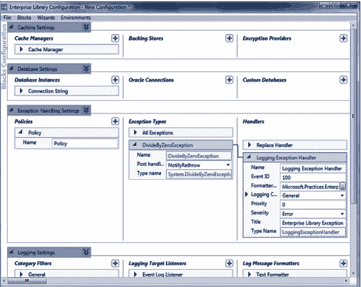

### 图 4 企业库配置控制台

Visual Studio 配置编辑器显示的界面与图 4 所示非常相似，但允许你在解决方案资源管理器中通过简单的右键单击来编辑配置文件。

## 使用配置工具

应用程序基本配置最常见的场景是将配置信息存储在本地配置文件中（例如 Web.config 或 App.config）。你可以在配置控制台中创建新的企业库配置，然后将其保存到磁盘，也可以打开现有配置文件并对其进行编辑，以将企业库添加到你的应用程序中。

即使你使用附录 D“企业库配置场景”中描述的更高级方法，定义企业库配置的技术基本也是相同的。配置应用程序的一般步骤如下：

- 从 **“开始”** 菜单打开独立配置工具，或在 Visual Studio 解决方案资源管理器中右键单击配置文件，然后单击 **“编辑企业库 v5 配置”**。
- 单击 **“块”** 菜单，选择要添加到配置的块。这将使用默认设置添加该块。
  - 如果要使用配置控制台编辑配置文件 `<appSettings>` 节中的值，请选择 **“添加应用程序设置”**。
  - 如果要为企业库启用检测，请选择 **“添加检测设置”**。
  - 如果要使用配置的替代源（例如自定义 XML 文件），请选择 **“添加配置设置”**。
- 要查看每个节、块或提供程序的配置设置，请单击该节、块或提供程序名称旁边的右向箭头。再次单击它，或按空格键，以折叠此节。
- 要查看每个主配置节的属性窗格，请单击向下的双箭头。再次单击它以关闭属性窗格。
- 要向块添加提供程序，具体取决于块或提供程序的类型，你可以右键单击左侧列中的节，并在快捷菜单上选择相应的 **“添加”** 项，或者单击配置工具相应列中的加号图标。例如，要向异常处理块中的策略添加新的异常类型，请右键单击 **“策略”** 项，然后单击 **“添加异常类型”**。

重命名项时，该项的标题会更改以匹配名称。例如，如果你重命名了异常处理块中的默认 **“策略”** 项，该项将显示新名称，而不是“Policy”。

- 使用该块相应节中的控件编辑节、块或提供程序的属性。你将在本指南的后续章节中看到有关所需设置及其作用的信息。有关可指定的所有设置的完整详细信息，请参阅随企业库安装的该块文档。
- 要删除节或提供程序，请右键单击该节或提供程序，然后在快捷菜单上单击 **“删除”**。要更改块中配置了多个提供程序时的提供程序顺序，请右键单击该节或提供程序，然后在快捷菜单上单击 **“上移”** 或 **“下移”** 命令。
- 要设置块的默认提供程序（例如数据访问块的默认 **“数据库”**），请单击块名称旁边的向下双箭头图标，并从下拉列表中选择默认提供程序名称。在此节中，你还可以指定用于加密此节的提供程序类型，以及块是否应要求完全权限。

有关加密配置的更多详细信息，请参阅本章的下一节。有关在部分信任环境中运行块的信息（这要求你关闭 **“要求权限”** 设置），请参阅随企业库安装的文档。
- 要使用向导简化常见任务（例如配置日志记录到数据库）的配置，请打开 **“向导”** 菜单并选择所需的向导。向导将显示一系列对话框，指导你完成所需配置的设置。
- 如果要根据不同的部署场景或环境为应用程序配置不同的设置，请打开 **“环境”** 菜单并单击 **“新建环境”**。这会向每个节添加一个下拉列表 **“环境覆盖”**。如果在此列表中选择 **“覆盖属性”**，则可以为添加到配置的每个新环境指定设置。如果你有多个共享相同基本配置但需要不同属性设置的环境，此功能非常有用。它允许你创建一个基础配置文件（config）和一个包含差异的环境增量文件（dconfig）。有关配置和使用多个环境的信息，请参阅附录 D“企业库配置场景”。
- 在编辑配置时，工具的下部会显示配置中的任何警告或错误。在保存配置之前，必须解决所有错误。
- 配置完应用程序后，请使用 **“文件”** 菜单上的命令将其以适当的名称保存为应用程序文件夹中的文件，例如，Web 应用程序使用 Web.config，Windows 窗体应用程序使用 App.config。

当然，你也可以使用文本或 XML 编辑器编辑配置文件，但与使用配置控制台相比，这可能是一个更繁琐的过程。但是，当应用程序在未安装配置控制台的服务器上运行时，这可能是对配置进行小更改的有用方法。企业库还包含一个 XML 配置架构，你可以使用它来启用 IntelliSense® 并简化配置文件的手动编辑。

要在 Visual Studio 中启用企业库 XML 架构，请打开配置文件，打开 **“XML”** 菜单，然后单击 **“架构”**。在 **“XML 架构”** 对话框中，找到企业库架构，并将 **“使用”** 列中的值更改为 **“使用此架构”**。然后单击 **“确定”**。

## 加密配置节

为使用企业库的应用程序存储配置信息最常见的方法可能是使用存储在应用程序根文件夹中的 App.config 或 Web.config 文件。这没问题，但你可能会担心，任何碰巧路过服务器的人（无论是物理上还是通过 Internet 虚拟访问）都能打开文件并查看敏感信息。这些信息可能包括数据访问块的连接字符串、验证块的验证规则，或日志记录块用于与 Windows 消息队列通信的连接信息。

理论上，你会通过物理保护服务器且不让其以登录的管理员帐户运行来保护配置文件，但你可以（并且可能应该）通过加密配置文件的节来添加额外的保护层。配置工具可以为你自动完成此操作；你只需设置要加密的特定块或配置节的 **ProtectionProvider** 属性即可。有关更多信息，请参阅附录 E“加密配置文件”。

## 实例化和使用企业库对象

在引用所需的程序集、导入所需的命名空间并配置应用程序后，你可以开始考虑创建要在应用程序中使用的企业库对象的实例。如你在后续各章中将看到的，企业库应用程序块已针对作为几乎任何类型应用程序中松散耦合的组件进行了优化。此外，此版本中改用依赖注入容器来生成企业库对象实例，这意味着你可以更轻松地实现当代设计模式和解决方案架构的优势。

> 默认情况下，企业库使用作为企业库一部分提供的 Unity 依赖注入机制。但是，可以将企业库配置为使用任何依赖注入容器——或其他基础机制——只要该容器或机制通过 **IServiceLocator** 接口的实现公开所需的配置信息即可。有关更多信息，请参阅附录 B“企业库中的依赖注入”和 http://commonservicelocator.codeplex.com。

在附录 A“使用 Unity 进行依赖注入”中，我们将更深入地探讨依赖注入容器实际上是什么，以及它如何帮助你应用遵循依赖倒置原则（DIP）的设计模式；特别是，依赖注入（DI）模式如何帮助你创建更松散耦合、更易于构建、测试和维护的应用程序。但是，你不需要理解这些或学习 DI 即可使用企业库。你可以用一行代码轻松快速地创建企业库对象的实例。


## 企业库对象、门面和工厂

企业库中的每个应用程序块都包含一个或多个核心对象，你通常使用这些对象来访问该块的功能。一个示例是异常处理应用程序块，它提供了一个名为 **异常管理器** 的门面，该门面公开了用于将异常传递给块进行处理的方法。

下表列出了每个块常用的对象。

| 应用程序块 | 非静态实例或工厂 |
| :--- | :--- |
| 缓存 | ICacheManager |
| 加密 | CryptographyManager |
| 数据访问 | Database |
| 异常处理 | ExceptionManager |
| 日志记录 | LogWriter<br>TraceManager |
| 安全 | ISecurityCacheProvider<br>IAuthorizationProvider |
| 验证 | ValidatorFactory<br>ConfigurationValidatorFactory<br>AttributeValidatorFactory<br>ValidationAttributeValidatorFactory |

某些块中还包含任务特定的对象，你可以使用运算符以传统方式直接在代码中创建这些对象。例如，你可以从验证应用程序块创建单个验证器，或从日志记录应用程序块创建日志条目。我们将在每个应用程序块章节的示例中展示如何执行此操作。

要使用应用程序块的功能，你只需创建上表中列出的相应对象、门面或工厂的实例，然后调用其方法即可。块的行为由你指定的配置控制，通常你只需一行代码即可执行异常处理、日志记录、缓存和加密值等任务。即使是访问数据或验证自定义类型实例等任务，也只需几行简单的代码。那么，让我们看看如何创建你想要使用的企业库对象的实例。

## 创建企业库类型的实例

在此版本的企业库中，创建企业库对象实例有两种推荐方法。你使用哪种方法完全取决于你决定如何构建应用程序。你可以使用企业库服务定位器获取实例的简单方法，该服务定位器提供对包含企业库配置信息的 Unity 容器的访问。或者，如果你已经是依赖注入的拥护者，你可以通过创建和填充容器并使用它来创建和管理企业库对象和你自己的自定义类型，从而掌控整个过程。我们将在下一节介绍这两种方法。

### 简单方法 — 使用企业库服务定位器

当你首次在应用程序代码中创建企业库类型的实例时，底层机制会将你的配置信息读入容器，并通过作为企业库配置机制一部分初始化的服务定位器将其暴露给你的代码。此服务定位器提供了你可以在应用程序代码中任何位置调用的方法，以获取任何企业库类型的配置实例。

例如，如果你正在使用日志记录应用程序块，你可以使用一行代码获取对 LogWriter 的引用，然后调用其 Write 方法将日志条目写入配置的目标，如下所示。

```
Dim writer = EnterpriseLibraryContainer.Current.GetInstance(Of LogWriter)()
writer.Write("I'm a log entry created by the Logging block.")
```

> 请注意，此代码通过省略变量类型名称关键字来使用类型推断。变量将假设赋值返回的类型；此技术可以使你的代码更易于维护。

如果你为块配置了多个类型实例，例如为数据访问应用程序块配置了多个 Database，则可以在调用 GetInstance 方法时指定名称。例如，你可能配置了一个名为 Customers 的企业库 Database 实例，它指定了 Microsoft SQL Server® 数据库，以及一个名为 Products 的单独 Database 实例，它指定了不同类型的数据库。在这种情况下，你在调用 GetInstance 方法时指定要解析的对象的名称，如下所示。

```
Dim customerDb _
    = EnterpriseLibraryContainer.Current.GetInstance(Of Database)("Customers")
```

你不需要初始化块、读取配置信息，或做除调用服务定位器方法之外的任何事情。对于许多应用程序场景，这种简单方法非常适合获取你想要使用的企业库类型的实例。

### 高级方法 — 直接访问容器

如果你想在应用程序中利用依赖注入和控制反转等设计模式，你可能已经在考虑使用依赖注入机制来解耦组件和层，并解析类型。如果是这种情况，将企业库纳入应用程序的更高级方法将与你的解决方案架构很好地契合。

与其允许企业库创建、填充和暴露仅包含企业库配置信息的默认容器，不如你自己创建和填充容器，并保留对容器的引用以供应用程序代码使用。这不仅允许你获取企业库对象的实例，还允许你使用容器为你自己的自定义类型实现依赖注入。实际上，容器本身就成为你的服务定位器。

例如，你可以在容器中创建注册和映射，以指定应用程序组件之间的依赖关系、类型之间的映射、参数和属性的值、方法的拦截以及延迟对象创建等功能。

你可能认为所有这些奇妙的功能都需要大量代码和精力才能实现；然而，事实并非如此。要使用企业库配置信息初始化和填充默认 Unity 容器并使其可供应用程序使用，只需一行代码。如下所示：

```
Dim theContainer = New UnityContainer() _
.AddNewExtension(Of EnterpriseLibraryCoreExtension)()
```

现在你已经有了对容器的引用，可以通过直接调用容器方法来获取任何企业库应用程序块的实例。例如，如果你正在使用日志记录应用程序块，你可以使用一行代码获取对 LogWriter 的引用，然后调用其 Write 方法将日志条目写入配置的目标。

```
Dim writer = theContainer.Resolve(Of LogWriter)()
writer.Write("I'm a log entry created by the Logging block!")
```

如果你为块配置了多个类型实例，例如为数据访问应用程序块配置了多个数据库，则可以在调用 Resolve 方法时指定名称，如下所示：

```
Dim customerDb = theContainer.Resolve(Of Database)("Customers")
```

你可能已经注意到 **解析** 方法与我们之前使用的 **获取实例** 方法在语法上的相似性。实际上，当你使用默认 Unity 容器时，服务定位器的 **获取实例** 方法只是调用 Unity 容器的 **解析** 方法。因此，语法和参数相似是合理的。容器和服务定位器都公开了其他方法，允许你获取对象集合，并且有泛型和非泛型重载，允许你在不支持泛型的语言中使用这些方法。

如果你选择在应用程序中使用这种更高级的企业库方法，需要注意的一点是，你应该将两个额外的命名空间导入到代码中。这些命名空间包括容器和核心扩展定义：

- Microsoft.Practices.EnterpriseLibrary.Common.Configuration.Unity
- Microsoft.Practices.Unity


## 对象实例化的优缺点

如果您尚未决定为创建 Enterprise Library 对象采用哪种方法，下表将帮助您了解每种方法的优缺点。

| 对象实例化技术 | 优点 | 注意事项 |
| :--- | :--- | :--- |
| 使用 Enterprise Library 服务定位器 | 无需初始化代码。服务定位器会自动提供。您可以在应用程序代码的任何位置解析类型。您无需保留对容器的引用。 | 您只能解析 Enterprise Library 类型（作为接口、抽象类型或自动注册的具体类型）。您无法操作或向容器添加注册或映射。 |
| 将容器用作服务定位器 | 您可以直接访问 Unity 容器的所有功能。您可以遍历内容并读取或操作注册和映射（尽管您不应尝试更改 Enterprise Library 配置信息）。您可以添加和删除自己的注册和映射，从而充分利用 DI 技术。 | 需要初始化，但这只是在应用程序启动时执行的一行代码，或者在使用默认 Unity 容器时的简单配置设置。基于请求的应用程序（如 ASP.NET 和 Web 服务）需要额外代码来存储容器引用并解析请求类（如 Page）的依赖项。 |

直接访问容器这一更高级方法的主要优点之一是，您可以使用它来解析自定义类型的依赖项。例如，假设您有一个名为 **税务计算器** 的类，需要执行日志记录并实现整个应用程序中应用的一致异常处理策略。您的类将包含一个构造函数，接受 **异常管理器** 和 **日志写入器** 的实例作为依赖项。

```
Public Class TaxCalculator
    Private _exceptionManager As ExceptionManager
    Private _logWriter As LogWriter

    Public Sub New(em As ExceptionManager, lw As LogWriter)
        Me._exceptionManager = em
        Me._logWriter = lw
    End Sub
    ...
End Class
```

如果您使用 Enterprise Library 服务定位器方法，可以在需要时直接在类构造函数或方法中获取这些实例，而不是将其作为参数传递。然而，更常用的方法是在主应用程序代码中生成和重用实例，并在创建 TaxCalculator 实例时将其传递给它。

```
Dim exManager _
= EnterpriseLibraryContainer.Current.GetInstance(Of ExceptionManager)()
Dim writer _
= EnterpriseLibraryContainer.Current.GetInstance(Of LogWriter)()
Dim calc As New TaxCalculator(exManager, writer)
```

或者，如果您已创建并保留对容器的引用，只需通过容器解析 TaxCalculator 类型即可。Unity 将实例化该类型，检查构造函数参数，并自动将 ExceptionManager 和 LogWriter 的实例注入其中。它将返回所有依赖项均已填充的新 TaxCalculator 实例。

```
Dim calc As TaxCalculator = theContainer.Resolve(Of TaxCalculator)()
```

## 更高级方法的更多理由

从前面的示例可以清楚看出，在除最简单的应用程序或场景之外的所有情况下，自行管理容器都能带来显著优势。您所见的依赖注入示例仅触及了使用更高级方法所能实现的表面。例如，如果您持有对容器的引用，则可以：

- 管理自定义类型的生存期。容器可以将其解析为单例，其生存期基于创建它们的对象的生存期，或为每个执行线程创建新实例。
- 通过将接口和抽象类型映射到自定义类型的具体实现，实现插件和服务定位器等模式。
- 推迟创建解析的自定义类型，直到实际需要时才创建。
- 为解析的自定义类型实例的参数和属性指定依赖项和值。
- 将拦截应用于自定义类型，以修改其行为、实现横切关注点的管理或添加其他功能。
- 设置依赖项层次结构，这些层次结构会自动填充，以实现组件之间的最大解耦，协助调试，简化测试，并降低维护成本和工作量。

当您使用默认 Unity 容器时，您拥有一个强大的通用依赖注入机制。您可以在运行时以编程方式在容器中定义和修改注册和映射，也可以使用配置文件定义它们。附录 A，“使用 Unity 进行依赖注入”包含有关使用 Unity 的更多信息。

为了让您了解其使用有多简单，以下代码在名为 **IMyService** 的接口和名为 **客户服务** 的具体类型之间注册了一个映射，指定其应为单例。

```
theContainer.RegisterType(Of IMyService, CustomerService)(_
    New ContainerControlledLifetimeManager())
```

然后，您可以使用以下代码解析具体类型的单个实例。

```
Dim myServiceInstance As IMyService = theContainer.Resolve(Of IMyService)()
```

这将返回 **客户服务** 类型的实例，尽管您可以通过更改容器中的映射在运行时更改返回的实际类型。或者，您可以为接口或基类创建多个不同名称的注册或映射，并在解析类型时指定名称。

Unity 还可以从应用程序的 App.config 或 Web.config 文件（或任何其他配置文件）读取其配置。这意味着您可以使用创建 Enterprise Library 对象和自定义类型的高级方法，同时只需编辑配置文件即可更改应用程序的行为。

> 如果要从配置文件将类型注册和映射加载到 Unity 容器中，必须将程序集 Microsoft.Practices.Unity.Configuration.dll 添加到项目中，并可选择将命名空间 Microsoft.Practices.Unity.Configuration 导入到代码中。此程序集和命名空间包含用于加载配置信息的 Unity 容器扩展。

例如，配置文件中的以下摘录将初始化容器并向其中添加与上面所示 **RegisterType** 示例相同的自定义映射。

```
<unity>
  <alias alias="CoreExtension"
    type="Microsoft.Practices.EnterpriseLibrary.Common.Configuration
    .Unity.EnterpriseLibraryCoreExtension,
    Microsoft.Practices.EnterpriseLibrary.Common" />
  <namespace name="Your.Custom.Types.Namespace" />
  <assembly name="Your.Custom.Types.Assembly.Name" />
  <container>
    <extension type="CoreExtension" />
    <register type="IMyService" mapTo="CustomerService">
      <lifetime type="singleton" />
    </register>
  </container>
</unity>
```

然后，您只需将此配置加载到新的 Unity 容器中即可。这只需要一行代码，如下所示。

```
Dim theContainer = New UnityContainer().LoadConfiguration()
```

> 在附录 A，“使用 Unity 进行依赖注入”中，我们演示的其他技术包括使用特性来注册类型映射和依赖项、定义命名注册以及为参数和属性指定依赖项和值

使用创建对象的更高级技术时需要注意的一点是，您的应用程序负责管理容器、保留对其的引用，并使该引用可供必须访问容器的代码使用。在自动维护全局状态的基于窗体的应用程序中（例如，使用 Windows Forms、Windows Presentation Foundation (WPF) 和 Silverlight® 等技术构建的应用程序），您可以使用应用程序范围的变量来实现此目的。

但是，在使用 ASP.NET、ASMX 和 Windows Communication Foundation (WCF) 等技术构建的基于请求的应用程序中，您通常需要额外代码来维护容器并使其可用于每个请求。我们将在附录 B，“Enterprise Library 中的依赖注入”中讨论实现此目的的一些方法，您可以在随 Enterprise Library 安装的文档以及在线 http://go.microsoft.com/fwlink/?LinkId=188874 中找到完整详细信息。

## 从 Enterprise Library 的早期版本获取对象

如果您使用过 5.0 之前版本的 Enterprise Library，可能更熟悉在应用程序代码中创建对象的早期方法。早期版本通常支持或推荐使用一系列静态外观。虽然这些外观在版本 5.0 中仍受支持，以便与现有应用程序保持向后兼容，但它们不再是推荐的方法，并且未来版本中可能会被弃用。

图 5 总结了您可以用来访问 Enterprise Library 功能的所有方法。1 和 2 是 Enterprise Library 5.0 的推荐方法；3 和 4 仍受支持，以便更轻松地升级使用早期版本 Enterprise Library 的现有应用程序。


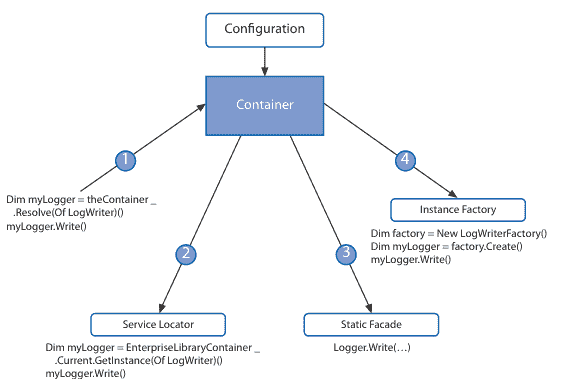

### 图 5 四种方式，一个库

## 示例应用程序

为帮助您了解如何使用企业库以及本指南中涵盖的七个应用程序块，我们提供了一系列简单的示例应用程序，您可以运行并查看。每个示例都是基于控制台的应用程序，在大多数情况下，所有使用企业库的相关代码都位于 Program.vb 文件的一系列例程中。这样可以轻松了解不同块的工作方式，以及使用每个块可以实现什么。

示例使用最简单的方法（前一章中描述的服务定位器和 GetInstance 方法）来创建所需的企业库对象，并将所用块的配置信息存储在 App.config 文件中。示例中的每个选项都会演示相关块的特定功能并显示结果。您可以在 Visual Studio 中打开这些示例的解决方案，或者直接运行 bin\debug 文件夹中的可执行文件，并在文本编辑器中查看源文件（如果您愿意）。

要获取示例应用程序，请访问 http://go.microsoft.com/fwlink/?LinkId=189009。

### 摘要

如果您不熟悉企业库的功能及其在应用程序中使用的基础知识，本简要介绍将帮助您入门。本章介绍了企业库是什么、在哪里可以获取它，以及它如何使管理横切关注点变得容易得多。本书专注于企业库中“执行操作”（而非“连接操作”）的应用程序块。本书重点介绍的块包括缓存、加密、数据访问、异常处理、日志记录、安全性和验证应用程序块。

本章的另一个目的是通过解释如何部署和引用企业库包含的程序集、如何配置应用程序以使用企业库、如何实例化企业库对象以及我们提供的示例应用程序，帮助您开始使用企业库。省略了一些更高级的功能和配置选项，以便您可以专注于基本要求。但是，本指南中的每个附录都提供了更详细的信息，而企业库包含大量参考文档、示例和其他资源，将在您探索这些更高级功能时为您提供指导。

## 关于数据访问的那些事

### 简介

您上次编写企业级应用程序时是什么时候，该应用程序不需要处理数据？在处理数据时，数据很有可能来自某种关系型数据库。使用数据库是大多数企业应用程序需要完成的最常见任务，因此数据访问应用程序块成为所有企业库块中使用最广泛的块也就不足为奇了，我们决定在本书的应用程序块章节中首先介绍它，这也绝非巧合。

全世界数百万企业库用户中，很多人都是通过数据访问块入门的。为什么呢？因为它可以轻松实现最常用的数据访问操作，而无需一遍又一遍地编写相同的重复代码，也无需担心应用程序将面向哪个数据库。只要为目标数据库提供了数据访问块提供程序，您就可以使用相同的代码来访问数据。您无需担心参数的语法、各个数据访问方法的特性或返回的不同数据类型。

这意味着，您还可以轻松将应用程序切换到使用不同的数据库，而无需重写代码、重新编译和重新部署。管理员和操作员可以将目标数据库更改为不同的服务器，甚至更改为不同的数据库（例如从 Oracle 迁移到 Microsoft® SQL Server® 或反之），而不会影响应用程序代码。在当前版本中，数据访问应用程序块包含用于 SQL Server、SQL Server Compact Edition 和 Oracle 数据库的提供程序。还可以为 IBM DB2、MySql、Oracle (ODP.NET)、PostgreSQL 和 SQLite 数据库获得第三方提供程序。有关这些内容的更多信息，请参阅 http://codeplex.com/entlibcontrib。

### 数据访问应用程序块的作用是什么？

数据访问应用程序块抽象了您正在使用的实际数据库，并公开了一系列方法，使访问该数据库以执行常见任务变得容易。它旨在简化调用存储过程的任务，但也为使用参数化 SQL 语句提供全面支持。例如，当您想要填充 **数据集** 时，只需创建相应 **数据库** 类的实例，使用它来获取适当的命令实例（例如 **DbCommand**），并将其传递给 **数据库** 类的 **ExecuteDataSet** 方法。您无需创建 **DataAdapter** 或调用 **Fill** 方法。**ExecuteDataSet** 方法管理连接，并执行填充 **数据集** 所需的所有任务。类似地，**数据库** 类允许您获取 **DataReader**、直接执行命令以及从 **数据集** 更新数据库。该块还支持事务，以帮助您管理多个操作，如果发生错误，这些操作可以回滚。

除了 ADO.NET 用户熟悉的更常见方法之外，数据访问块还为支持此功能的数据库提供异步数据访问技术，并提供将数据作为对象序列返回的功能，这些对象适合使用语言集成查询 (LINQ) 等技术在客户端进行查询。但是，该块 *不* 意在作为对象/关系映射 (O/RM) 解决方案。它使用映射将参数和关系数据与对象的属性关联起来，但不实现 O/RM 建模解决方案。

使用数据访问块的主要优势（除了通过封装您否则需要编写的样板代码所实现的简单性之外）在于，它提供了一种创建提供程序独立的应用程序的方法，这些应用程序可以轻松切换到使用不同的源数据库类型。在大多数情况下，除非您的代码利用了特定于特定数据库的方法，否则所需的唯一更改是使用适当的连接字符串更新配置文件的内容。您无需更改指定查询（例如 SQL 语句或存储过程名称）的方式、创建和填充参数或处理返回值的方式。这也意味着测试需求降低，配置更改甚至可以通过组策略完成。

### 数据访问块支持的数据操作

下表按任务列出了数据访问应用程序块公开的用于检索和更新数据的最常用方法。习惯于直接使用 ADO.NET 的人会对其中一些方法名称感到熟悉。

| 任务 | 方法 |
| :--- | :--- |
| 填充数据集并从数据集更新数据库。 | **ExecuteDataSet**。创建、填充并返回数据集。<br>**LoadDataSet**。填充现有数据集。<br>**UpdateDataSet**。使用现有数据集更新数据库。 |
| 读取多个数据行。 | **ExecuteReader**。创建并返回提供程序独立的 DbDataReader 实例。 |
| 执行命令。 | **ExecuteNonQuery**。执行命令并返回受影响的行数。其他返回值（如果有）显示为输出参数。<br>**ExecuteScalar**。执行命令并返回单个值。 |
| 将数据作为对象序列检索。 | **ExecuteProcAccessor**。将存储过程选定的数据作为对象序列返回，以便在客户端进行查询。<br>**ExecuteSqlStringAccessor**。将 SQL 语句选定的数据作为对象序列返回，以便在客户端进行查询。 |
| 检索 XML 数据（仅限 SQL Server）。 | **ExecuteXmlReader**。通过 XmlReader 将数据作为一系列 XML 元素返回。请注意，此方法特定于 SqlDatabase 类（而不是基础 Database 类）。 |
| 创建命令。 | **GetStoredProcCommand**。返回适合执行存储过程的命令对象。<br>**GetSqlStringCommand**。返回适合执行 SQL 语句（可能包含参数）的命令对象。 |
| 使用命令参数。 | **AddInParameter**。创建新的输入参数并将其添加到命令的参数集合中。<br>**AddOutParameter**。创建新的输出参数并将其添加到命令的参数集合中。<br>**AddParameter**。创建特定类型和方向的新参数并将其添加到命令的参数集合中。<br>**GetParameterValue**。以 Object 类型返回指定参数的值。<br>**SetParameterValue**。设置指定参数的值。 |
| 使用事务。 | **CreateConnection**。创建并返回当前数据库的连接，允许您在连接上启动和管理事务。 |

从本表可以看出，数据访问块支持使用关系型数据库时您将遇到的几乎所有常见场景。每个数据访问方法也有多个重载，旨在简化使用并在必要时与现有数据事务集成。通常，您应根据以下准则选择要使用的重载：

- 接受 ADO.NET **DbCommand** 对象的重载为每个方法提供了最灵活性和控制力。
- 接受存储过程名称和一组值（用作存储过程的参数值）的重载在您的应用程序调用需要参数的存储过程时非常方便。


- 接受 **CommandType** 值和表示命令的字符串的重载在您的应用程序执行内联 SQL 语句或不需要参数的存储过程时非常方便。
- 接受事务的重载允许您在现有事务中执行该方法。
- 如果使用 **SqlDatabase** 类型，可以使用方法的 **Begin** 和 **End** 版本异步执行多个常用方法。
- 可以使用 **Database** 类创建 **Accessor** 实例，以同步和异步方式执行数据访问操作，并将结果作为一系列适合使用 LINQ 等技术进行客户端查询的对象返回。

## 如何使用数据访问块？

在开始使用数据访问块之前，必须将其添加到您的应用程序中。配置该块以指定要使用的数据库，并将相关程序集添加到项目中。然后可以在代码中创建这些数据库的实例，并使用它们读取和写入数据。

## 配置块并引用所需程序集

使用数据访问块的第一步是配置要访问的数据库。该块使用 App.config、Web.config 或其他配置文件的标准 **<connectionStrings>** 节来存储各个数据库连接字符串，并添加一个小型 Enterprise Library 特定节，用于定义配置的数据库中哪个是默认数据库。可以使用 Enterprise Library 配置控制台配置所有这些设置，如图 1 所示。

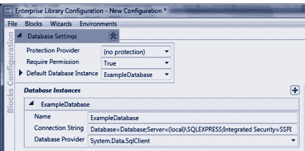

图 1 为数据访问应用程序块创建新配置

配置所需数据库后，必须在应用程序代码中实例化它们。添加所需程序集的引用，并为代码中将使用的对象所在的命名空间添加 Imports 语句。除了每个 Enterprise Library 项目所需的 Enterprise Library 程序集（第 1 章“简介”中列出）之外，还必须引用或将程序集 Microsoft.Practices.EnterpriseLibrary.Data.dll 添加到 bin 文件夹。该程序集包含用于处理 SQL Server 数据库的类。

如果使用 SQL Server Compact Edition 数据库，还必须引用或添加程序集 Microsoft.Practices.EnterpriseLibrary.Data.SqlCe.dll。如果使用 Oracle 数据库，可以使用 Enterprise Library 包含的 Oracle 提供程序和 ADO.NET Oracle 提供程序，这要求引用或添加程序集 System.Data.OracleClient.dll。但是，请注意，OracleClient 提供程序在 .NET Framework 4.0 版中已弃用，尽管 Enterprise Library 仍支持它。对于未来的开发，请考虑选择其他 Oracle 驱动程序，例如 Enterprise Library Contrib 站点 http://codeplex.com/entlibcontrib 上提供的驱动程序。

为了更轻松地使用数据访问块中的对象，可以将相关命名空间（例如 Microsoft.Practices.EnterpriseLibrary.Data 和 Microsoft.Practices.EnterpriseLibrary.Data.Sql）的引用添加到项目中。

## 创建数据库实例

可以使用多种技术获取要访问的数据库的 Database 实例。第 1 章“简介”中的“实例化 Enterprise Library 对象”部分描述了可以使用的不同方法。本章可下载的示例使用最简单的方法：调用 EnterpriseLibraryContainer.Current 属性中可用的服务定位器的 GetInstance 方法（如下所示），并将这些实例存储在应用程序范围的变量中，以便从代码中的任何位置访问它们。

```
' Resolve the default Database object from the container.
' The actual concrete type is determined by the configuration settings.
Dim defaultDB As Database _
    = EnterpriseLibraryContainer.Current.GetInstance(Of Database)()

' Resolve a Database object from the container using the connection string name.
Dim namedDB As Database _
    = EnterpriseLibraryContainer.Current.GetInstance(Of Database)("ExampleDatabase")
```

上述代码演示了如何获取默认数据库和命名实例（使用连接字符串节中的名称）的实例。使用默认数据库是一种有用的方法，因为可以通过编辑配置文件更改配置中哪个数据库是默认数据库，而无需重新编译或重新部署应用程序。

请注意，上述代码将数据库实例引用为 Database 基类的实例。如果希望以后能够更改数据库类型，这是兼容性所必需的。但是，这意味着只能使用所有可能数据库类型中可用的功能（**Database** 类中定义的方法和属性）。

某些功能仅在特定数据库的具体类型中可用。例如，**ExecuteXmlReader** 方法仅在 **SqlDatabase** 类中可用。如果要使用此类功能，必须将实例化的数据库类型转换为相应的具体类型。以下代码创建 **SqlDatabase** 类的实例。

```
' Resolve a SqlDatabase object from the container using the default database.
Dim SqlServerDB As Database _
    = TryCast(EnterpriseLibraryContainer.Current.GetInstance(Of Database)()), _
    SqlDatabase)
```

除了使用配置来定义将使用的数据库之外，数据访问块还允许直接在代码中创建继承自 **Database** 类的具体类型的实例（如下所示）。只需提供指定相应 ADO.NET 数据提供程序类型（例如 **SqlClient**）的连接字符串即可。

```
' Assume the method GetConnectionString exists in your application and
' returns a valid connection string.
Dim myConnectionString As String = GetConnectionString()
Dim db As SqlDatabase = New SqlDatabase(myConnectionString)
```

## 示例应用程序

现在您已准备好新的 **Database** 对象，我们将向您展示如何使用它来执行各种任务。可以下载一个示例应用程序（一个简单的控制台应用程序），它演示了本章余下部分中将看到的所有场景。可以直接从 bin\debug 文件夹运行此应用程序，或在 Microsoft Visual Studio® 中打开名为 **DataAccess** 的解决方案，以在运行示例时查看所有代码。

本示例提供的数据库的两个连接字符串如下：

```
Data Source=.\SQLEXPRESS;
AttachDbFilename=|DataDirectory|\DataAccessExamples.mdf;
Integrated Security=True;User Instance=True
Data Source=.\SQLEXPRESS;Asynchronous Processing=true;AttachDbFilename=
|DataDirectory|\DataAccessExamples.mdf;
Integrated Security=True;User Instance=True
```

如果使用示例提供的脚本配置了其他数据库，运行此示例时可能会遇到不同的错误。很可能是 App.config 文件中数据库的连接字符串无效。此外，使用“管理工具”文件夹中的“服务” MMC 管理单元检查 SQL Server (SQLEXPRESS) 数据库服务（服务名为 **MSSQL$SQLEXPRESS**）是否正在运行。

此外，此块的最后一个示例使用分布式事务协调器 (DTC) 服务。此服务在您的计算机上可能未设置为自动启动。如果收到 DTC 服务不可用的错误，请从“管理工具”菜单打开“服务” MMC 管理单元并手动启动该服务；然后再次运行示例。

## 读取多个数据行

使用数据库时最常见的操作之一是读取多行数据。在 .NET 应用程序中，通常将这些行作为 DataReader 实例访问，或将其存储在 DataTable 中（通常位于创建的 DataSet 中）。本节将介绍返回 DataReader 的 ExecuteReader 方法的用法。本章后面将介绍如何将 DataSet 与数据访问块方法配合使用。

### 使用无参数查询读取行

由不带参数的内联 SQL 语句或存储过程组成的简单查询，可以使用接受 CommandType 值以及作为字符串的 SQL 语句或存储过程名称的 ExecuteReader 方法重载来执行。

以下代码演示了存储过程的最简单方法，其中也可以省略 CommandType 参数。默认值为 CommandType.StoredProcedure（与 ADO.NET 不同，ADO.NET 的默认值为 CommandType.Text）。

```
' Call the ExecuteReader method by specifying just the stored procedure name.
Using reader As IDataReader = namedDB.ExecuteReader("MyStoredProcName")
    ' Use the values in the rows as required.
End Using
```

若要使用内联 SQL 语句，必须指定相应的 CommandType 值，如下所示。

```
' Call the ExecuteReader method by specifying the command type
' as a SQL statement, and passing in the SQL statement
Using reader As IDataReader = namedDB.ExecuteReader(CommandType.Text, _
    "SELECT TOP 1 * FROM OrderList")
    ' Use the values in the rows as required - here we are just displaying them.
    DisplayRowValues(reader)
End Using
```

名为“使用无参数 SQL 语句返回行”的示例使用此代码检索包含示例数据库中第一个订单的 DataReader，然后显示此单行中的值。它使用一个简单的辅助例程，遍历所有行和列，并将值写入控制台屏幕。


```vbnet
Sub DisplayRowValues(ByVal reader As IDataReader)
    While reader.Read()
        Dim i As Integer = 0
        While i < reader.FieldCount
            Console.WriteLine("{0} = {1}", reader.GetName(i), reader(i).ToString())
            System.Math.Max(System.Threading.Interlocked.Increment(i), i - 1)
        End While
        Console.WriteLine()
    End While
End Sub
```

结果是列及其值的列表，在 **DataReader** 中，如下所示。

```
Id = 1
Status = DRAFT
CreatedOn = 01/02/2009 11:12:06
Name = Adjustable Race
LastName = Abbas
FirstName = Syed
ShipStreet = 123 Elm Street
ShipCity = Denver
ShipZipCode = 12345
ShippingOption = Two-day shipping
State = Colorado
```

## 使用参数值数组读取行

在某些场景下，您可以使用简单的无参数存储过程和 SQL 语句，但使用接受输入参数以选择行或指定查询在数据库服务器中如何执行的查询要常见得多。如果仅使用输入参数，可以将值封装为 **Object** 数组，并将其传递给存储过程或 SQL 语句。请注意，这意味着必须按照查询期望的相同顺序将它们添加到数组中，因为您没有为这些参数使用名称——您只提供实际值。以下代码演示了如何执行接受单个字符串参数的存储过程。

```vbnet
' Call the ExecuteReader method with the stored procedure
' name and an Object array containing the parameter values
Using reader As IDataReader = defaultDB.ExecuteReader("ListOrdersByState", _
    New Object() {"Colorado"})
    DisplayRowValues(reader)
End Using
```

名为“使用参数的存储过程返回行”的示例使用此代码查询示例数据库，并生成以下输出。

```
Id = 1
Status = DRAFT
CreatedOn = 01/02/2009 11:12:06
Name = Adjustable Race
LastName = Abbas
FirstName = Syed
ShipStreet = 123 Elm Street
ShipCity = Denver
ShipZipCode = 12345
ShippingOption = Two-day shipping
State = Colorado

Id = 2
Status = DRAFT
CreatedOn = 03/02/2009 01:12:06
Name = All-Purpose Bike Stand
LastName = Abel
FirstName = Catherine
ShipStreet = 321 Cedar Court
ShipCity = Denver
ShipZipCode = 12345
ShippingOption = One-day shipping
State = Colorado
```

## 使用带命名参数的查询读取行

前一示例中仅提供参数值数组的技术虽然简单高效，但存在一些局限性。它不允许您指定方向（例如输入或输出）或数据类型——如果参数的数据类型与存储过程发现的正确类型不完全匹配（或无法隐式转换为该类型），这可能会成为问题。如果为查询创建参数数组，可以指定有关参数类型及其使用方式的更多详细信息。

此外，某些数据库系统仅按位置分配 SQL 语句或存储过程中使用的参数。但是，许多数据库系统（例如 SQL Server）允许使用命名参数。数据库会将随命令发送的参数名称与 SQL 语句或存储过程中定义的参数名称进行匹配。这意味着您不受限于按特定顺序向命令添加参数。但是，请注意，如果使用命名参数，然后将数据库类型更改为不支持命名参数的类型，则任何顺序错误的参数都可能导致错误。（如果所有参数的数据类型相同，这可能很难检测。）

要使用命名参数或定义类型的参数，必须访问将用于执行查询的 **Command** 对象，并操作其参数集合。数据访问块通过 **Database** 类的两个方法（**GetSqlStringCommand** 和 **GetStoredProcCommand**）简化了 **Command** 对象的创建和访问。这些方法将为配置的数据库返回相应命令类的实例，作为提供程序独立的 **DbCommand** 类型引用。

创建相应类型的命令后，可以使用 **Database** 方法的多种变体来操作参数集合。可以使用 **AddInParameter** 或 **AddOutParameter** 方法添加具有特定方向的参数，或使用 **AddParameter** 方法并为 **Parameter Direction** 属性提供值。可以使用 **GetParameterValue** 和 **SetParameterValue** 方法更改已添加到命令的现有参数的值。

以下代码演示了创建命令、添加输入参数以及执行 SQL 语句和存储过程是多么容易。请注意，代码指定了 **Database** 类应向其添加参数的命令（数据库可能定义多个连接）、参数名称、数据类型和新参数的值。

```vbnet
' Read data with a SQL statement that accepts one parameter.
Dim sqlStatement As String
 _
 = "SELECT TOP 1 * FROM OrderList WHERE STATE LIKE @state"
' Create a suitable command type and add the required parameter.
Using sqlCmd As DbCommand = defaultDB.GetSqlStringCommand(sqlStatement)
    defaultDB.AddInParameter(sqlCmd, "state", DbType.String, "New York")

    ' Call the ExecuteReader method with the command.
    Using sqlReader As IDataReader = namedDB.ExecuteReader(sqlCmd)
        DisplayRowValues(sqlReader)
    End Using
End Using

' Now read the same data with a stored procedure that accepts one parameter.
Dim storedProcName As String = "ListOrdersByState"

' Create a suitable command type and add the required parameter.
Using sprocCmd As DbCommand = defaultDB.GetStoredProcCommand(storedProcName)
    defaultDB.AddInParameter(sprocCmd, "state", DbType.String, "New York")

    ' Call the ExecuteReader method with the command.
    Using sprocReader As IDataReader = namedDB.ExecuteReader(sprocCmd)
        DisplayRowValues(sprocReader)
    End Using
End Using
```

名为“使用命名参数的 SQL 语句或存储过程返回行”的示例使用上面显示的代码针对示例数据库执行 SQL 语句和存储过程。代码为每个查询提供相同的参数值，两个查询都返回相同的单行，如下所示。

```
Id = 4
Status = DRAFT
CreatedOn = 07/02/2009 05:12:06
Name = BB Ball Bearing
LastName = Abel
FirstName = Catherine
ShipStreet = 888 Main Street
ShipCity = New York
ShipZipCode = 54321
ShippingOption = Three-day shipping
State = New York
```

## 以对象形式检索数据

现代编程技术通常将数据视为对象。如果您使用数据传输对象 (DTO)（请参阅 http://msdn.microsoft.com/en-us/library/ms978717.aspx）在应用程序层之间传递数据，使用 O/RM 技术实现数据访问层，或希望利用 LINQ 等新的客户端数据查询技术，则此方法非常有用。

数据访问块本身并非 O/RM 解决方案；但它包含允许您使用 SQL 语句或存储过程作为查询提取数据，并将数据作为实现 IEnumerable 接口的对象序列返回给您的功能。这样，您可以执行查询，或获取表示数据库中原始数据的对象列表或数组。

### 关于访问器

该块提供两个核心类来执行此类查询：SqlProcAccessor 和 SqlStringAccessor。可以使用 Database 类的 ExecuteSqlProcAccessor 和 ExecuteSqlStringAccessor 方法在一次操作中创建并执行这些访问器，也可以直接创建新访问器，然后调用其 Execute 方法。

访问器使用两个其他对象来管理要传递到访问器（并在数据库执行查询时传递到数据库）的参数，并将从数据库返回的行中的值映射到它将返回给客户端代码的对象的属性。图 2 显示了总体过程。


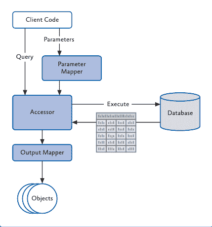

### 图 2
### 数据访问器及相关类型概览

如果您未指定参数映射器，访问器将尝试使用默认映射器自动解析参数。但是，此功能仅适用于针对 SQL Server 和 Oracle 数据库执行的存储过程。在使用 SQL 语句时，或针对其他数据库和提供程序时，此功能不可用，您必须指定一个可解析参数的自定义参数映射器。

如果您未指定输出映射器，该块将使用默认映射生成器类，将返回数据的列名映射到其创建的对象的属性。或者，您可以创建自定义映射，以指定行集中列与对象属性之间的关系。

> 推断创建正确映射所需的详细信息意味着默认参数和输出映射器可能会影响性能。如果可能，您可能希望创建自己的自定义映射器并保留对它们的引用以供重用，从而最大限度地提高使用访问器时数据访问进程的性能。

有关使用访问器技术的完整描述，请参阅 MSDN® 上的企业库文档，网址为 http://go.microsoft.com/fwlink/?LinkId=188874，或随企业库一起安装。本章仅介绍最简单的方法：使用 **Database** 类的 **ExecuteProcAccessor** 方法。

## 创建和执行访问器

以下代码展示了如何使用访问器执行存储过程，然后操作返回的对象序列。您必须指定希望数据以何种对象类型返回——在本示例中，这是一个名为 **Product** 的简单类，它具有三个属性：**ID**、**Name** 和 **Description**。

存储过程接受一个搜索字符串作为单个参数，并返回数据库中包含该字符串的所有产品的详细信息。因此，代码首先创建一个参数值数组以传递给访问器，然后调用 **ExecuteProcAccessor** 方法。它将 **Product** 类指定为要返回的对象类型，并向该方法传递要执行的存储过程名称和参数值数组。

```
' Create an object array and populate it with the required parameter values.
Dim params() As Object = New Object() {"%bike%"}

' Create and execute a sproc accessor that uses default
' parameter and output mappings.
Dim productData = defaultDB.ExecuteProcAccessor(Of Product)("GetProductList", _
    params)

' Perform a client-side query on the returned data. Be aware that
' the orderby and filtering is happening on the client, not the database.
Dim results = From productItem In productData _
    Where Not productItem.Description Is Nothing _
    Order By productItem.Name _
    Select New Product(productItem.Name, productItem.Description)

' Display the results
For Each item In results
    Console.WriteLine("Product Name: {0}", item.Name)
    Console.WriteLine("Description: {0}", item.Description)
    Console.WriteLine()
Next
```

访问器将数据作为序列返回，在本示例中，代码使用 LINQ 查询来处理该序列，以移除描述为空的所有项目、按名称对列表进行排序，然后创建一个仅具有 **Name** 和 **Description** 属性的新对象序列。有关使用 LINQ 查询序列的更多信息，请参阅 http://msdn.microsoft.com/en-us/library/bb397676。

请记住，返回在客户端上操作的数据集可能会影响性能。一般来说，您应尝试以客户端所需的格式返回数据，并尽量减少客户端数据操作。

示例“使用存储过程将数据作为对象序列返回”使用上面所示的代码查询示例数据库并处理生成的行。它生成的输出如下所示。

```
Product Name: All-Purpose Bike Stand
Description: Perfect all-purpose bike stand for working on your bike at home.
Quick-adjusting clamps and steel construction.

Product Name: Bike Wash - Dissolver
Description: Washes off the toughest road grime; dissolves grease, environmentally safe. 1-liter bottle.

Product Name: Hitch Rack - 4-Bike
Description: Carries 4 bikes securely; steel construction, fits 2" receiver hitch.
```

有关创建访问器然后调用 Execute 方法的示例，请参阅本章后面的“以异步方式检索对象数据”部分。

## 创建和使用映射器

在某些情况下，您可能需要创建自定义参数映射器，以将参数传递给访问器将执行的查询。这种情况通常发生在您需要执行 SQL 语句以处理不支持参数解析的数据库系统时，或者由于参数数量或类型不匹配而无法推断默认映射时。参数映射器类必须实现 IParameterMapper 接口，并包含一个名为 AssignParameters 的方法，该方法接受对当前 Command 实例的引用和参数数组。该方法只需将所需参数添加到 Command 对象的 Parameters 集合中。

更常见的是，您需要创建自定义输出映射器。为帮助您完成此操作，该块提供了一个名为 MapBuilder 的类，您可以使用它在查询返回的数据集的列与您需要的对象的属性之间创建所需的映射集。

默认情况下，访问器期望生成单一类型对象的简单序列（在我们之前的示例中，这是 Product 类的序列）。但是，如果您愿意，可以使用访问器返回更复杂的对象图。例如，您可能执行一个查询，该查询返回一系列 Order 对象以及所有选定订单的相关 Order Lines 对象。简单输出映射无法处理此场景，MapBuilder 类也无法处理。在这种情况下，您可以通过实现 IResultSetMapper 接口来创建结果集映射器。您的自定义行集映射器必须包含一个名为 MapSet 的方法，该方法接收实现 IDataReader 接口的对象的引用。该方法应读取数据读取器中可用的所有数据，对其进行处理以创建您需要的对象序列，并返回该序列。

## 检索 XML 数据

几年前，XML 是最酷的新技术，本将主宰世界并改变我们对数据的思考方式。在某些方面，它确实做到了，尽管随着关系数据库模型继续成为大多数企业系统的基础，对 XML 的强调有所减弱。但是，将关系数据库中的数据作为 XML 检索的功能在许多场景中都很有用，并且由数据访问块支持。

SQL Server 支持一种名为 SQLXML 的机制，它允许您通过执行特殊格式的 SQL 查询，将数据提取为一系列 XML 元素，或以一系列 XML 文档格式提取。您可以使用模板精确控制输出，并让服务器以几乎任何您需要的方式格式化数据。有关 SQLXML 功能的描述，请参阅 http://msdn.microsoft.com/library/aa226527(v=MSDN.10).aspx。

数据访问块提供了 **ExecuteXmlReader** 方法，用于以 XML 形式查询数据。它接受包含 **FOR XML** 语句的 SQL 语句，针对数据库执行该语句，并将结果作为 **XmlReader** 返回。您可以遍历生成的 XML 元素，或以 .NET Framework 中 XML 类支持的任何方式处理它们。但是，由于 SQLXML 仅限于 SQL Server（此类查询在其他数据库系统中的实现不同），因此仅在您专门使用 **SqlDatabase** 类（而不是 **Database** 类）时才可用。

以下代码展示了如何获取 **SqlDatabase** 实例，指定合适的 SQLXML 查询，并使用 **ExecuteXmlReader** 方法执行该查询。

```
' Resolve a SqlDatabase object from the container using the default database.
Dim sqlServerDB As SqlDatabase _
    = TryCast(EnterpriseLibraryContainer.Current.GetInstance(Of Database)(), _
    SqlDatabase)

' Specify a SQL query that returns XML data.
Dim xmlQuery As String _
    = "SELECT * FROM OrderList WHERE State = @state FOR XML AUTO"

' Create a suitable command type and add the required parameter
' NB: ExecuteXmlReader is only available for SQL Server databases
Using xmlCmd As DbCommand = sqlServerDB.GetSqlStringCommand(xmlQuery)
    xmlCmd.Parameters.Add(New SqlParameter("@state", "Colorado"))
    Using reader As XmlReader = sqlServerDB.ExecuteXmlReader(xmlCmd)
        ' Iterate through the elements in the XmlReader
        While Not reader.EOF
            If reader.IsStartElement() Then
                Console.WriteLine(reader.ReadOuterXml())
            End If
        End While
    End Using
End Using
```


上面的代码还展示了一种从 **ExecuteXmlReader** 方法返回的 **XmlReader** 中提取 XML 数据的简单方法。需要注意的是，默认情况下，结果是一个 XML 片段，而不是有效的 XML 文档。它实际上是一组表示结果集中每一行的 XML 元素。因此，至少必须使用单个根元素包装输出，以使其格式正确。有关使用 **XmlReader** 的更多信息，请参阅在线 MSDN 文档中的“使用 XmlReader 读取 XML”，网址为 http://msdn.microsoft.com/en-us/library/9d8k26z1.aspx。

示例 **使用 SQL Server XML 查询将数据作为 XML 片段返回** 使用上面的代码查询 SQL Server 数据库。它以 FOR XML AUTO 查询的默认格式返回两个 XML 元素，数据集中每个列的值都表示为属性，如下所示。

```
<OrderList Id="1" Status="DRAFT" CreatedOn="2009-02-01T11:12:06" Name="Adjustable Race" LastName="Abbas" FirstName="Syed" ShipStreet="123 Elm Street" ShipCity="Denver" ShipZipCode="12345" ShippingOption="Two-day shipping" State="Colorado" /> <OrderList Id="2" Status="DRAFT" CreatedOn="2009-02-03T11:12:06" Name="All-Purpose Bike Stand" LastName="Abel" FirstName="Catherine" ShipStreet="321 Cedar Court" ShipCity="Denver" ShipZipCode="12345" ShippingOption="One-day shipping" State="Colorado" />
```

当您想要填充 XML 文档、转换数据以供显示或以其他形式持久化数据时，可以使用此方法。您可以使用 XSLT 样式表将数据转换为所需格式。有关 XSLT 的更多信息，请参阅“XSLT 转换”，网址为 http://msdn.microsoft.com/en-us/library/14689742.aspx。

## 检索单个标量值

使用数据库时，一个常见的要求是根据选择单行或单个值的查询提取单个标量值。这通常发生在使用查找表或检查数据库中特定实体是否存在时。数据访问块提供了 **ExecuteScalar** 方法来处理此要求。它执行您指定的查询，然后将结果集中第一行第一列的值作为 **Object** 类型返回。这意味着它比 **ExecuteReader** 方法提供更好的性能，因为不需要创建 **DataReader** 并将结果作为行集流式传输到客户端。为了最大限度地提高这种效率，您应该努力使用返回单个值或单行的查询。

**ExecuteScalar** 方法具有一组与本章前面使用的 **ExecuteReader** 方法类似的重载。您可以指定 **CommandType**（默认值为 **StoredProcedure**）以及 SQL 语句或存储过程名称。您还可以传入表示查询参数的 **Object** 实例数组。或者，您可以向该方法传递包含所需参数的 **Command** 对象。

以下代码演示了将 **Command** 对象传递给该方法以执行内联 SQL 语句和存储过程。它使用 GetSqlStringCommand 和 GetStoredProcCommand 方法从当前 Database 实例获取合适的 Command 实例。如果需要，可以在调用 ExecuteScalar 方法之前向命令添加参数。但是，为了演示该方法的工作方式，此处的代码只是提取完整的行集。结果是一个单个 Object，您必须在显示或在代码中使用它之前将其强制转换为适当的类型。

```
' Create a suitable command type for a SQL statement.
Using sqlCmd As DbCommand _
    = defaultDB.GetSqlStringCommand("SELECT [Name] FROM States")
' Call the ExecuteScalar method of the command.
Console.WriteLine("Result using a SQL statement: {0}", _
    defaultDB.ExecuteScalar(sqlCmd).ToString())
End Using
```

```
' Create a suitable command type for a stored procedure.
' NB: For efficiency, aim to return only a single value or a single row.
Using sprocCmd As DbCommand = defaultDB.GetStoredProcCommand("GetStatesList")
' Call the ExecuteScalar method of the command.
Console.WriteLine("Result using a stored procedure: {0}", _
    defaultDB.ExecuteScalar(sprocCmd).ToString())
End Using
```

您可以在示例“从 SQL 语句或存储过程返回单个标量值”中查看上面列出的代码运行情况。它产生的有些平淡无奇的结果如下所示。

```
Result using a SQL statement: Alabama
Result using a stored procedure: Alabama
```

## 异步检索数据

在了解了使用数据访问块提取数据的所有主要方法后，我们将继续探讨一些更有趣的场景（尽管许多人可能不愿将任何与数据访问相关的事情视为有趣……）。数据库通常不以成为应用程序中最快的组件而闻名——事实上，许多人会告诉您，它们是任何企业应用程序中的主要瓶颈。问题不在于它们效率低下，通常只是因为它们包含数百万行数据，而您需要执行的查询相对复杂。当然，也可能只是查询编写不佳导致性能不佳，但那是另一个故事了。

应用程序可以通过异步执行数据访问来最大限度地减少性能损耗。这意味着应用程序代码可以继续执行，并且用户界面在整个过程中可以保持交互。异步数据访问可能不适合每种情况，但它可能非常有用。

例如，您可能能够并发执行多个查询并合并结果以创建所需的数据集。或者查询多个数据库，仅使用最先返回结果的那个数据库的数据（这也是一种故障转移功能）。但是，请记住，异步数据访问会影响网络上的连接和数据流式传输性能。不要指望返回十行的查询使用异步方法会有任何改进——它更可能花费更长时间来返回结果！

数据访问块为许多标准数据访问方法提供了异步 Begin 和 End 版本，包括 ExecuteReader、ExecuteScalar、ExecuteXmlReader 和 ExecuteNonQuery。它还为以对象序列形式返回数据的访问器提供了 Execute 方法的异步 Begin 和 End 版本。您将在此处看到这两种技术。

## 为异步数据访问做准备

在异步执行查询之前，必须在要使用的数据库的连接字符串中指定适当的设置。默认情况下，连接的异步数据访问处于禁用状态，这可以防止它们承受与异步数据检索相关的性能损耗。要在连接上使用异步方法，连接字符串必须包含 Asynchronous Processing=true（或仅 async=true），如配置文件中 <connectionStrings> 部分的此示例所示。

```
<connectionStrings>
  <add name="AsyncExampleDatabase"
       connectionString="Asynchronous Processing=true; Data Source=.\SQLEXPRESS;
       Initial Catalog=MyDatabase; Integrated Security=True;"
       providerName="System.Data.SqlClient" />
  ...
</connectionStrings>
```

此外，数据访问块中的异步处理仅适用于 SQL Server 数据库。Database 类包含一个名为 SupportsAsync 的属性，您可以查询该属性以查看当前 Database 实例是否确实支持异步操作。本章的示例包含对此的简单检查。

还需要注意的是，异步数据访问通常涉及使用在与调用代码不同的线程上运行的回调。在现代应用程序中编写回调代码的常见方法是使用 Lambda 表达式，而不是单独的回调处理程序例程。但是，Visual Basic 第 9 版（在 Visual Studio® 2008 和 .NET Framework 3.5 版中）不完全支持用于回调的 Lambda 表达式，因此在此场景下您可能需要使用单独的回调例程。此回调通常无法直接访问 Windows® 窗体或 Windows Presentation Foundation (WPF) 应用程序中的用户界面。在大多数情况下，您需要使用委托调用原始 UI 类中的方法以更新回调返回的数据。


关于异步数据访问的其他注意事项如下：

- **Threading** 命名空间，例如等待句柄和手动重置事件，用于管理数据访问块方法的异步执行。您也可以通过调用用于启动操作的命令的 **Cancel** 方法来取消挂起或正在执行的命令。有关更多信息，请参阅 MSDN 上的“ADO.NET 2.0 中的异步命令执行”，网址为 http://msdn.microsoft.com/en-us/library/ms379553(VS.80).aspx。

- **BeginExecuteReader** 方法不接受 **CommandBehavior** 参数。默认情况下，该方法会自动将基础读取器上的 **CommandBehavior** 属性设置为 **CloseConnection**，除非您在调用该方法时指定了事务。如果您确实指定了事务，则它不会设置 **CommandBehavior** 属性。

- 使用异步数据访问时，请务必确保调用相应的 **EndExecute** 方法，即使您不需要实际访问结果，或者在连接上调用 **Cancel** 方法。不这样做可能会导致内存泄漏并消耗额外的系统资源。

- 将异步数据访问与 ADO.NET 的多个活动结果集 (MARS) 功能一起使用可能会产生意外行为，通常应避免。

- 异步数据访问仅在数据库为 SQL Server 7.0 或更高版本时可用。此外，对于 SQL Server 7.0 和 SQL Server 2000，数据库连接必须使用 TCP。它不能使用共享内存。要确保为 SQL Server 7.0 和 SQL Server 2000 使用 TCP，请在连接字符串的服务器名称中使用 **localhost**、**tcp:server_name** 或 **tcp:ip_address**。

异步代码编写、测试和调试针对所有边缘情况都众所周知很难，您只有在真正能带来性能优势时才应考虑使用它。有关性能测试和设置性能目标的指导，请参阅 http://perftesting.codeplex.com/ 上的“Web 应用程序 patterns & practices 性能测试指南”。

## 异步检索行集数据

以下代码展示了如何执行异步数据访问以从 SQL 数据库检索行集。该代码创建一个 **Command** 实例并添加两个参数，然后调用 **Database** 类的 **BeginExecuteReader** 方法来启动该过程。虽然您可以在 Visual Studio 2010 和 Visual Basic 10 中使用复杂的 Lambda 表达式，但如果您在 Visual Studio 2008 中使用的是 Visual Basic 9 版本，则不能这样做。相反，您可以创建一个单独的回调函数，并在调用 **BeginExecuteReader** 方法时指定它，如下所示。

```
Try
    ' Create command to execute stored procedure and add parameters.
    Dim cmd As DbCommand = asyncDB.GetStoredProcCommand("ListOrdersSlowly")
    asyncDB.AddInParameter(cmd, "state", DbType.String, "Colorado")
    asyncDB.AddInParameter(cmd, "status", DbType.String, "DRAFT")

    ' Execute the query asynchronously specifying the command and
    ' the callback to execute when data access completes.
    asyncDB.BeginExecuteReader(cmd, AddressOf ExecuteReadData, asyncDB)

Catch ex As Exception
    Console.WriteLine("Error while starting data access: {0}", ex.Message)
End Try
...

' Callback executed when the data access completes.
Sub ExecuteReadData(ByVal asyncResult As IAsyncResult)
    Try
        ' Extract Database instance from async state passed to callback
        Dim db As Database = CType(asyncResult.AsyncState, Database)
        Using reader As IDataReader = db.EndExecuteReader(asyncResult)
            DisplayRowValues(reader)
        End Using
    Catch ex As Exception
        Console.WriteLine("Error after data access completed: {0}", ex.Message)
    End Try
End Sub
```

Lambda 表达式随后调用 **EndExecuteReader** 方法以获取查询执行的结果。

**AsyncState** 参数可用于将任何所需的状态信息传递给回调例程。例如，当您使用单独的回调时，会将当前 **Database** 实例的引用作为 **AsyncState** 参数传递，以便回调代码可以调用 **EndExecuteReader**（或其他适当的 **End** 方法）来获取结果。如果您改用 Lambda 表达式，则当前 **Database** 实例在表达式中可用，因此您不需要填充 **AsyncState** 参数。

回调执行 **EndExecuteReader** 方法以获取查询的结果。此时，您可以在应用程序中使用行集，或如上述代码所示，仅显示这些值。请注意，回调表达式应处理异步操作期间可能发生的任何错误。

示例“异步检索数据的命令执行”使用上述代码从数据库获取两行并显示内容。除了上述代码外，它还使用一个简单的例程，在代码执行时每秒显示一条“正在等待...”消息。结果如下所示。

```
Database supports asynchronous operations
Waiting... Waiting... Waiting... Waiting... Waiting...

Id = 1
Status = DRAFT
CreatedOn = 01/02/2009 11:12:06
Name = Adjustable Race
LastName = Abbas
FirstName = Syed
ShipStreet = 123 Elm Street
ShipCity = Denver
ShipZipCode = 12345
ShippingOption = Two-day shipping
State = Colorado

Id = 2
Status = DRAFT
CreatedOn = 03/02/2009 01:12:06
Name = All-Purpose Bike Stand
LastName = Abel
FirstName = Catherine
ShipStreet = 321 Cedar Court
ShipCity = Denver
ShipZipCode = 12345
ShippingOption = One-day shipping
State = Colorado
```

当然，由于我们手头没有可用于查询的百万级行数据库，该示例使用包含 WAIT 语句的存储过程来模拟长时间运行的数据访问操作。它还使用 ManualResetEvent 对象来管理线程，以便您可以更清晰地看到结果。在 Visual Studio 中打开示例，或查看 Program.vb 文件，以了解此操作的具体方式。

## 异步检索对象数据

当您希望将数据作为对象序列而不是行和列返回时，也可以异步执行数据访问器。示例“异步检索对象数据的命令执行”演示了此技术。您可以按照本章前一部分所示的方式创建访问器及其关联的映射器，然后调用访问器的 BeginExecute 方法。这与使用前一示例中描述的 BeginExecuteReader 方法的工作方式大致相同。

您将 Lambda 表达式或回调传递给 BeginExecute 方法，以便在异步数据访问过程完成时执行，同时还需传递 AsyncState 以及表示要应用于正在执行的存储过程或 SQL 语句的参数的 Object 实例数组。Lambda 表达式或回调方法可以从 AsyncState 获取已执行访问器的引用（将其强制转换为 DataAccessor 基类型的实例，以便代码可与任何访问器实现一起使用），然后调用访问器的 EndExecute 方法以获取访问器从数据库检索到的对象序列的引用。

## 更新数据

迄今为止，我们已了解如何使用数据访问块的类和方法从数据库检索数据。当然，虽然这通常是许多应用程序的主要关注点，但您通常需要更新数据库中的数据。数据访问块提供支持数据更新的功能。您可以使用 ExecuteNonQuery 方法直接针对数据库执行更新查询（例如 INSERT、DELETE 和 UPDATE 语句）。此外，您可以使用 ExecuteDataSet、LoadDataSet 和 UpdateDataSet 方法填充 DataSet 并将行中的更改推送回数据库。我们将在此处介绍这两种方法。

## 执行更新查询

数据访问块使针对数据库执行更新查询变得容易。这里所说的更新查询，是指使用 UPDATE、DELETE 或 INSERT 关键字的内联 SQL 语句或存储过程中的 SQL 语句。您可以使用 Database 类的 ExecuteNonQuery 方法执行此类查询。

与本章前面使用的 ExecuteReader 方法类似，ExecuteNonQuery 方法拥有一组广泛的重载。您可以指定 CommandType（默认值为 StoredProcedure）以及 SQL 语句或存储过程名称。您还可以传入表示查询参数的 Object 实例数组。或者，您可以向该方法传递包含所需参数的 Command 对象。此外，还有 Begin 和 End 版本，允许您异步执行更新查询。

本章示例应用程序中的以下代码展示了如何使用 ExecuteNonQuery 方法更新数据库表中的一行。它更新 Products 表中单行的 Description 列，检查更新是否成功，然后再次将其更新以恢复原始值（以便您可以再次运行示例）。第一步是创建命令并添加所需参数，如您在前面的示例中所见，然后以命令作为单个参数调用 ExecuteNonQuery 方法。接下来，代码将名为 description 的命令参数的值更改为数据库中的原始值，然后执行补偿更新。

```
Dim oldDescription As String _
    = "Carries 4 bikes safely; steel construction, fits 2"" receiver hitch."
Dim newDescription As String = "Bikes tend to fall off after a few miles."
' Create command to execute stored procedure and add parameters.
Dim cmd As DbCommand = defaultDb.GetStoredProcCommand("UpdateProductsTable")
defaultDb.AddInParameter(cmd, "productID", DbType.Int32, 84)
defaultDb.AddInParameter(cmd, "description", DbType.String, newDescription)
```


```
' Execute the query and check if one row was updated.
If defaultDB.ExecuteNonQuery(cmd) = 1 Then
    ' Update succeeded.
Else
    Console.WriteLine("ERROR: Could not update just one row.")
End If

' Change the value of the second parameter
defaultDB.SetParameterValue(cmd, "description", oldDescription)

' Execute query and check if one row was updated
If defaultDB.ExecuteNonQuery(cmd) = 1 Then
    ' Update succeeded.
Else
    Console.WriteLine("ERROR: Could not update just one row.")
End If
```

注意用于执行查询并检查其是否成功的模式。ExecuteNonQuery 方法返回一个整数值，即查询更新（或者，使用更准确的术语，受影响）的行数。在此示例中，我们通过在唯一 ID 列上选择来指定单行作为更新目标。因此，我们期望只更新一行——任何其他值都意味着出现了问题。

如果您预期要更新多行，则应检查返回值是否非零。通常，如果需要确保数据库的完整性，可以在基于连接的事务中执行更新，如果结果不符合预期，则回滚该事务。我们将在本章后面的“使用基于连接的事务”部分介绍如何使用数据访问块方法处理事务。

示例“使用 Command 对象更新数据”（使用上面的代码）生成以下输出。

```
Contents of row before update:
Id = 84
Name = Hitch Rack - 4-Bike
Description = Carries 4 bikes securely; steel construction, fits 2" receiver hitch.

Contents of row after first update:
Id = 84
Name = Hitch Rack - 4-Bike
Description = Bikes tend to fall off after a few miles.

Contents of row after second update:
Id = 84
Name = Hitch Rack - 4-Bike
Description = Carries 4 bikes securely; steel construction, fits 2" receiver hitch.
```

## 使用数据集

如果您需要检索数据并以一种允许将更改推回数据库的方式存储它，则通常会使用 **DataSet**。数据访问块支持对原始（非类型化）**DataSet** 执行简单操作，包括填充 **DataSet** 然后从 **DataSet** 更新原始数据库表的功能。

要填充 **DataSet**，请使用 **ExecuteDataSet** 方法，该方法返回 **DataSet** 类的新实例，其中包含一个表，该表包含查询返回的每个行集的数据（该查询可能是多语句批查询）。此 **DataSet** 中的表将具有默认名称，例如 **Table**、**Table1** 和 **Table2**。

如果要将数据加载到现有 **DataSet** 中，请使用 **LoadDataSet** 方法。这允许您指定 **DataSet** 中目标表的名称，并允许您向现有 **DataSet** 添加其他表或刷新 **DataSet** 中特定表的内容。

这两个方法（**ExecuteDataSet** 和 **LoadDataSet**）都具有与本章前面介绍的 **ExecuteReader** 和其他方法类似的广泛重载集。您可以指定 **CommandType**（默认值为 **StoredProcedure**）以及 SQL 语句或存储过程名称。您还可以传入表示查询参数的 **Object** 实例数组。或者，可以向方法传递包含所需参数的 **Command** 对象。

例如，以下代码行演示了如何将 **ExecuteDataSet** 方法与 SQL 语句一起使用；与存储过程和参数数组一起使用；以及与预填充参数的命令一起使用。该代码假设您已创建名为 **db** 的数据访问块 **Database** 实例。

```vb
Dim productDataSet As DataSet

' Using a SQL statement.
Dim sql As String = "SELECT CustomerName, CustomerPhone FROM Customers"
productDataSet = db.ExecuteDataSet(CommandType.Text, sql)

' Using a stored procedure and a parameter array.
productDataSet = db.ExecuteDataSet("GetProductsByCategory", _
    New Object() { "%bike%" })

' Using a stored procedure and a named parameter.
Dim cmd As DbCommand = db.GetStoredProcCommand("GetProductsByCategory")
db.AddInParameter(cmd, "@CategoryID", DbType.Int32, 7)
productDataSet = db.ExecuteDataSet(cmd)
```

## 从数据集更新数据库

要从 **DataSet** 更新数据库中的数据，请使用 **UpdateDataSet** 方法，该方法返回受更新、删除和插入操作影响的行总数。该方法的重载允许您指定包含更新行的源 **DataSet**、要更新的数据库中表的名称，以及方法将执行的三个 **Command** 实例的引用，以便在指定的数据库表上执行 UPDATE、DELETE 和 INSERT 操作。

此外，您可以为 **UpdateBehavior** 指定一个值，该值确定方法将如何将更新应用到目标表行。您可以为此参数指定以下值之一：

- **Standard**。如果基础 ADO.NET 更新过程遇到错误，则更新将停止，且不会向目标表应用后续更新。
- **Continue**。如果基础 ADO.NET 更新过程遇到错误，则更新将继续，并尝试应用任何后续更新。
- **Transactional**。如果基础 ADO.NET 更新过程遇到错误，则对所有行所做的所有更新都将回滚。

最后，如果需要，您可以为 **UpdateDataSet** 方法的 **UpdateBatchSize** 参数提供一个值。这将强制方法尝试分批执行更新，而不是将每个更新单独发送到数据库。这更高效，但方法的返回值将仅显示最后一批中所做的更新数量，而不显示所有批次的总数。通常，您可能会使用 10 到 100 之间的批大小值。您应进行实验以找到最合适的批大小；这取决于您使用的数据库类型、正在执行的查询以及查询的参数数量。

本章的示例中包含一个名为“使用数据集并更新源数据”的示例，演示了 **ExecuteDataSet** 和 **LoadDataSet** 方法。它使用 **ExecuteDataSet** 和 **LoadDataSet** 方法的简单重载来填充两个 **DataSet** 实例，并使用名为 **DisplayTableNames**（此处未显示）的独立例程来显示表名和这些表中的行数。这显示了这两个方法之间的差异之一。请注意，**LoadDataSet** 方法需要对现有 **DataSet** 实例的引用，以及包含要填充的表名称的数组。

```vb
Dim selectSQL As String _
= "SELECT Id, Name, Description FROM Products WHERE Id > 90"
' Fill a DataSet from the Products table using the simple approach.
Dim simpleDS As DataSet = defaultDB.ExecuteDataSet(CommandType.Text, selectSQL)
DisplayTableNames(simpleDS, "ExecuteDataSet")
' Fill a DataSet from the Products table using the LoadDataSet method.
' This allows you to specify the name(s) for the table(s) in the DataSet.
Dim loadedDS As New DataSet("ProductDataSet")
defaultDB.LoadDataSet(CommandType.Text, selectSQL, loadedDS, _
New String() {"Products"})
DisplayTableNames(loadedDS, "LoadDataSet")
```

这将产生以下结果。

```
Tables in the DataSet obtained using the ExecuteDataSet method:
- Table named 'Table' contains 6 rows.
```

```
Tables in the DataSet obtained using the LoadDataSet method:
- Table named 'Products' contains 6 rows.
```

然后，该示例访问数据集中的行以删除一行、添加新行并更改另一行中的 Description 列。之后，它会显示数据集表的更新内容。

```vb
' get a reference to the Products table in the DataSet.
Dim dt As DataTable = loadedDS.Tables("Products")

' Delete a row in the DataSet table.
dt.Rows(8).Delete()

' Add a new row to the DataSet table.
Dim rowData As Object() = New Object()({1, "A New Row", _
"Added to the table at " + DateTime.Now.ToShortTimeString()})
dt.Rows.Add(rowData)

' Update the description of a row in the DataSet table.
rowData = dt.Rows(1).ItemArray
rowData(2) = "A new description on " + DateTime.Now.ToShortTimeString()
dt.Rows(1).ItemArray = rowData

' Display the contents of the DataSet.
DisplayRowValues(dt)
```

这将产生以下输出。为了更轻松地查看更改，我们从列表中省略了未更改的行。当然，删除的行不会显示在列表中，而新行具有代码中指定的默认 ID -1。

```
Rows in the table named 'Products':

Id = 99
Name = HL Mountain Frame - Silver, 44
Description = A new description at 14:25

...

Id = -1
Name = A New Row
Description = Added to the table at 14:25
```


下一阶段是创建 **UpdateDataSet** 方法将用于更新数据库中目标表的命令。代码声明三个合适的 SQL 语句，然后构建命令并向其添加所需的参数。请注意，每个参数可能应用于目标表中的多行，因此实际值必须根据当前正在将其更新应用到目标表的 **DataSet** 行的内容动态设置。

这意味着，除了参数名称和数据类型外，您还必须指定 **DataSet** 中行的名称和版本（**Current** 或 **Original**），以从中获取值。对于 **INSERT** 命令，您需要包含新值的行的当前版本。对于 **DELETE** 命令，您需要 ID 的原始值以定位表中将被删除的行。对于 **UPDATE** 命令，您需要 ID 的原始值以定位表中将被更新的行，以及用于更新目标表行中其余列的值的当前版本。

```vb
Dim addSQL As String
    = "INSERT INTO Products (Name, Description) VALUES (@name, @description);"
Dim updateSQL As String = "UPDATE Products SET Name = @name, "
    & "Description = @description WHERE Id = @id"
Dim deleteSQL As String = "DELETE FROM Products WHERE Id = @id"

' Create the commands to update the original table in the database
Dim insertCommand As DbCommand = defaultDB.GetSqlStringCommand(addSQL)
defaultDB.AddInParameter(insertCommand, "name", DbType.String, "Name", _
    DataRowVersion.Current)
defaultDB.AddInParameter(insertCommand, "description", DbType.String, _
    "Description", DataRowVersion.Current)

Dim updateCommand As DbCommand = defaultDB.GetSqlStringCommand(updateSQL)
defaultDB.AddInParameter(updateCommand, "name", DbType.String, "Name", _
    DataRowVersion.Current)
defaultDB.AddInParameter(updateCommand, "description", DbType.String, _
    "Description", DataRowVersion.Current)
defaultDB.AddInParameter(updateCommand, "id", DbType.String, "Id", _
    DataRowVersion.Original)

Dim deleteCommand As DbCommand = defaultDB.GetSqlStringCommand(deleteSQL)
defaultDB.AddInParameter(deleteCommand, "id", DbType.Int32, "Id", _
    DataRowVersion.Current)
```

最后，您可以通过调用 **UpdateDataSet** 方法来应用更改，如下所示。

```vb
' Apply the updates in the DataSet to the original table in the database.
Dim rowsAffected As Integer = defaultDB.UpdateDataSet(loaddbDS, "Products", _
InsertCommand, updateCommand, deleteCommand, _
UpdateBehavior.Standard)
Console.WriteLine("Updated a total of {0} rows in the database.", rowsAffected)
```

已在数据库中更新总共 3 行。

## 管理连接

多年来，开发者一直为如何在数据访问代码中以理想方式管理连接而烦恼。连接资源稀缺，在资源使用方面成本高昂，如果管理不当，还会造成巨大的性能损失。显然，在访问数据之前必须打开连接，并且在使用完毕后应确保将其关闭。但是，如果操作系统每次都实际创建一个新连接，然后关闭并销毁它，那么应用程序的执行将会像糖浆一样缓慢。

相反，ADO.NET 维护一个打开的连接池，并将其分配给需要它们的应用程序。数据访问代码仍然需要调用创建、打开和关闭连接的方法，但 ADO.NET 在可能时会自动从连接池中检索连接，并决定何时以及是否实际关闭底层连接并将其释放。主要问题在于您需要决定代码何时以及如何调用 Close 方法。数据访问块通过尽可能自动管理连接来帮助解决这些问题。

使用数据访问块检索 DataSet 时，ExecuteDataSet 方法会自动打开和关闭到数据库的连接。如果发生错误，它将确保连接已关闭。如果您想保持连接打开（例如，要通过该连接执行多个操作），可以访问 DbCommand 对象的 Active Connection 属性，并在调用 ExecuteDataSet 方法之前将其打开。ExecuteDataSet 方法在完成时会保持连接打开，因此您必须确保代码之后将其关闭。

相比之下，当检索 DataReader 或 XmlReader 时，ExecuteReader 方法（对于 XmlReader 则是 ExecuteXmlReader 方法）必须保持连接打开，以便您可以读取数据。ExecuteReader 方法将读取器的 CommandBehavior 属性设置为 CloseConnection，以便在释放读取器时关闭连接。通常，您将使用 Using 构造来确保释放读取器，如下所示：

```vb
Using reader As IDataReader = db.ExecuteReader(cmd)
' use the reader here
End Using
```

此代码以及本节后面的代码假设您已创建名为 db 的数据访问块 Database 实例和名为 cmd 的 DbCommand 实例。

通常，使用 ExecuteXmlReader 方法时，您会在释放读取器后显式关闭连接。这是因为底层 XmlReader 类不公开 CommandBehavior 属性。但是，您仍应使用与 DataReader 相同的方法（Using 语句）来确保 XmlReader 正确关闭和释放。

```vb
Using reader As XmlReader = db.ExecuteXmlReader(cmd)
 ' use the reader here
End Using
```

最后，如果您想能够访问代码正在使用的连接（例如，要在代码中创建基于连接的事务），可以使用数据访问块方法为数据访问方法显式创建一个连接。这意味着您必须自己管理连接，通常通过下面所示的 Using 语句，该语句会自动关闭和释放连接：

```vb
Using con As DbConnection = defaultDB.CreateConnection()
con.Open()
Try
 ' perform data access here
Catch
 ' handle any errors here
End Try
End Using
```

## 使用基于连接的事务

许多应用程序的常见需求是以这种方式对数据执行多个更新：要么全部成功，要么全部撤销（回滚），以使数据库处于与原始内容一致的有效状态。传统示例是银行执行货币交易，需要从一个账户扣除一笔付款，并将相同金额添加到另一个账户（或者稍微少一点，佣金进入银行自己的账户）。

事务应遵循四个 ACID 原则。这些原则是：原子性（事务的所有任务要么全部执行，要么都不执行）、一致性（数据库在事务前后都保持一致状态）、隔离性（其他操作在事务期间无法访问或查看中间状态的数据）、持久性（成功事务的结果会被持久化，并能够经受住系统故障）。

当所有更新都在单个数据库中发生时，可以通过使用数据库系统的功能（例如在存储过程中包含 BEGIN TRANSACTION 和 ROLLBACK TRANSACTION 等相关命令）来执行事务。ADO.NET 还提供功能，允许您在单个连接上执行基于连接的事务。这使您可以对同一数据库中的不同表执行多个操作，并在数据访问代码中管理提交或回滚。

数据访问块中所有检索或更新数据的方法都有重载，接受对现有事务的引用作为 DbTransaction 类型。作为其用法示例，以下代码在连接上显式创建一个事务。它假设您已创建名为 db 的数据访问块 Database 实例和两个名为 cmdA 和 cmdB 的 DbCommand 实例。

```vb
Using conn As DbConnection = db.CreateConnection()
conn.Open()
Dim trans As DbTransaction = conn.BeginTransaction()
Try
    ' execute commands, passing in the current transaction to each one
    db.ExecuteNonQuery(cmdA, trans)
    db.ExecuteNonQuery(cmdB, trans)
    trans.Commit() ' commit the transaction
Catch
    trans.Rollback() ' rollback the transaction
End Try
End Using
```

本章的示例包括一个名为“使用基于连接的事务”的示例，演示了上述方法。它首先显示 Products 表中两行的值，然后在基于连接的事务上下文中两次使用 ExecuteNonQuery 方法来更新数据库中两行的 Description 列。在此过程中，它会显示这些行的新描述。最后，它回滚事务，恢复原始值，然后显示这些值以证明其有效。

更新前的行内容：

```text
Id = 53
Name = Half-Finger Gloves, L
Description = Full padding, improved finger flex, durable palm, adjustable closure.

Id = 84
Name = Hitch Rack - 4-Bike
Description = Carries 4 bikes securely; steel construction, fits 2" receiver hitch.
--------------------------------------------------------------------------------
Updated row with ID = 53 to 'Third and little fingers tend to get cold.'.
Updated row with ID = 84 to 'Bikes tend to fall off after a few miles.'.
--------------------------------------------------------------------------------
```


回滚事务后的行内容：

| ID | 名称 | 描述 |
|---|---|---|
| 53 | 半指手套，L | 全垫设计，改进手指灵活性，耐用掌心，可调节闭合。 |
| 84 | 挂架 - 4车位 | 安全承载4辆自行车；钢制结构，适用2英寸接收器挂钩。 |

## 使用分布式事务

如果您需要在同一事务中访问不同的数据库（包括位于不同服务器上的数据库），或者需要将其他数据源（例如 Microsoft Message Queuing (MSMQ)）纳入事务中，则必须使用诸如 Windows 组件服务之类的分布式事务协调器 (DTC) 机制。在此情况下，您只需执行常规的数据访问操作，并配置组件以使用 DTC。通常，这是通过向执行数据访问的类添加特性来完成的。

但是，ADO.NET 通过 **事务作用域** 类支持自动或轻量级事务的概念。您可以指定一系列操作需要事务支持，但除非在事务作用域内实际打开多个连接，否则 ADO.NET 不会生成昂贵的分布式事务。这意味着您可以通过单个连接对同一数据库中的不同表执行多个事务更新。一旦打开新连接，ADO.NET 会自动创建分布式事务（使用 Windows 组件服务），并将原始连接以及在事务作用域内创建的所有新连接注册到该分布式事务中。然后，您可以对事务作用域调用方法，以提交所有更新或回滚（撤销）所有更新。

因此，一旦创建事务作用域或显式创建事务，您使用数据访问块方法的方式与在事务之外完全相同。您无需像直接使用 ADO.NET 方法时那样将事务作用域传递给方法。例如，数据访问应用程序块的方法会自动检测它们是否在事务作用域内执行。如果是，它们会加入事务作用域并重用现有连接（因为打开新连接将迫使组件服务启动分布式事务），并在完成时不关闭连接。事务作用域在被释放时会关闭并释放连接。

通常，您将以以下方式使用 **事务作用域** 类：

```
Using scope = New TransactionScope(TransactionScopeOption.RequiresNew)
  ' perform data access here
End Using
```

有关使用 DTC 和事务作用域的更多详细信息，请参阅 http://msdn.microsoft.com/en-us/library/ms254973.aspx 上的“分布式事务 (ADO.NET)”和 http://msdn.microsoft.com/en-us/library/ms372070.aspx 上的“System.Transactions 与 SQL Server 的集成 (ADO.NET)”。

本章示例中包含一个名为“为分布式事务使用事务作用域”的示例，演示了如何将事务作用域与数据访问块配合使用。它对数据库中的 Products 表执行与您在之前的基于连接的事务示例中看到的相同更新。但是，此示例的工作方式存在细微差别。

此外，由于它使用 Windows 分布式事务协调器 (DTC) 服务，您必须在执行示例之前确保该服务正在运行（具体取决于您的操作系统，它可能未设置为自动启动）。要启动服务，请从“管理工具”菜单打开“服务” MMC 管理单元，右键单击“分布式事务协调器”服务，然后单击“启动”。要查看事务作用域的效果及其提升事务的方式，请从“管理工具”菜单打开“组件服务” MMC 管理单元，并展开“组件服务”节点，直到在管理单元的中央窗格中看到“事务列表”。

执行示例时，它会创建一个新的事务作用域，并执行两次 ExecuteNonQuery 方法以更新数据库表中的两行。此时，代码将停止，直到您按下一个键。这为您提供了确认不存在分布式事务的机会——您可以通过查看组件服务 MMC 管理单元中的事务列表来确认这一点。

按下键后，应用程序会创建一个到数据库的新连接（在之前的示例中，当我们使用基于连接的事务时，我们只是更新了参数值并在同一连接上执行了相同的命令）。这个新连接位于现有事务作用域实例的范围内，会导致 DTC 启动一个新的分布式事务，并将现有的轻量级事务注册到其中；如图 3 所示。

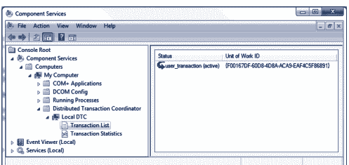

### 图 3 查看 DTC 事务

代码随后会等待您再次按下键，此时它将退出创建事务作用域的 using 子句，事务不再在作用域内。由于代码未调用事务作用域的 Complete 方法来保留数据库中的更改，因此更改会自动回滚。为了证明这一点，代码会再次显示数据库中行的值。以下是示例的完整输出。

更新前的行内容：

| ID | 名称 | 描述 |
|---|---|---|
| 53 | 半指手套，L | 全垫设计，改进手指灵活性，耐用掌心，可调节闭合。 |
| 84 | 挂架 - 4车位 | 安全承载4辆自行车；钢制结构，适用2英寸接收器挂钩。 |

----------------------------------------------------------------
已将 ID = 53 的行更新为“第三指和小指容易感到冷。”。
没有分布式事务。按任意键继续...

已将 ID = 84 的行更新为“自行车骑行几英里后容易掉落。”。
已创建新的分布式事务。按任意键继续...
----------------------------------------------------------------

释放事务作用域后的行内容：

| ID | 名称 | 描述 |
|---|---|---|
| 53 | 半指手套，L | 全垫设计，改进手指灵活性，耐用掌心，可调节闭合。 |
| 84 | 挂架 - 4车位 | 安全承载4辆自行车；钢制结构，适用2英寸接收器挂钩。 |

事务作用域的这种默认行为可确保，如果发生错误或问题导致代码无法完成事务，则会自动回滚更改。如果您的代码似乎未更新数据库，请确保您记得调用 Complete 方法！

## 扩展块以使用其他数据库

数据访问块包含用于 SQL Server、Oracle 和 SQL Server Compact Edition 的提供程序。但是，如果您愿意，可以扩展该块以使用其他数据库。编写新提供程序并非易事，您可能会发现针对您的数据库已有第三方提供程序可用。例如，在撰写本文时，Enterprise Library 社区贡献网站列出了用于 MySql 和 SQLite 数据库的提供程序。有关更多信息，请访问 http://codeplex.com/entlibcontrib/ 上的 EntLib Contrib 项目网站。

如果您决定创建新提供程序，可以创建一个从 Enterprise Library **数据库** 类派生的新类，并重写其方法以实现相应功能。一个限制因素是，必须为您的数据库提供 ADO.NET 提供程序。Enterprise Library 中的 **数据库** 类依赖于此来执行数据访问操作。

您还必须了解数据库功能之间的差异，并在代码中管理这些差异。例如，您必须处理返回值、参数前缀（如 "@"）、数据类型转换以及其他相关因素。但是，您可以向提供程序添加其他方法，以利用目标数据库中其他数据库类型不可用的功能。例如，数据访问块中的 SQL Server 提供程序公开了一个方法，该方法使用 SQL Server 中的 SQLXML 功能以 XML 格式提取数据。

有关为数据访问块创建其他数据库提供程序的更多信息，请参阅 http://go.microsoft.com/fwlink/?LinkId=188874 上的 Enterprise Library 在线指南或已安装的文档。

### 摘要

本章讨论了数据访问应用程序块，这是 Enterprise Library 中最常用的块之一。数据访问块为开发人员和管理员提供了两个关键优势。首先，它抽象了数据库，以便开发人员和管理员只需更改配置文件即可将应用程序从一种数据库类型切换到另一种。其次，它通过减少编写最常用数据访问代码部分所需的精力来帮助开发人员，并隐藏了直接使用 ADO.NET 的一些复杂性。

在抽象数据库方面，该块允许开发人员以这种方式编写代码（对于大多数功能），他们不需要担心其应用程序将使用哪种数据库（例如 SQL Server、SQL Server CE 或 Oracle）。他们为所有数据库编写相同的代码，并配置应用程序以在运行时指定实际数据库。这意味着管理员和运维人员可以更改目标数据库，而无需更改代码、重新编译、重新测试和重新部署。

在简化数据访问代码方面，该块提供了一小部分涵盖大多数数据访问要求的方法，例如检索 **数据集**、**数据读取器**、标量（单个）值、一个或多个作为输出参数的值，或一系列 XML 元素。它还提供从 **数据集** 更新数据库的方法，并与 ADO.NET **事务作用域** 类集成，以允许一系列选项用于


使用事务。但是，该块并不限制您使用更高级 ADO.NET 技术的选项，因为它允许您访问底层对象，例如连接和 DataAdapter。

本章还描述了管理连接和与事务集成等一般问题，并更深入地探讨了该块的实际功能。最后，我们简要介绍了如何将该块与其他数据库一起使用，包括第三方提供商支持的数据库。

### 简介

我们直面现实，异常处理并不是编写应用程序代码中最令人兴奋的部分。事实上，你可能会说，管理异常是那些必要的任务之一，它们会吸纳精力，却似乎并没有为你激动人心的新应用程序增加任何有用的东西。那么，为什么要花时间和精力去实际设计管理异常的策略呢？当然，你有更重要的事情可以做。

事实上，一个健壮且规划良好的异常处理计划是应用程序设计和实现中至关重要的功能。它不应该是事后才想到的。如果你没有计划，你可能会发现自己正在尝试追踪代码中各种奇怪的影响和意外行为。更糟糕的是，你甚至可能在牺牲安全性，使你的应用程序和系统暴露在攻击之下。例如，失败可能会暴露包含敏感信息的错误消息，例如“Hi，应用程序刚刚失败，但这是它当时使用的服务器名称和数据库连接字符串。”这不是一个好计划。

异常处理的一般期望是向用户呈现清晰且适当的消息，并为必须解决出现问题的操作员、管理员和支持人员提供帮助。例如，以下操作通常是全面异常处理策略的一部分：

- 使用友好消息通知用户
- 将异常详细信息存储在生产日志或其他存储库中
- 向客户服务团队发出错误警报
- 协助支持人员交叉引用异常并追踪原因

因此，在决定你可能应该在代码中实施某种结构化异常处理策略后，你该如何着手呢？和往常一样，一个好的起点是查看是否有以众所周知模式形式存在的建议供你实施。在这种情况下，是有的。帮助你构建安全应用程序的主要模式称为异常屏蔽。异常屏蔽是确保你的应用程序不会泄露敏感信息的过程，无论可能发生什么运行时或系统事件来中断正常操作。在更细粒度的层面上，它可以防止你的资产跨层、跨层级、跨进程或跨服务边界被泄露。

你还应该考虑实施的另外两个异常处理模式是异常日志记录模式和异常转换模式。异常日志记录模式可以帮助你诊断和排查错误、审计用户操作，并跟踪恶意活动和安全问题。异常转换模式描述了将异常包装在特定于某一层的其他异常中，以确保它们实际上反映该层当时的用户或代码操作，而不是一些可能无用的杂项细节。

在本章中，你将了解企业库异常处理块如何帮助你实施这些模式，并熟悉构成全面异常管理策略的其他技术。你将了解如何替换、包装和记录异常；以及如何修改异常消息以使其更有用。此外，作为额外内容，你将了解如何轻松为 Windows® 通信基础 (WCF) Web 服务实现异常屏蔽。

## 何时应使用异常处理块？

异常处理块允许你配置如何管理异常，并集中管理你的异常处理代码。它提供了一组可供使用的插件异常处理程序和格式化程序，你甚至可以创建自己的自定义实现。当你想要实现异常屏蔽、以多种方式修改异常或链式异常（例如，记录异常然后将其传递给应用程序的另一层）时，可以使用该块。可配置的方法意味着管理员只需编辑应用程序配置，而无需更改代码、重新编译或重新部署，即可更改异常管理机制的行为。

> 异常处理块从来不是为了在捕获异常的每个地方都使用而设计的。该块主要旨在简化应用程序或层边界处的异常处理和异常管理。

## 如何使用异常处理块？

与所有企业库应用程序块一样，你首先需要配置应用程序以使用该块，如第 1 章“简介”中所示。然后添加一个或多个异常策略，并为每个策略指定其适用的异常类型。最后，为每个策略添加一个或多个异常处理程序。最简单的方法是指定基类型 Exception 并使用该块提供的某个处理程序的策略。但是，你将在本章的示例中看到各种处理程序和其他选项的演示。

## 我需要哪些异常策略？

处理异常的关键是将适当的策略应用于每种类型的异常。你可以假装自己正在玩那个著名的电视问答游戏，说不定就能让你成为百万富翁：

| 问题：我该如何处理异常？ | |
|---|---|
| A: 包装它们 | B: 替换它们 |
| C: 记录并重新抛出它们 | D: 允许它们传播 |

当然，如果你认为这有帮助，可以打电话给朋友或询问观众。但是，与大多数问答游戏不同，所有答案实际上都是正确的（这就是为什么我们不提供奖品的原因）。如果你回答了 A、B 或 C，可以继续阅读“关于异常处理策略”部分。但是，如果你回答了 D：请继续阅读以下部分。

## 允许异常传播

当发生异常时，如果你无法做任何有用的事情，例如记录异常信息、修改异常详细信息或重试失败的进程，那么从一开始就捕获异常就没有意义了。相反，你只需允许异常通过调用栈向上传播，并在代码的其他地方捕获它——要么解决问题，要么显示错误消息。当然，此时，你可以应用异常策略，因此你又回到了如何选择和实施适当的异常处理策略的问题上。

## 关于异常处理策略

你为异常处理块配置的每个策略都可以指定一个或多个异常类型，例如 DivideByZeroException、SqlException、InvalidCastException、基类 Exception，或你继承自 System.Exception 创建的任何自定义异常类型。该块将其处理的异常与每种类型进行比较，并选择类层次结构中最具体的一个。

- 对于每个策略，你需要配置：
  - **一个或多个异常处理程序**，当发生匹配异常时，该块将执行这些处理程序。你可以从四个开箱即用的处理程序中选择：替换处理程序、包装处理程序、日志记录处理程序和 Fault Contract 异常处理程序。或者，你可以创建自定义异常处理程序并选择这些（有关更多信息，请参见本章末尾附近的“扩展异常处理”）。
  - **后处理操作**值，用于指定异常处理块执行你指定的处理程序后会发生什么。实际上，此设置告诉调用代码是否继续执行。你可以从以下选项中选择：


- **NotifyRethrow**（默认）。向调用代码返回 True，以指示它应抛出异常，该异常可能是实际捕获的异常，也可能是策略生成的异常。
- **ThrowNewException**。异常处理块将抛出执行所有处理程序后产生的异常。
- **None**。向调用代码返回 False，以指示它应继续执行。

图 1 显示了企业库配置控制台中名为 **MyTestExceptionPolicy** 的示例策略。该策略处理三种异常类型——**DivideByZeroException**、**Exception**（在配置工具中显示为 **所有异常**）和 **InvalidCastException**——并为每种异常类型包含一组混合的处理程序。当您向异常处理配置添加日志记录异常处理程序时，工具会使用默认设置自动将日志记录部分添加到配置中。

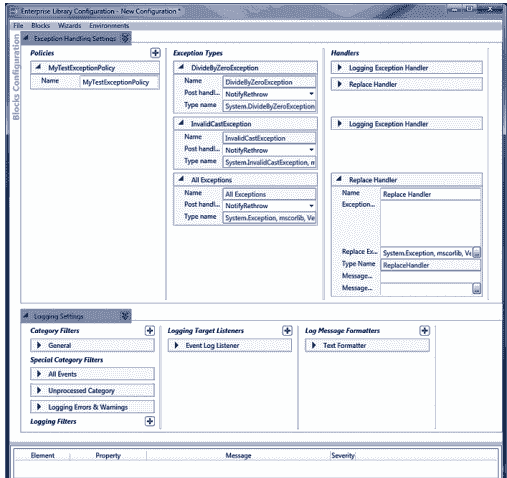

图 1
MyTestExceptionPolicy 异常处理策略的配置

请注意，您可以为每种异常处理程序类型指定属性。例如，在上一张屏幕截图中，您可以看到 **替换处理程序** 具有用于异常消息的属性，以及您要用来替换原始异常的异常类型。此外，请注意，您可以通过指定包含本地化消息字符串的资源的名称和类型来本地化策略。

## 选择异常处理策略

那么，让我们回到测验问题：“我应该如何处理异常？”您应该能够从异常处理策略的可用选项中看出，如何实现处理异常的常见策略：

- **用不同的异常替换异常并抛出新异常。**
  这是异常屏蔽模式的实现。在异常处理代码中，您可以清理资源或执行任何其他相关处理。您在异常处理策略中使用 **替换** 处理程序将异常替换为包含清理或新信息的不同异常，这些信息不会透露有关错误源、应用程序或操作系统的敏感详细信息。如果您想要记录异常，请向异常策略添加 **日志记录** 处理程序。将其放在 **替换** 处理程序之前以记录原始异常，或放在之后以记录替换异常（如果您记录敏感信息，请确保日志文件得到妥善保护）。将事后处理操作设置为 **ThrowNewException**，以便块将抛出新异常。

- **包装异常以保留内容，然后抛出新异常。**
  这是异常翻译模式的实现。在异常处理代码中，您可以清理资源或执行任何其他相关处理。您在异常处理策略中使用 **包装** 处理程序将异常包装在另一个更适合调用方的异常中，然后抛出新异常，以便代码堆栈中更高位置的代码可以处理它。当您希望保留原始异常及其信息完整，和/或向将处理异常的代码提供额外信息时，此方法很有用。如果您想要记录异常，请向异常策略添加 **日志记录** 处理程序。将其放在 **包装** 处理程序之前以记录原始异常，或放在之后以记录封装异常。将事后处理操作设置为 **ThrowNewException**，以便块将抛出新异常。

- **记录并（可选）重新抛出原始异常。**
  在异常处理代码中，您可以清理资源或执行任何其他相关处理。您在异常处理策略中使用 **日志记录** 处理程序将异常详细信息写入配置的日志记录存储（例如 Windows 事件日志或文件）（这是异常日志记录模式的实现）。如果异常不需要应用程序中其他位置的代码采取任何进一步操作（例如，如果重试操作成功），请将事后处理操作设置为 **None**。否则，请将事后处理操作设置为 **NotifyRethrow**。您的事件处理程序代码随后可以决定是否抛出异常。或者，如果您始终希望异常处理块为您抛出异常，可以将其设置为 **ThrowNewException**。

请记住，使用异常处理块的整个理念是实施由可配置策略组成的策略，您可以在不编辑、重新编译和重新部署应用程序的情况下更改这些策略。例如，块允许您（或管理员）：

- 添加、删除和更改每个异常策略使用的处理程序类型（例如 **包装**、**替换** 和 **日志记录** 处理程序），并更改它们执行的顺序。

- 添加、删除和更改每个策略将处理的异常类型，以及用于包装或替换原始异常的异常类型。

- 修改每种您决定记录的异常的日志记录目标和样式，包括修改日志消息。例如，在测试和调试应用程序时，这很有用。

- 决定块处理异常后要执行的操作。只要您编写的异常处理代码检查对异常处理块调用的返回值，事后处理操作就会允许您或管理员指定是否应抛出异常。同样，在测试和调试应用程序时，这非常有用。

## 是使用 Process 方法还是 HandleException 方法？

异常处理块为您提供了两种管理异常的方式。您可以使用 Process 方法来执行应用程序中的任何方法，并让块自动执行异常的管理和抛出。或者，如果您希望对过程进行更精细的控制，可以使用 HandleException 方法。以下内容将帮助您了解应选择哪种方法。

- Process 方法是最常见的方法，在大多数情况下都很有用。您指定要执行的委托（方法的地址）或 Lambda 表达式。异常处理块执行该方法或表达式，并自动管理发生的任何异常。您通常会将 PostHandlingAction 指定为 ThrowNewException，以便块自动抛出执行异常处理策略后产生的异常。但是，如果您希望代码继续执行（而不是抛出异常），可以将异常处理策略的 PostHandlingAction 设置为 None。

- HandleException 方法在您希望能够检测执行异常处理策略的结果时很有用。例如，如果将策略的 PostHandlingAction 设置为 NotifyRethrow，可以使用 HandleException 方法的返回值来确定是否抛出异常。您还可以使用 HandleException 方法将异常传递给块，并让它返回执行策略后产生的异常——这可能是原始异常、替换异常，或是包装在新异常中的原始异常。

在以下示例中，您将看到 Process 和 HandleException 两种技术的描述，尽管大多数示例都使用 Process 方法。

## 使用 Process 方法

Process 方法有多个重载，使执行返回值的函数和不返回值的方法变得容易。通常，您将以以下几种方式之一使用 Process 方法：

- 要执行不接受参数且不返回值的例程或方法：

    ```
    exManager.Process(AddressOf method_name, "Exception Policy Name")
    ```

- 要执行接受参数但不返回值的例程：

    ```
    exManager.Process(Function() method_name(param1, param2), _ "Exception Policy Name")
    ```

- 要执行接受参数并返回值的例程：

    ```
    Dim result As [function-result-type]
    result = exManager.Process(Function() result _
    = method_name(param1, param2), _
    "Exception Policy Name")
    ```

- 要执行接受参数并返回值的例程，并且还提供默认值，以便在发生异常且执行的策略不抛出异常时返回该默认值。如果您不指定默认值且 PostHandlingAction 设置为 None，则在发生异常时，Process 方法将对引用类型返回 Nothing，对数值类型返回零，对其他类型返回默认空值。

    ```
    Dim result As [function-result-type]
    result = exManager.Process(Function() result _
    = method_name(param1, param2), _
    default_result_value, _
    "Exception Policy Name")
    ```

- 要执行 Lambda 表达式本身中定义的代码（此技术仅适用于版本 10 和 Visual Studio® 2010）：

    * 注意：这仅适用于 Visual Basic® 2010。

    ```
    exManager.Process(Function(param As type) _
    ' Code lines here to execute application feature
    ' that may raise an exception that the Exception
    ' Handling block will handle using the policy named
    ' in the final parameter of the Process method.
    ' If required, the lambda expression defined here
    ' can return a value that the Process method will
    ' return to the calling code.
    End Function, _
    "Exception Policy Name")
    ```


**Process** 方法经过优化，可与 lambda 表达式配合使用，lambda 表达式在 .NET Framework 3.5 版的 C# 3.0 及 Microsoft® Visual Studio® 2008 及更高版本中受支持。Visual Basic 仅在 .NET Framework 4.0 版的 Visual Basic 10 及 Visual Studio 2010 中完全支持 Lambda 表达式。但是，如果你使用的是 .NET Framework 3.5 版的 Visual Basic 9 及 Visual Studio 2008，可以将简单的 lambda 表达式与 Process 方法配合使用。如果你不熟悉 lambda 函数或其语法，请参阅 http://msdn.microsoft.com/en-us/library/bb531253.aspx。有关使用 **HandleException** 方法的完整说明，请参阅 Enterprise Library 4.1 在线文档中的“关键方案”主题，网址为 http://msdn.microsoft.com/en-us/library/dd203198.aspx。

## 带着简单示例深入

本指南可供下载的代码包含一个名为 **ExceptionHandling** 的示例应用程序，演示了本章中描述的技术。该示例提供了多个可运行的不同示例。它们说明了本章中描述的应用异常处理过程的每个阶段。但是，本章描述的是更新单个应用程序场景的迭代过程。为了更轻松地查看每个阶段的结果，我们为每个阶段提供了单独的示例。

> 如果在 Visual Studio 调试器下运行示例，你会发现当发生异常时代码会停止——在异常被发送到异常处理块之前。此时，你可以按 F5 继续执行。或者，你可以按 Ctrl+F5（非调试模式）运行示例，以防止这种情况发生。

要了解如何应用异常处理策略和配置异常处理策略，我们将从一个执行时会导致异常的简单示例开始。首先，我们需要一个包含可从主例程调用的方法的类，例如示例应用程序中 **SalaryCalculator** 类中的以下内容。

```
Public Function GetWeeklySalary(ByVal employeeId As String, _
    ByVal weeks As Integer) As Decimal
    Dim connString As String = String.Empty
    Dim employeeName As String = String.Empty
    Dim salary As Decimal = 0
    Try
        ' Access the database to get the salary for this employee.
        connString = ConfigurationManager.ConnectionStrings( _
            "EmployeeDatabase").ConnectionString
        ' Access database to get salary for employee here...
        ' In this example, just assume it’s some large number.
        employeeName = "John Smith"
        salary = 1000000
    Return salary / weeks
Catch ex As Exception
    ' Provide error information for debugging.
    Dim template As String = "Error calculating salary for {0}. " _
        & "Salary: {1}. Weeks: {2}" & vbLf _
        & "Connection: {3}" & vbLf & "{4}"
    ' Create a new exception to return.
    Dim informationException As New Exception( _
        String.Format(template, employeeName, salary, weeks, _
            connString, ex.Message))
    Throw informationException
End Try
End Function
```

你可以看到，当调用 **GetWeeklySalary** 方法并将周数参数的值设为零时，会导致类型为 **DivideByZeroException** 的异常。异常消息包含计算中使用的变量的值，以及调试应用程序时对管理员有用的其他信息。不幸的是，当前代码存在几个问题。它会覆盖原始异常并丢失堆栈跟踪，从而阻止有意义的调试。更糟糕的是，当发生错误时，应用程序的全局异常处理程序会向应用程序的任何用户显示所有敏感信息。

如果你运行本章的示例，并选择选项 **无异常屏蔽的典型默认行为**，你将看到 **Catch** 语句中的代码生成的以下结果：

```
Exception type System.Exception was thrown.
Message: 'Error calculating salary for John Smith.
Salary: 1000000. Weeks: 0
Connection: Database=Employees;Server=CorpHQ;
User ID=admin;Password=2g$tXD76r Attempted to divide by zero.'
Source: 'ExceptionHandlingExample'
No Inner exception
```

## 应用异常屏蔽

很明显，当前应用程序存在一个严重的安全漏洞，允许其泄露敏感信息。当然，我们可以通过不将敏感信息添加到异常消息中来防止这种情况。但是，如果管理员和开发人员需要调试应用程序，这些信息将很有用。例如，如果数据连接失败或数据库包含无效数据，他们会通过员工姓名或薪水的缺失值看到这一点，并且可以查看配置文件是否包含正确的数据库连接字符串。或者，在所示情况中，他们可以立即判断数据库返回了操作所需的值，但用户界面允许用户为周数输入零值。

为了提供这些额外信息，同时应用异常屏蔽，你可以考虑实现配置设置和自定义代码，以允许管理员指定何时需要额外信息。但是，异常处理块正是为此而设。你可以设置一个异常处理策略，管理员可以根据需要修改该策略，而无需编写自定义代码或设置自定义配置设置。

第一步是创建一个异常处理策略，指定要处理的事件，并包含一个处理程序，该处理程序将包含所有调试信息的异常包装（隐藏）或替换（删除）为包含适合向用户显示或在应用程序层之间传播的简单错误消息的异常。你将在以下部分中看到这些选项的实现。你还将看到如何在替换原始异常之前记录它，如何处理特定类型的异常，以及如何将异常屏蔽应用于 WCF 服务。

## 包装异常

如果你想保留原始异常及其包含的信息，可以将异常包装在另一个异常中，并为包含异常指定经过清理的用户友好错误消息。这是全局错误处理程序将显示的错误消息。但是，应用程序中其他位置的代码（例如需要访问和记录异常详细信息的调用层中的代码）可以访问包含的异常，并在将异常传递到另一层或全局异常处理程序之前检索所需的信息。此中间代码也可以删除包含的异常，或者使用异常处理块策略在应用程序的该点替换它。

## 配置包装处理程序策略

因此，第一阶段是配置所需的异常处理策略。你需要添加一个策略，指定代码返回的异常类型（在此示例中，我们将指定基类 **Exception**），并将此异常类型的 **PostHandlingAction** 属性设置为 **ThrowNewException**，以便异常处理块会自动抛出包装原始异常的新异常。然后，向策略添加 **Wrap** 处理程序，并指定要用于包装原始异常的异常消息和异常类型（此处我们再次选择了 **Exception**）。图 2 显示了完成的配置。

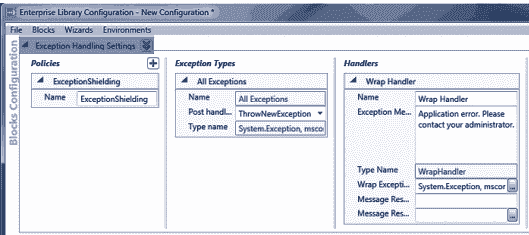

### 图 2 包装处理程序的配置

## 初始化异常处理块

现在你必须编辑代码以使用异常处理块。你需要添加对相应 Enterprise Library 程序集和命名空间的引用。本章中的示例演示了记录异常信息、在 WCF 应用程序中处理异常，以及包装和替换异常的基本过程，因此我们将添加这些任务所需的所有程序集和命名空间的引用。

你必须添加到项目中的程序集（除了所有 Enterprise Library 项目所需的程序集之外）是：

- Microsoft.Practices.EnterpriseLibrary.ExceptionHandling.dll
- Microsoft.Practices.EnterpriseLibrary.ExceptionHandling.WCF.dll
- Microsoft.Practices.EnterpriseLibrary.ExceptionHandling.Logging.dll
- Microsoft.Practices.EnterpriseLibrary.Logging.dll

如果你只在应用程序中包装和替换异常而不记录它们，则不需要添加日志记录的程序集和引用。如果你不使用该块来屏蔽 WCF 服务，则不需要添加 WCF 的程序集和引用。

为了更轻松地使用异常处理块中的对象，你可以将相关命名空间的引用添加到项目中。

现在你可以解析将用于执行异常管理的 **ExceptionManager** 类的实例。你可以使用第 1 章“简介”以及附录 A 和 B 中描述的依赖注入方法，或使用 **GetInstance** 方法。此示例使用简单的 **GetInstance** 方法。

```
' Global variable to store the ExceptionManager instance.
Dim exManager As ExceptionManager

' Resolve the default ExceptionManager object from the container.
exManager = EnterpriseLibraryContainer.Current.GetInstance(Of ExceptionManager)()
```


## 使用新策略编辑应用程序代码

现在你可以更新异常处理代码以使用新策略。你有两种选择。如果配置的异常策略能完成你需要的一切，你实际上可以从可能导致错误的方法中完全删除 Try...Catch 块，而是使用 **ExceptionManager** 的 **Process** 方法来执行方法中的代码，如下所示。

```
Public Function GetWeeklySalary(ByVal employeeId As String, _
    ByVal weeks As Integer) As Decimal

    Dim employeeName As String = String.Empty
    Dim salary As Decimal = 0
    Dim weeklySalary As Decimal = 0

exManager.Process(Function() _
    Dim connString As String = ConfigurationManager.ConnectionStrings( _
        "EmployeeDatabase").ConnectionString _
    employeeName = "John Smith" _
    salary = 1000000 _
    weeklySalary = salary / weeks _
    End Function, _
    "ExceptionShielding")

    Return weeklySalary
End Function
```

上述方法仅在使用 Visual Basic 10 和 Visual Studio 2010 时有效。它在 Visual Studio 2008 中的 Visual Basic 9 版本中无效。

你的逻辑主体被放置在 lambda 函数中并传递给 **Process** 方法。如果在表达式执行期间发生异常，它将被捕获并根据配置的策略进行处理。要执行的策略名称在 **Process** 方法的第二个参数中指定。

或者，你可以在主代码中使用 **Process** 方法来调用类的方法。如果你想在其他类或对象的边界执行异常屏蔽，这种方法很有用。如果你不需要从执行的函数或例程返回值，你可以创建所需的任何实例并在 lambda 表达式内部使用它，如下所示。

```
exManager.Process(Function() _
    Dim calc As New SalaryCalculator() _
    Console.WriteLine("Result is: {0}", calc.GetWeeklySalary("jsmith", 0)) _
    End Function, _
    "ExceptionShielding")
```

上述方法仅在使用 Visual Studio 2010 时有效。它在 Visual Studio 2008 中的 Visual Basic 中无效。

如果你想能够从方法或例程返回值，可以使用返回 lambda 表达式值的 Process 方法重载，如下所示。

```
Dim calc As New SalaryCalculator()
Dim result As Decimal = exManager.Process(Function() _
    result = calc.GetWeeklySalary("jsmith", 0), "ExceptionShielding")
Console.WriteLine("Result is: {0}", result)
```

请注意，这种方法在 Process 方法之外创建 SalaryCalculator 类的实例，因此不会将该类构造函数中发生的任何异常传递给异常处理策略。但是，当发生任何其他错误时，全局应用程序异常处理程序看到的是包装后的异常，而不是原始信息异常。如果运行示例“使用包装处理程序应用异常屏蔽后的行为”，Catch 部分现在将显示以下内容。你可以看到原始异常隐藏在内部异常中，而包装它的异常包含通用错误消息。

```
Exception type System.Exception was thrown.
Message: 'Application Error. Please contact your administrator.'
Source: 'Microsoft.Practices.EnterpriseLibrary.ExceptionHandling'

Inner Exception: System.Exception: Error calculating salary for John Smith.
Salary: 1000000. Weeks: 0
Connection: Database Employees;Server=CorpHQ;User ID=admin;Password=2g$tXD76qr
Attempted to divide by zero.
at ExceptionHandlingExample.SalaryCalculator.GetWeeklySalary(String employeeId, Int32 weeks) in ...\ExceptionHandling\ExceptionHandling\SalaryCalculator.vb: line 34
at ExceptionHandlingExample.Program.<WithWrapExceptionShielding>b__0() in ...\ExceptionHandling\ExceptionHandling\Program.vb: line 109
at Microsoft.Practices.EnterpriseLibrary.ExceptionHandling.ExceptionManagerImpl.Process(Action action, String policyName)
```

这意味着开发人员和管理员可以检查包装后的（内部）异常以获取更多信息。但是，请记住，敏感信息仍然可在异常中使用，如果异常传播到安全边界之外，可能会导致信息泄露。虽然这种方法可能适用于高度技术性的特定错误，但为了完全的安全性和异常屏蔽，你应该使用下一节中所示的技术，用不包含任何敏感信息的异常替换原始异常。

为简单起见，此示例在 UI 层级别展示了异常屏蔽的原则。它使用的业务功能可能位于同一层、单独的业务层，甚至是单独的物理层。请记住，你应该为各个层或层级设计和实现异常处理策略，以便在层或服务边界屏蔽异常。

## 替换异常

在了解使用异常处理策略有多容易之后，我们现在将探讨如何通过用不同的异常替换异常来实现异常屏蔽。如果你需要在代码中执行清理操作，然后使用异常仅公开相关内容，这种方法也很有用。要配置此场景，只需像前面的示例一样创建策略，但使用替换处理程序而不是包装处理程序，如图 3 所示。

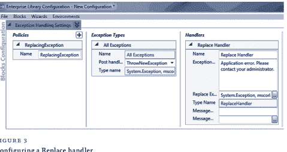

当你调用生成异常的方法时，你会看到与前面示例相同的通用异常消息。但是，这次没有内部异常。如果运行示例“使用替换处理程序应用异常屏蔽后的行为”，异常处理块将用异常处理策略中指定的新异常替换原始异常。结果如下：

```
Exception type System.Exception was thrown.
Message: 'Application Error. Please contact your administrator.'
Source: 'Microsoft.Practices.EnterpriseLibrary.ExceptionHandling'
No Inner Exception
```

## 记录异常

上一节展示了如何通过用新的净化版本替换异常来执行异常屏蔽。但是，你现在失去了原始异常中可用的所有有价值的调试和测试信息。当然，图书管理员（还记得他吗？）意识到你在实现异常屏蔽模式时需要保留这些信息并以某种方式使其可用。你通过在异常处理策略中链接异常处理程序来保留这些信息。换句话说，你向策略添加一个 Logging 处理程序。

这并不意味着 Logging 处理程序仅作为处理程序链的一部分才有用。如果你只想记录异常详细信息（然后根据应用程序的要求抛出或忽略它），可以定义仅包含 Logging 处理程序的策略。但是，在大多数情况下，你将与包装或替换异常的其他处理程序一起使用 Logging 处理程序。

图 4 显示了当你向异常处理策略添加 Logging 处理程序时会发生什么。配置工具会自动将 Logging 应用程序块添加到配置中，并带有一组默认属性，这些属性将日志条目写入 Windows 应用程序事件日志。但是，你需要在异常处理设置部分设置 Logging 异常处理程序的几个属性：

- 将代码将生成的日志事件的 ID 指定为 **Event ID** 属性。
- 将 **TextExceptionFormatter** 指定为异常处理块将使用的格式化程序类型。单击 **Formatter Type** 属性中的省略号 (...) 按钮，并在出现的类型选择器对话框中选择 **TextExceptionFormatter**。
- 为日志事件设置类别。Logging 块包含名为 **General** 的默认类别，这是 Logging 异常处理程序的默认值。但是，如果你为 Logging 块配置了其他类别，可以从单击 **Logging** 处理程序的 **Logging Category** 属性时可用的下拉列表中选择其中一个。


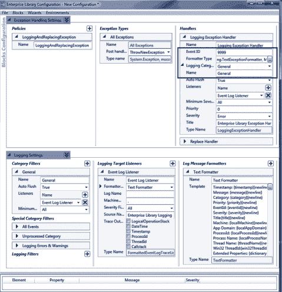

### 图 4 添加日志记录处理程序

配置工具默认将新异常处理程序添加到处理程序链的末尾。但是，你显然希望记录原始异常的详细信息，而不是替换它的新异常的详细信息。如果需要，你可以右键单击 **日志记录** 处理程序，并使用快捷菜单将其移动到处理程序链的第一个位置。

此外，如果你尚未执行此操作，则必须将对日志记录应用程序块程序集的引用添加到项目中，并（可选）向类中添加 **Imports** 语句，如下所示。

```
Imports Microsoft.Practices.EnterpriseLibrary.Logging
```

现在，当应用程序导致异常时，全局异常处理程序将继续显示相同的净化错误消息。但是，**日志记录** 处理程序会在异常处理块策略替换原始异常之前捕获其详细信息，并将详细信息写入你在日志记录块配置中指定的任何日志记录接收器。此示例中的默认值是 Windows 应用程序事件日志。如果你运行示例 **将异常日志记录以保留其包含的信息**，你将看到类似于图 5 中所示的异常。

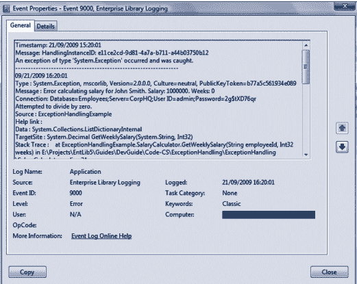

### 图 5 记录的异常详细信息

此示例显示异常处理块使用日志记录块的默认设置。但是，如你在第 4 章“轻而易举”中所见，日志记录块是极其可配置的。因此，你可以安排异常处理策略中的日志记录处理程序将信息写入任何 Windows 事件日志、电子邮件、数据库、消息队列、文本文件、Windows 管理规范 (WMI) 事件，或使用你创建的利用应用程序块扩展点的类的自定义位置。

## 在 WCF 服务边界屏蔽异常

你可以使用异常处理块为 WCF 服务实现异常处理策略。常见的场景是在 WCF 服务边界实现异常屏蔽模式。异常处理块包含专门为此设计的处理程序（故障协议异常处理程序），它将异常中的值映射到你指定的新故障协议实例。

### 创建故障协议

WCF 服务的故障协议通常只包含异常最有用的属性，并排除堆栈跟踪等敏感信息，以及可能为攻击者提供有关服务内部工作原理的有用信息的任何其他内容。以下代码显示适合与故障协议异常处理程序一起使用的简单故障协议示例：

```
<DataContract>() _
Public Class SalaryCalculationFault
    Dim theID As Guid
    Dim theMessage As String
    Public Sub New()
    End Sub
    Public Sub New(ByVal FaultID As Guid, ByVal FaultMessage As String)
        theID = FaultID
        theMessage = FaultMessage
    End Sub
End Class
<DataMember>() _
Public Property FaultID() As Guid
    Get
        Return theID
    End Get
    Set(ByVal value As Guid)
        theID = value
    End Set
End Property
<DataMember>() _
Public Property FaultMessage() As String
    Get
        Return theMessage
    End Get
    Set(ByVal value As String)
        theMessage = value
    End Set
End Property
End Class
```

### 配置异常处理策略

图 6 显示故障协议异常处理程序的示例配置。这指定 SalaryCalculationFault 类型作为目标故障协议类型，以及策略将生成并发送到客户端的异常消息。请注意，使用故障协议异常处理程序时，应始终将 PostHandlingAction 属性设置为 ThrowNewException，以便异常处理块抛出强制 WCF 将故障协议返回到客户端的异常。

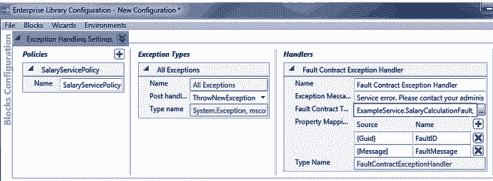

图 6 故障协议异常处理程序配置

请注意，我们为处理程序指定了属性映射，这些映射将服务中生成的异常的 Message 属性映射到 SalaryCalculationFault 类的 FaultMessage 属性，并将异常的唯一处理实例 ID（通过将 Source 设置为 '{Guid}' 指定）映射到 FaultId 属性，如图 6 所示。

### 编辑服务代码以使用新策略

在指定故障协议并配置故障协议异常处理程序后，必须编辑服务代码以使用新的异常策略。如果你尚未执行此操作，还必须将包含故障协议异常处理程序的程序集的引用添加到项目中，并（可选）向服务类添加 Imports 语句，如下所示：

```
Imports Microsoft.Practices.EnterpriseLibrary.ExceptionHandling.WCF
```

现在，可以从服务中的代码以与之前在 Windows 窗体应用程序中包装和替换异常的示例所示完全相同的方式调用 ExceptionManager 类的 Process 方法。或者，可以向服务类中的方法添加特性，以指定发生异常时应使用的策略，如以下代码所示：

```
<ServiceContract _
Public Interface ISalaryService

<OperationContract _
<FaultContract(GetType(SalaryCalculationFault))> _
Function GetWeeklySalary(employeeId As String, weeks As Integer) _
    As Decimal

End Interface

<ExceptionShielding("SalaryServicePolicy")> _
Public Class SalaryService
Implements ISalaryService

Public Function GetWeeklySalary(employeeId As String, weeks As Integer) _
    As Decimal _
    Implements ISalaryService.GetWeeklySalary
    Dim calc As New SalaryCalculator()
    Return calc.GetWeeklySalary(employeeId, weeks)
End Function

End Class
```

你将 **异常屏蔽** 特性添加到服务实现类或服务协议接口，并使用它来指定要使用的异常策略的名称。如果你在构造函数参数中未指定策略名称，或指定的策略未在配置中定义，异常处理块将自动查找名为 **WCF 异常屏蔽** 的策略。

### 故障协议异常处理程序

异常处理块在发生异常时执行策略中指定的 **故障协议** 异常处理程序。实际上，**故障协议** 处理程序是 **替换** 处理程序的专用版本。它获取原始异常，生成故障协议的实例，使用异常中的值填充它，然后抛出 **FaultException(Of 你的故障协议类型)** 异常。该处理程序执行以下操作：

- 它为 **故障协议** 异常处理程序的 **故障协议类型** 属性指定的故障协议类生成一个新实例。
- 它提取传递给方法的异常属性中的值。
- 它将新故障协议实例的值设置为从原始异常提取的值。它使用异常属性名称与故障协议公开的属性名称之间的映射，将异常值分配给相应的属性。如果你未指定映射，它将匹配名称相同的源属性和目标属性。结果是，客户端收到的不是一般服务失败消息，而是包含有关异常的相应信息的故障消息。

示例“在 WCF 应用程序边界应用异常屏蔽”使用上述服务和异常处理块 WCF 故障协议处理程序来演示异常屏蔽。你可以通过三种方式之一运行此示例：

- 在 Visual Studio 中，按 F5（调试模式）启动它，然后在调试器在 **薪资计算器** 类中的异常处停止时再次按 F5。
- 在 Visual Studio 中，右键单击解决方案资源管理器中的 SalaryService.svc，选择 **在浏览器中查看** 以启动服务，然后按 Ctrl+F5（非调试模式）运行应用程序。
- 在 Visual Studio 中启动 **薪资服务**（如前一个项目所述），然后直接运行 **\bin\debug** 文件夹中的可执行文件 **ExceptionHandlingExample.exe**。

结果如下所示。你可以看到，**薪资计算器** 类引发的异常导致服务返回包含故障 ID 和故障消息的 **薪资计算故障** 类型实例。但是，异常处理块捕获此异常，并将消息中的敏感信息替换为建议用户联系其管理员的文本。研究表明，用户非常欣赏这种信息性错误消息。

```
Getting salary for 'jsmith' from WCF Salary Service...
Exception type: System.ServiceModel.FaultException`1[ExceptionHandlingExample.SalaryService.SalaryCalculationFault] was thrown.
Message: 'Service error. Please contact your administrator.'
Source: 'mscorlib'
No Inner Exception
Fault contract detail:
Fault ID: bafb7ec2-e0d5-4b3d-5d6d6af9846a5
Message: Error calculating salary for John Smith. Salary: 1000000, Weeks: 0
Connection: Database=Employees;Server=CorpHQ;User ID=admin;Password=2g$lXD76qr
Attempted to divide by zero.
```

你还可以在异常详细信息下方看到原始故障协议的内容，这些内容是通过将异常强制转换为 **FaultException(Of 薪资计算故障)** 类型并查询其属性获得的。你可以看到，这包含服务中生成的原始异常消息。查看示例文件中的代码并运行它，以了解更多详细信息。


## 处理特定异常类型

到目前为止，所有示例都使用了处理单个异常类型的异常策略（在示例中，这是 **异常**，因此该策略将应用于传递给它的任何类型的异常）。但是，您可以在策略中指定多个异常类型，并为每个异常类型指定不同的处理程序——包括处理程序链。图 7 显示了配置控制台的一个部分，其中为名为 **通知并重抛** 的策略定义了三个异常类型（该策略将在下一个示例中使用）。每个异常类型都有指定的异常处理程序。

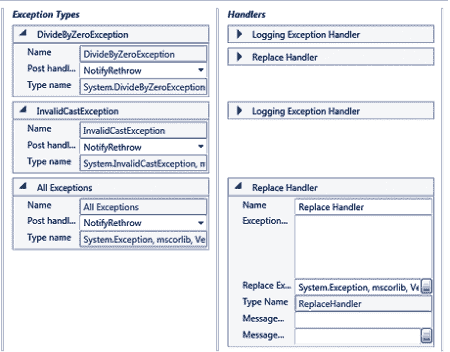

图 7 已定义三个异常类型

此功能的优势不言而喻。您可以创建策略，以不同的方式处理不同类型的异常，并且对于每个异常类型，可以有不同的消息和事后处理操作以及不同的处理程序组合。而且，最重要的是，管理员可以在部署后修改策略，以按需更改异常处理行为。他们可以添加新的异常类型，修改指定的类型，更改每个异常类型及其关联处理程序的属性，并通常微调策略以适应日常运营要求。

当然，只有当您的应用程序代码抛出适当的异常类型时，这才有效。如果您生成的信息性异常全都是基类型 **异常** 的，就像本章前面示例中所做的那样，那么只有该异常类型的处理程序才会执行。

### 在异常处理周围执行代码

到目前为止，所有示例都使用 Process 方法来执行可能导致异常的代码。它们只是使用 Process 方法来执行目标类方法，如下所示。

```
Dim calc As New SalaryCalculator()
Dim result As Decimal = exManager.Process(Function() _
    result = calc.GetWeeklySalary("Jsmith", 0), "ExceptionShielding")
Console.WriteLine("Result is: {0}", result)
```

但是，如前面在本章中所见，Process 方法不允许您检测由异常处理块执行的异常处理策略的返回值（它返回其执行的方法或函数的值）。在某些情况下，尽管也许很少见，您可能希望检测异常处理策略的返回值，并根据此值执行一些处理，甚至可能捕获异常处理块返回的异常以对其进行操作或决定是否在代码中抛出它。

在这种情况下，您可以使用 HandleException 方法将异常作为 out 参数传递给块，以便由策略填充，并检索布尔结果，该结果指示策略确定应抛出还是忽略异常。

示例“在处理异常之前和之后执行自定义代码”演示了这种方法。SalaryCalculator 类除了本章迄今使用的 GetWeeklySalary 方法之外，还包含两个方法。这两个方法名为 RaiseDivideByZeroException 和 RaiseArgumentOutOfRangeException，调用时会导致方法名称所指示类型的异常。

示例首先尝试执行 RaiseDivideByZeroException 方法，如下所示。

```
Dim calc As New SalaryCalculator()
Console.WriteLine("Result is: {0}", calc.RaiseDivideByZeroException("Jsmith", 0))
```

此异常在主例程中使用下面显示的异常处理代码捕获。这将创建一个新的 Exception 实例，并将其作为 out 参数传递给异常处理块，指定块应使用 NotifyingRethrow 策略。该策略指定块应记录 DivideByZero 异常，并将消息替换为净化后的消息。但是，它还将 PostHandlingAction 设置为 None，这意味着 HandleException 方法将返回 false。示例代码只是显示一条消息并继续。

```
...
Catch ex As Exception
    Dim newException As Exception = Nothing
    Dim rethrow As Boolean = exManager.HandleException _
        (newException)
    If rethrow Then
        ' Exception policy setting is "ThrowNewException".
        ' Code here to perform any clean up tasks required.
        ' Then throw the exception returned by the exception handling policy.
        Throw newException
    Else
        ' Exception policy setting is "None" so exception is not thrown.
        ' Code here to perform any other processing required.
        ' In this example, just ignore the exception and do nothing.
        Console.WriteLine("Detected and ignored Divide By Zero Error " _
        & " - no value returned.")
    End If
End Try
```

因此，当您执行此示例时，将显示以下消息。

```
Getting salary for 'jsmith' ... this will raise a DivideByZero exception.
Detected and ignored Divide By Zero Error - no value returned.
```

示例随后继续执行 SalaryCalculator 类的 RaiseArgumentOutOfRangeException 方法，如下所示。

```
Dim calc As New SalaryCalculator()
Console.WriteLine("Result is: {0}", _
calc.RaiseArgumentOutOfRangeException("jsmith", 0))
```

示例的这一部分还包含一个 Catch 部分，除了显示到屏幕上的消息外，与前面显示的相同。但是，NotifyingRethrow 策略指定 **异常** 类型（或任何不是 DivideByZeroException 类型的异常）应简单地包装在带有净化错误消息的新异常中。**异常** 类型的 PostHandlingAction 设置为 ThrowNewException，这意味着 HandleException 方法将返回 true。因此，Catch 块中的代码将抛出从块返回的异常，从而导致此处显示的输出。

```
Getting salary for 'jsmith' ... this will raise an ArgumentOutOfRange exception.
Exception type System.Exception was thrown.
Message: 'An application error has occurred.'
Source: 'ExceptionHandlingExample'
Inner Exception: System.ArgumentOutOfRangeException: startIndex cannot be larger than length of string.
Parameter name: startIndex
at System.String.InternalSubStringWithChecks(Int32 startIndex, Int32 length, Boolean fAlwaysCopy)
at System.String.Substring(Int32 startIndex, Int32 length)
at ExceptionHandlingExample.SalaryCalculator.RaiseArgumentOutOfRangeException(String employeeId, Int32 weeks) in ...\ExceptionHandling\ExceptionHandling\SalaryCalculator.vb:line 56
at ExceptionHandlingExample.Program.ExecutingCodeAroundException(Int32 positionInTitleArray) in ...\ExceptionHandling\ExceptionHandling\Program.vb:line 181
```

## 协助管理员

有人可能会说，异常处理块已经做了大量工作来让管理员的生活更轻松。但是，它还包含允许您对异常信息的提供方式以及管理员和运维人员使用这些信息的方式进行额外控制的功能。如果您曾在技术支持岗位工作过，您会认识这种场景。用户打电话说应用程序中发生了错误。如果您运气好，用户能够告诉您当时正在做什么，以及错误消息的确切文本。更有可能的是，他或她会告诉您他们并没有真正在做任何事情，并且消息说的是关于联系管理员的事情。

为了解决这种经常出现的问题，您可以使用块生成的 HandlingInstanceID 值，将记录的异常详细信息与特定异常以及相关异常关联起来。异常处理块为每次策略执行的 HandlingInstanceID 创建一个唯一的 GUID 值。在策略执行期间，该值可供策略中的所有处理程序使用。Logging 处理程序会自动将 HandlingInstanceID 值写入其创建的每条日志消息中。Wrap 和 Replace 处理程序可以访问 HandlingInstanceID 值，并使用特殊令牌 {handlingInstanceID} 将其包含在消息中。

图 8 显示了如何在策略中配置 Logging 处理程序和 Replace 处理程序，并在 Replace 处理程序的异常消息属性中包含 {handlingInstanceID} 令牌。

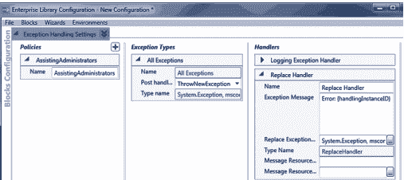

图 8 配置唯一异常处理实例标识符

现在，您的应用程序可以向用户显示唯一异常标识符，用户可以将其传递给管理员，管理员可以使用它来识别匹配的记录异常信息。此记录信息将包括原始异常的信息，在 Replace 处理程序将其替换为净化异常之前。如果在示例中选择“为查找异常详细信息向管理员提供帮助”选项

application, 你可以在此看到其运行情况。示例显示从异常处理策略返回的异常的以下详细信息：

```
Exception type System.Exception was thrown.
Message: 'Application error. Please advise your administrator and provide them
with this error code: 27f559d3-8f58-43dc-9adc-93b953a4f733'
Source: 'Microsoft.Practices.EnterpriseLibrary.Logging.ExceptionHandling'
No Inner Exception
```

在生产应用程序中，你可能会以某种对话框形式显示此消息。然而，一个问题是，用户可能无法从标准错误对话框（如消息框）中正确复制 GUID。如果你决定使用 HandlingInstanceID 值来协助管理员，请考虑使用包含只读文本框的窗体或 Web 应用程序中的错误页面，以允许用户将 GUID 值复制到剪贴板并粘贴到文档或电子邮件消息中的方式显示该值。图 9 显示了作为模式对话框显示的简单 Windows 窗体。它包含一个只读 TextBox 控件，用于显示异常的 Message 属性，该属性包含 HandlingInstanceID GUID 值。

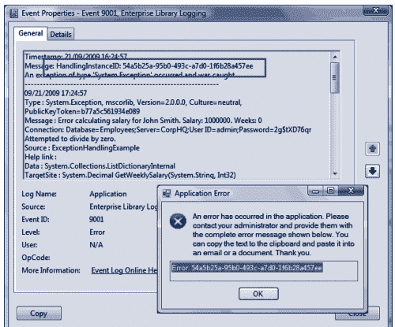

图 9
显示和关联处理实例标识符

## 扩展异常处理

与所有 Enterprise Library 应用程序块一样，异常处理块是可扩展的。如果你需要执行块未默认实现的特定任务，可以创建新的异常处理程序和异常格式化程序。例如，你可以创建一个异常处理程序，在对话框中显示异常详细信息、创建 XML 消息或生成 Web 页。所需的只是实现块中定义的 **IExceptionHandler** 接口。此接口包含一个名为 **HandleException** 的方法，当你将处理程序添加到策略链时，异常处理块将执行该方法。

异常处理块在使用 **Logging** 处理程序时，使用格式化程序创建发送到日志记录块的消息。提供的两个格式化程序是 **TextExceptionFormatter** 和 **XmlExceptionFormatter**。**TextExceptionFormatter** 为错误消息生成简单文本格式，如你在本章前面部分中所见。**XmlExceptionFormatter** 生成（如你所料）作为错误消息的 XML 格式文档。如果你想控制此信息的精确格式，可以创建自定义格式化程序。你只需创建一个从异常处理块中的 **ExceptionFormatter** 基类派生的新类，并重写它包含的用于按要求格式化异常信息的多个方法。

### 摘要

在本章中，你了解了为何、何时以及如何使用 Enterprise Library 异常处理块来创建和实现异常处理策略。错误处理不佳会使你的应用程序难以管理和维护、难以调试和测试，并可能允许其暴露对攻击者和恶意用户有用的敏感信息。

异常管理的良好做法是实现通过可配置策略提供受控且解耦的异常处理方法的策略。异常处理块使你能够轻松为应用程序实现此类策略，无论其类型和复杂程度如何。你可以在 Web 和 Windows 窗体应用程序、Web 服务、基于控制台的应用程序和实用程序，甚至在管理脚本以及托管在 SharePoint®、Microsoft Office 应用程序、其他企业系统等环境中的应用程序中使用异常处理块。

本章演示了如何使用包装、替换和记录异常等技术实现常见的异常处理模式（如异常屏蔽）。它还演示了如何处理不同类型的异常、通过使用唯一异常标识符协助管理员，以及扩展异常处理块以执行特定于你自身要求的任务。

### 简介

以防你未完全从标题中理解，本章是关于 Enterprise Library 块中最有用且最流行的块之一的内容，即日志记录应用程序块，它使根据应用程序的要求以多种不同方式执行日志记录变得非常容易。

日志记录通常满足两个主要要求：监视常规应用程序性能和提供信息。就性能而言，日志记录允许你监视应用程序内部发生的情况，在某些情况下，还能监视外部世界发生的情况。例如，日志记录可以指示发生了哪些错误或失败、本应发生的事情未发生、以及事情花费的时间远超预期。它还可以简单地提供正在正常运行的进程的状态信息——包括与外部世界通信的进程。实话实说，对管理员来说，没有什么比看到事件日志中充满那些漂亮的蓝色信息图标更有成就感了。

其次，并且可能更重要的是，日志记录可以提供关于应用程序的重要信息。这种日志记录通常称为审计，它允许你跟踪用户和进程在执行的任务、读取和更改的信息以及访问的资源方面的行为。它可以提供审计跟踪，让你跟进并获取有关恶意活动（无论其是否成功）的信息，允许你跟踪可能指示未来攻击向量或揭示安全弱点的事件，甚至在灾难发生时帮助你恢复（但这并不意味着你不应该采取备份系统和数据等常规预防措施）。审计日志记录有用的另一个领域是管理不可否认性。例如，在用户或外部攻击者否认其行为的法律或程序情况下，你的审计日志可能很有用。

日志记录块是一种高度灵活且可配置的解决方案，允许你在各种位置创建和存储日志消息、对消息进行分类和筛选，并收集对调试和跟踪以及审计和常规日志记录要求有用的上下文信息。它将日志记录功能与日志目标抽象分离，因此无论目标日志存储的位置和类型如何，应用程序代码都保持一致。几乎控制日志记录的所有参数都可以通过在部署后和运行时更改配置来更改。这意味着管理员和操作员在管理应用程序时（包括使用组策略时）可以更改日志记录行为。

## 日志记录块的功能是什么？

日志记录应用程序块允许你将日志记录功能与应用程序代码解耦。该块可以将日志条目路由到 Windows® 事件日志、数据库或文本（或 XML）文件。它还可以生成包含日志记录信息的电子邮件消息、可通过 Windows 消息队列（使用随块提供的分发器服务）路由的消息，或 Windows 管理规范 (WMI) 事件。如果这些内置功能均不满足你的要求，你可以创建一个提供程序，将日志条目发送到任何其他自定义位置或执行其他操作。

在你的应用程序中，你只需使用合适的日志记录对象（如 LogWriter 类）评估日志条目，然后调用方法将其包含的信息写入日志记录系统。日志记录块将日志消息路由通过你在配置中定义的任何筛选器，并路由到你配置的侦听器。每个侦听器定义日志条目的目标（如 Windows 事件日志或电子邮件消息），并使用格式化程序为该日志记录目标生成适当格式的内容。

从中可以看出，此多步骤过程涉及许多对象，了解它们如何交互以及日志消息如何通过进程管道流动非常重要。图 1 更详细地显示了总体过程，并对每个阶段进行了说明。


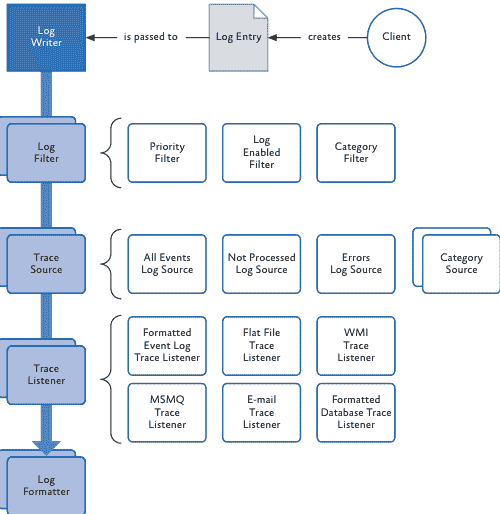

图 1 日志记录过程和日志记录块中的对象概览

| 阶段 | 描述 |
| :--- | :--- |
| 创建日志条目 | 用户创建一个 **LogWriter** 实例，使用它创建一个新的 **LogEntry**，并将其传递给日志记录块进行处理。或者，用户可以显式创建一个新的 **LogEntry**，用所需信息填充它，并使用 **LogWriter** 将其传递给日志记录块进行处理。 |
| 筛选日志条目 | 日志记录块会根据您的配置设置，按消息优先级或您在创建 **LogEntry** 时添加到 **LogEntry** 中的类别对其进行筛选。它还会检查日志记录是否已启用。这些筛选器可以阻止对日志条目的任何进一步处理。例如，当您希望允许管理员启用和禁用其他调试信息日志记录而无需重新启动应用程序时，这很有用。 |
| 选择跟踪源 | 跟踪源充当日志条目和日志目标之间的链接。您在日志记录块配置中定义的每个类别都有一个跟踪源；此外，还有三个内置跟踪源，分别捕获所有日志条目、不匹配任何类别的未处理条目，以及因日志记录错误（例如写入目标日志时出错）而无法处理的条目。 |
| 选择跟踪侦听器 | 每个跟踪源都定义了一个或多个跟踪侦听器。这些侦听器负责获取日志条目，将其通过单独的日志格式化程序（将内容转换为合适的格式），并将其传递给目标日志。该块提供了多个跟踪侦听器，如果需要，您可以创建自己的侦听器。 |
| 格式化日志条目 | 每个跟踪侦听器都可以使用日志格式化程序来格式化日志条目中包含的信息。该块包含日志消息格式化程序，如果需要，您可以创建自己的格式化程序。文本格式化程序使用包含占位符的模板，使生成日志条目所需格式变得容易。 |

## 日志记录类别

日志记录类别允许您指定块处理的日志条目的目标。您可以定义与一个或多个目标相关的类别。例如，您可以创建一个名为 General 的类别，其中包含写入文本文件和 XML 文件的跟踪侦听器，以及一个名为 Auditing 的类别，用于配置为使用写入一个或多个数据库的跟踪侦听器的管理信息。然后，您可以将日志条目分配给一个或多个类别，从而将其有效地映射到多个目标。图 1 示意图中显示的三个日志源（所有事件日志源、未处理日志源和错误日志源）本身也是类别，您可以为其定义跟踪侦听器。

日志记录是应用程序的一项增值服务，因此日志记录过程中的任何失败都必须得到优雅处理，而不应向主业务流程引发异常。日志记录块通过将所有日志记录失败发送到名为 **Logging Errors & Warnings** 的特殊类别（错误日志源）来实现这一点。默认情况下，这些错误消息写入 Windows 事件日志，不过如果您愿意，可以配置此类别使用不同的跟踪侦听器写入其他目标。

## 日志记录开销和其他上下文信息

无论您如何实现日志记录，它始终会对性能产生一定影响。日志记录块提供了一种灵活且高度可配置的日志记录解决方案，经过精心设计以尽量减少性能影响。但是，您应该意识到这种影响，并考虑您的日志记录策略将如何影响它。例如，将日志条目写入多个日志并使用多个筛选器的复杂配置，可能比简单配置产生更大的影响。您必须在日志记录需求与性能和可扩展性需求之间取得平衡。

为了最大限度地提高性能，**LogWriter** 类默认仅公开常用信息的属性。这包括您在配置中指定的事件 ID、消息、优先级和类别。**LogWriter** 还会自动收集一些上下文信息，例如时间、应用程序域、计算机名称和进程 ID（尽可能使用缓存值），以尽量减少性能影响。

但是，收集其他上下文信息在处理上可能代价高昂，如果您不打算使用这些信息，则会浪费宝贵资源并可能影响性能。因此，日志记录块仅在您创建 **LogEntry** 实例时指定需要此信息的情况下，才会从环境中收集其他不太常用的信息（您可能只需偶尔使用）。日志记录块中的四个类可以收集特定的上下文信息集，您可以将其添加到日志条目中。这包括 COM+ 诊断信息、当前堆栈跟踪、托管运行时的安全相关信息以及操作系统的安全相关信息。日志条目还有一个字典属性，您可以在其中添加任何需要的其他自定义信息，并且该信息必须出现在日志中。

## 如何使用日志记录块？

是时候看一些日志记录块的示例了，包括如何创建日志条目并将其写入各种目标，例如 Windows 事件日志、磁盘文件和数据库。稍后，您将了解如何使用块的一些高级功能，例如检查筛选器状态和向日志条目添加上下文信息。但是，在开始使用日志记录块之前，您必须对其进行配置。

## 配置日志记录块

您可以使用第 1 章“简介”中描述的配置工具配置日志记录块。配置工具的日志记录设置部分包含三列，用于配置筛选器（跟踪源）、日志记录目标侦听器（跟踪侦听器）和日志消息格式化程序。第一列包含三种类型的筛选器：类别（类别源）、特殊类别和日志记录筛选器。所有这些项目都在图 1 所示的示意图及其附带的表格中进行了描述。

图 2 显示了加载了本章示例配置的配置工具。您可以看到，我们已配置了多种类型的筛选器、侦听器和格式化程序。由于配置包含数据库跟踪侦听器，配置工具还自动添加了数据库设置部分。

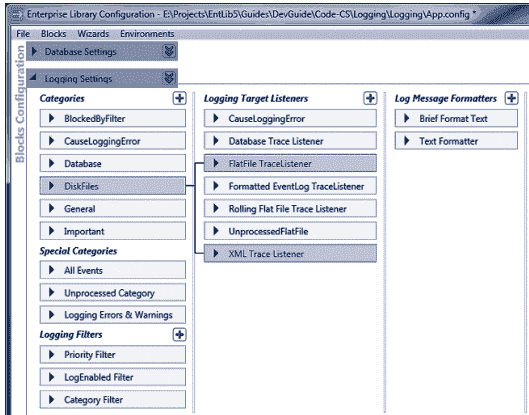

图 2 示例应用程序的配置设置

了解日志记录块配置工作原理的最简单方法是自行运行配置工具，并打开示例应用程序中的 App.config 文件。您可以展开每个部分以查看属性设置，并将每个项目与其他项目关联起来。

## 初始化日志记录块

现在，您必须编辑代码以使用日志记录块。您需要添加对相应企业库程序集和命名空间的引用。您必须添加到项目中的程序集（除所有企业库项目所需的程序集外）为：

- Microsoft.Practices.EnterpriseLibrary.Logging.dll
- Microsoft.Practices.EnterpriseLibrary.Logging.Database.dll
- Microsoft.Practices.EnterpriseLibrary.Data.dll

但是，如果您不打算将日志条目发送到数据库，则不需要此列表中的最后两个程序集。

现在，您可以开始编写一些代码了。

## 通过示例深入了解

为了演示日志记录块的功能，我们提供了一个示例应用程序，您可以下载并在自己的计算机上运行。您可以直接从 bin\Debug 文件夹运行可执行文件，也可以在 Microsoft® Visual Studio® 中打开名为 Logging 的解决方案以查看代码并在 Visual Studio 下运行。该应用程序包含一个预配置的数据库用于存储日志条目，以及如果您愿意，可以使用这些脚本在不同的数据库服务器中创建日志记录数据库。

如果您已在本地安装 Microsoft SQL Server® Express，则无需运行脚本。如果您想为日志记录指定不同的数据库，请编辑名为 CreateLoggingDB.cmd 的脚本以指定数据库位置并执行它。完成此操作后，您必须将名为 ExampleDatabase 的连接字符串更改为指向新数据库。

此外，具体取决于您使用的操作系统版本，您可能需要以具有管理员权限的帐户上下文运行应用程序。如果您在 Visual Studio 内运行示例，请右键单击“开始”菜单中的条目并选择“以管理员身份运行”来启动 Visual Studio。

关于示例应用程序还有一点需要注意：如果 C: 盘根目录下不存在名为 Temp 的文件夹，它会创建该文件夹，并将文本日志文件写入其中，以便您轻松找到并查看它们。

## 使用 LogWriter 创建和写入日志条目

第一个示例“使用 LogWriter 的 Write 方法进行简单日志记录”演示了如何直接使用 LogWriter 创建日志条目。第一阶段是获取 LogWriter，示例采用最简单的方法——当前企业库容器的 GetInstance 方法。请参阅以下代码。

```
' Resolve the default LogWriter object from the container.
Dim defaultWriter As LogWriter _
    = EnterpriseLibraryContainer.Current.GetInstance(Of LogWriter)()
```

现在，您可以调用 Write 方法并传入所需的任何参数值。Write 方法有许多重载。它们允许您指定消息文本、类别、优先级（数值）、事件 ID、严重性（TraceEventType 枚举中的值）以及事件标题。还有一个重载允许您通过填充包含名称和值对的字典来向日志条目添加自定义值（您将在后面的示例中看到此用法）。我们的示例代码使用了其中几个重载。我们从此处列出的代码中删除了某些 Console.WriteLine 语句，以便更容易看出代码实际的作用。

```
' Check if logging is enabled before creating log entries.
If defaultWriter.IsLoggingEnabled() Then

    defaultWriter.Write("Log entry created using the simplest overload.")
    defaultWriter.Write("Log entry with a single category.", "General")
```


```vb.net
defaultWriter.Write("Log entry with a category, priority, and event ID.", _
    "General", 6, 9081)
defaultWriter.Write("Log entry with a category, priority, event ID, " _
    & "and severity.", "General", 5, 9002, _
    TraceEventType.Warning)
defaultWriter.Write("Log entry with a category, priority, event ID, " _
    & "severity, and title.", "General", 8, 9003, _
    TraceEventType.Warning, "Logging Block Examples")
Else
    Console.WriteLine("Logging is disabled in the configuration.")
End If
```

注意代码首先检查日志记录是否已启用。如果日志条目不会被发送到任何地方，就没有必要使用宝贵的处理器周期和内存来生成日志条目。Logging 块配置的 Filters 部分可以包含一个名为 Log Enabled Filter 的特殊筛选器（我们在示例应用程序中配置了一个）。此筛选器只有一个属性，即 Enabled，它允许管理员为该块启用和禁用所有日志记录。当它设置为 False 时，LogWriter 的 IsLoggingEnabled 属性也将返回 False。

示例产生以下结果。所有事件都发送到 General 类别，该类别配置为将事件写入 Windows 应用程序事件日志（这是该块的默认配置）。

```
Created a Log Entry using the simplest overload.
Created a Log Entry with a single category.
Created a Log Entry with a category, priority, and event ID.
Created a Log Entry with a category, priority, event ID, and severity.
Created a Log Entry with a category, priority, event ID, severity, and title.
Open Windows Event Viewer "Application" Log to see the results.
```

你可以打开 Windows 事件查看器查看结果。图 3 显示了本示例中最后一条 Write 语句生成的事件。

### 图 3 已记录的事件

**事件属性 - 事件 9003，企业库日志记录**

### 常规详细信息

| 属性 | 值 |
| --- | --- |
| 时间戳 | 24/11/2009 10:14:50 |
| 消息 | 带有类别、优先级、事件 ID、严重性和标题的日志条目。 |
| 类别 | General |
| 优先级 | 8 |
| 事件 ID | 9003 |
| 严重性 | Warning |
| 标题 | Logging Block Examples |
| 活动 ID | 00000000-0000-0000-0000-000000000000 |
| 计算机名称 | BIGFOOT |
| AppDomain 名称 | vshost.exe |
| 进程 ID | 5772 |
| 进程名称 | E:\Projects\EntLib5\Guides\DevGuide\Code-CS\Logging\Logging\bin\Debug\LoggingExample.vshost.exe |
| 线程名称 | |
| Win32 线程 ID | 3008 |

### 扩展属性

| 属性 | 值 |
| --- | --- |
| 日志名称 | Application |
| 来源 | Enterprise Library Logging |
| 记录时间 | 24/11/2009 10:14:50 |
| 事件 ID | 9003 |
| 任务类别 | None |
| 级别 | Warning |
| 关键字 | Classic |
| 用户 | N/A |
| 计算机 | |
| 操作码 | N/A |
| 更多信息 | Event Log Online Help |

如果你未为 **写入** 方法的某个参数指定值，则日志记录块将使用该参数的默认值。默认值为 Category = General、Priority = -1、Event ID = 1、Severity = Information，标题为空字符串。

## 关于日志记录类别

类别是企业库将发送到该块的事件路由到相应目标（例如数据库、事件日志、电子邮件消息等）的方式。前面的示例使用了日志记录块的默认配置。当你使用企业库配置工具将日志记录块添加到应用程序配置时，它包含名为 **常规** 的单个类别，该类别配置为将事件写入 Windows 应用程序事件日志。

你可以更改任何类别的日志记录行为。例如，你可以通过重新配置为 **常规** 类别指定的事件日志跟踪侦听器，或重新配置该跟踪侦听器使用的文本格式化程序，来更改前面示例的行为。你可以更改事件日志跟踪侦听器发送事件的目标事件日志；编辑文本格式化程序使用的模板；或添加其他跟踪侦听器。

不过，你的应用程序很可能需要为不同任务执行不同类型的日志记录。实现此目的的典型方法是定义其他类别，然后为每个类别指定所需的跟踪侦听器类型。例如，你可能希望将审核信息发送到文本文件或 XML 文件、数据库或两者，而不是发送到 Windows 事件日志。或者，你可能希望将灾难性故障的指示作为电子邮件消息发送给管理员。如果你使用企业级监控系统，则可能更愿意将事件写入 WMI 子系统，或通过 Windows 消息队列将其发送到另一个系统。

你可以轻松地将类别添加到应用程序配置中。方法是将所需日志记录目标的跟踪侦听器（例如平面文件跟踪侦听器或数据库跟踪侦听器）添加到 **日志记录目标侦听器** 部分，然后将所需的类别添加到 **类别筛选器** 部分。最后，通过将所需的跟踪侦听器添加到 **类别筛选器** 部分中的类别筛选器，以任意组合将它们链接在一起。图 4 显示了这种类型的配置，其中常规类别将日志消息输出到事件日志侦听器和数据库跟踪侦听器。

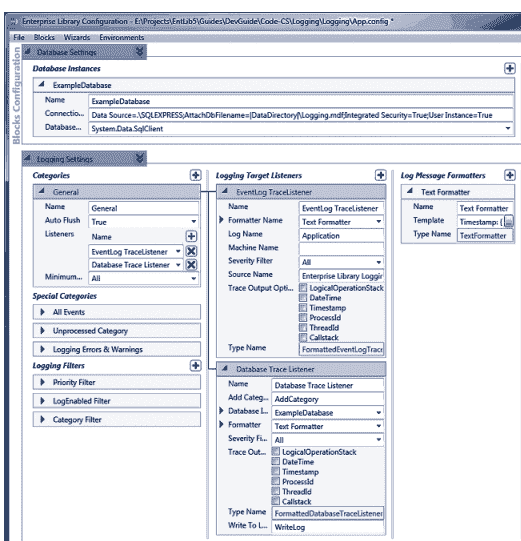

### 图 4 为不同类别配置跟踪侦听器

你可以为添加的每个类别（源）以及默认的 **常规** 类别指定两个属性。你可以设置 **自动刷新** 属性，以指定块应在日志条目写入块后立即将其刷新到配置的目标跟踪侦听器，或仅在调用 **日志写入器** 的 **刷新上下文项** 方法时才刷新。如果将 **自动刷新** 属性设置为 **假**，请确保你的代码在发生异常或故障时调用此方法，以避免丢失任何缓存的日志记录信息。

你可以为每个类别设置的另一个属性是 **最低严重性**（它设置每个侦听器的 **源级别** 属性）。这指定了类别筛选器将传递到其配置的跟踪侦听器的日志条目的最低严重性（例如 Warning 或 Critical）。任何严重性较低的日志条目都将被阻止。默认严重性为 All，因此除非你更改此值，否则不会阻止任何日志条目。你还可以为每个单独的跟踪侦听器配置严重性筛选器（它设置 Filter 属性），这些值对于同一类别中的跟踪侦听器可以不同。你将在本章的下一个示例中了解如何使用跟踪侦听器的 Filter 属性。

## 按类别筛选

日志记录块配置的日志记录筛选器部分可以包含一个筛选器，你可以使用它根据日志条目所属的指定类别来筛选发送到该块的日志条目。你可以向配置中添加多个类别来管理筛选，但过度使用此功能会使日志记录难以管理。

为了帮助你定义筛选器，配置工具包含一个筛选器编辑器对话框，允许你指定筛选器模式（允许除……以外的所有项或拒绝除……以外的所有项），然后构建此筛选器将应用到的类别列表。示例应用程序仅包含一个筛选器，该筛选器配置为允许记录除名为（相当恰当地）BlockedByFilter 的类别以外的所有类别的日志。你将在本章后面的“捕获未处理的事件和记录错误”部分中看到 BlockedByFilter 类别的用法。

## 将日志条目写入多个类别

除了能够定义多个类别外，你还可以在单个操作中将日志条目发送到多个类别。这种方法通常意味着你可以定义更少的类别，并简化配置，因为每个类别可以专注于特定任务。你不需要拥有具有类似跟踪侦听器集的多个类别。

第二个示例“使用 LogWriter 的写入方法将日志记录到多个类别”展示了如何写入多个类别。该示例在配置中定义了两个类别，分别名为 DiskFiles 和 Important。DiskFiles 类别包含对平面文件跟踪侦听器和 XML 跟踪侦听器的引用。Important 类别包含对事件日志跟踪侦听器和滚动平面文件跟踪侦听器的引用。

该示例使用以下代码创建包含两个类别名称（DiskFiles 和 Important）的数组，然后以与前面示例相同的方式使用 LogWriter 的写入方法向这两个类别写入三条日志消息。同样，我们删除了部分 Console.WriteLine 语句，以便更清楚地查看代码实际执行的操作。

```
' Check if logging is enabled before creating log entries.
If defaultWriter.IsLoggingEnabled() Then

' Create a string array (or List<>) containing the categories.
Dim logCategories As String() = New String() {"DiskFiles", "Important"}

' Write the log entries using these categories.
defaultWriter.Write("Log entry with multiple categories.", logCategories)
```


```
defaultWriter.Write("Log entry with multiple categories, a priority, " _
    & "and an event ID.", logCategories, 7, 9084)
defaultWriter.Write("Log entry with multiple categories, a priority, " _
    & "event ID, severity, and title.", logCategories, 10, _
    9005, TraceEventType.Critical, "Logging Block Examples")
Else
    Console.WriteLine("Logging is disabled in the configuration.")
End If
```

## 控制输出格式

如果运行上面的示例，然后打开 Windows 事件日志，您将看到此示例生成的三个事件。另外，在 C:\Temp 文件夹中，您将看到三个文件。RollingFlatFile.log 由滚动平面文件跟踪侦听器生成，包含与事件日志跟踪侦听器生成的事件日志事件相同的信息。如果您探索配置，您将看到它们都使用相同的文本格式化程序来格式化输出。

FlatFile.log 文件由平面文件跟踪侦听器生成，仅包含每个事件的一组简化值。例如，这是针对三个日志条目中最后一个生成的输出。

```
----------------------------------------
Timestamp: 24/11/2009 10:49:26
Message: Log entry with multiple categories, a priority, event ID, severity,
    and title.
Category: DiskFiles, Important
Priority: 10
EventId: 9005
ActivityID: 00000000-0000-0000-0000-000000000000
Severity: Critical
Title: Logging Block Examples
----------------------------------------
```

原因是平面文件跟踪侦听器被配置为使用不同的文本格式化程序——在此示例中，名为 Brief Format Text（在配置工具的 Formatters 部分中列出）的格式化程序。所有跟踪侦听器都使用格式化程序将日志条目属性的内容转换为该跟踪侦听器目标的适当格式。创建文本输出（例如文本文件或电子邮件消息）的跟踪侦听器使用在块配置中定义的文本格式化程序。

如果您检查配置的文本格式化程序，您将看到它具有一个 Template 属性。您可以使用用于编辑此属性的 Template Editor 对话框，通过添加令牌（使用可用令牌的下拉列表）和文本，或删除令牌和文本来更改输出格式。图 5 显示了文本格式化程序的默认模板以及如何编辑此模板。令牌的完整列表及其含义可在 Enterprise Library 的在线文档中找到，尽管大多数都不言自明。

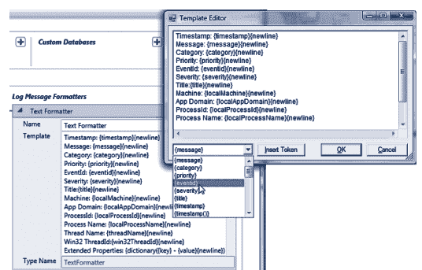

图 5 编辑文本格式化程序的模板

我们在 Brief Format 文本格式化程序中使用的模板如下所示。

```
Timestamp: {timestamp(local)}{newline}Message: {message}{newline}Category: {category}{newline}Priority: {priority}{newline}EventId: {eventid}{newline}ActivityId: {property(ActivityId)}{newline}Severity: {severity}{newline}Title: {title}{newline}
```

## 非格式化跟踪侦听器

在讨论输出格式化时，还有一个因素需要考虑。有些跟踪侦听器不使用文本格式化程序来格式化其生成的输出。这通常是因为输出是二进制或特定格式。WMI 跟踪侦听器是不使用文本格式化程序的典型示例。

对于此类跟踪侦听器，您可以将 TraceOutputOptions 属性设置为一系列值之一，以指定要在输出中包含的值。TraceOutputOptions 属性接受来自 System.Diagnostics.TraceOptions 枚举的值。有效值包括 CallStack、DateTime、ProcessId、LogicalOperationStack、Timestamp 和 ThreadId。随 Enterprise Library 安装的文档，以及 MSDN® 上的 System.Diagnostics 命名空间文档，提供了更多信息。

## 在跟踪侦听器中按严重性筛选

前面的示例生成了一个我们尚未查看的第三个磁盘文件。我们没有忘记它，而是将其保留到本节，因为它演示了跟踪侦听器的另一个功能，您通常会发现此功能非常有用。要查看此功能，您需要查看之前示例中使用的 XML 跟踪侦听器在 C:\Temp 文件夹中生成的 XmlLogFile.xml 文件。您应该在 Microsoft Internet Explorer®（或其他 Web 浏览器或文本编辑器）中打开它以查看结构。

您将看到该文件仅包含前面示例中的一个事件，而不是示例代码生成的三个事件。这是因为 XML 跟踪侦听器的配置中将 **筛选器** 属性设置为 **错误**。因此，它将仅记录严重性为 **错误** 或更高级别的事件。如果您查看示例代码，您将看到三次对 **写入** 方法的调用中只有最后一次指定了严重性的值（在此示例中为 **TraceEventType.Critical**），因此其他两个事件使用了默认值 **信息**。

> 如果收到指示 XML 跟踪侦听器创建的 XML 文档无效的错误，这可能是因为文件中包含多个日志条目。这意味着它不是有效的 XML 文档——它包含每次运行此示例时添加到文件中的单独事件日志条目。要将其作为 XML 查看，必须在文本编辑器中打开文件，并在内容周围添加开始和结束元素（例如 **<root>** 和 **</root>**）。或者，只需删除它并再次运行示例即可。

Enterprise Library 提供的所有跟踪侦听器都公开 **筛选器** 属性，您可以使用此属性将写入日志目标的日志条目限制为仅对您重要的条目。如果您的代码生成许多仅在特定情况下用于监视和调试的信息事件，您可以筛选这些事件，以便在不需要时减少日志的增长和大小。

或者，（如示例所示）您可以使用 **筛选器** 属性来区分同一类别中不同侦听器的日志粒度。例如，平面文件跟踪侦听器可能会将特定事件的所有条目记录到审核日志文件中，但同一类别中的电子邮件跟踪侦听器仅在发生错误或严重事件时才向管理员发送电子邮件消息。

## 按优先级筛选所有日志条目

除了可以根据严重性筛选单个跟踪侦听器中的日志条目外，您还可以设置日志块以根据优先级筛选发送到它的所有日志条目。除了配置中 **筛选器** 部分中的日志启用筛选器和类别筛选器（我们在本章前面讨论过）之外，您还可以添加一个名为 Priority Filter 的筛选器。

此筛选器有两个可设置的属性：**最小优先级** 和 **最大优先级**。日志条目的优先级默认设置为 -1，这与筛选器的 **最小优先级** 属性的默认设置相同，且未设置最大优先级。因此，此筛选器不会阻止任何日志条目。但是，如果您更改这些属性的默认值，则仅会记录优先级在配置值之间（包括指定的最大值和最小值）的日志条目。例外情况是具有默认优先级 -1 的日志条目。这些条目永远不会被筛选。

## 创建和使用 LogEntry 对象

到目前为止，我们已使用 LogWriter 类的写入方法生成日志条目。如果您想单独创建日志条目（例如，要从方法返回它们或在进程之间传递它们），另一种有用的方法是生成 LogEntry 类的实例，然后稍后将其写入配置的目标。

示例“使用 LogEntry 对象创建和写入日志条目”演示了此方法。它创建两个 LogEntry 实例。代码首先调用 LogEntry 类最复杂的构造函数，该构造函数接受所有可能的值。这包括一个具有字符串键的对象 Dictionary（在此示例中，单个项 额外信息），该字典将包含在跟踪侦听器和格式化程序的输出中。然后，它使用接受 LogEntry 实例的 LogWriter 类的写入方法的重载来写入此日志条目。

接下来，代码使用默认构造函数创建一个新的空 LogEntry，通过设置单个属性对其进行填充，然后使用 LogWriter 的相同写入方法将其写入。

```
' Check if logging is enabled before creating log entries.
If defaultWriter.IsLoggingEnabled() Then

    ' Create a Dictionary of extended properties
    Dim exProperties As New Dictionary(Of String, Object)()
    exProperties.Add("Extra Information", "Some Special Value")

    ' Create a LogEntry using the constructor parameters.
    Dim entry1 As New LogEntry("LogEntry with category, priority, event ID, _
    & "severity, and title.", "General", 8, 9006, _
    TraceEventType.[Error], "Logging Block Examples", _
    exProperties)
    defaultWriter.Write(entry1)

    ' Create a LogEntry and populate the individual properties.
    Dim entry2 As New LogEntry()
    entry2.Categories = New String() {"General"}
    entry2.EventId = 9807
    entry2.Message = "LogEntry with individual properties specified."
    entry2.Priority = 9
    entry2.Severity = TraceEventType.Warning
    entry2.Title = "Logging Block Examples"
    entry2.ExtendedProperties = exProperties
    defaultWriter.Write(entry2)
Else
    Console.WriteLine("Logging is disabled in the configuration.")
End If
```


## 捕获未处理的事件并记录错误

本示例使用 **General** 类别将日志条目写入 Windows 应用程序事件日志。如果查看本示例生成的事件，您将看到上面代码中设置的值（列表末尾包括我们使用 **Dictionary** 指定的扩展属性）。您可以在图 6 中看到这一点。

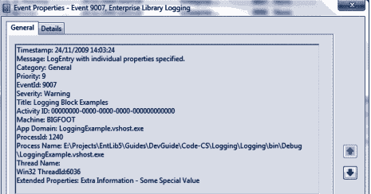

### 图 6
*写入 General 类别的日志条目*

### 关于特殊源

实际上，日志块包含三个用于处理这些情况的特殊源。每个特殊源实际上都是一个类别，您可以向每个特殊源添加对配置的跟踪侦听器的引用，以便到达该类别的事件将被写入您指定的目标。

**All Events** 特殊源接收所有事件，不受块配置中所有其他设置的影响。如果需要，您可以使用它来提供所有事件的审计跟踪。默认情况下，它未配置任何跟踪侦听器。

**Unprocessed Category** 特殊源接收任何类别与任何配置类别均不匹配的日志条目。默认情况下，此类别未配置任何跟踪侦听器。

**Logging Errors & Warnings** 特殊源接收任何在日志记录过程中导致错误的日志条目。默认情况下，此类别包含对跟踪侦听器的引用，该侦听器将错误详细信息写入 Windows 应用程序事件日志，不过您可以根据需要重新配置它。

## 使用特殊源的示例

示例“使用特殊源捕获未处理的事件或错误”演示了日志块在这两种情况下的反应。代码首先将日志条目写入名为 InvalidCategory 的类别，该类别不存在于配置中。接下来，它将另一个日志条目写入名为 CauseLoggingError 的类别，该类别配置为使用数据库跟踪侦听器。但是，此跟踪侦听器指定了一个无效的连接字符串；它指向一个不存在的数据库。

```
' Check if logging is enabled before creating log entries.
If defaultWriter.IsLoggingEnabled() Then

    ' Create a log entry to be processed by the "Unprocessed" special source.
    defaultWriter.Write("Entry with category not defined in configuration.", _
        "InvalidCategory")

    ' Create log entry to be processed by the "Errors & Warnings" special source.
    defaultWriter.Write("Entry that causes a logging error.", "CauseLoggingError")

Else
    Console.WriteLine("Logging is disabled in the configuration.")
End If
```

您可能会认为这两个日志条目都无法到达其目标。但是，示例生成了以下消息，指示在哪里查找生成的日志条目。

```
Created a Log Entry with a category name not defined in the configuration.
The Log Entry will appear in the Unprocessed.log file in the C:\Temp folder.

Created a Log Entry that causes a logging error.
The Log Entry will appear in the Windows Application Event Log.
```

这是因为我们在特殊源部分中配置了 Unprocessed Category，并引用了一个将日志条目写入名为 Unprocessed.log 文件的平面文件跟踪侦听器。如果打开此文件，您将看到发送到 InvalidCategory 类别的日志条目。

示例对 Logging Errors & Warnings 特殊源使用默认配置。这意味着导致日志记录错误的日志条目将发送到该类别中引用的格式化事件日志跟踪侦听器。如果打开应用程序事件日志，您将在该类别中看到此条目。下面的清单显示了部分内容。

```
Timestamp: 24/11/2009 15:14:30
Message: Tracing to LogSource 'CauseLoggingError' failed. Processing for other sources will continue. See summary information below for more information. Should this problem persist, stop the service and check the configuration file(s) for possible error(s) in the configuration of the categories and sinks.
```

### 企业库分发器服务摘要：

```
-->
Message:
Timestamp: 24/11/2009 15:14:30
Message: Entry that causes a logging error.
Category: CauseLoggingError
...
...
Exception Information Details:
--------------------------------
Exception Type: System.Data.SqlClient.SqlException
Errors: System.Data.SqlClient.SqlErrorCollection
Class: 11
LineNumber: 65536
Number: 4060
Procedure:
Server: (local)\SQLEXPRESS
State: 1
Source: .Net SqlClient Data Provider
ErrorCode: -2146232060
Message: Cannot open database "DoesNotExist" requested by the login.
The login failed.
Login failed for user 'xxxxxx\xxxxx'.
...
...
Stack Trace Information Details:
--------------------------------
...
...
...
```

除了日志条目本身之外，您还可以看到该事件包含大量信息，可帮助您调试错误。它包含一条指示发生日志记录错误的消息，后跟日志条目本身。但是，之后是一个包含日志记录机制引发的异常详细信息的部分（您可以看到 SqlClient 数据访问代码生成的错误消息），之后是完整的堆栈跟踪。

需要注意的是，记录数据库和安全异常时应始终以保护日志中可能包含的敏感信息的方式进行。您必须确保适当限制对日志的访问，并且仅向其他用户公开非敏感信息。您可能需要考虑应用异常屏蔽，如第 3 章“使错误管理变得异常简单”中所述。

## 记录到数据库

在 Windows 事件日志和文本文件之后，日志记录最常见的需求之一是将日志条目存储在数据库中。日志块包含数据库跟踪侦听器，使此操作变得简单。您使用随企业库提供的脚本配置数据库，该脚本位于源代码的 \Blocks\Logging\Src\DatabaseTraceListener\Scripts 文件夹中。我们还随本章示例包含了这些脚本。

这些脚本假设您将使用本地安装的 SQL Server Express 数据库，但您可以编辑 CreateLoggingDb.cmd 文件以将目标更改为其他数据库服务器。命令文件执行的 SQL 脚本创建一个名为 Logging 的数据库，并向其中添加所需的表和存储过程。

但是，如果您只想运行我们为本章提供的示例应用程序，则无需创建数据库。项目包含一个名为 Logging.mdf 的预配置数据库文件（位于 bin\Debug 文件夹），它会自动附加到您的本地 SQL Server Express 实例。您可以使用 Visual Studio 服务器资源管理器连接到此数据库以查看内容。数据库跟踪侦听器的配置包含数据库实例属性，该属性引用在数据访问应用程序块的设置部分中配置的此数据库（参见图 7）。

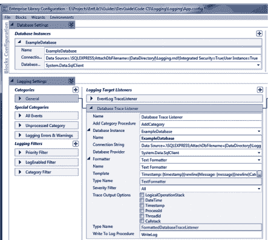

### 图 7 数据库跟踪侦听器的配置

数据库跟踪侦听器使用文本格式化程序格式化输出，因此您可以编辑用于生成日志消息的模板以满足您的要求。如果需要，还可以向日志条目添加扩展属性。此外，与所有跟踪侦听器一样，您可以根据需要按严重性筛选日志条目。

数据库中的 Log 表仅包含常用值的列，例如消息、事件 ID、优先级、严重性、标题、时间戳、计算机和进程详细信息等。它还包含名为 FormattedMessage 的列，其中包含文本格式化程序生成的消息。

### 使用数据库跟踪侦听器

示例“将日志条目发送到数据库”演示了数据库跟踪侦听器的使用。代码相对简单，遵循与前面创建扩展属性 Dictionary 的示例相同的风格，然后使用 LogWriter 的 Write 方法写入两个日志条目。第一个日志条目由 LogWriter 根据传递给 Write 方法的参数值创建。第二个日志条目在代码中作为新的 LogEntry 实例生成，方法是指定构造函数参数的值。还要注意，使用简单的 Dictionary 作为日志条目的 ExtendedProperties 向日志条目添加其他信息是多么容易。

```
' Check if logging is enabled before creating log entries.
If defaultWriter.IsLoggingEnabled() Then

    ' Create a Dictionary of extended properties
    Dim exProperties As New Dictionary(Of String, Object())
    exProperties.Add("Extra Information", "Some Special Value")

    ' Create a LogEntry using the constructor parameters.
    defaultWriter.Write("Log entry with category, priority, event ID, severity, " _
        & "title, and extended properties.", "Database", _
        5, 9008, TraceEventType.Warning, _
        "Logging Block Examples", exProperties)

    ' Create a LogEntry using the constructor parameters.
    Dim entry As New LogEntry("LogEntry with category, priority, event ID, " _
        & "severity, title, and extended properties.", _
        "Database", 8, 9009, TraceEventType.Error, _
        "Logging Block Examples", exProperties)

    defaultWriter.Write(entry)
Else
    Console.WriteLine("Logging is disabled in the configuration.")
End If
```


要查看此示例创建的两条日志消息，可以使用 Visual Studio 服务器资源管理器打开 bin\Debug 文件夹中的 Logging.mdf 数据库。你会发现第二条消息的 FormattedMessage 列包含以下内容。你可以看到我们在消息末尾使用 Dictionary 添加的扩展属性信息。

```
Timestamp: 03/12/2009 17:14:02
Message: LogEntry with category, priority, event ID, severity, title, and extended properties.
Category: Database
Priority: 8
EventId: 9009
Severity: Error
Title: Logging Block Examples
Activity ID: 00000000-0000-0000-0000-000000000000
Machine: BIGFOOT
App Domain: LoggingExample.vshost.exe
ProcessID: 5860
Process Name: E:\Logging\Logging\bin\Debug\LoggingExample.vshost.exe
Thread Name:
Win32 ThreadId:3208
Extended Properties: Extra Information - Some Special Value
```

请注意，由于 Log 和 CategoryLog 表之间存在引用，你不能简单地删除已记录的信息。但是，数据库包含一个名为 ClearLogs 的存储过程，你可以执行它来删除所有日志条目。

本示例提供的数据库的连接字符串为：
Data Source=.\SQLEXPRESS;AttachDbFilename=|DataDirectory|\Logging.mdf;Integrated Security=True;User Instance=True

如果你使用企业库随附的脚本配置了其他数据库，运行此示例时可能会出现错误。这很可能是因为你的 App.config 文件中数据库的连接字符串无效。此外，使用“管理工具”文件夹中的“服务”小程序检查 SQL Server (SQLEXPRESS) 数据库服务（名为 MSSQL$SQLEXPRESS 的服务）是否正在运行。

## 测试日志筛选器状态

如前示例所示，日志块允许你在创建和写入日志条目之前检查日志是否已启用。如果日志未启用，你可以避免这对应用程序造成的额外负载。但是，即使启用了日志，也不能保证特定的日志条目会写入目标日志存储。例如，如果消息优先级低于指定级别，它可能会被优先级筛选器阻止；或者它可能仅属于一个或多个类别，而这些类别的相关类别筛选器已禁用日志（这在仅为调试用途设计的日志代码中是常见场景）。

示例“检查筛选器状态并向日志条目添加上下文信息”演示了如何在实际调用 **写入** 方法之前检查特定日志条目是否会写入其目标。在检查日志未被全局禁用后，示例会创建具有不同类别和优先级的两个 **日志条目** 实例。它将每个实例依次传递给另一个名为 **显示详细信息并添加额外信息** 的方法。以下是创建 **日志条目** 实例的代码。

```
' Check if logging is enabled before creating log entries.
If defaultWriter.IsLoggingEnabled() Then
    ' Create a new LogEntry with two categories and priority 3.
    Dim logCategories As String() = New String() {"General", "DiskFiles"}
    Dim entry1 As New LogEntry("Logging with categories 'General' and _
        & " 'DiskFiles' and Priority 3.", logCategories, _
        3, 9009, TraceEventType.Error, _
        "Logging Block Examples", Nothing)
    ShowDetailsAndAddExtraInfo(entry1)
    ' Create a new LogEntry with one category and priority 1.
    logCategories = New String() {"BlockedByFilter"}
    Dim entry2 As New LogEntry("Logging with category 'BlockedByFilter' and _
        & " Priority 1.", logCategories, 1, 9010, _
        TraceEventType.Information, _
        "Logging Block Examples", Nothing)
    ShowDetailsAndAddExtraInfo(entry2)
Else
    Console.WriteLine("Logging is disabled in the configuration.")
End If
```

**显示详细信息并添加额外信息** 方法接受一个 **日志条目** 实例并执行两项不同的操作。首先，它展示了如何获取日志块将如何处理日志条目的信息。在需要以编程方式确定特定日志条目是否被特定跟踪源检测到，或是否会写入特定目标的高级场景中，这可能很有用。其次，它演示了如何检查特定筛选器或所有筛选器是否会阻止日志条目写入其目标。

## 获取有关跟踪源和跟踪侦听器的信息

**显示详细信息并添加额外信息** 方法的第一部分遍历由 LogWriter 类的 **获取匹配的跟踪源** 方法公开的跟踪源（**日志源** 实例）集合。每个 **日志源** 实例都公开一个 **侦听器** 集合，该集合包含有关侦听器的信息（侦听器指定将发送日志条目的目标）。

```
Sub ShowDetailsAndAddExtraInfo(ByVal entry As LogEntry)

    ' Display information about the Trace Sources and Listeners for this LogEntry.
    Dim sources As IEnumerable(Of LogSource) _
        = defaultWriter.GetMatchingTraceSources(entry)

    For Each source As LogSource In sources
        Console.WriteLine("Log Source name: '{0}'", source.Name)
        For Each listener As TraceListener In source.Listeners
            Console.WriteLine(" - Listener name: '{0}'", listener.Name)
        Next
    Next
    ...
```

## 检查筛选器是否会阻止日志条目

接下来，ShowDetailsAndAddExtraInfo 方法检查是否有任何筛选器会阻止当前日志条目。你可以采用两种方式来执行此操作。你可以依次查询每个筛选器类型，或者仅查询特定筛选器类型，方法是使用 LogWriter 类的 GetFilter 方法获取该类型筛选器的引用。然后，你可以检查此筛选器是否已启用，并使用 ShouldLog 方法（向其传递日志条目的类别列表）来查看日志记录是否会成功。

以下代码演示了这种方法。它还展示了如果你不关心特定筛选器类型的结果时可以使用的更简单方法。LogWriter 类还公开了 ShouldLog 方法，该方法指示是否有任何筛选器会阻止此条目。

```
...
    ' Check if any filters will block this LogEntry.
    ' This approach allows you to check for specific types of filter.
    ' If there are no filters of the specified type configured, the GetFilter
    ' method returns null, so check this before calling the ShouldLog method.
    Dim catfilter As CategoryFilter = defaultWriter.GetFilter(Of CategoryFilter)()
    If catfilter Is Nothing OrElse catfilter.ShouldLog(entry.Categories) Then
        Console.WriteLine("Category Filter(s) will not block this LogEntry.")
    Else
        Console.WriteLine("A Category Filter will block this LogEntry.")
    End If

    Dim prifilter As PriorityFilter = defaultWriter.GetFilter(Of PriorityFilter)()
    If prifilter Is Nothing OrElse prifilter.ShouldLog(entry.Priority) Then
        Console.WriteLine("Priority Filter(s) will not block this LogEntry.")
    Else
        Console.WriteLine("A Priority Filter will block this LogEntry.")
    End If

    ' Alternatively, a simple approach can be used to check for any type of filter
    If defaultWriter.ShouldLog(entry) Then
        Console.WriteLine("This LogEntry will not be blocked by config settings.")
    ...
    ' Add context information to log entries after checking that the log entry
    ' will not be blocked due to configuration settings. See the following
    ' section 'Adding Additional Context Information' for details.
    ...
    Else
    Console.WriteLine("This LogEntry will be blocked by configuration settings.")
    End If
End Sub
```

在确定日志记录将成功后，你可以添加额外的上下文信息并写入日志条目。稍后你将看到实现此目的的代码。与此同时，以下是示例生成的输出。你可以看到，它包含之前代码创建的两个日志条目各自的日志（跟踪）源和侦听器详细信息，以及检查是否有任何类别筛选器会阻止每个日志条目的结果。

```
Created a LogEntry with categories 'General' and 'DiskFiles'.
Log Source name: 'General'
- Listener name: 'Formatted Eventlog TraceListener'
Log Source name: 'DiskFiles'
- Listener name: 'FlatFile TraceListener'
- Listener name: 'XML TraceListener'
Category Filter(s) will not block this LogEntry.
Priority Filter(s) will not block this LogEntry.
...
This LogEntry will not be blocked due to configuration settings.
Created a LogEntry with category 'BlockedByFilter', and Priority 1.
Log Source name: 'BlockedByFilter'
- Listener name: 'Formatted Eventlog TraceListener'
A Category Filter will block this LogEntry.
A Priority Filter will block this LogEntry.
This LogEntry will be blocked due to configuration settings.
```

## 添加其他上下文信息

虽然在日志消息中包含每种可想象的信息很有用，但这并不总是最佳方法。从环境中收集信息会占用处理周期，并增加日志记录对应用程序造成的负载。日志块经过高度优化，以尽量减少日志记录带来的负载。例如，一些不太有用的信息默认不会包含在日志消息中——特别是那些收集需要额外资源的信息。

但是，如果你愿意，可以收集此信息。你可以决定仅在调查问题时才启用的特殊调试检测中执行此操作，或者


针对代码中需要附加信息的特定区域，例如特别敏感进程的安全上下文详细信息。

在检查日志条目不会被筛选器阻止后，ShowDetailsAndAddExtraInfo 方法（前一节所示）会向日志条目添加一系列附加内容和自定义信息。它使用四个标准 Logging 块帮助器类，这些类可以生成附加上下文信息并将其添加到 Dictionary 中。这些帮助器类如下：

- DebugInformationProvider，将当前堆栈跟踪添加到 Dictionary 中
- ManagedSecurityContextInformationProvider，将当前标识名称、授权类型和授权状态添加到 Dictionary 中
- UnmanagedSecurityContextInformationProvider，将当前用户名和进程帐户名称添加到 Dictionary 中。
- ComPlusInformationProvider，将当前活动 ID、应用程序 ID、事务 ID（如果有）、直接调用方帐户名称和原始调用方帐户名称添加到 Dictionary 中。

以下代码展示了如何使用这些帮助器类为日志条目创建附加信息。它还演示了如何向日志条目添加自定义信息——在此示例中，是将应用程序配置文件的内容读入 Dictionary 中。填充 Dictionary 后，只需在写入该日志条目之前，将其设置为日志条目的 ExtendedProperties 属性的值即可。

```vb
' Create the additional context information to add to the LogEntry.
Dim dict As New Dictionary(Of String, Object)()
' Use the information helper classes to get information about
' the environment and add it to the dictionary.
Dim debugHelper As New DebugInformationProvider()
debugHelper.PopulateDictionary(dict)
Dim infoHelper As New ManagedSecurityContextInformationProvider()
infoHelper.PopulateDictionary(dict)
Dim secHelper As New UnmanagedSecurityContextInformationProvider()
secHelper.PopulateDictionary(dict)
Dim comHelper As New ComPlusInformationProvider()
comHelper.PopulateDictionary(dict)
' Get any other information you require and add it to the dictionary.
Dim configInfo As String = File.ReadAllText("...\App.config")
dict.Add("Config information", configInfo)
' Set the dictionary in the LogEntry and write it using the default LogWriter.
entry.ExtendedProperties = dict
defaultWriter.Write(entry)
...
```

示例在屏幕上产生以下输出。

```
Added the current stack trace to the Log Entry.
Added the current identity name, authentication type, and status to the Log Entry.
Added the current user name and process account name to the Log Entry.
Added COM+ IDs and caller account information to the Log Entry.
Added information about the configuration of the application to the Log Entry.
LogEntry written to configured trace listeners.
```

要查看添加到日志条目的附加信息，请打开 Windows 事件查看器并定位新日志条目。此处未显示该日志条目的内容，因为它超过 350 行，包含了您应用程序中发生的事件所需的几乎所有信息！

## 跟踪和关联活动

本章的最后一个主题演示了 Logging 块的另一项功能，该功能使在尝试跟踪或调试应用程序中某些顽固代码时，更容易关联多个日志条目。日志记录的一个问题是，仅依赖事件 ID 来关联与特定进程或代码部分相关的多个事件既困难又容易出错。事件 ID 通常不是唯一的，而且应用程序中不同组件实例生成的许多具有相同事件 ID 的事件会在日志中交错。

Logging 块使向特定日志条目添加附加唯一标识符变得容易，您可以稍后使用该标识符筛选日志并仅定位与特定进程或任务相关的条目。Logging 块跟踪功能使用 .NET Correlation Manager 类，该类维护一个 GUID 形式的 Activity ID。默认情况下，此 ID 未设置，但 Logging 块允许您使用 TraceManager 生成 Tracer 实例。每个实例都将 Activity ID 设置为随机生成的 GUID 值，该值仅在跟踪器上下文中维护。当跟踪器被释放或超出作用域时，Activity ID 将恢复为其先前的值。

创建跟踪器时，您需要指定一个操作名称。这实际上是块配置中定义的类别名称。在跟踪器上下文中创建的所有日志条目都将分配给该类别，此外还包括您在创建日志条目时指定的任何类别。

创建并启动跟踪器时，您可以指定一个 GUID 值，该跟踪器作用域内的所有后续日志条目以及所有未指定不同 GUID 的嵌套跟踪器都将使用指定的活动 ID。如果在前一个跟踪器的作用域内启动新的嵌套跟踪器实例，除非在创建并启动嵌套跟踪器时指定不同的 GUID，否则它将与父跟踪器具有相同的活动 ID；在这种情况下，此新活动 ID 将在该跟踪器作用域内的后续日志条目中使用。

尽管 Logging 块会自动将活动 ID 添加到每个日志条目，但使用文本格式化程序和默认模板时，它不会出现在生成的消息中。要在使用文本格式化程序的日志消息中包含活动 ID，必须在配置工具中编辑模板属性以包含标记 {property(ActivityId)}。请注意，模板定义中的属性名称区分大小写。

### 跟踪活动示例

示例“跟踪活动并将活动信息发布到类别”应有助于澄清这一点。在应用程序启动时，代码以与我们迄今使用的 LogWriter 相同的方式，从 Enterprise Library 容器中解析 TraceManager 实例。

```vb
' Resolve a TraceManager object from the container.
Dim traceMgr As TraceManager _
    = EnterpriseLibrary.Current.GetInstance(Of TraceManager)()
```

接下来，代码使用 TraceManager 的 StartTrace 方法创建并启动一个新的 Tracer 实例，指定名为 General 的类别。由于未指定 Activity ID 值，TraceManager 会自动创建一个。这是首选方法，因为运行此代码实例的每个单独进程都会生成不同的 GUID 值。这意味着您可以为每个进程隔离单个事件。

然后，代码在此跟踪器上下文中创建并写入一个日志条目，指定它除了跟踪器定义的 General 类别外，还属于 DiskFiles 类别。接下来，它创建一个指定名为 Database 类别的嵌套 Tracer 实例，并写入另一个指定名为 Important 类别的日志条目。因此，该日志条目将属于 General、Database 和 Important 类别。然后，在 Database 跟踪器超出作用域后，代码创建一个新的 Tracer，再次指定 Database 类别，但这次还指定要在此新跟踪器上下文中使用的 Activity ID。最后，它在新的 Database 跟踪器作用域内写入另一个日志条目。

```vb
' Start tracing for category 'General'. All log entries within trace context
' will be included in this category and use any specified Activity ID (GUID).
' If you do not specify an Activity ID, the TraceManager will create a new one.
Using traceMgr.StartTrace("General")
```

```vb
' Write a log entry with another category, will be assigned to both.
defaultWriter.Write("LogEntry with category 'DiskFiles' created within " _
    & "context of 'General' category tracer.", "DiskFiles")
```

```vb
' Start tracing for category 'Database' within context of 'General' tracer.
' Do not specify a GUID to use so that the existing one is used.
Using traceMgr.StartTrace("Database")


```
' Write a log entry with another category, will be assigned to all three.
defaultWriter.Write("LogEntry with category 'Important' created within " _
    & "context of nested 'Database' category tracer.", "Important")
End Using

' Back in context of 'General' tracer here.
' Start tracing for category 'Database' within context of 'General' tracer
' as above, but this time specify a GUID to use.
Using traceMgr.StartTrace("Database", _
    New Guid("12345678-1234-1234-1234-123456789ABC"))
    ' Write a log entry with another category, will be assigned to all three.
    defaultWriter.Write("LogEntry with category 'Important' created within " _
        & "context of nested 'Database' category tracer.", "Important")
End Using

' Back in context of 'General' tracer here.
End Using
```

上面未显示的是在每个阶段将当前活动 ID 写入屏幕的代码行。示例生成的输出如下所示。您可以看到，最初没有活动 ID。第一个跟踪器实例随后将活动 ID 设置为随机值（如果您自己运行示例，将获得不同的值），这也应用于嵌套跟踪器。

但是，用于 **数据库** 类别的第二个跟踪器将活动 ID 更改为在 **StartTrace** 方法中指定的值。当此跟踪器超出作用域时，活动 ID 将重置为父跟踪器的活动 ID。当所有跟踪器都超出作用域时，活动 ID 将重置为原始（空）值。

```
- Current Activity ID is: 00000000-0000-0000-0000-000000000000

Written LogEntry with category 'DiskFiles' created within context of 'General' category tracer.

- Current Activity ID is: a246ada3-e4d5-40a4-bc28-4146a190731d

Written LogEntry with category 'Important' created within context of first 'Database' category tracer nested within 'DiskFiles' category TraceManager.

- Current Activity ID is: a246ada3-e4d5-40a4-bc28-4146a190731d

Leaving the context of the first Database tracer

- Current Activity ID is: a246ada3-e4d5-40a4-bc28-4146a190731d

Written LogEntry with category 'Important' created within context of second 'Database' category tracer nested within 'DiskFiles' category TraceManager.
- Current Activity ID is: 12345678-1234-1234-1234-123456789abc
Leaving the context of the second Database tracer
- Current Activity ID is: a246ada3-e4d5-40a4-bc28-4146a190731d
Leaving the context of the General tracer
- Current Activity ID is: 00000000-0000-0000-0000-000000000000
```

打开文件夹 C:\Temp 中的日志文件以查看结果。

如果打开 RollingFlatFile.log 文件，您将看到在嵌套跟踪器上下文中生成的两个日志条目。这些条目属于 Important、Database 和 General 类别。您还将看到每个条目的活动 ID，并可以确认这两个条目的活动 ID 不同。例如，这是第二个嵌套跟踪器的日志消息的第一部分，该跟踪器在 StartTrace 方法中指定了活动 ID GUID。

```
Timestamp: 01/12/2009 12:12:00
Message: LogEntry with category 'Important' created within context of second nested 'Database' category tracer.
Category: Important, Database, General
Priority: -1
EventId: 1
Severity: Information
Title:
Activity ID: 12345678-1234-1234-1234-123456789abc
```

请注意，其他软件和服务可能会使用相关性管理器的活动 ID 来提供信息和监视功能。一个示例是 Windows Communication Foundation (WCF)，它使用活动 ID 来实现跟踪。

您还必须确保正确释放 Tracer 实例。如果不利用 Using 构造来自动释放实例，则必须确保按创建顺序的相反顺序释放嵌套实例——即先释放子实例，再释放父实例。您还必须确保在创建 Tracer 实例的同一线程上释放它们。

## 创建自定义跟踪侦听器、筛选器和格式化程序

如果您需要向日志记录块添加特定功能，可以扩展其功能。通常，您只需实现自定义日志筛选器、跟踪侦听器或日志格式化程序。该块的设计使添加这些组件并通过配置使其可用变得容易。

要创建新的日志筛选器，可以实现 ILogFilter 接口（该接口指定必须接受 LogEntry 实例并返回 true 或 false 的单个方法 Filter），也可以继承基类 LogFilter 并实现 Filter 方法。

要创建自定义跟踪侦听器，可以从抽象基类 CustomTraceListener 继承，并实现将日志条目发送到相应位置或执行相关操作以记录消息所需的方法。如果您希望允许用户为消息选择特定格式化程序，可以为相关日志格式化程序公开一个属性。

要创建自定义日志格式化程序，可以实现 ILogFormatter 接口（该接口指定必须接受 LogEntry 实例并返回格式化消息的单个方法 Format），也可以继承基类 LogFormatter 并实现 Format 方法。

有关扩展日志记录块的更多信息，请参阅 http://go.microsoft.com/fwlink/?LinkId=188874 上的在线文档，或查阅已安装的帮助文件。

有关扩展日志记录块的更多信息，请参阅 http://go.microsoft.com/fwlink/?LinkId=188874 上的在线文档，或查阅已安装的帮助文件。

### 摘要

本章介绍了企业库日志记录应用程序块。该块对于记录应用程序必须持久化或公开的活动、事件、消息和其他信息非常有用——既用于监控性能，也用于生成审计信息。日志记录块与其他所有企业库块一样，高度可定制且通过配置驱动，因此您（或管理员和运维人员）可以精确修改行为以满足您的要求。

您可以使用日志记录块将日志信息分类、筛选并写入多种目标，包括 Windows 事件日志、电子邮件消息、磁盘文件、Windows 消息队列和数据库。您甚至可以自动收集其他上下文信息并将其添加到日志条目中，并添加活动 ID 以帮助您关联相关消息和活动。如果没有任何内置功能满足您的要求，您可以创建并集成自定义侦听器、筛选器和格式化程序。

本章解释了为什么应该考虑将日志记录功能与应用程序代码解耦，日志记录块可以做什么来帮助您实现灵活且可配置的日志记录，以及如何实际执行与日志记录相关的常见任务。有关使用日志记录块的更多信息，请参阅 http://go.microsoft.com/fwlink/?LinkId=188874 上的在线文档，或查阅已安装的帮助文件。

### 简介

如何让您的应用程序运行得更快？您可以简单地通过增加硬件来解决问题，但随着向绿色数据中心的发展，消耗更多电力并产生更多需要散热的热量并不正是展示您环保意识的好方法。当然，您应始终致力于编写高效代码并充分利用平台和操作系统的功能，但这具体包括什么呢？

使应用程序更高效的一种方法是，确保为重复使用且创建成本高昂的数据采用适当级别的缓存。但是，缓存您使用的每一小块数据可能会适得其反。例如，我曾安装过一个照片屏幕保护程序，它使用缓存来存储原始图像的转换版本，并在反复循环浏览照片集时降低处理需求。如果您只有几十张图片，它可能运行良好，但对于我庞大的高分辨率照片集合，它很快就占用了三千兆字节的内存，使我的机器（仅安装了一千兆字节内存）陷入瘫痪。

因此，在盲目地在整个应用程序中实施缓存之前，请考虑应该缓存什么、如何缓存、在何处缓存以及何时缓存。表 1 包含一些指导要点。


## 表 1 定义缓存策略

| | |
|---|---|
| **什么？** | 适用于应用程序所有用户且不经常更改的数据，或可用于优化引用数据查找、避免网络往返以及避免不必要和重复处理的数据。示例包括产品列表、常量值以及从配置或数据库读取的值等数据。尽可能以即用格式缓存数据。不要缓存易变数据，除非加密，否则不要缓存敏感数据。 |
| **何时？** | 如果知道应用程序启动时需要某数据且该数据不太可能更改，可以在应用程序启动时缓存该数据。但是，对于可能用也可能不用的数据，或相对易变的数据，应仅在应用程序首次访问时才缓存。 |
| **何处？** | 理想情况下，应将数据尽可能缓存在将使用它的代码附近，尤其是在分布于物理层的分层应用程序中。例如，将用于用户界面控件的数据缓存在表示层中，将业务数据缓存在业务层中，并将存储过程参数缓存在数据层中。如果应用程序在多个服务器上运行且数据在运行时可能更改，通常需要使用所有服务器均可访问的分布式缓存。如果为用户界面缓存数据，通常可以将数据缓存在客户端上。 |
| **如何？** | 缓存是一项横向关注点——你可能会在多个位置以及多个应用程序中实现缓存。因此，一种可重用且可配置的缓存机制（可安装在适当位置）是显而易见的选择。缓存应用程序块是非分布式缓存的理想解决方案。它既支持内存缓存，也可选支持后备存储（可以是数据库或隔离存储）。该块提供检索、添加和删除缓存数据所需的所有功能，并支持可配置的过期和清理策略。 |

本章（显然）专注于模式与实践缓存应用程序块，该块设计用于作为客户端计算机上的非分布式缓存。它非常适合在 Windows® 窗体、Windows Presentation Foundation (WPF) 和基于控制台的应用程序中缓存数据。你可以在 ASP.NET 应用程序、服务、业务层代码或数据层代码等服务器端角色中使用它；但仅限于代码只有一个实例运行的情况。

开箱即用，缓存应用程序块不提供跨多个服务器进行分布式缓存所需的功能。你可考虑的其他缓存解决方案包括 ASP.NET 缓存机制（可用于单个服务器（进程内）和多个服务器（使用状态服务器或 SQL Server® 数据库）），或者使用缓存应用程序块扩展点的第三方解决方案。还请记住，.NET Framework 4.0 版包含 System.Runtime.Caching 命名空间，该命名空间提供支持内存缓存的功能。当前版本的缓存块在此版本发布后可能会被弃用，而企业库将改用 .NET Framework 的缓存功能。

## 缓存块有什么作用？

缓存应用程序块提供高性能且可扩展的缓存功能，并且既是线程安全的，也是异常安全的。它在内存中缓存数据，并可选地维护同步的后备存储（默认情况下可以是隔离存储或数据库）。它还提供广泛的过期功能，包括对缓存项使用多个过期设置（包括基于时间的策略和基于通知的策略）。

更棒的是，如果缓存位置不适合你的要求，或者缓存机制在存储或检索缓存项方面不能完全满足你的需求，你可以修改或扩展它。例如，你可以创建自定义过期策略和后备存储提供程序，并使用内置扩展点将其插入。这意味着你可以在整个应用程序中实现缓存操作，并通过简单的 API 从代码中访问这些操作。

除此之外，你实现的缓存在设计时和运行时均可配置，以便管理员在部署前后根据需要更改缓存行为。管理员可以更改缓存机制使用的后备存储、配置缓存内容的加密，并更改清理行为——所有这些都通过配置设置完成。

## 是刷新还是过期？

影响应用程序性能的主要因素之一是内存可用性。虽然缓存数据可以提高性能，但如果缓存占用了过多可用内存，缓存过多数据会（如前所述）降低性能。为应对这一问题，缓存块按固定周期执行清理，以便在内存不足时移除项目。项目可通过两种方式从缓存中移除：

- **当它们过期时。** 如果指定了过期设置，则在下一个清理周期中，如果项目已过期，将其从缓存中移除。你可以指定基于绝对时间、滑动时间、扩展时间格式（例如，每天晚上午夜）、文件依赖项或永不过期的设置组合。你还可以指定优先级，以便先清理低优先级项目。清理间隔和每次清理的最大项目数均可配置。

- **当它们被刷新时。** 你可以使用缓存块公开的方法，显式过期（标记为移除）缓存中的单个项目，或显式过期所有项目。这样可以控制缓存中可用的项目。清理机制会移除检测到已过期且不再有效的项目。但是，在清理周期发生之前，这些项目仍留在缓存中但被标记为已过期，你无法检索它们。

区别在于，刷新可能会移除有效的缓存项以腾出空间存放更频繁使用的项目，而过期会移除无效和已过期的项目。请记住，即使项目未过期，也可能已被清理机制从缓存中移除，因此在尝试检索和使用缓存项时，应始终检查该项是否存在。此时，你可以选择重新创建该项并重新缓存它。

## 选择哪种过期策略？

如果数据相对易变、定期更新，或仅在特定时间或间隔内有效，可以使用基于时间的过期策略，以确保项目不会在缓存中保留超过其有效使用寿命。你可以指定项目在未被访问时应保留在缓存中的时间（实际上，每次访问时计时器都会重置为零），或指定应移除项目的绝对时间，而不论在此期间是否被访问过。

如果缓存的数据依赖于另一资源（例如磁盘文件）的更改，可以使用基于通知的过期策略来提高缓存效率。缓存块包含一个用于检测磁盘文件更改的过期提供程序。你可以创建自定义过期策略提供程序，用于检测 WMI 事件、数据库事件或业务逻辑操作等，并在发生时使缓存项失效。

## 如何配置缓存块？

与所有企业库应用程序块一样，首先需要配置应用程序以使用该块。第 1 章“简介”演示了使用配置工具的基本原则。要配置缓存块，请向工具添加缓存设置部分，这将添加一个默认缓存管理器。缓存管理器公开缓存 API，并负责操作缓存项。如果要实现多个缓存，可以向配置中添加多个缓存管理器，或者将默认缓存管理器更改为你创建的自定义管理器。例如，你可以决定将其替换为支持 Web 场或包含多个服务器的应用程序场中分布式缓存的自定义或第三方缓存管理器。

图 1 显示了本指南本章示例的配置。你可以看到我们使用的四个缓存管理器，其中 EncryptedCache 管理器部分已展开以显示其属性设置。


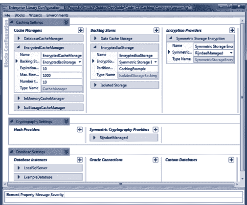

### 图 1 在 Enterprise Library 中配置缓存

对于每个缓存管理器，您可以指定过期轮询频率（块检查并删除过期项的间隔秒数）、在发生清理之前缓存中的最大项数（与轮询频率无关），以及清理缓存时要移除的项数。

您还可以在缓存应用程序块根节点的配置属性中，指定配置的哪个缓存管理器应为默认管理器。如果在未提供缓存管理器名称的情况下实例化缓存管理器，缓存块将使用您指定的管理器。

## 持久缓存

缓存管理器仅在内存中缓存项。如果您希望跨应用程序和系统重启持久化缓存项，可以将持久化后备存储添加到配置中。每个缓存管理器只能指定一个后备存储（显然，否则会极其混乱），缓存块包含用于在数据库和隔离存储中缓存的提供程序。您可以为每个持久化后备存储指定分区名称，这样就可以将多个缓存存储提供程序定向到隔离存储或同一数据库。

如果在配置中添加数据缓存存储，配置工具会自动将数据访问应用程序块添加到配置中。您在数据访问块配置部分配置数据库连接，然后在数据缓存存储提供程序的属性中选择此连接。有关如何配置数据访问应用程序块的详细信息，请参见第 2 章“Much ADO about Data Access。”

### 加密缓存项

如果您想加密存储的项，可以为配置的每个持久化后备存储添加实现对称存储加密的提供程序。如果必须存储敏感信息，这是一个非常好的计划。当向配置中添加对称存储加密提供程序时，配置工具会自动将加密应用程序块添加到配置中。

您在加密块配置部分配置对称加密提供程序。可以使用 Windows 数据保护 API (DPAPI) 对称提供程序，或从 AES、Triple DES 和 Rijndael 等其他提供程序中选择。有关如何配置加密应用程序块的详细信息，请参见第 7 章“Relying Cryptography Complexity。”然后在缓存块部分的对称存储加密提供程序属性中，选择您刚刚配置的提供程序。

> 请注意，缓存应用程序块不会加密内存缓存中的数据，即使您为关联的后备存储配置了加密。恶意用户可能访问应用程序进程的内存，请勿在缓存中存储信用卡号或密码等敏感信息。

现在，您终于可以编写使用缓存块的代码了。您将在本章的示例中看到其使用方式的演示。

### 初始化缓存块

创建使用缓存块的项目时，必须编辑项目和代码，以添加对相应 Enterprise Library 程序集和命名空间的引用。本章的示例演示了缓存到数据库、加密缓存数据以及写入隔离存储后备存储。

必须添加到项目的程序集（除第 1 章“Introduction”中列出的所有 Enterprise Library 项目所需程序集之外）如下：

- Microsoft.Practices.EnterpriseLibrary.Caching.dll
- Microsoft.Practices.EnterpriseLibrary.Caching.Cryptography.dll
- Microsoft.Practices.EnterpriseLibrary.Caching.Database.dll
- Microsoft.Practices.EnterpriseLibrary.Data.dll
- Microsoft.Practices.EnterpriseLibrary.Security.Cryptography.dll

> 如果不希望在数据库中缓存项，则不需要添加 Database 和 Data 程序集。如果不希望加密缓存项，则不需要添加两个 Cryptography 程序集。

为了更轻松地使用缓存块中的对象，可以将相关命名空间的引用添加到项目中。然后您就可以编写一些代码了。

## 如何使用缓存块？

您使用缓存管理器的接口来操作缓存。这是一个相对简单的接口。Add 方法有两个重载用于向缓存添加项，此外还有用于检索缓存项、移除单个项、刷新所有项以及检查缓存是否包含指定项的方法。Count 是唯一属性，返回当前缓存中的项数。

## 关于示例应用程序

本指南可供下载的代码包含一个名为 Caching 的示例应用程序，演示了本章中描述的技术。该示例提供了多个不同的示例供您运行。

在尝试运行示例之前，必须为缓存块创建一个新的加密密钥，用于加密使用对称加密提供程序的示例中的数据。这是因为密钥与用户或计算机绑定，因此示例文件中包含的密钥在您的计算机上无法使用。在配置控制台中，导航到加密应用程序块设置的对称加密提供程序部分，并选择 RijndaelManaged 提供程序。单击 Key 属性旁边的“...”按钮以启动加密密钥向导。使用此向导生成新密钥，保存密钥文件，并自动更新 App.config 的内容。

第一个示例“使用空后备存储在内存中缓存数据”演示了向缓存添加项时可用的一些选项。

## 向缓存添加项和从缓存检索项

要向缓存添加项，可以使用简单的方法：仅将项的键和要缓存的值作为参数传递给 Add 方法。该项将以永不过期的生存期和正常优先级进行缓存。如果要更精细地控制项的缓存方式，可以使用 Add 方法的另一个重载，该重载还接受优先级值、在缓存项过期时执行的回调引用，以及指定项何时过期的过期数组。

优先级的可能值（由 CacheItemPriority 枚举定义）为 None、Low、Normal、High 和 NotRemovable。除了过期的 NeverExpired 值之外，还可以使用 AbsoluteTime、SlidingTime、FileDependency 和 ExtendedFormatTime 过期。如果创建包含多个过期实例的数组，则当其中任何一个指示已过期时，块将过期该项。

示例首先获取 CacheManager 实例的引用——在此示例中，该实例的配置中未定义后备存储（或者更准确地说，它定义了 NullBackingStore 类），因此仅使用内存缓存。它将此引用存储为接口类型 ICacheManager。

接下来，它调用一个单独的例程，该例程向缓存添加项，然后显示缓存的内容。该例程在本章的许多示例中被重复使用。

```
' Resolve the default CacheManager object from the container.
' The actual concrete type is determined by the configuration settings.
' In this example, the default is the InMemoryCacheManager instance.
Dim DefaultCache As ICacheManager = _
    EnterpriseLibraryContainer.Current.GetInstance(Of ICacheManager)()
' Store some items in the cache and show the contents using a separate routine.
CacheItemsAndShowCacheContents(defaultCache)
```

CacheItemsAndShowCacheContents 例程使用传递给它的缓存管理器；在此第一个示例中，这是仅内存缓存管理器。然而，向缓存添加项和操作缓存的代码（如您所料）对于所有缓存管理器配置都是相同的。请注意，代码定义了一组用作缓存键的字符串值。这使得代码稍后更容易检查缓存的内容。这是缓存键数组的声明以及 CacheItemsAndShowCacheContents 例程中的第一部分代码。

```
Dim DemoCacheKeys As String() = _
    {"ItemOne", "ItemTwo", "ItemThree", "ItemFour", "ItemFive"}
Sub CacheItemsAndShowCacheContents(ByVal theCache As ICacheManager)
    ' Add some items to the cache using the key names in the DemoCacheKeys array.
    theCache.Add(DemoCacheKeys(0), "Some Text")
    theCache.Add(DemoCacheKeys(1), _
        New StringBuilder("Some text in a StringBuilder"))
    theCache.Add(DemoCacheKeys(2), 42, CacheItemPriority.High, Nothing, _
        New NeverExpired())
    theCache.Add(DemoCacheKeys(3), New DataSet(), CacheItemPriority.Normal, _
        Nothing, New AbsoluteTime(New DateTime(2099, 12, 31)))
    ' Note that the next item will expire after three seconds
    theCache.Add(DemoCacheKeys(4), _
        New Product(18, "Exciting Thing", "Useful for everything"), _
        CacheItemPriority.Low, Nothing, _
        New SlidingTime(New TimeSpan(0, 0, 3)))
    ' Display the contents of the cache.
    ShowCacheContents(theCache)
    ...
```

在上面显示的代码中，您可以看到 CacheItemsAndShowCacheContents 例程使用最简单的重载来缓存前两个项；一个 String 值和 StringBuilder 类的实例。对于第三个项，代码指定要缓存的项为 Integer 值 42，并指示它应具有高优先级（它将保留


在缓存中位于低优先级项目之后，当缓存因内存或其他约束需要最小化时。不需要回调，该项目永远不会过期。

代码缓存的第四个项目是 DataSet 类的一个新实例，具有正常优先级且无回调。但是，缓存项目的过期时间设置为绝对日期和时间（这应该远在运行示例的时间之后）。

添加到缓存的最后一个项目是应用程序中定义的自定义类的一个新实例。Product 类是一个简单的类，仅包含三个属性：ID、Name 和 Description。该类有一个构造函数，接受这三个值并以通常方式设置属性。它使用低优先级进行编码，并设置了三秒的滑动过期时间。

上面的最后一行代码调用名为 ShowCacheContents 的另一个例程，用于显示缓存的内容。此处未显示的代码会强制主应用程序暂停五秒钟，重新显示缓存的内容，并重复此过程。这是运行此示例时看到的输出。

```
The cache contains the following 5 item(s):
Item key 'ItemOne' (System.String) = Some Text
Item key 'ItemTwo' (System.Text.StringBuilder) = Some text in a StringBuilder
Item key 'ItemThree' (System.Int32) = 42
Item key 'ItemFour' (System.Data.DataSet) = System.Data.DataSet
Item key 'ItemFive' (CachingExample.Product) = CachingExample.Product
Waiting for last item to expire...
Waiting... Waiting... Waiting... Waiting... Waiting...
The cache contains the following 5 item(s):
Item key 'ItemOne' (System.String) = Some Text
Item key 'ItemTwo' (System.Text.StringBuilder) = Some text in a StringBuilder
Item key 'ItemThree' (System.Int32) = 42
Item key 'ItemFour' (System.Data.DataSet) = System.Data.DataSet
Item with key 'ItemFive' has expired.
Waiting for the cache to be scavenged...
Waiting... Waiting... Waiting... Waiting... Waiting...
The cache contains the following 4 item(s):
Item key 'ItemOne' (System.String) = Some Text
Item key 'ItemTwo' (System.Text.StringBuilder) = Some text in a StringBuilder
Item key 'ItemThree' (System.Int32) = 42
Item key 'ItemFour' (System.Data.DataSet) = System.Data.DataSet
```

从该输出可以看出，缓存最初包含我们添加的五个项目。但是，几秒钟后，最后一个项目过期。当代码再次检查缓存内容时，最后一个项目（键为 ItemFive）已过期但仍在缓存中。但是，代码检测到这一点并将其显示为已失效。再过五秒钟，代码再次检查缓存内容，您可以看到已失效的项目已被删除。

取决于您机器的性能，您可能需要更改缓存管理器配置的过期轮询频率值，以便在缓存中看到已失效的项目以及清理周期完成后的内容。

## 我的缓存中有什么？

您刚刚看到的示例显示了缓存的内容，指示哪些项目在缓存中仍然可用，以及哪些（如果有）在缓存中但不可用，因为它们正在等待被清理。那么，您如何判断缓存中实际有什么以及可用呢？按照老套的方式，您可能希望对以下问题回答“是”或“否”：

- 我可以使用 Contains 方法来检查我指定的键的项目是否在缓存中可用吗？
- 我可以查询 Count 属性并使用索引检索每个项目吗？
- 我可以遍历缓存项目的集合，逐个读取它们吗？

如果您对其中任何问题回答“是”，那么坏消息是您错了。所有这些都是错误的。为什么？因为缓存由多个进程管理。您使用的缓存管理器负责将项目添加到缓存，并通过代码可用的公共方法检索它们。但是，后台进程也管理缓存，检查是否有任何项目已过期，并删除（清理）不再有效的项目。当内存不足时，或者响应对其他项目的依赖，以及当您添加项目到缓存时指定的过期日期和时间已过时，缓存项目可能会被删除。

因此，即使 Contains 方法对指定的缓存键返回 True，该项目也可能已失效，并且仅在下一次清理操作之前仍在缓存中。您可以在前一个示例的输出中看到这一点，其中两次等待强制代码暂停，直到项目被标记为过期，然后再次暂停，直到项目被清理。清理发生前的实际延迟由缓存管理器的过期轮询频率配置设置决定。在前一个示例中，这是 10 秒。

提取缓存项目的正确方法是简单地调用 GetData 方法并检查它是否未返回 Nothing。但是，您可以使用 Contains 方法来查看某个项目是否以前被缓存，并且（在大多数情况下）仍可在缓存中使用。这很高效，但您仍然（并且始终）必须检查从缓存检索项目后返回的项目是否不为 null。

示例中用于读取缓存项目的代码依赖于这样一个事实：我们在整个示例中使用缓存键数组，因此可以检查这些项目中是否有任何一个在缓存中。我们使用的代码如下所示。

```
Sub ShowCacheContents(ByVal theCache As ICacheManager)
    If theCache.Count > 0 Then
        Console.WriteLine("The cache contains the following {0} item(s):", _
            theCache.Count)
        ' Cannot iterate the cache, so use the five known keys
        For Each key As String In DemoCacheKeys
            If theCache.Contains(key) Then
                ' Try and get the item from the cache
                Dim theData As Object = theCache.GetData(key)
                ' If item has expired but not yet been scavenged, it will still show
                ' in the count of the number of cached items, but the GetData method
                ' will return null.
                If theData Is Nothing Then
                    Console.WriteLine("Item with key '{0}' has expired", key)
                Else
                    Console.WriteLine("Item key '{0}' ({1}) = {2}", key, _
                        theData.GetType().ToString(), theData.ToString())
                End If
            End If
        Next
    Else
        Console.WriteLine("The cache is empty.")
    End If
End Sub
```

## 使用隔离存储后备存储

前一个示例展示了如何将缓存块作为强大的内存缓存机制使用。但是，您通常希望将缓存中的项目存储在某种持久性后备存储中。缓存块包含一个提供程序，该提供程序使用本地计算机上的 Windows 隔离存储。这为每个用户存储单独区域的数据，这意味着不同用户只能查看和检索自己的缓存数据。

需要注意的是，要在任何物理后备存储中缓存的对象必须可序列化。唯一不适用的情况是使用仅内存（空后备存储）方法时。这些示例中使用的 **产品** 类仅将标准值类型作为其属性，并带有 **可序列化** 特性。有关序列化的更多信息，请参阅 http://msdn.microsoft.com/en-us/library/ms973893.aspx 上的“ .NET Framework 中的对象序列化”。

要将隔离存储用作后备存储，您只需使用配置工具将隔离存储后备存储提供程序添加到缓存管理器中，如图 2 所示。

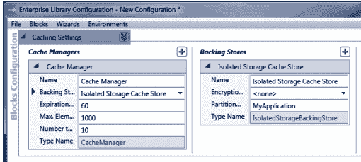

图 2 添加隔离存储后备存储

请注意，您可以为缓存指定分区名称。这允许您为同一用户的不同应用程序（或不同缓存管理器）分离缓存数据，方法是有效地将每个数据隔离在该用户隔离存储区域的不同分区中。

除了将缓存管理器配置为使用隔离存储后备存储之外，您用于缓存和检索数据的代码是相同的。示例“在隔离存储后备存储中本地缓存数据”使用名为 IsoStorageCacheManager 的缓存管理器，该管理器配置了隔离存储后备存储。它通过在调用当前 Enterprise Library 容器的 GetInstance 方法时指定名称来接收此缓存管理器的引用。

然后代码执行您在第一个示例中看到的相同 CacheItemsAndShowCacheContents 例程，并将 isoStorageCache 缓存管理器的引用传递给它。运行此示例时看到的结果与您在本章第一个示例中看到的相同。

如果您发现重新运行此示例时出现错误，可能是因为后备存储提供程序无法正确访问您的本地隔离存储存储。在大多数情况下，您可以通过删除先前缓存的内容来解决此问题。打开文件夹 Users\<your-user-name>\AppData\Local\IsolatedStorage，并展开每个


子文件夹，直到找到 **File\\CachingExample** 子文件夹。然后删除整个文件夹树。您应避免删除 **独立存储** 文件夹中的所有文件夹，因为这些文件夹可能包含其他应用程序使用的数据。

## 加密缓存的数据

默认情况下，缓存块不会加密其在内存或持久化后备存储中存储的数据。但是，您可以配置该块以使用加密提供程序，该提供程序将加密缓存管理器在后备存储中存储的数据——但请注意，内存缓存中的数据从未被加密。

要使用加密，只需将加密提供程序添加到后备存储的配置中。当您首次添加加密提供程序时，配置工具会自动将加密块添加到您的配置中。因此，您必须确保相关程序集 **Microsoft.Practices.EnterpriseLibrary.Security.Cryptography.dll** 已在您的项目中引用。

将加密提供程序添加到后备存储的配置后，通过添加新的对称提供程序来配置加密部分，并使用密钥向导生成新的加密密钥文件或导入现有密钥。然后，回到缓存块的配置中，为后备存储的对称加密属性选择您添加的新对称提供程序。有关配置加密块的更多信息，请参见第 7 章，“减轻加密复杂性”。

本章提供的示例包括一个名为 **加密后备存储中的缓存数据** 的示例，它演示了如何加密持久化数据。它实例化了应用程序配置中名为 **EncryptedCacheManager** 的缓存管理器：

```
' Resolve a CacheManager instance that encrypts the cached data.
Dim encryptedCache As ICacheManager _
    = EnterpriseLibraryContainer.Current.GetInstance(Of _
    ICacheManager)("EncryptedCacheManager")
...
CacheItemsAndShowCacheContents(encryptedCache)
```

代码随后执行您在第一个示例中看到的相同 **CacheItemsAndShowCacheContents** 例程，并将 **encryptedCache** 缓存管理器的引用传递给它。同样，当您运行此示例时看到的结果与您在本章第一个示例中看到的结果相同。

如果您在运行此示例时发现出现错误，可能是您未创建加密块可用的合适加密密钥，或 App.config 文件中密钥文件的绝对路径不正确。要解决此问题，请打开配置控制台，导航到加密应用程序块设置的对称提供程序部分，并选择 RijndaelManaged 提供程序。单击密钥属性中的“...”按钮以启动加密密钥向导。使用此向导生成新密钥，保存密钥文件，并自动更新 App.config 的内容。

## 使用数据库后备存储

如果您愿意，可以轻松快速地配置缓存块，以使用数据库作为缓存数据的持久化后备存储。企业库包含一个脚本和一个命令文件，您可以运行它们来创建数据库（位于企业库源代码的 \\Blocks\\Caching\\Src\\Database\\Scripts 文件夹中）。我们还将这些脚本与本章的示例一起提供。

这些脚本假设您将使用本地安装的 SQL Server Express 数据库，但您可以编辑 CreateCachingDb.cmd 文件以将目标更改为不同的数据库服务器。命令文件执行的 SQL 脚本会创建一个名为 Caching 的数据库，并向其中添加所需的表和存储过程。

但是，如果您只想运行我们为本章提供的示例应用程序，则无需创建数据库。项目包含一个预配置的数据库文件（位于 bin\\Debug 文件夹），它会自动附加到您的本地 SQL Server Express 实例。您可以使用 Microsoft® Visual Studio® 服务器资源管理器连接到此数据库以查看其内容，如图 3 所示。

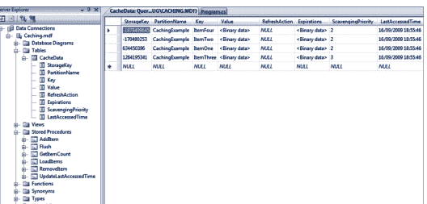

图 3 查看数据库表中的缓存内容

要将缓存配置为使用数据库，只需使用配置控制台将数据库缓存存储提供程序添加到缓存管理器，并指定连接字符串和 ADO.NET 数据提供程序类型（默认值为 System.Data.SqlClient，但如果您使用的是不同的数据库系统，可以更改此设置）。

您还可以为缓存指定分区名称，方式与独立存储后备存储提供程序相同。这允许您为同一用户的不同应用程序（或不同缓存管理器）分离缓存数据，方法是有效地将每个数据隔离在数据库表中的不同分区内。

除了将缓存管理器配置为使用数据库后备存储之外，您用于缓存和检索数据的代码是相同的。示例“在数据库后备存储中缓存数据”使用名为 DatabaseCacheManager 的缓存管理器，该管理器配置了数据缓存存储后备存储。与先前的示例一样，代码通过在调用当前企业库容器的 GetInstance 方法时指定名称来检索此缓存管理器的引用。

```
' Retrieve a CacheManager instance that uses a Database Backing Store.
Dim databaseCache As ICacheManager _
= EnterpriseLibraryContainer.Current.GetInstance(Of _
ICacheManager)("DatabaseCacheManager")
...
CacheItemsAndShowCacheContents(databaseCache)
```

代码随后执行您在第一个示例中看到的相同 CacheItemsAndShowCacheContents 例程，并将 databaseCache 缓存管理器的引用传递给它。如您所料，当您运行此示例时看到的结果与您在本章第一个示例中看到的结果相同。

我们为本示例提供的数据库的连接字符串如下：

```
Data Source=.\SQLEXPRESS; AttachDbFilename=|DataDirectory|\Caching.mdf;
Integrated Security=True; User Instance=True
```

如果您使用示例提供的脚本配置了不同的数据库，则运行此示例时可能会出现错误。这可能是因为您的 App.config 文件中数据库的连接字符串无效。此外，请使用管理工具文件夹中的服务小应用程序检查 SQL Server (SQLEXPRESS) 数据库服务（服务名为 MSSQL$SQLEXPRESS）是否正在运行。

## 从缓存中删除项和刷新缓存

在了解了如何向缓存添加项以及使用各种后备存储选项和加密之后，现在是时候了解如何操作缓存以删除项，或通过刷新将其完全清除了。缓存中的项会根据其过期时间或依赖关系自动删除，但您也可以删除单个项或删除所有项。

示例“删除和刷新缓存的项”实际上演示的内容不仅仅是删除和刷新项——它展示了如何使用依赖项从缓存中删除相关项、如何创建扩展时间过期，以及如何使用过期数组。此示例中有大量代码，因此我们将逐步讲解并依次解释每个部分。

### 使用文件依赖项和扩展时间过期

该示例首先创建一个 NeverExpired 过期实例，然后在当前执行文件夹中写入一个文本文件。接着，它针对该文件创建一个 FileDependency。这是一个典型场景：您从文件（例如文本文件或 XML 文档）读取数据，并在代码中频繁访问该数据。但是，如果原始文件被更改或删除，您希望相应的缓存项从缓存中删除。

```
' Create an expiration that never expires
Dim never As New NeverExpired()
' Create a text file to use in a FileDependency
File.AppendAllText("ATextFile.txt", "Some contents for the file")
' Create an expiration dependency on the new text file
Dim fileDep As New FileDependency("ATextFile.txt")
```

接下来，代码创建 ExtendedFormatTime 类的一个实例。该类允许您根据重复计划为缓存项指定过期时间。与您迄今所见的更常见的 SlidingTime 和 AbsoluteTime 过期类型相比，它提供了更多机会。

ExtendedFormatTime 类的构造函数接受一个字符串值，将其解析为分钟、小时、天、月和星期（其中零表示星期日）的单独值，这些值共同指定缓存项过期的频率。每个值由空格分隔。星号表示格式字符串的该部分没有值，并有效地意味着该项的每次出现都会过期。这一切听起来非常复杂，因此一些示例无疑会很有用（请参见表 2）。

| 扩展格式字符串 | 含义 |
| :--- | :--- |
| * * * * * | 每分钟过期。 |
| 5 * * * * | 每小时的第 5 分钟过期。 |
| * 21 * * * | 每天第 21 小时的每分钟过期。 |
| 31 15 * * * | 每天下午 3:31 过期。 |
| 7 4 * * 6 | 每个星期六凌晨 4:07 过期。 |
| 15 21 4 7 * | 每年 7 月 4 日晚上 9:15 过期。 |

该示例生成一个在每小时第 30 分钟过期的 ExtendedFormatTime。然后，它创建一个 ICacheItemExpiration 类型的数组，其中包含先前创建的文件依赖项和新的 ExtendedFormatTime 实例。

```
' Create an extended expiration for 30 minutes past every hour
Dim extTime As New ExtendedFormatTime("30 * * * *")
' Create array of expirations containing the file dependency and extended format
Dim exp As ICacheItemExpiration() = _
    New ICacheItemExpiration() {fileDep, extTime}
```


## 将项目添加到缓存

现在（终于）代码可以向缓存添加一些项目了。它添加了四个项目：第一个使用 NeverExpired 过期，第二个使用包含文件依赖和扩展格式时间过期的数组，另外两个只是使用本章第一个示例中所示的缓存项目的简单方法。然后代码显示缓存的内容，并等待您按键。

```
" Add items to the cache using the key string names in the DemoCacheKeys array.
defaultCache.Add(DemoCacheKeys(0), "A cached item that never expires", _
    CacheItemPriority.NotRemovable, Nothing, never)
defaultCache.Add(DemoCacheKeys(1), "A cached item that depends on both " _
    & "a disk file and an hourly extended time expiration.", _
    CacheItemPriority.Normal, Nothing, expirations)
defaultCache.Add(DemoCacheKeys(2), "Another cached item")
defaultCache.Add(DemoCacheKeys(3), "And yet another cached item.")

ShowCacheContents(defaultCache)
Console.Write("Press any key to delete the text file...")
Console.ReadKey(True)
```

此时执行会显示以下输出。

```
Created a 'never expired' dependency.
Created a text file named ATextFile.txt to use as a dependency.
Created an expiration for 30 minutes past every hour.

The cache contains the following 4 item(s):
Item key 'ItemOne' (System.String) = A cached item that never expires
Item key 'ItemTwo' (System.String) = A cached item that depends on both a disk
file and an hourly extended time expiration.
Item key 'ItemThree' (System.String) = Another cached item
Item key 'ItemFour' (System.String) = And yet another cached item.
```

当您按键时，代码继续删除文本文件，然后重新显示缓存的内容。然后，与前面的示例一样，它等待项目从缓存中被清除。您看到的输出如下所示。

```
Cache contains the following 4 item(s):
Item key 'ItemOne' (System.String) = A cached item that never expires
Item with key 'ItemTwo' has been invalidated.
Item key 'ItemThree' (System.String) = Another cached item
Item key 'ItemFour' (System.String) = And yet another cached item.

Waiting for the dependent item to be scavenged from the cache...
Waiting... Waiting... Waiting... Waiting...
```

```
Cache contains the following 3 item(s):
Item key 'ItemOne' (System.String) = A cached item that never expires
Item key 'ItemThree' (System.String) = Another cached item
Item key 'ItemFour' (System.String) = And yet another cached item.
```

您可以看到，删除文本文件导致依赖于它的键为 ItemTwo 的项目被使无效，并在下一次清除周期中被移除。

此时，代码再次等待您按键。当您按下时，它继续调用缓存管理器的 Remove 方法来移除键为 ItemOne 的项目，并再次显示缓存内容。然后，在您第三次按键后，它调用缓存管理器的 Flush 方法来移除缓存中的所有项目，并再次调用显示缓存内容的方法。这是示例中这部分的代码。

```
Console.Write("Press any key to remove {0} from the cache...", DemoCacheKeys(0))
Console.ReadKey(True)
defaultCache.Remove(DemoCacheKeys(0))
ShowCacheContents(defaultCache)
Console.Write("Press any key to flush the cache...")
Console.ReadKey(True)
defaultCache.Flush()
ShowCacheContents(defaultCache)
```

此代码执行时您看到的结果如下所示。

```
Press any key to remove ItemOne from the cache...
Cache contains the following 2 item(s):
Item key 'ItemThree' (System.String) = Another cached item
Item key 'ItemFour' (System.String) = And yet another cached item.
Press any key to flush the cache...
The cache is empty.
```

## 刷新缓存

到目前为止，当我们使用 Add 方法向缓存添加项目时，我们为 refreshAction 参数传递了 null 值。您可以使用此参数来检测项目何时从缓存中移除，并发现该项目的值及其被移除的原因。

您必须创建一个实现 ICacheItemRefreshAction 接口的类，并包含一个名为 Refresh 的方法，该方法接受作为参数要移除的项目的键、作为 Object 类型的值，以及来自 CacheItemRemovedReason 枚举的值。此枚举的值为 Expired、Removed（通常由您的代码或依赖项移除）、Scavenged（通常作为响应可用内存不足）和 Unknown（您应避免使用的保留值）。

因此，在您的 **Refresh** 方法中，您可以查询传递给它的参数值以获取项目的键和最终缓存值，并查看它为何从缓存中移除。此时，您可以决定如何处理。在某些情况下，将项目重新插入缓存可能有意义（例如，当项目依赖的文件已更改，或数据对您的应用程序至关重要时）。当然，您通常只应在项目过期或被移除时才这样做。如果项目因机器内存不足而被清除，您应该仔细考虑要将什么重新放入缓存！

示例“检测并刷新过期或已移除的缓存项目”说明了如何捕获从缓存中移除的项目，并在适当时重新缓存它们。该示例使用 **ICacheItemRefreshAction** 接口的以下实现来处理缓存包含 **Product** 类型实例的情况。对于缓存不同类型的一般情况，您可能希望在尝试将其转换为所需目标类型之前先检查类型。还要注意，该类带有 **Serializable** 特性。所有实现 **ICacheItemRefreshAction** 接口的类都必须标记为可序列化。

```
<Serializable>()> _
Public Class MyCacheItemRefreshAction
    Implements ICacheItemRefreshAction

    Public Sub Refresh(ByVal key As String, ByVal expiredValue As Object, _
        ByVal removalReason As CacheItemRemovedReason) _
        Implements ICacheItemRefreshAction.Refresh

        ' Item has been removed from cache. Perform desired actions here, based on
        ' the removal reason (for example, refresh the cache with the item).
        Dim expiredItem As Product = DirectCast(expiredValue, Product)
        Console.WriteLine("Cached item {0} was expired in the cache with " _
            & " the reason '{1}'", key, removalReason)
        Console.WriteLine("Item values were: ID = {0}, Name = '{1}', " _
            & "Description = {2}", expiredItem.ID, _
            expiredItem.Name, expiredItem.Description)

        ' Refresh the cache if it expired, but not if it was explicitly removed
        If removalReason = CacheItemRemovedReason.Expired Then
            Dim defaultCache As CacheManager _
                = EnterpriseLibraryContainer.Current.GetInstance(Of _
                CacheManager)("InMemoryCacheManager")
            defaultCache.Add(key, New Product(10, "Exciting Thing", _
                "Useful for everything"), CacheItemPriority.Low, _
                New MyCacheRefreshAction(), _
                New SlidingTime(New TimeSpan(0, 0, 10)))
            Console.WriteLine("Refreshed the item by adding it to the cache again.")
        End If
End Sub
End Class
```

要使用 **ICacheItemRefreshAction** 接口的实现，您只需在向缓存添加项目时将其指定为 **Add** 方法的 **refreshAction** 参数。该示例使用以下代码来缓存 **Product** 类的一个实例，该实例将在三秒后过期。

```
defaultCache.Add(DemoCacheKeys(0), New Product(10, "Exciting Thing", _
 "Useful for everything.", _
 CacheItemPriority.Low, New MyCacheRefreshAction(), _
 New SlidingTime(New TimeSpan(0, 0, 3)))
```

然后代码与前面的示例做同样的操作：它显示缓存的内容，等待五秒钟让项目过期，再次显示内容，再等待五秒钟直到项目被清除，然后第三次显示内容。但是，这次缓存块会在项目从缓存中移除后立即执行我们 **ICacheItemRefreshAction** 回调的 **Refresh** 方法。此回调显示一条消息，指示缓存项目因过期而被移除，并且已重新添加到缓存中。您可以在下面显示的缓存内容最终列表中看到它。

```
The cache contains the following 1 item(s):
Item key 'ItemOne' (CachingExample.Product) = CachingExample.Product

Waiting... Waiting... Waiting... Waiting...

The cache contains the following 1 item(s):
Item with key 'ItemOne' has expired.

Cached item ItemOne was expired in the cache with the reason 'Expired'
Item values were: ID = 10, Name = 'Exciting Thing', Description = Useful for everything

Refreshed the item by adding it to the cache again.

Waiting... Waiting...

The cache contains the following 1 item(s):
Item key 'ItemOne' (CachingExample.Product) = CachingExample.Product
```

## 加载缓存

如果您为缓存管理器配置了持久化后备存储，则在实例化该缓存管理器时，缓存块将自动从后备存储加载内存缓存。通常，这将在应用程序启动时发生。这是 **主动缓存加载** 的示例。如果您知道数据将被需要且不太可能发生太大变化，主动缓存加载很有用。另一种方法是创建一个


带有一个方法的类，该方法从某些数据源（例如数据库或 XML 文件）读取所需数据，并通过为每个项目调用 Add 方法将其加载到缓存中。如果在后台或工作线程上执行此操作，则可以加载缓存而不影响应用程序的交互性或阻塞用户界面。

或者，您可能更愿意使用响应式缓存加载。这种方法适用于可能会也可能不会使用的数据，或者相对易变的数据。在这种情况下（如果您使用持久化后备存储），您可以选择仅在需要加载数据时才实例化缓存管理器。或者，您可以刷新缓存（可能在应用程序结束时），然后按需加载特定项目。例如，您可能发现需要从企业数据存储中检索特定产品的详细信息以在应用程序中显示。此时，如果该项目在合理的时间内可能会再次使用，并且在此期间不太可能更改，则可以选择将其缓存。

## 主动缓存加载

示例“在应用程序启动时主动加载缓存”提供了主动缓存加载的简单演示。在应用程序的启动代码中，您添加代码以使用应用程序所需的项目加载缓存。该示例创建一个 Product 项目列表，然后遍历列表，为每个项目调用缓存管理器的 Add 方法。当然，您将从适合您自己应用程序的位置（例如数据库）获取要缓存的项目。这些项目可能以列表形式提供，或者——例如——通过遍历 DataSet 或 DataReader 中的行来获取。

```
' Create a list of products - may come from a database or other repository
Dim products As New List(Of Product)()
products.Add(New Product(42, "Exciting Thing", _
    "Something that will change your view of life."))
products.Add(New Product(79, "Useful Thing", _
    "Something that is useful for everything."))
products.Add(New Product(412, "Fun Thing", _
    "Something that will keep the grandchildren quiet."))
' Iterate the list loading each one into the cache
Dim i As Integer = 0
While i < products.Count
    theCache.Add(DemoCacheKeys(i), products(i))
    System.Math.Max(System.Threading.Interlocked.Increment(i), i - 1)
End While
```

## 响应式缓存加载

响应式缓存加载的意思是，当您实际需要某个项目时，检查它是否在缓存中，如果不在，则获取它并将其缓存以供将来使用。如果您想要的项目不在缓存中，您可以此时决定获取多个项目。例如，您可能决定在价格查询首次确定产品不在缓存中时加载完整的产品列表。

示例“按需响应式加载缓存”演示了响应式缓存加载的一般模式。在显示缓存内容（以显示它实际上是空的）之后，代码尝试检索 Product 类的缓存实例。请注意，这是一个两步过程，您必须检查返回的值不是 Nothing。如前面本章“缓存中有什么？”部分中所解释的，如果项目最近已过期或已被删除，Contains 方法可能会返回 true。

如果项目在缓存中，代码会显示其属性的值。如果不在缓存中，代码会执行一个例程，使用所有产品加载缓存。此例程与您在前面主动加载缓存的示例中看到的相同。

```
Console.WriteLine("Getting an item from the cache...")
Dim theItem As Product = DirectCast(ffDataCache.GetData(DemoCacheKeys(1)), _
Product)
' You could test for the item in the cache using CacheManager.Contains(key)
' method, but you still must check if the retrieved item is null even
' if the Contains method indicates that the item is in the cache:
If Not theItem Is Nothing Then
    Console.WriteLine("Cached item values are: ID = {0}, Name = '{1}', " _
    & "Description = {2}", theItem.ID, theItem.Name, _
    theItem.Description)
Else
    Console.WriteLine("The item could not be obtained from the cache.")
' Item not found, so reactively load the cache
LoadCacheWithProductList(defaultCache)
Console.WriteLine("Loaded the cache with the list of products.")
ShowCacheContents(defaultCache)
End If
```

在加载产品列表后显示缓存内容后，示例代码随后会再次尝试检索值并显示其属性。您可以在此处查看此示例的完整输出。

```
The cache is empty.

Getting an item from the cache...

The item could not be obtained from the cache.

Loaded the cache with the list of products.

The cache contains the following 3 item(s):
Item key 'ItemOne' (CachingExample.Product) = CachingExample.Product
Item key 'ItemTwo' (CachingExample.Product) = CachingExample.Product
Item key 'ItemThree' (CachingExample.Product) = CachingExample.Product

Getting an item from the cache...
Cached item values are: ID = 79, Name = 'Useful Thing', Description = Something that is useful for everything.
```

通常，执行响应式缓存加载的函数的模式如下：

- 1. 检查项目是否在缓存中，并且返回的值不是 **Nothing**。
- 2. 如果在缓存中找到它，则将其返回给调用代码。
- 3. 如果在缓存中未找到它，则创建或获取对象或值并将其缓存。
- 4. 将此新值或对象返回给调用代码。

## 扩展缓存功能

缓存块（与企业库中的所有其他块一样）包含扩展点，允许您创建自定义提供程序并将其与块集成。如果您想使用不同的缓存机制，也可以替换默认缓存管理器，或者修改源代码以更改块的其他行为。

缓存管理器负责在实例化应用程序块时将项目从持久化后备存储加载到内存中。它还公开操作缓存的方法。如果您想更改缓存块加载或管理缓存项目的方式，例如实现分布式或专用缓存机制，或执行异步或延迟缓存加载，则可以使用 **ICacheManager** 接口并实现其定义的方法和属性。

或者，如果您只想使用不同的后备存储或添加新的过期策略，可以创建自定义后备存储提供程序和过期策略，并使用它们代替内置提供程序和策略。要创建自定义后备存储提供程序，可以实现 **IBackingStore** 接口或继承 **Base BackingStore** 抽象类。要创建自定义过期策略，可以实现 **ICacheItemExpiration** 接口，并可选地实现 **ICacheItemRefreshAction** 接口（用于刷新过期缓存项目的类）。

有关扩展缓存块的更多信息，请参阅随企业库安装的在线文档和帮助文件。

### 摘要

本章介绍了如何使用缓存应用程序块以一致且可配置的方式在应用程序和企业中实现缓存。该块提供非分布式缓存，可以将项目缓存在内存中，并可选择在持久化后备存储（例如独立存储或数据库）中缓存。如果需要，您还可以轻松添加新的后备存储，甚至可以替换缓存管理器，以创建支持其他功能（例如分布式缓存）的机制。

缓存块具有灵活性，以满足大多数类型应用程序的大多数要求。您可以定义多个缓存并对每个缓存进行分区，如果您想为多个缓存使用单个数据库，这很有用。并且，您可以轻松为存储在持久化后备存储中的项目向缓存机制添加加密。

该块还提供广泛的过期机制，包括多种基于时间的过期以及基于文件的过期。与某些缓存机制不同，您可以为每个缓存项目指定多个过期，甚至可以创建自己的自定义过期策略。

除此之外，该块还使管理员和操作员能够使用企业库提供的配置工具通过配置轻松更改行为。他们可以更改缓存的设置（例如轮询频率）、更改块使用的后备存储，以及更改用于加密缓存数据的算法。

本章讨论了所有这些功能，并包含了有关如何在自己的应用程序中使用该块的详细示例。有关缓存块的更多信息，请参阅随企业库安装的在线文档和帮助文件。


### Introduction

如果你碰巧住在美国，我告诉你企业库（Enterprise Library）2.0版本的原始发布日期是13/01/2006，你会怀疑我是否发明了某种新日历。也许他们在你没注意的情况下给日历增加了一个新月份（我愿意称之为Plutember，以纪念现在已被降级的第九行星）。当然，在世界上许多其他国家，13/01/2006是1月的一个完全有效的日期。这个验证问题众所周知，解决方案可能显而易见，但我曾与一个应用程序合作，该应用程序使用美国mm/dd/yyyy格式的日期作为其生成的报告的文件名，并且在启动程序时默认打开前一天的报告。不用说，在我设置为使用英国日期格式的机器上，它从未成功找到前一天的报告。

更糟的是，当我尝试在其网站上提交技术支持问题时，它要求我提供购买软件的日期。运行在我机器上的网页中的JavaScript验证代码检查了我答案的格式（27/04/2008）并接受了它。但服务器拒绝相信一年有二十七个月，并阻止了我的提交。我不得不撒谎说我是在5月1日购买的。

问题是验证可能是一项艰巨的任务，尤其是当你需要在应用程序的许多地方进行验证，并且针对许多不同类型的值时。很容易最终在类中散布重复代码，却仍然留下漏洞，让意外输入可能进入你的应用程序并可能造成混乱。

强大的验证可以帮助保护你的应用程序免受恶意用户和危险输入（包括SQL注入攻击）的侵害，确保它只处理有效数据并强制执行业务规则，并通过在执行昂贵处理任务之前检测无效数据来提高响应能力。

那么，你如何在应用程序中实现全面且集中的验证呢？一个简单的解决方案是利用企业库验证块。验证块是一个高度灵活的解决方案，允许你在配置中、通过特性或在代码中指定验证规则，并将该验证应用于对象、方法参数、字段和属性。它甚至包括与Windows Forms、Windows Presentation Foundation (WPF)、ASP.NET和Windows Communication Foundation (WCF)应用程序集成的功能，以在用户界面中显示验证错误或由服务自动处理它们。

## Techniques for Validation

在探索验证块之前，简要回顾一些验证最佳实践是有价值的。一般来说，你应该考虑三个因素：你将在哪里执行验证，应该验证什么数据，以及你将如何执行此验证。

### WHERE SHOULD I VALIDATE?

当然，验证应该保护你的整个应用程序。但是，通常情况下，你需要在多个位置应用验证。如果你的应用程序由层、分布式服务或离散组件组成，你可能需要在每个边界进行验证。这在应用程序的各个部分可能从多个位置调用的情况下尤其如此（例如，由多个用户界面和其他服务使用的业务层）。

在信任边界进行验证也是一个非常好的主意，即使边界两侧的组件没有物理分离。例如，你的业务层可能在与数据层不同的信任级别或帐户上下文下运行（即使它们位于同一台机器上）。此边界上的验证可以防止在低信任下运行且可能已被攻破的代码向在高信任模式下运行的代码提交无效数据。

最后，一个常见的场景：用户界面中的验证。在客户端验证数据可以提高应用程序响应能力，尤其是当UI远离服务器时。用户在输入或提交无效数据时不必等待服务器响应，服务器也不必尝试处理它后来会拒绝的数据。但是，请记住，即使你在客户端或UI中验证数据，你也必须始终在服务器或接收服务中重新验证。这可以防止恶意用户绕过客户端验证并提交无效数据。

### WHAT SHOULD I VALIDATE?

简单来说，一切。或者，至少是你将在应用程序中使用的任何输入值，这些值可能导致错误、涉及安全风险或可能导致错误处理。请记住，网页和服务请求可能包含用户未直接输入但可能在你的应用程序中使用的数据。这可能包括cookie、标头信息、凭据以及服务器可能以各种方式使用的上下文信息。在验证之前，将所有输入数据视为可疑。

### HOW SHOULD I VALIDATE?

为了最大安全性，你的验证过程应设计为仅接受你可以直接确定为有效的数据。这种方法称为正向验证，通常使用允许列表，指定满足定义标准的数据，并拒绝所有其他数据。示例是检查数字是否在两个预定义限制之间的规则，或提交的值是否在有效值列表中的规则。尽可能使用这种方法。

替代且安全性较低的方法是使用包含无效值的阻止列表。这称为负向验证，通常涉及仅接受不满足特定标准的数据。例如，只要字符串不包含任何指定的无效字符，它就会被接受。你应谨慎使用这种方法，并作为第二道防线，因为为所有已知无效输入创建完整的标准列表非常困难——这可能允许恶意数据进入你的系统。

最后，考虑清理数据。虽然这不严格是验证任务，但你可以作为预防措施尝试消除或转换字符，以努力使输入安全。但是，不要仅依赖这种技术，因为与负向验证一样，除非无效值范围有限，否则为所有已知无效输入创建完整的标准列表可能很困难。

### What Does the Validation Block Do?

验证块由一系列广泛的验证器组成，加上一个执行这些验证器并收集和关联结果以提供总体验证结果（true/valid或false/invalid）的机制。验证块可以使用应用于应用程序所用的类和类成员的单独特性（包括验证块提供的验证特性和System.ComponentModel.DataAnnotations命名空间中的数据注释特性），以及块配置中定义的规则集，这些规则集指定要应用的验证规则。

使用验证块的典型场景是通过配置或应用于类的特性定义规则集。每个规则集指定实现你希望应用于该类的验证规则的单独验证器和这些验证器的组合。然后你使用ValidatorFactory（或此工厂的等效实现之一）为类创建类型验证器，可选地指定它应使用的规则集。如果你不指定规则集，它将使用默认规则。然后你可以调用类型验证器的Validate方法。该方法返回ValidationResults类的实例，其中包含检测到的所有验证错误的详细信息。图1说明了此过程。


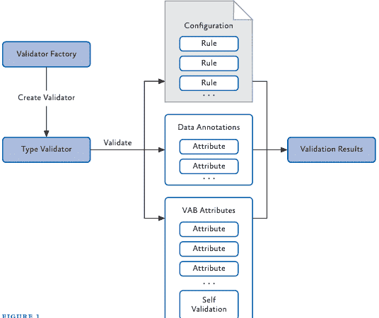

### 图 1
验证过程概览

当你使用规则集验证特定类型或对象的实例时，该块可以将规则应用于：

- 类型本身
- 公共可读属性的值
- 公共字段的值
- 不接受参数的公共方法的返回值

请注意，你可以在调用方法时验证方法参数的值以及带参数方法的返回类型，但前提是将验证调用处理程序（属于验证块的一部分）与 Unity 依赖注入和拦截机制配合使用。验证调用处理程序将根据每个参数类型的规则以及应用于参数的任何验证特性来验证参数值。本指南不介绍验证调用处理程序的使用，因为这要求你熟悉 Unity 拦截技术。有关拦截和验证调用处理程序的更多信息，请参阅随 Enterprise Library 安装的 Unity 拦截文档，或在线查阅 http://go.microsoft.com/fwlink/?LinkId=188875。

或者，你可以以编程方式创建单独的验证器来验证特定值，例如字符串或数值。然而，这并不是该块的主要关注点——尽管本章中我们确实包含了示例，展示如何使用单独的验证器。

此外，验证块包含与 Windows® 窗体、Windows Presentation Foundation (WPF)、ASP.NET 和 Windows Communication Foundation (WCF) 应用程序集成的功能。这些功能使用多种不同的技术连接到 UI，例如：基于标准 ASP.NET Validator 控件（可添加到 Web 页面）的代理验证器类、可在 Windows 窗体控件属性中指定的 ValidationProvider 类、可在 WPF 控件定义中指定的 ValidatorRule 类，以及可在 WCF 配置的 <system.ServiceModel> 节中指定的行为扩展。本章后面将介绍这些功能的更多详细信息。

## 验证器范围

验证器用于实现 Microsoft® .NET Framework 数据类型的验证功能。随验证块提供的验证器分为三大类：值验证器、组合验证器和类型（对象）验证器。值验证器允许你执行特定的验证测试，例如验证：

- 字符串的长度，或其中出现的指定字符集。
- 值是否位于指定范围内，包括相对于指定日期/时间的日期和时间测试。
- 值是否是指定值集中的一个，或是否可以转换为特定数据类型或枚举值。
- 值是否为 null，或是否与对象特定属性的值相同。
- 值是否匹配指定的正则表达式。

当你需要应用更复杂的验证规则时，组合验证器用于组合其他验证器。验证块包含 AND 验证器和 OR 验证器，它们各自充当其他验证器的容器。通过以任意组合嵌套这些组合验证器，并用其他验证器填充它们，你可以创建非常全面且非常具体的验证规则。

表 1 描述了随验证块提供的完整验证器集。

**表 1 随验证块提供的验证器**

| 验证器类型 | 验证器名称 | 描述 |
| :--- | :--- | :--- |
| 值验证器 | 包含字符验证器 | 检查任意字符串（例如用户在 Web 表单中输入的字符串）是否包含任何或所有指定字符。 |
| 值验证器 | 日期时间范围验证器 | 检查 DateTime 对象是否位于指定范围内。 |
| 值验证器 | 域验证器 | 检查值是否是指定集合中的指定值之一。 |
| 值验证器 | 枚举转换验证器 | 检查字符串是否可以转换为指定枚举类型中的值。 |
| 值验证器 | 不为 null 验证器 | 检查值是否不为 null。 |
| 值验证器 | 属性比较验证器 | 将要检查的值与指定属性的值进行比较。 |
| 值验证器 | 范围验证器 | 检查值是否位于指定范围内。 |
| 值验证器 | 正则表达式验证器 | 检查值是否匹配正则表达式指定的模式。 |
| 值验证器 | 相对日期时间验证器 | 检查 DateTime 值是否使用相对时间和日期位于指定范围内。 |
| 值验证器 | 字符串长度验证器 | 检查字符串的长度是否在指定范围内。 |
| 值验证器 | 类型转换验证器 | 检查字符串是否可以转换为特定类型。 |
| 类型验证器 | 对象验证器 | 对对象引用发生验证。将调用为对象类型定义的所有验证器。 |
| 类型验证器 | 对象集合验证器 | 检查对象是否为指定类型的集合，然后对集合的每个元素调用验证。 |
| 组合验证器 | AND 组合验证器 | 要求组成组合验证器的所有验证器均为 true。 |
| 组合验证器 | OR 组合验证器 | 要求组成组合验证器的至少一个验证器为 true。 |
| 单成员验证器 | 字段值验证器 | 验证类型的字段。 |
| 单成员验证器 | 方法返回值验证器 | 验证类型方法的返回值。 |
| 单成员验证器 | 属性值验证器 | 验证类型属性的值。 |

有关每个验证器的更多详细信息，请参阅随 Enterprise Library 安装的文档，或在线查阅 http://go.microsoft.com/fwlink/?LinkId=188874。本章中你将看到使用其中许多验证器的示例。

## 使用特性进行验证

如果你可以完全访问应用程序的源代码，可以在类中使用特性来定义验证规则。你可以通过以下方式应用验证特性：

- 应用于字段。验证块将检查字段值是否满足应用于该字段的验证器中定义的所有验证规则。
- 应用于属性。验证块将检查 get 属性的值是否满足应用于该属性的验证器中定义的所有验证规则。
- 应用于不接受参数的方法。验证块将检查方法的返回值是否满足应用于该方法的验证器中定义的所有验证规则。
- 应用于整个类，仅使用 NotNullValidator、ObjectCollectionValidator、AndCompositeValidator 和 OrCompositeValidator。验证块可以检查对象是否为 null，或是否是指定集合的成员，以及其中定义的任何验证规则是否得到满足。
- 应用于 WCF 服务协定中的参数。验证块将检查参数值是否满足应用于该参数的验证器中定义的所有验证规则。
- 应用于被拦截方法的参数，通过将验证调用处理程序与策略注入应用程序块配合使用。有关使用拦截的更多信息，请参阅附录 C，“Enterprise Library 中的策略注入”。

前一节中描述的每个验证器都有一个相关特性，你可以在代码中应用该特性，将验证值（例如范围或比较值）作为参数传递给特性。例如，你可以通过将以下特性应用于属性定义来验证一个必须介于 0 和 10 之间（包含 0 和 10）的属性，如以下代码所示。

```
<RangeValidator(0, RangeBoundaryType.Inclusive, 10, RangeBoundaryType.Inclusive)>
```

## DataAnnotations 特性

除了使用内置验证特性外，验证块还将执行 System.ComponentModel.DataAnnotations 命名空间中绝大多数验证特性定义的验证。这些特性通常由框架和对象/关系映射（O/RM）解决方案使用，用于自动生成表示数据项的类。它们也由 ASP.NET 验证控件生成，这些控件执行客户端和服务器端验证。虽然验证块提供的验证特性集与 DataAnnotations 命名空间中的特性不完全对应，但最常见的验证类型均受支持。下面展示了数据特性的典型用法。


`<System.ComponentModel.DataAnnotations.Required(_
ErrorMessage:="You must specify a value for the product ID.")> _
<System.ComponentModel.DataAnnotations.StringLength(6, _
ErrorMessage:="Product ID must be 6 characters.")> _
<System.ComponentModel.DataAnnotations.RegularExpression("[A-Z]{2}[0-9]{4}", _
ErrorMessage:="Product ID must be 2 capital letters and 4 numbers.")> _
Public Property ID() As String
...
End Property`

实际上，验证块验证特性 *是* 数据注释特性，并且可以在任何可以使用数据注释特性的地方使用（有一些限制）——例如，在 ASP.NET Dynamic Data 应用程序中。主要区别在于，验证块特性验证仅在服务器上发生，而不是在客户端上。

还要记住，虽然 DataAnnotations 支持大多数验证块特性，但验证块提供的并非所有验证特性都受内置 .NET 验证机制支持。有关更多信息，请参阅随 Enterprise Library 安装的文档，以及 http://msdn.microsoft.com/en-us/library/system.componentmodel.dataannotations.aspx 上的“System.ComponentModel.DataAnnotations 命名空间”主题。

## 自我验证

自我验证听起来可能像是你应该为自己的吸引力和智慧，以及作为品行端正的公民的地位而自我祝贺。然而，在 Enterprise Library 术语中，自我验证涉及使用包含其自身验证逻辑的类。

例如，存储飞机备件的类可能包含一个函数，用于检查零件 ID 是否匹配包含字母和数字的特定格式。你将 **HasSelfValidation** 特性添加到类，将 **SelfValidation** 特性添加到其包含的任何验证函数，并可选择将内置验证块验证器的特性添加到任何相关属性。然后，你可以使用验证块验证类的实例。该块将执行自我验证方法。

自我验证不能与 Windows Forms、WPF 或 ASP.NET 的 UI 验证集成功能一起使用。

自我验证通常用于要应用的验证规则涉及类中不同部分的值或类未公开的值的情况，或者当验证场景需要复杂规则（即使是组合验证器的组合也无法实现）时。例如，你可能希望在允许用户订购更多产品之前，检查已订购产品数量与库存中已有产品数量之和是否小于某个值。本章后面示例中的以下摘录展示了在这种情况下如何使用自我验证。

```
<HasSelfValidation()> _
Public Class AnnotatedProduct
    ...
    ' code to implement constructor and properties goes here
    ...
<SelfValidation()> _
Public Sub Validate(ByVal results As ValidationResults)
    Dim msg As String = String.Empty
    If InStock + OnOrder > 100 Then
        msg = "Total inventory (in stock and on order) cannot exceed 100 items."
        results.AddResult(New ValidationResult(msg, Me, "ProductSelfValidation", _
            "", Nothing))
    End If
End Sub
End Class
```

验证块在验证此类实例时会调用自我验证方法，并将其传递给正在填充任何发现的验证错误的 ValidationResults 集合的引用。上述代码仅在自我验证方法检测到无效条件时，向集合添加一个或多个新的 ValidationResult 实例。ValidationResult 构造函数的参数如下：

- 要向用户显示或写入日志的验证错误消息。ValidationResult 类将此公开为 Message 属性。
- 发现验证错误的类实例的引用（通常是当前实例）。ValidationResult 类将此公开为 Target 属性。
- 描述错误位置的字符串值（通常是类成员的名称，或有助于定位错误的其他值）。ValidationResult 类将此公开为 Key 属性。
- 可选的字符串标记值，可用于对结果进行分类或筛选。ValidationResult 类将此公开为 Tag 属性。
- 执行此验证的验证器的引用。在自我验证中不使用此项，但会由验证类型各个成员的其他验证器填充。ValidationResult 类将此公开为 Validator 属性。

## 验证规则集

验证规则集是所有同名规则的组合，这些规则可能位于配置文件或其他配置源中，位于目标类型中定义的特性中，并通过自我验证实现。换句话说，规则集包括任何带有指定名称的验证规则类型。

**规则集名称区分大小写。** 名为 **MyRuleset** 和 **MyRuleSet** 的两个规则集是不同的！

如何将规则集应用到验证规则？如果不指定名称会发生什么？实际上，其工作原理相对简单，尽管在查看配置和特性，并考虑其实际处理方式时，可能看起来很复杂。

首先，每个验证规则都是某个规则集的成员。如果不指定名称，该规则是默认规则集的成员；实际上，这是名称空字符串的规则集。当你为规则指定名称时，它将成为该名称规则集的一部分。

## 将验证规则分配到规则集

你可以根据规则的位置和类型，以多种方式指定规则集名称：

- **在配置中。** 你定义要应用规则的类型，然后为该类型定义一个或多个规则集。向每个规则集添加所需的验证器组合，每个验证器都表示该规则集中的一条验证规则。你可以为每个类型指定一个规则集作为该类型的默认规则集。该规则集中的规则随后被视为默认（未命名）规则集以及该命名规则集的成员。

- **在应用于类及其成员的验证块验证器特性中。** 每个验证特性都将接受规则集名称作为参数。例如，你可以指定 `NotNullValidator` 是名为 **MyRuleset** 的规则集的成员，如下所示：

```
<NotNullValidator(MessageTemplate:="Cannot be null", _ RuleSet:="MyRulesetName")>
```

- **在类中的 SelfValidation 特性中。** 你将 **RuleSet** 参数添加到特性，以指示此自我验证规则属于哪个规则集。你可以在类中定义多个自我验证方法，并在需要时将它们添加到不同的规则集。

```
<SelfValidation(RuleSet:="MyRulesetName")>
```

## 配置验证块规则集

Enterprise Library 配置控制台使为要验证的特定类型定义规则集变得容易。每个规则集指定要应用规则集的类型，并允许你指定一组验证规则。然后，你可以将这些规则作为完整集应用于定义类型的对象实例。

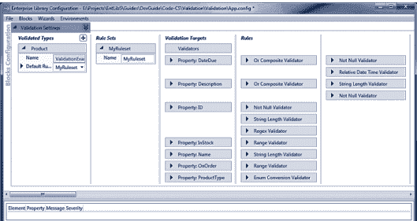

### 图 2

示例的配置

图 2 显示了配置控制台，其中包含本章示例应用程序使用的配置。它为受验证类型（Product 类）定义了名为 MyRuleset 的规则集。MyRuleset 配置为默认规则集，并包含针对 Product 类型所有属性的一系列验证器。这些验证器包括 DateDue 和 Description 属性的两个 Or 组合验证器（包含其他验证器）、ID 属性的三个将与 And 操作组合的验证器，以及其余属性的单个验证器。

> 当你在配置控制台中突出显示规则、成员或验证器时，它会在配置项之间显示连接线，以帮助你查看它们之间的关系。

## 验证时指定规则集

在创建将验证类型实例的类型验证器时，你可以指定规则集名称。如果使用 ValidatorFactory 外观为类型创建类型验证器，可以将规则集名称作为 CreateValidator 方法的参数指定。如果通过调用构造函数以编程方式创建对象验证器或对象集合验证器，可以将规则集名称作为构造函数的参数指定。最后，如果通过 Enterprise Library 容器为类型解析验证器，可以将规则集名称作为字符串键值指定。我们将在本章后面详细介绍创建验证器的选项。

- 如果在为对象创建验证器时指定规则集名称，验证块将仅应用属于指定规则集的验证规则。默认情况下，它将应用在配置、特性和自我验证中找到的所有带有指定名称的规则。


如果在为对象创建验证器时未指定规则集名称，则验证块将默认应用在配置、特性和自验证中找到的所有未命名规则（实际上，即名称字符串为空的规则）。如果在配置中为要验证的类型指定了一个规则集作为默认集（通过将该类型的 DefaultRule 属性设置为规则集名称），则该规则集中的规则也被视为默认（未命名）规则集的成员。

此默认机制唯一会改变的情况是，当你使用除 ValidatorFactory 以外的外观为类型创建验证器时。如本章后面所述，你可以使用 ConfigurationValidatorFactory、AttributeValidatorFactory 或 ValidationAttributeValidatorFactory 来生成类型验证器。在这种情况下，验证器将仅应用具有指定名称且存在于指定位置的规则。

例如，当你使用 ConfigurationValidatorFactory 并在调用 CreateValidator 方法时将 MyRuleset 指定为规则集名称，则获得的验证器将仅处理配置中为目标对象类型定义在名为 MyRuleset 的规则集内的规则。如果你使用 AttributeValidatorFactory，则验证器将仅应用目标类的特性和自验证方法中名称为 MyRuleset 的验证块规则。

为同一类型配置多个规则集很有用，特别是当需要验证的类型是 String 等基元类型时。单个应用程序可能拥有几十个全部针对 String 的不同规则集。

## 如何使用验证块？

在本章余下部分，我们将更详细地向你展示如何使用之前章节中看到的验证块功能。在本节中，我们将介绍在开始在应用程序中使用该块时应熟悉的三个主题：准备应用程序以使用该块、选择合适的验证方法、创建验证器的可用选项、访问和显示验证错误，以及了解如何在验证消息中使用模板标记。

## 准备你的应用程序

若要使用验证块，必须引用所需的程序集。除了每个使用 Enterprise Library 的应用程序所需的程序集（在第 1 章“简介”中列出）之外，还需要主验证块程序集 Microsoft.Practices.EnterpriseLibrary.Validation.dll。如果打算使用 ASP.NET、Windows Forms、WPF 或 WCF 的集成功能，还必须引用包含这些功能的相关程序集。

然后，你可以编辑代码以指定验证块使用的命名空间，以及（可选）如果需要与 WCF 或 UI 技术集成，则指定集成功能。

如果使用 WCF 集成，应添加对 System.ServiceModel 命名空间的引用。

## 选择验证方法

在开始使用验证块之前，应考虑希望如何执行验证。如前面所见，可以遵循多种方法。表 2 对这些方法进行了总结，并将帮助你选择最适合你需求的一种或多种组合。

## 表 2 验证方法

| 验证方法 | 优点 | 注意事项 |
| :--- | :--- | :--- |
| 配置中的规则集 | 支持验证块验证器的全部功能。无需重新编译和重新部署即可更改验证规则。验证规则更可见且更易于管理。 | 除非内容已加密，否则规则在配置文件中可见。如果未得到适当保护，可能会被未经授权的更改。类型定义和验证规则定义存储在不同的文件中，并使用不同的工具访问，这可能会令人困惑。 |
| 验证块特性 | 支持验证块验证器的全部功能。验证特性可以定义在单独的元数据类中。可以使用反射从类型的元数据中提取规则。 | 需要修改要验证的类型的源代码。某些复杂的规则组合可能不可行——多个规则仅可用单个 **和** 或 **或** 组合。向管理员和操作员隐藏验证规则。 |
| 数据注释特性 | 允许应用由 .NET 数据注释特性定义的验证规则，这些特性可以定义在单独的元数据类中。通常与 LINQ 等技术一起使用，可能会使用支持工具生成代码。使用这些特性的技术（例如 ASP.NET Dynamic Data）可以执行部分客户端验证。可以使用反射从类型的元数据中提取规则。 | 需要修改源代码。不支持验证块的所有强大验证功能。 |
| 自验证 | 允许创建自定义验证规则，这些规则可以组合类中不同成员的值。 | 需要修改源代码。向管理员和操作员隐藏验证规则。无法使用反射从类型的元数据中提取规则。 |
| 以编程方式创建的验证器 | 验证单个值以及整个对象的简单方法。如果只需执行小型且特定的验证任务（尤其是变量中保存的值类型），则很有用。 | 需要额外代码，对于复杂验证场景通常更难以管理。向管理员和操作员隐藏验证规则。管理起来更加困难。 |

如果决定在类中使用特性来定义验证规则，但在使用验证块特性和 Microsoft .NET 数据注释特性之间难以抉择，则应考虑使用验证块特性方法，因为这提供了更强大的功能并支持更广泛的验证操作。但是，在以下场景中应考虑使用数据注释方法：

- 使用已采用数据注释的现有应用程序时。
- 要求验证在客户端进行时。
- 构建将使用 ASP.NET 数据注释模型绑定器的 Web 应用程序，或使用 ASP.NET Dynamic Data 创建数据驱动用户界面时。
- 使用 Microsoft Entity Framework 等框架，或其他会自动生成包含数据注释的类的对象/关系映射（O/RM）技术时。

## 以编程方式创建验证器的选项

可以通过多种方式创建所需的验证器，无论是创建将使用规则集或特性验证类实例的类型验证器，还是创建单个值验证器：

- **使用 ValidatorFactory 外观创建验证器。** 此方法可轻松创建类型验证器，你可以结合规则集使用这些验证器来验证对象实例的多个成员。这通常是推荐的方法。你也可以使用此方法创建仅使用要验证的类中的验证特性或数据注释，或仅使用配置中定义的规则集的验证器。如本章后面所述，可以使用一行代码解析 ValidatorFactory 的实例。

- **以编程方式创建单个验证器** 通过调用其构造函数。构造函数参数允许你指定验证器所需的大多数属性。然后可以设置其他属性，例如 Tag 或资源名称和类型（如果要使用资源文件提供消息模板）。你还可以使用此方法构建验证器组合以实现复杂的验证规则。

- **通过 Enterprise Library 容器解析单个验证器。** 此方法允许你使用依赖注入获取验证器实例；例如，只需在通过容器解析的类的构造函数中指定所需的验证器类型即可。如果在解析实例时指定了名称，则将其解释为该验证器在验证对象时要使用的规则集名称。有关使用容器解析和填充对象依赖项的更多信息，请参阅附录 A，“使用 Unity 进行依赖注入”和附录 B，“在 Enterprise Library 中使用依赖注入”。


Enterprise Library 的早期版本使用名为 Validation 和 ValidationFactory（与上文所述的 ValidatorFactory 相对）的静态门面来创建验证器并执行验证。虽然这些门面仍可用于向后兼容，但编写新代码时，应使用上文所述的方法来创建验证器。

## 执行验证并显示验证错误

要启动验证，请调用验证器的 Validate 方法。此方法有两个重载：一个是创建并返回已填充的 ValidationResults 实例，另一个是接受现有的 ValidationResults 实例作为参数。第二个重载允许你执行多个验证操作，并将所有错误收集到一个 ValidationResults 实例中。

你可以通过检查 ValidationResults 实例的 IsValid 属性来确定验证是否成功，或是否检测到任何验证错误，并显示发生的任何验证错误的详细信息。以下代码展示了如何显示每个验证错误中最相关详细信息的简单示例。有关 ValidationResults 中每个单独 ValidationResult 的属性说明，请参见本章前面关于自验证的部分。

```
' Check if the ValidationResults detected any validation errors.
If results.IsValid Then
    Console.WriteLine("There were no validation errors.")
Else
    Console.WriteLine("The following {0} validation errors were detected:", _
        results.Count)
' Iterate through the collection of validation results.
For Each item As ValidationResult In results
    ' Show the target member name and current value.
    Console.WriteLine("Target: '{0}' Key: '{1}' Tag: '{2}' Message: '{3}'", _
        item.Target, item.Key, item.Tag, item.Message)
Next
End If
```

或者，你可以提取每个发生错误的单独验证器的更多验证结果信息。我们提供的示例应用程序演示了如何执行此操作，你将在本章后面看到更多详细信息。

## 了解消息模板标记

你在配置或特性中定义的单个验证器的一个特定且非常有用的功能是能够在消息中包含标记，以自动插入验证器属性的值。无论你如何创建验证器——在配置中定义的规则集、作为验证特性，或以编程方式创建验证器——都适用此功能。

验证器的 Message 属性实际上是一个模板，而不仅仅是可显示的简单文本字符串。当块为其检测到的每个验证错误向 ValidationResults 实例添加单个 ValidationResult 时，它会解析 Message 属性的值，查找将用检测到错误的验证器的特定属性值替换的标记。

注入到占位符标记中的值以及使用的标记数量取决于验证器的类型——尽管有三个标记是所有验证器共有的。标记 {0} 将被替换为正在验证的对象的值（在显示或使用此值之前，请确保对其进行转义，以防范注入攻击）。标记 {1} 将包含正在验证的成员的名称（如果可用），相当于验证器的 Key 属性。标记 {2} 将包含验证器的 Tag 属性的值。

其余标记取决于单个验证器类型。例如，对于 Contains Characters 验证器，标记 {3} 和 {4} 将包含要检查的字符和 ContainsCharacters 值（All 或 Any）。对于范围验证器（例如 String Length 验证器），标记 {3} 到 {6} 将包含你为验证器指定的下限和上限的值及边界类型（Inclusive、Exclusive 或 Ignore）。例如，你可以像这样定义 String Length 验证器：

```
<StringLengthValidator(5, RangeBoundaryType.Inclusive, 20, _ RangeBoundaryType.Inclusive, _ MessageTemplate:="{1} must be between {3} and {5} characters.")>
```

如果此验证器附加到名为 Description 的属性，且该属性的值无效，则 ValidationResults 实例将包含错误消息 Description must be between 5 and 20 characters。

其他验证器使用适合其执行的验证类型的标记。随 Enterprise Library 安装的文档列出了 Validation 块中每个验证器的标记。你还将在后面的示例中看到使用的标记范围。

## 深入一些简单示例

本章剩余部分展示了如何在应用程序的各种场景中使用 Validation 块。我们提供了一个简单的控制台示例应用程序，实现为名为 Validation 的 Microsoft Visual Studio® 解决方案。你可以在 Visual Studio 中打开它以查看代码，或直接从 bin\Debug 文件夹运行应用程序。

该应用程序使用存储产品信息的类的三个版本。所有这些都实现名为 IProduct 的接口，如图 3 所示。每个类都有一个字符串属性，旨在设置为名为 ProductType 的枚举中定义的有效产品类型名称集合的值。

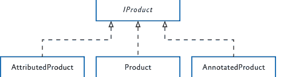

图 3 示例中使用的产品类

Product 类主要用于演示使用配置规则集的示例，且不包含验证特性。AttributedProduct 类包含 Validation 块特性，而 AnnotatedProduct 类包含 .NET Data Annotation 特性。后两个类还包含自验证例程——其范围取决于其包含的验证特性类型的功能。当我们在本章后面查看验证特性的使用时，将了解更多有关此主题的内容。

本章的以下部分将帮助你详细了解可以使用 Validation 块的不同方式：

- 验证对象和对象集合。这是使用 Validation 块的核心主题，很可能是你应用程序中最常见的场景。它展示了如何创建类型验证器来验证自定义类的实例，如何深入了解返回的 ValidationResults 实例，如何使用 Object Validator，以及如何验证对象集合。

- 使用验证特性。本节描述了如何将特性应用于类以启用对这些类成员的验证。这些特性使用 Validation 块验证器和 .NET Data Annotation 特性。

- **创建和使用单个验证器。** 本节展示了如何创建和使用块提供的验证器来验证单个值和对象的成员。

- **WCF 服务验证集成。** 本节描述了如何使用块来验证 WCF 服务中的参数。

最后，我们将简要探讨如何将 Validation 块与 Windows Forms、WPF 和 ASP.NET 等用户界面技术集成，以结束本章。

## 验证对象和对象集合

使用 Validation 块时最常见的场景是验证应用程序中类的实例。Validation 块使用在规则集中定义的规则与作为特性添加的验证器的组合，来测试类成员的值以及在类中执行任何自验证方法的结果。

Validation 块使使用特定类型验证器或 Object Validator 验证整个对象（所有或部分成员）变得容易。你还可以使用 Object Collection Validator 验证集合中的所有对象。我们将在后面介绍 Object Validator 和 Object Collection Validator。目前，我们将专注于创建和使用特定类型验证器。

### 使用 ValidatorFactory 创建类型验证器

你可以通过 Enterprise Library 容器解析 ValidatorFactory 实例，并使用它为特定目标类型创建验证器。此验证器将使用规则集和/或目标对象包含的任何特性和自验证方法来验证对象。要获取 ValidatorFactory 类的实例，可以使用以下代码。

```
Dim valFactory As ValidatorFactory _
= EnterpriseLibraryContainer.Current.GetInstance(Of ValidatorFactory)()
```

然后，你可以为要验证的任何类型创建验证器。例如，此代码为 Product 类创建验证器，然后验证名为 myProduct 的该类实例。

```
Dim pValidator As Validator(Of Product) _
= valFactory.CreateValidator(Of Product)()
Dim valResults As ValidationResults = pValidator.Validate(myProduct)
```

默认情况下，验证器将使用为目标类型定义的默认规则集（你可以为类型定义多个规则集，并指定其中一个作为该类型的默认规则集）。如果你希望验证器使用特定规则集，请将其作为 CreateValidator 方法的单个参数指定，如下所示。

```
Dim productValidator As Validator(Of Product) _
= valFactory.CreateValidator(Of Product)("RuleSetName")
Dim valResults As ValidationResults = productValidator.Validate(myProduct)
```


示例“使用验证规则集验证对象”创建了一个 Product 类的实例，该实例包含所有属性的无效值，然后使用上面所示的代码为此类型创建类型验证器并对其进行验证。随后，它显示返回的 ValidationResults 实例中包含的验证错误详细信息。不过，它没有使用遍历 ValidationResults 实例并显示顶级错误的简单技术，而是使用代码深入结果，以显示每个验证错误的更多信息，如下一节所示。

## 深入探讨 ValidationResults

您可以通过检查 ValidationResults 实例的 IsValid 属性并显示发生的任何验证错误详细信息，来检查验证是否成功，或是否检测到任何验证错误。但是，当您只是遍历 ValidationResults 实例时（如我们在本章前面的“执行验证和显示验证错误”节中演示的那样），我们仅显示了顶级错误。在许多情况下，这足以满足需求。如果验证错误是由于复合（And 或 Or）验证器中的验证失败引起的，则此方法将显示的错误是复合验证器的消息和详细信息。

不过，有时您可能希望深入 ValidationResults 实例的内容，以了解发生的错误的更多信息。当您在复合验证器中使用嵌套验证器时，情况尤其如此。示例中使用的代码提供了关于错误的更丰富信息。运行示例时，它将显示以下结果（为清晰起见，我们已删除一些重复内容）。

```
The following 6 validation errors were detected:
+ Target object: Product, Member: DateDue
  - Detected by: OrCompositeValidator
  - Tag value: Date Due
  - Validated value was: '23/11/2010 13:45:41'
  - Message: 'Date Due must be between today and six months time.'
+ Nested validators:
  - Detected by: NotNullValidator
  - Validated value was: '23/11/2010 13:45:41'
  - Message: 'Value can be NULL or a date.'
  - Detected by: RelativeDateTimeValidator
  - Validated value was: '23/11/2010 13:45:41'
  - Message: 'Value can be NULL or a date.'
+ Target object: Product, Member: Description
  - Detected by: OrCompositeValidator
  - Validated value was: '-'
  - Message: 'Description can be NULL or a string value.'
+ Nested validators:
  - Detected by: StringLengthValidator
  - Validated value was: '-'
  - Message: 'Description must be between 5 and 100 characters.'
  - Detected by: NotNullValidator
- Validated value was: ' '.
- Message: 'Value can be NULL.'

...

+ Target object: Product, Member: ProductType
  - Detected by: EnumConversionValidator
  - Tag value: Product Type
  - Validated value was: 'FurryThings'
  - Message: 'Product Type must be a value from the 'ProductType' enumeration.'
```

您可以看到，这显示了目标对象类型以及正在验证的目标对象的成员名称。它还显示了执行操作的验证器类型、Tag 属性值以及验证错误消息。还要注意，输出包括两个 **OrCompositeValidator** 验证器中嵌套验证器的验证结果。要实现此目的，您必须递归遍历 **ValidationResults** 实例，因为它包含复合验证器的嵌套条目。

我们使用的代码还包含一个有些刻意的功能：为了能够显示正在验证的值，一些使用此例程的示例会在消息开头使用 **{0}** 标记，格式为 **[{0}] 验证错误消息。** 示例代码会解析 **Message** 属性，在检测到该消息字符串包含此类值时提取值和消息。它还会对该值进行编码以供显示，以防其包含恶意内容。

虽然这可能不是实际应用场景中的要求，但在这里很有用，因为它允许示例显示导致验证错误的无效值，并帮助您了解每个验证器的工作原理。我们未在此列出代码，但您可以在示例应用程序中查看它以了解其工作原理，并根据自己的要求进行调整。您可以在主程序文件末尾名为“辅助例程”的区域中找到 **ShowValidationResults**、**ShowValidatorDetails** 和 **GetTypeNameOnly** 例程。

## 使用对象验证器

验证对象的另一种方法是通过调用其构造函数以编程方式创建对象验证器。您需要指定它将验证的类型，以及（可选）执行验证时使用的规则集。如果您未指定规则集名称，验证器将使用默认规则集。当您调用对象验证器的 **Validate** 方法时，它会为您指定的目标类型创建特定于类型的验证器，您可以使用它来验证对象，如下所示。

```
Dim pValidator As Validator = New ObjectValidator(GetType(Product), "RuleSetName")
Dim valResults As ValidationResults = pValidator.Validate(myProduct)
```

## 对象验证器与工厂创建的类型验证器之间的差异

虽然您刚才看到的创建或获取对象验证器的两种方法能够达到相同的结果，但它们的行为存在一些差异：

- 以编程方式创建对象验证器时，如果您未指定目标类型，则可以使用它来验证任何类型。当您调用 **Validate** 方法时，需指定目标实例，对象验证器会为目标实例的类型创建特定于类型的验证器。相比之下，从工厂获取的验证器只能用于验证您获取验证器时指定的类型的实例。不过，它也可用于验证指定类型的子类，但将使用为指定目标类型定义的规则。
- 对象验证器始终会使用目标对象类型的配置规则，以及目标实例中的属性和自验证方法。相比之下，您可以使用特定的工厂类类型来获取验证器，这些验证器仅使用一种规则源（换句话说，仅配置规则集，或仅一种属性类型）来验证目标实例。
- 对象验证器每次调用 **Validate** 方法时都会获取适当类型的特定于类型的验证器，即使您每次都使用同一个对象验证器实例也是如此。相比之下，从工厂类获取的验证器不需要这样做，并且性能会更好。

从上述灵活性和性能优势可以看出，您通常应考虑使用 **ValidatorFactory** 方法来创建用于验证对象的验证器，而不是创建单独的对象验证器实例。

## 验证对象集合

在结束对象验证主题之前，值得了解如何验证对象集合。对象集合验证器可用于检查集合中的每个对象是否为指定类型，并对集合中的每个成员执行验证。如果需要，可以使用验证块特性将对象集合验证器应用于类的对象集合属性，如下示例所示，该示例确保 **ProductList** 属性是 **Product** 实例的集合，并且集合中的每个实例都包含有效值。

```
<ObjectCollectionValidator(GetType(Product))> _
ReadOnly Property ProductList() As ProductList
    Get
        Return theProductList
    End Get
End Property
```

您也可以以编程方式创建对象集合验证器，并使用它来验证变量中保存的集合。示例“验证对象集合”演示了此方法。它创建一个名为 productList 的 List，其中包含两个 Product 类实例，一个包含所有有效值，另一个包含某些属性的无效值。接下来，代码为 Product 类型创建对象集合验证器，然后调用 Validate 方法。


```
' Create an Object Collection Validator for the collection type.
Dim collValidator As Validator _
    = New ObjectCollectionValidator(GetType(AttributedProduct))
' Validate all of the objects in the collection.
Dim results As ValidationResults = collValidator.Validate(productList)
```

最后，代码使用与前面示例相同的例程显示验证错误。由于无效的 Product 实例包含与前面示例相同的值，结果也是相同的。你可以运行示例并查看代码来验证这一点。

## 使用验证特性

在了解了如何使用配置中定义的规则集以及如何显示验证过程的结果后，我们可以继续探索在应用程序中定义验证规则的其他方法。示例应用程序包含两个类，它们包含验证特性和自验证方法。AttributedProduct 类包含验证块特性，而 AnnotatedProduct 类包含数据注释特性。

## 使用验证块特性

示例“使用验证特性和自验证”演示了验证块特性的用法。AttributedProduct 类在其属性上应用了一系列不同的验证块特性，应用的规则与配置中定义并在前面示例中使用的 MyRuleset 规则集相同。

例如，ID 属性带有特性，用于添加非空验证器、字符串长度验证器和正则表达式验证器。默认情况下，这些验证规则通过 **和** 操作组合，因此必须满足所有条件，该属性的值验证才能成功。

```
<NotNullValidator(MessageTemplate:="You must specify a product ID.")> _
<StringLengthValidator(6, RangeBoundaryType.Inclusive, _
    6, RangeBoundaryType.Inclusive, _
    MessageTemplate:="Product ID must be {3} characters.")> _
<RegexValidator("[A-Z]{2}[0-9]{4}", _
    MessageTemplate:="Product ID must be 2 letters and 4 numbers.")> _
Public Property ID() As String Implements IProduct.ID
...
End Property
```

AttributedProduct 类中使用的其他验证特性包括枚举转换验证器，它确保 ProductType 属性的值是 ProductType 枚举的成员，如下所示。请注意，前面代码段中字符串长度验证器使用的标记 {3} 是下限值，而枚举转换验证器使用的标记 {3} 是它将验证值与之比较的枚举名称。

```
<EnumConversionValidator(GetType(ProductType), _
MessageTemplate:="Product type must be a value from the '{3}' enumeration.")> _
Public Property ProductType() As String Implements IProduct.ProductType
...
End Property
```

## 组合验证特性操作

这里值得一提的验证特性的另一种用法是应用组合验证器。默认情况下，为成员定义的多个验证器使用 **和** 操作组合。如果要使用 **或** 操作组合多个验证特性，必须先应用 **ValidatorComposition** 特性并指定 **CompositionType.Or**。后续验证特性中定义的所有验证操作的结果将使用你为组合类型指定的操作进行组合。

示例类在可空的 **DateDue** 属性上使用 **ValidatorComposition** 特性，以组合非空验证器和相对日期时间验证器。用户对此属性看到的顶级错误消息（当你不递归遍历 **ValidationResults** 的内容时）是来自 **ValidatorComposition** 特性的消息。

```
<ValidatorComposition(CompositionType.[Or], _
MessageTemplate:="Date due must be between today and six months time.")> _
<NotNullValidator(Negated:=True, _
MessageTemplate:="{0}Value can be NULL or a date.")> _
<RelativeDateTimeValidator(0, DateTimeUnit.Day, 6, DateTimeUnit.Month, _
MessageTemplate:="{0}Value can be NULL or a date.")> _
Public Property DateDue() As System.Nullable(Of DateTime)
...
End Property
```

如果要允许类成员具有 null 值，可以应用 **IgnoreNulls** 特性。

## 应用自验证

某些验证规则过于复杂，无法使用验证块提供的验证器或 .NET 数据注释验证特性来应用。可能需要用于执行验证的值来自不同位置，例如属性、字段和内部变量，或者涉及复杂计算。

在这种情况下，你可以将自验证规则定义为类中的方法（方法名称无关紧要），如前面本章“自验证”部分中所述。我们已在示例应用程序的 **AttributedProduct** 类中实现了一个自验证例程。该方法只是检查 **InStock**、**OnOrder** 和 **DateDue** 属性值的组合是否符合预定义规则。你可以查看 **AttributedProduct** 类中的代码以了解实现情况。

## 验证操作的结果

示例创建上面所示的 AttributedProduct 类的无效实例，对其进行验证，然后显示验证过程的结果。它生成以下输出，但为了清晰起见，我们在此删除了部分重复的输出。你可以自行运行示例以查看完整结果。

```
Created and populated a valid instance of the AttributedProduct class.

Created and populated an invalid instance of the AttributedProduct class.
The following 7 validation errors were detected:
+ Target object: AttributedProduct, Member: ID
  - Detected by: RegexValidator
  - Validated value was: '12875'
  - Message: 'Product ID must be 2 capital letters and 4 numbers.'
  ...
+ Target object: AttributedProduct, Member: ProductType
  - Detected by: EnumConversionValidator
  - Validated value was: 'FurryThings'
  - Message: 'Product type must be a value from the 'ProductType' enumeration.'
  ...
+ Target object: AttributedProduct, Member: DateDue
  - Detected by: OrCompositeValidator
  - Validated value was: '19/08/2010 15:55:16'
  - Message: 'Date due must be between today and six months time.'
+ Nested validators:
  - Detected by: RelativeDateTimeValidator
  - Validated value was: '18/11/2010 13:36:02'
  - Message: 'Value can be NULL or a date.'
  - Detected by: NotNullValidator
  - Validated value was: '18/11/2010 13:36:02'
  - Message: 'Value can be NULL or a date.'
+ Target object: AttributedProduct, Member: ProductSelfValidation
  - Detected by: [none]
  - Tag value:
  - Message: 'Total inventory (in stock and on order) cannot exceed 100 items.'
```

请注意，输出包括已验证的类型名称和成员（属性）名称，以及显示检测到错误的验证器类型、成员的当前值和消息。对于 DateDue 属性，输出显示嵌套在 Or 组合验证器内的两个验证器。最后，它显示来自自验证方法的结果。你在自验证中看到的值是自验证方法中的代码专门添加到验证结果实例中的值。

## 验证子类类型

在讨论通过特性进行验证时，我们应简要提及在验证继承自创建验证器时所指定类型的类时涉及的因素。例如，如果你有一个名为 **SaleProduct** 的类派生自 **Product**，可以使用为 **Product** 类定义的验证器来验证 **SaleProduct** 类的实例。**Validate** 方法还将应用 **SaleProduct** 类和 **Product** 基类中特性定义的任何相关规则。

如果派生类从基类继承成员且未重写它，则基类中为该成员定义的验证器适用于派生类。如果派生类继承成员但重写了它，则基类中为该成员定义的验证器不适用于派生类。

## 验证为对象的属性

在许多情况下，你的类可能具有一个定义为另一个类类型的属性。例如，你的 **OrderLine** 类很可能具有一个引用 **Product** 类实例的属性。通常将此属性定义为基类型或接口类型，以便你可以将其设置为继承或实现属性所指定类型的任何类的实例。

你可以在类中使用 **ObjectValidator** 特性来验证此类属性。

但是，默认情况下，验证器将使用为属性类型定义的规则来验证该属性——在此示例中为类型 **IProduct**。如果你希望验证基于当前设置为属性值的对象的实际类型进行，可以向 **ObjectValidator** 特性添加 **ValidateActualType** 参数，如下所示。

```
Public Class OrderLine
<ObjectValidator(ValidateActualType:=True)> _
Public Property OrderProduct(ByVal oProduct As IProduct)
...
End Property
...
End Class
```

## 使用数据注释特性

.NET Framework 中的 System.ComponentModel.DataAnnotations 命名空间包含一系列特性，你可以将这些特性添加到类和类成员中，以表示这些类和成员的元数据。它们包括一系列验证特性，你可以使用这些特性以与验证块特性类似的方式将验证规则应用到类中。例如，以下内容展示了如何使用 Range 特性来指定名为 **OnOrder** 的属性的值必须介于 0 和 50 之间。

```
<Range(0, 50, ErrorMessage:="Quantity on order must be between 0 and 50.")> _
Public Property OnOrder() As Integer
```


```
End Property
```

与验证块提供的验证特性相比，使用 DataAnnotations 命名空间中的验证特性时存在一些限制：

- 支持的验证操作范围不够全面，尽管 .NET Framework 4.0 中有一些新的验证类型可扩展该范围。但是，使用数据注解验证特性时，某些验证操作（例如属性值比较、枚举成员检查和相对日期时间比较）不可用。
- 没有使用 Or 组合的功能，而验证块中的 Or 复合验证器则具有此功能。数据注解验证特性中可用的唯一组合操作是 And 操作。
- 无法指定规则集名称，因此使用数据注解验证特性实现的所有规则都属于默认规则集。
- 不像验证块那样，没有针对自验证的简单内置支持。

当然，如果你愿意，可以在同一个类中同时包含数据注解和验证块特性，并在包含数据注解验证特性的类中使用验证块机制实现自验证。验证块中的验证方法将处理这两种类型的特性。

有关数据注解的更多信息，请参阅 http://msdn.microsoft.com/en-us/library/system.componentmodel.dataannotations.aspx（.NET Framework 3.5）和 http://msdn.microsoft.com/en-us/library/system.componentmodel.dataannotations(VS.100).aspx（.NET Framework 4.0）。

## 使用数据注解的示例

本章提供的示例中包含一个名为“使用数据注解特性和自验证”的示例。该示例仅使用 .NET Framework 3.5 版本中的数据注解特性范围，因此你可以在未安装 Visual Studio 2010 或 .NET Framework 4.0 版本的计算机上运行它。

名为 AnnotatedProduct 的类包含数据注解特性，用于实现与 Attributed Product 类（你在上一个示例中见过）中验证块特性所应用的相同规则。但是，由于数据注解的限制，类中的自验证方法必须做更多工作才能实现相同的验证规则。

例如，它必须检查某些属性的最小值，因为 .NET Framework 3.5 版本中的数据注解特性仅支持最大值验证（在 4.0 版本中，它们确实支持最小值验证）。它还必须检查 DateDue 属性的值，以确保其不超过六个月后的日期，并且 ProductType 属性的值是 ProductType 枚举的成员。

要执行枚举检查，自验证方法将以编程方式创建验证块 Enum Conversion 验证器的实例，然后调用其 DoValidate 方法（该方法允许你传入执行验证所需的所有值）。代码将 ProductType 属性的值、当前对象的引用、枚举名称以及用于保存所有验证错误的 ValidationResults 实例的引用传递给此方法。

## ValidationResults

```
Dim enumConverterValidator = New EnumConversionValidator(GetType(ProductType), _
    "Product type must be a value from the '(3)' enumeration.") _
    enumConverterValidator.DoValidate(ProductType, Me, "ProductType"), results)
```

创建要验证的对象、对其进行验证然后显示结果的代码与你在上一个示例中看到的相同，区别在于它创建的是 AnnotatedProduct 类的无效实例，而不是 AttributedProduct 类。运行此示例的结果也与上一个示例类似，但有少数例外。我们在此列出了一些输出。

```
Created and populated an invalid instance of the AnnotatedProduct class.
The following 7 validation errors were detected:
+ Target object: AnnotatedProduct, Member: ID
- Detected by: [none]
- Tag value:
- Message: 'Product ID must be 6 characters.'
...
+ Target object: AnnotatedProduct, Member: ProductSelfValidation
- Detected by: [none]
- Tag value:
- Message: 'Total inventory (in stock and on order) cannot exceed 100 items.'
+ Target object: AnnotatedProduct, Member: ID
- Detected by: ValidationAttributeValidator
- Message: 'Product ID must be 2 capital letters and 4 numbers.'
+ Target object: AnnotatedProduct, Member: InStock
- Detected by: ValidationAttributeValidator
- Message: 'Quantity in stock cannot be less than 0.'
```

你可以看到，针对数据注解检测到的验证失败包含的信息比针对验证块特性检测到的信息要少，并且验证错误显示为由 ValidationAttributeValidator 类（数据注解验证特性的基类）检测到。但是，在使用自验证方法执行额外验证的地方，有额外信息可用。

## 在元数据类中定义特性

在某些情况下，你可能希望将验证特性（包括验证块特性和 .NET 数据注解验证特性）放置在与定义要验证的类的文件不同的文件中。当你使用生成类文件的工具时，这是一种常见场景，因为这些工具会覆盖你的验证特性。为避免这种情况，你可以将验证特性放置在单独的文件中，该文件与主类文件共同构成一个分部类。此方法使用 System.ComponentModel.DataAnnotations 命名空间中的 MetadataType 特性。

你将 MetadataType 特性应用到主类文件，指定存储要应用到主类成员的验证特性的类的类型。你必须将其定义为分部类，如下所示。与本章前面各节中你看到的带特性的版本相比，此类内容的唯一变化是它不包含验证特性。

```
<MetadataType(GetType(ProductMetadata))> _
Partial Public Class Product
... Existing members defined here, but without attributes or annotations ...
End Class
```

然后你将元数据类型定义为普通类，区别在于你为要应用验证特性的每个成员声明简单属性。这些属性的实际类型并不重要，编译器会将其忽略。采用的方法是将它们全部声明为 Object 类型。例如，如果你的 Product 类包含 ID 和 Description 属性，你可以为其定义元数据类，如下所示。

```
Public Class ProductMetadata
<Required(ErrorMessage:="ID is required.")> _
<RegularExpression("([A-Z]{2}[0-9]{4}"), _
ErrorMessage:="Product ID must be 2 capital letters and 4 numbers.")> _
Public ID As Object
<StringLength(100, ErrorMessage:="Description must be less than 100 chars.")> _
Public Description As Object
End Class
```

## 指定验证规则的位置

当你使用从 ValidatorFactory 获得的验证器时（如本示例中迄今所做的那样），验证将考虑配置中以及目标对象内的特性和自验证方法中定义的任何适用规则集。但是，如果你想仅使用配置中定义的规则集，或仅使用特性和自验证来执行验证，则可以解析不同的工厂类型。你可以使用的专用工厂类型有：

- **配置验证器工厂。** 此工厂创建仅应用配置文件中或你提供的配置源中定义的规则的验证器。默认情况下，它会在默认配置文件（App.config 或 Web.config）中查找配置。但是，你可以创建实现 IConfigurationSource 接口的类的实例，使用来自另一个文件或配置存储介质的配置数据对其进行填充，并在创建此验证器工厂时使用它。
- **特性验证器工厂。** 此工厂创建仅应用目标类中验证块特性所定义的规则以及通过自验证方法定义的规则的验证器。
- **验证特性验证器工厂。** 此工厂创建仅应用 .NET 数据注解验证特性中定义的规则的验证器。


例如，要为 **Product** 类获取一个仅使用目标实例内的属性和自验证方法进行验证的验证器，并验证此类的一个实例，你需要从容器中解析一个 **AttributeValidatorFactory** 实例，如下所示。

```
Dim attrFactory As AttributeValidatorFactory = _
EnterpriseLibraryContainer.Current.GetInstance(Of AttributeValidatorFactory)()
Dim pValidator As Validator(Of Product) _
= attrFactory.CreateValidator(Of Product)()
Dim valResults As ValidationResults = pValidator.Validate(myProduct)
```

## 创建和使用单个验证器

你可以直接在代码中创建 Validation block 中包含的任何验证器的实例，然后调用其 **Validate** 方法来验证对象或值。例如，你可以创建一个新的日期时间范围验证器并设置属性，例如上下限、消息和 **Tag** 属性。然后调用验证器的 **Validate** 方法，指定要验证的对象或值。示例 **直接创建和使用验证器** 演示了随 Validation block 提供的一些单个和复合验证器的创建和使用。

## 验证字符串是否包含字符

示例代码首先创建一个 **ContainsCharactersValidator**，指定被验证的值必须包含字符 c、a 和 t，并且必须包含所有这些字符（如果需要，你可以指定它只能包含 **Any** 个字符之一）。代码还将 **Tag** 属性设置为用户定义的字符串，以帮助在错误列表中标识验证器。此处使用的 **Validate** 方法重载将返回一个新的 **ValidationResults** 实例，其中包含每个发生验证错误的 **ValidationResult** 实例。

```
' Create a Contains Characters Validator and use it to validate a string.
Dim charsValidator As New ContainsCharactersValidator("cat", _
ContainsCharacters.All, _
" Value must contain {4} of the characters '{3}'.")
charsValidator.Tag = "Validating the String value 'disconnected'"
Dim valResults As ValidationResults = charsValidator.Validate("disconnected")
```

## 验证域内的整数

接下来，示例代码为整数值创建一个新的 **DomainValidator**，指定错误消息和可接受值的数组。然后可以使用它来验证整数，这次将现有的 **ValidationResults** 实例引用传递给 **Validate** 方法。

```
' Create a Domain Validator and use it to validate an Integer value.
Dim integerValidator As Validator = New DomainValidator(Of Integer)( _
"Value must be in the list 1, 3, 7, 11, 13.", _
New Integer() {1, 3, 7, 11, 13})
integerValidator.Tag = "Validating the Integer value '42'"
integerValidator.Validate(42, valResults)
```

## 使用复合验证器进行验证

为了展示如何创建复合验证器，示例的下一部分创建一个包含两个验证器的数组：一个 **NotNullValidator** 和一个 **StringLengthValidator**。 **NotNullValidator** 的第一个参数设置 **Negated** 属性。在此示例中，我们将其设置为 true，以便验证器允许 null 值。 **StringLengthValidator** 指定它验证的字符串必须恰好为五个字符长。请注意，像 **StringLengthValidator** 这样的范围验证器具有属性，这些属性不仅指定上下限值，还指定这些值是包含在有效结果集中（**RangeBoundaryType.Inclusive**）还是排除在外（**RangeBoundaryType.Exclusive**）。如果你不想为范围验证器的上限或下限指定值，则必须将相应属性设置为 **RangeBoundaryType.Ignore**。

```
Dim valArray As Validator() = New Validator() _
{
    New NotNullValidator(True, "Value can be NULL."), _
    New StringLengthValidator(5, RangeBoundaryType.Inclusive, _
        5, RangeBoundaryType.Inclusive, _
        "Must be between {3} ({4}) and {5} ({6}) chars.") _
}
```

创建验证器数组后，我们现在可以使用它来创建复合验证器。有两个复合验证器：**AndCompositeValidator** 和 **OrCompositeValidator**。你也可以组合它们，以创建所需的任何嵌套验证器层次结构，每种组合在其包含的所有验证器（使用 **AndCompositeValidator**）或任意验证器（使用 **OrCompositeValidator**）有效时都会返回有效结果。示例创建一个 **OrCompositeValidator**，如果被验证的字符串为 null 或恰好包含五个字符，则它将返回 true（有效）。然后它验证一个 null 值和一个无效字符串，将现有的 **ValidationResults** 实例传递给 **Validate** 方法。

```
Dim orValidator As Validator = New OrCompositeValidator( _
    "Value can be NULL or a string of 5 characters.", _
    valArray)

' Validate two values with the Or Composite Validator.
orValidator.Validate(null, valResults)
orValidator.Validate("MoreThan5Chars", valResults)
```

## 验证对象的单个成员

Validation block 包含三个验证器，你可以使用它们直接验证类的单个成员，而不是使用属性或规则集验证整个类型。虽然你可能不经常使用这种方法，但在某些场景下可能会发现它很有用。字段值验证器可用于验证类型的字段值。方法返回值验证器可用于验证类型的方法返回值。最后，属性值验证器可用于验证类型的属性值。

示例展示了如何使用属性值验证器。代码创建 **Product** 类的一个实例，该实例的 ID 属性值无效，然后创建 **PropertyValueValidator** 类的一个实例，指定要验证的类型和目标属性的名称。构造函数的第二个参数是用于验证属性值的验证器——在此示例中为正则表达式验证器。然后代码可以通过调用 **Validate** 方法来启动验证，将现有的 **ValidationResults** 实例传入，如下所示。

```vbnet
Dim productWithID As IProduct = New Product()
PopulateInvalidProduct(productWithID)
Dim propValidator As New PropertyValueValidator(Of Product)("ID", _
    New RegexValidator("[A-Z]{2}[0-9]{4}", _
    "Product ID must be 2 capital letters and 4 numbers."))
propValidator.Validate(productWithID, valResults)
```

如果需要，你可以创建一个包含验证器组合的复合验证器，并在第二个参数中指定此复合验证器。类似的技术可用于字段值验证器和方法返回值验证器。

执行所有验证操作后，示例通过遍历包含所有前面验证操作结果的 **ValidationResults** 实例来显示结果。它使用本章前面描述过的相同 **ShowValidationResults** 例程。结果如下：

```
The following 4 validation errors were detected:
+ Target object: disconnected, Member:
  - Detected by: ContainsCharactersValidator
  - Tag value: Validating the String value 'disconnected'
  - Message: 'Value must contain All of the characters 'cat'.'
+ Target object: 42, Member:
  - Detected by: DomainValidator '[System.Int32]'
  - Tag value: Validating the Integer value '42'
  - Message: 'Value must be in the list 1, 3, 7, 11, 13.'
+ Target object: MoreThan5Chars, Member:
  - Detected by: OrCompositeValidator
  - Message: 'Value can be NULL or a string of 5 characters.'
+ Nested validators:
  - Detected by: NotNullValidator
  - Message: 'Value can be NULL.'
  - Detected by: StringLengthValidator
  - Message: 'Value must be between 5 (Inclusive) and 5 (Inclusive) chars.'
+ Target object: Product, Member: ID
  - Detected by: RegexValidator
  - Message: 'Product ID must be 2 capital letters and 4 numbers.'
```


您可以看到消息模板标记如何创建显示的消息内容，以及我们为 Or 复合验证器定义的嵌套验证器的结果。如果您想尝试单个验证器，可以修改并扩展此示例例程，以使用其他验证器和验证器组合。

## WCF 服务验证集成

本章这一节演示了如何将 WCF 服务的验证要求与验证块集成。验证块允许您将验证特性添加到 WCF 服务契约中定义的方法参数，并在客户端每次调用方法时自动验证这些值。

要使用 WCF 集成，您需要编辑服务契约，编辑 WCF 配置以添加验证块和行为，然后处理因验证失败而产生的错误。除了 Enterprise Library 和验证块所需的其他程序集外，您还必须将名为 Microsoft.Practices.EnterpriseLibrary.Validation.Integration.WCF 的程序集添加到您的应用程序中，并在服务项目中引用它们全部。

示例“在 WCF 服务中验证参数”演示了在简单的 WCF 服务中进行验证。它使用名为 ProductService 的服务（定义在解决方案的示例服务项目中）。该服务包含一个名为 AddNewProduct 的方法，该方法接受一组产品值，并将此产品添加到其内部产品列表中。

## 在服务契约中定义验证

如下所示的服务契约带有 ValidationBehavior 特性，每个服务方法都定义了类型为 ValidationFault 的故障契约。

```
<ServiceContract()> _
<ValidationBehavior()> _
Public Interface IProductService
<OperationContract()> _
<FaultContract(GetType(ValidationFault))> _
Function AddNewProduct( _
<NotNullValidator(MessageTemplate:="Must specify a product ID.")> _
<StringLengthValidator(6, RangeBoundaryType.Inclusive, _
6, RangeBoundaryType.Inclusive, _
MessageTemplate:="Product ID must be {3} characters.")> _
<RegexValidator("[A-Z]{2}[0-9]{4}"), _
MessageTemplate:="Product Product ID must be 2 letters and 4 numbers.")> _
ByVal id As String, _
...
<IgnoreNulls(MessageTemplate:="Description can be NULL or a string value.")> _
<StringLengthValidator(5, RangeBoundaryType.Inclusive, _
100, RangeBoundaryType.Inclusive, _
MessageTemplate:="Description must be between {3} and {5} characters.")> _
    ByVal description As String, _
    <EnumConversionValidator(GetType(ProductType), _
    MessageTemplate:="Must be a value from the '{3}' enumeration.")> _
    ByVal productType As String, _
    ...
    <ValidatorComposition(CompositionType.Or, _
    MessageTemplate:="Date must be between today and six months time.")> _
    <NotNullValidator(Negated:=True), _
    MessageTemplate:="Value can be NULL or a date.")> _
    <RelativeDateTimeValidator(0, DateTimeUnit.Day, 6, DateTimeUnit.Month, _
    MessageTemplate:="Value can be NULL or a date.")> _
    ByVal dateDue As System.Nullable(Of DateTime)) _
    As Boolean

End Interface
```

您可以看到，服务契约定义了一个名为 **添加新产品** 的方法，该方法将我们在示例中一直使用的 **产品** 类的每个属性的值作为参数。虽然前面的列表省略了一些特性以限制重复并使契约结构更易于查看，但我们提供的示例服务中应用的规则与您在先前验证 **产品** 实例的示例中看到的相同。WCF 服务中的方法实现很简单——它只是使用提供的值创建一个新 **产品**，并将其添加到一个泛型 **列表** 中。

## 编辑服务配置

定义服务及其验证规则后，必须编辑服务配置以强制执行验证。第一步是将验证块指定为行为扩展。您需要为程序集提供适当的版本信息，您可以从客户端应用程序的配置工具生成的配置文件中获取该信息，也可以从示例的源代码中获取，具体取决于您使用的是随 Enterprise Library 提供的程序集还是您自己编译的程序集。

```
<extensions>
    <behaviorExtensions>
        <add name="validation"
            type="Microsoft.Practices...WCF.ValidationElement,
            Microsoft.Practices...WCF" />
    </behaviorExtensions>
    ... other existing behavior extensions here ...
</extensions>
```

接下来，您需要编辑配置的 <behaviors> 部分以定义要应用的验证行为。除了在此处启用验证外，如果您只想使用服务中定义的规则子集进行验证，还可以指定规则集名称（如所示）。然后，验证将仅包含在包含适当 RuleSet 参数的验证特性中定义的规则（示例应用程序的配置在此处未指定规则集名称）。

```
<behaviors>
  <endpointBehaviors>
    <behavior name="ValidationBehavior">
      <validation enabled="true" ruleset="MyRuleSet" />
    </behavior>
  </endpointBehaviors>
  ... other existing behaviors here ...
</behaviors>
```

请注意，不能与 WCF 服务一起使用配置规则集——所有验证规则都必须在特性中。

最后，您需要编辑配置的 <services> 部分，将上面定义的 ValidationBehavior 链接到您的 WCF 应用程序公开的服务。您可以通过向服务的 service 元素添加 behaviorConfiguration 属性来实现此操作，如下所示。

```
<services>
  <service behaviorConfiguration="ExampleService.ProductServiceBehavior"
    name="ExampleService.ProductService">
    <endpoint address="" behaviorConfiguration="ValidationBehavior"
      bindings="wsHttpBinding" contract="ExampleService.IProductService">
      <identity>
        <dns value="localhost" />
      </identity>
    </endpoint>
    <endpoint address="mex" binding="mexHttpBinding" contract="IMetadataExchange" />
  </service>
  ...
</services>
```

## 使用产品服务和检测验证错误

最后，您可以使用自己创建的 WCF 服务。该示例使用添加到主项目的服务引用，并以常规方式使用该服务引用初始化服务。然后，它创建一个 Product 类的新实例，使用有效值填充它，并调用 WCF 服务的 AddNewProduct 方法。然后它重复此过程，但这次使用无效值填充产品实例。如果您愿意，可以查看示例中的代码以了解此过程。

然而，一个重要的问题是服务异常的处理方式。示例代码专门捕获类型为 FaultException<ValidationFault> 的异常。这是服务生成的异常，而 ValidationFault 是我们在服务契约中指定的故障契约的类型。

在 WCF 服务中检测到的验证错误作为集合返回在异常的 Details 属性中。您可以简单地遍历此集合以查看验证错误。但是，如果您想将它们合并为一个 ValidationResults 实例以供显示，尤其是如果这是多步骤过程的一部分且可能导致其他验证错误，则必须转换异常中返回的验证错误集合。

示例应用程序使用名为 ConvertToValidationResults 的方法来执行此操作，如下所示。请注意，ValidationFault 中返回的验证错误不包含生成错误的验证器的信息，因此在创建每个 ValidationResult 实例时必须使用 Nothing。

```
' Convert the validation details in the exception to individual
' ValidationResult instances and add them to the collection.
Dim adaptedResults As New ValidationResults()
For Each result As ValidationDetail In results
    adaptedResults.AddResult(New ValidationResult(result.Message, target, _
        result.Key, result.Tag, Nothing))
Next
Return adaptedResults
```

执行此示例时，您将看到一条指示服务正在启动的消息——第一次可能需要一段时间，甚至可能会超时，因此您需要重试。然后，输出显示验证有效 Product 实例的结果（成功）和验证无效实例的结果（这会产生此处所示的现在很熟悉的验证错误列表）。

```
The following 6 validation errors were detected:
...
- Target object: Product, Member:
  - Detected by: [none]
  - Tag value: Id
  - Message: 'Product ID must be two capital letters and four numbers.'
...
- Target object: Product, Member:
  - Detected by: [none]
  - Tag value: description
  - Message: 'Description must be between 5 and 100 characters.'
...
- Target object: Product, Member:
  - Detected by: [none]
  - Tag value: prodType
  - Message: 'Product type must be a value from the 'ProductType' enumeration.'
...
- Target object: Product, Member:
```


- 检测者: [none]
- 标记值: dateDue
- 消息: '到期日期必须在今天和六个月之间。'

再次，我们省略了一些重复内容，以便您可以更轻松地看到结果。请注意，没有可用的值用于正在验证的成员名称或使用的验证器。这是一种异常屏蔽形式，可防止外部客户端获取有关服务内部工作原理的信息。但是，Tag 值返回失败验证的参数名称（服务公开的参数名称），使您可以看到发送到服务的哪些值实际上验证失败了。

## 用户界面验证集成

验证块包含集成组件，使您可以轻松使用验证机制和规则来验证 ASP.NET、Windows Forms 和 WPF 应用程序用户界面中的用户输入。虽然这些技术确实包含执行验证的设施，但此验证通常基于单个控件和值。

当您将验证块与应用程序集成时，可以使用您定义的规则集来验证整个对象和对象集合。您还可以使用验证块包含的各种验证器应用复杂验证。这样，您可以集中定义一组验证规则，并在多个层以及使用不同 UI 技术时应用它们。

> 验证块提供的 UI 集成技术不会实例化包含验证规则的类。这意味着您不能将这些技术与自验证一起使用。

## ASP.NET 用户界面验证

验证块包含 PropertyProxyValidator 类，该类继承自 ASP.NET BaseValidator 控件，因此可以参与标准 ASP.NET 验证周期。它充当一个包装器，将 Web 页面上的 ASP.NET 控件与通过配置、特性和自验证在应用程序中定义的规则集链接起来。

要使用 PropertyProxyValidator，请将名为 Microsoft.Practices.EnterpriseLibrary.Validation.Integration.AspNet 的程序集添加到应用程序中，并在项目中引用它。您还必须在 Web 页面中包含 Register 指令，以指定此程序集以及将 PropertyProxyValidator 插入页面的元素的前缀。

```
<%@ Register TagPrefix="EntLibValidators"
Assembly="Microsoft.Practices.EnterpriseLibrary.Validation.Integration.AspNet"
Namespace="Microsoft.Practices.EnterpriseLibrary.Validation.Integration.AspNet"
%>
```

然后，您可以在页面中定义验证控件。以下示例验证接受 Customer 类 FirstName 属性值的文本框，并使用名为 RuleSetA 的规则集对其进行验证。

```
<EntLibValidators:PropertyProxyValidator id="firstNameValidator"
runat="server" ControlToValidate="FirstNameTextBox"
PropertyName="FirstName" RulesetName="RuleSetA"
SourceTypeName="ValidationQuickStart.BusinessEntities.Customer" />
```

需要注意的是，与 ASP.NET 验证控件不同，验证块 **PropertyProxyValidator** 控件不执行客户端验证。但是，它确实与服务器端代码集成，并将以与 ASP.NET 验证控件相同的方式在页面中显示验证错误消息。

有关 ASP.NET 集成的更多信息，请参阅随 Enterprise Library 安装的文档，并在线上可用 http://go.microsoft.com/fwlink/?LinkId=188874。

## Windows Forms 用户界面验证

验证块包含 **ValidationProvider** 组件，该组件扩展 Windows Forms 控件，以使用通过配置、特性和自验证在应用程序中定义的规则集提供验证。您可以处理 **Validating** 事件以执行验证，或通过调用控件的 **PerformValidation** 方法来调用验证。您还可以指定将接收格式化验证错误消息的 **ErrorProvider**。

要使用 **ValidationProvider**，请将名为 Microsoft.Practices.EnterpriseLibrary.Validation.Integration.WinForms 的程序集添加到应用程序中，并在项目中引用它。

有关 Windows Forms 集成的更多信息，请参阅随 Enterprise Library 安装的文档，并在线上可用 http://go.microsoft.com/fwlink/?LinkId=188874。

## WPF 用户界面验证

验证块包含 **ValidatorRule** 组件，您可以在 WPF 控件的绑定中使用它，以使用通过配置、特性和自验证在应用程序中定义的规则集提供验证。要使用 **ValidatorRule**，请将名为 Microsoft.Practices.EnterpriseLibrary.Validation.Integration.WPF 的程序集添加到应用程序中，并在项目中引用它。

例如，您可以直接将验证规则添加到控件中，如下所示。

```
<TextBox x:Name="TextBox1">
    <TextBox.Text>
        <Binding Path="ValidatedStringProperty" UpdateSourceTrigger="PropertyChanged">
            <Binding.ValidationRules>
                <vab:ValidatorRule SourceType="{x:Type test:ValidatedObject}" SourcePropertyName="ValidatedStringProperty"/>
            </Binding.ValidationRules>
        </Binding>
    </TextBox.Text>
</TextBox>
```

您还可以使用 **RulesetName** 属性指定规则集，并使用 **ValidationSpecificationSource** 属性来细化块为属性创建验证器的方式。

有关 WPF 集成的更多信息，请参阅随 Enterprise Library 安装的文档，并在线上可用 http://go.microsoft.com/fwlink/?LinkId=188874。

## 创建自定义验证器

虽然验证块包含的各种验证器应能满足大多数要求，但您可以轻松创建自己的自定义验证器并将其与块集成。如果您需要执行某些特定且重复的验证任务，并且使用自定义代码更容易完成，这可能很有用。

创建自定义验证器的最简单方法是创建一个从验证块提供的某个抽象基类继承的类。根据您需要执行的验证类型，您可以选择从 **ValueValidator** 或 **MemberAccessValidator** 类等基类型继承，或从 **Validator(Of T)** 基类（用于强类型验证器）继承，或从 **Validator** 类（用于弱类型验证器）继承。

您还可以创建自己的自定义验证特性，这些特性将应用您创建的自定义验证器。基类 **ValidatorAttribute** 为此提供了一个良好的起点。

有关扩展 Enterprise Library 和创建自定义提供程序的更多信息，请参阅随 Enterprise Library 安装的文档，并在线上可用 http://go.microsoft.com/fwlink/?LinkId=188874。

### 摘要

在本章中，我们探索了 Enterprise Library 验证块，并向您展示了将验证代码与主应用程序代码解耦是多么容易。验证块允许您定义验证规则和规则集；并将它们应用于应用程序中使用的对象、方法参数、属性和字段。您可以使用配置、特性，甚至在类中使用自定义代码和自验证来定义这些规则。

验证是一项至关重要的横切关注点，应在应用程序边界、信任边界以及（在大多数情况下）层和分布式组件之间进行。强健的验证可以帮助保护您的应用程序和服务免受恶意用户和危险输入（包括 SQL 注入攻击）的侵害；确保仅处理有效数据并强制执行业务规则；并提高响应能力。

集中验证机制的能力以及通过配置定义规则的能力，也使部署和管理应用程序变得容易。管理员可以在需要时更新规则，而无需重新编译、额外测试和重新部署应用程序。或者，如果这对您自己的需求来说是更合适的解决方案，您可以在代码中定义规则、验证机制和参数。


### 简介

你的秘密有多安全？我们都知道加密敏感信息有多么重要，无论该信息是存储在数据库或磁盘文件中，通过网络（尤其是互联网）传输，甚至是驻留在内存中。将客户信用卡号列表交给某个在卧室里黑客攻击你在线商店的极客，不是建立客户信任的好方法。允许某个被剥夺权利的管理员带着所有交易伙伴网络密码的纯文本副本离开你的公司，也不是好方法。

麻烦在于，从头编写所有这些额外代码来执行可靠且安全的加密既复杂又耗费宝贵的开发时间。即使是加密算法的名称也难以理解，例如 AES、3DES 和 RC5。说到哈希算法，种类就更多了。你如何实现例程来使用 HMAC、MD5、RIPEMD 和 SHA 算法？

Microsoft® .NET Framework 提供了一系列托管代码哈希和加密机制，但你仍需编写大量代码来使用它们。幸运的是，Cryptography 应用程序块使这一切变得容易得多。与企业库中的其他所有应用程序块一样，加密块完全可配置和可管理，并提供使用许多常见（以及一些不太常见）算法的广泛哈希和加密选项。

## 加密块有什么作用？

加密块提供执行两项基本活动的机制：数据的对称加密/解密，以及为数据创建哈希值。它包含一系列提供程序，这些提供程序使用平台函数来支持一系列加密和哈希算法。这些提供程序具有简单的 API，使执行常见操作变得容易，而无需你熟悉各个算法或与平台功能交互的过程。

## 共享的秘密

你必须了解的一个重要点是，存在两种基本类型的加密：对称（或共享密钥）加密和非对称（或公钥）加密。加密块仅支持对称加密。位于 http://msdn.microsoft.com/en-us/library/aa480570.aspx 的模式与实践指南“数据机密性”概述了这两种加密类型，并列出了使用加密时应考虑的因素。

当你把秘密告诉别人时，秘密还算秘密吗？使用对称加密时，你没有选择。与使用不同公钥和私钥的非对称加密不同，对称加密使用单个密钥来加密和解密数据。因此，你必须与另一方共享加密密钥，以便他们（或在代码的情况下，它）可以解密数据。

一般来说，这意味着密钥应该长且复杂（你的狗的名字不是加密密钥的好示例）。取决于你选择的算法，该密钥通常至少为 128 位——企业库中的配置工具可以为你生成随机密钥，如你将在本章后面的“配置加密提供程序”部分中看到。或者，你可以配置加密提供程序以使用你现有的密钥。

## 哈希处理

当你需要以隐藏原始内容且无法重建原始内容的方式存储值或数据时，哈希很有用。一个明显的例子是在数据库中存储密码。当然，创建哈希的整个目的是防止初始值可读；因此，该过程通常被描述为单向哈希函数。因此，由于你无法再次获得原始值，你只能在可以比较哈希值的地方使用哈希。这就是为什么许多系统只允许用户重置（但不检索）他们的密码，因为系统本身无法检索原始密码文本。

对于存储的密码，该过程很简单。你只需对用户登录时提供的密码进行哈希处理，并将其与存储在数据库或存储库中的哈希进行比较。只需注意，你无法提供允许用户检索密码的忘记密码功能。向他们发送哈希值毫无帮助。

使用哈希的其他示例是比较两个长字符串值或大对象。哈希实际上为这样的值或对象生成一个唯一键，该键比值本身小得多或短得多。

## 加密块如何管理加密密钥？

加密和解密所需的密钥存储在你的机器上的单独文件中，每个密钥一个文件。每个密钥文件的完整物理路径和名称存储在你的应用程序配置中。如果你移动应用程序或密钥文件，必须更新此路径。

使用加密（包括对称提供程序和某些哈希算法）时，你必须了解的一个至关重要的问题是，如果恶意用户或攻击者获得你的密钥访问权限，他们可以使用这些密钥来解密你的数据。因此，为了保护密钥，密钥文件会自动使用 Windows® 数据保护应用程序编程接口 (DPAPI) 进行加密，该接口依赖于操作系统自动生成的计算机密钥或用户密钥。如果你丢失密钥文件，或者恶意用户或攻击者损坏了它，你将无法解密使用该密钥加密的数据。

因此，请确保保护你的密钥文件免受恶意访问，并保留备份副本。特别是，使用访问控制列表 (ACL) 保护你的密钥，仅授予需要访问密钥文件的身份所需的权限，并避免在计算机运行在高风险环境中（例如允许匿名访问的 Web 服务器）时允许远程调试。

有关 DPAPI 的更多信息及其工作原理的描述，请参阅位于 http://msdn.microsoft.com/en-us/library/ms953555.aspx 的“Windows 数据保护”。

## 加密块如何与其他块集成？

加密块与缓存块集成，可用于加密缓存数据。当你将对称存储加密提供程序添加到缓存块时，它会自动将加密块添加到你的应用程序配置中。安全块使用缓存块来存储凭据。当你为安全块的安全缓存添加缓存存储提供程序时，可以配置该缓存存储管理器以使用你配置的缓存管理器之一。如果该缓存管理器使用持久化后备存储，你应该确保为该缓存管理器使用对称存储加密提供程序。

## 如何使用加密块？

与企业库的所有应用程序块一样，你首先配置应用程序以使用该块，如第 1 章“简介”中所示。然后，根据应用程序的要求，添加一个或多个哈希算法提供程序和一个或多个对称加密提供程序。对于添加的每个提供程序，你选择特定的加密提供程序（算法类型）并为每个提供程序设置相关属性。如果没有内置的哈希和对称加密提供程序满足你的要求，你可以创建自定义提供程序并将它们添加到你的应用程序配置中。

将要使用的哈希算法提供程序和对称加密提供程序添加到配置后，你可以指定其中哪个是默认提供程序——如果你在应用程序代码中未按名称指定提供程序，块将使用该默认提供程序。你只需使用加密应用程序块节点的 DefaultHashProvider 和 Default SymmetricCryptoProvider 属性的下拉列表来选择默认提供程序。

当然，作为配置任务的一部分，你仍需决定使用哪些算法。对于哈希算法提供程序，你可以指定提供程序是否将使用 SALT 值（在哈希之前预先附加到纯文本上的随机字符串，以提高算法的安全性）。此外，对于某些哈希算法，你可以指定或


为算法生成一个密钥。其他提供程序，例如 SHA 和 MD5，不需要密钥。作为一般建议，您应至少使用 SHA256 算法进行哈希处理，并尽可能使用更强大的版本，例如 SHA384 或 SHA512。

您可以在加密块中使用两种不同类型的 **对称加密提供程序**（您创建的自定义提供程序除外）。您可以选择 DPAPI 提供程序，或 AES 或 3DES 等知名对称算法之一。作为一般建议，您应尽量使用 AES (Rijndael) 算法进行加密。

> 关于许多不同加密和哈希算法的全面信息载于《应用密码学手册》（Menezes, Alfred J., Paul C. van Oorschot and Scott A. Vanstone, CRC Press, October 1996, ISBN: 0-8493-8523-7）。有关更多信息，请参见 http://www.cacr.math.uwaterloo.ca/hac/。您还可以在“加密的其他文档”（http://msdn.microsoft.com/en-us/library/aa375543(VS.85).aspx）中找到一份专注于加密的出版物列表。

## 配置加密提供程序

除了为添加到配置中的每个加密提供程序设置名称等明显属性外，某些提供程序还要求您指定加密密钥。如果您已为所选算法类型拥有 DPAPI 加密的密钥文件，可以使用该文件。或者，您可以复制适当大小的现有纯文本值，并将其用作密钥值。第三种方法是允许 Enterprise Library 配置为您生成新密钥。

当您将需要密钥的提供程序添加到配置中时，配置工具将启动加密密钥向导。这使您可以轻松选择或创建所需的密钥，将其保存到文件中，并在配置中设置适当的值。您可能会觉得令人困惑的唯一页面是最后一页，您必须在其中指定对密钥的机器模式或用户模式访问权限。

如果您的应用程序在不与其他应用程序共享的专用服务器上运行，或者您有多个在同一服务器上运行的应用程序并希望这些应用程序能够共享敏感信息，则应选择 **机器** 模式。

如果您在共享托管环境中运行应用程序，并希望确保应用程序的敏感数据不可被服务器上的其他应用程序访问，请选择 **用户** 模式。在这种情况下，每个应用程序应在单独的标识下运行，并且应用程序的资源（例如文件和数据库）应限制为该标识。

如果您将 DPAPI 对称加密提供程序添加到对称提供程序列表中，可以将保护范围指定为 **CurrentUser** 或 **LocalMachine**。当前用户意味着 DPAPI 使用加载的用户配置文件生成密钥，并且只有该用户帐户可以解密加密的数据。本地计算机意味着在计算机上运行的任何代码都可以访问受保护的密钥，并可以解密以相同模式加密的任何机密。

## 添加所需的引用

要在应用程序中使用加密块功能，必须引用所需的程序集，然后在代码中实例化要使用的对象。除了每个 Enterprise Library 项目所需的 Enterprise Library 程序集（在第 1 章“简介”中列出）之外，您还应引用或将以下程序集添加到 bin 文件夹中：

- Microsoft.Practices.EnterpriseLibrary.Security.Cryptography.dll
- Microsoft.Practices.EnterpriseLibrary.Security.Caching.dll

为了更轻松地在项目中使用加密块中的对象，您可以向项目添加相关命名空间的引用。然后您就可以开始编写代码了。以下部分演示了您可以完成的任务，并提供了有关块如何帮助您实现常见且可重用的加密策略的更多详细信息。

但是，在开始使用块中的对象之前，必须解析 CryptographyManager 类的实例。该类公开了用于在代码中与加密提供程序（对称提供程序和哈希提供程序）交互的 API。最简单的方法是使用 Enterprise Library 容器的 GetInstance 方法，如下所示。

```
' Resolve the default CryptographyManager object from the container.
Dim defaultCrypto As CryptographyManager _
    = EnterpriseLibraryContainer.Current.GetInstance(Of CryptographyManager)()
```

### 通过示例深入了解

您可以下载一个示例应用程序（一个简单的控制台应用程序），它演示了本章余下部分中您将看到的所有场景。您可以直接从 bin\debug 文件夹运行它，或在 Microsoft® Visual Studio® 中打开名为 Cryptography 的解决方案，以在运行示例时查看所有代码。

在尝试运行示例之前，必须为块创建新的加密密钥，以便在使用对称加密提供程序时加密数据。这是因为密钥与用户或计算机相关联，因此示例文件中包含的密钥无法在您的计算机上使用。在配置控制台中，选择 AesManaged 对称提供程序，并单击“密钥”属性中的“...”按钮以启动密钥向导。使用此向导生成新密钥，保存密钥文件，并自动更新 App.config 的内容。然后对 RijndaelManager 对称提供程序重复此过程。Rijndael 是 AES 算法的一种实现。但是，我们将在演示如何加密和解密值类型和对象时同时演示这两者。

## 使用对称提供程序加密和解密数据

要加密和解密信息，请使用对称加密提供程序。如前所述，加密块包含多个对称加密提供程序。我们提供的示例使用其中两个：AES 托管对称算法提供程序和 Rijndael 托管对称算法提供程序。示例演示了如何使用这些提供程序加密文本字符串和对象（在我们的示例中，这是一个名为 **Product** 的简单类），以及如何解密加密的项目。

加密管理器公开了用于处理对称加密提供程序的两个方法：

- **EncryptSymmetric** 方法的参数为应用程序中加密块配置的对称提供程序名称以及要加密的项目。此方法有两个重载。一个接受字符串并返回包含加密文本的 Base-64 编码字符串。第二个重载接受作为字节数组的要加密的数据，并返回包含加密数据的字节数组。

- **DecryptSymmetric** 方法的参数为应用程序中加密块配置的对称提供程序名称以及要解密的项目。此方法有两个重载。一个接受包含加密文本的 Base-64 编码字符串并返回解密后的文本。第二个重载接受包含加密数据的字节数组，并返回包含解密项目的字节数组。

### 加密和解密文本字符串

第一个示例 *使用对称算法加密和解密文本字符串* 使用 AES 托管对称算法提供程序来加密和解密文本字符串。

下面所示的代码创建一个文本字符串，然后调用加密管理器的 **EncryptSymmetric** 方法，向其传递应用程序配置中定义的 AES 托管对称算法提供程序的名称以及要加密的文本字符串。要解密生成的字符串，代码随后调用加密管理器的 **DecryptSymmetric** 方法，向其传递（如前所述）应用程序配置中定义的 AES 托管对称算法提供程序的名称以及加密的 Base-64 编码字符串。我们删除了仅将值写入控制台屏幕的某些代码行，以便更轻松地查看实际执行工作的代码。

```
' Define the text string instance to encrypt.
Dim sampleText As String = "This is some text to encrypt."

' Use the AES Symmetric Algorithm Provider.
' The overload of the EncryptSymmetric method that takes a
' string returns the result as a Base-64 encoded string.
Dim encrypted As String = defaultCrypto.EncryptSymmetric("AesManaged", sampleText)

' Now decrypt the result string.
```


```
Dim decrypted As String = defaultCrypto.DecryptSymmetric("AesManaged", encrypted)

' Destroy any in-memory variables that hold sensitive information.
encrypted = Nothing
decrypted = Nothing
```

请注意，代码的最后几行会销毁存储代码中使用的敏感信息的内存值。这是一种良好的做法，因为它可以防止应用程序其他位置发生错误时泄露此信息，并防止攻击者转储内存内容并查看信息。如果将数据存储在字符串中，请将其设置为 **Nothing**，以便垃圾回收器在下一个运行周期中将其从内存中移除。如果使用数组，请调用静态 **Array.Clear** 方法（传入所用的数组）以在使用后移除其内容。

- 你还可以考虑使用 **SecureString** 类在内存中存储值，该类是 Microsoft .NET Framework 的一部分。但是，在 Enterprise Library 的当前版本中，安全块的方法不接受或返回 **SecureString** 实例，因此在与块方法交互时，必须将其转换为字符串。有关使用 **SecureString** 类的更多信息，请参阅 http://msdn.microsoft.com/en-us/library/system.security.securestring.aspx 上的 "安全字符串类"。

运行此示例时，您将看到下面显示的输出。您可以看到原始字符串的值、base-64 编码的加密数据以及解密此值后的结果。

```
Text to encrypt is 'This is some text to encrypt.'

Encrypted and Base-64 Encoded result is '+03zUIn0EoggpIqJeIiHRUDI2D4E8T5PXCJS/D6kI14CUcJedfv1MX0jrginja72WbDjp5yFyh/Vrh7wQ9P2tUuAx1XNdy1qSVDGU814NwNq4='

Decrypted string is 'This is some text to encrypt.'
```

## 加密和解密对象实例

第二个示例，**使用对称算法加密和解密数据**，使用 Rijndael 托管对称算法提供程序来加密和解密示例项目中定义的 **Product** 类的实例。

下面显示的代码首先创建 **Product** 类的新实例。我们需要将其传递给加密管理器的 **EncryptSymmetric** 方法，同时传递应用程序配置中定义的 Rijndael 托管对称算法提供程序的名称，作为字节数组。执行转换为字节数组的最简单方法是利用缓存块中的 **SerializationUtility** 类。该类公开两个方法：**ToBytes** 和 **ToObject**。我们使用 **ToBytes** 方法将 **Product** 实例转换为字节数组，然后再将其传递给 **EncryptSymmetric** 方法。

然后，代码使用加密管理器的 **DecryptSymmetric** 方法解密生成的字节数组，向其传递（与之前一样）应用程序配置中定义的 Rijndael 托管对称算法提供程序的名称以及加密的字节数组。然后，**SerializationUtility** 类的 **ToObject** 方法将其转换回 Product 类的实例。同样，我们删除了仅将值写入控制台屏幕的一些代码行，以便更轻松地查看实际执行工作的代码。

```
' Create the object instance to encrypt.
Dim sampleObject As New Product(42, "Fun Thing", _
    "Something to keep the grandchildren quiet.")

' Use the Rijndael Symmetric Algorithm Provider.
' Must serialize the object to a byte array first. One easy way is to use
' the methods of the SerializationUtility class from the Caching block.
Dim serializedObject As Byte() = SerializationUtility.ToBytes(sampleObject)

' The overload of the EncryptSymmetric method that takes a
' byte array returns the result as a byte array.
Dim encrypted As Byte() = defaultCrypto.EncryptSymmetric("RijndaelManaged", _
    serializedObject)

' Now decrypt the result byte array and deserialize the
' result to get the original object.
Dim decrypted As Byte() = defaultCrypto.DecryptSymmetric("RijndaelManaged", _
    encrypted)

Dim decryptedObject As Product _
    = DirectCast(SerializationUtility.ToObject(decrypted), Product)

' Destroy any in-memory variables that hold sensitive information.
Array.Clear(encrypted, 0, encrypted.Length)
Array.Clear(decrypted, 0, decrypted.Length)
Array.Clear(serializedObject, 0, serializedObject.Length)
decryptedObject = Nothing
```

如果运行此示例，您将看到下面显示的输出。您可以看到我们创建的 Product 类的属性值、加密数据（我们已对其进行 base-64 编码以供显示）以及解密此数据后的结果。

```
Object to encrypt is 'CryptographyExample.Product'
- Product.ID = 42
- Product.Name = Fun Thing
- Product.Description = Something to keep the grandchildren quiet.
Encrypted result is 'System.Byte[]'
Contents (when Base-64 encoded for display) are:
OEnpyO9GL1mmsfFDafG6VRJR3bwU4/TQskYTfPsgKxC4uAhKmtZtBPkWXUxBQ+RgKqYdGAZVbSCR2Vx
yTmsDYd0NsiOhsAFo6bwQh0R5VUdxdfCNfUghKhluUAh15RZbSW5BDWZ2CMd1qG16PgQ]JC2afwfIm3n
F/4ZB/O9qCyQQ5Fd5FIWm==
Decrypted object is 'CryptographyExample.Product'
- Product.ID = 42
- Product.Name = Fun Thing
- Product.Description = Something to keep the grandchildren quiet.
```

## 获取和比较哈希值

要创建和比较哈希值，您需要使用哈希提供程序。如前所述，加密块包含多个哈希提供程序。我们提供的示例使用其中两个：SHA512 哈希算法提供程序和 MD5Cng 哈希算法提供程序。这些示例演示了如何使用这些提供程序为文本字符串和对象（在我们的示例中是一个名为 Product 的简单类）创建哈希，以及如何将生成的哈希与原始值和其他文本字符串及对象实例进行比较。

加密管理器公开了两个用于处理哈希提供程序的方法：

- CreateHash 方法将应用程序加密块中配置的哈希提供程序名称以及要为其创建哈希值的项作为参数。此方法有两个重载。一个接受字符串并将哈希作为字符串返回。第二个重载接受作为字节数组的要加密的数据，并返回包含哈希值的字节数组。

- CompareHash 方法将应用程序加密块中配置的哈希提供程序名称、要与哈希进行比较的未哈希项以及要与未哈希项进行比较的哈希值作为参数。此方法有两个重载。一个接受未哈希项和作为字符串的哈希。第二个重载接受未哈希项和作为字节数组的哈希。

## 为文本字符串创建和比较哈希值

示例“为文本字符串创建和比较哈希值”使用 SHA512 哈希算法提供程序为三个文本字符串创建哈希。然后，它将这些哈希与原始值和其他值进行比较，以演示原始字符串之间即使是微小的差异也会创建不同的哈希值。

下面显示的代码创建三个将被哈希的文本字符串。请注意，第二个和第三个字符串仅在两个单词的字母大小写上有所不同。然后，代码使用加密管理器的 CreateHash 方法为这三个字符串创建哈希。在每种情况下，代码都将应用程序配置中定义的 SHA512 哈希算法提供程序的名称和文本字符串传递给 CreateHash 方法。

接下来，代码使用加密管理器的 CompareHash 方法对哈希值进行三次比较。它将第一个字符串的哈希与第一个字符串本身进行比较，以证明它们是等效的。然后，它将第一个字符串的哈希与第二个字符串进行比较，以证明它们不等效。最后，它将第二个字符串的哈希与第三个字符串进行比较，第三个字符串仅在字母大小写上有所不同，以证明它们也不等效。

与之前的示例一样，我们删除了仅将值写入控制台屏幕的一些代码行，以便更轻松地查看实际执行工作的代码。

```vb
' Define the text strings instance to encrypt.
Dim sample1Text As String = "This is some text to hash."
Dim sample2Text As String = "This is some more text to hash."
Dim sample3Text As String = "This is Some More text to hash."

' Create the hash values using the SHA512 Hash Algorithm Provider.
' The overload of the CreateHash method that takes a
' string returns the result as a string.
Dim hashed1Text As String = _
    defaultCrypto.CreateHash("SHA512CryptoServiceProvider", sample1Text)
Dim hashed2Text As String = _
    defaultCrypto.CreateHash("SHA512CryptoServiceProvider", sample2Text)
Dim hashed3Text As String = _
    defaultCrypto.CreateHash("SHA512CryptoServiceProvider", sample3Text)

' Compare the strings with some of the hashed values.
Console.WriteLine("Comparing the string '{0}' with the hash of this string:", _
    sample1Text)
Console.WriteLine("- result is {0}", _
    defaultCrypto.CompareHash("SHA512CryptoServiceProvider", _
    sample1Text, hashed1Text))

Console.WriteLine("Comparing the string '{0}' with hash of the string '{1}'", _
    sample1Text, sample2Text)
Console.WriteLine("- result is {0}", _
    defaultCrypto.CompareHash("SHA512CryptoServiceProvider", _
    sample1Text, hashed1Text))

Console.WriteLine("Comparing the string '{0}' with hash of the string '{1}'", _
    sample2Text, sample3Text)
Console.WriteLine("- result is {0}", _
    defaultCrypto.CompareHash("SHA512CryptoServiceProvider", _
    sample3Text, hashed2Text))
```


## 为对象实例创建和比较哈希值

如果运行此示例，您将看到下面所示的输出。您可以看到三个文本字符串的哈希值以及三个哈希比较的结果。

```
Text strings to hash and the resulting hash values are:
This is some text to hash.
v38snPJbuCtwfMUSNRjsgDqu4PB7ok7LQ2i4dRMJZUG1hn+LtgX3FNEvUBuaopC1pCzzFzIZ2d9sNjlo
56Mmuz/8FY2sxnnrD26TLS5YSQ==

This is some more text to hash.
braok/qwarg9WvnK5gROBUNG2l8w1cWx8lTGPSaooaJXL7/WcJvUCtBry8+8lRg+Rij5Xjz56JD4Zm
cxKrP7kG6DwEuA7JHeYiFZNg6OU=

This is some More text to hash.
wa3anok18XPfzxK5fz5R1EN3l0kVl+46t8oV8l7der1wsNT4DdPxkQly8SDAjocGcnwz5CH4k+OUf
06/y6JpFtWpDqH033HrHj25K90=

Comparing the string 'This is some text to hash.' with the hash of this string;
- result is True

Comparing the string 'This is some text to hash.' with hash of the string 'This
is some more text to hash.'
- result is False

Comparing the string 'This is some text to hash.' with hash of the string
'This is some More text to hash.'
- result is False
```

示例“为数据项创建和比较哈希值”使用 MD5Cng 哈希算法提供程序为示例项目中定义的 Product 类的两个实例创建哈希，演示了不同的属性值如何产生不同的哈希值。然后它将第二个对象实例与第一个实例的哈希进行比较，以显示它们不同。

下面显示的代码首先创建 Product 类的一个实例，然后使用 SerializationUtility 类的 ToBytes 方法对其进行序列化。然后它调用 Cryptography Manager 的 CreateHash 方法，将其传递给应用程序配置中定义的 MD5Cng 哈希算法提供程序的名称，以及从 Product 类实例生成的字节数组。

接下来，代码使用 Product 类的另一个新实例重复该过程，其属性具有不同的值，并显示此实例的哈希，以表明它与先前创建的 Product 类的另一个实例不同。最后，代码将 Product 类第一个实例的哈希与同一类的第二个实例进行比较，以证明它们不等效。

与先前的示例一样，我们删除了仅将值写入控制台屏幕的一些代码行，以便更容易看到实际执行工作的代码。

```vbnet
' Create the object instance to encrypt.
Dim sample10Object As New Product(42, "Exciting Thing", _
"Something to keep you on your toes.")

' Create the hash values using the SHA512 Hash Algorithm Provider.
' Must serialize the object to a byte array first. One easy way is to use
' the methods of the SerializationUtility class from the Caching block.
Dim serializedObject As Byte() = SerializationUtility.ToBytes(sample10Object)

' The overload of the CreateHash method that takes a
' byte array returns the result as a byte array.
Dim hashedObject As Byte() = defaultCrypto.CreateHash("MD5Cng", serializedObject)

' Do the same to generate a hash for another similar object with
' different property values.
Dim sample20Object As New Product(79, "Fun Thing", _
"Something to keep the grandchildren quiet.")

serializedObject = SerializationUtility.ToBytes(sample20Object)
Dim hashed20Object As Byte() = defaultCrypto.CreateHash("MD5Cng", serializedObject)

' Compare the hashed values.
Console.WriteLine("Comparing second object with hash of the first object:")
Console.WriteLine("- result is {0}") _
defaultCrypto.CompareHash("MD5Cng", _
serializedObject, hashedObject)
```

如果运行此示例，您将看到下面所示的输出。您可以看到 Product 类两个实例的哈希值以及哈希比较的结果。

```
First object to hash is 'CryptographyExample.Product'
- Product.ID = 42
- Product.Name = Exciting Thing
- Product.Description = Something to keep you on your toes.
Generated hash (when Base-64 encoded for display) is:
Gd2V777au/pg0cg1A2A5zKRTd5ZfFnKXHxfv8LEI4=

Second object to hash is 'CryptographyExample.Product'
- Product.ID = 79
- Product.Name = Fun Thing
- Product.Description = Something to keep the grandchildren quiet.
Generated hash (when Base-64 encoded for display) is:
1Eyal+AHf3e2yEB+sq5GDDuxl1oMm42oGLYlHIC78=
Comparing second object with hash of the first object:
- result is False.
```

## 创建自定义加密提供程序

虽然加密块包含一系列哈希和加密算法的提供程序，但您可能会发现自己有特定需求，这些算法无法满足。例如，您可能希望执行某种特定于公司的加密技术，或实现非标准哈希算法。您甚至可能希望根据业务要求或与您所在行业相关的数据处理标准应用多级加密。

> 请注意，使用非标准或自定义加密算法可能会向您的应用程序引入漏洞。您使用的任何算法的强度都必须经过验证，确保适合您的需求，并定期重新检查，以确保新的解密技术或已知漏洞不会危及您的应用程序。

您可以实现自定义哈希提供程序或自定义加密提供程序，并将其与 Enterprise Library 集成。加密块包含两个接口，IHashProvider 和 ISymmetricCryptoProvider，用于定义哈希和加密提供程序要求。对于自定义哈希提供程序，您必须根据所选的哈希算法实现 Create Hash 和 CompareHash 方法。对于自定义加密提供程序，您必须根据所选的加密算法实现 Encrypt 和 Decrypt 方法。

您可能想要修改块的另一种方式是更改其创建和存储密钥的方式。默认情况下，它将您为提供程序提供或生成的密钥存储在 DPAPI 加密的磁盘文件中。您可以修改块中的 KeyManager 类以更改此行为，并修改配置工具中帮助您指定密钥的向导。

有关扩展和修改加密块的更多信息，请参阅在线文档以及随 Enterprise Library 安装的帮助文件。

### 摘要

本章介绍了加密应用程序块。它首先讨论了块适用的加密技术和策略，并帮助您决定如何在应用程序中使用该块。最常见的两种场景是数据的对称加密/解密以及从数据创建哈希值。每当您需要保护正在存储或通过网络发送的数据时，对称加密都很有用。哈希对于存储密码等任务很有用，这样您可以确认用户身份，而不会让任何可能访问数据库或在密码通过网络传输时拦截密码的人看到密码。

您可能与加密块一起使用的许多类型的加密算法都需要访问密钥以进行加密和解密。保护此密钥至关重要，既可以防止未经授权访问数据，又可以在需要时对其进行加密。加密块使用 DPAPI 加密保护密钥文件。

本章的大部分内容随后探讨了使用块的主要技术。这包括加密和解密数据、创建哈希值以及比较哈希值（例如，在验证提交的用户密码时）。如您所见，块使这些常见的重复任务变得简单得多，同时允许管理员和运维人员在部署后和运行时轻松管理配置。

## 令牌身份验证的真实方法

### 简介

我猜大多数人都看过电视情景喜剧，其中某个不幸的演员面对一个大红按钮，上面写着“请勿按此按钮”。您知道，在必要的扭脸和滑稽焦虑之后，他们会按下按钮，并发生一些喜剧事件。因此，可以相当肯定的是，您采用的任何仅要求用户除非是经理或管理员否则不要按按钮的用户授权策略，都不太可能为您的企业应用程序提供安全环境。

用户授权——控制用户可以和不可以对您的应用程序做什么——是健全安全策略的重要组成部分。通常，应用程序 UI 应防止用户尝试其无资格执行的操作；通常是通过禁用甚至隐藏他们根据应用程序中的权限不得使用的控件。当然，应用程序还应检查用户是否有权执行其发起的所有操作，无论是通过 UI 还是作为来自应用程序另一层或另一部分的调用。

安全应用程序块提供了可帮助您为应用程序实现授权的功能，并可以通过允许您在整个应用程序和整个企业中保持一致的安全实践来简化该任务。它使您能够使用标准实践更轻松地实现授权，并且您可以扩展块以添加您自己场景所需的特定功能。


## 安全块的作用是什么？

安全应用程序块实现了两个相关功能。它提供使用多种规则提供程序来配置和管理授权规则集的功能，并可以帮助您缓存应用程序在需要进行重复授权检查时使用的凭据。这两个功能结合起来，为以灵活方式实现授权提供了环境，同时允许在不需要更改应用程序的情况下管理授权策略（规则集）的详细信息——随着策略的变化，无需重新编译、测试和重新部署应用程序。这也意味着，如果需要，管理员可以使用组策略来管理策略。

在您的应用程序代码中，您可以快速轻松地为用户创建令牌，缓存这些令牌，使其过期，并检查用户是否有权执行特定任务或操作。这些功能使用您为应用程序定义的一个或多个授权规则提供程序和安全缓存，甚至可以在多个应用程序中使用。本章的以下部分将解释什么是授权规则提供程序和安全缓存，以及它们如何帮助您为应用程序实施安全策略。

## 什么是授权规则提供程序？

授权规则提供程序是一个组件或服务，允许您定义规则。使用规则，您可以指定用户可以执行的任务或操作，然后将用户和组分配给此任务或操作。安全块使用这些规则来确定特定用户或角色是否有权执行指定的任务或操作。

安全块包含一个规则提供程序，该提供程序将信息作为一系列表达式（每个任务或操作一个）存储在应用程序配置文件中。您可以加密配置文件的这一部分，以防止任何可以访问它的人查看这些表达式。或者，您可以使用 Windows® Authorization Manager (AzMan) 提供程序，它是当前 Microsoft® Windows® 操作系统的一部分，允许您将授权规则存储在多种位置，并在规则中包含 Windows 用户和组。Enterprise Library 包含一个名为 Microsoft.Practices.EnterpriseLibrary.Security.AzMan.dll 的程序集，允许其与 AzMan 交互。

## 关于授权管理器 (AzMan)

虽然在应用程序配置文件中定义安全角色和授权规则很有用，但更棒的是能够利用系统或网络上已定义的组、角色和用户帐户，并将规则存储在某种可移植格式中（例如 XML 文件，或者可能不太可移植的数据库）。Windows 用户和组的详细信息存储在 Active Directory® 中，虽然您可以编写代码来访问这些信息，但使用 Active Directory 并非易事。Windows 授权管理器 (AzMan) 为您提供了一种访问此信息并在其他位置管理安全规则的方法，而无需复杂的代码。它甚至提供了一个 GUI，您可以使用它来创建授权规则并管理这些规则。

Windows AzMan 提供程序是 Windows XP Professional 和 Windows Server® 2003 及更高版本操作系统的一部分。GUI 是 Windows Vista® 和 Windows Server 2003 及更高版本操作系统的一部分。在 Windows Vista、Windows Server® 2008 和 Windows 7 中，AzMan 提供了其他功能。有关 AzMan 的更多信息，请参阅以下资源：

- "授权管理器" (概述) at http://technet.microsoft.com/en-us/library/cc732290.aspx.
- "授权管理器" (详细信息) at http://technet.microsoft.com/en-us/library/cc732077(WS.10).aspx.
- "如何在 Windows Server 2003 中安装和管理授权管理器" at http://support.microsoft.com/kb/324470.

AzMan 允许您定义应用程序、该应用程序的角色以及应用程序公开的操作（例如提交订单或批准费用）。对于每个操作，您可以定义可以执行该操作的用户和组。您可以包含存储在 Active Directory 中的本地和域用户帐户及帐户组。您可以将授权规则存储在 Active Directory、XML 文件或数据库中。

## 为什么我需要安全缓存？

除非您的应用程序的所有功能都旨在完全向匿名用户开放，否则您需要对用户进行身份验证并明确识别每个用户。然后，您可以确定该用户在应用程序中被允许和不允许执行的操作。常见的身份验证方法包括登录对话框（用户在其中输入用户名和密码，以及可能有助于确认其身份的其他信息），以及智能卡读卡器、指纹读卡器等其他机制。

您可以在用户首次访问应用程序时强制其进行身份验证，或者在稍后阶段（当他们尝试执行具有有限权限的活动时）强制其进行身份验证。这实际上取决于您是想隐藏或禁用 UI 元素，还是愿意接受请求并在应用程序的该点进行身份验证。例如，Web 服务应用程序通常会在收到请求时对用户进行身份验证，而 Windows 窗体应用程序通常会在用户启动应用程序时对用户进行身份验证。

您不希望做的是通过强制用户每次尝试执行某个操作或完成某个任务时都重新进行身份验证，从而不断惹恼用户。例如，如果您正在浏览购物网站并将想要反复观看的所有科幻 DVD 添加到购物车中，您不会希望为每个商品都输入一次帐户登录详细信息。一旦您的应用程序知道用户是谁，就应尽可能重复使用初始身份验证的结果。

要做到这一点，您必须在首次对用户进行身份验证时，将其凭据缓存一个预定的时间段，并生成一个代表用户的令牌。您可以决定缓存凭据的时间段为 Windows 窗体应用程序运行期间，或为 ASP.NET 中用户会话期间。您甚至可以决定将它们持久化到在应用程序和计算机重启后仍然存在的缓存中（例如用户特定的隔离存储机制），如果您希望允许已登录的计算机用户无需重新验证即可访问应用程序。一个示例是 Windows 操作系统，它在首次启动时强制您登录，但随后可以重复使用持久缓存的凭据来连接到其他资源（例如映射驱动器）。

安全应用程序块允许您配置一个或多个安全缓存，这些缓存使用内存缓存，并可选地使用持久化后备存储，以在特定时间段内缓存用户凭据，并获取一个您可以在应用程序的后续阶段用于检查用户身份的令牌。

> *您可以考虑的缓存身份的替代方法是使用 Microsoft .NET Framework 4.0 System.Runtime.Caching 功能。但是，您随后需要实现接受并返回身份的适当方法，并确保正确保护存储的内容。*

## 如何配置安全块？

与所有 Enterprise Library 应用程序块一样，您首先需要配置应用程序以使用该块，如第 1 章“简介”中所示。安全块配置的安全设置部分包含三个区域，如图 1 所示。第一个区域是您指定要使用的授权提供程序的地方。下方是您为安全令牌配置一个或多个安全缓存的区域。您的代码可以将令牌存储在此缓存中，并在需要时检索它们。您甚至可以通过为凭据定义后备存储来跨应用程序重启持久化凭据。第三个区域是您配置定义与应用程序相关的用户、组和操作的授权规则的地方。


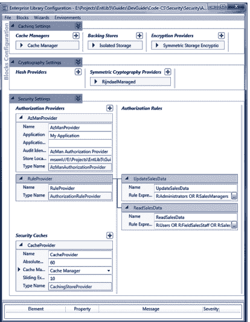

## 图 1 安全设置部分

图 1 显示了本章提供的示例应用程序的配置。您可以看到定义授权提供程序和安全缓存的区域。因为我们指定了缓存应用程序块作为安全缓存，配置工具自动将缓存块添加到了配置中。我们向缓存块添加了一个隔离存储后端存储来持久化凭据，并为该存储指定了对称存储提供程序以保护持久化的凭据。这自动将加密块添加到了配置中，我们指定了 DPAPI 对称加密提供程序来执行加密。

有关配置缓存块的更多信息，请参见第 5 章，“为您的应用程序提供缓存”。有关配置加密块的更多信息，请参见第 7 章“依赖加密复杂性”。

## 配置授权规则

配置授权规则的方式取决于您使用的授权提供程序类型。如果使用 AzMan 提供程序，必须使用 AzMan GUI、命令行或脚本来配置授权规则。如果选择使用标准授权规则提供程序，则必须为此提供程序配置授权规则。

每条规则都相当于用户可能执行的任务或操作，您希望能够授权这些用户以检查他们是否被允许执行“…该任务”。单击身份验证规则的“规则表达式”属性中的“…”按钮，打开“规则表达式编辑器”对话框，这使为您定义的每条规则生成表达式变得更加容易。它可帮助您插入适当的标记，以指示个人身份、角色和匿名用户；以及允许您指定复合规则的运算符。例如，以下表达式标识属于 Managers 角色或名为 Alice 或 Bob 的用户，但排除同时也是 ITAdmin 角色成员的任何管理器：

```
(R:Managers OR I:Alice OR I:Bob) AND NOT R:ITAdmin
```

如果为名为“更新数据库”的规则指定此表达式，可以使用安全块的 Authorize 方法来确保只有表达式计算结果为 true 的用户才能执行此任务。您将在本章后面的部分中了解如何操作。

## 如何使用安全块？

按照本章前面各节所述配置块后，您可以编写使用块功能的应用程序代码。但是，首先必须将相应的企业库程序集引用添加到项目中。除了每个企业库项目所需的企业库程序集（列于第 1 章“简介”）之外，还应引用或将以下程序集添加到 bin 文件夹：

- Microsoft.Practices.EnterpriseLibrary.Security.dll
- Microsoft.Practices.EnterpriseLibrary.Security.Cryptography.dll
- Microsoft.Practices.EnterpriseLibrary.Security.Cache.CachingStore.dll
- Microsoft.Practices.EnterpriseLibrary.Security.Caching.dll
- Microsoft.Practices.EnterpriseLibrary.Security.Caching.Cryptography.dll
- Microsoft.Practices.EnterpriseLibrary.Security.AzMan.dll

仅在使用缓存来存储凭据时才需要缓存程序集。仅在使用 AzMan 规则存储时才需要 AzMan 程序集。

现在，在将相关命名空间的引用添加到项目后，您就可以编写一些代码了。以下各节演示了您可以完成的任务，并提供了有关块如何帮助您实现常见且可重用的安全策略的更多详细信息。

## 通过示例深入了解

您可以下载一个示例应用程序（一个简单的控制台应用程序），它演示了本章剩余部分中您将看到的所有场景。您可以直接从 bin\debug 文件夹运行它，或在 Microsoft Visual Studio® 中打开名为 **安全** 的解决方案，以在运行示例时查看所有代码。

在尝试运行示例之前，必须为块创建一个新的加密密钥，以便在使用对称加密提供程序时加密数据。这是因为密钥与用户或计算机绑定，因此示例文件中包含的密钥无法在您的计算机上使用。在配置控制台中，选择 **RijndaelManager** 对称提供程序，并单击 **密钥** 属性中的“...”按钮以启动密钥向导。使用此向导生成新密钥，保存密钥文件，并自动更新 **App.config** 的内容。

还必须编辑 AzMan 身份验证提供程序的“存储位置”属性中的路径，以使其反映名为 Example.xml 的文件的位置。该文件包含在示例中，位于与主程序文件相同的文件夹中，即 [path-to-samples]\Security\Security。

在开始使用块中的对象之前，必须解析应用程序中要使用的安全缓存和授权提供程序的实例。我们提供的示例采用最简单的方法——企业库容器的 **GetInstance** 方法，如下所示。

```
' Resolve the cache and auth provider objects from the container.
Dim secCache As ISecurityCacheProvider _
    = EnterpriseLibraryContainer.Current.GetInstance(Of ISecurityCacheProvider) _
    ("CacheProvider")
Dim ruleAuth As IAuthorizationProvider _
    = EnterpriseLibraryContainer.Current.GetInstance(Of IAuthorizationProvider) _
    ("RuleProvider")
Dim azmanAuth As IAuthorizationProvider _
    = EnterpriseLibraryContainer.Current.GetInstance(Of IAuthorizationProvider) _
    ("AzManProvider")
```

## 缓存用户身份并获取临时令牌

第一个示例“身份验证用户并缓存身份”演示了如何使用安全块同时缓存经过身份验证的身份和用户主体，并返回临时令牌，这些令牌在用户会话期间充当用户凭据的替代方案。以下示例代码首先检查用户在操作系统中是否经过身份验证，如果是，则使用名为 ShowUserIdentityDetails 的单独例程显示用户身份的详细信息。我们将稍后查看该例程。

然后，代码将此 Windows 身份缓存在安全缓存中以获取令牌，并显示此令牌的详细信息。接着，它为该身份生成一个新的通用主体，将其定义为名为 FieldSalesStaff 的角色的成员，并使用另一个名为 ShowGenericPrincipalDetails 的例程显示此新主体的详细信息。同样，我们将稍后查看该例程。接下来，代码缓存通用主体，从安全缓存中收集令牌，并显示此令牌的详细信息。

```
' Get current Windows Identity and check if authenticated.
Dim identity As WindowsIdentity = WindowsIdentity.GetCurrent()
If identity.IsAuthenticated Then
    Console.WriteLine("Current user identity obtained from Windows:")
    ShowUserIdentityDetails(identity)
' Cache the Windows Identity and save the token in a variable.
identityToken = secCache.SaveIdentity(identity)
Console.WriteLine("Current user identity has been cached.")
Console.WriteLine("The identity security token is '{0}'.", _
    identityToken.Value)
Console.WriteLine()
' Generate a Generic Principal for this identity and save in cache.
Dim principal As IPrincipal = New GenericPrincipal(identity, _
    New String() {"FieldSalesStaff"})
Console.WriteLine("Created a new Generic Principal for this user.")
ShowGenericPrincipalDetails(principal)
principalToken = secCache.SavePrincipal(principal)
Console.WriteLine("Current user principal has been cached.")
Console.WriteLine("The IPrincipal security token is '{0}'.", _
    principalToken.Value)
Else
    Console.WriteLine("Current user is not authenticated.")
End If
```

这些令牌存储在程序范围的变量中，因此可供本章其他示例中的代码使用。


你还可以使用安全缓存的 **保存配置文件** 方法来存储用户的配置文件（例如用户的 ASP.NET 配置文件），并获取一个令牌，以便在需要时再次访问它。

## 显示用户身份详细信息

前面的代码使用一个名为 **显示用户身份详细信息** 的独立例程来完成此操作。它显示所有实现 **IIdentity** 接口的类型共有的两个属性的值，然后检查该身份是否实际是 **WindowsIdentity** 类的实例。如果是，代码将显示特定于此类型的其他属性的值。

```
Sub ShowUserIdentityDetails(ByVal identity As Object)
    Dim iid As IIdentity = TryCast(identity, IIdentity)
    Console.WriteLine("Current user {0} is authenticated.", iid.Name)
    Console.WriteLine("Authentication type: {0}", iid.AuthenticationType)

    If TypeOf identity Is WindowsIdentity Then
        Dim windidentity As WindowsIdentity = TryCast(identity, WindowsIdentity)
        Console.WriteLine("Impersonation level: {0}", _
            windidentity.ImpersonationLevel)
        Console.WriteLine("Is the Guest account: {0}", windidentity.IsGuest)
        Console.WriteLine("Is the system account: {0}", windidentity.IsSystem)
        Console.WriteLine("SID value: '{0}'", windidentity.User.Value)
        Console.WriteLine("Member of {0} groups.", _
            windidentity.Groups.Count)
    End If
End Sub
```

## 显示通用主体详细信息

你之前看到的代码使用一个名为 **显示通用主体详细信息** 的独立例程来显示通用主体的详细信息。它显示身份名称，然后调用 **IsInRole** 方法来检查该主体是否定义为名为 **SalesManagers** 和 **FieldSalesStaff** 的两个角色。

```
Sub ShowGenericPrincipalDetails(ByVal principal As IPrincipal)
    Console.WriteLine("Current user is {0}.", principal.Identity.Name)
    Console.WriteLine("IsInRole 'SalesManagers': {0}", _
        principal.IsInRole("SalesManagers"))
    Console.WriteLine("IsInRole 'FieldSalesStaff': {0}", _
        principal.IsInRole("FieldSalesStaff"))
End Sub
```

运行示例时，您将看到类似下面的输出。当然，身份详细信息会因您登录的帐户而异。但是，请注意，输出显示该主体仅是我们测试的两个角色中的一个成员。您还可以看到当我们缓存身份和主体时，安全缓存生成的令牌的值。

```
Current user identity obtained from Windows:
- Current user SOME-DOMAIN\username is authenticated.
- Authentication type: Kerberos.
- Impersonation level: None.
- Is the Guest account: False.
- Is the System account: False.
- SID value: 'S-1-5-21-xxxxxxxxxx-117669710-xxxxxxxx-1108'.
- Member of 12 account groups.
Current user identity has been cached.
The IIdentity security token is '02ac9a5-6dac-4b40-a82d-a16f3d9ddc37'.

Created a new Generic Principal for this user:
- Current user is SOME-DOMAIN\username.
- IsInRole 'SalesManagers': False.
- IsInRole 'FieldSalesStaff': True.
Current user principal has been cached.
The IPrincipal security token is 'ffcbc717-63ad-4a8b-82e2-26af54741ac1'.
```

## 使用令牌对用户进行身份验证

缓存身份并获取令牌后，您可以使用此令牌在整个应用程序中对用户进行身份验证。在代码的任何位置，您都可以使用该令牌来获取存储在缓存中的身份或主体。

示例“从缓存中检索用户的身份”展示了如何使用令牌检索缓存的身份。代码显示令牌的值，然后调用 GetIdentity 方法从缓存中检索匹配的身份。如果在缓存中找不到该身份，此方法将返回 Nothing。

```
' Check if the user has run the option that caches the identity and principal.
If IdentityToken IsNot Nothing Then

    ' Check if the user has been authenticated and the identity has been cached.
    Console.WriteLine("The IIdentity security token is {0}.", identityToken.Value)
    Dim identity As Object = seccache.GetIdentity(IdentityToken)
    If identity IsNot Nothing Then

        ' Identity was found in cache.
        Console.WriteLine("User identity has been retrieved from the cache.")
        ShowUserIdentityDetails(identity)

    Else

        ' Identity removed from cache due to time expiration, or explicitly in code.
        Console.WriteLine("Identity was not found in cache for the specified token.")
    End If
Else
    Console.WriteLine("You must obtain a token by caching the current " _
        & "identity before you can retrieve it.")
End If
```

您还可以使用安全缓存的 **获取配置文件** 方法，通过提供使用 **保存配置文件** 方法从安全缓存获得的合适令牌来检索用户的配置文件（例如用户的 ASP.NET 配置文件）。

该示例生成类似下面的输出，但实际值当然会因您的帐户身份而异。

```
The IIdentity security token is '02ac985-6dac-4b40-a82d-a16f3d9ddc37'.
User Identity has been retrieved from the cache:
- Current user SOME-DOMAIN\username is authenticated.
- Authentication type: Kerberos.
- Impersonation level: None.
- Is the Guest account: False.
- Is the System account: False.
- SID value: 'S-1-5-21-xxxxxxx-117609710-xxxxxxxx-1108'.
- Member of 12 account groups.
```

检索身份、主体或配置文件后，您可以将其值与当前用户的值进行比较，或使用它来为其他进程或系统对用户进行身份验证。

## 终止用户会话并使令牌过期

当用户退出应用程序，或当您希望使缓存的身份失效时，可以使用安全缓存的方法。如您所料，**使身份过期** 方法使与缓存身份对应的令牌过期，**使主体过期** 方法使与缓存主体对应的令牌过期，**使配置文件过期** 方法使与缓存用户配置文件对应的令牌过期。示例“使经过身份验证的用户过期”演示了如何使用这些方法使缓存的身份和缓存的主体过期，如下所示。

```
' Check if the user has run the option that caches the identity and principal.
If identityToken IsNot Nothing Then
    Console.WriteLine("The Identity security token is '{0}'.", _
        identityToken.Value)
End If

' Expire the identity token in the cache.
secCache.ExpireIdentity(identityToken)
Console.WriteLine("The identity for this token has been expired " _
    & "and removed from the cache.")
Console.WriteLine("The Principal security token is '{0}'.", _
    principalToken.Value)

' Expire the principal token in the cache.
secCache.ExpirePrincipal(principalToken)
Console.WriteLine("The principal for this token has been expired " _
    & "and removed from the cache.")
Else
    Console.WriteLine("You do not have a token that you can use to " _
        & "expire an identity.")
End If
```

运行此示例时，您将看到令牌在过期前的值，以及指示它们已从缓存中删除的消息。

```
The IIdentity security token is 'e303fd67-331a-45b8-94d4-088746e2cacd'.
The identity for this token has been expired and removed from the cache.

The IPrincipal security token is 'd6563752-78ed-489a-86fa-efd76c979a76'.
The principal for this token has been expired and removed from the cache.
```

## 检查用户是否有权执行任务

使用安全块来管理身份的主要原因之一是，它可以轻松检查用户是否有权执行指定的任务或操作。安全块包含两个授权提供程序，不过如果您愿意，可以创建自己的提供程序并将其与安全块集成。

要检查用户是否有权，请调用授权提供程序的 **授权** 方法，将用户主体和任务或操作的名称传递给它。**授权** 方法返回 True 或 False。块中包含的两个提供程序是授权规则提供程序和 AzMan 授权提供程序（有关这些提供程序的详细信息，请参见本章开头附近的“什么是授权规则提供程序？”）。本章介绍的示例包括一个使用授权规则提供程序的示例和一个使用 AzMan 授权提供程序的示例。

## 使用安全块配置的规则

如果您只需要将授权规则存储在应用程序的配置中，并由安全块完全管理，可以使用授权规则提供程序。如您在本章前面所见，您为应用程序配置了一系列授权规则。每个规则都定义一个表达式，用于指定哪些用户可以访问特定任务或执行特定操作。

示例“使用存储的规则为进程授权用户”演示了这种授权方法。在应用程序配置中，我们定义了两个规则：

- 名为 **更新销售数据** 的规则使用表达式“R:Administrators OR R:SalesManagers”。这允许 **管理员** 角色或 **SalesManagers** 角色的成员执行此任务。

- 名为 **读取销售数据** 的规则使用表达式“R:Users OR R:FieldSalesStaff OR R:SalesManagers”。这允许 **用户**、**FieldSalesStaff** 或 **SalesManagers** 角色的成员执行此任务。


示例代码首先显示存储在应用程序级变量中的当前主体令牌的值（在运行此示例之前，您必须先执行第一个示例来对自己进行身份验证并获取令牌）。然后它使用此令牌从安全缓存中检索主体，并调用名为 **AuthorizeUserWithRules** 的单独例程来执行授权。

**AuthorizeUserWithRules** 例程将实现 **IPrincipal** 接口的泛型主体作为参数，以及要使用的授权提供程序的引用。在此示例中，这是从 Enterprise Library 容器中解析并在示例应用程序启动时存储在名为 `ruleAuth` 的变量中的 Security 块授权规则提供程序。我们在本章前面的“深入示例”部分中展示了如何获取两种授权提供程序的实例。

```
' Check if the user has run the operation that caches the identity and principal.
If principalToken IsNot Nothing Then
    ' First try authorizing tasks using the cached Generic Principal.
    Console.WriteLine("The IPrincipal security token is '{0}'". _
        principalToken.Value)
    ' Retrieve the user principal from the security cache using the token.
    Dim principal As IPrincipal = secCache.GetPrincipal(principalToken)
    If principal IsNot Nothing Then
        ' Check if this user is authorized for tasks using the Rule Provider.
        AuthorizeUserWithRules(principal, ruleAuth)
    Else
        ' Identity removed from cache due to time expiration, or explicitly in code.
        Console.WriteLine("Principal not found in cache for the specified token.")
    End If
Else
    Console.WriteLine("You must obtain a token by caching the current identity " _
        & "before you can use it to check authorization rules.")
End If
```

以下代码显示了我们在前一个示例中使用的 **AuthorizeUserWithRules** 例程。它只是调用授权提供程序的 **Authorize** 方法——一次针对 **UpdateSalesData** 任务，一次针对 **ReadSalesData** 任务——并显示结果。

```
Sub AuthorizeUserWithRules(ByVal principal As IPrincipal, _
    ByVal authProvider As IAuthorizationProvider)
    ' Determine whether user is authorized for rule defined as "UpdateSalesData".
    Dim canUpdateSalesData As Boolean _
        = authProvider.Authorize("UpdateSalesData")
    Console.WriteLine("User can execute 'UpdateSalesData' task: {0}", _
        canUpdateSalesData)

    ' Determine whether user is authorized for rule defined as "ReadSalesData".
    Dim canReadSalesData As Boolean _
        = authProvider.Authorize("ReadSalesData")
    Console.WriteLine("User can execute 'ReadSalesData' task: {0}", _
        canReadSalesData)
End Sub
```

运行此示例时，您将看到类似于以下内容的输出。本章第一个示例中的代码（用于对用户进行授权并缓存身份和主体）将其生成的主体定义为仅属于 FieldSalesStaff 角色的成员，因此用户仅获授权执行 ReadSalesData 任务。

```
The IPrincipal security token is '77a9c8Af-9691-4ae4-ab5-0e96d4c4610e'.
User can execute 'UpdateSalesData' task: False
User can execute 'ReadSalesData' task: True
```

## 使用 AzMan 提供程序规则

第二个授权示例“使用 AzMan 规则为进程授权用户”使用 Windows 授权管理器 (AzMan) 提供程序。在示例中，我们为前一个示例中看到的相同两个任务定义了规则：UpdateSalesData 和 ReadSalesData。但是，AzMan 依赖于能够使用安全标识符 (SID) 访问 Windows 帐户详细信息，因此我们随示例提供的名为 Example.xml 的文件中的角色可能无法在您的计算机上对您进行身份验证。只有在使用本地计算机帐户或当前域登录帐户可以访问 Active Directory® 存储以获取信息时，它才能工作。您应该在 AzMan（Microsoft Management Console (MMC) 的一个 snap-in）中打开 Example.xml 文件，并编辑其中包含的规则以指定您自己的本地或域帐户，以便试验 AzMan 授权。

示例代码与您在前一个示例中使用 Security 块授权规则提供程序时看到的代码类似。它使用存储在应用程序级变量中的令牌从安全缓存中获取当前用户主体，并调用与前一个示例相同的 AuthorizeUserWithRules 方法来检查该主体是否获授权执行 UpdateSalesData 和 ReadSalesData 任务。然后，此示例为当前用户生成一个 WindowsPrincipal，并检查其是否获授权执行 UpdateSalesData 和 ReadSalesData 任务。

此示例代码的主要区别在于，它将程序启动时创建的 AzMan 授权提供程序的引用传递给 AuthorizeUserWithRules 例程，如下所示。

```
' First try authorizing tasks using the cached Generic Principal.
Dim genPrincipal As IPrincipal = secCache.GetPrincipal(principalToken)
If genPrincipal IsNot Nothing Then
    ' Check if this user is authorized for tasks using the AzMan provider.
    AuthorizeUserWithRules(genPrincipal, azmanAuth)
End If
...
```

```
' Now try checking for authorization for tasks using the cached WindowsIdentity
Dim identity As IIdentity = secCache.GetIdentity(identityToken)
If identity IsNot Nothing Then
    ' Generate a WindowsPrincipal from the IIdentity.
    Dim winPrincipal As IPrincipal = New WindowsPrincipal(TryCast(identity, _
    WindowsIdentity))
    ' Check if this user is authorized for tasks using the AzMan provider.
    ' Note: this will only work if you are using a local machine account or your
    ' current domain account can access directory store to obtain information.
    AuthorizeUserWithRules(winPrincipal, azmanAuth)
End If
...
```

运行此示例后，在配置 AzMan 规则以适应您自己的计算机和帐户后，您应该能够看到类似于此处所示的结果。

```
The IPrincipal security token is '77a9Cbaf-9691-4e4b-ab5b-0e964dc461e0'.
User can execute 'UpdateSalesData' task: False
User can execute 'ReadSalesData' task: True
The IIdentity security token is 'b6eb4af7-b958-4cc2-b2b9-112cd58c566d'.
User can execute 'UpdateSalesData' task: False
User can execute 'ReadSalesData' task: True
```

## 创建自定义授权提供程序

尽管 Security 应用程序块仅包含两个授权提供程序和两个缓存提供程序，但如果没有一个完全适合您自己的场景，您可以轻松扩展它以添加新提供程序。该块包含一个名为 AuthorizationProvider 的基类，您可以从中继承并扩展以执行自定义授权。您只需实现 Authorize 方法，然后将新提供程序与 Enterprise Library 集成即可。您还可以实现自定义缓存管理器和缓存后端存储，并将这些与 Caching 应用程序块集成，以提供凭据的自定义缓存机制，并为 Cryptography 应用程序块实现自定义加密提供程序，然后可使用它来加密缓存的凭据。有关创建自定义提供程序、缓存管理器和后端存储的更多信息，请参阅在线文档以及随 Enterprise Library 安装并在线提供的帮助文件，网址为 http://go.microsoft.com/fwlink/?LinkId=188874。

### 摘要

本章描述了如何使用 Security 应用程序块来简化常见任务，例如缓存经过身份验证的用户凭据以及检查用户是否获授权执行特定任务。虽然不使用 Security 块来实现这些任务所需的代码并不过分繁琐，但该块确实省去了您在多个位置编写和测试相同代码的工作。它还允许您根据要求使用各种不同的缓存和授权提供程序，并通过配置更改提供程序。管理员和操作员在将应用程序部署到不同环境时会发现此功能很有用。

本章描述了使用 Security 块的场景，并解释了授权用户和缓存凭据的概念。然后，它介绍了如何在示例应用程序中使用该块的功能的详细示例。有关特定任务（例如配置和部署）的更多详细信息，请参阅在线文档以及随 Enterprise Library 安装的帮助文件。


## 什么是依赖注入？

现代业务应用程序由自定义业务对象和组件组成，这些对象和组件在应用程序中执行特定或通用任务，此外还有分别处理日志记录、身份验证、授权、缓存和异常处理等横切关注点的组件。成功构建这类应用程序的关键是实现解耦或非常松散耦合的设计。松散耦合的应用程序更加灵活，也更易于维护。它们在开发期间也更易于测试。

依赖注入（DI）是构建松散耦合应用程序的主要技术。它提供了简化代码、抽象和处理对象之间依赖关系以及自动生成依赖对象实例的机会。依赖注入描述了设计应用程序的过程，即在设计时不在应用程序中指定具体依赖并在代码中创建所需对象，而是让应用程序在运行时决定它需要哪些对象，并将这些对象生成并注入到应用程序中。

- 使用依赖注入可带来多种好处，包括：
  - **降低类之间的耦合。** 依赖关系在每个类中都有明确定义。配置信息以及接口或基类与实际具体类型之间的映射存储在依赖注入机制使用的容器中，并可根据需要进行更新——而无需对运行时代码进行任何更改。
  - **使代码更易于发现。** 您可以轻松从类的构造函数、属性或方法的类型中了解它们使用哪些对象以及具有哪些依赖关系。如果在类内部使用代码创建实例，则更难以追踪依赖关系。通过指定类所需的类型或接口并在类的公开接口处解析依赖关系，并利用依赖注入，是推荐的方法。
  - **使测试更加容易。** 如果在类内部使用代码解析或获取对象，则必须在单元测试这些类时提供适当配置的容器。如果利用依赖注入，可以为类创建简单的模拟测试对象供其使用。

## Unity 依赖注入和拦截机制

Unity 是一个轻量级、灵活、可配置且可扩展的依赖注入容器，支持构造函数、属性设置器和方法调用注入（以及实例和类型拦截）。它作为 Enterprise Library 的组成部分提供，也可作为独立的 DI 机制使用。Unity 提供了一整套功能，并使在应用程序架构、设计和开发中实现常见的依赖反转模式和技术变得容易。

Unity 提供了一个用于存储映射和注册的容器。您可以创建多个容器，并在需要时以层级方式嵌套这些容器。它还支持扩展，允许您为通过容器解析的对象实现额外功能。Unity 可以生成任何具有公共构造函数的对象的实例（换句话说，即您可以使用 New 运算符创建的对象）。

当 Unity 创建每个对象时，它会检查其依赖关系并自动填充这些依赖。例如，如果您将自定义类的构造函数参数或依赖属性指定为 MyBusinessComponent 类型，Unity 将创建 MyBusinessComponent 的实例并填充构造函数或属性。但是，如果 MyBusinessComponent 定义了对名为 MyDataComponent 的另一个类的依赖，Unity 将创建该类的实例并填充该依赖，以此类推。如果容器中没有参数或属性中指定类型的映射，Unity 只需通过调用该类型中参数数量最多的构造函数来创建指定类型的新实例，并返回它。

假设 MyDataComponent 需要一个 LogWriter 来创建日志消息。如果它包含类型为 LogWriter 的依赖参数或属性，Unity 也会将其作为实例化过程的一部分进行传播。此过程（有时称为自动装配）可以应用于应用程序中定义的所有依赖关系，如图 1 所示。

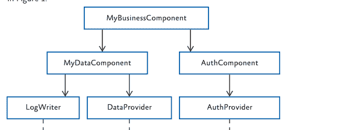

图 1
业务组件的一个可能对象图

## Unity 功能摘要

Unity 不仅仅是一个简单的依赖注入容器。它提供了高级功能，可让您满足广泛的需求，这些需求有助于构建更松散耦合的应用程序。Unity 允许您：

- **在接口或基类与具体对象类型之间注册映射。** 解析接口或基类型时，Unity 将返回具体类型的实例。这可能是新实例或现有实例，具体取决于您为注册指定的生存期。

- **在容器中注册现有对象的实例。** 解析类型时，Unity 将返回该类型的实例。在处理必须作为单实例（单例）实例化的对象，或必须具有非标准生存期（例如应用程序使用的服务）的对象时，这很有用。Unity 将返回现有实例。

- **指定通过容器解析的对象的生存期。** Unity 可以基于单例模式解析对象；或者在对象由另一个进程管理时使用弱引用。它还可以配置为按线程返回实例，即为每个线程创建新实例，而对同一线程的调用则返回现有实例。

- **为类型定义多个命名注册。** 只要这些注册和映射具有唯一名称，就可以为类型创建多个注册或映射。没有名称的注册和映射称为默认注册和默认映射，其中名称实际上是空字符串。

- **为将在运行时解析的应用程序构建完整的对象图。** Unity 可以在运行时自动解析构造函数和方法参数及属性中指定的类型。通过容器解析的对象的构造函数或方法参数，或通过容器解析的对象的属性值，可以使用容器中另一个注册解析的对象进行填充，或者如果不存在匹配的注册，则使用指定类型的实例。

- **指定构造函数和方法参数及属性的值。** 这些可以是通过容器解析的对象的构造函数或方法参数，或通过容器解析的对象的属性值。值可以直接指定，也可以是容器中另一个注册解析的对象。

- **作为拦截策略的一部分定义匹配规则和行为。** 这些可用于应用业务规则或更改现有组件的行为。然后，对这些对象的方法或属性的调用将通过包含一个或多个拦截行为的策略管道。这与面向切面编程（AOP）中使用的方法类似。

- **向容器添加自定义扩展。** 这些扩展可以在解析对象时扩展或更改容器的行为。Unity 的某些功能（例如拦截）由标准 Unity 安装中包含的容器扩展提供支持。

## 使用 Unity 定义依赖关系

Unity 提供了三种方式来为每个自定义类型定义依赖关系：

- 您可以使用配置文件定义所有依赖注入和拦截需求。在运行时，使用一行代码读取配置并将其加载到 Unity 容器中。

- 您可以使用容器的方法在代码中注册类型、类型映射、参数和属性值以及拦截需求。您还可以使用这些方法在运行时修改容器中任何现有的注册。

- 您可以应用特性来为将通过容器解析的类型的构造函数和方法参数及属性定义依赖关系。这是一种简单的方法，但不提供与使用配置文件或运行时容器 API 相同级别的控制。

您还可以混合使用所有这些技术；例如，您可以在容器中注册接口与具体实现之间的映射，然后使用特性来为该接口的实现上的属性或参数定义依赖关系。

表 1 将帮助您为自己的需求选择最佳方法。

### 表 1 定义依赖关系

| 技术 | 描述 | 注意事项 |
|---|---|---|
| 基于配置 | 使用从文件或其他配置源加载到容器中的注册和映射来定义依赖关系。 | 使更改注册和依赖映射变得容易；通常只需编辑配置文件即可。但是，类的用户在源代码中看不到依赖关系。这种方法灵活，允许对解析类型实例、固定值和数组的注入进行全面配置。 |
| 动态注册 | 使用代码在运行时动态生成注册和映射，在容器中定义依赖关系。 | 更改注册和依赖映射需要编辑代码，但通常仅在启动文件的一个位置进行。但是，类的用户在源代码中看不到依赖关系。这种方法灵活，允许对解析类型实例、固定值和数组的注入进行全面配置。 |
| 基于特性 | 使用应用于类中参数和属性的特性来定义依赖关系。 | 使依赖关系在类的源代码中显而易见且易于查看，但在需要更改依赖关系时需要编辑源代码。与其他方法相比，这种方法也更不灵活、不全面。 |


此外，您可以通过多种方式更改依赖项解析机制的行为：

- 您可以指定参数重写或依赖项重写，以设置特定参数的值。
- 您可以定义可选依赖项，以便在 Unity 无法解析依赖项类型时，将参数或属性的值设置为 **空**。
- 您可以使用延迟解析，以便在目标类型在代码中实际需要或使用之前不执行解析。
- 您可以指定生存期管理器，以控制解析类型的生存期。

本附录的以下部分介绍了一些通过构造函数、属性和方法调用注入在类中定义依赖项的更常见技术。本附录不讨论拦截。有关 Unity 的所有功能和用途的完整详细信息，请参阅随 Enterprise Library 安装的文档中可在线查阅的 Unity 部分，网址为 http://go.microsoft.com/fwlink/?LinkId=188875。

## 构造函数注入

默认情况下，当您通过容器解析类型时，Unity 会尝试解析并填充类构造函数中每个参数的类型。您无需为类配置或添加特性即可实现此操作。Unity 会选择最复杂的构造函数（通常是参数数量最多的构造函数），通过容器解析每个参数的类型，然后使用解析后的值创建目标类型的新实例。

以下是一些简单示例，演示如何为类型定义构造函数注入。

### 自动构造函数注入

如果类包含非默认构造函数，Unity 会自动填充构造函数参数中定义的任何依赖项。例如，以下类型依赖于名为 **数据库** 的类型。

```
Public Class MyNewObject
    Public Sub New(defaultDB As Database)
        ' code to use the resolved Database instance here
    End Sub
End Class
```

如果您需要更改自动构造函数注入过程的行为（例如，指定解析类型的生存期，或设置为参数解析的类型的值或生存期），可以在设计时使用配置文件配置容器，或在运行时使用容器 API。

### 设计时配置

当您需要控制该过程时，在配置文件中配置构造函数注入非常有用。例如，请考虑包含单个构造函数（该构造函数接受两个参数）的以下类。

```
Public Class MyNewObject
    Public Sub New(defaultDB As Database, departmentName As String)
        ...
    End Sub
End Class
```

第二个参数是字符串，除非您使用命名实例注册在容器中注册了它，否则 Unity 无法生成 String 类型的实例。因此，您必须重写自动注入过程的默认行为。您可以在配置文件中执行此操作，同时管理注入过程的三个方面：解析对象的生存期、参数的值，以及当类型包含多个构造函数时构造函数的选择。

例如，您可以在配置文件中使用以下 register 指令，指定解析的 MyNewObject 实例应为单例（其生存期由容器管理），Unity 应解析名为 defaultDB 的参数的类型 Database 并注入结果，并且 Unity 应将字符串值“Customer Service”注入到名为 departmentName 的参数中。

```
<register type="MyNewObject">
    <lifetime type="singleton" />
    <constructor>
        <param name="defaultDB" />
        <param name="departmentName" value="Customer Service" />
    </constructor>
</register>
```

以这种方式指定构造函数注入时，您也在指定 Unity 应使用哪个构造函数。即使 MyNewObject 类包含更复杂的构造函数，Unity 也将使用与您在 register 元素中指定的参数列表匹配的构造函数。

要使用命名注册注册类型，只需向 register 元素添加 name 特性，如下所示。

```
<register type="MyNewObject" name="Special Customer Object">
    ...
</register>
```

要在接口或基类与实现该接口或继承该基类的类型之间注册映射，请向 register 元素添加 mapTo 特性。当然，您可以以与类型注册相同的方式定义默认（未命名）和命名映射。以下示例显示命名映射的注册。

```
<register type="IMyType" mapTo="MyImplementingType"
...
name="Special Customer Object">
</register>
```

### 运行时配置

您可以通过调用 Unity 容器的 RegisterType 方法在运行时为默认或特定构造函数配置注入。这种方法也为您提供了对该过程的大量控制。以下代码将 MyNewObject 类型注册为单例（由容器控制的生存期）。

```
myContainer.RegisterType(Of MyNewObject)(New ContainerControlledLifetimeManager())
```

如果您想创建命名注册，请将名称作为 RegisterType 方法的第一个参数添加，如下所示。

```
myContainer.RegisterType(Of MyNewObject)("Special Customer Object", _
New ContainerControlledLifetimeManager()))
```

如果您想创建映射，请将映射类型指定为第二个泛型类型参数，如下所示。

```
myContainer.RegisterType(Of IMyType, MyImplementingType)( _
"Special Customer Object", _
New ContainerControlledLifetimeManager()))
```

如果您需要指定构造函数参数的值（例如 String 类型，除非您在容器中注册 String 实例，否则 Unity 无法创建它），或指定 Unity 应选择哪个构造函数，请在对 RegisterType 方法的调用中包含 InjectionConstructor 类型的实例。例如，以下代码为 MyNewObject 类型创建名为 Special Customer Object 的注册（作为单例），指定 Unity 应解析名为 defaultDB 的参数的类型并注入结果，并且 Unity 应将字符串值“Customer Service”注入到名为 departmentName 的参数中。

```
myContainer.RegisterType(Of MyNewObject)( _
"Special Customer Object", _
New ContainerControlledLifetimeManager(), _
New InjectionConstructor(GetType(Database), "Customer Service") _
)
```

### 特性配置

如前所示，当您在构造函数参数中仅指定类型时，容器将返回容器内注册中定义的该类型的默认具体实现。要在使用构造函数注入时指定命名注册，可以将 Dependency 特性添加到参数定义中，如下所示。

```
Public Class MyNewObject
    Public Sub New(<Dependency("CustomerDB")> customers As Database)
        ' code to use the resolved Database instance here
    End Sub
End Class
```

如果您的类有多个构造函数，并且要指定 Unity 将使用的构造函数，请将 InjectionConstructor 特性应用于该构造函数，如以下代码片段所示。如果您不指定要使用的构造函数，Unity 将选择最复杂的构造函数（通常是参数最多的构造函数）。如果最复杂的构造函数具有 Unity 无法解析的参数，此技术非常有用。

```
Public Class MyNewObject
    Public Sub New(defaultDB As Database, departmentName As String)
        ...
    End Sub
    <InjectionConstructor> _
    Public Sub New(defaultDB As Database)
        ...
    End Sub
End Class
```

## 属性（设置器）注入

属性（设置器）注入可以在运行时填充自定义类的一个或多个属性。与构造函数注入不同，属性注入不会默认发生。您必须使用配置文件、在运行时以编程方式指定依赖项，或将特性应用于持有依赖类型的属性。

### 设计时配置

要使用配置文件定义属性注入，只需在 register 元素中指定 Unity 应填充的属性名称即可。如果您希望 Unity 解析属性指定的类型，则只需做到此步即可。如果您想指定值，可以在 property 元素中包含该值。如果您希望 Unity 使用容器中的命名注册来解析类型，请在 property 元素中包含 dependencyName 特性。最后，如果您想解析与属性名称兼容的类型（例如，解析已在容器中注册命名映射的接口类型），请使用 dependencyType 特性指定要解析的类型。

配置文件中的以下摘录为名为 MyOtherObject 的类型的三个公共属性指定了依赖项注入。Unity 将通过容器解析 MyOtherObject 类型的 BusinessComponent 属性定义的任何类型，并将结果注入到该属性中。它还将注入字符串


将值 "CorpData42" 注入名为 DataSource 的属性，并使用名为 StdLogger 的映射方法解析类型 ILogger，并将结果注入 Logger 属性。

```
<register type="MyOtherObject">
    <property name="BusinessComponent" />
    <property name="DataSource" value="CorpData42" />
    <property name="Logger" dependencyName="StdLogger" dependencyType="ILogger" />
</register>
```

## 运行时配置

你可以在运行时通过调用 Unity 容器的 RegisterType 方法，为目标类的任何公共属性配置注入。这使你对该过程有很大的控制权。以下代码执行与你刚才看到的配置文件示例相同的依赖注入过程。请注意使用 ResolvedParameter 类型来指定 Unity 应使用的命名映射，以解析 ILogger 接口。

```
myContainer.RegisterType(Of MyOtherObject)(
    New InjectionProperty("BusinessComponent"), _
    New InjectionProperty("DataSource", "CorpData42"), _
    New InjectionProperty("Logger", _
        New ResolvedParameter(GetType(ILogger), "StdLogger") _
    )
)
```

你也可以在构造函数和方法调用注入以及属性注入中使用 ResolvedParameter 类型，并且在配置注入时，还有其他类型的注入参数类可用于更专业的任务。

## 使用特性进行配置

若要为属性指定注入，你可以将 Dependency 特性应用于该属性，以指示该属性定义并公开的类型是类的依赖项。以下代码演示了名为 MyNewObject 的类的属性注入，该类将类型 Database 的实例引用作为属性公开。

```
Public Class MyNewObject

    Private theDB As Database

    <Dependency> _
    Public Property CustomerDB() As Database
        Get
            Return theDB
        End Get
        Set(ByVal value As Database)
            theDB = value
        End Set
    End Property
End Class
```

当你应用 **依赖** 特性而不指定名称时，容器将返回指定的默认类型（未注册的注册）或该类型的新实例。在使用特性进行属性注入时，若要指定命名注册，请将名称作为 **依赖** 特性的参数，如下所示。

```
Public Class MyNewObject

    Private theDB As Database

    <Dependency("LocalDB")> _
    Public Property NamedDB() As Database
        Get
            Return theDB
        End Get
        Set(ByVal value As Database)
            theDB = value
        End Set
    End Property

End Class
```

## 方法调用注入

方法调用注入比构造函数和属性设置器注入少见，但在两种特定情况下很有用。首先，构造函数注入仅在实例化对象新实例时（执行构造函数时）有效，而方法调用注入适用于对象的现有实例。例如，当 Unity 解析注册为单例的实例，或当你调用容器的 **BuildUp** 方法时，它将执行该方法。

其次，虽然属性设置器注入也适用于现有实例，但它要求公开公共属性。使用方法调用注入意味着你不需要公开公共属性，即可将值注入已解析类型的现有实例中。

通常的做法是公开一个公共初始化方法，将要解析并获取其引用的对象作为参数。Unity 将填充参数，然后调用该方法。在方法执行过程中，你将解析的类型存储在类的局部变量中。

方法调用注入默认不会发生，必须通过配置文件、在运行时以编程方式配置，或向方法应用特性来进行配置。

## 设计时配置

为方法参数指定依赖注入的技术与你之前看到的构造函数参数非常相似。以下配置文件摘录定义了名为 MyNewObject 的类型中名为 Initialize 的方法的两个参数的依赖项。Unity 将通过容器解析名为 customerDB 的参数的类型，并将结果注入目标对象的该参数中。它还将字符串值“Customer Services”注入名为 departmentName 的参数中。

```
<register type="MyNewObject">
    <method name="Initialize">
        <param name="customerDB" />
        <param name="departmentName" value="Customer Services" />
    </method>
</register>
```

你也可以使用 dependencyName 和 dependencyType 特性，以与属性注入时完全相同的方式指定 Unity 应如何解析参数的类型。如果你的类中有多个方法重载，Unity 将使用你在配置中定义的参数集来确定要填充和执行的实际方法。

## 运行时配置

与构造函数和属性注入一样，你可以在运行时通过调用 Unity 容器的 RegisterType 方法，为目标类的任何公共方法配置注入。以下代码实现与你刚才看到的配置摘录相同的结果。

```
myContainer.RegisterType(Of MyNewObject)(
    New InjectionMethod("Initialize", GetType(Database), "CustomerServices") _
)
```

此外，你可以以与构造函数注入时完全相同的方式指定类型的生存期，并使用命名依赖项。

## 使用特性进行配置

你可以将 InjectionMethod 特性应用于方法，以指示方法参数中定义的任何类型都是类的依赖项。以下代码演示了最常见的场景：为名为 MyNewObject 的类将依赖对象实例保存在类级别变量中，该类公开一个名为 Initialize 的方法，该方法以类型 Database 的实例和实现 ILogger 接口的具体类型的实例作为参数。

```
Public Class MyNewObject
    Private theDB As Database
    Private theLogger As ILogger

    <InjectionMethod()> _
    Public Sub Initialize(customerDB As Database, loggingComponent As ILogger)
        ' assign the dependent objects to class-level variables
        theDB = customerDB
        theLogger = loggingComponent
    End Sub
End Class
```

你还可以将 **依赖** 特性添加到参数，以指定 Unity 应使用的注册名称来解析参数类型，这与你之前看到的使用特性的构造函数注入相同。并且，与构造函数注入一样，方法的所有参数都必须能通过容器解析。如果其中任何参数是 Unity 无法创建的值类型，你必须确保为该类型在容器中有合适的注册，或使用依赖项重写来设置值。

## 更多依赖注入机会

除了我们在此处展示的定义依赖项的技术之外，Unity 还允许你将要解析的类型及其依赖项指定为泛型类型。你还可以指定任何类型（包括泛型类型）的数组作为依赖项。你甚至可以让 Unity 自动解析数组的所有成员，或自己指定数组的各个成员。

## 解析类的填充实例

在定义对象图依赖项后，你必须通过容器解析此层次结构根节点的类型，以启动依赖注入过程。在 Unity 中，你使用 **解析** 方法启动该过程，指定你希望 Unity 填充其依赖项的对象类型。以下代码从容器中解析 **MyNewObject** 类型的填充实例。

```
Dim theInstance As MyNewObject = container.Resolve(Of MyNewObject)()
```

这将返回注册为默认类型的实例（注册时未指定名称）。如果你想解析带有名称注册的类型，请将此名称作为 **解析** 方法的参数指定。你还可以考虑使用隐式类型而不是指定类型，以使你的代码较少依赖于解析过程的结果。

```
Dim theInstance = container.Resolve(Of MyNewObject)("Registration Name")
```

或者，在解析映射类型时，你可以选择将返回类型定义为接口类型。例如，如果你在接口 **IMyType** 和具体类型 **MyNewObject** 之间注册了类型映射，则在解析时应考虑使用以下代码。


```
Dim theInstance As MyType = container.Resolve(Of MyType)()
```

编写指定接口而非特定具体类型的代码意味着，您可以更改配置以指定不同的具体类型，而无需更改代码。Unity 始终会返回一个具体类型（除非它无法解析您指定的接口或抽象类型；在这种情况下，将引发异常）。

您还可以通过调用 **解析所有** 方法来解析使用命名映射（而非默认无名称映射）注册的类型集合。如果您想要检查运行时代码中注册了哪些类型，或显示可用类型列表，这可能很有用。不过，Unity 也公开了允许您遍历容器并获取所有注册信息的方法。

此处无法提供关于使用 Unity 的完整指南。不过，本讨论应该已让您了解使用依赖注入可以实现什么。有关使用 Unity 的更详细信息，请参阅随企业库安装的文档，并在线访问 http://go.microsoft.com/fwlink/?LinkId=188874。

本附录讨论了一些更高级的主题，这些主题将帮助您在创建对象和管理依赖注入容器方面从企业库中获得最大收益。它包括以下内容：

- 将配置信息加载到 Unity 容器中
- 查看容器中的注册
- 在应用程序启动时填充整个对象图
- 在基于请求的应用程序中保持对容器的引用
- 使用备用服务定位器或依赖注入容器

这些主题提供了有关如何使用更复杂的依赖注入方法来创建企业库对象实例的信息（如第 1 章“简介”中所述）。如果您决定不使用此方法，并且正在使用企业库服务定位器及其 **获取实例** 方法来实例化企业库类型，则它们不适用于您的场景。

## 将配置信息加载到 Unity 容器中

与许多应用程序以及企业库中的应用程序块不同，Unity 在启动时不会自动加载配置信息。这是故意为之；这意味着您可以将配置信息加载到一个或多个新容器或现有容器中，包括您作为父子容器层次结构创建的容器。

这也意味着您可以对类型请求的处理方式进行相当大的控制。例如，您可以使用多个容器为应用程序的不同部分指定依赖项，同时允许无法在子容器中满足的请求通过父容器层次结构向上传递，直到找到合适的注册。

这也意味着您可以从不同来源加载配置信息。典型示例是从 App.config 或 Web.config 以外的文件加载配置，或通过以编程方式添加注册（例如，从数据库读取它们并将其应用到容器）。

Unity 容器类公开了 **加载配置** 方法，您可以使用该方法填充容器。您可以不带参数调用此方法，以从当前应用程序配置文件（App.config 或 Web.config）中读取 <unity> 节，如本指南第 1 章中所示。或者，您可以向该方法提供包含配置信息的 UnityConfigurationSection 实例。以下代码使用 Microsoft® .NET Framework 配置系统的方法打开配置文件，将其转换为 UnityConfigurationSection 类型，并将名为 MyContainerName 的 <container> 节中的注册加载到新的 Unity 容器中。

```
' Read a specified config file using the .NET configuration system.
Dim map As New ExeConfigurationFileMap()
map.ExeConfigurationFilename = "c:\\configfiles\\myunityconfig.config"
Dim config As System.Configuration.Configuration = _
    ConfigurationManager.OpenMappedExeConfiguration(map, _
    ConfigurationUserLevel.None)

' Get the unity configuration section.
Dim section As UnityConfigurationSection = _
    DirectCast(config.GetSection("unity"), UnityConfigurationSection)

' Create and populate a new UnityContainer with the configuration information.
Dim theContainer As IUnityContainer = New UnityContainer()
theContainer.LoadConfiguration(section, "MyContainerName")
```

您可以在配置文件的 <unity> 节中定义多个容器，前提是每个容器都有唯一名称，并在运行时将每个容器加载到单独的容器中。如果您未在配置文件中为容器分配名称，则它将成为默认容器，您可以通过在 **加载配置** 方法中省略名称参数来加载它。

若要以这种方式以编程方式加载容器，必须将 System.Configuration.dll 程序集和 Microsoft.Practices.Unity.Configuration.dll 程序集添加到项目中。还应导入以下命名空间：

- Microsoft.Practices.EnterpriseLibrary.Common.Configuration.Unity
- Microsoft.Practices.Unity

## 查看容器中的注册

有时您可能会发现应用程序引发错误，指示它无法解析特定类型。Unity 返回的错误消息很详细，应该能帮助您快速找到问题。不过，您可能会发现能够浏览容器内容以查看其包含的注册和映射很有用。

Unity 容器公开了 Registrations 属性，该属性返回一组 ContainerRegistration 实例，容器中的每个注册或类型映射对应一个实例。以下示例代码展示了如何提取每个注册的详细信息：已注册的类型、它映射到的类型（如果有）、注册的名称（如果不是默认注册）以及生存期管理器类型。

```vb.net
For Each item As ContainerRegistration In theContainer.Registrations
    regType = item.RegisteredType.Name
    mapType = item.MappedToType.Name
    regName = If(item.Name, "[default]")
    lifetime = item.LifetimeManagerType.Name
    If mapType <> regType Then
        mapTo = " -> " & mapTo
    Else
        mapTo = String.Empty
    End If
    lifetime = lifetime.Substring(0, lifetime.Length - "LifetimeManager".Length)
    ' Display details of the registration as appropriate.
Next
```

## 在应用程序启动时填充整个对象图

在使用配置信息（包括企业库信息以及您自己的自定义类型的注册和映射）填充容器后，您可以通过依赖注入解析这些自定义类型，并填充其所有依赖项。您可以通过三种方式定义依赖项：

- 作为目标类中构造函数的一个或多个参数。Unity 将创建适当类型的实例，并在实例化目标对象时填充构造函数参数。这是您通常会使用的方法。例如，您可以让 Unity 自动创建并向构造函数传递 LogWriter 或 ExceptionManager 的实例，将引用存储在类变量或字段中，并在该类中使用它。
- 作为目标类的一个或多个属性。Unity 将创建属性或配置中定义的类型的实例，并在通过容器解析类时将该实例设置为属性的值。
- 作为目标类中方法的一个或多个参数。Unity 将创建适当类型的实例，并在实例化目标对象时填充方法参数，然后调用该方法。您可以将参数中传递的引用存储在类变量或字段中，以便在该类中使用。当您有一个应在实例化类时执行的 Initialize 或类似方法时，通常会使用此方法。

通过利用填充整个对象图的功能，您可以决定让容器在应用程序启动时（或至少在其很大一部分时）创建并注入整个应用程序中定义的所有依赖项的适当类型的实例。

虽然这可能是一个奇怪的概念，但这意味着在执行此初始依赖项填充后，您不需要保留对容器的引用。这并不意味着您不能同时保留对容器的引用，但解析所有的


在启动时加载所需类型可以提高运行时性能，代价是启动时间略微增加。当然，这还需要额外的内存和资源来保存所有已解析的实例，你需要将此与预期的运行时性能改进进行权衡。

你可以通过容器解析主窗体或启动类来填充所有依赖项。容器将自动创建每个类所需对象的适当实例，并将其注入到参数和属性中。但是，这依赖于容器能够创建并返回未在容器中注册的类型的实例。Unity 容器可以做到这一点。如果你使用备用容器，可能需要预先注册应用程序中的所有类型，包括主窗体或启动类。

通常，这种填充整个应用程序对象图的方法最适合使用基于窗体或基于窗口的技术构建的应用程序，例如 Microsoft® Presentation Foundation (WPF)、Windows 窗体、控制台应用程序和 Microsoft Silverlight®（使用专为 Silverlight 应用程序设计的 Unity 版本）。

有关如何解析应用程序的主窗体、窗口或启动类以及示例代码的信息，请参阅随 Enterprise Library 安装的文档或在线提供的文档 http://go.microsoft.com/fwlink/?LinkId=188874。

## 在基于请求的应用程序中维护容器引用

将 Enterprise Library 与默认 Unity DI 机制配合使用时，你只需在应用程序中初始化一次容器，然后使用它来解析（或获取）Enterprise Library 对象或你自己的类和对象的实例。初始化容器只需以下一行代码。

```
' Create and populate the default container with application configuration.
Dim container = New UnityContainer() _
.AddNewExtension(Of EnterpriseLibraryCoreExtension)()
```

但是，要在整个应用程序中使用容器来解析类型，你必须保留对它的引用。你可以将容器存储在 Windows 窗体或 WPF 应用程序的全局变量中，ASP.NET 应用程序的 **Application** 字典中，或 Windows Communication Foundation (WCF) 服务的 **InstanceContext** 的自定义扩展中。

表 1 将帮助你了解在使用 Windows 窗体、WPF 和 Silverlight 等技术构建的基于窗体和富客户端应用程序中，何时以及在哪里应保留对容器的引用。

### 表 1 在基于窗体和富客户端应用程序中保留对容器的引用

| 任务 | 何时 | 在哪里 |
| :--- | :--- | :--- |
| 创建和配置容器。 | 应用程序启动时。 | 主例程、启动事件、应用程序定义文件或技术适用的位置。 |
| 从容器获取对象。 | 应用程序启动时，以及以后如果需要。 | 代码中适当的位置。 |
| 存储对容器的引用。 | 应用程序启动时。 | 全局应用程序状态。 |
| 释放容器。 | 应用程序关闭时。 | 代码中适当的位置，或在应用程序结束时自动释放。 |

表 2 将帮助你了解在使用 ASP.NET Web 应用程序和 Web 服务等技术构建的基于请求的应用程序中，何时以及在哪里应保留对容器的引用。

### 表 2 在基于请求的应用程序中保留对容器的引用

| 任务 | 何时 | 在哪里 |
| :--- | :--- | :--- |
| 创建和配置容器。 | 应用程序启动时。 | HTTP 模块 (ASP.NET 和 ASMX)、InstanceContext 扩展 (WCF)。 |
| 从容器获取对象。 | 每个 HTTP 请求期间。 | 在请求启动事件或加载事件中。请求结束时会释放对象。 |
| 存储对容器的引用。 | 应用程序启动时。 | 全局应用程序状态或服务上下文。 |
| 释放容器。 | 应用程序关闭时。 | 代码中适当的位置。 |

有关如何在不同类型的应用程序中（特别是基于请求的应用程序）维护对容器的引用以及可用于实现此目的的代码的更多详细信息，请参阅随 Enterprise Library 安装的文档或在线提供的文档 http://go.microsoft.com/fwlink/?LinkId=188874。

## 使用备用服务定位器或容器

Enterprise Library 默认使用 Unity 依赖注入机制来创建 Enterprise Library 对象的实例。如果你已经在应用程序中使用或计划使用其他依赖注入容器，则可能可以使用它来创建 Enterprise Library 对象，而不使用 Unity。

要实现此目的，你可以获取或编写自己的配置器，该配置器可以使用你指定的 Enterprise Library 配置信息加载容器，或者创建实现 **IServiceLocator** 接口并能公开配置信息的类型。

Enterprise Library 的默认行为是创建一个新的 Unity 容器，为容器创建一个新的配置器，然后从应用程序的默认配置文件 (App.config 或 Web.config) 读取配置信息。以下代码段显示了发生的过程。

```vb
Dim container = New UnityContainer()
Dim configurator = New UnityContainerConfigurator(container)

' Read the configuration files and set up the container.
EnterpriseLibraryContainer.ConfigureContainer(container, _
    ConfigurationSourceFactory.Create())

' The container is now ready to resolve Enterprise Library objects
```

配置器的任务是将配置文件信息转换为容器中的一系列注册。Enterprise Library 仅包含 **UnityContainerConfigurator**，不过你可以编写自己的配置器以适合所选容器，或从第三方获取一个。

另一种方法是创建 **IServiceLocator** 接口的自定义实现，该实现可能不使用配置器，但可以读取应用程序配置并按需返回适当的完全填充的 Enterprise Library 对象。

有关 **IServiceLocator** 接口的更多信息，请参阅 http://commonservicelocator.codeplex.com。

要了解有关 Enterprise Library 备用配置选项的讨论，请参阅 CodePlex 上的论坛 http://www.codeplex.com/entlib/Thread/List.aspx。

策略注入描述了一种在客户端和客户端使用的对象之间插入代码的方法，以更改目标对象的行为，而无需更改该对象或客户端。这种技术的一般设计模式称为拦截，并通过面向切面编程 (AOP) 范式而变得流行。

自版本 3.0 起，拦截一直是 Enterprise Library 的一项功能。在 Enterprise Library 的早期版本中，启用拦截的方式是通过策略注入应用程序块，该块公开了静态门面，你可以使用它们来创建目标对象的包装实例以及客户端可用于访问该目标对象的适当代理。

该块还包含一系列插入到拦截管道（位于客户端和目标对象之间）的调用处理程序。版本 5.0 中包含与 Enterprise Library 早期版本中使用的相同的一组调用处理程序，但它们不再位于策略注入块中（该块主要用于与现有应用程序的向后兼容性）。

在 Enterprise Library 5.0 版本中，实现策略注入的推荐方法是通过 Unity 拦截机制。这支持多种不同的拦截实现技术，包括创建派生类而不是远程代理，并且对应用程序性能的影响要小得多。

你与 Unity 拦截机制一起使用的调用处理程序可以实例化应用程序块，使你能够应用块的功能来管理目标对象的横切关注点。通过 Unity 和 Enterprise Library 提供的拦截和策略注入功能，你可以：

- 通过使用验证处理程序添加验证功能。此调用处理程序使用验证块来验证传递给目标对象的参数中的值。这是一种绕过验证块局限性的有用方法，验证块除特定方案（例如 Windows® Communication Foundation (WCF) 应用程序）外，无法验证方法调用的参数。
- 通过使用日志处理程序为对象添加日志功能。此调用处理程序使用日志块生成日志条目并将其写入配置的目标源。


- 使用异常处理处理程序添加异常处理功能。
    此调用处理程序使用异常处理块来实施一致的策略，用于处理、替换、包装和记录异常。
- 使用授权处理程序向对象添加授权功能。
    此调用处理程序使用安全块来检查调用者是否具有执行每个调用所需的权限。
- 使用性能计数器处理程序添加性能测量功能。
    此调用处理程序在每次调用时更新 Windows® 性能计数器，允许您测量性能并监视目标对象活动。
- 通过创建自己的拦截调用处理程序向对象添加自定义行为。

有关使用 Unity 实现拦截的更多信息，请参阅随 Enterprise Library 安装的文档或在线提供的文档 http://go.microsoft.com/fwlink/?LinkId=188874。

有关如何使用策略注入块外观的信息，请参阅 MSDN® 上 Enterprise Library 4.1 版的文档 http://msdn.microsoft.com/en-us/library/dd139982.aspx。

## 附录 D

### Enterprise Library 配置场景

Enterprise Library 的全面配置功能——由可扩展配置系统及其包含的配置工具共同实现——使 Enterprise Library 具有高度灵活性且易于使用。这些功能的组合使您能够：

- 从多种来源读取配置信息。
- 在多个应用程序中强制执行通用配置设置。
- 在应用程序之间共享配置设置。
- 指定应用程序可以继承的核心配置设置集。
- 合并存储在共享位置的配置设置。
- 为不同的部署环境创建不同的配置。

本附录概述了使用这些功能的场景，并演示如何在您自己的应用程序和环境中应用它们。有关此处介绍的场景的更多信息，请参阅随 Enterprise Library 安装并可在线提供的文档 http://go.microsoft.com/fwlink/?LinkId=188874。

## 关于 Enterprise Library 配置

Enterprise Library 配置信息存储在实现 IConfigurationSource 接口的类实例中，通常称为配置源。图 1 显示了配置源的两种信息类型的高级视图，以及定义和应用应用程序配置的不同方式。

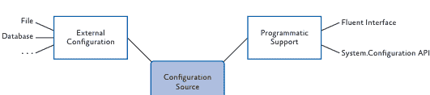

**图 1** Enterprise Library 中的配置源

## 外部配置

外部配置涵盖配置信息可以驻留在持久存储中并在运行时应用于配置源的不同方式。持久配置信息的可能来源包括文件、数据库和其他自定义来源。Enterprise Library 可以自动从这些存储中加载配置信息。若要将配置存储在数据库中，可以使用可从 Enterprise Library 社区网站 http://entlib.codeplex.com 获取的示例 SQL 配置源。您还可以指定一个或多个配置源以满足更复杂的配置场景，并为不同的运行时环境创建不同的配置。有关更多信息，请参阅本附录后面的“高级配置场景”部分。

## 编程支持

编程支持涵盖配置信息可以动态生成并在运行时应用于配置源的不同方式。通常，在 Enterprise Library 中，这种编程配置是通过专为简化动态配置而设计的流畅接口进行的，或者通过使用 Microsoft® .NET Framework System.Configuration API 公开的方法进行。

## 使用流畅接口

除验证应用程序块和策略注入应用程序块之外的所有应用程序块都公开流畅接口。这允许您在运行时使用直观代码来配置块，该代码由 Visual Studio® 中的 Microsoft IntelliSense® 辅助，以指定块的提供程序和属性。以下是为异常处理应用程序块配置异常策略并将此配置加载到 Enterprise Library 容器中的示例。

```
Dim builder = New ConfigurationSourceBuilder()

builder.ConfigureExceptionHandling() _
    .GivenPolicyWithName("MyPolicy") _
    .ForExceptionTypeOf(Of NullReferenceException)() _
    .LogToCategory("General") _
    .WithSeverity(System.Diagnostics.TraceEventType.Warning) _
    .UsingEventId(9000) _
    .WrapWith(Of InvalidOperationException)() _
    .UsingMessage("MyMessage") _
    .ThenThrowNewException()

Dim configSource = New DictionaryConfigurationSource()
builder.UpdateConfigurationWithReplace(configSource)
EnterpriseLibraryContainer.Current _
    = EnterpriseLibraryContainer.CreateDefaultContainer
```

## 高级配置场景

Enterprise Library 独立配置控制台和 Visual Studio 集成配置编辑器允许您基于外部配置源（例如磁盘文件）满足一系列高级配置场景。当您在不指定配置源的情况下使用配置工具时，它们默认使用系统配置源来创建包含应用程序完整配置的单个配置文件。您的应用程序将期望该文件名为 App.config 或 Web.config（取决于您使用的技术），并会自动读取它。

您可以在“块”菜单上选择“添加配置设置”以显示包含默认系统配置源的部分。如果单击“配置源”标题右侧的箭头以打开部分属性窗格，您可以看到这也默认指定为所选源——工具生成的配置将写入的配置源。当使用 Enterprise Library 的应用程序读取配置时，它将使用为所选源指定的设置。

以下部分描述了您可以使用配置工具完成的更高级配置的常见场景。其中一些场景要求您向应用程序配置添加其他配置源。

## 场景 1：使用默认应用程序配置文件

这是默认且最简单的场景。您使用配置工具配置应用程序，而不添加配置源部分或任何配置源。保存配置时，必须指定应用程序的 App.config 或 Web.config 文件，或使用配置工具编辑现有的 App.config 或 Web.config 文件。

## 场景 2：使用非默认配置存储

在此场景中，您希望将配置存储在文件或其他类型的存储中，而不是存储在应用程序的 App.config 或 Web.config 文件中。要实现此目标，您需要：

1. 使用配置工具向配置源部分添加合适的配置源。如果要使用标准格式配置文件，请添加基于文件的配置源。若要将配置信息存储在不同类型的存储中，必须安装合适的配置源。您可以使用可从 Enterprise Library 社区网站 http://entlib.codeplex.com 获取的示例 SQL 配置源将配置存储在数据库中。

2. 设置新配置源的相关属性。例如，如果您使用内置的基于文件的配置源，请将文件路径属性设置为配置文件的路径和名称。


- 3. 将属性窗格中 **Configuration Sources** 部分的 **Selected Source** 属性设置为新的配置源。这将更新应用程序的默认 App.config 或 Web.config 文件，以指示 Enterprise Library 将其用作配置源。

## SCENARIO 3: 在多个应用程序之间共享相同的配置

在此场景中，您希望在运行于不同位置（例如不同计算机）的多个应用程序或应用程序层之间共享配置设置。要实现此目的，您只需按前一场景中所述实现相同的配置，将配置文件或存储位于中心位置。然后，为每个应用程序在配置源的设置中指定此文件或配置存储（例如内置的基于文件的配置源）。

## SCENARIO 4: 管理并强制执行多个应用程序的配置

在此场景中，您不仅希望在运行于不同计算机的多个应用程序或应用程序层之间共享配置设置（如同前一场景），还希望能够在同一 Active Directory® 域内的所有计算机上管理并强制执行此应用程序或其层的这些配置设置。要实现此目的，您需：

- 1. 使用配置工具将可管理的配置源添加到 **Configuration Sources** 部分。

- 2. 为 **Application Name** 属性指定一个唯一名称，该名称用于在 Active Directory 存储库和域中定义应用程序。

- 3. 将 **File Path** 属性设置为配置文件的路径和名称。

- 4. 将属性窗格中 **Configuration Sources** 部分的 **Selected Source** 属性设置为新的可管理配置源。这将更新应用程序的默认 App.config 或 Web.config 文件，以指示 Enterprise Library 将其用作配置文件。

- 5. 配置完应用程序的应用程序块和设置后，右键单击可管理配置源的标题栏，并选择 **Generate ADM Template**。这将创建一个可安装到 Active Directory 中的组策略模板。该模板包含应用程序块的设置，在 Active Directory 中对其进行配置将强制每个应用程序实例使用集中指定的设置。

*可管理的配置源不为 Validation Application Block、Policy Injection Application Block 或 Unity 提供组策略支持。*

## SCENARIO 5: 在多个应用程序之间共享配置节

在此场景中，您有多个应用程序或应用程序层，必须为某些应用程序块（或配置的某些节，例如检测设置或连接字符串）使用相同的共享配置。实际上，您希望能够将 Enterprise Library 重定向到某些共享配置节，而不是共享完整的应用程序配置。例如，您可能希望为日志记录应用程序块指定设置，并在多个应用程序之间共享这些设置，同时允许每个应用程序为异常处理应用程序块使用其自己的本地设置。您可以通过将特定配置节重定向到共享位置中的配置存储的匹配节来实现此目的。

实现此场景的步骤如下：

- 1. 使用配置工具将适合您的应用程序的配置源添加到 **Configuration Sources** 部分。此配置源应指向共享配置存储。如果您想使用标准格式配置文件作为共享配置存储，请添加基于文件的配置源。若要将共享配置信息存储在不同类型的存储中，必须安装合适的配置源。您可以使用 Enterprise Library 社区网站 http://entlib.codeplex.com 上提供的示例 SQL 配置源，将配置存储在数据库中。

- 2. 设置共享配置源的相关属性。例如，如果您使用的是内置的基于文件的配置源，请将 **File Path** 属性设置为应用程序配置文件的路径和名称。

- 3. 将属性窗格中 **Configuration Sources** 部分的 **Selected Source** 属性设置为 **System Configuration Source**。

- 4. 单击 **Redirected Sections** 列中的加号图标，然后单击 **Add Redirected Section**。重定向节定义了您希望重定向到共享配置源的本地应用程序配置的特定节，以便它加载在那里定义的配置信息。此节的任何本地配置设置都将被忽略。

- 5. 在新的重定向节中，使用 **Name** 属性中的下拉列表选择您要从共享配置存储加载的配置节。节的名称将更改以反映您的选择。

- 6. 通过选择在配置中定义的共享配置源，设置重定向节的 **Configuration Source** 属性。此配置源将为重定向的配置节提供设置。

- 7. 如果要将其他配置节重定向到共享配置存储，请重复步骤 4、5 和 6。对于未定义重定向节的所有节，配置信息将来自本地配置源。

- 8. 若要编辑共享配置存储的内容，必须在配置工具或文本编辑器中打开该配置；当本地应用程序的配置在配置工具中打开时，无法编辑共享节的配置。如果在配置工具中打开共享配置，请确保该配置的 **Selected Source** 属性设置为使用系统配置源。

您无法共享 **Application Settings** 节的内容。配置工具中的此节将信息存储在配置文件的标准 <appSettings> 节中，该节无法重定向。

## SCENARIO 6: 为应用程序应用通用配置结构

在此场景中，您有若干使用相同配置结构的应用程序或应用程序层，您希望继承该结构，但又能够通过在本地配置文件中定义来修改或添加单个配置设置。您可以指定一个从共享位置中的父配置源继承设置的配置，并可选择覆盖本地设置。例如，您可以为在父配置中定义基础配置的应用程序块配置其他提供程序。实现此场景的步骤如下：

- 1. 使用配置工具将适合您的应用程序的配置源添加到 **Configuration Sources** 部分。此配置源应指向共享配置存储。如果您想使用标准格式配置文件作为共享配置存储，请添加基于文件的配置源。若要将共享配置信息存储在不同类型的存储中，必须安装合适的配置源。您可以使用 Enterprise Library 社区网站 http://entlib.codeplex.com 上提供的示例 SQL 配置源，将配置存储在数据库中。

- 2. 设置共享配置源的相关属性。例如，如果您使用的是内置的基于文件的配置源，请将 **File Path** 属性设置为应用程序配置文件的路径和名称。

- 3. 将属性窗格中 **Configuration Sources** 部分的 **Parent Source** 属性设置为您的共享配置源。保持属性窗格中 **Selected Source** 属性设置为 **System Configuration Source**。

- 4. 按常规方式配置您的应用程序。您将无法看到从您指定为父源的共享配置源继承的设置。但是，这些设置将由您的本地


配置，除非您在本地配置中对其进行配置以覆盖它们。当某个设置在父源和本地配置中均指定时，将应用本地配置设置。

- 5. 要编辑共享父配置存储区的内容，必须在配置工具或文本编辑器中打开该配置；当本地应用程序的配置在配置工具中打开时，无法编辑父节的配置。如果在配置工具中打开父配置，请确保该配置的“所选源”属性设置为系统配置源。

配置设置的合并方式以及生成的配置中项目的顺序，遵循一组预定义的规则。这些规则在随 Enterprise Library 安装的文档中有详细说明，并可在线查阅：http://go.microsoft.com/fwlink/?LinkId=128874。

## 方案 7：在不同部署环境中管理配置

在此方案中，您希望能够为同一应用程序定义不同的配置设置，以便在将其部署到不同环境（例如测试环境和生产环境）时适用。在大多数情况下，差异较小，通常涉及数据库连接字符串或为某个块使用不同提供程序等设置。Enterprise Library 通过名为“环境覆盖”的功能实现此功能。其原理是，您为两个或多个环境中不同的设置指定覆盖值，并将差异保存为单独的增量配置文件。然后，管理员在每个环境中部署应用程序时，将这些差异应用到主配置文件中。要实现此目标：

- 1. 按照第 1 章“简介”中“使用配置工具”部分的逐步过程中的说明进行操作，该部分介绍了如何在配置工具中配置多个环境以及如何定义覆盖设置。

- 2. 单击环境标题右侧的箭头以打开添加到配置中的每个环境的属性窗格，并将“环境增量文件”属性设置为该环境的增量文件路径和名称。

- 3. 保存配置。配置工具会为每个环境生成一个普通 (.config) 文件和一个增量 (.dconfig) 文件。增量文件可以由管理员管理，并在需要时存储在单独的安全位置。例如，当生产环境设置不应对开发人员或测试人员可见时，这可能很合适。

- 4. 要创建运行时合并的配置文件（通常由管理员执行此操作）：
  - 打开本地配置 (config) 文件。
  - 从“环境”菜单中选择 **打开增量文件** 并加载适当的覆盖配置 (dconfig) 文件。
  - 将环境属性窗格中的 **环境配置文件** 属性设置为该环境的合并配置文件路径和名称。
  - 右键单击环境标题，然后单击 **导出合并的环境配置文件**。

- 5. 在目标环境中部署合并的配置文件。

Enterprise Library 还包含一个名为 MergeConfiguration.exe 的命令行实用程序，如果您没有在管理系统上部署配置控制台，可以使用它来合并配置文件和增量文件。如果您希望将配置合并作为部署过程的一部分进行自动化，也可以使用它。有关 MergeConfiguration.exe 的信息包含在随 Enterprise Library 安装的文档中。

> *您无法在重定向节或继承的配置设置中使用环境覆盖。仅当应用程序的整个配置在本地配置源中定义时，才能使用它们。*

有关此处介绍的所有方案的更多信息，请参阅随 Enterprise Library 安装的文档，并可在线查阅：http://go.microsoft.com/fwlink/?LinkId=188874。

## 附录 E 加密配置文件

Enterprise Library 支持加密配置信息。除非您的服务器完全免受物理入侵和网络远程入侵，否则应考虑加密包含敏感信息的任何配置文件，例如数据库连接字符串、密码和用户名或验证规则。

您可以选择系统 Machine.config 文件中包含的任何加密提供程序。通常，这些是使用 Microsoft® Windows® 数据保护 API (DPAPI) 的 **数据保护配置提供程序** 和使用 RSA 的 **RSA受保护配置提供程序**。这些提供程序的设置（例如密钥存储位置）也在 Machine.config 文件中。您无法使用配置工具编辑此文件；相反，必须使用文本编辑器或操作系统配置工具对其进行修改。

作为此选项效果的示例，以下是数据访问块的简单未加密配置。

```
<dataConfiguration defaultDatabase="Connection String" />
<connectionStrings>
  <add name="Connection String"
    connectionString="Database=TheImportantOne; Server=WEHAVELIFTOFF;
    User ID=secret; Password=DontTellNE1"
    providerName="System.Data.SqlClient" />
</connectionStrings>
```

当您指定 **数据保护配置提供程序** 选项时，生成的配置节如下所示。

```
<dataConfiguration
  configProtectionProvider="DataProtectionConfigurationProvider">
  <EncryptedData>
    <CipherData>
      <CipherValue>AQAAANCMnd8BFdERjHoAwE/Cl+sBAAAAAbCHTvqG8QbuQI1BYa0uH
yTm50vQjNdSiohA5Fo6bXQh0R5VsvUxdcFNuGkHuhUaH15RZSN5WDM2CDmiQg
...
JyEadytIBvTbCmxXefuWNSMT/ T
</CipherValue>
</CipherData>
</EncryptedData>
</connectionStrings>
<connectionStrings
configProtectionProvider="DataProtectionConfigurationProvider">
<EncryptedData>
<CipherData>
<CipherValue>AQAAANCMnd8BFdERjHoAwE/Cl+sBAAAAcHVgTvQb80uQiB1ya0uH
..
zBjP7SQXVAsA<=</CipherValue>
</CipherData>
</EncryptedData>
</connectionStrings>
```

如果您只打算将加密的配置文件部署到加密文件所在的服务器，可以使用 **数据保护配置提供程序**。但是，如果您要将加密的配置文件部署到不同的服务器，或部署到 Web 场中的多个服务器，则应使用 **RSA受保护配置提供程序**。您需要导出解密数据所需的 RSA 私钥。然后，可以将配置文件和导出的密钥部署到目标服务器，并重新导入密钥。有关更多信息，请参阅 http://msdn.microsoft.com/en-us/library/ywx286t2(VS.80).aspx 上的“导入和导出受保护配置 RSA 密钥容器”。

当然，接下来的显而易见的问题是“我如何解密配置？”幸运的是，您不需要这样做。只要加密文件是在该计算机上创建的，或者您已导入 RSA 密钥文件，就可以在配置工具中打开加密文件。此外，只要满足相同条件，Enterprise Library 块就能自动解密和读取配置。

- A
- 访问器 另请参阅 数据访问应用程序块
- ACID 原则, 53
- AddInParameter 方法, 27
- AddOutParameter 方法, 27
- AddParameter 方法, 27
- 高级配置方案, 237-242
- AndCompositeValidator 验证器, 174
- AnnotatedProduct 类, 170-171
- 附录, 233-242
  - 高级配置方案, 237-242
  - 应用程序的常见配置结构, 240-241
  - 多个应用程序的配置, 238
  - 默认应用程序配置文件, 237
  - 在不同环境中, 241-242
  - 非默认配置, 237-238
  - 跨多个应用程序共享, 239-240
  - 在多个应用程序之间共享, 238
- 配置方案, 235-242
  - 流式接口, 236
  - 编程支持, 234
- Enterprise Library 中的依赖项注入, 227-232
- 备用服务定位器或容器, 231-232
- 基于请求的应用程序中的容器引用, 230-231
- 将配置信息加载到 Unity 容器中, 227-228
- 在应用程序启动时填充对象图, 229-230
- 容器中的注册, 228-229
- 使用 Unity 进行依赖项注入, 233-244
- 加密配置文件, 243-244
- Enterprise Library 中的策略注入, 233-234
- 应用程序块, 2
- 可选依赖项, 6-7
- 在 WCF 应用程序边界应用异常屏蔽示例, 81
- 面向切面编程 (AOP) 范式, 233
- ASP.NET 用户界面验证, 180-181
- 程序集
- 数据访问应用程序块, 28-29 和参考概述, 7-8
- 基于属性的技术, 216
- AttributeValidatorFactory, 173
- 验证用户并缓存标识示例, 204-205
- 授权
- 授权规则提供程序, 198
- 授权规则, 202
- 授权管理器 (AzMan), 198-199, 210-211
- AuthorizationProvider 类, 212
- 使用存储规则为进程授权用户示例, 209-210
- 使用 AzMan 规则为进程授权用户示例, 210-211


## B

- BeginExecuteReader 方法, 43-44
- 带有替换处理程序的异常屏蔽后的行为示例, 74
- 带有包装处理程序的异常屏蔽后的行为示例, 73
- bin 文件夹概述, 8
- 块, 选择, 6-7

## C

- 在数据库后备存储中缓存数据示例, 355
- 使用 null 后备存储在内存中缓存数据示例, 127-130
- 在隔离存储后备存储中本地缓存数据示例, 132-133
- CacheItemRemovedAndShowCacheContents 例程, 128
- 缓存应用程序块, 121-144
  - 配置, 124-126
  - 扩展, 143
  - 刷新与过期, 123-124
  - 使用方法, 122-143
    - 从缓存中添加和检索, 127-130
    - 添加到缓存, 137-138
    - 使用 null 后备存储在内存中缓存数据示例, 127-130
    - 缓存示例, 127
    - 缓存内容, 130-131
    - 数据库后备存储, 134-135
    - DataCache 对象过期或已删除缓存项示例, 139-140
    - 加密缓存数据, 133
    - 文件依赖和扩展时间过期, 135-136
    - 隔离存储后备存储, 131-133
    - 加载缓存, 141-143
      - 应用程序启动时主动加载缓存示例, 141-143
      - 按需响应式加载缓存示例, 141-143
    - 主动缓存加载, 141
    - 响应式缓存加载, 141-143
    - 刷新缓存, 138-140
    - 删除和刷新缓存项示例, 135
  - 概述, 3-4
  - 功能, 123-124
- 检查筛选器状态并向日志条目添加上下文信息示例, 111
- 复合验证器, 150
- 配置
  - 高级配置场景, 237-242
  - 基于配置的技术, 216
  - 配置控制台, 10-11
  - 配置源说明, 235-236
  - 加密配置文件, 243-244
  - Enterprise Library, 10-14
  - 场景, 237-242
  - 安全保障, 14
- ConfigurationValidatorFactory, 372
- 使用 Unity 的构造函数注入, 217-232
- 容器
  - 备用服务定位器或容器, 232-233
  - 直接访问, 16-17
- ContainsCharactersValidator, 173
- 贡献者和审阅者, xxix-xx
- 为数据项创建和比较哈希值示例, 193-195
- 为文本字符串创建和比较哈希值示例, 191-193
- CreateConnection 方法, 27
- 直接创建和使用验证器示例, 173
- 使用 LogEntry 对象创建和写入日志条目示例, 104-105
- 凭据管理
  - 概述, 4
  - 另请参阅安全应用程序块
- 密码学密钥向导, 186
- 密码学应用程序块, 183-196
  - 自定义加密提供程序, 195
  - 加密密钥, 184-185
  - 示例, 187-195
    - 为数据项创建和比较哈希值示例, 193-195
    - 为文本字符串创建和比较哈希值示例, 191-193
    - DecryptSymmetric 方法, 188
    - 使用对称算法加密和解密文本字符串示例, 188-189
    - 使用对称算法加密和解密数据示例, 189-191
    - 加密和解密文本字符串, 188-189
    - 加密和解密数据对称提供程序, 188
    - EncryptSymmetric 方法, 188
    - 哈希值, 191-195
    - 对象实例, 189-191
  - 哈希, 184
  - 使用方法, 185-187
    - 添加所需引用, 187
    - 配置加密提供程序, 186
    - 与其他块集成, 185
  - 概述, 4
  - 共享密钥加密, 184
  - 对称加密, 184
  - 功能, 185

## D

- 数据访问应用程序块, 25-59
  - 访问器创建, 37-38
  - 访问器概述, 35-36
  - 程序集, 28-29
  - 配置, 28-29
  - 基于连接的事务, 53-55
  - 连接, 52
  - 支持的数据操作, 26-28
  - 分布式事务, 55-57
    - DTC 事务, 56
  - 使用方法, 28-57
  - 支持的方法, 26-28
  - 多行, 33-35
    - 参数值数组, 32-33
    - 命名参数, 33-35
    - 查询参数, 33-35
  - 其他数据库无参数, 31-32
  - 概述, 4
  - 将数据检索为对象, 35-38
  - 异步检索数据, 41-45
    - 访问, 42-43
    - 行集数据, 45
  - 示例应用程序, 30-31
  - 单个标量值, 40-41
  - 更新数据, 45-51
    - DataSets, 47-51
    - 更新查询, 46-51
    - 从 DataSet 更新数据库, 48-51
  - 功能, 26-28
  - XML 数据, 39-40
- 数据注释属性方法, 157
- DataAnnotations 属性, 151-152
- Database 类, 29
- 数据库实例, 29-30
- DataReader 方法, 31-32
- DataSets, 47-51
- DbTransaction 类型, 54
- 依赖注入
  - 说明, xiii, 1-5, 223
  - 在 Enterprise Library 中, 227-232
  - 使用 Unity, 223-224
- 检测并刷新过期或已删除的缓存项示例, 139-140
- DI (依赖注入) 另请参阅依赖注入
- 分布式事务协调器 (DTC) 服务, 30-31
  - 事务, 55-56
- 分布式事务, 55-57
- 动态注册技术, 216

## E

- 使用对称算法加密和解密文本字符串示例, 188-189
- 使用对称算法加密和解密数据示例, 189
- 在后备存储中加密缓存数据示例, 133
- EncryptedCacheManager 管理器, 124-125
- 加密
  - 配置, 14
  - 配置文件, 243-244
  - Enterprise Library, 123
- Enterprise Symmetric 方法, 188
- Enterprise Library, 1-23
  - 程序集和引用概述, 7-8
  - 全局视图, 2
  - bin 文件夹概述, 8
  - 配置, 10-14
  - 依赖注入, 227-232
  - 说明, xiii, 1-15
  - 示例应用程序, 22
  - 基础知识, 6-9
  - 从早期版本获取对象, 21-22
  - 全局程序集缓存 (GAC) 概述, 8
  - 安装, 7-9
  - 安装, 7
  - 实例创建, 14-22
  - 实例化对象, 14-22
  - 场景概述, 3-4
  - 服务定位器, 16-17
  - 用途, 3-5
- Enterprise Library 服务定位器方法, 16-21
- 错误管理 另请参阅异常处理应用程序块
- 示例应用程序, 22
- 异常处理应用程序块, 61-87
  - 协助管理员, 85-86
  - 选择异常策略, 63-67
    - 关于策略, 63-65
    - 允许异常传播, 63
    - 选择异常处理策略, 65-66
    - MyTestExceptionPolicy 异常处理策略, 64-65
  - Process 方法, 67-68
  - Process 方法与 HandleException 方法, 66
  - 执行代码, 85-84
  - 扩展异常处理, 87
  - 使用方法, 62
  - 记录异常, 75-77
  - 重写异常, 74
  - 在 WCF 服务边界屏蔽异常
    - 创建故障协定, 78
    - 编辑服务代码, 79-80
    - 异常处理策略, 78-79
    - 故障协定异常处理程序, 80-81
  - 在 WCF 服务边界屏蔽异常, 78-81
  - 简单示例, 68-70
    - 异常屏蔽, 69-70
  - 特定异常类型, 82
  - 何时使用, 62
  - 包装异常, 70-73
    - 配置包装异常处理程序策略, 70
    - 编辑应用程序代码以使用新策略, 71-73
    - 初始化异常处理块, 71
- 异常日志记录模式, 62
- 异常屏蔽模式, 61
- 异常转换模式, 62
- 异步执行检索对象数据的命令示例, 45
- 异步执行检索数据的命令示例, 44-45
- ExecuteDataSet 方法, 27, 48-49, 51-52
- ExecuteNonQuery 方法, 27, 46-47
- ExecuteReader 方法, 27, 31
- ExecuteScalar 方法, 27
- ExecuteSprocAccessor 方法, 27
- ExecuteSqlStringAccessor 方法, 27
- ExecuteXmlReader 方法, 27
- 处理异常前后执行自定义代码示例, 83-84
- 过期
  - 示例, 207-208
  - 表, 136
- 使经过身份验证的用户过期示例, 207-208
- ExtendedFormatTime 类, 136

## F

- 外观, 15
- 工厂, 15
- 故障协定异常处理程序, 78
- 填充 DataSet 并更新源数据示例, 49
- 流畅接口, 234
- 前言, xiii-xiv
- 功能块, 3
- 基础知识, 6-9

## G

- GetInstance 方法, 16-17, 203
- GetParameterValue 方法, 27
- GetSqlStringCommand 方法, 27, 34
- GetStoredProcCommand 方法, 27, 34
- 全局程序集缓存 (GAC) 概述, 8

## H

- HandleException 方法与 Process 方法, 66
- HandlingInstanceID 值, 85-86
- 哈希值, 192-195
- 如何使用本指南, xv-xvii

## I

- IHashProvider 接口, 195
- Imports 语句, 9
- 注入
  - 使用 Unity 的构造函数注入, 217-232
  - Enterprise Library 中的依赖注入, 227-232
  - 使用 Unity 的依赖注入, 213-224
  - 方法调用注入, 222-223
  - Enterprise Library 中的属性注入, 233-234
  - 属性 (setter) 注入, 220-221
- 仅内存示例, 128-130
- 安装, 7-9
- 实例化
  - 实例创建, 15-21
  - 对象的实例化, 14-22
  - 优缺点, 18-19
- 拦截, 233
- 简介, 1-23
- ISymmetricCryptoProvider 接口, 195

## L

- 管理员, 1
- LoadDataSet 方法, 27
- 应用程序启动时主动加载缓存示例, 141
- 应用程序启动时响应式加载缓存示例, 141-143
- 按需响应式加载缓存示例, 163
- LogEntry 对象, 104-105
- 日志记录应用程序块, 89-119
  - 创建自定义跟踪侦听器、筛选器和格式化程序, 119
  - 使用方法, 93-102
    - 配置, 93-94
    - 控制输出格式, 101-102
    - 按类别筛选, 100
    - 安装, 94
    - 日志条目到多个类别, 100-101
    - 日志条目属性, 98-100
    - LogWriter 示例, 95-97
    - 日志记录, 94
    - 使用 LogWriter 的 Write 方法进行简单日志记录示例, 95
    - 不同类别的跟踪侦听器, 99
  - 导入命名空间, 9
  - 日志类别, 92
  - 日志记录开销和其他上下文信息, 93
  - 非格式化跟踪侦听器, 102-118
    - 添加其他上下文信息, 113-115
    - 捕获未处理的事件并记录错误, 105-107
    - 检查筛选器状态并向日志条目添加上下文信息示例, 111
    - 检查筛选器是否会阻止日志条目, 112-113
    - 创建和使用 LogEntry 对象, 104-105
    - 使用 LogEntry 对象创建和写入日志条目示例, 104
    - 按优先级筛选所有日志条目, 103
    - 在跟踪侦听器中按严重性筛选, 103
    - 将日志条目发送到数据库示例, 109
    - 特殊源, 105-107
    - 跟踪源和跟踪侦听器, 111-112
    - 跟踪活动并将活动信息发布到类别示例, 116-118
    - 跟踪和关联活动, 115-118
    - 使用特殊源捕获未处理的事件或错误示例, 106-107
  - 重写过程图, 92
  - 功能, 90-93
  - 日志筛选器部分, 100
  - 日志处理程序, 75-77
  - 使用日志编写器的 write 方法记录到多个类别示例, 100-101
  - LogWriter 示例, 95-97

## M

- MetadataType 属性, 171-172
- Microsoft 有限公共许可证, 5
- MyTestExceptionPolicy 异常处理策略, 64-65

## N

- 命名空间, 9
- 非格式化跟踪侦听器, 102-118

## O

- 对象集合验证器, 155, 162, 165-166
- 对象
  - 应用程序块, 15
  - 从早期版本获取, 21-22
- 对象验证器, 155
- ObjectValidator, 155, 162, 164-165
- OrCompositeValidator, 174


## P
- 策略注入，233-234
- 前言，xxviii
- 先决条件，xxvii-xviii
- Process 方法，67-68, 72-73
  - 与 HandleException 方法相比，66
- Property<ProxyValidator> 类，180-181
- 属性（setter）注入，220-221
- 属性值验证器，175-176
- ProtectionProvider 属性，14
- 为管理员定位异常详细信息提供帮助示例，85-86

## R
- 注册
  - 在容器中，228-229
  - 动态注册技术，216
- 移除并刷新缓存项示例，135
- 替换处理程序，74
- Resolve 方法，17
- 从缓存中解析用户身份示例，206-207
- 从 SQL 语句或存储过程中返回单个标量值示例，41
- 使用 SQL Server XML 查询将数据作为 XML 片段返回示例，40
- 使用存储过程将数据作为对象序列返回示例，38
- 使用带命名参数的 SQL 语句或存储过程返回行示例，35
- 使用无参数 SQL 语句返回行示例，31-32
- 使用带参数的存储过程返回行示例，33
- 审稿人，xix-xx
- 行集数据，45
- 配置方法中的规则集，157

## S
- 方案
  - 高级配置，237-242
  - 配置，237-242
  - 概述，3-4
- 安全应用程序块，197-212
  - 授权管理器 (AzMan)，198-199
  - 授权规则提供程序，198
  - 授权规则，202
  - 自定义授权提供程序，211-212
  - 示例，202-211
    - 验证用户并缓存身份示例，204-205
    - 授权规则，208-210
    - 使用存储规则为进程验证用户示例，209-210
    - 使用 AzMan 规则为进程授权用户示例，210-211
    - 检查授权，208-211
    - 使经过身份验证的用户过期示例，207-208
    - 从缓存中检索用户身份示例，206-207
    - ShowContextInformationDetails 例程，205
    - ShowUserIdentityDetails 例程，205
  - 如何配置，200-202
  - 如何使用，202-203
  - 概述，4
  - 安全缓存，199-200
  - 安全设置，201
  - 功能说明，198
- 自验证方法，157
- SelfValidation 特性，152-153
- 将日志条目发送到数据库示例，109-110
- 服务定位器，16-17
- SetParameterValue 方法，27
- 共享密钥加密，184
- ShowCacheContents 例程，129-130
- ShowDetailsAndAddExtraInfo 方法，112-114
- ShowGenericPrincipalDetails 例程，204-206
- ShowUserIdentityDetails 例程，204-205
- 使用 LogWriter 的 Write 方法进行简单日志记录示例，95-97
- 单个成员验证器，150
- 单个标量值，40-41
- SProcAccessor 类，35
- SqlDatabase 实例，39
- SqlStringAccessor 类，35
- SQLXML，39
- 对称加密，184

## T
- 团队，xix-xx
- 跟踪侦听器，102-118
- 跟踪活动并发布活动信息
  - 按类别示例，116-117
- TransactionScope 类，55-57
- 没有异常屏蔽的典型默认行为
  - 选项，69

## U
- Unity
  - 基于特性的技术，216
  - 基于配置的技术，216
  - 构造函数注入，217-222
    - 自动构造函数注入，217
    - 带特性的配置，219-220
    - 设计时配置，218-219
    - 运行时配置，219
  - 定义依赖项，216-224
  - 依赖项注入，213-224
  - 动态注册技术，216
  - 功能，215
  - 机制，214
  - 方法调用注入，222-223
    - 带特性的配置，223-224
    - 设计时配置，222-223
    - 运行时配置，223
  - 属性（getter）注入，220-221
    - 带特性的配置，221-222
    - 设计时配置，220-221
    - 运行时配置，220-221
  - 解析已填充的类实例，224-225
- UpdateDataSet 方法，27, 49, 51-52
- 使用 Command 对象更新数据示例，47
- 使用基于连接的事务示例，54
- 使用数据注释特性和自验证示例，170-171
- 使用特殊源捕获未处理的事件或错误示例，106-107
- using 语句，9
- 使用验证特性和自验证示例，166

## V
- 验证对象集合示例，166
- 在 WCF 服务中验证参数示例，176
- 验证应用程序块，145-182
  - 创建自定义验证器，182
  - 功能，147-156
    - 将验证规则分配给规则集，154
    - DataAnnotations 特性，151-152
    - 验证器范围，149-151
    - SelfValidation 特性，152-153
    - 验证时指定规则集，155-156
    - 使用特性进行验证，151-152
    - 验证规则集，154
  - 如何使用，156-160
    - 选择验证方法，157-158
    - 以编程方式创建验证器的选项，158-159
    - 执行验证并显示验证错误，159
    - 准备应用程序，156
    - 了解消息模板标记，160
  - 如何验证，147
  - 概述，4
  - 简单示例，161-182
    - ASP.NET 用户界面验证，180-181
    - 对象集合，165-166
    - 组合验证特性操作，167
    - 组合验证器，174
    - 数据注释特性，169-171
    - 数据注释特性和自验证，170-171
    - 在元数据类中定义特性，171-172
    - 在服务协定中定义验证，176-177
    - 对象验证器与工厂创建的类型验证器之间的区别，165
    - 编辑服务配置，177-178
    - 单个验证器，162, 173-176
    - 对象和对象集合，161-166
    - 对象验证器，164-165
    - 产品服务和检测验证错误，178-180
    - 是对象的属性，169
    - 验证操作结果，168
    - 自验证，167
    - 对象的单个成员，175-176
    - 指定验证规则位置，172-173
    - 包含字符的字符串，173-174
    - 子类类型，169
    - 使用 ValidatorFactory 的类型验证器，162-165
    - 用户界面验证集成，180-185
    - 使用验证特性和自验证示例，166-167
    - 验证特性，161, 166-169
    - 验证块特性，166-169
    - 验证结果实例，163-164
    - WCF 服务验证集成，162, 176-180
    - Windows Forms 用户界面验证，181
    - WPF 用户界面验证，181-182
  - 验证器描述，150
  - 验证什么和在哪里验证，146
  - ValidationAttributeValidatorFactory，173
  - 验证块特性，166-169
  - 验证块特性方法，157
  - ValidationProvider 组件，181
  - 验证结果实例，163-164
  - ValidatorFactory，162-163
  - ValidatorRule 组件，181-182
  - 验证器参见验证应用程序块
  - 以编程方式创建的验证器方法，157
  - 值验证器，150

## W
- Windows 隔离存储，131-133
- 连接块，3
- WPF 用户界面验证，181-182
- 包装处理程序，70-71

## X
- XML 数据，39-40

