# .NET Core 3 和 Visual Studio 2019 多平台桌面应用程序开发：macOS、Linux 和 Windows 的 C# GUI 应用程序构建指南


## 前言

本书详细回顾了使用 .NET Core 3 开发桌面 GUI 应用程序的新技术。在撰写本书时，.NET Core 3 最终版本刚刚发布，对 .NET 开发者社区的影响已经巨大。使用此新主要版本的 .NET Core 所带来的前景扩展了其潜在的应用领域

该主题发展非常迅速，但我们非常有信心，本书所介绍的技术和基础知识将对下一版本的 Core 框架（根据 Microsoft 路线图，应该是 3.1）保持相关性。

.NET Core 3 是 Microsoft 开发者社区的一大进步，其在 Visual Studio 2019 中的集成似乎表明，它将在未来几年成为 Redmond 编辑器的主要开发技术。

请放心，我们将跟进这些技术的未来版本，让您始终了解这一不断发展的惊人技术的最新动态。


## 本书目标读者

尽管本书力求让广大读者都能理解，但需要具备最基本的软件开发知识。

本书主要面向 3 类开发者。

第一类是 C# .NET 框架开发者，他们希望将知识更新至最新的 Microsoft 技术和框架，以便能够针对 Linux 和 macOS 进行开发，而不仅仅是他们过去习惯用于开发的经典 Windows 系统。就当前 .NET Core 的路线图而言，它应该成为 Microsoft 未来的主要开发框架（当然，经典 .NET Framework 仍将为旧版开发提供支持）。

第二类是 ASP.NET C# 开发者，他们希望升级桌面开发环境的知识，并为市场上 3 个主要平台（Windows、Linux、macOS）开发 GUI 应用程序。

第三类可能对本书感兴趣的是 C++ 开发者（C# 使用的语法可被 C++ 开发者快速掌握），他们希望为桌面应用程序开发增加一门新语言，并通过使用 .NET Core 3 提高生产力（这也可能是他们学习一种在 Web 和云领域广泛应用的技术的机会）。

你应该具备使用 Visual Studio C# 开发软件解决方案的最低限度经验，并对目标系统（Windows、Linux、macOS）有最基本的了解。

## 如何阅读本书

与大多数技术书籍一样，本书可以从头到尾阅读。按顺序阅读全书，能让读者更好地理解作者解释的每个概念。

不过，本书的编写初衷是让读者能够跳转到与其上下文相关的特定信息。本书可用作所介绍技术的技术参考。

如果读者已经具备扎实的软件开发背景，可以跳过第 3、4、5 章（尽管回顾所介绍的原则始终有用），这些章节特定于 C# GUI 开发项目，直接跳转到感兴趣的部分。

资历较浅的开发者应从头开始阅读本书，了解用于编写专业图形桌面应用程序的核心概念、方法和实践。

## 技术选项

编写本书时选择了许多技术选项，旨在避免开发者产生混淆，并定义一个可在其中开发所介绍项目的框架。

**主要开发工作站：** 为简化起见，本书提供的所有示例均在 Windows 10 v1809 和 Microsoft Visual Studio 2019（社区版）上实现。

**目标操作系统：**

- Ubuntu 18.04 (Bionic) 用于 Linux，
- Mojave 10.14 用于 macOS，
- Windows 10 1809 用于 Windows 平台。

这些机器的设置将在专门的章节中详细介绍。

**语言：** 主要是 C#、XAML、QML、HTML & JavaScript、C++，具体取决于你想开发哪种类型的项目。


## 技术符号

本书力求为您提供关于 .NET Core 3 桌面应用程序开发的最清晰视图和快速可读性，为实现这一目标，使用图表来说明所呈现信息的目的。

- 对于命令行说明：

```
C:> Command line /sample
```

- 对于 HTML、JS、CSS、Json、XML 文件：

Index.html

```
<html>

<header></header>

<body><h1>Hello HTML</h1></body>
</html>
```

- 对于 C# 代码文件：

ProgramName.cs

```
1 Using
2 Log.logger = new
3 LoggerConfiguration().CreateLogger();
4
5
6
7
8
9
```

- 对于 NuGet 包引用：


- 对于 GitHub 引用：


- 对于 Web 指针和引用：


- 对于工具和实用程序软件（用于安装、测试、使用或审查）

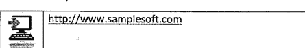

注意：您会注意到某些与 GitHub 相关的链接位于引用链接中，在这种情况下，所提供的文档是关注的中心点，如果提供的是代码，则需要将您的注意力集中在 GitHub 格式上。

## .NET Core 3.0

## 第 1 章 | 简介

### 1.1 总览

对于 C# 开发人员来说，这是一个绝佳的时代，因为 Microsoft .NET Core 3 的发布，基于相同的 C# 源代码为 Windows、Linux 和 macOS 开发应用程序从未如此容易。

本书将帮助您根据想要使用的技术和目标操作系统，定义最适合桌面应用程序的 GUI 类型。

.NET Core（从 1.0 版到最新的 2.2 版）已被开发者社区广泛认可，用于跨平台 Web 和服务器应用程序（后端、API、Serverless ...）。第三个版本也将为桌面应用程序开发提供集成解决方案。

.NET Core 3 为多平台应用程序解决方案工程带来了理想的解决方案，它允许开发人员为每个操作系统将代码集中在单个项目中。

Visual Studio 2019 可用于（带来所有生产力优势）在 Windows、Linux 和 macOS 上运行的解决方案的 C# 开发。

我们将为 C# .NET 框架（经典）开发人员提供特别介绍，以便快速适应新的 .NET Core 环境。

还将介绍此类项目的最佳实践，使您能够像针对单一操作系统的项目一样快速启动新项目。这些快速介绍将帮助您明智地推进开发，并避免许多这些项目特有的固有陷阱。

我们将回顾 .NET Core 3 中包含的新功能，以及为何在市场上可用的其他开发套件（如 Node.JS、Mono、...Java）中选择此框架。

专业软件开发项目管理所需的基本知识（计划、SDLC、测试）以及开发环境的一般组织将予以研究。

将提供 C# 常见编码技术的快速介绍，以便快速解决项目的常规要求：

- 数据库访问。
- 日志记录。

- Web 服务访问。
- 使用本机 API。
- ...

（当然，如果您是 C# 资深开发人员，可以跳过此部分）。

GUI 设计特有的基本知识也将介绍，涵盖多个方面：

- 人体工程学。
- GUI 设计的基本规则。
- 图形呈现。
- 排版。
- 配色方案。

如果您对人机界面设计没有任何扎实的理论知识，则此部分相关。

之后，我们将回顾在 Windows（这是主要开发工作站）上设置完整开发环境，以开发针对 Windows、Linux（Ubuntu）和 macOS（Mojave）的应用程序。

由于开发 .NET Core 3 的最佳 IDE 是 Microsoft Visual Studio 2019，我们将向您介绍使用这个出色 IDE（可从 Microsoft 网站免费获取社区版）的一般概念和工具，以便快速高效。我们将回顾如何编码和调试针对多个操作系统的应用程序。

之后，我们将为您介绍项目的多种 GUI 解决方案，并附带示例项目，您可以直接将其用作教程或作为启动项目的模板：控制台 GUI、本机 GUI、ASP.NET GUI、XAML...

我们将向您展示如何开发和实现应用程序开发所需的测试项目。我们将了解如何在项目的编码步骤中实现测试，以及如何使用 Visual Studio 工具提高应用程序的性能。

一旦项目的编码步骤完成，我们将了解如何在每个特定平台上构建、打包和部署应用程序，并回顾工具，为用户提供与应用程序安装过程的积极体验。

在本书中，我们涵盖了多平台应用程序的整个开发周期，为您提供独特的优势，以最有效的方式完成项目。我们希望本书能通过让您直接访问来自多种资源的参考资料以及作者和其他开源项目的示例源代码，帮助您进行多平台项目。

这些入口点将为您提供寻找相关资源或深入了解项目所需特定技术领域的钥匙。

我们希望本书能帮助您以最成功的方式完成多平台项目，并最大限度地减少完成这种复杂项目所需的时间和资源。

### 1.2 为何开发多平台应用程序？

当您想要启动针对多个平台的桌面应用程序项目时，这应该是您首先要问自己的问题。确实，在移动开发领域针对多个操作系统相当普遍，但在桌面开发领域并不那么明显。这有一个简单的原因，即 Windows 操作系统在桌面平台市场上的“霸权”。这种主导地位由图表（图 1）说明，Windows 占桌面市场的 75%！

### 2019 年操作系统市场

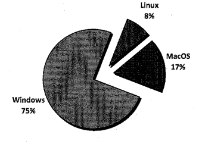

（图 1）
（来源：StatCounter.com 2019 年 5 月）

上述图表（图 1）仅说明了联网计算机的市场，但很明显 Microsoft Windows 占据主导地位。

那么，为何要为其他平台开发？

因为使用这些系统（macOS 和 Linux/Unix）的大多数专业人士倾向于实际购买软件，尤其是其工作领域的专业软件。

macOS 和 Linux 系统主要用于专业环境，在专业环境中，软件解决方案必须合法购买，原因有几点：

- 获得适合企业要求级别的客户支持。
- 许可条款。
- 商业利用。

而且，确实，许多软件应用领域目前被这些平台垄断：

- macOS 主要用于图形、音频编辑、视频编辑和艺术领域。
- Linux/Unix 用于建筑 CAD、电子设计、市场交易、工程软件应用、行业专用软件...

这部分是由于这些系统（Linux、macOS）的良好稳定性。此外，Linux 和 macOS 的声誉是拥有比 Windows 更好的性能（在相同硬件资源下）。macOS 和 Linux 的爱好者还认为，他们可以比在 Windows 上更容易地配置和调整系统。

因此，如果您计划为“利基”市场开发软件，您当然可以选择按照本书介绍的方式开发多平台项目。这样，您既能满足常规客户的需求，也能将软件的潜在市场扩展到其他操作系统用户。

商业软件可在多个操作系统上使用，这一事实也将向用户保证，在应用程序上获得的知识不依赖于他使用的系统（例如：Photoshop、Mathcad ...）。当软件的使用


应用程序非常复杂，要正确使用需要一定的学习曲线。如果用户知道所学知识在多个其他平台上都适用，他将更愿意学习特定软件的使用。

选择多平台应用程序的另一个原因是：如果您能为客户提供无论其使用何种系统的软件解决方案，这将对客户产生积极的心理影响。您的软件多平台分发意味着在开发过程的每个步骤都具备良好的技术掌控力，并表明您不依赖于单一操作系统。

多平台开发为您（及您的公司）提供了不被某个经常面临剧烈变化的特定操作系统所束缚的可能性，这种变化甚至可能质疑您正在开发的应用程序的有效性。

您必须牢记，实现对所开发软件的这种控制需要在开发阶段付出更大的努力（尤其是当您的项目需要使用原生函数 API 时；在其他情况下，.NET Core 3 为项目实现提供了一种稳健且自适应的方式）。

.NET Core 3.0

## 第 2 章 .NET Core 3 介绍

.NET Core 是一款诞生于 2015 年的产品（实际上自 2014 年起即处于测试版）。

它是从经典的 .NET Framework 定义而来。在 .NET Framework 演进过程中选择的许多技术选项，定义了对新范式的需求。

我们将了解 .NET Framework 的这些演进是如何发生的，以及在什么背景下，新框架 .NET Core 的需求变得显而易见。

### 2.1 微软 .NET Framework 简史

第一个 .NET Framework 于 2002 年发布，是微软的专有系统（一个黑盒）。这是雷德蒙德厂商对当时日益流行的 Java 框架的回应。与 Java 框架一样，.NET Framework 使用虚拟机来执行程序。

使用 .NET Framework 时，源语言不再编译为机器码，而是编译为 MSIL（Microsoft Intermediate Language，Microsoft 中间语言），该语言在运行时由 CLR（Common Language Runtime，公共语言运行时）编译为机器码，并在 .NET Framework 虚拟机中执行。

该运行时会实时将每段需要执行的代码转换为平台的本机代码。

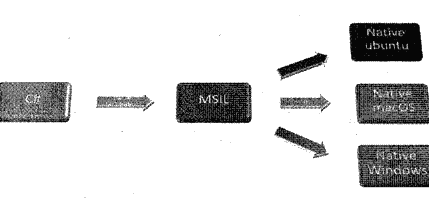

除了这种编译能力外，CLR 还为生成的代码提供许多服务，以下是这些基本功能的非详尽列表：

- 基类库 (BCL)。
- 线程模型。
- 类型检查器。
- 异常管理器。
- 垃圾回收器。
- MSIL 到本机代码编译器。
- 类加载器。

不久之后，微软发布了许多适应其遇到的各个应用领域的 .NET Framework 子集：.NET Compact Framework、Silverlight、Windows Phone……

这些框架中的每一个都在框架级别包含自己的一组特定功能，因此彼此之间变得不兼容（对于大部分代码而言）。

由于它们 API 的特定演进（垂直演进），针对多种平台类型开发应用程序在时间和资源方面变得越来越昂贵，原因是每个框架都有垂直演进。

这很容易解释：最初并没有在框架之间共享代码的意愿，因为这些框架专门用于其特定的应用领域和平台上下文。

但如今，跨平台开发已成为许多项目非常常见的需求。许多应用程序模糊了垂直 .NET 框架之间的界限：通常，Web 应用程序使用 Windows 专用功能，桌面或手机应用程序使用 Web 后端（Web 服务或 Web API）等等……

正是在这样的背景下，.NET Core 和 .NET Standard 被规划和定义为 .NET Framework 的一个新子集。

下面是一个解释 .NET Framework 与 .NET Core 之间关系的简图。

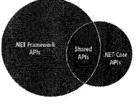

（来源：微软）

.NET Standard 可以与 .NET Framework 和 .NET Core 一起使用，这种库格式提供了惊人的可移植性，无论您打算与之一起使用哪个框架。

### 2.2 为什么选择 .NET Core？

使用多个框架（每个框架都专注于自己的领域）所带来的复杂性，成为大多数多方面平台开发的陷阱。随着此类开发变得越来越普遍，对新框架的需求出现了。

正是在这样的背景下，出现了对最小框架的需求，其中每个平台和功能的所有特定内容将通过 NuGet 包进行集成，而不是集成到核心框架内部（就像之前 .NET Framework 的情况一样）。

此外，.NET Framework 是 Windows 系统的一部分，而 .NET Core 3 则不是，它可以以自包含的方式随应用程序分发，并且本身是自给自足的。

如您所见 _(图 1)_，经过精心设计的 .NET Core 架构为其在生产环境中的使用提供了许多好处，与经典的 .NET Framework（依赖于 Windows）相比。

| | .NET Framework | .NET Core 3 |
|---|---|---|
| Windows 更新 | 是 | 否 |
| 部署运行时 | 取决于情况 | 是 |
| 并行安装 | 否 | 是 |

_(图 1)_
_（来源：微软）_

.NET Core 的一个关键点是使用专用的包管理器格式：NuGet。

NuGet 打包系统集成在 Visual Studio 2019 中，类似于 Debian 的 APT、Node.js 的 NPM 或 Python 的 pip。NuGet 通过将二进制文件及其依赖项封装在单个文件中，使每个库都可用。该文件（.nupkg 扩展名）是一个 ZIP 存档，包含带有所有关联依赖项和目标框架信息的清单。

因此，一个 NuGet 包可以独立实现用于多平台使用的完整功能。

### 2.3 新功能

与其前身一样，.NET Core 3 是开源且跨平台的。通过此实现，微软包含了对 C# 8 的支持，这是 C# 语言的一个主要版本。但这并非微软在此版本中对 .NET Core 所做的唯一添加。

以下两个图表展示了微软为其新的标志性框架 .NET Core 3 的第三个版本所做的工作。我们可以看到，与基本上是为跨平台环境运行 Web 应用程序和服务而设计的第一个版本的更新版 .NET Core 2 相比，这是一个主要版本。

.NET Core 2：

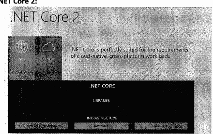

.NET Core 3：

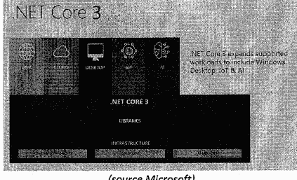

（来源：微软）

如您所见，.NET Core 3 不仅面向 Web 服务器平台，还获得了许多新功能，例如 AI 和 IoT。

但不幸的是，桌面开发是仅限 Windows 的功能（它依赖于 WinFX，依赖于 Windows）。

通过提出这些新功能，微软充分验证了 .NET Core 的基本概念：模块化仅包含在专用包中（而不是像在 .NET Framework 中那样集成到框架中）。

.NET Core 3 的一项主要新增功能是支持 C# 8 的新功能：

- 默认接口成员。
- 可为 null 的引用类型。
- switch 表达式。
- 属性模式。
- 元组模式。
- 静态局部函数。
- 可为 null 的引用类型。
- 异步流。
- 浮点 API 改进和符合 IEEE 标准。
- 分析和格式修复。
- 新数学 API（BitIncrement/BitDecrement，与 nextUp/nextDown IEEE 操作匹配）。

#### .NET Core 3 中包含的其他功能：

- 用于访问面向性能的 CPU 指令的 API，例如 SIMD。这些指令可以提高性能。
- 快速的内置 JSON Writer 和 JSON 文档。
- 适用于 Raspberry Pi 计算机的 GPIO（通用输入/输出）支持。
- 改进的本地 dotnet 工具。本地工具与磁盘上的位置相关联，从而实现每个项目和每个仓库的工具。
- 程序集卸载能力，这是 AssemblyLoaderContext 的一部分。该功能使加载器上下文能够被卸载，释放已实例化类型、静态字段以及程序集本身的内存。应用程序应能够通过此机制加载和卸载程序集，而不会发生内存泄漏。
- 为了支持 Visual Studio，C# 测试版功能将 Windows Presentation Foundation (WPF) 和 Windows Forms 模板添加到“新建项目”对话框中，以便无需使用命令行即可更轻松地启动应用程序。
- MSIX 应用程序包格式部署，用于将 .NET Core 3 桌面应用程序部署到 Windows 10。


- 在 .NET Core 3 上运行桌面应用程序将带来性能改进。

每个 Windows（有关 .NET Core 3 的先决条件，请参阅“设置开发环境”章节）应用程序都将能够在 .NET Core 版本 3 上运行（目前支持 Windows Forms、Windows Presentation Foundation 和通用 Windows 平台 XAML）。

注意：.NET Core 3 增加了在 .NET Core 上构建 WinForms 和 WPF 应用程序的能力。但是，再次强调，这类应用程序不是跨平台的，只能在 Windows 系统上运行（WinFX 依赖于 Windows API）。这些 WinForms 和 WPF 应用程序仅限 Windows，短期内不提供任何跨平台可能性（目前没有可用的路线图）。

.NET Core 3 为桌面开发人员提供灵活的部署，还支持并行的单个 EXE。

结合 .NET Core 3 提供的优势和新功能，使该框架成为许多开发中最前沿且多功能的解决方案。

此版本的 .NET Core 在性能、灵活性和语言（C# 8）特性方面，远远超越了传统的 Java 框架、NodeJS 或 Python 解决方案。微软通过此版本及其配套开发的工具，在开发领域实现了一个改变游戏规则的主张（绝非虚言！）。

### 2.4 .NET Core 3 路线图

作为一项新的微软技术，.NET Core 3 为其不同版本制定了规划路线图。微软开发的这款跨平台框架在许多开发者中取得了越来越大的成功，当然尤其是在 Azure 云环境中工作的开发者，但也包括 AWS（为 .NET Core 开发者提供所有工具）和 Google Cloud（最大的云服务提供商）。

但随着 .NET Core 成熟度的提高，它可以应用于更广泛的领域（例如桌面应用）。

不同版本的路线图（图 1）可能会发生变化，包含的功能尚未最终确定。这是因为 .NET Core 采用开源许可证，许多功能由社区（主要是微软专业人员和独立开发者）提出和实现。

例如，如果社区明确某项功能应包含在下一版本中，则该功能将被添加到下一版本（在技术可行的情况下）。因此，如果您对该框架有绝妙的想法，请毫不犹豫地在 .NET Core 开发网站（下方参考链接）上发布请求，如果该请求被开发团队验证，您的功能将集成到未来的 .NET Core 版本中。

- .NET Core 3 preview1（2018 年 12 月）
- .NET Core 3 preview2（2019 年 1 月）
- .NET Core 3 preview3（2019 年 3 月）
- .NET Core 3 preview4（2019 年 4 月）
- .NET Core 3 preview5（2019 年 5 月）
- .NET Core 3 preview6（2019 年 6 月）
- .NET Core 3 preview7（2019 年 7 月）
- .NET Core 3 preview8（2019 年 8 月）
- .NET Core 3 preview 9, RC1（2019 年 9 月）
- .NET Core 3 公开发布版（2019 年 9 月）
- .NET Core 3 LTS（2019 年 12 月）
- .NET Core 3（2020 年 11 月）

(.NET Core 路线图) (来源：微软 2019)

.NET Core 版本发布的这条路线图经历了许多变更，并且始终可能会被修改（经常会出现重新安排）。自预览版 7 起，.NET Core 3 就是 Visual Studio 2019 预览版更新的一部分。自 2019 年 9 月起，.NET Core 3 框架已包含在 Visual Studio 中（随发行版提供）。

您可以注意到，.NET Core 的 LTS（长期支持：实际上为 3 年）版本计划于 2019 年年底发布，因此从该日期起，您的开发的可持续性（在企业环境中至关重要）将得到至少数年的保障（至少 3 年支持）。

将您的 .NET Core 3 代码更新到 .NET Core 3.1 应该只需对使用 .NET Core 3 开发的应用程序进行最少的修改（可能无需修改）。

将框架与应用程序一起包含，而不是全局安装在计算机上（如 .NET Framework 的情况），是一种主要的问题解决模式，同时也提高了当今开发的应用程序的可移植性和耐用性。

### .NET Core 3.0


## 第 3 章 项目管理要点

在开始回顾 GUI 桌面应用程序开发的解决方案之前，我们将回顾成功软件开发项目所需的基本知识。

使用经过验证的开发方法可以促进复杂软件产品的实现。如果您在此领域没有丰富经验，本章强烈建议您仔细阅读。在开发跨平台软件过程中可能遇到的开发问题多种多样，您不希望在这些特定问题之外再增加经典（且已解决）的问题。强烈建议在项目的每个阶段（SDLC）都采用稳健的开发方法论。

如果您的项目涉及多个人员（设计师、程序员、DBA、架构师……）并且需要为上级制作项目状态报告，则尤其推荐使用这些方法。

在开始复杂软件开发项目之前，您应考虑的基本要求如下：

- 对您的项目进行规划（即使只是在 MS Excel 表格上完成，也应使用项目规划工具）。
- 项目管理：敏捷方法为中型团队提供了一种灵活的方式。
- 使用源代码控制工具。

这些可以帮助您避免开发项目中经常遇到的许多陷阱。

### 3.1 您的项目规划

即使您独自工作（尤其是涉及团队合作时），在开始编码之前也强烈建议进行规划阶段。

在此阶段，您将：

- 组织/形式化您对产品开发每个步骤的愿景。
- 定义在开始其他任务之前需要完成的任务（任务层次结构）。
- 定义开发的时间进度表。
- 如有需要，明确参与项目的每个人的角色（架构师、开发人员、设计师……）。

在现实世界中，规格往往会发生未计划的变更，您的项目管理工具应允许您重新安排这些变更涉及的每个任务，并预测这些修改所涉及的成本（时间和资源）。项目进度的全局可见性可以在项目的每一刻提供，从而避免与上级产生误解，并/或清晰了解进度。

制定时间进度表有助于您识别开发团队在特定任务上是否遇到问题，并相应地重新分配资源（如果开发工作或另一项任务的工作量被低估/高估）。

为此目的，最佳可用工具是 Microsoft Project。

MS Project 不仅为规划提供了一个出色的工具（包含甘特图、任务层次结构、人力资源管理……），而且还是管理软件开发生命周期（SDLC）的核心工具。您可以建模项目的每个步骤并分配资源：时间和人力，包括所需的特定技术技能。

对于简单项目，您可以使用工具来跟踪项目。这可以通过专用的 MS Excel 表格或免费的项目管理网站来完成。但微软开发的专用软件提供了一种简单的方法来实现这一点，该产品经过多年开发，为项目管理任务提供了无可争议的解决方案。

以下是您可以参考的项目管理资源：

- Microsoft Project：
- http://products.office.com/Microsoft/Project
- MS Project 替代方案：
- http://www.projectinabox.org.uk
- http://www.projectlibre.com/
- https://www.ganttproject.biz/download
- MS Excel 项目管理表模板：
- https://www.officetimeline.com/project-management/excel
- https://www.vertex42.com/ExcelTemplates/excel-project-management.html

通过这些参考资料，您可以找到许多 Excel 工作表，它们允许您规划简单项目，从而避免投资购买 MS Project 等专用工具；然而，更复杂的项目将需要使用专用软件。

### 3.2 软件开发生命周期

软件项目的开发需要识别实现它的每个步骤（或所谓阶段）。按照标准阶段对项目进行分阶段称为软件开发生命周期。

软件开发项目可以分阶段，以验证软件产品开发生命周期中的每个步骤，如所述（图 1）。


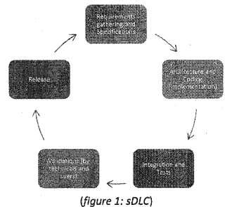

#### Specifications (and requirements gathering)
不要忽视规格说明阶段，因为它将定义架构和技术选型。在此阶段，你将：
- 进行分析（可能使用 UML 等工具）。
- 提取用户故事（需求）。
- 并可能定义表单设计（功能性）。

#### Architecture and coding
在此阶段，你将定义与先前规格说明相匹配所需的软件架构。你还需要整合环境约束（公司）来定义它们。一旦目标架构确定，即可对每个功能进行编码。如果你计划让多名开发人员在程序的同一部分工作，使用设计模式会很有用。此阶段还包括单元测试，用于验证开发团队生成的每段代码。

#### Integrations and Tests
测试阶段很重要，因为它允许程序员验证为项目开发的每个模块是否能与其他模块良好协作，从而提供预期的软件结果。如果不进行测试，就不可能交付高质量的软件；总会存在问题，或者更糟的是 bug（确实会发生）。可以使用持续集成工具（如 TFS DevOps）来自动化测试。

#### Validation by user(s)
用户必须验证最终产品。这是一个重要步骤，但大多数大公司都低估了它（因为其开发结构的架构）。确保最终用户的整体感受与规格说明阶段设定的期望相匹配非常重要。这种验证还能提升用户对最终软件质量的感知。

#### Release and deployment
在此阶段，软件已经生成（至少有一个可执行文件可用），但项目开发尚未完成。在许多情况下，尤其是桌面应用程序，最终软件需要集成到安装/设置包中，以便顺利分发给用户。在多平台项目中，这是一个关键步骤（因为每个操作系统在软件安装过程方面都有其特定性）。

循环中的每次迭代旨在修复 bug、集成新功能或规格变更、提升性能。在此背景下，该循环在软件整个生命周期中不断迭代。

### 3.3 DEFINE MULTIPLE ENVIRONMENTS

在项目期间，将开发分离到多个环境中非常重要。这有助于开发人员保持他为实现目标而应开发的不同模块之间的连贯性和连续性，而不会与项目其他已开发部分发生冲突。

这些环境对应于一台计算机（或虚拟机），或者仅仅是一个仓库（或文件夹），用于存储开发期间所需的数据（例如文档、数据库脚本、规格说明...）。

为每个环境设立专门的 Wiki（网站）通常是相关的。使用 Wiki 的目的是为开发期间使用的每个元素或特定技术保留知识库。Wiki 网站对于团队规模较小或拥有远程人力资源的项目尤其有用。

除了关于开发的知识库之外，项目在其演进过程中，还需要多个不同的环境来满足每个阶段的要求。

该领域的常见做法是定义 3 个环境：

- 开发：在此环境中，开发人员可以创建副项目来验证项目的复杂部分。这是一个非正式环境，仅专门供程序员使用。

- 测试：在此环境中，开发人员将发布项目以供验证；通常此环境应与发布环境相同。在此处识别 bug、评估性能，并将审查点退回开发。

- 发布：此环境是软件应在生产环境中运行的地方。在我们的情况中，是未进行任何先前特定安装（可能会干扰所开发软件）的台式机/笔记本电脑。发布环境将允许验证安装/设置模块和软件本身。

对于多平台开发需求，主开发平台（Windows 工作站）上将有 3 个环境（开发、测试和发布），而 Ubuntu 和 macOS 上将有 2 个环境（仅测试和发布）。

### 3.4 SOURCE CONTROL

在开始开发之前，需要考虑的另一个重要方面是集成源代码管理工具。你的项目源代码是艰苦编码工作的主要成果，应被视为宝贵财富。

在此背景下，使用源代码控制工具对于专业开发（个人工作也是）是强制性的；该工具将特别有助于：

- 避免丢失源代码。
- 避免发布有缺陷的代码。
- 保留版本控制。
- 允许代码分析。

你可以在自己的服务器上实现源代码控制工具（有许多开源解决方案可用，例如 Git、SVN、Subversion...）。我们建议在可能的情况下，将源代码仓库安装在专用计算机上，而不是开发人员工作站。

但你也可以使用在线集成解决方案，例如 Microsoft Azure DevOps、GitHub 或其他... 使用外部仓库可以提高源代码的安全性。通过使用远程源代码，在发生一般故障或灾难性事件时，你可以非常快速地恢复。

以下是将这些优势集成到项目开发中的主流解决方案的快速回顾。

#### A) Microsoft Azure DevOps

使用 Microsoft Azure DevOps 除了源代码控制工具之外，还包含许多优势。此环境由 Microsoft 免费提供（最多 5 个用户，之后必须订阅提供更多功能的服务）。它可以用于管理你的项目周期，并作为源代码的中央仓库；它包括：

- 源代码版本控制。
- 项目跟踪（可连接到 MS Project）。
- 向开发人员分配任务。
- 请求管理（新功能、bug、规格说明...）。
- 项目编译。
- 集成自动化构建和测试模块（使用管道）。

Azure DevOps 免费提供不同类型的源代码控制工具，例如经典 TFS 和 Git，以及不同的项目指导方法论（敏捷、Scrum...）。

在完整版本（带订阅）中，Azure DevOps 提供专业管理资源和源代码的完整解决方案。

与 Visual Studio 的集成是原生的，这使得开发人员在架构和编码阶段使用软件开发方法论变得更加容易。

这只是 Azure DevOps 免费提供的功能的一瞥，因此我们建议使用此工具；你可以从参考链接中了解所有详细信息。


#### B) GitHub

GitHub 提供免费的分布式源代码控制工具。GitHub 来自开源世界，并免费托管你的项目源代码。这些源代码将对“公众”开放，无限数量的“贡献者”可以参与项目（非常适合开源项目）。

如果你不希望源代码公开，可以创建“私有”仓库，但该仓库（至少在免费版本中）将不得不支持诸如贡献者数量限制为 3 人（以及其他）等约束。

默认情况下，如果你仅使用免费版本，仓库将对公众开放，但 GitHub 允许你在团队规模不受限制的情况下工作。

如果你计划开发开源软件解决方案，GitHub 确实是一个必不可少的工具，它就是为此而设计的


that。此外，您可以使用 GitHub 提供的免费 Git 客户端来管理您的文件。
您可以通过查阅下方的参考链接，了解 GitHub 提供的可能性。

- https://github.com/explore
- https://desktop.github.com

还有几种其他在线解决方案可协助您完成繁琐（但尽管如此至关重要）的项目和源代码管理任务，其中最知名的在线解决方案包括：

- https://gitlab.com
- https://bitbucket.org
- https://sourceforge.net
- https://beanstalkapp.com

这些网站中的大多数都提供免费订阅和基本工具，用于管理您的项目和/或对源代码进行版本控制，不利用这些机会将是粗心大意的。

最后，通过阅读这篇简要回顾，您可能已经了解，我们热烈推荐使用 Azure Devops，GitHub 在开源软件开发环境中很有用。

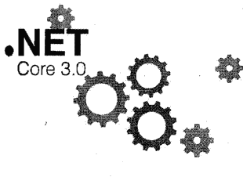

## 第 4 章。GUI 开发最佳实践：用户体验

开发 GUI 应用程序需要在此非常特定的技术领域具备最低限度的专业知识。如果您没有用户界面设计经验，本章是必读章节。无论您使用何种语言、平台或机器进行开发，某些 GUI 应用程序的实践都是通用的。我们将回顾其中一些最有用的最佳实践，以帮助您设计 GUI。这些实践将定义一个对用户更高效、更具吸引力的 GUI（这一点不可忘记：用户）。

本章将努力帮助您为应用程序提供最佳用户体验。

设计应考虑一些基本规则和设计准则。它必须遵循定义成功图形界面的原则：

- 一致性。
- 可读性（以及可扫描性）。
- 逻辑结构化。
- 非正式化（保持简单）。

在构思应用程序的多个屏幕时，许多基本步骤可以使用用户验证概念来定义：

- 用户的一项任务应对应一个屏幕。
- 屏幕之间的一致导航系统。
- 绘制表单（或屏幕）草图可以帮助您优化展示和交互。

设计的基本方面也不应被忽视：

- 控件类型的设计与选择。
- 视觉布局的设计（布局、面板、组 ...）。
- 字体的选择（根据目标外观和感觉选择合适的字体）。
- 配色方案的选择（与应用程序和/或用户企业环境的目的保持同步）。

对于使用或显示大量数据的应用程序，这一点非常重要。在这种情况下，必须引导用户的视线，以避免显示可访问信息的复杂性。

有关图形界面设计一般概念的更多信息，您可以查阅关于“交互系统的人本设计过程”的 ISO 13407 标准，该国际标准描述了在 GUI 设计中采用以用户为中心方法的好处。

以下准则将协助您创建相关的 GUI 设计，但仅凭它们本身是不够的。

在定义界面外观时，一个主要考虑点是与用户协作绘制界面草图。这是 GUI 最终设计中的一个核心点，您绝不能忘记。

### 4.1 界面定义的最佳实践

当前系统界面（Microsoft、Apple 或 Gnome）在其标准定义中已经包含许多相关（且经过深思熟虑）的功能，但您在可用功能之间所做的选择必须适应您项目的特定目的。

以下是为您的应用程序创建 GUI 的建议列表：

- 关注用户和要完成的任务，定义人们将如何使用 GUI。
- 考虑用户对任务的看法，一项任务对应一个屏幕设计（在最佳情况下）。对于复杂任务，将其分解为尽可能多的简单任务，对应尽可能多的屏幕/表单。在这些情况下，不要犹豫使用向导类型的界面。
- 设计常见情况（而非特定情况），常见的工作流程应在导航系统中自然实现。特定情况可以在考虑主流程后添加（而不是之前）。
- 提供信息而不仅仅是数据，大量待显示的信息可能会让用户感到困惑，在这些情况下，使用根据用户视角计算和汇总的数据来呈现信息（汇总数据）。
- 为响应性设计，这是软件与用户进行持续交互的能力。
- 通过设计设定预期（突出常见选择并使用指示性颜色红色、绿色）
- 预料到错误并设计相关且有用的错误消息。
- 使用测试人员（理想情况下是用户）来验证您的设计，并验证草图或原型设计。
- 考虑应用程序将被使用的用户上下文。
- 界面一致性，但界面的恒定性可能难以定义且因人而异，您必须与用户共同定义这一点。
- 使用标准，作为用户的您自己知道某些功能应根据标准如何显示。

在界面设计过程中牢记这些注意事项的同时，您还应整合定义图形界面的四个关键点：

- **可扫描性：** 用户相当懒惰，不会仔细阅读屏幕上的每个元素，因此请保持易于扫描，尽可能提供图形，并尽可能缩短链接、标签和信息文本。
- **组成：** 以与所实现功能一致的方式组织不同的屏幕或表单。按功能对控件进行分组，所使用的逻辑应是项目领域的标准专业领域。所使用的术语也是职业中使用的术语。
- **注意细节：** 在设计合适的 GUI 时，细节的重要性不容忽视。细节决定您的界面是出色还是糟糕，聘请专业人士进行此阶段可能看起来很昂贵，但最终产品的整体质量将大幅提升。
- **保持表单惯性：** 在表单使用期间保持相同的显示，仅更新必须更新的数据（使用颜色更新来标记阈值或趋势）。根据数据以不同布局更新表单可能会让用户感到迷失方向，请尝试为相同任务保持相同的屏幕/表单格式（无论值上下文如何）。这将确保您界面的一致性。

### 4.2 通用屏幕设计和人体工程学概念

良好的屏幕设计应首先考虑功能（用户将用它做什么），然后再考虑展示。

但是，对于复杂任务或需要显示大量信息的情况，展示设计的目标还包括引导用户关注任务的逻辑流程或重要信息（即用户通常寻找的信息）。

在本节中，我们将向您展示如何使用合适的工具（通常是图形设计师）设计合适的图形用户界面。

GUI 的主要组件是控件（也称为小部件）。控件包括：

- 标签，
- 链接，
- 文本框，
- 复选框，
- 组合框，
- 按钮，
- 单选按钮，
- 滑块，
- 菜单，滚动条
- 不同类型的布局，
- 面板
- 窗口
- ....

这些控件是您定义 GUI 时将使用的基本元素。

### 4.3 布局建议

以下是设计窗口（屏幕或表单）布局时需要牢记的准则简要摘要：

- 将控件大小调整为与其典型内容相匹配。


- 将控件右对齐，并尽量使其大小一致（当这不与第一条建议冲突时）。
- 布局平衡，窗口布局必须使用窗口的两侧（左和右），如果一侧的控件比另一侧多，请尝试调整其大小（变大）或使用组控件将其移到另一侧。
- 布局调整大小，如果窗口可调整大小，请确保在更宽的窗口中调整大小会显示更多数据，但也要注意窗口最小尺寸上的数据量。

#### 4.3.1 使用的控件类型

以下是根据控件应解决的逻辑情况选择控件类型的一些建议：

- 不要混淆复选框和单选按钮。
- 不要将命令按钮用作切换开关。
- 不要将选项卡用作单选按钮。
- 不要使用过多选项卡。
- 不要使用不可编辑的文本字段（如果不可编辑，那就是标签）。
- 当可以使用其他控件时，不要使用文本字段。
- 为输入字段和控件使用默认值。

#### 4.3.2 如何使用控件

系统中提供的每个标准控件（或小部件）都应以其标准方式使用。不要为标准控件实现特殊行为（如果需求非常具体，请定义一个新控件），并尽量坚持每个控件的标准用法。

以下是为您在设计窗口时将使用的最常见控件（小部件）提供的快速指南：

##### 文本（标签）：

- GUI 的文本应尽量简短（普通用户反正也不读）。
- 必须使用用户的术语和词汇（而不是 IT 术语）。
- 不要大写您使用的控件名称：组、菜单、工具栏、工具提示……

##### 按钮：

- 不要使用通用标签（取消按钮除外），使用与您的应用程序领域相关的特定术语。
- 如果按钮用于回答问题，请确保应用程序至少提供两个选项（不要只为一个疑问窗口提供一个按钮）。
- 对齐同一功能级别的所有按钮（布局或组的左侧、右侧、顶部或底部，或与其所属组对齐）。将命令按钮对齐到窗口底部。

##### 输入：

- 尽量少使用文本字段控件。
- 在列表框、选项按钮和复选框之间谨慎选择。
- 控件的大小应与预期数据成比例（文本字段框的大小）。

##### 菜单：

- 尽可能避免多级级联菜单（改用上下文菜单，避免过于复杂）。
- 准确命名菜单项（标签应明确具体功能）。
- 添加用户预期的菜单项（而不是根据您的后端架构）。

##### 工具栏：

- 尽可能为功能使用标准图标。
- 为不同功能选择不同图标（尽可能避免图标之间的相似性）。
- 仅为常用功能向工具栏添加按钮。
- 避免同时显示超过 4 个工具栏（这可能会让用户感到困惑）。

关于正确使用“错误消息”对话框，以下是一些建议：

##### 错误消息：

- 如果用户未执行任何操作，请勿显示错误消息。
- 错误消息应向用户提供解决问题的方案（在可能的情况下）。
- 如果用户没有解决方案，请勿在按钮上使用“确定”；使用“关闭”。
- 不要添加音效。
- 使用错误图标，并向用户说明他可以做什么。
- 不要使用以下词汇：
  - 错误，失败（改用“问题”）
  - 失败（改用“无法”）
  - 非法，错误（改用“不正确”或“无效”）
  - 中止，终止，结束（改用“停止”）
  - 灾难性，致命（改用“严重”）

#### 4.3.3 绘制应用程序窗口草图

无论如何，在开发前最好先绘制屏幕草图，这样可以让您可视化所构思的设计在实际设计中是否符合您的预期。

通过绘制屏幕设计草图，您将识别出信息过多或过于空白，或者单纯不悦目的屏幕（此事存在很大主观性）

有许多专用软件可用于实现 GUI 草图。其中大多数是在线工具。以下是这些在线工具中最知名的非详尽列表。

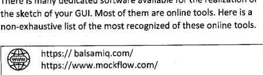

当然，您可以使用专用桌面应用程序来设计项目的模拟屏幕。

**DesignerVista** 是理想选择，如果您不使用专业设计师的服务且没有设计能力。使用此工具，开发人员可以完成屏幕的模拟设计。

以下是 DesignerVista 的截图，这是一款用于设计用户界面模拟图的软件。

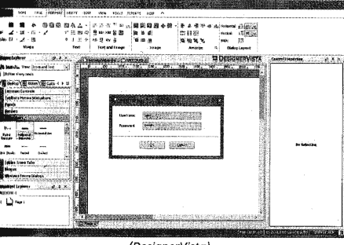

您也可以使用设计师喜爱的工具 Photoshop 来完成每个屏幕的设计（即使这对于草图来说似乎有点大材小用），Photoshop 有多种免费的 GUI 工具包可用。

免费应用程序 Adobe XD 也可能很有用，即使该工具更偏向网站和移动应用程序。

您为应用程序用户界面设计选择的工具，也将由您为应用程序选择的技术类型决定。

- http://www.adobe.com/products/xd.html
- http://www.adobe.com/products/photoshop.html
- http://www.designervista.com/

#### 4.3.4 排版

您为项目选择的字体体现了应用程序的重要性。

大多数时候您将使用标准系统字体（尤其是使用原生 GUI 时）。但字体现在是用户注意到的一种智力精致的标志。

选择合适且一致的字体是设计应用程序用户界面时的重要任务之一。

在用户（企业）已有内部或专用字体的情况下，尽可能使用它。

如果您在 GUI 图形设计方面有一定的自由度，请选择与目标受众文化相符的字体

您可以使用在线资源来了解排版可以为您的文本提供的多样性。

- http://www.dafont.com
- http://www.fontsquirrel.com
- http://www.fontspace.com
- http://www.fontstorage.com
- http://www.abstractfonts.com
- http://www.1001freefonts.com

如果您想使用特殊字体，可以使用程序在 Windows、Linux、macOS 之间转换，或根据您的意愿对其进行修改。

虽然 FontLab 是字体创建的参考标准，但有许多免费软件可用。创建/转换/修改字体的参考程序是：

- http://www.fontlab.com (Fontlab and Transtype)
- http://fontforge.github.io/
- http://birdfont.org/
- http://cr8software.net/typelight.html

这些工具将允许您使用为应用程序决定使用的“特定”字体，而不受多平台要求的限制。

#### 4.3.5 配色方案

配色方案（颜色组合）是设计界面时不应忽视的一点。

对于多文化环境，请考虑应用程序运行的文化，在这种情况下，您必须为应用程序针对的每种文化定义特定的配色方案（例如：亚洲与西方在金融市场趋势颜色上的差异：绿色<->红色）

颜色的使用在两个主要方面起决定性作用：

- 您的应用程序的外观和感觉。用户对应用程序的感知，至少部分地，由特定配色方案的使用所决定。
- 在窗口中突出显示重要信息，当您有大量数据显示时。您可以选择醒目的颜色来吸引用户对您显示的屏幕中重要内容的注意。


有“标准”可帮助您构思配色方案：

- 单色：每种颜色都取自同一基础颜色（例如：多种蓝色），通常看起来非常平滑，并产生舒缓效果。
- 类似色：使用一种主色，其他颜色用于丰富方案
- 互补色：在色轮上，互补色位于彼此相对的位置，会产生强烈的对比效果。

您也可以使用专业工具；**Adobe Color CC**（作为 Adobe Capture CC 的一部分）为您的应用程序生成优雅且相关的配色方案。另一款似乎是配色方案设计参考的软件是 **Paletton**（“配色方案设计器”）。

http://color.adobe.com/Create
http://www.paletton.com/

### 4.4 多平台 GUI 设计的挑战

这只是您为应用程序设计每个窗口（或表单）所需进行的人体工程学设计工作的预览。

如果您打算自己制作专业设计的应用程序，应该查阅该主题的专门书籍。

每个操作系统开发者都提供关于良好 GUI 设计的指南，这些网站可以作为了解各操作系统编辑者对该主题的看法（并理解每个操作系统的特点）的良好起点。

以下是各平台似乎是该领域参考的网络资源列表：

- https://developer.apple.com/design/human-interface-guidelines/macos/
- https://theblog.adobe.com/4-golden-rules-ui-design
- https://developer.gnome.org/hig/stable/
- http://goo.gl/ui
- https://www.uxpin.com/studio/blog/guide-design-consistency-best-practices-ui-ux-designers/
- https://docs.microsoft.com/en-us/windows/desktop/uxguide/how-to-design-desktop-ux

多平台应用程序的设计可能非常复杂，具体取决于您通过开发它们想要实现的目标。在许多情况下，您将不得不选择是要为每个目标操作系统获得最佳体验（无论应用程序在不同操作系统上的相似性如何），还是无论应用程序在哪个操作系统上运行都提供统一体验。

这一选择将使您选择一种 GUI 而非另一种。为所有这些因素找到最佳组合是选择用户界面开发类型时的棘手部分。通过遵循所介绍的最佳实践，您将能够为应用程序制作出色的 GUI 设计，并满足用户在该领域的期望。

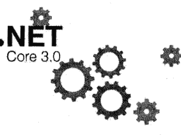

## 第 5 章 C# 应用程序的基本编程技术

除了图形用户界面的开发外，桌面应用程序还需要一些一般编程技术的最低限度知识（用于桌面、Web、后端 ...）。

在本章中，我们将为您提供使用 .NET Core 3 开发应用程序时所需的几种常见功能的编码基本实践。本章旨在提供 .NET Core 中使用的最新编程技术的基本知识。

这些基本准则将涵盖：

- 应用程序配置存储。
- 跟踪和日志记录（标准，Serilog）。
- 数据访问（Entity Core）。
- 外部服务访问（REST 服务）。
- GUI 线程。
- 使用非托管代码依赖项（p/Invoke）。

以下实践将为您在应用程序开发中遇到的常见问题提供快速简便的答案。相关的网络参考将使您能够获取特定主题的补充信息。

### 5.1 应用程序配置

在许多情况下，您将不得不使用配置文件来存储诸如“connectionString”（用于数据库访问）、用户凭据、服务端点等信息。您不希望将这些数据存储在数据库中（因为它们不经常更改，但您不能将其硬编码，因为它们可能会更改）。您必须使用配置文件。

在 .NET Framework 中，这是由著名的“app.config”文件（一种 XML 格式的文本文件）处理的，但在 .NET Core 中情况略有不同。

对于 .NET Core 应用程序，您仍然可以使用 INI、Config 或其他自定义配置提供程序，但存储配置信息的标准方式是使用“appSettings.json”文件。

“app.config”的 XML 格式已被更紧凑的 JSON 格式取代（您仍然可以使用适当的提供程序使用 XML 格式）。.NET Core 3 不包含用于此目的的内置配置管理系统，您必须添加相关的 NuGet 包（这是使用 .NET Core 3 添加功能的标准方式）。

可以通过向项目添加专门的 NuGet 包来完成此操作（使用 Visual Studio 2019“包管理器”）：


现在数据存储在 JSON 格式的文件中，但主要的使用技术仍然适用。

以下是一个基本“appSettings.json”文件的示例：

```
appSettings.json
{
  "firstname": "Dimitri",
  "lastname": "K"
}
```

不要忘记通过更改文件属性（如下图所示，图 1）将“appSettings.json”文件复制到目标生成文件夹：

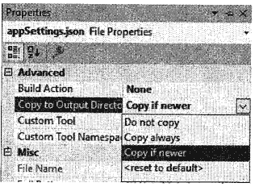

（图 1）

读取此文件可以用几行代码完成。由于 JSON 格式使用原始值和检索文本格式，您必须手动将它们转换为所需类型。

以下是一个小程序（ProgramConfig.cs），说明如何从先前描述的配置文件中检索数据：

#### ProgramConfig.cs

```csharp
using System;
using System.IO;
using Microsoft.Extensions.Configuration;
using Microsoft.Extensions.Configuration.Json;

namespace ConfigProgram {
    class Program {
        static void Main(string[] args) {
            var config = new ConfigurationBuilder()
                .SetBasePath(Directory.GetCurrentDirectory())
                .AddJsonFile("appsettings.json", true, true)
                .Build();
            Console.WriteLine($"Hello Mr {config["firstname"]} {config["lastname"]}");
            Console.ReadKey();
        }
    }
}
```

如您所见，只需一行代码即可声明、读取配置文件并构建 ConfigurationBuilder 对象。该对象（实际上是一个接口类型）使用一组键/值来存储配置属性。此外，该对象还提供检索强类型配置中使用的实例对象值（通常很有用）的可能性。

Microsoft.Extensions.Configuration 提供了一个架构部分/项，加载部分和项的主要方法是：

- GetChildren()：获取子部分的后代。
- GetSection(string)：获取具有特定键的部分。

当然，这是一个基本示例，但 Configuration 生成器提供了管理复杂约束的可能性，例如层次结构 JSON、多个（数组）值检索、使用机密值以及此处未描述的许多其他情况。

这只是包方法的简要摘要，您可以通过参考下方的链接找到关于此特定主题的详尽信息来源：

https://docs.microsoft.com/en-us/dotnet/api/microsoft.extensions.configuration
https://garywoodfine.com/configuration-api-net-core-console-application

关于在 .NET Core 3 中使用配置文件的结论是，Microsoft 包提供的基本配置工具非常强大，适用于大多数应用程序需求。有许多类型的配置文件（JSON、XML、INI ...）的提供程序。当然，如果您在此事上有特殊要求，可以编写自己的提供程序。

您可以在 netcore3 GitHub 上检索一个可用的示例项目。

```
https://github.com/netcore3/CodeBook/Chapter 5/1/configProgram
```

### 5.2 日志记录和跟踪

.NET Core 具有内置的日志记录/跟踪机制。此机制对于基本日志记录需求非常方便。但如果您需要更高级的日志记录机制（例如用于错误处理自动化系统），则必须使用更高级的工具。

有许多解决方案（您可以查看 NuGet 存储库）可用于向应用程序实现结构化日志记录系统，最常用和流行的是 Log4NET、NLog 和 Serilog。


这3款产品都非常出色，并能适应特定需求，但在此部分，我们将为简化起见详细介绍Serilog的使用，不过如果你有兴趣为自己的应用程序使用Log4NET和Nlog解决方案，也欢迎自行探索。

#### 5.2.1 Microsoft .NET Core 日志系统

Microsoft 目前为应用程序的日志记录、跟踪和调试功能提供了相关包。这个封装为你的应用程序的日志记录和跟踪需求提供了基本功能。

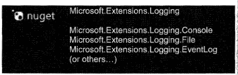

下面是一个使用这些Microsoft包来记录应用程序活动的简单程序。

##### SampleMsLog.cs

```
public static void Main(string[] args = null)
{
    ILoggerFactory LoggerFactory = new
    LoggerFactory().AddConsole[...];
    ILogger logger =
    LoggerFactory.CreateLogger<Program>();
    logger.LogInformation("This is a test of logging information system.");
}
```

首先，你需要先创建一个日志工厂实例，然后指定你想要用于有效执行日志记录的提供程序（示例中为：“AddConsole”）。

这是一个创建基本日志系统的简单方案，但如果你的开发对日志记录、跟踪和调试有特殊要求，你应该进一步探索使用更高级系统的可能性：Serilog。

#### 5.2.2 高级结构化日志系统：Serilog

Serilog 是一个结构化日志系统，目前基于 .NET Standard 2.0 实现，因此可以在 .NET Core 3 项目中使用。Serilog 是一个用于向文件提供诊断日志记录的库。它易于设置，与其他日志库不同，它在设计时就考虑到了强大的结构化事件数据，因此非常适合桌面应用程序开发。

使用这个日志系统，你可以实现一个控制台调试窗口来跟踪你决定关注的应用程序的每个事件，并实时查看应用程序内部的运行情况。

##### 5.2.2.1 安装 Serilog

你需要在 Visual Studio 中使用包管理器 GUI 或包管理器命令行添加 NuGet 包“Serilog”。之后，你还需要安装特定于你想要使用的输出类型的包（称为“Sinks”）。

一个“Sink”描述了你想要为项目实现的日志记录类型。

除了文件和控制台之外，还有许多其他类型的 Sinks 已经可用，你可以将应用程序的日志写入数据库、云端或 Microsoft Teams 系统等……

##### 5.2.2.2 配置

Serilog 的配置非常简单，在大多数情况下不需要特定的配置文件。不过，你可以使用一个配置文件来满足日志系统的特定要求（有关更多信息，请参阅参考网站）。

如果你在这方面有特殊需求，也可以参考 GitHub（Serilog 是开源的）仓库。

##### 5.2.2.3 创建 Logger 并使用 Sinks

首先，你需要创建一个 Logger 对象：

```
Log.Logger = new LoggerConfiguration().CreateLogger();
```

创建 Logger 对象后，需要将其链接到指定的外部表示（例如文件或控制台窗口）

对于控制台日志系统。

```
Log.Logger.WriteTo.Console();
```

或者，如果要使用文本文件作为输出：

```
Log.Logger.WriteTo.File("log.txt",
outputTemplate: "{Timestamp:yyyyMMdd
HH:mm:ss } {Message:lj}");
```

有关日志格式的更多信息，请参阅提供的参考网站（下方提供了链接）。

##### 5.2.2.4 日志级别

Logger 完全配置后，你可以开始以 Information 级别记录日志：

```
Log.Information("Here is the logging!");
```

有多个级别可用于日志记录：

- 详细
- 调试
- 信息
- 警告
- 错误
- 致命

你可以配置 Logger，仅在定义的级别输出日志。

下面是一个简单示例程序，用于说明 Serilog 的基本用法。

##### ProgramSampleSerilog.cs

```
static void Main(string[] args)
{
    Console.WriteLine("Hello Serilog!");
    var loggerConfiguration = new
        LoggerConfiguration()
        .WriteTo.ColoredConsole()
        .Enrich.WithMachineName()
        .MinimumLevel.Debug();
    var logger =
        loggerConfiguration.CreateLogger();
    Log.Logger = logger;
    Log.Information("Starting up.");
    var sleepPeriodInSeconds = 60;
    if (args.Length > 0 &&
        int.TryParse(args[0], out sleepPeriodInSeconds))
    {
        Log.Information("Sleep interval provided {SleepPeriodInSeconds}", sleepPeriodInSeconds);
    }
    var sleepPeriod =
        TimeSpan.FromSeconds(sleepPeriodInSeconds);
    while (true)
    {
        var coinToss = Random.Next(0, 2);
        Log.Information("Coin Toss... {CoinToss}", coinToss);
        var instance = coinToss == 0 ? new WithPropertyInit() : null;
        Log.Information("Doing Work... {NameOfProp}", instance?.NameOfProp());
        Log.Information("{Instance}", instance);
        Thread.Sleep(sleepPeriod);
    }
}
```

可以看出，Serilog 使用非常简单，并提供大量自定义功能。这在许多应用程序开发场景中都是一个特别相关的选择。这是一个拥有活跃社区的开源项目，文档也非常丰富。

你可以深入了解 Serilog 的使用：

- http://www.serilog.net
- https://www.github.com/serilog

### 5.3 数据访问：Entity Framework Core

使用 .NET Core 3 时，开发者仍然可以使用经典方式（如 .NET Framework 中所做的）来访问数据库（命令、请求读取器...），但对于现代高级软件解决方案，数据访问需要以标准化方式分层（使用 ORM）。

.NET Core 中的数据访问应使用 Entity Framework Core 组件（一个 NuGet 包）来完成（这不是强制性的，但强烈推荐）。这是微软开发的、继承自 .NET Framework（Entity Framework）的 ORM（对象关系映射器）。

Entity Framework Core 遵循了 .NET Framework 所开创的趋势，转向更轻量的多平台环境。

EF Core 包含一组 API，允许你以结构化的方式（代码可读性好、可维护性好）访问数据。它允许你使用 .NET 对象实例来处理数据（支持 LINQ 查询）。

EF Core 简化了你为应用程序构建数据访问层的工作。实际上，EF Core 可以为你生成该层。

#### 5.3.1 数据库提供程序

与它的前身 Entity Framework 6 一样，EF Core 已经集成了许多数据库提供程序，例如：

- SQL Server
- MySQL
- SQLite
- Oracle
- PostgreSQL
- CosmosDB（来自 Microsoft 的 NoSQL 数据库）
- ……以及更多提供程序将继续被添加，因为 EF Core 社区非常活跃。

更多提供程序可以在此处找到：

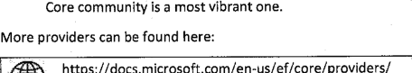

#### 5.3.2 EF Core 的架构

EF Core 为开发者提供了一个集成的分层解决方案，可以抽象应用程序的数据库操作，以使用 .NET 对象。

这种分层在数据库托管系统方面提供了更好的灵活性（例如，如果你需要更改所使用的数据库类型）。

它还为开发者提供了使用高级 .NET 功能来操作数据对象的能力，例如：使用 Lambda 函数、使用 LINQ 查询。

下图说明了 EF Core 的一般架构：

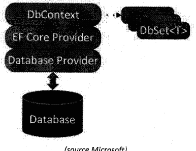

#### 5.3.3 EF Core 安装

要在项目中使用 EF Core，你需要包含针对要使用的数据库类型的特定包，以及允许在代码中使用高级功能的 EF 工具。

如果你使用 SQL Server，需要包含的包如下：


安装与往常一样，可以使用包管理器，也可以直接从 Visual Studio 项目窗口（管理包）进行。

#### 5.3.4 数据模型

使用 EF Core 开发应用程序时，可在两种不同的方法之间进行选择，以实现与数据库的集成：

- A) 模型优先：

使用此方法时，数据模型由你的数据模型（通过代码）定义。当使用数据库存储应用程序生成的数据时，采用这种方法很有意义。当数据库尚未定义，或从头开始开发应用程序时，使用模型优先存储。

- B) 数据库优先：

使用此方法时，你需要对数据库进行逆向工程以生成数据模型。当使用预先存在的数据库，或当数据库由团队的其他成员（例如数据库开发人员）开发时，使用此方法。

要从数据库启用数据模型的脚手架，首先需要安装所需的包：该包将允许你使用 PowerShell 命令：`Scaffold-DbContext.`

以下是在包管理器窗口中执行此 PowerShell 命令的示例命令：

```
PM>Scaffold-DbContext
-Connection
"Server=(localdb)\\mssqllocaldb;Database=MyDb;Trusted_Connection=True;"
-Provider
Microsoft.EntityFrameworkCore.SqlServer
-OutputDir ./DataModel
-Context MyDbContext
-Tables <tablename>
```

这种“脚手架”将生成 .cs 文件，用于定义你在代码中可以操作的对象。默认情况下，数据库中的每个对象都会生成一个文件，但你可以指定要为哪些表生成（例如，使用 -Tables 针对特定表）。编写本书时，不允许对特定视图或存储过程进行脚手架生成。

请查阅工具提供的在线帮助，以获取可用于生成所需数据模型的所有选项列表。

#### 5.3.5 使用 EF Core 的建议

使用 EF Core 开发应用程序（使用 Visual Studio 2019）时，应考虑使用 Visual Studio 市场上提供的专用插件，例如 Entity Framework Visual 编辑器、EFCore PowerTool、EntityDeveloper Express：

- https://marketplace.visualstudio.com/items?itemName=ErikEJ.EFCorePowerTools 图表模型
- https://marketplace.visualstudio.com/items?ItemName=michaelsawczyn.EFDesigner
- https://marketplace.visualstudio.com/items?itemName=DEvartSoftware.EntityDeveloperExpress

这些 Visual Studio 扩展不仅是简化使用 EF Core 编码工作的插件，还允许你以图形方式建模数据架构（Visual Studio 中尚未内置此功能），它提供了与 Entity Framework 6 中已有的相同工具（你的数据的图表模型）。

你还可以使用专用产品（面向专业用户）从数据库生成对象（ORM）：

Devart Software 的 Entity Developer（与免费插件相同的软件发布商）是一款产品，为你的 ORM 数据模型的构思和/或生成提供了原创解决方案（多目标 ORM：NHibernate、Entity Core ...）。该工具将使工作更加轻松，并大大节省保持数据库与数据模型同步的时间。

https://www.devart.com/entitydeveloper/

#### 5.3.6 EF Core 基本用法示例

以下是一个示例程序，用于说明使用数据模型优先的 Entity Framework Core（请注意，原样复制并不简单，通常出于明显的可读性原因，你需要在不同的源 (.cs) 文件中定义数据对象，但它可以帮助你快速理解 EF Core 的底层理念。

ProgramEFCoreDemo.cs

```
using System;
using System.Data.Entity;
using System.Linq;

namespace EFCoredemo
{
    internal class Program
    {
        public static string ConnectionString =
            "Server=localhost;Initial Catalog=EFCoreDemo;Integrated Security=True";

        public static void Main()
        {
            // CLEAR
            using (var context = new EntityContext())
            {
                context.Customers.RemoveRange(context.Customers);
                context.SaveChanges();
            }

            Console.WriteLine("Database clearer...");
            Console.WriteLine("");
            Console.WriteLine("---");
            Console.WriteLine("");

            // ADD 2 new customers
            using (var context = new EntityContext())
            {
                context.Customers.Add(new Customer
                {Name = "Customer A", Description = "Description", IsActive = true});
                context.Customers.Add(new Customer
                {Name = "Customer B", Description = "Description", IsActive = true});
                context.SaveChanges();

                Console.WriteLine("Customers added.");
            }

            using (var context = new EntityContext())
            {
                foreach (var customer in context.Customers.ToList())
                {
                    Console.WriteLine("");
                    Console.WriteLine("Customer.Customer ID : " + customer.CustomerID);
                    Console.WriteLine("Customer.Name : " + customer.Name);
                    Console.WriteLine("Customer.Description : " + customer.Description);
                    Console.WriteLine("Customer.IsActive : " + customer.IsActive);
                }
                Console.WriteLine("");
            }

            Console.WriteLine("---");
            Console.WriteLine("");
            using (var context = new EntityContext())
            {
                var list = context.Customers.ToList();

                list.First().Description = "Updated A";

                context.Customers.Add(new Customer
                {Name = "Customer_C", Description = "Description"});

                context.SaveChanges();
                Console.WriteLine("Customers added/updated. ...");
            }
            using (var context = new EntityContext())
            {
                foreach (var customer in context.Customers.ToList())
                {
                    Console.WriteLine("");
                    Console.WriteLine("Customer: CustomerID : " + customer.CustomerID);
                    Console.WriteLine("Customer.Name : " + customer.Name);
                    Console.WriteLine("Customer.Description : " + customer.Description);
                    Console.WriteLine("Customer.IsActive : " + customer.IsActive);
                }
                Console.WriteLine("");
                Console.WriteLine("---");
                Console.WriteLine("");
            }

            Console.WriteLine("Press any key.");
            Console.ReadKey();
        }
    }
}
public class EntityContext : DbContext
{
    public EntityContext() : base(ConnectionString)
    {
    }

    public DbSet<Customer> Customers { get; set; }
}
public class Customer
{
    public int CustomerID { get; set; }
    public string Name { get; set; }
    public string Description { get; set; }
    public bool IsActive { get; set; }
}
```

此示例可在 Windows、Linux 和 macOS 上运行，并可使用 .NET Core 3 进行编译。

#### 5.3.7 Entity Framework Core：教程与学习

正如我们所见，EF Core 是一种熟练且成熟（随着每个新版本而日益成熟）的解决方案，用于解决 .NET Core 3 应用程序中的数据库访问问题。你可以通过查阅以下网站深入了解该主题，这些网站将提供关于使用 Entity Framework Core 优势的更详细视图。

https://docs.microsoft.com/en-us/ef/core/

http://www.entityframeworktutorial.net/efcore/entity-framework-core.aspx
https://entityframeworkcore.com
https://www.learnentityframeworkcore.com/

### 5.4 外部服务消费

在许多情况下，你需要在应用程序中使用外部服务（API、Web 服务...），.NET Core 拥有用于此目的的专用包和功能。

为简化起见，我们将考虑 REST（表述性状态转移）服务的消费，因为这是你在开发中最常遇到的服务类型。REST 是一种基于 HTTP 请求协议及其相关动词的协议：

- GET：用于数据检索。
- POST：用于从客户端向服务器添加数据
- PUT：用于更新服务器上的数据
- DELETE：用于删除服务器上的数据。

由于 .NET Core 的关键设计目标之一是最小化 .NET Core 安装的大小，你需要将所需的依赖项（包）添加到项目中。


添加所需依赖项后，即可开始使用 REST 服务的过程。你可以通过三个基本步骤实现此目的（此示例是对服务的查询）：


- 1. 构建请求。
- 2. 处理请求并检索数据（结果）。
- 3. 处理结果。

#### 5.4.1 构建 Web 请求

首先，您需要指定端点地址，完成后将实例化 HttpClient 类来执行 Web 请求。此 API 仅支持异步方法（在处理网络操作时很有用）。Web 请求任务将由异步方法执行（请参阅 REST 客户端示例代码）。

#### 5.4.2 处理请求并检索数据

Web 请求的调用将使用 await 关键字完成（这是一个异步方法）。

#### 5.4.3 处理 JSON 结果

从 REST 服务检索数据后（HTTP 状态码 200），您需要将 JSON 结果转换为可用的 C# 对象。为此，您需要编写一个与您预期的 JSON 结果格式匹配的对象类型的类。

提示：在 Visual Studio 中，使用菜单 Edit/Paste special/Paste code as class 从 JSON 数据生成 C# 对象。

定义类后，您只需使用 DeserializeObject 方法，用结果中的值实例化您的类。

#### 5.4.4 REST 客户端示例代码

以下是一段代码片段，用于说明在您的 .NET Core 3 应用程序中使用 REST Web 服务。

##### ProgramRESTClient.cs

```
BasicHttpBinding basicHttpBinding = null;
EndpointAddress endpointAddress = null;
ChannelFactory<IAService> factory = null;
IAService serviceProxy = null;
try
{
    basicHttpBinding = new BasicHttpBinding(BasicHttpSecurityMode.Transport);
    basicHttpBinding.Security.Transport.ClientCredentialType = HttpClientCredentialType.Basic;
    endpointAddress = new EndpointAddress(new Uri("https://uri.com/api/"));
    factory = new ChannelFactory<IAService>(basicHttpBinding, endpointAddress);
    factory.Credentials.UserName.UserName = "usr";
    factory.Credentials.UserName.Password = "pass";
    serviceProxy = factory.CreateChannel();
    using (var scope = new OperationContextScope((IContextChannel)serviceProxy))
    {
        var result = await serviceProxy.getSomethingAsync("id").ConfigureAwait(false);
        factory.Close();
        ((ICommunicationObject)serviceProxy).Close();
    }
}
catch (MessageSecurityException ex)
{
    throw;
}
catch (Exception ex)
{
    throw;
}
```

### 5.5 线程化 GUI

如前一章所示，应用程序的响应能力是用户对桌面应用程序整体质量感知的关键指标。

通过为每个重型处理任务和用户界面任务分配各自的线程，可以实现应用程序的良好响应能力。因此，主进程永远不会过载，无论之前的指令如何，应用程序都能继续响应用户（响应能力）。

根据您为开发多平台应用程序（控制台、XAML、HTML、原生 UI 等）所希望使用的解决方案类型，有几种方法可以实现这种线程化。

您应用程序中长时间且复杂任务的线程化可以在进度窗口中完成，在该窗口中显示一个仪表（或其他进度指示器）控件，并向用户提供取消正在进行的操作的选项。

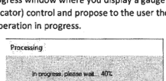

（示例进度窗口）

但大多数情况下，线程化没有自己的窗口，而是通过某种信息栏向应用程序报告操作状态。这可以通过使用委托和常见的线程技术来实现（如以下示例所示）。

以下简单的 .NET Core 3 WinForms 示例说明了如何通过使用委托来实现：

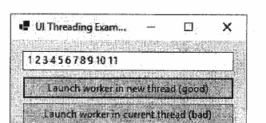

（UI_Threading_示例）

此示例说明了在 GUI 应用程序中使用线程化的有用性，与非线程化方法相比，非线程化方法在进程执行期间会冻结窗体（用户失去控制）。

此示例的完整项目可在线查看。

> https://github.com/netcore3/CodeBook/Chapter 5/5/UI_Threading_Example

在 GUI 中实现（编码）线程化有许多其他方法，只需考虑您应该将功能操作的处理实现在程序的主 GUI 线程之外（所使用的方法并不重要，本书中介绍了许多不同的方法来实现这一点）。

### 5.6 使用非托管依赖项

使用 .NET Core 3 进行多平台开发有时将涉及使用特定于平台的依赖项（Windows 上的 .dll 文件，ubuntu 上的 .so 文件，macOS 上的 .dylib 文件）。

开发人员从其 .NET Core 3 程序访问非托管方法的能力对于进行多种类型的项目是强制性的。

您必须牢记，在多平台上下文中，您需要为每个平台获取本机库文件（或该平台的等效文件），在本例中为 Linux、macOS、Windows。

因此，在实际在 Windows 平台上开发之前，请验证您计划用于多平台项目的库是否可用于您针对的每个操作系统。

例如，许多系统函数仅通过本机 API 可访问，为此，您应该了解在 .NET Core 3（托管代码）中使用非托管代码的基本概念：

- P/Invoke
- 封送处理
- 确定运行的操作系统

提供这些功能的 .NET Core 3 包是：

#### 5.6.1 P/Invoke

P/Invoke 是 Platform Invocation Services 的缩写，该机制允许开发人员在其托管代码（.NET Core）中使用外部非托管依赖项。

以下是使用 P/Invoke 检索当前进程 ID（pid）的示例：

##### 对于 Linux (ubuntu):

```
using System.Runtime.InteropServices;

namespace PInvokeSample
{
    public static class Program
    {
        [DllImport("libc.so.6")]
        private static extern int getpid();
        public static void Main(string[] args)
        {
            int pid = getpid();
            Console.WriteLine(pid);
        }
    }
}
```

##### 对于 Windows:

```
using System.Runtime.InteropServices;

namespace PInvokeSample
{
    public static class Program
    {
        [DllImport("Kernel32.dll")]
        private static extern uint GetCurrentThreadId();
        public static void Main(string[] args)
        {
            int pid = GetCurrentThreadId();
            Console.WriteLine(pid);
        }
    }
}
```

对于此示例代码：检索当前进程 ID，最好将依赖项的副本放在应用程序文件夹中。在代码中使用系统本机库的一个棘手部分是检索每个系统中这些库的位置。这是您可能会遇到许多问题的一点，将库复制到项目文件夹（或项目中的子文件夹）可以帮助您解决大部分这些问题。您还必须验证项目上下文中的路径包含应用程序应在其上执行的操作系统所需的库。

在前面的示例中，我们可以看到本机调用会根据操作系统而变化，在这种情况下，多平台开发意味着为每个平台特定性生成代码。

如果您想使用操作系统系统 API 中尚未编写且不可访问的本机函数，则必须开发自己的库（每个操作系统一个版本）。

以下是关于每个操作系统系统 API 的一些参考链接。

- Windows: http://pinvoke.net
- Linux (ubuntu): http://kernel.org/doc/html/latest
- macOS: https://developer.apple.com/library/archive/navigation/

#### 5.6.2 封送处理

封送处理：是转换类型的过程，在需要时允许本机代码和托管代码（在本例中为 .NET Core 3）之间进行交叉。

以下是与 .NET Core 3 类型和本机类型一起使用的类型转换表。

| .NET 类型 | 本机类型 |
| :--- | :--- |
| byte | uint8_t |
| sbyte | int8_t |
| short | int16_t |
| ushort | uint16_t |
| int | int32_t |
| uint | uint32_t |
| long | int64_t |
| ulong | uint64_t |
| char | 取决于 P/Invoke 或结构的 CharSet，可以是 char 或 char16_t |
| string | 取决于 P/Invoke 或结构的 CharSet，可以是 char* 或 char16_t* |
| System.IntPtr | intptr_t |


| System.UIntPtr | uintptr_t |
|---|---|
| .NET 指针类型（例如 void*） | void* |
| 从 System.Runtime.InteropServices.SafeHandle 派生的类型 | void* |
| 从 System.Runtime.InteropServices.CriticalHandle 派生的类型 | void* |
| bool | Win32 BOOL 类型 |
| decimal | COM DECIMAL 结构体 |
| .NET 委托 | 本机函数指针 |
| System.DateTime | Win32 DATE 类型 |
| System.Guid | Win32 GUID 类型 |

In case of complex type (struct, object) please refer to the marshaling type conversion for .NET core (link in reference below). A cautious study of the documentation is needed if you plan to make cross-platform calls with complex objects and structures involved.

https://docs.microsoft.com/en-us/dotnet/standard/native-interop/type-marshaling

#### 5.6.3 操作系统检测与识别:

For the developer, knowing on which OS is running the application is mandatory when it comes to use native methods. This can be achieved by using the specific .NET Core methods contained in the System.Runtime.InteropServices library as described below:

- Method: System.Runtime.InteropServices.RuntimeInformation.IsOSPlatform()
- Arguments: OSPlatform.Windows, OSPlatform.OSX, OSPlatform.Linux

Part of the complexity of the multiplatform development, the native libraries does not have the same name in every OS. But the argument of DllImportAttribute have to be a constant.

You can use the following work around: use a specific object (for each OS) for the native method call, this interface will be Instantiated to the relevant type of object (with heritage from this Interface) according to the system and context where it is executed.

```
interface ILibPid
{
    int GetPid();
}

class LibPidWin : ILibPid
{
    [DllImport("libc.so.6")]
    private static extern int getpid();
    public static int GetPid()
    {
        return getpid();
    }
}
```

class LibPidWin : ILibPid
{
    [DllImport("kernel32.dll")]
    private static extern uint GetCurrentThreadId();

    public static int GetPid()
    {
        return (int)GetCurrentThreadId();
    }
}

(清单 1)

This workaround allows to select the appropriate native method according to the OS where the program is running on. You can achieve the OS platform detection by using the dedicated .NET Core methods or use the OSDescription string.

```
bool isWindows = System.Runtime.InteropServices.RuntimeInformation.IsOSPlatform(OSPlatform.Windows);
```

Or retrieve the system name string:

```
String OSName = System.Runtime.InteropServices.RuntimeInformation.OSDescription;
```

For example, here is the instantiation matching the previous declaration (listing 1).

```
LibPid inPid;
if (RuntimeInformation.IsOSPlatform == OSPlatform.Windows)
{
    inPid = new LibPidWin();
}
```

if (RuntimeInformation.IsOSPlatform == OSPlatform.Linux)
{
    inPid = new LibPidLin();
}

...

inPid.GetPid(); // The method works on several OS

...

(清单 2)

This is only a sample workaround implementation may be the specific required by your project does not match with this solution (but in most of the time it does). The use of an interface object and multiple class implementation does not avoid you to write the code for each platform but provide you an accessible object structure across these multiple implementations.

## .NET Core 3.0

## 第 6 章. 设置开发环境

The setup of the development environment is a crucial step in the development process, a proper setup will avoid you many pitfalls and contextual bugs further. So, you have to take a special care of each install, it means re-install the complete package even if you have some minor error messages during a setup.

For a better stability of each machine, it is preferable to setup a new platform for each OS your software will work on (fresh OS Linux, macOS and Windows; installed from scratch).

### 6.1 为每个目标平台创建开发者帐户

The development of multiplatform software implies that you have access to the knowledge bases of these platforms, for doing so the subscription to the developer web site of the platform you develop on will make easier the access to the specific knowledge you will need for your project.

The subscription to these web sites will also provide you:

- Keep you informed of the developer news for each platform through dedicated newsletter.
- Offer you forum, FAQ and blog access for technical assistance and/or development best practices.
- Provide trainings for new tools and concepts.
- Access to the complete documentation.

The web sites recommended are recognized by professional developers for the quality and the reliability of the information they provide.

Here is a non-exhaustive list of web sites who will provide you the documentation needed for your multiplatform project.

#### 适用于 Microsoft Windows:

Microsoft offers a large amount of web site for the developers using their technologies.

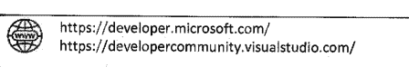

#### 适用于 ubuntu:

Linux have been developed for good part with the Opensource model thus Ubuntu does not provide any dedicated subscription for the developer using their system (it is more like a community of interests). Nevertheless, you can subscribe to Linux, GTK (gnome) and QT dedicated developer's web sites.

- https://gnome.org
- http://linux.com
- https://ubuntu.com/community
- https://developers.redhat.com
- http://qt.io
- https://www.linuxfoundation.org

#### 适用于 macOS:

The proprietary aspect of the macOS system have for consequences that it is the less documented of the three systems from the developer point of view (even if it's getting better with the time). The most useful information about the development on this platform is only accessible if you have a developer account (that's free) on the apple web site.

- https://developer.apple.com/

The access to C# developer web sites and general developer's Q&A web sites are also often useful when you develop an application on your own (without mentor).

- https://stackoverflow.com
- http://csharpcorner.com
- http://codeguru.com
- http://codeproject.com

提示: We can recommend that you use a dedicated email account (or create an alias address) for these subscriptions or registrations, the amount of unsolicited emails could be important and not always related to the center of interest of the subscriber.

### 6.2 物理计算机与虚拟机

The infrastructure where your development environment is deployed is a point to carefully consider. You can either use physical machine, virtual machine or a combination of both. But remember that the macOS system can be legally installed ONLY on an Apple computer.

This having been said, there are unofficial solutions that can allow you to virtualize macOS (with VMware or VirtualBox), but the use of such tools is not recommended in a development environment because of the lack of support (but also because many sources for these solutions include rootkits and trojans).

The use of physical machine for each environment brings many advantages. By developing on a dedicated machine, one for Linux, one for macOS and one for Windows you will use the machine on which the application will be finally deployed. In that way that is a big advantage. Besides, you can use all the resources of the machine without any considerations for other external tasks.

This way of doing is much more efficient in matter of performances but has less flexibility for the developer (as you have to carry as much as computer as you target OS).

In another hand, the use of virtual machines offers also many advantages as flexibility, cheap cost, portability (all development can be contained on one computer) but implies many constraints: a virtual environment is never exactly the same as a real machine and can have, for specific application, a different behavior than the real OS (machine based).

### 6.3 多平台开发环境架构

Behind this technically obscure section title, we will expose the technical options taken for the development of a multiplatform application for this book.

As we have said previously, the option of this book is to develop the application with Visual Studio 2019 on the Windows 10 platform.

We will actually do the coding of the programs with this environment; this pivotal Windows platform is the main development station where all the production of the code will be done. This Windows station will also be used for the building of the solution targeting the Windows platform.

As your project could also target the production of a native executable (with CoreRT) we have taken the option to build each solution on its own platform. The schema (Development architecture) illustrate the development architecture used for the solutions presented.


主开发工作站

- Windows 10, Visual Studio 2019, .NET Core 3

(项目定义、编码和构建)

(所选开发架构选项)

完整的开发均使用 Visual Studio 2019 进行，待一切正常且无错误后，将解决方案复制到其他机器。解决方案的代码在其应部署的平台操作系统上构建，在对项目文件（.csproj；例如，如果你使用平台目标选项）进行必要调整后。

当然，这并非开发的唯一可能架构，但该架构提供了良好的可靠性/性能比。我们还将审查在 Visual Studio 内进行跨平台调试的可能性。

### 6.4 .NET Core 3 安装：运行时还是 SDK？

.NET Core 3 运行时仅包含在计算机上运行应用程序所需的核心元素，这是运行 .NET Core 应用程序必须进行的最小安装。.NET Core 3 的另一个优点是，运行时可以与分发的应用程序并行部署。

另一方面，SDK（软件开发工具包）提供用于开发和构建 .NET Core 应用程序的工具。

必须在每个平台上安装 .NET Core 3 SDK。这样做有助于为特定操作系统调优应用程序，并允许你在每个平台上验证开发的每个阶段（如果你有项目管理指南）。

因此，对于你想要针对的每个平台，你都会有一个开发工作站（至少安装了 SDK）。

运行时和 SDK 均可在 Microsoft 网站上用于 Windows、Linux 和 macOS。

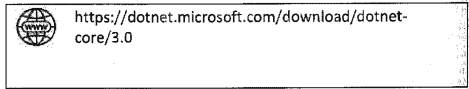

除了 .NET Core 3 之外，根据你想要开发的项目类型，你可能需要安装特定组件。这些组件是必需的，在某些情况下，对于运行应用程序是强制性的。这些组件可能针对每个操作系统（如果你选择使用原生 GUI 进行开发）。

但在三个系统上设置的核心是 .NET Core 3 安装，并且应特别小心地进行。以下是关于如何正确安装它的详细说明。

#### 6.4.1 在 Windows 上

在 Windows 10 平台上安装 .NET Core SDK 似乎微不足道，因为 Microsoft 平台是 .NET Core 的原生平台。你应该不会在这样做时遇到问题（比其他操作系统少）。此外，当你设置 Visual Studio 2019 时（自 2019 年 10 月起），.NET Core 3 现在会自动安装。

##### 6.4.1.1 先决条件

.NET Core 3 支持以下版本：

- Windows 7 SP1。
- Windows 8.1。
- Windows 10 周年更新（版本 1607）或更高版本。
- Windows Server 2008 R2 SP1（完整服务器或服务器核心版）。
- Windows Server 2012 SP1（完整服务器或服务器核心版）。
- Windows Server 2012 R2（完整服务器或服务器核心版）。
- Windows Server 2016 或更高版本（完整服务器、服务器核心版或 Nano Server）。
- Windows Server 2019（所有版本）。

##### 6.4.1.2 Windows 安装

如果你使用正确的 Windows 版本，安装是通过执行下载的安装程序（exe 程序）并按照安装程序说明（单击 OK：）进行的。

.NET Core 3 的默认安装目录是：

```
C:\Program Files\dotnet\netcore3
```

你可以通过调用 CLI 工具“dotnet”的简单命令来验证安装是否正确，如下所示：

```
C:> dotnet --version
```

它应显示当前安装的 .NET Core 版本，此命令还将验证 .NET Core CLI 是否可访问（路径已更新）以及安装过程是否没有在安装期间未显示的错误。

如果设置后找不到 dotnet CLI，请验证 SDK 的路径是否已添加到系统的环境变量中（如果安装程序未执行此操作）。

#### 6.4.2 在 Linux Ubuntu（或其他 Debian 发行版）上

Linux 安装可以使用 Ubuntu 上的包管理器进行（本书仅研究此发行版，但适应其他发行版是完全可能的）。在确保安装所需版本（至少是版本 3）之前，我们将通过从 Microsoft .NET Core 网站下载 Linux 安装文件来审查安装。

##### 6.4.2.1 先决条件

.NET Core 3.0 支持以下 Linux 发行版（参见表 1）。

| 操作系统 | 版本 | 架构 |
|---|---|---|
| Red Hat Enterprise Linux | 6 | x64 |
| Red Hat Enterprise Linux | 7 | x64 |
| CentOS | | |
| Oracle Linux | | |
| Fedora | 28 | x64 |
| Debian | 9 | x64, ARM32*, ARM64* |
| Ubuntu | 16.04+, 18.04+ | x64, ARM32*, ARM64* |
| Linux Mint | 18 | x64 |
| openSUSE | 42.3+ | x64 |
| SUSE ENTERPRISE Linux (SLES) | 12 SP2+ | x64 |
| Alpine-Linux | 3.8+ | x64, ARM64 |

Ubuntu 发行版需要安装以下库（依赖项）：

- libttng-ust0
- libcurl3（适用于 14.x 和 16.x）
- libcurl4（适用于 18.x）
- libssl1.0.0
- libkrb5-3
- zlib1g
- libicu52（适用于 14.x）
- libicu55（适用于 16.x）
- libicu57（适用于 17.x）
- libicu60（适用于 18.x）

在本书将使用的发行版（Ubuntu 桌面版 18.04）中，所有这些库在默认桌面设置中均已安装。你的安装情况也应该如此。

##### 6.4.2.2 Ubuntu 18.04 安装

Linux 版 .NET Core 3 可下载为 tar.gz 格式。你可以简单地使用以下命令行指令进行安装：

```
~$ mkdir -p $HOME/dotnet && tar zxf dotnet-sdk-xxxxx-linux-x64.tar.gz -C $HOME/dotnet
~$ export DOTNET_ROOT=$HOME/dotnet
~$ export PATH=$PATH:$HOME/dotnet
```

Xxxxx：是你想要安装的 .NET Core 3 的版本号。（文件名会随每个新 .NET Core 版本的发布而更改）

如你所见，DOTNET 目录也被创建，然后添加到路径中，以便从任何位置访问 dotnet 程序。你应该考虑将最后两行添加到你的用户环境变量中（/users/<>）

#### 6.4.3 在 macOS Mojave 上

macOS 系统的安装与安装 pkg 文件一样简单。（标准 macOS 安装程序文件）。对于此操作系统，安装过程与你在 Mac 上安装的任何其他程序相同。

##### 6.4.3.1 先决条件

macOS 版本必须为 10.12（Sierra）或更高版本。这是唯一的先决条件。

##### 6.4.3.2 macOS 10.14 安装

只需双击文件并按照设置说明操作，这是一个图形化安装（标准 macOS），因此你在安装过程中不应该遇到任何问题。

安装后的 dotnet 目录是：

```
/usr/local/share/dotnet
```

为了验证你的安装，你可以使用下面描述的命令行创建一个新的控制台项目。

```
dotnet new console -n consoleTest
```

你的桌面上将创建一个名为“consoleTest”的文件夹，导航到该文件夹并执行以下命令：

```
dotnet run
```

如果一切按预期进行，你应该看到著名的“Hello world”消息，如果不是，请查看你下载 .pkg 文件的 Microsoft 网站上的 macOS 发行说明。

### 6.5 安装开发工作站

开发工作站将是用于开发目的的三台机器（虚拟或非虚拟）。这三台计算机必须设置与你想要开发的 GUI 类型相对应的专用开发工具。

.NET Core 3 SDK 是每个工作站的基础安装，所需的专用工具将针对我们将审查的每种解决方案类型指定。

对于本书中展示的示例项目，我们选择在 Windows 上使用 Visual Studio 2019 开发代码，在对项目进行原始复制（带 SDK）后，每个项目都已在每个操作系统上重新构建。

#### 6.5.1 Windows 工作站（主）

Windows 平台是编码平台，你需要在其中安装 IDE（在本例中为 Visual Studio 2019）以及编写软件所需的所有工具。在专业环境中，选择 Visual Studio 2019 是显而易见的，考虑到其功能和产品的高质量（与更偏向脚本开发的工具 Visual Code 相比）。

首先你必须安装 Visual Studio 2019。

该产品有三个不同的版本：

- Community：产品的免费版本，此版本允许各种 .NET Core 3 开发，但不集成某些功能（参见功能表）。
- Professional：顾名思义（这是完整产品），
- Enterprise：为大型团队和复杂约束环境提供更好的集成，它还包括独家功能


面向软件架构师（架构层图）和测试人员（LiveTest）的工具。

下表概述了各版本 Visual Studio 的功能和特性。

| 支持的功能 | Visual Studio Community | Visual Studio Professional | Visual Studio Enterprise |
|---|---|---|---|
| 支持的使用场景 | *** | *** | *** |
| 开发平台支持 | **** | **** | **** |
| 集成开发环境 | *** | *** | *** |
| 高级调试和诊断 | ** | ** | **** |
| 测试工具 | * | * | **** |
| 跨平台开发 | ** | ** | **** |
| 协作工具和功能 | **** | *** | **** |

（来源 Microsoft.com）

选择与您打算进行的开发类型（或您拥有的许可证类型）相对应的版本。在我们的情况中，社区版足以满足本书的教育需求。

安装程序将提示您选择要安装的模块，您至少需要选择如（图 1）中所述的组件，当然您也可以选择完整安装（用于测试和审查目的），但本书开发所需的（最小）必装组件为：

- Visual Studio 核心编辑器
- .NET 桌面开发
- ASP.NET 和 Web 开发
- .NET Core 跨平台开发

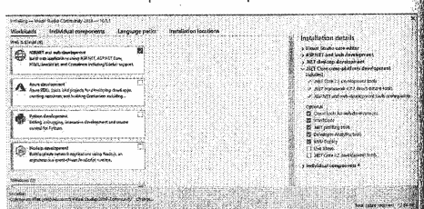

（图 1）

如果您计划使用本机 GUI 库（如 LibUI、GTK 或 QT），明智（有时甚至是强制性的）做法是同时安装 C++ 工具（但我们将在示例章节中说明何时以及为何安装它）。

- C++ 开发环境
- C++ for Linux

如果您想使用 .NET Core 3 或 3.1（或仍处于预览阶段的更高版本）的预览版，则需要通过在菜单中选择相应选项来配置 Visual Studio 2019 以使用它：

Tools/Options/Environment/Preview features.

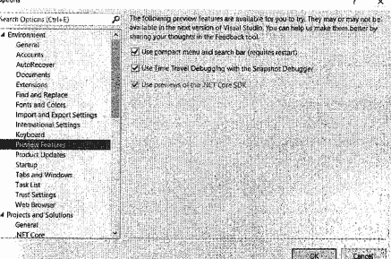

（在 Visual Studio 2019 中启用 SDK 预览）

对于主开发工作站，您还需要一个可用的 Internet 连接，以便通过 80 端口访问 NuGet 中央仓库，用于恢复依赖包。

#### 6.5.2 Linux 工作站

（参见 .NET Core 3 安装 for Linux）。

Ubuntu 开发工作站无需额外安装，许多工具已在 Ubuntu 桌面系统的默认设置中预安装。在安装 .NET Core 3 SDK 之前，请确认已安装 Ubuntu 的先决条件包。某些示例将需要特定的依赖项，但会在每个需要此类安装的示例中予以说明。

#### 6.5.3 macOS 工作站
（参见 .NET Core 3 安装 for macOS）。

我们建议安装优秀的工具“Homebrew”，即 macOS 缺失的包管理器。它通常很有用，可以轻松安装作为完整 macOS 堆栈开发一部分的软件包（在我们将要研究的某些情况下，它是强制性的）。您将在 GTK 项目示例部分找到详细的安装说明（该部分需要“brew”来设置依赖项）。

对于开发工作站，如果您计划使用 macOS 系统 API 或使用本机库，明智的做法是同时安装 XCode，或者至少安装“XCode 命令行工具”。

XCode 是 Apple 面向 macOS 和 ObjectiveC（编写 macOS 的语言）的 IDE。它可以帮助您匹配该操作系统的相应库（原生 API）。这假设您具备最低限度的 ObjectiveC 开发知识，如果您不了解 macOS 系统，这可能会比较棘手（仅限专家）。

### 6.6 远程调试配置

远程调试允许您在远程计算机（安装了不同操作系统）上执行代码，它允许您在目标平台上实时调试，而无需退出您喜爱的 IDE（Windows 上的 Visual Studio）。

这种技术在 GUI 桌面应用程序开发环境中并不常用，因为跨平台框架（在本例中为 .NET Core 3）的使用掩盖了平台特定性。

尽管如此，它可以在开发应用程序使用的多平台 .NET Standard 库（例如封装库）期间使用，正是在这种背景下才会回顾这种技术。

#### A) 在 Visual Studio 中：

要在 Visual Studio 中启用远程调试功能，您需要在以下地址安装“适用于 Visual Studio 2019 的远程调试工具”。还需下载并安装适用于 Windows 的 SSH 客户端（Putty），它将用于测试与远程计算机的连接，并最终使用 scp 实用程序复制文件（具体取决于您的工作方式）。

| | https://visualstudio.microsoft.com/downloads/#remote-tools-for-visual-studio-2019/ |
| | http://www.putty.org |

#### B) 在 Linux 上安装适用于 Visual Studio 2019 的远程调试工具：

```
$ curl -sSL https://aka.ms/getvsdbgsh | /bin/sh /dev/stdin -v latest -l ~/vsdbg
```

此命令行指令应在平台上安装所需的 Linux 调试器引擎。

#### C) 在 Linux 系统（Ubuntu）上设置调试管理员帐户：

为调试创建特定用户并非强制性的，但这样做的好处是不会干扰其他帐户的权限和组（从长远来看，这种方式更易于管理用户），但您也可以使用“root”帐户。

```
~$ sudo adduser dbgVS
```

如果您没有安全限制，也可以直接使用“root”帐户。

您需要为该用户授予适当的权限，或/和将其添加到适当的组，以便拥有对部署文件夹的访问权限（读/写，大多数情况下还需要执行权限，通常需要管理员组）。

#### D) 启用 SSH 并在防火墙上打开端口（设置计算机之间的通信）：

```
$ sudo apt-get install openssh-server unzip
$ sudo ufw allow ssh
```

此命令行安装 SSH 服务器并在防火墙上打开所需端口（端口 22）。

从 Windows 工作站使用简单的 SSH 测试验证用户与 Linux 计算机的连接（使用 Putty 和新定义的用户）。同时检查该用户的文件夹权限。

#### E) 部署应用程序：通过 scp 复制文件或使用 Visual Studio 中的发布工具：

要部署应用程序，您可以选择使用“scp”命令复制它，或在“发布”阶段使用配置文件来部署应用程序。您可以在其中指定源位置和可执行文件目标文件夹的文件是“launch.json”。

#### F) 将调试器（在 Visual Studio 中）附加到 Linux 上的远程进程：

如果 VS 调试器已安装在 Linux 计算机上，您应该可以访问您连接的用户的进程列表。选择进程（在许多情况下为程序名称），并将其“附加”到 Visual Studio 中的调试器（确保复选框“显示所有用户的进程”已实际勾选）。

#### G) 进行调试（在 Visual Studio 中）：

现在您应该能够从 Windows 上的 Visual Studio 实例调试 Linux 上的应用程序了。

这种技术使用开发机上的编译，但您也可以在目标计算机上构建应用程序，然后再附加调试器。

当您在特定操作系统（而非其他系统）上遇到问题时，远程调试工具是一种基本方法，它可以帮助您识别问题的根源，从而在最短时间内解决问题。

但请注意，远程调试工具有时并不适用于多平台应用程序项目开发，尤其是在使用本机调用（通过 P/Invoke）时。如果您选择构建应用程序的本机可执行文件，则无法使用此工具。

总而言之，如果您在特定平台上遇到问题，这是一种在编码早期阶段使用的工具，它可以帮助您识别特定操作系统上的设计致命缺陷（确实会发生这种情况：某些系统提供其他系统没有的功能）。我们建议在需要特定调试上下文的项目开发的特定情况下使用远程调试工具。

否则，不要在开发的这一方面花费太多时间，无论如何，您将在 Windows 开发平台（在经典的 Visual Studio 集成调试器中）的编码阶段发现大多数错误。

如果您的开发需要，这是一个可供您获取该过程更多详细信息的参考链接。

https://github.com/microsoft/MLEngine/wiki/Offroad-Debugging-of-NET-Core-on-Linux---OSX-from-Visual-Studio


### 6.7 设置目标测试机器

目标机器（虚拟机或物理机）是您的应用程序将被安装（并运行）的典型平台。如果您想实现应用程序的标准分发，则必须在项目中为每个目标操作系统进行全新安装。

这些机器可用于验证整个生产线，以及您要交付的最终产品。在没有开发阶段使用的任何依赖项的平台上测试您要部署或分发的版本，始终是一种良好的做法。

您无需在项目开始时设置这些机器，当您想要在实际环境中测试软件的部署和执行（周期结束时）时，这些机器将很有用。通过此验证阶段非常重要，它将突出显示您的应用程序或安装程序中的每个问题（开发工作站上未捕获的错误）。

## 第 7 章. 测试您的程序

如今，严肃的开发项目会在软件解决方案开发的每个步骤中集成多种测试。这些测试旨在保证应用程序的每一段代码（对象、方法等）都能提供预期结果。这些测试还应验证所有这些元素能够协同工作。

在常见的多平台项目环境中，开发者可以使用 3 种类型的测试。

- 单元测试保证程序最低级别（函数、方法）的良好功能行为。
- 功能测试保证基本元素与规格说明中预期结果的一致性良好集成。
- 性能测试评估程序完成任务的速度（我们将在专门的性能章节中详细介绍此部分）

测试领域相当复杂，已有许多书籍专门就此主题编写，因此我们将仅为您提供实现应用程序基本测试所需的基本概念。

### 7.1 单元测试

由于我们使用 Visual Studio 2019 进行项目开发，在单元测试和代码覆盖率方面，显而易见的解决方案是使用集成工具：MSTest。

需要强调的是，这并非 Visual Studio 2019 中唯一可用于构建单元测试的解决方案，我们可以提及用于开发单元测试项目的历史悠久且最流行的框架，如 XUnit 和 NUnit。您可以在下方参考链接中找到有关如何使用这些框架的更多信息，也可以在 Visual Studio 中找到用于使用这些测试框架的内置项目模板。

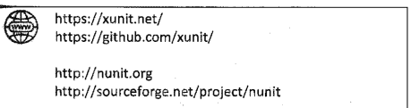

有多种 Visual Studio 扩展可简化它们的使用，并在您喜欢的 IDE 中实现良好集成。它们各自的项目模板（XUnit 和 NUnit）是 Visual Studio 2019 提供的默认项目模板的一部分。但是在本章中，我们将详细介绍 MSTest 的使用，并将通过一个简单的示例项目说明其用法。

本示例测试程序中阐述的原则也可以使用之前提到的任何其他工具来实现，这些工具的架构和语法都非常相似。

#### 7.1.1 测试什么？

单元测试项目旨在验证代码提供的结果的有效性。这些测试旨在验证代码的每个模块是否按预期工作。

单元测试是在开发者环境中编写的（示例数据、其他组件结果等），并由开发者对要开发的功能的理解来定义。通常，您应该考虑为逻辑或计算复杂度高的方法/函数开发单元测试。

避免为基本方法编写不必要的测试，仅为了提高代码覆盖率百分比（这实际上并不重要），并尽量保持清晰且与项目目标一致。

#### 7.1.2 MSTest（Visual Studio 测试框架）

编写这些测试时，开发者可以使用 Visual Studio 内置工具：MSTest。该工具的优势在于已在 Visual Studio 中可用，并在 Microsoft 支持网站上有非常详尽的文档。

http://docs.microsoft.com/en-us/dotnet/core/testing/unit-testing-with-mstest https://github.com/Microsoft/testfx-docs

在 Visual Studio 中，单元测试是在专用项目中实现的，通常一个测试项目对应同一类的一组方法。开发者会为每个功能或特性（根据其关键程度）编写一个单独的测试项目。

##### 7.1.2.1 创建单元测试项目

创建测试项目时，您需要在“新建项目”窗口中选择“MSTest 测试项目 (.NET Core)”，如图 1 所示。

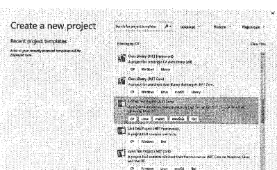

(图 1)

为其命名（最好以“Test”结尾），创建测试项目后，您应使用“引用管理器”添加对包含要测试代码的项目的依赖项，如下所述。

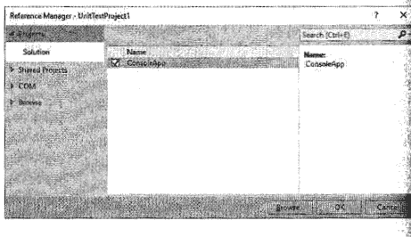

您可以通过查看下方参考链接找到 MSTest 测试项目的示例。它将让您快速了解如何在自己的解决方案中实现和使用此类测试项目。

https://github.com/netcore3/CodeBook/Chapter 7/1/UnitTestProject

##### 7.1.2.2 定义测试验证：ASSERT 对象

您现在已创建并链接到主应用程序的单元测试项目，但必须定义哪些条件会产生通过的测试或失败的测试。

这是通过使用特定指令 ASSERT 来完成的。

ASSERT 对象使用预期对象验证结果对象。这种验证即验证了测试（确实如此）。

ASSERT 用于测试验证。这种验证可以通过控制您测试的方法的结果值来完成。ASSERT 是 Microsoft.VisualStudio.TestTools.UnitTesting 命名空间中的一个类。

测试验证可以使用 ASSERT 类的以下方法（非详尽列表）来完成：

- ASSERT.AreEqual(): 通过检查被测函数的结果值来验证该函数（但您需要知道结果值）。
- ASSERT.AreNotEqual(): 如果结果不是测试的值，则验证该函数（测试通过）。
- ASSERT.Same(): 如果结果对象和预期对象是同一类型，则验证该函数。
- ASSERT.NotSame(): 如果结果对象和预期对象是不同类型，则验证该函数。
- Assert.IsNull(): 如果检查的值等于 Null，则验证测试。
- Assert.IsNotNull(): 如果检查的值不等于 Null，则验证测试。

还有其他几种 ASSERT 方法可用（请参阅参考文档），用于各种测试验证类型，但开发者遇到的大多数情况都使用这些方法（实际上，这些是最常用的）。

请注意，在这些验证类型之间的选择将决定您的单元测试代码对方法检查是否相关。如果您为验证选择不合适的断言，测试可能无用，或者更糟，无法检查代码的有效性。

当 ASSERT 方法未通过验证时，会抛出异常（ASSERT 异常），测试将“失败”。

##### 7.1.2.3 执行单元测试

执行单元测试项目时，您需要使用如下所示的“测试资源管理器”窗口：

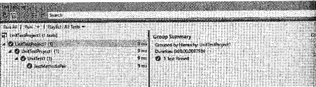

(测试资源管理器)

您可以使用“全部运行”菜单一次运行项目的所有测试，也可以通过上下文菜单“运行”选择特定测试来运行。

##### 7.1.2.4 可视化测试结果

测试结果可以在“测试资源管理器”窗口中查看，绿色对勾表示测试有效，红色叉号表示测试失败，如下所示。

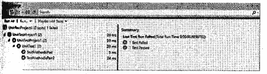

MSTest 为在项目中实现单元测试提供了良好的解决方案，作为 Visual Studio 中的原生工具，它与 Microsoft IDE 完美集成。它由 Microsoft 团队有详尽的文档。参考资料和教程可以通过参考链接找到。


#### 7.1.3 模拟概念

定义相关单元测试的问题在于开发者上下文：编写单元测试项目时，许多对象尚未定义或数据库尚未可用。这可能是一个问题，因为开发者需要尽可能使用大量输入数据来测试方法，涵盖每种可能的情况（理论上）。


解决方法是使用虚拟对象或数据库来模拟开发者需要单元测试的函数与之交互的真实数据或对象。

这个概念称为模拟（mocking）。模拟对象隔离你想要测试的方法/函数，并验证它是否独立运行（独立于其他方法）。模拟对象可以使用给定值设置对象并设置该对象的属性。

开发者必须为方法硬编码预期输入值，并定义带有预期结果值（同样硬编码）的验证测试。

对于 .NET Core 3 开发，我们推荐使用 Moq (4.x)，这是最流行且用户友好的模拟框架。Moq 是一个库，使开发和测试模拟对象变得容易，此外，该库还提供 LINQ to Mocks 功能，允许动态请求模拟对象以进行验证。它支持模拟接口和类。

https://github.com/moq/moq4/
https://github.com/moq/moq4/wiki/Quickstart

可以将以下包添加到测试项目中，以便快速集成 Moq。


此包的最新版本使用 .NET Standard 2.0 实现，因此可在 .NET Core 3 项目中使用（这就是 .NET Standard 库格式的优势所在）。

以下是一个代码片段，向你展示如何在简单用例中使用 Moq。

```
[TestFixture]
public class FooTest
{
    Foo subject;
    Mock myInterfaceMock;

    [SetUp]
    public void SetUp()
    {
        myInterfaceMock = new Mock();
        subject = new Foo();
    }

    [Test]
    public void DoWorkTest()
    {
        // Set up the mock
        myInterfaceMock.Setup(m =>
        m.DoesSomething()).Returns(true);
        myInterfaceMock.SetupGet(m =>
        m.Name).Returns("Molly");

        var result = subject.DoWork();

        // Verify that DoesSomething was called only once
        myInterfaceMock.Verify(m =>
        m.DoesSomething(), Times.Once());

        // Verify that DoesSomething was never called
        myInterfaceMock.Verify(m =>
        m.DoesSomething(), Times.Never());
    }
}
```

正如你所见，Moq 的使用非常简单，即使是新手开发者也能上手：

- 模拟声明：定义你想要模拟的对象类型。
- 模拟设置：为（被模拟的）方法定义值。
- 模拟验证：验证模拟对象是否被调用（或未被调用）。

Moq 拥有直观的 API，无需事先了解模拟知识。

还有几个其他库允许在单元测试阶段模拟对象，你可以深入了解 NSubstitute 和 FakeItEasy，以便更全面地了解市场上的模拟库（它们是开源的）。这两个库提供与之前描述的 Moq 库等效的功能（不包括 LINQ 功能）。

可以查阅它们各自 GitHub 仓库上的 wiki 以获取更多信息。


### 7.2 功能测试

功能测试和集成测试包括测试每个应用程序功能。换句话说，验证组装后的应用程序是否提供预期的结果和功能。这可以通过选择特定的数据样本或配置集来实现。

这些测试可能包括：

- 关键值测试。
- 边界测试。
- 离域测试。

功能测试是一种黑盒测试类型，因为它涉及完成整个软件开发才能进行。测试人员使用多种场景和用例，验证生成的软件是否符合产品规范。

## .NET Core 3.0

## 第 8 章。多平台开发解决方案

如果你想启动一个多平台项目，这可能是本书中最有用的一章。我们将通过对多个示例项目的详细回顾，了解如何使用 .NET Core 3 和 Visual Studio 2019 编写多平台桌面应用程序。

这些示例的源代码可在 netcore3 GitHub 仓库上找到（每个示例均附有详细链接）。

所有项目均使用 .NET Core 3 构建，大多数项目使用 Visual Studio 2019。

### 8.1 选择多平台应用程序类型：适合工作的工具

根据你打算开发的项目类型，语言（C++、HTML、XAML ...）和目标框架的选择至关重要。

市场上已有许多多平台开发解决方案，但只有 .NET Core 3 在性能、可维护性、语言特性、打包和部署能力方面提供了该领域的最先进技术。

在本书中，我们将为你提供一系列解决方案，以解决你在使用 .NET Core 3 进行多平台桌面应用程序开发过程中可能遇到的特定问题。

每个提议的解决方案都可以解决特定约束或提供应用程序需要集成的特定功能，这些解决方案都没有为所有多平台桌面开发需求提供完美的回答，这就是为什么你必须特别关注你将启动的开发类型的选择，以响应你的软件规范（并根据可用资源）。

这可以通过仔细研究本书提供的每个解决方案示例来实现：

- 控制台 GUI 应用程序。
- Web GUI (Electron.NET) 应用程序。
- 原生 GUI 应用程序（图形库 C++、GTK、QML）。
- XAML GUI (Avalonia) 应用程序（也是一种原生应用）。

在这些解决方案中，你应该找到那个解决方案，即最适合你项目约束和要求的解决方案。

这一选择也取决于你是哪种类型的开发者（或者你在哪种开发方面拥有更多经验以生产高质量产品）。

- 如果你来自面向 Web 的开发（ASP.NET 开发者），使用 Electron.NET 开发桌面应用程序将是一个明智的选择，这样你可以立即利用这些知识。
- 如果你是一名优秀的 C# 和/或 C++ 开发者（控制台、系统、服务），可以选择一种原生解决方案来实现 GUI（LibUI、GTK#、QML.NET）。
- 如果你是 C# .NET 框架桌面应用程序老手（或 WPF 开发者），你肯定会倾向于 Avalonia 提出的解决方案（但也可能是 QML 或 GTK 解决方案）。

总之，解决方案类型的选择将取决于可用资源和你项目的需求。

### 8.2 控制台 GUI 应用程序

自图形用户界面出现以来，控制台 GUI 曾被许多开发者忽视，但在许多情况下，它可能是开发多平台应用程序的明智选择（即使它不是最时髦的选择）。

近年来，许多库已被开发用于为控制台程序构建“漂亮”的界面。

这在一定程度上是因为许多云框架（其中大多数是多平台的）是为服务器世界开发的，事实上没有 GUI 实现。在这种情况下，程序员感到该特定领域缺乏商业产品，许多人提出了自己的解决方案。这些库中的大多数是开发者个人项目的结果，除了 GitHub 上的联系方式外，不提供任何形式的支持。

尽管如此，实现控制台 GUI 应用程序包括许多好处，例如：

- 减少信息显示所用的资源。
- 可以通过容器（Docker 或 Kubernetes）轻松部署。
- 减少开发时间，真正专注于应用程序的目的。
- 无需使用昂贵的库（节省 RAM 和 CPU）。
- 每个操作系统（Windows、Linux、macOS）只编译一个程序版本。
- 复古酷炫外观（个人喜好）。

以下是在尝试了 GitHub 上几个可用的控制台 GUI 工具包框架后精选的几个库（这是一个非详尽列表，因为该主题变得越来越时髦，许多新项目正在涌现）：

- ConsoleDraw。
- EasyConsole。


- 控制台框架。
- 终端 GUI.CS

```
https://github.com/Haydend/ConsoleDraw
https://github.com/splittingatoms/EasyConsole
https://github.com/elw00d/consoleframework
```

如果你想更仔细地查看这类 GUI 开发的解决方案面板，可以自行回顾上面提到的框架。其中大多数是使用 .NET 框架开发的，需要升级到 .NET Core，并且许多框架要求在 Linux 和 macOS 上使用本地依赖项。

程序的容器化（在容器中部署）日益流行，许多开发者致力于开发为该场景下的用户提供最小化界面工具包的库。该领域有许多新解决方案，围绕该主题的社区也非常活跃。

在当前语境下，终端用户界面（TUI）日益流行，现代开发者不应再忽视它，尤其是当你开发具有最小可视监控能力的容器化应用程序或服务时。

我们将在以下示例项目中使用的版本是 Terminal.Gui，主要原因是它已在所有平台上运行（Windows、macOS、Linux），无需安装本地依赖项，并且 NuGet 包已可用。

Terminal.GUI 的发行版基于几年前开发的基础，并且仍由作者积极维护（GUI.Cs 也用于商业环境），这一事实使其成为专业使用的可靠工具。

#### 8.2.1 什么是 Terminal.GUI ?

Terminal.GUI（或 Gui.cs）是一个用于 .NET Core 应用程序的基于控制台的用户界面工具包。原始版本是为与 Mono（跨平台 .NET 框架，现称为 Xamarin 产品）一起使用而开发的。它已于 2018 年移植到 .NET Core。

它设计用于在单色和彩色显示器上工作，使用预定义的颜色方案（内置）。该工具包已集成大量可用的控件（或小部件）。

它基于事件，因此每个调用函数的线程不应干扰应用程序的主线程。你也可以使用 async/await 模式。

以下是 Terminal.GUI 中已实现的控件列表：

- 按钮
- 标签
- 文本输入
- 文本视图
- 单选按钮
- 复选框
- 对话框
- 消息框
- 窗口
- 菜单
- 列表
- 框架
- 进度条
- 滚动视图和滚动条
- 十六进制查看器/编辑器（HexView）

显然，可用的如此丰富的小部件面板使得开发具有高级功能的复杂 GUI 应用程序成为可能（针对 TUI）。

该包使用 .NET Standard 开发，因此可以与 .NET Core 3 版本一起使用，源代码可在作者的 GitHub 仓库中获取。


此外，Terminal.GUI 也可作为 NuGet 包使用，以便在你的 .NET Core 3 项目中快速集成。


该库似乎为鼠标（Windows、macOS）和 ASCII GUI 程序实现提供了最佳支持（在所审查的工具面板中）。

主要对象是 Terminal.Gui.Application，Application 由 MainLoop 对象的实例实现。该对象包含几个关键功能：

- 键盘和鼠标管理
- .NET Async 支持
- GUI 线程
- 与其他 MainLoops 集成的可能性，用于多屏幕应用程序

该解决方案也已被微软认可，用于开发控制台 GUI 应用程序。

Terminal.GUI Wiki:
https://github.com/terminal.gui

微软关于 Terminal.Gui 在 Microsoft /Build 2018 上的广播：
https://www.youtube.com/watch?v=Se1zNWJwDUE

不要错过观看 RETRO 编程活动（2018）的 YouTube 视频。这次与创建者（Miguel DeIcaza）的微软广播关于可用的不同功能非常有信息量，可以作为快速学习方法，让你了解如何使用此库。

#### 8.2.2 Terminal.GUI 屏幕设计

使用 Terminal.GUI 时，你没有屏幕的可视设计器，必须使用 C# 编写 GUI。每个控件都必须通过 C# 编码声明、配置并添加到父对象中。

这意味着，你必须（亲自）在代码中明确区分项目的功能逻辑与使用 Terminal.GUI 实现的表现层。

为此，我们建议将与屏幕相关的任务（显示）分离到特定的源文件（.cs）中，以免干扰项目的逻辑和功能方面（参见示例）。

由于你需要编写 GUI，在编码阶段之前应对屏幕设计有清晰的构思。为实现这一目标，你需要在纸上（或使用专用软件）绘制界面草图，并使用纸网格作为字符单位，如图 1 所示，注意你目标屏幕的格式。


##### (图 1) (40x25 屏幕画布)

你需要定义目标屏幕尺寸（40*25、80*40 或其他...），在列和行上标上数字，并在该网格上绘制每个控件：窗口、组、菜单、标签、按钮...

在这种情况下，你可以使用参考中提供的网站来绘制你的 ASCII 应用程序（如图 1 所示）。

列和行上的数字将为你的控件提供定位元素。你需要为应用程序的每个屏幕、窗口和对话框窗口完成这项工作。

草图完成后，你可以从网格中获取每个控件的坐标，从而避免通过试错循环重新定位每个控件以达到预期结果的繁琐任务。

Terminal.GUI 提供以下方法：

- 定义窗口大小为全屏（获取当前控制台显示的可用尺寸）。
- 在该屏幕上定位窗口、对话框和控件。
- 管理键盘和鼠标输入。

像每个开源项目一样，你可以用自己的控件和功能扩展 Terminal.GUI 框架，你可以通过访问下面参考中的网站来预览 ASCII 小部件设计可以实现什么。该网站为异国和创新的文本小部件设计提供了设计方案。


#### 8.2.3 控制台 GUI 示例应用程序

以下两个示例项目使用公开可用的 NuGet 包开发，每个程序的完整源代码可在 netcore3 GitHub 上获取（参见相应的网页指针）。

- 对于第一个控制台 GUI 应用程序示例的编码，我们将使用原始网站提供的基础示例作为样板：一个全屏文本编辑器。
- 对于第二个示例：一个小型仪表板，该示例将演示该库提供的几种类型的控件和布局的使用。

##### 8.2.3.1 文本编辑器的编码（consoleTextEditor）

一个始终有用的开发者工具，“consoleTextEditor”应用程序围绕带有顶部菜单和编辑器窗口的全屏表单构建。它为用户提供使用“textview”控件创建和修改文本文件的机会。

以下是该应用程序在不同平台上运行的屏幕截图。

###### macOS:

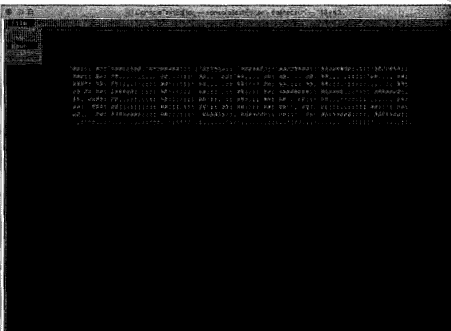

###### ubuntu:

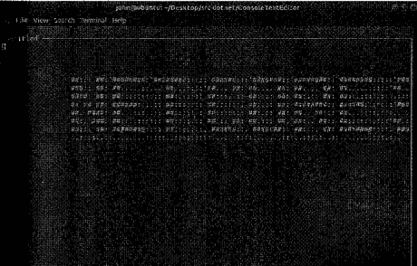

###### Windows:

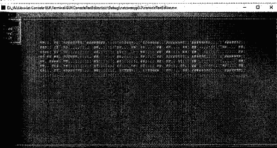

主窗口的大小会自动调整以使用整个控制台屏幕，并且可以调整窗口大小（Windows 和 Linux）。

菜单项可以通过在 Windows 和 macOS 上使用“F9”功能键、在 ubuntu 上使用“Esc 9”来访问。常见的复制/粘贴功能可通过键盘常规快捷键使用。

如前所述，所展示的版本是源代码库中提供的示例项目的重构（架构、文件组织、表现层）。

“consoleTextEditor”应用程序作为示例提供，可用作开发 GUI 控制台应用程序的教学样本，涉及菜单集成、窗口、按钮等。

该项目已重构，以便更好地组织总体架构。此示例项目未实现最佳性能实践，但总体架构可以为控制台 GUI 项目的源代码排列提供基础。

这个最小应用程序包含两个文件：

FileOperation.cs：程序的基本功能函数（打开/创建/保存文件）在专用类中实现，这些对象仅依赖于每个平台的 .NET Core 3 框架。

Gui.cs：在此文件中，你将找到应用程序每个窗口的定义（主编辑器、打开文档、保存文档、新建文档、关于、错误消息窗口、退出确认等）。该对象实现了与界面窗口和控件显示相关的所有代码。


由于该应用程序不包含任何业务逻辑（FileOperation除外）。文件 **Program.cs** 实际上几乎是空的，只有对主图形用户界面对象的调用。

文件函数的调用是通过带有静态类的菜单完成的。

以下是 Visual Studio 中的“解决方案资源管理器”视图：

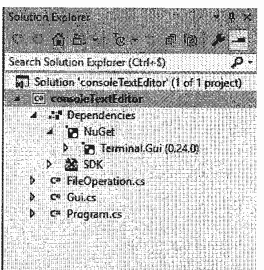

(consoleTextEditor “解决方案资源管理器”)

您可以在 netcore3 仓库的示例文件夹中找到“consoleTextEditor”的完整源代码。

[https://github.com/netcore3/CodeBook/Chapter 8/2/consoleTextEditor](https://github.com/netcore3/CodeBook/Chapter 8/2/consoleTextEditor)

本示例是研究全屏控制台应用程序开发的一个良好起点，可以直接使用。这不是一个使用之前推荐的最佳实践的优化版本，编码风格基础且未实现任何 C# 新功能，请随意改进它（在 GitHub 上 fork 它）。

如需使用大量更多控件类型，可以查看下一个示例（"consoleFormApp"）。

##### 8.2.3.2 基本窗体应用程序的编码 (consoleFormApp)

"consoleFormApp" 提供了一个有用的项目示例，用于使用 Terminal.GUI 开发高级控制台应用程序 GUI。

本示例在多个窗口中显示了可用于设计控制台应用程序的多个控件。它还演示了 ASCII 艺术的使用以及如何对控制台程序进行创造性使用。

以下是 Visual Studio "解决方案资源管理器" 中显示的项目结构：

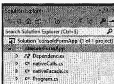

(consoleFormApp "解决方案资源管理器")

该项目的总体架构与 consoleTextEditor 项目几乎相同，只是添加了一个空的外观对象 (nativeFacade.cs)。“nativeFacade”对象提供当前操作系统检测例程，以便根据所使用的操作系统（Windows、macOS、Linux）使用特定实现来更轻松地集成本机调用，您可以轻松地为自己的程序重用该模式（甚至可以通过使用接口和针对每个系统的多个类来改进它）。

如上所述，“consoleFormApp”包含 Terminal.GUI 中可用的多个控件，如下所示，使用“ASCII 艺术”为应用程序设计增添了更酷（且复古）的风格，它还说明了 .NET Core 3 互操作功能提供的专用代码（针对每个操作系统）的使用能力。

###### 在 macOS 上：

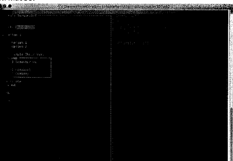

###### 在 ubuntu 上：

```
john@ubuntu:~$ cd /etc/init.d/
john@ubuntu:/etc/init.d$ ls
acpid anacron apport atd bootlogd console-setup cron dbus dm friendly-recovery gdm halt hostname hwclock killprocs kmod lm-sensors lvm2 module-init-tools mountall mountall-bootclean mountdevsubfs mountkernfs mountnfs networking ondemand passwd plymouth ppp-dns procps rc resolvconf rsync sendsigs single sudo udev ufw umountfs urandom x11-common
```

###### 在 Windows 上：

```
C:\Users\john> cd C:\Windows\System32
C:\Windows\System32> dir
 config drivers etc spool tasks wbem
```

本应用程序是使用 ASCII 小部件和 ASCII 艺术在控制台 GUI 应用程序中可以实现的效果的现场演示。使用基于 ASCII 的 GUI 时，请不要忘记发挥创造力，因为这种 GUI 提供的可能性非常有限。

consoleFormApp 是 Terminal.GUI 库提供的许多控件的标准演示，小部件显示在应用程序的左侧窗口中（在可能的情况下带有其名称）。

- 窗口。
- 组。
- 对话框。
- 标题菜单。
- 标签文本。
- 文本框输入。
- 按钮。
- 选项。
- 单选按钮。
- 列表。

本示例演示了如何在屏幕上实现控件，并说明了如何在控制台应用程序的一个屏幕中实现多个窗口。

“consoleFormApp”还说明了自定义 ColorScheme 结构体的使用。此项目示例提供了一个外观模式，用于调用每个平台特定的本机代码（并显示当前系统名称）。

您可以在 netcore3 GitHub 上找到此应用程序的完整源代码。

##### 8.2.4 控制台 GUI 的优缺点

控制台 GUI 是开发 GUI 的绝佳选择：

- 资源需求最少。
- 完美的多平台一致性（您可以选择为所有平台仅使用一个源代码）。
- 开发简单直接（只需一个项目来开发您的应用程序）。
- 部署和打包简单。

但此解决方案无法满足每个应用程序的需求：

- 具有高级图表的应用程序。
- 使用大量图形（图片或视频）的应用程序。
- 高级导航系统。
- 精确的鼠标支持。

总之，控制台 GUI 可以满足控制台工具的基本 GUI 需求，但不适用于大多数高级应用程序的要求，例如：图形显示、图表、动画和界面的高级交互性。

对于所有这些要求，您将需要选择随后介绍的另一种 GUI 解决方案。

以下是获取完整在线文档和用于检查 .NET Core 3 项目依赖项的示例项目的一些指南（可能有用）。

```
http://migueldeicaza.github.io/gui.cs/api/Terminal.Gui.html
http://www.github.com/mholo65/depends
```

### 8.3 ELECTRON.NET：ASP.NET GUI 应用程序

当您需要在异构平台上完美匹配界面外观和感觉时，使用 ASP.NET Core 框架听起来是一个相关的选择。此方法需要良好的 ASP.NET Core Web 开发（和 JavaScript）知识。

实际上，这种用于实现桌面应用程序的解决方案对于 ASP.NET Core 开发人员来说似乎是一个理想的选择，因为整个软件开发生命周期与经典 Web 应用程序的开发非常相似。

毫无疑问，本节获得的知识对于未来 .NET Core 3 版本中开发此类应用程序也将有用。

目前，使用 Electron.NET 进行的开发无法从 Visual Studio 执行，许多 Electron 特定任务必须使用 .NET Core SDK CLI 完成。

Electron.NET 包装器并非设计用于与 Visual Studio 2019 一起使用（在许多情况下，您必须使用 CLI SDK）。

但在回顾此库之前，我们将了解其起源和历史。

#### 8.3.1 什么是 Electron？

Electron 是一个相对较新的框架（2013 年 7 月），用于使用 JavaScript 开发桌面应用程序。该框架在 GitHub 上根据开源模型开发和维护。Electron API 使用 C 和 C++ 开发，并通过 JavaScript 包装器公开。

Electron 是 Chromium 渲染引擎和 Node.js 运行时（均为 Google 技术）的组合。这种组合允许 Web 应用程序在桌面上的容器中作为标准桌面应用程序运行。

使用此工具开发了许多流行的应用程序：

- GitHub Desktop
- Visual Studio Code
- WhatsApp
- Skype ....


该框架成功的主要原因可以解释为：许多 Web 开发人员使用此框架将其 Web 开发技能应用于桌面应用程序开发。尽管存在架构性能不足的问题，但这类应用程序（得益于当今的计算能力）在 Web 开发人员社区中越来越受欢迎。

#### 8.3.2 Electron.NET 介绍

Electron.NET 是围绕 Electron 的 .NET Core 包装器，首个版本发布于 2017 年 10 月。该包装器为 .NET Core 提供了使用 Electron API 的能力。换句话说，Electron.NET 允许从 ASP.NET Core Web 应用程序开发 Electron 应用程序。

Electron.NET 的当前版本是 5.30.1，与 .NET Core 3 兼容（因此后续版本也应该兼容）。该包装器是开源的，可供 .NET Core 开发人员使用和扩展。


但是，使用 Electron.NET 有一些先决条件。此框架要求您在开发平台上安装 Node.js（至少版本 8.6）。即使 Electron.NET 避免您使用 JavaScript 开发 Electron 应用程序，它也要求安装 Node.js 以进行构建和运行过程（这是 Electron 引擎）。

为了在 .NET Core 中良好集成，Electron.NET 可通过 NuGet 包获得。为了在 Electron 运行时（主机）和 .NET Core Web 应用程序之间进行通信，您需要将相应的包包含到项目中。


ElectronNET.API 是开发人员需要包含到网站以访问 Electron 功能的层，该包在 Electron 主机和 ASP.NET Web 应用程序之间充当桥梁。


Electron.NET.CLI 是用于构建和打包 Electron 应用程序的命令行工具，它不用于应用程序的代码内部（它是一个工具）。Electron.NET.CLI 对于运行你的 .NET Core Electron.NET 应用程序是必需的。

你可以使用下面描述的命令行安装此工具（这是 dotnet CLI 的工具集包）。它可以作为 dotnet CLI 的全局工具安装，通过“electronize”命令扩展它。

```
C:> dotnet tool install ElectronNET.CLI -g
```

在 .NET Core 中设置 Electron.NET.CLI 后，“electronize”命令可作为 dotnet CLI 的全局工具使用。“electronize”命令仅针对特定的 .NET Core 版本安装，该工具本身安装在用户文件夹中：%UserProfile%/.dotnet/tool/

但在使用 Electron.NET 包装器之前，.NET Core 应用程序开发者必须安装先决条件工具：Node.JS 及其依赖项 NPM。

#### 8.3.3 NPM 和 Node.JS 的设置

NPM 代表 Node Package Manager，Node.JS 是来自 Chromium 项目（由 Google 开发）的 JavaScript 运行时引擎。Electron.NET 要求 Node.JS 版本 >8.6。我们建议从专用网站安装 NodeJS（参考中提供了网址），以获取工具的最新版本并确保在每个系统上正确安装。

以下是下载安装文件的参考链接（以及获取此处审查的每个操作系统的文档）。

https://www.npmjs.com/get-npm
https://nodejs.org/en

我们将详细介绍如何在每个平台上安装这些工具，因为这是使用 Electron 框架的核心要求，并且常常在项目构建过程中构成问题。

##### 8.3.3.1 在 macOS 上

对于此平台，我们建议安装 Node.js 网站上的版本（这是最新版本，在构建 Electron.NET 应用程序时不应该出现版本号问题）。

下载后，你需要通过点击它来安装该工具（这是一个 .pkg 文件）。产品安装成功后，你应该看到如下界面

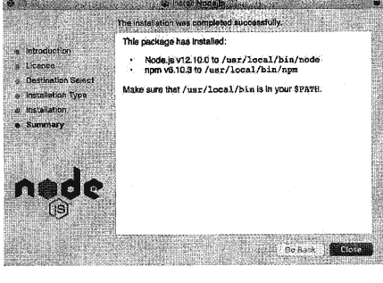

安装过程完成后，我们建议在开始构建 Electron.NET 应用程序之前重启计算机（以确保每个环境变量都已更新）。

##### 8.3.3.2 在 Ubuntu 上

在 Linux 系统上，你可以使用通常的包管理器“apt”通过以下命令安装 Node.JS，你还需要安装 NPM，因为它不在这个环境的同一包中。

```
$ sudo apt-get update
$ sudo apt-get install nodejs
$ sudo apt-get install npm
```

成功安装的样子如下。

```
File Edit View Search Terminal Help
johngubuntu:~$
Get:1 http://us.archive.ubuntu.com/ubuntu bionic/main amd64 libhttp-parser2.7.1
amd64 2.7.1-1build1 [39.8 kB]
Get:2 http://us.archive.ubuntu.com/ubuntu bionic-updates/universe amd64 nodejs amd64 8.10.0.dfsg-2ubuntu0.4 [4.790 kB]
Fetched 5,058 kB in 47s (102 kB/s)
Reading package lists... Done
Building dependency tree
Reading state information... Done
The following additional packages will be installed:
libhttp-parser2.7.1
Preparing to unpack .../libhttp-parser2.7.1_2.7.1-1build1_amd64.deb ...
Unpacking libhttp-parser2.7.1 (2.7.1-1build1) ...
Setting up libhttp-parser2.7.1 (2.7.1-1build1) ...
Preparing to unpack .../nodejs_8.10.0.dfsg-2ubuntu0.4_amd64.deb ...
Unpacking nodejs (8.10.0.dfsg-2ubuntu0.4) ...
Processing triggers for man-db (2.8.3-2ubuntu0.1) ...
Setting up nodejs (8.10.0.dfsg-2ubuntu0.4) ...
update-alternatives: using /usr/bin/nodejs to provide /usr/bin/js (js) in auto mode
Processing triggers for libc-bin (2.27-3ubuntu1) ...
root@ubuntu:~#
```

一旦两个包都已正确（无错误）安装，你可以使用以下命令控制已安装的版本。

```
$ nodejs -v
```

使用此命令还可以帮助你验证一切是否正常运行（验证安装是否正确执行）。显示的版本号必须 >8.6。

##### 8.3.3.3 在 Windows 上

在 Windows 上，你必须安装 NPM 和 Node.js。
Visual Studio Installer 程序中的 Node.JS 版本设置不适用于构建 Electron.NET 应用程序（因为你还需要安装 NPM）。我们建议不要为这项特定任务使用此版本。

更简单的解决方案是从专用网站设置 Node.JS/NPM，这将确保你安装最新可用版本（链接已在前面的参考中提供）。

以下是安装程序的界面。

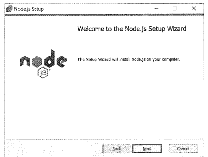

Windows 要求你在开始使用之前重启系统，以使用新的环境变量更新系统。

#### 8.3.4 Electron.NET 快速入门

使用 Electron.NET 意味着需要遵循一个过程，以便将其集成到 ASP.NET Core 应用程序中并将其转换为桌面应用程序。

以下是“electronize”你的 ASP.NET Core 3 应用程序的简短过程。我们将在后面更详细地审查应用程序代码本身（在示例部分中）。

- A) 创建 ASP.NET Core MVC 应用程序

可以使用 dotnet CLI 或 Visual Studio 完成。

- B) 安装 Electron.NET 命令行全局工具（自版本 0.9 起）

在开始开发应用程序之前，你必须使用下面描述的命令行安装 dotnet CLI 的 Electron.NET.CLI 全局工具。

```
$ dotnet tool install --global Electron.NET
```

- C) 添加 Electron.NET 包：

除了从 Visual Studio NuGet 包管理器添加它之外，你还可以在包管理器命令行中键入以下行来添加依赖项。

```
PM> Install-Package Electron.NET.API
```

##### D) 设置打包（仅适用于 ubuntu 和 macOS）

此步骤仅适用于 ubuntu 和 macOS 平台，在这些操作系统上，你需要使用以下命令行指令安装“electron-builder”。

```
$ sudo npm install electron-builder --global
```

##### E) 开始使用 Electron.NET：

你可以通过在 WebHostBuilder 中使用以下代码来实现这一点。

```
public static IWebHost BuildWebHost(string[] args)
{
    return WebHost.CreateDefaultBuilder(args)
        .UseElectron(args)
        .UseStartup<Startup>()
        .Build();
}
```

你可以注意到，我们刚刚将“UseElectron(args)”行添加到了 WebHost 中，以便在 MVC ASP.NET Core 应用程序中启用 Electron 的使用。

##### F) 在 Startup.cs 文件中创建 Electron 窗口：

这可以通过在“Configure”方法中使用以下指令来完成：

```
Task.Run(async () => await Electron.WindowManager.CreateWindowAsync());
```

使用这行代码，Web 应用程序在 Electron 窗口中执行。

##### G) 应用程序初始化：

第一次启动 Electron 应用程序时，你必须使用下面描述的命令对其进行“初始化”（你必须位于应用程序文件夹中）。

```
::\appPath>dotnet electronize init
```

此命令将创建“electron.manifest.json”文件，该文件由“electronize”命令用于程序的执行（此文件描述 Electron 上下文）。

##### H) 执行应用程序：

之后，你可以使用“start”命令执行 Electron.NET ASP.NET Core 应用程序，如下面描述（在 Windows 上位于应用程序文件夹中，在 ubuntu 和 macOS 上位于解决方案文件夹中）。

```
::\appPath>dotnet electronize start
```

在 ubuntu 和 macOS 上，你必须使用不带“dotnet”部分的“electronize”命令，如下面描述。

```
> electronize start
```

使用此命令，应用程序在经典桌面应用程序窗口中执行（不在浏览器中，但这仍然是一个 Web 应用程序）。

#### 8.3.5 Electron.NET 应用程序示例

由于 Electron.NET 是围绕 Electron 的流行包装器，你将找到大量代码示例（查看 GitHub）来帮助和指导你开发 Electron.NET 应用程序（请参阅参考链接）。

这些示例通常大量使用 SPA（单页应用程序）技术，并使用 Vue.JS 或 React 等专业 JavaScript 框架……原因是桌面应用程序体验需要最小限度的屏幕闪烁，以便用户喜欢并看起来像一个实体桌面应用程序。

因此，使用 Electron.NET 开发应用程序意味着大量使用 JavaScript 来在 Web 开发后端和桌面前端之间创建缓冲（桌面前端自然倾向于像普通 Web 应用程序一样闪烁）。

我们将审查的 Electron.NET、ASP.NET Core 示例应用程序是 Electron.NET 仓库中的“ElectronNET-API-Demos”应用程序。

这是此类应用程序的参考应用程序。它说明了许多 Electron.NET 功能的使用。大部分源代码在应用程序本身中公开，用于教学目的。

在此示例中，你将找到一些特定于 Electron.NET 应用程序类型的有用技术，这些技术可以重复用于


你的应用程序。这些示例可以作为学习 Electron.NET 的一个良好起点。在我们可以详细审查的技术中，有原生菜单和原生对话框窗口。

- 使用原生个性化菜单（需要特定控制器，MVC）。

你可以在下方看到一段用于在项目中实现原生菜单的代码片段（MVC 控制器）。

```
public class MenusController : Controller
{
    public IActionResult Index()
    {
        if (HybridSupport.IsElectronActive)
        {
            var menu = new MenuItem[] {
                new MenuItem { Label = "Edit", Submenu = new MenuItem[] {
                    new MenuItem { Label = "Undo", Accelerator = "CmdOrCtrl+Z", Role = MenuRole.undo },
                    new MenuItem { Label = "Redo", Accelerator = "Shift+CmdOrCtrl+Z", Role = MenuRole.redo },
                    new MenuItem { Type = MenuType.separator },
                    new MenuItem { Label = "Cut", Accelerator = "CmdOrCtrl+X", Role = MenuRole.cut },
                    new MenuItem { Label = "Copy", Accelerator = "CmdOrCtrl+C", Role = MenuRole.copy },
                    new MenuItem { Label = "Paste", Accelerator = "CmdOrCtrl+V", Role = MenuRole.paste }
                } }
            };
            Electron.Menu.SetApplicationMenu(menu);
        }
        return Ok();
    }
}
```

这只是一个示例代码片段，用于说明在应用程序中实现原生菜单的方法，你应该考虑详细审查工作示例代码中是如何实现的（查看项目中 menu.cs 文件的源代码以获取实际示例）。

- 本示例中还审查了消息对话框窗口的使用（此技术也用于 FileOpen、FileSave 和错误消息对话框窗口）。

由于 Electron.NET 应用程序底层运行着两个进程，因此有两段不同的代码（片段）用于实现平台原生菜单：一段用于渲染部分（HTML/JavaScript），另一段用于后端应用程序（C# 进程）。

以下是创建原生消息窗口的代码片段（JavaScript）。

```
document.getElementById("information-dialog").addEventListener("click", () => {
    ipcRenderer.send("information-dialog");
});
ipcRenderer.on("information-dialog-reply", (sender, index) => {
    let message = 'You selected ';
    if (index == 0) {
        message += 'yes.';
    } else {
        message += 'no.';
    }
});
document.getElementById("info-selection").innerText = message;
});
```

以及要包含在 C# 后端中的代码。

```
Electron.IpcMain.On("information-dialog", async (args) => {
    var options = new MessageBoxOptions("This is an information dialog. Isn't it nice?")
    Type = MessageBoxType.info,
    Title = "Information",
    Buttons = new string[] { "Yes", "No" }
});

var result = await Electron.Dialog.ShowMessageBoxAsync(options);

var mainWindow = Electron.WindowManager.BrowserWindows.First();
Electron.IpcMain.Send(mainWindow, "information-dialog-reply", result.Response);
});
```

有多种可用的原生对话框窗口类型（除了上面描述的那种之外），你可以详细审查 dialog.cs 文件的代码，以获取更多关于如何使用此功能的示例。

这只是示例应用程序中展示的少数功能之一，但从 Web 应用程序开发者的角度来看，它们似乎是最特别的部分。

如你所见，应用程序中这些基本功能（菜单和对话框）的实现并不明显。管理 Electron 架构引入的双进程存在很多复杂性。随着应用程序本身变得更加复杂，这种复杂性也会增加。

研究“ElectronNET-API-Demos”项目可以在 Electron.NET 开发所需的学习阶段为你提供帮助。

**注意：** 此示例无法从 Visual Studio 2019 IDE 执行，在这种情况下，你必须使用“dotnet CLI”。

“ElectronNET-API-Demos”的完整源代码可在 GitHub 上获取。


请注意，Electron.NET 仍在持续开发中，它对应用程序中包含的每个包的版本非常敏感。这使得构建过程变得有些不可靠，当你尝试使用互联网上的代码示例应用程序（旧版本）时。

你可以在下方查看应用程序在各平台上的渲染效果。

##### 在 macOS 上：

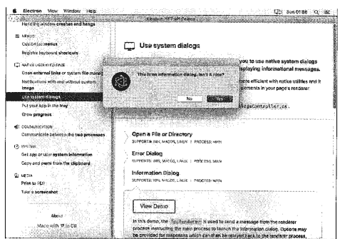

##### 在 Ubuntu 上：

- ELECTRON.NET API 演示
- 网络
- 云管理器 Windows
- 启动 Windows 任务栏和日志
- API
- 云管理器 Windows
- 云管理器 Windows
- 在系统文件管理器中打开外部链接
- 关于何时发生情况的指示...
- 显示进度
- 显示进度
- 配置
- 编译 Electron.NET API 演示
- 演示
- 打开系统信息
- 从此剪贴板创建和打印
- 数据包 PING
- 截图

##### 使用系统对话框

Electron.NET API 演示允许你使用系统对话框来打开文件、打印文件、启动文件或编辑信息消息。

这更原生、更易用，因为使用原生回调的过程更有效，并允许在进程间远程调用。请参阅 electron.net 页面的渲染进程。


##### 错误对话框

错误：ELECTRON.NET / API / DEMOS / API / DEMOS

##### 信息对话框

ELECTRON.NET / API / DEMOS / API / DEMOS

查看演示

在此演示中，Electron.NET API 将向渲染进程发送一条消息以打开信息对话框。渲染进程将捕获该消息并执行响应，随后该响应可以反映回渲染进程。

注意：Electron.NET 属性在 macOS 上被禁用。

信息对话框可以包含图标、你选择的按钮、标题和消息。

##### 在 Windows 上：

- 文件
- 编辑
- 视图
- 窗口
- 帮助

##### 试玩

在你自己的 Electron 应用中使用演示小程序。Electron 快速入门应用是一个精简应用，可与这些演示一起使用。按照此处的说明开始并克隆 Electron 快速入门。将 Electron.NET API 演示用作你的 ASP.NET Core API。

##### 构建 Electron.NET 快速入门

这包括将 ElectronNET.WebHostExtensions 扩展包含在你的 ASP.NET Core 项目的 Program.cs 文件中。

```
public static IWebHost BuildWebHost(string[] args) =>
    WebHost.CreateDefaultBuilder(args)
    .UseElectron(args)
    .UseStartup<Startup>()
    .Build();
```


当你在 Windows 上运行应用程序时（使用“dotnet electronize start”命令），安全对话框窗口通常会出现（取决于使用的安全级别），你必须确认所提议的安全规则（在下方窗口中单击“确定”）。

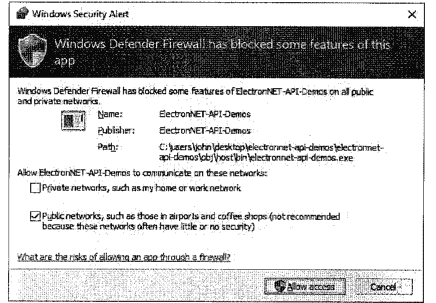

#### 8.3.6 Electron.NET 应用程序的优缺点

由于这是一种 Web GUI 实现，因此应用程序在每个平台上的渲染效果非常相似。跨平台的 GUI 显示一致性是此类解决方案实现的特征（及优势）之一。使用增强型 JavaScript 界面设计的能力是另一个优势，但此类桌面应用程序的性能并不总是最佳。

即使你可以使用 Visual Studio 开发工具来开发 Web 应用程序部分，Electron.NET 工具也无法在 Visual Studio 2019 内使用，你必须使用“dotnet CLI”来初始化、运行、构建和打包应用程序（如前所述）。

Electron.NET 为 ASP.NET 开发者提供了将其应用程序作为离线桌面环境执行的目标的能力，尽管如此，在这样做之前，需要掌握一些特定的 Electron.NET 知识。即使你是一位资深的 ASP.NET Web 开发者，你也必须经历一个学习曲线来掌握桌面开发的特定要求。

注意：Electron.NET 的版本对你必须使用的 .NET Core 版本非常严格，你必须找到 Electron.NET 版本和 .NET Core 版本的正确组合才能构建和执行程序（在某些情况下可能比较棘手）。

### 8.4 C++ 原生 GUI 应用程序

在 .NET Core 3 应用程序中实现原生 UI 有几种解决方案。使用原生 GUI 可以让每个操作系统的用户感觉该应用程序是专为其平台开发的。通过使用标准表单和控件，用户可以直接熟悉软件界面（应用程序看起来像原生应用）。

三个系统（Linux、macOS、Windows）上图形基元的稳定标准化，为开发者提供了编写可在每个系统上运行的图形界面的机会。通过使用适配的包装器，.NET Core 3 开发者


可以受益于已经存在的、可用已久的 C++ 库（可靠性）。

下面是架构图，说明如何在 .NET Core 3 应用程序中使用本机库实现 GUI（图 1）。

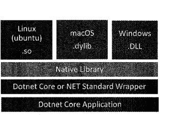

（图 1）

跨平台图形库需要根据应用程序实际运行的操作系统进行切换。在此背景下，你应该拥有适用于你所使用系统的库版本。

为开发跨平台应用程序，你应该为每个操作系统准备相应的库。

这些库中的大多数最初是为与 C++ 一起使用而开发的，因此需要开发一个 Wrapper。

Wrapper 将机器码库封装为 .NET Core 可访问的对象，Wrapper 提供了向本机库进行封送和 P/Invoke 调用的方法。

最终，你需要为每个平台准备编译后的库（Linux 的扩展名、macOS 的 dylib 扩展名、Windows 的 dll 扩展名）以及一个 Wrapper（可能是一个包），才能在 .NET Core 3 中使用它并对这些（本机）库进行调用。

有许多基于 C 和 C++ 语言的跨平台 GUI 解决方案（许多操作系统都是使用这种语言开发的），这些解决方案是你在 .NET Core 3 中实现自己的 GUI 的良好起点，下面列出了其中最流行、经过验证且高效的解决方案：

- LibUI
- guilite
- CEgui
- Nuklear

这些框架的初衷是作为 C 程序开发的基础构件（用户界面），那么在本书中介绍这些工具有什么意义呢？嗯，C 库可以通过使用 Wrapper 类轻松地从 .NET Core 3 应用程序中使用（参见关于使用非托管依赖项的章节）。

Wrapper 使得集成 C 库几乎与使用标准包一样容易。非托管库（C、C++）的集成如今由托管应用程序（.NET）很好地完成。

你可以在以下参考链接中找到有关这些库的更多信息：

- https://github.com/andlabs/libui
- https://github.com/idea4good/GuiLite
- https://github.com/vurtun/nuklear
- http://xpda.net
- http://cegui.org.uk

当然，你可以为最适合的库开发自己的 .NET Core Wrapper 版本，但为使用这些库编写 Wrapper 是一项大量工作，通常本身就是一个独立的项目。

尽管如此，其中一些库（最流行且广泛使用的库）已经为 .NET Core 开发了 Wrapper。我们选择的库已经有几个由经验丰富的个人或开发者社区制作的 Wrapper 版本，他们希望为自己的 .NET Core 开发获得一个轻量级的 C 图形用户界面框架（也为了性能）。

对于以下示例，我们选择使用 LibUI。首先，这是一个专业认可的高效库；其次，已经开发并提供了几个可与 .NET Core 一起使用的 Wrapper 实现，避免了开发自己 Wrapper 的繁琐且耗时的任务。此外，它为我们打算开发的每个平台使用原生控件。

#### 8.4.1 LibUI 介绍

LibUI 是一个简单且可移植的 C 语言 GUI 库，在其支持的每个平台上都使用原生 GUI 控件。这是一个由充满活力的社区开发的开源免费框架，如果你有改进或新功能要提议，并认为其他用户会很高兴拥有，也可以参与其开发（通过 GitHub 贡献）。

该库适用于 Windows、Linux 和 macOS（以及其他几个操作系统！）。作为一个开源项目，你可以在 GitHub 仓库中免费找到源代码。

LibUI 库的开发仍然非常活跃，最后一次发布是在 2019 年 4 月 7 日（撰写本文时），这将保证你在遇到特定问题时拥有响应迅速的社区（这不是支持，但在许多情况下，它会帮助你修复问题）或需要特殊功能。


你应该查看 LibUI 的 GitHub 网站以访问文档并获取控件使用示例（通常使用纯 C 开发）。GitHub 网站还将帮助你了解 LibUI 下的内部逻辑（始终有用）。

#### 8.4.2 LibUI 的 .NET Core Wrapper

如前所述，已经有几个 Wrapper 被开发用于在 .NET Core 中使用 LibUI。其中大多数 Wrapper 使用 .NET Standard 实现。可用于 .NET Core 的 Wrapper 列表来自 LibUI GitHub 网站，并得到社区认可。

- DevZH.UI
- TDFX.UI (SharpLibUI)
- SharpUI

经过多次测试，DevZH.UI 似乎是最灵活的解决方案。尽管最后一次更新是在 2017 年提交的，但这个 Wrapper 与当前版本的 LibUI（最后一次更新于 2019 年 4 月 7 日）是最新且可用的（并非总是如此）。

DevZH.UI 原始版本的源代码可用（参见下面的 GitHub 链接）。如果你不想使用所选的 Wrapper（DevZH.UI），也可以查看其他解决方案。


NuGet 包的分发名称是 DevZH.UI，可在标准 NuGet 网站上找到。


尽管 NuGet 包看起来是 alpha 版本，但在所有测试平台上开发示例程序期间，源代码运行良好。我们在审查过程中没有遇到任何问题。

但是，由于它被标记为 alpha 版本，你需要按照描述在包管理器中检查“包括预览版”，以便在 Visual Studio 的 NuGet 包管理器窗口中列出该包（参见图 1）。

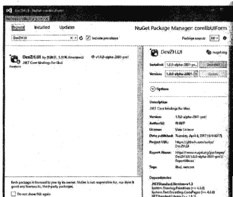

（图 1）

一旦将包包含在你的项目中，你就可以使用 LibUI 库提供的许多控件和窗口类型。

以下是此 Wrapper 中可访问的控件列表：

- Textfield
- label
- Button
- Window
- Group
- Tab
- Menu
- Checkbox
- RadioButton
- List
- ... 和更多

此列表并不详尽，你可以深入研究 Wrapper 的源代码以获取可用控件的完整列表。基本上，所有标准控件都可用，这使得使用 .NET Core 3 开发标准跨平台应用程序变得容易。

LibUI 在每个目标操作系统中使用原生显示原语，因此生成的应用程序将具有每个操作系统的原生外观和感觉。

将包添加到项目中包括所有目标平台（Windows、ubuntu、macOS）的本机依赖项（LibUI 库的编译版本），这些依赖项会根据程序运行的操作系统自动使用。最终结果对 C# 开发者来说非常方便，他们不需要为每个平台编译 LibUI 库。

实际上，开发者只需在他的 .NET Core 3 项目中添加该包，即可在项目中使用 LibUI（实际上是 Wrapper）中提供的所有功能。

所审查的操作系统（Windows、ubuntu、macOS）的图形 API 已经稳定多年，LibUI 的新版本旨在修复错误和问题或添加新功能（控件）。

#### 8.4.3 表单/屏幕设计

这是主要缺点，当你使用 LibUI（或 Wrapper）时，你无法使用设计器（也许应该开发一个？）来创建应用程序的表单/屏幕，在开发复杂或大型应用程序（包含大量表单）时，这可能是一个巨大的缺陷。

每个窗口/表单都必须手动用 C# 编码，这意味着每个窗口和控件的位置和大小都必须使用 C# 内联指令来定义。

库中将控件添加到窗口的默认行为是功能性的，但有其自身的逻辑。库使用水平和垂直框来定位控件，这非常适合编码标准设计的 GUI。尽管如此，GUI 的开发必须通过尝试和预览的循环来完成，直到达到预期结果。

以下是一个代码片段，说明如何使用按钮控件和标签开发基本窗口表单（这是下一节提供的演示项目中的一个片段）。

```
public class MainWindow : Window
{
    private HorizontalBox _horizontalBox;
    private Button _button;
    private Label _label;
    public MainWindow(string title = "MultiPlatform UI", int width = 500, int height = 200, bool hasMenubar = false) : base(title, width, height, hasMenubar)
    {
        InitializeComponent();
    }
    private void InitializeComponent()
    {
        _verticalBox = new VerticalBox { AllowPadding = true
        this.Child = _verticalBox;
```


```csharp
_label = new Label("Hello from LibUI");
verticalBox.Children.Add( label );

button = new Button("Sample Button");
verticalBox.Children.Add( button );

button.Click += (sender, args) =>
{
    MessageBox.Show("This is a message box.", "More detailed information can be shown here.");
};
}
```

此代码片段用于“corelibUIForm”示例程序（参见以下部分）。

这是此处介绍的 LibUI 包装器的一个非常基本的实现，但它能让你对选择该库来开发 .NET Core 3 项目时将要参与的开发类型有一个很好的了解。

#### 8.4.4 示例项目

以下示例项目说明了如何在 .NET Core 3 桌面应用程序中使用 LibUI 包装器。

- 第一个示例项目是从包装器 GitHub 仓库改编的经典“ControlGallery”项目。
- 第二个示例旨在为你提供一个用于开发自身应用程序的脚手架项目。

这两个示例都可以在 Visual Studio 2019 中使用和扩展，它们都面向 .NET Core 3。

##### 8.4.4.1 Control Gallery 示例应用程序

此应用程序是原始 DevZH.UI 仓库中提供的应用程序的更新版本。

该项目旨在说明在桌面 .NET Core 3 应用程序开发中使用它可以实现什么样的结果。它展示了大量小部件的使用示例。

如下所示，此应用程序的外观和感觉完美契合每个操作系统的设计特点（在每个操作系统上都看起来很棒）。

性能并未被削弱，LibUI 是一个轻量级库。

###### 在 macOS 上：

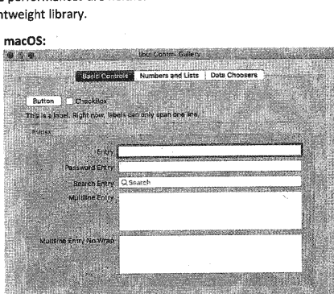

###### 在 ubuntu 上：

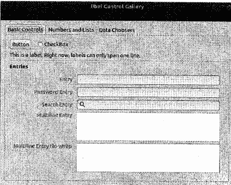

###### 在 Windows 上：

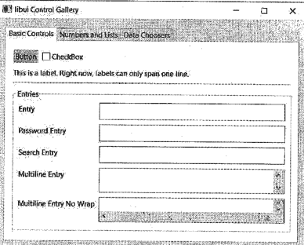

此示例应用程序是多种控件基本实例化和初始化的良好模板，但并非包装器提供的所有控件都在此演示中展示（你可以通过详细查看包装器的源代码来找到其他类型的控件实现）。

作为示例应用程序，此应用程序具有轻量级架构。此应用程序只是一个带有 3 个选项卡窗体的演示，用于说明控件的使用。

如你在 Visual Studio 的“解决方案资源管理器”中所见：

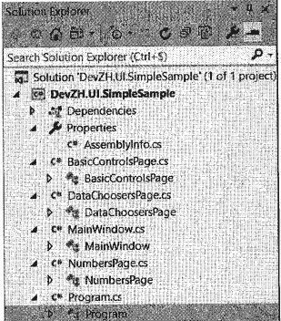

(LibUI ControlGallery 项目示例)

此示例的原始代码来自原始 DevZH.UI GitHub 仓库，已更新以使用 NuGet 包和 .NET Core 3。

重构示例（面向 .NET Core 3）的源代码可在 GitHub 上获取：

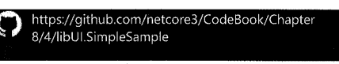

你可以亲自尝试使用这个简单的示例，以更熟悉 LibUI 和包装器 DevZH.UI 的使用。你也可以使用“coreLibUIForm”项目作为新项目的起点。

##### 8.4.4.2 基本窗体项目示例

此示例项目的目标是为使用 LibUI 包装器 DevZH.UI 开发你的应用程序提供一种快速方法。

该项目包含一个带有一个标签和一个按钮的基本窗口，它是一个经过验证的模型，可用作项目开发的基础（灵感来自 Visual Studio WinForms 默认项目模板）。

该项目可以直接使用，并已包含此类项目所需的所有依赖项。

如下（图 1）所示，项目架构是最小的。

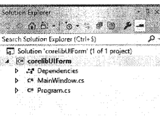

(图 1)

以下是各操作系统上运行中的应用程序预览。

###### 在 macOS 上：

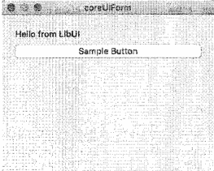

###### 在 ubuntu 上：

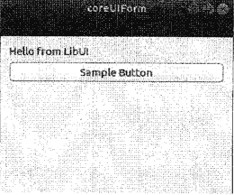

###### 在 Windows 上：

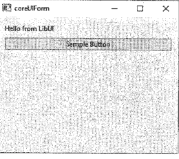

源代码和架构旨在作为开发 .NET Core 3 GUI 桌面应用程序的最小实现，因此它提供了一个示例，供你从中启动自己的项目。

#### 8.4.5 基于 LibUI 的 .NET Core 3 应用程序回顾

总之，LibUI 为 GUI 桌面应用程序开发提供了一种轻量且高效的解决方案；它不需要任何先决依赖项安装，也不需要安装专用工具。它轻量且快速，社区正在持续致力于集成改进。

在此背景下，LibUI 似乎是开发 .NET Core 3 GUI 应用程序的理想工具（至少在不同操作系统显示 API 保持稳定的这段时间内），然而，缺乏用于 GUI 设计的可视化设计器可能会让许多开发者在专业环境或快速开发中却步。掌握用于 GUI 设计的包装器所需的时间不应被低估，但一旦掌握，该库所能实现的结果可能会非常令人印象深刻。

### 8.5 GTK UI 应用程序

GTK：“The Gimp Toolkit”最初是 Gnome 为在 Linux 上开发 GUI 应用程序而发起的倡议。GTK 在开源许可证（GNU）下开发。GTK 构建在 Glib（以及其他库）之上，这是一个经过充分验证且广受欢迎的库。

GTK 没有提供大量文档，并且有特定的先决条件，因此大多数开发者认为它是一个难以使用的工具。但我们将看到，它可以实现灵活的开发，并且无论目标平台如何，使用此工具都可以获得出色的结果。因此，这种项目可以在你喜爱的开发工具 Visual Studio 2019 中获得极佳的开发体验。

#### 8.5.1 GTK 介绍

GTK 是许多知名跨平台商业应用程序的基础，并被专业人士广泛认可用于 GUI 项目开发，例如 ubuntu 的 Gnome 桌面应用程序就是使用 GTK 开发的。

我们可以简要列举 GTK 的核心优势如下：

- 稳定性：GTK 已开发数十年。
- 出色的外观和感觉。
- 主题支持。
- 面向对象方法。
- 本地化。
- 国际化。
- 良好的文档（正在不断改进）

请记住，GTK 是为与 C、C++ 语言一起使用而开发的，并从中继承了其通用架构和编程逻辑。因此，这种开发非常适合希望使用 .NET Core 3 实现生产力飞跃的 C 和 C++ 开发者。

GTK 工具包在 Linux 上是原生的，Windows 和 macOS 版本是模拟的，在这些操作系统上，GTK 工具包需要安装一系列库（不详尽）：

- Atk：GTK 的无障碍框架。
- Cairo：用于矢量图和图像合成的图形库。
- Gdk：包含窗口的图形原语。
- Gio：用于 Gtk I/O 操作的辅助函数。
- GLib：Gtk 的工具箱和辅助函数（Gtk 的基础之一）。
- Gtk：包含小部件架构（用于窗口和控件）。
- Pango：GTK 的前端渲染库。

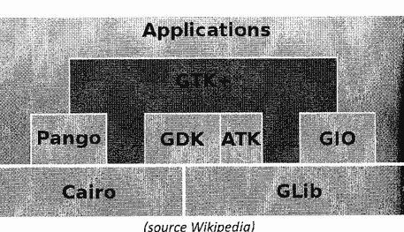

使用 GTK 的基本编程逻辑是使用小部件的层级树。在 GTK 中，“widget”术语用于控件、窗口以及 GUI 的几乎每个元素。

主容器小部件是窗口对象，其他小部件（如文本框、标签、按钮、选择框等控件）可以添加到主窗口（容器）内。

GTK 是事件驱动的（信号/处理程序）。例如，当你单击按钮时，会向应用程序发送一个信号，你需要通过编码自己定义信号和处理程序。

开发 GTK 应用程序的文档主要是为 C、C++ 语言编写的，但如果你具备最基本的 C 语言知识，它可以轻松地适配/移植以用于 .NET Core 3 C#。

GTK 库不仅需要安装在开发机器上，还需要与创建的应用程序一起安装（因此你需要通过安装程序随同安装它）。

GTK 原生依赖项在目标机器上是强制性的，这是应用程序正确执行的先决条件（你必须将这些依赖项包含在安装程序中）。

以下是可查找有关 GTK 框架更多信息的网络链接。

- https://gtk.org
- https://blog.gtk.org
- https://developer.gnome.org
- https://gnome.org/gtk
- https://github.com/GNOME/gtk


#### 8.5.2 GTK 安装

如你所理解，GTK 是一个 Linux 原生工具，但需要在其他系统（Windows 和 macOS）上安装。从第三版开始，GTK 的安装不再是一个简单的可执行二进制文件。在 Windows 和 macOS 上安装的过程包括设置一个 Linux 模拟环境（该环境占用的磁盘空间可能与原始 Ubuntu 发行版一样大）。

GTK 还需要安装在你计划部署或测试 GTK 应用程序的机器上（至少需要运行时）。我们将详细介绍如何在每个系统上进行此设置。

##### 8.5.2.1 在 Windows 上（用于开发站）

此 GTK 安装说明来自 gtk.org（参阅参考网站）网站。这是在 Windows 平台上安装 GTK 的推荐过程。另一种解决方案是从源代码构建 GTK 工具包，但这需要预先安装 C 构建环境（这不是我们在此处的目的）。

###### A) 安装 MSYS2

为了设置 GTK，你需要为此类应用程序设置一个 mingw 环境。MinGW 是“Minimalist GNU for Windows”的缩写，它为在 Microsoft Windows 上开发应用程序提供了开源环境。

MSYS2 是一个在 Windows 站点（MinGW）上提供类 Unix 环境的项目。该项目为在 Windows 上开发 GTK 应用程序奠定了基础，它将允许设置 GTK 运行时和你开发 .NET Core 3 GTK 应用程序所需的工具（如 Glade）。

MSYS2 提供一个类 Unix 的包管理器“pacman”以及许多其他来自 Linux 环境的有用工具。

```
https://www.msys2.org/
https://msys2.github.io/
https://www.gtk.org/download/windows.php
https://mingw.org/
```

你可以像安装标准 Windows 应用程序一样安装 MSYS2，如你所见（图 1、2、3）。如果安装程序在安装过程中没有返回任何错误，则没问题；如果出现错误，请卸载有故障的版本，修复问题，然后从头开始重新安装，直到获得干净的 MSYS2 安装。

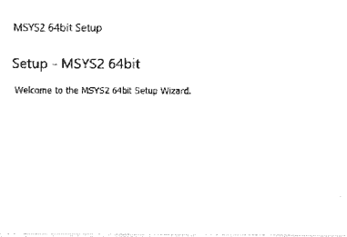

(图 1)

####### 安装 MSYS2 64位

正在安装组件 MSYS2 64位基础...

显示详细信息

最终屏幕（图 3）显示 MinGW 命令提示符，该屏幕指示安装已完成并成功。

安装过程完成后，重启 Windows。

###### B) 安装 GTK

一旦你正确安装 MSYS2 并重启后，现在应该安装 GTK 运行时和开发库。此安装可以通过在 mingw 环境中使用适当的“pacman”（包管理器）命令来完成。

```
~ pacman -S mingw-w64-x86_64-gtk3
```

预期结果应如（图 4）所示。

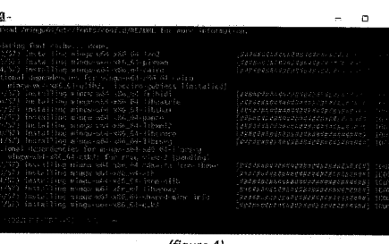

(图 4)

###### C) 安装 Glade

Glade 是新的 GTK 界面设计器，它将允许你通过可视化工具设计应用程序，并将其保存为 GTK 使用 GTKBuilder 可加载的 XML 标准格式文件。在其第三版中，这是一个专业级工具，将允许你像设计标准 C# Winforms 应用程序一样设计 GTK 应用程序 GUI。

即使 Glade 有自己的设计逻辑，它也允许开发人员实现 GUI 的精确建模。

Glade 的设置也通过“pacman”程序使用以下命令来完成：

```
~ pacman -S mingw-w64-x86_64-glade
```

Glade 成功安装的屏幕应如（图 5）所示。


(图 5)

安装后，你可以通过单击 mingw 文件夹中的“glade.exe”文件手动启动 Glade 程序，或运行命令行“glade.exe”。

我们将稍后介绍如何在 Visual Studio 2019 中集成 Glade 以编辑界面（XML 文件），而无需离开 IDE。

当然，如果你不打算使用 GUI 可视化设计器，并使用 C# 内联代码和 XML 定义 GUI，则不需要安装 Glade，如果你手动编写 GUI，它不是强制安装的。

###### D) 配置环境变量

为了对 GTK 库和依赖项进行系统范围的访问，你应该修改 Windows 全局路径。为此，你需要编辑全局路径环境变量：

控制面板 > 系统和安全 > 系统 > 高级系统设置 > 环境变量 >

通过添加“C:\msys64\mingw64\bin”（或你设置的 mingw 工具路径）来修改“Path”变量，如下图所示（图 6）。


(图 6)

此修改将在下次重启 Windows 系统后生效。

你也可以选择仅在 Visual Studio 项目属性中为 GTK 应用程序添加环境变量路径，但我们将在示例部分稍后介绍此解决方案。

###### TIPS: Windows 上 Gtk 安装的替代方法

之前的安装方法的缺点是有点繁重，你需要安装完整的 mingw 构建环境才能完成，根据安装目的（安装 GTK 运行时），这可能显得有点过大。这是因为自第二版以来（几年前），没有人（GTK 社区不如以前活跃）发布过 GTK 工具包的二进制安装包。

尽管如此，独立程序员使用一个设计良好的 NullSoft 安装程序提供这种设置。当前安装版本的二进制文件可在他们的 GitHub 上找到。

https://github.com/tschoom/GTK-for-Windows-Runtime-Environment-Installer

此分发版（由 Tom Shoonjans 和 Alexander Shaduri 制作）集成了最新可用的 Gtk 工具包，版本 3.24 以及使其正常工作所需的所有依赖项。此最新版本于 2019 年 7 月 2 日发布，似乎是 GTK 工具包安装的可靠来源。你还会在 GitHub 上找到用于在 Windows 上生成 GTK 运行时自定义安装程序的 NullSoft 脚本。

##### 8.5.2.2 在 macOS 上

如前所述，macOS 上的 GTK 安装可以通过使用“HomeBrew”（参阅参考网络链接）并按照以下所述过程完成。

http://brew.sh/

如果你之前没有安装过 Brew，以下是如何安装它，然后如何使用它安装 GTK。

###### A) 安装 Brew

你可以通过在 macOS 终端提示符中执行命令行来安装 brew：

```
$ /usr/bin/ruby -e "$(curl -fsSL https://raw.githubusercontent.com/Homebrew/install/master/install)"
```

结果应如所述（图 7）。


(图 7)

###### B) 安装 GTK

安装 Brew 后，你可以使用以下命令行（公式）轻松安装 GTK 运行时和依赖项。这将安装 GTK 版本 3 及其所有依赖项。

```
$ brew install gtk+3
```

如果包设置正确，此命令应产生以下输出。


(图 8)

如果你没有获得正确的安装，像往常一样，你应该修复任何问题并从头开始重新安装包。

##### 8.5.2.3 在 ubuntu 上

GTK 在 ubuntu 桌面版上是原生安装的（它是用于开发 Gnome 的工具），因此你不需要安装任何额外模块来执行 GTK GUI 应用程序类型。作为 ubuntu 的原生组件，GUI 的性能也将优于任何其他系统。

#### 8.5.3 GTK# 简介

既然 GTK 运行时在每个平台上都可用，我们可以开始解释如何从我们的 .NET Core 3 应用程序中使用它。GTK 运行时已有一个开发并验证的 .NET 包装器：GTK#。

该工具包在其最新版本中变成了多平台（采用了 GTK# 的 .NET Standard 2.0），因此可以与 .NET Core 3 一起用于多平台 GUI 应用程序开发。

GTK# 是 .NET 的图形用户界面工具包，该工具允许 .NET 开发人员在 .NET 中使用 GTK+。

GtkSharp（发音如此）是围绕 GTK 及其组件的 C# 包装器，这是之前针对 mono（和 Gtk 2.xx）的 gtk-sharp 库的一个分支。

GTK# 的最新版本针对 GTK 版本 3.22，并以 .NET Standard 格式提供。源代码在开源许可证下，并在 GitHub 上的以下链接中提供。


GTK# 库也可通过 NuGet 包分发系统获得。除了基础包装器 GTK#，一个专用包还提供新的项目模板和项目项，用于使用 dotnet CLI 工具（适用于 .NET Core 3）开发 GTK# 应用程序。


这是一个非常实用的包，它为开发者提供了一种新的应用程序类型，可通过 dotnet CLI 生成，它还提供了创建新小部件、窗口或对话框对象的可能性（包含 .glade 文件）。

模板包的安装可以使用下面描述的命令行完成（这是安装 dotnet CLI 新项目模板的标准命令行）：

```
C:>dotnet new install
GtkSharp.Template.CSharp --version
3.22.24.37
```

版本号是可选的，可以省略。以下是安装此模板包后的结果屏幕（图 1）。


(图 1)

安装此包后，GTK 新项目模板应可通过“dotnet new”命令行使用，这些新项目包括：

- GtkSharp.Application: 生成一个完整的 Gtk 应用程序，包含 .csproj、.cs 和 glade 文件。
- GtkSharp.Dialog: 生成 .cs/.glade 文件，用于向现有项目添加对话框窗口。
- GtkSharp.Widget: 为控件（小部件）生成 .cs/.glade 文件。
- GtkSharp.Window: 生成基本 gtk.window 的 .cs/.glade 文件。

只有 GtkSharp.Application 是 .NET Core 的项目模板，其他的是用于向应用程序添加元素（对话框、小部件、窗口）的项模板，生成元素的默认名称是执行命令的文件夹名称（如果未指定输出名称）。

您可以使用命令“dotnet --list”验证所有这些模板是否已正确安装，该命令列出“dotnet new”命令的可用模板，如下所示。

```
C:>dotnet new --list -lang C#
```

“-lang”选项用作结果过滤器，仅选择 C# 类型的项目。此命令的结果如下：

| 短名称 | 语言 | 标签 |
| :--- | :--- | :--- |
| 控制台应用程序 | console | C#, C++, F#, VB |
| 类库 | classlib | C#, C++, F#, VB |
| 单元测试项目 | unittest | C#, C++, F#, VB |
| xUnit 测试项目 | xunit | C#, C++, F#, VB |
| ASP.NET Core 空应用 | web | C# |
| ASP.NET Core Web 应用 (模型-视图-控制器) | mvc | C#, F# |
| ASP.NET Core Web 应用 | razor | C# |
| ASP.NET Core 与 Angular | angular | C# |
| ASP.NET Core 与 React.js | react | C# |
| ASP.NET Core 与 React.js 和 Redux | reactredux | C# |
| Razor 类库 | razorclasslib | C# |
| Razor 页面 | page | C# |
| Microsoft Identity Platform (Azure AD v2.0) Web 应用程序 | webapp | C# |
| 辅助角色服务 | worker | C# |
| gRPC 服务 | grpc | C# |

您现在可以使用 .NET Core 3 命令行客户端创建新的 GTK 应用程序，如下所示：

```
C:>dotnet new gtkapp -n sampleGtkApp
```

此命令行将创建名为“sampleGtkApp”的 GTK 应用程序项目（这是新 dotnet CLI 命令的标准行为）。

创建的模板应用程序使用 .glade 文件格式来描述 GUI。此格式可以加载到 Gtk.Builder 对象中（我们将在后面详细介绍此点）。

您可以通过以下参考链接了解有关使用 Gtk.Builder 的更多信息。

```
http://gtkbuilder.org/
http://gnome.org/gtkbuilder
```

在模板中，.cs 文件和 .glade 文件同名，这使开发者可以轻松修改窗口的两个方面（前端和后端）。

生成的应用程序可以轻松修改和扩展；通过使用 Glade 编辑对应主窗口的 XML 文件（.glade 扩展名）。

您可以注意到，此包生成的应用程序模板使用基于 XML 文件的 GUI 模型。但使用 GTK，您也可以使用内联 C# 代码实现 GUI，我们将在示例部分回顾这两种 GTK 实现类型。

在继续之前，有必要研究 GTK 界面设计器：Glade。

#### 8.5.4 Glade：用户界面设计器

Glade 是一个允许在不手动编写代码的情况下构思和设计 GUI 的应用程序。此应用程序取代了 Stetic GUI 设计器（用于 Mono，跨平台 .NET 框架）。

与其前身一样，它是一个具有 WYSIWYG 功能的 RAD 工具，可轻松开发 GTK+ GUI。Glade 与编程语言无关，这意味着它不生成任何代码，描述所设计 GUI 的文件按照标准 XML 格式编码。GTKBuilder 是此 XML 文件的格式。

Glade 负责生成描述 UI 的 XML 代码，并生成可通过 GtkBuilder（使用 GtkBuilder 对象）加载的 XML 文件。此后，这些 XML 文件可用于您的 GTK# .NET Core 3 C# 应用程序（实际上适用于您用于使用 GTK 工具包开发的任何语言）。

您可以通过以下参考链接了解有关 Glade 的更多信息。


##### 8.5.4.1 为 Visual Studio 2019 安装 Glade 以供使用

为了方便编辑 GUI XML 文件，可以从 Visual Studio 2019 内部调用 Glade。

您可以在 Visual Studio 中轻松将 Glade 配置为打开“.glade”扩展名文件类型的默认程序（图 1）。因此，GTK GUI 的集成将显示为集成在 Visual Studio 环境中，您将能够从 Visual Studio 的“解决方案资源管理器”中编辑“.glade”文件。


(图 1)

打开“glade”文件时，必须选择“设置为默认”，以便与 Glade 建立永久关联。

在 Visual Studio 中完成 Glade 的安装和配置后，您只需在“解决方案资源管理器”视图中双击它，即可根据要求编辑“glade”文件。

##### 8.5.4.2 使用 Glade 进行界面设计

使用 Glade 设计 GUI 对每个开发者来说几乎都是直观的（几乎与 Visual Studio 中的 Winforms 设计器相同）。如下（图 2）所示，它提供类似的功能。


(图 2)

Glade 应用程序（图 2）由三个不同的面板组成，对应应用程序的三个功能：

- 左侧面板：表示容器中存在的小部件的层级树。Glade 允许添加小部件或容器（对于 GTK 来说，容器也是一种小部件）。表单（或屏幕）设计遵循小部件的层级树。您也可以在此视图中按名称选择小部件。
- 中间面板：设计器的主视图。此面板允许开发者设置所选小部件的位置和大小（它也允许小部件选择）以及添加新小部件。
- 右侧面板：此面板根据所选选项卡汇集四个不同的功能：
  1. 所选小部件属性的视图（带有“常规”选项卡）。
  2. 用于小部件定位及其在 GTK 术语中的停靠和打包的视图（带有“打包”选项卡）。
  3. 用于当前所选小部件常用属性的视图（带有“常用”选项卡）。
  4. 用于管理与小部件关联的不同事件上发送的信号的视图（带有“信号”选项卡）。

这些简单概念足以使用 Glade 为您的应用程序设计高效的 GUI。

请注意，掌握 Glade 并非立即可行，应该需要一个学习曲线，因开发者而异。

##### 8.5.4.3 在 Glade 中定义信号/处理程序

完成图形设计后，可以使用 Glade 在界面和后端程序（C# 代码）之间建立链接。

GTK 遵循信号/处理程序类型的架构（一种经典架构）。根据此逻辑，Glade 允许开发者指定特定小部件上事件发送的信号类型（在右侧面板中）。此实现直接从 Glade 应用程序完成，即通过在特定信号上指定适当的方法名称调用，如所述（图 3）。

您会注意到 Glade 界面中某些信号标记为“已弃用”，但您也可以使用已弃用的信号（如屏幕截图所示）。


(图 3)

一旦为信号定义了方法名称，就必须将相应的方法语句添加到包含应用程序后端逻辑的“.cs”文件中（图 4）。


(图 4)

每次预定义事件上的信号被触发时，都会调用所实现的方法。该方法为 GTK# / .NET Core 3 应用程序前端与后端之间的交互实现提供了一种简便而优雅的方式。

你还可以选择直接在代码中使用小部件名称来编码事件，而不使用 Glade 中的信号/处理程序（但可读性较差）。

#### 8.5.5 GTK# 示例应用程序

如你已理解，可以用两种不同的方式开发 .NET Core 3 GTK 应用程序：

- 内联 C# 编码的 GUI 实现。
- 基于 XML 设计的 GUI（使用 Glade 和 Gtk.Builder）。

在本节中，我们将为每种方法提供一个示例项目的回顾。每种方法都有其优缺点，应根据你打算开发的项目类型来选择。

##### 8.5.5.1 内联 C# 编码的 GUI 示例

此示例是使用 GTK 工具包进行内联 GUI 应用程序开发的良好起点，它使用了大量的小部件（GTK 术语中的控件）。

此示例提供于 GTK# GitHub 仓库，似乎是开发此类应用程序的参考（GTK# 的可用文档并不多）。该应用程序是一个演示程序，其唯一功能是使用 GTK# 中提供的各种小部件。

以下是不同平台上的渲染截图。

###### 在 macOS 上：


###### 在 Ubuntu 上：


###### 在 Windows 上：


你会注意到，该应用程序的 macOS 版本未包含标题栏标题图标。这是因为在 macOS 上通过 brew 默认安装 GTK3 时不会安装默认主题图标（Windows 安装的情况则不同）。你需要使用下面描述的命令行（brew 公式）单独安装 GTK3 默认主题图标。

```
$ brew install gnome-icon-theme
```

此命令将安装默认的 GTK 图标和主题资源，以便正确显示应用程序。正确安装该包将产生如下屏幕所示的输出。

```
Last login: Sun Aug 4 00:01:18 on ttyS000
Jons-MacBook:~ jschoen$ brew install glade libxml2
==> Downloading https://homebrew.bintray.com/bottles/glade--3.22.1.mojave.bottle.tar.gz
==> Downloading from https://akamai.bintray.com/...
######################################################################## 100.0%
==> Pouring glade--3.22.1.mojave.bottle.tar.gz
==> Caveats
glade is Python 3 only and requires PyGObject.
==> Summary
🍺  /usr/local/Cellar/glade/3.22.1: 1,769 files, 1.7MB
==> Downloading https://homebrew.bintray.com/bottles/libxml2--2.9.9.mojave.bottle.tar.gz
==> Downloading from https://akamai.bintray.com/...
######################################################################## 100.0%
==> Pouring libxml2--2.9.9.mojave.bottle.tar.gz
==> Caveats
libxml2 is keg-only, which means it was not symlinked into /usr/local,
because macOS already provides this software and installing another version in
parallel can cause all kinds of trouble.
If you need to have libxml2 first in your PATH run:
  echo 'export PATH="/usr/local/opt/libxml2/bin:$PATH"' >> ~/.zshrc
For compilers to find libxml2 you may need to set:
  export LDFLAGS="-L/usr/local/opt/libxml2/lib"
  export CPPFLAGS="-I/usr/local/opt/libxml2/include"
==> Summary
🍺  /usr/local/Cellar/libxml2/2.9.9: 416 files, 8.6MB
Jons-MacBook:~ jschoen$
```

此示例项目说明了在选项卡窗口中实例化多个 GTK 小部件，它将为你使用 C# 编码的 GUI 编写应用程序提供知识。作为主题化 GUI 工具包，该应用程序在不同平台上的渲染效果相似。

此外观是开始使用 GTK 进行开发的参考示例。构建此示例还将验证每个平台（Windows、Ubuntu、macOS）上正确的 GTK 安装和构建链。

原始示例项目面向 .NET Core 2，但已无问题移植到 .NET Core 3。

```
https://github.com/GtkSharp/GtkSharp/Sample
.Net Core 3 version:
https://github.com/netcore3/CodeBook/Chapter8/5/GtkSamples
```

如你所理解，在此示例项目中，未使用任何应用程序可视设计工具，每个小部件均通过代码创建。

与使用 LibUI 开发应用程序（参见上一节）类似，小部件是使用 C# 纯代码声明和配置的，在此上下文中，准确定位每个小部件并非易事（如果你需要从模型构建应用程序）。这种 GUI 编码方法的优势在于不需要在开发工作站上设置 Glade 来进行屏幕的可视设计（这是一个问题吗？）。

如果你想开发复杂的应用程序（和/或带有许多表单设计），应该考虑使用 Glade/GtkBuilder 应用程序类型（参见下一示例）。

##### 8.5.5.2 基于 XML 编码的 GUI 示例（使用 Glade）

此示例围绕先前描述的 GtkSharp.Template.C# 包中提供的模板构建。

这是 GtkSharp.Application 模板的基本实现。该模板提供了使用 Glade 开发 GUI（并在 GtkBuilder 中加载）来构建 GTK 应用程序的基本架构。

在此示例中，你可以使用 Glade 可视化界面设计器来设计 GUI。用户界面通过 XML 文件（带有 glade 扩展名）实现，可以像之前所示一样在 Visual Studio 2019 界面中使用 Glade 进行编辑（这很方便）。

以下是 Visual Studio 2019 中名为“GtkBasicForm”的项目结构的“解决方案资源管理器”视图。


用于生成应用程序的模板（来自 GtkSharp.Template.CSharp）默认面向 .NET Core 2，因此你首先要做的是将项目更新为面向 .NET Core 3。这可以通过编辑 .csproj 文件并更新目标 .NET Core 框架的版本号来完成。

项目由主程序和用于托管在“glade”文件中描述的 GUI 的对象组成。GUI 的加载通过 GTK Builder 执行，它还将 GUI 的所有信号重新路由到主程序对象。

这是一个基本的 Glade 应用程序，仅使用 GtkSharp.Template.CSharp 包生成的 Gtk 项目模板中的标签文本和按钮。

以下是该项目“GtkBasicForm”在不同平台上运行结果的视图。

###### 在 macOS 上：


###### 在 Ubuntu 上：


###### 在 Windows 上：


“GtkBasicForm”示例确实在按钮单击事件上实现了带有相应处理程序方法 button1_clicked 的信号。该事件是内联实现的（它应该集成在 .gradle 文件中）。

此项目为开发 GTK .NET Core 3 应用程序提供了良好的起点，可以将其用作模板来实现此目的。

与编码 GUI 相比，GUI 编辑要灵活得多，并且（一旦你熟悉 Glade GUI）可以在最短时间内设计出合适的 GUI，提供更大的可能性。

你可以在 netcore3 GitHub 仓库中找到此示例项目的源代码。

#### 8.5.6 GTK 主题：安装与配置

作为主题化图形工具包，GTK 允许你为应用程序开发自己的主题。此外，它允许开发者自定义现有主题，以最少的时间和编码工作量匹配其所需的适配外观和感觉（颜色、字体、定位...）。

你可以在下方提供的参考链接中找到预定义的 GTK 主题。


该网站为 Gtk3 提供了超过一千个现成的主题，此外，它可免费用于你的应用程序开发（开源许可证）。

##### 8.5.6.1 为你的应用程序使用其他主题

如果你希望让你的应用程序与众不同，不像标准 GTK 应用程序设计，你可以指定使用某个主题来替代默认主题。

你可以通过在 C# 源代码中明确指定要使用的主题来实现这一点。

如果你需要了解更多关于此领域的信息，参考链接中有关于 GTK 应用程序主题设置的专门文档。


##### 8.5.6.2 设计新的 Gtk 主题

如果您需要进行完整的主题开发，可以使用现成的工具来实现这一目标：Oomox。

以下是 Oomox 应用程序的屏幕截图。


Oomox 主题设计器是一款开源软件，可在 GitHub 上获取。

这些工具是为 Linux 平台实现的。Oomox 是一款用于生成 Arc 主题（Gtk3）和配色方案的图形应用程序。


#### 8.5.7 Gtk 应用程序开发建议

GTK 工具包具有巨大的潜力，由于它源自 C、C++ 环境，我们建议您已具备此类项目的基本知识（至少为了使用文档）。GTK# 开发项目提供的可能性非常出色，使得使用 .NET Core 3 框架配合 GTK 工具包变得容易得多。

如果您对 GUI 没有特殊或异国情调的要求，使用 GTK# 看起来是开发跨平台 GUI 应用程序的绝佳解决方案。否则，您将不得不使用纯 C 处理项目的一部分（用于您的异国情调小部件）。自定义小部件的开发还将涉及扩展包装器（这意味着大量工作...）。

### 8.6 QT/QML GUI 应用程序

与之前介绍的示例（Libui、Gtk）一样，QT/QML 用于实现 GUI 桌面应用程序的解决方案基于使用 C、C++ 开发的图形框架，并实现与所述相同类型的架构（图 1）。


(图 1)

QT Quick 是由 Digia 开发和维护的开源框架，属于 QT 框架系列。

QT Quick 包含一种名为 QML 的声明式脚本语言，该语言允许以简单的方式为软件应用程序设计和开发高性能且带动画的 GUI。

#### 8.6.1 QT 介绍

QT 是一个用于开发图形应用程序的多平台框架。该框架最初发布于 1995 年，现在已在稳定性和所生产软件的质量方面拥有严肃的证明。KDE Linux 桌面应用程序就是使用此工具开发的（还有许多其他著名的桌面应用程序）。

自 2014 年起，QT 已并入 QT 开源社区。毫无疑问，使用此工具进行的开发将被广泛分发，并将受益于专业保证和支持。

QT 当前为多平台应用程序设计提供完整的开发环境，该环境基于 C 和 C++。它为桌面和移动平台开发提供解决方案。QT 提供 GUI 的完整抽象层（以及其他内容）。

QT 允许为几乎每个平台开发 GUI 软件，从配备大型显示设备的强大工作站，经过移动设备和平板电脑，到嵌入式板载计算机（有关更多详细信息，请参阅 QT 网站）。该框架的多功能性令人惊叹，掌握这项技术的能力从长远来看绝不会是一项亏本投资（尤其是该项目有专门公司支持）。

QT 框架采用双重许可条款，一种是商业许可，另一种是开源许可（我们在示例中将使用后者）。请注意，QT 框架由 QT 公司开发，并根据您计划对其进行的使用类型要求特定许可。有关许可条件的更多信息，请咨询该公司的网站。

从技术角度来看，QT 提供了一个图形框架，允许开发人员实现高质量的图形软件，并可以使用框架原生包含的效果和动画。QT 实际上已被许多主流产品用于其图形界面设计（汽车、专用硬件、实验室硬件...）。特别是如果您计划使用来自使用 Photoshop 的设计师的 GUI，您将能够使用 QT 直接使用生成的图形资源。

有关 QT 本身的更多参考，请访问参考链接。

https://www.qt.io/
https://wikipedia.org/wiki/qt

QT 不实现每个平台的原生小部件使用，而是提供其自身的 GUI 层抽象，它特别适用于包含动画和效果的原创设计 GUI。

#### 8.6.2 QML.NET 介绍

QT 为使用 C 和 C++ 开发多平台应用程序提供完整的集成解决方案，那么为什么要在一本使用 .NET Core 3 的书中回顾此工具？

当然，这是因为自 2018 年以来，该框架的包装器已正式发布，使得 QT，更准确地说是 QML，成为使用 .NET Core 3 开发 GUI 桌面应用程序的绝佳语言。

QML 是一种用于描述 GUI 的声明式语言。它的语法受 C 和 JSON 启发，允许其实现具有最小文件大小。它是 QT Quick 的一个子集。

QML 实现了几个关键概念：

- 对象被描述为 C 结构。
- 对象可以被描述为其他对象的组合（继承）。
- “状态”、“过渡”、“动画”可以与小部件关联（在我们的例子中是 QT Quick 控件）。

- 1. 状态：是一条命名语句，用于在满足特定条件时描述一组属性。
- 2. 过渡是一种声明，用于随时间分布变化。
- 3. 动画描述对象（外观）从其属性变化中演变的过程。

以下是 QML 实现的示例代码片段（一个点击时会改变颜色的矩形多边形）：

```
Rectangle {
width: 200
height:200
color: mouse.pressed ? "blue" : "red"
Text {
text:"Hello World !"

anchors.centerIn: parent
}
}
```

QML.NET 允许 .NET Core 3 开发人员使用此语言通过 QML 包装器设计应用程序的 GUI。QML.NET。

为 .NET 实现 QT 包装器并不新鲜，但通过此版本：QML.NET 迈上了新台阶。它现在是一项受公司支持的解决方案，现已可用。

QML.NET 是开源的，开发人员可以在专用 GitHub 仓库中获取。

您可以注意到，QML.NET 示例项目当前针对的版本是 .NET Core 2.2，但包装器是使用 .NET Standard 2.0 实现的，因此可用于每个 .NET 框架（当然包括 .NET Core 3）。

所使用的 MIT 许可允许您免费将 QML.NET 用于任何计划进行的项目（允许商业用途、修改、分发和私人使用）。

此 GitHub 仓库包含使用 .NET Core 3 进行开发所需的所有工具：

- QML.NET：包装器
- QML.NET 示例应用程序。
- QML 运行时：适用于 Windows、Linux 和 macOS 的运行时安装脚本。

QML.NET 允许 .NET Core 3 开发人员使用 .qml 文件格式来指定和设计应用程序。

.qml 文件可以使用适当的专用软件进行编辑：QT Design Studio。

.qml 文件格式是一种基于文本的文件格式，也可以使用经典文本编辑器进行编辑，但在这种情况下需要对 QML 语言本身有更多专业知识。即使使用 QML 进行开发看起来是艰难的方式，了解 QML 语言提供的众多功能对于开发实际应用程序也可能非常有帮助（尤其是如果您使用设计师导出的设计）。

我们建议查看“qmlbook”网站，以详细了解 QML 语言，特别是用于开发 GUI 中的效果和交互性（这是面向 C、C++ 的）。有关 QML.NET 用法的更多信息，请参阅参考链接。

- https://qmlnet.github.io/
- https://github.com/qmlnet/qmlnet/
- http://qmlbook.github.io/

除了包装器的源代码外，QML.NET 还可以通过多个 NuGet 包包含在您的项目中（取决于您在项目中针对的平台）。


因此，您还需要为开发打算运行的每种平台类型添加特定的运行时依赖项。

为了熟悉 QML 语言，我们将更深入地回顾专用的免费所见即所得编辑器：QT Design Studio。


#### 8.6.3 QT Design Studio

QT Design Studio 是用于开发 .qml 界面文件的 RAD 工具。

该产品的社区版本是免费的，并且适用于我们关注的三个平台（Windows、Linux、macOS）。

如图 1 所示，它为开发者（或界面设计师）提供了设计高质量 GUI 所需的所有功能。


(图 1)

该界面由三个主要部分组成。对于有经验的开发者来说，您会对这个应用程序很熟悉，因为它使用了图形界面设计器的标准格式（并非官方标准）。

与 GUI 设计特定功能相对应的三个主要面板：

- 左侧：工具箱，显示当前表单设计可用的控件列表。
- 中间：表单设计器，用于设置控件的位置、缩放和选择。
- 右侧：所选控件的属性视图。

除了可视化编辑器，一个垂直选项卡控件允许开发者手动编辑源代码（切换到文本编辑器）。可视化编辑器用于轻松且交互式地生成 QML 文件（如前所述，这实际上是一个文本文件）。QT Design Studio 允许您设计带有动画和效果（由信号/事件触发）的应用程序，以制作高端外观的界面。该软件（即使在社区版中）还包含各种教程，以便更轻松地学习产品使用的基本概念。

YouTube 上已经有几个关于 QT Design Studio 的教程，对于开始使用此工具可能特别有用。

您可以通过参考链接找到在线手册和视频教程。


##### 8.6.3.1 安装 QT Design Studio

QT Design Studio 是一个免费（社区版）工具，其二进制版本可在 QT 网站上获得。

此版本进行了界面重新设计，使其看起来比之前的版本时尚得多（您可以在 Wikipedia 上查看产品的演变）。

```
https://download.qt.io/official_releases/qtdesignstudio/1.2.0/
```

前面的链接提供了本书中我们正在开发的三个操作系统（macOS、Ubuntu、Windows）的软件下载链接。QT Design Studio 也可以使用 QT.IO 安装程序进行安装，您可以在公司网站上找到它：qt.io。

下载应用程序后（参见前面的链接），您可以单击安装程序启动安装过程，并按照说明正确安装该程序。

#### 8.6.4 将 Photoshop 资源用作 GUI

使用 QT Design Studio，您可以使用自己喜欢的图形编辑器来设计 GUI。如果您的应用程序需要开发非标准界面（使用您自己设计的小部件），则可以使用 Photoshop 来完成此任务。QT 公司有一个用于完成此任务的商业产品（QT Bridge），这需要适当的许可。

即使它不提供商业产品中的所有功能，我们也将使用旧版本“QML Exporter”，该版本采用开源许可证。

安装用于将设计导出为 .qml 文件的插件后，您可以直接从 Adobe Photoshop 生成 GUI。

##### 8.6.4.1 安装：QML 导出器插件

首先，您需要从提供的链接下载 Photoshop 插件


下载插件后，将文件 "Export QML.jsx" 复制到文件夹：

```
Photoshop/Plug-ins/Presets/Scripts
```

请注意，此路径在您的计算机上可能会根据 Photoshop 的位置而有所不同。将 .jsx 文件复制到相应文件夹后，您需要重新启动应用程序以更新预设列表。

重新启动后，您应该在下图所示的“文件/脚本/”菜单下看到“导出 Qml”选项。


(Adobe Photoshop 导出到 QML)

您将在包含的 .zip 文件“qt-labs-photoshop-qmlexporter-cs6.zip”的 readme 文件中找到有关导出 .qml 文件可用选项的所有详细信息。

从 Photoshop 导出文件时，您应该看到如下视图：


(QML 导出扩展：导出选项)

使用此表单，您可以配置要进行的导出类型（我们将在示例部分了解每个选项的用途）。

导出受若干规则的限制，这些规则涉及 Photoshop 文档中的图层和文件夹：

- Photoshop 文档（.psd 文件）中的每个文件夹将作为单个对象（图像）导出。
- 文件夹中的隐藏图层将完全不导出。
- 文件夹的内容将按其在 Photoshop 中显示的方式导出。
- 文件夹中的文本元素将被渲染（光栅化）。
- 导出过程将尊重图层顺序。
- 文件夹层次结构（.psd 文件中的 Photoshop 文件夹）在导出过程中不会保留。
- 您必须为设计中的每个图层指定名称。

为了亲身体验导出插件的功能和局限性，您应该在多种配置下对其进行测试，并使用 QT Design Studio（或根据您遵循的方法论使用文本编辑器）验证生成的 .qml 文件。

#### 8.6.5 使用 QML.NET 的示例程序 GUI

在本节中，我们将介绍使用 QML.NET 与 .NET Core 3 开发跨平台应用程序，并回顾三种不同类型的示例项目，以说明多种方法。

- 第一个示例来自 QML.NET 作者的 GitHub 仓库，已更新为使用 .NET Core 3（并略作修改）。
- 第二个示例使用 QT Design Studio 设计的带有标准 QT Quick 控件的 GUI。
- 第三个示例使用从 Photoshop 设计并导出的 GUI（使用前面描述的 QML 导出器脚本）。

您可能已经注意到，我们没有涉及和回顾 QT 运行时的设置过程（例如 GTK 开发），这是因为使用 QML.NET 开发时不需要它。

事实上，QML.NET 包装器的专用指令会检查所需 QT 运行时的存在，并在需要时下载/安装它，无需任何用户干预（这几乎就像魔法一样）。

因此，在 .NET Core 3 应用程序中使用 QT 运行时的唯一要求是在 C# 源代码中包含以下指令。

```
RuntimeManager.DiscoverOrDownloadSuitableQtRuntime();
```

与旧方法相比，将运行时无缝集成到 .NET Core 3 程序中对开发人员来说是一大福音，旧方法需要为部署基于 QML 的应用程序设置 QT 运行时。

##### 8.6.5.1 QML.NET 示例应用程序

第一个示例应用程序由 QML.NET 框架的主要开发者之一 Paul Knopf 开发。目前，此示例项目仍然面向 .NET Core 2.2 框架，因此我们对其进行了略微修改，使其面向 .NET Core 3（可在 netcore3 GitHub 仓库中找到）。

此应用程序演示了 QML.NET 中已可用的许多功能，是初学者 QML.NET 开发者的理想学习示例。

侧边的滑动菜单可在多种类型的应用程序中重复使用，此外，不同的页面说明了特定的 QML.NET 功能。该程序的每个页面都包含一个关于如何使用不同功能进行 C# 与 QML 之间交互的相关示例。

您应该仔细审查此示例，以便更深入地了解如何在自己的 .NET Core 3 应用程序中使用 QML 界面。

以下是更新后的（面向 .NET Core 3）示例程序在不同平台上的渲染效果。


###### 在 macOS 上:


###### 在 Ubuntu 上:


###### 在 Windows 上:


运行此首个示例还将允许您验证开发环境和 QT 配置环境（检查一切是否按预期运行...）。

首次运行此示例程序时，QT5 运行库将为该应用程序下载并安装，因此如果需要较长时间（取决于您的互联网连接质量），请不要担心。程序首次执行需要可用的互联网连接。

当然，这前提是您之前未在开发机器上安装 QT5 运行库。您可以借助 GitHub 上的专用项目预安装 QT5 运行库（参阅参考中的链接），这将在使用过程中节省应用程序首次启动的时间。

由于这是您测试的第一个 QT（或者更确切地说是 QML.NET）程序，您可以注意到三个平台的外观完全相同，Qt 保证跨平台实现的 GUI 一致性，这是 QT 的一大优势。

此应用程序的源代码可在 GitHub 上找到。“qmlnet-samples”不针对 .NET Core 3 版本，要获取针对所需 .NET Core 版本的更新项目，请使用 netcore3 GitHub 仓库。

```
https://github.com/qmlnet/qmlnet-examples/
.Net Core 3 version:
https://github.com/netcore3/CodeBook/Chapter 8/6/QML.Features
```

##### 8.6.5.2 QT Design Studio GUI 应用程序

通过此第二个示例项目，我们将回顾如何使用 QT Design Studio 进行界面设计（实际上是生成 .qml 文件）来开发 .NET Core 3 应用程序。我们将制作一个简单的基本表单，它可作为您未来使用 QML.NET 进行 .NET Core 3 开发的模板。

- A) 在 QT Design Studio 中设计您的 GUI

为此示例，我们将设计一个带有一个标签和两个按钮的基本示例表单，几乎是经典的表单模板。

- B) 在项目中添加并使用 .qml 文件

一旦您使用 QT Design Studio 设计（编辑）了界面，就可以通过项目的“添加现有项”菜单项将其轻松包含在 .NET Core 3 项目应用程序中。.NET 方法由 QML 界面无缝调用（几乎，您需要实现它）。不要忘记将 .qml 文件的属性更改为“content”，如图 1 所示。


(图 1)

此项目是使用 .NET Core 3 开发 QML GUI 应用程序的基本示例项目，它使用常见的 QT Quick 控件作为界面。“Universal”主题的使用说明了在 .qml 文件中使用主题，该主题还需通过以下指令在 C# 代码中加载：

```
QQuickStyle.SetStyle("Universal");
```

在 QT Quick 中，您可以在多个预定义主题之间进行选择：

- 默认
- 材质
- 通用
- Fusion
- Imagine

关于 QT Quick 控件主题的详细信息，可参阅下方的参考链接。

https://doc.qt.io/qt-5/qtquickcontrols2-styles.html

“解决方案资源管理器”窗口中的项目视图非常基本，仅包含添加到 Program.cs 的 .qml 文件。

在更复杂的项目中，您需要为使用的每个 .qml 文件添加一个类（.cs 文件）（最佳实践）。


(图 2)

请注意，您还可以将“QT Design Studio”关联为 .qml 文件类型的默认编辑器（请参阅 Visual Studio 内的 Gtk/Glade 集成部分），以便在 IDE 中更轻松地操作此类文件。受之前示例（由 Paul Knopf 提供）的启发，该项目是一个带有标签和按钮的基本表单的实现，此处未使用效果或动画，这是最小项目（仅实现了“Universal”主题的使用）。

该应用程序的功能相当有限（它实现了由按钮触发的标签控件文本更改），但它为开始开发 QML.NET 应用程序奠定了基础。

以下是该应用程序在不同平台上的渲染结果。

###### 在 macOS 上:


###### 在 Ubuntu 上:


###### 在 Windows 上:


第一个按钮从 .qml 文件内部更新标签文本，另一个按钮调用更新文本标签的 C# 方法。

此简单示例“qmlSimpleForm”可作为使用 .NET Core 3 开发 QML.NET 表单式应用程序的模板。它也是 QML 与 .NET Core C# 之间通信的一个好示例（非常有用，不是吗）。

与往常一样，此应用程序的源代码可在 GitHub 上找到。

```
https://github.com/netcore3/CodeBook/Chapter 8/6/qmlSimpleForm
```

##### 8.6.5.3 Photoshop GUI 应用程序

对于此示例，“PhotoshopQMLForm”我们将回顾在我们的 .NET Core 3 / QML.NET 项目中使用从 Adobe Photoshop 导出的 .qml 文件（请参阅关于安装 QML 文件导出器的部分）。此界面将包含带有自定义设计按钮和图像的设计 UI。它实现了基本效果和动画的使用。

开发此示例所遵循的基本流程如下：

- 1. 在 Photoshop 中设计 GUI（为每个元素提供多种状态）。
- 2. 从 Photoshop 导出 .qml 文件（在回顾的限制范围内）。
- 3. 修改并更新您的 .qml 文件以使其与您的应用程序兼容（使用 QT Design Studio）。
- 4. 将 .qml 文件导入您的 Visual Studio 2019 项目。
- 5. 通过实现交互式效果和动画来改进 .qml 代码（通过直接编码 .qml 文件或使用 QT Design Studio）
- 6. 实现应用程序的后端 C# 代码（应用程序的实际处理部分）。

请注意，即使您的 .psd 文件（Photoshop 格式）包含时间轴，动画也不会从 Photoshop 导出。不过，图层上的效果和滤镜会被正确导出，并包含在 .qml 文件中的单个对象内。

在界面开发过程中，您将修改并尝试在 QT Design Studio 中所做的修改。QML 语言允许指定图形元素的行为及其之间的交互。

从 Photoshop 导出 .qml 文件将生成与图形设计相对应的 QML 代码和资源图像文件（.png）。

提示：如果您在 Photoshop 中更新设计，请选择不导出 .qml 文件（在导出器选项中），否则所有关于效果和动画的工作都将被新版本覆盖。

导出的 .qml 文件需要进行修改（在 QT Design Studio 中要容易得多）以包含应用程序所需的功能，您需要执行以下更新：

- 添加所需依赖项（用于动画、效果、控件等）。
- 根据您的应用程序需求更改生成的不同元素的容器。
- 检查并更新图层的定位（QML 导出器通常会定位错误）。

以下是 .qml 文件在用于我们的应用程序之前和更新后的 QT Design Studio 视图


(从 Photoshop 导出的原始 .qml 文件)


(可在您的项目中使用的修改后的 .qml 文件)

从 Visual Studio 来看，该项目将具有明显的架构，包括主对象（此示例中只有一个表单）。GUI 代码（QML）和应用程序逻辑（C#）完全分离，有助于代码的良好可读性。

以下是项目的“解决方案资源管理器”视图。


此应用程序在 QML 代码中使用了动画和交互式更新，该应用程序未使用 C# 后端。“photoshopGUIForm”示例的目的是展示 QML 语言在动画和效果领域可以实现的效果。

这只是 QT 为实现图形动态界面所提供功能的一个缩影，但此示例将帮助你熟悉 QML 语言及其在 .NET Core 3 应用程序中的用法。

以下是该应用程序在各操作系统上运行的最终效果。

###### 在 macOS 上：


###### 在 Ubuntu 上：


###### 在 Windows 上：


如你所见，该应用程序在各平台上的渲染效果是一致的。如果你的项目开发目标是实现这一目标，使用 Photoshop 设计的 GUI 来构建 QML.NET 应用程序似乎是一种理想的解决方案。

该应用程序的源代码及相关的 .psd 文件可在 GitHub 上找到。

### 8.7 Avalonia GUI 应用程序 (XAML)

以下是为使用 .NET Core 3 实现多平台桌面应用程序 GUI 所介绍的最后一种解决方案。这是 .NET 开发者社区中最著名、最流行的解决方案之一，因为它被视为 .NET Core 框架实现 GUI 的逻辑扩展。

#### 8.7.1 Avalonia 是什么？

Avalonia 是一个基于 XAML 的多平台 GUI 框架。它于 2015 年由三位独立开发者创建：Dan Walmsley、Nikita Tsukanov 和 Steven Kirk。

Avalonia 受到 Microsoft XML 声明式界面语言 WPF 的启发，其名称也源于此。“Avalon”是 Microsoft 在 WPF 早期开发阶段使用的代号。

Avalonia 提供 XAML 支持，但也包含来自 CSS 的界面样式功能。Avalonia 采用与其他 XAML 框架（如 WPF）类似的逻辑概念，但它支持多种操作系统，如 Windows、Linux、macOS、Android 和 iOS。

经过数年的 alpha 和 beta 版本后，Avalonia 发行版于 2019 年 4 月 5 日发布（当前版本为 2019 年 7 月的 0.81 版，包含一些错误修复）。

作为一个开源项目，当前开发的源代码可在 GitHub 上免费获取，Avalonia 目前根据 MIT 许可证授权。

参考网站提供了关于 API 的丰富文档，以及开发 Avalonia 应用程序的教程和 QuickStart。


除了框架之外，Avalonia 还提供了一系列工具以实现流畅的应用程序开发，例如 Visual Studio 2019 扩展，它为 Avalonia 应用程序的开发提供多个模板和 IDE 扩展。

还可以使用其他几个有用的开源工具，例如“Avalonia Design Studio”（专用的 Avalonia IDE）和“Avalonia Themes Designer”（用于定义新主题方案）。

#### 8.7.2 Avalonia Visual Studio 扩展

适用于 Visual Studio 2019 的 Avalonia 扩展可在 Visual Studio 市场上获取（当然也可以通过 Visual Studio 内部的“工具/扩展”菜单获取），你可以在下方找到下载 .vsix 文件（Visual Studio 的扩展安装程序类型）的链接。


此扩展提供多个项目模板（2个）用于创建 Avalonia 应用程序，还提供 Avalonia XAML 预览器。该扩展还提供用于创建新窗体的项目模板。

以下是安装 Avalonia 扩展后的新建项目窗口副本。


##### (Avalonia 新建项目类型)

在此屏幕中，你可以找到两种新的 Avalonia 应用程序类型：

- Avalonia MVVM（模型-视图-视图模型）应用程序。
- Avalonia 客户端应用程序（经典架构）。

你可以在网站上找到关于使用这些模板创建 Avalonia 项目的详细教程。

http://avalonui.net/docs/tutorial/creating-the-project

这些模板面向多个框架：.NET Core 2 和 .NET Framework 4.6。你需要手动编辑 .csproj 文件，将 .NET Core 3 设置为唯一的目标框架。

#### 8.7.3 AvalonStudio

AvalonStudio 是由英国公司 VitalElement 开发的一款开源应用程序，用于设计 Avalonia 所使用的 XAML 格式的 GUI（这与 WPF 不兼容）。

该原始应用程序可供开发者免费用于开发和设计自己的应用程序。不过，AvalonStudio 不是图形用户界面设计器（你无法在设计器中拖放控件），你需要手动编写界面代码，并在应用程序的设计器视图中可视化结果（实时）。

以下是该应用程序的发布截图。


你可以在 GitHub 上获取该应用程序的源代码

https://github.com/VitalElement/AvalonStudio/

你也可以直接为你的平台下载原生二进制文件。提供 Windows、Linux 和 macOS 版本。

http://www.vitalElement.co.uk

AvalonStudio 是 Visual Studio 扩展设计器的一个有趣的替代方案，但对 XAML 文件类型的编辑能力并无增减。

#### 8.7.4 Avalonia ThemeEditor

与 WPF 类似，Avalonia 为其提供的小部件提供主题支持。这种主题支持允许开发者根据其自身应用程序（或需求）的特性自定义控件的外观。

开发者可以考虑使用一个特定工具来开发这种自定义；该工具名为“Avalonia ThemesEditor”。


（ThemeEditor 应用程序）

如上所示，此工具允许你指定颜色、字体、对齐方式……一切用于为你的应用程序构建原创 XAML 主题所需的内容。

这是一个开源工具，源代码可在 GitHub 上获取（你还会找到用于 Avalonia 开发的几个工具）。

#### 8.7.5 使用 Avalonia 的示例 GUI 程序

为了帮助你开发 Avalonia 应用程序，我们将审查两个不同的项目：

- 一个使用几乎所有 Avalonia 控件的应用程序（来自 AvaloniaUI 网站的参考）。
- 一个可用作你自己的开发项目起点的基础应用程序。

这两个示例均使用 .NET Core 3 和 Visual Studio 2019 开发（即使你需要使用 SDK CLI 命令行工具构建第一个示例）。

##### 8.7.5.1 “ControlCatalog” 程序示例

本节审查的示例程序是经典的“ControlGallery”程序，该示例来自 Avalonia 主仓库，本身就是 Avalonia 框架中已提供的大量小部件（控件、对话框和窗口）使用的参考。

我们已将原始示例升级为面向 .NET Core 3 框架，在各平台上均未遇到任何特殊问题。此示例程序的代码可在 GitHub 上下载（原始版本和 .NET Core 3 版本）。

https://github.com/AvaloniaUI/ControlCatalogStandalone

.NET Core 3 版本：
https://github.com/netcore3/CodeBook/Chapter8/7/ControlCatalogStandalone

此示例名为“ControlCatalogStandalone”，是一个多页应用程序，展示了你可以在 Avalonia 应用程序中使用的主要小部件。

该项目的架构很独特，因为主要应用程序功能不在主程序项目（“ControlCatalog.Netcore”）中，而是在依赖项目（“ControlCatalog”）的 .dll 文件中。

此 .dll 文件使用 .NET Standard 2.0 开发，这种架构提高了应用程序的整体可移植性。当然，你不必为自己的项目使用相同的实现架构，但这对 Avalonia 的多平台能力是一个很好的保证。

你可以通过下方的“解决方案资源管理器”视图快速预览项目架构。


###### (ControlCatalog example)

Avalonia 框架中已包含的几乎每种控件类型都已在特定的 XAML 页面（位于 ControlCatalog 项目的 "Pages" 文件夹中）中实现，并配备了用于导航的侧边滚动菜单。该应用程序的主题示例也已实现，可在 "浅色"和"深色"模式之间选择。这种架构非常适合此应用程序的教育目的。

该项目已轻松移植到 .NET Core 3，因为只需迁移启动器应用程序，依赖项目使用的 .NET Standard 2.0 格式与每个版本的 .NET Core 兼容，可以保持原样。

以下是此示例的应用程序 GUI。

###### 在 macOS 上：


###### 在 Ubuntu 上：


###### 在 Windows 上：


此示例与所采用的通用架构无关，而是与用于展示 Avalonia 中可用控件的 XAML 示例页面有关。

> 注意：此项目在 Visual Studio 2019 下无法编译，您需要使用 CLI 构建命令在每个平台上构建此应用程序（包括 Windows）。

##### 8.7.5.2 “minimalAvaloniaForm” 程序示例

此 .NET Core 3 项目是一个基本应用程序，为您的 Avalonia 项目开发提供了一种样板代码。由于这是一个非常基本的示例，它仅在主对话框窗口中包含一个标签和一个按钮。

此示例的唯一目的是为您构建自己的应用程序提供一个样板。它包含使用 .NET Core 3 和最新的 Avalonia 版本。从这个起点出发，您可以轻松地用自己的 GUI 设计扩展项目。

您可以在 GitHub 上下载此项目的源代码。

```
https://github.com/netcore3/Chapter8/7/basicAvaloniaForm
```

此项目仅面向 .NET Core 3 框架，不同于使用 Visual Studio Avalonia 扩展生成的项目。以下是此纯 Avalonia 应用程序的渲染预览。

###### 在 macOS 上：


###### 在 Ubuntu 上：


###### 在 Windows 上：


您可能已经注意到，各平台上显示的窗口大小不尽相同。

尽管如此，我们相信使用此项目将使您的项目起步更加顺利。它与 Visual Studio 2019 配合使用完美，并包含此类应用程序的基本功能。

### 8.8 已审查解决方案的比较

正如我们所见，这些示例各以自己的方式，为多平台项目开发中的特定问题或需求提供了解决方案。以下是这些开发类型及其特性和功能的对应汇总列表。

下表（表 1）旨在帮助您根据软件的约束和要求类型，选择使用哪种解决方案。

| | 高级图形设计 | 标准 GUI（窗体） | 界面语言 | GUI 设计工具 | 性能 | 依赖权重 |
|---|---|---|---|---|---|---|
| 控制台 GUI | 否 | 是 | 否 | 否 | 良好 | 轻量 |
| LibUI（带包装器） | 是 | 是 | 否 | 否 | 非常好 | 轻量 |
| GTK# | 是 | 是 | 是 | Glade | 良好 | 轻量 |
| QML.NET | 是（FX） | 是 | 是 | QTdesign Studio | 良好 | 中等 |
| Electron.NET | 是 HTML | 否 | 是 | 是 Web 设计 | 一般 | 重量 |
| Avalonia | 是 | 是 | 是 | 否 | 良好 | 中等 |

使用此表，您可以快速审查哪种类型的应用程序最符合您项目开发的需求，但此标准列表可能无法满足项目的所有约束，如果是这种情况，您需要更仔细地研究本章之前提出的每个解决方案。

您打算用于实现 .NET Core 3 GUI 的工具（及 API）的选择将预定义您的应用程序图形功能、所需存储大小（包括依赖项）和性能。这是一个关键点，请选择最适合您应用程序目的的工具。

之前介绍的每种应用程序类型（迟早）都需要使用机器本机层，以便在特定平台上呈现您的应用程序，在开始编码之前，请验证所选解决方案是否提供应用程序特定所需的所有功能。

## 第 9 章. 使用 .NET Core 3 进行编译和构建

旨在生成可执行程序的过程在软件开发生命周期中至关重要，尤其是在多平台开发环境中。

您计划为项目使用的分发类型（内部、开源或商业……）将决定您为项目发布选择的编译和构建选项类型。

我们可以定义三种面向的软件受众：

- 您的软件是面向用户的集成解决方案（无论许可证类型如何：商业、共享软件或基于开源的软件）。
- 您的软件是面向公司的解决方案（软件解决方案提供商）。
- 您的软件仅需在公司内部部署（内部软件）。

在这三种情况下，您都需要根据不同的约束构建项目，生产环境将定义您为软件发布选择的构建类型。

为此，.NET Core 3 为您的多平台软件编译和构建提供了多种解决方案。

- FDD：框架依赖部署：这是 .NET Core 的经典 .dll 文件，目标计算机上必须安装 .NET Core 3 运行时（共享），这是 .NET Core 3 中的默认构建配置。
- SCD：自包含部署：应用程序输出文件夹包含运行程序所需的所有依赖项（包含 .NET Core 3 运行时）。
- FDE：框架依赖可执行文件：应用程序输出是 .NET Core 3 可执行文件，但与 FDD 类似，目标计算机上必须安装共享的 .NET Core 3 运行时
- 本机可执行文件（每个平台特定的文件）：应用程序是本机可执行文件，仍需要项目的依赖项，但不需要 .NET Core 3 运行时（可以使用 CoreRT 生成）。

在这四种发布类型之间的选择将基于您选择的 GUI 解决方案类型和要使用的部署类型（通常由项目上下文定义）。

我们将审查这些解决方案类型，并尝试帮助您选择最适合您需求的方案。

无论您想实现哪种发布类型，我们都建议为更好地查看特定于操作系统的问题，在每个平台上分别构建项目：在 Ubuntu 上构建 Ubuntu 项目，在 macOS 上构建 macOS 项目，在 Windows 平台上构建 Windows 项目（所展示平台之间的 dotnet CLI 命令相同）。

为编译和构建 .NET Core 3 应用程序，您可以选择使用 CLI dotnet 命令，或使用 Visual Studio 2019 中的 MSBuild（两者尚不完全相同）。

在本章中，您还将学习如何使用 dotnet CLI（命令行工具）和/或 CoreRT 生成 MSIL 可执行文件（需要安装 .NET Core 3 运行时）或针对目标操作系统的每个操作系统生成本机可执行文件（从而无需安装 .NET Core 运行时）。

此选择取决于您使用的 GUI 解决方案类型（是否需要本机依赖项）以及您计划用于发布的分发类型。

通过审查用于此任务的每个工具提供的独特功能，您将找到定义构建过程的最合适解决方案。


### 9.1 .NET Core CLI 本地工具

在 .NET Core 应用程序开发中，依赖项由 NuGet 包管理，与经典 .NET 框架相比，这提供了一种更好的方式来保持依赖项的最新状态。

这种架构为您开发的应用程序所使用的依赖项提供了一致性和可维护性。这是 .NET Core 框架的关键基础；每种专用功能都必须通过特定的 NuGet 包进行集成。

您可以使用 dotnet CLI 的 restore 命令在项目中解决包的更新问题。

如果您在 .NET Core 3.0 中尝试过本地工具，例如运行“dotnet tool restore”或“dotnet tool install”，请删除本地工具缓存文件夹。否则，本地工具在任何较新版本中都将无法工作。该文件夹位于：

#### 在 macOS 和 Linux 上：

```
@user>rm -r $HOME/.dotnet/toolResolverCache
```

#### 在 Windows 上：

```
C:>rmdir /s
%USERPROFILE%\.dotnet\toolResolverCache
```

本地工具依赖于当前项目目录（dotnet 文件夹）中名为“dotnet-tools.json”的清单文件。此清单文件定义工具是否可用。您可以随代码分发清单文件，以确保任何使用您代码的人都可以恢复和使用相同的工具。

### 9.2 .NET Core CLI 生成选项

"dotnet CLI" 是允许开发者管理 .NET Core 3 源代码和资源的工具。各种命令使能够执行特定任务（例如“dotnet run”，用于执行程序）。这些命令中的每一个都定义了自己的参数集。

可使用多个 dotnet 命令来构建您的项目，您可以根据预期的结果类型选择其中一种。这些命令是用于显式构建 dotnet 项目的“build”以及将项目（及其依赖项）打包到可部署文件夹中的“publish”。

以下是 dotnet CLI 工具默认提供的基本命令预览（最常用）：

- new: 基于指定模板创建新项、项目或元素。
- restore: 恢复项目的依赖项。
- build: 创建项目的 CLR 映像。
- run: 执行项目。
- publish: 将项目的 CLR 映像打包以供部署。
- test: 执行单元测试。
- pack: 将项目打包为 NuGet 包。
- clean: 擦除项目的程序集映像。
- help: 显示指定命令的详细文档。
- store: 将程序集记录到运行时包存储中。

所有这些命令都非常有趣，但我们将考虑最常用的命令。我们将深入回顾其中两个命令：build 和 publish。

#### 9.2.1 dotnet build

"build" 命令生成项目及其所有依赖项的 .NET Core 程序集。该命令还执行依赖项的“隐式”恢复。

您可以直接从命令行编译和构建 .NET Core 3 项目，如下所示（您必须位于包含 .csproj 文件的文件夹中）。

```
C:>dotnet build
```

当然，您可以定义更复杂的构建命令行指令，如下所示。

```
C:>dotnet build -r win-x64 --configuration Release
```

以下是前一条命令行指令中最常用选项的说明。

- -c (或 --configuration): 定义构建所使用的配置，默认值为 "Debug"（如有需要请指定 "Release"）
- -o (或 --output): 定义 build 命令生成的程序集的目标文件夹。
- -r (或 --runtime): 指定目标运行时（请参阅 RID 参考）

#### 9.2.2 dotnet publish

"publish" 命令生成项目及其所有依赖项的 .NET Core 程序集。"publish" 命令也会触发构建。它实际上与“build”命令的结果几乎相同，但提供了一些额外功能。

您可以直接从命令行“发布” .NET Core 3 项目，如下所示。

```
C:>dotnet publish
```

您可以定义更复杂的“发布”命令，如下所示。

```
C:>dotnet publish -c Release -r win-x64 --self-contained /p:PublishSingleFile=true
```

以下是前一条命令行指令中最常用选项的说明。

- -c (或 --configuration): 定义发布所使用的配置。
- -o (或 --output): 将应用程序发布到指定文件夹中。
- -r (或 --runtime): 为给定运行时发布应用程序。
- --self-contained: 随 .NET Core 运行时一起发布应用程序（在这种情况下，运行应用程序的目标计算机上不再需要 dotnet core）

这只是“dotnet”命令行可用的所有选项和命令的快速预览。有关选项和开关的完整详尽参考，您可以阅读以下参考链接中的 Microsoft 文档。

https://docs.microsoft.com/en-us/dotnet/core/tools/dotnet/
https://docs.microsoft.com/en-us/dotnet/core/tools/dotnet-build
https://docs.microsoft.com/en-us/dotnet/core/tools/dotnet-publish

这两个命令都使用 .csproj 文件来构建项目（添加到命令行参数中）。

### 9.3 CSPROJ 文件结构

.NET Core 3 使用新的 .csproj 文件格式（替换 .NET Core 2 的 project.json），供 MSBuild 用于项目构建过程。

借助这种新的 .csproj 文件格式，Microsoft 完成了出色的简化工作（比以前简洁得多），同时也为其添加了功能（例如指定在构建时生成 NuGet 包）。

.csproj 文件由 MSBuild 可解释的 XML 文件组成，它构成了引导构建过程的脚本（dotnet CLI 也是如此）。

.csproj 文件由 MSBuild 用于编译、构建和链接您的项目。它提供许多功能选项：

- 单个 exe 打包。
- NuGet 包创建。
- 多框架目标。
- 条件引用。
- 条件编译。

以下是 .csproj 文件的简单示例：

```
<Project Sdk="Microsoft.NET.Sdk">
<PropertyGroup>
<TargetFramework>netcoreapp3.0</TargetFramework>
</PropertyGroup>
<ItemGroup>
<PackageReference Include="Microsoft.Extensions.Configuration" />
</ItemGroup>
</Project>
```

(csproj 图 1)

".csproj" 文件包含两个部分；这些部分是主节点 <Project> 的子节点（请参阅 csproj 图 1）：

- <PropertyGroup>: 此部分包含与项目相关的一组属性；这些属性由 MSBuild 用于生成可执行文件（MSIL 或本机）。

您还可以添加有关构建执行环境或所选选项（在代码中）的条件属性。

- <TargetFramework>: 指定应用程序使用的框架，这是 .csproj 文件的必填项。您可以指定多个框架（逗号分隔）。

- <OutputType>: 指定可执行文件输出类型

- <AssemblyName>: 这是程序集名称。

- <OutputPath>: 这是构建的输出文件将被复制到的路径。

- <Optimization>: 指定是否要使用优化（true/false）。
- <ItemGroup>: 此部分包含用户定义的 Item 元素。
- <PackageReferences>: 允许您根据目标框架和版本号选择引用的包（可选）。

对于上述呈现的属性，您可以使用通配符（?, *, **）以实现对版本号、文件名等的更大匹配 ...
"?" 匹配单个字符。
"*" 匹配字符串或空字符串。
"**" 匹配部分路径。

- 条件包引用
- .csproj 文件语法允许您使用条件来包含包引用（根据框架版本、配置、平台 ...）。

以下是此类 .csproj 功能的演示片段。

```
<PropertyGroup>
    <Apple>True</Apple>
    <Banana>False</Banana>
    <Pear>False</Pear>
</PropertyGroup>

<Target Name="GetFruit">
    <ItemGroup>
        <AllFruits Include="Apple" Condition="'$(Apple)'=='true'" />
        <AllFruits Include="Banana" Condition="'$(Banana)'=='true'" />
    </ItemGroup>
</Target>
```


```
11    <AllFruits Include="Pear"
12                Condition="'$(Pear)'=='true' />
13    </ItemGroup>
14
15    <Message Text="@(AllFruits)"
16            </Target>
```

- 默认编译包含

MSBuild 拥有预定义的文件夹和文件类型，它们在编译和构建过程中隐含默认行为。默认的包含和排除配置已内置于 .NET Core SDK 中。这种默认编译行为简化了 .csproj 文件中列表项的定义。

下表显示了哪些项目（文件类型）会被处理，以及 MSBuild 会执行什么操作：

| | 包含的文件类型 | 排除的文件类型 |
|---|---|---|
| 已编译 | .cs | .user, .proj, .sln, .vssscc |
| 嵌入资源 | .res | .user, .proj, .sln, .vssscc |
| 无 | 其余所有文件类型... | |

(文件夹 "/bin" 和 "/obj" 也从 MSBuild 进程中排除。)

您可以通过在 PropertyGroup 中设置属性来启用/禁用默认编译的文件类型，如下所示。

```
<Project Sdk="Microsoft.NET.Sdk">
<PropertyGroup>
<TargetFramework>netcoreapp3.0</TargetFramework>
</PropertyGroup>
<EnableDefaultCompileItems>false</EnableDefaultCompileItems>
...
```

#### 平台构建目标规范

.csproj 文件中需要设置的一个重要变量是 PID（平台标识，可选）。该变量指定用于构建原生 .NET Core 二进制文件的操作系统平台（针对指定平台，而非机器原生）。

#### 单个可执行文件

.csproj 文件还允许为您的项目生成单个可执行文件，这可以通过设置下面描述的适当变量来完成。

当您同时指定“PublishSingleFile”和目标平台（Rid）“RuntimeIdentifier”时（如下面的代码片段所示），构建过程可以生成单个可执行文件。

```
<PropertyGroup>
<PublishSingleFile>true</PublishSingleFile>
<RuntimeIdentifier>win-x64</RuntimeIdentifier>
</PropertyGroup>
```

“PublishTrimmed”选项允许仅使用程序中实际使用的依赖项，但您需要指定它们（如下面的代码片段所示）。您还需要指定使用的反射依赖项。

```
<ItemGroup>
<TrimmerRootAssembly Include="System.IO"/>
</ItemGroup>
```

TIPS：以下是可用于在您自己的项目中重用的 .csproj 文件的有用示例，用于创建无依赖的单个小型可执行文件。

```
<Project Sdk="Microsoft.NET.Sdk">
<PropertyGroup>
<OutputType>Exe</OutputType>
<TargetFramework>netcoreapp3.0</TargetFramework>
<PublishTrimmed>true</PublishTrimmed>
<PublishReadyToRun>true</PublishReadyToRun>
<PublishSingleFile>true</PublishSingleFile>
<RuntimeIdentifier>win-x86</RuntimeIdentifier>
</PropertyGroup>
</Project>
```

上面的示例中，.csproj 文件将触发构建 Windows 原生编译的单文件应用程序。

这只是使用 .csproj 文件（和 MSBuild）选项所提供的可能性的概述，该工具非常灵活，可以适应许多项目要求。

您可以参考下面 Microsoft 参考链接中关于 .csproj 文件配置和 MSBuild 的非常详尽的文档。

https://docs.microsoft.com/en-us/visualstudio/msbuild
https://docs.microsoft.com/en-us/visualstudio/msbuild/msbuild-project-file-schema-reference
https://docs.microsoft.com/en-us/dotnet/core/tools/csproj

### 9.4 CoreRT（提前编译）

警告：CoreRT 是 Microsoft 的实验性工具，未来没有计划将其作为独立工具发布。话虽如此，CoreRT 是一个令人惊叹的工具，允许为 .NET Core 3 项目生成机器原生可执行文件。

CoreRT 是 Microsoft 的开源工具，为 .NET Core 应用程序带来了原生编译的可能性。生成原生可执行文件是托管开发领域的一项重大成就。

CoreRT 可用于面向广泛的平台操作系统 Windows、Linux 和 macOS。该工具为 .NET Core 软件提供的性能水平与原生 C++ 解决方案相当。CoreRT 为 .NET Core 3 提供了与 .NET Native 为 .NET Framework 提供的相同功能。

尽管在编译 Web 应用程序时发现了许多限制和错误，但 CoreRT 似乎对控制台和库项目（我们感兴趣的类型）工作正常。

这是 Microsoft 引入的一项新技术，旨在提高 .NET Core 软件的性能，无论软件运行在什么平台操作系统上。该工具仍处于密集开发阶段，并且在撰写本文时不提供调试支持（如经典 CoreCLR 所能提供的）。这个令人惊叹的工具为 .NET Core 软件开发人员提供了前所未有的功能，您现在可以使用 C# 编写机器原生应用程序。您还可以选择从 .NET Core 源代码生成 C++ 代码。

> https://mattwarren.org/2018/06/07/CoreRT-.NET-Runtime-for-AOT/
> https://github.com/dotnet/corert/blob/master/Documentation/intro-to-corert.md
> https://github.com/dotnet/corert

#### 9.4.1 架构

CoreRT 是一个原生工具链，用于将 CLR 语言编译为机器代码，如下图所示（图 1）。


CoreRT 使用 RyuJIT（.NET Core 在程序执行期间使用的即时编译器）对程序执行提前（AOT）编译。

CoreRT 源自 .NET Core 运行时（RyuJIT）的重构，但它不是在执行期间即时生成机器代码，而是生成机器代码并将其保存（AOT）到文件系统中（而不是复制到内存中）。

#### 9.4.2 优势

使用 CoreRT 为开发人员带来许多好处，以下是最关键的列表：

- 生成原生应用程序（无需安装 .NET Core 运行时！）
- 应用程序启动阶段性能更好（不再需要加载 CLR、JIT 等）
- 可以使用原生编译器优化（来自 C++）
- 更容易的多平台部署场景（您可以仅使用单个原生可执行文件部署应用程序）
- 可以部署到小型容器

这些快速列举的优势在选择开发语言或框架时通常至关重要，现在使用 .NET Core 3 开发多平台应用程序（至少是 Windows、Linux、macOS）非常有意义。

为 Windows 64 位生成的 EXE 的平均最小大小（对于经典的“HelloWorld”项目）约为 4 MB（与带有嵌入式 .NET Core 的 70 MB 相比）。

CoreRT 为 .NET Core 3 的使用定义了更广泛的范围。它现在可以用于许多新的软件场景，而在过去，这些场景仅限于 C 或 C++ 等更低抽象级别的语言。

CoreRT 是一个不断发展的工具（仍处于实验阶段），不提供跨平台编译选项，每个机器原生可执行文件都必须使用其自身平台进行构建。

#### 9.4.3 CoreRT 的先决条件安装

如前所述，CoreRT 使用 C 编译器来生成机器原生可执行文件，因此在生成机器原生可执行文件之前，必须在每个平台上设置适当的环境。

##### 9.4.3.1 在 macOS 上

在 macOS 上，您需要安装“XCode 命令行工具”，即 macOS 的“gcc”编译器。

最简单的方法是从命令行调用“gcc”，如下所示。

```
$ gcc
```

如果您没有所需的工具（gcc 已安装），将弹出如下对话框，否则您已经安装了该工具。


选择安装...

之后您还需要安装“CMake”工具（下载链接如下）。“CMake”应用程序可以像任何其他 .pkg 文件一样安装。您可以从下面的链接下载 .pkg 文件。

- http://www.cmake.org
- https://developer.apple.com/xcode/

##### 9.4.3.2 在 Ubuntu 上

“gcc”和“cmake”在 Ubuntu 桌面发行版中默认已安装，因此您不需要在该平台上安装任何补充工具来构建机器原生应用程序。您可以使用适当的选项和 dotnet CLI 命令（如下一节所述）将 CoreRT 就绪项目编译为机器原生可执行文件。


##### 9.4.3.3 在 Windows 上

要在主开发平台上构建 CoreRT 机器原生可执行文件，必须在 Visual Studio 2019 安装程序中安装 C++ 工具“使用 C++ 的桌面开发”，如下图所示。


这是该平台上 CoreRT 先决条件的唯一要求。

一旦为每个操作系统准备好合适的构建环境，就可以开始生成这些平台的机器原生可执行文件了。

#### 9.4.4 机器原生编译场景

CoreRT 在你的项目中的实现应尽早集成到项目开发中，以验证该工具与你开发的源代码之间是否存在冲突。

CoreRT 必须通过代码（在我们的例子中是 C#）在源文件中实现，为此你需要遵循一个简单的方法。

##### A) 将所需包添加到你的项目中

包：

Microsoft.Dotnet.ILCompiler

要将 CoreRT 功能包含到你的项目中，必须添加专用包。该包目前仍处于 alpha 版本，且仅在 Microsoft 的 myget.com 仓库中提供。

如果你想使用已经构建好的程序集，必须在 Visual Studio 的 NuGet 包管理器中配置一个新的包源地址。

访问 Microsoft 的 myget（一个兼容的 NuGet 仓库）仓库的地址是：

```
https://dotnetfeed.blob.core.windows.net/dotnet-core/index.json
```

以下是在 Visual Studio 2019 中通过“选项/NuGet 包管理器”菜单操作的预览。


(添加新的 NuGet 包源)

在“ILCompiler”包出现在可安装包列表后。

如下图所示，你可以找到其他适用于开发其他方面的有趣且有用的包。

我们建议你花些时间查看 Microsoft 这个“实验性”仓库中的其他包。


提示：你可以通过在项目文件夹中添加一个名为“nuget.json”的文件来为 NuGet 包指定自定义源。

但是使用 NuGet 包并不是在程序中使用 CoreRT 的唯一解决方案。你也可以从其 GitHub 仓库获取 CoreRT 解决方案，并将其添加到项目中以直接引用该项目。最后这种方法的优势在于你可以确保使用 CoreRT 的最新版本（在你获取 CoreRT 源代码时），但它需要更多的代码维护，并且构建必须使用 dotnet CLI 工具完成。


##### B) 使用 CLI 编译项目 (dotnet publish)

以下是你可以为编译指定的可用平台类型。这些 RID（运行时标识符）用于识别开发者计划在其中运行原生应用程序的平台（这只是可移植 RID）并为其生成可执行文件：

###### 对于 Windows：

- win-x64
- win-x86
- win-arm (na)
- win-arm64 (na)

###### 对于 Linux：

- linux-x64
- linux-musl-x64 (Alpine)
- linux-arm (Raspberry Pi) (?)

###### 对于 macOS：

- osx-x64 (macOS version 10.12 minimum, see prerequisites for .NET Core 3)

请注意，CoreRT 工具是一个实验性工具，它在上述几个平台上无法正常工作（ARM 目标目前无法工作），在为异构目标平台实施此工具之前，你需要对此特定主题进行一些研究。你可以在下面的参考链接中找到有关特定系统 RID 的更多信息。

https://github.com/dotnet/corefx/blob/master/pkg/Microsoft.Core.platforms/readme.md
https://docs.microsoft.com/en-us/dotnet/core/rid-catalog/

一旦你在这些 RID 中选择了要执行构建过程的平台，就可以使用“publish”命令。RID 可以在发布命令行或 .csproj 文件中指定。

以下是实际为 Windows 64 生成最终原生可执行文件的示例命令行指令，如果你在应用程序文件夹中，此命令有效；否则，你需要指定编译器可以找到项目 .csproj 文件的路径。

```
C:\appFolder> dotnet publish -c release -r win-x64
```

以下是针对 macOS（在 macOS 上）的相同命令行示例。

```
$ dotnet publish -c release -r osx-x64
```

请注意，你无法在 Windows 上构建针对 macOS 或 Linux 平台的发布版本，因为 CoreRT 不提供跨平台构建功能。

##### C) 使用 Visual Studio 通过 CoreRT 发布

锦上添花的是，你实际上可以直接从 Visual Studio 2019 中通过项目上下文菜单的“发布”选项，为你的 .NET Core 3 应用程序构建 Windows 的机器原生可执行文件。以下是为实现该目标的典型发布属性设置视图。


请注意，“目标位置”中指定的文件夹可能不是实际用于机器原生文件输出的文件夹（你可能在“native”文件夹中找到可执行文件），因此请仔细检查“Release”文件夹以找到可执行文件（即使在发布过程结束时出现错误消息）。

#### 9.4.5 CoreRT 控制台项目示例

为了帮助你使用 CoreRT 为你的 .NET Core 3 程序生成机器原生可执行文件，这里有一个示例项目，其中包含用于为 Windows、Ubuntu 和 macOS 生成特定可执行文件的多个配置文件（.csproj）。

此示例是一个为控制台开发的基本程序，名为“HelloCoreRTWorld”。

按照之前描述的为每个机器原生可执行文件创建的过程，以下是该可执行文件在各平台上的大小。

| 平台 | 可执行文件大小 (Ko) |
| :--- | :--- |
| .NET Core 3 | 70Mo |
| .NET Core 3 (FDD) | 156Ko |
| Windows Native | 5Mo |
| Ubuntu Native | 5Mo |
| macOS native | 11Mo |

(近似大小)

机器可执行文件包含所有必需的 .NET Core 依赖项。请记住，可执行文件的存储大小可能是使用 CoreRT 的一大优势（与部署完整运行时的大小相比），在生成应用程序的可执行文件时，但性能也是使用此技术的一大优点。

此项目当然可在 netcore3 GitHub 仓库中找到。

CoreRT 是一个实验性工具（其使用不附带任何类型的保证）。为每个平台生成机器原生可执行文件时，你将需要使用多个 .csproj 文件。你也有可能开发多个命令行脚本或批处理文件，其中包含针对每个系统调整的适当选项和配置。

总之，关于使用 CoreRT；它是一个惊人的工具，允许开发人员以几乎简单的方式，为本书中审查的每个平台生成真正的机器原生可执行文件。

它提供了与使用机器原生可执行文件相关的所有优势，这些优势以前仅限于低级语言（C++、ASM），并且受益于 .NET Core 3 带来的生产力提升。

### 9.5 .NET 编译器平台：ROSLYN

即使这超出了本书的范围，我们在回顾 .NET Core 3 中可用的编译器工具时，也不能不谈 Roslyn。

Roslyn 是自 .NET Framework 4.6 以来赋予新 .NET 编译器平台的新名称。随着这个主要版本，Microsoft 进入开源领域。

Roslyn 提供的新 API 允许在编译过程的每个步骤中操作和转换处理产品（CLR、MSIL）：

- 语法分析
- 语义分析
- MSIL 代码编写


此工具允许开发者将 C# 语言功能集成到自己的应用程序中。应用领域非常广泛，例如：

- 将脚本语言集成到您的应用程序中以实现自动化，
- 对用户开发的自定义模块进行即时编译

确实，集成编程语言对用户来说是一大好处，并能借助自动化功能将应用领域提升到一个新水平。

Roslyn 为开发者提供了集成一种强大且可定制语言的可能性，用于开发软件的编程和自动化。


## 第 10 章. 应用程序性能改进

性能在许多软件开发项目中通常是一个关键点。在本章中，我们将回顾如何使用内置的 Visual Studio 工具识别源代码中的瓶颈，随后回顾一个专用的基准工具（能够生成高级报告）。

最后，我们将回顾从一开始就生成高性能 C# 源代码的实用技巧和窍门。

但请不要忘记，性能问题通常源于软件架构的不当选择（尤其是对于桌面本地应用程序）。

如果您遇到此类性能问题，请不要犹豫，在问题一旦被识别就修改计划的架构：架构越早被修复（和修改），您花在尝试修复或修补糟糕程序架构上的时间就越少。

在其他情况下，开发者可以使用一种简单的方法来实施性能增强流程。

以下是开发者可以遵循的简单循环，以实现这一目标。


(性能增强流程)

### 10.1 使用 Visual Studio 运行分析工具

Visual Studio 2019 是一个用于运行中程序实时性能可视化的出色工具。

如果“诊断工具”窗口未在您的 Visual Studio 配置中显示，您可以选择菜单：

```
Debug/Windows/Diagnostic Tools.
```

“诊断工具”视图（默认情况下）在每次从 Visual Studio 环境执行程序时打开（每次运行会话都会显示该窗口）。

此视图提供关于执行 chronology、程序进程的 CPU 使用情况、触发的系统事件以及程序使用的内存量的实时指标，如下图所示（图 1）。


(图 1)

开发者可以使用所有这些指标来识别特定方法或对象在加载或执行时是否有异常的 CPU 或内存消耗。此工具提供了一个良好的视图，用于识别需要优化、修复或重构的源代码。

它还可以帮助开发者根据这些结果选择相关且合适的架构（如有需要，可进行更改）。

您可以通过启用它，通过“CPU 使用率”选项卡按方法查看“CPU 使用情况”，如下图所示（图 2）。


(图 2)

您还可以使用“性能分析器”（分析/性能分析器）来实时分析运行中应用程序的性能（CPU 使用率、内存 ...）。

使用此工具有一个限制，“性能分析器”每次分析会话只分析一个指标，如果您需要 CPU 使用率和内存，则需要执行两次分析。

“性能分析器”可以生成报告：一个“.diagsession”文件。

“.diagsession”文件可以通过右键单击报告选项卡并选择“保存报告*.diagsession”保存到磁盘，如下图所示（图 3）。


Visual Studio 2019 提供了出色的性能分析工具，在许多情况下，它将涵盖您在这方面的所有需求。

桌面应用程序的开发通常不需要比 Visual Studio 2019 工具提供的更多性能指标（对于桌面应用程序来说，这个主题比 Web 应用程序不那么重要）。

### 10.2 .NET Core 3 性能基准

Visual Studio 2019 性能分析工具对开发者很高效，但如果您的项目需要详细的性能报告或性能改进演进研究，它将不是您需要使用的唯一工具。

.NET Core 3 应用程序的性能基准测试可以通过使用专用库有效完成：

#### BenchmarkDotNet.

此包可以报告（控制台、HTML、CSV 文件），允许准确评估您使用的每个对象方法的权重（从时间角度）。它还可以配置为分析内存使用情况和垃圾回收器状态。

此库可通过 NuGet 包获取：


BenchmarkDotNet 用于准确测量每段代码（您已用专用属性标记）所花费的时间。

以下是计算数字阶乘的示例代码，并使用 BenchmarkDotNet 测量方法执行所花费的时间。

```
using BenchmarkDotNet;
using System.Math;

public class BenchmarkFact
{
    [Benchmark]
    public int calculateFactorial(int i)
    {
        ...
    }
    static void Main()
    {
        BenchmarkRunner.Run<BenchmarkFact>();
        Console.ReadKey();
    }
}
```

BenchmarkRunner 对象将评估标记有“[BenchMark]”属性的每个方法所花费的时间，并为这些方法生成报告。

如下所示的控制台报告示例截图所示。

```
C:\Users\cibou\OneDrive\Bureau\BenchmarkDotnet\Benchmarking\bin\Debug\net6.0\Benchmarking.exe
Arguments: --filter *

[Warning] ...
BenchmarkDotNet=v0.13.0.1165-ad6e4ec, OS=Windows 10.0.19044.2364 (21H2)
Intel Core i7-10750H CPU 2.60GHz, 1 CPU, 12 logical and 6 physical cores
.NET SDK=6.0.402
  [Host]     : .NET 6.0.8 (6.0.822.16304), X64 RyuJIT
  DefaultJob : .NET 6.0.8 (6.0.822.16304), X64 RyuJIT

| Method | Mean | Error | StdDev | Ratio | RatioSD | Gen 0 | Gen 1 | Gen 2 | Allocated |
|---|---|---|---|---|---|---|---|---|---|
| FindAllocatedInt32Box | 7.114 ns | 0.1433 ns | 0.1340 ns | 14.40 | 0.39 | 0.0119 | - | - | 40 B |
| FindAllocatedInt32BoxNoBox | 0.494 ns | 0.0022 ns | 0.0021 ns | 1.00 | 0.00 | - | - | - | - |

// * Hints *
Outliers  : BenchmarkDotNet.Benchmarks.FindAllocatedInt32Box.NoBox: Default -> 1 outlier was  removed (1.33 ns)
// * Legends *
  Mean   : Arithmetic mean of all measurements
  Error  : Half of 99.9% confidence interval
  StdDev : Standard deviation of all measurements
  Ratio  : Ratio of the time of the benchmark compared to the baseline
  RatioSD: Standard deviation of the ratio
  Gen 0  : GC Generation 0 collects per 1000 operations
  Gen 1  : GC Generation 1 collects per 1000 operations
  Gen 2  : GC Generation 2 collects per 1000 operations
  Allocated: Allocated memory per single operation (managed only, inclusive, 1KB = 1024B)
  1 ns   = 1 Nanosecond (0.000000001 sec)
```

除了控制台报告和 .html 文件外，BenchmarkRunner 还会生成 CSV 文件。如果您想自动化跟踪性能演进（或围绕收集的结果构建仪表板），这将很有用。

如果您正在为性能改进进行重构，您还可以存档 .html 文件报告，并与新版本进行比较，以突出改进的有效性。

BenchmarkDotNet 也可以添加到您对象的测试项目中，这样运行测试即可同时为您的对象提供基准测试和测试本身的验证（请注意，在这种情况下，每次运行测试时都会生成报告）。


请注意，您不应在“debug”模式下对代码进行基准测试，因为许多与调试系统相关的依赖项会被加载并影响性能数据。在基准测试期间使用“debug”模式时，您收集的数据不相关，测得的性能不能反映应用程序在生产环境中（以“release”模式部署）的真实行为。

如果您需要了解有关使用 BenchmarkDotNet 的更多信息，可以参考以下链接：

- https://benchmarkdotnet.org/
- https://github.com/BenchmarkDotNet/

除了对 BenchmarkDotNet 的快速介绍之外，我们还将回顾一个示例项目，以演示如何使用此工具来测量应用程序的性能。

#### 10.2.1 BenchmarkDotNet 示例解决方案

此示例已根据 Greg Kalapos 的代码改编为 .NET Core 3（参考链接见 GitHub 链接）。作者还制作了一段关于该应用程序开发的简短 YouTube 广播。此广播是关于如何在您自己的开发中使用 BenchmarkDotNet 的快速介绍。

- https://www.youtube.com/watch?v=KoVFPnnG9W8
- https://github.com/gregkalapos

观看此视频可能会有所帮助，以便快速熟悉 BenchmarkDotNet 的使用以及以下地址提供的示例解决方案的使用。

示例项目已稍作重写，以便正确集成 .NET Core 3 的特定功能。

该项目的可用 .NET Core 3 版本可在 netcore3 GitHub 仓库中找到。


此示例项目生成一个附加到控制台报告的 .html 文件报告，并且专门针对 .NET Core 3。

### 10.3 高性能编码技巧

我们已经了解了如何衡量性能基准并识别应用程序中的计算瓶颈，但要在程序中实现更好的效率，需要具备最佳性能编码实践的一般知识。

以下是在编码阶段使用的专业技巧列表，可从一开始就让您的程序运行得更快：

- A) 将 String.Substring 替换为 Span<T>（连续内存）。
- B) 使用适当的列表类型；IEnumerable 而非 List。
- C) 尽可能使用 For 循环而非 foreach。
- D) 使用 string.Concat 而非 string.Format。
- E) 尽可能使用并行编程（使用 TPL）。
- F) 在频繁访问时使用 "ref" 变量。
- G) 避免不必要的装箱（例如：var j = (int)a）和拆箱。
- H) 一般来说避免不必要的强制转换（尤其是从父类到子类）。
- I) 将同步操作封装在异步包装器中。
- J) 避免任何级别的同步调用。
- K) 在异步编程中避免使用 Task.Wait 或 Task.Result。
- L) 异步执行 I/O 操作。
- M) 优化数据访问，并在相关时使用缓存。
- N) 不要过度使用 LINQ（改用 for 循环和条件）。
- O) 使用预编译的 LINQ 请求。
- P) 尽量减少异常（不要将异常用于常规程序流程，仅针对意外情况抛出异常）
- Q) 尽量减少 P/Invoke 调用的数量（尽可能）。
- R) 使用 P/Invoke 方法时，使用 "in" 和 "out" 特性装饰导入函数的参数。

这些只是在编码时可以牢记的几条要点（但很重要），如果您从项目一开始就使用这些建议，可以在测试阶段避免许多性能陷阱。

您还应记住，性能并不总是问题（尤其是在当今的计算机上），对于小型本地应用程序（如桌面应用）来说，性能问题可以被视为次要。

.NET Core 中的性能增强是一个复杂的主题，本身就需要一本书来讲述。如果此主题对您的应用程序开发至关重要，请参考以下链接，它们可以为您提供宝贵的知识来改进代码的性能。

- https://www.dotnetperls.com/optimization
- https://docs.microsoft.com/en-us/dotnet/framework/performance/performance-tips
- https://michaelcodingspot.com/performance-problems-in-csharp-dotnet/
- https://stackify.com/net-application-optimization/
- https://www.codeproject.com/Articles/10896/Effective-C-Performance-notes

### 10.4 本地可执行文件压缩

生成本地可执行文件（使用 CoreRT 功能）本身就是改进程序整体性能的好方法。

执行应用程序时不再需要加载框架，并且 CLR 从 MSIL 生成机器代码的工作已经完成。

此外，当您为应用程序生成本地机器可执行文件时，可以利用现有工具对其进行压缩。

可执行文件的压缩可以带来性能提升（大多数情况下）并改善应用程序的代码安全性。因为 .NET Core 3 生成的可执行文件大小并不小（.NET Core 3 已打包在可执行文件中），压缩可执行文件可以提高应用程序的整体性能。

有几种开源工具可用于实现此类压缩，尤其是在 Windows 平台上，但最流行的是 UPX（Ultimate Packer for eXecutables）。UPX 可以优化 Windows、Linux 和 macOS 上可执行文件的大小。

#### 10.4.1 UPX 快速入门指南

UPX 是一个跨平台命令行工具（但也有适用于 Windows 和 macOS 的 GUI 版本）。

##### A) UPX 安装

UPX 可以安装在本书中研究的每个平台上。以下是每个操作系统的标准二进制安装过程。开发人员也可以从源代码（免费提供）安装 UPX。

###### 在 macOS 上：

在 macOS 上安装 UPX 的最简单方法是使用之前介绍的 Homebrew 实用程序。以下是安装命令行 UPX 工具的公式（这是 Homebrew 的术语）。

```
$ brew install upx
```

您也可以安装并使用名为 IUPX 的 UPX GUI 应用程序。


###### 在 Ubuntu 上：

UPX 可在 Ubuntu Linux 发行版的标准仓库中找到。可以使用以下命令行进行安装。

```
$ sudo apt-get update
$ sudo apt-get install upx-ucl
```

###### 在 Windows 上：

对于 Windows 安装，您可以在多个使用 UPX 代码来压缩二进制应用程序的 GUI 应用程序中进行选择。最流行的是 FreeUPX。


##### B) UPX 的使用

UPX 命令行工具在三个平台上的使用方式相同。要压缩二进制文件，请使用以下命令。

```
$ upx -o hello_world_packed.exe
hello_world.exe
```

“-o”选项表示输出文件名，用于指定新的打包文件，否则原始文件将被重写（并压缩）。关于该程序命令和选项的完整参考可在线查阅（参见以下参考）。请注意，UPX 工具附带“绝对无担保”。

可执行文件压缩似乎是减小本地可执行文件大小（使用 .NET Core 3 和/或 CoreRT 生成）的一个好解决方案。随着构建应用程序时使用流水线的普及，在流水线中添加可执行文件压缩步骤在代码安全性和性能方面可能是一个明智之举。

您可以使用以下提供的参考链接获取有关此有用工具所需的所有信息。

- https://upx.github.io/
- http://upx.sourceforge.net/
- https://github.com/upx/upx

- https://www.mankier.com/1/upx
- https://en.wikipedia.org/wiki/UPX

## 第 11 章。多平台打包和部署

一旦您成功部署了应用程序，就需要将其打包以便在用户计算机上进行配置（部署）。但是在这方面，不同操作系统之间存在巨大差异。

这些差异可能意味着需要为项目针对的每个平台开发特定的安装程序。

您可以通过为软件针对的每个操作系统开发自己的特定安装程序来应对这些限制，但此解决方案耗时且会增加工作量（但从长远来看可能是一个明智的选择）。


开发者也可以为每个特定的操作系统使用专用软件来完成此操作（我们将在每个平台上审查几种解决方案）。但是，你必须牢记，如果你想为应用程序针对的每个平台提供安装程序，你将需要管理同样数量的安装程序项目，这会给你的开发带来额外的复杂性。

此后，我们将审查一种更适合专业要求的统一多平台安装开发工具。

### 11.1 为每个平台开发安装程序

#### 11.1.1 为 Windows 生成安装程序

Windows 上有大量解决方案可用，这些解决方案不仅为你的程序提供安装程序，还可以执行高级任务，例如：依赖项检查、条件系统版本安装等。

以下是我们认为最专业的安装程序简短列表：

- Wix：该程序允许开发者为 Windows 系统生成安装程序，它内置于 Visual Studio 2019 中，需使用免费扩展（请参阅 Visual Studio 市场）。SDK 允许使用用 C# 编写的自定义操作（以及其他功能）。该项目拥有活跃的社区支持。它是微软使用的工具。
- Visual Studio Installer 项目（InstallShield）：这是标志性软件 InstallShield 的“轻量”版本，此扩展不适用于 Visual Studio Community 版本。
- Nsis：（Nullsoft 可脚本安装系统）一个专业的开源程序，用于生成 Windows 安装程序，它小巧灵活，允许使用插件和脚本（在开源社区中非常流行）。

根据我们的经验，在 Windows 上实现安装程序的最佳解决方案是 Wix，该产品提供一种更易于管理且免费的脚本语言（因为它是开源的），此外你可以在互联网上找到大量文档（附带现成的脚本）。其他解决方案，如 Microsoft Visual Studio Installer（InstallShield 轻量版）和 Nullsoft，在各自的应用领域都有其自身优势，可能更适合你特定软件的需求。

| | https://wixtoolset.org |
| | http://www.flexera.com |
| | https://nsis.sourceforge.io |
| | https://advancedinstaller.com |

#### 11.1.2 为 macOS 生成安装程序

macOS 通常不使用安装程序，应用程序需要打包为“.app”文件。

“.app”文件可以直接执行。这是 Apple Store 分发的文件格式。

尽管如此，你可以生成“.pkg”、“.mpkg”和“.dmg”文件，以便在此环境中分发你的应用程序。

- 使用“DiskUtility.app”生成.dmg文件：使用“磁盘工具”应用程序手动创建 DMG 文件可能是分发基本应用程序的首选方案。
- iDMG：这是一个拖放工具，用于从文件夹内容创建.dmg文件，它还集成了加密功能（此产品不再开发）。
- Arealium 的 Dmg Canvas：这是一个商业解决方案，允许你为软件分发提供精心设计的安装程序。
- Packages：这是一个由独立开发者开发的免费工具。尽管如此，该产品看起来非常专业，并为在 macOS 上构建应用程序的安装程序提供了非常好的灵活性。“Packages”集成了许多高级功能，如演示文稿编辑器、依赖项编辑器、要求编辑器以及使用证书进行签名的可能性。

| | http://en.wikipedia.org/wiki/Installer_(macOS) |
| | http://arealium.com/dmgcanvas |
| | https://s.sudre.free.fr/Software/Packages |

工具的选择将取决于你想要分发的软件类型。但就我们的观点而言，“Packages”在 macOS 上提供了最简洁、最便宜的解决方案。

#### 11.1.3 为 Ubuntu 生成安装包

在 Linux 上分发应用程序与在 Windows（或 macOS）环境中有很大不同，存在许多共存的解决方案用于应用程序的打包和部署。

我们将在 Ubuntu（基于 Debian）发行版上审查其中几种。

- AppImage：AppImage 是 Linux 平台上分发便携式软件的文件格式。与分发应用程序的传统方式相比，AppImage 具有许多优势（因为所有依赖项都包含在一个紧凑的文件中）。
- Debian 包制作器：这是一个用于为你的应用程序创建 Debian 包的 GUI 工具，该工具运行完美，其图形界面易于使用，但已有 10 年未更新（稳定）。
- Nixstaller：这是一个命令行工具，用于帮助开发者在 Linux 上构建图形安装程序。
- izPack（基于 Java）：自 2001 年以来的开源项目，izPack 基于 Java，它为应用程序的打包和分发生成一个单一安装程序。它使用 XML 脚本语言。
- Makeself：这是一个小型 shell 脚本，它从目录生成自解压缩文件（它可以被视为 Linux 平台上分发软件的最小工具）。

鉴于 Linux 平台上为构建应用程序安装工具提供的大量解决方案，我们可以推荐使用 AppImage。

确实，AppImage 提供了一种独特的方式，即开箱即用的应用程序打包解决方案。通过在包中包含应用程序所需的所有元素，它为在 Linux 操作系统上分发你的应用程序提供了一种可靠的方式。此外，它不需要“管理员”权限来安装应用程序（这可能很方便）。

AppImage 在 Linux 开发者社区中获得了广泛认可（并赢得了可靠性的坚实声誉）。该应用程序是开源的，并提供大量文档。

| | https://www.appimage.org |
| | http://debianpackagemaker.blogspot.com |
| | http://directory.fsf.org/wiki/Nixstaller |
| | http://lzipack.org |
| | https://makeself.io |

### 11.2 多平台统一安装程序开发：InstallBuilder

即使先前介绍的解决方案可以满足你的安装程序开发需求，这些解决方案也意味着需要开发多个安装项目（每个操作系统一个）。

在整本书中，我们一直努力为开发者提供尽可能低成本（几乎免费）的链接和解决方案，但开发多平台安装程序的可行方案既不是开源的，甚至也不是免费的，这是 Bitrock 的商业软件 InstallBuilder。

#### 11.2.1 什么是 InstallBuilder

Bitrock 的 InstallBuilder 创建多平台安装程序和本机安装包。它允许你在任何环境中部署应用程序。它为每个操作系统提供可靠且专业的安装体验。

这款专业软件为开发应用程序的稳健多平台安装程序提供了原生工具。

InstallBuilder 包含许多有用的功能：

- 使用安装脚本语言
- 安装调试器（带有专用脚本语言）。
- 自动更新集成。
- 多语言。
- 多语言。
- 优化器。
- 多种安装模式（GUI/控制台）。
- 在 Windows、Ubuntu 和 macOS 上为你的安装程序提供原生外观和感觉。

InstallBuilder 为安装程序的开发提供了完整的环境，它允许开发者在不同平台之间保持安装程序同步。由于它是商业产品，你可以找到大量文档（请参阅下方的参考链接），了解如何应对你的特定安装约束。


由于该公司专注于安装程序制作领域，Bitrock 的客户支持还可为您多平台安装程序的开发提供宝贵的帮助和建议。

除了精心设计的用户界面外，该产品还采用 XML 文件格式来编写每个平台的安装过程，从而可以重用 InstallBuilder 用户社区和支持团队的代码片段。

以下是 InstallBuilder 中使用的脚本语言示例片段。

```
<folder>
    <description>OS X Files and scripts</description>
    <destination>${installdir}</destination>
    <name>osxfiles</name>
    <platforms>osx</platforms>
    <distributionFileList>
        <distributionFile>
            <origin>/path/to/osx.pkg.gz</origin>
        </distributionFile>
        <distributionFile>
            <origin>/path/to/osx-script.sh</origin>
        </distributionFile>
    </distributionFileList>
</folder>
<folder>
    <description>Windows Files and scripts</description>
    <destination>${installdir}</destination>
    <name>windowsfiles</name>
    <platforms>windows</platforms>
    <distributionFileList>
        <distributionFile>
            <origin>/path/to/windows.zip</origin>
        </distributionFile>
        <distributionFile>
            <origin>/path/to/windows-script.bat</origin>
        </distributionFile>
    </distributionFileList>
</folder>
```

此脚本片段针对 macOS 和 Windows 系统进行安装。

由于它是一款商业产品，一份完整且设计精良的开发者指南可免费获取，可用于快速开发针对每个目标桌面平台（使用一个安装项目）的专业外观安装程序。

> https://installbuilder.bitrock.com/
> https://docs.bitrock.com/

### 11.3 关于您应用程序打包和部署工具的建议

打包是 .NET Core 3 应用程序平滑、和谐部署的关键。您的应用程序打包将取决于：

- 您想要分发的发布类型：CLR、单个 EXE 或机器原生。
- 您的应用程序依赖的依赖项类型：GTK、QT 等（您需要在安装程序中包含它们）。
- 您想要针对的平台。
- 部署上下文：您的软件是商业应用程序？共享软件？还是仅部署在贵公司计算机上的工具？
- 您想要包含在软件包中的功能（多语言、自动更新、许可证保护等）。

此列表并非详尽无遗，因为许多项目都有其自身的约束。

为多平台应用程序选择安装工具所固有的复杂性对每个开发人员（或团队）来说都是一项重大考量，在项目的安装程序制作任务中不应被忽视。

在许多软件开发项目中，尤其是在多平台环境中，这一阶段往往被低估，并产生无法衬托所安装应用程序的工具。

我们可以建议开发团队在 SDLC（软件开发生命周期）中尽早着手开发他们计划用于应用程序分发和部署的安装程序。

由于它们是独立的项目，安装程序编码（是的，安装程序本身就是一个项目）可以在项目编码阶段同时进行。这种做法可以验证所选工具是否符合所开发软件的安装要求（依赖项设置、配置检查、环境 ...）。在专业环境中，可以分配专用资源专门负责此任务。

在每个平台上使用免费可用的工具将有助于以原生格式打包的应用程序。用户将拥有一个采用其熟悉的操作系统界面（针对安装程序和应用程序）的完整解决方案。但是，这种解决方案引入了使用多个不同的开发工具，每个操作系统一个，并将安装程序项目数量乘以目标操作系统的数量。

另一方面，使用工具（InstallBuilder）来集中管理每个项目（每个目标操作系统一个）可以为项目本身提供更好的一致性并简化其管理。尽管如此，这种解决方案意味着需要为这项特定任务投入不小的预算。

但最重要的是，不要低估一个优秀安装程序的价值；不要忘记，该程序将是用户与应用程序的第一次接触，这可能会对应用程序产生积极或消极的看法。

您必须确保您的安装程序解决方案为用户提供的效果与您希望通过使用您的软件为用户带来的目标体验保持一致。

## .NET Core 3.0

## 第 12 章。所审查解决方案的前景

正如我们在本书中所见，.NET Core 第三版提供的多平台开发能力简直令人惊叹。即使 .NET Core 3 不提供任何多平台桌面 GUI API，开发人员现有的可用工具今天也可以满足其项目的每一项要求。

该新框架经过精心设计的架构为满足任何类型的开发人员应用程序需求提供了足够的灵活性。

多平台开发领域长期以来仅限于少数技术高超的人员，现在已向 C# 开发者社区开放。

.NET Core 3 能够为每个平台（Windows、Linux、macOS）生成原生可执行文件（使用 CoreRT），同时还提供了使用可执行文件压缩和优化工具的能力，这些工具长期以来专供开发精英使用。

本书前面审查的最新编码技术是可与 .NET Core 3 一起使用的大量创新解决方案的完美例证。

每种介绍的技术都有其自身的开发历史和起源，这将在一定程度上预先决定其未来的使用和可维护性。

Terminal.GUI 在许多情况下可以用于提供用户友好的体验，以替代控制台应用程序（并不真正用户友好，尤其是对新手用户）。您还可以考虑将其用于容器化应用程序服务的开发（在专用环境中持续运行），它可以直接从执行它的容器提供安全监控功能（在此情况下，您应该有权访问该容器）。

Electron.NET 是 Electron 的一个包装器。Electron 是 Google 推广的一种工具，用于扩展其 Node.JS 开发环境和社区的应用领域。不确定 Google 是否会继续维护用于与 .NET Core 一起使用的工具。该产品各版本之间的当前稳定性也不是很好。因此，如果 Electron.NET 包装器不支持未来版本的 .NET Core，也不会令人惊讶。确实，选择此解决方案的开发人员可能不得不在完整的 Node.JS 解决方案开发（完整 Electron）或使用 .NET Core 之间做出选择。但这些是推测；我们还没到那一步。

LibUI 是一个相当低调（不那么时髦）的 GUI 工具包（主要为 C++ 用户所知），但它提供出色的性能、较小的依赖项大小，并且围绕该工具的社区仍然相当活跃。另一方面，界面的实现必须手动完成（通过代码），将该工具的使用仅保留给某一类开发人员。包装器的整体质量在未来版本中也可以改进。包装器使用 .NET Standard，因此无论如何它都将可用于未来版本的 .NET Core。

GTK 工具包拥有相当悠久的开发历史，即使在某些开发期间非常安静（稳定），GTK 社区也使其依然蓬勃发展。生产环境中部署的应用程序数量将保证（至少在一段时间内）产品演进的连续性。此外，GTK# 包装器是使用 .NET Standard 实现的，因此将可供未来版本的 .NET Core 使用。

QT 框架拥有庞大的社区，自 2014 年以来，一家公司保证其未来的持续开发。


即使 Qt 最常被 C++ 开发者社区使用（配备完整的开发环境 QtCreator），QML.NET 为 .NET Core 开发者提供了一种将 QML 语言集成到 .NET Core 开发者工具箱的绝佳方式。同样，QML.NET 也是使用 .NET Standard 开发的，标志着当今所开发应用程序未来的可维护性。

Avalonia 似乎是 Microsoft WPF 开发的延续。正如其名称所暗示的那样（Avalon 是 Microsoft 在开发 WPF 期间使用的代号），它集成了 WPF 的当前 XAML 原则，以将其移植到多平台（Windows、Linux、macOS、Android）。

Avalonia 似乎是 WPF 应用程序开发者的快速选择，因为所使用的标准 XAML 与 WPF 相似（但不兼容）。即使开发并不十分活跃（它曾长期处于 alpha 版本），发布的专业质量、专用工具的可用性以及丰富的文档都表明它可能会被 .NET 开发者社区更广泛地使用。即使未来并非如此，使用 .NET Standard 依赖项也将保证当今开发的应用程序在长期运行中的代码可维护性。

总而言之，本书中介绍的大多数工具都可以根据这些开发的具体要求和上下文，为多平台应用程序的开发提供相关解决方案。

选择解决方案类型的另一个重要因素，也是开发应用程序时当前可用的技能（人力资源）。毫无疑问，这是一个决定性的标准，在许多开发团队中将自行决定选择。

因此，我们已经看到选择一种工具而非另一种工具有许多参数。你还应该考虑为软件预期的生命周期。如果你的应用程序不打算长期使用，或是为技术演示目的而开发，你可以考虑更花哨和时髦的工具（但通常不稳定）。如果你计划开发一个在多年内发布多个版本的应用程序，你必须牢记，你选择的工具将始终在你目标的时间范围内得到开发和支持（或至少可维护）。

我们希望本书能成为你 .NET Core 3 开发项目的绝佳灵感来源。鉴于这是一项不断发展的技术，我们确信将会发布关于 .NET Core GUI 桌面开发这一激动人心主题的更新版本。

## 参考文献

由于这是一个新且仍在发展的主题（至少对于 .NET Core 3 而言），本书写作所用的大多数来源均在线上找到，我们可以提及并感谢以下网站：

- Microsoft.com
- Stackoverflow.com
- Codeguru.com
- Gnome.org
- Apple.com

### 图书参考文献

- 《用户界面检查方法：一种以用户为中心的设计方法》 / Chauncey Wilson / pub: Morgan Kaufmann 2014
- 《用户界面设计要素》 / Theo Mandel / pub: J. Wiley, cop 1997
- 《界面效应》 / Alexander R. Galloway / Polity Press 2012
- 《Windows 界面：软件设计指南》 / Microsoft Corporation / Microsoft Press 1996
- 《人机界面与信息管理：第17届国际会议，HCI International 2015 洛杉矶，CA》 / Yamamoto Sakae / pub: Springer 2015
- 《心智模型：使设计策略与人类行为保持一致》 / I. Young / pub: Rosenfeld Media 2008
- 《用户界面设计必备指南：GUI 设计原则与技术导论》 / Wilbert O. Galitz / pub: Wiley, cop. 2002
- 《衡量用户体验：收集、分析和呈现可用性指标》 / Thomas Tullis / pub: Elsevier-Morgan Kaufmann 2013
- 《信息可视化：导论》 / Robert Spence / pub: Springer, cop. 2014
- 《交互式系统用户体验建模》 / Karapanos Evangelos / pub: Springer, cop. 2013
- 《Wiley 人机交互手册》 / Kent L. Norman, Jurek Kirakowski / pub: Wiley-Blackwell 2018
