# 产后期膳食脂质滴结构改善产后编程小鼠模型的肝脏能量和脂质代谢

## 摘要

早期生命饮食可能对代谢健康产生长期影响。本研究检验了以下假设：早期生命饮食中含有大型磷脂包被脂质滴（Concept）可诱导肝脏线粒体功能和代谢的持续改善。年轻C57BL/6小鼠从产后第15天（PN15）到PN42摄入Concept或对照（CTRL）饮食，随后至PN98摄入西方饮食（WSD）或标准啮齿类饮食（AIN）。测量内容包括身体成分、胰岛素抵抗（HOMA-IR）、三羧酸（TCA）循环和β-氧化相关的肝脏氧化能力、高分辨率呼吸测定、线粒体DNA含量、线粒体生物发生和动力学标志物（PGC1α）、内质网应激标志物以及全身氧化应激。Concept喂养使PN42时TCA循环相关呼吸增加33%，线粒体融合蛋白-1增加65%（两者p 0.05）。在PN98时，CTRL而非Concept小鼠出现高胰岛素血症（CTRL/AIN 0.22 ± 0.44 vs. CTRL/WSD 1.49 ± 0.53 μmol/l, p < 0.05 和 Concept/AIN 0.28 ± 0.38 vs. Concept/WSD 1.00 ± 0.29 nmol/l, n.s.）以及胰岛素抵抗（CTRL/AIN 107 ± 23 vs. CTRL/WSD 738 ± 284, p < 0.05 和 Concept/AIN 109 ± 24 vs. Concept/WSD 154 ± 157, n.s.）。WSD诱导的肝重在成年Concept喂养小鼠中降低了18%，且β-氧化相关呼吸提高了69%（p < 0.05；Concept/WSD vs. Concept/AIN），同时伴随血浆脂质过氧化物降低（CTRL/AIN 4.85 ± 0.28 vs. CTRL/WSD 5.73 ± 0.47 μmol/l, p < 0.05 和 Concept/AIN 4.49 ± 0.31 vs. Concept/WSD 4.42 ± 0.33 μmol/l, n.s.），并且部分免受WSD诱导的肝细胞质DAG C16:0/C18:1增加。早期生命期Concept喂养部分保护免受WSD诱导的胰岛素抵抗和全身氧化应激，可能通过特定DAG和线粒体功能的变化实现，凸显了早期生命饮食对晚年期代谢健康的作用。

缩写：AIN，美国营养研究所啮齿类饮食；Concept，概念饮食（Nutricia）；cER，细胞质神经酰胺；DAG，细胞质二酰甘油；CER，神经酰胺；CETT，电子传递黄素蛋白复合物；CSA，柠檬酸合酶活性；CTRL，对照饮食；DAG，二酰甘油；ET，电子传递能力；FCCP，对羰基氰化-m-三氟甲氧基苯腙；LCR，泄漏控制比；mCER，膜神经酰胺；mDAG，膜二酰甘油；mCER/L，肝脏滴神经酰胺；tDAG，脂质滴二酰甘油；NAFLD，非酒精性脂肪肝疾病；NEFA，非酯化脂肪酸；OXPHOS，氧化磷酸化；PN，产后天；RCR，呼吸控制比；ROS，反应性氧物种；TBARS，硫代巴比妥酸反应物质；TCA，三羧酸；WSD，西方饮食。

* 通信作者：c/o 临床糖尿病研究所，德国糖尿病中心，海因里希-海涅大学莱布尼茨糖尿病研究所，40225 德国杜塞尔多夫。
电子邮件地址：michael.roeden@ddz.de (M. Roden)。
1 当前地址：等同标注。
2 地址：TJ目前是Boehringer-Ingelheim Pharma GmbH & Co. KG，比伯拉赫安德里斯，德国的员工。EvdB在研究期间是达能纽迪希亚研究的员工。
ORCID ID: 0000-0002-2061-1162。
ORCID ID: 0000-0001-8692-3684。
ORCID ID: 0000-0002-8089-3546。
ORCID ID: 0000-0002-0548-3528。
ORCID ID: 0000-0002-7290-7491。
ORCID ID: 0000-0002-9232-3653。
ORCID ID: 0000-0002-8200-6382

## 1. 引言

儿童肥胖的患病率持续上升 [1] 并促成2型糖尿病、心血管疾病和非酒精性脂肪肝疾病（NAFLD）发病率的全球上升 [2,3]。高热量高脂高碳水化合物饮食的摄入通过促进异位脂质沉积导致这一流行病，异位脂质沉积与胰岛素抵抗相关，是2型糖尿病发展的关键 [4]。过度脂质沉积可导致肝脏线粒体功能适应，如胰岛素抵抗、肥胖或脂毒性小鼠模型所示 [5–7]。此外，细胞内生物活性脂质（如二酰甘油（DAG）和神经酰胺（CER））的积累通过干扰胰岛素信号通路，在介导脂质诱导的胰岛素抵抗中起主要作用 [4]。膳食脂质的数量和质量均影响代谢功能。

膳食脂质既可产生有益的代谢效应，如n-3多不饱和脂肪酸和单不饱和脂肪酸丰富饮食所示 [8,9]，也可能促进代谢和胰岛素抵抗效应，如饱和脂肪所示 [10]。此外，早期生命暴露，特别是孕期和（早期）产后期的膳食脂质质量，已被证明对后代代谢健康有持续影响。而且，妊娠期高饱和脂肪摄入会损害成年后代的胰岛素敏感性 [11,12] 以及肝脏和骨骼肌线粒体功能 [13,14]。有趣的是，产后期饮食调节可以减轻不利母体饮食对后代的代谢后果 [15]。产后期喂养富含n-3长链多不饱和脂肪酸的饮食可防止暴露于致肥环境的啮齿类动物成年后肥胖 [16]。

观察性研究表明，母乳喂养与超重和肥胖风险降低相关 [17,18]，并假设除了脂肪酸组成外，人乳脂球的物理特性也影响这些特性。与婴儿配方奶相比，人乳脂质特性较大，并被乳脂球膜包围，该膜由磷脂、糖脂、胆固醇和膜蛋白组成 [19,20]。为了模拟人乳脂质滴的超分子结构，开发了一种含有大脂质滴并包被磷脂的婴儿配方奶粉（Nutrisp®）[21]。先前在小鼠中的研究表明，产后期喂养含有Nutrisp®（Concept）的饮食至少部分可防止西方饮食（WSD）诱导的脂质积累、脂肪细胞肥大和胰岛素抵抗 [22,23]。尽管潜在机制尚不清楚，但有证据表明Concept可能增强小鼠脂肪组织中调节线粒体含量和氧化功能的基因表达 [24]。值得注意的是，肝脏发病机制如脂肪组织功能障碍和肝脏NAFLD [4]。

肝脏线粒体功能对于脂质代谢的调节很重要，并且已证明Concept可在产后期暴露后直接增强肝脏线粒体标志物的表达，表明脂质氧化增加 [25]。然而，早期生命期Concept暴露对肝脏线粒体功能、生物发生和动力学以及脂质组成和含量的长期影响尚未得到研究。为此，我们考察了

产后期Concept喂养对肝脏线粒体功能、生物发生、动力学、效率和氧化应激的关键特征以及肝脏脂质含量和组成的影响（1）产后期暴露后和（ii）随后在成年小鼠中暴露于标准饲料或WSD后。我们假设，早期产后期Concept喂养可改善肝脏线粒体功能和脂质代谢，最终保护免受晚年期WSD诱导的代谢恶化。

## 2. 材料与方法

### 2.1. 动物

所有实验均根据动物护理和使用指南（GV-SOLAS（实验动物科学学会），德国弗赖堡）进行，并经当地动物护理委员会批准，符合德国动物保护法的要求（许可证号：AZ 35-9185.81/G-244/16）。

雄性和雌性威斯塔汉诺威（n = 36）C57BL/6JOlaHsd繁殖小鼠（到达时9周大，Envigo，荷兰霍斯特）在常规条件下，于标准笼中保持12小时光照/黑暗循环，定期检查病原体，并自由摄食所有饮食和水。到达后，繁殖小鼠每笼饲养1只（Makrolon类型3笼，地面面积800 cm2，高度150 mm，配备杨木垫料、大麻纤维筑巢材料、供啃咬的木块和红色避难所鼠舍），并适应一周，饲喂繁殖商提供的谷物基饮食（2018，Teklad Global 18% Protein Rodent Diet，Envigo，荷兰），随后改为半合成美国营养研究所93 G（生长）饮食（AIN93G，Research Diets Services）两周。繁殖小鼠定时交配（阴道栓塞检测日，更多信息见Supplemental Material at www.nutricia.com/pregnancy，直至哺乳期第15天。在PN2，幼鼠被随机分配给母鼠以减少窝间差异和窝效应，并剔除至每窝四只雄性和两只雌性幼鼠，但一窝由三只雄性和三只雌性组成，另一窝由两只雄性和四只雌性组成，分别由于性别比例和出生后代总数。在PN15，母鼠和幼崽被分配到Concept或CTRL组，并分别喂食相应饮食（见下文），同时幼崽也可饮用母鼠乳汁（Fig. 1）。

Concept和CTRL饮食每日作为面团提供在笼底。断奶后（PN21），雄性后代以同窝成对饲养于与繁殖小鼠相同的Makrolon类型3笼中，并继续各自的饮食直至PN42。在PN42，雄性小鼠要么被解剖并牺牲，要么接受AIN-93M（AIN）饮食或WSD（20 w/w %脂肪）挑战直至PN98（Fig. 1）。研究包括以下六组：PN42：CTRL（n = 13）和Concept（n = 10）以及PN98：CTRL/AIN（n = 10）、CTRL/WSD（n = 12）、Concept/AIN（n = 12）和Concept/WSD（n = 16）（功效计算见补充材料）。组大小不同，因为一窝（n = 4只雄性）被错误分配到Concept组，但经与动物福利官协商后，这4只动物仍保留在研究中，因为由于其暴露于

该饮食。在3只雄性和3只雌性的幼崽中，多出的1只雄性被保留在研究中。出于同样的原因，它与两个同窝伙伴一起饲养直到研究结束。为进一步减少窝效应，同窝后代被配对并分为不同组，即要么在PN42时被牺牲，要么被分配到WSD或AIN-93G组。

自PN21起每周两次测量体重，自PN42起每周一次测量食物摄入量。食物摄入量通过每24小时称量装有食物的金属笼顶来评估，按笼计算。在PN42和PN98时，使用核磁共振（Whole Body Composition Analyzer, Echo MRI, 美国德克萨斯州休斯顿）监测体成分[27]。所有动物实验均在光照期进行。

在PN42或PN98时，小鼠禁食3小时，使用异氟烷/N2O/O2麻醉，并通过颈椎切割致死，同时采集体部血液以获得EDTA血浆。新鲜肝组织块立即转移到冰上的活检保存液中，在2小时内使用高分辨率呼吸分析法（High-resolution respirometry）分析线粒体功能。其余组织被速冻并储存在–80 °C，以备后续分析。

### 2.2. 饮食

出生后饮食为半合成饮食（Research Diets Services），含28.2%（w/w）CTRL或Concept婴儿配方奶粉（IMF）粉，等热量且含有相似量的宏观成分。为根据AIN-93G标准[26]建立适当的啮齿类动物宏观和微量营养素组成，仅添加了蛋白质、碳水化合物、维生素和矿物质，即饮食中的脂质部分完全来源于IMF。CTRL IMF粉是一种商业上可获得的IMF，按照良好生产规范（ISO 22000）生产，供0-6个月大婴儿使用（Danone Nutricia Research，荷兰乌特勒支）。为生产Concept IMF（Nutricia，Danone Nutricia Research，荷兰乌特勒支），向配方中添加了0.5 g/L牛源性乳磷脂浓缩物（Lipinor MG20，Lecico，德国汉堡），磷脂水平与人乳脂滴相匹配。平均磷脂直径[21,22]。基于体积的脂滴平均直径，Concept为3.13 µm，而CTRL为0.47 µm。饮食组成见表1。

| 饮食 | CTRL | Concept |
|---|---|---|
| 碳水化合物 | 655 | 655 |
| 糖类 a | 189 | 189 |
| 不可消化碳水化合物 b | 460 | 460 |
| 蛋白质 | 203 | 203 |
| 脂肪 | 70 | 70 |
| 饱和脂肪酸 | 31 | 31 |
| 单不饱和脂肪酸 | 27 | 27 |
| 多不饱和脂肪酸 | 12 | 12 |
| 磷脂 c | 0.1 | 1.1 |
| 胆固醇 | - | 0.03 |
| 纤维 | 45.2 | 45.2 |
| 铁及矿物质混合物 | 42 | 45 |

### 2.3. 肝脏和骨骼肌线粒体功能

使用Oxygraph-2k（Oroboros Instruments，奥地利因斯布鲁克）如文献[28]所述，在新鲜通透化的肝脏和比目鱼肌样本中测量线粒体呼吸（O2通量）和活性氧（ROS）排放。通过采用以下方案获得特定的呼吸状态：(i) TCA关联呼吸，通过连续加入2 mM苹果酸、10 mM丙酮酸（复合体I，状态2呼吸，也称为LEAK）、2.5 mM ADP、10 mM谷氨酸和（复合体I，状态3，也称为OXPHOS（氧化磷酸化）、10 mM琥珀酸（复合体I+II，状态3 OXPHOS）、10 µM细胞色素C（线粒体膜完整性检查）、5 mM寡霉素（复合体I+II，状态4o，也称为LEAKomy）、对三氟甲氧基苯腙（FCCP，阶梯滴定0.25 µM直至最终浓度最大1.25 µM）以获得最大电子转运能力（ETC）以及2.5 µM抗霉素A（非线粒体呼吸），以及(ii) 氧化关联呼吸（琥珀酸加入）2 mM苹果酸、10 mM谷氨酸、10 mM琥珀酸（复合体I+II+琥珀酸，状态3+黄素单核苷酸（FMN），状态2（LEAK）、2.5 mM ADP（复合体I+II+FCCP，状态3（OXPHOS））、10 µM细胞色素C、5 mM寡霉素（复合体I+C，状态4o（LEAKomy））、FCCP以获得最大ETC（阶梯滴定0.25 µM直至最终浓度最大1.25 µM，状态u）和2.5 µM抗霉素A。加入细胞色素C未显著增加耗氧量，表明皂苷通透化后线粒体外膜完整。呼吸控制比（RCR，反映线粒体耦合）根据每种方案中状态3（OXPHOS）/状态4o（LEAKomy）的相应比值计算[28,29]。泄漏控制比（LCR，反映线粒体质子泄漏）使用状态4o（LEAKomy）/ETC比值计算[28]。

状态4o下肝脏ROS排放速率通过O2k-荧光模块（Oroboros Instruments）如文献[30]所述，通过荧光法测定H2O2浓度进行定量。柠檬酸合酶活性（CSA）通过分光光度法评估（柠檬酸合酶试剂盒，Sigma-Aldrich，美国密苏里州圣路易斯）。

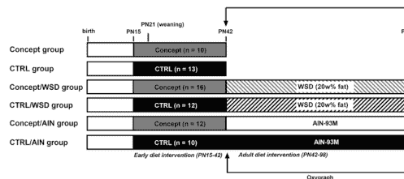

图1. 研究设计。小鼠被分配到6个实验组之一，并从PN15到42暴露于CTRL或Concept饮食。在PN42时，CTRL和Concept喂养的小鼠被牺牲，肝组织用于呼吸分析。其他组的小鼠喂养AIN-93M或WSD直到PN98。在PN98时，剩余小鼠被牺牲，肝组织用于呼吸分析。在PN42和PN98进行MRI。AIN：美国营养研究所啮齿类动物饮食93-维持型，CTRL：对照组，MRI：磁共振成像，PN：出生后天数，WSD：西式饮食。

### 2.4. 循环激素和代谢物

血浆葡萄糖使用葡萄糖测定试剂盒（Cabiochem®, Merck, KGaA, Darmstadt）测定，血浆胰岛素使用Mercodia小鼠胰岛素ELISA（Mercodia AB，瑞典乌普萨拉）测定。血浆硫代巴比妥酸反应物质（TBARS，作为脂质过氧化标志物）水平如文献[31]所述，通过荧光法测定（BioTek，德国巴德弗里德里希斯哈尔）。血浆非酯化脂肪酸（NEFA）水平使用游离脂肪酸试剂盒（Cell Biolabs, Inc.，美国圣地亚哥）测定。

### 2.5. 肝脏脂质分析

肝脏甘油三酯浓度通过比色法测定（甘油三酯定量比色/荧光法试剂盒，BioVision，美国加利福尼亚州）。为快速同时定量肝组织中的DAG和神经酰胺物种，我们使用了如文献[32]简要描述的液相色谱-四级杆质谱法（LC-MS/MS）。样品在液氮中立即速冻后，从约50 mg肝脏和肌肉组织中各提取并纯化脂质。为提取、分馏和纯化生物活性脂质，肝脏组织在500 µl缓冲液A（20 mM Tris/HCl，1 mM EDTA，0.25 mM EGTA，250 mM蔗糖，PIC）中使用IKA T10 basic Ultra Turrax（IKA，美国北卡罗来纳州）和紧密配合的玻璃匀浆器（Wheaton，美国）[32]进行匀浆。三种细胞区室（即脂滴、胞质膜分馏物和内质网富集分馏物）中的脂质根据先前描述的方案分离，覆盖150 µl缓冲液A，并在4 °C下以100,000 × g离心1 h。浮游脂滴层使用切片器（Beckman Coulter，美国加利福尼亚州布雷亚）与下层胞质分馏物分离。随后，胞质分馏物转移到新试管中，而膜分馏物保留在离心管中作为沉淀。加入内标，并根据Folch等人[33]提取脂滴、胞质和膜分馏物中的脂质，随后进行固相萃取（Sep Pak Diol柱；Waters，美国马萨诸塞州）。所得脂质相在氮气轻柔气流下干燥，用400 µl甲醇重悬，然后通过LC-MS/MS[32]进行分析。简而言之，分析物的色谱分离使用Infinity 1290超高效液相色谱系统（Agilent Technologies Inc.，美国加利福尼亚州圣克拉拉）和反相Luna Omega C18色谱柱，50 × 2.1 mm，1.6 µm（Phenomenex，美国加利福尼亚州托伦斯），在50 °C下操作。使用二元梯度，由水中5 mM甲酸铵（溶剂A）和90%甲醇/10%异丙醇中5 mM甲酸铵（溶剂B）组成，流速为0.4 ml/min。分析物使用电喷雾电离（ESI）以氨合物（DAGs）或质子化合物（CERs）形式测量，并在三重四级杆质谱仪（MS，Agilent 6495；Agilent Technologies，美国加利福尼亚州）上以正离子模式通过多反应监测（MRM）检测。

### 2.6. 免疫印迹

蛋白质免疫印迹按照先前描述的方案[34]进行。从约30 mg肝脏组织中提取蛋白质，在300 µl裂解缓冲液（25 mM Tris-盐酸（Tris-HCl），pH 7.4，150 mM NaCl，0.20% Nonidet P-40，1 mM 乙二胺四乙酸（EDTA）和0.1%十二烷基硫酸钠（SDS），补充Protease Inhibitor Cocktail II（Roche，德国曼海姆））中匀浆，并加载到SDS聚丙烯酰胺梯度胶（4–20% Mini-PROTEAN® TGX™ Precast Protein Gels，Biorad，美国加利福尼亚州赫拉克勒斯）上。每块胶加载串间校准器（IRC）以考虑不同运行间的差异。免疫印迹前，无染色胶用紫外线激活1 min，并使用ChemiDoc MP成像系统（Biorad）拍照。蛋白质使用Trans-Blot Turbo转印系统（Biorad）转移到聚偏二氟甲烯（PVDF）膜上，使用ChemiDoc MP成像，并使用Image Lab™ 6.0.1软件（Bio-Rad Laboratories）进行定量以进行归一化。PVDF膜在室温下用5%脱脂牛奶在Tris缓冲盐水含Tween 20（TBST缓冲液：10 mM Tris，pH 8.0，150 mM NaCl，0.5% Tween 20）中封闭2 h。随后，膜在4 °C下与一抗孵育过夜，然后与过氧化物酶标记的二抗在室温下孵育1 h。最后，膜用Immobilon Western化学发光HRP底物（Merck Millipore，德国达姆施塔特）包被，并使用ChemiDoc成像系统结合Image Lab 6.0.1软件（Biorad）检测蛋白质以进行光密度分析。靶蛋白表达水平归一化到电压依赖性阴离子通道（VDAC）蛋白，以归一化线粒体含量。动力蛋白相关蛋白（DRP1）（5391）和磷酸化-DRP1 Ser616（3455）抗体从Cell Signaling Technology购买；过氧化物酶体增殖物活化受体γ共激活因子1（PGC-1）α从Millipore（ST1202）购买；线粒体转录因子A（TFAM）从Santa Cruz Biotechnology（sc-166965）购买；其他一抗从Abcam购买：丝裂原样蛋白1（MFN1）（ab57602）、丝裂原样蛋白2（MFN2）（ab56889）和VDAC（ab14734）。

定量实时PCR（RT-PCR）如文献[35]所述进行。简而言之，使用RNeasy Mini试剂盒（Qiagen，德国杜塞尔多夫）从10 mg冻肝中分离总RNA。使用QuantiTect反转录试剂盒（Qiagen，货号205311）从1000 ng总RNA合成cDNA，并使用QuantiTect SYBR® Green PCR试剂盒（Qiagen，货号204145）在StepOnePlus RT-PCR系统（Applied Biosystems，美国马萨诸塞州沃尔瑟姆）中使用QuantiTect引物检测（Qiagen，德国杜塞尔多夫）进行RT-PCR。以下引物从Qiagen购买：TFAM（QT00154413）、PGC-1α（QT02524422）；次牛磺酸-牛磺酸磷酸硫酸转移酶（PGA）（QT0166768）、肽基脯氨酸异构酶A（QT00247709）和β2-微球蛋白（QT01149547）用作内源性参考基因。Ct值首先归一化到3个参考基因Ct的几何平均值，然后归一化到IRC的Ct，根据ΔΔCt方法[35]获得表达倍数变化。创建熔解曲线以确保引物特异性。每个样品测定三次。

### 2.7. 计算与统计

作为胰岛素抵抗的替代指标，HOMA-IR根据3 h禁食胰岛素（mIU/l）*禁食血糖（mmol/l）/22.5计算[36,37]。统计分析使用GraphPad Prism（8.0.0）进行，体重和体成分随时间的变化除外，后者使用SPSS（19.0.0）分析。数据表示为均值±SEM。PN42时早期生命饮食（Concept vs. CTRL）的影响使用未配对t检验比较。在PN98时，早期生命（Concept vs. CTRL）和成年饮食（AIN vs. WSD）及其相互作用的影响使用双向方差分析和Sidak多重比较检验进行分析（在存在总体早期生命或成年饮食影响的情况下）。数据使用GraphPad Prism 9.0.0（GraphPad Software，美国加利福尼亚州圣地亚哥）分析，当数据不符合高斯分布时，使用Mann-Whitney或Kruskal-Wallis检验进行分析。体重和体成分随时间的变化使用重复测量方差分析进行分析。当p < 0.05、p < 0.01和p < 0.001时，差异被认为具有统计学意义。

## 3. 结果

### 3.1. PN42 时出生后 Concept 喂养的直接效应

在 PN42 时，研究了早期生命饮食干预（定义为 PN11 至 PN42 的 4 周）的直接效应。Concept 组和 CTRL 组的体重相似（Fig. 2A）。然而，Concept 喂养的小鼠瘦体重更高（Fig. 2B），而总体脂肪量相比 CTRL 组有降低趋势（p = 0.06）。因此，Concept 喂养后的相对体脂肪量低于 CTRL 组（Fig. 2C, D）。

体成分的差异未影响器官重量（Supplementary Table 1）。

在肝脏中，Concept 喂养后最大解耦 TCA 循环关联呼吸比 CTRL 组高 33%（p = 0.05）（Fig. 3A）。未观察到 TCA 循环关联呼吸的其他参数（包括 LCR 和 RCR）有差异（Supplementary Fig. 1A, B）。β-氧化关联呼吸关联的 LCR 和 RCR 活性以及 CSA 活性在 Concept 组和 CTRL 组之间无差异（Fig. 3B, C, Supplementary Fig. 1c, D）。此外，两组的肝脏线粒体 ROS 生成（表达为 H2O2 排放率）相似（Fig. 3D）。比目鱼肌的线粒体功能和含量以及氧化应激在两组之间无差异（Supplementary Fig. 2A-D）。

在 PN42 时，线粒体生物标志物 PGC-1α 和 TFAM 的蛋白含量在 Concept 组和 CTRL 组之间无差异（Fig. 4A, B）。然而，Concept 喂养后 MFN1 蛋白增加了 65%，表明线粒体融合增加（p = 0.03）（Fig. 4C, D）。作为线粒体分裂标志物的 DRP1 蛋白及 DRP1 与磷酸化 DRP1 (Ser616) 的比值在 Concept 组和 CTRL 组之间无差异（Fig. 4E, F）。

禁食 3 小时后，血浆葡萄糖、胰岛素、HOMA-IR 以及血浆 TBARS 和 NEFA 无差异（Supplementary Fig. 3A–F）。在 PN42 时，Concept 组和 CTRL 组的肝重及肝甘油三酯相当（Fig. 5A, B）。在肝组织中测得的胞质 DAGs (cDAG)、脂质滴 DAGs (ldDAG) 及大部分膜 DAGs (mDAG) 未受 Concept 喂养影响（相比 CTRL）。然而，Concept 小鼠的 C20、C22 和 C24 mCER 高于 CTRL 小鼠（Fig. 5C and Supplementary Fig. 4A–E）。

### 3.2. 出生后 Concept 喂养对成年小鼠的影响

在 PN88 时，评估了早期生命 Concept 与 CTRL 喂养在 WSD 挑战下的效应。相比 AIN，WSD 暴露在 Concept/WSD 和 CTRL/WSD 组中以相似程度随时间（PN42–89）增加了体重和瘦体重，即使在校正依赖基线值后也是如此（Fig. 6A, B and Supplementary Figure 5A, B）。Concept/WSD 组随时间推移的（相对）体脂肪量增加略低于 CTRL/WSD 组，且在校正基线值后与 CTRL/WSD 组相比具有统计学差异（Fig. 6C, D and Supplementary Fig. 5C and D）。早期或成年饮食均未影响空腹血浆葡萄糖和 NEFA 水平（Fig. 6E, I）。与 CTRL/AIN 相比，CTRL/WSD 组的血浆胰岛素和 HOMA-IR 显著恶化，但 Concept/WSD 与 Concept/AIN 相比则未出现此情况（Fig. 6F–G）。与 CTRL/AIN 相比，CTRL/WSD 组的血浆 TBARS 水平升高，但 Concept/WSD 小鼠未升高（Fig. 6H）。

与 AIN 相比，WSD 增加了肝脏 TCA 循环关联状态 3（琥珀酸）呼吸，在 Concept/WSD 和 CTRL/WSD 小鼠中程度相似（Fig. 7A），而 LCR 和 RCR 保持不变，且 WSD 小鼠在 PN88 时 Concept 组和 CTRL 组之间无差异。WSD 同样在 Concept/WSD 和 CTRL/WSD 中诱导了早期生命差异的 β-氧化关联呼吸和 RCR（Fig. 7B, Supplementary Fig. 6D），而 LCR 未受影响且组间无差异（Supplementary Fig. 6C）。然而，WSD 仅在 Concept/WSD 中增加了最大（FCCP）β-氧化关联解耦呼吸，且比 Concept/AIN 高 69%（p = 0.05）（Fig. 6B）。最后，按 CSA 评估的线粒体含量在 Concept/WSD 中低于 CTRL/AIN（Fig. 7C）。与限制性 AIN 饮食相比，WSD 降低了线粒体氧化应激（Fig. 7D）。当氧化应激水平按 CSA 归一化时，组间无差异（Fig. 7E）。比目鱼肌线粒体功能和含量以及氧化应激在 CTRL/AIN、CTRL/WSD、

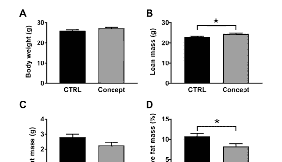

Fig. 2. Concept 与 CTRL 对体重和体成分的直接影响。(A) PN42 时的体重。(B-D) PN42 时的体成分。数据以 mean ±SEM 表示。CTRL n = 13; Concept n = 10。未配对 t 检验；*p < 0.05。CTRL：对照组。

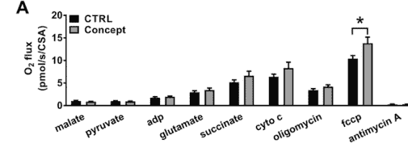

Fig. 3. Concept 饮食对 PN42 时肝脏线粒体功能的直接影响。线粒体呼吸（按 CSA 归一化的 O2 通量）使用支持 TCA 循环（A）和 β-氧化（B）的底物进行测定。线粒体含量（C）通过按蛋白浓度归一化的 CSA 评估。氧化应激（D）按线粒体 H2O2 排放速率测定。数据以 mean±SEM 表示。CTRL: n = 13; Concept: n = 10。多重 t 检验 (A, B) 或未配对 t 检验 (C, D)：*p < 0.05。CSA：柠檬酸合酶活性；CTRL：对照组；cyto c：细胞色素 c；fccp：碳氰化 m-三氟甲氧基苯腙；TCA：三羧酸。

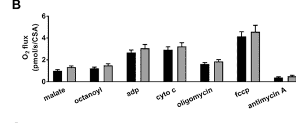

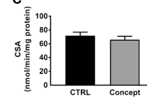

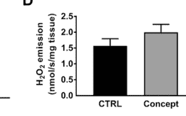

Concept/AIN，和 Concept/WSD (Supplementary Fig. 7A–D)。为评估出生后 Concept 喂养对线粒体生物能学和动力学的长期影响，我们评估了 PGC-1α、TFAM、MFN1、MFN2、DRP1 及 DRP1 与磷酸化 (Ser616) 比值的蛋白水平。早期或成年饮食均未影响这些线粒体生物合成和动力学标志物（Fig. 9A–F）或 PN42 与 PN98 之间的线粒体蛋白差异（Supplementary Fig. 9A–F）。与 CTRL/WSD 相反，Concept/WSD 组在 WSD 挑战后肝重未增加，且低于 CTRL/WSD 组（Fig. 9A）。早期生命 Concept 饮食未影响 WSD 诱导的任何其他研究组织或器官重量增加（Supplementary Table 2）。在 CTRL/WSD 和 Concept/WSD 中，WSD 喂养后肝脏甘油三酯水均升高（Fig. 9B）。为更详细地研究生物活性脂质，我们对亚细胞分馏进行检测，发现 WSD 挑战主要在 CTRL/WSD 而非 CTRL/AIN 中增加了含 C18:1 的肝脏 cDAG 和 mDAG 物种，其中 cDAG C16:0/C18:1 达到显著性（Fig. 9C, D and Supplementary Fig. 9A, C, E）。WSD 或早期 Concept 喂养均未影响不同亚细胞分馏中的 CER 物种（Supplementary Fig. 9B, D and F）。

### 3.3. 相关性分析

由于白色脂肪组织体重贡献显著但代谢活性低，能量消耗最能与瘦体重相关 [38]。确实，在 PN98 时，CTRL 组（CTRL/AIN 和 CTRL/WSD 合计）的瘦体重与肝脏线粒体呼吸相关（r = 0.436；Supplementary Table 3）。然而，r = 0.490; r = 0.436; p < 0.05 for all; Supplementary Table 3)。然而，在 Concept 喂养组中，未发现此类相关性。至于 PN98 时的 AIN 和 WSD 动物，我们观察到瘦体重与 ADP 后呼吸速率（r = −0.548）、细胞色素 c（r = −0.523）和 FCCP 滴定（r = −0.403）之间存在相关性，p < 0.05 for all (Supplementary Table 4)。

## 4. 讨论

该饮食干预表明，早期生命暴露于包含大型磷脂包被脂质滴（Concept）的饮食会影响啮齿类动物肝脏的多种线粒体功能和脂质代谢特征，但不影响骨骼肌。Concept 喂养不仅在 PN42 时直接增强了线粒体 TCA 循环关联氧化能力和线粒体功能，而且在以后的生命阶段（PN98）增强了 β-氧化关联氧化能力。此外，

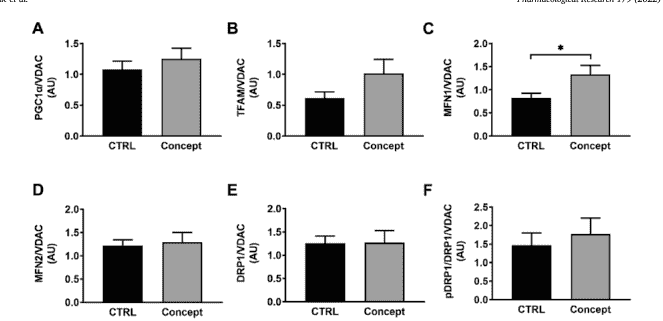

图4. Concept和CTRL对P42时线粒体生物发生和动力学蛋白标志物的直接影响。PGC-1α: (A), TFAM (B), MFN1 (C), MFN2 (D), DRP1 (E) 和 pDRP1/DRP1 (F)。数据以均值±SEM表示，CTRL: n = 13; Concept: n = 10。未配对t检验，CTRL: 对照组，PGC-1α: 过氧化物酶体增殖物激活受体γ共激活因子1-α；TFAM: 线粒体转录因子A；MFN1或2: 粒线体融合蛋白1或2；DRP1: 动力蛋白相关蛋白1，VDAC: 电压依赖性阴离子通道。

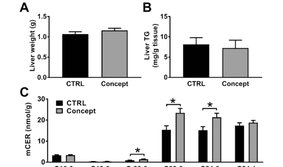

图5. Concept和CTRL对P42时肝重和肝脂质的直接影响。肝重(A)、肝TG(B)和mCER(C)。数据以均值±SEM表示，CTRL: 对照组；mCER: 膜中的神经酰胺，TG: 甘油三酯。

出生后接触Concept饮食至少部分保护了仔猪免受WSD诱发的高胰岛素血症、胰岛素抵抗、体脂肪积累、胞质和膜DAG积累以及全身氧化应激。早期生活环境可以影响代谢健康，特别是肝脏功能，无论是不利地（例如，通过胎儿过度营养或营养不良[40,41]），还是有益地（例如，通过母乳喂养[42]）。多项啮齿类动物和仔猪研究表明，改变的肝脏线粒体功能和ROS产生可能与这种所谓的代谢健康编程相关[13,43,44]。在这些研究中，宫内生长

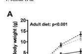
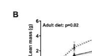
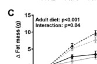
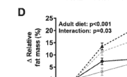
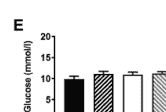
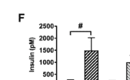
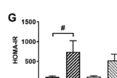
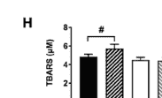
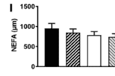

图6. 出生后Concept喂养对体重、体成分和葡萄糖代谢变化的长期影响。从PN42到PN98按基线分类的体重(A)、瘦体重(B)、脂肪量(C)和相对脂肪量(D，占体重百分比)的发展。禁食(3小时)血浆葡萄糖(E)、胰岛素(F)、(F)、HOMA-IR(G)、TBARS(H)和NEFA(I)。数据为均值±SEM。CTRL/AIN: n = 10；CTRL/WSD: n = 12；Concept/AIN: n = 12；Concept/WSD: n = 16，葡萄糖和HOMA-IR除外，CTRL/AIN为n = 9，Concept/AIN为n = 11。对于体重和体成分，使用了两因素（饮食和时间）重复测量方差分析。对于组内因素间的比较，分别进行了t检验。*p < 0.05 CTRL/WSD与CTRL/AIN不同。葡萄糖和胰岛素数据采用双向方差分析检验。p# < 0.01 同一母体饮食组中的WSD。缩写：AIN: 对照饮食；CTRL: 对照饮食；NEFA: 非酯化脂肪酸；PN: 出生后天数；TBARS: 硫代巴比妥酸反应物；WSD: 西方型饮食。

和CTRL/WSD，而血浆脂质过氧化物(TBARS)仅在CTRL/WSD中增加，但在Concept/WSD中未增加。在氧化能力更高的情况下ROS产生没有上升，这提示抗氧化活性和/或脂质代谢改善，可能是由于Concept/WSD小鼠肝脏中首选β-氧化和减少VLDL分泌所致。线粒体动力学，即分裂和融合事件，与线粒体功能密切相关。促进NAFLD发展的因素之一是线粒体质量控制不足[45]。虽然线粒体融合与氧化磷酸化能力呈正相关[46]，但线粒体分裂在肝脏脂肪变性和代谢紊乱的发展中起作用[47,48]。本研究发现，在早期接受Concept喂养的小鼠中，经线粒体含量标准化后线粒体融合增加，支持了这些小鼠线粒体功能改善与之相关的观点[46]。虽然出生后Concept喂养对肝脏特异性线粒体生物发生和动力学没有长期影响，但我们不能排除对肝脏代谢产生更持久影响的可能性，这可能通过与胎儿编程相关的表观遗传改变发生[49]。

Concept饮食中的脂肪滴由磷脂、蛋白质和胆固醇的混合物组成，在很大程度上模拟了人类脂肪球的结构和成分[50]。尽管确切机制仍在研究中，Concept的特定结构可能以一种方式增强肠道脂解和出生后脂血症，使得摄入脂肪酸的出生后反应和生物利用度对肝脏生物能学产生可能的更长期后果。WSD干预从出生后开始增加肝脏氧化能力。最近的研究表明，肝脏线粒体可以调整其活动以适应底物可用性的短期和长期变化。具体来说，脂质可用性增加导致线粒体氧化能力适应性增加，表明在人类和啮齿类肥胖中存在“代谢灵活性”，至少在NAFLD早期阶段[29]。在本研究中，Concept/WSD小鼠来自不同底物的肝脏线粒体功能更高，与WSD诱发的瘦体重变化无关，符合早期生活Concept暴露的持续影响。这种效果可能与改善的线粒体生物发生无关，因为Concept未影响肝脏CSA（反映线粒体含量或质量）。总体而言，这些

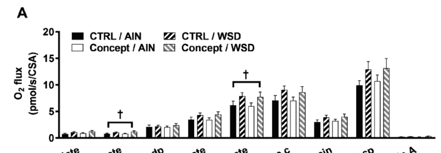
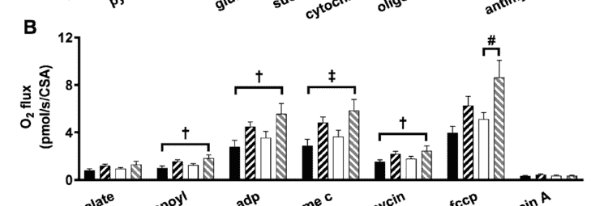
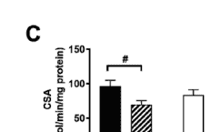
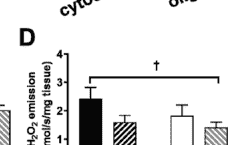
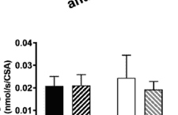

图7. 出生后Concept喂养对PN98时肝脏线粒体功能的长期影响。线粒体呼吸（以柠檬酸合酶活性(CSA)标准化的O2通量）使用支持TCA循环(A)和β-氧化(B)的底物进行测量。线粒体含量(C)通过CSA活性评估。线粒体H2O2排放使用支持TCA循环(D)和β-氧化(E)的底物进行测量。数据以均值±SEM表示。CTRL/AIN: n = 10；CTRL/WSD: n = 12；Concept/AIN: n = 12；Concept/WSD: n = 16。双向方差分析；*p < 0.05；**p < 0.01 WSD总体效应；# 同一早期生活饮食组中的WSEC效应。AIN: 美国营养研究所啮齿类动物饮食；CSA: 柠檬酸合酶活性；CTRL: 对照组；cyt c: 细胞色素c；fccp: 对三氟甲氧基苯腙碳氰酸；TCA: 三羧酸；WSD: 西方型饮食。

这些发现表明，早期生活中的Concept对以后生活中WSD诱发的肝脏脂质代谢受损具有保护作用[22, 23]。Concept对线粒体呼吸的长期影响可能源于不同的机制。此前，我们表明Concept增加了餐后血糖浓度[51]。人们可能会推测，较高的血糖水平可能刺激了PN28时与TCA循环相关的呼吸以及去脂肪生成和脂质输出。随后，本研究中观察到的Concept/WSD在PN98时增加的β-氧化相关呼吸，可能是肝脏线粒体对数周较高脂质暴露的适应结果。早期Concept饮食可能通过改善“线粒体灵活性”来改善脂质过载的处理，即氧化脂质盈余而非储存它，这得到了Concept/WSD中脂肪量增加较少的观察结果的支持。值得注意的是，Concept喂养未影响骨骼肌线粒体功能、含量或氧化应激。由高脂饮食诱导的营养过载可能导致脂肪组织储存耗竭

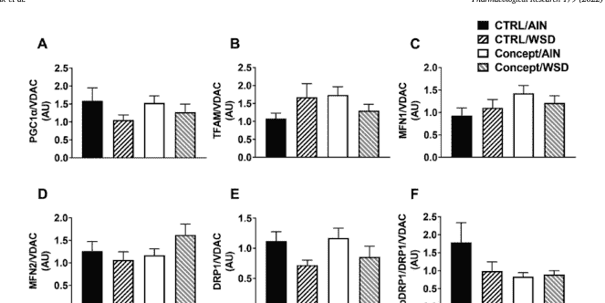

图 8. 生后 Concept 喂养对 P98 大鼠肝脏特异性线粒体生物标志物的长期影响。PGC-1α (A)、TFAM (B)、MFN1 (C)、MFN2 (D)、DRP1 (E) 和 pDRP1/DRP1 (F)。数据以均值±标准误差表示，采用双向方差分析；CTRL/AIN: n = 10；CTRL/WSD: n = 12；Concept/AIN: n = 12；Concept/WSD: n = 14。PGC-1α: 过氧化物酶体增殖物活化受体 γ 共激活因子 1-α；TFAM: 线粒体转录因子 A；MFN1 或 2: 丝融蛋白 1 或 2；DRP1: 相关动力蛋白 1；VDAC: 电压依赖性阴离子通道。

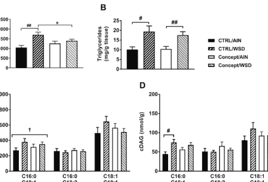

图 9. 生后 Concept 喂养对 P98 大鼠肝脏重量和肝脏脂质的长期影响。CTRL/AIN、CTRL/WSD、Concept/AIN 和 Concept/WSD 大鼠肝脏中的肝脏重量 (A)、肝脏 TG (B)、mDAG (C) 和 cDAG (D)。n = 10；CTRL/WSD: n = 12；Concept/AIN: n = 12（所有组）；Concept/WSD: 肝脏重量 n = 16，肝脏 TG n = 12，mDAG 和 cDAG n = 14。双向方差分析；具有相同 WSD 影响的组：# AIN 喂养组中 WSD 影响的早期生命饮食相同。AIN: 酪蛋白基础对照饮食；CTRL: 对照；cDAG: 胞质中的 sn-1,3-二酰基甘油；CTRL: 对照；mDAG: 膜中的二酰基甘油。TG: 甘油三酯；WSD: 西式饮食。

...脂质向骨骼肌或肝脏等其他组织的后续“溢出”[52,53]，可能会损害线粒体功能 [54]。虽然我们无法推断 WSD 对骨骼肌线粒体功能的一般影响，但我们得出结论，Concept 至少未导致比目肌线粒体功能改善。值得注意的是，Concept 喂养防止了 WSD 诱导的关键脂质诱导炎症蛋白 mRNA 水平的增加，表明，特别是 C18:0 神经酰胺参与 PKCs 的激活，随后磷酸化胰岛素受体激酶的苏氨酸残基，从而损害胰岛素信号传导 [4,55]。相比之下，将 DAGs 封入中性细胞脂质储存部位（如脂质滴）被认为可防止代谢紊乱 [56]。因此，Concept 喂养似乎有利于细胞脂质重新分布，其特征有利于防止肝胰岛素抵抗。此外，Concept 喂养后较低的 DAG 脂质谱可能解释了较高的线粒体呼吸，因为最近已证明含 C18 的 DAG 以剂量依赖方式降低了体外状态 3 线粒体呼吸 [57]。此外，为了通过 DAGs 发挥作用，早期生命接触 Concept 喂养可能导致线粒体代谢基因表达的表观遗传变化，从而有助于人类体质成分以及骨骼肌和肝脏的变化 [58,59]。确实，最近的一项研究揭示了磷脂作为甲基汇和组蛋白甲基化重要调节因子的新作用 [60]。升高的神经酰胺，特别是 C16、C18、C24 和 C24 物种，已与喂食含脂肪量 45% 至 60% 的高脂饮食后的脂肪肝疾病和线粒体功能受损相关联 [61,62]。模拟人类母乳的早期生命饮食也天然富含脂肪（70%，成分见表 1）。由于关键代谢结局无差异（补充图 2），我们得出结论，出生时升高的 CER 与代谢障碍无关。此外，Concept 饮食中用于包覆脂质滴的牛奶磷脂浓度也含有神经酰胺，这可能直接影响血液和膜中的神经酰胺水平，如磷脂酰胆碱所示 [63,64]。关于长期影响，重要的是要注意，喂食 WSD 对 CTRL 或 Concept 小鼠没有差异性影响，如补充图 6 所示。

尽管肝脏脂质氧化和循环脂质过氧化物有显著改善，但 Concept 对空腹血糖、非酯化脂肪酸和胰岛素敏感性的影响相对较小。相对较短的 WSD 暴露（8 周）可能是解释，因为在我们之前的研究 [22] 中，Concept 对更长时间（12 周）WSD 暴露后空腹血浆葡萄糖、脂质、瘦素、抵抗素和总体脂肪量的影响更为显著。其他因素，如肝胰岛素敏感性的氧化，原本需要钳夹试验，因为基于动物福利的伦理考虑，HOMA-IR 仅在相当短的禁食时间（3 小时）下评估。接受 Concept 处理的动物确实对致肥饮食有反应，但 Concept 喂养，即使在更长时间 WSD 挑战下，也保护动物免于发展高胰岛素血症。血浆胰岛素升高源于胰岛素分泌增加或胰岛素清除降低 [65]。在人类中，胰岛素清除不一定与肝脏脂肪含量相关 [66]，而高脂饮食可能损害小鼠的胰岛素清除 [67]。因此，在我们的研究中，高胰岛素血症可能源于代偿性增加的胰岛素分泌或胰岛素清除减少。由于肝脏对 C-肽的清除可忽略不计，该参数用于估计胰岛素分泌 [68]。不幸的是，由于血浆可用性有限，我们无法在本研究中评估 C-肽。

本研究存在一些局限性。我们需要解决。我们无法得出结论，Concept 对线粒体氧化活性和脂质代谢的影响是由于膳食脂质滴尺寸增加、这些滴的磷脂包覆还是其共同作用所致。然而，以前的研究表明，脂质滴尺寸增加和磷脂包覆都是表型 Concept 效应所必需的 [70]。此外，监测线粒体 ATP 浓度和/或合成（受脂质饮食、糖尿病和人类非酒精性脂肪肝病影响 [71–73]）本应具有参考价值，但由于可用组织量有限而无法实现。此外，还需要进行代谢变化、使用同位素稀释方法的高胰岛素血症钳夹试验 [74] 对组织特异性胰岛素敏感性进行详细分析。

总之，早期生命喂养含有大颗粒磷脂包覆脂质滴（Nutricis®）的饮食，可在暴露后直接改善肝脏氧化能力、线粒体融合和脂质谱，并在营养编程小鼠模型中，这种改善在致肥环境下持续至晚年。因此，本研究强调了含有模拟人类母乳的特定磷脂的早期生命饮食对晚年代谢健康的作用。

## 资助来源

本研究部分由 Danone/Nutricia 以及北莱茵-威斯特法伦州文化与科学部（MKW NRW）、德国联邦卫生部（BMG）以及糖尿病研究资助（DZD e. V.）、德国研究基金会（DFG, CRC 1116/2）以及 Schmutzler-Stiftung 资助。

## 作者贡献声明

TJ、AK、AO、EP、EvDB 和 MR 设计了研究；TJ、AK、DP、ER、ST、LM 和 BD 进行了研究；TJ、AK 和 ER 分析了数据；TJ、AK、DP、EP、LM、JK、EvDB 和 MR 解释了数据；TJ、AK、DP 和 MR 撰写了论文；MR 对最终内容负主要责任。所有作者阅读并批准了最终手稿。

## 利益冲突声明

TJ：无；AK、AO：是 Danone Nutricia Research 的员工，EvDB：在研究实施和分析时是 Danone Nutricia Research 的员工；DP：无；EP：无；ER：无；BD：无；ST：无；JK：无；MR：无。

## 数据可用性

支持本手稿结论的数据可向通讯作者合理请求获取。

## 致谢

协助：我们谨感谢 Ilka Rokitta 和 Fariba Ziveh 在实验和分析方面提供的专业帮助，感谢 Eefje Engels 对研究实施的建议，感谢 Dennis Acton 对研究数据解释的贡献，以及 Demis Acton 对数据解释的贡献。

资助：本研究部分由 Danone Nutricia Research 以及北莱茵-威斯特法伦州文化与科学部（MKW NRW）、德国联邦卫生部（BMG）以及联邦研究部（BMBF）向德国糖尿病研究中心（DZD e. V.）提供的资助、德国研究基金会（DFG, CRC 1116/2）以及 Schmutzler-Stiftung 资助。Danone Nutricia Research 提供了动物饮食，并参与了研究设计、数据解释和手稿撰写的讨论。

## 附录 A. 支持信息

与本文相关的补充数据可在在线版本中找到，DOI: 10.1016/j.phrs.2022.106193。

## 参考文献

- [1] M. Ng, et al., 1980-2013 年儿童和成人超重和肥胖的全球、地区和国家患病率：2013 年全球疾病负担研究的系统分析, Lancet 384 (9945) (2014) 766–781.
- [2] R. Singh, et al., 明显肥胖儿童和青少年葡萄糖耐受受损的患病率, N. Engl. J. Med. 346 (11) (2002) 802–810.
- [3] M. Weiss, et al., 儿童和青少年的肥胖及代谢综合征, J. Pediatr. 140 (S5) (2002) S5–S12.
- [4] ... 2 型糖尿病的预测生物学, Nature 576 (7787) (2019) 31–40.
- [5] A.P. Arruda, et al., 肥胖中肝内内质网-线粒体接触的慢性富集导致线粒体功能障碍, Nat. Med. 20 (2) (2014) 174–183.
- [6] S. Sánchez, et al., 人类胰岛素抵抗中的器官间线粒体串扰, Physiol. Rev. 98 (3) (2018) 1717–1741.
- [7] T. Jelnik, et al., 含大颗粒磷脂包覆脂质滴的饮食早期生命喂养改善小鼠线粒体活性和次级胆汁酸代谢, Diabetes 66 (8) (2017) 2241–2253.
- [8] Y.B. Lombardo, G. Hein, A. Chicco, 线粒体综合征：n-3 PUFAs 对血脂异常、胰岛素抵抗和肥胖模型的影响, Lipids 42 (5) (2007) ...
- [9] L.G. Gillings, S. Harris-Janz, P.J. Jones, 膳食单不饱和脂肪酸可防止代谢综合征和心血管疾病风险因素, Nutrients 11 (1) (2019) ...
- [10] A. Kennedy, et al., 脂肪组织中饱和脂肪酸介导的炎症和胰岛素抵抗：作用机制及意义, J. Nutr. 139 (1) (2009) 1–4.
- [11] J. Li, et al., 妊娠和哺乳期母体肥胖对小鼠后代非酒精性脂肪肝病发展的编程, J. Hepatol. 52 (6) (2010) 913–920.

- [12] A.M. Samuelson 等, 饮食诱导的雌性小鼠肥胖导致后代暴食、肥胖、高血压和胰岛素抵抗: 一种新的发育编程小鼠模型, Hypertension 51 (2) (2008) 383–392.

- [13] R.D. Bruce 等, 母体高脂喂养使成年小鼠在断奶后致肥胖环境中易患脂肪性肝炎, J. Lipid Res. 50 (11) (2009) 2204–2213.

- [14] C.A. Plegge 等, 母体高脂饮食改变小鼠后代骨骼肌发育和功能, J. Anim. Physiol. Anim. Nutr. 98 (4) (2014) 634–641.

- [15] W. Jorgensen 等, 羊产前和/或产后饮食改变导致线粒体功能改变, Am. J. Physiol. Endocrinol. Metab. 297 (6) (2009) E1349–1557.

- [16] N. Plagemann 等, N-3 长链多不饱和脂肪酸可防止出生后营养编程小鼠模型中成年期过度脂肪沉积, Pediatr. Res. 66 (6) (2009) 494–499.

- [17] A.A. Mikkelsen 等, 鱼油补充剂与超重风险: 一项荟萃分析, Am. J. Epidemiol. 162 (5) (2005) 497–503.

- [18] C.G. Owen 等, 婴儿喂养对全生命周期肥胖风险的影响: 发表证据的定量综述, Pediatrics 115 (5) (2005) 1367–1377.

- [19] S. Galletti 等, 使用共聚焦激光扫描显微镜探测乳脂肪球膜及相关蛋白, J. Agric. Food Chem. 58 (7) (2010) 4072–4079.

- [20] M.C. Michalski 等, 人初乳、母乳和婴儿配方奶中脂肪球大小分布, J. Dairy Sci. 88 (6) (2005) 1972–1984.

- [21] J. Hamosh, 人乳中的生物活性因子, Pediatr. Clin. North Am. 47 (1) (2001) 69.

- [22] A. Ostling 等, Colloids and Surf. Biointerfaces 136 (2015) 329–339.

- [23] S. Aoe 等, 早期出生后膳食脂质结构对小鼠成年后脂肪组织发育和功能的影响, Pediatr. Res. 72 (4) (2012) 402–409.

- [24] A. Kode 等, 早期膳食脂肪的超分子结构调节小鼠脂肪组织中线粒体含量和能力标志物的表达, J. Nutr. Biochem. 23 (12) (2012) 1612–1628.

- [25] O. Rønda 等, 早期生活含大磷脂包被脂质球饮食对小鼠肝脂质代谢的影响, Sci. Rep. 10 (1) (2020) 126128.

- [26] P.G. Reeves, F.H. Nielsen, G.C. Fahey Jr., AIN-93 实验室啮齿类动物纯化饮食: 美国营养学会关于重新配方 AIN-76A 啮齿类动物饮食的特设写作委员会最终报告, J. Nutr. 123 (11) (1993) 1939–1951.

- [27] D.B. Allison 等, 啮齿类动物全身成分定量磁共振成像系统的评估, Obes. (Silver Spring) 18 (8) (2010) 1652–1659.

- [28] D.C. Gnaiger, 高分辨率呼吸测定: 人细胞和人肌肉小活检渗透纤维的 OXPHOS 方案, Methods Mol. Biol. 810 (2012) 25–58.

- [29] K. Kollist 等, 结肠炎患者肝线粒体功能的适应, J. Lipid Res. 54 (1) (2013) 739–746.

- [30] C. Doerrler 等, 高分辨率荧光显微镜和人细胞、人肌肉小活检渗透纤维及线粒体的 OXPHOS 方案, Methods Mol. Biol. 1702 (2018) 31–70.

- [31] T. Jelnek 等, 胰岛素抵抗与心脏缺血易感性, Diabetes 67 (12) (2018) 2570–2572.

- [32] J. Rector 等, 一种新型脂质组学方法揭示肝、肌肉和心脏中的脂质滴是非酒精性脂肪肝中二酰甘油和神经酰胺物种的储库, Cells 8 (3) (2019).

- [33] J. Rector 等, 从动物组织中分离和纯化总脂质的简单方法, J. Biol. Chem. 226 (1) (1957) 497–509.

- [34] A. Kode 等, 胰岛素抵抗男性对训练的代谢反应取决于胰岛素敏感性和外泌体蛋白含量, Sci. Adv. 7 (41) (2021) eabf9551.

- [35] K.J. Livak, T.D. Schmittgen, 使用实时定量 PCR 和 2(-Delta Delta C(T)) 方法分析相对基因表达数据, Methods 25 (4) (2001) 402–408.

- [36] S.M. Haffner 等, 代谢综合征: 圣安东尼奥心脏研究中的稳态模型评估, Diabetes Care 20 (7) (1997) 1087–1092.

- [37] Q. Tang 等, 胰岛素抵抗稳态模型评估 (HOMA-IR) 和糖尿病前筛查的最佳截止值: 中老年中国人群的进展, BMC Public Health 18 (1) (2018) 385.

- [38] B. Cannon, J. Nedergaard, 代谢研究中非颤抖产热及其适当测定, J. Exp. Biol. 214 (Pt 2) (2011) 242–253.

- [39] Z. Wang 等, 主要器官和组织特异性代谢率的评估: 体内与体外结果的比较, Obes. (Silver Spring) 20 (1) (2012) 55–61.

- [40] M. Grinone 等, 母体肥胖对新生恒河猴胰岛素敏感性和分泌的影响, J. Clin. Endocrinol. Metab. 97 (2) (2012) E278–E287.

- [41] N. Modi 等, 母体体重指数对婴儿脂肪量和肝脂质含量的影响, Pediatr. Res. 70 (3) (2011) 287–291.

- [42] V. Nohji 等, 母乳喂养对非酒精性脂肪肝病进展的保护作用, Arch. Dis. Child 94 (10) (2009) 801–805.

- [43] J. Liu 等, 宫内生长迟缓和母体脂肪酸补充对仔猪肝线粒体功能和基因表达的影响, Arch. Anim. Nutr. 66 (5) (2012) 357–371.

- [44] S.J. Bouwens 等, 妊娠期母体肥胖损害断奶期大鼠后代脂肪酸氧化和线粒体 SIRT3 表达, PLoS One 6 (8) (2011) e24068.

- [45] R.D. Sheldon 等, eNOS 缺失损害线粒体质量控制并诱导 NASH 中的线粒体功能障碍, Am. J. Physiol. Endocrinol. Metab. 317 (4) (2019) E656–E616.

- [46] C.H. Yau 等, 线粒体融合支持细胞增殖期间氧化磷酸化增加, Elife 8 (2019).

- [47] S. Puri 等, 小鼠非酒精性脂肪肝病的脂质组学分析揭示肝脂肪变性、饮食诱导肥胖和线粒体退化, Diabetologia 58 (10) (2015) 2371–2380.

- [48] J. Liu 等, 降低胚胎 mtDNA 拷贝数改变关键代谢脂质基因的表观遗传特征并导致成年小鼠异常脂质积累, Febs J. 283 (2021) 6828–6843.

- [49] S. Giller 等, 含人乳寡糖 2'-岩藻糖乳糖的新型婴儿配方奶支持年龄适宜生长, Am. J. Clin. Nutr. 113 (5) (2021) 529–539.

- [50] S. Bouwengart 等, 婴儿乳脂滴大小和包被影响健康成年男性的餐后反应: 一项概念验证研究, Eur. J. Clin. Nutr. 71 (9) (2017) 1082–1089.

- [51] S. Tarabah 等, 膳食棕榈酸和油酸以不同方式调节人骨骼肌胰岛素敏感性, Diabetologia 2021.

- [52] M. Krag 等, 异位脂肪和胰岛素抵抗, Curr. Diab. Rep. 8 (3) (2008) 189–195.

- [53] C. Koliaki 等, 人类肥胖和糖尿病中线粒体功能和胰岛素敏感性的改变, Annu. Rev. Nutr. 36 (2016) 337–367.

- [54] J. Rector 等, 肥胖中改变的线粒体功能并非与肥胖相关的肝胰岛素抵抗, Cell Metab. 32 (4) (2020) 654–664.e5.

- [55] J.C. Jardy 等, CCl4 敲低将二酰甘油封存在脂质滴/自噬体中并防止肝胰岛素抵抗, Proc. Natl. Acad. Sci. USA 110 (5) (2013) 1869–1874.

- [56] L. Perreault 等, 人骨骼肌中二酰甘油和鞘脂的细胞定位影响胰岛素敏感性和线粒体功能, Diabetes 60 (10) (2011) 2598–2606.

- [57] S. Gancheva 等, 代谢手术后肌肉胰岛素敏感性的动态变化, Nat. Commun. 10 (1) (2019) 4179.

- [58] M. Schugar 等, 母体肥胖和糖尿病在非酒精性脂肪肝病中的编程提示减肥手术后具有疾病特异性和重塑特征, Cell Metab. 18 (2) (2013) 296–302.

- [59] C. Lee 等, 母体过度营养对磷脂和组氨酸代谢的影响, Mol. Cell 66 (2) (2017) 180–193.e8.

- [60] A. Zaleska 等, 高脂饮食影响小鼠下颌腺中神经酰胺含量，破坏线粒体氧化还原平衡并诱导凋亡, J. Nutr. Biochem. 112 (2018) 97.

- [61] T. Kaushik 等, 神经酰胺作为非酒精性脂肪肝病及相关动脉粥样硬化的介质, Plos One 10 (5) (2015) e0126910.

- [62] M. S. S. 等, ...

- [63] S. Rep, 9 (1) (2019) 339.

- [64] A. Kode 等, 早期生活与成年体质量的关联及血清 LysoPC(18:0) 水平，以及宫内生长受限大鼠成年血糖水平的关联, Nutr. Metab. 18 (1) (2021) 101.

- [65] S.H. Jung 等, 肥胖中适应胰岛素抵抗: 胰岛素分泌和β细胞功能的作用, Diabetes Metab. J. 44 (2) (2020) 128–138.

- [66] K.M. Urschel 等, SEK, Kahn, D. Colditz, NAFLD 中肝胰岛素清除与胰岛素抵抗而非肝脂肪含量相关, J. Clin. Endocrinol. Metab. 106 (2021) e126–e137.

- [67] K.F. Folz 等, 肠道微生物群损害肥胖小鼠的胰岛素清除, Mol. Metab. 42 (2020), 101067.

- [68] E. Van Cauter 等, 根据 C-肽水平估计胰岛素分泌速率: C-肽清除个体和标准动力学参数的比较, Diabetes 41 (3) (1992) 368–377.

- [69] M.R. Lebowitz 等, 胰岛素与 C-肽比率的作用: 辅助诊断和管理胰岛素瘤（或胰岛素依赖型糖尿病）, Arch. Intern. Med. 155 (5) (1995) 650–655.

- [70] A. Baars 等, 乳脂肪球膜包被的大脂质滴在饮食中影响成年期体脂肪积累, Br. J. Nutr. 115 (11) (2016) 1930–1937.

- [71] T. Starbakh 等, 单不饱和脂肪迅速诱导肝糖异生和全身胰岛素抵抗, JCI Insight 5 (10) (2020).

- [72] Y. Kuroda 等, 近期发病的1型和2型糖尿病患者早期儿童肥胖、胰岛素抵抗和脂质含量, J. Hepatol. 74 (5) (2021) 1028–1037.

- [73] A. Kode 等, 2型糖尿病患者肝ATP合成较低且与胰岛素敏感性相关, Diabetes Care 54 (2) (2021) 448–453.

- [74] K. Philippou 等, Bax 抑制因子-1 缺乏通过增加 Ca(2+)-依赖性胰岛素分泌导致肥胖, J. Mol. Med. 98 (6) (2020) 849–862.

