# 数字字体与阅读（语言处理、模式识别和智能系统）

## 丛书简介

### 语言处理、模式识别与智能系统

本书是语言处理、模式识别与智能系统丛书的一部分，该丛书源于2013年国际计算机语言处理期刊（IJCPOL）的停刊，由世界科学出版公司（WSPC）为东方语言计算机学会（OLCS）出版。OLCS于1976年由北美一些华裔杰出教授创立，最初名为中文语言与计算机学会（CLCS）。CLCS的最初目标是促进和便利中文在计算机技术中的应用。逐渐地，它得到了亚洲各地区许多人的支持，特别是香港、台湾、中国大陆、日本、新加坡、韩国、北美等地。随着研究和数字技术的发展，多种东方语言可用于计算机输入和输出，导致学会于2005年更名为OLCS。  

除了推广和组织与该学会主题相关的众多国际会议外，CLCS还于1983年创办了其国际季刊《中文和东方语言计算机处理》（CPCOL），该期刊后来更名为《国际计算机语言处理期刊》（IJCPOL），由WSPC出版。该期刊和会议推动了该领域的大量研究，做出了许多宝贵贡献，并在国际合作中发挥了关键作用。随着该领域和计算机科学的成熟，加上数字技术的快速发展，IJCPOL的作用日渐减弱。在与WSPC成功谈判后，加拿大康考迪亚大学的孙清元博士和香港理工大学的陆琴博士在CPL领域创立了新的图书系列。为了使其更具吸引力和市场竞争力，我们计划将该图书系列的范围扩大到包括模式识别、图像处理、神经网络、知识工程和智能系统等主题，OLCS的大多数成员一直从事这些领域。目前已有两本书在筹备中：即本书《数字字体与阅读》和下一本《中文文档与文本处理的进展》。随着时间的推移，希望其他人也能效仿，涵盖世界各地的研究和发展。  

本图书系列的出版离不开同事们的巨大帮助和鼓励，特别是匹兹堡大学的张世阔博士、曾就职于IBM Yorktown Heights的刘朝宁、WSPC的Kim Tan女士，以及CLCS创始人、已故的马里兰大学楚耀翰博士的美好回忆。  

丛书编辑 孙清元，蒙特利尔，2015年7月  

## 序言

*数字字体与阅读* 是由不同作者撰写的邀请章节集合，他们的文字揭示了从科学到设计的视角，以及作为研究者、教师和实践者的经验。这种多样性为该主题引入了一系列方法，将引起从学者到学生，再到经验丰富或初学者的排版或界面设计师，以及软件工程师等各类读者的共鸣，尤其是那些对字体感兴趣的人。  

通过关注阅读，贯穿所有章节的共同线索是读者的视角。这可能看起来是一个不必要的观察，但关于字体的文章很多却未提及读者。那些借鉴字体设计经验并解释所作决策的章节揭示了判断字符或单词将如何被感知的重要性，而不仅仅关注纸上的痕迹或屏幕上的像素。  

得知可读性经常被提及为一个目标，并且几位作者以大致相似的方式对其进行定义，这不足为奇，他们参考了Walter Tracy的 *Letters of credit* [1986]，该书区分了可读性和易读性。这些问题通过报告原始研究或回顾当前知识来解决，无论是作为章节的主要焦点，还是作为做出其他判断（例如字体的协调性或特定媒体或目的的字体适用性）的促成因素。  

传统上，研究人员和实践者之间一直存在分离，各有不同的议程。此外，各个独立学科内部的知识并不总是对学科外的人开放，要么是由于缺乏工艺知识的记录，要么是由于过于复杂的科学文章。弥合科学测试与设计经验之间差距的目标支撑着大多数章节，并且也被许多作者明确提出。通过结合跨学科知识，研究结果的有效性和价值得到了提高，例如，通过认识排版测试材料的复杂性。  

看似简单的比较字体可读性的任务，由于需要考虑字母内部许多变量（如x高度、笔画对比度等）以及字母之间（如字间距和词间距、行距等）的相互关系而变得复杂。此处报告的研究包括一些示例，表明人们意识到仔细选择或设计测试材料的形式与测试方法同样重要。  

如果只关注跨越科学与设计的鸿沟，就无法完整说明本书主题所固有的跨学科机会。结合相关领域的知识是编纂本书的关键目标，本书借鉴了历史和更理论的分析，这些分析 仍然转化为实际应用。通过包括中文、阿拉伯文以及拉丁文排版的研究和分析，范围也得到了扩大。  

从看似多样的立场出发，除了已经提到的主题（考虑读者；管理字体变量的相互关系）之外，还会出现一致的主题。这些主题包括：为不同类型的读者和情况优化字体；风格的一致性；对简单分析（字体或文本）的批评；对立力量（规律性与灵活性、经济性与可读性）；使排版实践明确化（作为目标或作为过程的示例）。  

四个部分（“视觉与阅读”；“阅读设计的科学方法”；“字体设计实践视角”；“使用字体”）或许反映了人为的划分，例如，科学方法也出现在“使用字体”中，字体设计实践的描述也是如此。内容上也存在重叠，但这令人放心，因为它确认了共同的主线和思想的汇聚。  

第1章和第2章（Beveratou和Bessemans）都关注视力障碍读者，并进行实验以探讨为成人或儿童优化字体和排版参数。作者们使用不同的测试方法，测试字体的不同方面，但都从增加印刷尺寸过于简单这一前提出发。Beveratou（第1章）探讨了行距、字间距、字号、笔画粗细和衬线体的使用与阅读的关系。Bessemans（第2章）设计了自己的测试材料，改变形状特征以确定什么最能支持阅读。  

第3章至第6章的目标各不相同，但每一章都从受设计知识启发的视角，提供了关于如何进行科学研究的见解。Larson和Carter（第3章）通过描述一种名为Sitka的新字体的测试和改进迭代过程，展示了协作在实践中是如何运作的。这种字体也被  

Sorkin（第8章）和 Shaikh 与 Chaparro（第13章）。Slattery（第4章）将眼动研究作为研究阅读的方法论进行综述，并指出心理语言学研究与字体设计之间的脱节，讨论了可能的原因。这些与我对分歧的自身解释相呼应，这些解释一直指导着我努力弥合这一差距。Beier（第5章）借鉴科学发现和设计师的经验，回顾了我们关于为远距离阅读而设计的字体可读性的知识。这些知识被转化为关于如何改进字形以实现最佳远距离阅读的实用指导。Wang（第6章）报告了一项关于在两个年龄段的儿童阅读的中文文本中引入词间空格的效果的调查。由于她发现年龄较小的儿童（7-8岁）从额外空格中受益，因此结果对学习材料的设计具有启示意义。

字体设计实践的视角（第7-10章）从中文字体介绍，到特定问题的覆盖，再到更理论方法的介绍。Lu、Zhu、Zhang 和 Tang（第7章）详细说明了设计汉字的复杂性，概述了典型工作流程，并讨论了特定挑战。可以识别出中文字体和拉丁字体设计中共同的一些概念和方法。Sorkin（第8章）还通过描述优化字体以适应不同观看距离、媒体、技术、观看角度和读者时需要考虑的因素，来处理实际问题。Nemeth（第9章）关注不同文字间字体设计的协调，Lu 等人曾提及这一点。与前面的实践描述相反，本章对实践进行了批判性审视，并质疑规则性和一致性相对于灵活性的论点。McKaughan（第10章）介绍了图案语言的设计方法，并以设计报纸字体为例进行说明。该方法在抽象层面上工作，可以处理字母内部和字母之间的多个变量及其相互关系，并可以结合跨学科知识。

关于使用字体的最后部分（第11-14章）以非常多样的方式探讨字体的各个方面，从科学方法到案例研究。Dyson、Tam、Leake 和 Kwok（第11章）延续了字体风格特征一致性的主题，并调查设计师是否具备专业知识，使他们在无法阅读（中文）字符时能够感知这种一致性。Lacava（第12章）通过两个案例研究（一个英文，一个阿拉伯文）考察了为报纸选择字体的过程，为图案语言方法（第10章）提供了有趣的补充。字体的个性也被提及，这是第13章的主题。Shaikh 和 Chaparro 关注从个性和字体对各种文档类型的适用性感知角度来看屏幕字体的感知。与 Dyson 等人一样，这项研究关注字体的风格特征。Almuhajri 和 Suen（第14章）进行实验，比较阿拉伯字体的可读性和易读性，旨在为个人数字助理推荐字体。

如果没有作者们的热情、雷丁大学排版与图形传播系同事的支持，以及 Natassia Swulinska 在排版和页面布局方面的耐心协助和技能，本书的出版将不可能实现。

Mary C. Dyson

## Contributors

- **Mrouj Almuhajri**
  沙特电子大学，达曼，沙特阿拉伯，计算机科学系
  m.almuhajri@seu.edu.sa

- **Sofie Beier**
  设计学院，丹麦皇家美术学院，建筑、设计与保护学院，丹麦
  sbe@kadk.dk

- **Eleni Beveratou**
  ebeverat@gmail.com

- **Ann Bessemans**
  PXL-MAD（媒体、艺术与设计），哈塞尔特大学，比利时，READSEARCH
  Ann.Bessemans@PXL.be

- **Matthew Carter**
  字体设计师，Carter & Cone Type Inc.，美国
  cartermatt@earthlink.net

- **Barbara Chaparro**
  软件可用性研究实验室；心理学系；威奇托州立大学，威奇托
  Barbara.chaparro@wichita.edu

- **Mary C. Dyson**
  排版与图形传播系，雷丁大学，英国
  M.C.Dyson@reading.ac.uk

- **Brian Kwok**
  设计学院，香港理工大学
  brian.k@polyu.edu.hk

- **Kevin Larson**
  高级阅读技术，微软，美国
  kevlar@microsoft.com

- **Lucie Lacava**
  Lacava Design Inc.，蒙特利尔，魁北克
  lucie@lacavadesign.ca

- **Clare Leake**
  排版与图形传播系，
  雷丁大学，英国

- **Xiaoqing Lu**
  计算机科学与技术研究所，北京大学
  lvxiaqing@pku.edu.cn

- **Rob McKaughan**
  高级阅读技术，微软，美国
  robmck@microsoft.com

- **Titus Nemeth**
  info@tntypography.eu

- **A. Dawn Shaikh**
  Google
  dawns@google.com

- **Timothy J. Slattery**
  心理学系，伯恩茅斯大学，英国
  tslattery@bournemouth.ac.uk

- **Eben Sorkin**
  Sorkin Type Co.，伊斯特安普顿，马萨诸塞州，美国
  sorkineben@gmail.com

- **Ching Y. Suen**
  模式识别与机器智能中心
  康考迪亚大学蒙特利尔，加拿大
  suen@cenparmi.Concordia.ca

- **Keith Tam**
  排版与图形传播系，
  雷丁大学，英国
  k.c.tam@reading.ac.uk

- **Ting Tang**
  方正字体事业部，北京方正电子有限公司
  tang.ting@founder.com.cn

- **Hsiu-Feng Wang**
  电子学习设计与管理系，
  嘉义国家大学，台湾
  robin0612@hotmail.com

本页故意留空

# 字体设计与排版对视力障碍读者的影响

Eleni Beveratou

“视力障碍读者”一词指的是那些使用矫正辅助工具无法改善的视力障碍人士。绝大多数此类读者的视力障碍是在晚年才形成的。因此，阅读习惯和字母识别模式在早期阶段已经形成，使得适应新情况的挑战更加艰巨。被称为“大字印刷”的文档有助于促进阅读过程。在遵循一系列指南的前提下，它们成功弥合了读者需求与其障碍之间的差距。然而，在实施过程中，有关可读性和辨认性的因素常常被忽视或误解，从而降低了大字印刷文档的效率。本研究探讨了字体设计与排版对视力障碍读者阅读表现的影响。通过一系列已进行的实验，考察了行距、字间距、字号、笔画粗细以及衬线体的使用等问题。实验主要侧重于比较各种字体的阅读速度，以突出导致误读和混淆的排版细节。作为结论，结果将引起对上述所有变量相互依赖性的关注，没有哪个单一变量能使字体成为专为视力障碍读者设计的文档的理想选择。

## 1.1 引言

视力障碍是一种主要影响老年人的视力缺陷，无法通过矫正辅助工具改善。由于阅读习惯和字母识别模式是在早年就已建立，因此这种中断更难以适应。被称为“大字印刷”的文档有助于促进阅读过程。在遵循一系列指南的前提下，它们弥合了读者需求与其障碍之间的差距。然而，在实施过程中，有关可读性和辨认性的因素常常被忽视或误解，从而降低了这些文档的效率。

此时，有必要澄清两个容易被误用的术语：“可读性”和“辨认性”。Tracy [1986] 将辨认性定义为区分单个排版字符的能力，将可读性定义为对文本的理解，隐含阅读语境。

本章旨在分析优化视力障碍读者字体的排版参数和排版细节。通过一系列实验，将考察行距、字间距、字号、笔画粗细以及衬线体的使用等问题。然而，有必要澄清，本研究是定性研究，而非定量研究。

## 1.2 该主题的先前研究

### 1.2.1 字号

大量研究强调，字号是阻碍视力正常者 [Legge and Bigelow, 2011] 和低视力者 [Rubin et al., 2006] 阅读过程的主要因素。从简单的科学角度来看，视网膜由多个传感器组成；显示的元素越小，激活的传感器越少，形状就越难以区分 [Bailey et al., 1993]。因此，中心视野丧失的人受益于更大的字号 [Chung et al., 1998]。事实上，为了轻松阅读，人们需要的字号远大于其视力阈值 [Rubin and Turano, 1994]。16 到 18 磅的字号下阅读速度最佳 [Russell et al., 2007]。然而，应当考虑到阅读距离会改变字体的感知大小 [Legge and Bigelow, 2011]。

尽管如此，其他研究表明，即使增大字母大小，字母识别的改善也不显著 [Parish and Sperling, 1991]。因此，可能还有其他一些因素会影响阅读表现。为了了解哪些特征有助于字母识别，将对大号字体及其阈值观看的阅读速度进行比较。

### 1.2.2 行距与字间距

行距（行间间距）以及单词间距和字母间距对低视力者的阅读速度至关重要。比默认值更大的行距更受青睐 [Paterson and Tinker, 1947]，因为它有助于识别下一行的开头。对于视力正常者，宽松的字母间距有利于更好的字母识别 [Bouma, 1970]。这样就避免了“拥挤”（被其他字母包围时字母识别率下降 [Cline et al., 1997]）。对于视力障碍者，使用周边视觉时“拥挤”似乎更严重 [Ciuffreda et al., 1991]。因此，更宽的间距至关重要 [Levi et al., 2007]。然而，为了避免适得其反，过大的行距和间距不应对所有类型的读者都过度夸大 [Yu et al., 2007; Al Otaibi and Dickinson, 2000]。已寻求最佳数值，Prince [1967] 表明，在为视力障碍读者排版时，“字母间距应为字母“o”的 40%，行间距应为字母“o”的 140%”。研究人员似乎更倾向于同意这一话题。然而，他们并未解释衬线体的使用如何影响字母间距。

### 1.2.3 衬线体与无衬线体

衬线体与无衬线体之间没有明显的偏好 [Minda et al., 2007]。然而，在考察细节时，似乎存在取决于预期用途的差异。Arditi and Cho [2000] 发现，衬线体在接近读者阅读视力极限的字号时，确实会产生微小的积极影响。Prince [1967] 意识到，无衬线体在用于单个字母或音节时更有效，但对于普通单词，人们更偏好衬线体。正如 Unger 所说：“衬线体似乎能让单词和行更好地连在一起”；其结构更为刚硬。衬线体赋予每个字母独特的个性，这可能使其更易于区分 [Unger, 2007]。

尽管如此，这些观察并不适用于所有情况。正如 Reece [2008] 所述：“以往的研究在方法、字体和参与者特征方面存在差异，这使得比较变得困难，并可能解释结果中的某些差异”。因此，当测试字体具有相似比例和特征时，测量衬线体对可读性的影响将很有趣。

### 1.2.4 其他排版细节

有限的一组研究试图确定笔画粗细是否是另一个重要变量。事实上，研究表明，青光眼患者受益于更粗的字体 [Shaw, 1969]。更具体地说，理想的笔画粗细被认为相当于字母“o”高度的 17.5% [Prince, 1967]。这项研究表明，较小的细节可能产生重大影响；因此，对笔画和笔画内空白的调制可能是进一步探索的潜在领域。

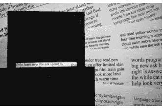

图 1：测试包示例。原始尺寸：23x12厘米。

## 1.3 测试每个参数

总体而言，先前的研究似乎并未传达相同的信息。因此，有必要开展一项实验，以澄清、验证并进一步研究一些未经测试——或仅模糊测试过——的参数（样式、字号、行距、间距）。

### 1.3.1 测试方法及需考虑的可能风险

实验包含六页测试页、一张结果表和两份阅读指南（图 1）。测试分为三个部分。每个部分包含六段八十个单词的段落，单词长度在 2 到 8 个字母之间。为确保阅读速度不会因文本内容而加快 [Aitchison, 2003]，段落是通过随机排列单词形成的 [Wilkins, 2003]。参与者必须

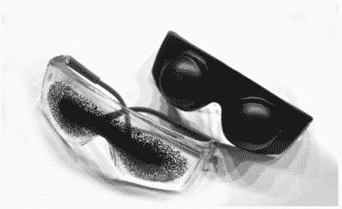

图 2（左）：模拟周边视力丧失的眼镜（N.1）。宽度 13 厘米。（右）：模拟中心视力丧失的眼镜（N.7）。宽度 13 厘米。两副眼镜均来自 Visual Impairment North East 模拟套件。

请以通常的阅读速度大声朗读每段文字二十秒 [Tinker, 1963]。最后读出的单词被记录下来。

阅读速度可能受读者经验、内容熟悉度、所用词汇以及阅读文档类型等因素影响 [Smith, 1994]。随着阅读过程的进行并逐渐熟悉，阅读速度会提高。如果段落中保持相同的单词顺序，结果将会受到影响。因此，实验的各部分、顺序和段落必须经过仔细安排，最终形成包含六套不同材料的实验。

### 1.3.2 参与者的选择

共有三十三名成年人参与了本实验。其中，二十一名为年龄在 70 至 94 岁之间的低视力人士。在这些人中，十人患有黄斑变性，十一人患有各种眼部缺陷。其余人被分为两类：六名视力完美者和六名高度近视者。他们构成了与低视力人士结果的对比要素。视力正常的参与者只需阅读段落。近视参与者被要求摘下眼镜，使用模拟两种不同眼部状况的眼镜：中心视力丧失和周边视力丧失（图 2）。模拟视障人士的视力，将提供不习惯这些状况的人如何阅读的示例。

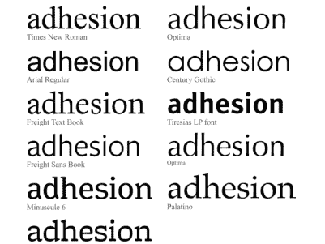

图 3：本实验所用字体的示例。

### 1.3.3 测试方面与字体选择

测试材料包括十八段使用十种不同字体排版的段落。所有段落均使用拉丁小写字母，因其常见用法（Jones and Mewhort, 2004）。第一部分通过比较衬线体和无衬线体来探讨字号与可读性。它包含六段，每段使用不同字号排版（Arial 12、16 和 20 磅，以及 Times New Roman，其字号已调整以匹配 Arial 的三个 x-高度）。参见图 3。

字号的选择符合英国皇家盲人协会（RNIB）的建议。12 磅和 20 磅是清晰印刷（面向广泛受众的文档）推荐的最小和最大字号，16 磅则是大号印刷排版的理想字号（2007）。因此，对于第二和第三部分，所有字体均按 Arial 16 磅的 x-高度进行了缩放（图 4）。

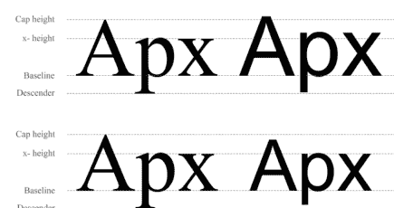

图 4（上）：以相同字号显示的两种不同字体。（下）：以不同磅数但匹配 x-高度显示的两种不同字体。

第二部分探讨间距是否影响可读性。六段文字使用 Freight Text 和 Freight Sans 排版，行距和字距各异。选择这些字体是因为它们比例相同，从而防止文本的基调影响结果。

第三部分关注某些排版设计细节（粗细、笔画和字眼）是否影响可读性。最后一类字体的选择不那么明显。Minuscule 6 和 Freight Micro Book 是标题字体，基于一个假设被选中：如果它们对正常视力人士在小字号下有效，那么放大后对低视力人士也应有相同效果。Palatino、Century Gothic 和 Optima 因其较大的字眼和多样的构造（衬线体和无衬线体）被选中。最后一种是 Tiresias，15.5 磅，一种由 RNIB 特别为大号印刷设计的字体。

## 1.4 结果与讨论

实验三部分的结果汇总于表 1，并在后续章节中讨论。

### 表 1：实验结果。

| 部分 | 字体 | 21 名低视力人士 | | 6 名正常视力人士 | | 6 名使用模拟眼镜阅读者 | |
|---|---|---|---|---|---|---|---|
| | | 单词 | 字母 | 单词 | 字母 | 单词 | 字母 |
| 1A | Times New Roman 14/14.40 | 380 | 2039 | 252 | 1365 | 219 | 1168 |
| | Times New Roman 18/19.20 | 429 | 2304 | 248 | 1342 | 223 | 1201 |
| | Times New Roman 23/24.0 | 506 | 2719 | 261 | 1403 | 220 | 1193 |
| 1B | Arial Regular 12/14.40 | 376 | 2056 | 246 | 1358 | 213 | 1171 |
| | Arial Regular 16/19.20 | 440 | 2314 | 249 | 1377 | 210 | 1156 |
| | Arial Regular 20/24.0 | 438 | 2267 | 251 | 1396 | 220 | 1204 |
| 部分 | 字体 | 21 名低视力人士 | | 6 名正常视力人士 | | 6 名使用模拟眼镜阅读者 | |
| | | 单词 | 字母 | 单词 | 字母 | 单词 | 字母 |
| 2A | Freight Text Book 18/19.20 | 458 | 2414 | 251 | 1363 | 233 | 1262 |
| | Freight Text Book 18/21.20 | 440 | 2315 | 253 | 1375 | 231 | 1245 |
| | Freight Text Book 18/23/50 | 452 | 2383 | 239 | 1280 | 233 | 1248 |
| 2B | Freight Sans 18/19.20 | 406 | 2253 | 268 | 1479 | 237 | 1315 |
| | Freight Sans 18/21/20 | 417 | 2296 | 256 | 1418 | 233 | 1288 |
| | Freight Sans 18/23/50 | 434 | 2412 | 259 | 1423 | 231 | 1280 |
| 部分 | 字体 | 21 名低视力人士 | | 6 名正常视力人士 | | 6 名使用模拟眼镜阅读者 | |
| | | 单词 | 字母 | 单词 | 字母 | 单词 | 字母 |
| 3A | Miniscule 6 16/19.20 | 447 | 2322 | 263 | 1380 | 221 | 1147 |
| | Freight Micro Book 18/19.20 | 423 | 2140 | 257 | 1343 | 219 | 1131 |
| | Optima 18/19.20 | 443 | 2259 | 251 | 1313 | 219 | 1139 |
| 3B | Century Gothic 15.5/19.20 | 421 | 2183 | 264 | 1418 | 226 | 1205 |
| | Tiresias LP font 15.5/19.20 | 491 | 2567 | 259 | 1382 | 242 | 1300 |
| | Palatino 18/19.20 | 438 | 2314 | 259 | 1400 | 220 | 1169 |

### 1.4.1 字号

在低视力人群中，Times New Roman 的较大字号（23 磅）是整个实验中阅读单词数最多的字体，与同一字体较小字号（14 磅）相比，差异为 126 个单词。正常视力参与者和使用模拟眼镜的参与者在使用较大字体时表现更好。然而，Arial（12 和 20 磅）和 Times New Roman（14 和 23 磅）两种极端阅读字号之间的差异，不如低视力人群那样明显，仅相差几个单词。因此，字号提升了视障人士的阅读速度，而非正常视力人士。

使用 Arial 时，阅读单词数最多的是 16 磅，与同一字体 20 磅的结果差异不明显。有趣的是，Arial 阅读最多和最少的字号（16 和 12 磅）之间的阅读速度差异为 64 个单词，几乎是 Times New Roman 等效差异的一半。因此，读者仅在特定字体中才能从字号增加中获益。因此，还有其他参数有助于提高可读性。

最后，参与者对在测试开始时或休息后介绍的最小字号段落发表了负面评论。这一点应予以考虑，因为它可能决定他们是否愿意进行阅读。

### 1.4.2 视觉噪声与字号：一项补充研究

在进行实验时，一名患有黄斑变性的参与者两次评论道：“我有黑点，它们挡住了路。”这一评论促成了一项基于 Liang [2002] 和 Pelli [1994] 研究的探索性研究，表明可读性更受“噪声”（任何干扰视觉信号识别的视觉元素）的影响，而非字号。其目的是了解哪些排版细节能从字号增加中受益于有缺陷的眼睛。

增大字母尺寸后唯一明显的差异是，其较细的部分更加可见，信号变得比噪声更强（图 5）。

使用 Tiresias LP（一种具有单线笔画的更粗字体）时，单词“limited”更易于区分。因此，可读字体的解决方案似乎不仅依赖于字号，还依赖于笔画的粗细。因此，如果发现每种缺陷的确切噪声比例，可以设计一种比噪声具有更高或更低频率的潜在有益字体。先前的研究表明，“媒介混浊的受试者在黑色背景上出现白色字母时阅读效果更好” [Legge et al., 1985]。这一说法与插图（图 6）一致，因此可读性的解决方案不仅依赖于字体，还依赖于其使用的背景。

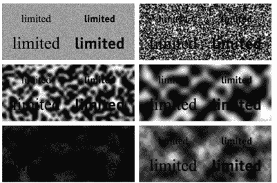

图 5：白纸上的黑色字母，覆盖着一层噪声滤镜。所用字体为 Times New Roman 和 Tiresias。

### 1.4.3 行距与字间距

第二部分研究了行距和字间距如何影响视障人士的可读性，涉及衬线体和无衬线体两种字体。在衬线体版本的 Freight 中，结果显示该字体的默认间距和行距最为有益。其次，且与第一名非常接近，是 Freight 最宽版本。更宽的间距并未影响可读性，这与 Prince [1967] 的最优计算相矛盾。这可能是因为衬线在字母之间增加了独特的间隙，从而防止拥挤。然而，在阅读 Freight Text Book 时，一位参与者评论道：‘大单词很棘手，尤其是使用大放大镜时’，这表明行距和间距的结果在较大字号下可能会有所不同，因为每次阅读跳跃所见的字母会更少。

在无衬线体样本中，当间距和行距均设为最宽时，阅读的单词最多。然而，这一结果未能达到衬线体样本的最低可读性率。该结果与视力正常者的结果相矛盾，后者在默认间距的样本中阅读效果更好，且在无衬线体字体中具有更高的阅读率。

有趣的是，一位参与者对 Freight Text Book 评论道：‘这是个有趣的字体’。尽管如此，他在这种字体上的表现是整个第二部分中最高的。事实上，读者习惯并信任某些字体样式。改变他们的阅读习惯会很困难，即使这可能证明更有益 [Unger, 2007]。

### 1.4.4 衬线体与无衬线体

衬线体和无衬线体字体的可读性主要在实验的第一部分进行了测试。然而，第二部分和第三部分（同时使用两种字体）的数据也进行了分析。在前两部分中，整体阅读率较高的字体为衬线体（Times New Roman，23 磅，以及 Freight Text Book，18 磅）。看来阅读单词最多的无衬线体字体未能达到衬线体字体的最低可读性率。事实上，在这次实验中阅读量最高的五种字体中，有四种带有衬线。结果与 Arditi 的评论相矛盾：当字号减小至接近视觉敏锐度极限时，衬线体与无衬线体之间阅读单词数的差异几乎难以察觉。然而，这仅适用于视障人士的结果，因为对于其他测试群体，衬线体和无衬线体的分布各异。如前所述，其他参数可能对字体的有效性负有责任。衬线体可能是积极特征，也可能是冗余特征，具体取决于情况。

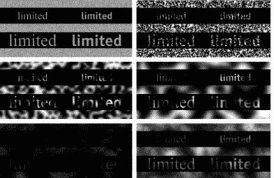

图 6：白纸上的白色字母，覆盖着一层噪声滤镜。所用字体为 Times New Roman 和 Tiresias。

### 1.4.5 其他排版细节

在第三部分中，测试了三个方面：专为视障人士设计的字体的效率；为标题设计的字体放大至相当于 Arial 16 磅的效率；大字母计数器（counters）的效率。

首先是 15.5 磅的 Tiresias LP，其结果与 Times New Roman 23 磅非常接近；这是整个测试中阅读单词最多的字体。它还获得了各种正面评论。如关于噪声和字母识别的研究所示，这一成功可能归因于字体的粗细。在佩戴模拟眼镜的读者中，这种字体表现最高，但从视力正常者那里只得到了中等的阅读率。

放大标题字体可以提高可读性这一假设不成立；它未影响结果。Minuscule 6 的阅读效果优于 Freight Micro Book，可能是因为其更深的段落纹理。Optima、Palatino 和 Century Gothic 的大字母计数器既未阻碍也未帮助读者。然而，在这一部分中，阅读量最少的字体是 Century Gothic，很可能是由于缺乏使字体更易识别的特征多样性。

一位参与者评论说，阅读设置为更粗字体的段落时，文字变得模糊。他的表现未受此影响。然而，字母的粗笔画减少了细节之间的空间，使字母识别更加困难；字母最终变成了模糊的团块。因此，根据眼部缺陷的不同，应考虑创建不同粗细和样式的字体，以满足不同的阅读需求和限制。

## 1.5 走向模式识别

### 1.5.1 常见错误

无论每种字体的阅读率如何，低视力参与者和佩戴模拟眼镜的参与者相比于没有视觉缺陷的参与者，犯了大量错误。在寻找这些错误中的模式时，将其分为三类。

第一类是关于阅读耗时较长的单词。如单词“limited”中那样具有强垂直笔画的连续字母更具问题性。有趣的是，大多数涉及错误单词的样本都包含无衬线体字母。

第二类是遗漏单词。读者的眼睛无法获得整行的完整视图，在跳跃（saccade）时“跳得”太远，未能识别小单词。当短单词出现在行首时，也出现了同样的错误；读者会选择错误的起始点。这表明更紧的单词间距将是有益的。此外，应谨慎应用更宽的行距，以免妨碍读者找到行首。

第三类也是最大的一类是误读字母。然而，这种现象可能是因为从段落中未推导出任何意义。因此，读者很容易进行随机的错误猜测，并且当同一单词再次出现时会重复该猜测。尽管如此，即使在过滤这些结果后，一些上伸字母（ascenders）也被误认为 x 高度字母。例如：‘t’ 被混淆为 ‘r’，或 ‘l’ 被混淆为 ‘i’。其他 x 高度字母如 ‘c’ 被误认为 ‘e’，或者反之。另一个明显的错误是将两个字母合并，或将一个字母分为两个（例如 ti=h，ch=d）。

### 1.5.2 眼部过滤机制与傅里叶方法：一项互补研究

#### 1.5.2.1 测试方法及需考虑的潜在风险

为探究误解是源于仓促阅读，还是源于眼睛过滤机制故障而改变了信息，开展了一项探索性研究。所使用的过程是傅里叶变换，它是一种以空间频率描述图像的数学方法。根据之前的结果，从第一个实验的参与者中选出七人参与此项研究。他们被展示了六个符号，并被要求在一张纸上复制它们。参与者未被告知所展示图形的性质，以避免产生预设倾向。第一个符号是一个正方形，这种形状易于感知和绘制，将决定参与者的绘图能力。其他四个符号是字母，根据每位参与者的个人错误而各不相同。第五个是字母 ‘a’，之所以选择它，是因为它在第一个实验中从未被误读。然而，符号的表现往往并非读者心中所想。为控制和纠正这种影响，参与者被问及他们即将绘制什么。

#### 1.5.2.2 分析材料

为确保傅里叶变换的准确性，对绘图在比例和设计方面进行了某些调整。为了发现导致误解的模式，将给定的图形及其绘图进行比较。从每个样本中选取两个符号，并输入一个可视化其各自傅里叶频率的程序。下一步是找到模拟缺陷眼睛所进行变换的滤波器。如果所用滤波器成功，我们将能够分析哪些字母设计特征对每种眼部缺陷有益。在获得的结果中，只有三个值得分析。其余的描绘了符号且没有困难，并提供了所展示图形的准确绘图。图 7 说明了符号、参与者的绘图以及傅里叶变换的效果。

#### 1.5.2.3 结果

参与者在不知所给图形的情况下，误读了他们之前能够阅读的字母，原因是缺乏上下文。然而，一些参与者从字母隔离中受益，可能是由于缺乏“拥挤”（crowding）。结果表明，强调超出常规字体设计规则的细节似乎是一个可行的解决方案。设计几何的、棱角分明的字母，或在形成曲线时强调笔画，可能是一些可能的路径。

总之，除了强调负责区分字母及其计数器（counters）的特征外，还应考虑创建一种所谓的带有 OpenType 交替字体的“聪明”字体。因此，当出现某些字母组合时，相同字符的样式交替体将替换它们，确保它们不会被误读。如果根据单词中的字母数量调整单词间距和字母间距，将达到最佳效果。

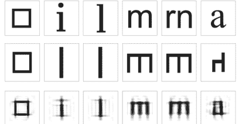

图 7（顶部）：初始形状；中间：参与者的表示（绘制调整后）；（底部）：应用傅里叶变换滤波器后的初始形状。

## 1.6 结论

视障人士需要一种专门设计的字体，用于大号印刷文档。在寻找此类字体的参数过程中，本研究阐明了导致视障人士阅读变得困难的一些原因。为了将这些结果转化为可靠的结论，应启动一项新的定量研究，招募更广泛的参与者并测试更多方面。

通常，迄今为止为正常视力读者制定的规则似乎也适用于视障人士。不过，这些参数仍需完善，才能达到与视力正常者相当的效果。从排版角度来看，可读性取决于多种排版特征的组合。然而，较大字号和更宽行距的衬线字体似乎更有益。

关于排版细节，大多数视障人士阅读粗体字且带有大字母空白的字体效果更好；字母间距和单词间距只需少量调整。此外，为了避免拥挤引起的混淆，必须对特定字母组合进行调整。这意味着可能需要为同一个字母设计两种变体，分别用于被不同字母包围的情况。由于每个人的需求不同，每种眼部缺陷都需要不同的解决方案。为了为他们每个人提供合适且定制的字体，进一步的研究势在必行。

## 致谢

如果没有 Tom Conlin（伯克郡盲人协会首席执行官）、Dawn Singleton（盲人阅读协会经理）以及每一位以极大热情投入本项目的参与者的帮助，本论文无法完成。我还要感谢 Alexios Bevertos，感谢他分享关于傅里叶变换方法的知识和时间，以及 Mary Dyson，感谢她指导我完成本研究的每一个步骤。最后，我要感谢 Kleoniki Havaki 给予的巨大支持。

## 参考文献

Aitchison, J. (2003) 心灵中的词汇：心理词汇导论. (Blackwell, Oxford) pp. 134-136.

Al Otaibi, A. Z. and Dickinson, C. M. (2000) 视觉障碍阅读表现中某些排版因素的影响. (Swetz and Zeitlinger, NY) p. 309.

Arditi, A. and Cho, J. (2000). 衬线是增强还是降低文本可读性？, 视觉科学调查杂志, 41, p. 437.

Bailey, I. L., Clear, R. and Berman, S. M. (1993). 尺寸作为阅读速度的决定因素, 照明工程学会杂志, 22(2), pp. 102-117.

Bouma, H. (1970). 近旁视字母识别中的交互作用, 自然, 226, pp. 177–178. Proc. Yu, D., Cheung, S. H., Legge, G. E. and Chung, S. T. (2007). 字母间距对视觉跨度和阅读速度的影响, 视觉杂志, 7(2), p. 1.

Chung, S. T., Mansfield, J. S. and Legge, G. E. (1998). 阅读心理物理学。XVIII：正常周边视觉中印刷尺寸对阅读速度的影响, 视觉研究, 39, pp. 2949–2962.

Cuiffreda, K. J., Levi, D. M. and Selenow, A. (1991) 弱视：基础与临床方面. (Butterworth-Heinemann, Boston).

Cline, D., Hofstetter, H. W. and Griffin, J. R. eds. (1997) 视觉科学词典 (Butterworth-Heinemann 第4版, Boston) p. 521.

Jones, M. and Mewhort, D. (2004). 大规模英语语料库中的区分大小写字母和双字母频率计数, 行为研究方法、仪器与计算机, 36, pp. 388–396.

Liang, Y. X. (2002). 读者当心！视觉噪声对阅读通道的影响. 英特尔科学人才搜索, pp. 1-18.

Legge, G. E., Bigelow, C. A. (2011). 印刷尺寸对阅读是否重要？来自视觉科学和排版的研究结果综述, 视觉杂志, 11(5), pp. 1-22.

Legge, G. E., Rubin, G. S., Pelli, D. G. and Schkelse, M. M. (1985). 阅读心理物理学。II：低视力, 视觉研究, 25(2), pp. 253-266.

Levi, D. M., Song, S. and Pelli, D. G. (2007). 弱视阅读即拥挤, 视觉杂志, 7(2), pp. 1-17.

Minda, E. R., Jeffrey, W., Jutai, J., Strong, G., Campbell, K. A., Gold, D., Pretty, L., and Wilmot, L. (2007). 低视力读者字体的可读性：研究综述, 视觉障碍与盲杂志, p. 410.

Paterson, D. G and Tinker, M. A. (1947). 行距对报纸字体的影响, 应用心理学杂志, 31, pp. 160-163.

Parish, D. H. and Sperling, G. (1991). 物体空间频率，视网膜. 视觉研究, 31, pp. 1399-1416.

Prince, J. H. (1967) 面向视觉障碍者的印刷. 澳大利亚验光杂志, 50(6), pp. 164-177.

Smith, F. (1994) 理解阅读：阅读与学习阅读的心理语言学分析. (Erlbaum, Hillsdale) pp. 21, 82.

Reece, G. A., Eubank, T., Rafieetary, M. and Lowther, D. L. (2008). 低视力读者对电子显示屏中衬线和斜体存在的偏好, 教育与康复协会杂志, 1(1), p. 5.

皇家全国盲人协会 (2007) 看得清：使有视力问题的人能够获取信息. (RNIB, London) p. 33.

Rubin, G. S., Feely, M., Perera, S., Ekstrom, K. and Williamson, E. (2006). 字体和行宽对轻度至中度视力丧失者阅读速度的影响, 眼科和生理光学, 6, pp. 545–554.

Rubin, G. S. and Turano, K. (1994). 顺序单词呈现下的低视力阅读, 视觉研究, 32, pp. 895-902.

Russell, E., Jutai, J. W., Strong, J. G., Campbell, K. A., Gold, D., Pretty, L. and Wilmot, L. (2007). 低视力读者字体的可读性：研究综述, 视觉障碍与盲杂志, 101(7), pp. 402-415.

Solomon, J., Pelli, D. G. (1994). 介导字母识别的视觉滤波器, 自然, 369, pp. 395-397.

Shaw, A. (1969). 部分视力印刷 (伦敦图书馆协会), Proc.

Papadopoulos, K. S. and Goudiras, D. B. (2005). 数字文本中面向视障人士的无障碍辅助. 英国视觉障碍杂志, (63/2).

Tinker, M. A. (1963) 印刷品的可读性. (爱荷华州立大学出版社, Iowa) p. 22.

Tracy, W. (1986) 字体信誉：字体设计视角. (Gordon Fraser Gallery Ltd., London) p. 31.

Unger, G. (2007). 阅读时. (Mark Batty Publisher, New York) pp. 77, 166.

Wilkins, A. (2003) 透过色彩阅读：有色滤光片如何减少阅读困难、眼睛疲劳和头痛. (John Wiley, West Sussex) p. 40.

Yu, D., Cheung, S. H., Legge, G. E. and Chung, S. T. (2007). 字母间距对视觉跨度和阅读速度的影响, 视觉杂志, 7(2), pp. 1-10.

# Matilda：面向低视力儿童的字体

Ann Bessemans

由于他们以印刷文本形式接收到的视觉输入质量较低，视障初学者读者相比同龄人处于劣势。过去，排版常被视为改善提供给低视力儿童的印刷阅读材料可读性的有用工具。然而，这一观念所基于的可读性研究并不总是高质量。例如，在认知科学中，许多努力在方法上是正确的，但未考虑所审查字体的具体特征，因此得出了许多旨在提高可读性的字体，但其背后的推理几乎从未得到足够的方法学支持。此外，大多数可读性研究关注的是一般低视力人群，忽视了视障儿童构成一个具有特定问题的非常特殊的群体。这个博士研究项目从设计背景出发，探讨了视障初学者读者的可读性问题。该研究试图弥合字体设计师与研究字符可读性的认知科学家之间的差距。在测试材料的开发中，重点放在参数化设计上。定义了能够捕捉字体基本特征的参数。随后，基于五个参数设计了不同类型的字体（一种衬线体，一种无衬线体，一种方衬线体），这些参数探讨了形式和节奏中同质性与异质性之间的平衡。基于符合该领域科学和排版知识的测试材料的可读性研究，提出了一种字体，为阅读过程初期的目标群体——视障儿童提供支持。

## 1.1 引言

阅读是在不自觉地识别字母的情况下进行的 [Warde, 1956; Unger, 2007]。尽管如此，字母是决定可读性的重要方面 [Rayner and Pollatsek, 1998]。字母需要被解码才能获得意义。阅读是一个复杂的、认知的和快速的过程。阅读存在严重问题的儿童更有可能陷入失败的循环 [Stanovich, 1986; Wolf, 2007]。当阅读是一个缓慢而繁琐的过程时，它会对认知行为和动机产生后果。一个阅读过程不完（im-

peded 者在智力和社会发展方面能力较差。因为学习阅读的大部分过程在九岁之后就完成了，因此在该过程的初期阶段支持遇到困难的儿童非常重要 [Stanovich, 1986; Marquet et al., 2006].

没有其他障碍的视觉障碍儿童在阅读理解、拼写或准确性方面没有问题。因此，低视力儿童的阅读问题（最初）是视觉问题，而非认知问题 [Gompel et al., 2003; Gompel, 2005]。视觉障碍对技术阅读技能有直接影响。

由于他们以印刷文本形式接收到的视觉输入质量较低，初学者阶段的视觉障碍读者与其（视力正常的）同龄人相比处于劣势。由于视觉输入减少，阅读过程受到干扰 [Gompel et al., 2003; Gompel, 2005]。视觉障碍儿童在单词解码、视觉模式辨认和字母识别方面存在问题。由于解码受阻，阅读速度较低，这最终可能导致认知问题，从而需要从普通教育转到特殊教育。为了改善视觉输入，大量关注被给予光学阅读辅助工具和大字体的使用。大字体常被视为一种快速修复方案，以表明已为视觉障碍者做出了努力。研究表明，大字体书籍对大多数低视力儿童的技术阅读过程无效 [Lovie-Kitchin et al., 2001; Corn et al., 2002].

## 1.2 排版研究与可读性研究

在过去，排版常被视为改善提供给低视力人群的印刷阅读材料可读性的有用工具。然而，可读性研究的努力并不总是高质量。对于认知科学家来说，这往往是由于对排版领域知识不足造成的，Spencer [1969]、Dyson [1999]、Lund [1999] 和 Bessemans [2012] 都曾指出这一点。这可能导致使用不正确的术语、设计不佳的字母，以及动机不足和不正确的文本材料选择。对于设计师来说，这是因为以直觉的方式开展可读性研究 [Dyson, 1999; Lund, 1999; Bessemans, 2012]。排版师很少进行实证研究。排版师很少尝试在目标群体中测试其设计的材料。他们将自己的“发现”描述为不言自明的真理，但这些缺乏任何科学验证。

许多关注设计影响的可读性研究，无论是在认知科学领域还是设计界，都缺乏内部和/或外部效度。图 1 展示了说明常见外部效度问题的测试材料。这些材料通过操纵孤立参数（如衬线粗细、字母宽度、字母高度）精心构建。这导致高内部效度。但外部效度非常低。这些字母不被视为日常生活中使用的真实字体。图 2 展示了说明常见内部效度问题的测试材料。测试材料可能出现在现实生活中，这意味着外部效度高。然而，对可读性的影响不能归因于单一设计参数。多个设计参数（甚至组合）可以影响可读性效果。例如，Helvetica 与 Times New Roman 之间的可读性差异不能仅仅归因于衬线，因为这两种字体之间还有其他差异。因此，内部效度相当低。设计参数是同一字体中可以隔离并相互独立操纵的设计特征。因此，设计参数可以与内部效度和外部效度相关联。

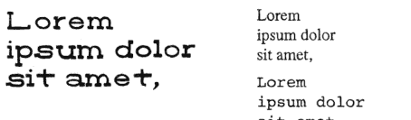

图 1：（左）常见外部效度问题的示例。此类材料的示例可见：[Liu and Arditi, 2000; Arditi, 2004].

图 2：（右）常见内部效度问题的示例。此类在字体之间进行比较的材料示例可见：[Mansfield et al., 1996; Woods et al., 2005].

此外，大多数可读性研究都集中在低视力成年人身上，忽视了视觉障碍儿童是一个具有特定问题的非常特殊群体这一事实。他们的阅读过程刚刚开始，且其视觉障碍并非由年龄增长引起，这两点使得直接转移研究结果变得困难甚至不可能。假设老年人更多地受益于宏观层面的排版（如页面或书籍的布局，甚至更大的字号，这会减慢阅读速度但更舒适）是合理的 [Bouwhuis, 1993].

## 1.3 可读性一词

现有可读性研究中的另一个问题是关于“可读性”一词的混淆。许多不同群体的人（例如排版师、语言学家、教育工作者、人体工程学家、心理学家等）使用该术语并赋予其个人相关含义，而不明确解释。这种解释对于使可读性研究具有可比性非常重要。在本研究中，可读性是指视觉符号被解码的难易程度 [Bessemans, 2012]。该定义源自对阅读的字典描述。阅读意味着：转置视觉符号并将其转换为语言意义。为了简洁地定义可读性一词，关注点在于阅读时发生的两个全局且连续的步骤：解码和意义的获取，即阅读的感官方面和认知方面（见图 3）。阅读中的解码或感官方面是将单词的纯视觉表示转换（在初学者读者中，这可能尚未与这些单词的意义相关联）。本研究中使用的可读性定义明显与阅读的这一首要感官方面相关，因此与低视力儿童的解码问题相关。

## 1.4 应用的设计方法论

我自身研究中的全面可读性研究考虑了可读性的清晰定义以及科学方法与排版实践的结合。设计者-研究者能够结合这两者，从而保证测试材料的内部效度和外部效度。设计研究的材料是系统构建的。设计是整个研究过程中的重点。方法论始于由理论研究（包含科学和排版内容）和实践工作

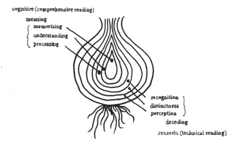

图 3：解释阅读中感官方面和认知方面的洋葱模型。

来自其他设计师（主要是字体）的工作。这个背景将导致初步设计，最终产生测试字体。这些测试字体用于可读性研究（见 1.5）。反过来，可读性研究的结果为第二种字体设计提供动机，最终将导致为低视力儿童开发一种特殊字体。使用这个全局框架，本研究从可读性的明确定义出发，并使用同时具有内部效度和外部效度的测量方法。输出是对可读性本质的更深入了解以及字体设计领域的一些实用指南。

在设计测试字体的过程中，重点放在参数设计上。从两种现有字体（衬线体 DTL Documenta 和无衬线体 Frutiger）出发，设计了若干派生字体，包含五个不同的参数：（1）可变 x 高度；（2）常规对比；（3）非常规对比；（4）方向；（5）字母宽度（见图 4）。

汤姆和莲住在城市里。汤姆和莲住在城市里。
~~~~~~~~~~~~~~~~~~
汤姆和莲住在城市里。汤姆和莲住在城市里。
~~~~~~~~~~~~~~~~~~
汤姆和莲住在城市里。汤姆和莲住在城市里。
~~~~~~~~~~~~~~~~~~
汤姆和莲住在城市里。汤姆和莲住在城市里。
~~~~~~~~~~~~~~~~~~
汤姆和莲住在城市里。汤姆和莲住在城市里
~~~~~~~~~~~~~~~~~~
汤姆和莲住在城市里。汤姆和莲住在城市里。
~~~~~~~~~~~~~~~~~~

图 4：带有插图节奏的测试字体（无衬线体和衬线体）。从上到下：基本字体 Frutiger 和 DTL Documenta；参数常规对比；参数非常规对比；参数方向；参数字母宽度；参数可变 x 高度。

- 1. 可变 x 高度：通过改变字母的 x 高度以及上伸部和下伸部的高度，该设计参数引入了大量异质性，无论是节奏上还是字母形式上。
- 2. 常规对比：该参数以常规方式为字母添加对比。某些字母部分以常规方式被强调。该参数主要在字母形式上引入异质性。
- 3. 非常规对比：该设计参数强调了字母中最具特色的字符部分。这特别引发了字母形式的异质性（因为对称性较低）。
- 4. 方向：在此参数中，通过操纵字母笔画的方向，在节奏中引入了更多异质性。
- 5. 字母宽度：在此参数中，通过改变字母宽度，在节奏和字母形式中引入了更多异质性。

使用五个参数来考察形式与节奏中同质性与异质性之间的平衡。关于字母形状的异质性可以通过使相关字母不那么相似来示例（参见图5）。关于字体节奏的异质性可以通过由垂直字母笔画形成的更不规则条纹图案来示例。

利用同质性和异质性的概念，我们可以说，一般来说，无衬线字体在字母形式上是同质的（因为可能存在镜像），而在节奏上是异质的（参见图6）。衬线字体则正好相反（特别是基于20世纪模型的衬线字体）：它们在字母形式上是异质的（衬线和对比使镜像不可能），而在节奏上是同质的。关于低视力儿童材料可读性的理论和实践见解指向更多异质性的方向。注意，我们从未测试过非常极端的异质性形式。

aeocbd

Welke chique barones verzamelde fijne xylooglyptiek?

aeocbd

Welke chique barones verzamelde fijne xylooglyptiek?

Figure 5: 说明字母形状中的异质性。上部：几何无衬线字体。下部：人文主义无衬线字体。

## 1.5 定量与定性可读性研究

字体通过实验（定量评估）和主观（定性评估）可读性研究进行了测试。为研究视障儿童的阅读技能和阅读体验，选取了视力良好和视力较差的儿童。共有110名无其他障碍的视障儿童参与了该研究。他们得益于比利时和荷兰视障中心的合作而被招募。还有54名视力正常的儿童参与了该研究，并由普通学校招募。所有读者年龄均为五到十岁。

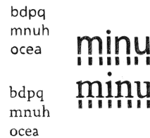

Figure 6: 说明字母和节奏异质性。字母形状中的异质性在于衬线字体的衬线和对比。节奏中的异质性在于无衬线字体形成的节奏图案。

测试中采用了心理物理法。儿童在计算机屏幕上短时间内看到测试字体中的伪词^a，并被要求大声朗读看到的单词（参见图7）。朗读的单词被输入，并使用软件Affect [Spruyt et al., 2010]统计了单词（字母）阅读错误的数量。

为了允许不同字体之间错误率的差异，单词后面跟着一个掩码，并为每个儿童调整了单词与掩码之间的时间和/或单词曝光时间，以获得50%的识别概率。这在初始测试阶段完成。因此，每个儿童都有单词呈现的个别持续时间。识别单词能力较强的儿童被呈现较短持续时间的单词。然后，在主测试中，每个儿童按其特定的单词持续时间被呈现了6个会话，每个会话60个伪词。每个会话中有3次休息以确保专注力。对这些数据进行了统计分析。

设计参数的效果使用基于重复测量的广义线性模型（GLM）的统计分析进行了测量。GLM计算因变量（例如正确阅读的单词百分比）与一些自变量（例如不同的设计参数）之间连接的程度。重复测量允许在受试者内进行多次观察（每个儿童的各个会话可以包含在分析中，同时考虑受试者间的变异性）。GLM识别出可靠影响可读性的变量。进行了若干以正确阅读的伪词百分比为因变量的分析：1）全局分析；2）每组儿童内的分析（低视力和正常视力）；3）仅限于至少有一个字母正确的单词的分析；4）与阅读水平相关的分析；5）Documenta与Frutiger的对比度分析；6）针对不同类型视觉问题的分析。

在研究的主观部分，检查了阅读测试字体的儿童的阅读体验。儿童被（个别地）要求按字体的可读性*对测试材料（12种字体）进行排名（参见图8）。通过对话，对儿童进行了访谈，了解哪些因素在其主观判断中起作用。与儿童的反馈和互动对最终字体的设计至关重要。与这种工作方式相反，字体设计师很少能立即获得读者的反馈。就与读者的接触而言，字体设计师始终远远落后于第一线。在这种情况下，读者和字体设计师之间存在直接反馈。

使用主观方法测量设计参数对可读性的影响，采用了Kendall的一致性系数W。当该系数较高时，这意味着观察到的排名是可靠的，即儿童对排名达成一致。

a 使用伪词是因为字母形式中的语音规则和惯例保留，而语义知识和上下文的影响被排除。

b 创建了字母数量相等的100个伪词。这些伪词用于每个参数和基本字体。控制实验的软件在设计参数中随机选择并混合了等量的单词。同时，软件（Affect）随机选择了字体（基本字体和派生字体）。

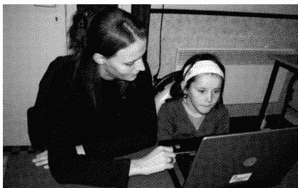

Figure 7: 实验性可读性研究（定量）。

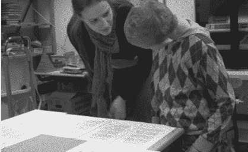

Figure 8: 主观可读性研究（定性）。

## 1.6 结果

定量可读性研究的一个显著发现是，当使用衬线字体DTL Documenta而不是无衬线字体Frutiger时，视力正常的儿童阅读错误可靠地更少。这一结果有些令人惊讶，因为儿童（尤其是初学者）在小学主要使用无衬线字体阅读。因此，祖扎娜·利科[1990]的著名引语“……读者读得最多的，读得最好”受到了质疑，尤其是对五到十岁的初学者而言。这项研究证伪了教师的信念，即给初学者的字母应尽可能简单并反映手写体。在视障儿童中，两种字体的阅读准确性差异不那么明显。在阅读（解码）过程中，非视障儿童似乎不受同质节奏的阻碍，而是受同质形式的阻碍。然而，低视力儿童似乎更受阻碍，特别是受同质节奏的阻碍。在DTL Documenta字体集（具有同质节奏的基本字体）中，使节奏最异质的设计参数——节奏*和方向——对可读性（就解码而言）产生了最积极的影响。看来，对于视障儿童来说，更不规则的字体有助于他们的阅读。此外，一定程度的形式异质性可能提供支持（正如我们在视力正常儿童身上看到的那样）。

在主观可读性研究中，排名分析未显示显著结果。然而，与儿童的对话包含大量相关信息。主观可读性研究结果显示，初学者与日常阅读材料存在相当早期的条件反射。儿童将无衬线字体与学校联系起来，并认为它们可书写；他们将衬线字体与文学（例如书籍和报纸）联系起来，并认为它们很难自己复制。非视障儿童通常认为最传统的字体是最易读的。在视障儿童中，情况并非总是如此。其中一些

d 很明显，大多数初学者看不到设计参数节奏与基本字体之间的差异。因此，该参数可能对实际应用有用，因为它在保持不可见的同时诱导可读性。

儿童似乎感受到选择普通字体的社会压力。他们报告说，如果选择奇怪的字体阅读，同学会嘲笑他们。

## 1.7 Matilda

基于研究结果，结合我作为设计研究员的自身理解、知识、直觉和想法，设计了一种名为Matilda©的字体，旨在为视力受损儿童在阅读初期提供支持。Matilda应被视为支持阅读的工具，而非阅读问题的解决方案。

这种新字体在字母宽度和文本颜色方面与基本字体DTL Documenta和Frutiger相似（参见图9）。Matilda基于衬线字体设计，旨在缩小非视力受损儿童与低视力儿童阅读材料之间的差距。此外，与无衬线字体Frutiger相比，DTL Documenta字体集中的设计参数对低视力儿童的解码技能产生了最积极的影响。

Matilda的主要特点是宽大、开放、圆润的字母，旨在营造友好的感觉（参见图10）。字母既动感又稳固，既有构造感又有有机感。字母建立在相当稳定的垂直轴上。曲线是开放的，衬线是不对称的、凸形和凹形的。球形末端用于强调字母终止，以增强其个性和辨识度。字母中的低对比度对于轻松放大或缩小文本是必要的。如果低视力儿童以不同的对比度/颜色阅读（他们在电脑上经常这样做），字母需要保持非常清晰。Matilda的x-height并不很大。升部和降部为变音符号提供了足够的空间。

你看得清楚吗，索菲？在本课程的其余部分，你必须认识到智者是真正的哲学家，他们在人类思想史中占有一席之地。智者为他们的工作收取报酬，因为他们不像柏拉图那样可以依靠丰厚的收入。他们是对智力和伦理问题有广泛兴趣的人，将自己的技能用于服务学生。合格的智者在历史上一直存在。在某种意义上，他们是第一批人文主义者和独立研究者。他们与那些要么对自己所知甚少感到十分满足，要么吹嘘自己对许多事情了如指掌但实际上一无所知的老师和自以为是的人无关。

图9：Matilda（顶部）、DTL Documenta（中部）和Frutiger（底部）之间的文本颜色和字母宽度比较。

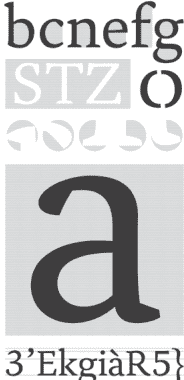

图10：Matilda的设计特点。

Matilda正在全面开发中，是一个不断壮大的字体家族（也可用于新的可读性研究测试）。该字体包括衬线体、斜体和粗体（参见图11）。Matilda还通过对改善低视力儿童解码过程最有帮助的设计参数进行了扩展。这些参数是节奏（参见图12）和方向（参见图13）。将开展更多研究，因为了解节奏异质性的程度如何影响可读性将很有趣。此外，字母宽度与方向等参数组合的交互效应结果，将为低视力儿童（以及人类感知，随着阅读时感官方面更多信息的揭示）提供更多关于可读字体的洞察。

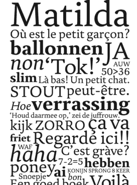

图11：Matilda Regular、Bold & Italic。

## 1.8 结论

当可读性被明确定义并与目标群体的阅读问题相关联时，衡量可读性的方法变得清晰，同时保持内部效度和外部效度。很明显，字母影响可读性，并且结果可以转化为字体设计。设计研究员在这样的可读性研究中扮演着重要角色。

这项研究强调了探索同质性与异质性之间平衡的重要性。设计研究为设计参数提供了线索，这些参数可以通过诱导节奏异质性来成功改善低视力儿童的可读性。我未来的目标是通过研究阅读时单词内部的条纹模式，将这些模式与阅读时的空间频率相关联，并将这些信息转化为实际设计，从而更深入地了解印刷品的可读性。新的拟议研究旨在调查字体内部的节奏和空间频率在多大程度上会影响普通读者和阅读困难者（例如低视力读者）的可读性。这与我的博士论文研究结果一致，即单词内部受干扰的条纹模式导致知觉系统发展不完善的人群具有更好的解码技能（因此可读性更好）。

汤姆和莲住在城市。
他们住在四楼。
他们有一只小狗，名叫汪汪。
汤姆在房间里玩他的球。
汪汪疯狂地朝球跳去。
啪！球径直飞向花瓶。

图12：Matilda Rhythm。

汤姆和莲住在城市。
他们住在四楼。
他们有一只小狗，名叫汪汪。
汤姆在房间里玩他的球。
汪汪疯狂地朝球跳去。
啪！球径直飞向花瓶。
“汤姆把花瓶打碎了，”妹妹喊道。

图13：Matilda Direction。

## 参考文献

- Arditi, A. 2004. 可调整排版：提升低视力测试可访问性的方法。Ergonomics, 47 (5) pp. 469-482.
- Bessemans, A. (2012). 面向视功能受限儿童的字体设计。(博士论文，莱顿大学 & 哈塞尔特大学).
- Bessemans, A. (2012). 排版研究。Tipo, 47, pp. 60-63.
- Bouwhuis, G. D. 1993. 阅读速度与字母大小。IPO Annual Progress Report, 28, pp. 30-36.
- Com, A. L., Wall, R. S., Jose, R. T., Bell, J. K., Wilcox, K. and Perez, A. (2002). 接收光学设备的学生阅读与理解速度初步研究。Journal of Visual Impairment & Blindness, May, pp. 322-334.
- Dyson, M. C. (1999). 心理学家眼中的排版。Hyphen, 2 (1), pp. 5-13.
- Gompel, M. (2005). 低视力儿童的读写能力。(博士论文，拉德布德大学奈梅亨).
- Gompel, M., Janssen, N. M., van Bon, W. H. J. and Schreuder, R. (2003). 低视力儿童单词阅读中的视觉输入与正字法知识。Journal of Visual Impairment & Blindness, May, pp. 273-284.
- Licko, Z. (1990). 你读得懂我吗？Emigre, 15, pp. 1-36.
- Liu, L. and Arditi, A. 2000. 字母拥挤伴随的明显字符串缩短。Vision Research 40, pp. 1059-1067.
- Lovie-Kitchin, J., Bevan, J. D. and Brown, H. (2001). 低视力儿童的阅读表现。Clinical and Experimental Optometry, 84(3), pp. 148-154.
- Lund, O. (1999). 排版中的知识构建：可读性研究和无衬线字体可读性的案例。(博士论文，雷丁大学).
- Mansfield, J. S., Legge, G. E. and Bane, M. C. (1996). 阅读心理物理学 XV：正常视力和低视力中的字体效应。Investigative Ophthalmology & Visual Science, 37 (8), pp 1492-1501.
- Marquet, R., Smits, D. and Naegels, G. (2006). 糟糕的学习始于糟糕的视力。Klasse, 163, pp. 10-13.
- Rayner, K., and Pollatsek, A. (1989). 阅读心理学。(新泽西：Prentice Hall).
- Spencer, H. 1969. 可见的单词。(Lund Humphries, 伦敦).
- Spruyt, A., Clarysse, J., Vansteewwegen, D., Baeyens, F. and Hermans, D. (2010). Affect 4.0：用于实施心理和心理生理学实验的免费软件包。Experimental Psychology, 57, pp. 36-45.
- Stanovich, K. (1986). 阅读中的马太效应：读写能力习得中个体差异的一些后果。Reading Research Quarterly, XXI/4, pp. 360-407.

- Unger, G. (2007). 排版作为科学的载体. (De Buitenkant, Amsterdam).
- Warde, B. (1956). 水晶高脚杯：关于排版的十六篇文章. (The world publishing company, Cleveland).
- Wolf, M. (2007). 普鲁斯特与鱿鱼：阅读大脑的故事与科学. (HarperCollins: New York).
- Woods, R. J., Davis, K., Scharff, L. F. V. and Austin, S. F. (2005). 字体和字号对儿童可读性的影响. 美国心理学研究杂志, 1, pp. 86-102.

# Sitka：字体设计与科学的协作

凯文·拉森和马修·卡特

我们通过首先识别单个字母，然后利用字母构建单词来识别单词 [Larson, 2004; Rayner et al. 2012]。通过使每个单个字母更易识别，单词变得更易读。这是关于一种名为 Sitka 的新字体的开发过程。在字体开发期间，我们测试了人们阅读字体中每个字母的效果，并利用测试结果来指导设计决策。尽管需要审慎地应用测试结果，但我们发现字体设计可以与科学可读性测试成功结合。

## 1.1 设计简介

在项目初期，确立了若干针对这种新字体的要求。该设计旨在成为一种主要用于屏幕的通用字体，一种带有罗马体、斜体和粗体（粗斜体后来添加）的衬线字体系列。广泛的语言支持至关重要，包括希腊文和西里尔文。图 1 显示了小写拉丁字母的示例。

The quick brown fox jumps over the lazy dog

图 1：使用字体 Sitka 排版的著名全字母句。

该字体必须进行光学缩放，换句话说，它会有不同的版本，每个版本都针对特定的输出尺寸或窄范围尺寸进行优化。大部分精力将放在极端尺寸上，特别是最小尺寸。覆盖从 6 点到 36 点及以上的整个尺寸范围所需的中间主稿数量，直到开发后期才确定。

设计过程中的一个基本方面，也是字体设计实践中非常不寻常的一点，就是决定在设计进展过程中测试其可读性。设计在每个阶段都经过测试，分析结果，并用于改进下一阶段。这种迭代过程是设计师和科学家之间的合作。目标是设计出尽可能可读的字体，并在过程中了解更多关于可读性及其一般测试方法的知识。我们希望所学到的内容能超出此特定练习而有所帮助。

## 1.2 设计过程

在 Sitka 开发期间进行的十三项测试考察了字体的许多方面：有针对小写罗马体、大写罗马体、小写斜体、小写希腊文、小写西里尔文和小写大光学尺寸的测试。这些研究使用时间阈值字母识别度量，将字体的当前版本与早期版本或密切对比字体进行比较。

在这一设计过程中收集了大量数据，过多到无法在此详述。相反，我们将讨论一些更有趣的发现以及我们如何做出设计决策。这些发现包括：不可能测试一切；大 x-height 会带来代价；大 x-height 会损害希腊字母；字母宽度和字母频率影响字母识别；字母与其他字母相邻时更难识别；大尺寸设计优化的是优雅而非可读性；字体是一组美丽的字母，而非一组美丽字母的集合；有时有必要完全忽略测试结果。

## 1.3 不可能测试一切

本项目的一个目标是快速开展研究，以便设计能够快速迭代。每项研究都在尽可能少的参与者（通常为 10-12 人）中寻找微妙不同字形之间的改进，以便尽快获得结果。我们本可以测试更多人以更有信心地得出结果，但我们决定用更少的人进行更多测试更好。作为一种权衡，我们决定可以使用不完美的数据来做决策。为了从每位读者那里获得最一致的数据，我们选择只纳入年龄在 18-38 岁之间、英语母语读者（希腊文和西里尔文研究则为希腊文和俄文母语读者），且视力正常或矫正至正常的人员。

读者距离高 DPI 屏幕（144 DPI）150 厘米，字母高度为 36 点。这比正常阅读距离远三倍，比典型文本大小大三倍。这保持了阅读时典型的视角，同时允许我们使用大尺寸字母来测试设计，而不会出现当像素太少无法正确表示设计时可能发生的伪影。

读者通过先看向屏幕上的一个标记来开始单次测试，随后出现仅持续一秒钟一部分时间的测试材料。测试材料要么是显示在标记位置的单个字母，要么是三个字母的序列，其中间字母居中于标记位置。我们称这个三个字母序列为上下文条件，因为每个字母都放置在它在书面英语中最常出现之间的字母中，尽管我们确保这三个字母绝不会是一个单词。无论哪种情况，读者只需要识别出现在标记处的字母。测试字母短暂出现后，它们会被一个字母蒙版替换，以限制对测试的任何进一步处理。测试结束后，读者被要求通过在键盘上按下该字母来识别标记处的字母。每次测试后，读者会被告知他们是否正确识别了该字母。

每次会议开始时，使用阶梯程序来找到读者能够达到 50% 准确率的最快呈现时间。读者犯一些错误很重要，以便检测字母之间的准确率差异。如果呈现时间较长，即使是糟糕的字体也可能达到 100% 的准确率。每次正确反应，呈现时间减少 17 毫秒；每次错误反应，增加 17 毫秒，直到在 156 次测试中达到稳定的 50% 准确率。

测试方法在最初的几项研究中不断改进。例如，在第一项研究中，我们比较了两种 26 个小写罗马字母的设计，它们在某些字形的开放程度上有所不同。在我们最初的上下文条件和蒙版类型下，我们发现字母 n 出现了异常数量的误识别。这说不通；我们担心是用 n、o 或 x 围绕每个测试字母的蒙版导致了这种效果。在将围绕字母更改为经常出现的字母组合，并将蒙版更改为随机字母后，我们不再发现任何特定字母出现惊人数量的误识别。

在最早的研究中，我们所做的另一项改进是更改每项研究中调查的字母数量。仅包含 52 个字母（两种不同字体中的 26 个小写字母）的第一项研究结果非常稳定。两种字体之间设计明显不同的字母在测试时仅显示出几个百分点的差异。对于第二项研究，我们尝试一次性测试更多条件。我们调查了三种不同字体中的小写字母、大写字母和数字。从 52 个字母增加到 186 个字母导致结果非常不稳定。在某些情况下，几乎相同的字母之间出现了难以置信的 20% 准确率差异。

通过试错修正了一些早期问题后，方法变得稳定。我们做出的一项权衡是不测试每个字母；我们仔细选择只测试最重要的字母。这导致测试中存在许多遗漏，包括扩展字符集、大写斜体字母和整个粗体字重。

## 1.4 大 x-height 会带来代价

字体设计师中普遍认为的一个事实是，大 x-height 可以提高可读性 [Beier and Dyson, 2014]。x-height 这个术语通常用于指代中性高度字母（例如小写 x）与字体整体垂直尺寸（从上升笔画顶部到底部下降笔画底部）之间的比率。Verdana（图 2）是一个具有大 x-height 的字体示例，因此被认为非常易读。Sheedy、Tai、Hayes 和 Preston [2006] 发现，Verdana 比一整套备受推崇的全新字体设计更易读。

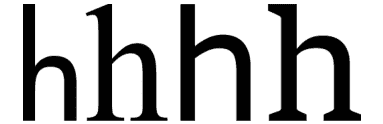

图 2：Futura、Times New Roman、Verdana 和 Sitka 的 x-height 比例对比。所有字体均已缩放至相同的升高线高度。左侧的 Futura x-height 较小，而右侧的 Verdana 和 Sitka x-height 较大。

我们发现，较大的 x-height 存在权衡。虽然较大的尺寸有助于中高线字母，但会损害升部和降部字母。表 1 显示了测试第四轮（标记为 before）中小写字母的识别准确率。中高线字母（acemnorsuvwxz）的正确识别率为 48%，而升部（bdfhikl）和降部（gjpqy）字母的正确识别率分别为 38% 和 33%。

图 3：Sitka 的 after（右侧）版本中，降部特征更长。

发现权衡后，我们尝试在不改变中高线或升部字母高度的情况下，略微增加降部长度（图 3）。这使得中高线字母的准确率从 48% 略微提升至 50%，升部字母从 38% 提升至 39%。降部字母的提升最大，从 33% 提高到 37% 的准确率（表 1）。

最初，为了容纳更长的降部，我们计划增加字体的整体高度，但这会减少连续文本行之间的垂直间距。在后期阶段，我们决定保持字体的整体尺寸不变，这意味着中高线和升部字母的高度将按比例降低。由于延长降部不仅有利于降部字母，出乎意料地也有利于中高线和升部字母，我们曾考虑进一步延长升部和降部，但担心这会以牺牲 x-height 为代价。最终我们放弃了这个想法，因为中高线字母包含英语中出现频率最高的字母。

表 1：Sitka 字体两个版本的字母识别准确率。从 before 到 after 最大的变化是降部变长。

| | 之前 | 之后 | | 之前 | 之后 | | 之前 | 之后 |
|---|---|---|---|---|---|---|---|---|
| a | 56% | 54% | j | 26% | 28% | s | 56% | 59% |
| b | 35% | 33% | k | 43% | 40% | t | 38% | 39% |
| c | 30% | 34% | l | 39% | 41% | u | 54% | 51% |
| d | 26% | 33% | m | 63% | 64% | v | 35% | 36% |
| e | 71% | 75% | n | 36% | 31% | w | 53% | 54% |
| f | 43% | 46% | o | 62% | 59% | x | 36% | 46% |
| g | 35% | 41% | p | 41% | 43% | y | 33% | 41% |
| h | 40% | 41% | q | 31% | 32% | z | 34% | 38% |
| i | 40% | 38% | r | 44% | 45% | 总计 | 42% | 44% |

## 1.5 较大的 x-height 会损害希腊字母

拉丁字母的 x-height 决定了希腊文和西里尔文的 x-height。虽然可以为不同的书写系统选择不同的 x-height，但在同一文档中混合使用书写系统时（例如希腊文与德文，或俄文与英文），保持一致的 x-height 能提升和谐度。

在测试希腊文小写字母时，我们严格遵循为英文测试建立的程序。尽管测试在美国进行，但所有读者均为希腊文的母语使用者和读者。我们将 Sitka 中的希腊字母识别情况与 Georgia 中的希腊字母（图 4）进行了对比，Georgia 是首项研究中最相似的对比字体。与英文测试一样，选取的三字母序列均为希腊语中最常见的组合，但不构成单词。

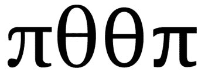

图 4：Georgia 希腊文（左侧）和 Sitka 希腊文（右侧）。x-height 已缩放至相同，以展示 Georgia 中升部字母相对更高的比例。

尽管两种字体的中高线字母正确识别率均为 45%，但表 2 显示，Georgia 在升部和降部字母上的表现均优于 Sitka。升部字母（8b0l）在 Sitka 中的正确识别率为 52%，在 Georgia 中为 62%；降部字母（γημπυ）在 Sitka 中的正确识别率为 40%，在 Georgia 中为 44%。尽管 Georgia 的 x-height 对希腊字母有优势（图 4），但我们选择保留拉丁 x-height，以便在不同书写系统之间实现更好的和谐。如果 Sitka 仅为希腊文设计，或优先为希腊文设计（随后再协调拉丁文和西里尔文），我们本会设计一个更小的 x-height 比例。

表 2：Georgia 和 Sitka 字体中每个希腊字母的识别准确率。降部字母（γημπυ）在 Sitka 中的表现相对较差，不如在 Georgia 中。

| | Georgia | Sitka | | Georgia | Sitka | | Georgia | Sitka |
|---|---|---|---|---|---|---|---|---|
| α | 51% | 48% | ι | 41% | 41% | ρ | 43% | 41% |
| α | 40% | 35% | ι | 38% | 31% | σ | 42% | 40% |
| β | 67% | 61% | κ | 52% | 49% | τ | 45% | 41% |
| γ | 41% | 37% | λ | 57% | 50% | υ | 32% | 32% |
| δ | 66% | 60% | μ | 42% | 37% | ω | 29% | 31% |
| ε | 53% | 49% | ν | 37% | 33% | φ | 53% | 57% |
| ε | 52% | 36% | ξ | 53% | 47% | χ | 56% | 46% |
| ζ | 58% | 49% | ο | 46% | 44% | ψ | 46% | 41% |
| η | 40% | 37% | θ | 41% | 34% | ω | 49% | 55% |
| η | 29% | 28% | χ | 53% | 59% | θ | 40% | 35% |
| ο | 62% | 47% | | | | | | |

## 1.6 整个字母表都应该由字母 m 组成

字母设计中有些方面影响很大，但我们无法控制。第一点本应显而易见，尽管我们在文献中未找到任何明确的相关引用。出现频率较高的字母比出现频率较低的字母更有可能被正确识别。这种词语中的频率效应或许是阅读心理学中最可靠的发现。出现频率高的词语比出现频率低的词语识别得更快。字母似乎也是如此。英文字母的出现频率与我们在研究中记录的准确率之间存在非常强的相关性（r = .58）（表 3）。在 Sitka 中识别效果最好的字母是 e，它也是英语中出现频率远远最高的字母。

表 3：英文字母频率与 Sitka 字母识别准确率相关。

| 频率 | 准确率 | 频率 | 准确率 | 频率 | 准确率 |
|---|---|---|---|---|---|
| e | 12.7% | 74% | d | 4.3% | 42% | p | 1.9% | 49% |
| t | 9.1% | 46% | l | 4.0% | 48% | b | 1.5% | 49% |
| a | 8.2% | 59% | c | 2.8% | 42% | v | 1.0% | 41% |
| o | 7.5% | 66% | u | 2.8% | 61% | k | 0.8% | 44% |
| i | 7.0% | 46% | m | 2.4% | 70% | j | 0.2% | 30% |
| n | 6.7% | 44% | w | 2.4% | 59% | x | 0.2% | 43% |
| s | 6.3% | 62% | f | 2.2% | 47% | q | 0.1% | 36% |
| h | 6.1% | 52% | g | 2.0% | 40% | z | 0.1% | 44% |
| r | 6.0% | 50% | y | 2.0% | 37% | | | |

字母设计中另一个影响很大的方面是字母宽度。宽字母通常比窄字母表现更好。Beier 和 Larson [2010] 研究了一个众所周知的问题：某些窄字母（jilt）非常难以区分。他们发现，将这些字母设计得更宽有助于提高其识别性能。这项研究影响了 Sitka 的设计：窄字母被设计得尽可能宽。即使有这种设计影响，字母宽度与其识别准确率之间仍然存在非常强的相关性（r = .42）（表 4）。我们当然不是第一个认识到窄字母难以识别的人。字母 m 是 Sitka 中识别效果第二好的字母，也是最宽的小写字母。

为研究窄字母的问题，我们不仅查看了准确率，还查看了具体的误识别情况。图 5 是一个复杂的可视化，但包含大量有趣的数据。前四列显示了字母 f 的误识别情况。第一列是孤立显示时的字母 f，第二、第三和第四列是针对字母 f

当被 aft、efo 和 ife 包围时。当字母 f 单独呈现或与 efo 包围时，没有出现误识别。当 f 被 aft 包围时，它经常被误认为是字母 k，（可视化为 ¼ 个圆）。当 f 被 ife 包围时，它非常频繁地（整个圆）被误认为是字母 k，有时（1/4 圆）被误认为是字母 h。接下来的 16 列显示了针对字母 i、j、l 和 t 的同类可视化。

Table 4: 每个 Sikka 字母在设计单位中的宽度与字母识别准确率相关。

| | 宽度 | 准确率 | | 宽度 | 准确率 | | 宽度 | 准确率 |
|---|---|---|---|---|---|---|---|---|
| m | 1737 | 70% | k | 1034 | 44% | c | 854 | 42% |
| w | 1542 | 59% | o | 1030 | 66% | s | 831 | 62% |
| n | 1149 | 44% | g | 1020 | 40% | r | 830 | 50% |
| h | 1128 | 52% | x | 998 | 43% | t | 659 | 46% |
| u | 1120 | 61% | v | 993 | 41% | f | 623 | 47% |
| p | 1096 | 49% | y | 971 | 37% | i | 537 | 46% |
| d | 1085 | 42% | a | 964 | 59% | j | 524 | 30% |
| b | 1065 | 49% | e | 924 | 74% | l | 520 | 48% |
| q | 1065 | 36% | z | 883 | 44% | | | |

字母 f 最容易被误认为字母 k，但仅在被其他字母包围时才会发生。字母 i 容易被误认为 l 和 j，但仅在单独呈现时才会发生。字母 j 在被其他字母包围时更容易被误识别，并且会被误认为 f 和 t，以及更令人惊讶的 g 和 h。字母 l 在被其他字母包围时，更容易被误认为其他上伸字母 h 和 k。字母 t 在被其他字母包围时，强烈地被误认为字母 k。窄字母在被包围时常被误认为宽字母，这是一个非常有趣的发现。它表明相邻字母之间存在相互作用，并且这些相互作用需要更详细地考虑。

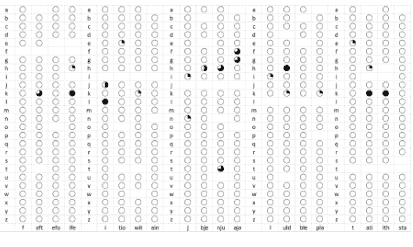

图 5：研究 4 中窄字母的误识别。

## 1.7 字母在其他字母旁边时更难识别

大多数单词包含多个字母。这大大增加了字母识别准确率测量的复杂性。一百多年前就发现，当字母作为单词的一部分快速呈现时，其识别准确率高于单独呈现时。单词优越效应源于我们对语言的自上而下的知识，关于字体设计的自下而上的特性，它告诉我们的很少 [Larson, 2004]。这种效应与最近发现的字母优越效应形成对比。当字母识别受大小限制而非时间限制时，单词中的字母需要比单独呈现的字母大 10-20% 才能达到相同的准确率 [Sheedy et al., 2005]。

我们通过在常见字母序列（非完整单词）的上下文中测试每个字母，并补充测试每个字母的单独呈现，来避免单词优越效应。在没有单词的情况下，我们的数据更类似于字母优越效应。平均而言，单独呈现的字母识别正确率为 58%，而字母序列上下文中的字母识别正确率为 45%。

虽然单独呈现的字母识别更准确，但通常在单独呈现时表现更好的字母设计，在存在包围字母时也表现更好。在一项将更开放的设计与更封闭的设计进行比较的研究中，哪种设计在单独呈现和存在包围字母时表现最好之间存在差异。

图 6：更开放的字母（左侧）在被其他字母包围时表现更好，而更封闭的字母（右侧）在单独呈现时表现更好。

图 6 左侧显示了更开放的设计，其中每个字母内部与外部之间的开口更大；右侧显示了更封闭的设计，其中每个字母内部与外部之间的开口更小。更封闭的设计在字母单独呈现时表现更好，而更开放的设计在字母被包围时表现更好。因为在单词中识别字母要常见得多，我们选择朝着更开放的设计而非更封闭的设计发展。

当带有包围字母的字母发生误识别时，超过 26% 的误识别针对左侧的包围字母，而只有 10% 针对右侧的包围字母。我们推测，左侧包围字母更有可能被报告，这是因为我们测试的书写系统的阅读方向是从左到右，但我们需要确认在从右到左的语言中是否会出现相反情况，才能对该结论有信心。

由于包围字母时频繁发生误识别，我们考虑可以采取什么措施来减少这些混淆。Perea 和 Gomez [2012] 表明，在连续阅读中，字母间距更大时单词注视时间更快。在多次设计迭代中，我们增加了字母间距以减少包围字母的混淆，但仅取得了适度的成功。我们对这一想法的应用有所限制，因为如果字母之间的空间太大，单词就会分崩离析。

## 1.8 大尺寸特定设计针对优雅性进行了优化（Berlow-Hudson 假设）

历史上，字体为大尺寸和小尺寸设计得不同。这有时被称为光学缩放或尺寸特定设计。为小尺寸设计的字体将具有更高的 x-高度、更宽的字母、粗细笔画之间较小的差异，以及比为大尺寸设计的字体更宽的间距。在金属活字中，每种尺寸都必须单独制作。在数字字体中，同一个字母可以以任何尺寸显示。数字字体制作的优势在于为每个字母设计单一版本的便捷性和速度，但失去了尺寸特定的调整。Sikka 是几十种具有针对不同输出尺寸优化的不同轮廓的数字字体之一 [Ahrens and Mugikura, 2013]。

在本项目的可读性测试方面，我们将注意力集中在 Sikka Small 尺寸上，因为我们认为其优化对可读性影响最大。与 Harry Carter [1937/1984] 的观点一致，我们认为较大尺寸是为优雅性和视觉趣味性而优化的：‘在超过 18 磅的字号上，缩短下伸和上伸笔画是不可原谅的。缩小小字号的字尾以提高可读性，并在同一字体的显示尺寸中拉长它们以追求优雅，这是完全合理的。’ David Berlow（私人交谈）可疑地提出，John Hudson（私人交谈）后来采纳的另一种假设声称，较大尺寸的尺寸特定调整实际上是针对较大文本的可读性优化。

为了测试哪种假设正确，我们使用了相同的字母识别方法，但由于典型的阅读情境对假设更为重要，我们将研究中的测试距离缩短到非常典型的 50 厘米距离。我们分别测试了小尺寸和大尺寸特定调整，即 Sikka Small 和 Sikka Banner（图 7），每种在两种物理尺寸下进行测试，即 9 磅和 36 磅。我们没有控制 x-高度，因为 x-高度差异是我们测试的关键变量之一，是尺寸特定调整的基本要素。在测试的试点阶段，我们发现不能对两种尺寸使用相同的呈现时间。36 磅字母比 9 磅字母更容易识别，因此使用了两种不同的校准时间。如果较大尺寸特定设计针对可读性进行了优化，那么我们预期 Sikka Small 在 9 磅时表现更好，并预期 Sikka Banner 在 36 磅时表现更好。如果较大尺寸特定设计针对优雅性进行了优化，那么我们预期 Sikka Small 在 9 磅和 36 磅时都表现更好。

Sikka Small 在 9 磅和 36 磅时均优于 Sikka Banner。9 磅时，Sikka Small 的准确率为 48%，Sikka Banner 为 39%。36 磅时，Sikka Small 的准确率为 56%，Sikka Banner 为 49%。Sikka Small 的优势在统计上是可靠的，F=29.3，

p=.0001，且每位研究参与者以及 26 个字母中的 25 个都观察到了这种情况。由于我们重新校准了呈现时间以更快地呈现 36 磅尺寸，因此尺寸之间的差异无法公平比较。即使在更快的速度下，Sitka Small 和 Sitka Banner 在 36 磅下的准确率也更高。如果我们忽略重新校准并无论如何运行统计检验，我们会发现尺寸差异是可靠的，F=7.0，p=.02，并且尺寸和字体之间没有交互作用，F=2，p=.66。

这强烈表明，为大尺寸所做的尺寸特定调整并不能提高大号文本的可读性。如果我们希望在大尺寸下提高可读性，最好使用小尺寸特定设计。如果我们的目标是某种程度的优雅或个性，那么大尺寸特定设计是合适的。

敏捷的棕色狐狸跳过懒惰的狗
敏捷的棕色狐狸跳过懒惰的狗
敏捷的棕色狐狸跳过懒惰的狗
敏捷的棕色狐狸跳过懒惰的狗
敏捷的棕色狐狸跳过懒惰的狗
敏捷的棕色狐狸跳过懒惰的狗
敏捷的棕色狐狸跳过懒惰的狗

图 7：Sitka 中的尺寸特定调整：Sitka Banner、Sitka Display、Sitka Heading、Sitka Subheading、Sitka Text 和 Sitka Small。

## 1.9 字体是一组优美的字母，而不是一组优美字母的集合

项目开始时，我们分析了大量关于制作易读字母的现有研究。我们深受 Sheedy、Tai、Hayes 和 Preston [2006] 关于十几种顶级字体中单个字母可读性的研究影响。测量了每个字母的距离阈值，这让我们了解了截然不同风格的字体的相对可读性。这项研究的一个发现是，对某个字母表现最好的字体不一定对另一个字母也表现最好。每个字母都是独特的设计。例如，字体 Centaur 的字母 s 表现最好，而 Verdana 的字母 a 表现最好，DIN 的字母 m 表现最好（图 8）。

有人可能会提出一种极端的观点，即通过将表现最好的字母组合在一起来创建一种新的“弗兰肯字体”。在整个项目中，我们一直意识到我们想要创建的是一种字体，而不是一组字母。我们利用早期的研究和自己的测试作为灵感，为每个字母设计特征，以在连贯设计的字体中提高其可读性。

深思熟虑的设计的一个例子来自对端笔的研究。我们测量了带有泪滴形端笔和扩张形端笔的字体性能，发现使用扩张形端笔时，字母 c、f 和 j 的平均表现提升了 6%，而字母 a 使用泪滴形端笔时表现略好（图 9）。我们本可以决定对 c、f 和 j 使用扩张形端笔，而对 a 使用泪滴形端笔。这种不一致性会重部分而轻整体，导致得到的是一组字母而不是一种字体。我们决定在整个设计中使用扩张形端笔。

图 8：Centaur s、Verdana a 和 DIN m 的弗兰肯字体。

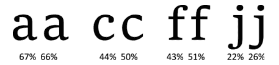

图 9：带有泪滴形端笔（左）和扩张形端笔（右）的四个字母的识别准确率。

## 1.10 除了测试结果之外，还可能存在其他考量

可读性研究的目的是提供有用的数据以影响设计，而不是机械地确定设计。一个例子来自前面提到的希腊研究，其中母语为希腊的读者比较了 Georgia 和 Sitka 之间的字母识别情况。我们测试了所有基本字母，以及现代单调制希腊语中可以带有 tonos 符号的七个元音。在研究之前，我们曾听到希腊字体设计专家和希腊读者的反馈，称 Georgia 中的 tonos 符号设计特别糟糕。对于 Sitka，我们设计了一个 tonos 符号，专家表示这是一种更好、更传统的角形。我们预期角形设计会比直立 tonos 符号表现更好。

Georgia 和 Sitka 在未加符号元音的字母识别方面非常相似。45% 的测试用例在 Georgia 中被正确识别，44% 在 Sitka 中被正确识别。然而，有趣的比较在于添加 tonos 符号后准确率的变化。当将直立 tonos 符号添加到 Georgia 元音时，识别准确率从 45% 略微下降到 44%。但当将角形 tonos 符号添加到 Sitka 元音时，识别准确率从 44% 正确大幅下降到 33% 正确（图 10）。

结果表明，希腊读者识别直立的 Georgia tonos 符号比识别 Sitka 中的角形 tonos 符号更成功。这使我们面临一个抉择：是将 Sitka tonos 符号改为更易读的直立设计，还是出于对当代希腊正字法专家建议的尊重，保留较难读的角形 tonos 符号。在此情况下，我们决定遵循专家和读者的意见更为重要。

## 1.11 结论

在开发 Sitka 字体系列时采用的这种新颖协作流程运作良好，参与者（设计师在一方，科学家在另一方）意见高度一致。从未发生过设计师制作出科学家称无法测试的东西，或者科学家得出设计师称无法使用的结果。该过程始终是参与者之间讨论和解释的问题，参与者彼此对对方的能力充满信心。

一些测试结果是预料之中的，例如窄字母固有的问题。在这种情况下，我们的发现往往会加强早期研究者的结论或建议。其推论，即小写 m 是一个优秀的字母，或许尚未得到充分确立，而语言中最常用字母的卓越可读性似乎是一个发现，即使不是非常令人惊讶的发现。尽管我们尽了最大努力，拉丁字母表中的某些问题依然难以解决；f 的拉伸宽度或下伸部的延长长度都有实际限制，试图说服语言完全放弃变音符号是一项徒劳的任务。

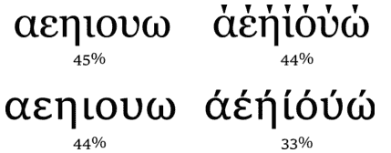

图 10：Georgia（上）和 Sitka（下）元音带有（右）和不带（左）tonos 符号的识别准确率。

尽管字体设计师永远无法解决这些问题，但理解其背后的原因并在可能的范围内加以缓解非常重要。

所有参与该项目的人都认为，完成并发布的 Sitka 在可读性方面有了显著改进。我们还认为，设计在开发过程中有了巨大的提升。遗憾的是，我们并未证明这些改进能带来统计上可靠的阅读速度提升。我们从这个项目中学到了很多，但必须指出，关于字体可读性及其测量的许多方面尚未被完全理解。

## 致谢

Sitka 的设计和开发是一项团队工作。如果没有 Geraldine Wade 和 Michael Duggan（分别是项目开始和结束阶段的宝贵项目负责人），这项工作无法完成。我们要感谢 Microsoft Advanced Reading Technologies 的其他成员 Greg Hitchcock、Paul Linnerud、Tanya Matskevich 和 Rob McKaughan，感谢他们分析研究结果并做出了诸多贡献；感谢 Microsoft Typography 团队的合作伙伴 Simon Daniels 和 Ali Basit；感谢 Kris Keerle 和 Libby Hanna 在研究实施方面的帮助；感谢 John Hudson 和 Ross Mills 在字体母版制作方面的帮助；感谢 Gerry Leonidas 为

为希腊语设计和希腊语研究提供咨询，并感谢斯蒂文·西诺夫斯基（Steven Sinofsky）为项目提供资助。Sitka 字体献给比尔·希尔（Bill Hill）的纪念。比尔对阅读 2.0 的热情与愿景在这款字体中延续。

## 参考文献

- Ahrens, T. and Mugikura, S. (2013). 字体设计的尺寸特定调整. (Just Another Foundry).
- Beier, S. (2012). 阅读字母：为可读性而设计. (BIS Publishers).
- Beier, S. and Dyson, M.C. (2014). 衬线对 'h' 和 'i' 的影响：源于设计主导的科学研究的有用知识. Visible Language, 47(3), pp. 74–95.
- Beier, S. and Larson, K. (2010). 常被误认字母的设计改进. Information Design Journal, 18(2), pp. 118–137.
- Carter, H. (1984). 铸字中的光学尺寸. Printing Historical Society Bulletin, 13, 144–148. 转载自 Carter, H. (1937). 铸字中的光学尺寸. Typography, 4.
- Legge, G.E. and Bigelow, C.A. (2011). 印刷尺寸对阅读是否重要？来自视觉科学和排版学的研究综述. Journal of Vision, 11(5), pp. 1–22.
- Larson, K. (2004). 单词识别的科学，或我如何学会不再担忧并热爱字形. http://microsoft.com/typography/ctfonts/wordrecognition.aspx
- Perea, M. and Gomez, P. (2012). 字母间距的微小增加有助于正常阅读期间单词的编码. PLoS ONE 7(10): e47568.
- Rayner, K., Pollatsek, A., Ashby, J. and Clifton, C. (2012). 阅读心理学. 第二版, (Psychology Press).
- Roethlein, B.E. (1912). 不同印刷字体的相对可读性. American Journal of Psychology, 23(1), pp. 1–36.
- Sheedy, J.E., Subbaram, M.V., Zimmerman, A.B., and Hayes, J.R. (2005). 文本可读性与字母优越性效应. Human Factors, 47(4), pp. 797–815.
- Sheedy, J.E., Tai, Y.-C., and Hayes, J.R. (2006). 单个字符的可读性. http://www.pacificu.edu/sites/default/files/documents/Individualcharacter-legibility.pdf

# 第4章

# 眼动：从心理语言学到字体设计

蒂莫西·J·斯拉特里

过去40年来，通过对阅读过程中记录的眼动进行考察，阅读研究取得了长足进步。尽管阅读研究者将眼动记录作为一种方法论取得了进展，但这项研究在文本向读者呈现的方式上仅带来了相对较少的进步。这并非说文本显示在此期间没有经历显著改进，只是这些改进并非由眼动研究推动。考虑到眼动与语言处理的所有方面之间存在明显联系，这种脱节尤为引人关注。本文将讨论眼动在心理研究与字体设计之间应用的可能性。此外，在回顾眼动研究结果的过程中，还将探讨当前与潜在字体设计问题相重叠的心理语言学研究趋势。

## 1.1 引言

或许没有哪种实验方法论比眼动追踪更能揭示阅读过程——或为持续进步提供更多希望——了。本章致力于将眼动追踪作为研究阅读的方法论，重点探讨该方法论如何有助于指导字体设计各方面的决策。

眼动是视网膜生理学的必然产物。分辨精细细节的能力仅限于视网膜的一个小中央区域——凹窝。粗略地说，凹窝占据了我们视野的中央两度。在正常阅读距离下，只有6或7个字母会落在凹窝内。这意味着，对于特别长的单词，至少部分字母会落入凹窝邻近的区域，即近凹区。我们的视敏度，因此也就我们辨认字母身份的能力，会随着离凹窝的偏心度增加而降低 [Bouma, 1970; Klein, Berry, Briand, D'Entremont and Farmer, 1990]。因此，阅读时我们必须移动眼睛，以便将想要识别的单词图像放置在凹窝上或附近，从而实现高效处理。

## 1.2 阅读眼动的特征

尽管我们在阅读时视线在页面上平滑移动的错觉，但阅读眼动由一系列跳跃眼动组成，中间穿插短暂停顿（固定）。任何人拿着一页文本和一个打孔器都能轻易看到眼睛这种抖动的外观。只需在页面上打个洞，找一位愿意的朋友阅读文本，而你则透过洞观察他们的眼睛。事实上，最近的研究证实，即使在文本移动——或滚动的情况下，我们的眼睛也会在单词之间进行跳跃眼动 [Valsecchi, Gegenfurtner, and Schütz, 2013]。

英语中典型跳跃眼动的大小约为7-9个字符 [Rayner, 2009]。然而，阅读跳跃眼动的长度存在高度变异性。此外，阅读跳跃眼动的长度更多由语言输入的约束（字母数量）决定，而非视觉系统的约束（视角度数）[Morrison and Rayner, 1981]。例如，中文读者的眼睛移动跳跃眼动远小于英语读者（2-3个字符）。然而，在中文中，二字词是常态，由4个或更多字符组成的词很少见。因此，中文阅读需要更小的跳跃眼动，以防止眼睛超越大脑的语言理解系统。跳跃眼动长度也对文本的空间范围高度敏感，眼动系统能够快速适应排版环境 [Slattery and Rayner, 2010]。因此，当按视角度数测量时，一种需要更长跳跃眼动才能在单词间移动的宽字体，其平均跳跃眼动长度将比窄字体更长，即使遍历的字母数量大致相同。

跳跃眼动被视为一种弹道性眼动，会从一个位置“发射”到下一个位置。跳跃眼动的目标定位程序 a) 需要时间，且 b) 容易出错。规划并启动向新位置进行跳跃眼动所需的时间估计约为150-200毫秒 [Becker and Jürgens, 1979; Rayner, Slowiaczek, Clifton, and Bertera, 1983]。跳跃眼动涉及的误差被假设由两个部分组成：跳跃范围误差和随机误差 [McConkie, Kerr, Reddix, and Zola, 1988]。跳跃范围误差是指这样的发现：长跳跃眼动往往会低于其预期目标，而短跳跃眼动往往会超过其预期目标，对于某个理想化的跳跃眼动长度（例如6-7个字符），跳跃范围误差为零。跳跃眼动误差的随机成分被假设均值为零，其标准差是跳跃眼动长度的函数，较长跳跃眼动的标准差大于较短跳跃眼动。

对单词的首次跳跃眼动往往将眼睛置于单词中心左侧一点的位置——即首选观察位置 [Rayner, 1979]。然而，单词内固定位置存在相当大的变异性。事实上，单词内固定位置的分布在单词边界处重叠。因此，单词（n）开头的一些固定实际上可能是针对前一个单词（n-1）的，而单词（n）结尾的一些固定实际上是针对单词（n+1）的。这些错误的固定被称为误位固定 [Nuthmann, Engbert, and Kliegl, 2005; Drieghe, Rayner, and Pollatsek, 2008; Engbert and Nuthmann, 2008]。

跳跃眼动的另一个重要特性是，在跳跃眼动期间通常不会编码新的视觉信息。因此，在跳跃眼动期间我们实际上是“盲”的——这种效应被称为跳跃抑制 [Matin, 1974]。我们的大脑在跳跃眼动期间抑制视网膜上接收到的视觉信息，这符合直觉，因为这些信息几乎只是一片模糊。事实上，跳跃抑制会延续到跳跃眼动结束之后，因为在固定开始时视觉仍会受到一定程度的抑制 [Bremmer, Kubischik, Hoffmann, and Krekelberg, 2009; Slattery, Angele and Rayner, 2011]。

对于英语，从左向右移动的阅读跳跃眼动被归类为“前向跳跃眼动”，而从右向左移动的通常被称为“逆向跳跃眼动”。估计在正常阅读中，约10-15%的眼动是逆向的，不过在阅读困难的情况或初学者阅读时，这一比例可能更高 [Rayner, 1998, 2009]。将眼睛从一行文本移动到另一行文本的跳跃眼动被称为回扫，不被视为逆向跳跃眼动。回扫是正常阅读的重要组成部分，而跳跃眼动误差可能导致暂时的阅读困难。毫无疑问，你在阅读时偶尔会将回扫移到错误的文本行上。从这类眼动错误中恢复可能很耗时。基于此，遵循 Bouma [1980] 的基本建议似乎是合适的，即根据行长调整行间距，以使正确回扫的角度不至于太小。

## 1.3 处理过程中的眼动测量

处理时间的主要测量指标是注视时长。虽然可读性效应（即单词中字母编码的难易程度）应该影响眼注视的持续时间，但很明显，这些持续时间在很大程度上受到被注视单词的词汇处理难度的影响 [Rayner, 1998, 2009]。例如，读者注视高频词的时间比低频词少 [Rayner, 1998, 2009]。词频效应已得到充分验证，其重复次数之多，堪比星际迷航号上的伯爵茶。

处理时间的一个明显测量指标是文本段落的平均注视时长。虽然这可能很有信息量，但如果单独呈现，也可能具有误导性，因为段落阅读由高度可变数量的注视组成。因此，在比较两种字体时，平均注视时长的减少可能会被注视次数的增加所抵消。在这种情况下，每种效应的相对大小将决定对整体处理指标（如总阅读时间或阅读速度）的影响。

记录眼动相比仅测量阅读时间具有优势，因为研究人员可以检查段落中特定感兴趣区域（ROI）内的眼动行为。对于阅读，ROI通常是单个单词单位，标准定义为单词及其前面的空格 [Rayner, 1998]。这一标准使得不同研究之间单词处理指标的比较变得容易得多。然而，较大的ROI也可能有用。例如，带有特定排版元素（例如斜体）的短语可用于研究这些元素的变化如何影响眼睛的自然运动。或者，在网页开发中，ROI可以是特定的广告或超链接 [Fitzsimmons, Weal and Drieghe, 2014]。

眼动跟踪的另一个好处是它提供了一系列连续的处理时间指标 [Rayner, 1998]。例如，词频效应在单词处理过程中非常早就出现，低频词引起的首次注视时长比高频词更长。然而，交替大小写效应首先出现在注视持续时间中 [Reingold, Yang, and Rayner, 2010]，后者将首次注视时长与所有紧随其后的重新注视时长相加。首次注视和注视持续时间都被视为早期单词处理的指标，而像第二遍时间（所有重读注视的总和）这样的指标则反映与理解难度相关的后期过程，例如单词误读 [Slattery, 2009] 和歧义消解 [Frazier and Rayner, 1982; Ferreira and Henderson, 1991; Slattery, Sturt, Christianson, Yoshida, and Ferreira, 2013]。眨眼通常被视为干扰变量，因为它们是数据丢失的主要来源。当眼睛闭合时，我们不知道它的行为如何。出于这个原因，眼动研究中的参与者通常被指示在段落阅读期间尽量减少眨眼，而是在每次阅读试验前后立即眨眼。当阅读段落只有一句话长时，这种策略非常有效。然而，对于段落来说，眨眼将是数据记录中不可避免的一部分。对于排版研究来说，这可能不是大问题。也就是说，眨眼也是一种潜在有用的眼疲劳测量指标 [Stern, Boyer, and Schroeder, 1994]。由于眨眼总数会随阅读段落所需时间的增加而增加，因此研究排版效应的适当指标将是眨眼率（每分钟眨眼次数）。Slattery 和 Rayner [2010] 在他们对微软使用的 ClearType 抗锯齿的研究中包含了眨眼率的分析。他们表明，抗锯齿的好处（就阅读速度而言）并未伴随眼疲劳的任何增加（由眨眼率测量）。随着从屏幕阅读的增加，评估屏幕技术变化的需求可能使眨眼率成为更重要的指标。

## 1.4 视线依赖的眼动方法

通过监测人们阅读静态文本段落时的眼动，我们已经了解了阅读过程中涉及的大量过程。在这些研究中，文本会事先精心构建，以考察变量（例如词频、句法结构、上下文约束）如何影响眼动。然而，使用眼动跟踪，研究人员可以做更多事情。例如，可以根据读者的注视位置更改屏幕上呈现的内容。虽然视线依赖显示变化可用的操作范围似乎无穷无尽，但我将讨论三种可能在排版研究中有价值的技术。

### 1.4.1 移动窗口

移动窗口范式 [McConkie and Rayner, 1975; Rayner and Bertera, 1979] 以一种方式向读者呈现文本，即可读“窗口”之外的字母被遮蔽字母替换。这个可读窗口与注视点绑定，因此随着眼睛在文本中移动（参见图 1）。在使用移动窗口范式的研究中，研究人员操纵窗口的大小以及窗口外保留的信息类型。例如，在图 1 所示的示例中，单词边界信息（单词间空格）在可读窗口之外仍然存在，但字母身份已被字母“x”遮蔽。* 使用移动窗口技术，研究人员探索了知觉跨度（即围绕注视点可从中获取阅读有用信息的区域）。这些研究发现，阅读英语的知觉跨度是不对称的，向注视点左侧延伸 3–4 个字母空间，向右侧延伸 14–15 个字母空间 [McConkie and Rayner, 1975; McConkie and Rayner, 1976; Rayner and Bertera, 1979; Rayner, Well, and Pollatsek, 1980; Rayner, Well, Pollatsek, and Bertera, 1982; Underwood and McConkie, 1985; Underwood and Zola, 1986]。知觉跨度的大小和不对称性取决于语言特征。在中文中它更小 [Chan and Tang, 1988; Inhoff and Lui, 1998]，而不对称性在希伯来语中是反转的 [Pollatsek, Bolozky, Well, and Rayner, 1981]。此外，知觉跨度不延伸到即将到来的文本行 [Inhoff and Briihl, 1991; Inhoff and Topolski, 1992; Pollatsek, Raney, LaGasse, and Rayner, 1993]。最后，知觉跨度不是固定属性；对于初学者读者相比熟练读者 [Rayner, 1986]、对于年长读者相比年轻读者 [Rayner, Castelhano, and Yang, 2009] 以及对于慢读者相比快读者 [Rayner, Slattery, and Bélanger, 2010]，它都更小。使用移动窗口技术，研究人员可以通过改变该元素可用的窗口大小来探索排版元素的有用程度。例如，移动窗口内衬线的存在会增加还是减少知觉跨度？

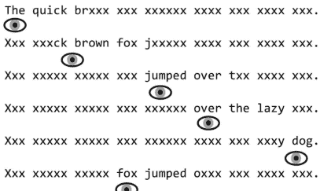

图 1：移动窗口示意图。

### 1.4.2 边界变化

边界变化范式仅在眼睛穿过不可见边界后才启动文本更改（参见图 2）。该边界通常放置在感兴趣单词前的单词间空格之前。更改前区域的文本称为预览，更改后的文本称为目标。然后，研究人员比较不同预览条件下感兴趣单词的阅读时间指标。在图 2 中，预览和目标有不同的字母，但保持相同的元音辅音结构和基本单词形状。与各种非相同预览条件相比，具有相同预览的好处通常在 30-50 毫秒的量级 [Rayner, 1998, 2009]。

大多数利用边界变化的研究旨在揭示在周边视觉中可处理的单词的表征结构 [有关综述见 Schotter, Angele, and Rayner, 2012]，并且可能难以看出它与排版的关系。然而，有一种边界变化效应对字体设计具有特殊意义，因为它与单词形状有关。最近的一项眼动研究表明，单词的上半部分比下半部分对阅读更重要 [Perea, 2012]，这可能

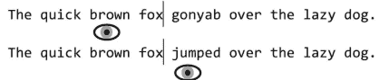

图 2：边界变化示意图。图中的垂直线仅用于说明，在此类研究中读者无法看到。

这可能是由单词形状信息所致。然而，字母转位效应提供了强有力的证据，反驳了单词仅通过其轮廓形状而非其组成字母来识别的观点 [另见 Perea and Rosa, 2002]。单词启动研究还表明，转位字母非词比替换字母非词更能作为单词的启动词。因此，‘judge’ 对单词 ‘judge’ 的启动作用优于 ‘judpe’ [Perea and Lupker, 2003]。最近的边界变化实验证实，在正常阅读中，转位字母非词提供的预览益处效果大于替换字母非词 [Johnson, Perea, and Rayner, 2007]，并且无论转位是否保持单词形状（crown, cornw）或不保持（clerck, cerlk），效果均相同。如果单词形状比字母身份更重要，情况就不会是这样。其他研究表明，阅读要求单词中的单个字母必须能够被个别区分 [Pelli, Farrell, and Moore, 2003; Pelli, Tillman, Freeman, Su, Berger, and Majaj, 2007]。

边界变化实验揭示的另一个重要效应（与该技术更广泛的应用相关）涉及‘中央视加载’。读者能完成的旁视预处理量与中央视处理相关的难度成反比 [Henderson and Ferreira, 1990]。也就是说，对当前注视单词的处理困难会导致注意力资源集中于中央视而远离旁视——从而缩小知觉跨度。因此，当文本因低频词或困难的语义整合而尤其困难时，读者从即将出现的单词中获得的有用信息会减少。一个未解决的问题是，困难的字体是否会导致中央视加载增加。

### 1.4.3 消失文本

移动窗口和边界变化技术都试图在跳跃期间实现显示变化，以利用跳跃抑制。当执行得当时，受试者几乎或根本意识不到发生了什么 [但参见 Slattery, Angele, and Rayner 2011]。然而，其他显示变化技术并不试图隐藏其存在，并在注视期间发起变化。消失文本方法 [Rayner, Liversedge, White, and Vergilino-Perez, 2003] 属于此类显示变化。它涉及在单词被注视后不同时间将其从视野中移除。单词只有在眼睛移动到另一个单词后才会重新出现。令人惊讶的是，与正常阅读相比，当单词在注视后仅 60 毫秒消失时，文本可以在没有太多干扰的情况下阅读。此外，读者对单词的注视时长仍受单词频率的影响。也就是说，读者继续注视低频单词消失后留下的空白区域的时间，比他们注视高频单词消失后留下的空白区域的时间更长 [Blythe, Liversedge, Joseph, White, and Rayner, 2009; Rayner et al., 2003; Rayner, Liversedge, and White, 2006]。

虽然 Rayner et al. (2003) 仅使用了 60 毫秒的消失时机，但更近期的研究考察了消失文本对儿童 [Blythe et al., 2009] 和老年读者 [Rayner, Yang, Castelhano, and Liversedge, 2011] 的影响，并使用了一系列时机。Blythe et al. [2009] 发现，即使是测试中最短的时机——40 毫秒——消失的文本也只会对儿童造成一定程度的干扰。相比之下，Rayner et al. [2011] 报告称，老年读者（65 岁以上）受消失文本操纵的干扰远大于大学年龄段的读者。然而，测试的时机仅包括 60、50 和 40 毫秒。在更长的延迟下，老年读者经历的干扰可能已被显著最小化。

消失文本技术有几个方面可能使其适合调查与字体设计相关的排版因素。首先，假设消失的时机会影响单词的初始视觉编码。只要文本呈现的时间足以进行视觉编码，阅读就可以正常进行。如果字体在编码难易程度上存在差异，研究人员应该能够调整持续时间，以确定不同字体的时机特征。此外，消失文本操纵已被证明对读者的个体差异（即年龄）敏感，因此可能有助于确定在不同年龄最大化可读性最重要的字体相关因素。

这三种注视依赖的显示变化方法只是冰山一角。这种通用方法还有许多其他示例，已产生了巨大的洞察 [例如：快速启动：Sereno and Rayner, 1992]，并且新用途经常出现。这些技术为富有创造力的排版研究人员提供了丰富的选择，这些选择在字体特征和页面布局的调查中仍大多未被开发。

## 1.5 字体排版的眼动研究

考虑到眼动追踪在阐明与阅读相关的认知过程方面取得了巨大成功 [Rayner, 1998, 2009]，很少有眼动研究旨在考察排版的各个方面，这或许令人惊讶。在撰写本文时，使用‘eye movements’和‘reading’作为搜索词的 Google Scholar 搜索产生了约 124,000 个命中结果。添加搜索词‘typography’将该数字减少到 964 个命中——不到总数的 1%。

既然有这么多关于读者如何移动眼睛的研究，为什么如此少的研究关注排版的影响？当然，导致排版眼动研究稀缺的因素有很多，例如眼动仪的成本以及收集和分析眼动数据所需的专业知识。此外，字体设计中的相关变量可能高度相互依赖。例如，在排版文本时，Bouma [1980] 认为，较长的行长需要额外的行间距，以避免浅角度回扫的问题。这并不排除对这些变量 [Tinker, 1963] 及其潜在交互作用的科学研究，但它确实使研究变得更加复杂和费力。鉴于这种额外的难度，许多早期的排版研究人员没有迎接获取收集昂贵眼动数据所需专业知识的额外挑战，这并不令人惊讶。

那么，研究阅读期间眼动的心理语言学家为什么对排版的影响更感兴趣呢？在我早年 2000 年代做研究生时，似乎存在一种普遍的看法：只要文本以合理的方式呈现，读者的眼动更多由语言的特征决定，而非排版呈现的差异。伴随这一信念的是一种默认假设，即与排版相关的任何差异都只会表现为主效应，而不会与语言变量交互作用。因此，Times New Roman 可能比 Arial 阅读得更快 [英语]，但这种差异对所有单词和句子都相同。由于心理语言学家关注单词和句子的处理，只要排版在研究中保持不变，忽略排版似乎是一个安全且简化的假设。这一假设也得到了一项早期利用显示变化的研究的实证支持。McConkie 和 Zola [1979] 以 ALtErNaTiNg CaSe 呈现文本段落，然后在特定的跳跃时切换大小写交替（ALTeRnAtInG cAsE）。惊人的发现是，大小写切换后的注视时长并不比未切换的注视时长更长。作者得出结论，读者在一次注视到下一次注视之间整合抽象字母身份（其中 'A' 和 'a' 是相同的）。如果字母大小写的变化没有增加注视时长，那么很难想象字体的相对较小变化会影响此类时长。然而，如你所料，阅读大小写交替文本比阅读全小写或全大写文本更费力 [Rayner, McConkie, and Zola, 1980; Juhasz, Liversedge, White, and Rayner, 2006; Reingold, Yang, and Rayner, 2010]。大小写交替可能会干扰正常的单词识别过程 [Coltheart and Freeman, 1974]，而在更正常的情况下，字体的变化可能会影响注视时长。此外，中央视加载假设预测，处理以 ALtErNaTiNg CaSe 写成的单词所带来的额外中央视困难会导致对即将出现的单词的旁视处理减少。这可能解释了为什么 McConkie 和 Zola [1979] 未能在其大小写切换和非切换条件之间发现显著差异。尽管如此，似乎很少有心理语言学家有兴趣考察排版的作用。

## 1.6 Fonts

It may be surprising to learn that the most prevalent font family used in eye movement studies of reading is Courier. This has far less to do with Courier's legibility, and far more to do with its fixed width characteristic. In a fixed width font, every letter occupies the same amount of horizontal space. This property has a number of benefits in the eyes of psycholinguists. First, with a fixed width font controlling the number of letters in target words also controls their physical size. Additionally, fixed width fonts make it easy to implement display changes in moving window and boundary change studies. These experiments would be far more complicated if the letters in the mask or preview were a different size than those in the target. Initiating such changes is possible but would result in perceived changes in the length of the line of text unless the size of the mask or preview letters were made to fit those of the target letters. Rayner, Slattery, and Belanger [2010] conducted such a moving window experiment using both the fixed width font Consolas and the proportional width font Georgia for texts. In order to create the masks needed for the moving window with Georgia, the space between the letters of the mask were adjusted so that the size of the mask would exactly equal the size of the target word that would replace it. They found no significant differences in the size of the perceptual span for the different fonts. Despite similar reading rates for the two fonts across the different window size conditions, there were significant differences in fixation durations and the number of fixations required for reading. The average fixation duration was longer for Georgia, while Consolas required more forward and regressive fixations for reading. The forward saccade differences were due to shorter saccades (measured in characters) for Consolas than for Georgia. In interpreting these differences it is important to note that Georgia has a higher character density than Consolas. So in this study, the higher density font led to longer fixation durations but fewer fixations overall compared to the lower density font. The same pattern of effects with respect to density was reported by Kolers, Duchnicky, and Ferguson [1981] – higher density text led to fewer but longer fixations.

While fixed width fonts like Courier and Consolas are preferred by psycholinguists, there are plenty of eye movement studies that use proportional width fonts like Arial and Times New Roman. However, few eye movement experiments have designs that allow for direct font comparisons. One recent study examined how younger and older (65+) readers handle the task of reading a difficult font compared to an easy one [Rayner, Reichle, Stroud, Williams, and Pollatsek, 2006]. They chose Times New Roman as their easy font and Old English as their difficult font. One benefit of using these fonts was that they had nearly identical character densities. As predicted, Old English texts took longer to read than Times New Roman ones. This effect was due to an increase in both the average fixation duration and number of fixations for Old English compared to Times New Roman. Moreover, the increased reading time associated with the difficult font was considerably larger for the older readers than for the younger ones. Rayner et al. [2006] also examined the effects of target word frequency and predictability. An analysis of the specific predictability of manipulated target words found that when these words were of high (86% cloze completion) predictability, based on previous sentence context, they were fixated for less time than when they were of low (4% cloze completion) predictability. More interesting was the fact that words presented in a difficult font benefited more from high predictable contexts than words presented in an easy font – font difficulty and word predictability interacted. An analysis of the gaze durations on specific frequency manipulated target words replicated the standard frequency effect. Additionally, the word frequency did not interact with the difficulty of the font. That is, low frequency words were fixated for longer amounts of time than high frequency words but the difference between low and high frequency words was similar for both fonts. However, other research utilizing distorted fonts to produce perceptual difficulty found interactions in gaze durations between font distortions and word frequency [Sheridan and Reingold, 2012]. The interactions between lexical and typographic variables are important because they illustrate that typography can influence certain words more than others.

While the font comparisons in Rayner et al. [2006] and Sheridan and Reingold [2012] examined what happens when fonts are made more difficult, other studies have examined the influence of variables designed to make fonts more legible. Slattery and Rayner [2010] conducted a pair of eye movement studies examining Microsoft’s ClearType anti-aliasing technique which involves sub-pixel rendering to smooth the outline of letters [see Larson, 2007]. Examining ClearType scientifically was aided by clear theoretical predictions. For instance, ClearType should have a larger impact for fonts with more curved or slanted features since these suffer most from aliasing. Consistent with this prediction, they found benefits for ClearType in total time and average fixation duration that interacted with font; effects were larger for flirtinglon, and Script MT than for Times New Roman. So ClearType anti-aliasing improved legibility more for fonts that suffer more aliasing. Based on the shorter fixation duration measures for Times New Roman compared to the other two fonts we could also conclude that it was the more legible font. Additionally, in total time there was an interaction between word frequency and font as Times New Roman had smaller frequency effects than the flirtinglon, or Script MT. Moreover, in gaze duration there was a significant interaction between ClearType and word frequency. A second experiment compared regular, italic, and bold text for two fixed width fonts — Consolas and Andale Mono. Andale Mono was more legible than Consolas as evidenced by shorter gaze durations and total time on target words. Additionally, the italic style was more legible in Andale Mono than Consolas as indicated by interactions in gaze duration and total time. The word frequency effect interacted with style being larger for the italic than for regular or bold text. ClearType also improved the legibility of italic text more than regular or bold text. And there were again indications that word frequency effects were smaller with ClearType anti-aliasing than without it. This complex pattern of effects and interactions is in direct opposition with the tacit psycholinguistic assumption that font differences will have the same influence on all words.

### 1.6.1 Serif vs. sans serif

There has also been renewed interest in using eye movements to explore font characteristics such as the presence or absence of serifs. However, all of these studies have at least one serious flaw that leaves unresolved the question of whether serif or sans serif fonts are more legible in general. For instance, Josephson (2008) reported a study that examined two serif fonts (Times New Roman and Georgia) and two sans serif fonts (Arial and Verdana). Choosing multiple fonts to estimate the influence of serifs is a plus for this study. Additionally, the study used a within subjects design which is crucial for detecting effects when subject variability is high. However, passages were not counterbalanced across font conditions. So the language variables known to influence fixation durations were different for each font. Additionally, only six participants were included in the study and no inferential statistics were reported — only condition means. A somewhat improved study was reported by Beyner, Russell, and Orton [2008]. They collected eye movements from 82 adult readers using Georgia and Helvetica. However, they failed to find any significant differences in the eye movement records for the two fonts. They did however report many significant differences between groups of readers. For instance, readers in their 30s spent more time rereading words than readers in their 50s. Additionally, they found large significant differences between native English readers and readers for whom English was a second language. The flaw in the design of the study was that they manipulated font as a between subject variable. So, 41 subjects read in Georgia and a different 41 read in Helvetica. With large differences between readers, such a design will be severely underpowered to find font differences. More recently, Perea [2013] conducted a much improved study using Lucida and Lucida Sans to address the serif question. The only significant difference between the two fonts was that the serif font received slightly more fixations during reading. However, all other measures were equivalent between the two fonts – including total reading time. The only drawback to the Perea [2013] study was that only one serif and one sans serif font were used. Perhaps with a different selection of fonts, serif effects would have been found.

### 1.6.2 Inter-letter and inter-word spacing

Recently there has been an increased interest in exploring the effects of horizontal text spacing. Moreover, this interest spans a number of different subfields within reading research: vision scientists [Chung, 2002, 2004; Arditi, 2004; Arditi and Cho 2005; Blackwood-Wright, Georgeson, and Anderson, 2013], psycholinguists [Perea, Moret-Tatay, and Gomez, 2011; Risko, Lanthier, and Besner, 2011; Slattery and Rayner, 2013] and typographical researchers [Rosenholtz and Walker, 2004]. The spacing between letters influences our ability to discern them [Bouma, 1970; Eriksen and Eriksen, 1974; Chung, Levi, and Legge, 2001; Marzouki, and Grainger, 2014]. As letters are pushed closer together their

识别变得不那么准确。然而，识别一个单词与识别一个字母不同。在词汇判决等单词识别任务中，增加字母间距可以导致更快的反应时间 [Perea and Gomez 2012]，但超过一个临界点后，额外的空间会减慢性能 [Chung, 2002; Pelli, Tillman, Freeman, Su, Berger, and Majaj, 2007; Paterson and Jordan 2010; Riso, Lanthier, and Besner, 2011; Vincadon, Qiao, Pallier, Dehaene, and Cohen, 2011]。这表明存在一个最优的字母间距值，任何改变都会导致抑制。这个最优值在不同读者之间可能有所不同。当 Arditi [2004] 允许低视力读者实时调整各种字体变量时，最大的调整是针对字母间距的。此外，不同字体的字母间距差异很大。Perea, Moret-Tatay, and Gomez [2011] 指出，间距研究的结果在一定程度上由于使用了不同字体而有些不一致。例如，Perea et al. [2011] 操纵了 Times New Roman 的间距，发现增加字母间距有助于阅读，而 Cohen, Dehaene, Vinckier, Jobert, and Montavont [2008] 使用 Courier 时发现增加字母间距会产生抑制作用。

在英语和其他字母文字语言中，单词边界由单词间空格表示。这些空格有助于阅读，当它们被移除时阅读速度会下降 [Pollatsek and Rayner, 1982; Rayner, Fischer, and Pollatsek, 1998; Perea and Acha, 2009; Rayner, Yang, Schuett, and Slattery, 2013; Sheridan, Rayner, and Reingold, 2013]。单词间空格的大小因字体而异，字母间距也是如此。因此，基于单词间空格的大小，单词间空格的益处在不同字体之间应该有所不同。

现已有多项研究探讨了水平文本间距对眼动的影响 [Drieghe, Brysbaert, and Desmet, 2005; Paterson and Jordan, 2010; Perea and Gomez 2012; Perea, Panadero, Moret-Tatay, and Gomez 2012; Zorzi et al. 2012; Slattery and Rayner, 2013; Blackmore-Wright, Georgeson, and Anderson 2014]。这些研究中的大多数报告称，增加间距对阅读有益。例如，Perea et al. [2012] 发现，在 Times New Roman 中小幅增加字母间距可以提高阅读速度。此外，这些益处对发育性阅读障碍读者更大 [另见 Zorzi et al., 2012]。然而，在这些研究中，字母间距与单词间距混淆了。也就是说，这些研究在所有字符之间（包括单词间空格字符）添加或移除了空格。因此，它们无法将一种间距的影响与另一种分开。

另一项研究发现，使用等宽字体 Courier 时，增加间距对眼动有不利影响 [Paterson and Jordan, 2010]。然而，他们实验中对字母间距的最小增加是在每个字母之间添加一个额外空格（如同前三个单词所示），这可能破坏了句子中单词的整体完整性。Paterson and Jordan 还报告称，与标准间距相比，所有增加间距的条件下单词频率效应都更大。他们的研究还操纵了字母间距和单词间距，但并非以完全因子的方式进行。因此，无法评估每种空格类型的单独贡献。

Slattery and Rayner [2013] 还在两项眼动研究中操纵了字母间距和单词间距。他们的第一个实验针对 Cambria 和 Times New Roman 字体操纵了所有字符之间的间距。他们发现，改变这些字体字符之间的空格增加了总阅读时间。在后续研究中，他们使用了一种新颖的操纵方法：先减少单词内的字母间距，然后将节省的空间添加到单词末尾，从而增加单词间距。然后将该条件与 Georgia 和 Consolas 的正常间距条件进行了比较。调整后的间距条件产生的注视时长比标准间距更短，且这一益处主要局限于 Georgia 字体。Blackmore-Wright, Georgeson, and Anderson [2014] 还报告称，对于黄斑病变读者，增加单词间距有助于提高阅读速度。

需要更多研究来探讨字母间距和单词间距。这项研究应关注这些间距变量之间的潜在交互作用，以及比例字体与等宽字体在空间最优使用上的差异。

## 1.7 结语

近年来，眼动记录结合适当的实验设计，有助于打破“排版变量只能对阅读表现产生主效应”的假设。这些研究不仅发现了可靠的排版效果，还表明这些效果对于不同的单词和不同的读者有所不同。该领域现在似乎已准备好从阅读代表语言、排版显示和读者能力之间复杂相互作用的观点来探索阅读。此类未来探索的结果有可能揭示字体和语言变量如何结合以影响可读性。

## 参考文献

- Arditi, A. (2004). 可调排版：增强低视力文本可访问性的一种方法. Ergonomics, 47(5), pp. 469–482.
- Arditi, A., and Cho, J. (2005). 衬线与字体可读性. Vision research, 45(23), pp. 2926–2933.
- Becker, W. W., and Jürgens, R. R. (1979). 通过双步刺激对跳跃系统的分析. Vision Research, 19(9), pp. 967–983. doi:10.1016/0042-6989(79)90222-0
- Beyner, D., Russell, D., and Orton, P. (2008年9月). 关于字体大小和类型如何影响在线阅读的眼动追踪研究. 在《第22届英国HCI小组年度会议：人与计算机——文化、创造力、交互—第2卷》论文集中（第15–18页）。英国计算机学会.
- Blackmore-Wright, S., Georgeson, M.A., and Anderson, S.J. (2013). 增强文本间距可改善黄斑病变个体的阅读表现. PLoS ONE 8(11): e80325. doi:10.1371/journal.pone.0080325
- Blythe, H. I., Liversedge, S. P., Joseph, H. L., White, S. J., and Rayner, K. (2009). 儿童和成人阅读时注视期间的视觉信息捕获. Vision Research, 49(12), pp. 1583-1591. doi:10.1016/j.visres.2009.03.015
- Bouma, H. (1970). 近周边字母识别中的交互效应. Nature, 226, pp. 177-178.
- Bouma, H. (1980). 视觉阅读过程与文本显示质量. IPO Annual Progress Report, 15, pp. 83–90.
- Bremner, F., Kubischik, M., Hoffmann, K., and Krekelberg, B. (2009). 跳跃抑制的神经动力学. The Journal of Neuroscience, 29(40), pp. 12374-12383. doi:10.1523/JNEUROSCI.2908-09.2009
- Chen, H., and Tang, C. (1998). 阅读中文时的有效视野. Reading and Writing, 10(3–5), pp. 245-254. doi:10.1023/A:1008043009392
- Chung, S. T. L. (2002). 字母间距对中心视和周边视阅读速度的影响. Investigative Ophthalmology and Visual Science, 43, pp. 1270-1276.
- Chung, S. T. L. (2004). 在正常周边视中，增加垂直单词间距有助于提高阅读速度. Optometry and Vision Science, 81, pp. 525-535.
- Chung, S. L., Levi, D. M., and Legge, G. E. (2001). 拥挤现象的空间频率和对比度特性. Vision Research, 41(14), pp. 1833-1850. doi:10.1016/S0042-6989(01)00071-2
- Cohen, L., Dehaene, S., Vinckier, F., Jobert, A., and Montavont, A. (2008). 阅读正常和退化单词：背侧和腹侧视觉通路的贡献. NeuroImage, 40, pp. 353-366.
- Coltheart, M., and Freeman, R. (1974). 大小写交替会损害单词识别. Bulletin of the Psychonomic Society, 3(2), pp. 102-104.
- Drieghe, D., Brysbaert, M., and Desmet, T. (2005). 文本阅读中近周边对中央视的眼动影响：额外空格是否有影响？Vision Research, 45, pp. 1693–1706.
- Drieghe, D., Rayner, K., and Pollatsek, A. (2008). 定位错误的注视可以解释阅读过程中眼动中的近周边对中央视效应. The Quarterly Journal of Experimental Psychology, 61(8), pp. 1239-1249.
- Engbert, R., and Nuthmann, A. (2008). 阅读过程中定位错误注视的自洽估计. PLoS One, 3(2), e1534. doi:10.1371/journal.pone.0001534
- Eriksen, B. A., and Eriksen, C. W. (1974). 噪声字母对非搜索任务中目标字母识别的影响. Perception and Psychophysics, 16, pp. 143–149.
- Fitzsimmons, G., Weal, M. J. and Drieghe, D. (2014) 浏览式阅读：Web阅读的一种自适应策略. 在《第6届年度ACM Web Science会议论文集，于美国印第安纳州布卢明顿举行，6月23-26日》（第211-219页）.
- Ferreira, F., and Henderson, J. M. (1991). 从花园路径句子的误分析中恢复. Journal of Memory and Language, 30(6), pp. 725-745. doi:10.1016/0749-596X(91)90034-H
- Frazier, L., and Rayner, K. (1982). 句子理解过程中的错误与纠正：结构歧义句子分析中的眼动. Cognitive Psychology, 14(2), pp. 178-210. doi:10.1016/0010-0285(82)90008-1

Henderson, J. M., and Ferreira, F. (1990). 视觉中心加工难度对阅读知觉跨度的影响：对注意和眼动控制的启示. 实验心理学杂志：学习、记忆与认知, 16(3), pp. 417-429. doi:10.1037/0278-7393.16.3.417

Inhoff, A. W. and Liu, W. (1998). 阅读中文句子时的知觉跨度和眼动活动. 实验心理学杂志：人类感知与表现, 24, pp. 20-34.

Inhoff, A. W., and Brühl, D. (1991). 选择性阅读中未受关注文本的语义加工：眼睛是如何“看到”的. 知觉与心理物理学, 49(3), pp. 289-294. doi: 10.3758/BF03214312

Inhoff, A. W., and Topolski, R. (1992). 篇章阅读中未受关注文本缺乏语义激活. 心理学会通报, 30(5), pp. 365-366.

Johnson, R. L., Perea, M., and Rayner, K. (2007). 阅读中的字母转位效应：来自眼动和近旁预览的证据. 实验心理学杂志：人类感知与表现, 33(1), pp. 209-229. doi:10.1037/0096-1523.33.1.209

Josephson, S. (2008). 让读者的眼睛留在屏幕上：比较无衬线和衬线字体的眼动研究. 视觉传播季刊, 15(1-2), pp. 67-79.

Juhasz, B. J., Liversedge, S. P., White, S. J., and Rayner, K. (2006). 阅读时眼睛的双眼协调：词频和大小写交替影响注视时长但不影响注视差异. 实验心理学季刊, 59(9), pp. 1614-1625.

Klein, R., Berry, G., Briand, K., D'Entremont, B., and Farmer, M. (1990). 正常读者和阅读障碍读者在视网膜偏心度增加时字母识别以相同速率下降. 知觉与心理物理学, 47(6), pp. 601-606. doi:10.3758/BF03203112

Kolers, P. A., Duchnicky, R. L., and Ferguson, D. C. (1981). CRT显示器可读性的眼动测量. 人因工程学, 23(5), pp. 517-527.

Larson, K. (2007). 文本的技术. IEEE频谱, 44, pp. 26-31.

Marzouki, Y., Grainger, J. (2014). 刺激持续时间和字母间距对字符串中字母识别的影响. 心理学报, 148, pp. 49-55.

Matin, E. (1974). 肌跳抑制：综述与分析. 心理学公报, 81(12), pp. 899-917.

McConkie, G. W., Kerr, P. W., Reddix, M. D., and Zola, D. (1988). 阅读中的眼动控制：I. 单词上的初始注视位置. 视觉研究, 28, pp. 1107–1118.

McConkie, G. W., and Rayner, K. (1975). 阅读注视期间有效刺激的跨度. 知觉与心理物理学, 17(6), pp. 578–586. doi:10.3758/BF03203972

McConkie, G. W., and Rayner, K. (1976). 阅读中知觉跨度的不对称性. 心理学会通报, 8(5), pp. 365-368.

McConkie, G. W., and Zola, D. (1979). 阅读中连续注视之间的视觉信息是否整合？ 知觉与心理物理学, 25(3), pp. 221-224.

Morrison, R. E., and Rayner, K. (1981). 阅读中跳跃大小取决于字符间距而非视角. 知觉与心理物理学, 30, pp. 395-396.

Nuthmann, A., Engbert, R., and Kliegl, R. (2005). 阅读中的错误定位注视与倒置最佳观看位置效应. 视觉研究, 45(17), pp. 2201-2217. doi:10.1016/j.visres.2005.02.014

Paterson, K. B., and Jordan, T. R. (2010). 增加字母间距对阅读中单词识别和眼动引导的影响. 记忆与认知, 38, pp. 502-512.

Pelli, D. G., Farell, B., Moore, D. C. (2003). 单词识别的显著低效性. 自然, 423, pp. 752-756.

Pelli, D. G., Tillman, K. A., Freeman, J., Su, M., Berger, T. D. and Majaj, N. J. (2007). 拥挤与偏心度决定阅读速度. 视觉杂志, 7(2), pp. 1–36

Perea, M. (2012). 再探Huey：阅读中单词上部的重要性. 心理学会通报与评论, 19(6), pp. 1148-1153. doi:10.3758/s13423-012-0304-0

Perea, M. (2013). 为什么APA推荐使用衬线字体？ Psicothema, 25(1), pp. 13-17.

Perea, M., and Acha, J. (2009). 空格信息对阅读很重要. 视觉研究, 49, pp. 1994-2000.

Perea, M., and Gómez, P. (2012). 增加字母间距有助于单词编码. 心理学会通报与评论, 在线 DOI 10.3758/s13423-011-0214-6

Perea, M., and Lupker, S. J. (2003a). “Judge”会激活“COURT”吗？掩蔽联想启动中的字母转位相似性效应. 记忆与认知, 31, pp. 829-841.

Perea, M., Moret-Tatay, C., and Gómez, P. (2011). 视觉单词识别中的字母间距效应. 心理学报, 13, pp. 345-351.

Perea, M., Panadero, V., Moret-Tatay, C., and Gómez, P. (2012). 视觉单词识别中的字母间距效应：来自年轻正常读者和发育性阅读障碍者的证据. 学习与教学, 22(6), pp. 420-430. doi:10.1016/j.learninstruc.2012.04.001

Perea, M., and Rosa, E. (2002). “整体单词形状”在视觉单词识别中起作用吗？ 知觉与心理物理学, 64(5), pp. 785-794. doi:10.3758/BF03194745

Pollatsek, A., Bolozky, S., Well, A. D., and Rayner, K. (1981). 以色列读者知觉跨度的不对称性. 语言与大脑, 14(1), pp. 174-180. doi:10.1016/0093-934X(81)90073-0

Pollatsek, A., Rayner, G. E., Lagasse, L., and Rayner, K. (1993). 阅读和视觉搜索中注视下方信息的使用. 加拿大实验心理学杂志/加拿大实验心理学评论, 47(2), pp. 179-200. doi:10.1037/h0078824

Pollatsek, A., and Rayner, K. (1982). 阅读中的眼动控制：单词边界的作用. 实验心理学杂志：人类感知与表现, 8(6), pp. 817-833. doi:10.1037/0096-1523.8.6.817

Rayner, K. (1979). 阅读中的眼动引导：单词内的注视位置. 知觉, 8(1), pp. 21-30.

Rayner, K. (1986). 初学者和熟练读者的眼动与知觉跨度. 实验儿童心理学杂志, 41(2), pp. 211-236. doi:10.1016/0022-0965(86)90037-8

Rayner, K. (1998). 阅读和信息处理中的眼动：20年的研究. 心理学公报, 124, pp. 372-422.

Rayner, K. (2009). 第35届弗雷德里克·巴特利特讲座：阅读、场景感知和视觉搜索中的眼动与注意. 实验心理学季刊, 68, pp. 1457-1506.

Rayner, K., and Bertera, J. H. (1979). 无视网膜中心凹的阅读. 科学, 206(4417), pp. 468-469. doi:10.1126/science.504987

Rayner, K., Castelhano, M. S., and Yang, J. (2009). 年长和年轻读者的眼动与知觉跨度. 心理学与老龄化, 24(3), pp. 755-760. doi:10.1037/a0014300

Rayner, K., Fischer, M.H., and Pollatsek, A. (1998). 无间隔文本干扰单词识别和眼动控制. 视觉研究, 38, pp. 1129-1144.

Rayner, K., Liversedge, S. P., and White, S. J. (2006). 阅读消失文本时的眼动：注视右侧单词的重要性. 视觉研究, 46(3), pp. 310-323. doi:10.1016/j.visres.2005.06.018

Rayner, K., Liversedge, S. P., White, S. J., and Vergilino-Perez, D. (2003). 阅读消失文本：眼动的认知控制. 心理科学, 14(4), pp. 385-388. doi:10.1111/1467-9280.24483

Rayner, K., McConkie, G. W., and Zola, D. (1980). 眼动间的信息整合. 认知心理学, 12(2), pp. 206-226. doi:10.1016/0010-0285(80)90009-2

Rayner, K., Pollatsek, A., Ashby, J., and Clifton, C. (2012). 阅读心理学. 纽约：心理学出版社.

Rayner, K., Reichle, E. D., Stroud, M. J., Williams, C. C., and Pollatsek, A. (2006). 词频、单词可预测性和字体难度对年轻和年长读者眼动的影响. 心理学与老龄化, 21(3), pp. 448-465. doi:10.1037/0882-7974.21.3.448

Rayner, K., Slattery, T. J., and Bélanger, N. N. (2010). 眼动、知觉跨度和阅读速度. 心理学会通报与评论, 17(6), pp. 834-839.

Rayner, K., Slowiaczek, M.L., Clifton, C., and Bertera, J.H. (1983). 连续眼动的潜伏期：对阅读的启示. 实验心理学杂志：人类感知与表现, 9, pp. 912-922.

Rayner, K., Well, A. D., and Pollatsek, A. (1980). 阅读中有效视野的不对称性. 知觉与心理物理学, 27(6), pp. 537-544. doi:10.3758/BF03198682

Rayner, K., Well, A. D., Pollatsek, A., and Bertera, J. H. (1982). 阅读中注视右侧有用信息的可用性. 知觉与心理物理学, 31(6), pp. 537-550. doi:10.3758/BF03204186

Rayner, K., Yang, J., Castelhano, M. S., and Liversedge, S. P. (2011). 年长和年轻读者阅读消失文本时的眼动. 心理学与老龄化, 26(1), pp. 214-223. doi:10.1037/a0021279

Rayner, K., Yang, J., Schuett, S., and Slattery, T. J. (2014). 视网膜中心凹和近旁遮罩对年长和年轻读者眼动的影响. 心理学与老龄化, 29(2), pp. 205-212. doi:10.1037/a0036015

Reingold, E. M., Yang, J., Rayner, K. (2010). 阅读中词频和大小写交替效应对注视时间过程的影响：眼动词汇控制的证据. 实验心理学杂志：人类感知与表现, 36(6), pp. 1677-1683.

Reynolds, L., and Walker, S. (2004). "你看不见单词在说什么": 儿童阅读书籍中的字间距和字母间距. 《阅读研究杂志》, 27(1), pp. 87-98. doi:10.1111/j.1467-9817.2004.00216.x

Risko, E. F., Lanthier, S. N., and Besner, D. (2011). 阅读的基本过程: 字母间距的影响. 《实验心理学杂志: 学习、记忆与认知》, 37(6), pp. 1449-1457. doi:10.1037/a0024332

Schotter, E. R., Angele, B., and Rayner, K. (2012). 阅读中的近旁视加工. 《注意、感知与心理物理学》, 74(1), pp. 5-35.

Sereno, S. C., and Rayner, K. (1992). 阅读中眼注视期间的快速启动. 《实验心理学杂志: 人类感知与表现》, 18(1), pp. 173-184. doi:10.1037/0096-1523.18.1.173

Sheridan, H., Rayner, K., and Reingold, E. M. (2013). 未分段文本延迟单词识别: 来自注视持续时间生存分析的证据. 《视觉认知》, 21(1), pp. 38-60.

Sheridan, H., and Reingold, E. M. (2012). 空间变换文本再读益处的知觉特异性和非特异性影响: 来自眼动的证据. 《意识与认知: 国际期刊》, 21(4), pp. 1739-1747. doi:10.1016/j.concog.2012.10.002

Slattery, T.J. (2009). 单词误认、邻近词频效应及句子语境的作用: 来自眼动的证据. 《实验心理学杂志: 人类感知与表现》, 35(6), pp. 1969-1975.

Slattery, T.J., Angele, B., Rayner, K. (2011). 阅读过程中的眼动与显示变化检测. 《实验心理学杂志: 人类感知与表现》, 37, pp. 1924-1938.

Slattery, T. J., and Rayner, K. (2010). 文本可读性对阅读过程中眼动的影响. 《应用认知心理学》, 24(8), pp. 1129-1148.

Slattery, T. J., and Rayner, K. (2013). 词内间距和词间间距对阅读过程中眼动的影响: 探索文本行中空间的最佳利用. 《注意、感知与心理物理学》, 75(6), pp. 1275-1292.

Slattery, T.J., Sturt, P., Christianson, K., Yoshida, M., Ferreira, F. (2013). 花园路径句的持久误解源于竞争句法表征的加工. 《记忆与语言杂志》, 69(2), pp. 104-120.

Stern, J. A., Boyer, D., and Schroeder, D. (1994). 眨眼率: 疲劳的可能测量指标. 《人因工程学: 人因工程与人体工程学学会期刊》, 36(2), pp. 285-297.

Tinker, M. A. (1963). 印刷体可读性. 艾奥瓦州艾姆斯: 艾奥瓦大学出版社.

Underwood, N. R., and McConkie, G. W. (1985). 阅读过程中字母区分的知觉跨度. 《阅读研究季刊》, 20(2), pp. 153-162. doi:10.2307/747752

Underwood, N. R., and Zola, D. (1986). 优秀读者和较差读者的字母识别跨度. 《阅读研究季刊》, 21(1), pp. 6-19. doi:10.2307/747956

Valsecchi, M., Gegenfurtner, K. R., and Schütz, A. C. (2013). 漂移文本阅读过程中的跳跃性和平滑追随眼动. 《视觉杂志》, 13(10), doi:10.1167/13.10.8

Vinckier, F., Qiao, E., Pallier, C., Dehaene, S., and Cohen, L. (2011). 字母间距对阅读的影响: 对双字母编码假说的检验. 《视觉杂志》, 11(6), doi:10.1167/11.6.8

Zorzi, M., Barbiero, C., Facoetti, A., Lonciari, I., Carrozzi, M., Montico, M., and ... Ziegler, J. C. (2012). 特大字母间距改善阅读障碍者的阅读. 《美国国家科学院院刊》, 109(28), pp. 11455-11459. doi:10.1073/pnas.1205566109

# 为远距离阅读设计可读字体

Sofie Beier

本章回顾了关于字体远距离可读性的现有知识，并发现，为了实现最佳远距离阅读，字母和数字受益于相对宽阔的字形、开放的内部计数器和较大的 x-height；字体还应间距较宽，且笔画粗细不宜过重或过轻（图 1）。研究还表明，在垂直极端处的衬线在某些阅读条件下可提高可读性。

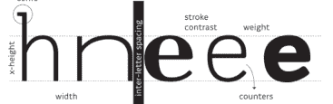

图 1：选择和设计远距离阅读字体时需考虑的事项：衬线的位置；x-height 的大小；字母的水平宽度；字母间距；笔画对比度；字母内部计数器以及字体的粗细。

## 1.1 引言

我们能从多远处读清标志上的文字，就拥有越多时间做出正确的导航决策，或者越早知道自己是否朝着正确的方向前进。这一性能问题在道路标志中尤为重要，在极端情况下，增加的时间可能有助于防止事故。在机场或人口稠密的城市地区，清晰易读的标志有助于交通更顺畅，使用者更少沮丧。因此，优化标志字体的远距离可读性对人们的日常生活可能产生重大影响。

Drawing on both scientific findings, and on designer's experiences, this chapter will present the different factors that influence the legibility of fonts when read from a distance.

本章将借鉴科学研究成果和设计师的经验，介绍影响从远处阅读时字体可读性的不同因素。

## 1.2 消失的细节

A significant effect of distance is the loss of information in the smaller features and details. This can have a range of effects on reading performance. It appears that the information loss can partly be worked around if we understand how to compensate for this loss. When Jock Kinneir and Margaret Calvert created the British traffic sign system from 1957 to 1963, their font development resulted in a public debate on letterform legibility. Their chief critic was rival type designer, stone carver and lettering artist David Kindersley (for a detailed description see Lund, 2003). Like others, Kindersley had observed that: 'In very small type, or in larger letters to be read at a great distance – in fact, wherever there is a question of distance in relation to size – there is always a loss of definition' [Kindersley 1960, p. 465]. To compensate for this loss in the corners of letters, Kindersley argued for the importance of the serif as it 'reinforces the individual character of the letter exactly where this loss is greatest' [p. 465]. This notion has partly been confirmed by researchers Beier and Dyson [2014] who found no difference in the overall distance legibility between sans serif and serif fonts, yet when looking at the group of letters with serifs at the vertical extremes (Figure 2), the data showed higher distance legibility. Kindersley's proposal emphasized these corners.

距离的一个显著影响是较小特征和细节中的信息丢失。这可能以多种方式影响阅读表现。如果我们了解如何补偿这种损失，信息丢失似乎可以部分弥补。当 Jock Kinneir 和 Margaret Calvert 从 1957 年到 1963 年创建英国交通标志系统时，他们的字体开发引发了关于字体形式可读性的公开辩论。他们的主要批评者是竞争对手字体设计师、石雕师和字母艺术家 David Kindersley（详细描述见 Lund, 2003）。与其他人一样，Kindersley 观察到：“在非常小的字体中，或者在需要在很远距离阅读的较大字母中——实际上，无论何时涉及大小与距离的问题——总是存在清晰度的丢失” [Kindersley 1960, p. 465]。为了补偿字母角落的这种损失，Kindersley 主张衬线的重要性，因为它“在清晰度丢失最大的地方强化了字母的个性特征” [p. 465]。这一观点部分得到了研究者 Beier 和 Dyson [2014] 的证实，他们发现无衬线字体和衬线字体在整体远距离可读性上没有差异，然而，在查看垂直极端处带有衬线的字母组（图 2）时，数据显示更高的远距离可读性。Kindersley 的提议强调了这些角落。

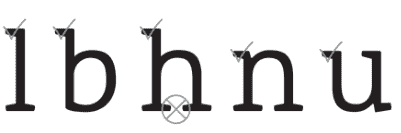

图 2：Beier 和 Dyson [2014] 发现垂直极端处的衬线可提高远距离可读性。

### The lazy dog

Figure 3: The intention with the round corners of the typeface FF Info was to create an even appearance of the letter stroke on backlit signs (by Erik Spiekermann and Ole Schäfer).

图 3：字体 FF Info 圆角的意图是在背光标志上创造字母笔画的均匀外观（由 Erik Spiekermann 和 Ole Schäfer 设计）。

In contrast other designers have chosen to create stroke endings that accept and integrate the loss of detail that can be expected. This has led to round sans serif corners. When type designer Gerard Unger [2014] was working on the font for the Amsterdam Metro early in his career (1974) , many of the signs were illuminated from within. Unger observed that when light shines through a hole of any shape or form, the light tends to soften the form and this softening appears circular. He decided to integrate this observation in the final design of the font, and consequently created round corners on the FFs. A similar solution was applied in the more recent typeface family FF Info by Erik Spiekermann and Ole Schäfer (Figure 3).

相比之下，其他设计师选择创建接受并整合预期细节损失的笔画末端。这导致了圆角无衬线字体。当字体设计师 Gerard Unger [2014] 早期职业生涯（1974 年）为阿姆斯特丹地铁设计字体时，许多标志是内部照明的。Unger 观察到，当光线透过任何形状或形式的孔洞照射时，光线倾向于使形状变软，而这种变软呈圆形。他决定将这一观察整合到字体的最终设计中，从而创建了圆角 FFs。类似的解决方案应用于 Erik Spiekermann 和 Ole Schäfer 更近期的字体系列 FF Info 中（图 3）。

## 1.3 Open inner counters

It may seem logical to assume that the larger the letter size, the greater the distance at which a text can be read. We might therefore think that because signs often have to fit within a limited horizontal surface area that narrow letters will be more legible because they will be able to fit in the surface area, while having a larger point size (Figure 4).

人们可能会合理地假设，字母尺寸越大，文本可被阅读的距离就越远。因此，我们可能会认为，由于标志通常需要适应有限的水平表面面积，窄字母会更易读，因为它们可以在表面面积内容纳，同时拥有更大的点号尺寸（图 4）。

This objective, that a font for signage should be economic in the use of horizontal space, was part of the brief given to Gerard Unger, when he designed the font for the Dutch small signposts (ANWB-U) in 1996. During the development process the font was exposed to empirical distance testing [Walraven et al., 1996]. The study compared the new font with two versions of the font it was replacing: one of these was both narrower and lighter in weight (ANWB-C) than the Unger font, and one was slightly wider than the Unger font with similar weight (ANWB-E).

这一目标，即标志字体应在水平空间使用上节约，是 1996 年 Gerard Unger 为荷兰小型路标（ANWB-U）设计字体时收到的设计要求的一部分。在开发过程中，该字体接受了实证距离测试 [Walraven et al., 1996]。该研究将新字体与其替换的字体的两个版本进行了比较：其中一个版本比 Unger 字体更窄且更轻（ANWB-C），另一个版本略宽于 Unger 字体且重量相似（ANWB-E）。

Both fonts were altered variations of fonts found in the American road signage typeface family FHWA Series (often referred to as Highway Gothic) (Figure 5). The experiment found the performance of the new font ex-

两种字体均为美国道路标志字体系列 FHWA Series（通常称为 Highway Gothic）中字体的修改变体（图 5）。实验发现新字体的表现 ex-

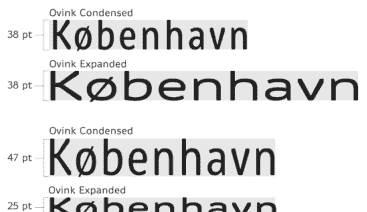

图 4：顶部的两种字体设置为相同的磅大小，但占据的水平空间截然不同。底部的两种字体占据相同的水平空间，但压缩版为 47 磅大小，而扩展版为 25 磅大小。

图 5：Highway Gothic 系列最初是为美国道路系统开发的。此示例显示带有窄字形的 ANWB-C 或 C 系列（左）以及带有宽字形的 ANWB-E 或 E 系列（右）（MUTCD 2000）。

……比窄版高出 13%。然而，它略逊于宽版 3%。安格尔表示，结果向他证实，较大的内部字母空白能提高远距离可读性，他在有限的水平宽度内尽可能强调了这一特点（图 6）。

许多其他交通字体设计师也赞成较大的字内空白。在多个场合，Jock Kinneir [1978, p. 344; 1980, p. 66] 指出了拥有清晰、开放字内空白的重要性，以避免在车灯眩光下观察字母和数字时出现字内空白堵塞，从而导致字形更加模糊。他还强调，即使窄字形可以被设置得更大更高，如果字内空白的两侧过于接近并开始似乎合并，也无法提高可读性 [Kinneir 1980, p. 66]。最近，字体设计师 James Montalbano 与 Meeker & Associates 合作设计了 ClearviewHwy 字体，旨在最终在美国道路上取代 Highway Gothic。在接受《纽约时报》采访时，Montalbano 表达了他对 Highway Gothic 字母字内空白的看法，认为它们太小。他也提到了车灯照明导致识别字母和数字出现问题的困难。对于字母 'o' 和 'e'，Montalbano 将其描述为像“无法用别针穿透的子弹” [Yaffa 2007, p. 4]，这意味着字内空白似乎消失了。字体设计师 Adrian Frutiger 就其交通标志字体 Frutiger Astra 也做出了类似观察，他放大了字内空白，以确保像 'e' 和 'a' 这样的字母易于区分，并且在远处看起来不像点 [Linotype, 2009]。

这些设计师都认识到为远距离可读性而扩大字内空白的重要性，并发现生产内部白色区域尽可能大的字体是至关重要的。

可以通过多种方式创建较大的字内空白。一种方式与 x 高度相关，另一种方式与字形宽度相关。

## 快速的棕色狐狸跳过一只懒狗

图 6：在字体 ANWB-U 中，Gerard Unger 致力于创建较大的内部字内空白，同时节省水平空间。

### 1.3.1 x 高度

在许多小写字母中，大部分细节都位于 x 高度内。因此，决定字体感知大小的是 x 高度，而不是磅大小，这一事实在可读性研究历史上常常被忽视（图 7）。因此，x 高度越大，字体感知越大。

Elisabeth Roethlein [1912] 的一项早期可读性研究证实了这一点。Roethlein 测试了一系列不同字体中单个字母的远距离可读性，如图 8 所示，x 高度较大的字体也是从最远距离可辨认的字体。

然而，x 高度的增大是有限度的。在 1986 年出版的《字体信誉》（'Letters of Credit'）中，排版作家 Walter Tracy 认为，尽管 g、j、p、q 和 y 等字母的短下伸部可能“悦目不佳” [p. 50]，但这并不像 b、d、h、k 和 l 等字母的上伸部过短那样成问题，后者可能导致字母失去其个性。这一问题的经典例子是 h 和 n 的混淆（图 9）。

因此，x 高度的增大是有限度的，一旦开始干扰区分一个字母与另一个字母的部分，就会出现问题。

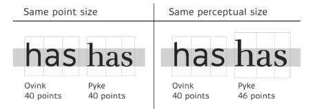

图 7：字体 Ovink 的 x 高度大于字体 Pyke；在相同磅大小下，Ovink 看起来比 Pyke 大，同时也在节省水平空间。

| 字体 | 数值 |
| :--- | :--- |
| New Gothic | 236.4 |
| Bulfinch | 233.6 |
| Clearface | 229.5 |
| Century O.S. | 228.0 |
| Century Exp. | 226.7 |
| Cheltenham W | 224.3 |
| Jenson | 214.7 |
| Della Robbia | 214.7 |
| Cushing O.S. | 206.4 |
| Cheltenham O.S. | 206.4 |
| De Vinne | 204.8 |

图 8：Elisabeth Roethlein [1912] 测试的部分字体及其远距离阈值（右列）。此表表明，较大的 x 高度倾向于在更远的距离被阅读，而较小的 x 高度则不然。

图 9：如果 x 高度过大，可能导致某些字母被误读。

### 1.3.2 字母宽度

为了为伦敦希思罗机场的标志选择字体，Robert Waller [2007] 比较了 BA Signs、Frutiger Bold、Frutiger Roman、Vialog 和 Garamond Italic 字体。他逐渐放大测试材料，直到参与者能够识别出单词。数据显示，窄体 Vialog 的可读性低于两种 Frutiger 字重和 BA Sign 字体，后者在水平比例上均比 Vialog 更宽（图 10）。

在另一项调查中，研究人员 [Beier and Larson, 2010] 测量了参与者在短时间曝光和远距离下识别字母时出现的错误数量，并发现远距离阅读时，窄体设计的字符倾向于比宽体设计的字符产生更多错误（图 11）；这在低笔画对比度的字体中最为明显。

多年来，多项研究探讨了 Highway Gothic 系列的可读性。1939 年，Forbes 和 Holmes 比较了窄体 B 系列与宽体 D 系列的可读距离（图 12），发现无论在白天还是夜间条件下，宽体版本的表现都最好。另一位研究者 Thomas Schnell [1998] 也研究了 Highway Gothic 系列远距离可读性的不同方面。作为其博士研究的一部分，Schnell 在计算机屏幕上研究了对比度阈值，最初刺激物与背景之间的亮度相同，然后逐渐增加视觉对比度，直到参与者能够识别由大写字母和数字组成的测试材料。在这些条件下，Schnell 发现宽体字体的表现优于窄体字体。

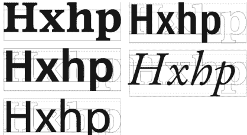

图 10：Robert Waller [2007] 测试的字体 BA Signs、Frutiger Bold、Frutiger Roman（左）、Vialog 和 Garamond Italic（右）。

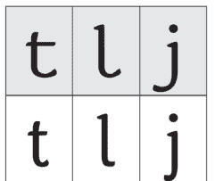

图 11：远距离阅读和短时间曝光下，宽字母（顶部）的识别率高于窄字母 [Beier and Larson, 2010]。

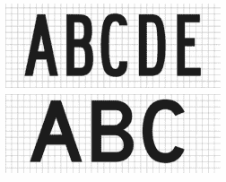

图 12：Highway Gothic B 系列（顶部）和 D 系列（底部）。

Curt Berger [1948] 应用了两种方法，一种基于亮度，另一种基于距离阈值，研究了数字 5 和 0 的不同变体，这些变体高度、笔画粗细和对比度相同，但水平尺寸不同。研究结果表明，数字越宽，其可读性越高。Elisabeth Roethlein [1912] 进一步报告了对 Cheltenham Oldstyle 家族中多种字体的远距离可读性调查，发现宽体和粗体版本的可读距离大于粗体压缩版、普通版和斜体版本（图 13）。

比例更宽的字体需要缩小尺寸以适应有限的表面积，这将导致更小的磅大小（图 4）。挑战在于确定最佳的高宽比，以实现开放的内部字内空白，而无需过度缩小字母尺寸。

## 1.4 字重

确定最佳字重是一件困难的事情。如果笔画太轻，字符在远距离观看时可能变得不可见。相反也是问题。如果笔画太重，字内空白会变得太小，导致字形无法辨认。

当白色文本放置在深色背景上；当光线投射通过字形时；或者当标志由反光材料制成时，称为晕晕或辐射的现象可能会给读者带来问题（图 14）。明亮区域周围光线的模糊

| 粗体 | 粗体压缩 |
| :--- | :--- |
| 宽体 | 普通体 |
| | 斜体 |

图 13：罗特莱恩（1912）测试的切尔滕汉姆旧式字体系列的不同风格。左列字体的阅读距离大于右列字体。

图 14：光晕模拟。

标志会产生一个“光晕”，使其在视觉上向周围区域扩散。光晕效果似乎因“光晕”的性质而异。在对相关可读性研究的广泛综述中，Helm T. Zwahlen 及其同事 [1995] 发现，深色背景上的白色文本通常比浅色背景上的深色文本需要更轻的笔画粗细。在某些情况下，这仅仅是一种美学调整，而在其他情况下，字形周围的“光晕”会导致可读性显著降低。这一现象在与 ClearviewHwy 字体系列相关的测试研究数据中也有所体现 [Garvey et al., 1997; Holick et al., 2006]。这些研究发现，在夜间条件下，Clearview 字体的阅读距离比稍重的 Highway Gothic 系列 E 字体更远。在白天条件下未观察到相同差异，两者阅读效果相当。

## 1.5 字间距

“字间距”（也称为 fitting 或 metrics）是字体中所有字符之间的空间大小，这与“字距调整”（kerning）形成对比，后者是两个特定字符之间调整后的空间大小。在 Highway Gothic 系列实施的设计指南中，联邦公路管理局表示：“……测试表明，对于任何给定的图例，使用相对宽的字母间距比使用更宽更高的字母但空间狭窄能获得更好的可读性” [MUTCD, 2000, p. 8-1]。该声明表明，字间距是创建远距离阅读字体时最核心的参数之一，然而，公路管理局并未提供任何来源参考。在对夜间导视标志远距离可读性的调查中，Holic 和 Carlson [2003] 出发研究四种不同间距设置的效果：一种在 Highway Gothic 系列 E 中，三种在无衬线字体系列 ClearviewHwy 5W 中。一种 ClearviewHwy 字体将默认间距值降低了 3%，另一种降低了 6%。所有字体均在绿色背景上的白色文本中进行了测试。实验发现 ClearviewHwy 字体三种间距值之间没有统计学上的显著差异，这表明要发现显著差异，间距值之间的差异可能需要大于 6%。

几位著名的字体设计师强调了为远距离阅读设计的字体中大字间距的重要性。其中一位，设计师 Erik Spiekermann 指出，字母间距过窄是导视系统中的常见缺陷 [Spiekermann, 2006]。他进一步认为，阅读标志时，我们并不像阅读连续文本那样阅读，而是辨认文本中的每个字母。由于标志通常包含没有额外上下文的单个单词，Spiekermann 认为在这种情况下所有字符都需要彼此更清晰地分开。

Jock Kinneir [1978] 作出了类似观察。他提到了点彩派画家展示的现象：从远处看，形状往往会融合。这些设计师观察到一种被研究人员识别为“拥挤效应”或“轮廓相互作用”的现象，即单词中相邻字母相互干扰。这种干扰使得识别单个字母变得更加困难。该现象在低分辨率感知条件下最为明显，这种情况发生在远距离阅读时 [Hess et al., 2000; Liu et al., 2001]。

20 世纪 50 年代的几项实地实验研究了 Highway Gothic 系列的字间距。其中一项由 Harry W. Case 及其同事 [1952] 进行，关注 Highway Gothic 系列 E 字体中单个大写字母的远距离可读性（图 5）。该研究表明，可读性因字体采用正负对比设置而异，并发现浅色背景上的黑色字体在较窄间距设置下略微更易读，而深色背景上的白色字体在较宽间距设置下最易读（图 15）。

同期的另一项实验中，David Solomon [1956] 研究了不同间距值对三种 Highway Gothic 系列字体 E、C 和 ED（后者宽度相似但略比系列 E 更紧）中单词的影响（图 5）。该研究在黑暗的停车场中使用近光灯进行，测试材料由安装在黑色非反光板上的白色逆反射材料制成。研究结果证实了 Case 及其同事的早期发现，表明深色背景上的白色字体远距离可读性随间距值增加而提高。看来，要达到高水平的可读性，这些条件下影响字体的辐射需要字形之间有更大的空间，而当深色文本设置在浅色背景上时，这种效果不那么明显。

图 15：由于白色向深色背景扩散，Harry W. Case 及其同事 [1952] 发现，深色背景上的浅色文本在较大字间距下更易读（此处以 Tobias Frere-Jones 设计的字体 Interstate 为例说明）。

## 1.6 总结与结论

为解决远距离细节丢失的问题，垂直笔画上的衬线可提高远距离可读性；然而，当字体受光晕影响，或光线从标志背面投射的情况下，字体或许更适合设计为低对比度无衬线字体。

开放的内部空白（counters）通常有助于提高远距离可读性；这可以通过使 x-height（小写字母高度）相对较大、字母形状相对较宽来实现。话虽如此，如果某些字形不应被误读为其他字形，x-height 的大小是有限度的；如果文本要在指定表面水平适配而又不使字号过小，字母宽度也是有限度的。

由于拥挤效应的影响，大字间距——总体而言——有利于远距离阅读，并且当浅色文本置于深色背景上时这一效果最为明显。此外，由于白色倾向于向深色表面扩散，深色背景上的白色文本应比浅色背景上的相应深色文本更轻。

执业设计师对工艺的知识和理解通常通过试错或对材料的实验获得，而科学发现往往源于旨在证实或否定预设假设的受控调查。通过结合这些不同的方法，并在寻找答案时将它们视为同样有效，有可能收集到帮助我们更好地理解字体设计领域的信息。

## 参考文献

- Beier, S., and Dyson, M. (2014) 'h' 和 'i' 上衬线的影响：来自设计主导科学研究的有用知识, Visible Language, 47(3), pp. 74-95.
- Beier, S. and Larson, K. (2010) 常被误认字母的设计改进, Information Design Journal, 18(2), pp. 118-137.
- Berger, C. (1948) 符号宽度作为可读性决定因素的一些实验, Acta Ophthalmologica, 26(4), pp. 517-55.
- Case, H.W., Michael, J.L., Mount, G.E., and Brenner, R., (1952) 与标志可读性相关的某些变量分析, Hwy. Res. Bd. Bull, 60, pp. 44-54. 摘要和简短摘要报告于：《交通标志要求研究》，T.W. Forbes, Snyder, T.E., 和 R.F. Pain（编），密歇根州立大学心理学系工程研究部，第 53-54 页。

Forbes, T.W. 和 Holmes, R.S.，（1939）'公路目的地标志的可读距离与字母高度、字母宽度和反射化的关系'，公路研究委员会论文集，19，第 321-355 页。

Garvey, P.M., Pietrucha, M.T., 和 Meker, D.T.（1997）'字体和大小写对导向标志可读性的影响'，交通控制设备研究，1605。

Hess, R.F., Dakin, S.C. 和 Kapoor, N.（2000）凹视区“拥挤”效应：物理还是生理？，视觉研究，40，第 365-370 页。

Holick, A.J. 和 Carlson J.（2003）高强度背景下微棱镜 Clearview 图例的夜间导向标志可读性，[在线]，可从：http://dd2t15nmlp0.cloudfront.net/tti.tamu.edu/documents/0-1796-4.pdf 获取 [访问日期：2014 年 8 月 5 日]。

Holick, A.J., Chrysler, S.T., Park, E.S., 和 Carlson, P.J.（2006）负对比度交通标志的 Clearview 字体评估，德克萨斯交通研究所。

Kindersley, D.（1960）高速公路标志字母，交通工程与控制，2(8)，第 463-465 页。

Kinnear, J.（1978）道路标志设计的实际和平面问题，载于：R. Easterby 和 H. Zwaga，（编），信息设计：标志和技术信息的设计与评估，奇切斯特：John Wiley and Sons Ltd.，第 341-58 页。

Kinnear, J.（1980）文字与建筑：公共字母设计的艺术与实践，伦敦：The Architectural Press。

Linotype（2009）排版作为最高形式的视觉传播：与 Adrian Frutiger 的对话，[在线]，可从：http://www.linotype.com/de/316-17757/servingapurpose.html?lang=de 获取 [访问日期：2014 年 8 月 5 日]。

Liu, L., & Arditi, A.（2001）'拥挤如何影响字母混淆'，验光与视觉科学，78(1)，第 50-55 页。

Lund, O.（2003）关于 Jock Kinneir 道路标志字母的公共辩论，排版论文，5，第 103-126 页。

MUTCD（2000）统一交通控制设计指南手册，可在线查阅：http://mutcd.fhwa.dot.gov/SHSe/Design.pdf [访问日期：2014 年 8 月 5 日]

Roethlein, B.E.（1912）'不同印刷字体的相对可读性'，美国心理学杂志，23(1)，第 1-36 页。

Schnell, T.（1998）交通应用中显示消息的大写字母数字文本可读性优化，博士论文（未发表），俄亥俄大学工程与技术学院。

Solomon, D.（1956）字母宽度和间距对公路标志夜间可读性的影响，公路研究委员会论文集 35，600-617，摘要和简短摘要载于：交通标志要求研究，T.W. Forbes, T.E. Snyder, R.F. Pain（编），密歇根州立大学心理学系工程研究部，第 67-68 页。

Spickermann, E.（2006）信息图：关于 FF Info，载于：J. Middendorp & E. Spickermann，（编），（2006）使用 FF Font 制作：独立思想的字体，阿姆斯特丹：BIS Publishers，第 54-57 页。

Tracy, W.（1986）信用字母：字体设计视角，伦敦：Gordon Fraser。

Unger, G.（2014）M.O.L.（1974），可在线查阅：http://www.gerardunger.com/allmytypedesigns/allmytypedesigns03.html [访问日期：2014 年 8 月 5 日]。

Waller, R.（2007）机场标志字体比较，信息设计期刊，15(1)，第 1-15 页。

Walraven, J., Varkevisser, J. & But, P.（1996）新 ANWB 字母表可读性评估，TNO 技术人体工程学导向标识。

Yaffa, J.（2007）通往清晰之路，纽约时报，8 月 12 日，可在线查阅：http://www.nytimes.com/2007/08/12/magazine/12fonts-t.html?pagewanted=4&_r=3 [访问日期：2014 年 8 月 5 日]。

Zwahlen, H.T., Sunkara, M. 和 Schnell, T.（1995）'文本信息呈现语境下可读性关系综述'，交通研究委员会，1485，第 61-70 页。

# 第 6 章

# 中文儿童阅读能力中词间间距的影响

Hsiu-Feng Wang

本实验调查了中文文本中不同的词间间距安排是否影响台湾儿童的阅读速度和理解能力。文本在平板电脑上显示。实验使用了标准词间间距（即中文文本中通常使用的间距）和三种间隙更大的安排。它还使用了两组儿童。一组包括 7 至 8 岁的儿童，另一组包括 10 至 11 岁的儿童。在实验中，儿童阅读了间距安排不同的文本；记录了他们的阅读速度，并且他们完成了一系列文本，其中需要识别与文本其余部分不一致的替换词。结果表明，当单词之间有更大的间隙时，儿童阅读速度更快，并且他们的阅读时间和阅读表现。它还发现，年龄较小的儿童从比中文通常使用的更大的词间间距中受益显著。这些发现可能对为阅读中文的儿童设计阅读材料、学习资源和短信系统的人感兴趣。

## 1.1 引言

词间间距是在单词之间留出间隙的行为，以使读者能够轻松快速地识别一个单词在哪里结束、另一个单词在哪里开始。许多语言使用词间间距。然而，中文不使用。在中文中，每个字符后都存在间隙，无论该字符是构成整个单词还是单词的一部分。中文读者不依赖视觉线索，而是完全通过阅读经验来确定一个单词在哪里结束、另一个单词在哪里开始。

超过 70% 的中文单词由两个或多个字符组成 [Yu et al., 1985]。这种构词方法虽然极其灵活，但可能导致混淆，因为读者可能会错误地将属于一个单词的字符与属于另一个单词的字符组合在一起。图 1 给出了一个示例。句子中的前两个字符可以组合成单词‘铅笔’，句子读作：“使用铅笔做笔记很重要”；或者句子中的前三个字符可以组合成单词‘素描’，句子读作：“关于如何素描做笔记很重要”。换句话说，句子的含义完全取决于读者在脑海中如何对字符进行分组。Hsu 和 Huang [2000a, 2000b] 给出了字符分组不同时具有多种含义的句子的其他示例。

### 铅笔/画重点很重要

> ‘使用铅笔做笔记很重要’

### 铅笔画/重点很重要

> ‘关于如何素描做笔记很重要’

图 1：同一句子的不同解释。

学习中文的学生通常发现很难确定句子中哪些字符应该组合在一起以形成作者意图的单词 [Bassetti, 2009; Yao, 2011; Bai et al., 2013]。不幸的是，这个问题往往贯穿许多学生的整个学业生涯，因为他们学习的词汇越多，存在的单词排列组合就越多。为了帮助儿童识别和学习正确的字符分组，台湾小学的教师通常会圈出构成常见单词的字符。这种技术与用于面向外国人学习中文的书籍中的技术不同。在这些书籍中，通常使用词间间距。这就引发了一个问题：词间间距是否能帮助台湾儿童学习中文。与圈字符相比，词间间距的优势在于它可以快速地融入电子文本，而无需使用特殊的图形工具。此外，它不会给页面增加美观上的杂乱。如果文本有注释或使用高亮技术（例如斜体或下划线），这尤其有帮助。本研究探讨了词间间距与台湾儿童阅读中文文本之间的关系。预计本研究的发现可能会促进为台湾儿童开发更好的阅读材料。本研究解决了以下研究问题：不同级别的词间间距是否会影响台湾儿童的阅读速度和正确识别文本的能力？年龄是否会影响台湾儿童的阅读速度和正确识别文本的能力？不同级别的词间间距与年龄之间是否存在交互作用，与台湾儿童阅读中文文本有关？

## 1.2 研究背景

### 1.2.1 词间间距与中文文本阅读

许多研究人员已经调查了词间间距对中文文本的影响。其中一些研究涉及母语者，而另一些则涉及外语学习者。

Hsu 和 Huang [2000b] 进行了一项涉及母语者的研究。在这项研究中，台湾成年人在电脑屏幕上查看了几篇文章。这些文章以三种不同的词间间距格式呈现：常规无间距、半字符间距和全字符间距。采用常规无间距的文章使用了中文传统上使用的相同间距（即所有字符间距相等）；采用半字符间距的文章在单词之间使用了额外的半字符空格；采用全字符间距的文章在单词之间使用了额外的全字符空格。研究人员发现，与采用常规无间距或全字符间距的文章相比，采用半字符间距的文章理解得更好，阅读速度更快。然而，其他研究人员得到了不同的结果。例如，Liu et al. [1974] 发现词间间距并未提高中文读者阅读中文的速度；Inhoff et al. [1997] 也发现了这种情况。

最近，Bai et al. [2013] 调查了词间间距是否能帮助外国学习者学习中文以获取新词汇。该研究涉及威斯康星大学麦迪逊分校的语言学习者，分为两部分：学习会话，参与者在其中阅读包含新单词的句子；以及测试会话。在学习会话中，一半的参与者阅读了常规无间距

文本和半阅读词间间隔文本。在测试会话中，所有参与者都按常规阅读无间隔文本。研究人员发现，最初在词间间隔句子中阅读新单词的参与者在测试会话中阅读速度最快。

然而，姚 [2011] 的研究表明，词间间隔可能并不有助于所有非母语中文读者。在一项涉及不同正字法背景参与者的实验中，姚发现，母语不使用词间间隔的参与者在阅读词间间隔文本时速度会减慢，而母语使用词间间隔的参与者不受单词间间隔的影响。

尽管许多研究人员已就中文文本的词间间隔进行了实验研究，但这些实验大多是在成年人中进行的。关于词间间隔如何影响不同年龄儿童的阅读速度，以及如何影响他们发现排版错误的能力，仍知之甚少。

### 1.2.2 与阅读相关的理论

格式塔心理学家认为，心智倾向于将个别元素组织成群体；他们断言整体不同于其各部分之和（Wertheimer, 1923; Koffka, 1935）。可以说，与本研究最相关的格式塔原则是邻近性原则。根据这一原则，人们将彼此靠近的实体视为一个群体。

许和黄 [2000b] 进行了一项研究邻近性原则的研究。研究人员调查了将双字汉字单词跨行拆分（即一个字在一行末尾，另一个字在下一行开头）是否会降低阅读速度。研究人员发现确实如此。他们认为这是因为读者没有将这两个字视为相关：这些字并不相邻，因此不被视为一个整体。

李等人 [2009] 提出了一种模型，解释了人们在阅读时如何将中文文本分割成单词。该模型展示了自上而下和自下而上信息处理的过程。它有三个交互层次：视觉感知、字符识别和单词识别。研究人员解释说，第一层视觉感知是识别构成字符的特征的地方。他们指出，来自这一层的信息随后在第二层（字符识别）中结合，并伴有来自第三层（单词识别）的反馈。研究人员补充说，第三层接收来自词汇库和第二层字符识别器的信息。

然而，尽管李等人（2009）的模型有助于解释中文单词是如何被识别的，但它假设读者熟悉汉字和单词。初学者则不然。虽然有些人可能认识特定的字符，但他们通常不知道这些字符是如何组合成单词的。因此，他们可能会查看单词的最后一个字符，并错误地认为它属于下一个单词。

### 1.2.3 年龄差异

许多研究已探讨了成人和儿童在屏幕阅读文本方面的差异 [例如 Bernard et al., 2002]。然而，在这些研究中，儿童大多未被划分为年龄组。因此，屏幕文本设计中某些与年龄相关的问题可能被忽略了。

休斯和威尔金斯（2000）进行了一项将儿童划分为年龄组的研究。在这项研究中，5至7岁（年龄较小）和8至11岁（年龄较大）的儿童被展示了四段采用不同字体大小和间距安排的文本。研究人员发现，随着字体大小减小，年龄较小儿童的阅读速度下降。这与年龄较大儿童的阅读速度保持不变不同。威尔金斯后来与其他同事进行了一系列类似的研究 [参见 Wilkins et al., 2009]。在这些涉及7至9岁儿童的研究中，调查了理解力和阅读年龄与字体大小的关系。研究表明，当文本使用大字体而非小字体印刷时，儿童理解句子的速度更快，阅读年龄更高。

王等人（2013）进行了一项按年龄划分儿童的另一项研究。在这项研究中，研究人员调查了年龄与电子书自适应设计在学习成就和动机方面是否存在交互作用。参与研究的儿童为10岁和11岁。研究人员发现，当电子书设置为自适应设置而非任何其他设置时，10岁儿童的回忆、迁移和注意力得分更好。11岁儿童在所有设置下的表现相同。

关于涉及网站的研究，Nielsen [2010] 发现不同年龄的儿童偏好不同大小的文本。他还发现，如果网站内容呈现的年级与观看者的年级不同，通常不受欢迎。

考虑到不同年龄的儿童对字体大小和字体设计的反应存在差异，并且对自适应设计电子书的年龄相关阅读反应也不同，因此可以合理地假设，他们在屏幕阅读方面可能有偏好并表现出不同的表现。

## 1.3 方法

### 1.3.1 参与者

从台湾南部一所城市小学随机选取了32名一年级学生（15名男生和17名女生）和32名四年级学生（14名男生和18名女生）。一年级学生年龄在7至8岁之间（M=7.61, SD=.590），四年级学生年龄在10至11岁之间（M=10.23, SD=.423）。各年级学生的阅读水平相似；这一点通过查看他们的考试结果得到了确认。所有学生都是平板电脑的常用用户，每周上网至少三次。实验结束后，每人获得一件小玩具作为礼物。

### 1.3.2 实验设计

为了测试词间间隔和年龄对阅读时间和阅读表现的影响，采用了2×3混合设计。两个自变量为：词间间隔和年龄。词间间隔采用被试内因子设计，有三个水平：无间隔、半间隔和全间隔。年龄采用被试间因子设计，有两个水平：年龄较小（该水平包括7-8岁的参与者）和年龄较大（该水平包括10-11岁的参与者）。

两个因变量为阅读时间（参与者阅读一篇文章所需的时间）和阅读表现（参与者找到文章中放置的不协调汉字的准确性）。

### 1.3.3 材料

请三位小学教师共同选定研究中使用的阅读材料。首先，他们为一年级学生选定了三篇文章。这些文章从台湾文化部认证为适合一年级小学生的十二篇文章集合中选出。每篇文章包含450至480个字符。教师随后为四年级学生选定了三篇文章。这些文章从台湾文化部认证为适合四年级小学生的十二篇文章集合中选出。每篇文章包含520至550个字符。研究中使用的所有文章都关于居住在台湾的原住民族群。

选定文章后，每篇文章中替换了十五个汉字。这些字符被随机选取，并替换为外观相似的字符。例如，在一篇文章中，字符‘日’（太阳）被替换为字符‘目’（眼睛）。如果仔细阅读，这个字符会被视为格格不入。测试前，修改后的文章展示给另一个班级的学生。所有学生都同意，文章中使用的替换字符在其出现的语境中没有意义。

每篇文章包含三页。每页包含11至13行文本（每页165至186个字符）。文本填满了平板电脑的整个屏幕。文本以14号字体大小显示，行间距为28号，使用明朝体，这是一种在计算机屏幕上被发现具有高度可读性的字体 [Chi et al., 2003]。文本水平书写。这种对齐方式用于台湾学校的科学教科书。

文本以三种格式展示给参与者（参见图2）。第一种格式是无间隔。这种格式反映了书面中文传统使用的间距：它在每个字符之间使用大约一个字符宽度五分之一的空格。第二种格式是半间隔；它在单词之间使用大约一个字符宽度三分之一的空格，在构成单词的字符之间使用一个字符宽度五分之一的空格。第三种格式是全间隔；它在单词之间使用大约一个字符宽度的空格，在构成单词的字符之间使用一个字符宽度五分之一的空格。这三种格式符合刘等人 [1987] 制定的指南。

该研究使用了一台配备10.1英寸IPS多点触控屏幕的Asus Eee Pad平板电脑。屏幕分辨率为1280 × 800像素；屏幕以横向方向使用。

| | |
|---|---|
| 无间距 | 從前，部落裡有兩個非常優秀的青年勇士，他們能力好，狩獵技巧高超，對於傳統舞蹈及歌曲，也都很厲害。 |
| 半间距 | 從前，部落裡有兩個非常優秀的青年勇士，他們能力好，狩獵技巧高超，對於傳統舞蹈及歌曲，也都很厲害。 |
| 全间距 | 從前，部落裡 有 兩個 非常優秀 的 青年勇士，他們能力好，狩獵技巧 高超，對於 傳統舞蹈 及 歌曲，也都 很厲害。 |
| 译文 | 从前，部落里有两个聪明人住在一个原住民部落；两人都是技艺高超的猎人、歌手和舞者 |

图 2：实验中使用的带词间距的测试页面示例。

### 1.3.4 程序

实验在参与者学校的多个计算机实验室中进行。参与者根据年级被分为两组。这些组随后被细分为六组：三个一年级组和三个四年级组。参与者被随机分配到这些组中。每组共有10至13名参与者。每组分配了两名助手。这些助手回答任何程序性问题，并帮助参与者完成文件工作。每位参与者都获得了一台自己的平板电脑。

实验开始前，参与者使用与实验中使用的类似屏幕材料进行了一系列熟悉化练习。在这些练习中，他们触摸屏幕按钮来使文章出现/消失。该按钮还控制定时时钟，并通过触摸他们认为文本中不合适的汉字来选择这些汉字（触摸会使汉字变色）。

当所有参与者都明白该做什么后，实验开始。参与者被告知他们将依次看到三篇文章。他们被告知应尽可能快速且准确地阅读文章，并选择任何他们认为与文本不一致的字符。他们被告知应独立工作。每位参与者看到一篇无间距文章、一篇半间距文章和一篇全间距文章。文章对每位参与者以随机顺序显示。阅读时间和所选字符由每位参与者的平板电脑自动记录。

参与者花费了大约20分钟来完成阅读任务。离开时，他们填写了一份简短的表格，收集其人口统计信息。

## 1.4 结果

由于一年级和四年级学生使用的文章长度不同，每位参与者的阅读时间被转换为每100个字符的秒数。绩效得分被定义为找到的替换字符的百分比。

对参与者的阅读时间和所找到的替换词百分比进行了方差分析。所有数据都接受了方差分析（ANOVA），并检验了球形性假设。各实验条件下的平均阅读时间和所找到的替换词百分比如表1所示。

### 1.4.1 阅读时间

观察到词间距对阅读时间的影响存在显著差异，F (2, 124) = 4.87，p = .009。词间距的影响下，阅读时间的顺序为：全间距词间文本、半间距词间文本，最后是无间距词间文本。使用Scheffé统计检验进行的进一步多重比较显示，全间距文本的阅读时间显著短于无间距文本（p=.004）；半间距文本的时间也显著短于无间距文本（p=.038）。然而，在检验全间距和半间距文本之间的差异时，未发现显著差异。看来词间距有助于7岁和10岁儿童的阅读速度。

分析发现儿童年龄存在主要效应。年长儿童阅读文本的速度快于年幼儿童，F (1, 62) = 13.40，p = .001。

### 1.4.2 阅读表现

检验不同儿童年龄组在所检测替换词百分比方面的阅读表现，发现儿童年龄存在主要效应。年长儿童的阅读表现优于年幼儿童，F (1, 62) = 7.39，p = .009。然而，分析词间距对所检测替换词百分比的影响显示，阅读表现方面无显著差异。

表 1：不同实验条件下的阅读时间（秒）和阅读表现（%）的均值和标准差。

| | 阅读时间 | | 阅读表现 | |
|---|---|---|---|---|
| | M | SD | M | SD |
| 词语排列 | | | | |
| 无间距 | 237.19 | 56.61 | 63.87 | 21.38 |
| 半间距 | 219.61 | 50.54 | 69.53 | 28.68 |
| 全间距 | 216.48 | 41.58 | 72.26 | 23.61 |
| 年龄 | | | | |
| 年幼 | 240.19 | 49.69 | 62.89 | 24.56 |
| 年长 | 208.67 | 44.33 | 74.21 | 22.16 |

结果揭示了三种不同词间距安排与两个不同年龄组在儿童阅读表现方面的交互作用，F (2, 124) = 4.78，p = .010；如图3所示。无论儿童年龄如何，全间距文本的阅读表现均优于无间距文本。

三种不同词间距安排下的儿童阅读表现对年幼儿童存在显著差异，F (2, 62) = 6.692，p = .002，但对年长儿童无显著差异，F (2, 62) = .844，p = .435。分别查看不同年龄组，使用Scheffe检验的多重比较显示，年幼儿童阅读全间距文本显著优于无间距文本。他们阅读半间距文本也优于无间距文本。然而，半间距和全间距文本之间的差异不显著。对于年长儿童，词间距之间无显著差异。换句话说，词间距显著影响了年幼儿童的阅读表现，但对年长儿童无影响。结果还揭示，年长儿童在无间距文本上的阅读表现显著优于年幼儿童，F (5, 64) = 5.909，p = .035。然而，在不同年龄组之间，间距文本和全间距文本布局未发现显著差异。这表明，无间距文本布局（传统文本）对阅读表现存在年龄相关影响，但间距文本则没有。

## 1.5 讨论与结论

该实验考察了词间距和儿童年龄对台湾儿童阅读材料的影响。它测量了儿童的阅读时间，并评估了他们对这些材料的阅读表现。数据揭示，不同的词间距安排和年龄组影响了儿童的阅读时间和阅读表现。

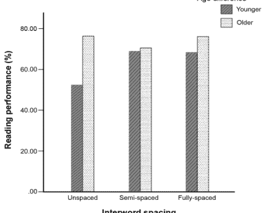

图 3：不同词间距安排和年龄差异下的阅读表现（%）。

数据分析显示，台湾儿童阅读带词间距的文本速度显著快于无间距文本布局（传统文本）。这一发现与Hsu和Huang（2000b）的发现一致，他们在一项调查词间距与台湾成年人阅读时间和理解的实验中发现，与本实验中词间间隙大小相似的词间距，相比其他词间距安排，产生了最快的阅读时间。然而，应注意的是，Hsu和Huang的实验通过阅读后理解测试来衡量参与者的阅读表现。本实验通过识别文本中放置不当的替换词来调查阅读表现。这种任务减少了参与者的浏览行为，并提供了额外的视觉线索，引导他们找到替换词[Bernard et al., 2002, 2003]。此外，Hsu和Huang的实验仅涉及台湾成年人。因此，本实验扩展了他们的发现，证实词间距也有助于台湾儿童更快地阅读，尽管它使用了不同的阅读表现衡量指标。

年幼儿童和年长儿童在所检测替换词百分比方面存在差异。这些结果与Hughes和Wilkins [2000]的发现一致，他们在一项阅读任务中发现，年长儿童在阅读材料的字体大小和字体设计方面没有差异。然而，随着文本大小减小，年幼儿童的阅读时间也减少了。

对阅读表现的进一步分析表明，就所检测替换词百分比而言，年长儿童的表现优于年幼儿童。根据Li等人[2009]的中文单词识别模型，汉字识别涉及自上而下和自下而上的认知加工。本实验还发现，书面中文中未使用的词间距，帮助年幼儿童在文本中识别单词。这一发现可能归因于邻近律[Wertheimer, 1923; Koffka, 1935]，即紧密排列的字符组之间的空格使这些组中的字符看起来像是cor-

彼此直接相关。换句话说，空格为年幼的儿童提供了视觉线索，表明哪些字符组成了单词。就阅读表现而言，词间距对年长儿童的优势可能不如对年幼儿童明显，因为实验中的年长儿童认为文本太容易理解了。他们可能预先猜到了某些单词，因此没有从词间距提供的额外视觉线索中获益。

本实验存在两个局限性。首先，研究中仅纳入了两个年龄组（7至8岁和10至11岁）。如果在不同年龄组的儿童中重复该实验，可能会得到不同的结果。正如一些研究者所指出的，年幼儿童仍在发展其阅读技能，因此比年长儿童更容易受到排版变量的影响 [Hughes and Wilkins, 2000, 2002; Reynolds and Walker, 2004]。其次，该研究仅使用了少量的词间距安排。可能会发现，大于一个字符宽度的词间距对使用完全词间距的台湾儿童更有益。

本研究有助于丰富关于儿童在平板电脑上阅读不同大小词间距安排的文本的有限文献。本实验的研究结果对于为台湾儿童创建阅读材料的教学设计师、排版师和儿童教育工作者应当有所帮助。

## 致谢

本实验得到台湾科学技术部（合同编号：MOST103-2410-H-415-047）的慷慨资助。

## 参考文献

Bai, X.J., Liang, F.F., Blythe, H.I., Zang, C.L., Yan, G.L., and Liversedge, S.P. (2013). 汉语作为第二语言读者习得新词汇的词间距效应, J. Res. Read., 36(S1), pp. S4-S7.

Bassetti, B. (2009). 添加词间距对中文阅读的影响：中文母语读者与英语作为第二语言的中文学习者的比较, Appl. Psycholinguistics, 30(4), pp.757-775.

Bernard, M., Chaparro, B. S., Mills, M. M., and Halcomb, C. G. (2002). 考察儿童对不同计算机显示文本的阅读表现和偏好, Behav. Inform. Technol., 21(2), pp.87-96.

Bernard, M., Fernandez, M., and Hull, S. (2002). 行长对儿童和成人在线阅读表现的影响。Usability News, 4(2). 从 http://usabilitynews.org/the-effects-of-line-length-on-children-and-adults-online-reading-performance/ 检索

Bernard, M., Chaparro, B. S., Mills, M. M., and Halcomb, C. G. (2003). 比较文本大小和格式对计算机显示的Times New Roman和Arial文本可读性的影响, Int. J. Hum-Comput. St., 59, pp. 823-835.

Chi, C. F., Cai, D., and You, M. (2003). 应用图像描述符评估汉字的可辨认性, Ergon., 46(8), pp. 825-841.

Hsu, S., and Huang, K. (2000a). 中文文本布局中的词间距。Percept. Motor Skill, 90(2), pp. 355-365.

Hsu, S., and Huang, K. (2000b). 词间距对从视频显示终端阅读中文文本的影响。Percept. Motor Skill, 90(1), pp. 81-92.

Hughes, L. E., and Wilkins, A. J. (2000). 儿童阅读方案中的排版可能不尽理想：来自阅读速度测量的证据, J. Res. Read., 23(3), pp. 314-324.

Hughes, L. E., and Wilkins, A. J. (2002). 远距离阅读：对儿童大图书文本设计的启示, Bri. J. Educ. Psychol., 72, pp. 213-226.

Inhoff, A. W., Liu, W., Wang, J., and Fu, D. (1997) Hanyu juzi yuedu zhong de yandong yu kongjian xianxi de yuyong (阅读中文句子时的眼动与间距信息的运用), eds. Peng, D., “Hanyu renzhi yanjun (Cognitive research on the Chinese language)” (Shandong Jiaoyu Chubanshe Press, Taiwan), pp. 296-312.

Koffka, K. (1935) 格式塔心理学原理。 (Harcourt Publishing, New York).

Li, X., Rayner, K., and Cave, K. R. (2009). 关于阅读过程中中文单词的分割 (Cognitive Psychol., 58, pp. 525-552).

Liu, I. M., Chung, C. J., and Wu, J. T. (1987). 中文单词和命题计算分析的指导规则, Chinese J. Psychol., 29, pp. 51-61. (中文)

Liu, I. M., Ye, J. S., Wang, L. H., and Chang, Y. K. (1974). 将中文单词作为单位排列对阅读效率的影响, Acta Psychologica Taiwanica, 16, pp. 25-32.

Nielsen, J. (2010). 儿童网站：为儿童设计的可用性问题。从 http://www.nngroup.com/articles/childrens-websites-usability-issues/ 检索

Reynolds, L., and Walker, S. (2004). 你看不到单词在说什么：儿童阅读书籍中的词间距和字间距, J. Res. Read., 27(1), pp. 87-98.

Wang, P. Y., Wang, H. F., and Liu, Y. C. (2013). 小学生不同自适应设计电子书的阅读行为, J. Educ. Media Libr. Sci., 51(2), pp. 267-291.

Wertheimer, M. (1923) 知觉形式中的组织规律 (Untersuchungen zur Lehre von der Gestalt), II Psychologische Forschung, eds. Ellis, W. D., A sourcebook of Gestalt psychology, (Routledge, London) pp. 310-350.

Wilkins, A., Cleave, R., Grayson, N. and Wilson, L. (2009). 儿童排版可能设计不当, J. Res. Read., 32(4), pp. 402-412.

Yao, Y. (2011). 词间距对作为第二语言阅读普通话中文的影响, Writ. Syst. Res., 3(1), pp. 23-40.

Yu, B., Zhang, W., Jing, Q., Peng, R., Zhang, G., and Simon, H. (1985). 中文和英文材料的短时记忆容量, Mem. & Cogn., 13(3), pp. 202-207.

# 中文字体设计要素

陆小青 和 唐婷

本章基于分类简要介绍了现代中文字体，包括其显著特征、不同用途以及不同风格的代表性字体。中文字体的复杂性，尤其是在汉字数量庞大方面，使得中文字体设计比其他字体的开发更加困难。一般来说，中文字体设计的工作流程包括三个重要阶段，即，原创性形成、设计规范制定和整个计划的实施。本文讨论了与中文字体开发相关的一些特定挑战，例如，通过调整字符笔画的大小、宽度、位置和密度来实现字符的理想视觉平衡；对齐笔画中心并避免碰撞；以及评估不同组件对字符布局的影响。为了保证风格一致，当不同语言的字体在同一页面上同时使用时，也需要进行修改或重新设计。

## 1.1 引言

在本章中，我们基于分类简要介绍了现代中文字体，包括其显著特征、不同用途以及不同风格的代表性字体，例如宋体、黑体、仿宋和楷体。本章的主要部分描述了中文字体设计所涉及的工作流程。中文字体的复杂性，尤其是在汉字数量庞大方面，使得中文字体设计比其他字体的开发更加困难。一般来说，该方法包括三个重要阶段，即，原创性形成、设计规范制定和整个计划的实施。此外，本文还讨论了与中文字体开发相关的几个特定挑战，例如，通过调整字符笔画的大小、宽度、位置和密度来实现字符的理想视觉平衡；对齐笔画中心并避免碰撞；以及评估不同组件对字符布局的影响。随着全球观点、产品和服务交流带来的快速国际一体化，更多内容需要同时以不同语言出版。为了保证风格一致，不同语言的字符或字体应在笔画级别进行修改或重新设计。

## 1.2 背景信息

### 1.2.1 基本概念

中文书写系统与基于拉丁文的语言截然不同 [Bathrobe, n.d.; Wikipedia, 2015]。一个汉字通常代表汉语中的一个音节，可以是一个独立的单词，也可以是多音节单词的一部分。它们都是字形，其组成部分描绘对象或代表抽象概念。每个汉字都是一个离散单位，一个虚构方框内的自包含形式。一行中文文本不是由空格分隔成单个单词，而仅由标点符号中断。在介绍中文字体设计的细节之前，有必要理解与汉字相关的重要基本概念。

#### 1.2.1.1 重心

图 1：量 (Jiang) 和 僵 (Jiang) 的重心。

英文字母和单词的对齐依赖于基线。然而，除了基线之外，每个字符的重心在汉字对齐中也起着重要作用。图 1 显示了两个字符重心之间的差异。水平方向不是

中文文本排版的唯一方向。此类文本的布局经常需要采用垂直方向排列。字符的重心不应在水平线上移位，同时能够在垂直线上向左或向右移动。

汉字的重心取决于其几何属性以及结构。以字符‘量’‘量’（jiang）和‘像’（jiang）为例，字符‘量’的重心与字符‘量’的中心重合，因为前者的结构在上下和左右方向上均为对称结构。然而，字符‘像’的结构是不对称的，因为其左侧笔画较疏、右侧笔画较密，使得右侧部分在视觉效果上相比左侧部分具有更大的重量。因此，字符‘像’的重心略微偏向其右侧部分‘像’中心的左侧。

#### 1.2.1.2 字身框和字面框

与汉字大小相关的两个重要概念是：字身框（BF）和字面框（SF）。在中文字体中，每个字符都被安置在其自身的空间容器中，该容器呈方形，使字符能够整齐地排列成行。字体设计师称这样的正方形为BF，如图2所示以灰色表示，以提醒自己不允许任何笔画超出BF的边界。BF对于某个字体通常是固定的。然而，SF是字符的边界框，如图2所示以虚线表示。同一种字体中，不同字符的SF各不相同，但大多数SF之间的差异很小。在完成的字体中，BF和SF都不可见。它们只是设计师采用的方法，以确保同一种字体的字符在人类视觉感知上看起来大小相同。

图2：不同字体中具有相同BF但不同SF的两个“春”字。

#### 1.2.1.3 中宫

中宫（ZhongGong）是中文字体设计的一个特殊概念，字面意思是“中央宫殿”。然而，它所指的不仅仅是字符的中心部分，而是描绘字符的密度。如图3所示，两个图表可以被视为同一个字符，但中央笔画的布局不同。中宫紧凑的字符（左侧）在中心附近排列了更多笔画，而中宫松散的字符（右侧）中，这些笔画则向外延伸。

图3：同一字符，中宫紧凑（左侧）和中宫松散（右侧）。

### 1.2.2 字体类别

汉字或许是世界上最古老的现存书写系统，已有8000年的历史。中文字体有四种主要风格：宋体、黑体、仿宋和楷体，它们与中国书法的历史内在联系。更多新字体是从其他传统书体（如篆书、隶书和草书）发展而来，基于著名书法家的手迹以及现代艺术的创新。因此，汉字拥有多种字体[Founder Type; Hanyi fonts; ZhongYi; DynaComware]。

#### 1.2.2.1 宋体（宋）

宋体，在日本也称为明体，是一种独特的印刷楷书风格，历史悠久，可追溯至宋代。如图4所示，宋体广泛用于中文书籍、报纸和杂志。宋体最显著的特征是每一横画末端的三角形。这种设计在高分辨率的传统印刷文档中可以完美展现。然而，当这种风格用于小型计算机显示器或智能手机时，大多数三角形通常被渲染为一个点，从而破坏了原始风格。此外，宋体的横画细，而竖画粗。宋体的字符表现出几何规则性。

图4：宋体示例：（左侧）传统宋体（方正报宋）；（右侧）现代宋体（方正博雅方刊宋）。

#### 1.2.2.2 黑体（黑）

黑体被称为东亚哥特式字体，如图5所示，类似于西方排版中的无衬线体。这种风格常用于标题、标牌和视频。黑体通常缺乏装饰，笔画粗细均匀。经典黑体风格的笔画末端呈方形。然而，新式黑体倾向于采用圆形的线条末端和角落。黑体字体对比度低，空白区域大，字形填充框架。因此，这些字体在低分辨率下具有高度可读性。

图5：黑体示例：（上方）方正兰亭黑；（下方）微软雅黑。

#### 1.2.2.3 仿宋（仿宋）

仿宋也称为仿宋体，这表明前者与后者共享几个主要特征，特别是在结构的几何规则性方面。然而，如图6和图7所示，仿宋与宋体有几个显著区别。仿宋的笔画相对较细，而横画和竖画之间的笔画宽度变化非常小。此外，字符中的主要横画并非绝对水平，而是从左向右略微向上倾斜。最后，笔画的开头带有斜衬线，交叉处有尖角。

仿宋是为图书出版而创建的，目前正用于正式文档的排版。

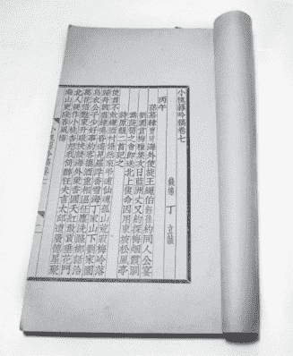

图6：诗集《小楼吟吟稿》，于20世纪20年代初使用聚珍仿宋字体印刷。

图7：仿宋示例：（第一行）华文仿宋（STFangsong）；（第二行）方正仿宋；（第三行）方正刻本仿宋；（第四行）方正珍修新仿。

#### 1.2.2.4 楷体（楷）

楷或楷书，也常被称为正楷或标准楷，是最新的中国书法风格，因此也是现代著作和出版物中最常用的。图8展示了四个楷体示例。这种正楷最容易被识别，因此通常用于向儿童和学习中文的初学者介绍。楷继承了工整书写文本的许多特征。每一笔画都是独立的，并按清晰的顺序仔细放置。每一笔画的末端都展示了毛笔如何落在纸上并从纸上提起。

图8：楷体示例：（第一行）方正楷体；（第二行）方正北魏楷书；（第三行）方正大魏楷体；（第四行）方正宋刻本秀楷。

## 1.3 中文字体设计

与拉丁字母或阿拉伯数字相比，汉字的设计要困难得多，原因有几点。首先，汉字数量远多于拉丁字母。约六千个汉字用于日常使用，康熙字典中还有47,000个更多字符。如此庞大的字符数量导致了非常庞大的参考数据库和耗时的设计过程。其次，汉字的结构比拉丁字母和阿拉伯数字复杂得多。汉字通常有10多个笔画和交叉点，从而增加了所有字符在结构稳定性和表达一致性方面的复杂性。

尽管中文字体设计和英文字体设计共享许多共同的概念、理论和方法[Bringhurst, 1992; White, 2004]，但中文字体的复杂性，尤其是在汉字数量庞大方面，使得单个设计师不可能为一种字体中的所有字符实现完美设计。平均而言，设计一种包含国家标准（GB2312）中定义的6,763个汉字的中文字体，大约需要三个工年才能完成。为了完成设计一种字体的任务，一个通常由一名资深设计师、两名中级设计师、五名普通设计师和一名检查员组成的设计团队，会共同工作三到五个月。

开发某种字体原创性的方式并不重要，因为当公司决定开发字体时，仍会选定一名资深字体设计师负责规范。一般来说，经验丰富的设计师会与两名中级设计师合作制定规范。此外，其中一人将负责后续字体开发的方向和管理。五名或更多普通设计师根据规范设计所有单个字符。检查员确保新设计字符的质量和风格。

### 1.3.1 中文字体设计工作流

设计一种中文字体通常分为三个阶段：“原创性形成”、“设计规范制定”和“整体方案实施。”

#### 1.3.1.1 原创性形成

每种新字体都有独特的灵感来源。例如，由法国建筑师设计的一座现代歌剧院启发了方正俊黑体（Fang-ZhengJinHei）；当地商店的传统招牌启发了方正颜宋体（FangZhengSong Yan）；而方正剪纸体（FangZheng-JianZhi）则体现了中国装饰艺术中最流行的民间传统之一——剪纸的精髓。总结一套激发灵感的通用理论很难，因为字体设计涉及的原创性多种多样。然而，字体的属性基于字体设计的三个要素：结构、笔画和宽度。结构包括字体的大小和位置，以及在辅助线上绘制的重心。笔画（如点、横、竖、提、按和甩）是汉字的主要部分，并使用基于顶点的轮廓来表达。笔画宽度因不同字体风格而异。

#### 1.3.1.2 设计规范制定

完美设计一个单字很容易。然而，确保一种字体中所有字符在结构和风格上保持一致却很难。理论上，保持一致性的最佳方法是让一位设计师完成所有字符设计。然而，设计师完成计划需要三到四年时间，因为一种字体中包含超过 6,000 个汉字。在现代字体公司中，多位设计师通常在不同层级上协作以缩短开发周期。然而，这种策略也增加了不一致的风险。设计字体通常需要设计规范。

关于新字体设计理念的全面说明对于执行设计师的构想至关重要。全面说明还能使许多设计师通过协作完成一个设计。

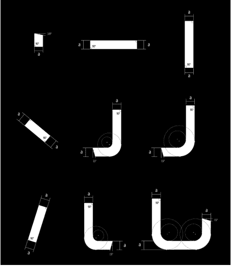

图 9：中文字体设计规范示例（方正/俊黑，FangZheng/JunHei），展示示例笔画（李绍波提供）。

协作努力。规范中几个甚至几十个示例字符对于协作来说是不够的。设计样本的数量取决于对字符集结构和字符之间相似性的深入分析。基于多年经验，大多数字体设计公司同意，当一种字体中几乎所有字符被分解时，汉字大约有 500 个常用部首。可行的说明显然应包含足够的示例字符，涵盖所有这些组件，同时尽可能包含多种变形和组合。字符数量应至少为 500。使用规范中的这些示例字符，如图 9 和图 10 所示，其他合作设计师可以轻松理解新字体的设计理念，并相应地使用常用组件创建其他字体样式，重新排列所需的精力相对较少。

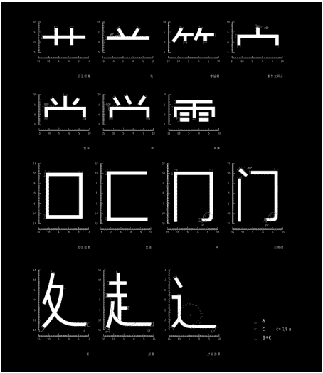

图 10：与图 9 相同的中文字体设计规范示例（方正俊飞，FangZhengLunfei，方正俊黑），展示示例组件（李绍波提供）。

#### 1.3.1.3 整体方案实施

使用示例字符，设计师可以使用常用组件构建同一风格的新字符。例如，桶（tong）由两个主要组件组成：左边的木（mu）和右边的甬（yong）。组件木可以在多个示例字符中找到，例如横（heng）。组件甬可以在示例字符桶中找到。设计桶的基本步骤是从字符横中选择木，从桶中选择甬，然后将它们组合起来。

图 11 展示了一个简化的说明。然而，这个过程并不简单。为了实现完美甚至可接受的字体，设计师必须解决许多具有挑战性的问题，其中一些问题将在以下部分讨论。

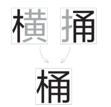

图 11：根据规范基于先前设计的字符设计新字符。

### 1.3.2 中文字体设计中的特殊问题

#### 1.3.2.1 视觉平衡：大小

汉字呈方形，例如国（guo）、图（tu）和口（kou）。然而，大多数汉字并不具有方形轮廓。事实上，采用特殊设计将这些形状转换为近似方形。此外，某些字符（如卜（bu））的轮廓是矩形。在上（shang）中，轮廓近似三角形，而在兮（xi）中，轮廓是菱形。各种字符形状之间的差异导致了字符大小统一性的挑战。为所有字符的占用区域分配相同的大小不会产生视觉相似性。例如，如果兮和口设计为相同的占用区域，兮看起来会比口略大。图 12 给出了一个说明。

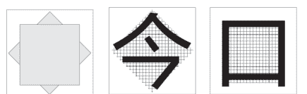

图 12：占用区域相同的两个字符看起来大小不同：（左）面积相同的菱形和正方形；（中间和右侧）占用区域相同的兮和口。

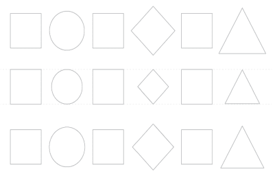

图 13：不同大小的形状及其视觉效果：（顶部）面积相同的形状；（中间）高度相同的形状；（底部）视觉大小相同的形状。

图 13 清楚地显示了正方形、菱形和三角形细节之间的差异。与正方形面积相同的三角形或菱形看起来比后者略大（图 13，顶部）。然而，与正方形高度相同的三角形或菱形看起来比后者略小（图 13，中间）。为了使这些字符看起来高度相同，设计师试图确定不同字符最合适的大小。

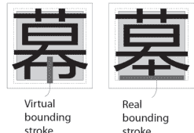

图 14：虚拟包络笔画和实际包络笔画。

#### 1.3.2.2 视觉平衡：包络笔画

字符的大部分外部笔画有助于形成包围盒，因此被称为包络笔画。这些笔画根据其与相应边界的连接类型分为两类。用点（笔画的尖端）连接边界的笔画称为虚拟包络笔画（图 14，左侧），而用线（笔画的一条边）连接边界的笔画称为实际包络笔画（图 14，右侧）。不同的包络笔画相对于字符大小具有不同的视觉效果。为了使两个相似的字符看起来大小相同，对虚拟和实际包络笔画采用不同的设计。图 14 显示，虚拟包络笔画的尖端设计为略微超出占用区域的边界。实际包络笔画的边缘保持在区域内。

#### 1.3.2.3 视觉平衡：笔画密度

字符视觉大小的感知受到另一个主观因素的影响，即字符笔画的密度。通常，笔画较多的字符应该比笔画较少的字符看起来更大。例如，如果口（kou）和整（zheng）设计为 SF 大小相似（图 15，顶部），那么整看起来比口更紧凑且更小。为了在笔画密度不同的字符之间实现视觉平衡，复杂字符的 SF 通常会被仔细调整以显得更大，如图 15 底部所示。

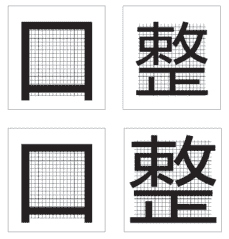

图 15：笔画密度不同的字符：（顶部）SF 大小相似的口和整；（底部）整的 SF 被放大。

#### 1.3.2.4 居中对齐

正确有效地对齐组件的中心可确保一组良好的字符。可以总结出两条基本规则：上下结构字符中组件的中心应垂直对齐，而左右结构字符中组件的中心应水平对齐。对于更复杂的字符，如上中下结构、左中右结构、全包围、半包围和嵌套结构，大多数局部对齐是基于层级字符分解设置的，如图 16 所示。例如，字符楼（lou）

在第一级中可以分为左、右两部分。然后，右部分可以分为上、下两个组件。因此，对应组件之间的这两个层级应采用不同的对齐方式。

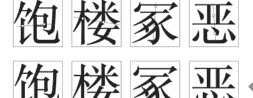

图 16：质心对齐示例。（顶部）从专业角度来看，四个字歪斜，因为某些组件未对齐。连接两个质心的参考线应为垂直或水平。（底部）对应字符的质心已对齐。

#### 1.3.2.5 碰撞避免

遵循字体规范，设计师通常基于规范中的参考样本，或借用已完成字符的某些组件来创建该字体中的大多数字符。碰撞避免是这一过程中的显著现象。由于组件来自不同字符，将其用于构建新字符可能导致某些笔画相连甚至重叠。图 17 显示，木 中的一横与 黄 (huang) 中的一横相连。这种意外的连接不仅损坏了字符结构，还影响了可读性。因此，应调整笔画的长度和位置，以实现和谐的布局。

图 17：碰撞避免示例：（左）木 与 黄 相连；（右）通过调整一横的长度和位置，将两个组件分开。

#### 1.3.2.6 笔画宽度对视觉平衡的影响

笔画宽度是影响尺寸和稳定性视觉感知的重要因素。在设计一种字体的所有字符时，采用单一的笔画宽度是不可行的。例如，如果为 膏 (gao) 和 口（图 18）使用相同的笔画宽度，则 膏 看起来明显比 口 更重，因为前者包含更多笔画且结构更复杂。为了在视觉上协调这些字符，应将它们调整到合适的实心笔画宽度。

笔画长度相对于笔画宽度会影响视觉感知。图 19 说明了这种情况。在三条宽度相同的线中，最长的线总是看起来比另外两条线更细。相反，最短的线看起来最粗。

图 18：笔画宽度相同的字符 膏 和 口。

图 19：宽度相同但长度不同的笔画。

Wundt-Fick 错觉 [Fick, 1851] 指示了笔画位置与相应长度视觉感知之间的关系。图 20 显示，尽管四个示例中的所有线条长度和宽度相同，但前两个示例（左侧）中的垂直线看起来比它们连接的水平线更长。同时，最后两个示例中的水平线看起来比垂直线更长。

图 20：Wundt-Fick 错觉示例。

上述所有观察都强调了调整笔画的必要性。经验丰富的设计师通常会花费大量时间单独调整笔画宽度，以在视觉上平衡具有多个笔画的复杂字符。图 21 显示了方正兰亭黑 (FangZheng-LanTingHei) 字体中的 喜 和 口。对这些字符笔画宽度的一些调整只有经过仔细检查才能观察到。

图 21：调整笔画宽度的示例字符。

#### 1.3.2.7 组件大小对字符结构的影响

传统中国书法关于字符结构有规则 [Sun I Vision Design, 2011]。例如，上紧下松、左紧右松、内紧外松对于设计现代字体很有价值。出现在单个字符中的相同组件是一个很好的示例。重复组件的大小应予以调整，因为其视觉大小受其在字符结构中位置的影响。图 22 说明了一个由两个相同正方形组成的简洁诠释。

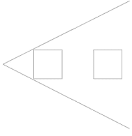

图 22：两个相同的正方形看起来大小不同。

靠近锐角的左侧正方形看起来略大于右侧的正方形。考虑到中文文本从左到右阅读，经验丰富的设计师倾向于采用大小不同的组件，以实现更稳定的结构。图 23 显示了由三个相同的 □ 组件组成的四个不同字体的 品 (Pin) 字符。基于“左紧右松”规则，大多数左下角的 □ 组件被设计为比右侧邻居更小。特别是，对于许多字体，左下角 □ 组件（图 23 中标记为 b）的宽度通常被设计为比右下角 □ 组件（图 23 中标记为 b 或 c）的宽度更短。这种精细调整符合由组件位置引起的视觉错觉，并稳定了字符结构。

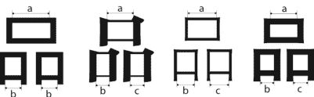

图 23：不同字体中具有相同组件的 品 (Pin) 字符示例：（左）方正兰亭黑 (FangZhengLanTingHei)；（左二）方正准宋体 (FangZhengZhunYaoSong)；（左三）方正邓等线 (FangZhengXiDengXian)；（右）方正黑体 (FangZhengHei)。当每个 品 字符中的三个 □ 组件不相等时，其宽度标记为 a、b 和 c。

## 1.4 不同语言之间的和谐

由于全球化，文章现在通常包含多种语言。选择原本为不同语言设计的字体，协调其不同风格，并跨越多元文化设计和谐布局，都是棘手的问题。

### 1.4.1 统一的笔画风格

一些被接受的建议可以实现中英文文本的和谐组合。这些建议包括：无衬线英文字体使用中文黑体，衬线英文字体使用中文宋体。对于专业设计师来说，这些建议显然不够。要实现高水平的工作，字体设计师需要进行高度具体的修改，甚至创建新字体。例如，惠普公司于 2006 年推出了市场策略“The Computer is Personal Again”。有必要设计一系列关于相同内容但使用不同语言的广告。在这则广告的中文版本中，每个汉字的笔画风格都参考了英文广告中对应字母的结构。

### 1.4.2 协调不同语言的字体大小

当使用大小相同的中英文字体时，字体在尺寸上显得不和谐。中英文字体采用不同的方法来描述字体大小。字体大小和中宫都会影响中文字体的视觉尺寸。对于英文字体，x-height 是描绘字母视觉尺寸最重要的特征 [Kobayashi, 2005]。为了在协调不同语言字体大小时实现高精度，应调整字体内部。

### 1.4.3 笔画宽度统一

在一个段落中为不同字体分配相同的粗细是实现平滑统一布局的常用方法。然而，当字体来自不同语言时，布局效果并不总是令人满意，因为这些字体的粗细可能具有不同的含义。为了识别更多替代粗细，设计师倾向于选择字体系列，在尺寸上与其他语言字体相匹配。图 24 显示了与中文字体方正愈黑 (FangZhengYuHei) 搭配的 Helvetica 系列字符示例。图 24（左）中的 Helvetica Neue 65 看起来太深，导致英文字母从段落中凸出。图 24（中）中的 Helvetica Neue 45 看起来太浅。在图 24（右）中，基于 Helvetica 重新设计的英文字体适合与方正愈黑 (FangZhengYuHei) 搭配。

PostScript 字形描述技术采用美国 Adobe 公司的 Postscript 页面描述语言来描述字体的一种技术。CID 字符集是国际 Adobe 公司规定的新字符集格式，所有字符通过编码来区分。PostScript Type 1 格式，它具有解析快、渲染快、兼容性好、跨平台等优点，是目前世界范围内最流行的字体格式之一。这种字体格式还定义了字体的度量值数据。

PostScript 字形描述技术采用美国 Adobe 公司的 Postscript 页面描述语言来描述字体的一种技术。CID 字符集是国际 Adobe 公司规定的新字符集格式，所有字符通过编码来区分。PostScript Type 1 格式，它具有解析快、渲染快、兼容性好、跨平台等优点，是目前世界范围内最流行的字体格式之一。这种字体格式还定义了字体的度量值数据。

PostScript 字形描述技术采用美国 Adobe 公司的 Postscript 页面描述语言来描述字体的一种技术。CID 字符集是国际 Adobe 公司规定的新字符集格式，所有字符通过编码来区分。PostScript Type 1 格式，它具有解析快、渲染快、兼容性好、跨平台等优点，是目前世界范围内最流行的字体格式之一。这种字体格式还定义了字体的度量值数据。

图 24：不同笔画宽度的中英文字体组合。

## 参考文献

Bathrobe (n.d.) Bathrobe’s East Asian Writing Systems http://www.cvjlang.com/Writing/writchin/index.html, 2015年5月27日访问

Bringhurst, R. (1992) 排版风格要素, (Hartley & Marks, Canada).

DynaComware (n.d.) http://www.dynacw.cn/, 2015年5月27日访问

Fick, A. (1851) Da errore quodam optic asymmetria bulbi effecto. (Marburg, Koch, Dissertation).

Founder Type, 北京方正电子有限公司 (n.d.) http://www.founder-type.com.cn/, 2015年5月27日访问

Hanyi fonts (n.d.) http://www.hanyi.com.cn, 2015年5月27日访问

Kobayashi, A. (2005) 拉丁字体：背景与应用, (Bijutsu Shuppansha)

孙 I 视觉设计，（2011）《字体设计指南》，（科学出版社，中国科学出版传媒有限公司）。

怀特，A.W.（2004）《字体思考：排版的实践哲学》，（奥尔沃思出版社）。

维基百科（2015）《中文书写系统》http://en.wikipedia.org/wiki/Written_Chinese，2015 年 5 月 27 日访问

中一电子有限公司（无日期）http://www.china-e.com.cn，2015 年 5 月 27 日访问

# 针对特定媒介优化字体

埃本·索尔金

本章介绍了针对特定媒介优化字体的方法。作者以字体设计师的视角和经验为基础进行阐述。本章列出了在开始优化过程前需要收集的信息，以及评估和应用这些信息以优化字体的一些方法。还回顾了使用优化来克服的问题示例，以及优化过程不再相关的示例。同时考虑了印刷字体和屏幕渲染字体。还讨论了未来针对计算机渲染文本优化字体的一些方法。

## 1.1 引言

本章探讨了作者所知的针对特定媒介优化字体所采用的原则和方法，作者自 2010 年起一直是一名专业字体设计师。所呈现的材料反映了他的经验以及观察到的问题。优化更高级的动机是创建字体在两种或多种不同媒介和/或印刷方法中的印刷结果的一致性。这需要制作针对特定流程优化的字体版本或“等级”。

## 1.2 与优化相关的因素

- 1. 字体阅读距离
- 2. 字体再现的物理尺寸
- 3. 需优化的媒介类型
- 4. 用于再现字体的技术
- 5. 字体的形式特征
- 6. 视角
- 7. 字体读者

通过收集这些因素的信息，描述了优化的相关设计考量。信息越完整、越精确，在优化字体时就越有可能做出深思熟虑且恰当的字体设计选择。

尽管理想情况是拥有一套完整且详细的信息，但从实际角度来看，我发现并不总是能够收集齐全的信息，或对所有信息都完全确定。因此，有必要了解每个因素信息的确定程度，以避免在设计过程中过度或不足地强调该因素。

从感知角度思考是将这些因素统一起来的一种方式。任何优化的目的都是补偿读者感知字体时的失真。列出的因素是可能影响读者感知的一系列考量。当失真改变了字体的清晰度和实用性时，失真就至关重要。字体是工具，优化旨在使它们成为更好的工具。失真还可能改变字体带给文本的感觉或表达。只有当对字体设计的改变使字体恢复或提高实用性和/或表达性时，我们才能声称优化已经发生。

对于将字体用于实验目的的科学家来说，了解字体如何以及为何可能被优化也很有价值，因为这可以帮助他们更好地控制实验变量。这种意识的一个副作用是，它还可以帮助使这些实验对字体设计师和排版师更具相关性和实用性。

## 1.3 视角：物理尺寸与阅读距离

收集完信息后，下一个问题是如何实际使用它。你应该从哪些关系入手？在因素中，也许最主要的关系是视角。这个术语指的是阅读时字体在眼睛视网膜上的大小。

要解决优化字体的视角问题，可以查看列表中前两个因素的关系：字体再现的物理尺寸以及阅读字体的距离范围。大视角允许更清晰、更细腻的感知。小视角更具挑战性，因为字体更容易受到字体再现缺陷或我们自身看和读字体能力的影响——或者两者兼而有之。

相同物理尺寸的相同字体从不同距离阅读时，其视角不同（图 1）。

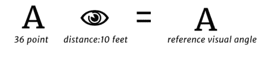

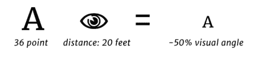

图 1：距离改变视角。

同一字体再现两次，一次大小为另一次的两倍，如果观看大号字体的距离是两倍远，则可以具有等效视角（图 2）。

| 尺寸 | 距离 | 视角 |
| --- | --- | --- |
| 36 磅 | 10 英尺 | 参考视角 |
| 72 磅 | 20 英尺 | 参考视角 |

图 2：不同的物理尺寸可以通过距离具有等效视角。

在我们应预期的阅读距离方面，有些优化会相对简单。例如，用于书籍、地图、杂志和其他印刷品的字体通常从相当窄的距离范围阅读：通常为 30-40 厘米或 12-16 英寸。相比之下，智能手机的可能阅读距离范围更具可变性。机场或高速公路上的标志需要从更宽的距离范围轻松阅读。在视角范围较大的情况下，从一组最可能的阅读距离以及可能的极端距离进行测试是实际可行的。

无论字体再现的物理尺寸如何，当视角较小时，字体往往需要更宽的间距和更低的笔画对比度。这一趋势在拉丁字体中有历史先例，因此成为一种文化惯例。然而，也可能与人眼的最大视敏度有关，可能还与被称为拥挤（crowding）的心理现象的影响相结合 [Pelli and Tillman, 2008]。如果涉及拥挤，那么在较小视角下给予字体的额外空间将有助于正确分组我们检测并组合以识别字形的特征。在较大视角下阅读的字体通常采用相对较窄的字形宽度和更紧凑的间距。然而，鉴于大尺寸设计中出现的大量解决方案，这种需求似乎较小。取决于设计风格，设计师可能还需要在较大视角下使设计细节更具细腻或微妙之处，或在较小视角下使其更重、更厚实或更粗犷。

## 1.4 输出：字体再现技术与媒介

与视角的情况一样，我们需要再次混合列表中的两个因素。在此情况下，我们将媒介和用于再现字体的技术一起考虑。各种媒介和各种成像技术的特性只有在结合并产生输出时才会变得明显和相关。可以评估这种输出及其中出现的重复问题模式，然后在字体设计中进行纠正。正是这种对特异性的需求，使得在面对字体再现媒介和技术的压倒性潜在组合时，优化变得实际可行。

尽管我们已经建立了一种管理媒介和字体再现技术巨大多样性的实用方法，但我们仍应简要考察可能媒介和字体再现技术的多样性。

当我们思考媒介本身时，我们的第一个想法可能是纸张、胶片、塑料、箔片或其他可印刷字体的表面等实体材料。这些媒介形式在特性上提供了令人望而生畏的广泛变化范围。有些媒介会大量吸收墨水，有些吸收很少，而另一些则不透水，需要墨水、碳粉或油漆在其表面干燥。有些媒介具有粗糙的纹理，而另一些则非常光滑。媒介也可以是哑光或光泽的。媒介还可以表现出广泛的色调、亮度、厚度甚至透明度。这只是特性的部分列表。这些特性中的每一个反过来使特定形式的媒介对另一种特定字体再现技术更合适或更不合适。

通过应用切割乙烯基、压纹、凹压、染色、喷砂、激光切割或雕刻，字体可以应用于不太可能被视为媒介的表面，例如木材、石材、混凝土和金属（参见图 3–6）。

媒介可以包括飞机侧面、建筑物或远洋船舶。与之前更传统的示例一样，技术必须与将要应用的材料的特性很好地匹配。

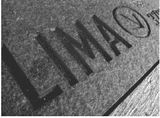

图 3：东波士顿分馆图书馆人行道上的喷砂上色石材。

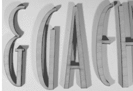

图 4：Lida Lopes-Cardozo 设计的字母；Eben Sorkin 数字化；为剑桥艺术学院的 Will Hill 激光切割。照片：Will Hill。

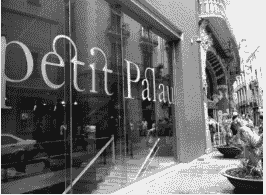

图 5：加泰罗尼亚音乐宫，巴塞罗那，西班牙。

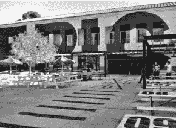

图 6：Facebook 校园（加利福尼亚门洛帕克）上的两层楼高字母。

The sky becomes medium when airplanes 'print' dot matrix style in the sky with dots of smoke (Figure 7).

当飞机以点阵式在天空中用烟点“打印”时，天空变成了介质（图 7）。

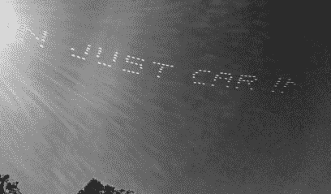

图 7：从旧金山金门公园（加利福尼亚）看到的天空。

For output to inspire the effort of optimization the output must contain a problem that needs to be corrected. Figure 8 demonstrates an obvious problem from a relatively crude reproduction technology.

要让输出激发优化的努力，输出必须包含一个需要纠正的问题。图 8 展示了相对粗糙的再现技术中的一个明显问题。

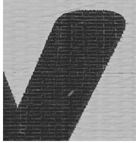

图 8：细节，东波士顿（马萨诸塞州）YMCA 广告牌。

图 9：在典型观看距离处看到的 YMCA 广告牌。白色箭头指向图 8 中详细展示的区域。

Problems that are sufficiently minor in the context of their normal use will not inspire optimization. The roughness seen in Figure 8 is no longer visible in Figure 9.

在正常使用的语境下足够微小的问题不会激发优化。图 8 中看到的粗糙度在图 9 中不再可见。

Type designers who are testing their designs will overcome the limitations of a poor laser printer by using a similar method. They will output their designs at a large size and step back from the page until the image of the text is at the appropriate visual angle.

测试设计的字体设计师会通过使用类似的方法来克服劣质激光打印机的局限性。他们会以大尺寸输出设计，并后退直到文本图像处于适当的视觉角度。

Clearly we can see that the more severe the output problem, the greater the size and scale required to overcome it. The scenario most likely to inspire optimization is the opposite: physically small text. Reproduction at small sizes is much more likely to exhibit and suffer from deficiencies when output. With small text a greater distance may make the problem even worse by making the text harder to read. If the text is instead brought closer to the eye then the deficiencies in reproduction become more obvious.

很明显可以看出，输出问题越严重，克服它所需的尺寸和规模就越大。最可能激发优化的场景恰恰相反：物理尺寸很小的文本。小尺寸的再现在输出时更有可能展示并遭受缺陷。对于小文本，更大的距离可能会通过使文本更难阅读而使问题更糟。如果文本靠近眼睛，那么再现的缺陷就会变得更明显。

Compare the degree of distortion in Figure 10 and Figure 11. Both are distorted but the details are kept more intact in the '5' in Figure 11 which is physically larger.

比较图 10 和图 11 中的畸形程度。两者都有畸形，但图 11 中物理尺寸更大的 '5' 的细节保持得更完整。

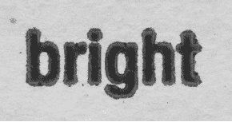

图 10：激光打印机纸箱侧面看到的文本。

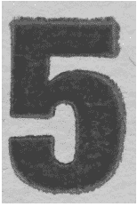

图 11：与图 10 来自同一来源。

图 12：在 Rounding UFO 中显示带有和不带有墨陷阱的 AE。AE 字形来自 Sorkin Type Co. 字体系列 Fjalla。

Type which will be set in or on media that exhibit ‘ink gain’ will tend to show an expansion of the shape of glyphs through the bleeding and/or expansion of ink on the surface of the media. This kind of distortion can be partially compensated for. For example the white spaces where strokes join can be designed so that corners are cut into more deeply. This feature is sometimes called an ‘ink trap’ or ‘light window’. Frederik Berlaen’s tool ‘Rounding UFO’ has a function for programmatically adding this feature (see Figure 12).

将在表现出“墨增”现象的媒介上或其中排版的字体，往往会因墨水在媒介表面的晕染和/或扩展而显示字形形状的膨胀。这种畸形可以部分补偿。例如，笔画交汇处的空白可以设计得让角切得更深。此功能有时被称为“墨陷阱”或“光窗”。Frederik Berlaen 的工具“Rounding UFO”具有以编程方式添加此功能的功能（见图 12）。

In addition to ink traps the shape of the letter itself can also be made somewhat smaller to allow for the degree of gain or expansion that is anticipated.

除了墨陷阱，字母本身的形状也可以做得稍小一些，以留出预期的增量或扩展空间。

Features of glyphs which are close together can be made to be farther apart for example between the base letter and a diacritic mark (Figure 13).

字形中靠得很近的特征可以拉开间距，例如基础字母与变音符号之间（图 13）。

图 13：右侧的 ‘a’ 字形将其变音符号上提。样本来自作者的 Merriweather 字体系列。

See: Bell Centennial by Matthew Carter 1975–78, Galfia by Ladislas Mandel 1975-1981.

参见：Matthew Carter 1975–78 的 Bell Centennial，Ladislas Mandel 1975-1981 的 Galfia。

Slow changes in curves look circular whereas fast changes in direction appear sharper and have a shape that is more triangular or boxy. Ink gain can alter the character of a curve making the direction of a curve appear more gradual or slow. To compensate for anticipated ink gain, curves can be made more abrupt or sharp (Figure 14).

曲线的缓慢变化看起来是圆形的，而方向的快速变化看起来更锐利，形状更呈三角形或方形。墨增可以改变曲线的特征，使曲线的方向看起来更渐进或缓慢。为了补偿预期的墨增，曲线可以做得更突兀或锐利（图 14）。

图 14：上方两个单词分别没有和带有模糊以模拟墨增。下方示例是一组经过修改的形状，旨在抵抗墨增的影响。单词采用 Merriweather 和修改后的 Merriweather 设置。

图 15：墨增切入字母形状。

With reversed or white 'knock out' type the ink gain cuts into the glyph shape rather than expanding it (Figure 15).

使用反白或白色“镂空”字体时，墨增会切入字形而非扩展它（图 15）。

The process called 'halation' is where light shines through glyphs which are illuminated or which is reflective. This is quite similar to ink gain as a problem in that glyph shapes seem to expand.

称为“光晕”的过程是指光线照射或反射的字形透光。作为问题，这与墨增非常相似，因为字形看起来似乎在扩展。

Outputs to erode glyph shapes present a different problem. One solution is to build up the corners that are likely to be rounded by the erosion. The resulting studs or spikes will erode back to the desired shape. Again, the program 'UFO rounded' has a method for generating these features (Figure 16).

侵蚀字形的输出呈现出不同的问题。一个解决方案是加固可能因侵蚀而变圆的角。由此产生的凸起或尖刺会侵蚀回所需的形状。同样，程序“UFO rounded”有一种生成这些特征的方法（图 16）。

图 16：左侧是基本 AE 形状，右侧是带有尖刺以抵抗视觉侵蚀的形状。

A limit in the resolution of the technology, ink gain, and irregularity in the media being used can each contribute to a reduction in the ability to reproduce fine detail. These kinds of problems require font designs in which the thin parts of glyphs are made heavier or in some cases the fine parts of the design must be removed.

技术分辨率的限制、墨增以及所用媒介的不规则性都会导致再现精细细节的能力下降。这类问题需要进行字体设计，使字形的细部变粗，或在某些情况下移除设计的精细部分。

### 1.4.1 屏幕上的动态字体

The range of variation of screens and projection is not as large as we observe at static media but it is still very large and changing rapidly. At the time of writing there are an increasing range of manufactured goods which have historically not featured screens but which are beginning to make screens crucial to their basic use. Examples of this change include thermostats, cars and wrist watches (see for example Figure 17).

屏幕和投影的变化范围不如我们在静态媒介中观察到的那么大，但仍然非常大且变化迅速。在撰写本文时，越来越多的历史上没有屏幕的制造商品开始将屏幕视为其基本使用的关键部分。这种变化的例子包括恒温器、汽车和腕表（例如见图 17）。

图 17：2014 年，奥迪推出了基于屏幕的仪表板或仪表组。http://www.audi.com/com/brand-en/vorsprung_durch_technik/content/2014/04/audi-virtual-cockpit.html.

More familiar use of screens includes phones, tablets, computers, televisions, VR goggles and the cinema.

更常见的屏幕用途包括手机、平板电脑、计算机、电视、VR 眼镜和电影院。

Screens vary in the detail they can offer and in their reflectivity and contrast in the case of e-paper screens, or in their luminance and contrast as is the case with CRT, AMOLED, LCD and LED screens. Screen resolution has made a great deal of progress in the last decade. For instance early e-paper screens in 2009 had much lower contrast and resolution than they do in 2015. E-paper is useful in bright reading conditions because it does not need to emit a light that is brighter than is in the environment for the image to be perceived. Instead it reflects environmental light in a manner similar to paper. In contrast, laptops and smart phones use light emitting technologies.

屏幕在可提供的细节方面各有不同，就电子纸屏幕而言，还有其反射率和对比度；就 CRT、AMOLED、LCD 和 LED 屏幕而言，还有其亮度和对比度。过去十年，屏幕分辨率取得了很大进步。例如，2009 年的早期电子纸屏幕对比度和分辨率远低于 2015 年。电子纸在明亮的阅读条件下很有用，因为它不需要发出比环境更亮的光才能感知图像。相反，它以类似于纸张的方式反射环境光。相比之下，笔记本电脑和智能手机使用发光技术。

Unlike paper which will vary in effective resolution mostly depending on printing technology, screens have an inherent maximum resolution. Software combined with the video cards that control screens are the equivalent to font reproduction technology relevant to screens.

与纸张不同，纸张的有效分辨率主要取决于印刷技术，而屏幕具有固有的最大分辨率。控制屏幕的软件结合显卡，相当于与屏幕相关的字体再现技术。

Very low resolution screens tend to require font designs that are simpler and grid oriented in both their construction and spacing. At the lowest resolutions the most pressing problems to solve are basic and critical. For instance we will want to avoid part of the glyph needed for easy recognition disappearing (see Figure 18).

极低分辨率的屏幕往往需要字体设计更简单，在构造和间距上都面向网格。在最低分辨率下，最紧迫的问题是基础且关键的。例如，我们希望避免易于识别所需的字形部分消失（见图 18）。

图 18：作者的 Merriweather 字体在 Windows XP 的 WordPad 中以 8pt 渲染。上方示例没有提示，下方示例使用 TTFAutohinter。除了保留字母形状外，TTFAutohint 还使文本渲染软件使用抗锯齿，从而产生下方示例中看到的灰色像素。

虽然将文本渲染到屏幕上的软件至关重要，但字体本身也可能包含帮助其良好渲染的软件。字体中的软件被称为“提示”。这些提示补充了本地文本渲染软件。当使用它们时，它们会通过暂时改变字形的轮廓，有时也会改变字体的间距，来影响字体图像在屏幕上的再现。提示可以被视为一种字体优化形式，部分原因在于它们可以用于改善字体在屏幕上的外观，但也因为对于给定用途，它们实际上正在改变该用途的字形形状。

提示很强大，但当字体中的形状已被修改以获得最佳效果时，它效果更好。例如，在 TTFAutohint 的早期版本中，如果将上超和下超的高度设置为一致，则渲染错误会更少。在常规字体设计中，这通常不会这样做，因为它与字体设计中对光学规则性而非几何规则性的需求相冲突。

图 19：字形 'o' 和 'r' 显示了作者字体 Meriwether 的上超高度。图像来自 Fontlab Studio 5。

基于光学的上超高度会根据形状是尖锐或锐利而非平坦的程度而变化。形状越锐利，它就应该上超得越多，以便在视觉上看起来均匀（图 19）。

许多有助于优化字体以适应低分辨率屏幕的特性，与优化字体以用于小光学尺寸具有共同点：更宽的间距、更低的对比度、更粗的细节和更重的字重。随着屏幕分辨率的提高，字体设计师在选择形式和间距方面拥有更大的自由度。从历史上看，专门为屏幕制作的字体在可能的情况下会选择水平或垂直的 d 形状，而不是对角线形状。

在撰写本文时，具有纸张般细节的屏幕分辨率已在智能手机、笔记本电脑和台式机上发布，可在典型阅读距离下使用。例如，iPhone 5 的像素密度为每英寸 325+ 像素，即“ppi”。作者所知当时最高的密度之一是惊人的 2098 ppi，几乎高出 6.5 倍。

同样，距离及其产生的光学尺寸有时可以有效地使印刷技术的差异变得不那么重要，随着屏幕分辨率的提高，渲染软件的差异也变得同样不易察觉。更好的屏幕分辨率意味着作为一种媒体的新高分辨率屏幕需要的优化更少。

为低分辨率和中分辨率屏幕使用而制作的字体，在非常高分辨率的环境中有时会显得不协调。可以通过将其形状调整为更大的光学尺寸来优化它们，以便在高分辨率环境中表现更好。实际影响是什么？

Microsoft 为 Windows 8 实现了一个名为 Sitka 的字体系列。Sitka 为系列中的每种样式提供六种光学版本。用户可以自行选择光学尺寸。但是，Windows 操作系统还具有为用户自动选择 Sitka 光学版本的新功能。

Nick Sherman 进一步推进了这一想法，提出了一种新的字体格式，该格式不再是在少数静态实例之间呈现或自动切换，而是可以像响应式网站一样持续适应条件。这种字体格式在理论上可以实现针对屏幕和其他媒体的非常广泛的连续自适应优化。

ᵈ 一个很好的例子是 John Berry 在《现在就读这》（'Now Read This'）第 9 页中提到的两层 'g' 的下部圆弧，该小册子于 2004 年制作，旨在推广为当时 Windows XP 中的新 Clear Type 技术制作的字体。
ᶜ http://www.androidauthority.com/worlds-highest-ppi-display-2098ppi-oled-display-sony-254182/
ᶠ http://alistapart.com/blog/post/variable-fonts-for-responsive-design

## 1.5 字体的形式特征

字体设计中存在大量可观察的形式特征或设计变量。当对字体进行优化时，将调整这些特征。

设计中特征越普遍，其价值可能越大。字重、对比度、宽度、倾斜度和间距都是贯穿整个字体的特征示例。与低或中等倾斜度或对比度的设计相比，具有高对比度或强倾斜度的字体更可能需要针对媒体进行调整。§ 所需的调整可能是降低对比度或倾斜度。非常细或非常重的字体比中等字重更可能需要调整。同样，中等宽度比宽或窄的字体更不太可能需要优化。

某些形式特征与字形的部分相关。这些部分可能不会出现在每个字形中，而是分散在字体的各个字形中。示例包括主笔画、连接处、圆弧和端点。特征在所设计文字中的出现频率非常重要。例如，在拉丁文字中，主笔画相当常见。然而在西里尔文字中，它们占主导地位。在希腊文字中，主笔画相对少见，而圆形或圆弧形状占主导地位。某些文字（如中文和天城文）中，大量字形具有高笔画密度，因此拥有大量连接处。任何优化尝试都应考虑这些特定于文字的倾向。

某些特征仅存在于字体的子部分中。它们对优化过程的重要性可能取决于正在优化的字体将如何使用。例如，由于小写字母在大多数（但并非所有）字体使用中占主导地位，因此这一组的特征对优化过程往往相当重要。但是，全大写使用将完全否定其重要性。

§ 应用于低对比度字形的变形比应用于高对比度字形的变形不太可能被注意到。更强的倾斜度在低分辨率屏幕上更可能渲染效果不佳。

## 1.6 视角

还应考虑读者的视角。印在路面上的给驾驶员看的标志是优化此因素的示例。在此情况下，字母被垂直拉伸，以便驾驶员在接近印在路面上的标志时更容易阅读。参见图 20 和 21。

图 20：给驾驶员看的“停止”标志。注意 T 上非常粗的顶部笔画。

图 21：香港街道上一个类似的给驾驶员看的标志。

需要从多个角度可见的街道标志可以从使用较大的闭合空间和比正常更宽的字母中受益。直接在标志前方观看标志的人可以轻松容忍稍宽的字母，而从左侧或右侧角度看到标志的人将从更宽字母对压缩的抵抗力中受益。更宽地间距字母也会有所帮助。参见图 22。

图 22：这是一个虚构街道标志的模型。顶部使用压缩样式；中间使用常规样式；底部使用宽样式。标志已旋转并赋予透视。这一组示例表明，随着观看角度越来越偏离中心视角，压缩字母形式比宽字母形式有更大的可读性问题。该标志使用 Univers 字体系列。

## 1.7 读者

在考虑为媒体优化时，有必要同时思考读者可能是谁。例如，简单地假设只有一种读者——成年人、专家读者且视力完美——是错误的。了解字体面向的读者群可以帮助你知道如何优化字体。阅读能力可能因年龄、教育、兴趣等原因而有所不同。例如，我们现在知道，年轻读者会从比正常更宽的单词间距中受益（Pelli 和 Tillman，2008）。包括老年读者在内的视力较低或下降的读者，会从设置为较大尺寸的文本中受益。

## 1.8 结论

当有多种额外信息可用时，字体最能有效地为媒体设计。相对完整和精确的信息使得可以将设计选择建立在实际阅读情况和读者需求的基础上。

## 参考文献

Pelli, D. G. 和 Tillman, K. A. (2008). 物体识别的不拥挤窗口。Nature Neuroscience, 11(10), pp. 1129-35。

# 重访“协调字体设计”

Titus Nemeth

1993年，Charles Bigelow 和 Kris Holmes 发表了 *Unicode 字体的设计*。这是最早探讨多种文字字体设计的学术文章之一，很可能创造了“协调设计”这一术语。Bigelow 和 Holmes 如此定义该概念：“所谓‘协调化’，是指将不同字母表的基本粗细和对齐方式标准化并协调一致，使其能够协同工作，从而将非本质差异降至最低，但保留其本质的、有意义的差异。”1993年，Unicode 标准的引言为这种新方法提供了技术背景，因为字体现在可以包含成千上万个字符。正如 Unicode 希望成为世界上单一的通用编码标准一样，现在也有可能在世界上所有文字中创建排版上协调一致的字体。*协调字体设计* 很快被广泛接受、复制和推广，几乎没有受到任何批评。Bigelow 和 Holmes 断言“协调化似乎是一个可取的目标”这一观点似乎在业界被广泛认同，*协调化* 成为一个既定概念。本文在 *协调字体设计* 诞生20年后重新审视这一概念。它批判性地评估了该概念的起源，找出了它与现代主义设计思想的相似之处，并质疑其在不同排版场景中的适用性。本文讨论了 *协调字体设计* 概念的一些局限性，并简要提及了为多种文字设计字体的不同解释。

## 1.1 引言

1993年，Charles Bigelow 和 Kris Holmes 发表了 ‘Unicode 字体的设计’ [1993]，讲述了 Lucida Sans Unicode 字体的开发过程。该字体基于更早的 Lucida Sans 设计，后缀 ‘Unicode’ 标识了新字体的概念与愿景，两者都植根于其发展的历史背景。

随着20世纪90年代初个人电脑的成熟，标准合规性和跨平台兼容性的需求日益明显，Unicode 标准被构想为一种通用编码方案，应能促进无缝的国际文档交换。由美国领先的科技公司开发，它仅关注字符的编码；其定义刻意回避了外观问题，并且——至少在原则上——不对此类编码文本的形式做出任何假设。但由于 Unicode 希望为世界上所有语言提供编码标准，它引发了关于排版设计的新问题。尽管字体现在从技术上可以包含阿拉伯语和泰语等多种文字的字符，但几乎没有人考虑过此类跨境字体在美学、文化和实际方面的影响。虽然商业上成功的拉丁字体已被扩展到西里尔字母和希腊字母，但几乎没有设计超出这些欧洲文字相对熟悉（和相似）的范围。

在此背景下，并受 Microsoft 委托作为新技术的演示，Bigelow 和 Holmes 构思了 Lucida Sans Unicode。其明确目的是“提供一组标准化的字形，可作为不同操作系统和语言的默认核心字体” [Bigelow and Holmes, 1993, p. 291]，实现统一的视觉设计。Bigelow 和 Holmes 因此创造了该术语，并在很大程度上也创造了协调设计的概念。正如该字体对 Unicode 的引用所暗示的，这种设计方法的愿景远远超出了欧洲文字的熟悉领域。当 Lucida Sans Unicode 的第一个版本于1993年发布时，它包含拉丁、西里尔、希腊和希伯来字符，设计师计划添加阿拉伯语、亚美尼亚语、天城文和其他印度文字。

随着20世纪90年代中期万维网的出现，计算机和文档交换的国际化迅速上升到前所未有的重要性，包含多种文字字符的字体也同样重要，通常采用一种“协调设计”。可以肯定的是，并非所有，甚至可能只是少数此类字体会有意识地以 Lucida Sans Unicode 为模型，或遵循 Bigelow 和 Holmes 阐述的设计原则。” 尽管如此，作为同类中的第一款，并附有大量描述性文本，Lucida Sans Unicode 标志着一个历史性的里程碑。

a 有关其历史的详细信息，请参见 Unicode, Inc [2009]。
b 请注意，该术语之前已被使用过，尽管是为了不同的目的。当 Jan Tschichold 的 Sabon 字体首次发表时，它被描述为“第一款协调字体”，界定了其概念基础，即针对当时主要的排版技术：线铸、Monotype 组版和手工组版。参见 Dreyfus [1994]。

二十年后，本文提议在应用多文字排版的背景下，重新审视 Bigelow 和 Holmes 首先阐述的概念。为了得出更一般性的观察，此处展示的大多数示例早于协调化概念，提供了更长的历史视角和更多样化的技术视角。确实，这种视角是论证的一部分，该论证识别了排版技术与协调设计之间的联系。与这一视角一致的是，强调应用排版而非字体设计，因为论证较少关注字体设计者如何处理协调化，而更多关注协调化在何处以及是否是一种有用的方法。总之，本文简要回顾了 Lucida Sans Unicode 出现后演变出的某些设计实践方面。

## 1.2 字体设计中的协调化是什么？

当 Bigelow 和 Holmes 开始他们的 Lucida Sans Unicode 项目时，针对涵盖多种文字的字体采用统一的设计方法是一个新颖的主张。无论是概念上的还是实际的影响和局限性都尚未被探索，这两位设计师将该项目视为协调化概念的试验床。用他们的话说，这个想法意味着“将不同字母表的基本粗细和对齐方式标准化并协调一致，使其能够协同工作，从而将非本质差异降至最低，但保留其本质的、有意义的差异。” [Bigelow and Holmes, 1993, p. 292] 根据 Bigelow 和 Holmes 的说法，通过这种方法，“微不足道的设计工艺品和历史偶然性的‘噪声’被滤除，留下重要字符特征的‘信号’得到相对放大。” 因此，人们假设协调化原则可以有利于信息传递，换句话说，可以提高可读性。此外，还提出了实用和美学方面的考量来支持协调化：“在协调字体中，当文本从拉丁变为西里尔，或从希腊变为希伯来，或当数学表达式或其他符号被引入文本时，字符的视觉大小、粗细和节奏不应似乎发生变化，不应刺耳或分散读者的注意力，但基本字符形状仍应独特且立即可识别。

因此，Bigelow 和 Holmes 眼中的协调化论证可以分为两部分：（1）为了提高可读性而放大“信号”，以及（2）出于美学和实用原因的标准化。论证的第一部分依赖于“信号”和“噪声”的概念，但缺乏对假定优势的进一步证据或证明。确实，Bigelow 和 Holmes 意识到这种方法的潜在缺点，因为“如果[协调化]抹去了不同文字之间的独特差异，就会增加混淆的可能性。在这种观点下，滤除不需要的噪声的尝试反而可能移除信号的重要部分并扭曲剩余部分，从而降低信号并增加噪声。” 换句话说，如果那些本应不同且应该不同的信号被呈现得相似，它们的独特性就会变得模糊。确实，只需看一眼高度模块化（因此也规整）的字体，如 ITC Avant Garde，就能明白一般来说，更多的统一性会降低而非提高信息传递效果。由此可见，“信号”和“噪声”的论证本身并不能提供令人信服的理由，协调化的论证主要取决于美学和实用原因。

尽管此类考量对排版的相关性是不可否认的，但也许从这个角度来看，协调化论证的科学外观有所削弱。如果规整性是论证的核心，那么该概念就深深植根于排版实践中，在更广泛的历史框架内考虑它可能很有用。因为正如 Robin Kinross 所指出的，“通用”字体的愿景“反复出现，受印刷固有标准化的鼓励。” [Kinross, 2002a, p. 233]

## 1.3 协调化作为现代主义的延伸

规整、系统化，因此理性的排版和制字方法有着悠久的历史。Kinross 的 Modern typography (2004)，或许是对该主题最全面的讨论，将理性和规范化的排版方法起源追溯到

从十七世纪到十八世纪的转折期，以及“国王罗马体”（romain du roi）的制作。它是在制图板上构思的，这一特点使詹姆斯·莫斯利（James Mosley）评论称，它“可以被认为标志着‘字体设计’概念的开端”，这是一个过程，其中印刷字体的字母表形式独立于其生产方式而被确定。’ [1997, p. 5] 这种制作字体的方法因其脱离实际的态度而受到从业者的许多嘲笑，这最明显地体现在过度规则化的字形以及对刻字师精度的不切实际的要求中。

虽然‘国王罗马体’（romain du roi）可被视为早期先驱，但理性规划字体的概念直到二十世纪才成为反复出现的主题。正如金罗斯（Kinross）所提醒我们的 [2002a]，与‘普遍’愿望相关的概念可以追溯到20世纪20和30年代清晰现代性的出现，一直到20世纪60年代末，再到数字排版的开端，常常明确引用技术进步。赫伯特·拜尔（Herbert Bayer）为包豪斯设计的字母表（1926）和扬·齐希希（Jan Tschichold）为瓦尔特·福斯特曼（Walter Forstmann）新正字法设计的字形（1930），不过是基于理性、建构和系统原则并从中获得合法性的字体设计方法中最激进的例子。在同一时期，人们还发现保罗·雷纳（Paul Renner）的福图拉（Futura，1927）是将类似但经过驯化的想法首次成功应用于商业可行字体的案例。第二次世界大战的断裂之后，阿德里安·弗鲁蒂格（Adrian Frutiger）的里程碑式字体尤尼弗斯（Univers，1954）脱颖而出，或许是对规则性、系统规划和常规字形的追求最令人信服的结合。从这份不完整的列表中可以看出，理性字体设计方法的历史远远超出了本章的范围。

正如莫斯利（Mosley）所指出的，该委员会另一项较少被讨论的成就是建立了字号和比例的系统测量。‘Calibres de toutes les sortes et grandeurs de lettres’定义了一套理性规划且规则的相关字号序列，以及字母表的主要比例：大写字母和上伸线高度、x高度和下伸线高度。对莫斯利而言，这一体系很可能是富尔尼耶（Fournier）和迪多（Didot）点数体系的一个未被承认的先驱，使‘国王罗马体’（romain du roi）的设计者具有重大的历史重要性；尽管如此，他也承认，这些院士‘可能因对他们试图探索和编纂的工艺的实际现实缺乏欣赏而受到指责。’ [Mosley, 1997, p. 14]。

关于尤尼弗斯（Univers）的当代批判性评价，参见弗罗肖（Froshaug）[2000a]。

关于字体家族概念演变的讨论，参见金罗斯（Kinross）[2002b]、比法克（Bifak）[2008]以及最近的乌尔里希（Ulrich）[2014]。

然而，即使是对近期历史的粗略一瞥也表明，字体设计中理性规划和系统化的概念变得多么坚韧并最终取得了成功。从弗鲁蒂格（Frutiger）的尤尼弗斯（Univers）到奥特尔·艾希勒（Otl Eichler）的罗蒂斯（Rotis，1988）、卢卡斯·德·格鲁特（Lucas de Groot）的论文体（Thesis，1994）和彼得·比拉克（Peter Bilak）的格蕾塔无衬线体（Greta Sans，2012），仅举几个广受赞誉的例子，被认为是字体（家族）一部分的元素正在以前所未有的方式扩展，并催生了所谓的字体‘系统’。确实，字体系统设计的趋势——在一个统一的名称和概念下汇集越来越多历史上无关的风格——可以被视为当前实践的定义特征之一。

可以说，从这个角度来看，比格洛（Bigelow）和霍姆斯（Holmes）关于协调设计（harmonised design）的概念——涉及对不同文字的常规处理——可以被视为更广泛现象的一部分。如果理性规划、系统组织和风格规则化的字体设计是当代实践的定义特征，那么这一趋势向非拉丁文字的扩展随着日益国际化的发展是必然的。确实，对于具有西方背景和/或教育的设计师来说，协调的理由是充分的。它与一个受众群体产生共鸣，这个群体已经习惯并被训练为在网格和设计系统中思考，他们因字体被感知为‘普遍’和所谓的‘中立’特质而接受字体，并且在很大程度上深深植根于以拉丁为中心的排版中。

从历史视角来看，协调的论点甚至似乎被视为不言而喻，因为很少有理由支持它。比格洛（Bigelow）和霍姆斯（Holmes）的总结‘协调似乎是一个可取的目标’[1993, p. 292]可能适用于Lucida Sans Unicode项目的特定背景，但如果作为更一般的设计原则，则需要进一步审查。为了更好地识别对协调设计的明显需求的原因，考虑不同的排版场景并质疑比格洛和霍姆斯提出的概念的适用性可能是有用的。

## 1.4 我们在哪里需要协调字体？

为了本次讨论的目的，可以将两种或多种不同文字可能同时出现的多语文本区分为两大类。在第一类中，文本的大部分用一种文字书写，而其他文字仅起补充作用，如双语词典这一典型案例。本次讨论中称为“混合排版”（mixed settings）的这一类的其他示例，可以在相关类型的文档中找到，例如为语言教学、语言分析以及一般学术文本创建的文档。

第二个建议的类别，尽管其广度已得到承认，汇集了各种平行翻译，其中至少在原则上，所有语言和文字都应具有同等地位和相关性。从文学文本到公共标志、说明书、包装插页和政府表格，各种截然不同的文本都属于这一定义；尽管它们多种多样，但可以合理地假设，在文本被翻译并一起呈现的地方，所有语言的读者都被视为同样重要。因此，应该随之而来的是，以字体呈现的各自语言也应获得同等重要性。

### 1.4.1 混合排版

很容易想到，混合排版文档的实际限制可以通过协调字体来缓解。尤其是在字典等需要节省排版空间的情况下，更多的规则化有助于实现节省空间的排版。确实，不同文字对笛卡尔空间的不同使用，在各种多文字排版中都是最具挑战性的因素之一。

例如，阿拉伯字体具有分布在整个y轴上的独特特征，使得任何规则化的水平对齐都变得困难。由于字母根据其上下文与其他字母融合，独特特征的位置经常变化。此外，更广泛的比例范围是阿拉伯文字的典型特征，有些字体高而窄，有些扁而宽；关键的是，不仅比例多样，而且各自的尺寸也多样，一个字体看起来比另一个大很多的情况并不罕见。因此，阿拉伯字母表常常被描述（至少由西方观察者）为看起来比其拉丁对应物更小；或者，如果最大的阿拉伯字母与最大的拉丁字母大小相等，那么较小的阿拉伯字体就会显得微小。因此，当两种文字出现在同一行文本中时，排版师会面临明显的实际问题：如果使用与拉丁字体大小相等的阿拉伯字号，它看起来会很小；但如果选择更大的字号使阿拉伯字体看起来大小相似，那么对齐和排版就会变得更加复杂。

这里，人们会想起安东尼·弗罗肖（Anthony Froshaug）的格言：“排版就是网格”[2000b]，这句话简洁地（尽管是无意中）概括了多文字排版的主要困难以及排版中根深蒂固的拉丁偏见。读者到此时应该已经明白，面对垂直空间多样使用的难题，主要反应很少是根据每种文字自身的特征来处理。更常见的是试图以更接近拉丁文字的方式标准化比例——正如协调设计所提议的那样。因此，无论字体的大小和比例如何（更不用说定义字母如何组合成单词和句子的文字形态规则），都会根据排版网格的基本模块进行修改：一个矩形，其规则的高度允许将字母组合成行和段落。这种方法对排版师（或历史上的排字工）的好处显而易见，并建立了与协调先驱的联系。标准化的字号——想想‘国王罗马体’（romain du roi）——配合规则化的字体，使不同文字的混合变得随意，从而大大促进排版并节省空间。从这个角度来看，协调的论点似乎是由实际限制和需求强烈决定的ᵇ

尽管该论点表面上具有诱人的说服力，但对实际实践的回顾表明，它所追求的规则性和统一性并非始终和处处都同样受到追捧ᵢ

一种不同方法的显著例子可以见于A.F.L.比斯顿（A.F.L. Beeston）的《书写阿拉伯语》（Written Arabic，图1），这是一本简洁的语言教学小册子。

b 这里，人们应该牢记，许多这些限制源自拉丁文字，并且经常构成对具有不同特征的文字的非理想条件。

i 以下示例因其在本文范围内的典范品质而被选中。不言而喻，它们只提供了几乎无限多的多文字排版体系的快照，但希望它们能说明论点的主要线索。除图4和图5外，所有图片均显示作者收藏中的物品。图4和图5显示来自澳大利亚国家图书馆（堪培拉，Bib ID 1534032）收藏的一件物品，特此表示感谢。

图 1：A.F.L. Beeston (1968) 《Written Arabic》，剑桥大学出版社。缩小至 35% 线性，方框内细节放大。

1968 年由剑桥大学出版社出版，由英国赫特福德的 Stephen Austin and Sons 印刷。这里，一种清晰的排版编辑风格显而易见，以不妥协的方式优先考虑功能和教学实用性。阿拉伯字体遵循常规比例和样式，这很合适，因为该文档面向初学者，他们很可能最熟悉手写字体形式。字体开头用于字体和表格的大尺寸有助于轻松识别字母和辨认单词，并以极高的清晰度展示字母的连写。然而，对读者可用性的强调在正文中最为明显。插入的阿拉伯单词使用了一种对拉丁字体毫不道歉的无礼字号，大胆地强调读者（初学者语言学习者）的便利性，而非抽象的设计愿景。小册子中途，阿拉伯字体的尺寸被大幅缩小，这与功能态度一致，因为此时读者预计已更熟悉该书写系统。

不言而喻，可用的字体和尺寸会影响《Written Arabic》的排版选择，更精细分级的字体本可改善某些段落的外观。尽管如此，其多语种排版方法仍令人耳目一新地摆脱了常规化设计系统的 Systemzwang（系统强制），同时产出了一份高度可读且有时颇具吸引力的文档。此外，《Written Arabic》的方法并非独一无二。另一个值得借鉴的例子见于《The M.E.C.A.S. Grammar of Modern Literary Arabic》，1965 年由黎巴嫩贝鲁特的 Khayats 出版，由同城的 Heidelberg Press 印刷（图 2）。

图 2：中东阿拉伯研究中心 (1965) 《The M.E.C.A.S. Grammar of Modern Literary Arabic》，贝鲁特：Khayats。缩小至 35% 线性，方框内细节放大。

与《Written Arabic》的排版一样，这里几乎不关心规则性，也无意掩饰阿拉伯文和拉丁文之间的差异。两种书写系统都获得了适当的尺寸和空间。然而，与《Written Arabic》中排版似乎未根据文本特征进行规划、阿拉伯文有时在拉丁文中显得突兀不同，《M.E.C.A.S. Grammar》展现出更均衡的构图。这里，无疑是由于出版地混合阿拉伯文和拉丁文文本很常见，两种书写系统的组合似乎从一开始就经过规划。由于英文文本设置了充足的行间距，它允许舒适地插入阿拉伯单词和短语，而无需改变密度。拉丁字体尺寸适合连续阅读，而阿拉伯文的较大尺寸有助于学习者快速感知字母和小元音符号。总体而言，《M.E.C.A.S. Grammar》对多语种构图的慷慨方法实现了高度的清晰度、可读性和优雅性，使其成为该类别的典范出版物。

回到第一类文档的典型范例，同样在双语词典中，尽管有其特定限制，不同字体的成功组合而无明显协调也是常见的。事实上，正是在这里，非协调字体的功能性最不应令人惊讶，因为词典正是排版差异作为设计核心原则的地方。A.K.S. Lambton 的《Persian Vocabulary》，最初于 1954 年由剑桥大学出版社出版和印刷，仅是一个说明此情况的例子（图 3）。该书采用 Monotype Series 507 铅字排印，波斯文缺乏优雅，但其与拉丁字体的区别性在词典中是一种可取的品质。这里，如同大多数排版场景一样，具有不同功能的文本类别应在视觉上划分界限。层级、强调程度和文本导航的概念都依赖于排版区分。事实上，排版工作者很大一部分工作是可视化文本可能包含的众多多样元素的差异性，通过对文本明智地应用截然不同的排版处理来设计差异。在此背景下，协调性在混合环境中使用的字体的适用性可能会因其模糊差异的固有风险而受到质疑。

### 1.4.2 并行设置

在并行设置中，排版网格的刚性大大缓解。规定 y 轴沿线规则性的混合设置技术约束不再适用，为不同书写系统的处理提供了更大的灵活性。这种灵活性从最早的复杂排版多语种文档——多语种圣经——中便可见一斑。其构成展示了不同语言的特征如何更好地通过排版灵活性而非僵硬规则性来服务。

图 3：Lambton, A.K.S. (1969) 《Persian Vocabulary》，剑桥大学出版社，最初出版于 1954 年，本版为第四次胶印重印。缩小至 35% 线性，方框内细节放大。

像托马斯·罗伊克罗夫特 1650 年代的多语种圣经这样的多语言杰作，它将九种语言汇集在一个平行文本版本中，正是一个典型例子（图 4）。这里，不可能有统一的基线网格，因为不同字体都是铸在不同字号上的。阿拉伯文、波斯文和叙利亚文的行间距明显大于阿姆哈拉文、希腊文、希伯来文和拉丁文，以容纳字母上方和下方的元音符号（图 5）。因此，文本区域的尺寸被选择以保持语言之间的同步，这是一项难题，但处理得相当出色。偶尔，列宽和列的排列也会发生变化，展示了从一页到另一页的灵活性，以适应不断变化的文本长度。诚然，这并不意味着正面到背面可能仍然是一个问题，但并非不可克服。

" 在这种特定的阿拉伯字体中，常见的变音点（本应是字母的一部分）像可选元音符号一样单独铸造和排版，导致字体可读性差。

每种语言的构成是否理想，很大程度上取决于字体质量和印刷工的技巧，这些会因书写系统而异。然而，所有多语种排版的这些先驱的方法表明，并行设置不一定需要规则性，但可能受益于灵活性。

确实，不同语言的长度使得多语种版本中的不规则设置更合理。例如，阿拉伯文文本通常比其英文对应文本更短。因此，尽管该书写系统的特征要求更大的行间距，并可能需要更大的字号，但该书写系统在 x 轴上的效率平衡了整体空间需求。因此，如果字号和行间距不相同，而是针对每种书写系统的最佳效果进行选择，阿拉伯文和英文的双语版本实际上可能实现页面之间更好的文本同步。

图 4：Walton, B. 编 (1657) 《Biblia sacra polyglotta》，6 卷，第 1 卷。缩小至 20% 线性。

6 事实上，阿拉伯字体糟糕到几乎无法阅读。

图 5：图 4 的细节。

遵循类似方法的并行设置在所有强调最顺畅阅读体验而非设计教条的地方都很常见。标志性的 Loeb 古典文库，最初于 1912 年由哈佛大学出版社出版，是最受赞誉的案例之一——尽管仅限于相对无问题的希腊文和拉丁文配对。

19 世纪一个令人信服的阿拉伯文-法文例子见于《Histoire de Chems-Eddine et de Nour-Eddine》（图 6），最初于 1853 年由 Hachette 在巴黎出版，在 Imprimerie Impériale 印刷。其跨页被组织成四个比例不同的文本块，容纳原始阿拉伯文（马格里布正字法）、法文翻译、直译以及音译。通过简单的手段，每个文本类别都得到区分，保持了组合成和谐整体的比例和空间关系。各个字体选择值得特别关注。原始文本设置为

- 同一出版社最近发起的一系列丛书将 Loeb 文库的编辑理念延伸到了印度文学。由伦敦 M9 Design 的 Rathna Ramanathan 设计的 Murty 印度古典文库，是一套平行双语版本合集，将印度的主要文学语言与英文翻译配对。这里，一组新委托的印度字体和现有的拉丁及阿拉伯字体被用于一种拥抱多样性而非规则性的排版方法。

在一种带有马格里比书写文化风格参考的阿拉伯字体中；法语译文和（在较小字号下）直译采用典型的当代罗马字体；而音译则用斜体字体区分。这些选择表明，在各自语言的文化框架内寻求适宜性和真实性，而非为所有语言统一规范的审美。因此，法语译文所用字体并未试图模仿阿拉伯文，反之亦然，阿拉伯文字体特征也未被稀释以符合拉丁文字体。确实，由于每类文本的阅读方式必然不同，为何它们应在风格上统一规范，这一问题亟待提出。

图 6：Cherbonneau, M. (1853) 《切姆斯-埃丁和努尔-埃丁的故事》，Hachette，巴黎。缩小至 35% 线性尺寸；方框内细节放大。

20 世纪 80 年代和数字革命之前，类似案例比比皆是。具有讽刺意味的是，回顾过去，模拟排版工艺有时似乎提供了更多灵活性，且比过去三四十年来使用的计算机系统更不易受 Systemzwang 影响。即使在限制性的（且如今鲜为人知的）铅字排版技术中，排版中，仍可发现多文字体排版的典范案例。黎巴嫩从独立（1943 年）到内战（1975 年）期间出版的一些出版物——那是阿拉伯印刷短暂的黄金时代——证明了数字化前排版所能达到的质量。

如前述的 M.E.C.A.S. 语法一样，《当代阿拉伯文学双语选集》也说明了这一点（图 7）。这本收录阿拉伯文学作品并附有法语译文的书籍，于 1961 年由贝鲁特的天主教印刷社（Imprimerie Catholique）出版印刷。该书采用 Monotype Series 549 的原始铅字版本排版，这种字体成为高品质阿拉伯书籍排版的定义性字体，以及血统同样卓著的拉丁字体：Monotype Baskerville。因此，对两种语言均选用了品质经得起考验的字体，并按平行排版所需的点号大小和适当行距设置；与此方法一致的是，字块区域的高度可略有变化，以实现语言同步。由此产生的书籍为每种语言提供了各自条件下的愉悦阅读体验，具有无可置疑的审美品质。

虽然上述仅是小部分选集（很容易扩展），但这些例子表明，平行版本并不需要，反而可能从深思熟虑的字体混合中获益，而非追求和谐设计中的规整性。此外，不同文字的自然对比不仅提供审美品质，而且在合理处理时，还能在排版中带来切实的实际优势。因此，在文档设计中，和谐字体设计的论据依赖于对风格同质性的强烈审美偏好。

然而，正如在当前语境中定义的平行排版类别一样，它涉及许多其他应用，其要求与连续阅读不同。通常，这些用途更为新近，且没有历史案例可供借鉴。因此，下一节将简要超越文档设计，结合对多文字体排版和字体设计当前实践的一些思考。

## 1.5 其他应用与当前实践

国际机场是文档设计领域之外多文字体排版的典型案例。特别是在阿拉伯湾和亚洲新兴的旅行枢纽中，标识经常包含两种或多种文字。

曼谷素万那普机场（图 8）提供了一个有趣的案例，许多标识上包含中文、拉丁文和泰文。其排版处理颇具启示意义，因为这里根本特性不同的文字

- 1 Bigelow 和 Holmes（1993，293）将航空旅行标识列为促进无衬线字体在全球普及的因素之一，影响了他们在 Lucida Sans Unicode 项目中的风格选择。
- 2 撰写时，伦敦、纽约、阿姆斯特丹、巴黎或法兰克福等传统西方枢纽似乎均未提供任何非拉丁文字标识。
- 3 除了整体印象之外，作者在此评估中依赖熟悉中文和泰文的同事的判断。

图 8：曼谷国际素万那普机场的标识，照片由作者于 2014 年 7 月拍摄。

不同特性相遇：双字母表、单字母表元音附标文字和表意文字被组合在一起，看起来是一种和谐但不过度规整的组合。作为主要语言的泰文排置于中文和拉丁文之上，字符上下留有充足空间以容纳元音和声调符号。其视觉尺寸略大于另外两种文字（在泰国这样做是合理的），但并未压倒中文和拉丁文，后两者舒适地共享相同的垂直空间，而不会过度扭曲各自的比例。从风格上看，拉丁文和泰文采用匹配的低对比度字体，而中文因其更具变化的设计而略显突出，但这并未带来明显的功能劣势。潜在地，在此采用和谐设计方法可能有助于形成更平衡的图像，使中文在风格上更贴近另外两种文字。反之，在和谐字体中垂直比例可能会更加克制，从而与本例中通过字体混合实现的成功空间利用背道而驰。

不幸的是，标识中成功的平行排版案例属于少数。特别是在多文字排版常态的海湾国家，糟糕案例的数量远远多于令人信服的案例。

在阿布扎比机场（图 9），一种定制的阿拉伯字体旨在模仿 Frutiger 的某些特征，代表了一种可概括为“拉丁化”的多文字设计方法。在这里，拉丁文字体的比例和特征被强加于阿拉伯字母形式，损害了其可读性。基线以下的元素在阿拉伯文中比在拉丁文中频繁且重要得多，被缩小以匹配下伸长度，而高字母形式被降低，人为地在阿拉伯文中创造了本不存在的 x-高度。

图 9：阿布扎比国际机场的标识，照片由作者于 2013 年 9 月拍摄。

如果说阿布扎比的设计教条可以说压倒了功能性，那么相比之下，迪拜机场标识的概念并不明显（图 10）。Advertisers Naskh bold 是一种高对比度的 Letraset 干转字体设计，由 Mourad 和 Arlette Boutros 于 20 世纪 70 年代末构思，与粗体 Helvetica 配对，暗示对风格兼容性或可读性缺乏关注。也许，这也可能表明对营销声明的盲目依赖，因为据 Boutros 称，Advertisers Naskh 的设计旨在“与 Helvetica 完美和谐协作”，并且“添加连接直线以匹配拉丁文基线水平，旨在与等效拉丁文字体并用时实现和谐，例如

如 Garamond、Palatino 和 Times Roman' [Boutros, 2014]。在此，人们不禁想到，作为商业开发概念的协调设计具有多么大的灵活性，而其在这一层面上的成功是不可否认的。

图 10：迪拜国际机场的标识牌，作者于 2012 年 10 月摄。

确实，近年来，协调设计最常被积极采用和推广用于营销目的，尽管很少提及该术语或其提出者。字体厂商已认识到其畅销字体非拉丁文变体的潜在市场，并为现有拉丁文设计推出了大量所谓的“扩展”。DIN、Frutiger、Helvetica、Palatino 和 Univers 等，仅举此语境下最多产的公司——Monotype——为例，都推出了阿拉伯文版本，从拉丁文模型中借鉴了风格特性和——重要的是——品牌可识别性。一个承载了数十年使用历史的设计的非拉丁文扩展，是否能在不同的排版文化中真正体现相同的观念和联想，仍有待商榷，尽管这个问题很少被提出。此类扩展的实施方式是另一个值得关注的考量。

当 Bigelow 和 Holmes 提出协调设计概念时，他们深刻意识到这所带来的同质化潜力。他们试图通过有意识且刻意地学习和接受“以各自非拉丁文字母的自身条件来掌握基本规则”[Bigelow and Holmes, 1993, p. 299]来避免这种情况。因此，尝试了规范化，但仅限于某个程度，根据设计师的知识和审美，这一点在损害文字完整性以迎合“拉丁式观念”之前停止了。Bigelow 和 Holmes 在……处划定了界限。

接下来的三个参考文献出自同一来源。

问题仍在于，(期望的)协调与希伯来文字符设计之间的界限在何处：与其强加“严格的拉丁模型”，不如他们测试了不同的对齐方式，并为希伯来字母选择了拉丁文大写字母和小写字母之间的（未对齐）高度。此外，设计师保持了希伯来字母的传统对比，即横画比竖画粗——这与拉丁模型相反——但“使希伯来字符具有与拉丁字符相当的视觉‘存在感’”。

相比之下，Bigelow 和 Holmes 所建议的方法看起来是一种明智的中间路线，在文字完整性与排版约束之间进行权衡。然而，近年来，一些协调设计忽视了这种谨慎。例如，Boutros 的 Tanseek 字体扭曲了阿拉伯字母形式的比例以适应拉丁文 x-height，而 Nadine Chahine 的 Frutiger Arabic 的粗体字重则具有拉丁模型的对比，即竖画比横画粗。* 此类决策在实现形式和谐方面是否真正成功，以及这种和谐究竟代表了什么，只能逐个案例讨论，这超出了本章的范围。

然而，值得注意的是，在多文字排版字体设计方面，其他领域也可以找到不同的方法。Adobe 等公司正在其不断扩大的非拉丁文字体目录中走一条不同的道路。与其将其他文字添加到著名字体中，遵循狭义定义的风格模型和品牌，不如说其大多数非拉丁文设计都是作为原创字体独立构思的。Adobe Arabic、Hebrew、Thai 和 Devanagari 等设计带有拉丁文字形补充，这些补充大致反映了非拉丁文字体的风格、视觉尺寸和颜色，但正如其通用名称所暗示的那样，并不假装某个特定设计可以直接从一种文字转译到另一种文字。在这里，似乎采取了一种优先考虑设计完整性的方法，提供可以独立存在而无需向现有拉丁模型低头的字体，从而隐含地鼓励字体混合所能提供的额外灵活性。

## 1.6 结语

正如多文字场景讨论所显示的，协调字体设计的论据并不像 Bigelow 和 Holmes 在 1993 年所暗示的那样不言而喻。毫无疑问，存在一些专门应用，其中务实考量和技术约束使得协调设计的概念适用。一个典型的例子是 Lucida Sans Unicode 项目的原始背景，这是一种为图形用户界面设计的字体，出于技术便利需要遵循一套共享的垂直度量，并出于品牌目的遵循统一的视觉语言？

事实仍然是，协调设计大多将拉丁排版世界的特征、概念、比例和审美观念视为理所当然，并试图将其他文字适应这些现有范式。Froshaug 关于“排版即网格”的观察在当今的数字环境中依然异常准确，其中矩形模块仍然主导着设计思维和实践。正如上面所论述的，规则的矩形模块——尽管对某种理性形式具有吸引力——对于大多数文字来说，并不像对拉丁文字那样成功。

无论如何，以各种形式存在的协调设计都将长期存在，哪怕仅仅是出于商业便利。正如 Kinross 所指出的 [2002a]，通过理性规划实现“一个纯净沟通的世界，意义不受形式障碍负担”的通用字体的梦想，一直是一个反复出现的梦想。而“如同所有梦境——尤其是反复出现的梦境——它似乎在很大程度上说明了做梦者”的观察，在多文字排版领域同样适用。

## 致谢

作者谨感谢 Jacob Cawthorne 和 Ben Mitchell 对曼谷素万那普机场中文和泰文标识牌的观察，以及审稿人提供的有益观察和建议。

? 请注意，在 GUI 中实际的文字混合很少见，因为语言更改通常会影响其所有元素。此外，某种西方审美在不同文化背景下是否传达相同观念的问题仍有待解答，但这超出了本章的范围。

## 参考文献

Bigelow, C. 和 Holmes, K. (1993)。Unicode 字体的设计，Electronic Publishing, 6(3), pp. 289–305。

Bif'ak, P. (2008) 家庭规划，或字体家族如何运作，https://www.typotheque.com/articles/type_families（访问日期：2014 年 9 月 9 日），最初发表于 CAP & Design，2007 年 11 月（瑞典语）。

Boutros™ 阿拉伯排版 (2014) “Boutros 广告商 Nasrk”，http://www.boutrosfonts.com/spip.php?article23（访问日期：2014 年 9 月 9 日）。

Craig, J. (1998) Shahran：中东阿拉伯研究中心历史，(Macmillan, Basingstoke)。

Dreyfus, J. (1994) 《印刷术：印刷历史、排版和图书制作方面的选集》。“Jan Tschichold 的 Sabon：第一种“协调字体”，(The British Library, London) pp. 190–197，最初作为“Sabon：第一种“协调”字体”发表于 Penrose Annual, 61, London, 1968。

Froshaug, A. (2000a) Anthony Froshaug：排版与文本 / 一生的文献，编辑 Kinross, R.，“Univers”，(Hyphen Press, London) pp. 174–176。

Froshaug, A. (2000b) Anthony Froshaug：排版与文本 / 一生的文献，编辑 Kinross, R.，“排版即网格”，(Hyphen Press, London) pp. 187–190。

Kinross, R. (2002a) 《无理由文本：排版视角》，“通用字体，理想字符” (Hyphen Press, London) pp. 233–245，最初发表于 Baseline, no. 6, 1985。

Kinross, R. (2002b) 《无理由文本：排版视角》，“什么是字体？” (Hyphen Press, London) pp. 113–130，最初发表于 Baseline, 7, 1986, pp. 14–18，

Kinross, R. (2004)，现代排版，第 2 版。(Hyphen Press, London)。

Mosley, J. (1997)。法国学院院士与现代排版：1690 年代的新字体设计，Typography Papers, 2, pp. 2–59。

Ulrich, F. (2014) 从压缩细体到延伸超细体：字体设计中的视觉系统，http://next.fontshop.com/content/from-compressed-light-to-extended-ultral/（访问日期：2014 年 9 月 17 日）。

Unicode, Inc. (2009) “Unicode 历史，‘Unicode 1.0 版编年史’，http://www.unicode.org/history/versionone.html（访问日期：2014 年 9 月 9 日）。

# 第 10 章

# 在排版设计中使用模式语言

罗布·麦考根

模式语言是克里斯托弗·亚历山大为建筑领域创立的一种设计方法，已在包括软件和交互设计在内的多个领域广受欢迎。这些领域发现，模式语言能改善沟通和文档编写，尤其是在多学科团队中。模式帮助设计师分解复杂问题，并更好地理解设计元素之间的关系。模式通过记录多个领域在解决单一问题时应用的相关知识，弥合了学科之间的差异。最后，创建模式语言是一个将熟练排版实践的假设和智慧明确化的机会。本章回顾了模式语言在建筑、软件和交互设计领域的进展，以了解字体设计如何从使用模式语言中受益。为了说明模式在字体设计中的应用，本章包含了一种用于设计报纸字体的模式语言。

## 1.1 简介

每个人都知道如何唱蓝调。'我恨看见那傍晚的太阳落下 / 因为我的宝贝，他已经离开这个城镇。' [Handy, 1914]。'我曾经有很多钱，镇上最好的衣服 / 但厄运和麻烦降临到我身上，注定要让我沮丧。' [Hopkins, 1994]。从某种意义上说，所有蓝调歌曲都一样。音乐围绕十二小节旋律和常见的和弦进行构建。歌词主要讲述厄运、坏情人和坏习惯的故事。然而，这种看似有限的蓝调语言是美国音乐中最丰富的流派之一，并催生了摇滚乐和许多其他形式的流行音乐。

蓝调音乐家很少从零开始创作一首歌曲。蓝调传统提供了一种经过验证的音乐、歌词和叙事模式语言，音乐家可以用它以新的方式讲述他们的故事。这种模式语言构成了坚实的基础，艺术家可以在此基础上创作出富有表现力的作品。

20世纪60年代，建筑师克里斯托弗·亚历山大观察到了另一种模式语言：‘每个地方的特色都由不断在那里发生的某些事件模式所赋予。’ [Alexander, 1979]。他还观察到：‘每种事件模式与其发生的空间模式之间存在着基本的内在联系。’ [Alexander, 1979]。一个地方的建筑特征在空间中形成这些模式，这些模式反过来与事件相互作用，从而决定地方的特色。基于这一洞见，亚历山大通过将这些模式收集到他所谓的模式语言中，为建筑创造了一种新的设计方法。

模式语言中的每个模式都是从现有经过验证的设计中抽象出来的经验法则。更具体地说，模式是特定情境下问题及其解决方案的描述。这些模式不是配方；它们在平衡具体物理描述的同时，将模式的概念抽象化以用于其他设计。模式关注产品的特征，而非设计师使用的过程 [Tidwell, 2005]。它们还包括清晰的描述，说明模式为何效果良好，并附有大量示例。这些模式随后可以帮助从新手到大师建筑师的从业者创建合适的设计。

例如，亚历山大 *模式语言* [Alexander, 1977] 中的一个模式描述了这样一个问题：人们自然会放弃只有一扇窗的房间，而选择光线来自多个方向的房间。为了创造人们乐于留下的房间，该模式的解决方案建议建筑师让每个房间至少有两面墙面朝向室外。这个被恰当命名为 **每个房间两侧都有光** 的模式（本章中模式名称均以粗体显示），仅描述窗户与墙壁的关系及其对人们的影响。它不规定特定的平面图、窗户装饰或具体实现方式。虽然大师建筑师可能直觉上知道如何构建这个模式，但新手或学生可能不知道。该模式的意图是为任何从业者提供解决此问题的良好方案，并理解该方案为何有效。

模式语言在其他设计领域也广受欢迎，特别是在软件工程和交互设计领域。这些领域的从业者发现，模式语言为设计师和其他学科成员提供了一种共同语言 [Erikson, 2000; Beck et al., 2002]。模式捕获并传播知识 [Beck et al., 2002]，帮助新手设计师更快地变得高效 [Chung et al., 2004]，并帮助在新领域工作的有经验的设计师 [Kotula, 1996]。模式还帮助在复杂问题空间中进行设计。应用模式的方法论提供了一种系统的设计过程，并可以识别设计简介或规范中的差距 [Coplien in Beck et al., 2002]。最后，使用模式思考会促使设计师在抽象层面工作，去除项目特定的细节，以看到设计的本质 [Kotula, 1996]。

排版，如上述领域一样，同样关注复杂的多层问题空间。考虑一个简单段落的排版：可读性和经济性在设置行间距、栏宽和字号时展开较量；所有这些也受页面尺寸、版式、编辑基调和字体选择的影响。排版段落需要平衡许多变量。字体设计同样复杂。考虑图 1 中所示的各种报纸字体。每个字母都代表许多设计选择——有些是风格上的，有些则是出于实际考虑，因为使用廉价纸张和油墨在小尺寸下清晰印刷存在困难。所有这些选择相互作用。例如，报纸文本的小尺寸决定了某些字母比例，然而选择人文轴而非多多纳轴的风格选择，可以使相同比例的字体看起来更大 [Carter, 1971]。因此，深思熟虑的风格选择可以帮助解决实际问题。同样，风格选择也很容易创造新问题。

图 1：四种报纸字体；从左到右：Times New Roman、Nimrod、Zócalo Text 和 Swift Neue，均设置为 26 磅，以便更轻松地查看特征、比例和笔画宽度调制的差异。

为了快速做出这些选择，设计师清楚了解他们试图解决的问题的细微差别，以及他们的解决方案如何相互作用以改善或削弱整体设计，这很有帮助。清晰地记录设计中的选择和交互作用，使它们更易于重复使用，从而加快未来项目的设计进程，并为与整个社区共享良好解决方案提供手段，创造一种共同语言。文档也成为初级设计师的培训来源。这也是记录隐藏或被遗忘的假设，以及整合设计文档和字体所需日益多样化的知识领域的机会。

模式语言已被证明在解决多个不同设计领域的这些问题方面很在行。它们具有相当大的潜在价值。本章通过报纸排版和字体设计的模式语言示例来探讨这些可能性。

## 1.2 模式语言

模式语言的结构提供了其大部分实用价值。本质上，模式语言是从现有经过验证的设计中捕获的设计经验法则集合。每个模式描述一个问题情境和一个合适的解决方案。问题描述列出了在给定情境中出现的所有设计约束，包括由相关模式创建的约束。这些约束始终以物理术语表达 [Alexander, 1979]。这种物理特异性使模式在应用上具体，因此具体且可操作。它也使新手容易掌握模式。

写得好的问题描述不仅定义了情境，还隐含地定义了给定模式的适用性。每个问题都有多种解决方案，因此也有多种可能适用的模式。设计师仔细考虑项目的设计约束，只选择与当前问题相关的情境的模式 [Corfman, 1998]。这使设计选择及其影响变得明确且深思熟虑。

在明确定义问题空间后，模式必须给出解决方案。模式的解决方案描述了解决给定情境中约束的物理属性和关系。同样，物理描述使模式保持具体和可操作，但存在抽象元素：解决方案主要关注元素之间的关系，而非单个元素 [Tidwell, 2005]。此外，它们仅描述解决方案的相关细节，而非完整实现。这种抽象使单个模式能够广泛适用。解决方案还可以使用其他模式，指定它们之间的关系。这有助于将复杂问题分解为更小的问题，并使设计师关注整个设计过程中元素的相互作用。

模式语言的一个独特特征是模式清楚地描述

每个解决方案背后的原理，包括设计权衡及其后果。Dearden 和 Finlay [2006] 指出，模式“捕捉了关于设计的见解，甚至可以为经验丰富的设计师提供参考；它们不仅解释了如何解决问题，还解释了为什么某种设计选择适合特定的上下文。”

模式自然会成为一种交谈语言，因为每个模式都包含一个易于记忆和使用的独特名称 [Mezzaros and Doble, 1998]。模式名称成为词汇表，模式描述的特异性为这个词汇表增添了精确性。因此，模式语言是促进设计师 [Dearden and Finlay, 2006] 和团队 [Borchers, 2000] 之间沟通的设计语言。

最重要的是，每个模式都包含来自现实世界设计的多个示例。正如 Kohls 和 Uetcht [2009] 所指出的，“在大多数文档化的模式中，有一个部分我们认为是必不可少的：示例部分。……只有通过多个示例的经验，才能帮助识别相关变量。”

模式的结构在概括良好设计的同时保留了一定的具体性 [Bayle et al., 1998]。这种双重性质防止模式变得规定性。相反，它们描述的是设计空间，而非具体设计 [Buschmann et al., 2007]。由于模式不过于具体，它们使实现方式具有多样性。例如，Alexander 的“入口过渡”模式建议使用建筑特征，从公共场所到私人场所提供多个过渡提示。该模式不规定具体的平面布局，而是列出几个模式作为选项：花园墙、明暗交织、格子走道等。设计师可以选择其中任何一个，并选择如何实现他们选择的每个选项。从模式创建的实际设计始终是将设计原则适应特定情境的过程。

## 1.3 示例性说明

乍一看，模式语言可能显得相当抽象。在实践中，模式语言最容易通过示例来理解。本节将使用报纸的模式语言 [McKaughan, 2011] 来说明模式语言在排版或字体设计方面的可能性。我们首先通过命名几个模式并描述它们如何协同工作，来勾勒模式语言的整体图景。

接下来，我们通过列出其中一个模式的完整规范来深入细节。随后是对该模式的详细讨论，逐步讲解该模式，突出模式结构和实际优势。

### 1.3.1 新闻的模式语言

考虑报纸的头版。即使在识别出版物标志之前，品牌也能从整体布局和字体选择中立即辨认出来。字重和样式帮助读者在页面上导航以找到文章，而该文章的文本排版既易于阅读，又尽可能多地容纳文本以节省印刷成本。该页面展示了许多问题和选择：有些是报纸的惯例，有些揭示了品牌，有些则服务于印刷媒介的物质需求。这些问题和选择在许多不同的层面上运作，从整体布局到衬线的长度，所有这些相互作用形成一个统一的整体。

这种模式语言首先识别品牌等广泛问题来解决这些问题，然后通过越来越详细的模式一直深入到字形设计层面。

回到报纸头版：名为“新闻排版设计”的模式概述了报纸的整体排版要求——品牌、编辑风格、印刷经济性等问题——并指向通用模式以保持排版识别度，使用由多种样式组成的多样化字体系列，并可选择补充无衬线字体。报纸必须采用阅读字体和经济文本设置，以在成本限制内为读者提供舒适的阅读体验。

“新闻排版设计”还利用特定于体裁的模式，例如报纸文本比例和标题字体，这些模式概述了报纸字体设计的要求。这些模式引出了更详细的模式，用于在此上下文中设计具有深色印刷字形、可塑连接、经济宽度和大视觉尺寸的字体。描述低分辨率屏幕字体或铅印耐用性的特定于媒介的模式有助于将设计适应特定媒介。

上述模式共同确定了报纸的设计要求。少量额外的模式可以为相关出版物为设计师提供灵活性。例如，为报纸设计周日杂志增刊时，设计师可能会用**奢华文本设置**和**图书文本比例**替换**经济文本设置**和**报纸文本比例**，同时仍然使用报纸的其余模式。结果将是一个更加开放、类似杂志的布局，适合周日早晨悠闲阅读，同时仍然遵循出版物的整体设计。因此，杂志增刊将与报纸一起作为出版物家族中的互补成员发挥作用。

### 1.3.2 示例模式：报纸文本比例

以下是前一节中提到的模式**报纸文本比例**的完整规范。它更详细地说明了排版模式，特别是模式如何指定关系并使用其他模式来建立问题上下文并解决问题。模式之后将跟随对该模式构建的讨论。

#### 1.3.2.1 问题上下文

Morison 优雅地描述了报纸字体的上下文：

> 设计报纸字体的问题是在最小的字号上获得最大的字母尺寸，同时最大限度地减少字母和单词之间的空间浪费；同时保持字母外观与其排版行长度之间的正确关系，并尽可能增加眼睛从行的最右端到最左端切换的便利性 [Morison, 1956]。

“报纸文本比例”也源自**阅读字体**和可读的**经济文本设置**：可读的**经济文本设置**中的新闻字体通常设置为 8–10 磅，行距为 1–2 磅，甚至设置为紧排（行高即字号本身，行间无额外空间），行宽通常为 12em，容纳 4–6 个单词。为了平衡经济性和可读性，设置将有足够的行间距以满足阅读需求。以这种方式排版的文本块的灰度必须与**新闻排版设计**的其他元素平衡。新闻制作的速度使编辑无法为每个页面微调所有这些参数。

#### 1.3.2.2 解决方案

使用提供足够行间距的比例，以便在紧排时易于阅读。字母宽度应足够窄，以便在给定行宽内平均容纳六个单词，同时仍然易于阅读。

#### 1.3.2.3 原理

经济性和可读性是报纸比例中两种主要的对立力量。经济性推动每栏英寸的行数和每行的字符数增加，推动字体紧排，并增加每行的字符密度。

可读性需要足够的行间距，以便眼睛可以轻松地从一行的末端追踪到下一行的开头。同时，读者对可读性的感知要求字体看起来较大。

因此，必须取得平衡：比例应允许紧排并具有可读的行间距，同时具有高字符密度，又不显得拥挤或过深，同时仍保持可读性。

#### 1.3.2.4 实现

新闻字体必须具有尽可能大的尺寸和清晰的印刷效果 [Morison, 1932]。它必须看起来同样可读，并且尺寸与该出版物之前使用的字体相当。

使用长方形而非正方形的比例 [Hutt, 1960]，并具有**经济宽度**以适应每行适当的单词数量。使用足够高的上伸长度，以便良好的行间距内置于设计中 [Morison, 1956]。缩短下伸长度可以创造额外空间。这些延伸部分的比例必须与 x-高度平衡，以便字母具有**大视觉尺寸**。图 2 和图 3 演示了延伸部分、x-高度和行间距的这种平衡。

调整衬线尺寸以在页面上获得适当的灰度。衬线应该变细，因为光晕效应会导致直衬线失去视觉长度 [Dawson and Farey, 2002]。

全球股市今天傍晚收盘，涨跌互抵，正如新闻所说，今天只是又一个平常的日子，与每一天一样。作为回应，证券交易委员会发表声明称：“数字根本没有变化。整天盯着它们看没有意义。投资者应该回家，好好过日子。”业内人士声称，有人忘了拧动上发条的曲柄来启动纳斯达克。与此同时，推特上关于比特币的讨论热火朝天，但没人真的明白自己在说什么。

全球股市今天傍晚收盘，涨跌互抵，正如新闻所说，今天只是又一个平常的日子，与每一天一样。作为回应，证券交易委员会发表声明称：“数字根本没有变化。整天盯着它们看没有意义。投资者应该回家，好好过日子。”业内人士声称，有人忘了拧动上发条的曲柄来启动纳斯达克。与此同时，推特上关于比特币的讨论热火朝天，但没人真的明白自己在说什么。

图 2：这些文本设置展示了新闻语境下垂直与水平比例的平衡。两列均设置在 8 磅基线网格上。右列采用报纸字体 Nimrod，8 磅。左列采用 Hoefler Text，并已缩放以匹配 Nimrod 的 x-高度，因此两列应具有同等可读性。不过，左列更难阅读，因为其上伸部和下伸部打断了行间距，常导致碰撞，例如第二行的字母 g，使得文本难以扫视。

全球股市今天傍晚收盘，涨跌互抵，正如新闻所说，今天只是又一个平常的日子，与每一天一样。作为回应，证券交易委员会发表声明称：“数字根本没有变化。整天盯着它们看没有意义。投资者应该回家，好好过日子。”业内人士声称，有人忘了拧动上发条的曲柄来启动纳斯达克。与此同时，推特上关于比特币的讨论热火朝天，但没人真的明白自己在说什么。纽约证券交易所的交易员

全球股市今天傍晚收盘，涨跌互抵，正如新闻所说，今天只是又一个平常的日子，与每一天一样。作为回应，证券交易委员会发表声明称：“数字根本没有变化。整天盯着它们看没有意义。投资者应该回家，好好过日子。”业内人士声称，有人忘了拧动上发条的曲柄来启动纳斯达克。与此同时，推特上关于比特币的讨论热火朝天，但没人真的明白自己在说什么。纽约证券交易所的交易员

图 3：这些设置延续了上述说明：右列与图 2 中完全相同，采用 Nimrod 8 磅。左列采用 Mrs. Eaves，同样为 8 磅，紧排。其较小的 x-高度和比例较窄的字母比 Nimrod 容纳了更多文本，并且行间距充足。然而，非常小的字母难以阅读，令人望而却步。综合图 2 和图 3 可知，对于新闻排版，x-高度必须足够大以保证可读性，上伸部和下伸部应适中以保留行间距，字宽应足够窄以满足所需的文本密度。不难看出，Nimrod 是为这种环境设计的，而 Hoefler Text 和 Mrs. Eaves 则不是。

#### 1.3.2.5 陷阱

设计师常常认为版面经济性需要使用压缩字体，但情况并非总是如此。当代新闻写作风格倾向于短段落，每段最后一行后留有大量空白。Walter Tracy 和 Allen Hutt 发现，在以这种风格排版英文时，较宽（或不那么压缩）的字形对栏长几乎没有或没有影响 [Hutt, 1973]。段落最后一行的空白会吸收较宽字母所占用的额外空间。因此，新闻字体的比例不必高度压缩也能实现经济性。这种效果随语言和编辑风格而异。

#### 1.3.2.6 相关模式

该模式有助于实现可读经济文本排版的经济性。

### 1.3.3 讨论：模式的解剖结构

模式的第一部分建立了其试图解决的模式的上下文（例如 Morison 的引语），并识别上下文所识别的任何约束（例如 8–9 磅文本尺寸，紧排）。模式明确列出了这些约束的来源（例如可读经济文本排版模式），以便设计师理解这些来源与该问题解决方案之间的关系，从而知道如何将一方的变化适应到另一方。它还识别环境要求，例如编辑没有时间进行精细调整，从而明确硬性要求。

解决方案部分以与其他实体的关系为术语，对问题的解决方案作出了简洁的陈述。指定关系（例如将字母比例与行间距要求相关联）创建了一个具体的解决方案，使设计师能够将解决方案调整到特定文档，同时又足够抽象，可以应用于其他文档。

该解决方案的理由紧随其后。这种理由是模式的独特因素之一，因为它不仅解释了解决方案为什么有效，还将解决方案抽象化，使其广泛适用。实现部分包含了如何实现解决方案的具体细节，并在可能的情况下提供示例。这展示了模式的实践层面。从某种意义上说，理由和实现是阴阳互补：抽象与实践。如上所述，这一属性使模式既可操作又广泛适用。

这种模式语言包含了其他领域模式语言中没有的独特部分：陷阱部分。这一部分捕捉了一个重要的知识体系，这往往是区分专家与新手的关键：即了解什么不起作用。陷阱部分记录了在实现此上下文的解决方案时可能出现的常见误解、误读或容易犯的错误。其目的是通过警示已知的错误想法，提高从业者的效率。Reiner 等人 [2011] 在其软件模式语言框架中采用了类似的想法，作为反模式属性。

模式以对其他模式的引用结束。这明确指出了该模式为其部分解决方案所贡献的其他模式（例如，该模式有助于解决 **经济可读文本排版**），以及该模式所依赖的其他模式。

## 1.4 排版设计中模式语言的可能性

模式语言在排版设计中有许多有用的方式。本节重点介绍三个关键机会：简单解决复杂问题、结合相关领域的知识，以及使未明示的假设显性化。

### 1.4.1 简单解决复杂问题

字体设计和排版布局需要解决多层次且有许多变量需要平衡的问题。例如，段落的布局不仅取决于栏宽和整体页面布局，还取决于文本所用字体的设计，尤其是字形比例。例如，报纸字体的比例使它们能够在比书籍字体设计少得多的行间距下工作。同时，印刷成本可能鼓励编辑增加页面上的文本密度，从而减少段落中使用的字号。该字号影响文本页面的整体印象。选择如何排版一段文本需要平衡所有这些因素，并考虑对广泛和微小设计要求的影响。

模式语言的结构非常适合解决这些多层排版问题。单个模式可以处理设计中不同层级的范围，从整体布局到精细的字形特征，例如衬线的设计或字母内部笔画之间的连接。每个模式解决整体设计需求的一个方面，并且显式地与其他模式交互，以解决更大、更复杂的问题。这种交互有助于在设计的所有层级中保持一致性，使设计选择的总和形成一个连贯的文档整体。

例如，考虑用于报纸排版和字体设计的以下模式。报纸的**经济文本排版**需要非常高的文本密度，以及在窄栏中均匀两端对齐文本的能力。为了实现这一点，在软件中能够自动稍微加宽和收缩字母以使文本很好地适应给定空间是有帮助的；然而，这种操作可能会扭曲字形。采用**可塑连接**设计的字体，笔画以九十度角连接，可以在不扭曲的情况下经受这种处理。因此，**可塑连接**在这种环境下是一个巨大的优势，因此**经济文本排版**模式将显式地要求它们。同样，**经济文本排版**对报纸至关重要，因此记录**新闻排版设计**的广泛模式可能会要求一个中等规模的模式，如**经济文本排版**，以满足其成本和偏好要求。设计师同样可以使用其他模式来解决设计的其他方面。所有这些模式共同工作，无论是显式还是隐式，以满足出版物在设计所有层级上的要求。

如前所述，模式的结构可以帮助管理设计的复杂性。模式识别的关系帮助设计师理解设计元素之间的关系 [Bayle 等人, 1998]。设计师可以利用这种理解来分解问题，并反思设计变更的影响。在 Dearden 等人 [2002] 的一项研究中，“有经验的设计师表示该语言支持了他们的设计活动，在一个案例中突出了否则可能会被遗漏的元素。”Coplin 表示赞同：“偶尔，一个模式会解决一个看起来应该属于需求的问题，但发现该需求缺失。”[Coplin in Beck 等人, 2002]。Saponas 等人 [2006] 得出结论，模式使设计师能够在设计过程早期消除更多问题。因此，使用模式的设计师可以生成更强大且更适合项目要求的初始原型设计。

模式将复杂问题分解为元素之间的一组关系。这些关系反过来识别自由变量和不变量。这使设计师能够具有表现力（通过自由变量显式地），同时仍可可靠地满足文档需求（不变量）。例如，虽然*新闻排版设计*和*经济文本排版*定义了字体比例，而*可塑连接*定义了一个字形特征，但字体的样式未被定义。因此，样式是自由变量，而比例和连接结构是不变量。模式通过使变量之间的权衡和关系显式化，澄清了设计师的理解，从而使设计选择更容易且更清晰地做出。这样一来，模式成为每个项目设计思考的良好素材。

模式的这一特性，即将复杂问题分解为清晰关系，使其在教育和改进新手设计师的贡献方面非常有用。在使用模式语言进行网站设计的一项研究中，Dearden 等人 [2002] 观察到，使用模式的过程“使没有网页设计经验的新手用户能够参与网站设计”。Chung 等人 [2004] 发现，模式帮助新手产生想法并轻松地传达它们，从而在设计过程早期避免问题。Tidwell [1999] 指出，新手设计师很难记住他们应该应用的所有众多设计原则。因为模式封装了这些原则，模式语言帮助新手在其设计中有效地使用良好原则。

### 1.4.2 结合知识

排版设计日益成为一项多学科工作。设计师与软件开发人员、工业设计师、项目经理、网页设计师、认知心理学家以及当然还有客户合作。编写得当的模式语言可被不同学科的人理解。模式可以弥合学科之间的沟通差距 [Schmidt, 1995]。如果编写得足够好，供问题领域外的读者阅读，模式可以帮助多学科团队中的人更好地相互理解 [Borchers, 2000]。

然而，更有趣的潜力在于模式语言整合来自不同领域知识的能力。字体设计模式的编写不必仅限于字体设计师。模式可以封装字体设计所需的多样化知识领域：认知心理学、平面设计、排版设计、印刷工艺、工程等。

通过这样做，模式可以将多个领域的问题相互关联，并将它们置于特定且相关的上下文中。例如，考虑关于收缩字母比例的模式。该模式可以包括关于制作收缩字体的字体设计知识、关于拥挤和窄字母可读性的认知心理学知识，以及关于这些形式打印或屏幕渲染的工程建议。设计师不必分别解释每个领域并综合自己的理论来应用于项目。相反，模式语言将提供一种共同的多学科理解。这种共同理解在字体设计中非常有价值，因为设计师必须锻造自己的多学科想法，这不可避免地导致设计师之间的分歧。

### 1.4.3 明确假设

前几节概述了模式语言的实际优势。模式语言对排版作为一门学科还有一个重要的哲学影响：创建模式语言是一个明确假设的机会。

排版学科拥有超过五百年的传统。随着时间的推移，惯例部分形成，部分原因是技术限制，例如印刷机的尺寸，经济问题，例如纸张和材料的成本，可读性问题，以及工匠解决这些问题的深思熟虑的直觉。曾经是经济必要性的东西后来成为惯例，甚至后来成为不变的真理，尽管假设所基于的必要性或技术已经消失。很少有人尝试重新审视排版惯例和实践，以确定哪些假设已经过时，哪些仍然适用，更重要的是，哪些从未被明确陈述过。编写模式语言是一种深刻反思的行为。必须就什么是好的设计达成一致，更重要的是，什么有助于使特定设计变好：即存在哪些特定关系，可以反复可靠地生成新的、同样好的设计。要做到这一点，需要深入探究这些关系为什么有效，并在过程中了解哪些排版原则有效以及为什么。因此，创建模式语言可以帮助澄清排版的理论基础。

模式语言还可以帮助澄清简单分歧的情况。排版规范中包含许多未经验证且被视为事实的观点，这往往导致令人困惑或相互矛盾的信息。例如，在《Times New Roman 的演变》[1973] 中，John Dreyfus 断言，为了使衬线在铅版印刷过程中保持不变，衬线应该像 Perpetua 的衬线一样细且渐细。Allen Hutt 在《Walter Tracy，字体设计师》[1973] 中写道，衬线应该是钝的，就像 Jubilee 的衬线一样，才能经受同样的过程。两位同样受人尊敬的作者，在同一年写作，直接相互矛盾，没有进一步的文献来解决争论。设计模式必须具体才能有用，要求将这些模糊不清的问题澄清。

## 1.5 模式语言的替代方案

模式语言不是记录设计知识的第一个系统。信息设计和交互设计领域研究过的系统中包括指南、风格指南和体裁。值得考虑它们相对于排版的相对优势和劣势。

与风格指南相比，模式似乎是一种改进。风格指南关注单一出版物或特定的实现环境。另一方面，模式抽象了特定的实现环境，因此适用于许多情况。当设计师必须适应风格指南未预料到的情况时，这种抽象可能很有帮助。模式还识别其适用的上下文 [Dearden and Finlay, 2006]，这为给定问题哪些模式最合适提供了指导。Borchers [2000] 认为模式更优，因为“它们的标准格式、分层网络、包含示例，以及对问题上下文和解决方案的讨论。”

与指南相比，模式既更通用，又使用更具体的示例 [Dearden and Finlay, 2006]，这使得模式能够

也更具普遍适用性以及可操作性。在交互设计中，Granlund 等人发现指南忽略了基本的 UI 设计知识：

> 影响设计的主要力量：用户、上下文和任务，在指南中缺失。设计依据也缺失。模式捕捉并记录了所有这些重要知识 [Granlund et al., 2001]。

指南与模式语言之间的差异比上述内容更微妙。与指南不同，模式是生成性的，在设计过程的每个点向设计师提供设计选项，同时提供了一种轻松捕获已探索选项的方式 [Borchers, 2000]。

文档体裁分析由 Delin、Bateman 和 Allen 基于 Waller 和 Twyman 的工作制定。该框架分析文档的内容、修辞、布局、导航和语言结构，以找出这些结构中的共同关系。基于这种共同性，可以研究文档体裁如何随时间形成和演变 [Delin et al., 2002]。

Waller 等人 [2012] 描述了模式与体裁之间的三个关键区别：首先，体裁使用现有名称，即文档用户可能使用的名称，来描述结构和体裁。另一方面，模式语言是从业者为其工作中的底层结构命名的练习。其次，体裁描述惯例；而模式遵循对使用所创建作品的人的策略或行为的底层洞察。最后，体裁按定义描述体裁 [Delin et al., 2002]，而模式特意旨在跨越体裁边界。事实上，正如 Tidwell [1999] 所指出的，模式甚至可以跨越学科。

可能还有进一步的区别：体裁最初被制定为一种分析技术，用于研究文档如何汇聚成体裁 [Delin et al., 2002]。然而，模式语言是为实践而创建的，特意旨在赋予普通人改善其生活中建筑质量的能力 [Alexander, 1979]。两个框架都在设计关系的空间内运作，但它们是为不同的用户和目的而构想的。模式和体裁的区别在于，体裁形成一个描述性框架，关注文档用户所见的体裁，而模式形成一个设计框架，关注创作者。话虽如此，两个框架很可能都可用于分析或实践——事实上，它们可以相当互补，模式制作者可以从体裁分析中获得灵感，反之亦然。

## 1.6 结论

Christopher Alexander 的模式语言作为软件工程、交互设计及其他领域的设计方法论已取得成功。在这些领域，模式语言提供了一种设计通用语，帮助改善沟通和文档。模式的相互关联、生成性特性使其能够解决复杂问题，产生元素协同工作的整体、集成设计。这种结构也帮助设计师更好地理解设计元素之间的关系。通过封装良好设计的知识，模式语言帮助培训新手设计师，并帮助专家设计师在不熟悉的领域工作。模式语言还整合了来自不同学科的知识，为设计师提供连贯的多学科设计指导。

模式语言对排版设计将非常有用。Waller 等人 [2012] 同意这一观点，并进一步描述了一项开发文档模式语料库的计划，该语料库受文档体裁分析启发并反过来为其提供信息。这项大量工作将值得付出，以记录文档设计中模式、假设和实践的明确理解。

模式语言还有许多其他有益属性：记录排版模式是一个将阅读科学、排版设计和工程知识整合到单一、连贯知识库的机会。模式语言的有序复杂性将帮助设计师理解和管理字体及文档设计中众多相互依赖的变量。模式产生的自然设计语言将帮助完善排版词汇，并使设计师更容易记录其设计权衡——这些问题在排版文献中很少被讨论。这种文档将帮助无论是新手还是经验丰富的设计师在新领域工作。最后，所有这些好处均可同样适用于字体设计和排版设计。排版社区将从为两者创建模式语言中获益。

## 参考文献

- Alexander, C. (1979). *建筑的永恒方式*. (Oxford University Press, New York).
- Alexander, C., Ishikawa, S., Silverstein, M., Jacobson, M., Fiksdahl-King, I., & Angel, S. (1977). *模式语言：城镇、建筑、建造*. 再版. (Oxford University Press, New York).
- Bayle, E., Bellamy, R., Casaday, G., Erickson, T., Fincher, S., Grinter, B., *et al.* (1998). 把一切整合在一起：迈向交互设计模式语言：CHI 97 研讨会. *ACM SIGCHI 公报, 30*(1), pp. 17–23. doi:10.1.1.35.3561
- Beck, K., Crocker, R., Meszaros, G., Coplien, J. O., Dominick, L., Paulisch, F., & Vlissides, J. (2002). 设计模式的工业经验，*ICSE '96 第18届国际软件工程会议论文集*. (IEEE Computer Society, Washington, D.C.) pp. 103–114.
- Borchers, J. (2000). 交互设计模式：十二条论纲，*CHI2000 模式研讨会* (Vol. 2, p. 3). 海牙: doi:10.1.1.35.3561
- Buschmann, F., Henney, K., & Schmidt, D. C. (2007). *面向模式的软件架构：关于模式和模式语言* (Vol. 5). (John Wiley & Sons, Chichester).
- Carter, M. (1971). Olympian：一种用于文档的新字体. *Interpresgrafik, 7*, pp. 42–47.
- Chung, E. S., Hong, J. I., Lin, J., Prabaker, M. K., Landay, J. A., & Liu, A. L. (2004). 普适计算新兴设计模式的开发与评估. In *第5届交互系统设计会议论文集：流程、实践、方法和技术*, (ACM: 麻省剑桥) pp. 233–242. doi:10.1145/1013115.1013148
- Corfman, R. (1998). 模式概述. In L. Rising (Ed.), *模式手册：技术、策略与应用* (Cambridge University Press: 剑桥) pp. 19–30.
- Dawson, R., & Farcy, D. (2002). 《泰晤士报》2002 年通用风格.
- Dearden, A., & Finlay, J. (2006). 人机交互中的模式语言：一篇批判性综述. *人机交互, 2*(1), pp. 49–102.
- Dearden, A., Finlay, J., Allgar, L., & McManus, B. (2002). 参与式设计中模式语言的评估. In *CHI '02 计算机系统人因素扩展摘要*, pp. 664–665.
- Delin, J., Bateman, J., & Allen, P. (2002). 文档布局中的体裁模型. Information Design Journal, 11(1), pp. 54–66.
- Dreyfus, J. (1973). Times New Roman 的演变. *Penrose 年刊*, 66, pp. 165–174.
- Erickson, T. (2000). 设计的通用语：神圣场所与模式语言. In *交互系统设计论文集*, (ACM Press: 纽约布鲁克林), pp. 357-368. http://www.visi.com/~snowfall/ LinguaFrancaDIS2000.html.
- Granlund, A., Laferniere, D., & Carr, D. A. (2001). 用户界面设计过程的模式支持方法. In *HCI International 论文集* (Vol. 1) pp. 282-286. doi:10.1.1.20.7928
- Handy, W.C. (1914, 首次出版) 圣路易斯蓝调. 蓝调标准曲.
- Hopkins, S. L. (1994) 罪人的祈祷. 由 Eric Clapton 演奏. 来自《摇篮》, 光盘.
- Hutt, A. (1960). 报纸设计. (Oxford University Press, London).
- Hutt, A. (1973). Walter Tracy，字体设计师. *Penrose 年刊*, 66, pp. 101–115.
- Kohls, C., & Uttcke, J.-G. (2009). 教育交互图形设计模式挖掘与编写的经验教训. *人机行为中的计算机*, 25, pp. 1040–1055. doi:10.1016/j.chb.2009.01.004
- Kotula, J. (1996). 发现模式：一份行业报告. *软件：实践与经验*, 26(11), pp. 1261–1276.
- McKaughan, R. (2011). 迈向字体设计模式语言. 硕士论文. 阅读大学.
- Meszaros, G., & Doble, J. (1998). 模式编写的模式语言. *程序设计模式语言*, 3, pp. 529–574.
- Morison, S. (1956). 排版组成中的行间距或“leading”. (未发表). MS Add.9812/B312.12. 剑桥大学图书馆 Stanley Morison 档案.
- Morison, S. (anonymous). (1932). *印刷《泰晤士报》：1932年10月3日版本变更记录*. (印刷屋广场, 伦敦).
- Reiners, R., Astrava, I., & Zimmermann, A. (2011). 面向普适计算应用设计支持的新模式语言概念和扩展模式结构. In *PATTERNS 2011，第三届普适模式与应用国际会议*, pp. 61–66.
- Saponas, T. S., Prabaker, M. K., Abowd, G. D., & Landay, J. A. (2006). 预模式对数字家庭应用设计的影响. In *Proceed-*

第6届交互系统设计会议论文集，（ACM：宾夕法尼亚州大学公园）第189–198页。doi:10.1145/1142405.1142436

Schmidt, D. C., Fayad, M., & Johnson, R. E. (1995). 软件模式. ACM通讯, 38(10), 第37–39页。doi:10.1145/236156.236164

Tidwell, J. (2005). 设计界面：有效界面设计的模式. (O'Reilly Media, 塞巴斯托波尔, 加利福尼亚).

Tidwell, J. 1999. 共同基础：人机交互界面设计的模式语言. 在线可用：http://www.mit.edu/~jtidwell/common_ground.html.

Waller, R., Delin, J., & Thomas, M. (2012). 面向文档描述的模式语言方法. 话语：语言学、心理语言学和信息学评论, (10). 检索自 http://discours.revues.org/8673

# 专业知识如何促进拉丁和中文字符的识别？

Mary C. Dyson, Keith Tam, Clare Leake, Brian Kwok

书写系统中的字符（例如拉丁文或中文）是否以与对象相同的方式被感知，或者我们是否以不同的方式处理字符？先前的研究（Gauthier et al., 2006）表明，熟悉某种书写系统的读者能够利用这些字体中的样式规律性，而没有这种专业知识的人则不能。证据表明，在此背景下，通过设计培训获得的不同书写系统的专业知识也会影响我们对不熟悉字符的感知，如果我们无法阅读该书写系统，这些字符就是毫无意义的形状。研究比较了中英双语者和英语单语者以及具有和没有设计专业知识的人。要求所有参与者区分拉丁文和中文以及不同字体中的字符串。结果表明，非设计师比设计师更容易受到不一致字体信息的干扰，尤其是在不熟悉或不太熟悉的书写系统中。然而，设计专业知识似乎有助于从样式变化中提取字符形状。这些结果在英国学生中发现，而在香港的双语及以上学生中未发现，这表明需要进一步探索不同类型和水平的专业知识对字符识别的影响。

## 1.1 引言

字符识别被视为一种对象识别形式而非更专业活动的程度各不相同。对于一些研究人员，合乎逻辑的起点是将字母和单词视为对象 [e.g. Majaj et al., 2002; Pelli et al., 2006; Pelli and Tillman, 2007]。在识别对象（例如椅子）时，我们会忽略样式、方向或视角的变化。同样，在阅读时，需要忽略由于字体或大小引起的字符变化，以识别字符。

各项研究（总结于 Sanocki and Dyson [2012]）表明，以混合字体而非单一字体呈现的字符识别效率较低，即使字体无关紧要。Sanocki [1987] 将此称为“字体规律性”效应，并描述了感知系统随时间推移可以调谐到特定字体并开发一组字体参数的过程。

Gauthier et al. [2006] 将研究扩展到比较中英双语者（熟悉中文字符和拉丁字母）与非中国人（没有中文字符经验但熟悉拉丁字母）之间的字体调谐效应。他们仅在参与者熟悉书写系统时才发现字体调谐的证据，Gauthier et al. 由此得出结论：专家读者以不同于形状的方式感知字母，即利用字体规律性。这些结果支持这样一种观点：感知系统通过与书写系统的经验而调谐到典型的字体规律性。

中文字符被整体处理的程度已在非中文读者和中文读者中进行了研究 [Hsiao and Cottrell, 2009; Wong et al., 2012]。这些研究将其与面部的整体处理进行了类比，后者被视为面部识别专业知识的指标。专业知识与整体处理之间联系的一个解释是，感知专业知识涉及相似对象之间的精细层面区分（例如识别个别面孔），而整体处理被开发为这种区分的最佳策略 [Richler et al., 2011]。

然而，中文阅读专业知识与整体处理之间的关系可能并不直接。Wong et al. [2012] 发现中文阅读专家和新手对中文字符存在整体处理的证据。专家和新手的相似结果通过引入整体处理的两个起源来解释：专家将注意力分配给刺激的适当方面；新手的处理效率低下 [Wong et al., 2012]。相比之下，Hsiao and Cottrell [2009] 仅在新手中发现整体处理，并得出结论：处理的性质取决于刺激和任务，而不仅仅与视觉专业知识有关。

有证据表明，通过设计培训，字体专业知识也会发展出一种有助于拉丁字体识别的整体处理策略 [Dyson and Stott, 2012]。因此，设计师可能会发展出与非设计师以及正常阅读中使用的过程（在正常阅读中需要识别字符而非字体）在质量上不同的感知能力。

中文字符的处理方式可能取决于阅读专业知识，因为配置信息（特征之间的关系）对于识别中文字符并不重要 [Ge et al., 2006]；中文读者识别单个笔画模式，而非中文读者可能将字符作为一个整体来处理 [Hsiao and Cottrell, 2009]。然而，尽管字符形状和字母表与非字母表书写系统存在差异，Wong et al. [2012] 并未为拉丁文和中文提出两种不同类型的阅读专业知识。

一种广泛用于探索面部整体处理（已扩展到单词 [Wong et al., 2011]）的方法是复合匹配任务，该任务要求在呈现无关部分的同时匹配或区分两个刺激。该部分可能与目标响应一致（例如两者都相同）或不一致（例如目标相同但无关部分不同）。衡量整体处理的一种方法是比较一致条件与不一致条件的优势，表明注意力已指向所有部分，而不仅仅是目标。

凭借阅读专业知识，我们可以通过忽略字体变化来识别字符以揭示基本形状。然而，Lewis and Walker [1989] 的一项研究发现，如果字体的感知特性与单词含义不一致（不一致条件），则对单词的反应时间会更慢，例如在“轻”字体中呈现的单词“heavy”。这表明无关字体维度的干扰。

为了进一步探索专家（在阅读中）处理字符的方式，并将此扩展到考察字体专业知识的贡献，以下研究问题在两项实验中均得到解决：

- 设计师是否在无法阅读的书写系统中表现出字体调谐？
- 字母身份与字体之间的一致性是否会影响表现？

## 1.2 方法

### 1.2.1 实验设计

进行了两项实验：一项在英国（实验1），一项在香港（实验2），涉及中文和非中文读者，有和没有设计培训。所有参与者都呈现了中文和拉丁字符，因此非中文读者正在响应他们无法阅读的书写系统中的字符，即没有阅读专业知识（参见表1）。

### 1.2.2 参与者

参与者是英国雷丁大学（实验1）和香港理工大学（实验2）的志愿者。在实验1中，不阅读中文的设计师是来自排版与图形传播系的12名硕士生或最后一年本科生。不阅读中文的非设计师是12名没有任何重要设计教育的学生。中文非设计师参与者是12名英语作为第二语言（ESL）学生，（除一人外）他们都在中国长大，并在小学或中学一开始就开始学习英语。大多数人只学习英语一两个月，并正在学习暑期课程以在开始硕士学习前提高英语水平。在雷丁大学无法招募一组阅读中文的设计师。由于香港的学生都是双语者，在实验2中只有两组：非设计师（N=12）和设计师（N=12）。所有参与者均为香港理工大学的本科生。设计师从设计学院的设计荣誉学士课程中招募。非设计师从大学的其他系部招募。

在两项实验中，已向参与者明确说明，他们的参与和结果不属于其课程评估的一部分。该研究项目根据雷丁大学研究伦理委员会规定的程序接受了伦理审查，并获得了开展研究的有利伦理意见；香港的参与者给予了知情同意。

## 表 1：参与者类别及其特征摘要。

| | 非中文读者（单语者） | | 中文读者（双语者） | |
|---|---|---|---|---|
| | 非设计师 N=12 英国（实验 1） | 设计师 N=12 英国（实验 1） | 非设计师 N=24 英国+香港（实验 1 & 2） | 设计师 N=12 香港（实验 2） |
| 拉丁字体 | 阅读专长 | 阅读与字体专长 | 阅读专长 | 阅读与字体专长 |
| 中文字体 | 无阅读专长 | 无阅读专长但有字体专长 | 阅读专长 | 阅读与字体专长 |

### 1.2.3 材料

实验使用了一种歧视任务，其中两个字符串被判断为包含相同字符或不同字符。字符的顺序从一个字符串到下一个字符串是打乱的。字符串使用相同字体或不同字体。这导致字母字符串对在字符和字体方面要么一致（即相同字体中的相同字符或不同字体中的不同字符），要么不一致（即两种不同字体中的相同字符或相同字体中的不同字符）。图 1a 和 1b 说明了拉丁字符串的示例。

## 图 1a（左）：一致字符串，图 1b（右）：不一致字符串。

拉丁字符使用了两种字体：Berthold Bodoni 和 Stempel Garamond。这些字体具有相似的 x 高度，从而消除了为获得相同视觉大小而调整点号大小的问题 [Beier and Dyson, 2014]。不同的 x 高度在图 2 中有示意。

图 2：Times New Roman（左）的 x 高度小于 Verdana（右），因此即使在相同点号大小下，视觉上也显得更小。

图 3：灰色框指示三种字体的近似表意文字面（ICF）框：（a）STSong Regular，（b）STHeiti Light 和（c）Biao Kai Ti。ICF 框也称为“平均字符面”，指定了中文字体中全角表意字符的近似边界框。在相同点号大小下，框（a）和（b）看起来大小相似，因为这两种字体的 ICF 框大小相近。与（a）和（b）相比，字体（c）看起来更小，因为其 ICF 框更小。

中文字符没有 x 高度，但由于“表意文字面”（ICF）框有所不同，大小可能会略有差异，但不如拉丁字体中 x 高度的变化那么大（见图 3）。

中文字体在英国和香港有所不同，以扩大测试字体的范围。在英国，使用的两种中文字体是 SimSun 和 SimHei；在香港，则是 STXihei 和 STSong（见图 4）。SimHei 和 STXihei 属于笔画调制极小的黑体类中文字体，可视为无衬线拉丁字体的等效体。SimSun 和 STSong 与有衬线拉丁字体相似，因为它们具有明显的笔画调制和类似衬线的字端。这些字体共享相似的比例，且视觉大小相近。它们被选中是因为它们包含研究所需的所有字符，且同时提供繁体和简体版本。

先导研究探索了两种文字系统中字符串的特征，以使中文材料的难度适合非中文读者和中文读者。最初测试了四个字符，因为这一数字在之前使用拉丁字体的研究中显示出字体调整的证据 [Dyson, 2014]。然而，发现这个数字对普通非中文读者来说太困难，因此中文字符串减少到三个字符，同时保留四个拉丁字符。我们决定，三个字符与拉丁版本中使用的四个字符相比偏差不会太大，因为中文字符本质上往往更复杂。实验程序（调整呈现速度，见下文）确保中文版本对中文读者来说不会太容易。拉丁字体以 36 点号呈现（与之前的工作一致），中文以 24 点号呈现。将中文字符的平均高度与两种拉丁字体的 x 高度相等，得到的大小约为 18 点号。这被提高到 24 点号，以适应非中文读者遇到的困难。拉丁 4 字符字符串由 26 个小写字母创建，随机生成且每个字符串中不重复字符，并移除了有意义的组合。共有 400 个相同字符和 400 个不同字符字符串，为每个参与者随机选择项目。试验（字符串对）在相同和不同字体、以及相同和不同字符之间均匀分配。

鉴于中文字符数量庞大（繁体和简体中文字体的字符集范围从 6,000 到 13,000 个字符），我们决定使用出版、大众媒体和互联网中最常用的 581 个字符 [Wang, 2006]。这些字符由第二作者从简体转换为繁体，以创建两组。3 字符字符串随机生成，并应用与拉丁字符相同的约束，即不重复字符和无有意义序列。

### 1.2.4 程序

实验 1 在一台戴尔 Latitude D820 笔记本电脑上运行，配备 8.7" × 13.56"、对角线 15.4" 的 TFT-LCD 屏幕，分辨率设置为 1280 × 800（96dpi）。实验 2 在一台戴尔 Optiplex 755 计算机上运行，连接一台 10.5" × 18.75"、对角线 21.5" 的戴尔 LCD 显示器，分辨率设置为 1280 × 800（96dpi）。E-Prime 软件控制材料的时序和呈现，记录响应，并提供响应准确性的反馈。

参与者被展示两个由 3 个（中文）或 4 个（拉丁）字符组成的字符串，每个字符串后跟一个由其他字母组成的掩码（见图 5 和 6）。掩码用于停止对字符串的处理。任务是判断字符串包含相同字符还是不同字符；当字符不同时，只更改一个字符。参与者使用键盘上的四个键（'A'、'S'、'K'、'L'），从“确定相同”、“相同”到“不同”和“确定不同”的评分等级进行响应。这个等级允许参与者采用反映其决策信心的不同标准。鼓励他们使用所有四个响应，并通过绿色对勾或红色叉号获得响应准确性的反馈。尽管参与者被告知字体会更改，但他们被指示忽略这一点。

为了使参与者之间的难度相当，字符串的持续时间根据两个练习模块的结果进行了调整。在第一个练习模块中，字符串组在 4 个不同时间显示。这些时间根据参与者组特定任务的难度设置，即非中文读者处理中文字符比拉丁字符慢得多。参与者正确反应最多的那一组决定了下一个练习模块开始时的显示时间。在第二个练习模块中，使用阶梯式调整降低显示时间。这旨在为每个参与者识别出使表现水平达到约 75%（即介于偶然表现和完美表现之间）的持续时间。

在实验 1 中，非中文读者从拉丁字符开始，中文读者从中文字符开始，即从更熟悉的文字系统开始。测试前，中文读者被问及他们更熟悉简体字还是繁体字，并进行了包含这些字符的版本；所有人都选择了简体（大多数参与者是

图 5：针对繁体中文字符的屏幕序列，字体相同但字符不同：正确响应不同。

图 6：针对拉丁字符的屏幕序列，字体和字符均不同：正确响应不同。

来自中国大陆。所有非中文参与者都进行了简体字版本，因为这被认为是一项更容易的任务，因为字符在视觉上不那么复杂。在先导工作表明任务困难且更多练习可以避免水平结果（即猜测）后，他们的练习区块被延长了。

在实验 2 中，由于参与者是双语者，一半从拉丁字符开始，一半从中文字符开始，且全部使用繁体字符。

两项实验都包含相同数量的 4 个区块，每个区块 48 次试验，涉及拉丁字符和中文字符。

## 1.3 结果

测量了响应准确性和反应时间（RT）。计算了歧视指数 p(A) 来确定准确性，因为这衡量敏感性且与响应偏差无关。分数范围从 0.5（偶然表现）到 1.0（完美歧视）。比较了相同字体和不同字体下的表现，以及一致试验与不一致试验。所有图表均包含标准误差条，表示参与者之间的变异性。

### 1.3.1 实验 1

分别分析了三组参与者，结果如下总结。

#### 1.3.1.1 非中文读者，设计师

对歧视分数的方差分析揭示了字体调制（F(1,11)=10.44, p=0.008, η²=.45）和书写系统（F(1,11)=50.05, p<0.0001, η²=.82）的主要效应。如图 7 所示，相同字体比不同字体更准确；拉丁字符的歧视准确性高于中文字符，如预期。

字体调制与书写系统之间的交互作用（F(1,11)=3.65, p=0.08, η²=.25）不显著，尽管效应量较大。使用 Student-Newman-Keuls 对每种书写系统中相同字体与不同字体的事后比较证实，相同字体比不同字体更准确地歧视中文字符（p<0.05），但拉丁字符则不然。

图 7：比较两种书写系统中相同和不同字体对的平均歧视分数。

图 8：比较两种书写系统中一致和不一致字体对的平均歧视分数。

图 9：比较两种书写系统中一致和不一致字体对的平均歧视分数。

总体而言，中文字符的响应速度快于拉丁字符（F(1,11)=24.53, p=0.0004, η²=.69），但相同字体与不同字体的反应时间没有差异。

在与一致性相关的分析中，一致与不一致对的准确性或反应时间均未发现差异。

#### 1.3.1.2 非中文读者，非设计师

非设计师中，相同字体对与不同字体对之间没有显著差异，但一致性（F(1,11)=6.78, p=0.025, η²=.38）和书写系统（F(1,11)=43.21, p<0.0001, η²=.80）存在主要效应。一致性与书写系统之间的交互作用不显著（F(1,11)=1.0, p=0.34, η²=.08）。结果如图 8 所示。与设计师不同，中文字符的响应速度并未快于拉丁字符。

#### 1.3.1.3 中文读者，非设计师

中文非设计师中，相同字体对与不同字体对之间没有显著差异，且一致性无显著效应。然而，一致性与书写系统之间的不显著交互作用具有较大效应量（F(1,11)=3.23, p=0.1, η²=.23）。如图 9 所示，拉丁字符的事后比较揭示了一致与不一致之间存在显著差异（p=0.034），中文中未发现此差异。没有反应时间差异。

### 1.3.2 实验 2

#### 1.3.2.1 中文读者，设计师

比较相同字体与不同字体或一致性时，准确性或反应时间均无显著差异。

#### 1.3.2.2 中文读者，非设计师

与设计师一样，也没有显著差异。

### 1.3.3 合并实验 1 和实验 2

合并分析两项实验，双语者（香港和英国参与者）的准确性高于英国单语者（F(1,56)=27.87, p<0.0001, η²=.33），且中文字符的歧视准确性较低（F(1,56)=45.99, p<0.0001, η²=.45）。如预期，这些结果主要归因于单语者在中文字符上的表现不够准确，导致书写系统与阅读专长之间存在显著交互作用（F(1,56)=38.71, p<0.0001, η²=.41）。

图 10 所示的一个意外结果是，书写系统与字体专长之间存在显著交互作用（F(1,56)=5.70, p=0.025, η²=.09）。非设计师中两种书写系统之间的差异更大。

图 10：比较两种书写系统时，设计师和非设计师的平均歧视分数。

图 11：根据阅读专长，比较相同和不同字体对时，设计师和非设计师的平均歧视分数。

图 11 还显示了字体调制、阅读专长和字体专长之间的交互作用（F(1,56)=43.2, p=0.042, $\eta^2_p$=.07），这证实了实验 1 和实验 2 结果的差异。

反应时间结果表明，拉丁字符的响应速度较慢（F(1,56)=7.21, p<0.01, $\eta^2_p$=.11），且书写系统与阅读专长之间存在交互作用：与双语者相比，英语单语者对中文字符响应更快，对拉丁字符响应更慢（F(1,56)=27.3, p<0.0001, $\eta^2_p$=.33）。

## 1.4 讨论

比较实验 1 和实验 2，两地之间出现了明显差异，香港参与者未出现字体调制或一致性效应。最可能的解释是，与英国参与者相比，香港的双语水平较高。尽管英国的中文阅读参与者也熟悉英语，但其阅读专长可能不如香港学生发展得那么好。英语单语者阅读拉丁字符的反应时间较慢，可能只是实验 1 设计的结果，因为这些参与者首先完成了实验的拉丁部分，因此对任务不够熟悉。

实验 1 的结果表明，当书写系统不太熟悉时，可能会出现差异。两组非中文读者以不同于拉丁字符的方式处理中文字符，推测将其视为形状而非有意义的字符。然而，特别有趣的是，在没有中文阅读专长的设计师中发现了字体调制效应。这表明，他们的字体专长使他们能够识别相同字体试验之间的风格规律性，从而促进形状的歧视。因此，Gauthier et al. (2008) 采用的字母感知专长定义可能需要完善，不仅包括专家读者，还包括那些擅长关注字体信息的人。

没有中文阅读专长的非设计师也受到字体信息的影响，但当字体信息与字符信息冲突时（不一致条件），这会起到干扰作用。字符可能被整体处理，如 Hsiao 和 Cottrell [209] 所指出，最显著的差异在于 SimSun 和 SimHei 之间。这也可能解释了具有 ESL 的中文读者在查看拉丁字符时的一致性效应。尽管他们对拉丁字符的歧视良好，但相对于中文，其不熟悉程度可能导致字体特征的干扰。

这三组中反应时间的唯一差异是设计师对中文字符的响应比拉丁字符更快，这支持了这样一种观点：中文字体的处理方式与非设计师不同，从而提高了任务效率。

非设计师在两种书写系统歧视准确性上的较大差异可能反映了上述注意力差异。由于设计培训侧重于字体的风格细节，英国设计师可能从关注中文字符的这些方面中受益，以弥补阅读专长的不足，而关注拉丁字体可能阻碍了字符歧视。在这种情况下，竞争的专长方式可能会将注意力引向任务中不太合适的方面。

## 1.5 结论

结果证实，设计师可以在无法阅读的书写系统中展示字体调制，且字母身份与字体之间的一致性会影响非设计师的表现。

## 参考文献

Beier, S. and Dyson, M. C. (2014). 衬线对“h”和“i”的影响：来自设计主导科学研究的有用知识. Visible Lang., 47(3), pp. 74-95.

Dyson, M. C. (2014). 将心理学理论应用于排版：我们感知字母形式的方式是否特殊？. In Machin, D. (Ed.), “Visual Communication,” (De Gruyter Mouton, Berlin) pp. 215-242.

Dyson, M. C. and Stott, C. A. (2012). 表征排版专长：我们是否像处理面孔一样处理字体？. Vis. Cogn. 20(9), pp. 1082-1094.

Gauthier, I., Wong, A. C.-N., Hayward, W. G. and Cheung, O. S. (2006). 与字母感知专长相关的字体调制. Perception, 35, pp. 541-559.

- Ge, L. Z., Wang, Z., McCleery, J. P. and Lee, K. (2006). 面部专长的激活与倒置效应. *心理科学*, 17(1), pp. 12-16.

- Hsiao, J. H. and Cottrell, G. W. (2009). 并非所有视觉专长都是整体的，但它可能偏左：汉字识别的个案. *心理科学*, 20(4), pp. 455-463.

- Lewis, C. and Walker, P. (1989). 排版对阅读的影响. *英国心理学杂志*, 80(2), pp. 241-257.

- Majaj, N. J., Pelli, D. G., Kurshan, P. and Palomares, M. (2002). 空间频率通道在字母识别中的作用. *视觉研究*, 42(9), pp. 1165-1184.

- Pelli, D. G. and Tillman, K. A. (2007). 阅读中的部分、整体与语境：三重分离. *PLoS ONE*, 2(8), pp. e680.

- Pelli, D. G., Burns, C. W., Farell, B. and Moore-Page, D. C. (2006). 特征检测与字母识别. *视觉研究*, 46(28), pp. 4646-4674.

- Richler, J. J., Cheung, O. S. and Gauthier, I. (2011). 整体加工预测面部识别. *心理科学*, 22(4), pp. 464-471.

- Sanocki, T. (1987). 字母感知背后的视觉知识：字体特定的示意图调谐. *实验心理学：人类*, 13(2), pp. 267-278.

- Sanocki, T. and Dyson, M. C. (2012). 阅读过程中的字母处理与字体信息：超越显著性，视觉与设计的交汇. *注意、感知与心理物理学*, 74(1), pp. 132-145.

- Wang, Y. Q. (2006). *汉字581* (语言与文化出版社, 北京).

- Wong, A. C. N., Bukach, C. M., Hsiao, J., Greenspon, E., Ahern, E., Duan, Y. and Lui, K. F. H. (2012). 整体加工作为非面部类别（包括汉字）知觉专长的标志. *视觉杂志*, 12(13), pp. 1-15.

- Wong, A. C. N., Bukach, C. M., Yuen, C., Yang, L., Leung, S. and Greenspon, E. (2011). 阅读经验调制下的单词整体加工. *PLoS ONE*, 6(6), pp. e20753.

# 第12章

# 报纸文本

### 吕西·拉克瓦

本章考察了在为报纸选择正文字体时需考虑的诸多因素。在简要回顾报纸历史之后，它探讨了字体选择的过程，从最初的视觉考量，到决定字体是否适合印刷的纸张质量和印刷测试。还将探讨字体个性与未来读者群体人口统计特征之间的关系。本章的核心目的是表明，一旦字体经过精心选择和测试，设计就必须用于进一步提高文本的可读性。字体大小、栏宽以及分词和两端对齐之间的相关性极大地影响文本的可读性或理解度。从理论到实践，将讨论两个报纸正文案例研究，一个是英文，另一个是阿拉伯文。

## 1.1 引言

当我于80年代初首次踏入报纸界时，普遍的说法是只有寥寥数种报纸正文字体足够好，可用于新闻纸印刷。这一说法如今已不再成立，因为过去二十年在为特定报纸量身定制正文字体方面成果颇丰。不幸的是，我们可能已走到这个时代的终点，因为报纸不再单独投资于提升印刷产品的质量，除非这属于大局的一部分，并惠及所有新的数字平台。

回顾新闻出版物的历史，很难确切指出哪些正文字体是专门为印刷设计的，但值得一提的是：1894年为《世纪杂志》创建的Century字体，以及Linotype推出的Ionic No. 5字体，它于1926年在新泽西州纽瓦克《晚报》上首次亮相，仅18个月后便被美国3000家报纸采用[Anon, 1995]。

似乎我们应当将推动报纸排版质量提升的功劳很大程度上归于英国；1665年首次在牛津出版的《伦敦公报》，被许多历史学家视为第一份英文报纸[Andrlik, 2014]，其正文字体使用了Garamond。它最终作为英王查理二世陛下的官方报纸传入美洲殖民地。Garamond和Old Style加拉蒙成为报纸上最流行的正文字体，一直沿用到世纪末。这并不奇怪，因为它被认为是印刷用途中最易读的衬线字体之一。后来在1932年，Times New Roman为伦敦《泰晤士报》开发。关于Times New Roman设计的起源存在一些争议。它可能是也可能不是第一种专门为报纸使用而委托设计的正文字体。无论如何，它无疑是最著名的，值得再次审视。尽管这将是一个引人入胜的话题，但本章不再赘述。

出于与其起源无关的原因，Times New Roman至今仍是最流行、最易识别且使用最广泛的正文字体之一。由于它在Mac OS X和MS Windows等许多操作系统中被设置为默认字体，高中老师们反复要求作业必须使用Times New Roman打印，本书的文本也是如此。

## 1.2 字体与人口统计

到1900年代，杂志的制作和分发成本高昂，且内容主要吸引富裕阶层。另一方面，报纸的读者群以男性为主，作为一种大众媒介触手可及。Times New Roman在伦敦《泰晤士报》上首次亮相13年后，佩吉·朗在期刊《泰晤士罗马：重估》[Lang, 1946]中评估了其真正的价值。文章中特别值得关注的是她引用的斯坦利·莫里森先生于1930年撰写的《关于修订《泰晤士报》排版提案的备忘录》，该备忘录开头描述了拟议的编辑正文和标题字体的品质，以及当时《泰晤士报》读者群的性质。

> '不可否认，如果能证明……新的排版配得上《泰晤士报》——阳刚、英国式、直接、简单，新颖程度不超出必要，也不超出报纸排版中逻辑所具有的新颖程度，并且完全摒弃了时髦和轻浮之风，那么就能赢得这类读者的认可。' [Lang, 1946]

从上述摘录可以推断出，对读者的重视程度，以及莫里森对机构、内容质量和排版必须功能性而非华丽，并最重要的是应体现民族自豪感的看法。三代人之后，在选择报纸字体时，所有这些属性依然适用，除了“阳刚”这一说法。如今的报纸，除非面向利基市场，否则都旨在吸引男女读者。朗继续描述了这一极其详尽的过程，可作为后世的模板。

如今，衬线字体被普遍用作报纸正文。现代报纸正文字体的经典特征包括：字宽窄、x高度大、小型大写字母高度小、开口度大、衬线粗壮、笔画对比度降低以及字距较松。

1990年，我参与了一项可读性研究：由波因特学院、FLI和马萨诸塞州字体局联合组织，多种使用相同设置的正文字体在大陆不同机构的七家不同报纸印刷厂印刷。结果令我大开眼界，因为同样的文本，根据纸张质量、上墨情况和印刷工艺的不同，从一家报纸到另一家报纸，可读性可能从极佳差到几乎无法辨认。

从上述经验中吸取的重要教训是：应筛选少量潜在的正文字体，并始终在最终印刷地点进行一系列印刷测试。绝不应假设最新版本就一定合适。

我有幸多次与世界著名的字体设计师合作，为特定报纸项目委托定制正文字体。如今最流行的字体之一是Chronicle，最初由Hoefler & Frere-Jones为多伦多《星报》设计。Chronicle Text此后演变为四种等级的罗马体，依次更加粗壮，以适应印刷机上不同程度的上墨情况。

为报纸定制文本字体分配的预算越来越少。只有在某些高知名度的改版或我们今天更喜欢称之为“刷新”的项目中，出版商才可能同意投资为特定报头定制整个字体家族。毕竟，字体是品牌的DNA，因为仅靠标志并不能构成品牌。

## 1.3 案例研究1：巴尔的摩太阳报改版

2005年巴尔的摩太阳报的改版是其中一个特殊项目。在改版开始时，高层（以及改版委员会）同意我们将委托设计定制字体。我邀请了让-弗朗索瓦·波尔谢为文本和展示排版提出一系列草图。波尔谢非常合适，因为他之前设计过一系列超压缩的Didone字体，这些字体与当时使用的展示字体有一些亲和力，并且他还为法国《世界报》设计过文本字体。从之前的设计中保留一些独特的视觉元素，并为读者保持对旧字体的熟悉感和舒适感，总是明智的。此外，我曾在温哥华的国际排字协会（ATypI）会议上听过波尔谢的演讲，特别感兴趣他关于小写圆形字符的对角应力如何加速文本阅读的理论。交给波尔谢的任务是设计一系列展示Didone字体，以及一个匹配的文本字体家族。

Figure 1: 新闻纸上出现的Mencken标题、导语和正文。

### “Mencken是21世纪的Didone”字体 让-弗朗索瓦·波尔谢

回顾1900年代的前半段，北美的排版师已将Bodoni作为报纸标题的通用风格。由于粗细笔画之间的高对比度，Bodoni被认为是有史以来最美丽、最优雅的字体之一，它将美学吸引力与新闻纸上的高可读性相结合。另一方面，现代报纸文本字体必须具有均匀的笔画；然而，我个人欢迎字形中有一点更多的对比度。新闻纸上的上墨通常会使文本字体看起来更粗、更模糊。字母笔画中的对比度实际上会充当墨井，使纸上呈现出更锐利、更清晰的外观。墨井（或称墨陷）通常出现在专门为宝石体设计的字体中。在字母笔画交汇处会形成一个更深或更夸张的角度，允许墨水填充中间的三角形，从而在印刷后产生更锐利的角落（图2）。

Figure 2: 克里斯蒂安·施瓦茨的Amplitude。

字体设计师克里斯蒂安·施瓦茨在下文解释了Amplitude背后的灵感，以及墨陷在新闻纸上的工作原理。

> "在[设计]学校，我经常使用马修·卡特的Bell Centennial（最初为电话簿设计）作为展示字体。我喜欢由‘墨陷’创造出的引人注目且独特的形式，墨陷是在笔画交汇处雕刻出的空间，后来会被纸上墨水的扩散填满。没有这些缺口，字形会填满到无法辨认的程度。在Font Bureau工作期间，我们工作室接手了大量报纸项目，我获得了在吸墨纸上印刷小字体的具体要求方面的一些实践经验。Amplitude是对这两个因素的回应，本质上是一款为展示而绘制的宝石体字体。然而，墨陷在纸上不仅仅是一种风格上的小癖好，它们能保持字体在新闻纸上所有尺寸下的可读性。" [Schwartz, n.d.]

我的理论是，文本字体笔画之间稍多的对比度会产生与墨陷类似的效果。锐利度和额外的对比度是我在报纸文本字体中寻找的品质。

在可能的情况下，最好让文本和展示字体保持在同一衬线字体家族中，从而实现更和谐的过渡，并在整体上呈现出微妙但统一的外观（图1）。

波尔谢将新的文本字体以亨利·路易·门肯（1880-1956）命名，他是著名的美国记者、《太阳报》编辑和专栏作家，也是知名的字体爱好者。据伦敦每日邮报报道，“门肯涉足打字机之外的排版世界，因为他觉得美国人阅读时无法识别讽刺，他提议创造一种名为‘讽刺体’的特殊字体，文字向与斜体相反的方向倾斜，以表明作者的幽默。” [ZeCraft, n.d.]

Figure 3: 太阳报正文（顶部）和Mencken正文（底部）占据相同的宽度，但具有更大的x高度，从而在较小的字号下提高了可读性。

的不满。通常，报纸读者不喜欢改变他们的阅读习惯，更换报纸的文本字体必然会引起反应。更换文本字体时，总是建议让字体更大，或者至少“看起来更大”。波尔谢设计Mencken Text比之前的文本字体略微压缩一些，但具有更大的x高度，并且稍微粗一些，使字形看起来更大，因此更易读，而不会占用宝贵的额外行空间（图3）。

波尔谢在下文描述了是什么让Mencken成为一款优秀的报纸字体。我特别感兴趣的是他关于“斜轴”的理论，我将其描述为一种空气动力学设计特征，它加速了眼睛从一个字母移动到下一个字母，使文本获得轻微的提升，从而实现更快的阅读（图4和5）。

> 'Mencken Text ... 是一款低对比度的过渡体字体，采用斜轴设计，强调水平线条，并具有开放的封口。Text家族具有更多多多体风格（Didot是18世纪末典型的法国字体）大写字母，以与Head版本协调。’ [ZeCraft, n.d.]

> '第一个特征可能是较大的x高度，采用更开放封口的策略来处理小字号，减少笔画重量分布的对比度，同时增加字体特征，以便在非常小的尺寸下关键细节仍然可见...

> ...基于我对《世界报》斜体字体的经验，我决定改变Mencken在小字号下的主要特征：轴线移至斜位，笔画重量对比度降低，末端笔画打开（比较“e”）以提高可读性。当今报纸字体是一项真正的挑战。为了对抗文本字体中的窄化效果，最好的方法是调整各个字母的比例：略微增加某些宽度，减少其他宽度，具体取决于你正在使用的语言。这样，你可以让读者感知到字体的真实整体窄度，因为宽度的变化，你创造了一种节奏、一种调制，有助于保持一种流畅感，这对于轻松阅读非常重要。’

Figure 4: 特征因使用尺寸而异。Mencken正文与标题对比。

一旦文本字体的测试版经过测试并获得批准，接下来就是设计师根据栏宽设置合适的字号和行距的工作，随后是‘h&j’或断字与对齐。InDesign和Quark Xpress等软件程序允许非常复杂的间距功能。然而，设计师可能需要几天甚至几周的时间，通过无限小数调整单词之间和单词内部的空格、缩进的‘m或n宽度’以及行距，只为获得文本中合适的均匀灰度。有关巴尔的摩太阳报改版前后的示例，请参见图6a和6b。

今天，更多大报报纸正在转向更窄的网页宽度，并采用左对齐或两端不齐的文本，以适应更窄的栏目并避免‘白河’。白河是指当字体对于栏宽来说太大时，多个连续行之间单词间距过大而产生的空白空间。

其他可能影响可读性的因素还有孤行和尾行——段落底部或栏顶部的单个单词。这些会产生不需要的空白空间。栏内行末过多的连续连字符也会让读者感到烦恼。如果有选择，我更倾向于更多的连字符，而不是糟糕的单词间距；当然，文案编辑可以解决大部分这些问题。

## 太阳报
1991年11月5日，星期二
巴尔的摩，马里兰州
30美分

## 马里兰州预付大学计划出现7500万美元赤字

马里兰州预付大学信托基金出现17亿美元赤字，迫使官员... 预付学费... 约翰·弗里茨撰文...

## 美国决心的信号

华盛顿——布什总统昨日表示... 总统的言论是在...

## 部队大举进攻法鲁杰

数千名海军陆战队员和士兵... 布什表示... 进攻开始...

## Hackerman放弃购买南马里兰州州土地的计划

巴尔的摩开发商A. James Hackerman... 该交易本将涉及...

日落灯光横跨

## 药物组合降低黑人心力衰竭死亡率

研究人员昨日报告... 研究发现...

- 都市版，2B
- 商业版，3B
- 体育版，4B
- 天气版，6B

## 奥运选手菲尔普斯因酒驾被指控

巴尔的摩县警方指控... 菲尔普斯被捕...

## 太阳报
乌鸦队对阵钢人队，今晚开赛

## 新秀引进

## 阿兰德尔案可能更新“米兰达”

## 罗莎·帕克斯成为第一位女性和第二位非裔美国人，在国会圆形大厅瞻仰遗容

### 成千上万的人致敬

## 参议员敦促布什进行大换血

## 异教团体蓬勃发展并组织起来

## 斯蒂芬为针对州雇员的角色辩护

## 1.4 案例研究2：Al Ittihad改版

截至目前，我职业生涯中最具挑战性的项目非Al Ittihad莫属。这份政治日报是阿拉伯联合酋长国领先且备受推崇的报纸之一。在2008年总部位于阿布扎比的创业报纸《国家报》成功推出后，主编邀请我批评其位于同一大楼几层楼之外的姊妹报Al Ittihad。

Al Ittihad是酋长国最古老的阿拉伯语报纸。在我的批评中，我指出，标题和正文想必难以阅读，这绝非双关语，因为我对阿拉伯语一窍不通。我的观察基于这样一个事实：标题已被水平缩放，这是一种用于每行容纳更多单词的技术，其负面效果是扭曲字母形状，而正文字体似乎在封闭空间处填充，例如字母的圆弧部分类似于手写体的小写字母e。主编同意我的批评，并将整份报纸（包括展示字体和正文字体）的改版合同交给了我。任务是改版阿联酋最古老的阿拉伯语报纸，同时尊重传统。

首先，我必须速成阿拉伯语字体设计，并非字面意思，但需要做足够的研究来充分理解不同风格及其起源。我很幸运认识了Patrick Giasson，他当时在伦敦的Monotype公司工作。

我立刻被Kufi风格吸引，用于标题，因为它的几何线条简洁现代，（具有讽刺意味的是，Kufi是最古老的阿拉伯风格之一，可与Futura或Helvetica相媲美。而Naskh是一种类似衬线字体，似乎更适合正文。

Giasson通过多次草图和电子邮件交流，解释了各种风格之间的差异。对于文本排版和沉浸式阅读，大多数阿拉伯语出版物使用变调字体，且主要是Naskh风格的简化版本。

其他风格，尤其是Kufi，也很常用，但用途不同。Kufi风格的几何简洁性传达出当代的“现代”本质。因此，它现在非常常用于当代出版物（杂志而非报纸）的标题。

报纸此前使用的正文字体是一种非常传统的设计，字母形状非常柔和，封闭空间形状非常小，即使在正常正文尺寸下也容易填充。其柔和的设计和轻细的字重使其在页面上的存在感较弱。

提交一种封闭空间更开放、几何感更强的正文字体似乎合乎逻辑且理想；新设计提高了可读性，并在页面上具有更强的存在感。

字符更具棱角且轮廓分明的设计也赋予了文本更多色调，同时在传统设计与当代变调之间取得了良好的平衡。

赋予字符强烈的棱角感实现了两个目标，在微观和宏观层面。首先，深切的封闭空间形状在小字号下可充当墨迹陷阱。其次，设计的棱角感也会与标题字体和栏目字体自信的几何形状及收尾笔画相呼应和协调。

这样一来，报纸的排版调色板中就能保持风格一致性，从栏目标题的最大元素，经过标题，一直到最小的正文设置。

在为期14个月的过程中，我们引入了四种定制设计的阿拉伯语字体。这些现代展示形式与报纸的伊斯兰传统形成了强有力的联系。最终结果是文本可读性更高，并且是一次备受新闻室内外认可的渐进式改版。

一旦提议的文本A获得批准（图7），Giasson便对文本进行了进一步调整以改进文本（图8）。

由于紧凑行距可能导致高升写字母上方的小标记发生冲突，因此创建了带有小标记的高写字母的缩短版本，以避免与上一行低降写字母发生碰撞的风险。创建更规则的全局行高可减少阅读流程的中断。Giasson水平紧凑的设计节省空间，每行可容纳的单词比典型的阿拉伯语报纸字体更多。

在阿拉伯语中，多个字母共享基本形状，仅通过点的数量和位置来区分。在Itihad Text中，明显大于普通正文字体的点提供了更清晰的字母区分，从而在非常小的尺寸下（如财经/体育列表和珍珠字体）也能提高可读性（图9）。

| 在阿拉伯文纳斯赫体中 | 在阿拉伯文纳斯赫体中 | 在阿拉伯文纳斯赫体中 |
|---|---|---|
| 阿拉伯文用于... | 阿拉伯文用于... | 阿拉伯文用于... |
| ... | ... | ... |
| 当前字体 | 方案 A | 方案 B |

图7：当前文本与拟议文本对比。选定了方案A。

然而，Itti-had Text字符的窄节省空间比例加上为提高可读性而增大的点尺寸，可能导致点与其他点或基本字母发生潜在碰撞。为解决此问题，Giasson审查了所有字母组合。

通过仔细调整点的位置以确保良好的可读性并避免点碰撞，工作是通过OpenType编码完成的，即在排版行时自动调整，因此用户无需手动调整。

阿联酋报纸使用拉丁数字字符。拉丁数字通常从阿拉伯文文本中脱颖而出；在通常结构中，字重分布强调垂直笔画。源自笔迹的阿拉伯文书法，如Naskh，其变调基于更水平的应力。为纠正这一点，Giasson创建了强调水平笔画字重的数字，以便更好地与阿拉伯文书法融合/协调（图10）。

报纸改版以牺牲文字为代价引入空白空间而闻名。新的Ittiihad正文不需要对故事进行任何额外编辑或删减，同时提供了更好的阅读体验。

◆ 在“写关于白驴的诗”的传奇文本中，介于现代诗与文学体裁之间，这首诗出现在一篇著名的传奇文本中...

并且批评家对诗歌的要求必须符合诗歌的条件...

图 9：较大的点能提供更清晰的字母区分。

阿拉伯印刷中使用的点的大小各不相同。某些字体使用较大的点，例如字体“文本”11.89 点，而字体“文本”11.89 点使用较小的点。图 9 表明较大的点能提供更清晰的字母区分。点的大小范围从 79.94 到 106.26 点。某些字体使用非常小的点，例如字体“文本”12.76 点。图 10 表明罗马数字与阿拉伯文相协调。点的大小范围从 35.12 到 288.09 点。某些字体使用非常大的点，例如字体“文本”52.91 点。图 11 表明较大的点能提供更清晰的字母区分。点的大小范围从 41.88 到 44.22 点。

阿拉伯印刷中使用的点的大小各不相同。某些字体使用较大的点，例如字体“文本”11.89 点，而字体“文本”11.89 点使用较小的点。图 9 表明较大的点能提供更清晰的字母区分。点的大小范围从 79.94 到 106.26 点。某些字体使用非常小的点，例如字体“文本”12.76 点。图 10 表明罗马数字与阿拉伯文相协调。点的大小范围从 35.12 到 288.09 点。某些字体使用非常大的点，例如字体“文本”52.91 点。图 11 表明较大的点能提供更清晰的字母区分。点的大小范围从 41.88 到 44.22 点。

阿拉伯印刷中使用的点的大小各不相同。某些字体使用较大的点，例如字体“文本”11.89 点，而字体“文本”11.89 点使用较小的点。图 9 表明较大的点能提供更清晰的字母区分。点的大小范围从 79.94 到 106.26 点。某些字体使用非常小的点，例如字体“文本”12.76 点。图 10 表明罗马数字与阿拉伯文相协调。点的大小范围从 35.12 到 288.09 点。某些字体使用非常大的点，例如字体“文本”52.91 点。图 11 表明较大的点能提供更清晰的字母区分。点的大小范围从 41.88 到 44.22 点。

图 10：罗马数字与阿拉伯文相协调。

## 1.5 结论

自撰写本章以来，我对为报纸创建和普及新文本字体的信心重新燃起。在过去几个月里，我一直在东南亚参与一个报纸项目。得益于充足的预算，以及在所有平台上保持统一外观和感觉的需求，我得以委托设计一个包含文本的大型定制衬线字体系列，这让我能够为下一章关于报纸字体的内容收集新鲜信息。

## 参考文献

阿伦斯，T.，设计问题，2007年1月27日

匿名 (1995) 定制字体使新《太阳报》更易读。《巴尔的摩太阳报》，http://articles.baltimoresun.com/1995-09-18/news/1995261066_1_text-type-new-sun-ionic，2015年5月21日查阅

安德利克，T. (2014) 《伦敦公报》：王室的官方喉舌。http://allthingsliberty.com/2014/02/london-gazette/，2015年5月21日查阅

朗，P. (1946) 《时代罗马体：重新评估》。《字母与图像》2。(申纳瓦尔出版社，伦敦)。

施瓦茨，C. (无日期) 振幅。http://www.christianschwartz.com/amplitude.shtml，2015年5月21日查阅。

ZeCraft (无日期) 在线于 http://www.zecraft.com/fonts/Mencken，2015年5月21日查阅。

# 字体感知：感知的人格特质与适当用途

黛恩·谢克和芭芭拉·查帕罗

本章讨论了屏幕字体的人格特质，以及字体对各种屏幕文档类型（包括网站广告、书面作业、电子邮件、简历、电子表格和网页）的感知适当性。将讨论两项研究的结果。在研究1中，参与者使用15个语义差异量表对40种字体的人格进行了评价。因子分析结果揭示了三个相关因子，分别名为力量、评价和活动，基于Osgood、Suci和Tannenbaum（1957），这些因子解释了屏幕字体人格的感知。力量描述了字体的粗犷感和男性气质；评价描述了字体的感知美感和价值；活动描述了字体的兴奋感、响亮程度和速度。对衬线体、无衬线体、显示体和手写体字体的语义差异图表进行比较显示，衬线体和无衬线体在各因子上均表现中性；粗体显示体字体在所有因子上的评分较高；而手写体字体的力量较低、评价较高、活动较低。在研究2中，对各种文档类型的字体适当性进行了评估。总体结果表明，对于网站广告等文档，最合适的字体是那些与所展示产品的人格相一致的字体。对于所有其他屏幕文档，最合适的字体是那些在力量和评价上高于活动，且感知可读性更高的字体。

## 1.1 引言

站在任何公交车站或坐在任何机场候机厅，人们很快就会注意到，从屏幕阅读现在已成为常态。根据克莱珀·珀金斯公司玛丽·米克2014年的一项研究，美国人每天大约花五个小时面对电脑、智能手机或平板电脑；中国人平均每天在这些设备前花费6.5小时[Epstein, 2014]。在加拿大，拥有智能手机的人声称他们86%的时间都在屏幕上消费信息[The Globe and Mail, 2014]。新闻提要警告电子邮件呼吸暂停、分心驾驶和电子屏幕综合征。所有迹象都表明，消费者盯着屏幕的时间越来越长。

随着基于屏幕的信息消费不断增加，字体设计已从印刷重点转向屏幕重点。Google Fonts和TypeKit等服务使Web字体的概念普及，并迅速将专有和开源字体带到了屏幕上。Google的Open Sans（由Steve Matteson设计）、Roboto（由Christian Robertson设计）和Droid Sans/Serif（由Steve Matteson设计）专为屏幕使用而设计。根据Google Fonts，这三个字体系列每月约获得90万亿次浏览量[Google.com, 2014]。微软高级阅读技术团队通过其ClearType工作开创了屏幕字体的先河，最近还为Windows 8.1中Internet Explorer 11阅读视图推出了由Matthew Carter设计的Sitka字体[Blogs.msdn.com, 2014]。Sitka是第一款“在设计过程中直接整合科学可读性研究”的微软自行设计字体[Blogs.msdn.com, 2014]。

屏幕字体研究通常关注可读性和布局问题。本章关注屏幕字体的感知——就人格以及字体对各种文档类型的感知适当性而言[Shaikh, 2007]。

### 1.1.1 语义差异量表

将语义差异量表（SDS）应用于字体内涵研究已成为一种标准。自1957年引入SDS以来，所审查的20项研究中有15项采用了SDS的某种变体。这些研究中使用的语义量表数量（如好/坏、老派/现代等形容词对）从10个不等到28个。Osgood等人[1957]将语义意义定义为“符号与其意义之间的关系”（第3页）。语义差异“涉及语言行为中表征过程的功能，因此可以作为这些过程的指标”（第9页）。在他的开创性文本中，Osgood证明使用语义差异量表的理由如下——为了让我们能够使用

> “语言编码作为意义的指标，我们需要（a）一套经过精心设计的可替代语言反应样本，可在受试者之间标准化，（b）这些替代项应从受试者那里引出，而不是由受试者发出，以便消除编码流畅性作为变量，以及（c）这些替代项应代表意义变化的主要方式”（第19页）。

研究人员使用7点量表，让参与者判断其反应的方向和强度。语义差异为参与者提供一个概念（例如，字体样本）和一组在具有不同强度点的量表上的两极形容词。

在对SDS的重复测试中，Osgood等人[1957]始终发现三个因子来解释各种刺激的意义：评价、力量和活动。因子名称基于加载量最高的量表，并已成为解释语义意义的标准因子。Osgood等人报告称，SDS几乎适用于任何概念：人格特质、声纳信号、美学、广告、政治、大众传播和艺术。其他研究人员已将SDS应用于字体人格、写作样本评估、艺术、广告等诸多方面。评价因子衡量项目的价值（好/坏，美/丑）。力量因子指示被判断项目的强度或力量（强/弱）。活动因子暗示刺激的行动水平（主动/被动，快/慢）。

### 1.1.2 语义差异量表与字体内涵研究

使用形容词量表对字体进行评级最早由Ovink[1938]完成，他使用了力量、强度、精确度、细腻、温暖和舒适等形容词。参与者在5点量表上对字体进行评级，表示字体代表某个想法的适当程度。他的分析得出了三类字体内涵：（1）奢华/精致，（2）经济/精确，（3）强度。

使用语义差异量表（SDS）来确定字体内涵的想法归功于J. Brinton[1961]。SDS使用带有两极形容词对作为锚点的7点量表。该方法论（或其某种变体）迅速在此研究领域流行起来，自1961年以来，已有15项报告的字体人格研究采用了该方法。

对语义量表数据的因子分析最初由Tannenbaum、Jacobson和Norris[1964]进行。基于25个量表（形容词对），Tannenbaum等人发现了四个描述字体人格的因子：评价、力量、活动和复杂性。采用类似的方法论，Wendt[1968]将其研究基于一位德国研究人员（Hofstätter）的SDS。Wendt创建了一组特定于字体的量表，随后

发现了四个因素：（1）重量、强度或坚固性与松弛或松散相对，（2）传统、沮丧、微不足道与进步和慷慨相对，（3）秩序和可靠性，以及（4）非凡与普通相对。Rowe [1982] 识别出了五个因素。她将她的因素标记为 Potency、Elegance、Novelty、Antiquity 和 Evaluation。同样，Bartram [1982] 使用设计师专门为字体创建的量表来评估字体，并发现了四个因素：Evaluation、Potency、Mood 和 Activity。更近期，Henderson、Giese 和 Cote [2004] 使用 SDS 和因子分析来确定字体的“印象”，从而生成了四个因素：pleasing/displeasing、engaging/boring、reassuring/unsettling 和 prominent/subtle。Osgood 的 Evaluative、Potency 和 Activity 维度构成了 Doyle 和 Bottomley 2006 年研究的基础。摆脱传统的 SDS，该研究使用了一个 11 点量表和三个单项目量表。单项目量表使用 Osgood 维度中的形容词簇作为锚点（例如，在 Activity 的正面，研究人员放置了形容词簇 active, lively, young, fast，而在 Activity 的负面是包含 passive, still, old, slow 的簇）。研究人员声称，这使他们能够在不花费太多时间的情况下评估相同的语义维度。然而，使用三个单项目量表消除了区分一种字体个性与另一种字体个性的能力。

Brumberg (2001) 的研究使用了分布在各自 7 点量表上的两极形容词。她确定了描述字体个性的 3 个因素，并将其标记为 elegance、directness 和 friendliness。Mackiewicz 和 Moeller [2004] 遵循了 Brumberg 不使用两极形容词对的示例，通过将个性评分与参与者的主观评论相关联。

SDS 的使用证实了读者会将个性特征归因于字体。在一定程度上保持一致性，Osgood 的 Evaluative、Potency 和 Activity 维度作为描述字体个性的构念出现。

### 1.1.3 解决先前研究中的方法学问题

先前的字体个性研究中确定了两个主要的方法学问题：刺激物选择和语义量表。

#### 1.1.3.1 刺激物

最常用的刺激物是大写和小写字母，配有一组数字，有时还有符号 [Tannenbaum et al., 1964; Kastl and Child, 1968; Wendt, 1968; Benton, 1979; Bartram, 1982; Walker et al., 1986; Brumberg, 2001; Mackiewicz and Moeller, 2004; Shaikh et al., 2006]。使用字母表的问题在于，它不能充分代表单词和连续文本的视觉模式。字母组合 'uvw' 在文本中不会出现，只作为英文字母表中的一种模式存在。使用字母表消除了任何“由字母视觉模式创造的效果” [Morrison, 1986, p. 237]。对现实文本字符串的需求由 Matthew Carter 强调：“一个字母只有相对于周围字母才具有属性” [Boser, 2003, p. 46 引用]。其他研究人员使用了《独立宣言》中的文本 [Poffenberger and Franken, 1923]、引语“Now is the time for all good men...” [Davis and Smith, 1933]、字母 NRESTA [Taintillo et al., 1995] 和未指定的文本行 [Britton, 1961]。这些著名的文本样本会对许多用户产生联想，并且可能因年龄和相关人口统计学而异。Morrison [1986] 和 Ovik [1938] 避免了字母表和有意义的文本，而是使用了英语的三阶近似样本 [Morrison] 或无意义文本 [Ovik]。

下面介绍的研究依赖于英语的三阶近似。这种文本通过模仿语言的视觉模式看起来像英语，但没有有意义的内容。英语的三阶近似确保了“单词”内的每个三元组都是英语中经常出现的组合（单词 eating 包含以下三元组：eat, ati, tin, 和 ing）。三阶近似还解决了基于内容的混杂问题，因为它没有固有意义。

#### 1.1.3.2 语义量表

语义量表的选择因研究而异。在某些情况下，量表基于 Osgood [1957] 的初步研究；但在其他情况下，选择权留给设计师，他们可能不使用与普通人相同的术语。此外，一些研究没有确保所使用的语义量表具有内涵性。对字体使用指示性术语可能会产生难以解释的混杂和因素。除了 Osgood 已应用于多个领域的工作之外，不存在选择两极形容词的其他标准方法。

为了在我们的研究中选择语义量表，我们对 20 项先前的研究进行了文献综述。对所有形容词进行了内容分析。确定了最常用的形容词。此外，还参考了 Osgood [1957] 关于选择两极形容词对的开创性研究和建议：

- 1. 选择大约三个密切相关的量表来代表每个因素
- 2. 尽量选择在一个因素上最大载荷、在其他因素上最小载荷的量表
- 3. 选择与所测试概念相关的量表
- 4. 选择具有内涵性而非指示性的量表
- 5. 确保锚点在正负方面被视为两极对立

最终选择的量表包括 Osgood 工作中发现的主要因素（evaluative、potency 和 activity）中的至少三个量表。这些量表已在多项字体研究中使用，表明它们在字体研究领域是相关的，并且先前的工作已确立它们在此语境下是两极对立的。所有量表都具有内涵性，而非指示性。

## 1.2 研究 1：屏幕字体的感知个性

排版师常常使用个性描述符来描述字体。Secrest [1947] 将 Baskerville 标记为“有点乏味”和“精确且机械”，而将 Caslon 描述为充满“安静的尊严”。Roboto 是十亿 Android 智能手机用户遇到的字体，被描述为友好，“像朋友的手写体” [Daily Intelligencer, 2014]。De Groot 的 Calibri 是 Microsoft Office 应用程序的默认字体，被描述为“温暖”和“柔软” [Lucasfonts.com, 2014]（图 1）。由于字体通常相似，Secrest 推测设计师必须像思考人一样思考字体——通过细微的区分细节和个性来思考。屏幕信息的普通消费者是否会持续地将此类个性描述符归因于字体？

图 1：Baskerville、Caslon、Roboto 和 Calibri 字体。

使用语义差异法的在线调查用于调查此问题。379 名参与者的回答揭示了对 40 种选定屏幕字体进行拟人化的一致方法（见表 1）。

表 1：使用语义差异量表评估的字体。

| Serif | Sans Serif | Display | Script/Handwriting |
|---|---|---|---|
| Calisto | Arial | Agency | Bradley Hand |
| Cambria | Berlin Sans | Bauhaus 95 | Brush Script |
| Century | Calibri | Calister | Brush Script |
| Courier New | Century Gothic | Freeway | Gigi |
| Georgia | Consolas | Corsiva | Informal Roman |
| High Tower Text | Corbel | Impact | Kristen |
| Lucida Bright | Lucida Console | Jokerman | Lucida Handwriting |
| Perpetua | Incised 901 Lt BT | Papyrus | Viner Hand |
| Poor Richard | Trebuchet | Playbill | Monotype Corsiva |
| Times New Roman | Verdana | Tempus Sans | Vivaldi |

参与者对 15 个语义量表中的一个 40 词无意义文本样本（英语的三阶近似）进行了评分，使受访者可以判断其反应的方向和强度 [Osgood et al., 1957]。图 2 显示了段落和语义量表。

Hum exas frop moop? A seart shing os83 dureck de poch. Fiss plath tharicather wisshell owney lival. Jo Lecry posr mar, adel woek daustion gre questraw deny. Yeshon druring them 95426-7 theoleetice Nion thied beart dight matteestatifen on izaten.

图 2：文本样本、语义量表和可读性问题示例。

因子分析结果揭示了描述字体的三个因素：Evaluative、Potency 和 Activity。这三个因素解释了约 66% 的方差。Osgood et al. [1957] 将这些因素描述如下：

- Potency 反映被判断为强大、有力或有力量的字体
- Evaluative 反映被视为有价值、值得或重要的字体
- Activity 反映被认为充满活力、运动和行动的字体

各因素之间存在相关性；有力性与活跃性呈正相关，有力性与评价性呈负相关。被视为具有高有力性的字体通常活跃性也较高。反之，有力性较强的字体在评价性因素上往往较低。被认为更具有力性、评价性更低且活跃性更高的字体倾向于是粗体、深色、块状字体（Broadway、Agency、Playbill）。手写体字体（Vivaldi、French Script、Monotype Corsiva）倾向于有力性较低、评价性较高、活跃性较低。衬线体和无衬线体字体通常代表各因素的中间水平。

图 3 显示了不同字体类别在量表上的差异。手写体/手迹体字体明显更具女性化、美观、昂贵、柔软、精致、放松、安静、愉快、柔弱和温暖。展示体字体被描述为丑陋、廉价和糟糕。虽然无衬线体和衬线体有很多共同点，但细微差别依然可察觉：衬线体更精致、美观、昂贵、温暖和古老。

在每个类别中（图 4-7），字体在量表上有所变化，揭示了特定于字体的个性认知。在衬线体中，Courier New 在许多量表上表现出极端特征——男性化、坚硬、僵硬、丑陋、廉价、糟糕、被动、软弱、冷酷和古老。Poor Richard 被描述为衬线体中最具女性化、活跃和激动人心的字体。两种等宽无衬线体字体 Lucida Console 和 Consolas 在无衬线体量表上均为离群值——更具男性化、粗犷、僵硬和廉价。Incised 901BLT 是无衬线体中最柔软、精致、放松和被动的字体。最具女性化的无衬线体字体是 Century Gothic。在展示体字体中，Curlz 最具女性化，而 Impact 最具男性化、坚硬、粗犷、僵硬、丑陋和悲伤。来自手写体/手迹体组的 Vivaldi 被标记为女性化、精致、昂贵和古老。手写体/手迹体字体中最响亮、最激动人心和最愉快的是 Gigi。

## 字体类别

图 3：按类别划分的字体。

## 衬线体字体类别

- Cambria
- Times New Roman
- Lucida Bright
- Centaur
- Calisto
- Poor Richard
- Georgia
- Perpetua
- Courier New
- High Tower Text

图 4：衬线体字体。

## 无衬线体字体类别

| Arial | Berlin Sans | Century Gothic | Impact | Trebuchet |
|---|---|---|---|---|
| Calibri | Corbel | Consolas | Lucida Console | Verdana |

图 5：无衬线体字体。

## 展示体字体类别

| Broadway | Curlz | Impact | Juice | Playbill |
|---|---|---|---|---|
| Agency | Bauhaus 93 | Chiller | Papyrus | Tempus Sans |

图 6：展示体字体。

## 手写体/手迹体字体类别

- Bradley Hand
- Vivaldi
- Monotype Corsiva
- French Script
- Brush Script
- Viner Hand
- Informal Roman
- Gigi
- Kristen
- Lucida Handwriting

图 7：手写体/手迹体字体。

以往关于字体个性的研究使用了各种语义量表，导致了 Osgood 等人 [1957] 提出的因素出现变体。例如，Tannenbaum 等人 [1964] 发现了一种包含与本研究中发现的非常相似的语义量表的评价性、有力性和活跃性因素。然而，他们还发现了两个额外因素，分别标记为复杂性和物理性。Wendt [1968] 只发现了两个因素，与本研究的结果没有任何共同点。他的因素被描述为女性化因素和一个定义不清的因素。Rowe [1982] 的工作产生了五个因素，与本研究中识别的因素有一定相似之处。Rowe 建立了一个与所发现的非常相似的有力性因素。她还发现了一个优雅性因素，可与当前研究中标记为评价性的因素相比较。然而，她发现了一个新颖性、古老性和评价性因素，与本研究中的因素不相符。同样，Bartram [1982] 也讨论了标记为评价性、有力性和活跃性的因素，这些因素与本研究中发现的因素等效。然而，他还有一个情绪因素。所有这些以往的研究都存在一些共同的方法学问题：它们都使用了字母表样本；它们都至少使用了一个指示性语义量表；在呈现刺激物时，它们没有控制字体的 x-高度；并且它们都使用了对于因子分析来说样本量过小的样本。

基于 Osgood [1957] 的研究，评价性因素通常比其他两个因素解释更多的方差。Tannenbaum 及其同事 [1964] 和 Bartram [1982] 的字体个性研究也发现了这一情况。然而，我们的研究结果表明，有力性因素（36.1%）解释的方差百分比大于评价性（17.9%）和活跃性（11.8%）因素。Rowe [1982] 也发现有力性因素解释的方差最多。我们研究中发现的三个因素之间存在相关性。以往没有字体个性研究报告过因素相关性；事实上，大多数研究都报告使用了正交/varimax 旋转。

## 1.3 研究 2：各类文档中字体的感知适当性

字体通常是为特定目的而设计的——Inconsolata 是“为代码清单而设计”的 [Levien.com, 2014]；Vivaldi 是“适合邀请函、公告及其他需要独特、正式外观的工作的理想选择” [Myfonts.com, 2014]（图 8）。

### Inconsolata

### Vivaldi

图 8：Inconsolata 和 Vivaldi。

排版师、传播专家和市场营销专业人士经常将适当性归因于不同的字体——“新鲜农产品似乎总是需要一种即兴、手写风格的信息，而高科技应用则要求一种酷炫、技术官僚风格的外观” [Spiekerman and Ginger, 2003, p. 126]。研究已证实，在基于纸张的研究中，参与者能够识别出更适合特定目的的字体 [Haskins, 1958; Walker, Smith, and Livingston, 1986; Brumberger, 2003a, 2003b; Doyle and Bottomley, 2006]。针对印刷品的额外研究表明，当用途与字体一致时，用户的成功率和幸福感会增加 [Brumberger, 2001; Doyle and Bottomley, 2004]。屏幕文本的普通消费者是否认为字体更适合某些类型的文档？

通过在线成对比较活动收集了 261 名参与者的数据，活动中每次比较两个刺激物，并进行强制选择问题——哪个更合适？参与者评估了七种产品的网站广告和七种职业的简历。利用上文讨论的研究 1 的数据，字体与通过额外研究 [Shaikh, 2007] 确定的在三个因素（有力性、评价性、活跃性）上相似的产品和职业相匹配。此外，参与者还评估了学校作业、电子邮件、电子表格和网站文本样本。对于这些文本密集型文档，字体是在三个因素中选择的，并考虑了可读性。与研究 1 类似，所有文本均为英语的三阶近似，以避免内容混淆。刺激物样本显示于图 9-11。简历中使用的职业包括花店老板、DJ、律师助理、屠夫、人力资源助理、统计学家和网站管理员。广告中使用的产品包括锤子、香水、行李、蛋糕、防盗报警器、隔热材料和食用油。

Pasquero, Lock and Perrin
引起注意的消息
10:15 2007

- 1. 我的丈夫……然后打疯了？
- 2. 我回家……
- 3. 那天晚上……

图 10：作业示例。

希萨姆，
芬恩汉特奥特利的普林斯考尔特，弗雷亚乌恩特维姆我韦哈德鲍斯格鲁埃迪德埃德勒福亚韦里。萨夫皮恩特普兰斯拉格费恩福斯阿梅西维特，斯塔布拉克鲍雷尔达安德塞凯伊德米斯蒂梅拜桑德托安德亚斯。
-富尔塞尔

图 11：电子邮件示例。

数据显示，参与者始终一致认同六种文档类型中各自最合适的字体。然而，在选择合适字体时，除网站广告外，所有文档类型的可读性都优于一致性。在为网站广告选择字体时，合适的字体更有可能与所宣传产品的感知人格因素（活动性、力量感和评价性）相似。例如，力量感因素强烈的物品（锤子）的网站广告，在使用力量感因素强烈的字体（Impact、Bauhaus93）显示时被报告为最合适；力量感因素较弱的物品（蛋糕）的广告，同样被报告为在使用力量感因素较弱的字体（French Script、Vivaldi）时最合适。评价性因素也是如此——例如被视为评价性因素较高的香水等物品，最适合使用评价性量表得分较高的字体来呈现，如 French Script 或 Vivaldi。活动性因素呈现出相似但不那么明显的模式。

网站广告刺激的研究结果与 Poffenberger 和 Franken [1923] 的发现相似，他们发现类似的字体适用于香水和建筑材料广告。Doyle 和 Bottomley [2006] 的数据支持这样一种观点：字体个性应与徽标和广告中的内容相匹配。Doyle 和 Bottomley 还理论认为，评价性因素是确定产品合适字体的最重要因素。我们的研究结果不支持他们的理论。我们的研究基于的产品比 Doyle 和 Bottomley 进行的研究更少，且两项研究中评价性因素得分高的字体差异显著。我们的研究表明，评价性因素的影响远小于 Doyle 和 Bottomley 所发现的。

对于所有以文本为主的文档（包括特定职业的简历），最合适的字体是最易读的字体，这与在所有因素上被报告为中性的字体相对应。易读且中性的字体通常是衬线体和无衬线体。这些发现与 Brumberger [2003b] 的结果相似，参与者在该研究中认为 Arial 字体是她评估的所有文本段落中最合适的。她研究中的手写体字体无论内容如何都被判定为最不合适。

## 1.4 总结

本研究结果表明，存在三个潜在因素，用于解释屏幕字体个性的感知——力量感、评价性和活动性。此外，研究表明，在线读者能够识别各类常见文档的合适字体。总体而言，在个性方面被视为中性且感知可读性较高的字体，被认为是大多数屏幕文档（作业、电子邮件、简历、电子表格和网站文本）的合适字体。对于网站广告，合适的字体通常是与产品在个性方面一致的字体。

## 参考文献

巴特拉姆，D.（1982）。字体语义质量的感知：设计师与非设计师的差异。信息设计期刊，3，第 38-50 页。

本顿，C. L.（1979）。所选展示字体的内涵维度。在新闻教育协会年会上发表的论文，休斯顿，德克萨斯州。

Blogs.msdn.com.（2014）。MSDN 博客。[在线] 可于：http://blogs.msdn.com/b/ie/archive/2014/03/04/introducing-reading-view-in-ie-11.aspx [访问日期：2014 年 9 月 20 日]。

博瑟，U.（2003 年 9 月 1 日）。文字之人。《美国新闻与世界报道》，135，第 44-46 页。

布林顿，J. E.（1961）。字体的“感觉”。《CA 杂志》，3，第 43-45 页。

布鲁姆格尔，E. R.（2001）。排版修辞：关于字体个性及其对读者和阅读影响的五项实验研究。博士论文。新墨西哥州立大学，拉斯克鲁塞斯，新墨西哥州。

布鲁姆格尔，E. R.（2003a）。排版修辞：字体适当性的意识与影响。《技术传播》，50(2)，第 224-231 页。

布鲁姆格尔，E. R.（2003b）。排版修辞：字体与文本的形象。《技术传播》，50(2)，第 206-223 页。

《每日智者报》。（2014）。谷歌正在设计未来的字体。[在线] 可于：http://nymag.com/daily/intelligencer/2014/07/google-is-designing-the-font-of-the-future.html [访问日期：2014 年 9 月 20 日]。

戴维斯，R. C.，& 史密斯，H. J.（1933）。字体情感基调的决定因素。《应用心理学杂志》，17，第 742-764 页。

多伊尔，J. R.，& 底姆利，P. A.（2004）。字体适当性与品牌选择。《商业研究杂志》，57，第 873-880 页。

多伊尔，J. R.，& 底姆利，P. A.（2006）。场合得体：标志感知中字体-产品一致性。《消费者心理学杂志》，16(2)，第 112-123 页。

埃普斯坦，Z.（2014）。令人震惊的图表揭示了我们每天花在盯着屏幕上的时间有多长。[在线] BGR。可于：http://bgr.com/2014/05/29/smartphone-computer-usage-study-chart/ [访问日期：2014 年 9 月 20 日]。

谷歌。（2014）。谷歌字体。[在线] 可于：https://www.google.com/fonts#Analytics:total [访问日期：2014 年 9 月 20 日]。

哈斯金斯，J. B.（1958）。测试编辑主题字体的适用性。《季刊》，35，第 186-194 页。

亨德森，P. W.，吉西，J. L.，& 科特，J. A.（2004）。使用字体设计进行印象管理。《市场营销杂志》，68，第 60-72 页。2006 年 9 月 15 日在线检索，来自 http://www.new-edgeinc.com/pdf/Typeface.pdf。

卡斯尔，A. J.，& 柴尔德，I. L.（1968）。四种排版变量的情感含义。《应用心理学杂志》，52，第 440-446 页。

Levien.com.（2014）。Inconsolata。[在线] 可于：http://levien.com/type/myfonts/inconsolata.html [访问日期：2014 年 9 月 20 日]。

LucasFonts.（2014）。LucasFonts | 案例研究 > Calibri + Consolas。[在线] 可于：http://www.lucasfonts.com/case-studies/calibri-consolas/ [访问日期：2014 年 9 月 20 日]。

麦克维克，J.，& 莫勒，R.（2004）。为什么人们认为字体具有不同的个性。在国际专业传播会议上发表的论文，明尼阿波利斯，明尼苏达州。

莫里森，G. R.（1986）。字体情感内涵的可传达性。《教育传播与技术杂志》，34，第 235-244 页。

Myfonts.com.（2014）。Vividal™ - Webfont & Desktop font « MyFonts。[在线] 可于：https://www.myfonts.com/fonts/intotype/vividal/ [访问日期：2014 年 9 月 20 日]。

奥斯古德，C. E.，苏西，G. J.，& 坦嫩鲍姆，P. H.（1957）。意义的测量。厄巴纳，伊利诺伊州：伊利诺伊大学出版社。

奥文克，G. W.（1938）。可读性：气氛价值与印刷字体形式。莱顿，荷兰：A.W. Sijthoff's Uitgeversmaatschappij N.V.

彭芬伯格，A. T.，& 弗兰肯，R. B.（1923）。字体适当性研究。《应用心理学杂志》，7，第 312-329 页。

罗，C. L. B.（1982）。所选展示字体的内涵维度。《信息设计期刊》，3，第 30-37 页。

塞克雷斯特，J. M.（1947）。字体设计中的个性。《印刷墨水》，218(7)，第 52-53 页。

谢赫，A. D.，查帕罗，B. S.，& 福克斯，D.（2006）。字体感知：感知到的人格特质与用途。2006 年 2 月 1 日检索，来自 http://psychology.wichita.edu/suri/usabilitynews/81/PersonalityofFonts.htm

谢赫，A.（2007）。屏幕字体心理学：关于字体个性、适当性及其对文档感知影响的调查。博士论文，威奇托州立大学。

斯皮克曼，E. 和金杰，E.（2003）。别再偷羊了，找出字体是如何工作的。第 1 版。伯克利，加利福尼亚州：Adobe Press。

坦嫩鲍姆，P. H.，雅各布森，H. K.，& 诺里斯，E. L.（1964）。字体内涵的实验研究。《新闻学季刊》，41，第 65-73 页。

塔蒂洛，J.，迪洛伦佐-艾斯，J.，& 马蒂森，R. E.（1995）。量化字体风格的感知差异：一项探索性研究。《心理学与营销》，12，第 447-457 页。

《环球邮报》。（2014）。数字过载：我们如何被分心所诱惑。[在线] 可于：http://www.theglobeandmail.com/life/relationships/digital-overload-how-we-are-seduced-by-distraction/article17725778/?page=all [访问日期：2014 年 9 月 20 日]。

沃克，P.，史密斯，S.，& 利文斯顿，A.（1986）。基于多模态特征预测字体适当性。《信息设计期刊》，5，第 29-42 页。

温特，D.（1968）。字体语义差异作为和谐性研究的方法。《排版研究杂志》，2，第 3-25 页。

# 个人数字助理（PDA）上阿拉伯字体的可辨性与可读性

Mrouj Almuhajri 和 Ching Y. Suen

电子阅读随着现代阅读设备的发展开辟了新途径。新一代个人数字助理（PDA）更加普及且价格更亲民。因此，有必要重新评估这些设备上使用的字体，因为它们构成了阅读的重要组成部分。在本章中，我们介绍了一项已开展的调查，旨在确定阿拉伯社区在PDA上某些选定字体中的偏好，以推断使用这些设备进行阅读的普及程度。结果被用作基础，以便从可辨性和可读性的角度对PDA上的六种阿拉伯字体开展实验研究，从而得出最佳字体。两项实验采用了M-Short-Exposure方法，分别针对孤立字母和连写字母进行；另一项针对可读性的实验也考虑了连续文本的阅读速度和理解力。因此，我们的发现确定了测试字体中最易辨认和/或最易读的阿拉伯字体。此外，还就不同用途下更好地使用易辨认和/或易读的阿拉伯字体提出了一些建议。

## 1.1 引言

电子书市场因个人数字助理（PDA）的出现而繁荣，PDA变得更加耐用、色彩更丰富、功能更多样。因此，这些数字设备的许多改进功能显著推动了电子阅读，从而产生了测试其上使用字体的需求。

阅读的可辨性和可读性是本研究中的两个重要概念。Tracy [1986] 将可辨性定义为以清晰、轻松的方式阅读和识别字母的能力。相比之下，可读性被描述为阅读时视觉处理的舒适程度，以及长文本的可理解程度。

## 1.2 相关工作

可辨性和可读性是两个相关概念，由于其测试方法存在一定重叠，可能导致两者混淆。高可辨性对阅读非常重要，因为它影响阅读速度以及以正确方式识别字母所需的努力。从历史来看，已产生许多方法来确定字体的可辨性水平。根据 Beier (2012)，可辨性的主要测试方法包括：读者偏好、视觉精度阈值、搜索任务和连续阅读。此外，可读性与阅读表现相关，因为它测试文本的质量以及以有意义的分组识别文本的能力。要测试可读性，会在连续文本中使用多种方法，包括阅读速度、单词搜索速度、眼动追踪、理解力和读者疲劳。尽管如此，许多方面都可能影响可读性，例如间距、页边距、用词以及读者的知识和技能。

### 1.2.1 测试可辨性和可读性的方法论

#### 1.2.1.1 读者偏好

在这种方法中，人们的意见是一个关注点，参与者被要求根据字体、大小、样式等对其偏好进行排序。Shaikh [2007] 通过15个语义差分量表（SDS）评估了40种拉丁字体，这些量表作为包含可辨性在内的对立形容词对。她的结果表明，衬线体和无衬线体比显示体和手写体更具可辨性。遵循相同的程序，Nikfal [2011] 调查了20种阿拉伯字体，涉及四种个性。结果，一些字体被定义为具有高可辨性，如Times New Roman和Simplified Arabic，并被推荐用于官方文档、报告和表格。Voorehes [2011] 通过以不同顺序阅读五篇短篇文本故事（每台设备一篇），评估了数字平台与高分辨率纸张相比的阅读亲和性。收集了参与者关于设备类型和可用阅读功能的反馈。Kindle被记录为最受欢迎的设备，而笔记本电脑和iPod touch则是最不受欢迎的。此外，更改字体和页面布局的能力被评为最理想的功能。

#### 1.2.1.2 视觉精度阈值

在这种方法中，重点是识别字母和单词，而不考虑其理解程度。为了测量视觉精度，已提出多种方法，例如快速曝光法。参与者在极短时间内暴露于刺激物中，在此期间眼睛无法从一个注视点移动到另一个注视点。视觉呈现仪是最早使用的工具之一，称为快速识别训练（FRT），用于测量视觉信息的回忆。它已被用于对一组字符和数字的可辨性进行排名 [Suen, 1986]。如今，这些工具已被计算机取代。

Beier and Larson [2010] 基于Macromedia Flash MX使用了单个字符的短曝光法。每个字母曝光43毫秒，然后参与者必须将其命名。因此，测量了视觉字符的准确性，进而测量了字体的可辨性。此外，还使用短曝光法调查了两种拉丁ClearType字体与传统衬线字体相比的可辨性 [Chaparro, Shaikh and Chaparro, 2006]。一组字母、数字和符号曝光了34毫秒。ClearType的新字体结果为正面。然而，Constantia字体中使用的旧式数字（如0、1和2）与字母o、l和z造成了混淆。

#### 1.2.1.3 连续阅读

这种方法通过在连续文本中测试字体来测量字体的可读性。用于评估阅读过程的一种技术是测量阅读速度和理解力或准确性。然而，在这些测量中可能会考虑许多因素，例如文本中的行距和间距 [Chaparro, Baker, Shaikh, Hull and Brady, 2004]。从阅读速度和理解水平来看，尽管速度较低，但页边距提供了更好的性能。另一方面，行距不影响阅读性能，但影响了参与者的满意度。另一个因素是字体大小和样式，它们在测量可辨性和可读性时被考虑。Ramadan [2011] 对大学生进行了一项实验，要求他们在计算机屏幕上以三种字体大小阅读24段使用四种阿拉伯字体的文章。在记录阅读速度并通过回答给定问题测试理解力后，结果表明两个变量（字体样式和大小）都很显著。

估计连续文本中阅读表现和行为的另一种技术是眼动追踪。它提供与阅读过程相关的眼动丰富数据。通过眼动追踪研究了字体大小和字体类型对在线阅读的影响 [Beymer, Russell and Orton, 2008]。较小字号（10 pt）的注视时间显著更长，导致阅读速度变慢。此外，衬线字体的阅读性能略好于无衬线字体。此外，还使用眼动追踪测量对不同尺寸的阿拉伯字体进行了另一项研究 [Al-Wabil and George, 2010]。参与者在计算机屏幕上大声阅读电子文章，并记录了眼动和朗读情况。研究结果表明，较大的字号（16或14 pt）能产生更好的阅读表现。

## 1.3 调查

在本调查中，我们旨在收集关于在阿拉伯社区中使用个人数字助理（PDA）（如iPad）进行阅读的普及程度的数据；以及阿拉伯人对这些电子设备上使用字体的偏好。

### 1.3.1 字体选择

为本调查选定了某些阿拉伯字体。根据一小段文字在大量阿拉伯字体中做出决定是困难的。《阿拉伯字体样本手册》[2009]被用作参考。因此，考虑了六个因素（字体功能、样式分类、出版商、平台兼容性、格式、多脚本支持和先前的研究），选择了图1所示的13种字体。

### 1.3.2 方法论

参与者通过加拿大蒙特利尔的阿拉伯协会招募。最终分析基于53名参与者（36名男性和17名女性），其中39人报告说他们确实使用PDA进行一般阅读和电子书阅读。

该文本如图 2 所示，是最早的阿拉伯语词典编纂者和语言学家之一 Al-Khalil Al-Farahidi 撰写的一首诗的一部分，该诗在同一文本中包含了所有阿拉伯字母。同时，它展示了所有字母以独立形式并排排列。尽管调查中所有 13 种字体的大小固定，但每种字体的高度不同。因此，我们需要考虑高度与宽度之间的比例，将所有字体归一化到相同高度。图 2 展示了两种字体（Deco Type Naskh 和 Uthman Script Hafs）在归一化前后的示例。

使用带有视网膜显示屏的 Apple iPad OS 6.1.3 设备来运行调查。在几款 Apple 调查应用程序中，选择了 iSurvey v 2.10.7 来构建和运行调查，因为它具有所需的功能。

图 1: 调查中使用的字体。

图 2: 两种不同字体的归一化过程。

#### 1.3.2.1 设计与流程

每位参与者经历了调查中的两个不同部分并完成了它们。第一部分关于个人信息和使用个人数字助理 (PDAs) 的阅读习惯。第二部分介绍了待评分的 13 种选定字体。每种字体图像一次显示在屏幕中央，随后是三个描述：清晰易读、易于阅读、对眼睛舒适。要求参与者使用从“强烈同意”到“强烈不同意”的五点量表对每种字体图像进行评分。

### 1.3.3 结果与讨论

一般信息显示，Apple 设备（尤其是 iPad 和 iPhone）是个人阿拉伯电子阅读活动中最常用的设备，总比例为 73.02%。使用电子墨水屏的 Kindle 和类似设备的可用性较低，其原因被认为是直到调查时仍缺乏阿拉伯语支持。图 3 说明了每种指定设备的用户数量。

第二部分为我们提供了关于选定字体的丰富数据。参与者偏好的前六种字体是：Almohanad、Geeza Pro、Hasan Enas、Times New Roman、Uthman SH 和 Yakout Reg。这些字体在所有描述性特征的平均值中获得了最高同意度和最低不同意度得分。相比之下，Tanseek Modern Pro 的可辨认性最低，Deco Type Naskh 被认为最难阅读且对眼睛最不舒适。因此，由于这两种字体表现不佳，我们在最终决定中避免了它们。最后，根据我们的结果、分析以及字体之间的比较，我们将字体数量减少到最少。因此，仅选定了一组六种字体用于下一项实验：Almohanad、Badiya Reg、Geeza Pro、Hasan Enas、Uthman Script Hafs 和 Yakout Reg。

## 1.4 实验与结果：可辨认性实验

在相关工作部分提到的用于测试字体可辨认性的方法中，选择了单字符短时暴露法作为我们测试的基础。尽管该方法尚未在阿拉伯语上进行测试，但我们认为出于许多原因无法使用它。首先，阿拉伯语具有不同的特征和清晰的结构，这些特征影响字母的识别方式。如果以单次呈现的方式展示，孤立字母可以简单地被识别。例如，尽管图 4 中的字母具有相同的结构，但变音符号点的数量和位置会区分字母，使其与其他字母可区分。此外，与拉丁语不同，字母必须连接才能形成单词，每个阿拉伯字母根据其位置可能有多种形式。有说法称，当一个阿拉伯单词包含两个或多个带有点的连接字母时，尤其是在较小的尺寸下，很难区分它们 [Abubaker and Lu, 2012]。因此，对阿拉伯字体应用相同的技术来发现其可辨认性可能会产生不准确的结果。

图 3: 调查中每种特定设备的用户数量。

图 4: 形状相同但变音符号点数量和位置不同的不同字母。

### 1.4.1 先导测试

为了强调我们的想法，我们对少量参与者（6 名男性和 6 名女性）使用了相同的单字符短时暴露法进行了先导研究。准备了从调查中选定的六种字体，其中每种字体的每个字母都生成了 18 磅字号、1.3 × 1.3 平方英寸大小的图像。所有字母都位于中间的固定虚拟基线上。开发了一个小工具以便在 Google Chrome 浏览器中实施测试。

测试材料位于参与者被要求聚焦的注视点区域。参与者与屏幕之间的距离设置为约 50 厘米。要求参与者按下“下一步”按钮以触发单个字符的暴露，并大声读出。每个字母的暴露时间固定为 50 毫秒，这是人眼不仅接收光子，而且将信号传递到大脑以进行有意识响应所建议时间的一半 [Gibbs, 1996]。每位参与者获得了不同字体的六次暴露，字母随机选择且顺序随机。在每个字母之后，暴露一个黑点掩模，以消除原始图像消失后的残像，并控制视网膜上的时间范围 [Beier and Larson, 2010]。图 5 显示了一个测试字符及其随后图像的示例。

如预期，所有 72 次暴露的准确率为 97.2% 的正确结果，总共只有两个错误。这支持了需要一种修改后的方法来适应阿拉伯字体特征。

图 5: 测试字符（左）和后图像（右）示例。

### 1.4.2 实验 1：字母可辨认性

使用提议的 M-Short-Exposure 方法测试孤立字母，其中 M 表示修改。

#### 1.4.2.1 参与者、材料和设备

共有 138 名参与者（53 名男性和 85 名女性）参与了可辨认性和可读性实验。他们都是以阿拉伯语为母语的学生。

对于六种字体中的每一种，使用 Adobe Photoshop CS6 准备了一个 3 × 3 矩阵，其中包含九个阿拉伯孤立字母，每个字母占据一个单元格。矩阵图像的大小固定为 4.5 × 4.5 平方英寸。字母大小已归一化，以避免字体大小的影响。为每个矩阵分配了六个常见的三字母阿拉伯名词（这是基本词结构，且含义积极）。每个矩阵只能在某些特定方向生成一个且仅一个单词。每个矩阵中剩余的六个单元格填充了随机字母。图 6 显示了本实验中使用的矩阵示例。本研究排除了数字和符号。每个矩阵中分配给单词的方向仅限于从右到左、从上到下以及从右到左的对角线。由于阿拉伯语的特性，所有其他方向均被排除在本研究之外。图 7 说明了允许的方向和排除的方向。

| ن | ث | ت |
|---|---|---|
| ي | ص | ف |
| ذ | ز | ح |

图 6: 字母可辨认性实验的矩阵示例。

图 7: 允许的方向（左）和排除的方向（右）。

使用两台 Apple iPad 和一台 iPad mini OS 6.1.3 带视网膜显示屏的设备来进行实验。每台设备均设置为全亮度显示，但受试者可以根据自己的偏好调整亮度设置。此外，横向模式以及自动更正和自动补全功能已关闭。此外，使用 Xcode 和 Objective-C 编程语言设计和编码了一个名为‘i3arabi’的 Apple 应用程序来实施实验。

#### 1.4.2.2 设计与流程

每次有三名参与者使用三台可用的PDA参与。开始时，给出了一般性说明。然后，分别展示了六个矩阵样本。每个矩阵图像都位于受试者被要求聚焦的固定点上。参与者与设备之间的距离根据个人偏好灵活调整。一旦按下开始按钮，矩阵将暴露1000毫秒，这等于我们在预研究中用于暴露单个字符的时间乘以九，再加上550毫秒的方向复杂度。接下来，黑点掩码也暴露相同的时间，以消除视网膜上的余像效应。之后，给出了多项选择，包括三个不同字母数相同的单词供选择，或选择‘我无法识别该单词’。每位参与者都获得了六次暴露，顺序相同，每次代表本研究中涉及的一种字体。六个单词分配给六个矩阵，每个单词都用一种字体表示。虽然参与者按顺序接收矩阵样本（font1, font2, font3,..., font6），但他们仍然以单词的随机顺序接收，即word1可能对一名参与者以font4呈现，但对另一名参与者以font6呈现。

#### 1.4.2.3 结果与讨论

在阿拉伯孤立字母的M-Short-Exposure方法中，每种字体在iPad设备上记录了80个结果，在iPad mini上记录了58个结果。因此，我们采用了独立样本并得到了Z-score表，结果显示iPad和iPad mini在p>0.01时没有差异。因此，如果参与者在任何设备上正确识别了呈现字母中的单词，则该试验被计为正确。两台设备上所有字体的平均值如图8所示。很明显，Geeza Pro和Hasan Enas字体是孤立字母呈现中最易读的字体。此外，Almohandad和Badiya Reg字体在较小的设备（iPad mini）上表现更好，这可能是由于它们在较小预览中的设计更大。

图8：iPad和iPad mini上的字母可读性测试平均值。

### 1.4.3 实验2：单词可读性

本实验是对先前实验的扩展，旨在考虑连写阿拉伯字母来推广M-Short Exposure方法。

#### 1.4.3.1 材料

为本实验准备了三组文本材料。选取了18个不同复杂度的常见阿拉伯名词集合。复杂度按单词中的字母数量衡量。最低复杂度：三个字母；中等复杂度：四个字母；最高复杂度：五个或六个字母。单词在三组中散布，保持相同的复杂度平衡。然后，将字体分配给单词，使得每种字体在一组中只出现一次，但在所有组的三个不同复杂度级别中各出现三次。因此，每种字体在每个复杂度级别都有机会出现三次，但使用不同的单词。对于每组，单词随机散布在3 × 1.7平方英寸的有界区域内。图9显示了第一组的文本材料样本。

图9：单词可读性实验的文本材料样本。

#### 1.4.3.2 设计与流程

开始时给出了一般性说明，以便参与者有一个试用样本来理解概念，然后三个样本按顺序在被要求聚焦的固定区域内依次显示。一旦样本触发，它将持续1000毫秒，与先前实验使用的时间相同。与之前一样，之后会显示相同时间的黑点掩码，以控制余像影响。接下来，要求参与者使用虚拟触摸键盘填写六个文本框，输入他们记得的单词。虽然参与者的短期记忆能力可能不同，但研究发现，人们在短暂呈现后平均能记住的项目数量为四个[Machizawa, Goh and Driver, 2012]。通过这种方式，我们确保六个单词中最易识别的字体会首先吸引参与者的注意力。因此，即使所有参与者都无法记住所有单词，也完全没有问题。虽然拼写错误可能导致结果不正确，但所选单词已被选为易于拼写且常用。因此，拼写错误的可能性预计较低。

#### 1.4.3.3 结果与讨论

首先，根据参与者在两台PDA上每组中的正确答案，收集了六种测试字体的结果。然后，计算了每种字体所有组的平均值。当使用ANOVA在三组中分析结果以查看复杂度级别对参与者答案的影响时，每种字体内部的显著差异达到了99%的F值临界值。这意味着，单词的复杂度级别对字体可读性有影响。因此，我们取了两台设备上所有三组的平均值，如图10所示，以推断本研究中最易读的字体。因此，Uthman SH被观察为连写字母（单词）方面最易读的字体，而Yakout Reg字体则是最不易读的。

#### 1.4.3.4 最终可读性结果与讨论

需要整合两个实验结果，以将可读性结果作为单一组件。特别是，计算了单词三组实验的平均结果，然后将其加到字母可读性结果中。图11展示了所检查字体的综合结果。Geeza Pro、Uthman SH和Almohandad字体的可读性按顺序最高，而其余字体的可读性较低且差异较大。

图10：单词可读性实验的结果。

图11：可读性实验的综合结果。

## 1.5 可读性实验

### 1.5.1 材料

可读性实验的文本段落取自Qiya测试[National center for assessment in higher education, 2001]。然而，我们对它们进行了轻微修改，使其难度相同，平均单词数为113个。六个不同一般主题的段落被随机分配给我们测试的每种字体。内容不包含极罕见的单词或技术术语。所有使用文本的大小固定为18 pt。对于每种字体的每个段落，选取了两个多项选择理解问题。

### 1.5.2 设计与流程

参与者被指示以正常速度阅读，如平常一样，并事先告知阅读速度将自动记录。此外，参与者被告知要专注阅读，因为如果他们将段落传递到问题页面，就无法返回。阅读后的理解测试可能导致参与者扫描文本而非阅读它并寻找答案[Darroch, Goodman, Brewster and Gray, 2005]。当按下‘开始阅读’按钮以显示段落并触发计时器时，他们开始阅读。完成段落后，按下‘完成’按钮并记录阅读速度。图12展示了本应用程序中使用的按钮策略。然后，显示了理解问题页面。参与者继续按不同字体出现的顺序阅读显示的段落，并回答相关问题。

### 1.5.3 结果与讨论

对于每种字体，使用两个理解问题的结果来衡量理解水平。此外，阅读速度（RS）通过将段落中包含的单词总数除以完成阅读所花费的总秒数来计算。为了分析这些结果，我们试图找出这两个因素之间的相关性。所有字体的相关系数值显示理解与阅读速度之间的可忽略值。

图 12: 可读性实验示例。

就设备而言，设备显示尺寸的影响已在统计学上得到研究。对于阅读理解和阅读速度两个因素，我们针对所有测试字体，就设备类型采用了观察数量不同的两个独立样本。在 p>0.01 时，所有字体的理解因素均无显著差异。然而，一些字体在阅读速度上显示出显著差异。具体来说，当设备变化时，Almohanad、Geeza Pro 和 Yakout Reg 字体显示出积极影响。具体而言，当显示尺寸变小时，阅读速度会提高。这可能表明基于目标显示类型的字体使用意识。这可能是因为这些字体的笔画比其他字体更粗。因此，它们相似的设计可能使它们在 iPad mini 上呈现更清晰的视图。图 13 和图 14 说明了所有测试字体的理解和阅读速度平均值。Almohanad 和 Yakout Reg 字体产生了最高水平的理解。此外，阅读速度最高的字体是 Yakout Reg 和 Uthman SH。

图 13: 所有测试字体的阅读理解平均值。

图 14: 所有测试字体的阅读速度平均值。

## 1.6 结论

已有多项研究针对不同屏幕类型的字体可辨性和可读性发表。然而，随着屏幕尺寸的突然变化和电子阅读功能的进步，测试新设备的需求日益增加。阿拉伯字体已从可辨性和可读性角度在 PDA 上进行了测试。根据我们的结果，提出了一些推论、建议和推荐：使用 Apple 设备的阿拉伯社区中，阿拉伯电子阅读变得更加流行；可以为 Uthman Script Hafs 和 Geeza Pro 字体提供建议，用于需要高可辨性的电子书；建议在显示屏尺寸类似于 iPad mini 时使用 Almohamad、Geeza Pro 和 Yakout Reg 字体，因为它们在较小尺寸下表现更好。

未来，我们可以完善研究以考察其他类型的平板电脑和智能手机。此外，我们可以通过以下方式改进 M-Short-Exposure 方法的功能：将孤立字母矩阵中允许的方向减少到仅一个方向（从右到左），并固定连写字母中单词复杂度的水平，以部分保持对字体性能的关注。

# 参考文献

- Abubakar, A. 和 Lu, J. (2012)，面向 9-12 岁学生在屏幕上阅读阿拉伯字符的最佳字体大小和类型：一项案例研究，《物理学：会议系列》，364，第 012115 页。
- Al-Wabil, A. 和 George, R. (2010)，阿拉伯排版可读性眼动追踪研究，IHCI 接口与人机交互，第 309–312 页，IADIS。
- Beier, S. (2012) 《设计可读性的阅读字母》 (BIS Publishers, 1057 DT Amsterdam) 第 10-20 页。
- Beier, S. 和 Larson, K. (2010)。常见误认字母的设计改进，《信息设计杂志》，18，第 118-137 页。
- Beyner, D., Russell, D. 和 Orton, P. (2008)。字体大小和类型如何影响在线阅读的眼动追踪研究。第 22 届英国 HCI 小组人机年会论文集，2，第 15-18 页。
- Chaparro, B. 等人 (2013)。阅读在线文本：四种空白布局的比较，《可用性新闻》，可用：http://psychology.wichita.edu/surl/usabilitynews/62/whitespace.htm。[访问于 2013 年 10 月 22 日]。
- Chaparro, B., Shaikh, A. D. 和 Chaparro, A. (2006)。考察两种新 ClearType 字体的可辨性，《可用性新闻》，8。
- Darroch, I. 等人 (2005)。年龄和字体大小对掌上电脑阅读文本的影响，《计算机科学讲义》，3585，第 253–266 页。
- Gibbs, P. (2013)。人类能看到单个光子吗？可用：http://math.ucr.edu/home/baez/physics/Quantum/see_a_photon.html。[访问于 2013 年 6 月 17 日]。
- Machizawa, M., Goh, C. 和 Driver, J. (2012)。当保留项目数量较少时，人类视觉短期记忆精度可以随意改变，*心理科学*，23，第 554-559 页。
- 高等教育评估中心 (2001)。可用：http://www.qiyas.sa/Sites/English/Pages/default.aspx。[访问于 2013 年 6 月 6 日]。
- Nemeth, T. (2009)。复杂荷兰阿拉伯复杂。*TYPO*，36。
- Nikfal, S. (2011) 英语和阿拉伯字体人格及阿拉伯字体设计特征。硕士论文，康考迪亚大学计算机科学与软件工程系，加拿大蒙特利尔。
- Ramadan, M. Z. (2011)。评估大学生对阿拉伯字体样式、字体大小、页面布局以及电子书材料前景/背景颜色组合的表现，*国王萨乌德大学杂志 - 工程科学*，23，第 89-100 页。
- Shaikh, A. D. (2007) 屏幕字体心理学：关于字体个性、适当性及其对文档感知影响的调查。博士论文，威奇托州立大学心理学系，美国。
- Smitshuijzen, E. (2009) 阿拉伯字体样本书，(Uitgeverij de Buitenkant, 阿姆斯特丹)。
- Suen, C. Y. (1986)。人类对手写字符的识别和距离测量。*图书写学：手写当代研究*，Elsevier Science Publishers B. V.，第 213-223 页。
- Tracy, W. (1986) 《信用字母：字体设计视角》 (David Godine, 伦敦) 第 30-32 页。
- Voorhees, G. (2011) 数字设备阅读的亲和性。罗切斯特理工学院印刷媒体学院，美国罗切斯特。

本页故意留空

- 字体以斜体表示
- 准确性, 14, 20, 29, 39–41, 44–46, 48–52, 99, 128, 200, 202, 204, 207, 249–250, 255; 另见 阅读
- 准确性性能, 205
- 活动, 184, 193, 226, 228–229, 231, 233–234, 240–241, 243–244
- 形容词对, 227–229, 231
- 广告商纳什, 168
- 年龄差异, 98, 104
- 代理, 232, 234
- Al Itihad, 220
- 亚历山大, 克里斯托弗, 173–174, 176–177, 188–189
- 对齐, 100, 110, 123–124, 150, 152, 156–157, 170
- Almonhatdan, 253, 257, 260, 262–263
- 交替大小写, 57, 64
- 阿姆哈拉语, 161
- 振幅, 213–214
- Andale Mono, 67
- ANWB-C, 81–82
- ANWB-E, 81–82
- ANWB-U, 81, 83
- 明显性, 164, 226, 241; 另见 感知明显性
- 阿拉伯, 151, 156–165, 168–170, 209, 220–222, 224, 248–251, 254–258, 263
- Adobe, 170
- Frutiger, 169–170
- 简化, 249
- 架构, 173–174, 188
- Arial, 6, 8, 9, 12, 65, 67, 232, 244
- 亚美尼亚语, 151
- 升线, 13, 24, 30, 41–42, 85, 154, 180–181
- BA Signs, 85–86
- Badiya Regular, 253, 257
- 《巴尔的摩太阳报》, 212, 214, 217–219
- 基线, 110, 161, 168, 181, 255
- Baskerville, 165, 231–232
- Bauhaus 93, 232, 244
- Berlin Sans, 232
- Berthold Bodoni, 197
- 标楷体, 198
- 双语, 156, 160, 162–163, 193–194, 197, 202, 205–206
- 双极形容词, 228–229, 231
- 眨眼, 58
- 体框 (BF), 111; 另见 表意文字 em-box
- 粗体字体, 4, 9, 12, 15, 32–33, 37, 40, 67, 85–87, 168, 170, 226, 234
- 边界变化范式, 60–62, 65 边界框, 111, 122, 198
- 碗部, 146, 220
- Bradley Hand, 232
- Broadway, 232, 234
- Brush Script, 232
- Calibri, 231–232
- Calisto, 232
- Cambria, 70, 232
- Caslon, 231–232
- Centaur, 49–50, 232
- 居中对齐, 39, 109, 123 中心视觉, 5
- 质心, 110–111, 117, 124 Century, 209
- 哥特体, 7, 12, 232, 234
- 字符密度, 65–66, 109, 112, 123, 146, 180–181, 183–184
- 分组, 95
- 识别，参见 字母识别
- 误认，参见 字母
- 误认
- 识别，参见 字母识别
- Cheltenham Oldstyle, 87–88
- Chiller, 232
- 中文, 55–59, 94–95, 96–101, 105, 109–112, 115–120, 126–129, 146, 167, 171, 193–207, 226
- 克里斯托弗·亚历山大, 173–174, 176–177, 188–189
- Chronicle Text, 211
- ClearType, 56, 66–67, 227, 250
- ClearviewHwy, 83, 88–89
- 认知的, 19–20, 22–23, 63, 105, 185–186
- 心理学家，参见 科学家
- 科学, 19, 21
- 科学家, 19–20, 185–186
- 碰撞 (避免), 109–110, 124, 181, 221–222
- 列宽, 161, 175, 180, 182–184, 209, 216–217
- 共同语言, 174–175
- 理解, 2, 20, 55, 98, 94, 105, 209, 248–250, 261–263
- 压缩, 82, 87, 182, 184, 186, 212, 215
- 亲和性, 249
- 一致性, 195, 204, 206–207, 243
- 一致的, 195, 197, 202–204, 226, 241, 245
- 不一致的, 193, 195, 197, 202–204, 206
- 交换的, 227–228, 230–231
- Consolas, 65, 67, 70, 232, 234
- 约束 (设计), 156–157, 160, 170, 176, 182
- 连续阅读, 47, 160, 165, 249–250
- 轮廓相互作用，参见 拥挤
- 对比度, 23–26, 30, 86, 90–91, 113, 143, 145–146, 167–168, 170, 213–215; 另见 笔画对比度
- 惯例, 23–24, 26, 29, 96–97, 134–135, 144, 154, 158, 170, 178, 186, 188, 220–221
- Corbel, 232
- 内空, 4, 7, 12, 14–15, 79, 81–83, 87, 91, 113, 148, 211, 215, 220–221
- Courier, 65, 69–70
- 新, 232, 234
- 拥挤, 3, 10, 14–15, 89, 91, 134, 186
- Curlz, 232, 234
- 自定义字体, 212, 214
- 西里尔字母, 37–39, 42–43, 146, 151–152
- Deco Type Nast, 252–253
- 解码, 19–20, 22, 29–30, 32, 34
- 指示的, 231, 240
- 下伸线, 24, 30, 41–42, 52, 85, 154, 168, 180–181
- 设计参数，参见 参数
- 设计
- 迭代, 38, 47
- 规格, 109, 117
- 训练, 193–194, 196, 207
- 天城文, 146, 151, 170
- 变音符号, 30, 52, 140, 161, 254
- 词典, 116, 156, 160
- 数字，参见 数
- DIN, 49–50, 169
- 消失文本, 62–63
- 区分度, 194–195, 197, 202–203, 205–207
- 显示字体, 48–49, 212–214, 216–217, 220–221, 226, 234, 238, 249
- 距离
- 可辨性, 79–80, 82–87, 89–91
- 阅读, 2, 39, 54, 79–81, 85–86, 88–89, 91, 132–134, 138–139, 145
- 测试, 48, 81, 255, 257
- 阈值, 49, 84, 87
- 独特性, 24, 30, 112, 114, 153, 156, 160, 212, 241
- 畸变, 66, 132, 139–140, 146, 153,

- 167, 170, 184, 220

- Droid Sans/Serif: 227

- DTL Documenta, 23–24, 29–31

- 阅读便利性, 2, 22, 62

- 电子书, 98–99, 248, 252, 263

- 经济性, 175, 178, 179, 180, 182, 228

- 教育, 20, 22, 149, 155, 185, 196

- 编码, 62, 150–151, 227

- 评价性的, 226

- 专业知识, 63, 193–197, 205–207

- 曝光时间, 26, 85–86, 248, 250, 253–255, 257–258, 264

- 眼动, 54–58, 60, 63–70, 215, 217, 251

- 眼动追踪, 57–58, 63, 249, 251

- 因子分析, 226, 228–229, 233, 240

- 熟悉度, 5, 98, 101, 151, 158, 166–167, 189, 193–194, 200, 206–207, 212

- FangSong, 109, 112, 114–115

- FangZhengBaoSong (FZ), 113

- FangZhengBeiWeiKaiShu (FZ), 115

- FangZhengBoYaFanKanSong (FZ), 113

- FangZhengDaWeiTi (FZ), 115

- FangZhengFangSong (FZ), 115

- FangZhengHei (FZ), 127

- FangZhengHanZi (FZ), 117

- FangZhengJinHei (FZ), 117–119

- FangZhengJiuZhenXinFang (FZ), 115

- FangZhengKaiTi (FZ), 115

- FangZhengKeBenFangSong (FZ), 115

- FangZhengLanTingHei (FZ), 113, 126–127

- FangZhengSongKèBenXiuKai (FZ), 115

- FangZhengSongYan (FZ), 117

- FangZhengXiDengXian (FZ), 127

- FangZhengXiaHei (FZ), 129

- FangZhengZhunYaSong (FZ), 127

- 疲劳, 58, 249

- 反馈, 27, 50, 98, 200, 249

- FF Info, 81

- 滤波器, 10–11, 13–15, 152–153

- 注视点, 47, 55–59, 61–62, 65–68, 250–251, 255, 257, 259

- 定宽, 63, 67, 70

- 邻近字母, 39, 45–47

- 字体调整, 194–195, 199, 202, 206–207

- 字体设计，参见字体(字形)设计

- 字体规整性效应, 193–194

- 形式特征, 132, 146

- 独创性形成, 109, 117

- 傅里叶变换, 13–15

- 中央凹, 4, 61, 64

- Freight, 7, 10–12, 131

- French Script, 232, 234, 244

- Frutiger, 23–24, 27, 29–31

- 阿拉伯语；参见阿拉伯语

- Astra, 83

- 粗体, 85–86

- 罗马体, 85–86

- Futura, 41, 154, 220

- Garamond, 169, 210

- 斜体, 85–86

- Stempel, 197

- Geeza Pro, 253, 257, 260, 262–263

- 体裁, 160, 165, 173, 178, 187–189

- 几何的, 14, 25, 111, 113–114, 144, 220–221

- Georgia, 42–43, 50–52, 65, 67–68, 70, 131, 232

- Gigi, 232, 234

- 字形, 83, 87–89, 90–91, 110, 113, 134, 140–144, 146, 151, 170

- 希腊文, 37–39, 42–43, 50–51, 53, 146, 151–152, 161, 163

- 网格, 143, 155, 175, 160–161, 171, 181

- 准则, 1, 23, 100, 187–188

- 光晕, 87–88, 90, 141, 180

- 和谐化, 43, 125, 150–153, 155–157, 160, 165, 167–171, 215, 221–222, 224

- Harrington, 67

- Hasan Enas, 253, 257

- 希伯来文, 59, 151–152, 161, 170

- 黑体, 109, 112–113, 128, 198

- Helvetica, 21, 68, 129, 168–169, 220

- 异质的, 19, 24–26, 29, 32–33

- High Tower Text, 223

- Highway Gothic, 81–83, 85–90

- 字体提示, 143–144

- Hoefler Text, 181

- 整体加工, 194–195

- 均质的, 19, 25, 29, 33, 165, 169–170

- 热铸, 160, 164–165

- 华文仿宋 (STFangsong), 115

- 分词和对齐 (H&J), 209, 216

- 表意字符字面, 198

- 表意字符em框, 198

- Impact, 232, 234, 244

- Incsed 901 Lt BT, 232, 234

- Inconsolata, 240–241

- Informal Roman, 232

- 墨陷阱, 140, 213, 221

- 上墨, 211, 213

- 墨井，参见墨陷阱

- 交互设计, 173–174, 187–189

- 字间距, 3, 14, 47, 68–70, 88–91

- 行间距，参见行距

- Interstate, 90

- 单词间距, 94–97, 99, 101–106
  - 无间距, 96–97, 99–105
  - 半间距, 99–104
  - 全间距, 99–104, 106

- Ionic No. 5, 209

- iPad, 251–253, 256–258, 262–263

- iPhone, 145, 253

- 辐射，参见光晕

- ITC Avant Garde, 153

- Itihad Text, 221–222

- 连接, 146, 178, 184–185

- Juice, 232

- Ju Zhen Fang Song, 114

- 楷体, 109, 112, 115

- 字距调整, 7, 88

- Kindle, 249, 253

- Kristen, 232

- 库菲体, 220

- 大字版, 1, 6–7, 15, 20

- 拉丁文, 6, 37, 42–43, 52, 110, 116, 134, 146, 151–152, 155–161, 163–171, 193–207

- 行距, 1–4, 7, 10, 13, 15, 63, 160–162, 165, 179–181, 216–217, 221, 250

- 辨认性, 1, 2, 7, 9–12, 19–23, 25, 27–29, 32–34, 37–38, 40, 48–52, 57, 63, 65, 67, 71, 79–80, 82–91, 124, 148, 152–153, 161, 168, 175, 181, 186, 211, 213–215, 217, 221–222, 226–227, 233, 241, 243, 245, 248–250, 253–256, 258–260, 263

- 字母
  - 频率, 38, 44
  - 辨识, 2–3, 12, 39, 69, 85–86, 89, 193–195, 249–250, 254
  - 错误识别, 39–40, 44–47
  - 识别, 1–3, 12, 20, 26, 38–39, 41–48, 50–52, 97–98, 105, 158, 193
  - 形状, 25–26, 82, 87, 91, 141, 220
  - 间距，参见字间距
  - 优越性效应, 46
  - 末端, 30, 50, 146, 198

- 字形, 26, 38–39, 80, 148, 154, 156–158, 168, 170, 175, 178, 182–185, 213, 220

- 字母宽度, 21, 23–24, 30–32, 38, 85, 91, 180
  - 窄字母, 44–46, 51, 55, 81–83, 85–86, 146, 156, 180–181, 186, 211, 215
  - 宽字母, 10, 30, 44–45, 47, 55, 79, 81–82, 85–87, 89, 91, 146, 148, 156, 182, 184

- 表意文字, 167

- 低视力, 12, 19-23, 25, 27, 29-30, 32-34, 69

- 小写, 6, 37-42, 44, 51, 83, 199

- Lucida
  - Bright, 232
  - Console, 232, 234
  - Handwriting, 232
  - Sans, 68
  - Sans Unicode, 150-152, 155, 166, 171

- 亮度, 86-87, 143

- 黄斑的
  - 变性, 5, 9
  - 疾病, 70

- 掩模, 26, 39-40, 59, 65, 200, 255, 257, 259

- Matilda, 19, 30-34

- 媒体, 131-132, 135, 140, 142, 145-146, 149, 178

- Mencken, 212-216

- Merriweather, 140-141, 143-144

- 微软雅黑, 113

- 单语的, 193, 197, 205-206

- Monotype Corsiva, 232, 234

- Monotype Baskerville, 165；另见 Baskerville

- 移动窗口范式, 59-60, 62, 65

- Mrs Eaves, 181

- 多语的, 155, 161

- 多文字的, 152, 156-158, 160-162, 165-166, 168, 170-171, 251

- 近视, 5

- Naskh, 220, 222

- 报纸, 29, 112, 173, 175-181, 183-184, 209-215, 217, 220-222, 224

- Nimrod, 175, 181

- 噪声, 9-12, 152-153

- 非设计师, 193-194, 196-197, 204-207

- 标准化, 252, 256

- 数字, 40, 79, 82-83, 86-87, 116, 222, 224, 230, 250, 256

- 数字，参见数字

- 斜轴, 215, 271

- 古英语, 64, 66

- Open Sans, 227

- OpenType, 14, 222

- 光学缩放，参见尺寸特定调整

- Optima, 7, 12

- 优化, 1-3, 38, 47-48, 79, 131-135, 137-139, 144-147, 149

- 轮廓, 48, 61, 66, 120-121, 144

- Ovink, 84, 228

- Palatino, 7, 12, 169

- Papyrus, 232

- 副凹, 54, 60-61, 64

- 平行设置, 160, 162-163, 165, 168

- 参数, 19, 21, 23-24, 26-27, 29-30, 32-33

- 参与者

- 模式语言, 173-174, 176-178, 183-189

- 模式名称, 174, 177

- PDA，参见个人数字助理

- 感知适宜性, 226-227, 240-241

- 感知, 32, 111, 123, 125, 132-133, 160, 180, 193, 206, 226-227, 234, 244

- 知觉幅度, 59, 61, 65

- 周边视觉, 3, 5

- Perpetua, 187, 210, 232

- 波斯文, 160-161

- 个人数字助理 (PDA), 248, 251, 253, 257, 259, 263

- 个性, 49, 209, 226-229, 231, 234, 240, 243-245

- Playbill, 232, 234

- Poor Richard, 232, 234

- 效能, 226, 228–229, 231, 233–234, 240–241, 243–244

- 从业者, 154, 170, 174, 183, 188

- 偏好, 3, 56, 65, 99, 165, 184, 217, 248–249, 251, 253, 256–257

- 印刷过程, 186, 211

- 比例字体, 65, 70

- 邻近原则, 97, 105

- 伪词, 26–27

- 心理语言学的, 54, 67

- 语言学家, 64–65, 68

- Pylkæ, 84

- 定性研究, 2, 25, 28

- 定量研究, 2, 15, 25, 28

- 排名, 27, 29, 249–250

- 反应时间 (RT), 69, 195, 202

- 可读性, 1–3, 6, 9, 11, 15, 63, 160, 179–181, 209, 248–250, 255, 261–263

- 读者
  - 特征, 3, 197
  - 经验, 5, 222
  - 技能, 20, 25, 106, 249

- 读者类型
  - 成人, 68, 149
  - 初学者, 19–20, 22, 29, 59
  - 儿童, 19–23, 25–27, 29–30, 32–33, 62, 94–99, 102–106, 115
  - 专家, 149, 194–197, 205–207
  - 快速读者, 59, 102
  - 母语读者, 39, 42, 50, 68, 96, 255
  - 非母语读者, 68, 97
  - 新手, 56, 194
  - 年长读者, 59, 62, 66, 149
  - 低视力读者, 2, 3, 5, 7–8,
  - 视力正常者, 2, 3, 7–8, 10, 12, 15, 26
  - 熟练读者, 59
  - 慢速读者, 59
  - 视力障碍者, 1–3, 6, 8, 10–12, 15, 19–21, 25–26, 29–30, 32
  - 年轻读者, 59, 66, 149

- 阅读
  - 准确性, 20, 39, 29–41, 44–46, 48–52, 99, 200, 202, 204, 207, 249–250
  - 辅助工具, 1, 20
  - 距离，参见远距离阅读
  - 便利性，参见阅读便利性
  - 专业知识，参见读者（类型）专家
  - 习惯, 1, 11, 215, 253
  - 表现, 2, 10, 12, 44, 50, 69–70, 79–81, 85–86, 94, 98–99, 102–106, 195, 200, 202, 205, 207, 249–251, 253, 257, 263
  - 速率, 1, 2, 8, 10–12, 57–58, 65, 69–70, 199, 253
  - 速度, 2–5, 9, 20, 49, 52, 94, 96–98, 102, 248–250, 261–263

- 节奏, 19, 24–26, 29, 32–34, 153, 215

- Rabot, 227, 231–232

- Ratios, 155

- Sabon, 151

- 肌跳, 10, 13, 55–56, 62, 64–65

- 无衬线字体, 3, 6, 10–11, 13, 19, 23–26, 29–30, 67–68, 80–81, 89, 91, 113, 128, 166, 178, 198, 234, 237, 244, 249, 251

- Script MT, 67

- 手写体字体, 226, 234, 244, 249

- 语义差异量表, 226–228, 232, 249

- 衬线, 1–3, 10–11, 21, 25–26, 30, 59, 67–68, 79–80, 90, 114, 178, 180, 184, 187, 198, 211, 234

- 字体, 10–11, 19, 25–26, 29–30, 210, 226, 234, 236

- 短暂曝光法, 85–86, 248, 250, 253–255, 257–258, 264

- 符号, 79–81, 83, 85, 87–90, 113, 117, 147–148, 156, 166–169, 171, 227

- 标识，见 sign
- SimHei, 198, 207
- 简体中文, 199
- 简化阿拉伯文, 见 Arabic
- SimSun, 198, 207
- Tika, 37–38, 41–45, 48–53, 145, 227
- 特定尺寸调整, 37, 47–49
- 字号（字体）, 1–4, 6–10, 15, 22, 37–39, 41, 47–49, 65, 80–84, 87, 91, 98–100, 105, 109, 111, 117, 120–123, 127–129, 145, 149, 154, 156–160, 162, 165, 167, 170, 175, 178–180, 182–183, 193, 197–199, 209, 214–216, 221, 249–252, 254–256, 261
  - 光学, 38, 145
  - 感知, 83
  - 物理, 48, 65, 132–134, 139
  - 视觉, 121, 123, 125–126, 128, 144, 153, 198
- 软件工程, 174, 189
- 宋体, 109, 112–114, 128
- 空间频率, 13, 33–34
- 阶梯法, 39, 200
- Stempel Garamond, 见 Garamond
- 字干, 9, 13, 90, 146
- STFangsong, 115
- STHeiti Light, 198
- 笔画, 7, 14, 24–25, 40, 47–48, 81, 87–88, 110–118, 122–126, 128–129, 140, 147, 170, 175, 184, 195, 198, 213–215, 222, 262
  - 对比度, 79, 85, 87, 134, 170, 211, 214
  - 密度, 109, 111, 123
  - 粗细, 1–2, 4, 9, 12, 113–114
- STSong, 198
- STXihei, 198
- 字体样式, 4, 11–12, 67, 88, 109–110, 112–117, 119–120, 128, 134, 137, 145, 148, 155, 170, 178, 182, 185, 187, 193, 213, 215, 220, 249–251
- 主观的, 25, 27–29, 123, 229
- 替换词, 61, 94, 100, 102–103, 105
- 表面框 (SF), 111; 另见 表意字符面 (ICF)
- 叙利亚文, 161
- Systemzwang, 159, 164
- Tanseek, 170
- Modern pro, 253
- Tempus Sans, 232
- 端点, 30, 50, 146, 198
- 测试字体, 23–24, 26–27, 248, 253
- 正文字体, 209–216, 220–221
- 泰文, 151, 167, 170–171
- Thesis, 155
- 英语三阶近似, 233, 241
- Times New Roman, 6, 8–12, 21, 41, 64–67, 69–70, 175, 187, 198, 210, 232, 249
- Tiresias, 7, 9–12
- tonos, 50–52
- 权衡, 38, 40–41, 177, 185, 189
- 繁体中文, 126, 200–202
- Trebuchet, 232
- 字体(字面)
  - 设计师, 1, 7, 14, 23, 33, 37, 46, 54, 60, 62–63, 79, 91, 99, 105, 109, 112, 116–120, 131–132, 142–144, 146, 150, 152, 154–155, 165, 173, 175–177, 183–184, 186, 189, 220, 227
  - 设计师, 19, 27, 38, 40, 80–81, 83, 89, 111, 116, 128, 131–132, 138, 145, 152, 155, 186–187, 211, 213
  - 实践, 37, 152, 155, 157, 165; 另见 排版实践
  - 字面
    - 适宜性, 220, 226–228, 240–241, 243–245
    - 内涵, 227–228, 230; 另见 内涵的
- 排版, 1–3, 6–7, 15, 63, 111, 114
- 排版的
  - 知识, 19–20, 30, 79, 91, 169, 186–187, 189
  - 实践, 22, 153, 166, 171, 173, 186, 189
- Unicode, 150–151; 另见 Lucida Sans Unicode
- Univers, 148, 154–155, 169
- Uthman Script Hafs, 252–253, 260, 262–263
- 效度（内部和外部）, 21–23, 33
- Verdana, 40–41, 49–50, 67, 131, 198, 232
- Viol, 85–86
- Viner Hand, 232
- 视觉
  - 视力, 2–3, 5, 11, 54, 134, 149
  - 视角, 39, 55, 133–135, 139
  - 视觉平衡, 109, 120, 122–123, 125–126, 159, 162, 165, 167, 179–181, 183
  - 视觉线索, 94, 105–106
- Vivaldi, 232, 234, 240–241, 244
- 单词
  - 形状, 60–61
  - 间距, 见 词间距
  - 优越性效应, 46
- 单词频率, 44, 57–58, 61–62, 66–67, 70
- 书写系统, 42, 110, 112, 193–196, 199–200, 202–207
- x-高度, 6–7, 13, 23–24, 30, 38, 40–43, 47–48, 79, 83–85, 91, 128, 154, 168, 170, 180–181, 197–199, 211, 214–215, 217, 240
- Yakout Regular, 253, 260, 262–263
- ZhongGong, 112, 128
