# 数字图像处理：MATLAB 算法方法


## 前言

又一本图像处理书籍？人们或许会疑惑，尤其是市面上几乎所有书籍都由非常博学且经验丰富的学者撰写。更引人入胜的是，与他们撰写那些书籍时相比，我要年轻得多！然而，我认为这正是推动这项工作的主要动力。在过去几年中，我曾在世界各地教授这门课程，并深感现有教材并不十分“学生友好”。不久之前，当我自己还坐在学生长凳上时，也有过类似感受。在当今这个节奏极快的时代，“学生友好”的定义主要取决于信息能以多快的速度、以尽可能简单（且有趣）的方式传播给学生。本质上，这个定义描绘了撰写本书的全部意图。

本书涵盖了我认为工程和科学领域本科生为了对数字图像处理获得最基本理解所必需的主题。同时，本书在撰写时考虑到了不仅美国，而且世界各地“平均水平”的学生。这也是本书被提议作为该学科教材的原因，因为我认为教材必须由学生完全（或至少 90%）理解。然而，希望深入探讨本书主题的学生可以参考参考文献部分中的一些参考资料，包括几个网络链接。本书也可以作为学生项目以及图像处理领域初步研究的一个很好的起点，因为它能给学生一个鼓舞人心的开端，而不会让他们陷入使用除 MATLAB* 以外的编程环境时可能遇到的语法和调试问题，甚至是第一次尝试使用 MATLAB 进行图像应用时的困境中。

15 章这一神奇数字基于典型的 15 周学期（再加上或减去两周用于考试等）。因此，通常每周可以完成一章，尽管在某些情况下，可能会延续到下一周。每章分为三个不同的部分。其内容长度随所涵盖主题而有所不同。第一部分与章标题下要涵盖的实际理论内容相关。这些理论主题也以非常简单和基础的风格，使用通用语言和数学进行呈现。在几个地方，只呈现了最终结果，而不是该结果的复杂数学推导。本部分的意图是使学生掌握主题的一般理解以及将要使用的任何数学工具。

第二部分（明确标题为“算法说明”）以流程图的形式解释了理论部分中的理论概念，以梳理概念并为学生在任何编程语言中进行编码打下基础。流程图中使用的语言故意保持简单和通用，并使用了流程图的标准符号。第三部分（“MATLAB 代码”）将通过提供实现概念及其应用的实际 MATLAB 代码来完善这种理解。本部分特别强调通过列出的代码复制章中呈现的图形。每章末尾提供了章节要点的项目符号摘要。这为学生和教师提供了对章中涵盖主题的鸟瞰视角。章末的习题大多基于编程，以便学生通过实践学习基本概念。

我绝不能声称这足以让学生在图像处理领域变得精通。然而，它将为他们打开基础理解的大门，并使他们之后非常容易理解该领域的高级主题以及其他数学细节。

本书还有一些额外的支持材料，可在以下网站找到：

http://faculty.qu.edu.qa/qidwai/DIP

它包含以下项目：


- 可用于分章讲座的 PowerPoint 幻灯片
- 学生可将其发展为课程项目的全功能图像处理 GUI 工具的 MATLAB GUI 工具基础架构
- 包含图书中所有图像及其 MATLAB 代码的文件夹

为了充分获益于本书，必须拥有 MATLAB 6.5 或更高版本，并配备图像处理、图像采集、统计、信号处理和模糊逻辑工具箱。

免责声明：据我所知，本书中的所有文本、表格、图像和代码均为原创，或摘自互联网上的公共领域网站。图像 football.jpg、circles.png、coins.png 和 testpat1.png 已获 MathWorks 公司（美国）许可复制，onion.png 和 peppers.png 已获 Jeff Mather（亦为 MathWorks 公司人员）许可复制。

MATLAB 是 The MathWorks, Inc. 的注册商标。有关产品信息，请联系：

The MathWorks, Inc.
3 Apple Hill Drive
Natick, MA 01760-2098 USA
Tel: 508-647-7000
Fax: 508-647-7001
E-mail: info@mathworks.com
Web: www.mathworks.com

Uvais Qidwai
2009 年 4 月

## 关于作者

Uvais Qidwai 于 2001 年获得马萨诸塞大学达特茅斯分校的博士学位，当时他在电气与计算机工程系学习。他曾在新奥尔良的杜兰大学电气工程与计算机科学系担任助理教授，并从 2001 年 6 月至 2005 年 6 月负责机器人实验室。他于 2005 年秋季加入卡塔尔大学计算机科学与工程系，担任助理教授。他目前的研究兴趣包括机器人技术、面向机器视觉应用的图像增强与理解、模糊计算、信号处理与接口、管道测试专家系统以及医学信息学智能算法。他参与过美国、沙特阿拉伯、卡塔尔和巴基斯坦的多个政府和行业资助项目，并在知名期刊和会议论文集上发表了 55 多篇论文。他最近的研究与运动医学实时视频流中的目标跟踪、自主服务机器人的机器人视觉应用以及使用成像技术开发新数据滤波器相关。

C. H. Chen 于 1965 年获得普渡大学电气工程博士学位。自 1968 年以来，他一直是马萨诸塞大学达特茅斯分校的教职人员，现任校长教授。他自 1975 年起教授数字图像处理课程。陈博士于 1982 年至 1986 年担任 IEEE 声学、语音和信号处理学报的副主编，并于 1985 年至 2000 年担任 IEEE 地球科学与遥感学报遥感信息处理副主编。他是 IEEE 会士（1988 年）、终身会士（2003 年），也是国际模式识别协会（IAPR，1996 年）会士。目前，他是模式识别与人工智能国际期刊（自 1985 年起）的副主编，并担任《模式识别》期刊编辑委员会成员（自 2009 年起）。除了统计模式识别在遥感和地球物理方面的应用外，他还在医学超声图像以及工业超声数据的信号和图像处理方面非常活跃，用于材料的无损评价。他在其研究领域撰写了 25 本书。由 CRC 出版社最近出版的他编辑的两本书是《遥感信号处理》（2007 年）和《遥感图像处理》（2007 年）。

xx ■ 关于作者

# 1 图像处理与 MATLAB® 环境简介

## 1.1 简介

本章简要介绍图像处理的范围。现代数字技术使得使用从简单数字电路到先进并行计算机的系统来操作多维信号成为可能。这种操作的目标可以分为三大主要类别及若干子类别：

- 图像处理
- 图像输入与输出
- 图像调整（亮度、对比度、颜色等）
- 图像增强
- 图像滤波
- 图像变换
- 图像压缩
- 水印与加密
- 图像分析
    - 图像统计
    - 二值运算
    - 感兴趣区域操作
- 图像理解
    - 图像分类
    - 图像配准
    - 图像聚类
    - 目标识别与跟踪

我们将侧重于大多数工程课程要求所需的主要类别的基本概念。偶尔也会指出高级主题以及开放的研究领域。此外，我们将限制在二维（2D）图像处理，尽管将要描述的大多数概念和技术都可以轻松扩展到三个或更多维度。

### 1.1.1 什么是图像？

数字图像本质上是一种 2D 信号，是现实世界三维场景的二维表现的数字版本。尽管 picture 和 image 这两个词几乎同义，但我们将做出有用的区分，即“picture”是“image”的模拟版本。图像是两个实变量的函数，例如 a(x,y)，其中 a 是图像在实坐标位置 (x,y) 的幅度（例如亮度）。图像可以被视为包含子图像，有时称为区域或感兴趣区域 (ROI)。给定图像的幅度几乎总是实数或整数。后者通常是量化过程的结果，该过程将连续范围（例如 0 到 100%）转换为离散数量的电平。

## 1.2 数字图像定义：理论说明

在二维离散空间中描述的数字图像 a[m,n] 是通过采样过程从二维连续空间中的模拟图像 a(x,y) 派生而来的，该过程通常称为数字化。图像的每个样本称为像素（源自 picture element）。采样的执行方式会影响图像中存在的大小和细节。数字化的某些影响在图 1.1 中显示。

二维连续图像 a(x,y) 被分为 N 行和 M 列。一行和一列的交点称为像素。分配给整数坐标 [m,n]（其中 {m= 0, 1, 2, ..., M-1} 和 {n= 0, 1, 2, ..., N-1}）的值为 a[m,n]。事实上，在大多数情况下，a(x,y)（我们可以将其视为作用在二维传感器表面的物理信号）实际上是许多变量的函数，包括深度 (z)、颜色 (λ) 和时间 (t)。

图像可以有各种尺寸；然而，在数字图像处理中遇到的各种参数有标准值。这些值是由于成像源和/或所使用的成像协议的某些标准造成的硬件约束而出现的。例如，图像的一些典型尺寸为 256 × 256、640 × 480 等。同样，每个像素的灰度值 G 也受到量化硬件施加的约束，该硬件将模拟图像值转换为其数字等效值。同样，这些值的范围可能有多种可能性，但我们经常看到它取决于用于表示每个值的位数。出于几种算法原因，位数被限制为 2 的幂，即 G = 2^B，其中 B 是亮度电平二进制表示中的位数。当 B > 1 时，我们称其为灰度图像；当 B = 1 时，我们称其为二值图像。在二值图像中，只有两个灰度级，例如可以称为“黑”和“白”或“0”和“1”。这一概念还通过处理这些值的数字电路或使用某些算法（例如（快速）傅里叶变换）来进一步便利。

在图 1.1 中，(b)、(c) 和 (e) 中的图像与原图大小相同。唯一的区别是被跳过（并替换为零）的像素数量不同，分别为 10-、2- 和 5-像素间距。显然，间距越大，丢失的信息越多，合并实际采样点会导致更小的图像，如 (d) 和 (f) 中的图像所示。通过 (d) 和 (f) 中的图像还可以对像素丢失作进一步观察，其中对于较大的采样间距，原始图像失真更严重。图 1.1 所示的效果也可以用技术术语定义：空间分辨率，它描述图像在其物理尺寸内所包含的细节级别。基本上，这意味着行中存在的细节元素（或像素）的数量


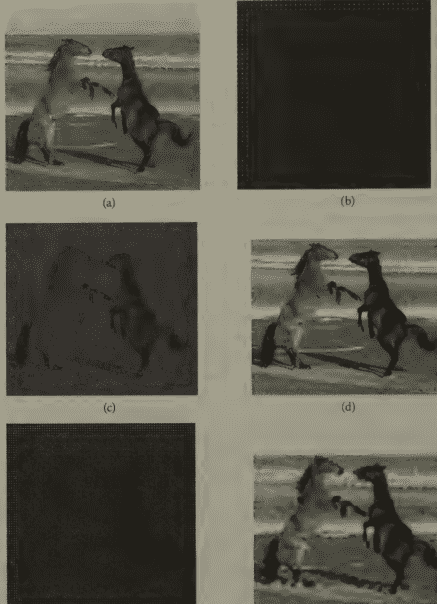

图 1.1（参见第 204 页后的彩色插页。）连续图像的数字化。（a）原始图像，大小为 391 × 400 × 3，（b）若以 10 像素的距离采样，图像信息几乎丢失，（c）采样距离为 2 时的结果像素，（d）采样距离为 2 像素的新图像，大小为 196 × 200 × 3，（e）采样距离为 5 时的结果像素，（f）采样距离为 5 像素的新图像，大小为 79 × 80 × 3。

and columns of the image. Higher resolution means more image detail. Consequently, image resolution can be tied to physical size (e.g., lines per millimeter, lines per inch) or to the overall size of a picture (lines per picture height, number of pixels, and pixel density).

## 1.3 图像属性

### 1.3.1 信噪比

信噪比（SNR）是判断、分析和分类多种图像处理技术的重要参数。如前所述，在现代相机系统中，噪声通常受以下因素限制：

- 彩色相机中的放大器噪声
- 热噪声，其本身受芯片温度 K 和曝光时间 T 限制
- 光子噪声，其受光子产生速率和曝光时间 T 限制

实际上，SNR 的计算公式为

```
SNR = \frac{Signal\_Power}{Noise\_Power} = 20log \frac{P_{Signal}}{P_{Noise}} (1.1)
```

图 1.2 展示了噪声如何影响图像。添加的噪声为“椒盐”类型。添加噪声仅仅是向干净的像素值中添加随机性。然而，这在数字图像采集中是一个非常常见的问题，随机性来自硬件元件。由于热条件，芯片行为可能是随机的；这种行为本质上是电荷流动现象，且高度依赖于温度。

### 1.3.2 图像位分辨率

图像位分辨率，或简称图像分辨率，是指图像中存在的灰度级数或像素数量。与前面提到的空间分辨率（见图 1.1 之后）相比，常用的图像分辨率术语是指图像使用一定数量的位来表示

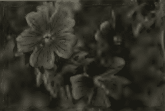

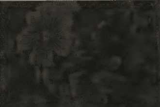

图 1.2 噪声对图像的影响。（a）原始图像，（b）信噪比（SNR）为 20 dB 的噪声图像。

图像中各点的强度级别。本章第 1.5.3 节和图 1.4(c)给出了更定量和算法化的描述。可以通过探索降低图像分辨率（灰度级数或像素数量）的影响来理解这些重要变量。请注意，识别小特征和定位边界需要足够的像素，而灰度级数过少会在平滑变化区域产生可见的“轮廓”伪影。这些在图 1.3 中所示。

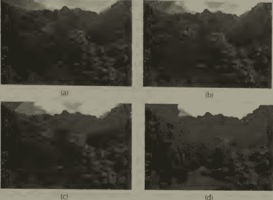

图 1.3（参见第 204 页后的彩色插页。）位分辨率的影响。（a）8 位分辨率的原始图像，（b）4 位分辨率，（c）3 位分辨率，（d）2 位分辨率。

## 1.4 MATLAB

MATLAB 代表 MATRIX LABoratory，是一种极其适合工程算法开发和仿真应用的软件环境。MATLAB 项目由 The MathWorks Inc.（马萨诸塞州纳蒂克）于 1984 年商业化，其启动源于认识到工程师和科学家需要比 C 和 FORTRAN 等语言提供的更强大、更高效的计算环境。自那时起，MATLAB 得到了大量扩展，并已成为科学和工程计算、可视化及仿真的事实标准。本质上，它是一种为矩阵和矩阵运算提供强大支持而设计的数据分析和可视化工具。它作为交互式编程环境运行：MATLAB 非常适合数值实验，因为 MATLAB 内置函数和提供的 m 文件的底层算法基于标准库 LINPACK 和 EISPACK。MATLAB 程序和脚本文件的文件名始终以

"m" 结尾；编程语言异常直观，因为几乎每个数据对象都被假设为数组。图形输出可用于补充数值结果。

尽管 MATLAB 被宣称为处理矩阵的最佳工具，但如果不小心使用，其性能可能会显著下降。例如，多种算法任务涉及使用循环来执行不同类型的迭代过程。事实证明，MATLAB 对循环并不太友好。但是，如果能减少循环次数并将大多数操作转换为基于矩阵的操作，则性能会突然大幅提高。例如，在 MATLAB 中，计算行向量 A 的平方和，如果执行为 A*A'，而不是在循环内计算累加和，效率会高得多。

MATLAB 具有一个基本计算引擎，能够在计算方面完成所有精彩的事情。它通过利用基本计算函数来实现这一点。其中一些函数是开放的，因此可以读取其代码。但是，大多数主要内置函数（例如 fft() 函数）的源代码不可读。这些内置函数是 MATLAB 强大计算结构的关键，开发它们的人将其视为主要资产之一。围绕 MATLAB 这个核心还有许多其他辅助文件，这些文件包括帮助文档、用于将 MATLAB 文件转换为 C 或 JAVA 的编译器，以及几个其他依赖于操作系统的库。MathWorks 还通过引入 SIMULINK® 和 Real-Time Workshop 等姊妹软件或引擎增强了 MATLAB 的功能。但是，所有这些只会使 MATLAB 成为一个出色的数学工具。该环境的真正力量来自大量称为工具箱的专用函数，这些函数由某个领域（不一定与编程相关）的专家专门编写。这些工具箱包括专用函数和相关文件，用于执行与该特定领域相关的高级操作。编写这些行时，大约有 80 个工具箱，每个针对特定的兴趣领域！而且这些只是 MathWorks 认可的工具箱。在世界各地，许多研究生会为自己的论文或研究工作开发自己的工具箱。在本书背景下，对我们有用的一些有趣工具箱包括 Images、Signal、Comm、Control、Imaq、Fuzzy、Ident、Nnet、Stats 和 Wavelet。

### 1.4.1 为什么选择 MATLAB 进行图像处理

如前所述，图像只是以矩阵形式组织的一组值。由于 MATLAB 对矩阵操作最优，因此使用 MATLAB 进行图像相关操作非常合理。对于大多数处理需求，我们将使用 MATLAB 的图像处理工具箱（images）。除了实时图像采集外，该工具箱还拥有执行图像各种几何、算术、逻辑以及其他高级变换所需的所有工具。该工具箱还能够处理彩色图像和灰度图像。但是，大多数图像处理集中在灰度图像上。即使对于彩色图像，处理也是在转换后的图像上进行的，该图像是通过将 RGB 颜色空间映射到灰度空间获得的。这些概念将在第 2 章中详细讨论。

尽管结构兼容性是使用 MATLAB 进行图像处理的一个强大动机，但还有其他几个原因。图像处理领域的大多数研究人员将 MATLAB 用作软件实现的主要平台，从而为比较不同算法和设计提供了一种共同语言。此外，各种算法的速度也可以在共同平台上进行比较，如果不同的人使用速度差异很大的不同编程语言，这将很难实现。使用 MATLAB 的另一个有趣原因，对那些不喜欢大量编码的工程学生来说尤其有趣，是 MATLAB 代码的简洁性。表 1.1 作为参考比较了 MATLAB 和 C 中一些基本操作的示例。从比较中可以想象，对于卷积、滤波和矩阵反演等复杂操作，差异将有多么显著。卷积是图像处理中几乎所有滤波以及时域和频域变换的核心，必须尽可能快地完成。MATLAB 函数 conv() 也是 MathWorks 的一项保密技术，是这些操作的核心。该函数已针对矩阵操作进行了优化，因此 MATLAB 中的操作比用其他语言编码更快、更高效。

当然，MATLAB 的实用性是有限的。虽然它对于算法测试非常出色，但由于处理速度慢，不太适合实时成像应用。这种速度慢源于与其他语言相比更多的编译和解释层级，以及在现实世界中频繁使用循环的迭代过程。


| Operation | Part of C code | MATLAB statements |
| :--- | :--- | :--- |
| 两个矩阵A和B的加法 | `for (i=1; i<=M; i++) {<br> for (j=1; j<=N; j++) {<br> D[i][j] = A[i][j] + B[i][j];<br> }<br>}` | D = A + B; |
| 两个矩阵A和B的乘法 | `for (i=1; i<=M; i++) {<br> for (j=1; j<=N; j++) {<br> for (c=1; c<=N; c++) {<br> for (r=1; r<=M; r++) {<br> D[i][j] += A[i][c] * B[c][j];<br> }<br> }<br> }<br> }` | D = A * B; |

应用。最佳解决方案是先在MATLAB中测试逻辑和算法，因为这将提高初始开发速度。一旦算法最终确定，应将其翻译成C，然后编译成可执行文件，用于实时或近实时应用。对于那些对编码不太感兴趣的学生，有一句评论：“一旦你开始使用MATLAB，就会忘记其他语言。”根据个人经验，这对于典型的工程学生琐事来说大部分时候都是正确的。但是，必须意识到一个事实，即对于现实世界的应用，近机器语言类型环境的需求无法消除，至少目前无法消除。

### 1.4.2 MATLAB中的图像处理工具箱

MATLAB中的图像处理工具箱是一组函数的集合，支持广泛的图像处理操作，包括以下内容：

- 图像输入/输出
- 空间变换
- 形态学操作
- 邻域和块操作
- 滤波器设计与图像增强
- 图像配准

工具箱中的许多函数是MATLAB m文件，即实现专用图像处理算法的一系列MATLAB语句。可以通过编写自定义m文件，或将工具箱与其他工具箱（如信号处理工具箱和小波工具箱等）结合使用来扩展图像处理工具箱的功能。该工具箱还由一整套演示应用程序支持。这些应用程序非常有用，可作为学习和自定义应用程序的模板。要查看所有图像处理工具箱演示，请调用iptdemos函数。这将在MATLAB帮助浏览器中显示一个HTML页面，列出所有图像处理工具箱演示。

工具箱演示位于子目录MATLAB\toolbox\images\imdemos下。

## 1.5 算法说明

本节以流程图形式介绍了图1.1–1.3所示操作背后的算法逻辑。一旦理解，就可以使用任何选择的编程语言编写代码来获得相同的结果。

### 1.5.1 采样

如图1.1所示，采样的效果主要是减少图像中存在的像素数量，这会导致图像中某些信息丢失，并表现为图像中的量化和明显的方块状图案。图1.1中的图像是使用图1.4(a)所示逻辑创建的。

### 1.5.2 噪声图像

图1.2(b)表示噪声图像，它是通过将干净图像与一种称为椒盐噪声的特定类型噪声相加得到的，将在第4章详细讨论。生成图1.2中图像所使用的方法

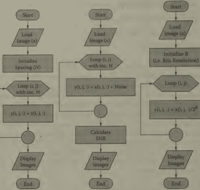

图1.4 生成图1.1–1.3中所示图像的编程逻辑。(a) 采样，(b) 噪声图像和信噪比，(c) 位分辨率。

图1.2中图像的生成方法如图1.4(b)所示。图中的噪声一词是通用的，可根据要求定义。噪声是一组随机数，每个随机数都添加到干净图像中。信噪比（SNR）按公式1.2计算。

```
snr = 20 log \frac{\sum \sum \sum x_{jk}^2}{\sum \sum \sum (y - x)_{jk}^2}. (1.2)
```

### 1.5.3 位分辨率

位分辨率是指表示图像中存在的不同灰度级别所需的位数。由于在8位表示系统（Windows中的默认系统）中，图像任何层上的最大值为255，因此将每个值除以2的某个幂次将导致灰度值降低，从而表示该值所需的位数也会更小。除法之后，舍入操作通过去除像素值的小数部分来产生进一步的量化。图1.4(c)描述了这种策略。

## 1.6 MATLAB代码

本节首先为用户提供简要的“快速入门”以开始使用图像处理工具箱，其次提供图1.1–1.3中所示图像操作的代码。

### 1.6.1 基本步骤

清除MATLAB工作区中的任何变量并关闭打开的图形窗口：

```
Clear all; close all;
```

虽然不是必需的，但在执行从头开始且不依赖于先前数据的m文件开头包含此步骤始终是一种良好的做法。要读取图像，请使用imread命令：

```
I = imread('horses.jpg');
```

从文件中推断出图形文件格式为JPEG，名称为“horses”，并将其存储到变量I中。有关支持的图形文件格式列表，请参阅imread函数参考文档。

然后可以使用两个图像显示函数中的一个来显示图像：imshow或immview。可以使用任意一个来显示图像：

```
imshow(I)
```

选择使用哪个显示函数取决于你想要做什么。例如，因为它在MATLAB图形窗口中显示图像，imshow提供对图形注释和打印功能的访问。immview函数在一个名为Image Viewer的独立基于Java的窗口中显示图像，该窗口提供对其他工具，这些工具有助于在图像中导航，尤其是大图像，并能够检查图像中的像素。图1.1(a)是执行上述命令imshow()的结果。图1.1-1.3中图像的MATLAB代码是

### 1.6.2 采样

```
clear all ; close all
x = imread('horses.jpg');
imshow(x)
[r,c,s] = size(x) ;
N = 10 ;
Y = zeros(size(x)) ;
y(1:N,r,1:N,c,:) = x(1:N:r,1:N:c,:) ;
z = y(1:N:r,1:N:c,:) ;
figure
imshow(z*0.005)
```

### 1.6.3 噪声图像

```
clear all ; close all
x = imread('flowers001.jpg');
imshow(x)
[r,c,s] = size(x) ;
y = imnoise(x,'salt & pepper',0.19) ;
snr = 20*log10(sum(sum(sum(x.^2)))/
sum(sum(sum((y-x).^2)))) ;
figure
imshow(y)
```

### 1.6.4 位分辨率

```
clear all ; close all
x = imread('valley.jpg');
imshow(x)
[r,c,s] = size(x) ;
m = max(max(x)) ;
b = [7 6 5] ;
```

```
for i = 1 : length(b)
    d = 2^b(i) ;
    z = round(x/d) ;
    figure
    imshow(z*d)
end
```

## 1.7 总结

- 图像定义为二维数字信号。
- 图像通过捕捉现实世界3D视图中的颜色强度值来形成。
- 每个图像元素称为 _像素_。
- 每个像素都是图像中其位置的函数。例如，_x(i,j)_ 表示图像中第_i_行和第_j_列位置的光强度值。
- 这些像素的值会因图像表示过程以及外部因素而退化。
- 图像处理是一系列操作的总称，包括图像获取、图像表示、图像增强、图像压缩、图像分类等。
- 一旦获取，图像在计算机内存中表示为矩阵，可以是2维或更高维。
- 彩色图像通常被视为复合图像，具有三个层，对应显示器屏幕显示硬件中的三个电子束。
- MATLAB是由MathWorks Inc（马萨诸塞州纳蒂克）开发的专业级计算环境。由于它在矩阵操作和处理方面进行了优化，图像自然成为其数据空间的一部分。
- MATLAB可以将图像处理所需的几个计算复杂的过程简化为更简单的代码。这减少了开发时间，并可以更多地将重点放在算法开发而非编码上。


- MATLAB 拥有一系列称为工具箱的专用函数集合，这些工具箱针对特定的计算领域，通常由该领域的专家开发。

- 包含的代码及其逻辑已用于演示一些简单的图像处理策略。

- 采样以及表示图像中灰度值所需的位数等因素，会导致生成图像的像素值发生变化。

- 以大于 1 的像素距离对图像进行采样会得到一张较小的图像，并伴有一定的信息丢失。随着采样距离增加，丢失量会增加，但图像大小也会相应减小。

- 图像的位深度会影响图像中存在的不同灰度级别的数量。

- 通常，在 Windows 环境中，使用 8 位来表示灰度值，并使用三层这样的位集来表示颜色。

- 图像中的噪声对应于像素值中存在的随机性。在现实生活中，这可能由于多种因素引起，例如由于热变化导致电子发射随机增加。

## 1.8 EXERCISES

- 1. 使用噪声图像的代码，在保持 SNR 不变的情况下实现三种不同类型的噪声。然后，仅通过目视检查，将图像质量评为差、更差和最差。你可以尝试的三种噪声类型是高斯分布、均匀分布和泊松分布。固定 SNR 为 10 dB。

- 2. 通过用 8 位表示相同的灰度级别，能否改善 4 位表示图像的视觉质量？请使用 MATLAB 代码证明你的答案。是什么让你确信质量有所提高或下降？

- 3. 改善像素化（或方块形成）效果的方法之一是，通过在这些像素之间插入相邻像素的平均值来增大图像尺寸。使用图 1.1(f) 中的图像，将其尺寸扩大 3 倍；评论这张新图像的质量。你必须使用章节中提供的适当代码，并对其进行修改以满足本题的要求。

- 4. 如果对噪声图像进行子采样（即采样距离大于 1），这是否会在视觉上影响图像的噪声含量？这是否会影响 SNR？请通过 MATLAB 代码证明你的答案。

- 5. 重复采样代码，但修改为新图像在开始时不初始化为零。你必须将其初始化为 255（全白像素），并比较采样距离为 2、5 和 10 时生成的采样图像的质量，与图 1.1 中的图像进行对比。

# 2 图像获取、类型和文件输入/输出

## 2.1 图像获取

图像处理始于图像；因此，图像获取是首先要研究的关键步骤。用于获取的硬件和软件可能因图像源和接口的类型而有很大不同。这可以从带有适当帧抓取卡的视频摄像机（无论是计算机内部的卡，还是通过并行或串行接口连接的外部设备），到带有自身串行或 SCSI 接口的数码相机，再到通常带有 SCSI 或 USB 接口的幻灯片或平板扫描仪。正确连接此硬件并安装适当的软件驱动程序有时会令人困惑，尤其是在 Windows 下。以下是常见图像获取源的简要列表：

- 现实世界中的 3D 对象被转换为数字图像
  - 摄像机（CCD、CID、CMOS）
  - 红外摄像机
  - 超声
  - X 射线和放射摄影
  - 磁共振成像（MRI）
  - 卫星成像仪
- 扫描仪

### 2.1.1 摄像机

用于现代数字图像处理应用的摄像机和记录介质正在以显著的速度变化。市场上有多种技术可供选择，例如电荷耦合器件（CCD）、电荷注入器件（CID）和互补金属氧化物半导体（CMOS）摄像机。用于表征基本类型 CCD 摄像机的技术仍然是“通用”的，可以透明地应用于其他技术。任何基于电荷的摄像机的基本原理是，主成像硬件中存在的感光元件或电池会发射与这些电池上的入射光成比例的电荷。

与常规摄像机基于摄像机中传感器的光电发射生成图像不同，红外摄像机利用热电池的类似行为；因此，它们可以检测某些温度范围内的“热波”并将其转换为电信号，然后显示为图像。如果用辐射传感器修改相同的原理，那么摄像机将检测放射性发射并生成等效的电信号。这构成了数字 X 射线和其他放射图像生成的基础。所有这些摄像机仍然是直接成像方法，即图像直接从源对象获得，而无需对数据空间进行任何映射或转换。图 2.1 显示了各种应用中常用的一些摄像机。

然而，超声和 MRI 图像并非如此容易获得。在能够查看之前，它们必须经过大量的映射和转换操作。典型的超声图像基于声波从其路径中的非均匀性处的反射。这些反射会以精确的飞行时间（ToF）信息进行记录，该信息与反射到达传感器的时间有关。这种一维波形称为 A 扫描。如果现在移动超声收发器并获得新的反射，那么这将是另一个 A 扫描。对要成像的整个区域重复此过程，并得到一个巨大的数据立方体。从该立方体中取出垂直于输入超声脉冲方向的切片，并为切片中存在的各个点分配归一化值，这将显示为数据立方体的横断面图像，称为 C 扫描。图 2.2 显示了典型的超声扫描原理及其在金属超声无损检测中使用的生成图像。

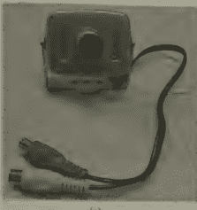

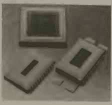

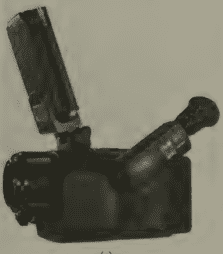

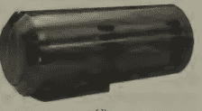

图 2.1 直接成像设备。（a）CCD 摄像机，（b）CMOS 光电传感器，（c）红外摄像机，（d）数字 X 射线摄像机。

同样，MRI 利用由于患者身体部位自身磁活动的变化而穿过患者身体的三个外部垂直磁场的变化。然后记录这些变化的位置和归一化的幅度变化，并以类似于超声成像的方式将其转换为图像。

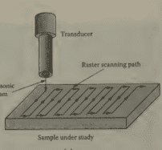

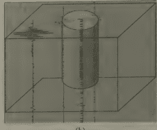

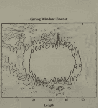

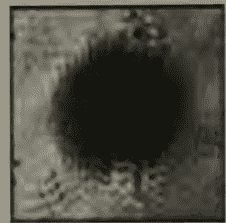

图 2.2 超声成像原理。（a）传感器移动的栅格扫描模式，（b）生成的数据立方体，（c）立方体中的一个横截面数据切片，（d）归一化的 C 扫描。

获取数字图像的另一种方法是文档扫描仪。扫描仪是一种可移动摄像机，它获取被扫描文档的强度图像并将切片组合成完整图像。此过程可用于将以前使用普通胶片相机拍摄的照片数字化。

在某些情况下，可用的摄像机只有模拟输出。在这种情况下，会使用一种称为帧抓取卡的专用数字化硬件，它以静态数字图像帧的形式在固定采样间隔捕获模拟视频或静态图像。图 2.3 显示了这些成像系统的组件。


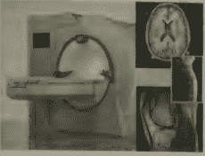

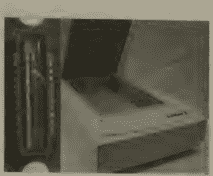

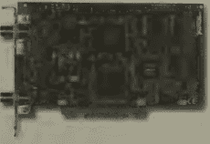

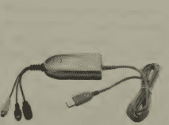

图 2.3 成像系统组件。(a) 带有一些图像的 MRI 扫描系统，(b) 文档扫描仪及其电荷耦合器件 (CCD) 元件，(c) 帧抓取器 PCI 卡 (NI-1411)，(d) 模拟视频转 USB 转换器。

## 2.2 图像类型和文件 I/O

一旦成像系统获取图像，它就可以作为矩阵读入计算机内存。然而，该图像在二次存储介质中的实际处理方式因图像类型和信息内容而异。基于存储类型或文件 I/O 标准，Windows 环境中最常用的成像格式如下：

- 1. 位图 (.bmp)
- 2. 联合照片专家组 (.jpg)
- 3. 图形交换格式 (.gif)
- 4. 标记图像文件格式 (.tif)

还有其他几种格式，例如 Windows 元文件 (.wmf)、可移植网络图形 (.png)、Postscript (.ps)、封装 Postscript (.eps)、扩展元文件 (.emf) 等。然而，前面列出的四种类型是最常用的类型，本书将在若干 MATLAB® 文件示例中使用它们。读取这些类型中的任何一种都需要函数 imread()，将在 2.5 节中进一步讨论。

### 2.2.1 位图格式

BMP 文件格式是 Windows 3.0 或更高版本环境的标准。它可能使用压缩，尽管通常它不压缩图像，并且（本身）无法存储动画。图像数据本身可以包含指向颜色表中条目的指针，也可以包含原始 RGB 值（本章后面将对此进行说明）。

### 2.2.2 JPEG 格式

JPEG 实际上是一种标准化算法（不是图像类型！），用于压缩自然图像，例如 `.bmp` 文件或 `.tiff` 文件。该格式的详细内容将在第 8 章讨论；不过，此处只需说明该算法使用数学变换转换图像的自然像素，并重新定义图像中的位分配和关联结构。

### 2.2.3 GIF 格式

GIF 是 CompuServe Inc. 的心血结晶，专门为 Internet 上的图像而开发。它定义了一种用于在线传输和交换栅格图形数据的协议，与用于创建或显示这些数据的硬件无关。GIF 数据流是表示一组图形的协议块和子块序列。这些块通过关系标志连接。GIF 文件相对易于处理，但不能用于高精度颜色，因为只使用 8 位来编码颜色。颜色使用本地或全局颜色表以及内置 LZW 压缩算法进行编码。该压缩算法是专利技术，目前由 Unisys Corporation 拥有。该格式在单个文件中编码多个图像，并嵌入了屏幕上图像位置、隔行显示、相邻图像帧之间的延迟时间、背景颜色和过渡信息等详细信息。

### 2.2.4 TIFF 格式

TIFF 格式由 Aldus Corporation 和 Microsoft 共同编写的规范控制。该格式的设计旨在以面向未来的视角整合各种格式。它是一种复杂且与平台无关的格式，由三个独特的数据结构组成：图像文件头 (IFH)、图像文件目录 (IFD) 和目录项 (DE)。该格式与 BMP 非常相似，至少在存储和使用方面是如此。

这些格式中的任何一种也可用于将图像从 MATLAB 工作区写入二次存储。函数 imwrite() 用于此目的，将在 2.5 节中进一步讨论。

## 2.3 彩色图像基础

与自然界启发的科学和工程领域的其他几项成就类似，图像处理汲取了自然界中最佳成像系统——人眼——的灵感。眼睛的感光区域称为视网膜，其中包含两种光敏细胞，即根据其形状称为杆细胞和锥细胞。杆细胞负责产生光强度感觉以及对所观察场景中边界和边缘的感知。锥细胞负责颜色感知。锥细胞有三种类型，通常称为 S-、L- 和 M-型细胞。锥细胞的响应在 20 世纪 70 年代末通过实验记录下来，基于细胞对特定入射光频率的最大激发。可变频率的光将代表特定频率的特定颜色。发现三种锥细胞的响应分别对 420、534 和 564 nm 达到最大。这些波长（及其频率）分别对应蓝色、绿色和红色。因此，发现人类颜色感知基于 RGB 三原色，此后 RGB 一直是数字图像处理中使用的最基本颜色模型。图 2.4 显示了人眼及其感官细胞以及 RGB 模型的灵敏度曲线。

这构成了称为 RGB（红、绿、蓝）的最基本颜色模型系统的基础。事实上，一旦图像加载到计算机内存系统中，大多数时候它都作为分别对应 R、G 和 B 的三个像素层存储。图 2.5 显示了一个基于 RGB 模型表示各种颜色色调的颜色立方体。

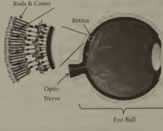

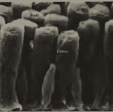

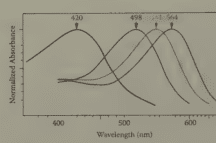

图 2.4（参见第 204 页之后的彩色插页。）人眼、其感官细胞和 RGB 模型灵敏度曲线。(a) 显示人眼各感兴趣部分的图示，(b) 电子显微镜下的杆细胞和锥细胞，(c) 不同频率下锥细胞激发的实验曲线。

尽管图 2.5 使用 `uint8` 系统，但 `uint16` 和 `double` 颜色立方体都具有相同的颜色范围。换句话说，`uint8` RGB 图像中最亮的红色与 `double` RGB 图像中最亮的红色看起来相同。区别在于 `double` RGB 颜色立方体有更多的红色色调（以及所有颜色的更多色调）。图 2.5 显示了一个 `uint8` 图像的 RGB 颜色立方体。

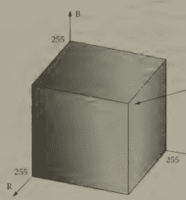

图 2.5（参见第 204 页之后的彩色插页。）8 位无符号整数表示系统的 RGB 颜色立方体。

## 2.4 其他颜色空间

MATLAB 的图像处理工具箱包含可用于将 RGB 数据转换为几种常见的设备相关颜色空间以及反之的函数。

### 2.4.1 YIQ 颜色空间

国家电视系统委员会 (NTSC) 定义了一种称为 YIQ 的颜色空间。该颜色空间用于美国的电视机。这种格式的主要优点之一是灰度信息与颜色数据分离；因此，具有三个分量——亮度 (Y)、色调 (I) 和饱和度 (Q)——使得相同的信号可用于彩色和黑白电视机。亮度表示灰度信息，而最后两个分量构成色度（颜色信息）。YIQ 模型与 RGB 颜色立方体的关系如下：

```
[ Y ]   [ 0.299  0.587  0.144 ] [ R ]
[ I ] = [ 0.596 -0.275 -0.321 ] [ G ] .   (2.1)
[ Q ]   [ 0.212 -0.528  0.311 ] [ B ]

[ R ]   [ 0.9736  0.9873  0.5682 ] [ Y ]
[ G ] = [ 0.9675 -0.2385 -0.6941 ] [ I ] .   (2.2)
[ B ]   [ 0.9789 -1.0779  1.6497 ] [ Q ]
```

### 2.4.2 YC_bC_r 颜色空间

YC_bC_r 颜色空间广泛用于数字视频。在此格式中，亮度信息存储为单个分量 (Y)，色度信息存储为两个颜色差分量 (C_b 和 C_r)。C_b 表示蓝色分量与参考值之间的差。C_r 表示红色分量与参考值之间的差。这种格式也用于图像的 JPEG 压缩。该颜色空间与 RGB 模型的关系根据以下方程组：

```
Y' = K_r \times R' + (1 - K_r - K_b) \times G' + K_b \times B',
C_b = \frac{1}{2} \times \frac{B' - Y'}{1 - K_b},
C_r = \frac{1}{2} \times \frac{R' - Y'}{1 - K_r}.
(2.3)
```

根据电视标准 ITU-R BT.601（以前称为 CCIR 601），K_b 的值为 0.114，K_r 的值为 0.299。

### 2.4.3 HSV 颜色空间

HSV 颜色空间（色调、饱和度、明度）常被从色轮或调色板中选择颜色（例如油漆或油墨）的人使用，因为它比 RGB 颜色空间更符合人们对颜色的体验。随着色调从 0 变化到 1.0，相应的颜色从红色经过黄色、绿色、青色、蓝色、品红色，再回到红色，因此

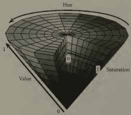

图 2.6（参见第 204 页之后的彩色插页。）HSV 颜色空间示意图。


实际上在 0 和 1.0 处都存在红色值。随着饱和度从 0 变化到 1.0，对应的颜色（色相）从不饱和（灰色调）变化到完全饱和（无白色分量）。随着值（或亮度）从 0 变化到 1.0，对应的颜色变得越来越亮。图 2.6 说明了 HSV 颜色空间。

## 2.5 算法说明

为了在任何编程环境中处理 RGB 图像，在实际处理开始前必须获取关于尺寸和数据精度表示的基本信息。一个屏幕尺寸为 M 行 N 列的 RGB 图像，也称为 *真彩色图像*，其大小为 M×N×3 像素。这里，3 代表红、绿、蓝三个强度层。因此，RGB 像素实际上是一个 3 元组向量，其值对应于屏幕上的红、绿、蓝强度。图形文件格式将 RGB 图像存储为 24 位图像，其中红、绿、蓝分量各为 8 位。这可产生 1600 万种颜色的潜力。现实生活图像可被复制的精度导致了常用术语 *真彩色图像*。RGB 数组可以是 double、uint8 或 uint16 类。在 double 类的 RGB 数组中，每个颜色分量是 0 到 1 之间的值。颜色分量为 (0,0,0) 的像素显示为黑色，颜色分量为 (1,1,1) 的像素显示为白色。每个像素的三个颜色分量沿数据数组的第三维存储。图 2.7 说明了这一点。

最常用的其他图像类型是索引图像（MATLAB 特有）、灰度图像和二值图像。假设与前述 RGB 图像具有相同的屏幕尺寸，这些图像的大小将分别为 M × N + P × 3、M × N 和 M × N。索引图像是 MATLAB 特有的，它将 RGB 颜色存储为大小为 P × 3 的单独颜色映射，其中 P 表示 RGB 图像中存在的颜色组合总数。索引图像的 M × N 组件仅包含来自颜色映射的表项索引，该索引对应于 M × N 图像空间中该特定像素处的颜色。P 通常是一个小的有限数，因此，存储此类图像的空间需求有显著节省。

大小为 M×N 的灰度图像仅包含该特定像素的强度值。从 RGB 到灰度的转换取决于传感器对光作为波长函数的敏感度响应曲线。然而，为此目的常用的一个公式是

```
gray = 0.3 × R + 0.59 × G + 0.11 × B. (2.4)
```

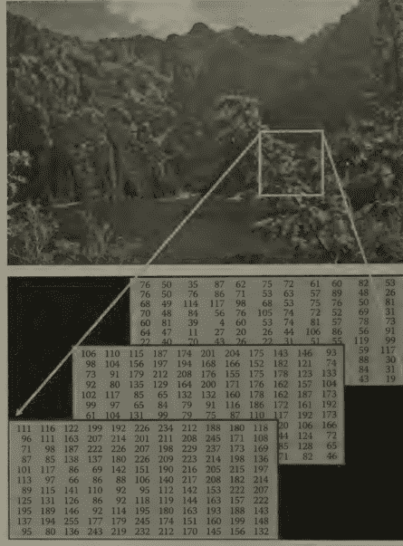

图 2.7 RGB 图像的结构。顶部图像中的高亮区域被放大以显示 RGB 层中的底层值，并对这些层显示了 10×10 块。

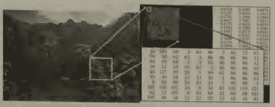

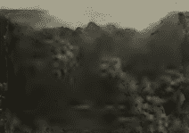

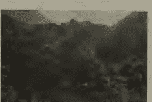

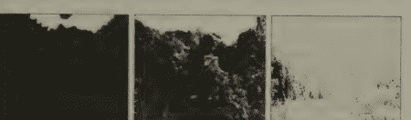

图 2.8（参见第 204 页后的彩色插页。）图像类型的结构。（a）带有 128 个颜色级的索引图像，显示图像中选定区域的索引值和映射，（b）带有 8 个颜色级的索引图像，（c）8 级索引图像的灰度图像，（d）在 90%、50% 和 10% 阈值下的二值图像（从左到右）。

这将 M×N×3 的 RGB 图像平展为 M×N 强度图像。二值图像可以是该方向上的下一逻辑步骤，而灰度图像则根据先前设定的限制进行阈值处理。因此，低于此限制的任何值都设为 0，所有其他值都设为 1。图 2.8 描绘了这些成像结构。显然，灰度图像可以具有 0 到 255 之间的任何值，而二值图像对于黑色和白色区域分别只能具有 0 或 1。

### 2.5.1 图像转换

如前所述，一种类型的图像可以转换为另一种类型。这意味着 RGB 类型可以转换为反向、灰度，最后转换为二值。这些转换通常并非全部可逆。例如，转换为二值图像是不可逆的，因为由于阈值处理，与单个灰度值相关的信息丢失了。同样，RGB 可以转换为灰度，但如果也为反向转换保存了颜色映射，则该过程可以逆转。图 2.9(a) 以小型框图的形式表示这些转换。尽管连接箭头旁边写有 MATLAB 函数，表示哪个函数将执行此转换，但可以通过使用该编程环境中的相应专用函数，在任何编程环境中实现逻辑流。类似的转换也存在于从 RGB 到 YC_bC_r、HSV 和 YIQ 的颜色空间转换中；这在图 2.9(b) 中总结。

## 2.6 MATLAB 代码

如前所述，图像处理始于图像采集。MATLAB 配备了一个名为 IMAQ 的采集工具箱，并具有从 Windows 识别的摄像头或其他视频源采集图像的有用函数。事实上，使用简单的网络摄像头只需少量语句即可完成此操作。现在描述此过程。

首先，通过使用函数 videoinput() 将视频源与局部变量关联。该函数的参数是 Windows 系统中的视频适配器名称。如果此信息不可用，则可以使用默认适配器 winvideo。此适配器将自动指向 Windows 理解的视频源。可以通过函数 imaqhwinfo() 获取有关此特定设备的更多信息。

配置设备后，可以使用 preview() 函数预览图像以创建典型的“取景器”窗口。实际图像可以使用函数 getsnapshot() 直接采集到局部变量中。可以通过使用标准循环技术来使用多个快照。采集完成后，函数 delete() 有助于释放一些内存。以下是采集图像的典型代码片段：

```
x = videoinput('winvideo',1);
imaqhwinfo(x)
preview(x)
y = getsnapshot(x);
imshow(y)
delete(x)
```

其余行将显示两个图像，一个用于预览，另一个用于实际采集分配。

MATLAB 中的基本数据结构是数组；即实数或复数元素的有序集合。此对象自然适合于图像的表示，即颜色或强度数据的实值有序集合。

MATLAB 将大多数图像存储为二维数组（即矩阵），其中矩阵的每个元素对应于显示图像中的单个像素。（像素源自 picture element，通常表示计算机显示器上的单个点。）例如，由 200 行和 300 列不同颜色点组成的图像将在 MATLAB 中存储为 200×300 矩阵。某些图像（如 RGB）需要三维数组，其中第三维的第一个平面表示红色像素强度，第二个平面表示绿色像素强度，第三个平面表示蓝色像素强度。图 2.10 显示了本节中介绍的示例代码。

程序首先使用 imread() 函数加载源图像 valley.jpg。读取后，图像显示为大小为 426×640×3 的三维数组，其中图像有 426 行和 640 列，三个层对应于 RGB 三元组。如果只有一个层处于活动状态而其他两个层全部设置为零，则相同的图像看起来如何？这是通过计算 xr、xg 和 xb 实现的。原始图像及这些组件在图 2.11 中显示。为了获得真实的色彩感知，必须将其他两个层设置为零；否则，每个层都是灰度图像的特例。

接下来，定义了 100×100 的窗口大小以突出 RGB 图像中的一个区域，并为每个层显示该区域的前十个值，以便更清楚地理解 RGB 图像形成中涉及的各种组合。这在图 2.7 中有所说明。下一处理块涉及将 RGB 图像转换为索引图像。为此，指定了两个颜色级别：128 和 8。图 2.8(a) 显示了 128 级索引图像。这意味着该图像的颜色映射将有 128 个条目，描绘 128 种重要颜色。然而，在近似图像视图使其看起来与原始 RGB 图像相同方面，这相当不错。但是，当仅使用 8 个级别形成索引图像时，颜色轮廓效应变得非常明显，如图 2.8(b) 所示。

之后，彩色图像转换为灰度图像。同样，RGB 将提供出色的灰度等效，类似于 128 级索引图像的灰度表示。然而，8 级索引图像更突出地显示了轮廓效应，如图 2.8(c) 所示。

然后，通过设置三个不同的阈值（90%、50% 和 10%）将灰度图像转换为二值图像。如图 2.8(d) 所示，90% 阈值将主要导致暗区，因为大多数灰度值低于此限制，因此转换为零。另一方面，10% 阈值过低，因此大多数灰度值高于此限制并设置为 1。事实上，最优阈值处理仍然是一个有趣的研究领域，其目标是识别特定成像系统中图像的最佳阈值。


clear all; close all

x = imread('valley.jpg'); % source RGB image
xr = x;
xr(:, :, [2 3]) = 0; % initializing the Green and Blue to zero
xg = x;
xg(:, :, [1 3]) = 0; % initializing the Red and Blue to zero
xb = x;
xb(:, :, [1 2]) = 0; % initializing the Red and Green to zero

N = 100; % size of the block to be isolated from x
Y = x(200:200+N, 400:400+N, :);
Y(1:10, 1:10, :)

[z, map] = rgb2ind(x, 128); % RGB converted to Index Image with 128 colors
[z8, map8] = rgb2ind(x, 8); % RGB to Grayscale conversion with 8 levels

gx = rgb2gray(x); % RGB image to Grayscale conversion
gz = ind2gray(z8, map8); % Index to Grayscale conversion

bx1 = im2bw(gx, 0.9); % Binary image with 90% threshold
bx2 = im2bw(gx, 0.5); % Binary image with 50% threshold
bx3 = im2bw(gx, 0.1); % Binary image with 10% threshold

figure; imshow(x)
figure; imshow(Y)
figure; imshow(z, map)
figure; imshow(xr)
figure; imshow(xg)
figure; imshow(xb)
figure; imshow(z8, map8)
figure; imshow(gx)
figure; imshow(gz)
figure; imshow(bx1)
figure; imshow(bx2)
figure; imshow(bx3)

图 2.10 各种图像转换操作的示例 MATLAB 代码。

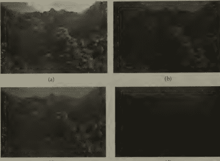

图 2.11（参见第 204 页后的彩色插页。）带有其分量的原始 RGB 图像。（a）源 RGB 图像，（b）红色分量，（c）绿色分量，（d）蓝色分量。

如果需要将这些图像中的任何一张保存到硬盘，可以使用以下语法：

```
imwrite(x, 'True-Valley.jpg', 'jpg');
```

## 2.7 图像类型和数值类小结

本章介绍了以下重要要点：

- 图像处理始于图像获取，可从摄像头、超声图像、MRI 和 X 光片等多种来源进行。图像质量和特性取决于成像系统及其应用。
- IMAQ 工具箱提供了从连接的硬件获取图像或视频流的非常简便的程序。
- MATLAB 中的图像可以是以下类型之一：RGB、索引、灰度、二值等。
- MATLAB 中支持从 RGB 到 HSV 或 YCbCr 的色彩空间相互转换。工具箱中还提供了其他专用格式，图像可以从 RGB 转换为这些格式。
- RGB 图像由三个图层组成，分别对应图像中的红、绿、蓝强度。已概述了一种简单的程序来单独查看这些颜色图层。
- 索引图像是仅在 MATLAB 中使用的专用图像，可用于更好地利用存储空间。
- 索引图像还可以通过指定颜色级数来限制颜色级数的数量。
- 灰度图像是大多数图像处理算法中最常用的图像形式。
- 灰度图像的无符号整数表示可以是 0 到 255 之间的任何值。
- 二值图像是通过对灰度图像进行阈值处理形成的，低于该阈值的值变为 0，其他值变为 1。
- 对于某些操作，将图像转换为不同的图像类型很有帮助。例如，如果要过滤存储为索引图像的彩色图像，应先将其转换为 RGB 格式。将滤波器应用于 RGB 图像时，MATLAB 会适当地过滤图像中的强度值。如果尝试过滤索引图像，MATLAB 只会将滤波器应用于索引图像矩阵中的索引，结果可能没有意义。
- 下表列出了图像处理工具箱中的所有图像转换函数。

| 函数 | 描述 |
|---|---|
| dither | 通过抖动从灰度强度图像创建二值图像；从灰度强度图像创建索引图像 |
| gray2ind | 从灰度强度图像创建索引图像 |
| im2bw | 基于亮度阈值从强度图像、索引图像或 RGB 图像创建二值图像 |
| ind2gray | 从索引图像创建灰度强度图像 |
| ind2rgb | 从索引图像创建 RGB 图像 |
| rgb2gray | 从 RGB 图像创建灰度强度图像 |
| rgb2ind | 从 RGB 图像创建索引图像 |

## 2.8 练习

- 1. 使用图像文件 shapes.jpg，其中包含各种颜色的四种基本形状。分析图像，构建自己的颜色映射，其中包含图像中出现的颜色对应的 RGB 值。然后将原始图像转换为灰度图像，使所有颜色信息丢失。现在应用反向映射将其直接从灰度转换为 RGB。请注意，所有转换都直接从 RGB 到灰度或从灰度到 RGB。不允许其他转换。

- 2. 编写一个 m 文件，使用网络摄像头每五秒获取一次图像，并以 50% 阈值将其显示为二值图像。

- 3. 编写一个 m 文件来读取彩色图像。它将被读取为 RGB 图像。使用公式 y = 0.299 R + 0.59 G + 0.11 B，将此 RGB 图像转换为范围从 0 到 255 的灰度图像（y）。您可能需要缩放和四舍五入这些值，因为灰度图像值应仅由 8 位整数表示。您的函数必须采用以下格式：y = myrgb2gray(x)，其中 x 是 RGB 图像。

- 4. 在不使用 rgb2ind() 函数的情况下，将问题 #3 中的 RGB 图像转换为索引图像。在此练习中，您必须按照索引图像上下文中讨论的步骤编写自己的函数来执行转换：
  - 1. 制作所有颜色值的表作为映射表。
  - 2. 将映射表的索引值分配给图像中出现该颜色的像素位置。
  - 3. 您的函数必须采用以下格式：[y,map] = myrgb2ind(x)，其中 x 是 RGB 图像。

- 5. 使用您自己的阈值程序将问题 #3 中的 RGB 图像转换为二值图像。您的函数必须如下所示：bx = myim2bw(gx,t)，其中 gx 是要转换为二值图像的灰度图像，t 是阈值。

# 3 图像算术

## 3.1 简介

一旦图像进入计算机系统，或者更具体地说，一旦它们被读入程序中，图像就只不过是矩阵。因此，理论上所有可应用于矩阵的操作也都应适用于图像。然而，情况并非完全如此。某些矩阵算术运算符可以应用于图像矩阵，而其他运算符在图像处理中则没有任何意义。同时，图像矩阵具有一些特定于图像且通常不出现在矩阵算术世界中的特殊运算符。图像算术是对图像实施标准算术运算（如加法、减法、乘法和除法）的过程。图像算术在图像处理中有许多用途，既可作为更复杂操作的初步步骤，也可独立使用。

本章介绍了应用于数字图像的一些最常用操作。与矩阵算术的区别将在讨论的适当位置指出。

## 3.2 运算符基础

图像算术运算符作用于两个大小完全相同的图像，或一个图像和一个数字。本质上，它对应于两个相同阶数的矩阵或一个矩阵和一个标量。对于第一种情况，操作是按像素逐个进行的，其中每个像素对应矩阵中的一个元素。对于第二种情况，标量数字作用于整个矩阵的每个元素，即所有像素。这两种行为如图 3.1 所示。

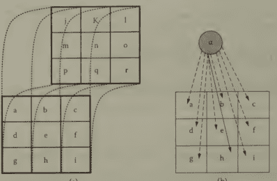

图 3.1 图像算术运算的两种模式。（a）两个相同大小图像之间的逐像素操作，（b）对图像的标量操作。

## 3.3 理论处理

通常，以下图像运算符用作复杂处理的基础模块：

- 1. 图像加法
- 2. 图像减法
- 3. 图像乘法
- 4. 图像除法
- 5. 图像混合

以下部分将理论上讨论这些运算符。

### 3.3.1 像素加法

该运算符以两个相同大小的图像作为输入，并输出一个与前两个图像大小相同的第三个图像，其中每个像素值是两个输入图像中对应像素值的总和。相同的策略可以应用于多于两个图像，作为同一操作的延续。该运算符还存在标量变体，其中将指定的常数添加到


每个像素。两幅图像的相加操作在单次遍历中直接完成。输出像素值由

R(m,n) = P(m,n) + Q(m,n). (3.1)

其中，P、Q 和 R 表示大小相同的图像矩阵，m 和 n 分别表示第 m 个和第 n 个像素。

或者，如果只是想将常数值 C 加到单幅图像上，则：

R(m,n) = P(m,n) + C. (3.2)

如果每个像素值对应的是一个 n 元组而不是数字（例如，彩色图像的每个像素将是一个包含三个值的向量，分别对应红、蓝、绿分量），则此类像素在每个对应的向量元素上进行加法运算，以生成输出值。

加法结果很容易超过像素位深度允许的最大值。对于 8 位像素表示，两个值均为 200 的像素相加会得到 400，这高于 8 位能表示的最大数 255。溢出的像素值通常被设置为允许的最大值，这种效应称为饱和。

### 3.3.2 像素减法

像素减法算子以两幅图像为输入，输出第三幅图像，其像素值即为第一幅图像的像素值减去第二幅图像中对应的像素值。也常常可以只使用单幅图像作为输入，并从所有像素中减去一个常数值。该算子的一些版本会输出像素值之间的绝对差值，而不是带符号的输出。两幅图像的减法在单次遍历中直接完成。输出像素值由

R(m,n) = P(m,n) - Q(m,n). (3.3)

或者，如果算子计算两幅输入图像之间的绝对差值，则：

R(m,n) = |P(m,n) - Q(m,n)|. (3.4)

或者，如果只是想从单幅图像中减去常数值 C，则：

R(m,n) = P(m,n) - C. (3.5)

如果每个像素值对应的是一个 n 元组而不是数字（例如，彩色图像的每个像素将是一个包含三个值的向量，分别对应红、蓝、绿分量），则此类像素在每个对应的向量元素上进行减法运算，以生成输出值。

如果算子计算绝对差值且两幅输入图像使用相同的像素值类型，则输出像素值不可能超出输入像素类型所能表示的范围，因此不会出现此问题。这是使用绝对差值的一个充分理由。

### 3.3.3 像素乘法与缩放

虽然图像被视为矩阵，但图像乘法不遵循矩阵乘法规则。这意味着，图像乘法要求两幅图像大小相同，而不是要求第一个矩阵的列数与第二个矩阵的行数相同。与其他图像算术算子类似，乘法有两种形式。第一种形式以两幅输入图像为输入，生成输出图像，其中像素值即为第一幅图像的像素值乘以第二幅图像中对应位置的值。第二种形式以单幅输入图像为输入，生成输出，其中每个像素值乘以一个指定常数。后一种形式可能使用更广泛，通常称为缩放。两幅图像的乘法以显而易见的方式在单次遍历中使用以下公式执行：

R(m,n) = P(m,n) × Q(m,n). (3.6)

按常数进行缩放使用

R(m,n) = P(m,n) × C. (3.7)

请注意，该常数通常是浮点数，且可能小于 1，这会降低图像强度。如果图像格式支持，该常数甚至可以是负数。

如果每个像素值对应的是一个 n 元组而不是数字（例如，彩色图像的每个像素将是一个包含三个值的向量，分别对应红、蓝、绿分量），则此类像素在每个对应的向量元素上进行乘法运算，以生成输出值。如果计算出的输出值大于允许的最大像素值，则通常会在该最大值处截断。对于小于允许的最小像素值的值也是如此，在这种情况下，截断在最小值处进行。

### 3.3.4 像素除法

图像除法算子通常以两幅图像为输入，生成第三幅图像，其像素值为第一幅图像的像素值除以第二幅图像中对应的像素值。许多实现也可以只使用单幅输入图像，在这种情况下，该图像中的每个像素值都除以一个指定常数。

两幅图像的除法以显而易见的方式在单次遍历中使用以下公式执行：

R(m,n) = P(m,n) / Q(m,n). (3.8)

按常数进行除法使用

R(m,n) = P(m,n) / C. (3.9)

如果每个像素值对应的是一个 n 元组而不是数字（例如，彩色图像的每个像素将是一个包含三个值的向量，分别对应红、蓝、绿分量），则此类像素在每个对应的向量元素上进行除法运算，以生成输出值。

除法算子可能只实现整数除法，也可能能够处理浮点除法。如果只执行整数除法，则结果通常向下舍入到下一个最低整数以供输出。在进行除法时，能够使用像素值类型非 8 位整数的图像非常有用。

### 3.3.5 混合

该算子通过结合标量乘法和图像加法，生成两幅大小相同的输入图像的混合。与像素加法类似，输出图像中每个像素的值是输入图像中对应像素值的线性组合。线性组合的系数由用户指定，它们定义了在组合图像之前必须对图像进行缩放的比例。应用这些比例，使得输出像素值不超过最大像素值。生成的图像使用以下公式计算：

R(m,n) = C × P(m,n) + (1-C) × Q(m,n). (3.10)

P 和 Q 是两幅输入图像。C 是混合比率，它决定了每幅输入图像在输出中的影响程度。C 可以是图像中所有像素的常数因子，也可以使用掩膜为每个像素单独确定。掩膜的大小必须与图像的大小相同。

## 3.4 算法处理

本节将介绍与第 3.3 节中提到的算子相关的算法结构和使用细节。重点是以通用方式呈现算法，以便可以用任何语言进行编程。

### 3.4.1 图像加法

图 3.2(a) 表示两幅图像相加的算法结构。显然，该操作是重复性的，可以使用任何递归编程方法实现，包括循环或递归函数调用。在图像处理中，图像加法通常是一种辅助操作，而非独立的操作。例如，可以向图像添加常数值以使视图变亮，或者在图像中添加增强边缘以锐化物体轮廓，并可通过两幅或多幅其他图像相加生成新图像。

此处需要提及的一个重要点是，尽管所呈现的理论或提到的方程都涉及两幅图像或一个图像与一个标量，但同样的方法可以通过根据需要重复算法来扩展到两幅以上的图像。

### 3.4.2 图像减法/乘法/除法

一旦从第 3.4.1 节理解了加法操作，剩下的三种操作——减法、乘法和除法——可以类似地考虑。如图 3.2(b)、(c) 和 (d) 所示，算法与加法完全相同，只是主要处理操作根据所需操作进行更改。因此，计算要求仅在像素级别发生变化，这也取决于所使用的处理器以及这些算子在硬件级别上的实现方式。

图像减法可用作更复杂图像处理的初步步骤，也可单独使用。例如，可以使用图像减法来检测同一场景的一系列图像中的变化，或者减法可用于将前景伪影与背景分离，用于目标检测、场景分析、局部处理，以及


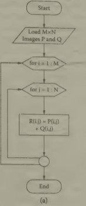

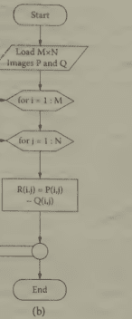

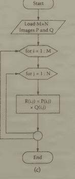

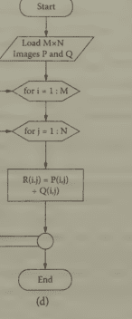

图 3.2 算法实现的流程图：(a) 图像加法，(b) 图像减法，(c) 图像乘法，(d) 图像除法。

感兴趣区域（ROI）应用。减法可能导致某些像素出现负值。当使用无符号数据类型时发生这种情况，负值会被截断为零（0），显示为黑色。

将图像乘以一个常数（称为缩放）是一种常见的图像处理操作。当缩放因子大于 1 时，缩放会使图像变亮；因子小于 1 时会使图像变暗。与简单地向像素添加偏移量相比，缩放通常能产生更自然的变亮/变暗效果，因为它能更好地保留图像的相对对比度。图像中无符号整数值的乘法经常会导致溢出。在这些情况下，也会应用通常的截断规则。

图像除法（也称为比率法），与图像减法一样，可用于检测两幅图像之间的变化。不过，除法给出的是对应像素值之间的分数变化或比率，而不是每个像素的绝对变化。除法也可以以与乘法相反的方式使用，即除以小于 1 的数会产生与乘以大于 1 的数相同的效果。不过，除法的一个重要应用是根据最大值对像素值进行归一化。事实上，归一化、减去最小值作为偏移量，最后乘以所需标量以将归一化后的移位像素缩放到屏幕显示范围的组合，对于屏幕上的图像显示非常有用。在任何全面的图像处理系统中，尤其是为了以相对亮度值显示结果图像的图像增强系统中，必须进行缩放，以实现更好、更真实的可视化。

### 3.4.3 图像混合与线性组合

到目前为止定义的四个运算符在某种程度上被认为是基本的图像处理算术运算符。尽管有人可能会争论加法和乘法是否是基本运算符，但最终这取决于硬件实现，其中一个运算符可能在实现的最优性方面优先于另一个。无论如何，您可以组合使用这些基本图像算术函数来执行一系列操作。例如，要计算两幅图像的平均值，基本方程

```
R(i,j) = \frac{P(i,j) + Q(i,j)}{2}, \quad (3.11)
```

可以按以下任一方式实现：

- 1. 先将图像 P 和 Q 相加，然后将和除以 2
- 2. 将 P 和 Q 分别除以 2，然后相加
- 3. 将 P 和 Q 乘以 0.5，然后相加
- 4. 将 P 和 Q 相加，然后乘以 0.5，等等...

因此，这将取决于硬件实现，可能偏好某一种运算而非另一种。图像混合同样是由基本运算符的线性组合产生的复合运算符的另一个经典示例。图 3.3 显示了图像混合操作的算法实现。

混合操作的典型应用在于图像生成，其中可以将两幅不同的图像组合起来，在原始图像中产生透明度、淡入淡出或添加对象等特殊效果。

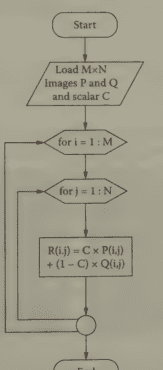

图 3.3 图像混合操作算法。

## 3.5 编码示例

在本节中，迄今讨论的各种算术运算符将通过使用 MATLAB® 图像处理工具箱的代码示例进行说明。给定的示例与彩色图像相关，因此会对图像执行三元组处理。一旦读入计算机，图像即为 8 位无符号整数格式（uint8），因此使用工具箱函数进行类型转换并处理截断等问题。

在以下示例中，为方便阐述要点，使用了一些示例图像。虽然简单，但这些图像与现实场景非常吻合，可以透明地应用于该情况。

### 3.5.1 图像加法

请考虑以下代码：

```
P = imread('sml1.jpg') ;
imshow(P)
Q = imread('sml2.jpg') ;
figure ; imshow(Q)
R = imadd(P,Q) ;
figure ; imshow(R)
figure ; imshow(R+100)
```

结果图像如图 3.4 所示。

图 3.4(a)、(b) 和 (c) 对应上述代码，第四幅图像表示标量加法，即在图 3.4(c) 的结果图像上加上 100，得到图 3.4(d) 所示的图像。显然，简单的加法不一定能产生所需结果，可能需要构建更复杂的运算符以适应应用。您也可以通过向每个像素添加常数值来使用加法使图像变亮。例如，以下代码使 RGB 图像变亮，结果如图 3.5 所示。

```
P = imread('peppers.png') ;
Rs = imadd(P, 100) ;
figure ; imshow(P) ;
figure ; imshow(Rs) ;
```

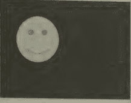

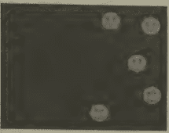

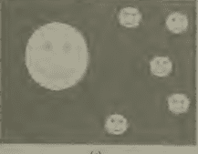

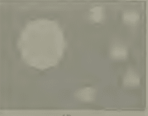

图 3.4 图像加法示例。(a) 原始图像 P，(b) 原始图像 Q，(c) 结果图像 R = P + Q，(d) 带缩放的结果图像 R + 100。

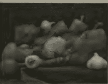

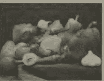

图 3.5 通过向每个像素添加常数值来使 RGB 图像变亮。(a) 原始图像，(b) 向原始图像添加 100 后的结果图像。

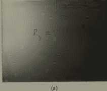

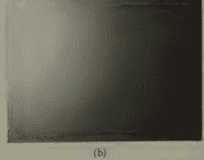

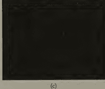

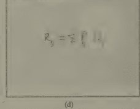

图 3.6 图像减法使用示例。(a) 来自白板的原始图像，(b) 背景图像，(c) 绝对差结果，(d) 通过从 255 减去 (c) 中图像得到的补码结果。

### 3.5.2 图像减法

图像减法既用作复杂图像处理序列中的子步骤，也用作本身的重要操作。以下是该运算符的两个使用示例。

常见用途是从场景中减去照明背景变化，以便更容易分析其中的前景对象。图 3.6(a) 显示了在非常差的照明条件下拍摄的白板图像。图 3.6(b) 是同一块白板的另一张快照，上面没有任何文字，然后从实际图像中减去它。所得差值使用公式 3.4 计算。然而，不需要的黑色是由于相同值像素的差异造成的。可以再次应用减法运算符，即从 255（8 位表示中像素的最大值）减去该结果图像。这会产生一个比前一个结果更具视觉适宜性的补码图像。最后两幅图像分别显示在图 3.6(c) 和 (d) 中，底层代码如下：

```
P = imread('back1.jpg') ;
imshow(P)
Q = imread('back2.jpg') ;
figure ; imshow(Q)
R = imabsdiff(P,Q) ;
figure ; imshow(R)
Rc = 255 - R ;
figure ; imshow(Rc)
```

图像减法的一个关键应用是检测场景中的变化，该应用用于监控应用中的目标跟踪和运动检测。图 3.7(a) 和 (b) 显示了两个非常细微差异的场景。差异非常小，以至于人类用户很难检测到变化。然而，应用绝对图像减法会使变化非常突出地显现出来，如图 3.7(c) 所示。图 3.7(d) 中的互补视图更加突出地揭示了变化。

以下是生成上述图像的底层代码：

```
P = imread('chng1.jpg') ;
figure ; imshow(P)
Q = imread('chng2.jpg') ;
figure ; imshow(Q)
R = imabsdiff(P,Q) ;
figure ; imshow(R)
Rc = 255 - R ;
figure ; imshow(Rc)
```

### 3.5.3 图像乘法

要乘以两幅图像，请使用 immultiply 函数，该函数对一对输入图像中对应像素执行逐元素乘法（*），并将这些乘法的乘积返回到输出图像中的对应像素。然而，这种逐像素实现的应用非常有限。例如，频域中的滤波操作是先对噪声图像和滤波器分别进行傅里叶变换，然后逐像素相乘，之后对乘积进行逆傅里叶变换。此示例将在第 6 章中介绍，该章涉及图像滤波。
然而，图像乘法最常见的应用是缩小图像值，使其落在两个饱和


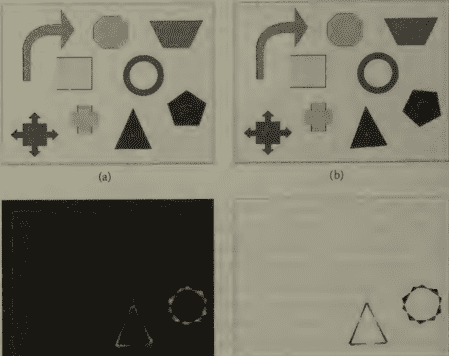

图 3.7 使用图像减法检测场景中的变化。(a) 原始图像，(b) 带有变化的图像，(c) 使用 imabsdiff 函数检测到的变化，(d) (c) 的补图像。

用于适当查看的限制（最小值和最大值）。此类操作的需求出现在两种情况下：首先，如果源图像太暗或太亮；其次，作为某些处理步骤的结果，生成的矩阵具有非常高的值。第二种情况的典型示例是两幅图像的卷积，其中求和的乘积可能导致非常高的值。以下代码实现了这一点：

```
P = imread('coins.png') ;
figure ; imshow(P)
Q = fspecial('unsharp' , 0.5) ;
figure ; mesh(Q)
R = conv2(P,Q) ;
figure ; imshow(R)
figure ; imshow(R*0.005)
```

图 3.8 显示了此代码的结果。

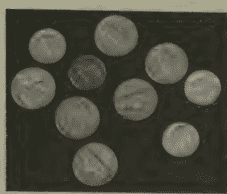

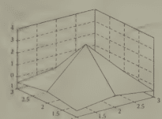

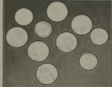

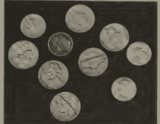

图 3.8 通过图像乘法缩小图像值。(a) 原始图像，非常柔软且可锐化，(b) 使用的锐化滤波器，(c) 未缩放的卷积结果图像，(d) 卷积的缩放图像。

### 3.5.4 图像除法

图像除法可用于与图像乘法相同的缩放目的。因此，代码行

```
imshow(R*0.005);
```

可以写为

```
imshow(R/200);
```

以获得与图 3.8 相同的结果。

要除以两幅图像，请使用 imdivide 函数。imdivide 函数对一对输入图像中对应像素执行逐元素除法 (./)。immultiply 函数将结果返回到输出图像中的对应像素。但是，一个重要的

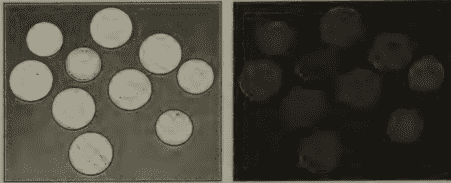

图 3.9 图像除法。(a) 与图 3.8(c) 相同；(b) 是通过图像除法归一化后的结果图像。

除法运算符的一个重要应用与图像归一化相关，如以下代码所示：

```
P = imread('coins.png') ;
figure ; imshow(P)
Q = fspecial('unsharp', 0.5) ;
figure ; mesh(Q)
R = conv2(P,Q) ;
figure ; imshow(R)
figure ; imshow(R./max( max(R) ))
```

结果如图 3.9 所示。

### 3.5.5 图像混合与线性组合

在 MATLAB 中，图像混合可以使用公式 3.10 的经验公式实现，也可以使用 imlincomb 函数实现。当与 uint8 或 uint16 数据一起使用时，每个算术函数在将结果传递给下一个操作之前都会对其进行截断。这种截断会显著减少输出图像中的信息量。事实上，执行这一系列计算的更好方法是使用 imlincomb 函数而不是经验公式。imlincomb 在双精度下执行线性组合中的所有算术运算，并且只对最终结果进行截断。以下代码展示了该函数如何从两幅图像生成合并图像：

```
P = imread('circles.png') ;
figure ; imshow(P)
Q = imread('testpat1.png') ;
figure ; imshow(Q)
x = 0.8 ;
R = imlincomb(x,P,1-x,Q) ;
figure ; imshow(R)
x = 0.2 ;
R = imlincomb (x,P,1-x,Q);
figure ; imshow (R)
```

此代码的结果如图 3.10 所示。


图 3.10 合并两幅图像的代码结果。(a) 原始图像 P，(b) 原始图像 Q，(c) 和 (d) 分别是 x = 0.8 和 0.2 时 xP + (1 - x)Q 的结果。

## 3.6 总结

- 算术运算符可以像对矩阵一样对图像进行操作，只需考虑少数事项（第 3.1 节）。
- 图像算术以逐像素的方式对两幅相同大小的图像进行操作（第 3.2 节）。
- 图像算术的另一种形式是对图像矩阵应用标量（第 3.2 节）。
- 基本算术运算符是加法、减法、乘法和除法（第 3.3.1–3.3.5 节）。
- 对于 n 元组图像，操作在每个像素与相同大小的对应像素之间进行（第 3.3.3 节）。
- 加法用于更改像素强度、合并图像、向图像添加内容等（第 3.3.1–3.3.5 节）。
- 减法可用于目标检测、背景移除、帧间差分以及从图像中移除伪影（第 3.3.1–3.3.5 节）。
- 乘法和除法可用于缩放和归一化应用，以使图像更具视觉吸引力（第 3.3.1–3.3.5 节）。
- 图像的线性组合也是可能的，并用于合并图像以生成新图像（第 3.3.1–3.3.5 节）。
- 就像素值而言，过冲和欠冲通常通过截断来处理（第 3.3.3 节）。

## 3.7 练习

- 1. 读取图像左侧物体的图像 [例如图 3.4(a) 中的 sml1.jpg]。编写一个 m 文件，生成另一幅图像，具有相同的行数但两倍的列数，以容纳源图像的镜像。
- 2. 图像减法是图像中目标跟踪的非常常用方法。使用视频流中的几幅连续图像，并使用此方法在其中跟踪特定目标。
- 3. 编写一个 m 文件来读取图像 img1.jpg 和 img2.jpg。使用 MATLAB 在 img1 和 img2 之间的互相关函数，并配合适当阈值来检测和计数 img1.jpg 中的圆。
- 4. 使用卷积操作而不是互相关来重复问题 #3。结果与之前的相似吗？请评论。
- 5. 使用两幅灰度图像 x 和 y，并通过 MATLAB 操作证明 x.*y = log^[log(x) + log(y)]。在尝试取对数之前，请确保图像中没有零值。

# 4 仿射与逻辑运算、图像畸变与噪声

## 4.1 引言

在许多成像系统中，检测到的图像会受到由透视不规则性引入的几何畸变的影响，其中相机相对于场景的位置会改变场景几何的表观尺寸。对均匀畸变的图像应用仿射变换可以通过将测量值从理想坐标转换为实际使用的坐标来纠正一系列透视畸变。同样，存在与屏蔽图像某些区域相关的情况。这是通过以逐像素方式作用于图像的逻辑运算完成的，这些运算会根据操作抑制或显现某些值。在本章中，将详细探讨这两种操作，以便读者为高级操作做好准备，在这些高级操作中，这两种操作将被反复用于执行更高级别的任务。

## 4.2 仿射运算

仿射操作或变换是线性 2D 几何变换的一个重要类别，它通过应用平移、旋转、缩放和/或剪切（即某些方向上的非均匀缩放）操作的线性组合，将变量（例如，输入图像中位置 (x_i, y_i) 处的像素强度值）映射为新变量（例如，输出图像中的 (x_j, y_j)）。这些仿射运算符通常称为 TRS 运算符，是带有附加偏置的线性运算符的扩展。这极大地帮助机器视觉系统纠正透视错误；也就是说，如果物体不直而是略微倾斜，它可能看起来不同。仿射操作可以通过旋转、平移和缩放图像的某些部分来纠正透视错误。

一般仿射操作通常以齐次坐标写成如下形式：

```
\(\left[ \begin{matrix} x_2 \\ y_2 \end{matrix} \right] = A \left[ \begin{matrix} x_1 \\ y_1 \end{matrix} \right] + B .\) (4.1)
```

TRS 操作在表 4.1 中总结。通常会组合多种不同的仿射变换以产生合成变换。变换发生的顺序很重要，因为先平移后旋转不一定等同于反之。

图 4.1 描绘了示例图像上的一些仿射操作。在这些图像中，原始图像 (a) 经过了 TRS 变换。在图 4.1(b) 中，图像看起来被洗牌了，因为其每个四分之一部分都已移动（平移）到另一部分的位置。例如，部分 1 和 4 互换，而 2 和 3 互换。这种互换是通过向部分的每个像素添加或减去适当的位移来完成的。图 4.1(c) 显示了 45° 的旋转（逆时针旋转）。生成的黑色部分是零填充区域，用于保持整体图像为矩形或正方形。值得注意的是，由于此操作，图像大小会增加。对于此特定情况，大小从 480 x 640 x 3 增加到 793 x 793 x 3。如果在相反方向执行相等的旋转，图像将看起来是直的，但大小将增加到 1125 x 1125 x 3。图 4.1 中的最后一幅图像显示了缩放的效果，其中通过将每个 a1 x a2 像素组替换为其平均值，使图像大小减小到四分之一。这可以通过生成图像的大小以及此操作产生的模糊度清楚地看到。

大多数仿射运算符的实现都允许用户通过指定输入图像中三个（或更少）坐标对 (x1, y1) 在输出图像 (x2, y2) 中的重新映射位置来定义变换。一旦


TABLE 4.1 仿射TRS操作

| 操作 | 算子 |
| :--- | :--- |
| **平移：** 沿x方向移动 \( b_1 \) 像素，沿y方向移动 \( b_2 \) 像素。靠近图像边缘的元素处理方式因实现而异。平移用于改善图像的可视化，但也可作为预处理器，用于需要对两张或多张图像进行配准的应用。 | \( A = \begin{bmatrix} 1 & 0 \\ 0 & 1 \end{bmatrix} \), \( B = \begin{bmatrix} b_1 \\ b_2 \end{bmatrix} \) |
| **旋转：** 将所有像素按 \( \theta \) 度角旋转（正角度为逆时针）。在大多数实现中，输出位置 \( (x_s, y_s) \) 若位于图像边界之外则被忽略。旋转最常用于改善图像的视觉外观，尽管在涉及方向算子的应用中，它也可作为预处理器使用。 | \( A = \begin{bmatrix} \cos \theta & -\sin \theta \\ \sin \theta & \cos \theta \end{bmatrix} \), \( B = \begin{bmatrix} x_o \\ y_o \end{bmatrix} \)。\( x_o \) 和 \( y_o \) 是原点的坐标。 |
| **缩放：** 执行一种几何变换，可用于缩小或放大图像的尺寸。图像缩小（通常称为*子采样*）是通过替换（将一组像素值替换为该组内任意选定的一个像素值，即 \( a_1 \) 或 \( a_{22} \)）或通过对局部邻域内像素值进行*插值*来实现的。图像放大通过像素复制或插值实现。 | \( A = \begin{bmatrix} a_1 & 0 \\ 0 & a_{22} \end{bmatrix} \), \( B = \begin{bmatrix} 0 \\ 0 \end{bmatrix} \)。\( a_1 \) 表示按所采用的方法，所选块中的像素数量。 |

一旦变换以这种方式定义，重映射过程即通过为每个输出像素位置 \( (x_i, y_i) \) 计算对应的输入坐标 \( (x_i, y_i) \) 来进行。如果该输入点位于图像之外，则输出像素设置为背景值。否则，将使用（1）输入像素本身，（2）最接近所需像素位置的邻居，或（3）相邻四个像素的双线性插值的值。

当检测到图像发生某种畸变时，仿射操作最常被应用。通过对输入图像重采样，使得每个点 \( (x_i, y_i) \) 的信息（或强度）映射到相应输出图像中的正确位置 \( (x_i, y_i) \)，即可从仿射变换中获得输入图像的几何正确版本。这些操作有助于图像配准、图像中透视畸变的校正，以及在角度和尺寸方面进行后续处理的对齐。


图 4.1（参见第204页之后的彩色插页。）各种仿射操作。（a）原始图像，（b）平移（±240, ±320），（c）旋转45°，（d）缩放25%。

## 4.3 逻辑算子

仿射或几何操作会影响图像坐标值，但有时需要突出或完全移除图像的某些部分。这通常发生在需要为特定机器视觉应用移除图像特定部分时。一般来说，逻辑操作本质上是二进制的，大多数时间也作用于二值图像，但可以调整以适用于灰度图像。本质上，这些算子的工作原理与数字逻辑电路设计中的离散门相同。表4.2总结了图像处理中常用的基本逻辑操作。

表 4.2 图像的逻辑算子

| 操作 | 二元算子 | 灰度算子 |
| :--- | :--- | :--- |
| **与和非与：** AND最明显的应用是计算两个图像的交集。它也用于提取图像的一部分。 | A B A&amp;B (A&amp;B)<br>0 0 0 1<br>0 1 0 1<br>1 0 0 1<br>1 1 1 0 | A&amp;B = min(A,B)<br>或<br>AB = min(A,B) |
| **或和非或：** OR算子通常输出第三个图像，其像素值即为第一个图像与第二个图像对应像素的或运算结果。 | A B A+B (A+B)<br>0 0 0 1<br>0 1 1 0<br>1 0 1 0<br>1 1 0 1 | A+B = max(A,B) |
| **异或和非异或：** 对于两个输入，异或函数仅当且仅当一个输入值为真时才为真，否则为假。 | A B A⊕B (A⊕B)<br>0 0 0 1<br>0 1 1 0<br>1 0 1 0<br>1 1 0 1 | A⊕B = AB' + A'B |
| **注意：** 逻辑非（或反相）是一个算子，它以二值或灰度图像为输入并生成其摄影负片；即，输入图像中的暗区变亮，亮区变暗。 | A A'<br>0 1<br>1 0 | A' = 2^k - 1 - A<br>其中 b 是表示灰度级的位数 |

图4.2展示了这些操作的实际效果。使用了两张灰度图像A和B。B是一张非常简单的图像，被选中是因为它能比普通图像更清晰地展示逻辑操作的效果。图4.2(c)和(d)展示了两个源图像的逻辑反相。这种反相也常被称为原始图像的负片。通过对两个图像进行与运算，掩码图像B的主导区域揭示了A的特定区域，因此可用于隔离或掩盖图像的某些部分。下一张图像是与运算结果的反相，显示了先前被掩盖区域的负片效果。接下来的两张图像是或运算和非或运算的结果，可用于从图像中移除特定区域或隔离掩盖区域。最后两张图像代表异或和非异或操作。如图4.2(i)和(j)所示，这些操作能更好地隔离掩盖区域，并可用于产生人工立体视觉效果，仿佛特定区域是专门立体视觉的目标，且仅对该部分图像进行了高亮显示。


图 4.2 逻辑操作演示。（a）原始图像A，（b）原始图像B，（c）A'，（d）B'，（e）AB，（f）(AB)'，（g）A + B，（h）(A + B)'，（i）A⊕B，（j）(A⊕B)'。


图 4.2（续）

## 4.4 图像中的噪声

在机器视觉系统中，通过现代传感器获取的图像可能会受到多种噪声源的污染。对于普通照相机来说，由于电子环境非常稳定且成像路径非常短，这种现象不太明显，而这些并非机器视觉系统或军事、卫星以及工业中高噪声振动环境等极端应用的常见条件。噪声是指图像像素值的随机变化。在大多数涉及照片成像的应用中，使用电荷耦合器件（CCD）相机，其中光子产生电子，通常称为光电子。尽管如此，以下各节中概述的大多数观察结果涉及CCD成像中的噪声及其各种来源，但同样适用于其他成像模式。

### 4.4.1 光子噪声

当我们观察到的物理信号基于光时，光的量子性质起着重要作用。在 \(\lambda = 500\) nm 处的单个光子携带的能量为 \(E = h\nu = hc/\lambda = 3.97 \times 10^{-19}\) J。噪声问题源于光子产生的基本统计特性。我们不能假设，在给定像素中，对于两个连续但独立的长度为 \(T\) 的观测间隔，会计数相同数量的光子。在长度为 \(T\) 秒的观测窗口中，\(p\) 个光子的概率分布已知为泊松分布：

\(P(p|\sigma,T)=\frac{(\sigma T)^p e^{-\sigma T}}{p!}, \quad (4.2)\)

其中 \(\sigma\) 是以每秒光子数为单位的强度参数。关键是要理解，即使成像链中没有其他噪声源，在有限时间间隔 \(T\) 内与光子计数相关的统计波动仍会导致有限的信噪比（SNR）。对于非常强的信号，当 \(\sigma T\) 超过 \(10^5\) 时，如果传感器具有足够高的饱和电平，则由于光子统计引起的噪声波动可以忽略不计。

### 4.4.2 热噪声

CCD相机中电子的另一个随机来源是热能。电子可以通过热振动变得越来越激动，从而从CCD材料本身中释放出来，然后如果被困在CCD阱中，就无法与“真”光电子区分开来。通过冷却CCD芯片，可以显著减少产生热噪声（或*暗电流*）的热电子数量。热电子的概率分布也是泊松过程，其中速率参数 \(\tau\) 是温度的递增函数：

\(P(p|\tau,T)=\frac{(\tau T)^p e^{-\tau T}}{p!}. \quad (4.3)\)


### 4.4.3 片上电子噪声

这种噪声源于从传感器读取信号的过程，在此情况下通过CCD芯片的场效应晶体管（FET）。读出噪声的功率谱密度的一般形式为

\( S(f) \propto \begin{cases} (2\pi f)^{-\beta} & f < f_{min} \\ k & f_{min} < f < f_{max} \\ (2\pi f)^{-\alpha} & f > f_{max} \end{cases}, \quad \beta > 0 \quad \alpha > 0 \quad (4.4) \)

其中 \(\alpha, \beta,\) 和 \(k\) 是常数，\(f\) 是信号从CCD芯片传输到后续电路的频率。

### 4.4.4 KTC噪声

与FET栅电容相关的噪声称为KTC噪声，可能不可忽略。该噪声电压的输出有效值由

\( n_{KTC} = \sqrt{\frac{kT}{C}}, \quad (4.5) \)

其中 \(C\) 是FET栅开关电容，\(k\) 是玻尔兹曼常数，\(T\) 是以K为单位的CCD芯片绝对温度。合适的电子设计（例如使用相关双采样和双斜率积分）几乎可以完全消除KTC噪声。

### 4.4.5 放大器噪声

此类噪声的标准模型是加性的、高斯的，并且与信号无关。在现代设计良好的电子设备中，放大器噪声通常可以忽略不计。最常见的例外情况出现在彩色相机中，其中蓝色颜色通道使用的放大比绿色通道或红色通道更多，导致蓝色通道中的噪声更多。

### 4.4.6 量化噪声

量化噪声固有于幅度量化过程，并出现在模数转换器（ADC）中。当灰度级数通常多于4位表示所对应的16个级数时，该噪声是加性的且与信号无关。量化噪声通常可以忽略，因为完整系统的总信噪比（SNR）通常由最小的信噪比（SNR）主导。在CCD相机中，这就是光子噪声。

## 4.5 图像畸变

在摄影场景中，一个更相关的问题是畸变，通常称为模糊。它被视为一种特定的点扩散函数（PSF），与图像进行卷积。正如名称所暗示的那样，PSF是一种从一点产生并以衰减方式扩散的核。图像模糊基本上是一个连续过程；PSF也可以以连续方式表示。PSF可以表示为 h(m,n,ψ)，其中 ψ 表示模糊PSF的严重性函数。PSF不能取任意值。然而，由于底层成像系统的物理特性，f(m,n) 和 g(m,n) 都不能为负。因此，PSF需要是非负的实值函数。

除此之外，成像系统中的缺陷通常对数据起被动操作作用；也就是说，它们不吸收或产生能量。因此，原始图像中特定点产生的所有能量都应被保留，从而得到


或以离散形式，


其中 m 和 n 是图像像素的索引。接下来介绍四种常用的模糊PSF。

### 4.5.1 线性运动模糊

可以区分多种运动模糊类型，它们都源于记录设备与物体之间的相对运动。这种运动可以是平移、旋转、尺度的突然变化或这些方式的某种组合。平移是运动模糊最重要的来源，可以如下描述。

当物体在曝光区间 [0,T] 内以恒定速度 V 沿与水平轴成 \(\phi\) 弧度的角度平移时，PSF 由

\(h(m,n;L,\phi)=\left\{\begin{array}{ c c }
\frac{1}{L}, & \text{if } \sqrt{m^2+n^2} \le L/2 \text{ and } m/n=-\tan\phi, \\ \\
0, & \text{otherwise}
\end{array}\right.\) (4.8)

其中 \(L = VT\) 是运动长度。PSF是空间不变的。然而，如果只有图像的一部分受到平移运动的影响，则整体畸变是空间变异的。

### 4.5.2 均匀散焦模糊

当2D成像平面上的相机成像3D物体时，物体的某些部分对焦而其他部分不对焦。对于圆孔成像设备，物体任何部分的像都是一个圆形圆盘，称为 _散光圆（circle of confusion，CoC）_。散焦程度（CoC的直径）取决于透镜的焦距 _F_ 和光圈数 _k_，以及相机与物体之间的距离 _P_。如果相机对距离 _S_ 处的物体进行清晰对焦，则CoC的直径（记为 _C_(_P_)）由

\(C(P)=\left\{\begin{array}{ c c }
\frac{FS}{k(S-F)}-\frac{F^2S}{kP(S-F)}+\frac{F}{k} & \text{for } S<P<\infty \\ \\
\frac{-FS}{k(S-F)}+\frac{F^2S}{kP(S-F)}+\frac{F}{k} & \text{for } F<P<S
\end{array}\right.\) (4.9)

该均匀散焦模糊的PSF，半径为 _R_ = _C_(_P_)/2，随后由

\(h(m,n;R)=\left\{\begin{array}{ c c }
\frac{1}{\pi R^2}, & \text{if } \sqrt{m^2+n^2} \le R \\ \\
0, & \text{elsewhere}
\end{array}\right.\) (4.10)

### 4.5.3 大气湍流模糊

大气湍流是遥感和航空成像系统的严重限制。尽管这种模糊是由多种因素引起的，但在长时间曝光情况下，模糊PSF可以近似为高斯函数，如下所示

$$h(m,n;\sigma_G) = C \exp \left\{ - \frac{m^2 + n^2}{2\sigma_G^2} \right\}, \quad (4.11)$$

其中 $\sigma_G$ 表示模糊的严重程度，$C$ 是一个常数，其选取方式使得PSF满足必要条件。

### 4.5.4 散射模糊

这种模糊发生在专用系统中，其中入射成像量子被系统结构或其他入射量子反射。在X射线和超声成像中，这种现象更为突出。对于此类情况，PSF定义如下：

$$h(m,n;\beta_m) = \frac{C}{\left[ \beta_m^2 + (m^2 + n^2) \right]^{\frac{5}{2}}}, \quad (4.12)$$

其中 $\beta_m$ 决定模糊的灵敏度，并且是辐射物体与探测器之间距离的函数。

## 4.6 算法说明

图像中上述的所有异常本质上都是数学操作，通常在像素级别进行。然而，这些操作可能扩展为一组互连的像素，如缩放操作或模糊过程的情况，整个邻域都受到操作的影响。以下部分介绍了这些操作的一些算法方面。

### 4.6.1 仿射操作

前面提到的三种仿射算子中的任何一种都可以在MATLAB®中非常容易地用作矩阵操作。然而，对于任何其他编程环境，这些操作将通过使用带有方程的嵌套循环来实现，如表4.1所示。平移可能是所有操作中最简单的，因为它只涉及坐标值的重新分配。

与平移算法不同，旋转算法可以生成不是整数的坐标 (x_k, y_j)。为了生成每个整数位置处像素的强度，可以采用不同的启发式方法（或重采样技术）。例如，两种常用方法包括以下内容：

- 允许每个整数像素位置的强度级别采用最近非整数邻居 (x_k, y_j) 的值。
- 基于 n 个最近非整数值的加权平均来计算每个整数像素位置的强度级别。加权与附近投影的距离或像素重叠成正比。

后一种方法产生更好的结果，但增加了算法的计算时间。

缩放可能是TRS算子中最复杂和最涉及的操作。缩放沿坐标方向压缩或扩展图像。由于可以使用不同的技术进行子采样和缩放，每种技术将分别讨论。

图4.3显示了缩放的四种可能性。

图4.3(a)说明了两种子采样方法。在第一种方法中，在局部邻域内选择一个像素值（可能是随机）来代表其周围。（这种方法计算简单，但如果采样邻域太大，可能会导致结果较差。）在图中，在2 x 2的邻域内，


图4.3 缩放方法。(a) 将大小减半，(b) 将大小加倍。


新图像的像素值选取左上角像素。第二种方法通过对局部强度值进行统计采样（例如取平均值），在邻域内对像素值进行插值。

图像（或图像的区域）可以通过像素复制或插值进行放大。图 4.3(b) 中的第一种方法展示了像素复制如何简单地用一组相同值的像素替换每个原始图像像素（组大小由缩放因子决定；在此例中为 2 × 2）。或者，可以对原始图像中相邻像素的值进行插值，以用一组扩展的像素替换每个像素。大多数实现提供增加原始图像实际尺寸的选项，或者保留尺寸并在旧图像边界内仅放大图像的一部分。在图中，插值计算为较小图像所定义的两个极端点之间直线上的近似采样。

邻域选择也可以是直接的，也可以基于某些预定义方案，并且可以算法地定义为 T_s[x(i:M, j:N))] 和 T_r[x(i:M, j:N))]，其中 T_s 和 T_r 是源图像像素范围 x(i:M, j:N)) 的选择器策略的数学等价。生成的强度值可以用 T_m 表示，在此例中可以是“选择”或“平均”。

一般来说，算法逻辑应类似于图 4.4 所示。

Start
Load Image (A)
Initialize image B
Set displacements: b1, b2
Loop (i)
with inc. 1
Loop (j)
with inc. 1
B(a1+b1, a2+b2)
= A(i,j)
Display
Images
End

Start
Load Image (A)
Initialize image B
Loop (i)
with inc. 1
Loop (j)
with inc. 1
M = i cosθ - j sinθ
N = i cosθ + j sinθ
B(M,N) = A(i,j)
Display
Images
End

Start
Load Image (A)
Initialize image B
Loop (i)
with inc. M
Loop (j)
with inc. N
k = i + p   l = j + q
Neighborhood aij = Tij{MN;N}
Neighborhood bij = Tij{MN;N}
Bij = ...
Display
Images
End

图 4.4 TRS 算子的算法表示。(a) 平移，(b) 旋转，(c) 缩放。

### 4.6.2 逻辑运算符

图 4.5 显示了逻辑运算符的算法架构。


图 4.5 逻辑运算的算法架构。(a) 具有两个输入图像的运算符，(b) 单图像运算符。

操作以单次遍历的方式直接执行。重要的是，所有参与操作的输入像素值必须具有相同的位数，否则可能会发生意外情况。

一般来说，如果两个图像是二进制图像或可以使用阈值转换为二进制格式，则将逻辑运算符应用于两个图像以检测它们之间的差异或相似性是最合适的。

要生成二进制图像的摄影负片，可以使用逻辑非运算符。输入二进制图像中每个具有逻辑 1（通常称为前景）的像素都有逻辑 0（与输出图像中的背景相关），反之亦然。因此，对二进制图像应用逻辑非会改变其极性。逻辑非也可用于灰度图像，在这种情况下，每个像素的结果值是图像中最大强度值减去输入值。

反转还用于打印图像的摄影负片，或使图像中的特征对人类观察者更清晰。例如，这对于医学图像很有用，其中物体通常在白色背景上呈黑色。反转图像使物体在深色背景上呈白色，这通常更适合人眼。

### 4.6.3 畸变和噪声

尽管前面几节列出了多种类型的噪声，但在算法层面上，这些噪声仍可视为某些分布的随机数。在大多数图像处理算法中，加性高斯噪声是首选。从第 4.4 节可知，光子噪声和放大器噪声是高斯噪声的特例，其他噪声可以用泊松分布或斑点随机性来表示。泊松分布用于有限数量的算法，尤其是热成像和遥感应用的大气成像。然而，在其余类型中，会添加斑点噪声，通常称为椒盐噪声。这个名称很贴切，因为它只在随机位置将强度改为非常亮（盐）或非常暗（胡椒）的像素。

另一方面，模糊比噪声更复杂。它需要一个特定的点扩散函数（PSF），表示为较小的矩阵，作为模糊函数的体现。然后将这个小矩阵与源图像进行卷积，以生成模糊版本。卷积的机制将在第 6 章讨论。图 4.6 表示了在图像中引入噪声和模糊的算法。

## 4.7 MATLAB 代码

本节介绍了用于生成本章所有图像的 MATLAB 代码。

### 4.7.1 仿射和逻辑运算符

```
clear all; close all
x=imread('lake.jpg');
imshow(x)
[r,c,s] = size(x) ;
```

```
% Image Translation
y1 = x(1:r1,1:c1,:) ;
y2 = x(1:r1,c1+1:c,:) ;
y3 = x(r1+1:r,1:c1,:) ;
y4 = x(r1+1:r,c1+1:c,:) ;
yy = [ y4 y3 ; y2 y1 ] ;
figure ; imshow(yy)
axis on
```

```
% Image Rotation
y=imrotate(x,45) ;
figure ; imshow(y)
z = imrotate(y,-45) ;
figure ; imshow(z)
[size(x) ; size(y) ; size(z) ]
```

```
% Image Scaling (resizing)
zz = imresize(x, [r/2 c/2]);
figure ; imshow(zz)
axis on
zz = imresize(x,[r/4 c/4]);
figure ; imshow(zz)
axis on
```

前面的代码生成了图 4.1 中的图像。同样，图 4.2 中的图像是由以下代码生成的：

```
clear all; close all
x=imread('lake.jpg');
imshow(x)
[r,c,s] = size(x) ;
[m,n] = ginput() ;
g(min(n):max(n) ,min(m):max(m)) = 1 ;
g = g * 255 ;
figure ; imshow(g)
not_g = max(max(max(g)))-g;
```

```
% Image Inversion (NOTing)
not_x = 255-x;
figure ; imshow(not_x)
```

```
% Image AND/NAND-ing
g1 = double (double (x) .* g) ;
figure ; imshow(g1*0.00005)
mg = max(max(max(g1))) ;
figure ; imshow((mg-g1)*0.000008)
```

```
% Image OR/NOR-ing
g2 = double(double (x) + g) ;
figure ; imshow(g2*0.0005)
mg = max(max(max (g2))) ;
figure ; imshow((mg-g2)*0.003)
```

```
% Image XOR/XNOR-ing
g3 = double(x) .* not_g + double(not_x) .* double(g) ;
figure ; imshow(g3*0.0000005)
mg3=max(max(max(g3))) ;
figure ; imshow((mg3-g3)*0.0000005)
```

### 4.7.2 图像中的噪声

生成带有高斯噪声和椒盐噪声的噪声图像的代码（带有强度参数）如下：

```
clear all; close all
x=imread('flowers001.jpg');
imshow(x)
[r,c,s] = size(x) ;
% Gaussian Noise
xn1 = imnoise(x,'gaussian',0,0.1);
figure ; surfl(xn1)
xn2 = imnoise(x,'gaussian',0,1);
figure ; imshow(xn2)
```

```
% Salt & Pepper Noise
xn3 = imnoise(x,'salt & pepper',0.05);
figure ; surfl(xn3)
xn4 = imnoise(x,'salt & pepper',0.3);
figure ; imshow(xn4)
```


图 4.7 添加噪声的效果。(a) 方差为 0.1 的高斯噪声，(b) 方差为 1 的高斯噪声，(c) 参数 D = 0.05 的椒盐噪声，(d) 参数 D = 0.3 的椒盐噪声。

生成的图像如图 4.7 所示。

### 4.7.3 图像中的模糊

图像模糊的代码如下，生成的图像如图 4.8 所示。

```
clear all; close all
x=imread('horses.jpg');
imshow(x)
[r,c,s] = size(x) ;

% Motion Blur
f1 = fspecial('motion',15,45) ;
figure ; surf(f1)
xbl = imfilter(x,f1);
figure ; imshow(xbl)
```


FIGURE 4.8 Blurring of images and the blurring masks. (a) Image blurred by "motion" blur representing motion in a 15-pixel neighborhood and at 45°, (b) the corresponding blurring function, (c) image blurred by "out-of-focus" blur with the circle of confusion (CoC) radius of 5 pixels, (d) corresponding blurring function.

```
% Out of Focus Blur
f2 = fspecial('disk',5) ;
figure ; surf(f2)
xb2 = imfilter(x,f2);
figure ; imshow(xb2)
```

## 4.8 SUMMARY

- Images can be modified using a series of affine transforms.
- These transforms are categorized as translation, rotation, and scaling transforms, or TRS.
- The translation operation reassigns the coordinate values, essentially moving some part of the image to a different place.
- The rotation operation rotates the image or part of the image by a desired angle, either clockwise or counterclockwise.
- Integer approximation is performed for the resulting fractional pixels for proper image display.
- The scaling operation is used in the zooming in or zooming out operation, where image size is changed in such a way that either some pixels are removed (zooming out) or new pixels are added (zooming in).
- Pixels can be removed based on some predefined selection procedure or through replacement of a neighborhood with an equivalent statistical measure.
- The logical transforms can be used to mask out a particular portion of the image to perform a specific operation.
- Logical inversion of the image is equivalent to the photographic negative of that image.
- Logical AND, NAND, OR, NOR, XOR, and XNOR operators can perform various localized selections or maskings on an image by suitably selected masking images.
- Noise in the image is the addition of random values to the image.
- Although physically there are many types of image noise, the algorithmic versions usually rely on Gaussian and salt-and-pepper noise to simulate natural phenomena.
- Blurring refers to other distortions in the image such as motion blur, out of focus, atmospheric effects, etc.
- Algorithmically speaking, blur is another 2D matrix (usually much smaller than the source image) that is then convolved with the image to produce the blurring effect.

## 4.9 EXERCISES

- 1. Image reflection is a special case of the translation operation. Write a program to read an image and produce another image that contains the source image and its reflection connected to it. This resulting image should have the same height as the original image but twice the width.
- 2. Each time an image of size M x N is rotated by an angle \(\theta\) (\(\theta < 90^\circ\)), the size of the image changes. Derive two equations relating the new height (P) and new width (Q) to the angle of rotation and the original dimensions.
- 3. Derive the linear interpolation equations (using simple line equations) to map a \(2 \times 2\) image into an \(n \times n\) image with the four corners of this new image as the four values in the \(2 \times 2\) image segment. [Hint: The resulting system of equations is to be designed for \((n-2) \times (n-2)\) pixels to be injected. The 2 × 2 segments can be assumed to have pixels \(a_{11}, a_{12}, a_{21}\), and \(a_{22}\)].
- 4. Load the image pout.tif from MATLAB's image collection. Isolate the pocket of the shirt that the child is wearing in the image. Invert it as a photographic negative, and replace it in the original image. Other than the reading and displaying of the image, this can be done with one or two statements in MATLAB.
- 5. Out-of-focus blur is a special case of low-pass filtering and can be used to remove noise from the image at the cost of some blurring. Use a blurring function of a radius 2 and experiment with images in Figures 4.7 (a) and (d), and give a detailed account of your findings.

# 5 Image Transforms

## 5.1 INTRODUCTION

IMAGE TRANSFORMS REFER TO the mathematical mapping of image pixels from the spatial domain to some other domain where certain other characteristics of the image can be seen in a better manner. An analogy to this is the spectrum of a signal in the 1D case. In the time domain, we cannot readily see the frequency components, but mapping the signal to its spectrum reveals the details about these components (frequency and amplitude). The basic principle behind any transform is to decompose a signal (or image) into certain components using some type of magnifying-glass function called the kernel or basis function. As such, for images, this basic principle can be written as follows:

```
F(a,b) = \sum_m \sum_n f(m,n)\psi(m,n,a,b). (5.1)
```

Several types of such transforms are available for images, such as the following:

- Fourier transform
- Wavelet transform
- Hough transform
- Discrete cosine transform (discussed in Chapter 8)

However, in this chapter, the emphasis is on the first three transforms in this list. Other types of transforms will be discussed when their applications are encountered during the course of the discussion.

## 5.2 DISCRETE FOURIER TRANSFORM (DFT) IN 2D

The Fourier transform is an important image processing tool that is used to decompose an image into its sine and cosine components. The output of the transformation represents the image in the Fourier, or frequency, domain, and the input image is the spatial domain equivalent. In the Fourier domain image, each point represents a particular two-dimensional frequency component.

The DFT is the sampled Fourier transform and therefore does not contain all frequencies forming an image, but only a set of samples that is large enough to fully describe the spatial domain image. The number of frequencies corresponds to the number of pixels in the spatial domain image; that is, the images in the spatial and Fourier domains are of the same size. For an image of size M x N, the two-dimensional DFT is given by

```
F(u,v) = \frac{1}{N^2} \sum_{m=0}^{M-1} \sum_{n=0}^{N-1} f(m,n)e^{-j2\pi(\frac{um}{M} + \frac{vn}{N})}, \quad (5.2)
```

where f(m,n) is the image in the spatial domain and the exponential term is the basis function corresponding to each point F(u,v) in the Fourier space. The equation can be interpreted as follows: the value of each point F(u,v) is obtained by multiplying the spatial image by the corresponding basis function and summing the result.

The basis functions are sine and cosine waves with increasing frequencies; that is, F(0,0) represents the DC component of the image, which corresponds to the average brightness, and F(N-1, N-1) represents the highest frequency.

An inverse transformation is also possible and is given by

```
f(m,n) = \frac{1}{N^2} \sum_{u=0}^{M-1} \sum_{v=0}^{N-1} F(u,v)e^{j2\pi(\frac{um}{M} + \frac{vn}{N})}. \quad (5.3)
```

The ordinary one-dimensional DFT has MN complexity. This can be reduced to M log2 N or N log2 M (whichever is smaller) if we employ the fast Fourier transform (FFT) to compute the one-dimensional DFTs. This is a significant improvement, in particular, for large images. There are various forms of the FFT, and most of them restrict the size of the input image that may be transformed, often to N = 2^n, where n is an integer. The mathematical details are well described in the literature.

The Fourier transform produces a complex number-valued output image that can be displayed with two images, either with the real and imaginary part or with the magnitude and phase. In image processing, often only the magnitude of the Fourier transform is displayed, as it contains most of the information of the geometric structure of the spatial domain image. However, if we want to retransform the Fourier image into the correct spatial domain after some processing in the frequency domain, we must make sure to preserve both magnitude and phase of the Fourier image.

The Fourier transform is used if we want to access the geometric characteristics of a spatial domain image. Because the image is in the Fourier domain is decomposed into its sinusoidal components, it is easy to examine or process certain frequencies of the image, thus influencing the geometric structure in the spatial domain.

In most implementations, the Fourier image is shifted in such a way that the DC value (i.e., the image mean), F(0,0), is displayed in the center of the image. The farther away from the center an image point is, the higher is its corresponding frequency. Figure 5.1 shows an example of application of the Fourier transform to images.

It can be seen that the R, G, and B layers are not providing more information than any single layer; therefore, it is always advisable for Fourier transform applications to work with grayscale images. Figure 5.2 shows the effect of changes in orientation of the original image.

## 5.3 WAVELET TRANSFORMS

Unlike the Fourier transform, in which the basis functions cover the entire signal range with frequency variation only, the wavelet transform performs better decomposition of a signal into its components because in this case, the basis functions vary in both frequency range (called scale) and spatial range. High-frequency basis covers a smaller area, whereas low-frequency basis covers a larger area. This transform is more appropriate for nonstationary signals and provides nonuniform partitions of frequency and spatial ranges.

In Fourier analysis, a signal is broken up into sine and cosine waves of different frequencies, and it effectively rewrites a signal in terms of different sine and cosine waves. Wavelet analysis does a similar thing: It takes a mother wavelet, and the signal is translated into shifted and scaled versions


图 5.1（参见第 204 页之后的彩色插页。）傅里叶变换在图像中的应用。(a) 原始 RGB 图像，(b) R、(c) G、(d) B 分量为傅里叶变换后的图像。


图 5.2 原始图像方向变化的影响。(a) 原始灰度图像，(b) (a) 的 FFT（未移动分量），(c) (a) 的 FFT（移动分量后），(d) 旋转 30° 后的图像，(e) (d) 的 FFT（未移动分量），(f) (d) 的 FFT（移动分量后）。


图 5.2（续）

该母小波。小波分析可用于将图像的信息分为近似分量和细节分量。近似分量显示像素值的总体趋势，三个细节分量分别显示图像中的垂直、水平和对角线细节或变化。如果这些细节非常小，则可以将其设置为零，而不会显著改变图像。这是在图像滤波和图像压缩等应用中使用小波变换的关键。

图像 f(m,n) 的二维离散小波变换 F(u,v) 由以下公式给出。

```
F(a,b_1,a_2,b_2) = \sum_{m=0}^{M-1} \sum_{n=0}^{N-1} f(m,n) \frac{1}{\sqrt{b_1 b_2}} \psi \left( \frac{m-a_1}{b_1}, \frac{n-a_2}{b_2} \right), (5.6)
```

其中 $\frac{1}{\sqrt{b_1 b_2}} \psi(\frac{m-a_1}{b_1}, \frac{n-a_2}{b_2})$ 表示一种特定的小波，其在 x 轴和 y 轴上的缩放和平移分别为 $(a_1, b_1)$ 和 $(a_2, b_2)$。已有许多与更新、更好的母小波相关的设计。这些母小波在能量集聚能力方面有所不同。然而，以下是图像处理中一些最常用的小波：

- "haar": Haar 小波
- "db": Daubechies 小波
- "sym": Symlets
- "coif": Coiflets
- "bior": 双正交小波
- "rbio": 逆双正交小波
- "meyr": Meyer 小波
- "dmeyr": 离散 Meyer 小波
- "gaus": 高斯小波
- "mexh": 墨西哥帽小波
- "morl": Morlet 小波
- "cgau": 复高斯小波
- "cmor": 复 Morlet 小波

逆小波变换用于从其小波表示重构函数。其表示如下：

\( f(m,n) = \sum_{a_1=0}^{A_1-1} \sum_{b_1=0}^{A_1-1} \sum_{a_2=0}^{A_2-1} \sum_{b_2=0}^{B_2-1} F(a, b_1, a_2, b_2) \frac{1}{\sqrt{b_1 b_2}} \psi^{(1)} \left( \frac{m-a_1}{b_1}, \frac{n-a_2}{b_2} \right). \quad (5.7) \)

离散小波分析通常使用滤波器组的概念来计算。不同截止频率的滤波器在不同尺度上分析信号。分辨率通过滤波改变，尺度通过上采样和下采样改变。如果将信号通过两个滤波器：

- 1. 高通滤波器—保留高频信息，丢失低频信息。
- 2. 低通滤波器—保留低频信息，丢失高频信息。

然后，信号被有效分解为两部分：细节部分（高频）和近似部分（低频）。由低通滤波器产生的子信号的高频等于原始信号的一半。根据奈奎斯特采样，频率范围的这一变化意味着只需保留一半的原始样本即可完美重构信号。更具体地说，这意味着可以使用上采样来移除每隔一个样本。尺度现在已加倍。分辨率也发生了变化；滤波使频率分辨率更好，但降低了时间分辨率。

然后可以将近似子信号通过滤波器组，并重复此过程直到达到所需的分解级别。这些思想在图 5.3 中所示。

在每一级，都会得到四个子图像：近似、垂直细节、水平细节和对角线细节。小波分析揭示了图像在垂直、水平和对角线方向上的变化。该过程可以对近似子信号进一步重复多个级别，直到满足某组标准（取决于应用）。每次分解后，都会得到一个大小小得多的新近似。图像的分解模式如图 5.4 所示。

图 5.5 显示了使用小波变换进行分解应用的典型示例。本示例中使用的母小波为“Daubechies”类型。


图 5.3 小波变换的基本原理。


图 5.4 使用小波变换的多级分解。

## 5.4 霍夫变换

传统的霍夫变换通常用于检测直线、圆、椭圆等规则曲线。尽管存在领域限制，传统的霍夫变换有许多应用。其主要优点是对特征边界描述中的间隙具有容忍度，且相对不受图像噪声影响。霍夫变换的基本思想基于直线的极坐标表示。如果图像中存在一条直线，则它将符合由以下给出的极方程：

```
\(\rho = m \cos \theta + n \sin \theta, \quad (5.8)\)
```

其中 \(\rho\) 是从原点到这条直线的法向量的长度，\(\theta\) 是 \(\rho\) 相对于 x 轴的方向。对于直线上的任何点 \((m,n)\)，\(\rho\) 和 \(\theta\) 均为常数。因此，对于直线上的每个 \((m,n)\) 坐标对，都存在一个 \(\theta\) 和 \(\rho\) 值，它们是图像的完全不同表现形式。许多人在接触霍夫变换时认为它是一种花哨的边缘检测器，但它通过提供直线的连接性信息而超越了这一点。例如，在矩形的情况下，有四条直线，其中一对直线从公共点开始，然后与另一对的相应直线相交，之后每条直线返回到其最初起始的配对直线。与形状相关的特征与图像中存在的噪声和失真相当独立，因此该技术非常稳健。如图 5.6 所示。

在图像分析背景下，图像中边缘线段点的坐标（即 (m,n)）是已知的，因此作为参数直线方程中的常数，而 \(\rho\) 和 \(\theta\) 是我们要寻找的未知变量。如果我们绘制每个 (m,n) 点定义的可能 (\(\rho\), \(\theta\)) 值，则笛卡尔图像空间中的结果点将映射到极坐标霍夫参数空间中的曲线（即正弦曲线）。这种点到曲线的变换


图 5.6 霍夫变换。(a) 原始 RGB 图像，(b) 反相灰度图像，(c) 使用 Canny 算子的边缘检测，(d) 霍夫变换的网格图，(e) 霍夫变换显示的图像，(f) 霍夫变换的等高线图。


是直线的Hough变换。当在Hough参数空间中观察时，笛卡尔图像空间中共线的点变得显而易见，因为它们产生的曲线在共同的(\(\rho,\theta\))点相交。

从Hough变换空间（即去Hough处理）映射回笛卡尔空间，可得到图像主体的一组直线描述。

还要注意，Hough变换生成的直线长度为无限。如果我们希望识别生成变换参数的实际线段，则需要对变换后的图像进行进一步分析，以查看这些无限长直线的哪些部分实际上有点在其上。

## 5.5 算法描述

上述变换具有不同的算法实现。以下是关于如何将这些变换实现为通用递归过程的非常概括的说明。

### 5.5.1 傅里叶变换

参考公式5.2和5.3，该算法的递归性质非常明显。首先，必须定义空间图像需要映射到的频率范围。然后，本质上，只需四层嵌套循环即可生成最终结果。逆变换也是如此。如图5.7所示。

### 5.5.2 小波变换

小波变换的实现方式与滤波器组截然不同。因为将图像分成两半相当于先按行再按列进行2倍下采样，主要实现只需要一个低通滤波器、一个高通滤波器和一个下采样器。实际的DSP类型实现如图5.8所示。

### 5.5.3 Hough变换

使用三层嵌套循环很容易实现Hough变换，适用于已知边缘。因此，在应用变换之前，通常建议先基于阈值进行简单的Sobel或Canny类型边缘检测。这些算子将在第9章中讨论。图5.9


图5.7 傅里叶变换算法实现。(a) 简单变换，(b) 逆变换。

显示了Hough变换的典型实现逻辑。\(\theta\)的循环是任意的，可以启动以覆盖\(\rho\)直线视线中的一系列角度。

## 5.6 MATLAB® 代码

本节介绍了用于生成图5.1、5.2、5.5和5.6中图像的MATLAB代码。

### 5.6.1 傅里叶变换

首先介绍的代码与图5.1相关。请注意显示颜色时使用的技巧。在使用fftshift()函数时，在此方面需注意一点：如果在使用此函数之前对各个图层进行零设置，则图层也会移动，颜色将以单图层移位的方式出现（即，R将变为B，G将变为R，B将变为G）。

```
close all
clear all
x = imread('tower.jpg') ;
figure ; imshow(x) ;
```


图5.8 小波变换的滤波器组实现。(a) 小波分解，(b) 小波重构。此处Lo_D是分解用低通滤波器，Lo_R是重构用低通滤波器，Hi_D是分解用高通滤波器，Hi_R是重构用高通滤波器，带箭头的块表示下采样或上采样。

```
% RGB FFT (Figure 5.1)
X = fft2(x,[1024,1024]);
Y = fftshift(abs(X));
YR = Y ; YR(:,:,[2 3]) = 0 ;
YG = Y ; YG(:,:,[1 3]) = 0 ;
YB = Y ; YB(:,:,[1 2]) = 0 ;
figure ; imshow(YR*0.0001)
```


图5.9 Hough变换算法。

```
figure ; imshow(YG*0.0001)
figure ; imshow(YB*0.0001)
% Grayscale FFT (Figure 5.2)
xg = rgb2gray(x) ;
figure ; imshow(xg) ;
XG = fft2(xg,1024,1024) ;
XGM=(abs(XG)) ;
figure ; imshow(XGM*0.00005) ;
XGMS = fftshift(XGM) ;
figure ; imshow(XGMS*0.00005) ;
%Effect of Rotation (Figure 5.2)
xr = imrotate(xg,30) ; %rotation by 30 degrees
figure ; imshow(xr) ;
XR = fft2(xr,1024,1024) ;
XRM=(abs(XR)) ;
figure ; imshow(XRM*0.00005) ;
XRMS = fftshift(XRM*0.00005) ;
figure ; imshow(XRMS) ;
```

### 5.6.2 小波变换

图5.5显示了足球图像的两级小波分解。以下代码生成了这些图像：

```
clear all ; close all
x = imread('football.jpg') ;
figure ; imshow(x) ;
[xaar,xhhr,xvvr,xddr] = dwt2(x(:,:,1),'db2') ;
[xaag,xhg,xvg,xdg] = dwt2(x(:,:,2),'db2') ;
[xaab,xhb,xvb,xdb] = dwt2(x(:,:,3),'db2') ;
xa(:,:,1) = xaar ; xa(:,:,2) = xaag ; xa(:,:,3) = xaab ;
xh(:,:,1) = xhhr ; xh(:,:,2) = xhg ; xh(:,:,3) = xhb ;
xv(:,:,1) = xvvr ; xv(:,:,2) = xvg ; xv(:,:,3) = xvb ;
xd(:,:,1) = xddr ; xd(:,:,2) = xdg ; xd(:,:,3) = xdb ;
XI = [ xa*0.003 log10(xv)*0.3 ; log10(xh)*0.3
log10(xd)*0.3 ] ;
figure ; imshow(XI)
```

```
[xaar,xhhr,xvvr,xddr] = dwt2(xa(:,:,1),'db2') ;
[xaag,xhg,xvg,xdg] = dwt2(xa(:,:,2),'db2') ;
[xaab,xhb,xvb,xdb] = dwt2(xa(:,:,3),'db2') ;
xa(:,:,1) = xaar ; xa(:,:,2) = xaag ; xa(:,:,3) = xaab ;
xh(:,:,1) = xhhr ; xh(:,:,2) = xhg ; xh(:,:,3) = xhb ;
xvv(:,:,1) = xvvr ; xvv(:,:,2) = xvg ; xvv(:,:,3) = xvb ;
xdd(:,:,1) = xddr ; xdd(:,:,2) = xdg ; xdd(:,:,3) = xdb ;
XI1 = [ xa*0.001 log10(xvv)*0.3 ; log10(xh)*0.3
log10(xd)*0.3 ] ;
figure ; imshow(XI1)
```

```
[r,c,s] = size(xv) ;
figure ; imshow([ XI1(1:r,1:c,:) xv*0.05 ; xh*0.05
xd*0.05 ])
```

请注意显示RGB图像的方法，尽管处理是分别在每个图层上进行的。

### 5.6.3 Hough变换

以下代码生成了图5.6中的图像：

```
clear all
close all
x = imread('mask1.jpg');
x = x(200:1400,400:600);
figure ; imshow(x)
y = 255 - x;
figure ; imshow(y)
z = edge(y,'canny',0.7);
figure ; imshow(z)
[h,r,t] = hough(z);
figure ; mesh(h)
axis on
xlabel('theta')
ylabel('rho')
figure
h1 = h(end:-1:1,:) ;
imshow(h1(51:420,:)*0.1)
axis on
```

## 5.7 总结

- 图像变换将图像分解为一个数据空间，其中原始图像中不可见的特征可以显现出来。

- 通常，变换是双向的，原始图像可以通过逆变换恢复。

- 傅里叶变换是数学中非常成熟的技术，有助于用频率分量来描述信号。

- 在图像中，频率分量与图像的高度和宽度相关。

- 灰度值的任何突变都代表高频分量。

- 一致的梯度或恒定的灰度值与低频分量相关。

- 在计算上，采用离散傅里叶变换的一种变体，称为快速傅里叶变换，即FFT。

- 小波变换的功能与傅里叶变换类似，但它将观察窗口从大窗口改为小窗口；这称为缩放。

- 与傅里叶变换相比，缩放分解有助于更好地隔离频率分量。

- 与傅里叶变换的简单正弦/余弦基函数不同，小波变换使用称为母小波的专用基函数。

- 这些母小波有多种，用于各种应用。

- 小波变换主要用于噪声消除和压缩应用。

- Hough变换是一种经典技术，计算开销较大。

- 它可以提供与边缘连通性相关的信息，可用于形状识别。

## 5.8 练习

- 1. 使用图4.7(b)中的带噪声图像，并求其傅里叶变换。将此变换与原始图像的变换进行比较。根据比较回答以下问题：
  - a. 频谱的哪一部分受到噪声影响？
  - b. 你认为图像的哪一部分对变换的中心部分有贡献？
  - c. 我们可以去除频谱的某些部分来消除噪声吗？


3. 在图 5.6 中，使用了一个矩形，其形状由霍夫变换描述。用图像中的圆 [图 EX5.1(a)] 代替矩形重复此示例

- a. 霍夫变换可以检测多少条边？
- b. 开发一条描述性规则，可用于定义圆的形状。

4. 对 EX5.1(b) 重复问题 3。

5. 对图 4.8(c) 的模糊图像应用傅里叶变换，并将其与原始 horses.jpg 图像的变换进行比较。为什么高频分量的数量存在差异？


图 EX5.1

# 6 空间域和频率域滤波器设计

## 6.1 引言

在图像处理中，滤波器主要用于抑制图像中的高频，即平滑图像，或抑制低频，即增强或检测图像中的边缘。图像可以在频域或空间域中进行滤波。在这两种情况下，意图都是用近似像素替换一些像素，以改善图像的整体可视化。在空间域滤波的情况下，滤波操作直接在图像上执行，无需任何变换。或者，在频域中，图像首先使用 FFT 类算法转换到频域，然后应用适当的滤波。空间域滤波器通常依赖于卷积、逐像素乘法和求和等操作，而频域处理则需要掩码、消除和预滤波均衡类型的操作。

## 6.2 空间域滤波器设计

空间滤波器设计涉及将输入图像 f(m,n) 与滤波函数 h(m,n) 进行卷积。这可以写成

g(m,n) = f(m,n) \otimes h(m,n). (6.1)

此数学运算与频域中的乘法相同，但数字实现的结果有所不同，因为我们必须用离散且有限的核来近似滤波函数。

### 6.2.1 卷积运算

离散卷积由三个操作组成：移位、乘法和求和，即将核在图像上移位，将其值与图像的相应像素值相乘，并对这些乘法求和，从而得到新的像素值。对于大小为 M × M 的方形核，可以使用以下公式计算输出图像：


针对特定应用存在各种标准核：核的大小和形式决定了操作的特性。本章将讨论其中一些核。

### 6.2.2 均值/平均滤波器

均值或平均滤波是一种简单、直观且易于实现的图像平滑方法，即减少一个像素与下一个像素之间的强度变化量。它常用于减少图像中的噪声，因为噪声会导致像素值的突变。

均值滤波的想法很简单：用图像中每个像素值的邻域（包括其自身）的均值（平均值）来替换该像素值。这有助于消除与周围环境不具代表性的像素值。通常，如图 6.1(a) 所示，使用 3 × 3 方形核，尽管较大的核（例如，5 × 5 方形）可用于更强的平滑。

图 6.2 显示了在各种类型的噪声图像上使用均值滤波器的示例。可以从图像中看到，随机性的影响以“平滑”为代价被减少；也就是说，滤波后图像变得模糊。因为均值或平均滤波器执行平均操作，它本质上平滑了邻域像素的变化。突变的消除等同于高频分量的消除，因此，均值滤波器也可以被视为低通滤波器。

100, 100, 101, 102, 103, 103, 105, 105, 135
中位数是 103
而均值是 108


| 1 | 4 | 7 | 4 | 1 |
|---|---|---|---|---|
| 4 | 16 | 26 | 16 | 4 |
| 7 | 26 | 41 | 26 | 7 |
| 4 | 16 | 26 | 16 | 4 |
| 1 | 4 | 7 | 4 | 1 |

图 6.1 各种类型的滤波器核。(a) 3 x 3 均值滤波器核，(b) 中位核及结果计算，(c) 均值 (50%, 50%) 和 σ = 1 的二维高斯分布，(d) (c) 的矩阵版本。

### 6.2.3 中值滤波器

中值滤波器通常用于减少图像中的噪声，在某种程度上类似于均值滤波器。但是，它在保留图像有用细节方面通常比均值滤波器效果更好。图 6.2 中所示的例子说明了均值滤波的两个主要问题：

- 邻域中一个具有非常不具代表性的值的单个像素会显著影响其邻域内所有像素的均值。


图 6.2 均值滤波的效果。(a) 带高斯噪声的噪声图像；(b) (a) 的滤波图像；(c) 带椒盐噪声的噪声图像；(d) (c) 的滤波图像。

- 当滤波器邻域跨越边缘时，滤波器将为边缘上的像素插值新值，从而模糊该边缘。如果输出需要锐利边缘，这可能是一个问题。

中值滤波器解决了这两个问题，它通常比均值滤波器更适合于减少噪声，但计算时间更长。同时，它更适合于从图像中去除椒盐噪声。在图中，异常值 153 被邻域的中位数 103 替换。这比同一邻域的均值 108 更接近邻域的值。

通过计算邻域的中位数而非均值，中值滤波器相对于均值滤波器具有两个主要优势：

- 中位数比均值更稳健，因此邻域中一个非常不具代表性的像素不会显著影响中位数值。

- 因为中位数值必须实际上是邻域中某个像素的值，当滤波器跨越边缘时，中值滤波器不会创建新的不现实像素值。因此，中值滤波器在保留锐利边缘方面远优于均值滤波器。

图 6.3 显示了中值滤波器的用法。


图 6.3 中值滤波的效果。(a) 带高斯噪声的噪声图像；(b) (a) 的滤波图像；(c) 带椒盐噪声的噪声图像；(d) (c) 的滤波图像。

中值滤波器的一个主要问题是计算相对昂贵且复杂。要找到中位数，需要将邻域中的所有值按数值顺序排序，即使使用快速排序等快速排序算法，这也相对较慢。

### 6.2.4 高斯平滑

高斯平滑算子是一种二维卷积算子，用于“模糊”图像并去除细节和噪声。从这个意义上说，它类似于均值滤波器，但使用了代表高斯（“钟形”）隆起形状的不同核。二维高斯分布的形式为：

$$h(m,n) = \frac{1}{2\pi\sigma^2} e^{\frac{\{(m-m_0)^2+(n-n_0)^2\}}{2\sigma^2}}$$

该分布在图 6.1(c) 中显示。高斯平滑的想法是使用此二维分布作为点扩散函数，通过将核与待处理图像卷积来实现。因为图像存储为离散像素的集合，我们需要在执行卷积之前生成高斯函数的离散近似。理论上，高斯分布在任何地方都不为零，这将需要一个无限大的卷积核，但在实践中，它在距离均值约三个标准差之外实际上为零，因此我们可以在此点截断核。图 6.1(d) 显示了一个适合的整数值卷积核，它近似于 σ 为 1.0 的二维高斯。一旦计算出合适的核，就可以使用标准卷积方法执行高斯平滑。

高斯平滑的效果是模糊图像，方式类似于均值滤波器。平滑程度由高斯的标准差决定。图 6.4 显示了高斯滤波应用的示例。

### 6.2.5 保守平滑

这种平滑在不盲目修改像素方面是保守的。因此，在进行替换之前需要测试两个条件。首先，在待研究像素周围选择一个邻域。通常选择八邻域区域（即底层像素周围的所有八个像素）。最小值和最大值


图 6.4 高斯滤波的效果。(a) 含高斯噪声的噪声图像；(b) (a) 的滤波图像；(c) 含椒盐噪声的噪声图像；(d) (c) 的滤波图像。

从该邻域中找到这些值，并将中心像素值与这些限制值进行比较。若中心像素值高于最大值，则将其设为最大值；若低于最小值，则将其设为最小值；否则保持不变。得益于这种选择性替换策略，异常值（进而包括斑点噪声和椒盐噪声）得以被消除。图 6.5 展示了这种设计策略。

图 6.6 展示了该滤波器的应用示例。通过选择更大的邻域，并尝试各种信噪比以及不同类型的噪声，可以对效果进行精细调整。

## 6.3 基于频率的滤波器设计

频率滤波器在频率域处理图像。图像先进行傅里叶变换，再乘以滤波器函数，最后逆变换回空间域。衰减高频会产生一个

The maximum is 105, The minimum is 100

| 100 | 105 | 103 |
| --- | --- | --- |
| 101 | 153 | 100 |
| 102 | 103 | 105 |

| 100 | 105 | 103 |
| --- | --- | --- |
| 101 | 93 | 100 |
| 102 | 103 | 105 |

图 6.5 保守滤波策略。


图 6.6 保守滤波示例。(a) 含高斯噪声的噪声图像，(b) 滤波图像，(c) 含椒盐噪声的噪声图像，(d) 滤波图像。

空间域中得到更平滑的图像，而衰减低频则会增强边缘。这基于傅里叶变换的特性：空间域中的卷积运算在频率域中变为乘法运算，从而将滤波过程所需的计算量减少三分之二。变换与逆变换可以作为过程块两端的独立过程来执行。其一般思路如下：

```
G(u,v) = F(u,v)H(u,v),
\Leftrightarrow
g(m,n) \Leftrightarrow G(u,v),
(6.4)
```

其中 g(m,n) 为结果图像，f(m,n) 为原始图像，h(m,n) 为空间域中的滤波器核。相应地，G(u,v)、F(u,v) 和 H(u,v) 是上述内容的频率域表示。所有频率滤波器也可以在空间域中实现；若存在用于所需滤波效果的简单核，则在空间域中执行滤波在计算上成本更低。若在空间域中找不到直接的核，则频率滤波更为合适，且可能效率更高。

与频率域不同，可以在空间域中实现非线性滤波器。在这种情况下，卷积函数中的求和运算被某种非线性算子所取代：

```
G(u,v) = O_{u,v}[F(u,v)H(u,v)],
(6.5)
```

其中 O_{u,v} 表示对频率空间的非线性操作。非线性函数可以是特定形状的滤波器（例如高斯滤波器），也可以是某种掩码操作，或者是用于在图像中迭代选取值的一些算法步骤。

滤波器函数的形式决定了算子的效果。基本上存在三种不同类型的滤波器：低通滤波器、高通滤波器和带通滤波器。低通滤波器衰减高频并保持低频不变。空间域中的结果相当于平滑滤波器的结果，因为被阻断的高频对应于强度的急剧变化，即空间域图像中的细节和噪声。另一方面，高通滤波器在空间域中产生边缘增强或边缘检测，因为边缘包含许多高频。灰度较为恒定的区域主要由低频组成，因此会被抑制。带通滤波器衰减极低和极高的频率，但保留中间频段。带通滤波可用于在同时降低噪声（衰减高频）的同时增强边缘（抑制低频）。

最简单的低通滤波器是理想低通滤波器。它抑制所有高于截止频率 f0 的频率，并保持较小频率不变。本质上，它类似于一种掩码操作：将全 1 的圆与傅里叶变换后的图像进行“与”运算。然而，这种陡峭的截止会导致图像逆变换回空间域时出现振铃效应。更好的方法是使用渐进式截止形状，例如高斯掩模。图 6.7 展示了这些滤波器掩模及其效果。

图 6.8 是针对含椒盐噪声图像的图 6.7 的重复。

同样的原理也适用于高通滤波器。通过反转相应的低通滤波器可获得高通滤波器函数；例如，理想高通滤波器阻断所有小于 f0 的频率，并保持其他频率不变。

带通滤波器是低通滤波器和高通滤波器的组合。它们衰减所有小于频率 f0 且高于频率 f1 的频率，而两个截止频率之间的频率保留在输出图像中。我们通过在频率域中将低通滤波器和高通滤波器的滤波器函数相乘来获得带通滤波器的滤波器函数，其中低通滤波器的截止频率高于高通滤波器的截止频率。

## 6.4 算法说明

### 6.4.1 空间滤波（基于卷积）

在这种滤波器设计中，需要一个特定的掩模（或核）。该掩模的性质将定义后续步骤中应用于图像的滤波类型。一旦该掩模被初始化，原始图像首先会进行零填充或行复制，以在边缘包含额外的行和列。这是根据掩模的大小进行的


图 6.7 滤波器掩模及其效果。(a) 陡峭截止圆形掩模；(b) 高斯掩模；(c) (a) 的频率域表示；(d) (b) 的频率域表示；(e) 含高斯噪声的图像；(f) (e) 的频率域表示；(g) 使用 (a) 的滤波图像；(h) 使用 (b) 的滤波图像。


图 6.7（续）


图 6.8 滤波器掩模及其对含椒盐噪声图像的影响。(a) 损坏图像；(b) (a) 的频率域表示；(c) 使用陡峭截止滤波器的滤波图像；(d) 使用高斯滤波器的滤波图像。


图 6.9 基于核的空间滤波算法。

正在使用。如果是奇数阶（例如 M × M），则会有 ⌊M/2⌋ 个像素以行和列的形式超出图像范围。因此，先添加额外的行和列有助于避免数值复杂性。或者，卷积过程可以从图像内部的 ⌊M/2⌋ 个像素开始，留下边界上同样数量的行和列未处理。对于足够大的图像，这通常是可以接受的。在此预处理步骤之后，根据公式 6.2 执行迭代卷积。完整的算法如图 6.9 所示。

### 6.4.2 空间滤波（基于案例）

此类涵盖了一般的算法思想：在预定义的掩码区域（非掩模）内，对中心像素的邻域进行特定情况的评估。例如，中值滤波器将用该掩码区域内排序像素列表的中值替换中心像素。保守掩码会寻找两个阈值，最小值和


图 6.10 基于实例的空间滤波。(a) 中值滤波，(b) 保守滤波。

中心像素的八个邻居的最大值，并决定替换标准。这两个基于实例的滤波器可以看作是图 6.10 所示的算法。

### 6.4.3 频率滤波

频率滤波的工作方式与图 6.9 所示的空间滤波非常相似，只是算法开始和结束时的图像变换步骤不同，并且用乘法替换了卷积。如图 6.11 所示。

## 6.5 MATLAB® 代码

在本节中，介绍了用于生成图 6.2、6.3、6.4、6.6、6.7 和 6.8 中图像的 MATLAB 代码。除图 6.7 和 6.8 外，所有其他列出的图形均在以下代码中涵盖：

```
close all
clear all

h1 = ones(3)/9 ;
```


图 6.11 频率滤波算法。

```
h2 = fspecial('gaussian',5,5);
x=imread('sr71.jpg');
x = rgb2gray(x);
figure ; imshow(x)
% Gaussian Noise
xng = imnoise(x,'gaussian',0,0.1);
figure ; imshow(xng)
g1 = imfilter(xng,h1);
figure ; imshow(g1)
g2 = imfilter(xng,h2);
figure ; imshow(g2)
g3 = medfilt2(xng) ;
figure ; imshow(g3)
g4 = conserv(xng) ;
figure ; imshow(g4*0.003)
```

### 椒盐噪声

```
xns = imnoise(x,'salt & pepper',0.1);
figure ; imshow(xns)
g5 = imfilter(xns,h1);
figure ; imshow(g5)
g6 = imfilter(xns,h2);
figure ; imshow(g6)
g7 = medfilt2(xns) ;
figure ; imshow(g7)
g8 = conserv(xng);
figure ; imshow(g8*0.003)
```

函数 conserv 在 MATLAB 中不存在，并按如下方式编码：

```
function y1 = conserv(xng)
[r,c] = size(xng) ;
x1 = zeros(r+2,c+2) ;
x1(2:r+1,2:c+1) = xng ;
[r,c] = size(x1) ;
y1 = x1 ;

for i = 2 : r-1
    for j = 2 : c-1
        nh = [x1(i-1,j-1) x1(i-1,j) x1(i-1,j+1)
        x1(i,j-1) x1(i,j+1) x1(i+1,j-1) x1(i+1,j)
        x1(i+1,j+1)] ;
        cp = x1(i,j) ;
        mx = max(nh) ; mn = min(nh) ;
        if (cp > mx), cp = mx ;
        else if (cp < mn), cp = mn ;
        end
        end
        y1(i,j)= cp ;
    end
end
return
```

以下代码用于图 6.7 和 6.8：

```
close all
clear all

h1 = ones(3)/9 ;
h2 = fspecial('gaussian',5,5);
H1 = fft2(h1, 1024,1024) ;
H2 = fft2(h2, 1024,1024) ;
figure ; mesh(fftshift(real(H1)))
figure ; mesh(fftshift(real(H2)))
figure ; imshow(fftshift(abs(H1))*20)
figure ; imshow(fftshift(abs(H2))*20)
```

```
x=imread('sr71.jpg');
x = rgb2gray(x) ;
[r,c] = size(x);

% Gaussian Noise
xng = imnoise(x,'gaussian',0,0.1);
figure ; imshow(xng)
XNG = fft2(xng,1024,1024) ;
figure ; imshow(fftshift(abs(XNG))*0.00001)
G1 = XNG .* H1 ;
g1 = ifft2(G1) ;
g1 = g1(1:r,1:c) ;
figure ; imshow(g1*0.004)
G2 = XNG .* H2 ;
g2 = ifft2(G2) ;
g2 = g2(1:r,1:c) ;
figure ; imshow(g2*0.004)
```

```
% Salt & Pepper Noise
xns = imnoise(x,'salt & pepper',0.1);
figure ; imshow(xns)
XNS = fft2(xns,1024,1024) ;
figure ; imshow(fftshift(abs(XNS))*0.00001)
G3 = XNS .* H1 ;
g3 = ifft2(G3) ;
g3 = g3(1:r,1:c) ;
figure ; imshow(g3*0.004)
G4 = XNS .* H2 ;
g4 = ifft2(G4) ;
g4 = g4(1:r,1:c) ;
figure ; imshow(g4*0.004)
```

## 6.6 总结

- 滤波是从图像中去除某些频率分量的操作。
- 图像滤波器可以直接在空间域和频率域中工作。
- 在空间域中，滤波器可以看作是一个小的 M × N 矩阵，称为内核或掩模，它与源图像进行卷积。
- 在此类卷积操作中，对图像中的一个小邻域（与内核成比例）进行操作，并获得一个新的像素值作为邻域的对应中心像素。
- 对于边界情况，会添加额外的行和列，这些行和列要么是外部行和列的副本，要么只是零（零填充）。
- 空间滤波器也可以基于在邻域内检查某些约束，从而平滑异常值。保守滤波和中值滤波是两种此类滤波器。
- 图像也可以在频率域中处理。这里需要一个特定的掩模来移除或允许频谱的某些区域。
- 噪声通常是图像的高频部分，可以通过低通滤波器掩模移除，该掩模通常是某种圆形且以零为中心的掩模。
- 然而，移除噪声频率的同时也会移除一些有用的高频分量，例如图像中的边缘，从而产生模糊图像。
- 对掩模及其应用进行仔细选择可以实现一种折中方案，在该方案中，噪声移除和边缘保护得到优化。

## 6.7 练习

- 1. 对图 6.7(e) 中的图像应用高通滤波器。将高斯噪声的功率降低 4 倍，并对这个噪声较小的图像重复高通滤波。评论两种情况下图像中的边缘增强。[提示：查看 MATLAB 中 `fspecial()` 函数的帮助文档以了解高通滤波器的设计]

- 2. 通过将椒盐噪声降低 4 倍，对图 6.6 中的图像应用保守滤波器。然后与图 6.6 中的结果进行比较。

- 3. 取一张噪声严重的图像，例如图 6.3(a)。应用大小为 7 x 7 的高斯空间滤波器。然后将 Q #1 中获得的滤波器应用于滤波后的图像。这种迭代过程是否优于简单的低通滤波？迭代过程可以继续吗？如果可以，通常可以继续多少次才会丢失重要信息？

- 4. 参考图 6.8 的过程，执行以下实验：

- a. 一旦获得噪声图像的 1024 x 1024 频率域表示，就按图 EX6.1(a) 所示的掩模原样使用，以移除频率域图像的某些部分。

- b. 对生成的图像进行逆变换，以获得滤波图像的滤波空间域表示。

- 5. 对图 EX6.1(b) 所示的掩模重复 Q #4。


图 EX6.1

# 7 图像恢复与盲去卷积

## 7.1 引言

一般来说，图像增强涵盖了出于视觉目的提高图像质量的所有方面。这包括

- 1. 噪声移除
- 2. 对比度拉伸
- 3. 直方图均衡化
- 4. 滤波
- 5. 通过去卷积进行恢复

除了图像恢复和去卷积的底层数学外，所有与卷积相关的主题在前面的章节中都已介绍；这些将在本章中讨论。

图像的产生是为了记录或显示有用信息。由于固有的物理和技术限制，没有图像信息是完美的。随着对数字图像质量改进需求的不断增加，有必要纠正成像系统造成的错误。这些错误有很多原因，包括硬件；由人类和其他来源插入的加性或乘性噪声；以及成像设备的线性运动或错位造成的图像模糊，导致失焦。

图像处理中最引人入胜的问题之一是从退化版本中恢复所需或完美图像的问题。从图像的模糊版本中可以恢复的丢失信息量取决于退化的程度。这设定了图像恢复算法性能的上限。

为了解决图像恢复问题，需要为图像生成、形成和记录中涉及的现实世界过程建立数学模型。可以认为，恢复方案的最终目标是将退化模型逆向操纵回原始非退化模型。如果根据事先了解的关于退化过程、介质和噪声的某些统计知识来执行此任务，则该过程称为先验恢复。另一方面，这些信息可能无法以高度保真度获得。在这种情况下，采用盲恢复或盲去卷积方法。

## 7.2 图像表示

为了理解某些恢复技术的工作原理，首先应了解目标图像的形态及其中的退化情况。数字图像的一般表示法是将其视为在 x 和 y 坐标中表示的矩阵。因此，感兴趣的图像 f(m,n) 是一个 m x n 阶矩阵，是真实图像二维采样的结果。然而，由于成像系统中存在失真，图像模型 f(m,n) 不是观察到的图像。图 7.1 显示了一般成像系统的框图。

因此，观察到的图像 g(m,n) 由以下公式给出

g(m,n) = f(m,n) \circledast h(m,n) + \eta(m,n), (7.1)


图 7.1 成像系统及其框图。


where h(m,n) 表示降质模型，⊗ 表示二维卷积操作。加性项 η(m,n) 表示添加到降质图像中的噪声，进一步增加了图像的失真。主块中的模糊函数是像素坐标 m 和 n 以及参数列表 θ 的函数。该列表取决于用于模糊函数的表示类型。例如，对于高斯函数，参数列表仅包含两个参数，即均值和方差，等等。在某些应用中，噪声也可以被视为乘性噪声，在这种情况下，恢复问题比加性噪声情况更困难。函数 h(m,n) 在图像处理文献中也称为点扩散函数（PSF），并取决于失真或降质的类型。

降质 h(m,n) 之所以可以与清晰图像进行卷积，是由多种因素引起的。其中，最突出的因素包括硬件错位、故障、人为错误和电子噪声。在几乎所有实际情况下，具有有限空间范围的设备都会记录图像。因此，建模真实对象所需的并非所有数据都可用。

傅里叶域中的卷积与空间域中的卷积结果相同，即将一组值的核（模糊函数）应用于图像中的每个像素。在傅里叶空间中，这只需将模糊函数的变换与图像的变换逐像素相乘。在许多情况下，将核构建为图像而非一组数值会更容易。当核不对称时，这一点尤其正确。有时，可以通过获取一个点（例如，天文图像中的恒星）的图像来直接测量模糊函数。图 7.2 中展示了此类卷积作用于汽车图像的一些示例。

这也意味着，可以通过除以模糊的变换来从模糊图像中去除模糊，此过程称为去卷积。它使用先前指定的图像内容对主图像进行去卷积。去卷积通常用于去除由于光学对焦不准或相机拍摄时的运动而导致的图像模糊。还有其他应用可以采用去卷积，以去除特定的模糊函数。一般来说，在去卷积此类模糊时，一张图像是模糊图像，另一张图像仅包含与模糊的 PSF 相关的信息。通过以与模糊图像相同的格式使用这第二张图像，可以在速度和内存需求方面便于算法过程。

图 7.2 展示了执行去卷积的含义。car2.jpg 图像首先与两种不同类型的模糊或 PSF 进行了卷积，并


(a)


(b)


(c)


(d)

图 7.2 两种常见模糊问题的去卷积示例。(a) 运动模糊图像，(b) 去卷积图像，(c) 对焦不准模糊图像，(d) 去卷积图像。

然后通过去卷积的逆过程相应地恢复。第一个示例是对称模糊，可能由对焦不准光学产生，第二个示例是运动模糊，对应于一条直线（其方向和距离必须已知）。

当 PSF 可以从图像本身测量时，例如，作为单颗恒星、单个荧光微珠或单个尘埃颗粒的模糊图像，可以方便地用于去卷积。在其他情况下，可能可以从独立知识中估计它。

频率滤波器也常用于图像重建。在这里，目的是通过在傅里叶空间中将图像与适当函数相乘来消除非理想成像系统的影响。最简单的方法称为逆滤波，即在傅里叶空间中将图像除以光学传递函数（OTF）。我们将使用图 7.3 和 7.4 来说明这种去卷积。

## 7.3 去卷积

去卷积是卷积的逆过程（至少在理论上是）。当要去除由模糊引起的降质时，该过程并不像滤除噪声那样简单。因为图像的模糊本质上是清晰图像与模糊 PSF 的卷积，任何恢复方案的主要程序都是找到一种逆过程来抵消模糊 PSF 的影响。这也称为去卷积，或逆滤波。给定无噪声的图像模型（方程 7.1），则

$g = h \otimes f \Leftrightarrow G = HF, \quad (7.2)$

其中，G、H 和 F 分别是 g、h 和 f 的傅里叶变换。因此，通过逆滤波或去卷积操作，可以按以下方式检索原始图像：

$F = D^{-1}G \Leftrightarrow f = (\mathfrak{F}^{-1}h^{-1}) \otimes g, \quad (7.3)$

其中，$\mathfrak{F}^{-1}$ 表示逆傅里叶变换。这个看似简单的问题在现实中并不那么简单。在许多实际情况下，按照方程 7.2 和 7.3 给出的方法应用它是无用的，甚至是不可能的。这是因为 PSF 通常未知，并且在广泛范围内通常为零。因此，在这种情况下，$h^{-1}$ 将是无穷大。

如果在逆滤波问题中考虑加性噪声，则最终结果将类似于方程 7.3，但带有额外项 $h^{-1}\eta$。这意味着即使 H 非零，噪声也将以 $h^{-1}$ 的常数因子放大。实际上，在这种情况下，信噪比并未改善，而是保持不变，因为噪声和降质系统以相同的因子放大。

关于模糊函数及其了解情况，存在三种情况：

- 白盒问题：当 h 精确已知时
- 灰盒问题：当关于 h 的部分信息可用时
- 黑盒问题：当对模糊函数一无所知时

当模糊函数 h(m,n) 不准确时，必须在逆滤波之前对其进行估计。因为尝试在对产生降质的原因没有任何先验知识的情况下去卷积降质图像 g(m,n)，这种程序也称为盲去卷积，因为它对降质的来源是盲目的。

在 MATLAB® 中，已实现三种主要类型的去卷积算法。这绝非详尽列表，较新的方法不时在文献中不断涌现。主要方法有

- 1. Lucy-Richardson 方法
- 2. Wiener 方法
- 3. 盲方法

这些方法相关的算法将在第 7.4 节中介绍。图 7.3 展示了在 car2.jpg 图像上使用 Lucy-Richardson、Wiener 和盲去卷积方法的结果。具体来说，对于盲去卷积，测试了两个初始模糊函数。第一个是大小为 5 x 5 的随机矩阵，第二个是最初导致模糊的相同模糊函数。

图 7.4 对运动模糊情况重复了相同的示例，运动影响 15 像素的邻域，角度为 45°。

一般来说，这些算法要么使用已知（或部分已知）的模糊函数，要么尝试迭代估计一个。通常，它们依赖二阶统计量或 H2 范数来实现收敛。当噪声的功率谱密度精确已知时，最优 H2 滤波器（或卡尔曼滤波器）是滤波和估计问题的合适解决方案。

在一般最小二乘估计问题中，人们最小化功率谱密度估计误差的积分。这种平均误差功率或误差方差的最小化可能导致某些频率范围内的误差功率相对较大。然而，在许多实际情况下，


图 7.3 失焦模糊去卷积结果。(a) 原始图像。(b) 模糊图像。(c) 使用 Lucy-Richardson 方法去卷积的图像。(d) 使用 Wiener 方法去卷积的图像。(e) 使用随机初始模糊函数的盲方法去卷积的图像。(f) 使用相同初始模糊函数的盲方法去卷积的图像。

噪声的功率谱密度存在显著不确定性。如 Zames 所主张，一个合适的准则是估计误差谱的 H∞ 范数。基于最小化估计误差谱幅值而非平均功率的此 H∞ 问题，与其他解相比能产生更好的滤波器。基于 H∞ 的优化方案使去卷积过程的性能优于现有的最小二乘或基于 H2 的解，从而增强缺陷脉冲响应，进而改善缺陷识别。

给定一个线性时不变（LTI）系统，输入为 f(t)，输出为 g(t)，传递函数为 H(s)，H∞ 范数在时域表示为

```
\| H \|^2 = \max_{\|g\|_2 \le 1} \left\{ \frac{\| g \|_2}{\| f \|_2} \right\} = \max_{\|f\|_2 \le 1} \left\{ \frac{\sum g^2(k)}{\sum f^2(k)} \right\}. (7.4)
```


图 7.4 运动模糊去卷积结果。(a) 原始图像。(b) 模糊图像。(c) 使用 Lucy-Richardson 方法去卷积的图像。(d) 使用 Wiener 方法去卷积的图像。(e) 使用随机初始模糊函数的盲方法去卷积的图像。(f) 使用相同初始模糊函数的盲方法去卷积的图像。

因此，\(H_\infty\) 范数被解释为系统对所有有限能量信号的最大能量增益。在频域中，\(H_\infty\) 范数表示为

```
\(\|H\|_\infty = \max_\omega |H(j\omega)|, \quad (7.5)\)
```

也就是说，它是频率响应幅值的最大峰值。

一旦输入-输出模型以传递函数形式制定，它可以与自回归移动平均（ARMA）过程如下相关：

```
\(D(z^{-1})g(k) = N(z^{-1})f(k) + n(k), \quad (7.6)\)
```

其中 \(g(k)\) 是过程的输出，\(f(k)\) 是过程的输入，\(n(k)\) 是驱动噪声，且

```
\(D(z^{-1}) = 1 + a_1 z^{-1} + a_2 z^{-2} + \dots + a_{na} z^{-na}, \quad (7.7)\)
```

$N(z^{-1}) = b_0 + b_1 z^{-1} + ... + b_{n_b} z^{-n_b},$ (7.8)

其中 \(n_a\) 和 \(n_b\) 分别是多项式 \(D(z^{-1})\) 和 \(N(z^{-1})\) 的次数，它们分别是 ARMA 模型的分母和分子。该模型（方程 7.6-7.8）现在被整理成更适合应用识别方法的形式。

$g_k = \Psi_k^T \theta + n_k,$ (7.9)

其中 \(g_k\) 表示输出的样本，

\(\Psi_k^T = [-g(k-1) - g(k-2) ... - g(k-na) f(k) f(k-1) ... f(k-n_b)]\) (7.10)

且

\(\theta^T = [a_1 a_2 ... a_{na} b_0 b_1 ... b_{nb}].\) (7.11)

必须找到一个线性参数估计器 \(E\) 来作用于其上，使得在 \(i=k\) 时的无偏估计表示为

\(\hat{\theta}_k = E(g_f, f_p \ i \le k).\) (7.12)

估计器 \(E\) 应针对最坏可能的 \(n_k\)（代表噪声和建模误差）进行选择，其在以下意义下产生对原始图像的最佳估计。记

\(e_\gamma = \gamma^1 (\theta - \hat{\theta}).\) (7.13)

因此，可以对以下微分博弈问题进行最小化，其中 \(\gamma\) 的值尽可能接近最小可能值 \(\gamma_o\)：

\(\sup_{mL[0, \infty)} \frac{\|\theta - \hat{\theta}\|_2^2}{\|n_k\|_2^2 + \|\theta\|_{R_\gamma}^2} < \gamma^2.\) (7.14)

图 7.8 描述了实现此方法论的算法。

## 7.4 算法说明

文献中有多种方法可用于对某些类别的失真图像执行去卷积操作。然而，本节仅涉及 MATLAB 工具箱中包含的那些技术。


图 7.5 Lucy–Richardson 算法。

### 7.4.1 Lucy–Richardson 方法

该方法是一种在 20 世纪 70 年代初至中期开发的经典技术，并广泛用于恢复天文图像。在此统计技术中，使用与方程 7.1 所示相同的模型。然而，由于预处理步骤包含低通滤波，因此忽略了模型中的加性噪声。该算法利用已知的模糊函数并与其迭代直到收敛。该算法如图 7.5 所示。

### 7.4.2 Wiener 方法

这是一种经典正则化算法，它引入关于问题的附加信息以获得良好的逆。基本上，该过程试图将卷积模型方程 7.1 变成一个良设系统，可描述为唯一可解且解对数据连续依赖的系统。另外，如果


图 7.6 Wiener 去卷积方法的算法。

解对数据以不连续方式依赖，那么小误差（无论是舍入误差、测量误差还是由噪声引起的扰动）都可能产生大偏差。该算法结合了关于图像统计特性的先验知识（或假设），例如：强度始终为正；图像是信号的预期形式；像素由点源生成（也称为 CLEAN 算法）、信号平滑性，以及最重要的是，预期信号和噪声功率谱。该算法如图 7.6 所示。

### 7.4.3 盲去卷积

前两种方法通常依赖于与模糊函数 h 相关的已知先验信息。这在许多工业和科学应用中可能是一个严重的缺陷。因此，对于黑箱问题，逆方法称为盲去卷积。通常，设计中使用卡尔曼类型状态估计器。其思想是初始化


图 7.7 通用盲去卷积算法。

一个带有预选结构（状态空间或传递函数）并以随机或平坦初始化的迭代算法。使用此假设结构，然后获得新的图像估计。然后根据该估计与实际图像之间的误差调整调谐参数。由于对真实图像也一无所知，需要一些统计假设来决定校正。通常，使用某种形式的协方差矩阵来调整底层模型，然后继续迭代过程直到达到合适的收敛。通用算法如图 7.7 所示。

如在第 7.3 节末尾所讨论的，基于 H2 范数的解具有某些统计局限性，而 H∞ 可能是一种更好的方法。


图 7.8 H∞ 去卷积算法。

图 7.8 描述了这样一个算法，最初为 1D 信号设计，但后来已大幅修改以用于 2D 应用。

## 7.5 MATLAB 代码

本节介绍了用于生成图 7.2、7.3 和 7.4 中图像的 MATLAB 代码：

```
close all ; clear all
x=imread('car2.jpg') ;
```


```
xg = rgb2gray(x) ;
figure ; imshow(xg);
[r,c] = size(xg);
% Out of Focus Blur
h1 = fspecial('disk',5) ;
x1 = imfilter(xg,h1);
figure ; imshow(x1)
y1 = edgetaper(x1,h1) ;
y1a = deconvlucy(y1,h1) ;
y1b = deconvwnr(y1,h1) ;
y1c = deconvlblind(y1,rand(5)) ;
y1d = deconvlblind(y1,h1) ;
figure ; imshow(y1a)
figure ; imshow(y1b)
figure ; imshow(y1c)
figure ; imshow(y1d)
% Motion Blur
h2 = fspecial('motion',15,45) ;
x2 = imfilter(xg,h2);
figure ; imshow(x2)
y2 = edgetaper(x2,h2) ;
y2a = deconvlucy(y2,h2) ;
y2b = deconvwnr(y2,h2) ;
y2c = deconvlblind(y2,rand(5)) ;
y2d = deconvlblind(y2,h2) ;
figure ; imshow(y2a)
figure ; imshow(y2b)
figure ; imshow(y2c)
figure ; imshow(y2d)
```

## 7.6 摘要

- 图像恢复是指针对模糊等畸形进行的图像改善。
- 模糊过程可以建模为真实图像与模糊函数之间的数学卷积运算。
- 如果模糊函数已知，该问题称为*白盒问题*。

- 如果模糊函数部分已知，该问题称为灰盒问题。

- 如果模糊函数完全未知，该问题称为黑盒问题。

- 通常的去卷积方法依赖于与模糊函数相关的信息的可用性。

- 这些方法通常依赖于将模糊函数的傅里叶变换的逆应用于模糊图像的傅里叶变换。

- 盲去卷积是在面临黑盒问题时执行的。

- 这里，通常随机选取真实图像和模糊函数的初始估计，并迭代演化到模糊图像，从而对模糊函数给出更好的估计。

- 之后，可以应用通常的频域去卷积来得到真实图像的估计。

- 去卷积并非一个非常简单的过程，通常视觉质量无法与真实图像相媲美。然而，可以获得很大的改进。

## 7.7 练习

- 1. 重新生成图7.3(b)中的图像，该图像因失焦模糊而模糊。然后使用以下运动模糊函数作为初始模糊函数，并将结果与图7.3(c)、(e)和(f)进行比较：
  - a. Lucy–Richardson方法。
  - b. 盲去卷积
- 2. 对图7.4(b)重复第1题，使用失焦模糊函数。
- 3. 由于维纳函数对高斯噪声是最优的，是否可以对去卷积过程也说同样的话？请通过比较使用维纳方法对分别具有失焦、高斯和运动模糊的三幅图像进行去卷积的结果来解释你的答案。
- 4. 去除失焦模糊的一种有趣方法可能是反复应用低通滤波器，然后应用高通滤波器。证明该技术的可行性或不可行性。还要对迭代次数的有用计数进行评论。
- 5. 第4题程序的另一种变体是先迭代应用高通滤波，然后使用直方图均衡化进行强度分布。将该程序与第4题中的程序进行比较。

# 8 图像压缩

## 8.1 引言

图像中的每个像素都由一定数量的比特表示（由系统支持）。计算存储此类图像所需的内存量很有趣。例如，考虑图像sjb.bmp，它是一个尺寸为340 x 470的RGB图像，以这种形式表示和存储需要468K字节。该数字通过计算(340 x 470 x 3)/1024获得。由于大多数Windows系统认为字节长度为8位，每个RGB三元组需要3个字节来表示。因此，RGB图像的存储需求是灰度图像的三倍。然而，上述图像存储为JPEG图像时只需要12K字节！这就是图像压缩的领域，其目的是设计算法技术，既能减少图像的存储需求，同时又能保留图像的信息内容。在压缩过程中可以利用图像属性的几个方面。显著的是，像素间信息变化仅在任何类型的边缘处才显著，而大部分图像信息内容仍然是缓慢变化的变量。同样，我们的眼睛对颜色变化不太敏感，对强度变化非常敏感，这表明颜色空间可以比灰度强度空间做出更多妥协。以不同方式表示颜色空间也有助于减少图像的存储大小。应当注意，压缩仅在图像存储在磁盘上时才实现。一旦加载到内存中，图像将根据原始BMP类型结构的大小和颜色要求占用所有所需的RAM位置。

压缩图像与压缩原始二进制数据有显著不同。当然，可以使用通用压缩程序来压缩图像，但结果远非最佳。这是因为图像具有某些统计特性，可以由专门为图像设计的编码器加以利用。此外，可以牺牲图像中的一些精细细节，以节省更多带宽或存储空间。这也意味着可以在此领域使用有损压缩技术。无损压缩是以一种方式压缩数据，使得解压缩后获得原始数据的精确副本。这是压缩可执行文件、文档等二进制数据时的情况。它们在解压缩时需要精确复现。另一方面，图像不需要精确复现。对于大多数目的来说，原始图像的近似就足够了，只要原始图像和压缩图像之间的误差在可容忍范围内。

在本章中，我们将仔细探讨灰度图像的压缩。解释的算法可以轻松扩展到彩色图像，要么分别处理每个颜色平面，要么将图像从RGB表示转换为其他方便的表示，例如YUV或YCbCr，在这些表示中处理要容易得多。

## 8.2 图像压缩-解压缩步骤

压缩图像通常涉及以下步骤

- 1. **规格说明**：这意味着为目标图像指定速率（可用比特）和失真（可容忍误差）参数。
- 2. **分类**：这意味着根据重要性将图像数据分为各个类别。通常，在此步骤中利用某种压缩变换来将重要特征与压缩过程中要保留的最重要信息类别相关联。
- 3. **比特分配**：这意味着将可用比特预算分配给这些类别，使失真最小。
- 4. **量化**：这指的是使用步骤3中得出的比特分配信息分别对每个类别进行量化。
- 5. **编码**：这对应于使用熵编码器分别对每个类别进行编码并写入文件。

大多数图像压缩技术都基于这些步骤。然而，也有例外，以及为特定应用设计的技术。一个例子是分形图像压缩技术，其中识别图像内部可能的自相似性，并用于减少复现图像所需的数据量。传统上，这些方法耗时较长，但一些最新方法承诺加快该过程。

从压缩数据解压缩或重建图像通常比压缩更快。涉及的步骤是

- 1. **解码**：使用熵解码器从文件中读取量化数据（步骤5的逆过程）。
- 2. **反量化**：这指的是对量化值进行归一化（步骤4和3的逆过程）。这还包括由于量化过程而进行的任何填充或缺失值的添加。
- 3. **重建**：这涉及将归一化数据进行逆变换或逆分类为图像像素，本质上是重建图像（步骤2的逆过程）。

### 8.2.1 误差度量

比较压缩技术的根本问题通过使用两个误差度量（即均方误差MSE和峰值信噪比PSNR）得到定量回答。MSE是压缩图像与原始图像之间的累积平方误差，而PSNR是峰值误差的度量。两者的数学公式为

```
MSE = \frac{1}{M \times N} \sum_{m=1}^{M} \sum_{n=1}^{N} [f(m,n) - g(m,n)]^2, \quad (8.1)
```

```
PSNR = 20 \times \log_{10} \left( \frac{255}{\sqrt{MSE}} \right), \quad (8.2)
```

其中$f(m,n)$是原始图像，$g(m,n)$是近似版本（实际是解压缩后的图像），$M,N$是图像的尺寸。MSE值越低表示误差越小，正如从MSE和PSNR之间的逆关系所见，这转化为一个高


PSNR的值。从逻辑上讲，PSNR值越高越好，因为这意味着信噪比更高。这里，信号是原始图像，噪声是重建误差。

## 8.3 图像数据分类

在此步骤中，图像通常表示为系数的二维数组，其中每个系数表示该点的亮度级别。从高层角度来看，无法将系数区分为更重要的和不那么重要的。但直觉上可以这样做。大多数自然图像具有平滑的颜色变化，细节被表示为平滑变化之间的锐利边缘。从技术上讲，平滑的颜色变化可称为低频变化，锐利变化可称为高频变化。

低频分量（平滑变化）构成了图像的基础，高频分量（提供细节的边缘）在其之上叠加以细化图像，从而得到详细图像。因此，平滑变化比细节更重要。

分离图像的平滑变化和细节有多种方法。为此目的使用的两种著名图像变换是离散余弦变换（DCT）和离散小波变换（DWT）。DCT将在下一节中讨论，DWT在第5章中已讨论。

### 8.3.1 离散余弦变换

与DFT相关的另一种正弦变换（即具有正弦基函数的变换）是DCT。对于N×N图像，DCT由以下给出：

```
F(p,q) = \frac{1}{4} \Psi(p) \Psi(q) \sum_{m=0}^{N-1} \sum_{n=0}^{N-1} f(m,n) \cos\left(\frac{(2m+1)p\pi}{2N}\right) \cos\left(\frac{(2n+1)q\pi}{2N}\right)
(8.3)
```

其中f(m,n)是带有索引m和n的空间域中的原始图像，F(p,q)是带有索引p和q的变换后图像，变换系数乘数由Ψ和ξ给出，定义如下：

```
\Psi(p) = \begin{cases} \frac{1}{\sqrt{2}} & \text{for } p=0 \\ 1 & \text{otherwise} \end{cases}
(8.4)
```

\(\xi(q) = \begin{cases} \frac{1}{\sqrt{2}} & \text{for } q=0 \\ 1 & \text{otherwise} \end{cases} \quad (8.5)\)

DCT的主要优点是它产生实值输出图像，并且是一种快速变换。执行DCT后，可以丢弃编码人眼不太敏感的那些频率分量的系数。因此，可以减少数据量，而不会严重影响图像在人眼中的外观。方程8.3的逆变换由以下给出：

\(f(m,n) = \frac{1}{4} \sum_{p=0}^{N-1} \sum_{q=0}^{N-1} \psi(p)\xi(q) F(p,q) \cos\left(\frac{(2m+1)p\pi}{2N}\right) \cos\left(\frac{(2n+1)q\pi}{2N}\right). \quad (8.6)\)

系数乘数的定义与方程8.4和8.5中保持相同。图8.1显示了DCT和逆DCT在摄影师图像上的应用。

## 8.4 比特分配

压缩图像的第一步是将图像数据分离到不同的类中。根据其包含的数据的重要性，每个类被分配总比特预算的一部分，使得压缩图像具有最小可能的失真。此过程称为比特分配。

速率-失真理论常用于解决将比特分配给一组类的问题，或一般的比特率控制。该理论旨在通过最优地将比特分配给各类数据来降低给定目标比特率下的失真。解决最优比特分配问题的一种方法是使用如下解释的速率-失真理论：

- 1. 最初，所有类被分配预定义的最大比特数。
- 2. 对于每个类，从其分配的比特配额中减少一个比特，并计算因减少该一个比特而导致的失真。


图8.1 离散余弦变换（DCT）及其逆变换的应用。（a）原始图像，（b）整个图像的DCT，（c）使用逆DCT恢复的图像。

- 3. 在所有类中，记录减少一个比特时失真最小的类，并从其比特配额中减少一个比特。
- 4. 计算所有类的总失真D。
- 5. 所有类的总速率计算为R = P(i) × B(i)，其中P是概率，B是每个类的比特分配。
- 6. 将目标速率和失真规范与步骤4和5中获得的值进行比较。如果不是最优的，转到步骤2。


图8.2 一个比特的“收益”是接收该比特所导致的失真减少量。

在此方法中，我们不断一次减少一个比特，直到在失真或目标速率（或两者）上达到最优。另一种方法是最初为所有类分配零个比特，然后找到从额外比特中获益最多的类。一个类的收益定义为该类的失真减少量。通常，它由递减抛物线曲线定义，如图8.2所示。

如前所示，一个比特的收益是先前分配给同一类的比特数量的递减函数。前面提到的两种方法都可用于比特分配问题。

考虑与图8.1(a)相同的图像，这次我们不将图像作为一个整体进行变换。相反，图像被分成预定义大小的较小块，并独立地对每个块计算DCT。然后对每个DCT块进行逆变换以获得原始图像。如图8.3所示。

## 8.5 量化

量化是指用有限（最好是更小得多）的值集来近似图像数据中连续值集的过程。量化器的输入是原始数据，输出始终是有限数量级别中的一个。量化器是一个输出值为离散且通常为有限的函数。显然，这是一个过程


图8.3 对图像块应用DCT。（a）对孤立块应用DCT，（b）恢复的图像。

的近似过程，一个好的量化器是以最小损失或失真表示原始信号的量化器。

量化有两种类型：标量量化和矢量量化。在标量量化中，每个输入符号在生成输出时单独处理，而在矢量量化中，输入符号被分组为称为向量的组，并一起处理以生成输出。这种数据分组并将其视为单一单元的做法提高了矢量量化器的最优性，但代价是增加了计算复杂性。

在图8.3所示的过程中加入少量量化并重复，可以揭示关于压缩的更多有趣事实。实际上，到目前为止，DCT已经产生了另一张相同大小的图像！请注意，从图8.1(b)以及图8.3(a)中的片段可以看出，DCT的大部分重要系数集中在矩阵的左上角。例如，图8.4显示了图8.3(a)中的一些这些矩阵块。

假设每个块中8行和8列中的4行和4列现在被置为零。这将是严重的压缩，可以通过使用较少的深度或使用比零更接近这些行和列中值的数字来避免。图8.4中矩阵的结果对应物显示在图8.5中。可以注意到的一个有趣特征是，因为块的一半由全零组成，所以它们变得冗余。这意味着我们不需要存储或传输这些


| | 1 | 2 | 3 | 4 | 5 | 6 | 7 | 8 |
|---|---|---|---|---|---|---|---|---|
| 1 | 1254.875 | -1.9711 | 0.6591 | 0.4769 | -2.375 | -1.0406 | -2.9567 | -0.4977 |
| 2 | 3.6039 | -0.7165 | 0.528 | 0.7221 | 1.9637 | 0.2029 | -2.2978 | -1.4017 |
| 3 | 2.0439 | 0.5134 | 3.365 | 1.4406 | -2.706 | -1.5956 | -0.4848 | -0.5446 |
| 4 | -4.9579 | 0.0819 | -3.1677 | 0.4627 | -0.911 | -0.909 | 0.5341 | -0.3866 |
| 5 | 3.375 | 0.4346 | 0.3218 | 0.6203 | 0.875 | 0.2699 | -2.1628 | 0.5268 |
| 6 | -2.079 | 0.9224 | 1.1297 | 1.4267 | -2.559 | 0.0485 | 0.3786 | 1.4228 |
| 7 | 1.5947 | -0.726 | 1.0152 | 1.3862 | -2.13 | -6.4382 | -2.115 | -0.7557 |
| 8 | -2.8877 | -0.8699 | -1.3675 | -2.0439 | -1.2717 | -0.4118 | -3.9042 | 3.1307 |

| | 68 | 69 | 70 | 71 | 72 | 73 | 74 | 75 |
|---|---|---|---|---|---|---|---|---|
| 68 | 841 | 302.1462 | 104.7651 | 30.5675 | 14 | 1.2765 | -2.0653 | -7.37 |
| 69 | 456.0342 | -108.9023 | 130.2682 | -72.406 | -26.4795 | -12.297 | -12.748 | -2.4159 |
| 70 | 60.1055 | -185.9868 | 4.5595 | 70.4124 | 50.5773 | 25.3067 | 9.7522 | 3.9415 |
| 71 | -9.044 | 1.4468 | 62.6067 | 14.0329 | -40.3098 | 36.1525 | -22.282 | -15.615 |
| 72 | -15.15 | 35.4386 | 0.9016 | -48.9292 | -21.5 | 25.6255 | 27.1944 | 17.2468 |
| 73 | -10.53 | -0.4358 | -10.816 | -31.6328 | 14.996 | -17.226 | -10.345 | -8.1831 |
| 74 | -4.3009 | 6.0439 | -24.2478 | 16.6877 | 9.0066 | -17.6497 | -12.0695 | -7.9859 |
| 75 | 8.6122 | 2.4084 | 10.0236 | 16.1536 | -4.5933 | 12.5494 | 17.4176 | 20.0054 |
| 76 | 127.525 | 14.7686 | 3.4451 | 5.8791 | 4.875 | 3.6376 | 2.7669 | 0.9694 |

| | 129 | 130 | 131 | 132 | 133 | 134 | 135 | 136 |
|---|---|---|---|---|---|---|---|---|
| 129 | 873.375 | 687.752 | 105.565 | 94.4273 | 58.126 | 55.9427 | 9.8078 | 59.514 |
| 130 | 9.4697 | 12.7594 | 13.1746 | -6.7241 | -12.3344 | 9.65 | -1.1011 | -10.2776 |
| 131 | -0.2965 | -1.3019 | -3.4205 | 3.2375 | 3.1591 | 0.2861 | 4.3865 | 7.6009 |
| 132 | -0.9682 | -3.3157 | -5.7457 | 4.4177 | 5.0795 | 2.4324 | -4.3479 | 5.5346 |
| 133 | -2.125 | 3.1965 | 1.2225 | -2.0536 | -2.125 | -0.7872 | -0.6417 | -1.3925 |
| 134 | 3.5626 | 2.3131 | 1.4306 | -0.8426 | -2.8238 | -3.0746 | -3.3014 | -1.770 |
| 135 | -0.7577 | 2.7431 | 0.3865 | 0.1223 | 2.0739 | -3.4376 | -1.6235 | 3.0689 |
| 136 | -2.3967 | -2.6637 | -0.9525 | -0.8676 | 1.3978 | -3.0597 | -1.2413 | -0.1022 |

| | 249 | 250 | 251 | 252 | 253 | 254 | 255 | 256 |
|---|---|---|---|---|---|---|---|---|
| 249 | 917.375 | -20.4375 | 35.3913 | 0.9938 | -20.875 | 22.5467 | -10.8414 | -26.7104 |
| 250 | -17.4023 | 41.9748 | 13.6702 | 4.1349 | -8.2 | 3.15462 | -10.4446 | -14.5316 |
| 251 | 52.8633 | -13.9113 | 10.3077 | -10.4446 | 4.122 | -10.127 | 12.1584 | 10.5238 |
| 252 | 23.1129 | 19.1313 | 22.4387 | 26.6949 | 11.9569 | 9.4699 | 3.4021 | 13.561 |
| 253 | 9.6125 | -1.1002 | 31.3595 | 24.5589 | -1.125 | 16.7293 | -7.4406 | 14.5476 |
| 254 | -14.8962 | 3.4995 | 13.5936 | 3.7178 | 3.9666 | 19.7072 | 1.8691 | 10.5728 |
| 255 | -13.1105 | -11.6532 | -18.3436 | -10.7682 | 17.2511 | 15.5234 | -5.9568 | -12.5539 |
| 256 | -4.9625 | 14.5953 | -7.7668 | -10.8096 | -2.6907 | 18.0796 | 17.4308 | 23.8083 |

### 图 8.4 图 8.3(a) 中四个不同位置的 8 x 8 矩阵块。白色单元格显示块中的最高值，第一行和最左列分别显示列号和行号。

| | 1 | 2 | 3 | 4 | 5 | 6 | 7 | 8 |
|---|---|---|---|---|---|---|---|---|
| 1 | 1254.675 | -1.911 | 0.691 | -0.4708 | 2.375 | 1.0406 | 2.5687 | -0.4977 |
| 2 | 120.09 | -0.7165 | -0.528 | 0.7221 | -1.9537 | 0.2029 | -2.2978 | -4.0017 |
| 3 | 2.0439 | 0.5134 | 3.356 | -1.4405 | -2.3705 | -1.5956 | -0.4846 | -0.6546 |
| 4 | 4.9979 | 0.0819 | -3.1677 | -0.4627 | 0.911 | -0.509 | 0.5341 | -0.2986 |
| 5 | 3.375 | -0.4346 | 0.3218 | 0.6203 | 0.875 | 0.2999 | -2.1638 | 0.5328 |
| 6 | -2.079 | 0.3224 | 1.1297 | -1.4267 | -2.559 | 0.0485 | 0.3765 | 1.4226 |
| 7 | 1.9947 | -0.729 | 1.0152 | -1.3962 | -2.13 | -5.4362 | -2.115 | -0.7537 |
| 8 | -2.8577 | 0.9639 | -1.3675 | -2.0496 | -1.2717 | 0.4118 | -3.6042 | 2.1301 |

| | 56 | 57 | 58 | 59 | 60 | 61 | 62 | 63 | 64 | 71 | 72 |
|---|---|---|---|---|---|---|---|---|---|---|---|
| 65 | 941 | 302.1452 | 104.7651 | 30.5675 | 14 | 1.2795 | 2.0853 | -3.2 | | | |
| 66 | 456.0942 | -108.9023 | -130.2692 | -72.406 | -26.4795 | -12.297 | -1.2749 | -2.4152 | | | |
| 67 | 60.1055 | -185.9888 | 4.5556 | 70.4124 | 50.5773 | 25.3067 | 9.7522 | 3.9415 | | | |
| 68 | -9.0434 | 1.4466 | 82.8067 | 14.0929 | -40.308 | -36.1525 | -22.282 | -4.1616 | | | |
| 69 | -13.15 | 36.4436 | 0.9816 | -48.9929 | -22.5 | 25.0295 | 27.1044 | 17.709 | | | |
| 70 | -10.53 | -0.6749 | 13.516 | -28.2923 | -114.2 | -10.256 | -7.3565 | -15.9 | | | |
| 71 | -4.3009 | 0.0429 | -24.4278 | 16.6877 | 9.0665 | -17.6497 | -12.0685 | -7.9826 | | | |
| 72 | 8.8122 | 2.4004 | -10.0236 | 16.1536 | -4.5833 | -12.5494 | 17.4176 | 20.0054 | | | |
| 73 | 122.625 | 14.7696 | 3.4461 | 5.8761 | 4.975 | 3.5378 | 2.7889 | 0.8994 | | | |

| | 88 | 89 | 90 | 91 | 92 | 93 | 94 | 95 | 96 | 97 | 98 | 99 |
|---|---|---|---|---|---|---|---|---|---|---|---|---|
| 129 | 873.375 | 597.752 | 105.665 | 94.4273 | -58.125 | 55.9427 | -9.8978 | -59.514 | | | | |
| 130 | -9.4697 | -12.7594 | 13.1746 | -6.7241 | -12.3344 | 9.66 | -1.1011 | -10.2776 | | | | |
| 131 | -9.2965 | -1.3019 | -3.4205 | 3.2375 | 3.1591 | 8.2061 | 4.3085 | 7.6095 | | | | |
| 132 | -0.8682 | -3.3157 | -5.7457 | 4.4177 | 5.0785 | 2.4234 | 4.3479 | 5.5349 | | | | |
| 133 | -2.125 | 3.1065 | 1.2225 | -2.0555 | -2.125 | -0.7872 | -0.5417 | -1.3025 | | | | |
| 134 | 3.9526 | 2.3313 | 1.4308 | -0.8428 | -2.0238 | -3.0746 | -3.3014 | -1.778 | | | | |
| 135 | -0.7577 | 2.7431 | 0.3865 | 0.1223 | 2.0739 | -3.4379 | -1.8296 | 3.0369 | | | | |
| 136 | -2.3297 | -2.0637 | -0.6825 | -0.8976 | 1.2876 | 2.9007 | 1.3415 | 4.0102 | | | | |

| | 104 | 105 | 106 | 107 | 108 | 109 | 110 | 111 | 112 | 113 | 114 | 115 |
|---|---|---|---|---|---|---|---|---|---|---|---|---|
| 257 | 917.375 | 200.426 | 35.3913 | 0.9539 | -20.072 | 22.5467 | 28.5414 | -14.7104 | | | | |
| 258 | 17.244 | -20.7146 | -35.3011 | 4.1349 | -0.3 | 3.1785 | -20.444 | -16.5316 | | | | |
| 259 | -12.0833 | 22.1493 | 12.8932 | -17.044 | -4.0842 | -1.0127 | -3.4006 | 10.9007 | | | | |
| 260 | 52.9053 | -19.3139 | -22.4387 | 26.8049 | 9.1569 | 9.4099 | -3.4021 | 13.563 | | | | |
| 261 | 9.2625 | -3.1002 | 31.3995 | 24.5563 | -1.125 | 18.7293 | 7.4406 | 14.5476 | | | | |
| 262 | -14.9852 | -3.4956 | 13.5986 | 3.7178 | 3.9666 | 19.7072 | 1.8681 | 10.5725 | | | | |
| 263 | -13.1105 | -11.6632 | -18.3436 | -10.7882 | 17.2511 | 15.6234 | -5.6988 | -12.5536 | | | | |
| 264 | -14.9526 | 14.6583 | 7.689 | -18.0095 | 2.5807 | 10.0795 | 17.4836 | -29.6692 | | | | |

### 图 8.5 图 8.4 中强制将四个底部行和四个最右列设为零值的 8 x 8 矩阵块。

完全。因此，实际图像尺寸现在减小了一半，即从 256 x 256 变为 128 x 128。

结果图像如图 8.6(a) 所示，其逆 DCT 如图 8.6(b) 所示。可以看出，这种数据丢失的效果表现为一些边缘模糊和细节丢失。这是此处介绍的这种有损压缩方法所预期的结果。


### 图 8.6 图 8.3(a) 中一半块被强制设为零的 DCT 块，(b) 对这些块中的每个块进行逆 DCT 得到的结果图像。

## 8.6 熵编码

数据量化为有限值集合后，可以使用熵编码器进行编码以获得额外压缩。这里所说的熵，是指数据中所包含的信息量，而熵编码器使用表示所给符号集所需的最少比特数来对其进行编码。最流行的两种熵编码方案是霍夫曼编码和算术编码。这些技术为待编码值集合中的特定符号（在我们的情况中为系数值）分配变长代码。这在存储方面节省了更多空间，从而增加了压缩率。

## 8.7 JPEG 压缩

从技术上讲，JPEG 根本不是一种文件格式；它是一种用于 TIFF 和 BMP 等文件格式的压缩方法，文件扩展名为 .jpg 或 .jpeg。JPEG（发音为“jay-peg”）得名于设计它的委员会，即联合图像专家组。这里的关键短语是“图像专家”；该组织专门成立，旨在设计一种更好的存储照片和其他逼真图像的方法。真彩色（24 位颜色）几乎是理所当然的，因此他们专注于开发一种良好的压缩方法。JPEG 使用 24 位


用于RGB图像的颜色。您还可以保存标准灰度图像（每像素8位）、扩展灰度图像（每像素12位）以及用于四色打印机的CMYK图像（32位颜色）。JPEG相对于GIF和大多数其他方法的优势在于：它提供真彩色，同时比无损压缩方法更高效地压缩图像文件。当然，其劣势在于必须使用有损压缩方法来实现这一点，因此会丢失一些图像数据，但与将逼真图像减少到256种颜色相比，损失较少。

### 8.7.1 JPEG算法

JPEG方法基于这样一个事实：人类对亮度（亮度）的微小变化比对颜色的微小变化或亮度或颜色的大变化更为敏感。因此，大多数JPEG生成器首先将颜色数据从RGB转换为识别每个像素亮度的系统。其中一种系统称为HSL（色相-饱和度-亮度）。还可以与JPEG一起使用的其他系统包括HSV（色相-饱和度-值）和YC₁C₂，其中Y是亮度刻度，C₁和C₂是颜色刻度。转换完成后，第一次数据减少发生在称为子采样的过程中。亮度刻度保持不变，而另外两个刻度的一半通过用两个相邻像素的平均值替换来消除。这将整个图像减少到原始大小的三分之二，且没有明显的质量损失，因为最重要的信息——每个像素的亮度——仍然保持完好。

有些程序在垂直和水平方向上都对颜色刻度进行平均，从而消除了四分之三的值，并将整个图像减少到原始大小的一半。

接下来的步骤针对图像中的8×8块进行。在一系列DCT和量化步骤中，识别并舍入每个块内的亮度和颜色变化。舍入量随变化大小而增加，从而给较小的变化赋予更多权重。例如，变化3可能会被舍入为5，而变化75可能会被舍入为100。

前面步骤的结果是生成一组值，这些值仍然描述图像数据，尽管不如以前准确，并且由于舍入过程包含许多相同的值。所有这些相同的值现在可以通过一种标准的、不受法律限制的无损压缩技术大大压缩。

因为JPEG用精度换取压缩，文件压缩得越多，质量损失越多。三个因素影响JPEG图像的质量：

- 子采样期间移除的数据量（文件的三分之一或一半）。
- 量化期间数据舍入的程度。
- JPEG查看器在扩展图像以供显示时逆转压缩过程的精度。涉及大量计算，一些查看器用精度换取速度。

## 8.8 算法说明

基本DCT和逆DCT操作可以在任何编程环境中对图像执行。这些情况下使用的主要逻辑以流程图的形式显示在图8.7和图8.8中。


图8.7 对图像应用DCT的算法。


图8.8 对图像应用逆DCT的算法。

## 8.9 MATLAB®代码

本节提供了用于生成图8.1、8.3和8.6中图像的MATLAB代码。图8.4和8.5也从MATLAB的数组编辑器功能中针对变量DF和IDF获得。

```
close all
clear all
x=imread ( 'cameraman.tif' );
imshow(x)
F=dct2(x) ;
figure
imshow (F*0.01)
ff = idct2(F) ;
figure
imshow(ff*0.004)
[r,c] = size(x) ;
DF = zeros(r,c) ;
DFF = DF ;
IDF = DF ;
IDFF = DF ;
depth = 4 ;
N = 8 ;
for i = 1 : N : r
  for j = 1 : N : c
    f = x(i:i+N-1,j:j+N-1) ;
    df = dct2(f) ;
    DF(i:i+N-1,j:j+N-1) = df ;
    dff = idct2(df) ;
    DFF(i:i+N-1,j:j+N-1) = dff ;
    df (N-1:depth-1,:) = 0 ;
    df(:,N-1:depth-1) = 0 ;
    IDF (i:i+N-1,j:j+N-1) = df ;
    dff = idct2(df) ;
    IDFF(i:i+N-1,j:j+N-1) = dff ;
  end
end
figure
imshow(DF)
figure
imshow(DFF*0.005)
figure
imshow(IDF)
figure
imshow(IDFF*0.004)
```

## 8.10 总结

- 图像压缩是指将图像像素值映射到数据空间的技术，从中可以使用更紧凑的结构进行存储。
- 第一级映射通常包括从像素域到某种系数域的某种变换。
- 然后对这些系数在幅度和位置方面进行量化。
- 然后使用某种形式的可变长度编码技术对最终系数进行编码。
- 对于解压缩，使用逆过程。
- 最常用的变换是离散小波变换和离散余弦变换。
- 最常用的编码技术是霍夫曼编码和算术编码。
- JPEG压缩标准利用上述所有技术。
- 如果在量化步骤中信息严重丢失，解压缩将不会产生原始图像，这种压缩称为有损压缩。

## 8.11 练习

- 1. 使用块大小16和32，深度分别为8和16，重复对摄影师图像进行的练习。这基本上会给出相同的压缩比。就解压缩图像的质量和计算时间而言，评论与块大小8方法的差异。
- 2. 使用RGB图像，并如第8.9节所示对每个层应用基于DCT的压缩例程；记录解压缩图像的压缩比和质量差异。
- 3. 首先将Q #2中的图像转换为灰度，然后应用基于DCT的压缩和解压缩。比较Q #2和Q #3的结果，就基于RGB的压缩是否比基于灰度的压缩效率低。
- 4. 将Q #2中的图像转换为YC_bC_r格式。对Y分量应用块大小16和深度4的DCT压缩，对其余分量应用深度12。然后将其解压缩为正常彩色图像，并比较算法应用前后的图像颜色质量。
- 5. Q #4中的程序可以应用于索引图像吗？如果可以，图像的哪部分应使用8-DCT进行压缩：主索引图像还是映射？

# 9 边缘检测

## 9.1 引言

针对称为二值图像的一类图像，存在最大的一组处理算子。这对于机器视觉应用尤其正确，其中大多数与颜色和纹理相关的信息并不十分有用。在这些应用中，只隔离某些感兴趣区域以供后续处理阶段处理。然而，转换为二值图像是机器视觉处理所需的基本预处理步骤之一。如第2章第2.5节所讨论，灰度图像可以通过将灰度级阈值化为仅两个级别（黑色和白色）来转换为二值图像。从灰度图像中提取的下一个重要信息与图像中存在的边缘有关。

边缘可以定义为“图像中强度的突然变化”。在二值图像中，边缘对应于强度级别从1到0的突然变化，反之亦然。这本质上代表图像中的高频分量，因此提取它们涉及从图像中提取高频的某些程序。因此，边缘检测本质上是一种带阈值的高通操作。这意味着一旦找到高频分量（即边缘），它们在图像中被阈值化为逻辑1，而所有其他像素都设置为零。边缘过多代表“粗糙”图像，而边缘过少则对应于相对“平滑”的图像。以下各节讨论了用于边缘检测的一些常见技术。


图 9.1 Sobel 卷积核，Gx（左）和 Gy（中），以及待用方程 9.1 进行操作的图像片段（右）。

## 9.2 索贝尔算子

索贝尔算子对图像进行二维空间梯度测量，并强调与边缘对应的高空间频率区域。通常，它用于查找输入灰度图像中每个点的近似绝对梯度幅值。该算子由一对 3 x 3 卷积核组成，如图 9.1 所示。一个卷积核只是另一个旋转 90° 得到的。假设一个与索贝尔卷积核尺寸相同的图像片段（如图 9.1 所示），卷积结果将为

```
|G| = |(f_1 + 2f_2 + f_3) - (f_7 + 2f_8 + f_9)| + |(f_1 + 2f_4 + f_7) - (f_3 + 2f_6 + f_9)| (9.1)
```

这些卷积核的设计是为了对相对于像素网格垂直和水平运行的边缘产生最大响应，每个垂直方向对应一个卷积核。可以将这些卷积核分别应用于输入图像，以产生每个方向梯度分量的单独测量值（将这些称为 Gx 和 Gy）。然后可以将这些组合起来，以找到每个点的梯度绝对幅值及其方向。梯度幅值由以下给出

```
|G| = \sqrt{G_x^2 + G_y^2}. (9.2)
```

通常，为了更快的计算，使用以下方法计算近似幅值

```
|G| = |G_x| + |G_y|. (9.3)
```

产生空间梯度的边缘的方向角（相对于像素网格）由以下给出

$$\theta = \tan^{-1} \left( \frac{G_y}{G_x} \right).$$ (9.4)

在这种情况下，方向 0 被定义为从黑到白的最大对比度方向在图像中从左到右运行，且


图 9.2 索贝尔算子的应用。(a) 原始 RGB 图像，(b) 灰度图像，(c) $G_x$，(d) $G_y$ (e) 使用方程 9.2 的图像，(f) 使用方程 9.3 的图像，(g) 阈值为 0.1 的 MATLAB 索贝尔算子，(h) 阈值为 0.05 的 MATLAB 索贝尔算子。


图 9.2（续）

其他角度从此逆时针测量。图 9.2 显示了如何使用 MATLAB® 函数来实现索贝尔算子。分量 Gx 和 Gy 也分别显示，以及方程 9.2 和 9.3 的结果。通常，MATLAB 函数执行某种形态后处理，使图像中的边缘比仅使用上述方程更加清晰和锐利。

## 9.3 普莱维特算子

其工作方式与索贝尔算子非常相似，但使用略有不同的卷积核，如图 9.3 所示。该卷积核产生与索贝尔相似的结果，但其响应不如索贝尔各向同性。

| -1 | 0 | +1 | +1 | +1 | +1 |
| -1 | 0 | +1 | 0 | 0 | 0 |
| -1 | 0 | +1 | -1 | -1 | -1 |

\( G_{x_{prewitt}} \) \quad \( G_y \)

图 9.3 普莱维特算子卷积核。


图 9.4 普莱维特算子的应用。(a) \( G_x \)，(b) \( G_y \)，(c) 使用方程 9.2 的图像，(d) 使用方程 9.3 的图像，(e) 阈值为 0.1 的 MATLAB 普莱维特算子；(f) 阈值为 0.05 的 MATLAB 普莱维特算子。


图 9.4（续）

图 9.4 显示了用于实现普莱维特算子的 MATLAB 函数的应用。

## 9.4 肯尼算子

肯尼算子的设计旨在成为满足特定标准的最优边缘检测器。它以灰度图像作为输入，并输出显示跟踪强度不连续位置的图像。该算子采用多阶段过程工作。首先，通过高斯卷积对图像进行平滑处理。然后，将一个简单的二维一阶导数算子应用于平滑后的图像，以突出显示具有一阶空间导数高的区域。边缘在梯度幅值图像中产生脊。然后算法沿这些脊顶进行跟踪，并将实际上不在脊顶上的所有像素设为零，以便在输出中得到一条细线，这一过程称为非极大值抑制。跟踪过程表现出由两个阈值控制的滞后现象：T1 和 T2，且 T1 > T2。跟踪只能从高于 T1 的脊上的某个点开始。然后跟踪从该点向两个方向继续，直到脊的高度低于 T2。这种滞后有助于确保噪声边缘不会被分割成多个边缘片段。

增加高斯卷积核的宽度会降低检测器对噪声的敏感度，代价是丢失图像中的一些精细细节。随着高斯宽度的增加，检测到的边缘的定位误差也会略微增加。通常，为了获得良好结果，上跟踪阈值可以设置得相当高，而下阈值设置得相当低。设置


图 9.5 肯尼算子的边缘检测结果。(a) 阈值为 0.2，(b) 阈值为 0.1。

将下阈值设置得太高会导致噪声边缘断裂。将上阈值设置得太低会增加输出中出现的虚假和不希望的边缘片段的数量。图 9.5 显示了肯尼算子的应用。可以看出，肯尼算子获得的边缘要平滑和清晰得多，因此对噪声更具容忍度。另一方面，计算肯尼边缘所需的时间比通常的卷积边缘长得多。对于所示图像，肯尼算子计算边缘所需的时间比索贝尔算子长 3.3 倍。

## 9.5 指南针算子（边缘模板匹配）

该算子通常输出两个图像，一个估计局部边缘梯度幅值，另一个估计输入图像的边缘方向。源图像与一组卷积核进行卷积，每个卷积核对不同方向的边缘敏感。对每个像素，局部边缘梯度幅值由所有这些卷积核在该像素位置的最大响应估计：

```
|G| = max(|G_i|, i = 1 to n),
```

其中 G_i 是卷积核 i 在特定像素位置的响应，n 是卷积核的总数。局部边缘方向由产生最大响应的卷积核的方向估计。


图 9.6 具有八个不同方向的索贝尔边缘检测卷积核，用于指南针边缘检测器。

可使用各种卷积核进行此操作。整个 n 个卷积核的集合是通过取其中一个主要标准卷积核并循环旋转其系数生成的。每个生成的卷积核对 0° 到 360° – Δ 范围内以 Δ 为步长的边缘方向敏感，其中 0° 对应垂直边缘，以此类推。

指南针边缘检测器是估计边缘幅值和方向的适当方法。虽然微分梯度边缘检测需要相当耗时的计算来从 x 和 y 方向的幅值估计方向，但指南针边缘检测直接从具有最大响应的卷积核中获取方向。另一方面，指南针算子对每个像素需要 n 次卷积，而梯度算子只需要 2 次。例如，图 9.6 显示了具有八个不同方向的索贝尔算子，以覆盖各种方向边缘，而图 9.7 显示了一些常用的卷积核。


图 9.7 最常见的指南针边缘检测卷积核的一些示例。


图 9.8 边缘模板匹配的应用。(a) 最大图像，(b) 阈值化边缘。

图 9.8 展示了将该算子应用于图 9.1(b) 图像的情况。

## 9.6 零交叉检测器

零交叉检测器寻找图像拉普拉斯中值为零的地方，即拉普拉斯变号的点。此类点常出现在图像的边缘处。最好将零交叉检测器视为一种特征检测器，而非特定的边缘检测器。

零交叉检测器的起点是使用高斯拉普拉斯（LoG）滤波器滤波后的图像。由此产生的零交叉点在很大程度上受该算子平滑阶段所用高斯核大小的影响。随着平滑程度的增加，找到的零交叉轮廓会越来越少，而保留下来的轮廓将对应于图像中越来越大尺度的特征。

然而，零交叉点也出现在图像强度梯度开始增加或减少的任何地方，这可能发生在并非明显边缘的位置。通常，零交叉点出现在梯度非常低的区域，在那里强度梯度在零附近上下波动。

一旦图像经过 LoG 滤波，剩下的工作就是检测零交叉点。这可以通过多种方式完成。最简单的方法是将 LoG 输出在零处阈值化，以生成一个二值图像，其中前景和背景区域之间的边界代表零交叉点的位置。然后可以使用某些形态学算子在单次遍历中轻松检测和标记这些边界。

拉普拉斯是图像二阶空间导数的 2D 各向同性度量。图像的拉普拉斯突出了强度快速变化的区域，因此常用于边缘检测。具有像素强度值 f(x,y) 的图像的拉普拉斯 L(x,y) 由以下公式给出：

\( L(x,y) = \frac{\partial^2 I}{\partial x^2} + \frac{\partial^2 I}{\partial y^2} \). (9.6)

这可以使用卷积滤波器来计算。

以零为中心且高斯标准差为 \(\sigma\) 的 2D LoG 函数形式如下：

\( LoG(x,y) = -\frac{1}{\pi\sigma^4} \left[ 1 - \frac{x^2 + y^2}{2\sigma^2} \right] e^{\frac{x^2+y^2}{2\sigma^2}} \). (9.7)

LoG 核的真实形状如图 9.9 所示。

事实上，由于卷积操作满足结合律，我们可以先将高斯平滑滤波器与拉普拉斯滤波器进行卷积，然后再将此混合滤波器与图像进行卷积，以达到所需结果。以这种方式操作有两个优势：

- 由于高斯核和拉普拉斯核通常都远小于图像，这种方法通常需要的算术运算次数要少得多。
- LoG 核可以预先计算，因此在运行时只需对图像执行一次卷积。

LoG 算子计算图像的二阶空间导数。这意味着在图像强度恒定的区域（即强度梯度为零的区域），LoG 响应将为零。然而，在强度变化的附近，LoG 响应在较暗的一侧为正，在较亮的一侧为负。这意味着


图 9.9 LoG 算子的 3D 实现。

在两个强度均匀但不同的区域之间相当锐利的边缘处，LoG 响应将如下所示：

- 距离边缘很远处为零
- 边缘一侧附近为正
- 边缘另一侧附近为负
- 边缘本身上中间某一点为零

这种技术的问题是，它倾向于将零交叉边缘的位置偏向边缘的亮侧或暗侧，具体取决于决定是查找前景区域的边缘还是背景区域的边缘。

更好的技术是考虑阈值边界两侧的点，并选择拉普拉斯绝对值最小的那个点，希望它最接近零交叉点。

由于零交叉点通常落在 LoG 滤波图像的两个像素之间，一种替代的输出表示是相对于原始图像在空间上向右移动半个像素、向下移动半个像素的图像网格。这种表示称为双格网。当然，这并不能更准确地定位零交叉点。


图 9.10 用于边缘检测的零交叉和 LoG 算子的实现。(a) 带 LoG 滤波器的零交叉算子，(b) 应用于测试图像的单独 LoG 算子。

更准确的方法是进行某种插值，以亚像素精度估计零交叉点的位置。

零交叉检测器检测到的所有边缘都以闭合曲线的形式出现，就像地图上的等高线始终是闭合的一样。唯一的例外是曲线超出图像边缘的情况。

由于 LoG 滤波器计算的是图像的二阶导数，它对噪声相当敏感，尤其是当平滑高斯的标准差较小时。因此，常见的情况是在远离任何明显边缘的地方检测到大量伪边缘。解决此问题的一个方法是增加高斯的平滑程度，仅保留强边缘。另一个方法是查看零交叉点处的 LoG 梯度（即原始图像的三阶导数），仅保留该梯度高于某个阈值的零交叉点。这倾向于仅保留更强的边缘，但对噪声敏感，因为三阶导数会大幅放大图像中的任何高频噪声。图 9.10 展示了用于边缘检测的零交叉和 LoG 算子的实现。

## 9.7 线检测

尽管边缘是图像中最常见的不连续类型，但图像中细线的出现频率足够高，以至于拥有单独的检测机制是有用的。请注意


图 9.11 对水平、垂直和斜线（+45° 和 -45°）单像素宽线响应最大的四条线检测核。

霍夫变换也可用于检测线；然而，在这种情况下，输出是图像中线的参数描述，需要更多处理才能最终转换为线。类似于边缘检测算子，线检测算子由一个卷积核组成，该核经过调谐以检测特定宽度 n 和特定方向 θ 的线的存在。图 9.11 展示了四个这样的核的集合，它们响应所示特定方向的单像素宽线。

这些掩模针对深色背景上的浅色线进行了调谐，对于浅色背景上的深色线会产生很大的负响应。如果只对检测浅色背景上的深色线感兴趣，那么在应用这些核之前，应对掩模值或源图像取反。


图 9.12 反锐化滤波算子的应用。(a) 测试图像，(b) (a) 的二值版本。

反锐化掩模通过以下方式从输入图像 f(m,n) 生成边缘图像 g(m,n)：

```
g(m,n) = f(m,n) - f_smooth(m,n), (9.8)
```

其中 f_smooth(m,n) 是 f(m,n) 的平滑版本，是在对图像应用简单低通滤波器后得到的。图 9.12 展示了反锐化滤波算子在测试图像上的应用。

## 9.9 算法说明

从前述讨论可以看出，图像处理领域中常用的边缘检测主要有三种方法。这些方法在图 9.13 中以逻辑流程图的形式展示。

一般来说，第一类与卷积核（如 Sobel）相关，即在开始时初始化一个特定核，然后将其与图像进行卷积，增强边缘，再通过阈值步骤将其转换为二值图像。第二类是各种卷积核及其通常应用方式的组合（即与第一类相同）。然而，对于每个核，结果都会被比较并存储最大响应。这种技术的一个例子是罗盘边缘检测器。在第三类中，采用了完全不同的梯度计算方法。首先执行平滑步骤，然后进行梯度计算；接着


- 开始
- 加载图像文件 (F)
- 初始化卷积核、图像尺寸 (M,N)、掩码大小 (V) 和阈值
- 循环 (m,n)，增量为 9
- 在循环中计算图像段与掩码的卷积，(x,y) 从 0 到 V-1
- 对图像段进行阈值处理
- 显示图像
- 结束

- 开始
- 加载图像文件 (F)
- 初始化卷积核、图像尺寸 (M,N)、掩码大小 (V) 和阈值
- 循环 (x,y)，增量为 9
- 在掩码操作期间，在循环中计算图像段与掩码的卷积，(x,y) 从 0 到 V-1
- 阈值处理
- 显示图像
- 结束

- 开始
- 加载图像文件 (F)
- 初始化卷积核、图像尺寸 (M,N)、掩码大小 (V) 和阈值
- 高斯平滑
- 循环 (m,n)，增量为 9
- 在循环中对图像段进行四阶拉普拉斯卷积。
- 阈值处理
- 显示图像
- 结束

图 9.13 使用 (a) 卷积核、(b) 指南针边缘检测器、(c) Canny 算子的边缘检测算法。

由此计算产生的脊线在预定义范围内的有界阈值下进行遍历。

## 9.10 MATLAB 代码

本节提供了用于生成图 9.2、9.4、9.5、9.9、9.10 和 9.12 中图像的 MATLAB 代码。

```
close all
clear all
x = imread('butterfly.jpg') ;
y = rgb2gray(x) ;
figure ; imshow(x)
figure ; imshow(y)
% Sobel Operator
[edi,th,gx,gy] = edge(y,'sobel') ;
figure ; imshow(gx*5)
figure ; imshow(gy*5)
gs = sqrt(gx.^2+gy.^2) ;
figure ; imshow(gs*5)
ga = abs(abs(gx)+abs(gy)) ;
figure ; imshow(ga*5)
t0 = clock ;
figure ; edge(y,'sobel',0.1) ;
figure ; edge(y,'sobel',0.05) ;
tsobel = etime(clock,t0) ;
% Prewitt
[edi,th,gx,gy] = edge(y,'prewitt') ;
figure ; imshow(gx*5)
figure ; imshow(gy*5)
gs = sqrt(gx.^2+gy.^2) ;
figure ; imshow(gs*5)
ga = abs(abs(gx)+abs(gy)) ;
figure ; imshow(ga*5)
figure ; edge(y,'prewitt',0.1) ;
figure ; edge(y,'prewitt',0.05) ;
t0 = clock ;
figure ; edge(y,'canny',0.1) ;
figure ; edge(y,'canny',0.05) ;
tcanny = etime(clock,t0) ;
```

```matlab
% Compass edge
sx1 = [-1 0 1 ; -2 0 2 ; -1 0 1 ] ;
sa1 = [ 0 1 2 ; -1 0 1 ; -2 -1 0 ] ;
sx2 = rot90(sx1) ; sa2 = rot90(sa1) ;
sx3 = rot90(sx2) ; sa3 = rot90(sa2) ;
sx4 = rot90(sx3) ; sa4 = rot90(sa3) ;
sy1 = [ 1 2 1 ; 0 0 0 ; -1 -2 -1 ] ;
sb1 = [ 2 1 0 ; 1 0 -1 ; 0 -1 -2 ] ;
sy2 = rot90(sy1) ; sb2 = rot90(sb1) ;
sy3 = rot90(sy2) ; sb3 = rot90(sb2) ;
sy4 = rot90(sy3) ; sb4 = rot90(sb3) ;
```

```matlab
g1x = conv2(y,sx1,'same') ; g1y = conv2(y,sy1,'same') ;
g2x = conv2(y,sx1,'same') ; g2y = conv2(y,sb1,'same') ;
g3x = conv2(y,sx2,'same') ; g3y = conv2(y,sy2,'same') ;
g4x = conv2(y,sx2,'same') ; g4y = conv2(y,sb2,'same') ;
g5x = conv2(y,sx3,'same') ; g5y = conv2(y,sy3,'same') ;
g6x = conv2(y,sx3,'same') ; g6y = conv2(y,sb3,'same') ;
g7x = conv2(y,sx4,'same') ; g7y = conv2(y,sy4,'same') ;
g8x = conv2(y,sa4,'same') ; g8y = conv2(y,sb4,'same') ;
```

```matlab
g1 = sqrt(g1x.^2 + g1y.^2) ;
g2 = sqrt(g2x.^2 + g2y.^2) ;
mg = max(g1,g2) ;
g3 = sqrt(g3x.^2 + g3y.^2) ;
mg = max(mg,g3) ;
g4 = sqrt(g4x.^2 + g4y.^2) ;
mg = max(mg,g4) ;
g5 = sqrt(g5x.^2 + g5y.^2) ;
mg = max(mg,g5) ;
g6 = sqrt(g6x.^2 + g6y.^2) ;
mg = max(mg,g6) ;
g7 = sqrt(g7x.^2 + g7y.^2) ;
mg = max(mg,g7) ;
g8 = sqrt(g8x.^2 + g8y.^2) ;
mg = max(mg,g8) ;
M = mg.*0.0005 ;
figure ; imshow(M)
MW = im2bw(M,0.25) ;
figure ; imshow(MW)
```

```matlab
% LoG and Zero-Crossing
h = fspecial('log',[100 100],10) ;
figure ; mesh(h) ; colormap hsv
h = fspecial('log' ,[10 10],1.5) ;
figure ; edge(y,'zerocross',h)
figure ; edge(y,'log' ,0.01,1)
% Unsharp
h=fspecial ('unsharp',0.2) ;
G = conv2(y,h,'same')*0.01 ;
figure ; imshow(G)
figure ; im2bw(G,0.2)
```

## 9.11 总结

- 图像中的边缘定义为从暗到亮或从亮到暗的强度级别的突变。
- 边缘检测是许多机器视觉和自动化系统中的关键操作，因为这些信息可以从图像中提取感兴趣的对象以及特别重要的区域。
- 作为空间高频分量，边缘检测策略通常对应于图像的高通滤波，以允许这些高频分量传递到下一阶段。
- 因为图像中典型的滤波器实现是通过卷积核，边缘检测器在本质上也相似。
- 几乎所有这些核都分别计算两个子矩阵，分别增强水平边缘和垂直边缘。然后，计算一个整体边缘平面，并对其进行二值阈值处理以生成边缘。
- 常用的边缘检测器有 Sobel、Prewitt、Robert、Robinson、LoG、零交叉和 Kirsch 算子。
- 因为上述每个算子都是为特定方向设计的，指南针边缘检测器方法中使用了一种组合技术。
- 在这种技术中，任何标准算子都旋转为 K 个方向取向，并对图像分别进行卷积。这些卷积的最大值存储为最终边缘。

- Canny 操作中采用了一种更好的方法，即先对图像进行平滑处理，然后计算梯度。
- 在这些梯度峰值上应用计算的阈值处理以生成最终边缘。
- 与其他算子相比，Canny 算子对噪声非常鲁棒，但速度最慢。
- 图像中也可以使用类似于卷积核的核来检测直线。
- 在执行阈值操作之前，也可以先使用专用锐化滤波器来增强边缘。
- LoG 算子计算图像的二阶空间导数。这意味着在图像具有恒定强度的区域（即强度梯度为零的区域），LoG 响应将为零。
- 然而，在强度变化的附近，LoG 响应在较暗一侧为正，在较亮一侧为负。

## 9.12 练习

- 1. 边缘检测的一些统计特征可用于机器视觉系统中的其他应用。例如，在迭代滤波或增强过程中，图像在每次迭代中都会改进，直到开始再次退化。这些特征可用于检测此点，因此可用作停止标准。使用一张带噪声的图像，并对其迭代应用高斯滤波。每次滤波后，使用 Canny 算子计算图像的边缘。对于生成的二值图像，计算以下内容：

- a. 二值图像的熵（所有边缘）：E = Zp_i log2 p_i，其中 p_i 是图像中第 i 个强度的概率（相当于图像直方图中第 i 个 bin）

- b. 分配阈值 0.5（固定）。

- 2. 重复问题 #1，为阈值 (T) 分配线性迭代权重：(i - 1)T/10，其中 i 是从 1 开始的迭代索引。

- 3. 重复问题 #1，为阈值 (T) 分配指数迭代权重 e^(-i-1)T，其中 i 是从 1 开始的迭代索引。

- 4. 在问题 #1 中，还可以使用什么其他统计度量来代替熵？

- 5. 读取一张 RGB 图像，并分别对每个层应用 Sobel 算子。评论每个层的边缘定位在相似性/不相似性方面的情况。另外，通过保持新的三个层作为一个图像实体来显示新的 RGB 图像。评论新的颜色方案。

# 10 二值图像处理

## 10.1 简介

除了边缘检测之外，对纯二值图像进行的主要处理可以归纳为一个更广泛的类别，称为形态学算子。它们基于输入图像中对象的形状特征来处理对象，这些特征编码在结构元素中。通常，每个形态学算子都在 3 x 3 邻域上工作，在其中应用所考虑算子的规则。然后它在图像上移动，在图像的每个像素处，将其元素与底层像素的集合进行比较。如果两组元素匹配由集合算子定义的条件，则邻域原点下的像素（中心像素）将被设置为预定义值（二值图像中为 0 或 1）。形态学算子也可以应用于灰度图像，例如，用于减少噪声或使图像变亮。但是，对于许多应用，其他方法（例如更通用的空间滤波器）会产生更好的结果。在本章中，讨论了以下形态学算子：

- 1. 膨胀和腐蚀
- 2. 闭运算和开运算
- 3. 厚化和细化
- 4. 骨架化


图 10.1 本章用于形态学操作的图像。(a) 原始 RGB 图像，(b) (a) 的 50% 阈值二值化版本，(c) 图像选定片段的实际值，(d) (c) 的灰度图像二值化版本。

前述列表中每一对成员（即第 1 至第 3 项）执行相反的功能。本质上，膨胀、闭运算和加粗会在不同程度上使二值图像中的白色元素更加突出，同样，腐蚀、开运算和细化会相应地减小这些白色元素的大小。要增加图像中白色元素的质量，会添加更多的 1，而对于质量减少，则添加 0。“添加”这些新值意味着相反的像素被这些新值替换（不进行物理加法运算）。所有这些算子都用于二值图像，尽管它们略作修改的版本也可用于灰度图像。

在以下各节中，将使用图 10.1(a) 所示图像及其二值化版本 [图 10.1(b)] 进行上述形态学操作。为了深入可视化，从图像中取出一部分（图像右侧可见的爪子之一）作为 25 × 25 二值图像，并单独显示其内容，以解释形态学操作导致的图像变化。图像片段显示于图 10.1(d)，其矩阵版本显示于图 10.1(c)。

所有算子的另一个共同特征是结构元素（strel）。为了在数学上解释算法，更简单的方法是在所有形态学算子中考虑相同的操作（掩码、决策、替换像素、移位），但根据操作更改 strel。在本章中，使用默认大小为 3 × 3 的 strel。

## 10.2 膨胀

膨胀算子对二值图像的基本效果是逐渐扩大前景像素区域（通常为白色像素）的边界。因此，前景像素区域的面积增大，而这些区域内的空洞变小。假设 X 是输入二值图像对应的欧几里得坐标集合，K 是 strel 的坐标集合；令 K_x 表示 K 的平移，使其原点位于 x。那么，X 由 K 膨胀后的结果，简单来说就是所有使得 K_x 与 X 的交集非空的点 x 的集合。对于膨胀操作，strel 是一个全 1 的 3 × 3 矩阵。灰度膨胀的数学定义相同，只是与输入图像关联的坐标集合的推导方式不同。此外，这些坐标是 3D 而非 2D。

要使用此结构元素计算二值输入图像的膨胀，我们依次考虑输入图像中的每个背景像素。对于每个背景像素（我们将其称为输入像素），我们将结构元素叠加在输入图像之上，使结构元素的原点与输入像素位置重合。如果结构元素中至少有一个像素与下方图像中的前景像素重合，则将输入像素设置为前景值。但是，如果图像中所有对应的像素都是背景，则输入像素保持背景值不变。

图 10.2 展示了膨胀操作的应用效果。图 10.2(a) 中的图像显示了对图 10.1(b) 中的样本图像应用三次膨胀算子后的结果，而图像片段显示了应用一次算子后的效果。这一差异是通过实验决定的，因为一次膨胀迭代


图 10.2 膨胀算子的应用。(a) 三次迭代后的结果图像，(b) 一次迭代后的结果图像片段，(c) (b) 的实际值。

在大图像 [如图 10.1(b) 中的图像] 中可能不明显。另一方面，较小的图像用于演示操作的机制以及它如何在一次迭代中更改原始图像中的像素。本章将遵循此惯例。

灰度图像也可用于膨胀操作，方法是使用平坦的圆盘形 strel 而非全 1 方形，通常会使图像变亮。被暗区域包围的亮区域会增大，被亮区域包围的暗区域会缩小。图像中的小暗斑会消失，因为它们会被“填充”为周围的强度值。小亮斑会变成更大的亮斑。该效果在图像中强度变化快的地方最为明显，而强度相当均匀的区域除边缘外基本保持不变。

## 10.3 腐蚀

腐蚀是膨胀的相反操作。该算子对二值图像的基本效果是腐蚀掉前景像素区域（通常为白色像素）的边界。因此，前景像素区域的面积缩小，而这些区域内的空洞变大。该操作的效果是移除任何不被其他白色像素完全包围的前景像素（假设 8 连通性）。此类像素必须位于白色区域的边缘，因此实际结果是前景区域缩小（区域内的空洞增大）。腐蚀操作的 strel 也是一个全 1 的 3 × 3 矩阵，但采取的操作与膨胀相反。腐蚀算子的应用效果如图 10.3 所示。

## 10.4 开运算

开运算的基本效果与腐蚀有些相似，因为它倾向于移除前景像素区域边缘的一些前景（亮）像素。但是，总体而言，它比腐蚀破坏性小。开运算简单定义为先进行腐蚀，再使用相同的 strel 进行膨胀。因此，开运算算子需要两个输入：要开运算的图像和一个 strel。

虽然腐蚀可以相当有效地用于消除小块不需要的前景像素，例如斑点噪声，但它的大缺点是会不加区分地影响所有前景像素区域。开运算通过对图像同时进行腐蚀和膨胀来规避这一问题。开运算的效果可以很容易地可视化。想象一下，拿着 strel 在每个前景区域内滑动，且不改变其方向。所有可以被结构元素覆盖且结构元素完全位于前景区域内的像素都将被保留。但是，所有 strel 无法在不移出前景区域的情况下到达的前景像素都将被腐蚀掉。开运算执行后，前景区域的新边界都将使得 strel 能够放在其内部，因此使用相同元素的进一步


图 10.3 腐蚀算子的应用。(a) 三次迭代后的结果图像，(b) 一次迭代后的结果图像片段，(c) (b) 的实际值。
开运算无效。图 10.4 展示了此操作的应用。

## 10.5 闭运算

与其对偶算子开运算一样，闭运算可以从腐蚀和膨胀这两个基本操作推导出来。闭运算在某些方面与膨胀相似，因为它倾向于扩大图像中前景（亮）区域的边界（并缩小背景颜色空洞


图 10.4 开运算的应用。(a) 三次迭代后的结果图像，(b) 一次迭代后的结果图像区域，(c) (b) 的实际值。

在这样的区域中），但它对原始边界形状的破坏较小。闭运算是以相反顺序执行的开运算。它简单定义为先膨胀后腐蚀，两次操作使用相同的结构元素。膨胀的一个用途是填充图像中的小背景色空洞。然而，这样做的一个问题是，膨胀会无差别地扭曲所有像素区域。通过在膨胀后对图像进行腐蚀，即闭运算，我们可以减轻其中一些影响。图 10.5 显示了该算子在样本图像上的应用结果。

## 10.6 细化

细化是一种形态学操作，用于从二值图像中移除选定的前景像素，有点像腐蚀或开运算。它可用于多种应用，但特别适用于骨架化。在这种模式下，它通常用于通过将所有线条减少到单像素厚度来整理边缘检测器的输出。细化通常仅应用于二值图像，并输出另一幅二值图像。

细化操作通过将结构元素的原点移动到图像中的每个可能像素位置，并在每个位置将其与底层图像像素进行比较来计算。如果结构元素中的前景和背景像素与图像中的前景和背景像素完全匹配，则将结构元素原点下方的图像像素设置为背景（零）。否则，保持不变。请注意，结构元素的原点必须始终为 1 或空白，否则将不起作用。

结构元素的选择决定了在什么情况下前景像素会被设置为背景，从而决定了细化操作的应用。

我们已描述了细化操作在图像上单次遍历的效果。实际上，该算子通常重复应用，直到不再对图像造成进一步变化（即直到收敛）。或者，在某些应用中，例如修剪，操作可能只应用有限次迭代。

考虑前景区域边界上的所有像素（即至少有一个背景邻居的前景点）。删除任何具有多个前景邻居的此类点，只要这样做不会局部断开（即分成两部分）包含该像素的区域。迭代直到收敛。该过程尽可能地腐蚀前景对象的边界，但不影响线条末端的像素。图 10.6 显示了细化中常用的一些结构元素。

图 10.7 显示了细化算子在样本图像上的应用。

## 10.7 粗化

粗化是一种形态学操作，用于在二值图像中生长选定的前景像素区域，有点类似于膨胀或闭运算。它有多种应用，包括确定形状的近似凸包，以及通过影响区域确定骨架。粗化通常仅应用于二值图像，并输出另一幅二值图像。

粗化操作通过将结构元素的原点移动到图像中的每个可能像素位置，并在每个位置将其与底层图像像素进行比较来计算。如果前景和背景


图 10.6 细化操作中使用的一些结构元素。(a) 从下方的穿刺边缘；(b) 角形穿刺边缘；(c) 简单查找二值对象的边界；即，删除没有至少一个相邻背景点的任何前景点（注意检测到的边界是 4 连通的）；(d) 做同样的事情但生成 8 连通边界；(e) 和 (f) 用于修剪，即重新应用细化直到收敛。

图像中的像素，则将结构元素原点下方的图像像素设置为前景（一）。否则，保持不变。请注意，结构元素的原点必须始终为 0 或空白，否则将不起作用。结构元素的选择决定了在什么情况下背景像素会被设置为前景，从而决定了细化操作的应用。图 10.8 显示了两个典型的结构元素。图 10.9 显示了该算子在真实图像上的应用。

## 10.8 骨架化/中轴变换

骨架化是将二值图像中的前景区域减少到骨架残余的过程，该残余在很大程度上保留了原始区域的范围和连通性，同时丢弃了大部分原始前景像素。本质上，在每次迭代中，一些像素被系统地移除，而不会造成任何孔洞或断裂。要了解其工作原理，请想象输入二值图像中的前景区域由某种均匀的慢燃材料制成。在该区域边界的所有点同时点燃火源，并观察火焰向内部蔓延。在来自两个不同


图 10.7 细化算子的应用。(a) 三次迭代后的结果图像，(b) 一次迭代后的结果图像区域，(c) (b) 的实际值。

边界的火焰相遇时，火焰将自行熄灭；发生这种情况的点形成所谓的淬火线。这条线就是骨架。根据这个定义，很明显细化产生了一种骨架。

中轴变换（MAT）和骨架化这两个术语经常互换使用，但略有区别：骨架只是显示简单骨架的二值图像，而 MAT 是灰度图像，骨架上的每个点都有一个强度值，表示其到原始对象边界的距离。骨架/


图 10.8. 用于确定凸包的结构元素（使用粗化）。在粗化的每次迭代中，每个元素应依次使用，然后再用于它们的每个 90° 旋转，总共给出八个有效的结构元素。粗化持续进行，直到不再发生进一步变化，此时凸包完成。

MAT 可以通过两种主要方式生成。第一种是使用某种形态学细化，从边界逐次腐蚀像素（同时保留线段的端点），直到无法再进行细化，此时剩余部分近似于骨架。

与细化一样，边界的轻微不规则会导致最终图像中出现虚假的小突起，可能会干扰基于骨架拓扑特征的识别过程。可以进行去小突起或修剪以移除短于一定长度的小突起，但这并不总是有效，因为图像边界的微小扰动可能导致骨架中出现大小突起。图 10.10 显示了骨架化操作应用的示例。

## 10.9 算法说明

基本形态学操作本质上是一种掩码过程，与之关联一个特定的决策。例如，在腐蚀的情况下，一旦结构元素掩码满足，即条件如 ∀(image(i,j) ∧ strel(i,j))=1 —— 也就是说，图像与腐蚀结构元素是否匹配（即典型 3 × 3 设置中所有 1）——则包括中心像素在内的某些像素将被置为零。这种算法方法对任何其他算子也适用。图 10.11(a) 将其置于图形上下文中。对于迭代算子，或对算子的重复（多次）应用，过程如图 10.11(b) 所示。

## 10.10 MATLAB® 代码

本节提供了用于生成图 10.1–10.5 和 10.7–10.9 中图像的 MATLAB 代码。


图 10.9 厚化算子的应用。(a) 三次迭代后的结果图像，(b) 一次迭代后的结果图像段，(c) (b) 的实际值。

```
close all
clear all
x=imread('panda2.jpg');
figure ; imshow(x)
xb = im2bw(x,0.2) ;
figure ; imshow(xb)
xl=xb(566:590, 882:906) ;
figure ; imshow(xl)
% Erosion
```


图 10.10 骨架化算子的应用。(a) 三次迭代后的结果图像，(b) 一次迭代后的结果图像段，(c) (b) 的实际值。

```
y1 = bwmorph(xb,'erode',5) ;
z1 = bwmorph(x1,'erode') ;
figure ; imshow(y1)
figure ; imshow(z1)

% Dilation
y2 = bwmorph(xb,'dilate',5) ;
z2 = bwmorph(x1,'dilate') ;
figure ; imshow(y2)
figure ; imshow(z2)
```


图 10.11 迭代算子的过程。(a) 形态学算子的算法。(b) 对算子进行迭代应用以实现，例如，骨架化。

```
% Opening
y3 = bwmorph(xb,'open',5) ;
z3 = bwmorph(x1,'open') ;
figure ; imshow(y3)
figure ; imshow(z3)

% Closing
y4 = bwmorph(xb,'close',5) ;
z4 = bwmorph(x1,'close') ;
figure ; imshow(y4)
figure ; imshow(z4)

% Thinning
y5 = bwmorph(xb,'thin',5) ;
z5 = bwmorph(x1,'thin') ;
figure ; imshow(y5)
figure ; imshow(z5)

% Thickening
y6 = bwmorph(xb,'thicken',5) ;
z6 = bwmorph(x1,'thicken') ;
figure ; imshow(y6)
figure ; imshow(z6)

% Skeletonization
y7 = bwmorph(xb,'skel',20) ;
z7 = bwmorph(x1,'skel') ;
figure ; imshow(y7)
figure ; imshow(z7)
```

## 10.11 总结

- 二值图像处理本质上是指可以修改图像黑白内容的操作。
- 在某些情况下，前景像素（白色）会增加，而在其他情况下，背景像素（黑色）会增加。
- 涉及此类变化的处理称为 _形态学操作_。
- 形态学算子膨胀、闭运算和厚化会增加前景内容，但程度略有不同。
- 同样，形态学算子腐蚀、开运算和细化会增加背景内容，但程度各异。
- 如果迭代应用腐蚀，请记住要避免前景对象中出现开运算或空洞形成，那么它将收敛到源图像的最终且最简化的连接版本，这称为图像的 _骨架_。
- 形态学操作在隔离图像中某些感兴趣区域以进行进一步处理，或在某些邻域中删除或增加某些类型的像素，或获取图像中存在对象的骨架方面非常有用。

## 10.12 练习

- 1. 在通常的腐蚀操作中，结构元素像卷积移位一样逐像素移动。修改此过程以适用于腐蚀的非重叠模式，其中掩码移动到图像上的新位置，与任何先前使用的区域重叠。将此过程应用于熊猫图像，并与图 10.3 进行比较。

- 2. 对膨胀重复问题 1。

- 3. 使用 G_x 和 G_y 的 Sobel 算子（详情见第 9 章）作为细化操作的两个结构元素。先使用 G_x，然后使用 G_y。对结果图像进行评论。

- 4. 本章讨论的形态学算子的组合能否用于查找图像中的边缘？如果可以，顺序是什么？如果不可以，请解释原因。

- 5. 使用带有默认强度椒盐噪声的 MATLAB 噪声灰度图像。将此图像转换为二值图像，首先使用 MATLAB 的默认设置。然后分别对图像应用三次腐蚀、膨胀、细化和厚化算子。根据改进后图像的信噪比（SNR），对噪声去除或未能去除噪声进行评论。

# 11 图像加密与水印

## 11.1 简介

在过去二十年中，增强传输数据隐私的问题引起了不同领域许多研究人员的关注，并提出了许多互补方法以改善隐私。随着越来越多的信息以电子方式传输，这里感兴趣的问题是，如果有人访问了所有数据，他或她有可能将其复制并重新传输给未经授权的各方。这是因为数字数据的性质，即易于复制。通常，此话题与图像加密、密码学或水印一起讨论。本章的重点是水印技术。该技术不会扭曲图像，而是嵌入一些隐藏信息，这就像一份秘密签名，授权用户在复制或重新传输之前可以访问它。水印最初用于版权保护，但最近水印的应用已扩展到内容验证、身份认证、隐蔽通信和信息检索。

在某些情况下，水印的处理方式会以某种方式扭曲实际图像。这可能从在图像上包含特定文本或徽标，到扭曲到实际图像看起来不再相同的程度。在特定情况下使用哪种方法取决于施加在图像数据上的安全级别。如果数据是机密的，不允许未经授权的用户查看，则应以扭曲图像形状超出简单重建逻辑的方式对其进行加密。因此，只有授权用户才能通过应用解码过程（该特定场景中使用的编码技术的逆过程）来逆转该过程。在此上下文中使用了许多技术，由于它们在国防领域的应用，其中几种无法完全披露。

另一方面，当意图只是在图像中放置一个签名，以便在未经授权的用户复制该图像时，可以利用图像加密。在任何点无法解码嵌入的签名将证明用户未经授权，因为授权用户将能够删除嵌入的签名。文献中有不同类型的加密技术，但本章仅讨论水印。同样，由于该技术的敏感性，本章仅提供概念性指导。

## 11.2 水印方法论

数字水印是近年来备受关注的一种方法。数字水印可以描述为永久嵌入数据中的可见或（更可取的是）不可见的识别代码。它在任何解密过程后仍保留在数据中。水印的一般定义是：“在普通消息中隐藏秘密消息或信息，并在目的地提取它。”

水印与加密互补，因为它允许在解密后对数据提供一定保护。正如我们所知，加密程序旨在在传输过程中保护图像（或其他类型的数据）。一旦解密，图像就不再受到保护。通过添加水印，即使在解密过程发生后，我们也会对图像（或其包含的信息）赋予一定程度的保护。目标是在不影响图像视觉内容的情况下在图像中嵌入一些信息。在版权保护环境中，水印用于在多媒体数据中添加一个密钥，以验证合法版权持有者，并且无法在不以否定任何商业价值的方式更改数据的情况下对其进行操纵或删除。

近年来互联网的迅速扩张大大增加了音频、图像和视频等数字数据的公开可用性。保护多媒体信息的问题变得越来越重要，许多版权所有者担心其数据或作品被非法复制。用户访问信息的方式各不相同，可能通过安全硬件，这允许一种版权保护形式。这种安全形式的一个例子是 DVD 播放器。相反，水印通过在图像中隐藏数据来工作，因此未经授权的用户将重新传输此隐藏信息或水印。图 11.1 显示了这种场景。

可以看出，如果 B 先生试图未经授权重新发送此信息，那么 A 先生可以证明数据的来源。这种类型的水印，称为鲁棒水印，只要数据仍可识别，它就会保留在数据中。如果 B 先生将数据降级到变得毫无意义的程度，那么指望水印仍然可获取是不合理的。另一方面，如果 B 先生是授权用户但不是授权分销商，他也应该在使用前接收去水印图像的密钥，或者他应该接收去水印后的图像。


图 11.1（参见第 204 页后的彩色插页）。水印概念。


## 11.3 水印的基本原理

由于数字水印是一种允许在宿主数据中秘密嵌入信息的技术，图像水印方案至少应满足以下要求：

- **透明性：** 嵌入的水印应在感知上不可见
- **鲁棒性：** 嵌入的水印不应被任何保持可接受宿主图像质量的攻击擦除。

透明性与鲁棒性之间的权衡是图像水印领域最重要的问题之一。就嵌入域而言，水印算法主要分为两类：空间域方法，通过直接修改原始图像的像素值来嵌入数据；以及变换域方法，通过调制变换域系数来嵌入数据。数字水印中最常用的变换是DFT（离散傅里叶变换）、DCT（离散余弦变换）和DWT（离散小波变换）。一般来说，空间域方法具有良好的计算性能，而变换域方法具有高鲁棒性。就提取方案而言，水印算法也分为两类：盲水印和非盲水印。在非盲水印中，水印提取需要原始图像，而在盲水印中，水印提取不需要原始图像。

图11.2(a)展示了执行水印操作所需的实际过程。映射块F* = F + gW表示将水印二值图像合并到RGB或灰度图像中的线性映射方法。该关系可根据需要进行修改。此外，映射应用的位置可能取决于所使用的技术。例如，对于DCT和DFT类型的变换，可以筛选出与水印像素数量相同的最重要系数，然后应用映射。在DWT的情况下，采用了一种不同的方法，即水印可以嵌入到某个分量中等。恢复过程也非常简单，如图11.2(b)所示。基本上，逆映射在第一阶段执行映射的同一位置进行。


图11.2 水印与恢复：(a) 水印过程，(b) 其逆过程。

图11.3展示了将简单二值水印应用于RGB图像及其恢复的结果。请注意水印对RGB图像所做的修改，这些修改在水印图像的顶部非常明显，以及图11.3(d)中计算的绝对差值。

## 11.4 与水印相关的问题

水印的想法乍一看似乎非常出色且鲁棒；然而，它面临着一系列限制和实现问题，限制了该技术的鲁棒性。插入鲁棒水印的难点在于，未经授权的用户可能出于无知或更可能是出于故意而移除水印。假设我们取一张图像（图11.4）并在其中嵌入水印。水印必须修改原始图像中包含的信息，因此我们知道图像中的像素必须被更改。这种更改就是水印本身，并标识所有者。如果水印可见，则可以通过滤波将其移除，从而没有明显的失真。这就要求鲁棒水印应该是不可见的。图11.4展示了向系统添加高斯噪声的效果，这会导致像素信息被修改，但恢复仍然是可能的，因为信息没有被严重扭曲。


图11.3 在RGB图像上应用二值水印。(a) 原始图像，(b) 水印，(c) 水印图像，(d) (a)和(c)图像之间的绝对差值。

如果未经授权的用户对图像进行（有损）压缩，例如旨在减小文件大小的JPEG压缩，图像质量也会降低。其后果是，存储在像素中的信息也可能被侵蚀。这也会改变嵌入的水印，以至于可能无法识别。


图11.4 在带噪声的RGB图像上应用二值水印。(a) 带噪声的水印图像，(b) 图像的绝对差值。

### 11.4.1 对水印的攻击

有几种恶意攻击会导致嵌入的识别密钥部分甚至完全被破坏，因此应采用更先进的水印方案。更棘手的攻击涉及图像的旋转、变形和缩放。还可能发生裁剪攻击，它从图像中删除行和列以形成新形状。这种攻击的难点在于它影响图像的同步。为了检测水印，需要以某种形式将信号与基准进行比较。如果信号足够接近预期形式，则检测到水印。但是，如果丢失同步，则不会检测到水印。这些攻击可以分类如下：

- **主动攻击：** 在这里，黑客试图故意移除水印或仅仅使其无法检测。例如，在版权保护、指纹识别或复制控制中，这是一个大问题。
- **被动攻击：** 在这种攻击中，攻击者不试图移除水印，而仅仅试图确定给定标记是否存在。读者将理解，在隐蔽通信中，防范被动攻击至关重要，因为即使知道水印的存在往往也是不希望透露的。
- **串通攻击：** 在串通攻击中，黑客的目标与主动攻击相同，但方法略有不同。为了移除水印，黑客使用同一数据的多个副本，每个副本包含不同的水印，来构建一个不含任何水印的新副本。这在指纹应用（例如，电影行业）中是一个问题，但并不普遍，因为攻击者必须能够访问同一数据的多个副本，且所需数量可能至关重要。
- **伪造攻击：** 这可能是数据认证中的主要关注点。在伪造攻击中，黑客的目标是嵌入一个新的有效水印，而不是移除一个。通过这样做，黑客可以随意修改受保护的数据，然后重新植入一个新密钥以替换原始密钥，从而使损坏的图像看起来是真实的。

### 11.4.2 可以采取什么措施？

每种攻击都采用不同的方法来应对，开发一种用于图像处理的鲁棒技术仍然是一个未解决的问题。然而，下面简要列出了一些常用方法。

- **冗余水印：** 在这里，水印被编码到目标图像中的多个已知位置。这可以用于对抗裁剪和噪声攻击。
- **多重水印：** 这意味着在图像的已知位置嵌入多个水印。如果水印的位置和大小被选择为可以覆盖偶数和奇数空间，则可以抵御压缩攻击。
- **对称水印：** 二值水印必须被选择为对称图像，以便图像的旋转会显著影响该水印。此类水印的定位对于抵御旋转攻击也很重要。
- **变换水印：** 与在变换图像中嵌入简单图像不同，该水印的变换版本将在整个图像中更均匀地分布信息，从而使图像对某些攻击更具鲁棒性。
- **非线性映射：** 与使用简单的线性或仿射映射不同，可以利用高级映射，使攻击者更难以隔离水印。


## 11.5 算法说明

典型的水印编码方法如图 11.5 所示。

## 11.6 MATLAB® 代码

本节介绍了用于生成图 11.3 和 11.4 中图像的 MATLAB 代码。

```matlab
clear all
close all
x = double(imread('horses.jpg'));
figure ; imshow(x*0.003) ;
y = x ;
```


图 11.5 水印编码方法。(a) 水印嵌入过程，(b) 水印去除过程。

```matlab
% Watermarking
x1 = x(:,:,1) ;
x2 = x(:,:,2) ;
x3 = x(:,:,3) ;
dx1 = dct2(x1) ; dx11 = dx1 ;
dx2 = dct2(x2) ; dx22 = dx2 ;
dx3 = dct2(x3) ; dx33 = dx3 ;
load m.dat % binary mask for watermarking
g = 10 ; % Coefficient of watermark's strength
[rm,cm] = size(m) ;
dx1(1:rm,1:cm) = dx1(1:rm,1:cm) + g * m ;
dx2(1:rm,1:cm) = dx2(1:rm,1:cm) + g * m ;
dx3(1:rm,1:cm) = dx3(1:rm,1:cm) + g * m ;
y1 = idct2(dx1) ;
y2 = idct2(dx2) ;
y3 = idct2(dx3) ;
y(:,:,1) = y1 ;
y(:,:,2) = y2 ;
y(:,:,3) = y3 ;
figure ; imshow(y*0.003)
figure ; imshow(abs(y-x)*100) %comparison
```

```matlab
z = y ;
[r,c,s] = size(z) ;
% De-watermarking
% Clean image (known mask)
y = z ;
dy1 = dct2(y(:,:,1)) ;
dy2 = dct2(y(:,:,2)) ;
dy3 = dct2(y(:,:,3)) ;
dy1(1:rm,1:cm) = dy1(1:rm,1:cm) - g * m ;
dy2(1:rm,1:cm) = dy2(1:rm,1:cm) - g * m ;
dy3(1:rm,1:cm) = dy3(1:rm,1:cm) - g * m ;
y11 = idct2(dy1) ;
y22 = idct2(dy2) ;
y33 = idct2(dy3) ;
YY(:,:,1) = y11 ;
YY(:,:,2) = y22 ;
YY(:,:,3) = y33 ;
figure ; imshow(y*0.003)
figure ; imshow(abs(yy-x)*10000) %comparison showing all black image for no difference b/w yy and x
```

```matlab
% Noisy image
n = 100 ;
y1 = z(:,:,1); y1 = y1 + rand(r,c)*n;
y2 = z(:,:,2); y2 = y2 + rand(r,c)*n;
y3 = z(:,:,3); y3 = y3 + rand(r,c)*n;
y(:,:,1) = y1 ;
y(:,:,2) = y2 ;
y(:,:,3) = y3 ;
figure ; imshow(y*0.003)
dy1 = dct2(y1) ;
dy2 = dct2(y2) ;
dy3 = dct2(y3) ;
dy1(1:rm,1:cm) = dy1(1:rm,1:cm) - g * m ;
dy2(1:rm,1:cm) = dy2(1:rm,1:cm) - g * m ;
dy3(1:rm,1:cm) = dy3(1:rm,1:cm) - g * m ;
y11 = idct2(dy1) ;
y22 = idct2(dy2) ;
y33 = idct2(dy3) ;
yy(:,:,1) = y11 ;
yy(:,:,2) = y22 ;
yy(:,:,3) = y33
figure ; imshow(yy*0.003)
figure ; imshow(abs(yy-x)*0.0001) %comparison
```

## 11.7 总结

- 水印是将额外的类图像信息嵌入目标图像。
- 这通常是为了对图像进行身份验证，并检测是否制作了未经授权的副本。
- 嵌入此水印的过程被实现为将水印图像线性映射到研究图像中。虽然其他映射也是可能的，但本章仅考虑线性映射。
- 通常，此映射是在将图像转换到频率相关空间后进行的。
- 为此目的常用的变换是 DCT 和 DWT。
- 水印与变换图像的显著系数进行映射，然后进行逆变换以检索图像表示。
- 水印图像中的修改，例如添加噪声、旋转、裁剪和压缩，可能会使水印失真程度大到无法恢复。
- 可以通过冗余水印、多重水印以及使用变换的二进制图像而非图像本身来映射水印，从而在水印图像中实现鲁棒性。
- 这仍然是一个开放的研究领域，新技术不断被发现。

## 11.8 练习

- 1. 在图 11.4 中，已模拟了噪声攻击。使用旋转攻击重复相同的练习，即在嵌入水印后，将整个图像旋转 45°，然后再用 -45° 重复相同的操作。然后尝试恢复水印。
- 2. 对四周各 10% 的裁剪重复问题 #1。
- 3. 对 JPEG 压缩重复问题 #1。在这种情况下，将图像保存为 70% 压缩的 JPEG 图像，然后重新打开它并应用该过程来恢复水印。
- 4. 应用生成图 11.3 的方法，但使用 DWT 代替 DCT。有关变换的详细信息，请参阅第 5.3 节。使用 HH 系数嵌入水印。
- 5. 重复问题 #4，但将水印的 HL、LH 和 HH 分量分别嵌入左上角、右上角和右下角。有关这些术语的解释，请参阅第 5.3 节。


彩色图 1.1 连续图像的数字化。(a) 大小为 391 x 400 x 3 的原始图像，(b) 如果以 10 像素的距离采样，图像信息几乎丢失，(c) 采样距离为 2 时的结果像素，(d) 使用 2 像素采样的新图像，大小为 196 x 200 x 3。


彩色图 1.3 位分辨率的影响。(a) 8 位分辨率的原始图像，(b) 4 位分辨率，(c) 3 位分辨率，(d) 2 位分辨率。


彩色图 2.4 人眼、其感官细胞和 RGB 模型灵敏度曲线。(a) 显示人眼各感兴趣部分的图表，(b) 电子显微镜下的杆细胞和锥细胞，(c) 不同频率下锥细胞兴奋的实验曲线。


彩色图 2.5 8 位无符号整数表示系统的 RGB 颜色立方体。


彩色图 2.6 HSV 颜色空间示意图。


彩色图 2.8 图像类型解剖。(a) 具有 128 个颜色级的索引图像，显示所选区域的索引值和映射，(b) 具有 8 个颜色级的索引图像，(c) 具有 8 个级别的索引图像的灰度图像。


彩色图 2.11 带有其分量的原始 RGB 图像。(a) 源 RGB 图像，(b) 红色分量，(c) 绿色分量，(d) 蓝色分量。


彩色图 4.1 各种仿射操作。(a) 原始图像，(b) 平移 (±240, ±320)，(c) 旋转 45°，(d) 缩放 25%。


彩色图 5.1 傅里叶变换在图像中的应用。(a) 原始 RGB 图像。(b) R、(c) G、(d) B 分量的傅里叶变换图像。


彩色图 11.1 水印概念。


彩色图 12.1 仅使用灰度范围进行图像分类。(a) 原始 RGB 图像，(b) (a) 的灰度版本，(c) 分割图像。


彩色图 12.3 应用最近邻算法将给定图像分类为其类别。(a) 示例图像，(b) 选定的训练类区域，(c) 分割图像，(d) 类边界。


彩色图 13.6 为基于颜色的跟踪声明各种类别。(a) 目标 1 为红色高亮，(b) 目标 2 为蓝色高亮，(c) 背景高亮，(d) 暗区域高亮。


彩色图 15.4 使用模糊聚类技术进行图像分类示例。(a) 原始 RGB 图像，(b) (a) 的灰度版本，(c) 分类图像，(d) 目标函数演进。

# 12 图像分类与分割

## 12.1 引言

一般而言，分类是指将数据项聚类或分组到相似集合中。此信息在任何信号/数据处理系统的分析步骤中通常很有用。图像分类与一般数据分类类似，但可能因其使用的应用而异。例如，在卫星图像中，可能需要将田地与道路或平原与居民点隔离开来。此信息可能仅用于规划目的的目视检查，因此，用不同但有意义的颜色重绘这些代表每个类的物件就足够了。另一方面，同一信息可能被无人飞机用于执行某项军事任务，为此目的，需要知道这些类的中心或某些坐标，而不是彩色表示。因此，图像分类的任务变得更加复杂。

试图对图像中的特征进行分类的人类分析师使用视觉解释的要素，识别出代表各类感兴趣特征的同质像素组。数字图像分类使用一个或多个空间或光谱波段中由数字数值表示的光谱信息，并尝试基于此信息对每个单独像素进行分类。生成的分类图像由像素马赛克组成，每个像素都属于特定类，本质上是原始图像的主题“地图”。

在谈论类时，我们需要区分信息类和空间/光谱类。信息类是分析师在影像中实际试图识别的感兴趣类别，例如不同种类的作物、不同的森林类型或树种、不同的地质单元或岩石类型等。空间/光谱类是数据在不同光谱通道中的亮度值方面均匀（或近似相似）的像素组。目标是将数据中的这些类与感兴趣的信息类相匹配。这两种类之间很少存在简单的一对一匹配。相反，可能会出现不一定对应于分析师特别有用或感兴趣的任何信息类的唯一空间/光谱类。分析师的工作是决定不同类的实用性及其与有用信息的对应关系。

常见的分类程序可根据所使用的方法分为两大类。

### 12.1.1 监督分类

在这种分类方法中，分析师在影像中识别出不同感兴趣地表覆盖类型（信息类）的同质代表性样本。这些样本称为训练区。选择合适的训练区基于分析师对地理区域的熟悉程度以及对图像中实际存在的地表覆盖类型的了解。因此，分析师正在“监督”一组特定类的分类。这些区域所包含像素在所有光谱波段中的数值信息被用来“训练”计算机，以识别每个类中光谱相似的区域。计算机使用一个特殊程序或算法（有多种变体）来确定每个训练类的数值“签名”。一旦计算机确定了每个类的签名，图像中的每个像素都会与这些签名进行比较，并被标记为其数字上最“相似”的类。

### 12.1.2 无监督分类

这种方法本质上是逆转监督分类过程。首先仅根据数据中的数值信息对空间/光谱类进行分组，然后由分析师将其与信息类（如果可能）相匹配。称为聚类算法的程序用于确定数据中的自然（统计）分组或结构。通常，分析师指定要在数据中查找多少个组或类。除了指定所需的类数外，分析师还可以指定与聚类之间的分离距离以及每个聚类内部的变化相关的参数。这种迭代聚类过程的最终结果可能会产生一些分析师随后希望合并的聚类，或者一些应进一步分解的聚类，每种情况都需要再次应用聚类算法。因此，无监督分类并非完全没有人工干预。然而，与监督分类不同，它不是从预定义的类集开始的。

## 12.2 分类的一般概念

分类包括用于识别图像（或其部分）的广泛决策理论方法。所有分类算法都基于以下假设：所讨论的图像描绘了一个或多个特征（例如，制造分类系统中的几何部件，或遥感中的光谱区域），并且每个特征都属于几个不同且互斥的类中的一个。这些类可以由分析师事先指定（如监督分类中），或自动聚类（即，如无监督分类中）为原型类集，此时分析师仅指定所需类别的数量。（分类和分割有密切相关的目标，因为前者是另一种组件标记形式，可以导致场景中各种特征的分割。）

图像分类分析各种图像特征的数值属性，并将数据组织成类别。分类算法通常采用两个处理阶段：训练和测试。在初始训练阶段，会隔离典型图像特征的特征属性，并基于这些属性为每个分类类别（即训练类）创建唯一描述。在随后的测试阶段，使用这些特征空间划分来对图像特征进行分类。

训练类的描述是分类过程的一个极其重要的组成部分。在监督分类中，可以使用统计过程（即，基于对概率分布函数的事先了解）或无分布过程来提取类描述符。无监督分类依赖于聚类算法，将训练数据自动分割为原型类。在任何一种情况下，构建训练类的激励标准是它们是

- 独立：更改一个训练类的描述不应更改另一个类的值。
- 判别性：不同的图像特征应具有显著不同的描述。
- 可靠性：训练组内的所有图像特征都应共享该组的共同确定性描述。

## 12.3 常见强度连通像素：朴素分类器

连通分量标记扫描图像并根据像素连通性将其像素分组为分量；也就是说，连通分量中的所有像素共享相似的像素强度值，并且以某种方式相互连接。一旦确定了所有组，每个像素都会根据其被分配到的分量，用灰度级或颜色（颜色标记）进行标记。提取和标记图像中各种不相连和连通分量是许多自动图像分析应用的核心。

- 如果所有四个邻居都是 0，则为 p 分配一个新标签，否则
- 如果只有一个邻居的 V = {1}，则将其标签分配给 p，否则
- 如果多个邻居的 V = {1}，则将其中一个标签分配给 p 并记录等价关系。

扫描完成后，等价标签对被分类为等价类，并为每个类分配一个唯一标签。作为最后一步，对图像进行第二次扫描，在此期间，每个标签都被替换为分配给其等价类的标签。为了显示，标签可能是不同的灰度级或颜色。

作为这种程序的第一个示例，请参考图 12.1。该图显示了马的 RGB 图像，其中天空、陆地、水体和马是图像中可见的四个主要类。一种非常朴素的分类方法是使用代表这些类的灰度范围。显然，这不是一个很好的分类器，因为不同且互不相关的对象会出现不同的灰色色调。


图 12.1（参见第 204 页后的彩色插页。）仅使用灰度范围进行图像分类：(a) 原始 RGB 图像，(b) (a) 的灰度版本，(c) 分割图像。

## 12.4 最近邻分类器

构建前一节所述那种参数描述的一种便捷方法是使用特征向量 \([\theta_1, \theta_2, \cdots, \theta_n]\)，其中 \(n\) 是描述每个图像特征和训练类的属性数量。这种表示允许我们将每个图像特征视为占据一个点，并将每个训练类视为在 \(n\) 维分类空间中占据一个子空间（即，被某些分布（或偏差）包围的代表点）。如此看来，分类问题就是确定每个特征向量属于哪个子空间类。

例如，考虑一个应用，我们需要根据一组两个属性类（例如，颜色和纹理）来区分两种不同类型的对象（例如，苹果和橙子）。如果假设我们有一个能够从一组训练图像中提取这些特征的视觉系统，我们可以将结果绘制在图 12.2 所示的 2D 特征空间中。


图 12.2 特征空间：+ 表示颜色 #，o 表示纹理程度。

然而，通常将数据隔离到各个组的情况并不那么简单。此时，我们必须决定如何在数值上划分特征空间，以便在给定测试对象的特征向量时，能够定量地确定它属于两个类中的哪一个。最简单的（尽管不是计算效率最高的）技术之一是采用一种称为最小（均值）距离分类器或最近邻分类器的受监督、无分布方法。下面描述这种技术。

最小（均值）距离分类器。在各种受监督的统计模式识别方法中，最近邻规则能够始终实现高性能，无需对绘制训练示例的分布做先验假设。它涉及包含正例和负例的训练集。通过计算到最近训练实例的距离来对新样本进行分类；该点的符号随后决定样本的分类。k-NN 分类器通过取 $k$ 个最近点并分配多数类的符号来扩展这一想法。通常将 $k$ 设置为小的奇数以打破平局（通常为 1、3 或 5）。较大的 $k$ 值有助于减少训练数据集中噪声点的影响，$k$ 的选择通常通过交叉验证获得。

### 12.4.1 操作机制

假设每个训练类由一个原型（或 *均值*）向量表示。在基于颜色进行分类时，这特别有用，因为对于选定区域，平均颜色是邻域的良好表示。这样的均值由以下给出：

```
$$\mu_n = \frac{1}{N_n} \sum_{x \in \omega_n} x \quad \text{for} \quad n=1, 2, ..., M, \quad (12.1)$$
```

其中 $N_n$ 是来自类 $\omega_n$ 的训练模式向量的数量。在基于颜色的分类系统中，通常先为特定类选定一个区域，然后对其包含的所有像素 $x$ 进行平均以获取代表性均值。基于此，我们可以通过确定给定模式与每个 $\mu_n$ 的邻近程度，将其分配给最近原型所在的类。如果欧氏距离是我们的邻近度量，那么到原型的距离由以下给出：

```
$$D_n(x) = \|x - m_n\| \quad \text{for} \quad n=1, 2, ..., M, \quad (12.2)$$
```

这等同于计算

```
$$D_n(x) = x^T m_n - \frac{m_n^T m_n}{2} \quad \text{for} \quad n=1, 2, ..., M, \quad (12.3)$$
```

并在 $D_n(x)$ 产生最小值时将 $x$ 分配给类 $\omega_n$。将类 $\omega_i$ 与 $\omega_j$ 分开的 *决策边界* 由满足以下条件的 $x$ 值给出：

```
$$D_i(x) - D_j(x) = 0. \quad (12.4)$$
```

图 12.3 显示了该算法在示例图像上的应用。

在实践中，当均值之间的距离相对于每个类相对于其均值的分布（或随机性）较大时，最小（均值）距离分类器效果良好。它实现简单，预计误差率在统计受监督贝叶斯分类器所能获得的理想误差率的两倍以内。贝叶斯分类器是一种更“知情”的算法，因为感兴趣特征的出现频率被用来辅助分类过程。如果没有这些信息，最小（均值）距离分类器可能会产生有偏的分类。最好的应对方法是在原始训练集中以训练模式自然出现的速率应用训练模式。

## 12.5 无监督分类

用于此分类的第二种方法称为无监督分割。一般来说，无监督聚类技术使用频率较低，因为算法学习一组训练类所需的计算时间通常是禁止性的。然而，在特征（及特征之间的关系）不太被理解的应用中，聚类算法可以提供一种可行的方法来划分样本空间。


图 12.4 通用聚类算法。

通用聚类算法基于分割和合并技术，如图 12.4 所示。使用相似度量（例如，两个向量的点积、加权欧氏距离等），可以将输入向量划分为子集，每个子集都应足够不同。不满足此标准的子集将被合并。此过程对所有子集重复，直到不再发生子集分割或满足某些停止标准为止。

## 12.6 算法概述

分类是一个范围非常广泛的领域，描述所有算法足以填满好几卷书。我们在前一节中已经讨论了一种常见的受监督算法，图 12.5 显示了最近邻算法方法。


图 12.5 用于图像分类和分割的最近邻分类器。

## 12.7 MATLAB® 代码

在本节中，介绍了用于生成图 12.1 和 12.3 中图像的实际 MATLAB 代码。从图 12.1 的灰度分类方法开始，所需代码如下：

```
close all
clear all
x = imread('horses.jpg') ;
figure, imshow(x)
xg = rgb2gray(x) ;
figure ; imshow(xg)
c11 = [191 220] ; % sky
c1 = [ 255 0 0 ] ;
c12 = [ 131 190 ] ; % land
c2 = [ 0 255 0 ] ;
c13 = [0 130 ]; % horse
c3 = [ 255 0 255 ];
c14 = [ 221 255 ]; % water
c4 = [ 0 0 255 ] ;
[r,c] = size(xg) ;
y = x ;
for i = 1 : r
    for j = 1 : c
        if (xg(i,j) >= c11(1) && xg(i,j) <= c11(2))
            cc = c1 ;
        else
            if (xg(i,j) >= c12(1) && xg(i,j) <= c12(2))
                cc = c2 ;
            else
                if (xg(i,j) >= c13(1) && xg(i,j) <= c13(2))
                    cc = c3 ;
                else
                    cc = c4 ;
                end
            end
        end
    end
    for k = 1 : 3
        y(i,j,k) = cc(k) ;
    end
end
end
figure
imshow(y)
```

以下是图 12.3 的代码：

```
close all
clear all
% Read the source RGB image
x = imread('horses.jpg');
figure ; imshow(x)
[r,c,s] = size(x) ;
% Initialize storage for each sample region.
classes = { 'sky','land','water','horse1','horse2' } ;
nClasses = length(classes) ;
sample_regions = false([r c nClasses]) ;
```


```matlab
% Select each sample region.
f = figure;
for count = 1:nClasses
    set(f, 'name', ['Select sample region for ' classes{count}]);
    sample_regions(:,:,count) = roipoly(x);
end
close(f);
```

```matlab
% Display sample regions.
for count = 1:nClasses
    figure
    imshow(sample_regions(:,:,:,count))
    title(['sample region for ' classes{count}]);
end
```

```matlab
% Convert the RGB image into an L*a*b* image
cform = makecform('srgb2lab');
lab_x = applycform(x,cform);
```

```matlab
% Calculate the mean 'a*' and 'b*' value for each ROI area
a = lab_x(:,:,2);
b = lab_x(:,:,3);
color_markers = repmat(0, [nClasses, 2]);
for count = 1:nClasses
    color_markers(count,1) = mean2(a(sample_regions(:,:,:,count)));
    color_markers(count,2) = mean2(b(sample_regions(:,:,:,count)));
end
```

```matlab
%% Step 3: Classify Each Pixel Using the Nearest Neighbor Rule
% Each color marker now has an 'a*' and a 'b*' value.
% You can classify each pixel
% in the [lab_x] image by calculating the Euclidean
% distance between that
% pixel and each color marker. The smallest distance
% will tell you that the
% pixel most closely matches that color marker. For
% example, if the distance
% between a pixel and the red color marker is the
smallest, then the pixel would
% be labeled as a red pixel.
color_labels = 0:nClasses-1;
a = double(a);
b = double(b);
distance = repmat(0, [size(a), nClasses]);

% Perform classification
for count = 1:nClasses
    distance(:, :, count) = ( (a - color_markers(count,1)).^2 +
    ...
    (b - color_markers(count,2)).^2 ).^0.5;
end

[value, label] = min(distance, [], 3);
label = color_labels(label);
% clear value distance;
colors = [ 255 0 0 ; 0 255 0 ; 0 0 255 ; 255 255 0 ; 255 0 255 ] ;

y = zeros(size(x)) ;
l = double(label)+1 ;
for m = 1 : r
    for n = 1 : c
        y(m,n,:) = colors(l(m,n),:) ;
    end
end

figure ; imshow(y)
colorbar

% scatter plot for the nearest neighbor classification
purple = [119/255 73/255 152/255];
plot_labels = { 'k', 'r', 'g', purple, 'm', 'y' };
figure
for count = 1:nClasses
    plot(a(label==count-1), b(label==count-1), '.', 'MarkerEdgeColor', ...
    plot_labels{count}, 'MarkerFaceColor',
    plot_labels{count});
    hold on;
end

title('Scatterplot of the segmented pixels in ' 'a*b*', space');
xlabel('''a*'' values');
ylabel('''b*'' values');
```

## 12.8 总结

- 图像分类和分割是指查找并标记图像中彼此具有一定相似性的区域。
- 这可以用于从图像中隔离某些感兴趣区域，或使用相似颜色对其进行分割，以便在图像中区分这些区域。
- 此类分割的应用尤其存在于遥感和医学影像领域，一般而言适用于任何图像处理系统。例如，分类技术可用于在卫星图像中将道路与田地分类。
- 分类的基础是查找具有相似特征的区域并对其进行标记。
- 这些特征称为每个类的特征或属性，可以通过多种方式计算。在本章中，仅介绍基于颜色灰度的特征。
- 如果特征是根据应用于源图像的某些准则计算的，以便通过该准则识别类，则这种分类技术称为监督分类。
- 另一方面，如果分类是基于某种形式的聚类自动完成的，则称为无监督分类。
- 无监督分类通常比监督方法更耗时。
- 文献中报道了多种用于执行这些分类的技术，它们在精度和应用速度方面各不相同。

## 12.9 练习

- 1. 使用图12.3中的五个类，重复图12.1的示例。

- 2. 不要使用平均值作为类的主要特征，而要使用中位数作为属性，并重复图12.3的示例。

- 3. 重复第2题，使用熵作为主要特征。

- 4. 对于由均值、中位数和熵组成的复合特征集，重复第2题。

- 5. 对于由均值、中位数和熵组成的复合特征集，重复第1题。

# 13 基于图像的目标跟踪

## 13.1 引言

自动分割和跟踪是图像分析中两项基本且同时极具挑战性的任务。应用领域众多：医学和生物医学图像处理、工业图像分析、地球科学、地理信息服务、林业服务等。当今基于卫星的军事应用也利用这些技术进行监视和了解特定目标的位置。已提出多种图像分割和跟踪方法，并且在过去几十年中针对多种应用得到了很大发展。对于初学者来说，从几十种可用技术中选择合适的分割或跟踪方法可能是一项真正艰巨的任务。

## 13.2 方法论

要在视频序列中跟踪移动对象，需要两个处理步骤：

- 1. 目标定位
- 2. 目标位置变化估计

归根结底，问题在于追踪对象在整个序列中的运动。各种研究人员已采用不同方法以多种方式完成了此任务。本章重点介绍一些可利用的基本技术，并在此基础上构建更复杂的算法和技术。

从图像处理角度看待跟踪问题时，任何技术都必须解决某些问题，以实现所需功能。这些主要包括以下内容：

- 1. 背景变化
- 2. 噪声
- 3. 目标形状或颜色的变化
- 4. 形状或颜色相同的多个对象

本章为一组简单的实验图像序列概述了四种方法。该序列包含一到三个不同颜色的气球（仅用手吹动）在固定数码摄像机取景范围内飞行。由于透视运动，气球在视频序列中出现的大小各不相同。一个主要问题是由于观察区域上方的光源导致场景中出现阴影。所介绍的技术能够相当成功地检测序列中大多数帧里的目标气球。部分示例帧在相应图中显示，并以MATLAB®代码形式呈现。所采用的方法因阴影以及背景阴影变化（在图像中引入了类斑点的噪声）而精度严重受损。从研究结果得出的主要结论是，特定的简单技术可能仅在某些有限场景中有效。对于高级应用，必须使用各种技术的组合，甚至更优的技术。

此处介绍的四种技术是

- 1. 背景减法
- 2. 时间帧差分
- 3. 互相关法
- 4. 基于颜色的分割跟踪

## 13.3 背景减法

背景减法基本上是指从图像背景中移除移动对象。该方法使用两个或多个帧，其中一个是仅包含背景环境的参考帧。然后从其他帧中减去参考帧，因此如果环境是静态的——即图像中没有任何变化——差异将为零。但是，如果视频序列中有任何变化，参考帧与其他帧之间的差异将不为零。给定非零差异，即检测到一个变化，该变化可以是对象或任何其他移动伪影。示例参考图像和前景中的移动对象如图13.1所示。图13.1(a)中的图像显示


图13.1 从视频序列中获得的示例帧。(a) 背景图像，(b) 仅一个目标，(c) 两个对象（其中一个为目标），(d) 三个对象（其中一个为目标）。


不含任何前景伪影的空白背景。这是非常有用的信息，假设大部分背景不变，从任何后续图像中减去该背景，将减少跟踪算法需要处理的信息内容。

图 13.1 中的其他图像表示前景伪影（气球），其中红色气球被选为主要目标。尽管选择完全随机，也可以选择任何其他气球，但伪影的形状使这些图像稍微容易处理一些。其中预期的唯一变化是其大小，这是由于与相机的距离造成的。物体的对称性是一种非常理想的特性，它使得基于卷积或相关的分类等强大技术可以轻松实现。

主要问题是气球的阴影不一致以及其表面的光眩光，还有与照明相关的背景变化。

虽然这看起来很简单，但实际上需要经过多个减法步骤才能获得良好结果。该技术适用于包含单个或极少移动对象（包括目标）的静态环境。背景变化会引起类 blob 的噪声。在所有后续算法中，此噪声会在算法结束时作为后处理步骤被移除。这里已通过使用形态学操作（在第 10 章中讨论）来完成此操作。

第一步是，如前所述，获取当前帧并从参考背景中减去它。差分结果会得到前景对象，但也会包含一些噪声，因为参考背景从来不是静态的；如前所述，它随时间总会发生一定变化。还可以应用 M × M 平均滤波器来减少此噪声。当前帧与背景帧之间的绝对差定义为

G₁(m,n,k) = (1/M²) | Σₚ₌₁^(M-1) Σ_q₌₁^(M-1) F(p,q,k) - B(p,q,k) |, (13.1)

其中 F(p,q,k) 是当前帧（第 k 帧），B(p,q,k) 是背景。将差分图像转换为二值图像后，发生的变化将在纯黑色背景上以白色突出显示。此示例可见于图 13.2。


图 13.2：基于背景差分的目标检测。（a）原始图像序列，（b）灰度差分图像，（c）转换为二值图像后的差分图像。

### 13.3.1 伪影

伪影通常会在前面描述的基本差分图像中以点或点群（类 blob 噪声）的形式出现。这是由于图像和采集过程中的不需要的变化和移动引起的，例如：

- 由于气流或其他振动运动导致的相机位置突然变化
- 由于阴影或照明波动导致的小背景变化
- 非由目标移动引起的前景变化，包括多个移动对象

伪影可能被解释为不属于背景环境的移动对象，尽管它们应被视为参考环境的一部分。当仅使用一个静态参考帧时会出现这些问题，因为参考帧从未更新以包含此类背景变化。避免此问题的最佳方法是随时间使用自适应方法更新参考图像，但这超出了本书的范围。因此，为了减少这些伪影的影响，我们需要在帧之间多次进行减法。这些减法还必须以不同的方式进行，以便我们可以容纳前面提到的不同类型的伪影。

## 13.4 帧间时域差分

帧间时域差分计算后续帧之间的差异。这是因为，如果属于背景的对象被移动了，它将在每个背景差分图像的同一位置可见，直到它再次移动。然而，如果我们计算当前帧与前一帧之间的差异（例如，移动的椅子首次出现在其新位置时），结果将为零。因此，时域差分对背景变化不太敏感，但在检测移动对象的内部部分时常常会出问题。因此，对象在时域差分图像中可能看起来是空心的。帧间时域差分是通过计算 M × M 像素邻域的差值，然后取结果的绝对值来计算的：

```
\( G_2(m,n,k) = \frac{1}{M^2} \left| \sum_{p=1}^{M-1} \sum_{q=1}^{M-1} F(p,q,k) - B(p,q,k-1) \right| \) (13.2)
```

图像 \( G_2 \) 既针对当前帧与前一帧的组合，也针对下一帧与当前帧的组合进行计算。图 13.3 展示了时域差分方法在所选图像序列上的应用。在此案例中采用了一些后处理，它通过去除中值滤波中的虚假噪声，并结合膨胀和腐蚀操作来增强连接像素。

尽管由于后处理在第 3 帧中丢失了目标，但相邻帧中的定位信息足以让机器视觉系统跟踪目标。

### 13.4.1 梯度差分

帧之间总是存在微小的光照变化和微小移动。这些变化会影响减法并导致伪影，尽管人眼难以察觉。另一方面，图像的梯度对随时间变化的光照变化不那么敏感。对我们的图像序列执行梯度差分


图 13.3 基于时域帧差的目标检测，针对图 13.2(a) 的源图像。（a）灰度差分图像，（b）转换为二值图像后的差分图像，（c）后处理后的图像。

因此，在移除前面提到的那类伪影方面将非常重要。帧的梯度是通过使用 Sobel 算子分别在 x 和 y 方向上计算梯度生成的。然后，对每个方向分别从参考背景中减去当前帧。

## 13.5 基于相关的跟踪

该方法主要是一种基于形状的技术，可以同样好地处理 RGB 图像和灰度图像。互相关是估计两幅图像相关程度的标准方法。考虑两幅图像 x(m,n) 和 y(m,n)，其中 n = 0, 1, 2, ..., N-1。延迟 δ 处的互相关 r 定义为

```
\( \rho_{xy}(m,n,p,q) = E[x(m,n)y(m+p,n+q)] = \sum_{p=0}^{M} \sum_{q=0}^{N} x(m,n)y(m+p,n+q). \) (13.3)
```

由于实现的复杂性，这里介绍了一种更好的方法，它利用了傅里叶变换的一些有趣特性。如果其中一幅图像是对称的，那么按列翻转它不会有任何区别，因此相关和卷积可以以相同的方式处理。因为空间域中的卷积变成了频域中的逐点乘法，这比卷积快得多，因此可以使用两幅图像的傅里叶变换来应用互相关。因此：

$R_{xy} = X(u,v)Y(u,v) \Rightarrow \rho_{xy} = \mathfrak{F}^{-1}R_{xy}.$ (13.4)

现在，考虑前面两幅图像中的一幅是源图像中的目标对象，而源图像本身是第二幅图像的情况。在源图像和目标图像完全匹配的任何位置，互相关也会非常大。然后对得到的相关图像进行阈值处理，以分离定位点。

图 13.4 展示了这种技术应用的一个有趣示例，其目标是计算存在的树木数量，位于


(a)


(b)

图 13.4 使用基于互相关的目标跟踪。（a）带有树木和目标的原始场景，目标用虚线矩形突出显示，（b）突出显示峰值的相关结果。


图 13.5 互相关法目标检测。(a) 目标以虚线矩形突出显示的灰度图像，并也在插图中复现，(b) 相关后的灰度图像，(c) 后处理后的图像。

场景。在此情况下，选定特定的树冠图像作为目标，并使用卷积方法在整个图像中定位它。然后对得到的图像进行阈值处理以提取最大相关点，最终得出树木计数。

该技术同样应用于图 13.2(a) 的示例图像，结果如图 13.5 所示。如图 13.5 所示，由于卷积漂移，精确位置略微偏离目标图像中心。

## 13.6 基于颜色的跟踪

基于颜色跟踪对象是从一帧图像跟踪到下一帧图像最快、最简单的方法之一。该技术的速度使其非常适合近实时应用，但由于其简单性，存在许多可能导致跟踪失败的问题。

在此背景下，可以使用基于颜色的分类方法（如第 12 章所述）。首先，使用交互式或自动化方法定义主要目标对象的颜色。所有其他颜色（包括背景和其他不需要的伪影）被识别为一个或多个具有相同代表伪彩色的类。分类结果是一个二值图像，目标对象以一种颜色显示（此处示例中为红色），而其他所有内容则以不同颜色显示。

图 13.6 显示了使用图形 ROI 函数进行类别选择的过程。图 13.7 显示了此类跟踪的结果。在此示例中，首先识别红色气球，并通过某种感兴趣区域（ROI）选择方法选定其颜色。同样，其他主要颜色也以相同方式识别，并分配相同的代表


图 13.6。（参见第 204 页后的彩色插页。）为基于颜色的跟踪声明各个类别。(a) 目标 1 以红色突出显示，(b) 目标 2 以蓝色突出显示，(c) 背景被突出显示，(d) 暗区域被突出显示。

类颜色，因此所有非目标伪影和背景都将由相同颜色表示，并显示为与实际目标类不同的完整类。

使用颜色处理获得的结果更快，并可以在相机级别嵌入机器视觉系统。目标颜色可以在采集级别过滤，此时可以阻止所有其他颜色，使只有选定的颜色到达传感器。这使得机器视觉系统的跟踪非常容易，因为大多数产生错误的元素已经被移除。

## 13.7 算法说明

前几节介绍的四种跟踪算法可以表示为流程图，用于在任何环境中进行编码。图 13.8–13.11 表示这些算法。

## 13.8 MATLAB 代码

本节介绍了用于生成图 13.2、13.3、13.5、13.6 和 13.7 中图像的 MATLAB 代码。我们从图 13.2 的背景减法方法开始：首先需要文件 track1.m 来生成必要的图像文件。但是，测试图像也存储在二进制文件中，即 x1.mat、x2.mat、x3.mat 和 x4.mat，分别对应单个红色对象、单个蓝色对象、两个对象和三个对象。


图 13.8 背景减法方法的算法逻辑。


图 13.9 时间帧减法方法的算法逻辑。


图 13.10 相关方法的算法逻辑。

```
% First Run track1.m to get the mat files
% This file uses background subtraction only
clear all
close all
load x1
bk = imread('p00.jpg') ;
XG = [] ;
XB = [] ;
ro = 480 ; co = 640 ;
for i = 1 : length(X1)/ro
  x = X1((i-1)*ro+i*ro,:,:) ;
  x = bk - x ;
  xg = rgb2gray(x) ;
  xg(ro-1:ro-2, 1:co) = 255 ;
  xb = im2bw(xg,0.1) ;
  XG = [ XG ; xg ] ;
  XB = [ XB ; xb ] ;
end
```


图 13.11 基于颜色的分类方法的算法逻辑。

```
figure ; imshow(X1)
figure ; imshow(XG)
figure ; imshow(XB)
```

对于图 13.3 的时间帧减法策略，使用了以下代码：

```
% First Run track1.m to get the mat files
% This file uses inter-frame difference
clear all
close all
load x1
bk = imread('p00.jpg') ;
XG = [] ;
YB = [] ;
Z1G = [] ;
Z1B = [] ;
ro = 480 ; co = 640 ;
for i = 1 : length(X1)/ro
x = X1((i-1)*ro+1:i*ro,:, :) ;
X = bk - x ;
xg = rgb2gray(x) ;
xg(ro:1:ro-2, 1:co) = 255 ;
xb = im2bw(xg, 0.1) ;
XG = [ XG ; xg ] ;
XB = [ XB ; xb ] ;
if i > 1
y = X1((i-2)*ro+1:(i-1)*ro,:, :) ;
y = y - bk ;
yg = rgb2gray(y) ;
zig = yg - xg ;
zig = yg - zig ;
z1b = im2bw(zig, 0.01) ;
Z1G = [ Z1G ; zig ] ;
Z1B = [ Z1B ; z1B ] ;
end
end
```

```
figure ; imshow(X1)
figure ; imshow(Z1G*100)
figure ; imshow(Z1B)
```

```
% Post-processing
ZZB = medfilt2(Z1B,[3 3]) ;
y = bwmorph(ZZB,'dilate',5) ;
ZZB = medfilt2(y,[15 15]) ;
y = bwmorph(ZZB,'erode',7) ;
figure ; imshow(y)
```

相关方法使用傅里叶变换方法实现，所需代码如下：

```
% First Run track1.m to get the mat files
% This file uses correlation of target in grayscale
clear all
close all
load x3
X1 = X3 ;
bk = imread('p00.jpg') ;
XG = [] ;
Z1G = [] ;
Z1B = [] ;
ro = 480 ; co = 640 ;
p = 3 ; % image # (select 4 for single object (xi.mat) or 3 for two object (x3.mat) case
xm = X1((p-1)*ro+1:p*ro,:,:) ;
xm = bk - xm ;
xmg = rgb2gray(xm) ;
figure ; imshow(xmg) ;
rect = getrect(gca) ;
xmm = xm(rect(2):rect(2)+rect(3)-1,rect(1):rect(1)+rect(4)-1) ;
XMM = fft2(double(xmm),1024,1024) ;
figure ; imshow(xmm*10)
for i = 1 : length(X1)/ro
    x = X1((i-1)*ro+1:i*ro,:,:) ;
    x = bk - x ;
    xg = rgb2gray(x) ;
    y = xg ;
    y(ro:1:ro-2, 1:co) = 255 ;
    XG = [ XG ; y ] ;
    XMM = fft2(double(xg),1024,1024) ;
    Y = XMG .* XMM ;
    y = ifft2(Y) ;
    y = y(1:ro,1:co) ;
    x = y*0.0000004 ;
    z=im2bw(x) ;
    z = bwmorph(z,'erode',19) ;
    Z1G = [ Z1G ; x ] ;
    Z1B = [ Z1B ; z ] ;
end
figure ; imshow(Z1G)
figure ; imshow(Z1B)
```

最后，基于颜色的分类代码：

```
% First Run track1.m to get the mat files
% This file uses color classification method
clear all
close all

load x3
X1 = X3 ;
bk = imread('p00.jpg') ;
X = [ ] ;
XC = [ ] ;
ZIG = [ ] ;
ZIB = [ ] ;
S = 10 ;
```

```
ro = 480 ; co = 640 ;
p = 2 ; % image #
X = X1((p-1)*ro+1:p*ro,:,:) ;
x = x - bk ;
x = x * S ;
figure ; imshow(x) ;

[r,c,s] = size(x) ;
```

```
% Initialize storage for each sample region.
classes = { 'target1','target2','background' , 'dark' } ;
nclasses = length(classes) ;
sample_regions = false([r c nclasses]) ;
```

```
% Select each sample region.
f = figure ;
for count = 1:nClasses
    set(f, 'name', 'Select sample region for ' classes{count}) ;
    sample_regions(:,:,count) = roipoly(x) ;
end
close(f) ;
```

```
for i = 1 : length(X1)/ro
    x = X1((i-1)*ro+1:i*ro,:,:) ;
    % Convert the RGB image into an L*a*b* image
    x = x - bk ;
```


```matlab
x = x * S ;
X = [ X ; x ] ;
cform = makecform('srgb2lab') ;
lab_x = applycform(x,cform);

% Calculate the mean 'a*' and 'b*' value for each ROI
area
a = lab_x(:, :, 2) ;
b = lab_x(:, :, 3) ;
color_markers = repmat(0, [nClasses, 2]) ;
for count = 1:nClasses

% color_markers(count,1 =
median(a(sample_regions(:, :, count))) ;
% color_markers(count,2) =
median(b(sample_regions(:, :, count))) ;
color_markers(count,1) =
mean2(a(sample_regions(:, :, count))) ;
color_markers(count,2) =
mean2(b(sample_regions(:, :, count))) ;
end

%% Classify Each Pixel Using the Nearest Neighbor Rule
color_labels = 0:nClasses-1 ;
a = double(a) ;
b = double(b) ;
distance = repmat(0,[size(a), nClasses]) ;

% Perform classification
for count = 1:nClasses
distance(:, :, count) = ( a -
color_markers(count,1) ).^2 + ...
(b - color_markers(count,2) ).^2 ).^0.5 ;
end

[value, label] = min(distance,[],3) ;
label = color_labels(label) ;
colors = { 255 255 255 ; 0 0 0 ; 0 0 0 ; 0 0 0 } ;
y = zeros(size(x)) ;
l = double(label)+1 ;
for m = 1 : r
for n = 1 : c
y(m,n,:) = colors(1,m,n,:) ;
end
end

figure ; imshow(y)
XC = [ XC ; y ] ;
z=im2bw(y) ;
z(ro:1:ro+4, 1:co) = 255 ;
w = bwmorph(z,'erode',3) ;
Z1G = [ Z1G ; w ] ;
Z1B = [ Z1B ; z ] ;
end

figure ; imshow(X)
figure ; imshow(XC)
figure ; imshow(Z1G)
figure ; imshow(Z1B)
```

## 13.9 总结

- 目标跟踪是一种非常重要的技术，广泛应用于多种工业和国防相关领域。
- 基本思想是增强图像或视频序列中后续帧所发生的变化。
- 这些变化通常指感兴趣的对象，包括特定的目标对象。
- 针对各种应用领域和环境，已经开发出许多技术。
- 然而，去除图像中静态部分（如背景等）的基本技术是所有这些技术的一部分。
- 本章介绍了四种此类基本技术，用于在固定背景的图像序列中跟踪移动物体。
- 第一种方法仅用于只考虑一个对象的场景，该对象可以通过减去静态背景图像简单提取。
- 在第二种方法中，除了背景去除外，还会减去时间帧，以跟踪帧间时间间隔内的任何移动对象。

## 13.10 练习

- 1. 方法1（背景减法）能否用于多个移动对象？如果不能，请建议修改减法序列或其他策略以提高该方法的效率。
- 2. 方法2（时间帧差分）能否用于多个移动对象？如果不能，请建议修改减法序列或其他策略以提高该方法的效率。
- 3. 对多个运动对象重复方法3（相关方法）。请对你的观察发表评论。
- 4. 方法3能否用于分类形状相似但颜色/色调不同的对象？请解释原因。
- 5. 使用灰度图像重复基于颜色的分类方法。请对你的观察发表评论。

# 14 人脸识别

## 14.1 简介

人脸识别是指在图像数据库中识别给定人脸图像的技术。它与人脸检测操作不同，人脸检测基本上意味着在给定图像中找到任何人类主体的人脸，而不知道主体是谁。由于人脸识别在执法、安全应用或视频索引等不同领域有许多应用，因此近年来备受关注。人脸识别是一个非常具有挑战性的问题，迄今为止，还没有一种技术能为人脸识别可能遇到的所有情况和各种应用提供强健的解决方案。

人脸识别可以分为两个基本应用：识别和验证。在识别问题中，待识别的人脸是未知的，并与包含已知个体的数据库中的人脸进行匹配。在验证问题中，系统确认或拒绝输入人脸所声称的身份。同样，这个问题仍然是一个开放的研究领域，一种能够超越所有其他技术的单一技术仍然有待出现。

## 14.2 人脸识别方法

静态图像的人脸识别方法大致可分为两类：

- 几何方法
- 模板匹配技术

在第一种情况下，比较待匹配人脸的几何特征，例如不同面部特征之间的距离。尽管这种方法在过去被广泛使用，但其效果有限。在第二种情况下，表示为像素强度值二维数组的人脸图像与代表整张人脸的单个或多个模板进行比较。更成功的模板匹配方法使用主成分分析（PCA）或线性判别分析（LDA）进行降维，在合理的计算复杂度/时间下实现良好性能。其他模板匹配方法使用神经网络分类和可变形模板，例如弹性图匹配（EGM）。

由于3D头部姿态，人脸图像的外观可能存在非常大的个体内部差异：

- 照明（包括室内/室外）
- 面部表情
- 人脸角度或位置
- 其他物体或配饰造成的遮挡（例如，太阳镜、围巾等）
- 面部毛发
- 老化

在过去几十年中，开发了许多面部识别算法及其变体（参见图14.1）。从图中可以看出，每个领域都有自己的技术和算法来执行任务。这绝非对所有现有技术的详尽表示；更新、更好的技术不断涌现。然而，这张图总体上展示了具有特定兴趣/专长的特定群体应将重点放在哪里。

在本章中，重点是使用带有统计距离测量的PCA来区分不同的人脸。从这些陈述可以感受到，所有这些都需要大量的矩阵操作，这一点将在下一节中讨论。


图14.1 人脸识别中使用的各种技术。

## 14.3 图像的向量表示

图像数据可以表示为向量，即高维向量空间中的点。例如，一个p × q的2D图像可以通过像素元素的字典序（例如，通过连接图像的每一行或每一列）映射到向量x ∈ ℜ^n。尽管进行了这种高维嵌入，但物理世界（和成像过程）的自然约束决定，数据实际上将位于一个低维（尽管可能不连续）流形上。子空间分析的主要目标是根据某些最优性标准识别、表示和参数化这个流形。

设X = {x1, x2, ..., xN}表示一个n × N数据矩阵，其中xi是从p × q人脸图像连接而来的维度为n的人脸向量，其中n = p × q。这里，n表示人脸图像中的像素总数，N是训练集中不同人脸图像的数量。训练图像的均值向量μ = Σxi从每个图像向量中减去。

### 14.3.1 线性（子空间）分析

一旦图像在其向量空间中表示，三种经典的线性外观分类器——PCA、ICA和LDA——通常用于人脸识别。每个分类器都基于不同的统计观点，对高维人脸向量空间有自己的表示（基向量）。通过将人脸向量投影到基向量，投影系数被用作每个人脸图像的特征表示。测试人脸图像与训练原型之间的匹配分数（例如，作为它们系数向量之间夹角的余弦值）被计算出来。匹配分数越大，匹配效果越好。


所有三种表示都可以被视为从原始图像向量到投影特征向量的线性变换，即，

$$Y = W^T X,$$ (14.1)

其中 $Y$ 是 $d \times N$ 特征向量矩阵，$d$ 是特征向量的维度，$W$ 是变换矩阵。

### 14.3.2 主成分分析

本章仅介绍用于人脸识别的PCA技术。PCA技术寻找能最好地解释整个图像空间内人脸图像分布的向量。这些向量定义了人脸图像的子空间，该子空间称为_人脸空间_。训练集中所有人脸都投影到人脸空间，以找到一组描述人脸空间中每个向量贡献的权重。识别测试图像需要将测试图像投影到人脸空间以获得相应的权重集。通过比较测试图像的权重与训练集中人脸的权重集，可以识别测试图像中的人脸。

PCA的关键过程基于Karhunen–Loève变换。如果图像元素被视为随机变量，则图像可看作随机过程的一个样本。PCA基向量定义为散射矩阵 $S_P$ 的特征向量。

$$S_T = \sum_{i=1}^N (x_i - \mu)(x_i - \mu)^T.$$ (14.2)

变换矩阵 $W_{PCA}$ 由对应于 $d$ 个最大特征值的特征向量组成。

应用投影后，$n$维空间中的输入向量（人脸）被降维为 $d$维子空间中的特征向量。对于大多数应用，对应于非常小特征值的特征向量被视为噪声，在识别过程中不予考虑。已开发出PCA的若干扩展，例如模块化特征空间和概率子空间。

### 14.3.3 数据库与性能评估

为不同的人脸识别任务收集了若干人脸数据库。表14.1列出了公共领域中可用的部分数据库。

## 表 14.1 公共领域中可用的精选人脸数据库

| 人脸数据库 | 受试者数量 | 图像数量 | 变化类型 |
| :--- | :--- | :--- | :--- |
| ORL | 40 | 400 | P, E |
| Yale | 15 | 165 | I, E |
| AR | >120 | >3000 | I, E, O, T |
| MIT | 16 | 432 | I, P, S |
| UMIST | 20 | 564 | P |
| CMU PIE | 68 | 41368 | P, I, E |
| XM2VTS | 295 | >3000 | N/A |
| FERET | >1000 | >10000 | P, I, E, T |

注：变化类型缩写如下：E：表情；I：光照；O：遮挡；P：姿态；S：比例；T：时间间隔[同一受试者的图像在短时间内（例如几天）或长时间内（例如几年）拍摄]。

AR数据库包含因眼镜和围巾造成的遮挡。CMU PIE数据库是姿态、光照和表现均受良好约束的集合。FERET和XM2VTS数据库是两个最全面的数据库，可用作详细测试或比较的基准。XM2VTS专为多模态生物识别设计，包括音频和视频线索。为了使人脸识别技术评估与最新进展保持同步，人脸识别供应商测试（FRVT）沿用了原始FERET，并于2000年和2002年（即FRVT2000和FRVT2002）进行。FRVT使用的数据库在2000年至2002年间大幅扩展，包括来自30,000多名受试者的120,000多张人脸图像。FRVT还考虑了更多的人脸外观变化，例如室内/室外差异。

显然，为了测试系统，需要一些人脸。此处描述的示例已在ORL人脸数据库提供的部分人脸上执行（如图14.2所示）。

一组随机选定的人脸及其类别标签用于训练。在考虑人脸数据库的训练部分时，需要一个预处理步骤，其中人脸以某种方式进行归一化。实际上，它们大致居中，所有图像的比例相同，每张图片的背景大致相等。在测试集中，人脸完全没有归一化。它们未居中，显示出广泛的比例差异，并且背景变化更大。面部表情各不相同（有时微笑，有时悲伤等），头发不一定梳理，人们经常戴眼镜。作为技术上的附注，应注意每张图片的尺寸为112 × 92像素，每个像素用8位（256个灰度级）编码。


图14.2 本章中使用的ORL人脸数据库的测试集部分。

## 14.4 处理细节

必须充分理解获得识别结果的过程。如前所述，PCA计算空间的基，该基由其训练向量表示。PCA计算的基向量位于训练向量最大方差的方向。这些基向量通过求解特征值问题计算得出，因此基向量是特征向量。图14.3显示了与图14.2相同的图像，但以特征脸形式呈现。


图14.3 图14.2中每幅图像的特征空间表示。

这些特征向量定义在图像空间中。它们可以被视为图像，并且确实看起来像人脸。因此，它们通常被称为特征脸。第一个特征脸是平均脸；其余的特征脸代表相对于此平均脸的变化。第一个特征脸是一个良好的人脸滤波器：每张人脸与此平均脸逐像素相乘（内积）得到一个接近1的数字；对于非人脸图像，内积远小于1。训练向量最大变化（相对于平均值）的方向由第二个特征脸描述。训练向量第二大变化（相对于平均值）的方向由第三个特征脸描述，以此类推。

每个特征脸可以被视为一个特征。当特定人脸投影到人脸空间时，其向量（由其相对于每个特征脸的权重值组成）描述了人脸中每个特征的重要性。图14.4示意性地展示了PCA的作用。它以训练人脸作为输入，并输出特征脸。显然，任何实验的第一步是计算特征脸。完成此步骤后，识别或分类过程即可开始。


图14.4 特征脸生成过程。


图14.5 人脸识别过程。

计算出特征脸后，必须使用已知人脸填充人脸空间。通常，这些人脸取自训练集。每个已知人脸都被转换到人脸空间，其组件存储在内存中。

此时，识别过程可以开始。系统会呈现一张未知人脸。系统将其投影到人脸空间，并计算其与所有存储人脸的距离。该人脸被识别为与人脸空间中最近的人脸属于同一个个体。计算多维向量之间距离有多种方法。此处选择了一种马哈拉诺比斯距离形式。识别过程在图14.5中总结。

图14.6显示了一张测试图像，其特征脸组件以图像形式以及3D图显示，以便更好地可视化。

应注意一个重要事实。识别过程仅在构成训练集的个体的新图像上进行了测试（每个个体的10张照片中，有2张被取出训练集以形成测试集）。事实上，对未包含在训练集中（但包含在填充集中）的人员的识别通常效果很差。


图 14.6 测试运行结果。(a) 测试图像；(b) (a) 的 PCA 分量；(c) (b) 的 3D 视图。

## 14.5 算法描述

前一种技术的流程图如图 14.7 所示。通用块代表主要处理部分；然而，每个部分的细节可能受实际实现环境的影响，并应相应修改。


图 14.7 人脸识别过程的过程表示。

## 14.6 MATLAB® 代码

本节介绍了用于生成图 14.2、14.3 和 14.6 中图像的 MATLAB 代码：

```
clear all
close all

[A,B,C] = idf ;
% A = All database images as layers, B = all database
% images as one matrix
% C = PCA of all the images in B

N = 6 ; % No. of People
M = 10 ; % No. of poses per person

[r,c] = size(B) ;
n = r / N ; % # rows in each image
m = c / M ; % # cols in each image

T = B(:,1:m) ; % Training images
Tp = C(:,1:m) ; % PCA of training images
G = ones(r,1) ;

for i = 1 : N
    G((i-1)*n+1:i*n,i) = i ;
end

tc = floor(rand(i)*20+1) ;
tc = 15 ;
pd = princomp(A(:,:,tc)) ;
% [cl,err,post,logl,str] = classify(pd,T,Tp,'mahalanobis') ;

for i = 1 : N
    t1 = Tp((i-1)*92+1:i*92,:) ; % Selecting each image PCA
    mhh = mahal(pd',t1') ; % Calculating the Mahalanobis distance
    mh(i) = min(mhh) ;
end

[p,q] = min(mh) ;
% q will give the class # for the test image
[tc q]
```

## 14.7 总结

- 人脸识别是指从已知人群中识别个体的过程。
- 此类集合经过非常精心的组装，并作为数据库或存储库提供，大多免费。
- 主要挑战在于，任何测试图像与数据库中的图像相比，可能不具有数据库中存在的相同方向、照明、表情或其他特征。
- 因此，一对一匹配是不可能的。
- 通常，会采用某种形式的映射将图像转换为某些代表性分量，这些分量与上述差异基本无关。
- PCA 就是这样一种技术，它可以将人脸图像分解为其特征分量，这些分量可用于分类。
- 一旦数据库中所有图像的此类分量已知，任何测试图像的分量都会与现有分量进行比较。
- 比较通常以某种距离计算的形式进行。
- 然后，距离最小的数据库中的类别被声明为测试图像的识别信息。

## 14.8 练习

1. 修改给定代码，使用欧氏距离代替马氏距离。对比给定代码评论其性能。
2. 也可以尝试其他分解方法代替 PCA。例如，使用奇异值分解 (svd) 获取特征分量，并重复给定的代码。比较并评论结果。
3. 对问题 #2 重复使用欧氏距离。

# 15 图像处理中的软计算

## 15.1 引言

在过去三十年中，实际系统算法开发领域存在两大研究群体；第一组认为这种开发只能使用传统的数学和概率技术来完成，而第二组强调，应用数学知识还有其他方法，这些方法在边界和样本方面不必那么严格。软计算不同于传统（硬）计算，因为与硬计算不同，它对不精确、不确定、部分真理和近似具有容忍性。实际上，软计算的角色模型是人类心智。当然，我们大脑的工作方式与微处理器的工作方式不同，因为我们的大脑可以对事物获得直观的“感觉”，而不是精确的测量值，其估计是感知性的而非数值的。因此，软计算的指导原则是：利用对不精确、不确定、部分真理和近似的容忍性，以实现可处理性、鲁棒性和低解决成本。当前软计算的基本思想与许多早期影响有关联，其中 Zadeh 1965 年关于模糊集的论文处于开创性地位。事实上，多年来，软计算也被称为模糊逻辑。然而，此后该集合不断扩大，现在软计算的主要组成部分包括

- 模糊系统
- 神经网络
  - 感知器基础
  - 径向基函数
  - 自组织映射
- 进化计算
  - 进化算法
  - 遗传算法
- 和声搜索
- 群体智能
- 机器学习
- 混沌理论

需要注意的是，软计算不是各种技术的简单集合；相反，它是一种伙伴关系，其中每个组件贡献一种独特的方法论来解决其领域内的问题。这一观念有一个重要后果：在许多情况下，问题可以通过组合使用组件技术来最有效地解决，而不是仅依赖任何单一技术。一种特别有效的组合的显著例子就是所谓的神经-模糊系统。此类系统作为消费品越来越常见，范围从空调和洗衣机到复印机和摄像机。

软计算试图研究、建模和分析非常复杂的现象，这些现象的更传统方法未能产生低成本、分析性和完整的解决方案。早期的计算方法只能对相对简单的系统进行建模和精确分析。生物学、医学、人文学科、管理科学及类似领域中出现的更复杂系统，通常对传统的数学和分析方法来说仍然难以处理。

## 15.2 图像处理中的模糊逻辑

本章仅介绍模糊逻辑及其在图像处理领域的应用，因为不可能在这本书中涵盖所有软计算组件技术。使用模糊逻辑的一个额外优势是其简单性以及底层概念易于理解。这将在以下部分中通过两个与图像分类和图像滤波相关的示例进行说明。

模糊集理论是传统（精确）集理论的扩展。它处理部分真理的概念 [真值在 1（完全真）和 0（完全假）之间]。它由加州大学伯克利分校的洛夫提·A·扎德教授于 1965 年引入，作为建模复杂系统中模糊性和歧义性的一种手段。自那时以来，它已被应用于日益多样化的领域，涵盖科学和技术的几乎每个学科。

模糊逻辑在图像处理中的应用可以从逻辑本身的实际工作机制来解释，如图 15.1 所示。图 15.1 所示的系统需要与图像相关的专家知识，并且在被纳入模糊逻辑的规则库或其他功能的嵌入部分之前，必须进行必要的处理。例如，用户向系统提供的关于不规则照明图像中光强度变化的知识，将用于在运行模式下修改隶属函数，以便根据所需阈值进行调整/自适应。这可以用作自适应边缘检测器。


图 15.1 模糊图像处理系统的功能框图。

同样，对于不均匀模糊，专家知识会即时识别模糊类型，隶属函数和规则库可以相应修改。另一个例子可能是二值图像转换器。例如，有人可能希望定义一组共享“暗”属性的灰度级。在经典集理论中，必须确定一个阈值，例如灰度级 100。0 到 100 之间的所有灰度级都是该集合的元素，而其他灰度级不属于该集合 [图 15.2(a)]。但是，黑暗程度是有程度之分的。因此，模糊集可以更好地建模此属性。要定义此集合，还需要两个阈值，例如灰度级 50 和 150。小于 50 的所有灰度级都是该集合的完全成员，而大于 150 的所有灰度级都不是该集合的成员。然而，50 到 150 之间的灰度级在该集合中具有部分成员资格，如图 15.2(b) 所示。图 15.2(c) 就模糊逻辑的功能图而言描绘了这一想法。

### 15.2.1 为什么使用模糊图像处理？

在进入实际示例之前，此时回答一个合理的问题很合适。“为什么应该在图像处理中使用模糊技术？”有很多原因，最重要的是以下几点：

- 模糊技术是知识表示和处理的强大工具。
- 模糊技术可以有效地管理模糊性和歧义性。

在许多图像处理应用程序中，必须使用专家知识来克服对象识别、场景分析等困难。模糊集理论和模糊逻辑为我们提供了强大的工具，以模糊 if–then 规则的形式表示和处理人类知识。另一方面，图像处理中的许多困难是因为数据/任务/结果不确定而产生的。然而，这种不确定性并不总是由于随机性，而是由于歧义性和模糊性。除了可以由概率理论管理的随机性之外，在常规图像处理中还可以识别出三种其他类型的不完美：


图 15.2 模糊逻辑应用说明。(a) 精确隶属函数，(b) 实际模糊隶属函数，(c) 去模糊示例应用。

- 灰度歧义
- 几何模糊性
- 模糊（复杂/定义不明确）知识

这些问题本质上是模糊的。像素是否应变得比当前更暗或更亮、两个图像分段之间的边界在哪里，以及在场景分析问题中什么是树，所有这些及其他类似问题都是最适合采用模糊方法处理的情况示例。

例如，我们可以将变量“颜色”视为一个模糊集。它可以用隶属集描述：

```
color = [red, yellow, green, blue]
```

颜色之间非精确的边界可以以更好的方式表示。如图 15.3 所示。

### 15.2.2 模糊分类器

图像分类和分割在第 12 章中已介绍，并且在那里观察到简单的最近邻规则可以轻松实现以将相似像素分割在一起。但是，它需要教师（监督学习）来识别要分割的类的部分。模糊 C-Means 聚类是一种可用于基于数据围绕某些推导中心聚类动态对数据进行分类的技术。这不一定需要训练集，并可用于对图像进行分类。模糊图像处理的不同理论组件为开发新的分割技术提供了多种可能性。以下列表简要概述了图像分割的不同模糊方法：

- **模糊聚类算法：** 模糊聚类是图像分割最古老的模糊方法。诸如模糊 C-Means 和概率 C-Means 之类的算法可用于构建聚类（分段）。像素的类隶属度可以解释为与理想对象或某个属性的相似性或兼容性。

- **基于模糊规则的方法：** 如果图像特征被解释为语言变量，则可以使用模糊 if-then 规则将图像分割为不同区域。简单的模糊分割规则可能如下所示：

如果像素是暗的

且其邻域也是暗的且同质

则它属于背景。

- **模糊度和图像信息的度量：** 模糊度（例如，模糊熵）和图像信息（例如，模糊偏差）的度量也可用于图像处理算法中常见的分割和阈值处理任务。

- **模糊几何：** 模糊几何度量（例如，模糊紧凑度和面积覆盖指数）可用于测量图像不同区域的几何模糊性。对这些度量的优化（例如，关于隶属函数交叉点的模糊紧凑度最小化）可应用于进行模糊和/或精确像素分类。

### 15.2.2.1 模糊 C-Means 聚类

在本书中，我们利用广为人知的模糊 C-Means 聚类（FCMC）算法，通过将 GPS 数据点的邻近性映射到其聚类中心来减少 GPS 读数中的误差。此外，还使用了双 GPS 接收系统，有助于进一步降低误差，因为实际位置坐标现在将是沿车辆轴向两个传感器中最突出聚类中心的平均值。所有传感器、GPS 接收器和控制执行器的硬件均与 LabView 7.1 进行了接口连接。FCMC 在 MATLAB® 6.5 中实现，并与 LabView 文件集成。

FCMC 是一种数据聚类技术，其中每个数据点以隶属度指定的某种程度属于一个聚类。该技术最初由 Jim Bezdek 于 1981 年引入，作为早期聚类方法的改进。它提供了一种将填充某些多维空间的数据点分组为特定数量不同聚类的方法。

X 的模糊 c-分区由一个 (c×n) 矩阵 U = {u_ik} 定义，其中 u_ik = u_k(x_i) 是 x_i 在第 i 个聚类 u_i 中的隶属度，且 { u_i,x -> [0,1] }。以下属性必须为真：

```
u_{ik} \in [0,1], \quad \forall i,k,
\sum_k u_{ik} = 1, \quad \forall k,
0 < \sum_i u_{ik} < n, \quad \forall i,
```

由于 c 个模糊聚类中隶属度的这种分布，模糊 c-分区关于每个数据聚类的结构提供的信息比硬 c-分区多得多。然后，为了求解以下问题：

```
minimize J_m(U,V) = \sum_i \sum_k u_{ik}^m d^2(x_k, V_i),
```

关于 U = {u_ik}（n 个未标记数据集 X = {x_1, ..., x_n} 的模糊 c-分区）和 V（c 个模糊聚类中心的集合 V = {V_1, ..., V_c}），参数 m > 1 用作模糊度指数。如果 m = 1，则该算法退化为硬 C-Means 算法。J_m(U,V) 的极小值点 (U,V) 的必要条件定义为

```
u_{ik} = \frac{1}{\sum_{j=1}^c \left( \frac{d(x_k, V_i)}{d(x_k, V_j)} \right)^{\frac{2}{(m-1)}}},
```

```
V_i = \frac{\sum_{k=1}^n (u_{ik})^m x_k}{\sum_{k=1}^n (u_{ik})^m},
```

其中 $d^2(x_i, V_i) = ||x_k - V_i||^2$ 是 $x_k$ 到聚类中心 $V_i$ 的距离，


图 15.4：（参见第 204 页后的彩色插页）。使用模糊聚类技术进行图像分类的示例。(a) 原始 RGB 图像，(b) (a) 的灰度版本，(c) 分类图像，以及 (d) 目标函数演进。

第 12 章中使用的分类算法在以下示例中针对模糊 C-Means 聚类技术进行了修改。因此，消除了对训练集的需求，无需计算基于所选类区域均值的人工度量。图 15.4 显示了应用示例。

### 15.2.3 模糊去噪

拍摄的真实场景灰度图像会由于物理表面上的光分散而包含固有歧义。相邻像素可能具有非常不同的强度值，但仍代表同一表面区域。在本书中，提出了一种基于模糊集理论的方法，用于表示、处理和定量评估灰度图像中的歧义。灰度数字图像被映射为称为模糊图像的二维单子数组。每个模糊单子的值反映了相应像素的强度与相邻像素强度相似的程度。通过对单子执行各种模糊数学运算，可以修改表面信息中的固有歧义。模糊图像处理操作完成后，修改后的模糊图像可以转换回灰度图像表示。通过测量处理前后存在的不确定性，对处理后的模糊图像相关的歧义进行定量评估。


图 15.5 模糊去噪示例。(a) 原始 RGB 图像，(b) (a) 的灰度版本，(c) 0 均值单位方差高斯噪声下的噪声图像，(d) 滤波图像。

在前几章中，介绍了某些旨在去除噪声的图像滤波器类型。图 15.5 展示了将模糊推理系统（ANFIS）应用于从监督图像中去除噪声的示例。其含义是，该图像的较少噪声版本被用作训练集，以微调隶属函数，根据对图像粗糙版本的知识分配新的像素值。这种方法实际上从高度噪声的图像中提取了一张无噪声图像。


### 图 15.6 模糊聚类算法。

## 15.3 算法说明

前一节介绍的两个示例可以分别根据图 15.6 和 15.7 所示的逻辑进行编程。

## 15.4 MATLAB 代码

本节介绍了用于生成图 15.4 和 15.5 中图像的 MATLAB 代码。

```matlab
% Unsupervised Classification with Fuzzy C-Mean
% Only input from user is the number of classes (N)
close all
clear all
N = 5 ; % Number of classes
x=imread('onion.png');
figure ; imshow(x)
y = rgb2gray(x);
figure ; imshow(y)
z = double(y) ;
[r,c] = size(y) ;
Z = im2col(z,[1 1])' ;
[center,U,obj_fcn] = fcm(Z,N) ;
c1 = sort(center,max(center)) ;
bn = (c1(2:N) - c1(1:N-1) ) / 2 + c1(1:N-1) ;
colors = [ 255 0 0 ; 0 255 0 ; 0 0 255 ; 255 255 0 ; 255 0 255 ; 0 255 255 ; 255 255 255 ; 0 0 0 ] ;
Y = x ;
for j = 1 : 3
Y(:,:,j) = colors(N,j) ;
end
for i = 1 : length(bn)
z = col2im(U(i,:),[1 1],[r c]) ;
[A,B] = find(z>=bn(i)) ;
for k = 1 : length(A)
    for j = 1 : 3
        Y(A(k),B(k),j) = colors(i,j) ;
    end
end
end
figure ; imshow(Y)

% Filtering
close all
clear all
x=imread('onion.png') ;
figure ; imshow(x)
y = rgb2gray(x);
figure ; imshow(y)

z = imnoise(y,'gaussian',0.1) ; % actual noisy version
yn = imnoise(y,'gaussian') ; % low noise version
figure ; imshow(z)

y = double(y) ;
yn = double(yn) ;
z = double(z) ;
[r,c] = size(y) ;
Y = im2col(y,[1 1])' ;
YN = im2col(yn,[1 1])' ;
Z = im2col(z,[1 1])' ;

delayed_Y = [0 ; Y(1:length(Y)-1)] ;
trn_data = [delayed_Y YN Z] ;
% Generating the initial PIS
mf_n = 3;
ss = 0.3;
in_fismat=genfis1(trn_data, mf_n);
% Using ANFIS to finetune the initial PIS
out_fismat = anfis(trn_data, in_fismat, [nan nan ss]) ;
% Testing the tuned model with training data
estimated_n2 = evalfis(trn_data(:, 1:2), out_fismat) ;
estimated_X = Z - estimated_n2;
yf = col2im(estimated_n2,[1 1],[r c]) ;
figure ; imshow(yf*0.004)
```


### 图 15.7 模糊去噪逻辑。


## 15.5 总结

- 软计算代表了解决与建模、估计和模式识别相关的工程问题的非传统方法。
- 一般来说，软计算的领域涵盖模糊逻辑、神经网络、遗传和进化算法、群体智能、混沌理论及类似技术。
- 软计算可应用于图像处理中的特定任务。
- 本章介绍了模糊逻辑及其在图像分类和去噪中的应用。
- 对于分类，使用了模糊 C 均值聚类算法。
- 对于去噪，使用了带有参考图像的模糊推理系统来近似输入图像像素。
- 使用了 MATLAB 的模糊逻辑工具箱来实现算法。
- 同样，神经网络也可用于这两个应用。
- 也可以使用其他软计算方法。但是，哪种方法更好将取决于问题的性质。
- 通常，更好的方法是混合技术，以利用每种方法的最佳特性。

## 15.6 练习

- 1. 使用神经网络作为主要决策者而非邻域规则，重复第 15.2.3 节讨论的去噪应用。对主网络使用 NEWPNN 函数。可参考图 15.7 以进一步澄清。
- 2. 使用以下一组核，并制定一组 if-then-else 规则来决定前景像素是否为 1。
- 3. 使用 MATLAB 中的 RBFNN 函数实现问题 #2。

## 参考文献

Abeyratne, U. R., Petropulu, A. P., and Reid, J. M. “基于高阶频谱的超声图像去卷积” IEEE Transactions on Ultrasonics, Ferroelectrics, and Frequency Control 42, no. 6 (1995): 1064-1075.

Ahn, H., and Yagle, A. E. “基于离散 Radon 变换将问题分解为耦合的一维问题的二维盲去卷积。” Proceedings of the International Conference on Image Processing (1995): 37-40.

Amari, S., Cichocki, A., and Yang, H. H. “一种用于盲信号分离的新学习算法。” In D. Touretzky, M. Mozer, and M. Hasselmo (Eds.) 神经信息处理系统进展 8. Cambridge, MA: MIT Press, 1996, pp. 757-763.

Arlt, B. and Brause, R. “图像的主要独立成分。” Internal Report 1/98, J. W. Goethe-Universität Frankfurt, Germany, 1998, http://www.informatik.uni-frankfurt.de/fbreports/OL_98.ps.gz.

Ballard, D. H. “将霍夫变换推广以检测任意形状。” 模式识别, 13 (1981): 111-122.

Ballard, D. H., and Brown, C. 计算机视觉. Englewood Cliffs, NJ: Prentice Hall, 1982.

Banham, M. R., and Katsaggelos, A. K. “数字图像恢复。” IEEE Signal Processing Magazine (March 1997): 24-41.

Banham, M. R., and Katsaggelos, A. K. “基于空间自适应小波的多尺度图像恢复。” IEEE Transactions on Image Processing 5, no. 4 (1996): 619-634.

Barlow, H. B. “无监督学习。” 神经计算, (1989): 295-311.

Bartlett, M. S. and Lades, H. M. “Sejnowski: 用于人脸识别的独立成分表示。” Proceedings of the SPIE Symposium on Electronic Imaging (in press) 1998.

Bennett, J., and Khotanzad, A. “多光谱随机场图像模型的最大似然估计方法。” IEEE Transactions on Pattern Analysis and Machine Intelligence, 21, no. 6 (1999): 337-543.

Bernd J. 科学应用图像处理实用手册. CRC Press, New York, 1997.

Burns, J. B., Weiss, R. S., and Riseman, E. M. “点集和线段特征的视图变化。” IEEE Transactions on Pattern Analysis and Machine Intelligence, 15, no. 1 (1993): 51-68.

Comon, P. “独立成分分析——一个新概念？” 信号处理, 36 (1994): 287–314.

Cristianini, N., Shawe-Taylor, J., and Kandola, J. “用于聚类的谱核方法,” in T. G. Dietterich, S. Becker, and Z. Ghahramani (Eds.) 神经信息处理系统进展 14. Cambridge MA: MIT Press, 2002.

Davies, E. R. 机器视觉——理论、算法与实践. New York: Academic Press, 1990.

Demoment, G. “图像重建与恢复：常见估计结构和问题概述。” IEEE Transactions on Acoustics, Speech, and Signal Processing, 37, no. 12 (1989): 2024–2036.

Dhawan, A. P., Rangarayan, R. M., and Gordon, R. “有限视角计算机断层扫描中的维纳去卷积图像恢复。” Applied Optics, 24, no. 23 (1985): 4013–4020.

Drury, Stephen A. “地质学中的图像解释,” Chap. 5 in 数字图像处理, 3rd ed. New York: Routledge, 2001.

Duda, R. O. and Hart, P. E. “使用霍夫变换检测图片中的线条和曲线。” Communications of the ACM, 15 (1972): 11–15.

Duda, R. O., Hart, P. E., and Stork, D. G. 模式分类, 2nd ed. New York: Wiley, 2001.

Fyfe, C., and Lai, P. L. “使用核规范相关分析的 ICA.” In International Workshop on Independent Component Analysis and Blind Signal Separation (ICA2000), Helsinki, June 2000.

Galatsanos, N. P., Katsaggelos, A. K., Chin, R. T., and Hillery, A. D. “多通道图像的最小二乘恢复。” IEEE Transactions on Signal Processing 39, no. 10 (1993): 2222–2236.

Gonzalez, R. C., and Woods, R. E. 数字图像处理. New York: Addison-Wesley Publishing Company, 1992.

Gonzales, R. C., Woods, R. E., and Eddins, S. L. 使用 MATLAB® 进行数字图像处理. Upper Saddle River, NJ: Pearson Education Inc., 2004.

Harikumar, G., and Bresler, Y. “来自多个 FIR 模糊的精确图像去卷积。” IEEE Transactions on Image Processing 8, no. 6 (1999): 846–862.

Harikumar, G., and Bresler, Y. “被多个滤波器模糊的图像的完美盲恢复：理论与高效算法。” IEEE Transactions on Image Processing 8, no. 2 (1999): 202–219.

Horn, R. A., and Johnson, C. R. 矩阵分析. Cambridge, UK: Cambridge University Press, 1985.

Horn, R. A., and Johnson, C. R. 矩阵分析专题. Cambridge, UK: Cambridge University Press, 1991.

Huang, T. S., Schreiber, W. F., and Tretiak, O. J. “图像处理。” Proceedings of the IEEE 59, no. 11 (1972): 1586–1609.

Javidi, B., Caulfield, H. J., and Horner, J. L. “通过非线性信号处理进行图像去卷积。” Applied Optics 28, no. 15 (1989): 3106–3111.

Jensen, J. R. “入门数字图像处理：遥感视角,” Chap. 8 in 主题信息提取：图像分类. Upper Saddle River, NJ: Prentice Hall, 1996.


- Kang, M. G. "广义多通道图像去卷积方法及其应用." Optical Engineering, 37, no. 11 (1998): 2953–2964.

- Kundur, D., and Hatzinakos, D. "盲图像去卷积." IEEE Signal Processing Magazine May 1996: 43–64.

- Lagendijk, R. L., Tekalp, A. M., and Biemond, J. "最大似然图像与盲识别：一种统一方法." Optical Engineering, 29, no. 5 (1990): 422–435.

- Lee, K. S., Kim, E. S., Doh, W., and Youn, H. "基于信号子空间的图像增强." IEEE Transactions on Image Processing 8, no. 8 (1999): 1129–1134.

- Lillesand, T. M. "遥感与图像解释." 第7章，载于《数字图像处理》，第5版. 纽约: John Wiley & Sons, 2004.

- Lim, J. S. 《二维信号与图像处理》. 新泽西州上沙德尔河: Prentice Hall信号处理丛书, 1990.

- Maeda, J. "基于带非负性约束的迭代阻尼最小二乘法的图像恢复." Applied Optics, 24, no. 6 (1985): 751–757.

- Malfait, M., and Roose, D. "基于马尔可夫随机场先验模型的小波图像去噪." IEEE Transactions on Image Processing 6, no. 4 (1997): 549–565.

- MATLAB图像处理工具箱. 参考手册.

- Mikhail, W. B., and Yu, H. "二维频域最小平方信号与系统建模的线性方法." IEEE Transactions on Circuits and Systems-II 41, no. 12 (1994): 786–795.

- Olshausen, B. A., and Field, D. J. "自然图像统计与高效编码." Network: Computation in Neural Systems, 7 (1996): 333–339.

- Rosipal, R., and Trejo, L. J. "再生核希尔伯特空间中的核偏最小二乘回归." Journal of Machine Learning Research, 2 (2001): 97, 123.

- Sandor, V. and Park, S. K. "基于平滑基元场景的小波恢复." SPIE数字图像处理应用会议论文集 3460 (1998): 555–565.

- Schalkoff, R. J. 《数字图像处理与计算机视觉》. 纽约: John Wiley & Sons, 1989.

- Schowengerdt, R. A. "遥感：图像处理的模型与方法." 第9章，载于《主题分类》. 纽约: Academic Press, 1997.

- Scott, G., and Longuet-Higgins, H. "关联两种模式特征的算法." 载于《伦敦皇学会学报B》, 224 (1991): 21, 26.

- Sekko, E., Thomas, G., and Boukrouche, A. "一种使用最优维纳滤波和正则化的去卷积技术." Signal Processing, 72 (1999): 23–32.

- Sezan, M. I., and Tekalp, A. M. "图像恢复与重建." Optical Engineering, 29, no. 5 (1990): 391–392.

- Shannon, C. E., and Weaver, W. 《信息的数学理论》. 厄巴纳: 伊利诺伊大学出版社, 1949.

- Shawe-Taylor, J., and Cristianini, N. 《模式分析的核方法》. 剑桥, 英国: 剑桥大学出版社, 2004.

- Shi, J., and Malik, J. "归一化割与图像分割." IEEE Transactions on Pattern Analysis and Machine Intelligence, 22, no. 8 (2000): 888–905.

- Taxt, T. "使用二维同态去卷积表示医学超声图像." IEEE Transactions on Ultrasonics, Ferroelectrics, and Frequency Control 42, no. 4 (1995): 534–554.

- Tong, L., and Liu, R. "基于ESPRIT的多通道移动平均过程闭式识别." Circuits and Systems Signal Processing 15, no. 3 (1996): 343–359.

- Vapnik, V. N. 《统计学习理论的本质》，第2版. 纽约: Springer, 1999.

- Vogel, C. R., and Oman, M. E. "基于全变分的快速鲁棒噪声模糊图像重建." IEEE Transactions on Image Processing 7, no. 6 (1998): 813–824.

- Weiss, Y. "使用特征向量的分割：一种统一视角." 载于第7届国际计算机视觉大会论文集（科尔库拉，1999年9月）: 975–982.

- Witten, H., Neal, M., and Cleary, G. "用于数据压缩的算术编码." Communications of the ACM 30, no. 6 (June 1987): 520–540.

- Xu, Y., and Crebbin, G. "使用高阶谱技术的图像模糊识别." IEEE International Conference on Image Processing 3 (1996): 77–80.

- Yu, X., Hsu, C. S., Bamberger, R. H., and Reeves, S. J. "H∞去卷积滤波器设计及其在图像恢复中的应用." IEEE International Conference on Acoustic Speech and Signal Processing (1995): 2611–2614.

- Zadeh, L. "模糊集." 《信息与控制》, 8, (1965): 338–353.

- Zames, G. "反馈与最优灵敏度：模型参考变换、乘性半范数和近似逆." IEEE Transactions on Automatic Control 23, (1981): 301–320.

- Zha, H., Ding, C., G. M., He, X., and Simon, H. "k-means聚类的谱松弛." 载于T. G. Dietterich, S. Becker, 和 Z. Ghahramani (编) 《神经信息处理系统进展》14. 马萨诸塞州剑桥: MIT Press, 2002.

- Zhou, Y., Chellappa, R., Vaid, A., and Jenkins, B. K. "使用神经网络的图像恢复." IEEE Transactions on Acoustics, Speech, and Signal Processing, 36, no. 7 (1988): 1141–1151.

## 作者相关出版物

- "基于2D-HL的用于图像增强的去卷积及其在超声无损检测中的应用." IEEE Signal Processing Letters 9, no. 5 (May 2002): 157–159.

- "用于C扫描增强的高效空洞填充算法." AIP Conference Proceedings, 615, no. 1 (May 25, 2002): 662–669.

- "使用1D混沌映射的二进制图像编码." Proceedings IEEE Region 5 Technical Conference, New Orleans, April 2003, pp. 39–42.

- "使用二维混沌映射的二进制图像变换." IEEE International Conference on Pattern Recognition (August 2004): 823–826.

- "使用递归二维H∞状态估计和滤波的超声C扫描盲增强." INSIGHT: 英国无损检测学会期刊 44, no. 11 (November 2000): 737–741.

- "使用受限二维高阶谱的超声C扫描盲图像恢复." Proceedings IEEE ICASSP no. 6, (Utah, May 2001): 3405–3408.

- "超声C扫描盲图像去卷积." RQNDE (Iowa, July 2000): 273–274.

- "超声C扫描盲H∞去卷积：一维方法." Journal of NDE 21, no. 2 (June 2001): 40–46.

- "混沌灰度图像变换." Journal of Electronic Imaging, 14, no. 4 (2005): 043001.

- "使用递归子空间去卷积的C扫描增强." AIP Conference Proceedings, 615, no. 1 (May 25, 2002): 655–661.

- "超声C扫描混合二维H∞盲增强." 第39届英国无损检测学会年会委员会论文集, (Buxton, England, September 2000): 137–142.

- "使用混沌映射和奇异吸引子的图像编码." Proceedings of SPIE/IS&T, Image Processing: Algorithms and Systems II, 5014, Santa Clara, California, January 2003: 1–8.

- "使用H∞界的监控应用红外图像增强." IEEE Transactions on Image Processing 17, no. 8 (August 2008): 1274–1282.

- "无损评估中二维盲去卷积的近期进展." Tamkang Journal of Science and Engineering 5, no. 1 (March 2002): 49–58.

- "无损评估中二维盲去卷积的近期进展." IEEE International Conference on Pattern Recognition (August 2002): 989–992.

## 网络资源

- "深入了解哈夫曼编码," 位于 http://www.rasip.fer.hr/research/compress/algorithms/fund/huffman/.

- 技术术语集合位于 http://bmrc.berkeley.edu/frame/research/mpeg/faq/mpeggloss.html.

- 改编自L.A. Zadeh的软计算定义 http://www.soft-computing.de/def.html.

- 算术编码的良好介绍可见于“算术编码+统计建模=数据压缩,” 位于 http://dogma.net/mark/articles/arith/part1.htm.

- 压缩新闻组位于 (newscomp.compression).

- 分形图像编码位于 http://ilncs.ed.ac.uk/Fractals/. 包含大量与分形图像编码相关的有趣论文和软件.

- 图像压缩位于 http://www.iee.u-tessen.de/~franz/image1.html.

- Image Labs International http://www.imagelabs.com/.

- 小波图像压缩工具包位于 http://www.geofdavis.net/dartmouth/wavelet/wavelet.html.


## Glossary

## GLOSSARY OF SELECTED TECHNICAL TERMS

### Binary images:
二值图像是像素仅具有两种可能强度值的图像。它们通常显示为黑白。在数值上，这两个值通常是 0 表示黑色，1 或 255 表示白色。二值图像通常通过对灰度图像或彩色图像进行阈值处理来生成，以将图像中的对象与背景分离。对象的颜色（通常为白色）称为 *前景色*。其余部分（通常为黑色）称为 *背景色*。但是，取决于要进行阈值处理的图像，这种 *极性* 可能会被反转，在这种情况下，对象显示为 0，背景显示为非零值。

### Bit:
位是二进制数位的缩写。它是可以表示的最小信息单位。位可以处于两种状态之一，开或关，分别由零或一表示。

### Bit map:
位图是通过将单个像素按行和列排列来表示图形或字符的方式。黑白需要 1 位，而高清彩色需要多达 32 位。

### Brightness:
亮度是光在眼睛中产生的响应大小。

### Byte:
字节是一组八位的数字数据。

### Color images:
通过组合三种原色（红、绿、蓝，RGB），可以构建（几乎）所有可见颜色，因为人眼只有三种不同的色彩感受器，每种对三种颜色中的一种敏感。全 RGB 颜色要求为每个像素指定三种颜色分量的强度。通常，每个分量强度存储为 8 位整数，因此每个像素需要 24 位来完整准确地指定其颜色。如果这样做，该图像称为 24 位彩色图像。

### Color depth:
颜色深度是指可以分配给图像中单个像素的颜色值的数量。也称为位深，颜色深度可从 1 位（黑白）到 32 位（超过 1670 万种颜色）。

### Color quantization:
当需要降低图像的颜色信息时，应用颜色量化。最常见的情况是将 24 位彩色图像转换为 8 位彩色图像。

### Contrast:
对比度是摄影图像中高光与阴影之间的差异。密度差异越大，对比度越大。

### Contrast stretching:
通过数字处理改善图像的对比度。将原始数字值范围扩展，以利用记录胶片或显示设备的完整对比度范围。

### Convolution:
卷积是一种简单的数学运算，是许多常见图像处理算子的基础。卷积提供了一种将两个数字数组（通常大小不同，但维度相同）“相乘”以生成第三个相同维度数字数组的方法。这可以用于图像处理，实现输出像素值为某些输入像素值简单线性组合的算子。卷积通过将核在图像上滑动来执行，通常从左上角开始，以便将核移动到完全位于图像边界内的所有位置。（请注意，实现方式在图像边缘的处理上有所不同，如后文所述。）每个核位置对应一个输出像素，其值通过将核值与核中每个单元的底层图像像素值相乘，然后将所有这些数字相加来计算。

### Correlation:
相关性是图像或图像内区域之间相似性的数学度量。将 X-by-Y 数组大小的模板与相同大小的图像进行模式匹配或相关性分析，会产生一个标量数字，即匹配百分比。通常，模板在较大的数组中遍历，以找到最高匹配度。

### Digital watermark:
数字水印是嵌入文件中的唯一标识符，用于防止盗版并证明文件所有权和质量。

### Dilation:
膨胀是一种形态学操作，将特定形状的探测器或结构元素在图像上逐个像素地移动。当探测器接触对象边界时，输出图像中会保留一个像素。其效果是“生长”对象。

### Distance metrics:
在图像处理中，计算图像中两个像素之间的距离通常很有用，但这并不像看起来那么简单。像素的存在通常会使多个所谓的 _距离度量_ 成为可能，它们通常对同一对点之间的距离给出不同的答案。最重要的三个如下：

- 1. 欧几里得距离—坐标 (x1,y1) 和 (x2,y2) 的两个像素之间的直线距离；欧几里得距离由 \(\sqrt{(x_2 - x_1)^2 + (y_2 - y_1)^2}\) 给出。
- 2. 城市街区距离—也称为曼哈顿距离。该度量假设在从一个像素移动到另一个像素时，只能沿像素网格线直接移动。不允许对角线移动。因此，城市街区距离由 \(|x_2 - x_1| + |y_2 - y_1|\) 给出。
- 3. 棋盘距离—该度量假设你可以在像素网格上移动，也可以对角线移动且距离等效。这意味着该度量由 (\(|x_2 - x_1| + |y_2 - y_1|\)) 给出。

### Dithering:
抖动是一种图像显示技术，有助于克服显示资源有限的问题。_抖动_一词指的是对像素值进行随机或半随机扰动。

### Edge:
边缘是像素值超过某个阈值量的变化。边缘表示对象或场景中区域之间的边界。

### Edge detection:
边缘检测是确定对象边缘的能力。

### Edge enhancement:
边缘增强是在数字图像中识别边缘或高频的过程。

### Erosion:
腐蚀是形态学膨胀算子的逆运算。一种形态学操作，将特定形状的探测器或结构元素在图像上逐个像素地移动。当探测器适合于对象边界内部时，输出图像中会保留一个像素。其效果是在输出图像中“收缩”或“腐蚀”对象。任何比探测器小的形状（即噪声）都会消失。

### Fast Fourier transform
快速傅里叶变换生成一张新图像，表示空间域或时域图像信息的频域内容。数据表示为一系列正弦波。

### Frame grabber
帧捕获器用于将模拟信号转换为数字信号；用于数字成像。

### Grayscale images
灰度图像（或灰度级图像）是一种仅包含灰色色调的图像。之所以将此类图像与其他任何类型的彩色图像区分开来，是因为每个像素需要提供的信息较少。事实上，“灰色”是指在 RGB 空间中红、绿、蓝分量强度相等的颜色，因此只需为每个像素指定一个强度值，而无需像全彩色图像那样为每个像素指定三个强度值。通常，灰度强度存储为 8 位整数，提供从黑到白的 256 种不同的灰色色调。如果级别均匀分布，则连续灰度级之间的差异显著优于人眼的灰度级分辨能力。

### High-pass filter
高通滤波器允许详细的高频图像信息通过，同时衰减低频、缓慢变化的数据。与低通滤波器相反。

### Histogram
直方图是图像中每个强度或强度范围（灰度级）的像素出现频率的图形表示。高度表示每个间隔中出现的观测次数。

### Histogram equalization
直方图均衡化是修改直方图，将图像灰度值的窄范围均匀分布到整个可用范围。

### Hue
色调是颜色的属性，使其区别于同等亮度的灰色，并允许将其归类为蓝色、绿色、红色或这些颜色的中间色调。

### Image
图像是将物体或场景投影到平面（即屏幕或图像传感器）上。

### Image analysis
图像分析是基于图像属性从图像中提取特征或属性的过程；基于图像特征对图像进行评估；用于决策。

### Image capture/acquisition
图像捕获/获取是从传感器照射到获取数字图像的过程中获取零件或场景图像的过程。


Image distortion: 图像与物体比例不完全一致的情况。

Image enhancement: 改善图像细节和特征可见性的图像处理操作。通常由软件自动执行，或由用户通过交互式应用程序手动执行。任何一种或一组能提高目标或类别可检测性的操作。这些操作包括但不限于对比度改善、边缘增强、空间滤波、噪声抑制、图像平滑和图像锐化。

Image filter: 对数字图像中每个像素值执行的数学运算，以某种所需方式转换图像。

Image processing: 将图像转换为另一幅图像，以突出或识别图像的某些属性。

Image resampling: 数字图像处理中的几何校正技术。通过插值过程，输出像素值作为输入像素值与计算出的畸变相结合的函数导出。最近邻、双线性插值和三次卷积是常用的重采样技术。

Kernel: 核（通常）是用于图像卷积的一小组数字矩阵。包含不同数字模式的不同尺寸核在卷积下会产生不同结果。单词kernel也常作为结构元素的同义词，结构元素是数学形态学中使用的类似对象。

Masking: 掩模是由零值和非零值组成的二值图像。如果将掩模应用于另一个二值图像或相同大小的灰度图像，则掩模中为零的所有像素在输出图像中都设置为零。所有其他像素保持不变。掩模可以使用像素乘法或逻辑AND实现，后者通常更快。掩模常用于将点运算符或算术运算符限制在掩模定义的区域内。例如，我们可以先在输入图像中掩模所需区域并用运算符处理它，然后用反相掩模掩模原始输入图像以获得图像的未处理区域，最后使用图像加法将两个部分图像重新组合。在某些图像处理软件包中，掩模可以直接定义为点运算符的可选输入，以便运算符自动仅应用于掩模定义的像素。

**Mean squared error:** 均方误差是点估计器性能的度量。它测量估计器与参数之间平均平方差。对于无偏估计器，均方误差等于估计器的方差。

**Median:** 在总体或样本中，中位数是其上方和下方数值数量相等的值。如果数值个数为偶数，则中位数是两个中间值的平均值。中位数是集中趋势的度量。中位数也可以定义为第50百分位数。对于对称分布，中位数与均值和分布中心重合。因此，样本的中位数常被用作分布中心的估计器。如果分布的尾部比正态分布更重，则样本中位数通常比样本均值更精确地估计分布中心。

**Median filter:** 一种图像平滑方法，用其紧邻邻域的中位灰度值替换每个像素值。

**Mode:** 众数是在总体或样本中出现频率最高的值。它可以被视为所有值中最具代表性的单个值。

**Morphology:** 基于形状操作和识别的一组数学运算。研究形状以及用于转换或描述对象形状的方法。也称为数学形态学。运算可以在二值图像或灰度图像上执行。

**Noise:** 模糊或干扰所需信息的随机或重复事件。

**Noisy image:** 具有许多不同强度像素的图像。未调谐的电视画面会产生非常嘈杂或随机的图像。（注意声音与噪声图像无关。）

**Normal distribution:** 正态分布是一种钟形、对称且单峰的概率密度。均值、中位数和众数重合，并位于分布中心。两个尾部无限延伸且永不接触x轴（与x轴渐近）。正态分布由两个参数完全指定：均值和标准差。

**Pattern recognition:** 一种决策过程，通过将新输入的属性与该类已知的共同属性或成员模式进行比较，将其识别为给定类的成员。

**Picture element (pixel):** 在数字化图像中，这是每个数字值所代表的地面区域。由于扫描仪探测器的模拟信号可以以任何所需间隔采样，图像元素可能小于探测器的地面分辨率单元。通常缩写为像素。

**Principal components analysis:** 主成分分析的目的是推导一组变量的少量线性组合（主成分），以尽可能保留原始变量中的信息。当变量数量众多，并且希望通过组合相似变量（包含大量相同信息的变量）将其减少到较少数量的变量组合时，常使用此技术。主成分是保留关于变量的最大信息量的变量线性组合。这里的“最大信息量”意味着最佳最小二乘拟合，换句话说，就是对原始数据方差的最大解释能力。

**Resolution:** 区分图像或照片中紧密排列物体的能力。通常表示为可区分的最紧密排列线条的间距，单位为每单位距离的线对数。

**RGB:** 红绿蓝的缩写。一种用于描述由发光产生的颜色（如视频显示器）而非吸收产生的颜色（如纸上的油墨）的模型。眼睛中的三种锥细胞分别对红光、绿光和蓝光作出反应，因此可以混合这些加法原色的百分比来获得任何所需颜色的外观。

**Segmentation:** 将场景分割为若干个独立对象或连续区域，并将它们彼此区分开以及与图像背景区分开的过程。

**Template:** 对象或对象内部区域或特征的人工模型。

**Template matching:** 一种用于确定两幅图像匹配程度的相关形式。

**Texture:** 物体表面的光滑程度。纹理影响光反射，并由其垂直结构形成的阴影使其更加明显。

**Thresholding:** 将灰度图像转换为二值图像的过程。如果像素值高于阈值，则转换为白色。如果低于阈值，则像素值转换为黑色。

## 索引

- 仿射变换 60
- 与 63, 74, 77, 80, 259
- 数组 8, 29, 33, 34, 142, 152, 242, 261
- 对水印的攻击 199, 200

- 背景 25, 44, 50, 56, 61
- 二值图像 29, 31, 32, 34, 37, 62, 155, 175, 275
- 位 5, 7, 12, 13, 14, 16, 24, 26, 27, 29, 38, 41, 43, 50, 67, 140, 143, 144, 145, 145, 146, 149, 150, 224
- 混合 43, 46, 54
- 盲卷积 123, 124, 125
- 模糊 68, 69, 70, 75, 78, 79, 136, 255, 257
- BMP 24, 139, 149
- 亮度 1, 2, 3, 29, 46, 84, 142, 150, 206
- bwmorph 188, 189, 190
- 字节 139

- Canny算子 99, 160, 169, 170
- 色度 27, 28
- 闭运算 参见 bwmorph
- col2im 264, 265
- 彩色图像 9, 15, 25, 48, 140
- 彩色图像分割 221, 259
- 颜色映射 29, 32, 34
- 指南针算子 171
- 对比度 1, 46, 111, 123, 157
- 对比度拉伸 123
- conv2 52, 54, 171
- 颜色空间转换 27, 28

- RGB、索引和灰度图像之间的转换 29, 32, 35, 37
- 相关 9, 104, 112, 125

- 去卷积 123, 124, 125
- deconvwnr 136
- deconvwnr 136
- 去模糊 255
- 隶属度 260
- 数字水印 194
- 膨胀 175, 176, 177, 178, 179, 180, 181, 183, 188, 190, 191, 226, 232, 233, 233, 234
- 隶属度 260
- 离散余弦变换 (DCT) 142, 144
- 离散傅里叶变换 100, 196
- 抖动 37

- 边缘 91, 94, 103, 142, 149, 155, 162-175, 182, 184, 256
- 边缘检测 155, 160, 161, 172
- 边缘增强 111, 120
- 加密 193
- 熵 173
- 均衡化 103, 123, 138
- 腐蚀 179, 187, 189, 232-234

- 人脸识别 241, 243, 245, 248
- 快速傅里叶变换 3, 84, 100


- FCMC (模糊 c-means 聚类) 参见
- 模糊聚类
- fft2 96, 97, 119
- fftshift 95, 96, 97
- FIS (模糊推理系统) 265
- 滤波器 11, 37, 51
- 傅里叶 3, 51, 83
- 帧捕获器 22, 23
- 频域 9, 51, 84
- 频域滤波 103
- fspecial 52, 54, 78
- 模糊聚类 259
- 模糊去噪 261, 264, 265
- 模糊处理 255
- 模糊化 255
- 模糊集 255, 256, 258

## G
- 几何变换 59
- GIF 24, 150
- gray2ind 32, 37
- 灰度图像 37, 178, 229
- 高斯 16, 67, 70

## H
- H_ 129, 130, 134
- 高通 89, 94, 96
- 高通滤波器 89, 94, 96, 111, 112, 120, 138
- 直方图 123, 138, 173
- 直方图均衡化 123, 138
- 霍夫变换 83, 91, 93, 94, 95, 97, 99, 167
- HSV 28, 32, 37
- 色调 27, 28, 150
- 哈夫曼 149, 151, 152

## I
- ifft2 119, 236
- im2bw 32, 35, 37
- 图像获取 19
- 图像分析 92, 208, 221
- 图像压缩 15, 24, 88, 100, 139, 140, 154, 198, 200, 204
- 图像增强 1, 11, 15, 46, 123
- 图像处理 1, 2, 3, 4, 5, 6, 7, 8, 9, 10
- 图像处理工具箱 9, 10, 11
- 图像恢复 123, 124, 125
- 图像锐化 53, 167, 173
- 图像平滑 103, 104, 108, 111, 164, 168
- imdilate 参见 bwmorph
- imerode 参见 bwmorph
- imfilter 78, 79, 117
- imnoise 14, 77, 117
- 坍缩 262
- imrotate 76, 97
- imwrite 25, 36
- ind2gray 32, 35, 37
- ind2rgb 32, 37
- 推理 262, 266
- 索引图像 29, 37
- 强度 6, 15, 22
- 逆 51, 84, 89

## J
- JPEG 13, 24, 28, 139, 149, 150
- JPEG 压缩 28, 154, 198, 204

## K
- 核 68, 83, 104, 105, 108, 111, 112, 115, 120, 125, 156, 158, 160, 161, 162, 164, 167

## L
- L*a*b* 216, 237
- 高斯拉普拉斯 参见 LoG
- 直线检测 166, 167
- LoG 163, 164, 165, 171, 172, 173
- 低通 81, 89, 90, 94
- 亮度 27, 28, 37
- Lucy-Richardson 算法 132

## M
- M-file 13, 38, 56, 57
- MATLAB 1, 3, 5, 7, 8
- 马哈拉诺比斯 248, 251, 252
- makecform 216, 238
- 掩模 44, 63, 75
- 掩膜 59, 63, 80, 103, 111, 112, 115
- 矩阵 7, 8, 9, 10
- medfilt2 117, 118, 235
- 中值 105
- median 105, 106, 107, 108, 115, 116, 120, 219, 226, 232, 233, 234, 238, 240
- 中值滤波器 105, 106, 107, 108, 115
- 隶属函数 256, 257
- mesh 52, 54, 90
- 众数 182, 190, 256
- 形态学 124

## N
- 邻域 11, 61, 70
- 噪声 16, 59, 65-69, 71, 74, 80, 118-121, 123, 622, 224, 225, 226, 226, 244, 262, 265
- 噪声图像 6, 11, 12, 16, 17, 51, 100, 106, 107, 109, 110, 120, 121, 173, 203, 262

## O
- 开运算 参见 bwmorph
- 算子
  - 仿射 59, 61
  - 算术 39, 56
  - 布尔 参见 logical
  - 几何 参见 仿射算子
  - 逻辑 63, 76, 80
  - 形态学 11, 175, 190

## P
- 模式识别 210, 266
- PCA 参见 主成分分析
- 图像元 3, 33
- 像素 3, 4, 5, 13
- Prewitt 算子 158, 159, 170, 172
- 主成分 242, 244, 250
- 主成分分析 242, 244

## R
- rand 136, 203, 251
- 感兴趣区域 参见 ROI
- 分辨率 3, 5, 6, 7, 12, 14, 16, 41, 89, 90
- rgb2gray 32, 35, 37
- rgb2ind 32, 35, 37
- rgb2ycbcr 329
- RGB 25, 29, 30, 32, 34, 35, 150, 176, 196, 227, 261
- RGB 颜色立方体 26, 27
- ROI 2, 46, 190, 216, 230
- roipoly 216, 237
- rot90 171

## S
- 椒盐噪声 5, 11, 75
- 饱和度 27, 28, 29
- save 150, 151, 204
- 分割 205, 207, 209, 211, 212, 221, 258, 259
- 锐化 53, 167, 173
- 信噪比 5
- 骨架 183, 185, 186
- 平滑 103, 104, 108, 163
- SNR 5
- Sobel 算子 156, 157, 162, 168, 170, 172, 174, 191, 227
- 空间滤波器 103

## T
- 模板 163, 241, 242
- 模板匹配 163, 241, 242
- 纹理 155, 210
- 变粗 175, 176, 183
- 细化 175, 176, 182
- 阈值处理 31, 32, 34, 37, 38, 57, 72, 94, 155, 168, 169, 172, 173, 259
- TIFF 25, 149
- 工具箱 8, 11, 16
- 跟踪 221
  - 基于相关性 227
  - 基于颜色 229
- 变换 3, 51, 80

## V
- videoinput 32, 33
- video 19, 22, 23, 28, 32, 36, 56, 195, 221, 222, 223, 239, 241, 245

## W
- 水印 191, 194, 195, 196, 197, 201
- 小波 85, 88, 90, 92, 94, 96, 98, 100
- 维纳 128, 129, 130, 132, 133, 137
- winvideo 33

## Y
- YCbCr 28, 32, 37, 150

## Z
- 扎德 253, 255
- 扎姆斯 129
- 过零算子 163, 171

## 2010 年 6 月 2 日收到

避免繁重的数学和冗长的编程细节，《使用 MATLAB® 的算法图像处理方法》呈现了一种学习图像处理基础知识的简便方法。该书使用 MATLAB® 应用算法，不会让读者陷入语法和调试问题中。

每章分为三个部分。第一部分以非常简单和基础的风格，使用通用语言和数学介绍理论主题。第二部分使用流程图解释理论概念，以简化概念，并为读者在任何编程语言中编码奠定基础。最后一部分提供 MATLAB 代码，用于复制章节中呈现的图形。

## 特性

- 提供理论概念的简易解释，尽可能避免繁重的数学
- 提供 MATLAB 代码，使读者能够生成书中相同的图像
- 涵盖标准和高级主题，例如人脸识别和软计算
- 将算法呈现为简单的流程图，可在任何编程环境中编码
- 包含技术的算法描述
- 描述实际示例和潜在应用
- 在书籍网站上提供辅助资源

本文使读者掌握数字图像处理的基本理解。它还将帮助他们理解更高级的主题和复杂的数学材料。

