# 数字孪生驱动智能制造


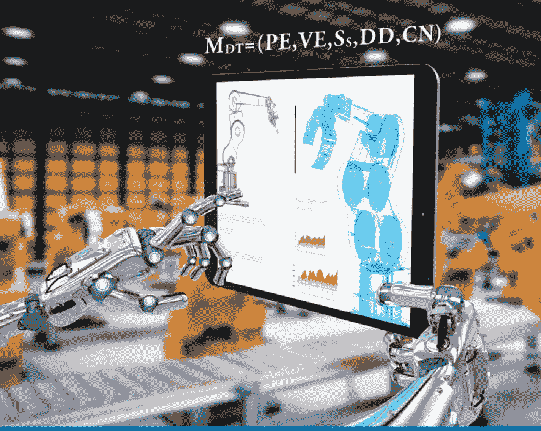


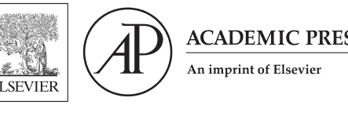


## PREFACE

随着云计算、物联网 IoT、大数据分析、人工智能 AI 等新技术的快速发展，智能制造时代已经到来。相应地，各种国家制造业发展战略相继提出，如工业 4.0、工业互联网、基于信息物理系统 CPS 的制造以及中国制造 2025。很明显，实现信息物理融合是实施智能制造的关键一步。数字孪生 DT 被引入作为信息物理融合的实用方法。它有助于构建效率更高、可靠性更强的更智能的制造系统。

在本书中，作者将 DT 应用于为制造资源构建高保真数字镜像模型，增强信息物理交互，并融合来自信息世界和物理世界的数据。DT 还与新技术相结合，以更好地完成复杂任务。预计这项研究工作能够促进智能制造的普及应用。

本书是作者对 DT 及其在制造中应用研究的总结，共 12 章，分为三部分。第一部分包括第 1 章，数字孪生的背景与概念；第 2 章，数字孪生的应用；第 3 章，五维数字孪生建模及其关键技术；主要介绍 DT 的背景和内涵。第 1 章研究了 DT 的发展背景和概念，然后从七个方面讨论其价值。第 2 章回顾了学术界和工业界对 DT 的最新进展，并描述了这些工作的观察结果。第 3 章分析了 DT 的新需求并提出了一种创新的五维 DT 模型。建模方法和关键技术也得到了研究。在此基础上，第二部分包括第 4 章，数字孪生车间；第 5 章，数字孪生车间中的设备能耗管理；第 6 章，数字孪生车间中的信息物理融合；第 7 章，数字孪生驱动的预测与健康管理；旨在将 DT 与制造活动无缝集成。第 4 章提出了数字孪生车间 DTS 的概念并研究了其实施方法和关键技术。第 5 章探讨了 DTS 中设备的能耗管理并突出了潜在优势。第 6 章从四个方面讨论了 DTS 中的信息物理融合并研究了相关标准和技术。第 7 章提出了一种针对复杂设备的 DT 驱动预测与健康管理方法。在第三部分，DT 与新技术融合以实现制造运营的更高效率。第 8 章，数字孪生与云、雾、边缘计算，描述了 DT 与云、雾和边缘计算的结合形成分层结构。第 9 章，数字孪生与大数据，对比了 DT 与大数据并将这两个概念集成以实现更高智能。第 10 章，数字孪生与服务，讨论了 DT 的服务化方法。第 11 章，数字孪生与虚拟现实和增强现实/混合现实，探讨了 DT 与虚拟现实和增强现实/混合现实的集成，以为用户提供更具沉浸感和交互性的服务。最后，在第 12 章，数字孪生、信息物理系统与物联网中，DT 被讨论为 CPS 的一个重点应用，并突出了物联网在 DT 中的作用。

作者希望感谢来自中国和其他国家的许多合作者在智能制造中数字孪生研究工作中给予的宝贵合作和建议。

特别是，作者对北京航空航天大学数字孪生研究小组的成员表示感谢，他们为本书做出了宝贵贡献：齐庆林、张贺、刘伟然、马鑫、程江峰、程颖、左颖、张连超、隋方圆，他们是本书第一作者的博士和硕士研究生。自 2015 年以来，他们与陶飞教授一起参与了北京航空航天大学的整个数字孪生研究项目。

特别感谢程颖博士和徐文军教授在第 6 章中的贡献；DHC Software Co., Ltd 为第 7 章的研究提供信息和数据；以及刘晓军教授、向峰教授及其硕士研究生张智、尹琪、黄媛媛对第 11 章的贡献。

作者对王国彪教授、周祖德教授、D.T. Pham 教授、刘昂博士、王立辉教授、Nabil Anwer 教授、Andrew Kusiak 教授、赵东明教授、T. Warren Liao 教授和徐勋教授对作者数字孪生研究以及本书部分内容的输入和讨论表示衷心感谢。

感谢所有参加在


北京航空航天大学，2017年7月25日至27日。他们帮助推动和发展了数字孪生在中国的制造研究和应用。

其中的一些内容发表在 _CIRP Annals—Manufacturing Technology, The International Journal of Advanced Manufacturing Technology, IEEE Transaction on Industrial Informatics, Journal of Manufacturing Systems, IEEE Transactions on Systems, Man, and Cybernetics: Systems, IEEE Access, International Journal of Computer Integrated Manufacturing, Computer Integrated Manufacturing Systems, Procedia CIRP, ASME Manufacturing Science and Engineering Conference, IEEE International Conference on Networking, Sensing and Control, etc._。感谢这些期刊的所有匿名审稿人，他们对相关研究提供了许多宝贵且建设性的意见。

本书的部分内容得到了以下中国研究项目的资助：国家自然科学基金委员会（NSFC）（编号 51522501、编号 51875030 和编号 51475032）、中国北京新星计划（编号 Z161100004916063）以及中国国家重点研发计划（编号 2016YFB1101700）。

作者感谢 Elsevier 高级收购编辑 Brian Guerin 主动联系他们出版本书，以及对本书提案提出非常积极评论的匿名审稿人，这些评论鼓励他们完成了本书。作者衷心感谢 Emma Hayes、Narmatha Mohan 以及 Elsevier 其他同事提供的高效支持。

最后但同样重要的是，作者向他们的家人致以深切的感谢，感谢他们持续的爱和鼓励。

Fei Tao
自动化科学与电气工程学院，北京航空航天大学，中国

Meng Zhang
自动化科学与电气工程学院，北京航空航天大学，中国

A.Y.C. Nee
机械工程系，新加坡国立大学，新加坡

2018年9月23日

## PART 1

背景与内涵

## CHAPTER 1

数字孪生的背景与概念

随着新一代信息技术（New IT）的发展，例如云计算、工业互联网、基于信息物理系统（CPS）的制造以及中国制造2025。很明显，实现信息物理融合是实施智能制造的关键一步。尽管 CPS 为物理和信息组件之间的无缝交互提供了框架和机制，但它主要属于学术范畴，侧重于科学原理的验证而非工程应用的实际优化。因此，数字孪生（DT）被引入作为信息物理融合的务实方式。本章介绍了 DT 的背景和历史。接下来回顾了学术界研究人员和工业界从业者对 DT 概念的不同理解。还介绍了与 DT 相关的一些概念，以提供更深入的见解。最后总结了 DT 的潜在益处。

### 1.1 数字孪生发展的背景

过去，物理空间在工业中发挥着主要作用。在那个时代，物理资产因距离相近而由人类组织起来处理设计和制造任务。然而，由于个人能力和地理限制，难以实现高效率。直到20世纪，计算机、仿真工具、互联网和无线网络等技术帮助创建了一个平行的虚拟空间，可以虚拟化物理资产，在计算设施的帮助下组织它们，并实现与资产的远程协作。这为更高效、更有效地进行计划和操作提供了可能性。如今，随着新一代信息技术（New IT）的发展，例如云计算、物联网（IoT）、大数据和人工智能（AI），虚拟空间的作用变得越来越重要，物理空间与虚拟空间之间的交互比以往任何时候都更加活跃。因此，两个空间之间的无缝集成和融合将成为不可避免的趋势，这将创造新的潜力来改善设计、制造、服务等领域当前的状况和技术。

各国都在这一趋势上趋同，将其视为下一次工业革命，并提出了相关的国家战略，例如工业4.0、工业互联网和中国制造2025。尽管这些战略是在不同的环境下提出的，但它们的共同目标是抓住物理空间与虚拟空间无缝集成和融合带来的巨大机遇，以改善国家工业。随着信息物理系统（CPS）成为融合物理空间和虚拟空间的架构，近年来它吸引了工业界、研究人员和从业者的大量关注。CPS 旨在将通信和计算能力嵌入物理资产中，使物理空间能够被虚拟侧实时监控、协调和控制，从而实现无缝耦合。许多与 CPS 相关的系统已在不同领域迅速涌现，例如信息物理生产系统（CPPS）[1]、基于云的 CPS [2]、信息物理社会系统[3] 和基于 CPS 的智能代理系统[4]。正如互联网通过互联计算机网络改变了人类之间的互动方式一样，CPS 将通过整合物理空间和虚拟空间改变人类与实体之间的互动方式[5]。

尽管 CPS 为物理空间和虚拟空间之间的集成提供了框架和机制，但它主要是概念性的，旨在激发新的科学基础和技术，而非直接指导工程系统开发的实用解决方案。由于数字孪生（DT）是 CPS 的一个重点应用，并提供了更实际的价值和实施细节，因此它被引入作为无缝集成和融合的务实方式。关于 DT，对于每个物理对象，都存在一个具有分析、评估、优化和预测等能力的虚拟镜像模型。两部分相互作用并保持同步，形成闭环。此外，来自物理和虚拟两方面的數據可以被获取和融合以生成更全面的信息。事实上，DT 可以被视为 CPS 的一种范式，因为它由 CPS 的最重要组成部分（即物理对象、虚拟对应物以及两部分的连接）组成，并且变得更加具体。迄今为止，越来越多的组织和公司意识到 DT 的价值，投入大量资源进行相关研究和部署。未来，DT 的更大能力将被探索，它将在物理空间与虚拟空间的集成和融合中在工业中发挥日益重要的作用。

### 1.2 数字孪生的历史

“孪生”概念源于 NASA 的阿波罗计划，该计划建造了两辆完全相同的真实航天器。其中一辆被发射到太空执行任务，而另一辆留在地球上，使工程师能够镜像发射车辆的状况[6]。根据 Grieves 所写的白皮书[7]，DT 最早是在他关于产品生命周期管理（PLM）的执行课程中提出的。随着技术改进，DT 被美国国家航空航天局（NASA）和美国空军引入航空航天工业[8]。因此，留在地球上的航天器可以被数字镜像模型取代，通过高保真仿真提供更多见解。如今，DT 已应用于更多领域，并成为备受追捧的话题。

如图 1.1 所示，DT 的短暂发展历史可分为三个阶段。

在第一个阶段，根据 Grieves 所写的白皮书[7]，DT 概念由 Grieves 于 2003 年提出。它被定义为三个维度，包括物理实体、数字对应物以及将两部分连接在一起的连接[7]。2005 年，Grieves 提出

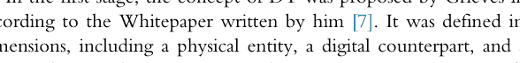


另一个观点认为 DT 可分为三种子类型，包括 DT 原型、DT 实例和 DT 集合 [9]。然而，由于技术和认知上的限制，之后的 5 年里相关报道非常少。幸运的是，在此期间，新一代信息技术已经出现并发展起来，为 DT 的未来发展奠定了基础。

2010 年，NASA 在 _Draft Modeling, Simulation, Information Technology and Processing Roadmap_ [10] 中详细阐述了 DT 对于航天器的定义和功能。2011 年，美国空军探索了 DT 在飞机结构健康管理中的应用 [11]。2012 年，NASA 和美国空军联合发表了一篇关于 DT 的论文，文中指出 DT 是未来飞行器的关键技术 [8]。此后，航空航天领域关于 DT 的研究数量稳步增加。例如，Tuegel 提出了用于设计和维护的机身 DT，并讨论了其发展的挑战 [12]。Allaire 等人研究了一种动态数据驱动应用系统，该系统被描述为航空航天飞行器 DT 的实施基础 [13]。Reifsnider 和 Majumdar 提出了一种多学科物理基础方法，用于机队管理中的 DT [14]。

2014 年，DT 白皮书 [7] 发布，DT 的三维结构被广泛宣传。此后，DT 被引入航空航天行业之外的更多领域，如汽车 [15]、石油和天然气 [16]、以及医疗保健和医学 [17]。近年来，许多知名组织都高度重视 DT。Gartner 在 2017 年和 2018 年均将 DT 列为未来十年最具前景的十大技术趋势之一 [18,19]。2017 年，洛克希德·马丁太空系统公司将 DT 列为未来国防和航空航天六大突出技术之首 [20]。中国科协智能制造学会指出，DT 是全球智能制造十大科技进展之一 [21]。根据当前趋势，可以预期 DT 在未来几年将经历快速发展。

在中国，DT 引起了广泛关注。本书作者于 2017 年 1 月在 _Chinese Journal of Computer Integrated Manufacturing Systems_ 上发表了关于数字孪生车间（DTS）的首篇论文 [22]，并进一步探讨了 DTS 的关键技术、机制、实施方法、 cyber–physical 融合等 [23,24]。他们还发表了一篇论文 [25] 讨论 PLM 中由 DT 驱动的产品设计、制造和服务，该文于 2017 年 3 月在 _International Journal of Advanced Manufacturing Technology_ 上首次上线。随后于 2017 年 7 月，在中国北京航空航天大学举办了首届“数字孪生与智能制造服务”会议。来自中国 20 多所大学的 70 多名专家学者参加了会议。基于会议讨论，与会者随后在 _Chinese Journal of Computer Integrated Manufacturing Systems_ 上联合发表论文“数字孪生及其潜在应用探索” [26]，在国内引起了广泛关注。第二届会议将于 2018 年 7 月在郑州轻工业学院举行，预计将成为 DT 的学术盛宴。

### 1.3 数字孪生的概念

### 1.3.1 数字孪生的理论定义

DT 的概念可追溯至 2003 年，Grieves 在其 PLM 课程中首次提出。然而，当时 DT 仅有一个三维概念框架，包括物理对象、虚拟对应物和连接，缺乏具体描述和解释。2010 年，NASA 发布了针对航天器的 DT 详细定义：“一个集成了多物理、多尺度仿真的飞行器或系统，使用最佳可用的物理模型、传感器更新、机队历史等，映射其对应飞行孪生的生命周期” [10]。该定义得到了广泛认可和接受。在此基础上，不同大学和研究所的研究人员也提出了他们对 DT 的理解。不同研究领域的概念在细节上各不相同，如表 1.1 所示。

在大多数定义中，DT 被视为在其整个生命周期内与物理对象交互并为评估、优化、预测等提供智能的虚拟表示。它们关注物理和虚拟两方面以及连接，这是在 DT 三维框架中必不可少的要素 [7]。

最近，北京航空航天大学的 Tao 等人提出了 DT 的扩展五维定义，在三维版本的基础上增加了 DT 数据和服务 [46]。与之前概念相比，除了物理-虚拟交互外，新提出的定义还可以使用 DT 数据融合来自物理和虚拟方面的信息，实现更全面、更准确的信息捕获。它还可以封装 DT 的功能（例如检测、判断和预测）

8 数字孪生驱动智能制造

表 1.1 DT 的理论概念

| 研究领域 | 大学/研究所 | 理论概念 |
|---|---|---|
| PHM | 美国空军研究实验室 加州大学洛杉矶分校 伊利诺伊大学厄巴纳-香槟分校 南卡罗来纳大学 | “一个超现实的、与材料和制造规范、控制和用于建造和维护特定机身的工艺明确关联的已建造并维护的飞机的模型” [12,27] |
| PHM | 辛辛那提大学 | “将超高保真仿真与机载健康管理系统、维护历史以及历史车辆和机队数据集成，以映射特定飞行物理孪生的生命周期，从而实现安全性和可靠性的显著提升” [14] |
| PHM |  | “一个在云平台上运行并模拟健康状况的真实机器的数字模型，集成了数据驱动分析算法和其他可用物理知识” [28] |
| PHM | 白俄罗斯国立信息与无线电电子大学 | “真实物理装置的数字复制品，可以检查监测数据的一致性，进行数据挖掘以检测现有问题和预测即将出现的问题，并使用 AI 知识引擎支持有效的业务决策” [29] |
| PHM | 范德比尔特大学 GE 全球研究中心 | “一个数字模型，虚拟地经历与实际飞机机翼相同的载荷历史，在飞机机翼整个生命周期中整合各种不确定性源和异构信息，减少模型参数的不确定性，使用测量数据跟踪时变系统状态，并在没有数据时预测损伤状态的演变” [30] |
| PHM | 不列颠哥伦比亚大学 爱荷华州立大学 加拿大国防部 | “一个能够利用实时传感数据不断适应环境或操作变化的动态模型，并可预测相应物理资产的未来以实现预测性维护” [31] |
|  |  | （续） |

数字孪生的背景与概念 9

| 研究领域 | 大学/研究所 | 理论概念 |
|---|---|---|
| 生产 | 斯图加特大学 | “一个包含物理资产所有状态和功能的数字表示，并有可能与其他数字孪生协作，实现整体智能，从而实现去中心化自控” [32] |
| 生产 | 米兰理工大学 | “物理系统的虚拟和计算机化对应物，可以利用来自现场的传感数据的实时同步，并与工业 4.0 深度关联” [33] |
| 生产 | 查尔姆斯理工大学 | “产品或生产系统的数字副本，贯穿设计、预生产和生产阶段，并进行实时优化” [34] |
| 生产 | 弗劳恩霍夫-查尔姆斯工业数学中心 罗伊特林根大学 | “真实工厂、机器、工人等的数字副本，可以独立创建并扩展，可自动更新并在全球范围内实时可用” [35] |
| 生产 | 北京理工大学 | “虚拟世界中的动态模型，与现实世界中对应的物理实体完全一致，并能及时模拟其物理对应物的特性、行为、寿命和性能” [36] |
| 生产 | 瑞士南应用科技大学 | “一个涵盖 CPS 数据和智能的数字分身，表示相关 CPS 的结构、语义和行为，并提供服务以融合虚拟和物理世界” [37] |
| 生产 | 宾夕法尼亚州立大学 印度理工学院 | “增材制造过程的严格验证，预测影响组件冶金结构和性能的最重要变量，并用快速、廉价的数值实验取代昂贵、耗时的物理实验” [38] |
| PLM | 马德里理工大学和空中客车集团 | “一个产品等效的数字对应物，存在于产品生命周期的从构思和设计到使用和服务的整个阶段，了解产品的过去、当前和可能未来的状态，并促进” |


作为统一管理和按需使用的服务。五维数字孪生已应用于制造 [22,23] 以及复杂设备的预测与健康管理（PHM） [46]，效率很高。

| 研究领域 | 大学/研究所 | 理论概念 |
|---|---|---|
|  | Friedrich- Alexander- Universität Erlangen- Nürnberg University Paris- Sud Ruhr University of Bochum | development of product related intelligent services" [39] “A bidirectional relation between a physical artifact and the set of its virtual models, enabling the efficient execution of product design, manufacturing, servicing, and various other activities throughout the product lifecycle" [40] “Having a high semantic content and considering both virtual product models as well as feedback data from the physical product along its whole lifecycle" [41] |
| 设计 | 里约格兰德联邦大学 | “A set of models from different stages of product lifecycle, such as the system models, functional models, 3D geometric models, multiphysics models, manufacturing models, and usage models, which are kept interacting with each other" [42] |
|  | 柏林工业大学 | “Consisting of a unique instance of the universal digital master model of an asset, its individual digital shadow, and an intelligent linkage (algorithm, simulation model, correlation, etc.) of the two elements above" [43] |
|  | 弗劳恩霍夫生产系统与设计技术研究所 华南理工大学 | “Realistic product and production process models linking enormous amounts of data to fast simulation and allowing the early and efficient assessment of the consequences, performance, quality of the design decisions on products and production line" [44] |
|  |渥太华大学 | “The cyber layer of CPS, which evolves independently and keeps close integration with the physical layer" [45] |

### 1.3.2 企业视角下的数字孪生

最近，许多企业也受到数字孪生的吸引。在他们的观点中，数字孪生具有一系列益处，例如提供业务可见性、加速产品开发、优化运营流程和提高服务质量。因此，他们积极将数字孪生与自己的公司和产品相结合，以把握推动其业务发展的巨大机遇。企业对数字孪生的理解见表 1.2，同时还列出了与数字孪生概念相关的一些产品/工具。

### 1.3.3 数字孪生的核心：模型、数据、连接和服务

尽管学术研究人员和工业实践者对数字孪生的理解各不相同，但模型、数据、连接和服务始终在数字孪生中发挥着最重要作用。这四部分可以被视为数字孪生的核心，其作用分别介绍如下。

- 1. _模型_。数字孪生一个重要特征是，对于每个物理对象，在虚拟世界中都存在一个数字伴侣，与其在整个生命周期中协同工作。本质上，数字伴侣由一组模型组成，这些模型允许数字化的物理对象在计算机上以三维形式呈现。模型在数字孪生中至关重要，因为它们将最初的概念“孪生”发展为“数字孪生”，并通过仿真提供了更深入的见解。结合来自传感器、信息系统、人员等的数据，模型主要具有以下四种功能。首先，它们能够以高保真度再现物理实体的真实属性、行为和规律，从而形成一个精确的数字副本，记录物理实体的所有变化。其次，它们能够在虚拟空间中自主运行，生成一系列仿真行为，这些行为可被视为“理想行为”，以指导物理对象的运行。第三，它们具有在问题发生之前预测物理侧问题的能力，并制定预防策略。最后，模型可以在产品或系统完成之前验证其性能。

- 2. _数据_。由于大数据分析可用于处理庞大且多样化的数据集，因此可以从数据中高效挖掘有价值的信息。基于此，数据可被视为提供智能的驱动力，使构建的数字孪生持续运行。数字孪生的数据来自物理和虚拟空间，例如来自物理实体的产品生命周期数据、来自数字模型的仿真数据、来自信息系统的运营数据以及相关知识。它们可以全面驱动数字孪生的运行。例如，在数字孪生中，数字模型构建可由实体从数据中挖掘的规则和约束驱动，相关信息系统中的决策可由数字模型产生的仿真数据驱动，而实体的操作可由模型和系统提供的预定义指令和计划驱动。没有数据，数字孪生就无法开始工作，更不用说提供进一步的分析和优化。随着实时数据的持续生成，将为数字孪生积累更多有价值的信息。

12 数字孪生驱动的智能制造

| 公司 | 工业概念 | 相关产品/工具 |
|---|---|---|
| 西门子 | “Including product digital twins for efficient design of new products, production digital twins for manufacturing and production planning, and performance digital twins for capturing, analyzing, and acting on operational data” [47] | 西门子 PLM 软件 |
| 通用电气公司（GE） | “Providing a software representation of a physical asset based on Predix Platform and enabling companies to better understand, predict, and optimize the performance of each unique asset” [48] | Predix 平台 |
| 参数技术公司（PTC） | “A digital representation of a specific asset in the field, including current and past configuration states, taking into account serialized parts, software versions, options, and variants” [49] | PTC Creo Simulate 和其他分析工具 |
| 达索 | “A virtual equivalent to a physical product, which can improve manufacturing excellence by allowing people across the enterprise to better collaborate and achieve continuous process improvement” [50] | 3D 体验平台 |
| 甲骨文 | “An important concept that is going to be strategic to business operations as IoT deployments proliferate through organization” [51] | 甲骨文物联网云 |
| ANSYS | “Combining all the organization’s digital information on a specific product and merging physics- based understanding with analytics” [52] | CAE 工具 |
| 国际商业机器公司（IBM） | “A virtual representation of a physical object or system across its lifecycle, using real-time data to enable understanding, learning, and reasoning” [53] | IBM Watson 物联网平台 |

| 公司 | 工业概念 | 相关产品/工具 |
|---|---|---|
| 系统应用与产品（SAP） | “A live digital representation (or software model) of a connected physical object” [54] | SAP Leonardo 平台 |
| Altair | “A capability with which product performance is predicted, optimized, tracked, and measured throughout the product lifecycle” [55] | CAE 工具 |
| 微软 | “Visualizing the physical world, being intelligent, collaborative, interactive and immersive, and providing a method to simulate electronic, mechanical, and combined system outcomes” [56] | Azure IoT Hub Microsoft HoloLens |
| TIBCO 软件 | “A software representation of a device that can create efficiencies across the entire product lifecycle” [57] | Project Flogo 和 TIBCO 图数据库 |
| TwinThread | “A digital representation of any physical asset, including all information about the asset current and historical running conditions” [58] | 软件解决方案 |
| Bsquare | “Digital representations of real- time configuration and state information for physical devices” [59] | Bsquare 物联网 |
| Sight Machine | “Offering sets of analytical models that mirror the entire production process, encompassing machines, lines, plants, or supply chains” [60] | Sight Machine 平台 |
| 模拟关键基础设施（SIM-CI） | “A digital copy of a city allowing us to accurately mimic its vital infrastructures” [61] | DT 城市平台 |
| 挪威船级社和德国劳埃德船级社（DNV GL） | “A digital, virtual representation of an asset, maintained throughout the lifecycle and easily accessible at any time” [62] | DNV GL— 软件 |
| PACCAR | “A virtual version of an engine based on sensor data from the real-world versions to manage the maintenance and repair of engines” [15] | DataV 系统 |

数据。基于此，数据可被视为提供智能的驱动力，使构建的数字孪生持续运行。数据来自物理和虚拟空间，例如来自物理实体的产品生命周期数据、来自数字模型的仿真数据、来自信息系统的运营数据以及相关知识。它们可以全面驱动数字孪生的运行。例如，在数字孪生中，数字模型构建可由实体从数据中挖掘的规则和约束驱动，相关信息系统中的决策可由数字模型产生的仿真数据驱动，而实体的操作可由模型和系统提供的预定义指令和计划驱动。没有数据，数字孪生就无法开始工作，更不用说提供进一步的分析和优化。随着实时数据的持续生成，将为数字孪生积累更多有价值的信息。

| 公司 | 工业概念 | 相关产品/工具 |
|---|---|---|
| 德勤 | “An evolving digital profile of the historical and current behavior of a physical object or process that helps optimize business performance” [63] | 物联网解决方案 |
| Intellectsoft | “A real-time digital representation of a physical object that continuously monitors changes in environment and reports back the updated state in the form of measurements and pictures” [64] | 建筑领域的 AR 解决方案 |
| Infosys | “Virtual replications of physical products, systems, and processes that are indistinguishable from their real counterparts” [65] | Infosys NiaTM 平台 |
| Autodesk | “Spanning both the factory and product, and making use of augmented reality technologies borrowed from media and entertainment software line as well as capabilities from SeeControl, an IoT cloud services platform provider” [66] | 实时捕获技术和设计软件 |


+   3. _连接。_ 无缝连接对于使 DT 中的每个元素（例如实体、模型和信息系统/工具）相互交互至关重要。连接可分为三类：物理空间内的连接、虚拟空间内的连接，以及跨物理和虚拟空间的连接。通过这些连接，物理空间中的实体可以相互连接以进行数据交换，而模型和信息系统则会被链接起来形成一体化的信息流。此外，实体可以与相应的虚拟组件深度交织，以实现感知和控制的稳定闭环，从而保持物理空间和虚拟空间的同步和一致。基于这些连接，DT 中元素之间的交互得以实现，可支持协作以实现迭代优化。

+   4. _服务。_ 由于 DT 的用户可能对相关领域缺乏专业知识，因此将 DT 提供的功能（例如评估、优化、预测和验证）封装成标准服务以便轻松便捷使用至关重要。服务是 DT 的最终呈现形式，通常以标准格式表达其输入、输出、基本信息、功能和质量，并配备用户友好的界面。它们可以根据需求单独调用或与其他服务组合使用。对于用户而言，服务是黑箱，可以在不了解内部机制的情况下使用。他们只需向服务提供输入参数和需求（例如成本、时间、质量），即可获得所需结果（例如评估结果、优化参数和预测状态）。这大大简化了使用流程，有利于将 DT 的应用扩展到不同的用户群体。

### 1.4 数字孪生及相关概念

### 1.4.1 数字孪生与物理/虚拟空间

DT 跨越两个空间，即物理空间和虚拟空间。它可以连接这两个空间并模糊它们之间的边界。

物理空间是一个三维空间，以实质形式存在。它包含许多实体（例如人员、装置、基础设施和硬件），具有物理存在属性，如形状、尺寸、颜色、结构、质量、速度等。每个实体占据一个位置，按照物理规律行为，并处理不确定的环境。实体具有实际功能，可以有序组织以在时间、成本、质量等约束下完成特定任务。实体的数据为模拟数据，具有平滑变化的值。

随着信息技术的发展，如计算机技术、建模与仿真、通信技术、互联网、云计算、物联网等，虚拟空间得到发展，并在人们生活中发挥着日益重要的作用。它将物理空间的模拟数据转换为可轻松存储、处理和显示的离散数字信号。对于每个实体，虚拟空间构建一个三维数字镜像模型，该模型不仅在几何外观上与物理对应物相似，而且在物理属性和行为上也相似。借助虚拟现实（VR）和增强现实（AR），虚拟空间变得沉浸式，这意味着它可以通过感官和感知模拟物理空间，从而实现全身沉浸。通过整合来自多个来源的数据，如人类经验、传感器数据和领域知识，虚拟空间可以在实体生命周期中为物理实体提供仿真、预测、优化和验证。

DT 包含来自物理空间的实体和来自虚拟空间的数字镜像模型。DT 中的每个实体都有一个虚拟伴侣，随时与其一起运行和演化。一方面，模型被构建和校准，以准确再现实体运行期间的属性和行为。另一方面，实体被控制以最大程度地逼近模型的预定义。它形成了物理空间和虚拟空间之间的双向映射，使得两个空间同步且一致。此外，由于 DT 可以从实体和虚拟对应物获取数据，它可以融合来自物理和虚拟空间的数据，以捕捉更全面、更准确的信息。DT 可以被视为连接两个空间并进一步实现 cyber–physical 融合的有效方式。

### 1.4.2 数字孪生与虚拟原型

虚拟原型是一种三维虚拟模型，用计算机辅助工具（如 CAD 和 CAE [67]）在计算环境中替代物理原型来测试和评估产品。虚拟原型可在设计阶段作为虚拟替代品提前检测故障并预测物理产品的性能，并在发现错误或故障时允许轻松修改和操作。虚拟原型完成后，可在物理产品可用之前发送给客户以获取反馈。因此，虚拟原型可以帮助避免生产过程中的昂贵错误，缩短产品的设计周期，提高客户参与度，从而实现快速且具有成本效益的产品开发。

虚拟原型可以被视为 DT 的基础。它们具有以下相似之处：（1）两者都构建三维虚拟模型来替代相应的物理产品，例如产品测试、评估和验证在虚拟空间中进行，以减少时间和金钱成本。（2）与使用物理-物理原型的传统设计方法相比，它们的虚拟模型可以在不同尺度上产生更多见解，以在设计阶段优化产品，在设计阶段通过与模型的交互为产品优化提供经验和评论。

然而，虚拟原型并不等同于 DT。DT 相对于虚拟原型具有以下优势：（1）虚拟原型主要服务于产品的设计阶段以进行评估和验证。而 DT 中的虚拟模型则伴随物理对应物贯穿其整个生命周期，从创建到处置。由于 DT 整合了产品在不同阶段（例如制造、销售和维护）的丰富实际数据，它可以考虑物理空间中可能发生的一切，并在设计阶段进行更全面的验证以消除潜在故障。此外，借助产品生命周期数据，DT 具有在设计中激发创新的能力。（2）虚拟原型与物理产品之间几乎没有联系。而 DT 中的虚拟模型在生命周期中始终与产品保持连接，以实时反映实际状态和关键见解，这可以为设计师提供有价值的信息，及时改进产品以快速适应市场。（3）虚拟原型仅提供预期的理想产品，而 DT 既可以呈现理想产品也可以呈现实际产品。在 DT 中，理想产品模型在设计阶段构建，而实际产品模型则在设计阶段之后通过整合制造、运行、维护、处置等产生的实际产品数据逐步形成。通过比较和分析这两种产品模型，它们的差异可以直观地发现并消除。

### 1.4.3 数字孪生与 PLM

PLM 是“管理产品在其生命周期中”，Stark 将其定义为“以最有效的方式管理公司产品在其整个生命周期中的业务活动；从产品的最初想法一直到其退役和处置” [68]。它使公司能够通过提高创新、缩短新产品上市时间以及为现有产品提供卓越服务来增加收入 [68]。

在 PLM 中，管理产品生命周期产生的大数据是最关键的一步，这可以提供见解并激发新产品的创造，并为产品制造和服务提供有价值的信息。如 Raconteur 发表的 PLM 特别报告中所述，如果 PLM 是创新的生命线，那么数据就是 PLM 的生命线 [69]。如今，虽然借助先进的传感技术可以在产品生命周期中获得大量数据，但不同阶段的数据仍然孤立、碎片化且停滞不前，导致数据使用效率低下。因此，许多公司旨在将 PLM 数据转化为有意义的见解和潜在的新收入来源 [69]。

DT 可以紧密整合产品生命周期中的数据，并持续为公司产生有意义的信息。这就是行业对其感到兴奋的原因之一。DT 构建高保真数字镜像模型与物理产品一起运行。在生命周期的不同阶段，虚拟副本用于记录和结合物理产品不同性质的实时数据（例如图片、表格、网页、视频等），并将数据持续转换为统一视图以消除信息孤岛。借助整合的数据，虚拟模型可以呈现产品的 360 度视图，并准确模拟、优化、预测和验证产品在其生命周期内的制造过程、使用场景、环境条件和其他变量。此外，在 DT 的帮助下，公司更有可能将数据整合到不同项目中，并激发创新和知识共享。

### 1.4.4 数字孪生与数字资产/企业/行业

DT 可应用于不同层级，包括单个资产、整个企业甚至行业，以增强现有功能。


数字资产是以二进制格式对相应的物理资产（例如产品、机器和基础设施）进行的虚拟表示，包括数字报告、可听内容、电影以及其他相关数字数据。数字资产的引入是为了更高效地管理物理资产，而数字孪生（DT）的出现可以进一步增强其功能。（1）借助 DT，每个物理资产都拥有一个高度逼真的三维数字复制品，用于全面描述和分析其性能，可提供实时洞察、早期预警、预测以及优化思路。（2）DT 可在资产实际运行前验证其操作，从而降低实际执行中的潜在故障。（3）DT 可在资产整个生命周期内整合数据并激发创新。

在数字时代，企业已转向虚拟环境，因此出现了“数字企业”这一术语。它通过信息和通信技术将企业转变为数字结构，为规划和控制业务提供了独特机会 [70]。DT 可应用于数字企业的所有业务线，其优势包括（1）增强主动性和数据驱动决策能力，提高效率并避免潜在问题 [71]；（2）缩短新产品开发周期并减少上市时间；以及（3）通过提供可整合异构数据的数字镜像模型，使不同部门之间的协作更高效、更有效。

整个行业，涵盖从产品设计到生产再到零售的价值链，已逐步实现数字化。借助 DT，行业产生的大量数据将占有越来越大的份额。由于 DT 可提供具有统一数据和标准化功能的封装服务的虚拟模型，它还能支持行业融合，通过将重点从单个产品转向跨行业价值体验，从而重新定义行业边界 [72]。此外，它还能通过更好地满足客户需求，在设计、制造、物流和使用的过程中帮助节约自然资源。

### 1.4.5 数字孪生与数字线程

“数字线程”起源于航空工业，由美国空军的 Kraft 定义为“一种可扩展、可配置的企业级分析框架，能够无缝促进企业数据-信息-知识系统中权威数据、信息和知识的受控交互，基于数字系统模型模板，以便在系统整个生命周期内为决策者提供访问、整合和转换分散数据为可操作信息的能力。” 这里的“数字系统模型”指的是武器系统的数字表示 [73]。数字线程的初衷是通过数字技术提高未来军事项目的性能。

DT 由保存在数字线程中的早期机体模型发展而来，旨在将高保真建模应用于飞机结构部件的制造、运行和维护，以降低军费开支 [74]。DT 由数字线程使能，因为 DT 中用于评估、分析、更新等的所有数据（例如模型、传感器数据和知识）均来自线程 [74]。

近年来，DT 和数字线程已在航空航天行业之外受到关注。它们已被引入民用领域产品生命周期管理，以为设计、制造和服务提供最佳信息。随着更广泛的工业应用，数字线程的普遍定义是“一种通信框架，允许产品在其生命周期内在传统上被孤立的功能视角之间实现连接的数据流和集成的产品数据视图” [75]。它可以将数字连接目标汇聚到单一框架中，并能在正确的时间将正确的信息传递到正确的位置。因此，许多大型公司正专注于数字线程，并试图将其应用于全面数字化其供应链、制造过程和服务，以应对日益激烈的竞争压力。例如，西门子认为创建数字线程可以紧密整合产品生命周期的每个步骤，从而大幅降低生产成本和制造周期并提高产品质量 [76]。在 GE，数字线程被视为一种无缝的数字连接，弥合了不同系统和阶段数据的差距，实现闭环优化 [77]。STEP Tools. Inc. 倾向于为制造构建数字线程，使企业中的每个人都能实时看到他们如何相互影响，从而做出更好的决策、运营和维护 [78]。

结合数字线程，DT 可以从整个生命周期中获取最佳可用数据，以实现高质量的镜像和仿真。

### 1.4.6 数字孪生与数字阴影

数字阴影是与相应实体在其整个生命周期中耦合的数据档案，承载所有数据和知识以反映个体的形状以及历史、当前和预期未来状态 [43]。数字阴影中的数据并非分散，而是存储在单一电子文档中，并由专用软件服务或软件代理主动处理 [80]。这使得数据得到整合并以统一高效的方式处理，从而生成有意义的信息。数字阴影的主要目的是支持决策，以提高物理资源的利用率和效率，实现更

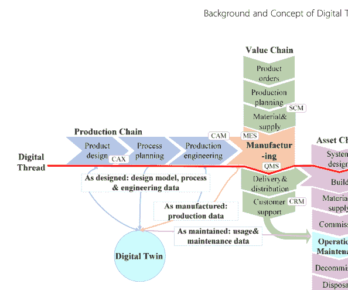

可持续的世界 [80]。在数字阴影中，数字安全和数字风险始终是关键问题。

由于 DT 是承载物理对应物整个生命周期数据的虚拟表示，它与数字阴影的概念相似。然而，两者仍存在差异，且 DT 在以下方面优于数字阴影：（1）DT 可提供高保真数字镜像模型，直观而全面地描述实体。（2）基于该模型，可在执行前验证物理过程和活动，从而降低失败风险。（3）模型与实体同步运行，可提供实际与模拟性能之间的比较以捕捉其差异，这对评估、优化和预测具有价值。（4）DT 中的数据不仅来自物理世界，还来自虚拟模型，部分数据来源于两个世界数据的融合，如综合、统计、关联、聚类、演化、回归和泛化。因此，在 DT 中，数据更为丰富，能够生成更准确、更全面的信息。

### 1.5 数字孪生的价值

DT 的价值总结如下：

### 1.5.1 提高可见性

DT 提供高保真三维模型，并实时更新以保持与相应物理对应物的同步。它允许人员以更直接、更清晰的方式监控产品或系统，从而提高可见性。

### 1.5.2 缩短上市时间

由于市场变化迅速，用户总是渴望新产品。为应对市场需求，一方面，DT 可为设计师提供在产品完成前了解产品行为的机会，从而消除潜在故障，进而缩短上市时间；另一方面，DT 可在物理产品完成前生成高度逼真的虚拟替代品，从而实现用户体验的提前。


### 1.5.3 保持最佳运行状态

DT 中的虚拟模型与物理世界中的物理对应物保持连接。这种物理-虚拟连接提供了一种可能性，即实时分析物理实体在不同条件下的性能，从而及时进行调整，确保其按计划精确运行，保持最佳运行状态。

### 1.5.4 降低能源消耗

在单个 DT 中，由于可以实时分析物理资产的状态，因此可以及时更换退化的组件，避免额外的能源消耗。此外，多个 DT 可以连接起来，使每个 DT 都能相互协商。这使得相应的物理对应物能够有序地在不同时期启动或关闭，以追求更低的总能源消耗。

### 1.5.5 降低维护成本

现代资产会产生大量数据，可以对其进行研究和评估，以确定未来可能出现问题的时间。DT 可以利用这些数据，并结合来自物理资产和虚拟模型的数据，提前预测故障或维护事件，从而大幅降低停机时间和维护成本。

### 1.5.6 提高用户参与度

对于新产品设计，用户可以与高保真虚拟模型交互并反馈意见，以优化设计方案。对于现有产品，DT 可以实时记录和分析产品行为，这在一定程度上可以反映用户的习惯。基于这些数据，可以激发对产品的改进和创新，更好地服务于用户。

### 1.5.7 融合信息技术

DT 可以融合不同的信息技术，包括机器学习、仿真、建模、物联网、云计算、大数据等，以更好地完成复杂任务。例如，DT 能够通过融合传感器数据、仿真结果、机器学习算法等预测即将发生的情况，并且 DT 可以结合云计算进行实时仿真，以获得强大的计算能力。

### 1.6 总结

由于 DT 是一种将物理空间和虚拟空间无缝集成和融合的实用新兴技术，最近受到了广泛关注。本章介绍了 DT 的背景并解释了其重要性。回顾了 DT 从 2003 年至今的历史发展，并介绍了学术界和工业界对 DT 的各种概念。在此基础上，总结出 DT 的核心是模型、数据、连接和服务，它们在 DT 中发挥着最显著的作用。然后介绍了 DT 的相关概念，包括物理/虚拟空间、虚拟原型、PLM、数字资产/企业/行业、数字线程和数字阴影。最后讨论了 DT 的优势。总之，本章旨在帮助读者对 DT 获得初步的理解，并为后续章节的研究奠定基础。

### 参考文献

- [1] L. Monostori, Cyber–physical production systems: roots, expectations and R&D challenges, Procedia CIRP 17 (2014) 9–13.
- [2] A.W. Colombo, T. Bangemann, S. Karnouskos, J. Delsing, P. Stluka, R. Harrison, et al. Industrial cloud-based cyber–physical systems, The IMC-AESOP Approach, 2014. Springer International Publishing, Cham, Switzerland.
- [3] Z. Liu, D. Yang, D. Wen, W. Zhang, W. Mao, Cyber–physical–social systems for command and control, IEEE Intell. Syst. 26 (4) (2011) 92–96.
- [4] P. Leitao, S. Karnouskos, L. Ribeiro, J. Lee, T. Strasser, A.W. Colombo, Smart agents in industrial cyber–physical systems, Proc. IEEE 104 (5) (2016) 1086–1101.
- [5] R.R. Rajkumar, I. Lee, L. Sha, J. Stankovic, Cyber–physical systems: the next computing revolution, in: Proceedings of the 47th Design Automation Conference, California, 2010, pp. 731–736.
- [6] S. Boschert, R. Rosen, (Chapter 5) Digital Twin—The Simulation Aspect, Mechatronic Futures, Springer, Cham, 2016 pp. 59–74. Available from: https://doi.org/10.1007/978-3-319-32156-1_5.
- [7] M. Grieves, Digital twin: manufacturing excellence through virtual factory replication, Whitepaper, 2014.
- [8] E.H. Glaessgen, D.S. Stargel, The Digital Twin paradigm for future NASA and US Air Force vehicles, in: 53rd Structures, Structural Dynamics, and Materials Conference: Special Session on the Digital Twin, Hawaii, 2012, pp. 1–14.
- [9] M. Grieves, Product lifecycle management: the new paradigm for enterprises, Int. J. Prod. Dev. 2 (1–2) (2005) 71–84.
- [10] M. Shafto, M. Conroy, R. Doyle, E. Glaessgen, C. Kemp, J. LeMoigne, et al., Draft Modeling, Simulation, Information Technology & Processing Roadmap, National Aeronautics and Space Administration, 2010.
- [11] E.J. Tuegel, A.R. Ingraffea, T.G. Eason, S.M. Spottswood, Reengineering aircraft structural life prediction using a digital twin, Int. J. Aerosp. Eng. (2011). Available from: https://doi.org/10.1155/2011/154798.
- [12] E.J. Tuegel, The airframe digital twin: some challenges to realization, in: 53rd AIAA/ASME/ASCE/AHS/ASC Structures, Structural Dynamics and Materials Conference 20th AIAA/ASME/AHS Adaptive Structures Conference 14th AIAA, Hawaii, 2012.
- [13] D. Allaire, D. Kordonowy, M. Lecerf, L. Mainini, K. Willcox, Multifidelity DDDAS methods with application to a self-aware aerospace vehicle, Procedia Comput. Sci. 29 (2014) 1182–1192.
- [14] K. Reifsnider, P. Majumdar, Multiphysics stimulated simulation digital twin methods for fleet management, in: 54th AIAA/ASME/ASCE/AHS/ASC Structures, Structural Dynamics and Materials Conference, Boston, 2013, pp. 1578.
- [15] C. Swedberg, Digital twins bring value to big RFID and IoT data, Available from: http://www.rfidjournal.com/articles/view?17421.
- [16] S. Menard, 3 ways digital twins are going to help improve oil and gas maintenance and operations, Available from: https://www.linkedin.com/pulse/3-ways-digital-twins-going-help-improve-oil-gas-sophie-menard.
- [17] Science Service Dr. Hempel Digital Health Network, Healthcare solution testing for future|Digital Twins in healthcare, Available from: https://www.dr-hempel-network.com/digital-health-technolgy/digital-twins-in-healthcare/.
- [18] K. Panetta, Top 10 strategic technology trends for 2017: digital twins, Available from: https://www.gartner.com/smarterwithgartner/gartners-top-10-technology-trends-2017/.
- [19] K. Panetta, Top 10 strategic technology trends for 2018: digital twins, Available from: https://www.gartner.com/smarterwithgartner/gartner-top-10-strategic-technology-trends-for-2018/.
- [20] L. Murray, Lockheed Martin forecasts tech trends for defense in 2018, Available from: https://dallasinnovates.com/lockheed-martin-forecasts-tech-trends-for-defense-in-2018/.
- [21] Smart Manufacturing Association of China Association for Science and Technology, Smart Manufacturing Association of China Association for Science and Technology releases 'the top ten scientific and technological advances for smart manufacturing in the world' and 'the top ten scientific and technological advances for smart manufacturing in China', Available from: http://www.cast.org.cn/n200705/n202961/n202993/c57776269/content.html.
- [22] F. Tao, M. Zhang, J. Cheng, Q. Qi, Digital twin workshop: a new paradigm for future workshop, Comput. Integr. Manuf. Syst. 23 (1) (2017) 1–9.
- [23] F. Tao, M. Zhang, Digital twin shop-floor: a new shop-floor paradigm towards smart manufacturing, IEEE Access 5 (2017) 20418–20427.
- [24] F. Tao, Y. Cheng, J. Cheng, M. Zhang, W. Xu, Q. Qi, Theory and technologies for cyber–physical fusion in digital twin shop-floor, Comput. Integr. Manuf. Syst. 23 (8) (2017) 1603–1611.
- [25] F. Tao, J. Cheng, Q. Qi, M. Zhang, H. Zhang, F. Sui, Digital twin-driven product design, manufacturing and service with big data, Int. J. Adv. Manuf. Technol. 94 (9–12) (2018) 3563–3576.
- [26] F. Tao, W. Liu, H. Liu, et al., Digital twin and its potential application exploration, Comput. Integr. Manuf. Syst. 24 (1) (2018) 1–18.
- [27] B. Gockel, A. Tudor, M. Brand yberry, R. Pennmeta, E. Tuegel, Challenges with structural life forecasting using realistic mission profiles, in: 53rd AIAA/ASME/ASCE/AHS/ASC Structures, Structural Dynamics and Materials Conference 20th AIAA/ASME/AHS Adaptive Structures Conference 14th AIAA, Hawaii, 2012, pp. 1813.
- [28] J. Lee, E. Lapira, B. Bagheri, H.A. Kao, Recent advances and trends in predictive manufacturing systems in big data environment, Manuf. Lett. 1 (1) (2013) 38–41.


26 基于数字孪体的智能制造

[29] R.M. Asimov, S.V. Chernoshey, I. Kruse, V.S. Osipovich, 大数据分析中的数字孪生, Available from: https://www.researchgate.net/profile/R_Asimov/ publication/325038225_DIGITAL_TWIN_IN_THE_ANALYSIS_OF_A_BIG_DATA_/ links/5a2cc3e458515c283797f7a/DIGITAL-TWIN-IN-THE-ANALYSIS-OF-A-BIG-DATA.pdf.

[30] C. Li, S. Mahadevan, Y. Ling, L. Wang, S. Choze, 用于数字孪生的动态贝叶斯网络方法, in: 19th AIAA Non-Deterministic Approaches Conference, Texas, 2017, pp. 1566.

[31] Z. Liu, N. Meyendorf, N. Mrad, 数字孪生中预测性维护的数据融合作用, in: AIP Conference Proceedings, vol. 1949, 2018.

[32] C. Weber, J. Königsberger, L. Kassner, B. Mitschang, M2DDM——面向数据驱动制造的成熟度模型, Procedia CIRP 63 (2017) 173–178.

[33] E. Negri, L. Fumagalli, M. Macchi, CPS 驱动生产系统中数字孪生的作用综述, Procedia Manuf. 11 (2017) 939–948.

[34] R. Söderberg, K. Wärmefjord, J.S. Carlson, L. Lindkvist, 面向个性化生产的实时几何保证的数字孪生, CIRP Ann. 66 (1) (2017) 137–140.

[35] B. Brenner, V. Hummel, 数字孪生作为 Reutlingen 大学 ESB 物流学习工厂创新数字化车间管理系统的推动者, Procedia Manuf. 9 (2017) 198–205.

[36] C. Zhuang, J. Liu, H. Xiong, 基于数字孪生的复杂产品装配车间智能生产与控制框架, Int. J. Adv. Manuf. Technol. 96 (1–4) (2018) 1149–1163.

[37] M. Ciavotta, M. Alge, S. Menato, D. Rovere, P. Pedrazzoli, 面向数字工厂的微服务化中间件, Procedia Manuf. 11 (2017) 931–938.

[38] G.L. Knapp, T. Mukherjee, J.S. Zuback, H.L. Wei, T.A. Palmer, A. De, et al., 增材制造数字孪生的构建模块, Acta Mater. 135 (2017) 390–399.

[39] J. Ríos, J.C. Hernández, M. Oliva, F. Mas, 产品化身作为物理单个产品的数字对应物：文献综述及其在飞机中的应用, in: International Conference on Concurrent Engineering, 2015, pp. 657–666, doi:10.3233/978-1-61499-544-9.657.

[40] B. Schleich, N. Anwer, L. Mathieu, S. Wartzack, 塑造设计与生产工程的数字孪生, CIRP Ann. 66 63 (2017) 141–144.

[41] M. Abramovici, J.C. Göbel, H.B. Dang, 智能产品与系统开发及持续重构的语义数据管理, CIRP Ann. Manuf. Technol. 65 (1) (2016) 185–188.

[42] G.N. Schroeder, C. Steinmetz, C.E. Pereira, D.B. Espindola, 基于 AutomationML 的数字孪生数据建模及数据交换通信方法, IFAC-PapersOnLine 49 (30) (2016) 12–17.

[43] R. Stark, S. Kind, S. Neumeyer, 下一代制造系统设计的数字建模创新, CIRP Ann. 66 (1) (2017) 169–172.

[44] H. Zhang, Q. Liu, X. Chen, D. Zhang, J. Leng, 基于数字孪生的中空玻璃生产线设计与多目标优化方法, IEEE Access 5 (2017) 26901–26911.

[45] K.M. Alam, A. El Saddik, C2ps：面向云端 cyber-physical 系统的数字孪生架构参考模型, IEEE Access 5 (2017) 2050–2062.

[46] F. Tao, M. Zhang, Y. Liu, A.Y.C. Nee, 基于数字孪生的复杂设备预测与健康管理, CIRP Ann. Manuf. Technol. 67 (1) (2018) 169–172.

[47] Siemens, 数字孪生, Available from: https://www.plm.automation.siemens.com/ global/zh/our-story/glossary/digital-twin/24465.

[48] Predix, 数字孪生, Available from: https://www.ge.com/digital/predix/digital-twin.

[49] PTC, 数字孪生：物理资产配置和状态的数字表示，既包括当前也包括历史, Available from: https://www.ptc.com/en/digital-transformation/service/digital-twin-service.

[50] Dassault Systèmes, Dassault Systèmes 赞助“数字孪生”白皮书，将设计的虚拟世界延伸至制造的现实世界, Available from: http://www.apriso.com/library/Whitepaper_Dr_Grieves_DigitalTwin_Manufacturing Excellence.php.

[51] Oracle, 物联网应用的数字孪生, Available from: https://www.innovation4.cn/library/r19539.

[52] Ansys, 数字孪生优势专题, Available from: https://www.ansys.com/-/media/ansys/corporate/resource library/article/ansys-advantage-digital-twin-aa-v11-i1.pdf.

[53] IBM, 借助数字孪生，发动机可成为创新平台, Available from: https://www.ibm.com/internet-of-things/spotlight/digital-twin.

[54] D. Ammermann, 数字孪生与物联网, Available from: https://blogs.sap.com/2017/09/09/digital-twins-and-the-internet-of-things-iot/.

[55] Altair, Altair 数字平台, Available from: http://iot.altair.com/.

[56] Microsoft Services, 数字孪生战略的承诺, Available from: https://info.microsoft.com/rs/157-GQE-382/images/Microsoft%27s%20Digital%20Twin%20%27How-To%27%20Whitepaper.pdf.

[57] M. Canton, 数字孪生实现效率翻倍, Available from: https://www.tibco.com/blog/2017/01/30/doubling-efficiency-with-digital-twins/.

[58] A. Waycott, 什么是数字孪生？, Available from: https://www.twinthread.com/2017/05/11/what-is-a-digital-twin/.

[59] Kevin Walsh, 数字孪生的新视角, Available from: https://www.bsquare.com/blog/a-new-take-on-the-digital-twin/.

[60] P. Waurzyniak, 新型机器分析软件提供工厂车间的“数字孪生”建模, Available from: https://advancedmanufacturing.org/new-machine-analytics-software-offers-digital-twin-modeling-of-the-factory-floor/.

[61] SIM-CI, 数字孪生城市, Available from: https://www.sim-ci.com/digital-twin-cities/.

[62] DNV GL, 数据智能资产解决方案——数字孪生, Available from: https://www.dnvgl.com/software/software-asset-ecosystem/digital-twin.html.

[63] A. Parrott, L. Warshaw, 工业 4.0 与数字孪生 制造遇上绝配, Available from: https://www2.deloitte.com/cn/en/pages/consumer-industrialproducts/articles/industry-4-0-and-the-digital-twin.html.

[64] Intellectsoft, 数字孪生重建建筑工地的先进成像算法, Available from: https://www.intellectsoft.net/blog/advanced-imaging-algorithms-for-digital-twin-reconstruction.

[65] S. Aggarwal, I. Varghese, 数字孪生：制造业已拥抱，银行会跟进吗？, Available from: http://www.infosysblogs.com/finspeak/2017/03/digital-twins-manufacturing_em.html.

[66] B. Stackpole, 数字孪生在产品设计中发挥作用, Available from: http://www.digitaleng.news/de/digital-twins-land-a-role-in-product-design/.

[67] S.H. Choi, A.M.M. Chan, 用于快速产品开发的虚拟原型系统, Comput. Aided Des. 36 (5) (2004) 401–412.

[68] J. Stark, 产品生命周期管理 vol. 1 产品生命周期管理, Springer, Cham, 2015 pp. 1–29.

[69] Raconteur, 产品生命周期管理, Available from: https://raconteur.uberflip.com/i/839998-product-lifecycle-management-special-report/2.

[70] L. Monostori, G. Erdős, B. Kádár, T. Kis, A. Kovács, A. Pfeiffer, et al., 面向集成生产计划与控制的数字化企业解决方案, Comput. Ind. 61 (2) (2010) 112–126.

[71] C. Osborne, 数字孪生的崛起：企业为何需要关注, Available from: https://www.zdnet.com/article/the-rise-of-the-digital-twin-why-the-enterprise-needs-to-take-notice/.

[72] T. Koslowski, 行业融合——数字工业革命, Available from: https://www.gartner.com/doc/2684516/industry-convergence--digital-industrial.

[73] E. Kraft, HPCMP CREATE-AV 与空军数字线程, in: 53rd AIAA Aerospace Sciences Meeting, Florida, 2015.

[74] E. Kraft, 空军数字孪生——生命周期集成与计算与实验知识的使用, in: 54th AIAA Aerospace Sciences Meeting, California, 2016.

[75] C. Leiva, 揭秘数字线程与数字孪生概念, Available from: http://www.industryweek.com/systems-integration/demystifying-digital-thread-and-digital-twin-concepts.

[76] B. Buntz, 数字线程连接物理与虚拟制造世界, Available from: http://www.ioti.com/industrial-iot/digital-thread-link-physical-and-virtual-manufacturing-worlds.

[77] A. Bowers, 消除差距：实现连接：实现连接——启用数字线程, Available from: https://www.ge.com/digital/blog/close-gaps-get-connected-enable-digital-thread.

[78] Step Tools, Inc, 保持连接的制造, Available from: https://www.steptools.com/sln/thread/.

[79] ARC Advisory Group, IIoT for Smart Manufacturing part 2—Digital Thread and Digital Twin Digital Thread and Digital Twin 2, Available from: https://industrial-iot.com/2017/09/iiot-smart-manufacturing-part-2-digital-thread-digital-twin/digital-thread-and-digital-twin-2/.

[80] S. Dalmolen, E. Cornelisse, H. Moonen, A. Stoter, 货物的数字影子：实现货物中心信息架构的蓝图, in: eFreight Conference, 2012.


## 第2章

在整个产品生命周期中具有重要的意义。良好的设计不仅能在规划中体现优势，而且具有良好的可制造性。为了改进传统的设计方法，当前的研究在设计阶段引入了DT。本节回顾了一些相关工作。

Tao 等人 [1] 认为 DT 的出现将改变整个当前的产品设计范式，包括概念设计、详细设计和虚拟验证。目前，大数据驱动的产品设计流程、基于云制造的流程以及其他一些设计流程中存在一些弱点。DT 有望克服这些弱点，因为它可以同时反映 as-designed 和 as-built 产品并消除它们之间的差异。

Liu 等人 [2] 提出了一种基于 DT 的方法，用于自动化流水线制造系统的快速个性化设计，该方法应用基于物理的系统建模和分布式半物理仿真，在生产前阶段生成系统的数字设计。作者还提出了基于 DT 的迭代设计框架，用于静态设计与动态执行之间的迭代优化，并探索了该框架的关键使能技术 [3]。基于这项工作，可以提前模拟生产在现实世界中的表现，并为设计提供优化指导。

Ferguson 等人 [4] 展示了美国 Mechanical Solutions, Inc.（MSI）如何使用来自 Siemens Product

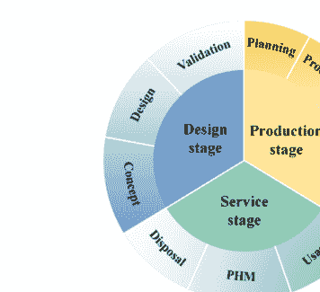

Lifecycle Management（PLM）软件的仿真软件包（即 STAR-CCM+ 软件）来构建水泵的 DT 模型并解决设计挑战。通过该软件强大的仿真能力，设计人员可以轻松高效地预测水泵的性能并避免损坏影响。

Stark 等人 [5] 提出了一种基于 DT 的新架构，用于网络物理生产系统（CPPS）的模块化设计。通过集成现有生产资源到一个构建工具包中，开发了一种评估新制造过程的方法，以帮助识别对新机器和网络物理系统（CPS）单元的需求。此外，通过虚拟原型，对 CPPS 的架构进行了验证和优化。

Damiani 等人 [6] 应用基于 DT 的仿真来设计一个生产用于电动机制动盘锚定板的实际工厂。AnyLogic 软件用于描述布局、产品、操作员、机器和包装作业，用于构建工厂并模拟操作过程。其目标是实现在制品（WIP）的最低水平，从而降低存储成本。

Mavris 等人 [7] 探索了一种基于 DT 和数字线程的飞机设计方法，该方法可以有效应对传统设计方法中的挑战，包括缺乏物理数据、不确定性、多学科集成以及数据和知识管理。

DT 提供的高度保真仿真可以验证产品或生产系统的设计，以在实际执行前消除潜在故障。更重要的是，由于 DT 可以同步反映 as-designed 和 as-built 产品，因此可以消除两者之间的差异。

#### 2.1.2 生产阶段的数字孪生

生产是一个复杂的过程，在此过程中材料、能量和信息流同步存在并相互作用。在此阶段，研究人员做了大量工作，包括提高生产过程的灵活性、降低能源消耗、提高产品质量等。最近，一些相关研究将 DT 与生产相结合并获得了性能提升。

Rosen 等人 [8] 讨论了 DT 如何应用于支持自主生产系统。由于 DT 可以无缝集成所有可用数据和知识，因此它可以结合相关数据进行准确的基于仿真的生产预测，从而实现高水平的灵活性和自动化。

Tao 等人 [9] 提出了数字孪生车间（DTS）的概念，并探索了 DTS 的概念模型、交互机制、特征和关键技术。此外，他们讨论了 DTS 各组成部分的操作机制和融合方法以提供更多见解 [10,11]。基于上述工作，提出了一个关于 DTS 中设备能耗管理的应用，并分析了潜在优势 [12]。

Coronado 等人 [13] 设计了一个车间 DT 框架用于生产控制和优化。在该框架中，使用 MTConnect、移动设备应用程序和超文本传输协议实现了对物理资产的原始数据采集。基于收集到的数据，在虚拟空间中创建了车间 DT 以服务于经理、证明者和客户，他们采取影响工厂的行动。所提出的框架最终在制造研究中心得到验证，取得了良好性能。

Sun 等人 [14] 提出了两个 DT 模型用于装配线以提高其吞吐量。吞吐量改进 DT 模型被设计用于分析线的实时状态并提供优化方案以提高线吞吐量，而吞吐量预测 DT 模型则被开发用于以低模型复杂度和高精度预测未来吞吐量。

Uhlemann 等人 [15] 探索了 CPPS 的 DT 建模方法，主要关注概念。讨论了多模态数据的收集和集成，并提出了通过 DT 实现 CPPS 的概念。此外，他们将使用手动数据的传统价值流图与结合实时数据的 DT 进行比较，以说明 DT 在生产中的优势 [16]。

Zhang 等人 [17] 讨论了 DT 驱动的智能车间架构，该架构包括物理车间层、网络层、数据层、网络层和应用层。然后在该架构中，设计了一种动态资源分配优化方法以减少任务完成时间。

Senington 等人 [18] 提出了一种链接数据方法，将机器的原始数据链接到 DT 的仿真模型，以便分析和优化制造过程。作者认为，所提出的方法将在工业 4.0 中发挥重要作用，因为它可以支持去中心化的数据存储和处理、智能工厂软件的模块化、异构数据源的互操作性以及工厂的虚拟化。

Leng 等人 [19] 提出了一个 DT 驱动的制造网络物理系统（MCPS）用于车间并行控制。通过去中心化 DT 模型建立网络物理连接，各种制造资源可以形成一个动态自主系统以创建个性化产品。分别讨论了 MCPS 的框架、关键技术和实现。

Vachálek 等人 [20] 基于 DT 优化了物理生产线。由于 DT 从实际生产过程收集实时数据，因此它可以实时评估生产并满足对仿真参数的实时要求。此外，它具有保持实际过程按预期运行的能力。

Banerjee 和同事 [21] 描述了一种基于 DT 从大规模生产线数据中提取和推断知识的机制，该机制通过推理能力增强制造过程管理。由于 DT 整合了来自制造、维护、运营和运行环境的数据，因此它可以反映每个资产、系统或过程的关键行为，从而为该机制提供智能。

Weyer 等人 [22] 预测 DT 将代表下一代仿真，并且将在开发 CPPS 中发挥关键作用。由于 DT 的特点是物理空间与虚拟空间之间的同步，因此它使人类操作员能够监控生产过程并及时调整。还讨论了如何与 DT 协作的方法。

Parrott 和 Warshaw [23] 从集成和整体的角度讨论了制造过程的 DT 模型，并描述了从物理空间到虚拟空间再回到物理空间的 DT 启用闭环。

Ameri 和 Sabbagh [24] 将 DT 视为一个数字工厂，可以代表制造设施的技术能力。作者描述了数字工厂的创建方法，包括能力提取、供应链配置和工厂数字化，并将其应用于一个机械车间。

Brenner 和 Hummel [25] 报道称 DT 将导致创建数字车间的全新范式。他们分析了在欧洲商学院（ESB）物流学习工厂中实施 DT 的硬件和软件要求，以实现人员、机器和产品之间的顺畅交互。


Zhuang 等人 [26] 探索了基于 DT 的复杂产品装配车间智能生产管理与控制框架，并讨论了相关技术。所提出的框架已应用于卫星装配车间。

Knapp 等人 [27] 开发了用于增材制造过程的 DT，以预测冷却速率、温度梯度、显微硬度、速度分布和凝固参数。结果表明，与基于有限元法（FEM）的水平集法、流体体积法和热传导模型相比，使用 DT 可更准确地预测冷却和熔化速率。

从这些研究可以看出，由于 DT 为连接物理空间和虚拟空间提供了桥梁，它可以及时使虚拟空间反映物理实际状况，并实时控制物理对象的行为。基于这些发现，DT 具有优化生产过程并将其提升到更高效率和灵活性水平的能力。

### 2.1.3 服务阶段的数字孪生

在服务阶段，PHM 是一个关键步骤，用于监测产品的健康状况、执行诊断和预测，并为维护策略提供设计规则。然而，传统的 PHM 工作主要由物理产品及其数据驱动，与其虚拟模型联系甚少，这影响了 PHM 的效率。为了改变这种情况，一些研究人员将 DT 引入了该领域。

Glaessgen 和 Stargel [28] 引入了一种基于 DT 的预测方法，用于未来的美国国家航空航天局（NASA）和美国空军车辆，该方法可以将历史数据、机队数据和传感器数据紧密结合，以生成故障预测的见解。它具有提高传统方法的不足以满足实时监测和准确预测日益增长的需求的能力。

Tuegel 等人 [29] 将 DT 应用于预测飞机剩余结构寿命，考虑了多物理场建模、多尺度损伤建模、结构有限元与损伤模型的集成、不确定性量化、大数据库操作和高分辨率结构分析。他们声称 DT 可以实现更好的飞机使用寿命管理。

Zakrajsek 和 Mall [30] 建立了 DT 模型来预测飞机轮胎的着陆磨损和失效概率。结果表明，DT 模型在预测不同下沉速率、偏航角和速度下的失效概率方面表现出一定的优越性。

Li 等人 [31,32] 基于动态贝叶斯网络建立了 DT 模型，用于飞机机翼疲劳裂纹扩展的诊断和预测。该方法将物理模型和裂纹扩展预测中的各种随机性和认知不确定性源集成在一起，并产生了准确的预测结果。

Gockel 等人 [33] 讨论了为机身实现超逼真且从摇篮到坟墓的 DT 模型以预测其结构寿命所面临的挑战。他们总结了未来实现这一设想流程所需解决的七个技术差距。

Reifsnider 和 Majumdar [34] 提出了一种构建高保真 DT 模型用于机队管理的方法。该方法优于传统方法，因为它不再需要损伤起始来执行故障诊断，并且对裂纹发展具有高度敏感性。

Seshadri 和 Krishnamurthy [35] 开发了一种损伤表征结构健康管理方法，用于飞机结构的损伤诊断和预测。该方法使用基于遗传算法的优化程序来预测损伤位置、尺寸和方向，并显示出高效率和准确性。

Kraft 和 Kuntzagk [36] 建立了具有三层结构的 DT 模型，以支持发动机劣化和失效分析，并预测其关键部件的剩余寿命。作者在 CFM56-5C 上验证了该方法，这是一款安装在空客 A340-300 上的成熟商用双转子高涵道比发动机，实验结果显示出显著改进。

Lee 等人 [37,38] 为制造机器建立了孪生模型，以集成传感数据、记录历史数据并管理数百台相似的物理机器，从而进一步评估机器状况、识别故障模式，并通过仿真提供自感知和自预测。

Tao 等人 [39] 探索了复杂设备的 DT 驱动 PHM 方法。为设备的 DT 构建了五维建模方法，然后在此模型基础上开发了三阶段工作流程来指导 PHM 活动。该方法最终在风力涡轮机上得到验证。

Bitterwolf 等人 [40] 基于 DT 训练并评估了一种监督机器学习方法用于自动化故障检测。该方法以电机控制模型进行了验证，可以降低不必要的维护或过早故障相关的成本。

受 DT 概念的启发，Cerrone 等人 [41] 提出了制造几何形状以预测材料试验试样上的裂纹路径。对试样 DT 进行了建模并在商业有限元软件包中进行仿真，以解决裂纹路径的模糊性问题。

Magargle 等人 [42] 使用基于仿真的 DT 结合基于物理的建模技术，用于汽车制动系统的热监测和预测性维护。该方法在收集传感器信息以训练学习算法方面显示出巨大优势，这有助于准确诊断系统中的控制器和检测齿圈的故障，齿圈是用于车轮速度测量的速度传感器。

Liu 等人 [43] 提出了一种 DT 生态系统的系统架构，其中 DT 融合了多源数据，包括历史信息、技术数据、维护报告、制造报告、资产特征等，以生成用于主动维护的知识，从而降低成本和停机时间。

Cai 等人 [44] 基于传感器数据集成和信息融合构建了 DT 虚拟机，以帮助工程师在机器故障时通过检查 DT 模型进行诊断和预测。

Hochhalter 等人 [45] 将 DT 与传感材料相结合，以克服传统方法的不足，传统方法过度依赖经验数据，因而无法及时应对不确定性。以非标准试验试样为例，证明了新方法可以更准确地预测维修、检查和更换。

Gabor 等人 [46] 开发了一种基于 DT 的架构，包括四个层级：物理需求、机器-环境接口、即时反应和计划反应，以预测 CPS 在运行期间的行为。

Yun 等人 [47] 提出了一种大规模 DT 平台的新型架构，包括分布式 DT 协作框架、灵活的数据中心通信中间件和基于平台的 DT 应用，以开发可靠的先进驾驶辅助系统。

对于这些工作，一方面，基于 DT 的仿真可以为诊断和预测提供更多见解。另一方面，可以获得并集成大量模型和仿真数据与物理数据，以生成更全面更有价值的信息用于健康状况检测和分析。因此，结合 DT，PHM 有潜力得到改进，以实现更高的效率和准确性。

### 2.1.4 跨多阶段的数字孪生

在 PLM 中，由于不同流程和特征不同，不同阶段的数据总是孤立、碎片化和停滞的，这阻碍了整个生命周期的高效管理。由于 DT 可以无缝集成产品的生命周期数据，它已被一些研究人员应用于 PLM。

Tuegel [48] 提出了机身 DT 概念用于机身设计和维护，随着使用经验的增加可以减少模型不确定性。由于 DT 的建模是该方法中的核心步骤，因此详细讨论了开发 DT 模型中的一些技术挑战。

Tao 等人 [49] 提出了 DT 驱动的产品设计、制造和服务方法，以支持产品在其整个生命周期内。DT 在三个阶段的应用框架被提出，并分别在自行车设计、传动轴制造和电力变压器服务中得到进一步验证。Tao 等人 [50] 还探索了 DT 在产品生命周期不同阶段的潜在应用。

Liau 等人 [51] 将 DT 引入注塑行业，包括模具设计、模具制造和注塑成型过程。DT 通过在物理空间和虚拟空间之间建立闭环，帮助整个注塑过程实现实时过程优化、过程监控和质量缺陷预测。

Söderberg 等人 [52] 开发了 DT 以确保最终产品的良好几何质量。DT 支持设计阶段的定位方案优化和统计变异仿真，预生产阶段的检验准备，以及生产阶段的虚拟修整、装配顺序优化、根本原因分析等。他们在另一篇论文 [53] 中进一步明确了相关策略。

Talkhestani 等人 [54] 开发了一种锚点方法来同步机电组件的跨域机电数据模型


在现有生产系统的生命周期中，DT 能够检测生产系统的变化，从而减少昂贵错误的出现。

Boschert 等人 [55] 认为，DT 能够在物理实体的生命周期中提供连续价值，并弥合不同阶段之间的差距。它可以通过在设计中使用历史生命周期经验来缩短设计周期，在各种条件下进行准确仿真并分析生产中故障的根本原因，并在服务期间检测故障并提供维护解决方案。

Grieves 和 Vickers [56] 展示了 DT 如何贯穿产品生命周期，包括创建、生产、运行和处置阶段。他们认为 DT 有助于转变客户的想法、深入了解系统、检查预测的准确性等。DT 的障碍和机遇也被讨论了。

Schleich 等人 [57] 提出了一个全面的参考模型，基于“皮肤模型形状”作为设计和制造阶段中物理产品的 DT。模型抽象、表示和操作被呈现出来，以用于产品的几何变化管理。

Gregory 等人 [58] 认为 DT 对自主感知车辆具有重要意义，因为它可以提供结构状态和车辆动力学信息，以评估车辆状态并生成结构健康实时和离线诊断与预测，从而提高维护效率。

Bohlin 等人 [59] 启动了一项关于 DT 中几何保证零件所需的基础设施、组件和数据流的研究。描述了一个闭环的 DT 来解释零件经历了什么，并介绍了相关方法。

Konstantinov 等人 [60] 认为 DT 在某种程度上与 CPS 一致，并开发了一套虚拟工程工具来支持制造系统生命周期的描述。作者以电动机器装配站为案例研究来验证所展示工具的效率。

Zhuang 等人 [61] 建立了产品 DT 的架构；分别讨论了 DT 在设计、生产和服务阶段的实现方法；介绍了其潜在功能；最后指出了未来的发展趋势。

Yu 等人 [62] 提出产品 DT 可以持续集成和完善来自产品生命周期的<|message|>数据和知识，并

从而实现产品配置管理的数据管理、跟踪和维护，并在管理过程中提高可视化和透明度。

Tao 等人 [63] 基于数字线程和 DT，介绍了复杂产品在其生命周期中建模和仿真、动态预测和评估的方法。这些方法实现了物理空间和虚拟空间之间的双向映射，并实现了产品生命周期的闭环。

借助 DT，产品生命周期中产生的数据可以被记录并集成到具有统一封装的高保真数字模型中。通过 DT 强大的计算和分析能力，可以持续挖掘有价值的信息和知识，形成连续的价值流，以支持 PLM 中的活动。

### 2.1.5 观察

基于上述论文，得出以下观察结果：

### 2.1.5.1 生产和 PHM 是 DT 最受欢迎的应用领域

如图 2.2 所示，关于生产和服务（主要指 PHM）阶段的论文占最大比例，而关于设计阶段的论文相对较少。很明显，生产和 PHM 是 DT 最受欢迎的应用领域。有两个原因可以解释这一现象。

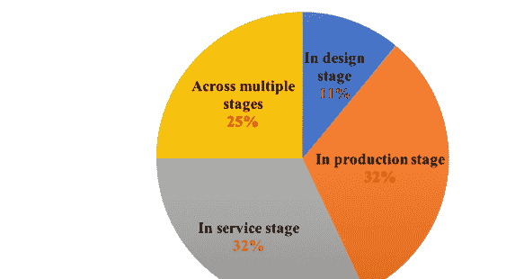

首先，对于 PHM，由于它是 DT 应用最早的领域，相关工作和技术已发展了更长的时间，并取得了一些令人兴奋的成果，这激励了更多研究人员在该领域工作。此外，由于 NASA 和美国空军已将 DT 引入未来飞机的 PHM，DT 被认为是最有前景的技术之一，从而吸引了大量关注。然而，当前 PHM 的研究仍存在一些局限性。例如，由于 DT 成本高昂，应用领域主要集中在高价值设备。随着 DT 技术成熟，将会有更广泛的应用。

其次，对于生产，随着智能制造时代的到来，许多研究人员正集中于如何实现生产过程中的智能操作。由于 DT 具有无缝连接物理和虚拟空间并保持两者一致和同步的能力，它在实时过程控制和优化以及准确预测方面显示出巨大潜力。因此，专注于生产的科研人员对 DT 感到兴奋，并一直在努力将其部署在研究中。未来，随着工厂技术和基础设施的进步，DT 将在生产中进一步普及和采用。

#### 2.1.5.2 DT 在美国、中国和欧洲获得了最多的关注

在图 2.3 中，引用了来自不同国家的 DT 相关论文的第一作者。可以看出，美国、中国和欧洲的作者占最大比例。这一观察结果可以解释如下。

美国、中国和欧洲是制造业的世界强国。他们在各自的国家层面提出了战略，包括工业互联网、CPS 或网络制造、中国制造 2025 和工业 4.0，以鼓励和支持相关研究人员和从业者探索智能制造的实现方式。由于 DT 作为无缝网络物理融合的实用技术出现，而这是未来制造的核心，美国、中国和欧洲的研究人员热情地高度重视 DT 相关研究，领先于其他国家。他们目前在 DT 文献中处于领先地位。

DT 已在工业中得到广泛应用 [104]。表 2.1 中列出了 11 个领域中 DT 的主要工业应用/潜在应用，便于查阅。在以下章节中，将讨论每个领域中的一些重要示例。

### 2.2 工业应用中的数字孪生

航空航天是最早采用 DT 的工业领域，最初由 NASA 和美国空军推出。随后，许多大型公司，例如诺斯罗普·格鲁曼、空中客车、波音和通用电气公司（GE），也将 DT 技术与他们的相关业务相结合，包括飞机维护、生产、装配、安全和安全管理等。以下是一些示例。

为了预测航天飞机中的故障并设计维护策略，NASA [64] 已构建了一个 DT 来映射飞机的实际状况。通过向 DT 馈送实时数据，它可以优化飞机的性能，提前预测潜在故障，并帮助地球上的工程师更好地理解故障并提供高效解决方案。目前，NASA 还尝试使用 DT 来确保飞机出现故障时机组人员的安全。

美国空军研究实验室（AFRL）[65] 已发布了一个计划，即螺旋 1，用于航空航天领域 DT 的开发。AFRL

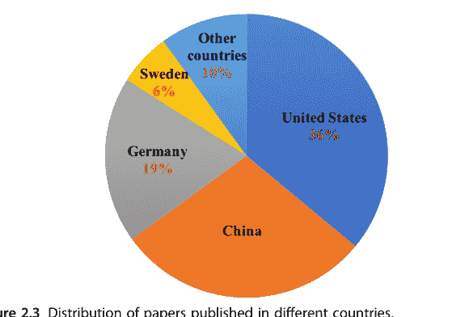

| 领域 | 应用/潜在应用 |
|---|---|
| 航空航天 | 航天器的预后和维护 |
|  | 航天器的灾难性故障分析 |
|  | 装配线监控 |
|  | 装配线决策优化 |
| 发电电力 | 安全和安全管理 |
|  | 风力涡轮机的预后和维护 |
|  | 电力厂健康管理 |
|  | 电网规划、运行和维护 |
| 汽车 | 设计验证 |
|  | 停机预测和维护 |
|  | 燃油效率优化 |
|  | 各种条件下的汽车性能测试 |
| 石油和天然气 | 远程监控和控制 |
|  | 资产管理 |
|  | 生产优化 |
|  | 设备故障检测 |
|  | 维护计划 |
| 医疗保健和医学 | 健康监测 |
|  | 心脏研究 |
|  | 个性化医疗 |
|  | 医疗资源分配 |
|  | 人员排班 |
| 海运/航运 | 船舶生命周期管理 |
|  | 选择造船的最佳方案 |
|  | 减少燃料消耗 |
|  | 故障预测和维护 |
| 城市管理 | 实时监控 |
|  | 规划和决策优化 |
|  | 支持政策制定 |
|  | 供暖、通风和空调（HVAC）系统控制 |
| 农业 | 监测橄榄蝇的发生和传播 |
|  | 识别作物病虫害和农药 |
|  | 家畜健康监测 |
|  | 追踪动物移动 |
|  | 追踪农机 |
| 建筑 | 进度监控 |
|  | 工作计划和预算调整 |
|  | 资源分配和废物追踪 |
|  | 工人安全监控 |
|  | 建筑质量评估 |
|  | 提高设备使用率 |
| 环境保护 | 水资源管理 |
|  | 森林利用和管理的优化 |
| 安全和应急 | 缓解现有风险或危害 |
|  | 安全网络保护 |
|  | 灾难性灾害预防 |


已与通用电气和诺斯罗普·格鲁曼签署了一份价值 2000 万美元的商业合同，以开展相关研究，将最先进的技术集成在一起，并旨在准确识别实体和模型之间的差异。

诺斯罗普·格鲁曼 [66] 已将 DT 应用于 F-35 战斗机的最终装配线，以提高制造效率并降低成本。它建立了基于数字线程的基础设施来支持对不合格产品的决策，并改进了多个工程流程。例如，基于该基础设施，F-35 进气口加工缺陷的处理决策时间缩短了 33%，这有助于诺斯罗普·格鲁曼在 2016 年获得了美国国防部的国防制造技术成就奖。

2011 年，空中客车 [66–67] 采用了 Ubisense（UBI）的智能定位解决方案，实时连接 A350XWB 最终装配线上的实体，使工业流程和设备应用透明化，并掌握工厂内设备的分布。此后，UBI 的解决方案已持续引入空中客车的装配线和飞机项目中，涉及 A330、A380 和 A400M。在此基础上，空中客车进一步在关键工具、材料和零件上部署 RFID，并最终建立了装配线的 DT，可基于模型预测瓶颈并优化运营绩效。

就 DT 应用而言，航空航天是一个相对成熟的领域，已开展了大量研究。DT 在该领域发挥着重要作用，因为它可以在虚拟空间中进行实时预测和高保真验证，从而提高飞机的可靠性，减少事故并节约资源。

### 2.2.2 电力发电中的数字孪生

电力行业与工业发展和人们的日常生活密切相关，涵盖发电、输电、配电和销售。它是一个国家的基础产业，一些公司已将 DT 引入该行业。

GE [68,69] 已建立数字风电场，以重新定义风电的未来。通过持续收集实时数据（例如天气、组件信息、服务报告），可以为每台风力涡轮机构建 DT，以优化设备维护策略、提高可靠性并增加年发电量。预计基于 DT 的应用可实现 20% 的效率提升。为了帮助客户实现这一目标，GE 提供了一体化的硬件和软件解决方案，包括风力涡轮机产品和一套基于 Predix 软件平台构建的软件应用程序。

西门子 [70] 为芬兰电力系统提供了解决方案，尝试为电网创建 DT，用于规划、运营和维护设施。数字电网带来的主要益处包括：
- 将模拟上的大部分手工工作转变为自动化工作，
- 提高数据利用率，
- 标准化数据接口，
- 为基于与数字电网相连的大数据改善决策提供巨大可能性。

北京 BKC 科技有限公司（BKC）[71] 是中国电力厂健康管理解决方案提供商，已将 DT 技术应用于其业务。它开发了一套智能解决方案，包括全厂可视化管理、汽轮机三维在线监测系统、交互式虚拟仿真培训、地下管网可视化等。通过提供可视化信息和分析工具，BKC 正在帮助客户提高电厂运行效率、降低成本并节约能源消耗。

很明显，DT 具有保持电网、发电厂和关键设备以更高可靠性运行的能力，这对于确保工厂和企业的平稳运营以及人们的正常日常生活至关重要。

### 2.2.3 汽车中的数字孪生

汽车行业涉及机动车辆整个生命周期的不同阶段，例如设计、生产和维护。目前，随着汽车结构变得更加复杂，对高精度测试和维护的要求也越来越高。一些公司，如 Bsquare、PACCAR、ANSYS，已在汽车行业开展 DT 应用。

物联网软件公司 Bsquare [72,73] 为卡车制造商 PACCAR 建立了卡车发动机或其他部件的 DT 模型，以创建维修场景。通过充分利用使用传感器收集的实时数据和 DataV 系统中的信息，可以创建特定条件下的发动机模型以支持卡车维护。基于此，可以在短时间内获得减少维护时间的收益，并可实现维护时间减少 20%。

GE [74] 认为未来数字线程和 DT 可用于跟踪机车的整个生命周期。有了数字线程和 DT，机车是如何设计、配置、建造、运营和服务的都可以进行数字化跟踪。特别是，由于可以实时获取每个组件的健康状况和相关变量的变化，工程师可以从燃油效率到非计划停机时间优化机车的运行。

国际商业机器公司（IBM）[75] 认为 DT 在几年内将为车辆带来巨大价值。工程师可以在建造真实车辆之前构建 DT，模拟其在不同条件下的性能表现、与不同驾驶员的交互方式、其脆弱性等。他们还可以随时了解正在发生的情况，并找出故障何时、为何以及如何发生，以降低非计划停机的时间和风险。

由于 DT 在汽车行业中在状况监测、运行优化和故障预测方面表现出明显优势，因此可被视为该领域的很有前景的技术。

### 2.2.4 石油和天然气中的数字孪生

由于石油和天然气通常从环境恶劣的偏远地区开采，流程管理存在许多问题。因此，一些公司已将 DT 引入该领域并期望提高管理效率。

ARC Advisory Group [76] 估计非计划停机可能导致流程工业每年收入和盈利损失高达 1 万亿美元。幸运的是，它也指出 DT 的出现将带来改善石油和天然气维护和运营的巨大机遇，这将彻底改变这一状况。DT 的主要益处包括：
- 帮助运营团队更好地了解风险，
- 帮助制定可执行的计划和工作计划，
- 帮助识别和管理设计变更。

CIMS RAFFLES [77] 将中国国际海运集装箱（CIMC）蓝鲸一号半潜式钻井平台与增强现实（AR）/虚拟现实（VR）、物联网、虚拟化和数据集成等先进技术集成，形成平台的 DT 并建立相关管理系统。它已实现可视化显示、研发流程显示、运行维护管理，并为数据采集和状态监测提供了高效的远程手段。

英国石油公司（BP）[78,79] 已使用 DT 对物理项目进行建模，例如新的油田和相关基础设施，这有助于维护计划、退役设备识别、设备安装计划以及资产管理。BP 已将基于 DT 的技术应用于阿拉斯加的一个设施。

DT 的出现为石油和天然气行业相关基础设施、设备和流程实现远程监控和控制、停机预测和风险降低提供了一种高效方式，可大大提高管理效率。

### 2.2.5 医疗保健和医学中的数字孪生

在医疗保健行业，相关公司和组织提供医疗服务、制造医疗设备并开发药品以维护和改善人们的健康状况。它是世界上最大的行业之一，与每个人都密切相关。DT 可应用于医疗保健行业以加速其数字化进程。

GE Healthcare Camden Group [80] 已将医院的 DT 变为现实。通过先进的数据监控和处理，DT 可有助于床位规划、人员排班、手术室分配等，从而最大化对患者的护理。

达索 [81,82] 开展了 Living Heart Project（LHP），通过生物技术传感器和扫描技术为人体心脏构建 DT。DT 是具有电学和肌肉特性的心脏个性化全维度模型，可以模拟真实心脏的行为。它不仅可以支持各种操作，例如植入起搏器、反转腔室、切割任意横截面和运行假设，还可以提供心脏的虚拟分析，在疾病开始前为心脏病患者提供护理。

阿姆斯特丹大学的研究人员 [83] 尝试构建 DT 作为人类的数字克隆，可以准确模拟人类行为，例如呼吸、行走，甚至腿部骨折和疾病发展。数字副本将极大地促进个性化医疗，从而改变基于对大量患者平均最佳的传统治疗方法。它还导致


更快、更高效地引入新药并减少医学研究中使用动物的数量。

在医疗保健行业，数字孪生（DT）在人类健康管理方面具有光明前景，一方面可以改善现有的医疗服务和基础设施以创造更好的患者护理，另一方面可以开发创新的方法来应对困难的疾病病例。

### 2.2.6 海运/航运中的数字孪生

航运业有着数百年的历史。它涉及海上运输、海洋开发和国防建设，对进出口贸易具有强劲的驱动作用。目前，业内一些公司计划通过先进技术改善相关业务。因此，DT 受到了相当大的关注。

GE [84] 试图与美国海军和国防部的领先海上运输提供商军事海运司令部（MSC）合作，以提高性能和任务准备度。为此，GE 将为关键船舶设备实现高速数据采样并为该设备构建数字孪生。在 Predix 平台的推动下，来自物理设备的实时数据可以与虚拟模型中的模拟数据进行比较以检测差异，该差异可能代表导致潜在故障的性能下降。基于该差异，操作员可以在问题发生前识别并解决相应问题，从而提高设备可靠性和可用性，并降低维护成本。

DNV GL [85] 试图为物理船舶建立“虚拟姊妹船”，以通过实现设计师、建造商、运营商等之间的协作，在船舶生命周期内降低成本、提高效率并提高安全性。它已从航运业不同利益相关者的角度分析了 DT 带来的价值 [86]：

- 1. 对于船东：支持船舶和子系统的可视化、数据鉴定和分析、性能优化、内部和外部沟通、自主操作以及退役。
- 2. 对于设备制造商：提供系统集成、性能演示、系统质量保证和附加服务的工具。
- 3. 对于监管机构：提供系统化框架以自动生成信息和高质量报告。
- 4. 大学：支持相关研究和教育。
- 5. 海事学院：培训未来和现有的海事人员。
- 6. 咨询公司：提供商业机会。

有了 DT，传统的航运业将受益于先进的数字技术，关键船舶设备的预测分析和整船的 PLM 将成为未来的应用热点。

### 2.2.7 城市管理中的数字孪生

城市是人口密度高、基础设施完善、建筑物齐全的人类聚居区。为了改善城市环境和人民生活质量，DT 已被应用于该领域。

新加坡政府 [87] 已与达索合作构建一个数字孪生，以描述城市中的一切，从公交车站到建筑物，用于测试大胆的新想法。通过数字副本，可以获得巨大的好处，包括：（1）提供城市的鸟瞰图，（2）实现虚拟实验以优化相关措施，（3）优化长期规划和决策，（4）支持大规模仿真。

IBM Watson [88] 展示了数字孪生如何在认知建筑中用于控制供暖、通风和空调（HVAC）系统并监测室内气候条件。在该建筑中，有 600 个房间传感器（例如温度读数、光传感器和占用监测）、250 个智能电表和 169 台 HVAC 机器。基于收集的数据，可以创建建筑物的数字孪生，以帮助工程师调节能源消耗并检测潜在用例，并为技术人员提供指导服务、维护程序和气候控制知识。

Cityzenith [89] 为城市管理构建了“5D 智能世界平台”。它将数字图像与可用数据集集成，并将物联网网络与上下文数据模式叠加，以为整个城市创建虚拟表示。通过该平台，基础设施开发过程可以数字化，并可实现城市更集成的数字生命周期。目前，该平台已在 100 多个城市中使用，包括芝加哥、伦敦、多哈等。

很明显，DT 是城市管理中的一项有价值的技术。通过 DT 提供的高度保真虚拟化和仿真，城市管理可以得到优化，并将建立更多在运营、分析和预测方面具有智能的智慧城市。

### 2.2.8 农业中的数字孪生

农业是一个国家的关键部门，通过种植动物和植物生产食物、纤维、药用植物和其他产品以维持和增强生命。目前，由于世界人口不断增长，该部门正面临巨大压力。幸运的是，DT 的出现可能有助于改变现状。

瓦赫宁根大学与研究中心的 Verdouw 和 Kruize [90] 认为，DT 可以作为管理农场的中心手段，并有能力彻底改变农业。他们已探索了农业中不同主题的潜在 DT 应用，为相关公司提供了指导。潜在应用主要包括：（1）远程监测奶牛以检测其健康状况，（2）记录和识别植物害虫和疾病，（3）监测畜牧场饲料筒仓并优化补充，（4）实时跟踪机械车队并监测作物能源消耗，（5）监测橄榄蝇的发生和传播，（6）监测养蜂场以识别疾病、害虫感染、农药暴露和毒性。

微软 [91] 也认为 DT 有能力加速农业相关业务，包括农场供应、生产、收获、包装和分销以及销售和营销。它将为客户提供解决方案以抓住前方的巨大机遇并支持农业行业的可持续发展。

目前，展示 DT 在农业部门使用的实际案例相对较少。然而，随着 DT 在远程监测、虚拟化、预测分析等方面显示出巨大潜力，它将成为未来农业行业不可或缺的技术。

### 2.2.9 建筑中的数字孪生

建筑是建造建筑物或基础设施设施的过程，包括设计、建造、装饰和管理阶段。它为人们提供居住和娱乐空间，并与经济、文化和生活密切相关。一些公司已尝试将 DT 引入该领域，以建造更便宜、更绿色、更耐用的建筑。

VEERUM [92] 为大型建筑工地提供 DT 解决方案，以在虚拟空间中预测和解决在现实中影响成本和进度的问题之前的问题。VEERUM 首席执行官 Steve Fisher 表示，“创建物理建筑工地的数字副本使项目团队在决策时更有把握，并能从设计到施工更高效地交付项目。”。例如，由于 DT 提供了土壤类型和移动数量的持续进度监测，项目团队可以了解项目进展和周围环境，并及时做出必要的更改。

Intellectsoft [93] 正在探索建筑工地上 DT 的应用。对于建筑而言，使用 DT 意味着人们可以同步使用已建模型和已设计模型，这允许每天每小时检测两部分之间的差异，以尽早发现项目中的潜在问题。由于 DT 提供了自动资源分配监测和废物跟踪，它还实现了资源管理的预测性和精益方法。它可以帮助管理者及早了解工人的不当行为以防止危险发生。

普华永道 [94] 讨论了建筑行业的数字化转型。它指出 DT 可应用于各种建筑。例如，在办公楼环境中，DT 可以随时显示人员数量和位置，这可能为管理系统提供宝贵的数据用于预测分析和优化。

在建筑中，使用 DT 可以帮助将物理空间和虚拟空间结合起来，以建造更便宜、更绿色、更耐用的建筑，并为完工建筑提供更高效的物业管理。

### 2.2.10 环境保护中的数字孪生

保护自然环境可以造福环境和人类。然而，由于过度消费、人口和技术带来的压力，环境正在逐渐恶化，这已影响到社会进步和人类生存。如今，一些公司的研究表明，DT 在环境保护中可以发挥重要作用。

Metsä Group、Tieto 和 CTRL Reality [95] 开发了“虚拟森林”，可被视为“数字


forest twin.” 虚拟森林可在 VR 头显、移动设备和网页浏览器上运行。通过它，用户可以在虚拟空间中参观森林，以了解不同森林管理活动的影响，估算每项活动产生的收入和成本，检查单棵树木的属性，并预测森林未来的表现，这有助于制定可持续的森林管理方案。

由 Predix 驱动，GE [96] 可为水资源管理提供软件解决方案。它将不同的数据集与算法相结合，以识别管道上的潜在故障，实现更快的响应式维护并提高主动维护，从而减少风暴和污水管理中的溢流频率，并利用 DT 技术创建客户工厂的强大数字复制品，以提高水厂效率。

西门子 [97] 将专注于水处理和污水处理厂的数字化。它提供涵盖工厂整个生命周期的解决方案，从基于 DT 的规划到运营和维护，以支持水管监测、综合能源管理以及潜在脆弱性和威胁的早期检测等。

在环境保护方面，DT 对相关资源（如水和森林）进行虚拟化并提高管理效率具有巨大价值，从而减少资源浪费并支持环境的可持续性。

### 2.2.11 安全与应急中的数字孪生

安全与应急措施对于保护资产、基础设施和私人信息免受恶意攻击至关重要，常见于各行各业。DT 可引入该领域以实现更低成本和更佳性能。

VIAKOO [98] 讨论了 DT 如何保护公司的安全。在传统情况下，当公司的设备或机器出现故障时，公司必须让维护团队访问其内部系统以收集私人数据用于故障识别。这通常存在安全风险。由于 DT 能够整合物理资产生命周期中的大量数据并通过计算生成有价值的信息，因此它可以自动通知公司潜在故障及相关维护策略。因此，DT 使公司能够将维护内部化，而无需聘请常驻团队，从而避免潜在的安全风险。

系统应用与产品（SAP）[99] 认为，DT 可通过为恶劣环境中的设备（如海底设备）提供 PHM 服务来预防灾难。一方面，DT 可用更具成本效益的数字检查替代或补充复杂且昂贵的物理检查。另一方面，它可以准确模拟设备的状况，以模拟正在发生和将要发生的情况，从而优化决策。借助 DT，设备及相关人员的安全可以得到保障。

未来，随着 DT 的应用，物理资产、信息甚至人类的安全将进一步增强，应急措施也将得到优化。

### 2.2.12 观察

目前，DT 已被引入到各个行业。其中，DT 在航空航天领域的应用相对成熟。原因主要包括三个方面。

- 1. 航空航天采用并集成了行业中最先进的技术（例如，高保真建模与仿真、生命周期数据集成与融合、连接与互联），使其成为引入 DT 的理想候选者。
- 2. 由于航空航天领域的 DT 应用比其他行业开发时间更长，更多研究人员和从业者致力于该领域，导致了实质性的改进和进展。
- 3. 航空航天工程是一个特殊领域。由于其与国防密切相关，对安全和保密性要求很高，但对服务的要求相对较低。因此，初始的三维 DT 概念完全可以满足该领域的需求。然而，对于其他领域，将 DT 提供的功能封装成标准服务以便易于使用和更愉悦的用户体验至关重要。对于这种新需求，初始的 DT 概念显示出不足之处，可能阻碍其被接受。

由于 DT 是一项新兴技术，相关模型、技术、工具、基础设施和标准的发展仍显不足。未来，随着 DT 的不断改进和完善，不同行业将实现更成熟的应用。

### 2.3 数字孪生的未来市场

由于 DT 代表了数字化的下一波浪潮，可被视为工业 4.0 中物理空间与虚拟空间之间的桥梁，因此其在未来具有广阔的商业前景。一些组织对其进行了市场研究并提供了相关数据支持。Gartner 预测“到 2021 年，半数大型工业公司将使用 DT，这将使这些组织的效率提高 10%” [100]。“Markets and Markets” 报告称“DT 市场在 2016 年的价值为 18.2 亿美元，预计到 2023 年将达到 156.6 亿美元，预测期内的复合年增长率为 37.87%” [101]。国际数据公司（IDC）预测“到 2020 年，G2000 公司中 30% 将使用物联网连接产品和资产的 DT 数据来提高产品创新成功率和组织生产率，增益可达 25%” [102]。“Global market insights” 指出“由于 DT 可以在产品生命周期的任何阶段提供产品的虚拟视图，预计在预测期内其采用率将显著提高” [103]。

未来，DT 市场将覆盖越来越多的领域并渗透社会的各个方面，涉及教育、交通、环境、医疗保健、食品等。因此，各领域的公司都有机会从 DT 中获益。他们可以将 DT 与其产品相结合以完成产品升级，并为客户提供更好的服务。DT 还可应用于公司管理，通过优化业务、节能、缩短上市时间、激发创新等方式实现更好的运营。在各方面，DT 都能为公司带来巨大的经济效益，并进一步提高其竞争力。

从上述分析和数据来看，作者认为 DT 市场在未来几年将充满希望，及时跟上 DT 趋势的公司可以在其领域实现快速发展并在市场上占据有利地位。

### 2.4 数字孪生应用的挑战

DT 应用的挑战可概括为以下七个方面。

首先，由于 DT 是一项新兴技术，大多数人缺乏全面的理解，无法清晰识别其价值，从而导致对 DT 的忽视。其次，由于心理和文化界限，人们可能受旧有刻板印象的限制，更倾向于停留在熟悉的舒适区，而不是接受新方法的挑战。第三，考虑到操作人员技术水平的差异，其中一些人缺乏足够技能（如建模、仿真和数据融合）来使用 DT。

### 2.4.2 技术和基础设施

要实现 DT 应用，将涉及许多技术，如高保真建模与仿真、实时数据采集与融合、灵活的数据架构构建、持续双向交互等。其中一些技术尚未完全成熟，相关商业产品也缺乏，这阻碍了 DT 的普及和应用。此外，基础设施（如互联网连接、宽带速度和传感器性能）也需要改进，以高效地为相应技术服务。

### 2.4.3 支持工具

尽管许多研究人员和从业者对 DT 感到兴奋，但在谈到 DT 应用时，他们并不清楚相关的支持工具。尽管一些大型公司（如西门子、PTC 和 GE、微软）已推出各自的软件和硬件来支持 DT 应用，但这些工具仍然分散且孤立，未得到广泛采用。因此，对于用户而言，迫切需要一套集成且通用的工具。

### 2.4.4 标准和规范

对于 DT 应用，缺乏标准规范，这些规范应由相关研究人员、供应商和用户共同制定，并正式描述模型、接口、协议、数据等的标准。例如，需要涉及和处理来自不同来源的异构数据，但由于缺乏数据标准化格式，难以完成数据交换、集成和融合，从而进一步为 DT 提供有价值的信息。


### 2.4.5 成本控制与管理

目前，构建一个完整的数字孪生是一项成本高昂的项目。一方面，为了精确、全面地模拟实体或过程而构建高保真模型将是一个耗时且劳动密集的过程。另一方面，实现对大量数据的实时采集和处理需要高性能硬件和软件的支持。因此，在大多数情况下，数字孪生将在高价值、重大产品、设备或流程的管理中发挥重要作用。对于用户而言，在部署数字孪生之前，充分考虑数字孪生带来的成本与效益之间的平衡是必要的，但也是具有挑战性的。

### 2.4.6 网络安全与知识产权

企业资产和业务可通过数字孪生实现数字化与虚拟化。因此，网络安全对于保护敏感信息并确保数字孪生应用的成功至关重要。必须采取充分措施确保安全，包括改进安全系统以应对新兴威胁、保护生产和办公空间中的网络化系统，以及抵御对传感设备的恶意攻击。此外，随着数字孪生的发展，预计会产生一系列创新发明专利。为了建立数字孪生公平有序的投资环境和市场，高效保护知识产权是强制性的，但也是具有挑战性的。

### 2.4.7 数字孪生发展不足

数字孪生是一种历史短暂的新兴技术，目前仍处于起步阶段，存在诸多问题，如概念混乱、工具和技术不足、人才短缺等，这些都给数字孪生的应用带来困难。此外，作为一项新技术，数字孪生在未来发展中存在不确定性，可能在产品、市场、业务、投资等方面带来多方面的风险。数字孪生的发展不足在一定程度上阻碍了其进展。

### 2.5 总结

本章从学术和工业视角回顾了数字孪生的应用。可以很容易得出结论，数字孪生可用于整个产品生命周期和各个行业，在监测、控制、优化和预测任何操作方面显示出极具前景的价值。然而，由于数字孪生是一项新兴技术，在技术、工具、基础设施、标准等方面仍存在许多挑战。因此，数字孪生的采用和应用仍需要大量的发展。

### 参考文献

- [1] F. Tao, F. Sui, A. Liu, Q. Qi, M. Zhang, B. Song, et al., Digital twin-driven product design framework, Int. J. Prod. Res. (2018). Available from: https://doi.org/10.1080/00207543.2018.1443229.
- [2] Q. Liu, H. Zhang, J.W. Leng, X. Chen, Digital twin-driven rapid individualised designing of automated flow-shop manufacturing system, Int. J. Prod. Res. (2018). Available from: https://doi.org/10.1080/00207543.2018.1471243.
- [3] H. Zhang, Q. Liu, X. Chen, D. Zhang, L.W. Leng, A digital twin-based approach for designing and decoupling of hollow glass production line, IEEE Access 5 (2017) 26901–26911.
- [4] S. Ferguson, E. Bennett, A. Ivashchenko, Digital twin tackles design challenges, World Pumps 4 (2017) 26–28.
- [5] R. Stark, S. Kind, S. Neumeyer, Innovations in digital modelling for next generation manufacturing system design, CIRP Ann. 66 (1) (2017) 169–172.
- [6] L. Damiani, M. Demartini, P. Giribone, M. Maggiani, R. Revetria, F. Tonelli, Simulation and digital twin based design of a production line: a case study, in: Proceedings of the International MultiConference of Engineers and Computer Scientists, Hong Kong, vol. 2, 2018.
- [7] D.N. Mavris, M. Balchanos, O.J. Pinon, W.J. Sung, Towards a digital thread-enabled framework for the analysis and design of intelligent systems, in: 2018 AIAA Information Systems-AIAA Infotech@Aerospace, Kissimmee, Florida, 2018.
- [8] R. Rosen, G. von Wichert, G. Lo, K.D. Bettenhausen, About the importance of autonomy and digital twins for the future of manufacturing, IFAC-PapersOnLine 48 (3) (2015) 567–572.
- [9] F. Tao, M. Zhang, J. Cheng, Q. Qi, Digital twin workshop: a new paradigm for future workshop, Comput. Integr. Manuf. Syst. 23 (1) (2017) 1–9.
- [10] F. Tao, M. Zhang, Digital twin shop-floor: a new shop-floor paradigm towards smart manufacturing, IEEE Access 5 (2017) 20418–20427.
- [11] F. Tao, Y. Cheng, J. Cheng, M. Zhang, W. Xu, Q. Qi, Theory and technologies for cyber–physical fusion in digital twin shop-floor, Comput. Integr. Manuf. Syst. 23 (8) (2017) 1603–1611.
- [12] M. Zhang, Y. Zuo, F. Tao. Equipment energy consumption management in digital twin shop-floor: a framework and potential applications, in: 2018 IEEE 15th International Conference on Networking, Sensing and Control (ICNSC), 2018, doi:10.1109/ICNSC.2018.8361272.
- [13] P.D.U. Coronado, R. Lynn, W. Louhichi, M. Parto, E. Wescoat, T. Kurfess, Part data integration in the shop floor digital twin: mobile and cloud technologies to enable a manufacturing execution system, J. Manuf. Syst. (2018). Available from: https://doi.org/10.1016/j.jmsy.2018.02.002.
- [14] H. Sun, C. Li, X. Fang, H. Gu, Optimized throughput improvement of assembly flow line with digital twin online analytics, in: 2017 IEEE International Conference on Robotics and Biomimetics (ROBIO), Macau, 2017, pp. 1833–1837.
- [15] T.H.J. Uhlemann, C. Lehmann, R. Steinhilper, The digital twin: realizing the cyber–physical production system for industry 4.0, Procedia CIRP 61 (2017) 335–340.
- [16] T.H.J. Uhlemann, C. Schock, C. Lehmann, S. Freiberger, R. Steinhilper, The Digital twin: demonstrating the potential of real-time data acquisition in production systems, Procedia Manuf. 9 (2017) 113–120.
- [17] H. Zhang, G. Zhang, Q. Yan, Dynamic resource allocation optimization for digital twin-driven smart shopfloor, networking, in: 2018 IEEE 15th International Conference on Sensing and Control (ICNSC), Zhuhai, 2018, doi:10.1109/ICNSC.2018.8361283.
- [18] R. Senington, F. Baumeister, A. Ng, J. Oscarson, A linked data approach for the connection of manufacturing processes with production simulation models, Procedia CIRP 70 (2018) 440–445.
- [19] J. Leng, H. Zhang, D. Yan, Q. Liu, X. Chen, D. Zhang, Digital twin-driven manufacturing cyber–physical system for parallel controlling of smart workshop, J. Ambient Intell. Hum. Comput. (2018). Available from: https://doi.org/10.1007/s12652-018-0881-5.
- [20] J. Vachálek, L. Bartalský, O. Rovný, D. Šišmišová, M. Morháč, M. Lokšák, The digital twin of an industrial production line within the industry 4.0 concept, in: 2017 21st International Conference on Process Control (PC), Slovakia, 2017, pp. 258–262.
- [21] K.P. Joshi, S. Mittal, A. Banerjee, R. Dalal, Generating digital twin models using knowledge graphs for industrial production lines, in: Workshop on Industrial Knowledge Graphs, Colocated With the 9th International ACM Web Science Conference, New York, 2017.
- [22] S. Weyer, T. Meyer, M. Ohmer, D. Gorecky, D. Zuhlke, Future modeling and simulation of CPS-based factories: an example from the automotive industry, IFAC-PapersOnLine 49 (31) (2016) 97–102.
- [23] A. Parrott, L. Warshaw, Industry 4.0 and the Digital Twin Manufacturing Meets its Match, Deloitte University Press, 2017.
- [24] F. Ameri, R. Sabbagh, Digital factories for capability modeling and visualization, IFIP International Conference on Advances in Production Management Systems, Springer, Cham, 2016, pp. 69–78.
- [25] B. Brenner, V. Hummel, Digital twin as enabler for an innovative digital shopfloor management system in the ESB Logistics Learning Factory at Reutlingen—University, Procedia Manuf. 9 (2017) 198–205.
- [26] C. Zhuang, J. Liu, H. Xiong, Digital twin-based smart production management and control framework for the complex product assembly shop-floor, Int. J. Adv. Manuf. Technol. 96 (1–4) (2018) 1149–1163.
- [27] G.L. Knapp, T. Mukherjee, J.S. Zuback, H.L. Wei, T.A. Palmer, A. De, et al., Building blocks for a digital twin of additive manufacturing, Acta Mater. 135 (2017) 390–399.
- [28] E. Glaessgen, D. Stargel, The digital twin paradigm for future NASA and U.S. Air Force vehicles, in: 53rd AIAA/ASME/ASCE/AHS/ASC Structures, Structural Dynamics and Materials Conference, Hawaii, 2012, doi:10.2514/6.2012-1818.
- [29] E.J. Tuegel, A.R. Ingraffea, T.G. Eason, S.M. Spottswood, Reengineering aircraft structural life prediction using a digital twin, Int. J. Aerosp. Eng. 2011 (2011) 1687–5966.


58 数字孪生驱动的智能制造

+ [30] A.J. Zakrajsek, S. Mall, 轮胎着陆健康监测数字孪生模型的开发与应用, 收录于: 58th AIAA/ASCE/AHS/ASC Structures, Structural Dynamics, and Materials Conference, Texas, 2017.
[31] C. Li, S. Mahadevan, Y. Ling, S. Chozc, L. Wang, 用于飞机机翼健康监测数字孪生的动态贝叶斯网络, AIAA J. 55 (3) (2017) 930–941.
[32] C. Li, S. Mahadevan, Y. Ling, L. Wang, 数字孪生的动态贝叶斯方法, 收录于: 19th AIAA Non-Deterministic Approaches Conference, Texas, 2017.
[33] B. Gockel, A. Tudor, M. Brandyberry, R. Pennmeta, and E. Tuegel, 使用真实任务剖面进行结构寿命预测的挑战, 收录于: 53rd AIAA/ASME/ ASCE/AHS/ASC Structures, Structural Dynamics and Materials Conference, Hawaii, 2013.
[34] K. Reifsnider, P. Majumdar, 用于机队管理的多物理场激励仿真数字孪生方法, 收录于: 54th AIAA/ASME/ASCE/AHS/ASC Structures, Structural Dynamics and Material Conference, Boston, 2013.
[35] B.R. Seshadri, T. Krishnamurthy, 使用数字孪生概念对受损飞机结构进行结构健康管理, 收录于: 25th AIAA/AHS Adaptive Structures Conference, Texas, USA, 2017.
[36] J. Kraft, S. Kuntzagk, 发动机机队管理: 从 MRO 角度看数字孪生的应用, ASME Turbo Expo 2017: Turbomachinery Technical Conference and Exposition, American Society of Mechanical Engineers, USA, 2017, pp. V001T01A007–V001T01A007.
[37] J. Lee, H.A. Kao, S.H. Yang, 工业 4.0 和大数据环境下的服务创新与智能分析, Procedia CIRP 16 (2014) 3–8.
[38] J. Lee, B. Bagheri, H.A. Kao, 面向工业 4.0 的制造系统的网络物理系统架构, Manuf. Lett. 3 (2015) 18–23.
[39] F. Tao, M. Zhang, Y. Liu, A.Y.C. Nee, 复杂设备数字孪生驱动的预测与健康管理, CIRP Ann. 67 (1) (2018) 169–172.
[40] J. Bitterwolf, E. Rusak, S. Reiter, A. Viehl, O. Bringmann, 用于自动故障检测的人工神经网络, 收录于: All-Russian Conference on Information Technologies for Intelligent Decision Making Support, Ufa-Stavropol, Russia, 2018.
[41] A. Cerrone, J. Hochhalter, G. Heber, A. Anthoy, 关于建模制造几何形状的影响: 朝向数字孪生, Int. J. Aerosp. Eng. 2014 (2014) 1–10.
[42] R. Magargle, L. Johnson, P. Mandloi, P. Davoudabadi, O. Kesarkar, S. Krishnaswamy, et al., 用于模型驱动健康监测和汽车制动系统预测性维护的仿真驱动数字孪生, Proceedings of the 12th International Modelica Conference, Prague, Czech Republic, 2017, pp. 35–46.
[43] Z. Liu, N. Meyendorf, N. Mrad, 数字孪生中预测性维护的数据融合作用, AIP Conference Proceedings, AIP Publishing, 2018. 可获取自: http://doi.org/10.1063/1.5031520.
[44] Y. Cai, B. Starlya, P. Cohen, Y.S. Lee, 传感器数据与信息融合构建用于网络物理制造的数字孪生虚拟机床, Procedia Manufacturing 10 (2017) 1031–1042.
[45] J. Hochhalter, W.P. Leser, J.A. Newman, E.H. Glaessgen, V.K. Gupta, V. Yamakov, et al., 将损伤传感粒子耦合到数字孪生概念中, National Aeronautics and Space Administration, Langley Research Center, USA, 2014. NASA/TM-2014-218257, L-20401, NF1676L-18764.
[46] T. Gabor, L. Belzner, M. Kiermeier, M.T. Beck, A. Neitz, 智能网络物理系统的仿真驱动架构, 收录于: 2016 IEEE International Conference on Autonomic Computing (ICAC), Wurzburg, 2016, pp. 374–379.

1. [47] S. Yun, J.H. Park, W.T. Kim, 基于数据中心中间件的可靠网络物理系统数字孪生平台, 收录于: 2017 Ninth International Conference on Ubiquitous and Future Networks (ICUFN), Milan, 2017, pp. 922–926.
2. [48] E.J. Tuegel, 机身数字孪生 实现的一些挑战, 收录于: 53rd AIAA/ASME/ASCE/AHS/ASC Structures, Structural Dynamics and Materials Conference, Hawaii, 2012.
3. [49] F. Tao, J. Cheng, Q. Qi, M. Zhang, H. Zhang, F. Sui, 大数据驱动的产品设计、制造与服务的数字孪生, Int. J. Adv. Manuf. Technol. 94 (9–12) (2018) 3563–3576.
4. [50] F. Tao, W. Liu, J.H. Liu, et al., 数字孪生及其潜在应用探索, Comput. Integr. Manuf. Syst. 24 (1) (2018) 1–18.
5. [51] Y. Liau, H. Lee, K. Ryu, 智能注塑的数字孪生概念, IOP Conference Series: Materials Science and Engineering, vol. 324, IOP Publishing, 2018. conference no. 1.
6. [52] R. Söderberg, K. Wärmeford, J.S. Carlson, L. Lindkvist, 朝向个性化生产实时几何保证的数字孪生, CIRP Ann. 66 (1) (2017) 137–140.
7. [53] K. Wärmeford, R. Söderberg, L. Lindkvist, B. Lindau, J.S. Carlson, 用于几何保证数字孪生的检验数据支持, ASME 2017 International Mechanical Engineering Congress and Exposition, American Society of Mechanical Engineers, 2017, pp. V002T02A101–V002T02A101.
8. [54] B.A. Talkhestani, N. Jazdi, W. Schlögl, M. Weyrich, 基于锚点法的虚拟生产系统与真实工厂同步的概念, 收录于: 11th CIRP Conference on Intelligent Computation in Manufacturing Engineering, 2017.
9. [55] S. Boschert, C. Heinrich, R. Rosen, 下一代数字孪生, 收录于: Proceedings of TMCE 2018, Spain, 2018.
10. [56] M. Grieves, J. Vickers, 数字孪生: 缓解复杂系统中不可预测的、不期望的涌现行为, Transdisciplinary Perspectives on Complex Systems, Springer, Cham, 2017, pp. 85–113.
11. [57] B. Schleich, N. Anwer, L. Mathieu, S. Wartzack, 塑造设计与生产工程的数字孪生, CIRP Ann. 66 (1) (2017) 141–144.
12. [58] I.M. Gregory, C. Leonard, S.J. Scotti, 自感知车辆 任务与性能适应系统健康, 收录于: 16th AIAA Aviation Technology, Integration, and Operations Conference, Washington, D.C. 2016.
13. [59] R. Bohlin, J. Hagmar, K. Bengtsson, et al., 支持几何保证数字孪生的数据流与通信框架, ASME 2017 International Mechanical Engineering Congress and Exposition, American Society of Mechanical Engineers, Florida, 2017, pp. V002T02A110–V002T02A110.
14. [60] S. Konstantinov, M. Ahmad, K. Ananthanarayan, R. Harrison, 网络物理电子机械制造系统 虚拟工程支持完整生命周期, Procedia CIRP 63 (2017) 119–124.
15. [61] C. Zhuang, J. Liu, H. Xiong, X. Ding, S. Liu, G. Weng, 产品数字孪生的内涵、架构与发展趋势, Comput. Integr. Manuf. Syst. 23 (4) (2017) 753–768.
16. [62] Y. Yu, S. Fan, G. Peng, 数字孪生模型在产品配置管理中的应用研究, Aeronaut. Manuf. Technol. 526 (7) (2017) 41–45.
17. [63] J. Tao, Y. Dai, R. Wei, 基于数字线程与数字孪生的生产生命周期研究, Aeronaut. Manuf. Technol. 21 (2017) 1–6.
18. [64] R. Alleman, 什么是数字孪生技术? 它改变世界的 3 种方式, 可获取自: https://jive.com/resources/blog/what-is-digital-twin-technology/.

65. H. Wang, 数字孪生, 可获取自: http://news.hexun.com/2016-05-19/ 183940101.html.
66. Y. Liu, 洛克希德·马丁航天系统公司利用数字孪生加速 F-35 战斗机生产, 可获取自: http://www.sohu.com/a/212980157_613206
67. C. Gutierrez, A. Khizhniak, 航空航天数字孪生: 更好的机队可靠性和性能, 可获取自: https://www.altoros.com/blog/digital-twins-for-aero- space-better-fleet-reliability-and-performance/.
68. GE Renewable Energy, 数字风电场——风能的下一个演进, 可获取自: https://www.ge.com/content/dam/gepower-renewables/global/ en_US/downloads/brochures/digital-wind-farm-solutions-gea31821b-r2.pdf.
69. GE Look ahead, 数字孪生——这可能是 21 世纪提高生产率的方法吗? 可获取自: http://gelookahead.economist.com/the- digital-twin/.
70. Siemens, 为电网建立数字孪生 西门子解决方案实现芬兰电力系统的单一数字电网模型, 可获取自: https://www.siemens.com/ press/pool/de/events/2017/corporate/2017-12-innovation/ inno2017-digitaltwin-e. pdf.
71. 北京 BKC 科技有限公司, 预测与解决方案, 可获取自: http://www.bkctech.com/index.php/show?catid = 13.
72. C. Swedberg, 数字孪生为大型 RFID 和物联网数据带来价值, 可获取自: http://www.rfidjournal.com/articles/view?17421.
73. R.S. Raynovich, 谁将为工业物联网买单? 可获取自: https://www. bsquare.com/blog/who-will-pay-for-industrial-iot/.
74. J. Miller, 为什么数字线程和数字孪生是火车的未来, 可获取自: https://www.ge.com/digital/blog/why-digital-threads-and-twins-are-future-trains.
75. Wired Brand Lab, 数字孪生: 连接物理与数字鸿沟, 可获取自: https://www.ibm.com/blogs/internet-of-things/iot-digital-twin-enablers/.
76. S. Menard, 数字孪生将如何帮助改善油气维护和运营的 3 种方式, 可获取自: https://www.linkedin.com/pulse/3-ways-digital- twins-going-help-improve-oil-gas-sophie-menard.
77. C.Z. Zhang, 蓝鲸 #1 数字孪生助力 CIMC 集团书写智能制造新篇章, 可获取自: http://articles.e-works.net.cn/plmoverview/ article139354.htm.
78. D.C. McCannel, 什么是数字孪生? (以及 3 个已受益的行业), 可获取自: https://www.lamazeo.com/what-is-a-digital-twin/.
79. AUCO TEC, 3 个被数字孪生转型的行业, 可获取自: http:// news.aucotec.com/3-industries-transformed-digital-twins/.
80. Dr. Hempel Digital Health Network, 未来医疗解决方案测试|医疗保健中的数字孪生, 可获取自: https://www.dr-hempel-network.com/digital- health-technology/digital-twins-in-healthcare/.
81. Sealevel, Sealevel 的科技切片面包: 2018 年的数字孪生, 可获取自: http:// www.sealevel.com/community/blog/sealevels-sliced-bread-of-tech-digital-twins-in- 2018/.
82. S. Scoles, 你的身体数字孪生可能成为你医疗保健的重要组成部分, 可获取自: http://www.slate.com/articles/technology/future_tense/2016/ 02/dassault_s_living_heart_project_and_the_future_of_digital_twins_in_health.html.
83. University of Amsterdam, 你的数字孪生: 比你想象的更近, 可获取自: http://ivi.uva.nl/content/news/2018/04/your-digital-twin.html.
84. GE Aviation, GE 与军事海运司令部签署数字合同以提高任务就绪度, 可获取自: https://www.businesswire.com/news/home/ 201802050058001/en/GE-Signs-Digital-Contract-Military-Sealift-Command.


+   [85] DNV GL，数字孪生在实践中，Available from: https://www.dnvgl.com/feature/digital-twins.html.

[86] DNV GL，丹麦蓝色的数字孪生，Available from: http://www.safety4sea.com/wp-content/uploads/2018/03/DMA-Digital-Twins-for-Blue-Denmark-2018_03.pdf.

[87] Dassault Systèmes，认识虚拟新加坡，城市的 3D 数字孪生，Available from: https://govinsider.asia/digital-gov/meet-virtual-singapore-citys-3d-digital-twin/.

[88] C. Gonzalez，借助 IBM 解析数字孪生，Available from: http://www.machinedesign.com/mechanical/breaking-down-digital-twin-ibm.

[89] A. Chatha，智慧城市推动数字孪生可视化平台创新，Available from: https://industrial-iot.com/2017/05/smart-cities-digital-twin-visualization-platforms/.

[90] C.N. Verdouw, J.W. Kruize, 农场管理中的数字孪生：来自 FIWARE 加速器的例证，Available from: 5b2cf5eaca2720785d7c121/Digital-twins-in-farm-management-illustrations-from-the-FIWARE-accelerators-SmartAgriFood-and-Fractals.pdf.

[91] Microsoft Services，数字孪生战略的承诺，Available from: https://info.microsoft.com/rs/157-GQE-382/images/Microsoft%27s%20Digital%20Twin%20%27How-To%27%20Whitepaper.pdf.

[92] 加拿大政府，VEERUM 的数字孪生技术让工地尽在管理者指尖，Available from: https://concierge.innovation.gc.ca/en/about-us/success-stories/veerums-digital-twin-technology-puts-construction-sites-managers-fingertips.

[93] Intellectsoft，数字孪生重建工地中的先进成像算法，Available from: https://www.intellectsoft.net/blog/advanced-imaging-algorithms-for-digital-twin-reconstruction.

[94] C. Gagliardi，建筑与工程行业的数字化转型——第二部分，Available from: http://pwc.blogs.com/industry_perspectives/2017/05/digital-transformation-in-the-construction-and-engineering-industry-part-two.html.

[95] Midland Paperclips，近 2,000 名林地所有者已测试 Metsä Group 和 Tieto 的虚拟森林，Available from: https://www.midlandpaper.com/nearly-2000-forest-owners-already-tested-metsa-group-tietos-virtual-forest/.

[96] GE，GE 通过推出新软件解决方案并宣布重要合作伙伴关系扩展其数字水能力，Available from: https://www.genewsroom.com/press-releases/ge-expands-its-digital-water-capabilities-launch-new-software-solutions-and-announces.

[97] Siemens，西门子扩展流程工业数字化解决方案，Available from: https://www.siemens.com/press/en/pressrelease/?press=/en/press-release/2018/processindustries-drives/pr2018030215pden.htm.

[98] J. Gallagher，数字孪生如何保护您的安全网络，Available from: http://blog.viakoo.com/how-a-digital-twin-protects-your-security-network.

[99] V. Govindarajan，用数字孪生预防灾难，Available from: http://www.digitalistmag.com/iot/2017/11/01/preventing-disasters-with-digital-twin-05486723.

[100] C. Pettey，为数字孪生的影响做好准备，Available from: https://www.gartner.com/smarterwithgartner/prepare-for-the-impact-of-digital-twins/.

[101] Marketsandmarkets，数字孪生市场按终端用户划分（航空航天与国防、汽车与交通、家庭与商业、电子电气/机器制造、能源与公用事业、医疗保健、零售与消费品），以及地理——预测至 2023 年，Available from: https://www.marketsandmarkets.com/Market-Reports/digital-twin-market-225269522.html.

manufacturing, energy & utilities, healthcare, retail & consumer goods), and geography—forecast to 2023, Available from: https://www.marketsandmarkets.com/Market-Reports/digital-twin-market-225269522.html.

+   [102] V. Turner, C. MacGillivray, H. Ashton, S. Crook, M. Fleming, J. Hojlo, et al.，IDC 未来展望：全球物联网 2018 年预测，Available from: https://www.idc.com/research/viewtoc.jsp?containerId=US43161517.

+   [103] Global Market Insights，数字孪生市场规模、行业分析报告、区域展望（美国、加拿大、英国、德国、法国、意大利、俄罗斯、西班牙、中国、印度、日本、澳大利亚、巴西、墨西哥、GCC、南非）、增长潜力、竞争市场份额及预测，2017–2024，Available from: https://www.gminsights.com/industry-analysis/digital-twin-market.

+   [104] F. Tao, H. Zhang, A. Liu and A. Y. C. Nee，工业中的数字孪生：现状，IEEE Transactions on Industrial Informatics，2018. http://dx.doi.org/10.1109/TII.2018.2873186.

## CHAPTER 3

## 五维数字孪生建模及其关键技术

数字孪生（DT）建模是实现 DT 实践的基础。随着 DT 概念的不断完善，许多研究人员和从业者一直在致力于 DT 的构建。然而，Grieves 提出的初始三维 DT，包括物理实体、虚拟实体和连接，已无法满足应用、技术、建模对象等方面的新需求。在这种情况下，本章提出了并探讨了扩展的五维 DT，增加 DT 数据和服务，以满足新的需求。在此基础上，DT 进一步根据不同的应用分为三个层次：单元级、系统级和系统-of-系统（SoS）级。五维 DT 的关键技术也进行了讨论。最后，提出了八条指导未来 DT 建模工作的规则。

### 3.1 传统三维数字孪生

传统的三维 DT 最早由 Grieves 于 2003 年在其密歇根大学的产品生命周期管理（PLM）课程中提出 [1]。这可以被视为 DT 的起源。本节介绍了三维模型并回顾了其建模的现有工作。

#### 3.1.1 三维数字孪生

如图 3.1 所示，三维 DT 包含三个部分 [1]：（1）物理空间中的物理实体，（2）虚拟空间中的虚拟实体，以及（3）将物理和虚拟实体联系在一起的数据和信息连接。

物理实体，如飞机、雷达和相关基础设施，以实质存在，具有真实的功能和能力。它可以在物理空间中完成特定任务并产生实际输出。物理实体，如飞机、雷达和相关基础设施，以实质存在，具有真实的功能和能力。它可以在物理空间中完成特定任务并产生实际输出。The

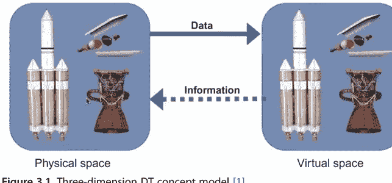

虚拟实体由一组模型组成，用于从不同角度描述物理对应物，包括几何尺寸、物理属性和行为等。它是伴随物理实体在其生命周期中的数字镜像，其特点是实时同步、忠实映射和高保真度。两个部分之间的交互通过连接实现。一方面，物理实体的实时数据被收集并传输到虚拟副本以进行模型更新和校准，另一方面，虚拟仿真产生的信息反馈到物理空间，以指导和优化相应的物理实体。DT 从物理空间到虚拟空间再回到物理空间形成了一个闭环。

#### 3.1.2 数字孪生建模的现有工作

现有的可支持三维 DT 建模的工作在以下方面简要回顾：

- 1. _就物理实体而言_：为了构建和维护物理实体，需要涵盖实体整个生命周期的工作，从设计到处置。在早期阶段，这些工作主要通过人工活动进行，准确性和效率较低。随着计算机、通信、自动化、机电一体化等技术改进，产品设计 [2,3]、生产 [4,5]、预测与健康管理（PHM）[6] 等活动得到了极大优化和改进，这使得构建更复杂、更精确的实体成为可能。此外，随着物联网（IoT）技术的发展，智能设备，如无线传感器


networks (WSNs) [7], radio frequency identification (RFID) [8], embedded systems [9], etc. are becoming more widely available for the physical entities for real-time sensing and control.

- 2. _With respect to virtual entity:_ To reproduce the physical entity, different types of models are built in the virtual space. With respect to geometric models, parameters including shapes, sizes, and assembly relations are modeled to simulate assembly processes [10], machining processes [11], logistics [12] and spatial layouts [13], etc. Combined with virtual reality (VR) and augmented reality (AR), these models can create an immersive environment similar to the physical space for simulation. Based on the geometric models, some researchers further explore the modeling of physical factors (e.g., force, temperature, and vibration), and then conduct a physical parameters changing simulation [14], process plan evaluation [15], and reliability evaluation [16], etc. Through adding the physical parameters, the virtual entity approximates the physical counterpart not only in sense, but also in actual properties. To mimic behaviors of the physical entity under different conditions, methods such as neural network [17], Bayesian [18], finite state machine [19], and Markov chain [20] can be used to build linear or nonlinear relationships between the parameters and the behaviors. Via the behavior models, internal structures of the physical entity can be grasped and some performances can be predicted in advance. Models for rules can also be constructed through processing a large amount of historical data of the physical entity, based on machine learning algorithms [21]. The rule models provide criteria and rules for the physical entity optimization.

- 3. _With respect to connection:_ It is critical to build a connection between the physical and virtual entities for data exchange. Related research mainly covers the real-time communication mechanism [22,23], protocol standardization [24], integration with intranet [25,26], etc. Standardized technologies and devices, such as MTConnect [27], middleware technology [28], and Industrial Internet Hub are also discussed to shield the heterogeneity of protocols and interfaces [29].
Based on the existing modeling foundations and works, some researchers have tried to construct the three-dimension DT. For examples, Majumdar et al. [30] studied synergistic material behaviors for DT modeling based on a multiphysical modeling framework. Smarslok et al. [31] proposed a DT framework for error quantification and confidence assessment, which also included a set of metrics to measure the fidelity of DT

models. DebRoy et al. [32] outlined the technical requirements for building a DT for a 3D printing machine, including the process of heat transfer modeling, solidification modeling, property prediction, residual stress modeling, and distortion modeling. Yun et al. [33] proposed a universal DT platform adopting international standards, which would support the functions of communication, cosimulation, and gateway. Schroeder et al. [34] used a three-stage method based on AutomationML to model attributes related to the DT and enable data exchange between different systems.

The above works have contributed much to the construction of three- dimension DT. However, with the rapid developments of technologies and the increasing growth of demands from applications, new requirements have been put forward on the DT, which are analyzed in the following sections.

## 3.2 NEW REQUIREMENTS ON DIGITAL TWIN

New requirements on the DT are mainly reflected in the following four aspects: application, technology, modeling object, and modeling method.

### 3.2.1 From Application Aspect: Requiring Wider Application

When the DT was first introduced, it mainly focused on military products in aerospace engineering, which is a particularly closed industry with restricted access to the Internet. In this situation, the three-dimension DT can basically deal with demands from aerospace.

However, in recent years, as the DT has been introduced to wider application fields, such as automotive, construction, agriculture, healthcare, and medicine, it becomes more acceptable in daily products, which are developed in an open and user-oriented environment. Accordingly, new requirements are put forward on the DT, such as high-quality service, user demand mining, and short time to market. Therefore, to adapt to the needs from wider applications, a more general model for the DT has to be built.

### 3.2.2 From Technology Aspect: Requiring to Embrace New IT

New generation information technologies (New IT), such as IoT, cloud computing, big data, and artificial intelligence (AI), play important roles in industry, enabling smart interconnections and operations. Specifically,

data generated in the physical space can be first accessed and transferred to the virtual space using IoT, then stored and processed via cloud, and finally transformed into valuable information with big data and AI. The information will be encapsulated into services that are then given back to the physical space for on-demand use. It can be seen that New IT has built a closed loop between the physical and virtual spaces.

On the other hand, the DT aims at realizing greater cyber–physical fusion between the two spaces, thus achieving better performances in various industrial applications. Since it is obvious that the closed loop enabled by the New IT lays a major foundation for the fusion, embracing the New IT is an essential step for the implementation of DT. However, due to deficiencies of the traditional three-dimension model, the DT cannot fully take advantage of the New IT to serve itself to the best extent. Therefore, requirements for the seamless integration with New IT are put forward.

### 3.2.3 From Modeling Object Aspect: Requiring Data and Services

At present, data is an extremely important element for the modeling object, as it contains abundant information that is useful for modeling, simulation, optimization, and prediction. With the developments of New IT, there will be tremendous increases in the volume, richness, and fidelity of data from both the physical and virtual spaces. To obtain more accurate and comprehensive information, the modeling object requires the DT to integrate and fuse the data from the different spaces, such as operational data and environmental data from the physical space, and simulated results and predictive states from the virtual space. However, the three-dimension DT cannot satisfy this requirement.

Service is another important element for the modeling object. Since current users of the DT come from various industries with different technical levels, most of them do not have enough professional knowledge to work with the DT, which becomes an obstacle to the effective interactions between the DT and users. To solve the problem, it is imperative to encapsulate functions of the DT into standardized services with friendly interfaces for easy and on-demand usage, which enables convenient user operations. However, the three-dimension DT does not pay enough attention to servitization of its functions.

Therefore, from the modeling object aspect, requirements on data and services are put forward on the DT.

### 3.2.4 From Modeling Method Aspect: Requiring High-Fidelity Virtual Modeling

In the DT, to describe the physical entity accurately, a virtual entity that can synchronously integrate multiple variables, scales, and abilities to reproduce a complete mirror for the physical counterpart is required. Although different types of models have been built, as reviewed in Section 3.1.2, some issues still exist. Compared with the works on geometrical modeling and physical modeling, there are relatively few works on behavior modeling and rules modeling. Different types of models need to be integrated and fused to describe the physical entity from multiple perspectives comprehensively. Therefore, a modeling method to produce a complete high-fidelity virtual mirror for the physical entity is required.

## 3.3 EXTENDED FIVE-DIMENSION DIGITAL TWIN

To satisfy these new requirements on DT modeling, an extended five- dimension DT [35] is proposed, adding DT data and services. It is designed for a wider range of applications and to support data fusion and on-demand usage. Besides, a high-fidelity modeling method is developed to reproduce geometries, physical properties, behaviors, and rules of the physical entity completely and thoroughly.

### 3.3.1 Five-Dimension Digital Twin

The traditional three-dimension DT defined by Grieves [1] is extended to a five-dimension model, as shown in expression (3.1) [35],

M_{DT} = (PE, VE, Ss, DD, CN) (3.1)

where PE refers to the physical entity, actually existing in the physical space; VE represents the virtual entity, consisting of a set of models; Ss stands for the services for both PE and VE; DD is the DT data; and CN is the connection that ties different parts of the DT together. According to expression (3.1), the five-dimension DT concept model is built as shown in Fig. 3.2 [35].

Compared with the previous three-dimension definition, the proposed one is more efficient to embrace the broader perspectives of the DT. The newly added “DT data” (i.e., DD) can fuse all related data from both physical and virtual aspects, and then provide more accurate and comprehensive information through data processing. It can be considered as the


driver of the DT [36]. “services”（即 Ss）使 DT 中的各种功能能够标准化并封装，这有助于实现易于使用且按需使用。此外，Ss 还提高了 DT 功能的利用率，因为相应的服务可以单独重用或与其他服务组合以满足不同的需求。

如果将五维 DT 与人相比，其组件（即 PE、VE、Ss、DD 和 CN）可被视为重要的组织或器官。PE 起到“骨骼”的作用，形成 DT 的支撑结构。VE 是“心脏”，因为它将仿真结果/策略“泵送”到其他组件。Ss 是“感觉器官”，直接与用户交互。DD 是“血液”，持续为 DT 提供有价值的信息。因此，CN 是“血管”，将数据输送到 DT 的不同组件。每个组件的具体建模方法在以下各节中描述。

### 3.3.2 物理实体

通常，PE 由各种子系统和传感设备组成。子系统包括动态系统、控制系统、液压系统等，可组合完成特定任务。传感器收集子系统的实时状态（例如振动、力、扭矩和速度）及其工作状况（例如环境参数、负载和控制指令）。为了构建和维护 PE，除了设计、制造、PHM 等工作外，还需要基于先进传感技术进行实时数据采集 [35]。

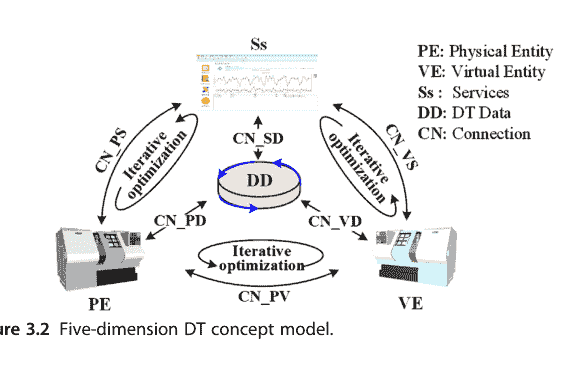

### 3.3.3 虚拟实体

作为 PE 的忠实镜像，VE 由表达式 (3.2) 表示，其中 \( G_v \)、\( P_v \)、\( B_v \) 和 \( R_v \) 分别代表几何模型、物理模型、行为模型和规则模型 [35]。

```
VE = (G_v, P_v, B_v, R_v) (3.2)
```

G_v 是立体的，描述物理实体的几何参数，如形状、尺寸和装配关系。G_v 可被视为基础，为其他模型提供几何容器。G_v 的常用 CAD 工具包括 SolidWorks、3D MAX、ProE、AutoCAD 等。

P_v 在 G_v 的基础上赋予物理属性（例如速度、磨损和力），可反映实体的物理现象，如变形、分层、断裂和腐蚀。有限元方法（FEM）在该层面被广泛应用。

B_v 描述实体在外部世界驱动因素（例如控制指令）或干扰（例如人为干扰）下的响应机制和行为，如状态转换、性能退化和协调。可应用有限状态机、马尔可夫链和基于本体模型等方法来描述响应过程。

R_v 是从 PE 的历史数据中提取的一组规则。这些规则（例如关联、约束和推理）使 VE 具备判断、评估、优化和/或预测的能力。构建 R_v 时可使用神经网络、支持向量回归和随机森林等机器学习算法。

建模完成后，通过模型集成技术，G_v、P_v、B_v 和 R_v 在功能和结构上耦合，形成针对 PE 的完整映射（即 VE）。然后可使用验证、确认和认可（VV&A）测试 VE 的准确性和灵敏度。尽管 VE 能够忠实地镜像 PE，但在不同应用中保真度是可以调整的。例如，对于 PE 的碰撞测试，VE 只需在几何层级和物理属性层级构建，其他属性可以省略。

### 3.3.4 服务

Ss 包括针对 PE 和 VE 的服务。它试图通过实时调节使 PE 按预期工作，并通过模型参数校准维持 VE 与 PE 的高保真度 [35]。对于 PE，Ss 主要包括监控服务、PHM 服务、状态预测服务、能耗优化服务等。对于 VE，Ss 主要由模型构建服务、校准服务和测试服务组成。Ss 中的每个服务均封装为如表达式 (3.3) 中的五元组模型 [35]，分别描述功能、输入、输出、质量和状态。

```
Ss = (Function, Input, Output, Quality, State)    (3.3)
```

### 3.3.5 数字孪生数据

数字孪生数据（DD）表示为表达式 (3.4) [35]，包含五个部分。Dp 是来自 PE 的数据，主要包括运行状态和工作条件。Dv 指来自 VE 的数据，由模型参数和模型运行数据组成。Ds 是来自 Ss 的数据，描述服务的封装、组合、调用等。Dk 表示领域知识，可从收集的数据中挖掘或从现有数据库和系统中获取。Df 表示 Dp、Dv、Ds 和 Dk 的融合，可通过数据融合算法获得，如神经网络、D–S 算法和卡尔曼滤波。

```
DD = (Dp, Dv, Ds, Dk, Df)    (3.4)
```

### 3.3.6 连接

连接（CN）包括六个部分，表示如下 [35]：

```
CN = (CN_SD, CN_PD, CN_VD, CN_PS, CN_VS, CN_PV)    (3.5)
```

其中 CN_SD、CN_PD、CN_VD、CN_PS、CN_VS 和 CN_PV 分别表示 Ss 与 DD、PE 与 DD、VE 与 DD、PE 与 Ss、VE 与 Ss 以及 PE 与 VE 之间的连接。它们均为双向连接，每个连接传输的数据（表示为 CN_XX）建模如下 [35]：

```
CN_XX = (Data sources, Unit, Value, Scope, Sampling interval)    (3.6)
```

### 3.4 面向应用的三级数字孪生

在物理空间中，实体可分为三个层级：单元、系统和系统之系统（SoS）。以车间为例，其中的单个人、机器、工具或产品可视为单元，是参与生产的最小要素。这些单元可协同工作形成系统，即生产线，单元之间相互作用并共享共同的生产目标。整个车间可被视为 SoS，这是一个更复杂的系统，由多条生产线和不同的流程（例如信息流、能量流和物质流）组成。因此，为了描述不同层级的实体，DT 可分为三种类型，包括单元级 DT、系统级 DT 和 SoS 级 DT [38]。

从 DT 应用的角度看，对 DT 进行分类也是必要的。例如，对于单台设备的监控、故障预测和维护，单元级 DT 足以解决相应问题。但对于需要处理不同单元的应用，如调度、进度控制和产品质量控制，则需要系统级 DT。此外，如果需要对整个车间进行优化和协调，则需要使用 SoS 级 DT 来应对复杂的关联、组合和联系。

因此，在以下各节中，作者分别讨论 DT 的三个层级，即单元级 DT、系统级 DT 和 SoS 级 DT。

### 3.4.1 单元级数字孪生

单元级 DT 是一个最小但独立的个体，不能再进一步划分。它包含物理空间与虚拟空间之间数据的基本闭环。凭借感知和计算能力，单元级 DT 支持状态感知、计算分析和自控。

单元级 DT 可基于五维 DT 构建，涉及 PE、VE、Ss、DD 和 CN。在单元单元中，PE 指单个实体（例如一个人、一台机器或一个产品）。VE 由几何、物理属性、行为和规则模型组成，以全面描述单个实体。Ss 主要为单元级 PE 和 VE 提供服务，如单台机器的监控服务和维护服务。DD 仅包含单元的数据，涉及物理和虚拟两个方面。CN 将上述组件连接在一起。


### 3.4.2 系统级数字孪生

单元级 DT 可以通过一定的关系相互连接，形成系统级 DT，它是一个相互交互或相互依赖的单元群组。系统级 DT 的特征是通过单元互联、数据互操作、协同控制等实现自组织、自配置、自决策和自优化。

在系统级 DT 中，需要在不同单元级 DT 的 PEs、VEs、Ss 和 DD 之间建立连接，以实现数据交换过程，从而形成具有功能和能力的协同网络。同时，除了为单元提供的现有服务外，还将增加新的服务以服务于整个系统，例如调度服务、进度控制服务以及面向多个单元的流程优化服务。来自不同单元的数据也应被整合以创建更大的数据集，从而充分填补单元之间的信息空白。

### 3.4.3 系统-of-系统级数字孪生

系统级 DT 可以组合创建 SoS 级 DT，其提供的功能和性能比构成系统的简单总和更强。SoS 级 DT 的特征是全面的信息感知、深入分析、精确决策和全局优化，并由数据聚合、分布式计算、模型互操作等驱动。

SoS 级 DT 可以通过连接每个系统层级中的关键单元级 DT 来构建，从而形成一个更复杂的系统，允许数据和智能的协同作用。由于 SoS 级 DT 实现了系统级 DT 的集成和互操作性，因此可以在全局资源和约束下，从全局视角追求优化和预测。在这一层级，由于物理和虚拟实体的增加，以及它们之间大量依赖关系、关系和交互，服务和数据比系统级 DT 更为丰富。

### 3.5 数字孪生建模的关键技术

如图 3.3 所示，基于五维 DT，给出了各维度建模的关键技术，即 PE、VE、Ss、DD 和 CN。

- 资源管理
- 服务描述
- 服务封装
- 服务可视化
- 服务搜索与匹配
- 服务评估
- 服务最优选择与组合
- 容错管理
- 人机交互
- 数据存储
- 数据建模
- 数据清洗
- 数据转换
- 数据集成与融合
- 数据分析与可视化
- 数据挖掘
- 数据交互
- 数据完整性检查
- 数据安全

- 3D 实体建模
- 物理建模
- 行为建模
- 规则建模
- 模型集成
- 模型一致性分析
- VV&A
- RFID
- WSN
- 软传感器
- 嵌入式系统
- 分布式传感器布局优化
- 通信协议分析
- 通信协议/接口转换
- 感知与接入设备
- 无线通信
- API 设计
- 通信标准与规范


#### 3.5.1 物理实体建模的关键技术

要构建和维护 PE，除了设计、制造、PHM 等技术外，实时数据采集也至关重要，因为它能够在 PE 的生命周期内捕获其状态。一些相关技术如下列出：

- _RFID_: 可用于跟踪和识别 PE。
- _WSN_: 由空间分布的自主传感器组成，可收集 PE 的运行状态和工作条件，并将收集到的数据组织到中央位置。
- _软传感器_: 利用知识和算法计算难以用硬件测量的 PE 部分参数，从而降低测量成本并扩大可测量范围。
- _嵌入式系统_: 可作为 PE 的一部分嵌入，用于监控和控制。
- _分布式传感器布局优化_: 可减少冗余信息，提高传感器利用率，并保持采集数据的稳定性。

#### 3.5.2 虚拟实体建模的关键技术

由于 VE 中的模型需要在不同方面构建，然后集成以形成 PE 的完整镜像，因此 VE 建模的关键技术主要包括以下方面。

- _三维实体建模:_ 以高度的真实感和沉浸感描述 PE 的几何外观。
- _物理建模:_ 通过多物理场仿真反映 PE 的物理细节，涉及流体、结构、气动声学、热力学等的仿真。
- _行为建模:_ 需要在不同条件下提取 PE 的行为特征，并通过数学方程、图表、网络等进行建模。
- _规则建模:_ 通过机器学习算法从大量历史数据和知识中挖掘规则。
- _模型集成:_ 不同模型在功能和结构上保持交互和集成，形成统一的表示。
- _模型一致性分析:_ 一方面，保持 PE 和 VE 一致，即两者之间的差异在可容忍范围内。另一方面，使 VE 中不同模型的相关参数兼容，避免对 PE 的矛盾描述。
- _VV&A:_ 对模型进行验证、确认和认可活动，保持 VE 的精度、敏感性和鲁棒性。

#### 3.5.3 服务建模的关键技术

创建和维护 Ss 中服务的主要关键技术如下。技术细节已在书籍 _Theory and Practice: Optimal Resource Service Allocation in Manufacturing Grid_ [36] 和 _Resource Services Management in Manufacturing Grid System_ [37] 中探讨。

- _资源管理:_ 高效收集、分类和组织 DT 中的资源，如模型资源、算法资源、数据资源和工具资源。
- _服务描述:_ 通过数字描述将资源转化为服务，描述服务的基本信息、功能和非功能。
- _服务封装:_ 以标准输入输出封装服务。
- _服务可视化:_ 创建服务的基于软件的表示，具有高质量的视觉显示。
- _服务搜索与匹配:_ 基于相似性匹配算法搜索合适的服务。
- _服务评估:_ 使用时间、成本、可靠性、功能相似性、安全、维护性、满意度等指标对服务进行评估。
- _服务最优选择与组合:_ 从候选服务中选择最优服务并组合成复合服务，以满足 PE 和 VE 的相应需求。
- _容错管理:_ 测试并消除由服务、需求、网络、应用程序等引起的潜在故障。
- _人机界面 (HMI):_ 实现服务与用户之间的直接交互。

#### 3.5.4 数字孪生数据建模的关键技术

由于 DD 包括来自物理和虚拟两方面的數據，具有多源、异构和海量等特点。根据数据的特点，DD 建模主要涉及以下关键技术。

- _数据存储:_ 将来自 PE、VE 和 Ss 的数据存储在分布式节点中，并保持数据可用和可访问。
- _数据建模:_ 构建抽象框架以描述数据结构、操作和约束。
- _数据清洗:_ 处理“脏”数据，如重复数据、错误数据、不完整数据和延迟数据。
- _数据转换:_ 将不同数据格式（如文本、表格、图片、视频）转换为统一形式。
- _数据集成与融合:_ 将来自 PE、VE 和 Ss 的数据集成和融合，以生成更一致、准确和全面的信息。
- _数据分析与可视化:_ 基于集成和融合的数据，可在不同维度（如时域分析和频域分析）进行数据分析，并将分析结果可视化。
- _数据挖掘:_ 通过统计方法或机器学习算法在大数据集中发现模式。
- _数据交互:_ 允许数据在 PE、VE 和 Ss 之间共享。
- _数据完整性检查:_ 保持数据一致、正确、有效和兼容。
- _数据安全:_ 保护隐私数据，防止未经授权访问 DD。


#### 3.5.5 连接建模的关键技术

随着 CN 使 PE、VE、Ss 和 DD 之间实现交互，通信技术至关重要。一些关键技术如下：

- _通信协议分析：_ 它允许 DT 中的两个或多个实体相互传输信息。
- _通信协议/接口转换：_ 它将各种通信协议/接口转换为统一形式，简化了通信系统的复杂性。
- _感知与接入设备：_ 它开发一种标准设备用于协议和接口的统一转换。
- _无线通信：_ 它可以无线连接 DT 中的实体，从而提高数据传输的灵活性。
- _应用程序编程接口（API）设计：_ 它实现了虚拟空间中不同软件系统和模型之间的通信。
- _通信标准与规范：_ 它为 PE、VE、Ss 和 DD 之间的通信提供标准和规范。

### 3.6 数字孪生建模的八条规则

#### 3.6.1 基于数据和知识

数据和知识是 DT 建模的基础。一方面，现有知识提供了建模过程中应遵循的基本规则。另一方面，实时数据需要持续注入 DT，以不断为 DT 提供新知识并校准初始虚拟模型、服务和数据结构。

#### 3.6.2 模块化

DT 建模是一个复杂项目，涉及异构硬件、多功能模型、多源数据、各种服务等。为了提高建模效率，模块化是有效的，因为它可以分离和重新组合 DT 的组成，具有灵活性和可重用性的优势。例如，将 DT 划分为三个层级（即单元级、系统级和 SoS 级）是一种模块化方法，可使 DT 针对不同应用具有可分解性和可重组性。

#### 3.6.3 轻量化

为了保持与物理实体的高保真度并提供先前服务，DT 由具有复杂结构和机制的多个模型组成，这对实时运行和仿真造成了障碍。因此，轻量级模型对于 DT 实现更短的传输时间、更快的运行速度和更好的实时性能至关重要。

#### 3.6.4 层次化

在 DT 中，如果所有资源包括数据、知识、模型、服务等都集中存储和处理，将给传输、计算使用和维护带来巨大负担。因此，应在 DT 中引入分层结构。通过使用边缘-雾-云结构，DT 中具有不同特征的资源可以分布在不同层进行处理和分析，从而满足时效性和效率要求。

#### 3.6.5 标准化

DT 中的服务软件、数据库和模型可能使用不同的编码策略、接口和通信协议，这导致模块集成、统一数据交换、信息识别和维护等方面的困难。它还阻碍了 DT 中不同实体之间稳定交互和协作。因此，标准化应着重解决上述问题。

#### 3.6.6 服务化

由于 DT 的用户可能对相关领域如建模、仿真、数据集成和融合等缺乏专业知识，将 DT 提供的功能（如评估、优化、预测和验证）封装为标准服务以便易于便捷使用至关重要。为实现这一点，服务化是 DT 建模中的一个重要步骤。

#### 3.6.7 开放性与可扩展性

DT 应开放以集成来自外部环境的各种资源（如模型、服务和工具），这使得 DT 具有更好的兼容性，能够与不同系统协同工作，并通过利用其他平台的能力增强 DT 的功能。此外，DT 还应具有可扩展性，可通过添加新模型实现功能扩展。

#### 3.6.8 鲁棒性

由于 DT 主要应用于工业环境，其特征为不确定性、动态性和复杂性，因此应具备良好的鲁棒性以应对不可预测的变化。例如，当物理设备的工况发生变化时，DT 应具有改变其初始配置以适应当前情况的能力。

### 3.7 总结

随着社会需求的增长和技术发展的不断推进，传统三维 DT 面临新的要求，包括来自应用、技术、建模对象和建模方法的要求。为满足新需求，本章提出了一种创新的 DT 模型，将传统三维 DT 扩展为五维 DT，并讨论了各维度建模方法。在此基础上，DT 进一步根据不同应用划分为三个层级，即单元级、系统级和 SoS 级。还提出了关键技术和八条规则，为未来 DT 建模工作提供指导。

### 参考文献

- [1] M. Grieves, Digital twin: manufacturing excellence through virtual factory replication, Whitepaper, 2014.
- [2] C. Homburg, M. Schwemmle, C. Kuehnl, New product design: concept, measurement, and consequences, J. Mark. 79 (3) (2015) 41–56.
- [3] T.W. Simpson, R.J. Jiao, Advances in Product Family and Product Platform Design, Springer, 2014.
- [4] F. Tao, Q. Qi, New IT driven service-oriented smart manufacturing: framework and characteristics, IEEE Trans. Syst. Man Cybern. Syst. (2017). Available from: https:// doi.org/10.1109/TSMC.2017.2723764.
- [5] B. Mueller, Additive manufacturing technologies—rapid prototyping to direct digital manufacturing, Assem. Autom. 32 (2) (2012).
- [6] J. Lee, H.A. Kao, S. Yang, Service innovation and smart analytics for industry 4.0 and big data environment, Procedia CIRP 16 (2014) 3–8.
- [7] D. Izadi, J.H. Abawajy, S. Ghanavati, T. Herawan, A data fusion method in wireless sensor networks, Sensors 15 (2) (2015) 2964–2979.
- [8] W. Cao, P. Jiang, B. Liu, K. Jiang, Real-time order scheduling and execution monitoring in public warehouses based on radio frequency identification, Int. J. Adv. Manuf. Technol. 95 (5–8) (2018) 2473–2494.
- [9] J. Bosch, H. Olsson, Towards evidence-based organizations: learnings from embedded systems, online games and internet of things, IEEE Softw. (2017). Available from: https://doi.org/10.1109/MS.2017.265095929.
- [10] X. Wang, S.K. Ong, A.Y.C. Nee, Real-virtual components interaction for assembly simulation and planning, Robot. Comput. Integr. Manuf. 41 (2016) 102–114.
- [11] L. Zhu, H. Li, W. Liang, W. Wang, A web-based virtual CNC turn-milling system, Int. J. Adv. Manuf. Technol. 78 (1–4) (2015) 99–113.
- [12] Y. Wang, A. Chen, Production logistics simulation and optimization of industrial enterprise based on Flexsim, Int. J. Simul. Modell. 15 (4) (2016) 732–741.
- [13] C. Li, H. Ma, L. Li, Y. Du, A. Mu, Dynamic facility layout method for remanufacturing shop with stochastic returns, Comput. Integr. Manuf. Syst. 21 (11) (2015) 2901–2911.
- [14] Y. Altintas, P. Kersting, D. Biermann, E. Budak, B. Denkena, I. Lazoglu, Virtual process systems for part machining operations, CIRP Ann. Manuf. Technol. 63 (2) (2014) 585–605.
- [15] H. Quan, H. Champliaud, Z. Feng, T. Dao, Analysis of the asymmetrical roll bending process through dynamic FE simulations and experimental study, Int. J. Adv. Manuf. Technol. 75 (5–8) (2014) 1233–1244.
- [16] B. Chen, X. Chen, B. Li, Z. He, H. Cao, G. Cai, Reliability estimation for cutting tools based on logistic regression model using vibration signals, Mech. Syst. Signal Process. 25 (7) (2011) 2526–2537.
- [17] S. Palani, U. Natarajan, Prediction of surface roughness in CNC end milling by machine vision system using artificial neural network based on 2D Fourier transform, Int. J. Adv. Manuf. Technol. 54 (9–12) (2011) 1033–1042.
- [18] D.I. Kosmopoulos, N.D. Doulamis, A.S. Voulodimos, Bayesian filter based behavior recognition in workflows allowing for user feedback, Comput. Vis. Image Underst. 116 (3) (2012) 422–434.
- [19] D.O. Sales, D.O. Correa, L.C. Fernandes, D.F. Wolf, F.S. Osório, Adaptive finite state machine based visual autonomous navigation system, Eng. Appl. Artif. Intell. 29 (2014) 152–162.
- [20] Y. Peng, M. Dong, A prognosis method using age-dependent hidden semi-Markov model for equipment health prediction, Mech. Syst. Signal Process. 25 (1) (2011) 237–252.
- [21] D. Wu, C. Jennings, J. Terpenny, R.X. Gao, S. Kumara, A comparative study on machine learning algorithms for smart manufacturing: tool wear prediction using random forests, J. Manuf. Sci. Eng. 139 (7) (2017).
- [22] T. Hu, P. Li, C. Zhang, R. Liu, Design and application of a real-time industrial Ethernet protocol under Linux using RTAI, Int. J. Adv. Manuf. Technol. 26 (5) (2013) 429–439.
- [23] D. Regulin, A. Glaese, S. Feldmann, D. Schütz, B. Vogel-Heuser, Enabling flexible automation system hardware: dynamic reconfiguration of a real-time capable fieldbus, in: IEEE, International Conference on Industrial Informatics, Cambridge, United Kingdom, 2015, pp. 1198–1205.
- [24] M. Felser, Real time ethernet: standardization and implementations, in: IEEE International Symposium on Industrial Electronics, Bari, Italy, vol. 82, 2010, pp. 3766–3771.
- [25] G. Cena, I.C. Bertolotti, T. Hu, A. Valenzano, Seamless integration of CAN in intranets, Comput. Stand. Interf. 46 (2016) 1–14.


[26] T. Sauter, M. Lobashov, How to access factory floor information using internet technologies and gateways, IEEE Trans. Ind. Inform. 7 (4) (2011) 699–712.

[27] B. Edrington, B. Zhao, A. Hansel, M. Mori, M. Fujishima, Machine monitoring system based on MTConnect technology, Procedia CIRP 22 (1) (2014) 92–97.

[28] M. Zarte, A. Pechmann, J. Wermann, F. Gosewehr, A.W. Colombo et, Building an Industry 4.0-compliant lab environment to demonstrate connectivity between shop floor and IT levels of an enterprise, in: Industrial Electronics Society, IECON 2016, Conference of the IEEE, Firenze, Italy, 2016, pp. 6590–6595.

[29] F. Tao, J. Cheng, Q. Qi, IHUB: an industrial internet-of-things hub toward smart manufacturing based on cyber–physical system, IEEE Trans. Ind. Inform. 14 (5) (2018) 2271–2280.

[30] P.K. Majumdar, M. Faisalhaider, K. Reifsnider, Multi-physics response of structural composites and framework for modeling using material geometry, in: 54th AIAA/ASME/ASCE/AHS/ASC Structures, Structural Dynamics, and Materials Conference, Boston, 2013, p. 1577.

[31] B.P. Smarslok, A.J. Culler, S. Mahadevan, Error quantification and confidence assessment of aerothermal model predictions for hypersonic aircraft, in: 53rd AIAA/ASME/ASCE/AHS/ASC Structures, Structural Dynamics and Materials Conference, Hawaii, USA, 2013, p. 1817.

[32] T. DebRoy, W. Zhang, J. Turner, S.S. Babu, Building digital twins of 3D printing machines, Scr. Mater. 135 (2017) 119–124.

[33] S. Yun, J.H. Park, W.T. Kim, Data-centric middleware based digital twin platform for dependable cyber–physical systems, in: International Conference on Ubiquitous & Future Networks, IEEE, Milan, Italy, 2017, pp. 922–926.

[34] G.N. Schroeder, C. Steinmetz, C.E. Pereira, D.B. Espindola, Digital twin data modeling with AutomationML and a communication methodology for data exchange, IFAC-PapersOnLine 49 (30) (2016) 12–17.

[35] F. Tao, M. Zhang, Y. Liu, A.Y.C. Nee, Digital twin driven prognostics and health management for complex equipment, CIRP Ann. 68 (1) (2018) 169–172.

[36] F. Tao, Y.F. Hu, L. Zhang, Theory and Practice: Optimal Resource Service Allocation in Manufacturing Grid, China Machine Press, 2010.

[37] F. Tao, L. Zhang, Y.F. Hu, Resource Services Management in Manufacturing Grid System, 2012.

[38] Q. Qi, F. Tao, Y. Zuo and D. Zhao, Digital twin service towards smart manufacturing, Procedia CIRP 72, 2018, 237–242.

## PART 2

## Digital Twin Driven Smart Manufacturing

## CHAPTER 4

## Digital Twin Shop-Floor

实现智能制造的一个具体挑战是将制造物理空间与虚拟空间融合起来，以实现制造过程中的智能化操作。在此背景下，车间作为制造的基本单元，应实现物理空间与虚拟空间之间的交互与融合，这不仅是智能制造的迫切需求，也是发展趋势。因此，基于数字孪生（DT）的数字孪生车间（DTS）新概念被提出。本章首先分析了车间的演进路径，然后讨论了DTS的概念及其四个关键组成部分，包括物理车间（PS）、虚拟车间（VS）、车间服务系统（SSS）和车间数字孪生数据（SDTD）。研究了DTS的运行过程和交互机制，并探讨了其特征、关键技术以及未来的挑战。

### 4.1 EVOLUTION PATH OF SHOP-FLOOR

如今，各国提出了不同的制造战略（例如，工业4.0、工业互联网、中国制造2025、面向服务的制造 [1,2] 和云制造 [3]）以应对下一轮工业革命。尽管这些战略处于不同的环境下，但其共同目标是实现满足社会化 [4]、个性化、服务化、智能化和绿色化的智能制造。它们对实现物理空间与虚拟空间之间的智能互联和互操作性提出了要求。为满足这些要求，实现两个空间的无缝集成和融合至关重要。由于车间是制造的基本单元，为客户生产成品，实现车间的集成和融合变得迫切 [6]。

从发展的角度来看，实现物理空间与虚拟空间的集成和融合也符合车间自身的发展趋势。如图4.1所示，车间的演进路径可分为四个阶段。在第一阶段，由于缺乏有效的信息手段，车间上的生产活动完全依赖物理空间，导致效率、准确性和透明度低。随后随着信息技术的发展，计算机辅助系统开始应用于生产。但由于连接方式不可用，虚拟空间与物理空间之间几乎没有交互。如今，车间已进入第三阶段，交互通过先进的通信技术得以实现。在未来，随着新一代信息技术（新IT）的发展，虚拟空间将逐渐与物理空间同等重要，而来自物理和虚拟空间的数据的持续双向交互和融合也将得到增强 [6]。

演进路径可以通过车间上生产资源管理、生产活动计划和生产过程控制的发展过程来说明，这些内容已由作者在先前的工作中进行了研究 [5]。

#### 4.1.1 Production Resource Management

生产资源主要包括人员、设备、材料、半成品和最终产品等。生产资源管理是通过收集、处理和分析其信息，合理地分配、组织和协调生产资源，最终确保其按计划运行的过程。起初，它主要依赖人工操作。相关数据手工记录并以纸质形式存储，这使得信息传递和分析变得困难。当时，只有物理空间中的人工手段。随着信息技术的发展，各种信息系统被引入虚拟空间，用于人力资源、设备、库存、工具和产品的管理。这使车间进入第二阶段，并极大地提高了管理效率。然而，由于这些系统的数据只能手工输入，无法捕捉生产资源的实时状态，且数据错误率高。如今，随着物联网（IoT）的发展，射频识别（RFID）标签、智能传感设备和条形码被部署在工具、材料和在制品上，以实现实时数据采集和在线数据录入。得益于此，车间已发展到第三阶段，生产资源与信息系统之间实现了准确的数据同步并存在交互。然而，这一阶段的持续交互仍然不足，且能够提供关于生产资源更丰富信息的融合数据很少受到关注。

#### 4.1.2 Production Activity Planning

生产活动是指按照一定的关系和规则组合生产资源以共同完成生产任务的过程。生产活动计划是指在计划满足时间、成本、质量等方面的要求和约束的前提下，综合考虑所有资源的限制及其能力，对生产活动进行组织、计划和安排的过程。在第一阶段，信息技术不可用时，生产活动计划是基于个人经验手工制定的。缺点是效率和准确性低，且高度依赖计划制定者的能力和经验。在第二阶段，信息技术被引入，使得基于数学模型在计算机上实施生产活动计划成为可能。依靠计算机强大的处理能力，这种新方式能够


同时考虑不同因素并通过整合多种方案进行计划生产活动，从而能够获得更科学、更优化的计划。它可以大大提高效率，降低对人类的依赖，并能适应日益扩大的生产规模。然而，生产活动规划通常仅限于生产前阶段，静态计划往往忽视了实际生产中的扰动因素。近年来，随着虚拟空间与物理空间之间交互的出现，生产活动规划已以动态方式进行并进入第三阶段。该阶段可通过实时采集人员、设备和物料的数据来动态跟踪计划的实施情况，并能及时对扰动做出反应而调整原计划。虽然生产活动计划对扰动的抵抗能力更强，但由于缺乏能够从不同角度全面描绘活动的高度保真预测和融合数据，其在可预见性和鲁棒性方面仍不足。

### 4.1.3 生产过程控制

生产过程控制是指在生产过程中对生产资源及其衍生的生产活动进行监控和控制，以满足质量需求（如精度）、客户需求（如交货日期）和公司需求（如利润）等。在早期阶段，监控通常依赖于人的感官，生产过程中出现的问题或缺陷由个人经验判断。这种方法过于主观，无法及时发现问题，导致控制不佳、精度低、偏差大等后果。在第二阶段，随着信息技术的发展，以上问题得到部分解决。首先，采用数字仪器和设备，大大提高了检测精度。然后利用计算机对检测到的数据进行统计、数据分析和决策，使控制策略更科学、更准确。同时，自动执行器与手动操作相比可提高控制精度。然而，在该阶段，由于物理空间与虚拟空间之间缺乏交互，过程控制存在严重延迟。随着物联网和其他先进通信技术的发展，生产过程中实时数据采集能力得到显著增强，制造执行系统能够结合实时数据及时处理实时事件。在此基础上，实时控制在实践中得以实现，从而在一定程度上解决了上述问题。尽管如此，由于缺乏虚拟空间中的精确仿真和验证以及融合数据，当前生产过程控制在准确性、整体优化和智能化方面仍不足。

总之，车间迄今已进入第三阶段，物理空间与虚拟空间之间的集成和融合对未来至关重要。在第三阶段，虚拟空间的功能仍然有限。它主要作为物理空间数据的容器和处理器，缺乏自身的数据和演化，以及与物理空间的持续交互。同时，现有车间工作主要集中于对实体获取的数据的采集、存储、测试、处理和控制，而非由虚拟模型生成的数据，尤其是融合物理和虚拟两方面的数据。因此，为在第四阶段实现进一步融合，仍需要在虚拟空间中具备更强的能力、物理空间与虚拟空间之间持续交互，以及融合数据 [6]。

最近，数字孪生（DT）作为一种高效的 cyber-physical 融合方法，受到越来越多的关注。另一方面，新一代信息技术已得到显著发展，这使得 DT 能够应用于车间，从而为未来生成一种新范式。例如，物联网可以提供无处不在的感知能力，从车间的不同要素、业务和流程中采集数据。云计算可以提供强大的计算能力，为构建和运行复杂模型奠定基础。借助大数据和人工智能（AI）技术，可以对大量数据进行融合和挖掘，并为实体、模型和系统赋予智能，从而支持物理空间与虚拟空间之间的自主协商与协作 [6]。

在此情况下，基于 DT，提出了数字孪生车间（DTS）[5,6]的概念，以实现车间 cyber-physical 融合。DTS 以物理和虚拟双重视角呈现车间。它使这两个方面保持一致并相互优化。来自物理或虚拟一侧的数据以及融合数据均被提供以驱动生产 [6]。本章首先探讨了车间的演进路径，并讨论了 DTS 的概念模型和具体运行机制。然后研究了其四个组成部分，即物理车间（PS）、虚拟车间（VS）、车间服务系统（SSS）和车间数字孪生数据（SDTD）的实现方法，这为 DTS 提供了更深入的见解。最后，探讨了 DTS 的关键技术、特征和挑战，作为未来研究的指导。

### 4.2 相关工作

当前对车间的研究已在增强物理空间与虚拟空间之间的交互、加强虚拟空间能力方面做出了重大努力。然而，在以下几个方面仍存在一些不足，这些不足已在作者之前的工作 [6] 中得到研究：（1）数据采集，（2）数据处理，（3）信息系统构建，（4）虚拟模型构建，以及（5）生产新模式的探索。

#### 4.2.1 数据采集

现场总线和工业以太网在车间中被广泛用于传感器、执行器和控制器的有线连接。研究主要涵盖实时通信机制 [7,8]、协议标准化 [9]、与内网集成 [10,11] 等。随着物联网的发展，无线传感器网络（WSNs）和 RFID 被应用于车间以无线采集实时状态，这提高了数据采集的灵活性 [12–14]。同时，标准化技术和设备被讨论以屏蔽协议和接口的异构性，如 MTConnect [15]、中间件技术 [16] 和连贯语义封装 [17]。尽管这些工作实现了实时数据采集，但它们主要针对物理空间中实际生产的数据设计，很少关注来自虚拟空间的仿真数据。

#### 4.2.2 数据处理

各种数据处理方法已应用于车间，以将原始数据转化为进一步分析和决策的有价值信息。常见处理方法包括数据回归 [18,19]、数据滤波 [20]、多传感器数据融合 [21]、数据降维 [22,23]、数据分类 [24] 等。然而，这些方法主要处理来自物理空间的数据，很少有方法关注物理和虚拟空间数据的融合，这可能产生更全面、更准确的结果。

#### 4.2.3 信息系统构建

已构建了各种信息系统以服务生产过程。例如，Zhong 等人 [25] 构建了基于 RFID 的实时制造执行系统，为车间提供更实用的计划和调度决策。Luo 和 Kuo [26] 实施了机械臂系统以实现对目标物体的正确抓取。Fang 等人 [27] 探索了事件驱动的车间在制品管理平台，以监控和控制动态生产。为 RFID 赋能的车间开发了基于实时离散事件的监控系统，用于事件构建、状态预测和扰动检测 [28]。得益于实时数据，这些系统可以及时对车间发生的事件做出反应并生成实时优化策略。然而，这些系统主要由物理空间的数据驱动；仿真数据和融合数据很少被考虑。

#### 4.2.4 虚拟模型构建

随着虚拟制造的发展，建立了一个虚拟环境，其中模型替代物理实体进行评估、验证和优化。对于车间，大量研究集中于生产资源的几何建模以进行布局优化 [29]、加工过程控制 [30] 和物流规划 [31]。在此基础上，一些其他研究进一步探索了物理属性（如磨损、力和扭矩）的建模，然后模拟物理参数变化过程 [32]，并评估工艺计划 [33]。然而，缺乏能够描述车间行为和规则的模型，尤其是能够无缝融合几何参数、物理属性、行为和规则以形成车间完整数字镜像的模型。

#### 4.2.5 生产新模式的探索

随着新一代信息技术的发展，一些研究人员已将这些技术引入车间以探索新的生产模式。例如，Monostori [34] 讨论了 cyber–physical


production systems (CPPS) based on cyber–physical system (CPS) to achieve a more decentralized way of functioning and interacting. Mourtzis et al. [21] explored a cloud-based approach to provide timely maintenance service for the equipment. Wang et al. [35] presented a self-organized multiagent system that incorporates an industrial network, the cloud, and big data to achieve high efficiency. Zhu et al. [36] presented a five-layer web-based structure to support the interaction between the production resources and the application software. Zhong et al. [37] introduced big data analytics onto the shop-floor for increased intelligence. Although these works elaborate the implementing methods for new modes combined with New IT, the synchronous operation and mutual optimization of the physical and virtual spaces are seldom discussed.

In summary, the abovementioned research has rarely paid attention to the following three aspects [6]: (1) building a high-fidelity virtual mirror to describe and mirror the shop-floor thoroughly; (2) keeping the shop-floor and its mirror consistent and synchronized and realizing dual optimization; and (3) converging the data from both physical assets and digital models to generate valuable information for production. In this chapter, these three aspects will be focused on to improve the virtual space and to converge its models, data, and mechanisms with the physical space for the seamless integration and fusion between the physical and virtual spaces.

### 4.3 CONCEPT OF DIGITAL TWIN SHOP-FLOOR

With the DT technology introduced onto the shop-floor, the concept of DTS is proposed to solve the abovementioned existing insufficiencies. In this section, the concept, interaction mechanism, and operation processes of the DTS are explored.

#### 4.3.1 Concept of Digital Twin Shop-Floor

As shown in Fig. 4.2, the DTS consists of four components: PS, VS, SSS, and SDTTD. The PS includes a series of production resources, that is, personnel, equipment, materials, etc., existing objectively in the physical space. The PS organizes the production strictly following the predefined orders from the VS and the services from the SSS. The VS consists of a set of models built in multiple aspects including geometry, physics, behaviors, and rules, to represent the entities in the PS with high fidelity. The VS can operate autonomously and evolve with the PS, providing control orders for the PS and optimization strategies for the SSS. The SSS is an

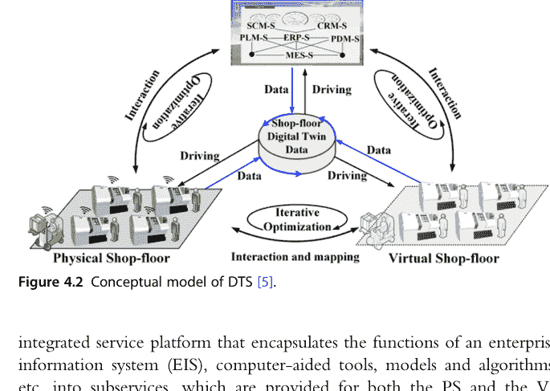

# Figure 4.2 Conceptual model of DTS [5].

integrated service platform that encapsulates the functions of an enterprise information system (EIS), computer-aided tools, models and algorithms, etc. into subservices, which are provided for both the PS and the VS toward specific demands. The SDTTD includes PS data, VS data, SSS data, and fused data of the three parts, as well as existing domain knowledge for modeling, optimizing, and predicting. The data in the SDTTD can eliminate the isolated information islands and converge the data from both the physical and virtual spaces for more comprehensive and consistent information. There are six bidirectional connections among the PS, VS, SSS, and SDTTD to make them connect and interact with each other [6].

The interaction processes in the DTS are detailed in Fig. 4.3. These processes are iterative loops for continuous optimization [5].

- 1. Interaction between PS and SDTTD. Actual data from the PS (e.g., production schedule, working states of machines, inventories of materials) are injected into the SDTTD continuously for data cleaning, transformation, and fusion. The processed data in the SDTTD can be obtained by the constructed agent for each entity to make the entity aware of the states of itself and others. If necessary, the behaviors of the entities can be adjusted to better implement cooperation considering a global production target.

- 2. Interaction between VS and SDTTD. Simulated data from the VS (e.g., predefined orders, simulated analysis results, predicted states) are transmitted to the SDTTD and fused with data from other sources. For the

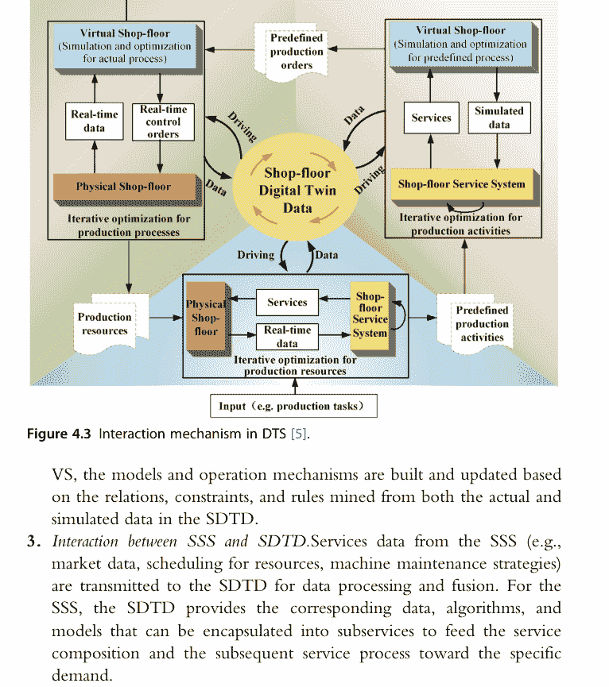

# Figure 4.3 Interaction mechanism in DTS [5].

VS, the models and operation mechanisms are built and updated based on the relations, constraints, and rules mined from both the actual and simulated data in the SDTD.

- 3. Interaction between SSS and SDTD. Services data from the SSS (e.g., market data, scheduling for resources, machine maintenance strategies) are transmitted to the SDTD for data processing and fusion. For the SSS, the SDTD provides the corresponding data, algorithms, and models that can be encapsulated into subservices to feed the service composition and the subsequent service process toward the specific demand.

- 4. Interaction between PS and SSS. When the task is transmitted to the DTS, services in the SSS provide the initial production plan to allocate the production resources in the PS and start the production. During the production, real-time data collected from the PS are transmitted to the SSS. Based on the data, the SSS analyzes the current demands of the resources and invokes the corresponding services autonomously,

such as the services for prognostics, maintenance, scheduling, and energy consumption optimization.

- 5. Interaction between VS and SSS. Services for the PS predefine the production activities and can be transmitted to the VS for verification before execution. The VS will feed back the simulated data and optimization advice to the SSS to adjust the predefined production activities until they can fully pass the validation. According to the validated activities, a set of predefined production orders can be generated to guide the actual production. Whereas, for VS, the SSS provides services to ensure the high fidelity of the VS through calibrating the model parameters to sustain its performance with the PS, which supports more accurate validation.

- 6. Interaction between PS and VS. During the actual production, the PS and the VS operate simultaneously. The PS generates real-time data, and transmits them to the VS to update the states of the corresponding models. The VS can adjust the predefined production orders according to the real-time data from the PS, and feeds back the adjusted orders in real-time to trim the actual production process to make it synchronize with the predefined one. Through the above process, the production process can be optimized continuously.

After the production, the products will be output, satisfying the requirements of delivery, cost, quality, etc. Then the production resources will be ready for the next production operation.

#### 4.3.2 Operation Process of Digital Twin Shop-Floor

As shown in Fig. 4.4, the operation process of DTS is illustrated in three stages, including before production, during production, and after production. In this figure, the yellow blocks, blue blocks, and purple blocks represent the PS, VS, and SSS, respectively, and their operations and interactions are fed by data, namely SDTD [6].

Before production, the orders (e.g., delivery, quantity, cost, and quality) are transmitted to the production plan service in the SSS. To support the formulation of the production plan, related data are collected, including sensor data (e.g., material stock, personnel workload, and equipment capacity), simulated data (e.g., prediction of equipment fault, assessment of human physical power, and analysis on material performance), and EIS data (e.g., product lifecycle data, process document and market data). Since these data come from the PS, VS, and SSS, data fusion service is

# Before production

# During production

# After production

Figure 4.4 Operation process of DTS [6].

Physical Shop-floor

Virtual Shop-floor

Shop-floor Service System

provided to fuse them and to generate consistent and valuable information for planning. Driven by the fused data, the production plan service produces a plan, which is then given to the VS for verification. The VS finds potential conflicts in the plan before actual production and feeds back modification strategies to the service. After revision, the plan is transmitted to the resource allocation service, which guides the preparation for production in the PS. If the real-time states of resources change, modification advice can also be given back to the production plan service [6].

During production, the verified plan is transmitted to the VS to predefine the production in virtual space. Then control orders from the VS are given to the PS to start the actual production process and keep it synchronized with the predefined one. On one hand, the real-time data generated by the PS are recorded in the VS, and on the other hand, simulation, evaluation, and optimization, etc. based on models are carried out in real time to generate orders to regulate the production in the PS whenever necessary. During this process, the predefined data from the VS are compared with the real-time data from the PS continuously. If the two parts are not consistent, meaning their difference exceeds the predefined threshold, the evaluation service driven by the fused data will be given. It judges whether the inconsistency is caused by the disturbances in the PS (e.g., equipment failure, material shortage, and emergency order) or by the inaccuracy of models in the VS (e.g., unreasonable setting on boundary and initial condition). If the disturbances exist in the PS, corresponding services, such as scheduling service, quality service, and congress service, will be invoked to eliminate them. These services are given to the VS first for verification, then transformed into control orders to regulate the PS. Otherwise, the inconsistency may be caused by the VS. In this case, services for model calibration are scheduled and implemented on the VS. The production plan verified by the previous models shall be regulated based on the calibrated ones, while the production process will be adjusted accordingly [6].

After production, the finished products are output and transported to the warehouses. At the same time, the history production data are achieved from the records in the models. Based on these data, a data mining service extracts new knowledge for model building and calibration. With the adjustable timeline, the VS can play back the historical situations, which is an effective way to identify the defects in previous productions as well as the corresponding solutions [6].

Thus, DTS involves a constant evolution process along with different rounds of production.


### 4.4 数字孪生车间实施

基于数字孪生车间 DTS 的概念，本文讨论了 DTS 各组成部分的实现方法，包括物理车间 PS、虚拟车间 VS、车间服务系统 SSS 和数字孪生驱动决策 SDTD 的实现方法。本节介绍的实现方法已在作者之前的工作 [6] 中进行了研究。

#### 4.4.1 物理车间

如图 4.5 [6] 所示，除了传统的生产能力外，DTS 中的 PS 还能够实现互联和交互。这意味着从垂直视角来看，生产资源可以将数据传输到虚拟空间并接收来自虚拟空间的控制指令。而在水平方向上，它们可以感知其他资源并调节自身或他人的行为。

生产资源的数据应实时获取。考虑到异构性，不同传感器被应用于数据采集。对于人员，可使用便携式设备收集体力、运动和工作进度。设备上可部署有线或无线传感器以收集机床速度、刀具磨损和轴振动等状态。对于自动化程度高的设备，这些数据可以从其自身的嵌入式模块中读取。RFID

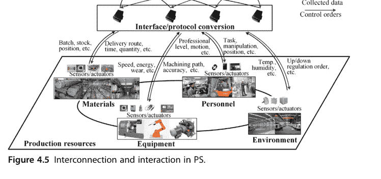

图 4.5 PS 中的互联与交互。

可用于材料的生命周期追踪，环境传感器用于检测实时变化。

然而，这些数据通常通过不同的接口（如 RS232、CAN 和 ZigBee）和通信协议（如 Profibus、TCP/IP 和 Modbus）传输，这使得难以实现对虚拟空间的统一数据访问。因此，有必要部署定制的访问模块，通过这些模块可将来自不同来源的数据转换为统一的接口和协议。此外，由于访问的数据通常具有不同的格式、类型和信息模型，因此需要进行数据集成，包括清洗、格式转换、关联等。

基于集成后的数据，构建了一个描述生产资源及其关系的协作网络。在该网络中，资源由具有感知、计算和交互能力的节点表示，而它们的关系则由边表示。根据来自虚拟空间的指令，一个节点会请求其他节点与其协作，并对他人传播的请求做出响应，这使 PS 具有更强的适应性、灵活性和鲁棒性。

来自协作网络的指令被传输到定制的访问模块进行接口和协议转换，以适应 PS 中执行器的不同通信模式。最后，指令可以被执行以控制和协调生产。

#### 4.4.2 虚拟车间

作为数字镜像，为了以高保真度模拟物理对应物，VS 根据几何、物理、行为和规则四个方面构建。如图 4.6 [6] 所示，以计算机数控机床 CNC 的建模过程为例。首先，构建三维几何模型来描述机床部件的形状、尺寸、位置和装配关系。构建这些模型的常用工具包括 SolidWorks、3D MAX、AutoCAD、CATIA 等。其次，为几何模型赋予物理属性（如切削力、扭矩和磨损）以形成物理模型，该模型可以分析变形、开裂和腐蚀等物理现象。在此层面可使用有限元方法 FEM 进行仿真。然后构建行为模型来描述机床在驱动因素如数控程序和干扰因素如人工干预下的响应机制。可应用有限状态

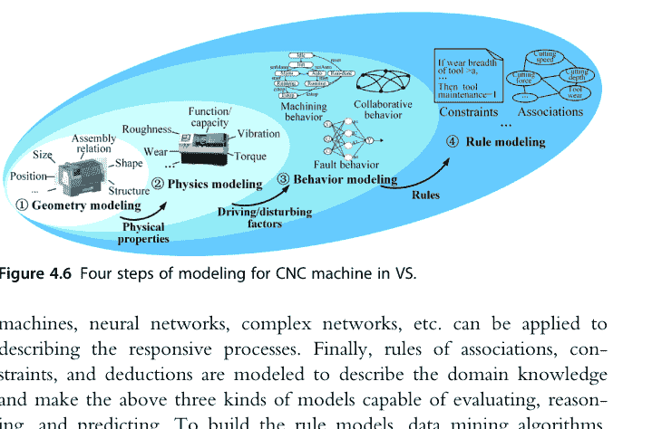

图 4.6 VS 中 CNC 机床建模的四个步骤。

机、神经网络、复杂网络等来描述响应过程。最后，对关联、约束和推理的规则进行建模以描述领域知识，并使上述三种模型具备评估、推理和预测能力。构建规则模型时，可使用 Apriori、支持向量机和 K-means 等数据挖掘算法。

建模完成后，四种模型在功能和结构上融合形成完整的虚拟 CNC 机床。对于 PS 中的其他实体，建模过程类似。

为确保模型的准确性，采用验证、确认和认可 VV&A 来测试模型到程序代码的转换，比较模型与实体的输入输出，并估计模型灵敏度。此外，通过虚拟现实 VR 和增强现实 AR，VS 呈现逼真的三维图像并将虚拟模型叠加到物理实体上，从而为用户提供沉浸式环境。

如图 4.7 [6] 所示，模型运行和模型演化是并行过程。在运行期间，模型与物理对应物同步运行。通过比较模型与实体生成校准策略以支持模型演化，这意味着对 PS 具有更高的保真度。同时，演化后的模型可以为运行过程提供更准确的估计、验证、优化和预测。

首先，来自 SSSS 的生产计划被传输到 VS 进行验证。基于已验证的计划，预定义的虚拟生产过程将形成并驱动 PS 中的实际生产。随着实体开始工作，由其产生的实时数据被记录并与预定义过程的数据进行比较以评估一致性。如果两种数据一致，则可确认模型的准确性；否则将安排评估服务以估计不一致的原因。在此过程中，如果 PS 中不存在干扰，则可认为不一致是由模型缺陷引起的，需要校准。如果 PS 中确实存在干扰，则会被捕获并提供给模型。需要重新进行仿真，同时考虑此前 VS 未知的干扰。如果仿真结果仍无法与实际状态达成一致，则需要校准；否则模型被认为准确。随着模型不断演化以逼近实体，对 PS 和 SSS 的仿真将更加准确。

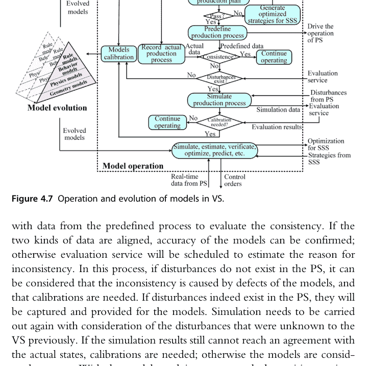

图 4.7 VS 中模型的运行与演化。

#### 4.4.3 车间服务系统

SSS 提供各种服务以支持 PS 的管理和控制以及 VS 的运行和演化。如图 4.8 [6] 所示，数据、模型和算法等资源被封装为子服务，然后被选择以形成复合服务来满足来自 PS 或 VS 的需求。其运行机制描述如下。

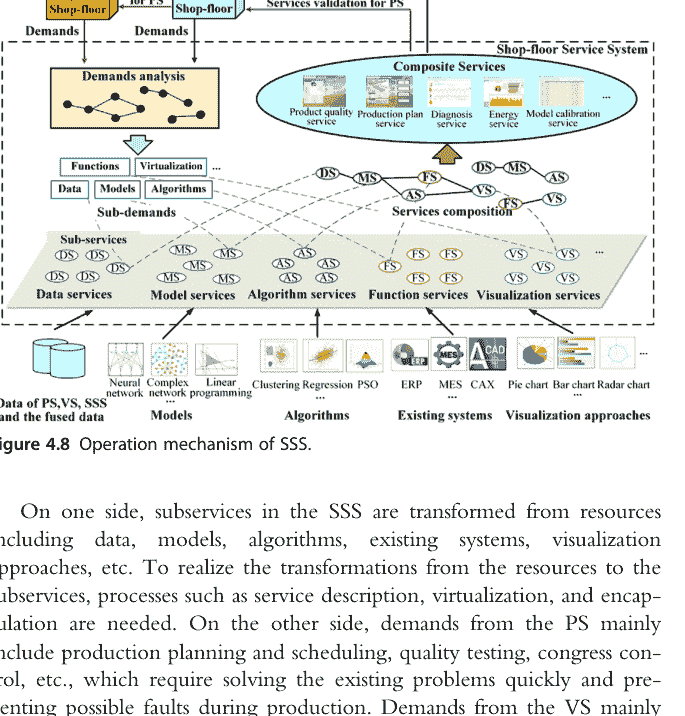

图 4.8 SSS 的运行机制。

在一方面，SSS 中的子服务是从包括数据、模型、算法、现有系统、可视化方法等资源中转换而来的。为了实现从资源到子服务的转换，需要进行服务描述、虚拟化和封装等过程。另一方面，来自 PS 的需求主要包括生产计划与调度、质量检测、会聚控制等，要求快速解决现有问题并在生产过程中预防可能发生的故障。来自 VS 的需求主要要求模型校准和测试、数据挖掘等，以支持模型的运行和演化。这些需求可以分解为子需求，通常关注应使用哪些数据、哪个模型最合适、哪个算法提供最佳解决方案等问题。根据子需求，SSS 从候选者中选择合适的子服务，然后在一定规则下将它们组合形成满足时间、成本、质量等约束的复合服务供 PS 或 VS 使用。服务在运行时被监控，若工作不正常则会重新组合。对于 VS，复合服务直接传输给模型。对于 PS，它们首先传给 VS 进行验证，然后再传给 PS 执行。


### 4.4.4 车间数字孪生数据

SDTD 主要由 PS 数据、VS 数据、SSS 数据以及三者的融合数据组成，同时还包括建模、数据处理和标准相关的知识。PS 数据主要包括生产资源数据、生产过程数据、环境数据等。PS 数据由物理空间中的实体直接生成，无需进一步处理，被视为物理数据。VS 数据是指仿真、评估、优化和预测的模型参数和数据，而 SSS 数据主要涉及各种服务的数据。后两种数据由虚拟空间生成，被定义为虚拟数据。融合数据是通过数据比较、关联、组合和聚类，将物理数据和虚拟数据进行整合和融合而形成的。例如，对于一个刀具，来自物理空间的磨损数据可以与来自虚拟空间的关于应力、变形和强度的仿真数据，以及关于维护记录的服务数据相结合，形成融合数据。它呈现出一个关联物理和虚拟信息的刀具，与单一方面的<|message|> 数据相比，提供了更一致、更准确和更全面的表征。

SDTD 的构建如 Fig. 4.9 [6] 所示。首先，将来自 PS、VS 和 SSS 的各种格式、类型、结构和封装的数据转换为统一形式。其次，对数据进行清洗，以去除“脏”数据（例如错误、重复数据、无效数据），并通过聚类、回归和滤波补充缺失数据。相关数据可以根据某些规则进行关联和组合。第三，为了实现一致和全面的解释，物理数据和虚拟数据可以通过数据融合算法（如卡尔曼滤波、神经网络和贝叶斯推理）融合形成融合数据。

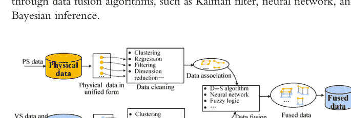

Figure 4.9 Data fusion of SDTD.

SDTD 通过不同类型数据之间的交互进行迭代优化。一方面，历史数据随着实时数据的加入而更新和扩展，而实时数据可以根据历史记录中积累的知识进行测试和校正。另一方面，物理数据可以利用虚拟数据进行评估和仿真，而后者可以与前者进行比较以确认准确性。

### 4.5 数字孪生车间的特征

DTS 的特征主要包括 cyber-physical fusion、数据驱动、以及对全部要素、流程和业务数据的集成和融合，以及迭代优化 [5]。

#### 4.5.1 Cyber-Physical Fusion

Cyber-physical fusion 可以体现在三个方面。

- 1. **PS 与 VS 之间的双向映射。** 借助 VR、AR、建模和仿真技术，VS 可以为 PS 提供高度逼真的描述并记录 PS 的运行过程。而 PS 严格遵循来自虚拟空间的指令，力求忠实再现 VS 预先定义的生产。PS 中的实体与 VS 中的模型一一对应。它们同时运行并共同演化。
- 2. **PS 与 VS 之间的实时交互。** 在运行过程中，当 PS 开始生产时，VS 也会同步在虚拟空间中仿真生产。一方面，PS 的数据可以实时感知并传输到 VS 以进行模型更新和仿真。另一方面，VS 根据仿真结果实时向 PS 反馈控制指令以优化生产。通过实时交互，PS 和 VS 可以把握彼此的动态变化并做出及时响应。
- 3. **物理空间与虚拟空间数据的融合。** 来自物理空间（例如 PS）和虚拟空间（例如 VS 和 SSS）的数据可以转换为统一形式并无缝融合。它使生产数据更加全面，因为同时考虑了物理和虚拟方面。

#### 4.5.2 Data Driven

PS、VS 或 SSS 的运行由 SDTD 以及来自另外两个部分 的实时数据驱动。

- 1. PS 的运行。SDTD 的数据使 PS 中的每个生产资源都能充分了解自身以及他人的状态，从而驱动考虑协作的自动自适应。SSS 为 PS 提供各种服务，以保持资源处于良好的生产状态。来自 VS 反馈的控制指令实时调节 PS，使其跟上预先定义的生产。
- 2. VS 的运行。在由 SDTD 数据中挖掘的知识驱动下，VS 中的模型和模型运行机制可以构建。SSS 的服务可以校准模型的<|message|> 参数，以维持其与对应实体的性能。在生产中，VS 由 PS 的实时数据驱动进行模型更新、仿真和预测。
- 3. SSS 的运行。来自 PS 的数据使 SSS 中的服务能够捕捉生产资源当前的需求。根据需求，服务封装可以由 SDTD 的数据提供，形成数据子服务、算法子服务和模型子服务，然后组合形成初始复合服务。初始服务将在 VS 上进行验证，并根据仿真数据进行修订，直至达到最优。

#### 4.5.3 全要素、全流程、全业务数据的融合

在 DTS 中，可以对全部要素、流程和业务的数据进行集成和融合。

- 1. 要素的数据集成与融合。在 DTS 中，要素（例如人员、设备、材料和环境）的数据可以充分连接到虚拟空间，然后进行集成和融合，这支持数据共享并保持要素之间的交互。
- 2. 流程的数据集成与融合。从原材料到成品，各种流程（例如车削、铣削和磨削）的数据可以高效集成和融合，以进一步支持协同流程。
- 3. 业务的数据集成与融合。来自不同业务的数据，例如成本管理、产品质量管理和能源消耗优化，可以进行集成和融合，这消除了信息孤岛，使这些业务保持交互以追求兼容的优化目标。

#### 4.5.4 Iterative Optimization

在 DTS 中，PS、VS 和 SSS 通过持续交互进行迭代优化。

- 1. PS 与 SSS 之间的迭代优化。在生产过程中，从 PS 收集的实时数据持续传输到 SSS，以更新和调整服务以适应当前生产。而 SSS 中的服务为 PS 提供，以优化生产资源的管理并保持其良好状态。
- 2. VS 与 SSS 之间的迭代优化。用于 PS 的服务可以在执行前在 VS 中进行验证。VS 将反馈策略以修改和优化服务，直至它们能够完全通过验证。而 SSS 提供服务以确保 VS 的高保真度，通过参数校准维持其与 PS 的性能，这使得 VS 在运行期间持续优化，以提供更准确的仿真结果。
- 3. PS 与 VS 之间的迭代优化。PS 不断生成实时数据，并将其传输到 VS 以更新对应模型的状态。同时，VS 可以反馈实时控制指令，以迭代地[content]

### 4.4.4 车间数字孪生数据

SDTD 主要由 PS 数据、VS 数据、SSS 数据以及三者的融合数据组成，同时还包括建模、数据处理和标准相关的知识。PS 数据主要包括生产资源数据、生产过程数据、环境数据等。PS 数据由物理空间中的实体直接生成，无需进一步处理，被视为物理数据。VS 数据是指仿真、评估、优化和预测的模型参数和数据，而 SSS 数据主要涉及各种服务的数据。后两种数据由虚拟空间生成，被定义为虚拟数据。融合数据是通过数据比较、关联、组合和聚类，将物理数据和虚拟数据进行整合和融合而形成的。例如，对于一个刀具，来自物理空间的磨损数据可以与来自虚拟空间的关于应力、变形和强度的仿真数据，以及关于维护记录的服务数据相结合，形成融合数据。它呈现一个关联物理和虚拟信息的刀具，与单一方面的 数据相比，提供了更一致、更准确和更全面的表征。

SDTD 的构建如 Fig. 4.9 [6] 所示。首先，将来自 PS、VS 和 SSS 的各种格式、类型、结构和封装的数据转换为统一形式。其次，对数据进行清洗，以去除“脏”数据（例如错误、重复数据、无效数据），并通过聚类、回归和滤波补充缺失数据。相关数据可以根据某些规则进行关联和组合。第三，为了实现一致和全面的解释，物理数据和虚拟数据可以通过数据融合算法，如卡尔曼滤波、神经网络和贝叶斯推理，融合形成融合数据。


Figure 4.9 Data fusion of SDTD.

SDTD 通过不同类型数据之间的交互进行迭代优化。一方面，历史数据随着实时数据的加入而更新和扩展，而实时数据可以根据历史记录中积累的知识进行测试和校正。另一方面，物理数据可以利用虚拟数据进行评估和仿真，而后者可以与前者进行比较以确认准确性。

### 4.5 数字孪生车间的特征

DTS 的特征主要包括 cyber-physical fusion、数据驱动、以及对全部要素、流程和业务数据的集成和融合，以及迭代优化 [5]。

#### 4.5.1 Cyber-Physical Fusion

Cyber-physical fusion 可以体现在三个方面。

- 1. **PS 与 VS 之间的双向映射。** 借助 VR、AR、建模和仿真技术，VS 可以为 PS 提供高度逼真的描述并记录 PS 的运行过程。而 PS 严格遵循来自虚拟空间的指令，力求忠实再现 VS 预先定义的生产。PS 中的实体与 VS 中的模型一一对应。它们同时运行并共同演化。
- 2. **PS 与 VS 之间的实时交互。** 在运行过程中，当 PS 开始生产时，VS 也会同步在虚拟空间中仿真生产。一方面，PS 的数据可以实时感知并传输到 VS 以进行模型更新和仿真。另一方面，VS 根据仿真结果实时向 PS 反馈控制指令以优化生产。通过实时交互，PS 和 VS 可以把握彼此的动态变化并做出及时响应。
- 3. **物理空间与虚拟空间数据的融合。** 来自物理空间（例如 PS）和虚拟空间（例如 VS 和 SSS）的数据可以转换为统一形式并无缝融合。它使生产数据更加全面，因为同时考虑了物理和虚拟方面。

#### 4.5.2 Data Driven

PS、VS 或 SSS 的运行由 SDTD 以及来自另外两个部分 的实时数据驱动。

- 1. PS 的运行。SDTD 的数据使 PS 中的每个生产资源都能充分了解自身以及他人的状态，从而驱动考虑协作的自动自适应。SSS 为 PS 提供各种服务，以保持资源处于良好状态以便生产。来自 VS 反馈的控制指令实时调节 PS，使其跟上预先定义的生产。
- 2. VS 的运行。由 SDTD 数据中挖掘的知识驱动，VS 中的模型和模型运行机制可以构建。SSS 的服务可以校准模型参数以维持其与对应实体的性能。在生产中，VS 由来自 PS 的实时数据驱动进行模型更新、仿真和预测。
- 3. SSS 的运行。来自 PS 的数据使 SSS 中的服务能够捕捉生产资源的当前需求。根据需求，服务封装可由 SDTD 的数据提供，形成数据子服务、算法子服务和模型子服务，然后组合形成初始复合服务。初始服务将在 VS 上进行验证并根据仿真数据进行修订，直至达到最优。

#### 4.5.3 全要素、全流程、全业务数据的融合

在 DTS 中，可以对全部要素、流程和业务的数据进行集成和融合。

- 1. 要素的数据集成与融合。在 DTS 中，要素（例如人员、设备、材料和环境）的数据可以充分连接到虚拟空间，然后进行集成和融合，这支持数据共享并保持要素之间的交互。
- 2. 流程的数据集成与融合。从原材料到成品，各种流程（例如车削、铣削和磨削）的数据可以高效集成和融合，以进一步支持协同流程。
- 3. 业务的数据集成与融合。来自不同业务的数据，例如成本管理、产品质量管理和能源消耗优化，可以进行集成和融合，这消除了信息孤岛，使这些业务保持交互以追求兼容的优化目标。

#### 4.5.4 Iterative Optimization

在 DTS 中，PS、VS 和 SSS 通过持续交互进行迭代优化。

- 1. PS 与 SSS 之间的迭代优化。在生产过程中，从 PS 收集的实时数据持续传输到 SSS，以更新和调整服务以适应当前生产。而 SSS 中的服务为 PS 提供，以优化生产资源的管理并保持其处于良好状态。
- 2. VS 与 SSS 之间的迭代优化。用于 PS 的服务可以在执行前在 VS 中进行验证。VS 将反馈策略以修改和优化服务，直至它们能够完全通过验证。而 SSS 提供服务以确保 VS 的高保真度，通过参数校准维持其与 PS 的性能，这使得 VS 在运行期间持续优化以提供更准确的仿真结果。
- 3. PS 与 VS 之间的迭代优化。PS 不断生成实时数据，并将其传输到 VS 以更新对应模型的状态。同时，VS 可以反馈实时控制指令以迭代地修剪和优化 PS 中的实际操作。

### 4.6 数字孪生车间的关键技术

如 Fig. 4.10 所示，实现 DTS 的关键技术总结如下 [5]。

- 1. PS 中的互联与交互。相关技术包括感知与接入、通信协议分析、数据封装与发布、多智能体技术等。
- 2. VS 的建模、运行和验证。需要解决的技术包括高保真建模、模型集成和模型验证等。


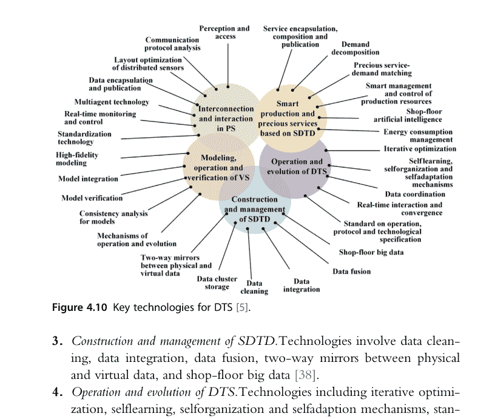

图 4.10 DTS 的关键技术 [5]。

3. SDTD 的构建与管理。涉及的技术包括数据清洗、数据集成、数据融合、物理与虚拟数据之间的双向镜像以及车间大数据 [38]。
4. DTS 的运行与演进。需要探索的技术包括迭代优化、自学习、自组织和自适应机制、标准化等。
5. 基于 SDTD 的智能生产和精准服务。需要研究服务封装、组合与发布、需求分解、精准服务-需求匹配、能耗管理 [39] 等。

### 4.7 数字孪生车间的挑战

实现 DTS 的全面落地存在挑战。首先，需要在物理空间和虚拟空间之间保持足够的双向连接，以支持实时交互。这主要涉及传感器、通信、数据库和数据处理等技术的挑战。其次，由于物理空间的变异性、不确定性和模糊性，在虚拟空间中构建高保真度的实体模型是一个根本性问题。此外，当模型与实体出现不一致时，难以识别并明智地利用它们。第三，由于连续的物理空间和离散的虚拟空间处于不同的尺度，如何跨越这种差异以实现两者的无缝集成是一个挑战。随着虚拟空间在生命周期中随物理空间演进，来自实体、模型和系统的不断生成数据。在这种情况下，如何整合和收敛日益增长的数据值得探索。安全是另一个重点，确保物理和虚拟空间免受恶意攻击的正常运行。为了保障企业的利益，需要考虑 DTS 的成本与效益平衡 [6]。

### 4.8 总结

随着新一代信息技术不断发展和应用，发展 DTS 以开启车间新范式变得势在必行。为了支持车间无缝集成和进一步融合，DTS 提供了高保真度的演进模型、物理与虚拟空间之间的持续交互，以及这两个空间的融合数据汇聚 [6]。本章对 DTS 进行了深入分析，并为未来工作提供了指导。

主要贡献总结如下：

- 探讨了 DTS 的概念和运行过程。
- 阐述了 DTS 四个组成部分的交互机制和实现方法。
- 讨论了其特征、关键技术和未来挑战。

未来工作将重点关注以下方面 [6]：

- PS 中的智能互联与交互。
- 物理空间与虚拟空间之间充分的双向连接。
- VS 的高保真模型。
- 服务管理与精准服务-需求匹配。
- DTS 在智能制造中的应用。

### REFERENCES

[1] F. Tao, L. Zhang, Y. Hu, Resource service optimal-allocation system in MGrid, Resource Service Management in Manufacturing Grid System, John Wiley & Sons, Inc, 2012, pp. 27–41.

[2] F. Tao, L. Zhang, Y. Laili, CLPS-GA for energy-aware cloud service scheduling, Configurable Intelligent Optimization Algorithm: Design and Practice in Manufacturing, Springer, 2014, pp. 191—222.

[3] F. Tao, L. Zhang, V.C. Venkatesh, Y. Luo, Y. Cheng, Cloud manufacturing: a computing and service-oriented manufacturing model, Proc. Inst. Mech. Eng. B: J. Eng. Manuf. 225 (10) (2011) 1969—1976.

[4] F. Tao, Y. Cheng, L. Zhang, A.Y.C. Nee, Advanced manufacturing systems: socialization characteristics and trends, J. Intell. Manuf. 28 (5) (2017) 1079—1094.

[5] F. Tao, M. Zhang, J. Cheng, Q. Qi, Digital twin workshop: a new paradigm for future workshop, Comput. Integr. Manuf. Syst. 23 (1) (2017) 1—9.

[6] F. Tao, M. Zhang, Digital twin shop-floor: a new shop-floor paradigm towards smart manufacturing, IEEE Access 5 (2017) 20418—20427.

[7] T. Hu, P. Li, C. Zhang, R. Liu, Design and application of a real-time industrial Ethernet protocol under Linux using RTAI, Int. J. Comput. Integr. Manuf. 26 (5) (2013) 429—439.

[8] D. Régulin, A. Glaese, S. Feldmann, B. Vogel-Heuser, Enabling flexible automation system hardware: dynamic reconfiguration of a real-time capable field-bus, in: The 13th International Conference on Industrial Informatics, Cambridge, United Kingdom, 2015, pp. 1198—1205.

[9] M. Felser, Real time ethernet: standardization and implementations, IEEE International Symposium on Industrial Electronics, Bari, Italy, 2010, pp. 3766—3771.

[10] G. Cena, I.C. Bertolotti, T. Hu, A. Valenzano, Seamless integration of CAN in intranets, Comput. Stand. Interf. 46 (2016) 1—14.

[11] T. Sauter, M. Lobashov, How to access factory floor information using internet technologies and gateways, IEEE Trans. Ind. Inform. 7 (4) (2011) 699—712.

[12] D. Mourtzis, E. Vlachou, N. Milas, G. Dimitrakopoulos, Energy consumption estimation for machining processes based on real-time shop floor monitoring via wireless sensor networks, in: CIRP Conference on Manufacturing Systems, Stuttgart, Germany, vol. 57, 2016, pp. 637—642.

[13] J. Chongwatpol, R. Sharda, RFID-enabled track and traceability in job-shop scheduling environment, Eur. J. Oper. Res. 227 (3) (2013) 453—463.

[14] Y. Zhang, G. Zhang, W. Du, J. Wang, E. Ali, S. Sun, An optimization method for shopfloor material handling based on real-time and multi-source manufacturing data, Int. J. Prod. Econ. 165 (3) (2015) 282—292.

[15] B. Edrington, B. Zhao, A. Hansel, M. Mori, M. Fujishima, Machine monitoring system based on MTConnect technology, Procedia CIRP 22 (1) (2014) 92—97.

[16] M. Zarte, A. Pechmann, J. Wermann, F. Gosewehr, A.W. Colomboet, Building an Industry 4.0-compliant lab environment to demonstrate connectivity between shop floor and IT levels of an enterprise, in: The 42th Annual Conference of the IEEE Industrial Electronics Society, Florence, Italy, 2016, pp. 6590—6595.

[17] M. Hoffmann, C. Büscher, T. Meisen, S. Jeschke, Continuous integration of field level production data into top-level information systems using the OPC interface standard, Procedia CIRP 41 (2016) 496—501.

[18] R.Y. Zhong, G.Q. Huang, Q.Y. Dai, T. Zhang, Mining SOTs and dispatching rules from RFID-enabled real-time shopfloor production data, J. Intell. Manuf. 25 (4) (2014) 825—843.

[19] C. Leone, D. D'Addona, R. Teti, Tool wear modelling through regression analysis and intelligent methods for nickel base alloy machining, CIRP J. Manuf. Sci. Technol. 4 (3) (2011) 327—331.

[20] E. Gomez-Acedo, A. Olarra, J. Orive, L. Calle, Methodology for the design of a thermal distortion compensation for large machine tools based in state-space representation with Kalman filter, Int. J. Mach. Tools Manuf. 75 (2013) 100–108.

[21] D. Mourtzis, E. Vlachou, N. Milas, N. Xanthopoulos, A cloud-based approach for maintenance of machine tools and equipment based on shop-floor monitoring, Procedia CIRP 41 (2016) 655–660.

[22] K.Y. Chen, L.S. Chen, M.C. Chen, C.L. Lee, Using SVM based method for equipment fault detection in a thermal power plant, Comput. Ind. 62 (1) (2011) 42–50.

[23] M. Grasso, B.M. Colosimo, M. Pacella, Profile monitoring via sensor fusion: the use of PCA methods for multi-channel data, Int. J. Prod. Res. 52 (20) (2014) 6110–6135.

[24] S. Narges, Y. Ma, A hybrid cost estimation framework based on feature-oriented data mining approach, Adv. Eng. Inform. 29 (3) (2015) 633–647.

[25] R.Y. Zhong, Q. Dai, T. Qu, G.J. Hu, G.Q. Huang, RFID-enabled real-time manufacturing execution system for mass-customization production, Robot. Comput. Integr. Manuf. 29 (2) (2013) 283—292.

[26] R.C. Luo, C.W. Kuo, Intelligent seven-DoF robot with dynamic obstacle avoidance and 3-D object recognition for industrial cyber–physical systems in manufacturing automation, Proc. IEEE 104 (5) (2016) 1102–1113.

[27] J. Fang, G.Q. Huang, Z. Li, Event-driven multi-agent ubiquitous manufacturing execution platform for shop floor work-in-progress management, Int. J. Prod. Res. 51 (4) (2013) 1168–1185.

[28] J. Hu, F.L. Lewis, O.P. Gan, G.H. Phua, L.L. Aw, Discrete-event shop-floor monitoring system in RFID-enabled manufacturing, IEEE Trans. Ind. Electron. 61 (12) (2014) 7083–7091.

[29] S. Jiang, A.Y.C. Nee, A novel facility layout planning and optimization methodology, CIRP Ann. Manuf. Technol. 62 (1) (2013) 483–486.

[30] L. Zhu, H. Li, W. Liang, W. Wang, A web-based virtual CNC turn-milling system, Int. J. Adv. Manuf. Technol. 78 (1-4) (2015) 99–113.

[31] Y.R. Wang, A.N. Chen, Production logistics simulation and optimization of industrial enterprise based on Flexsim, Int. J. Simul. Modell. 15 (4) (2016) 732–741.

[32] Y. Altintas, P. Kersting, D. Biermann, E. Budak, B. Denkena, I. Lazoglu, Virtual process systems for part machining operations, CIRP Ann. Manuf. Technol. 63 (2) (2014) 585–605.

[33] Q.H. Tran, H. Champliaud, Z. Feng, T.M. Dao, Analysis of the asymmetrical roll bending process through dynamic FE simulations and experimental study, Int. J. Adv. Manuf. Technol. 75 (5-8) (2014) 1233–1244.

[34] L. Monostori, Cyber–physical production systems: roots, expectations and R&D challenges, Procedia CIRP 17 (2014) 9–13.

[35] S. Wang, J. Wan, D. Zhang, C. Li, C. Zhang, Towards smart factory for industry 4.0: a self-organized multi-agent system with big data based feedback and coordination, Comput. Netw. 101 (2016) 158–168.

[36] H. Zhu, J. Gao, D. Li, D. Tang, A Web-based, Product service system for aerospace maintenance, repair and overhaul services, Comput. Ind. 63 (4) (2012) 338–348.

[37] R.Y. Zhong, C. Xu, C. Cheng, G.Q. Huang, Big data analytics for physical internet-based intelligent manufacturing shop floors, Int. J. Prod. Res. 55 (9) (2017).

[38] J.R. Li, F. Tao, Y. Cheng, L. Zhao, Big data in product lifecycle management, Int. J. Adv. Manuf. Technol. 81 (1) (2015) 667–684.

[39] F. Tao, Y. Zuo, L.D. Xu, L. Lv, L. Zhang, Internet of things and BOM-based life cycle assessment of energy-saving and emission–reduction of products, IEEE Trans. Ind. Inform. 10 (2) (2014) 1252–1261.


## 第5章

## 数字孪生车间中的设备能源消耗管理

由于设备能源消耗（EC）在制造总消耗中占很大比例，因此实现高效的设备能源消耗管理（EECM）以降低 EC 并提高能源效率势在必行。 近年来，随着数字孪生（DT）的发展，融合数据和高保真模型可以得到极大丰富，并且可以在车间构建物理-虚拟融合环境，这为现有 EECM 系统提供了新的机会，以提高 EC 监测、分析和优化的性能。 在此背景下，本章首先介绍数字孪生车间（DTS）中 EECM 的框架，然后探讨该框架的实现方法，最后讨论其潜在优势。

### 5.1 引言

制造是一个能源消耗量大的行业，这导致了严重的环境问题，例如有毒雾霾、全球变暖和酸雨污染。 车间中设备消耗的能源占制造 EC 的最大比例 [1]。 然而，由于这部分 EC 在生产的不同条件下会发生巨大变化，因此节能潜力巨大。 因此，关于 EECM 的研究十分丰富，并致力于通过 EC 监测、分析和优化来降低设备的 EC 并提高能源效率 [2]。 相关研究已在作者之前的作品 [2] 中进行过研究，下面进行介绍。

在 EC 监测中，不同的传感设备被安装在设备上以测量 EC（例如，电、水和气体的消耗）和 EC 相关参数（例如，速度、振动、负载），以便进行进一步的有意义的分析。 例如，Lu 等人 [3] 基于无线传感器网络（WSN）为车间构建了一个分布式实时能源监测平台，并对该平台进行了评估。 Verma 等人 [4] 提出了一种使用 MTConnect 标准协议的实时远程监测方法，用于收集空压机的声学数据和振动。 Tristo 等人 [5] 为机床的主要子系统构建了功耗监测系统，所收集的数据通过 Wi-Fi 传输。 Tao 等人 [6] 提出了基于物联网（IoT）的制造资源智能感知和访问的五层框架，并描述了各种资源的关键技术。 Kara 等人 [7] 提供了一种中间件基础设施，用于集成不同的传感器，以从生产周期的每个阶段收集实时 EC 数据。

EC 分析是基于 EC 监测收集的数据进行的，以深入了解设备 EC。 例如，May 等人 [8] 提出了一种七步方法来定义生产中与能源相关的关键绩效指标（e-KPIs），并基于这些指标识别能源效率的薄弱环节。 Lindberg 等人 [9] 提出了一套能源、原材料和操作的 KPI，并通过改变相关过程信号或过程信号组合来改进 KPI。 He 等人 [10] 探索了数控代码与机床不同部件 EC 之间的关系，以帮助设计人员选择节能程序。 Tao 等人 [11] 基于物料清单（BOM）从不同角度评估 EC 和相关排放。 Liu 等人 [12] 提出了一种机床 EC 预测方法，考虑了启动期、空闲期和切削期。

在 EC 优化中，加工、调度、刀具等的 EC 相关参数被优化以最小化消耗的能源。 例如，He 等人 [13] 讨论了机床选择和操作顺序优化的方法，以减少空闲设备产生的 EC。 Wang 等人 [14] 阐述了一种两阶段 EC 优化方法，即工艺阶段和系统阶段。 该方法主要在第一阶段优化单台机器的关键操作参数，并在第二阶段调整不同机器的排序计划和调度。 Mourtzis 等人 [15] 融合来自机器的测量结果以生成有意义的信息，这可以估计新情况下的 EC，从而优化加工参数。 Tapoglou 等人 [16] 基于功能块计算最佳切削参数，同时考虑可用刀具和所选机器的特性。

一些研究人员试图将上述功能集成到信息系统中以进行进一步应用。 例如，Vijayaraghavan 和 Dornfeld [17] 开发了一种基于 MTConnect 和复杂事件处理技术的能源监测和分析软件架构。 Karnouskos 等人 [18] 提出，简单的独立 EC 评估和优化方法应集成到由信息和通信技术基础设施支持的更整体的系统中。 Soplop 等人 [19] 探索了一种扩展制造执行系统（MES）范围以提高能源效率的方法。

尽管上述工作实现了 EC 监测、分析和优化，但主要局限性在于它们主要关注物理空间中从真实设备测量的 EC 数据和相关参数，而忽视了来自虚拟空间的数据。 近年来，随着 DT 和 DTS 的发展，来自物理和虚拟空间的数据都已可用，并且可以建立实时交互，这使得进一步改进和优化现有 EECM [2] 成为可能。 因此，本章探讨了 DTS 环境下 EECM 的框架和实现方法，并讨论了基于 DT 的 EECM 与传统 EECM 相比的潜在优势。

### 5.2 数字孪生车间中 EECM 的框架

在本节中，以机床为例说明 DTS 中 EECM 的框架。 如图 5.1 [2] 所示，该框架描述了 EECM 组成，包括物理机床、虚拟机床、EECM 服务和 DT 数据，分别属于 DTS 中的物理车间（PS）、虚拟车间（VS）、车间服务系统（SSS）和车间数字孪生数据（SDTD）。 四个组成部分基于 DTS 的机制相互作用。 当来自物理和虚拟机床的数据一致时，可以调用 EECM 服务基于来自两台机器的数据进行 EC 监测、分析和优化。 相反，如果它们不一致，服务将找出差异的原因并努力消除它，这对物理机器和虚拟模型都是双重优化。 来自多个来源的 DT 数据在数据库中被涉及和融合，例如来自物理和虚拟机床、服务以及外部环境中的信息系统和专家知识库的数据，为框架提供有价值的信息和知识。

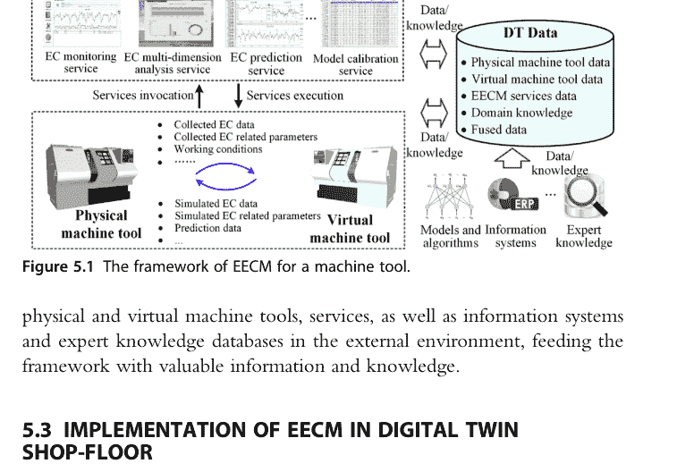

图 5.1 机床的 EECM 框架。

### 5.3 数字孪生车间中 EECM 的实现

根据图 5.1 中的框架，EECM 在 DTS 中的实现从四个方面进行探讨，包括物理机床、虚拟机床、EECM 服务和数据的实现方法。

#### 5.3.1 物理机床

物理机床是 EECM 的目标。 不同传感器安装在其上以收集操作状态和工作条件。 在 EECM 框架中，EC 数据和相关参数尤为关键。 前者指电力、润滑油、压缩空气等的消耗，而后者主要包括以下参数 [2]：

- 加工参数：主轴转速、进给速度、切削深度等。
- 工件参数：强度、硬度、塑性等。
- 刀具参数：角度、齿数、材料、磨损、腐蚀、开裂等。
- 调度参数：调度顺序、空闲时间、工作时间等。
- 机器规格：加工能力、功能、电机类型等。

为了获取物理机床的 EC 数据和相关参数，采用物联网技术进行实时感知和


# 图 5.2 物理机床的数据采集实验台 [20]。

采集，并已开发出基于物联网的智能感知实验台，如图 5.2 所示 [20]。它集成了 30 多种智能物联网设备（例如智能电子电表、传感器和通信设备）和 40 个数据接口（例如串口和 USB 接口）。采集到的数据通过实验台中的有线或无线传输设备发送到虚拟空间 [20]。

例如，如果想获取和分析物理机床的 EC（图 5.2A），可以将其与实验台中的智能电表（即图 5.2(1) 中的 PM5350）、RFID 读卡器（图 5.2(2)）和智能水表（图 5.2(3)）连接。然后可以采集功耗（图 5.2E1）、刀具（图 5.2E2）和切削液（图 5.2E3）的信息。采集到的数据以标准化格式记录（图 5.2F）并通过以太网网关（即图 5.2(4) 中的 EGX 100）传输到软件系统（图 5.2C）。记录的数据将自动作为 EECM 服务（图 5.2(5)）的输入的一部分，并支持分析结果（图 5.2(6)） [20]。

#### 5.3.2 虚拟机床

在 EECM 中，虚拟机床的功能描述如下 [2]：

- 记录：数据可以利用虚拟机床从物理侧进行记录。如有必要，任何情况都可以回放。
- 仿真与预测：在与物理机床相同的工况下，虚拟机床可以生成大量仿真数据和预测数据，包括不仅限于仿真/预测 EC 数据和 EC 相关参数，还包括进一步的分析结果。
- 验证：由于虚拟机床可以低成本地进行调整，机床操作可以先在 cyber 环境中进行验证，然后再在物理机床上执行，从而降低实际生产过程中的风险。

虚拟机床可以通过构建和集成几何、物理、行为和规则模型来构建。如图 5.3 所示，几何模型表示机床中部件的形状、尺寸和装配关系，包括主体、卡盘、轴、刀具等。物理特性，例如功能（例如车削、铣削和磨削）、能力（例如工作量、工作行程和精度）和关键参数（例如速度、力、扭矩）由物理模型描述。行为模型被构建以模拟不同阶段（例如加工阶段、空闲阶段和过载阶段）和不同层级（例如零件层级、子系统层级和整机层级）的 EC，以及模拟相关参数（例如切削力）。仿真数据可以与实际数据进行比较以进行进一步分析。最后，规则模型总结了 EC 相关参数之间的关系，以支持 EC 评估和预测。

#### 5.3.3 EECM 服务

在 EECM 中，具体功能由其对应的服务实现。EECM 服务有两种类型。第一种主要为物理机床服务，用于 EC 监测、分析和优化。第二种为虚拟机床服务，例如模型测试和校准服务，确保虚拟镜像始终与物理实体保持一致 [2]。

EECM 服务由各种子服务支持，包括数据服务、模型服务、算法服务和可视化服务。初始数据、模型、算法和可视化方法存储在 SDTD 中，该数据存储库整合了来自 PS、VS、SSS 和领域知识的数据。它们被封装为统一形式下的服务以展示其功能和属性。例如，数据服务描述数据类型、值、来源和评估信息。模型和算法服务主要描述其功能、服务质量 QoS、输入、输出和参数设置。可视化服务提供功能、QoS、输入和输出。根据用户需求，这些子服务被调用并组合形成完整的 EECM 服务，该服务可以用软件形式呈现，并以各种可视化形式展示 [2]。

一些 EECM 服务如图 5.4 所示。例如，在图 5.4(A) 中，EC 统计服务由不同时间尺度（例如一天、一周或一个月）的 EC 数据提供，并使用统计算法进行分析。统计结果以饼图和柱状图呈现，以说明 EC 的趋势。在图 5.4(C) 中，监测服务由同一时期的实际 EC 数据和相应的仿真 EC 数据支持。这些数据可以进行比较以检测 EC 中的异常，然后异常偏差以折线图展示。

图 5.3 虚拟机床建模。

图 5.4 EECM 服务。

(A) EC 统计服务

(B) EC 预测服务

(C) EC 监测服务

(E) EC 特征提取服务

(F) 感知设备管理服务

#### 5.3.4 数字孪生数据

DT 数据主要有五种类型，包括物理机床数据、虚拟机床数据、EECM 服务数据、领域知识和融合数据。

物理机床数据由设备运行状态和工作条件组成。其中，EC 数据和 EC 相关参数对 EECM 尤为重要，包括电、润滑油和压缩空气的消耗，以及加工参数如速度、力和深度。虚拟机床数据主要包括模型参数和模型运行数据，例如部件模型的几何参数、仿真加工参数和仿真 EC 数据。EECM 服务数据包含服务描述数据、运行数据和分析结果数据，例如服务属性、优化的加工参数和优化的调度参数。领域知识可以从积累的数据中挖掘或从现有信息系统和数据库中获取，包括建模方法、算法和 EC 评估标准 [2]。

如图 5.5 所示，上述四种类型的数据可以在云环境中统一存储和融合，该环境具有强大的计算能力。在此过程中，首先对数据进行清洗以填补缺失值、降低噪声并消除重复值以及不一致和异常值。然后可以对清洗后的数据进行比较、关联和组合，通过数据融合算法获得融合数据。例如，可以通过主成分分析 PCA、小波分析和傅里叶变换等算法从不同数据源提取 EC 的特征（例如趋势、周期和频率），然后使用神经网络进行融合，以呈现对 EC 的更全面描述。

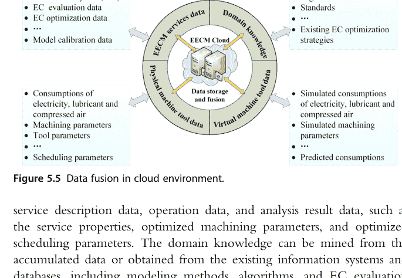

图 5.5 云环境中的数据融合。

### 5.4 数字孪生车间中 EECM 的潜在优势

与传统模式相比，由于引入了虚拟机床并且物理和虚拟机床的数据都可用，EECM 的功能将变得更加全面和准确 [2]。EECM 的潜在优势已在作者之前的作品 [2] 中研究过，本节将介绍这些优势，包括在 EC 监测、分析和优化方面的优势。

#### 5.4.1 能耗监测方面的优势

EC 监测可以通过两种方式进行：实时到历史监测，以及物理到虚拟监测。这样可以准确检测 EC 的渐进变化和突变。

实时到历史监测将从物理机床收集的实时 EC 数据与已记录在虚拟机床中的历史数据进行比较。由于 EC 可能会随着时间推移而逐渐增加，这是由于机床部件的退化（例如磨损、腐蚀和不对中），监测可以反映 EC 的增加，从而呈现机床的当前状态。基于提出的 EECM 框架，由于历史数据可以通过融合来自物理机床的历史传感数据和来自虚拟机床的仿真数据进行校正，它们将比初始历史数据更准确，从而支持更精确的监测。

物理到虚拟监测将物理机床的实际 EC 与虚拟机床的仿真 EC 进行比较。在正常情况下，由于物理和虚拟机床的工况设置相同，两部分的数据始终一致。然而，当物理世界出现某些突发干扰（例如电网波动、漏电和短路）时，可能会出现不一致。在这种情况下，虚拟机床的数据将被作为参考来检测物理机床 EC 的突变。由于虚拟机床与物理机床同步演化，参考数据也会随时间更新，这使得 EC 变化的监测比使用静态参考的传统 EC 监测方法更准确。

#### 5.4.2 能耗分析方面的优势

在提出的 EECM 框架中，由于物理和虚拟机床的数据都可用，EC 分析可以利用充足的数据源，从而实现高质量分析。其在该方面的优势主要体现在多级多阶段分析、行为分析和统计分析。


#### 5.4.3 能源消耗优化方面的优势

#### 多层次多阶段分析
考虑到传感设备的成本，在物理机床上部署大量传感器以收集多层次（例如零件级、子系统级和整机级）和多阶段（例如加工阶段、空闲阶段和过载阶段）的全部 EC 数据是不切实际的。因此，一些研究人员引入了软传感 [21]。在 EECM 中，可以获得来自物理空间和虚拟空间的大量模型和数据，从而能够捕捉到 EC 数据与相关参数之间更清晰的关系。因此，建立更精确的软传感模型以计算多层次和多阶段的 EC 成为可能，从而降低物理传感设备的安装和维护成本。

#### 行为分析
通过融合来自物理机床和虚拟机床的特征，可以分析机床行为（例如正常、过载、故障）。从物理方面来看，特征可以从时域或频域中的 EC 数据和相关参数中提取。从虚拟方面来看，特征可以从进一步的分析和预测中提取。由于特征可以从物理和虚拟机床中获得，因此行为分析可以更全面地进行。

#### 统计分析
通常有必要获得具有统计显著性的 EC 分析结果。由于虚拟机床在网络环境中运行，没有成本或限制，可以获得大量准确的模拟数据以满足数据数量要求。

在 EC 优化中，基于所提出的 EECM 框架，引入了参数优化、调度优化和机床升级。

参数优化是一个复杂的优化问题，它不仅旨在最小化机床 EC，还考虑了一组约束，例如产品质量、生产率、交货时间等。通过数学建模寻找该问题的最优解总是很困难的。然而，由于虚拟机床以高保真度提供了物理机床的数字镜像，优化可以通过参数测试和修改在网络环境中进行。此外，由于虚拟机床记录了物理机床的操作，相同条件下的历史参数设置可以用作参考。

调度优化。在生产过程中，物理机床的任务完成时间可以由其虚拟对应物准确预测。基于预测的时间，可以提前调整后续时间内物理机床的调度，从而缩短机床空闲时间，减少空闲期间产生的 EC。

机床升级。在所提出的 EECM 中，可以在机床升级过程中实现设计师与物理机床之间的交互。首先，基于从物理侧收集的实时数据，通过互联网向设计师提供能够分析和反映物理机床实际 EC 性能的虚拟机床，这将鼓励设计师提出新的设计思路以追求更低的 EC。然后这些思路可以反馈到虚拟机床以反映设计师的预期性能。通过比较可以分析实际性能与预期性能之间的偏差，并由虚拟机床生成和验证相应的升级策略。最后，验证后的策略将在物理机床上实施以实现升级。

### 5.5 总结

所提出的 EECM 是减少设备 EC 和提高能源效率的有效方法。随着 DT 和 DTS 的发展，数据和模型得到了极大丰富，这为在车间层面改进和优化 EECM 提供了可能性。在此背景下，本章探讨了 EECM 在 DTS 中的应用，并详细讨论了框架、实施方法以及潜在优势。未来的工作将集中在以下几个方面 [2]：

- 模型的进一步完善，
- 多源数据融合与管理，
- EECM 系统在 DTS 中的建立。

### REFERENCES

[1] L. Zhou, J. Li, F. Li, Q. Meng, J. Li, X. Xu, Energy consumption model and energy efficiency of machine tools: a comprehensive literature review, J. Clean. Prod. 112 (2016) 3721–3734.

[2] M. Zhang, Y. Zuo, F. Tao, Equipment energy consumption management in digital twin shop-floor: a framework and potential applications, in: 2018 IEEE 15th International Conference on Networking, Sensing and Control (ICNSC), 2018, https://doi.org/10.1109/ICNSC.2018.8361272.

[3] X. Lu, S. Wang, W. Li, P. Jiang, C. Zhang, Development of a WSN based real time energy monitoring platform for industrial applications, in: IEEE 19th International Conference on Computer Supported Cooperative Work in Design (CSCWD), Calabria, Italy, May 2015, pp. 337–342.

[4] N.K. Verna, R. Dev, N.K. Dhar, D.J. Singh, A. Salour, Real-time remote monitoring of an air compressor using MTConnect standard protocol, in: IEEE International Conference on Prognostics and Health Management (ICPHM), Dallas, USA, June 2017, pp. 109–116.

[5] G. Tristo, G. Bissacco, A. Lebar, J. Valentinčič, Real time power consumption monitoring for energy efficiency analysis in micro EDM milling, Int. J. Adv. Manuf. Technol. 78 (2–9) (2015) 1511–1521.

[6] F. Tao, Y. Zuo, L.D. Xu, L. Zhang, IoT-based intelligent perception and access of manufacturing resource toward cloud manufacturing, IEEE Trans. Ind. Inform. 10 (2) (2014) 1547–1557.

[7] S. Kara, G. Bogdanski, W. Li, Electricity Metering and Monitoring in Manufacturing Systems, Glocalized Solutions for Sustainability in Manufacturing, Springer, Berlin, Heidelberg, 2011, pp. 309–315.

[8] G. May, I. Barletta, B. Stahl, M. Taisch, Energy management in production: a novel method to develop key performance indicators for improving energy efficiency, Appl. Energy 149 (2015) 46–61.

[9] C.F. Lindberg, S.T. Tan, J.Y. Yan, F. Starfelt, Key performance indicators improve industrial performance, Energy Procedia 75 (2015) 1785–1790.

[10] Y. He, F. Liu, T. Wu, F.P. Zhong, B. Peng, Analysis and estimation of energy consumption for numerical control machining, Proc. Inst. Mech. Eng. B: J. Eng. Manuf. 226 (2) (2012) 255–266.

[11] F. Tao, Y. Zuo, L.D. Xu, L. Lin, L. Zhang, Internet of things and BOM-based life cycle assessment of energy-saving and emission–reduction of products, IEEE Trans. Ind. Inform. 10 (2) (2014) 1252–1261.

[12] F. Liu, J. Xie, S. Liu, A method for predicting the energy consumption of the main driving system of a machine tool in a machining process, J. Clean. Prod. 105 (2015) 171–177.

[13] Y. He, Y. Li, T. Wu, J.W. Sutherland, An energy-responsive optimization method for machine tool selection and operation sequence in flexible machining job shops, J. Clean. Prod. 87 (2015) 245–254.

[14] S. Wang, X. Lu, X.X. Li, W.D. Li, A systematic approach of process planning and scheduling optimization for sustainable machining, J. Clean. Prod. 87 (2015) 914–929.

[15] D. Mourtzis, E. Vlachou, N. Milas, G. Dimitrakopoulos, Energy consumption estimation for machining processes based on real-time shop floor monitoring via wireless sensor networks, Procedia CIRP 57 (2016) 637–642.

[16] N. Tapoglou, J. Mehnen, A. Vlachou, M. Doukas, N. Milas, D. Mourtzis, Cloud-based platform for optimal machining parameter selection based on function blocks and real-time monitoring, J. Manuf. Sci. Eng. 137 (4) (2015).

[17] A. Vijayaraghavan, D. Dornfeld, Automated energy monitoring of machine tools, CIRP Annals 59 (1) (2010) 21–24.

[18] S. Karnouskos, A.W. Colombo, J.L.M. Lastra, C. Popescu, Towards the energy efficient future factory, in: The 7th IEEE International Conference on Industrial Informatics, Cardiff, Wales, UK, 2009, pp. 367–371.

[19] J. Soplop, J. Wright, K. Kammer, R. Rivera, Manufacturing execution systems for sustainability: extending the scope of MES to achieve energy efficiency and sustainability goals, in: The 4th IEEE Conference on Industrial Electronics and Applications, IEEE, Xi’an, China, 2009, pp. 3555–3559.


[20] Y. Zuo, F. Tao, A.Y.C. Nee, An internet of things and cloud-based approach for energy consumption evaluation and analysis for a product, Int. J. Comput. Integr. Manuf. 31 (4–5) (2018) 337–348.

[21] W. Yan, H. Shao, X. Wang, Soft sensing modeling based on support vector machine and Bayesian model selection, Comput. Chem. Eng. 28 (8) (2004) 1489–1498.

## CHAPTER 6

## Cyber–Physical Fusion in Digital Twin Shop-Floor

作为实现制造物理空间与虚拟空间无缝交互、集成和融合的有效方式，数字孪生车间（DTS）的概念在第4章《Digital Twin Shop-Floor》中被提出。本章从四个方面研究了 DTS 中的 cyber–physical 融合，包括物理车间（PS）中物理要素的融合、虚拟车间（VS）中模型的融合、车间数字孪生数据（SDTD）中数据的融合，以及车间服务系统（SSS）中服务的融合。还讨论了这些融合的相关准则和关键技术。

### 6.1 INTRODUCTION

为了适应社会化、个性化、服务化、智能化和绿色化等制造需求和趋势，各国提出了不同的国家级制造发展战略，如第4章《Digital Twin Shop-Floor》所述。这些战略的共同目标之一是实现 cyber–physical 融合，从而实现智能制造。在车间这一制造活动的基础“ playground ”中，提出了数字孪生车间（DTS）。对于 DTS 而言，cyber–physical 融合不仅是目标，也是实践中的核心挑战之一[1]。要实现这种融合，必须分别在 DTS 的主要组件中实现融合。这四个过程包括物理车间（PS）上异构物理要素的融合、虚拟车间（VS）上多维模型的融合、车间数字孪生数据（SDTD）上的 cyber–physical 数据融合，以及车间服务系统（SSS）上的服务融合。

一些现有工作为上述融合奠定了基础，包括车间上的连接和互联[2,3]、数字/虚拟车间建模[4,5]、车间数据和信息集成[6,7]、车间优化运营和精细化管理[8,9]等。在此基础上，从不同角度提出了许多有价值的理论和技术来解决车间层面的融合问题。然而，要完全实现融合，仍存在一些局限性和不足，具体概述如下。

#### 1. Connection and Interconnection on the Shop-Floor

之前的研究人员主要集中于车间中单个物理要素（例如，一个人、一台机器、一个产品）的理论、技术和方法研究，例如数据采集、数据传输和处理、状态监测和健康管理等的工作。商用设备也已开发出来以实现相关功能。在此基础上，单个要素的智能运营可以在一定程度上实现。然而，对车间上异构物理要素之间的互联互通（例如，机器-机器、人-机器、机器-环境、人-机器-环境）关注不足。特别是，对所有异构物理要素的连接和互联，包括人员、机器、材料和环境，都缺乏。因此，需要追求车间上异构物理要素的全面互联和融合的理论和通用设备。

#### 2. Digital/Virtual Shop-Floor Modeling/Simulation

之前的研究人员主要集中于车间物理要素的几何模型或系统模型的构建和仿真，而能够描绘实际行为、规则和约束的模型相对较少；因此，无法实现从物理要素到虚拟模型的完整映射。此外，就车间仿真而言，以往的研究主要依赖于现有的数据驱动模型，缺乏对车间行为、规则和约束之间精确关系的充分探索，以及它们的一体化方法。很少关注能够从几何、物理、行为和规则等各个方面准确、彻底地描述车间的多维度融合模型。

#### 3. Shop-Floor Data/Information Integration

基于制造执行系统（MES）、企业资源规划（ERP）和计算机辅助工艺规划（CAPP）等信息系统或平台，车间涉及的信息和数据可以集成和共享。尽管集成范围涵盖了部署在车间的信息系统中的现有数据以及部分从生产中采集的实时数据，但上游业务（例如，市场需求和产品设计）和下游业务（例如，产品维护和处置）的数据很少被考虑。此外，来自虚拟模型的仿真数据以及来自物理要素和虚拟模型的融合数据也很少受到关注。综上所述，对车间上所有要素、流程和业务的数据进行无缝集成和融合仍显不足。

#### 4. Shop-Floor Optimal Operations and Precision Management

传统的最优运营和精细化管理方法主要基于问题分析—模型构建—算法设计—优化分析与控制的过程。随着物联网（IoT）和大数据应用于车间，世界各地的研究人员提出了一个新思路，即将传统流程转变为基于车间大数据的关联挖掘—动态演化—仿真/预测—智能控制。两种方法都依赖于车间中的模型和数据。然而，由于缺乏多维度融合的模型和数据，当前的车间在运营和管理方面仍存在各种不足，例如物理空间与虚拟空间之间的一致性差、智能化程度低、准确性低。因此，为了解决这些问题，迫切需要开发可靠的、由数据和模型驱动的服务和服务融合。

上述所有不足都可以归结为一个科学问题，即车间上的 cyber–physical 融合。为了解决这一问题，数字孪生（DT）技术被引入车间并提出了 DTS 的概念。在 DTS 中，通过构建完全互联的 PS、高保真度的 VS、完全集成和融合的 SDTD 以及高精度的 SSS，有可能实现车间上的 cyber–physical 融合，从而为企业开展最优运营和精细化管理提供新的解决方案[1]。

### 6.2 REFERENCE ARCHITECTURE FOR DIGITAL TWIN SHOP-FLOOR

为了为企业未来实现 DTS 提供参考，设计了一个 DTS 的五层参考架构，如图 6.1 所示[1]。这些层包括物理层、模型层、数据层、服务层和应用层。各层介绍如下[1]：

- 1. 物理层主要指 PS 中人员、机器和材料等实体，以及一套生产活动和流程。它主要负责物理空间的生产，并具有数据采集和传输、互联、交互和协作等能力。
- 2. 模型层主要包括 VS 中结合实时数据和知识的各种虚拟模型。它产生多维分析、优化思路和预测状态，以支持物理空间的决策。
- 3. 数据层主要指 SDTD 中的数据。它可以提供数据来驱动 PS、VS 和 SSS 的运行，并实现数据生命周期管理，例如数据处理、集成和融合。
- 4. 服务层主要为车间提供包括智能生产调度、协同工艺规划、产品质量管理、生产过程管理与控制、设备健康管理和能源效率优化分析在内的生产服务。

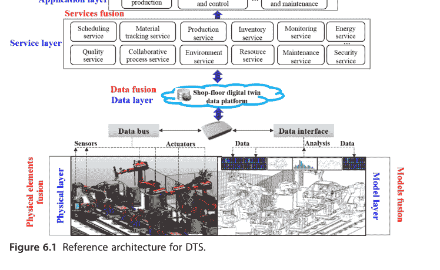

Figure 6.1 Reference architecture for DTS.


5. 应用层主要是指制造过程中面向具体产品的实际应用，如智能生产、智能管控、智能运维等。
考虑到图 6.1 以及对 DTS 四个组成部分 [10]（PS、VS、STDT、SSS）的先前分析，DTS  cyber–physical 融合问题被划分为四个关键问题，即 PS 中异构物理要素的融合（物理要素融合）、VS 中多维模型融合（模型融合）、STDT 中 cyber–physical 数据融合（数据融合）以及 SSS 中服务的融合（服务融合），以下将分别讨论。

### 6.3 物理要素融合

为了实现车间物理要素的智能连接和互联，世界各地的研究人员已进行了大量研究，例如基于射频识别（RFID）[11]、无线传感器网络（WSN）[12]和智能仪器[2]的数据采集与监控；基于制造服务总线[13]、Profinet[14]、OPC UA[15]、AutomationML[16]和物联网[17]的车间互联；以及基于工业互联网枢纽解决方案[18]的制造资源感知与访问设备。然而，在这些工作中，仍存在物理要素之间互联互通和交互不足、数据采集不完整等缺陷。因此，本节提出了“人机料环交互与融合”即物理要素融合的科学问题。

如图 6.2 [1] 所示，物理要素融合可从四个层面实现，包括智能连接与互联、高效数据通信与集成、实时控制与交互、智能协作与融合。实现四层融合需要在异构物理要素上实现海量数据采集、向信息层可靠实时传输数据、多源多模异构数据集成，以及在混合动态环境中行为协同的精确控制。

物理要素融合的目标是为 DTS 中实现模型融合、数据融合和服务融合提供实时数据支持，完成物理要素智能连接与互联，并集成多源异构数据。在此基础上，物理要素融合可进一步实现以下目标。

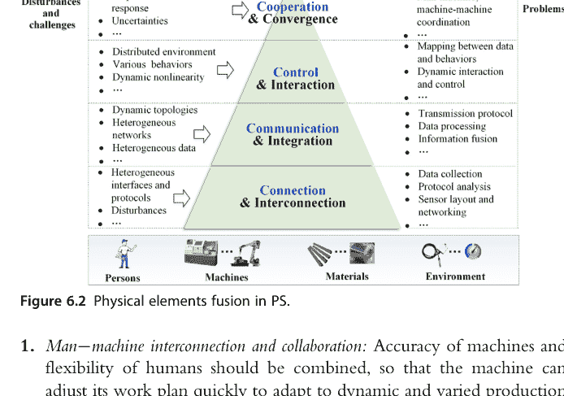

图 6.2 PS 中的物理要素融合。

- 1. 人机互联与协作：应将机器的精确性与人类的灵活性结合起来，使机器能够快速调整工作计划以适应动态多变的生产状态，并通过声音、手势或软件工具等响应人员的指令。
- 2. 机机互联与协作：PS 中的制造机器应协同运行，使机器具有良好的适应性、所需冗余度和高鲁棒性。
- 3. 机料互联与协作：基于 RFID 等传感技术，实现对物料、在制品（WIP）和产品的智能感知与定位、准确的资源追溯和智能存储。

如图 6.2 所示，实现物理要素融合主要涉及以下理论和技术 [1]。

#### 1. 人机料环智能连接与互联

这包括对混合动态 PS 中所有要素、流程和业务的综合感知方法，如基于自适应匹配的即插即用协议分析方法、多传感器组的优化布局和动态组网机制；多时空尺度的测量理论；以及异构物理要素智能互联的通用设备[18]。

#### 2. 人机料环智能通信与计算

这包括高速、高稳定、低延迟的数据传输协议；实时可靠的链路调度技术；多尺度异构数据融合和服务封装方法；以及海量信息的降维处理和分布式存储方法。

#### 3. 人机料环智能控制与交互

这包括多模态数据与对象行为之间的语义映射规则、关键过程建模与控制、数据驱动的自适应控制方法，以及动态交互实时控制方法。

#### 4. 人机料环智能协作与融合

这包括分布式协作控制理论、虚拟现实（VR）和增强现实（AR）技术、车间作业模式识别与知识挖掘，以及由 SDTD 驱动的人机、机机和机料协同控制方法。

### 6.4 模型融合

在车间建模中，研究人员主要关注几何模型的构建，如车间布局[19]、装配过程[5]、加工过程[20]和车间物流[21]的建模与仿真。在几何模型的基础上，部分研究人员进一步探索了物理因素的建模（例如机器的物理属性、工艺参数、生产能力），并模拟物理参数的变化[22]和工艺方案评估[23]。尽管几何和物理因素的建模与仿真已有讨论，但对车间实际行为、规则和约束的描述与仿真却鲜有研究。特别是能够全面融合不同模型以完整映射 PS 的 VS 仍缺乏。

如图 6.3 [1] 所示，为实现 PS 与 VS 之间的完整映射，有必要从几何、物理、行为和规则等多个维度构建车间模型。同时，建立的模型应经过验证以确保其正确性和有效性。在此基础上，可将各维度的模型关联、组合和集成，形成虚拟空间中高保真的完整 VS 模型。因此，本节提出了基于几何—物理—行为—规则的多维模型融合（即模型融合）的科学问题。模型融合中的技术主要涉及多维模型构建、评估与验证、关联与映射、融合与一致性分析，具体如下[1]。

#### 1. 多维模型的构建

要实现 VS 的多维模型融合，首先必须构建模型。也就是说，必须构建多维模型来描述 PS 的几何形状、物理属性、行为响应和规则等。

#### 2. 多维模型的评估与验证

模型构建完成后，必须确保其有效性和正确性。有必要基于验证、确认和认可（VV&A）对构建的多维模型进行验证，并验证模型输入输出的准确性、仿真置信度及敏感性。

#### 3. 多维模型的关联与映射机制

要实现多维模型的融合，有必要在先前构建的模型正确的前提下，探索和分析各维度模型之间的关联与映射机制。几何模型和物理模型描述了车间中的异构物理要素。在这些模型的基础上，可通过添加驱动和扰动因素构建行为模型，使相应要素具有行为、响应机制和执行复杂动作的能力。规则模型表征了要素几何参数、物理属性和行为中反映的规则，从而使 VS 具备评估、演化和推理的能力。通过建立模型之间的关联与映射机制，


不同维度下，模型可以在结构和功能上进行集成和融合，形成对 PS 的全面镜像，具有统一的三维表示。

#### 4. 多维模型一致性的理论与方法

为了保持 VS 中的模型与 PS 中的实体之间的一致性和同步性，有必要在一方确保模型与相应实体之间的一致性，在另一方确保同一实体的不同维度模型之间的一致性。

### 6.5 数据融合

车间制造数据具有与大数据相同的特征 [8,24,25]，例如体量巨大、来源多样、异构、多尺度、多维度。通过建立车间生产过程与运营决策制定之间基于大数据的关系，可以分析车间的运行规律，有助于提高生产效率 [25,26] 和产品质量 [27]，降低能耗 [28]，并保持机器处于健康状态 [29]。尽管相关研究已实现了车间部分数据的集成和融合，但在网络物理交互环境下，对所有元素、过程和业务的数据集成和融合尚未完全实现。例如，在制造手机外壳时，不仅需要考虑设计数据，如款式、颜色、用户评价和材料，还需要考虑 PS 中的实时加工数据，如加工温度、压力和表面粗糙度。同时，订单数据如加工质量、交货时间和生产任务也不能被忽视。因此，本节提出了整个元素、过程和业务的网络物理数据融合的科学问题（即数据融合）。

数据融合是指基于车间物理元素融合、模型融合和运行一致性原则，对所有元素、过程和业务的数据进行生成、建模、清洗、关联、聚类、挖掘、迭代、演化和融合。通过数据融合，可以有效地描述和反映车间的各种动态演化过程、演化规律和统计特征。如图 6.4 [1] 所示，数据融合主要涉及以下标准和技术。

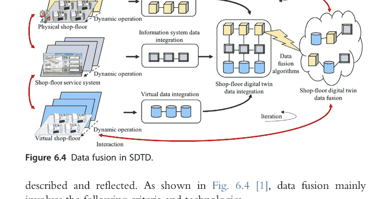

## Figure 6.4 Data fusion in SDTD.

描述和反映。如图 6.4 [1] 所示，数据融合主要涉及以下标准和技术。

#### 1. 数据生成、建模和清洗

这包括 SDTD 中数据的实时生成机制，如复杂的数据分类和建模、不完整信息下的空值估计和特征约简、数据清洗，以及数据准确性、完整性和一致性的验证。

#### 2. 数据关联、聚类和挖掘

这包括关联，如 SDTD 中实时数据与历史数据的比较和整合；数据与操作之间的映射；来自不同层级、时期和空间的数据聚类和融合；数据追溯；特征提取；以及行为模式识别。

#### 3. 数据迭代、演化和融合

这包括 PS、VS 和 SSS 数据的交互迭代和优化，如数据的动态增长规律、数据关联的动态演化、数据演化规律和统计特征分析。

### 6.6 服务融合

融合物理和虚拟数据的 SDTD 不仅可以反映 PS 和 VS 的状态，还可以驱动其运行。DTS 运行期间的实际需求，如能耗管理、精确控制和预测性维护，涉及一系列复杂且动态的智能决策问题。复杂性和动态性源于动态且不确定的环境、物理元素的状态不确定、生产任务的动态变化以及多样化的目标和约束。服务可以建立制造物理空间与虚拟空间之间的重要桥梁，有助于实现智能互联和运行 [30,31]。DTS 中物理元素融合、模型融合和数据融合的最终目标是基于 SDTD，结合现有信息系统（如 MES），为生产提供各种所需服务。这些服务包括生产调度、产品质量管理、协同工艺规划 [32]、生产过程控制、设备健康管理和能源效率优化分析 [33]。因此，通过动态服务调用、调度和组合实现服务的融合与协作，可以实现车间智能生产和管理。上述过程被定义为数据驱动服务融合的科学问题（即服务融合）。车间服务融合和应用主要涉及以下标准和技术 [1]。

#### 1. 数据驱动服务生成

这包括从数据到服务的转换方法；物理元素、虚拟模型、数据和服务之间的多级映射机制；服务的数字描述和封装；以及服务聚合。

#### 2. 服务智能管理与优化

这包括车间服务模型的构建、服务质量（QoS）的综合评估、服务在线监控、供需匹配机制 [34,35]，以及服务优化配置。

#### 3. 服务融合与应用

这包括车间复杂耦合应用的需求分析、动态供需匹配机制、服务动态调度、基于服务组合的服务协作和融合 [36,37]，以及服务协作的可靠性评估和改进策略。

### 6.7 总结

网络物理融合是先进制造战略的共同挑战，也是 DTS 部署需要解决的关键科学问题。目前，DTS 在生产和运营过程中存在以下不足：（1）车间数据采集不完整；（2）虚拟/数字模型难以建立，仿真分析缺乏系统性；（3）物理和虚拟数据的双向动态映射和融合不足；（4）缺乏针对特定需求的动态灵活服务组合。

基于对 DTS 的概念、组成、运行机制、特征和关键技术的[content]

不同维度下，模型可以在结构和功能上进行集成和融合，形成对 PS 的全面镜像，具有统一的三维表示。

#### 4. 多维模型一致性的理论与方法

为了保持 VS 中的模型与 PS 中的实体之间的一致性和同步性，有必要在一方确保模型与相应实体之间的一致性，在另一方确保同一实体的不同维度模型之间的一致性。

### 6.5 DATA FUSION

Shop-floor manufacturing data have the same features as big data [8,24,25] such as massive volume, multiple sources, heterogeneity, multiple scales, and multiple dimensions. Through establishing relationships between the production process and operational decision making on the shop-floor with big data, the operation rules of the shop-floor can be analyzed, which contributes to improving production efficiency [25,26] and product quality [27], reducing energy consumption [28], and keeping machines in healthy condition [29]. Although relevant studies have achieved integration and fusion of part data on the shop-floor, the integration and fusion of data from all of the elements, processes, and businesses under the cyber-physical interaction environment have not been fully realized. For example, when a mobile phone casing is manufactured, it is required to consider not only the design data, such as style, color, user evaluation, and material, but also the real-time processing data in the PS such as processing temperature, pressure, and surface roughness. Meanwhile, the order data such as processing quality, delivery time, and production tasks also cannot be neglected. Therefore, this section puts forward the scientific problem of fusion of cyber-physical data from entire elements, processes, and businesses (i.e., data fusion).

Data fusion refers to the generation, modeling, cleaning, correlation, clustering, mining, iteration, evolution, and fusion of data from all of the elements, processes, and businesses based on the physical elements fusion, models fusion, and running consistency principles of the shop-floor. Through data fusion, various dynamic evolution processes, evolution rules, and statistical characteristics of the shop-floor can be effectively


## Figure 6.4 Data fusion in SDTD.

described and reflected. As shown in Fig. 6.4 [1], data fusion mainly involves the following criteria and technologies.

#### 1. Data Generation, Modeling, and Cleaning

This includes real-time generation mechanisms of data in SDTD, such as complicated data classification and modeling, empty value estimation and feature reduction for incomplete information, data cleaning, and verification of data accuracy, integrity, and consistency.

#### 2. Data Correlation, Clustering, and Mining

This includes correlation, such as comparison and integration of the real-time data and the historical data in SDTD; mapping between the data and operations; clustering and fusion of the data from different levels, periods, and spaces; data tracing; feature extraction; and behavior pattern recognition.

#### 3. Data Iteration, Evolution, and Fusion

This includes interactive iteration and optimization of the data from PS, VS, and SSS, such as dynamic growth rules of the data, dynamic evolution of data correlation, data evolution rules, and statistical characteristics analysis.

### 6.6 SERVICES FUSION

The SDTD that fuses the physical and virtual data not only can reflect the states of the PS and the VS, but also drive their operations. The actual demands during the operation of the DTS, such as energy consumption management, precise control, and predictive maintenance, involve a series of complex and dynamic smart decision-making problems. The complexity and dynamism are due to the dynamic and uncertain environment, uncertain states of physical elements, dynamic changes of production tasks, and diverse objectives and constraints. Services can be used to build an important bridge between the manufacturing physical space and the virtual space, which helps to realize smart interconnections and operations [30,31]. The ultimate goal of the physical elements fusion, models fusion, and data fusion in the DTS is to provide various services required in the production based on the SDTD in combination with the existing information systems (e.g., MES). The services herein include production scheduling, product quality management, collaborative process planning [32], production process control, equipment health management, and energy efficiency optimization analysis [33]. Accordingly, smart production and management on the shop-floor can be achieved through fusion and collaboration of the services through dynamic service invocation, scheduling, and combination. The above process is defined as the scientific problem of data-driven services fusion (i.e., services fusion). The shop-floor service fusion and application mainly involve the following criteria and technologies [1].

#### 1. Data-Driven Service Generation

This includes conversion methods from data to services; multilevel mapping mechanisms among physical elements, virtual models, data, and services; digital description and encapsulation for services; and services aggregation.

#### 2. Service Smart Management and Optimization

This includes construction of shop-floor service models, comprehensive assessment of quality of service (QoS), service online monitoring, supply–demand matching mechanisms [34,35], as well as service optimization configurations.

#### 3. Service Fusion and Application

This includes demand analysis for shop-floor complex coupling application, dynamic supply-demand matching mechanisms, service dynamic scheduling, service collaboration and fusion based on service combinations [36,37], and reliability assessments and improvement strategies for service collaboration.

### 6.7 SUMMARY

Cyber-physical fusion is a common challenge for advanced manufacturing strategies, and also a key scientific problem that needs to be solved for the deployment of the DTS. At present, the DTS has the following shortcomings in production and operation processes: (1) data collection on the shop-floor is incomplete; (2) virtual/digital models are difficult to establish and simulation analysis lacks systematism; (3) bidirectional dynamic mapping and fusion for the physical and virtual data are insufficient; and (4) dynamic and flexible combinations of services toward specific demands are lacking.

Based on research on the concept, composition, operating mechanisms, characteristics, and key technologies of the DTS, this chapter designs a reference framework for the DTS and further proposes the scientific problem, that is, the cyber-physical fusion in the DTS. With respect to the composition of the DTS, cyber-physical fusion is divided into four different perspectives, including the physical elements fusion in PS, models fusion in VS, data fusion in SDTD, and services fusion in SSS. The corresponding criteria and key technologies for these fusions are also discussed. This chapter aims at providing a theoretical and technical reference for researchers to carry out studies on the cyber-physical fusion for the DTS.

### REFERENCES

[1] F. Tao, Y. Cheng, J.F. Cheng, M. Zhang, W.J. Xu, Q.L. Qi, Theories and technologies for cyber-physical fusion in digital twin shop-floor, Comput. Integr. Manuf. Syst. 23 (8) (2017) 1603-1611.

[2] N. Shariatzaeh, T. Lundholm, L. Lindberg, G. Sivard, Integration of digital factory with smart factory based on Internet of Things, Procedia CIRP 50 (2016) 512-517.

[3] A. Cutting-Decelle, J. Barraud, B. Veenendaal, R. Young, Production information interoperability over the Internet: a standardised data acquisition tool developed for industrial enterprises, Comput. Ind. 63 (8) (2012) 824-834.

[4] T. Tolio, M. Sacco, W. Terkaj, M. Urgo, Virtual factory: an integrated framework for manufacturing systems design and analysis, Procedia CIRP 7 (5) (2013) 25–30.

[5] X. Wang, S.K. Ong, A.Y.C. Nee, Real-virtual components interaction for assembly simulation and planning, Robot. Comput. Integr. Manuf. 41 (2016) 102–114.

[6] F. Himmler, M. Amberg, Data integration framework for heterogeneous system landscapes within the digital factory domain, Procedia Eng. 69 (1) (2014) 1138–1143.

[7] H. Panetto, J. Cecil, Information systems for enterprise integration, interoperability and networking: theory and applications, Enterprise Inf. Syst. 7 (1) (2013) 1–6.

[8] J. Zhang, L. Gao, W. Qin, Y. Lyu, X. Li, Big-data-driven operational analysis and decision-making methodology in intelligent workshop, Comput. Integr. Manuf. Syst. 22 (5) (2016) 1220–1228.

[9] Y. Zhang, Y. Cheng, F. Tao, Smart production line: common factors and data-driven implementation method, in: The ASME 2017 International Manufacturing Science and Engineering Conference, Los Angeles, California, USA, 2017, pp. V003T04A040–V003T04A040.

[10] F. Tao, M. Zhang, J. Cheng, Q. Qi, Digital twin workshop: a new paradigm for future workshop, Comput. Integr. Manuf. Syst. 23 (1) (2017) 1–9.

[11] B. Hameed, I. Khan, F. Durr, K. Rothermel, An RFID based consistency management framework for production monitoring in a smart real-time factory, in: 2nd International Internet of Things Conference, Tokyo, Japan, 2010, pp. 1–8.

[12] G. Zhao, Wireless sensor networks for industrial process monitoring and control: a survey, Netw. Protoc. Algorithms 3 (1) (2011) 46–63.

[13] A. Boyd, D. Noller, P. Peters, D. Salkeld, SOA in manufacturing guidebook, in: MESA International, IBM Corporation and Capgemini Cobranded Whitepaper, 2008.

[14] P. Ferrari, A. Flammini, F. Venturini, A. Augelli, Large PROFINET IO RT networks for factory automation: a case study, Emerging Technologies and Factory Automation (2011) 1–4.

[15] R. Henßen, M. Schleipen, Interoperability between OPC UA and AutomationML, Procedia CIRP 25 (2014) 297–304.

[16] R. Drath, A. Luder, J. Peschke, L. Hundt, AutomationML—the glue for seamless automation engineering, in: 13th IEEE International Conference on Emerging Technologies and Factory Automation, Hamburg, Germany, 2008, pp. 616–623.

[17] F. Tao, Y. Zuo, L. Xu, L. Zhang, IoT-based intelligent perception and access of manufacturing resource toward cloud manufacturing, IEEE Trans. Ind. Inform. 10 (2) (2014) 1547–1557.

[18] F. Tao, J. Cheng, Q. Qi, IIHub: an industrial internet-of-things hub toward smart manufacturing based on cyber–physical system, IEEE Trans. Ind. Inform. 14 (5) (2018) 2271–2280.

[19] C. Li, H. Ma, L. Li, Y. Du, A. Mu, Dynamic facility layout method for remanufacturing shop with stochastic returns, Comput. Integr. Manuf. Syst. 21 (11) (2015) 2901–2911.

[20] L. Zhu, H. Li, W. Liang, W. Wang, A web-based virtual CNC turn-milling system, Int. J. Adv. Manuf. Technol. 78 (2015).

[21] Y. Wang, A. Chen, Production logistics simulation and optimization of industrial enterprise based on Flexsim, Int. J. Simul. Modell. 15 (4) (2016) 732–741.

[22] Y. Altintas, P. Kersting, D. Biermann, E. Budak, B. Denkena, I. Lazoglu, Virtual process systems for part machining operations, CIRP Ann. Manuf. Technol. 63 (2) (2014) 585–605.


[23] H. Quan, H. Champliaud, Z. Feng, T. Dao, Analysis of the asymmetrical roll bending process through dynamic FE simulations and experimental study, Int. J. Adv. Manuf. Technol. 75 (5–8) (2014) 1233–1244.

[24] R. Dubey, A. Gunasekaran, S. Childe, S. Wamba, T. Papadopoulos, The impact of big data on world-class sustainable manufacturing, Int. J. Adv. Manuf. Technol. 84 (1–4) (2016) 631–645.

[25] J. Li, F. Tao, Y. Cheng, L. Zhao, Big data in product lifecycle management, Int. J. Adv. Manuf. Technol. 81 (1–4) (2015) 667–684.

[26] J. Lee, E. Lapira, B. Bagheri, H. Kao, Recent advances and trends in predictive manufacturing systems in big data environment, Manuf. Lett. 1 (1) (2013) 38–41.

[27] M. Colledani, T. Tolio, A. Fischer, B. Iung, G. Lanza, R. Schmitt, et al., Design and management of manufacturing systems for production quality, CIRP Ann. Manuf. Technol. 63 (2) (2014) 773–796.

[28] Z. Geng, Y. Han, X. Gu, Q. Zhu, Energy efficiency estimation based on data fusion strategy: case study of ethylene product industry, Ind. Eng. Chem. Res. 51 (25) (2012) 8526–8534.

[29] J. Lee, F. Wu, W. Zhao, M. Ghaffari, L. Liao, D. Siegel, Prognostics and health management design for rotary machinery systems—reviews, methodology and applications, Mech. Syst. Signal Process. 42 (1) (2014) 314–334.

[30] F. Tao, L. Zhang, Y. Hu, Resource Services Management in Manufacturing Grid System, Wiley, 2012.

[31] F. Tao, Y. Cheng, L. Xu, L. Zhang, CCIoT–CMfg: cloud computing and internet of things based cloud manufacturing service system, IEEE Trans. Ind. Inform. 10 (2) (2014) 1435–1442.

[32] F. Tao, L. Bi, Y. Zuo, A.Y.C. Nee, A cooperative co-evolutionary algorithm for large-scale process planning with energy consideration, J. Manuf. Sci. Eng. Trans. ASME 139 (6) (2017). 061016–1–061016-11.

[33] F. Tao, L. Bi, Y. Zuo, A.Y.C. Nee, A hybrid group leader algorithm for green material selection with energy consideration in product design, CIRP Ann. Manuf. Technol. 65 (1) (2016) 9–12.

[34] F. Tao, J. Cheng, Y. Cheng, S. Gu, T. Zheng, H. Yang, SDMSim: a manufacturing service supply–demand matching simulator under cloud environment, Robot. Comput. Integr. Manuf. 45 (6) (2017) 34–46.

[35] Y. Cheng, F. Tao, D. Zhao, L. Zhang, Modeling of manufacturing service supply–demand matching hypernetwork in service-oriented manufacturing systems, Robot. Comput. Integr. Manuf. 45 (2016) 59–72.

[36] F. Tao, Y. Laili, L. Xu, L. Zhang, FC-PACO-RM: a parallel method for service composition optimal-selection in cloud manufacturing system, IEEE Trans. Ind. Inform. 9 (4) (2013) 2023–2033.

[37] F. Tao, L. Zhang, H. Guo, Y. Luo, L. Ren, Typical characteristics of cloud manufacturing and several key issues of cloud service composition, Comput. Integr. Manuf. Syst. 17 (3) (2011) 477–486.

## CHAPTER 7

## 由数字孪生驱动的预测与健康管理

预测与健康管理（PHM）对于提高在恶劣环境中工作的复杂设备可靠性并降低停机成本至关重要。随着信息物理系统（CPS）的发展，实现信息物理融合以优化传统 PHM 是一个重要突破。本章引入数字孪生（DT）这一信息物理融合的新兴技术，以提高 PHM 的效率和可靠性。构建了一个五维 DT，以高保真度全面仿真物理设备。基于所构建的 DT，详细提出了一种 PHM 方法，该方法包括框架、流程和协同演化机制，能够高效利用 DT 中的数字镜像、持续交互和融合数据。所提出的方法应用于风力涡轮机（WT）的偏航系统和齿轮箱。

### 7.1 INTRODUCTION

复杂设备，如飞机、船舶和风力涡轮机，通常在充满随机性和不确定性的恶劣环境中工作数十年。因此，设备在运行过程中不可避免地会出现退化和故障，这会导致停机、维护成本增加以及任务延期。为解决这些问题，预测与健康管理（PHM）被引入作为支持复杂设备可靠运行的有效手段[27]。

PHM 是基于维护方法和诊断技术发展而来的[2]。最早的维护实践是故障维修，即当设备出现明显故障时再更换或修理失效部件。由于这种维护是非计划性的，它总是扰乱初始计划并影响任务完成时间。为改善这一情况，引入了定期维护或计划维护。它可以根据专家的建议预先规划，并定期执行，通过清洁、维护、修理、校准和检查来保持设备处于良好状态。但由于这种维护是基于预定义间隔进行的，缺乏灵活性，无法应对意外故障。最近，基于状态的维护可以根据设备状况实时分析，并在实际需要维护时才采取行动。它能够及时有效地检测和消除预期和非预期的故障，从而降低维护成本。PHM 已从基于状态的维护演进而来，如今已成为一种更集成、更成熟的方法，能够实现与设备生命周期相关的健康管理[2,3]。

一般而言，PHM 可分为三个阶段，如图 7.1 所示，包括观察、分析和决策[4]。在观察阶段，需要采集和处理来自复杂设备的实时数据。然后在分析阶段将实时数据与预期值进行比较，以监测设备的当前健康状况。当设备发生退化时，会进行故障预测和诊断，以隔离和识别故障原因，并预测剩余使用寿命（RUL）。根据分析结果，同时考虑各方面的约束，决策会制定维护策略，通过人机界面呈现给人员并执行，以确保设备能够完成任务。

以下是对这三个阶段相关工作的综述：

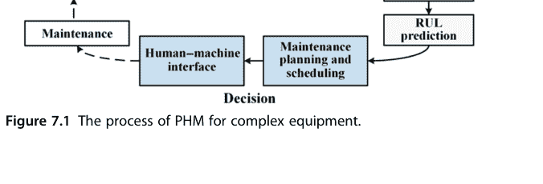

图 7.1 复杂设备的 PHM 流程。

- 1. 在观察中，诸如电流传感器、扭矩传感器和力传感器等传感装置[5–7]被安装在设备上以实现数据采集。基于采集到的数据，可以通过时域[8]、频域[9]和时频域[10]的信号来估计设备的状况。
- 2. 在分析中，主要有三种方法：数据驱动、模型驱动和混合方法[2]。数据驱动方法基于从采集数据中直接提取的特征训练诊断或预测模型，忽略了各种变量之间复杂的内部关系[11]。模型驱动方法旨在根据对设备的根本理解，建立精确的数学模型来呈现物理过程[12]。混合方法是上述两种方法的结合，其功能可通过从两方面学习而得到增强[13]。
- 3. 在决策中，根据分析结果，生成维护计划以决定维护时间、工具和技术人员等，同时考虑维护成本、备件库存和设备可靠性等约束[14,15]。此外，人机界面可以以各种虚拟形式提供有价值的信息[2]。

上述工作探索了 PHM 不同阶段的方法。近年来，更多研究人员利用新一代信息技术（New IT）来改进 PHM。Deutsch 和 He 使用基于深度学习的方法预测旋转部件的 RUL，利用振动信号的大数据，实现了无需人工干预的自动特征提取和 RUL 预测[16]。Gao 等人讨论了制造中的云端预测，其中制造层级的数据在云环境中集成以提高效率[17]。结合云平台和物联网（IoT），构建了一个用于电机的远程监测系统，提供按需监测服务并允许快速准确的决策制定[18]。Zaluski 等人开发了一种基于数据挖掘的 C-18 飞机预测模型，该模型由多种数据驱动，如传感器飞行数据、内置测试设备数据和维护数据[19]。Nabati 和 Thoben 研究了从海上风力涡轮机采集的数据特征，以确定这些数据是否适合用于风力涡轮机维护的大数据分析[20]。Lee 构建了一个嵌入物联网的云架构，用于检测和分析制造设备状态，考虑整体制造过程[21]。


现有工作为 PHM 做出了一定的贡献。然而，其中大多数都存在一个共同的不足，即它们主要由设备在物理空间中的表现驱动，与其虚拟模型联系甚少，这影响了 PHM 的效率和可靠性。目前，随着信息物理系统（CPS）的发展，重视虚拟空间并实现无缝的信息物理融合以改善 PHM 已成为不可避免的趋势。因此，一些研究人员尝试将设备的数字镜像从虚拟空间引入，与实体协同工作以更好地支持 PHM。例如，Lee 等人提出构建一个数字孪生模型，该模型通过集成来自多个来源的数据来管理数百台相似的物理设备，通过仿真评估设备状况并识别故障模式 [22,23]。Liu 和 Xu 研究了信息物理机床（CPMT）的概念，该概念将机床与其信息物理孪生集成，后者能够将数据转化为 PHM 的有价值信息 [24]。Zinnikus 等人提出了一个用于信息物理生产系统故障分析的框架，该框架将物理设备的观测与模型的行为进行比较以进行异常检测和故障诊断 [25]。Penna 等人提出了一个用于信息物理维护环境的可视化工具，该工具将物理元素与虚拟元素关联起来，并通过 Web 浏览器实现远程访问 [26]。

尽管这些工作尝试将复杂设备的数字模型引入 PHM，以实现由物理和虚拟空间共同驱动的 PHM，但仍存在一些共同问题。它们包括 (1) 如何构建模型以全面、准确地描述复杂设备，(2) 如何建立设备与其数字镜像模型之间的交互机制，使其共同演化并共同支持 PHM，以及 (3) 如何融合来自物理和虚拟空间的数据并为 PHM 生成有价值的信息。然而，针对这些问题的研究很少 [27]。

由于 DT 有望实现信息物理融合，本章提出了一种 DT 驱动的 PHM 方法。首先，构建复杂设备的 DT，包括物理设备（PE）、虚拟设备（VE）、服务（Ss）、连接（CN）和 DT 数据（DD）。其次，探索 DT 驱动的 PHM 方法，包括框架、三阶段流程和协同演化机制。框架定义了所提方法中 DT 的输入、输出和作用；然后设计流程以针对两种类型的故障（渐进式故障和突发式故障）采用不同的工作流程；协同演化机制说明了 PHM 期间 DT 不同部分的演化过程。最后，为了验证所提出的 DT 建模和 DT 驱动 PHM 方法的效率和优势，以风力涡轮机（WT）的偏航系统和齿轮箱为例进行案例研究。基于 DT，可以解决当前 PHM 工作中存在的上述三个共同问题，如下所示：(1) 根据 DT 的构建，可以构建设备的五维 DT，该 DT 从多个方面描述真实设备，并在物理上无法接近时仍可提供对设备的访问。(2) 利用 DT 中的交互机制，物理设备与数字镜像之间的差异可用于检测来自外部环境的干扰、设备中的潜在故障以及虚拟模型中的缺陷。这是对设备及其数字镜像的耦合优化，以更好地服务于 PHM。(3) 由于 DT 生成来自设备、数字镜像和融合数据的 数据，PHM 活动（例如状况评估、特征提取和预测）的数据得到极大丰富，可以提供更全面、更准确的信息 [27]。

### 7.2 复杂设备的数字孪生

#### 7.2.1 复杂设备的五维数字孪生

根据第 3 章《五维数字孪生建模及其关键技术》中提出的五维 DT 定义，构建了复杂设备的 DT 概念模型，如图 7.2 所示 [27]。

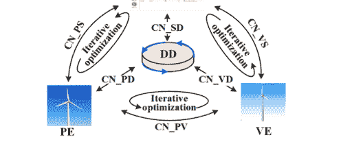

图 7.2 复杂设备的五维 DT 概念模型 [27]。

DT 包括五个组成部分，即 PE、VE、Ss、DD 和 CN。PE 指在真实环境中运行并完成规定任务的物理设备。VE 表示虚拟设备，即 PE 的高保真数字对应物。它由多维度的模型集组成，用于全面描述 PE。Ss 代表面向 PE 和 VE 的服务。它优化 PE 的运行，并在运行过程中通过校准 VE 参数来确保 VE 的高保真度。DD 是 DT 数据，包括来自 PE、VE、Ss 和领域知识的数据，以及融合数据。由于 DD 包含来自物理和虚拟方面的以及它们融合的数据，因此可以提供更全面、更准确的信息。CN 是连接不同 DT 部分的纽带 [27]。

#### 7.2.2 数字孪生的每个维度的建模

然后，根据第 3 章《五维数字孪生建模及其关键技术》中探索的 DT 建模方法，构建五维 DT 的具体模型。为了说明这些模型，以 WT 作为复杂设备的示例。对于每个维度，一些在作者之前工作中研究的典型模型 [27] 如图 7.3 所示并说明如下。

- 1. **PE（即物理 WT）。** 物理 WT 主要包括子系统和安装的传感器。子系统由叶片、发电机、齿轮箱和偏航系统组成，用于将风能转化为机械能和电能。传感器部署用于采集发电机温度、齿轮箱振动和功率输出。

- 2. **VE（即虚拟 WT）。** 根据第 3 章《五维数字孪生建模及其关键技术》中的表达式 (2)，虚拟 WT 由几何模型、物理模型、行为模型和规则模型组成，分别表示为 $G_v$、$P_v$、$B_v$ 和 $R_v$。在 $G_v$ 中，部件（例如叶片、齿轮箱和轴）以三维构建，然后组装形成几何 WT。在 $P_v$ 中，叶片变形、齿轮齿应力、轴承温度等可使用有限元法（FEM）进行仿真以反映物理特性。$B_v$ 包括发电、偏航、变桨、解旋等。例如，发电可由风速和功率输出曲线描述。偏航可由偏航角（$\varphi_y$）与偏航速率（$\omega_y$）之间的积分关系表示，而偏航速率（$\omega_y$）由偏航误差（err）的分段函数表示 [28]。在 $R_v$ 中，可通过受力分析模拟风速约束，并使用神经网络挖掘 WT 参数的关联。

- 3. Ss。 在 Ss 中，以功率输出监测服务的封装为例进行建模。根据第 3 章《五维数字孪生建模及其关键技术》中的表达式 (3)，其可表示为 Ss_monitor = [功率输出监测,（风速、物理 WT 功率输出、虚拟 WT 功率输出），功率状况，（时间、成本、可靠性），（工作、空闲、故障）]。其输入包括风速、物理 WT 的功率输出和

|  |  | 子系统/部件 | 传感器及位置 |
|---|---|---|---|
| PE（物理 WT） | [带编号部件 ①-⑩ 的风力涡轮机示意图] | ① 叶片<br>② 齿轮箱<br>③ 发电机<br>④ 偏航系统<br>⑤ 电控系统<br>⑥ 变桨系统<br>⑦ 轴<br>⑧ 轴承<br>⑨ 液压系统<br>⑩ 轮毂 | • 温度传感器：② ③ ⑤ ⑥ ⑧ ⑩<br>• 加速度计：② ③ ⑧<br>• 速度传感器：⑦<br>• 扭矩传感器：⑦<br>• 电流和电压传感器：⑤<br>• 液压传感器：⑨ |
| VE（虚拟 WT） | Gv<br>• 3D 中的部件<br>• 装配关系<br>[齿轮箱、叶片、轴 ... WT 图像] | Pv<br>• 叶片/塔架/主轴/齿轮等的应力/腐蚀/开裂/变形...分析<br>[变形分析][应力分析] | Bv<br>• 偏航/解旋<br>• 变桨<br>• 发电<br>• 启动/停止<br>[发电][偏航] | Rv<br>• 约束<br>• 关联<br>• 推导<br>[风速约束][参数关联] |
| WT 的 PHM 服务（Ss） | 例如 Ss_monitor =（功率输出监测，（风速、物理 WT 功率输出、虚拟 WT 功率输出），功率状况，（工作、空闲、故障））。 |  |  |
| WT DT 数据（DD） | [带 WT 状态、环境状态、Dr、Dp、DD 类型、Ds、Dx、Dk、模型运行数据、模型参数的 ER 图] |  |  |
| 连接（CN） | 例如 CN_PV_yaw_angle=（物理 WT，度，10，0-1080，10s）<br>CN_PV_yaw_order =（虚拟 WT，rad/s，8.7e-3，0-(1.7e-2)，10s） |  |  |

# 图 7.3 WT 的 DT 部件建模 [27]。


power output of the virtual WT, while the outputs are the evaluated power output condition. The service can be scheduled considering its quality (i.e., time, cost, and reliability) and state (i.e., working, idle, or failure).

4. DD. According to expression (4) in Chapter 3, Five-Dimension Digital Twin Modeling and Its Key Technologies, DD is modeled with five components, where Dp is the data from the physical WT, Dv is the data from the virtual WT, Ds is the data from the Ss, Dk represents the domain knowledge, and Df denotes the fused data of Dp, Dv, Ds, and Dk.

5. CN. The connection between the physical WT and virtual WT (i.e., CN_PV) is taken as an example. According to expressions (5) and (6) in Chapter 3, Five-Dimension Digital Twin Modeling and Its Key Technologies, data from the physical WT (i.e., yaw angle) is expressed as CN_PV_yaw_angle = (physical WT, degree, 10, 0−1080, 10 s), and the order from the virtual WT (e.g., yaw rate) is denoted as CN_PV_yaw_order = (virtual WT, rad/s, 7.7e−3, 0−(1.7e−2), 10 s).

### 7.3 DIGITAL TWIN-DRIVEN PHM METHOD

The constructed DT is then applied to create the DT-driven PHM method. In this method, faults are classified into two types: gradual fault and abrupt fault [27]. The former can be predicted as caused by the gradual degradation of the components, such as wear, aging, and fatigue. The latter is unpredictable and can happen suddenly due to random disturbances unknown to VE, such as human interference, environmental change, and incorrect installation. To deal with the two types of faults, the DT-driven PHM method, including the framework, procedure, and coevolution mechanism are studied as follows.

#### 7.3.1 Framework

As shown in Fig. 7.4, the framework introduces the inputs and outputs, as well as the roles of DT components (PE, VE, Ss, DD, CN) in the proposed method.

##### 7.3.1.1 Inputs

The inputs are a series of data, including mainly the data collected from the equipment in the remote field; the modeling and calibrating methods for the DT; and the models, algorithms, rules, and standards for PHM.

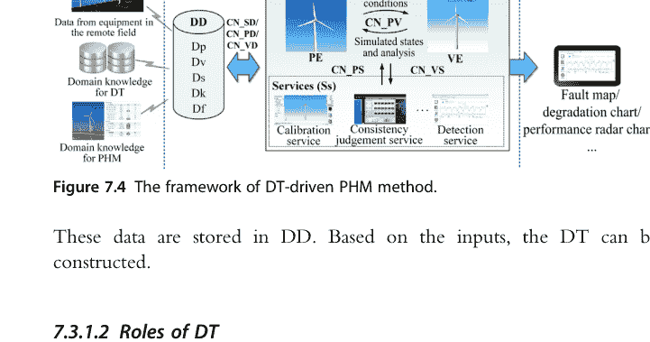

Figure 7.4 The framework of DT-driven PHM method.

These data are stored in DD. Based on the inputs, the DT can be constructed.

##### 7.3.1.2 Roles of DT

As the DT is constructed, the roles of different DT components are presented as follows [27]:

- 1. PE is the target of PHM. Malfunctioning of any part in the PE may cause faults. Data of PE can reflect its current states. It mainly includes the operation states and the working conditions, denoted as X = {x_i | 1 ≤ i ≤ n} and C = {c_j | 1 ≤ j ≤ m}, respectively, where x_i is the i th actual state parameter (e.g., speed, force, torque), c_j is the j th condition (e.g., environmental parameter, load, control order), while n and m are the numbers of parameters.

- 2. C and X are loaded to VE, which makes the VE operate under the same working conditions with the PE. On one hand, the VE operates synchronously with the PE and generates simulated operation states, denoted as Y = {y_i | 1 ≤ i ≤ n}, where y_i is the mapping to x_i, representing the i th simulated state parameter, and n is the parameters number. On the other hand, since the VE can perform further analysis (e.g., stress analysis, deformation analysis, and state prediction), data from the VE are more abundant than those from the PE. Hence, other data from the VE are represented as Z = {z_k | 1 ≤ k ≤ l}, where z_k denotes the k th analysis parameter and l is the parameters number.

happen suddenly and are usually unknown to the VE, data in X and Y will be different.

- 3. Ss mainly includes the model calibration service, consistency judgment service, degradation detection service, inconsistency cause judgment service, fault cause identification, and prediction service and maintenance service. Actually, these services correspond to the functions in different steps of the procedure in Section 7.3.2. The suitable service can be invoked to implement the corresponding function on demand.

- 4. DD fuses data from the PE, VE, Ss, and the input data. It makes the information from DD more comprehensive and accurate. On one hand, DD is used for DT modeling and calibrating; on the other hand, features can be extracted from DD, and fused for degradation detection, failure identification, and prediction, for the PHM.

- 5. CN_PV enables the interaction and comparison between the PE and VE, which is critical for fault identification in different fault types. As CN_PS connects the PE and Ss, and CN_VS connects the VE and Ss, services can be invoked and executed timely once the demands from the PE and VE are obtained. Due to CN_PD, CN_VD and CN_SD, PE, VE and Ss can store data in DD and obtain the processed data from DD in real-time.

##### 7.3.1.3 Outputs

The outputs are the analysis results from DT-driven PHM method, which can be displayed in multiple forms, including the degradation chart, performance radar chart, fault map, risk chart, etc. They are outputs for the engineers to obtain the health status of the equipment as well as maintenance strategies.

#### 7.3.2 Procedure

As shown in Fig. 7.5, the procedure of the DT-driven PHM method is classified into three stages, that is, observation (steps 1–3), analysis (steps 4–6), and decision (step 7). These steps, which have been studied in the authors’ work [27], are described as follows.

Step 1: DT Modeling and calibration. Establish DT for the complex equipment according to Section 7.2. During the operation in the following steps, if the VE deviates from the PE due to defects in modeling, perform calibration according to Section 7.3.2.1.

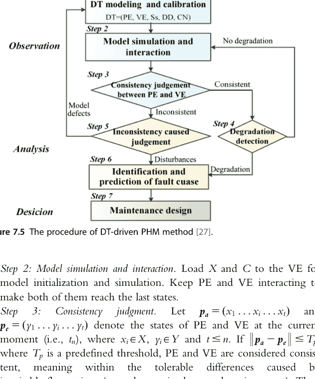

Figure 7.5 The procedure of DT-driven PHM method [27].

Step 2: Model simulation and interaction. Load X and C to the VE for model initialization and simulation. Keep PE and VE interacting to make both of them reach the last states.

Step 3: Consistency judgment. Let p_a = (x1 ... xi ... xn) and p_e = (y1 ... yi ... yn) denote the states of PE and VE at the current moment (i.e., t_n), where xi ∈ X, yi ∈ Y and t ≤ n. If ||p_a - p_e|| ≤ T_p, where T_p is a predefined threshold, PE and VE are considered consistent, meaning within the tolerable differences caused by inevitable fluctuations (e.g., changes in the actual environment). Then go to step 4. Otherwise, they are inconsistent and go to step 5.

Step 4: Degradation detection. During operation, performance degradation will inevitably appear on the PE. As the PE and VE are consistent, the VE will also have the same performance. Hence, the gradual degradation can be reflected on indicators expressed by the parameters from both PE and VE, including X, Y, and Z. If some indicators exceed their upper or lower thresholds, go to step 6. Otherwise, go to step 2.

Step 5: Inconsistency caused judgment. Judge the inconsistency cause according to Section 7.3.2.2. If it is caused by the defects of modeling, go back to step 1 for calibration. If it is caused by the abrupt fault of

the PE, go to step 6. In addition, if the inconsistency is caused by both aspects, go to step 1 for calibration first.

Step 6: Identification and prediction of fault cause. According to the faults from step 4 (i.e., the gradual fault) and step 5 (i.e., the abrupt fault), identify and predict the cause of the fault according to Section 7.3.2.3. Then go to step 7.

Step 7: Maintenance design. According to the analysis results, select the maintenance strategies among a set of standby alternatives. Perform the selected strategies on the VE first to check if any conflict exists. If so, modify the strategies to eliminate the conflicts; otherwise, carry them out on the PE.

##### 7.3.2.1 Model Calibration

There are two possible reasons in the modeling that could lead to the deviation between PE and VE: (1) CN_PV fails to keep the normal communication between PE and VE, and (2) VE is inaccurate and fails to generate the precise representation for PE.

To solve these problems, the calibration process is presented in Fig. 7.6. First, examine CN_PV through the cyclic redundancy check (CRC) and the delay check. In the CRC, test the integrity and accuracy of the transmitted data. In the delay check, test whether the communication is in real-time. Second, calibrate the models in VE through

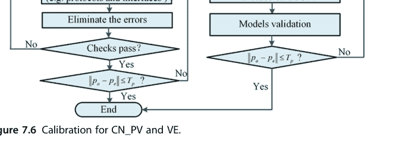

Figure 7.6 Calibration for CN_PV and VE.


parameters tuning for both the submodel and the complete VE based on the least-squares optimization method (LSOM) in [29].

##### 7.3.2.2 Inconsistency Caused Judgment

Assume that at tₙ, the PE and the VE are judged as inconsistent (i.e., ‖pₑ − pₐ‖ > Tₚ). To identify the inconsistency cause, take the time series of historical states of the PE under the same condition (i.e., C) as the reference. Represent the reference as Pₕₛ = (xₕₛ₁ … xₕₛᵢ … xₕₛₜ), where t is the parameter number, xₕₛᵢ is the time series for the i th parameter, denoted as xₕₛᵢ = (xₕₛᵢ(1) … xₕₛᵢ(q) … xₕₛᵢ(s))ᵀ, and s is the element number. Accordingly, for the i th parameter of pₐ (i.e., xᵢ) and pₑ (i.e., yᵢ), the time series from the current (i.e., tₙ) to a future moment (i.e., tₙ₊₁) are denoted as xₛᵢ = (xₛᵢ(1) … xₛᵢ(q) … xₛᵢ(s))ᵀ and yₛᵢ = (yₛᵢ(1) … yₛᵢ(q) … yₛᵢ(s))ᵀ, respectively. Denote Pₐₛ = (xₛ₁ … xₛᵢ … xₛₜ) and Pₑₛ = (yₛ₁ … yₛᵢ … yₛₜ) as the time series for pₐ and pₑ. Pₕₛ, Pₐₛ, and Pₑₛ are the multivariate time series. Measure the similarity of Pₐₛ and Pₕₛ, as well as Pₑₛ and Pₕₛ according to the correlation based dynamic time warping (CBDTW) described in Ref. [30], which considers the correlation between the variables and provides an accurate measurement. Based on the measurement result, judge the inconsistency cause. The process is shown in Fig. 7.7.

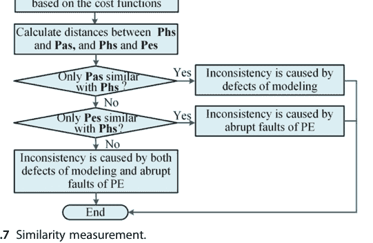

Figure 7.7 Similarity measurement.

##### 7.3.2.3 Identification and Prediction of Fault Cause

- 1. **Gradual fault:** From step 4, before the gradual fault occurs completely, localize the fault cause in advance. It includes two phases, as shown in Fig. 7.8. In the training phase, extract the forewarning features for different fault causes from the historical data of PE and VE, including X, Y, and Z. Then train the prediction models, which fuse the features from both the PE and the VE, and relate them to the fault causes through methods such as the neural network. If the trained models can pass the accuracy test, they will be considered as good models and used for the prediction. In the prediction phase, input the forewarning features extracted from the real-time data of X, Y, and Z into the models and predict the cause.
- 2. **Abrupt fault:** From step 5, localize the components related to the abrupt fault first based on the deviation between PE and VE. Then check the components one by one through comparing their parameters from the VE with those from the PE, to finally identify the source of disturbances.

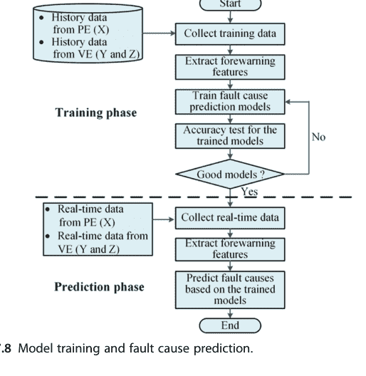

Figure 7.8 Model training and fault cause prediction.

#### 7.3.3 Coevolution Mechanism

During DT-driven PHM, the PE, VE, and Ss evolve with each other continuously, as shown in Fig. 7.9. For PEi, VEi, and Ssi, i represents the i th interaction among the three parts.

The PE and the VE always make an effort to keep consistent with each other. Assume that PEi and VEi are consistent in the beginning. To distinguish the current “consistency” with others, it is labeled as “consistencyi.” However, since the states of PEi (denoted as pai) are continuous and variable, the states of VEi (denoted as pei) may appear to have deviated due to defects and limitations in the models. In this situation, model calibration service will be performed to calibrate the VEi to keep up with the PEi. After that, the new consistency (i.e., consistencyi+1) is reached. From consistencyi to consistencyi+1, the VE evolves to better understand the PE, which makes the VE provide more accurate data and models for the PHM. As to the other aspect, if random disturbances from the external environment (always unknown to VEi) exist on PEi, the deviation between pai and pei will also appear. The disturbances will be captured by the inconsistency cause judgment service and eliminated by the maintenance service to achieve new consistency. By this process, the disturbance sources are reduced gradually and the PE is more likely to operate as the expected process provided by the VE, which makes the faults of the PE more predictable.

With the accumulation of data, the functions of Ss are also updated and improved continuously, which makes Ssi evolve to Ssi+1. For example, since the fault cause prediction models in Section 7.3.2.3 can be

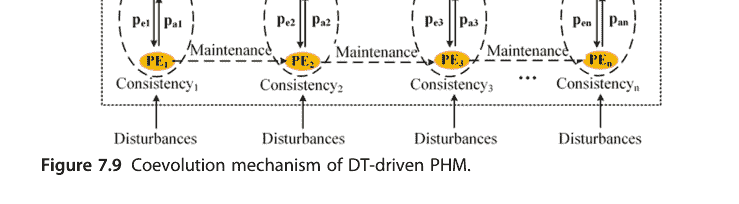

Figure 7.9 Coevolution mechanism of DT-driven PHM.

optimized online with more data obtained for training, the fault cause identification and prediction service based on the trained models is also refined accordingly.

### 7.4 CASE STUDY

#### 7.4.1 Problem Description

A WT is complex equipment that transforms wind energy to mechanical and electrical energy. Since the WT usually works over decades and its working conditions are characterized by stochastic loading, rapidly varying torque, and a dusty environment, most components may fail and the failure rates are shown in Table 7.1 [31]. Hence, PHM is crucial to keep the WT operating reliably. However, some problems still exist as follows. Because of the harsh environment, it is not practical to access the WT all the time for prognosis and maintenance. The features extracted from the physical aspects are mainly used for fault cause identification or prediction, but features from the virtual side are ignored. Since signals from the physical aspect (e.g., the vibration signals) are easily interfered with by other sources, the diagnostic results can be affected [27]. To address the above issues, the DT-driven PHM is applied in the case study.

The gearbox and the yaw system are among the top three components that are prone to malfunctioning. The gearbox is used to transform the low speed drive from the wind power into high speed for the generator, and its failures are mainly caused by the gradual degradation of gears in it. The yaw system can align the nacelle with the wind direction to make the WT obtain the maximum wind energy. Failures of the yaw system

# Table 7.1 Fault rates of WT components

| Components | Failure rates | Components | Failure rates |
|---|---|---|---|
| Electrical control | 13% | Blades | 5% |
| **Gearbox** | **12%** | Brake system | 5% |
| **Yaw system** | **8%** | Control system | 2% |
| Entire turbine | 7% | Entire nacelle | 1% |
| Generator | 5% | Shaft/bearing | 1% |
| Hydraulic system | 5% | Others | 30% |
| Grid | 5% |  |  |

*Note:* The bold characters outstand the gearbox and yaw system which are among the top three components that are prone to malfunctioning. The two components are used to verify the proposed method in the following content, which can better illustrate the efficiency of the proposed method to some extent.

are mainly caused by the wind vane with mechanical structures, which are prone to damage by disturbances from the external environment (e.g., the abrupt drop of temperature). In this section, firstly, the DT of a WT is constructed according to Section 7.2, and the DT-driven PHM method in Section 7.3 is then applied to the yaw system and gearbox to deal with the abrupt fault and gradual fault, respectively.

#### 7.4.2 Digital Twin-Driven PHM for Yaw System

The yaw system is part ④ of the physical WT in Fig. 7.3. In this case study, the fault of the yaw system is caused by the sudden disturbance from the environment and it leads to yaw error. Related symbols are listed in Table 7.2.

According to steps 1 and 2 in Section 7.3.2, with the constructed DT of the WT, the simulation and interaction are started. According to step 3, p_a and p_e are denoted as p_a = P_ao and p_e = P_eo, respectively. P_ao is calculated according to the output voltage and current collected from the voltage and current sensors deployed in part ⑤ (i.e., electronic control system) of the physical WT in Fig. 7.3. P_eo is simulated by the virtual WT based on the relation existing between W_s and P_eo [32]. The deviation is calculated according to Eq. (7.1). As ||p_e - p_a|| ≥ T_p, p_a and p_e are considered inconsistent.

||p_e - p_a|| = |P_ao - P_eo| / |P_ao| (7.1)

To identify the inconsistency cause, according to step 5, the historical power output under the same W_s is selected as the reference and denoted as P_ho. Time series of P_ho, P_ao, and P_eo in 600 s are taken out for comparison in Fig. 7.10, where the sampling interval is 10 s. Hence, P_hs, P_as, and P_es are denoted as P_hs = (P_ho(1)…P_ho(60))^T, P_as = (P_ao(1)…P_ao(60))^T, and P_es = (P_eo(1)…P_eo(60))^T, respectively. P_hs, P_as, and P_es are univariate time series. Through distance calculation, it is judged that P_es is similar

Table 7.2 A list of symbols of yaw system
Symbols of yaw system in physical WT | Symbols of yaw system in virtual WT
A_ay | Yaw angle | A_cy | Yaw angle
P_ao | Power output | P_co | Power output
W_d | Wind direction |  | 
W_s | Wind speed |  |


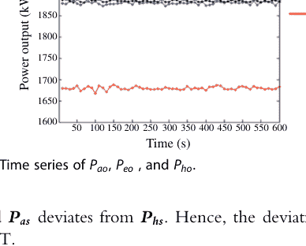

## Figure 7.10 Time series of P_ao, P_eo, and P_ho.

to P_hs, and P_as deviates from P_hs. Hence, the deviation is caused by the physical WT.

According to step 6, to identify whether the deviation is caused by the yaw system, the following comparison is performed. For both physical and virtual WTs, when A_ay and A_cy change in two directions (θ or −θ), the trends of P_ao and P_co are different. For the physical WT, P_ao increases obviously in one direction (i.e., θ) and reduces in another (i.e., −θ). Meanwhile, for the virtual WT, P_co reduces in both directions. For the physical WT, when A_ay changes in the appropriate direction, P_ao has the ability to reach the normal level. It illustrates that other components (e.g., blade, gearbox, and generator) work normally and the misalignment of the nacelle (i.e., part ⑩ in PE in Fig. 7.3) caused by the yaw system is the bottleneck for the power output. For the virtual WT, since the nacelle has faced the wind direction, the change of A_cy only brings a decrease in P_co. Hence, the yaw system of the physical WT can be identified as the fault cause.

Through further checking of parameters collected from components of the yaw system, the deviation of the wind vane is finally identified as the fault cause, which is interpreted in Fig. 7.11. The wind vane measures the angle β between the zero scale and the wind direction. In normal condition, as in Fig. 7.11A, the zero scale aligns to the central axis of the nacelle. Hence, β is equal to α, the angle between the central axis and the wind direction. The yaw system controls the nacelle to turn until β becomes 0 degrees, which makes the nacelle face the wind direction exactly. However, in Fig. 7.11B, since the zero scale deviates from the central axis due to disturbances from the external environment, α and β

## Figure 7.11 The fault of wind vane. (A) Normal condition. (B) Fault condition.

(A) Normal condition

(B) Fault condition

Nacelle of physical WT

Zero scale in physical WT

Central axis of nacelle

Wind direction

## Figure 7.12 Simulation for the maintenance strategy. (A) Yawing in physical WT. (B) Yawing in virtual WT. (C) Adjustment in virtual WT.

(A) Yawing in physical WT

(B) Yawing in virtual WT

(C) Adjustment in virtual WT

Nacelle of physical WT

Zero scale in physical WT

Central axis of nacelle

Nacelle of virtual WT

Zero scale in virtual WT

Wind direction

are different. Hence, the direction of the nacelle, generated based on β, will become inaccurate and lead to yaw error.

According to step 7, simulation based on the virtual WT is performed to design the maintenance strategy. The yawing of the physical WT is presented in Fig. 7.12A, where the zero scale deviates from the central axis with the angle η and P_a0 is lower than the normal value. In Fig. 7.12B, as the zero scale aligns to the central axis, P_e0 can reach the normal level. In Fig. 7.12C, to obtain the angle η, the nacelle direction can be adjusted in the virtual environment until the P_e0 is equal with P_a0. Then η can be obtained. Based on η, the position of the zero scale in physical WT can be calibrated.

It can be seen that the DT-driven PHM method for the yaw system does not need to access the WT first while predicting the fault cause and the maintaining procedure, which improves the efficiency of PHM for the WT.

#### 7.4.3 Digital Twin-Driven PHM for the Gearbox

The gearbox is part ② of the physical WT in Fig. 7.3. In this case study, the fault causes of the gearbox include gear tooth wear, fatigue, and breakage, which are caused by gradual degradation. Related symbols are listed in Table 7.3 [27].

According to step 3, the states of the gearbox in the physical and virtual WTs are denoted as p_a = (T_ai, T_ao) and p_e = (T_ei, T_eo), respectively. T_ai and T_ao are collected from the torque sensors mounted on the input and output shafts (i.e., part ⑦ in the physical WT in Fig. 7.3), while T_ei and T_eo are simulated by the virtual WT according to the transmission relations among the wind wheel, gearbox, and generator rotor [33]. The deviation is calculated according to Eq. (7.2) [27]. As ||p_e - p_a|| ≤ T_p is satisfied, the gearboxes of the physical and virtual WTs are considered consistent.

```
||p_e - p_a|| = sqrt((T_ei - T_ai)^2 + (T_eo - T_ao)^2) / sqrt((T_ai)^2 + (T_ao)^2) (7.2)
```

According to step 4, to detect the degradation, the vibration signals of the gearbox in the physical WT are collected from the accelerometers deployed at the low speed stage, medium speed stage, and high speed stage of the gearbox. The energy for every n samples of vibration time series is calculated according to Eq. (7.3) [27], where a_i is the amplitude for the i th sample. Since E_v exceeds the upper threshold, the gearbox is considered to have degraded.

```
E_v = sum_{i=1}^{n} |a_i|^2 (7.3)
```

## Table 7.3 A list of symbols of gearbox

| Symbols of gearbox in physical WT | Symbols of gearbox in virtual WT |
|---|---|
| T_ai | Input torque | T_ei | Input torque |
| T_ao | Output torque | T_eo | Output torque |
| f_m | Meshing frequency | T_cm | Maximum contact stress |
| FC | Frequency center | T_bm | Maximum bending stress |
| VF | Frequency variance | N_m | Number of gear meshing |
| MSF | Mean square frequency |  |  |

According to step 6, to identify the cause (i.e., gear tooth wear, fatigue, or breakage) before the complete failure, forewarning features of the gearboxes in both physical and virtual WTs are extracted. From the gearbox in the physical WT, the frequency spectrums of vibrations for the normal condition as well as the three degraded conditions are presented in Fig. 7.13 [27]. The features are mainly reflected on f_m, harmonics of f_m, and their sidebands. In Fig. 7.13A, the amplitudes of f_m and the harmonics are low and the sidebands are not obvious. However, in Fig. 7.13B, as the tooth surface is worn, the amplitudes of the harmonics have risen obviously. In Fig. 7.13C, when tooth fatigue has occurred, the sidebands of f_m and the harmonics broaden, and the amplitudes are observed to be high. In Fig. 7.13D, when the tooth is broken, the frequencies are ample and dispersed, while their amplitudes are higher.

To distinguish the above characteristics, FC, VF, and MSF are calculated according to Eqs. (7.4)–(7.6), where f_k denotes the frequency of the k th spectrum line and X_k represents the amplitude of f_k [34]. Since the

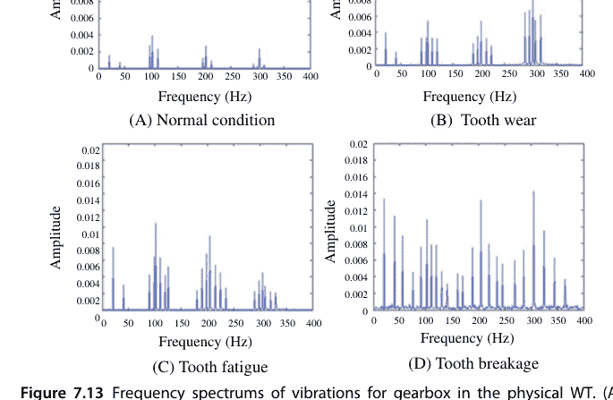

Figure 7.13 Frequency spectrums of vibrations for gearbox in the physical WT. (A) Normal condition. (B) Tooth wear. (C) Tooth fatigue. (D) Tooth breakage.

three indicators can reflect the different positions, energies, and dispersions of the vibration frequencies for different fault causes, they are selected as the forewarning features.

```
$$FC = \frac{\sum_{k=1}^{K} f_k X_k}{\sum_{k=1}^{K} X_k} \tag{7.4}$$
```

```
$$VF = \frac{\sum_{k=1}^{K} (f_k - FC)^2 X_k}{\sum_{k=1}^{K} X_k} \tag{7.5}$$
```

```
$$MSF = \frac{\sum_{k=1}^{K} f_k^2 X_k}{\sum_{k=1}^{K} X_k} \tag{7.6}$$
```

From the gearbox in the virtual WT, as different fault causes can be reflected on the different stress levels (e.g., contact stress and bending stress in Fig. 7.14 [27]) on the tooth, $T_{cm}$, $T_{rm}$, and $N_m$ are selected as the forewarning features. $T_{cm}$ and $T_{rm}$ can be obtained by analyzing the forces acting on the tooth surface and root using FEM, and $N_m$ can be obtained through recording the gear meshing number.

Extreme learning machine (ELM) [35], a single-hidden layer feedforward network, characterized by the fast learning speed and good generalization performance, is applied to fuse the features from the gearboxes in both physical and virtual WTs and build the fault cause prediction model. As shown in Fig. 7.15 [27], the constructed network contains 6 input nodes ($FC$, $VF$, $MSF$, $T_{cm}$, $T_{rm}$, and $N_m$), 1 output node (the fault cause), and 10 hidden nodes.

The model is trained based on 90 groups of samples, including 30 for tooth wear, 30 for tooth fatigue, and 30 for tooth breakage. For each sample, it consists of the values of six features and the corresponding fault

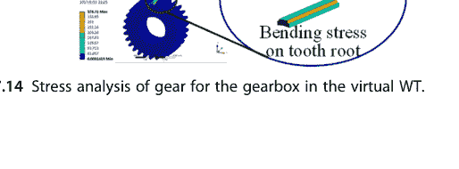

Figure 7.14 Stress analysis of gear for the gearbox in the virtual WT.


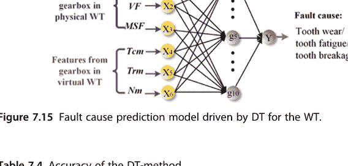

## 图 7.15 由 DT 驱动的 WT 故障原因预测模型。

## 表 7.4 DT 方法的准确率

| Accuracy | Tooth wear | Tooth fatigue | Tooth breakage |
|---|---|---|---|
| Training accuracy | 0.93 | 0.93 | 1 |
| Testing accuracy | 0.93 | 0.92 | 1 |

原因。然后将训练好的模型在 40 个样本上进行测试，其中齿磨损 15 个，齿疲劳 13 个，齿断裂 12 个。对于每种工况，使用被分类为校正工况的样本数量与该工况样本总数的比值来计算训练或测试准确率。结果如表 7.4 所示，其中所提出的方法记为 DT 方法。

最后，根据步骤 7，基于故障原因，例如齿断裂，维护策略将建议焊接修复。焊接过程首先在虚拟环境中对受损齿轮进行验证。然后在物理 WT 的齿轮箱上执行已验证的维护 [27]。

为了进一步验证 DT 方法的优势，其性能与齿轮箱传统的故障原因预测方法进行了比较，该方法通常使用物理 WT 齿轮箱的振动信号，在此记为 P 方法。在此情况下，P 方法也是使用 ELM 构建的。P 方法的输入为 FC、VF 和 MSF，这也用于 DT 方法 [27]。P 方法的训练准确率和测试准确率如表 7.5 所示。与 P 方法相比，DT 方法的训练和测试准确率均显著提高。

DT 方法的优势主要来自 DT 的构建。根据 DT 方法的流程，在物理和虚拟 WT 中的齿轮箱一致的前提下，所构建的 DT 可以融合振动和应力信号进行预后。它可以从物理和虚拟两个方面描绘齿轮箱。然而，P 方法仅关注物理 WT 的振动信号。由于信号易受其他振动源的干扰，P 方法的准确率容易受到影响 [27]。

## 表 7.5 P 方法的准确率

| Accuracy | Tooth wear | Tooth fatigue | Tooth breakage |
|---|---|---|---|
| Training accuracy | 0.83 | 0.87 | 0.90 |
| Testing accuracy | 0.80 | 0.77 | 0.83 |

在

### 7.5 总结

在本章中，提出了复杂设备的 DT 建模和 DT 驱动的 PHM 方法。本章的目的是深入了解 DT 驱动的 PHM 并为未来的工作提供指导。本章的贡献总结如下。首先，它将 DT 的先前三维定义扩展为复杂设备的五维定义，更全面、更真实地表达了 DT 的属性和特征。其次，详细介绍了 DT 驱动的 PHM 方法，包括框架、三阶段流程和协同演化机制，该方法利用了 DT 中的数字镜像模型、物理-虚拟交互和数据融合。第三，基于上述工作，一个案例研究介绍了 DT 驱动的 PHM 方法在 WT 的偏航系统和齿轮箱中的应用，以处理不同类型的故障。验证表明，所提出的方法可以在不先访问 WT 的情况下预测故障原因和维护程序，并且由于 cyber-physical 融合而提高了故障原因预测的准确性。

考虑到 DT 的实施成本和复杂性，所提出的 DT 驱动的 PHM 方法将适用于工厂中高价值和主要设备的监测，并且必须有足够的 DT 建模数据。为了扩大 PHM 应用，挑战主要包括 [27]：

- 构建具有不同属性和行为的复杂设备的高保真数字镜像。
- 处理大量 DT 数据。
- 平衡 DT 的成本和收益。

未来的工作将重点关注以下方面：
- 提高所构建 DT 的准确性。
- 完善 DT 驱动的 PHM 的运行机制。
- 将所提出的方法进一步应用于其他类型的复杂设备。

### 参考文献

[1] J. Geng, X. Tian, M. Bai, X. Jia, X. Liu, A design method for three-dimensional maintenance, repair and overhaul job card of complex products, Comput. Ind. 65 (1) (2014) 200–209.

[2] J. Lee, F. Wu, W. Zhao, M. Ghaffari, L. Liao, D. Siegel, Prognostics and health management design for rotary machinery systems—reviews, methodology and applications, Mech. Syst. Signal Process. 42 (1) (2014) 314–334.

[3] T. Tinga, R. Loendersloot, A. Bregón, M. Daigle, Aligning PHM, SHM and CBM by understanding the physical system failure behaviour, in: European Conference on the Prognostics and Health Management Society, Nantes, 2014.

[4] M. Jouin, R. Gouriveau, D. Hissel, M. Péra, N. Zerhouni, Prognostics and health management of PEMFC—State of the art and remaining challenges, Int. J. Hydrogen Energy 38 (35) (2013) 15307–15317.

[5] N. Tapoglou, J. Mehnen, A. Vlachou, M. Doukas, N. Milas, D. Mourtzis, Cloud-based platform for optimal machining parameter selection based on function blocks and real-time monitoring, J. Manuf. Sci. Eng. 137 (4) (2015) 040909.

[6] Q. Liu, M. Dong, W. Lv, X. Geng, Y. Li, A novel method using adaptive hidden semi-Markov model for multi-sensor monitoring equipment health prognosis, Mech. Syst. Signal Process. 64–65 (2015) 217–232.

[7] B. Denkena, K. Litwinski, H. Boujnah, Detection of tool deflection in milling by a sensory axis slide for machine tools, Mechatronics 34 (2016) 95–99.

[8] G. Niu, B. Yang, M. Pecht, Development of an optimized condition-based maintenance system by data fusion and reliability-centered maintenance, Reliab. Eng. Syst. Saf. 95 (7) (2010) 786–796.

[14] Z. Lu, W. Cui, X. Han, Integrated production and preventive maintenance scheduling for a single machine with failure uncertainty, Comput. Ind. Eng. 80 (2015) 236–244.

[15] F. Tao, L. Bi, Y. Zuo, A.Y.C. Nee, Partial/parallel disassembly sequence planning for complex products, J. Manuf. Sci. Eng. 140 (1) (2017) 011016.

[16] J. Deutsch, D. He, Using deep learning-based approach to predict remaining useful life of rotating components, IEEE Trans. Syst. Man Cybern. Syst. 48 (1) (2018) 11–20.

[17] R. Gao, L. Wang, R. Teti, D. Dornfeld, S. Kumara, M. Mori, et al., Cloud-enabled prognosis for manufacturing, CIRP Ann. 64 (2) (2015) 749–772.

[18] F. Ademir, L. Ricardo, N. Marcelo, P. Alecio, A. Cloud-based, Architecture for the internet of things targeting industrial devices remote monitoring and control, IFAC-PapersOnLine 49 (30) (2016) 108–113.

[19] M. Zaluski, S. Létourneau, J. Bird, C. Yang, Developing data mining-based prognostic models for cf-18 aircraft, J. Eng. Gas Turbine Power 133 (10) (2010) 235–243.

[20] E. Nabati, K. Thoben, Big data analytics in the maintenance of off-shore wind turbines: a study on data characteristics, Dynamics in Logistics, Springer International Publishing, 2017, pp. 31–140. pp.

[21] H. Lee, Framework and development of fault detection classification using IoT device and cloud environment, J. Manuf. Syst. 43 (2017) 257–270.

[22] J. Lee, H. Kao, S. Yang, Service innovation and smart analytics for industry 4.0 and big data environment, Procedia CIRP 16 (2014) 3–8.

[23] J. Lee, B. Bagheri, H. Kao, A cyber–physical systems architecture for industry 4.0-based manufacturing systems, Manuf. Lett. 3 (2015) 18–23.

[24] C. Liu, X. Xu, Cyber–physical machine tool—the era of machine tool 4.0, Procedia CIRP 63 (2017) 70–75.

[25] I. Zinnikus, A. Antakli, P. Kapahnke, M. Klusch, C. Krauss, A. Nonnengart, et al., Integrated semantic fault analysis and worker support for cyber–physical production systems, IEEE Bus. Inform. (2017) 207–216.

[26] R. Penna, M. Amaral, D. Espíndola, S. Botelho, N. Duarte, C. Pereira, et al., Visualization tool for cyber–physical maintenance systems, in: 12th IEEE International Conference on Industrial Informatics, Porto Alegre Rs Brazil, 2014, pp. 566–571.

[27] F. Tao, M. Zhang, Y. Liu, A.Y.C. Nee, Digital twin driven prognostics and health management for complex equipment, CIRP Ann. Manuf. Technol. 67 (1) (2018) 169–172.

[28] P. Odgaard, K. Johnson, Wind turbine fault detection and fault tolerant control-an enhanced benchmark challenge, in: 2013 American Control Conference, Washington, DC., June, 2013, pp. 4447–4452.

[29] J. Wahlström, L. Eriksson, Modelling diesel engines with a variable-geometry turbocharger and exhaust gas recirculation by optimization of model parameters for capturing non-linear system dynamics, Proc. Inst. Mech. Eng. D: J. Automobile Eng. 225 (7) (2011) 960–986.

[30] Z. Bankó, J. Abonyi, Correlation based dynamic time warping of multivariate time series, Expert Syst. Appl. 39 (17) (2012) 12814–12823.

[31] R. Hyers, J. McGowan, K. Sullivan, Condition monitoring and prognosis of utility scale wind turbines, Energy Mater. 1 (3) (2006) 187–203.

[32] A. Kusiak, W. Li, The prediction and diagnosis of wind turbine faults, Renew. Energy 36 (1) (2011) 16–23.

[33] Y. Zhang, D. Xie, J. Feng, R. Wang, Small-signal modeling and modal analysis of wind turbine based on three-mass shaft model, Electr. Power Compon. Syst. 42 (7) (2014) 693–702.


[34] Y. Lei, M. Zuo, Z. He, Y. Zi, A multidimensional hybrid intelligent method for gear fault diagnosis, Expert Syst. Appl. 37 (2) (2010) 1419–1430.

[35] G. Huang, H. Zhou, X. Ding, R. Zhang, Extreme learning machine for regression and multiclass classification, IEEE Trans. Syst. Man Cybern. B: Cybern. 42 (2) (2011) 513–529.

PART 3

## Digital Twin and New Technologies

## CHAPTER 8

## Digital Twin and Cloud, Fog, Edge Computing

数字孪生（DT）是实现物理空间与虚拟空间互操作性和集成性的首选手段。从层次视角来看，DT 可分为单元级、系统级和系统-of-系统（SoS）级。为了满足智能制造的实际需求，边缘计算、雾计算和云计算这三种互补技术被引入，与不同层级的 DT 结合以增强功能。本章首先描述了制造中的三级 DT，然后分别讨论了由边缘计算、雾计算和云计算支持的单元级 DT、系统级 DT 和 SoS 级 DT 的视角。

### 8.1 INTRODUCTION

从制造发展视角来看，制造的物理空间与虚拟空间之间的融合过程正在随时间演进。首先，在信息技术出现之前，制造仅涉及物理空间。具体而言，所有制造活动均由人类和/或机器完成。信息缺乏限制了制造效率和生产能力。第二阶段，虚拟空间出现。各种制造相关软件产品被开发并应用于生产。然而，由于技术限制，虚拟空间的优势和潜在应用尚未得到充分发挥。第三阶段，物理空间和虚拟空间开始相互作用。虚拟空间加强了对制造过程的管理，优化了物流、资金流和信息流。然而，在此阶段，制造的物理空间和虚拟空间并未同步。当前，随着新一代信息技术（新 IT）的持续发展，物理空间与虚拟空间之间的实时交互和进一步集成正成为智能制造不可避免的趋势 [16]。

根据对各种制造战略的水平分析和对制造发展的垂直分析，制造的 cyber–physical 融合变得越来越重要。为此，数字孪生（DT）已成为首选技术。DT 以数字方式为物理对象创建虚拟模型以模拟其行为，作为物理空间与虚拟空间之间的桥梁 [1]。通过 cyber–physical 闭环，DT 可促进所有制造过程的智能化 [16]。

智能制造是多主体参与的价值创造过程。根据智能制造中数据的不同规模以及智能应用的不同时间敏感性，DT 可分为三个不同层级，即单元级、系统级和系统-of-系统（SoS）级 [2]。每个层级都有一个数据闭环，包括状态感知、数据分析、决策和执行。然而，由于各层级具有不同的角色和基础设施，如何构建面向智能制造的各层级 DT 成为一个核心问题 [16]。

边缘计算、雾计算和云计算可能为上述问题提供解决方案。云计算能够按需实现对共享资源池的无处不在、便捷的网络访问 [3]。由于按需资源共享、高计算和存储能力以及低成本，云计算是 SoS 级 DT 的完美技术手段。雾计算将云的计算、存储和网络能力转移到边缘网络 [4]。通过直接在网络上处理数据（例如网络路由器、各种信息系统等），雾计算可以帮助实现系统级 DT。边缘计算允许在更接近数据源的位置进行数据处理 [5]。边缘可定义为同时具有数据生产者和数据消费者的端点。对于单元级 DT，边缘计算将非常有益 [16]。

在本章中，边缘计算、雾计算和云计算分别被引入用于实现面向智能制造的单元级、系统级和 SoS 级 DT。首先描述制造中的三级 DT，然后简要回顾边缘计算、雾计算和云计算。最后，讨论了基于这些技术的三级 DT 框架。

### 8.2 THREE-LEVEL DIGITAL TWINS IN MANUFACTURING

通过构建集成来自不同对象、活动和过程数据的 DT 系统，可以有效增强产品设计、生产计划和实施的创新性和效率。DT 是智能制造的重要支撑技术。为了更好地理解 DT，应建立系统化和分层的视角。对于智能制造，既可以把诸如一台设备或一条生产线这样的小对象，也可以把诸如一个车间或整个工厂这样的大对象视为 DT。因此，DT 需要根据不同粒度的对象划分为不同层级，包括单元级、系统级和 SoS 级 [6]。每个层级的 DT 都是一个系统模型，由前一层级或多个层级组成。系统级 DT 可被视为多个相互协作的单元级 DT 的集成。多个单元级 DT 或多个系统级 DT 构成 SoS 级 DT，即包含复杂关系、关联和组合的复杂系统。如图 8.1 所示，单元级 DT 主要服务于单个对象（例如一台设备），它是参与制造活动的最小单元。通过对设备的调整可以实现制造的优化。关于系统级 DT，由机床、机械臂、自动导引车（AGVs）等组成的智能生产线可被视为具有特定生产能力的系统。对于单元级和系统级 DT，虚拟模型是通过从几何形状、功能和运行状态角度对设备和生产线进行数字描述而实现的超高保真映射。基本属性、实时状态和其他数据被传输到虚拟模型以驱动仿真和预测。同时，虚拟模型的参数被反馈以优化物理实体。通过闭环交互过程，物理实体和虚拟模型同步演进。对于 SoS 级（例如车间），准确的车间管理和可靠的运行，与服务密不可分，尤其至关重要。如图 8.1 所示，（1）物理实体是一组具有特定功能的对象实体，根据输入和输出完成制造任务；（2）虚拟模型是物理实体的数字映像，能够完整真实地反映物理对应物的生命周期；（3）服务整合控制、优化和预测等各种功能，根据需求提供应用服务；（4）数据是 DT 的核心驱动，包括来自物理实体、虚拟模型、服务的以及它们的融合数据；以及（5）它们之间的连接将上述四个部分配对，确保实时交互和迭代优化。基于 DT 的五维结构，数字孪生车间（DTS）为实践智能制造提供了一种新方式 [6]。

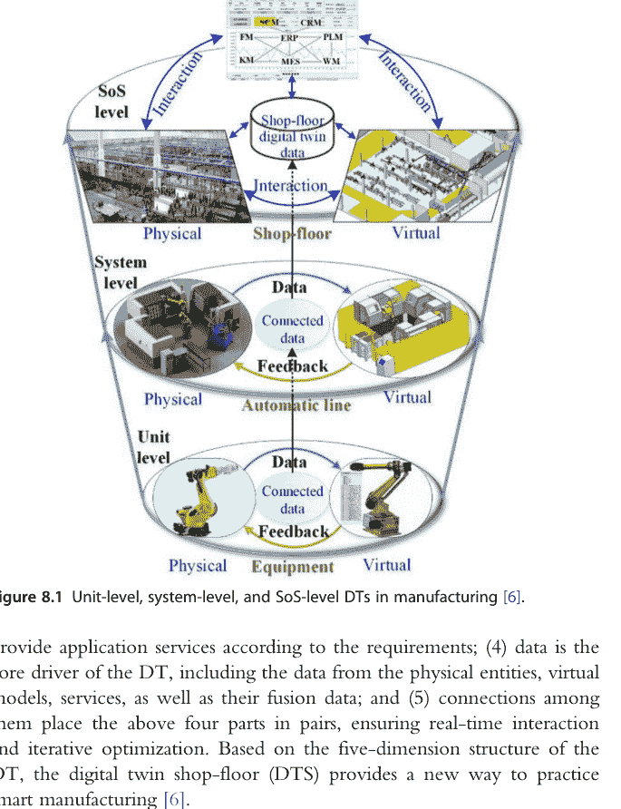

图 8.1 制造中单元级、系统级和 SoS 级 DT [6]。

### 8.3 FROM CLOUD COMPUTING TO FOG COMPUTING AND EDGE COMPUTING

作为互补技术，雾计算和边缘计算在终端


devices and traditional cloud computing [4], offer bright prospects for expanding smart manufacturing applications [16].

#### 8.3.1 云计算

美国国家标准与技术研究院（NIST）将云计算定义为“一种使能够实现无处不在、便捷、按需通过网络访问共享的、可配置的计算资源池（例如网络、服务器、存储、应用程序和服务）的模型，这些资源能够在最少的管理工作或服务提供商交互的情况下快速配置和释放” [3]。由于具有无处不在、便捷、按需资源共享、高计算和存储能力以及低成本等显著优势，云计算对许多大型公司（例如 Amazon、Google、Facebook 等）极具吸引力，这些公司通过互联网提供服务以获得经济和技术效益 [7]。从用户角度来看，云通过基础设施即服务（IaaS）、平台即服务（PaaS）和软件即服务（SaaS）隐藏了底层复杂性和异构性 [8]。用户可以将任务外包给服务提供商，而无需为小任务购买昂贵的设备。云计算的兴起改变了行业和企业做生意的方式，并为其创造了全新的机会。然而，网络不可用、带宽过载和延迟等问题使得云计算无法解决所有问题 [9]。

#### 8.3.2 雾计算

新一代智能设备能够在本地处理数据而不是将其发送到云端，从而实现一种新的分布式计算范式，即雾计算 [9]。雾计算最初由 Cisco 提出，Cisco 是全球领先的网络解决方案提供商之一。雾计算被视为将云计算扩展到边缘网络的延伸，在靠近用户边缘设备的附近提供服务（例如计算、存储等），而不是将数据发送到云端 [9–11]。通过直接在网络上处理数据，例如网络路由器，雾计算范式可以提高效率，减少需要传输的数据量并增强安全性 [8]。雾计算可由位置感知、低延迟、边缘位置、实时交互、互操作性、支持与云在线交互等特征表征 [4,12]。这些特征使得应用服务部署更加便捷。因此，雾计算将在众多面向智能制造的延迟敏感型应用中发挥关键作用。

#### 8.3.3 边缘计算

边缘计算是一种分散的架构，其驱动因素是智能终端的增加、物联网中海量网络设备以及计算机组件成本的降低 [13]。由于其广阔的应用前景，许多公司已致力于边缘计算，例如 Intel、ARM 和华为，它们是信息和通信技术（ICT）设备的主要提供商 [14]。与雾计算类似，边缘计算也允许在网络边缘执行计算，但更接近数据源。因此，边缘可以被定义为更靠近终端侧的资源，这些资源不仅是数据消费者，也是数据生产者 [5]。通过在边缘设备中进行数据分析和处理，边缘计算可以实现底层对象与对象之间的感知、交互和控制。在制造中，边缘计算可以满足制造现场敏捷连接、实时优化等关键需求以及其他应用。

### 8.4 基于边缘计算、雾计算和云计算的三级数字孪生

鉴于新一代信息技术在制造中的广泛应用，制造商面临着数据爆炸式增长 [15]。数字孪生的本质是通过传感器从物理实体和环境中获取数据，然后在虚拟空间中计算和分析，从而控制物理实体和环境。由此建立数据闭环，形成物理空间与虚拟空间之间的交互和融合。制造中不同层级的数字孪生对数据处理和数据流通有不同的要求，例如延迟、带宽、安全等。具有互补属性的边缘计算、雾计算和云计算为单元级、系统级和体系结构级数字孪生的实现提供了新思路和新方法。从资源高效利用的角度来看，基于边缘计算部署的单元级数字孪生、基于雾计算的系统级数字孪生以及基于云计算的体系结构级数字孪生可以实现资产控制、管理、优化和业务优化 [16]。

#### 8.4.1 基于边缘计算的单元级数字孪生

构建单元级数字孪生需要满足的基本要求包括（1）状态感知，（2）数据的计算和处理，以及（3）对物理实体的控制。作为一种将计算、网络和存储能力从云端扩展到边缘的架构，边缘计算通过在边缘节点中对数据进行分析和处理，实现对物体的感知、计算和控制。如图 8.2 所示，具有物理设备（例如机体、主轴、工具等）和网络部件（例如嵌入式系统、传感设备等）的制造资源（例如机器、机器人、部件、AGV 等）构成单元级数字孪生。网络部件可以通过执行器监控和感知物理设备的信息，并通过能够接收控制指令的执行器对物理设备施加控制。由于具有感知、数据分析和控制能力，边缘计算可以部署在单元级数字孪生上，可被视为一个边缘节点。由于数据在单元设备上循环，边缘计算可以实现更小型的应用，从而提供更好的实时响应。边缘计算在单元级提供的实时应用包括传感数据的实时处理和分析、数据缓冲、高性能实时控制、执行器监控、故障诊断、健康特征提取、周期计数累积、故障

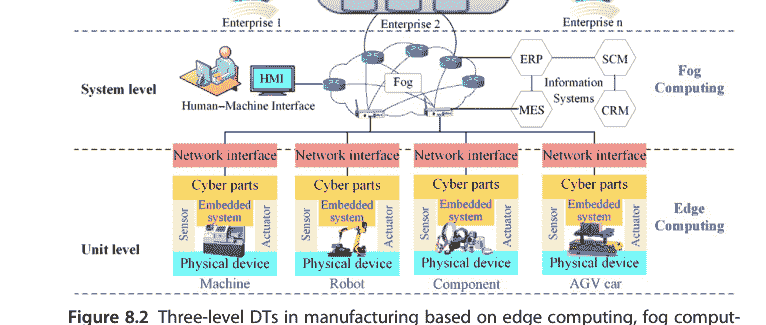

Figure 8.2 Three-level DTs in manufacturing based on edge computing, fog computing, and cloud computing [16].

处理和安全关机。例如，在机床或机械臂上，使用传感器检测某些故障是否可能带来安全隐患。在这种情况下，延迟是不可容忍的。如果数据发送到云端，响应时间可能过长。然而，有了边缘计算，时延得以降低，允许实时做出决策，因为数据离数据源不远。边缘计算架构不依赖于互联网连接，这有利于单元级数字孪生 [16]。

#### 8.4.2 基于雾计算的系统级数字孪生

如图所示 8.2，多個单元级数字孪生通过网络接口和信息管理系统连接，例如企业资源规划（ERP）、制造执行系统（MES）、供应链管理（SCM）和客户关系管理（CRM）。系统级数字孪生集成了多种异构的单元级数字孪生。此外，通过人机界面（HMI），每个单元级数字孪生都可以被访问和控制，以监控和诊断相应系统的状态和健康状况。系统级数字孪生强调其组成元素之间的互联和互操作性。在此基础上，它侧重于不同元素的实时和动态协同控制，以实现物理空间与虚拟空间的协调和统一。一般而言，系统级数字孪生在地理上集中（主要在制造企业内部），非常适合雾计算模型。系统级数字孪生的数据（即企业内部数据）可以直接由雾计算处理以提高效率，而无需传播到云端再返回。考虑到延迟、网络流量、成本等因素，雾计算在网络边缘提供服务，促进实时交互、可扩展性和互操作性。雾计算环境可以由网络组件（例如路由器、代理服务器、基站等）构成。这些组件可以提供不同的计算、存储和网络能力，以支持智能制造应用的实现。单元级数字孪生使用传感器收集每个设备上的运行数据并进行分析。雾计算环境汇总所有单元级数字孪生的数据，并为智能制造提供可操作的信息（例如相互协作完成任务）。


system-level DT in fog computing provides applications that have lower real-time requirements but stronger computation requirements, such as model adaptation, model training, spectrum computing, wavelet transform, alarm priority processing, remote monitoring, accident recording, remote maintenance, performance assessment, and asset visibility. For example, in the actual production process, the robot places materials or parts on the conveyor belt or AGV for transportation, and then machine tools transform them into desired products. In this way, the combination of real-time edge computing and fog computing with interoperability and scalability will provide the best performance for the system-level DT [16].

#### 8.4.3 System of Systems–Level Digital Twin Based on Cloud Computing

The collaborative optimization between multiple system-level DTs can be achieved by developing a smart service platform. As a result, multiple system-level DTs constitute a SoS-level DT. For example, multiple production lines or factories collaborate with each other through a smart cloud service platform, achieving the enterprise-wide system integration during the entire product lifecycle. The SoS-level DT involves various participants and resources, which may be geographically dispersed. The data of the SoS-level DT is more abundant and diverse. Therefore, the requirements that need to be met in the SoS-level DT include (1) providing distributed data storage and processing and (2) providing data and smart services for enterprise collaboration. As shown in Fig. 8.2, the cloud computing architecture is conducive to the organization and management of a large number of connected devices, as well as the combination and integration of enterprise’s internal and external data. In the cloud computing architecture, a variety of different types of storage devices can work together through the application software, to jointly provide data storage and business access for enterprises. Besides, massive data mining must be supported by the distributed processing and virtualization technologies, which are the typical characteristics of cloud computing. Therefore, cloud computing is the ideal technology for long-term and massive data storage and analysis of the SoS-level DT. In addition, services with the characteristics of interoperability pave the way for collaboration among the system-level DTs. In virtue of the cloud architecture, various unit-level DTs, or system-level DTs can be encapsulated into services, so as to become plug-and-play components and be shared by other participants [17]. In this way, manufacturers not only can conveniently provide their services to their collaborative stakeholders, but also use various resources in a pay-as-you-go manner [18]. In summary, the cloud computing architecture provides more architectural flexibility, and higher utilization of external data for product innovation and value creation. For example, supply chain application and product customization can benefit from understanding the aggregate data view [16].

### 8.5 SUMMARY

Regarding the development of manufacturing servitization, socialization, and demand personalization, the promotion and application of smart manufacturing constitute an inevitable trend. Achieving the interaction and integration of the physical space and the virtual space of manufacturing through using state-of-the-art technologies, constitutes an important prerequisite for implementing smart manufacturing. To this end, DT is the preferred technology. The DT can be applied to the entire manufacturing process, the entire supply chain, and the entire product lifecycle. Depending on the scope of resource allocation, the DT can be stratified to the unit level, system level, and SoS level. Because the data generated in different levels have different requirements at time scales, edge computing, fog computing, and cloud computing offer ideal technical solutions for different levels of cyber-physical systems (CPSs) and DTs. The cooperation among edge computing, fog computing, and cloud computing can better meet the requirements of each level of the DT [16].

### REFERENCES

- [1] J. Hochhalter, W.P. Leser, J.A. Newman, V.K. Gupta, V. Yamakov, S.R. Cornell, et al., Coupling damage-sensing particles to the digital twin concept, Available from: https://ntrs.nasa.gov/search.jsp?R = 20140006408.
- [2] N. Guo, C. Jia, Interpretation of cyber-physical systems whitepaper, Inform. Technol. Stand. 4 (2017) 36-47.
- [3] National Institute of Standards and Technology, Cloud computing, Available from: https://csrc.nist.gov/projects/cloud-computing.
- [4] T.V.N. Rao, A. Khan, M. Maschendra, M.K. Kumar, A paradigm shift from cloud to fog computing, Int. J. Sci. Eng. Comput. Technol. 5 (11) (2015) 385-389.
- [5] W. Shi, J. Cao, Q. Zhang, Y. Li, L. Xu, Edge computing: vision and challenges, IEEE Internet Things J. 3 (5) (2016) 637-646.
- [6] Q. Qi, F. Tao, Y. Zuo, D. Zhao, Digital twin service towards smart manufacturing, Procedia CIRP 72 (2018) 237-242.
- [7] A. Botta, W. De Donato, V. Persico, A. Pescapé, Integration of cloud computing and internet of things: a survey, Fut. Gen. Comput. Syst. 56 (2016) 684-700.
- [8] K. Skala, D. Davidovic, E. Afgan, I. Sovic, Z. Sojat, Scalable distributed computing hierarchy: cloud, fog and dew computing, Open J. Cloud Comput. 2 (1) (2015) 16–24.
- [9] J. Pizon, J. Lipski, Perspectives for fog computing in manufacturing, Appl. Comput. Sci. 12 (3) (2016) 37–46.
- [10] S. Yi, Z. Hao, Z. Qin, Q. Li, Fog computing: platform and applications, in: Proceedings of the Third IEEE Workshop on Hot Topics in Web Systems and Technologies (HotWeb), Washington, DC, 2015, pp. 73–78.
- [11] S. Yi, C. Li, Q. Li, A survey of fog computing: concepts, applications and issues, in: Proceedings of the 2015 Workshop on Mobile Big Data, Hangzhou, 2015, pp. 37–42.
- [12] A. Jain, P. Singhal, Fog computing: driving force behind the emergence of edge computing, in: 2016 International Conference System Modeling & Advancement in Research Trends (SMART), Moradabad, 2016, pp. 294–297.
- [13] D.J. Deng, S.Y. Lien, C.C. Lin, S.C. Hung, W.B. Chen, Latency control in software-defined mobile-edge vehicular networking, IEEE Commun. Mag. 55 (8) (2017) 87–93.
- [14] O. Salman, I. Elhajj, A. Kayssi, A. Chehab, Edge computing enabling the Internet of Things, in: 2015 IEEE 2nd World Forum on Internet of Things (WF-IoT), Milan, 2015, pp. 603–608.
- [15] F. Tao, Q. Qi, A. Liu, A. Kusiak, Data-driven smart manufacturing, J. Manuf. Syst. (2018). Available from: https://doi.org/10.1016/j.jmsy.2018.01.006.
- [16] Q. Qi, D. Zhao, T.W. Liao and F. Tao, Modeling of cyber-physical systems and digital twin based on edge computing, fog computing and cloud computing towards smart manufacturing, ASME 2018 13th International Manufacturing Science and Engineering Conference, Texas, 2018, American Society of Mechanical Engineers, pp. V001T05A018-V001T05A018.
- [17] X. Wang, X. Xu, Virtualise manufacturing capabilities in the cloud: requirements, architecture and implementation, Int. J. Manuf. Res. 9 (4) (2014) 348–368.
- [18] X. Wang, X. Xu, An interoperable solution for cloud manufacturing, Robot. Comput. Integr. Manuf. 29 (4) (2013) 232–247.

## CHAPTER 9

## Digital Twin and Big Data

Smart manufacturing is becoming the focus of global manufacturing. As intelligence comes from data, manufacturing big data is beneficial to all aspects of manufacturing. It can accurately predict requirements, and quickly identify errors and bottlenecks, thus innovating products and services, and improving manufacturing processes. Achieving the communication and interaction between the physical and virtual spaces of manufacturing is also an important bottleneck in smart manufacturing. Digital twin (DT) paves the way to solve the above bottlenecks. In this chapter, the similarities and differences between big data and DT and how the two concepts can be integrated to promote smart manufacturing are discussed.

### 9.1 INTRODUCTION

As shown in Fig. 9.1, an increasing number of devices are being connected to the Internet. Gartner predicted that more than 20 billion devices (most from the manufacturing industry) would be connected to the Internet of Things (IoT) by 2020 [1]. As a result, a large volume of various data is being generated, which will be over 40 zettabytes (ZB) by 2020 [2], including structured, semistructured, and unstructured data. With powerful storage and computing capability of cloud computing, big data analysis models and algorithms are running to organize, analyze, and mine these raw data [3,4], and hereby obtain valuable knowledge. Meanwhile, artificial intelligence (AI) with selflearning ability is becoming increasingly more intelligent through data analytics [9].

In manufacturing, big data involves a large volume of structured, semistructured, and unstructured data generated from the product lifecycle. The increasing digitalization of manufacturing is opening up opportunities for smart manufacturing [5]. The manufacturing data are collected in real-time and automatically using IoT [6]. Through big data analysis based on cloud computing, manufacturers can find the bottlenecks of


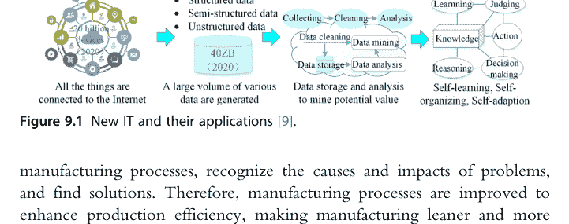

# 图 9.1 新一代信息技术及其应用 [9]。

制造过程，识别问题的原因和影响，并找到解决方案。因此，制造过程得以改进以提高生产效率，使制造更加精益和更具竞争力。所有来自制造大数据的宝贵信息都被反馈以支持产品设计、制造以及预测与健康管理（PHM）。这可以帮助传统制造转型为智能制造 [9]。

此外，制造物理空间与虚拟空间之间的交互与融合正受到越来越多的关注。数字孪生（DT）为 cyber–physical 融合铺平了道路。DT 用于为物理对象创建虚拟模型以数字方式模拟其行为 [7]。虚拟模型可以通过传感数据了解物理实体的状态，从而预测、估计和分析动态变化。而物理对象可以根据仿真得到的优化方案做出响应 [5]。通过 cyber–physical 闭环，DT 能够实现整个制造过程的优化 [8–9]。

总之，收集和分析大量制造数据以发现规律和知识已成为智能制造的关键；同时，DT 打破了物理空间与虚拟空间之间的壁垒。然而，大数据和 DT 之间是否存在相似性和差异？它们各自的优势是什么？是否可能构建一座桥梁将大数据和 DT 联系起来？它们如何融合在一起？这些问题都值得深入研究。对于海量数据而言，数据在数秒内即可产生，先进的数据分析方法应被提出以处理大数据的五大 V。

### 9.3 制造中大数据的生命周期

“制造中大数据生命周期”的研究已在作者之前的作品 [31] 中得到探索。本节介绍该研究中的细节。数据是智能制造的关键使能因素。然而，除非数据被“翻译”成用户可以直接理解的具体信息内容和上下文，否则数据是无用的 [29]。通常，数据需要在经过多个步骤后才能获得具体信息。数据收集、传输、存储、预处理、过滤、分析、挖掘、可视化和应用的完整旅程可被称为“数据生命周期” [30]。制造数据在数据生命周期的各个点被利用。如图 9.3 所示，一个典型的制造数据生命周期包括数据收集、传输、存储、处理、可视化和应用 [31]。

#### 9.3.1 数据来源

在制造中，大数据是指从产品生命周期中产生的数据，例如设计、制造、PHM 等 [24]，其还具有高体量、多样性、高速率、可变性和价值等特征。制造数据通常包括以下方面 [31]，如图 9.3 所示。

- 1. 制造现场数据，包括 (a) 使用工业物联网技术从智能工厂收集的设备数据，涉及实时性能、运行状况等；(b) 从自身和服务系统收集的材料和产品数据，如性能、库存、使用环境等；以及 (c) 环境数据（例如温度、湿度、空气质量等）。
- 2. 来自制造信息系统和计算机辅助系统的管理数据，包括设计方案、订单调度、物料分配、生产计划、营销与销售、服务管理、财务等产生的数据。


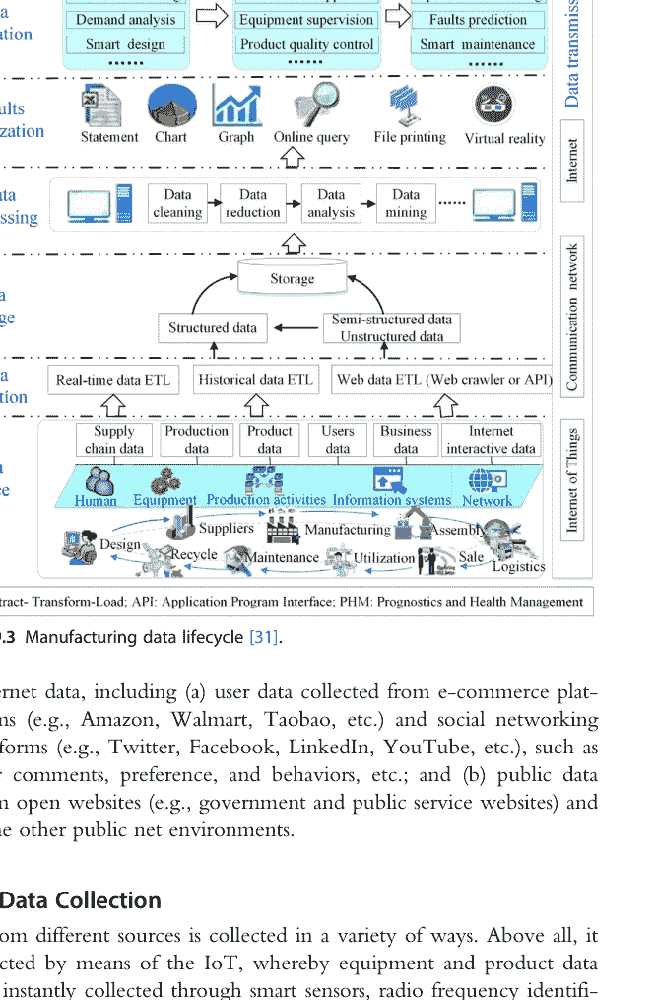

# 图 9.3 制造数据生命周期 [31]。

3. 互联网数据，包括 (a) 从电子商务平台（如 Amazon、Walmart、Taobao 等）和社交网络平台（如 Twitter、Facebook、LinkedIn、YouTube 等）收集的用户数据，例如用户评论、偏好和行为等；以及 (b) 来自开放网站（如政府和公共服务网站）和其他公共网络环境的一些公开数据。

#### 9.3.2 数据收集

来自不同来源的数据以多种方式收集。首先，它是通过物联网收集的，通过智能传感器、射频识别（RFID）和其他传感设备，可以即时收集设备和产品数据，从而实现对设备和产品健康状况的实时监控 [32,33]。例如，内置传感器能够持续测量、监控并报告制造设备和产品的运行状态，如温度、压力和振动。RFID 能够实现对大量工件以及生产所需材料的自动识别、跟踪和管理。此外，新兴的移动互联网为通过智能终端（如个人电脑、手机、笔记本电脑和平板电脑等设备）收集用户数据铺平了道路。例如，通过软件开发工具包（SDK）或应用程序编程接口（API），可以收集基本用户数据，包括用户数量、用户画像、位置和时间等。此外，网络爬虫 [34] 是一种广泛使用的数据获取技术，用于根据工程师和人工智能预先定义的一定条件收集公开数据。网络爬虫是指部署“爬虫”（即计算机程序）浏览公共网页并收集所需信息的技术。网络爬虫技术使制造商能够以自动和高效的方式获取公开数据。最后但同样重要的是，制造信息系统中的管理数据可以通过数据库技术随时获取和使用 [31]。

#### 9.3.3 数据存储

从制造过程中收集的大量数据必须得到安全存储和有效整合。一般来说，各种类型的制造数据可分为结构化（如数字、符号、表格等）、半结构化（如树、图、XML 文档等）和非结构化数据（如日志、音频、视频、图像等）[35]。传统上，制造企业非常重视结构化数据存储，因为在企业数据库中直接管理非结构化数据很困难。基于对象的存储架构使数据集合能够作为对象进行存储和管理，为整合半结构化和非结构化数据提供了一种更灵活的解决方案 [36]。此外，通过云计算 [37]，数据存储可以以高度成本效益、节能和灵活的方式实现。此外，通过云服务，数据的分布性和异构性被屏蔽，从而实现高度可扩展和可共享的数据存储模式 [31]。

#### 9.3.4 数据处理

数据处理是指为从大量数据中发现知识而进行的一系列操作。数据必须被转换为信息和知识，以便制造商做出明智和理性的决策。首先，数据必须经过仔细预处理，以去除冗余、误导、重复和不一致的信息。具体而言，数据清洗涉及缺失值、格式、重复和垃圾数据的清洗。数据缩减是将海量数据通过特征或案例选择等手段转化为有序、有意义和简化的形式的过程 [38]。数据缩减完成后，清洗和简化的数据通过数据分析和挖掘被利用以生成新信息。数据分析的有效性可通过多种技术显著增强，包括机器学习、大规模计算和使用预测模型。一些先进的数据挖掘方法包括聚类、分类、关联规则、回归、预测和偏差分析 [30]。通过上述数据处理工作，可以从大量动态和模糊的原始数据中得出可理解的知识 [31, 39]。

#### 9.3.5 数据可视化

可视化旨在通过图形手段清晰地传达和沟通信息，使终端用户能够以更明确的方式理解数据 [40]。最常用的可视化技术包括报表、图表、示意图、图形和虚拟现实 [41]。实时数据可通过用户智能终端在线可视化。通过可视化，数据处理的结果变得更易获取、更直接、更用户友好 [31]。

#### 9.3.6 数据传输

数据在不同的信息系统、信息物理系统和人工操作员之间持续流动。因此，数据传输在维持分布式制造系统和资源之间的通信和交互方面发挥着关键作用。物联网、互联网和通信网络的最新进展大大巩固了实时、可靠和安全传输不同类型数据的技术基础。因此，分布式制造资源几乎可以在任何时间、任何地点得到有效整合 [31]。

#### 9.3.7 数据应用

数据已进入制造企业日常生产和运营的几乎所有方面 [8]。首先，在设计阶段，通过数据分析，揭示了关于客户、竞争对手和市场的新的见解。基于通过数据分析形成[content]


# 图 9.3 制造数据生命周期 [31]。

3. 互联网数据，包括 (a) 从电子商务平台（如 Amazon、Walmart、Taobao 等）和社交网络平台（如 Twitter、Facebook、LinkedIn、YouTube 等）收集的用户数据，例如用户评论、偏好和行为等；以及 (b) 来自开放网站（如政府和公共服务网站）和其他公共网络环境的一些公开数据。

#### 9.3.2 数据收集

来自不同来源的数据以多种方式收集。首先，它是通过物联网收集的，通过智能传感器、射频识别（RFID）和其他传感设备，可以即时收集设备和产品数据，从而实现对设备和产品健康状况的实时监控 [32,33]。例如，内置传感器能够持续测量、监控并报告制造设备和产品的运行状态，如温度、压力和振动。RFID 能够实现对大量工件以及生产所需材料的自动识别、跟踪和管理。此外，新兴的移动互联网为通过智能终端（如个人电脑、手机、笔记本电脑和平板电脑等设备）收集用户数据铺平了道路。例如，通过软件开发工具包（SDK）或应用程序编程接口（API），可以收集基本用户数据，包括用户数量、用户画像、位置和时间等。此外，网络爬虫 [34] 是一种广泛使用的数据获取技术，用于根据工程师和人工智能预先定义的一定条件收集公开数据。网络爬虫是指部署“爬虫”（即计算机程序）浏览公共网页并收集所需信息的技术。网络爬虫技术使制造商能够以自动和高效的方式获取公开数据。最后但同样重要的是，制造信息系统中的管理数据可以通过数据库技术随时获取和使用 [31]。

#### 9.3.3 数据存储

从制造过程中收集的大量数据必须得到安全存储和有效整合。一般来说，各种类型的制造数据可分为结构化（如数字、符号、表格等）、半结构化（如树、图、XML 文档等）和非结构化数据（如日志、音频、视频、图像等） [35]。传统上，制造企业非常重视结构化数据存储，因为在企业数据库中直接管理非结构化数据很困难。基于对象的存储架构使数据集合能够作为对象进行存储和管理，为整合半结构化和非结构化数据提供了一种更灵活的解决方案 [36]。此外，通过云计算 [37]，数据存储可以以高度成本效益、节能和灵活的方式实现。此外，通过云服务，数据的分布性和异构性被屏蔽，从而实现高度可扩展和可共享的数据存储模式 [31]。

#### 9.3.4 数据处理

数据处理是指为从大量数据中发现知识而进行的一系列操作。数据必须被转换为信息和知识，以便制造商做出明智和理性的决策。首先，数据必须经过仔细预处理，以去除冗余、误导、重复和不一致的信息。具体而言，数据清洗涉及缺失值、格式、重复和垃圾数据的清洗。数据缩减是将海量数据通过特征或案例选择等手段转化为有序、有意义和简化的形式的过程 [38]。数据缩减完成后，清洗和简化的数据通过数据分析和挖掘被利用以生成新信息。数据分析的有效性可通过多种技术显著增强，包括机器学习、大规模计算和使用预测模型。一些先进的数据挖掘方法包括聚类、分类、关联规则、回归、预测和偏差分析 [30]。通过上述数据处理工作，可以从大量动态和模糊的原始数据中得出可理解的知识 [31, 39]。

#### 9.3.5 数据可视化

可视化旨在通过图形手段清晰地传达和沟通信息，使终端用户能够以更明确的方式理解数据 [40]。最常用的可视化技术包括报表、图表、示意图、图形和虚拟现实 [41]。实时数据可通过用户智能终端在线可视化。通过可视化，数据处理的结果变得更易获取、更直接、更用户友好 [31]。

#### 9.3.6 数据传输

数据在不同的信息系统、信息物理系统和人工操作员之间持续流动。因此，数据传输在维持分布式制造系统和资源之间的通信和交互方面发挥着关键作用。物联网、互联网和通信网络的最新进展大大巩固了实时、可靠和安全传输不同类型数据的技术基础。因此，分布式制造资源几乎可以在任何时间、任何地点得到有效整合 [31]。

#### 9.3.7 数据应用

数据已进入制造企业日常生产和运营的几乎所有方面 [8]。首先，在设计阶段，通过数据分析，揭示了关于客户、竞争对手和市场的新的见解。基于通过数据分析形成


## 表 9.1 制造中 DT 与大数据比较 [9]

| 项目 | 大数据 | 数字孪生 |
|---|---|---|
| 背景 | 新一代信息技术的快速发展和广泛应用以及数据量的指数级增长 | 新一代信息技术的快速发展以及对 cyber-physical 融合的渴望 |
| 概念 | 包括数据和处理<br>聚焦于大体量和价值 | 包括物理空间和虚拟空间以及连接两个空间的数据<br>聚焦于虚实双重映射 |
| 功能 | 挖掘行为特征和模式<br>洞察趋势<br>数据可视化<br>预测和分析问题<br>辅助决策<br>优化和改进流程 | 虚拟验证<br>仿真运行<br>超高保真实时监控<br>预测和诊断问题<br>优化和改进流程 |
| 应用 | 产品生命周期从设计到 PHM 等 | 产品生命周期从设计到 PHM 等 |
| 效果 | 提高效率、客户满意度和管理精度<br>延长产品和设备寿命<br>降低成本<br>推动智能制造 | 提高效率、客户满意度和管理精度<br>延长产品和设备寿命<br>降低成本和开发周期<br>推动智能制造 |
| 关键技术 | 物联网<br>云计算<br>数据清洗<br>数据挖掘<br>机器学习等 | 物联网<br>虚拟现实<br>增强现实<br>CPS<br>仿真等 |
| 数据来源 | 来自产品生命周期各阶段的物理实体、信息系统和互联网 | 来自产品生命周期各阶段的物理实体、虚拟模型及其融合 |
| 数据量 | 较大，从拍字节（PB）到艾字节（EB），甚至泽字节（ZB） | 无具体数量 |
| 数据特征 | 结构化、半结构化和非结构化数据 | 结构化、半结构化和非结构化数据 |
| 多源关联 | 聚焦于数据属性并突出特征间的关系 | 聚焦于多源数据的一致性及其演化和集成 |
| 数据采集工具 | 传感器、RFID 和其他传感设备<br>SDK、API<br>网络爬虫等 | 传感器、RFID 和其他传感设备<br>模型/数据接口等 |
| 数据处理 | 通过大数据处理工具、算法平台等进行 | 无特定方法 |
| 数据融合 | 产品生命周期单一阶段内各类对象的数据融合 | 产品生命周期中全要素、全流程、全业务数据融合 |
| 时效性和准确性 | 高 | 高 |
| 可视化 | 表格、图表、图形和文件打印等 | 图像、视频、虚拟和增强现实等 |
| 结果验证 | 通过物理执行过程或第三方仿真进行<br>相对较慢 | 通过自身虚拟仿真和演化功能在实际执行前进行验证<br>相对更先进 |

不同之处在于，它们的背景大致相同，即新一代信息技术的前进和广泛应用。

大数据的所有功能都源于数据处理。大数据分析可以识别行为特征和模式，提供趋势洞察，并帮助用户做出决策。大数据的预测或优化能力是通过训练数据集或比较历史结果实现的。而 DT 的功能则依赖于虚拟模型的仿真和演化。通过超高保真的虚拟模型，DT 可以根据物理空间的实际运行规则，独立仿真整个运行过程。与大数据相比，DT 可以在虚拟空间中直观地运行和验证制造过程。然而，尽管实现方法各有特点，两者在大部分功能上是相同的。例如，两者都可以预测和诊断问题，以及实时监控、优化和改进制造过程。

此外，相同的功能导致相似的效果。它们都以各自的方式提高生产效率、客户满意度和管理的精确度，并降低成本，从而推动智能制造。此外，它们还延长产品和设备的使用寿命并缩短开发周期。

总之，尽管大数据和 DT 在某些细节上有所不同，但在背景、功能和效果的整体方向上是一致的。因此，它们有相互合作的基础。

### 9.4.1.2 大数据与数字孪生的差异

就概念而言，大数据的内容相对简单，强调数据中隐藏的大规模和价值。为了从海量数据中提取价值，大数据使用与传统方法不同的先进工具和算法 [46]。而 DT 由三个部分组成，其中数据是其组成部分之一。DT 更关注虚实双重映射。虽然两者都涉及数据，但在工具、算法和平台方面，大数据更专业，在数据处理方面比 DT 更高效，如 9.4.2.1 节所述。因此，大数据可以服务于 DT。

就应用而言，两者都应用于从设计到 PHM 的产品生命周期各个阶段。然而，与 DT 相比，大数据在制造中的应用在生命周期各阶段之间存在壁垒。由于设计师、制造商、服务人员等可能来自不同的公司，某一阶段的数据有时只能在其自身阶段使用。考虑到利益和数据共享安全，它并未完全实现产品生命周期中数据的连续流动。相比之下，DT 可以收集、记录、积累和综合处理从产品设计到退役的所有数据。它不仅有利于产品的设计、制造、使用和 PHM，还可以为下一代产品做出贡献。因此，DT 可以弥补大数据在产品生命周期中打破壁垒方面的不足。

此外，大数据和 DT 共享一些关键技术，如物联网。然而，大数据更侧重于与数据相关的技术，例如云计算、数据清洗、数据挖掘、机器学习等，而 DT 更关注与 cyber-physical 融合相关的技术，例如仿真、虚拟现实、增强现实、cyber-physical 系统（CPS）等。它们关键技术的结合将更有效地应用于产品生命周期。

总之，尽管两者侧重点不同，但各有优势。而且，它们的优势互补，可以弥补各自的不足。因此，它们有合作的结合点。

### 9.4.2 从数据视角的比较

数据是大数据和 DT 的共同内容。两者在数据方面的各自优势分析如下。

#### 9.4.2.1 大数据相对于数字孪生的优势

首先，大规模是大数据概念的固有属性。大数据的体量从 PB 到 EB，甚至到 ZB。这种丰富的数据意味着丰富的信息和知识。相比之下，DT 并未指明数据的具体数量，只要数据作为 DT 的重要组成部分不不足即可。然而，通过比较，大数据中收集、存储、管理、分析和计算的数据量肯定多于 DT。因此，大数据更适合从更大体量的数据中提取知识。

就多源关联而言，大数据关注数据属性并突出特征之间的关系。大数据用于通过挖掘行为特征和模式来发现相关性和知识。DT 关注多源数据的一致性，有助于仿真和推导制造过程。数据不一致会导致冲突。因此，大数据更适合更大种类的数据。

此外，由于海量数据无法在合理时间内使用常规数据工具进行处理，大数据处理拥有自己的先进工具、算法和平台。而 DT 的数据处理方法并未明确。因此，大数据中更专业的数据处理速度比 DT 更高效。

总之，在数据量、价值、种类和速度方面，大数据比 DT 更专业和高效，这与大数据的特征一致。这进一步深化了大数据服务于 DT 的作用。

#### 9.4.2.2 数字孪生相对于大数据的优势

由于 DT 由三个部分组成，DT 的数据源与大数据不同。大数据中的数据来自物理实体、信息系统和互联网，均由物理空间中的活动产生。DT 中的数据不仅来自物理空间，还来自虚拟模型。此外，部分数据来源于融合操作，如综合、统计、关联、聚类、演化、回归和泛化。根据不同的数据源，数据采集工具也不同。除了它们共享的来自物理空间的数据工具（如传感器、RFID 等）外，DT 还需要模型数据接口来收集来自虚拟空间的数据，而制造中的大数据不需要。因此，DT 拥有更全面的数据可供使用。

此外，大数据的数据融合是由于不同阶段之间的壁垒，导致产品生命周期单一阶段内各类对象数据的融合。而 DT 的数据融合涉及全要素、全流程和全业务。DT 可以实现产品生命周期不同阶段之间的数据共享和集成。因此，DT 扩展了制造数据的应用范围，从而避免了重复和浪费。


就结果呈现方式而言，大数据更倾向于使用二维和静态工具，例如表格、图表、图形和文件打印。由于其虚拟模型，数字孪生（DT）中的可视化更具视觉性，多为三维和动态，使用图像、视频以及虚拟现实和增强现实。此外，由于大数据的对象只是数据，结果分析的验证必须通过物理执行过程，或由第三方进行仿真，这相对较慢。而数字孪生凭借其自身的虚拟仿真功能，可以在虚拟空间中完成结果的预验证。因此，在可视化和结果验证方面，数字孪生更为先进和便捷。

总体而言，从数据角度看，大数据在数据方面比数字孪生更强大，而数字孪生在应用方面比大数据更胜一筹。因此，将数字孪生与大数据相结合进行开发是理想的选择。

### 9.5 大数据与数字孪生的互补性

智能制造中存在许多可见和不可见的问题，这些问题可以通过数据反映出来。大数据为制造带来了更高效、更敏锐的洞察力和更强的智能化。然而，随着制造工艺变得越来越复杂，很难在众多工艺中快速识别出现的问题。在一般的制造过程中，设计人员和制造人员隶属于不同的部门或系统，且各自独立工作。设计人员将产品概念和设计方案提交给制造部门，制造部门再思考如何实施。这很容易导致产品信息丢失。一旦设计变更，很难在制造过程中实现同步更新。此外，由于加工和装配错误等因素，实际制造实施和生产计划可能并不完全一致，从而限制了制造效果。制造过程也可能无法满足所有设计要求。此外，常见的产品维护方法往往是被动的而非主动的，并且通常基于启发式经验。许多故障只能在使用产品时才能诊断出来。因此，问题就在于：如何将从制造过程中收集的有效信息反馈到产品设计阶段？如何实现制造计划与实施之间的关联和动态调整？如何实现故障预测、诊断和维护的数字化？这些都是巨大的挑战。大数据分析与数字孪生的结合为解决上述挑战铺平了道路。数字孪生可以将产品生命周期的不同阶段整合起来，打破数据壁垒。同时，大数据技术可以快速处理数据并为制造提供洞察，以帮助做出决策。此外，秉承“制造即服务”（MaaS）的理念，以服务为导向的智能制造受到了广泛关注。作为一种有效手段，服务可以实现大规模智能应用和制造协作。因此，如图 9.4 所示，数字孪生、大数据和服务形成统一体，共同推动智能制造 [9]。

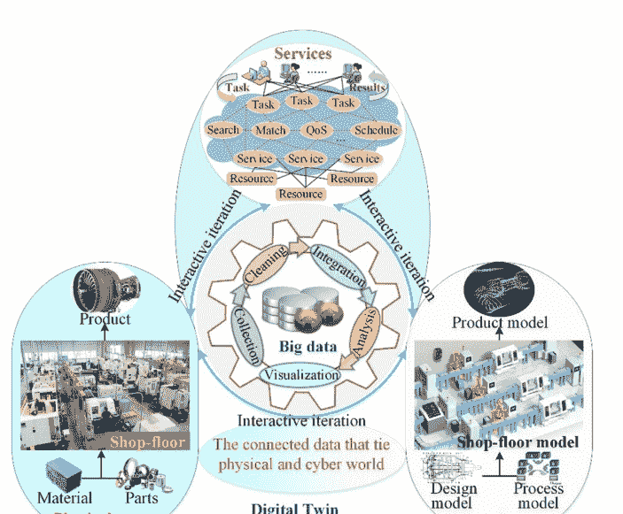

图 9.4 制造中数字孪生、大数据和服务的融合 [9]。

### 9.6 制造中数字孪生与大数据的融合

#### 9.6.1 由数字孪生与大数据融合驱动的产品设计

在设计阶段，产品创新依赖于对市场偏好和客户需求的准确解读，以及将客户声音转化为产品特性和质量要求的能力。大数据使设计人员能够推动产品创新，并开发更定制化的产品。在基于大数据确认产品概念后，可以借助数字孪生设计产品的功能结构和零部件。在传统设计模式中，完成设计后，必须先制造一些关键零部件，以便制造商评估设计质量和可行性。然而，利用数字孪生和大数据，可以创建生动的仿真场景，预测设计产品的成品质量，并在虚拟空间中识别设计缺陷。零部件的制造和装配使用模拟实际生产过程的虚拟模型。在这种情况下，设计的零件是否可以制造、零件是否可以装配、零件之间是否会相互干涉、设计方案是否符合相关规范和功能要求，都可以快速验证。如果设计方案无法通过仿真测试，则必须实时重新设计产品。当产品被重新设计时，将使用大数据技术来识别问题以改进设计方案。在产品设计过程中，所需工具和算法以服务的形式使用。因此，数字孪生结合大数据缩短了设计周期，从而减少了时间和金钱成本 [9]。

#### 9.6.2 由数字孪生与大数据融合驱动的生产

在生产阶段，数字孪生结合大数据可以实现生产计划的优化和生产过程的实时调整。在生产开始之前，有必要通过确认每个必需资源是否可用来改进生产计划。首先，如图 9.4 中服务部分所示，通过超网络为基础的制造资源服务进行供需匹配和调度 [47]，以快速找到可用资源。在此基础上，将所有流程和执行生产任务的资源整合在一起进行分析和规划。结合大数据分析，数字孪生的虚拟空间模拟和评估不同的生产策略和计划，直到获得令人满意的生产计划。获得最佳生产计划后，将其交付到物理空间以指导实际生产。如果生产中的所有流程都符合计划，生产就可以顺利进行。否则，故障和错误可能会时有发生。在这种情况下，实时数据直接从制造资源收集，以驱动虚拟模型模拟生产过程。实际生产结果和计划在数字孪生的虚拟空间中进行评估。如果存在差异，则使用大数据分析找出原因并制定解决方案，例如调整设备条件或修改计划。在迭代交互中，数字孪生结合大数据确保生产能够完全按照最佳计划实施。此外，一旦设计变更，生产过程就可以在数字孪生的虚拟空间中轻松更新，包括更新物料清单、工艺和分配新资源。调整生产计划后，整个生产过程将再次模拟，以进一步优化并最大化所有资源利用率。因此，使用数字孪生结合大数据技术，可以更好地理解和监控生产计划和实施，实现智能生产 [9]。

#### 9.6.3 由数字孪生与大数据融合驱动的 PHM

在产品的日常运行中，通过物理产品与虚拟模型之间的交互，可以快速识别问题，从而提高 PHM 的效率。首先，虚拟空间中的虚拟模型通过传感器收集的实时数据与物理产品同步。产品的运行状态和零部件的健康状况得以实时掌握。此外，作为传感器数据的补充，数字孪生还整合了历史维护数据和来自大数据挖掘的数据，例如行为、操作规则、能耗特征等特征和模式。通过对上述数据进行大数据分析，数字孪生可以持续预测产品的健康状况和剩余寿命。数字孪生结合大数据还可以通过比较特定场景下实际产品响应和预期产品响应来揭示未知问题。一旦发现隐藏的产品问题或故障


发生时，维护程序在 DT 的虚拟空间中进行模拟和优化以便于实际维护。这样，根据实时产品状态和历史记录，可以评估产品是否需要维护。同样，资源、能力、工具和算法以服务的形式使用。因此，借助大数据的 DT 延长了产品寿命并提高了 PHM 效率 [9]。

### 9.7 总结

尽管存在差异，DT 和大数据在制造业中发挥着互补的作用。大数据可以被视为 DT 的重要组成部分。没有大数据，DT 的大多数功能将是空中楼阁。没有 DT，大数据分析和实际制造过程将不会并行。DT 与大数据合作，打破了产品生命周期不同阶段之间的壁垒，并缩短了开发和验证周期。结合大数据的精确分析与预测能力，DT 可以在从产品设计到验证、从制造到 PHM 等许多方面实现精细化管理，从而提高生产计划并实现更精确的生产控制。DT 和大数据理想情况下应一起使用并相互补充，共同推动智能制造的发展 [9]。

### 参考文献

- [1] D. Mourtzis, E. Vlachou, N. Milas, Industrial big data as a result of IoT adoption in manufacturing, Procedia CIRP 55 (2016) 290–295.
- [2] J. Gantz, D. Reinsel, The digital universe in 2020: big data, bigger digital shadows, and biggest growth in the far east, IDC iView: IDC Analyze the Future 2007 2012 (2012) 1–16.
- [3] I.A.T. Hashem, I. Yaqoob, N.B. Anuar, S. Mokhtar, A. Gani, S.U. Khan, The rise of "big data" on cloud computing: review and open research issues, Inform. Syst. 47 (2015) 98–115.
- [4] S. Yi, C. Li, Q. Li, A survey of fog computing: concepts, applications and issues, in: Proceedings of the 2015 Workshop on Mobile Big Data. ACM, Hangzhou, 2015, pp. 37–42.
- [5] R. Rosen, G. Von Wichert, G. Lo, K.D. Bettenhausen, About the importance of autonomy and digital twins for the future of manufacturing, IFAC-PapersOnLine 48 (3) (2015) 567–572.
- [6] F. Tao, Y. Zuo, L.D. Xu, L. Zhang, IoT-based intelligent perception and access of manufacturing resource toward cloud manufacturing, IEEE Trans. Ind. Inform. 10 (2) (2014) 1547–1557.
- [7] J. Hochhalter, W.P. Leser, J.A. Newman, V.K. Gupta, V. Yamakov, S.R. Cornell, et al., Coupling damage-sensing particles to the digital twin concept, Available from: https://ntrs.nasa.gov/search.jsp?R = 20140006408.
- [8] F. Tao, J. Cheng, Q. Qi, M. Zhang, H. Zhang, F. Sui, Digital twin-driven product design, manufacturing and service with big data, Int. J. Adv. Manuf. Technol. 94 (9–12) (2018) 3563–3576.
- [9] Q. Qi, F. Tao, Digital twin and big data towards smart manufacturing and industry 4.0: 360 degree comparison, IEEE Access 6 (2018) 3585–3593.
- [10] E.J. Huth, The information explosion, Bull. N. Y. Acad. Med. 65 (6) (1989) 647.
- [11] T. Manabe, O. Murakami, K. Takeuchi, J. Matsuura, Information collecting and/or service furnishing systems by which a user can request information from a central data base using a portable personal terminal and an access terminal, U.S. Patent No. 5,339,239, 16 August 1994.
- [12] W.B. Frakes, R. Baeza-Yates, Information Retrieval: Data Structures & Algorithms, Prentice Hall, Englewood Cliffs, New Jersey, 1992.
- [13] J.W. Payne, Task complexity and contingent processing in decision making: an information search and protocol analysis, Organ. Behav. Hum. Perform. 16 (2) (1976) 366–387.
- [14] M. Cox, D. Ellsworth, Application-controlled demand paging for out-of-core visualization, Proceedings of the 8th Conference on Visualization'97, IEEE Computer Society Press, USA, 1997, pp. 235–244.
- [15] D.J. Power, A brief history of decision support systems. Available from: http://dssresources.com/history/dsshistory.html.
- [16] H. Chen, R.H.L. Chiang, V.C. Storey, Business intelligence and analytics: from big data to big impact, MIS Quart. (2012) 1165–1188.
- [17] J. Manyika, M. Chui, B. Brown, J. Bughin, R. Dobbs, C. Roxburgh, et al., Big data: the next frontier for innovation, competition, and productivity, Technical report, McKinsey Global Institute, Available from: http://www.mckinsey.com/Insights/MGI/Research/Technology_and_Innovation/Big_data_The_next_frontier_for_innovation.
- [18] P. Lyman, H.R. Varian, Reprint: how much information? J. Electron. Publ. 6 (2) (2000).
- [19] D. Laney, 3D data management: controlling data volume, velocity and variety, META Group Res. Note 6 (70) (2001).
- [20] M. Hilbert, P. López, The world's technological capacity to store, communicate, and compute information, Science 332 (6025) (2011) 60–65.
- [21] M. Knights, Web 2.0 [web technologies], Commun. Eng. 5(1) (2007) 30–35.
- [22] J.F. Gantz, The expanding digital universe: a fore-cast of worldwide information growth 2010, Available from: http://www.emc.com/collateral/analyst-reports/expanding-digital-ide-white-paper.pdf.
- [23] R. Bryant, R.H. Katz, E.D. Lazowska, Big-data computing: creating revolutionary breakthroughs in commerce, science and society, Available from: http://www.datascienceassn.org/sites/default/files/Big%20Data%20Computing%202008%20Paper.pdf.
- [24] J. Li, F. Tao, Y. Cheng, L. Zhao, Big data in product lifecycle management, Int. J. Adv. Manuf. Technol. 81 (1–4) (2015) 667–684.
- [25] K.S. Babu, D.D.N. Rao, A. Balakrishna, C.S. Rao, Development of a manufacturing database system for STEP-NC data from express entities, Int. J. Eng. Sci. Technol. 2 (11) (2010) 6819–6828.
- [26] S. Lohr, The age of big data, New York Times 11 (2012).
- [27] P. Russom, Big data analytics, TDWI Best Practices Report, Fourth Quarter 19 (4) (2011) 1–34.
- [28] R. Gupta, H. Gupta, M. Mohania, Cloud computing and big data analytics: what is new from databases perspective? International Conference on Big Data Analytics, Springer, Berlin, Heidelberg, 2012, pp. 42–61.
- [29] J. Lee, E. Lapira, B. Bagheri, H.A. Kao, Recent advances and trends in predictive manufacturing systems in big data environment, Manuf. Lett. 1 (1) (2013) 38–41.
- [30] A. Siddiqa, I.A.T. Hashem, I. Yaqoob, M. Marjani, S. Shamshirand, A. Gani, et al., A survey of big data management: taxonomy and state-of-the-art, J. Netw. Comput. Appl. 71 (2016) 151–166.
- [31] F. Tao, Q. Qi, A. Liu, A. Kusiak, Data-driven smart manufacturing, J. Manuf. Syst. (2018). Available from: https://doi.org/10.1016/j.jmsy.2018.01.006.
- [32] Y. Zhang, G. Zhang, J. Wang, S. Sun, S. Si, T. Yang, Real-time information capturing and integration framework of the internet of manufacturing things, Int. J. Comput. Integr. Manuf. 28 (8) (2015) 811–822.
- [33] F. Tao, J. Cheng, Q. Qi, IIHub: an industrial internet-of-things hub towards smart manufacturing based on cyber–physical system, IEEE Trans. Ind. Inform. 4 (5) (2018) 2271–2280.
- [34] A. Guerriero, F. Ragni, C. Martines. A dynamic URL assignment method for parallel web crawler, in: Proceedings of 2010 IEEE International Conference on Computational Intelligence for Measurement Systems and Applications, Taranto, 2010, pp. 119–123.
- [35] A. Gandomi, M. Haider, Beyond the hype: big data concepts, methods, and analytics, Int. J. Inform. Manag. 35 (2) (2015) 137–144.
- [36] B. Nicolae, G. Antoniu, L. Bougé, D. Moise, A. Carpen-Amarie, BlobSeer: next-generation data management for large scale infrastructures, J. Parallel Distrib. Comput. 71 (2) (2011) 169–184.
- [37] D. Agrawal, A. El Abbadi, S. Antony, S. Das, Data management challenges in cloud computing infrastructures, International Workshop on Databases in Networked Information Systems, Springer, Berlin, Heidelberg, 2010, pp. 1–10.
- [38] J. Huang, Y.F. Li, M. Xie, An empirical analysis of data preprocessing for machine learning-based software cost estimation, Inform. Softw. Technol. 67 (2015) 108–127.
- [39] E. Begoli, J.L. Horey, Design principles for effective knowledge discovery from big data, in: 2012 Joint Working IEEE/IFIP Conference on Software Architecture (WICSA) and European Conference on Software Architecture (ECSA), 2012, pp. 215–218.
- [40] M.D. Lee, M.A. Butavicius, R.E. Reilly, Visualizations of binary data: a comparative evaluation, Int. J. Hum. Comput. Stud. 59 (5) (2003) 569–602.
- [41] S. Mittal, M.A. Khan, D. Romero, T. Wuest, Smart manufacturing: characteristics, technologies and enabling factors, Proc. Inst. Mech. Eng. B: J. Eng. Manuf. (2017). Available from: https://doi.org/10.1177/0954405417736547.
- [42] Y. Liu, J. Jin, P. Ji, J.A. Harding, R.Y.K. Fung, Identifying helpful online reviews: a product designer's perspective, Comput. Aided Des. 45 (2) (2013) 180–194.
- [43] A. Bennane, S. Yacout, LAD-CBM: new data processing tool for diagnosis and prognosis in condition-based maintenance, J. Intell. Manuf. 23 (2) (2012) 265–275.
- [44] A. Kusiak, A. Verna, Analyzing bearing faults in wind turbines: a data-mining approach, Renew. Energy 48 (2012) 110–116.
- [45] E.J. Tuegel, A.R. Ingraffea, T.G. Eason, S.M. Spottswood, Reengineering aircraft structural life prediction using a digital twin, Int. J. Aerospp. Eng. 11 (2011) 154798.
- [46] M. Chen, S. Mao, Y. Liu, Big data: a survey, Mobile Netw. Appl. 19 (2) (2014) 171–209.
- [47] F. Tao, J. Cheng, Y. Cheng, S. Gu, T. Zheng, H. Yang, SDMSim: a manufacturing service supply–demand matching simulator under cloud environment, Robot. Comput. Integr. Manuf. 45 (2017) 34–46.


## 第10章
## 数字孪生与服务

数字孪生（DT）为制造的 cyber-physical 融合提供了一种有效的方式。同时，服务可以使制造中的所有业务流程和操作程序实现服务化和标准化，从而实现更高的效率。结合服务，DT 将更容易使用，并且在产品设计、制造、使用、预测与健康管理（PHM）以及其他流程上产生更可接受的分析和评估结果。本章规定并强调了制造服务是什么，制造服务与 DT 如何融合，以及 DT 的各个组件如何以服务的形式被制造商使用。

### 10.1 引言

随着制造向社会化和服务化演进，服务在制造中的作用日益重要 [1]。越来越多的制造商采用服务逻辑来应对激烈的竞争并获得更多收入 [2]。服务可以屏蔽由不同供应商使用各种标准和通信协议/接口执行的资源的异构性，并实现交互和集成 [3]。服务具有按需使用、动态重构和平台独立性等特征 [4]，使制造具备大规模共享和协作的进步 [30]。

鉴于一切即服务（XaaS）的概念，服务可以充分释放数字孪生（DT）的潜力。通过服务，DT 的每个组件，尤其是难以快速创建的虚拟模型，都可以以便捷的“按需付费”方式共享和使用 [5]。此外，服务是 DT 工作流程中的一个组成部分，许多操作需要第三方服务的支持。例如，多源数据融合需要算法、计算和存储服务 [30]。因此，本章将 DT 与服务结合，并规定了 DT 服务的生成、管理与应用。

### 10.2 制造中的服务

#### 10.2.1 制造服务化的概念

本节介绍了制造服务化的概念，该概念已由作者在先前的工作中研究过 [26]。服务化一词由 Vandermerwe 等人在 1988 年提出，用来描述越来越多的公司通过服务为其核心产品增加价值的现象，这是由客户需求驱动的 [6]。事实上，服务化被概念化为组织能力和流程的创新 [7]。越来越多的公司已经扩展了其服务的范围以增强市场竞争力并获得更多收入 [8]。在这种背景下，面向服务的架构（SoA）[9] 为服务化提供了有效技术，并已应用于各种先进的制造模式和系统，例如应用服务提供商（ASP）[10]、制造网格（MGrid）[11,12]、产品服务系统（PSS）/工业 PSS（IPS2）[13,14]，以及云制造（CMfg）[15,5]。例如，MGrid 中的分布式和异构制造资源服务可以聚合以实现高效的协作操作 [16]。此外，作为一种基于云的、面向服务的制造模型，体现了制造即服务（MaaS）[17] 的概念，CMfg 可以通过服务以便捷的按需付费方式实现制造资源和能力的共享与合作 [18]，从而最大化制造行业的利益。CMfg 具有以客户为中心、动态重构、按需模式和共享的特征 [19]。服务使制造企业具备应对激烈全球竞争、劳动力成本上升等挑战的优势 [2,20]。由于服务具有互操作性和平台独立性的特征，它们为大规模企业协作铺平了道路，导致制造社会化 [21,22]。复杂的制造任务可以由来自不同公司的许多服务协作完成 [23,24]。此外，许多智能应用，如远程监控与诊断、预测性维护、运营分析以及产品使用（例如，培训、辅助和交互）都是通过服务实现的 [25]。服务弥合了实际生产活动与逻辑协作之间的差距 [4]，可以促进智能制造应用。

#### 10.2.2 面向服务的智能制造框架

如图 10.1 所示，面向服务的智能制造（SoSM）的抽象框架由两部分组成，物理空间和虚拟空间。物理空间包括制造资源和人力资源。制造资源包括材料、机床、加工中心、机器人、产品和软件资源。人力资源是指车间工人、企业管理人员以及产品生命周期中的用户。此外，为了与虚拟空间交互，物理空间还包括传感器系统和执行器系统。传感器系统负责从物理空间收集制造资源和过程的各种数据。执行器接收来自虚拟空间的指令并驱动制造资源根据智能决策完成任务。所有制造活动最终都是由物理空间中的人类、机器和其他实体协作完成的 [26]。

虚拟空间由两个重要组件组成。其中之一是物理空间的虚拟映射。通过实时数据采集、数据集成和分析，它可以根据来自物理实体的虚拟模型动态跟踪和监控物理空间的状态和进展。该组件由数据、

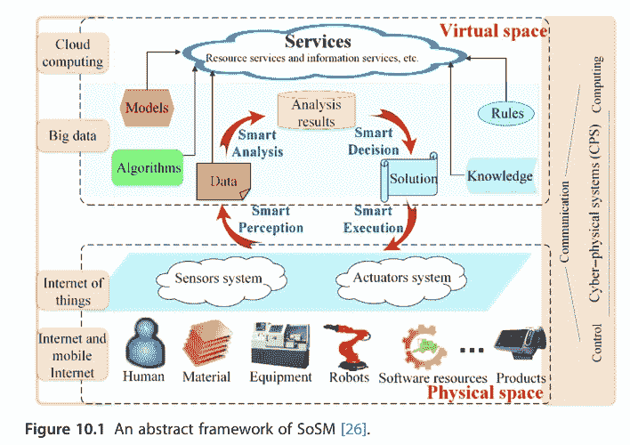

图 10.1 SoSM 的抽象框架 [26]。

模型、算法、知识和规则组成。部分数据来自物理资源，包括制造资源的状态、属性、质量和其他数据。一些数据是在物理空间与虚拟空间交互过程中产生的。除了来自物理实体的虚拟模型外，还有一些数学模型、计算模型等。算法包括数据处理算法、智能优化算法和数据挖掘算法。经过数据分析和挖掘后，会产生一些知识和规则。此外，一些专家知识和物理规则也存储在虚拟空间供用户使用。虚拟空间的另一个组件包括数字服务。这些服务是通过面向服务的方法（如 SoA）封装的。其中一些是资源服务，它们基于来自物理空间的数据从物理制造资源和能力中封装。其他一些服务是从信息要素中封装的（即数据即服务、模型即服务、算法即服务、知识即服务和规则即服务）。需要注意的是，由于服务的可用性，物理资源（例如材料、机器、产品）和信息要素（例如生产数据和算法）可以被全球客户远程共享和使用 [26]。

凭借虚拟空间中对数据进行综合分析和处理的能力以及服务的互操作性特征，SoSM 可以通过有效的决策过程应对物理空间中的复杂变化。在此过程中，有四个基本功能，即智能感知、智能分析、自主决策和精确控制与执行。首先，通过先进的传感技术，准确感知来自物理空间中人类、材料、设备、产品和系统的各种数据。然后，通过感知获取的数据在虚拟空间中以及其他数据操作中被快速准确地识别、处理和分析。根据分析结果，依据规则和知识自主做出决策和选择。制造资源以服务的形式被调用。最后，基于决策结果，物理空间根据动态变化进行调整 [26]。

人类、材料、设备、环境、供应链和其他制造要素通过数据、模型、算法、知识和规则集成。物联网（IoT）、云计算、大数据、移动互联网、 cyber–physical 系统（CPS）等


technologies 在 SoSM 中发挥着重要作用。借助物联网和互联网技术，制造各方面的各种数据可以从终端收集，并持续汇聚到云端。云计算和大数据技术通过对这些原始数据进行排序、分类、分析等操作来处理，从而提取数据的价值。通过从云端学习智慧，制造设备和企业可以更好地理解客户需求，并且这些数据被封装成服务。通过这些服务和数据，结合相应的软件，制造大数据被转化为良率、质量记录、制造要素健康状况和能源效率等实用信息。这些信息可以进一步帮助制造商更好地判断和理解制造生产的状态。物理空间与虚拟空间之间的互联互通使 SoSM 成为一个 cyber-physical system。通过新一代信息技术（New IT），SoSM 中的虚拟空间可以更广泛地连接万物，更智能地捕获和分析数据，更主动地提供服务。物理空间可以更高效地实施制造活动，利用 SoSM 作为 cyber-physical system 的潜力 [26]。

### 10.3 SERVICES IN DIGITAL TWIN

产品生命周期中的所有制造资源和能力都可以被虚拟化，然后封装成服务。根据不同的存在形式和使用模式，服务主要可分为资源服务和信息资源。前者源于制造中的硬件资源，如制造设备、计算设备和材料，而后者源于软件资源，如专业软件、经验模型、领域知识和算法 [27]。此外，在特定的制造活动中，资源可以扩展为某些能力，如设计、仿真、生产和维护 [27-29]。

对于 DT，服务可以从两个角度获得。一方面，服务构成了五维 DT 的关键组成部分。例如，当生产任务输入时，服务系统可以通过服务调度和组合调用相应服务来完成任务。另一方面，五维 DT 的其他组成部分（即物理实体、虚拟实体、数据和连接）也可以被封装成服务。得益于全面的服务化，DT 可以在服务平台中统一管理。当任务提交到平台时，从所有候选服务中调用合适的服务并组合形成完整的 DT，然后协同执行任务。

### 10.4 DIGITAL TWIN SERVICE GENERATION

模型和数据是 DT 的核心。然而，虚拟模型的创建和数据的融合是复杂且专业的项目。对于没有相关知识的用户来说，构建和使用 DT 十分困难。因此，模型必须能够被用户共享，数据分析可以外包给第三方专业组织。此外，在制造社会化的背景下，制造中涉及的物理资源在地理上是分散的。服务具有按需使用、动态重构和平台独立性的特点，为上述问题铺平了道路 [30]。在以下章节中，主要讨论 DT 中物理实体、虚拟实体和数据的服务化 [33]。

#### 10.4.1 Physical Entity Servitization

服务封装将 DT 的各个组件转化为具有统一描述的服务 [31]。如图 10.2 [30] 所示，服务封装的第一步也是最重要的一步是建立信息模板，该模板由丰富的信息组成 [32]。对于物理实体，信息包括基本属性（例如，名称、ID、地址）、服务质量（QoS）（例如，时间、成本、可靠性、满意度）、能力（例如，精度、尺寸、工艺）、实时状态（例如，过载、空闲、维护中），以及输入和输出。物理实体（即 PE）的信息模板可描述为 (10.1) [30]。

```
PE = {Basic, QoS, Cap, Status, Input, Output}    (10.1)
```

其中，Basic 指用于识别物理实体的基本属性。QoS 表示物理实体在进行用户选择时的性能评估。Cap 代表物理实体的功能。Status 表示物理实体是否可用。以数控机床为例，生产能力包括形状加工能力（例如，平整、孔、螺纹）、

精度（例如，粗糙度、偏转）、零件加工（例如，齿轮、板）、尺寸（例如，高度、宽度、坐标）。状态可以是过载、空闲、维护中等。关于输入和输出，数控机床的输入可以是材料，如钢、铝合金等。输出可以是零件或小型产品。它们可公式化为 (10.2)–(10.5) [30]：

```
Basic = {type, name, ID, address, color, delivery_time, ...}  (10.2)
```

```
QoS = {cost, time, reliability, trust, Fun_similarity, ...}  (10.3)
```

```
Cap = {shape_cap, precision_cap, parts_cap, size_cap,...}  (10.4)
```

```
Status = {load, health, ...}  (10.5)
```

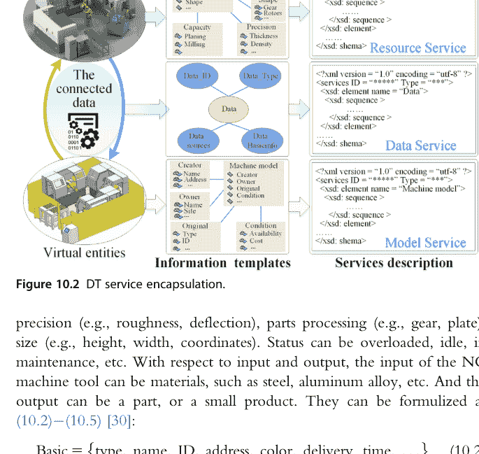

# Figure 10.2 DT service encapsulation.

#### 10.4.2 Virtual Entity Servitization

同样，虚拟实体由一组虚拟模型组成，也可以由信息模板描述。与物理实体不同，虚拟实体可以同时被多个用户使用，并且对于相同或相等的物理实体，可以在不重复创建的情况下进行复制。因此，当虚拟实体被封装成可被用户共享的服务时，不仅虚拟模型的创建者可以获得收益，用户也可以降低成本和时间。虚拟实体（即 VE）的信息模板可描述为 (10.6) [30]。

```
VE = { Ori_phy, Creator, Ori_ID, Cur_ID, Owner, QoS, Online_site, Input, Output, ... } (10.6)
```

其中，Ori_phy 表示虚拟实体对应的原始物理实体。Creator 是基于其专业知识构建虚拟实体的人。Ori_ID 是虚拟实体首次创建时的原始识别号。Cur_ID 表示当前副本的识别号。Owner 是拥有虚拟实体的人。所有者拥有版权或可能是创建者，可以通过出租模型或出售副本赚取利润。与物理实体类似，QoS 表示虚拟实体性能的评估，包括成本、可靠性、功能等。Online_site 表示用户可以访问或下载模型的在线地址。Input 和 Output 可能因具体模型而异 [30]。

#### 10.4.3 Data Servitization

此外，数据对于智能制造非常重要 [33]。然而，由于各种标准和通信协议/接口，数据往往难以获取和理解。通过使用统一模板描述数据，用户可以方便地使用数据。一般而言，数据信息包括拥有数据的提供者、数据收集的数据源、用于识别数据的 data ID、数据类型（表示数据的种类），以及数据摘要，即对数据价值的简要介绍。因此，数据（即 DD）可描述为 (10.7) [30]。

```
DD = { D_prov, D_source, D_ID, D_type, D_abstract, ... } (10.7)
```

信息模板描述了用户想要知道并且必须知道的大部分信息。建立信息模板后，各种物理实体、虚拟实体和数据基于服务描述语言（如 XML）封装成服务。作为示例，冲床的信息模板


并且可编程逻辑控制器（PLC）由基于 XML 的服务封装，如图 10.3 [30] 所示。信息模板包括冲床和 PLC 的基本信息、处理能力、工艺参数和轴信息 [30]。

### 10.5 数字孪生服务管理

DT 服务的流通、交易和共享依赖于高效的管理。如图 10.4 [30] 所示，DT 服务生成后，服务会发布到服务池和管理平台中，在此由各类用户共享管理。对这些服务的管理涵盖三个阶段，即生命周期开始阶段（BOL）、生命周期中段（MOL）和生命周期结束阶段（EOL），具体描述如下 [18]。

BOL 涵盖从各种物理制造资源和能力到虚拟化服务的全过程。它包含资源的感知与连接、感知数据的传输、数据过滤与处理、资源虚拟化、服务建模和数字描述。随着更多服务的生成，服务聚合会逐渐出现。因此，所有服务都通过各种抽象关联和关系（即功能、各种属性、特征和调用历史）汇聚并集成，随着服务平台的持续运行。MOL 是由服务生成到投入使用的需求驱动阶段。操作包括服务搜索与匹配、服务评估、服务选择与服务组合、服务调度以及服务交易。MOL 由服务执行与监控、容错以及任务实施的物流服务组成。其中，物流服务 [34] 服务于某些类型服务的具体过程和结果。根据任务实施的不同要求，物流可以是服务执行后结果的运输，也可以是服务执行过程中材料的运输。最后，服务在 EOL 后执行完毕被释放和拆分 [18]。

### 10.6 数字孪生服务应用

DT 服务可应用于产品设计、生产计划、制造执行、故障预测与健康管理（PHM）

```
<?xml version="1.0" encoding="utf-8" ?>
<Equipments>
  <Equipment id="equip1" name="punch machine" uuid="Res-01-01">
    <Description>FOCAS based punch machine</Description>
    <Static_information>
      <Basic_information>
        <Manufacturer id="Manuer_Infor" name="Manuer_Infor">
          <Manufacturer name="IFV" type="string" />
          <Manufacturer ... />
        </Manufacturer>
      </Basic_information>
      <Processing_capability>
        <cap_punching id="cap_punching_infor" name="cap_punching_infor">
          <infor name="diameter" type="float" />
          <infor ... />
        </cap_punching>
      </Processing_capability>
    </Static_information>
    <Dynamic_information>
      <Process_parameters>
        <turret_rotating_speed id="trs" name="tr_speed" speed="value" unit="rpm/s" type="float" />
        <sheet_moving_speed id="sms" name="sm_speed" speed="value" unit="m/s" type="float" />
      </Process_parameters>
      <Axes>
        <Sping id="s" name="S" nativename="Spindle" speed="value" unit="rpm/s" type="float" />
        <X_axes id="x" name="X" speed="value" unit="m/s" type="float" />
      </Axes>
      <controller id="cnc" name="cnccontroller">
        <path_feedrate id="feedrate" name="Feedrate" type="string" />
        <control_mode id="mode" name="Name" type="string" />
        <... />
      </controller>
    </Dynamic_information>
  </Equipment>
```

```
<Equipment id="equip2" name="PLC" uuid="Res-01-02">
  <Description>OPC DA 2.0 based PLC</Description>
  <Static_information>
    <Basic_information>
      <Basic id="Bas" name="Bas">
        <Affiliation name="XuJi" type="string" />
        <PLC_manufacturer ... />
      </Basic>
    </Basic_information>
    <Processing_capability>
      <cap_sealed_unit id="cap_sealed_infor" name="cap_sealed_infor">
        <infor name="precision" type="float" />
        <infor ... />
      </cap_sealed_unit>
      <cap_labeling_unit id="cap_labeling_infor" name="cap_labeling_infor">
        <infor name="speed" type="float" />
        <infor name="precision" type="float" />
        <infor ... />
      </cap_labeling_unit>
    </Processing_capability>
  </Static_information>
  <Dynamic_information>
    <Process_parameters>
      <sealed_state id="ss" name="SS" state="auto|manual|start|stop" alarm="type" type="string" />
      <code_printer_state id="cps" name="CPS" state="auto|manual|start|stop|alarm" type="string" />
      <pressure_tolerant_state id="pts" name="PTS" state="auto|manual|start|stop|testing|idle|pallet_serial|product_serial" type="string" />
    </Process_parameters>
  </Dynamic_information>
</Equipment>
<Equipment> ... </Equipment>
<... />
</Equipments>
```

CNC 冲床

PLC

静态信息（包括基本信息和处理能力信息）

静态信息（包括基本信息和处理能力信息）

动态信息（包括工艺参数、轴和控制器）

动态信息（包括工艺参数、轴和控制器）

其他设备

图 10.3 基于 XML 的服务封装。

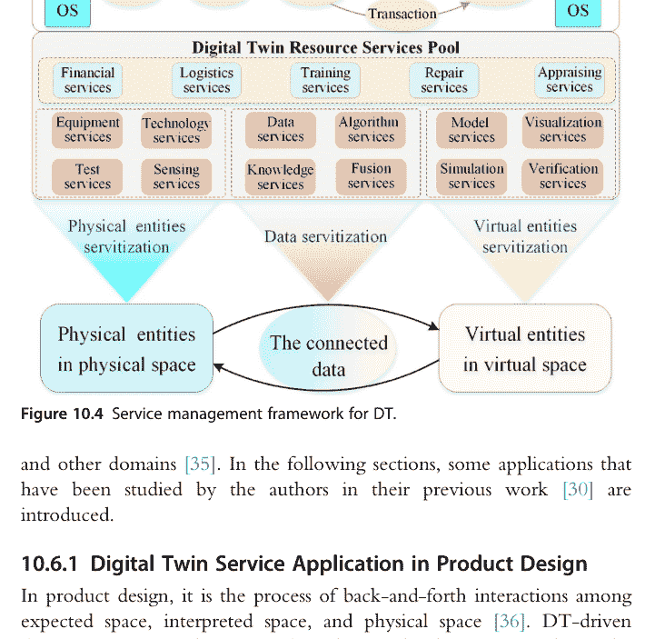

图 10.4 DT 服务管理框架。

和其他领域 [35]。在以下章节中，将介绍作者在之前的工作 [30] 中研究的某些应用。

#### 10.6.1 产品设计中数字孪生服务的应用

在产品设计中，这是预期空间、解释空间和物理空间之间反复交互的过程 [36]。DT 驱动的设计旨在基于现有物理产品，将设计师脑海中预期的产品转化为解释空间中的数字表示。为了创新产品，设计师必须研究大量数据以获取有价值的知识 [37]。然而，与产品相关的数据是最重要的资产之一，并不容易获取。此外，设计师没有处理海量数据的专业能力。服务是对这些问题的答案。设计师只需简单地将需求提交给服务管理平台。服务管理员将设计师所需的数据服务与用于处理数据的模型服务和算法服务进行匹配。通过调用和组合这些服务，需要的结果将被返回

给设计师。因此，设计师可以以“按需付费”的方式获取所需内容 [38]。此外，在产品的功能结构和组件设计完成后，需要测试设计质量和可行性。凭借 DT，设计师可以通过虚拟产品的验证快速轻松地预测产品行为，而无需等待产品原型的生产 [39]。但虚拟验证需要制造现场的模型（例如生产线或车间），而设计师并不拥有。服务封装后，模型服务可以被调用并轻松应用于产品设计，这使得产品设计更有效，减少预期行为与设计行为之间不一致的情况，并大大缩短设计周期并降低成本。

#### 10.6.2 生产中数字孪生服务的应用

一般而言，生产是从原材料投入到成品输出的整个过程，在车间进行。在生产计划和生产执行阶段，DT 提供了一种有效的方法来制定计划并优化执行过程 [40]。首先，生产任务提交到服务管理平台，并进行供需匹配和调度的资源服务以找到可用资源。然后，基于物理资源（例如机床、机器人臂、材料）的实时状态，制定生产计划。数字孪生车间（DTS）可以在虚拟空间中模拟计划，并在实际生产前识别潜在冲突 [41]。然而，构建 DTS 是一项复杂且专业的工作，尤其是描述物理属性、规则、行为等的模型。在服务的帮助下，这些模型不必由制造商自行创建。对于物理设备和普遍规则，其模型可以由其他制造商建立，以服务形式购买使用。当前制造商只需创建专属于自己的特殊模型。此外，在车间运行期间，一些服务，例如数据处理和车间管理，需要从 DTS 的服务系统调用。

#### 10.6.3 PHM 中数字孪生服务的应用

物理设备在运行期间性能退化是不可避免的。设备故障会导致高


维护成本和任务推迟。PHM 对于监测设备状况、预测和诊断设备故障以及组件寿命至关重要。在 DT 驱动的 PHM 中，物理设备的虚拟模型与设备的实际状态保持同步。设备的运行状态和组件的健康状况能够实时掌握。设备的高保真数字镜像提供了在物理上无法接近时仍可访问设备的能力。此外，DT 的交互可以减少外部环境带来的干扰，从而提高准确性。与产品设计、生产计划和生产执行类似，模型可以通过服务进行访问。此外，当发生故障时，维护服务将被调用以修复或更换设备的磨损组件。

### 10.7 总结

DT 通过在制造中整合虚拟和物理空间，为实现智能制造提供了 promising 的机会。通过服务，DT 的功能可以得到扩展和增强。此外，DT 的构建可以进一步标准化和简化。在本章中，通过将 DT 与服务相结合，分别讨论了 DT 服务生成、管理和应用，并提供了 DT 组件服务化的方法。目前，DT 研究仍处于起步阶段。需要开展更多研究，以考虑其他因素和实际情况，改进和丰富 DT 建模和服务化的方法。

### 参考文献

[1] H. Lightfoot, T. Baines, P. Smart, The servitization of manufacturing: a systematic literature review of interdependent trends, Int. J. Operat. Prod. Manag. 33 (11/12) (2013) 1408–1434.

[2] C. Grönroos, P. Helle, Adopting a service logic in manufacturing: conceptual foundation and metrics for mutual value creation, J. Serv. Manag. 21 (5) (2010) 564–590.

[3] X.V. Wang, L. Wang, A cloud-based production system for information and service integration: an internet of things case study on waste electronics, Enterp. Inform. Syst. 11 (7) (2017) 952–968.

[4] F. Tao, Y. Cheng, L.D. Xu, L. Zhang, B.H. Li, CCIoT–CMfg: cloud computing and internet of things-based cloud manufacturing service system, IEEE Trans. Ind. Inform. 10 (2) (2014) 1435–1442.

[5] X. Xu, From cloud computing to cloud manufacturing, Robot. Comput. Integr. Manuf. 28 (1) (2012) 75–86.

[6] S. Vandermerwe, J. Rada, Servitization of business: adding value by adding services, Eur. Manag. J. 6 (4) (1988) 314–324.

[7] T.S. Baines, H.W. Lightfoot, O. Benedettini, The servitization of manufacturing: a review of literature and reflection on future challenges, J. Manuf. Technol. Manag. 20 (5) (2009) 547–567.

[8] S. Phumbua, B. Tjahjono, Towards product–service systems modelling: a quest for dynamic behaviour and model parameters, Int. J. Prod. Res. 50 (2) (2012) 425–442.

[9] L. Xu, Enterprise systems: state-of-the-art and future trends, IEEE Trans. Ind. Inform. 7 (4) (2011) 630–640.

[10] A. Umar, The emerging role of the web for enterprise applications and ASPs, Proc. IEEE 92 (9) (2014) 1420–1438.

[11] F. Tao, L. Zhang, A.Y.C. Nee, A review of the application of grid technology in manufacturing, Int. J. Prod. Res. 49 (13) (2011) 4119–4155.

[12] F. Tao, Y.F. Hu, Z.D. Zhou, Study on manufacturing grid and its resource service optimal-selection system, Int. J. Adv. Manuf. Technol. 37 (9–10) (2008) 1022–1041.

[13] H. Li, Y. Ji, L. Chen, R.J. Jiao, Bi-level coordinated configuration optimization for product–service system modular design, IEEE Trans. Syst. Man Cybern. Syst. 47 (3) (2015) 537–554.

[14] H. Meier, R. Roy, G. Seliger, Industrial product–service systems—IPS2, CIRP Ann. Manuf. Technol. 59 (20) (2010) 607–627.

[15] F. Tao, L. Zhang, V.C. Venkatesh, Y. Luo, Y. Cheng, Cloud manufacturing: a computing and service-oriented manufacturing model, Proc. Inst. Mech. Eng. B: J. Eng. Manuf. 225 (10) (2011) 1969–1976.

[16] F. Tao, Y. Hu, D. Zhao, Z. Zhou, An approach to manufacturing grid resource service scheduling based on trust-QoS, Int. J. Comput. Integr. Manuf. 22 (2) (2009) 100–111.

[17] B.H. Li, L. Zhang, S.L. Wang, F. Tao, J.W. Cao, X.D. Jiang, et al., Cloud manufacturing: a new service-oriented networked manufacturing model, Comput. Integr. Manuf. Syst. 16 (1) (2010) 1–7.

[18] F. Tao, L. Zhang, Y. Liu, Y. Cheng, L.H. Wang, X. Xu, Manufacturing service management in cloud manufacturing: overview and future research directions, J. Manuf. Sci. Eng. 137 (4) (2015) 040912.

[19] D. Wu, M.J. Greer, D.W. Rosen, D. Schaefer, Cloud manufacturing: strategic vision and state-of-the-art, J. Manuf. Syst. 32 (4) (2013) 564–579.

[20] M. Brettel, N. Friederichsen, M. Keller, M. Rosenberg, How virtualization, decentralization and network building change the manufacturing landscape: an industry 4.0 perspective, Int. J. Mech. Ind. Sci. Eng. 8 (1) (2014) 37–44.

[21] F. Tao, Y. Cheng, L. Zhang, A.Y.C. Nee, Advanced manufacturing systems: socialization characteristics and trends, J. Intell. Manuf. 28 (5) (2017) 1079–1094.

[22] W. Zhang, S. Zhang, F. Qi, M. Cai, Self-organized P2P approach to manufacturing service discovery for cross-enterprise collaboration, IEEE Trans. Syst. Man Cybern. Syst. 44 (3) (2014) 263–276.

[23] X. Yang, G. Shi, Z. Zhang, Collaboration of large equipment complete service under cloud manufacturing mode, Int. J. Prod. Res. 52 (2) (2014) 326–336.

[24] F. Tao, J. Cheng, Y. Cheng, S. Gu, T. Zheng, H. Yang, SDMSim: a manufacturing service supply–demand matching simulator under cloud environment, Robot. Comput. Integr. Manuf. 45 (2017) 34–46.

[25] L.M. Camarinha-Matos, H. Afsarmanesh, B. Koelmel, Collaborative networks in support of service-enhanced products, in: Adaptation and Value Creating Collaborative Networks. PRO-VE 2011 (IFIP Advances in Information and Communication Technology), Berlin, Heidelberg, vol. 362, 2011, pp. 95–104.

[26] F. Tao, Q. Qi, New IT driven service-oriented smart manufacturing: framework and characteristics, IEEE Trans. Syst. Man Cybern. Syst. (2017). Available from: https://doi.org/10.1109/TSMC.2017.2723764.

[27] L. Zhang, Y.L. Luo, F. Tao, L. Ren, H. Guo, Key technologies for the construction of manufacturing cloud, Comput. Integr. Manuf. Syst. 16 (11) (2010) 2510–2520.

[28] L. Ren, L. Zhang, Y.B. Zhang, F. Tao, Y.L. Luo, Resource virtualization in cloud manufacturing, Comput. Integr. Manuf. Syst. 17 (3) (2011) 511–518.

[29] Y. Cheng, F. Tao, L. Zhang, Y. Zuo, Supply–demand matching of manufacturing service in service-oriented manufacturing systems, Comput. Integr. Manuf. Syst. 21 (7) (2015) 1930–1940.

[30] Q. Qi, F. Tao, Y. Zuo, D. Zhao, Digital twin service towards smart manufacturing, Procedia CIRP 72 (2018) 237–242.

[31] X. Wang, X. Xu, Virtualise manufacturing capabilities in the cloud: requirements, architecture and implementation, Int. J. Manuf. Res. 9 (4) (2014) 348–368.

[32] F. Tao, J. Cheng, Q. Qi, IIHub: an industrial internet-of-things hub toward smart manufacturing based on cyber–physical system, IEEE Trans. Ind. Inform. 14 (5) (2018) 2271–2280.

[33] F. Tao, Q. Qi, A. Liu, A. Kusiak, Data-driven smart manufacturing, J. Manuf. Syst. (2018). Available from: https://doi.org/10.1016/j.jmsy.2018.01.006.

[34] R. Sarraj, E. Ballot, S. Pan, B. Montreuil, Analogies between internet network and logistics service networks: challenges involved in the interconnection, J. Intell. Manuf. 25 (6) (2014) 1207–1219.

[35] Q. Qi, F. Tao, Digital twin and big data towards smart manufacturing and industry 4.0: 360 degree comparison, IEEE Access 6 (2018) 3585–3593.

[36] J.S. Gero, U. Kannengieser, The situated function–behaviour–structure framework, Design Stud. 25 (4) (2004) 373–391.

[37] A. Kusiak, Innovation: a data-driven approach, Int. J. Prod. Econ. 122 (1) (2009) 440–448.

[38] J. Madhavan, S.R. Jeffery, S. Cohen, X. Dong, D. Ko, C. Yu, et al., Web-scale data integration: you can only afford to pay as you go, CIDR (2007) 342–350.

[39] F. Tao, F. Sui, A. Liu, Q. Qi, M. Zhang, B. Song, et al., DT-driven product design framework, Int. J. Prod. Res. (2018). Available from: https://doi.org/10.1080/00207543.2018.1443229.

[40] R. Rosen, G. Von Wichert, G. Lo, K.D. Bettenhausen, About the importance of autonomy and digital twins for the future of manufacturing, IFAC-PapersOnLine 48 (3) (2015) 567–572.

[41] F. Tao, M. Zhang, Digital twin shop-floor: a new shop-floor paradigm towards smart manufacturing, IEEE Access 5 (2017) 20418–20427.


## CHAPTER 11
### 数字孪生与虚拟现实及增强现实/混合现实

虚拟现实（VR）和增强现实（AR）/混合现实（MR）随着相关技术的发展而日益成熟，例如先进的传感器、计算机图形学、实时配准与跟踪等。VR 和 AR/MR 技术在物理世界与虚拟世界的无缝集成和融合中发挥着重要作用，这对数字孪生（DT）的实现至关重要。本章将 DT 与这些技术相结合。基于 VR 和 AR/MR 在 DT 中的现有和潜在应用，提出了一个通用框架，以将这些技术与 DT 集成，为用户提供更具沉浸感和交互性的服务。根据所提出的框架，随后讨论了一个装配过程。

## 11.1 INTRODUCTION

虚拟现实（VR）的历史始于 1962 年，当时一种名为 Sensorama Simulator 的设备被发明并获得专利，用于创建虚拟环境，可为用户提供声音、气味、风、振动等方面的多感官体验 [1]。然而，Sensorama Simulator 提供的环境并非交互式 [2]。为解决这一问题，Sutherland 在几年后开发了第一个头戴式显示器（HMD）系统，该系统可根据用户头部位置感知生成交互式视图 [3]。Krueger 还创建了一个 VR 交互环境，其中计算机可以感知参与者的动作并实时以视觉和听觉显示做出响应 [4]。在 1980 年代，Virtual Programming Languages（VPL）公司生产了流行的 DataGlove 和 Eyephone HMD，它们是首批商用 VR 设备 [2]。1992 年，CAVE 自动虚拟环境出现 [2]。它不使用 HMD，而是将立体图像投射到房间的墙壁上，从而增强了用户的沉浸感。1995 年，Silicon Graphics 开发了 VR 建模语言，使人们能够方便、快速地创建和交互各种虚拟模型 [5]。在 21 世纪，VR 已应用于不同领域，包括娱乐 [6]、教育 [7]、医疗保健 [8]、制造 [9] 等。

增强现实（AR）可以被视为 VR 的一种变体 [5]。与创建完全虚拟环境的 VR 相比，AR 将虚拟信息叠加在真实世界之上，以增强现实而不是取代它。增强现实这一术语由 Caudell 和 Mizell 于 1990 年提出 [10]。1993 年，Rosenberg 发明了第一个功能性 AR 系统，即虚拟夹具，它可以将计算机生成的感知叠加在真实工作空间上以增强人类性能 [11]。Feiner 等人开发了一个系统，为佩戴实验性头戴式透视显示器的用户生成维护和维修说明 [12]。该系统使用户能够与真实环境和虚拟信息进行交互，也可被视为 AR 的早期原型之一。1998 年，Raskar 等人引入了空间增强现实（SAR），虚拟对象可直接集成到物理空间中 [13]。1999 年，Kato 开发了 ARToolKit，为 AR 系统构建提供了一种高效、快速的方法 [10]。Thomas 等人发明了 ARQuake，这是首次将传统的桌面第一人称视角应用转换为室外/室内移动 AR 应用 [11]。2008 年，Wikitude AR 旅行指南为 Android 手机推出，它将导航数据添加到实时街景中 [5]。近年来，随着相关硬件和软件技术的发展，AR 已成为规划、指导和培训等活动中的有效工具。

混合现实（MR）是 AR 的另一种形式。1994 年，Milgram 和 Kishino [14] 首先提出了“虚拟性连续体”的概念，并指出 MR 可以提供一个混合且连续的空间，该空间从完全真实的环境延伸到完全虚拟的环境。MR 本质上与 AR 相同，两者都侧重于物理和虚拟元素的融合。然而，AR 是相关研究中更常用的术语，而 MR 比 AR 提及较少。因此，在本章的其余部分，AR 用于简写表示 AR/MR。

近年来，VR 和 AR 已紧密耦合并相互补充。由于它们显示出物理和虚拟空间无缝集成和融合的潜力，因此对其发展给予了高度重视。本章将 VR 和 AR 与数字孪生（DT）相结合，以增强 DT 的两个空间并进一步增强融合，从而帮助 DT 实现更高效的应用。在以下各节中，回顾了 VR 和 AR 在设计、制造和服务中的应用，并从不同方面进行了比较。基于这些技术在 DT 中的现有和潜在应用，提出了一个通用应用框架，并以装配过程为例进行讨论。

### 11.2 VR IN DESIGN, MANUFACTURING, AND SERVICE

VR 可以提供一种沉浸式、交互式的计算机介导体验，其中一个人通过人机交互设备（如计算机、HMD、耳机和数据手套）感知人工环境 [1,15]。VR 的相关技术包括人机交互、计算机图形学、触觉反馈、动态环境建模、立体视觉等。由于 VR 以沉浸感、临场感、交互性和导航为特征 [16]，许多研究人员已探索 VR 在设计、制造和服务领域的应用。

#### 11.2.1 VR in Design

VR 为设计师提供了一个完全虚拟的环境，用于开发原型、与产品模型交互、评估替代设计等。它可以改善产品的可视化，提供直观的模型操作，并实现协同设计。以下是关于工厂布局设计和产品设计的相關研究介绍。

在工厂布局设计中，Iqbal 和 Hashmi [17] 讨论了如何通过 VR 在三维虚拟环境中设计和分析工厂布局，并开发了一种新的通道系统以减少物料搬运距离。Menck 等人 [18] 提出了一个基于 VR 的协同平台，用于工厂布局设计。不同地点的用户可以在同一沉浸式系统中实时协作、探索和分析。Gebhardt 等人 [19] 提出了一个整体的 VR 应用，称为工厂布局规划助手，它不仅可作为逼真的虚拟漫游模拟平台，还可为决策提供见解。Ebner 等人 [20] 开发了一款基于 VR 的多点触控桌，使用户可以从对象库中选择必要项目并用手指触摸将其放置在布局上。错误或信息可以实时评估并在桌上显示。

在产品设计中，Ryken 和 Vance [21] 将 VR 与有限元分析、灵敏度分析、碰撞检测等相结合，创建了一个交互环境，设计师可以在其中修改零件形状、评估应力并检查新零件的干涉。Bruno 等人 [22] 使用进程间通信库将 VR 环境与数值模拟环境连接起来。这样，产品行为可以利用数值模拟软件进行模拟和预测，然后在 VR 环境中可视化。Sung 等人 [23] 提出了一个基于 VR 的线束设计系统，该系统可以自动捕获嵌入在日志文件中的设计知识，并在设计任务期间将知识传递给用户。

#### 11.2.2 VR in Manufacturing

VR 可应用于制造中的工艺规划、仿真、检验、验证等，有助于操作员更好地理解制造过程并提高最终产品的可制造性、耐用性和盈利能力。主要介绍 VR 在计算机数控（CNC）、虚拟装配和机器人中的应用。

在 CNC 仿真中，Luo 等人 [24] 提出了一种基于 VR 的数控行为仿真层次结构并开发了一个原型系统。Lin 和 Fu [25] 提出了一种虚拟建模方法，以响应用户在功能和结构方面的要求生成机床结构。开发了一台虚拟机床，用于在虚拟环境中进行设计、测试、优化、控制和加工。Kao 等人 [26] 基于 VR 软件和 Microsoft Visual Basic 编程环境构建了 CNC 铣床的虚拟控制器。虚拟控制器可以解析用户的数控代码、模拟刀具路径并根据刀具路径驱动虚拟 CNC。

在装配验证中，Seth 等人 [27] 开发了一个低成本的 VR 应用，可在虚拟环境中执行碰撞检测和行为仿真。该应用可在许多类型的 VR 系统（例如桌面、Cave、Power wall 等）和操作系统（Linux、Windows、Irix testbed 等）上运行。在 Virtuelle Werkstatt 项目中，Biermann 等人 [28] 设计了一种基于知识的方法来在 VR 环境中装配基于 CAD 的零件，并提出了一种使用手势和语音进行的多模态交互以进行


人机交互以一种直观自然的方式进行。Wang 等人 [29] 使用 Visual C++ 和 Open Inventor 开发了一个用于机床的虚拟装配与加工系统，该系统可以模拟装配和加工过程以及关键参数。该系统在上海一家工厂生产的 CK6430 机床上进行了验证。De Sa 和 Zachmann [30] 提出了几种用于虚拟装配和维护的交互范式，使缺乏经验的用户能够高效地使用虚拟原型进行工作。

在机器人路径规划方面，Chen 等人 [31] 构建了一个由 PHANToM 设备驱动的基于力反馈的虚拟机械臂，并提出了一种基于机器人运动学分析的工作空间映射方法。该虚拟机械臂既可用于自由路径规划，也可用于约束条件下的路径规划。Yap 等人 [32] 开发了一套基于 VR 的机器人工作单元布局规划与编程支持系统。在其工作中，构建了 VR 机器人工作单元布局（VR-RoWL）和基于 VR 的机器人教学系统（VR-RoT），分别用于完成机器人的布局规划和克服编程中的安全问题。Liu 等人 [33] 提出了一种特征映射算法，用于将工件的设计特征转换为焊缝的加工特征，该算法支持焊接机器人在虚拟环境中的运动导航。

### 11.2.3 VR 在服务中的应用

在 VR 的帮助下，服务可以在实际执行前在沉浸式虚拟环境中进行模拟和优化，避免对操作人员以及设备造成潜在风险。同时，VR 可以增强操作人员的能力，从而提高相关活动的质量。以下部分介绍了 VR 在维护、物流和培训方面的一些研究工作。

在维护仿真方面，Lecakes 等人 [34] 开发了一套 VR 系统，用于可视化火箭发动机健康管理的多传感器测量数据。该系统可以为操作人员显示与图形耦合的各种形式的数据。Liu 和 Hao [35] 提出了一种基于虚拟维护仿真的可维护性分析框架，该框架包括虚拟维护原型模块、维护仿真模块、可维护性分析模块和系统管理模块。Peng 等人 [36] 构建了一种基于桌面 VR 的复杂产品可维护性设计与验证方法。该方法的效率已在移动机器人系统上得到验证。

在物流规划方面，Reif 和 Walch [37] 将 VR 视为规划物流系统的一种创新方式。利用数据手套和跑步机，可以构建一个用于拣货规划的沉浸式工作空间，使工人在虚拟仓库中能够从存储位置抓取货物并行走。Xu [38] 通过构建空间距离计算模型并基于 VR 技术模拟仓库布局，对物流仓储空间进行了分配。

在培训方面，Bhatti 等人 [39] 提出了一套基于桌面计算机的虚拟培训系统，该系统可以提供装配顺序方面的知识，帮助操作人员进行程序化学习和技能发展。Gutiérrez 等人 [40] 提出了一套多模态培训系统，可根据任务需求和用户偏好提供不同的辅助和学习策略。该系统包括四个主要要素：（1）待学习的任务，（2）与任务相关的虚拟装配场景，（3）用户绩效的评估模型，以及（4）一套学习策略。Li 等人 [41] 提出了一套低成本的桌面 VR 维护培训系统，该系统集成了拆卸序列规划模型和进化算法。

对于上述研究，由 VR 技术实现的沉浸式虚拟环境可以在实际执行前对设计、制造和服务中的活动进行规划、检查、仿真、优化和验证。然而，由于 VR 提供了一个完全虚拟的环境，用户与熟悉的物理环境隔绝，缺乏真实体验，这降低了构建场景的保真度和可信度 [42]。构建完全虚拟环境也会给建模和计算过程带来沉重负担，并对实时性能提出挑战。鉴于 VR 的上述不足，AR 因此被引入到设计、制造和服务中。

### 11.3 AR 在设计、制造和服务中的应用

AR（包括 MR）包含一套创新技术（例如实时数据采集、人机交互、场景捕捉、实时跟踪与配准等），并且可以通过嵌入计算机生成的元素或对象来增强物理世界的视图 [10,42]。它使人们能够在一个被有价值且丰富的虚拟信息和模型所增强的物理环境中工作。这样可以降低构建完全虚拟环境的成本，并允许用户以直观自然的方式与物理和虚拟对象进行交互 [42]。迄今为止，AR 已在设计、制造和服务领域得到广泛研究。

#### 11.3.1 AR 在设计中的应用

由于 AR 可以为设计师提供直观的可视化、在交互式修改模式下叠加在物理环境上的设计评估信息以及协作平台，因此可以促进设计过程。以下介绍了一些关于该技术在设计中的应用，主要包括工厂布局设计和产品设计。

在工厂布局设计方面，Rauterberg 等人 [43] 提出了一个基于自然用户界面（NUI）的框架来结合真实和虚拟对象，并开发了一个名为 Build-it 的原型，该原型可在设计过程中实现用户操作（例如选择、固定、定位和旋转）。Siltanen 等人 [44] 讨论了 AR 在布局规划空间预留中的应用。Yun 等人 [45] 开发了一种 AR 辅助工厂布局规划与分析方法，该方法在考虑空间约束和碰撞检测的情况下将机器的 3D 模型叠加到物理环境中。

在产品设计方面，AR 在原型制作过程中发挥着重要作用 [46]。Ng 等人 [47] 开发了一套基于手势的设计评估系统，该系统可使用手势作为主要交互输入来实时操纵和修改虚拟原型。Shen 等人 [48] 构建了一个客户端/服务器框架以支持协作产品设计。在该框架中，利用增强的虚拟信息和突出显示的特征，不同地点的设计师可以实时观察和修改虚拟对象并与远程用户进行通信。Park [49] 构建了一个基于 AR 的可重构模型，该模型以有形的方式实现对产品各种形状、颜色、纹理和用户界面的评估，从而实现更高效、更真实的产品设计与评估。Barbieri 等人 [50] 提出了一种在 MR 环境中对家用电器进行可用性测试的方法。不同类型的原型被用于完成评估过程，包括虚拟、混合和物理原型。Saleem 等人 [51] 构建了一个 MR 环境，其中一个真实系统与一个仿真环境协同运行，用于伺服气动系统的摩擦参数设计。

#### 11.3.2 AR 在制造中的应用

在制造中，AR 可用于将虚拟信息叠加到实际生产过程上以进行规划、指导、优化等。以下介绍了 AR 在数控仿真、装配和机器人方面的一些典型应用。

在数控仿真方面，Zhang 等人 [52] 提出了一种多区域计算方案，以实现 AR 辅助的现场数控仿真系统，该系统包括真实刀具和虚拟工件。该系统可以为用户提供熟悉的物理环境，从而增强用户对加工过程的检查。Kiswanto 和 Ariansyah [53] 将 AR 与三轴数控机床的加工仿真集成，以帮助用户验证数控程序。Weinert 等人 [54] 开发了一套用于五轴数控机床的铣削仿真系统，以识别和避免碰撞和过大的切削力。

在装配规划方面，Ong 等人 [55] 将装配产品设计与规划（PDP）活动与工作场所设计与规划（WDP）活动集成。在早期设计阶段，WDP 信息可以反馈以优化装配平台设计和产品装配设计。Wang 等人 [56] 提出了一种通过将真实对象纳入虚拟环境来构建混合环境的方法，使用激光扫描的 3D 模型和基于颜色的标记跟踪。在混合环境中，工程师能够进行动手装配设计验证。Wang 等人 [57] 提出了一种 AR 辅助的交互式手动装配设计系统，该系统允许用户以裸手交互的方式模拟手动装配。

在装配指导方面，Yuan 等人 [58] 提出了一种用于指导装配过程的 AR 方法。该方法开发了一种虚拟交互工具来控制 AR 系统以及用于信息管理的视觉装配树结构，以便装配操作员能够轻松地逐步执行预定义的装配计划。Zhang 等人 [59] 将射频识别（RFID）和 AR 应用于装配指导，以提供即时信息渲染和直观的信息导航。Wang 等人 [60] 开发了一种新颖的人类认知为基础的交互式增强现实装配指导系统（CARAGS），该系统根据用户对更快、更准确任务执行的需求提供多模态 AR 指导。Evans 等人 [61] 评估了微软 HoloLens，一种无线 AR 头戴显示器，在 AR 装配应用中的能力。研究表明，尽管 HoloLens 能够提供 AR 装配指令，但仍存在一些缺陷，例如零件和装配站的位置跟踪不准确。Rodriguez 等人 [62] 开发了一套基于投影映射技术的 MR 辅助手动操作系统，该系统可以直接在装配工作站提供教学指导，逐步引导用户直至装配程序成功完成。


在机器人路径规划中，Chong 等人 [63] 提出了一种利用 AR 进行机器人编程的方法，该方法允许用户在真实环境中引导可扩展的虚拟机器人，使其按照用户所需的操作路径移动。Fang 等人 [64] 提出了一种基于 AR 的机器人编程系统，用于在任务执行前预览和评估机器人的运动，并考虑动态约束。借助该系统，用户可以使用交互设备进行修改和选择，以获得平滑且无碰撞的路径。Gianni 等人 [65] 展示了一个基于 AR 的框架，用于评估机器人在真实户外场景中规划安全路径的能力，并考虑动态环境变化。

### 11.3.3 AR 在服务中的应用

AR 在服务中的应用主要包括维护、物流和培训。通过 AR，真实环境可以叠加文本、标签、模型和视频，这将有助于减少错误、加快速度并提高服务过程的质量。

在维护方面，Wang 等人 [66] 提出了一种基于红外标记的 AR 辅助设备维护方法。作者将该方法应用于空气滤清器更换和齿轮箱维护，3D 模型和注释可以放置在真实场景中以促进维护过程。Henderson 和 Feiner [67] 设计了一个基于 AR 的原型，将文本、标签和动画序列叠加到军事机械师的自然视野中，从而支持在维护中更快地定位任务。Suárez-Warden 和 Mendívil [68] 提出了一种由 AR 辅助的设备电气诊断电压测试方法。设计了四种类型的设备组件 3D 模型和相应的 AR 标记，以触发电压测试的不同场景。Zhu 等人 [69] 提出了一个上下文感知的 AR 系统，用于例行和临时维护活动，在此期间系统可以向操作员呈现有用的上下文信息并适应动态维护情况。

在物流方面，Ginters 和 Martin-Gutierrez [70] 使用 AR 和 RFID 进行仓库中的物品可视化，这允许用户沉浸在自然环境中并在避免错误的情况下管理物体。Kang 和 Zhang [71] 提出了一种基于混合射频识别技术和 AR 的户外物流跟踪解决方案，有助于目标识别、目标识别、内容显示和物流跟踪。Reif 和 Walch [37] 探索了基于 AR 的拣货。使用 HMD，工人在视野中可以获得重要数据，例如位置和面向流程的信息，这可以减少搜索时间并防止错误。

在培训方面，Westerfield 等人 [72] 将 AR 图像与智能导师系统 (ITS) 的自适应指导相结合，形成了手动装配任务的培训系统。基于该框架，构建了一个原型来教新手用户组装计算机主板。Schwald 等人 [73] 提出了一个 AR 系统，主要包括光学透视 HMD、跟踪系统和专用支架，用于培训和协助设备维护。Webel 等人 [74] 将 AR 应用于装配和维护技能培训。基于学员需求，3D 动画和上下文信息可以叠加在真实环境上。通过远程咨询组件，培训师可以根据学员的表现修改或增强培训方案。Träskbäck 和 Haller [75] 尝试将 MR 应用于危险工业流程（如炼油厂）的现场培训。在研究中，主要讨论了此类基于 MR 的培训工具的用户需求，以为未来工作奠定基础。

AR 应用的研究前景广阔且不断增长。在上述工作中，AR 通过将计算机生成的虚拟场景嵌入到真实场景中，增强了设计、制造和服务中的活动。用户的真实体验得以保留，可以避免大量的建模工作。有了 AR，虚拟世界和物理世界将更紧密地融合，创造出一种新的环境，在这种环境中可以实现更具沉浸感的场景以及更自然的交互。

### 11.4 VR 与 AR 的比较

VR 和 AR 在物理世界和虚拟世界的融合中发挥了重要作用。根据参考文献 [76–79]，从不同方面比较了它们之间的相似性和差异，如表 11.1 所示。

表 11.1 中的一些方面讨论如下：

- 环境：VR 提供完全虚拟的环境，主要由虚拟图形、图像、模型等组成。在这种人工空间中，用户可以构建自己的世界并定制体验。AR 通过将虚拟元素叠加在物理元素上创建增强的物理环境，以显示用户无法直接用自身感官检测到的信息 [80]。它有助于增强用户对物理世界的感知和理解。

### Table 11.1 Comparison between VR and AR

| 项目 | VR | AR/MR |
|---|---|---|
| 环境 | 完全虚拟环境 | 在物理环境上叠加虚拟物体 |
| 图像来源 | 虚拟物体（例如，图像、图形、图像、模型） | 物理物体和虚拟物体的组合 |
| 视角 | 虚拟物体的位置和大小会根据用户在虚拟世界中的视角而变化 | 虚拟物体的行为基于用户在物理世界中的视角 |
| 在场感 | 在没有物理世界感知的虚拟世界中 | 在物理世界中，但叠加了虚拟物体 |
| 交互 | 允许用户与虚拟物体进行操作、操作、控制等交互 | 允许用户以自然的方式同时与虚拟和物理物体交互 |
| 沉浸感 | 将用户沉浸到虚拟世界中，提供视觉、听觉、触觉和其他反馈 | 允许用户留在熟悉的物理环境中，该环境由虚拟物体补充，并获得视觉、听觉、触觉、力和其他反馈 |
| 相关产品 | Oculus Rift、HTC Vive、Sony PlayStation VR、Samsung Gear VR、Google Cardboard 等 | Microsoft HoloLens、Meta 1 & 2 Headsets、ODG headsets、Google Glass 等 |
| 应用 | 工业、房地产、旅游、建筑、影视、娱乐、医疗保健、教育等 | 工业、军事、广告、零售、旅游、导航、娱乐、体育、医疗保健、教育等 |

- 视角：VR 提供以用户为中心的视角。虚拟物体会根据用户在虚拟世界中的视角改变其位置和大小 [76]。在 AR 环境中，虚拟物体的行为基于用户在物理世界中的视角 [76]，并与用户周围的物理物体对齐。

- 交互：VR 仅允许用户与虚拟物体交互。他们可以使用交互设备（如 HMD、数据手套和手柄）观察、操作、操作和控制虚拟世界。但由于用户被置于完全合成的环境中，交互可能与熟悉的交互感觉不同，这可能导致不适感。有了 AR，用户可以同时与物理和虚拟物体交互。由于 AR 融入了基本的人类技能，即与物理物体交互，因此可以使用户以更自然的方式行为 [43]。

- 沉浸感：VR 可以将用户完全沉浸到虚拟世界中。它通过构建立体的人工环境来增强用户的深度感知和空间感，允许用户环顾四周、走动甚至飞行 [2]。它还通过为用户提供视觉、听觉、触觉和其他感觉来增强沉浸感。AR 允许用户在熟悉的物理环境中自由移动，补充的虚拟元素可以提供视觉、听觉、触觉、力和其他反馈。这样，用户可以获得更真实的体验。

### 11.5 数字孪生与 VR 和 AR

#### 11.5.1 数字孪生中 VR 和 AR 的现有研究和应用

由于 VR 和 AR 可以创建交互式和沉浸式环境以增强物理世界和虚拟世界之间的无缝集成，一些研究人员和组织（尤其是一些知名公司）已尝试将它们应用于 DT。迄今为止，这些技术在 DT 中的现有和潜在应用主要集中于可视化、物理-虚拟集成、用户体验改善、远程协作等，如下所述：

- 1. VR in DT. Rockwell Automation 尝试采用 DT 构建更安全、更具沉浸感的培训环境，并利用 VR 和 AR 增强 DT 的可视化 [81]。Siemens 已开发出燃气轮机的逼真虚拟替代品，并使用 VR 眼镜进行可视化 [82]。在 VR 环境中，传感器数据被转换为颜色以表达温度分布，这有助于维护。Alibaba Cloud 专注于如何使用 DT 生成集成数据模型以改进现有 VR 系统 [83]。华为已将 DT 与 VR 相结合，用于


virtual assembly [84]。它已为产品和装配站构建了 DT，设计师佩戴 VR 眼镜和手套即可模拟不同的装配场景。Oracle 使用户能够通过 Gear VR [85] 访问并在基于 DT 的虚拟工厂中工作。

2. DT 中的 AR。PTC 将 DT 与 AR 和 VR 相结合以指导物理机器的维护 [86]。GE 将 Microsoft HoloLens 应用于 DT，将虚拟蒸汽涡轮机叠加在实际涡轮机之上，使用户能够查看涡轮机内部以识别损坏部件 [87]。Peaxy 认为 AR 启用的数据可视化对于 DT 解决实际业务问题至关重要 [88]。Microsoft 已将 MR 应用于涵盖整个生产环境的流程 DT。通过 MR，叠加实时数据和信息的生产线全息图被开发出来，这使用户能够远程工作并与不同地点的团队协作 [89]。除了这些公司外，其他研究人员也开展了相关研究。例如，Kritzler 等人 [90] 提出了基于 AR 的虚拟孪生概念，即对应物理对象的交互式虚拟表示。Schroeder 等人 [91] 通过网络服务从 DT 中检索数据，并通过 AR 系统实时将数据显示给用户。Peuhkurinen 和 Mikkonen [92] 研究了如何利用现有的网络技术在 MR 环境中开发 DT 应用。未来，通过结合 VR、AR、人工智能（AI）和物联网（IoT）等技术，可以以成本有效的方式创建 DT，并使用户能够远程与数字替代品协同工作，从而消除或减少现场检查真实对象的需求 [93,94]。

鉴于上述工作，很明显将 VR 和 AR 与 DT 相结合已成为不可避免且有益的趋势。然而，仍缺乏一个通用应用框架，该框架可以将 VR 和 AR 引入五维 DT，并使这些技术能够与每个 DT 组件耦合。为了解决这一问题，下文将讨论该框架。

#### 11.5.2 DT 中 VR 和 AR 的应用框架

基于 VR 和 AR 在 DT 中的现有和潜在应用，提出了一个将这些技术应用于 DT 的框架，如图 11.1 所示。在 DT 中，物理实体（PEs）、虚拟实体（VEs）、DT 数据（DD）和服务（Ss）相互连接。PEs（例如，物理机床、机器人和材料）和 VEs（例如，虚拟机床、机器人和材料）通过先进的传感设备保持同步和交互。DD 可以存储和融合来自 PEs 和 VEs 的数据，为服务提供有价值的信息。在此基础上，引入 VR 和 AR 可以进一步增强物理空间和虚拟空间之间的交互和融合，从而在设计、规划、指导和培训中为用户提供更高质量的服务。由于 VR 和 AR 的特性不同，它们在框架中的作用也不同。

- 1. 通过 VR，高保真 VEs 可以在立体合成环境中呈现。通过 VR 设备（例如，麦克风、手柄、触摸屏），来自物理空间的用户声音、操作、位置等可以被捕获并输入到虚拟世界中。VEs 基于输入自主行为，并得到图像处理、需求分析、实时计算、模型调用和更新等相关功能的支持。同时，来自 DD 的洞察（例如，实时设备状态、工作指令和维护代码）也可以生成并调用以演示相应的 VEs。VEs 和 DD 将通过 HMD、数据手套和屏幕等设备以视觉、听觉、触觉和其他模式呈现给用户。由于 VEs 和 DD 可以以交互式和沉浸式的方式提供，由它们支持的服务将更直观，从而改善布局规划、制造操作和维护的决策。

- 2. 通过 AR，PEs 的手势、操作和位置可以使用数据手套、摄像机和 RFID 等设备捕获。通过图像处理、跟踪和信息渲染，来自 VEs 的虚拟模型和来自 DD 的洞察等虚拟元素可以叠加在相应的 PEs 之上。PEs 和虚拟元素的组合可以通过 HMD、iPad 和投影仪等显示设备呈现给用户。同时，触觉反馈也可以通过数据手套获得。这样，可以构建一个 PEs、VEs 和 DD 紧密耦合的混合环境，以增强用户对设计、操作和维护中物理活动的感知和理解。据此，可以通过增强显示改善相应的服务，该显示可以同步为用户提供精确的虚拟模型和信息以及熟悉的物理工作环境。

通过引入 VR 和 AR，DT 在物理-虚拟融合方面可以得到进一步增强。VEs 和 DD 可以通过 VR 在完全沉浸的虚拟环境中耦合，而 PEs、VEs 和 DD 可以通过 AR 在混合环境中融合。在此基础上，可以改进为用户提供的服务，以更高效地支持设计、制造和维护。

### 11.6 结合 VR 和 AR 的 DT 驱动装配

#### 11.6.1 结合 VR 和 AR 的 DT 驱动装配机制

在 DT 驱动的装配中，PEs（例如，人、零件、工具和机器）可以有序组织以完成装配、检验、喷漆和包装等流程。VEs，即 PEs 的数字镜像，可以在虚拟空间中运行以模拟装配设计、操作和培训。DD 生成洞察以支持装配过程。基于 PEs、VEs 和 DD 的功能和数据，Ss 可以通过用户友好的界面为用户提供封装的装配设计、指导和培训服务。

借助 VR 和 AR，DT 驱动的装配过程可以实现改进以提高装配效率。借助这些技术，来自 PEs 的真实数据（例如，位置、方向和运动）可以通过手套、摄像机、手柄和 RFID 等设备捕获。基于这些数据，装配过程中的 VEs 将灵活行为并提供多模态反馈（例如，视觉、听觉和触觉）。在此过程中，VR 使 VEs 能够在人工且沉浸的环境中运行，有利于迭代和高品质的装配规划、验证和操作员培训，从而消除实际装配过程中的昂贵错误。AR 可以将来自 VEs 和 DD 的图形元素和洞察叠加在 PEs 上，以为装配设计、指导和培训提供即时信息渲染。AR 有助于实现更自然的交互和更好的用户体验，例如通过自然语言和操作操纵装配中的虚拟模型。

#### 11.6.2 基于 DT 的装配中 VR 和 AR 的应用

以复杂航空航天产品的装配过程为例来说明五维 DT 与 VR 和 AR 的结合，如图 11.2 所示，该研究由 Liu 进行。装配过程中的一些关键要素如下介绍：

- 1. *复杂航空航天产品的物理装配场景：* 它包含真实的装配机器、工具、操作员、零件和产品，有序组织。
- 2. *关节臂和工业个人计算机（IPC）：* 关节臂可以扫描中型或小型零件以测量其几何尺寸和公差。获得的点云数据将被传输到 IPC 以支持虚拟建模。
- 3. *激光跟踪仪和 IPC：* 激光跟踪仪可以跟踪零件并实时测量零件的三维坐标和关键特征以捕获装配细节。收集的数据将存储在 IPC 中用于虚拟建模、装配精度预测和过程控制。
- 4. *激光投影仪和 IPC：* 激光投影仪可以根据 CAD 数据显示零件轮廓以指导装配并支持精确定位。
- 5. *VR 和 AR 设备和 IPC：* HMD、手套和手柄等设备可以从物理装配场景捕获数据并从虚拟世界获得反馈。IPC 可以执行模拟，


## 图 11.2 基于 DT 的装配中 VR 和 AR 的应用
图像处理、跟踪和信息渲染以支持设备的功能。

6. 虚拟模型、数据和服务：基于从物理装配场景收集的数据，可以构建高保真虚拟模型来描述和支持装配过程，包括装配设计模型、工艺模型、演示模型和场景模型。模型的仿真数据与物理实体的真实数据融合，以生成用于虚拟模型校准和物理装配优化的有价值信息。模型和数据存储在数据中心中，可以调用以支持由 VR 和 AR 技术实现的纯虚拟或物理-虚拟混合装配场景。得益于这些技术，可以为装配操作员提供交互式和沉浸式服务，以提高装配效率。

结合 VR 和 AR，基于 DT 的装配过程可以在物理-虚拟融合中得到增强。装配操作员可以

完全沉浸在完全虚拟环境中，或沉浸在集成了物理和虚拟元素的混合环境中以执行装配活动。这样，通过充分利用物理和虚拟元素，可以优化装配过程，以提高规划、指导和培训。

### 11.7 总结

在本章中，VR 和 AR（包括 MR）应用于 DT 以增强物理和虚拟世界的融合，从而进一步提高 DT 的效率。介绍了 VR 和 AR 在设计、制造和服务中的应用，并从多个方面比较了这些技术的异同。基于 VR 和 AR 在 DT 中的现有和潜在应用，提出了一个通用框架，以高效地将这些技术集成到五维 DT 中，为用户提供更具交互性和沉浸感的服务。基于该框架，讨论了一个装配过程。鉴于 VR 和 AR 带来的益处，结合这些技术将成为 DT 的普遍且有益的趋势。

### 参考文献

[1] H.Q. Dinh, N. Walker, C. Song, A. Kobayashi, L.F. Hodges, Evaluating the importance of multi-sensory input on memory and the sense of presences, in: IEEE Virtual Reality, Houston, TX, USA, March, 1999, p. 222.

[2] S. Mandal, Brief introduction of virtual reality and its challenges, Int. J. Sci. Eng. Res. 4 (4) (2013) 304–309.

[3] T.P. Caudell, D.W. Mizell, Augmented reality: an application of heads-up display technology to manual manufacturing processes, in: The Twenty-Fifth Hawaii International Conference on System Sciences, IEEE, Kauai, HI, USA, January, vol. 2, 1992, pp. 659–669.

[4] M.W. Krueger, S. Wilson, VIDEOPLACE: a report from the artificial reality laboratory, Leonardo 18 (3) (1985) 145–151.

[5] K. Kandikonda, Using virtual reality and augmented reality to teach human anatomy (Master thesis), University of Toledo, 2011.

[6] M. Zyda, From visual simulation to virtual reality to games, Computer 38 (9) (2005) 25–32.

[7] H. Kaufmann, D. Schmalstieg, M. Wagner, Construct3D: a virtual reality application for mathematics and geometry education, Educ. Inform. Technol. 5 (4) (2000) 263–276.

[8] F. Mantovani, G. Castelnuovo, A. Gaggioli, G. Riva, Virtual reality training for health-care professionals, CyberPsychol. Behav. 6 (4) (2003) 389–395.

[9] T.S. Mujber, T. Szecsi, M.S. Hashmi, Virtual reality applications in manufacturing process simulation, J. Mater. Process. Technol. 155 (2004) 1834–1838.

[10] I. Rabbi, S. Ullah, A survey on augmented reality challenges and tracking, Acta Graphica: J. Print. Sci. Graphic Commun. 24 (1–2) (2013) 29–46.

[11] L.B. Rosenberg, Virtual fixtures as tools to enhance operator performance in telepresence environments, in: Telemanipulator Technology and Space Telerobotics, Boston, MA, USA, vol. 2057, December, 1993, pp. 10–22.

[12] S. Feiner, B. MacIntyre, D. Seligmann, Knowledge-based augmented reality, Commun. ACM 36 (7) (1993) 53–62.

[13] R. Raskar, G. Welch, H. Fuchs, Spatially augmented reality, in: First IEEE Workshop on Augmented Reality (IWAR'98), San Francisco, USA, November, 1998, pp. 11–20.

[14] P. Milgram, F. Kishino, A taxonomy of mixed reality visual displays, IEICE Trans. Inform. Syst. 77 (12) (1994) 1321–1329.

[15] J. Steuer, Defining virtual reality: dimensions determining telepresence, J. Commun. 42 (4) (1992) 73–93.

[16] D.A. Guttentag, Virtual reality: applications and implications for tourism, Tourism Manag. 31 (5) (2010) 637–651.

[17] M. Iqbal, M.S.J. Hashmi, Design and analysis of a virtual factory layout, J. Mater. Process. Technol. 118 (1–3) (2001) 403–410.

[18] N. Menck, X. Yang, C. Weidig, P. Winkes, C. Lauer, H. Hagen, et al., Collaborative factory planning in virtual reality, Procedia CIRP 3 (2012) 317–322.

[19] S. Gebhardt, S. Pick, H. Voet, J. Utsch, T. Al Khawli, U. Eppelt, et al., FlapAssist: how the integration of VR and visualization tools fosters the factory planning process, in: 2015 IEEE Virtual Reality (VR), Arles, France, March, 2015, pp. 181–182.

[20] A. Ebner, F. Kammergruber, T. Horenburg, W.A. Günthner, Logistics and layout planning of construction equipment on a VR–multi-touch-tablet, in: 12th International Conference on Construction Applications of Virtual Reality, Taipei, Taiwan, China, November, 2012.

[21] M.J. Ryken, J.M. Vance, Applying virtual reality techniques to the interactive stress analysis of a tractor lift arm, Finite Elem. Anal. Des. 35 (2) (2000) 141–155.

[22] F. Bruno, F. Caruso, K. Li, A. Milite, M. Muzzupappa, Dynamic simulation of virtual prototypes in immersive environment, Int. J. Adv. Manuf. Technol. 43 (5–6) (2009) 620–630.

[23] R.C. Sung, J.M. Ritchie, G. Robinson, P.N. Day, J.R. Corney, T. Lim, Automated design process modelling and analysis using immersive virtual reality, Comput. Aided Des. 41 (12) (2009) 1082–1094.

[24] L. Luo, G. Li, S. Sun, Q. Meng, Research on behavior simulation of multi-axis CNC machine tool in virtual environment, in: 2010 International Conference on Measuring Technology and Mechatronics Automation (ICMTMA), Changsha, China, vol. 3, March, 2010, pp. 31–34.

[25] W. Lin, J. Fu, Modeling and application of virtual machine tool, in: 16th International Conference on Artificial Reality and Teleexistence—Workshops (ICAT'06), Hangzhou, China, November, 2006, pp. 16–19.

[26] Y.C. Kao, H.Y. Chen, Y.C. Chen, Development of a virtual controller integrating virtual and physical CNC, Mater. Sci. Forum 505 (2006) 631–636.

[27] A. Seth, H.J. Su, J.M. Vance, A desktop networked haptic VR interface for mechanical assembly, in: ASME 2005 International Mechanical Engineering Congress and Exposition American Society of Mechanical Engineers, Orlando, Florida, USA, January, 2005, pp. 173–180.

[28] P. Biermann, B. Jung, M.E. Latoschik, I. Wachsmuth, Virtuelle Werkstatt: a platform for multimodal assembly in VR, in: The Fourth Virtual Reality International Conference (VRIC 2002), Laval, France, June, 2002, pp. 53–62.

[29] D. Wang, T. Yu, W. Wang, Study on virtual assembling and manufacturing of simulation system for numerical control machine tools, in: The Sixth World Congress on

Intelligent Control and Automation, Dalian, China, June, vol. 2, 2006, pp. 6232–6236.

[30] A.G. De, Sa, G. Zachmann, Virtual reality as a tool for verification of assembly and maintenance processes, Comput. Graphics 23 (3) (1999) 389–403.

[31] C.J. Chen, S.K. Ong, A.Y.C. Nee, Y.Q. Zhou, Haptic-based interactive path planning for a virtual robot arm, Int. J. Interact. Des. Manuf. (IJIDeM) 4 (2) (2010) 113–123.

[32] H.J. Yap, Z. Taha, S.Z.M. Dawal, S.W. Chang, Virtual reality based support system for layout planning and programming of an industrial robotic work cell, PLoS One 9 (10) (2014) e109692.

[33] Z. Liu, W. Bu, J. Tan, Motion navigation for arc welding robots based on feature mapping in a simulation environment, Robot. Comput. Integr. Manuf. 26 (2) (2010) 137–144.

[34] G.D. Lecakes, M. Russell, S. Mandayam, J.A. Morris, J.L. Schmalzel, Visualization of multiple sensor measurements in a VR environment for integrated systems health management in rocket engine tests, in: 2009 IEEE Sensors Applications Symposium, New Orleans, LA, USA, February, 2009, pp. 132–136.

[35] H. Liu, J.P. Hao, Design and implementation of virtual maintenance simulation based maintainability analysis system, J. Syst. Simul. 2 (2006) 028.

[36] G. Peng, H. Yu, X. Liu, Y. Jiang, H. Xu., A desktop virtual reality-based integrated system for complex product maintainability design and verification, Assem. Autom. 30 (4) (2010) 333–344.

[37] R. Reif, D. Walch, Augmented and virtual reality applications in the field of logistics, Vis. Comput. 24 (11) (2008) 987–994.

[38] H. Xu, Application of virtual reality technology in designing logistics warehousing space, Logist. Technol. 33 (3) (2014) 320–322.

[39] A. Bhatti, Y.B. Khoo, D. Creighton, J. Anticev, S. Nahavandi, M. Zhou, Haptically enabled interactive virtual reality prototype for general assembly, in: WAC'08: the World Automation Congress' 08, IEEE, Piscataway, N.J., January, 2008, pp. 1–6.

[40] T. Gutierrez, J. Rodriguez, Y. Velaz, S. Casado, A. Suescun, E.J. Sanchez, IMA-VR: a multimodal virtual training system for skills transfer in industrial maintenance and assembly tasks, in: 19th International Symposium on Robot and Human Interactive Communication, Viareggio, Italy, September, 2010, pp. 428–433.

[41] J.R. Li, L.P. Khoo, S.B. Tor, Desktop virtual reality for maintenance training: an object oriented prototype system (V-REALISM), Comput. Ind. 52 (2) (2003) 109–125.

[42] X. Wang, S.K. Ong, A.Y.C. Nee, A comprehensive survey of augmented reality assembly research, Adv. Manuf. 4 (1) (2016) 1–22.

[43] M. Rauterberg, M. Bichsel, M. Meier, M. Fjeld, A gesture based interaction technique for a planning tool for construction and design, in: 6th IEEE International Workshop on Robot and Human Communication. RO-MAN'97 SENDAI, Sendai, Japan, September, 1997, pp. 212–217.

[44] P. Siltanen, T. Karhela, C. Woodward, P. Savioja, Augmented Reality for Plant Lifecycle Management, in: 2007 IEEE International Technology Management Conference (ICE), June, 2007, Sophia-Antipolis, France.

[45] S.P. Yun, H.J. Yap, R. Singh, S.W. Chang, K.L.R. Cheong, Augmented reality assisted factory layout planning and analysis for a flexible manufacturing cell, in: International Conference on Computer Science and Computational Mathematics, 2014.

[46] A.Y.C. Nee, S.K. Ong, G. Chryssolouris, D. Mourtzis, Augmented reality applications in design and manufacturing, CIRP Ann. Manuf. Technol. 61 (2) (2012) 657–679.


[47] L.X. Ng, S.W. Oon, S.K. Ong, A.Y.C. Nee, GARDE：一种基于手势的增强现实设计评估系统, Int. J. Interact. Des. Manuf. 5 (2) (2011) 85–94.

[48] Y. Shen, S.K. Ong, A.Y.C. Nee, 用于协同产品设计与开发的增强现实, Des. Stud. 31 (2) (2010) 118–145.

[49] J. Park, 用于设计评估的可重构增强现实模型, in: 2008 International Symposium on Ubiquitous Virtual Reality, Gwangju, South Korea, July, 2008, pp. 17–20.

[50] L. Barbieri, A. Anglica, F. Bruno, M. Muzzupappa, 用于产品界面可用性评估的可配置物理原型混合原型制作, Comput. Ind. 64 (3) (2013) 310–323.

[51] A. Saleem, C.B. Wong, J. Pu, P.R. Moore, 用于伺服气动系统摩擦参数识别的混合现实环境, Simul. Modell. Pract. Theory 17 (10) (2009) 1575–1586.

[52] J. Zhang, S.K. Ong, A.Y.C. Nee, 一种多区域计算方案 AR 辅助原位数控仿真环境, Comput. Aided Des. 42 (12) (2010) 1167–1177.

[53] G. Kiswanto, D. Ariansyah, 三轴 CNC 铣削加工仿真的增强现实（AR）开发, in: 2013 International Conference on Advanced Computer Science and Information Systems (ICACSIS), Bali, Indonesia, September, 2013, pp. 143–148.

[54] K. Weinert, A. Zabel, E. Ungemach, S. Odendahl, 利用增强现实方法改进 NC 路径验证与操作, Prod. Eng. 2 (4) (2008) 371–376.

[55] S.K. Ong, Y. Pang, A.Y.C. Nee, 增强现实辅助装配设计与规划, CIRP Ann. Manuf. Technol. 56 (1) (2007) 49–52.

[56] X. Wang, A. Kotranza, J. Quarles, B. Lok, B.D. Allen, 快速将真实物体纳入混合环境的一条流程, in: The 4th IEEE/ACM International Symposium on Mixed and Augmented Reality, Washington, DC, USA, October, 2005, pp. 170–173.

[57] Z.B. Wang, S.K. Ong, A.Y.C. Nee, 增强现实辅助交互式手动装配设计, Int. J. Adv. Manuf. Technol. 69 (5–8) (2013) 1311–1321.

[58] M.L. Yuan, S.K. Ong, A.Y.C. Nee, 使用虚拟交互工具的增强现实装配指导, Int. J. Prod. Res. 46 (7) (2008) 1745–1767.

[59] J. Zhang, S.K. Ong, A.Y.C. Nee, 增强现实环境中 RFID 辅助装配指导系统, Int. J. Prod. Res. 49 (13) (2011) 3919–3938.

[60] X. Wang, S.K. Ong, A.Y.C. Nee, 基于裸手界面的多模态增强现实装配指导, Adv. Eng. Inform. 30 (3) (2016) 406–421.

[61] G. Evans, J. Miller, M.I. Pena, A. MacAllister, E. Winer, 通过增强现实装配应用评估微软 HoloLens, in: Degraded Environments: Sensing, Processing, and Display, Anaheim, California, USA, vol. 10197, May, 2017, pp. 101970V.

[62] L. Rodriguez, F. Quint, D. Gorecky, D. Romero, H.R. Siller, 基于投影映射技术为装配工作站手动操作开发的混合现实辅助系统, Procedia Comput. Sci. 75 (2015) 327–333.

[63] J.W.S. Chong, A.Y.C. Nee, S.K. Ong, K. Youcef-Toumi, 使用增强现实进行机器人编程：一种规划无碰撞路径的交互方法, Int. J. Robot. Comput. Integr. Manuf. 25 (3) (2009) 689–701.

[64] H.C. Fang, S.K. Ong, A.Y.C. Nee, 使用增强现实进行交互式机器人轨迹规划与仿真, Robot. Comput. Integr. Manuf. 28 (2) (2012) 227–237.

[65] M. Gianni, F. Ferri, F. Pirri, ARE：移动机器人的增强现实环境, in: Conference Towards Autonomous Robotic Systems, Heidelberg, Berlin, Germany, 2014, pp. 470–483.

[66] T. Wang, Y. Liu, Y. Wang, 基于红外标记的设备维护增强现实系统, in: The 2008 International Conference on Computer Science and Software Engineering, Hubei, China, vol. 5, 2008, pp. 816–819.

[67] S.J. Henderson, S. Feiner, 评估增强现实在装甲人员输送车炮塔维护任务定位中的益处, in: 8th IEEE International Symposium on Mixed and Augmented Reality, Orlando, FL, USA, 2009, pp. 135–144.

[68] F. Suárez-Warden, E.G., Mendivil, AR 辅助设备适配或预测性维护的电气诊断电压测试, Procedia Comput. Sci. 75 (2015) 306–315.

[69] J. Zhu, S.K. Ong, A.Y.C. Nee, 协助维护操作员的情境感知增强现实系统, Int. J. Interact. Des. Manuf. (IJIDeM) 8 (4) (2014) 293–304.

[70] E. Ginters, J. Martin-Gutierrez, 用于物流物品可视化的低成本增强现实和 RFID 应用, Procedia Comput. Sci. 26 (26) (2013) 3–13.

[71] J. Kang, P. Zhang, 基于计算机增强现实和 RFID 混合技术的室外物流跟踪解决方案, in: 3rd International Conference on Materials Engineering, Manufacturing Technology and Control (ICMEMTC 2016), Taiyuan, China, 2016, pp. 27–28.

[72] G. Westerfield, A. Mitrovic, M. Billinghurst, 主板装配的智能增强现实培训, Int. J. Artif. Intell. Educ. 25 (1) (2015) 157–172.

[73] B. Schwald, B.D. Laval, T.O. Sa, R. Guynemer, 工业环境中用于培训和维护辅助的增强现实系统, in: International Conference in Central Europe on Computer Graphics, Plzen, Czech Republic, 2003, pp. 425–432.

[74] S. Webel, U. Bockholt, T. Engelke, M. Peveri, M. Olbrich, C. Preusche, 装配和维护技能的增强现实培训, in: International Conference Skills, December, 2011, vol. 1, pp. 398–403.

[75] M. Träskbäck, M. Haller, 石油炼厂的混合现实培训应用：用户需求, in: The 2004 ACM SIGGRAPH International Conference on Virtual Reality Continuum and its Applications in Industry, New York, USA, June, 2004, pp. 324–327.

[76] K. McMillan, K. Flood, R. Glaeser, 虚拟现实、增强现实、混合现实与海洋保护运动, Aquat. Conserv. Mar. Freshw. Ecosyst. 27 (2017) 162–168.

[77] T. Jaquith, 新现实：VR、AR 和 MR 如何比较, Available from: https://futurism.com/images/vr-ar-and-mr-whats-the-difference-infographic-2/.

[78] P. Catanzariti, 虚拟现实、增强现实和混合现实有什么区别？ Available from: https://www.quora.com/What-is-the-difference-between-virtual-reality-augmented-reality-and-mixed-reality.

[79] G. Bryksin, VR vs AR vs MR：差异与现实生活应用, Available from: https://www.upwork.com/hiring/for-clients/vr-vs-ar-vs-mr-differences-real-life-applications/-applications/.

[80] R.T. Azuma, 增强现实综述, Presence: Teleop. Virt. Environ. 6 (4) (1997) 355–385.

[81] S. Gold, 如何进入燃气轮机内部, Available from: https://www.siemens.com/innovation/en/home/pictures-of-the-future/digitalization-and-software/simulation-and-virtual-reality-simulations-gas-turbines.html.

[82] B. Stackpole, 数字孪生催生自动化效率, Available from: https://www.automationworld.com/article/topics/industrial-internet-things/digital-twin-spawns-automation-efficiencies.

[83] L. Xie, 阿里云：数字孪生是工业互联网的基石, Available from: http://articles.e-works.net.cn/it_management/Article140520.htm.

[84] W. Xu, 数字转型的关键, Available from: http://www.ceconlinebbs.com/FORUM_POST_900001_900006_1138258_0.HTM?R = toppost.

[85] Y. Yan, 甲骨文基于物联网开发其企业的 AR/VR 可视化系统, Available from: https://yivian.com/news/35538.html.

[86] R. Coppinger, 数字孪生：CAD 设计透过镜面, Available from: https://candtt.heiet.org/content/articles/2016/11/digital-twins-cad-design-through-the-looking-glass/.

[87] L. Rulison, GE 使用增强现实与机器对话, Available from: https://www.timesunion.com/business/article/GE-using-augmented-reality-to-talk-to-machines-10622203.php.

[88] PEAXY, 工业应用的增强现实, Available from: https://peaxy.net/augmented-reality-industrial-applications/.

[89] Microsoft, 流程数字孪生：迈向运营卓越的一步, Available from: https://info.microsoft.com/The-Process-Digital-Twin-A-step-towards-operational-excellence-Registration-ForminBody.html.

[90] M. Kritzler, M. Funk, F. Michahelles, W. Rohde, 虚拟孪生：使用空间正确增强现实表示控制智能工厂, in: The Seventh International Conference on the Internet of Things, New York, USA, October, 2017, p. 38.

[91] G. Schroeder, C. Steinmetz, C.E. Pereira, I. Muller, N. Garcia, D. Espindola, et al., 使用 Web 服务和增强现实可视化数字孪生, in: 2016 IEEE 14th International Conference on Industrial Informatics (INDIN), Poitiers, France, July, 2016, pp. 522–527.

[92] A. Peuhkurinen, T. Mikkonen, 在混合现实中嵌入 Web 应用, in: 2018 Third International Conference on Fog and Mobile Edge Computing (FMEC), Barcelona, Spain, April, 2018, pp. 169–174.

[93] C. Crouch, R. Rabitz, 结合 VR、AR、仿真和物联网创建数字孪生, Available from: https://2018gptechconf.smarteventscloud.com/connect/sessionDetail.ww?SESSION_ID = 153727.

[94] i-SCOOP, 数字孪生——工业物联网和工业 4.0 中数字孪生的兴起, Available from: https://www.i-scoop.eu/internet-of-things-guide/industrial-internet-things-iiot-saving-costs-innovation/digital-twins/.


## 第12章
## 数字孪生、信息物理系统与物联网

信息物理系统（CPS）和数字孪生（DT）具有相同的目标，即实现物理世界与信息世界之间的无缝集成。CPS提供了一个集成且兼容的框架，具有全面的视角，而DT可以被视为其聚焦的应用。DT承载了CPS的特征，例如信息物理映射、闭环控制和三层结构，而其要素（例如高保真模型、融合数据和按需服务）可以在CPS的基础上进一步增强信息物理集成。本章根据两者之间的关系，提出了一个基于DT的CPS实现框架，以高效地耦合物理世界和信息世界。进一步，物联网（IoT）被应用于该框架，以实现物理世界内部以及物理世界与信息世界之间的连接，从而使各要素之间保持交互式连接。

### 12.1 引言

信息物理系统（CPS）将计算、通信和控制能力嵌入到物理设备中（例如汽车、医疗设备和制造设备），以监控、控制和协调相应的物理活动 [1]。它通过先进传感器和执行器、嵌入式系统、计算、通信、网络等技术，将信息能力与物理空间的动态和物理特性紧密耦合。这种紧密耦合可以在不同尺度上体现，从单元到系统甚至系统之系统（SoS） [2]。CPS优于常规控制或嵌入式系统之处在于，物理与信息要素的结合带来了交互性、可重构性、可扩展性和智能性方面的前所未有的提升 [3]。人们期望它在医疗保健、交通运输、制造、航空航天、国防和建筑等不同领域产生革命性进步 [4]。

在CPS中，物理世界包括需要被控制的物理对象，而信息系统进行数据分析和决策 [5]。由于CPS关注的是物理与信息要素的交集而非并集，因此交互具有重要意义 [6,7]。为了实现交互，数据可通过传感器实时从物理对象中收集并传输到信息系统进行处理和分析，而实时指令则会反馈给执行器以调节物理对象的运行。CPS在物理世界与信息世界之间形成闭环，旨在无缝集成这两个世界。

数字孪生（DT）是另一个可支持信息物理集成的概念。DT为物理实体创建高保真虚拟模型，以模拟其状态和行为并提供更多洞察。它使虚拟模型保持逼真的行为，并允许物理过程被高效地检测和预测，从而可对物理和虚拟对象实施耦合优化。

CPS和DT都旨在实现物理世界与信息世界的无缝集成。然而，它们之间的关系是什么？如何基于CPS和DT实现信息物理集成？为解决这些问题，本章从多个方面审视CPS和DT，并提出一个基于DT的CPS框架，以紧密耦合物理世界和信息世界。由于物联网（IoT）技术对于基于DT的CPS中的连接至关重要，本文还讨论了IoT在该框架中的作用。

### 12.2 制造中的CPS
#### 12.2.1 CPS的简史与概念

“CPS”一词源于控制论 [8]，该概念由对控制理论领域做出巨大贡献的美国数学家维纳提出。虽然当时计算机技术尚不可用，但维纳研究中涉及的原理与当今基于计算机的反馈控制系统相似 [9]。控制论可被视为早期物理过程与计算和通信能力的结合。约在2006年，美国国家科学基金会（NSF）的Gill首次提出CPS这一术语，以深度融合物理与信息要素 [10]。此后，NSF资助了大量项目，支持大学和研究机构开展CPS的变革性研究 [1]。2007年，美国总统科学与技术顾问委员会（PCAST）发布报告，改变网络与信息技术（NIT）的重心，并将CPS的发展列为首要任务 [11]。意识到CPS的重要性，其他国家的科研人员也给予了大量关注。近年来，CPS被视为支持各国提出的智能制造战略的关键，例如工业互联网、工业4.0、中国制造2025、网络制造等。如今，CPS是一个强劲且不断增长的领域，并在不久的将来展现出巨大潜力。

CPS没有通用定义。例如，Lee将CPS描述为“计算与物理过程的集成” [12]。Rajkumar将CPS定义为“其运行由计算和通信核心监控、协调、控制和集成的物理和工程系统” [4]。Poovendran提出CPS是“一种有前景的新型系统，将信息能力深度嵌入物理世界，无论是人类、基础设施还是平台，以改变与物理世界的交互” [3]。Gunes等人认为CPS是“描述一系列复杂、多学科、物理感知的下一代工程系统，该系统将嵌入式计算技术（信息部分）集成到物理世界中” [5]。尽管研究者对CPS的定义各不相同，但这些定义的核心理念都是信息能力与物理过程的紧密耦合。

#### 12.2.2 基于CPS的制造

迄今为止，CPS已引起众多不同领域，尤其是制造领域的广泛关注。基于CPS概念，信息能力（即计算、控制和通信）有望嵌入到制造资产中，形成智能分布式网络，可促进资产管理、生产优化和产品质量控制。CPS所实现的集成对于智能制造的实施至关重要。关于“CPS-based manufacturing”的相关研究已在作者之前的著作 [13] 中探讨，下面进行介绍。

Monostori [14] 将信息物理生产系统（CPPS）引入制造，以改变从现场到企业资源规划的传统五层层级结构，转变为更去中心化的分布式网络运行方式。Setty等人 [15] 提出了一个统一框架，用于设计和部署由网络化嵌入式控制器和机电一体化设备组成的基于CPS的制造系统，为生产提供智能自动化解决方案。Weyer等人 [16] 提出了一个三层框架，用于在生产生命周期中实现CPS模型与多学科仿真之间的无缝连接和交互。该框架在汽车生产中得到验证。Lee等人 [17] 提出了CPS实现的5C架构并探讨了相关应用和技术。基于该架构，提出了一种用于机床的预测与健康管理（PHM）方法，在信息层进行分析并执行及时维护。Iarovyi等人 [18] 创建了一个基于CPS的开放知识驱动制造执行系统（MES）。随着车间设备的计算和通信能力不断增强，它们可以以数据、服务和描述的形式提供增强功能，从而获得更高层级的知识以支持MES。Leitão等人 [19] 描述了基于CPS的工业自动化四个原型实现并讨论了挑战。此外，云技术也被应用于CPS以提供强大的计算能力和按需服务。例如，Wang等人 [20] 设计了一个包含控制层、模型层和视图层的集成CPS架构。远程监控和控制、工艺规划和远程装配等功能由存储在云端服务器中的数据、知识和模型支持，并通过网络浏览器向用户提供相关服务。Yue等人 [21] 提出了一个基于云的工业CPS框架，将所有基础设施、平台和应用作为服务。Tao和Qi [22] 提出了一个服务导向的智能制造（SoSM）框架，基于CPS架构集成云、大数据、IoT和服务。

在现有关于基于CPS的制造研究中，对其概念和框架的讨论很多，而实际实施的报道却很少。这可能主要有两个原因：（1）由于制造对近实时响应、精度和安全性的要求很高，基于CPS的制造应用面临巨大挑战，仍需探索更多技术细节；且（2）当前CPS主要具有概念性，旨在激发新的科学基础和技术，而非直接指导工程系统开发的实用解决方案。


### 12.3 制造中的物联网

#### 12.3.1 物联网的简史与概念

物联网是 CPS 的重要驱动力。它可以将物理要素和网络要素连接起来，形成一个混合通信网络，其中要素能够实时相互交互，从而实现物理世界和网络世界的直接融合。物联网的简史和概念已由作者在其著作 [23] 中研究，相关研究介绍如下。

物联网的起源可追溯到数十年前。早在 1982 年，卡内基-梅隆大学计算机科学系的学生就将一台可口可乐自动售货机连接到互联网，使顾客能够远程检查饮料的状态 [24]。这是物联网系统的最早原型。1995 年，盖茨在《未来之路》一书中提到，未来事物和人可以相互连接 [25]。1999 年，物联网这一术语最初由麻省理工学院（MIT）Auto-ID 中心的 Ashton 提出。该中心提出为每件产品提供唯一的电子标签并将产品连接到互联网 [23]。从那时起，物联网概念逐渐进入视野。2003 年，沃尔玛要求其 100 家主要供应商在产品上贴上射频识别（RFID）芯片以支持高效的供应链管理 [26]。认识到物联网技术带来的益处后，一些知名公司，例如 IBM、Tesco、Microsoft 和 Philips，开始在其业务中应用 RFID 标签 [27]。2005 年，国际电信联盟（ITU）发布了报告“ITU Internet Reports 2005: The Internet of Things” [28]，介绍物联网的特征、技术和挑战。2008 年，IBM 基于物联网推出“Smarter Planet”，以构建医疗保健、电力网、水资源、公共安全、交通和食品等领域的智能系统 [29]。如今，物联网作为信息社会的全球基础设施，已被广泛应用于物流、制造、医疗保健、农业、智慧城市等领域。

在学术界，物联网已从不同角度进行定义，文献中存在大量物联网定义。这些定义伴随着物联网的发展而出现。Ashton 将物联网视为主要基于 RFID 实现物体互联的技术 [23]。ITU 提出物联网允许通过将短距离移动收发器嵌入部件和日常物品中，实现人们和事物在任何时间、任何地点的新型通信 [28]。欧洲智能系统集成技术平台（EPOSS）将物联网定义为“具有身份和虚拟人格的事物，在智能空间中使用智能接口，在社会、环境和用户环境中连接和通信” [30]。迄今为止，尽管物联网没有统一的定义，但现有定义通常同时关注对象识别和通信。例如，Miragliotta 等人 [31] 阐述物联网是实现智能对象与智能通信网络相互作用的范式。Atzori 等人 [32] 将物联网定义为各种事物或对象的无处不在的存在，例如 RFID 标签、传感器、执行器和移动电话，它们能够通过唯一的寻址方案相互交互。

#### 12.3.2 物联网在智能制造中的应用

作者在其著作 [33] 中研究了物联网在智能制造中的应用。本节介绍相关研究。由于物联网可以通过利用 RFID、无线和移动传感设备、嵌入式对象、专用网络和基于互联网的信息基础设施来构建强大的制造系统和应用，因此它已应用于智能制造的各个领域。

例如，在航空航天工业领域，物联网的应用可以通过识别有缺陷和假冒的零部件或产品，有效提高产品安全性和可靠性。美国航空发布的一项调查表明，至少 28% 的航空事故或事件是由假冒产品造成的 [34]。在采用物联网技术识别并剔除劣质零部件/产品后，飞机的安全性和运行可靠性得到了显著提高。在汽车工业中，物联网广泛应用于生产线、产品质量监控与控制、装配线、物流以及产品（或零部件）追踪。在这些流程中，智能标签被粘贴在每个对象的组件上，携带相关属性信息，如制造商名称、序列号、产品类型、产品代码以及产品的确切位置 [35,36]。物联网的应用还可以帮助集成制造系统中使用到的不同通信技术，如全球移动通信系统（GSM）、近场通信（NFC）、低功耗蓝牙、ZigBee、无线局域网（LANs）、多级网络和传感器网络技术 [37]。此外，Xu 等人 [38–41] 回顾了物联网在企业系统和工业中的进展。He 等人 [42] 研究了物联网在车载数据云服务开发中的应用。Tao 等人 [33,43,44] 探索了将物联网应用于制造资源智能感知和访问以支持能耗评估和分析的方法。他们还回顾了物联网在产品生命周期能源管理中的应用，并讨论了潜在应用和挑战 [23]。

就制造中的物联网而言，未来仍需在设计、生产和部署特定感知设备、设备和传感器、标准、协议、安全性和安全性、可靠性和管理技术等方面做出大量努力；以及用于挖掘和处理使用物联网收集的数据的有效和可靠技术和设备等。尽管如此，物联网在设备通信和网络连接、连接和数据收集方面显示出巨大潜力，为 cyber–physical 集成奠定了重要基础。

### 12.4 数字孪生与 CPS

#### 12.4.1 数字孪生与 CPS

CPS 涉及一种整体且兼容的架构，可以包含不同的技术并激发创新，而 DT 可以合并到该架构中并被视为 CPS 的一个重点应用。CPS 的特征（例如 cyber–physical 映射、闭环控制和三级结构）也可以在 DT 中体现。

- 1. Cyber–physical 映射。在 CPS 中，每个物理实体都与一个能够进行计算、通信和控制的 cyber 单元相连，并部署在嵌入式系统或云平台等不同环境中。由于 cyber 单元可以包含各种算法、模型和规则来描述和分析物理对应物的状态和行为，因此它们之间存在 cyber–physical 映射。至于 DT，它强调为每个物理实体创建高保真虚拟模型以提供更深入的洞察。该模型可以与相应的物理实体同步运行并执行判断、分析、评估和预测，从而形成对物理实体的直观映射。

2. 闭环控制。对于 CPS，其本质是在物理世界和 cyber 世界之间构建闭环控制，以高效地监控和协调物理过程。通过使用安装在物理设备和环境中的多个传感器，可以实现大规模分布式数据采集。在数据处理和分析后，可以生成控制指令并反馈给执行器执行。对于 DT，cyber 世界中的高保真模型可以提供直观的评估和预测，然后融合数据可以捕获全面的信息以支持更准确的决策，最后服务将根据需求调用 DT 的功能来控制相应的物理过程。

3. 三级结构。CPS 可分为三个层级，包括单元级（例如单台机器）、系统级（例如生产线）和 SoS 级（例如车间） [2]。前一级是后一级的实现基础。在每个层级，CPS 都部署有传感器、执行器和嵌入式系统，并支持通信、计算和控制。DT 也包括第 8 章《数字孪生与云、雾、边缘计算》中所述的三个层级。对于每个层级的 DT，除了具有传感器、执行器和嵌入式系统的物理实体外，还需要高保真虚拟模型、融合数据、按需服务以及这些元素之间的连接。DT 非常重视模型和数据，易于使用。

DT 承载了 CPS 的特征，而 DT 元素（例如高保真模型、融合数据和按需服务）也使 DT 具有自身优势。结合这些元素，CPS 可以以更直观和高效的方式实现。因此，在下一节中，提出了一种基于 DT 的 CPS 实现框架。

#### 12.4.2 基于数字孪生的 CPS 实现

如图 12.1 所示，在 CPS 框架中，通过数据采集、管理和分析、决策和控制指令执行，可以在物理世界和 cyber 世界之间形成闭环。DT 的元素如物理实体（PEs）、虚拟实体（VEs）、服务（Ss）和 DT 数据（DD）与 CPS 框架合并并增强了 CPS 的功能，尤其是在 cyber 侧。

物理世界主要由 PEs 组成，它们是指具有传感设备、RFID 标签、嵌入式系统的物理实体，以及


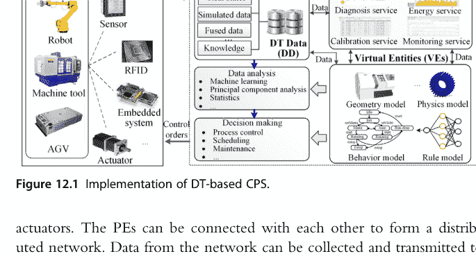

# 图 12.1 基于 DT 的 CPS 实现。

执行器。PEs 可以相互连接形成分布式网络。网络中的数据可以被收集并传输到 cyber 侧进行分析，而指令则会反馈以控制和协调 PEs 的操作。

在 cyber 世界中，DT 的主要目标是创建虚拟镜像（即 VEs）来模拟相应 PEs 的状态和行为。VEs 与物理对应物同步运行，记录实时数据，并在几何和物理属性、行为和规则上产生大量模拟数据。有了 VEs，就可以在不干扰正常操作的情况下获得对 PEs 的洞察，并且可以整合不同阶段（例如设计、制造和维护）的数据。来自 VEs 的模拟数据和来自 PEs 的真实数据都存储在 DD 中并由数据库工具管理。此外，DD 还包括来自服务和领域知识的数据。这些数据通过不同的算法进行融合和分析，例如机器学习、主成分分析和统计学。结合来自多个来源的数据，可以进行数据分析以捕获更准确、更全面的信息。基于分析结果，将做出用于过程控制、调度、维护等的决策。在实际执行之前，VEs 可以以直观的方式验证决策，并通过仿真提供优化建议以避免代价高昂的错误。最后，可以生成控制指令并提供给物理世界，以指导 PEs 的操作。由 DD 和 VEs 支持的服务可以部署在计算机、平板电脑和手机上，同时将相关功能封装成标准形式并配备用户友好的界面。

通过使用这些服务，操作员可以实时监控物理过程，获取相关的工程信息和知识，并通过人工干预做出必要的判断。

借助 DT，CPS 可以通过逼真的仿真、融合数据和服务得到增强，这可以带来效率提升和经济效益。在基于 DT 的 CPS 框架中，物理世界和 cyber 世界内部存在连接，甚至跨越两个世界。实现框架的无处不在的连接是一个关键问题。在下一节中，介绍了 IoT 来解决这个问题。

### 12.5 基于数字孪生的 CPS 中的物联网

如图 12.2 所示，IoT 连接物理世界中的 PEs，以及 cyber 世界中的 VEs、DD 和 Ss，同时紧密耦合物理和 cyber 元素。

在物理世界中，部署在不同 PEs 上的传感器和执行器是连接的。来自机床、机器人、材料和环境的数据可以由感测设备实时收集，例如 RFID 标签、温湿度传感器、电流表、流量计、摄像头等。由于数据通过不同的通信协议传输（例如 RS232/485、ZigBee、Wi-Fi 和 Bluetooth），数据交换困难。为了解决这个问题，部署了网关设备来分析通信协议，将数据转换为标准封装，并支持标准数据交换。此外，网关设备例如 Tao 等人开发的工业物联网中心（II-hub）[45] 还可以执行数据计算，以便可以实时汇聚和分析不同 PEs 的状况，并根据分析结果生成相应的控制指令。指令可以通过 Wi-Fi 传输到计算机、平板电脑或手机，从而指导操作员对 PEs 进行调整，或直接传输到设备的执行器以控制其操作。例如，根据收集到的不同机床的加工速度，可以相应地调节自动导引运输车（AGVs）的运输时间、频率和路径。

然而，由于在物理世界中进行的数据处理和分析相对有限，大规模的计算和仿真仍需要在 cyber 世界部署的云环境中进行。在这个世界中，DT 的 cyber 元素（即 DD、VEs 和 Ss）存在并相互连接。VEs 在专业软件中运行，例如

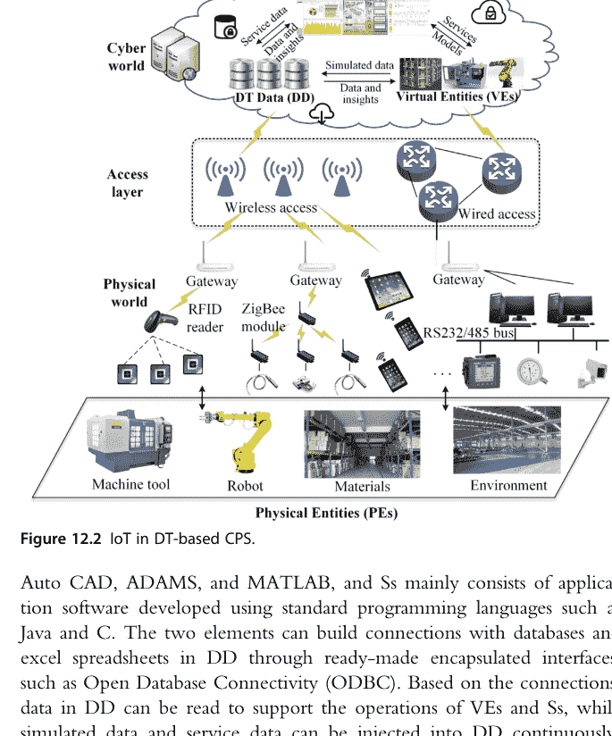

# 图 12.2 基于 DT 的 CPS 中的物联网。

Auto CAD、ADAMS 和 MATLAB，而 Ss 主要由使用标准编程语言如 Java 和 C 开发的应用程序软件组成。这两个元素可以通过现成的封装接口，例如开放数据库连接（ODBC）与 DD 中的数据库和 Excel 电子表格建立连接。基于这些连接，DD 中的数据可以被读取以支持 VEs 和 Ss 的运行，而模拟数据和服务数据可以持续注入 DD。VEs 和 Ss 之间的连接可以通过不同方式实现，例如建立共享文档或通过套接字技术实现双向通信。通过这些连接，可以为 Ss 提供 VEs 使服务更直观、更具交互性，并且 Ss 中的服务可以被调用来评估和校准 VEs。

物理世界和 cyber 世界之间的连接实现了闭环控制。通过网关设备的转换，PEs 的实时数据被转换为统一格式并通过有线（例如以太网）或无线（例如 2G、3G 和 4G）接入模式传输到云端。

数据可以存储在 DD 中并与来自 VEs 和 Ss 的数据融合。基于 DD，VEs 将对物理对应物进行精确的分析和预测，而 Ss 可以提供封装的服务。仿真结果和服务可以通过人机界面呈现给物理世界中的操作员，或转换为控制指令然后直接传递给物理设备的执行器。

借助物联网技术，基于 DT 的 CPS 中的物理和 cyber 元素形成了一个混合通信网络，使元素之间能够连接并交换数据。在该网络中，物理世界和 cyber 世界内部的交互得以实现，这使得物理世界可以由基于计算机的 cyber 系统进行监控和控制。

### 12.6 总结

DT 可以被视为 CPS 的一种聚焦应用。一方面，DT 继承了 CPS 的特性，例如 cyber-物理映射和闭环控制，使物理世界和 cyber 世界交互并集成。另一方面，DT 的元素可以与 CPS 框架结合，以支持高保真仿真、数据融合和服务调用，从而为 CPS 提供更高效的数据分析和决策。在本章中，从多个方面对 DT 和 CPS 进行了审视，并提出了一个基于 DT 的 CPS 框架。物联网技术被应用于该框架，以实现物理世界和 cyber 世界内部以及跨越两者之间的无处不在的连接。

### 参考文献

- [1] J. Shi, J. Wan, H. Yan, H. Suo, A survey of cyber–physical systems, in: 2011 International Conference on Wireless Communications and Signal Processing (WCSP), November, 2011, Nanjing, China, pp. 1–6.
- [2] N. Guo, C. Jia, Interpretation of cyber–physical systems whitepaper, Inform. Technol. Stand. 4 (2017) 36–47.
- [3] R. Poovendran, Cyber–physical systems: close encounters between two parallel worlds, Proc. IEEE 98 (8) (2010) 1363–1366.
- [4] R. Rajkumar, A cyber–physical future, Proc. IEEE 100 (Special Centennial Issue) (2012) 1309–1312.
- [5] V. Gunes, S. Peter, T. Givargis, F. Vahid, A survey on concepts, applications, and challenges in cyber–physical systems, KSII Trans. Internet Inform. Syst. 8 (12) (2014) 4242–4268.
- [6] L. Monostori, B. Kádár, T. Bauernhansl, S. Kondoh, S. Kumara, G. Reinhart, et al., Cyber–physical systems in manufacturing, CIRP Ann. 65 (2) (2016) 621–641.
- [7] E.A. Lee, S.A. Seshia, Introduction to Embedded Systems: A Cyber–Physical Systems Approach, MIT Press, 2016.
- [8] N. Wiener, Cybernetics or Control and Communication in the Animal and the Machine, MIT Press, 1961.
- [9] E.A. Lee, The past, present and future of cyber–physical systems: a focus on models, Sensors 15 (3) (2015) 4837–4869.
- [10] H. Gill, NSF perspective and status on cyber–physical systems, Available from: http://varna.ece.cmu.edu/CPS/Presentations/gill.pdf.
- [11] The CPS Steering Group, Cyber–physical systems executive summary, Available from: http://icps.acm.org/2011/_doc/CPS-Executive-Summary.pdf.
- [12] E.A. Lee, Cyber–physical systems are computing foundations adequate, in: Position Paper for NSF Workshop On Cyber–Physical Systems: Research Motivation, Techniques and Roadmap, Austin, Texas, USA, vol. 2, October, 2006, pp. 1–9.
- [13] Q. Qi, D. Zhao, T.W. Liao, F. Tao, Modeling of cyber-physical systems and digital twin based on edge computing, fog computing and cloud computing towards smart manufacturing, ASME 2018 14th International Manufacturing Science and Engineering Conference, Texas, 2018, American Society of Mechanical Engineers, pp. V001T05A19–V001T05A19.
- [14] L. Monostori, Cyber–physical production systems: roots, expectations and R&D challenges, Procedia CIRP 17 (2014) 9–13.
- [15] S.S. Setty, H. Yaqoob, A. Malik, I. Kevin, K. Wang, Z. Salcic, et al., A unified framework for the design of distributed cyber–physical systems-industrial automation example, in: 2015 IEEE 10th Conference on Industrial Electronics and Applications (ICIEA), Auckland, New Zealand, June, 2015, pp. 996–1002.
- [16] S. Weyer, T. Meyer, M. Ohmer, D. Gorecky, D. Zühlke, Future modeling and simulation of CPS-based factories: an example from the automotive industry, IFAC-PapersOnLine 49 (31) (2016) 97–102.
- [17] J. Lee, B. Bagheri, H.A. Kao, A cyber–physical systems architecture for industry 4.0-based manufacturing systems, Manuf. Lett. 3 (2015) 18–23.
- [18] S. Iarovyi, W.M. Mohammed, A. Lobov, B.R. Ferrer, J.L.M. Lastra, Cyber–physical systems for open-knowledge-driven manufacturing execution systems, Proc. IEEE 104 (5) (2016) 1142–1154.
- [19] P. Leitão, A.W. Colombo, S. Karnouskos, Industrial automation based on cyber–physical systems technologies: prototype implementations and challenges, Comput. Ind. 81 (2016) 11–25.
- [20] L. Wang, R. Gao, I. Ragai, An integrated cyber–physical system for cloud manufacturing, in: ASME 2014 International Manufacturing Science and Engineering Conference Collocated With the JSME 2014 International Conference on Materials and Processing and the 42nd North American Manufacturing Research Conference, Detroit, Michigan, USA, June, 2014, pp. V001T04A029.
- [21] X. Yue, H. Cai, H. Yan, C. Zou, K. Zhou, Cloud-assisted industrial cyber–physical systems: an insight, Microproc. Microsyst. 39 (8) (2015) 1262–1270.
- [22] F. Tao, Q. Qi, New IT driven service-oriented smart manufacturing: framework and characteristics, IEEE Trans. Syst. Man Cybern. Syst. (2017). Available from: https://doi.org/10.1109/TSMC.2017.2723764.
- [23] F. Tao, Y. Wang, Y. Zuo, H. Yang, M. Zhang, Internet of Things in product life-cycle energy management, J. Ind. Inform. Integr. 1 (2016) 26–39.
- [24] The Future of Smart WordPress site, The future of smart, Available from: https://thefutureofsmart.wordpress.com/2014/10/04/the-first-iot-device-a-coke-machine/.
- [25] B. Gates, N. Myhrvold, P. Rinearson, The road ahead, Viking Penguin, 1995.


[26] B. Violino, Wal-Mart expands RFID mandate, 可从以下获取：http://www.rfidjournal.com/articles/view2539.

[27] A. McCue, Tesco heads up new European retail RFID push, 可从以下获取：https://www.zdnet.com/article/tesco-heads-up-new-european-retail-rfid-push/.

[28] International Telecommunication Union, ITU Internet reports 2005: the Internet of Things, 可从以下获取：http://unpan1.un.org/intradoc/groups/public/documents/APCITY/UNPAN021972.pdf.

[29] IBM, IBM builds a smarter planet, 可从以下获取：https://www.ibm.com/smarter-planet/us/en/.

[30] European Technology Platform on Smart Systems Integration, Internet of Things in 2020: a roadmap for the future, 可从以下获取：https://docbox.etsi.org/erm/Open/CERP%2020080609-10/Internet-of-Things_in_2020_EC-EPoSS_Workshop_Report_2008_v1-1.pdf.

[31] G. Miraigliotta, A. Perego, A. Tumino, Internet of Things: smart present or smart future, in: Proceedings of XVII Summer School Francesco Turco, Politecnico di Milano, Italy, 2012.

[32] L. Atzori, A. Iera, G. Morabito, The internet of things: a survey, Comput. Netw. 54 (15) (2010) 2787–2805.

[33] F. Tao, Y. Zuo, L. Xu, L. Zhang, IoT-based intelligent perception and access of manufacturing resource toward cloud manufacturing, IEEE Trans. Ind. Inform. 10 (2) (2014) 1547–1557.

[34] A.C. Sarma, J. Girão, Identities in the future Internet of Things, Wirel. Pers. Commun. 49 (3) (2009) 353–363.

[35] R.Y. Zhong, Q.Y. Dai, T. Qu, RFID-enabled real-time manufacturing execution system for mass-customization production, Robot. Comput. Integr. Manuf. 29 (2) (2013) 283–292.

[36] Y. Zhang, T. Qu, O. Ho, G.Q. Huang, Real-time work-in progress management for smart object-enabled ubiquitous shop-floor environment, Int. J. Comput. Integr. Manuf. 24 (5) (2011) 431–445.

[37] Z. Fang, Q. Li, X. Zhang, S.L. Shaw, A GIS data model for landmark-based pedestrian navigation, Int. J. Geogr. Inform. Sci. 26 (5) (2012) 817–838.

[38] L. Xu, W. He, S. Li, Internet of Things in industries: a survey, Int. J. Geogr. Inform. Sci. 26 (5) (2012) 817–838.

[39] L. Xu, Enterprise systems: state-of-the-art and future trends, IEEE Trans. Ind. Inform. 7 (4) (2011) 630–640.

[40] L. Xu, Introduction: systems science in industrial sectors, Syst. Res. Behav. Sci. 30 (3) (2013) 211–213.

[41] L. Xu, Information architecture for supply chain quality management, Int. J. Prod. Res. 49 (1) (2011) 183–198.

[42] W. He, G. Yan, L. Xu, Developing vehicular data cloud services in the IoT environment, IEEE Trans. Ind. Inform. 10 (2) (2014) 1587–1595.

[43] F. Tao, Y. Zuo, L. Xu, L. Lv, L. Zhang, Internet of Things and BOM-based life cycle assessment of energy-saving and emission-reduction of products, IEEE Trans. Ind. Inform. 10 (2) (2014) 1252–1261.

[44] Y. Zuo, F. Tao, A.Y.C. Nee, An Internet of Things and cloud-based approach for energy consumption evaluation and analysis for a product, Int. J. Comput. Integr. Manuf. 31 (4–5) (2018) 337–348.

[45] F. Tao, J. Cheng, Q. Qi, IIHub: an industrial Internet-of-Things hub towards smart manufacturing based on cyber–physical system, IEEE Trans. Ind. Inform. 4 (5) (2018) 2271–2280.

# INDEX

Note: Page numbers followed by “f” and “t” refer to figures and tables, respectively.

A
Abrupt fault, 154
ADAMS, 252–253
Aerospace
    DT in, 41–43
    engineering, 66
AFRL. See U.S. Air Force Research Laboratory (AFRL)
Agriculture, DT in, 49
AGVs. See Automated guided vehicles (AGVs)
AI. See Artificial intelligence (AI)
Altair, 12t
Amazon, 175, 188
ANSYS, 12t
AnyLogic software, 31
Application programming interface (API), 77, 189
Application service providers (ASPs), 204
AR. See Augmented reality (AR)
ARC Advisory Group, 45
ARM, 176
ARQuake, 220
Articulated arm and IPC, 234
Artificial intelligence (AI), 3–4, 66–67, 89, 183, 231
ARToolKit, 220
ASPs. See Application service providers (ASPs)
Association for Computing Machinery (ACM) Digital Library, 185
Augmented reality (AR), 16, 45–46, 65, 100, 131, 220–221
    AR-assisted factory layout planning and analysis method, 225
    AR-based reformable mock-up, 225
    AR-based robot programming system, 227
    comparison with VR, 228–230, 229t
    in design, 224–225
    digital twin in, 230–233
in manufacturing, 224–227
in service, 224, 227–228
Auto CAD, 252–253
Autodesk, 12t
Automated flow-shop manufacturing system, 30
Automated guided vehicles (AGVs), 173–174, 252
Automotive industry, DT in, 44–45
B
Basic, 208–209
Beginning of life (BOL), 211
Behavior
    analysis, 121
    machine tool, 121
    modeling, 75
BI&A. See Business intelligence and analytics (BI&A)
Big data, 127, 183, 206–207
    advantages of digital twin over, 195–196
    advantages over digital twin, 194–195
    characteristics, 186–187
    comparison with digital twin, 191–196, 192t
    differences, 193–194
    similarities, 191–193
    complementarity with digital twin, 196–197
    concept, 185–186
    history, 185, 186f
    lifecycle in manufacturing, 187–191, 188f
    in manufacturing, 183–184
Bill of material (BOM), 112
Bluetooth, 252
BOL. See Beginning of life (BOL)
BOM. See Bill of material (BOM)
BP. See British Petroleum (BP)

British Petroleum (BP), 46
Bsquare, 12t
Build-it, 225
Business intelligence, 185
Business intelligence and analytics (BI&A), 185

C
CAGR. See Compound annual growth rate (CAGR)
Cap, 208–209
CAPP. See Computer-aided process planning (CAPP)
CARAGS. See Cognition-based interactive augmented reality assembly guidance system (CARAGS)
CAVE automatic virtual environment, 219–220
CBDTW. See Correlation based dynamic time warping (CBDTW)
China, DT attracting in, 40
China International Marine Containers (CIMC), 45–46
Cisco, 175–176
City management, DT in, 48–49
Closed-loop control, 250
Cloud computing, 89, 172, 175, 206–207
SoS-level DT based on, 179–180
Cloud environment, 119
data fusion in, 119f
Cloud manufacturing (CMfg), 204
CN. See Connection (CN)
CNC. See Computerized numerical control (CNC)
CNC machine. See Computer numeric control machine (CNC machine)
Coevolution mechanism, 155–156, 155f
Cognition-based interactive augmented reality assembly guidance system (CARAGS), 226
Cognitive and technical level of people, 54
Collaborative network, 99
Communication
protocol, 252
analysis, 77
conversion, 77
standard and specification, 77
wireless, 77

Complementarity between big data and digital twin, 196–197
Complex aerospace product, 234
Complex equipment, 142
five-dimension DT for, 145–146, 145f
PHM process for, 142f
Compound annual growth rate (CAGR), 53
Computer numeric control machine (CNC machine), 99–100, 100f
Computer-aided process planning (CAPP), 126–127
Computerized numerical control (CNC), 222, 226
Connection (CN), 69, 71, 144–145, 148, 150
technologies for connection modeling, 77
Consistency judgment, 151
Construction, DT in, 49–50
Correlation based dynamic time warping (CBDTW), 153
Cost control and management, 55
CPMT. See Cyber—physical machine tool (CPMT)
CPPS. See Cyber—physical production systems (CPPS)
CPS. See Cyber—physical systems (CPS)
CRC. See Cyclic redundancy check (CRC)
Creator, 210
CRM. See Customer relationship management (CRM)
Cur_ID, 210
Customer relationship management (CRM), 178–179
Cyber security, 55
Cybernetics, 244–245
Cyber–physical fusion, 104, 203
in DTS, 125
connection and interconnection on shop-floor, 126
data fusion, 134–135
digital/virtual shop-floor modeling/ simulation, 126
models fusion, 131–134
physical elements fusion, 129–131
services fusion, 136–137

shop-floor data/information integration, 126–127
shop-floor optimal operations and precision management, 127
of manufacturing, 172
Cyber—physical machine tool (CPMT), 144
Cyber—physical mapping, 249
Cyber—physical production systems (CPPS), 4, 31, 91–92, 245–246
Cyber—physical systems (CPS), 4, 31, 91–92, 141, 144, 194, 206–207, 243
CPS-based manufacturing, 245–246
digital twin and, 249–250
IoT in, 252–254, 253f
history and concept, 244–245
physical world in, 244
Cyclic redundancy check (CRC), 152–153

D
Dassault, 12f
Data, 187
application, 190–191
collection, 90, 188–189
filtering, 90–91
lifecycle, 187
mining algorithms, 99–100
processing, 90–91, 189–190
reduction, 189–190
and services, 67
servitization, 210–211
sources, 187–188
storage, 189
transmission, 190
visualization, 190
Data fusion, 134–135. See also Models fusion; Physical elements fusion; Services fusion
algorithms, 103
of big data, 195
data correlation, clustering, and mining, 135
data generation, modeling, and cleaning, 135

data iteration, evolution, and fusion, 135
from elements, processes, and businesses, 105–106
Data-driven method, 105, 143
Data-driven service generation, 136
DataGlove, 219–220
DD. See Digital twin data (DD)
“Dealing with Data”, 185
Degradation detection, 151
Delay check, 152–153
Deloitte, 12f
Desktop computer-based virtual training system, 224
Digital asset/enterprise/industry, 18–19
Digital shadow, 21–22
Digital System Model, 19–20
Digital thread, 19–21, 21f, 31
Digital twin (DT), 4–7, 5f, 12t, 24, 29, 89, 111, 127, 141, 171, 183–184, 203, 244
advantages of big data over, 194–195
advantages over big data, 195–196
application of VR and AR in assembly, 234–236, 235f
AR combined with, 220–221
challenges, 53–55
cognitive and technical level of people, 54
cost control and management, 55
cyber security and intellectual property rights, 55
insufficient development, 55
standards and specifications, 54
support tools, 54
technology and infrastructure, 54
comparison with big data, 191–196, 192t
complementarity with big data, 196–197
cores, 11–15
and CPS, 249–250
development, 3–5
and digital asset/enterprise/industry, 18–19
and digital shadow, 21–22
and digital thread, 19–21, 21f
DT-based CPS framework, 244


数字孪生 (DT) (续)
DT驱动装配机制
结合 VR 和 AR，233—234
DT驱动智能车间，32
数字孪生驱动 CPS 的实现，250—252，251f
在工业应用中，41—52
工业应用/潜在应用，42t
市场，53
与物理—虚拟空间，15—16
与 PLM，18
在产品生命周期中，29—40
服务应用，211—215
在 PHM 中，214—215
在产品设计中，213—214
在生产中，214
服务生成，208—211
数据服务化，210—211
物理实体服务化，208—209
虚拟实体服务化，209—210
服务管理，211
服务，207—208
封装，209f
管理框架，213f
DT 生态系统体系结构，36
理论定义，7—10，8t
价值，22—23
融合信息技术，23
提高用户参与度，23
提高可见性，22
优化运行，23
降低能耗，23
降低维护成本，23
缩短上市时间，22
在企业视角中，11
与虚拟原型，16—17
与 VR 和 AR
应用框架，231—233，232f
现有研究和应用，230—231
数字孪生数据 (DD)，68—69，71，118—119，144—145，148，150，231—234，250—253
DD 建模技术，76
数字孪生建模 (DT 建模)，63，77
面向应用的三级 DT，71—73
SoS 级 DT，73
系统级 DT，73
单元级 DT，72
扩展五维 DT，68—71
要求，66—68
从应用方面，66
从建模方法方面，68
从建模对象方面，67
从技术方面，66—67
规则
基于数据和知识，77
层次，78
轻量级，78
模块化，77
开放性和可扩展性，78—79
鲁棒性，79
服务化，78
标准化，78
技术，73—77
连接建模，77
数字孪生数据建模，76
物理实体建模，74
服务建模，75—76
虚拟实体建模，74—75
传统三维 DT，63—66
数字孪生车间 (DTS)，6—7，32，89—90，92—97，104—106，111，125，173—174，214。另见 DTS 中的 Cyber—物理融合
挑战，107—108
概念模型，93f
Cyber—物理融合，104
数据驱动，105
EECM 优势，119—122
在 EC 分析中，120—121
在 EC 监控中，120
在 EC 优化中，121—122
EECM 框架，113—114，114f
EECM 实现，114—119
数字孪生数据，118—119
EECM 服务，116—118，118f
物理机床，114—115
虚拟机床，115—116
车间演进路径，85—90，86f
数据融合，来自元素、流程和业务，105—106

实现，98—104
PS，98—99
SDTD，103—104
SSS，101—102
VS，99—101
交互机制，94f
迭代优化，106
运行过程，95—97，96f
参考架构，127—129，128f
技术，106—107，107f
工作，90—92
数据采集，90
数据处理，90—91
生产模式探索，91—92
信息系统建设，91
虚拟模型构建，91
数字孪生驱动 PHM 方法，148—156
协同演化机制，155—156，155f
框架，148—150，149f
输入，148—149
输出，150
DT 组件作用，149—150
齿轮箱，160—164
流程，150—154，151f
故障原因识别与预测，154，154f
不一致原因判断，153
模型校准，152—153，152f
相似度测量，153f
偏航系统，157—159
数字/虚拟车间建模/仿真，126
制造数字化，183—184
分布式传感器布局优化，74
DNV GL，12t
DT。见数字孪生 (DT)
DT 建模。见数字孪生建模 (DT 建模)
DTS。见数字孪生车间 (DTS)
动态数据驱动应用系统，6
E
电子商务平台，188
e-KPIs。见能源相关关键绩效指标 (e-KPIs)
EC。见能源消耗 (EC)
边缘计算，172，176
基于边缘计算的单元级数字孪生，177—178
EECM。见设备能源消耗管理 (EECM)
EIS。见企业信息系统 (EIS)
电力发电，DT 在其中，43—44
ELM。见极限学习机 (ELM)
嵌入式系统，74
应急，DT 在其中，51—52
产品寿命终止 (EOL)，211
能源消耗 (EC)，111
优势
在 EC 分析中，120—121
在 EC 监控中，120
在 EC 优化中，121—122
减少，23
能源相关关键绩效指标 (e-KPIs)，112
企业信息系统 (EIS)，92—93
数据，95—97
企业资源规划 (ERP)，126—127，178—179
企业，DT 在其中的视角，11
环境保护，DT 在其中，50—51
EOL。见产品寿命终止 (EOL)
EPoSS。见智能系统集成欧洲技术平台 (EPoSS)
设备能源消耗管理 (EECM)，111，122
在 DTS 中的框架，113—114，114f
在 DTS 中的实现，114—119
在 DTS 中的潜在优势，119—122
ERP。见企业资源规划 (ERP)
ESB。见欧洲商学院 (ESB)
欧洲，DT 在欧洲的吸引力，40
欧洲商学院 (ESB)，33
智能系统集成欧洲技术平台 (EPoSS)，247—248

## F

一切即服务 (XaaS)，203
极限学习机 (ELM)，162
Eyephone HMD，219—220

Facebook，175，188
工厂布局设计，225
故障原因识别与预测，152，154，154f
FC。见频率中心 (FC)
有限元法 (FEM)，34，70，99—100，146—147
芬兰电力系统，44
5C 架构，245—246
五 V 模型。见容量、种类、速度、可变性和价值模型 (五 V 模型)
五维 DT，68—69，69f，144—145
CN，71
针对复杂设备，145—146，145f
DD，71
各维度建模，146—148，147f
物理实体，69
服务，70—71
虚拟实体，70
雾计算，172，175—176
基于雾计算的系统级 DT，178—179
傅里叶变换，119
频率中心 (FC)，161—162
频率方差 (VF)，161—162
融合数据，250，252
融合
数字孪生与大数据在制造中的融合，197f
融合驱动的 PHM，199—200
融合驱动的产品设计，198
融合驱动的生产，198—199
融合信息技术，23
物理与虚拟空间之间的过程，171—172

## G

GE。见通用电气公司 (GE)
GE Healthcare Camden Group，46
齿轮箱，156—157

P 方法的精度，164t
DT 方法的精度，163t
数字孪生驱动齿轮箱 PHM，160—164
DT 驱动的故障原因预测模型，163f
振动频率谱，161f
齿轮应力分析，162f
通用电气公司 (GE)，12t，41
全球移动通信系统 (GSM)，248—249
Google，175
渐进式故障，154

## H

头戴式显示系统 (HMD 系统)，219—220，227
医疗和医药行业，DT 在其中，46—47
供暖、通风和空调系统 (HVAC 系统)，48
高保真
三维模型，22
VE，232—233
虚拟模型，68，244，249—250
HMD 系统。见头戴式显示系统 (HMD 系统)
HMI。见人机界面 (HMI)
华为，176
人机界面 (HMI)，76，178—179
HVAC 系统。见供暖、通风和空调系统 (HVAC 系统)
混合方法，143

## I

IaaS。见基础设施即服务 (IaaS)
IBM。见国际商业机器公司 (IBM)
ICT。见信息与通信技术 (ICT)
IDC。见国际数据公司 (IDC)
II-hub。见工业物联网中心 (II-hub)

沉浸式虚拟环境，224
不一致原因判断，151–153
工业应用，DT 在其中，41–52
DT
在航空航天中，41–43
在农业中，49
在汽车中，44–45
在城市管理中，48–49
在建筑中，49–50
在电力发电中，43–44
在环境保护中，50–51
在医疗和医药中，46–47
在海运/航运中，47–48
在石油和天然气中，45–46
在安全和应急中，51–52
观察，52
工业环境，79
工业物联网中心 (II-hub)，252
工业个人电脑 (IPC)，234
工业 PSS (IPS2)，204
工业 4.0，32–33
行业融合，19
信息
系统建设，91
技术，16
模板，210–211
信息与通信技术 (ICT)，176
Infosys，12t
基础设施即服务 (IaaS)，175
注射成型工艺，37
Intel，176
Intellectsoft，12t
知识产权，55
智能仪器，129
智能辅导系统 (ITS)，228
国际商业机器公司 (IBM)，12t，45
国际数据公司 (IDC)，53
国际标准，65–66
国际电信联盟 (ITU)，247–248
互联网数据，188
物联网 (IoT)，3–4，44–45，64–65，86–87，111–112，127，143，206–207，231，244
面向智能制造的应用，248–249
连接到物联网的设备，183
在数字孪生驱动 CPS 中，252–254，253f
历史和概念，247–248
直观信息导航，226
IoT。见物联网 (IoT)
IPC。见工业个人电脑 (IPC)
IPS2。见工业 PSS (IPS2)
迭代优化，106
ITS。见智能辅导系统 (ITS)
ITU。见国际电信联盟 (ITU)
J
即时信息渲染，226
L
LANs。见局域网 (LANs)
激光投影仪和 IPC，234
激光跟踪仪和 IPC，234
学习算法，36
最小二乘优化方法 (LSOM)，152–153
LHP。见活体心脏项目 (LHP)
轻量级，78
LinkedIn，188
活体心脏项目 (LHP)，46
局域网 (LANs)，248–249
低功耗蓝牙，248–249
LSOM。见最小二乘优化方法 (LSOM)
M
MaaS。见制造即服务 (MaaS)
机床
行为，121
升级，122
机器—机器互联与协作，130


Machine—material interconnection and collaboration，130
Maintenance design，152
Maintenance plans，143
Management data，187
Man—machine interconnection and collaboration，130
Man—machine—material—environment smart communication and computing，131
smart connection and interconnection，130
smart control and interaction，131
smart cooperation and convergence，131
Manufacturing，183—184
big data in，183—184
big data lifecycle in，187—191，188f
comparison of digital twin and big data in，187—191，192t
cyber—physical fusion of，172
fusion of digital twin and big data in，197f，198—200
fusion process between physical and virtual spaces，171—172
physical space and virtual space，184
servitization in，204
site data，187
smart，172，183
three-level digital twins in，173—174
Manufacturing as a service (MaaS)，196—197，204
Manufacturing cyber—physical system (MCPS)，33
Manufacturing execution systems (MES)，113，126—127，178—179，245—246
Manufacturing grids (MGrid)，204
Maritime/shipping industry，DT in，47—48
Massachusetts Institute of Technology (MIT)，247
MATLAB，252—253
MCPS. See Manufacturing cyber—physical system (MCPS)
Mean square frequency (MSF)，161—162
MES. See Manufacturing execution systems (MES)
MGrid. See Manufacturing grids (MGrid)
Microsoft，12t，231
Microsoft HoloLens，226
Middle of life (MOL)，211
Military Sealift Command (MSC)，47
MIT. See Massachusetts Institute of Technology (MIT)
Mixed reality (MR)，220
Mobile Internet，206—207
Model calibration，150，152—153，152f
Model simulation and interaction，151
Model-based method，143
Models fusion，131—134. See also Data fusion; Physical elements fusion; Services fusion
multidimension models
construction，133
correlation and mapping mechanism，133—134
evaluation and verification，132f，133
theory and method of consistency，134
Modularization，77
MOL. See Middle of life (MOL)
MR. See Mixed reality (MR)
MSC. See Military Sealift Command (MSC)
MSF. See Mean square frequency (MSF)
MSI. See US-based Mechanical Solutions, Inc. (MSI)
Multidimension models
construction，133
correlation and mapping mechanism，133—134
evaluation and verification，132f，133
theory and method of consistency，134
Multilevel networks，248—249

## O

Network routers，172，175–176
Networking and information technology (NIT)，244–245
New generation information technologies (New IT)，3–4，66–67，85–86，176，206–207
and applications，184f
PHM with，143
requiring to embrace，66–67
New IT. See New generation information technologies (New IT)
NFC. See Near-field communication (NFC)
NIST. See National Institute of Standards and Technology (NIST)
NIT. See Networking and information technology (NIT)
NSF. See National Science Foundation (NSF)
NUI. See Natural user interfaces (NUI)
Object-based storage architecture，189
ODBC. See Open Database Connectivity (ODBC)
Oil and gas industry，DT in，45–46
Online_site，210
Open Database Connectivity (ODBC)，252–253
Open Inventor，222–223
Openness and scalability，78–79
Optimal operation，23
Oracle，12t
Ori_ID，210
Ori_phy，210
Outputs，150，210
Owner，210

## P

PaaS. See Platform-as-a-service (PaaS)
PACCAR，12t
Parameter optimization，121
Parametric Technology Corporation (PTC)，12t，231
“Pay-as-you-go” manner，203
PCA. See Principal component analysis (PCA)
PCAST. See US President’s Council of Advisors on Science and Technology (PCAST)
PDP activities. See Product design and planning activities (PDP activities)
PE. See Physical entity (PE) Physical equipment (PE)
PHANTOM device，223
PHM. See Prognostics and health management (PHM)
Physical and cyber world connections，253–254
Physical elements fusion，129–131. See also Data fusion; Models fusion; Services fusion
Physical entity (PE)，63–64，69，72，208，231–234，250–251
servitization，208–209
technologies for PE modeling，74
Physical equipment (PE)，144–146，149
Physical machine tool，114–115
data collection experimental bench for，115f
Physical modeling，75
Physical shop-floor (PS)，89–90，92–93，98–99，113–114，125
data，103
interconnection and interaction in，98f
physical elements fusion in，130f
Physical space，90–91，184
Physical world in CPS，244，250–251
Physical WT，146
Physical/virtual space，15–16
Platform-as-a-service (PaaS)，175
PLC. See Programmable logic controller (PLC)
PLM. See Product lifecycle management (PLM)
PricewaterhouseCoopers (PWC)，50
Principal component analysis (PCA)，119
Problem analysis–model construction–algorithm design–optimization analysis，127
Product design，183–184
digital twin service application in，213–214
driven by fusion of digital twin and big data，198

Product design and planning activities (PDP activities)，226
Product lifecycle，DT in，29–40，30f
DT
in design stage，29–31
across multiple stages，37–39
in production stage，31–34
in service stage，34–37
observations，39–40
DT attracting in United States，China，and Europe，40
production and PHM，39–40
Product lifecycle management (PLM)，5，18，63
software，30–31
Product maintenance methods，196–197
Product service systems (PSS)，204
Production，39–40
activity planning，87–88
digital twin service application in，214
driven by fusion of digital twin and big data，198–199
DT in production stage，31–34
exploration of modes for，91–92
line，71–72
process control，88–90
resource management，86–87
systems，37–38
Prognostics and health management (PHM)，7–10，8t，29，34，39–40，64–65，141–142，183–184，193–194，203，211–213，245–246
digital twin service application in，214–215
digital twin-driven PHM
for gearbox，160–164
for yaw system，157–159
driven by fusion of digital twin and big data，199–200
problem description，156–157
process for complex equipment，142，142f
Programmable logic controller (PLC)，210–211
PS. See Physical shop-floor (PS)
PSS. See Product service systems (PSS)
PTC. See Parametric Technology Corporation (PTC)
PWC. See PricewaterhouseCoopers (PWC)

## Q

Quality of service (QoS)，116–118，136，208–210

## R

Radio frequency identification (RFID)，64–65，74，98–99，129，188–189，226，247–248
labels，86–87
Real-time
applications，177–178
data，142
interaction，171–176，178–179
manufacturing execution system，91
Reference architecture for DTS，127–129，128f
Remaining useful life (RUL)，142–143
Resource allocation service，95–97
RFID. See Radio frequency identification (RFID)
Robotics，222–223，227
Robustness，79
Rockwell Automation，230–231
RS232/485，252
RUL. See Remaining useful life (RUL)

## S

SaaS. See Software-as-a-service (SaaS)
SAP. See System Applications and Products (SAP)
SAR. See Spatially augmented reality (SAR)
Scheduling optimization，122
SCM. See Supply chain management (SCM)
SDK. See Software development kit (SDK)
SDTD. See Shop-floor digital twin data (SDTD)
Seamless cyber–physical fusion，40
Security，107–108
cyber，55
DT in，51–52
Sensor
data，95–97
network technology，248–249
soft，74
Sensorama Simulator，219–220
Sensory devices，143
Service encapsulation based on XML，211，212f
Service fusion and application，137
Service smart management and optimization，136
Service-oriented approach (SoA)，205–206
Service-oriented smart manufacturing (SoSM)，205–207，245–246
Services (Ss)，68–71，144–145，147–148，150，203，213–214，231–233，250–253
in digital twin，207–208
digital twin service
application，211–215
generation，208–211
management，211
SoSM framework，205–207
technologies for services modeling，75–76
Services fusion，136–137. See also Data fusion; Models fusion; Physical elements fusion
and application，137
data-driven service generation，136
service smart management and optimization，136
Servitization，78
data，210–211
in manufacturing，204
physical entity，208–209
virtual entity，209–210
Shop-floor，85. See also Virtual shop-floor (VS)
connection and interconnection，126
data/information integration，126–127
evolution path，85–90，86f
production activity planning，87–88
production process control，88–90
production resource management，86–87
manufacturing data，134
optimal operations and precision management，127
Shop-floor digital twin data (SDTD)，89–90，92–93，103–104，113–114，116–118，125，136
data fusion，103f
data fusion in，135f
Shop-floor service system (SSS)，89–90，92–93，101–102，113–114，125
operation mechanism，102f
Siemens，12t
Sight Machine Inc.，12t
Silicon Graphics，219–220
SIM-CI，12t
Simulated data，95–97
Skin model shapes，38
Smart manufacturing，172，183
Smarter Planet，247
SoA. See Service-oriented approach (SoA)
Social networking platforms，188
Soft sensor，74
Software development kit (SDK)，189
Software-as-a-service (SaaS)，175
SoS. See System of systems (SoS)
SoS-level DT，63，73，172–174，174f
based on cloud computing，179–180
SoSM. See Service-oriented smart manufacturing (SoSM)
Spatially augmented reality (SAR)，220
SSS. See Shop-floor service system (SSS)
Status，208–209
Supply chain management (SCM)，178–179
System Applications and Products (SAP)，12t，52
System of systems (SoS)，71–72，171–172，243
System-level DT，73，172–174，174f
based on fog computing，178–179

## T

Taobao，188
Three-dimension DT，63–64，64f
existing works on DT modeling，64–66
Three-dimension solid modeling，75
Three-dimensional digital mirror model，16


三级数字孪生
  基于边缘计算、雾计算和云计算，176—180，177f
  在制造中，173—174
三级结构，250
TIBCO 软件，12t
TwinThread，12t
Twitter，188

U
美国空军研究实验室（AFRL），41—43
美国空军车辆，34
Ubisense（UBI），43
单元级 DT，72，172—174，174f
  基于边缘计算，177—178
数字孪生在美国的吸引力，40
美国总统科学与技术顾问委员会（PCAST），244—245
美国机械解决方案公司（MSI），30—31
提升用户参与度，23

V
VE。参见虚拟实体（VE）虚拟设备（VE）
验证、确认和认可（VV&A），70，75，100，133
VF。参见频率方差（VF）
虚拟装配，222—223，226
  虚拟现实和增强现实在装配中的应用，234—236，235f
结合虚拟现实和增强现实的数字孪生驱动装配机制，233—234
虚拟实体（VE），63—64，69—70，72，231—234，250—253
  服务化，209—210
  VE 建模技术，74—75
虚拟环境，91
虚拟设备（VE），144—147，149
虚拟森林，50—51
虚拟机床，115—116，117f
基于虚拟维护仿真的可维护性分析框架，223

虚拟模型
  构建，91
  数据和服务，235
虚拟编程语言公司（VPL Company），219—220
虚拟原型，16—17
虚拟现实（VR），16，45—46，65，100，131，219—221
  与 AR 的比较，228—230，229f
  在设计中，221—222
  数字孪生在其中，230—233
  在制造中，221—223
  建模语言，219—220
  在服务中，221，223—224
基于 VR 的多点触控桌，221—222
虚拟车间（VS），89—90，92—93，99—101，113—114，125。另见车间
  数据，103
  多维模型融合，132f
  模型在其中的运行和演化，101f
虚拟空间，43，90—91，171—172，184，205—206，214
虚拟 WT，146—147
虚拟性连续体，220
可见性，22
Visual C++ ，222—223
体积、种类、速度、变化性和价值模型（五 V 模型），186—187
VPL Company。参见虚拟编程语言公司（VPL Company）
VR。参见虚拟现实（VR）
基于 VR 的机器人教学系统（VRRoT），223
VR 机器人工作单元布局（VR-RoWL），223
VS。参见虚拟车间（VS）
VV&A。参见验证、确认和认可（VV&A）

W
沃尔玛，188
小波分析，119
Wi-Fi，252
Wikitudo AR 旅行指南，220
风力涡轮机（WT），141，144–145，156
  由数字孪生驱动的故障原因预测模型，163f
  WT 组件的故障率，156t
无线通信，77
无线传感器网络（WSNs），64–65，74，90，111–112，129
在制品（WIP），31，130
工作场所设计与规划活动（WDP 活动），226

## X
XaaS。参见一切即服务（XaaS）

XML，210–211
  基于 XML 的服务封装，212f

## Y
偏航系统，156–157
  数字孪生驱动的偏航系统 PHM，157–159
  风向标故障，159f
  维护策略仿真，159f
  时间序列，158f
YouTube，188

## Z
ZigBee，248–249，252

## 数字孪生驱动智能制造

Fei Tao, Meng Zhang, A.Y.C. Nee

本书为工业和学术界的读者提供了进入该领域的理想切入点，回答了诸如“什么是数字孪生，以及如何构建？”“如何利用数字孪生提高制造效率？”“实施数字孪生的关键活动有哪些？”“成功部署数字孪生需要克服的最重要障碍是什么？”“数字孪生与新技术之间有何关系？”以及“如何将数字孪生与新技术结合以实现制造的高效和智能？”等问题。

在介绍数字孪生的背景、概念和应用之后，初始章节讨论了五维数字孪生建模及其关键技术、数字孪生车间、涉及的设备能耗管理，以及数字孪生车间中的 cyber-physical 融合。随后本书继续探讨数字孪生与云、雾和边缘计算、大数据、服务、虚拟和增强/混合现实，以及 cyber-physical 系统之间的关系，最后阐述物联网如何应用于物理世界和 cyber 世界。

《数字孪生驱动智能制造》使对智能制造感兴趣的工程师和学者能够充分利用数字孪生技术，并分析数字孪生技术与其他技术如物联网和大数据之间的差异、协同作用和集成可能性。

Fei Tao 是中国北京航空航天大学自动化科学与电气工程学院教授。他的研究兴趣为面向服务的智能制造、制造服务管理与优化、数字孪生驱动的产品设计/制造/服务、绿色与可持续制造。

Meng Zhang 是中国北京航空航天大学自动化科学与电气工程学院博士生。她的研究重点是制造中的数字孪生技术和可持续制造。

A.Y.C. Nee 是新加坡国立大学制造工程荣休教授，新加坡。他的研究兴趣包括人工智能在制造中的应用、虚拟和增强现实应用、可持续产品设计和生命周期工程、以及计算机辅助制造设计。他是国际生产工程科学院（CIRP）院士、制造工程师学会（SME）院士以及新加坡工程院院士。


ACADEMIC PRESS
Elsevier 的一个印记
elsevier.com/books-and-journals

