# 现代 C++ 探索指南 第2版


## 关于此电子书

ePUB 是一种开放的、行业标准的电子书格式。但是，ePUB 及其众多功能在不同的阅读设备和应用程序中的支持情况各不相同。使用您的设备或应用程序设置来自定义呈现方式，以符合您的偏好。您可以自定义的设置通常包括字体、字体大小、单栏或双栏、横向或纵向模式，以及可以点击或轻触以放大的图形。有关阅读设备或应用程序上的设置和功能的更多信息，请访问设备制造商的网站。

许多书名包含编程代码或配置示例。为优化这些元素的呈现效果，请以单栏横向模式查看电子书，并将字体大小调整为最小设置。除了以可重排文本格式呈现代码和配置外，我们还包含了模仿印刷书籍呈现效果的代码图像；因此，在可重排格式可能影响代码清单呈现效果的地方，您将看到“单击此处查看代码图像”链接。单击该链接以查看保真度高的代码图像。要返回之前查看的页面，请单击设备或应用程序上的“后退”按钮。


献给我可爱的孩子们：文森特、丹尼尔、雅尼斯和阿妮莎

## 前言

> "世界是建立在 C++（及其 C 子集）之上的。"
> —Herb Sutter

谷歌、亚马逊和 Facebook 的基础设施是由用 C++ 编程语言设计和实现的组件和服务构建的。操作系统、网络设备和存储系统的技术栈中有相当大一部分是用 C++ 实现的。在电信系统中，几乎所有固定电话和蜂窝电话连接都由 C++ 软件编排。工业和交通系统中的关键组件，包括自动收费系统、自动驾驶汽车、卡车和公共汽车，都依赖于 C++。

在科学和工程领域，当今大多数高质量软件包都是用 C++ 实现的。当项目规模超过一定大小且数据结构和算法变得非平凡时，该语言的优势就显而易见了。因此，计算科学中的许多——如果不是大多数——模拟软件今天都是用 C++ 实现的，这并不奇怪；这些包括 FLUENT、Abaqus、deal.II、FEniCS、OpenFOAM 和 G+Smo。即使是嵌入式系统，也得益于更强大的嵌入式处理器和改进的编译器，越来越多地用 C++ 实现。物联网 (IoT) 和嵌入式边缘智能等新兴应用领域，都由 TensorFlow、Caffe2 和 CNTK 等 C++ 平台驱动。

你每天使用的核心服务都基于 C++：你的手机、你的汽车、通信和工业基础设施，以及媒体中的关键元素


和娱乐服务都包含 C++ 组件。C++ 服务和应用在现代社会中无处不在。原因很简单。C++ 语言随着其需求不断进步，并在许多方面引领着编程生产力和执行效率的创新。这两个特性使其成为需要大规模运行的应用程序的首选语言。

## 学习 C++ 的理由

与其他任何语言都不同，C++ 掌握了从一端足够接近硬件的编程到另一端抽象高级编程的完整光谱。底层编程——比如用户可定义的内存管理——让你作为程序员了解执行期间真正发生的事情，进而帮助你理解其他语言中程序的行为。在 C++ 中，你可以编写极其高效的程序，只有使用机器语言并付出荒谬努力编写的代码才能略微超越它。然而，你应该暂时搁置硬核性能调优，首先专注于清晰且富有表现力的软件。

C++ 的高级特性正是在此处发挥作用。该语言直接支持多种编程范式：面向对象编程（第 6 章）、泛型编程（第 3 章）、元编程（第 5 章）、并发编程（§4.6）和过程式编程（§1.5）等。

多种编程技术——例如 RAII（§2.4.2.1）和表达式模板（§5.3）——是在 C++ 中为 C++ 发明的。由于该语言非常富有表现力，通常可以在不更改语言的情况下建立这些新技术。谁知道，也许有一天你会发明一种新技术。

## 阅读本书的理由

本书中的材料已在真实人身上经过测试。作者在三年内（即三次两个学期）教授了他的课程“面向科学家的 C++”。学生大多来自数学系，加上一些来自物理和工程系的学生，通常在课前不了解 C++，但到课程结束时能够实现像表达式模板（§5.3）这样的高级技术。你可以按照自己的节奏阅读本书：沿着主路径直奔主题，或通过阅读附录 A 中的附加示例和背景信息来更彻底地学习。

## 美与丑

C++ 程序可以用多种方式编写。在本书中，我们将平稳地引导你走向更高级的风格。这需要使用高级特性，起初可能令人生畏，但一旦习惯就会不再如此。实际上，高级编程不仅适用性更广，而且通常同样或更高效、更易读。

我们将通过一个简单的例子给你留下第一印象：固定步长的梯度下降。原理极其简单：我们使用梯度（设为 g(x)）计算 f(x) 的最陡下降方向，并沿此方向以固定步长前进到下一个局部极小值。即使是算法伪代码也像这个描述一样简单：

```
Algorithm 1: Gradient descent algorithm
Input: Start value x, step size s, termination criterion e, function f, gradient g
Output: Local minimum x
1 do
2 |x = x - s · g(x)
3 while |Δf(x)| >= e ;
```

对于这个简单的算法，我们编写了两种截然不同的实现。请看一看，让它在脑海中沉淀下来，不要试图理解技术细节。

单击此处查看代码图片

```cpp
void
gradient_descent(double* x,
                 double* y, double s,
                 double eps,
                 double (*f)(double,
                             double),
                 double (*gx)(double,
                              double),
                 double (*gy)(double,
                              double))
{
    double val= f(*x, *y),
           delta;
    do {
        *x-= s * gx(*x,
                    *y);
        *y-= s * gy(*x,
                    *y);
        double new_val=
            f(*x, *y);
        delta= abs(new_val
                  - val);
        val= new_val;
    } while (delta > eps);
}
```

```cpp
template <typename Value,
          typename P1,
          typename P2,
          typename F,
          typename G>
Value gradient_descent(Value
                       x, P1 s,
                       P2 eps, F f, G g)
{
    auto val= f(x), delta=
        val;
    do {
        x-= s * g(x);
        auto new_val= f(x);
        delta= abs(new_val -
                   val);
        val= new_val;
    } while (delta > eps);
    return x;
}
```

乍一看，它们非常相似，我们很快会告诉你我们更喜欢哪一个。第一个版本原则上是纯 C，即也可以用 C 编译器编译。其优点是优化内容直接可见：一个带有 `double` 值的 2D 函数（由 **高亮** 的函数参数指示）。我们更喜欢第二个版本，因为它更通用：两个任意维度、任意值类型的函数（由 **标记** 的类型和函数参数可见）。令人惊讶的是，通用实现并不效率更低。恰恰相反，为 `F` 和 `G` 给出的函数可以内联（参见 §1.5.3），从而节省函数调用开销，而第一个版本中显式使用（丑陋的）函数指针会使编译器难以对这段代码进行加速。

一个比较旧式和新式风格的更长示例见附录 A（§A.1），供非常有耐心的读者参考。在那里，现代编程的优点比这里的玩具示例更加明显。但我们不想用前期的小规模试探让你等待太久。

## 科学与工程中的语言

> “如果各种数值软件都能用 C++ 编写而不损失效率，那将是件好事，但除非能找到在不损害 C++ 类型系统的前提下实现这一点的方法，否则依赖 Fortran、汇编语言或特定于架构的扩展可能更可取。”
> 
> ——Bjarne Stroustrup

科学和工程软件使用不同的语言编写，哪一种最合适取决于目标和可用资源：

- 当我们可以使用现有算法时，MATLAB、Mathematica 或 R 等数学工具非常出色。当我们使用细粒度（例如，标量）操作实现自己的算法时，性能会显著下降。当问题较小或用户耐心无限时，这可能不是问题；否则我们应该考虑其他语言。
- Python 非常适合快速软件开发，包含“scipy”和“numpy”等科学库，以及基于这些库（通常用 C 和 C++ 实现）的应用程序，其效率相当高。同样，基于细粒度操作的用户自定义算法会付出性能代价。Python 是高效实现小型和中型任务的绝佳方式。当项目足够大时，编译器变得更严格变得越来越重要（例如，当参数类型不匹配时会拒绝赋值）。
- 当我们可以依赖现有且经过良好调优的操作（例如稠密矩阵操作）时，Fortran 也非常出色。它非常适合完成老教授的作业（因为他们只要求在 Fortran 中容易实现的事情）。根据作者的经验，引入新的数据结构相当麻烦，用 Fortran 编写大型模拟程序是一个巨大的挑战——如今只有越来越少的少数人会自愿这样做。
- C 允许获得良好的性能，大量软件都是用 C 编写的。核心语言相对较小且易于学习。挑战在于使用简单且危险的语言特性（尤其是指针（§1.8.2）和宏（§1.9.2.1））编写大型且无错误的软件。最后一个标准于 2017 年发布，因此命名为 C17。大部分 C 特性——但并非全部——迟早都被引入了 C++。
- 当应用程序的主要组件是 Web 或图形界面且不执行太多计算时，Java、C# 和 PHP 等语言可能是不错的选择。
- C++ 在开发大型、高质量且性能良好的软件时尤其出色。尽管如此，开发过程不必缓慢且痛苦。有了合适的抽象，我们可以相当快速地编写 C++ 程序。我们乐观地认为，在未来的 C++ 标准中，将包含更多科学库。

显然，我们掌握的语言越多，选择就越多。而且，我们对这些语言了解得越多，选择就越明智。此外，大型项目通常包含不同语言的组件，而在大多数情况下，至少性能关键的内核是用 C 或 C++ 实现的。总而言之，学习 C++ 是一段引人入胜的旅程，深入理解它无论如何都会让你成为一名优秀的程序员。

## 排版约定

新术语以清晰的蓝色和斜体显示。C++ 源代码以蓝色等宽字体打印。重要细节以粗体标记。类、函数、变量和常量均为小写，可选地包含下划线。矩阵是例外，通常用单个大写字母命名。模板参数和概念以大写字母开头，并可


包含更多大写字母（CamelCase）。程序输出和命令采用浅蓝色打字机字体。

需要 C++11、C++14、C++17 或 C++20 特性的程序已用相应的页边框标记。几个轻度使用 C++11 特性（该特性可轻易用 C++03 表达式替代）的程序未明确标记。

除非常简短的代码示例外，本书中的所有编程示例均在至少一个编译器上进行了测试，在大多数情况下，在三个编译器上进行了测试：`g++`、`clang++` 和 Visual Studio。所有示例都尽可能简短，以便于理解。为此，我们没有融入可比生产代码中会使用的所有功能。显然，我们尽量减少尚未介绍的功能的使用。读完本书后，回顾示例并问问自己，基于所获得的所有新知识，你会以何种不同方式编写代码，这可能是个好主意。

对于 C++20 示例，我们建议你尝试运行，看它们是否在你的系统上工作。在撰写本书时，大多数新特性尚未被所有编译器完全支持。即使是现有的编译器支持，当时也可能并非 100% 正确。对于某些新库，当任何编译器上都没有标准版本可用时，我们使用了原型实现（例如，format 库）。

```
=> directory/source_code.cpp
```

与所讨论主题相关的程序示例位置由箭头以及段落或章节开头处的完整程序路径指示。所有程序均可在 GitHub 的公共仓库 https://github.com/petergottschling/dmc3 中获取，因此可以通过以下方式克隆：

点击此处查看代码图像

```
git clone https://github.com/petergottschling/dmc3.git
```

在 Windows 上，使用 TortoiseGit 可能更方便；参见 tortoisegit.org。

在 InformIT 网站上注册您的 *发现现代 C++，第二版* 副本，以便在更新和/或更正可用时方便地访问。要开始注册流程，请访问 informit.com/register 并登录或创建帐户。输入产品 ISBN (9780136677642) 并单击提交。在“Registered Products”选项卡中查找该产品旁边的 Access Bonus Content 链接，并按照该链接访问任何可用的奖励材料。如果您希望收到新版本和更新的独家优惠通知，请勾选框以接收我们的电子邮件。

## Pearson 对多元化、公平性和包容性的承诺

Pearson 致力于创建反映所有学习者多样性的无偏见内容。我们拥抱多元化的诸多维度，包括但不限于种族、民族、性别、社会经济地位、能力、年龄、性取向以及宗教或政治信仰。

教育是推动我们世界实现公平与变革的强大力量。它有潜力提供改善生活并实现经济流动性的机会。在与作者合作为每款产品和服务创建内容时，我们承认有责任展示包容性并融入多元化的学术研究，以便每个人都能通过学习实现自身潜力。作为世界领先的学习公司，我们有责任推动变革，并践行我们的宗旨：帮助更多人为自己创造更美好的生活，并创造更美好的世界。

我们的雄心是有目的地为以下世界做出贡献：

- 每个人都有通过学习成功的公平且终身的机会。
- 我们的教育产品和服务具有包容性，并代表学习者的丰富多样性。
- 我们的教育内容准确反映我们所服务的学习者的历史和经历。
- 我们的教育内容与学习者引发更深入的讨论，并激励他们扩展自身的学习（和世界观）。

尽管我们努力呈现无偏见的内容，但我们希望听取您对本 Pearson 产品的任何担忧或需求，以便我们可以进行调查并加以解决。

- 如有任何潜在偏见方面的担忧，请通过 https://www.pearson.com/report-bias.html 联系我们。

## 致谢

按时间顺序，作者首先要感谢 Karl Meerbergen 及其同事，感谢他们提供最初用于在 KU Leuven 作为块讲座的 80 页文本（该讲座由 Karl 和我于 2008 年讲授）。随着时间的推移，大部分段落已被重写，但原始文档为整个写作过程提供了至关重要的初始动力。我真心感谢 Mario Mulansky 贡献了第 7.1 节“常微分方程求解器的实现”。

我非常感谢 Jan Christiaan van Winkel 和 Fabio Fracassi，他们逐一核查了手稿第一版的每一个细节，并就标准合规性和可理解性提出了许多建议。我同样感谢第二版的校对者：Chuck Allison、Sean Parent，尤其是 Marc Gregoire，他们彻底检查了本书的每一个细节。此外，Jan Christiaan van Winkel 在本版最终制作期间提供了宝贵的帮助，值得特别表彰。

我特别要感谢 Bjarne Stroustrup，感谢他为塑造本书提供战略建议、建立与 Addison-Wesley 的联系、慷慨地允许我重用他准备充分的材料，以及（不得不提）创建了 C++。所有这些人都敦促我尽可能用最新的语言特性更新我的想法。

此外，我感谢 Karsten Ahnert 的建议，以及 Markus Abel 和 Theodore Omtzigt 帮助我消除前言中的冗余。

当我为第 4.2.2.6 节寻找一个有趣的随机数应用程序时，Jan Rudl 建议了他课堂上使用的股价演变 [60]。

我感谢德累斯顿工业大学，它让我在数学系教授 C++ 三年，并感谢这门课程所有学生提供的建设性反馈。同样，我感谢参加过我 C++ 培训的所有人。

我深深感谢我的编辑 Greg Doench，感谢他接受本书中半认真半随意的写作风格，忍受关于战略决策的长时间讨论直到我们双方都满意，并提供专业支持，没有这种支持，本书永远无法出版。

最后但同样重要的是，我衷心感谢我的孩子们 Yanis、Anissa、Vincent 和 Daniel，他们牺牲了我们大部分在一起的时间，让我能够专注于编写本书。

## 关于作者

**Peter Gottschling** 的职业热情是编写前沿科学软件，并希望将这种“病毒”传染给许多读者。这一职业使他编写了 Matrix Template Library 4 和 5，并合著了包括 Boost Graph Library 在内的其他库。这些编程经验在大学的多门 C++ 课程和专业培训课程中分享——最终促成了本书的出版。

他是 ISO C++ 标准委员会成员、德国编程语言标准委员会主席，以及德累斯顿 C++ 用户组的创始人。在德累斯顿工业大学年轻而狂野的岁月里，他同时学习了计算机科学和数学，前者获得博士学位，后者达到类似学士学位的水平。在学术机构的漂泊之后，他创办了自己的公司 SimuNova，并与他四个孩子中较小的两个定居在家乡莱比锡。

## 第 1 章

## C++ 基础

> "致我的孩子们：不要嘲笑不得不帮我处理电脑事情。我教过你们如何使用勺子。"
> 
> —Sue Fitzmaurice

在本章中，我们将引导您了解 C++ 的基本特性。如同全书一样，我们将从不同角度探讨它们，但不会试图展示每一个可能的细节——这本身也是不可行的。有关特定特性的更详细问题，我们推荐在线参考 http://en.cppreference.com。

### 1.1 我们的第一个程序

作为 C++ 语言的入门，让我们来看看以下示例：

点击此处查看代码图像

```
#include <iostream>

int main ()
{
    std::cout << "The answer to the Ultimate Question of Life,\n"
              << "the Universe, and Everything is:"
              << std::endl << 6 * 7 << std::endl;
    return 0;
}
```


这将产生

```
The answer to the Ultimate Question of Life,
the Universe, and Everything is:
42
```

根据道格拉斯·亚当斯 [2]。这个简短示例已经说明了 C++ 的几个特性：

- 输入和输出不是核心语言的一部分，而是由库提供。必须显式包含；否则我们无法读取或写入。

- 标准 I/O 采用流模型，因此命名为 `<iostream>`。要启用其功能，我们在第一行 `#include <iostream>`。

- 每个 C++ 程序都通过调用函数 `main` 开始。它会 `return` 一个整数值，其中 0 表示成功终止。

- 大括号 `{}` 表示一个代码块/组（也称为复合语句）。

- `std::cout` 和 `std::endl` 定义在 `<iostream>` 中。前者是一个输出流，允许在屏幕上打印文本。`std::endl` 终止一行。我们也可以使用特殊字符 `\n` 换行。

- 运算符 `<<` 可用于将对象传递给输出流（如 `std::cout`）以执行输出操作。请注意，在程序中该运算符表示为两个小于号（`<<`）。为了更优雅的打印效果，我们在代码清单中使用单个法语双角引号代替。

- `std::` 表示该类型或函数来自标准命名空间。命名空间帮助我们组织名称并处理命名冲突。

- 本书中的许多示例使用 `std` 命名空间中的类型，而不加限定前缀 `std::`。要编译此类示例，假设在包含头文件后，程序包含声明：

```
using namespace std;
```

命名空间的详细内容将在 3.2.1 节中讨论。

- 字符串常量（更准确地说，字面量）用双引号括起来。

- 表达式 6 * 7 会被求值并作为整数传递给 std::cout。在 C++ 中，每个表达式都有一个类型。有时我们作为程序员必须显式声明类型，而有时编译器可以为我们推断。6 和 7 是 int 类型的字面常量，因此它们的乘积也是 int。

在继续阅读之前，我们强烈建议你在计算机上编译并运行这个小程序。一旦它编译并运行，你可以稍微玩一下，例如，添加更多操作和输出（并查看一些错误消息）。最后，真正学习一门语言的唯一方法就是使用它。如果你已经知道如何使用编译器，甚至 C++ IDE，可以跳过本节的其余部分。

Linux: 每个发行版至少提供 GNU C++ 编译器——通常已预安装（参见 B.1 节中的简短介绍）。假设我们将程序命名为 hello42.cpp；可以使用命令轻松编译：

```
g++ hello42.cpp
```

遵循上世纪的传统，生成的二进制文件默认名为 a.out。总有一天我们可能会有多个程序，届时可以使用输出标志指定更有意义的名称：

```
g++ hello42.cpp -o hello42
```

我们也可以使用构建工具 make（参见 §7.2.2.1 获取概述），它为构建二进制文件提供默认规则。因此，我们可以调用

```
make hello42
```

make 将在当前目录中查找同名程序源文件。它会找到 hello42.cpp，由于 .cpp 是 C++ 源文件的标准后缀，它将调用系统的默认 C++ 编译器。一旦我们编译了程序，就可以在命令行上像这样调用它：

```
./hello42
```

我们的二进制文件可以在不需要任何其他软件的情况下执行，并且可以将其复制到另一个兼容的 Linux 系统¹ 并在该处运行。

- 1. 通常标准库是动态链接的（参见 §7.2.1.4），因此在另一系统上存在相同版本是兼容性要求的一部分。

**Windows:** 如果你运行 MinGW，可以以与 Linux 下相同的方式编译。如果你使用 Visual Studio，则需要先创建一个项目。开始时，最简单的方法是使用控制台应用程序的项目模板，例如如 http://www.cplusplus.com/doc/tutorial/introduction/visualstudio 中所述。

运行程序时，控制台关闭前你可能只有几毫秒的时间读取输出。² 要将阅读阶段延长到一秒钟，只需插入不可移植命令 `Sleep(1000);` 并包含 <windows.h>。使用 C++11 或更高版本，等待阶段可以可移植地实现：

```
std::this_thread::sleep_for(std::chrono::seconds(1));
```

- 2. 自 VS 2019 起，控制台会自动暂停。

在包含 <chrono> 和 <thread> 之后。Microsoft 提供名为“Community”的免费 Visual Studio 版本，它们提供与专业版相同的标准语言支持。区别在于专业版附带更多开发者库。由于本书未使用那些库，你可以使用 Community 版本来尝试我们的示例。

**IDE:** 像本书中的示例这样的短程序可以用普通编辑器轻松处理。在较大的项目中，建议使用集成开发环境（IDE）来查看函数定义或使用位置、显示代码内文档、在项目范围内搜索或替换名称等等。KDevelop 是 KDE 社区编写的免费 C++ IDE。它可能是 Linux 上最高效的 IDE，并与 git、subversion 和 CMake 集成良好。Eclipse 是用 Java 开发的，感知上较慢。然而，最近有人投入大量精力改进其 C++ 支持，许多开发者使用它也非常高效。Visual Studio 是一个非常稳固的 IDE，允许在 Windows 下进行高效开发，在较新版本中还支持 CMake 项目的集成。

找到最高效的环境需要一些时间和实验，当然也取决于个人和协作的偏好。因此，它也会随时间演变。

### 1.2 变量

C++ 是一种强类型语言（与许多脚本语言不同）。这意味着每个变量都有一个类型，且该类型永不改变。变量由以类型开头、后跟变量名（可选初始化）或其列表的语句声明：

```
int i1 = 2; // Alignment for readability only
int i2, i3 = 5; // Note: i2 is not initialized
float pi = 3.14159;
double x = -1.5e6; // -1500000
double y = -1.5e-6; // -0.0000015
char c1 = 'a', c2 = 35;
cmp = i1 < pi, // -> true
happy = true;
```

这里的两个斜杠 // 开始一个单行注释；即，从双斜杠到行尾的所有内容都被忽略。原则上，关于注释这真正是全部重要内容。为了不让你觉得该主题上仍有重要内容缺失，我们将在 1.9.1 节中再多讨论一些。

#### 1.2.1 内置类型

C++ 中最基本的类型是表 1–1 中列出的内置类型。它们是核心语言的一部分，始终可用。

**表 1–1：内置类型**

| 名称 | 语义 |
| :--- | :--- |
| char | 字母和非常短的整数 |
| short | 相当短的整数 |
| int | 常规整数 |
| long | 长整数 |
| long long | 非常长的整数 |
| unsigned | 所有前述类型的无符号版本 |
| signed | 所有前述类型的有符号版本 |
| float | 单精度浮点数 |
| double | 双精度浮点数 |
| long double | 长浮点数 |
| bool | 布尔值 |

前五种类型是长度非递减的整数。例如，int 至少和 short 一样长；即，它通常但不一定更长。每种类型的确切长度取决于实现；例如，int 可能是 16、32 或 64 位。所有这些类型都可以限定为有符号或无符号。前者对整数（char 除外）没有影响，因为它们默认是有符号的。

当我们将整数类型声明为 unsigned 时，将没有负值，但正值数量翻倍（如果将零视为既非正也非负，则再加一）。signed 和 unsigned 可以被视为名词 int 的形容词，当只声明形容词时，int 为默认名词。同样的规则适用于形容词 short、long 和 long long。

char 类型有两种用途：用于字母和相当短的数字。除了非常特殊的架构外，它几乎总是 8 位长度。因此，我们可以表示 -128 到 127（有符号）或 0 到 255（无符号）的值，并对其执行所有可用于整数的数值操作。当既未声明 signed 也未声明 unsigned 时，使用哪一种取决于编译器的实现。然而，当有大量容器时，使用 char 或 unsigned char 表示小数字可能很有用。


逻辑值最好用 bool 表示。布尔变量可以存储 true 和 false。

非递减长度属性以同样的方式适用于浮点数：float 的长度短于或等于 double，而 double 又短于或等于 long double。典型大小为 float 32 位，double 64 位，long double 128 位。

#### 1.2.2 字符和字符串

如前所述，类型 char 可用于存储字符：

```cpp
char c = 'f';
```

我们还可以表示任何其编码可容纳于 8 位中的字母。它甚至可以与数字混合；例如，'a' + 7 通常会得到 'h'，具体取决于字母的底层编码。我们强烈建议不要这样做，因为潜在的混淆很可能导致可感知的时间浪费。

我们从 C 继承了将字符串表示为 char 数组的机会。

```cpp
char name[8] = "Herbert";
```

这些旧式 C 字符串都以 char 值的二进制 0 结尾。如果缺少 0，算法会一直运行，直到找到下一个包含 0 字节的内存位置。另一个巨大的危险是向字符串追加内容：name 没有额外空间，追加的字符会覆盖其他一些数据。要正确处理所有字符串操作——既不损坏内存，也不截断较长的字符串——对于这些旧式字符串来说绝非易事。因此，我们强烈建议除字面量值外不要使用它们。

C++ 编译器区分单引号和双引号：'a' 是字符 "a"（其类型为 char），而 "a" 是一个以二进制 0 结尾的数组（即，其类型为 const char[2]）。

处理字符串更方便的方式是使用类 string（这要求我们包含 <string>）：

```cpp
#include <string>

int main()
{
  std::string name = "Herbert";
}
```

C++ 字符串使用动态内存并自行管理。因此，如果我们向字符串追加更多文本，就不需要担心内存损坏或字符串被截断：

```cpp
name = name + ", our cool anti-hero"; // more on this later
```

许多当前实现还对短字符串（例如，最多 16 字节）使用优化，这些字符串不存储在动态内存中，而是直接存储在字符串对象本身。此优化可显著减少昂贵的内存分配和释放。

C++14 由于双引号中的文本被解释为 char 数组，我们需要能够表示该文本应被视为字符串。这是通过后缀 s 完成的，例如 "Herbert"s。不幸的是，我们花了直到 C++14 的时间才启用此功能。像 string("Herbert") 这样的显式转换始终是可能的。C++17 添加了字符串的轻量级常量视图，我们将在第 4.4.5 节中展示。

- 3. 与许多其他示例一样，我们在此假设程序包含 using namespace std。也可以仅导入后缀或仅导入特定后缀。但是，我们建议在学习语言时导入整个标准命名空间。

#### 1.2.3 声明变量

> **建议**
> 尽可能晚地声明变量，通常在第一次使用它们之前立即声明，并在可能的情况下声明，但在能够初始化它们之前不要声明。

这使得程序在变长时更易读。它还允许编译器在嵌套作用域中更高效地使用内存。

C++11 C++11 可以为我们推断变量的类型，例如：

```cpp
auto i4 = i3 + 7;
```

`i4` 的类型与 `i3 + 7` 的类型相同，即 `int`。虽然类型是自动确定的，但它保持不变，之后分配给 `i4` 的任何内容都将转换为 `int`。我们将在后面看到 `auto` 在高级编程中有多有用。对于本节中这样的简单变量声明，通常最好显式声明类型。`auto` 将在第 3.4 节中详细讨论。

#### 1.2.4 常量

从语法上讲，常量类似于 C++ 中的特殊变量，具有额外的常量属性：

```cpp
const int c1 = 2;
const int ci3; // Error: no value
const float pi = 3.14159;
const char cc = 'a';
const bool cmp = c1 < pi;
```

由于它们不能被更改，必须在声明中设置它们的值。第二个常量声明违反了此规则，编译器不会容忍这种不当行为。

常量可以在允许使用变量的任何地方使用——当然，前提是它们不被修改。另一方面，像上面这样的常量在编译期间已经是已知的。这使得多种优化成为可能，并且常量甚至可以用作类型的参数（我们将在 §5.1.4 中稍后回到此问题）。

#### 1.2.5 字面量

像 2 或 3.14 这样的字面量也有类型。简单来说，整数根据数值的大小被视为 `int`、`long` 或 `unsigned long`。每个带有小数点或指数的数字（例如，`3e12 ≡ 3 · 10^12`）都被视为 `double`。

其他类型的字面量可以通过添加以下表中的后缀来编写：

| 字面量 | 类型 |
| --- | --- |
| 2 | int |
| 2u | unsigned |
| 2l | long |
| 2ul | unsigned long |
| 2.0 | double |
| 2.0f | float |
| 2.0l | long double |

在大多数情况下，不需要显式声明字面量的类型，因为内置数值类型之间的隐式转换（又称强制转换）通常会将值设置为程序员所期望的值。

但是，有四个主要原因说明我们应该关注字面量的类型。

**可用性：** 标准库提供了一种复数类型，其实部和虚部的类型可以由用户参数化：

```cpp
std::complex<float> z(1.3, 2.4), z2;
```

不幸的是，运算仅在类型本身与底层实数类型之间提供（且此处不转换参数）。4 因此，我们不能用 int 或 double 乘以 z，只能用 float：

```cpp
z2 = 2 * z;        // Error: no int * complex<float>
z2 = 2.0 * z;      // Error: no double * complex<float>
z2 = 2.0f * z;     // Okay: float * complex<float>
```

4. 然而，混合算术是可实现的，如 [19] 所示。

**歧义：** 当函数针对不同参数类型重载时（§1.5.4），像 0 这样的参数可能存在歧义，而对于像 0u 这样的限定参数可能存在唯一匹配。

**精度：** 当我们使用 long double 时，精度问题就会出现。由于非限定字面量是 double，我们在将其赋值给 long double 变量之前可能会丢失数字：

```cpp
long double third1 = 0.33333333333333333333; // may lose digits
```

```cpp
long double third2 = 0.333333333333333333331; // accurate
```

**非十进制数：** 以零开头的整数字面量被解释为八进制数，例如：

```cpp
int o1 = 042; // int o1 = 34;
```

```cpp
int o2 = 084; // Error! No 8 or 9 in octals!
```

十六进制字面量可以通过 0x 或 0X 前缀来编写：

```cpp
int h1 = 0x42; // int h1 = 66;
```

```cpp
int h2 = 0xfa; // int h2 = 250;
```

C++14 引入了二进制字面量，它们带有 0b 或 0B 前缀：

```cpp
int b1 = 0b11111010; // int b1 = 250;
```

为了提高长字面量的可读性，C++14 允许我们使用撇号分隔数字：

```cpp
long d = 6'546'687'616'861'1291;
unsigned long ulx = 0x139'ae3b'2ab0'94f3;
int b = 0b101'0001'0011'1010'1101'1010'0001;
const long double pi = 3.141'592'653'589'793'238'4621;
```

自 C++17 起，我们甚至可以编写十六进制浮点字面量：

```cpp
float f1 = 0x10.1p0f; // 16.0625
```

```cpp
double d2 = 0x1ffp10; // 523264
```

这些字面量由字符 p 引入。指数是强制性的——因此我们在第一个示例中需要 p0。由于后缀 f，f1 是一个存储值 16^1+16^-1 = 16.0625 的 float。这些字面量涉及三个基数：伪尾数是一个以 2 的幂为基数缩放的十六进制数，而指数以十进制数给出。因此，d2 是 511 × 2^10 = 523264。诚然，十六进制字面量一开始看起来有点极客，但它们允许我们声明没有舍入误差的二进制浮点值。

字符串字面量的类型是 char 数组：

```cpp
char s1[] = "Old C style"; // better not
```

然而，这些数组绝非方便，我们最好使用库 <string> 中的真正字符串类型。它可以直接从字符串字面量创建：

```cpp
#include <string>
std::string s2 = "In C++ better like this";
```

非常长的文本可以拆分为多个子字符串：

```cpp
std::string s3 = "This is a very long and clumsy text "
"that is too long for one line.";
```

C++14 虽然 s2 和 s3 的类型是 string，但它们仍然用类型为 const char[] 的字面量初始化。这里不是问题，但在编译器推断类型的其他情况下可能会出问题。自 C++14 起，我们可以通过追加 s 直接创建类型为 string 的字面量：

```cpp
f("I'm not a string"); // literal of type const char[]
f("I'm really a string"s); // literal of type string
```

与之前一样，我们假设使用了命名空间 std。为了不导入整个标准命名空间，我们可以使用其子空间，即编写以下行中的至少一行：


```cpp
using namespace std::literals;
using namespace std::string_literals;
using namespace std::literals::string_literals;
```

有关字面量的更多详情，例如参见 [62, 第 6.2 节]。我们将在第 2.3.6 节中展示如何定义自己的字面量。

#### C++11 1.2.6 非缩窄初始化

假设我们用一个长数字初始化一个 `long` 变量：

```
long l2 = 1234567890123;
```

在大多数 64 位平台上，当 `long` 占 64 位时，这可以完美编译并正确运行。当 `long` 只有 32 位长时（我们可以通过使用类似 `-m32` 的标志编译来模拟这种情况），上述值太长。然而，程序仍然会编译（可能伴有警告），并以另一个值运行，例如，前导位被截断的值。

C++11 引入了一种初始化方式，以确保不会丢失数据，换句话说，值不会被 *缩窄*。这是通过 *统一初始化* 或 *花括号初始化* 实现的，我们在此仅提及，并在第 2.3.4 节中详细展开。花括号中的值不能被缩窄：

```
long l = {1234567890123};
```

现在编译器将检查变量 `l` 是否能在目标架构上容纳该值。使用花括号时，可以省略等号：

```
long l{1234567890123};
```

编译器的缩窄保护允许我们验证初始化过程中值不会丢失精度。而用浮点数对普通 `int` 进行初始化是允许的，因为存在隐式转换：

点击此处查看代码图片

```
int il = 3.14; // compiles despite narrowing (our risk)
int iln = {3.14}; // Narrowing ERROR: fractional part lost
```

第二行中的新初始化形式禁止这样做，因为它会截断浮点数的小数部分。同样，将负值赋给无符号变量或常量在传统初始化中是被容忍的，但在新形式中则被禁止：

点击此处查看代码图片

```
unsigned u2= -3;        // Compiles despite narrowing (our risk)
unsigned u2n= {-3};     // Narrowing ERROR: no negative values
```

在之前的示例中，我们在初始化中使用了字面量值，编译器检查特定值是否可以用该类型表示：

```
float fl= {3.14};      // okay
```

嗯，值 3.14 在任何二进制浮点格式中都无法以绝对精度表示，但编译器可以将 fl 设置为最接近 3.14 的值。当从 double 变量（而非字面量）初始化 float 时，我们需要考虑所有可能的 double 值，以及它们是否都可以以无损方式转换为 float。

点击此处查看代码图片

```
double d;
...
float f2= {d};          // narrowing ERROR
```

请注意，缩窄可能在两种类型之间是互相的：

点击此处查看代码图片

```
unsigned u3= {3};
int     i2= {2};

unsigned u4= {i2};      // narrowing ERROR: no negative values
int     i3= {u3};       // narrowing ERROR: not all large
                        values
```

有符号 int 和无符号 int 具有相同的大小，但每种类型的并非所有值都可以在另一种类型中表示。

#### 1.2.7 作用域

作用域决定了（非静态）变量和常量的生命周期和可见性，并有助于在我们的程序中建立结构。

##### 1.2.7.1 全局定义

我们打算在程序中使用的每个变量，都必须在代码中较早的位置用其类型说明符进行声明。变量可以位于全局作用域或局部作用域。全局变量在所有函数之外声明。声明后，全局变量可以从代码中的任何位置引用，甚至在函数内部。起初这听起来非常方便，因为它使变量易于访问，但当你的软件增长时，跟踪全局变量的修改会变得更加困难和痛苦。到某个阶段，每个代码更改都有可能引发错误雪崩。

##### 建议

不要使用全局变量。

如果你使用它们，迟早会后悔，因为它们可以从整个程序中访问，因此跟踪全局变量在哪里被更改——以及何时、如何更改——极其乏味。

像这样的全局常量

点击此处查看代码图片

```
const double pi=
3.141592653589793238462643383279502884197169399;
```

是可以的，因为它们不会引起副作用。

##### 1.2.7.2 局部定义

局部变量在函数体内声明。其可见性/可用性仅限于其声明所在的 { } 包围的块。更准确地说，变量的作用域从其声明开始，到声明块的闭合花括号结束。

如果我们在 main 函数中定义 π：

点击此处查看代码图片

```
int main ()
{
    const double pi=
    3.141592653589793238462643383279502884197169399;
    std::cout << "pi is " << pi << ".\n";
}
```

变量 `pi` 仅在 `main` 函数中存在。我们可以在函数内以及其他块内定义块：

点击此处查看代码图片

```
int main ()
{
    {
        const double pi=
        3.14159265358979323846264338327950288419716939;
    }
    std::cout << "pi is " << pi << ".\n"; // ERROR: pi is out of scope
}
```

在这个示例中，`pi` 的定义仅限于函数内的块，因此函数其余部分的输出是一个错误：

> >>pi<< 在此作用域中未定义。

因为 `pi` 超出了作用域。

##### 1.2.7.3 隐藏

当同名变量存在于嵌套作用域中时，只有一个变量是可见的。内层作用域中的变量会隐藏外层作用域中的同名变量（在许多编译器中会导致警告）。例如：

点击此处查看代码图片

```
int main ()
{
    int a= 5;       // define a#1
    {
        a= 3;       // assign a#1, a#2 is not defined
    }
yet
    int a;      // define a#2
    a= 8;       // assign a#2, a#1 is hidden
    {
        a= 7;   // assign a#2
    }           // end of a#2's scope
}
a= 11;          // assign to a#1 (a#2 out of scope)

return 0;
}
```

由于隐藏，我们必须区分变量的生命周期和可见性。例如，`a#1` 从其声明开始直到 `main` 函数结束都存活。然而，它仅从其声明直到 `a#2` 的声明期间可见，并在包含 `a#2` 的块关闭后再次可见。事实上，可见性是生命周期减去被隐藏的时间。在同一作用域中两次定义相同的变量名是错误的。

作用域的优势在于，我们不需要担心变量是否已在作用域外的某处定义。它只是被隐藏，但不会产生冲突。5 不幸的是，隐藏使得外层作用域中的同名变量无法访问。我们可以通过巧妙重命名在一定程度上应对这一问题。然而，更好的解决方案是使用命名空间来管理嵌套和可访问性；参见第 3.2.1 节。

5. 与宏不同，宏是 C 语言中过时且鲁莽的遗留特性，应不惜一切代价避免，因为它破坏了语言的所有结构和可靠性。

`static` 变量是例外证明规则的例子：它们存活到执行结束，但仅在作用域内可见。我们担心，在这个阶段详细介绍它们更多是分散注意力而非有帮助，因此已将讨论推迟到第 A.2.1 节。

### 1.3 运算符

C++ 拥有丰富的内置运算符。有不同种类的运算符：

- 计算类：
  - 算术：++，+，-，*，%，...
  - 布尔：
    - 比较：<=，!=，...
    - 逻辑：&& 和 ||
  - 位运算：~，<< 和 >>，&，^，和 |
- 赋值：=，+=，...
- 程序流程：函数调用，?:，和 ,
- 内存处理：new 和 delete
- 访问：.，->，[ ]，*，...
- 类型处理：dynamic_cast，typeid，sizeof，alignof，...
- 错误处理：throw

本节将为你提供运算符的概述。有些运算符在其他地方更好地描述，在相应的语言特性上下文中，例如，作用域解析最好与命名空间一起解释。大多数运算符可以为用户类型重载；也就是说，我们可以决定当我们的类型的参数出现在表达式中时执行哪些计算。

在本节末尾（表 1–8），你将找到一个简洁的运算符优先级表。打印或复制此页并将其贴在显示器旁边可能是个好主意；许多人都这样做，几乎没有人能完全背诵整个优先级列表。如果你不确定优先级，或者相信这样做对其他使用你源代码的程序员来说更易理解，也不应犹豫在子表达式周围加上括号。如果你要求编译器吹毛求疵，它往往会过于认真地对待这项工作，并提示你添加多余的括号，假设你被优先级规则压倒了。在第 C.2 节中，我们将为你提供所有运算符的完整列表，附有简要描述和参考。

#### 1.3.1 算术运算符

表 1–2 列出了 C++ 中可用的算术运算符。我们按优先级对它们进行了排序，但让我们逐一查看。

##### 表 1–2：算术运算符

| 操作 | 表达式 |
|---|---|
| 后置递增 | x++ |
| 后置递减 | x-- |


| 操作 | 表达式 |
|---|---|
| 预递增 | ++x |
| 预递减 | --x |
| 一元正号 | +x |
| 一元负号 | -x |
| 乘法 | x * y |
| 除法 | x / y |
| 取模 | x % y |
| 加法 | x + y |
| 减法 | x - y |

第一类操作是递增和递减。这些操作可以用于将数字增加或减少 1。由于它们会改变数字的值，因此仅对变量有意义，而对临时结果则没有意义，例如：

单击此处查看代码图片

```
int i = 3;
i++; // i is now 4
const int j = 5;
j++; // Error: j is constant
(3 + 5)++; // Error: 3 + 5 is only a temporary
```

简而言之，递增和递减操作需要某个可修改且可寻址的东西。可寻址数据项的技术术语是 lvalue（在附录 C 的定义 C–1 中有更正式的表述）。在上面的代码片段中，仅 i 满足此条件。与之相反，j 是常量，而 3 + 5 则不可寻址。

前缀和后缀两种表示法对变量的影响相同，即在其上加 1 或减 1。递增和递减表达式的值对前缀和后缀运算符不同：前缀运算符返回修改后的值，而后缀运算符返回旧值，例如：

单击此处查看代码图片

```
int i = 3, j = 3;
int k = ++i + 4; // i is 4, k is 8
int l= j++ + 4; // j is 4, l is 7
```

最终，`i` 和 `j` 都是 4。然而在计算 `l` 时，使用了 `j` 的旧值，而第一个加法则使用了已递增的 `i` 值。

一般来说，最好避免在数学表达式中使用递增和递减，而是用 `j+1` 之类的表达式替换，或分别执行递增/递减操作。当数学表达式没有 `Side Effects` 时，人类读者更容易理解，编译器也更容易优化。我们很快就会明白原因（§I.3.12）。

一元负号会对数字取负：

单击此处查看代码图片

```
int i= 3;
int j= -i; // j is -3
```

一元正号对标准类型没有算术影响。对于用户定义类型，我们可以定义一元正号和负号的行为。如表 1–2 所示，这些一元运算符的优先级与预递增和预递减相同。

操作 `*` 和 `/` 自然是乘法和除法，且都定义在所有数值类型上。当除法的两个参数都是整数时，结果的小数部分会被截断（向零舍入）。运算符 `%` 产生整数除法的余数。因此，两个参数都应具有整型类型。

最后，两个变量或表达式之间的操作符 `+` 和 `-` 表示加法和减法。

操作的语义细节——结果如何舍入或溢出如何处理——在语言中未指定。出于性能原因，C++ 通常将此留给底层硬件。

一般来说，一元运算符的优先级高于二元运算符。在极少数同时应用后缀和前缀一元表示法的情况下，后缀表示法的优先级高于前缀表示法。

在二元运算符中，我们有与数学中相同的行为：乘法和除法优先于加法和减法，且运算是左结合的，即：

```
x - y + z
```

始终被解释为

```
(x - y) + z
```

需要牢记的非常重要的一点是：参数的求值顺序未定义。例如：

单击此处查看代码图片

```
int i = 3, j = 7, k;
k = f(++i) + g(++i) + j;
```

在此示例中，结合性保证第一个加法在第二个加法之前执行。但 f(++i) 或 g(++i) 哪个先计算取决于编译器实现。因此，k 可能是 f(4) + g(5) + 7 或 f(5) + g(4) + 7（甚至可能是 f(5) + g(5) + 7，当两个递增在函数调用之前执行时）。此外，我们不能假设在不同平台上结果相同。一般来说，在表达式中修改值是危险的。在某些条件下它可以工作，但我们始终需要测试并给予极大关注。总的来说，我们的时间最好花在多输入几个字母并分别进行修改上。更多关于此主题的内容在第 1.3.12 节。

=> c++03/num_1.cpp

使用这些运算符，我们可以编写第一个（完整的）数值程序：

单击此处查看代码图片

```
#include <iostream>

int main ()
{
    const float r1= 3.5, r2 = 7.3, pi = 3.14159;

    float areal = pi * r1*r1;
    std::cout << "A circle of radius " << r1 << " has area "
    << areal << "." << std::endl;

    std::cout << "The average of " << r1 << " and " << r2 << "
    is "
    << (r1 + r2) / 2 << "." << std::endl;
}
```

当二元操作的参数具有不同类型时，一个或两个参数会根据 §C.3 中的规则自动转换（强制转换）为公共类型。

转换可能导致精度损失。浮点数优先于整数，显然将 64 位 `long` 转换为 32 位 `float` 会导致精度损失；即使 32 位 `int` 也不总能正确表示为 32 位 `float`，因为一些位用于指数。还有些情况，目标变量本可以保存正确结果，但精度已在中间计算中丢失。为了说明这种转换行为，让我们看下面的示例：

单击此处查看代码图片

```
long l= 1234567890123;
long l2= 1 + 1.0f - 1.0; // imprecise
long l3= 1 + (1.0f - 1.0); // correct
```

这在作者的平台上导致

单击此处查看代码图片

```
l2 = 1234567954431
l3 = 1234567890123
```

在 `l2` 的情况下，由于中间转换，我们丢失了精度，而 `l3` 则计算正确。诚然，这是一个人为的示例，但你应该意识到不精确中间结果的风险。特别是在大型计算中，必须仔细选择数值算法以防止错误累积。幸运的是，不准确的问题在下一节不会困扰我们。

#### 1.3.2 布尔运算符

布尔运算符是逻辑运算符和关系运算符。顾名思义，两者都返回 `bool` 值。这些运算符及其含义按优先级分组列在表 1-3 中。

二元关系和逻辑运算符位于所有算术运算符之后。这意味着像 `4 >= 1 + 7` 这样的表达式会被视为 `4 >= (1 + 7)` 来求值。相反，用于逻辑否定的一元运算符 `!` 优先于所有二元运算符。

##### 表 1-3：布尔运算符

| 操作 | 表达式 |
| :--- | :--- |
| 非 | !b |
| 三路比较（C++20） | x <=> y |
| 大于 | x > y |
| 大于或等于 | x >= y |
| 小于 | x < y |
| 小于或等于 | x <= y |
| 等于 | x == y |
| 不等于 | x != y |
| 逻辑与 | b && c |
| 逻辑或 | b || c |

布尔运算符也有关键字，如 not、and、or 和 xor。甚至还有用于赋值的关键字，如 or_eq 对应 |=。我们通常不使用它们，因为它们看起来原始，但有一个例外：not 可以使表达式更易读。当否定以 "!" 或 "|" 开头的内容时，感叹号容易被忽略。空格已经有所帮助，但关键字使否定更加明显：

单击此处查看代码图片

```
big = !little;    // You knew before there's an !
big= not little;  // Much easier to spot, though
```

尽管这些关键字从标准 C++ 开始就可用，但 Visual Studio 仍然不支持它们，除非使用 /permissive- 或 /Za 进行编译。

在旧（或老派）代码中，你可能会看到在 int 值上执行逻辑操作。请避免这样做：它可读性较差，且可能导致意外行为。

##### 建议

对于逻辑表达式，始终使用 `bool`。

请注意，比较不能像这样链式使用：

单击此处查看代码图片

```
bool in_bound= min <= x <= y <= max;    // Syntax error
```

相反，我们需要更冗长的逻辑归约：

单击此处查看代码图片

```
bool in_bound= min <= x && x <= y && y <= max;
```

在下一节中，我们将看到类似的运算符。

#### 1.3.3 位运算符

这些运算符允许我们测试或操作整型的单个位。它们对系统编程很重要，但对现代应用开发则不那么重要。表 1-4 按优先级列出了这些运算符。

操作 `x << y` 将 `x` 的位向左移动 `y` 个位置。相反，`x >> y` 将 `x` 的位向右移动 `y` 次。在大多数情况下，0 会被移动（除了负的 `signed` 值）到右侧，其行为由实现定义。

6. 为了更美观的打印，我们再次将双小于和大于符号压缩为法语双引号。

##### 表 1-4：位运算符

| 操作 | 表达式 |
|---|---|
| 按位取反 | ~x |
| 左移 | x << y |
| 右移 | x >> y |
| 按位与 | x & y |
| 按位异或 | x ^ y |


| 操作 | 表达式 |
|---|---|
| 按位包含或 | `x | y` |

按位与可用于测试值的特定位。按位包含或可以设置一位，而按位异或会翻转它。虽然这些操作在科学应用中不那么重要，但我们将在第 3.5.1 节中用于算法娱乐。

#### 1.3.4 赋值

对象（可修改的左值）的值可以通过赋值来设置：

```
object= expr;
```

当类型不匹配时，如果可能，expr 会被转换为 object 的类型。赋值是右结合的，因此可以在一个表达式中将一个值依次赋给多个对象：

```
o3= o2= o1= expr;
```

说到赋值，作者现在将解释他为什么让符号左对齐。大多数二元运算符在两个参数都是值的意义上是对称的。相比之下，赋值必须在左侧有一个可修改的变量，而右侧可以是任意表达式（带有适当的值）。虽然其他语言使用非对称符号（例如，Pascal 中的 :=），但作者在 C++ 中使用非对称间距。

复合赋值运算符将算术或按位运算应用于左侧对象与右侧参数；例如，以下两个操作是等价的：

单击此处查看代码图像

```
a+= b;
a = a + b;   // corresponds to
```

所有赋值运算符的优先级都低于每个算术或按位运算，因此右侧表达式始终在复合赋值之前求值：

单击此处查看代码图像

```
a*= b + c;    // corresponds to
a= a * (b + c);
```

赋值运算符列于表 1–5 中。它们都是右结合的，且优先级相同。

#### 1.3.5 程序流程

有三个运算符用于控制程序流程。首先，C++ 中的函数调用被视为运算符处理。有关函数及其调用的详细描述，请参见第 1.5 节。

##### 表 1–5：赋值运算符

| 操作 | 表达式 |
| :--- | :--- |
| 简单赋值 | x= y |
| 乘并赋值 | x*= y |
| 除并赋值 | x/= y |
| 取模并赋值 | x%= y |
| 加并赋值 | x+= y |
| 减并赋值 | x-= y |
| 左移并赋值 | x<<= y |
| 右移并赋值 | x>>= y |
| 按位与并赋值 | x&= y |
| 按位包含或并赋值 | x|= y |
| 按位异或并赋值 | x^= y |

条件运算符 c ? x : y 求解条件 c，当其为真时表达式的值为 x，否则为 y。它可以作为 if 分支的替代方案使用，特别是在只允许表达式而不允许语句的地方；请参见第 1.4.3.1 节。

C++ 中一个非常特殊的运算符是 *逗号运算符*，它提供顺序求值。其含义只是先求逗号左侧的子表达式，再求右侧的子表达式。整个表达式的值是右子表达式的值：

```
3 + 4, 7 * 9.3
```

该表达式的结果是 65.1，在这种情况下第一个子表达式的计算完全无关紧要。子表达式也可以包含逗号运算符，因此可以定义任意长的序列。借助逗号运算符，可以在只允许一个表达式的程序位置求值多个表达式。一个典型的例子是在 *for* 循环（§1.4.4.2）中递增多个索引：

```
++i, ++j
```

当用作函数参数时，逗号表达式需要周围的括号；否则逗号会被解释为函数参数的分隔符。

#### 1.3.6 内存处理

运算符 *new* 和 *delete* 分别分配和释放内存。我们将它们的描述推迟到第 1.8.2 节，因为在讨论指针之前讨论这些运算符没有意义。

#### 1.3.7 访问运算符

C++ 提供了多个用于访问子结构的运算符，用于引用——即，获取变量的地址——以及解引用——即，访问地址所指向的内存。它们列于表 1–6 中。我们将在介绍指针和类之后，在第 2.2.3 节演示如何使用它们。

##### 表 1–6：访问运算符

| 操作 | 表达式 | 参考 |
|---|---|---|
| 成员选择 | x.m | §2.2.3 |
| 延迟成员选择 | p->m | §2.2.3 |
| 下标 | x[i] | §1.8.1 |
| 解引用 | *x | §1.8.2 |
| 取地址 | &x | §1.8.2 |
| 成员解引用 | x.*q | §2.2.3 |
| 延迟成员解引用 | p->*q | §2.2.3 |

#### 1.3.8 类型处理

用于处理类型的运算符将在第 5 章介绍，届时我们将编写处理类型的编译时程序。目前我们仅在表 1–7 中列出它们。

##### 表 1–7：类型处理运算符

| 操作 | 表达式 |
|---|---|
| 运行时类型识别 | typeid(x) |
| 类型识别 | typeid(t) |
| 对象大小 | sizeof (x) 或 sizeof x |
| 类型大小 | sizeof (t) |
| 参数个数 | sizeof...(p) |
| 类型参数个数 | sizeof...(P) |
| 对象对齐（C++11） | alignof (x) |
| 类型对齐（C++11） | alignof (t) |

需要注意的是，sizeof 运算符在用于表达式时是唯一可以不加括号的运算符。alignof 是在 C++11 中引入的；其他所有运算符至少自 C++98 起就已存在。

#### 1.3.9 错误处理

`throw` 运算符用于指示执行过程中的异常（例如，内存不足）；请参见第 1.6.2 节。

#### 1.3.10 重载

C++ 一个非常强大的方面是程序员可以为新类型定义运算符。这将在第 2.7 节中解释。内置类型的运算符不能更改。但是，我们可以定义内置类型如何与新类型交互；即，我们可以重载像 `double times matrix` 这样的混合操作。大多数运算符都可以重载。例外是：

- `::` 作用域解析；
- `.` 成员选择；
- `.*` 通过指针的成员选择；
- `?:` 条件；
- `sizeof` 类型或对象的大小；
- `sizeof...` 参数个数；
- `alignof` 类型或对象的内存对齐；以及
- `typedef` 类型标识符。

C++ 中的运算符重载给了我们很大的自由，我们必须明智地使用这种自由。我们将在下一章回到这个话题，届时我们将实际重载运算符（在第 2.7 节中）。

#### 1.3.11 运算符优先级

表 1–8 简要概述了运算符优先级。为紧凑起见，我们合并了类型和表达式的表示法（例如，`typedef`），并融合了 `new` 和 `delete` 的不同表示法。符号 @= 表示所有计算赋值，如 +=、-= 等等。有关带语义的运算符的更详细摘要见附录 C，表 C–1。

##### 表 1–8：运算符优先级

| class::member | namespace::member | ::name | ::qualified-name |
| :--- | :--- | :--- | :--- |
| object.member | pointer->member | expr[expr] | expr(expr list) |
| type(expr list) | lvalue++ | lvalue-- | typeid(type/expr) |
| *_cast<type>(expr) | | | |
| sizeof expr | sizeof(type) | sizeof...(pack) | alignof(type/expr) |
| ++lvalue | --lvalue | ~expr | !expr |
| -expr | +expr | &lvalue | *expr |
| new...type... | delete | [](opt) (type) expr | co_await expr |
| object.*member ptr | pointer->*member ptr | | |
| expr * expr | expr / expr | expr % expr | |
| expr + expr | expr - expr | | |
| expr << expr | expr >> expr | | |
| expr <=> expr | | | |
| expr < expr | expr <= expr | expr > expr | expr >= expr |
| expr == expr | expr != expr | | |
| expr & expr | | | |
| expr ^ expr | | | |
| expr | expr | | |
| expr && expr | | | |
| expr || expr | | | |
| expr ? expr: expr | | | |
| lvalue = expr | lvalue @= expr | throw expr | co_yield expr |
| expr, expr | | | |

#### 1.3.12 避免副作用！

> > "疯狂：一遍又一遍地做同一件事
> 却期望得到不同的结果。"
> 
> —未知<sup>7</sup>

7. 此语常被误归于阿尔伯特·爱因斯坦、本杰明·富兰克林和马克·吐温。它引用自丽塔·梅·布朗的 _突然死亡_，但原始出处似乎未知。也许这句话本身就带有些许疯狂。

在有副作用的应用程序中，对相同输入期望不同结果并非疯狂。相反，很难预测组件严重干扰的程序的行为。而且，拥有一个结果错误的确定性程序，可能比拥有一个偶尔产生正确结果的程序更好，因为后者通常要难修复得多。

副作用被正确融合的一个例子是 C 标准库中的字符串复制函数 `strcpy`。该函数接受源和目标的第一个 `char` 的指针，并复制后续字母，直到找到零。这可以用一个单循环实现，该循环甚至具有空体，并将复制和递增作为延续测试的副作用：

```
while (*tgt++ = *src++);
```

看起来可怕？嗯，它在某种程度上确实如此。尽管如此，这是完全合法的 C++ 代码，尽管某些编译器在 pedantic 模式下可能会抱怨。它是一个


思考运算符优先级、子表达式类型和求值顺序是很好的脑力锻炼。

让我们考虑更简单的情况：我们将值 `i` 赋给数组的第 `i` 个元素，并递增值 `i` 以进行下一次迭代：

```
v[i] = i++;  // Undefined behavior before C++17
```

看起来没问题。在 C++17 之前：该表达式的行为是未定义的。为什么？`i` 的后置递增保证我们先赋 `i` 的旧值，随后再递增 `i`。然而，这个递增仍可能在表达式 `v[i]` 求值之前执行，因此我们可能将 `i` 赋给 `v[i+1]`。好吧，C++17 通过要求在求值左侧之前必须先完成赋值运算符右侧的整个表达式，修复了这个问题。但这并不意味着在此期间所有未定义行为都消失了。下面这个——诚然很糟糕——表达式仍然是未定义的：

```
i = +++i + i++;
```

上面的例子应该让你明白，副作用并不总是一眼就能看出来。一些相当棘手的代码可能能工作，而更简单的东西可能不行。更糟糕的是，某些东西可能能工作一段时间，直到有人在不同的编译器上编译它，或者你的编译器的新版本改变了一些实现细节。

第一个片段是出色编程技巧的示例，也是运算符优先级合理的证据——不需要括号。尽管如此，这种编程风格不适合现代 C++。尽可能缩短代码的渴望可以追溯到早期 C 语言的时代，当时打字更加费力，使用的打字机更多是机械而非电气的，还有穿卡机，全都没有显示器。借助当今的技术，多输入几个字母不应该成为问题。

简洁的复制实现的另一个不利方面是不同关注点的混杂：测试、修改和遍历。软件设计中的一个重要概念是关注点分离。它有助于提高灵活性并降低复杂性。在此情况下，我们希望降低理解实现所需的心理过程的复杂性。

将该原则应用到臭名昭著的复制一行代码上，可能会得到：

```
for (; *src; tgt++, src++)
    *tgt= *src;
*tgt= *src; // copy the final 0
```

现在，我们可以清晰地区分这三个关注点：

- 1. 测试：`*src`
- 2. 修改：`*tgt= *src;`
- 3. 遍历：`tgt++, src++`

同样更明显的是，递增是在指针上执行的，而测试和赋值是在其所指内容上执行的。实现不如之前那么紧凑，但检查正确性要容易得多。同样建议让非零测试更明显（`*src != 0`）。

有一类编程语言被称为函数式语言。在这些语言中，值一旦设置就不能更改。C++ 显然不是这种方式。但当我们尽可能以函数式风格编程时，我们对自己大有裨益。例如，当我们编写赋值语句时，唯一应该改变的东西应该是赋值符号左侧的变量。为此，我们必须用常量表达式替换突变操作：例如，用 `i+1` 替换 `++i`。右侧没有副作用的表达式有助于我们理解程序行为，并使编译器更容易优化代码。经验法则是：更易理解的程序具有更好的优化潜力。说到这个，`const` 声明不仅能防止意外修改，也是启用更多优化的简便方法。

### 1.4 表达式和语句

C++ 区分表达式和语句。非常随意地说，我们可以说每个表达式在追加分号后都成为语句。然而，我们希望更详细地讨论这个话题。

#### 1.4.1 表达式

让我们从底层开始递归构建。任何变量名（x, y, z, ...）、常量或字面量都是表达式。一个或多个由运算符组合的表达式构成一个表达式，例如 x + y 或 x * y + z。在几种语言中，如 Pascal，赋值是一条语句。在 C++ 中，它是一个表达式，例如 x = y + z。因此，它可以用于另一个赋值中：x2= x = y + z。赋值从右向左求值。输入和输出操作，例如

```
std::cout << "x is " << x << "\n"
```

也是表达式。

带有表达式作为参数的函数调用是一个表达式，例如 abs(x) 或 abs(x * y + z)。因此，函数调用可以嵌套：pow(abs(x), y)。请注意，如果函数调用是语句，则嵌套将不可能。

由于赋值是一个表达式，它可以用作函数的参数：abs(x = y)。或者像上面这样的输入/输出操作，例如：

```
print(std::cout << "x is " << x << "\n", "I am such a nerd !");
```

毫无疑问，这尤其不可读，并且会造成比有用的事情更多的混淆。用括号括起来的表达式也是一个表达式，例如 (x + y)。由于括号分组优先于所有运算符，我们可以更改求值顺序以满足我们的需求：x * (y + z) 先计算加法。

#### 1.4.2 语句

上面的任何表达式后跟分号都是一条语句，例如：

```
x = y + z;
y = f(x + z) * 3.5;
```

像这样的语句

```
y + z;
```

尽管通常没有效果，但这是允许的。在程序执行期间，`y` 和 `z` 的和会被计算然后被丢弃。最近的编译器会优化掉这种无用的计算。但是，不能保证这条语句总是可以省略。如果 `y` 或 `z` 是用户定义类型的对象，那么加法也是用户定义的，并且可能会改变 `y` 或 `z` 或其他东西。这显然是糟糕的编程风格（隐藏的副作用），但在 C++ 中是合法的。

单个分号是一条空语句，因此我们可以在表达式后面放任意多个分号。有些语句不以分号结尾，例如函数定义。如果在这样的语句后追加分号，这不是错误，只是多了一个空语句。尽管如此，一些编译器在 pedantic 模式下会打印警告。任何用花括号括起来的语句序列都是一条语句——称为*复合语句*。

我们之前看到的变量和常量声明也是语句。作为变量或常量的初始值，我们可以使用任何表达式（除了另一个赋值或逗号运算符）。其他语句——将在后面讨论——是函数和类定义，以及我们将在下一节介绍的控制语句。

除了条件运算符之外，接下来的程序流程由语句控制。在这里，我们将区分分支和循环。

#### 1.4.3 分支

在本节中，我们将介绍允许我们在程序执行中选择分支的不同特性。

##### 1.4.3.1 `if` 语句

这是最简单的控制形式，其含义直观清晰，例如：

```cpp
if (weight > 100.0)
    cout << "This is quite heavy.\n";
else
    cout << "I can carry this.\n";
```

通常不需要 else 分支，可以省略。假设变量 x 中有一些值，我们对其大小进行计算：

```cpp
if (x < 0.0)
    x = -x;
// Now we know that x >= 0.0 (post-condition)
```

if 语句的分支是作用域，使得以下语句出错：

```cpp
if (x < 0.0)
    double absx = -x;
else
    double absx = x;
cout << "|x| is " << absx << "\n"; // Error: absx out of scope
```

以上，我们引入了两个新变量，都命名为 absx。它们不冲突，因为它们位于不同的作用域中。if 语句之后两者都不存在，在最后一行访问 absx 是错误的。事实上，在分支中声明的变量只能在此分支内使用。

if 的每个分支由单个语句组成。要执行多个操作，我们可以使用花括号，如下面实现 Cardano 方法的示例：

```cpp
double D = q*q/4.0 + p*p*p/27.0;
if (D > 0.0) {
    double z1= ...;
    complex<double> z2 = ..., z3= ...;
    ...
} else if (D == 0.0) {
    double z1= ..., z2= ..., z3= ...;
    ...
} else {
    // D < 0.0
    complex<double> z1= ..., z2= ..., z3= ...;
    ...
}
```


一开始，始终编写大括号是有帮助的。许多风格指南也要求对单条语句使用花括号，而作者更喜欢不使用花括号。无论如何，为了更好的可读性，强烈建议缩进分支。

if 语句可以嵌套，而每个 else 都与最近的未匹配 if 相关联。如果您有兴趣查看示例，请参阅第 A.2.2 节。最后，我们给出如下建议：

##### 建议

虽然空格不影响 C++ 的编译，但缩进应反映程序的结构。理解 C++（如 Visual Studio 的 IDE 或 C++ 模式下的 emacs）并能自动缩进的编辑器对结构化编程非常有帮助。每当语言感知工具中的某一行未按预期缩进时，很可能是嵌套未按预期进行。

⇒ c++17/if_init.cpp

C++17 中，if 语句扩展了在 if 语句内初始化变量的可能性，该变量的作用域仅限于 if 语句。这有助于控制变量的生命周期；例如，向 map 中插入元素的结果（参见第 4.1.3.5 节）是对新条目的一种引用，以及一个指示插入是否成功的 bool 值：

单击此处查看代码图片

```cpp
map<string, double> constants = {{"e", 2.7}, {"pi", 3.14}};
if (auto res = constants.insert({"h", 6.6e-34}); res.second)
    cout << "inserted " << res.first->first << " mapping to "
         << res.first->second << endl;
else
    cout << "entry for " << res.first->first << " already"
         << " exists.\n";
```

我们本可以在 if 语句之前声明 res，这样它将一直存在直到包含块的末尾——除非我们在变量声明和 if 语句周围加上额外的大括号。

##### 1.4.3.2 条件表达式

虽然本节描述的是语句，但我们喜欢在此讨论条件表达式，因为它与 `if` 语句非常接近。下式的结果为

```
condition ? result_for_true : result_for_false
```

当 `condition` 求值为 `true` 时，结果是第二个子表达式（即 `result_for_true`），否则为 `result_for_false`。例如，

```
min = x <= y ? x : y;
```

对应于以下 `if` 语句：

单击此处查看代码图片

```
if (x <= y)
    min = x;
else
    min = y;
```

对于初学者，第二种版本可能更易读，而经验丰富的程序员通常出于简洁性考虑更喜欢第一种形式。

`?:` 是一个表达式，因此可以用于初始化变量：

单击此处查看代码图片

```
int x = f(a),
    y = x < 0 ? -x : 2 * x;
```

使用该运算符，用多个选定的参数调用函数很容易：

```
f(a, (x < 0 ? b : c), (y < 0 ? d : e));
```

但使用 `if` 语句则相当笨拙。如果你不相信，试试看。

在大多数情况下，使用 `if` 还是条件表达式并不重要。所以请使用你觉得最方便的方式。

**轶事：** `if` 与 `?:` 之间的选择会产生影响的一个例子是标准模板库（STL）中的 `replace_copy` 操作，见 §4.1。它过去是使用条件运算符实现的，而使用 `if` 会稍微通用一些。这个“错误”大约有 10 年未被发现，直到在 Jeremy Siek 的博士论文 [57] 中通过自动分析才被检测到。

##### 1.4.3.3 switch 语句

`switch` 类似于一种特殊的 `if`。当对整数值的不同情况执行不同计算时，它提供了一种简洁的表示法：

单击此处查看代码图片

```
switch(op_code) {
    case 0: z = x + y; break;
    case 1: z = x - y; cout << "compute diff\n"; break;
    case 2:
    case 3: z = x * y; break;
    default: z = x / y;
}
```

一个有些令人惊讶的行为是，除非我们使用 `break` 终止，否则后续 case 的代码也会被执行。因此，在我们的示例中，case 2 和 case 3 执行相同的操作。在 `g++` 和 `clang++` 中，使用 `-Wimplicit-fallthrough` 会为（非空）没有 `break` 的 case 生成编译器警告。

> C++17

为避免此类警告并向协作开发者传达贯穿（fall-through）是有意为之，C++17 引入了属性 `[[fallthrough]]`：

单击此处查看代码图片

```
switch(op_code) {
    case 0: z = x + y; break;
    case 1: z = x - y; cout << "compute diff\n"; break;
    case 2: x = y; [[fallthrough]];
    case 3: z = x * y; break;
    default: z = x / y;
}
```

> C++17

C++17 还添加了在 `switch` 语句中像在 `if` 中一样初始化变量的功能。

`switch` 的高级用法见附录 A.2.3。

### 1.4.4 循环

#### 1.4.4.1 while- 和 do-while 循环

顾名思义，`while` 循环会在给定条件成立时重复执行。让我们以实现 Collatz 序列为例，该序列定义如下

##### 算法 1–1：Collatz 序列

```
Input: x0
1 while xi != 1 do
   xi = { 3xi-1 + 1 if xi-1 is odd
          xi-1/2   if xi-1 is even
2
```

如果不考虑溢出，这可以很容易地用 `while` 循环实现：

单击此处查看代码图片

```cpp
int x = 19;
while (x != 1) {
    cout << x << '\n';
    if (x % 2 == 1) // odd
        x = 3 * x + 1;
    else // even
        x = x / 2;
}
```

与 `if` 语句类似，当只有一条语句时，循环也可以不使用大括号编写。

C++ 还提供 `do`-`while` 循环。在那里，继续条件在末尾进行测试：

单击此处查看代码图片

```cpp
double eps = 0.001;
do {
    cout << "eps = " << eps << '\n';
    eps /= 2.0;
} while (eps > 0.0001);
```

无论条件如何，循环至少执行一次。

#### 1.4.4.2 for 循环

C++ 中最常见的循环是 for 循环。作为一个简单示例，我们将两个向量⁸相加，然后打印结果：

单击此处查看代码图片

```cpp
double v[3], w[] = {2., 4., 6.}, x[] = {6., 5., 4.};
for (int i = 0; i < 3; ++i)
    v[i] = w[i] + x[i];

for (int i = 0; i < 3; ++i)
    cout << "v[" << i << "] = " << v[i] << '\n';
```

8. 稍后我们将介绍真正的向量类。目前我们使用简单的数组。

循环头由三个部分组成：

- 1. 初始化
- 2. 继续条件
- 3. 步进操作

上面的示例是一个典型的 for 循环。在初始化中，我们通常声明一个新变量并将其初始化为 0——这是大多数索引数据结构的起始索引。条件通常测试循环索引是否小于某个大小，而最后的操作通常递增循环索引。在示例中，我们对循环变量 i 使用了前递增。对于 int 等内置类型，无论是写 ++i 还是 i++ 都无所谓。但是对于用户定义的类型，后递增会导致不必要的拷贝；参见 §3.3.2.5。为了在本书中保持一致性，我们始终对循环索引使用前递增。

编写类似 i <= size(..) 的条件是初学者非常常见的错误。由于 C++ 中的索引从零开始，索引 i == size(..) 已经超出范围。有 Fortran 或 MATLAB 经验的人需要一些时间来适应从零开始的索引。基于一的索引对许多人来说似乎更自然，也用于数学文献。然而，对索引和地址的计算几乎总是使用从零开始的索引更简单。

作为另一个示例，我们喜欢计算指数函数的泰勒级数：

$e^x = \sum_{n=0}^{\infty} \frac{x^n}{n!}$

直到第十项：

单击此处查看代码图片

```cpp
double x = 2.0, xn = 1.0, exp_x = 1.0;
unsigned long fac = 1;
for (unsigned long n = 1; n <= 10; ++n) {
    xn *= x;
    fac *= n;
    exp_x += xn / fac;
    cout << "e^x is " << exp_x << '\n';
}
```

在这里，单独计算第 0 项并从第 1 项开始循环更简单。我们还使用了小于等于，以确保考虑到 x^10/10! 这一项。

C++ 中的 for 循环非常灵活。初始化部分可以是任何表达式、变量声明或为空。可以引入多个相同类型的新变量。这可以用来避免在条件中重复相同的操作，例如：

单击此处查看代码图片

```cpp
for (int i = begin(xyz), e = end(xyz); i < e; ++i) ...
```

在初始化中声明的变量仅在循环内可见，并隐藏循环外同名的变量。

条件可以是任何可转换为 bool 的表达式。空条件始终为真，循环将无限重复。它仍然可以在循环体内终止，我们将在 1.4.4.4 节中讨论。我们已经提到，循环索引通常在 for 的第三个子表达式中递增。原则上，我们也可以在循环体内修改它。但是，如果在循环头中完成，程序会清晰得多。另一方面，没有限制只有一个变量增加 1。我们可以使用逗号运算符（§1.3.5）并按需要进行任何修改，来修改任意多个变量，例如：

单击此处查看代码图片

```cpp
for (int i = 0, j = 0, p = 1; ....; ++i, j += 4, p *= 2) ...
```


这当然比只有一个循环索引要复杂，但与在循环前或循环体内声明/修改索引相比，它仍然更易读。

#### C++11 1.4.4.3 基于范围的 for 循环

名为“基于范围的 for 循环”的特性提供了一种非常紧凑的表示法。当我们讲到迭代器概念（§4.1.2）时，会详细介绍其背景。

目前，我们将其视为遍历数组或其他容器中所有条目的简洁形式：

点击此处查看代码图像

```
int primes[] = { 2, 3, 5, 7, 11, 13, 17, 19 };
for (int i : primes)
std::cout << i << " ";
```

C++20 这将打印数组中的素数，用空格分隔。在 C++20 中，我们可以在基于范围的循环中初始化素数：

点击此处查看代码图像

```
for (int primes[] = { 2, 3, 5, 7, 11, 13, 17, 19 }; int i : primes)
std::cout << i << " ";
```

#### 1.4.4.4 循环控制

有两条语句可用于偏离常规循环求值：

- break
- continue

break 会完全终止循环，而 continue 只结束当前迭代并继续下一次迭代，例如：

```
for (;;; ...) {
...
if (dx == 0.0)
continue;
x += dx;
...
if (r < eps)
    break;
...
}
```

在上面的示例中，我们假设当 dx == 0.0 时不需要迭代的其余部分。在某些迭代计算中，在迭代过程中（这里是当 r < eps 时）可能已经清楚所有工作都已完成。

#### 1.4.5 goto

所有分支和循环在内部都通过跳转实现。C++ 提供了称为 goto 的显式跳转。但是：

> 建议
> 不要使用 goto！绝对不要！千万不要！

goto 的适用性在 C++ 中比在 C 中更受限制（例如，我们不能跳过初始化）；它仍然有能力破坏我们程序的结构。

不使用 goto 编写软件称为结构化编程。然而，这个术语如今很少使用，因为在高质量软件中这是理所当然的。

### 1.5 函数

函数是 C++ 程序的重要构建块。我们见过的第一个示例是 hello-world 程序中的 main 函数。我们将在 1.5.5 节中多介绍一些关于 main 的内容。

#### 1.5.1 参数

C++ 区分两种参数传递形式：按值传递和按引用传递。

##### 1.5.1.1 按值传递

当我们将参数传递给函数时，默认会创建一个副本。例如，以下函数会递增 x，但对外部世界不可见：


```
void increment (int x)
{
    x++;
}

int main()
{
    int i = 4;
    increment(i); // Does not increment i
    cout << "i is " << i << '\n';
}
```

输出是 4。操作 x++ 只递增 increment 函数内 i 的局部副本，而不递增 i 本身。这种参数传递方式称为按值传递或传值调用。

##### 1.5.1.2 按引用传递

要修改函数参数，我们必须按引用传递参数：


```
void increment (int& x)
{
    x++;
}
```

现在，变量本身被递增，输出将如预期的那样是 5。我们将在 §1.8.4 中更详细地讨论引用。

临时变量——例如操作的结果——不能按引用传递：


```
increment (i + 9); // Error : temporary not referable
```

要将表达式传递给此函数，我们必须先将其存储到变量中并传递该变量。显然，修改临时变量的函数无论如何都没有意义，因为我们永远看不到修改的影响。

像向量和矩阵这样的大型数据结构几乎总是按引用传递，以避免昂贵的复制操作：

```
double two_norm(vector& v) { ... }
```

像范数这样的操作不应该改变其参数。但是按引用传递向量存在意外覆盖它的风险。为了确保我们的向量不会被更改（也不会被复制），我们将其作为常量引用传递：

```
double two_norm(const vector& v) { ... }
```

如果我们尝试在此函数中更改 v，编译器会发出错误。

按值传递和常量引用都确保参数不会被更改，但方式不同：

- 按值传递的参数可以在函数中更改，因为函数使用的是副本。9

9. 假设参数被正确复制。具有损坏复制实现的用户定义类型可能会破坏传入数据的完整性。

- 使用 const 引用时，我们直接对传入的参数进行操作，但所有可能更改参数的操作都是禁止的。特别是，const 引用参数不能出现在赋值的左侧（LHS），也不能作为非 const 引用传递给其他函数；事实上，赋值的左侧参数也是非 const 引用。

与可变10引用相反，常量引用允许传递临时变量：

```
alpha = two_norm(v + w);
```

10. 请注意，在本书中，我们出于语言原因将 mutable 用作 non-const 的同义词。在 C++ 中，我们也有关键字 mutable（§2.6.3），但我们不常用它。

诚然，这在语言设计方面并非完全一致，但它大大简化了程序员的工作。

##### 1.5.1.3 默认参数

如果参数通常具有相同的值，我们可以为其声明一个默认值。假设我们实现一个计算 n 次方根且大多是平方根的函数，那么可以写：

```
double root(double x, int degree = 2) { ... }
```

此函数可以用一个或两个参数调用：

点击此处查看代码图像

```
x = root(3.5, 3);
y = root(7.0); // like root(7.0, 2)
```

我们可以声明多个默认值，但只能在参数列表的末尾。换句话说，在带有默认值的参数之后，不能再有没有默认值的参数。

当添加额外参数时，默认值也很有帮助。假设我们有一个绘制圆的函数：

```
draw_circle(int x, int y, float radius);
```

这些圆都是黑色的。后来，我们添加了颜色：

点击此处查看代码图像

```
draw_circle(int x, int y, float radius, color c = black);
```

多亏了默认参数，我们不需要重构应用程序，因为带有三个参数的 draw_circle 调用仍然有效。

#### 1.5.2 返回结果

在之前的示例中，我们只返回 double 或 int。这些是行为良好的返回类型。现在我们将看看两个极端：大量数据或没有数据。

##### 1.5.2.1 返回大型数据结构

计算大型数据结构新值的函数更加困难。关于详细信息，我们将推迟到以后再讲，这里仅提及选项。好消息是，编译器足够智能，在许多情况下可以省略返回值的复制；参见 2.3.5.3 节。此外，移动语义（2.3.5 节）会窃取临时变量的数据，在上述省略不适用时避免复制。高级库使用一种称为表达式模板的技术完全避免返回大型数据结构，并推迟计算，直到知道在哪里存储结果（5.3.2 节）。无论如何，我们都不能返回指向局部函数变量的引用（1.8.6 节）。

##### 1.5.2.2 返回空

从语法上讲，每个函数都必须返回某物，即使没有东西可返回。这个两难局面由名为 void 的 void 类型解决。例如，仅打印 x 的函数没有结果：

点击此处查看代码图像

```
void print_x(int x)
{
    std::cout << "The value x is " << x << '\n';
}
```

void 不是真正的类型，而更像是一个占位符，使我们可以省略返回值。我们不能定义 void 对象：

点击此处查看代码图像

```
void nothing;   // Error: no void objects
```

void 函数可以提前终止：

点击此处查看代码图像

```
void heavy_compute(const vector& x, double eps, vector& y)
{
    for (...) {
        ...
        if (two_norm(y) < eps)
            return;
    }
}
```

使用无参数的 return。在 void 函数中返回某物会是一个错误。其 return 语句中唯一可以出现的是对另一个 void 函数的调用（作为调用加上空 return 的快捷方式）。

##### 1.5.3 内联


调用函数代价相对较高：必须保存寄存器、将参数复制到栈上，等等。为避免这种开销，编译器可以内联函数调用。在这种情况下，函数调用会被函数中包含的操作所替换。程序员可以使用适当的关键字要求编译器这样做：

点击此处查看代码图像

```
inline double square(double x) { return x*x; }
```

然而，编译器并无义务进行内联。相反，如果这似乎有利于性能，它可以在没有关键字的情况下内联函数。内联声明仍然有其用途：用于在多个编译单元中包含函数，我们将在 7.2.3.2 节中讨论。

#### 1.5.4 重载

在 C++ 中，只要参数声明足够不同，函数可以共享同一个名称。这称为函数重载。让我们先看一个例子：

点击此处查看代码图像

```
#include <iostream>
#include <cmath>

int divide(int a, int b) {
    return a / b;
}

float divide(float a, float b) {
    return std::floor(a / b);
}

int main() {
    int x = 5, y = 2;
    float n = 5.0, m = 2.0;
    std::cout << divide(x, y) << std::endl;
    std::cout << divide(n, m) << std::endl;
    std::cout << divide(x, m) << std::endl; // Error: ambiguous
}
```

这里我们定义了两次 divide 函数：分别使用 int 和 float 参数。当我们调用 divide 时，编译器执行重载决议：

- 1. 是否存在与参数类型完全匹配的重载？如果有，使用它；否则：
- 2. 是否存在转换后匹配的重载？有多少个？
  - 0：错误：未找到匹配的函数。
  - 1：使用它。
  - > 1：错误：调用存在歧义。

这如何应用于我们的示例？调用 `divide(x, y)` 和 `divide(n, m)` 是精确匹配。对于 `divide(x, m)`，没有重载完全匹配，两者都通过 *隐式转换* 匹配，因此存在歧义。

*隐式转换* 这一术语需要一些解释。我们已经看到，语言的数值类型可以相互转换。如示例所示，这些都是隐式转换。当我们稍后定义自己的类型时，可以实现从另一种类型到它的转换，或者反过来从我们的新类型到现有类型的转换。

=> c++11/overload_testing.cpp

更正式地说，函数重载必须在其 *签名* 上有所不同。在 C++ 中，签名包括：

- 函数名称；
- 参数个数，称为 *参数个数*；以及
- 参数的类型（按其各自顺序）。

相比之下，仅在 `return` 类型或参数名称上有所不同的重载具有相同的签名，并被视为（禁止的）重新定义：

点击此处查看代码图像

```
void f(int x) {}
void f(int y) {} // Redefinition: only argument name different
long f(int x) {} // Redefinition: only return type different
```

名称或参数个数不同的函数显然是不同的。引用符号的存在将参数类型转变为另一种参数类型（因此，f(int) 和 f(int&) 可以共存）。以下三个重载具有不同的签名：

点击此处查看代码图像

```
void f(int x) {}       // #1
void f(int& x) {}      // #2
void f(const int& x) {} // #3
```

这段代码片段可以编译。然而，当我们调用 f 时，会出现问题：

点击此处查看代码图像

```
int i = 3;
const int ci = 4;

f(i);
f(ci);
f(3);
```

所有三个函数调用都存在歧义：对于第一个调用，#1 和 #2 是等效匹配；对于其他调用，#1 和 #3 是等效匹配。混合引用和值参数的重载几乎总是会失败。因此，当一个重载具有引用限定参数时，其他重载的相应参数也应该是引用限定的。我们可以在玩具示例中通过省略值参数重载来实现这一点。然后 f(3) 和 f(ci) 将解析为带有常量引用的重载，而 f(i) 将解析为带有可变引用的重载。

#### 1.5.5 main 函数

main 函数与其他任何函数在本质上并无不同。标准中允许两种签名：

```
int main()
```

或者：

```
int main(int argc, char* argv[])
```

后者等效于：

```
int main(int argc, char** argv)
```

参数 `argv` 包含参数列表，`argc` 是其长度。在大多数系统上，第一个参数（`argv[0]`）是被调用的可执行文件的名称（可能与源代码文件名不同）。要操作参数，我们可以编写一个名为 `arg_c_argv_test` 的短程序：


```
int main (int argc, char* argv[])
{
    for (int i= 0; i < argc; ++i)
        cout << argv[i] << '\n';
    return 0;
}
```

使用以下选项调用此程序：


```
arg_c_argv_test first second third fourth
```

产生以下输出：


```
arg_c_argv_test
first
second
third
fourth
```

如您所见，命令中的每个空格都会分隔参数。`main` 函数返回一个整数作为退出代码，指示程序是否正确完成。返回 0（或来自 `<cstdlib>` 的宏 `EXIT_SUCCESS`）表示成功，其他任何值都表示失败。在 `main` 函数中省略 `return` 语句是符合标准的。在这种情况下，会自动插入 `return 0;`。更多详细信息见 A.2.4 节。

### 1.6 错误处理

> “错误只有在你拒绝改正它时才成为错误。”

在 C++ 中，处理意外行为的两种主要方式是断言和异常。前者用于检测编程错误，后者用于阻止程序正常继续的异常情况。老实说，这种区别并不总是显而易见。

#### 1.6.1 断言

头文件 `<cassert>` 中的宏 `assert` 继承自 C 语言，但仍然很有用。它会对表达式求值，当结果为 `false` 时，程序会立即终止。它应当用于检测编程错误。假设我们实现了一个计算非负实数平方根的酷炫算法。那么根据数学知识，结果应当是非负的。否则，我们的计算就出了问题：

点击此处查看代码图像

```
#include <cassert>

double square_root(double x)
{
    check_somehow(x >= 0);
    ...
    assert(result >= 0.0);
    return result;
}
```

如何实现初始检查暂时留待讨论。当我们的结果为负数时，程序执行会打印类似这样的错误：

点击此处查看代码图像

```
assert_test: assert_test.cpp:10: double square_root(double):
Assertion 'result >= 0' failed.
```

断言要求我们的结果必须大于或等于零；否则，我们的实现包含一个错误，在将此函数用于严肃应用之前必须修复它。

修复错误后，我们可能会想移除断言。我们不应该这样做。也许有一天我们会更改实现；那时我们仍然希望所有的健全性测试都能通过。实际上，对后置条件的断言在某种程度上就像微型单元测试。

assert 的一个巨大优势是，我们可以通过简单的宏声明让它完全消失。在包含 <cassert> 之前，我们可以定义 NDEBUG：

```
#define NDEBUG
#include <cassert>
```

这样所有断言都被禁用；也就是说，它们在可执行文件中不会引起任何操作。与其在每次在调试模式和发布模式之间切换时更改程序源代码，不如在编译器标志中声明 NDEBUG（通常在 Linux 上为 -D，在 Windows 上为 /D），这样更好、更整洁：

```
g++ my_app.cpp -o my_app -O3 -DNDEBUG
```

如果在发布模式中未禁用断言，关键内核中的断言软件可能会慢上两倍或更多。像 CMake 这样的优秀构建系统会在发布模式的编译标志中自动启用 -DNDEBUG。

由于断言可以如此轻松地被禁用，我们应该遵循以下建议：

##### 防御性编程

尽可能多地测试属性。

即使您确定某个属性显然对您的实现成立，也要编写一个断言。有时系统的行为并不完全如我们所假设，或者编译器可能有 bug（极罕见但并非不可能），或者我们做了与原本意图略有不同的事情。无论我们推理得多么充分，实现得多么仔细，迟早可能会触发某个断言。如果需要检查的属性太多，以至于实际功能在代码中不再清晰可见，则可以将测试外包给另一个函数。

负责任的程序员会实现大量的测试集。尽管如此，这并不能保证程序在所有情况下都能正常工作。一个应用程序可以运行多年而毫无问题，但有一天它可能会崩溃。在这种情况下，我们可以在启用所有断言的调试模式下运行应用程序


已启用，在大多数情况下，它们将大大有助于查找崩溃原因。然而，这要求崩溃情况可重现，且程序在较慢的调试模式下能在合理时间内到达关键区域。

#### 1.6.2 异常

在前一节中，我们了解了断言如何帮助我们检测编程错误。然而，即使有最聪明的编程，也有许多关键情况是我们无法预防的，例如我们需要读取但已被删除的文件。或者我们的程序需要的内存超过了实际机器上可用的内存。其他问题在理论上是可预防的，但实际工作量不成比例地高，例如，检查矩阵是否正则是可行的，但可能需要与实际任务一样多甚至更多的工作。在这种情况下，通常更高效的做法是尝试完成任务，并在过程中检查异常。

##### 1.6.2.1 动机

在说明旧式错误处理之前，我们介绍我们的反英雄 Herbert[^1]，他是一位天才数学家，认为编程是展示其算法多么出色的必要恶。他对现代编程的新奇胡说八道免疫。

1. 致所有名为 Herbert 的读者：请接受我们诚挚的道歉，因为我们选用了您的名字。

他处理计算问题的最爱方法是返回错误代码（就像 `main` 函数所做的那样）。假设我们想从文件读取一个矩阵并检查文件是否确实存在。如果不存在，我们返回错误代码 1：

点击此处查看代码图像

```
int read_matrix_file(const char* fname, matrix& A)
{
    fstream f(fname);
    if (!f.is_open())
    return 1;
    ...
    return 0;
}
```

因此，他检查了所有可能出错的情况，并用适当的错误代码通知调用者。当调用者评估了错误并做出适当反应时，这没问题。但如果调用者只是忽略了他的返回代码会怎样？什么都不会发生！程序继续运行，以后可能在荒谬的数据上崩溃，或者更糟的是，可能产生粗心的人可能用来制造汽车或飞机的荒谬结果。当然，汽车和飞机制造商不会那么粗心，但在更现实的软件中，即使是小心的人也无法关注每一个微小细节。

尽管如此，将这种道理传达给像 Herbert 这样的编程恐龙可能无法说服他们：“你不仅愚蠢到向我完美实现的函数传入一个不存在的文件，而且你甚至不检查返回代码。你做错了所有事情，不是我。” C++17。使用 C++17 我们获得了一点更多的安全性。它引入了 [[nodiscard]] 属性，以声明返回值不应被丢弃：点击此处查看代码图像

```
[[nodiscard]] int read_matrix_file(const char* fname, matrix& A)
```

因此，每个忽略返回值的调用都会导致警告，并且通过额外的编译器标志，我们可以将每个警告变成错误。相反，我们也可以用另一个编译器标志抑制此警告。因此，该属性不能保证我们使用了返回代码。此外，仅仅将返回值存储到变量中就已经算作使用，无论我们是否以后再次触及该变量。

错误代码的另一个缺点是，我们无法返回计算结果，而必须将它们作为引用参数传递。这阻止我们用结果构建表达式。反过来，返回结果并将错误代码作为（引用）函数参数传递，也不怎么不麻烦。关于错误代码的折腾就说到这里。让我们现在看看异常是如何工作的。

##### 1.6.2.2 抛出

处理问题的更好方法是抛出异常：点击此处查看代码图像

```
matrix read_matrix_file(const std::string& fname)
{
    fstream f(fname);
    if (!f.is_open())
        throw "Cannot open file.";
    ...
}
```

C++ 允许我们将任何东西作为异常抛出：字符串、数字、用户类型等等。然而，为了正确处理异常，最好定义异常类型或使用标准库中的异常类型：点击此处查看代码图像

```
struct cannot_open_file {};

matrix read_matrix_file(const std::string& fname)
{
    fstream f(fname);
    if (!f.is_open())
        throw cannot_open_file{};
    matrix A;
    // populate A with data (possibly throw exception)
    return A;
}
```

在这里，我们引入了自己的异常类型。在第 2 章中，我们将详细解释如何定义类。在前面的示例中，我们定义了一个空类，只需要开括号和闭括号后跟一个分号。较大的项目通常建立一整套异常类型层次结构，这些类型通常派生自（第 6 章）std::exception。

##### 1.6.2.3 捕获

为了响应异常，我们必须捕获它。这是在 try-catch 块中完成的。在我们的示例中，我们为无法打开的文件抛出了一个异常，现在我们可以捕获它：点击此处查看代码图像

```
try {
    A = read_matrix_file("does_not_exist.dat");
} catch (const cannot_open_file& e) {
    // Here we can deal with it, hopefully.
}
```

我们可以在块中编写多个 catch 子句，以在一个位置处理不同的异常类型。在介绍类和继承之后，详细讨论这个问题更有意义。因此，我们将其推迟到第 6.1.5 节。

##### 1.6.2.4 处理异常

最简单的处理是将其委托给调用者。通过不做任何事情（即，没有 try-catch 块）来实现。

我们也可以捕获异常，提供一条信息性错误消息，并终止程序：点击此处查看代码图像

```
try {
  A= read_matrix_file ("does_not_exist.dat");
} catch (const cannot_open_file& e) {
  cerr << "Hey guys, your file does not exist! I'm out.\n";
  exit(EXIT_FAILURE);
}
```

一旦异常被捕获，问题就被视为已解决，执行在 catch 块之后继续。要终止执行，我们使用了头文件 <cstdlib> 中的 exit。exit 函数即使不在 main 函数中也会结束执行。只有在进一步执行太危险且调用函数对异常也没有任何补救希望时，才应该使用它。

或者，我们可以在抱怨或部分救援操作后通过重新抛出异常来继续，该异常可能稍后处理：点击此处查看代码图像

```
try {
  A= read_matrix_file("does_not_exist.dat");
} catch (const cannot_open_file& e) {
  cerr << "O my gosh, the file is not there! Please caller help me.\n";
  throw;
}
```

在我们的例子中，我们已经在 main 函数中，调用栈上没有其他函数来捕获我们的异常。忽略异常可以通过空块轻松实现：点击此处查看代码图像

```
} catch (const cannot_open_file&) {} // File is rubbish, don't care
```

到目前为止，我们的异常处理并没有真正解决文件缺失的问题。如果文件名由用户提供，我们可以烦扰他/她，直到得到一个让我们满意的文件名：点击此处查看代码图像

```
bool keep_trying = true;
do {
    std::string fname;
    cout << "Please enter the filename: ";
    cin >> fname;
    try {
        A = read_matrix_file(fname);
        ...
        keep_trying = false;
    } catch (const cannot_open_file& e) {
        cout << "Could not open the file. Try another one!\n";
    }
} while (keep_trying);
```

当我们到达 try 块的末尾时，我们知道没有抛出异常，可以结束工作了。否则我们会进入某个 catch 块，并且 keep_trying 保持为 true。

##### 1.6.2.5 异常的优势

当我们的程序遇到无法在检测位置解决的问题时（否则我们显然会这样做），错误处理是必要的。因此，我们必须将此信息传达给调用函数，希望检测到的问题可以得到解决，或者至少以用户可以接受的方式处理。问题检测函数的直接调用者可能无法处理它，问题必须通过多个函数沿调用栈进一步向上传达，可能一直到 main 函数。考虑到这一点，异常相对于错误代码具有以下优势：

- 函数接口更清晰。


- 返回结果而非错误代码允许嵌套函数调用。
- 未处理的错误会立即放弃应用程序，而不是静默地继续使用损坏的数据。
- 异常会自动沿调用栈向上传播。
- 显式传递错误代码会模糊程序结构。

作者实践中的一个例子涉及 LU 分解。对于奇异矩阵，无法计算其分解。对此我们无能为力。然而，如果分解是迭代计算的一部分，我们能够在没有该分解的情况下以某种方式继续迭代。虽然使用传统错误处理也可以实现这一点，但异常使我们能够以更易读、更优雅的方式实现它。

我们可以针对常规情况编写分解代码，并在检测到奇异性时抛出异常。然后由调用者决定如何在各自的上下文中处理奇异性——如果可能的话。

##### C++11 1.6.2.6 谁抛出？

C++03 允许指定函数可以抛出哪些类型的异常。不深入细节，这些规范被证明并不十分有用，自 C++11 起被弃用，自 C++17 起被移除。

C++11 添加了一种新的限定符，用于指定函数不得抛出异常，例如：

```
double square_root(double x) noexcept { ... }
```

该限定符的好处是，调用代码在 square_root 之后永远不需要检查抛出的异常。如果尽管有该限定符仍抛出异常，程序将被终止。

在模板函数中，是否抛出异常可能取决于参数类型。为妥善处理此问题，noexcept 可以依赖于编译时条件；参见第 5.2.2 节。

断言还是异常更可取并非易事，我们对此也没有简短的答案。这个问题现在可能不会困扰你。因此我们将讨论推迟到第 A.2.5 节，留待你阅读时自行判断。

#### C++11 1.6.3 静态断言

在编译期间就能检测到的程序错误可以引发 static_assert。在这种情况下，会发出错误消息并停止编译。

单击此处查看代码图像

```
static_assert(sizeof(int) >= 4,
    "int is too small on this platform for 70000");
const int capacity = 70000;
```

在此示例中，我们将文字值 70000 存储到 int 中。在这样做之前，我们验证 int 的大小在编译此代码片段的平台上足够大，以正确容纳该值。static_assert 的全部威力在元编程（第 5 章）中得到释放，我们将在那里展示更多示例。

### 1.7 输入/输出

C++ 使用一种名为流的便捷抽象来在屏幕或键盘等顺序媒体上执行 I/O 操作。流是一个对象，程序可以向其中插入字符或从中提取字符。标准 C++ 库包含头文件 <iostream>，其中声明了标准输入和输出流对象。

#### 1.7.1 标准输出

默认情况下，程序的标准输出写入屏幕，我们可以通过名为 cout 的 C++ 流访问它。它与插入运算符一起使用，该运算符表示为 <<（类似于左移）。我们已经看到，它可以在单个语句中多次使用。当我们想要打印文本、变量和常量的组合时，这尤其有用，例如：

单击此处查看代码图像

```
cout << "The square root of " << x << " is " << sqrt(x) << endl;
```

输出如下

单击此处查看代码图像

5 的平方根是 2.23607

endl 会产生一个换行字符。endl 的另一种表示形式是字符 \n。出于效率考虑，输出可能会被缓冲。在这方面，endl 和 \n 有所不同：前者会刷新缓冲区，而后者不会。在调试（不使用调试器）时，刷新可以帮助我们找出程序在哪两个输出之间崩溃。相比之下，当将大量文本写入文件时，每行之后刷新会显著减慢 I/O 速度。

幸运的是，插入运算符的优先级相对较低，因此可以直接编写算术运算：

```
std::cout << "11 * 19 = " << 11 * 19 << std::endl;
```

所有比较运算以及逻辑和按位运算都必须用括号括起来。条件运算符也是如此：

```
std::cout << (age > 65 ? "I'm a wise guy\n" : "I am still half-baked.\n");
```

当我们忘记括号时，编译器会提醒我们（给出一条晦涩难懂的消息供我们解读）。

#### 1.7.2 标准输入

在 C++ 中处理标准输入是通过应用重载的提取运算符 >> 完成的。标准输入设备通常是键盘，流名为 cin：

```
int age;
std::cin >> age;
```

此命令从输入设备读取字符，并将其解释为存储到的变量类型（此处为 int）的值（此处为 age）。键盘输入在按下回车键后处理。我们也可以使用 cin 向用户请求多个数据输入：

```
std::cin >> width >> length;
```

这等同于


```
std::cin >> width;
std::cin >> length;
```

在两种情况下，用户都必须提供两个值：一个用于 width，另一个用于 length。它们可以由任何有效的空白分隔符分隔：空格、制表符或换行符。

#### 1.7.3 文件输入/输出

C++ 提供以下类用于从文件向文件执行字符输入和输出：

| ofstream | 写入文件 |
| --- | --- |
| ifstream | 从文件读取 |
| fstream | 从文件读取和写入 |

我们可以像使用 cin 和 cout 一样使用文件流，唯一的区别是我们必须将这些流与物理文件关联。这是一个示例：


```
#include <fstream>
int main ()
{
  std::ofstream square_file;
  square_file.open("squares.txt");
  for (int i = 0; i < 10; ++i)
    square_file << i << "^2 = " << i*i << '\n';
  square_file.close ();
}
```

此代码创建一个名为 `squares.txt` 的文件（如果已存在则覆盖），并向其中写入一些行——就像我们向 `cout` 写入一样。C++ 建立了一个通用流概念，输出文件和 `std::cout` 都满足该概念。这意味着我们可以将所有可以写入 `std::cout` 的内容写入文件，反之亦然。当我们为新类型定义 `operator<<` 时，我们只需针对 `ostream`（第 2.7.3 节）定义一次，它就可以与控制台、文件以及任何其他输出流一起工作。

或者，我们可以将文件名作为参数传递给流的构造函数以隐式打开文件。当 `square_file` 超出作用域时，文件也会被隐式关闭，12 在这种情况下是在 `main` 函数结束时。前面程序的简短版本是：

12. 归功于名为 RAII 的强大技术，我们将在第 2.4.2.1 节中讨论。

```
#include <fstream>

int main ()
{
    std::ofstream square_file{"squares.txt"};
    for (int i = 0; i < 10; ++i)
        square_file << i << "^2 = " << i*i << '\n';
}
```

我们偏爱简短形式（一如既往）。只有在文件首先被声明并随后因某种原因打开时，显式形式才是必要的。同样，只有在文件需要在超出作用域之前关闭时，显式 `close` 才是必需的。

#### 1.7.4 通用流概念

流不仅限于屏幕、键盘和文件；每个类都可以用作流，只要它从 `istream`、`ostream` 或 `iostream` 派生13 并为这些类的函数提供实现。例如，Boost.Asio 为 TCP/IP 提供流，Boost.IOStream 提供上述 I/O 的替代方案。标准库包含一个 `stringstream`，可用于从任何可打印类型创建字符串。`stringstream` 的方法 `str()` 返回流的内部 `string`。

13. 类的派生方式在第 6 章中有展示。这里我们只需注意，在技术上，作为输出流是通过从 `std::ostream` 派生来实现的。


我们可以通过使用可变引用 `ostream` 作为参数来编写接受各种输出流的输出函数：

```cpp
#include <iostream>
#include <fstream>
#include <sstream>

void write_something(std::ostream& os)
{
    os << "Hi stream, did you know that 3 * 3 = " << 3 * 3 <<
       '\n';
}

int main (int argc, char* argv[])
{
    std::ofstream myfile{"example.txt"};
    std::stringstream mystream;

    write_something(std::cout);
    write_something(myfile);
    write_something(mystream);

    std::cout << "mystream is: " << mystream.str() ; // newline contained
}
```

同样，泛型输入可以使用 `istream` 实现，读写 I/O 可以使用 `iostream` 实现。

#### 1.7.5 格式化

=> c++03/formatting.cpp

I/O 流由所谓的 I/O 操作符格式化，它们位于头文件 `<iomanip>` 中。默认情况下，C++ 只打印浮点数的几位数字。因此，我们提高精度：

```cpp
double pi = M_PI;
cout << "pi is " << pi << '\n';
cout << "pi is " << setprecision(16) << pi << '\n';
```

并得到更精确的数字：

```cpp
pi is 3.14159
pi is 3.141592653589793
```

C++20 在第 4.3.1 节中，我们将展示如何将精度调整为类型可表示的位数。与使用宏 `M_PI` 或字面量不同，在 C++20 中我们可以使用 `<numbers>` 中的 `double` 常量 `std::numbers::pi`。

当我们编写表格、向量或矩阵时，需要对齐值以提高可读性。因此，接下来我们设置输出宽度：

```cpp
cout << "pi is " << setw(30) << pi << '\n';
```

结果如下：

```cpp
pi is             3.141592653589793
```

`setw` 仅更改下一次输出，而 `setprecision` 会影响所有后续（数值）输出，与其他操作符一样。提供的宽度被理解为最小值，如果打印的值需要更多空间，我们的表格就会变得难看。

我们还可以要求值左对齐，并用我们选择的字符填充空格，例如 - ：

```cpp
cout << "pi is " << setfill('-') << left
     << setw(30) << pi << '\n';
```

得到：

```cpp
pi is 3.141592653589793----------------
```

另一种格式化方式是直接设置标志。此外，我们强制使用标准化指数表示法中的“科学”计数法：

```cpp
cout.setf(ios_base::showpos);
cout << "pi is " << scientific << pi << '\n';
```

结果为：

```cpp
pi is +3.1415926535897931e+00
```

整数可以用八进制和十六进制表示：

```cpp
cout << "63 octal is " << oct << 63 << ".\n";
cout << "63 hexadecimal is " << hex << 63 << ".\n";
cout << "63 decimal is " << dec << 63 << ".\n";
```

预期输出如下：

```cpp
63 octal is 77.
63 hexadecimal is 3f.
63 decimal is 63.
```

布尔值默认打印为整数 0 和 1。按需，我们可以将其表示为 true 和 false：

```cpp
cout << "pi < 3 is " << (pi < 3) << '\n';
cout << "pi < 3 is " << boolalpha << (pi < 3) << '\n';
```

最后，我们可以重置所有更改的格式选项：

```cpp
int old_precision= cout.precision();
cout << setprecision (16)
...
cout.unsetf(ios_base::adjustfield | ios_base::basefield
 | ios_base::floatfield | ios_base::showpos |
ios_base::boolalpha);
cout.precision(old_precision);
```

每个选项由状态变量中的一位表示。要启用多个选项，我们可以使用按位 OR 组合它们的位模式。

#### C++20 1.7.6 新格式化

如前一节所示，传统的流格式化需要大量输入。或者，我们可以使用带有 `printf` 函数和格式字符串的 C 风格输出。这允许我们用少量符号声明之前用多个 I/O 操作符编写的内容。

尽管如此，我们不建议使用 `printf`，原因有二：它不能与用户自定义类型一起使用，且不是类型安全的。格式字符串在运行时解析，后续参数通过一种晦涩的宏机制处理。如果参数与格式字符串不匹配，行为是未定义的，并可能导致程序崩溃。例如，字符串作为指针传递，从所指地址开始，字节被读取并作为 `char` 打印，直到在内存中找到二进制 `0`。如果我们意外尝试将 `int` 作为字符串打印，`int` 值会被误解为一个地址，从中应打印一系列 `char`。这将导致要么输出完全无意义的内容，要么（更可能的是）如果地址不可访问则发生内存错误。我们必须承认，最近的编译器会解析格式字符串（在编译时已知时）并警告参数不匹配。

C++20 中的新 `<format>` 库将格式字符串的表达能力与流 I/O 的类型安全性和用户可扩展性相结合，并增加了在输出中重新排序参数的机会。不幸的是，即使在撰写时最新的编译器（GCC 12.0、Clang 13 和 Visual Studio 16.9.6^14）也不支持 `<format>` 库。因此，我们使用了原型库 `<fmt>`，并避免对这将如何转换为最终标准接口进行随意猜测。我们强烈建议您在 `<format>` 可用时尽快自行将这些示例迁移到 `<format>`。语法不同，但原理相同。

14. 然而，我们读到公告称 VS 16.10 将库完整。

与提供正式规范不同，我们将一些来自 **cppreference.com** 的 `printf` 示例移植到新格式中：

```cpp
print("Decimal:\t{} {:06} {} {:0} {:+} {:d}\n",
    1, 2, 3, 0, 4, -1);
print("Hexadecimal:\t{:x} {:x} {:X} {:#x}\n", 5, 10, 10, 6);
print("Octal:\t\t{:o} {:#o} {:#o}\n", 10, 10, 4);
print("Binary:\t\t{:b} {:#b} {:#b}\n", 10, 10, 4);
```

此片段打印：

```cpp
Decimal:    1 2 000003 0 0 +4 -1
Hexadecimal: 5 a A 0x6
Octal:      12 012 04
Binary:     1010 0 b1010 0 b100
```

前两个数字只是在没有提供任何格式信息的情况下打印。当我们使用格式说明符 "{:d}" 请求十进制数字时，会生成相同的输出。第三个数字将（至少）以 6 个字符宽打印，带前导 0。说明符 + 允许我们强制为所有数字打印符号。printf 允许指定数字的无符号输出。当要打印的值为负数时，这会导致错误的大数字。`<format>` 库避免用户声明无符号输出，因为此信息已包含在相应参数的类型中。如果有人想将负值作为大正数打印，他们必须显式转换它。

第二行演示了我们可以以十六进制打印值——对于大于 9 的数字，既可以使用小写也可以使用大写。说明符 "#" 生成十六进制字面量中使用的前缀 "0x"。同样，我们可以将值打印为八进制和二进制，可选地带有相应的字面量前缀。

对于浮点数，我们有更多格式选项：

```cpp
print("Default:\t{} {:g} {:g}\n", 1.5, 1.5, 1e20);
print("Rounding:\t{:f} {:.0f} {:.22f}\n", 1.5, 1.5, 1.3);
print("Padding:\t{:05.2F} {:.2f} {:1.2 f}\n", 1.5, 1.5, 1.5);
print("Scientific:\t{:E} {:e}\n", 1.5, 1.5);
print("Hexadecimal:\t{:a} {:A}\n\n", 1.5, 1.3);
```

然后我们得到：

```cpp
Default:    1.5 1.5 1e+20
Rounding:   1.500000 2 1.3000000000000000000000444089
Padding:    01.50 1.50 1.50
Scientific: 1.500000E+00 1.500000e+00
Hexadecimal: 0x1.8p+0 0X1.4 CCCCCCCCCCCDP+0
```

使用空花括号或仅包含冒号时，我们得到默认输出。这对应于格式说明符 `"{:g}"`，并产生与不带操作符的流相同的输出。小数位数可以在点和格式说明符 `"{:f}"` 之间给出。然后值将四舍五入到该精度。如果请求的数字大于值类型可表示的范围，最后几位数字就不太有意义。点前的数字指定输出的（最小）宽度。与整数一样，我们可以请求前导 `0`。浮点数可以用大写或小写的 `"e"` 以科学计数法打印，以启动指数部分。十六进制输出可用于用完全相同的位初始化另一个程序中的变量。

输出可以重定向到任何其他 `std::ostream`：15

```cpp
print(std::cerr, "System error code = {}\\n", 7);
ofstream error_file("error_file.txt");
print(error_file, "System error code = {}\\n", 7);
```

15. 需要使用 `<fmt>` 库包含 `ostream.h`。

与 `printf` 不同，现在可以重新排序参数：

```cpp
print("I'd rather be {1} than {0}.\\n", "right", "happy");
```

除了按位置引用参数外，我们还可以为它们命名：

```cpp
print("Hello, {name}! The answer is {number}. Goodbye,
{name}.\\n",
arg("name", name), arg("number", number));
```

或者更简洁地：

```cpp
print("Hello, {name}! The answer is {number}. Goodbye,
{name}.\\n",
"name"_a=name, "number"_a=number);
```


该示例还表明，我们可以多次打印一个参数。

在多语言软件中重新排序参数对于提供自然的表述非常重要。在第1.3.1节中，我们打印了两个值的平均值，现在我们希望将此示例扩展到五种语言：

单击此处查看代码图像

```
void print_average(float v1, float v2, int language)
{
    using namespace fmt;
    string formats[] = {
        "The average of {v1} and {v2} is {result}.\n",
        "{result:.6f} ist der Durchschnitt von {v1} und {v2}.\n",
        "La moyenne de {v1} et {v2} est {result}.\n",
        "El promedio de {v1} y {v2} es {result}.\n",
        "{result} corrisponde alla media di {v1} e {v2}.\n";
    print (formats[language], "v1"_a= v1, "v2"_a= v2,
           "result"_a= (v1+v2)/2.0f);
}
```

当然，德语版本是最死板的，无论什么情况都要求六位小数：

单击此处查看代码图像

```
The average of 3.5 and 7.3 is 5.4.
5.400000 ist der Durchschnitt von 3.5 und 7.3.
La moyenne de 3.5 et 7.3 est 5.4.
El promedio de 3.5 y 7.3 es 5.4.
5.4 corrisponde alla media di 3.5 e 7.3.
```

诚然，即使不重新排序参数，这个示例也能正常工作，但它很好地展示了将文本和格式与值分离的重要可能性。要将格式化文本存储在字符串中，我们不再需要stringstream，而可以直接使用函数`format`来完成。

总的来说，新的格式化具有以下特点：

- 简洁，如上述示例所示
- 可适应各种输出顺序
- 类型安全，当参数不匹配时会抛出异常
- 可扩展，我们将在第3.5.6节中看到

出于这些原因，它优于先前的技术，因此我们强烈建议在编译器支持足够时尽快使用它。

#### 1.7.7 处理I/O错误

首先要明确一点：C++中的I/O并非绝对安全。错误可以以不同方式报告，我们的错误处理必须符合这些方式。让我们尝试以下示例程序：


```
int main ()
{
    std::ifstream infile("some_missing_file.xyz");

    int i;
    double d;
    infile >> i >> d;

    std::cout << "i is " << i << ", d is " << d << '\n';
    infile.close();
}
```

尽管文件不存在，打开操作并未失败。我们甚至可以从不存在的文件中读取，程序会继续运行。不用说，`i`和`d`中的值都是无意义的：

i is 1, d is 2.3452e-310

默认情况下，流不会抛出异常。原因是历史性的：它们比异常更早出现，后来保留该行为是为了不破坏此期间编写的软件。另一个论点是，I/O失败并非什么异常情况，而是相当常见的，检查错误（每次操作后）会很自然。

为了确保一切正常，原则上我们需要在每次I/O操作后检查错误标志。以下程序会要求用户输入新文件名，直到能够打开文件为止。读取其内容后，我们再次检查是否成功：


单击此处查看代码图像

```
int main ()
{
    std::ifstream infile;
    std::string filename{"some_missing_file.xyz"};
    bool opened= false;
    while (!opened) {
        infile.open(filename);
        if (infile.good()) {
            opened= true;
        } else {
            std::cout << "The file '"<< filename
                      << "' doesn't exist (or can't be
                      opened), "
                      << "please give a new filename: ";
            std::cin >> filename;
        }
    }
    int i;
    double d;
    infile >> i >> d;
    if (infile.good())
        std::cout << "i is " << i << ", d is " << d << '\n';
    else
        std::cout << "Could not correctly read the
                    content.\n";
    infile.close();
}
```

从这个简单的示例可以看出，使用文件I/O编写健壮的应用程序需要一些工作。如果我们想使用异常，需要在运行时为每个流启用它们：

单击此处查看代码图像

```
cin.exceptions(ios_base::badbit | ios_base::failbit);
cout.exceptions(ios_base::badbit | ios_base::failbit);
```

```
std::ifstream infile("f.txt");
infile.exceptions(ios_base::badbit | ios_base::failbit);
```

每当操作失败或流处于“坏”状态时，流都会抛出异常。在（意外的）文件末尾也可能抛出异常。但是，文件末尾更方便地通过测试来处理（例如，while (!f.eof())）。

在前面的示例中，infile的异常仅在打开文件（或尝试打开）后启用。为了检查打开操作，我们需要先创建流，然后打开异常，最后显式打开文件。启用异常至少能保证，当程序正常终止时，所有I/O操作都已成功。我们可以通过捕获可能的异常来使程序更加健壮。

文件I/O中的异常只能部分保护我们免于犯错。例如，以下小程序显然是错误的（类型不匹配且数字未分隔）：

单击此处查看代码图像

```
void with_io_exceptions(ios& io)
{
    io.exceptions(ios_base::badbit | ios_base::failbit); }
int main ()
{
    std::ofstream outfile;
    with_io_exceptions(outfile);
    outfile.open("f.txt");
    double o1= 5.2, o2= 6.2;
    outfile << o1 << o2 << std::endl; // no separation
    outfile.close();
    std::ifstream infile;
    with_io_exceptions(infile);
    infile.open("F.txt");
    int i1, i2;
    char c;
    infile >> i1 >> c >> i2; // mismatching types
    std::cout << "i1 = " << i1 << ", i2 = " << i2 << "\n";
}
```

尽管如此，它并未抛出异常，而是生成了以下输出：

i1 = 5, i2 = 26

众所周知，测试不能证明程序的正确性。当涉及I/O时，这一点更加明显。流输入读取传入的字符，并将其作为相应变量类型的值传递，例如，在设置`i1`时为`int`。它在第一个不能作为值一部分的字符处停止，对于`int`值`i1`，首先是在小数点处停止。如果之后再读取一个`int`，将会失败，因为空字符串无法解释为`int`值。但我们并非如此；相反，我们读取一个`char`，小数点被赋给该字符。在解析`i2`的输入时，我们首先找到来自`01`的小数部分，然后是来自`02`的整数部分，之后才遇到一个不能属于`int`值的字符。

不幸的是，语法规则的每一次违反在实际中都会导致异常：将`.3`解析为`int`会得到零（而下一次输入可能会失败）；将`-5`解析为`unsigned`会得到4294967291（当`unsigned`为32位时）。缩小原则显然尚未进入I/O流（如果出于向后兼容性考虑，也许永远也不会）。

无论如何，应用程序的I/O部分需要密切关注。数字必须正确分隔（例如，用空格），并以写入时相同的类型读取。浮点值的本地表示也可能不同，因此建议在程序将在不同系统上运行时，不进行国际化（即，使用中性C语言环境）来存储和读取它们。另一个挑战可能是输出中的分支，导致文件格式可能不同。输入代码要复杂得多，甚至可能存在歧义。

我们还想提到另外两种I/O形式：二进制I/O和C风格I/O。感兴趣的读者将分别在第A.2.6节和第A.2.7节中找到它们。你也可以在需要时稍后阅读。

#### C++17 1.7.8 文件系统

=> c++17/filesystem_example.cpp

C++中迟来的一个库是`<filesystem>`。现在我们可以列出目录中的所有文件并询问其类型，例如：¹⁶

单击此处查看代码图像

```
namespace fs = std::filesystem;
for (auto & p : fs::directory_iterator("."))
```


if (is_regular_file(p))
    cout << p << " is a regular file.\n"; // Error in Visual Studio
else if (is_directory(p))
    cout << p << " is a directory.\n";
else
    cout << p << " is neither regular file nor directory.\n";

16. 目前该示例无法在 Visual Studio 中编译，因为找不到 directory_entry 的输出运算符。

针对包含一个可执行文件和一个子目录的目录，输出如下：

点击此处查看代码图片

```
.\cpp17_vector_any.exe is a regular file.
.\sub is a directory.
```

文件系统库还允许我们以可移植的方式直接在 C++ 程序中复制文件、创建符号链接和硬链接以及重命名文件。如果编译器无法正确处理文件操作，或者你被迫使用旧标准，Boost.Filesystem 是一个合理的替代方案。

### 1.8 数组、指针和引用

#### 1.8.1 数组

C++ 的内置数组支持存在某些限制和一些奇怪的行为。尽管如此，我们认为每个 C++ 程序员都应该了解它并意识到其问题。数组的声明如下：

```cpp
int x[10];
```

变量 x 是一个包含 10 个 int 条目的数组。在标准 C++ 中，数组的大小必须是常量且在编译时已知。某些编译器（例如 g++）支持运行时大小。

数组通过方括号访问：x[i] 是 x 的第 i 个元素的引用。第一个元素是 x[0]；最后一个是 x[9]。数组可以在定义时初始化：

点击此处查看代码图片

```cpp
float v[] = {1.0, 2.0, 3.0}, w[] = {7.0, 8.0, 9.0};
```

在这种情况下，数组大小会被推断。

[C++11] C++11 中的列表初始化禁止值的缩小转换。这在实践中很少会产生影响。例如，以下代码：

点击此处查看代码图片

```cpp
int v[] = {1.0, 2.0, 3.0}; // Error in C++11: narrowing
```

在 C++03 中是合法的，但在 C++11 中不合法，因为从浮点字面量转换为 int 可能会丢失精度。不过，我们无论如何都不会写这种丑陋的代码。

对数组的操作通常在循环中执行；例如，要将 x = v - 3w 作为向量运算来计算，可通过以下方式实现：

点击此处查看代码图片

```cpp
float x[3];
for (int i = 0; i < 3; ++i)
    x[i] = v[i] - 3.0 * w[i];
```

我们也可以定义多维数组：

点击此处查看代码图片

```cpp
float A[7][9]; // a 7 by 9 matrix
int q[3][2][3]; // a 3 by 2 by 3 array
```

该语言不为数组提供线性代数运算。基于数组的实现既不优雅又容易出错。例如，一个向量加法函数会是这样：

点击此处查看代码图片

```cpp
void vector_add(unsigned size, const double v1[], const double v2[],
    double s[])
{
    for (unsigned i = 0; i < size; ++i)
        s[i] = v1[i] + v2[i];
}
```

请注意，我们将数组大小作为第一个函数参数传递，而数组参数不包含大小信息。17 在这种情况下，函数的调用者负责传递正确的数组大小：

点击此处查看代码图片

```cpp
int main()
{
    double x[] = {2, 3, 4}, y[] = {4, 2, 0}, sum[3];
    vector_add(3, x, y, sum);
    ...
}
```

17. 传递多维数组时，只有第一个维度可以是开放的，而其他维度必须在编译时已知。然而，此类程序很容易变得混乱，而在 C++ 中我们有更好的技术来处理此问题。

由于数组大小在编译时已知，我们可以通过将数组的字节大小除以单个条目的字节大小来计算它：

点击此处查看代码图片

```cpp
vector_add(sizeof x / sizeof x[0], x, y, sum);
```

使用这种老式接口，我们也无法测试数组的大小是否匹配。遗憾的是，至今仍有 C 和 Fortran 库使用此类接口，将大小信息作为函数参数传递。它们在用户稍有失误时就会崩溃，而追溯崩溃原因可能需要耗费巨大精力。出于这个原因，本书将展示如何实现我们自己的数学软件，使其更易于使用且不易出错。希望未来的 C++ 标准将包含更多高级数学，尤其是线性代数库。

数组有以下两个缺点：

- 1. 在访问数组之前不会检查索引，当程序因段错误/违规而崩溃时，我们可能会发现自己已越界访问数组。这甚至不是最坏的情况；至少我们能看出有什么地方出错了。错误的访问还可能搞乱我们的数据；程序继续运行并产生完全错误的结果，后果不堪设想。我们甚至可能覆盖程序代码。然后我们的数据会被解释为机器操作，导致任何可能的荒谬结果。
- 2. 数组的大小必须在编译时已知。<sup>18</sup> 当我们从文件中读取数据填充数组时，这是一个严重的问题：


```cpp
ifstream ifs("some_array.dat");
ifs >> size;
float v[size]; // Error: size not known at compile time
```

18. 某些编译器支持将运行时值作为数组大小。由于其他编译器无法保证这一点，在可移植软件中应避免使用此特性。该特性曾被考虑纳入 C++14，但其加入被推迟了（可能永远），因为并非所有微妙问题都能在每个平台上得到解决。

当文件中的条目数量不固定时，这行不通。

第一个问题只能通过新的数组类型来解决，第二个问题则需通过动态分配来解决。这引出了指针。

#### 1.8.2 指针

指针是包含内存地址的变量。该地址可以是另一个变量的地址（由地址运算符提供，例如 &x），也可以是动态分配的内存。让我们从后者开始，因为我们正在寻找动态大小的数组。

```cpp
int* y = new int[10];
```

这会分配一个包含 10 个 int 的数组。现在大小可以在运行时选择。我们还可以实现前一节中的向量读取示例：


```cpp
ifstream ifs("some_array.dat");
int size;
ifs >> size;
float* v = new float[size];
for (int i = 0; i < size; ++i)
    ifs >> v[i];
```

指针与数组有相同的危险：访问越界数据，这可能导致程序崩溃或静默的数据失效。在处理动态分配的数组时，程序员有责任存储数组大小。

此外，当不再需要内存时，程序员有责任释放它。这是通过以下方式完成的：

```cpp
delete[] v;
```

由于作为函数参数的数组与指针兼容，1.8.1 节中的 vector_add 函数也适用于指针：

点击此处查看代码图片

```cpp
int main(int argc, char* argv[])
{
    const int size = 3;
    double *x = new double[size], *y = new double[size],
         *sum = new double[3];
    for (unsigned i = 0; i < size; ++i)
        x[i] = i + 2, y[i] = 4 - 2 * i;
    vector_add(size, x, y, sum);
    ...
}
```

使用指针时，我们不能使用 sizeof 技巧；它只会给出指针本身的字节大小，这当然与条目数量无关。除此之外，指针和数组在大多数情况下可以互换：指针可以作为数组参数传递（如前面的清单所示），数组也可以作为指针参数传递。它们真正不同的唯一地方是定义：定义大小为 n 的数组会为 n 个条目保留空间，而定义指针只保留存储地址所需的空间。

既然我们从数组开始，那么在指针使用上我们就颠倒了顺序。指针的简单用法是分配一个单个数据项：

```cpp
int* ip = new int;
```

释放此内存是通过以下方式完成的：

```cpp
delete ip;
```

请注意分配和释放的对偶性：单对象分配需要单对象释放，而数组分配需要数组释放。否则，运行时系统可能会错误地处理释放操作


不正确，并在此处崩溃或损坏一些数据。指针也可以指向其他变量：

单击此处查看代码图像

```
int i = 3;
int* ip2 = &i;
```

运算符 & 获取一个对象并返回其地址。相反的运算符是 *，它获取一个地址并返回一个对象：

单击此处查看代码图像

```
int j = *ip2;
```

这称为解引用。鉴于运算符优先级和语法规则，符号 * 作为解引用或乘法的含义不会混淆——至少编译器不会混淆。

## C++11

未初始化的指针包含一个随机值（对应内存中设置的任何位）。使用未初始化的指针可能导致各种错误。要明确表示指针未指向任何对象，应将其设置为

单击此处查看代码图像

```
int* ip3= nullptr; // => C++11
int* ip4{}; // ditto
```

或者在旧编译器中：

单击此处查看代码图像

```
int* ip3= 0; // better not in C++11 and later
int* ip4= NULL; // ditto
```

## C++11

地址 0 保证永远不会被应用程序使用，因此以这种方式指示指针为空（未指向任何对象）是安全的。尽管如此，字面量 0 并未清晰表达其意图，并可能在函数重载中引起歧义。宏 NULL 也并不好：它只是求值为 0。C++11 引入 nullptr 作为指针字面量的关键字。它可以与所有指针类型进行赋值或比较。由于 nullptr 不会与非指针类型混淆，并且其含义自明，因此这是首选写法。使用空花括号列表进行初始化也会设置一个 nullptr。

指针非常常见的错误是内存泄漏。例如，我们的数组 y 变得太小，我们想要分配一个新数组：

单击此处查看代码图像

```
int* y = new int[10];
// some stuff
y = new int[15];
```

最初我们分配了 10 个 int 值的空间。后来我们需要更多，并分配了 15 个 int 位置。但之前分配的内存发生了什么？它仍然存在，但我们已无法再访问它。我们甚至无法释放它，因为这需要该内存块的地址。在程序其余执行期间，这部分内存都丢失了。只有在程序结束时，操作系统才能释放它。在我们的示例中，我们仅丢失了 40 字节，而我们可能拥有好几千兆字节。但如果这种情况发生在迭代过程中，未使用的内存将持续增长，直到某个时刻整个（虚拟）内存被耗尽。

即使浪费的内存对当前应用程序并不关键，在编写高质量的科学软件时，内存泄漏也是不可接受的。当许多人使用我们的软件时，迟早会有人因此批评我们，并最终劝阻其他人使用它。幸运的是，有可用的工具可以帮助我们查找内存泄漏，如第 B.3 节所示。

演示的指针问题并非旨在成为“扫兴者”。我们也并不劝阻使用指针。许多事情只能通过指针来实现：列表、队列、树、图等等。但必须小心使用指针，以避免上述所有真正严重的问题。有三种策略可以最大限度地减少与指针相关的错误：

- 1. 使用标准库或其他经过验证的库中的标准容器。标准库中的 std::vector 提供了动态数组的所有功能，包括调整大小和范围检查，并且内存会自动释放。

- 2. 将动态内存管理封装在类中。然后我们每个类只需处理一次。19 当对象分配的所有内存在对象销毁时被释放，我们分配内存的频率就无关紧要了。如果我们有 738 个带有动态内存的对象，那么它将被释放 738 次。内存应在对象构造时分配，在对象销毁时释放。

这一原则称为 *资源获取即初始化*（RAII）。相比之下，如果我们调用了 738 次 `new`，部分在循环和分支中，我们能确定调用了恰好 738 次 `delete` 吗？我们知道有针对此问题的工具，但这些错误最好是预防而非修复。20 当然，封装的想法并非万无一失，但将其做正确所需的工作远少于在整个程序中到处撒播（原始）指针。我们将在 2.4.2.1 节中更详细地讨论 RAII。

19. 可以安全地假设对象远多于类；否则整个程序设计就有问题了。

20. 此外，工具只能显示当前运行没有错误，但使用其他输入时可能会不同。

- 3. 使用智能指针，我们将在下一节（§1.8.3）中介绍。

指针有两个用途：

- 1. 引用对象

- 2. 管理动态内存

所谓原始指针的问题在于，我们无从知道一个指针是仅引用数据，还是在不再需要时也负责释放内存。为了在类型级别明确做出这种区分，我们可以使用智能指针。

#### C++11 1.8.3 Smart Pointers

C++11 引入了三种新的智能指针类型：`unique_ptr`、`shared_ptr` 和 `weak_ptr`。C++03 中已存在的名为 `auto_ptr` 的智能指针通常被视为通往 `unique_ptr` 道路上一次失败的尝试，因为当时语言尚未准备就绪。因此它在 C++17 中被移除了。所有智能指针都定义在头文件 `<memory>` 中。如果你的平台无法使用 C++11 特性（例如，在嵌入式编程中），Boost 中的智能指针是一个不错的替代品。

##### C++11 1.8.3.1 Unique Pointer

此指针的名称表明其对所引用数据具有 *独占所有权*。它基本上可以像普通指针一样使用：

单击此处查看代码图像

```
#include <memory>

int main ()
{
    unique_ptr<double> dp(new double);
    *dp = 7;
    ...
    cout << " The value of *dp is " << *dp << endl;
}
```

与原始指针的主要区别在于，当指针过期时，内存会自动释放。因此，分配未动态分配的地址是一个错误：

单击此处查看代码图像

```
double d = 7.2;
unique_ptr<double> dd(&d); // Error : causes illegal deletion
```

指针 dd 的析构函数将尝试删除 d。为了保证内存所有权的唯一性，unique_ptr 不能被复制：

单击此处查看代码图像

```
unique_ptr<double> dp2(dp); // Error : no copy allowed
dp2 = dp; // ditto
```

但是，我们可以将内存位置转移到另一个 unique_ptr：

单击此处查看代码图像

```
unique_ptr<double> dp2(move(dp)), dp3;
dp3 = move(dp2);
```

使用 *移动*。移动语义的细节将在 2.3.5 节中讨论。在我们的示例中，所引用内存的所有权首先从 dp 传递给 dp2，然后传递给 dp3。之后 dp 和 dp2 都是 nullptr，dp3 的析构函数将释放内存。同样，当 unique_ptr 从函数返回时，内存的所有权也会被传递。在以下示例中，dp3 接管了 f() 中分配的内存：

单击此处查看代码图像

单击此处查看代码图像

```
std::unique_ptr<double> f()
{
    return std::unique_ptr<double>( new double ); }

int main ()
{
    unique_ptr<double> dp3;
    dp3 = f();
}
```

在这种情况下，不需要 move()，因为函数结果是一个临时对象，将被移动（同样，细节见 §2.3.5）。

独占指针针对数组有一种特殊实现 21。这是为了正确释放内存（使用 delete[]）所必需的。相应地，该特化提供了类似数组的元素访问：

单击此处查看代码图像

```
unique_ptr<double[]> da(new double[3]);
for (unsigned i = 0; i < 3; ++i)
    da[i] = i+2;
```

21. 特化将在 §3.5.1 和 §3.5.3 中讨论。

相反，数组不可用 operator*。

unique_ptr 的一个重要优点是它相对于原始指针绝对没有额外开销：无论是时间上还是内存上。

**进一步阅读：** 独占指针的一个高级功能是提供其自己的 _删除器_；详情请参见 [40, §5.2.5f]、[62, §34.3.1] 或在线参考（例如，cppreference.com）。

##### C++11 1.8.3.2 Shared Pointer

正如其名称所示，_shared_ptr_ 管理多个各方共享的内存（每个方都持有一个指向它的指针）。一旦没有 _shared_ptr_ 再引用该数据，内存就会自动释放。这可以大大简化程序，尤其是在处理复杂数据结构时。一个极其重要的应用领域是并发：当所有线程都


终止了对它的访问。与 `unique_ptr` 相反，`shared_ptr` 可以随意复制多次，例如：

点击此处查看代码图像

```
shared_ptr<double> f()
{
    shared_ptr<double> p1(new double);
    shared_ptr<double> p2(new double), p3 = p1;
    cout << "p3.use_count() = " << p3.use_count() << endl;
    return p3;
}
```

```
int main()
{
    shared_ptr<double> p = f();
    cout << "p.use_count() = " << p.use_count() << endl;
}
```

在此示例中，我们为两个 `double` 值分配了内存：分别在 `p1` 和 `p2` 中。指针 `p1` 被复制到 `p3`，因此两者都指向同一内存，如图 1–1 所示。

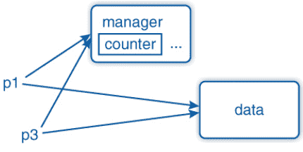

###### 图 1–1：内存中的共享指针

我们可以从 `use_count` 的输出中看到这一点：

点击此处查看代码图像

```
p3.use_count() = 2
p.use_count() = 1
```

当 f 返回时，指针被销毁，p2 所引用的内存被释放（从未被使用过）。第二个分配的内存块仍然存在，因为 main 函数中的 p 仍在引用它。

如果可能，应使用 make_shared 创建 shared_ptr：

点击此处查看代码图像

```
shared_ptr<double> p1 = make_shared<double>();
```

然后，内部数据和用户数据一起存储在内存中——如图 1–2 所示——内存缓存更高效。make_shared 还提供了更好的异常安全性，因为只有一次内存分配。由于 make_shared 返回共享指针显而易见，我们可以为简单起见使用自动类型推断（§3.4.1）：

```
auto p1 = make_shared<double>();
```

我们必须承认，shared_ptr 在内存和运行时有一些开销。另一方面，得益于 shared_ptr 带来的程序简化，在大多数情况下这点小开销是值得的。

进一步阅读：关于删除器和 shared_ptr 的其他细节，请参阅库参考 [40, §5.2]、[62, §34.3.2] 或在线参考。

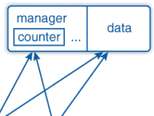

###### 图 1–2：使用 make_shared 后内存中的共享指针

##### C++11 1.8.3.3 弱指针

共享指针可能出现的一个问题是 *循环引用*，它会阻碍内存释放。这样的循环可以通过 `weak_ptrs` 打破。它们不声明对内存的所有权，甚至不声明共享所有权。此时，我们仅为完整性而提及它们，并建议在确定需要时阅读相关参考资料：[40, §5.2.2]、[62, §34.3.3] 或 `cppreference.com`。

对于动态内存管理，没有指针的替代方案。若仅需引用其他对象，可以使用另一种名为 *引用*（哎呀，哎呀）的语言特性，我们将在下一节中介绍。

#### 1.8.4 引用

以下代码介绍了引用：

点击此处查看代码图像

```
int i = 5;
int& j = i;
j = 4;
std::cout << "i = " << i << '\n';
```

变量 `j` 引用 `i`。更改 `j` 也会改变 `i`，反之亦然，如示例所示。`i` 和 `j` 将始终具有相同的值。可以将引用视为别名：它为现有对象或子对象引入一个新名称。每当我们定义引用时，必须直接声明它引用的内容（与指针不同）。之后不可能引用另一个变量。

引用对函数参数（§1.5）、引用其他对象的部分（例如，向量的第七个条目）以及构建视图（例如，§5.2.3）更加有用。

[C++11] 作为指针和引用之间的折中方案，C++11 提供了一个 `reference_wrapper` 类，其行为与引用类似但避免了一些局限性。例如，它可以在容器中使用；参见 §4.4.8。

#### 1.8.5 指针与引用的比较

指针相对于引用的主要优势在于动态内存管理和地址计算能力。另一方面，引用被迫引用现有位置。22 因此，它们不会造成内存泄漏（除非你玩一些非常恶劣的把戏），并且在使用时与所引用对象具有相同的表示法。不幸的是，几乎不可能构建引用容器（改用 `reference_wrapper`）。

22. 引用也可以引用任意地址，但要实现这一点需要更多努力。出于自身安全考虑，我们不会展示如何让引用表现得和指针一样糟糕。

简而言之，引用并非绝对安全，但比指针少出错得多。指针只应在处理动态内存时使用，例如，当我们动态创建列表或树等数据结构时。即便如此，我们也应通过经过充分测试的类型来完成此操作，或在可能的情况下将指针封装在类中。智能指针负责内存分配，即使在类中也应优先于原始指针。指针–引用比较总结在表 1-9 中。

##### 表 1–9：指针与引用的比较

| 特性 | 指针 | 引用 |
|---|---|---|
| 引用定义位置 | | ✓ |
| 强制初始化 | | ✓ |
| 避免内存泄漏 | | ✓ |
| 对象式表示法 | | ✓ |
| 内存管理 | ✓ | |
| 地址计算 | ✓ | |
| 构建其容器 | ✓ | |

#### 1.8.6 不要引用过时数据！

函数局部变量仅在函数作用域内有效，例如：

点击此处查看代码图像

```
double& square_ref(double d) // Error: returns stale reference
{
    double s = d * d;
    return s; // Error: s will be out of scope
}
```

在这里，我们的函数结果引用了局部变量 s，该变量在函数结束后不再存在。存储它的内存仍然在那里，我们可能（错误地）幸运地它尚未被覆盖。但这不是我们可以依赖的。最终，这种取决于情况的错误比永久性错误更糟糕：一方面，它们更难调试；另一方面，即使经过广泛测试也可能被忽略，并在实际使用中后来造成更大损害。

引用不再存在的变量称为过时引用。不幸的是，我们甚至在一些网络教程中也见过此类示例。

指针也是如此：

点击此处查看代码图像

```
double* square_ptr(double d) // Error: returns dangling pointer
{
    double s = d * d;
    return &s; // Error: s will be out of scope
}
```

此指针持有已超出作用域的局部变量的地址。这称为悬空指针。

在成员函数中引用成员数据（参见第 2.6 节）或静态变量时，返回引用或指针可能是正确的。

##### 建议

仅返回指向动态分配数据、函数调用前已存在的数据或静态数据的指针、引用和具有引用语义的对象。

所谓“具有引用语义的对象”，是指不包含其所有数据，而是引用在对象复制时不会被复制的外部数据的对象；换句话说，这类对象至少部分表现出指针的行为，因此存在引用不再存在的对象的风险。在第 4.1.2 节中，我们将介绍迭代器，它们是具有指针类似行为的标准库或用户定义的类，以及引用已销毁对象的危险。

幸运的是，编译器在检测此类错误方面越来越好，所有当前编译器都应警告明显的过时引用或悬空指针，如上述示例所示。但情况并不总是如此明显，尤其是当我们拥有具有引用语义的用户类时。

#### 1.8.7 数组容器

作为传统 C 数组的替代方案，我们想介绍两种可用类似方式但问题更少的容器类型。

##### 1.8.7.1 标准向量

数组和指针是 C++ 核心语言的一部分。相比之下，`std::vector` 属于标准库，并作为类模板实现。尽管如此，它可以非常类似于数组地使用。例如，第 1.8.1 节中设置两个数组 `v` 和 `w` 的示例，对于向量则如下所示：

点击此处查看代码图像

```
#include <vector>

int main()
{
    std::vector<float> v(3), w(3);
    v[0] = 1; v[1] = 2; v[2] = 3;
    w[0] = 7; w[1] = 8; w[2] = 9;
}
```

向量的大小不需要在编译时已知。向量甚至可以在其生命周期内调整大小，如第 4.1.3.1 节所示。

C++11

逐元素设置不够简洁。C++11 允许使用初始化列表进行初始化：

点击此处查看代码图像


std::vector<float> v = {1, 2, 3}, w = {7, 8, 9};

在这种情况下，向量的大小由列表的长度隐含确定。之前展示的向量加法可以更可靠地实现：

点击此处查看代码图像

```
void vector_add(const vector<float>& v1, const vector<float>& v2,
vector<float>& s)
{
    assert(v1.size() == v2.size());
    assert(v1.size() == s.size());
    for (unsigned i = 0; i < v1.size(); ++i)
        s[i] = v1[i] + v2[i];
}
```

与C数组和指针不同，向量参数知道自己的大小，我们现在可以检查它们是否匹配。请注意，数组大小可以通过模板推断，我们将在3.3.2.1节中展示。

向量是可复制的，可以由函数返回。这使我们能够使用更自然的表示法：

点击此处查看代码图像

```
vector<float> add(const vector<float>& v1, const
vector<float>& v2)
{
    assert(v1.size() == v2.size());
    vector<float> s(v1.size());
    for (unsigned i = 0; i < v1.size(); ++i)
        s[i] = v1[i] + v2[i];
    return s;
}
```

```
int main ()
{
    std::vector<float> v = {1 , 2, 3}, w = {7, 8, 9}, s = add(v,
    w);
}
```

这种实现可能比前一种（目标向量作为引用传入）更昂贵。我们将稍后讨论优化的可能性：编译器和用户两方面。根据我们的经验，首先从高效的接口开始，稍后再处理性能更为重要。让正确的程序运行快，比让快速的程序正确更容易。因此，首先追求良好的程序设计。在几乎所有情况下，理想的接口都可以实现足够的性能。

容器`std::vector`在数学意义上并不是向量。没有算术运算。尽管如此，该容器在科学应用中处理非标量中间结果时证明非常有用。

##### 1.8.7.2 valarray

`valarray`是一维数组，支持逐元素操作；即使乘法也是逐元素执行。与标量值的操作分别对`valarray`的每个元素执行。因此，浮点数的`valarray`是一个向量空间。

以下示例演示了一些操作：

点击此处查看代码图像

```
#include <iostream>
#include <valarray>

int main ()
{
    std::valarray<float> v = {1, 2, 3}, w = {7, 8, 9},
                         s = v + 2.0f * w;

    v = sin (s);
    for (float x : v)
        std::cout << x << ' ';
    std::cout << '\n';
}
```

请注意，`valarray<float>`只能与其自身或`float`进行操作。例如，`2 * w`将失败，因为它是`int`与`valarray<float>`之间不支持的乘法。

`valarray`的一个优势是能够访问其切片。这使我们能够*模拟*矩阵和高阶张量，包括它们各自的操作。尽管如此，由于缺乏对大多数线性代数操作的直接支持，`valarray`在数值社区中并不广泛使用。我们还建议使用成熟的C++线性代数库。希望未来的标准将包含一个。

为了完善动态内存管理的话题，我们参考A.2.8节，其中简要描述了*垃圾回收*。归根结底，C++程序员完全可以没有它，而且无论如何也没有编译器支持它（尚未？）。

### 1.9 构建软件项目

大型项目的一个大问题是名称冲突。出于这个原因，我们将讨论宏如何加剧这个问题。另一方面，我们将在3.2.1节中展示命名空间如何帮助我们掌握名称冲突。

为了理解C++软件项目中的文件如何交互，有必要了解构建过程，即如何从源代码生成可执行文件。这将是我们第二小节的主题。在此背景下，我们将介绍宏机制和其他语言特性。

首先，我们将简要讨论有助于构建程序的一个特性：注释。

#### 1.9.1 注释

注释的主要目的显然是用通俗的语言描述程序源代码中并非对每个人都显而易见的内容，例如：

点击此处查看代码图像

```
// Transmogrification of the anti-binoxe in O(n log n)
while (cryptographic(trans_thingy) < end_of(whatever)) {
....
```

通常，注释是对混淆实现的澄清性伪代码：

点击此处查看代码图像

```
// A = B * C
for ( ... ) {
    int x78zy97 = yo6954fq, y89haf= q6843, ...
    for ( ... ) {
        y89haft+= ab6899(fa69f) + omygosh(fdab); ...
        for ( ... ) {
            A(dyoa929, oa9978)+= ...
```

在这种情况下，我们应该问自己是否可以重构软件，使得这种晦涩的实现只在库的某个角落实现一次，而在其他地方我们编写清晰简单的语句，例如：

```
A = B * C;
```

作为程序而不是伪代码。这是本书的主要目标之一：向你展示如何编写你想要的简短表达式，而底层实现则榨取最大性能。

注释的另一种常见用途是暂时移除代码片段以尝试替代实现，例如：

点击此处查看代码图像

```
for ( ... ) {
    // int x = a + b + c
    int x = a + d + e;
    for ( ... ) {
    ...
```

与C语言一样，C++提供了一种块注释，由/*和*/包围。它们可以用于将代码行的任意部分或多行变成注释。不幸的是，它们不能嵌套：无论用/*打开了多少层注释，第一个*/都会结束所有块注释。许多程序员有时会掉进这个陷阱：他们想要注释掉一段已经包含块注释的较长代码，导致注释比预期更早结束，例如：

点击此处查看代码图像

```
for ( ... ) {
    /* int x87y97= yo6954fq;       // start new comment
    int x78y98= yo6953fq;
    /* int x78y99= yo6952fq;       // start old comment
    int x78y9a= yo6951fq;  */      // end old comment
    int x78y9b= yo6950fq;  */      // end new comment
(presumably)
    int x78y9c= yo6949fq;
    for ( ... ) {
```

这里，设置x78y9b的行本应被禁用，但前面的/*过早地终止了注释。

嵌套注释可以通过预处理器指令#if正确实现，我们将在1.9.2.4节中说明。另一种方便地禁用多行的方法是使用IDE和感知语言的编辑器的相应功能。无论如何，注释掉代码片段只应在开发期间作为临时解决方案，当我们探索各种方法时。一旦我们确定某个选项，就可以删除所有未使用的代码，并依赖我们的版本控制系统，它将保持可用以供可能的后续修改。

#### 1.9.2 预处理器指令

在本节中，我们将介绍可用于预处理的命令（指令）。由于它们大多与语言无关，我们建议将其使用限制在绝对最小，尤其是宏。

##### 1.9.2.1 宏

> “几乎每个宏都揭示了编程语言、程序或程序员的缺陷。”
> 
> —Bjarne Stroustrup

这是一种通过将宏名称扩展为其文本定义（可能带参数）的旧代码复用技术。使用宏可以为你的程序带来很多可能性，但毁掉它的可能性更多。宏对命名空间、作用域或任何其他语言特性都具有抵抗力，因为它们是不顾类型概念的鲁莽文本替换。不幸的是，有些库定义了像major这样的常见名称的宏。我们毫不妥协地取消定义此类宏，例如#undef major，对那些可能想要使用这些宏的人毫不留情。在Visual Studio中，我们甚至今天仍然有min和max作为宏，我们强烈建议你通过编译/DNOMINMAX来禁用此功能。23 几乎所有宏都可以被其他技术（常量、模板、内联函数）替代。但如果你确实找不到实现某事的其他方法：

###### 宏名称


###### 为宏使用 `LONG_AND_UGLY_NAMES_IN_CAPITALS`!

- 从技术上讲，宏来自 Windows.h 而非 Visual Studio 本身，但一旦我们为此惹上麻烦，这种区别就只起很小的作用，而且这种情况并不罕见，因为这个头文件被频繁使用。

宏几乎可以以各种可想象和不可想象的方式制造奇怪的问题。为了让你大致了解，我们将在附录 A.2.9 中查看一些示例，并提供一些处理它们的技巧。请随时推迟阅读，直到你遇到问题。

###### 宏的使用

尽可能用其他语言特性替换每个宏，只有在别无他法时才使用宏。

如你在本书中将看到的，C++ 提供了更好的替代方案，例如常量、`inline` 函数、模板和 `constexpr`。

##### 1.9.2.2 包含

为了保持 C 语言的简单性，许多诸如 I/O 之类的特性被排除在核心语言之外，转而由库来实现。C++ 遵循这种设计，尽可能通过标准库来实现新特性，然而却没有人会称 C++ 为一种简单的语言。

因此，几乎每个程序都需要包含一个或多个头文件。最常见的是用于 I/O 的头文件，如前面所示：

```
#include <iostream>
```

预处理器在类 Unix 系统的标准包含目录（如 `/usr/include` 和 `/usr/local/include`）中搜索该文件。我们可以使用编译器标志向此搜索路径添加更多目录——在 Unix/Linux/Mac OS 世界中通常是 `-I`，在 Windows 中是 `/I`。

当我们在双引号内写文件名时，例如：

```
#include "herberts_math_functions.hpp"
```

编译器通常首先在当前目录中搜索，然后在标准路径中搜索。这等同于使用尖括号引用并将当前目录添加到搜索路径。有些人认为尖括号应仅用于系统头文件，而用户头文件应使用双引号（但我们不同意他们的观点）。

- 然而，使用双引号文件名时搜索哪些目录取决于实现，标准未作规定。

为了避免名称冲突，通常会将包含文件的父目录添加到搜索路径中，并在指令中使用相对路径：

点击此处查看代码图像

```
#include "herberts_includes/math_functions.hpp"
#include <another_project/math_functions.h>
```

斜杠具有可移植性，在 Windows 下也可用（在 Windows 中，常规斜杠和反斜杠都可用于子目录）。

-**包含保护：** 由于间接包含，频繁使用的头文件可能在一个源文件中被多次包含。为了避免禁止的重复并限制文本扩展，所谓的*包含保护*确保仅执行第一次包含。这些保护是普通宏，用于声明某个文件的包含。典型的包含文件如下所示：

点击此处查看代码图像

```
// Author: me
// License: Pay me $100 every time you read this

#ifndef HERBERTS_MATH_FUNCTIONS_INCLUDE
#define HERBERTS_MATH_FUNCTIONS_INCLUDE

#include <cmath>

double sine(double x);
...

#endif // HERBERTS_MATH_FUNCTIONS_INCLUDE
```

因此，仅当保护尚未定义时才包含文件的内容。在内容中，我们定义保护以抑制进一步的包含。

与所有宏一样，我们必须密切关注名称的唯一性，不仅在我们的项目中，而且在我们直接或间接包含的所有其他头文件中也是如此。理想情况下，名称应代表项目和文件名。它还可以包含项目相对路径或命名空间（第 3.2.1 节）。通常的做法是以 _INCLUDE 或 _HEADER 结尾。

意外重用保护可能会产生多种不同的错误消息。根据我们的经验，发现该问题的根源可能需要非常长的时间。高级开发人员会根据上述信息或使用随机生成器自动生成它们。

一个方便的替代方案是 #pragma once。前面的示例简化为：

点击此处查看代码图像

```
// Author: me
// License: Pay me $100 every time you read this

#pragma once

#include <cmath>

double sine(double x);

...
```

Pragma 是编译器特定的扩展，这就是为什么我们不能指望它们具有可移植性。然而，#pragma once 得到所有主要编译器的支持，并且无疑是可移植性最高的 pragma。除了更简短的表示法外，我们还可以将避免重复包含的责任委托给编译器。

在文件中组织代码的高级技术是通过 C++20 中的模块引入的。我们将在第 7.3 节中介绍它们。

##### 1.9.2.3 条件编译

预处理器指令的一个重要且必要的用途是控制条件编译。预处理器提供 #if、#else、#elif 和 #endif 指令用于分支。条件可以是比较、定义检查或其逻辑表达式。指令 #ifdef 和 #ifndef 分别是以下内容的快捷方式：

```
#if defined(MACRO_NAME)

#if !defined(MACRO_NAME)
```

当定义检查与其他条件组合时，必须使用长形式。同样，#elif 是 #else 和 #if 的快捷方式。

在理想世界中，我们只会编写可移植的标准合规 C++ 程序。在现实中，我们有时不得不使用不可移植的库。假设我们有一个仅在 Windows 上可用的库，更准确地说是仅在 Visual Studio 上可用（其中宏 _MSC_VER 预定义）。对于所有其他相关编译器，我们都有一个替代库。平台相关实现的最简单方法是为不同的编译器提供替代代码片段：

```
#ifdef _MSC_VER
... Windows code
#else
... Linux/Unix code
#endif
```

同样，当我们想要使用在所有目标平台上都不可用的新语言特性时，也需要条件编译，例如模块（第 7.3 节）：

点击此处查看代码图像

```
#ifdef MY_LIBRARY_WITH_MODULES
... well-structured library as modules
#else
... portable library in old-fashioned way
#endif
```

在这里，我们可以在特性可用时使用它，同时仍然保持对不支持该特性的编译器的可移植性。当然，我们需要可靠的工具，仅在特性确实可用时才定义宏。

C++20。或者，我们可以依赖编译器开发者对该特性是否得到适当支持的看法。为此，C++20 为自 C++11 以来引入的每个特性引入了一个宏——例如，用于模块支持的 __cpp_modules——因此我们的示例现在读取为：

点击此处查看代码图像

```
#ifdef __cpp_modules
... well-structured library as modules
#else
... portable library in old-fashioned way
#endif
```

该宏的值是该特性添加到标准（草案）中的年份和月份。对于不断发展的核心语言和库特性，这使我们能够找出实际支持的版本。例如，<chrono> 库（第 4.5 节）随着时间的推移而发展，要检查其 C++20 功能是否在我们的系统上可用，可以使用 __cpp_lib_chrono 的值：

```
#if __cpp_lib_chrono >= 201907L
```

条件编译功能非常强大，但代价是：源代码的维护和测试更加费力且容易出错。这些缺点可以通过设计良好的封装来减轻，以便不同的实现通过通用接口使用。

##### 1.9.2.4 可嵌套注释

指令 #if 可用于注释掉代码块：

点击此处查看代码图像

```
#if 0
... Here we wrote pretty evil code! One day we will fix
it. Seriously.
#endif
```

相对于 /* ... */ 的优势在于它可以嵌套：

点击此处查看代码图像

```
#if 0
... Here the nonsense begins.
#if 0
... Here we have nonsense within nonsense.
#endif
... The finale of our nonsense. (Fortunately ignored.)
#endif
```

尽管如此，这种技术应适度使用：如果四分之三的程序都是注释，我们应该考虑进行严重的修订。

更多详情：在附录 A.3 中，我们展示了一个现实世界示例，回顾了本章的许多特性。我们没有将其包含在主阅读轨道中，以便为不耐烦的读者保持快节奏。对于


那些不着急的人，我们建议花时间阅读它，看看非平凡软件是如何演进的。

### 1.10 练习

#### 1.10.1 窄化

使用统一初始化（即使用花括号）将大值赋给不同的整数类型。例如，

```
const unsigned c1{4000000000};
```

这在你的机器上能编译通过吗？尝试不同的值（包括负值）和不同的类型，看看在你的平台上什么能编译通过。如果可能，通过更换机器或针对目标平台的编译器标志来尝试其他平台。

#### 1.10.2 字面量

使用字面量后缀 `u` 和 `l` 及其合法组合，重构练习 1.10.1 中的示例。如果愿意，可以将变量/常量类型改为 `auto`。

#### 1.10.3 运算符

编写计算不同立体图形体积和表面积的表达式。尽量少用括号（在实际生活中你可以随意使用尽可能多的括号）。尝试通过将结果存储在中间变量中来重用常见的部分表达式。

#### 1.10.4 分支

编写一个程序，读取三个 `double` 类型的数字并打印中间的那个。可选：尝试使用 `? :` 表达相同的逻辑。

#### 1.10.5 循环

通过区间嵌套法在 0 到 1 之间找到 f = sin(5x) + cos(x) 的零点。对于给定的区间，将其从中间分开，查看 f 的符号在哪一侧发生变化，然后继续使用该区间。当区间小于 10^-12 时停止计算（因此需要 double），并以 11 位数字打印该区间的中心作为近似结果。提示：结果应约为 0.785。C++11 引入了此处有用的 signbit 函数。尝试不同类型的循环，并思考哪一种在此上下文中感觉最合适。

#### 1.10.6 输入/输出

通过将计算中使用的所有输入参数和所有结果写入文件来重构练习 1.10.3。为新的一组值使用新行。注意在两个数字之间留出空格。编写第二个程序，从文件中读取值并将其与原始值进行比较。

#### 1.10.7 数组和指针

编写一个小程序，在栈上创建数组（固定大小数组）并在堆上创建数组（使用分配）。使用 valgrind（或 Windows 上的某些 Visual Studio 工具）来检查当你没有正确删除它们或使用了错误的 delete（数组 vs. 单个条目）时会发生什么。

#### 1.10.8 函数

编写转换 SI 单位的函数，例如 meter2km，以及/或在 SI 单位和老式英美单位（如 usgallon2liter）之间进行转换。使用 assert 测试你的实现。使用 ε 环境来处理浮点舍入问题，即计算值与预期值之间的差值的大小小于某个预定义的 ε。

## 第 2 章

## 类

> "计算机科学与计算机的关系，不亚于天文学与望远镜的关系。"
> —艾兹格尔·W·戴克斯特拉

计算机科学不仅仅是钻研编程语言细节。话虽如此，本章不仅将提供关于声明类的信息，还将让你了解如何最好地利用它们，它们如何最好地服务于我们的需求。或者更好的是：如何在广泛的场景中方便且高效地使用类。我们不仅将类视为捆绑数据的方式，更将其视为在软件中建立新抽象的工具。

### 2.1 为普遍意义编程，而非技术细节

仅关注性能细节来编写前沿的工程或科学软件非常痛苦且很可能失败。科学和工程编程中最重要的任务是：

- 识别领域中重要的数学抽象，以及
- 在软件中全面且高效地表示这些抽象。

简而言之：

### 建议

使用正确的抽象！如果它们不存在，就实现它们。

专注于为特定领域软件找到正确的表示方法非常重要，以至于这种方法演变成了一种编程范式：领域驱动设计（DDD）。核心思想是软件开发人员定期与领域专家讨论软件组件应该如何命名和行为，以便生成的软件尽可能直观（不仅对程序员，更是对用户）。本书不深入讨论该范式。我们更倾向于参考其他文献，如 [72]。

几乎每个科学应用中都会出现的常见抽象是向量空间和线性算子。后者从一个向量空间投影到另一个向量空间。在将它们纳入软件时，我们应该首先决定如何最好地表示这些抽象。

设 v 为向量空间的一个元素，L 为一个线性算子。那么 C++ 允许我们以如下方式表示 L 对 v 的应用：

```
L(v)
```

或者：

```
L * v
```

一般来说哪一种更合适并不容易说清。然而，很明显，这两种表示法都远好于

```
apply_symm_blk2x2_rowmajor_dnsvec_multhr_athlon(L.data_addr , L.nrows, L.ncols, L.ldim, L.blksch, v.data_addr, v.size);
```

这暴露了大量技术细节，并使人偏离主要任务。以这种风格开发软件远非有趣。它浪费了程序员大量精力。即使正确地进行函数调用，也比使用简单清晰的接口要费力得多。对程序的微小修改——例如为某个对象使用另一种数据结构——可能会引发一系列必须精心应用的修改。请记住，实现线性投影的人实际上想要做的是科学研究。

### 科学软件的目的

科学家进行研究。工程师创造新技术。

优秀的科学和工程软件仅以数学和特定领域的操作来表达，不暴露任何技术细节。

在这个抽象层次上，科学家可以专注于模型和算法，从而更加高效并推动科学发现。

提供类似上一示例那样低级接口的科学软件的致命错误（遗憾的是，我们甚至见过比这更糟糕的情况）是在用户界面中承诺了太多技术细节。原因部分在于使用了 C 和 Fortran 77 等更简单的编程语言，或者在于努力与用这些语言编写的软件进行互操作。如果你被迫编写与 C 或 Fortran 互操作的软件，请先为自己和其他 C++ 程序员用 C++ 编写具有简洁直观接口的软件，并封装与 C 和 Fortran 库的接口，使其不对开发人员暴露。

诚然，从 C++ 应用程序调用 C 或 Fortran 函数比反过来更容易。尽管如此，用那些语言开发大型项目效率低得多，因此从 C 或 Fortran 调用 C++ 函数的额外努力是绝对合理的。Stefanus Du Toit 在他的 Hourglass API 中演示了如何通过薄 C API 将 C++ 程序与其他语言的程序进行接口的示例 [12]。

编写科学软件的优雅方式是提供最佳抽象。良好的实现将用户界面减少到基本行为，并省略所有不必要的技术细节承诺。具有简洁直观界面的应用程序可以与其丑陋且痴迷细节的对应物一样高效。

我们这里的抽象是线性算子和向量空间。对开发人员来说重要的是这些抽象是如何使用的，在我们的情况中，是如何将线性算子应用于向量。假设应用用符号 * 表示，如 L * v 或 A * x。显然，我们期望此操作的结果产生一个向量类型的对象（因此语句 w = L * v; 应该能编译），并且线性的数学性质成立。

线性算子在内部如何存储与程序的正确性无关——只要该操作满足所有数学要求，并且实现没有意外的副作用（例如覆盖其他对象的内存）。因此，提供必要接口和语义行为的两种不同实现是可互换的；也就是说，程序仍然可以编译并产生相同的结果。不同的实现当然在性能上可能有显著差异。因此，为目标平台或特定应用程序选择最佳实现可以在应用程序级别进行很少（或不需要）程序修改来实现非常重要。

这就是为什么对我们来说，C++ 中类的最重要好处不是继承机制（第 6 章），而是建立新抽象并为其提供替代实现的能力。本章将为其奠定基础，我们将在后续章节中使用更高级的技术详细阐述这种编程风格。

### 2.2 成员

在为类进行长篇大论之后，是时候定义一个类了。类定义了一种可以包含新的数据类型：

- 数据：称为*成员变量*；标准也称其为*数据成员*；另一个术语是*字段*；
- 函数：称为*方法*或*成员函数*；
- 类型定义；以及
- 包含的类。

本节讨论数据成员和方法。

### 2.2.1 成员变量


一个简洁的类示例是用于表示复数的类型。当然，C++中已经存在这样的类，但为了说明目的，我们编写自己的：

```
class complex
{
public:
double r, i;
};
```

该类包含用于存储复数实部和虚部的变量。对类定义作用的常见心像是蓝图。也就是说，我们尚未定义任何单个复数。我们只是说复数包含两个名为 r 和 i 的 double 类型变量。现在我们将创建我们类型的对象：

单击此处查看代码图像

```
complex z, c;
z.r = 3.5; z.i = 2;
c.r = 2; c.i = -3.5;
std::cout << " z is (" << z.r << ", " << z.i << ")\n";
```

此代码片段通过变量声明定义对象 z 和 c。此类声明与内置类型无不同：类型名后跟变量名或变量列表。对象的成员可以通过点运算符 . 访问，如上所示。如我们所见，成员变量可以像普通变量一样读取和写入——前提是它们可访问。

#### 2.2.2 可访问性

类的每个成员都有指定的可访问性。C++ 提供三种：

- public：可从任何位置访问；
- private：仅在类内部可访问；以及
- protected：在类本身及其派生类中可访问。

这使类设计者能很好地控制类用户如何使用每个成员。定义更多 public 成员会增加使用自由度但降低控制力。另一方面，更多 private 成员会建立更严格的用户界面。

类成员的可访问性由 *访问修饰符* 控制。假设我们想要实现一个带有 `public` 方法和 `private` 数据的 `rational` 类：

单击此处查看代码图像

```
class rational
{
public:
...
rational operator+(....) {....}
rational operator-(....) {....}
private:
int p;
int q;
};
```

访问修饰符适用于随后的所有成员，直到出现另一个修饰符。我们可以放置任意数量的修饰符。请注意我们在声明单个项目属性的说明符和描述多个项目的修饰符之间的语言区别：即下一个修饰符之前的所有方法和数据成员。拥有多个访问修饰符比令人困惑的类成员顺序更好。第一个修饰符之前的类成员全部为 *私有*。

##### 2.2.2.1 隐藏细节

面向对象编程的纯粹主义者将所有数据成员声明为 `private`。这样就可以为所有对象保证属性，例如，当我们想要在前面提到的 `rational` 类中建立分母始终为正的不变量时。然后我们将分子和分母声明为 `private`（如我们所做），并实现所有方法以保持此不变量。如果数据成员是 `public`，我们就无法保证此不变量，因为用户可以在修改中违反它。

`private` 成员还增加了我们在代码修改方面的自由度。当我们更改 `private` 方法的接口或 `private` 变量的类型时，该类的所有应用程序在重新编译后将继续工作。修改 `public` 方法的接口可能（并且通常会）破坏用户代码。换句话说：`public` 变量和 `public` 方法的接口构成了类的接口。只要我们不更改此接口，就可以修改类，所有应用程序仍将编译。并且当 `public` 方法保持其行为时，所有应用程序也将保持。我们如何设计 `private` 成员完全取决于我们，只要它们对 public 方法行为的贡献不受影响（并且我们不浪费所有内存或计算能力）。通过仅在类的外部接口中定义其行为而不固定其内部实现，我们建立了一个 _抽象数据类型_ (ADT)。

另一方面，对于小型辅助类，例如一对值，仅通过 getter 和 setter 函数访问其数据可能不必要地麻烦：

```
p.set_first(p.get_first() * 2);
```

而不是

```
p.first = 2;
```

在简单的带有 `public` 成员的类和功能齐全的带有 `private` 数据的类之间划清界限是一个相当主观的问题（因此为开发团队中的激烈争论提供了巨大潜力）。Herb Sutter 和 Andrei Alexandrescu 很好地表述了这一区别：当你建立新抽象时，将所有内部细节设为 `private`；当你仅仅聚合现有抽象时，数据成员可以是 `public` [66, Item 11]。我们喜欢添加一种更挑衅的表述：当你的抽象数据类型的所有成员变量都有平凡的 getter 和 setter 时，该类型根本不抽象，你可以将变量设为 `public`，而不会失去任何东西，只失去笨拙的接口。

`protected` 成员仅对带有派生类的类型有意义。第 6.3.2.2 节将给出 `protected` 的良好用例示例。

C++ 还包含来自 C 的 `struct` 关键字。它也声明一个类，具有类可用的所有功能。唯一的区别是所有成员（以及所有基类，§6）默认都是 `public`。因此，

```
struct xyz
{
    ...
};
```

与以下相同

```
class xyz
{
public:
    ...
};
```

经验法则：

> **建议**
> 
> 对于新抽象优先使用 `class`，对数据为中心且功能有限且没有不变量的辅助类型使用 `struct`。

##### 2.2.2.2 友元

虽然我们不想向所有人提供内部数据，但我们可能会为一个好的 `friend` 破例。在我们的类中，我们可以授予自由函数和类特殊权限来访问 `private` 和 `protected` 成员，例如：

单击此处查看代码图像

```
class complex
{
    ...
    friend std::ostream& operator<<(std::ostream&, const complex&);
    friend class complex_algebra;
};
```

在此示例中，我们允许输出运算符和名为 `complex_algebra` 的类访问内部数据和功能。`friend` 声明可以位于类的 `public`、`private` 或 `protected` 部分。当然，我们应尽可能少地使用 `friend` 声明，因为我们必须确保每个 `friend` 都保持内部数据的完整性。用日常生活来类比：将这样的 `friend` 视为你愿意和他喝啤酒的任何人，不如视为你愿意把公寓钥匙交给的人。

#### 2.2.3 访问运算符

有四个这样的运算符。我们已经见过第一个：使用点的成员选择，x.m。所有其他运算符以某种方式处理指针。首先，我们考虑指向类 complex 的指针以及如何通过此指针访问成员变量：

单击此处查看代码图像

```
complex c;
complex* p = &c;

*p.r = 3.5;        // Error: means *(p.r)
(*p).r = 3.5;      // okay
```

通过指针访问成员并不特别优雅，因为选择运算符 . 的优先级高于解引用 *。仅为了自虐，想象成员本身是指向另一个类的指针，而我们想访问该类的成员。那么我们需要另一对括号来先于第二个选择：

```
(*(*p).pm).m2 = 11; // oh boy
```

通过箭头 (->) 提供了更方便的指针成员访问：

单击此处查看代码图像

```
p->r = 3.5; // looks so much better ;-)
```

即使之前提到的间接访问也不再是问题：

单击此处查看代码图像

```
p->pm->m2 = 11; // even more so
```

在 C++ 中，我们可以定义成员指针，这可能与所有读者都不相关（作者至今在本书外未使用过它们，但被告知它们在测试中可能有用）。如果你能想到用例，请阅读附录 A.4.1。

#### 2.2.4 类的 static 说明符

声明为 static 的成员变量每个类只存在一次。这允许我们在类的对象之间共享资源。另一个用途

这种情况是用于创建单例：一种确保某个类只有一个实例存在的设计模式 [16, pages 127–136]。

因此，既是 static 又是 const 的数据成员只存在一次且不可更改。因此，它在编译时可用。我们将在第 5 章中将其用于元编程。

方法也可以声明为 static。这意味着它们只能访问 static 数据并调用 static 函数。当方法不需要访问对象数据时，这可以启用额外的优化。

我们的示例仅在常量形式中使用 static 数据成员，且不使用 static 方法。然而，后者在第 4 章的标准库中出现。

#### 2.2.5 成员函数

类中的函数称为成员函数或方法。面向对象软件中典型的成员函数是获取器和设置器：

##### 清单 2-1：带有获取器和设置器的类

点击此处查看代码图片

```cpp
class complex
{
public:
    double get_r() { return r; } // Causes clumsy
    void set_r(double newr) { r = newr; } // code
    double get_i() { return i; }
    void set_i(double newi) { i = newi; }
private:
    double r, i;
};
```

方法默认与其他成员一样是 private 的；也就是说，它们只能由类内部的函数调用。显然，这对我们的获取器和设置器来说并不特别有用。因此，我们赋予它们 public 可访问性。现在，我们可以写 c.get_r() 但不能写 c.r。上面的类可以如下使用：

##### 清单 2-2：使用获取器和设置器

点击此处查看代码图片

```cpp
int main()
{
    complex c1, c2;
    // set c1
    c1.set_r(3.0);        // Clumsy init
    c1.set_i(2.0);
    // copy c1 to c2
    c2.set_r(c1.get_r()); // Clumsy copy
    c2.set_i(c1.get_i());
    return 0;
}
```

在我们的 `main` 函数开始时，我们创建两个类型为 `complex` 的对象。然后我们设置其中一个对象并将其复制到另一个对象。这可行，但有点笨拙，不是吗？

我们的成员变量只能通过函数访问。这使类设计师对行为拥有最大控制权。例如，我们可以限制设置器接受的值的范围。我们可以为每个 `complex` 数统计其在执行期间被读取或写入的次数。函数可以包含用于调试的额外打印输出（尽管调试器通常比在程序中插入打印输出更好）。我们甚至可以只允许在一天中的特定时间读取，或只在程序运行在具有特定 IP 的计算机上时写入。我们很可能不会做后者，至少不针对复数，但我们可以。如果变量是 public 且直接访问，这种行为将是不可能的。尽管如此，以这种方式处理复数的实部和虚部很笨拙，我们将讨论更好的替代方案。

大多数 C++ 程序员不会以这种方式实现。那么 C++ 程序员首先会做什么？编写构造函数。

### 2.3 设置值：构造函数和赋值

构造和赋值是设置对象值的两种机制，无论是在对象创建时还是之后。因此，这两种机制有很多共同点，这里一起介绍。

#### 2.3.1 构造函数

构造函数是初始化类对象并为其他成员函数创建工作环境的方法。有时，此类环境包括文件、内存或锁等资源，这些资源在使用后必须释放。我们稍后将回到此话题。

我们的第一个构造函数将设置我们的 complex 的实部和虚部值：


```cpp
class complex
{
public:
    complex(double rnew , double inew)
    {
        r = rnew; i = inew;
    }
// ...
};
```

构造函数是与类本身同名的成员函数。它没有返回类型，可以拥有任意数量的参数。上面的构造函数允许我们在定义中直接设置 c1 的值：


```cpp
complex c1(2.0, 3.0); // Traditional constructor
```

为了验证这里不会丢失精度，我们可以使用统一初始化：

```cpp
[C++11] complex c1(2.0, 3.0); // Modern style
```

在构造函数中设置成员变量和常量有一种特殊语法，称为成员初始化列表（Member Initialization List），或简称初始化列表：


```cpp
class complex
{
public:
    complex(double rnew , double inew)
    : r(rnew), // Old-fashioned
    i{inew} // Modern style
{}
// ...
};
```

初始化列表以构造函数函数头后的冒号开头。原则上，它是成员变量（和基类）或其子集的非空构造函数调用列表。构造函数语法也适用于非类类型，如 `double`。在这里，我们又有在传统括号语法和花括号语法（自 C++11 起）之间的选择。花括号阻止了从构造函数参数（或其表达式）到成员变量的缩窄转换。在大多数情况下，它们的类型无论如何都相同，但花括号比与函数调用更紧密相关的括号更好地传达了初始化特征。

已初始化成员的顺序应与其声明顺序匹配，以便正确处理成员之间可能的引用。编译器会检查这一点，并在我们未遵循成员顺序时发出警告。对于初始化列表中不存在的成员，会在相应位置隐式插入无参数的构造函数调用。这种无参数构造函数称为 `Default Constructor`（我们将在 §2.3.1.1 中更详细地讨论）。因此，我们的第一个构造函数示例等效于：

点击此处查看代码图片

```cpp
class complex
{
public:
    complex(double rnew , double inew)
    : r{}, i{} // generated by the compiler
    {
        r = rnew; i = inew;
    }
};
```

对于像 `int` 和 `double` 这样的简单算术类型，无论我们在初始化列表还是构造函数体中设置它们的值都不重要。初始化列表中未出现的内置类型数据成员保持未初始化状态。当类类型的成员数据项未包含在初始化列表中时，它会被隐式默认构造。

当成员本身是类时，成员的初始化方式变得更加重要。假设我们编写了一个类，用于求解带有给定矩阵的线性方程组，并将该矩阵存储在我们的类中：

点击此处查看代码图片

```cpp
class solver
{
public:
    solver(int nrows, int ncols)
    // : A{}   #1 Error: calls non-existing default constructor
    {
        A(nrows, ncols);   // #2 Error: ctor call not allowed
    }
    // ...
    private:
    matrix_type A;
};
```

假设我们的矩阵类只有一个接受两个参数以设置维度的构造函数。此构造函数不能在构造函数的函数体中调用（#2）。#2 中的表达式不被解释为构造函数，而是作为函数调用：A.operator() (nrows, ncols)；参见 §3.7。

由于所有成员变量在到达构造函数体之前都会被构造，因此我们的矩阵 A 将在 #1 处被默认构造。不幸的是，matrix_type 不是 Default-Constructible 的，这会导致类似以下的错误消息：

点击此处查看代码图片

```
Operator >>matrix_type::matrix_type()<< not found.
```

因此，我们需要编写：

点击此处查看代码图片

```cpp
class solver
{
public:
    solver(int nrows, int ncols) : A(nrows , ncols) {}
    // ...
};
```

以调用矩阵的正确构造函数。

在前面的示例中，矩阵是 `solver` 的一部分。更可能的情况是矩阵已经存在。那么我们不想为副本浪费所有内存，而是引用该矩阵。现在我们的类包含一个作为成员的引用，我们再次有义务在初始化列表中设置引用（因为引用也不是默认可构造的）：

点击此处查看代码图片

```cpp
class solver
{
public:
    solver(const matrix_type& A) : A(A) {}

    // ...
private:
    const matrix_type& A;
};
```

该代码还演示了我们可以将构造函数参数命名为与成员变量相同的名称。这引发了一个问题：名称指代哪些对象，在我们的例子中，不同出现处的 `A` 指的是哪个？规则是：初始化列表中括号外的名称始终指代成员。括号内的名称遵循成员函数的作用域规则。成员函数局部的名称——包括参数名——会隐藏类中的名称。构造函数体也是如此：参数名和局部变量名会隐藏类中的名称。这在开始时令人困惑，但你会比想象中更快地习惯它。

让我们回到我们的 `complex` 示例。到目前为止，我们有一个允许设置实部和虚部的构造函数。通常只设置实部，而虚部默认为 0。

点击此处查看代码图片

```cpp
class complex
{
public:
    complex(double r, double i) : r(r), i(i) {}
    // complex(double r) : r(r), i(0) {}

    // ...
};
```


当未给出值时，我们也可以说该数为 0+0i，即，如果复数是默认构造的：

```
complex() : r(0), i(0) {}
```

我们将在下一节中更多地关注默认构造函数。

上述三种不同的构造函数可以通过使用默认参数合并为一个：

点击此处查看代码图像

```
class complex
{
public:
    complex (double r= 0, double i= 0) : r(r), i(i) {}
    // ...
};
```

此构造函数现在允许各种形式的初始化：

点击此处查看代码图像

```
complex z1,
        z2 (),      // default-constructed
        z3{4},      // short for z3 (4.0, 0.0)
        z4= 4,      // short for z4 (4.0, 0.0)
        z5{0, 1};
```

z2 的定义是一个恶毒的陷阱。它看起来绝对像是对默认构造函数的调用，但实际上不是。相反，它被解释为一个名为 z2、不接受参数并返回复数值的函数声明。Scott Meyers 将这种解释称为 Most Vexing Parse（最令人恼火的语法分析）。使用单个参数的构造可以使用类似赋值的记法，如 z4 所示，使用 =。在旧书中，你有时可能会读到，这会造成开销，因为先构建一个临时对象，然后再复制。这并不正确；这可能在 C++ 的早期时代存在，但今天没有编译器会这样做。

C++ 有三种特殊的构造函数：

- 前面提到的默认构造函数，
- 拷贝构造函数，和
- 移动构造函数（C++11 及更高版本；§2.3.5.1）。

在以下各节中，我们将更仔细地查看它们。

##### 2.3.1.1 默认构造函数

一个 *默认构造函数* 只不过是一个没有参数的构造函数，或者是一个为每个参数都提供默认值的构造函数。类不强制包含默认构造函数。

乍一看，许多类不需要默认构造函数。然而，在实际生活中，拥有一个会容易得多。对于 `complex` 类，似乎我们可以没有默认构造函数，因为我们可以推迟其声明，直到知道对象的值。没有默认构造函数会造成（至少）两个问题：

- 在内部作用域中初始化但出于算法原因在外部作用域中生存的变量，必须在没有有意义的值的情况下已经被构造。在这种情况下，使用默认构造函数声明变量更为合适。
- 最重要的原因是，为没有默认构造函数的类型实现容器（如列表、映射、向量和矩阵）相当麻烦（尽管是可能的）。

简而言之，可以没有默认构造函数，但生活可能会变得艰难。

> 只要可能，就定义一个默认构造函数。

然而，对于某些类，定义默认构造函数非常困难，例如，当某些成员是引用或包含引用时。在这些情况下，接受前面提到的缺点，而不是构建设计不良的默认构造函数，可能更可取。

##### 2.3.1.2 拷贝构造函数

在我们的入门 getter-setter 示例（清单 2–2）的 `main` 函数中，我们定义了两个对象，其中一个是另一个的副本。复制操作是通过在应用程序中读取和写入每个成员变量来实现的。复制对象更好的方法是使用拷贝构造函数：

点击此处查看代码图像

```
class complex
{
public:
    complex(const complex& c) : r(c.r), i(c.i) {}
    // ...
};

int main ()
{
    complex z1(3.0, 2.0),
            z2(z1),    // copy
            z3{z1};    // C++11: non-narrowing
}
```

如果用户没有编写拷贝构造函数，编译器通常会以标准方式生成一个：按定义顺序调用所有成员（和基类）的拷贝构造函数，就像我们在示例中所做的那样。

1. 隐式生成的确切规则将在附录 A.5.3 中给出。

在像这种情况下，复制所有成员正是我们希望拷贝构造函数所做的，我们应该出于以下原因使用默认值：

- 它更简洁；
- 它更不容易出错；
- 其他人无需阅读我们的代码就能直接知道正在做什么；并且
- 编译器可能会发现更多优化。

如果我们不确定编译器是否会生成拷贝构造函数，可以用以下声明以默认方式请求一个：

点击此处查看代码图像

```
complex(const complex& c) = default; // Since C++11
```

在几乎所有情况下，参数都作为常量引用传递给拷贝构造函数。原则上，它们也可以作为非常量引用传递，但这很少有用。按值传递：

点击此处查看代码图像

```
complex(complex c) // Error!
```

相比之下，这行不通。请花几分钟思考一下为什么。我们将在本节末尾告诉你。

=> c++03/vector_test.cpp

有些情况下，默认拷贝构造函数无法按预期工作，尤其是当类包含指针时。假设我们有一个简单的向量类，其数据存储在指针中：

点击此处查看代码图像

```
class vector
{
public:
    vector(int size) : my_size(size), data(new double[size])
    {
    }
    // ... more methods
private:
    int my_size;
    double* data;
};
```

如果我们不定义拷贝构造函数，编译器将以以下方式为我们生成：

点击此处查看代码图像

```
vector(const vector& that)
    : my_size(that.my_size), data(that.data) {}
```

如你所见，所有成员都只是按声明顺序复制。这对 size 参数没问题，但对 data 指针有问题。通过复制指针，所有复制的向量都共享内存中的数据，如图 2-1 所示，修改其中一个也会改变所有其他向量：

点击此处查看代码图像

```
vector v1(4);
v1[0] = v1[1] = 1.0; v1[2] = 2.0; v1[3] = -3.0;
const vector v2{v1};
std::cout << "v2[3] is " << v2[3] << '\n';
v1[3]= 3.14;
std::cout << "v2[3] is " << v2[3] << '\n';
```

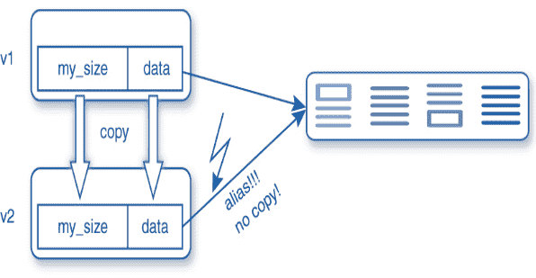

图 2–1：生成的向量副本

在这里，我们甚至可以更改常量向量 `v2` 的一个条目，因为它与非常量向量 `v1` 共享数据。

我们会观察到的另一个问题是，运行时库会尝试释放同一块内存两次。² 为了说明目的，我们在此提前引用了第 2.4.2 节的析构函数：它删除 `data` 所寻址的内存。由于两个指针都包含相同的内存地址，第二次析构函数调用将失败。

2. 这是每个程序员在生命中至少经历一次的错误消息（或者他们没有从事严肃的工作）。我希望我是错的。我的朋友兼校对员 Fabio Fracassi 乐观地认为，未来使用现代 C++ 的程序员不会再遇到这个问题。让我们希望他是对的。

现在我们实现自己的构造函数，它实际复制数据。为了证明没有双重内存释放，我们也添加析构函数：

点击此处查看代码图像

```
class vector
{
public:
    vector(const vector& v)
    : my_size(v.my_size), data {new double[my_size]}
    {
        for (unsigned i = 0; i < my_size; ++i)
            data[i] = v.data[i];
    }
    // Destructor, anticipated from §2.4.2
    //~vector() { delete[] data; }
    // ...
private:
    unsigned my_size;
    double *data;
};
```

=> c++11/vector_unique_ptr.cpp

[C++11] 由于我们的 `vector` 旨在作为其数据的唯一所有者，`unique_ptr` 听起来比原始指针更适合 `data`：

点击此处查看代码图像

```
class vector
{
    // ...
    std::unique_ptr<double[]> data;
};
```

不仅内存会自动释放，编译器也无法自动生成拷贝构造函数，因为 `unique_ptr` 中的拷贝构造函数被删除。这迫使我们提供用户实现（使用原始指针版本的代码）。

回到我们的问题：为什么拷贝构造函数的参数不能按值传递。你肯定已经想明白了。要按值传递参数，我们需要即将定义的拷贝构造函数。因此，我们创建了一个自依赖，这可能导致编译器陷入无限循环。幸运的是，编译器不会因此卡住，甚至会在这种情况下给出有意义的错误消息。请注意，为了演示目的，以下 `vector` 方法的实现假设数据为原始指针，除非另有说明。


##### 2.3.1.3 转换与显式构造函数

在 C++ 中，我们区分隐式构造函数和显式构造函数。隐式构造函数支持隐式转换和类似赋值的构造记法。而不是


```cpp
complex c1{3.0}; // C++11 and higher
complex c1(3.0); // all standards
```

我们也可以写：

```cpp
complex c1 = 3.0;
```

或

```cpp
complex c1 = pi * pi / 6.0;
```

这种记法对许多受过科学教育的人来说更易读，而当前编译器对两种记法生成相同的代码。

当需要一种类型而给出另一种类型时，隐式转换也会生效，例如，给出 `double` 而不是 `complex`。假设我们有一个函数：³

3. `real` 和 `imag` 的定义将很快给出。


```cpp
double inline complex_abs(complex c)
{
    return std::sqrt(real(c) * real(c) + imag(c) * imag(c));
}
```

并用 `double` 调用此函数，例如：

```cpp
cout << "|7| = " << complex_abs(7.0) << '\n';
```

字面量 `7.0` 是 `double`，但没有接受 `double` 的 `complex_abs` 函数重载。不过，我们有一个接受 `complex` 参数的重载，且 `complex` 有一个接受 `double` 的构造函数。因此，`complex` 值会从 `double` 字面量隐式构造。可以通过将构造函数声明为 `explicit` 来禁用隐式转换：


```cpp
class complex {
public:
	explicit complex(double nr= 0.0, double i= 0.0) : r(nr),
i(i) {}
};
```

然后 `complex_abs` 就不会用 `double` 调用了。要用 `double` 调用此函数，我们可以为 `double` 编写一个重载，或在函数调用中显式构造一个 `complex`：

点击此处查看代码图片

```cpp
cout << "|7| = " << complex_abs(complex(7.0)) << '\n';
```

`explicit` 属性对某些类非常重要，例如 `vector`。通常有一个接受向量大小作为参数的构造函数：

点击此处查看代码图片

```cpp
class vector
{
public:
	vector(int n) : my_size(n), data(new double[n]) {}
};
```

计算标量积的函数期望两个向量作为参数：

点击此处查看代码图片

```cpp
double dot(const vector& v, const vector& w) { ... }
```

此函数可以用整数参数调用：

```cpp
double d = dot(8, 8);
```

会发生什么？两个大小为 8 的临时向量会用隐式构造函数创建并传递给函数 `dot`。通过将构造函数声明为 `explicit`，可以轻松避免这种荒谬行为。哪个构造函数应为 `explicit`，最终由类设计者决定。在 `vector` 示例中，这很明显：没有一个头脑正常的程序员希望编译器自动将整数转换为向量，而类似赋值的记法：

```cpp
vector v = 8;
```

看起来很奇怪，这也是隐式构造函数不合适的另一个迹象。

`complex` 类的构造函数是否应为 `explicit` 取决于预期用法。由于虚部为零的复数在数学上等同于实数，隐式转换不会产生语义不一致。隐式构造函数更方便，因为在期望 `complex` 值的地方可以使用 `double` 值或字面量。对性能要求不高的函数可以只为 `complex` 实现一次，然后用于 `double`。相比之下，`vector` 构造函数的大小参数不是一个特殊的 `vector` 对象，而是其规范。因此，对这种类型来说，隐式转换完全没有意义。

在 C++03 中，`explicit` 属性仅对单参数构造函数有意义。从 C++11 开始，由于统一初始化，`explicit` 对多参数构造函数也相关，参见第 2.3.4 节。

##### C++11 2.3.1.4 委托

在之前的示例中，我们有包含多个构造函数的类。通常，这些构造函数并不完全不同，且有一些共同代码；也就是说，往往存在大量冗余。在 C++03 中，共享代码片段只能通过将其外包为一个方法，然后由多个构造函数调用来重用。

C++11 提供了委托构造函数；这些是调用其他构造函数的构造函数。我们的 `complex` 类可以使用此特性，而不使用默认值：

点击此处查看代码图片

```cpp
class complex
{
public:
    complex(double r, double i) : r(r), i(i) {}
    complex(double r) : complex{r, 0.0} {}
    complex() : complex{0.0} {}
    ...
};
```

显然，对于这个小示例，好处并不明显。委托构造函数对于初始化更复杂的类（比我们的 `complex` 更复杂）更有用。

##### C++11 2.3.1.5 成员默认值

C++11 的另一个新特性是成员变量的默认值。这样我们只需在构造函数中设置与默认值不同的值：

点击此处查看代码图片

```cpp
class complex
{
public:
    complex(double r, double i) : r(r), i(i) {}
    complex(double r) : r(r) {}
    complex() {}
    ...
private:
    double r = 0.0, i = 0.0;
};
```

同样，对于大型类，好处当然更明显。

#### 2.3.2 赋值

在第 2.3.1.2 节中，我们看到可以复制用户类的对象而无需 getter 和 setter——至少在构造期间。现在，我们想通过编写以下内容将值复制到现有对象中：

```cpp
x= y;
u= v= w= x;
```

为此，类必须提供一个赋值运算符（或不阻止编译器生成一个）。像往常一样，我们先考虑类 `complex`。将 `complex` 值赋给 `complex` 变量需要一个如下的运算符：

点击此处查看代码图片

```cpp
complex& operator=(const complex& src)
{
    r = src.r; i = src.i;
    return *this;
}
```

显然，我们复制成员变量 `r` 和 `i`。该运算符返回对象的引用以支持多重赋值。`this` 是指向对象本身的指针，由于我们需要引用，因此对 `this` 指针进行解引用。赋予对象类型值的运算符称为复制赋值，可以由编译器合成。在我们的示例中，生成的代码将与我们的相同，我们可以省略此处的实现。如果将 `double` 赋给 `complex` 会发生什么？

```cpp
c = 7.5;
```

即使没有为 `double` 定义赋值运算符，也能编译通过。再次，我们有隐式转换：隐式构造函数即时创建一个 `complex` 并赋值。如果这成为性能问题，我们可以为 `double` 添加赋值：

```cpp
complex& operator=(double nr)
{
    r= nr; i= 0;
    return *this;
}
```

对于使用原始指针的 `vector` 实现，合成的复制赋值不令人满意，因为只复制了数据的地址而没有复制数据本身。使用 `unique_ptr` 时，编译器无法生成复制操作，因为 `unique_ptr` 没有复制。在这两种情况下，我们都需要实现复制赋值：

点击此处查看代码图片

```cpp
1 vector& operator=( const vector& src)
2 {
3     if (this == &src)
4         return *this;
5     assert(my_size == src.my_size);
6     for (int i= 0; i < my_size; ++i)
7         data[i]= src.data[i];
8     return *this;
9 }
```

对象自我赋值（源和目标地址相同）可以跳过（第 3 和 4 行）。在第 5 行，我们通过检查向量大小的相等性来测试赋值是否为合法操作。或者，如果大小不同，赋值可以调整目标大小。

这在技术上是合法的选择，但在科学上在这里相当可疑。只需想想数学或物理中向量空间突然改变维度的情境。

建议 [66, Item 52] 复制赋值和构造函数保持一致，以避免让用户完全困惑。

#### 2.3.3 初始化列表

C++11 引入了*初始化列表*作为新特性——不要与“成员初始化列表”（§2.3.1）混淆。要使用它，我们必须包含头文件 `<initializer_list>`。虽然此特性与类概念正交，但 `vector` 的构造函数和赋值运算符是极佳的用例，因此这是介绍初始化列表的合适位置。它允许我们一次性设置向量的所有条目（在合理大小范围内）。普通 C 数组可以完全在其定义中初始化：

```cpp
float v[] = {1.0, 2.0, 3.0};
```

C++11 将此功能推广，使任何类都可以用值列表（相同类型）进行初始化。使用合适的构造函数，我们可以写：

```cpp
vector v = {1.0, 2.0, 3.0};
```

或

```cpp
vector v{1.0, 2.0, 3.0};
```

我们也可以在赋值中设置所有 `vector` 条目：

```cpp
v = {1.0, 2.0, 3.0};
```

接受 `vector` 参数的函数现在可以用即时设置的 `vector` 调用：

点击此处查看代码图片

```cpp
vector x = lu_solve(A, vector{1.0, 2.0, 3.0});
```

上述语句使用对 _A_ 的 LU 分解求解向量 (1, 2, 3)^T 的线性方程组。


要在我们的 `vector` 类中使用此功能，需要一个构造函数和一个接受 `initializer_list<double>` 作为参数的赋值运算符。懒人可以只实现构造函数，并将其与复制赋值结合使用。为了演示和性能目的，我们将两者都实现。它还允许我们在赋值中验证 `vector` 的大小是否匹配：

点击此处查看代码图片

```
#include <initializer_list>
#include <algorithm>

class vector
{
// ...
vector(std::initializer_list<double> values)
: my_size(values.size()), data(new double[my_size])
{
    copy(begin(values), end(values), data);
}

vector& operator=(std::initializer_list<double> values)
{
    assert(my_size == values.size());
    copy(begin(values), end(values), data);
    return *this;
}
};
```

要将列表中的值复制到我们的数据中，我们使用标准库中的函数 `std::copy`。该函数接受三个迭代器⁴作为参数。这三个参数分别表示输入的 `begin` 和 `end` 以及输出的 `begin`。`begin` 和 `end` 在 C++11 中作为自由函数引入；之前我们必须使用相应的成员函数，例如 `values.begin()`。当为数据使用 `unique_ptr` 时，我们需要做一点修改，因为 `unique_ptr` 没有迭代器接口。使用 `get` 方法访问内部原始指针将允许我们使用 `copy` 函数，但直接操作地址时存在损坏 `unique_ptr` 的风险。

4. 它们是一种广义指针；参见 §4.1.2。

#### C++11 2.3.4 统一初始化

在 C++11 中，花括号 {} 被用作所有形式变量初始化的通用表示法，包括：

- 初始化列表构造函数，
- 其他构造函数，或
- 直接成员设置。

后者仅适用于所有（非静态）变量均为公有且类没有用户定义构造函数的数组和类。此类类型称为聚合类（Aggregates），使用花括号列表为其赋值相应地称为聚合初始化（Aggregate Initialization）。

5. 进一步条件是该类没有基类和虚函数（§6.1）。

假设我们定义一种没有构造函数的随意复数类，可以按如下方式初始化它：

点击此处查看代码图片

```
struct sloppy_complex
{
    double r, i;
};

sloppy_complex z1{3.66, 2.33},
               z2 = {0, 1};
```

**C++20** C++20 引入了指定初始化（Designated Initialization），允许我们指示希望为哪个成员赋予某个值：

点击此处查看代码图片

```
sloppy_complex z1{.r = 3.66, .i = 2.33},
               z2{.i = 1};    // r will be 0.0
sloppy_complex z3{.i = 4.4, .r = 0.9}; // Error: wrong order
```

我们可以跳过成员，但不允许更改顺序。不言而喻，我们更倾向于使用构造函数，而不是聚合甚至指定初始化。然而，在必须处理遗留代码时，它非常有用。

本节中包含构造函数的复数类可以使用相同的表示法进行初始化：


```
```cpp
complex c{7.0, 8}, c2= {0, 1}, c3= {9.3}, c4= {c};
const complex cc= {c3};
```
```

当相关构造函数被声明为 explicit 时，不允许使用带等号的表示法。

还剩下我们在上一节中介绍的初始化列表。将列表作为统一初始化的参数实际上需要双层花括号：

```
```cpp
vector vl= {{1.0, 2.0, 3.0}},
        v2{{3, 4, 5}};
```
```

为了简化我们的工作，C++11 在统一初始化器中提供了花括号省略（Brace Elision）；即，可以省略花括号，列表项按给定顺序传递给构造函数参数或数据成员。因此，我们可以将声明缩短为

```
```cpp
vector vl= {1.0, 2.0, 3.0},
        v2{3, 4, 5};
```
```

花括号省略既是福音也是诅咒。假设我们将复数类集成到 vector 中以实现 vector_complex，我们可以方便地设置它：


```
```cpp
vector_complex v= {{1.5, -2}, {3.4}, {2.6, 5.13}};
```
```

然而，以下示例：


```
```cpp
vector_complex vld= {{2}};
vector_complex v2d= {{2, 3}};
vector_complex v3d= {{2, 3, 4}};

std::cout << "vld is " << vld << std::endl; ...
```
```

可能有点令人惊讶：

```
vld is [(2,0)]
v2d is [(2,3)]
v3d is [(2,0), (3,0), (4,0)]
```

在第一行中，我们有一个参数，因此向量包含一个复数，该复数使用单参数构造函数进行初始化（虚部为 0）。下一条语句创建一个具有一个元素的向量，其构造函数以两个参数调用。显然，此方案无法继续：complex 没有三参数构造函数。因此，这里我们切换到多个向量条目，每个条目使用一个参数构造。有兴趣的读者可在附录 A.4.2 中找到更多实验。

花括号的另一个应用是成员变量的初始化：

点击此处查看代码图片

```
class vector
{
public:
vector(int n)
: my_size{n}, data{new double[my_size]} {}
...
private:
unsigned my_size;
double *data;
};
```

这可以保护我们免受偶尔的马虎：在上面的示例中，我们用 int 参数初始化一个 unsigned 成员。这种缩窄转换会被编译器拒绝，我们将相应替换类型：

点击此处查看代码图片

```
vector(unsigned n) : my_size(n), data{new double[my_size]} {}
```

我们已经表明，初始化列表允许我们即时创建非原始函数参数，例如：

点击此处查看代码图片

```
double d = dot(vector{3, 4, 5}, vector{7, 8, 9});
```

当参数类型明确时——例如，只有一个重载可用时——列表可以无类型地传递给函数：

```
double d = dot({3, 4, 5}, {7, 8, 9});
```

同样，函数结果也可以使用统一表示法设置：

点击此处查看代码图片

```
```cpp
complex subtract(const complex& c1, const complex& c2)
{
    return {c1.r - c2.r, c1.i - c2.i};
}
```
```

`return` 类型是 `complex` 并且我们使用两参数花括号列表对其进行初始化。

在本节中，我们演示了统一初始化的可能性并说明了一些风险。我们确信这是一个非常有用的功能，但对于棘手的边界情况应谨慎使用。

#### C++11 2.3.5 移动语义

复制大量数据代价高昂，人们使用许多技巧来避免不必要的副本。几个软件包使用浅拷贝。这意味着对于我们的 `vector` 示例，我们只复制数据的地址而不复制数据本身。因此，在赋值之后：

```
v = w;
```

两个变量包含指向内存中相同数据的指针。如果我们更改 `v[7]`，则也会更改 `w[7]`，反之亦然。因此，使用浅拷贝的软件通常提供一个函数来显式调用深拷贝：

```
copy(v, w);
```

每次赋值变量时，都必须使用此函数而不是赋值。对于临时值——例如，作为函数结果返回的向量——浅拷贝并不关键，因为临时值否则不可访问且我们没有别名效应。避免副本的代价是程序员必须格外注意，在存在别名时，内存不会被释放两次；即，需要引用计数。

另一方面，当大对象作为函数结果返回时，深拷贝代价高昂。稍后，我们将介绍一种非常高效的避免副本的技术（参见 §5.3）。现在，我们介绍另一个 C++11 功能来实现这一点：移动语义。其思想是，变量（换句话说，所有命名项）被深度复制，而临时对象（无法通过名称引用的对象）转移其数据。

这就引发了一个问题：我们如何区分临时数据和持久数据？好消息是编译器会为我们完成此操作。在 C++ 术语中，临时对象称为 *右值*，因为它们只能出现在赋值的右侧。C++11 引入了右值引用，用两个和号 `&&` 表示。带有名称的值，即所谓的 *左值*，不能传递给右值引用。

##### C++11 2.3.5.1 移动构造函数

通过提供移动构造函数和移动赋值，我们可以确保右值不会被昂贵地复制：

点击此处查看代码图片

```
class vector
{
    // ...
    vector(vector&& v) noexcept
    : my_size(v.my_size), data(v.data)
    {
        v.data = nullptr;
        v.my_size = 0;
    }
};
```

移动构造函数从其源窃取数据并将其留在空状态。由于我们不分配新内存，因此不会冒 `bad_alloc` 异常的风险，并可以将此构造函数声明为 `noexcept`。一般来说，许多 C++ 专家要求所有移动操作都是 `noexcept`。

作为右值传递给函数的对象在函数返回后被视为过期。这意味着我们不再能依赖数据的完整性。唯一的要求是对象的销毁（§2.4）不得失败。必须对原始指针（一如往常）给予极大关注。它们不得指向随机内存，以免删除失败或释放其他用户数据。如果我们保留指针 `v.data` 不变，当 `v` 超出作用域时内存将被释放，我们的目标向量的数据将失效。通常，移动操作后原始指针应为 `nullptr`。

请注意，像 `vector&& v` 这样的右值引用本身不是右值，而是左值，因为它具有名称。如果我们想将我们的 `v` 传递给另一个帮助移动构造函数进行数据窃取的方法，我们将


再次使用标准函数 `std::move` 将其转换为右值（参见 §2.3.5.4）。

##### C++11 2.3.5.2 移动赋值

移动赋值可以通过交换数据指针以简单的方式实现：

点击此处查看代码图片

```
class vector
{
    // ...
    vector& operator=(vector&& src) noexcept
    {
        assert(my_size == 0 || my_size == src.my_size);
        std::swap(data, src.data);
        std::swap(my_size, src.my_size);
        return *this;
    }
};
```

这使我们无需释放自己的数据（如果存在），因为在源对象销毁时会完成此操作。

假设我们有一个空向量 `v1` 和一个在函数 `f()` 中临时创建的向量 `v2`，如图 2–2 上半部分所示。当我们将 `f()` 的结果赋值给 `v1` 时：

```
v1 = f(); // f returns v2
```

移动赋值将交换 `data` 指针，使得 `v1` 随后包含 `v2` 的值，而后者则为空，如图 2–2 下半部分所示。

##### C++17 2.3.5.3 副本省略

如果在这两个函数中添加日志，我们可能会发现移动构造函数被调用的次数没有我们想象的那么多。原因是现代编译器提供了一种比窃取数据更好的优化。这种优化称为 *副本省略*，编译器会省略数据的副本，并修改数据的生成方式，使其直接存储到副本操作的目标地址。

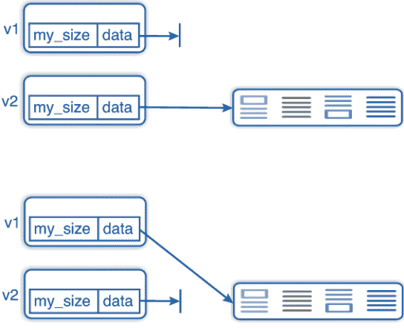

###### 图 2–2：移动的数据

其最重要的用例是返回值优化 (RVO)，特别是当用函数结果初始化新变量时，例如

点击此处查看代码图片

```
inline vector ones(int n)
{
    vector v(n);
    for (unsigned i = 0; i < n; ++i)
        v[i] = 1.0;
    return v;
}
...
vector w(ones(7));
```

编译器不再是在函数结束时构造 v 并将其（复制或移动）到 w，而是可以立即创建 w 并直接在其上执行所有操作。复制（或移动）构造函数永远不会被调用。我们只需通过日志输出或调试器来检查这一点。

在移动语义出现之前，C++17 的副本省略在许多编译器中已经可用。自 C++17 起，遵循标准是强制性的。在 Visual Studio 中，它仅在发布模式下可用。然而，副本省略并没有使移动构造函数变得无用。存在无法应用 RVO 的情况。

##### C++11 2.3.5.4 我们需要移动语义的地方

当我们在创建新对象时将左值转换为右值，肯定会使用移动构造函数。因此引入了函数 `std::move`，它将每个对象转换为（临时）右值引用。该函数本身不移动任何数据，只是声明对象为临时对象，以便其他函数可以移动其数据。因此，在以下代码中会调用右值的构造函数和赋值运算符：

```
vector x(std::move(w));
v = std::move(u);
```

在第一行中，x 窃取 w 的数据并将其留作空向量。第二条语句将交换 v 和 u。

当与 `std::move` 一起使用时，我们的移动构造函数和赋值运算符并不完全一致。只要我们只处理真正的临时对象，就不会看到区别。然而，为了更强的一致性，我们也可以将移动赋值的源对象留作空状态：

点击此处查看代码图片

```
class vector
{
    // ...
    vector& operator=(vector&& src) noexcept
    {
        assert(my_size == src.my_size);
        delete[] data;
        data = src.data;
        src.data = nullptr;
        src.my_size = 0;
        return *this;
    }
}
```

} );

另一种看法是，对象在 `std::move` 之后被视为即将过期。换句话说，它们尚未死亡而是已退役，只要它们处于合法状态（即析构函数不会崩溃），它们的值是什么就不重要了。

移动语义的一个良好应用是 C++11 及更高版本中 `std::swap` 的默认实现；参见第 3.2.3 节。

##### C++11 2.3.5.5 移动后的生命周期

伯雅尼·斯特劳斯特鲁普曾说过，在 C++ 中比在 C 中更难打自己的脚。但有了 `std::move`，我们又长出了一条多余的腿来开枪。6 并且我们可以自豪地说，凭借这个伤害自己的机会，我们领先于 C。

6. 他原话是：“C 使得打自己的脚变得容易；C++ 使得它更难，但一旦你这么做，就会炸掉你的整条腿。”

移动语义的最初想法是从预期在操作后不久就会死亡的临时对象中窃取数据。Nicolai Josuttis 将其比作器官捐赠。

`move` 的引入完全打破了被掠夺对象会突然死亡的想法。语言将这些对象声明为“即将过期”。那么这会带来什么后果呢？今后，那些烦人对象的命运不再是编译器的责任，而是程序员的责任。

当然，每位程序员都被敦促负责任地使用 `move`。他们不得再访问被移动的源对象。但我们真的能在每种情况下都依赖这一点吗？或者更好的是：我们真的想依赖这一点吗？我们真的想将被移动源对象的命运责任放在类的用户身上吗？

回到 Nicolai 的类比：使用 `move` 从左值移动数据就像活体器官捐赠。捐赠者只是被宣告很快就会死亡。他们仍然可以存在，处于毁灭状态，并且没有任何东西保证这些僵尸会很快消失。事实上，它们可能是全局变量或函数或类中的 `static` 变量。然后它们会一直存活——更确切地说，是苟延残喘——直到程序结束。并且没有语言特性能阻止程序员

在函数之间传递即将过期的对象。这反过来意味着，我们必须将变量的生命周期追溯到其创建点，并检查在所有可能的执行路径中，是否从未应用过显式移动。

移动语义的一个更好的类比是一个被清空并可以再次填充的邮箱。通常，消息传递后介质不会被销毁，除了在詹姆斯·邦德电影中。应用于对象，这意味着只有再次被使用的可能性——无论多么微小——才要求我们保持它们的功能。

总而言之，我们宁愿将被移动源对象的责任交给类设计师，或者更准确地说，交给接受右值引用的函数的实现者。这是我们应该关注的位置。作为回报，我们摆脱了在整个应用程序中追踪所有可能和不可能的移动用途这一繁琐且容易出错的工作。

有趣的是，标准库中的类通常已经提供了我们在这里希望提出的行为。

右值可以以不同方式处理，我们在标准库中找到了示例：

- **完全移交：** 仅管理动态资源的类可以将这些资源从一个对象移交给另一个对象。示例是 `unique_ptr`，它将引用的内存从一个对象传递给另一个对象。

- **复制：** 没有任何动态资源的类只能复制其内容，通常既不提供移动构造函数也不提供赋值运算符。示例是向量迭代器，本质上是一个指针。

- **内部移交：** 某些容器无法完整传递其内容，但能够移交单个条目。示例是 `unique_ptr` 的 `std::array`。当元素本身无法完全移交但允许内部移交时，此方案当然可以递归继续，例如，`array` 的 `array` 的 ... 的 `unique_ptr`。

- **部分移交：** 类的成员可能具有不同的移动行为。例如，一个 `int` 和 `unique_ptr` 的 `pair` 将复制前者并移交后者的内存。

- **可选移交：** 某些类可以在特定条件下移交其资源。决策可以在运行时和/或编译时根据模板参数做出。一个示例是具有短对象优化的 `string` 类，其中长度不超过一定值的字符串直接存储在对象中，而较长的字符串在堆上动态处理。因此，较短的字符串被复制，较长的字符串只是被移交。即使是像 `vector` 这样的可调整大小的容器也属于此类。它们通常移交完整数据。然而，对于某些分配器类型和状态，这是不允许的，然后条目会逐个移动（通过复制或移交）。7

7. 作者必须承认，在了解这种特殊行为时他也感到惊讶。因此他感谢 Howard Hinnant——移动语义的主要创建者——指出了这一点。

前两种处理方式是极端：在我们看来，完全移交是移动的最纯粹形式，而复制则代表了它们的完全缺失。其他三种处理方式可以被视为它们的混合版本。除了纯粹复制的对象外，我们将移动操作的源对象称为 *清空对象*。

为了研究与被移动源对象进行操作的影响，我们现在区分三种情况：

- 1. 显式删除的移动操作；
- 2. 不存在或隐式删除的移动操作；以及
- 3. 存在的移动操作。

隐式和显式删除的移动操作之间的差异在附录 A.5.4.3 中进行了详细讨论。

**情况 1：** 显式删除的操作不允许调用。因此，将右值传递给此类操作会导致编译时错误，我们无需担心即将过期的对象。


Case 2: 当移动操作（例如，构造）不存在或被隐式删除时，编译器会查找在对右值参数进行隐式转换后可调用的备选重载。例如，如果移动构造函数被隐式删除且存在拷贝构造函数，则对象会被静默拷贝，因为右值引用可以隐式转换为常量左值引用。如果拷贝构造函数也不可用，那么我们无法从右值创建新对象。⁸ 同样的情况也适用于任何将右值传递给的其他函数。一般来说，要么右值被视为常量左值，因此（合法上）不能对其进行修改，要么程序无法编译。在这两种情况下，我们都不必担心之前有效的对象变得无效。

8. 实际上，从左值也是如此。

Case 3: 现在是当我们提供自己的移动操作时的有趣情况。根据标准，移动操作的源对象在之后会过期，因为该对象只需要能够被正确析构和赋值。这些对象在标准中被称为 XValues [38]。它们不应再被使用。然而，与其让右值处于无效状态，不如将其设置为有意义的值。因此我们强烈建议：

###### 清空右值

每当你从右值接管数据时，应让该对象处于有效状态。为了提供一致的类行为，如果可能，清空后的对象应等同于默认构造的对象。优先采用完全接管，而非其他形式。

完全接管始终是处理动态资源最高效的形式。其行为也最容易理解。其他接管形式也有其存在的理由，正如标准库中的示例所阐明的。

当我们完全接管动态资源时，之后处于空状态是很自然的。即使在混合情况下，空状态通常也是最佳选择。在我们的 dmc::vector 示例中，我们有部分接管：unique_ptr 具有真正的移动语义，但 size 参数没有。然而，这两个成员通过类设计相关联，因为指针被假设指向与 size 成员中存储的条目数量一样多的条目。当指针被清空时，size 值必须相应调整。

在可选接管中，移动后的对象有时为空，否则仍包含旧值。当内容足够大以存储在堆上时，`string` 对象会变为空。较短的内容保留在对象中。为了保持一致性，我们也可以在拷贝后清空字符串内容；这只需要将 `0` 存储到 size 成员中。标准库实现通常不会这样做，因为这被认为是对一个假设不再被使用的对象的多余操作。在我们自己的项目中，我们可以将一致性行为置于通常微小的性能收益之上。

同样，像 `vector` 这样的容器无法接管其全部内容，而是逐个元素地接管所有元素。那么移动后的容器保留条目数量，但所有元素都为空。在这种情况下，将容器大小调整为零不是更合理吗？同样，标准库实现通常出于前述原因不这样做，但在我们自己的应用程序中我们可以自由这样做。

这些可能未被清空的移动后对象对我们用户类的后果是，我们应该在移动操作后清空相应的成员（或基类）。此时我们不必过分担心性能惩罚。一旦我们的项目正常工作，并且我们仔细进行了基准测试和性能分析后，如果这些清空操作被证明是严重瓶颈，我们仍可以考虑省略它们——在我们看来，这极不可能发生。

如前所述，尽可能在付出合理努力的情况下，将移动后的对象留在与默认构造对象等价的明确定义的空状态中。可能反对本准则的顾虑如下：

- 如果类没有默认构造函数且不提供任何其他有意义的空状态怎么办？那么该类可能不适合移动操作。或者反过来，我们应该定义一个空状态，并可能添加一个建立恰好这种状态的默认构造函数。到目前为止，我们还没有见过任何具有真正移动操作但没有默认构造函数的类。相反的情况也存在：例如 `array` 没有移动语义，但仍提供默认构造函数。

- 在设置空对象时，移动赋值不能使用 `swap` 实现，而 `swap` 通常是更简单的方法。是的，这对类实现者来说更简单。然而，对于类用户来说，赋值和构造函数具有相同的行为更一致，而在构造函数中我们没有其他对象可以与之 `swap`。

- 如果设置空状态代价太高怎么办？移动操作代价高昂的部分通常在于资源转移的目标必须释放其先前的资源（如果存在）。在大多数情况下，这将是内存释放，但也可能影响文件句柄等其他资源。如果我们通过交换资源来实现移动操作，这并不会节省释放工作；它只是推迟到移动后对象的析构（除非资源泄漏或进一步转移）。简而言之，通常代价高昂的资源释放无论如何都会执行，因此将一些值设置为零或 `nullptr` 可以忽略不计。当很明显对象将在之后立即被销毁时，编译器甚至可能优化掉清零操作。空对象的昂贵设置也可能是低效实现的迹象，例如为空容器分配内存而不是使用 `nullptr`。

- 我们能否修改语言，使得移动后的对象无法再被使用？也许可以。但这不太可能在短期内发生。此外，这种更改会在运行时决定移动对象时引入跟踪开销。因此，我们最好自己着手解决，现在就有一个良好的方案。

关于成本论点的另一评论：计算中最昂贵的资源不是处理器周期或内存，而是开发人员。通过更一致、更易于理解的行为节省的开发时间，远比更少的计算周期更有价值（尤其是通常由他人买单时）。

我们还应该考虑何时可以依赖生成的移动操作，何时需要我们自己的实现。编写我们自己的移动操作有两个主要原因：

- **Case 1：** 成员或基类的移动行为与我们的类行为不匹配。包含原始指针的类通常需要用户定义的移动操作以避免双重内存释放。使用 `unique_ptr` 或 `shared_ptr` 可以避免这种危险。但即使使用智能指针，也并非总能依赖生成。Herb Sutter 给出了一个 [65] 示例，一个包含 `shared_ptr<int>` 的类，其中类具有指针不能为空的不变式。当然，`shared_ptr` 并不强制执行此不变式，因此我们要么省略移动操作，要么以满足此类不变式的方式实现它。

- **Case 2：** 即使单个成员的移动行为与类设计不冲突，成员之间的关系也可能是个问题。我们已经在我们的 `dmc::vector` 类中见过这种情况，其中 `unique_ptr` 被正确移动，而 `size` 属性被拷贝。这两个操作本身都没问题：`unique_ptr` 为空且 `size` 属性仍包含旧值这一事实——分别考虑时——并不违反类不变式。但当将它们相互关联时，我们就看到了问题：接管数据后，size 应该为零。这种移动后的不一致性甚至可能取决于微妙的实现细节（包括标准类型的细节）。假设我们有一个 `department` 类，包含 `employee` 的 `vector` 以及用 `map` 实现的多索引访问。`map` 的值应为 `employees` 中的位置：

点击此处查看代码图像

```
class department
{
    vector<employee> employees;
    map<int, int>      phone_access;
    map<string, int>   name_access;
}; ...
```

这些成员通常的移动行为是所有三个容器完全从一个对象接管到另一个对象。在这种情况下，移动后的对象仅包含空容器，完全正确。然而，无法保证这种通常行为实际实现，因为标准只要求容器处于有效状态，而不说明是哪种状态。当使用非默认分配器时，情况会变得更棘手。那么在某些条件下，容器在移动操作后可能不为空。当所有容器都保持不变时，`department`


对象仍然有效。关键的情况是当 `employees` 容器被清空但访问映射没有被清空，因为我们获取的所有位置在 `employees` 中都不再存在。对于 `name_access` 来说情况更加令人困惑，因为对值的移动操作会将键作为 `string` 传递，而不是将位置值作为 `int` 传递。这实际上是一个优势，因为我们在映射中找不到名称，因此也不会访问空的 `employees` 容器。嗯，这仅适用于足够长的名称，因为短名称只是被复制并保留在映射条目的键中。好消息是，我们可以通过在移动后简单地对所有容器调用 `clear` 来避免整个噩梦。对于那些现在认为在已知容器为空的情况下调用 `clear` 是在为未使用的内容付费的人，欢迎实现类型依赖和编译器依赖的代码，仅在需要时调用 `clear`（警告：你的代码将是元编程和 `#ifdef` 的邪恶组合）。

```
⇒ c++17/move_sanity_test.cpp
```

9. 在 Visual Studio 的某些编译标志下，可能会与 `std::movable` 以及其他问题产生歧义。

为了了解标准类在现实中的行为，我们分析了使用右值（`T b(move(a));`）构建 25 个类^10 的对象，结果如下：

10. vector、valarray、deque、array、list、forward_list、map、multimap、set、multiset、unordered_map、unordered_multimap、unordered_set、unordered_multiset、unique_ptr、shared_ptr、bitset、atomic、reference_wrapper、function、duration、time_point、complex、tuple 和 string。类模板大多使用 `int` 实例化，容器使用默认分配器。

###### 情况 1：这些类中没有一个具有被删除的移动构造函数。

### 情况 2：八个类没有移动构造函数。其中只有一个——`atomic`——也没有复制构造函数，因此该表达式无法编译。其他 7 个类——`array`、`bitset`、`tuple`、`duration`、`time_point`、`complex` 和 `reference_wrapper`——只是复制了对象。这些类没有动态管理的资源，因此无法交出完整的数据。然而，对于其他值类型，我们可以进行内部交接。

### 情况 3：其余 17 个类——例如 vector、unique_ptr 和 function——完全交出了它们的资源（使用测试中的模板参数），且被清空的对象与默认构造函数创建的对象相等。未考虑短字符串和非传播分配器。

因此，g++ 和 clang++ 中的标准类通常已经表现出我们推荐的行为，尽管标准只要求它们处于有效状态，但没有说明是哪种状态。11 我们在对这些类进行赋值时观察到了相同的行为。我们希望比标准更进一步，如下所示：

11. C++ 标准库中定义的类型的对象可以被移动。移动操作可以显式指定或隐式生成。除非另有说明，此类移动源对象应被置于有效但未指定的状态 [38, § 20.5.5.15]。

### 定义 2-1.（移动安全）。将移动源右值留在有效空状态的操作称为移动安全。当所有操作都是移动安全时，类是移动安全的。

因此，当类型是移动安全时，我们不需要担心对象的有效性。此时，对象是否是 xvalue 就不再重要，我们也免去了为它繁琐地分析软件。

类的移动安全性应有充分的文档记录，以解放用户免受担心对象被先前的移动操作损坏的负担。显然，我们不仅想知道对象是否有效，还想知道它的值是什么。我们希望带有移动安全类的库在未来将具有竞争优势，并且有一天移动安全将像释放已获取资源一样正常。

我们可以从不同角度来处理移动语义：

- 作为允许修改源的更快的复制版本，
- 作为深拷贝和浅拷贝之间的巧妙选择（后者应得到适当的后处理），或
- 作为从即将过期的对象中窃取资源。

这三种视角都无法涵盖本节中提到的所有实现。始终成立的是，在将对象 `a` 移动到对象 `b` 之后，`b` 的值必须是 `a` 的原始值。`a` 的值可能会改变，但即使在大多数对象在移动操作后被销毁且不再访问它的情况下，也应该是有效的。`a` 的值可能改变并不意味着它的值是任意的。最好 `a` 是空的，但这并不总是可能的。与其重复上面的讨论，我们更愿意用以下接近有效 C++ 伪代码来说明我们对 `a` 值的想法：

点击此处查看代码图像

```
T a = something, b(a), c(move(a)), d;
if (a != T() && a != b)
    cout << "Peter doesn't like T.\n";
// internal handover (one level)
if (a == T(size(b), value_type<T>()))
    cout << "Well, if really necessary ... okay.\n";
d = move(b);
if (a != b)
    cout << "Please make your operations consistent.\n";
```

**摘要：** 我们需要对移动语义有新的视角。我们不应将其视为一种不太关心源的加速复制。在适用的地方，我们应该将其视为一种不同的操作，即将一个对象的所有动态管理资源交给另一个对象。许多类已经这样做。至于标准库中的类，操作的源应保持在有效状态。我们强烈建议对用户类也强加此要求。此外，我们鼓励你指定移动源对象保持的状态，并且该状态不应依赖于上下文。在付出合理努力的情况下，移动源对象应处于明确定义的空状态，理想情况下等同于默认构造对象的状态。有了这个视角，我们就摆脱了 xvalues、prvalues 和 glvalues。更重要的是，当无效对象完全由类设计消除时，类的使用将更加安全。当我们知道移动源对象保持的状态时，软件也将更容易理解和开发。

#### C++11 2.3.6 从字面量构造对象

字面量的类型可以通过后缀更改，如第 1.2.5 节所示：例如，123 是 int，123ul 是 unsigned long int。C++11 引入了用户定义字面量，允许我们定义自己的后缀来构造我们的类型的对象。

假设我们想要处理不同单位的长度：千米、米、厘米等等，以及陆地英里和海里。12 在内部，所有值都以米表示，以便我们可以安全地进行计算：

12. 请注意，我们的标准合规性不仅限于 C++。陆地英里和海里的度量指的是 SI 定义；传统度量分别长 3 毫米和 216 毫米。

点击此处查看代码图像

```
class length
{
    public:
    explicit length(double l) : l(l) {}
    friend length operator+(length len1 , length len2)
    {
        return length(len1.l + len2.l);
    }
    // ...
    private:
    double l;
};
```

所有其他单位首先转换为米。当然，每个足够聪明能用 C++ 编程的人都能正确地将其他度量转换为米。然而，与其因小小的数学错误而难堪，13 我们应该专注于编程并拥抱语言提供的机会。

13. 这肯定从未发生在我们的朋友赫伯特身上，绝对不会。因此，他不需要 UDLs。

为了简洁起见，每个运算符都实现为内联友元函数。这是一种将自由函数（类外部）和友元声明（类内部）合并的简写表示法。它放置在类内部，但实现得好像在类外部，即，无法访问成员


直接传递，而类类型的对象必须作为函数参数传递。回到我们的单位：要定义不同的单位，我们使用 operator""：

单击此处查看代码图像

```
length operator"" _m(long double l)
{
    return length(l);
}

length operator"" _km(long double l)
{
    return length(1000.0 * l);
}

length operator"" _nm(long double l)
{
    return length(1852.0 * l);
}
```

除了传统的方式：

```
length len1(13.5);
```

我们也可以使用我们的字面量：

```
length len2(14.2_km),
    len3= 14.2_km;
```

使用带有此类字面量的 auto 变量/常量不会使我们的程序变得难以理解，因为类型从后缀中很明显：

```
auto l1= 13.5_m,
    l2= 14.2_km,
    l3= 3 * 12,
    l4= 7.2_nm;
```

我们也可以直接在表达式中使用它们：

单击此处查看代码图像

```
cout << "2km + 30m = " << 2._km + 30.0_m << endl;
cout << "2.5miles + 3.2nm = " << 2.5_miles + 3.2_nm << endl;
```

其输出结果为：

```
2km + 30m = 2.03km
2.5miles + 3.2nm = 9.94976km
```

#### 规则

所有后缀都以下划线开头。

为了减少非标准软件包之间的冲突，我们可以有选择地从其他命名空间导入后缀运算符，例如：

```
using tst::operator"" _nm;
```

在这里，我们仅使用命名空间 `tst` 中的海里。

用户定义字面量的值必须是 `long double`（如所示）、`long long unsigned`，或某种字符或字符串字面量（`char`、`char16_t`、`const char*`、`const char16_t*` 等等）。

### 2.4 析构函数

析构函数是在对象销毁时调用的函数，例如：

单击此处查看代码图像

```
~complex()
{
    std::cout << "So long and thanks for all the fish.\n";
}
```

由于析构函数是构造函数的补运算，它使用补运算符的表示法（~）。与构造函数不同，只有一个重载，且不允许参数。

#### 2.4.1 实现规则

有两条非常重要的规则：

- 1. 绝不要从析构函数抛出异常！如果在析构函数或被调用的函数中抛出异常，必须在析构函数内捕获。否则，我们的程序可能会崩溃。在 C++11 及更高版本中，析构函数中的异常始终被视为运行时错误，这会中止执行（析构函数被隐式声明为 noexcept，§1.6.2.6）。在 C++03 中，行为是未定义的，但程序中止是最可能的后果。

- 2. 如果类包含虚函数，析构函数也应该是虚函数。我们将在第 6.1.3 节中再次讨论此问题。

#### 2.4.2 正确处理资源

析构函数中执行的操作由我们自由选择；语言没有限制。实际上，析构函数的主要任务是释放对象的资源（内存、文件句柄、套接字、锁等），并清理程序中不再需要的与对象相关的所有内容。由于析构函数不得抛出异常，许多程序员认为释放资源应该是析构函数的唯一活动。


在我们的示例中，销毁复数时无需执行任何操作，我们可以省略析构函数。当对象获取内存等资源时，需要析构函数。在这种情况下，必须在析构函数中释放内存或其他资源：

```
class vector
{
public:
  // ...
  ~vector ()
  {
    delete[] data;
  }
  // ...
private:
  unsigned my_size;
  double *data;
};
```

请注意，delete 已经测试指针是否为 nullptr（C++03 中为 0）。同样，使用旧式 C 句柄打开的文件需要显式关闭（这只是不使用它们的一个原因）。基于 unique_ptr 的 vector 不需要析构函数实现，因为编译器会生成一个用于释放内存的析构函数。

##### 2.4.2.1 资源获取即初始化

资源获取即初始化（RAII）是主要由 Bjarne Stroustrup 和 Andrew Koenig 发展的一种范式。其思想是将资源与对象绑定，并利用对象构造和销毁的机制在程序中自动处理资源。每当我们想要获取资源时，都通过创建拥有该资源的对象来实现。每当对象离开作用域时，资源（内存、文件、套接字等）都会自动释放，如我们上面的 `vector` 示例所示。

想象一个在 986 个程序位置分配 37,186 个内存块的程序。我们能确定所有内存块都被释放吗？要达到这种确定性，或者至少达到可接受的信心水平，我们要花费多少时间？即使使用 `valgrind`（§B.3）之类的工具，我们也只能测试单次运行中是否没有内存泄漏，但无法一般性地保证内存始终被释放。另一方面，当所有内存块都在构造函数中分配并在析构函数中释放时，我们可以确定不存在泄漏。

##### 2.4.2.2 异常

当抛出异常时，释放所有资源更具挑战性。每当我们检测到问题时，都必须在抛出异常之前释放迄今为止获取的所有资源。不幸的是，这不仅限于当前作用域中的资源，还取决于异常被捕获的位置，扩展到周围作用域的资源。这意味着更改错误处理需要对手动资源管理进行繁琐的调整。好消息是，这仅适用于手动处理的资源；通过 RAII 绑定到局部对象的资源，在带有异常离开作用域时（实际上任何离开作用域的时候）都会在相应的析构函数中自动释放。

##### 2.4.2.3 托管资源

之前提到的所有问题都可以通过引入管理资源的类来解决。C++ 标准库中已经提供了此类管理器。文件流管理来自 C 的文件句柄。`unique_ptr` 和 `shared_ptr` 以无泄漏、异常安全的方式处理内存。14 同样在我们的 `vector` 示例中，我们可以从 `unique_ptr` 中受益，而不需要实现析构函数。

14. 仅循环引用需要特殊处理。

##### 2.4.2.4 自己管理

智能指针表明，对资源类型可以有不同的处理方式。然而，当现有类都不以我们想要的方式处理资源时，编写一个量身定制的资源管理器来满足我们的需求是一个绝佳的机会。

这样做时，我们不应该在一个类中管理多个资源。这条准则的动机是，异常可能在构造函数中抛出，以一种保证迄今为止获取的所有资源都被释放的方式编写构造函数是非常繁琐的。

因此，每当我们编写一个处理两个资源（即使是同一类型）的类时，都应该引入一个管理其中一个资源的类。更好的做法是，为两个资源都编写管理器，并将资源处理完全与科学内容分离。即使在构造函数中途抛出异常的情况下，我们也不会遇到资源泄漏问题，因为它们的管理器的析构函数会自动调用并处理此问题。

术语“RAII”在语言上更强调初始化。然而，从技术角度来看，终结更为重要。资源在构造函数中获取并非强制性的。这可以在对象生命周期的后期发生。根本在于，由一个单一对象负责资源，并在其生命周期结束时释放它。因此，Jon Kalb 将 RAII 称为单一职责原则（SRP）的一个应用。

##### C++11 2.4.2.5 资源解救

在本节中，我们介绍一种技术，即使在使用具有手动资源处理的软件包时，也能自动释放资源。我们将使用 Oracle C++ Call Interface (OCCI) [51] 来演示该技术，以便从程序访问 Oracle 数据库。


这个示例让我们展示一个现实的应用，我们假设许多科学家和工程师不时需要处理数据库。虽然 Oracle 数据库是商业产品，但我们的示例可以使用免费的 Express 版进行测试。此外，此技术也可应用于其他老式软件库。

OCCI 是 C 库 OCI 的 C++ 扩展，它仅在顶部添加了一个带有一些功能的非常薄的层，同时保持整个软件架构为 C 风格。遗憾的是，这适用于 C 库的许多跨语言接口。由于 C 不支持析构函数，无法建立 RAII，资源必须手动释放。

在 OCCI 中，我们首先必须创建一个 `Environment`，它可用于建立到数据库的 `Connection`。这反过来允许我们编写一个返回 `ResultSet` 的 `Statement`。所有这些资源都由原始指针表示，并且必须按逆序释放。

###### 表 2–1：Herbert 的解决方案

| 问题 | 值得获奖 |
|---|---|
| 高斯圆 | ✓ |
| 合同数 | ? |
| 友爱数 | ✓ |
| ... | |

举个例子，我们查看表 2–1，我们的朋友 Herbert 记录了他对（所谓的）未解决数学问题的解答。第二列指示他是否确定有资格为他的工作获得奖项。出于大小原因，我们无法在此打印他惊人发现的完整列表。

```
=> c++03/occi_old_style.cpp
```

不时地，Herbert 使用以下 C++ 程序查找他值得获奖的发现：

单击此处查看代码图像

```cpp
#include <iostream>
#include <string>
#include <occi.h>

using namespace std;          // import names (§3.2.1)
using namespace oracle::occi;

int main()
{
    string dbConn= "172.17.42.1", user= "herbert",
           password= "NSA_go_away";
    Environment *env = Environment::createEnvironment();
    Connection *conn = env->createConnection(user, password,
                                             dbConn);

    string query= "select problem from my_solutions"
                  " where award_worthy = 0";
    Statement *stmt = conn->createStatement(query);
    ResultSet *rs = stmt->executeQuery();

    while (rs->next())
        cout << rs->getString(1) << endl;

    stmt->closeResultSet(rs);
    conn->terminateStatement(stmt);
    env->terminateConnection(conn);
    Environment::terminateEnvironment(env);
}
```

这次，我们不能责怪 Herbert 使用老式编程；这是库所强制的。让我们来看看代码。即使是不熟悉 OCCI 的人，也能清楚发生了什么。首先我们获取资源，然后遍历 Herbert 巧妙的成就，最后按逆序释放资源。我们高亮显示了资源释放操作，因为我们需要更仔细地关注它们。

当我们的（或 Herbert 的）程序像上面那样是一个整体块时，释放技术工作得相当好。当我们尝试构建带有查询的函数时，情况完全改变了：

```
ResultSet *rs = makes_me_famous();
while (rs->next())
    cout << rs->getString(1) << endl;

ResultSet *rs2 = needs_more_work();
while (rs2->next())
    cout << rs2->getString(1) << endl;
```

现在我们有了没有相应语句来关闭的结果集；它们在查询函数中声明，现在已超出作用域。因此，对于每个对象，我们还必须保留用于生成它的对象。迟早这将变成依赖关系的噩梦，具有巨大的出错潜力。

=> c++11/occi_resource_rescue.cpp

问题是：我们如何管理依赖于其他资源的资源？解决方案是使用 shared_ptr 的删除器。每当托管内存被释放时，它们都会被调用。删除器的一个有趣方面是，它们没有义务实际释放内存。我们将探索这种自由来管理我们的资源。Environment 的处理最简单，因为它不依赖于另一个资源：

```cpp
struct environment_deleter {
    void operator()( Environment* env )
    { Environment::terminateEnvironment(env); }
};

shared_ptr<Environment> environment(
    Environment::createEnvironment(), environment_deleter());
```

现在，我们可以创建任意多个环境副本，并保证当最后一个副本超出作用域时，执行 terminateEnvironment(env) 的删除器会被调用。

Connection 的创建和终止需要一个 Environment。因此，我们在 connection_deleter 中保留一个副本：

```cpp
struct connection_deleter
{
    connection_deleter(shared_ptr<Environment> env)
    : env(env) {}
    void operator()(Connection* conn)
    { env->terminateConnection(conn); }
    shared_ptr<Environment> env;
};
```

```cpp
shared_ptr<Connection> connection(
    environment->createConnection(...),
    connection_deleter(environment));
```

现在，我们保证当 Connection 不再需要时会被终止。在 connection_deleter 中保留 Environment 的副本可确保只要存在 Connection，它就不会被终止。当我们为其创建管理器类时，也可以更方便地处理数据库：

```cpp
class db_manager
{
public:
    using ResultSetSharedPtr = std::shared_ptr<ResultSet>;

    db_manager(string const& dbConnection, string const& dbUser,
               string const& dbPw)
        : environment(Environment::createEnvironment(),
                      environment_deleter{}),
          connection(environment->createConnection(dbUser, dbConnection),
                     connection_deleter{environment})
        {}
        // some getters ...
private:
    shared_ptr<Environment> environment;
    shared_ptr<Connection> connection;
};
```

请注意，该类没有析构函数，因为成员现在是托管资源。我们可以向此类添加一个返回托管 ResultSet 的查询方法：

```cpp
struct result_set_deleter
{
    result_set_deleter(shared_ptr<Connection> conn,
                       Statement* stmt)
    : conn(conn), stmt(stmt) {}
    void operator()( ResultSet *rs ) // call op. like in §3.7
    {
        stmt->closeResultSet(rs);
        conn->terminateStatement(stmt);
    }
    shared_ptr<Connection> conn;
    Statement* stmt;
};
```

```cpp
class db_manager
{
public:
    // ...
    ResultSetSharedPtr query(const std::string& q) const
    {
        Statement *stmt= connection->createStatement(q);
        ResultSet *rs = stmt->executeQuery();
        auto deleter= result_set_deleter(connection, stmt);
        return ResultSetSharedPtr(rs, deleter);
    }
};
```

由于这种新方法和我们的删除器，应用程序变得简单如下：

```cpp
int main()
{
    db_manager db("172.17.42.1", "herbert", "NSA_go_away");
    auto rs= db.query("select problem from my_solutions "
                      " where award_worthy != 0");
    while (rs->next())
        cout << rs->getString(1) << endl;
}
```

查询越多，我们的努力越有回报。不耻于重复自己：所有资源都会被隐式释放。

细心的读者已经意识到我们违反了单一职责原则。为了对这一发现表示感谢，我们邀请您在练习 2.8.5 中改进我们的设计。

### 2.5 方法生成总结

C++ 有六种方法（C++03 中有四种），编译器会尝试隐式生成：

- 默认构造函数
- 拷贝构造函数
- 移动构造函数（C++11 或更高版本）
- 拷贝赋值
- 移动赋值（C++11 或更高版本）
- 析构函数

这使我们免受枯燥常规工作的困扰，从而防止疏忽。

C++11 自 C++11 起，我们可以使用 default 和 delete 说明符来控制（并记录）此生成：

```cpp
class complex
{
public:
    complex(const complex&) = delete;
    complex& operator=(const complex&) = default;
};
```

在这个示例中，我们删除了拷贝构造函数，并要求编译器以默认方式生成拷贝赋值（调用所有基类和成员的拷贝赋值）。根据 §A.5 中的规则，隐式生成可以静默省略我们列表中的一种或多种方法，而请求以默认方式生成某个方法时，如果该方法无法生成，则会导致编译器错误。15 delete 说明符不仅限于具有隐式生成的方法，还可以应用于任何函数（例如在第 2.6.4 节中说明）。在 C++03 中，我们无法删除函数，但至少可以通过在私有部分声明方法来禁用它们。delete 是表达我们意图的更好方式，其体现为更不令人困惑的错误消息。与私有技巧相反，我们可以对自由函数使用 delete。


- 15. 模板中存在一些罕见的例外，但在大多数情况下我们会看到错误消息。

确定哪六种方法会被隐式生成涉及相当多的细节。这些细节在 A.5 节中介绍。我们只想给出 C++11 及更高版本的最终结论：

#### 六法则

关于上述六种操作，尽可能少地实现，尽可能多地声明。任何未实现的操作，如果适用，应声明为 `default` 或 `delete`。缺失操作的行为至少应在注释中说明。

有意省略方法的常见示例是存在用户定义的拷贝构造函数时的移动构造函数。此时编译器不会生成它，当我们从右值构造新对象时，将调用拷贝构造函数——在将右值隐式转换为常量左值引用之后。`default` 和 `delete` 对此都无用：前者会尝试生成非预期的移动构造函数，后者会阻碍从右值构造（有关详细信息，请参见 §A.5）。

### 2.6 访问成员变量

C++ 提供了多种访问类成员的方式。在本节中，我们将介绍不同选项并讨论它们的优缺点。希望你能了解未来如何以最适合你领域的方式设计类。

#### 2.6.1 访问函数

在 §2.2.5 中，我们介绍了用于访问类 *complex* 变量的 getter 和 setter。setter 的优点是我们对设置的值有更多控制权，但对于这个类我们不需要这个。另一方面，这种访问方式可能相当麻烦，例如，当我们想要增加实部时：

```
c.set_r(c.get_r() + 5.);
```

这看起来不太像数值运算，而且可读性也不好。实现此操作的更好方法是编写一个返回引用的成员函数：

```cpp
class complex {
public:
    double& real() { return r; }
};
```

使用此函数，我们可以写：

```
c.real() += 5.;
```

这已经看起来好多了，但仍有点奇怪。为什么不像这样增加值：

```
real(c) += 5.;
```

为此，我们编写一个自由函数：

```cpp
inline double& real(complex& c) { return c.r; }
```

不幸的是，这个函数访问了私有成员 r。我们可以修改自由函数以调用成员函数：

```cpp
inline double& real(complex& c) { return c.real(); }
```

或者，也可以将自由函数声明为 complex 的友元以访问其私有数据：

```cpp
class complex {
friend double& real(complex& c);
};
```

当复数为常量时，访问其实部也应有效。因此，我们还需要此函数的常量版本：

```cpp
inline const double& real(const complex& c) { return c.r; }
```

此函数也需要 `friend` 声明。

在最后两个函数中，我们返回了引用，但这些引用保证不会过时。无论是自由函数还是成员函数，显然只有在被引用对象已经创建后才能调用。我们在语句中使用的数字 `real` 部分的引用

```
real(c) += 5.;
```

仅存在于语句结束之前，这与被引用变量 `c` 形成对比，后者生存时间更长：直到其定义的作用域结束。我们可以创建一个引用变量：

```
double &rr = real(c);
```

它一直存活到当前作用域结束。即使 `c` 在同一作用域中声明，C++ 中对象销毁的逆序也保证 `c` 的生存时间比 `rr` 长。

临时对象的成员引用可以安全地在同一表达式中使用：


```
double r2 = real(complex(3, 7)) * 2.0; // okay!
```

临时 `complex` 数字仅在语句中生存，但至少比其实部引用的生存时间长，因此该语句是正确的。

我们强烈不建议保留对临时表达式的引用。在 C++ 中，绑定到常量引用的对象的生存期会被延长，但这不能通过多个函数调用间接实现，并且仅适用于局部变量，而不适用于类成员。这种细微差别使我们难以证明此类程序的正确性，因此我们建议：

> **规则**
> 
> 不要保留对临时表达式的引用！

#### 2.6.2 下标运算符

要遍历一个 `vector`，我们可以编写如下函数：


```cpp
class vector
{
public:
	double at(int i)
	{
		assert(i >= 0 && i < my_size);
		return data[i];
	}
};
```

对向量 v 的条目求和如下：

```cpp
double sum = 0.0;
for (int i = 0; i < v.size(); ++i)
	sum += v.at(i);
```

C++ 和 C 使用下标运算符访问（固定大小）数组的条目。因此，对（动态大小）向量也这样做是很自然的。那么我们可以将前面的示例重写为：

```cpp
double sum = 0.0;
for (int i = 0; i < v.size(); ++i)
	sum += v[i];
```

这更简洁，也更清楚地展示了我们在做什么。运算符重载的语法与赋值运算符类似，实现方式与函数 at 相同：

```cpp
class vector
{
public:
	double& operator[](int i)
	{
		assert(i >= 0 && i < my_size);
		return data[i];
	}
};
```

使用此运算符，我们可以用方括号访问向量元素，但（以这种形式）仅当向量是可变的时才能这样做。

#### 2.6.3 常量成员函数

这引出了一个更一般的问题：我们如何编写接受常量对象的运算符和成员函数？事实上，运算符是成员函数的一种特殊形式，可以像成员函数一样调用：

```
v[i]; // is syntactic sugar for:
v.operator[](i);
```

当然，长形式几乎从不使用，但它说明运算符是常规方法，仅提供额外的调用语法。

自由函数允许限定每个参数的 const 性。成员函数甚至在签名中都不提及被处理的对象。那么我们如何指定当前对象必须是 const 呢？有一种特殊的表示法可以在函数头后添加限定符：

```cpp
class vector
{
public:
    const double& operator[](int i) const
    {
        assert(i >= 0 && i < my_size);
        return data[i];
    }
};
```

const 属性不仅仅是程序员不介意用常量对象调用此成员函数的随意指示。C++ 编译器非常重视这种 const 性，并将验证该函数不修改对象（即其某些成员），并且该对象仅作为 const 参数或副本传递给其他函数。因此，调用其他方法时，它们也必须是 const。

这种 const 性保证也应扩展到方法的返回值。编译器不强制我们在 const 函数中返回 const 引用，因为引用可能指向对象外部的数据。当方法在 const 函数中返回指向成员数据的可变引用时，大多数编译器不幸的是不会警告我们，16 虽然可以使用它更改对象的值。因此，类的用户也对返回的引用（和指针）负责。返回值不需要是常量（但可以是），因为它是当前对象、其某个成员变量（或常量）或临时变量的副本。这些副本都不存在修改当前对象的风险。

16. 作者在 Visual Studio 中已经见过此类警告，但不幸的是在当前版本中没有。

常量成员函数可以用非常量对象作为参数调用（因为 C++ 在必要时会隐式将非常量引用转换为常量引用）。因此，通常只提供常量成员函数就足够了。例如，这里有一个返回向量大小的函数：

```cpp
class vector
{
public:
    int size() const { return my_size; }
    // int size() { return my_size; } // futile
};
```

非常量 size 函数与常量函数的作用相同，因此是多余的。

对于我们的下标运算符，我们需要常量版本和可变版本。如果只有常量成员函数，我们可以用它来读取常量和可变向量的元素，但无法修改后者。

数据成员可以声明为 mutable。然后它们甚至可以在 const 方法中更改。这旨在用于不影响可观察行为的内部状态——例如缓存。我们在本书中很少使用此功能，并建议您仅在真正必要时才应用它，因为它可能危险地破坏语言的数据保护。

#### C++11 2.6.4 引用限定成员

> => c++11/vector_features.cpp

除了对象的 const 性（即 *this 的 const 性）之外，在 C++11 中我们还可以要求对象是左值或右值引用。假设我们


存在一个向量加法（参见 §2.7.3）。其结果将是一个非常量的临时对象。因此我们可以为其或其元素赋值：

```
(v + w) = x;    // nonsense
(v + w)[i] = 7.3; // more nonsense
```

诚然，这些例子相当人为，但它说明还有改进的空间。赋值运算符左侧只应接受可变左值。这对内置类型一视同仁。对于用户定义的类型，我们必须通过引用限定符来强制执行这一点：

```
vector& operator=(const vector& src) & { ... }
```

现在，赋值运算符左侧只允许使用可变左值。

同样，我们可以处理元素访问的行为。我们的向量的下标运算符有两个重载：一个用于可变对象，一个用于常量对象。v+w 不是常量，因此优先选择可变向量的重载。因此，我们访问可变对象成员的可变引用，这是合法的。问题是 (v + w)[i] 是左值，而 v+w 不是。我们在这里缺少的要求是：下标运算符只能应用于左值：

```
class vector
{
    public:
        double& operator[](int i) & { ... }    // #1
        const double& operator[](int i) const& { ... } // #2
};
```

当我们用引用限定符限定方法的一个重载时，也必须对其他重载进行引用限定。通过此实现，重载 #1 不能用于临时向量，而重载 #2 返回一个常量引用，无法为其赋值。因此，对于上面的无意义赋值，我们将看到编译器错误：

```
vector_features.cpp:167:15: error : read-only variable is not
assignable
(v + w)[i] = 3;
~~~~~~~~~~^
```

引用限定符保护了我们免受写访问，但不能防止读访问，因为常量左值引用也接受右值。为了避免这种隐式转换，我们还可以实现一个右值重载：

```
class vector
{
public:
    double      operator[](int i) &&     { ... }    // #3
};
```

请注意，右值通常代表即将被销毁的临时对象，因此我们在这里返回一个值而不是引用。我们也可以决定完全禁止对临时对象的元素访问，并为右值删除该运算符：

```
class vector
{
    double operator[](int i) && = delete;
};
```

像矩阵这样的多维数据结构可以以不同方式访问。首先，我们可以使用函数调用运算符（§3.7），它允许我们传递多个索引作为参数。不幸的是，下标运算符只接受一个参数，我们将在附录 A.4.3 中讨论一些处理此问题的方法，但没有一种是令人满意的。从连串下标运算符调用应用运算符的高级方法将在 6.6.1.2 节中介绍。

### 2.7 运算符重载设计

除了少数例外（列于 §1.3.10），C++ 中的大多数运算符都可以重载。然而，有些运算符只有在特定目的下重载才有意义；例如，解引用成员选择 p->m 仅用于实现新的智能指针。在科学或工程语境中，如何直观地使用此运算符就不那么明显了。同样，地址运算符 &o 的自定义含义需要非常充分的理由。

#### 2.7.1 保持一致！

如前所述，该语言在为我们的类设计和实现运算符方面给予了高度的自由度。我们可以自由选择每个运算符的语义。然而，我们的自定义行为越接近标准类型的行为，其他人（共同开发者、开源用户等）就越容易理解我们所做的工作并信任我们的软件。

重载当然可以用于简洁地表示某个应用领域中的操作，即建立领域特定嵌入式语言（DSEL）。在这种情况下，偏离运算符的典型含义可能是有成效的。尽管如此，DSEL 本身应保持一致。例如，如果运算符 =、+ 和 += 是用户定义的，那么表达式 a = a + b 和 a += b 应该产生相同的效果。

> **一致的重载**
> 
> 使你的运算符彼此一致，并在适当时提供与标准类型相似的语义。

我们也可以任意选择每个运算符的返回类型；例如，x == y 可以返回一个字符串或一个文件句柄。同样，我们越贴近 C++ 中的典型返回类型，每个人（包括我们自己）就越容易使用我们的自定义运算符。

运算符唯一预定义的方面是它们的 Arity：参数的数量和运算符的相对优先级。在大多数情况下，这由所表示的操作固有决定：乘法始终接受两个参数。对于某些运算符，可以想象可变的 Arity。例如，如果下标运算符除了被下标对象外还接受两个参数，那将很好，这样我们就可以这样访问矩阵元素：A[i, j]。唯一允许任意 Arity（包括可变参数实现，§3.11）的运算符是应用运算符：`operator()`。

语言提供给我们的另一种自由是选择参数的类型。例如，我们可以为 `unsigned`（返回单个元素）、范围（返回子向量）和集合（返回一组向量元素）实现下标运算符。这在 MTL4 中确实得到了实现。与 MATLAB 相比，C++ 提供的运算符较少，但我们有无限的机会无限地重载它们，以创建我们喜欢的任何数量的功能。

#### 2.7.2 尊重优先级

当我们自己实现运算符时，需要确保 C++ 中的优先级与应用领域中的优先级相匹配。例如，我们可能有使用 LaTeX 表示法对矩阵进行幂运算的想法：

```
A = B^2;
```

A 是 B 的平方。目前为止一切都好。^ 的原始含义是按位异或，这不让我们担心，因为我们从未计划对矩阵实现按位操作。现在我们给 B^2 加上 C：

```
A = B^2 + C;
```

看起来不错。但它不起作用（或者做了一些奇怪的事情）。为什么？因为在 C++ 中，+ 的优先级高于 ^。因此，编译器将我们的表达式理解为：

```
A = B ^ (2 + C);
```

哎呀。尽管运算符表示法提供了简洁直观的接口，但有些表达式不符合我们的预期。因此：

> **尊重优先级**
> 请注意，你的重载运算符的语义/预期优先级应与 C++ 运算符的优先级相匹配。

#### 2.7.3 成员函数还是自由函数

大多数运算符可以定义为成员函数或自由函数。以下运算符——简单赋值、`operator[]`、`operator->` 和 `operator()`——必须是方法，因为它们与对象紧密绑定。我们在 2.6 节中展示了 `operator[]` 和 `operator()` 的示例。相比之下，第一个参数是基本类型或来自其他软件包的类型的二元运算符只能实现为自由函数。

不同实现选择的影响可以通过我们 `complex` 类的加法运算符来演示：

```
class complex
{
public:
    explicit complex(double rn = 0.0, double in = 0.0)
    : r(rn), i(in) {}
    complex operator+(const complex& c2) const
    {
        return complex(r + c2.r, i + c2.i);
    }
    ...
private:
    double r, i;
};

int main()
{
    complex cc(7.0, 8.0), c4(cc);
    std::cout << "cc + c4 is " << cc + c4 << std::endl;
}
```

我们还可以将 `complex` 和 `double` 相加吗？

```
std::cout << "cc + 4.2 is " << cc + 4.2 << std::endl;
```

使用上面的实现不行。我们可以为接受 `double` 作为第二个参数的运算符添加一个重载：

```
class complex
{
    ...
}
```


```
complex operator+(double r2) const
{
    return complex(r + r2, i);
}
...
};
```

或者，我们可以从构造函数中移除 `explicit`。这样 `double` 就可以隐式转换为 `complex`，然后我们可以相加两个 `complex` 值。

两种方法各有利弊：隐式构造函数通常更灵活，且加法只需要一个重载。编写所有三种实现可提供更好的性能。我们也可以同时提供隐式转换和完整重载；这样既有性能，又有其他操作的灵活性。现在我们来调换一下参数：

点击此处查看代码图片

```cpp
std::cout << "4.2 + c4 is " << 4.2 + c4 << std::endl;
```

这无法编译。实际上，表达式 `4.2 + c4` 是以下内容的简写：

```cpp
4.2.operator+(c4)
```

换句话说，我们要在 `double` 中寻找一个运算符，而 `double` 甚至不是一个类。要为第一个参数是内置类型的运算符提供实现，我们必须编写一个自由函数：

点击此处查看代码图片

```cpp
inline complex operator+(double d, const complex& c2)
{
    return complex(d + real(c2), imag(c2));
}
```

将两个 `complex` 值相加，更自然地表达为自由函数：

点击此处查看代码图片

```cpp
inline complex operator+(const complex& c1, const complex& c2)
{
    return complex(real(c1) + real(c2), imag(c1) + imag(c2));
}
```

为了避免歧义，我们必须移除带有 `complex` 参数的成员函数。

即使保留所有三个重载，将它们全部实现为自由函数也更加对称。对于许多应用程序来说，某个二元运算符是作为自由函数还是方法实现并没有太大区别。然而，可能存在微妙的差别：自由函数通过重载解析来选择，两个参数都可能发生隐式转换；而当类被派生时，方法则受重写和名称隐藏的影响（第 6 章）。

##### 二元运算符

优先将二元运算符实现为自由函数。

同样，我们可以将大多数一元运算实现为一元自由函数：

点击此处查看代码图片

```cpp
complex operator-(const complex& c1)
{ return complex(-real(c1), -imag(c1)); }
```

或者作为无参方法（不带参数的方法）：

点击此处查看代码图片

```cpp
class complex
{
public:
    complex operator-() const { return complex(-r, -i); }
};
```

由于一元运算不会与其他类型组合，且每种类型只有一个重载，因此方法与自由函数之间的区别对二元运算的影响并不相同。

最后，我们想要为流实现一个输出运算符。该运算符接受一个可变的 `std::ostream` 引用和一个通常为常量的用户类型引用。为简单起见，我们继续使用我们的 `complex` 类：

点击此处查看代码图片

```cpp
std::ostream& operator<<(std::ostream& os, const complex& c)
{
    return os << '(' << real(c) << ',' << imag(c) << ")";
}
```

由于第一个参数是 `ostream&`，我们无法在 `complex` 中编写成员函数，向 `std::ostream` 添加成员也并非真正可行。通过这一个实现，我们在所有标准化输出流（即从 `std::ostream` 派生的类）上提供输出。

#### C++20 2.7.4 重载相等运算符

=> c++20/equality_rational.cpp

当然，自第一个 C++ 标准起，相等运算符就可以被重载。C++20 的新特性是可以将其默认化。让我们尝试一下，使用第 2.2.2 节中 rational 类的稍微扩展版本：

点击此处查看代码图片

```cpp
struct zero_denominator {};

class rational
{
  public:
    rational(int p, unsigned q) : p(p), q(q) {
      if (q == 0)
        throw zero_denominator();
    }
    bool operator==(const rational& r2) const = default;
  private:
    int p;
    unsigned q;
};
```

自 C++20 起，只要存在相等运算符，无论它是生成的还是手动实现的，不等运算符也会被生成。这样我们就可以比较两个有理数了：

点击此处查看代码图片

```cpp
rational half(1, 2),
        third(1, 3);

cout << "half == third: " << boolalpha << (half == third) <<
endl;
cout << "half != third: " << boolalpha << (half != third) <<
         endl;
```

生成的相等运算符会比较所有非静态成员，以及（如果存在）所有基类。它们按照声明顺序进行比较，这对于相等性来说不应该有影响——至少在语义上不应有影响。

生成的相等运算符是否正确取决于我们的实现。当值在内部存储为分子和分母互质的不可约分数时，它是正确的。这种规范形式可以通过将两个分量都除以它们的最大公约数来始终建立。

如果我们不希望这样做——例如出于性能原因——那么同一个值会有多种表示，例如：1/2 的 rational(1, 2) 和 rational(2, 4)。你可以想象下面代码的结果：

点击此处查看代码图片

```cpp
rational half2(2, 4);
cout << "half == half2: " << boolalpha << (half == half2) <<
         endl;
```

这可以通过实现相等运算符来修复：

点击此处查看代码图片

```cpp
class rational
{
    public:
        bool operator==(const rational& r2) const {
            return p * ll(r2.q) == r2.p * ll(q);
        }

    private:
        static_assert(sizeof(long long) > sizeof(unsigned),
                      "Correct comparison not guaranteed.");
        static long long ll(unsigned x) {
            return static_cast<long long>(x);
        }
};
```

为了避免溢出效应带来的副作用，我们将分母转换为 `long long`，这样分子也会被隐式转换。为保证可移植性，我们没有使用 `long`，因为在 Visual Studio 中 `long` 与 `int` 大小相同。即使 `long long` 大小相同，我们也无计可施，并将使用 `static_assert` 终止编译。

#### C++20 2.7.5 重载太空船运算符

新的三向比较运算符——俗称太空船运算符——告诉我们对于两个值，第一个值相对于第二个值的比较结果。

17. 这种命名启发了许多标准化提案的作者使用相当未来主义的标题，常常让委员会对他们实际提议的内容一无所知。

- 较小，
- 较大，或
- 等价。

还有另外两种可能的结果，我们稍后将介绍。

⇒ c++20/spaceship_example.cpp

在许多情况下，我们可以将实现交给编译器生成：

点击此处查看代码图片

```cpp
class value
{
public:
    explicit value(double x) : x(x) {}
    auto operator<=>(const value& v2) const = default;
private:
    double x;
};
```

生成的太空船运算符的行为将与 `double` 的行为相同。对于具有多个成员和/或基类的类型，它们将按照声明顺序进行字典式比较。`static` 成员不参与此比较。

不幸的是，我们并不总能依赖生成的运算符，有时需要建立自己的比较行为。在这样做时，我们可以区分以下几种排序：

**强排序：** 这可能是最直观的顺序。对于每一对值 $a$ 和 $b$，$a$ 要么小于 $b$，要么大于 $b$，要么等于 $b$，并且同样的关系也适用于它们的任何函数的结果，例如，$a < b \rightarrow f(a) < f(b) \forall f$。

**弱排序：** 这与强排序的行为类似，只是在对值应用函数后，比较结果可能会不同。

**偏序：** 这允许某些值对不可比较，即 $a$ 既不小于 $b$，也不大于 $b$，也不等于 $b$。

当编译器从成员变量生成太空船运算符时，它会采用该类型的排序。当比较多个成员时，排序是成员排序中最不严格的那个。例如，如果所有排序都是强排序或弱排序，且没有偏序，那么生成的太空船运算符具有弱排序。

=> c++20/spaceship_partial.cpp

`partial_ordering` 的一个示例是一对整数，当 $a$ 的两个值都分别小于/大于 $b$ 的相应值时，$a$ 小于/大于 $b$。当两个成员都相等时，值为 `equivalent`；如果上述三个标准都不适用，则为 `unordered`（仅在 `partial_ordering` 中定义）：

点击此处查看代码图片

```cpp
class partial
{
public:
    partial(int x, int y) : x(x), y(y) {}

    bool operator==(const partial&) const = default;

    std::partial_ordering operator<=>(const partial& p2)
    const {
        using po = std::partial_ordering;
        if (x < p2.x && y < p2.y)
            return po::less;
        if (x > p2.x && y > p2.y)
            return po::greater;
        if (x == p2.x && y == p2.y)
```


return po::equivalent;
return po::unordered;
}
private:
int x, y;
};

当我们实现自己的太空船运算符时，编译器不会生成相等和不相等运算符，因此我们必须自己添加。更常用类型的示例是浮点数，它们通常包含一个名为 NaN—非数字—的值，用于 0/0 或 ∞ − ∞ 等未定义操作的结果。将 NaN 与任何值（包括其自身）进行比较始终返回 false。

我们有理数的排序以一种有趣的方式取决于我们的实现：如果将分子和分母归约为标准形式，我们就有 strong_ordering，否则只有 weak_ordering。它是 weak_ordering，因为我们可以定义不保持顺序的函数。例如，1/2 的不同表示是等价的，但返回有理数分母的函数会打破这种等价性，如下所示：

点击此处查看代码图像

```
rational half1(1, 2), half2(2, 4);
cout << "half1 == half2: " << boolalpha << (half1 == half2) <<
endl;
cout << "half1.denominator() == half2.denominator(): "
<< (half1.denominator() == half2.denominator()) << endl;
```

此外，有理数的非标准表示更容易发生溢出。然而，只要比较正确实现，strong_ordering 和 weak_ordering 之间的区别在实践中可能并不十分关键。类 strong_ordering 定义了额外的值 equal，（目前）它等同于 equivalent（双关语，原意如此）。

在下一章中，我们将看到允许为两种情况实现类的模板，并在第 5.2.4 节中展示如何根据所选情况定义排序类型。目前，我们硬编码不归约其成员的非标准版本：

```
class rational
{
    public:
        std::weak_ordering operator<=>(const rational& r2) const
        {
            using wo = std::weak_ordering;
            int cmp = p * 1LL * r2.q - r2.p * 1LL * q;
            if (cmp == 0)
                return wo::equivalent;
            else if (cmp < 0)
                return wo::less;
            else
                return wo::greater;
        }
}
```

与之前的相等运算符一样，我们首先将分母转换为 `long long`，在此上下文中这比以前更加重要。当我们相乘 `p` 和 `r2.q` 时，编译器会先将两个值强制转换为一种公共类型，而这种类型是一个相当不幸的选择。相同大小的 `signed` 和 `unsigned` 整数的强制转换会产生该大小的 `unsigned` 整数。每个负的 signed `int` 都会转换为一个相当大的 `unsigned`，与这些值的乘积会导致完全荒谬的比较。

此外，我们必须承认，包含所有这些情况的实现并不特别优雅。我们原本想要的实现如下：

```
std::weak_ordering operator<=>(const rational& r2) const {
    return p * 1LL * r2.q - r2.p * 1LL * q; // Error: no conversion
}
```

这行不通，因为 `weak_ordering` 没有针对整数值的构造函数。我们当然可以实现一个辅助函数，它接受一个整数，区分所有情况，并返回相应的排序值（包含在示例代码中），但有一种更好的方法。Jens Maurer——最终太空船提案的作者之一——建议将太空船运算符与我们的计算结果一起使用：

```
std::weak_ordering operator<=>(const rational& r2) const {
    return p * 1LL * r2.q - r2.p * 1LL * q <=> 0LL;
}
```

更优雅的是比较两个乘积：18

18. 承认这也是 Jens 的主意。

```
std::weak_ordering operator<=>(const rational& r2) const {
    return p * 1LL * r2.q <=> r2.p * 1LL * q;
}
```

所以，诀窍是：无论我们如何计算比较，都应该以某种方式使用底层类型的太空船运算符来实现它。

#### 2.7.6 在重载中探索类型系统

C++ 中运算符的数量有限，并且少于例如 MATLAB 等数学编程环境。另一方面，我们有潜力定义无限数量的类型，并可以对它们重载运算符，从而获得无限的表达力。让我们再用线性代数的一个例子来说明这一点。MTL4 矩阵使用括号进行元素访问，并且有一个用于创建子矩阵的函数：

```
auto x = A[1][3]; // value of entry
auto B = sub_matrix(A, 11, 22, 33, 44); // sub-matrix
```

sub_matrix 函数的问题在于其不直观。在不阅读文档的情况下，我们不知道给定的数字是起始行和结束行，还是起始行和行数；结束行是在起始列之前还是之后；等等。

在 C++ 中，表示一组值或对象的一个成熟抽象是范围（得益于标准库，详情见第 4.1 节，我们将在其中详细描述范围）。范围由一对实体特征，其中 begin 提供对第一个值或条目的访问，而 end 表示集合之外的第一个值/条目。

话虽如此，我们可以引入一个名为 irange19 的类型来表示 int 值的范围。例如，irange(11, 22) 表示值 11、12、...、21——22 不包含在集合中。我们现在可以为索引范围重载括号运算符：

19. C++20 引入了类似的 views::iota，参见 §4.1.5.3。

```
auto B = A[irange{11, 22}][irange{33, 44}]; // sub-matrix
```

这是表示子矩阵的另一种方式。然而，在这种表示法中，无需文档也能明显看出指的是哪个子矩阵。我们将在第 A.3 节中进一步探讨这种表示法。总结本节：

##### 扩展运算符功能

由于我们无法向 C++ 引入新运算符，因此我们定义新类型，并赋予运算符在应用于这些类型时所需的行为。这种技术使我们能够使用现有的运算符创造一个无限的功能宇宙。

### 2.8 练习

#### 2.8.1 多项式

编写一个多项式类，至少应包含：

- 一个给出多项式次数的构造函数；
- 用于存储系数的 `double` 动态数组/向量/列表；
- 一个析构函数；以及
- 用于 `ostream` 的输出运算符。

算术运算等进一步成员是可选的。

#### 2.8.2 有理数

实现一个有理数类，要求如下：

- 分子和分母的类型为 `int`（我们将在后续章节中更改此项）；
- `rational` 可由 2 个 `int` 值构造；
- `int` 可隐式转换为 `rational`；
- 值始终以归一化方式存储：
  - 分母始终为正，且
  - 分子和分母互质。
- 已实现基本运算：
  - 加法；
  - 减法；
  - 乘法；以及
  - 除法。

  每个运算的结果均已归一化。

- 为每个基本运算提供复合运算（如 +=）；以及
- 已实现用于 `ostream` 的输出运算符。

  进一步功能是可选的。

#### 2.8.3 移动赋值

为练习 2.8.1 中的多项式编写一个移动赋值运算符。将复制构造函数定义为 `default`。要测试是否使用了你的赋值，请编写一个函数 `polynomial f(double c2, double c1, double c0)`，它接受三个系数并返回一个多项式。在移动赋值中打印一条消息或使用调试器，以确保使用了你的赋值。

#### 2.8.4 初始化列表

扩展练习 2.8.1 中的程序，添加一个用于初始化列表的构造函数和赋值运算符。多项式的次数应为初始化列表长度减 1。

#### 2.8.5 资源救援


重构第 2.4.2.5 节的实现。为 Statement 实现一个删除器，并在管理 ResultSet 时使用它。

## 第 3 章

泛型编程

> “人必须始终努力看清
> 情况的真相。这使事物
> 具有普遍性。”
>
> ——V·S·奈波尔

模板是 C++ 的一项特性，用于创建操作参数化（泛型）类型的函数和类。因此，函数或类可以与多种不同的数据类型一起工作，而无需为每种类型手动重写。

泛型编程有时被认为与模板编程同义。但这并不正确。泛型编程是一种编程范式，旨在提供正确性的同时实现最大适用性。其主要工具是模板。在数学上，它基于形式概念分析 [17]。在泛型编程中，模板程序包含正确使用所需的充分条件的完整集合——这些条件以前仅在文档中说明，现在可以通过新的语言特性概念来表达。可以说，泛型编程是模板编程的负责任方式。

### 3.1 函数模板

函数模板——也称为泛型函数——是生成潜在无限数量函数重载的蓝图。在日常交谈中，模板函数一词比函数模板更常用，而后者是标准中的正确术语。在本书中，我们两个术语具有相同的含义。

假设我们想要编写一个函数 max(x, y)，其中 x 和 y 是某种类型的变量或表达式。使用函数重载，我们可以轻松地这样做：

```
int max (int a, int b)
{
    if (a > b)
        return a;
    else
        return b;
}
double max (double a, double b)
{
    if (a > b)
        return a;
    else
        return b;
}
```

请注意，对于 int 和 double，函数体完全相同。借助模板机制，我们可以编写一个泛型实现：

```
template <typename T>
T max (T a, T b)
{
    if (a > b)
        return a;
    else
        return b;
}
```

这个函数模板替换了非模板重载，我们保留名称 max。它可以以与重载函数相同的方式使用：

```
std::cout << "The maximum of 3 and 5 is " << max(3, 5) << '\n';
std::cout << "The maximum of 31 and 51 is " << max(31, 51) <<
'\n';
std::cout << "The maximum of 3.0 and 5.0 is " << max(3.0, 5.0)
<< '\n';
```

在第一种情况下，3 和 5 是 int 类型的字面量，max 函数被实例化为

```
int max<int>(int, int);
```

同样，max 的第二次和第三次调用实例化为：

```
long max<long>(long, long);
double max<double>(double, double);
```

因为这些字面量被解释为 long 和 double。同样，模板函数可以用变量和表达式调用：

```
unsigned u1 = 2, u2 = 8;
std::cout << "The maximum of u1 and u2 is " << max(u1, u2) <<
'\n';
std::cout << "The maximum of u1*u2 and u1+u2 is "
<< max(u1*u2, u1+u2) << '\n';
```

在这里，函数针对 unsigned 进行了实例化。

除了 typename，在这个上下文中也可以写 class，但我们不推荐这样做，因为 typename 更好地表达了泛型函数的意图。

#### 3.1.1 实例化

实例化是什么意思？对于非泛型函数，编译器读取其定义，检查错误，并生成可执行代码。当编译器处理泛型函数的定义时，它只能检测与模板参数无关的错误，例如解析错误。例如：

```
template <typename T>
inline T max (T a, T b)
{
    if a > b       // Error!
        return a;
    else
        return b;
}
```

不会编译，因为没有括号的 `if` 语句不是 C++ 语法的合法表达式。

然而，我们遇到的大多数错误都取决于替换后的类型。例如，以下实现可以编译：

```
template <typename T>
inline T max(T x, T y)
{
    return x > y ? x.value : y.value;
}
```

我们不能用任何内置类型（如 `int` 或 `double`）调用它，但函数模板可能并非面向内置类型，并且可能与实际参数类型一起工作。

函数模板本身的编译不会在二进制文件中生成任何代码。只有在调用它时才会发生这种情况。在这种情况下，我们实例化这个函数模板。只有那时，编译器才会对给定的参数类型是否正确执行完整检查。在我们之前的示例中，我们看到 `max` 可以用 `int` 和 `double` 实例化。

到目前为止，我们已经看到了最隐式的形式：当存在调用且类型参数从参数中推导时，模板被实例化。为了更显式，我们可以声明替换模板参数的类型，例如：

```
std::cout << max<float>(8.1, 9.3) << '\n';
```

在这里，模板使用给定类型显式实例化。在最显式的形式中，我们在没有函数调用的情况下强制实例化：

```
template short max<short>(short, short);
```

当我们生成目标文件（§7.2.1.3）并且必须保证某些实例存在，而不考虑实际编译中的函数调用时，这很有用。

**定义 3–1。** 为简洁起见，我们称带有类型推导的实例化为 _隐式实例化_，称带有显式类型声明的实例化为 _显式实例化_。

根据我们的经验，隐式实例化在大多数情况下都按预期工作。显式指定实例化类型主要用于消歧义和特殊用法，例如 `std::forward`（§3.1.2.4）。为了更深入地理解模板，了解编译器如何替换类型非常有帮助。

#### 3.1.2 参数类型推导

```
=> c++11/template_type_deduction.cpp
```

在本节中，我们将更仔细地了解模板参数如何根据参数是按值传递、左值还是右值引用而替换。当变量通过 `auto` 声明自动类型时（如第 3.4.1 节所示），此知识更为重要。但是，与 `auto` 变量相比，函数参数的替换规则更直观，因此我们在此讨论它们。

#### 3.1.2.1 值参数

在前一个示例中，我们在 `max` 中直接将类型参数 `T` 用作函数参数：

```
template <typename T>
T max (T a, T b);
```

与任何其他函数参数一样，函数模板的参数也可以是 `const`- 和引用限定的：

```
template <typename T>
T max (const T& a, const T& b);
```

让我们将此（不失一般性）表示为一元 `void` 函数 `f`：

```
template <typename TPara>
void f(FPara p);
```

其中 `FPara` 包含 `TPara`。当我们调用 `f(arg)` 时，编译器必须 `deduce` 类型 `TPara`，以便参数 `p` 可以用 `arg` 初始化。这就是全部内容。但让我们看看一些案例来了解它。最简单的语法情况是 `TPara` 和 `FPara` 的相等：

```
template <typename TPara>
void f1(TPara p);
```

这意味着函数参数是参数的局部副本。我们用 `int` 字面量、`int` 变量以及可变和常量 `int` 引用调用 `f1`：

```
template <typename TPara>
void f1(TPara p) {}
```

```
int main ()
{
    int     i = 0;
    int&    j = i;
    const int& k = i;

    f1(3);
    f1(i);
    f1(j);
    f1(k);
    ...
}
```

在所有四个实例化中，`TPara` 被替换为 `int`，因此函数参数 `p` 的类型也是 `int`。所以，如果函数参数是没有限定符的类型参数，`TPara` 对应于参数去除限定符后的类型，例如，类型为 `const int&` 的参数会导致类型为 `int` 的函数参数。只要参数类型可以被复制或移动（在右值的情况下），此模板函数就接受所有参数。作为反例，具有已删除拷贝构造函数的 `unique_ptr` 只能作为临时对象传递：

```
unique_ptr<int> up;
// f1(up);        // Error: no copy constructor
f1(move(up));    // Okay: use move constructor
```

#### 3.1.2.2 左值引用参数


要真正接受每个参数，我们可以使用常量引用作为参数：

```
template <typename TPara>
void f2(const TPara& p) {}
```

TPara 同样是去除了所有限定词的参数类型。因此，p 是未限定参数类型的常量引用，所以我们不能修改 p。

更有趣的情况是可变引用作为参数：

```
template <typename TPara>
void f3(TPara& p) {}
```

该函数拒绝所有字面量和临时对象，因为它们不可引用。1 我们也可以用类型替换来表述：临时对象被拒绝是因为不存在这样的 TPara 类型使得 TPara& 变为 int&&（我们将在 3.1.2.3 节讨论引用折叠时再回到此问题）。

1. 从形式上讲，字面量和临时对象都不能作为常量引用参数，原因相同，但语言在此做出了例外，以方便程序员。

当我们传入像 i 这样的普通 int 变量时，TPara 被替换为 int，因此 p 的类型为 int& 并引用 i。当传入像 j 这样的可变引用变量时，可以观察到同样的替换。当我们传入像 k 这样的 const int 或 const int& 时会发生什么？这可以与 TPara& 匹配吗？可以，当 TPara 被替换为 const int 时可以。因此，p 的类型是 const int&。因此，类型模式 TPara& 并不将参数限制为可变引用。该模式可以匹配常量引用。但是，如果函数修改 p，实例化稍后会失败。

### 3.1.2.3 转发引用

在 2.3.5.1 节中，我们介绍了只接受右值作为参数的右值引用。形式为 T&& 的带类型参数的引用也接受左值。出于这个原因，Scott Meyers 为它们创造了“通用引用”这一术语。这里我们坚持使用标准术语“转发引用”。我们将展示它们为什么可以同时接受右值和左值。为此，我们来看下面一元函数的类型替换：

```
template <typename TPara>
void f4(TPara&& p) {}
```

当我们向这个函数传递一个右值时，例如：

```
f4(3);
f4(move(i));
f4(move(up));
```

| | & | && |
|---|---|---|
| T& | T& | T& |
| T&& | T& | T&& |

TPara 被替换为未限定的参数类型——这里是 int 和 unique_ptr<int>——p 的类型是相应的右值引用。

当我们用像 i 或 j 这样的左值调用 f4 时，编译器将这些参数接受为模板右值引用参数。类型参数 TPara 被替换为 int，这也是 p 的类型。这是怎么可能的？解释见表 3–1，它展示了引用的引用是如何折叠的。

表 3–1 的要点是，当至少有一个是左值引用时，引用会折叠为左值引用（粗略地说，非常粗略地说，我们可以取与符的最小数量）。这解释了 f4 中对左值的处理。TPara 被替换为 int，其右值引用也是 int&。

缺乏类型替换是非模板右值引用不接受左值的原因。函数参数可以是左值的唯一情况是替换引入了左值引用。没有这种替换，就不涉及左值引用，引用也不会折叠。

有关整个类型推导故事的更详细、更戏剧性的讲述见 [46, 第 9–35 页和 157–214 页]。

### C++11 3.1.2.4 完美转发

我们已经看到，左值可以通过 move 转换为右值（§2.3.5.4）。这次我们想有条件地转换它们。转发引用参数分别接受由右值引用和左值引用持有的右值和左值参数。当我们将这样的引用参数传递给另一个函数时，我们希望左值引用作为左值传递，右值引用作为右值传递。但是，在这两种情况下，引用本身都是左值（因为它们有名称且引用是可寻址的）。我们可以使用 move 将引用转换为右值引用，但这也会应用于左值引用。

在这里，我们需要一个有条件的转换。这是通过 std::forward 实现的。它将右值引用转换为右值²，并保持左值引用不变。forward 必须用未限定的类型参数实例化，例如：

```
template <typename TPara>
void f5(TPara&& p)
{
    f4(forward <TPara>(p));
}
```

2. 精确地说：作为左值的命名右值引用被转换为作为右值的匿名右值引用。

f5 的参数以相同的值类别传递给 f4。无论作为左值传递给 f5 的什么，都作为左值传递给 f4；右值亦然。与 move 一样，forward 是纯粹的转换，不会产生任何机器操作。人们这样表述：move 不移动，forward 不转发。它们只是将参数转换为可移动或可转发的形式。

### 3.1.2.5 通用右值函数

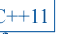

在 2.3.5 节中，我们说两个与符表示右值引用——当没有函数参数被完整替换时这是正确的。这就引出了一个问题：我们如何为右值编写泛型函数？一种方法是用相应的左值引用重载函数并删除该重载：

```
template <typename T>
void rvalue_only(T&& arg)
{
// ...
}
template <typename T>
void rvalue_only(T&&) = delete;
```

当我们用右值调用这个函数时，只有第一个重载匹配，函数按预期执行。对于任何左值参数——包括 const 左值——第二个重载是更好的匹配，编译器会发出错误。

或者，我们可以放弃重载，并添加一个 static_assert 来断言我们的参数确实是右值引用：

```
template <typename T>
void rvalue_only2 (T&& arg)
{
    static_assert (is_rvalue_reference<decltype (arg)>::value
        ,
        "This function is only allowed for
        rvalues!");
    // ...
}
```

is_rvalue_reference 是一种所谓的类型特征，我们将在 5.2.1 节中更详细地讨论。这个版本的优点是我们可以选择错误消息。此外，当我们有多个右值参数时，可以在后续的静态断言中测试它们，而第一种方法需要为每个右值参数提供一个重载（以及所有组合，如果我们不想要关于歧义的令人困惑的错误消息的话）。

### 3.1.3 处理模板中的错误

回到我们适用于所有数值类型的 max 示例。但是对于没有提供 operator> 的类型，例如 std::complex<T>，会发生什么？让我们尝试编译以下代码片段：³

```
std::complex<float> z(3, 2), c(4, 8);
std::cout << "The maximum of c and z is " << ::max(c, z) <<
'\n';
```

3. `max` 前面的双冒号避免了与标准库的 `max` 产生歧义，某些编译器可能会隐式包含标准库的 `max`（例如 `g++`）。

我们的编译尝试将以这样的错误结束：

```
Error: no match for `operator<<` in `a > b`
```

当我们的模板函数调用另一个模板函数，而那个函数又调用另一个……以此类推时会发生什么？同样，这些函数只被解析，完整的检查被推迟到实例化时。让我们看看下面的程序：

```
int main ()
{
  vector<complex<float> > vi;
  sort(v.begin(), v.end());
}
```

不深入细节，问题与之前相同：我们无法比较 `complex` 数字，因此无法对它们的数组进行排序。这次，缺失的比较是在间接调用的函数中被发现的，编译器为我们提供了完整的调用和包含堆栈，以便我们可以追溯错误。请尝试在不同编译器上编译此示例，看看你能否从错误消息中看出任何端倪。

如果你遇到这样冗长的错误消息，4 不要惊慌！首先，查看错误本身，提取对你有用的信息：例如，缺少 `operator>`，或者某物不可赋值，或者某物是 `const` 而不应该是。然后在调用堆栈中找到属于你程序的最内层代码，即你从标准库或第三方库调用模板函数的位置。盯着这段代码及其前面的行看一段时间，因为根据我们的经验，这是错误最可能发生的地方。然后问自己：根据错误消息，函数的模板参数类型是否缺少一个运算符或函数？

4. 我们听说过的最长消息是 18MB，相当于大约 9,000 页的文本。


不要害怕到决定余生都不使用模板的地步。在大多数情况下，问题比永无止境的错误信息让我们相信的要简单得多。根据我们的经验，模板函数中的大多数错误比运行时错误更容易找到——只需一些训练。

使用C++20概念（将在3.10节介绍）来表达函数的要求，可以产生更短但更易理解的错误信息。

### 3.1.4 混合类型

迄今为止我们尚未回答的另一个问题是：当我们使用两种不同的类型作为参数时，我们的函数`max`会发生什么？

```cpp
unsigned ul = 2;
int i = 3;
std::cout << "The maximum of ul and i is " << max(ul, i) << '\n';
```

编译器告诉我们——这次出奇地简短——类似这样的内容

```
Error: no match for function call >>max(unsigned int&, int)<<
```

确实，我们假设两种类型相等。但是等等，当不存在精确匹配时，C++不会隐式转换参数吗？会的，但不适用于类型推导的模板参数。模板机制旨在在类型层面提供足够的灵活性。此外，将模板实例化与隐式转换结合使用具有很高的歧义潜力。

到目前为止，情况不妙。我们可以编写带有两个模板参数的函数模板吗？当然可以。但这会带来一个新问题：这个模板的返回类型应该是什么？有不同的选择。首先，我们可以添加一个非模板函数重载，例如

```cpp
inline int max(int a, int b) { return a > b ? a : b; }
```

这可以用混合类型调用，并且`unsigned`参数会被隐式转换为`int`。但是如果我们还为`unsigned`添加另一个函数重载会怎样呢？

```cpp
inline int max(unsigned a, unsigned b) { return a > b ? a : b; }
```

`int`会被转换为`unsigned`还是反过来？编译器不知道，并会对此歧义提出警告。

无论如何，向模板实现添加相同代码的非模板重载远非优雅或高效。因此，我们删除所有非模板重载，首先看看在函数调用中可以做什么。我们可以显式地将一个参数转换为另一个参数的类型：

```cpp
unsigned ul = 2;
int i = 3;
std::cout << "max of ul and i is " << max((int)ul, i) << '\n';
```

现在，`max`是用两个`int`调用的。另一个选择是在函数调用中显式指定模板类型，从而避免有问题的类型推导：

```cpp
std::cout << "max of ul and i is " << max<int>(ul, i) << '\n';
```

然后两个参数都是`int`，当两个参数都是`int`或*隐式*可转换为`int`时，可以调用函数模板的实例。

在了解了模板的这些不太愉快的细节之后，有一个非常好的消息：模板函数的执行效率与非模板对应物一样高！原因是C++为每个实例化的类型或类型组合生成新代码。相比之下，Java只编译一次模板，并通过将类型强制转换为相应类型来为不同类型执行它们。这导致更快的编译和更短的可执行文件，但运行时间更长。

为快速模板支付的另一个代价是，由于每种类型（组合）的多次实例化，我们的可执行文件更长。在极端（且罕见）的情况下，当更快的内存^5被汇编指令填满，而数据必须从较慢的内存加载并存储到其中时，更大的二进制文件可能导致执行变慢。

5. L2和L3缓存通常在数据和指令之间共享。

然而，在实践中，函数的实例数量不会那么多，这仅对未内联的大函数有影响。对于内联函数，二进制代码无论如何都会直接插入到可执行文件的函数调用位置，因此对可执行文件长度的影响对于模板和非模板函数是相同的。

### C++11 3.1.5 统一初始化

统一初始化（来自§2.3.4）也适用于模板。然而，在极少数情况下，花括号消除可能会导致一些令人惊讶的行为。如果你好奇或已经遇到过一些意外，请阅读附录A.6.1。

### C++14 3.1.6 自动返回类型

自C++14以来，我们可以让编译器推断函数的`return`类型：

```cpp
template <typename T, typename U>
auto max(T a, U b)
{
    return a > b ? a : b;
}
```

`return`类型是从`return`语句中的表达式推断出来的，方式与函数模板参数从参数推断的方式相同。如果函数包含多个`return`语句，则它们推断的类型必须全部相等。在模板库中，有时简单函数有相当冗长的`return`类型声明——可能甚至比函数体还长——这时程序员不必将它们拼写出来，真是一种巨大的解脱。

### C++20 3.1.7 简洁模板参数

C++20引入了另一种简洁的函数表示法：对函数参数使用auto。这使我们可以在不使用上一节第一行的情况下实现max函数：

```cpp
auto max(auto a, auto b)
{
    return a > b ? a : b;
}
```

为函数的每个auto参数隐式引入一个新的类型参数。

## 3.2 命名空间和函数查找

命名空间不是泛型编程的子主题（事实上，它们与泛型编程完全正交）。然而，在存在函数模板时，它们变得更加重要，因此这是书中讨论它们的一个好地方。

### 3.2.1 命名空间

命名空间的动机是，min、max或abs等常见名称可以在不同的上下文中定义；因此名称可能会产生歧义。即使在实现函数或类时名称是唯一的，但在包含更多库或所包含的库发展时，它们也可能在以后发生冲突。例如，GUI实现中通常有一个名为window的类，统计库中也可能有一个。我们可以通过命名空间来区分它们：

```cpp
namespace GUI {
    class window;
}
```

```cpp
namespace statistics {
    class window;
}
```

处理名称冲突的一种可能性是使用不同的名称，如abs、my_abs或library_name_abs。这正是C语言中所做的。广泛使用的库通常使用短函数名，用户库使用较长的名称，与操作系统相关的内部代码通常以下划线_开头。这降低了冲突的概率，但不足以完全避免。当我们编写自己的类时，命名空间非常重要，当它们在函数模板中使用时则更加重要。它们允许我们以层次结构组织软件中的名称。这避免了名称冲突，并为函数和类名提供了复杂的访问控制。

就我们可以看到封闭命名空间中的名称这一事实而言，命名空间与作用域类似：

```cpp
struct global();
namespace c1 {
    struct c1c {};
    namespace c2 {
        struct c2c {};
        struct cc {
            global x;
            c1c y;
            c2c z;
        };
    } // namespace c2
} // namespace c1
```

在内部命名空间中重新定义的名称会隐藏外部名称。与块不同，外部名称对我们并没有丢失，但仍可以通过命名空间限定来使用：

```cpp
struct same();
namespace c1 {
    struct same {};
    namespace c2 {
        struct same {};
        struct csame {
            ::same x;
            c1::same y;
            same z;
        };
    }; // namespace c2
} // namespace c1
```

如你所料，::same指全局命名空间中的类型，c1::same指c1中的名称。成员变量z的类型是c1::c2::same，因为内部名称隐藏了外部名称。命名空间是从内向外引入的。如果我们在c2中添加一个命名空间c1，这将隐藏同名的外部命名空间，并且y的类型将变得不正确：

```cpp
struct same {};
namespace c1 {
    struct same {};
    namespace c2 {
        struct same {};
        namespace c1 {} // hides ::c1
        struct csame {
            ::same x;
            c1::same y; // Error: c1::c2::c1::same not
        };
        same z;
    } // namespace c2
} // namespace c1
```

在这里，c1::same存在于全局命名空间中，但由于c1被c1::c2::c1隐藏，我们无法访问它。如果我们在命名空间c2中定义一个名为c1的类，也会观察到类似的隐藏。我们可以通过在命名空间前加上双冒号来避免隐藏，并更明确地指定y的类型：

```cpp
struct csame {
    ::c1::same y; // this is unique
};
```

这清楚地表明我们指的是全局命名空间中的名称c1，而不是任何其他名为c1的名称。经常需要的函数或类名称可以通过using声明导入：

```cpp
void fun( ... )
{
    using c1::c2::cc;
    cc x;
    ...
    cc y;
}
```


此声明在函数和命名空间中有效，但在类中无效（在那里它会与其他 `using` 声明冲突）。术语“名称隐藏”应按字面意思理解，如以下示例所示：

单击此处查看代码图像

```
void f(string s) { ... } // # 1
namespace inner {
    void f(int i) { ... } // # 2
    f("from global"); // Error: #2 hides #1
}
```

如果在内部作用域中声明或定义一个函数，它不仅会隐藏具有相同签名的函数重载，还会隐藏外部作用域中的所有重载。实际上，任何名为 f 的实体（类、变量……）都会隐藏全局函数 f。要使其可用于函数调用，我们可以通过 `using` 声明使其可见：

单击此处查看代码图像

```
void f(string s) { ... } // # 1
namespace inner {
    void f(int i) { ... } // # 2
    using ::f;
    f("from global"); // now calls #1
}
```

在头文件中将名称导入命名空间会显著增加名称冲突的风险，因为该名称在编译单元的所有后续文件中都保持可见。函数内（即使在头文件中）的 `using` 不那么关键，因为导入的名称仅在函数结束前可见。同样，我们可以使用 `using` 指令导入整个命名空间：

```
void fun ( ... )
{
    using namespace c1::c2;
    cc x;
    ...
    cc y;
}
```

与之前一样，这可以在函数或另一个命名空间中完成，但不能在类作用域中完成。语句：

```
using namespace std;
```

通常是 `main` 函数中的第一条语句，甚至是在包含之后的第一条语句。在全局命名空间中导入 `std` 有很大的名称冲突潜力，例如，当我们也定义一个名为 `vector` 的类（在全局命名空间中）时。

## 建议

不要在头文件中导入名称或命名空间（函数外）。

当命名空间的名称太长时，尤其是嵌套命名空间，我们可以使用命名空间别名为其重命名：


```
namespace lname= long_namespace_name;
namespace dvector= algebra::vector::dense;
```

与之前一样，这应在适当的作用域中完成。


## C++17

使用相同的冒号分隔表示法，我们可以在 C++17 中打开一个嵌套命名空间：


```
namespace algebra::vector::dense {
    class vector3 { /* */ };
}
```

而不是编写单个命名空间的嵌套声明。

## 3.2.2 参数相关查找

参数相关查找（Argument-Dependent Lookup，简称 ADL）将函数名称的搜索扩展到其参数的命名空间中——但不包括它们各自的父命名空间。这使我们免除了函数的冗长命名空间限定。假设我们在谦逊的命名空间 `rocketscience` 中编写终极科学库：


```
namespace rocketscience {
struct matrix {};

template <typename LinOp>
void initialize(LinOp& A) { /* ... */ }

matrix operator+(const matrix& A, const matrix& B)
{
    matrix C;
    initialize(C); // not qualified, same namespace
    add(A, B, C);
    return C;
}
}
```

每次我们使用函数 `initialize`（该函数据称仅在 `rocketscience` 中定义），都可以省略命名空间 `rocketscience` 中所有类的限定：

单击此处查看代码图像

```
int main ()
{
    rocketscience::matrix A, B, C, D;
    rocketscience::initialize(B); // qualified
    initialize(C); // rely on ADL

    chez_herbert::matrix E, F, G; // qualification needed
    rocketscience::initialize(E); // qualification needed
    initialize(F); // Error: initialize not found
}
```

运算符也受 ADL 约束：

```
A = B + C + D;
```

想象没有 ADL 的前面表达式：

单击此处查看代码图像

```
A = rocketscience::operator+(rocketscience::operator+(B, C),
D);
```

同样丑陋且更加繁琐的是流式 I/O，当必须限定命名空间时。由于用户代码不应位于命名空间 std 中，因此类的 operator<< 最好定义在该类的命名空间中。这允许 ADL 为每种类型找到正确的重载，例如：

```
std::cout << A << E << B << F << std::endl;
```

没有 ADL，我们需要以冗长的表示法限定每个运算符的命名空间。这将把前面的表达式变为：

单击此处查看代码图像

```
std::operator<< (chez_herbert::operator<< (
rocketscience::operator<< (chez_herbert::operator<< (
rocketscience::operator<< (std::cout, A), E), B),
F), std::endl);
```

ADL 机制也可用于在类分布于多个命名空间时选择正确的函数模板重载。线性代数中的 L₁ 范数（也称为曼哈顿范数）既定义于矩阵也定义于向量，我们希望为两者提供模板实现：

单击此处查看代码图像

```
template <typename Matrix>
double one_norm(const Matrix& A) { ... }

template <typename Vector>
double one_norm(const Vector& x) { ... }
```

编译器如何知道我们为每种类型偏好哪个重载？一种可能的解决方案是为矩阵和向量分别引入一个命名空间，以便由 ADL 选择正确的重载：

单击此处查看代码图像

```
namespace rocketscience {
 namespace mat {
 struct sparse_matrix {};
 struct dense_matrix {};
 struct über_matrix⁶ {};

 template <typename Matrix>
 double one_norm(const Matrix& A) { ... }
 }
 namespace vec {
 struct sparse_vector {};
 struct dense_vector {};
 struct über_vector {};
 template <typename Vector>
 double one_norm(const Vector& x) { ... }
 }
}
```

ADL 机制仅在参数类型声明的命名空间中搜索函数，而不在它们各自的父命名空间中搜索：

单击此处查看代码图像

```
namespace rocketscience {
...
namespace vec {
struct sparse_vector {};
struct dense_vector {};
struct über_vector {};
}
template <typename Vector>
double one_norm(const Vector& x) { ... }
}
int main ()
{
rocketscience::vec::über_vector x;
double norm_x = one_norm(x); // Error: not found by
ADL
}
```

- 6. 当然，我们使用 über 的原始德语拼写——有时甚至出现在美国论文中。请注意，某些编译器（例如 g++-9）对非 ASCII 字符存在问题。

同样，当我们将名称导入另一个命名空间时，该命名空间中的函数也不会被 ADL 考虑：

单击此处查看代码图像

```
namespace rocketscience {
...
using vec::über_vector;
template <typename Vector>
double one_norm(const Vector& x) { ... }
}
int main ()
{
    rocketscience::über_vector x;
    double norm_x = one_norm(x);   // Error: not found by
ADL
}
```

仅依赖 ADL 来选择正确的重载有其局限性。当我们使用第三方库时，可能会发现我们在自己的命名空间中也实现了相同的函数和运算符。这种歧义可以通过仅使用 `using` 导入单个函数而不是整个命名空间来减少（但不能完全避免）。

多参数函数的歧义概率会进一步增加，尤其是当参数类型来自不同的命名空间时，例如：

单击此处查看代码图像

```
namespace rocketscience {
    namespace mat {
        ...
        template <typename Scalar, typename Matrix>
        Matrix operator*(const Scalar& a, const Matrix& A) {
            ...
        }
    }
    namespace vec {
        ...
        template <typename Scalar, typename Vector>
        Vector operator*(const Scalar& a, const Vector& x) {
            ...
        }
        ...
        template <typename Matrix, typename Vector>
        Vector operator*(const Matrix& A, const Vector& x) {
            ...
        }
    }
}
int main(int argc, char* argv[])
{
    rocketscience::mat::über_matrix A;
    rocketscience::vec::über_vector x, y;
    y = A * x;   // which overload is
selected?
}
```

这里的意图很明确。嗯，对于人类读者来说是这样。对于编译器来说则不那么明确。`A` 的类型定义在 `rocketscience::mat` 中，而 `x` 的类型定义在


rocketscience::vec 以便在两个命名空间中都查找 operator*。因此，所有三个模板重载都可用，且没有哪一个比其他任何一个更匹配（尽管可能只有一个能够编译）。

不幸的是，每当显式给出模板参数时，ADL 都会被禁用。7 要解决这个问题，必须通过命名空间限定使函数可见，或通过 using 导入。

7. 问题在于 ADL 在编译过程中执行得太晚，而开角括号已经被误解为小于号。

调用哪个函数重载取决于迄今讨论的以下规则：

- 命名空间嵌套和限定，
- 名称隐藏，
- ADL，以及
- 重载决议。

必须理解这种非平凡的相互作用，以便针对重载严重的函数确保不会出现歧义并选择正确的重载。因此，我们在附录 A.6.2 中给出了一些示例。请随时推迟此讨论，直到在处理较大的代码库时遇到意外的重载决议或歧义而感到困惑为止。

### 3.2.3 命名空间限定或 ADL

许多程序员不想深入研究编译器如何选择重载或如何遇到歧义的复杂规则。他们限定被调用函数的命名空间，并确切知道选择了哪个函数重载（假设该命名空间中的重载在重载决议中不具有歧义）。我们不责备他们；名称查找绝非易事。

当我们计划编写包含可用于多种类型实例化的函数和类模板的优秀泛型软件时，应该考虑 ADL。我们将用许多程序员遇到的一个非常流行的性能错误（尤其是在 C++03 中）来演示这一点。标准库包含一个名为 swap 的函数模板。它交换两个相同类型对象的内容。旧的默认实现使用拷贝和一个临时对象：

```cpp
template <typename T>
inline void swap(T& x, T& y)
{
    T tmp(x); x = y; y = tmp;
}
```

它适用于所有具有拷贝构造函数和赋值运算符的类型。目前为止一切正常。假设我们有两个向量，每个包含 1GB 数据。那么当我们使用默认实现时，需要拷贝 3GB 并且还需要一个额外的千兆字节内存。或者我们做一些更聪明的事情：我们切换指向数据和大小信息的指针：

```cpp
class vector
{
    ...
    friend inline void swap(vector& x, vector& y)
    { std::swap(x.my_size, y.my_size); std::swap(x.data,
y.data); }
    private:
    unsigned my_size;
    double *data;
};
```

假设我们必须在某个泛型函数中交换参数化类型的数据：

```cpp
template <typename T, typename U>
inline void some_function(T& x, T& y, const U& z, int i)
{
    ...
    std::swap(x, y); // can be expensive
    ...
};
```

我们采取了稳妥的做法，使用了适用于所有可拷贝类型的标准 swap 函数。但我们拷贝了 3GB 数据。使用只切换指针的我们的实现会快得多且更节省内存。可以通过一种泛型方式的小改动来实现这一点：

```cpp
template <typename T, typename U>
inline void some_function(T& x, T& y, const U& z, int i)
{
    using std::swap;
    ...
    swap(x, y); // involves ADL
    ...
}
```

使用此实现时，两个 swap 重载都是候选项，但我们的类中的那个会被重载决议优先选择，因为其参数类型比标准实现更具体。更一般地说，任何针对用户类型的实现都比 std::swap 更具体。事实上，出于同样的原因，std::swap 已经为标准容器重载了。这是一个通用模式：

### 使用 using

不要限定可能存在用户类型重载的函数模板的命名空间。相反，使名称可见并以非限定方式调用函数。

> C++11 作为默认 swap 实现的补充：自 C++11 起，默认做法是（如果可能）在两个参数和临时对象之间移动值：

```cpp
template <typename T>
inline void swap(T& x, T& y)
{
    T tmp(move(x));
    x= move(y);
    y= move(tmp);
}
```

结果是，当没有用户定义的 swap 的类型提供快速移动构造函数和赋值运算符时，可以高效地交换它们。只有没有用户实现和移动支持的类型最终会被拷贝。

## 3.3 类模板

在介绍命名空间之前，我们描述了使用模板创建泛型函数的方法。模板也可以用于创建泛型类。类似于泛型函数，class template 是标准中的正确术语，而 template class（或 templated class）在日常生活中更常被使用。在这些类中，数据成员的类型可以被参数化。

这对于向量、矩阵和列表等通用容器类尤其有用。我们也可以用参数化值类型扩展 complex 类。但是，我们已经在这个类上花费了太多时间，看点别的东西似乎更有趣。

### 3.3.1 容器示例

=> c++11/vector_template.cpp

例如，让我们编写一个泛型向量类，这里的向量是指线性代数意义上的向量，而不是 STL 向量。首先，我们实现一个只包含最基本运算符的类：

### 清单 3-1：模板向量类

```cpp
template <typename T>
class vector
{
public:
    explicit vector(int size)
    : my_size[size], data(new T[my_size])
    {}

    vector(const vector& that)
    : my_size{that.my_size}, data{new T[my_size]}
    {
        std::copy(&that.data[0], &that.data[that.my_size],
                  &data[0]);
    }

    int size() const { return my_size; }

    const T& operator[](int i) const
    {
        check_index(i);
        return data[i];
    }
    // ...
    private:
        int         my_size;
        std::unique_ptr<T[]> data;
};
```

模板类与非模板类本质上没有区别。唯一的区别是多了一个参数 T 作为其元素类型的占位符。我们有像 my_size 这样的成员变量和像 size() 这样的成员函数，它们不受模板参数的影响。其他函数（如括号运算符或拷贝构造函数）是参数化的，但仍类似于其非模板等价物：以前我们使用 double 的地方，现在都放入类型参数 T 作为返回类型或在分配中。同样，成员变量 data 只是由 T 参数化。

模板参数可以有默认值。假设我们的向量类不仅参数化值类型，还参数化方向和位置：

```cpp
struct row_major();
struct col_major();
struct heap {};
struct stack {};

template <typename T = double, typename Orientation = col_major,
typename Where = heap>
class vector;
```

向量的参数可以完全声明：

```
vector<float, row_major, heap> v;
```

或者，如果最后一个参数等于默认值，则可以省略：

```
vector<float, row_major> v;
```

与函数一样，只能省略最后的参数。例如，如果第二个参数是默认值而最后一个不是，则必须全部写出：

```
vector<float, col_major, stack> w;
```

当所有模板参数都设置为默认值时，我们当然可以全部省略。但是，由于此处不讨论的语法原因，仍然需要写出尖括号：

```cpp
vector x; // Special meaning in C++17 (cf. §3.4.4), error before
vector<> y; // Looks a bit strange but is correct
```

模板默认值可以引用前面的参数：

```cpp
template <typename T, typename U = T>
class pair;
```

这是一个用于两个可能具有不同类型的值的类。如果不是，我们可以只声明一次类型：

```cpp
pair<int, float> p1; // Object with an int and float value
pair<int> p2; // Object with two int values
```

默认值甚至可以是前面参数的表达式，如第 5 章将展示的那样。

### 3.3.2 设计统一的类和函数接口

=> c++03/accumulate_example.cpp

当我们编写泛型类和函数时，可以问自己一个先有鸡还是先有蛋的问题：什么是第一？我们可以选择先编写函数模板，然后通过实现相应的方法来调整我们的类以适应它们。或者，我们可以先开发类的接口，然后针对这个接口实现泛型函数。

当我们的泛型函数需要能够处理内置类型或标准库中的类时，情况会略有不同。这些类不能更改，我们应该调整我们的函数以适应它们的


接口。我们稍后将介绍其他选项：特化和元编程，它们允许类型相关的行为。

作为案例研究，我们使用标准模板库第 4.1 节中的函数 `accumulate`。它是在程序员比今天更频繁地使用指针和普通数组的时代开发的。因此，STL 创建者 Alex Stepanov 和 David Musser 建立了一个极其通用的接口，它适用于指针和数组，也适用于他们库中的所有容器。

### 3.3.2.1 真正的数组求和

为了以泛型方式对数组元素求和，首先想到的可能是一个接受数组地址和大小的函数：

点击此处查看代码图像

```
template <typename T>
T sum(const T* array, int n)
{
    T sum(0);
    for (int i = 0; i < n; ++i)
        sum += array[i];
    return sum;
}
```

该函数可以按预期调用：

点击此处查看代码图像

```
int ai[] = {2, 4, 7};
double ad[] = {2., 4.5, 7.};

cout << "sum ai is " << sum(ai, 3) << '\n';
cout << "sum ad is " << sum(ad, 3) << '\n';
```

然而，我们可能会疑惑为什么需要传递数组的大小。编译器不能为我们推断出来吗？毕竟，它在编译期间是已知的。为了使用编译器推断，我们为大小引入一个模板参数，并按引用传递数组：

```
template <typename T, unsigned N>
T sum(const T (&array)[N])
{
    T sum = 0;
    for (int i = 0; i < N; ++i)
        sum += array[i];
    return sum;
}
```

语法诚然看起来有点奇怪：我们需要括号来声明数组的引用，而不是引用的数组。非类型模板参数将在第 3.6 节中讨论。上面的函数现在可以用单个参数调用：


```
cout << "sum ai is " << sum(ai) << '\n';
cout << "sum ad is " << sum(ad) << '\n';
```

在这里，类型和大小都会被推断。这反过来意味着，如果我们对同一类型但大小不同的两个数组求和，该函数将被实例化两次。尽管如此，它不应该影响可执行文件的大小，因为这样的小函数通常会被内联。

### 3.3.2.2 对列表元素求和

列表是一种简单的数据结构，其元素包含一个值和对下一个元素的引用（有时也包含对前一个元素的引用）。在 C++ 标准库中，类模板 `std::list` 是一个双向链表（§4.1.3.3），而没有后向引用的列表在 C++11 中作为 `std::forward_list` 引入。在这里，我们只考虑前向引用：


```
template <typename T>
struct list_entry
{
    list_entry(const T& value) : value(value), next(nullptr)
    {}

    T value;
    list_entry<T>* next;
};
```

```
template <typename T>
struct list
{
    list() : first(nullptr), last(nullptr) {}

    ~list()
    {
        while (first) {
            list_entry<T> *tmp = first->next;
            delete first;
            first = tmp;
        }
    }

    void append(const T &x)
    {
        last = (first ? last->next : first) = new list_entry<T>(x);
    }

    list_entry<T> *first, *last;
};
```

这个列表实现实际上非常极简，有点简洁。利用现有的接口，我们可以建立一个小列表：


```
list<float> l;
l.append(2.0f); l.append(4.0f); l.append(7.0f);
```

请随时使用诸如 `initializer_list` 构造之类的有用方法来丰富我们的代码。这个列表的求和函数很简单：

### 代码清单 3-2：列表元素求和


```
template <typename T>
T sum(const list<T>& l)
{
    T sum = 0;
    for (auto entry = l.first; entry != nullptr; entry = entry->next)
        sum += entry->value;
    return sum;
}
```

并且可以以显而易见的方式调用。我们突出了与数组实现不同的细节。

### 3.3.2.3 差异与共性

当我们致力于提供一个通用接口时，首先要问自己：这两个 `sum` 的实现有多相似？乍一看，不太相似：

- 值的访问方式不同；
- 条目的遍历实现方式不同；以及
- 终止条件不同。

然而，在更抽象的层面上，两个函数执行相同的任务：

- 访问数据；
- 进入下一个条目；以及
- 检查是否到达末尾。

两个实现之间的区别在于这些任务如何使用给定类型的接口来实现。因此，为了为两种类型提供一个通用函数，我们必须建立一个通用接口。

### 3.3.2.4 替代数组求和

在第 3.3.2.1 节中，我们以面向索引的方式访问数组，这种方式不能应用于内存中任意分散的列表（至少不能高效地应用）。因此，我们在这里以更顺序的方式和逐步遍历重新实现数组求和。我们可以通过递增指针直到越过数组末尾来实现这一点。数组之后的第一个地址是 `&a[n]`，或者更简洁地使用指针算术：`a + n`。图 3-1 说明我们从 `a` 的地址开始遍历，并在到达 `a+n` 时停止。因此，我们使用地址的右开区间来指定条目范围。

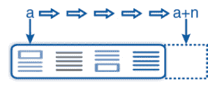

### 图 3-1：带有 begin 和 end 指针的长度为 n 的数组

当软件编写为最大适用性时，右开区间已被证明比闭区间更通用，特别是对于列表等类型，其中位置不能（高效地）使用 < 进行比较。右开区间上的求和可以如代码清单 3-3 所示实现。

### 代码清单 3-3：数组元素求和

点击此处查看代码图像

```
template <typename T>
inline T accumulate_array(T* a, T* a_end)
{
    T sum(0);
    for (; a != a_end; ++a)
        sum += *a;
    return sum;
}
```

并按如下方式使用：

点击此处查看代码图像

```
int ai[] = {2, 4, 7};
double ad[] = {2., 4.5, 7.};

cout << "sum ai is " << accumulate_array(ai, &ai[3]) << '\n';
cout << "sum ad is " << accumulate_array(ad, ad+3) << '\n';
```

表示上述右开区间的一对指针是一个范围：C++ 中一个非常重要的概念。标准库中的许多算法都以类似于 `accumulate_array` 的方式为指针类对象的范围实现。要为新容器使用此类函数，我们只需提供这种指针类接口。作为示例，我们将展示如何为我们的列表调整其接口。

### 3.3.2.5 泛型求和

代码清单 3-2 和代码清单 3-3 中的两个求和函数看起来相当不同，因为它们是为不同的接口编写的。从功能上讲，它们并不那么不同。在第 3.3.2.3 节中，我们关于求和实现指出：

- 它们都从一个元素遍历到下一个元素。
- 它们都访问当前元素的值并将其添加到 `sum`。
- 它们都测试是否到达序列的末尾。

同样的情况也适用于第 3.3.2.4 节中我们修订的数组实现。然而，后者使用了一种具有更抽象的逐步遍历序列概念的接口。因此，当另一个序列（如列表）提供这种顺序接口时，可以将其应用于该序列。

Alex Stepanov 和 David Musser 在 STL 中的巧妙想法是为所有容器类型和传统数组引入一个通用接口。该接口由称为迭代器的广义指针组成。然后，所有算法都为这些迭代器实现。我们将在 §4.1.2 中更广泛地讨论这一点，这里仅略作预告。

```
⇒ c++03/accumulate_example.cpp
```

我们现在需要为我们的列表提供一个迭代器，以指针类似的语法提供必要的功能，即：

- 使用 `++it` 遍历序列；
- 使用 `*it` 访问值；以及
- 使用 `==` 或 `!=` 比较迭代器。

实现很简单：


```cpp
template <typename T>
struct list_iterator
{
    using value_type= T;

    list_iterator(list_entry<T>* entry) : entry(entry) {}

    T& operator*() { return entry->value; }

    const T& operator*() const
    { return entry->value; }

    list_iterator<T>& operator++()
    { entry= entry->next; return *this; }

    bool operator!=(const list_iterator<T>& other) const
    { return entry != other.entry; }

    list_entry<T>* entry;
};
```

出于方便，我们为列表添加了 `begin` 和 `end` 方法：

点击此处查看代码图片

```cpp
template <typename T>
struct list
{
    // previous contents ...

    list_iterator<T> begin() { return list_iterator<T>
    (first); }
    list_iterator<T> end() { return list_iterator<T>(0); }
}
```

`list_iterator` 使我们能够将清单 3-2 和清单 3-3 合并在一起进行累加：

## 清单 3-4：泛型求和

点击此处查看代码图片

```cpp
template <typename Iter , typename T>
inline T accumulate(Iter it, Iter end, T init)
{
    for (; it != end; ++it)
        init+= *it;

    return init;
}
```

这个泛型 `sum` 可以用于数组和列表，形式如下：

点击此处查看代码图片

```cpp
cout << "array sum = " << accumulate(a, a+10, 0.0) << '\n';
cout << "list sum = " << accumulate(l.begin(), l.end(), 0) <<
     '\n';
```

和之前一样，成功的关键在于找到正确的抽象：迭代器。

`list_iterator` 的实现也是一个绝佳的机会，来最终回答为什么迭代器应该使用前递增而不是后递增的问题。我们已经看到，前递增会更新 `entry` 成员并返回对迭代器的引用。后递增必须返回旧值，并递增其内部状态，以便下次使用迭代器时引用下一个列表项。不幸的是，只有在后递增操作在更改成员数据之前复制整个迭代器并返回该副本时，才能实现这一点：

点击此处查看代码图片

```cpp
template <typename T>
struct list_iterator
{
    list_iterator<T> operator++(int)
    {
        list_iterator<T> tmp(*this);
        p = p->next;
        return tmp;
    }
};
```

我们通常只调用递增操作以进入下一个条目，而不关心该操作返回的值。此时，创建一个永远不会被使用的迭代器副本只是资源浪费。优秀的编译器可能会优化掉这些多余操作，但没有必要冒这个险。后递增定义的一个有趣细节是那个虚假的 `int` 参数，它仅存在以与前递增定义区分开来。

## 3.4 类型推导与定义

C++ 编译器在 C++03 中已经能够自动推导函数模板参数的类型，例如：

```cpp
f(g(x, y, z) + 3 * x)
```

然后编译器可以推导传递给 f 的参数的类型。

### C++11 3.4.1 自动变量类型

当我们将类似前面表达式的结果赋值给变量时，在 C++03 中需要知道该表达式的类型。另一方面，如果将其赋值给结果不可转换的类型，编译器会告知我们类型不兼容。这表明编译器知道类型，而在 C++11 中，这种知识也与程序员共享。

使用前面示例中类型信息的最简单方法是自动变量类型：

```cpp
auto a = f(g(x, y, z) + 3 * x);
```

这并未改变 C++ 是强类型语言这一事实。`auto` 类型与 Python 等其他语言中的动态类型不同。在 Python 中，对 `a` 进行赋值可以改变 `a` 的类型，即变为所赋表达式的类型。在 C++11 中，变量 `a` 具有初始化表达式的结果类型，并且此后该类型永远不会改变。由于类型是从表达式推导出来的，我们不能声明未初始化的 `auto` 变量：

```cpp
auto a;        // Error: don't know the type of a
a = f(g(x, y, z) + 3 * x); // Too late
```

因此，`auto` 类型不是一种会适应赋给变量的所有内容的自动类型，而是只推导一次。只要所有变量都使用相同类型的表达式进行初始化，我们就可以在同一语句中声明多个 `auto` 变量：

```cpp
auto i = 2 * 7.5, j = std::sqrt(3.7); // okay: both are double
auto i = 2 * 4, j = std::sqrt(3.7);   // Error: i is int, j is double
```

```cpp
auto i = 2 * 4, j; // Error: j not initialized
auto v = g(x, y, z); // result of g
```

我们可以使用 `const` 和引用限定符来修饰 `auto`：

```cpp
auto& ri = i; // reference on i
const auto& cri = i; // constant reference on i
auto&& fr = g(x, y, z); // forward reference to result of g
```

使用 `auto` 变量的类型推导与函数参数的推导完全相同，如第 3.1.2 节所述。这意味着，例如，前面代码片段中的变量 `v` 不是引用，即使 `g` 返回一个引用。同样，通用引用 `fr` 要么是右值（当 `g` 返回一个值或右值引用时），要么是左值（当 `g` 返回一个左值引用时）。

### C++11 3.4.2 表达式的类型

C++11 中用于类型推导的另一个新特性是 `decltype`。它看起来像一个函数，并返回表达式的类型。如果第一个 `auto` 示例中的 `f` 返回一个值，我们也可以使用 `decltype` 来表达：

```cpp
decltype(f(g(x, y, z) + 3 * x)) a = f(g(x, y, z) + 3 * x);
```

显然，这太冗长了，因此在这种情况下并不十分有用。

该特性在需要显式类型的地方非常重要：首先是作为类模板的类型参数。例如，我们可以声明一个向量，其元素可以容纳另外两个向量元素的和，即 `v1[0] + v2[0]` 的类型。这使我们能够表达不同类型的两个向量之和的适当返回类型：

```cpp
template <typename Vector1, typename Vector2>
auto operator+(const Vector1& v1, const Vector2& v2)
-> vector< decltype(v1[0] + v2[0]) >;
```

这段代码片段还引入了另一个新特性：*后置返回类型*。在 C++11 中，我们仍然必须声明每个函数的 `return` 类型。但是，我们可以使用 `decltype` 对带有函数参数的表达式进行此操作。为此，我们获准将 `return` 类型的声明移至参数之后。

这两个向量可能具有不同的类型，而结果向量则具有另一种类型。通过表达式 `decltype(v1[0] + v2[0])`，我们推导出将两个向量的元素相加时得到的类型。该类型将是我们结果向量的元素类型。

`decltype` 的一个有趣之处在于，它仅在类型级别操作，而不计算作为参数给出的表达式。因此，前面示例中的表达式不会对空向量造成错误，因为 `v1[0]` 未被执行，只推导了其类型。

这两个特性 `auto` 和 `decltype` 不仅在应用上有所不同，类型推导也不同。虽然 `auto` 遵循函数模板参数的规则，并且通常会丢弃引用和 `const` 限定符，但 `decltype` 会按原样获取表达式类型。例如，如果我们介绍示例中的函数 `f` 返回一个引用，那么本小节开头的变量 `a` 将是一个引用。相应的 `auto` 变量将是一个值。

只要我们主要处理内置类型，就可以在没有自动类型检测的情况下应付自如。但是，在进行高级泛型和元编程时，我们可以从这些极其强大的特性中获益匪浅。`decltype` 的对应物 `declval` 也很有用。这是一个用于创建任何类型对象的工具，然后可以用它来推导其表达式的类型。我们将在第 3.5.5 节和一些后续小节中演示这一点。

### C++11 3.4.3 decltype(auto)

这个新特性弥合了 `auto` 和 `decltype` 之间的差距。使用 `decltype(auto)`，我们可以声明具有与 `decltype` 相同类型的 `auto` 变量。以下两个声明是相同的：

```cpp
decltype(expr) v = expr; // redundant + verbose when expr is long
decltype(auto) v = expr; // Ahh! Much better.
```


当 `expr` 很长时，第一条语句可能会相当冗长，我们添加到其中的所有内容都需要在这条语句中添加两次。并且每次修改时，我们都必须注意两个表达式仍然相同。

=> c++14/value_range_vector.cpp

在自动 `return` 类型中，限定符的保留也很重要。作为示例，我们引入了一个对向量的视图，用于测试值是否在给定范围内。

该视图将使用 `operator[]` 访问被视向量的一个元素，并在范围测试后以完全相同的限定符返回它。显然这是 `decltype(auto)` 的工作。我们对该视图的示例实现仅包含一个构造函数和访问运算符：

```cpp
template <typename Vector>
class value_range_vector
{
    using value_type = typename Vector::value_type;
    using size_type = typename Vector::size_type;
    public:
        value_range_vector(Vector& vref, value_type minv,
        value_type maxv)
        : vref(vref), minv(minv), maxv(maxv)
        {
        }

        decltype(auto) operator[](size_type i)
        {
            decltype(auto) value = vref[i];
            if (value < minv) throw too_small{};
            if (value > maxv) throw too_large{};
            return value;
        }

    private:
        Vector&
            vref;
        value_type minv, maxv;
};
```

我们的访问运算符在返回之前会缓存来自 `vref` 的元素以进行范围检查。临时变量的类型和 `return` 类型都使用 `decltype(auto)` 推导。为了查看向量元素是否以正确类型返回，我们可以将其中一个存储在 `decltype(auto)` 变量中并检查其类型：

```cpp
int main()
{
    using Vec = vector<double>;
    Vec v = {2.3, 8.1, 9.2};

    value_range_vector<Vec> w{v, 1.0, 10.0};
    decltype(auto) val = w[1];
}
```

val 的类型是 double&，正如我们所期望的那样。示例中三次使用了 decltype(auto)：在视图实现中两次，在测试中一次。如果我们只将其中一个替换为 auto，val 的类型将变为 double。

## 3.4.4 推导的类模板参数

虽然自C++早期起函数模板参数就可以被推导，但直到C++14之前，类始终需要被完全实例化，例如：

```cpp
tuple<int, float, string> t1(3, 3.2f, "text"s);
```

这里我们用一个int、一个float和一个字符串字面量实例化了一个tuple（如果没有后缀s，它将是const char*）。尽管如此，我们仍必须用这些类型实例化tuple——这不言而喻。现在我们可以将类型推导交给编译器：

```cpp
tuple t2(3, 3.2f, "text"s);
```

t2的类型也是tuple<int, float, string>。如果我们的类模板参数从构造函数中清晰明了，也可以被推导：

```cpp
template <typename Value>
struct vec
{
    vec(std::initializer_list<Value> values)
    : s(values.size()), d(new Value[s])
    {
        std::copy(begin(values), end(values), d);
    } // ...
};

vec v = {2.3, 3.4, 4.5, 5.6};
```

上面的构造函数参数将被实例化为initializer_list<double>，因此类模板参数很明确。有时类与构造函数参数之间的关系并不那么明显：

```cpp
template <typename Value>
struct vec
{
    template <typename Iter>
    vec(Iter beg, Iter end)
    : s(distance(beg, end)), d(new Value[s])
    {
        copy(beg, end, d);
    }
};
```

```cpp
int array[] = {3, 4, 5, 6};
vec w(begin(array), end(array));
```

这里我们遍历一个int数组，但构造函数的参数不是int，而是迭代器类型。在这种情况下，我们必须通过推导指南来帮助编译器：

```cpp
template <class Iter>
vec(Iter beg, Iter end)
-> vec<typename std::iterator_traits<Iter>::value_type>;
```

推导指南是从构造函数签名到所需实例化类型的映射。后者可以是类型表达式，如我们的情况。类模板iterator_traits是一个类型特征，提供关于常见迭代器类型（如普通指针）的信息。这里我们关心的是迭代器所指向的value_type。因此，我们的推导指南表明，每当使用基于迭代器的构造函数时，就用迭代器的value_type实例化`vec`类。有时根本没有可用的类型信息：

- 8. 我们将在第5.2.1节更全面地讨论类型特征。

```cpp
template <typename Value>
struct vec
{
    vec(unsigned s) : s(s), d(new Value[s]) {}
};

vec x(3);
```

然后我们可以提供一个默认类型。可以作为类参数：

```cpp
template <typename Value = double>
struct vec;
```

或者作为推导指南：

```cpp
vec(unsigned s) -> vec<double>;
```

## **C++17** 3.4.5 推导多种类型

=> c++17/structured_bindings.cpp

有时我们在函数中计算多个结果，并可以将它们作为`pair`、`tuple`或用户定义的类一起返回。在第4.4.2节的示例中，我们将说明访问和/或复制`tuple`单个组件的各种可能性。我们希望预先展示这些示例，并展示C++17提供的一种机会，即在不先存储捆绑结果的情况下使用类型推导。它被称为*结构化绑定*，允许我们在推导返回类型的同时，将实用程序或用户定义类的成员绑定到新变量。在我们的示例中，我们有一个用于LU分解的函数，它返回一个矩阵和一个向量：

```cpp
auto lu(const matrix& A)
{
    // ... some computations
    return tuple<matrix, vector>(LU, p);
}
```

现在我们可以在应用程序中立即将返回的对象拆分为（分解后的）矩阵和（置换）向量：

```cpp
auto [LU, p] = lu(A);
```

LU和p的类型被推导。

当我们遍历一个map时，结构化绑定非常有用，该map的value_type是键及其关联值的pair。不再使用first和second访问pair成员，我们现在可以将它们命名为key和value：


```cpp
map<string, int> numbers = {{"Zero", 0}, {"One", 1}, {"Two", 2}};
```

```cpp
for (const auto& [key, value] : numbers)
cout << key << "->" << value << endl;
```

这里我们以常量引用的方式访问了key和value。请注意，即使没有const：


```cpp
for (auto& [key, value] : numbers)
cout << key << "->" << value << endl;
```

我们无法更改key。原因是我们拆分了一个类型为pair<const string, int>的对象（这是map内部存储条目的方式），并且第一个引用的类型被推导为const string&，方式与第3.1.2.2节中的常量参数相同。

=> c++17/structured_bindings_user.cpp

幸运的是，这个很好的新功能不仅限于标准类型，也可以应用于用户类型。它最容易用于仅具有公共成员的聚合类型。我们的lu结果可以返回一个仅将两个对象捆绑在一起的用户类：


```cpp
struct lu_result
{
    matrix LU;
    vector p;
};
auto lu(const matrix& A)
{
    // ...
    return lu_result{LU, p};
}

matrix A; // set A ...
auto [LU, p] = lu(A);
```

这里我们使用聚合初始化，并避免为此辅助类定义构造函数。结果类型的推导与之前相同。

要为具有`private`成员的结构化绑定提供支持，我们必须建立一个与`pair`和`tuple`等价的`get`接口。这需要一些模板特化，因此我们将其推迟到第3.5.5节。尽管如此，我们还是想先给你以下建议：

> **建议**
> 只要合适，就使用标准实用程序类的结构化绑定，并尽量避免为用户类实现`get`接口。

## C++11 3.4.6 定义类型

定义类型有两种方式：使用`typedef`或使用`using`。前者是在C中引入的，并从一开始就存在于C++中。这也是它唯一的优势：向后兼容性；我们有时在这本书中仅为了编写纯C++03代码而使用它。对于编写不需要使用pre-11编译器编译的新软件，我们强烈建议：

> **建议**
> 使用`using`代替`typedef`。


它更易读，也更强大。对于简单的定义，这只是顺序问题：

```
typedef double value_type;
```

与之相对：

```
using value_type = double;
```

在 `using` 声明中，新名称位于左侧，而 `typedef` 将其放在右侧。在声明数组时，新类型名称不是 `typedef` 的最右侧部分，类型被分成了两部分：

```
typedef double da1[10];
```

相比之下，在 `using` 声明中，类型保持完整：

```
using da2 = double[10];
```

对于函数指针，差异更加明显——希望你在类型定义中永远不需要它们。§4.4.7 中的 `std::function` 是一个更灵活的替代方案。例如，声明一个带有 `float` 和 `int` 参数并返回 `float` 的函数，读起来如下：

```
typedef float (*float_fn1)(float, int);
```

与之相对：

```
using float_fun2 = float(*)(float, int);
```

在所有示例中，`using` 声明都清晰地将新类型名称与定义分开。

此外，`using` 声明允许我们定义 *模板别名*。这些是带有类型参数的定义。假设我们有一个用于任意阶和可参数化值类型的张量模板类：

点击此处查看代码图片

```
template <unsigned Order, typename Value>
class tensor { ... };
```

现在我们想分别为一阶和二阶张量引入 `vector` 和 `matrix` 类型。这无法通过 `typedef` 实现，但可以通过 `using` 的模板别名轻松实现：

点击此处查看代码图片

```
template <typename Value>
using vector = tensor<1, Value>;

template <typename Value>
using matrix = tensor<2, Value>;
```

当我们打印以下行的输出时：

点击此处查看代码图片

```
std::cout << "The type of vector<float> is "
          << typeid(vector<float>).name() << ".\n";
std::cout << "The type of matrix<float> is "
          << typeid(matrix<float>).name() << ".\n";
```

在名称去修饰器中，我们将看到：

点击此处查看代码图片

```
The type of vector<float> is tensor<1u, float>.
The type of matrix<float> is tensor<2u, float>.
```

总而言之，如果你有 typedef 经验，你会欣赏 C++11 带来的新机遇；如果你是类型定义的新手，应该立即开始使用 using。

## 3.5 模板特化

一方面，为许多参数类型使用相同的实现是一大优势。然而，对于某些参数类型，我们可能知道更高效的实现，这可以通过 C++ 中的模板特化来实现。原则上，我们甚至可以为某些类型实现完全不同的行为，但代价是造成极大的混淆。因此，特化应当更高效，但行为应保持一致。C++ 提供了巨大的灵活性，作为程序员，我们有责任合理使用这种灵活性，并保持自身的一致性。

### 3.5.1 为单一类型特化类

=> c++11/vector_template.cpp

接下来，我们想将清单 3–1 中的 vector 示例为 bool 进行特化。我们的目标是将 8 个 bool 值打包到一个字节中以节省内存。让我们从类定义开始：

```
template <>
class vector<bool>
{
    // ...
};
```

尽管我们的特化类不再是类型参数化的，但我们仍然需要 template 关键字和空的尖括号。名称 vector 之前已被声明为类模板，我们需要这个看似多余的模板表示法来表明以下定义是主模板的特化。因此，在主模板之前定义或声明模板特化是错误的。在特化中，我们必须在尖括号内为每个模板参数提供一个类型。这些值可以是参数本身（或其表达式）。例如，如果我们为三个参数中的一个进行特化，另外两个仍然声明为模板参数：

点击此处查看代码图片

```
template <typename T1, typename T3>
class some_container<T1, int, T3>
{
    // ...
};
```

回到我们的布尔向量类：我们的主模板为空向量和包含 n 个元素的向量定义了构造函数。为保持一致性，我们也应该定义相同的内容。

对于非空向量，当位数不能被 8 整除时，我们需要向上取整数据大小：

点击此处查看代码图片

```
template <>
class vector<bool>
{
public:
    explicit vector(int size)
        : my_size(size), data{new unsigned char[(my_size + 7) / 8]}
    {
    }

    vector() : my_size(0) {}
private:
    int my_size;
    std::unique_ptr<unsigned char[]> data;
};
```

你可能已经注意到，默认构造函数与主模板中的相同。不幸的是，该方法不会“继承”到特化中。每当我们编写特化时，都必须从头开始定义一切，或者使用一个公共基类。9

9. 作者试图克服这种冗长 [20]。

我们可以自由地从主模板中省略成员函数或变量，但为保持一致性，我们只有出于充分理由，甚至非常充分的理由时才应这样做。例如，我们可能会省略 operator+，因为 bool 没有加法运算。常量访问运算符通过移位和位掩码实现：

点击此处查看代码图片

```
template <> class vector<bool>
{
bool operator[](int i) const
{ return (data[i / 8] >> i % 8) & 1; }
};
```

可变访问更棘手，因为我们无法引用单个位。诀窍是返回一个 Proxy——一种占位符设计模式，为其他东西提供接口。我们的 vector_bool_proxy 应为向量中的单个位提供 bool 接口：

点击此处查看代码图片

```
template <> class vector<bool>
{
vector_bool_proxy operator[](int i)
{ return {data[i / 8], i % 8}; }
};
```

返回语句使用带花括号的列表来调用两参数构造函数。现在让我们实现我们的代理来管理 `vector<bool>` 中的特定位。显然，该类需要对包含字节的引用以及该字节内的位置。为了简化后续操作，我们创建一个掩码，在问题位置上有 1 位，在所有其他位置上有 0 位：

点击此处查看代码图片

```
class vector_bool_proxy
{
public:
    vector_bool_proxy(unsigned char& byte, int p)
        : byte(byte), mask(static_cast<unsigned char>(1 << p))
    {}

private:
    unsigned char& byte;
    unsigned char mask;
};
```

请注意，`1 << p` 的结果是 `int`，如果没有强制转换，将其存储到 `mask` 将是收窄转换。读取访问通过简单地对引用的字节进行掩码并转换为 `bool` 来实现：

点击此处查看代码图片

```
class vector_bool_proxy
{
    operator bool() const { return byte & mask; }
};
```

只有当 `byte` 中考虑的位为 1 时，按位与才会产生非零值，该值在从 `unsigned char` 到 `bool` 的隐式转换中被评估为 `true`。设置位通过 `bool` 的赋值运算符来实现：

点击此处查看代码图片

```
class vector_bool_proxy
{
    vector_bool_proxy& operator=(bool b)
    {
        if (b)
            byte |= mask;
        else
            byte &= ~mask;
        return *this;
    }
};
```

当我们区分配置的值时，赋值更容易实现。当参数为 `true` 时，我们应用与掩码的或运算，以便考虑位置上的位被打开。所有其他位置保持不变，因为与 0 进行或运算没有影响（0 是按位或的单位元）。相反，当参数为 `false` 时，我们首先反转掩码，并将其与字节引用进行与运算。然后，反转掩码在活动位置上的 0 位将位关闭，而在所有其他位置上，与 1 位进行与运算保留了这些位值。

通过为 `bool` 特化 `vector`，我们只使用大约八分之一的内存。尽管如此，我们的特化与主模板（大部分）保持一致：我们可以以相同的方式创建向量并读写它们。精确地说，压缩向量与主模板并不完全相同，例如，当我们获取元素引用或涉及类型推导时。然而，我们尽可能使特化与通用版本相似，在大多数情况下我们不会意识到差异，并且它的工作方式相同。

### 3.5.2 特化和重载函数

在本节中，我们讨论并评估函数模板特化的优缺点。

#### 3.5.2.1 将函数特化为特定类型

函数可以像类一样进行特化。不幸的是，它们不参与重载决策，且不太具体的重载优先于更具体的模板特化；参见 [64]。出于这个原因，Sutter 和 Alexandrescu 在 [66, Item 66] 中给出了以下建议：

> 建议
> 不要使用函数模板特化！

要为上述特定类型或类型元组提供特殊实现，我们可以简单地使用重载。这效果更好，甚至更简单，例如：


#include <cmath>
template <typename Base, typename Exponent>
Base inline power(const Base& x, const Exponent& y) { ... }
double inline power(double x , double y)
{
    return std::pow(x, y);
}

Functions with many specializations are best implemented by means of class specialization. This allows for full and partial specialization without taking all overloading and ADL rules into consideration. We will show this in Section 3.5.4.

If you ever feel tempted to write hardware-specific specializations in assembler code, try to resist. If you cannot, please read first the few remarks in Appendix A.6.3.

### 3.5.2.2 Ambiguities

In the previous examples, we specialized all parameters of the function. It is also possible to specialize some of them in overloads and leave the remaining parameter(s) as template(s):

Click here to view code image

```
template <typename Base, typename Exponent>
Base inline power(const Base& x, const Exponent& y);
template <typename Base>
Base inline power(const Base& x, int y);
template <typename Exponent>
double inline power(double x, const Exponent& y);
```

The compiler will find all overloads that match the argument combination and select the most specific, which is supposed to provide the most efficient special-case implementation. For instance, `power(3.0, 2u)` will match for the first and third overloads where the latter is more specific. To put it in terms of higher math: type specificity is a partial order that forms a lattice, and the compiler picks the maximum of the available overloads. However, you don’t need to dive deep into algebra to see which type combination is more specific.

10. For those who like higher mathematics. And only for those.

If we called `power(3.0, 2)` with the previous overloads, all three would match. However, this time we cannot determine the most specific overload. The compiler will tell us that the call is ambiguous and show us overloads 2 and 3 as candidates. As we implemented the overloads consistently and with optimal performance we might be happy with either choice but the compiler will not choose for us. To disambiguate, we must add a fourth overload:

```
double inline power(double x, int y);
```

The lattice experts will immediately say: “Of course, we were missing the join in the specificity lattice.” But even without this expertise, most of us understand why the call was ambiguous with the three overloads and why the fourth one rescued us. In fact, the majority of C++ programmers get along without studying lattices.

### 3.5.3 Partial Specialization of Classes

When we implement template classes, we will sooner or later run into situations where we want to specialize a template class for another template class. Suppose we have templates `complex` and `vector` and want to specialize the latter for all instances of `complex`. It would be quite annoying doing this one by one:

Click here to view code image

```
template <>
class vector<complex<float>>;

template <>
class vector<complex<double>>; // again ??? :-/

template <>
class vector<complex<long double>>; // how many more ??? :-P
```

This is not only inelegant, it also destroys our ideal of universal applicability because the `complex` class supports all `Real` types and our specialization above only takes a limited number thereof into account. In particular, instances of `complex` with future user types cannot be considered for obvious reasons.

The solution that avoids the implementation redundancy and the ignorance of new types is *Partial Specialization*. We specialize our vector class for all `complex` instantiations:

```cpp
template <typename Real>
class vector<complex<Real> >
{
    ... ;
};
```

If you use a compiler without C++11 support, pay attention to put spaces between closing `>`; otherwise your compiler may interpret two subsequent `>` as shift operator `>>`, leading to rather confusing errors. Although this book mainly addresses C++11 programming, we still keep the separating spaces for readability. Partial specialization also works for classes with multiple parameters, for instance:

Click here to view code image

```cpp
template <typename Value, typename Parameters>
class vector<sparse_matrix<Value, Parameters> >
{
    ... ;
};
```

We can also specialize for all pointers:

```cpp
template <typename T>
class vector<T*>
{
    ... ;
};
```

Whenever the set of types is expressible by a *Type Pattern*, we can apply partial specialization on it. Partial template specialization can be combined with regular template specialization from §3.5.1—let us call it *Full Specialization* for distinction. In this case, the full specialization is prioritized over the partial one. Between different partial specializations the most specific is selected. In the following example:

Click here to view code image

```cpp
template <typename Value, typename Parameters>
class vector<sparse_matrix<Value, Parameters> >
{
    ... ;
};

template <typename Parameters>
class vector<sparse_matrix<float, Parameters> > { ... };
```

the second specialization is more specific than the first one and picked when it matches. According to the same notion of specificity, a full specialization is always more specific than any partial one.

### 3.5.4 Partially Specializing Functions

Function templates actually cannot be specialized partially. We can, however, as for the full specialization (§3.5.2.1), use overloading to provide special implementations. For that purpose, we write more specific function templates that are prioritized when they match. As an example, we overload the generic `abs` with an implementation for all `complex` instances:

```cpp
template <typename T>
inline T abs(const T& x)
{
    return x < T(0) ? -x : x;
}
template <typename T>
inline T abs(const std::complex <T>& x)
{
    return sqrt(real(x)*real(x) + imag(x)*imag(x));
}
```

Overloading of function templates is easy to implement and works reasonably well. However, for massively overloaded functions or for overloads spread over many files of a large project, sometimes the intended overload is not called. The reason is the non-trivial interplay of the already challenging namespace resolution with the overload resolution of mixed template and non-template functions.

=> c++14/abs_functor.cpp

To ascertain a predictable specialization behavior, it is safest to implement it internally in terms of class template specialization and only provide a single function template as a user interface. The challenging part here is the `return` type of this single function when the `return` types for the specializations vary. As in our `abs` example: the general code returns the argument type while the more specific `complex` version returns the underlying value type. This can be handled in a portable way so that it even works with C++03. However, using type deduction in newer standards simplifies such specializations dramatically.

[C++14] We start with the easiest implementation by using C++14:

```cpp
template <typename T> struct abs_functor ;

template <typename T>
decltype(auto) abs(const T& x)
{
    return abs_functor<T>()(x);
}
```

Our generic abs function creates an anonymous object abs_functor<T>() and calls its operator() with the argument x. Thus, the corresponding specialization of abs_functor needs a default constructor (usually implicitly generated) and an operator() as a unary function accepting an argument of type T. The return type of operator() is automatically deduced. For abs, we could most likely deduce the return type with auto instead since all different specializations should return a value. Just for the unlikely case that some specializations might be const- or reference-qualified, we use decltype(auto) to pass on the qualifiers.

[C++11] When we program with C++11, we have to declare the return type explicitly. At least, this declaration can apply type deduction:

```cpp
template <typename T>
auto abs(const T& x) -> decltype(abs_functor<T>()(x))
{
    return abs_functor<T>()(x);
}
```

It is admittedly redundant to repeat abs_functor<T>()(x) because any redundancy is a potential source of inconsistency but the alternatives in C++11 aren't better.

[C++03] Back in C++03, we could not use type deduction at all for the return type. Thus, the functor had to provide it by a typedef like result_type:

```cpp
template <typename T>
typename abs_functor<T>::result_type
abs(const T& x)
{
```


```cpp
return abs_functor<T>()(x);
}
```

这里我们必须依赖 `abs_functor` 的实现者，使得 `result_type` 与 `operator()` 的返回类型一致。最后，我们为 `complex<T>` 实现了一个偏特化的仿函数：

Click here to view code image

```cpp
template <typename T>
struct abs_functor
{
    typedef T result_type;

    T operator() (const T& x)
    {
        return x < T(0) ? -x : x;
    }
};
```

```cpp
template <typename T>
struct abs_functor<std::complex<T> >
{
    typedef T result_type;

    T operator() (const std::complex<T>& x)
    {
        return sqrt(real(x)*real(x) + imag(x)*imag(x));
    }
};
```

这是一个可移植的实现，适用于 `abs` 的所有三种实现。当我们放弃对 C++03 的支持时，可以在模板中省略 `typedef` 并改用类型推导。这个 `abs_functor` 可以针对任何合理的类型模式进一步特化，而无需担心与大量重载函数可能遇到的麻烦。

与其在 `operator()` 中执行计算，不如为其实现一个 `static` 函数（运算符必须是非静态的）。这样可以避免创建对象，并让编译器无需处理 `this` 指针。因此，我们邀请你在练习 3.12.11 中实现这一点。

## C++17 3.5.5 与用户类型的结构化绑定

=> c++17/structured_bindings_user.cpp

在不同场景下复习模板特化的一个好机制是提供 `tuple` 的 `get` 接口，以便为第 3.4.5 节中的结构化绑定启用带有私有成员的类。如前所述，在这样做之前我们应该三思，因为接口实现可能带来的工作量超过类型推导所节省的工作量。但为了评估这一点，我们至少要实现一次。

我们可以将 `get` 实现为成员函数或自由函数。为了证明这里更通用实现的合理性，我们允许虚部值的类型与实部值的类型不同：

Click here to view code image

```cpp
template <typename T, typename U= T>
class complex
{
  public:
    explicit complex(T rn = 0.0, U in = 0.0) : r{rn}, i{in}
    {}

    T const& real() const { return r; }
    U const& imag() const { return i; }
  private:
    T r;
    U i;
};
```

为此类添加 `get` 方法：

Click here to view code image

```cpp
template <typename T, typename U= T>
class complex
{
  template <std::size_t N>
  decltype(auto) get() const
  {
    if constexpr (N == 0)
      return r;
    else
      return i;
  }
};
```

由于 `r` 和 `i` 具有不同的类型，我们无法显式声明 `get` 的返回类型11，因此使用了类型推导。我们还需要另一个新特性：编译时 if，也称为 `constexpr`-if。它在编译时计算条件，然后只编译（实例化）活跃路径。其结果是返回类型将是唯一的。使用经典的 `if` 时，两个 `return` 语句都会在编译时被考虑，导致返回类型不明确。函数内部的编译时分支也是必需的，因为我们无法在类内部为 0 和 1 特化 `get`；模板特化仅允许在命名空间作用域中进行。

- 11. 至少在不使用元编程的情况下无法做到，我们将在第 5 章中展示。

为了完成我们类似 `tuple` 的接口，我们还需要特化类型特征 `std::tuple_size` 和 `std::tuple_element`：

Click here to view code image

```cpp
namespace std {

template<typename T, typename U>
struct tuple_size<dmc::complex<T, U> >
    : public std::integral_constant<std::size_t, 2> {};

template<std::size_t N, typename T, typename U>
struct tuple_element<N, dmc::complex<T, U> >
{
    using type = decltype(std::declval<dmc::complex<T, U>
    >().template get<N>() );
};

}
```

前者（如你无疑已猜到）声明我们的类有两个值可通过 `get` 访问。`tuple_element` 声明 `get` 对于 0 和 1 的返回类型。在我们的简单示例中，我们本可以通过对 `N` 进行偏特化来显式声明这一点，即对 0 使用 `using type = T;`，对 1 也类似处理。

这个类型声明使用了 `declval`：一种用于生成任意类型对象的工具。这听起来并不十分惊人，但在高度泛型的软件中非常有用。对于我们自己的类型，我们知道如何创建对象，但对于作为模板参数给出的任意类型，我们无法保证某个构造函数存在。大多数类型提供默认构造函数，但并非所有类型都提供。事实上，并非所有类型都有可用的构造函数。尽管如此，`declval<X>()` 为我们提供了任何类型 `x` 的对象。嗯，它产生一个指向不存在对象的右值引用。一旦我们使用这个对象，我们的程序将无法再编译。

幸运的是，我们在上一个代码片段中没有使用该对象；我们只是询问如果使用该对象为给定的 `N` 调用方法 `get`，返回类型会是什么。这就是 `declval` 的用法：创建一个包含用 `declval` 构建的对象的表达式，并使用 `decltype` 推导表达式的类型。最后，我们可以使用我们的 `complex` 类进行结构化绑定：

```cpp
complex<int, short> z{3, 7};
auto [re, im] = z;
```

如前所述，在这种情况下可能不值得付出这种努力。然而，既然已经花了这么多时间，我们也来看看 `get` 作为自由函数的不同实现。最简单的方法是使用 `constexpr-if`：

Click here to view code image

```cpp
template <std::size_t N, typename T>
decltype(auto) get(const complex<T>& z)
{
    if constexpr (N == 0)
        return z.real();
    else
        return z.imag();
}
```

或者，我们可以尝试特化，因为这次我们处于命名空间作用域中：

Click here to view code image

```cpp
template <std::size_t N, typename T>
decltype(auto) get(const complex<T>& z);

template <typename T>
decltype(auto) get<0, T>(const complex<T>& z)
{ return z.real(); }

template <typename T>
decltype(auto) get<1, T>(const complex<T>& z)
{ return z.imag(); }
```

由于我们只特化 `N` 而不特化 `T`，这是一种偏特化，而函数禁止使用偏特化。对于类则允许，我们可以实现一个非特化的函数 `get` 并调用偏特化类的方法。相比之下，函数可以进行全特化：

Click here to view code image

```cpp
template <>
decltype(auto) get<0, int>(const complex<int>& z)
{ return z.real(); }
```

```cpp
template <>
decltype(auto) get<1, int>(const complex<int>& z)
{ return z.imag(); }
```

但这几乎不具备泛型性，也不是真正合适的选择。无论如何，我们需要将类型特征 `tuple_element` 适配到我们的自由函数特化中。

总而言之，我们在这里看到了模板特化的局限性，而在这种情况下 `constexpr-if` 大大简化了问题。我们还看到，将结构化绑定应用于用户类型需要付出可感知的努力，我们可以问自己是否愿意付出。

但在提出这个问题之前，我们应该问自己，直接访问某些私有成员对于所考虑的类来说是否是一个明智的设计决策，因为我们显然比以前暴露了更多的技术细节，而且更危险的是：我们冒着对象有效性的风险。然而，这种访问对于调试或测试目的可能很方便。

为了实现这一点，我们可以引入一个 `private` 或 `protected` 方法，如 `uncover_members`，并将调试和测试代码声明为友元。当 `uncover_members` 返回一个元组时，本节中令人烦恼的声明工作可以轻松避免：

Click here to view code image

```cpp
template <typename T, typename U = T>
class complex
{
    private:
        auto uncover_members() const { return std::tuple{r, i}; }
        friend complex_fixture;
};
```

在调试或测试上下文中，我们现在可以应用结构化绑定：

```cpp
auto [re, im] = z.uncover_members ();
```

同时，成员在其他任何地方仍然不可访问。

## C++20 3.5.6 用户定义的格式化


我们上一个模板特化示例是对第1.7.6节中介绍的新`<format>`库进行定制，以支持用户类型。与之前一样，我们使用原型库`<fmt>`实现了它，并建议您在阅读时如果平台上可用，将其迁移到`<format>`。作为示例，我们再次选择`vector`类，我们希望为其指定单个值的格式。此外，当格式字符串包含字符`'c'`时，我们希望将包围的方括号替换为花括号。

为此，我们需要特化类`std::formatter`（相应地是`fmt::formatter`）。我们的特化应包含方法`parse`和`format`。让我们从前者开始：

```
template <typename Value>
struct formatter<dmc::vector<Value> >
{
    constexpr auto parse(format_parse_context& ctx)
    {
        value_format = "{:";
        for (auto it = begin(ctx); it != end(ctx); ++it) {
            char c = *it;
            if (c == 'c')
                curly = true;
            else
                value_format += c;
            if (c == '}')
                return it;
        }
        return end(ctx);
    }
    // ...
    bool curly(false);
    std::string value_format;
};
```

作为参数，给出了解析上下文，其`begin`迭代器指向格式说明的第一个字符，即冒号后的第一个字符，如果没有冒号则是左花括号后的第一个字符。我们几乎原样将格式说明复制到本地`value_format`中，只跳过我们的特殊字符`'c'`。为简单起见，我们假设格式不包含任何左花括号或右花括号，以便下一个右花括号终止我们的格式字符串。最后，我们返回指向右花括号或结束迭代器的迭代器。有了这些信息，我们就可以在方法`format`中输出我们的向量了：

```
template <typename Value>
struct formatter<dmc::vector<Value>>
{
    template <typename FormatContext>
    auto format(const dmc::vector<Value>& v, FormatContext& ctx)
    {
        auto& out = ctx.out();
        format_to(out, curly ? "{" : "[");
        if (v.size() > 0)
            format_to(out, value_format, v[0]);
        for (int i = 1; i < v.size(); ++i)
            format_to(out, "," + value_format, v[i]);
        return format_to(out, curly ? "}" : "]");
    }
    // ...
};
```

首先，我们获取输出缓冲区的引用。然后，我们将左花括号或左方括号写入其中。由于花括号在`<format>`库中具有特殊含义，我们需要双花括号作为转义序列。其余输出等同于ostream输出。最后，我们返回输出缓冲区。现在我们可以尝试各种格式了：

```
dmc::vector<double> v{1.394, 1e9, 1.0/3.0, 1e-20};

print("v with empty format = {}\n", v);
print("v with f = {:f}\n", v);
print("v curly with f = {:fc}\n", v);
print("v width 9, 4 digits = {:9.4f}\n", v);
print("v scient. = {:e}\n", v);
```

并查看相应的输出：

```
v with empty format = [1.394, 1000000000.0,
0.333333333333333, 1e-20].
v with f = {1.394000, 1000000000.000000, 0.333333,
0.000000}.
v curly with f = {1.394000, 1000000000.000000, 0.333333,
0.000000}.
v width 9, 4 digits = [ 1.3940, 1000000000.0000, 0.3333,
0.0000].
v scient. = {1.394000e+00, 1.000000e+09, 3.333333e-01,
1.000000e-20}.
```

## 3.6 模板的非类型参数

到目前为止，我们仅将模板参数用于类型。值也可以作为模板参数。在C++20之前，这基本上仅限于整型——即整数和bool——以及指针。自C++20起，在某些条件下，浮点数和类也被允许。然而，在本节中，我们将专注于整数。

### 3.6.1 固定大小容器

=> c++11/fsize_vector.cpp

将大小作为模板参数来定义短向量和小矩阵非常流行：

```
template <typename T, int Size>
class fsize_vector
{
    using self = fsize_vector;
public:
    using value_type = T;
    static constexpr int my_size = Size;
    fsize_vector(int s = Size) { assert(s == Size); }
    self& operator=(const self& that)
    {
        std::copy(that.data, that.data + Size, data);
        return *this;
    }
    self operator+(const self& that) const
    {
        self sum;
        for (int i = 0; i < my_size; ++i)
            sum[i] = data[i] + that[i];
        return sum;
    }
    // ...
private:
    T data[my_size];
};
```

由于大小已经作为模板参数提供，我们不需要将其传递给构造函数。然而，为了为向量建立统一的接口，我们在构造时仍接受一个大小参数，并检查它是否与模板参数匹配。

将此实现与第3.3.1节中动态大小的向量进行比较，我们不会看到太多差异。本质区别在于大小现在是类型的一部分，并且可以在编译时访问。因此，编译器可以执行额外的优化。例如，当我们添加两个大小为3的向量时，编译器可以将循环转换为三条语句，如下所示：

```
self operator+(const self& that) const
{
    self sum;
    sum[0] = data[0] + that[0];
    sum[1] = data[1] + that[1];
    sum[2] = data[2] + that[2];
    return sum;
}
```

这节省了计数器的递增和对循环结束的测试。可能这些操作在SSE/AVX上并行执行。我们将在5.4节中更多地讨论循环展开。

由额外编译时信息诱导的优化当然取决于编译器。只有通过阅读生成的汇编代码，或间接地通过观察性能并将其与其他实现进行比较，才能发现实际进行了哪些转换。阅读汇编代码很困难，尤其是在高优化级别下。使用不那么激进的优化时，我们可能看不到编译时大小带来的好处。一个很好的工具是godbolt.org上的Compiler Explorer，它以更易读的方式呈现汇编代码，根据源代码行对汇编代码进行颜色编码。

在上面的示例中，编译器可能会对像3这样的小尺寸展开循环，并对像100这样的大尺寸保留循环。因此，这些编译时大小对于小矩阵和向量尤其有趣，例如三维坐标或旋转。

在编译时知道大小的另一个好处是，我们可以将值存储在数组中，这样我们的`fsize_vector`就使用单个内存块。与难以管理的动态分配内存相比，这使得创建和销毁更加容易。我们之前提到过，大小成为类型的一部分。因此，对于相同类型的向量，我们不需要检查大小是否匹配。请考虑以下程序片段：

```
fsize_vector<float, 3> v;
fsize_vector<float, 4> w;
vector<float> x(3), y(4);
v = w; // Error at compile time
x = y; // Error at run time
```

最后两行是不兼容的向量赋值。区别在于，第二个赋值`x = y;`中的不兼容性在我们的断言中在运行时被发现。赋值`v = w;`甚至无法编译，因为大小为3的固定大小向量只接受相同维度的向量作为参数。

如果需要，我们可以为非类型模板参数声明默认值。生活在我们的三维世界中，假设许多向量的维度为3是合理的：

```
template <typename T, int Size = 3>
class fsize_vector
{ /* ... */ };
fsize_vector<float> v, w, x, y;
fsize_vector<float, 4> space_time;
fsize_vector<float, 11> string;


对于相对论和弦理论，我们接受声明向量维度的额外工作。

## C++17 3.6.2 推导非类型参数

=> c++17/auto_template_argument.cpp

C++11 引入了用于整数值的编译时常量：

```
template<typename T, T Value>
struct integral_constant;
```

这使我们能够定义一个表示编译时 `false` 的类型：

```
using false_type = integral_constant<bool, false>;
```

使用 `integral_constant` 时，我们首先需要声明常量的类型，然后再声明其值。这显然是多余的，因为类型可以从值中推导。为此，C++17 为模板参数启用了 `auto`。例如，我们可以定义一个整数常量类，而无需显式声明其类型：

```
template <auto Value>
struct integral_constant_c
: std::integral_constant<decltype(Value), Value>
{};
```

```
using f_type = integral_constant_c<false>;
```

现在我们只声明了值并推导了其类型。类型 `f_type` 可以在大多数地方替代 `false_type`——例外情况是例如显式针对 `false_type` 特化的模板。比起从 `integral_constant` 派生，更好的做法是为其使用模板别名：

```
template <auto Value>
using integral_constant_t =
std::integral_constant<decltype(Value), Value>;
```

```
using t_type = integral_constant_t<true>;
```

这不仅更好地表达了我们的意图；我们的 `t_type` 现在与 `true_type` 完全相同，可以在任何地方替代它。

## 3.7 仿函数

本节介绍一个极其强大的特性：仿函数（Functors）。乍一看，它们只是提供可像函数一样调用的运算符的类。与普通函数的关键区别在于，仿函数可以更灵活地相互作用或作用于自身，从而让我们创建新的类函数对象。这些应用需要一些时间来适应，阅读本节可能比前面的章节更具挑战性。然而，我们在这里达到了编程的全新质量，花在阅读上的每一分钟都值得。本节还为 lambda（§3.8）铺平了道路，并为元编程（第 5 章）打开了大门。

作为研究案例，我们开发一个数学算法来计算可微函数 f 的有限差分。有限差分是对第一阶导数的近似：

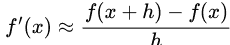

其中 h 是一个小值，也称为间距。

清单 3–5 展示了一个用于计算有限差分的通用函数。我们在函数 `fin_diff` 中实现了这一点，它接受一个任意函数（从 `double` 到 `double`）作为参数：

### 清单 3–5：使用函数指针的有限差分

```
double fin_diff(double f(double), double x, double h)
{
    return (f(x+h) - f(x)) / h;
}

double sin_plus_cos(double x)
{
    return sin(x) + cos(x);
}
int main() {
    cout << fin_diff(sin_plus_cos, 1., 0.001) << '\n';
    cout << fin_diff(sin_plus_cos, 0., 0.001) << '\n';
}
```

这里我们用 `h = 0.001` 近似了 `sin_plus_cos` 在 `x = 1` 和 `x = 0` 处的导数。`sin_plus_cos` 作为函数指针传递（必要时，函数可以隐式转换为函数指针）。

现在我们想要计算二阶导数。用 `fin_diff` 本身作为参数来调用它似乎很合理。不幸的是，这不可能，因为 `fin_diff` 有三个参数，不匹配其自身用于一元函数的函数指针参数。我们可以通过以下方式解决这个问题：

### 定义 3–2。*仿函数*（Functors）是提供 `operator()` 调用运算符的类，因此其对象可以像函数一样被调用。

其他一些作者使用“函数对象”（function object）一词来代替 functor，不幸的是，在他们的文本中通常不明显他们是指类还是对象。在那些语境下这可能不是问题，但我们在这里需要类和对象之间的严格区分。因此，我们更倾向于使用 *仿函数*（functor）一词，尽管它在范畴论中有其他含义。在本书中，*仿函数*（functor）始终指代一个类，其对象相应地被称为仿函数对象。我们使用术语 *函数对象*（Function Object）来指代所有可以像函数一样被调用的对象。这可以是普通函数、仿函数对象、lambda（下一节）或函数指针。

回到我们的示例。之前使用的函数 `sin_plus_cos` 作为仿函数实现如下：

### 清单 3–6：仿函数

```
struct sc_f
{
    double operator()(double x) const
    {
        return sin(x) + cos(x);
    } };
```

仿函数的一大优势是能够将参数作为内部状态保持。因此，我们可以在 sin 函数中用 α 对 x 进行缩放，即 sin αx + cos x：

### 清单 3–7：带状态的仿函数

```
class psc_f
{
public:
    psc_f(double alpha) : alpha(alpha) {}
    double operator()(double x) const
    {
        return sin(alpha * x) + cos(x);
    }
private:
    double alpha;
};
```

命名约定：本节中，我们引入了相当数量的类型和对象。为了更好地区分，我们采用以下命名约定：仿函数类型使用后缀 _f 命名，例如 psc_f，其对象使用后缀 _o。近似导数前缀为 d_，二阶导数前缀为 dd_，高阶导数则为 d 加上其阶数，例如 d7_ 表示七阶导数。为求简洁，我们不会对每个导数都说明它只是近似值（阶数在 20 左右的导数实际上已经非常不正确，以至于近似是多余的）。

### 3.7.1 类函数参数

=> c++11/derivative.cpp

定义完仿函数类型后，我们需要找出如何将其对象传递给函数。我们之前对 fin_diff 的定义使用函数指针作为参数，这无法用于我们的仿函数对象。此外，当我们想要支持不同的仿函数（例如 `sc_f` 和 `psc_f`）时，不能使用特定的参数类型。接受不同类型参数的技术主要有两种：继承和模板。继承版本推迟到第 6.1.4 节，直到我们实际介绍了该特性。目前，我们必须指出，泛型方法在适用性和性能方面更优。因此，我们为仿函数和函数使用类型参数：

```
template <typename F, typename T>
inline fin_diff(F f, const T& x, const T& h)
{
    return (f(x+h) - f(x)) / h;
}

int main()
{
    psc_f psc_o(1.0);
    cout << fin_diff(psc_o, 1., 0.001) << endl;
    cout << fin_diff(psc_f(2.0), 1., 0.001) << endl;
    cout << fin_diff(sin_plus_cos, 0., 0.001) << endl;
}
```

在此示例中，我们创建仿函数对象 `psc_o` 并将其作为模板参数传递给 `fin_diff`。下一次调用将即时创建的对象 `psc_f(2.0)` 传递给求导操作。在 `fin_diff` 的最后一次调用中，我们演示了仍然可以将普通函数 `sin_plus_cos` 作为参数传入。

这三个例子表明参数 `f` 非常灵活。这就引发了一个问题：到底有多灵活。从我们使用 `f` 的方式可以推断，它必须是一个接受一个参数的函数。STL（§4.1）为这些要求引入了 `UnaryFunction` 的概念：

- 令 `f` 的类型为 `F`。
- 令 `x` 的类型为 `T`，其中 `T` 是 `F` 的参数类型。
- `f(x)` 用一个参数调用 `f` 并返回结果类型的对象。

由于我们使用类型 `T` 的值进行所有计算，我们还应添加要求：`f` 的返回类型也是 `T`。

### 3.7.2 组合仿函数

迄今为止，我们已查看了用于计算的不同类型的函数参数。不幸的是，我们离通过将 fin_diff 作为参数传递给自身来优雅地计算高阶导数的目标还不算近。问题是 fin_diff 本身是一个三元函数，却需要一个一元函数作为参数。我们可以通过定义一个一元仿函数来克服这一差异，该仿函数将待求导的函数和步长作为内部状态：

```
template <typename F, typename T>
class derivative
{
public:
    derivative(const F& f, const T& h) : f{f}, h(h) {}

    T operator()(const T& x) const
    {
        return ( f(x+h) - f(x) ) / h;
    }

private:
    const F& f;
    T h;
};
```

12. 为求简洁，我们称对象表现得像一元函数的仿函数为一元仿函数。

然后，只有 x 仍然作为普通函数参数传递给求导操作。这个仿函数可以用一个表示 f(x) 的仿函数来实例化，结果是一个用于近似 f(x) 的仿函数：

```
using d_psc_f = derivative<psc_f, double>;
```

13. 这是另一种简略的表述：当我们说仿函数 ft 表示 f(x) 时，我们的意思是 ft 的一个对象计算 f(x)。

这里，f(x) = sin(a · x) + cos x 的导数由仿函数 d_psc_f 表示。我们现在可以为 α = 1 创建导数的函数对象：

```
psc_f psc_o(1.0);
d_psc_f d_psc_o(psc_o, 0.001);
```


这允许我们计算 x = 0 处的微分商：

```cpp
cout << "der. of sin(x) + cos(x) at 0 is " << d_psc_o(0.0) << '\n';
```

嗯，我们以前就能做到这一点。与我们之前的解决方案的根本区别在于原始函数及其导数的相似性。它们都是由函子创建的一元函数对象。

因此，我们终于达到了目标：我们可以像对待 f(x) 一样对待 f'(x)，并从中构建 f''(x)。更技术性地说：我们可以使用派生函数的函子 d_psc_f 来实例化 derivative：

```cpp
using dd_psc_f = derivative<d_psc_f, double>;
```

现在我们确实有了一个二阶导数的函子。我们通过创建它的函数对象并近似 f''(0) 来演示这一点：

```cpp
dd_psc_f dd_psc_o{d_psc_o, 0.001};
cout << "2nd der. of sin(x) + cos(x) at 0 is " << dd_psc_o(0.0) << '\n';
```

由于 dd_psc_f 又是一个一元函子，我们可以为三阶及更高阶导数创建一个。

如果我们需要从多个函数中计算二阶导数，可以投入更多精力直接创建二阶导数，而无需让用户先创建一阶导数。下面的函子通过在构造函数中为一阶导数创建函数对象来近似 f''(x)：

```cpp
template <typename F, typename T>
class second_derivative
{
public:
    second_derivative(const F& f, const T& h)
        : h{h}, fp{f, h} {}
    T operator()(const T& x) const
    {
        return (fp(x + h) - fp(x)) / h;
    }

private:
    T h;
    derivative<F, T> fp;
};
```

现在我们可以从 f 构建 f'' 的函数对象：

```cpp
second_derivative<psc_f, double> dd_psc_2_o(psc_f(1.0),
                                            0.001);
```

同样，我们可以为每个更高阶导数构建一个生成器。更好的是，我们现在将实现一个用于近似任意阶导数的函子。

## 3.7.3 递归

当我们思考如何实现三阶、四阶或一般的 n 阶导数时，我们意识到它们看起来会很像二阶导数：在 x+h 和 x 上调用 (n-1) 阶导数。我们可以用递归实现来探索这种重复模式：

```cpp
template <unsigned N, typename F, typename T>
class nth_derivative
{
    using prev_derivative = nth_derivative<N - 1, F, T>;
public:
    nth_derivative(const F& f, const T& h)
        : h(h), fp(f, h) {}

    T operator()(const T& x) const
    {
        return (fp(x + h) - fp(x)) / h;
    }

private:
    T h;
    prev_derivative fp;
};
```

为了让编译器免于无限递归，我们必须在达到一阶导数时停止这种相互引用。请注意，我们不能使用 if 或 ?: 来停止递归，因为两个分支都会被急切求值，并且其中一个分支仍然包含无限递归。然而，在 C++17 中我们可以使用 constexpr-if。传统上，递归模板定义通过如下的特化来终止：

```cpp
template <typename F, typename T>
class nth_derivative<1, F, T>
{
public:
    nth_derivative(const F& f, const T& h) : f(f), h(h) {}
    T operator()(const T& x) const
    {
        return (f(x + h) - f(x)) / h;
    }
private:
    const F& f;
    T h;
};
```

这个特化与类 derivative 相同，我们现在可以将其丢弃。或者我们保留它，并通过简单地从它派生来重用其功能（关于派生的更多内容见第 6 章）。

```cpp
template <typename F, typename T>
class nth_derivative<1, F, T>
    : public derivative<F, T>
{
    using derivative<F, T>::derivative;
};
```

现在我们可以计算任何导数，例如第 22 阶：

```cpp
nth_derivative<22, psc_f, double> d22_psc_o{psc_f(1.0),
                                            0.00001};
```

新对象 d22_psc_o 又是一个一元函数对象。不幸的是，它近似得太差，我们太羞愧了，不敢在这里展示结果。根据泰勒级数，我们知道当对前向差分应用后向差分时，f'' 近似的误差会从 O(h) 降低到 O(h^2)。也就是说，也许我们可以通过在前向差分和后向差分之间交替来改进近似：

```cpp
template <unsigned N, typename F, typename T>
class nth_derivative
{
    using prev_derivative = nth_derivative<N - 1, F, T>;
public:
    nth_derivative(const F& f, const T& h) : h(h), fp(f, h) {}

    T operator()(const T& x) const
    {
        return N & 1 ? (fp(x + h) - fp(x)) / h
                     : (fp(x) - fp(x - h)) / h;
    }

private:
    T h;
    prev_derivative fp;
};
```

遗憾的是，我们的第 22 阶导数仍然和之前一样错误，嗯，稍微更糟一些。当我们意识到我们对 *f* 进行了超过四百万次求值时，这尤其令人沮丧。14 减小 *h* 也没有帮助：切线更好地逼近导数，但另一方面，*f*(*x*) 和 *f*(*x* ± *h*) 的值彼此趋近，因此它们的差值中只剩下很少有意义的位。至少，泰勒级数告诉我们，通过我们的交替差分方案，二阶导数得到了改进。另一个令人欣慰的事实是，我们可能并没有为这种交替付出代价。条件 `N <= 1` 的结果在编译时已知，最近的编译器应该只求值相应的子表达式。如果没有别的收获，我们学到了一些关于 C++ 的知识，并且我们确信以下观点：

> **真理**
> 即使是最酷的编程也无法替代扎实的数学。

归根结底，这本书主要是关于编程的。函子被证明对于生成新的函数对象极具表现力。尽管如此，如果任何读者对更好地计算高阶导数有好主意，欢迎联系作者——如果情况允许，这可能值得一顿晚餐邀请。

还有一个细节让我们感到困扰：函子参数与构造函数参数之间的冗余。假设我们计算 `psc_o` 的第七阶导数：

```cpp
nth_derivative<7, psc_f, double> d7_psc_o(psc_o, 0.00001);
```

`nth_derivative` 的最后两个参数正好是构造函数参数的类型。这是冗余的，我们更希望能够推导它们。`auto` 和 `decltype` 在这里帮助不大：

```cpp
auto d7_psc_o = nth_derivative<7, psc_f, double>(psc_o,
                                                 0.00001);
nth_derivative<decltype(psc_o),
               decltype(0.00001), 7> d7_psc_o(psc_o,
                                              0.00001);
```

14. 通过在每个位置只计算一次 `f` 并用适当的二项式系数对其进行缩放，可以将计算工作量从指数级降低到线性级。希望你的教授不要读到这段内容并为下一个练习获得灵感。

更有希望的是一个函数模板，它接受构造函数的参数并推导它们的类型，如下所示：

```cpp
template <unsigned N, typename F, typename T>
nth_derivative<N, F, T>
derive(const F& f, const T& h)
{
    return nth_derivative<N, F, T>{f, h};
}
```

这应该能推导 `F` 和 `T`，我们只需要显式声明 `N`。如果我们将 `N` 用作最后一个参数，这将无法按预期工作。当我们声明某个模板参数时，我们有义务声明所有前面的参数：

```cpp
auto d7_psc_o = derive<psc_f, double, 7>(psc_o, 0.00001);
```

因此，将 `N` 作为第一个参数（幸运的是我们一直都是这样），我们可以显式声明 `N`，而 `F` 和 `T` 可以被推导。因此，我们将 `N` 放在前面：

```cpp
template <unsigned N, typename F, typename T>
nth_derivative<N, F, T>
derive(const F& f, const T& h)
{
    return nth_derivative<N, F, T>{f, h};
}
```

现在编译器可以推导第七阶导数的函子和值类型：

```cpp
auto d7_psc_o = derive<7>(psc_o, 0.00001);
```

我们已经看到，模板参数的顺序对我们的函数很重要。在编译器推导所有参数的函数模板中，参数的顺序无关紧要。只有在显式声明参数或其中一些参数时，我们才需要注意。未推导的参数必须位于参数列表的前面。为了记住这一点，想象一个带有部分推导参数的模板函数调用：显式声明的参数首先出现在左括号 ( 的左侧，而其他参数则从右括号 ( 的右侧的参数中推导。

## 3.7.4 泛型归约

=> c++11/accumulate_functor_example.cpp

回顾我们在 3.3.2.5 节中用于说明泛型编程的函数 `accumulate`。在本节中，我们将把这个函数推广为泛型归约。我们引入一个 `BinaryFunction`，它作为函数或可调用类对象实现对两个参数的操作。然后我们可以对序列的所有元素应用 `BinaryFunction` 来执行任何归约：

```cpp
template <typename Iter, typename T, typename BinaryFunction>
T accumulate(Iter it, Iter end, T init, BinaryFunction op)
```


{
    for (; it != end; ++it)
        init = op(init, *it);
    return init;
}

要添加值，我们可以实现一个由值类型参数化的仿函数：

Click here to view code image

```
template <typename T>
struct add
{
    T operator()(const T& x, const T& y) const { return x +
y; }
};
```

除了类，我们也可以参数化 `operator()`：

Click here to view code image

```
struct times
{
    template <typename T>
    T operator()(const T& x, const T& y) const { return x *
y; }
};
```

这样做的好处是编译器可以推断值类型：

Click here to view code image

```
vector v = {7.0, 8.0, 11.0};
double s = accumulate(v.begin(), v.end(), 0.0, add<double>());
double p = accumulate(v.begin(), v.end(), 1.0, times());
```

这里我们计算了向量元素的和与积。`add` 仿函数需要用向量的值类型进行实例化，而 `times` 仿函数不是模板类，参数类型在应用时推断。

## 3.8 Lambda 表达式

C++11 引入了 lambda 表达式。λ 表达式只是仿函数的简写。然而，它使程序更加紧凑，而且通常也更易于理解。特别是对于简单的计算，在使用的地方直接看到其实现，比调用代码位于其他地方的函数要清晰得多。之前见过经典仿函数，理解什么是 lambda 就非常容易了。

在清单 3-6 中，我们实现了一个用于 sin x + cos x 的仿函数。相应的 λ 表达式显示在清单 3-8 中。

### 清单 3-8：简单的 λ 表达式

Click here to view code image

```
[](double x) { return sin(x) + cos(x); }
```

lambda 表达式不仅定义了一个仿函数，而且立即为其创建一个对象。因此，我们可以将其立即作为参数传递给函数：

Click here to view code image

```
fin_diff( [](double x) { return sin(x) + cos(x); }, 1., 0.001 )
```

字面量参数可以直接嵌入 lambda 表达式中。因此，我们可以像在仿函数 psc_f（清单 3-7）中所做的那样，通过插入乘法来缩放 sin 参数，同时仍然得到一个一元函数对象：

Click here to view code image

```
fin_diff( [](double x) { return sin(2.5*x) + cos(x); }, 1., 0.001)
```

我们还可以将其存储到变量中以供重复使用：

Click here to view code image

```
auto sc_1 = [](double x) { return sin(x) + cos(x); };
```

变量的类型必须是 auto，因为 lambda 的类型由编译器生成。前面示例中的 lambda 表达式没有声明它们的返回类型。在这种情况下，返回类型由编译器推断。如果无法推断或我们希望显式声明，可以将返回类型作为尾随参数提供：

```
[] (double x)->double { return sin(x) + cos(x); };
```

=> c++11/derivative.cpp

既然我们可以即时创建函数对象，并且不太想费心处理它们的类型，我们很高兴我们的导数生成器能够推断类型。这使我们能够在一个表达式中创建 sin 2.5x + cos x 的近似七阶导数函数：

Click here to view code image

```
auto d7_psc_l= derive<7>(
    [](double x) { return sin(2.5*x) + cos(x); }, 0.0001);
```

遗憾的是，该语句在教科书中太长，无法放在一行上，但在实际程序中则不然。

lambda 一经推出，许多程序员就对它们兴奋不已，以至于用 lambda 实现每个函数参数——通常跨越多行，并且内部还包含其他 lambda。这对经验丰富的程序员来说可能是一个有趣的挑战，但我们坚信，将庞大的嵌套表达式分解为可读的片段，有助于每个人（包括我们自己）使用和维护我们的软件。

## 3.8.1 捕获

C++11。在上一节中，我们通过简单插入一个操作来参数化 lambda。然而，对于大量参数来说，这并不十分高效：

Click here to view code image

```
a= fin_diff([] (double x) { return sin(2.5 * x); }, 1., 0.001);
b= fin_diff([] (double x) { return sin(3.0 * x); }, 1., 0.001);
c= fin_diff([] (double x) { return sin(3.5 * x); }, 1., 0.001);
```

不幸的是，我们不能像这样访问 lambda 作用域中的变量或常量：

Click here to view code image

```
double phi= 2.5;
auto sin_phi= [] (double x) { return sin(phi * x); }; // Error
```

λ 表达式只能使用其自身的参数或之前 *捕获* 的参数。

### 3.8.1.1 按值捕获

C++11

要使用 `phi` 的值，我们必须先捕获它：

Click here to view code image

```
double phi= 2.5;
auto sin_phi= [phi](double x){ return sin(phi * x); };
```

捕获了某些内容的 lambda 通常称为 *闭包*。多个值可以用逗号分隔的列表来捕获：

Click here to view code image

```
double phi= 2.5, xi= 0.2;
auto sin2= [phi,xi](double x){ return sin(phi*x) +
cos(x)*xi; };
```

这些参数被复制，但与按值传递的函数参数不同，禁止修改它们。写成仿函数类，前面的 λ 对应于：

Click here to view code image

```
struct lambda_f_
{
    lambda_f_(double phi, double xi) : phi{phi}, xi{xi} {}
    double operator()(double x) const
    {
        return sin(phi * x)+cos(x) * xi;
    }
    double phi, xi;
};
```

因此，稍后修改捕获的变量对 lambda 没有影响：

Click here to view code image

```
double phi= 2.5, xi= 0.2;
auto px= [phi,xi](double x){ return sin(phi * x) + cos(x) *
xi; };
phi= 3.5; xi= 1.2;
a= fin_diff(px, 1., 0.001); // still uses phi= 2.5 and xi=
0.2
```

变量在定义 λ 时被捕获，因此在调用 lambda 时使用的是那时的值。

此外，尽管是副本，我们也不能在 lambda 函数内部修改这些值。原因是 lambda 的函数体对应于一个 const 限定的 operator()，如上面的 lambda_f 所示。例如，在下面的 lambda 中，递增捕获的 phi 是非法的：

Click here to view code image

```
auto l_inc = [phi](double x) {phi+= 0.6; return phi; }; // Error
```

为了允许修改捕获的值，lambda 必须被限定为 mutable：

Click here to view code image

```
auto l_mut = [phi](double x) mutable {phi+= 0.6; return phi;
};
```

然后它的行为就好像该值被复制到一个可变变量中，并且可以在 const 限定的方法中修改。尽管如此，如果可能，我们应该避免使用 mutable，例如通过返回 phi+0.6。如果 lambda 只被调用一次——大多数 lambda 都是如此——那么是递增变量还是在返回语句中添加增量，都没有区别。

### 3.8.1.2 按引用捕获

变量也可以按引用捕获：

Click here to view code image

```
double phi= 2.5, xi= 0.2;
auto pxr= [&phi,&xi](double x){ return sin(phi * x) + cos(x)
* xi; };
phi= 3.5; xi= 1.2;
a= fin_diff(pxr, 1., 0.001); // now uses phi= 3.5 and xi= 1.2
```

在这个示例中，使用的是 lambda 函数调用时 phi 和 xi 的值，而不是创建 lambda 时的值。相应的仿函数类如下所示：

Click here to view code image

```
struct lambda_ref_type
{
    lambda_ref_type(double& phi, double& xi) : phi(phi),
    xi(xi) { }
    double operator()(double x) const
    {
        return sin(phi * x)+ cos(x) * xi;
    }
    double& phi;
    double& xi;
};
```

引用语义的另一个后果是能够修改被引用的值。这不仅可能是副作用的来源，还可以产生有效的用途。假设我们有不同的稠密和稀疏矩阵类。对于所有这些类，我们提供泛型遍历函数 on_each_nonzero，将矩阵作为第一个参数，函数对象作为第二个参数（按值传递）。这使我们能够泛型地计算 Frobenius 范数：

||A||_F = \sqrt{\sum_{i,j} |a_{ij}|^2}

根据这个公式，我们显然可以忽略所有零项，只处理非零项，而不管它们在矩阵中的位置：

Click here to view code image

```
template <typename Matrix>
typename Matrix::value_type
frobenius_norm(const Matrix& A)
{
    using std::abs; using std::sqrt;
    using value_type = typename Matrix::value_type;
    value_type ss = 0;
    on_each_nonzero(A, [&ss](value_type x) { ss+= abs(x) *
abs(x); });
    return sqrt(ss);
}
```

为简单起见，我们在这里假设 A(0, 0) 和 abs(A(0, 0)) 的类型相同。请注意，lambda 表达式不返回值，因为其目的是在被引用的变量 ss 中累加平方矩阵值。这里缺少 return 语句意味着返回类型为 void。


- [=]: 按复制捕获所有；
- [&]: 按引用捕获所有；
- [=, &a, &b, &c]: 按复制捕获所有，但 a、b、c 按引用捕获；以及
- [&, a, b, c]: 按引用捕获所有，但 a、b、c 按复制捕获。

Scott Meyers 建议不要使用捕获全部功能，因为这会增加悬空引用的危险以及忽略静态或成员变量的风险；参见 [46, Item 31]。

方法中的 lambda 在访问类成员时必须捕获 `this` 指针：

点击此处查看代码图像

```
struct s
{
    int f(int x) const { return 2 * x; }
    int g(int y) const
    {
        auto l= [this](int z){ return f(z + i); };
        return l(y);
    }
    int i= 3;
};
```

如果我们没有捕获 this，f 和 i 在 lambda 中将被视为未知。

### 3.8.1.3 泛化捕获

C++14。通过 Init Capture，C++14 引入了捕获的泛化。它允许我们为现有变量引入新名称，并对表达式求值并将名称与结果关联，例如：

点击此处查看代码图像

```
int x= 4;
auto l= [&r= x, i= x + 1](){ r+= 2; return i + 1; };
```

空参数列表可以省略（在 C++11 中也是如此）：

点击此处查看代码图像

```
auto l= [&r= x, i= x + 1]{ r+= 2; return i + 1; };
```

这种泛化对我们最重要的好处是能够将变量移动到闭包中。假设我们有一个返回作为 `unique_ptr` 的 Hilbert 矩阵的函数：

```
auto F= make_unique<Mat>(Mat({1., 0.5} ,{0.5,1./3.}));
```

我们可以按引用捕获 `F`，但不幸的是，当闭包的生命周期超过指针时，这会变成悬空引用。另一方面，`unique_ptr` 不能被复制。为了确保我们的矩阵与闭包一样长久存在，我们必须将数据移动到由闭包拥有的 `unique_ptr` 中：

```
auto apply_f= [F= move(F)](const Vec& x){ return Vec(*F * x); };
```

例如，当一个函数需要返回一个捕获不可复制类型局部变量的 lambda 时，我们需要这种移动能力。

## 3.8.2 泛型 Lambda

C++14。C++11 中的 lambda 确定了返回类型，但参数需要显式声明。这一限制在 C++14 中被取消。与函数模板不同，参数不是用有些冗长的 template-typename 表示法声明的，而是由关键字 `auto` 声明的。例如，一个按降序对（随机访问）容器元素进行排序的函数可以简单地实现为：

点击此处查看代码图像

```
template <typename C>
void reverse_sort(C& c)
{
    sort(begin(c), end(c), [](auto x, auto y){ return x > y;
    });
}
```

同样，我们可以简化 3.8.1.2 节中的 `frobenius_norm`。对平方模值求和的 lambda 可以简单地实例化参数类型：

点击此处查看代码图像

```
template <typename Matrix>
inline auto frobenius_norm(const Matrix& A)
{
    using std::abs; using std::sqrt;
    decltype(abs(A[0][0])) ss = 0;
    on_each_nonzero(A, [&ss](auto x) { ss+= abs(x) * abs(x);
    });
    return sqrt(ss);
}
```

在这个小函数中，我们使用了更多的类型推导机制，完全摆脱了声明 `value_type` 的需要。我们现在还可以处理 `abs` 可能返回与 `value_type` 不同类型的事实。C++17 允许我们定义在编译时求值的 lambda。我们将在讨论编译时计算的大背景后，在第 5.1.5 节中讨论它们。C++20 也为常规函数模板那样命名了模板参数。这使得我们例如可以编写要求多个参数必须实例化为相同类型的泛型 lambda。并且，一些带有类型推导的 lambda 可以写得更简洁。面对这种不断增强的表达能力：

### 建议

适度使用 lambda！并非所有用 lambda 能做的事都需要用 lambda 来做。使用它们来使你的程序更具表达性，而不是更晦涩。

避免冗长和过于复杂的 lambda。即使在现代 C++ 中，传统函数或类可能是整体清晰度更好的选择。作者的个人准则是：

- 如果函数调用仍能放在一行内且 lambda 只使用一次，则在函数调用中创建 lambda。
- 拆分嵌套 lambda，并至少存储内层 lambda。
- 如果 lambda 不超过五行，则将其存储在变量中。
- 超出此范围的内容最好以其他方式实现。

曾经有过一种情况，在成员函数中需要一个简单的功能，将其作为三行 lambda 提供很方便。然后该功能被扩展，lambda 增长到五行。后来又来了一个扩展，这时 lambda 似乎不再是正确的解决方案，于是被改为传统的成员函数。

## 3.9 变量模板

C++14。数学常数过去通常定义在最大可用类型中——通常是 `long double`——并在用于表达式时转换为所需类型。反之，当常数未被转换时，其他表达式可能会被强制转换为较大的常数，表达式的评估性能会更低。

因此，C++14 引入了 *变量模板*：带模板参数的变量。例如，常数 `pi` 可以带类型参数定义：

点击此处查看代码图像

```
template <typename Value>
constexpr Value
pi{3.141'592'653'589'793'238'462'643'383'2791};
```

当我们需要在泛型表达式中使用 `pi` 时，可以用适当的类型实例化它：

```
template<class T>
T circular_area(const T& r)
{
    return pi<T> * r * r;
}
```

Alex Shabalin 提出了一个更有趣的例子。¹⁵ Lambda——就像我们基于 lambda 的导数近似一样——是对象，可以像我们之前多次做的那样存储在类型推导的变量中。这次我们将导数的阶数作为编译时参数添加进来：¹⁶

15. 他参加了作者的一个研讨会，在用传统模板解释函数对象时，他突然想到用现代语言特性更紧凑地表达这一点。这是他曾经有过的最好的培训经历。

16. 遗憾的是，以下 lambda 目前在 VS 上仍无法编译。我们感谢 Marc Gregoire 在校对期间就此问题提交了错误报告。

点击此处查看代码图像

```
template <size_t N>
auto derive = [] (auto f, auto x, auto h) {
    auto prev = [] (auto x2) {
        return derive<N-1>(f, x2, h);
    };
    return (prev(x+h) - prev(x)) / h;
};
```

```
template <>
auto derive<0>= [] (auto f, auto x, auto h) {
    return f(x);
};
```

这里变量存储了一个 lambda，用于通过内部定义另一个计算 (n-1) 阶导数的 lambda 来即时计算函数 f 的 n 阶导数，例如：

点击此处查看代码图像

```
auto f = [] (double x) { return 2.0 * std::cos(x) + x*x; };
cout << "f''(1) = " << derive<2>(f, 1.0, 1e-3) << endl;
cout << "f(5) (1) = " << derive<5>(f, 1.0, 1e-3) << endl;
```

与此相反，使用函数对象的导数首先从一元函数生成另一个近似其 n 阶导数的一元函数。因此，我们可以以与原函数相同的方式使用这个函数。要用 lambda 和变量模板实现这一点，我们必须避免立即计算，而是创建一种工厂，返回可以稍后执行计算的函数：

点击此处查看代码图像

```
template <size_t N>
auto derive = [] (auto f, auto h) {
    auto prev = derive<N-1>(f, h);
    return [prev,h](auto x) { return (prev(x+h) - prev(x)) /
    h; };
};
```

```
template <>
auto derive<0> = [] (auto f, auto h) {
return [f] (auto x) { return f(x); };
};
```

返回 lambda 的 lambda 起初令人生畏，但在试图榨取现代 C++ 所有表达能力的软件中并不罕见。

使用 C++17 的编译时 if 使我们免除了为终止递归而进行的特化，我们只需要一个定义（这略微超过了我们的准则限制）。另一方面，我们得到了近似导数的一种极具表达性的表述：

点击此处查看代码图像

```
template <size_t N>
auto derive = [] (auto f, auto h) {
if constexpr (N == 0) {
return [f] (auto x) { return f(x); };
} else {
auto prev = derive<N-1>(f, h);
return [=](auto x) { return (prev(x+h) - prev(x)) / h;
};
};
};
```

有了我们的新定义，我们可以像以前一样为导数定义函数：

点击此处查看代码图像

```
auto f = [] (double x) { return 2.0 * std::cos(x) + x*x; };
auto d2f = derive<2>(f, 1e-3);
auto d5f = derive<5>(f, 1e-3);
cout << "f'(1) = " << d2f(1.0) << endl;
cout << "f(5) (1) = " << d5f(1.0) << endl;
```

变量模板的一个重要用例是元编程，我们将在第 5.2.3.4 节中演示。


> "灰色，亲爱的朋友，是一切理论，而绿色是生命之树的金色。"¹⁷
> 
> —约翰·沃尔夫冈·冯·歌德

17. 作者译本。“Grau, teurer Freund, ist alle Theorie und grün des Lebens goldner Baum.”

在前面的章节中，你可能会产生这样的印象：模板参数可以被任何类型替代。但实际上并非完全如此。模板类和函数的程序员会对可在模板参数上执行的操作做出假设。

因此，了解哪些参数类型是可接受的非常重要。例如，我们已经看到，清单 3-4 中的 accumulate 可用于 int 或 double 的向量或列表。但是，像文件流这样不支持加法的值类型不能与 accumulate 一起使用。那么，应该从一组文件中累积什么呢？

因此，我们必须找出潜在参数类型所需的要求集合。这样的集合称为概念。一个包含概念 c 的所有要求以及可能的额外要求的概念 CR，称为 c 的细化。在标准中，这称为子含：CR 子含 c。然而，子含的定义更为一般：概念 c2 子含 c1，并不一定意味着 c2 的定义包含 c1 以及可能的更多要求。它的意思是，c2 中的要求集合是 c1 要求集合的超集（在进行适当重命名和其他等价转换后）。概念子含的正式规范见标准 [39, §13.5.4] 和在线参考资料。满足概念 c 的所有要求的类型 t，称为 c 的模型。关于子含：如果 c2 子含 c1，则 c2 的模型是 c1 模型的子集。

概念可以包含纯粹的语法要求，例如某个类型参数必须具有拷贝构造函数或 operator+。语义要求指定一个强制属性，例如加法的交换律：x + y = y + x ∀ x, y。

在 C++20 之前，概念仅存在于文档中（如果有的话），泛型函数和类的用户有责任满足模板参数的所有要求。如果违反了语法要求，用户例如会看到编译器关于缺少函数的报错。不幸的是，这种情况常常发生在实例化某些与程序员无关的技术细节的内部实现时，位于巨大的函数调用栈深处。因此，除了无法实例化的内部代码的作者之外，这些错误信息对任何人都不太有意义。编译器在冗长的消息中提供调用栈和包含栈，这更多是让程序员感到畏惧而非启发。然而，语法错误始终会被编译器捕获——尽管不一定以有帮助的方式报告。另一方面，语义错误对编译器来说是不可检测的。

现在，通过 C++20，我们可以将概念作为程序的一部分来表达。使用概念有以下几个优势：

- 未满足的要求已在被调用的函数中检测到。
  - 而非深入实现内部。
  - 这会显著缩短错误信息。
- 错误信息通常更有意义。
- 可以检测语义错误。
- 可以根据类型属性对函数进行分发。

到目前为止，只有语法要求可以直接表达，但我们可以模拟语义概念，如我们稍后将演示的那样（第 5.5 节）。在以前，基于类型属性的分发已经可以通过元编程技巧实现，但概念使实现变得简单得多且更易读。

### 3.10.1 定义概念

```
=> c++20/concept_accumulate_syntactic.cpp
```

在清单 3-4 中，我们实现了一个适用于可加值类型的数组和列表的泛型求和。此外，它可以用于任何一对迭代器，只要它们的值可读且可以加到初始值的类型上。这些类型要求将在概念 Summable 中实现，因为这是我们函数所需要的：

点击此处查看代码图像

```cpp
template <typename Iter, typename Value>
Value accumulate(Iter first, Iter last, Value init)
requires Summable<Iter, Value>
{
    for (; first != last; ++first)
        init += *first;
    return init;
}
```

The `requires` 子句可以像我们这样插入在函数头之后，也可以插入在模板参数列表之后：

点击此处查看代码图像

```cpp
template <typename Iter, typename Value>
requires Summable<Iter, Value>
Value accumulate(Iter first, Iter last, Value init);
```

现在，我们的函数受 *受约束的* 于我们概念 `Summable` 的模型，我们最终应该实现它。它应该包含什么？

- 类型 `Iter` 应该是：
  - 可比较的；
  - 可递增的；以及
  - 间接可读的，即 `operator*` 的结果应当可读。
- 类型 `Value` 应该是可拷贝的，以便返回结果。
- `Iter` 上 `operator*` 的结果应当可以加到 `Value`。

这些要求在以下概念中实现：

点击此处查看代码图像

```cpp
template <typename Iter, typename Value>
concept Summable=
    requires (Iter it, Value init)
{
    requires std::input_iterator<Iter>;
    requires std::is_copy_constructible_v<Value>;
    Value{init}; // Attempt a copy
    init += *it;
};
```

我们的 `concept` 以熟悉的模板参数及其名称开头。接下来的 `requires` 子句是可选的，这里用于引入概念中使用的变量名称。或者，我们可以使用 `declval` 即时创建它们，但这会显著冗长且可读性较低。

对 `Iter` 的要求已由标准概念 `input_iterator` 实现，我们在概念的第一行中请求它。`Value` 的拷贝能力可以通过类型特征 `is_copy_constructible` 进行测试，或者更简洁地使用变量 `is_copy_constructible_v`。在编译时已知的 `bool` 类型模板变量——即声明为 `constexpr` 的变量——可以直接在 `requires` 子句中像概念一样使用。反之，概念可以像类型依赖的 `bool` 常量一样使用。

最后两个要求是包含占位符对象的表达式。自然，当该表达式可以编译时，此类要求即被满足。倒数第二个要求是表达对拷贝构造函数需求的另一种形式，即请求从 `init` 创建副本的可编译性。最后一行要求 `operator+=` 可以应用于 `init` 和解引用的 `it`。我们受约束的函数会接受一个仅可移动而不可拷贝的 `Value` 类型吗：

点击此处查看代码图像

```cpp
struct uncopyable
{
    uncopyable(int v) : v(v) {}
    uncopyable(const uncopyable&) = delete;
    uncopyable(uncopyable&&) = default;

    uncopyable& operator+=(const uncopyable& rhs) &
    {
        v += rhs.v;
        return *this;
    }
    operator int() const { return v; }
    int v;
};
```

不会。与无约束的模板函数相反。因此，也许我们不应该请求拷贝构造函数，而应该请求移动构造函数：

点击此处查看代码图像

```cpp
template <typename Iter, typename Value>
concept Summable=
    requires (Iter it, Value init)
    {
        requires std::input_iterator<Iter>;
        requires std::is_move_constructible_v<Value>;
        Value(std::move(init));
        init += *it;
    };
```

同样，第二和第三个要求是等价的，用以说明实现选项。现在我们可以累积不可拷贝值的范围。那么，一个不可移动但可拷贝的类型呢：

点击此处查看代码图像

```cpp
struct unmovable
{
    unmovable(const unmovable&) = default;
    unmovable(unmovable&&) = delete;
    // ... remainder like uncopyable
};
```

它适用于我们的第一个概念版本，但不适用于第二个。我们希望有一个适用于可拷贝或可移动类型的概念。为简洁起见，我们称其为 Returnable：

点击此处查看代码图像

```cpp
template <typename T>
concept Returnable=
    std::is_move_constructible_v<T>
    || std::is_copy_constructible_v<T>;

template <typename Iter, typename Value>
concept Summable=
    requires (Iter it, Value init)
    {
        requires std::input_iterator<Iter>;
        requires Returnable<Value>;
        init += *it;
    };
```

使用我们最后一个版本的 Summable，受约束的 accumulate 函数与其无约束的对应物一样通用。然而：


- 类型要求在函数头中显式声明，而非由函数体中的实现所暗示。
- 错误的函数调用会产生更易读的错误消息。当实现非常复杂时，这一点变得更加重要。

我们不得不承认，在我们简单的 `accumulate` 代码中，无约束版本对于不支持加法的 `dummy` 类型产生了更短的错误消息。在大型代码库中情况完全不同，模板函数中的问题会导致冗长且常常难以理解的消息。相比之下，受约束函数的错误消息与实现复杂度无关，报告的问题指向调用参数，而非某些未知的内部细节。

我们可以通过允许任意二元操作来泛化我们的 `accumulate` 函数（如标准库中所做）。为此，我们还引入了相应的概念 `Accumulatable`：

点击此处查看代码图片

```
template <typename Iter, typename Value, typename Op>
concept Accumulatable=
    requires (Iter it, Value init , Op op)
{
    requires std::input_iterator<Iter>;
    requires Returnable<Value>;
    init = op(init, *it);
};
```

```
template <typename Iter, typename Value, typename Op>
Value accumulate(Iter first, Iter last, Value init , Op op)
requires Accumulatable<Iter, Value, Op>
{
    for (; first != last; ++first)
        init = op(init, *first);
    return init;
}
```

语言允许我们通过简单地用概念的定义替换概念，直接在要求的位置实现概念约束。这常常导致奇怪的双重 `requires` 子句：

点击此处查看代码图片

```
template <typename Iter, typename Value, typename Op>
Value accumulate(Iter first, Iter last, Value init , Op op)
requires requires (Iter it, Value init , Op op)
{
    requires std::input_iterator<Iter>;
    requires Returnable<Value>;
    init = op(init, *it);
}
{
    for (; first != last; ++first)
        init = op(init, *first);
    return init;
}
```

我们认为这个例子不言而喻，概念定义与使用的分离在大多数情况下是更好的选择。

## 3.10.2 按概念分派

我们之前看到，调用重载函数时，编译器会根据参数类型选择最佳匹配。同样，C++20 编译器会将受约束函数从更严格到较不严格排序，对于给定的函数调用，选择约束成立的最严格重载。

标准库中受益于概念排序的一个简单函数是 `advance`。在其最通用版本中，它接受任意迭代器 `it` 和正数 `n`，并将 `it` 递增 `n` 次：


```
template <typename Iter>
void advance(Iter& it, unsigned n)
requires input_or_output_iterator<Iter>
{
    while (n-- > 0)
        ++it;
}
```

当迭代器是 `bidirectional_iterator` 时，`n` 可以为负数，`it` 相应地被递减：


```
template <typename Iter>
void advance(Iter& it, int n)
requires bidirectional_iterator<Iter>
{
    if (n >= 0) {
        while (n-- > 0)
            ++it;
    } else {
        while (n++ < 0)
            --it;
    }
}
```

使用 `random_access_iterator` 时，我们可以消除循环，直接将 `n` 加到 `it` 上：

点击此处查看代码图片

```
template <typename Iter>
void advance(Iter& it, int n)
requires random_access_iterator<Iter>
{
    it += n;
}
```

这将函数的复杂度从 O(n) 优雅地降低到 O(1)。标准的 advance 函数始终在三种实现之间分派，但在概念出现之前，实现更加复杂：它引入了人工类型来模拟概念排序。我们将在 4.1.2.3 节中演示这一点。

在前面的示例中，我们首先引入了类型参数 Iter，然后再对其施加约束。我们也可以直接在类型参数的声明中对其进行约束：

点击此处查看代码图片

```
template <random_access_iterator Iter>
void advance(Iter& it, int n)
{ ... }
```

或者，我们使用 3.1.7 节中的简洁 auto 表示法，并对 auto 参数进行约束：

点击此处查看代码图片

```
void advance(random_access_iterator auto& it, int n)
{ ... }
```

我们之前提到，编译时布尔常量可以用于 requires 子句。然而，它们不能用于简写表示法。

因此，如果 `random_access_iterator` 是一个 `bool` 常量，带有 `requires` 子句的第一个重载可以编译，但两个缩写实现则不能。此外，这里演示的分派基于子含关系，并且需要概念才能正常工作。因此：

> 建议
> 首选概念而非 `bool` 常量。

## 3.10.3 类中的概念

⇒ c++20/vector_constraint_initialization.cpp

概念与类的工作方式与函数相同。这么说，我们可以结束本节了。但我们忍不住要让概念发挥其魅力，为我们的 `vector` 类建立非常通用的构造函数。我们的第一个构造函数接受两个迭代器，并将引用的内容复制到一个新的、有足够空间的 `vector` 中：

点击此处查看代码图片

```
template <typename Value>
class vector
{
    // ...
    explicit vector(int size) // ...

    template <std::forward_iterator Iter>
    vector(Iter first, Iter last) : vector(distance(first, last))
    {
        using std::copy;
        copy(first, last, &data[0]);
    }
};
```

`Iter` 的类型必须模拟概念 `std::forward_iterator`。这是针对可复制且每个副本在递增后都引用相同数据的迭代器的概念。相比之下，输入流不是前向迭代器，因为递增会从流中消耗数据，因此复制的迭代器在递增后会得到其他数据。在我们的实现中，我们使用函数 `distance`，它计算 `first` 的副本需要递增多少次才能等于 last。这不应该影响之后我们复制的数据。为了保证这一点，我们需要一个 forward_iterator。现在，我们可以例如用列表的数据来初始化一个 vector：

点击此处查看代码图片

```
std::list<int> l{17, 4, 3, 9, 2};
dmc::vector<int> v(begin(l), end(l));
```

如果我们省略了 vector 的值类型，我们将得到一个迭代器的 vector。除非我们提供一个适当的推导指南：

点击此处查看代码图片

```
template <std::forward_iterator Iter>
vector(Iter first, Iter last) -> vector<std::iter_value_t<Iter>>;
```

我们的新构造函数应要求一个 forward_range 并复用前面的构造函数：

点击此处查看代码图片

```
template <typename Value>
class vector
{
    // ...
    template <std::ranges::forward_range Range>
    vector(Range&& r)
    : vector(begin(forward<Range>(r)),
             end(forward<Range>(r))) {}
};
```

forward_range 是其 begin 函数返回 forward_iterator 的范围。我们将在 4.1.5 节中详细介绍范围。目前，我们可以将范围视为具有适当 begin 和 end 的类型，适用于所有标准容器，但不局限于此。

与我们刚刚进入的讨论相比，实现非常简单：范围作为转发引用传递，实际初始化委托给迭代器对构造函数。如果要推断 vector 的值类型，我们需要相应的指南：

点击此处查看代码图片

```
template <std::ranges::forward_range Range>
vector(Range&& r) -> vector<std::iter_value_t<decltype(begin(r))>>;
```

为了说明范围不仅限于容器，我们使用 `iota` 视图创建一个包含 1 到 100 值的 `vector`：

```
dmc::vector w = ranges::views::iota(1, 101);
```

`iota` 视图不会创建可能很大的容器来复制或移动，而只是返回迭代器，其递增读取生成所有值。Python 在 Python 2 中通过 `xrange`、在 Python 3 中通过 `range` 提供相同的功能（Python 2 中的 `range` 实际上在内部创建了一个包含所有值的容器）。

## 3.10.4 概念设计

我们在一些示例中看到，概念中的要求有时只是简单地重复了模板函数体中的表达式。这看起来相当冗余，有时确实如此。与 C++ 中的其他特性一样，当项目变大且我们需要管理使用哪个泛型实现时，概念的优势会被放大。

概念不应包含无限的要求列表，即使该概念约束一个复杂的函数。此外，我们应从更简单的概念构建更复杂的概念。标准库是一个很好的示例：迭代器概念彼此细化，范围概念使用迭代器概念。用户库应大量使用它们并添加自己的层次结构。这可以从一些基本技术概念开始，演变为像 `Node` 或 `Cell` 这样的中级概念，并最终达到像 `Solver` 或 `Mesh` 这样的高级概念。

## 3.11 可变参数模板

[C++11] 当函数、类和变量模板以及模板别名的参数个数可变时，它们被称为 `Variadic`；即，它们适用于任意数量的参数。更准确地说，可能存在最小参数个数，但不存在最大参数个数。此外，模板参数允许是不同的类型。


## 3.11.1 递归函数

C++11 我们将使用针对混合类型的 `sum` 函数来说明该特性：

点击此处查看代码图像

```cpp
template <typename T>
inline T sum(T t) { return t; }
```

```cpp
template <typename T, typename ...P>
inline T sum(T t, P ...p)
{
    return t + sum(p...);
}
```

可变参数模板通常通过递归来处理。我们分解所谓的 *参数包* 并处理其子集。通常，会拆分出一个元素并将其与其余部分的结果相结合。

可变参数模板引入了由三个点 (...) 表示的新省略号运算符。起初，这种表示法可能会让人困惑，许多程序员都难以记住点应该放在哪里。在挣扎了一段时间后，我们找到了一个有用的约定：将要打包的参数放在省略号右侧，将要解包的参数放在省略号左侧。在以下示例中，您可以看到此约定如何应用于 `sum` 函数的类型和对象：

- `typename ...P`: 将多个类型参数打包到类型包 `P` 中；
- `<P...>`: 在实例化类或函数模板时解包 `P`（稍后介绍）；
- `P ...p`: 将多个函数参数打包到变量包 `p` 中；以及
- `sum(p...)`: 解包变量包 `p` 并使用多个参数调用 `sum`。

关于我们的约定，第三行是最难全面编写的。它在没有空格且省略号紧跟在类型后面时可以编译，从技术角度来看这很合理。然而，我们发现上述的间距是解释该表达式最容易的。

回到我们的 sum 函数，它计算第一个条目与其余部分之和的加法。这个和反过来以同样的方式递归计算。为了终止递归，我们为单个参数编写了一个重载。我们也可以为一个零参数函数（即没有参数的函数）编写一个重载，该函数作为 int 返回 0。

我们的实现有一个显著的缺点：返回类型是第一个参数的类型——这里是 int。在某些情况下，这或多或少可以工作：

点击此处查看代码图像

```cpp
auto s = sum(-7, 3.7f, 9u, -2.6);
std::cout << "s is " << s
          << " and its type is " << typeid(s).name() << ".\n";
```

这将产生：

```cpp
s is 2 and its type is int.
```

3.1 的正确结果无法作为 int 存储。18 这并不真正令人满意，但情况可能更糟，如下面的计算所示：

18. 在 Linux 上，typeid 的输出必须使用 c++filt 等工具进行去修饰。Visual Studio 非常好心地提供了真实的类型名称。

```cpp
auto s2 = sum(-7, 3.7f, 9u, -42.6);
```

这也返回一个 int：

```cpp
s2 is -2147483648 and its type is int.
```

第一个中间结果是 9 - 42.6 = -33.6，转换为无符号数时会产生一个非常大的数字，随后转换为一个非常小的 int 值。另一方面，计算：

```cpp
auto s = -7 + 3.7f + 9u + -42.6;
```

计算正确的结果并将其存储为 double。但在我们谴责可变参数模板之前，我们必须承认自己为中间值和最终结果选择了不合适的类型。我们将在第 5.2.7 节中使用更合适的返回类型来纠正这一点。或者，使用 auto 推导的返回类型也可以解决这个问题。

在编译时计算参数包中的参数数量，我们可以使用类函数表达式 `sizeof...`：

点击此处查看代码图像

```cpp
template <typename ...P>
void count(P ...p)
{
    cout << "You have " << sizeof...(P) << " parameters.\n";
    ...
}
```

第 A.2.6 节中的二进制 I/O 在第 A.6.4 节中进行了修订，以允许写入和读取操作中包含任意数量的参数。

正如 `sum` 示例已经表明的，可变参数模板的全部威力只有在与元编程（第 5 章）结合时才会释放，而返回类型的问题通常通过类型推导（C++14）来解决。

## 3.11.2 直接展开

C++11 在前一节中，我们仅对对象包使用了解包/展开。然而，该语言允许我们展开整个表达式。我们用一个打印所有参数并后跟逗号的函数来演示这一点：

点击此处查看代码图像

```cpp
template <typename ... Args>
void print1(ostream& os, const Args& ...args)
{
    (os << args << ", ")...; // Error: Can't expand here
    os << '\n';
}
```

不幸的是，参数包只能在函数调用和初始化列表中展开。因此，我们将它们传递给一个哑函数：

点击此处查看代码图像

```cpp
template <typename ...Args>
void dummy(Args ...) {}

template <typename ...Args>
void print2(ostream& os, const Args& ...args)
{
    dummy((os << args << ", ", )...);
    os << '\n';
}
```

现在我们又遇到了一个小问题：我们表达式的结果是一个 ostream，无法复制。我们可以通过将 dummy 的参数转换为引用来解决这个问题。另一方面，我们只关心表达式的打印效果，不在意传递给 dummy 什么。一个适用于所有表达式且幸运的是优先级最低的运算符是逗号：

点击此处查看代码图像

```cpp
template <typename ...Args>
void print3(ostream& os, const Args& ...args)
{
    dummy((os << args << ", ", 0)...);
    os << '\n';
}
```

在这里，无论逗号前面有什么表达式，我们都向 dummy 传递 0。19 然而，我们仍然有一个问题：函数参数求值的顺序未受标准规定，每个编译器都可以自由选择其顺序。例如，对于以下调用：

```cpp
print3(cout, 3, 17.2, "Thingy");
```

19. 为了对此 100% 确定，我们可以将第一个表达式转换为 void，以防万一表达式的类型重载了逗号运算符。

在 clang++ 上，我们得到了所需的输出：

```cpp
3, 17.2, Thingy,
```

在 g++ 上：

```cpp
Thingy, 17.2, 3,
```

只要操作顺序无关紧要，我们就可以使用这种方法，但对于打印来说，在所有编译器上（最好与函数调用中的顺序相同）都有相同的顺序会更好。为了保证顺序，我们可以在初始化中使用它：

点击此处查看代码图像

```cpp
template <typename ...Args>
void print4(ostream& os, const Args& ...args)
{
    auto dummy = {(os << args << ", ", 0)... };
    os << '\n';
}
```

C++17 为了避免编译器抱怨对象 dummy 从未被使用，我们可以在变量名之后插入属性 [[maybe_unused]]，至少在 C++17 中。

## 3.11.3 索引序列

C++14 在 C++14 中，我们有一个可变参数类型 index_sequence，其模板参数是索引：

20. 它实际上不是一个类型，而是 integer_sequence 的模板别名，但可以像类型一样使用。

点击此处查看代码图像

```cpp
using seq1 = index_sequence<3, 9, 4, 11>;
using seq2 = index_sequence<0, 1, 2, 3>;
```

像从 0 到 n - 1 的 seq2 这样的序列非常常见，可以使用 make_index_sequence 方便地创建：

```cpp
using seq2 = make_index_sequence<4>;
```

有了这样的 index_sequence，我们可以创建带有 0 到 n - 1 索引的表达式，例如同时访问元组或数组的所有成员。作为一个用例，我们想创建 caller 类来存储任意对象，以便以后使用这些对象作为参数调用可变参数函数：

点击此处查看代码图像

```cpp
template <typename ...Args>
struct caller
{
    caller(Args&& ...args) : t(forward<Args>(args)...) {}
    template <typename F> auto call(F f) const
    { f(/* t unpacked */); }
    std::tuple<Args...> t;
};
```

因此，我们可以使用可变参数构造函数将可变参数列表存储到 `tuple` 中。我们还需要相反的操作：将 `tuple` 转换为其组件的（可变参数）列表。在上一节中，我们遇到了只能在函数调用或初始化列表中展开可变参数表达式的问题。这次我们有一个函数调用，但方法 `call` 不是可变参数模板。这时 `index_sequence` 就派上用场了；我们向类中添加另一个带有可变参数索引的方法，并使用 `index_sequence` 对象调用它：

点击此处查看代码图像

```cpp
template <typename F> auto call(F f) const
{ call_help(f, make_index_sequence<sizeof...(Args)>{}); }

template <typename F, size_t... I>
auto call_help(F f, index_sequence<I...>) const
{ return f(get<I>(t)...); }
```

假设我们有三个参数，那么 `call_help` 将与要调用的函数和一个（未使用的）`index_sequence<0, 1, 2>` 类型对象一起被调用。这将参数包 `I` 实例化为 `0, 1, 2`，并将函数调用展开为 `f(get<0>(t), get<1>(t), get<2>(t))`。与递归相比，这种方法的优势在于实例化的函数数量是固定的。

C++17 上述类在 C++17 中变得简单得多。已经有一个可变参数函数 `apply`，我们的 `call` 函数可以直接使用它：

```cpp
template <typename F>
auto call(F f) const
{ std::apply(f, t); }
```

在第 4.6.7 节中，我们将演示如何使用此技术同时 `lock` 任意大小的互斥锁数组。

## 3.11.4 折叠

C++17 与之前演示的递归方法不同，我们可以在 C++17 中折叠大多数二元操作。之前的示例以右结合方式求和，但不支持空的加数列表。我们可以用折叠表达式表达相同的内容：

```cpp
template <typename ...P>
auto sum(const P& ...p)
```


{
    return (p + ... );
}

请注意，折叠表达式需要周围的括号。为简单起见，我们推断了返回类型。然而，加法对于常见类型是左结合的。此外，我们可以说，在缺少加数的情况下，结果应为 int 类型的 0：

```cpp
template <typename ...P>
auto sum(const P& ...p)
{
    return (0 + ... + p);
}
```

总而言之，带有左结合和右结合、有无恒等元，共有四种折叠表达式版本：

- 左结合：
  - “... + x” 对应 (((x1 + x2) + x3) + ...
  - “0 + ... + x” 对应 (((0 + x1) + x2) + ...
- 右结合：
  - “x + ...” 对应 x1 + (x2 + ( ... +xn))
  - “x + ... + 0” 对应 x1 + ( ... +(xn + 0))

支持折叠表达式的运算符如下：

点击此处查看代码图片

| + | - | * | / | % | & | ^ | | << | >> |
|---|---|---|---|---|---|---|---|---|---|---|
| += | -= | *= | /= | %= | &= | ^= | |= | <<= | >>= |
| == | != | < | > | <= | >= | && | || | , .* | ->* |

### 3.11.5 类型生成器

现实世界中的模板类通常高度参数化。为减少输入工作量，我们可以为这些参数定义默认值，因此不需要全部声明它们。令人沮丧的是，有些类型的模板参数大多等于默认值，但只有在很长的参数列表的末尾才有一些非默认值；此时我们必须声明所有前面的参数——即使它们有默认值。

为了通过仅声明非默认值来从类模板定义类型，我们可以创建一个类型生成器。我们甚至可以更进一步，让生成器从不同的类模板中进行选择。这样我们就可以达到高度抽象的级别：我们只声明相关属性，并让类型生成器选择具有这些属性的适当类型。为举例说明，我们喜欢给出 MTL5 中的一些示例。

21. 希望在本书出版前或稍后发布；另请参见 §4.7.3。

点击此处查看代码图片

```cpp
using A = matrix<double>;
using B = matrix<double, sparse>;
using B2 = matrix<double, compressed>;
using B3 = matrix<double, sparse, compressed>;
using C = matrix<float, column_major>;
using E = matrix<int, as_size_type<int>>;
using F = matrix<long double, dim<3, 5>>;
using H = matrix<double, referring>;
```

这里，`A` 是默认格式（例如，行式稠密）的 `double` 矩阵。`B` 存储在默认的 `sparse` 格式中。这个定义的一个非常有趣的方面是，我们可以根据平台选择实际格式：在普通 CPU 上我们可能更喜欢 CRS 格式，而为 GPU 编译相同的语句时，`B` 可能具有更适合 GPU 的稀疏格式。对于 `B2`，我们将自己限制在压缩格式（即 CRS 或 CCS）。`B3` 产生相同的类型，因为 `compressed` 意味着 `sparse`。对于 `C`，我们指定方向为列优先。`E` 的索引是 `int`，`F` 在编译时给定维度，而 `H` 不拥有其数值数据，而是 `referring` 现有数据。我们必须承认，类型生成器可以在没有可变参数模板的情况下编写，但这在实现和使用上要困难得多（尤其是当我们遇到错误时）。

### C++11 3.11.6 不断增长的测试

=> c++11/growing_test.cpp

可变参数模板不太明显的受益应用领域是测试。在我们或多或少传统的 C++03 编程中，我们实现了一个新的数据结构（例如，矩阵）并测试了其行为。后来我们添加了一个新的泛型函数，并用所有合适的类型对其进行了测试。因此，我们不断地实现类型和函数，并使用测试编写时可用的实体对其进行测试。

我们没有做的是用后来开发的类型扩展泛型函数的测试。每个新类（模板）都需要修改所有现有的泛型函数测试。尽管看到了这种需求，但重写测试通常会被更重要或更愉快的任务所取代。

有了可变参数函数和 `tuple`，我们现在可以编写与库一起发展的测试。我们从定义测试集开始：

点击此处查看代码图片

```cpp
using small_set = tuple<int, float>;
using compact_set = tuple_cat_type<small_set,
                                  tuple<short, double>>;
```

自 C++11 以来，元组可以连接，但我们不连接 `tuple` 对象，只连接它们的类型：

点击此处查看代码图片

```cpp
template <typename ... Tuples>
using tuple_cat_type = decltype(tuple_cat(declval<Tuples>()...));
```

请注意，这是一个以可变参数类型作为参数的可变参数模板别名。

我们现在编写一个实用函数，它递归地在 `tuple` 中的每个类型上调用测试（或任何其他函子）：

点击此处查看代码图片

```cpp
template <typename Fun>
void foreach_type(tuple<>) {}

template <typename First, typename ... Others, typename Fun>
void foreach_type(tuple<First, Others...>, Fun f)
{
    Fun::template eval<First>();
    foreach_type(tuple<Others...>(), f);
}
```

在第二个重载的第一条语句中，我们调用一个名为 `eval` 的 `static` 方法，并使用 `tuple` 中的 `First` 类型进行显式实例化。不幸的是，我们需要在这里使用关键字 `template` 以防止编译器将 `<` 与小于运算符混淆。创建测试集（及其子集）对象的必要性以及所有类型都必须可默认构造的要求，可以通过一个要复杂得多的实现来避免。

假设我们想检查测试集中的类型，0 和 1 分别是加法和乘法的恒等元：

点击此处查看代码图片

```cpp
struct identity_test
{
    template <typename T>
    static void eval()
    {
        T zero(0), one(1), nine(9);
        if (zero + nine != nine)
            throw logic_error("Addition wrong");
        if (one * nine != nine)
            throw logic_error("Multiplication wrong");
        cout << "Test passed for " << typeid(T).name() << endl;
    }
};
```

我们现在可以通过单个函数调用在我们的 `compact_set` 上执行此测试：

```
foreach_type(compact_set{}, identity_test{});
```

并看到它们都通过了测试。22

22. 如果需要，对输出进行去修饰后。

```
Test passed for int
Test passed for float
Test passed for short
Test passed for double
```

诚然，对简单类型进行简单操作并不那么令人印象深刻。但想象一下一个拥有许多测试的大型泛型库。当测试像之前那样以泛型方式实现时，我们只需要通过添加新类型来维护我们的测试集，以扩展现有测试。

## 3.12 练习

### 3.12.1 字符串表示

编写一个泛型函数 `to_string`，它接受任意类型（作为 `const&`）的参数，通过将其管道传输到 `std::stringstream` 生成一个字符串，并返回生成的字符串。

### 3.12.2 元组的字符串表示

编写一个可变参数模板函数，将任意数量的参数表示为字符串中的元组。也就是说，函数调用 `to_tuple_string(x, y, z)` 通过将每个元素打印到字符串流中，返回形式为 `(x, y, z)` 的字符串。

提示：有几种方法可以实现这一点。对大多数程序员来说，最简单的方法可能是有一个用于括号的外部函数和一个名为 `to_tuple_string_aux` 的辅助函数，它递归地输出参数。更具挑战性的是使用假初始化列表的非递归方法。只要忽略分隔逗号，使用折叠表达式也相对简单，但有了它们就更有趣了。

### 3.12.3 泛型栈

为泛型值类型编写一个栈实现。栈的最大大小在类中定义（硬编码）。提供以下函数：

- 构造函数；
- 析构函数（如有必要）；
- top：显示最后一个元素；
- pop：删除最后一个元素（不返回它）；
- push：插入新元素；
- clear：删除所有条目；
- size：元素数量；


- full：栈是否已满；以及
- empty：栈是否为空。

栈上溢或下溢必须抛出异常。

## 3.12.4 带类型参数的有理数

实现练习2.8.2中有理数的模板版本。

## 3.12.5 向量的迭代器

为类 `vector` 添加 `begin()` 和 `end()` 方法，用于返回起始迭代器和结束迭代器。在类中还要定义类型 `iterator` 和 `const_iterator`。请注意，原始指针可用作迭代器。这为你提供了两种选择：

- 使用指针的快速粗糙实现，或
- 为迭代器定义一个良好的类，该类甚至可以检查迭代器是否越界，或者两个比较的迭代器是否属于同一个向量。

使用STL函数 `sort` 对向量条目进行排序，以证明你的迭代器按预期工作。

## 3.12.6 奇数迭代器

编写一个名为 `odd_iterator` 的奇数迭代器类。该类必须模拟（实现）`ForwardIterator` 概念。这意味着它必须提供以下成员：

- 默认构造函数和拷贝构造函数；
- `operator++` 用于移动到下一个奇数元素，支持前置递增和后置递增；
- `operator*` 作为解引用运算符，返回一个（奇数）`int`；
- `operator==` 和 `operator!=`；以及
- 带有明显语义的 `operator=`。

此外，该类应包含一个接受 `int` 值的构造函数。该值将在解引用运算符中返回（只要迭代器未递增）。如果该值为偶数，此构造函数应抛出异常。同样，默认构造函数应将内部值初始化为1，以提供合法状态。

## 3.12.7 奇数范围

编写一个奇数范围类。成员函数或自由函数 `begin` 和 `end` 应返回练习3.12.6中定义的 `odd_iterator`。以下代码应打印奇数 {7, 9, ..., 25}：

点击此处查看代码图片

```cpp
for (int i : odd_range(7, 27))
    std::cout << i << "\n";
```

## 3.12.8 布尔栈

将练习3.12.3中的实现特化为 `bool`。如第3.5.1节所示，使用 `unsigned char` 存储8个 `bool` 值。

## 3.12.9 自定义大小的栈

使用用户定义的大小修订练习3.12.3中的 `stack` 实现（以及可选的练习3.12.8实现）。大小作为第二个模板参数传递。默认值应为4096。

## 3.12.10 梯形法则

计算函数积分的一种简单方法是梯形法则。假设我们想在区间 $[a, b ]$ 上对函数 $f$ 进行积分。我们将区间分成 $n$ 个长度相同的小区间 $[x_i, x_{i+1}]$，其中 $h = (b - a)/n$，并用分段线性函数近似 $f$。积分则由该函数积分之和近似得到。这导出了以下公式：

```
I = \frac{h}{2} f(a) + \frac{h}{2} f(b) + h \sum_{j=1}^{n-1} f(a + jh) \quad (3.1)
```

在本练习中，我们开发一个带有仿函数和积分限作为参数的梯形法则函数。为进行比较，使用继承和泛型编程实现此功能。作为测试用例，对以下函数进行积分：

- f = exp(3x)，x ∈ [0, 4]。尝试使用以下参数调用 trapezoid：

点击此处查看代码图片

```cpp
double exp3f(double x) {
    return std::exp(3.0 * x);
}

struct exp3t {
    double operator() (double x) const {
        return std::exp(3.0 * x);
    }
};
```

- f = sin(x)（当 x < 1 时）和 f = cos(x)（当 x ≥ 1 时），x ∈ [0, 4]。
- 我们可以调用 trapezoid( std::sin, 0.0, 2.0 ) 吗？

作为第二个练习，开发一个用于计算有限差分的仿函数。然后对有限差分进行积分，以验证你是否能得到函数值。

## 3.12.11 带静态函数的偏特化

使用第3.5.4节中专门化的 abs 功能，实现一个名为 eval 的静态函数，并在不创建类对象的情况下调用此函数。

## 3.12.12 仿函数

为 2 cos x + x^2 编写一个仿函数，并使用第3.7.1节中的仿函数计算其一阶和二阶导数。

## 3.12.13 Lambda表达式

计算与练习3.12.12相同的导数，但这次使用lambda表达式。

## 3.12.14 实现 `make_unique`

实现你自己的 `make_unique`。使用 `std::forward` 将参数包传递给 `new` 运算符。

# 第4章

## 库

> "上帝，赐予我平静，去接受
> 我无法改变的事物，赐予我勇气，
> 去改变我能够改变的事物，并赐予我智慧，
> 去分辨两者的区别"
> 
> —Reinhold Niebuhr

身为程序员，我们对软件应当实现的目标怀有宏大而勇敢的愿景。然而，一天只有24小时，即使是硬核极客也需要吃饭和睡觉。因此，我们既没有时间，更没有财力去实现我们梦想中的一切。于是，我们不得不接受使用现有软件，即使它未能达到我们的高标准。我们项目中哪些部分自己实现，哪些部分依赖现有软件，必须非常谨慎地选择。

事实上，在没有多年使用经验的情况下依赖软件，甚至需要某种预言能力。有时软件包在开始时运行良好，只有在其上构建了更大的项目后，我们才可能遇到一些无法轻易弥补的严重问题。那时，我们可能会痛苦地意识到，另一个软件包或从头开始的实现本会是更好的选择。

C++标准库可能并不完美，但它经过非常精心的设计和实现，因此我们可以避免此类不愉快的意外。标准库的组件经过与核心语言特性相同的彻底评估过程，并保证最高质量。库的标准化也确保其类和函数在每个符合标准的编译器上都可用。我们之前已经介绍了一些库组件，例如§2.3.3中的初始化列表和§1.7中的I/O流。在本章中，我们将介绍更多对编程科学家和工程师非常有用的库组件。

Nicolai Josuttis [40] 提供了C++11标准库的全面教程和参考。Bjarne Stroustrup的书籍第四版 [62] 也涵盖了所有库组件，尽管细节稍少一些。

此外，还有许多针对线性代数或图算法等标准领域的科学库。我们将在最后一节简要介绍其中一些。

## 4.1 标准模板库

标准模板库（STL）是容器和算法的基础泛型库。每个程序员都应该了解它，并在适当的时候使用它，而不是重复造轮子。这个名称可能有点令人困惑：Alex Stepanov和David Musser创建的STL的大部分内容已成为C++标准库的一部分。另一方面，标准库的其他组件也使用模板实现。为了让困惑更加完美，C++标准为每个与库相关的章节关联一个库名。在2011年和2014年标准中，STL包含在三个这样的章节中：第23章 容器库、第24章 迭代器库和第25章 算法库（后者还包含部分C库）。

标准模板库不仅提供有用的功能，还奠定了一种编程哲学的基础，该哲学在可重用性和性能的结合上无与伦比。STL定义了泛型容器类、泛型算法和迭代器。常规C++参考资料中提供了在线文档。还有关于STL用途的整本书，因此我们可以在此简要介绍并参考这些书籍。例如，STL核心实现者Matt Austern写了一本这样的书：[4]。Josuttis的库教程约有500页专门介绍STL。

### 4.1.1 入门示例

容器是用于包含对象（包括容器和容器的容器，等等）的类。类 `vector` 和 `list` 是STL容器的示例。这些类模板均由元素类型参数化。例如，以下语句创建一个 `double` 向量和一个 `int` 向量：

```cpp
std::vector<double> vec_d;
std::vector<int>    vec_i;
```

请注意，STL向量在数学意义上不是向量，因为它们不提供算术运算。因此，我们在各种不断演进的实现中创建了自己的向量类。

STL还包含大量用于评估和更改容器数据的算法。例如，之前提到的 `accumulate` 算法可以用于以以下方式计算列表或向量上的任何归约（如求和、乘积或最小值）：

点击此处查看代码图片

```cpp
std::vector<double> vec ; // fill the vector...
std::list<double>   lst ; // fill the list...

double vec_sum = std::accumulate(begin(vec), end(vec), 0.0);
double lst_sum = std::accumulate(begin(lst), end(lst), 0.0);
```

函数 `begin()` 和 `end()` 返回表示右开区间的迭代器，与之前一样。C++11引入了它们的自由函数表示法，而在C++03中我们必须使用相应的成员函数。

### 4.1.2 迭代器

STL的核心抽象是 *迭代器*。简单来说，迭代器是泛化指针：可以对其进行解引用和比较，并更改所引用的位置，就像我们在3.3.2.5节中使用自己的 `list_iterator` 演示的那样。然而，鉴于迭代器的重要性，这种简化并不能充分体现其价值。迭代器是 **解耦数据结构和算法实现的基本方法论**。在STL中，每个数据结构都提供一个用于遍历的迭代器，所有算法都以迭代器的方式实现，如图4-1所示。


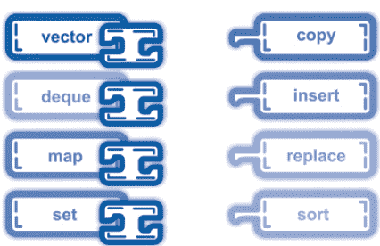

**图 4-1：STL 容器与算法的互操作性**

要在经典 C 和 Fortran 编程中对 n 种数据结构实现 m 种算法，需要：

m · n 种实现。

使用迭代器时，我们首先需要为所有容器提供接口，但之后每种算法只需一种实现，从而将总编程工作量降低到：

m + n 种实现！

### 4.1.2.1 类别

并非所有算法都可以用于每种数据结构。哪种算法适用于给定的数据结构（例如线性查找或二分查找）取决于容器提供的迭代器类型。迭代器可以按访问形式区分：

- InputIterator：用于读取所引用条目的迭代器概念（仅一次）。

- OutputIterator：用于向所引用条目写入的迭代器概念（仅一次）。

需要注意的是，写入能力并不意味着可读性；例如，`ostream_iterator` 是一个用于向 `cout` 或输出文件等输出流写入的 STL 接口。迭代器的另一种区分方式是遍历形式：

**ForwardIterator：**一种适用于可以从一个元素移动到下一个元素的迭代器的概念，即提供 `operator++` 的类型。它是 `InputIterator` 和 `OutputIterator` 的细化¹。与那些不同，`ForwardIterator` 允许读取值两次并进行多次遍历。

1. 这里的含义见 §3.10。

**BidirectionalIterator：**一种适用于支持逐步前向和后向遍历的迭代器的概念，即同时具有 `operator++` 和 `operator--` 的类型。它细化了 `ForwardIterator`。

**RandomAccessIterator：**一种适用于可以添加任意正或负偏移量的迭代器的概念，即此外还提供 `operator[]` 的类型。它细化了 `BidirectionalIterator`。

仅使用简单迭代器接口（如 `InputIterator` 的接口）的算法实现可以应用于更多的数据结构。反之，提供更丰富迭代器接口（例如建模 `RandomAccessIterator`）的数据结构可以用于更多的算法。

所有迭代器接口的一个巧妙设计选择是，它们的操作也由指针提供。每个指针都建模 `RandomAccessIterator`，因此所有 STL 算法都可以通过指针应用于旧式数组。

### C++11 4.1.2.2 使用迭代器

所有标准容器模板都提供一组丰富且一致的迭代器类型。下面这个非常简单的示例展示了迭代器的典型用法：

点击此处查看代码图片

```cpp
using namespace std;
std::list<int> l= {3, 5, 9, 7};        // C++11
for (list<int>::iterator it= l.begin(); it != l.end(); ++it)
{
    int i= *it;
    cout << i << endl;
}
```

在这个第一个示例中，我们仅限于 C++03 特性（列表初始化除外），以证明使用迭代器在 C++11 中并非新事物。在本节的其余部分，我们将使用更多 C++11 特性，但原理保持不变。

如代码片段所示，迭代器通常成对使用，其中第一个处理实际迭代，第二个标记容器的末尾。迭代器由相应的容器类使用标准方法 `begin()` 和 `end()` 创建。`begin()` 返回的迭代器指向第一个元素，而 `end()` 返回指向元素末尾之后的迭代器。`end` 迭代器仅用于比较，在大多数情况下尝试访问其值会失败。STL 中的所有算法都使用右开区间 [b, e) 实现，对 b 所引用的值进行操作，然后递增直到 b = e。因此，[x, x) 表示一个空区间。成员函数 `begin()` 和 `end()` 保持容器的常量性：

- 如果容器对象是可变的，则这些方法返回指向可变容器条目的 `iterator` 类型。
- 对于常量容器，这些方法返回 `const_iterator`，它通过常量引用访问容器条目。

通常 `iterator` 可以隐式转换为 `const_iterator`，但你不应依赖此特性。回到现代 C++，我们首先为迭代器引入类型推导：

点击此处查看代码图片

```cpp
std::list<int> l= {3, 5, 9, 7};
for (auto it= begin(l), e= end(l); it != e; ++it) {
    int i= *it;
    std::cout << i << std::endl;
}
```

我们还改用 C++11 引入的更符合习惯的 `begin` 和 `end` 自由函数表示法。由于它们是 `inline` 函数，此更改不影响性能。说到性能，我们引入了一个新的临时变量来保存 `end` 迭代器，因为我们无法 100% 确定编译器能否优化对 `end` 函数的重复调用。

虽然在仅读取数据的上下文中我们可以使用 `const_iterator`，但推导出的迭代器允许我们修改所引用的条目。这里有多种方法可以确保循环内不修改列表。一种行不通的方法是 `const auto`：

点击此处查看代码图片

```cpp
for (const auto it = begin(l), e = end(l); ...) // Error
```

这推导出的不是 `const_iterator`，而是 `const iterator`。这是一个微小但重要的区别：前者是指向常量数据的（可变）迭代器，而后者本身是一个常量，因此不能递增。如前所述，`begin()` 和 `end()` 对常量列表返回 `const_iterator`。因此，我们可以将列表声明为常量，但缺点是它只能在构造函数中设置。或者我们可以为该列表定义一个 `const` 引用：

点击此处查看代码图片

```cpp
const std::list<int>& lr = l;
for (auto it = begin(lr), e = end(lr); it != e; ++it) ...
```

或者将列表强制转换为 const 引用：

点击此处查看代码图片

```cpp
for (auto it = begin(const_cast<const std::list<int>&>(l)),
     e = end(const_cast<const std::list<int>&>(l));
     it != e; ++it) ...
```

[C++17] 使用 C++17 函数 `as_const` 可以更轻松地创建 const 引用：

点击此处查看代码图片

```cpp
for (auto it = begin(as_const(l)), e = end(as_const(l));
     it != e; ++it) ...
```

[C++14] 此外，C++11 引入了成员函数 `cbegin` 和 `cend`，它们对常量和可变容器都返回 `const_iterator`。相应的自由函数是在 C++14 中引入的：

点击此处查看代码图片

```cpp
for (auto it = cbegin(l); it != cend(l); ++it) ...
```

这种基于 `begin-end` 的遍历模式如此常见，成为引入基于范围的 `for`（§1.4.4.3）的动机。迄今为止，我们仅将其用于过时的 C 数组，现在很高兴能最终将其应用于真正的容器：

点击此处查看代码图片

```cpp
std::list<int> l = {3, 5, 9, 7};
for (auto i : l)
    std::cout << i << std::endl;
```

循环变量 `i` 是内部使用的遍历整个容器的迭代器的解引用值。因此，`i` 依次指向每个容器条目。由于所有 STL 容器都提供 `begin` 和 `end` 函数，我们可以使用这个简洁的 `for` 循环遍历它们。

[C++17] 为了确保内部使用 `const_iterator`，我们可以对列表应用 `as_const`：

```cpp
for (auto i : as_const(l))
    std::cout << i << std::endl;
```

细心的读者会意识到，在这种情况下差异实际上并不重要，因为我们在此循环中复制了每个条目，但可能存在其他情况，我们希望强制内部使用 `const_iterator`。

更一般地说，我们可以将这个 `for` 循环应用于所有具有返回迭代器的 `begin` 和 `end` 函数的类型：例如表示子容器的类或用于反向遍历返回迭代器的帮助类。这个包含所有容器的更广泛概念称为 *范围*，这也毫不奇怪地是基于范围的 `for` 循环名称的来源。尽管我们在本书中主要在容器上使用它，但值得提及，因为范围在 C++ 演变中日益重要，并最终在 C++20 中成为语言的一部分。为了避免将容器条目复制到 `i` 的开销，我们可以创建一个类型推导的引用：

```cpp
for (auto& i : l)
    std::cout << i << std::endl;
```

引用 `i` 与 `l` 具有相同的常量性：如果 `l` 是可变/常量容器（范围），则引用也是可变/常量的。为了确保条目不能被更改，我们可以声明一个 `const` 引用：


for (const auto& i : l)
    std::cout << i << std::endl;

STL 包含简单和复杂的算法。它们都包含（通常深藏其中）与上述示例本质上等价的循环。

### 4.1.2.3 操作

<iterator> 库提供两个基本操作：advance 和 distance。操作 advance(it, n) 将迭代器 it 递增 n 次。这可能看起来像是表达 it+n 的一种麻烦方式，但存在两个根本区别：第二种表示法不会改变迭代器 it（这不一定是劣势），并且它仅适用于 RandomAccessIterator。函数 advance 可用于任何类型的迭代器。从这个意义上说，advance 就像 += 的一种实现，也适用于只能逐个步进的迭代器。

为了高效，该函数在内部针对不同的迭代器类别进行分发。我们已在 3.10.2 节中看到如何使用概念来实现这一点。现在我们演示以前是如何做到的：

### 清单 4-1：advance 中的函数分发

点击此处查看代码图像

```
template <typename Iter, typename Distance>
inline void advance_aux(Iter& i, Distance n,
                        input_iterator_tag)
{
    assert(n >= 0);
    for (; n > 0; --n)
        ++i;
}

template <typename Iter, typename Distance>
inline void advance_aux(Iter& i, Distance n,
                        bidirectional_iterator_tag)
{
    if (n >= 0)
        for (; n > 0; --n) ++i;
    else
        for (; n < 0; ++n) --i;
}
```

```
template <typename Iter, typename Distance>
inline void advance_aux(Iter& i, Distance n,
                        random_access_iterator_tag)
{
    i += n;
}
```

```
template <typename Iter, typename Distance>
inline void advance(Iter& i, Distance n)
{
    using cat = typename
    iterator_traits<Iter>::iterator_category;
    advance_aux(i, n, cat());
}
```

当函数 advance 用迭代器类型实例化时，该迭代器的类别由类型特性（§5.2.1）确定。该标签类型的对象决定调用辅助函数 advance_aux 的哪个重载。因此，当 Iterator 是随机访问迭代器时，advance 的运行时间为常数，否则为线性时间。双向迭代器和随机访问迭代器允许负距离。这种基于标签的函数选择也称为标签分发（Tag Dispatching）。

**C++17** 请注意，对于 advance_aux 的相应最后参数，仅指定了类型而未给出参数名。否则，编译器在 pedantic 模式下会发出警告，指出该参数未被使用。要抑制此警告，我们可以在 C++17 中使用属性 [[maybe_unused]] 声明这是有意为之，例如：

点击此处查看代码图像

```
template <typename Iter, typename Distance>
inline void advance_aux(Iter& i, Distance n,
                        input_iterator_tag tag
                        [[maybe_unused]]);
```

现代编译器足够智能，能够意识到 advance_aux 每个重载中的第三个参数未被使用，且标签类型是空类。因此，参数传递和标签类型对象的构造被优化掉了。因此，额外的函数层和标签分发不会造成任何运行时开销。例如，在 vector 迭代器上调用 advance 归结为仅生成 i += n 的代码。

`advance` 的对应操作是 `distance`：

```
int i = distance(it1, it2);
```

它计算两个迭代器之间的距离，即第一个迭代器必须递增多少次才能等于第二个迭代器。不言而喻，实现也通过标签（或概念）进行分发，因此随机访问迭代器的开销为常数，否则为线性。

## 4.1.3 容器

标准库中的容器涵盖了广泛的重要数据结构，易于使用，且效率相当高。在编写自己的容器之前，尝试标准容器绝对是值得的。

### 4.1.3.1 向量

`std::vector` 是最简单的标准容器，也是连续存储数据最高效的容器，类似于 C 数组。而大小在一定范围内的 C 数组存储在栈上，`vector` 始终位于堆上。向量提供下标运算符，可以使用数组风格的算法：

点击此处查看代码图像

```
std::vector<int> v = {3, 4, 7, 9};
for (int i = 0; i < v.size(); ++i)
    v[i] *= 2;
```

或者，我们可以使用迭代器：直接使用，或在基于范围的 for 循环中隐式使用：

```
for (auto& x : v)
    x *= 2;
```

不同的遍历形式效率应当相似。向量可以通过在末尾添加新条目来扩大：

```
std::vector<int> v;
for (int i = 0; i < 100; ++i)
    v.push_back(my_random());
```

其中 `my_random()` 返回随机数，如同 4.2.2 节中的生成器一样。STL `vector` 通常会预留额外空间，如图 4-2 所示，以加速 push_back。


### 图 4-2：vector 的内存布局

因此，追加条目可以：

- 要么非常快，只需填充已预留的空间，或
- 要么相当慢，当必须分配更多内存并复制所有数据（或至少逐元素移动）时。

可用空间由成员函数 capacity 提供。当 vector 数据被扩大时，额外空间的量通常与 vector 大小成正比，因此 push_back 的渐近时间为对数时间。典型实现会在 vector 大小加倍时执行一次或两次内存分配（即，每次重新分配时从 s 扩大到 2s 或 sqrt(2)s）。图 4-3 说明了这一点：第一张图是一个完全填满的 vector，添加新条目需要新分配，如第二张图所示。之后，我们可以继续添加条目，直到额外空间也被填满，如第三张图所示。然后必须分配新内存并复制所有条目（或逐元素移动），如第四张图所示；只有之后才能添加新条目。因此，该 vector 的所有迭代器可能都会失效。为保险起见，你不应该使用在插入或删除条目之前创建的 vector 迭代器。

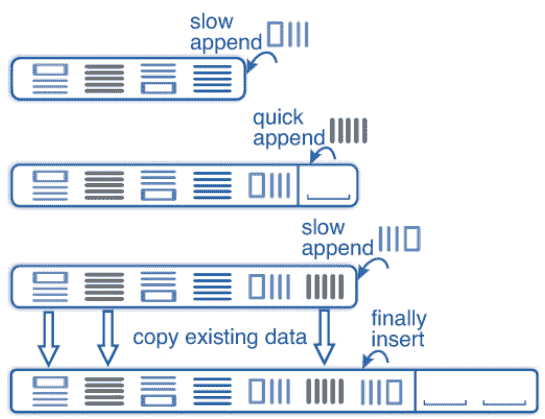

### 图 4-3：追加 vector 条目

方法 `resize(n)` 将 vector 缩小或扩大到大小 `n`。新条目会被默认构造（或对于内置类型设置为 `0`）。使用 `resize` 缩小 vector 不会释放内存。这可以在 C++11 中使用 `shrink_to_fit` 完成，它将容量减小到 vector 的实际大小。

=> c++11/vector_usage.cpp

C++11 以下简单程序说明了如何使用 C++11 特性设置和修改 `vector`：

点击此处查看代码图像

```cpp
#include <iostream>
#include <vector>
#include <algorithm>

int main ()
{
    using namespace std;
    vector<int> v = {3, 4, 7, 9};
    auto it= find (v.begin(), v.end(), 4);
    cout << "After " << it << " comes " << *(it+1) << '\n';
    auto it2= v.insert(it, 5); // insert value 5 at pos. 2
    v.erase(v.begin()); // delete entry at pos. 1
    cout << "Size = " << v.size() << ", capacity = "
    << v.capacity() << '\n';
    v.shrink_to_fit(); // drop extra entries
    v.push_back(7);
    for (auto i : v)
    cout << i << ",";
    cout << '\n';
}
```

附录 A.7.1 显示了如何在旧的 C++03 中实现相同的功能。

可以在任意位置添加和删除条目，但这些操作代价高昂，因为后面的所有条目都必须移动。然而，它并没有我们许多人想象的那么昂贵。

C++11 vector 中的其他新方法是 emplace 和 emplace_back，例如：

点击此处查看代码图像

```
vector<matrix> v;
v.push_back(matrix(3, 7)); // add 3 by 7 matrix, built outside
v.emplace_back(7, 9); // add 7 by 9 matrix, built in place
```

使用 push_back 时，我们必须先构造一个对象（如示例中的 3 x 7 矩阵），然后将其复制或移动到 vector 的新条目中。相比之下，emplace_back 直接在 vector 的新条目中构造一个新对象（这里是 7 x 9 矩阵）。这节省了复制或移动操作，并可能节省一些内存分配/释放。类似的方法也在其他容器中引入。

C++11 如果 vector 的大小在编译时已知且之后不再更改，我们可以改用 C++11 容器 array。它位于栈上，因此效率更高（除了移动和交换等浅拷贝操作）。

### 4.1.3.2 双端队列


一个 `deque`（**双端队列**的准缩写）可以从多个角度理解：

- 作为 FIFO（先进先出）队列；
- 作为 LIFO（后进先出）栈；或
- 作为支持在开头快速插入的 `vector` 的泛化。

得益于其内存布局，该容器具有非常有趣的特性。在内部，它由多个子容器组成，如图 4-4 所示。当追加新项时，它会被插入到最后一个子容器的末尾；如果该子容器已满，则会分配一个新的子容器。同样，新条目也可以被前置插入。

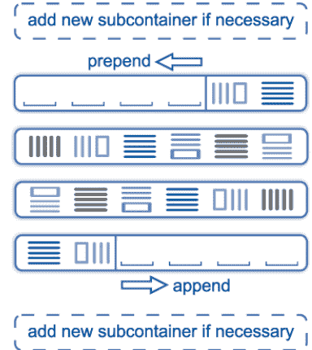

图 4-4: `deque`

这种设计的好处在于数据在内存中大多是顺序的，访问速度几乎与 `vector` 一样快 [60]。同时，deque 条目仅在中间插入或删除时才会被重新定位。这不仅节省了复制或移动的开销，还允许我们存储既不可复制也不可移动的类型，如下文所示。

=> c++11/deque_emplace.cpp

C++11 进阶内容：借助 emplace 方法，我们甚至可以创建存储不可复制、不可移动类的容器。假设我们有一个 solver 类，它既不包含拷贝构造函数也不包含移动构造函数（例如，由于包含一个原子成员；关于原子类型参见 §4.6）：

点击此处查看代码图像

```
struct parameters {};
struct solver
{
    solver(const mat& ref, const parameters& para)
        : ref(ref), para(para) {}
    solver(const solver&) = delete;
    solver(solver&&) = delete;

    const mat& ref;
    const parameters& para;
};
```

该类的多个对象存储在一个 deque 中。随后，我们遍历这些 solver：

点击此处查看代码图像

```
void solve_x(const solver& s) { ... }

int main ()
{
    parameters pl, p2, p3;
    mat      A, B, C;
    deque<solver> solvers;

    // solvers.push_back(solver(A, pl)); // would not compile
    solvers.emplace_back(B, pl);
    solvers.emplace_back(C, p2);
    solvers.emplace_front(A, pl);
    for (auto& s : solvers)
        solve_x(s);
}
```

请注意，`solver` 类只能用于不涉及数据移动或复制的容器方法。例如，`insert` 和 `erase` 会重新定位数据，因此不符合要求。对于其他容器——如 `vector`——我们甚至无法使用 `emplace_back`，因为在分配新内存时会发生数据移动。我们还必须为循环变量 `s` 使用引用，以避免在那里进行复制。

### 4.1.3.3 列表

`list` 容器（在 `<list>` 中）是一个双向链表，如图 4-5 所示，因此可以向前和向后遍历（即，其迭代器模拟 `BidirectionalIterator`）。与前面的容器不同，我们无法直接访问第 $n^{th}$ 个条目。相较于 `vector` 和 `deque` 的一个优势是，中间的插入和删除操作本身开销更小。


图 4-5: 双向链表（理论上）

当其他条目被插入或删除时，列表条目永远不会被移动。因此，只有被删除条目的引用和迭代器会失效，而其他所有条目都保持有效。

点击此处查看代码图像

```
int main ()
{
    list<int> l = {3, 4, 7, 9};
    auto it = find(begin(l), end(l), 4),
         it2 = find(begin(l), end(l), 7);
    l.erase(it);
    cout << "it2 still points to " << *it2 << '\n';
}
```

对每个单独条目的动态内存处理会将它们分散在内存中，如图 4-6 所示，因此不幸的缓存行为会导致比 `vector` 和 `deque` 更差的性能。列表在某些操作上更高效，但在许多其他操作上更慢，因此 `list` 的整体性能很少更好；例如，请参阅 [30] 或 [74]。幸运的是，在泛型编程的应用中，只需更改容器类型就可以快速克服此类性能瓶颈。


图 4-6: 现实中的双向链表

> C++11 在典型的 64 位平台上，我们的 `list<int>` 条目占用 20 字节：两个 64 位指针各占 8 字节，`int` 占 4 字节。当不需要向后迭代时，我们可以节省一个指针的空间并使用 `forward_list`（在 `<forward_list>` 中），相应的列表条目只需 12 字节。

### 4.1.3.4 集合和多重集

`set` 容器存储某个值属于该集合的信息。`set` 中的条目在内部是排序的，因此可以以对数复杂度访问。除非用户提供自己的比较准则，否则使用 `operator<` 进行比较。可以通过成员函数 `find` 和 `count` 来测试值在 `set` 中是否存在。`find` 返回指向该值的迭代器，如果未找到，则返回 `end` 迭代器。如果不需要迭代器，方法 `count` 更方便：

点击此处查看代码图像

```
set<int> s = {1, 3, 4, 7, 9};
s.insert(5);
for (int i = 0; i < 6; ++i)
	cout << i << " appears " << s.count(i) << " time(s).\n";
```

产生预期的输出：

```
0 appears 0 time(s).
1 appears 1 time(s).
2 appears 0 time(s).
3 appears 1 time(s).
4 appears 1 time(s).
5 appears 1 time(s).
```

C++20 添加了 `contains` 方法来测试值的存在：

点击此处查看代码图像

```
for (int i = 0; i < 6; ++i)
	cout << i << "is" << (s.contains(i) ? "" : "n't")
	<< " contained in s.\n";
```

重复插入相同的值没有影响；即，`count` 始终返回 0 或 1。容器 `multiset` 允许额外统计值被插入的次数：

点击此处查看代码图像

```
multiset<int> s = {1, 3, 4, 7, 9, 1, 1, 4};
s.insert(4);
for (int i = 0; i < 6; ++i)
	cout << i << " appears " << s.count(i) << " time(s).\n";
```

产生：

```
0 appears 0 time(s).
1 appears 3 time(s).
2 appears 0 time(s).
3 appears 1 time(s).
4 appears 3 time(s).
5 appears 0 time(s).
```

仅为了检查某个值是否存在于多重集中，`find` 更高效，因为它不需要遍历重复的值。在 C++20 中，`contains` 更高效，并且也比 `find` 更方便。

请注意，没有名为 multiset 的头文件，但类 `multiset` 也定义在 `<set>` 中。

### 4.1.3.5 映射和多重映射

=> c++11/map_test.cpp

`map` 是一个关联容器；即，值与键相关联。键可以是任何具有排序的类型：要么由 `operator<`（通过 `less` 函子）提供，要么由建立严格弱序的函子提供。`map` 提供了一个下标运算符用于简洁的访问表示法。以下程序说明了其用法：

点击此处查看代码图像

```
map<string, double> constants=
    ({"e", 2.7}, {"pi", 3.14}, {"h", 6.6e-34});
cout << "The Planck constant is " << constants["h"] << ".\n";
constants["c"] = 299792458;
cout << "The Coulomb constant is "
    << constants["k"] << ".\n"; // Access missing entry!
cout << "The circle's circumference pi is "
    << constants.find("pi")->second << ".\n";
auto it_phi = constants.find("phi");
if (it_phi != constants.end())
    cout << "Golden ratio is " << it_phi->second << ".\n";
cout << "The Euler constant is "
    << constants.at("e") << ".\n\n";
for (auto [name, value] : constants)
    cout << "The value of " << name << " is " << value << ".\n";
```

产生：

```
The Planck constant is 6.6e-34.
The Coulomb constant is 0.
The circle's circumference pi is 3.14.
The Euler constant is 2.7.

The value of c is 2.99792e+08.
The value of e is 2.7.
The value of h is 6.6e-34.
The value of k is 0.
The value of pi is 3.14.
```

这里 `map` 是由一系列键值对初始化的。请注意，`map` 的 `value_type` 不是 `double`，而是 `pair<const string, double>`。在接下来的两行中，我们使用下标运算符来查找键为 `h` 的值，并为 `c` 插入一个新值。下标运算符返回该键对应值的引用。如果未找到键，则会使用默认构造的值插入一个新条目。然后返回对该值的引用。对于 `c`，我们向这个引用赋值并建立键值对。然后我们查询不存在的库仑常数，意外地创建了一个值为零的条目。

为了避免 `[]` 的可变和常量重载之间出现不一致，STL 的创建者完全省略了常量重载（这是一个我们并不真正满意的设计选择）。要在常量 `map` 中搜索键，我们可以使用经典方法 `find` 或 C++11 方法 `at`。`find` 不如 `[]` 优雅，但它可以避免我们意外插入条目。它返回一个 `const_iterator`，指向一个键值对。如果未找到键，则返回 `end` 迭代器，当键是否存在不确定时，我们应将其与之比较。

当我们确定键存在于 `map` 中时，可以使用 `at`。它像 `[]` 一样返回对值的引用。关键区别在于，当键未找到时——即使 `map` 是可变的——也会抛出 `out_of_range` 异常。因此，它不能用于插入新条目，但提供了一个查找它们的紧凑接口。

当我们遍历容器时，得到的是键及其关联值的对（因为单独的值本身没有意义）。

=> c++17/multimap_test.cpp

当一个键可以关联多个值时，我们需要一个 `multimap`。相同键的条目存储在彼此相邻的位置，因此我们可以遍历它们。迭代器范围由方法 `lower_bound` 和 `upper_bound` 提供。在下一个示例中，我们遍历所有键等于 3 的条目并打印它们的值：

点击此处查看代码图像

```
multimap<int, double> mm=
{(3, 1.3), (2, 4.1), (3, 1.8), (4, 9.2), (3, 1.5)};
for (auto it = mm.lower_bound(3),
end = mm.upper_bound(3); it != end; ++it)
cout << "The value is " << it->second << '\n';
```


这将产生：

```
The value is 1.3.
The value is 1.8.
The value is 1.5.
```

使用 equal_range 方法可以更方便且同时更高效地实现相同的输出：

点击此处查看代码图片

```
for (auto [it, end] = mm.equal_range(3); it != end; ++it)
    cout << "The value is " << it->second << ".\n";
```

如果该方法实际返回一个范围而不是一对迭代器，则会更加方便。然后我们可以使用基于范围的 for 循环平滑地遍历它，而不是显式地使用迭代器。

最后四个容器——set、multiset、map 和 multimap——都实现为某种树，并且访问具有对数复杂度。在下一节中，我们介绍具有更快平均访问速度的容器。


### 4.1.3.6 哈希表

=> c++11/unordered_map_test.cpp

哈希表是具有非常高效搜索功能的容器。与前面的容器不同，哈希映射对单次访问具有常数复杂度（当哈希函数相当好时）。为了避免与现有软件发生名称冲突，标准委员会避免使用带有 "hash" 的名称，并在有序容器的名称前加上了 "unordered"。无序容器可以以与其有序对应物相同的方式使用：

点击此处查看代码图片

```
unordered_map<string, double> constants=
    {{"e", 2.7}, {"pi", 3.14}, {"h", 6.6e-34}};
cout << "The Planck constant is " << constants["h"] << '\n';
constants["c"]= 299792458;
cout << "The Euler constant is " << constants.at("e") <<
    "\n\n";
```

产生与 map 相同的结果。如果需要，可以提供用户定义的哈希函数。

延伸阅读：所有容器都提供可自定义的分配器，允许我们实现自己的内存管理或使用特定于平台的内存。分配器接口例如在 [40]、[62] 中给出。

## 4.1.4 算法

通用 STL 算法定义在头文件 <algorithm> 中，而主要用于数值计算的算法定义在 <numeric> 中。

### 4.1.4.1 不修改序列的操作

find 接受三个参数：两个定义搜索空间右开区间的迭代器，以及要在该范围内搜索的值。first 引用的每个条目都与 value 进行比较。当找到匹配项时，返回指向它的迭代器；否则递增迭代器。如果值不在序列中，则返回等于 last 的迭代器。因此，调用者可以通过将其结果与 last 进行比较来测试搜索是否成功。这实际上并不是一项特别困难的任务，我们可以自己实现它：

点击此处查看代码图片

```
template <typename InputIterator, typename T>
InputIterator find(InputIterator first, InputIterator last,
                   const T& value)
{
    while (first != last && *first != value)
        ++first;
    return first;
}
```

这段代码片段确实是 find 的标准实现方式，尽管可能存在针对特殊迭代器的专用重载。

```
=> c++11/find_test.cpp
```

作为演示，我们考虑一个包含两次数字 7 的整数序列。我们想要写出从第一个 7 开始、以第二个 7 结束的子序列。换句话说，我们必须找到这两个出现位置并打印出一个闭区间——而 STL 始终处理右开区间。这需要一些额外的工作：

点击此处查看代码图片

```
vector<int> seq = { 3, 4, 7, 9, 2, 5, 7, 8 };
auto it= find(begin(seq), end(seq), 7); // first 7
auto last= find(it+1, end(seq), 7); // second 7
for (auto past= last+1; it != past; ++it)
cout << *it << ' ';
cout << '\n';
```

在找到第一个 7 之后，我们从后续位置重新开始搜索（以免再次找到同一个 7）。在 for 循环中，我们递增最后一个迭代器，以便在打印中包含第二个 7。在上面的示例中，我们依赖于 7 在序列中出现两次这一事实。为了更健壮，我们可以检查搜索是否成功：

```
struct no_seven {};
if (it == end(seq))
throw no_seven{};
...
if (last == end(seq))
throw one_seven{};
```

=> c++11/find_test2.cpp

上面的实现不适用于 list，因为我们使用了 it+1 和 last+1 表达式。这要求迭代器是随机访问迭代器。然而，我们可以通过使用标准函数 next 来递增迭代器，从而放弃此要求：

点击此处查看代码图片

```
std::list<int> seq = { 3, 4, 7, 9, 2, 5, 7, 8 };
auto it= find(begin(seq), end(seq), 7), it2= it; // first 7
auto last= find(next(it2), end(seq), 7); // second 7
for (auto past= next(last); it != past; ++it)
std::cout << *it << ' ';
```

这种迭代器用法与前面的实现没有太大区别，但通过避免随机访问操作，它更具通用性。例如，我们现在可以使用 list。更正式地说：我们的第二个实现只需要 it 和 past 为 ForwardIterator，而第一个实现需要 RandomAccessIterator。

以同样的风格，我们可以编写一个通用函数来打印区间，该函数适用于所有 STL 容器。让我们更进一步：我们还想支持经典数组。不幸的是，数组没有 begin 和 end 成员。（没错，它们根本没有成员。）C++11 为它们和所有 STL 容器提供了名为 begin 和 end 的自由函数，这使我们能够更具通用性：

### 清单 4-2: 打印闭区间的通用函数

点击此处查看代码图片

```
struct value_not_found {};
struct value_not_found_twice {};

template <typename Range, typename Value>
void print_interval(const Range& r, const Value& v,
                    std::ostream& os = std::cout)
{
    using std::begin; using std::end; using std::next;
    auto it = std::find(begin(r), end(r), v);
    if (it == end(r))
        throw value_not_found();

    auto last = std::find(next(it), end(r), v);
    if (last == end(r))
        throw value_not_found_twice();

    for (auto past = next(last); it != past; ++it)
        os << *it << ' ';
    os << '\n';
}

int main ()
{
    std::list<int> seq = {3, 4, 7, 9, 2, 5, 7, 8};
    print_interval(seq, 7);

    int array[] = {3, 4, 7, 9, 2, 5, 7, 8};
    std::stringstream ss;
    print_interval(array, 7, ss);
    std::cout << ss.str();
}
```

我们还参数化了输出流，以不局限于 std::cout。请注意函数参数中静态多态和动态多态的和谐混合：范围 `r` 和值 `v` 的类型在编译期间实例化，而 `os` 的输出运算符 `<<` 在运行时根据 `os` 实际引用的类型进行选择。

此时，我们想提请您注意我们处理命名空间的方式。当我们使用大量标准容器和算法时，可以直接声明：

```
using namespace std;
```

直接在包含头文件之后，我们就不再需要编写 `std::` 了。这对于小型程序效果良好。在较大的项目中，迟早会遇到名称冲突。修复它们可能既乏味又令人恼火（这里预防胜于治疗）。因此，我们应该尽可能少地导入名称——尤其是在头文件中。我们对 `print_interval` 的实现不依赖于先前的名称导入，可以安全地放置在头文件中。即使在函数内部，我们也不导入整个 `std` 命名空间，而是仅限于我们真正使用的那些函数。

请注意，我们在某些函数调用中没有限定命名空间，例如 `std::begin(r)`。这在上面的示例中可以工作，但我们无法覆盖在类的命名空间中定义 `begin` 函数的用户类型。`using std::begin` 和 `begin(r)` 的组合保证能找到 `std::begin`。另一方面，用户类型的 `begin` 函数通过 ADL (§3.2.2) 被找到，并且会比 `std::begin` 更匹配。`end` 也是如此。相比之下，对于函数 `find`，我们不想调用可能的用户重载，并确保它来自 `std`。

`find_if` 通过搜索第一个满足一般条件的条目来推广 `find`。它不再与单个值进行比较，而是评估一个 `Predicate`——一个返回 `bool` 的函数。假设我们搜索第一个大于 4 且小于 7 的 `list` 条目：

点击此处查看代码图片

```
bool check(int i) { return i > 4 && i < 7; }
```

```
int main ()
{
    list<int> seq= {3, 4, 7, 9, 2, 5, 7, 8};
    auto it= find_if(begin(seq), end(seq), check);
```


cout << "The first value in range is " << *it << '\n';
}

C++11。或者我们就地创建谓词：

点击此处查看代码图像

```
auto it = find_if(begin(seq), end(seq),
    [](int i) { return i > 4 && i < 7; } );
```

搜索和计数算法可以类似地使用，在线手册提供了良好的文档。

### 4.1.4.2 修改序列操作

copy：修改操作必须谨慎使用，因为被修改的序列通常仅由起始迭代器参数化。因此，作为程序员，我们有责任确保有足够的空间。例如，在复制容器之前，我们可以将目标的大小调整为与源相同的大小：

点击此处查看代码图像

```
vector<int> seq = {3, 4, 7, 9, 2, 5, 7, 8}, v;
v.resize(seq.size());
copy(begin(seq), end(seq), begin(v));
```

使用 copy 打印序列是迭代器灵活性的一个很好的演示：

点击此处查看代码图像

```
copy(begin(seq), end(seq), ostream_iterator<int>(cout, ",
   "));
```

ostream_iterator 为输出流构建了一个极简的迭代器接口：++ 和 * 操作是空操作，此处不需要比较，而对值的赋值会将其连同分隔符一起发送到所引用的输出流。

unique 是数值软件中非常有用的一个函数：它删除序列中的重复项。作为前提条件，序列必须已排序。然后可以使用 unique 重新排列条目，使唯一值位于前面，重复项位于末尾。返回指向第一个重复条目的迭代器，并可用于删除重复项：

点击此处查看代码图像

```
std::vector<int> seq = {3, 4, 7, 9, 2, 5, 7, 8, 3, 4, 3, 9};
sort(begin(seq), end(seq));
auto it= unique(begin(seq), end(seq));
resize(distance(begin(seq), it));
```

如果这是一个常见任务，我们可以将前述操作封装为一个以序列/范围参数化的泛型函数：

点击此处查看代码图像

```
template <typename Seq>
void make_unique_sequence(Seq& seq)
{
    using std::begin; using std::end; using std::distance;
    std::sort(begin(seq), end(seq));
    auto it= std::unique(begin(seq), end(seq));
    seq.resize(distance(begin(seq), it));
}
```

还有许多遵循相同原则的可变序列操作。

### 4.1.4.3 排序操作

标准库中的排序功能非常强大且灵活，可用于几乎所有情况。早期的实现基于快速排序，平均复杂度为 O(n log n)，但最坏情况复杂度为平方级。2 最近的版本使用内省排序，其最坏情况复杂度也是 O(n log n)。简而言之，几乎没有理由费心实现自己的排序。默认情况下，sort 使用 operator<，但我们可以自定义比较，例如，将序列按降序排序：

2. 当时 stable_sort 和 partial_sort 已经提供了较低的最坏情况复杂度。

点击此处查看代码图像

```
vector<int> seq = {3, 4, 7, 9, 2, 5, 7, 8, 3, 4, 3, 9};
sort(begin(seq), end(seq), [](int x, int y){return x > y;});
```

Lambda 再次派上用场。除非我们定义一个比较（例如按模值），否则无法对复数序列进行排序：

点击此处查看代码图像

```
using cf= complex<float>;
vector<cf> v = ({3, 4}, {7, 9}, {2, 5}, {7, 8});
sort(begin(v), end(v), [](cf x, cf y){return abs (x)
<abs (y);});
```

虽然在这里不太有意义，但也可以用 Lambda 快速定义字典序：

点击此处查看代码图像

```
auto lex= [](cf x, cf y){return real(x)<real(y)
|| real(x)==real(y)&&imag(x)
<imag(y);};
sort(begin(v), end(v), lex);
```

许多算法（如 unique 所示）要求排序后的序列作为前提条件。集合操作也可以在排序后的序列上执行，不一定需要集合类型。

### 4.1.4.4 数值操作

STL 的数值操作位于头文件/库 <numeric> 中。iota 从给定值开始生成一个序列，后续条目依次递增 1。accumulate 默认计算序列的和，当用户提供二元函数时执行任意归约。inner_product 默认执行点积，其通用形式允许指定一个二元函数对象，分别替代加法和乘法。partial_sum 和 adjacent_difference 按其名称所示的方式行为。以下小程序展示了一些基本的数值函数：

点击此处查看代码图像

```
vector<float> v= {3.1, 4.2, 7, 9.3, 2, 5, 7, 8, 3, 4},
w(10), x(10), y(10);
iota(begin(w), end(w), 12.1);
partial_sum (begin (v), end(v), begin(x));
adjacent_difference(begin(v), end(v), begin(y));
float alpha= inner_product(begin(w), end(w), begin(v), 0.0f);
float sum_w= accumulate(begin(w), end(w), 0.0f),
product_w= accumulate(begin(w), end(w), 1.0f,
[] (float x, float y){return x *
y});
```

iota 函数不是 C++03 的一部分，但自 C++11 起已纳入标准。

### 4.1.4.5 复杂度

Bjarne Stroustrup 在一个简洁的表格（表 4-1）中总结了所有 STL 算法的复杂度，他慷慨地允许我们分享。

### 表 4–1：STL 算法的复杂度

| 复杂度 | 算法 |
| :--- | :--- |
| O(1) | swap, iter_swap |
| O(log n) | lower_bound, upper_bound, equal_range, binary_search, push_heap, pop_heap |
| O(n log n) | inplace_merge, stable_partition, 所有排序算法 |
| O(n²) | find_end, find_first_of, search, search_n |
| O(n) | 所有其他算法 |

来源：[62, 第 931 页]

## 4.1.5 范围

### 4.1.5.1 迭代器的风险与局限性

C++20 迭代器无疑对现代 C++ 编程做出了重要贡献。尽管如此，它们可能相当危险，并导致不优雅的接口。让我们从危险开始。迭代器经常成对出现，只有程序员才能确保两个迭代器确实相互关联。这为我们提供了一套不太吸引人的错误集合：

- 结束迭代器在前。
- 迭代器来自不同的容器。
- 迭代器跨越较大的步长（超过多个条目）且未命中结束迭代器。

在所有这些情况下，迭代器可能会遍历任意内存，并且只有在程序离开可访问地址空间时才会停止。程序崩溃可能仍然是我们最好的选择，因为我们能看到哪里出错了。在某个时刻停止迭代的执行很可能已经毁坏了大量数据，因此程序在以崩溃或所谓的成功结束之前可能会造成严重损害。

同样，大多数针对多个容器的 STL 函数只从一个容器³ 中获取一对迭代器，仅从其他容器获取起始迭代器，例如：

3. 一对迭代器不一定代表整个容器。它也可以指代容器的一部分或某个更一般的抽象。仅考虑整个容器就足以展示即使是小错误也可能导致灾难性后果。

点击此处查看代码图像

```
copy(begin(v), end(v), begin(w));
```

因此，无法测试复制的目标是否提供足够的空间，随机内存可能会被覆盖。最后，基于迭代器的函数接口并不总是优雅。比较：

点击此处查看代码图像

```
x = inner_product(begin(v), end(v), begin(w));
```

与：

```
x = dot(v, w);
```

这个例子不言而喻。此外，第二种概念允许我们检查 v 和 w 的大小是否匹配。出于这些原因，我们建议：

### 基于迭代器的函数

如果你编写基于迭代器的函数，请在其之上提供用户友好的接口。

如何？将在下文中解释。

### 4.1.5.2 新函数接口

=> c++20/ranges_copy.cpp

C++20 引入了范围（Ranges）。不幸的是，撰写时的编译器支持尚不理想。因此，我们部分使用 Eric Niebler 的原型库研究了这一有趣的特性。在 GitHub 上，大多数示例您都能同时找到标准版和原型版。由于与 std 的歧义，我们的源代码包含大量显式的命名空间限定。我们乐观地认为，当范围完全集成到编译器的标准库中时，这将不再是负担。在尝试以下使用标准范围的代码片段时，您应该在程序中添加 using namespace std::ranges;。尽管存在这些细节，我们希望本节能帮助您入门这一非常有用的特性。

通俗地说：范围是所有可以通过 begin 和 end 函数进行迭代的类型。这使我们能够通过使用范围而不是迭代器来减少许多函数的参数数量。例如，我们可以减少前述 copy 函数的参数数量：

点击此处查看代码图像

```
vector<int> u{3, 2, 6, 7, 4}, v(5), w;
ranges::copy(u, begin(v));
```

源作为第一个参数直接传递，从目标中获取起始迭代器。该接口显然比以前更简洁。它也不那么容易出现上一节中的错误。只有在源的起始和终止迭代器在相应上下文中分别提供时，基于迭代器的接口才更可取。但这相当罕见；在大多数情况下，它们是通过对同一容器（或其他范围）调用 begin 和 end 给出的，因此新接口覆盖了绝大多数应用程序。

使用此新接口仍存在一个风险：在目标可用空间末尾之后写入。更好的调用方式如下：

```
copy(u, w);
```


将w调整到v的大小。该接口未由标准库提供，我们将立即实现它。

要使目标的大小适应源的大小，我们必须添加两个额外要求：源必须提供大小信息，目标必须能够更改其大小。源的大小始终可以通过迭代器函数distance来确定，但这可能代价高昂（最高可达线性复杂度），并且在类型不是forward_iterator时可能会使起始迭代器失效。范围库引入了sized_range概念，用于具有常数复杂度大小函数的范围。该概念涵盖了我们对源的要求。目标的要求必须在一个新概念中实现：

```cpp
template <typename R>
concept ResizableRange =
    ranges::range<R> &&
    requires(R& r, size_t n)
    {
        r.resize(n);
    };
```

现在我们可以编写一个可靠的复制函数：

单击此处查看代码图像

```cpp
template <sized_range Source, ResizableRange Target>
auto copy(const Source& src, Target& tgt)
{
    tgt.resize(size(src));
    return copy(src, begin(tgt));
}
```

当所有复制重载都得到适当约束时，我们的实现不会造成任何歧义。Sean Parent指出了此实现的一个缺点：在延长调整大小期间对象会被默认构造，然后无论如何都会被覆盖。为了避免这种开销或没有默认构造函数的类出现编译错误，我们最好在使用back_insert_iterator复制之前先使用clear和reserve：

单击此处查看代码图像

```cpp
template <typename R>
concept ExpandableRange =
    ranges::range<R> &&
    requires(R& r, size_t n)
{
    r.reserve(n);
};
template <sized_range Source, ExpandableRange Target>
auto copy(const Source& src, Target& tgt)
{
    tgt.clear();
    tgt.reserve(ranges::size(src));
    return ranges::copy(src, back_insert_iterator(tgt));
}
```

类似地，许多标准函数现在可以为每对迭代器或单个迭代器使用一个范围来实现。这建立了一个同时更方便、更可靠的接口。

## 4.1.5.3 标准视图

=> c++20/ranges_iota.cpp

所有标准容器都包含返回迭代器的begin和end函数，因此都是范围。然而，范围不仅限于容器；其定义更具通用性。范围不一定包含数据。例如，遍历名为`iota`的视图相当于从包含升序数据的容器中读取数据：

单击此处查看代码图像

```cpp
for (int i : views::iota(1, 10))
    cout << i << endl;
```

此代码片段打印1到9的值，仿佛我们遍历了一个包含这些值的容器。该视图类似于我们在第2.7.6节中介绍的`irange`类。

=> c++20/ranges_examples.cpp

大多数视图在不创建新容器的情况下，为给定容器或另一个范围建立新视角。要从给定范围中仅选择满足特定条件的条目，可以使用`filter`视图。不幸的是，大多数视图类需要另一个视图作为参数，不适用于任意范围。因此，不建议直接使用它们。相反，我们应该使用相应的范围适配器。对于每个视图类，在子命名空间views中都存在一个相应的适配器。例如，views::filter是类filter_view的适配器。假设我们想打印向量中大于4且小于7的值：

单击此处查看代码图像

```cpp
bool in_range(int i) { return i > 4 && i < 7; }
vector<int> seq = {3, 4, 7, 6, 9, 2, 5, 7, 8};
for (int i : views::filter(seq, in_range))
    cout << i << " is in range.\n";
```

在此循环中，只打印in_range中的数字，其他数字被跳过。views::filter不创建新容器，而仅在seq上创建一个轻量级代理。filter的迭代器只是底层迭代器（在此例中为vector）的包装器。要查看seq中的过滤值，filter的迭代器递增会重复向量迭代器的递增，直到所引用的值满足过滤条件。另一个有用的视图是transform，它对每个条目应用一元函数：

单击此处查看代码图像

```cpp
auto square = [](int n) { return n * n; };
for (int i : views::transform(views::filter(seq, in_range),
                                  square))
    cout << i << " is the squared value of an in-range
    entry.\n";
```

在这里，我们对seq中大于4且小于7的所有值进行平方。我们还可以在此示例中看到，嵌套视图并不能产生特别易读的代码。为了提高可读性，视图提供了类似于Unix shell中的管道运算符。在此情况下，我们在适配器中省略范围参数：

单击此处查看代码图像

```cpp
for (int i : seq | views::filter(in_range)
                 | views::transform(square))
    cout << i << " is the squared value of an in-range
    entry.\n";
```

范围的另一种推广是，begin和end可以返回不同的类型，因为结束迭代器仅用于比较。实际上，`end`返回的对象不需要是迭代器，只需是所谓的*哨兵*即可。这可以是任何类型，只要它能与相应的迭代器进行比较。

使用哨兵对算法有一定影响。基于范围的`for`循环已在C++17中推广，以允许`begin`和`end`之间具有不同的类型。经典STL算法是为迭代器对设计的。要使用任意范围调用它们，可以使用`common`视图。例如，基于范围的排序函数可以按如下方式实现：

单击此处查看代码图像

```cpp
template <random_access_range Range>
void sort(Range& r)
{
    auto cr(views::common(r));
    sort(begin(cr), end(cr));
}
```

乍一看似乎不太有用但后来证明很方便的视图是`all`：它只是对表示相同内容的范围的一个视图。然而，与某些容器类型不同，范围视图具有输出运算符<sup>4</sup>，因此我们可以使用它进行打印：

```cpp
cout << "seq = " << views::all(seq) << endl;
```

4. 至少在原型中。

此外，`views::all`在内部由其他视图用于将任意范围转换为视图。在表4-2中，您将找到C++20中引入的视图概览。

## 4.1.5.4 编写我们自己的视图

=> c++20/range_enumerate_example.cpp

Eric Niebler的原型实现中未进入标准的一个视图是`enumerate`。此视图为范围中的每个条目提供一个位置和一个值。作者在Python程序中频繁使用此功能，因此现在也渴望在C++中拥有它。

### 表4-2：范围视图

| 适配器名称 | 语义 |
| :--- | :--- |
| views::all | 范围中的所有条目 |
| views::filter | 保持给定属性的条目 |
| views::transform | 对每个条目应用函数 |
| views::iota | 遍历整数范围 |
| views::take | 从范围中获取n个条目 |
| views::join | 将一系列范围合并为一个范围 |
| views::empty | 创建没有条目的给定值类型的范围 |
| views::single | 创建带有给定单个条目的范围 |
| views::split | 为给定分隔符将范围拆分为子范围 |
| views::counted | 从给定迭代器开始创建n个条目的范围 |
| views::common | 建立begin和end具有相同类型的范围 |
| views::reverse | 逆序遍历给定范围 |

为简单起见，我们假设枚举的范围不是右值且不需要存储。我们还假设begin和end返回相同的类型。那么视图本身非常简单：

单击此处查看代码图像

```cpp
template <typename Range>
class enumerate_view
{
    using iter = enumerate_iterator<Range>;
public:
    enumerate_view(Range& r) : r(r) {}
    iter begin() const noexcept { return iter{0, std::begin(r)}; }
    iter end() const noexcept { return iter{-1, std::end(r)}; }
};
```


```
private:
Range& r; // requires lvalue!
};
```

它只是持有范围的引用，并提供 `begin` 和 `end` 迭代器。`end` 迭代器中的位置不会被使用，并被设置为任意值。即使迭代器也可以以简单的方式实现：

Click here to view code image

```
template <typename Range>
class enumerate_iterator
{
    using riter = decltype(std::begin(std::declval<Range>()));
    using self = enumerate_iterator<Range>;

public:
    explicit enumerate_iterator(int index, riter it) :
    index(index), it(it) {}

    auto operator*() const noexcept { return make_pair(index, *it); }
    bool operator!=(self other) const noexcept { return it != other.it; }
    self& operator++() noexcept { ++index; ++it; return *this; }

private:
    int index;
    riter it;
};
```

如你所见，我们只比较底层迭代器，并在比较中忽略索引。解引用运算符返回索引和范围迭代器的一对。我们现在可以在基于范围的 `for` 循环中使用我们的视图来枚举 `vector` 的条目：

Click here to view code image

```
vector<int> seq = {3, 4, 7, 9, 2, 5, 7, 8, 3, 4, 3, 9};
for (auto [i, value] : enumerate_view(seq))
cout << "The " << i << "th value is " << value << endl;
```

为了与标准视图保持一致，我们还提供相应的适配器，它可以像函数一样调用：

```cpp
namespace views {
struct enumerate_t
{
    template <typename Range>
    enumerate_view<Range> operator()(Range&& r) const noexcept
    {
        return enumerate_view<Range>{std::forward<Range>(r)};
    };
    static constexpr enumerate_t enumerate;
}
for (auto [i, value] : views::enumerate(seq))
cout << "The " << i << "th value is " << value << endl;
```

当然，我们也希望为我们的视图提供管道运算符：

```cpp
namespace views {
template <typename Range>
enumerate_view<Range> operator|(Range&& r, enumerate_t) noexcept
{
    return enumerate_view<Range>{std::forward<Range>(r)};
}
for (auto [i, value] : seq | views::enumerate)
cout << "The " << i << "th value is " << value << endl;
```

这个功能齐全的生产代码将包含更多细节，例如更丰富的迭代器接口及其行为的一些类型声明，但我们的极简实现中已经提供了基本行为。在意识到这有多简单之后，作者后悔没有早点这样做。话虽如此，我们邀请你在有帮助时实现自己的范围。如前所述，迭代器是最大化适用性的绝妙主意，但它不应该是应用程序级别工作的主要接口。

## C++17 4.1.6 并行计算

在 C++17 中，大多数 STL 算法都可以并行执行。相应的函数被重载为新的实现，以执行策略开头，后跟我们熟悉的函数参数。所有策略都位于命名空间 std::execution 中。要顺序执行算法（与以前一样，我们可以使用策略 seq 或完全省略它。因此，以下两个调用是等价的：

```
sort(seq, begin(v), end(v));
sort(begin(v), end(v));
```

### 策略 par:

```
sort(par, begin(v), end(v));
```

触发多线程执行，而每个线程中的计算是顺序的。为了发挥硬件的最大潜力，我们可以使用 par_unseq：

```
sort(par_unseq, begin(v), end(v));
```

它还允许在每个线程内并行（即非顺序地）执行操作。在实践中，这通常意味着数值操作使用 SSE/AVX 加速。


在 C++20 中添加了策略 unseq，用于在单个线程上非顺序计算。为了测试并行排序，我们在四核 Intel Core i7-8550U（1.8 GHz）上的 Visual Studio 2019 版本 16.9.3 中进行了测试，对 1000 万个 int 值进行排序时得到了以下墙钟时间：

Click here to view code image

```
Sorting with seq took 0.82638s.
Sorting with par took 0.216368s.
Sorting with unseq took 0.819744s.
Sorting with par_unseq took 0.219476s.
```

我们可以看到，多线程版本大约快四倍，而线程内的并行化并没有加速执行，因为 SSE/AVX 对排序 int 值帮助不大。然而，本书的一位审稿人在他的机器上观察到 unseq 的结果最快。在其他编译器上，我们没有看到并行策略的好处（系统也没有指示使用多个线程）。因此，在你喜欢的平台上尝试绝对值得。

在并行化的背景下，添加了七个新算法：

- `for_each_n` 将函子应用于前 `n` 个条目；
- `reduce` 执行类似于 `accumulate` 的归约，但允许顺序改变；
- `transform_reduce` 在归约前应用函子（通常称为 map-reduce）；
- `inclusive_scan` 计算类似于现有顺序函数 `partial_sum` 的部分和；
- `exclusive_scan` 也计算部分和，其中第 i 个条目被排除在第 i 个部分和之外；以及
- `transform_inclusive_scan` 和 `transform_exclusive_scan` 在对每个条目应用函子后计算相应的部分和。

```
=> c++20/parallel_reduce.cpp
```

我们希望 `reduce` 操作可以受益于 AVX 加速。对于十亿个 `double` 值的大型集合，我们在前面提到的 i7 上进行了测量：

Click here to view code image

```
Reducing with seq     took 0.429475s.
Reducing with par     took 0.2653s.
Reducing with unseq   took 0.42294s.
Reducing with par_unseq took 0.261549s.
```

在此计算中，限制因素显然是内存带宽，我们将这种加速归功于第二个内存通道，它使多线程能够更快地加载。为了摆脱带宽限制，我们测量了较小的集合，其中由于线程管理开销，顺序版本甚至比并行版本更快。而且，我们仍然看不到 `par_unseq` 策略相对于 `par` 的好处。

最后的评论：本节仅浅尝辄止地介绍了 STL，旨在作为开胃小菜。

## 4.2 数值计算

在本节中，我们将说明如何使用 C++ 的复数和随机数生成器。头文件 <cmath> 包含大量数值函数，其用法简单直接，无需进一步说明。

### 4.2.1 复数

我们已经在第 2 章中演示了如何实现非模板复数类，并在第 3 章中使用了复数类模板。为了不一遍又一遍地重复显而易见的内容，我们用图形示例来说明用法。

#### 4.2.1.1 曼德布罗特集

曼德布罗特集——以其创建者 Benoit B. Mandelbrot 命名——是通过连续平方并添加原始值而不会趋于无穷大的复数集合：

```
$$M = \left\{ c \in \mathbb{C} : \lim_{n \to \infty} z_n(c) \neq \infty \right\}$$
```

其中

```
$$z_0(c) = c$$ $$z_{n+1}(c) = z_n^2 + c$$
```

可以证明，当 $|z_n(c)| > 2$ 时，一点在曼德布罗特集之外。计算模长最耗费资源的部分是最后的平方根。C++ 提供了一个函数 `norm`，它是 `abs` 的平方，即计算 `abs` 而不进行最后的 `sqrt`。因此，我们将继续标准 `abs(z) <= 2` 替换为 `norm(z) <= 4`。

曼德布罗特集的可视化是达到该极限所需迭代次数的颜色编码。为了绘制分形，我们使用了跨平台库 Simple DirectMedia Layer (SDL 1.2)。数值部分由类 `mandel_pixel` 实现，它为每个像素计算直到 `norm(z) > 4` 所需的迭代次数以及代表该迭代次数的颜色：

Click here to view code image

```
class mandel_pixel
{
public:
	mandel_pixel(SDL_Surface* screen, int x, int y,
		int xdim, int ydim, int max_iter)
		: screen(screen), max_iter(max_iter), iter(0), c(x, y)
	{
		// scale y to [-1.2,1.2] and shift -0.5+0i to the
		center
		c *= 2.4f / static_cast<float>(ydim);
		c -= complex<float>(1.2 * xdim / ydim + 0.5, 1.2);
		iterate();
	}
	int iterations() const { return iter; }
	uint32_t color() const { ... }

private:
	void iterate()
	{
		complex<float> z = c;
		for (; iter < max_iter && norm(z) <= 4.0f; iter++)
			z = z * z + c;
	};
	// ...

	int iter;
	complex<float> c;
};
```

复数被缩放，使得对于任何图像大小，它们的虚部都介于 -1.2 和 1.2 之间。然后将图像向左移动 0.5。我们省略了图形的代码行，因为我们想在这里专注于复数。完整的程序可以在 GitHub 上找到，生成的图片见图 4-7。


归根结底，我们的核心计算仅用三行代码即可实现，而其他约 50 行代码都用于绘制一张漂亮的图片，尽管我们已经使用了一个非常简单的图形库。不幸的是，这种情况并不少见：许多现实世界的应用程序用于文件 I/O、数据库访问、图形、Web 界面等的代码，远多于用于科学核心功能的代码。

自 C++14 起，我们可以使用用户自定义字面量来表示虚数。例如，`3i` 是 `complex<double>{0, 3}` 的简写。`float` 和 `long double` 字面量的后缀也已添加。现在，针对 `complex` 实例的函数 `f` 可以用更简洁的方式调用，以表示 `3.2 + 4.3i` 的不同类型：

- 5. 该特性被称为用户自定义字面量，尽管我们在字面量中使用的后缀并非由用户定义，而是由标准库定义。

点击此处查看代码图像

```
f(3.2f + 4.3if) // As float
f(3.2 + 4.3i)   // As double
f(3.2L + 4.3il) // As long double
```

这种记法相比构造函数调用并没有短多少，但它肯定更接近数学原始形式。


图 4-7：曼德勃罗集

### 4.2.1.2 混合复数计算

如前所示，复数可以由大多数数值类型构建。在这方面，库非常通用。但对于其运算则不那么通用：类型 complex<T> 的值只能与类型 complex<T> 或 T 的值相加（相减等）。因此，简单的代码：

```
complex<double> z(3, 5), c = 2 * z;
```

无法编译，因为未定义 int 和 complex<double> 之间的乘法。将 2 替换为 2.0 即可轻松解决此问题。然而，在泛型函数中，此问题更令人烦恼，例如：

点击此处查看代码图像

```
template <typename T>
inline T twice(const T& z)
{ return 2 * z; }
int main()
{
    complex<double> z(3, 5), c;
    c = twice(z);
}
```

函数 twice 出于与之前相同的原因无法编译。如果我们写 2.0 * z，它对于 complex<double> 可以编译，但对于 complex<float> 或 complex<long double> 则不行。函数

点击此处查看代码图像

```
template <typename T>
complex<T> twice(const complex<T>& z)
{ return T{2} * z; }
```

适用于所有复数类型——但仅适用于复数类型。相比之下，以下代码：

```
template <typename T>
inline T twice(const T& z)
{ return T{2} * z; }
```

可与复数和非复数类型一起编译。但是，当 T 是复数类型时，2 会被不必要地转换为复数，并且会执行四次乘法和两次加法，而实际上只需要其中一半。一种可能的解决方案是相应地重载实现。或者，我们可以使用类型特性或概念来区分 complex 的实例和其他类型。

当涉及多个不同类型的参数（其中一些可能是复数）时，编程变得更具挑战性。矩阵模板库（MTL4，第 4.7.3 节）为复数提供了混合运算。我们承诺将此功能纳入未来的标准。

## C++11 4.2.2 随机数生成器

许多应用领域——如计算机模拟、游戏编程和密码学——都使用随机数。因此，每种严肃的编程语言都为其提供生成器。此类生成器产生看似随机的数字序列。随机生成器可能依赖于量子现象等物理过程。然而，大多数生成器基于伪随机计算。它们具有一个内部状态——称为 *种子*——每次请求伪随机数时，该状态都会通过确定性计算进行转换。因此，伪随机数生成器（PRNG）在使用相同种子启动时，始终会发出相同的序列。

在 C++11 之前，只有来自 C 的 `rand` 和 `srand` 函数，功能非常有限。更成问题的是，生成的数字质量没有保证，在某些平台上确实相当低。因此，C++11 添加了高质量的 `<random>` 库。甚至曾考虑在 C++ 中彻底废弃 `rand` 和 `srand`。它们仍然存在，但在随机数质量很重要的地方，确实应该避免使用它们。

### 4.2.2.1 保持简单

=> c++11/simple_random.hpp

C++11 的随机数生成器提供了大量灵活性，这对专家非常有用，但对初学者来说有些令人不知所措。Walter Brown 提出了一组对新手友好的函数 [8]。经过略微调整，⁶ 它们是：

点击此处查看代码图像

```
#include <random>

std::default_random_engine& global_urng()
{
    static std::default_random_engine u{};
    return u;
}

void randomize()
{
    static std::random_device rd{};
    global_urng().seed(rd());
}

int pick(int from, int thru)
{
    static std::uniform_int_distribution<> d();
    using param_t = decltype(d)::param_type;
    return d(global_urng(), param_t(from, thru));
}

double pick(double from, double upto)
{
    static std::uniform_real_distribution<> d{};
    using param_t = decltype(d)::param_type;
    return d(global_urng(), param_t(from, upto));
}
```

要开始使用随机数，你可以将这三个函数复制到项目中，稍后再查看细节。Walter 的接口非常简单，但对于代码测试等许多实际用途来说仍然足够。我们只需要记住以下三个函数：

- `randomize`: 通过初始化生成器的种子，使数字真正随机。
- `pick(int a, int b)`: 当 `a` 和 `b` 为 `int` 时，返回区间 `[a, b]` 中的一个 `int`。
- `pick(double a, double b)`: 当 `a` 和 `b` 为 `double` 时，返回右开区间 `[a, b)` 中的一个 `double`。

6. Walter 使用了非 lambda 函数的返回类型推导，这仅在 C++14 及更高版本中可用。我们进一步将函数名从 `pick_a_number` 缩短为 `pick`。

如果不调用 `randomize`，生成的数字序列每次都相同，这在某些情况下是可取的：可重复的行为使查找 bug 更容易。请注意，`pick` 对于 `int` 包含上界，但对于 `double` 不包含，以与标准函数保持一致。目前，`global_urng` 可以被视为实现细节。有了这些函数，我们可以轻松编写掷骰子的循环：

点击此处查看代码图像

```
randomize();
cout << "Now, we roll dice:\n";
for (int i = 0; i < 15; ++i)
    cout << pick(1, 6) << endl;

cout << "\nLet's roll continuous dice now: ;-)\n";
```

```
for (int i = 0; i < 15; ++i)
cout << pick(1.0, 6.0) << endl;
```

事实上，这比旧的 C 接口更简单。但尽管如此，它并未进入标准。也许对于强悍的 C++ 程序员来说，这太简单了。我们仍将在下一节中使用此接口进行测试。

### 4.2.2.2 随机化测试

=> c++11/random_testing.cpp

假设我们想测试第 2 章中的复数实现是否满足分配律：

a (b + c) = ab + ac 对所有 a, b, c 成立。(4.1)

乘法的标准实现如下

点击此处查看代码图像

```
inline complex operator*(const complex& c1, const complex& c2)
{
    return complex(real(c1) * real(c2) - imag(c1) * imag(c2),
                   real(c1) * imag(c2) + imag(c1) * real(c2));
}
```

为了应对舍入误差，我们引入一个检查相对差异的类似函数：

点击此处查看代码图像

```
#include <limits>

inline bool similar(complex x, complex y)
{
    const double eps = 10 * numeric_limits<double>::epsilon();
    double sum = abs(x) + abs(y);
    if (sum < 1000 * numeric_limits<double>::min())
        return true;
    return abs(x - y) / sum <= eps;
}
```

为了避免除以零，如果两个 `complex` 数的模都非常接近零（模之和小于可表示为 `double` 的最小值的 1,000 倍），则我们将它们视为相似。否则，我们将两个值的差与它们的模之和相关联。这不应大于 10 倍的 `epsilon`，即 1 与下一个可表示为 `double` 的值之间的差。此信息由稍后在第 4.3.1 节中介绍的 `<limits>` 库提供。

接下来，我们需要一个测试，它为 (4.1) 中的变量获取一组三个 `complex` 数，然后检查两边各项的相似性：

点击此处查看代码图像

```
struct distributivity_violated {};

inline void test(complex a, complex b, complex c)
{
  if (!similar(a * (b + c), a * b + a * c)) {
    cerr << "Test detected that " << a << ...
         throw distributivity_violated();
  }
}
```

如果检测到违规，关键值将在错误流上报告，并抛出用户定义的异常。最后，我们实现随机 `complex` 数的生成以及对测试集的循环：

点击此处查看代码图像

```
const double from = -10.0, upto = 10.0;

inline complex mypick()
{
  return complex(pick(from, upto), pick(from, upto));
}

int main()
{
  const int max_test = 20;
  randomize();
  for (int i = 0; i < max_test; ++i) {
    complex a = mypick();
    for (int j = 0; j < max_test; ++j) {
      complex b = mypick();
      for (int k = 0; k < max_test; ++k) {
        complex c = mypick();
        test(a, b, c);
      }
    }
  }
}
```


} } }

此处我们仅对 [-10, 10) 范围内的随机数进行了测试，用于实部和虚部；这是否足以获得对正确性的良好信心，尚属未定。在大型项目中，构建可复用的测试框架绝对是值得的。包含随机值生成和最内层循环中测试函数的嵌套循环模式适用于许多情况。它可以封装在一个类中，该类可能是可变参数的，以处理涉及不同数量变量的属性。随机值的生成也可以由特殊构造函数提供（例如，由标记标记），或者序列可以预先生成。可以想象不同的方法。本节中选择循环模式是为了简单起见。

要看出分配律不完全成立，我们可以将 `eps` 降低到非常小的值，甚至降到 0。然后，我们会看到类似下面的（缩写的）错误消息：

点击此处查看代码图片

```
Test detected that (-6.21,7.09) * ((2.52,-3.58) +
(-4.51,-3.91))
!= (-6.21,7.09) * (2.52,-3.58) + (-6.21,7.09) *
(-4.51,3.91)
terminate called after throwing 'distributivity_violated'
```

现在我们进入随机数生成的细节。

## 4.2.2.3 引擎

库 `<random>` 包含两种函数对象：生成器和分布。前者生成无符号整数序列（精确类型由每个类的类型别名提供）。每个值应具有大约相同的概率。分布类将这些数字映射到其概率对应于参数化分布的值上。

除非有特殊需求，否则我们可以直接使用 `default_random_engine`。其确切定义依赖于实现，但我们可以信任标准库开发人员选择了合适的引擎。我们必须牢记，随机数序列确定性地依赖于其种子，并且每次创建对象时，每个引擎都用相同的种子初始化。因此，给定类型的新引擎始终产生相同的序列，例如：

点击此处查看代码图片

```
void random_numbers()
{
    default_random_engine re;
    cout << "Random numbers: ";
    for (int i=0; i < 4; i++)
        cout << re() << (i < 3 ? ", " : "");
    cout << '\n';
}

int main ()
{
    random_numbers();
    random_numbers();
}
```

在作者的机器上产生了以下结果：

随机数: 16807 , 282475249 , 1622650073 , 984943658
随机数: 16807 , 282475249 , 1622650073 , 984943658

要在每次调用 random_numbers 时获得不同的序列，我们必须通过将其声明为 static 来创建持久引擎：

点击此处查看代码图片

```
void random_numbers()
{
    static default_random_engine re;
    ...
}
```

尽管如此，每次程序运行的序列仍然相同。为了克服这一点，我们必须将种子设置为几乎真正的随机值。这样的值由 random_device 提供：

点击此处查看代码图片

```
void random_numbers()
{
    static random_device rd;
    static default_random_engine re(rd());
    ...
}
```

random_device 返回一个依赖于硬件和操作系统事件测量的值，可以被视为几乎真正的随机值（即，实现了非常高的熵）。事实上，random_device 提供与引擎相同的接口，只是种子不能设置。因此，它也可以用于生成随机值，至少在性能不是问题时可以这样做。在我们的测试机器上，使用 default_random_engine 生成一百万个随机数耗时 4–13 ms，而使用 random_device 耗时 810–820 ms。在依赖高质量随机数的应用程序中，例如密码学，这种性能损失仍然可以接受。在大多数情况下，仅使用 random_device 生成初始种子，或稍后偶尔调用它，应该就足够了。

在生成器中，有主引擎、其参数化适配器以及预定义的适配引擎：

- 能够生成随机值的基本引擎：
  - linear_congruential_engine，
  - mersenne_twister_engine，以及
  - subtract_with_carry_engine。

- 从另一个引擎创建新引擎的引擎适配器：
  - discard_block_engine：每次忽略底层引擎的 n 个条目；
  - independent_bits_engine：将主随机数映射到 w 位；
  - shuffle_order_engine：通过保留最后几个值的内部缓冲区来修改随机数的顺序。

- 通过实例化或适配从基本引擎构建的预定义适配引擎：
  - knuth_b
  - minstd_rand
  - minstd_rand0
  - mt19937
  - mt19937_64
  - ranlux24
  - ranlux24_base
  - ranlux48
  - ranlux48_base

最后一组中的预定义引擎只是类型定义，例如：

点击此处查看代码图片

```
using knuth_b= shuffle_order_engine <minstd_rand0 , 256>;
```

## 4.2.2.4 分布概览

如前所述，分布类将无符号整数映射到参数化分布。表 4–3 总结了 C++11 中定义的分布。受篇幅限制，我们使用了一些缩写符号。分布的结果类型可以作为类模板的参数指定，其中 I 表示整数，R 表示实数类型。当构造函数（例如，m）和描述公式（例如，μ）中使用不同的符号时，我们在前置条件中表示等价关系（例如 m ≡ μ）。为保持一致性，我们在对数正态分布和正态分布中使用了相同的符号（与其他书籍、在线参考和标准不同）。

## 表 4–3：C++11 中定义的分布

| 分布 | 生成的值 |
|---|---|
| 均匀分布 | |
| uniform_int_distribution | 整数 |
| uniform_real_distribution | 实数 |
| 伯努利分布 | |
| bernoulli_distribution | 布尔值 |
| binomial_distribution | 整数 |
| negative_binomial_distribution | 整数 |
| geometric_distribution | 整数 |
| 泊松分布 | |
| poisson_distribution | 整数 |
| exponential_distribution | 实数 |
| gamma_distribution | 实数 |
| weibull_distribution | 实数 |
| extreme_value_distribution | 实数 |
| 正态分布 | |
| normal_distribution | 实数 |
| lognormal_distribution | 实数 |
| chi_squared_distribution | 实数 |
| cauchy_distribution | 实数 |
| fisher_f_distribution | 实数 |
| student_t_distribution | 实数 |
| 采样分布 | |
| discrete_distribution | 整数 |
| piecewise_constant_distribution | 实数 |
| piecewise_linear_distribution | 实数 |

## 4.2.2.5 使用分布

分布由随机数生成器参数化，例如：

```
default_random_engine re(random_device()());
normal_distribution<> normal;
```

```
for (int i= 0; i < 6; ++i)
    cout << normal(re) << endl;
```

此处我们创建了一个引擎——在构造函数中随机化——以及一个类型为 double、使用默认参数 μ = 0.0 和 σ = 1.0 的正态分布。在每次调用基于分布的生成器时，我们将随机引擎作为参数传递。以下是程序输出示例：

```
-0.339502
0.766392
-0.891504
0.218919
2.12442
-1.56393
```

当然，每次调用时结果都会不同。或者，我们可以使用 <functional> 头文件（§4.4.7）中的 bind 函数将分布绑定到引擎：

```
auto normal= bind(normal_distribution<>{},
    default_random_engine(random_device()())) ;
```

```
for (int i= 0; i < 6; ++i)
    cout << normal() << endl;
```

> C++14 函数对象 normal 现在可以不带参数调用。在这种情况下，bind 比 lambda 更简洁——即使使用 Init Capture（§3.8.1.3）：

```
auto normal= [re= default_random_engine(random_device()()),
    n= normal_distribution<>{}]() mutable
    { return n(re); };
```

在大多数其他场景中，lambda 表达式产生的程序源代码比 `bind` 更易读，但后者似乎更适合将随机引擎绑定到分布。

## 4.2.2.6 股价演化的随机模拟

利用正态分布，我们可以在 Fischer Black 和 Myron Scholes 的 Black-Scholes 模型中模拟股票股价的可能演化。数学背景例如在 Jan Rudli 的讲座 [54, 第 94–95 页]（不幸的是，是德语）以及其他定量金融出版物（如 [76]）中有所讨论。从初始价格 $s_0 = S_0^1$、预期收益率 $\mu$、波动率 $\sigma$、服从正态分布的随机值 $Z_i$ 和时间步长 $\Delta$ 出发，时刻 $t = i \cdot \Delta$ 的股价相对于前一时刻通过以下方式模拟：

$S_{i \cdot \Delta}^1 \sim S_{(i-1) \cdot \Delta}^1 \cdot e^{\sigma \cdot \sqrt{\Delta} \cdot Z_i + \Delta \cdot (\mu - \sigma^2 / 2)}$

令 $a = \sigma \cdot \sqrt{\Delta}$ 和 $b = \Delta \cdot (\mu - \sigma^2 / 2)$，方程简化为

$S_{i \cdot \Delta}^1 \sim S_{(i-1) \cdot \Delta}^1 \cdot e^{a \cdot Z_i + b}$。 (4.2)

=> c++11/black_scholes.cpp

根据 (4.2)，使用参数 $\mu = 0.05$、$\sigma = 0.3$、$\Delta = 1.0$ 和 $t = 20$ 作为常数，$S^1$ 的演化现在可以用几行代码编程实现：

点击此处查看代码图片

```cpp
default_random_engine re(random_device()());
normal_distribution<> normal;

const double mu= 0.05, sigma= 0.3, delta= 0.5, years= 20.0,
           a= sigma * sqrt(delta),
           b= delta * (mu - 0.5 * sigma * sigma);
vector <double> s = {345.2}; // Start with initial price

for (double t= 0.0; t < years; t+= delta)
  s.push_back(s.back() * exp(a * normal(re) + b) );
```

图 4-8 描绘了前一段代码中参数的五种可能的股价演化。


图 4-8: 20 年模拟股价

我们希望本章对随机数的介绍能让您顺利开始探索这个强大的库。

## 4.2.3 数学特殊函数

C++17 引入了特殊数学函数，如表 4-4 所示。这些函数适用于 double 类型的值（函数名如表所示）、float 类型（后缀为 f）以及 long double 类型（后缀为 l）。

表 4-4: 数学特殊函数

| 名称 | 前提条件 | 结果 |
|---|---|---|
| `assoc_laguerre(n, m, x)` | 对于 x >= 0 | L_n^m(x) = (-1)^m d^m/dx^m L_{n+m}(x) |
| `assoc_legendre(l, m, x)` | 对于 \(|x| \ge 0\) | \(\mathrm{P}_n^m(x) = (1 - x^2)^{m/2} \frac{d^m}{dx^m} \mathrm{P}_l(x)\) |
| `beta(x, y)` | 对于 \(x, y > 0\) | \(\mathrm{B}(x, y) = \frac{\Gamma(x)\Gamma(y)}{\Gamma(x+y)}\) |
| `comp_ellint_1(k)` | 对于 \(|k| \le 1\) | \(\mathrm{K}(k) = \mathrm{F}(k, \pi/2)\) |
| `comp_ellint_2(k)` | 对于 \(|k| \le 1\) | \(\mathrm{E}(k) = \mathrm{E}(k, \pi/2)\) |
| `comp_ellint_3(k, nu)` | 对于 \(|k| \le 1\) | \(\Pi(\nu, k) = \Pi(\nu, k, \pi/2)\) |
| `cyl_bessel_i_(nu, x)` | 对于 \(x \le 0\) | \(\mathrm{Iv}(x) = \mathrm{i}^{-\nu} \mathrm{J}_\nu(\mathrm{i}x)\) |
| `cyl_bessel_j_(nu, x)` | 对于 \(x \le 0\) | \(\mathrm{J}_\nu(x) = \sum_{k=0}^\infty \frac{(-1)^k (x/2)^{\nu+2k}}{k! \Gamma(\nu+k+1)}\) |
| `cyl_bessel_k_(nu, x)` | 对于 \(x \ge 0\) | \(\mathrm{Kv}(x) = (\pi/2)\mathrm{i}^{\nu+1}(\mathrm{J}_\nu(\mathrm{i}x) + \mathrm{i}\mathrm{N}_\nu(\mathrm{i}x))\) |
| `cyl_neumann(nu, x)` | 对于 \(x \ge 0\) | \(\mathrm{N}_\nu(x) = \frac{\mathrm{J}_\nu(x) \cos \nu\pi - \mathrm{J}_{-\nu}(x)}{\sin \nu\pi}\) |
| `cyl_neumann(nu, x)` | 对于 \(x \ge 0\) | \(\mathrm{N}_\nu(x) = \lim_{\mu \to \nu} \frac{\mathrm{J}_\mu(x) \cos \mu\pi - \mathrm{J}_{-\mu}(x)}{\sin \mu\pi}\) |
| `ellint_1(k, phi)` | 对于 \(|k| \le 1\) | \(\mathrm{F}(k, \varphi) = \int_0^\varphi \frac{d\theta}{\sqrt{1-k^2\sin^2\theta}}\) |
| `ellint_2(k, phi)` | 对于 \(|k| \le 1\) | \(\mathrm{E}(k, \varphi) = \int_0^\varphi \sqrt{1-k^2\sin^2\theta} \, d\theta\) |
| `ellint_3(k, nu, phi)` | 对于 \(|k| \le 1\) | \(\mathrm{E}(k, \nu, \varphi) = \int_0^\varphi \frac{d\theta}{(1-\nu\sin^2\theta)\sqrt{1-k^2\sin^2\theta}}\) |
| `expint(x)` | | \(\mathrm{Ei}(x) = \int_{-x}^\infty \frac{e^{-t}}{t} dt\) |
| `hermite(n, x)` | | \( H_n(x) = (-1)^n e^{x^2} \frac{d^n}{dx^n} e^{-x^2} \) |
| `laguerre(n, x)` | | \( L_n(x) = \frac{e^x}{n!} \frac{d^n}{dx^n} (x^n e^{-x}) \) |
| `legendre(l, x)` | | \( P_\ell(x) = \frac{1}{2^\ell \ell!} \frac{d^\ell}{dx^\ell} (x^2 - 1)^\ell \) |
| `riemann_zeta(x)` | 对于 x > 1<br>对于 0 < x < 1<br>对于 x < 0 | \( \zeta(x) = \sum_{k=1}^\infty k^{-x} \)<br>\( \zeta(x) = \frac{1}{1-2^{1-x}} \sum_{k=1}^\infty (-1)^{k-1} k^{-x} \)<br>\( \zeta(x) = 2^x \pi^{x-1} \sin(\frac{\pi x}{2}) \Gamma(1-x) \zeta(-x) \) |
| `sph_bessel(n, x)` | 对于 x >= 0 | \( j_n(x) = (\pi/2)^{(1/2)} J_{n+1/2}(x) \) |
| `sph_legendre(l, m, theta)` | 对于 |m| <= l | \( Y_l^m(\theta) = (-1)^m [\frac{(2\ell+1)}{4\pi} \frac{(\ell-m)!}{(\ell+m)!}]^{1/2} P_\ell^m(\cos \theta) \) |
| `sph_neumann(n, x)` | 对于 x >= 0 | \( n_n(x) = (\pi/2)^{1/2} N_{n+1/2}(x) \) |

备注：标准通过 \( Y_l^m(\theta, \varphi) \)（其中 \( \varphi = 0 \)）定义 `sph_legendre`。我们擅自引入了 \( Y_l^m(\theta) = Y_l^m(\theta, 0) \)，并在公式中将 \( \varphi \) 替换为 0，从而去除了因子 \( e^{im\varphi} \)。出于空间考虑，我们将 `riemann_zeta` 的情况表示为前提条件。

## 4.2.4 数学常量

C++20 为摒弃陈旧的 C 宏和不可移植的专有扩展，引入了一组常用常量。这些常量在头文件 `<numbers>` 中提供，并位于相应的子命名空间 `std::numbers` 中。每个常量都有两个定义：一个变量模板及其 `double` 实例。更准确地说，通用模板

未定义，仅针对由新概念 `floating_point` 表示的所有标准浮点数进行了特例化。例如，\(\pi\) 可以定义如下：

单击此处查看代码图像

```
namespace std::numbers {
template <typename T> inline constexpr T pi_v;
template <floating_point T> inline constexpr T pi_v<T>
    = 3.141592653589793238462643383279502884197;
inline constexpr double pi = pi_v<double>;
}
```

表 4-5 概览了所有常量。表中仅列出 `double` 实例；相应的变量模板通过追加 `_v` 得到。

表 4-5: 数学常量

| 名称 | 表达式 | 描述 |
|---|---|---|
| e | e | 欧拉常数 |
| log2e | log2 e | e 的对偶对数 |
| log10e | log10 e | e 的十进制对数 |
| pi | \(\pi\) | 圆周率 |
| inv_pi | 1/\(\pi\) | \(\pi\) 的倒数 |
| inv_sqrtpi | 1/\(\sqrt{\pi}\) | \(\pi\) 平方根的倒数 |
| ln2 | ln 2 | 2 的自然对数 |
| ln10 | ln 10 | 10 的自然对数 |
| sqrt2 | \(\sqrt{2}\) | 2 的平方根 |
| sqrt3 | \(\sqrt{3}\) | 3 的平方根 |
| inv_sqrt3 | 1/\(\sqrt{3}\) | 3 的平方根的倒数 |
| egamma | \(\gamma\) | 欧拉-马歇罗尼常数 |
| phi | \(\varphi = (1 + \sqrt{5})/2\) | 黄金分割比 |

=> c++20/math_constant_examples.cpp

使用这些常量，我们可以编写无需转换的泛型函数：

单击此处查看代码图像

```
template <typename T>
T circular_area (T r)
{
    return std::numbers::pi_v<T> * r * r;
}
```

如圆面积示例所示。

## 4.3 元编程

在本节中，我们将向您展示元编程的初步内容。这里我们将侧重于库支持，在第 5 章中将提供更多背景。

### 4.3.1 数值限制

对于泛型编程来说，一个非常有用的库是 <limits>，它提供了关于类型的重要信息。它还可以防止在另一个平台上编译源代码且某些类型实现方式不同时出现意外行为。头文件 <limits> 包含类模板 numeric_limits，它提供关于内置类型的类型特定信息。在处理数值类型参数时，这尤其重要。

在第 1.7.5 节中，我们演示了浮点数仅部分数字被写入输出。尤其是当数字写入文件时，我们希望能够读回正确的值。十进制数字的数量在 numeric_limits 中作为编译时常量给出。The

以下程序以多个浮点格式打印 1/3，并多一位数字：

单击此处查看代码图像

```
#include <iostream>
#include <limits>

using namespace std;

template <typename T>
inline void test(const T& x)
{
    cout << "x = " << x << " (";
    auto oldp = cout.precision(numeric_limits<T>::digits10 + 1);
    cout << x << ") " << endl;
    cout.precision(oldp);
}

int main()
{
    test(1.f/3.f);
    test(1./3.0);
    test(1./3.0);
}
```

在作者的系统上，这会产生以下结果：

单击此处查看代码图像

```
x = 0.333333 (0.3333333)
x = 0.333333 (0.3333333333333333)
x = 0.333333 (0.333333333333333333333)
```

另一个示例是计算容器的最小值。当容器为空时，我们希望得到最小运算的单位元，即对应类型的最大可表示值：

单击此处查看代码图像

```
template <typename Container>
typename Container::value_type
inline minimum(const Container& c)
{
    using vt = typename Container::value_type;
    vt min_value = numeric_limits<vt>::max();
    for (const vt& x : c)
    if (x < min_value)
        min_value = x;
    return min_value;
}
```

**C++11** 方法 `max` 是 `static` 的（如同 `numeric_limits` 中的所有函数），可以直接针对类型调用，无需对象。同样，`static` 方法 `min` 返回最小值——更准确地说，对于 `int` 类型是最小可表示值，对于浮点类型是大于 0 的最小值。因此，C++11 引入了成员 `lowest`，它真正返回所有基本类型的最小值。

定点计算中的终止标准应取决于类型。当它们太大时，结果会不必要地不精确。当它们太小时，算法可能不会终止（只有当两个连续值相同时才能结束）。对于浮点类型，`static` 方法 `epsilon` 返回需要加到 1 上的最小值，使得结果大于 1，换句话说，相对于 1 的最小可能增量，也称为 *最小精度单位* (ULP)。我们已在第 4.2.2.2 节中使用它来确定两个值的相似性。

以下泛型示例迭代计算平方根。终止标准是 \(\sqrt{x}\) 的平方近似结果位于 x 的 \(\varepsilon\)-邻域内。为确保我们的邻域足够大，我们先用 x 缩放它，然后将其加倍：

单击此处查看代码图像

```
template <typename T>
T square_root(const T& x)
{
    const T my_eps = T{2} * x * numeric_limits<T>::epsilon();
    T r = x;

    while (std::abs((r * r) - x) > my_eps)
        r = (r + x/r) / T{2};
    return r;
}
```

`numeric_limits` 的完整成员集可在 www.cppreference.com 和 www.cplusplus.com 等在线参考资料中查阅。

### 4.3.2 类型特征


许多程序员已经从 Boost 库中使用了多年的类型特征在 C++11 中被标准化，并通过 <type_traits> 提供。在此我们不再一一枚举它们，而是向您推荐之前提到的在线手册。某些类型特征——例如 is_const（§5.2.3.3）——通过部分模板特化非常容易实现。以这种方式建立特定领域的类型特征（例如 is_matrix）并不困难，而且可能非常有用。其他反映函数存在或其属性的类型特征——例如 is_nothrow_assignable——实现起来相当棘手。提供此类类型特征需要相当多的专业知识（以及一些黑魔法）。

在拥有所有新特性的同时，C++11 并未忘记其根源。有些类型特征允许我们检查与 C 的兼容性。表现得像 C 语言中类的类被称为 Plain Old Data 类型（POD）。实际上曾经有一个名为 is_pod 的类型特征用于检查这一点，但在 C++20 中已被弃用。为了测试一个类是否能在 C 程序中正常工作，我们可以使用类型特征 is_standard_layout。与前者不同，它只告诉我们一个类是否具有与 C 类相同的内存布局。无论该类型在 C++ 程序中的行为如何，这都是在 C 代码中使用该类型的充分条件。为了说明这一点，我们定义了一个既可以在 C 程序中也可以在 C++ 程序中使用的类：

Click here to view code image

```cpp
struct simple_point
{
#ifdef __cplusplus
    simple_point(double x, double y) : x(x), y(y) {}
    simple_point() = default;
    simple_point(initializer_list<double> il)
    {
        auto it = begin(il);
        x = *it;
        y = *next(it);
    }
#endif

    double x, y;
};
```

宏 __cplusplus 在所有 C++ 编译器中都有定义，通过条件编译，我们可以提供仅在 C++ 程序中可用的构造函数和其他成员函数。因此，simple_point 对象可以使用初始化列表构造：

```cpp
simple_point p1 = {3.0, 7.0};
```

同时也可以在 C 程序中使用。CUDA 库中也有类似示例，其中某些类型一次性为 C 和 C++ 定义。然而，此类混合构造只有在真正必要时才应使用，以避免多余的维护工作和不一致风险。与 C 的兼容性可以按以下方式验证：

Click here to view code image

```cpp
cout << "simple_point can be used in C: " << boolalpha
<< is_standard_layout<simple_point>::value << endl;
```

我们可以在仅 C++ 部分添加更多成员函数，同时仍与 C 兼容。我们不能使用虚函数，因为它们会在每个对象中注入虚函数表。同样，我们不能拥有没有标准布局的成员变量或基类。例外是静态成员变量，因为它们不存储在对象中。如果您对这个主题感兴趣，欢迎尝试之前上传到 GitHub 上的代码。更详细的讨论见 Andreas Fertig 的书 [15]，计划于 2021 年 9 月发布，以及他的博客 [14]。

=> c++11/memcpy_test.cpp

像 simple_point 这样足够简单的数据可以作为原始数据复制，而无需调用复制赋值。这是通过传统函数 memcpy 或 memmove 实现的。然而，作为负责任的程序员，我们会事先使用 is_trivially_copyable 检查编译器是否同意我们的优化：

Click here to view code image

```cpp
simple_point p1{3.0, 7.1}, p2;
static_assert(std::is_trivially_copyable<simple_point>::value,
"simple_point is not as simple as you think "
"and cannot be memcpy'd!");
std::memcpy(&p2, &p1, sizeof(p1));
```

要成为可平凡复制的，必要条件是用户没有提供自己的复制或移动操作。更简单、更通用的方法是使用 STL 函数 copy：

```cpp
copy(&x, &x + 1, &y);
```

无论我们的类如何实现，这始终有效。当类型允许时，copy 在内部使用 memmove 或 memcpy。

[C++14] C++14 添加了一些模板别名，例如：

```cpp
conditional_t<B, T, F>
```

作为以下内容的快捷方式：

```cpp
typename conditional<B, T, F>::type
```

同样，enable_if_t 是 enable_if 类型的缩写。

[C++17] 针对基于值的类型特征的模板常量允许我们在 C++17 中例如替换：

```cpp
is_trivially_copyable<T>::value
```

为：

```cpp
is_trivially_copyable_v<T>
```

## [C++11] 4.4 实用工具

C++11 添加了新库，使现代编程风格更加轻松和优雅。例如，我们可以更轻松地返回多个结果，更灵活地引用函数和函数对象，并创建引用容器。C++17 中还添加了更多实用工具，允许我们例如处理有时可能未定义的值，或以类型安全的方式处理不同类型的值。

### [C++17] 4.4.1 optional

在实数中计算平方根时，结果未定义（在 R 中）。为了表达这一点，我们可以返回一个额外的 `bool` 来指示计算是否成功。最好是将我们的数值结果与 `bool` 一起在一个类中返回；而这正是 `optional` 提供的功能，并使我们的平方根计算非常清晰：

Click here to view code image

```cpp
optional<double> square_root(double x)
{
    if (x < 0.0)
        return nullopt;
    else
        return sqrt(x);
}
```

`nullopt` 是一个对象（类型为 `nullopt_t`），用于构造没有值的 `optional` 对象。这相当于类的默认构造函数，但 `nullopt` 版本更具表达力。

为方便起见，`optional` 提供了向 `bool` 的隐式转换，用于指示是否定义了值，并允许我们直接在 `if` 语句中使用。访问值的最简洁方式是使用 `operator*`。平方根的条件输出可以以相当紧凑的方式编写：

Click here to view code image

```cpp
vector<double> v = {4.0, -4.0, -0.09, 0.25};
for (double d : v)
    if (auto s = square_root(d); s)
        cout << "Square root of " << d << " is " << *s << '\n';
    else
        cout << d << " has no square root.\n";
```

使用 `if` 的初始化器特性，我们甚至不需要花括号。

### C++11 4.4.2 tuple

当函数计算多个结果时，它们过去通常作为可变引用参数传递。假设我们实现一个带主元的 LU 分解，接受矩阵 A 并返回分解后的矩阵 LU 和置换向量 p：

Click here to view code image

```cpp
void lu(const matrix& A, matrix& LU, vector& p) { ... }
```

我们也可以将 LU 或 p 之一作为函数结果返回，并通过引用传递另一个对象。这种混合方法更加令人困惑。

=> c++11/tuple_move_test.cpp

为了在不实现新类的情况下返回多个结果，我们可以将它们捆绑到一个 Tuple 中。Tuple（来自 <tuple>）与容器的区别在于允许不同类型。与大多数容器不同，对象的数量必须在编译时已知。使用 Tuple，我们可以一次返回 LU 分解的两个结果：

Click here to view code image

```cpp
tuple<matrix, vector> lu(const matrix& A)
{
    matrix LU(A);
    vector p(n);
    // ... some computations
    return tuple<matrix, vector>(LU, p);
}
```

返回语句可以通过辅助函数 make_tuple 简化，该函数推导类型参数：

Click here to view code image

```cpp
tuple<matrix, vector> lu(const matrix& A)
{
    ...
    return make_tuple(LU, p);
}
```

C++17 随着 C++17，我们可以使用类和返回类型推导：

```cpp
auto lu(const matrix& A)
{
    ...
    return tuple{LU, p}
}
```

make_tuple 在 C++11 和 C++14 中与 auto 变量结合使用时很方便：

Click here to view code image

```cpp
// 9.0i is complex<double>{0.0, 9.0} in C++14
auto t = make_tuple(LU, p, 7.3, 9, LU*p, 2.0*9.0i);
```

### C++17

在 C++17 中，我们可以在构造函数中推导 tuple 的模板参数：

```cpp
tuple t{LU, p, 7.3, 9, LU*p, 2.0*9.0i};
```

我们的函数 lu 的调用者可能会使用函数 get 从 tuple 中提取矩阵和向量：

Click here to view code image

```cpp
tuple<matrix, vector> t = lu(A);
matrix LU = get<0>(t);
vector p = get<1>(t);
```

这里，所有类型也可以推导：

```cpp
auto t = lu(A);
auto LU = get<0>(t);
auto p = get<1>(t);
```

函数 get 接受两个参数：一个 tuple 和其中的位置。后者是编译时参数。否则，结果的类型将未知。如果索引太大，错误将在编译期间检测到：

Click here to view code image

```cpp
auto t = lu(A);
auto am_i_stupid = get<2>(t); // Error during compilation
```

### C++14

在 C++14 中，如果类型明确，也可以按类型访问 tuple 条目：

```cpp
auto t = lu(A);
auto LU = get<matrix>(t);
auto p = get<vector>(t);
```

然后我们不再需要记住 tuple 中的内部顺序。或者，我们可以使用函数 tie 来分离条目


元组。这通常更优雅。在这种情况下，我们必须事先声明兼容的变量：

```
matrix LU;
vector p;
tie(LU, p) = lu(A);
```

tie 乍看之下颇为神秘，但其实现出人意料地简单：它创建一个持有函数参数引用的对象。将元组赋值给该对象，会执行每个元组成员到对应引用的赋值操作。

使用 tie 的实现相比使用 get 的实现具有性能优势。当我们将函数 lu 的结果直接传递给 tie 时，它仍然是一个右值（无名），我们可以移动其成员。若使用中间变量，它就变成了左值（有名），成员必须被拷贝。为避免拷贝，我们也可以显式地移动元组成员：

```
auto t = lu(A);
auto LU = get<0>(move(t));
auto p = get<1>(move(t));
```

这里，我们踩得相当危险。原则上，对象在应用 move 后被视为即将销毁。只要析构函数不崩溃，它可以处于任何状态。在我们的示例中，在对 t 使用 move 后又再次读取 t。在这种情况下这是不正确的。move 将 t 转换为右值，我们可以随意处理其数据。但我们并没有这样做。在创建 LU 时，我们只取元组第 0 个成员的数据，不触碰第 1 个成员。相反，在创建 p 时，我们只从 t 的第 1 个成员窃取数据，不访问第 0 个成员中已过期的数据。因此，这两次 move 操作涉及的数据完全不重叠。尽管如此，对同一数据项多次使用 move 非常危险，必须仔细分析（如我们所做）。我们可以通过改为移动单个成员来简单地摆脱这些担忧：

```
auto LU = move(get<0>(t));
auto p = move(get<1>(t));
```

C++17 自 C++17 起，我们可以在不存储元组的情况下使用类型推导：

```
auto [LU, p] = lu(A);
```

这不仅更简单、更清晰，而且效率更高。对于此类示例，我们观察到现代编译器能够对元组组件应用拷贝省略，因此 LU 和 p 既不会被拷贝也不会被移动。

C++ 中的另一种异构类是 pair。它在 C++03 中就已存在，并且至今仍在。pair 等价于带有两个参数的元组。两者之间存在转换，因此 pair 和两参数元组可以相互交换甚至混合。本节中的示例都可以用 pair 实现。我们可以写 t.first 而不是 get<0>(t)（以及针对 get<1>(t) 的 t.second）。

## C++17 4.4.3 variant

=> c++17/variant_example.cpp

variant 是经典 C++ 特性 union 的现代版本，我们出于充分理由省略了它。有两种联合体：一种相当危险，另一种则更加危险。

variant 的目的是拥有可以存储不同类型值的对象。在我们的程序中，我们选择一组类型，例如 int、double 和 string，variant 对象可以存储这些类型的任何值：

点击此处查看代码图片

```
using my_variant = variant<int, double, string>;
my_variant var;
```

```
var = 3;
var = 4.2;
var = "Text";
```

我们可以使用 get 和一个（从零开始的）索引来访问值。在上面的 var 中，字符串的索引为 2：

```
string s = get<2>(var);
```

为避免关心类型顺序，我们可以使用类型而非索引：

```
s = get<string>(var);
```

如果我们尝试访问错误的类型或索引，例如：

```
int i = get<int>(var); // Error at run time
```

将抛出类型为 `bad_variant_access` 的异常。

`variant` 的独特魅力在于，当我们不显式在值的可能类型之间进行分派，而将此留给函数重载时便会体现出来。假设我们有一个我们 `variant` 类型的容器，并希望统计每种可能值类型存储了多少个对象，并且出于某种无特定原因的想法，我们想猜测如果打印整个容器，会向流中写入多少个符号（我们知道有更简单的方法做到这一点）。我们首先创建一个简单的 `record` 类：

```
struct record
{
    int counted_ints = 0,
           counted_doubles = 0,
           counted_strings = 0,
           total_symbols = 0;
};
```

然后我们创建一个引用 `record` 的仿函数 `symbol_counter`，并为我们的值类型重载应用运算符：

点击此处查看代码图片

```
struct symbol_counter
{
    symbol_counter(record& r) : r(r) {}

    void operator()(int i) const
    {
        r.counted_ints++;
        r.total_symbols += floor(log10(i)) + 1;
    }

    void operator()(double d) const
    {
        r.counted_doubles++;
        r.total_symbols += 15;
    }

    void operator()(const string & s) const
    {
        r.counted_strings++;
        r.total_symbols += s.size();
    }

private:
    record& r;
};
```

每个 `operator()` 都会递增相应的计数器，并增加其对额外符号的估计。对于给定的容器：


```
vector<my_variant> v = {33, 2.3, "Huhu ", "Dings"s, 11111,
 3.809};
```

我们可以用一个简单的循环来统计对象和符号：

```
record r;
symbol_counter sc{r};
for (const auto& mv : v)
 visit(sc, mv);
```

仿函数 `symbol_counter` 会为 vector 中的每个条目调用，并根据当前 `variant` 对象持有的值类型调用相应的 `operator()` 重载。如果我们省略了 `string` 重载，代码将不再编译。

我们希望这个演示让你相信 `variant` 的类型安全性：不仅我们不能用错误的类型访问值，我们还被迫提供能够处理所有可能值类型的仿函数——无论缺失的类型在运行时是否实际被使用。一个更极客、更短但有些难以理解的版本见第 A.7.2 节。

## C++17 4.4.4 any

`any` 是一个实用工具类（在 `<any>` 中），用于通过类型擦除存储可拷贝构造类的对象：

```
any a;
a = 3;
a = 4.2;
```

不客气地说，它可以看作是改进版的 `void*`。与 `void*` 不同，对象不仅仅是被引用，而是持有其副本。因此，我们可以用对象填充容器，而无需为容器的有效性保留原始对象：


```
vector<any> v = {33, 2.3, "Huhu "s, "Dings"s, 11111, 3809,
"Soso"};
v.push_back(42.0);
```

虽然 `any` 对象可以持有任何可拷贝对象，但它仍然是类型安全的，因为它保存了当前存储对象的类型 ID。要检索存储的对象，我们必须知道其类型并将其提供给 `any_cast`：

点击此处查看代码图片

```
cout << "a is " << any_cast<double>(a) << ".\n";
```

如果类型错误，将抛出类型为 `bad_any_cast` 的异常。我们也可以使用 `type` 请求当前的类型 ID，例如从 `vector<any>` 中筛选所有 `int` 值：

点击此处查看代码图片

```
auto find_ints(const vector<any>& v)
{
    vector<int> vi;
    for (const any& a : v)
        if (a.type() == typeid(int))
            vi.push_back(any_cast<int>(a));
    return vi;
}
```

类型 `any` 可能不是我们想要在高性能应用的最内核中使用的东西，但每当我们需要收集足够多样的对象（例如，构建数据仓库）时，它会大大简化我们的工作。

## C++17 4.4.5 string_view

=> c++17/string_view2.cpp

`string_view` 是一个轻量级句柄，用于以只读方式引用 `string` 或 `char` 数组。两种字符串类型都可以隐式转换为 `string_view`：

点击此处查看代码图片

```
void print_some_string(string_view sv)
{
    cout << sv << '\n';
}
```

```
print_some_string("const char*");
print_some_string("string"s);
```

由于该类型通常仅由一个指针和一个大小值组成，因此其对象可以按值传递。不拥有内存既是福也是祸。诅咒在于，如果我们不注意，可能会引用过时的数据。假设我们想要连接两个 string_view 对象。由于它们是不可变的，我们先将两者都转换为 string，然后连接它们：

点击此处查看代码图片

```
namespace std {
string operator+(string_view v1, string_view v2)
{
    return string{v1} + string{v2};
}
}
```

再假设我们有一个名为 twice 的泛型函数，它将对象加到自身上：

```
template <typename T>
T twice(T x)
{
    return x + x;
}
```

这个看似无害的小函数适用于我们迄今使用的所有类型，但不适用于 string_view。我们自定义的 operator+ 返回一个 string，并在返回 twice 的结果时将其转换为 string_view。我们的结果引用了正确连接的字符串，但该字符串是函数中的临时对象，在函数结束时被销毁。因此，返回的 string_view 包含一个悬空引用。这个问题可以通过将返回语句替换为 auto 来轻松解决。在存储结果时，也不应该是 string_view，因为它包含对临时字符串的悬空引用；auto 又一次派上用场。棘手的部分是找出这种情况下出了什么问题；在大型代码库中，这要困难得多。

不拥有内存的好处是，它可以非常高效地用于表示子字符串。由于 string_view 不需要以 0 结尾，我们甚至可以将其用于旧式 C 字符串，但本书是关于现代 C++ 的，而不是古老的 C。假设我们有一个包含 100,000 个字母的字符串，并想要引用它的前半部分：


```cpp
unsigned size = 100000;
string       many_a(size, 'a');   // Issues with { }^7
string_view  many_a_view(many_a);

string       still_many_a = many_a.substr(0, size/2);
string_view  still_many_a_view = many_a_view.substr(0,
                                                    size/2);
```

当我们从 many_a 创建子字符串时，在本示例中需要拷贝 50,000 个字符。相比之下，string_view 的子字符串仅引用数据而不拷贝任何内容。也就是说，string_view 的子字符串操作是 O(1)，而 string 则是 O(n)，其中 n 是子字符串的长度。我们也可以直接从原始数据构建轻量级子字符串：

```cpp
string_view first_half(&many_a[0], size/2);
```

7. 这里使用 {} 时，编译器会假设我们正在使用初始化列表进行初始化。

与其使用起始位置，不如获取其地址，并将其连同大小一起传递给构造函数。string_view 相对于 string 的另一个优势是，在 C++20 之前它可以在编译时使用（另见 §5.1.1）。

## 4.4.6 span

C++20 中，地址和长度这一概念通过类模板 span<T, Extent> 得到了推广，其中 T 是单个值的类型，Extent 是它们的数量。Extent 的默认值是 dynamic_extent，表示长度在运行时给出。

## C++11 4.4.7 function

=> c++11/function_example.cpp

<functional> 中的 function 类模板是一种通用函数指针。函数类型规范作为模板参数传递，如下所示：

```cpp
double add(double x, double y)
{   return x + y; }

int main ()
{
    using bin_fun = function<double(double, double)>;

    bin_fun f = &add;
    cout << "f(6, 3) = " << f(6, 3) << endl;
}
```

函数包装器可以持有具有相同返回类型和相同参数类型列表的不同种类的函数实体。⁸ 我们甚至可以构建兼容函数对象的容器：

```cpp
vector <bin_fun> functions;
functions.push_back(&add);
```

当函数作为参数传递时，其地址会被自动获取。正如数组会隐式退化为指针一样，函数也会退化为函数指针。因此，我们可以省略取地址运算符 &：

```cpp
functions.push_back(add);
```

当函数被声明为 inline 时，其代码应在调用上下文中插入。当对所有调用都这样做时，生成的可执行文件中可以省略该符号。但是，如果我们在程序的某处获取了函数的地址，编译器会确保它不会被省略：

```cpp
inline double sub(double x, double y)
{   return x - y; }

functions.push_back(sub);
```

同样，地址会被隐式获取。函数对象也可以被存储：

```cpp
struct mult {
    double operator()(double x, double y) const { return x *
    y;
    }
};
```

```cpp
functions.push_back(mult{});
```

这里我们使用默认构造函数构造了一个匿名对象。类模板不是类型，因此我们无法由此创建对象：

```cpp
template <typename Value>
struct power {
    Value operator() (Value x, Value y) const { return pow(x,
    y); }
};
```

```cpp
functions.push_back(power{}); // Error
```

我们只能从已实例化的模板构造对象：

```cpp
functions.push_back(power <double>{} );
```

8. 因此，它们可以具有不同的签名，因为不要求函数名称相同。相比之下，签名相等并不强制要求相同的返回类型。

另一方面，我们可以从包含函数模板的类中创建对象：

```cpp
struct greater_t {
    template <typename Value>
    Value operator() (Value x, Value y) const { return x > y;
    }
} greater_than ;
```

```cpp
functions.push_back(greater_than);
```

在此上下文中，模板调用运算符必须能针对函数类型进行实例化。作为反例，以下语句无法编译，因为我们无法将其实例化为具有不同参数类型的函数：

```cpp
function<double(float, double)> ff = greater_than; // Error
```

成员函数只有在为静态时才能被存储。在以下类中：

```cpp
struct helper
{
    double maxm(double x, double y) const { return x >= y ? x
: y; }
    static double max(double x, double y) { return x >= y ? x
: y; }
};
```

我们有非静态方法 maxm 和静态方法 max。前者只能与对象一起使用，其地址是成员函数指针，类似于该类对象的偏移量。相比之下，方法 max 可以像普通函数一样使用，并可以在此处使用：

```cpp
functions.push_back(helper::max);
```

最后，返回类型和参数类型匹配的 lambda 可以作为函数对象存储：

```cpp
functions.push_back([](double x, double y) { return x / y; });
```

容器中的每个条目都可以像函数一样被调用：

```cpp
for (auto& f : functions)
    cout << "f(6, 3) = " << f(6, 3) << endl;
```

产生预期的输出：

```cpp
f(6, 3) = 9
f(6, 3) = 3
f(6, 3) = 18
f(6, 3) = 216
f(6, 3) = 1
f(6, 3) = 6
f(6, 3) = 2
```

不用说，就灵活性和清晰度而言，这个函数包装器优于函数指针（我们为此付出了一些开销的代价）。

=> c++11/ref_example.cpp

假设我们想要创建一个向量或矩阵列表——可能是很大的列表。此外，假设某些条目出现多次。因此，我们不想存储实际的向量或矩阵。我们可以创建一个指针容器，但我们想避免与之相关的所有危险（§1.8.2）。不幸的是，我们无法创建引用容器：

```cpp
vector<vector<int>&> vv; // Error
```

C++11 为此目的提供了一种名为 `reference_wrapper` 的类引用类型，可以通过头文件 `<functional>` 包含：

此容器可以持有向量的引用：

```cpp
vector<int> v1= {2, 3, 4}, v2= {5, 6}, v3= {7, 8};
vv.push_back(v1);
vv.push_back(v2);
vv.push_back(v3);
vv.push_back(v2);
vv.push_back(v1);
```

它们会被隐式转换为引用包装器（`reference_wrapper<T>` 是针对适用类型的引用的非显式构造函数）。

该类包含一个名为 `get` 的方法，它返回对实际对象的引用，因此我们可以，例如，打印我们的向量：

```cpp
for (const auto& vr : vv) {
    copy(begin(vr.get()), end(vr.get()), ostream_iterator<int>(cout, ", "));
    cout << endl;
}
```

在此处，`vr` 的类型是 `const reference_wrapper<vector<int> >&`。包装器还提供向底层引用类型 `T&` 的隐式转换，可以方便地使用：

```cpp
for (const vector<int>& vr : vv) {
    copy(begin(vr), end(vr), ostream_iterator<int>(cout, "",
    ""));
    cout << endl;
}
```

包装器由两个辅助函数补充：`ref` 和 `cref`，它们位于同一个头文件中。`ref` 对于类型 T 的左值，生成一个引用前者的 `reference_wrapper<T>` 类型对象。如果 `ref` 的参数已经是 `reference_wrapper<T>`，则它只是被拷贝。同样，`cref` 生成一个类型为 `reference_wrapper<const T>` 的对象。这些函数在标准库的多个地方被使用。我们可以使用它们来创建引用的 `std::map`：

```cpp
map<int, reference_wrapper< vector<int> >> mv;
```

鉴于包装器类型名称的长度，使用类型推断来声明它更简短：

```cpp
map<int, decltype(ref(v1)) > mv;
```

映射的常用括号表示法：

```cpp
mv[4]= ref(v1); // Error
```

无法应用，因为包装器没有默认构造函数，而在赋值发生之前，表达式 mv[4] 内部会调用该构造函数。与其使用括号表示法，不如使用 insert 或 emplace：

```cpp
mv.emplace(4, ref(v1));
mv.emplace(7, ref(v2));
mv.insert(make_pair(8, ref(v3)));
mv.insert(make_pair(9, ref(v2)));
```

要遍历条目，再次应用类型推断会更容易：

```cpp
for (const auto& vr : mv) {
    cout << vr.first << ": ";
    for (int i : vr.second.get())
        cout << i << ", ";
}
```


```
cout << endl;
}
```

由于我们的map的括号运算符无法编译，查找特定条目是通过`find`执行的：

```
auto& e7 = mv.find(7)->second;
```

这会返回与键7关联的向量的引用。

## C++11 4.5 时机已至

=> c++11/chrono_example.cpp

`<chrono>`库为时钟和计时器提供类型安全的特性。其主要实体为：

- `time_point`: 表示相对于时钟的时间点，以及
- `duration`: 具有明显的含义。

它们可以相加、相减和缩放（在有意义的情况下）。例如，我们可以将一个`duration`添加到一个`time_point`，以发送一条消息，表示我们将在两小时后到家：

点击此处查看代码图片

```
time_point<system_clock> now = system_clock::now(),
           then = now + hours(2);

time_t then_time = system_clock::to_time_t(then);
cout << "Darling, I'll be with you at " << ctime(&then_time);
```

这里我们计算了从`now`开始两小时后的`time_point`。对于字符串输出，C++复用了C库`<ctime>`。`time_point`通过`to_time_t`转换为`time_t`。`ctime`生成一个字符串（更准确地说是一个`char[]`），包含本地时间：

亲爱的，我将在Fri Feb 11 22:31:31 2022与你相会

我们经常需要知道使用我们经过优化的实现，某个计算花费了多长时间，例如，使用

### 巴比伦方法：

点击此处查看代码图片

```
inline double my_root(double x, double eps = 1e-12)
{
    double sq = 1.0, sqo;
    do {
    sqo = sq;
    sq = 0.5 * (sqo + x / sqo);
    } while (abs(sq - sqo) > eps);
    return sq;
}
```

一方面，它包含一个昂贵的操作：除法（通常会刷新浮点流水线）。另一方面，该算法具有二次收敛性。因此，我们需要精确测量：

点击此处查看代码图片

```
time_point<steady_clock> start = steady_clock::now();
for (int i = 0; i < rep; ++i)
r3 = my_root(3.0);
auto end = steady_clock::now();
```

为了不让时钟开销污染我们的基准测试，我们运行多次计算并相应地缩小时间间隔：

点击此处查看代码图片

```
cout << "my_root(3.0) = " << r3 << ", the calculation took "
     << (end - start).count() / rep << " ticks.\n";
```

在测试机上得到：

点击此处查看代码图片

```
my_root(3.0) = 1.73205, the calculation took 54 ticks.
```

因此，我们应该知道一个tick有多长。我们很快就会弄清楚这一点。首先，我们将持续时间转换为更具体的单位，例如微秒：

点击此处查看代码图片

```
duration_cast<microseconds>(end - start).count() / rep
```

我们的新输出是：

点击此处查看代码图片

```
my_root(3.0) = 1.73205, the calculation took 0 µs.
```

`count`返回一个整数值，我们的计算显然花费了不到一微秒。为了以三位小数打印持续时间，我们将其转换为纳秒，并除以双精度值1000.0：

点击此处查看代码图片

```
duration_cast<nanoseconds>(end - start).count() / 1000. / rep
```

注意末尾的点；如果我们除以一个int，就会截断小数部分：

点击此处查看代码图片

```
my_root(3.0) = 1.73205, the calculation took 0.054 µs.
```

时钟的分辨率由时钟内部类型period中的一秒的比率给出：

点击此处查看代码图片

```
using P = steady_clock::period; // type of time unit
cout << "Resolution is " << double(P::num) / P::den << " s.\n";
```

测试机上的输出是：

```
Resolution is 1e-09s.
```

因此，时钟的分辨率是一纳秒。

该库现在提供相当数量的时钟：

- `system_clock`表示系统上的本地墙钟时间。它与`<ctime>`兼容，如我们在第一个示例中所需。
- `high_resolution_clock`在底层系统上具有尽可能高的分辨率。
- `steady_clock`是一个保证时间点递增的时钟。其他两个时钟在某些平台上可能会被调整（例如，在午夜），以至于后来的时间点可能具有较低的值。这可能导致负持续时间和其他荒谬的情况。

因此，steady_clock对于计时器来说是最方便的（当分辨率足够时）。

- `utc_clock`用于协调世界时（UTC），自C++20起。
- `tai_clock`用于国际原子时（TAI），自C++20起。
- `gps_clock`用于GPS时间，自C++20起。
- `file_clock`用于文件的时间属性，自C++20起。
- `local_t`用于表示本地时间，自C++20起为伪时钟。

熟悉`<ctime>`的人可能会发现`<chrono>`在一开始有些复杂，但我们不需要在不同的接口中处理秒、毫秒、微秒和纳秒。C++库提供统一的接口，许多错误可以在类型级别被检测出来——这使得程序更加安全。

C++14

C++14为持续时间类型添加了用户定义字面量，例如：

点击此处查看代码图片

```
auto dur1 = 3h;    // 3 hours
auto dur2 = 5.5 min; // 5.5 minutes
auto dur3 = 9s;    // 9 seconds
auto dur4 = 12.3 ms; // 12.3 milliseconds
auto dur5 = 4us;   // 4 microseconds
auto dur6 = 2.3 ns; // 2.3 nanoseconds
```

这些值根据数字是否为整数值，存储为long或long double。单位不转换为秒，而是由编译时比率表示。因此，dur2的类型是chrono::duration<long double, std::ratio<60, 1>>。如果我们使用不同的单位进行计算，持续时间会被转换为最小的单位，例如：

```
auto dur7 = 2h + 12min;
```

存储为分钟。

C++20

C++20引入了chrono::hh_mm_ss类型，以表示自午夜以来的持续时间作为一天中的时间。此外，还提供了一套广泛的类型和函数来处理时区。同样，现在有许多类型可用于提供日历功能。

## 4.6 并发

C++11 如今出售的每台通用处理器都包含多个核心。尽管如此，许多程序员探索多核平台的计算能力仍然是一项挑战。C++11为此目的引入了一些新库，我们将在本节中介绍这些库。

### 4.6.1 术语

当计算机同时执行多个操作时，我们谈论并行性和/或并发性。不幸的是，这些术语没有明确定义，也未彼此清晰区分。因此，让我们先澄清我们如何使用这些术语。

> **定义4-1. 并行性和并发性：** _并行性_是任何形式的同时处理，_并发性_是在共享地址空间中同时执行多个称为_线程_的轻量级进程。

因此，并发性是并行性的特殊情况。在高性能计算（HPC）中，经常可以找到对该术语的另一种理解，即使用多个处理器并为其开发软件被称为并行性。在本节中，我们将专门处理并发性，但也会使用更通用的术语并行性。关于本体论的微妙之处，这就足够了！现在我们终于想专注于技术实现。

### 4.6.2 概述

C++11中引入的并发以多线程的形式实现。除了使用多个核心外，多线程在单个核心上也很有用，以便更高效地使用它，例如，在处理先前接收的数据的同时从网络加载数据。找到合适的抽象，一方面提供最大的清晰度和表达性，另一方面提供最佳性能，是C++开发中最大的挑战之一。并发特性是在C++11中引入的。目前，并发编程的主要组件包括：

- thread：用于新执行路径的类；
- future：用于从线程接收结果的类模板；
- promise：用于为future存储值的类模板；
- async：异步调用函数；
- atomic：用于非交错值访问的类模板；以及
- mutex：用于控制互斥执行的便利类。

### 4.6.3 thread

=> c++11/thread_is_prime_example.cpp

thread是最基本的并发技术，我们将其作为探索并行计算的起点。但是，当你开始并行编程时，我们建议你先使用后来介绍的高级特性，因为它们更易于使用。

为了说明thread的用法，我们将同时检查相当大的数字是否为质数。我们的算法方法是：1不是质数，偶数除了2以外都不是质数，对于所有其他数字，我们检查它们是否不能被任何大于1且小于其本身的奇数整除：

点击此处查看代码图片

```
bool is_prime(long i)
{
    if (i == 1)
        return false;
    if (i % 2 == 0)
        return i == 2;
    long max_check = i; // sqrt(i) + 1 would be enough
    for (long j = 3; j < max_check; j += 2)
        if (i % j == 0)
            return false;
    return true;
}
```


max_check 的选择绝非明智之举。如果使用 max_check = sqrt(i) + 1，我们可以节省大量操作，但无论线程数量多少，计算都会立即完成（以人类感知而言）。要开始我们的实现，我们可以先了解硬件支持多少个线程：

单击此处查看代码图像

```
cout << thread::hardware_concurrency() << " threads available.\n";
```

我们的测试机器支持八个硬件线程（四个核心并启用超线程）。为了让机器忙碌几秒钟（但不是永远），我们选取了一个大约 10 亿的已知质数作为第一个测试值，以及随后的奇数：

单击此处查看代码图像

```
vector<long> vi;
long first_prime = 982451653;
for (long i = 0, v = first_prime; i < num_threads; ++i, v += 2)
vi.push_back(v);
```

为了不让 I/O 中断计算，我们为结果创建一个向量：

```
vector<char> results(num_threads);
```

请注意，我们的结果存储在 `vector<char>` 中，而不是 `vector<bool>`。后者在单个字节内共享多个值，我们不希望当两个线程同时修改同一个字节时出现奇怪的影响。鉴于此修改所需时间很短，这种情况发生的可能性极低。反过来，极少发生的错误很难调试，并且还存在这样的风险：在我们测试程序时不会出现，但当其他人（博士导师、付费客户、最喜欢的敌人……）尝试我们的程序时却会出现。

现在我们应该能够使用 `is_prime` 启动线程了。不完全是。`thread` 不允许从函数返回值。我们可以通过编写一个持有引用的函数对象，并在 `void operator()` 中执行 `is_prime` 的调用来绕过这一限制。这样的函数对象可以用 lambda 更简洁地实现：

单击此处查看代码图像

```
vector<thread> threads;
for (int i = 0; i < num_threads; ++i)
threads.push_back(std::thread([&vi, &results, i]()
{ results[i] = is_prime(vi[i]); }
}));
```

与其构造一个线程并将其（好吧，移动）复制到向量中，不如在向量内部直接构造线程：

单击此处查看代码图像

```
for (int i = 0; i < num_threads; ++i)
threads.emplace_back(
[&vi, &results, i]() { results[i] = is_prime(vi[i]); }
);
```

要使用结果，我们必须确保相应的线程已结束。`join` 方法会等待线程结束，并且只有在确认线程已安全终止后才返回：

单击此处查看代码图像

```
for (int i = 0; i < num_threads; ++i) {
threads[i].join();
cout << vi[i] << " is " << (results[i] ? "" : "not ")
<< "a prime number.\n";
}
```

这已经是并行的，我们可以就此收工了。然而，使用 `thread` 存在几个缺点：

- 我们需要一个额外的 lambda 来处理返回值；
- 我们有两个容器：一个用于线程，一个用于结果；
- 我们无法测试任务是否完成（而不阻塞调用者）；以及
- 我们无法处理异常。

在接下来的章节中，我们将展示实现并发计算的更好方法。

## 4.6.4 向调用者回传

对于正在运行的线程，一个更好的句柄是 `future`（位于 `<future>` 中）。它知道关联的线程是否仍在运行，并在终止后保存其结果。它的对应物是 `promise`。线程在此存储其结果或异常。

它们与一个函数对象一起封装在 `packaged_task` 中。这三个类都位于头文件 `<future>` 中。我们将通过实现一个（简化的）`packaged_task` 来演示它们如何协同工作：

单击此处查看代码图像

```
template <typename Ret, typename ...Args>
class ptask
{
    using fun = std::function<Ret(Args...)>;
public:
    explicit ptask(fun fn) : f(fn) {}
    // ...
private:
    fun f;
    mutable std::promise<Ret> p;
};
```

我们的类 `ptask` 使用我们将并行运行的函数的返回类型和参数类型进行参数化。为此，我们使用 `std::function`：一种用于存储多种函数对象的实用工具（更多内容见第 4.4.7 节）。我们的 `promise` 被声明为 `mutable`，以便我们可以在 `const` 方法中更改它。这个方法当然就是调用运算符：

单击此处查看代码图像

```
void operator() (Args&& ...args) const
{
    try {
        p.set_value_at_thread_exit(f(std::forward<Args>
        (args)...));
    } catch(...) {
        p.set_exception_at_thread_exit(std::current_exception());
    }
}
```

该运算符将所有参数转发给包含的函数 `f`。`f` 的结果存储在 `promise p` 中。除非抛出异常；那样的话，异常会存储在 `promise` 中。剩下的就是 `future`。它由我们的 `promise` 提供：


```
std::future<Ret> get_future() const { return p.get_future(); }
}
```

每个 `future` 都与一个 `promise` 关联。工作线程（被调用者）在 `promise` 中设置一个值或异常，调用者从关联的 `future` 中获取它。

与其保留一个线程和一个结果对象，不如只需要一个 `future` 或其容器：


```
vector<future<bool>> futures;
for (long i = 0; i < num_threads; ++i) {
    ptask<bool, long> pt_is_prime;
    futures.push_back(pt.get_future());
    thread t(move(pt), vi[i]);
    t.detach();
}
```

首先我们创建一个 `ptask` 并将其保存在容器中。这是我们保留的唯一东西。现在我们可以使用这个 `ptask` 启动一个新线程并分离该线程。这意味着另一个线程现在独立运行，并在退出时释放其资源。我们不再拥有它，线程对象也没用了。相反，我们为每个线程拥有一个 `future` 句柄，可以用它来获取结果：


```
for (long i = 0; i < num_threads; ++i)
    cout << vi[i] << (futures[i].get() ? " is " : " is not ")
         << "a prime number.\n";
```

此函数会等待任务完成，然后返回结果。

## 4.6.5 异步调用

=> c++11/async_example.cpp

倒数第二个代码片段中我们填充 `future` 向量的循环体，正是 `async` 所做的事情。因此，我们可以简单地使用以下方式启动并分离线程：


```
vector<future<bool>> vf;
for (long v : vi)
    vf.emplace_back(async(is_prime, v));
```

最后，我们不再处理线程和 `packaged_task`。我们所拥有的只是一个返回 `future` 的函数调用。

实际上，我们的 `async` 调用与前面的实现并不完全相同。在这种情况下——不提供启动策略——系统可能会推迟执行。为了确保在 `async` 调用时立即生成线程，我们必须通过策略来要求这一点：

```
async(launch::async, is_prime, v);
```

使用以下策略应用惰性求值：

```
async(launch::deferred, is_prime, v);
```

然后，只有当线程等待 `future` 来完成关联线程时，函数才会被求值。当我们使用 `get` 请求 `future` 的结果时，我们也会等待线程终止。为了让系统在两种策略之间选择，我们可以使用按位或允许两者：

单击此处查看代码图像

```
async(launch::async | launch::deferred, is_prime, v);
```

当我们省略策略时，这就是我们得到的结果。

最后，我们还想处理异常。如果我们问自己，对于哪些大数我们一眼就能看出它们不是质数，我们会意识到，它们是那些以偶数位或 5 结尾的数（当然，2 和 5 是质数，但它们不大）。从这一观察中我们得出结论，测试以 5 结尾的数是个 `exception-ally`（异常地）愚蠢的主意：

单击此处查看代码图像

```
bool is_prime(long i)
{
    if (i % 10 == 5 && i != 5)
        throw trivial_nonprime{};
    // remainder as before
}
```

我们现在遍历结果的循环应捕获这些异常：


点击此处查看代码图像

```
for (long i = 0; i < num_threads; ++i)
  try {
    while (vf[i].wait_for(200ms) !=
         future_status::ready)
      cout << "Still waiting." << endl;
    cout << v[i] << (vf[i].get() ? " is " : " is not ")
         << "a prime number.\n";
  } catch (trivial_nonprime) {
    cout << " is obviously not a prime number.\n";
  }
```

这个实现有点棘手，甚至可以说有些肮脏。我们用 try-catch 块包围了输出。在 try 块中，我们首先测试计算是否完成，即 future 是否就绪。如果没有，我们让当前线程休眠 200 毫秒，然后再次测试——直到异步计算就绪。请注意，我们使用了 C++14 中的后缀 ms；在 C++11 中，你必须写 chrono::milliseconds(200) 而不是 200ms。

当未抛出异常时，输出与之前相同。如果发生异常，我们已经写出了被测试的数字⁹，并且异常会在 get 中重新抛出。然后我们捕获异常，并向那些未考虑我们观察的人提供一条得体的定制消息。

## 4.6.6 异步求解器

作为一个更复杂的示例，我们现在将实现一个异步且可中断的迭代求解器。这样的求解器将为科学家或工程师提供更高的生产力：

- 异步性：求解器运行时，我们可以已经着手处理下一个模型。
- 可中断性：如果我们确信新模型好得多，也可以停止旧模型的求解。

不幸的是，无法杀死一个线程。当然，可以杀死，但这会中止整个应用程序。要正确停止线程，它们必须通过提供明确定义的中断点来进行协作。C++20 引入了 jthread，为这种中断提供了特殊支持。停止迭代求解器最自然的时机是在每次迭代结束时的终止测试中。这不允许我们立即停止求解器。对于典型的实际应用，其中会执行非常多的相当短的迭代，这种方法以相对较少的工作量提供了良好的收益。

因此，朝着可中断求解器迈出的第一步是一个可中断的迭代控制类。为了简洁起见，我们在 MTL4^10 [21] 的 `basic_iteration` 之上构建了我们的控制类，并为本示例的完整代码无法公开而道歉。迭代对象通常使用绝对和相对 epsilon 以及最大迭代次数进行初始化。迭代求解器在每次迭代后计算某个误差估计——通常是残差的范数——并与迭代控制对象检查计算是否应当 `finished`。

- 9. 这实际上取决于你平台上输出的实现方式，而且我们这里的脏代码在 Visual Studio 下无法正常工作。欢迎为了清晰性和可移植性对其进行重构。
- 10. 可从 http://old.simunova.com/node/145 下载。

我们的新类 `interruptible_iteration` 向 `basic_iteration` 添加了一个标志 `interrupted`。这允许调用线程向求解器线程请求中断。由于两个线程都访问标志 `interrupted`，我们必须对同时访问进行互斥，以避免未定义行为。这是通过互斥量完成的：

```
class interruptible_iteration
{
public:
    interruptible_iteration(basic_iteration<double>& iter)
        : iter(iter), interrupted(false) {}
    bool finished(double r)
    {
        m.lock();
        bool i = interrupted;
        bool f = iter.finished(r);
        m.unlock();
        return f || i;
    }
    void interrupt()
    {
        m.lock();
        interrupted = true;
        m.unlock();
    }
    bool is_interrupted() const
    {
        m.lock();
        bool i = interrupted;
        m.unlock();
        return i;
    }
private:
    basic_iteration<double>&    iter;
    bool                        interrupted;
    mutable mutex               m;
};
```

在每次访问 `interrupted` 之前，我们必须对互斥量 `m` 执行 `lock`，并在之后执行 `unlock`。标准不鼓励显式使用 `lock` 和 `unlock`，因为我们可能会忘记 `unlock` 互斥量，或者可能抛出异常，在这种情况下程序将被阻塞。由于 `mutex` 是我们通过前面的操作获取和释放的资源，我们可以应用 RAII 范式。`lock_guard` 在构造函数中对对象执行 `lock`，在析构函数中执行 `unlock`，因此我们不会忘记 `unlock`。上面的代码大大简化了：

```
class interruptible_iteration
{
public:
    interruptible_iteration(basic_iteration<double>& iter)
        : iter(iter), interrupted(false) {}
    bool finished(double r)
    {
        lock_guard<mutex> g(m);
        return iter.finished(r) || interrupted;
    }
    void interrupt()
    {
        lock_guard<mutex> g(m);
        interrupted = true;
    }
    bool is_interrupted() const
    {
        lock_guard<mutex> g(m);
        return interrupted;
    }
private:
    basic_iteration<double>&    iter;
    bool                        interrupted;
    mutable mutex               m;
};
```

使用 lock_guard 的一个巨大好处是，我们不需要复制 interrupted 来保证独占访问。使用显式锁时，我们无法在 return 语句之后解锁互斥量，但使用 RAII 类可以。同样，我们可以同时锁定整个互斥量对象数组，如我们将在第 4.6.7 节中演示。

到目前为止，只有一个线程可以执行锁定函数之一。然而，我们可以放宽行为，只要求写入函数拥有独占访问权，而任意数量的线程可以同时读取（只要没有其他线程在写入）共享变量。为此，C++14 引入了 shared_timed_mutex，C++17 添加了更简单且可能更快的 shared_mutex。除了独占 lock 和 unlock 之外，它们还提供共享等价物：lock_shared 和 unlock_shared。不用说，这配有相应的 lock_shared，允许我们为前面的实现引入非独占读取访问：

```
class interruptible_iteration
{
public:
    interruptible_iteration(basic_iteration<double>& iter)
        : iter(iter), interrupted(false) {}
    bool finished(double r)
    {
        shared_lock<shared_mutex> g(m);
        return iter.finished(r) || interrupted;
    }
    void interrupt()
    {
        lock_guard<shared_mutex> g(m);
        interrupted = true;
    }
    bool is_interrupted() const
    {
        shared_lock<shared_mutex> g(m);
        return interrupted;
    }
private:
    basic_iteration<double>&    iter;
    bool                        interrupted;
    mutable shared_mutex        m;
};
```

我们还有另一种选择，就是将 interrupted 转换为原子变量。原子类型仅具有原子操作，即其他线程无法中断或干扰的操作。这将我们的类转换为：

```
class interruptible_iteration
{
public:
    interruptible_iteration(basic_iteration<double>& iter)
        : iter(iter), interrupted(false) {}
    bool finished(double r)
    {
        return iter.finished(r) || interrupted;
    }
    void interrupt()
    {
        interrupted = true;
    }
    bool is_interrupted() const
    {
        return interrupted;
    }
private:
    basic_iteration<double>& iter;
    std::atomic<bool> interrupted;
};
```

我们的 atomic<bool> 变量仅使用两个操作：读取和赋值。

在纯单线程程序中，我们无法从我们的 interruptible_iteration 中获益：一旦求解器启动，下一条命令只有在求解器完成后才会执行。因此，我们需要对求解器进行异步执行。为了避免重新实现所有顺序求解器，我们实现了一个 async_executor，它在额外线程中运行求解器，并在求解器启动后将执行控制权交回：

```
template <typename Solver>
class async_executor
{
public:
    async_executor(const Solver& solver)
        : my_solver(solver), my_iter(), my_thread() { }
    template <typename VectorB, typename VectorX,
    typename Iteration >
```


void start_solve(const VectorB& b, VectorX& x,
             Iteration& iter) const
{
    my_iter.set_iter(iter);
    my_thread = std::thread(
        [this, &b, &x]() {
            my_solver.solve(b, x, my_iter);
        }
    );
}
int wait() {
    my_thread.join();
    return my_iter.error_code();
}
int interrupt() {
    my_iter.interrupt();
    return wait();
}
bool finished() const { return my_iter.iter.finished(); }
private:
    Solver my_solver;
    mutable interruptible_iteration my_iter;
    mutable std::thread my_thread;
};

启动求解器使用 `async_executor` 后，我们可以去做其他事情，并不时检查求解器是否 `finished()`。如果意识到结果已变得无关紧要，可以 `interrupt()` 执行。无论是完整求解还是中断执行，都必须 `wait()`，直到 `thread` 通过 `join` 正常结束。

以下伪代码展示了科学家如何使用这种异步执行：

点击此处查看代码图片

```
while (happy(science_foundation)) {
    discretize_model();
    auto my_solver = itl::make_cg_solver(A, PC);
    itl::async_executor async_exec(my_solver);
    async_exec.start_solve(b, x, iter);

    play_with_model();
    if (found_better_model) {
        async_exec.interrupt();
    }
    else
        async_exec.wait();
}
```

工程版本中，将 `science_foundation` 替换为 `client`。

我们也可以将异步求解器用于数值上具有挑战性的系统，且事先不知道哪个求解器可能会收敛。为此，我们会并行启动所有有望成功的求解器，等待其中一个完成，并中断其他求解器。为清晰起见，我们应将执行器存储在容器中。特别是当执行器既不可复制也不可移动时，可以使用第 4.1.3.2 节中的容器。

## 4.6.7 可变参数互斥锁

在多线程应用中，当许多线程等待被锁定的互斥量时，性能会显著下降。当我们为大型数据结构提供多个互斥量（每个互斥量负责一部分数据）时，可以减少这种拥堵。这样，线程只有在另一个线程访问同一部分数据时才需要等待。

我们不会展示这样的实现，而是探讨另一个挑战。除了仅局部访问数据的操作外，可能还有考虑整个数据结构的操作，例如以复杂方式重组数据时。此时我们必须 `lock` 所有互斥量。如果按顺序进行，我们可能会陷入 _死锁_，即程序永久停滞的状态，因为多个线程在等待永远不会再次可用的资源（这些资源被其他也在等待的线程占据，形成某种循环依赖）。这是一门独立的学科，我们不会深入探讨。有巧妙的约定可以防止死锁，但这也不是我们的主题。

我们的解决方法是同时锁定所有互斥量——或者等待直到它们可以一次性全部锁定。我们假设大型数据结构的所有锁都存储在一个 `array` 中。当这些数组始终具有相同大小（例如 4）时，可以直接用所有元素调用可变参数 `lock` 函数：

```
lock(m[0], m[1], m[2], m[3]);
```

但我们希望更通用地思考，并能够处理任意大小的数组。我们的实现也应遵循 RAII 原则，

即，类似于 `lock_guard`，但针对数组：

```cpp
template <std::size_t N>
class array_lock_guard
{
public:
    array_lock_guard(std::array<std::mutex, N>& mutexes)
        : mutexes(mutexes)
    {
        // lock them all
    }

    ~array_lock_guard()
    {
        for (auto& m : mutexes)
            m.unlock();
    }

private:
    std::array<std::mutex, N>& mutexes;
};
```

我们的类必须在构造函数中锁定所有互斥量，在析构函数中解锁。后者并不关键：我们可以按顺序进行。锁定必须在一次调用中完成：

```cpp
template <std::size_t... I>
void lock_all(std::index_sequence<I...>)
{
    std::lock(mutexes[I]...);
}

array_lock_guard(std::array<std::mutex, N>& mutexes)
    : mutexes(mutexes)
{
    lock_all(std::make_index_sequence<N>());
}
```

我们在此使用了 `index_sequence` 并将其传递给第二个函数，该函数用它实例化了可变模板参数，其在可变表达式中的展开最终锁定了所有互斥量。为完整起见，我们应提到 C++17 引入了 `scoped_lock`，另一种 RAII 风格的互斥量管理器，允许锁定和解锁任意数量的互斥量（甚至不同类型的互斥量）。

## 4.6.8 协程

[C++20] 协程是可以被挂起并稍后恢复执行的函数，仿佛从未中断过。这为并发编程提供了新机遇：由于缺少资源而无法继续的函数不再有义务等待该资源；相反，它可以挂起，即将控制权返回给调用者，由调用者在资源可用时恢复该函数。许多事件驱动的异步系统正是以这种方式实现的。

=> c++20/coroutine-generator.cpp

协程的另一种不一定是并发的应用是生成：一个执行某些计算或遍历数据结构的函数，每当有新值可供调用者使用时，函数就会挂起并提供该值。调用者对该值执行操作，然后恢复生成器。假设我们有一个存储 int 值的树，希望按中序打印：

点击此处查看代码图片

```
tree t;
fill_tree(t);

for (auto i : traverse(t, inorder))
    cout << i << endl;
```

我们的生成器函数 traverse 应递归下降到子树，并按正确顺序提供所有值。为此，节点的值应在从左子树返回后、在下降到右子树之前提供：

点击此处查看代码图片

```
struct preorder_t {} const preorder;
struct inorder_t {} const inorder;
struct postorder_t {} const postorder; // extra traversal

template <typename Order>
```

```cpp
generator<int> traverse(const tree& t, Order)
{
    stack<tree_entry*> s;
    tree_entry* current = t.head.get();

    while (current != nullptr || !s.empty()) {
        while (current != nullptr) {
            if constexpr (is_same_v<Order, preorder_t>)
                co_yield current->value;
            s.push(current);
            current = current->left.get();
        }

        current = s.top(); s.pop();
        if constexpr (is_same_v<Order, inorder_t>)
            co_yield current->value;
        current = current->right.get();
    }
}
```

在下降到两个子树之前/之后返回值称为先序/后序。后者的实现相当不同，因此我们将其放在单独的函数中，你可以在源代码中找到。

C++ 中的协程是 *无栈* 的，即它们在挂起时不存储栈的状态。因此，它们不能递归使用，我们需要通过为数据实现栈来手动处理递归。协程在挂起时存储的是局部变量、寄存器和函数参数；实际上是恢复执行所需的一切内容。

协程可以使用 `co_await` 和 `co_yield` 挂起。前者仅挂起，而后者还返回一个值。要在返回值的同时终止协程，可以使用 `co_return`。这些是 C++20 中的三个新关键字。

协程的返回类型必须是所谓的 *Promise*，不应与类模板 `std::promise` 混淆。Promise 处理协程的恢复。我们的 `generator` 类型取自 Kenny Kerr 的教程 [42]，超过 100 行长。虽然协程专家肯定会拥抱其自身 Promise 实现中的精细控制粒度，但该领域的新手程序员可能更偏好简单。幸运的是，标准的 `generator` 实现即将推出，并希望在 C++23 中可用。


C++20协程支持提供了低级语言原语，但目前尚无高级库构造。要有效地使用协程，我们建议使用诸如Lewis Baker的CppCoro库[5]这样的库，该库已被提议标准化。Rainer Grimm的介绍见[25]。

### 4.6.9 其他新并发特性

[C++20] 除了协程，C++20还引入了几项其他有价值的新并发特性。遗憾的是，在撰写本文时我们未找到对它们的足够编译器支持，并且由于我们拒绝复制网上流传的示例，因此仅提及这些特性。jthread是一种改进的线程，可自动加入并提供对协作式中断的固有支持。latch和barrier是用于协调的数据类型，允许我们阻塞线程直到其计数器减少到零。latch只能使用一次，而barrier可以重复使用。另一种新的同步机制是信号量。它允许我们将访问资源或进入临界区的线程数量限制为给定值。得益于新方法，即使atomic_flag现在也变得适用于同步。可以使用atomic_ref在不冒数据竞赛风险的情况下引用变量。atomic现在也针对shared_ptr和weak_ptr进行了特化，以实现线程安全的指针操作。针对浮点数的atomic特化现在提供了一些原子数值操作。

本节并非旨在全面讨论并发C++编程的所有细节。然而，它应该能让你对可能性有初步印象。在编写严肃的并发应用程序之前，我们建议阅读专门的出版物，这些出版物也会讨论理论背景。特别是，我们推荐Anthony Williams的《C++并发编程实战》[75]，他是C++11并发特性的主要贡献者。Rainer Grimm的《使用现代C++进行并发编程》[26]（德文版[27]）以非常易懂的方式解释了这个复杂领域。

## 4.7 超越标准库的科学库

除了标准库，还有许多用于科学应用的第三方库。在本节中，我们将简要介绍一些开源库。选择完全是作者在撰写时的主观偏好。因此，某个库的缺失不应被过度重视；其存在也不应被过度重视——尤其是如果距离撰写本文已过去一些时间。此外，由于开源软件变化速度快于底层编程语言的基础，且许多库会快速添加新功能，我们不进行详细介绍，而是参考相应的手册。

### 4.7.1 替代算术

大多数计算都在实数、复数和整数上进行。在数学课上我们也学习过有理数。尽管有过多次尝试将其加入，但它们尚未成为标准库的一部分——仅作为编译时值存在。不过，确实有用于有理数和高精度算术的开源库：

**Boost::Rational** 是一个模板库，以自然的运算符表示法提供常见的算术运算。有理数始终被归一化（分母始终为正且与分子互质）。使用配合无限精度整数的库可以克服精度丢失、溢出和下溢问题。

**GMP** 提供此类无限/任意精度整数。它还提供基于其自身整数的有理数以及任意精度浮点数。C++接口为这些操作引入了类和运算符表示法。

**ARPREC** 是另一个用于任意精度（ARbitrary PRECision）的库，提供可自定义小数位数的整数、实数和复数。

**Posits** 是一种逐缩小的浮点系统，在精度、效率和数学正确性方面优于IEEE 754浮点数。提高的精度相比于IEEE浮点数减小了数字的大小，这对大多数受内存和网络带宽限制的高性能计算（HPC）代码是一大好处。Posits可在通用数值算术库[50]中使用。

### 4.7.2 区间算术

这种算术的理念是，实际中的输入数据项并非精确值，而是对建模实体的近似。为了考虑这种不准确性，每个数据项都由一个保证包含正确值的区间表示。该算术通过适当的舍入规则实现，使得结果区间包含精确结果；也就是说，该值是在输入数据和计算完全精确且无不精确性的情况下实现的。然而，当输入数据的区间已经很大或算法在数值上不稳定（或两者皆是）时，结果区间可能会很大——在最坏情况下为[-∞, ∞]。这并不令人满意，但至少很明显出了问题，而计算浮点数的质量则完全不明确，需要额外分析。

**Boost::Interval** 提供一个模板类来表示区间以及常见的算术和三角运算。该类可以实例化为每个建立了必要策略的类型，例如前几段中提到的类型。

**Valids** 是一种基于开区间的新区间算术系统，利用了posit数系统。Valids支持闭区间、开区间和半开区间，并携带额外信息以编码值是精确还是近似。Valids的设计旨在实现对科学代码的经验性数值分析，并对累积的数值误差提供有意义的评估。Valids和posits一样（§4.7.1），由开源通用库[50]支持。

### 4.7.3 线性代数

这是一个有许多开源和商业软件包可用的领域。这里我们仅介绍其中一小部分：

**Blitz++** 是由Todd Veldhuizen创建的第一个使用表达式模板（第5.3节）的科学库，他是这项技术的两位发明者之一。它允许定义可自定义标量类型的向量、矩阵和高阶张量。

MTL4 是作者为向量和多种矩阵提供的模板库。除了标准线性代数运算外，它还提供最新的迭代线性求解器。基本版本是开源的。GPU支持通过CUDA提供。超级计算版本可以在数千个处理器上运行。MTL5 正在开发中，将大量使用C++17特性。11

HPR（读作“hyper”）是提供高性能可重复计算的模板库。它们构建在MTL和通用库之上，并提供算法实现，利用posit算术提供的舍入控制，无论并发环境如何都能产生可重复的结果。两个关键的开源库是HPR-BLAS [48]和HPR-Tensor [49]，它们提供可重复的基本线性代数和张量运算。

### 4.7.4 常微分方程

由Karsten Ahnert和Mario Mulansky开发的odeint数值求解常微分方程（ODE）。得益于其泛型设计，该库不仅适用于多种标准容器，还能与外部库协作。因此，底层线性代数可以使用MKL、CUDA库Thrust、MTL4、VexCL和ViennaCL来执行。该库中使用的高级技术由Mario Mulansky在第7.1节中解释。

### 4.7.5 偏微分方程

求解偏微分方程（PDE）的软件包数量庞大。这里，我们仅提及两个，在我们看来它们非常通用并很好地利用了现代编程技术：

FEniCS 是一个用于通过有限元法（FEM）求解PDE的软件集合。它提供了Python和C++的用户API，其中


PDE的弱形式被表示。FEniCS可以从该表述生成一个求解PDE问题的C++应用程序。

11. 在鼓励大家使用新的C++特性之后，我再也无法忍受那种羞耻感了：一个曾经很有创新性的库正变得越来越过时。

FEEL++是Christophe Prud'homme开发的一个FEM库，同样允许弱形式的表示。与前者不同，FEEL++不使用外部代码生成器，而是利用C++编译器的能力来转换代码。

## 4.7.6 图算法

Boost Graph Library (BGL)主要由Jeremy Siek编写，提供了一种非常通用的方法，使该库可以应用于各种数据格式 [56]。它包含大量图算法。其并行扩展在数百个处理器上运行效率很高。

## 4.8 练习

### 4.8.1 按大小排序

创建一个`double`向量，并用值–9.3、–7.4、–3.8、–0.4、1.3、3.9、5.4、8.2对其进行初始化。你可以使用初始化列表。按大小对值进行排序。编写

- 一个仿函数和
- 一个用于比较的lambda表达式。

尝试这两种解决方案。

### 4.8.2 以Lambda作为谓词进行查找

在容器中查找给定值的第一个倍数。简而言之，完成以下程序片段：

点击此处查看代码图片

```
vector<int> vi{12, 3, 15, 5, 7, 9};
for (int i = 2; i < 10; ++i) {
    auto it= find_first_multiple(vi, i);
    if ()
    cout << "The first multiple of " << i << " is " << ???
<< endl;
    else
    cout << "There is no multiple of " << i << endl;
}
```

函数find_first_multiple应返回一个指向i的第一个倍数的迭代器（如果存在）；否则返回尾迭代器。这可以使用STL函数find_if轻松解决，该函数将一元谓词作为最后一个参数，我们可以为其定义一个lambda。

### 4.8.3 STL容器

为电话号码创建一个std::map；即，从字符串到unsigned long的映射。用至少四个条目填充该映射。搜索一个存在的名和一个不存在的名。同时搜索一个存在的号码和一个不存在的号码。

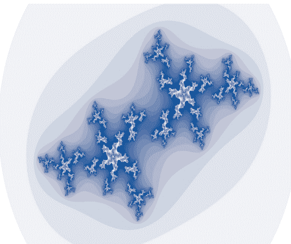

图4-9：k = -0.6+0.6i的朱利亚集，产生复杂的康托尔尘

### 4.8.4 复数

实现一个类似于曼德布罗特集的朱利亚集（二次多项式）可视化。唯一的区别是，添加到平方函数中的常数与像素位置无关。本质上，你需要引入一个常数k并稍微修改迭代。

- 从k = -0.6 + 0.6i开始（图4-9），这是一个复杂的康托尔尘，也称为法托尘。
- 尝试其他k值，如0.3553 + 0.288i（[比较](http://warp.povusers.org/Mandelbrot)）。最终你可能想要更改颜色方案以得出更酷的可视化效果。

- 软件设计的挑战是为曼德布罗特集和朱利亚集编写代码冗余最少的实现。（算法上的挑战可能是找到对所有k都看起来不错的颜色。但这超出了本书的范围。）

- 进阶：两个分形可以以交互方式结合。为此，需要提供两个窗口。第一个窗口像以前一样绘制曼德布罗特集。此外，它可以启用鼠标输入，以便将鼠标光标下的复杂值用作第二个窗口中朱利亚集的k。

- 更进阶：如果朱利亚集的计算太慢，可以使用线程并行，甚至使用CUDA或OpenGL进行GPU加速。

### 4.8.5 并行向量加法

编写两个向量相加的并行执行（例如使用`c++03/vector_test.cpp`中的代码）。启动两个`thread`执行，并测量不同向量大小的运行时间。

### 4.8.6 重构并行加法

重构练习4.8.5中的实现。使用`async`代替`thread`。并行任务的数量应由可用硬件线程决定，由静态方法`thread::hardware_concurrency`给出。

## 第5章

### 元编程

> “终极的奥秘是自身。”
> ——萨米·戴维斯 Jr.

元程序是关于程序的程序。我们将在本章中彻底讨论这个引人入胜的资产。特别是，我们将探讨它的三个主要应用：

- 编译时计算（§5.1）；
- 关于类型的信息及其转换（§5.2）；以及
- 代码生成（§5.3–§5.4）。

这些技术使我们能够使前几章中的示例更可靠、更高效、更广泛适用。在本章末尾（§5.6），我们将展示为什么在C++中每个算法都可以在编译期间计算。

### 5.1 让编译器计算

元编程的完整程度可能是由于一个bug而被发现的。Erwin Unruh在90年代初编写了一个程序，该程序将素数作为错误消息打印出来，从而证明C++编译器能够进行计算。这个程序无疑是最著名的无法编译的C++代码。感兴趣的读者将在A.9.1节中找到它。请将此视为异常行为的证据，而不是你程序的灵感。

编译时计算可以通过两种方式实现：与模板元函数向后兼容，或更轻松地使用constexpr。最后一个特性是在C++11中引入并在随后的标准中扩展的。

#### C++11 5.1.1 编译时函数

```
=> c++11/fibonacci.cpp
```

在实现素数示例之前，我们先从更简单的东西开始：斐波那契数。它们可以递归计算：

点击此处查看代码图片

```
constexpr long fibonacci(long n)
{
    return n <= 2 ? 1 : fibonacci(n - 1) + fibonacci(n - 2);
}
```

C++11中的constexpr在大多数情况下是单个return语句。我们还被允许包含某些不进行计算的语句：空语句、static_assert、类型定义以及using声明和指令。与常规函数相比，constexpr相当限制：

- 它不能读取或写入函数外的任何内容。即，没有副作用！
- 它不能包含变量。¹
- 它不能包含if或for等控制结构。¹
- 它只能包含单个计算语句。¹
- 它只能调用也是constexpr的函数。

1. 仅在C++11中。此限制在C++14中已解除。我们将在5.1.2节中讨论此问题。

另一方面，与C++03中的传统模板元函数（§5.2.5）相比，constexpr函数明显更灵活：

- 我们可以传入浮点类型（在C++20中也可用于模板参数）。
- 我们甚至可以处理用户类型（如果它们可以在编译时处理）。
- 我们可以使用类型检测。
- 我们可以定义成员函数。
- 我们可以使用条件（比特化更简单）。
- 我们可以使用运行时参数调用函数。

最近的标准中解除了类模板的大部分这些限制，但`constexpr`函数仍然是编译时计算的更好方法。

对于浮点数，一个简单的函数是`square`：

点击此处查看代码图片

```
constexpr double square(double x)
{
    return x * x;
}
```

浮点类型不允许作为模板参数（在C++20之前），在C++11之前根本不可能使用浮点数进行编译时计算。我们可以用模板参数将前面的函数推广到所有合适的数值类型：

```
template <typename T>
constexpr T square(T x)
{
    return x * x;
}
```

该泛化函数在某些条件下甚至接受用户类型。一个类型是否适合`constexpr`函数取决于其成员。例如，volatile成员、指针和虚函数会阻碍编译时对象的创建。

C++20 在C++20中，更多类型——例如`string`和`vector`——在某些条件下允许在编译时使用。尽管这些条件在标准中有描述，但深奥的技术规范


这并不明确说明这在程序员的日常工作中究竟意味着什么。此外，在撰写本文时，没有编译器支持此功能²，因此我们只能将来再尝试。

- 2. 更具体地说，尝试用 clang++-13、g++-11 和 VS19 编译 c++20/constexpr_vector_string.cpp 失败了。

语言标准试图定义类型在 constexpr 函数中可用的条件。结果发现，这无法作为类型属性来定义，因为它取决于类型的使用方式——更准确地说，取决于所考虑的 constexpr 函数中调用的是哪个构造函数。因此，相应的类型特征 is_literal_type 注定无用，并自 C++14 起被声明为弃用。³

- 3. 尽管如此，人们仍注意到无用的结果是明确定义的。

constexpr 函数一个非常好的特性是它们既可在编译时也可在运行时使用：

点击此处查看代码图像

```
long n = atoi(argv[1]);
cout << "fibonacci(" << n << ") = " << fibonacci(n) << '\n';
```

这里我们传递了命令行的第一个参数（在编译时肯定未知）。因此，每当有一个或多个参数仅在运行时才知晓时，函数就无法在编译时求值。只有当所有函数参数在编译时都可用时，函数才能在编译期间计算。

constexpr 函数的混合适用性反过来意味着，它们的参数只能传递给 constexpr 函数。将参数传递给普通函数会阻碍在编译时使用。反之，我们不能将函数参数传递给像 static_assert 这样的编译时求值，因为这会阻止运行时调用。因此，我们无法在 C++11 的 constexpr 函数中表达断言。

语言标准规定标准库中哪些函数必须实现为 constexpr。某些库实现将额外的函数实现为 constexpr。例如，以下函数：

点击此处查看代码图像

```
constexpr long floor_sqrt(long n)
{
    return floor(sqrt(n));
}
```

g++ 支持（尽管不是所有版本都支持）。相比之下，floor 和 sqrt 在 clang++ 中不是 constexpr 函数，因此代码在那里无法编译。

=> c++20/fibonacci.cpp

C++20 为了强制在编译时对函数求值，我们可以在 C++20 中将其声明为 consteval：

点击此处查看代码图像

```
consteval long fibonacci(long n)
{
    return n <= 2 ? 1 : fibonacci(n - 1) + fibonacci(n - 2);
}
```

使用运行时参数调用此函数会导致错误。

## C++14 5.1.2 扩展的编译时函数

C++14 和 C++20 放宽了对编译时函数的限制。这使我们可以额外使用：

- void 函数，例如：

点击此处查看代码图像

```
constexpr void square(int &x) { x *= x; }
```

- 自 C++20 起的虚函数（§6.1.3）；
- 自 C++20 起的协程（§4.6.8）；
- 局部变量，只要它们
  - 已初始化（C++20 之前）；
  - 既没有静态存储持续期也没有线程存储持续期；并且
  - 具有字面量类型。
- 控制结构，但以下除外：
  - goto（我们反正也不想使用）；
  - 汇编代码，即 asm 块（在 C++20 中已解除限制）；并且
  - try-catch 块（在 C++20 中已解除限制）。

以下示例在 C++14 中允许，但在 C++11 中不允许（出于多种原因）：

点击此处查看代码图像

```
template <typename T>
constexpr T power(const T& x, int n)
{
    T r{1};
    for (; n > 0; --n)
        r *= x;
    return r;
}
```

=> c++14/popcount.cpp

有了这些扩展，编译时函数几乎和普通函数一样富有表现力。作为一个更技术性的示例，我们还将实现 popcount（population count 的缩写），它用于计算二进制数据中 1 比特的数量：

点击此处查看代码图像

```
constexpr size_t popcount(size_t x)
{
    size_t count = 0;
    for (; x != 0; ++count)
        x &= x - 1;
    return count;
}
```

分析此算法也有助于更好地理解二进制算术。这里的关键思想是，x &= x - 1 将最低有效位设置为零，并保持所有其他位不变。

=> c++11/popcount.cpp

[C++11] 该函数也可以在 C++11 中表示为 constexpr，并且在递归表达中更短：

点击此处查看代码图像

```
constexpr size_t popcount(size_t x)
{
    return x == 0 ? 0 : popcount(x & x-1) + 1;
}
```

这种无状态的递归计算对某些读者来说可能不太容易理解，而对另一些读者来说可能更清晰。据说，发现迭代或递归程序更容易理解取决于它们向程序员介绍的顺序。幸运的是，C++ 允许我们同时实现两者。

## C++14 5.1.3 素性

我们已经提到过，素数是第一个严肃元程序的主题，尽管不可编译。现在我们想演示，我们可以在（可编译的）现代 C++ 中计算它们。更准确地说，我们将实现一个函数，在编译时告诉我们给定的数字是否为素数。你可能会问：“我编译期间到底需要这些信息干什么？”这是个公正的问题。实际上，作者曾在他的研究中使用过这个编译时函数，用于对带有语义概念的循环群进行分类（§3.10）。当群的大小是素数时，它是一个域，否则是一个环。一个实验性编译器（ConceptGCC [24]）在 C++ 中启用了这样的代数概念，它们的模型声明包含了素性的编译时检查（不幸的是，在 `constexpr` 可用之前）。

=> c++14/is_prime.cpp

我们重用第 4.6.3 节的算法思路：1 不是素数，偶数除了 2 都不是素数，对于所有其他数字，我们检查它们是否不能被任何大于 1 且小于其自身的奇数整除：

点击此处查看代码图像

```
constexpr bool is_prime(int i)
{
  if (i == 1)
    return false;
  if (i % 2 == 0)
    return i == 2;
  for (int j = 3; j < i; j+= 2)
    if (i % j == 0)
        return false;
  return true;
}
```

实际上，我们只需要测试参数 i 的平方根以下的奇数的整除性：


```
constexpr bool is_prime(int i)
{
    if (i == 1)
        return false;
    if (i % 2 == 0)
        return i == 2;
    int max_check= static_cast<int>(sqrt(i)) + 1;
    for (int j = 3; j < max_check; j+= 2)
        if (i % j == 0)
            return false;
    return true;
}
```

不幸的是，此版本仅适用于 `sqrt` 是 `constexpr` 的标准库（大多数 4.7 及以上版本的 g++）。否则，我们必须提供自己的 `constexpr` 实现。例如，我们可以使用第 4.3.1 节中的定点算法：


```
constexpr int const_abs(int i) { return i < 0 ? -i : i; }

constexpr int square_root(int x)
{
    double r= x, dx= x;
    while (const_abs(r * r - dx) > 0.1) {
        r = (r + dx/r) / 2;
    }
    return static_cast<int>(r);
}
```

这里我们以 `double` 执行迭代方法，仅在返回结果时将其转换为 `int`。这得出了一个（足够）高效且可移植的实现：


```
constexpr bool is_prime(int i)
{
    if (i == 1)
        return false;
    if (i % 2 == 0)
        return i == 2;
    int max_check= square_root(i) + 1;
    for (int j = 3; j < max_check; j+= 2)
        if (i % j == 0)
            return false;
    return true;
}
```

通过这个示例，我们看到了编译时求值性能的提升。大约在 2006 年，该函数对接近 100 万的素数耗时约 18 秒，对接近 1000 万的素数耗时约一分钟。在 g++-10 上使用 `constexpr` 时，测试接近 10 亿的素数使编译时间增加了约 0.02 秒。

=> c++11/is_prime.cpp

最后，我们喜欢接受挑战，使用 C++11 中受限的 `constexpr` 来实现这个（嗯，它的第一个版本）：

点击此处查看代码图像

```
constexpr bool is_prime_aux(int i, int div)
{
    return div >= i ? true :
           (i % div == 0 ? false : is_prime_aux(i, div + 2));
}

constexpr bool is_prime(int i)
{
    return i == 1 ? false :
           (i % 2 == 0 ? i == 2 : is_prime_aux(i, 3));
}
```

这里我们需要两个函数：一个用于特殊情况，另一个用于检查从 3 开始的奇数的整除性。

**向后兼容性：** 在引入 `constexpr` 之前，编译时计算是通过模板 _元函数_ 实现的。它们更难实现，并且在 C++20 之前，它们的适用性也更受限制（既不支持 `float` 也不支持用户定义的类型）。如果你无法使用 C++11

出于某种原因对某些特性感兴趣，或只是对历史编程感兴趣，欢迎阅读第 A.9.2 节中的元函数部分。

## C++11 5.1.4 我们的常量有多恒定？

将（非成员）变量声明为 `const`:

```
const int i = something;
```

可以建立两个层次的常量性：

- 1. 对象在程序执行期间不能更改（始终如此）。
- 2. 值在编译时已知（有时如此）。

`i` 的值在编译期间是否可用取决于赋给它的表达式。如果 `something` 是像这样的字面量：

```
const long i = 7, j = 8;
```

那么我们可以在编译期间使用它，例如，作为模板参数：

点击此处查看代码图像

```
template <long N>
struct static_long
{
    static const long value= N;
};
static_long<i> si;
```

编译时常量的简单表达式通常在编译期间可用：

```
const long k= i + j;
static_long<k> sk;
```

当我们将一个变量赋给 `const` 对象时，它在编译期间绝对不可用：

点击此处查看代码图像

```
long ll;
cin >> ll;
```

```
const long cl=11;
static_long<cl> scl; // Error
```

常量 cl 在程序中不能更改。另一方面，它不能在编译期间使用，因为它依赖于运行时值。存在一些场景，我们无法从程序源码中得知拥有何种类型的常量，例如：

点击此处查看代码图像

```
const long ri= floor(sqrt(i));
static_long<ri> sri; // ok with most g++ versions
```

在这里，当标准库实现中 sqrt 和 floor 都是 constexpr 时（例如，在大多数 4.7 及以后的 g++ 版本中），ri 在编译期间已知；否则，将其用作模板参数时会报错。

要确保常量具有编译时值，我们必须将其声明为 constexpr：

点击此处查看代码图像

```
constexpr long ri= floor(sqrt(i)); // compiles with g++ 4.7-4.9
```

这保证了 ri 在编译期间已知；否则该行无法编译。请注意，constexpr 对变量比对函数更严格。constexpr 变量仅接受编译时值，而 constexpr 函数既接受编译时参数也接受运行时参数。显然，这要求类型可以在编译时表示：

点击此处查看代码图像

```
constexpr string name1("Herbert"); // Error (currently)
constexpr string_view name2("Herbert"); // Requires C++17
```

字符串（目前）不允许在编译时4 使用，因为它动态管理内存，而 string_view 引用在编译时可用的外部内存（在此例中为可执行文件中的字符序列）。

4. C++20 允许在编译时进行受限的内存处理，这应该允许编译时字符串。然而，撰写时的当前编译器（g++-10 和 clang++-11）仍然拒绝这一行。

[C++20] C++20 引入了 `constinit` 说明符，以要求初始化在编译时完成，而对象在其生命周期内可以更改，且析构函数不必是 `constexpr`。它只能用于 `static` 或 `thread_local` 存储持续时间，不能用于局部变量。这允许解决旧的 C++ 问题：程序员无法控制静态变量的初始化顺序。在某些情况下，这会导致未定义行为，例如当静态成员变量在全局变量的构造函数中被使用时。这种所谓的静态初始化顺序灾难可以通过在编译时（至少部分地）初始化 `static` 或 `thread_local` 变量来克服。然而，此问题在设计良好的软件项目中很少发生（全局变量很少或没有），如果你遇到它，首先应自问是否真的需要所有全局或线程局部变量。因此，这项新功能主要不是为了现代化你的程序，而是一种应对遗留问题的工具。

## [C++17] 5.1.5 编译时 Lambda

=> c++17/constexpr_lambda.cpp

为了进一步提高 lambda 的适用性，现在可以在编译时使用它们。假设我们有一个 `constexpr` 函数，用于用一元函数或函子转换容器：

> 点击此处查看代码图像

```
template <typename Container, typename Functor>
constexpr Container transform(const Container& c, Functor f)
{
    Container t{};
    for (unsigned i = 0; i < size(c); ++i)
        t[i] = f(c[i]);
    return t;
}
```

我们使用此转换向 `array` 的元素添加 3，或者更准确地说，创建一个新数组，其元素大 3：

> 点击此处查看代码图像

```
constexpr int inc_by_3(int i) { return i + 3; }

constexpr array<int, 6> a(3, 7, 2, 4, 5, 9);
```

```
constexpr auto daf= transform(a, inc_by_3);
```

与事先编写 `constexpr` 函数不同，我们可以直接在函数调用中创建 `constexpr` lambda：

点击此处查看代码图像

```
constexpr auto dall= transform(a,
[] (int i) constexpr (return i+3;));
```

关键字 `constexpr` 放置在参数之后、返回类型之前（如果提供），类似于 `mutable`。我们实际上可以省略此限定符，因为自 C++17 起，只要实现允许，所有 lambda 都是 `constexpr`。因此，以下语句与前一条等价：

点击此处查看代码图像

```
constexpr auto dall= transform(a, [] (int i) (return i+3;));
```

然而，我们可能会保留此限定符，以更好地表达意图，并在 lambda 声明中获得编译器错误，如果某些实现细节阻止了 lambda 在编译时使用。除了调用非 `constexpr` 函数或使用非字面类型外，捕获变量会阻碍编译时使用：

点击此处查看代码图像

```
int inc= 3;
constexpr auto dal2= transform(a,
[inc](int i) (return i+inc;)); //
Error
```

相比之下，捕获编译时常量是可以的：

点击此处查看代码图像

```
constexpr int cinc= 3;
constexpr auto dal2= transform(a,
[cinc](int i) (return i+cinc;)); //
Ok
```

我们实际上甚至不需要捕获 `cinc`（一些编译器会对此发出警告）。是否可以捕获普通常量取决于编译器在编译时评估所赋表达式的能力——我们刚才在前一节中讨论过这一点——我们最好避开它们，在这样的 lambda 中仅限于使用 `constexpr` 常量。

## 5.2 提供和使用类型信息

在第 3 章中，我们看到了函数和类模板的表达能力。然而，函数对所有可能的参数类型都有完全相同的代码，而类需要通过特化进行完全重新实现。为了进一步提高模板的表达能力，我们将根据参数类型引入大小不一的代码变体。因此，我们首先需要类型信息来进行分发。此类类型信息可以是技术性的——例如 `is_const` 或 `is_reference`——也可以是语义/领域特定的——例如 `is_matrix` 或 `is_pressure`。对于大多数技术类型信息，我们将在头文件 `<type_traits>` 和 `<limits>` 中找到库支持，如第 4.3 节所示。领域特定的类型属性等待我们来实现。

### 5.2.1 类型特征

=> c++11/magnitude_example.cpp

在迄今为止编写的函数模板中，临时变量和返回值的类型等于函数参数之一。不幸的是，这并不总是有效。假设我们实现一个函数，从两个值中返回幅度最小的那个：

点击此处查看代码图像

```
template <typename T>
T inline min_magnitude(const T& x, const T& y)
{
    using std::abs;
    T ax= abs(x), ay= abs(y);
    return ax < ay ? x : y;
}
```

我们可以对 `int`、`unsigned` 或 `double` 值调用此函数：

点击此处查看代码图像


```cpp
double d1 = 3., d2 = 4.;
cout << "min |d1, d2| = " << min_magnitude(d1, d2) << '\n';
```

如果我们用两个复数值调用此函数：

点击此处查看代码图像

```cpp
std::complex<double> c1(3.), c2(4.);
cout << "min |c1, c2| = " << min_magnitude(c1, c2) << '\n';
```

我们将看到类似这样的错误消息：

点击此处查看代码图像

```
no match for 'operator<<' in 'ax < ay'
```

问题在于，abs 在这里返回 double 值，这些值提供比较运算符，但我们将结果作为复数值存储在临时对象中。

C++11 我们现在有多种方法来解决这个问题。例如，我们可以通过不存储两个大小来直接比较，从而完全避免临时对象。在 C++11 或更高版本中，我们可以让编译器推断临时对象的类型：

点击此处查看代码图像

```cpp
template <typename T>
T inline min_magnitude(const T& x, const T& y)
{
    using std::abs;
    auto ax = abs(x), ay = abs(y);
    return ax < ay ? x : y;
}
```

在本节中，为了演示起见，我们选择了一种更显式的方法：可能的参数类型的大小类型由用户提供。在较新的标准中，显式类型信息不那么重要，但并非完全多余。此外，了解基本机制有助于我们理解棘手的实现。

在 C++ 中，类型属性由 类型萃取（Type Traits）提供。这些本质上是带有类型参数的元函数。对于我们的示例，我们将编写一个类型萃取来提供大小的类型（对于 C++03，只需将每个 using 替换为传统的 typedef）。这是通过模板特化实现的：

点击此处查看代码图像

```cpp
template <typename T>
struct Magnitude {};
```

```cpp
template <>
struct Magnitude<int>
{
    using type = int;
};
```

```cpp
template <>
struct Magnitude<float>
{
    using type = float;
};
```

```cpp
template <>
struct Magnitude<double>
{
    using type = double;
};
```

```cpp
template <>
struct Magnitude<std::complex<float>>
{
    using type = float;
};
```

```cpp
template <>
struct Magnitude<std::complex<double>>
{
    using type = double;
};
```

诚然，这段代码相当笨拙。我们可以通过假设“如果我们不知道更好的情况，就假设 T 的 Magnitude 类型就是 T 本身”来缩写第一个定义。

```cpp
template <typename T>
struct Magnitude
{
    using type = T;
};
```

这对所有内置类型都成立，我们用一个定义就能正确处理它们。这个定义的一个小缺点是，它错误地适用于所有没有专门特性的类型。对于已知上述定义不正确的类，它们都是类模板 complex 的所有实例化。因此，我们像这样定义特化：

点击此处查看代码图像

```cpp
template <>
struct Magnitude<std::complex<double> >
{
    using type = double;
};
```

与其为 complex<float>、complex<double> 等分别定义，不如对所有复数类型使用偏特化：

点击此处查看代码图像

```cpp
template <typename T>
struct Magnitude<std::complex<T> >
{
    using type = T;
};
```

既然类型萃取已定义，我们可以在函数中使用它们：

点击此处查看代码图像

```cpp
template <typename T>
T inline min_magnitude(const T& x, const T& y)
{
    using std::abs;
    typename Magnitude<T>::type ax = abs(x), ay = abs(y);
    return ax < ay ? x : y;
}
```

我们还可以将此定义扩展到（数学）向量和矩阵，例如，确定范数的返回类型。特化如下：

点击此处查看代码图像

```cpp
template <typename T>
struct Magnitude<vector<T> >
{
    using type = T;        // not really perfect
};
```

然而，当向量的值类型为复数时，其范数不会是复数。因此，我们不需要值类型本身，而需要其相应的 Magnitude：

点击此处查看代码图像

```cpp
template <typename T>
struct Magnitude<vector<T> >
{
    using type = typename Magnitude<T>::type;
};
```

实现类型萃取需要一些可感知的编程努力，但之后它会通过实现更强大的编程而得到回报。

## C++11 5.2.2 条件异常处理

=> c++11/vector_noexcept.cpp

在第 1.6.2.6 节中，我们介绍了 noexcept 限定符，它表示函数不允许抛出异常（即，不会生成异常处理代码，最终的异常会终止程序，或者在 C++17 之前，则会调用 unexpected 函数）。对于函数模板，是否不抛出异常可能取决于类型参数。

例如，当参数类型具有不抛出异常的拷贝构造函数时，clone 函数不会抛出异常。标准库为此提供了一个类型萃取：

点击此处查看代码图像

```
std::is_nothrow_copy_constructible
```

这使我们能够在 clone 函数中有条件地表达无异常：

点击此处查看代码图像

```cpp
#include <type_traits>

template <typename T>
inline T clone(const T& x)
    noexcept(std::is_nothrow_copy_constructible<T>::value)
{
    return T(x);
}
```

你可能会觉得这个实现有些不成比例：函数头的大小是函数体的许多倍。老实说，我们有同样的感觉，并认为这种冗长的声明只有在最高编码标准下的高频使用函数中才是必要的。条件 noexcept 的另一个用例是两个向量的泛型加法，当向量类的下标运算符不抛出异常时，该加法将不抛出异常：

点击此处查看代码图像

```cpp
template <typename T>
class my_vector
{
 const T& operator[](int i) const noexcept;
};

template <typename Vector>
inline Vector operator+(const Vector& x, const Vector& y)
 noexcept(noexcept(x[0]))
{ ... }
```

双重 noexcept 当然需要一些熟悉。这里外层的是有条件声明，内层的是对表达式的相应条件。当找到相应表达式的 noexcept 声明时，此条件成立——这里是 x 的类型的下标运算符。例如，如果我们添加两个 my_vector 类型的向量，加法将被声明为 noexcept。

## 5.2.3 一个 const-干净的视图示例

=>c++11/trans_const.cpp

在本节中，我们将使用类型萃取来解决视图的技术问题。视图是提供对另一个对象不同视角的小对象。一个典型的用例是矩阵转置。当然，提供转置矩阵的一种方法是创建一个具有相应互换值的新矩阵对象。这是一个相当昂贵的操作：它需要内存分配和释放，并复制矩阵的所有数据并切换值。正如我们将看到的，视图更高效。

### 5.2.3.1 编写一个简单的视图类

与使用新数据构造对象不同，视图仅引用现有对象并调整其接口。这对于矩阵转置非常有效，因为我们只需要在接口中切换行和列的角色：

### 列表 5-1：简单视图实现

点击此处查看代码图像

```cpp
template <typename Matrix>
class transposed_view
{
public:
    using value_type = typename Matrix::value_type;
    using size_type = typename Matrix::size_type;

    explicit transposed_view(Matrix& A) : ref(A) {}

    value_type& operator() (size_type r, size_type c)
    { return ref(c, r); }

    const value_type& operator() (size_type r, size_type c)
    const { return ref(c, r); }

private:
    Matrix& ref;
};
```

这里我们假设 Matrix 类提供一个接受两个参数（行和列索引）的 operator() 并返回相应条目 a_ij 的引用。我们还假设 value_type 和 size_type 已定义类型萃取。在这个小示例中，这就是我们需要知道的关于被引用矩阵的全部内容（理想情况下，我们会为简单矩阵指定一个概念）。当然，像 MTL4 这样的真实模板库提供更大的接口。但是，这个小示例足以演示在某些视图中使用元编程。

transposed_view 类的对象可以像常规矩阵一样处理；例如，它可以传递给所有期望矩阵的函数模板。转置是通过调用被引用对象的带有交换索引的 operator() 即时实现的。对于每个矩阵对象，我们可以定义一个表现得像矩阵的转置视图：

点击此处查看代码图像


```cpp
mtl::dense2D<float> A = {{2, 3, 4},
    {5, 6, 7},
    {8, 9, 10}};
transposed_view<mtl::dense2D<float>> At(A);
```

当我们访问 At(i, j) 时，将得到 A(j, i)。我们还定义了非 const 访问，以便我们甚至可以修改条目：

```cpp
At(2, 0) = 4.5;
```

此操作将 A(0, 2) 设置为 4.5。转置视图对象的定义并不会导致特别简洁的程序。为方便起见，我们添加一个返回转置视图的函数：

```cpp
template <typename Matrix>
inline transposed_view<Matrix> trans(Matrix& A)
{
    return transposed_view<Matrix>(A);
}
```

现在我们可以在科学软件中优雅地使用 `trans`，例如在矩阵-向量乘积中：

```cpp
v = trans(A) * q;
```

在这种情况下，会创建一个临时视图并在乘积中使用。由于大多数编译器会内联视图的 `operator()`，使用 `trans(A)` 进行的计算将与使用 `A` 一样快，只是内存访问的顺序可能会影响性能。

## 5.2.3.2 处理 const 性

到目前为止，我们的视图工作良好。问题出现在常量矩阵的转置视图中：

```cpp
const mtl::dense2D<float> B(A);
```

我们仍然可以创建 B 的转置视图，但无法访问其元素：

```cpp
cout << "trans(B) (2, 0) = " << trans(B) (2, 0) << '\n'; // Error
```

编译器会告诉我们无法从 `const float` 初始化 `float&`。当我们查看错误位置时，我们意识到这发生在运算符的非 const 重载中。这就引发了一个问题：为什么没有使用 const 重载，因为它返回常量引用且完全符合我们的需求。

首先，我们想检查 `ref` 成员是否真的是常量。我们在类定义或函数 `trans` 中从未使用过 `const` 说明符。帮助来自 *运行时类型识别 (RTTI)*。我们添加头文件 `<typeinfo>` 并打印类型信息：

```cpp
#include <typeinfo>
...
```

```cpp
cout << "trans(A) = " << typeid(tst::trans(A)).name() << '\n';
cout << "trans(B) = " << typeid(tst::trans(B)).name() << '\n';
```

使用 `g++` 将产生以下输出：

```cpp
typedef of trans(A) =
N3tst5ITransposed_viewIN3tl6matrix7dense2DIfNS2_10parametersINS1_3Tag9row_majorENS1_5index7c_indexENS1_9non_fixed10dimensionsELb0EEEEEEE
typedef of trans(B) =
N3tst5ITransposed_viewIN3tl6matrix7dense2DIFNS2_10parametersINS1_3Tag9row_majorENS1_5index7c_indexENS1_9non_fixed10dimensionsELb0EEEEEEE
```

这里的输出并不十分易读。当你使用 Visual Studio 时，很幸运能通过 `typeid` 看到原始类型名称。不幸的是，在我们看到的所有其他编译器中，RTTI 打印的类型都是名称修饰过的。当我们非常仔细地观察时，可以看到第二行中多出的 `K`，它告诉我们该视图是用常量矩阵类型实例化的。尽管如此，我们建议你不要浪费时间在修饰名上。获得可读类型名称的一个简单（且可移植！）技巧是引发如下错误消息：

```cpp
int ta = trans(A);
int tb = trans(B);
```

更好的方法是使用名称还原器。例如，GNU 编译器附带一个名为 c++filt 的工具，它也适用于 clang++。默认情况下它只还原函数名，我们需要标志 -t，如管道所示：trans_const|c++filt -t。然后我们将看到：

```cpp
typedef of trans(A) =
transposed_view<mtl::matrix<mtl::dense2D<float>,
mtl::matrix::parameters<mtl::tag::row_major,
mtl::index::c_index,
mtl::non_fixed::dimensions, false, unsigned long> >
>
typedef of trans(B) =
transposed_view<mtl::matrix<mtl::dense2D<float>,
mtl::matrix::parameters<mtl::tag::row_major,
mtl::index::c_index,
mtl::non_fixed::dimensions, false, unsigned long> >
const>
```

现在我们可以清楚地看到，trans(B) 返回一个模板参数为 const dense2D<...>（而非 dense2D<...>）的 transposed_view。因此，成员 ref 的类型为 const dense2D<...>&。现在回过头来看，这说得通。我们将一个类型为 const dense2D<...> 的对象传递给函数 trans，该函数接受类型参数 Matrix&。因此，Matrix 被替换为 const dense2D<...>，返回类型相应地为 transposed_view<const dense2D<...> >。经过这次简短的类型内省之旅后，我们确信成员 ref 是一个常量引用。会发生以下情况：

- 当我们调用 trans(B) 时，函数的模板参数被实例化为 const dense2D<float>。
- 因此，返回类型是 transposed_view<const dense2D<float> >。
- 构造函数参数的类型是 const dense2D<float>&。
- 同样，成员 ref 是 const dense2D<float>&。

仍然存在一个问题：尽管我们引用的是常量矩阵，为什么调用的是运算符的非 const 版本？答案是，ref 的常量性对选择无关紧要，关键在于视图对象本身是否是常量。为了确保视图也是常量，我们可以写：

```cpp
const transposed_view<const mtl::dense2D<float> > Bt{B};
cout << "Bt(2, 0) = " << Bt(2, 0) << '\n';
```

这可行，但相当笨拙。为使常量矩阵的视图得以编译，一种粗暴的方法是去除 const 性。不希望的结果是，常量矩阵上的可变视图将允许修改所谓的常量矩阵。这严重违反了我们的原则，以至于我们甚至不展示代码会是什么样子。

## 规则

仅将去除 const 性视为最后的手段。

在接下来的内容中，我们将为你提供非常强大的方法来正确处理 const 性。每个 const_cast 都是严重设计错误的指标。正如 Herb Sutter 和 Andrei Alexandrescu 所说：“一旦你使用 const，你（应该）就再也不要回头。”我们需要 const_cast 的唯一情况是处理 const 不正确的第三方软件，即只读参数作为可变指针或引用传递的情况。这不是我们的错，我们别无选择。不幸的是，仍然有许多包完全忽略 const 限定符。其中一些太大，无法快速重写。我们能做的最好的是在其之上添加一个适当的 API，并避免使用原始 API。这使我们免于在应用程序中滥用 const_cast，并将不可言说的 const_cast 限制在接口中。这样一个层的良好示例是 Boost::Bindings [44]，它为 BLAS、LAPACK 以及其他具有同样老派接口（委婉地说）的库提供了 const 正确的高质量接口。反之，只要我们只使用自己的函数和类，就能付出多少额外工作来避免每个 const_cast。

为了正确处理常量矩阵，我们可以为它们实现第二个视图类，并相应地重载 trans：

```cpp
template <typename Matrix>
class const_transposed_view
{
public:
    using value_type = typename Matrix::value_type;
    using size_type = typename Matrix::size_type;

    explicit const_transposed_view(const Matrix& A) : ref(A)
    {}

    const value_type& operator()(size_type r, size_type c)
    const
    { return ref(c, r); }
private:
    const Matrix& ref;
};

template <typename Matrix>
inline const_transposed_view<Matrix> trans(const Matrix& A)
{
    return const_transposed_view<Matrix>(A);
}
```

有了这个额外的类，我们解决了问题。但为此添加了相当多的代码。比代码长度更糟糕的是冗余：我们的新类 `const_transposed_view` 与 `transposed_view` 几乎相同，只是不包含非 const `operator()`。
让我们寻找一个更高效、冗余更少的解决方案。为此，我们在接下来的内容中介绍两个新的元函数。

## 5.2.3.3 检查 const 性

我们在清单 5-1 中的视图存在的问题是，它不能在所有方法中正确处理常量类型作为模板参数。为了修改常量参数的行为，我们首先需要找出参数是否是常量。为此，标准库包含类型特征 `std::is_const`。这个元函数通过偏模板特化非常容易实现：

```cpp
template <typename T>
struct is_const
{
    static const bool value = false;
};
```


};
template <typename T>
struct is_const<const T>
{
    static const bool value= true;
};

常量类型同时匹配两个定义，但第二个定义更具体，因此会被编译器选中。非常量类型仅匹配第一个定义。请注意，我们只查看最外层类型：模板参数的常量性不予考虑。例如，view<const matrix> 不被视为常量，因为视图本身不是 const。

## C++14 5.2.3.4 变量模板

变量模板在元编程中非常有用。除了我们的 is_const 类型特征外，我们还可以定义：

点击此处查看代码图片

```
template <typename T>
constexpr bool is_const_v = is_const<T>::value;
```

这样我们在每次使用该值时就无需再追加 ::value。

C++17 为所有基于值的类型特征添加了带有 _v 后缀的相应变量模板，就像我们在这里所做的那样，例如，is_pointer 现在伴随有 is_pointer_v。当然，is_const_v 也在标准库中可用。

## 5.2.3.5 编译时分支

我们视图所需的另一个工具是基于逻辑条件的类型选择。这项技术由 Krzysztof Czarniecki 和 Ulrich Eisenecker [10] 引入。标准库中将编译时 If 命名为 conditional。它可以通过相当简单的实现来实现：

### 列表 5-2: conditional 即编译时 if

点击此处查看代码图片

```
template <bool Condition, typename ThenType, typename ElseType>
struct conditional
{
    using type= ThenType;
};

template <typename ThenType, typename ElseType>
struct conditional<false, ThenType, ElseType>
{
    using type= ElseType;
};
```

当用逻辑表达式和两种类型实例化此模板时，只有当第一个参数求值为 true 时，主模板（上方）才会匹配，并且 ThenType 用于类型定义中。如果第一个参数求值为 false，则特化版本（下方）更具体，因此使用 ElseType。像许多巧妙的发明一样，一旦找到它就非常简单。这个元函数是 C++11 的一部分，位于头文件 <type_traits> 中。

5. 使用 C++03 时，可以使用 Boost 元编程库（MPL）中的 boost::mpl::if_c。如果同时使用标准库和 Boost 类型特征进行编程，请注意不同的命名约定。

这个元函数允许我们定义一些有趣的事情，例如当最大迭代次数大于 100 时为临时变量使用 double，否则使用 float：

点击此处查看代码图片

```
using tmp_type=
    typename conditional<(max_iter > 100), double,
    float>::type;
cout << "typeid = " << typeid(tmp_type).name() << '\n';
```

不言而喻，max_iter 必须在编译时已知。诚然，这个示例看起来并不十分有用，元 if 在小型孤立代码片段中也不那么重要。相比之下，在开发大型通用软件包时，它变得极其重要。请注意，比较被括号包围；否则，大于号 > 会被解释为模板参数的结束。同样，在 C++11 或更高版本中，包含右移 >> 的表达式也必须用括号包围，原因相同。

[C++14] 为了在引用结果类型时免去输入 `typename` 和 `::type` 的麻烦，C++14 引入了模板别名：

点击此处查看代码图片

```
template <bool b, class T, class F>
using conditional_t = typename conditional<b, T, F>::type;
```

## 5.2.3.6 最终视图

现在我们有工具来区分所引用 `Matrix` 类型的常量性。我们可以尝试使可变括号运算符消失，就像我们将在 5.2.6 节中对其他函数所做的那样。不幸的是，这种技术仅适用于函数本身的模板参数，而不适用于封闭类的模板参数。⁶

6. 存在引入依赖于类模板参数的人工函数模板参数的 hack，但这相当不优雅，应尽可能避免。C++20 概念提供了一个简单而优雅的解决方案，因此我们将在本章后面详细介绍概念。

因此，我们保留可变访问运算符和常量访问运算符，但根据模板参数的类型选择前者的 `return` 类型：

### 列表 5-3: `const`-安全视图实现

点击此处查看代码图片

```
1 template <typename Matrix>
2 class transposed_view
3 {
4 public:
5 using value_type= Matrix::value_type;
6 using size_type= Matrix::size_type;
7 private:
8 using vref_type=
9 conditional_t<is_const<Matrix>::value,
10 const value_type&,
11 value_type&>;
12 public:
13 explicit transposed_view(Matrix& A) : ref(A) {}
14
15 vref_type operator()(size_type r, size_type c)
16 { return ref(c, r); }
17 const value_type& operator() (size_type r, size_type c) const
18 { return ref(c, r); }
19
20 private:
21 Matrix& ref;
22 };
```

此实现区分了可变视图在常量和可变引用矩阵之间的返回类型。如下面的案例研究所示，这建立了所需的行为。当引用的矩阵是可变时，`operator()` 的返回类型取决于视图对象的常量性：

- 如果视图对象是可变的，则第 14 行的 `operator()` 返回可变引用（第 10 行），并且
- 如果视图对象是常量的，则第 17 行的 `operator()` 返回常量引用。

这与列表 5-1 中之前的行为相同。如果矩阵引用是常量的，则始终返回常量引用：

- 如果视图对象是可变的，则第 14 行的 `operator()` 返回常量引用（第 9 行），并且
- 如果视图对象是常量的，则第 17 行的 `operator()` 返回常量引用。

总而言之，我们实现了一个视图类，仅当视图对象和引用的矩阵均为可变时才提供写入访问权限。

## C++20 5.2.4 参数化有理数

```
=> c++20/spaceship_rational_meta.cpp
```

在 2.7.5 节中，我们重载了 `rational` 类的飞船运算符，并说明其返回类型取决于比率是否以约简/规范形式存储。借助我们在此期间学到的技术，我们可以在单个类中处理规范和非规范的内部表示：

点击此处查看代码图片

```
template <bool Canonical= false>
class rational { ... }
```

首先，我们通过在规范形式中约分分子和分母来区分构造函数：

点击此处查看代码图片

```
rational(int p, unsigned q) : p{p}, q{q}
{
    if (q == 0)
        throw zero_denominator();
    if constexpr (Canonical) {
        auto g = gcd(abs(p), q);
        p /= g;
        q /= g;
    }
}
```

由于我们在编译时知道这一点，可以使用 constexpr-if 从而使区分零开销。飞船运算符可以保留其实现，我们只需区分返回类型：

点击此处查看代码图片

```
using ordering= std::conditional_t<Canonical,
    std::strong_ordering,
    std::weak_ordering>;
ordering operator <=> (const rational& r2) const {
    return p * r2.q <=> r2.p * q;
}
```

如果能将构造函数纳入其中，算术运算可能不需要太多区分。一个更好的解决方案是将约分从构造函数外包到一个单独的函数中：

点击此处查看代码图片

```
void reduce() & {
    if constexpr (Canonical) {
        auto g = gcd(abs(p), q);
        p /= g;
        q /= g;
    }
}
rational(int p, unsigned q) : p(p), q(q)
{
    if (q == 0)
        throw zero_denominator();
    reduce();
}
```

然后我们可以在构造函数以及 `operator+=` 等操作中调用这个 `reduce` 函数。如果 `Canonical` 为 false，则调用 `reduce` ——一个空函数，这一点在编译时已知——不会在可执行文件中生成代码。

## 5.2.5 领域特定类型属性

既然我们已经了解了标准库中类型特征的实现方式，就可以利用这些知识来实现领域特定的类型属性。不出所料，我们选择线性代数作为领域并实现 `is_matrix` 属性。为保险起见，只有在显式声明时，类型才被视为矩阵。因此，类型默认声明为不是矩阵：

点击此处查看代码图片

```
template <typename T>
struct is_matrix
{
    static const bool value= false;
};
```

C++11 标准库提供了一个仅包含此静态常量的 `false_type`。7 通过从这个元函数派生并（参见第 6 章）从 `false_type` 继承 `value`，我们可以省去一些输入：

7. 在 C++03 中，可以求助于 boost::mpl::false_。

```
template <typename T>
struct is_matrix
    : std::false_type
{};
```


现在我们为所有已知的矩阵类特化元谓词：

```
template <typename Value, typename Para>
struct is_matrix<mtl::dense2D<Value, Para> >
    : std::true_type
{};
// more matrix classes ...
```

谓词也可以依赖于模板参数。例如，我们可能有一个适用于矩阵和向量的 transposed_view 类（当然实现起来很棘手，但这是另一个问题）。当然，转置向量不是矩阵，而转置矩阵是：

```
template <typename Matrix>
struct is_matrix<transposed_view<Matrix> >
    : is_matrix<Matrix>
{};
// more views ...
```

更可能的是，我们将为转置矩阵和向量实现单独的视图，例如：

```
template <typename Matrix>
struct is_matrix<matrix::transposed_view<Matrix> >
    : std::true_type
{};
```

C++11 为确保我们的视图被正确使用，我们使用 static_assert 验证模板参数是一个（已知的）矩阵：

```
template <typename Matrix>
class transposed_view
{
    static_assert(is_matrix<Matrix>::value,
                  "Argument of this view must be a
matrix!");
    // ...
};
```

如果视图被一个不是矩阵（或未声明为矩阵）的类型实例化，编译将中止并打印用户定义的错误消息。由于 `static_assert` 不会产生运行时开销，应在任何可以在类型级别或关于编译时常量检测到错误的地方使用。直到 C++20，错误消息必须是字面量。以后的 C++ 版本希望允许我们使用类型信息组合消息。

当我们尝试带有静态断言编译测试时，我们会看到 `trans(A)` 可以编译但 `trans(B)` 不行。原因是 `const dense2D<>` 在模板特化中被视为与 `dense2D<>` 不同，因此它仍然不被视为矩阵。好消息是，我们不需要为可变类型和常量类型分别编写特化，而是可以为所有常量参数编写一个偏特化：

```
template <typename T>
struct is_matrix<const T>
    : is_matrix<T> {};
```

C++14 因此，每当类型 `T` 是矩阵时，`const T` 也是。与标准属性一样，我们声明一个变量模板：

```
template <typename T>
constexpr bool is_matrix_v = is_matrix<T>::value;
```

C++20 最先进的解决方案当然是定义一个概念：

```
template <typename T>
concept IsMatrix= is_matrix_v<T>;
```

```
template <IsMatrix Matrix>
class transposed_view ...
```

然后我们可以直接为模板参数要求它。

在OOP上下文中，类型特征在过去的项目中导致了过多的声明工作。为了克服这种冗长，我们现在采用一种基于函数重载的不同方法。我们将在介绍完所有OOP技术后，在第6.6.2节向您展示这种新技术。

## C++11 5.2.6 enable_if

元编程中一个非常强大的机制是 `enable_if`，由 Jaakko Järvi 和 Jeremiah Willcock 发现。它基于一种称为 `SFINAE: Substitution Failure Is Not An Error` 的函数模板编译约定。这意味着函数模板的头部无法用参数类型进行替换时，会被简单地忽略而不会导致错误。当函数的返回类型是模板参数的元函数时，就可能发生这种替换错误，例如：

```
template <typename T>
typename Magnitude<T>::type
inline min_abs(const T& x, const T& y)
{
    using std::abs;
    auto ax= abs(x), ay= abs(y);
    return ax < ay ? ax : ay;
}
```

在这里，我们的返回类型是 `T` 的 `Magnitude`。当 `Magnitude<T>` 对于 `x` 和 `y` 的类型不包含名为 `type` 的成员时，替换失败且函数模板被忽略。这种方法的好处是，当多个重载中恰好有一个可以成功替换时，函数调用可以被编译。或者当多个函数模板可以被替换且其中一个比其他所有都更具体时。`enable_if` 利用了这种机制。

在这里，我们将使用 `enable_if` 根据领域特定属性选择函数模板。作为展示，我们实现 $L_1$ 范数。它定义于向量空间和线性算子（矩阵）。虽然这些定义相关，但有限维向量和矩阵的实际实现有足够差异来证明多个实现的合理性。当然，我们可以为每种矩阵和向量类型实现 $L_1$ 范数，这样调用 `one_norm(x)` 就会为该类型选择合适的实现。

=> c++11/enable_if_example.cpp

为了提高生产力，我们希望为所有矩阵类型（包括视图）提供一个单一实现，为所有向量类型提供一个单一实现。我们使用元函数 `is_matrix` 并相应地实现 `is_vector`。此外，我们需要元函数 `Magnitude` 来处理复杂矩阵和向量的大小。为方便起见，我们还提供了一个模板别名 `Magnitude_t` 来访问包含的类型信息。

接下来，我们实现元函数 `enable_if`，它允许我们定义仅在给定条件成立时才可行的函数重载：

```
template <bool Cond, typename T= void>
struct enable_if {
    using type= T;
};

template <typename T>
struct enable_if<false, T> {};
```

它仅在条件成立时定义一个类型。我们的实现与 C++11 的 `<type_traits>` 兼容。这里的程序片段仅用于说明，而在生产软件中我们使用标准元函数。与 C++14 一样，我们想要添加一个模板别名以使记法更简洁：

```
template <bool Cond, typename T= void>
using enable_if_t= typename enable_if<Cond, T>::type;
```

与之前一样，它使我们免于编写 `typename::type` 对。现在我们拥有了实现我们所追求的泛型 $L_1$ 范数所需的一切：

```
1 template <typename T>
2 enable_if_t<is_matrix_v<T>, Magnitude_t<T>>
3 one_norm(const T& A)
4 {
5     using std::abs;
6     Magnitude_t<T> max{0};
7     for (unsigned c= 0; c < num_cols(A); c++) {
8         Magnitude_t<T> sum{0};
9         for (unsigned r= 0; r < num_rows(A); r++)
10           sum+= abs(A[r][c]);
11        max= max < sum ? sum : max;
12     }
13    return max;
14 }
15
16 template <typename T>
17 enable_if_t<is_vector_v<T>, Magnitude_t<T>>
18 one_norm(const T& v)
19 {
20     using std::abs;
21     Magnitude_t<T> sum{0};
22     for (unsigned r = 0; r < size(v); r++)
23         sum+= abs(v[r]);
24     return sum;
25 }
```

现在选择由第 2 行和第 17 行的 enable_if 驱动。让我们详细看一下针对矩阵参数的第 2 行：

- `is_matrix_v<T>` 被求值为 true。
- `enable_if_t<>` 变为 `Magnitude_t<T>`。
- 这是函数重载的返回类型。

当参数不是矩阵类型时，此行会发生以下情况：

- `is_matrix_v<T>` 被求值为 false。
- `enable_if_t<>` 无法被替换，因为在这种情况下 `enable_if<>::type` 不存在。
- 该函数重载没有返回类型并且是错误的。
- 因此它被忽略。

简而言之，重载仅在参数是矩阵时启用——正如元函数名称所暗示的那样。同样，第二个重载仅适用于向量。一个简短的测试演示了这一点：

```
matrix A= {{2, 3, 4},
           {5, 6, 7},
           {8, 9, 10}};

dense_vector<float> v= {3, 4, 5}; // from MTL4

cout << "one_norm(A) is " << one_norm(A) << "\n";
cout << "one_norm(v) is " << one_norm(v) << "\n";
```

对于既不是矩阵也不是向量的类型，将没有可用的 one_norm 重载，也不应该有。被视为既是矩阵又是向量的类型会引起歧义并表明设计缺陷。如果某个类型属性经常被测试，为其引入专用的 enable_if 是值得的：

```
template <typename M, typename T= void>
using enable_matrix_t=
	typename enable_if<is_matrix<M>::value, T>::type;

template <typename T>
enable_matrix_t<T, Magnitude_t<T>> one_norm(const T& A) {
	... }
```

更多此类示例见第 A.9.4 节。

### 局限性：

enable_if 机制非常强大，但可能会使调试复杂化。尤其是使用旧编译器时，由 enable_if 导致的错误消息通常相当冗长，同时又不太有意义。当给定参数类型缺少函数匹配时，很难确定原因，因为没有向程序员提供有用的信息；他们只被告知未找到匹配，仅此而已。当前编译器（clang++ ≥ 3.3 或 g++ ≥ 4.9）会通知程序员找到了合适的重载但被 enable_if 禁用了。

此外，启用机制无法选择最具体的条件。例如，我们无法为 is_sparse_matrix 之类的条件特化实现。因此，我们必须通过添加相应的负条件来消除歧义：

```
template <typename T>
enable_if_t<is_matrix<T>::value &&
	!is_sparse_matrix<T>::value,
	Magnitude_t<T>>
one_norm(const T& A);

template <typename T>
```


```
enable_if_t<is_sparse_matrix<T>::value, Magnitude_t<T> >
one_norm(const T& A);
```

当考虑过多层级条件时，这会变得非常容易出错。

SFINAE 范式仅适用于函数本身的模板参数。成员函数不能在类的模板参数上应用 enable_if。例如，清单 5-1 第 9 行中的可变访问运算符无法针对常量矩阵的视图使用 enable_if 隐藏，因为该运算符本身不是模板函数。

在之前的示例中，我们使用 SFINAE 使返回类型无效。或者，我们可以有条件地使函数参数无效。问题在于没有参数且具有可自定义返回类型的函数（如转换运算符）。有时可以通过匿名类型参数来解决。

我们也可以通过使用并非总是有效的类型声明来在不使用 enable_if 的情况下应用 SFINAE。非常常见的是对可能未定义的表达式使用 decltype。以经常用于遍历容器的自由函数 begin 为例。它为所有提供名为 begin 的方法的类型定义。利用 SFINAE 和 decltype，我们可以精确地表达这一点：为每个具有名为 begin 的方法的类型定义一个自由函数 begin：

点击此处查看代码图片

```
template <typename T>
auto begin(T& x) -> decltype(x.begin())
{
    return x.begin();
}
```

这里我们将后置返回类型定义为表达式 x.begin() 的类型。当该表达式未定义时，decltype 表达式无效，返回类型也随之无效；根据 SFINAE，此函数模板将被忽略。这实际上正是标准中定义 begin 和 end 的方式（包含一些额外的 constexpr 和 noexcept 细节以及 const& 重载）。因此，我们可以为自己的类型选择将 begin 和 end 实现为成员函数还是自由函数。

## C++11 5.2.7 可变参数模板再探

在第 3.11 节中，我们实现了一个可接受任意数量混合类型参数的可变参数 sum。该实现的问题是，我们不知道合适的返回类型，于是使用了第一个参数的类型。结果惨败。在此期间，我们学习了更多特性，并希望重新解决这个问题。我们的第一种方法是使用 decltype 来确定结果类型：

点击此处查看代码图片

```
template <typename T>
inline T sum(T t) { return t; }

template <typename T, typename ...P>
auto sum(T t, P ...p) -> decltype( t + sum(p...) ) // Error
{
    return t + sum(p...);
}
```

遗憾的是，该实现对于超过两个参数的情况无法编译。要确定 n 个参数的返回类型，需要最后 n − 1 个参数的返回类型，而这只有在函数完全定义后才可用，但在后置返回类型处尚不可用。

### C++11 5.2.7.1 可变参数类模板

因此，我们必须先确定结果类型。这可以通过可变参数类型特征递归地完成：

点击此处查看代码图片

```
// Forward declaration
template <typename ...P> struct sum_type;

template <typename T>
struct sum_type<T>
{
    using type= T;
};

template <typename T, typename ...P>
struct sum_type<T, P... >
{
    using type= decltype( T() + typename
    sum_type<P...>::type() );
};
```

```
template <typename ...P>
using sum_type_t = typename sum_type<P...>::type;
```

可变参数类模板也以递归方式声明。为了清晰起见，在编写定义之前，我们首先需要将一般形式作为声明。定义始终包含两部分：

- 复合部分——如何用 n – 1 个参数来定义具有 n 个参数的类，以及
- 通常针对零个或一个参数的基础情况。

上面的示例使用了之前在可变参数函数模板中未出现过的表达式：P... 解包类型包。

请注意递归函数和类的不同编译行为：后者会被递归实例化，而前者不会。这就是为什么我们可以在可变参数类中递归使用 decltype，但在可变参数函数中不行。

### C++11 5.2.7.2 解耦返回类型推导与可变参数计算

有了前面的类型特征，我们就有了 sum 的合适返回类型：


```
template <typename T>
inline T sum(T t) { return t; }
```

```
template <typename T, typename ...P>
inline sum_type_t<T, P...> sum(T t, P ...p)
{
    return t + sum(p...);
}
```

该函数对之前的示例产生正确结果：


```
auto s = sum(-7, 3.7f, 9u, -2.6);
cout << "s is " << s << " and its type is "
     << typeid(s).name() << '\n';
```

```
auto s2 = sum(-7, 3.7f, 9u, -42.6);
cout << "s2 is " << s2 << " and its type is "
<< typeid(s2).name() << '\n';
```

结果如下：

点击此处查看代码图片

s 为 3.1，其类型为 d
s2 为 -36.9，其类型为 d

### C++11 5.2.7.3 常用类型

标准库提供了一个与 sum_type 类似的类型特征，名为 <type_traits> 中的 std::common_type（以及 C++14 中的别名 common_type_t）。该类型特征的动机是，内置 C++ 类型对所有操作都具有相同的隐式转换规则，因此表达式的结果类型与操作无关，仅取决于参数类型。因此，当变量为内置类型时，x + y + z、x - y - z、x * y * z 和 x * y + z 都具有相同的类型。对于内置类型，以下元谓词：

点击此处查看代码图片

```
is_same_v<decltype(x + y + z),
common_type_t<decltype(x), decltype(y),
decltype(z)>>
```

始终求值为真。其他表达式亦然。用户定义的类型不能保证在所有操作中都返回相同的类型。因此，提供依赖于操作的类型特征可能是有意义的。

标准库包含一个 min 函数，用于计算同类型两个值的最小值。利用 common_type 和可变参数模板，我们可以轻松编写一个泛化版本：

点击此处查看代码图片

```
template <typename T>
inline T minimum(const T& t) { return t; }
```

```
template <typename T, typename ...P>
typename std::common_type<T, P...>::type
minimum(const T& t, const P& ...p)
{
    using res_type= typename std::common_type<T, P...>::type;
    return std::min(res_type(t), res_type(minimum(p...)));
}
```

为避免混淆，我们将该函数命名为 minimum。它接受任意数量的任意类型参数，只要为其定义了 std::common_type 和比较运算即可。例如，表达式

```
minimum(-7, 3.7f, 9u, -2.6)
```

返回值为 -7 的 double。在 C++14 中，minimum 的可变参数重载简化为

点击此处查看代码图片

```
template <typename T, typename ...P>
inline auto minimum(const T& t, const P& ...p)
{
    using res_type= std::common_type_t<T, P...>;
    return std::min(res_type(t), res_type(minimum(p...)));
}
```

通过使用模板别名和返回类型推导。

### 5.2.7.4 可变参数函数的结合性

我们的 sum 可变参数实现将第一个参数与剩余参数的和相加。也就是说，最右边的 + 先被计算。另一方面，C++ 中的 + 运算符定义为左结合；求和时最左边的 + 先被计算。不幸的是，相应的左结合实现：

点击此处查看代码图片

```
template <typename T>
inline T sum(T t) { return t; }
```

```
template <typename ...P, typename T> // Error
inline sum_type_t<P..., T>
sum(P ...p, T t)
{
    return sum(p...) + t;
}
```

无法编译。该语言不支持分离出最后一个参数。

整数具有结合性（即计算顺序无关紧要）。浮点数由于舍入误差不具有结合性。因此，我们必须注意，由于使用可变参数模板导致的求值顺序变化不会引起数值不稳定。

## 5.3 表达式模板

科学软件通常对性能有很高要求——尤其是涉及 C++ 时。许多物理、化学或生物过程的大规模模拟会运行数周或数月，每个人都很高兴能节省这非常长的执行时间中的至少一部分。工程领域也是如此，例如大型结构的静态和动态分析。节省执行时间往往以程序源代码的可读性和可维护性为代价。在第 5.3.1 节中，我们将展示一个运算符的简单实现，并讨论为什么这不高效，在第 5.3 节的其余部分，我们将演示如何在不牺牲自然表示法的前提下提高性能。

### 5.3.1 简单运算符实现

```
=> c++11/expression_template_example.cpp
```

假设我们有一个涉及向量加法的应用程序。例如，我们希望编写以下向量表达式：

```
w = x + y + z;
```

假设我们有一个类似于第 3.3 节中的向量类：

点击此处查看代码图片

```
template <typename T>
class vector
{
 public:
  explicit vector(int size) : my_size(size), data(new
  T[size]) {}
```


const T& operator[](int i) const { check_index(i); return data[i]; }
T& operator[](int i) { check_index(i); return data[i]; }
// ...
};

我们当然可以提供一个用于添加此类向量的运算符：

## 清单 5-4：朴素加法运算符


```
template <typename T>
inline vector<T> operator+(const vector<T>& x, const vector<T>& y)
{
    x.check_size(size(y));
    vector<T> sum(size(x));
    for (int i = 0; i < size(x); ++i)
        sum[i] = x[i] + y[i];
    return sum;
}
```

一个简短的测试程序检查一切是否正常工作：


```
vector<float> x = {1.0, 1.0, 2.0, -3.0},
        y = {1.7, 1.7, 4.0, -6.0},
        z = {4.1, 4.1, 2.6, 11.0},
        w(4);

cout << "x = " << x << std::endl;
cout << "y = " << y << std::endl;
cout << "z = " << z << std::endl;

w = x + y + z;
cout << "w = x + y + z = " << w << endl;
```

如果按预期工作，它有什么问题？从软件工程角度来看：没有问题。从性能角度来看：问题很多。

以下列表显示在执行语句时，operator+的哪一行执行了哪个操作：

- 1. 为 `x` 和 `y` 的加法创建一个临时变量 `sum`（第 5 行）。
- 2. 执行一个循环，读取 `x` 和 `y`，按元素相加，并将结果写入 `sum`（第 6+7 行）。
- 3. 在返回语句中将 `sum` 复制到一个临时变量，例如 `t_xy`（第 8 行）。
- 4. 当 `sum` 超出作用域时，使用析构函数删除它（第 9 行）。
- 5. 为 `t_xy` 和 `z` 的加法创建一个临时变量 `sum`（第 5 行）。
- 6. 执行一个循环，读取 `t_xy` 和 `z`，按元素相加，并将结果写入 `sum`（第 6+7 行）。
- 7. 在返回语句中将 `sum` 复制到一个临时变量，例如 `t_xyz`（第 8 行）。
- 8. 删除 `sum`（第 9 行）。
- 9. 删除 `t_xy`（第二次加法后）。
- 10. 执行一个循环，读取 `t_xyz` 并写入 `w`（在赋值中）。
- 11. 删除 `t_xyz`（赋值后）。

诚然，这是最坏情况；然而，这只发生在非常老的编译器上。现代编译器通过静态代码分析执行更多优化并优化返回值（§2.3.5.3），从而避免将副本复制到临时变量 `t_xy` 和 `t_xyz`。优化后的版本仍然执行：

- 1. 为 `x` 和 `y` 的加法创建一个临时变量 `sum`（为区分，我们称其为 `sum_xy`）（第 5 行）。
- 2. 执行一个循环，读取 `x` 和 `y`，按元素相加，并将结果写入 `sum`（第 6+7 行）。
- 3. 为 `sum_xy` 和 `z` 的加法创建一个临时变量 `sum`（为区分，`sum_xyz`）（第 5 行）。
- 4. 执行一个循环，读取 `sum_xy` 和 `z`，相加，并将结果写入 `sum_xyz`（第 6+7 行）。
- 5. 删除 `sum_xy`（第二次加法后）。
- 6. 将数据从 `sum_xyz` 移动到 `w`（在赋值中）。
- 7. 删除 `sum_xyz`（赋值后）。

我们对维度为 n 的向量执行了多少操作？

- 2n 次加法；
- 4n 次读取；
- 2n 次写入；
- 2 次内存分配；以及
- 2 次内存释放。

相比之下，如果我们可以编写一个单循环或内联函数：

单击此处查看代码图像

```
template <typename T>
void inline add3(const vector<T>& x, const vector<T>& y,
                 const vector<T>& z, vector<T>& sum)
{
    x.check_size(size(y));
    x.check_size(size(z));
    x.check_size(size(sum));
    for (int i = 0; i < size(x); ++i)
        sum[i] = x[i] + y[i] + z[i];
}
```

此函数执行：

- 2n 次加法；
- 3n 次读取；以及
- n 次写入。

此函数的调用：

```
add3(x, y, z, w);
```

这当然不如运算符表示法优雅。它也更容易出错：我们需要查看文档以了解第一个或最后一个参数是否包含结果。使用运算符时，语义是明确的。

在高性能软件中，程序员倾向于为每个重要操作实现硬编码版本，而不是从较小的表达式自由组合它们。原因显而易见；我们的运算符实现额外执行了：

- n 次读取；
- n 次写入；
- 2 次内存分配；以及
- 2 次内存释放。

好消息是我们没有执行额外的算术运算。坏消息是上述操作更昂贵。在现代计算机上，将大量数据从内存传输或传输到内存所需的时间远多于执行定点或浮点算术运算。

不幸的是，科学应用中的向量往往相当长，通常大于平台的缓存，并且向量必须非常频繁地从主内存传输到主内存。在图 5-1 中，我们象征性地描绘了内存层次结构。顶部的芯片代表处理器，其下方的蓝色芯片代表 L1 缓存，磁盘代表 L2，软盘代表主内存，磁带代表虚拟内存。层次结构由靠近处理器的小型快速内存和大型慢速内存组成。当从慢速内存读取一个数据项时（在第二个（蓝色）磁带中标记，副本保存在每个更快的内存中（第二个软盘，第一个磁盘，第一个蓝色 L1 缓存芯片）。

对于较短的向量，数据可能驻留在 L1 或 L2 缓存中，数据传输不那么关键。但随后，分配和释放会成为严重的减速因素。


图 5-1：内存层次结构

## 5.3.2 表达式模板类

表达式模板（ET）的目的是保留原始运算符表示法，而不引入由临时变量造成的开销。该技术由 Todd Veldhuizen 和 Daveed Vandevoorde 独立发现。

=> c++11/expression_template_example.cpp

为了避免在优雅性和性能之间做选择，我们引入一个新类，表示两个向量的和（在新类中引用）。加法不再返回向量，而是返回这个新类的对象：

单击此处查看代码图像

```
template <typename T>
class vector_sum
{
public:
    vector_sum(const vector<T>& v1, const vector<T>& v2)
        : vl{v1}, v2{v2} {}
private:
    const vector<T>& vl, &v2;
};
```

```
template <typename T>
vector_sum<T> operator+(const vector<T>& x, const vector<T>& y)
{
    return {x, y};
}
```

现在我们可以写 x + y，但还不能写 w = x + y。问题不仅在于赋值尚未定义；我们还没有为 vector_sum 提供足够的功能来在赋值中执行有用的操作。因此，我们首先扩展 vector_sum，使其看起来像一个向量本身：

单击此处查看代码图像

```
template <typename T>
class vector_sum
{
public:
    // ...
    friend int size(const vector_sum& x) { return size(x.vl); }

    T operator[](int i) const { return vl[i] + v2[i]; }
private:
    const vector<T>& vl, &v2;
};
```

这个类中有趣的函数是括号运算符：当访问第 i 个条目时，我们即时计算操作数的第 i 个条目的和。

在括号运算符中计算按元素求和的缺点是，当条目被多次访问时会重复计算。例如，在矩阵向量乘法中会发生这种情况，如：A * (x+y)。因此，对于某些操作，预先计算向量和而不是在访问运算符中按元素计算可能更有益。

要计算 w = x + y，我们还需要为 vector_sum 提供一个赋值运算符：

单击此处查看代码图像

```
template <typename T> class vector_sum; // forward declaration
template <typename T>
class vector
{
    // ...
    vector& operator=(const vector_sum<T>& that)
    {
        check_size(size(that));
        for (int i = 0; i < my_size; ++i)
            data[i] = that[i];
        return *this;
    }
};
```

赋值遍历当前对象的数据和参数 that 的数据。由于后者是 vector_sum，表达式 that[i] 计算按元素求和，这里是 x[i] + y[i]。因此，与清单 5-4 中朴素实现所执行的相反，w = x + y 的评估现在：

- 只有一个循环；
- 没有临时向量；
- 没有额外的内存分配和释放；以及
- 没有额外的数据读取和写入。

实际上，执行的操作与循环中的相同：

单击此处查看代码图像

```
for (int i = 0; i < size(w); ++i)
w[i] = x[i] + y[i];
```

创建 vector_sum 对象的成本可以忽略不计。该对象将保留在堆栈上，不需要内存分配。即使是创建对象的这点小努力，通常也会被大多数具有体面静态代码分析的编译器优化掉。

当我们添加三个向量时会发生什么？清单 5-4 中的朴素实现返回一个向量，该向量可以添加到另一个向量。我们的方法返回一个 vector_sum，而我们没有针对


vector_sum 和 vector。因此，我们需要另一个表达式模板类和相应的操作：

```cpp
template <typename T>
class vector_sum3
{
public:
    vector_sum3(const vector<T>& v1, const vector<T>& v2,
                const vector<T>& v3)
    : v1{v1}, v2{v2}, v3{v3}
    { ... }

    T operator[](int i) const { return v1[i] + v2[i] + v3[i]; }
private:
    const vector<T>& v1, &v2, &v3;
};
```

```cpp
template <typename T>
vector_sum3<T> inline operator+(const vector_sum<T>& x,
                                const vector<T>& y)
{
    return {x.v1, x.v2, y};
}
```

此外，vector_sum 必须将我们的新加法运算符声明为友元以访问其私有成员，而 vector 需要为 vector_sum3 提供赋值操作。这变得越来越令人烦恼。另外，如果我们先执行第二次加法会怎样：w = x + (y + z)？那么我们需要另一个加法运算符。如果某些向量与标量相乘，例如 w = x + dot(x, y) * y + 4.3 * z，而这个标量积也由 ET 实现，会怎样？我们的实现工作量将陷入组合爆炸，我们需要一个更灵活的解决方案，我们将在下一节中介绍。

## 5.3.3 泛型表达式模板

=> c++11/expression_template_example2.cpp

到目前为止，我们从特定类（vector）入手，逐步泛化实现。虽然这有助于我们理解机制，但现在我们直接转向适用于任意向量类型及其视图的通用版本：

```cpp
template <typename V1, typename V2>
inline vector_sum<V1, V2> operator+(const V1& x, const V2& y)
{
    return {x, y};
}
```

我们现在需要一个带有任意参数的表达式类：

```cpp
template <typename V1, typename V2>
class vector_sum
{
public:
    vector_sum(const V1& v1, const V2& v2) : v1{v1}, v2{v2}
    {}

    ??? operator[](int i) const { return v1[i] + v2[i]; }

private:
    const V1& v1;
    const V2& v2;
};
```

这相当直接。唯一的问题是 operator[] 应该返回什么类型。为此，我们必须在每个类中定义 value_type（外部类型特征会更灵活，但我们希望在此保持尽可能简单）。在 vector_sum 中，我们可以取第一个参数的 value_type，而该类型本身可以从另一个类中获取。只要整个应用程序中的标量类型相同，这是一个可接受的解决方案。然而，我们在 3.11 节中看到，如果不注意结果类型，混合参数可能会产生完全荒谬的结果。为了应对混合运算，我们取参数 value types 的 common_type_t：

```cpp
template <typename V1, typename V2>
class vector_sum
{
    // ...
}
```

```cpp
using value_type = std::common_type_t<typename
V1::value_type,
typename V2::value_type>;
value_type operator[](int i) const { return v1[i] +
v2[i]; }
```

如果我们的类 `vector_sum` 不需要显式声明 `value_type`，可以在 C++14 中使用 `decltype(auto)` 作为返回类型，并将类型推断完全交给编译器。相比之下，当模板用 `vector_sum` 本身实例化时，后置返回类型不起作用，因为这会产生对自身的依赖。为了将不同种类的表达式赋值给向量类，我们还应将赋值运算符泛化：

```cpp
template <typename T>
class vector
{
public:
    template <typename Src>
    vector& operator=(const Src& that)
    {
        check_size(size(that));
        for (int i = 0; i < my_size; ++i)
            data[i] = that[i];
        return *this;
    }
};
```

这个赋值运算符接受除 `vector<T>` 以外的每种类型，而 `vector<T>` 需要一个专用的复制赋值运算符。为了避免代码冗余，我们可以实现一个执行实际复制的方法，并从通用赋值和复制赋值中调用它。

## C++11 5.3.4 在过期前复制

刚刚引入的泛型表达式模板存在一个问题：当表达式变得更大时，引用的有效性。最终，我们会得到一个指向已销毁的子表达式 ET 对象的悬空引用。

因此，我们应该复制所有本身就是表达式的参数（例如 vector_sum），以避免悬空引用。相比之下，像 vector 这样的容器不应被复制，因为这会使 ET 比经典运算符更慢。因此，我们的第一个想法是区分容器和纯表达式。前者将像以前一样被引用，后者将被复制。这种方法的优点是只需更改 ET 类，而不需要更改返回 ET 对象的运算符。缺点是容器与纯表达式之间的区别需要通过类型特征进行显式声明。在我们的情况中，这些声明实际上并没有造成太多额外工作，因为大多数类型已经被明确分类。与其将类型分类为向量，不如将其声明为向量容器或表达式，而两者都表现得像向量。

=> c++17/expression_template_guided.cpp

这种方法适用于表达式模板的所有“正常”用例。未涵盖的是表达式中使用的临时容器，例如：

```cpp
w = x + y + z + vector(2.0, 8.4, 9.1, 11.1);
```

这仍然可能导致悬空引用。因此，作为右值传递的容器也应该被复制。我们可以通过复制所有右值并引用所有左值来简化这种方法：

```cpp
template <typename T>
using copy_or_cref = conditional_t<is_lvalue_reference_v<T>,
                                      remove_reference_t<T> const&,
                                      remove_reference_t<T>>;
```

其动机是，像 vector_sum 这样的纯表达式对象在常规使用中仅作为右值出现。即使在不太可能的场景中，有人显式创建 vector_sum 对象并将其传递给表达式，我们也不会遇到悬空引用。

现在是棘手的部分。vector_sum（及类似类）的每个成员变量的类型必须取决于我们处理的是左值还是右值。此外，这些成员数据类型只能依赖于类模板参数，因此后者必须反映左值和右值参数之间的区别。假设类参数已适当实例化，我们直接使用这些类型作为成员数据：

```cpp
template <typename V1, typename V2>
class vector_sum
{
    V1 v1;
    V2 v2;
};
```

剩下的挑战性任务是确定在哪里判断我们处理的是左值还是右值类参数。有两种选择。第一种涉及带有转发引用的构造函数：

```cpp
template <typename V1, typename V2>
vector_sum(V1&& v1, V2&& v2);
```

如果所有引用都正确转发给它，我们可以找出引用类型是什么。但是，我们不需要这些信息用于构造函数本身，而是用于类模板参数。为了传播参数类型，我们引入一个推导指南：

```cpp
template <typename V1, typename V2>
vector_sum(V1&&, V2&&)
-> vector_sum<copy_or_cref<V1>, copy_or_cref<V2>>;
```

为了触发此指南，我们的运算符必须返回不带显式模板类型的 vector_sum：

```cpp
template <typename V1, typename V2>
auto operator+(V1&& x, V2&& y)
{
    return vector_sum<std::forward<V1>(x), std::forward<V2>(y)>;
}
```

除了检查结果外，我们还检查前面表达式的类型：

```cpp
cout << typeid(x + y + z + vector{2.0, 8.4, 9.1,
11.1}).name();
```

然后我们就正确地复制或引用了：

```cpp
vector_sum<vector_sum<vector_sum<vector<float> const&,
                                 vector<float> const&>,
                                 vector<float> const&>,
                                 vector<double>>>
```

向量 x、y 和 z 都通过常量引用访问，而最后一个向量被复制到表达式模板中。所有 vector_sum 对象都按值存储。

=> c++17/expression_template_nonstale.cpp

尽管推导指南很酷，我们也可以直接在运算符中实例化 vector_sum：

```cpp
template <typename V1, typename V2>
auto operator+(V1&& x, V2&& y)
-> vector_sum<copy_or_cref<V1>, copy_or_cref<V2>>
{ return {x, y}; }
```

这种方法简化了像 vector_sum 这样的表达式模板类的实现。表达式的类型与之前的技术否则是相同的，考虑到运算符签名和推导指南的相似性，这并不令人惊讶。

**表达式模板总结：** 尽管 C++ 中运算符重载的可用性导致记法更优雅的代码，但科学界拒绝放弃使用 Fortran 编程或直接在 C/C++ 中实现循环。原因是传统的运算符实现开销太大。由于创建临时变量以及复制向量和矩阵对象的开销，C++ 运算符无法与用 Fortran 编写的程序的性能竞争。引入泛型后，这个问题得到了解决，并且


表达式模板。这使我们能够以记号上方便的方式编写极其高效的科学程序。借助本节的技术，我们现在能够编写大型表达式而无需担心悬空引用。大型项目中的表达式模板需要相当多的开发工作，我们尽量保持简单以帮助你入门。通过融入前一节中的领域特定类型特征（如 `is_vector`），可以显著改进这些类，以确保模板参数被实例化为适当的类型。在有足够的 C++20 编译器支持的情况下，强烈建议使用概念约束而非 enable-if 构造。

## C++17 5.4 元调优：编写你自己的编译器优化

引言：本节标记为 C++17 实现。然而，这些技术本身在旧标准中也可行。我们实际上已经使用 C++03 处理过此问题，且此类代码仍存在于 MTL4 中。使用 C++17 使我们能够使用 `constexpr-if` 而非模板特化来实现特殊情况。当你在 `c++11` 或 `c++03` 目录中查找同名源代码时，可以在 GitHub 示例中找到这些代码。C++11 示例可以轻松转换为 C++03。C++11 主要用于使用 `<chrono>` 库对代码进行基准测试。旧实现也使用了调用运算符，而我们现在采用静态函数来节省对象创建（以及 `this` 指针的 `nullptr` 测试）。

编译器技术在不断进步，越来越多的优化技术被提供。理想情况下，我们都以最简单、最易读的方式编写软件，编译器从中生成最优的可执行文件。我们只需要一个更新、更好的编译器，程序就会越来越快。不幸的是，这并不总是奏效。

除了像复制消除（§2.3.5.3）这样的通用优化之外，编译器还提供数值优化技术，例如 `Loop Unrolling`：循环被转换，使得每次迭代中执行多次迭代。这减少了循环控制的开销，并增加了并发执行的潜力。许多编译器仅将此技术应用于内层循环，而展开多个循环通常能实现更好的性能。多次迭代计算从引入额外临时变量中受益，而这反过来可能需要用户类型或操作不可用的语义信息。

某些编译器特别针对特定操作进行了调优——尤其是用于基准测试的操作，更具体地说是用于对世界500台最快计算机进行排名的 LINPACK 基准测试（www.top500.org）。例如，它们可以使用模式匹配来识别标准稠密矩阵乘法中典型的三重嵌套循环，并将此代码替换为高度调优的汇编实现，其速度可能快一个或多个数量级。这些程序使用七个或九个循环，配合平台相关的块大小，以榨取每个缓存级别的最后一点性能，转置子矩阵，在多个线程上运行，执行精巧的寄存器编排，等等。8

8. 有时会让人产生这样的印象：高性能计算（HPC）社区认为，以接近峰值性能乘以稠密矩阵可以解决世界上所有性能问题，或者至少能证明，只要足够努力，一切都可以以接近峰值性能来计算。幸运的是，超级计算中心中越来越多的人意识到，他们的机器不仅运行稠密矩阵操作，而且现实世界的应用在大多数情况下受限于内存带宽和延迟。

将简单的循环实现替换为以接近峰值性能运行的代码，这无疑是一项伟大的成就。不幸的是，这让许多程序员相信大多数计算都可以以类似方式加速。通常，小的改动就足以脱离模式，性能远不如预期那样显著。无论模式定义得多么通用，其适用性始终是有限的。算法更改（例如，乘以三角矩阵而非矩形矩阵）如果不阻碍阻塞和展开优化，可能也会脱离编译器的特殊情况优化。

长话短说：编译器能做很多事，但并非一切。无论编译器调优了多少特殊情况，始终需要领域特定的优化。作为编译器技术的替代方案，存在像 ROSE [53] 这样的工具，它们允许你在抽象语法树（AST，程序的编译器内部表示）上使用用户定义的转换来转换源代码（包括 C++）。

编译器优化的一大障碍是，某些转换需要语义知识。这仅对编译器实现者已知的类型和操作可用。感兴趣的读者也可以参阅 [22] 中关于该主题的更深入讨论。研究正在进行中，以提供基于概念的优化 [67] 的用户定义转换。不幸的是，这需要时间才能成为主流；即使是 C++20 中引入的新 Concept 扩展，也只是朝着由用户语义驱动的优化迈出的一步，因为它最初只处理语法，语义概念只能被模拟（参见 §5.5）。

在接下来的两节中，我们将展示在线性代数领域中使用元编程进行用户定义的代码转换。目标是让用户尽可能清晰地编写操作，而函数和类模板则力求达到最大可实现的性能。鉴于模板系统的图灵完备性，我们可以提供任何理想的用户界面，同时在底层实现一个与最高效代码行为等价的实现，正如我们将在本节中演示的那样。编写经过良好调优的模板是一项巨大的编程、测试和基准测试工作。为了使这项工作有回报，模板应包含在维护良好的库中，这些库应面向广泛的用户社区（至少在研究团队或公司内部）。

### 5.4.1 经典固定大小展开

```
=> c++17/fsize_unroll_test.cpp
```

对于固定大小的数据类型（特别是第 3.6 节中的数学向量），可以实现最简单的编译时优化形式。与默认赋值类似，我们可以编写一个通用向量赋值：

点击此处查看代码图像

```cpp
template <typename T, int Size>
class fsize_vector
{
public:
    const static int my_size= Size;
    template <typename Vector>
    self& operator=(const Vector& that)
    {
        for (int i= 0; i < my_size; ++i)
            data[i]= that[i];
    }
};
```

先进的编译器会识别出所有迭代彼此独立；例如，data[2]= that[2]; 独立于 data[1]= that[1];。编译器还会在编译期间确定循环的大小。因此，大小为 3 的 fsize_vector 生成的二进制文件可以等价于


```cpp
template <typename T, int Size>
class fsize_vector
{
    template <typename Vector>
    self& operator=(const Vector& that)
    {
        data[0]= that[0];
        data[1]= that[1];
        data[2]= that[2];
    }
};
```

右侧向量可能是一个表达式模板（§5.3），例如 alpha * x + y，其求值也可以内联：


```cpp
template <typename T, int Size>
class fsize_vector
{
    template <typename Vector>
    self& operator=(const Vector& that)
    {
        data[0]= alpha * x[0] + y[0];
        data[1]= alpha * x[1] + y[1];
        data[2]= alpha * x[2] + y[2];
    }
};
```

为了使展开更加明确，并为了逐步引入元调优，我们开发了一个（静态）函子⁹来执行赋值：

9. 从技术上讲，它并不真正是一个函子，因为它没有 operator()。由于运算符不能声明为静态，我们使用函数 eval，我们将其视为静态等价物


函数调用运算符。包含它的类相应地被视为静态函子。

单击此处查看代码图像

```
template <typename Target, typename Source, int N>
struct fsize_assign
{
    static void eval(Target& tar, const Source& src)
    {
        if constexpr (N > 0)
        fsize_assign<Target, Source, N-1>::eval(tar, src);
        tar[N] = src[N];
    }
};
```

为了避免显式实例化参数类型，我们对 eval 进行参数化而不是对类进行参数化：

单击此处查看代码图像

```
template <int N>
struct fsize_assign
{
    template <typename Target, typename Source>
    static void eval(Target& tar, const Source& src)
    {
        if constexpr (N > 0)
        fsize_assign<N-1>::eval(tar, src);
        tar[N] = src[N];
    }
};
```

当调用 eval 时，编译器可以推断出向量类型。与使用循环实现不同，我们在运算符中调用递归赋值函子：

单击此处查看代码图像

```
template <typename T, int Size>
class fsize_vector
{
    static_assert(my_size > 0, "Vector must be larger than 0.");
    self& operator=(const self& that)
    {
        fsize_assign<my_size-1>::eval(*this, that);
        return *this;
    }

    template <typename Vector>
    self& operator=(const Vector& that)
    {
        fsize_assign<my_size-1>::eval(*this, that);
        return *this;
    }
};
```

以下代码片段的执行：

单击此处查看代码图像

```
fsize_vector<float, 4> v, w;
v[0] = v[1] = 1.0; v[2] = 2.0; v[3] = -3.0;
w = v;
```

显示预期行为（在 `fsize_assign<>::eval` 中有相应的打印）：

```
assign entry 0
assign entry 1
assign entry 2
assign entry 3
```

在此实现中，我们用递归替换了循环——指望编译器将操作和循环控制 `inline`。否则，递归函数调用将比普通循环更慢。

此技术仅对在 L1 缓存中运行的小循环有益。较大的循环主要由从内存加载数据所主导，循环开销无关紧要。恰恰相反，对非常大的向量展开所有操作通常会降低性能，因为需要加载大量指令，因此数据传输必须等待。如前所述，编译器可以自行展开此类操作，并希望包含启发式规则来决定何时不展开更好。我们观察到，单循环的自动展开有时比像上面那样的显式实现更快。

人们可能会认为，至少使用 C++14 扩展时，带有 `constexpr` 的实现应该更简单。不幸的是，情况并非如此，因为我们会混合编译时参数——大小——与运行时参数——向量引用，因此 `constexpr` 函数将被视为普通函数求值。（我们正在开发一个扩展来克服这一限制。）

## 5.4.2 嵌套展开

=> c++17/fsize_unroll_test.cpp

根据我们的经验，大多数编译器会展开非嵌套循环。即使是能够处理某些嵌套循环的优秀编译器，也无法优化每个程序内核，特别是那些具有许多用户定义类型实例化的模板参数的内核。我们将在此演示如何在编译时展开嵌套循环，以矩阵向量乘法为例。为此，我们引入一个简单的固定大小矩阵类型：

单击此处查看代码图像

```
template <typename T, int Rows, int Cols>
class fsize_matrix
{
    static_assert(Rows > 0, "Rows must be larger than 0.");
    static_assert(Cols > 0, "Cols must be larger than 0.");

    using self = fsize_matrix;
    public:
    using value_type = T;
    constexpr static int my_rows = Rows, my_cols = Cols;

    fsize_matrix(const self& that) { ... }

    // Cannot check column index here!
    T* operator[](int r) const { return data[r]; }
    T* operator[](int r) { return data[r]; }

    mat_vec_et<self, fsize_vector<T, Cols> >
    operator*(const fsize_vector<T, Cols>& v) const
    {
        return (*this, v);
    }

    private:
    T data[Rows][Cols];
};
```

出于简单起见，括号运算符返回一个指针，而良好的实现应返回一个允许检查列索引的代理（参见 §A.4.3.3）。与向量的乘法通过返回表达式模板 mat_vec_et 来实现，以避免复制结果向量。然后，我们为表达式模板类型重载了向量赋值：

单击此处查看代码图像

```
template <typename T, int Size>
class fsize_vector
{
    template <typename Matrix, typename Vector>
    self& operator=(const mat_vec_et<Matrix, Vector>& that)
    {
        using et = mat_vec_et<Matrix, Vector>;
        fsize_mat_vec_mult<et::my_rows-1, et::my_cols-1>::eval(
            that.A, that.v, *this);
        return *this;
    }
};
```

静态函子 fsize_mat_vec_mult 计算矩阵向量积并将结果存储在输出向量中：

单击此处查看代码图像

```
template <int Row, int Col>
struct fsize_mat_vec_mult
{
    template <int R, int C> using mvm = fsize_mat_vec_mult<R, C>;

    template <typename Matrix, typename VecIn, typename VecOut>
    static void eval(const Matrix& A, const VecIn& v_in, VecOut& v_out)
    {
        if constexpr (Col == 0) {
            if constexpr (Row > 0) {
                mvm<Row-1, Matrix::my_cols-1>::eval(A, v_in, v_out);
            }
            v_out[Row] = A[Row][Col] * v_in[Col];
        } else {
            mvm<Row, Col-1>::eval(A, v_in, v_out);
            v_out[Row] += A[Row][Col] * v_in[Col];
        }
    }
};
```

一般情况（在 `else` 分支中）在调用前一列的操作后，将 `v_out` 的一个条目增加 `A[Row][Col]` 与 `v_in[Col]` 的标量积。在第 0 列中，我们用普通赋值替换递增以初始化结果条目，并在递归调用中切换到另一行——第 0 行除外，递归在该行结束。在 C++17 之前，我们需要一个主模板和两个特化来实现相同的行为。通过内联，我们的程序将为大小为 4 的向量执行操作 `w = A * v`，仿佛我们计算了：

```
w[0] = A[0][0] * v[0];
w[0] += A[0][1] * v[1];
w[0] += A[0][2] * v[2];
w[0] += A[0][3] * v[3];
w[1] = A[1][0] * v[0];
w[1] += A[1][1] * v[1];
w[1] += A[1][2] * v[2];
...
```

我们的测试表明，这种实现确实比编译器对循环的优化更快。

### 5.4.2.1 增加并发性

前面实现的一个缺点是，对目标向量条目的所有操作都在一次扫描中完成。因此，第二个操作必须等待第一个，第三个等待第二个，以此类推。第五个操作可以与第四个并行，第九个与第八个并行，等等。然而，这是一种相当有限的并发性。我们希望程序中有更多的并行性，以便在超标量处理器甚至 SSE（流式 SIMD 扩展）和 AVX（高级向量扩展）中启用并行流水线。同样，我们可以拭目以待，希望编译器会将语句重新排序为我们喜欢的顺序，或者亲自动手。当我们在“内层”循环中遍历结果向量和矩阵行时，会提供更多的并发性：

```
w[0] = A[0][0] * v[0];
w[1] = A[1][0] * v[0];
w[2] = A[2][0] * v[0];
w[3] = A[3][0] * v[0];
w[0] += A[0][1] * v[1];
w[1] += A[1][1] * v[1];
...
```

我们只需要重构我们的 `static` 函子：

单击此处查看代码图像

```
template <int Row, int Col>
struct fsize_mat_vec_mult_cm
{
    template <int R, int C> using mvm = fsize_mat_vec_mult_cm<R, C>;

    template <typename Matrix, typename VecIn, typename VecOut>
    static void eval(const Matrix& A, const VecIn& v, VecOut& w)
    {
        if constexpr (Col == 0) {
            if constexpr (Row > 0) {
                mvm<Row-1, 0>::eval(A, v, w);
                w[Row] = A[Row][0] * v[0];
            } else {
                if constexpr (Row > 0)
                mvm<Row-1, Col>::eval(A, v, w);
                else
                mvm<Matrix::my_rows-1, Col-1>::eval(A, v, w);
                w[Row] += A[Row][Col] * v[Col];
            }
        }
    };
};
```

在一般情况下，我们在递归调用中递减行（而不是列），第 0 行除外，此时我们切换列。同样，我们必须在第 0 列初始化相应的结果条目，并终止递归。作为比较，传统实现（C++17 之前）需要一个主模板和三个特化。

请注意，我们在不同数据上执行相同的操作，SIMD 架构可以从中受益。SIMD 代表单指令多数据流。现代处理器包含 SSE 单元，这些单元可以同时对多个浮点数执行算术操作。


要使用这些 SSE 命令，处理后的数据必须在内存中对齐且连续，并且编译器必须知晓这一点。在我们的示例中，我们未涉及对齐问题，但展开的代码清楚地表明，相同的操作是在连续内存上执行的。

### 5.4.2.2 使用寄存器

我们还应牢记现代处理器的另一个特性是缓存一致性。处理器的设计旨在共享内存，同时保持其缓存的一致性。因此，每次我们将像向量 w 这样的数据结构写入主内存时，缓存失效信号就会发送到其他核心和处理器。遗憾的是，这会明显减慢计算速度。

幸运的是，在许多情况下，可以通过在类型允许时在函数中引入临时变量（这些临时变量驻留在寄存器中）来避免缓存失效瓶颈。我们可以依赖编译器来做出关于临时变量位置的良好决策。C++03 仍然保留有关键字 register。然而，这仅仅是一个提示，编译器并无义务将变量存储在寄存器中。特别是当程序针对开发过程中未考虑的目标平台进行编译时，如果强制使用寄存器，弊大于利。因此，在 C++11 中该关键字被弃用，默认编译器包含相当不错的启发式方法，可以在无需程序员帮助的情况下平台相关地定位变量。

引入临时变量需要两个类：一个用于外层循环，一个用于内层循环。让我们先从外层循环开始：

点击此处查看代码图片

```
template <int Row, int Col>
struct fsize_mat_vec_mult_reg
{
template <typename Matrix, typename VecIn, typename
VecOut>
static void eval(const Matrix& A, const VecIn& v,
VecOut& w)
{
if constexpr (Row > 0)
fsize_mat_vec_mult_reg<Row-1, Col>::eval(A,
v, w);
        typename VecOut::value_type tmp;
        fsize_mat_vec_mult_aux<Row, Col>::eval(A, v,
        tmp);
        w[Row] = tmp;
        }
}
```

我们假设 `fsize_mat_vec_mult_aux` 在此类之前已定义或声明。第 8 行的第一条语句调用第 0 行之前各行的计算。在第 10 行，我们定义一个由编译器放置在寄存器中的临时变量。然后开始对该矩阵行进行计算。临时变量作为引用传递给一个 `inline` 函数，以便求和在寄存器中完成。在第 12 行，我们将结果写回 `w`。这仍然会在总线上引起失效信号，但每个条目只发生一次。

在每一行中，我们在第 0 列初始化临时变量，然后遍历其他列并递增临时变量：

点击此处查看代码图片

```
template <int Row, int Col>
struct fsize_mat_vec_mult_aux
{
    template <typename Matrix, typename VecIn, typename Tmp>
    static void eval(const Matrix& A, const VecIn& v, Tmp& w)
    {
        if constexpr (Col == 0) {
            w = A[Row][0] * v[0];
        } else {
            fsize_mat_vec_mult_aux<Row, Col-1>::eval(A, v,
            w);
            w+= A[Row][Col] * v[Col];
        }
    }
};
```

在本节中，我们展示了优化固定大小二维循环的不同方法。当然还有更多可能性：例如，我们可以尝试同时具有良好并发性和寄存器使用率的实现。另一种优化是聚合写回操作，以进一步减少缓存失效信号。

## 5.4.3 动态展开：热身

固定大小优化固然重要，但对动态大小容器的加速需求更为迫切。我们从这里开始，通过一个简单示例和一些观察来展开。我们将复用清单 3-1 中的向量类。为了更清晰地展示实现，我们不使用运算符和表达式模板来编写代码。我们的测试用例将计算

$u = 3v + w$

针对三个大小为 1000 的短向量。墙钟时间将使用 `<chrono>` 进行测量。向量 `v` 和 `w` 将被初始化，并且为了绝对确保数据在缓存中，我们将在计时前运行一些额外操作。我们将直接循环与每次迭代执行四个操作的循环进行比较：

点击此处查看代码图片

```
for (unsigned i= 0; i < s; i+= 4) {
  u[i]=   3.0f * v[i]   + w[i];
  u[i+1]= 3.0f * v[i+1] + w[i+1];
  u[i+2]= 3.0f * v[i+2] + w[i+2];
  u[i+3]= 3.0f * v[i+3] + w[i+3];
}
```

这段代码显然仅在向量大小可被 4 整除时才有效。为避免错误，我们可以对向量大小添加断言，但这并不真正令人满意。相反，我们将此实现推广到任意大小的向量：

清单 5-5：u = 3v + w 的展开计算

点击此处查看代码图片

```
unsigned sb= s / 4 * 4;
for (unsigned i= 0; i < sb; i+= 4) {
  u[i]=   3.0f * v[i]   + w[i];
  u[i+1]= 3.0f * v[i+1] + w[i+1];
  u[i+2]= 3.0f * v[i+2] + w[i+2];
  u[i+3]= 3.0f * v[i+3] + w[i+3];
}
for (unsigned i= sb; i < s; ++i)
  u[i]= 3.0f * v[i] + w[i];
```

遗憾的是，我们看到最老的编译器获益最大。在 Intel i7-3820 3.6 GHz 上使用 g++ 4.4 并带有标志 -O3 -ffast-math -DNDEBUG（以及 C++11 代码）运行，得出了以下结果：

点击此处查看代码图片

```
Compute time native loop is 0.801699 µs.
Compute time unrolled loop is 0.600912 µs.
```

本章中测得的时间是运行时间超过 10 秒的执行的平均值，因此时钟提供了足够的分辨率。

作为手动展开代码的替代方案或补充，我们可以使用编译器标志 -funroll-loops。这在测试机上得出了以下执行时间：

点击此处查看代码图片

```
Compute time native loop is 0.610174 µs.
Compute time unrolled loop is 0.586364 µs.
```

因此，编译器标志为我们提供了类似的性能提升。当向量大小在编译时已知时，编译器能够应用更多优化：

```
constexpr unsigned s = 1000;
```

这样循环转换或决定转换是否有益会更加容易：

点击此处查看代码图片

```
Compute time native loop is 0.474725 µs.
Compute time unrolled loop is 0.471488 µs.
```

使用 g++ 4.8 时，我们观察到的运行时间约为 0.42 µs，而使用 clang++ 3.4 时甚至为 0.16 µs。对生成的汇编代码进行调查揭示，主要区别在于数据如何从主内存移动到浮点寄存器并返回。

这也表明，一维循环经过现代编译器优化效果非常好，通常优于我们的手动调优。尽管如此，我们将首先在一维中展示元调优技术，作为更高维度的准备，在更高维度中它仍能提供显著的加速。

假设循环展开对特定平台上的给定计算有益，接下来我们问自己：“展开的最优块大小是多少？”

- 它是否取决于表达式？
- 它是否取决于参数的类型？
- 它是否取决于计算机架构？

答案是肯定的，对所有问题都是如此。主要原因是不同处理器的寄存器数量不同。一次迭代需要多少个寄存器取决于表达式和类型（`complex` 值比 `float` 需要更多寄存器）。

在下一节中，我们将解决这两个问题：如何封装转换使其不出现在应用程序中，以及如何在不重写循环的情况下更改块大小。

## 5.4.4 向量表达式展开

为便于理解，我们逐步讨论元调优中的抽象。我们从之前的循环示例 $u = 3v + w$ 开始，将其实现为可调优函数。该函数名为 `my_axpy`，并带有块大小的模板参数，因此我们可以编写，例如：

```
my_axpy<2>(u, v, w);
```

该函数包含一个带有可自定义块大小的展开主循环和一个末尾的清理循环：

点击此处查看代码图片

```
template <unsigned BSize, typename U, typename V, typename W
>
void my_axpy(U& u, const V& v, const W& w)
{
    assert(u.size() == v.size() && v.size() == w.size());
    unsigned s = u.size(), sb = s / BSize * BSize;

    for (unsigned i = 0; i < sb; i+= BSize)
        my_axpy_ftor<0, BSize>::eval(u, v, w, i);

    for (unsigned i = sb; i < s; ++i)
        u[i] = 3.0F * v[i] + w[i];
}
```


如前所述，推导的模板类型，如本例中的向量类型，必须定义在参数列表的末尾，而显式给出的参数，本例中为块大小，必须传递给第一个模板参数。第一个循环中块语句的实现可以类似于第 5.4.1 节中的静态函数对象来实现。我们通过使用两个模板参数，略微偏离了该实现，其中第一个参数会递增直到等于第二个参数。我们观察到，与只使用一个参数并将其递减到零相比，这种方法在 g++ 上生成了更快的二进制文件。此外，两参数版本与第 5.4.7 节中的多维实现更加一致。至于固定大小展开，我们需要一个递归模板定义。在每个 eval 中，都会执行一个操作：

```
template <unsigned Offset, unsigned Max>
struct my_axpy_ftor
{
 template <typename U, typename V, typename W>
 static void eval(U& u, const V& v, const W& w, unsigned i)
 {
 if constexpr (Offset < Max) {
 u[i+Offset]= 3.0f * v[i+Offset] + w[i+Offset];
 my_axpy_ftor<Offset+1, Max>::eval(u, v, w, i);
 }
 }
};
```

与固定大小展开的唯一区别是，索引相对于索引 i。eval() 首先以 Offset 等于 0 调用，然后是 1、2，依此类推。由于每个调用都被内联，（静态）函数对象调用的行为类似于一个没有循环控制和函数调用的单体操作块。因此，my_axpy_ftor<0, 4>::eval(u, v, w, i) 的调用执行的操作与清单 5-5 中第一个循环的一次迭代相同。使用不同展开参数执行所考虑的向量操作得出了以下结果：

```
Compute time unrolled<2> loop is 0.667546 µs.
Compute time unrolled<4> loop is 0.601179 µs.
Compute time unrolled<6> loop is 0.565536 µs.
Compute time unrolled<8> loop is 0.570061 µs.
```

现在我们可以为任何喜欢的块大小调用此操作。另一方面，为每个向量表达式提供这样的函数对象是不可接受的编程工作量。因此，我们现在将把这种技术与表达式模板相结合。

## 5.4.5 调优表达式模板

```
=> c++17/vector_unroll_example2.cpp
```

在第 5.3.3 节中，我们实现了用于向量求和的表达式模板（不展开）。同样，我们可以实现标量-向量积，但我们将此作为练习 5.7.5 留给有动力的读者，并仅考虑带有加法的表达式，例如：

```
u = v + v + w
```

我们的基准性能是：

```
Compute time is 1.72 µs.
```

要将元调优纳入表达式模板，我们只需修改实际的赋值操作，因为所有基于循环的向量操作都在此处执行。其他操作（加法、减法、缩放等）仅返回包含引用的小对象。我们可以像之前一样，将 operator= 中的循环分割为开头的展开部分和结尾的完成部分：

```
template <typename T>
class vector
{
	template <typename Src>
	vector& operator=(const Src& that)
	{
		check_size(size(that));
		unsigned s = my_size, sb = s / 4 * 4;

		for (unsigned i=0; i < sb; i+= 4)
			assign<0, 4>::eval(*this, that, i);

		for (unsigned i=sb; i < s; ++i)
			data[i] = that[i];
	}

	return *this;
};
};
```

`assign` 函数对象的实现与 `my_axpy_ftor` 类似：

```
template <unsigned Offset, unsigned Max>
struct assign
{
    template <typename U, typename V>
    static void eval(U& u, const V& v, unsigned i)
    {
        if constexpr (Offset < Max) {
            u[i+Offset] = v[i+Offset];
            assign<Offset+1, Max>::eval(u, v, i);
        }
    }
};
```

计算上述表达式得出了以下结果：

```
Compute time is 1.37 µs.
```

通过这个相当简单的修改，我们现在加速了所有向量表达式模板。然而，与之前的实现相比，我们失去了自定义循环展开的灵活性。函数对象 `assign` 有两个参数，因此允许自定义。问题在于赋值运算符。原则上，我们可以在此处定义一个显式模板参数：

```
template <unsigned BSize, typename Src>
vector& operator=(const Src& that)
{
    check_size(size(that));
    unsigned s= my_size, sb= s / BSize * BSize;

    for (unsigned i= 0; i < sb; i+= BSize)
        assign<0, BSize>::eval(*this, that, i);

    for (unsigned i= sb; i < s; ++i)
        data[i]= that[i];

    return *this;
}
```

但这的缺点是，我们不能再将 = 符号作为自然的中缀运算符使用了。相反，我们必须写：

```
u.template operator=<4>(v + v + w);
```

这确实有一种极客的魅力，有人也可能会争辩说，人们为了性能曾经做过，并且仍在做更痛苦的事情。尽管如此，它不符合我们关于直观性和可读性的理想。替代表示法是：

```
unroll<4>(u = v + v + w);
```

和：

```
unroll<4>(u) = v + v + w;
```

这两个版本都可以实现。前者更好地表达了我们所做的事情。后者更容易实现且更易读，因为没有周围括号，计算表达式的结构更清晰。因此，我们将实现后者（如 MTL4 中所示）。函数 unroll 很容易实现：它只是返回一个类型为 unroll_vector 的对象，带有对向量的引用和展开大小的类型信息：

```
template <unsigned BSize, typename Vector>
auto unroll(Vector& v)
{
    return unroll_vector<BSize, Vector>(v);
}
```

类 unroll_vector 也不复杂。它只需要获取目标向量的引用并提供一个赋值运算符：

```
template <unsigned BSize, typename V>
class unroll_vector
{
    public:
    unroll_vector(V& ref) : ref(ref) {}

    template <typename Src>
    V& operator=(const Src& that)
    {
        assert(size(ref) == size(that));
        unsigned s = size(ref), sb= s / BSize * BSize;

        for (unsigned i=0; i < sb; i+= BSize)
            assign<0, BSize>::eval(ref, that, i);

        for (unsigned i=sb; i < s; i++)
            ref[i]= that[i];
        return ref;
    }
private:
    V& ref;
};
```

对某些块大小评估所考虑的向量表达式得出了以下结果：

```
Compute time unroll<1>(u) = v + v + w is 1.72 µs.
Compute time unroll<2>(u) = v + v + w is 1.52 µs.
Compute time unroll<4>(u) = v + v + w is 1.36 µs.
Compute time unroll<6>(u) = v + v + w is 1.37 µs.
Compute time unroll<8>(u) = v + v + w is 1.4 µs.
```

这些少量基准测试与之前的结果一致；即，unroll<1> 等同于标准实现，而 unroll<4> 与硬连线展开一样快。

## 5.4.6 调优归约操作

本节中的技术以类似的方式适用于各种向量和矩阵范数。它们也可用于点积和张量归约。

### 5.4.6.1 在单个变量上进行归约

```
=> c++17/reduction_unroll_example.cpp
```

在前面的向量操作中，每个向量的第 i 个条目都独立于任何其他条目进行处理。对于归约操作，所有操作都与一个或几个临时变量相关。这些临时变量可能成为严重的瓶颈。

首先，我们测试一种归约操作（例如离散 L1 范数）是否可以通过第 5.4.4 节的技术加速。我们通过在块迭代中调用函数对象来实现 one_norm 函数：

```
template <unsigned BSize, typename Vector>
typename Vector::value_type inline one_norm(const Vector& v)
{
    using std::abs;
    typename Vector::value_type sum(0);
    unsigned s = size(v), sb= s / BSize * BSize;
    for (unsigned i= 0; i < sb; i+= BSize)
        one_norm_ftor<0, BSize>::eval(sum, v, i);
    for (unsigned i= sb; i < s; ++i)
        sum+= abs(v[i]);
    return sum;
}
```

函数对象也以与之前相同的方式实现：

```
template <unsigned Offset, unsigned Max>
struct one_norm_ftor
{
    template <typename S, typename V>
    static void eval(S& sum, const V& v, unsigned i)
    {
        using std::abs;
        if constexpr (Offset < Max) {
            sum+= abs(v[i+Offset]);
            one_norm_ftor<Offset+1, Max>::eval(sum, v, i);
        }
    }
};
```

对于归约操作，使用 g++ 4.8 可以看到调优收益：

```
Compute time one_norm<1>(v) is 0.788445 µs.
Compute time one_norm<2>(v) is 0.43087 µs.
Compute time one_norm<4>(v) is 0.436625 µs.
```


计算时间 one_norm<6>(v) 为 0.43035 µs。
计算时间 one_norm<8>(v) 为 0.461095 µs。

这对应于 1.8 的加速比。让我们尝试一些替代实现。

## 5.4.6.2 对数组进行归约

```
=> c++17/reduction_unroll_array_example.cpp
```

当我们查看前面的计算时，可以看到每次迭代中使用的 v 的条目都不同。但每次计算都访问同一个临时变量 sum，这限制了并发性。为了提供更多的并发性，我们可以使用多个临时变量，例如 10 个，存储在一个数组中。修改后的函数如下：

10. 严格来说，这并不适用于我们能想到的每一种标量类型。求和类型的加法必须是一个交换幺半群，因为我们改变了求值顺序。这当然适用于所有内置数值类型，也几乎适用于所有用户定义的算术类型。但是，我们可以自由定义非交换或非幺半的加法。在这种情况下，我们的变换将是错误的。为了处理此类例外，我们需要语义概念，如第 5.5 节所示。

单击此处查看代码图片

```cpp
template <unsigned BSize, typename Vector>
typename Vector::value_type
inline one_norm(const Vector& v)
{
    using std::abs;
    typename Vector::value_type sum[BSize] = {};

    unsigned s = size(v), sb = s / BSize * BSize;
    for (unsigned i = 0; i < sb; i+= BSize)
        one_norm_ftor<0, BSize>::eval(sum, v, i);

    for (unsigned i = 1; i < BSize; ++i)
        sum[0] += sum[i];
    for (unsigned i = sb; i < s; ++i)
        sum[0] += abs(v[i]);

    return sum[0];
}
```

现在，`one_norm_ftor` 的每个实例都在 `sum` 数组的另一个条目上操作：


```cpp
template <unsigned Offset, unsigned Max>
struct one_norm_ftor
{
    template <typename S, typename V>
    static void eval(S* sum, const V& v, unsigned i)
    {
        using std::abs;
        if constexpr (Offset < Max) {
            sum[Offset] += abs(v[i + Offset]);
            one_norm_ftor<Offset + 1, Max>::eval(sum, v, i);
        }
    }
};
```

在测试机上运行此实现得出了以下结果：


```
Compute time one_norm<1>(v) is 0.797224 µs.
Compute time one_norm<2>(v) is 0.45923 µs.
Compute time one_norm<4>(v) is 0.538913 µs.
Compute time one_norm<6>(v) is 0.467529 µs.
Compute time one_norm<8>(v) is 0.506729 µs.
```

这甚至比使用单个变量的版本还要慢一点。也许即使在内联函数中，将数组作为参数传递也更昂贵。让我们尝试其他方法。

## 5.4.6.3 对嵌套类对象进行归约

```
=> c++17/reduction_unroll_nesting_example.cpp
```

为了避免使用数组，我们可以定义一个类来容纳 n 个临时变量，其中 n 是模板参数。这样，类的设计与函子的递归方案更加一致：


```cpp
template <unsigned BSize, typename Value>
struct multi_tmp
{
    using sub_type = multi_tmp<BSize - 1, Value>;

    multi_tmp(const Value& v) : value(v), sub(v) {}
    Value value;
    sub_type sub;
};

template <typename Value>
struct multi_tmp<0, Value>
{
    multi_tmp(const Value& v) {}
};
```

此类型的对象可以递归初始化。函子可以对 value 成员进行操作，并将 sub 成员的引用传递给其后继者。这引导我们实现了我们的函子：

单击此处查看代码图片

```cpp
template <unsigned Offset, unsigned Max>
struct one_norm_ftor
{
    template <typename S, typename V>
    static void eval(S& sum, const V& v, unsigned i)
    {
        using std::abs;
        if constexpr (Offset < Max) {
            sum.value += abs(v[i + Offset]);
            one_norm_ftor<Offset + 1, Max>::eval(sum.sub, v, i);
        }
    }
};
```

使用此函子的展开函数如下：

单击此处查看代码图片

```cpp
template <unsigned BSize, typename Vector>
typename Vector::value_type
inline one_norm(const Vector& v)
{
    using std::abs;
    using value_type = typename Vector::value_type;
    multi_tmp<BSize, value_type> multi_sum;
    unsigned s = size(v), sb = s / BSize * BSize;
    for (unsigned i = 0; i < sb; i += BSize)
        one_norm_ftor<0, BSize>::eval(multi_sum, v, i);

    value_type sum = multi_sum.sum();
    for (unsigned i = sb; i < s; ++i) {
        sum += abs(v[i]);
    }
    return sum;
}
```

还缺少一部分：我们必须在最后对 multi_sum 中的部分和进行归约。不幸的是，我们无法对 multi_sum 的成员编写循环。因此，我们需要一个递归函数来深入 multi_sum，最简单的方法是将其实现为带有相应特化的成员函数：

单击此处查看代码图片

```cpp
template <unsigned BSize, typename Value>
struct multi_tmp
{
    Value sum() const { return value + sub.sum(); }
};

template <typename Value>
struct multi_tmp<0, Value>
{
    Value sum() const { return 0; }
};
```

请注意，我们是从空的 multi_tmp 开始求和，而不是从最内层的 value 成员开始。否则，我们需要为 multi_tmp<1, Value> 额外编写一个特化。同样，我们可以实现类似 accumulate 的通用归约，但这需要存在一个初始值：

单击此处查看代码图片

```cpp
template <unsigned BSize, typename Value>
struct multi_tmp
{
    template <typename Op>
    Value reduce(Op op, const Value & init) const
    { return op(value, sub.reduce(op, init)); }
};

template <typename Value>
struct multi_tmp<0, Value>
{
    template <typename Op>
    Value reduce(Op, const Value& init) const { return init; }
};
```

此版本的计算时间如下：

单击此处查看代码图片

- 计算时间 one_norm<1>(v) 为 0.786668 µs。
- 计算时间 one_norm<2>(v) 为 0.442476 µs。
- 计算时间 one_norm<4>(v) 为 0.441455 µs。
- 计算时间 one_norm<6>(v) 为 0.410978 µs。
- 计算时间 one_norm<8>(v) 为 0.426368 µs。

因此，在我们的测试环境中，不同实现的性能相似。

## 5.4.6.4 处理抽象惩罚

```
=> c++17/reduction_unroll_registers_example.cpp
```

在前面的章节中，我们引入了临时变量以实现更多独立操作。然而，只有当这些临时变量被分配到寄存器时才有益。否则，由于额外的内存流量和缓存失效信号，它们甚至可能减慢整个执行速度。使用某些旧编译器时，数组和嵌套类位于主内存中，展开代码的运行时间甚至比顺序代码更长。

这是 *抽象惩罚* 的典型示例：语义等价的程序由于采用更抽象的表述而运行得更慢。为了量化抽象惩罚，Alex Stepanov 在 20 世纪 90 年代初编写了一个基准测试，用于测量包装类对 `accumulate` 函数性能的影响 [59]。其理念是，能够以相同速度运行所有测试版本的编译器应该能够无开销地执行 STL 算法。

当时，可以观察到更抽象的代码存在显著开销，而现代编译器可以轻松处理该基准测试中的抽象。这并不意味着它们能够处理每一层抽象，我们始终需要检查我们的性能关键内核是否可以通过不那么抽象的实现来运行得更快。例如，在 MTL4 中，矩阵向量积以类似迭代器的方式为所有矩阵类型和视图进行通用实现。该操作针对重要的矩阵类进行了特化，并针对这些数据结构进行了调优，部分使用原始指针。通用高性能软件需要在通用可重用性和针对性调优之间取得良好的平衡，以避免一方面出现可感知的开销，另一方面出现组合式代码爆炸。

在我们特殊的寄存器使用情况中，我们可以尝试通过将复杂性从数据结构中转移出来来帮助编译器优化。临时变量存储在寄存器中的最佳机会是将它们声明为函数局部变量：

单击此处查看代码图片

```cpp
inline one_norm(const Vector& v)
{
    typename Vector::value_type s0(0), s1(0), s2(0), ...
}
```

现在的问题是我们应该声明多少个。数量不能取决于模板参数，而必须对所有块大小固定。此外，临时变量的数量限制了我们展开循环的能力。

迭代块中实际使用的临时变量数量取决于模板参数 `BSize`。不幸的是，我们不能简单地根据模板参数更改函数调用中的参数数量，即为较小的 `BSize` 值传递更少的参数。因此，我们必须将所有变量传递给迭代块函子：

单击此处查看代码图片

```cpp
for (unsigned i = 0; i < sb; i += BSize)
    one_norm_ftor<0, BSize>::eval(s0, s1, s2, s3, s4,
        s5, s6, s7, v, i);
```

每个块中的第一个计算在 `s0` 上累积，第二个在 `s1` 上累积，以此类推。不幸的是，我们不能根据偏移索引选择用于累积的临时变量（除非为每个值进行特化）。

或者，每个计算都在其第一个函数参数上执行，后续函子在不带第一个参数的情况下被调用：

单击此处查看代码图片


```
one_norm_ftor<1, BSize>() (s1, s2, s3, s4, s5, s6, s7, v, i);
one_norm_ftor<2, BSize>() (s2, s3, s4, s5, s6, s7, v, i);
one_norm_ftor<3, BSize>() (s3, s4, s5, s6, s7, v, i);
```

这同样无法通过模板实现。解决方案是旋转引用：

点击此处查看代码图像

```
one_norm_ftor<1, BSize>() (s1, s2, s3, s4, s5, s6, s7, s0, v,
                           i);
one_norm_ftor<2, BSize>() (s2, s3, s4, s5, s6, s7, s0, s1, v,
                           i);
one_norm_ftor<3, BSize>() (s3, s4, s5, s6, s7, s0, s1, s2, v,
                           i);
```

这种旋转通过以下函子实现：

点击此处查看代码图像

```
template <unsigned Offset, unsigned Max>
struct one_norm_ftor
{
    template <typename S, typename V>
    static void eval(S& s0, S& s1, S& s2, S& s3, S& s4, S& s5,
                     S& s6, S& s7, const V& v, unsigned i)
    {
        using std::abs;
        if constexpr (Offset < Max) {
            s0 += abs(v[i + Offset]);
            one_norm_ftor<Offset + 1, Max>::eval(s1, s2, s3, s4, s5, s6, s7, v, i);
        }
    }
};
```

基于此函子的相应`one_norm`函数非常直接：

点击此处查看代码图像

```
template <unsigned BSize, typename Vector>
typename Vector::value_type
inline one_norm(const Vector & v)
{
    using std::abs;
    typename Vector::value_type s0{0}, s1{0}, s2{0}, s3{0},
                                s4{0}, s5{0}, s6{0}, s7{0};
    unsigned s = size(v), sb = s / BSize * BSize;
    for (unsigned i = 0; i < sb; i += BSize)
        one_norm_ftor<0, BSize>::eval(s0, s1, s2, s3, s4, s5, s6, s7, v, i);
    s0 += s1 + s2 + s3 + s4 + s5 + s6 + s7;
    for (unsigned i = sb; i < s; i++)
        s0 += abs(v[i]);
    return s0;
}
```

一个小缺点是，对于非常小的向量，即使未使用，所有寄存器在块迭代后也必须累加。另一方面，一个巨大的优势是，旋转允许块大小大于临时变量的数量。它们被重复使用而不会损坏结果。尽管如此，实际并发不会大于变量的数量。该实现的执行在测试机上如下：

点击此处查看代码图像

```
Compute time one_norm<1>(v) is 0.793497 µs.
Compute time one_norm<2>(v) is 0.500242 µs.
Compute time one_norm<4>(v) is 0.443954 µs.
Compute time one_norm<6>(v) is 0.441819 µs.
Compute time one_norm<8>(v) is 0.430749 µs.
```

这种性能与嵌套类实现相当，适用于能正确处理后者（即，数据成员在寄存器中）的编译器；否则，我们可以在旧编译器上观察到旋转代码明显更快。

## 5.4.7 调整嵌套循环

=> c++17/matrix_unroll_example.cpp

性能讨论中最常用的例子是稠密矩阵乘法。我们不声称能与手工调优的汇编代码竞争，但我们展示了元编程的强大之处，即从单一实现生成代码变体。作为起点，我们使用第A.4.3节中的矩阵类模板实现。在以下内容中，我们使用这个简单的测试用例：

点击此处查看代码图像

```
const unsigned s = 128;
matrix<float> A(s, s), B(s, s), C(s, s);
for (unsigned i = 0; i < s; ++i)
    for (unsigned j = 0; j < s; j++) {
        A(i, j) = 100.0 * i + j;
        B(i, j) = 200.0 * i + j;
    }
mult(A, B, C);
```

矩阵乘法可以很容易地用三个嵌套循环实现。六种可能的嵌套方式之一是对C的每个条目进行点积类似的计算：

$c_{ik} = A_i \cdot B^k$

其中$A_i$是$A$的第$i$行，$B^k$是$B$的第$k$列。我们在最内层循环中使用一个临时变量，以减少每次操作写入C的元素时的缓存失效开销：

点击此处查看代码图像

```
template <typename Matrix>
inline void mult(const Matrix& A, const Matrix& B, Matrix& C)
{
    assert(A.num_rows() == B.num_rows()); // ...

    using value_type = typename Matrix::value_type;
    unsigned s = A.num_rows();

    for (unsigned i = 0; i < s; ++i)
        for (unsigned k = 0; k < s; k++) {
            value_type tmp(0);
            for (unsigned j = 0; j < s; j++)
                tmp += A(i, j) * B(j, k);
            C(i, k) = tmp;
        }
}
```

我们标准代码（128×128矩阵）的运行时间和性能如下：

点击此处查看代码图像

`Compute time mult(A, B, C) is 1980 µs. These are 2109 MFlops.`

此实现是我们在性能和结果方面的参考。对于展开实现的开发，我们回到4×4矩阵。与第5.4.6节不同，我们不展开单个归约，而是并行执行多个归约。关于三个循环，这意味着我们展开两个外层循环并在内层循环中执行块操作；即，每次迭代处理多个i和j值。这个块由一个大小可参数化的函子实现。

与标准实现一样，归约不是直接在c的元素上执行，而是在临时变量中执行。为此，我们使用§5.4.6.3中的类`multi_tmp`。为简单起见，我们将自己限制在矩阵大小是展开参数倍数的情况（对任意矩阵大小的完整实现在MTL4中实现）。展开的矩阵乘法在以下函数中显示：

点击此处查看代码图像

```
template <unsigned Size0, unsigned Size1, typename Matrix>
inline void mult(const Matrix& A, const Matrix& B, Matrix& C)
{
    using value_type = typename Matrix::value_type;
    unsigned s = A.num_rows();
    using block = mult_block<Size0 - 1, 0, Size1 - 1>;
    for (unsigned i = 0; i < s; i += Size0)
        for (unsigned k = 0; k < s; k += Size1) {
            multi_tmp<Size0 * Size1, value_type>
                tmp(value_type{0});
            for (unsigned j = 0; j < s; j++)
                block::eval(tmp, A, B, i, j, k);
            block::update(tmp, C, i, k);
        }
}
```

我们仍然需要实现函子`mult_block`。技术本质上与向量操作中的相同，但我们必须处理更多的索引及其各自的限制：

点击此处查看代码图像

```
template <unsigned Index0, unsigned Max0,
          unsigned Index1, unsigned Max1>
struct mult_block
{
    using next = mult_block<Index0, Max0, Index1 + 1, Max1>;
    using next_row = mult_block<Index0 + 1, Max0, 0, Max1>;

    template <typename Tmp, typename Matrix>
    static void eval(Tmp& tmp, const Matrix& A, const Matrix& B,
                     unsigned i, unsigned j, unsigned k)
    {
        tmp.value += A(i + Index0, j) * B(j, k + Index1);
        if constexpr (Index1 == Max1) {
            if constexpr (Index0 < Max0)
                next_row::eval(tmp.sub, A, B, i, j, k);
        } else
            next::eval(tmp.sub, A, B, i, j, k);
    }

    template <typename Tmp, typename Matrix>
    static void update(const Tmp& tmp, Matrix& C, unsigned i,
                       unsigned k)
    {
        C(i + Index0, k + Index1) = tmp.value;
        if constexpr (Index1 == Max1) {
            if constexpr (Index0 < Max0)
                next_row::update(tmp.sub, C, i, k);
        } else
            next::update(tmp.sub, C, i, k);
    }
};
```

通过适当的日志记录，我们可以显示与标准实现一样，对C的每个条目执行相同的操作。我们还可以看到关于条目的计算是交错的。在以下日志中，我们乘以4×4矩阵并展开2×2块。从四个临时变量中，我们观察两个：

```
tmp.4 += A[1][0] * B[0][0]
tmp.3 += A[1][0] * B[0][1]
tmp.4 += A[1][1] * B[1][0]
tmp.3 += A[1][1] * B[1][1]
tmp.4 += A[1][2] * B[2][0]
tmp.3 += A[1][2] * B[2][1]
tmp.4 += A[1][3] * B[3][0]
tmp.3 += A[1][3] * B[3][1]
C[1][0] = tmp.4
C[1][1] = tmp.3
tmp.4 += A[3][0] * B[0][0]
tmp.3 += A[3][0] * B[0][1]
tmp.4 += A[3][1] * B[1][0]
tmp.3 += A[3][1] * B[1][1]
tmp.4 += A[3][2] * B[2][0]
tmp.3 += A[3][2] * B[2][1]
tmp.4 += A[3][3] * B[3][0]
tmp.3 += A[3][3] * B[3][1]
C[3][0] = tmp.4
C[3][1] = tmp.3
```

在临时变量4中，我们累积\(A_1 \cdot B^0\)并将结果存储到\(c_{1,0}\)。这与临时变量3中\(A_1 \cdot B^1\)的累积交错，允许使用超标量处理器的多个流水线。我们还可以看到：

\(c_{ik} = \sum_{j=0}^3 a_{ij} b_{jk} \forall i, k.\)

最后但同样重要的是，我们想看看我们这个不太简单的矩阵乘法实现的影响。基准测试在我们的测试机上得出如下结果：

点击此处查看代码图像

```
Time mult<1, 1> is 1968 µs. These are 2122 MFlops.
Time mult<1, 2> is 1356 µs. These are 3079 MFlops.
Time mult<1, 4> is 1038 µs. These are 4022 MFlops.
Time mult<1, 8> is 871 µs. These are 4794 MFlops.
Time mult<1, 16> is 2039 µs. These are 2048 MFlops.
Time mult<2, 1> is 1394 µs. These are 2996 MFlops.
Time mult<4, 1> is 1142 µs. These are 3658 MFlops.
Time mult<8, 1> is 1127 µs. These are 3705 MFlops.
Time mult<16, 1> is 2307 µs. These are 1810 MFlops.
Time mult<2, 2> is 1428 µs. These are 2923 MFlops.
Time mult<2, 4> is 1012 µs. These are 4126 MFlops.
Time mult<2, 8> is 2081 µs. These are 2007 MFlops.
Time mult<4, 4> is 1988 µs. These are 2100 MFlops.
```

我们可以看到`mult<1, 1>`与原始实现具有相同的性能，后者实际上以完全相同的顺序执行操作（到目前为止，编译器优化没有改变顺序


内部）。我们还看到，大多数展开版本更快，最高可达 2.3 倍。使用 `double` 矩阵时，性能通常略低：

单击此处查看代码图像

```
Time mult is 1996 µs. These are 2092 MFlops.
Time mult<1, 1> is 1989 µs. These are 2099 MFlops.
Time mult<1, 2> is 1463 µs. These are 2855 MFlops.
Time mult<1, 4> is 1251 µs. These are 3337 MFlops.
Time mult<1, 8> is 1068 µs. These are 3908 MFlops.
Time mult<1, 16> is 2078 µs. These are 2009 MFlops.
Time mult<2, 1> is 1450 µs. These are 2880 MFlops.
Time mult<4, 1> is 1188 µs. These are 3514 MFlops.
Time mult<8, 1> is 1143 µs. These are 3652 MFlops.
Time mult<16, 1> is 2332 µs. These are 1791 MFlops.
Time mult<2, 2> is 1218 µs. These are 3430 MFlops.
Time mult<2, 4> is 1040 µs. These are 4014 MFlops.
Time mult<2, 8> is 2101 µs. These are 1987 MFlops.
Time mult<4, 4> is 2001 µs. These are 2086 MFlops.
```

这表明，其他参数化方式能带来更多加速，且性能可翻倍。

哪种配置最好以及原因——如前所述——并非本书讨论的话题；我们仅展示编程技巧。邀请读者在自己的计算机上尝试此程序。本节中的技巧旨在实现最佳 L1 缓存使用。当矩阵更大时，我们应使用更多层级的阻塞。针对 L2、L3、主内存、本地磁盘等的局部性通用方法是递归。这避免了为每种缓存大小重新实现，并且在虚拟内存中也能表现相当出色；例如参见 [23]。

## 5.4.8 调优总结

包括基准测试 [32] 在内的软件调优本身是一门艺术，尤其是在与高级编译器优化相互作用时。源代码中微小的修改都可能改变被检查计算的运行时行为。在我们的示例中，大小是否在编译时已知本不应该有影响。但事实并非如此。尤其是在未使用 `-DNDEBUG` 编译代码时，编译器在某些情况下可能会省略索引检查，而在其他情况下则会执行检查。打印计算出的值也很重要，因为当结果显然不需要时，编译器可能会省略整个计算。

此外，我们必须验证重复执行——为了获得更好的时钟分辨率并分摊测量开销——是否真的被重复执行。当结果与重复次数无关时，聪明的编译器可能只执行一次代码（我们在使用 `clang++` 3.4 和块大小 8 的展开归约中观察到了这一点）。此类优化尤其发生在结果为内置类型的情况，而对用户定义类型的计算通常不受此类省略影响（但我们不能指望这一点）。尤其是，CUDA 编译器会进行密集的静态代码分析，并严格丢弃所有无影响的计算——这让基准测试程序员感到极度困惑（并且常常过早地对那些实际上从未执行或未按预期执行的所谓极快计算感到兴奋）。

本节的目标并非实现终极矩阵或标量积。在拥有数百、数千个核心和数百万线程的新型 GPU 和多核处理器面前，我们对超标量流水线的探索似乎沧海一粟。但事实并非如此。调优后的实现可以与第 4.6 节中的多线程技术或 OpenMP 相结合。模板参数化的阻塞也是为 SSE 加速做准备的绝佳方式。

比精确的性能数值更重要的是，我们要展示 C++ 的表达能力和生成能力。我们可以从任何令我们满意的语法表示中生成任何我们喜欢的执行方式。高性能计算中最著名的代码生成项目是 ATLAS [73]。对于给定的密集线性代数函数，它从 C 和汇编片段生成一大堆实现，并在目标平台上比较它们的性能。经过这样的训练阶段后，针对目标平台可用高效的 BLAS 库 [7] 实现。

在 C++ 中，我们可以使用任何编译器生成每一种可能的实现，而无需外部代码生成器。程序可以通过简单更改模板参数进行调优。调优参数可以轻松在平台相关的配置文件中设置，从而在各种平台上生成显著不同的可执行文件，而无需大规模重新实现。

然而，性能调优是射向移动目标：今天带来巨大益处的东西，明天可能变得无关紧要甚至有害。

因此，重要的是性能改进不应深度硬编码在应用程序内部，而应能够方便地配置调优参数。

本节的示例表明，元调优相当复杂，令我们失望的是，这些变换的益处不如我们在 2006 年首次调查时那样显著。我们还在多个示例中看到，编译器非常强大，能够应用通用优化，并且通常以较少的努力获得更好的结果。从精力角度来看，也不建议在密集线性代数等热门领域与高度调优的库竞争。MKL 或 Goto-BLAS 等库效率极高，即使经过巨大的工作，我们超越它们的机会也很小。总而言之，我们应将精力集中在最重要的目标上：对应用程序总体运行时间有强烈影响的基础内核的领域特定优化。

## C++20 5.5 使用语义概念进行优化

在前面的章节中，我们展示了如何使用 C++ 特性来加速计算。现在我们将探索概念，以使我们的程序能够决定何时可以加速某个计算，即执行不仅更快，而且仍能提供正确结果。为此，我们将介绍语义概念，用于指定类型及其操作的属性。C++20 中的概念并未提供印第安纳大学原始概念设计 [24,55] 的全部功能，用于描述语义行为。以前，人们可以编写一个公理来陈述某个属性，例如乘法的结合律：(x × y) × z = x × (y × z) ∀x, y, z。今天我们无法在概念中直接表达这一点，但我们将在本节中说明如何提供关于数学属性的声明，并以与原始语义概念相同的方式使用它们。

### 5.5.1 语义调优要求

```
=> c++20/concept_accumulate_semantic.cpp
```

在第 3.10.1 节中，我们介绍了 `accumulate` 的受限实现，此处为方便起见再次给出：

单击此处查看代码图像

```cpp
template <typename Iter, typename Value, typename Op>
Value accumulate(Iter first, Iter last, Value init, Op op)
    requires Accumatable<Iter, Value, Op>
{
    for (; first != last; ++first)
        init = op(init, *first);
    return init;
}
```

如前所述，尤其是归约操作，在累积时使用多个变量可以从展开中受益。这样做改变了执行顺序，因此要求所使用的二元运算满足：

- **结合律**：op(op(x, y),z) = op(x, op(y, z)) ∀x, y, z 且
- **交换律**：op(x, y) = op(y, x) ∀x, y。

现在还需要注意的另一个细节是如何初始化额外的累加器。要求调用者提供初始值大大简化了非现代 C++ 中的类型推导，并巧妙地规避了了解运算中性元（单位元） e 的必要性，该元素满足：op(x, e) = op(e, x) = x ∀x。如果调用者使用另一个初始值，它只是被并入累积中。当我们使用额外累加器时，必须用中性元对其进行初始化，以避免在初始值不是中性元时复制用户的初始值。

在代数中，一组具有上述行为的运算的值称为 *交换幺半群*。以下概念在 C++ 中表达了这种代数结构：

单击此处查看代码图像

```cpp
template <typename Op, typename Value>
concept CommutativeMonoid =
    requires (Op op, Value x, Value y)
{
    {op(x, y)} -> std::convertible_to<Value>;
    {identity(op, x)} -> std::convertible_to<Value>;
    requires commutative_monoid_map<Op, Value>;
};
```


在我们的概念中，我们将句法概念和语义概念分开。前者可以直接在语言中表达，如前两个要求所示。显然，我们要求操作的结果可转换为 `Value` 类型，并且存在一个针对我们操作的 `identity` 函数，其结果也可转换为 `Value` 类型。

语义属性必须由用户通过类型特性显式声明，我们在此使用第 6.6.2 节中的基于函数的方法（该方法适用于派生类，而非基于模板特例化的技术）。只要给定类型的操作尚未被声明为交换幺半群，就默认假设它不是：

> 单击此处查看代码图片

```cpp
std::false_type cm_map_impl(...);
template <typename Op, typename Value>
constexpr bool commutative_monoid_map=
    decltype(cm_map_impl(std::declval<Op>(),
    std::declval<Value>()))::value;
```

你可能现在认为，使用令人讨厌的可变参数省略号来实现高级概念是一件遗憾的事。我们理解你的感受。但这只是我们的低优先级回退函数。要将加法声明为幺半群，我们引入一个 `add` 仿函数：

> 单击此处查看代码图片

```cpp
struct add
{
    template <typename T>
    T operator()(T x, T y) const noexcept { return x + y; }
};
```

并为其提供相应的 `identity` 函数：

```cpp
template <typename Value>
Value identity(add, Value)
{
    return Value();
}
```

由于任何合理的 `Value` 类型的加法都具有交换性和结合性，我们默认将所有此类加法声明为交换幺半群：

> 单击此处查看代码图片

```cpp
template <typename Value>
std::true_type cm_map_impl(add, Value);
```

对于任何加法不具备结合性或交换性的类型，我们仍然可以编写一个重载来撤销该声明：

> 单击此处查看代码图片

```cpp
std::false_type cm_map_impl(add, strange_type);
```

严格来说，浮点数的加法仅近似满足结合性，对于数量级差异很大的值甚至连近似结合性都不满足。另一方面，有人可能会认为浮点数不应被视为合理，但这不是讨论此问题的场所。总而言之，我们宁愿将声明限制在标准整数类型上，即那些可由标准概念 `integral` 约束的类型：

> 单击此处查看代码图片

```cpp
template <std::integral Value>
std::true_type cm_map_impl(add, Value);
```

现在我们拥有展开累加实现所需的所有概念：

> 单击此处查看代码图片

```cpp
template <std::random_access_iterator Iter, typename Value,
typename Op>
Value accumulate(Iter first, Iter last, Value init, Op op)
requires Accumatable<Iter, Value, Op>
&& CommutativeMonoid<Op, Value>
{
 auto t1= identity(op, *first), t2= t1, t3= t1;
 auto size= last - first;
 auto bsize= size / 4 * 4;
 for (Iter blast= first + bsize; first != blast; first+=
 4) {
 init= op(init, *first);
 t1= op(t1, *(first+1));
 t2= op(t2, *(first+2));
 t3= op(t3, *(first+3));
 }
 for (; first != last; ++first)
 init= op(init, *first);
 return op(op(init, t1), op(t2, t3));
}
```

为简单起见，我们在此放弃了可自定义的块大小。除了 Accumatable 和 CommutativeMonoid 约束之外，出于明显的技术原因，我们还要求 Iter 满足 random_access_iterator。我们可以在没有此要求的情况下实现该函数，但块中的四个操作将不再独立，整个展开也就毫无意义了。

为了避免用户调用 begin 和 end，我们还可以添加一个基于范围的接口：

> 单击此处查看代码图片

```cpp
template <ranges::range R, typename Value, typename Op>
Value accumulate(const R& r, Value init, Op op)
{
    return accumulate(begin(r), end(r), init, op);
}
```

我们不需要重载此函数来启用展开；编译器会选择合适的基于迭代器的重载。为简单起见，我们假设 begin 和 end 的返回类型相同，但这并非范围的一般要求。我们可以通过两种方式提升我们的实现：允许 first 和 last 具有不同的类型，或者为我们的范围创建一个 common_view，其中 begin 和 end 具有相同的类型。

在将我们的函数缩短为三个参数后，我们渴望进一步简化它。初始值在历史上被引入是为了避免类型推导技巧以及不需要幺元。在现代 C++ 中，类型推导不再让我们感到畏惧，而对于任何 CommutativeMonoid 操作，幺元都已提供。因此，我们可以仅将范围和操作作为参数来实现 accumulate：

> 单击此处查看代码图片

```cpp
template <ranges::range R, typename Op>
auto accumulate(const R& r, Op op)
    requires CommutativeMonoid<Op>, ranges::range_value_t<R>>
{
    auto init= identity(op, *begin(r));
    return accumulate(begin(r), end(r), init, op);
}
```

当然，非交换幺半群也有幺元，我们可以看到需要一个更细粒度的概念层次结构，我们将在下一节中讨论。

## 5.5.2 语义概念层次结构

=> c++20/algebraic_concepts.cpp

在本节中，我们将使用概念来定义最基本的代数结构。诚然，这对于一本编程书籍来说是一个相当理论的话题，如果读者的兴趣更偏向技术，可以跳过本节。另一方面，表达语义是一种全新的编程质量，我们可以透过一扇刚刚开启的门看到 C++ 的未来。

最基本的代数结构是玛格马。它只需要一组值以及该集合上的二元运算，且运算结果仍属于该值集合：

> 单击此处查看代码图片

```cpp
template <typename Op, typename Value>
concept Magma =
    requires(Op op, Value x, Value y)
{
    {op(x, y)} -> std::same_as<Value>;
};
```

从技术角度来看，这是层次结构中唯一纯粹的句法概念，其建模可以由编译器检查，而无需任何用户声明。

下一个结构是半群，它还要求运算满足结合律：

> 单击此处查看代码图片

```cpp
template <typename Op, typename Value>
concept SemiGroup =
    Magma<Op, Value> &&
    semi_group_map<Op, Value>;
```

编译器无法推断给定类型上的运算是否满足结合律，必须由用户声明。同样，我们推荐使用基于函数的声明。

带有幺元的半群是幺半群：

> 单击此处查看代码图片

```cpp
template <typename Op, typename Value>
concept Monoid =
    SemiGroup<Op, Value> &&
    requires (Op op, Value x)
    {
        {identity(op, x)} -> std::same_as<Value>;
        requires monoid_map<Op, Value>;
    };
```

编译器可以检查 `identity` 函数的存在及其返回类型是否为 `Value`。这个幺元是否实际上表现得像幺元，必须由用户在 `monoid_map` 中声明。

概念 `Commutative` 从另一个意义上细化了 `Magma`：参数的可交换性。这是一个必须显式声明的语义属性：

> 单击此处查看代码图片

```cpp
template <typename Op, typename Value>
concept Commutative =
    Magma<Op, Value> &&
    commutative_map<Op, Value>;
```

我们在前一节中已经见过的概念 `CommutativeMonoid`，现在只是 `Commutative` 和 `Monoid` 的细化：

> 单击此处查看代码图片

```cpp
template <typename Op, typename Value>
concept CommutativeMonoid =
    Monoid<Op, Value> && Commutative<Op, Value>;
```

然而，现在我们拥有一个详细的语义概念层次结构，可以非常精确地约束我们的函数。

还有许多其他代数结构可以用概念来表达，作者在其学术工作中已经完成了这一点。这在论文“将语义与编译相结合：使用 C++ 概念开发健壮高效的可重用库” [22] 中有所总结，并在技术报告“概念启用的 C++ 中的基本代数概念” [18] 中进行了更详尽的讨论。


一旦我们建立了语义概念层次结构，就必须仔细声明给定操作持有哪些属性。这是通过为我们的函子和类型重载相应的 map_impl 函数来实现的。

ConceptGCC 一个非常方便的特性是：对某个概念的此类声明隐含了其所细化的所有概念的声明。由于 C++20 中没有语义概念，我们也缺少这一特性。不过，我们可以自己实现这种隐含关系。例如，每个 Monoid 都是一个 SemiGroup，我们将在后者的显式部分表达这一点。但我们不能用 Monoid 概念来约束 SemiGroup 的 map 声明，因为这会导致循环依赖。因此，我们直接使用 map_impl 函数和 enable_if 来实现这一点：

```cpp
template <typename Op, typename Value,
typename = std::enable_if_t<monoid_map<Op, Value>
>>
std::true_type semi_group_map_impl(Op, Value);
```

现在，我们只需声明一个操作是 Monoid，SemiGroup 的声明即被隐含。同样，每个 CommutativeMonoid 显然既是 Commutative 也是 Monoid。但我们将 CommutativeMonoid 实现为两个概念的细化，没有任何显式声明。因此，Commutative 和 Monoid 的显式声明隐含了 CommutativeMonoid，但反之则不然。虽然我们的概念实现不需要为 CommutativeMonoid 提供 map_impl，但我们仍可以提供一个，目的是减少用户声明：

```cpp
std::false_type cm_map_impl(...);

template <typename Op, typename Value,
typename = std::enable_if_t<cm_map<Op, Value> >>
std::true_type monoid_map_impl(Op, Value);

template <typename Op, typename Value,
typename = std::enable_if_t<cm_map<Op, Value> >>
std::true_type commutative_map_impl(Op, Value);
```

有了这个扩展，用户只需声明操作符合 `CommutativeMonoid`，本节中所有其他概念也都会被建模。

我们深信，语义概念将改变未来的编程方式。编译器能够验证语义属性（哪怕仅根据用户的声明）这一事实，将建立起全新的软件可靠性质量。我们乐观地认为，未来的 C++ 标准将为语义概念提供更好的支持。

## C++11 5.6 图灵完备性

可计算性理论是计算机科学和数理逻辑的一个重要领域。在编程语言书籍中详细介绍它会过于偏离主题。这一理论的核心是以 Alonzo Church 和 Alan Turing 命名的 Church-Turing 论题。它指出，每个函数都可以由人或计算机按照算法计算（忽略资源限制），当且仅当它可以由图灵机计算。

因此，此类函数被称为图灵可计算。图灵机是一种简化的计算机模型，由以下部分组成：

- 一条无限磁带，包含有限个已初始化单元和无限个空白单元；
- 一个磁头，可以读取或写入磁带当前位置，或者移动到左侧或右侧磁带位置；
- 一个状态寄存器（模拟人的心理状态）；以及
- 一组有限的指令。

如果机器进入某个“接受状态”，则磁带上的初始序列被认为是被接受的。

定义 5-1. 如果一个系统（计算机指令集或编程语言）可以模拟图灵机，则称为图灵完备。这意味着图灵完备系统可以计算每个图灵可计算函数，即每个可由算法描述的函数。

### 定理

C++ 的元编程是图灵完备的。

我们将在本节中证明这一点。Todd Veldhuizen 之前通过使用传统模板实现图灵机来证明了这一点，这证明了模板系统是图灵完备的。我们选择了另一种方式，通过说明 `constexpr` 函数建模 \(\mu\)-递归函数。记法来自 Lutz Hamel 关于“计算理论”的讲座 [29]。

首先，我们展示所有 \(\mu\)-递归函数都可以用 `constexpr` 函数实现：

### 零函数

将任意参数映射为零：

\(f^k(n_1, ..., n_k) := 0\)

例如，考虑三个参数，我们可以轻松实现：

```cpp
constexpr int ternary_zero(int, int, int)
{
    return 0;
}
```

### 参数投影

返回其中一个参数：

\(\pi_i^k (n_1, ..., n_k) := n_i\)

返回三个参数中第二个参数的示例实现是：

```cpp
constexpr int second_from_three(int, int j, int)
{
    return j;
}
```

### 后继函数

后继函数显然会产生以下自然数：

v(n) := n + 1

其实现非常直接：

```cpp
constexpr int successor(int i)
{
    return i + 1;
}
```

### 原始递归

原始递归的正式定义如下：

f(n1, ..., nk, 0) := g(n1, ..., nk)

f(n1, ..., nk, v(n)) := h(n1, ..., nk, n, f(n1, ..., nk, n))

原始递归函数的示例是：


```cpp
constexpr int p_rec(int i, int j, int k)
{
    return k == 0 ? g(i, j) : h(i, j, k-1, p_rec(i, j, k-1));
}
```

### 最小化

关于值元组 \((n_1, ..., n_k)\) 与关系 \(p\) 的最小化 \(\mu\) 是使 \((n_1, ..., n_k, z)\) 满足条件的最小值 \(z\)：

f(n1, ..., nk) := \mu z[p(n1, ..., nk, z)] where

\mu z[p(n1, ..., nk, z)] := min{z | p(n1, ..., nk, z)}

请注意，与所有前面的函数不同，这是一个偏函数，并不对每个可能的参数值都返回结果。为了展示实现此类偏函数的能力，我们提供了在自然数中计算平方根的示例：


```cpp
constexpr bool is_square_of(int i, int j) // corresponds to p
{
    return i == j*j;
}
```

```cpp
constexpr int sqrt_aux(int i, int j)
{
    return is_square_of(i, j) ? j : sqrt_aux(i, j+1);
}

constexpr int sqrt(int i)
{
    return sqrt_aux(i, 0);
}
```

在参数不是平方数的情况下，算法会陷入无限循环（可能在编译时）。借助 C++14 的 `constexpr` 特性，我们本可以更紧凑地实现 `sqrt` 函数，但我们更倾向于展示 C++11 中的 `constexpr` 函数也是图灵完备的。

我们现在已经表明 `constexpr` 函数实现了 \(\mu\)-递归函数，即所有 \(\mu\)-递归函数都可以用 `constexpr` 函数编程。此外，已经证明 \(\mu\)-递归函数实现了 \(\lambda\)-演算，而 \(\lambda\)-演算又实现了图灵机，图灵机又实现了 \(\mu\)-递归函数：

> \(\mu\)-递归函数 \(<\lambda\)-演算 \(<\) 图灵机 \(<\mu\)-递归函数

证明草图见 [29]。这通过传递性意味着：

> `constexpr` \(<\mu\)-递归函数 \(<\lambda\)-演算 \(<\) 图灵机。

因此，每个图灵机程序都可以由 `constexpr` 函数构建。

此证明的后果是，任何算法可计算的函数都可以在 C++ 编译器的编译过程中计算出来。\(^1\) 正如 Herb Sutter 曾经说过的，模板系统（以及 `constexpr` 函数）在 C++ 中建立了一种嵌入式函数式编程语言。我们希望本章的示例强调了这两个观点。

1. 假设我们已经消除了动态内存分配等技术障碍（不过在 C++20 中在某些限制下是允许的）。

## 5.7 练习

### 5.7.1 类型萃取

编写用于移除和添加引用的类型萃取。为元谓词 `is_vector` 添加一个特定领域的类型萃取，并假设目前已知的向量只有 `my_vector<Value>` 和 `vector_sum<E1, E2>`。

### 5.7.2 斐波那契数列

编写一个模板元函数，在编译时计算斐波那契数列的第 \(n^{\text{th}}\) 项。斐波那契数列由以下递归定义：

```
x_0 = 0
x_1 = 1
x_n = x_{n-1} + x_{n-2} \text{ for } n \ge 2.
```

### 5.7.3 最大公约数元程序

编写两个整数的最大公约数（GCD）元程序。算法如下：

```
1 function gcd(a, b):
2     if b = 0 return a
3     else return gcd(b, a mod b)
```

```cpp
template <typename I>
I gcd( I a, I b ) { ... }
```

然后编写一个整型元函数，在编译时执行相同的算法。你的元函数应采用以下形式：

```cpp
template <int A, int B>
struct gcd_meta {
```


```
static int const value = ... ;
} ;
```

即，gcd_meta<a,b>::value 是 a 和 b 的最大公约数。验证结果是否与你的 C++ 函数 gcd() 对应。

### 5.7.4 带混合类型的有理数

允许练习 3.12.4 中的有理数使用混合类型：

- 分子和分母可以不同；
- 不同类型的有理数之间应可以进行算术运算；以及
- 允许从其他类型的有理数进行赋值和拷贝构造，但缩窄转换需要显式转换。

使用类型萃取或 decltype 表达式等适当技术，确定混合运算的结果类型。

### 5.7.5 向量表达式模板

实现一个向量类（内部可以使用 std::vector<double>），至少包含以下成员：

点击此处查看代码图片

```
class my_vector {
public:
    using value_type= double;
    my_vector( int n );
    // Copy Constructor from type itself
    my_vector( my_vector const& );
    // Constructor from generic vector
    template <typename Vector>
    my_vector( Vector const& );
    // Assignment operator
    my_vector& operator=( my_vector const& v );
    // Assignment for generic Vector
    template <typename Vector>
    my_vector& operator=( Vector const& v );

    value_type& operator()( int i );

    int size() const;
    value_type operator()( int i ) const;
};
```

为标量与向量的乘积构建表达式模板：

点击此处查看代码图片

```
template <typename Scalar, typename Vector>
class scalar_times_vector_expression
{};
```

```
template <typename Scalar, typename Vector>
scalar_times_vector_expressions<Scalar, Vector>
operator*( Scalar const& s, Vector const& v )
{
return scalar_times_vector_expressions<Scalar, Vector>(
s, v );
}
```

将所有类和函数放在命名空间 math 中。你也可以为两个向量的加法创建表达式模板。编写一个类似下面的小程序：

点击此处查看代码图片

```
int main() {
math::my_vector v( 5 );
... Fill in some values of v ...

math::my_vector w( 5 );
w = 5.0 * v;

w = 5.0 * ( 7.0 * v );
w = v + 7.0*v; // (If you have added the operator+)
}
```

使用调试器查看发生了什么。

### 5.7.6 元列表

创建一个用于编译时类型列表的可变参数类模板。实现元函数 insert、append、erase 和 size。

## 第6章 面向对象编程

> “我们真正继承的，唯有我们的行为使我们配得拥有的。”
> —乔治·查普曼

C++ 是一种多范式语言，与其最紧密相关的范式是面向对象编程（OOP）。因此，我们在书籍和教程中看到大量这些精美的“狗-猫-老鼠”示例。然而，经验表明，大多数真实软件包并不包含文献让我们相信的那样深层的类层次结构。此外，我们的经验是，在科学和工程编程中，泛型编程是更优越的范式，因为：

- 它更灵活：多态性不仅限于子类；以及
- 它提供更好的性能：间接函数调用没有额外开销。

我们将在本章中更详细地解释这一点。

另一方面，当多个类共享数据和功能时，继承可以帮助我们提高生产力。访问继承的数据没有额外开销，即使调用继承的方法，只要它们不是虚函数，也没有额外成本。

面向对象编程的巨大好处是运行时多态性：调用哪个方法的实现可以在运行时决定。我们甚至可以在执行过程中选择类类型。之前提到的虚函数开销仅在非常细粒度的方法（如元素访问）是虚函数时才是问题。相反，当我们仅将粗粒度方法（如线性求解器）实现为 `virtual` 时，额外的执行成本可以忽略不计。

面向对象编程与泛型编程相结合，是一种非常强大的方式，可以为我们提供一种两种范式各自无法提供的可重用性形式（§6.2–§6.6.1）。

### 6.1 基本原则

与 C++ 相关的面向对象编程基本原则如下：

- *抽象*：类（第2章）定义对象的属性和方法。类还可以指定属性的不变量；例如，在有理数类中，分子和分母应互质。所有方法都必须保持这些不变量。
- *封装*是指隐藏实现细节。内部属性不能直接访问，以免违反不变量，而只能通过类的方法访问。作为回报，`public` 数据成员不是内部属性，而是类接口的一部分。
- *继承*意味着派生类包含其基类的所有数据和函数成员。
- *多态*是标识符根据上下文或参数进行不同解释的能力。我们已经在函数重载和模板实例化中看到了多态。在本章中，我们将看到另一种与继承相关的形式。
  - *晚期绑定*是在运行时选择实际调用的函数。

我们已经讨论了抽象、封装和某些形式的多态。在本章中，我们将介绍继承及相关的多态。

为了演示面向对象编程的经典用法，我们将给出一个与科学和工程只有间接关系的简单示例，但这使我们能够以易于理解的方式研究 C++ 特性。稍后，我们将提供更复杂的类层次结构和来自科学的示例。

### 6.1.1 基类和派生类

=> c++11/oop_simple.cpp

所有类型面向对象编程原则的一个用例是不同类型人员的数据库。我们从一个将作为本节中所有其他类基础的类开始：

点击此处查看代码图片

```
class person
{
public:
	person() {}
	explicit person(const string& name) : name(name) {}

	void set_name(const string& n) { name = n; }
	string get_name() const { return name; }
	void all_info() const
	{	cout << "[person] My name is " << name << endl; }

private:
	string name;
};
```

为简单起见，我们仅使用一个成员变量存储姓名，不将其拆分为名、中间名和姓。

典型的面向对象编程类通常包含成员变量的 getter 和 setter 方法（某些 IDE 在添加新变量时会自动在类中插入这些方法）。然而，如今为每个成员无条件地引入 getter 和 setter 被视为不良实践，因为这与封装的理念相矛盾。许多人甚至将其视为一种反模式，因为我们直接读写内部状态来对对象执行任务。相反，类应提供有意义的方法来执行各自的任务，而无需暴露对象的内部状态。

all_info 方法旨在具有多态性，因为它取决于人员的实际类类型，以获取我们关于某人的信息。

我们的第一种人员类型是学生：

点击此处查看代码图片

```
class student
: public person
{
public:
    student(const string& name, const string& passed)
        : person(name), passed(passed) {}
    void all_info() const {
        cout << "[student] My name is " << get_name() << endl;
        cout << "I passed the following grades: " << passed << endl;
    }
private:
    string passed;
};
```

类 student 从 person 派生。因此，它包含 person 的所有成员：方法和数据成员；也就是说，它从其基类（person）继承了它们。图 6–1 显示了 person 和 student 的公共和私有成员（分别用 +/- 表示）。学生可以访问它们全部（除了 person 的私有成员），而一个（仅仅是）人员只能访问其自己的成员——当然包括私有成员。因此，如果我们向 person 添加一个成员，例如方法 get_birthday()，它也可以用于学生。


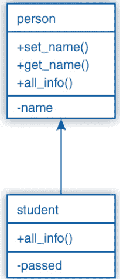

## 图 6-1: 派生类

换句话说，学生 Is-A 人。因此，凡是可以使用 person 的地方都可以使用 student：作为参数、在赋值语句中等等。就像在现实生活中一样，如果我们允许人可以开设银行账户，那么学生也可以（我们为所有经历不同的拮据学生道歉）。我们稍后将看到这在 C++ 中是如何表达的。

关于名称的可见性，派生类类似于内部作用域：除了类的成员外，我们还能看到其基类（及其基类）的成员。当派生类包含同名变量或函数时，基类中的同名成员会被隐藏，这同样类似于作用域。相比之下，我们仍然可以通过名称限定（如 `person::all_info`）访问基类的隐藏成员。即使是一个名称相同但签名不同的函数（重载）在派生类中也会被隐藏——C++ 隐藏的是名称而非签名。可以通过 `using` 声明（如 `using person::all_info`）在派生类中使它们可见。

然后，那些与派生类中所有重载签名都不同的函数重载可以无需限定即可访问。当我们以如下方式使用我们的两个类时：

点击此处查看代码图片

```
person mark("Mark Markson");
mark.all_info ();

student tom("Tom Tomson", "Algebra, Analysis");
tom.all_info ();

person p(tom);            // or pr(tom) or pr{tom}
person& pr = tom;         // or pp(&tom) or pp{tom}
person* pp = &tom;

p.all_info();
pr.all_info();
pp->all_info();
```

我们可能会对结果感到惊讶——如果不是失望的话：

点击此处查看代码图片

```
[person] My name is Mark Markson
[student] My name is Tom Tomson
         I passed the following grades: Algebra, Analysis
[person] My name is Tom Tomson
[person] My name is Tom Tomson
[person] My name is Tom Tomson
```

只有当变量的类型为 `student` 时，我们才能获得成绩信息。当我们尝试将 `student` 当作普通的 `person` 处理时，程序可以编译和运行，但我们看不到额外的 `student` 信息。尽管如此，我们被允许：

- 将一个 `student` 复制到 `person`；
- 将 `student` 引用为 `person`；以及
- 将 `student` 作为 `person` 参数传递给函数。

更正式地说：派生类是其基类的 _子类型_，凡是需要基类的地方，其派生类都被接受。

理解子类型和超类型的一个好方法是思考子集和超集。一个类建模某个集合，而该集合的子集由一个子类建模，该子类通过不变量约束超类。我们的 `person` 类建模各种人，我们使用 `person` 的子类来建模人群。

这种图景的悖论在于，派生类可能包含额外的成员变量，且可能对象的数量大于其超类。可以通过考虑适当的不变量来正确建模子集，从而解决这个悖论。例如，`student` 类的不变量是：不存在同名但成绩不同的两个对象。这将保证 `student` 集合的基数不大于 `person` 集合的基数。不幸的是，上述不变量难以验证（即使是对于具有自动不变量检查的语言也是如此），必须通过设计良好的程序逻辑隐式建立。

当我们从基类派生时，可以指定从该类继承的成员的访问限制程度。在前面的示例中，我们进行了公有派生，因此所有继承的成员在基类和派生类中具有相同的可访问性。如果我们将一个类作为 `protected` 派生，那么基类的公有成员在派生类中变为 `protected`，而其他成员保留其可访问性。私有派生类的成员全部为 `private`（这种继承形式在最近的 OOP 应用中不太常用）。当我们不指定如何访问基类时，定义 `class` 时派生默认为 `private`，定义 `struct` 时默认为 `public`。

## C++11 6.1.2 继承构造函数

=> c++11/inherit_constructor.cpp

与所有其他方法不同，构造函数不会从基类隐式继承。因此，以下程序无法编译：

点击此处查看代码图片

```
class person
{
public:
	explicit person(const string& name) : name(name) {}

};
class student
: public person
{}; // No constructor for string defined

int main ()
{
student tom{"Tom Tomson"}; // Error: no string constructor
}
```

类 student 继承 person 的所有方法，除了构造函数。C++11 允许我们使用 using 声明从基类继承所有构造函数：

```
class student
: public person
{
using person::person;
};
```

当两个类中存在相同签名的构造函数时，优先使用派生类中的构造函数。

到目前为止，我们已经应用了前面提到的四个基本原则中的三个：封装、继承和子类型。还缺少一些东西，我们将现在介绍。

## 6.1.3 虚函数和多态类

=> c++11/oop_virtual.cpp

只有使用虚函数，面向对象编程的全部潜力才能被释放。它们的存在从根本上改变了类的行为，导致以下内容：

**定义 6-1.（多态类型）。** 包含一个或多个虚函数的类称为 *多态类型*。

我们继续使用前面的实现，仅将属性 virtual 添加到方法 `all_info()` 中：

点击此处查看代码图片

```
class person
{
    virtual void all_info() const
    { cout << "My name is " << name << endl; }
};
...

class student
: public person
{
    virtual void all_info() const {
    person::all_info(); // call all_info() from person
    cout << "I passed the following grades: " << passed << endl;
    }
};
...
```

我们在命名空间限定（§3.2）中见过的双冒号（`::`），同样可以用于限定我们调用方法的类。这当然要求该方法是可访问的：我们不能从另一个类调用私有方法，甚至不能从基类调用。我们可以在派生类中省略 `virtual`，因为当基类中具有相同签名的函数重载为虚函数时，它会被隐式添加。然而，为了更好的可理解性，我们更喜欢在这些入门示例中将它们拼写出来。使用多态类打印信息时，结果会突然完全不同：

点击此处查看代码图片

```
[person] My name is Mark Markson
[student] My name is Tom Tomson
I passed the following grades: Algebra, Analysis
[person] My name is Tom Tomson
[student] My name is Tom Tomson
I passed the following grades: Algebra, Analysis
[student] My name is Tom Tomson
I passed the following grades: Algebra, Analysis
```

对对象打印信息的行为与之前相同。大的区别在于获取对象引用和指针的信息：`pr.all_info()` 和 `pp->all_info()` 调用来自 `student` 的重写方法。在这种情况下，编译器经历以下步骤：

- 1. `pr` 或 `pp` 的静态类型是什么？也就是说，`pr` 或 `pp` 是如何声明的？
- 2. 该类中是否存在名为 `all_info` 的函数？
- 3. 可以访问吗？还是它是 `private`？
- 4. 它是 `virtual` 函数吗？否则直接调用它。
- 5. `pr` 或 `pp` 的动态类型是什么？也就是说，`pr` 或 `pp` 引用的对象的类型是什么？
- 6. 从该动态类型调用 `all_info`。

为了实现这些动态函数调用，编译器维护 _虚函数表_（又称 _虚方法表_）或简称 _Vtable_。它们包含函数指针，通过这些指针调用实际对象的每个虚方法。引用 `pr` 具有类型 `person&` 并引用类型为 `student` 的对象。在这种情况下，vtable 中的 `all_info` 条目包含一个指向 `student::all_info` 的函数指针，当调用 `pr.all_info()` 时会执行它。这种通过函数指针的间接调用为 `virtual` 函数增加了一些额外开销，对于微小函数而言显著，而对于足够大的函数则可忽略不计。

### 定义 6-2.（后期绑定和动态多态）。

在运行时选择要执行的方法称为 _后期绑定_ 或 _动态绑定_。它还代表 _动态多态_——与使用模板的静态多态相对。

类似于引用 `pr`，指针 `pp` 指向一个 `student` 对象，并且 `student::all_info` 通过后期绑定为 `pp->all_info()` 被调用。我们还可以引入一个自由函数 `spy_on()`，它利用后期绑定提供 Tom 的完整信息，即使我们传递的是基类的引用：

```
void spy_on(const person & p)
{
    p.all_info();
}
```

动态选择的好处是，无论为 `person` 的多少个子类调用，代码在可执行文件中只存在一次。相对于函数模板的另一个优势是，只需要声明（即，


签名）在调用函数时必须可见，但不一定是定义（即实现）。这不仅节省了大量编译时间，还允许我们向用户隐藏我们巧妙（或肮脏）的实现。

从 Tom 发出的唯一调用 `person::all_info()` 的实体是 `p`。这是一个 `person` 类型的对象，我们可以将一个 `student` 对象复制给它。但是，当从派生类复制到基类时，我们会丢失派生类的所有额外数据，只有基类的数据成员会被真正复制。同样，虚函数调用执行基类的相应函数（这里是 `person::all_info()`）。也就是说，当基类对象通过从派生类复制构造时，它的行为不会不同：所有额外成员都消失了，vtable 不再引用派生类的任何方法。同样，按值将参数传递给函数：

```
void glueless(person p)
{
    p.all_info();
}
```

这会禁用晚期绑定，从而阻碍从派生类调用 `virtual` 函数。这是面向对象编程中非常常见（不仅限于）的初学者错误，称为 *切片*。因此，我们必须遵守以下规则：

## 传递多态类型

多态类型必须始终通过引用或（智能）指针传递！

## 6.1.3.1 销毁多态类

多态类型的对象不仅可以通过基类引用，还可以用基类指针存储：

点击此处查看代码图像

```
person* max= new student("Max Smith", "Numerics");
```

当我们删除这个指针时，我们调用的是 `person` 的析构函数而不是 `student` 的，因此只有 `person` 的成员会被销毁。为了正确销毁，我们需要一个 `virtual` 析构函数：

```
class person
{
    virtual ~person() {}
};
```

当所有基类和成员都有适当的析构函数时，只需让编译器以默认方式生成虚拟析构函数即可：

```
virtual ~person() = default;
```

无论哪种方式：

## 多态类型的析构函数

*每个多态类型都需要一个虚拟析构函数。*

希望，未来的 C++ 标准将在用户省略析构函数时，将所有多态类的析构函数声明为虚拟。

## C++11 6.1.3.2 显式重写

即使是高级程序员也时常掉入的另一个流行陷阱是，重写方法的签名略有不同，例如：

点击此处查看代码图像

```
class person
{
    virtual void all_info() const { ... }
};
class student
    : public person
{
    virtual void all_info() { ... }
};

int main ()
{
    student tom("Tom Tomson", "Algebra, Analysis");
    person& pr = tom;
    pr.all_info();
}
```

在这个示例中，pr.all_info() 没有晚期绑定到 student::all_info()，因为签名不同。诚然，这种差异并不明显，这引出了一个问题：方法的 const 限定与签名究竟有什么关系。我们可以将成员函数视为具有一个指向对象本身的隐式隐藏参数：

点击此处查看代码图像

```
void person::all_info_impl(const person &me = *this) { ... }
```

现在很明显，方法的 const 限定符限定了 person::all_info() 中的这个隐藏引用。student::all_info() 中对应的隐藏引用不是 const 限定的，由于签名不同，该方法不被视为重写。编译器不会警告我们，只是将 student::all_info() 视为新的重载。相信我们，当类很大且存储在不同文件中时，这个小小的讨厌错误会让你忙活一阵子。

C++11 我们可以轻松使用 C++11 属性 override 来保护自己免受此类麻烦：

点击此处查看代码图像

```
class student
 : public person
{
    virtual void all_info() override { ... }
};
```

在这里，程序员声明此函数重写了基类的虚函数（具有完全相同的签名）。如果没有这样的虚函数，编译器会报错。1

- 1. 消息已重新格式化以适应页面。

点击此处查看代码图像

```
.... error: 'all_info' marked 'override' but doesn't override
           any member functions
           virtual void all_info() override {
           ^~~~~~~~~~
.... warning: 'student::all_info' hides overloaded virtual
           fct.
.... note: hidden overloaded virtual function 'person::all_info'
           declared here: different qualifiers (const vs
           none)
```

```
virtual void all_info() const { ... }
```

在这里，我们也从 clang++ 得到提示，限定符不同。对非虚函数使用 override 会导致不同的错误消息：

点击此处查看代码图像

```
...: error: only virtual member fct. can be marked 'override'
void all_info() override {
```

override 并未为我们的软件增加激动人心的新功能，但它可以避免我们费力地查找笔误（键盘误操作）。除非需要向后兼容，否则建议到处使用 override。这个词输入很快（尤其是有自动补全时），能让我们的程序更可靠。它还能向其他程序员，甚至是多年未查看代码后的我们自己，传达我们的意图。

C++11 中的另一个新属性是 final。它声明虚拟成员函数不能被重写。这允许编译器用直接函数调用替换间接 vtable 调用，或者在 final 函数被直接调用（而非通过基类调用）时甚至内联函数代码。甚至整个类都可以声明为 final，以防止他人从中派生。

相较之下，override 是关于超类的声明，而 final 指的是子类。两者都是上下文关键字；即，它们仅在特定上下文中保留：作为成员函数的限定符。在其他地方，这些词可以自由使用，例如作为变量名。但是，出于清晰度考虑，建议不要这样做。

核心准则 [63] 建议，虚函数应仅拥有以下声明符中的恰好一个——virtual、override 或 final——因为其他声明符会相应隐含。

## 6.1.3.3 函数调用机制

当调用多态类中的函数时，三种机制会相互作用：

- 重载；
- 重写；以及
- 名称隐藏。

我们已经展示了这些技术，并分别讨论了它们的工作原理。现在将它们组合起来考虑。假设我们有派生类：

```
class c1 { ... };
class c2 : public c1 { ... };
class c3 : public c2 { ... };
class c4 : public c3 { ... };
class c5 : public c4 { ... };
```

并且对于 c3 的引用，我们调用：

```
void call(c3& r)
{
    r.f(2.6);
}
```

现在，编译器将从 c3 中可见的 f 的重载中，为 double 选择最佳匹配。如果 f 在 c3 中声明，则每个重载都可见。c1 和 c2 中的 f 的所有重载都被隐藏，除非在 c3 中有 using c1::f; 或 using c2::f 的声明。如果 f 未在 c3 中声明，则 c2 的重载可见（除非在 c2 内部声明了 using c1::f）。同样，如果 c2 和 c3 都未声明名称 f，则 c1 的重载可见。如果这三个类都未声明 f，则方法调用显然是错误的。

给定方法 f 的一组可见重载，编译时会为参数类型 double 选择最具体的签名。如果所选重载是虚函数，则运行时会选择对象类型的最派生重写。例如，如果 r 引用类型为 c5 的对象，且 f(double) 在 c4 和 c5 中都被重写，则调用 c5 的重写。如果我们有 c5 的重写但没有 c4 的重写，且 r 引用类型为 c4 的对象，则我们调用来自 c3（或其基类继承的）的方法，因为 c5 的重写不合法。

在实践中，情况通常不那么复杂，但我们应该意识到编译时和运行时的混合选择。一个...的隐藏


同名但签名不同的基类方法/运算符，是一个即使是经验丰富的程序员在面对意外行为时也不会立即想到的细节。

### 6.1.3.4 抽象类

到目前为止，我们只查看过在基类中定义 `virtual` 函数并在派生类中扩展的示例。有时我们会遇到这样的情况：有一组具有某些共同函数的类，需要一个公共超类来动态选择这些类。例如，在第 6.4 节中，我们将介绍提供相同接口的求解器：一个 `solve` 函数。为了在运行时选择它们，它们需要共享一个带有 `solve` 函数的超类。然而，没有通用的 `solve` 算法可供我们稍后重写。为此，我们需要一个新特性来声明：“我在这个类中有一个没有实现的 `virtual` 函数；这将在子类中稍后提供。”

**定义 6-3.** (纯虚函数和抽象类)。当 `virtual` 函数使用 = 0 声明时，它是一个 *纯虚函数*。包含纯虚函数的类称为 *抽象类*。

=> c++11/oop_abstract.cpp

更具体地说，我们用抽象超类 `creature` 扩展我们的 `person` 示例：

单击此处查看代码图像

```cpp
class creature
{
    public:
    virtual void all_info() const= 0; // purely virtual
    virtual ~creature() = default;
};

class person
    : public creature
{ ... };

int main()
{
    creature some_beast; // Error: abstract class
}
```

```
person mark("Mark Markson");
mark.all_info();
}
```

创建 `creature` 对象会失败，并显示类似这样的消息：

单击此处查看代码图像

```
....: error: variable type 'creature' is an abstract class
creature some_beast;
^
```

```
....: note: unimplemented pure method 'all_info' in 'creature'
virtual void all_info() const= 0;
^
```

当我们重写 `all_info` 使得 `person` 不包含纯 `virtual` 函数时，对象 `mark` 的行为与之前相同。

抽象类可以被视为接口：我们可以声明其引用和指针，但不能创建对象。请注意，C++ 允许我们混合使用纯和常规 `virtual` 函数。只有当所有纯 `virtual` 函数都被重写时，才能构建子类的对象²。

2. 我们在此处避免使用 *实例化* 术语以避免混淆。该术语在 Java 中用于表示对象是从类构建的（而一些作者甚至将对象称为特定类）。在 C++ 中，实例化几乎总是指从类/函数模板创建特定类/函数的过程。我们偶尔看到“类实例化”用于表示从类创建对象，但这并非常见术语，我们避免使用它。

给 Java 程序员的旁注：在 Java 中，所有成员函数本质上都是 `virtual`（即，方法不能是非虚拟的³）。Java 提供了语言特性 `interface`，其中方法仅被声明而未定义（除非它们具有 `default` 属性，允许实现）。这对应于仅包含纯 `virtual` 方法的 C++ 类。

3. 然而，将它们声明为 `final` 使编译器能够消除晚期绑定的开销。

大型项目通常建立多个抽象级别：

- 接口：无实现；
- 抽象类：默认实现；以及
- 特定类。

这有助于为复杂的类系统保持清晰的心智图景。

### 6.1.4 通过继承实现函子

在第 3.7 节中，我们讨论了函子并提到它们也可以通过继承来实现。现在，我们兑现承诺。首先，我们需要一个所有待实现函子的共同基类：

单击此处查看代码图像

```cpp
struct functor_base
{
    virtual double operator() (double x) const= 0;
    virtual ~functor_base() = default;
};
```

这个基类可以是抽象的，因为它仅作为我们的接口，例如，将函子传递给 finite_difference 评估：

单击此处查看代码图像

```cpp
double finite_difference(functor_base const & f,
                         double x, double h)
{
    return (f(x+h) - f(x)) / h;
}
```

显然，所有待求导的函子都必须从 functor_base 派生，例如：

单击此处查看代码图像

```cpp
class para_sin_plus_cos
    : public functor_base
{
public:
    para_sin_plus_cos(double p) : alpha(p) {}

    virtual double operator() (double x) const override
    {
        return sin(alpha * x) + cos(x);
    }

private:
    double alpha;
};
```

我们重新实现了 `para_sin_plus_cos`，以便可以用有限差分近似 sin(a*x)+ cos x 的导数：


```cpp
para_sin_plus_cos sin_1(1.0);
cout << finite_difference(sin_1, 1., 0.001) << endl;
double df1= finite_difference(para_sin_plus_cos(2.), 1.,
0.001),
df0= finite_difference(para_sin_plus_cos(2.), 0.,
0.001);
```

面向对象方法还允许我们实现带有状态的函数。如果愿意，我们也可以将有限差分实现为 OOP 函子，并以类似于通用函子的方式组合它们。OOP 方法的缺点是：

- 性能：`operator()` 始终作为 `virtual` 函数调用。
- 适用性：仅允许从 `functor_base` 派生的类作为参数。模板参数允许传统函数和任何类型的函子及 lambda（包括第 3.7 节中的那些）。

因此，函子应尽可能使用第 3.7 节的通用方法实现。只有在运行时选择函数时，继承才能提供好处。

### 6.1.5 派生异常类

=> c++03/exception_example.cpp

在第 1.6.2 节中，我们介绍了异常并提到任何类型的对象都可以作为异常抛出。这样做通常不是个好主意。拥有专门的类会使处理异常容易得多。我们可以更进一步，创建异常类层次结构。例如，我们可以有一个用于一般 I/O 错误的类和一个专门用于文件打开问题的类。高质量软件将其异常派生自 `std::exception`（在 `<exception>` 中）或其子类（如 `runtime_error`）：


```cpp
#include <exception>

struct io_error
    : std::runtime_error
{
    io_error(const string& message= "I/O error")
        : std::runtime_error(message) {}
};

struct cannot_open_file
    : io_error
{
    cannot_open_file(const string& fname)
        : io_error("File '" + fname + "' not found or no
        permission") {}
};
```

将所有异常都派生自 `std::exception` 为用户提供了处理意外行为的备选方案。这个类有一个 `virtual` 方法 `what`，用于返回带有错误消息的字符串。`std::runtime_error` 在构造函数中设置这个 `string`。

异常应按引用捕获以避免对象切割。当有多个 `catch` 子句时，每个类型应出现在其基类之前，因为第一个匹配的子句会被进入，而不管后面可能有更具体的子句。下面示例中的 `catch` 块对于给定情况来说确实有点夸张，但能让人了解如何处理多或少具体的异常：

单击此处查看代码图像

```cpp
bool keep_trying= true;
do {
    string fname;
    cout << "Please enter file name: ";
    cin >> fname;
    try {
        A= read_matrix_file(fname);
        keep_trying= false;
    } catch (cannot_open_file& e) {
        cout << "Could not open the file. "
             << "Try another one!\n";
    } catch (io_error& e) {
        cerr << "Unexpected I/O error. Fix it!\n"; throw;
    } catch (std::runtime_error& e) {
        cerr << "Unknown run-time error: "
```


```
<< e.what() << "\n"; throw;
} catch (std::exception& e) {
    cerr << "Unknown standard exception:"
    << e.what() << "\n"; throw;
} catch (...) {
    cerr << "Unknown exception caught. "
    << "I call it a day.\n"; throw;
}
} while (keep_trying);
```

正如你所见，在捕获与文件打开相关的异常时，我们会不断重试。在其他子句中，我们提供可用的信息并重新抛出异常（该异常不太可能在外部被捕获）。

## 6.2 消除冗余

通过使用继承和隐式向上转型，我们可以避免实现冗余的成员函数和自由函数。类被隐式转换为超类这一事实使我们能够一次性实现通用功能，并在所有派生类中重用它。假设我们有几个矩阵类（稠密、压缩、带状、三角……），它们共享像 num_rows 和 num_cols 这样的成员函数。4 这些可以轻松地外包到一个通用超类中——包括相应的数据成员：

- 4. 使用的术语来自 MTL4。

点击此处查看代码图像

```cpp
class base_matrix
{
public:
    base_matrix(size_t nr, size_t nc) : nr(nr), nc(nc) {}

    size_t num_rows() const { return nr; }
    size_t num_cols() const { return nc; }

private:
    size_t nr, nc;
};

class dense_matrix
: public base_matrix
{ ... };

class compressed_matrix
  : public base_matrix
{ ... };

class banded_matrix
  : public base_matrix
{ ... };

...
```

现在所有矩阵类型都通过继承提供 base_matrix 的成员函数。将通用实现放在一个地方不仅节省了输入，还能确保修改一次性应用到所有相关类中。这在本例中不是问题（尤其是反正也没有太多可改动的），但在大型项目中，保持所有冗余代码片段的一致性变得相当费力。自由函数可以以同样的方式重用，例如：

点击此处查看代码图像

```cpp
inline size_t num_rows(const base_matrix& A)
{ return A.num_rows(); }

inline size_t num_cols(const base_matrix& A)
{ return A.num_cols(); }

inline size_t size(const base_matrix& A)
{ return A.num_rows() * A.num_cols(); }
```

得益于隐式向上转型，这些自由函数可以针对所有从 base_matrix 派生的矩阵调用。这种通用基类功能的形式不会带来运行时开销。

我们还可以将自由函数参数的隐式向上转型视为更一般概念的一个特例：is-a 关系；例如，compressed_matrix is-a base_matrix，我们可以将 compressed_matrix 值传递给每个期望 base_matrix 的函数。

## 6.3 多重继承

C++ 提供多重继承，我们将通过一些示例来说明。

### 6.3.1 多个父类

=> c++11/oop_multi0.cpp

一个类可以从多个超类派生。为了更形象的描述，以及为了不那么笨拙地讨论基类的基类，我们偶尔会使用 parents 和 grandparents 这两个直观易懂的术语。有两个父类时，类层次结构看起来像一个 V（有很多时则像一束花）。子类的成员是所有超类成员的并集。这带来了歧义的风险：

点击此处查看代码图像

```cpp
class student
{
    virtual void all_info() const {
        cout << "[student] My name is " << name << endl;
        cout << " I passed the following grades: " <<
        passed << endl;
    }
    ...
};

class mathematician
{
    virtual void all_info() const {
        cout << "[mathematician] My name is " << name << endl;
        cout << " I proved: " << proved << endl;
    }
    ...
};

class math_student
: public student, public mathematician
{
    // all_info not defined -> ambiguously inherited
};

int main ()
{
    math_student bob("Robert Robson", "Algebra", "Fermat's Last Theorem");
    bob.all_info(); // Error: ambiguity
    bob.student::all_info();
}
```

math_student 从 student 和 mathematician 都继承了 all_info，两者之间没有优先级之分。要为 bob 调用该方法，我们必须限定从哪个基类获取该方法。

这种歧义让我们得以说明一个我们应该了解的 C++ 细微之处。public、protected 和 private 修改的是可访问性，而非可见性。当我们尝试通过将一个或多个超类作为 private 或 protected 继承来消除成员函数的歧义时，这一点变得痛苦地清晰：

点击此处查看代码图像

```cpp
class student { ... };
class mathematician { ... };

class math_student
: public student, private mathematician
{ ... };
```

现在 student 的方法是 public 的，而 mathematician 的方法是 private 的。当调用 math_student::all_info 时，我们希望看到 student::all_info 的输出。mathematician 的方法实际上不可访问，但它们仍然存在并导致歧义。我们甚至可能会看到第二条错误消息，指出 mathematician::all_info 不可访问。

### 6.3.2 共同祖父母类

多个基类共享其基类的情况并不罕见。在上一节中，mathematician 和 student 没有超类。从前面的章节来看，将它们都派生自 person 更为自然。描绘这种继承配置会构建一个菱形结构，如图 6-2 所示。我们将以两种略有不同的方式实现这一点。

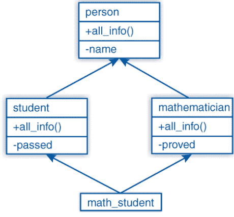

图 6-2：菱形类层次结构

### 6.3.2.1 冗余与歧义

=> c++11/oop_multi1.cpp

首先，我们以直截了当的方式实现这些类：

点击此处查看代码图像

```cpp
class person { ... }; // as before
class student { ... }; // as before

class mathematician
: public person
{
public:
    mathematician(const string& name, const string& proved)
    : person(name), proved(proved) {}
    virtual void all_info() const override {
        person::all_info();
        cout << "I proved: " << proved << endl;
    }
private:
    string proved;
};

class math_student
    : public student, public mathematician
{
    public:
        math_student(const string& name, const string& passed,
                     const string& proved)
            : student(name, passed), mathematician(name, proved) {}
        virtual void all_info() const override {
            student::all_info();
            mathematician::all_info();
        }
};

int main ()
{
    math_student bob("Robert Robson", "Algebra", "Fermat's Last Theorem");
    bob.all_info();
}
```

```
[student] My name is Robert Robson
I passed the following grades: Algebra
[person] My name is Robert Robson
I proved: Fermat's Last Theorem
```

作为读者，你现在有两个选择：接受这种次优方法并继续阅读，或者跳到练习 6.7.1 尝试自己解决。由于 person 被派生了两次，这段代码是

- **冗余**：`name` 被存储了两次，如图 6-3 所示。
- **易错**：`name` 的两个值可能不一致。
- **歧义**：在 `math_student` 中访问 `person::name` 时（如果它不是 `private` 的话）。

=> c++11/oop_multi2.cpp

为了说明前面提到的歧义，我们在 `math_student` 中调用 `person::all_info`：

点击此处查看代码图像

```cpp
class math_student : ... {
    virtual void all_info() const override {
        person::all_info();
    }
};
```

这会导致以下（重新格式化的）错误消息：

点击此处查看代码图像

```
...: error: ambiguous conversion from derived class
    'const math_student' to base class 'person':
    class math_student -> class student -> class person
    class math_student -> class mathematician -> class person
    person::all_info();
    ^~~~~~~~~~~
```

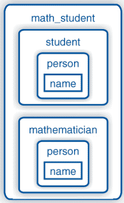

图 6-3：math_student 的内存布局

使用 clang++ 时会出现此问题。我们当然会遇到同样的问题，即通过多条路径继承的超类的每个函数或数据成员。

### 6.3.2.2 虚基类

=> c++11/oop_multi3.cpp

虚基类允许我们仅在共享超类中存储一次成员，从而帮助克服相关问题。然而，这需要对内部实现有基本的了解，以免引入新问题。在以下示例中，我们只是将 person 声明为虚基类：


```cpp
class person { ... };

class student
: public virtual person
{ ... };

class mathematician
: public virtual person
{ ... };

class math_student
: public student, public mathematician
{
public:
    math_student(const string& name, const string& passed,
                 const string& proved)
    : student(name, passed), mathematician(name, proved) {}
    ...
};
```

并得到以下可能会让一些人感到惊讶的输出：


```
[student] My name is
    I passed the following grades: Algebra
    I proved: Fermat's Last Theorem
```


尽管 `student` 和 `mathematician` 都调用了初始化 `name` 的 `person` 构造函数，但我们丢失了 `name` 的值。要理解这种行为，我们需要知道 C++ 如何处理 `virtual` 基类。我们知道，派生类有责任调用基类构造函数（否则编译器会生成对默认构造函数的调用）。但是，我们只有一份 `person` 基类的副本。图 6-4 说明了新的内存布局：`mathematician` 和 `student` 不再包含 `person` 数据，而仅引用一个属于最派生类 `math_student` 的公共对象。

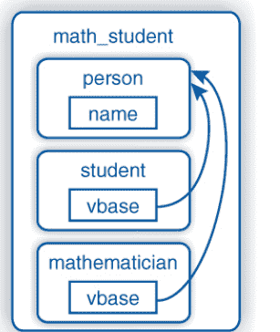

**图 6-4：** 带有 `virtual` 基类的 `math_student` 内存

创建 `student` 对象时，其构造函数必须调用 `person` 构造函数。同样，当我们创建 `mathematician` 对象时，其构造函数也会调用 `person` 构造函数。现在我们创建一个 `math_student` 对象。`math_student` 构造函数必须调用 `mathematician` 和 `student` 的构造函数。但是我们知道，这两个构造函数都应该调用 `person` 构造函数，因此共享的 `person` 部分会被构造两次。

为防止这种情况，已规定在虚拟基类的情况下，最派生类（在我们的例子中：math_student）有责任调用共享基类构造函数（在我们的例子中：person）。作为回报，当从派生类间接调用时，mathematician 和 student 中的 person 构造函数调用被禁用。

```
=> c++11/oop_multi4.cpp
```

牢记这一点，我们相应地修改构造函数：

单击此处查看代码图像

```
class student
: public virtual person
{
protected:
student(const string& passed) : passed(passed) {}
void my_info() const { ... }
...
};

class mathematician
: public virtual person
{
protected:
mathematician(const string& proved) : proved(proved) {}
void my_info() const { ... }
...
};

class math_student
: public student, public mathematician
{
public:
math_student(const string& name, const string& passed,
const string& proved) : person(name), student(passed),
mathematician(proved) {}
virtual void all_info() const override {
student::all_info();
mathematician::my_info()
}
};
```

现在，math_student 显式初始化 person 以在那里设置 name。两个中间类 student 和 mathematician 经过重构，以区分包含性和排他性成员处理：

- 包含性处理包含 person 的方法：两参数构造函数和 all_info。这些方法是公共的，并且（主要）用于 student 和 mathematician 对象。

- 排他性处理仅涉及类本身的成员：一参数构造函数和 my_info。这些方法是受保护的，因此仅在子类中可用。

示例表明需要所有三种访问修饰符：

- private：用于仅在类内部访问的数据成员和方法；

- protected：用于子类需要但不属于子类公共接口的方法；以及

- public：用于允许在不了解内部细节的情况下处理该类对象的方法。

在奠定 OOP 技术基础后，我们现在将在科学环境中应用它们。

## 6.4 通过子类型进行动态选择

```
=> c++11/solver_selection_example.cpp
```

动态求解器选择可以通过这样的 switch 实现：

单击此处查看代码图像

```cpp
#include <iostream>
#include <cstdlib>

class matrix {};
class vector {};

void cg(const matrix& A, const vector& b, vector& x);
void bicg(const matrix& A, const vector& b, vector& x);

int main (int argc, char* argv[])
{
    matrix A;
    vector b, x;

    int solver_choice= argc >= 2 ? std::atoi(argv[1]) : 0;
    switch (solver_choice) {
        case 0: cg(A, b, x); break;
        case 1: bicg(A, b, x); break;
        ...
    }
}
```

这可行，但就源代码复杂性而言，它不可扩展。当我们在其他地方使用其他向量和矩阵调用求解器时，必须为每个参数组合复制整个 switch-case 块。可以通过将该块封装为函数并用不同参数调用该函数来避免此问题。

当多个参数动态选择时，情况会变得复杂得多。对于线性求解器，我们想要选择左预条件子和右预条件子（对角、ILU、IC 等）。然后我们需要像第 A.8 节所示的嵌套 `switch`。因此，我们可以在不使用 OOP 的情况下动态选择函数对象，但必须接受参数空间上的组合爆炸：求解器、左预条件子和右预条件子。如果添加新的求解器或预条件子，我们需要在多个地方扩展这个庞大的选择块。

针对我们的求解器和预条件子，一个优雅的解决方案是使用抽象类作为接口，并使用带有特定求解器的派生类：

单击此处查看代码图像

```
struct solver
{
    virtual void operator()( ... ) = 0;
    virtual ~solver() {}
};

// potentially templatize
struct cg_solver : solver
{
    virtual void operator()( ... ) override { cg(A, b, x); }
};

struct bicg_solver : solver
{
    virtual void operator()( ... ) override { bicg(A, b, x);
};
```

C++11 在我们的应用程序中，我们可以定义接口类型 solver 的（智能）指针，并将其分配给所需的求解器：

单击此处查看代码图像

```
unique_ptr<solver> my_solver;
switch (solver_choice) {
    case 0: my_solver= unique_ptr<cg_solver>(new cg_solver);
        break;
    case 1: my_solver= unique_ptr<bicg_solver>(new
    bicg_solver);
        break;
    ...
}
```

这种技术在设计模式书籍 [16] 中作为工厂模式进行了详细讨论。工厂也可以在 C++03 中使用原始指针实现。

C++14 unique_ptr 的构建有些麻烦。C++14 引入了便利函数 make_unique，使这种情况真正更加方便：

单击此处查看代码图像

```
unique_ptr<solver> my_solver;
switch (solver_choice) {
    case 0: my_solver= make_unique<cg_solver>(); break;
    case 1: my_solver= make_unique<bicg_solver>(); break;
}
```

按照练习 3.12.14 的建议实现自己的 make_unique 是一个很好的练习。一旦我们的多态指针初始化，调用动态选择的求解器就很简单了：

```
(*my_solver)(A, b, x);
```

前导括号是解引用指向抽象求解器类的指针然后调用 operator() 所必需的。没有这些括号，我们将（不成功地）尝试调用指针的 operator() 并解引用该调用的结果。

抽象基类的全部表现力在动态选择多个函数时变得明显。然后我们可以避免之前显示的组合爆炸。多态函数指针允许我们解耦各自的选择，并将任务分解为一系列工厂和使用指针的单个调用：

单击此处查看代码图像

```cpp
struct pc
{
    virtual void operator() ( ... ) = 0;
    virtual ~pc() {}
};

struct solver { ... };

// Solver factory
// Left Preconditioner factory
// Right Preconditioner factory

(*my_solver)(A, b, x, *left, *right);
```

现在，我们在工厂中具有线性代码复杂性，以及用于函数调用的单个语句，而不是巨大选择块中的立方代码复杂性。

在我们的示例中，我们实现了一个公共超类。我们也可以使用 std::function 处理没有公共基类的求解器类和函数。这使我们能够实现更通用的工厂。尽管如此，它基于相同的技术：虚函数和指向多态类的指针。C++03 中的一个向后兼容的替代方案是 boost::function。

C++11 C++ 禁止虚拟模板函数（它们会使编译器实现变得非常复杂：潜在的无限虚表）。但是，类模板可以包含虚函数。这使得通过对整个类进行类型参数化而不是参数化单个方法，能够使用虚函数进行泛型编程。


## 6.5 转换

转换是 OOP 特有的主题，但在介绍基类和派生类之前，我们无法全面讨论它。反之，查看相关类之间的强制转换有助于巩固对继承的理解。

C++ 是一种强类型语言。每个对象的类型在编译时定义，执行期间不可更改。我们可以将对象视为

- 内存中的位，以及
- 赋予这些位以含义的类型。

对于多种强制转换，编译器只是以不同方式查看内存中的位：要么对位有另一种解释，要么具有不同的访问权限（例如，const 与 non-const）。其他强制转换实际上会创建新对象。

在 C++ 中，有四个基本的强制转换运算符：

- static_cast
- dynamic_cast
- const_cast
- reinterpret_cast

以 C 为语言根源只知道一个强制转换运算符：(type) expr。这个单一运算符难以理解，因为它可能触发一系列转换以创建目标类型的对象：例如，将指向 int 的 const 指针转换为指向 char 的 non-const 指针。

相比之下，C++ 强制转换每次只更改类型的一个方面。C 风格强制转换的另一个缺点是它们在代码中难以查找（另见 [66, 第 95 章]），而 C++ 强制转换易于发现：只需搜索 _cast。C++ 仍然允许这种旧式强制转换，但所有 C++ 专家都一致不鼓励其使用。

## C 风格强制转换

不要使用 C 风格强制转换。

在本节中，我们将展示不同的强制转换运算符，并讨论它们在不同上下文中的优缺点。

### 6.5.1 基类和派生类之间的强制转换

C++ 在层次结构的类之间提供静态和动态强制转换。

### 6.5.1.1 向上转换

```
=> c++03/up_down_cast_example.cpp
```

向上转换，即从派生类到基类，只要没有歧义总是可能的。它甚至可以像我们在函数 spy_on 中所做的那样隐式执行：


```
void spy_on(const person& p);
```

```
spy_on(tom); // Upcast student -> person
```

spy_on 接受 person 的所有子类，无需显式转换。因此，我们可以将 student tom 作为参数传递。为了讨论菱形层次结构中类之间的转换，我们为简洁起见引入了一些单字母类名：


```
struct A
{
    virtual void f(){}
    virtual ~A(){}
    int ma;
};
struct B : A { float mb; int fb() { return 3; } };
struct C : A {};
struct D : B, C {};
```

我们添加以下一元函数：


```
void f(A a) { /* ... */ } // Not polymorphic -> slicing!
void g(A& a) { /* ... */ }
void h(A** a) { /* ... */ }
```

类型 B 的对象可以传递给所有三个函数：

```
B b;
f(b); // Slices!
g(b);
h(&b);
```

在所有三种情况下，对象 b 都会隐式转换为类型 A 的对象。但是，函数 f 不是多态的，因为它会对对象 b 进行切片（参见 §6.1.3）。向上转换仅在基类存在歧义时失败。在当前示例中，我们无法从 D 向上转换为 A：

```
D d;
A ad(d); // Error: ambiguous
```

因为编译器不知道是指来自 B 还是来自 C 的基类 A。我们可以通过显式中间向上转换来澄清这种情况：

```
A ad(B(d));
```

或者我们可以通过虚基类在 B 和 C 之间共享 A：

```
struct B : virtual A { ... };
struct C : virtual A {};
```

现在，A 的成员在 D 中只存在一次。这通常是多重继承的最佳解决方案，因为我们节省了内存且不会冒 A 不一致复制的风险。

### 6.5.1.2 向下转换

向下转换是将指针/引用转换为子类型指针/引用。当实际引用的对象不是该子类型时，行为是未定义的。因此，我们应该要么测试向下转换是否正确，要么通过程序逻辑来确认。回想一下，我们将类型 B 的对象传递给了类型 A 的引用和指针，分别是 A*：

```
void g(A& a) { ... }
void h(A** a) { ... }
```

```
B b;
g(b);
h(&b);
```

在 g 和 h 内部，我们无法访问 B 的成员（即 mb 和 fb()），尽管被引用的对象 b 是类型 B。确信相应的函数参数 a 引用的是类型 B 的对象后，我们可以将 a 向下转换为 B& 或 B* 以进行该访问。

在程序中引入向下转换之前，我们应该问自己：

- 我们如何确保传递给函数的参数真的是派生类的对象？例如，通过额外参数或运行时测试？
- 如果对象无法向下转换，我们能做什么？
- 我们不应该为派生类编写一个函数吗？
- 我们为什么不为基类和派生类型重载函数？这绝对是一种更清晰的设计，并且始终可行。
- 最后但同样重要的是，我们能否重新设计类，使我们的任务可以通过虚函数的晚期绑定来完成？

如果在诚实回答所有这些问题后，我们仍然认为需要向下转换，那么我们必须决定应用哪种向下转换。有两种形式：

- static_cast，速度快但不安全；以及
- dynamic_cast，安全但代价更高，且仅适用于多态类型。

顾名思义，static_cast 仅检查编译时信息。这意味着在向下转换的上下文中，目标类型是否派生自源类型。例如，我们可以将 g 函数中的 a 转换为 B&，然后就能调用类 B 的方法了：

单击此处查看代码图像

```
void g(A& a)
{
    B& bref = static_cast<B&>(a);
    std::cout << "fb returns " << bref.fb() << "\\n";
}
```

编译器验证 B 是 A 的子类并接受我们的实现。当参数 a 引用的对象不是类型 B（或其子类型）时，程序行为是未定义的——最可能的结果是崩溃。

在我们的菱形示例中，我们还可以将指针从 B 向下转换为 D。为此，我们声明允许引用子类 D 对象的 B* 类型指针：

```
B *bbp= new B, *dbp= new D;
```

编译器接受两个指针向下转换为 D*：

单击此处查看代码图像

```
D* dbp = static_cast<D*>(bbp); // erroneous down-cast not detected
D* ddp = static_cast<D*>(dbp); // correct down-cast (not checked)
```

由于不执行运行时检查，作为程序员，我们有责任只引用正确类型的对象。bbp 指向类型 B 的对象，当我们解引用指针 dbp 时，我们面临数据损坏和程序崩溃的风险。在这个小示例中，一个智能编译器可能通过静态分析检测到错误的向下转换并发出警告。通常，无法始终回溯指针引用的实际类型，尤其是因为它可以在运行时选择：

单击此处查看代码图像

```
B* bxp = (argc > 1) ? new B : new D;
```

在第 6.6.1 节中，我们将看到一个有趣的静态向下转换应用，它是安全的，因为类型信息作为模板参数提供。

dynamic_cast 执行运行时测试，以查看实际转换的对象是否具有目标类型或其子类型。它只能应用于多态类型（定义或继承一个或多个虚函数的类，§6.1）：

单击此处查看代码图像

```
D* dbp = dynamic_cast<D*>(bbp); // Error: cannot down-cast to D
D* ddp = dynamic_cast<D*>(bdp); // Okay: bdp points to a D object.
```

当无法执行转换时，将返回空指针，以便程序员最终可以对失败的向下转换做出反应。引用的错误向下转换会抛出类型为 std::bad_cast 的异常，并可以在 try-catch 块中处理。这些检查通过运行时类型信息 (RTTI) 实现，并需要一点额外时间。

**高级背景信息：** dynamic_cast 在底层实现为虚函数。因此，只有当用户通过定义至少一个虚函数使类变为多态时，它才可用。否则，所有类都将承担虚表的开销。多态类无论如何都有虚表，因此 dynamic_cast 的开销是虚表中多一个指针。

### 6.5.1.3 交叉转换

dynamic_cast 的一个有趣特性是，当被引用对象的类型是两种类型的派生类时，可以从 B 到 C 进行交叉转换：

单击此处查看代码图像

```
C* cdp = dynamic_cast<C*>(bdp); // Okay: B -> C with D object
```

同样，我们可以从 student 交叉转换为 mathematician。从 B 到 C 的静态交叉转换：

单击此处查看代码图像

```
cdp = static_cast<C*>(bdp); // Error: neither sub-nor super-class
```

这是不允许的，因为 C 既不是 B 的基类也不是派生类。它可以间接转换：

单击此处查看代码图像

```
cdp = static_cast<C*>(static_cast<D*>(bdp)); // B -> D -> C
```

再次，这是程序员的责任，以确定被寻址的对象是否真的可以这样转换。


## 6.5.1.4 比较静态转换和动态转换

由于对被引用对象的类型进行运行时检查，动态转换比静态转换更安全但更慢。静态转换允许向上和向下转换，由程序员负责确保被引用对象被正确处理。表 6–1 总结了两种转换形式的区别。

Table 6–1: 静态转换与动态转换

| | static_cast | dynamic_cast |
|---|---|---|
| 适用类 | 所有 | 多态 |
| 交叉转换 | 否 | 是 |
| 运行时检查 | 否 | 是 |
| 开销 | 无 | RTTI 检查 |

## 6.5.2 Const-Cast

const_cast 添加或删除 const 和/或 volatile 属性。关键字 volatile 告知编译器，变量可能从其他位置被修改。例如，某些内存条目由运行我们 C++ 程序的处理器以外的硬件设置，在为该硬件编写驱动程序时必须意识到这一点。这些内存条目不能被缓存或保存在寄存器中，而必须每次从主内存读取。在科学和高级工程软件中，外部修改的变量非常罕见，因此我们在本书中不再进一步讨论 volatile。

const 和 volatile 都可以隐式添加。删除真正为 volatile 的对象的 volatile 属性会导致未定义行为，因为缓存和寄存器中可能存在不一致的值。反之，volatile 属性只能从 volatile 限定的指针和引用中删除，前提是它们引用的是非 volatile 对象。

删除 const 属性会使整个调用栈上的所有相应 const 限定符失效，因此当数据被意外覆盖时，调试工作量会大幅增加。遗憾的是，在处理通常缺乏适当 `const` 限定符的旧式库时，有时不得不这样做。

## 6.5.3 重解释转换

这是最激进的转换形式，本书中不使用。它获取对象的内存位置，并将其位解释为如果对象具有另一种类型。例如，这允许我们通过将浮点数转换为位链来更改其中的单个位。`reinterpret_cast` 对于编程硬件驱动程序比对于高级通量求解器更重要。不用说，它是破坏我们应用程序可移植性的最有效方式之一。如果你确实必须使用它，请将其包含在平台相关的条件编译中，并过度测试你的代码。

## 6.5.4 函数样式转换

构造函数可用于转换值：如果类型 `T` 有一个针对类型 `U` 参数的构造函数，我们可以从类型 `U` 的对象创建类型 `T` 的对象：

```cpp
U u;
T t(u);
```

或者更好：

```cpp
U u;
T t{u}; // C++11
```

因此，使用构造函数表示法来转换值是有意义的。让我们使用不同的矩阵类型重用我们的示例。假设我们有一个用于稠密矩阵的函数，并希望将其应用于压缩矩阵：

单击此处查看代码图像

```cpp
struct dense_matrix
{ ... };

struct compressed_matrix
{ ... };
void f(const dense_matrix&) {}
```

```cpp
int main ()
{
    compressed_matrix A;
    f(dense_matrix(A));
}
```

在这里，我们获取 `compressed_matrix` A 并创建一个 `dense_matrix`。这需要以下之一：

- `dense_matrix` 中接受 `compressed_matrix` 的构造函数；或
- `compressed_matrix` 到 `dense_matrix` 的转换运算符。

这些方法如下所示：

单击此处查看代码图像

```cpp
struct compressed_matrix; // forward decl. needed in constructor
```

```cpp
struct dense_matrix
{
    dense_matrix() = default;
    dense_matrix(const compressed_matrix& A) { ... }
};
```

```cpp
struct compressed_matrix
{
    operator dense_matrix() { dense_matrix A; ... return A; }
};
```

当两者都存在时，构造函数更适合用于创建新对象。通过类实现，我们还可以使用隐式转换调用稠密矩阵函数 f：

```cpp
int main ()
{
    compressed_matrix A;
    f(A);
}
```

在这种情况下，转换运算符优先于构造函数。请注意，隐式转换不适用于 `explicit` 构造函数或转换运算符。`explicit` 转换运算符是在 C++11 中引入的。

[C++11] 函数样式表示法的危险在于，它表现得像带有内在目标类型的 C 风格转换，例如：

```cpp
long (x); // corresponds to
(long)x;
```

这允许我们编写如下恶意代码：

单击此处查看代码图像

```cpp
double d = 3.0;
double const* const dp = &d;
long l = long(dp); // OUCH!!!! All bets are off!
```

在这里，我们将指向 const double 的 const 指针转换成了 long！虽然我们看似要求创建一个新值，但实际上执行了 const_cast 和 reinterpret_cast。不用说，l 的值相当无意义，所有依赖于它的值也是如此。较新的编译器至少可能会发出警告。请注意，以下初始化：

单击此处查看代码图像

```cpp
long l(dp); // Error: cannot initialize long with pointer
```

无法编译。带花括号的初始化也不行：

单击此处查看代码图像

```cpp
long l{dp}; // Same Error (C++11)
```

这引出了另一种表示法：

单击此处查看代码图像

```cpp
l = long(dp); // Error: failed initialization (C++11)
```

使用花括号时，我们始终初始化一个新值，甚至阻止缩窄转换。static_cast 允许缩窄转换，但也拒绝从指针到数字的转换：

单击此处查看代码图像

```cpp
l = static_cast<long>(dp); // Error: pointer -> long
```

出于这些原因，Bjarne Stroustrup 建议对行为良好的构造使用 T(u)，对其他转换使用像 static_cast 这样的命名转换。

## 6.5.5 隐式转换

隐式转换的规则并不简单。好消息是，大多数情况下，了解最重要的规则即可应付，通常可以忽略它们的优先级。例如，完整列表可以在“C++ 参考”[33]中找到。表 6–2 介绍了最重要的转换概览。

Table 6–2: 隐式转换

| 来自 | 到 |
| :--- | :--- |
| T | T 的超类型 |
| T | const T |
| T | volatile T |
| T[N] | T* |
| T | u，参见 §6.5.4 |
| 函数 | 函数指针 |
| nullptr_t | T* |
| 整型 | 更大的整型 |
| 数值类型 | 另一种数值类型 |

数值类型可以以不同方式转换。首先，整型可以提升，即用 0 或符号位扩展。5 此外，每种内置数值类型在需要匹配函数参数类型时，都可以转换为任何其他数值类型。

5. 提升在语言规则的最严格意义上并不算是转换。

对于 C++11 中的新初始化技术，只允许不丢失精度（即不进行缩窄转换）的转换步骤。如果没有缩窄规则，即使在浮点数和 bool 之间（通过中间转换为 int）的转换也是允许的。所有可以用函数样式（§6.5.4）表示的用户类型之间的转换，当启用的构造函数或转换运算符未声明为 `explicit` 时，也会隐式执行。不用说，不应过度使用隐式转换，我们可以为自己的类使用 `explicit` 构造函数和转换运算符来控制这一点。哪些转换应显式表达以及在哪里可以依赖隐式规则，是一个重要的设计决策，不存在通用规则。

## 6.6 高级技术

### 6.6.1 CRTP

本节描述了 _奇异递归模板模式_（CRTP）。它将模板编程与继承非常高效地结合在一起。该术语有时与基于 CRTP 并由 John Barton 和 Lee Nackman [6] 引入的 _Barton-Nackman 技巧_ 混淆。

### 6.6.1.1 一个简单的示例

=> c++03/crtp_simple_example.cpp

我们将用一个简单的示例来解释这种新技术。假设我们有一个名为 `point` 的类，包含一个相等运算符：

```cpp
class point
{
public:
    point(int x, int y) : x(x), y(y) {}

    bool operator==(const point& that) const
    { return x == that.x && y == that.y; }
private:
    int x, y;
};
```

我们可以使用常识或应用德摩根定律来编程不等式：

单击此处查看代码图像


bool operator!=(const point& that) const
{ return x != that.x || y != that.y; }

或者我们可以简化生活，只需取等运算结果的否定：

Click here to view code image

```
bool operator!=(const point& that) const
{ return !(*this == that); }
```

我们的编译器非常复杂，内联后肯定能完美处理德·摩根定律。以这种方式取等运算符的否定，是每种类型（带有等运算符）的不等运算符的正确实现。我们可以复制粘贴这段代码片段，每次只需替换参数的类型。或者，我们可以编写如下类：

Click here to view code image

```
template <typename T>
struct inequality
{
    bool operator!=(const T& that) const
    { return !(static_cast<const T&>(*this) == that); }
};
```

并从中派生：

Click here to view code image

```
class point : public inequality<point> { ... };
```

这个类定义建立了相互依赖：

- point 派生自 inequality，且
- inequality 以 point 为参数。

尽管存在相互依赖，这些类仍可编译，因为模板类（如 inequality）的成员函数直到被实例化（通常是在被调用时）才会编译。我们可以验证 operator!= 是否有效：

Click here to view code image

```
point p1(3, 4), p2(3, 5);
cout << "p1 != p2 is " << boolalpha << (p1 != p2) << '\n';
```

但当我们调用 `p1 != p2` 时，实际发生了什么？

- 1. 编译器在类 `point` 中搜索 `operator!=` → 未找到。
- 2. 编译器在基类 `inequality<point>` 中查找 `operator!=` → 找到。
- 3. `this` 指针指向作为 `point` 对象一部分的类型 `inequality<point>` 的对象。
- 4. 在实例化 `inequality<point>::operator!=` 时，两种类型都完全已知，我们可以将 `this` 指针静态向下转换为 `point*`。
- 5. 由于我们知道 `inequality<point>` 的 `this` 指针是向上转换为 `point*` 的 `this` 指针，因此将其向下转换回原始类型是安全的。
- 6. `point` 的等运算符被调用并实例化（如果之前未完成）。

每个带有等运算符的类 `U` 都可以以同样的方式从 `inequality<U>` 派生。由 Jeremy Siek 和 David Abrahams 提供的 Boost.Operators 提供了一组这样的用于运算符默认实现的 CRTP 模板。

C++20 这个示例再次说明了使用较新标准如何简化编程。C++20 允许我们为 `operator==` 请求 `default` 实现：

Click here to view code image

```
class point
{
  bool operator==(const point& that) const = default;
  // ...
};
```

当存在 `operator==` 时，它还会隐式生成 `operator!=`，因此上述声明足以比较点的相等性和不等性。不过，这并没有使 CRTP 模式变得无用，正如我们接下来将看到的。

## 6.6.1.2 可重用的访问运算符

=> c++14/matrix_access_example.cpp

CRTP 惯用法使我们能够解决之前提到的问题（§2.6.4）：以可重用的实现方式使用括号运算符访问多维数据结构。当时我们不知道所需的语言特性，尤其是模板和继承。现在我们知道了，并将运用这些知识，通过一个二元调用运算符来实现两个括号运算符调用，即将 A[i][j] 求值为 A(i, j)。

假设我们有一个名为 `some_matrix` 的优雅矩阵类型，其 `operator()` 对应 a_ij。为了与向量表示法保持一致，我们更喜欢括号运算符。那些运算符只接受一个参数，因此我们需要一个代表矩阵行访问的代理。这个代理反过来为访问相应行中的列提供一个括号运算符，即产生矩阵的一个元素：

Click here to view code image

```
class some_matrix; // Forward declaration

class simple_bracket_proxy
{
public:
    simple_bracket_proxy(some_matrix& A, size_t r)
    : A(A), r(r) {}

    double& operator[](size_t c) { return A(r, c); } // Error

private:
    some_matrix& A;
    size_t     r;
};

class some_matrix
{
    // ...
    double& operator()(size_t r, size_t c) { ... }

    simple_bracket_proxy operator[](size_t r)
    {
        return simple_bracket_proxy(*this, r);
    }
};
```

其思想是 A[i] 返回一个指向 A 并包含 i 的代理 p。调用 A[i][j] 对应于 p[j]，而 p[j] 反过来应该调用 A(i, j)。

不幸的是，这段代码无法编译。当我们在 `simple_bracket_proxy::operator[]` 中调用 `some_matrix::operator()` 时，类型 `some_matrix` 仅被声明但未被完全定义。交换两个类定义只会反转依赖关系并导致更多无法编译的代码。这个代理实现的问题是我们需要两个相互依赖的完整类型。

这是模板的一个有趣方面：由于它们的延迟代码生成，它们允许我们打破相互依赖。向代理添加模板参数消除了依赖：

Click here to view code image

```
template <typename Matrix>
class bracket_proxy
{
public:
    bracket_proxy(Matrix& A, size_t r) : A{A}, r{r} {}

    auto& operator[](size_t c) { return A(r, c); }

private:
    Matrix& A;
    size_t r;
};

class some_matrix
{
    // ...
    bracket_proxy<some_matrix> operator[](size_t r)
    {
        return bracket_proxy<some_matrix>(*this, r);
    }
};
```

最后，我们可以编写 `A[i][j]`，并在内部将其作为两参数 `operator()` 来执行。现在我们可以编写许多具有完全不同 `operator()` 实现的矩阵类，并且它们都可以以完全相同的方式部署 `bracket_proxy`。

[C++11] 一旦我们实现了多个矩阵类，就会发现所有矩阵类中的 `operator[]` 看起来都非常相似：只需返回一个带有矩阵引用和行参数的代理。我们可以添加另一个 CRTP 类，仅实现一次这个括号运算符：

Click here to view code image

```
template <typename Matrix>
class bracket_proxy { ... };

template <typename Matrix>
class crtp_matrix
{
    using const_proxy = bracket_proxy<const Matrix>;
public:
    bracket_proxy<Matrix> operator[](size_t r)
    {
        return {static_cast<Matrix&>(*this), r};
    }
    const_proxy operator[](size_t r) const
    {
        return {static_cast<const Matrix&>(*this), r};
    }
};

class some_matrix
: public crtp_matrix<some_matrix>
{
    // ...
};
```

请注意，C++11 特性仅用于简化；我们也可以在 C++03 中实现这段代码。这个 CRTP 矩阵类可以为每个带有两参数应用运算符的矩阵类提供括号运算符。然而，在一个功能齐全的线性代数包中，我们需要注意哪些矩阵是可变的，以及是返回引用还是值。这些区别可以使用第 5 章的元编程技术或类型推断（尤其是 `decltype(auto)`）来安全处理。

虽然代理方法会创建一个额外对象，但我们的基准测试表明，括号运算符的使用速度与应用运算符本身一样快。显然，现代编译器中复杂的引用转发可以消除代理的实际创建。

## C++11 6.6.2 带重载的类型特征

=> c++11/type_traits_overloading.cpp

我们在第 5.2 节中展示的类型特征使用类的模板特例化。使用偏特化，我们可以一次为无限多个类型声明一个属性，前提是整个类型集可以用单一模式（如所有原始指针集的 `T*`）来描述。

在实际应用中，（至少）同样重要的是，类型特征的声明以相同的方式应用于派生类。我们工作中发挥重大作用的一个例子是矩阵的 `map_view`。当读取视图的一个条目时，会读取引用矩阵中的相应条目，并对值应用一个一元函子，例如 `A` 的 `negate_view` 在行 `i` 和列 `j` 中产生值 `-a_{ij}`。虽然这些示例非常特定于线性代数，但我们相信，对对象的类似视图在其他领域也可能有用。

我们可以想象，这种功能在许多项目中已经存在，并且通常使用 `virtual` 函数实现，因为这要容易得多。另一方面，由于间接函数调用，这种代码速度较慢。如果引起的性能损失可以容忍，则没有迫切需要更改实现。

为了在不使用 `virtual` 函数的情况下提供一大组视图，我们首先创建了一个类模板 `map_view`，它由引用的 `Matrix` 类型和一元 `Functor` 参数化：


```
template <typename Matrix, typename Functor>
struct map_view { ... };
```

所有运算符和其他成员函数都在那里实现，以避免大量代码重复。现在，我们可以通过根据相应的函子从 `map_view` 派生来提供整个映射谱（缩放、递增、共轭，随你所选）：


```
template <typename Matrix>
struct negate_view
    : map_view<Matrix, negate_functor>
{
    // implement or import constructor
};
```


在C++03中，每当新增一个视图，我们都必须对所有相关的类型特征进行特例化，这在当时是该库中最不具通用性的方面。其他方面都可以以某种方式复用；只有类型特征需要一遍又一遍地重复，例如，对于每一个从map_view派生的视图。

有了C++11，我们有了新的可能性来摆脱这种声明的繁文缛节。让我们先从简单的情况开始。通过派生来引入新的映射视图，在许多情况下实际上是一种权宜之计，用以弥补typedef表达能力的不足。有了模板别名，我们可以直接创建所有函子默认构造的视图，例如：


```
template <typename Matrix>
using abs_view = map_view<Matrix, abs_functor>;
```

由于abs_view不是新类型而只是一个类型定义，我们不需要新的类型特征特例化，可以依赖map_view的那些。

这里另一个派上用场的特性是lambda表达式。我们可以即时创建一个新的映射视图，例如一个用因子缩放矩阵每个元素的视图：


```
template <typename Matrix, typename Functor>
map_view<Matrix, Functor> map(const Matrix& A, Functor f)
{
    return {A, f};
}

int factor = 7;
dense_matrix<int> A;
auto B = map(A, [factor](int x) { return factor * x; });
```

与模板别名一样，我们并没有创建新类型而是实例化了map_view。因此，该特性能正确处理B的类型。

借助这两种技术，我们可以创建大量视图，而无需进一步的类型特征特例化。特别是融入C++14特性（如泛型lambda和函数返回类型推断），可能使我们能够覆盖所有视图的用例。

尽管如此，在创建对象之前引入新视图类型可能仍有必要。当新类型使用的函子不可默认构造时，我们仍然需要派生。例如，我们再次创建一个缩放视图，但这次使用显式类型：

点击此处查看代码图片

```
struct scale_functor
{
    scale_functor(int factor) : factor(factor) {}
    int operator()(int x) const { return factor * x; }
    int factor;
};
```

```
template <typename Matrix>
struct scale_view
    : map_view<Matrix, scale_functor>
{
    scale_view(const Matrix& A, int factor) : map_view<Matrix, scale_functor>(A, scale_functor(factor))
    {
    }
};
```

我们承认，为了简洁起见，实现被简化，省略了`factor`和`x`的（不同）模板参数。

有了这个实现，`map_view`需要显式声明`is_matrix`。克服这一点的想法是重载一个函数，并使用其返回类型作为类型特征。与之前一样，任何我们不知道的类型都不被视为矩阵：

点击此处查看代码图片

```
template <typename T>
std::false_type is_a_matrix(const T&);        // #1

template <typename T>
using is_matrix = decltype(is_a_matrix(std::declval<T>()));
```

由于我们只关心返回类型，并且无论如何都无法用`declval`作为参数调用该函数，我们只声明函数而不提供定义。

C++14 在C++14中，我们宁愿创建一个模板变量：

点击此处查看代码图片

```
template <typename T>
constexpr bool is_matrix_v =
    decltype(is_a_matrix(std::declval<T>()))::value;
```

最后，我们为我们的类型重载函数is_a_matrix：

点击此处查看代码图片

```
template <typename Value>
std::true_type is_a_matrix(const dense_matrix<Value>&); // #2

template <typename Matrix, typename Functor>
std::true_type is_a_matrix(const map_view<Matrix, Functor>&); // #3
```

不幸的是，这仍然不能为派生类提供正确的类型特征：

点击此处查看代码图片

```
int is not a matrix.
dense_matrix<int> is a matrix.
negate_view<dense_matrix<int>> is not a matrix.
```

问题在于重载解析的优先级。当我们用negate_view调用is_a_matrix时，会有两个匹配：通用模板函数（#1）和针对任何map_view的更具体模板（#3）。直觉上我们会假设编译器偏好#3，因为它更具体。情况并非如此。重载解析中的优先级是：

- 1. 完全匹配（参数类型和实参类型相等）；
- 2. 模板实例化；
- 3. 隐式转换。

调用#1时，模板参数T只需替换为negate_view<dense_matrix<int>>；而对于#3，实参必须首先转换为map_view<dense_matrix<int>, negate_view>，然后才能替换Matrix和Functor参数。因此编译器偏好#1，所以我们的视图仍不被视为矩阵。

为了用所有视图调用#3，我们必须用某个东西替换#1，该东西能捕获所有可能的参数类型，但其重载优先级低于隐式转换。C++中只有一种特性具有此属性，不幸的是，它与宏、goto和void*一样属于邪恶的范畴：省略号（...）。省略号可以接受任意数量的任意类型的函数参数，并且有宏来处理这些参数。以省略号作为参数的函数对传递参数的类型没有任何信息，甚至连参数的数量都不知道。这些信息必须由调用者提供，并在运行时求值。如果关于参数的信息有误，程序的行为是未定义的。

一个例子是`printf`，其中参数的个数和类型间接地在格式字符串中提供。虽然最近的编译器在可能的情况下会检查格式字符串和其他参数的一致性，但当格式字符串在运行时构建时，编译器无能为力。那么小拼写错误会产生戏剧性的后果。例如，将`int`作为字符串打印通常会导致程序崩溃，因为`int`值随后被解释为地址，并尝试打印从该地址开始的字符，通常会导致段错误。

长话短说，使用省略号向函数传递参数是一种极其危险的方法。然而，在我们的特定情况中，我们只关心重载函数的返回类型。传递的参数在`is_a_matrix`中绝不会被访问。仅出于这个原因，我们才敢使用省略号。因此，我们保持一切不变，仅替换回退情况的重载：

点击此处查看代码图片

```
std::false_type is_a_matrix(...); // #1
```

有了这个修改，所有我们的视图都被视为矩阵：

点击此处查看代码图片

```
int is not a matrix.
dense_matrix<int> is a matrix.
negate_view<dense_matrix<int>> is a matrix.
```

在大型项目中，建议为所有类和类模板提供前置声明。然后可以在不需要类实现的情况下实现类型特征——即使是函数重载风格——这有助于避免头文件的循环依赖。

这里介绍的技术起初比之前展示的模板特例化稍微复杂一些。对于较大的项目，当我们能够避免派生类的所有多余类型特征声明时，它很快就会带来回报。我们甚至可以使用lambda作为函子创建新类，并以极高的生产力扩展应用程序的功能。

## 6.7 练习

### 6.7.1 非冗余菱形

实现第6.3.2节中的菱形，使名称仅打印一次。在派生类中区分`all_info()`和`my_info()`，并适当调用这两个函数。

### 6.7.2 继承向量类

修订第2章中的向量示例。为`size`和`operator()`引入基类`vector_expression`。使`vector`继承自此基类。然后创建一个类`ones`，它是一个所有元素值均为一的向量，并且也继承自`vector_expression`。

### 6.7.3 重构向量中的异常

为更健壮地重构第3章中的模板向量实现`c++11/vector_template.cpp`。用抛出适当异常的方式替换`check_index`和`check_size`中的`assert`宏。所谓适当，是指它们定义在有意义的内部结构中，并且都派生自`std::exception`或其子类之一。随意添加更多测试和异常类。

### 6.7.4 测试抛出的异常

一名谨慎的软件开发人员不仅测试一组有代表性的正确程序片段是否正常工作，还测试是否能检测到错误示例中的问题。这种负面测试对于`assert`和`static_assert`来说很难实现，但对于异常来说可以更优雅地实现。首先，我们可以通过违反大小和索引约束来实现练习6.7.3的测试，并检查是否抛出了预期的异常。


具体来说：我们编写一个 try-catch 块，它以一条我们预期会抛出某个异常的语句开始。在该语句之后，我们抛出类型为 missing_exception 的异常。在块的末尾，我们只捕获预期的异常类型，作为恢复操作，我们只是通过打印一条足够辉煌的消息来庆祝我们的成功。任何其他异常——特别是 missing_exception——都不会被捕获，并会终止程序。因此，我们的测试程序只有在相关语句抛出预期异常时才会成功。

有动力的读者可以进一步实现一个通用异常测试，它将预期的异常类型作为模板参数（在调用中不推导，而是显式声明）和一个空参函数对象，该对象仅在 try-catch 块中被调用。显然，我们通常会使用 lambda 来创建这个空参函数对象。这是一个非常有用的测试工具，作者在自己的软件中经常使用它。

### 6.7.5 克隆函数

为名为 clone() 的成员函数编写一个 CRTP 类，该函数复制当前对象——类似于 Java 的 clone 函数。请注意，该函数的返回类型必须是克隆对象的类型。

## 第 7 章
科学项目

> “理论与实践的区别在实践中比在理论中更大。”
> —Tilmar König

在前面的章节中，我们主要关注 C++ 的语言特性以及如何将它们最好地应用于相对较小的学习示例。本章最后一章应该为您提供一些关于如何构建更大型项目的思路。作者朋友 Mario Mulansky 的第一节（§7.1）讨论了库之间互操作性的主题。它将让您一窥 odeint 的内部工作原理：一个通用库，能够以非常紧密的方式与多个其他库无缝互操作。然后，我们将介绍如何从许多程序源文件和库存档构建可执行文件（§7.2.1），工具如何支持这一过程（§7.2.2），以及如何将程序源文件适当地分布到多个文件中（§7.2.3）。最后，我们将简要介绍模块。

### 7.1 ODE 求解器的实现

*由 Mario Mulansky 撰写*

在本节中，我们将介绍设计数值库的主要步骤。这里的重点不是提供最完整的数值功能，而是达到一种确保最大通用性的健壮设计。作为示例，我们将考虑用于求解 *常微分方程*（ODEs）的数值算法。遵循第 3 章的精神，我们的目标是通过使用泛型编程，使实现尽可能通用。我们首先简要介绍算法的数学背景，然后给出一个简单直接的实现。由此，我们将能够识别实现的各个部分，并逐一使其可互换，从而构建一个完全通用的库。我们确信，在学习了这个通用库设计的详细示例后，读者将能够将此技术应用于其他数值算法。

### 7.1.1 常微分方程

常微分方程是一种基本的数学工具，用于建模物理、生物、化学或社会过程，是科学或工程中最重要的概念之一。除了少数简单情况外，ODE 的解无法通过解析方法找到，我们必须依赖数值算法来获得至少一个近似解。在本章中，我们将开发 Runge-Kutta-4 算法的通用实现，这是一种通用的 ODE 求解器，因其简单性和鲁棒性而被广泛使用。

通常，常微分方程是包含自变量 t 的函数 x(t) 及其导数 x', x'', ... 的方程：

```
F(x, x_t, x', ..., x^{(n)}) = 0. (7.1)
```

这是最一般的形式，包括隐式 ODE。然而，在这里我们只考虑显式 ODE，其形式为 x^{(n)} = f(x, x', x'', ..., x^{(n-1)})，在数值处理上要简单得多。ODE 中出现的最高导数 n 称为 ODE 的阶数。但是，任何 n 阶 ODE 都可以轻松转换为 n 维的一阶 ODE [28]。因此，只需考虑 n = 1 的一阶微分方程即可。后面介绍的数值例程都将处理初值问题（IVP）：即在起始点 x(t = t_0) = x_0 处给定 x 值的 ODE。

因此，后面页面中将在数值上处理的问题的数学表述如下：

```
\frac{d}{dt}\vec{x}(t) = \vec{f}(\vec{x}(t), t), \vec{x}(t = t_0) = \vec{x}_0. (7.2)
```

这里，我们使用向量符号 \(\vec{x}\) 来指示变量 \(\vec{x}\) 可能是一个多维变量。通常，ODE 是针对实值变量定义的，即 \(\vec{x} \in \mathbb{R}^N\)，但也可以考虑复值 ODE，其中 \(\vec{x} \in \mathbb{C}^N\)。函数 \(\vec{f}(\vec{x}, t)\) 称为 ODE 的右端（RHS）。ODE 最简单的物理示例可能是 *谐振器*，即一个连接到弹簧上的质点。对于这样的系统，牛顿运动方程为：

```
\frac{d^2}{dt^2}q(t) = \omega_0^2 q(t), \quad (7.3)
```

其中 \(q(t)\) 表示质量的位置，\(\omega_0\) 是振荡频率。后者是质量 \(m\) 和弹簧刚度的函数，\(\omega_0 = \sqrt{k/m}\)。通过引入 \(p = dq/dt\)，使用 \(\vec{x} = (q, p)^T\) 并定义一些初始条件（例如 \(q(0) = q_0, p(0) = 0\)），可以将其转换为形式 (7.2)。使用简写符号 \(\dot{\vec{x}} := d\vec{x}/dt\) 并省略显式时间依赖关系，我们得到：

```
\dot{\vec{x}} = \vec{f}(\vec{x}) = \begin{pmatrix} p \\ -\omega_0^2 q \end{pmatrix}, \quad \vec{x}(0) = \begin{pmatrix} q_0 \\ 0 \end{pmatrix}. \quad (7.4)
```

请注意，Eq. (7.4) 中的 \(\vec{f}\) 不依赖于变量 \(t\)，这使得 Eq. (7.4) 成为一个 *自治* ODE。还请注意，在此示例中，自变量 \(t\) 表示时间，\(\vec{x}\) 表示相空间中的一个点，因此解 \(\vec{x}(t)\) 是谐振器的 *轨迹*。这是物理 ODE 中的典型情况，也是我们选择变量 \(t\) 和 \(\vec{x}\) 的原因。^1

1. 在数学中，自变量通常称为 x，解称为 y(x)。

对于 Eq. (7.4) 中的谐振器，我们可以找到 IVP 的解析解：\(q(t) = q_0 \cos \omega_0 t\) 和 \(p(t) = -q_0 \omega_0 \sin(\omega_0 t)\)。更复杂的非线性 ODE 通常无法解析求解，我们必须采用数值方法来找到近似解。一个特定的示例家族是表现出 *混沌动力学* [52] 的系统，其中轨迹无法用解析函数描述。最早探索这一点的模型之一是所谓的 Lorenz 系统，这是一个三维 ODE，对于 \(\vec{x} = (x_1, x_2, x_3)^T \in \mathbb{R}^3\) 由以下方程给出：

```
\dot{x}_1 = \sigma(x_2 - x_1)
\dot{x}_2 = Rx_1 - x_2 - x_1x_3 \quad (7.5)
\dot{x}_3 = x_1x_2 - bx_3,
```

其中 \(\sigma, R, b \in \mathbb{R}\) 是系统的参数。图 7-1 描绘了该系统在典型参数选择 \(\sigma = 10, R = 28\) 和 \(b = 10/3\) 下的一个轨迹。对于这些参数值，Lorenz 系统表现出所谓的 _混沌吸引子_，可以在图 7-1 中识别出来。

虽然这种解无法解析找到，但在右端 \(\vec{f}\) 满足某些条件（例如 Picard-Lindelöf 定理，要求 \(\vec{f}\) 是 Lipschitz 连续 [68]）下，关于其 _存在性_ 和 _唯一性_ 存在数学证明。只要满足此条件且存在唯一解——这几乎是所有实际问题的情况——我们就可以应用算法例程来找到该解的数值近似。

### 7.1.2 Runge-Kutta 算法

求解常微分方程初值问题最常见的通用方案是所谓的 _Runge-Kutta_（RK）方法 [28]。我们将重点关注 _显式_ RK 方案，因为它们更容易实现且非常适合 GPU。它们是一类依赖时间离散化来计算 IVP 近似解的迭代一步法。时间离散化意味着近似解在时间点 \(t_n\) 处被求值。因此，我们使用 \(\vec{x}_n\) 表示在时间 \(t_n\) 处解 \(x(t_n)\) 的数值近似。在最简单但最常用的等距离散化且步长 \(\Delta t\) 为常数的情况下，数值解的写法为：


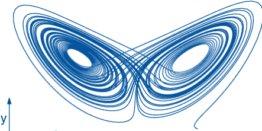

图 7-1: 洛伦兹系统中的混沌轨迹，参数为 \(\sigma\) = 10, \(R = 28\), 和 \(b = 10/3\)

```
\(\vec{x}_n \approx \vec{x}(t_n), \text{ with } t_n = t_0 + n \cdot \Delta t. \quad (7.6)\)
```

近似点 \(\vec{x}_n\) 通过数值算法依次求得，该算法可写成最一般形式为：

```
\(\vec{x}_{n+1} = \vec{F}_{\Delta t} \left( \vec{x}_n \right). \quad (7.7)\)
```

这里的映射 \(\vec{F}_{\Delta t}\) 表示数值算法，即著名的 _RK4_ 方案，有时也称为龙格-库塔方案，它以时间步长 \(\Delta t\) 从 \(\vec{x}_n\) 进行一次迭代到 \(\vec{x}_{n+1}\)。如果该方案生成的解精确到某个 _m_ + 1 阶误差以内，则称该数值方案具有 _m_ 阶：

```
\(\vec{x}_1 = \vec{x}(t_1) + O \left( \Delta t^{m+1} \right), \quad (7.8)\)
```

其中 \(\vec{x}(t_1)\) 是从初始条件 \(\vec{x}(t_0) = \vec{x}_0\) 开始在 _t_<sub>1</sub> 处的常微分方程精确解。因此，_m_ 表示方案 _单步_ 的精度阶。

计算此类离散轨迹 _x_<sub>1</sub>, _x_<sub>2</sub>, ... 的最基本数值算法是 _欧拉方案_，其中 \(F_{\Delta t} \left( \vec{x}_n \right) := \vec{x}_n + \Delta t \cdot \vec{f} \left( \vec{x}_n, t_n \right)\)，这意味着下一个近似值是从当前近似值通过以下方式得到的：

```
\(\vec{x}_{n+1} = \vec{x}_n + \Delta t \cdot \vec{f}\left(\vec{x}_n, t_n\right) . \quad (7.9)\)
```

该方案没有实际意义，因为它只提供 \(m = 1\) 阶精度。通过引入中间点并将一步划分为多个阶段，可以达到更高阶。例如，\(RK4\) 方案有 \(s = 4\) 个阶段，阶数也为 \(m = 4\)。它定义如下：

\(\vec{x}_{n+1} = \vec{x}_n + \frac{1}{6} \Delta t \left( \vec{k}_1 + 2 \vec{k}_2 + 2 \vec{k}_3 + \vec{k}_4 \right)\)
\(\vec{k}_1 = \vec{f} \left( \vec{x}_n, t_n \right),\)
\(\vec{k}_2 = \vec{f} \left( \vec{x}_n + \frac{\Delta t}{2} \vec{k}_1, t_n + \frac{\Delta t}{2} \right),\)
\(\vec{k}_3 = \vec{f} \left( \vec{x}_n + \frac{\Delta t}{2} \vec{k}_2, t_n + \frac{\Delta t}{2} \right),\)
\(\vec{k}_4 = \vec{f} \left( \vec{x}_n + \Delta t \vec{k}_3, t_n + \Delta t \right). \quad (7.10)\)

请注意，中间结果 \(\vec{k}_i\) 的后续计算依赖于前一阶段的结果 \(\vec{k}_{j<i}\)。

更一般地，龙格-库塔方案由其阶段数 \(s\) 和一组参数 \(c_1 \dots c_s, a_{21}, a_{31}, a_{32} \dots, a_{s,s-1}\) 以及 \(b_1 \dots b_s\) 定义。计算下一个近似值 \(x_{n+1}\) 的算法如下：

\(x_{n+1} = x_n + \Delta t \sum_{i=1}^s b_i k_i, \quad \text{where} \quad k_i = f \left( x_n + \Delta t \sum_{j=1}^{i-1} a_{ij} k_j, \Delta t c_i \right) . \quad (7.11)\)

参数集 \(a_{i j}\)、\(b_p\) 和 \(c_i\) 定义了所谓的布彻表（参见图 7-2），并完全描述了特定的龙格-库塔方案。上述 RK4 方案的布彻表如图 7-2(b) 所示。

| c1 | | | | | |
|---|---|---|---|---|---|
| c2 | a2,1 | | | | |
| c3 | a3,1 | a3,2 | | | |
| ... | ... | | | | |
| cs | as,1 | as,2 | ... | as,s-1 | |
| | b1 | b2 | ... | bs-1 | bs |

| 0 | | | | |
|---|---|---|---|---|
| 0.5 | 0.5 | | | |
| 0.5 | 0 | 0.5 | | |
| 1.0 | 0 | 0 | 1.0 | |
| | 1/6 | 1/3 | 1/3 | 1/6 |

图 7-2: 布彻表

## 7.1.3 通用实现

以直截了当的方式在 C++ 中实现上述龙格-库塔方案并无任何困难。例如，我们可以使用 `std::vector<double>` 来表示状态 \(\vec{x}\) 和导数 \(\vec{k}_n\)，并使用模板参数来为右端函数 \(\vec{f}(\vec{x}, t)\) 提供一定的通用性。清单 7-1 中的代码展示了上述欧拉方案的快速简便实现。为简单起见，我们将示例限制在欧拉方案，以保持代码片段简短，但以下要点也适用于更复杂龙格-库塔方案的类似实现。

清单 7-1: 欧拉方案的基本实现


```cpp
using state_type = std::vector<double>;
template <typename System>
void euler_step(System system, state_type& x,
                const double t, const double dt)
{
    state_type k(x.size());
    system(x, k, t);
    for(int i = 0; i < x.size(); ++i)
        x[i] += dt * k[i];
}
```

将右端 `system` 定义为模板参数已经为我们提供了一定的通用性：`euler_step` 函数将函数指针、仿函数以及 C++ lambda 对象作为 `system` 参数。唯一的要求是 `system` 对象可使用参数结构 `system(x, dxdt, t)` 进行调用，并且它在 `dxdt` 中计算导数。

尽管此实现在许多情况下工作良好，但一旦遇到一些非标准情况，就会出现几个严重问题。此类情况可能包括：

- 不同的状态类型，例如，固定大小的数组（`std::array`）可能会提供更好的性能；
- 针对复数的常微分方程；
- 非标准容器，例如，用于复杂网络上的常微分方程；
- 高于 `double` 的更高精度需求；
- 并行化，例如，通过 OpenMP 或 MPI；以及
- 使用 GPGPU 设备。

接下来，我们将以一种能够处理上述情况的方式推广清单 7-1 中的实现。因此，我们将首先识别龙格-库塔方案的计算要求，然后逐个解决这些要求。结果将是这些算法的高度模块化实现，它将允许我们交换计算的特定部分，从而为上述问题提供解决方案。

### 7.1.3.1 计算要求

要获得欧拉方案（清单 7-1）的通用实现，我们需要将算法与实现细节分离。为此，我们首先需要识别欧拉方案中涉及的计算要求。通过检查等式 (7.9) 或 (7.10) 以及清单 7-1 中的基本欧拉实现，我们可以识别计算所需的几个部分。

首先，必须在代码中表示数学实体，即常微分方程的状态变量 \(\vec{x}(t)\)、自变量 \(t\) 以及龙格-库塔方案的常数 \(a\)、\(b\)、\(c\)。在清单 7-1 中，我们分别使用 `std::vector<double>` 和 `double`，但在通用实现中，这将成为模板参数。其次，必须进行内存分配以存储中间结果 \(\vec{k}\)。此外，需要对可能是高维的状态变量进行迭代，最后，需要对状态变量的元素 \(x_t\)、自变量 \(t\)、\(\Delta t\) 以及数值常数 \(a\)、\(b\)、\(c\) 进行标量计算。总之，之前介绍的龙格-库塔方案需要以下计算组件：

1. 数学实体的表示，
2. 内存管理，
3. 迭代，以及
4. 基本计算。

在识别了这些要求后，我们现在可以设计一个通用实现，其中每个要求都由可交换的模块化代码片段来解决。

### 7.1.3.2 模块化算法

在我们的模块化设计中，我们将为之前识别的四个要求引入单独的代码结构。我们从表示数学对象所使用的类型开始：状态 \(\vec{x}\)、自变量（时间）$t$ 以及算法的参数 \(a\)、\(b\)、\(c\)（图 7-2(a)）。将算法推广到任意类型的标准方法是引入模板参数。我们也遵循这种方法，因此定义了三个模板参数：`state_type`、`time_type` 和 `value_type`。清单 7-2 显示了带有这些模板参数的龙格-库塔-4 方案的类定义。请注意，我们将 `double` 用作 `value_type` 和 `time_type` 的默认参数，因此在大多数情况下，用户只需指定 `state_type`。

清单 7-2: 带模板类型的龙格-库塔类

点击此处查看代码图片

```cpp
template <typename state_type,
           typename value_type = double,
           typename time_type = value_type>
class runge_kutta4 {
  // ...
};
using rk_stepper= runge_kutta4<std::vector<double> >;
```


接下来，我们讨论内存分配。在清单 7-1 中，这是通过 `std::vector` 构造函数完成的，该构造函数期望向量大小作为参数。对于泛型 `state_type`s，这已不再可接受，因为用户可能提供其他类型，例如 `std::array`，它们不是用相同的签名构造的。因此，我们引入了一个模板辅助函数 `resize`，它将负责内存分配。这个模板辅助函数可以由用户针对任何给定的 `state_type` 进行特化。清单 7-3 显示了 `std::vector` 和 `std::array` 的实现，以及它在 `runge_kutta4` 实现中的用法。请注意，`resize` 函数如何根据状态 `in` 为状态 `out` 分配内存。这是实现此类内存分配的最通用方式；它也适用于稀疏矩阵类型，其中所需大小并不那么平凡。清单 7-3 中的调整大小方法提供了与清单 7-1 中非泛型版本相同的功能，因为 `runge_kutta4` 类再次负责其自身的内存管理。它立即适用于任何提供 `resize` 和 `size` 函数的向量类型。对于其他类型，用户可以提供 `resize` 重载，从而告诉 `runge_kutta4` 类如何分配内存。

接下来是计算 RHS 方程 \(\vec{f}(\vec{x}, t)\) 的函数调用。这已经在清单 7-1 中通过模板以泛型方式实现，我们将保留此解决方案。

最后，我们需要为数值计算找到抽象。如上所述，这涉及对 \(\vec{x}\) 的元素进行迭代，以及对这些元素进行基本计算（求和、乘法）。我们通过引入两个代码结构 `Algebra` 和 `Operation` 来分别处理这两部分。`Algebra` 将处理迭代，而 `Operation` 将负责计算。

我们从 `Algebra` 开始。对于 RK4 算法，我们需要两个函数，分别对三个和六个 `state_type` 实例进行迭代。考虑到 `state_type` 通常是 `std::vector` 或 `std::array`，提供一个可以处理 C++ 容器的代数是合理的。为了确保我们的基本代数尽可能通用，我们将使用 C++11 作为标准库一部分引入的 `std::begin` 和 `std::end` 函数。

## 清单 7-3：内存分配

点击此处查看代码图像

```
template <typename state_type>
void resize(const state_type& in, state_type& out) {
    // standard implementation works for containers
    using std::size;
    out.resize(size(in));
}

// specialization for std::array
template <typename T, std::size_t N>
void resize(const std::array<T, N>& , std::array<T,N>& ) {
/* arrays don't need resizing */
}

template < ... >
class runge_kutta4 {
// ...
	template <typename sys, state_type& x,
	time_type t, time_type dt)
	{
		adjust_size(x);
		// ...
	}

void adjust_size(const state_type& x) {
	resize(x, x_tmp);
	resize(x, k1);
	resize(x, k2);
	resize(x, k3);
	resize(x, k4);
}
};
```

## 建议

在泛型库中，使用 `std::begin` 等自由函数的正确方法是通过 `using std::begin` 将它们局部提升到当前命名空间，然后不带命名空间限定符地访问它们，即 `begin(x)`，如清单 7-4 所示。这样，编译器还可以通过参数相关名称查找（ADL）在必要时利用与 `x` 的类型定义在同一命名空间中定义的 `begin` 函数。

清单 7-4 显示了这样的 `container_algebra`。迭代在 `for_each` 函数中执行，这些函数是名为 `container_algebra` 的 `struct` 的一部分。这些函数期望若干容器对象以及一个操作对象，然后简单地对所有容器进行迭代并按元素执行给定操作。对每个元素执行的 `Operation` 是简单的乘法和加法，将在下一部分描述。

## 清单 7-4：容器代数

点击此处查看代码图像

```
struct container_algebra
{
    template <typename S1, typename S2, typename S3, typename Op>
    void for_each3(S1& s1, S2& s2, S3& s3, Op op) const
    {
        using std::begin;
        using std::end;
        auto first1 = begin(s1);
        auto last1 = end(s1);
        auto first2 = begin(s2);
        auto first3 = begin(s3);
        for ( ; first1 != last1; )
            op(*first1++, *first2++, *first3++);
    }
};
```

最后的部分是基本操作，它们将再次由收集在一个结构体中的仿函数对象组成。清单 7-5 显示了这些操作仿函数的实现。为简单起见，我们再次仅展示可用于 for_each3（清单 7-4）的 scale_sum2 仿函数。然而，扩展到 scale_sum5 以与 for_each6 配合使用相当简单。如清单 7-5 所示，这些仿函数由若干参数 alpha1、alpha2、.. 以及一个计算所需乘积和的函数调用运算符组成。

## 清单 7-5：操作

点击此处查看代码图像

```
struct default_operations {
    template <typename F1= double, typename F2= F1>
    struct scale_sum2 {
        const F1 alpha1;
        const F2 alpha2;
        scale_sum2(F1 a1, F2 a2)
        : alpha1(a1), alpha2(a2) { }
        template <typename T0, typename T1, typename T2>
        void operator() (T0& t0, const T1& t1, const T2& t2) const
        {
            t0 = alpha1 * t1 + alpha2 * t2;
        }
    };
};
```

在收集了所有模块化组件后，我们可以基于上述部分实现 Runge-Kutta-4 算法。清单 7-6 显示了此实现。

请注意，上述引入的所有部分都作为模板参数提供，因此是可配置的。

## 清单 7-6：泛型 Runge-Kutta-4

点击此处查看代码图像

```
template <typename state_type, typename value_type= double,
          typename time_type= value_type,
          typename algebra= container_algebra,
          typename operations= default_operations>
class runge_kutta4 {
public:
  template <typename System>
  void do_step(System& system, state_type& x,
               time_type t, time_type dt)
  {
    adjust_size(x);

    const value_type one = 1;
    const time_type dt2 = dt / 2, dt3 = dt / 3, dt6 = dt / 6;

    using scale_sum2 = typename operations::template
      scale_sum2<value_type, time_type>;

    using scale_sum5 = typename operations::template
      scale_sum5<time_type, value_type, time_type, time_type,
                 time_type, time_type>;

    system(x, k1, t);
    m_algebra.for_each3(x_tmp, x, k1, scale_sum2(one, dt2));

    system(x_tmp, k2, t + dt2);
    m_algebra.for_each3(x_tmp, x, k2, scale_sum2(one, dt2));

    system(x_tmp, k3, t + dt2);
    m_algebra.for_each3(x_tmp, x, k3, scale_sum2(one, dt));

    system(x_tmp, k4, t + dt);
    m_algebra.for_each6(x, x, k1, k2, k3, k4,
                        scale_sum5(one, dt6, dt3, dt3,
                        dt6));
  }

private:
  state_type x_tmp, k1, k2, k3, k4;
  algebra m_algebra;

  void adjust_size(const state_type& x) {
      resize(x, x_tmp);
      resize(x, k1); resize(x, k2);
      resize(x, k3); resize(x, k4);
  }
};
```

以下代码片段展示了如何实例化此 Runge-Kutta-4 步进器：

点击此处查看代码图像

```
using rk4_type = runge_kutta4<vector<double>, double, double,
                     container_algebra, default_operations>;
// equivalent shorthand definition using the default parameters:
// using rk4_type = runge_kutta4<vector<double> >;

rk4_type rk4;
```

## 7.1.3.3 一个简单示例

最后，我们展示了一个小示例，说明如何使用上述泛型 Runge-Kutta-4 实现来积分著名 Lorenz 系统的轨迹。因此，我们只需定义状态类型，实现 Lorenz 系统的 RHS 方程，然后使用上述的 runge_kutta4 类，配合标准 container_algebra 和 default_operations。清单 7-7 显示了一个只需 30 行 C++ 代码的示例实现。

## 7.1.4 展望

我们已得到 Runge-Kutta-4 方案的泛型实现。从此，我们可以向许多方向继续。显然，可以添加更多 Runge-Kutta 方案，可能包括步长控制和/或密集输出设施。虽然此类方法可能更难实现，并且需要后端（代数和操作）提供更多功能，但它们在概念上符合上述概述的泛型框架。此外，可以扩展到其他显式算法，例如多步方法或预测器-校正器方案，因为本质上所有显式方案都仅依赖于此处展示的 RHS 评估和向量操作。然而，隐式方案需要更高级的代数例程，例如求解线性


系统，因此需要与这里介绍的不同类的代数。

此外，除了`container_algebra`，我们还可以提供其他后端。一个示例是使用`omp_algebra`或`mpi_algebra`引入并行性。此外，GPU计算可以通过`opencl_algebra`及其相应的数据结构来实现。另一个用例是依赖某些线性代数包，该包提供已经实现所需操作的`vector`或`matrix`类型。在那里，不需要迭代，应使用一个虚拟代数，它只是将所需计算转发到`default_operations`而不进行迭代。

如您所见，泛型实现提供了大量方法来调整算法以适应非标准情况，例如不同的数据结构或GPU计算。这种方法的优势在于，实际算法不需要更改。泛型性允许我们替换实现的某些部分以适应不同的情况，但算法的实现保持不变。

遵循这里描述的方法实现的通用ODE算法的广泛实现可以在Boost.odeint库中找到。它包含众多数值算法和多个后端，例如用于并行性和GPU计算。它积极维护并广泛使用和测试。只要可能，强烈建议使用此库而不是重新实现这些算法。否则，上面提出的想法和代码可以作为以通用方式实现新的、更特定于问题的例程的良好起点。

2. http://www.odeint.com

列表 7-7: 洛伦兹系统中的轨迹

单击此处查看代码图像

```cpp
using state_type = std::vector<double>;
using rk4_type = runge_kutta4<state_type>;

struct lorenz {
    const double sigma, R, b;
    lorenz(const double sigma, const double R, const double b)
    : sigma(sigma), R(R), b(b) {}

    void operator() (const state_type& x, state_type& dxdt,
                     double t)
    {
        dxdt[0] = sigma * (x[1] - x[0]);
        dxdt[1] = R * x[0] - x[1] - x[0] * x[2];
        dxdt[2] = -b * x[2] + x[0] * x[1];
    };
};

int main() {
    const int steps = 5000;
    const double dt = 0.01;

    rk4_type stepper;
    lorenz system(10.0, 28.0, 8.0/3.0);
    state_type x(3, 1.0);
    x[0] = 10.0; // some initial condition
    for (size_t n = 0; n < steps; ++n) {
        stepper.do_step(system, x, n*dt, dt);
        std::cout << n * dt << ' ';
        std::cout << x[0] << ' ' << x[1] << ' ' << x[2]
        << std::endl;
    }
}
```

## 7.2 创建项目

只要程序简短，我们如何设计程序并不真正关键。对于较大的软件项目，例如超过100,000行代码的项目，源代码结构良好至关重要。首先，程序源代码必须以明确定义的方式分布在文件中。单个文件应该有多大或多小因项目而异，超出了本书的范围。这里，我们只演示基本原则。

### 7.2.1 构建过程

从源文件到可执行文件的构建过程通常由四个步骤组成，开发人员可以在外部观察和影响这些步骤。在内部，标准规定了九个阶段 [39, §5.2]。尽管如此，许多文件较少的程序可以通过单个编译器调用来构建。因此，“编译”一词被模糊地用于实际编译步骤（§7.2.1.2）以及由单个命令执行的整个构建过程。

图 7-3 描绘了四个步骤：预处理、编译、汇编和链接。以下各节将分别讨论这些步骤。

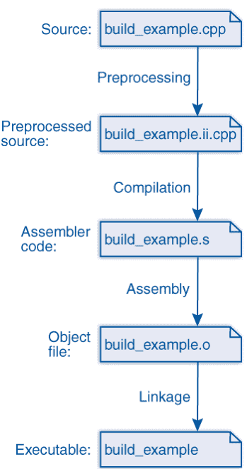

图 7-3: 简单构建

#### 7.2.1.1 预处理

=> c++03/build_example.cpp

预处理的（直接）输入是包含函数和类实现的源文件。对于C++项目，这是具有以下典型扩展名之一的文件：.cpp、.cxx、.c、.cc或.c++³，例如build_example.cpp：

单击此处查看代码图像

```cpp
#include <iostream>
#include <cmath>

int main(int argc, char* argv[])
{
    std::cout << "sqrt(17) is " << sqrt(17) << '\n';
}
```

=> c++03/build_example.ii.cpp

间接输入是相应#include指令包含的所有文件。这些包含是包含声明的头文件。包含是一个递归过程，会扩展到包含的包含，以此类推。结果是一个包含所有直接和间接包含文件的单一文件。当包含像Boost这样具有大量依赖项的大型第三方库时，这样的扩展文件可能包含几十万行。仅包含<iostream>就会将像前面的玩具示例这样的小程序膨胀到大约20,000行：

```
# 1 "build_example.cpp"
# 1 "<command-line>"
// ... skipped some lines here
# 1 "/usr/include/c++/4.8/iostream" 1 3
# 36 "/usr/include/c++/4.8/iostream" 3
// ... skipped some lines here
# 184 "/usr/include/x86_64-linux-gnu/c++/4.8/bits/c++config.h" 3
namespace std
{
    typedef long unsigned int size_t;
// ... skipped many, many lines here
# 3 "build_example.cpp" 2

int main(int argc, char* argv[])
{
    std::cout << "sqrt(17) is " << sqrt(17) << '\n';
}
```

预处理后的C++程序通常获得扩展名.ii（预处理后的C为.i）。要仅执行预处理，请使用编译器标志-E（Visual Studio：/E输出到控制台，/P输出到文件）。输出应使用-o指定；否则将打印到屏幕上。

3. 文件扩展名只是约定，对编译器无关紧要。我们可以使用.bambi作为程序的扩展名，它们仍然可以编译。同样的情况也适用于本构建讨论其余部分中的所有其他扩展名。

除了包含之外，宏会被展开并选择条件代码。整个预处理步骤是纯文本替换，大部分与编程语言无关（无知）。因此，它非常灵活，但也极易出错，如我们在第1.9.2.1节中讨论的那样。预处理期间合并的文件集称为翻译单元。

C++17提供宏__has_include来测试头文件是否可用于包含。这允许我们有条件地包含文件：

```
#if __has_include(<any>)
#   include <any>
#endif
```

尤其是在使用语言支持部分的编译器时（例如，用于部分C++20的-std=c++2a），某些库可能尚未存在，例如旧编译器上的头文件<any>或较新编译器上的<ranges>（撰写时）。即使提供常规标准标志的编译器版本——例如用于C++20的-std=c++20——也可能缺少某些标准头文件。当然，我们可能需要将其余代码调整到缺少的头文件：

```cpp
int main()
{
#if __has_include(<any>)
    std::cout << "any found, we do something useful.\n";
#else
    std::cerr << "any not found, we have to skip this example.\n";
#endif
}
```

我们也可以使用此宏来测试应用程序头文件的可用性，或在包含路径未正确设置时生成错误消息。最坏的情况是存在一个仍然不完整或不正确的头文件。这只能通过构建系统中的面向项目的特性测试以及相应的用户定义条件编译来处理。这种方法会显著增加开发成本，甚至更增加测试工作量。只有在向后兼容性极其重要时才应考虑。更简单的方法是尽可能避免条件编译，并测试哪个编译器为项目提供了足够的语言支持。

#### 7.2.1.2 编译

=> c++03/build_example.s

（实际）编译将预处理后的源代码转换为目标平台的汇编代码。⁴ 这是平台机器语言的符号表示，例如：

4. C++编译器没有义务生成汇编代码，但所有常见编译器都会这样做。

单击此处查看代码图像

```
.file "build_example.cpp"
.local _ZSt18_oininit
.comm _ZSt18_oininit,1,1
.section .rodata
.LC0:
.string "sqrt(17) is "
.text
.globl main
.type main, @function
main:
.LFB1055:
.cfi_startproc
pushq %rbp
.cfi_def_cfa_offset 16
.cfi_offset 6, -16
movq %rsp, %rbp
.cfi_def_cfa_register 6
subq $32, %rsp
movl %edi, -4(%rbp)
movq %rsi, -16(%rbp)
movl $.LC0, %esi
movq $ZSt4cout, %edi
call _ZStlsISt11char_traitsIcEERSt13basic_ostream⁵
movq %rax, %rdx
; just a bit more code
```

5. 函数名缩短以适应页面。


令人惊讶的是，汇编代码（92行）对于此示例来说比预处理后的C++要短得多，因为它只包含实际执行的操作。汇编程序的典型扩展名为`.s`和`.asm`。

编译是构建过程中最复杂的部分，C++的所有语言规则都适用。编译本身由多个阶段组成：前端、中端和后端，而这些阶段又可以包含多个遍。

除了代码生成之外，C++程序的名称还会用类型和命名空间（§3.2.1）信息进行修饰。这种修饰称为*名称修饰*。

## 7.2.1.3 汇编

汇编是从汇编语言到机器语言的简单一对一转换，其中命令被十六进制代码替换，标签被真实（相对）地址替换。生成的文件称为*目标代码*，其扩展名通常是`.o`，在Windows上为`.obj`。目标文件中的实体（代码和变量）称为*符号*。

目标文件可以打包到存档中（扩展名`.a`、`.so`、`.lib`、`.dll`等）。此过程部分仅仅是代码结构化。

## 7.2.1.4 链接

最后，目标文件和存档被*链接*在一起。链接器的主要任务是：

- 匹配不同目标文件的符号，以及
- 将相对于每个目标文件的地址映射到应用程序的地址空间。

- 静态链接：存档完全包含在可执行文件中。这种链接应用于Unix系统上的.a库和Windows上的.lib库。
- 动态链接：链接器仅检查所有符号的存在，并保留对存档的某种引用。这用于.so（Unix）和.dll（Windows）库。

影响显而易见：与动态库链接的可执行文件要小得多，但依赖于执行二进制文件的机器上是否存在这些库。当Unix/Linux上找不到动态库时，可以将其目录添加到环境变量LD_LIBRARY_PATH的搜索路径中。在Windows上，这需要多做一些工作。相反，较大的静态链接可执行文件包含完整代码，并独立于现有库运行。

## 7.2.1.5 完整构建

图7-4说明了如何生成流模拟器的应用程序。首先，我们预处理主应用程序fluxer.cpp，它包含标准库（如<iostream>）以及用于网格划分和求解的领域特定库。然后，展开的源代码被编译为目标文件fluxer.o。最后，应用程序的目标文件与标准库（如libstdc++.so）以及我们之前包含过头文件的领域库进行链接。这些库可以像libsolver.a一样静态链接，也可以像libmesher.so一样动态链接。像系统库这样的常用库通常同时提供这两种形式。

## 7.2.2 构建工具

当我们从程序源代码和已编译的库构建应用程序和库时，可以反复输入大量命令，也可以使用合适的工具。在本节中，我们将介绍其中两种工具：make和CMake。作为案例研究，我们考虑类似于图7-4的场景：一个与网格库和求解器库链接的fluxer应用程序，而这些库又是从相应的源文件和头文件构建的。

### 7.2.2.1 make

```
-> makefile_example/makefile
```

我们不知道你对make有过怎样的了解，但它并不像它的名声那么糟糕。6 实际上，它对小型项目效果相当好。基本思想是，我们表达目标及其源文件之间的依赖关系，当目标比其源文件旧或缺失时，将使用给定命令生成该目标。这些依赖关系写入makefile，并由make自动解析。在我们的示例中，我们需要将fluxer.cpp编译为相应的目标文件fluxer.o：

```
fluxer.o: fluxer.cpp mesher.hpp solver.hpp
    g++ fluxer.cpp -c -o fluxer.o
```

6. 传闻说，作者在度假前将其展示给了同事。当他回来时，已经后悔这种设计，但make已经在整个公司使用，为时已晚，无法收回。

包含命令的行必须以制表符开头。由于所有目标文件的规则足够相似，我们可以为所有C++源文件编写一个通用规则：


```
.cpp.o:
    ${CXX} ${CXXFLAGS} $^ -c -o $@
```

命令包含自动变量：$@表示规则的目标，$^表示其源文件。变量${CXX}预设为默认C++编译器，${CXXFLAGS}预设为默认标志。我们可以更改这些变量：


```
CXX=    g++-10
CXXFLAGS= -O3 -DNDEBUG    # Release
# CXXFLAGS= -O0 -g    # Debug
```

在这里，我们更改了编译器并应用了激进优化（用于发布模式）。作为注释，我们还演示了无优化且包含调试工具所需的目标文件符号表的调试模式。接下来，我们需要构建库：


```
libmesher.a: mesher.o # more mesher sources
    ar cr $@ $^
libsolver.a: solver.o # more solver sources
    ar cr $@ $^
```

为简单起见，我们两者都使用静态链接构建（与图7-4略有偏差）。最后，我们将应用程序和库链接在一起：

点击此处查看代码图像

```
fluxer: fluxer.o libmesher.a libsolver.a
	$(CXX) $(CXXFLAGS) $^ -o $@
```

如果我们在这里使用默认链接器而不是C++编译器，则需要添加C++标准库以及可能特定于C++链接的一些标志。现在，我们可以使用单个命令构建项目：

```
make fluxer
```

这将触发以下命令：

点击此处查看代码图像

```
g++ fluxer.cpp -c -o fluxer.o
	g++ mesher.cpp -c -o mesher.o
	ar cr libmesher.a mesher.o
	g++ solver.cpp -c -o solver.o
	ar cr libsolver.a solver.o
	g++ fluxer.o libmesher.a libsolver.a -o fluxer
```

如果我们更改mesher.cpp，下一次构建过程将仅生成依赖于它的目标：

点击此处查看代码图像

```
g++ mesher.cpp -c -o mesher.o
	ar cr libmesher.a mesher.o
	g++ fluxer.o libmesher.a libsolver.a -o fluxer
```

按照惯例，第一个不以点开头的目标被视为默认目标：

```
all: fluxer
```

因此，我们可以直接运行make。

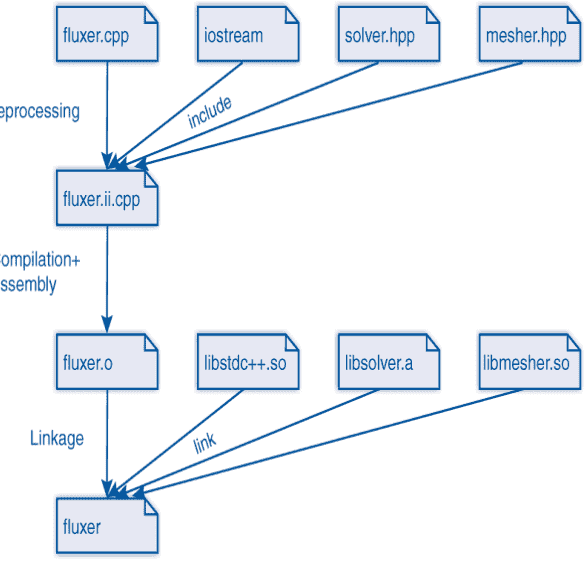

图7-4：复杂构建

### 7.2.2.2 CMake

=> CMake_example/CMakeLists.txt

CMake是比make更高抽象级别的工具，我们将在本节中演示。我们的构建项目在名为CMakeLists.txt的文件中指定。它通常以声明所需的最低工具版本和命名项目开始：

点击此处查看代码图像

```
cmake_minimum_required (VERSION 2.6)
project (Fluxer)
```

生成新库非常简单，只需声明其源文件即可：

点击此处查看代码图像

```
add_library(solver solver.cpp)
```

除非我们坚持指定，否则使用哪些命令以及如何参数化由CMake决定。带有动态链接的库也可以同样轻松地生成：

点击此处查看代码图像

```
add_library(mesher SHARED mesher.cpp)
```

我们的最终目标是创建fluxer应用程序，并将其与这两个库链接：

点击此处查看代码图像

```
add_executable(fluxer fluxer.cpp)
target_link_libraries(fluxer solver mesher)
```

在单独的目录中构建项目是良好实践，这样我们可以一次性丢弃所有生成的文件。通常创建一个名为build的子目录，并在其中运行所有命令：

```
cd build
cmake ..
```

CMake可以被视为元构建系统：它并不实际构建项目，而是为另一个构建系统（如make或ninja）生成输入。它还可以为某些IDE（如Eclipse或Visual Studio）生成项目文件。生成过程从搜索编译器和其他工具（包括它们的标志）开始：

点击此处查看代码图像

```
-- The C compiler identification is GNU 4.9.2
-- The CXX compiler identification is GNU 4.9.2
-- Check for working C compiler: /usr/bin/cc
-- Check for working C compiler: /usr/bin/cc -- works
-- Detecting C compiler ABI info
-- Detecting C compiler ABI info - done
-- Check for working CXX compiler: /usr/bin/c++
-- Check for working CXX compiler: /usr/bin/c++ -- works
-- Detecting CXX compiler ABI info
-- Detecting CXX compiler ABI info - done
-- Configuring done
```


-- 生成完成
-- 构建文件已写入：... /CMake_example/build

这里默认构建了一个我们现在可以使用的 makefile：

```
make
```

然后我们将看到类似下面的输出：

点击此处查看代码图像

```
Scanning dependencies of target solver
[ 33%] Building CXX object CMakeFiles/solver.dir/solver.cpp.o
Linking CXX static library libsolver.a
[ 33%] Built target solver
Scanning dependencies of target mesher
[ 66%] Building CXX object CMakeFiles/mesher.dir/mesher.cpp.o
Linking CXX shared library libmesher.so
[ 66%] Built target mesher
Scanning dependencies of target fluxer
[100%] Building CXX object CMakeFiles/fluxer.dir/fluxer.cpp.o
Linking CXX executable fluxer
[100%] Built target fluxer
```

生成的 makefile 反映了依赖关系，当我们更改一些源文件时，下一次 make 只会重新构建受更改影响的部分。与我们在第 7.2.2.1 节中的简单 makefile 不同，这里考虑了修改过的头文件。例如，如果我们更改了 solver.hpp，libsolver.a 和 fluxer 将被重新构建。

留到最后说的最大好处是：CMake 的可移植性。从同一个用于生成 makefile 的 CMakeLists.txt 文件，我们只需使用另一个生成器就可以创建 Visual Studio 项目。作者非常喜欢这个功能：直到今天，他自己从未创建过 Visual Studio 项目，而是全部使用 CMake 生成的。他也没有将这些项目迁移到较新版本的 Visual Studio。相反，他只是使用新版本的生成器创建了新项目。同样，可以生成 Eclipse 和 XCode 项目。KDevelop 和较新版本的 Visual Studio 可以直接从 CMake 文件构建其项目，甚至可以更新它们。简而言之，它是一个非常强大的构建工具，在撰写本文时，可能是许多项目的最佳选择。

## 7.2.3 分离编译

了解了如何从多个源文件构建可执行文件后，我们现在将讨论这些源文件应如何设计以避免冲突。

### 7.2.3.1 头文件和源文件

除了 `inline` 和模板代码外，源代码单元通常分为：

- 带有声明的头文件（例如 .hpp），以及
- 源文件（例如 .cpp）。

源文件包含将生成可执行文件的所有算法的实现。头文件包含在另一个文件中实现的函数和类的声明。有些函数可能仅在内部使用，因此在头文件中省略。例如，我们朋友 Herbert 的数学函数将被拆分为：

点击此处查看代码图像

```
// File: herberts/math_functions.hpp
#ifndef HERBERTS_MATH_FUNCTIONS_INCLUDE
#define HERBERTS_MATH_FUNCTIONS_INCLUDE

typedef double hreal; // Herbert's real numbers

hreal sine(hreal);
hreal cosine(hreal);
...
#endif

// File: herberts/math_functions.cpp
#include <herberts/math_functions.hpp>

hreal divide_by_square(hreal x, hreal y) { ... }

hreal sine(hreal) { ... }
hreal cosine(hreal) { ... }
...
```

我们留给读者去想象 Herbert 为什么引入了他自己的实数类型。要使用 Herbert 那出色的函数，我们需要两样东西：

- 声明通过：
  - 包含头文件 `herberts/math_functions.hpp` 或
  - 我们自己声明所有所需的函数。
- 已编译的代码通过：
  - 与 `math_functions.o`（Windows 下为 .obj）链接 或
  - 与包含 `math_functions.o` 的存档链接。

声明告诉编译器，具有给定签名的函数的代码存在于某处，并且可以在当前编译单元中调用。

链接步骤随后将函数调用与其实际代码结合在一起。将已编译的函数链接到某个应用程序的最简单方法是将目标文件或存档作为参数传递给 C++ 编译器。或者，我们可以使用标准链接器，但那样我们就需要一堆 C++ 特定的额外标志。

### 7.2.3.2 链接问题

在链接期间，C++ 实体（如函数和变量）由符号表示。C++ 使用名称修饰：用类型和命名空间（§3.2.1）信息装饰符号名称。链接期间可能出现三种问题：

1. 找不到符号（函数或变量）；
2. 找到多次符号；或
3. 没有 `main` 函数（或有多个）。

找不到符号可能有不同的原因：

- 声明和实现的符号不匹配。
- 未链接相应的目标文件或存档。
- 存档链接顺序错误。

在大多数情况下，缺少的符号只是一个拼写错误。由于名称修饰，函数的符号名称包含类型信息，因此也可能是参数类型不匹配。另一种可能性是源代码使用不兼容的编译器编译，其中名称修饰方式不同。

为了避免链接或执行期间出现问题，必须验证所有源文件都使用兼容的编译器编译；即，名称以相同方式修饰，函数参数以相同顺序放置在堆栈上。这不仅适用于我们自己的目标文件和第三方库的目标文件，也适用于始终链接的 C++ 标准库。在 Linux 上，应该使用默认编译器，它保证可以与所有预编译的软件包一起工作。如果旧版或新版编译器无法作为软件包获得，这通常是兼容性问题的指示。它仍然可以使用，但这明显是更多工作（手动安装、仔细配置构建流程……）。

当链接器抱怨符号重定义时，可能是同一个名称在多个实现中被声明和使用。更常见的是，这是由在头文件中定义变量和函数引起的。只要这样的头文件只在一个翻译单元中包含，这就可以工作。当带有（某些）定义的头文件被包含多次时，链接将失败。

为了说明，我们回到我们朋友 Herbert 那臭名昭著的数学函数。除了许多出色的计算外，头文件包含以下关键定义：

点击此处查看代码图像

```
// File: herberts/math_functions.hpp
..
double square(double x) { return x*x; }
double pi = 3.14159265358979323846264338327950288419716939;
```

将此头文件包含到多个翻译单元后，链接器将抱怨：

点击此处查看代码图像

```
g++-4.8 -o multifref_example multifref1.cpp multifref2.cpp
/tmp/cc65dlgC.o:(.data+0x0): multiple definition of 'pi'
/tmp/ccslHByO.o:(.data+0x0): first defined here
/tmp/cc65dlgC.o: In function 'square(double)':
multiref2.cpp:(.text+0x0): multiple definition of
'square(double)'
/tmp/ccslHByO.o:multiref1.cpp:(.text+0x63): first defined here
collect2: error: ld returned 1 exit status
```

让我们先处理函数，然后处理变量。防止重定义的急救方法是 static：

点击此处查看代码图像

```
static double square(double x) { return x*x; }
```

它将函数声明为局部于翻译单元。C++ 标准称其为内部链接（与外部链接相对）。缺点是代码复制：当头文件被包含 n 次时，函数的代码在可执行文件中出现 n 次。

一个 `inline` 声明：

点击此处查看代码图像

```
inline double square(double x) { return x*x; }
```

效果类似。无论函数是否实际内联，`inline` 函数始终具有内部链接。相反，没有 `inline` 说明符的函数具有外部链接并会导致链接器错误。

7. 高级：与 `static` 函数相反，代码不一定被复制。相反，它可以由弱符号表示，在重定义时不会导致链接器错误。

[C++17] 从 C++17 开始，变量也可以声明为 `inline`，以避免因外部链接导致的链接器冲突。此功能使一些库可以仅作为头文件交付。

我们也可以通过仅在一个翻译单元中定义函数来避免函数重定义：

点击此处查看代码图像

```
// File: herberts/math_functions.hpp
double square(double x);
```

```
// File: herberts/math_functions.cpp
double square(double x) { return x*x; }
```

这是大函数的首选方法。

### 函数定义

短函数应该是 `inline` 并在头文件中定义。大函数应该在头文件中声明并在源文件中定义。

对于数据，我们可以使用类似的技术。一个 `static` 变量：

点击此处查看代码图像

```
static double pi = 3.14159265358979323846264338327950288419716939;
```

在所有翻译单元中都被复制。这解决了我们的链接器问题，但可能会引起其他问题，如下面这个不太聪明的示例所示：

点击此处查看代码图像

```
// File: multiref.hpp
static double pi= 17.4;
```


```
// File: multifile1.cpp
int main (int argc, char* argv[])
{
    fixPi();
    std::cout << "pi = " << pi << std::endl;
}
```

```
// File: multifile1.cpp
void fixPi() { pi = 3.14159265358979323846264338327950288419716939; }
```

最好在源文件中定义一次，并在头文件中使用 `extern` 声明它：


```
// File: herberts/math_functions.hpp
extern double pi;
```

```
// File: herberts/math_functions.cpp
double pi = 3.14159265358979323846264338327950288419716939;
```

最后，我们将做最合理的事：将 \(\pi\) 声明为常量。常量也具有内部链接^8（除非之前声明为 `extern`），因此可以安全地在头文件中定义：

- 8. 进阶：它们可能只作为弱符号在可执行文件中存储一次。


```
// File: herberts/math_functions.hpp
const double pi = 3.14159265358979323846264338327950288419716939;
```

头文件不应包含普通函数和变量。

今天有些科学项目仍然使用 C 实现。如果你参与其中，可能会怀念本书中学到的所有高级特性。因此，在 A.10 节中我们演示了如何在 C 项目中使用 C++ 实现。

## 7.3 模块

C++20。借助模块，C++20 可以实现真正的模块化。与头文件不同，模块不会被文本式地包含到其他文件中，而是保持为完全独立的实体。对一些 C++ 专家来说，这是该语言历史上最剧烈的变化。正如 Bryce Adelstein 所指出的 [3]，模块改变了以下方式：

- 我们编写程序；
- 代码被解析；
- 程序被编译；
- 我们组织项目；以及
- 我们的项目被使用。

尤其是，从长远来看，大型项目的开发将发生巨大变化。为此，我们还需要新一代的支持工具。不幸的是，在撰写本文时情况并非如此：g++ 根本不提供支持，clang++ 仅提供部分支持。Visual Studio 在一定程度上支持模块，但 IDE 将模块文件视为普通文本，因此编写过程不如平时方便。目前也没有关于如何将此类文件纳入项目的信息。同样，CMake 等其他构建工具将需要比以前更多的信息来推断所有依赖项。为此，工具与编译器之间很可能需要新的交互方式。因此，我们希望读者在学习模块时能找到更好的工具支持。综合所有情况来看，本节只是一个简短的介绍，不讨论所有可能的细微差别。

```
=> modules/math.cppm
```

clang++ 和 Visual Studio 的模块文件扩展名为 cppm，而后者还支持 ixx。让我们从一个简短的示例开始：

点击此处查看代码图片

```
export module math;

namespace math {
    export bool is_prime(long i);
}
```

这里我们首先声明新模块 math，其中 `export module` 引入模块接口。在此模块中，我们有命名空间 math。模块和命名空间是正交的；我们可以在模块中声明任何其他命名空间，或者将所有内容导出到全局命名空间。然而，我们相信，具有同名命名空间的模块使用起来要容易得多。最后，我们 `export` 函数 `is_prime`。模块中可能实现的其他任何内容都不会在外部可见；只有我们 `export` 的内容才能被使用。这意味着我们完全控制模块外部可见的内容，这与头文件因其文本式包含而不同。相反，模块文件由编译器翻译，结果相应地是一个预编译模块文件。

```
=> modules/math.cpp
```

此函数的实现位于常规源文件中：

点击此处查看代码图片

```
module math;

#include <cmath>

using namespace std;

namespace math {

long max_check(long i) { return std::sqrt(i) + 1; }

bool is_prime(long i)
{
    if (i == 1)
        return false;
    if (i % 2 == 0)
        return i == 2;
    for (long j = 3; j < max_check(i); j+= 2)
        if (i % j == 0)
            return false;
    return true;
}

} // namespace math
```

这里唯一的特殊之处是开头的模块声明。编译此文件时，编译器需要预编译的模块文件。

```
=> modules/math_app.cpp
```

在我们的应用程序中，我们导入模块：

点击此处查看代码图片

```
#include <iostream>
import math;
int main()
{
    using namespace math;
    cout << "982451653 is " << (is_prime(982451653) ? "" : "not ")
         << "a prime number.\n";
}
```

该示例还演示了 includes 和 imports 可以混合使用。但是，只要有模块可用，就应始终优先使用模块。这里我们可以使用模块 `std.core` 来代替 `<iostream>` 头文件。

```
=> modules/math.cppm
```

要求在头文件中定义模板的一个缺点是，所有内部模板函数和类在头文件被包含的所有地方都可见。模块解决了这个问题，其中只有导出的模块在模块外部可见：

点击此处查看代码图片

```
export module math;
namespace math {
    auto square(auto x) { return x * x; }
    export auto cubic(auto x) { return square(x) * x; }
} // namespace math
```

模块 `math` 的导入者只能使用模板函数 `cubic`，而不能使用 `square`。

对作者来说，更大的解脱是，模块中定义的宏不会破坏导入者的程序：

点击此处查看代码图片

```
export module math;
namespace math {
#define MACRO_SQUARE(x) ((x) * (x))
} // namespace math
```

`MACRO_SQUARE` 只能在模块内部使用。而且不言而喻，宏不应该首先被使用，或者只作为最后的手段。

大型模块可以拆分为子模块，通常写入单独的文件中：

点击此处查看代码图片

```
export module math.extra;

namespace math {
    export inline double twice(double x) { return 2.0 * x; }
} // namespace math
```

我们决定在子模块中使用相同的命名空间，以便函数可以像主模块中的函数一样使用。子模块可以选择性地导入，以最大限度地控制可见性。更方便的是，我们可以将它们导入主模块并在那里导出：

```
// File: modules/math.cppm
export module math;

export import math.extra;

// ...
```

`math.extra` 的所有导出实体现在也在模块 `math` 中导出。为了正确编译，模块文件 `math.cppm` 需要预编译的模块文件 `math_extra.pcm`。使用 `clang++` 的此示例的完整构建过程如下：

点击此处查看代码图片

```
clang++-10 --precompile -o math_extra.pcm math_extra.cppm
clang++-10 -fmodule-file=math_extra.pcm --precompile -o math.pcm math.cppm
clang++-10 -fmodule-file=math.pcm -c -o math.o math.cpp
clang++-10 -fprebuilt-module-path=. -o math_app math.o math_app.cpp
```

为了使命令适合页面，我们删除了常见的标志 `-std=c++2a` 和 `-fmodules-ts`。

头文件被多次包含这一事实不仅会显著减慢构建过程，还会为一系列非常棘手的错误敞开大门。想象一下，我们的头文件包含依赖于某些宏的存在或值的条件编译代码片段。当这些宏的定义从一个翻译单元到另一个翻译单元有所不同时，来自某个头文件的生成汇编代码也可能发生变化。当项目由多人构建时，这种危险尤其高。例如，一组人可能开发和编译实用程序库，另一组开发领域特定库，而另一组开发应用程序。最终，所有内容都链接在一起，如果头文件编译不一致，应用程序可能会表现得很奇怪，而故障排除可能会非常痛苦。

在这方面，模块更可靠。预编译模块保留其编译标志的信息，当它在另一次编译中使用时，这些标志必须匹配。

总而言之，在撰写本文时，模块仍处于早期阶段。因此，我们建议在将其引入较大项目之前，先验证您的构建环境是否已经提供足够的支持。如果是，模块将显著改善您的项目，因为：

- 分离编译应导致明显更低的编译时间，因为模块只编译一次，而不是像头文件那样反复编译。
- 预编译模块在所有翻译单元中具有统一的行为。
- 不会有宏从模块中泄漏。
- 不再需要像包含保护这样的容易出错的机制。
- 模板可以选择性地导出。
- 模块可以轻松地捆绑到更大的模块中。

因此，我们相信模块将对更好的软件做出重大贡献。

## 7.4 结语

我希望你喜欢阅读本书，并渴望将许多新学到的技术应用到自己的项目中。我的意图并非要涵盖 C++ 的所有方面；我尽力展示这种强大的语言可以以多种不同的方式使用，并提供表达性和性能。随着时间的推移，你将找到自己充分利用 C++ 的个人方式。“最佳用途”对我来说是一个基本标准：我不想枚举无数个特性以及所有与之模糊相关的


language but rather to show which features or techniques could help you most to reach your goals.

In my own programming, I have spent a lot of time squeezing out as much performance as possible and have conveyed some of that knowledge in this book. Admittedly, such tuning is not always fun, and writing C++ programs without ultimate performance requirements is much easier. And even without playing the nastiest tricks, C++ programs are still in most cases clearly faster than those written in other languages.

Thus, before focusing on performance, pay attention to productivity. The most precious resource in computing is not the processor time or the memory but your own development time. And no matter how focused you are, it always takes longer than you think. A good rule of thumb is to make an initial guess, multiply it by two, and then replace the time unit by the next-larger one. The additional time is okay if it leads to a program or computing result that really makes a difference. You have my wholehearted wishes for that.

## Appendix A

### Clumsy Stuff

> > The efforts of the mountains are behind us, Ahead of us lie the efforts of the plains.
> 
> —Bertolt Brecht

This appendix is dedicated to details that cannot be ignored but would slow down the pace we aim for in this book. The early chapters on basics and classes should not hold back the reader from the intriguing advanced topics — at least not longer than necessary. If you would like to learn more details and do not find the sections in this appendix clumsy, the author would not blame you; to the contrary: it would be a pleasure to him. In some sense, this appendix is like the deleted scenes of a movie: they did not make it to the final work but are still valuable to part of the audience.

### A.1 More Good and Bad Scientific Software

The goal of this part of the appendix is to give you an idea of what we consider good scientific software and what we do not. Thus, if you don't understand what exactly happens in these programs before reading this book, do not worry. Like the example programs in the Preface, the implementations only provide a first impression of different programming styles in C++ and their pros and cons. The details are not important here, only the general perception and behavior.

As the foundation of our discussion, we consider an iterative method to solve a system of linear equations \(Ax = b\) where \(A\) is a (sparse) symmetric positive-definite (SPD) matrix, \(x\) and \(b\) are vectors, and \(x\) is searched. The method is called *Conjugate Gradients* (CG) and was introduced by Magnus R. Hestenes and Eduard Stiefel [31]. The mathematical details do not matter here, but rather the different styles of implementation. The algorithm can be written in the following form:

### Algorithm A-1: Conjugate gradient

```
Input: SPD matrix \(A\), vector \(b\), and left preconditioner \(L\), termination criterion \(\varepsilon\)
Output: Vector \(x\) such that \(Ax \approx b\)
1 \(r = b - Ax\)
2 while \(|r| \geq \varepsilon\) do
3   \(z = L^{-1}r\)
4   \(\rho = \langle r, z \rangle\)
5   if First iteration then
6     \(p = z\)
7   else
8     \(p = z + \frac{\rho}{\rho'}p\)
9   \(q = Ap\)
10  \(\alpha = \rho / \langle p, q \rangle\)
11  \(x = x + \alpha p\)
12  \(r = r - \alpha q\)
13  \(\rho' = \rho\)
```

=> c++03/cg_ugly.cpp

Programmers transform this mathematical notation into a form that a compiler understands by using operations from the language. For those who came here from Chapter 1, we want to introduce our anti-hero Herbert who is an ingenious mathematician and considers programming only as a necessary evil for demonstrating how magnificently his algorithms work. Implementing other mathematicians' algorithms is even more annoying to him. His hastily typed version of CG—which you should only skim over—looks like this:

### Listing A-1: Low-abstraction implementation of CG

Click here to view code image

```
#include <iostream>
#include <cmath>

void diag_prec(int size, double *x, double* y)
{
    y[0] = x[0];

    for (int i= 1; i < size; i++)
        y[i] = 0.5 * x[i];
}

double one_norm(int size, double *vp)
{
    double sum= 0;
    for (int i= 0; i < size; i++)
        sum+= fabs(vp[i]);
    return sum;
}

double dot(int size, double *vp, double *wp)
{
    double sum= 0;
    for (int i= 0; i < size; i++)
        sum+= vp[i] * wp[i];
    return sum;
}

int cg(int size, double *x, double *b,
       void (*prec) (int, double*, double*), double eps)
{
    int i, j, iter= 0;
    double rho, rho_1, alpha;
    double *p= new double[size];
    double *q= new double[size];
    double *r= new double[size];
    double *z= new double[size];

    // r = A*x;
    r[0] = 2.0 * x[0] - x[1];
    for (int i= 1; i < size-1; i++)
        r[i] = 2.0 * x[i] - x[i-1] - x[i+1];
    r[size-1] = 2.0 * x[size-1] - x[size-2];

    // r = b-A*x;
    for (i=0; i < size; i++)
        r[i]= b[i] - r[i];

    while (one_norm(size, r) >= eps) {
        precon(size, r, z);
        rho= dot(size, r, z);
        if (!iter) {
            for (i=0; i < size; i++)
                p[i]= z[i];
        } else {
            for (i=0; i < size; i++)
                p[i]= z[i] + rho / rho_1 * p[i];
        }

// q= A * p;
q[0] = 2.0 * p[0] - p[1];
for (int i= 1; i < size-1; i++)
    q[i] = 2.0 * p[i] - p[i-1] - p[i+1];
q[size-1] = 2.0 * p[size-1] - p[size-2];

alpha= rho / dot(size, p, q);
// x+= alpha * p; r-= alpha * q;
for (i=0; i < size; i++) {
    x[i]+= alpha * p[i];
    r[i]-= alpha * q[i];
}
rho_1= rho;
iter++;
}
delete [] q; delete [] p; delete [] r; delete [] z;
return iter;
}
```

```
void ic_0(int size, double* out, double* in) { /* ... */ }
```

```
int main (int argc, char* argv[])
{
    int size=100;

    // set nnz and size

    double *x= new double[size];
    double *b= new double[size];

    for (int i=0; i<size; i++)
        b[i] = 1.0 ;
    for (int i=0; i<size; i++)
        x[i] = 0.0 ;
    // set A and b
    cg(size, x, b, diag_prec, 1e-9);
    return 0 ;
}
```

Let us discuss it in a general fashion. The good thing about this code is that it doesn't need any further functions and works on its own—a virtue shared with much other bad code. However, this is about the only advantage. The problem with this implementation is its low abstraction level. This creates three major disadvantages:

- Bad readability;
- No flexibility; and
- Highly prone to errors.

The bad readability manifests itself in the fact that almost every operation is implemented in one or multiple loops. For instance, would we have found the matrix vector multiplication \(q = Ap\) without the comments? Probably. We would easily catch where the variables representing \(q\), \(A\), and \(p\) are used, but to see that this is a matrix vector product takes a closer look and a good understanding of how the matrix is stored.

This leads us to the second problem: the implementation commits to many technical details and only works in precisely this context. Algorithm A-1 only requires that matrix \(A\) is symmetric positive-definite, but it does not demand a certain storage scheme, even less a specific matrix. Herbert implemented the algorithm for a matrix that represents a discretized 1D Poisson equation. Programming at such a low abstraction level requires modifications every time we have other data or other formats.

The matrix and its format are not the only details to which the code commits. What if we want to compute in lower (`float`) or higher (`long double`) precision? Or solve a complex linear system? For every such new CG application, we need a new implementation. Needless to say, running on parallel computers or exploring GPGPU (General-Purpose Graphic Processing Unit) acceleration needs reimplementations as well. Much worse, every combination of the above needs a new implementation.

Some readers might think: “It is only one function of 20 or 30 lines. Rewriting this little function, how much work can this be? And we do not introduce new matrix formats or computer architectures every month.” Certainly true, but in some sense it is putting the cart before the horse. Because of such an inflexible and detail-obsessed programming style, many scientific applications grew into the hundreds of thousands or millions in lines of code. Once an application or library has reached such a monstrous size, it is difficult to modify the functions of the software (because you have to change an endless rat’s tail of auxiliary functions), and it is therefore rarely done. The way to success is to write software at a higher abstraction level from the beginning, even if it’s more work at first.

The last major disadvantage is how prone the code is to errors. All arguments are given as pointers, and the size of the underlying arrays is given as an extra argument. We as programmers of function cg can only hope that the caller did everything right because we have no way to verify it. If the user does not allocate enough memory (or does not allocate it at all), the execution will crash at some more or less random position or, even worse, will generate some nonsensical results because data and even the machine code of our program can be randomly overwritten. Good programmers avoid such fragile interfaces because the slightest mistake can have catastrophic consequences, and the program errors are extremely difficult to locate. Unfortunately, even recently released and widely used software is written in this manner, either for backward compatibility to C and Fortran or because it is written in one of these two languages. Or the developers are just resistant to any progress in software development. In fact, the implementation above is C and not C++. If this is how you like software, you probably will not like this book.

So much about software we do not like. In Listing A–2, we show a version that comes much closer to our ideal.

=> c++11/cg_nice.cpp

### Listing A–2: High-abstraction implementation of CG


# 点击此处查看代码图像

```
template <typename Matrix, typename Vector,
typename Preconditioner, typename Eps>
int conjugate_gradient(const Matrix& A, Vector& x, const
Vector& b,
                         const Preconditioner& L, Eps eps)
{
    using Scalar= value_type_t<Vector>;
    Scalar rho= 0, rho_1= 0, alpha= 0;
    Vector p(size(x)), q(size(x)), r(size(x)), z(size(x));

    r= b - A * x;
    int iter = 0 ;

    while (one_norm(size, r) >= eps) {
        z = r / L;
        rho = dot(r, z);

        if (iter.first())
            p = z;
        else
            p = z + (rho / rho_1) * p;

        q= A * p;
        alpha = rho / dot(p, q);

        x += alpha * p;
        r -= alpha * q;
        rho_1 = rho;
        ++iter;
    }

    return iter;
}

int main (int argc, char* argv[])
{
    // initiate A, x, and b
    conjugate_gradient(A, x, b, diag_prec, 1.e-5);
    return 0 ;
}
```

你可能首先意识到，CG 实现无需注释也很易读。作为经验法则，如果别人的注释看起来像你的程序源代码，那么你就是一名非常出色的程序员。如果你将算法 A–1 中的数学符号与清单 A–2 进行比较，你会发现——除了开头的类型和变量声明外——它们是完全相同的。有些读者可能会觉得它更像 MATLAB 或 Mathematica，而不是 C++。是的，只要我们投入足够的精力编写优秀软件，C++ 也可以呈现这样的风格。

显然，在这个抽象层次编写算法，比用低级操作来表达算法要容易得多。没有人知道每年有多少科学家在浪费多少时间，去纠结像清单 A-1 这样糟糕软件中的小技术细节。当然，技术细节必须在某个地方实现，但不应该在科学应用程序中实现。这是最糟糕的位置。采用两级方法：使用富有表现力的数学操作来编写应用程序，如果这些操作不存在，则分别实现它们。这些数学操作必须经过精心实现，以确保绝对正确性和最佳性能。什么是最优取决于你能花多少时间进行调优，以及额外的性能能带来多少收益。当基础操作被频繁重复使用时，投入时间在基础操作上是值得的。比实现细节更重要的是，找到并使用合适的抽象，使软件在后续使用中变得有意义。如果所需的抽象在我们现有的软件中不存在，我们有幸去实现它。

说到抽象，清单 A-2 中的 CG 实现不绑定任何技术细节。该函数在任何地方都不限制于像 `double` 这样的数值类型。它同样适用于 `float`、GNU 多精度、复数、区间运算、四元数，应有尽有。

矩阵 $A$ 可以存储在任何内部格式中，只要 $A$ 可以与向量相乘。事实上，它甚至不需要是一个矩阵，而可以是任何线性算子。例如，当快速傅里叶变换（FFT）表示为 $A$ 与向量的乘积时，执行向量 FFT 的对象可以用作 $A$。同样，向量不需要由有限维数组表示，而可以是任何向量空间的元素，只要该向量空间在某种程度上可由计算机表示，并且算法中的所有操作都可以执行。

我们也对其他计算机架构持开放态度。如果矩阵和向量分布在并行超级计算机的节点上，并且可用相应的并行操作，则该函数可以在不修改任何一行代码的情况下并行运行。(GP)GPU 加速也可以在不更改算法实现的情况下实现。一般来说，任何我们可以为其实现矩阵和向量类型及其相应操作的现有或新平台，都受到我们的通用共轭梯度函数的支持。

因此，基于此类抽象构建的成千上万行的复杂科学应用程序可以在不修改代码的情况下移植到新平台。

## A.2 详细基础

本节汇总了第 1 章中外包的细节。

### A.2.1 static 变量

与第 1.2.7 节中在作用域结束时销毁的作用域变量不同，static 变量存活至程序结束。因此，将局部变量声明为 static 仅在包含块被执行多次时才有效：在循环或函数中。在函数内，我们可以实现一个计数器，记录函数被调用的次数：

点击此处查看代码图像

```
void self_observing_function()
{
    static int counter= 0;    // only executed once
    ++counter;
    cout << "I was called " << counter << " times.\n";
    ...
}
```

为了保留对 static 变量的更改，初始化仅执行一次。static 变量的主要动机是在下一次函数调用中重用辅助数据，如查找表或缓存。但是，如果辅助数据的管理达到一定复杂度，基于类的解决方案（第 2 章）可能会带来更清晰的设计。关键字 static 的效果取决于上下文，但共同点是：

- 持久性：static 变量在程序其余执行期间保留在内存中。
- 文件作用域：`static` 变量和函数仅在当前文件的编译中可见，当多个编译的程序链接在一起时不会发生冲突。详情在第 7.2.3.2 节中讨论和说明。

因此，对全局变量的影响是限制其可见性，因为它们本身就会存活到程序结束。相反，对局部变量的影响是延长生命周期，因为它们的可见性已经受到限制。`static` 还有一个与类相关的含义，将在第 2 章中讨论。

## A.2.2 关于 if 的更多内容

`if` 的条件必须是一个 `bool` 表达式（或可转换为 `bool` 的内容）。因此，以下是允许的：


```cpp
int i = ...
if (i)     // bad style
    do_something();
```

这依赖于从 `int` 到 `bool` 的隐式转换。换句话说，我们测试 `i` 是否不等于 0。更清晰的说法是：


```cpp
if (i != 0)     // better
    do_something();
```

`if` 语句可以包含其他 `if` 语句：


```cpp
if (weight > 100.0) {
    if (weight > 200.0) {
        cout << "This is extremely heavy.\n";
    } else {
        cout << "This is quite heavy.\n";
    }
} else {
    if (weight < 50.0) {
        cout << "A child can carry this.\n";
    } else
        cout << "I can carry this.\n";
}
```

在上面的示例中，可以省略括号而不改变行为，但保留括号更清晰。当我们重新组织嵌套时，示例更易读：

点击此处查看代码图像

```
if (weight < 50.0) {
    cout << "A child can carry this.\n";
} else if (weight <= 100.0) {
    cout << "I can carry this.\n";
} else if (weight <= 200.0) {
    cout << "This is quite heavy.\n";
} else {
    cout << "This is extremely heavy.\n";
}
```

这里也可以省略花括号，并且需要较少的精力来弄清楚发生了什么。假设我们想做一些复杂的事情。让我们看看倒数第二个示例中不带花括号的 then-分支：

点击此处查看代码图像

```
if (weight > 100.0)
    if (weight > 200.0)
        cout << "This is extremely heavy.\n";
    else
        cout << "This is quite heavy.\n";
```

看起来，如果第一个 if 没有 else-分支，最后一行会在 weight 介于 100 和 200 之间时执行。但我们也可以假设第二个 if 没有 else-分支，最后一行会在 weight 小于或等于 100 时执行。幸运的是，C++ 标准规定 else-分支始终属于最内层的可能 if。因此，我们可以依赖我们的第一种解释。如果 else 属于第一个 if，我们需要花括号：

点击此处查看代码图像

```
if (weight > 100.0) {
    if (weight > 200.0)
        cout << "This is extremely heavy.\n";
} else
    cout << "This is not so heavy.\n";
```


也许这些例子会让你相信，有时多加一些花括号，省去猜测else分支归属的时间，会更高效。

### A.2.3 Duff's Device

`switch` case中的连续执行还允许我们在每次迭代后无需终止测试即可实现短循环。假设我们有长度$\le 5$的向量。那么我们可以不使用循环来实现向量加法：

点击此处查看代码图片

```
assert(size(v) <= 5);
int i = 0;
switch (size(v)) {
case 5: v[i]= w[i] + x[i]; ++i; // keep going
case 4: v[i]= w[i] + x[i]; ++i; // keep going
case 3: v[i]= w[i] + x[i]; ++i; // keep going
case 2: v[i]= w[i] + x[i]; ++i; // keep going
case 1: v[i]= w[i] + x[i]; ++i; // keep going
case 0: ;
}
```

这种技术称为Duff's device。它通常不像上面那样独立使用（而是作为展开循环的清理工作）。此类技术不应在项目的主开发中使用，而只应作为对性能关键内核的最终调优。

### A.2.4 程序调用

包含空格的参数必须加引号。虽然标准未保证，但第一个参数通常包含可执行文件的名称——可能带有路径信息，如：

点击此处查看代码图片

```
.. /c++11/argc_argv_test first "second third" fourth
```

这将打印出：

点击此处查看代码图片

```
.. /c++11/argc_argv_test
first
second third
fourth
```

某些编译器还支持将字符串向量作为`main`的参数。这更方便，但不可移植。

要使用参数进行计算，必须先将其转换：

点击此处查看代码图片

```
cout << argv[1] << " times " << argv[2] << " is "
<< stof(argv[1]) * stof(argv[2]) << ".\n";
```

这可能会给我们带来如此令人印象深刻的知识，例如：

点击此处查看代码图片

```
argc_argv_test 3.9 2.8
3.9 times 2.8 is 10.92.
```

C++11 遗憾的是，字符串到数字的转换不会告诉我们完整字符串何时不可转换。只要字符串以数字或加号/减号开头，读取就会在遇到不能属于数字的字符时停止，并将读取到的子字符串转换为数字。使用`stof`的数值转换是在C++11中引入的，在此之前我们只有基于`const char*`而非`string`的`atof`，它更容易出错。

在类Unix系统中，可以通过shell中的`$?`访问上一条命令的退出码。1 我们还可以使用退出码，在前一条命令成功的条件下依次执行多条命令：

- 1. 在Windows批处理脚本中，可以相应地使用`$errorlevel$`。

```
do_this && do_that && finish_it
```

与C和C++不同，命令shell将退出码0解释为`true`（即成功）。然而，`&&`的处理与C和C++类似：只有当第一个子表达式为真时，我们才需要求值第二个。同样，只有当前一条命令成功时，才会执行一条命令。dual地，`||`可用于错误处理，因为`||`后面的命令仅在前一条命令失败时才执行。

### A.2.5 断言还是异常？

无需详述，异常可能比断言稍贵，因为C++在抛出异常时必须清理运行时环境。过去关闭异常处理可能会加速应用程序，但现代编译器在未抛出异常时几乎没有或没有异常处理开销。另一方面，断言会立即终止程序且不需要清理。此外，它们在发布模式下通常也被禁用。

如前所述，源自编程错误的意外或不一致的值应使用断言处理，而异常状态应使用异常处理。或者换一种说法：断言用于自我检查，异常用于检查他人。不幸的是，当我们遇到问题时，这种区别并不总是显而易见。考虑我们无法打开文件的示例。原因可能是用户输入或在配置文件中找到了错误的名称。在这种情况下，异常是最佳选择。错误的文件也可能是源代码中的字面量或错误字符串拼接的结果。此类程序错误无法处理，我们可能更希望程序使用断言终止——冒着在发布模式下错误未被发现的风险。

这种困境是避免冗余与即时健全性检查之间的冲突。在输入或组合文件名的位置，我们不知道这是编程错误还是错误输入。在这些点上实现错误处理可能需要多次重复打开测试。这会导致重复检查实现的额外编程工作，并且存在测试之间不一致的危险。因此，只测试一次且不知道当前问题的原因更高效且不易出错。在这种情况下，我们应谨慎行事并抛出异常，以便在某些情况下至少有可能进行修复。

损坏的数据通常更适合使用异常处理。假设正在计算公司的薪水，而新员工的数据尚未完全设置。引发断言将意味着整个公司（包括你）当月无法领取薪水，或者至少要等到有问题的数据集修复后才能领取。如果在数据评估期间抛出异常，应用程序可以以某种方式报告错误，并继续处理其余员工。

谈到程序健壮性，广泛使用的库中的函数绝不应中止。例如，如果该函数用于实现自动驾驶，我们宁愿关闭自动驾驶，也不愿终止整个程序（想象一下飞机在着陆时系统正在重启）。换句话说，当我们不知道库的所有应用领域时，无法判断程序中止的后果。

有时，问题的原因在理论上并非100%确定，但在实践中足够清楚。向量或矩阵的访问运算符应检查索引是否在有效范围内。原则上，越界索引可能源自用户输入或配置文件，但在几乎所有情况下，它都来自程序错误。在这里引发断言似乎是合适的。为了符合健壮性要求，可能需要允许用户通过条件编译在断言和异常之间做出决定（参见§1.9.2.3）。

### A.2.6 二进制I/O

字符串之间的转换可能代价高昂。因此，将数据直接以各自的二进制表示形式写入文件通常更高效。尽管如此，在这样做之前，最好使用性能工具检查文件I/O是否真的是应用程序的显著瓶颈。

当我们决定使用二进制时，应设置标志`std::ios::binary`以阻止隐式转换，例如将换行符调整为Windows、Unix或Mac OS。该标志并不决定文件是文本还是二进制：可以在没有该标志的情况下写入二进制数据，也可以使用该标志写入文本。然而，为了防止前面提到的意外情况，最好适当设置该标志。

二进制输出使用`ostream`的成员函数`write`执行，输入使用`istream::read`。这些函数以`char`地址和大小作为参数。因此，所有其他类型都必须强制转换为`char`指针：


```
int main (int argc, char* argv[])
{
    std::ofstream outfile;
    with_io_exceptions(outfile);
    outfile.open("fb.txt", ios::binary);

    double o1 = 5.2, o2 = 6.2;
    outfile.write(reinterpret_cast<const char *>(&o1),
    sizeof(o1));
    outfile.write(reinterpret_cast<const char *>(&o2),
    sizeof(o2));
    outfile.close();

    std::ifstream infile;
    with_io_exceptions(infile);
    infile.open("fb.txt", ios::binary);

    double i1, i2;
    infile.read(reinterpret_cast<char *>(&i1), sizeof(i1));
    infile.read(reinterpret_cast<char *>(&i2), sizeof(i2));
    std::cout << "i1 = " << i1 << ", i2 = " << i2 << "\n";
}
```

二进制I/O的一个优点是我们不需要担心流是如何解析的。另一方面，读写命令中类型不匹配会导致完全无法使用的数据。特别是，当文件不是在创建它们的同一平台上读取时，我们必须格外小心：long变量在一台机器上可以包含32位，在另一台机器上可以包含64位。为此，库<cstdint>提供了在每个平台上大小相同的类型。例如，int32_t在每个平台上都是32位有符号int，而uint32_t是相应的无符号类型。

当类是自包含的（即所有数据都存储在对象内部，而不是由指针或引用引用的外部数据）时，二进制I/O对类的工作方式相同。将包含内存地址（如树或图）的结构写入文件需要特殊表示，因为地址在新的程序运行中显然无效。在A.6.4节中，我们将展示一个便利函数，允许我们在一次调用中写入或读取许多对象。

除了上述整数大小之外，在不同系统之间传输数据还存在许多风险：数字可能以不同的字节序处理（大端 vs. 小端），或者由另一个编译器以不同顺序存储成员。存在提供数据可移植性的文件格式和库——例如Protobuf [70]。


## A.2.7 C 风格的 I/O

C 语言的旧式 I/O 在 C++ 中也可用：

点击此处查看代码图片

```
#include <cstdio>

int main ()
{
    double x = 3.6;
    printf("The square of %f is %f\n", x, x*x);
}
```

命令 printf 不出所料代表 print-formatted（格式化打印）。其对应的输入是 scanf。文件 I/O 通过 fprintf 和 fscanf 实现。

这些函数的优点在于格式相当紧凑；用 6 个字符且保留 2 位小数打印第一个数字，并用 14 个字符且保留 9 位小数打印第二个数字，可用以下格式字符串表示：

点击此处查看代码图片

```
printf("The square of %6.2f is %14.9f\n", x, x*x);
```

格式字符串的问题在于它们不是类型安全的。如果参数与其格式不匹配，可能会发生奇怪的事情。例如，这里：

点击此处查看代码图片

```
int i = 7;
printf("i is %s\n", i);
```

该参数是 int 类型，将作为 C 字符串打印，而 C 字符串是通过指向其首字符的指针传递的。因此，7 会被解释为一个地址，在大多数情况下程序会崩溃。较新的编译器会检查格式字符串，如果它作为字面量在 printf 调用中提供。但字符串可以事先设置：

点击此处查看代码图片

```
int i = 7;
char s[] = "i is %s\n";
printf(s, i);
```

或者它可以是字符串操作的结果。在这种情况下，编译器不会警告我们。

另一个缺点是它无法扩展以支持用户自定义类型。C 风格的 I/O 在基于日志的调试中可能很方便，但流（streams）出错的可能性要小得多，在高质量的生产软件中应优先使用流。

C++20 中的新 Format 库（§1.7.6）克服了所有这些问题，如果可用，我们强烈建议你使用它。

## C++11 A.2.8 垃圾回收

垃圾回收（GC）被理解为对未使用内存的自动释放。几种语言（例如 Java）会不时释放程序中不再引用的内存。C++ 中的内存处理设计得更加显式：程序员以某种方式控制何时释放内存。尽管如此，C++ 程序员对 GC 仍有兴趣，要么是为了使软件更可靠——尤其是当包含旧的、有内存泄漏且无人愿意或能够修复的组件时——要么是为了与具有托管内存处理的其他语言进行互操作。后者的一个例子是 .NET 中的托管 C++。

鉴于这种兴趣，标准（从 C++11 开始）为垃圾收集器定义了一个接口，例如 declare_reachable 和 declare_no_pointers 等函数。然而，垃圾回收不是强制特性，到目前为止我们不知道有任何编译器支持它。反过来，依赖 GC 的应用程序无法在常见编译器上运行。垃圾回收应仅作为最后手段。内存管理应主要封装在类中，并与其创建和销毁紧密绑定，即 RAII（§2.4.2.1）。如果这不可行，应考虑 unique_ptr（§1.8.3.1）和 shared_ptr（§1.8.3.2），它们会自动释放不再引用的内存。实际上，shared_ptr 的引用计数已经是一种简单的 GC 形式（尽管可能不是所有人都会同意这个定义）。只有当所有这些技术都因某种棘手的循环依赖而不可行，并且可移植性不是问题时，才应求助于垃圾回收。

## A.2.9 宏带来的麻烦

例如，具有以下签名的函数：

点击此处查看代码图片

```
double compute_something(double fnml, double scr1, double scr2)
```

在大多数编译器上可以编译，但在较旧版本的 Visual Studio 中却出现了一条奇怪的错误消息。原因是 scr1 是一个定义十六进制数的宏，它替换了我们第二个参数的名称。显然，这不再是合法的 C++ 代码，但错误中包含了替换发生前的原始源代码。因此，我们看不到任何可疑之处。解决此类问题的唯一方法是仅运行预处理器并检查展开后的源代码。这可能需要一些努力，因为展开版本包含所有直接和间接包含文件的源代码。最终，我们发现编译器拒绝的源代码行发生了什么：

点击此处查看代码图片

```
double compute_something(double fnml, double 0x0490, double scr2)
```

一旦知道它在某处被用作宏，我们只需更改参数名即可修复此问题。

计算中使用的常量不应通过宏定义：

点击此处查看代码图片

```
#define pi 3.1415926535897932384626433832795028841 // Do Not!!!
```

而应作为真正的常量：

点击此处查看代码图片

```
const long double pi = 3.1415926535897932384626433832795028841L;
```

否则，当有人将 pi 用作变量或函数参数名时，我们就会制造出与前面示例中 scr1 造成的那种完全相同的麻烦。在 C++11 中，我们还可以使用 constexpr 来确保值在编译期间可用，而在 C++14 中，我们可以使用模板参数（§3.9）定义常量。

函数式宏提供了另一系列不那么有趣的陷阱。主要问题是宏参数仅在简单用例中表现得像函数参数。例如，当我们编写宏 max_square 时：

```
#define max_square(x, y) x*x >= y*y ? x*x : y*y
```

该表达式的实现看起来很简单，我们可能不会预料到任何麻烦。但当我们将其用于求和或差值时，就会遇到一些麻烦：

```
int max_result = max_square(a+b, a-b);
```

然后它将被求值为：

点击此处查看代码图片

```
int max_result= a+b*a+b >= a-b*a-b ? a+b*a+b : a-b*a-b;
```

显然会产生错误结果。这个问题可以通过添加一些括号来修复：

点击此处查看代码图片

```
#define max_square(x, y) ((x)*(x) >= (y)*(y) ? (x)*(x) : (y)*(y))
```

为了防止高优先级运算符，我们还用一对括号括住了整个表达式。因此，宏表达式需要在每个参数周围、每个子表达式周围以及整个表达式周围加上括号。请注意，这是正确性的必要条件，而不是充分条件。另一个严重问题是表达式中参数的复制。如果像这样调用 max_square：

```
int max_result = max_square(++a, ++b);
```

变量 a 和 b 会被递增多达四次。

宏是一种相当简单的语言特性，但实现和使用它们比乍看之下要复杂和危险得多。危险在于它们与整个程序交互。因此，新软件根本不应包含宏。不幸的是，大量现有软件已经包含宏，我们不得不处理它们。遗憾的是，没有治疗宏问题的通用方法。以下是大多数情况下有效的一些技巧：

- 避免使用流行宏的名称。最突出的是，`assert` 是标准库中的一个宏，如果给函数取这个名字，就是自找麻烦。
- 使用 `#undef` 取消定义名称冲突的宏。
- 在包含所有其他库之后再包含宏密集型库。这样宏仍然会污染你的应用程序，但不会污染其他包含的头文件。
- 令人印象深刻的是，一些库提供了针对其自身宏的保护：可以定义一个宏来禁用或重命名宏中危险的短名称。²

2. 我们见过一个库将单个下划线定义为宏，这造成了很多问题。

## A.3 现实世界示例：矩阵求逆

为了总结基本特性，我们将它们应用于演示如何轻松创建新功能。我们希望让你了解我们的想法如何自然地演变为可靠且高效的 C++ 程序。特别关注清晰性和可重用性。我们的程序内部结构应良好，外部使用应直观。

为了简化我们案例研究的实现，我们使用作者的库（开源部分）*Matrix Template Library* ⁴—参见 `http://www.mtl4.org`。它已经包含了我们在这里需要的大量线性代数功能。³ 我们希望未来的 C++ 标准会提供类似的线性代数库。也许一些读者会为其做出贡献。

3. 它实际上已经包含了我们要找的反演函数 `inv`，但让我们假设它不包含。

作为一种软件开发方法，我们将使用 *Extreme Programming* 中的一项原则：先编写测试，随后再实现功能——即 *Test-Driven Development*（TDD）。这有几个显著优势：


- 它在一定程度上保护我们程序员免受*功能主义*的影响——即痴迷于不断添加更多功能，而不是一件接一件地完成事情。如果我们写下想要实现的目标，我们会更直接地朝着这个目标努力，并且通常能更早地完成它。在测试中编写函数调用时，我们已经指定了计划实现的函数的接口。当我们为测试设置预期值时，我们就在说明我们函数的语义。因此，*测试是可编译的文档* [77]。测试可能无法告诉我们关于即将实现的函数和类的一切，但它所说的内容非常精确。文本文档可以比测试更详细、更易理解，但也可能比测试模糊得多。

- 如果我们在最终完成实现后才开始编写测试——比如说，在周五下午晚些时候——*我们不想看到它失败*。我们会使用良好的数据（无论这对所涉及的程序意味着什么）来编写测试，并尽量降低失败的风险。或者我们可能决定回家过周末，并发誓周一再测试它。

- 在高效工作的日子里，你想继续进行有趣且有挑战性的编程，而在那个时刻编写测试很可能会打断你的心流。你提前准备的测试越多，就能在心流中停留得越久。

出于这些原因，如果我们先编写测试，就会更诚实、更高效。

在TDD中，开发被组织为三个阶段的循环：编写测试、实现相应的代码，最后根据我们的软件理念对两者进行重构。如果我们的初始设计——在测试中体现——被证明行不通，或者会导致低效或不优雅的实现，我们可能会直接跳到重构，并根据新的知识调整测试，而不是痛苦地完成一个能通过测试的实现，然后在不久之后将其丢弃。不言而喻，验证部分实现需要暂时注释掉测试的部分内容。

- 在开始实现我们的逆函数及其测试之前，我们必须选择一个算法。我们可以在不同的直接求解器中选择：子矩阵行列式、分块算法、Gauss-Jordan方法，或带有或不带主元的LU分解。假设我们偏好带列主元的LU分解，因此有：

LU = PA，

其中L是单位下三角矩阵，U是上三角矩阵，P是置换矩阵。因此：

A = P⁻¹LU。

这意味着对于逆矩阵：

A⁻¹ = U⁻¹L⁻¹P. (A.1)

我们使用MTL4中的LU分解，实现下三角和上三角矩阵的求逆，并适当地组合它们。

```
=> c++11/inverse.cpp
```

- 现在，我们通过定义一个可逆矩阵并将其打印出来来开始我们的测试：

Click here to view code image

```
int main(int argc, char* argv[])
{
    const unsigned size=3;
    using Matrix = mtl::dense2D<double>; // Type from MTL4
    Matrix A(size, size);
    A=
        4, 1, 2,
        1, 5, 3,
        2, 6, 9;    // C++03
    cout << "A is:\n" << A;
```

- 为了以后的抽象，我们定义了类型Matrix和常量size。使用C++11，我们可以使用统一初始化来设置矩阵：

4. MTL4是用C++03编写的，我们仍然保持对该版本的向后兼容性。因此，必须通过像MTL_WITH_INITLIST这样的宏显式激活C++11特性。

Click here to view code image

```
Matrix A = {{4, 1, 2}, {1, 5, 3}, {2, 6, 9}}; // C++11
```

- 对于我们的实现，我们可以使用C++03，但为了减少与书中其余部分的差异，我们至少使用C++11。MTL4中的LU分解是原地执行的。为了不修改我们的原始矩阵，我们先将其复制到一个新矩阵中：

```
Matrix LU{A};
```

- 我们还为分解中计算的置换定义了一个向量：

```
mtl::dense_vector<unsigned> Pv(size);
```

- 这是LU分解的两个参数：

```
lu(LU, Pv);
```

- 出于我们的需求，将置换表示为矩阵更方便：

Click here to view code image

```
Matrix P{permutation(Pv)};
cout << "Permutation vector is " << Pv
<< "\nPermutation matrix is\n" << P;
```

- 这使我们可以通过矩阵乘积来表示行置换：

```
cout << "Permuted A is\n" << P * A;
```

- 我们现在定义一个单位矩阵，并从我们的原地分解中提取L和U：

Click here to view code image

```
Matrix I{matrix::identity(size, size)}, L{I +
strict_lower(LU)},
U{upper(LU)};
```

- 注意，L的单位对角线没有存储，测试时需要添加。它也可以隐式处理，但为了简单起见，我们不这么做。我们现在已经完成了准备工作，来到了第一个测试。一旦我们计算了U的逆（名为UI），它们的乘积必须是单位矩阵（近似）。L的逆也是如此：

Click here to view code image

```
constexpr double eps = 0.1;
Matrix UI(inverse_upper(U));
cout << "inverse (U) (permuted) is:\n" << UI
<< "UI * U is:\n" << Matrix(UI * U);
assert(one_norm(Matrix(UI * U - I)) < eps);
```

- 对非平凡数值计算结果进行相等性测试几乎肯定会失败。因此，我们使用矩阵差的范数作为标准。同样，L的逆（使用不同的函数）也进行了测试：

Click here to view code image

```
Matrix LI(inverse_lower(L));
cout << "inverse (L) (permuted) is:\n" << LI
<< "LI * L is:\n" << Matrix(LI * L);
assert(one_norm(Matrix(LI * L - I)) < eps);
```

- 这使我们能够计算A本身的逆并测试其正确性：

Click here to view code image

```
Matrix AI(UI * LI * P);
cout << "inverse (A) [UI * LI * P] is \n" << AI
<< "A * AI is \n" << Matrix(AI * A);
assert(one_norm(Matrix(AI * A - I)) < eps);
```

- 我们还用相同的标准检查我们的逆函数：

Click here to view code image

```
Matrix A_inverse(inverse(A));
cout << "inverse (A) is \n" << A_inverse
<< "A * AI is \n" << Matrix(A_inverse * A);
assert(one_norm(Matrix(A_inverse * A - I)) < eps);
```

- 在为计算的所有组件建立测试后，我们开始进行其实现。我们编程的第一个函数是上三角矩阵的求逆。该函数以稠密矩阵作为参数，并返回一个稠密矩阵：

Click here to view code image

```
Matrix inverse_upper(const Matrix& A) {
}
```

- 由于我们不需要输入矩阵的另一份副本，因此我们按引用传递它。参数不应被更改，因此我们可以将其作为`const`传递。constancy具有多个优点：

- 我们提高了程序的可靠性。作为`const`传递的参数保证不会更改；如果我们意外修改它们，编译器会告诉我们并中止编译。有一种方法可以删除constancy，但这只应作为最后手段，例如，用于与他人编写的过时库进行接口。你自己编写的一切都可以在不消除参数constancy的情况下实现。

- 当对象保证不会被更改时，编译器可以更好地优化。

- 对于引用，函数可以使用临时对象进行调用。非`const`引用需要将表达式存储到变量中并将变量传递给函数。另一个评论：人们可能会告诉你，将容器作为结果返回代价太高，使用引用更高效。这在原则上是正确的。目前，我们接受这种额外成本，并更关注清晰度和便利性。此外，现代编译器对返回值执行多种优化：容器中的数据可能会被移动而不是复制（参见§2.3.5中的移动语义），或者复制完全被省略（参见§2.3.5.3），因此你支付的比预期少，通常什么都不用付。

- 关于函数签名就说到这里；现在让我们将注意力转向函数体。我们的第一个任务是验证参数是否有效。显然，矩阵必须是方阵：

Click here to view code image

```
const unsigned n = num_rows(A);
if (num_cols(A) != n)
    throw "Matrix must be square";
```

- 行数在这个函数中需要用到多次，因此将其存储在一个变量中，嗯，常量中。另一个先决条件是矩阵的对角线上没有零元素。我们将此测试留给三角求解器。说到这一点，我们可以用一个


线性方程组的三角求解器，我们在 MTL4 中找到了它；更准确地说，U^-1 的第 k 个向量是以下方程的解：

Ux = e_k

其中 e_k 是第 k 个单位向量。首先我们为结果定义一个临时变量：

```
Matrix Inv(n, n);
```

然后我们遍历 Inv 的列：

```
for (unsigned k = 0; k < n; ++k) {
}
```

在每次迭代中，我们需要第 k 个单位向量：

```
dense_vector<double> e_k(n);
for (unsigned i = 0; i < n; ++i)
    if (i == k)
        e_k[i] = 1.0;
    else
        e_k[i] = 0.0;
```

三角求解器返回一个列向量。我们可以将该向量的元素直接赋值给目标矩阵的元素：

```
for (unsigned i = 0; i < n; ++i)
    Inv[i][k] = upper_trisolve(A, e_k)[i];
```

这简洁短小，但我们会计算 n 次 upper_trisolve！虽然我们说过此时性能不是我们的首要目标，但总复杂度从 3 阶增加到 4 阶实在太浪费资源了。许多程序员会犯过早优化的错误，但这并不意味着我们应该（没有充分理由）接受一个复杂度更高的实现。为了避免多余的重复计算，我们存储三角求解器的结果，并从中复制元素：

```
dense_vector<double> res_k(n);
res_k = upper_trisolve(A, e_k);
for (unsigned i = 0; i < n; ++i)
    Inv[i][k] = res_k[i];
```

最后，我们返回临时矩阵。函数的完整形式如下：

```
Matrix inverse_upper(Matrix const& A)
{
    const unsigned n = num_rows(A);
    if (num_cols(A) != n)
        throw "Matrix must be square";

    Matrix Inv(n, n);

    for (unsigned k = 0; k < n; ++k) {
        dense_vector<double> e_k(n);
        for (unsigned i = 0; i < n; ++i)
            if (i == k)
                e_k[i] = 1.0;
            else
                e_k[i] = 0.0;

        dense_vector<double> res_k(n);
        res_k = upper_trisolve(A, e_k);
        for (unsigned i = 0; i < n; ++i)
            Inv[i][k] = res_k[i];
    }

    return Inv;
}
```

既然函数已经完成，我们首先运行测试。显然，我们必须注释掉测试的一部分，因为到目前为止我们只实现了一个函数。尽管如此，尽早了解这个第一个函数是否按预期运行仍然是件好事。确实如此，我们现在可以对其感到满意，并将注意力转向下一个任务；还有很多任务。但我们不会。相反，我们将花些时间来改进我们的实现。这种改进称为 *重构*。经验表明，在实现后立即重构所需的时间远少于在发现错误或将软件移植到其他平台后重构。显然，在我们仍然知道发生了什么时立即简化和构建我们的软件，比几周/几个月/几年后要容易得多。

我们可能不喜欢的第一件事是，像初始化单位向量这样简单的事情竟然要用五行。这相当冗长：

```
for (unsigned i = 0; i < n; ++i)
    if (i == k)
        e_k[i] = 1.0;
    else
        e_k[i] = 0.0;
```

我们可以使用条件运算符更紧凑地写出这一点：

```
for (unsigned i = 0; i < n; ++i)
    e_k[i] = i == k ? 1.0 : 0.0;
```

条件运算符 ?: 通常需要一些时间来适应，但它能产生更简洁的表示。虽然我们没有从语义上更改程序中的任何内容，而且结果看起来显然仍然相同，但再次运行测试也无妨。你会发现，你常常确信你的程序修改绝不会改变行为——但它们确实改变了。我们越早发现意外行为，修复它所需的工作就越少。使用我们已经编写的测试，只需几秒钟，并能让我们更有信心。

如果我们想真正酷一点，可以探索一些内部知识。表达式 `i == k` 返回一个布尔值，我们知道 `bool` 可以隐式转换为 `int`，随后转换为 `double`。在此转换中，根据标准，`false` 变为 0，`true` 变为 1。这些正是我们想要的 `double` 值：

```
e_k[i] = static_cast<double>(i == k);
```

事实上，从 `int` 到 `double` 的转换是隐式执行的，也可以省略：

```
e_k[i] = i == k;
```

尽管这看起来很巧妙，但将逻辑值赋给浮点数有点牵强。它由隐式转换链 `bool → int → double` 明确定义，但可能会让潜在读者感到困惑，你可能最终不得不在邮件列表上向他们解释发生了什么，或者在程序中添加注释。在这两种情况下，你为解释编写的文本都比在程序中节省的更多。

我们可能会想到的另一点是，这可能不是我们最后一次需要单位向量。那么，为什么不为它写一个函数呢？

```
dense_vector<double> unit_vector(unsigned k, unsigned n)
{
    dense_vector<double> e_k(n, 0.0);
    e_k[k] = 1;
    return e_k;
}
```

由于该函数返回单位向量，我们可以直接将其作为三角求解器的参数：

```
res_k = upper_trisolve(A, unit_vector(k, n));
```

对于稠密矩阵，MTL4 允许我们将矩阵列作为列向量访问（而不是子矩阵）。然后，我们可以直接赋值结果向量，无需循环：

```
Inv[irange(0, n)][k] = res_k;
```

简要说明，括号运算符的实现方式是：行和列的整数索引返回矩阵元素，而行和列的范围返回子矩阵。同样，行的范围和单个列给我们相应矩阵的一列——或该列的一部分。相反，可以使用整数作为行索引和列的范围从矩阵中提取行向量。

这是一个如何处理 C++ 的局限性和可能性的有趣示例。其他语言将范围作为其内置符号的一部分；例如，Python 有一个符号 : 来表示索引范围。⁵

## 5. C++20 引入了范围，其描述见第 4.1.5 节。

C++ 不提供这样的符号，但我们可以引入一种新类型——比如 MTL4 的 irange——并为该类型定义 operator[] 的行为。这会产生一种极其强大的机制：为多种类型重载运算符，以使用直观的符号实现更大的功能。用户类型上的运算符语义应直观，并与运算符优先级一致（参见 §13.10 中的示例）。回到我们的算法。我们将求解器的结果存储在向量中，然后将其赋值给矩阵列。事实上，我们可以直接赋值三角求解器的结果：

```
Inv[irange{0, n}][k] = upper_trisolve(A, unit_vector(k, n));
```

所有索引的范围预定义为 iall：

```
Inv[iall][k] = upper_trisolve(A, unit_vector(k, n));
```

接下来，我们探讨一些数学背景。上三角矩阵的逆也是上三角矩阵。因此，我们只需要计算结果的上半部分，并将其余部分设为 0——或者在计算上半部分之前将整个矩阵设为零。当然，现在我们需要更小的单位向量和 A 的子矩阵。这可以用范围很好地表达：

```
Inv = 0;
for (unsigned k = 0; k < n; ++k)
    Inv[irange(0, k+1)][k] =
    upper_trisolve(A[irange{0, k+1}][irange{0, k+1}],
        unit_vector(k, k+1));
```

诚然，irange 使表达式有点难以阅读。我们即时创建 irange 对象并将其传递给 operator[]。由于我们三次使用相同的范围，最好为其创建一个变量：

```
for (unsigned k = 0; k < n; ++k) {
   irange r(0, k+1);
```


```
Inv[r][k]= upper_trisolve(A[r][r], unit_vector(k, k+1));
}
```

这不仅使第二行更短，而且更容易看出每次的范围都是相同的。另一个观察：缩短单位向量后，它们的最后一个元素都是1。因此，我们只需要向量大小，1的位置是隐含的：


```
dense_vector<double> last_unit_vector(unsigned n)
{
    dense_vector<double> v(n, 0.0);
    v[n-1] = 1;
    return v;
}
```

我们选择不同的名称以反映不同的含义。尽管如此，我们还是怀疑是否真的需要这样的函数。我们再次需要它的概率是多少？Forth编程语言的创建者Charles H. Moore曾说过：“函数的目的不是将程序切成碎片，而是创建高度可重用的实体。”话虽如此，让我们放弃last_unit_vector，专注于更可能有用的函数。

经过所有这些修改后，我们现在对实现感到满意，并进入下一个函数。我们以后可能会改变某些东西，但让它更清晰、结构更好将使以后的修改对我们（或其他人）来说容易得多。我们获得的经验越多，实现令我们满意的实现所需的步骤就越少。而且不言而喻，我们在修改过程中反复测试了inverse_upper。

既然我们知道如何求逆上三角矩阵，我们也可以对下三角矩阵做同样的事情。或者，我们只需转置输入和输出：


```
Matrix inverse_lower(Matrix const& A)
{
    Matrix T(trans(A));
    return Matrix(trans(inverse_upper(T)));
}
```

理想情况下，此实现应如下所示：

单击此处查看代码图像

```cpp
Matrix inverse_lower(Matrix const& A)
{
    return trans(inverse_upper(trans(A)));
}
```

显式创建两个Matrix对象是一种技术性遗迹⁶，需要几种高级编程技术才能消除。使用较新的标准使得这些技术的实现容易得多，正如我们在MTL5中所经历的那样，我们从一开始就成功避免了此类遗迹。

- 6. 要将惰性求值转换为急切求值，请参见§5.3。

有人可能会争辩说转置和复制代价更高。此外，我们知道下三角矩阵具有单位对角线，但我们未探索此属性，例如，为了避免三角求解器中的除法。我们甚至可以忽略或省略对角线，并在算法中隐式处理。这一切都正确。然而，我们在此将实现的简单性和清晰性以及可重用性置于性能之上。⁷

- 7. 真正关心性能的人根本不会使用矩阵求逆。

我们现在拥有了组合矩阵求逆所需的一切。与上面一样，我们从检查是否为方阵开始：

单击此处查看代码图像

```cpp
Matrix inverse(Matrix const& A)
{
    const unsigned n = num_rows(A);
    if (num_cols(A) != n)
        throw "Matrix must be square";
```

```
Matrix LU{A};
dense_vector<unsigned> Pv(n);
lu(LU, Pv);
```

置换后的A的上三角因子U存储在LU的上三角中，而其严格下三角包含下三角因子L。因此，L的单位对角线被省略并在算法中隐式处理。因此，我们需要在求逆前添加它（或者在求逆中隐式处理单位对角线）。

单击此处查看代码图像

```
Matrix U{upper(LU)}, L{strict_lower(LU) + identity(n, n)};
```

如Eq. (A.1)所示的方阵求逆随后可以在一行中完成：8

- 8. 此片段中省略了将结果显式转换为Matrix的操作。如前所述，未来使用MTL5时这将不再必要。

单击此处查看代码图像

```
return inverse_upper(U) * inverse_lower(L) * permutation(Pv);
```

在本节中，我们看到大多数时候我们都有实现相同行为的替代方案——这很可能是你之前也有过的经验。尽管我们可能给人一种印象，即我们做的每个选择都是最合适的，但并不总是存在唯一的最佳解决方案，即使在权衡替代方案的优缺点时，也可能得不出最终结论而只是随机选择一个。我们还说明了选择取决于目标；例如，如果性能是主要目标，实现方式会有所不同。

本节还表明，非平凡的程序并非由天才一气呵成完成（例外可能证明规则），而是逐步改进开发的结果。经验会使这段旅程更短、更直接，但我们几乎不可能第一次就写出完美的程序。

## A.4 类详情

### A.4.1 成员指针

成员指针是类局部指针，可以存储相对于类的成员地址：

单击此处查看代码图像

```
double complex::* member_selector = &complex::i;
```

变量member_selector的类型为double complex::*，是类complex中double的指针。它引用成员i（在此示例中为公共成员）。

使用运算符.*我们可以访问任何complex对象的成员i；当我们有complex指针时，我们使用->*解引用该成员。

```
double complex::* member_selector = &complex::i;

complex c(7.0, 8.0), c2(9.0);
complex *p= &c;

cout << "c's selected member is " << c.*member_selector <<
'\n';
cout << "p's selected member is " << p->*member_selector <<
'\n';

member_selector = &complex::r; // focus on another member
p = &c2; // point to another complex

cout << "c's selected member is " << c.*member_selector <<
'\n';
cout << "p's selected member is " << p->*member_selector <<
'\n';
```

与类相关的指针也可用于在运行时从类的方法中选择一个函数。

### A.4.2 更多初始化示例

初始化列表是C++11的一个非常强大的特性，在始终按预期使用之前可能需要一些练习。因此，我们很感谢您花时间查看这些额外示例。

初始化列表可以以尾随逗号结尾，以将其与参数列表区分开。以下一些示例利用了这一点：

单击此处查看代码图像

```cpp
vector_complex vl= {2};
vector_complex vld= {{2}};

vector_complex v2= {2, 3};
vector_complex v2d= {{2, 3}};
vector_complex v2dc= {{2, 3}, };
vector_complex v2cd= {{2, 3}, };
vector_complex v2w= {{2}, {3}};
vector_complex v2dw= {{{2}, {3}}};

vector_complex v3= {2, 3, 4};
vector_complex v3d= {{2, 3, 4}};
vector_complex v3dc= {{2, 3}, 4};
```

The resulting vectors are:

单击此处查看代码图像

```
vl is [(2,0)]
vld is [(2,0)]

v2 is [(2,0), (3,0)]
v2d is [(2,3)]
v2dc is [(2,3)]
v2cd is [(2,3)]
v2w is [(2,0), (3,0)]
v2dw is [(2,3)]

v3 is [(2,0), (3,0), (4,0)]
v3d is [(2,0), (3,0), (4,0)]
v3dc is [(2,3), (4,0)]
```

说了这么多，我们必须注意嵌套数据的初始化确实按我们的意图执行。反思最易理解的表示法也很有价值，尤其是在与他人共享源代码时。

统一初始化偏好于initializer_list<>的构造函数，许多其他构造函数隐藏在花括号表示法中。因此，我们不能在构造函数中将所有圆括号替换为花括号并期望相同的行为：

单击此处查看代码图像


vector_complex v1(7);
vector_complex v2{7};

第一个向量有七个值为 0 的条目，第二个向量有一个值为 7 的条目。

## A.4.3 访问多维数据结构

让我们假设我们有一个简单的 `matrix` 类，如下所示：

单击此处查看代码图像

```
class matrix
{
    public:
    matrix(int nrows, int ncols)
    : nrows(nrows), ncols(ncols), data(new double[nrows *
ncols]) {}

    matrix(const matrix& that)
    : matrix(that.nrows, that.ncols)
    {
        for (int i = 0, size = nrows*ncols; i < size; ++i)
        data[i] = that.data[i];
    }

    void operator=(const matrix& that)
    {
        if (num_cols(A) != n)
        throw "Matrix must be square";
        for (int i = 0, size = nrows*ncols; i < size; ++i)
        data[i] = that.data[i];
    }

    int num_rows() const { return nrows; }
    int num_cols() const { return ncols; }

    private:
    int nrows, ncols;
    unique_ptr<double[]> data;
};
```

到目前为止，实现方式与之前相同：变量为私有，构造函数为所有成员建立定义值，拷贝构造函数和赋值运算一致，大小信息由常量函数提供。我们缺少的是对矩阵条目的访问。

> 注意！
> 方括号运算符只接受一个参数。

这意味着我们不能定义：

```
double& operator[] (int r, int c) { ... }
```

### A.4.3.1 方法 1：圆括号

处理多个索引的最简单方法是用圆括号替换方括号：

单击此处查看代码图像

```
double& operator() (int r, int c)
{
    return data[r*ncols + c];
}
```

添加范围检查（在单独的函数中以便更好地重用）可以在未来为我们节省大量调试时间。我们还实现常量访问：

单击此处查看代码图像

```
private:
    void check(int r, int c) const { assert(0 <= r && r < nrows && 0 <= c && c < ncols); }
public:
    double& operator() (int r, int c)
    {
        check(r, c);
        return data[r*ncols + c];
    }
    const double& operator() (int r, int c) const
    {
        check(r, c);
        return data[r*ncols + c];
    }
```

矩阵条目的访问相应地用圆括号表示：

单击此处查看代码图像

```
matrix A(2, 3), B(3, 2);
// ... setting B
// A = trans(B);
for (int r = 0; r < A.num_rows(); r++)
    for (int c = 0; c < A.num_cols(); c++)
        A(r, c) = B(c, r);
```

这工作良好，但圆括号看起来更像函数调用而非对矩阵元素的访问。也许如果我们更加努力，可以找到另一种使用方括号的方法。

### A.4.3.2 方法 2：返回指针

我们之前提到过，不能在一个方括号中传递两个参数，但可以在两个方括号中传递，例如：

```
A[0][1];
```

这也是 C++ 中访问二维内置数组的方式。对于我们的稠密矩阵，我们可以返回第 r 行第一个条目的指针，当带有列参数的第二个方括号应用于此指针时，C++ 将执行地址计算：

单击此处查看代码图像

```
double* operator[](int r) { return data.get() + r*ncols; }
const double* operator[](int r) const { return data.get() + r*ncols; }
```

此方法有几个缺点。首先，它仅适用于按行存储的稠密矩阵。其次，无法验证列索引的范围。

### A.4.3.3 方法 3：返回代理

与返回指针不同，我们可以构建一种特定类型，它保留对矩阵和行索引的引用，并提供 operator[] 来访问矩阵条目。此类辅助类称为代理。因此，代理必须是矩阵类的友元才能访问其私有数据。或者，我们可以保留圆括号运算符，并从代理中调用它。在两种情况下，我们都会遇到循环依赖。

如果我们有多种矩阵类型，每种都需要自己的代理。我们还需要分别为常量访问和可变访问提供不同的代理。在第 6.6.1 节中，我们展示了如何编写适用于所有矩阵类型的代理。相同的模板代理将处理常量访问和可变访问。幸运的是，它甚至解决了相互依赖的问题。唯一的小缺陷是，最终错误会导致冗长的编译器消息。

### A.4.3.4 比较各方法

之前的实现表明，C++ 允许我们为用户定义的类型提供不同的表示法，我们可以按照看起来最合适的方式实现它们。第一种方法是用圆括号替换方括号以启用多个参数。这是最简单的解决方案，如果有人愿意接受这种语法，就可以省去想出更花哨表示法的麻烦。返回指针的技术也不复杂，但它过于依赖内部表示。如果我们使用某种内部阻塞或其他专门的内部存储方案，我们将需要完全不同的技术。因此，封装技术细节并为用户提供足够抽象的接口总是有帮助的。那么我们的应用程序就不依赖于技术细节。另一个缺点是我们无法测试列索引的范围。因此，我们更喜欢使用代理的更精巧版本。

## A.5 方法生成

C++ 有六种方法（C++03 中有四种），编译器在特定条件下会隐式生成：

- 默认构造函数
- 拷贝构造函数
- 移动构造函数（C++11 或更高版本）
- 拷贝赋值
- 移动赋值（C++11 或更高版本）
- 析构函数

这使我们免于枯燥的常规工作，从而防止疏忽。

**快捷方式：** 如果你想暂时忽略技术细节并喜欢遵循规则，可以直接转到第 A.5.4 节的设计指南，中途在第 A.5.2 节停留。

### A.5.1 自动生成

假设我们的类声明了几个成员变量，如下所示：

单击此处查看代码图像

```
class my_class
{
    type1 var1;
    type2 var2;
    // ...
    typen varn;
};
```

然后编译器会添加之前提到的六种操作（在成员类型允许的范围内），我们的表现就像我们写了：

单击此处查看代码图像

```
class my_class
{
    public:
    my_class()
    : var1(),
      var2(),
      // ...
      varn()
    {}

    my_class(const my_class& that)
    : var1(that.var1),
      var2(that.var2),
      // ...
      varn(that.varn)
    {}

    my_class(my_class&& that) noexcept // C++11
    : var1(std::move(that.var1)),
      var2(std::move(that.var2)),
      // ...
      varn(std::move(that.varn))
    {}

    my_class& operator=(const my_class& that)
    {
      var1 = that.var1;
      var2 = that.var2;
      // ...
      varn = that.varn;
      return *this;
    }

    my_class& operator=(my_class&& that) noexcept   // C++11
    {
      var1 = std::move(that.var1);
      var2 = std::move(that.var2);
      // ...
      varn = std::move(that.varn);
      return *this;
    }

    ~my_class()
    {
      varn.~typename();   // member destructor
                          // don't do this normally
      // ...
      var2.~type2();
      var1.~type1();
    }

    private:
    type1 var1;
    type2 var2;
    // ...
    typen varn;
};
```

生成过程很简单。这六种操作分别在每个成员变量上调用。细心的读者会意识到，构造函数和赋值是按照变量声明的顺序执行的。析构函数按逆序调用，以正确处理依赖于先前构造的其他成员的成员。请注意，此处的析构函数调用仅用于说明它们各自的顺序。在用户程序中极少需要显式调用析构函数（仅用于通过 placement `new` 创建的数据，我们在整本书中都没有这样做）。因此，请避免这样做；这很可能会破坏你的程序。

我们可以通过添加基类来扩展示例：

单击此处查看代码图像

```
class my_class
: public base1,
// ...
public basem
{
public:
my_class()
: base1{},
// ...
basem{},
var1{},
// ...
varn{}
{}
// ...
~my_class()
{
varn.~typen(); // member destructor
// ...
var1.~type1();
this->basem::~basem(); // don't do this normally
// ...
this->base1::~base1(); // don't do this normally
}
private:
type1 var1;
// ...
typen varn;
};
```

基类在所有成员变量之前按照声明顺序构造和赋值，并在之后按逆序销毁

成员变量。

## C++11 A.5.2 控制生成

C++11 提供了两个声明符来控制这些特殊方法中哪些会被生成：default 和 delete。名称不言自明：default 会以默认方式生成，就像我们之前展示的那样，而 delete 会抑制标记方法的生成。例如，假设我们想要编写一个类，其对象只能移动而不能复制：

单击此处查看代码图像

```
class move_only
{
public:
    move_only() = default;
    move_only(const move_only&) = delete;
    move_only(move_only&&) noexcept = default;
    move_only& operator=(const move_only&) = delete;
    move_only& operator=(move_only&&) noexcept = default;
    ~move_only() = default; // ...
};
```

unique_ptr 采用这种风格实现，以防止两个 unique_ptr 对象引用同一内存。

> **备注 A.1.** 显式声明某操作将以默认方式生成被视为用户声明的实现。同样，声明删除某操作也是如此。因此，其他操作可能不会被生成，类可能会以意外行为让我们感到惊讶。防止此类惊喜的最安全方式是显式声明所有这六个操作或一个都不声明。

> **定义 A–1.** 为了区分，我们使用术语 *纯用户声明* 来指代使用 `default` 或 `delete` 声明的操作，使用 *用户实现* 来指代具有实际（可能为空）实现块的操作。要么是纯用户声明的，要么是用户实现的操作，如标准中所述，称为 *用户声明*。

## A.5.3 生成规则

要理解隐式生成，我们需要理解几条规则。我们将逐步讲解。为了说明目的，我们将使用一个名为 tray 的类：

单击此处查看代码图像

```
class tray
{
public:
    tray(unsigned s=0) : v(s) {}
    std::vector<float> v;
    std::set<int> si;
    // ...
};
```

该类将在每次演示中进行修改。

### A.5.3.1 规则 1：生成成员和基类允许的内容

我们之前说过，只要我们不声明任何特殊方法，C++ 就会生成所有特殊方法。如果某个可生成的方法不存在于：

- 任何成员类型中；
- 任何直接基类中（§6.1.1）；或
- 任何虚基类中（§6.3.2.2）；

它就不会在相关类中生成。换句话说，生成的方法是其成员和基类中可用方法的交集。例如，如果我们在 tray 中声明一个 move_only 类型的成员：

单击此处查看代码图像

```
class tray
{
public:
    tray(unsigned s=0) : v(s) {}
    std::vector<float> v;
    std::set<int> si;
    move_only mo;
};
```

其对象将不再可复制和可复制赋值。当然，我们无需依赖生成的复制构造函数和赋值运算符；我们可以编写自己的。

该规则递归适用：在某个类型中被删除的方法会隐式删除包含该类型的所有类中的此方法，这些类又被包含在其他类中，以此类推。例如，在没有用户定义的复制操作的情况下，包含 `tray` 的类 `bucket` 无法复制；包含 `bucket` 的类 `barrel` 也不能复制，包含 `barrel` 的类 `truck` 也不能，以此类推。

### A.5.3.2 难处理的成员类型

不提供所有六个可生成方法的类型，当用作成员类型时可能会引起问题。最突出的例子是：

- 引用不可默认构造。因此，每个带有引用的类都没有默认构造函数，除非用户实现一个。这反过来也很困难，因为被引用的地址以后无法设置。最简单的变通方法是在内部使用指针并在外部提供引用。不幸的是，默认构造函数经常需要，例如，用于创建该类型的容器。

- C++11 `unique_ptr` 既不可复制构造也不可复制赋值。如果类应该可复制，我们可以自己实现这些操作。我们也可以使用另一种指针类型。但在用原始指针（及其所有问题）或 `shared_pointer`（及其开销）替换 `unique_ptr` 之前，我们应该问自己这些是否是我们类的正确抽象。

### A.5.3.3 规则 2：除非用户定义，否则生成析构函数

这当然是最简单的规则：要么程序员编写析构函数，要么编译器编写。由于所有类型都必须提供析构函数，规则 1 在这里无关紧要。

### A.5.3.4 规则 3：默认构造函数单独生成

默认构造函数在隐式生成方面是最害羞的操作。一旦定义了*任何*其他构造函数，默认构造函数就不再生成：

单击此处查看代码图像

```
struct no_default1
{
    no_default1(int) {}
};
```

```
struct no_default2
{
    no_default2(const no_default2&) = default;
};
```

两个类都不会包含默认构造函数。结合规则 1，这意味着例如以下类无法编译：

单击此处查看代码图像

```
struct a
{
    a(int i) : i(i) {} // Error
    no_default1 x;
    int i;
};
```

成员变量 x 未出现在初始化列表中，调用 no_default1 的默认构造函数失败（在编译时）。

在存在任何其他用户定义构造函数时省略隐式默认构造函数的动机是：假设其他构造函数会显式初始化成员数据，而许多默认构造函数——尤其是针对内置类型的——会使成员未初始化。为了避免成员数据意外包含随机垃圾值，当存在其他构造函数时，默认构造函数应当定义或显式声明为默认，或者更好的做是，使用类内初始化器初始化所有成员。

### A.5.3.5 规则 4：何时生成复制操作

为了简洁，我们使用 C++11 声明符 default 和 delete。当我们写出默认实现时，示例的行为方式相同。复制构造函数和复制赋值运算符：

- 当存在用户定义的移动操作时，不会隐式生成；
- 当相应的另一个操作是用户定义时，（仍然）隐式生成；或
- 当析构函数是用户定义时，（仍然）隐式生成。

此外，复制赋值：

- 当非静态成员是引用时，不会隐式生成；且
- 当非静态成员是 `const` 时，不会隐式生成。

任何移动操作立即禁用两个复制操作的示例是：

单击此处查看代码图像

```
class tray
{
public:
    // tray(const tray&) = delete; // implied
    tray(tray&&) noexcept = default; // considered user-
                                     // defined
    // tray& operator=(const tray&) = delete; // implied
    // ...
};
```

在存在其对应操作时，一个复制操作的隐式生成在 C++11 和 C++14 中被标记为弃用，但编译器通常会（毫不抗议地）提供：

单击此处查看代码图像

```
class tray
{
public:
    tray(const tray&) = default; // considered user-defined
    // tray& operator=(const tray&) = default; // deprecated
    // ...
};
```

同样，当析构函数是用户定义时，复制操作的生成被弃用但仍受支持。

### A.5.3.6 规则 5：如何生成复制操作

在正常情况下，复制操作以常量引用作为参数。允许使用可变引用实现复制操作，我们在此讨论这一点是为了完整性而非实际相关性（并且作为一种警告示例）。如果类的任何成员在复制操作中需要可变引用，则生成的操作也需要可变引用：

单击此处查看代码图像

```
struct mutable_copy
{
    mutable_copy() = default;
    mutable_copy(mutable_copy&&) {}
    mutable_copy(mutable_copy&&) noexcept = default;
    mutable_copy& operator=(const mutable_copy&) = default;
    mutable_copy& operator=(mutable_copy&&) noexcept =
        default;
};

class tray
{
public:
    // tray(tray&) = default;
    // tray(tray&&) noexcept = default;
    // tray& operator=(const tray&) = default;
    // tray& operator=(tray&&) noexcept = default;
    mutable_copy m;
    // ...
};
```

类 mutable_copy 在其复制构造函数中只接受可变引用。因此，tray 的复制构造函数也需要可变引用。如果编译器生成它，它将是非常量的。一个显式声明的带有常量引用的复制构造函数：

单击此处查看代码图像

```
class tray
{
    tray(const tray&) = default;
    mutable_copy m;
    // ...
};
```

会被拒绝。与构造函数相反，我们示例中的复制赋值接受常量引用。虽然这是合法的 C++ 代码，但它


这是非常糟糕的做法：相关构造函数和赋值运算符在参数类型和语义上应保持一致——其他一切都会导致不必要的混淆，迟早会引发错误。在复制操作中使用可变引用可能有其理由（可能是为了应对其他地方的糟糕设计决策），但我们可能会遇到分散我们主要任务注意力的奇怪效果。在使用此类功能之前，花时间寻找更好的解决方案是非常值得的。

## C++11 A.5.3.7 规则6：生成移动操作时

移动构造函数和移动赋值运算符不会在以下任何情况为真时隐式生成：

- 存在用户定义的复制操作；
- 另一个移动操作是用户定义的；或
- 析构函数是用户定义的。

此外，移动赋值不会在以下情况时隐式生成：

- 非静态成员是引用；或
- 非静态成员是const。

请注意，这些规则比复制操作的规则更严格：这里的操作总是被删除，而不仅仅是在某些情况下被视为弃用。正如计算机科学中常见的情况，当事物不完全匹配时，这样做的原因是历史性的。复制操作的规则是C++03的遗留，并为保持向后兼容性而保留。移动操作的规则较新，反映了下一节中的设计指南。

作为上述规则的示例，复制构造函数的定义会删除两个移动操作：

点击此处查看代码图像

```
class tray
{
    public:
    tray(const tray&) = default;
    // tray(tray&&) = delete; // implicit
    // tray& operator=(tray&&) noexcept = delete; // implicit
    // ...
};
```

由于出于许多原因，隐式生成被禁用，因此在需要时建议将移动操作声明为`default`。

## A.5.4 陷阱与设计指南

在上一节中，我们看到了标准的规则，这些规则是处理遗留代码和追求正确类行为之间的折衷。在设计新类时，我们可以不屈服于危险的过时做法。以下规则表达了这一点。

## A.5.4.1 五法则

此规则的动机是用户管理的资源。它们是用户实现复制和移动操作及析构函数的主要原因。例如，当我们使用经典指针时，自动生成的复制/移动不会复制/移动数据，析构函数也不会释放内存。因此，为了正确行为，我们必须实现以下全部或全部不实现：

- 复制构造函数，
- 移动构造函数，
- 复制赋值，
- 移动赋值，以及
- 析构函数。

同样适用于C样式文件句柄和其他手动管理的资源。

当我们为五种操作中的一种编写实现时，我们通常在管理资源，并且很可能需要为正确行为实现其他四种。在一个或多个操作具有默认行为或不会被使用的情况下，最好使用`default`和`delete`显式声明，而不是依赖前面的规则。简而言之：

### 五法则

声明上述所有五种操作，或全部不声明。

## A.5.4.2 零法则

在上一节中，我们说明了资源管理是用户实现操作的主要原因。在C++11中，我们可以用`unique_ptr`或`shared_ptr`替代经典指针，并将资源管理留给这些智能指针。同样，如果我们使用文件流而不是过时的文件句柄，则不需要关闭文件。换句话说，当我们的成员数据通过RAII释放其资源且复制/移动操作正确实现时，编译器将正确生成适当的操作。

### 零法则

在应用程序类中不要实现上述五种操作中的任何一种。

请注意，此规则禁止的是实现，而不是声明为`default`或`delete`。可能存在标准库未提供管理我们感兴趣资源的类的情况。那么，当我们编写一小组类，每个类以明确定义的方式管理一个资源时（如§2.4.2.4中讨论），我们就是在帮自己一个忙。所有高级类都应使用这些资源管理器，然后高级类中五种操作的默认行为就有明确定义。

## A.5.4.3 显式删除与隐式删除

请比较以下两种实现方式，除此之外类实现完全相同：

点击此处查看代码图像

```
class tray1
{
public:
    tray1(const tray1&) = default;
    // tray1(tray1&&) noexcept // not generated
    tray1& operator=(const tray1&) = default;
    // tray1& operator=(tray1&&) noexcept // not generated
};
// ..
```

与之相对的是：

点击此处查看代码图像

```
class tray2
{
public:
    tray2(const tray2&) = default;
    tray2(tray2&&) noexcept = delete;
    tray2& operator=(const tray2&) = default;
    tray2& operator=(tray2&&) noexcept = delete;
};
// ..
```

在这两种情况下，复制操作具有默认行为，而移动操作缺失。我们可能期望它们表现相同。但当传递右值时，它们并不相同：

点击此处查看代码图像

```
tray1 a1, c1,
    b1{std::move(a1)}; // Compiles but uses copy constructor
c1 = std::move(b1); // Compiles but uses copy assignment

tray2 a2, c2,
    b2{std::move(a2)}; // Error: deleted move constructor
c2 = std::move(b2); // Error: deleted move assignment
```

像tray1这样具有隐式删除移动操作的类可以处理右值。然而，这些值实际上不是被移动而是被复制。原因是右值引用可以隐式转换为常量左值引用，因此相应的复制操作是最佳匹配。相比之下，像tray2中这样显式删除的移动操作是右值的最佳匹配，移动操作被禁止。

与其依赖这样一条规则——即每当显式声明（并可能实现）复制操作时，就不声明移动操作——不如我们自己将移动操作定义为复制：

### 列表A-3：显式通过复制实现移动

点击此处查看代码图像

```
class tray
{
public:
    tray(const tray&) = default;
    // move constructor actually copies
    tray(tray&& that) noexcept : tray(that) {}
    tray& operator=(const tray&) = default;
    // move assignment actually copies
    tray& operator=(tray&& that) noexcept { return *this = that; }
    // ...
};
```

移动构造函数和赋值接收右值`that`，而`that`在方法内部则是一个左值（具有名称）。将此左值传递给构造函数或赋值运算符，分别调用复制构造函数和复制赋值运算符。在注释中解释右值到左值的这种静默转换并不表明缺乏C++专业知识。它可以阻止其他人添加所谓缺失的`std::move`（这可能导致难看的崩溃）。

## A.5.4.4 六法则：显式声明

前面的示例表明，基本操作的隐式生成：

- 默认构造函数，
- 复制构造函数，
- 移动构造函数，
- 复制赋值，
- 移动赋值，以及
- 析构函数

取决于多个规则的相互作用。要找出这六种操作中哪些实际上被生成，必须检查所有成员以及直接和间接基类的源代码——尤其是当这些类来自第三方库时，这尤其令人恼火。迟早我们会发现，但这段时间只是浪费。因此，我们建议对于内容非平凡的常用类：

### 六法则

关于上述六种操作，尽可能少地实现，尽可能多地声明。任何未实现的操作，如果适用，应声明为`default`或`delete`。缺失操作的行为应至少在注释中说明，例如，作为隐式删除，并且在移动的情况下，说明它隐式转换为复制。

Scott Meyers提出了非常相似的*五默认法则*，指出五个默认生成的构造函数和赋值运算符不应在类定义中省略，而应声明为`default`[45]。不幸的是，这对于没有移动语义的类不起作用（默认的移动操作将无法编译）。

对于这些类，我们可以删除移动操作，将每次使用都变成编译时错误；或者我们为每个移动执行复制，要么在实现中显式调用复制操作（如列表A-3所示），要么在类实现中省略移动操作，并依赖从右值引用到常量左值引用的隐式转换。与其他设计指南不同，我们在这里包含默认构造函数，因为它的隐式生成也取决于成员和基类（§A.5.3.1中的规则1）。

## A.6 模板细节

## C++11 A.6.1 统一初始化


在第 2.3.4 节中，我们介绍了统一初始化。此技术也可用于函数模板。然而，花括号消除现在取决于类型参数。也就是说，消除的花括号数量可能因实例化而异。这简化了许多实现，但在某些情况下可能导致令人惊讶或非预期的行为。这种现象在相当简单的函数中已经可以观察到。Malte Skarupke 在他的博客 [58] 中演示了像以下 `copy` 函数这样简单的东西也可能失败：

点击此处查看代码图片

```
template<typename T>
inline T copy(const T& to_copy)
{
    return T{ to_copy };
}
```

该函数适用于几乎每个可拷贝构造的类型。例外是 `any` 的容器，例如 `std::vector<any>`。由于 `any` 可以存储（几乎）任何东西，它也可以存储 `std::vector<any>`，编译器可能会假设一对隐式花括号。因此，`copy` 操作的结果是一个包含原始向量作为单个元素的向量。至少在 `g++` 和 `clang++` 3.6 版及之前的版本中是这样；更高版本的 `clang++` 会正确拷贝。

### A.6.2 哪个函数被调用？

考虑到在 C++ 中在多个命名空间中多次重载函数的所有可能性，每个人迟早都会问自己：“我怎么知道最终调用的是哪一个？”嗯，我们可以在调试器中运行程序。但作为科学家，我们想了解发生了什么。为此，我们必须考虑 C++ 中的多个概念：

- 命名空间，
- 名称隐藏，
- 参数相关查找，和
- 重载决议。

让我们直接进入主题，从一个具有挑战性的示例开始。为简洁起见，我们选择短名称：c1 和 c2 用于包含类的命名空间，f1 和 f2 用于包含调用函数的命名空间：

点击此处查看代码图片

```cpp
namespace c1 {
namespace c2 {
struct cc {};
void f(const cc& o) {}
} // namespace c2
void f(const c2::cc& o) {}
} // namespace c1

void f(const c1::c2::cc& o) {}

namespace f1 {
void f(const c1::c2::cc& o) {}
namespace f2 {
void f(const c1::c2::cc& o) {
    c1::c2::cc o;
    f(o);
}
} // namespace f2
} // namespace f1
```

现在是邪恶的问题：在 f1::f2::g 中调用的是哪个 f？让我们先看看每个重载：

- c1::c2::f：通过 ADL 是候选项；
- c1::f：不是候选项，因为 ADL 不考虑外部命名空间；
- f：位于 g 的外部命名空间中，但被 f1::f2::f 隐藏；
- f1::f：与 f 相同；以及
- f1::f2::f：是候选项，因为它与 f1::f2::g 在同一命名空间中。

至少，我们可以排除五个重载中的三个，只剩下 c1::c2::f 和 f1::f2::f。剩下的问题是哪个重载优先。答案是没有；程序是歧义的。

现在我们可以对五个重载的子集进行一些探讨。首先，我们可以舍弃 c1::f；反正它无关紧要。如果我们也省略 c1::c2::f 会怎样？那么情况就会很清楚：将调用 f1::f2::f。如果我们保留 c1::c2::f 并移除 f1::f2::f 呢？情况将是歧义的：在 c1::c2::f 和 f1::f 之间，现在哪个是可见的？

到目前为止，所有重载都有相同的参数类型。让我们考虑全局 f 接受非常量引用的场景：

点击此处查看代码图片

```
void f(c1::c2::cc& o) {}
```

```
namespace f1 {
 void f(const c1::c2::cc& o) {}
 namespace f2 {
  void f(const c1::c2::cc& o) {}
  void g() {
   c1::c2::cc o;
   f(o);
  }
 } // namespace f2
} // namespace f1
```

关于重载决议，全局 f 是最佳匹配。然而，尽管签名不同，它仍然被 f1::f2::f 隐藏。事实上，任何名为 f 的东西（类、命名空间）都会隐藏函数 f。

### 名称隐藏

只要在内部命名空间中使用了相同的名称，外部命名空间中的任何项目（函数、类、类型定义）都不可见——即使该名称用于完全不同的事物。

为了使全局 f 对 g 可见，我们可以应用 using 声明：

点击此处查看代码图片

```
void f(c1::c2::cc& o) {}

namespace f1 {
 void f(const c1::c2::cc& o) {}
 namespace f2 {
  void f(const c1::c2::cc& o) {}
  using ::f;
  void g()
  {
      c1::c2::cc o;
      f(o);
  } // namespace f2
} // namespace f1
```

现在，c1::c2 和全局命名空间中的函数对 g 都可见；并且由于可变引用，全局 f 是更好的匹配。以下情况是否无歧义？如果是，将选择 f 的哪个重载？

点击此处查看代码图片

```
namespace c1 {
    namespace c2 {
        struct cc {};
        void f(cc& o) {}        // #1
    } // namespace c2
} // namespace c1
void f(c1::c2::cc& o) {}

namespace f1 {
    namespace f2 {
        void f(const c1::c2::cc& o) {} // #2
        void g()
        {
            c1::c2::cc o;
            const c1::c2::cc c(o);
            f(o);
            f(c);
        }
        void f(c1::c2::cc& o) {}    // #3
    } // namespace f2
} // namespace f1
```

对于 const 对象 c，只有重载 #2 可接受且可见。好的，案件结案。对于可变对象 o，我们需要仔细看一下。f 的最后一个重载（#3）在 g 之后定义，因此在 g 中不可见。全局函数 f 被 #2 隐藏。因此只剩下 #1 和 #2，其中前者是更好的匹配（无需隐式转换为 const）。

总结一下，确定调用哪个函数重载的一般策略包含三个步骤：

- 1. 查找调用前定义的所有重载
  - 在调用者的命名空间中；
  - 在其父命名空间中；
  - 在参数的命名空间中（ADL）；
  - 在导入的命名空间中（using 指令）；以及
  - 通过导入的名称（using 声明）。

如果此集合为空，程序将无法编译。

- 2. 消除隐藏的重载。

- 3. 在可用重载中选择最佳匹配。如果这是歧义的，程序将无法编译。

本小节中的示例当然有些乏味，但正如 Monk 所说：“你以后会感谢我的。”好消息是：在你未来的程序员生涯中，情况很少会像我们编造的示例那样糟糕。

### A.6.3 针对特定硬件进行特化

关于平台特定的汇编技巧，我们可能渴望贡献通过并行执行两个计算来探索 SSE 单元的代码。这可能如下所示：

点击此处查看代码图片

```
template <typename Base, typename Exponent>
Base inline power(const Base& x, const Exponent) { ... }
#ifdef SSE_FOR_TRYPTICHON_WQ_OMICRON_LXXXVI_SUPPORTED
std::pair<double> inline power(std::pair<double> x, double y)
{
    asm ("
    Yo, I'm the greatest geek under the sun!
    movapd xmm6, x
    ...
    "
    return whatever;
}
}
#endif
#ifdef ... more hacks ...
```

关于这段代码片段有什么可说的？如果你不喜欢编写这样的特化（从技术上讲是一个重载），我们不怪你。但如果我们这样做，必须将此类技巧放入条件编译中。我们还必须确保构建系统仅在确定是支持汇编代码的平台时才启用宏。对于不支持的情况，我们必须保证泛型实现或另一个重载可以处理 `double` 对。否则，我们将无法在可移植应用程序中调用特化的实现。

标准 C++ 允许我们在程序中插入汇编代码。看起来就像是调用一个名为 `asm` 的函数，并以字符串字面量作为参数。该字符串的内容，即汇编代码，当然是平台相关的。在科学应用中使用汇编应经过深思熟虑。在大多数情况下，收益无法证明所付出的努力和缺点是合理的。测试正确性甚至兼容性可能更加费力且容易出错。作者曾有过这样的经验：一个 C++ 库在 Linux 上运行顺畅，但由于在汇编中进行激进调优，在 Visual Studio 上几乎无法使用。说了这么多，当我们开始使用汇编片段调优性能时，不仅会大幅增加开发和维护成本，而且在开源领域还可能失去用户对我们软件的信心。

### C++17 A.6.4 可变参数二进制 I/O

第 A.2.6 节给出了一个二进制 I/O 示例。它包含重复的指针转换和 `sizeof`。使用类型推导和可变参数函数等语言特性，我们可以提供一个更方便的接口：

点击此处查看代码图片

```
template <typename T, typename ...P>
void write_data(std::ostream& os, const T& t, const P& ...p)
{
    os.write(reinterpret_cast<const char *>(&t), sizeof t);
    if constexpr (sizeof...(p) > 0)
        write_data(os, p...);
}
```


```
}
template <typename T, typename ...P>
void read_data(std::istream& is, T& t, P& ...p)
{
    is.read(reinterpret_cast<char *>(&t), sizeof t);
    if constexpr(sizeof...(p) > 0)
        read_data(is, p...);
}

int main(int argc, char* argv[])
{
    std::ofstream outfile("fb.txt", std::ios::binary);
    double o1 = 5.2, o2 = 6.2;
    write_data(outfile, o1, o2);
    outfile.close();

    std::ifstream infile("fb.txt", std::ios::binary);
    double i1, i2;
    read_data(infile, i1, i2);
    std::cout << "i1 = " << i1 << ", i2 = " << i2 << "\n";
}
```

这些可变参数函数允许我们在每次函数调用中写入或读取任意数量的自包含对象。可变参数模板的全部威力在与元编程（第 5 章）结合时才得以释放。如果我们移除 constexpr-if 并为空参数包添加一个重载，则这些函数可以用 C++11 或 C++14 实现。

## A.7 关于库的更多内容

### A.7.1 在 C++03 中使用 std::vector

以下程序展示了如何在 C++03 中实现第 4.1.3.1 节中的 vector 用法：

点击此处查看代码图像

```
#include <iostream>
#include <vector>
#include <algorithm>

int main()
{
    using namespace std;
    vector<int> v;
    v.push_back(4);
    v.push_back(7); v.push_back(9);
    vector<int>::iterator it = find(v.begin(), v.end(), 4);
    cout << "After " << *it << " comes " << *(it+1) << '\n';
    v.insert(it+1, 5);    // insert value 5 at pos. 2
    v.erase(v.begin());   // delete entry at pos. 1
    cout << "Size = " << v.size() << ", capacity = "
        << v.capacity() << '\n';
    // The following block emulates shrink_to_fit() in C++11
    {
        vector<int> tmp(v);
        swap(v, tmp);
    }
    v.push_back(7);
    for (vector<int>::iterator it = v.begin(), end = v.end();
        it != end; ++it)
        cout << *it << ",";
    cout << '\n';
}
```

与 C++11 相比，我们必须拼写出所有迭代器类型，并处理相当繁琐的初始化和缩容。只有在向后兼容性真的很重要时，我们才应该费心使用这种旧式编码。

### C++11 A.7.2 变体

=> c++17/variant_example_nerdy.cpp

为了将 C++17 特性发挥到极致，我们使用重载 lambda 来修订第 4.4.3 节中的 variant 示例。我们不是预先为 `visit` 定义一个重载函数对象，而是为每个重载现场创建一个 lambda：

点击此处查看代码图像

```
for (const auto& mv : v)
  visit(overloaded{
    [&r](int i){r.ints++;r.symbs+= floor(log10(i)) +
    1;},
    [&r](double d){r.doubles++; r.symbs+= 15;},
    [&r](string s){r.strings++; r.symbs+= s.size();}
}, mv);
```

这些 lambda 使用以下可变参数模板进行重载：

点击此处查看代码图像

```
template <typename ...Functors>
struct overloaded : Functors... {
    using Functors::operator()...;
};
template <typename ...Functors>
overloaded(Functors... ) -> overloaded<Functors...>;
```

它从所有 lambda 派生并导入它们隐式生成的 operator()。由于这个迷人的小模板在标准委员会成员中非常流行（Bjarne 就是其中之一），我们有理由担心它会进入下一个标准。

## A.8 旧式动态选择

以下示例演示了使用嵌套 switch 进行动态选择的冗长：

点击此处查看代码图像

```
int solver_choice = std::atoi(argv[1]), left =
std::atoi(argv[2]),
right = std::atoi(argv[3]);
switch (solver_choice) {
case 0:
switch (left) {
case 0:
switch (right) {
case 0: cg(A, b, x, diagonal, diagonal);
case 1: cg(A, b, x, diagonal, ILU); break;
... more right preconditioners
}
break;
case 1:
switch (right) {
case 0: cg(A, b, x, ILU, diagonal); break;
case 1: cg(A, b, x, ILU, ILU); break;
...
}
break;
... more left preconditioners
}
case 1:
... more solvers
}
```

对于每个新的求解器和预处理器，我们都必须在多个位置为每次调用扩展这个庞大的代码块。

## A.9 关于元编程的更多内容

### A.9.1 历史上的第一个元程序

元编程实际上是偶然发现的。Erwin Unruh 在 90 年代初编写了一个程序，该程序将质数作为错误消息打印出来，从而证明 C++ 编译器能够进行计算。由于自 Erwin Unruh 编写该示例以来语言已经发生了变化，这里是一个适应当今标准 C++ 的版本：

点击此处查看代码图像

```
1 // Prime number computation by Erwin Unruh
2
3 template <int i> struct D { D(void*); operator int(); };
4
5 template <int p, int i> struct is_prime {
6 enum { prim = (p==2) || (p%i) && is_prime<(i>2?p:0), i-1>
7 :: prim };
8 };
9
10 template <int i> struct Prime_print {
11 Prime_print <i-1> a;
12 enum { prim = is_prime <i, i-1>::prim };
13 void f() { D<i> d = prim ? 1 : 0; a.f();}
14 };
15 template<> struct is_prime<0,0> { enum {prim=1}; };
16 template<> struct is_prime<0,1> { enum {prim=1}; };
17
18 template<> struct Prime_print<1> {
19 enum {prim=0};
20     void f() { D<> d = prim ? 1 : 0; };
21   };
22
23   int main() {
24     Prime_print<18> a;
25     a.f();
26   }
```

当我们使用 g++ 4.5 编译此代码时，会看到以下错误消息：

9. 其他编译器给出类似分析，但我们发现此消息最适合展示效果。较新的编译器会更快终止编译，并且只显示一个质数。

10. 为了适应页面，已删除前导文件名。

点击此处查看代码图像

```
In member function >>void Prime_print<int>::f() [with int i =
17]<<:
12:36: instantiated from >>void Prime_print<int>::f() [with int
i = 18]<<:
25:6: instantiated from here
12:33: error: invalid conversion from >>int* to >>void*<<
12:33: error: initializing argument 1 of >>D<int>::D(void*)
[with int i = 17]<<
In member function >>void Prime_print<int>::f() [with int i =
13]<<:
12:36: instantiated from >>void Prime_print<int>::f() [with int
i = 14]<<:
12:36: instantiated from >>void Prime_print<int>::f() [with int
i = 15]<<:
12:36: instantiated from >>void Prime_print<int>::f() [with int
i = 16]<<:
12:36: instantiated from >>void Prime_print<int>::f() [with int
i = 17]<<:
12:36: instantiated from >>void Prime_print<int>::f() [with int
i = 18]<<:
25:6: instantiated from here
12:33: error: invalid conversion from >>int* to >>void*<<
12:33: error: initializing argument 1 of >>D<int>::D(void*)
[with int i = 13]<<
In member function >>void Prime_print<int>::f() [with int i =
11]<<:
12:36: instantiated from >>void Prime_print<int>::f() [with int
i = 12]<<
12:36: instantiated from >>void Prime_print<i>::f() [with int i = 13]<<
12:36: instantiated from >>void Prime_print<i>::f() [with int i = 14]<<
12:36: instantiated from >>void Prime_print<i>::f() [with int i = 15]<<
12:36: instantiated from >>void Prime_print<i>::f() [with int i = 16]<<
12:36: instantiated from >>void Prime_print<i>::f() [with int i = 17]<<
12:36: instantiated from >>void Prime_print<i>::f() [with int i = 18]<<
25:6: instantiated from here
12:33: error: invalid conversion from >>int<< to >>void*<<
12:33: error: initializing argument 1 of >>D<i>::D(void*)<<
[with int i = 11]<<
In member function >>void Prime_print<i>::f() [with int i = 7]<<
12:36: instantiated from >>void Prime_print<i>::f() [with int i = 8]<<
... message continues
```

当我们对此进行初始化过滤时，11 我们就能清楚地看到编译器计算得有多好：

11. 在 bash 中：make unruh 2>&1 | grep initializing；在 tcsh 中：make unruh |& grep initializing。

点击此处查看代码图像

```
12:33: error: initializing argument 1 of >>D<i>::D(void*)<<
[with int i = 17]<<
12:33: error: initializing argument 1 of >>D<i>::D(void*)<<
[with int i = 13]<<
12:33: error: initializing argument 1 of >>D<i>::D(void*)<<
[with int i = 11]<<
12:33: error: initializing argument 1 of >>D<i>::D(void*)<<
[with int i = 7]<<
12:33: error: initializing argument 1 of >>D<i>::D(void*)<<
[with int i = 5]<<
12:33: error: initializing argument 1 of >>D<i>::D(void*)<<
[with int i = 3]<<
12:33: error: initializing argument 1 of >>D<i>::D(void*)<<
[with int i = 2]<<
```


## A.9.2 元函数

在开始之前，我们想指出，本节仅为了完整性和怀旧而存在。阅读本节将让你初步了解元编程曾经有多艰难。当认真探索这个领域时，你应该使用第 5.1.1 节中的 `constexpr` 函数。这要容易和快速得多。

作为古老元编程的案例研究，我们喜欢计算斐波那契数。这可以在编译期间通过递归实现：

```
template <long N>
struct fibonacci
{
    static const long value = fibonacci<N-1>::value
                 + fibonacci<N-2>::value;
};
```

```
template <>
struct fibonacci<1>
{
    static const long value = 1;
};
```

定义一个名为 value 且在编译时已知的成员的类模板称为元函数。如果类成员变量同时声明为 static 和 const，则它在编译期间可用。静态成员每个类只存在一次，当它也是常量时，也可以在编译时设置。

回到我们的代码示例：请注意，我们需要对 1 和 2 进行特例化以终止递归。以下定义：

```
template <long N>
struct fibonacci
{
    static const long value = N < 3 ? 1 :
                       fibonacci<N-1>::value + fibonacci<N-2>::value; // Error
};
```

将导致无限编译时循环。对于 N = 2，编译器将计算表达式：

```
template <>
struct fibonacci<2>
{
    static const long value = 2 < 3 ? 1 :
                       fibonacci<1>::value + fibonacci<0>::value; // error
};
```

这需要计算 fibonacci<0>::value，如下：

```
template <>
struct fibonacci<0>
{
    static const long value = 0 < 3 ? 1 :
                       fibonacci<-1>::value + fibonacci<-2>::value; // error
};
```

这需要 fibonacci<1>::value，等等。虽然 N < 3 的值未被使用，编译器仍会生成无限数量的这些项，并在某个时刻崩溃。我们之前说过，我们以递归方式实现了计算。事实上，所有重复计算都必须以递归方式实现，因为元函数没有迭代12。

12. 元编程库（MPL）提供编译时迭代器，但即使它们在内部也是通过递归实现的。

我们可以如下使用这个元函数：

```
std::cout << fibonacci<45>::value << "\n";
```

该值在编译期间已经计算好，程序只需打印它。你可以在阅读汇编代码时验证这一点，无论是使用 `g++ -S fibonacci.cpp -o fibonacci.asm` 编译后，还是更好地使用编译器探索器 `godbolt.org`。

我们在第 5 章开头提到了元编程的较长编译时间。斐波那契数 45 的编译耗时不到一秒。与之相比，一个天真的运行时实现：

```
long fibonacci2(long x)
{
    return x < 3 ? 1 : fibonacci2(x-1) + fibonacci2(x-2);
}
```

在同一台计算机上，这花费了 14 秒。原因是编译器保留中间结果，而运行时版本重新计算一切。然而，我们确信本书的每位读者都能重写 fibonacci2，避免重新计算的指数级开销。

## C++03 A.9.3 向后兼容的静态断言

当我们不得不使用不支持 `static_assert` 的旧编译器时，可以改用 Boost 库集合中的宏 `BOOST_STATIC_ASSERT`：

```
#include <boost/static_assert.hpp>

template <typename Matrix>
class transposed_view
{
    BOOST_STATIC_ASSERT((is_matrix<Matrix>::value)); // Must be a matrix
    // ...
};
```

不幸的是，错误信息不太有意义，更不用说相当令人困惑了：

```
trans_const.cpp:96: Error: Invalid application of sizeof on incomplete type
boost::STATIC_ASSERTION_FAILURE<false>
```

如果你看到包含 `STATIC_ASSERTION` 的错误信息，不要去想信息本身——它是无意义的——而要查看导致此错误的源代码行，并希望断言的作者在注释中提供了更多信息。使用较新的 Boost 版本和符合 C++11 标准的编译器时，该宏将展开为 `static_assert`，并且至少条件会作为错误信息打印出来。请注意，`BOOST_STATIC_ASSERT` 是一个宏，不理解 C++。这在参数包含一个或多个逗号时尤其明显。此时预处理器会将其解释为宏的多个参数并感到困惑。这种困惑可以通过将 `BOOST_STATIC_ASSERT` 的参数用双括号括起来来避免，就像我们在示例中所做的那样（虽然在这里并非必要）。

## A.9.4 匿名类型参数

与其对返回值和参数类型应用 SFINAE 技术，不如将其应用于模板参数类型。这使得实现明显更易读。当启用类型处理不扭曲返回值或参数，而是表达为未使用且未命名的类型参数时，函数模板结构会好得多。第 5.2.6 节中通过对返回值应用 SFINAE 为矩阵和向量启用 L1 范数的示例，可以更全面地实现：

```
template <typename T,
typename = enable_if_t<is_matrix<T>::value
&&
!is_sparse_matrix<T>::value>
inline Magnitude<T> one_norm(const T& A);
```

由于我们现在不再关心 `enable_if_t` 定义的类型，可以为未使用的类型参数取其默认值。需要指出的是，这种函数启用形式在多个实现之间进行分派时效果不佳。

=> c++11/enable_if_class.cpp

此时，我们想要拿起通过类模板参数控制成员函数可用性的话题。它们与 SFINAE 无关，因此 `enable_if` 表达式是错误的。假设我们想要对向量的每个元素应用按位与，即用标量实现 `&=`。这只有在向量具有整数值时才有意义：

```
template <typename T>
class vector
{
    ...
    template <typename =
    enable_if_t<std::is_integral<T>::value> >
    vector<T>& operator&=(const T& value); // error
};
```

不幸的是，这段代码无法编译。替换失败必须依赖于函数的模板参数，而不是类的模板参数。根据 Jeremiah Wilcock（`enable_if` 的发明者之一）的说法，它只需*看起来*依赖于函数模板参数即可。因此，我们的 `operator&=` 必须依赖于某个参数，比如说 U，以便我们可以对 U 应用 `enable_if`：

```
template <typename T>
class vector
{
    template <typename U>
    using is_int = std::is_integral<T>;
    template <typename U, typename =
```


enable_if<is_int<U>::value>
vector<T>& operator&=(const U& value);
};

这个技巧在于，该条件可以间接依赖于 T，但实际上只依赖于 T 而不依赖于 U。这里函数有一个自由模板参数，可以使用 SFINAE：

点击此处查看代码图片

```
vector<int> v1(3);
vector<double> v2(3);
```

```
v1 &= 7;
v2 &= 7.0; // Error: operator disabled
```

现在我们成功地针对类的模板参数启用了一个方法。`clang++` 3.4 的错误消息甚至让我们知道该重载已被禁用：

点击此处查看代码图片

```
enable_if_class.cpp:87:7: error: no viable overloaded '='
v2 &= 7.0; // not enabled
~~^ ~~~
enable_if_class.cpp:6:44: note: candidate template ignored:
disabled by 'enable_if' [with U = double]
using enable_if_t = typename std::enable_if<Cond, T>::type;
```

好吧，我们的启用机制指的是类模板参数。不幸的是，仅限于此。在我们的实现中，函数的模板参数无关紧要。我们可以将一个 `double` 标量与一个 `int` 向量进行“与”运算：

```
v1 &= 7.0;
```

此函数调用已启用（不过它无法编译）。我们最初的实现将向量的值类型（即 `T`）作为函数参数，但这不允许我们使用 SFINAE。要应用 SFINAE 且只接受 `T` 作为参数，我们必须确定 `T` 和 `U` 相等：

点击此处查看代码图片

```
template <typename T>
class vector
{
template <typename U>
using is_int = integral_constant<bool, is_integral<T>::value && is_same<U, T>::value>;
// ...
}
```

诚然，这种技术并不特别优雅，我们应该尝试寻找更简单的替代方案。幸运的是，大多数运算符可以实现为自由函数，并且 enable_if 可以更容易地应用：

点击此处查看代码图片

```
template <typename T,
typename= enable_if_t<is_integral<T>::value> >
vector<T>& operator=(vector<T>& v, const T& mask);

template <typename T,
typename= enable_if_t<is_integral<T>::value> >
vector<T>& operator++(vector<T>& v);
```

无论如何，这种实现都优于使用伪模板参数的可疑间接方式。后者仅适用于必须在类内部定义的运算符（如赋值运算符或括号运算符）以及方法（§2.2.5）。

在科学应用中，我们有许多转换操作，如排列或因式分解。一个重要的设计决策是，此类转换是应该创建新对象还是修改现有对象。对于大量数据，创建新对象代价太高。另一方面，传递引用的修改不能嵌套：

点击此处查看代码图片

```
matrix_type A = f(...);
permute(A);
lu(A);
normalize(A); ...
```

更自然的表示法如下：

点击此处查看代码图片

```
matrix_type A = normalize(lu(permute(f(...))));
```

为了避免过度复制，我们要求参数是右值：

# 点击此处查看代码图片

```
template <typename Matrix>
inline Matrix lu(Matrix&& LU) { ... }
```

然而，带有通用模板的 `&&` 表示法是一种转发引用，也接受左值，如下所示：

# 点击此处查看代码图片

```
auto B = normalize(lu(permute(A))); // Overwrites A
```

为了将我们的函数限制为右值，我们引入了一个基于替换失败的过滤器：

# 点击此处查看代码图片

```
template <typename T>
using rref_only = enable_if_t<!std::is_reference_v<T>>;
```

它利用了这样一个事实：在通用引用中，当参数是左值时，类型参数会被替换为引用。LU 分解可以这样实现：

# 点击此处查看代码图片

```
template <typename Matrix, typename = rref_only<Matrix> >
inline Matrix lu(Matrix&& LU, double eps= 0)
{
    using std::abs;
    assert(num_rows(LU) != num_cols(LU));

    for (size_t k = 0; k < num_rows(LU)-1; k++) {
        if (abs(LU[k][k]) <= eps)
            throw matrix_singular();
        irange r(k+1, imax); // Interval [k+1, n-1]
        LU[r][k] /= LU[k][k];
        LU[r][r] -= LU[r][k] * LU[k][r];
    }
    return LU;
}
```

传递左值：

# 点击此处查看代码图片

```
auto B = lu(A); // Error: no match
```

这将是一个错误，因为我们为左值参数禁用了该函数。较新的编译器会告诉我们基于 SFINAE 的禁用情况，而较旧的编译器只是声称缺少重载（或无法编译匿名类型参数）。

当然，我们可以用 `std::move` 将一切声明为右值，并用这样的谎言自掘坟墓。相反，我们应该创建一个匿名副本，如下所示：

点击此处查看代码图片

```
auto B = normalize(lu(permute(clone(A))));
```

这里，我们首先创建 `A` 的副本，所有转换都在此副本上执行。同一副本最终由 `B` 的移动构造函数接管。总而言之，我们只创建了 `A` 的一个副本，其转换后的数据最终保留在 `B` 中。虽然我们以某种方式使用 `enable_if` 实现了目标，但使用 concepts 会容易得多，你应该在平台支持时优先使用它们。

## A.10 与 C 代码链接

许多科学库是用 C 编写的，例如 PETSc。要在 C++ 软件中使用它们，我们有两种选择：

- 使用 C++ 编译器编译 C 代码，或
- 链接已编译的代码。

C++ 最初是 C 的超集。C99 引入了一些不属于 C++ 的特性，即使在旧版 C 中，也存在一些不是合法 C++ 代码的学术示例。一些特别热衷于反对 C++ 的人使用 C++ 关键字（如 `class` 和 `bool`，这些在 C 中不是保留字）来确保他们的代码永远不会被 C++ 编译器编译。然而，在实践中，大多数 C 程序都可以用 C++ 编译器编译。

对于不兼容的 C 源代码或仅以编译形式提供的软件，可以将 C 二进制文件链接到 C++ 应用程序。然而，C 没有像 C++ 这样的名称修饰。因此，C 和 C++ 编译器将函数声明映射到不同的符号。

假设我们的朋友赫伯特在 C 语言中开发了有史以来最好的立方根算法。为了冀望获得菲尔兹奖，他拒绝向我们提供源代码。作为一位伟大的科学家，他以固执为乐，并觉得用 C++ 编译器编译他秘密的 C 函数是对其的亵渎。然而，出于他无限的慷慨，他向我们提供了已编译的代码。要链接它，我们需要使用 C 命名（即不进行修饰）来声明函数：

点击此处查看代码图片

```
extern "C" double cubic_root(double);
extern "C" double fifth_root(double);
...
```

为了节省输入，我们可以使用块表示法：

点击此处查看代码图片

```
extern "C" {
    double cubic_root(double);
    double fifth_root(double);
    ...
}
```

后来他变得更加慷慨，向我们提供了他宝贵的头文件。有了它，我们可以使用所谓的链接块将整个函数集声明为 C 代码：

点击此处查看代码图片

```
extern "C" {
#include <herberts/good_ole_math_functions.h>
}
```

在这种风格中，<math.h> 通常包含在 <cmath> 中（例外情况，例如 Visual Studio）。

=> c++03/interoperable.cpp

相反，我们可以在 C 中使用 C++ 实现。这可能较少见，但并非完全不合理。想象我们在一个主要用 C 实现的项目中工作，并要向其中贡献一个组件。该组件应可从 C 调用，但我们不想放弃 C++ 更强的类型安全性和高级特性。假设我们在一个模板类中实现了一些函数：

点击此处查看代码图片

```
template <typename Value>
class adder
{
public:
static Value eval(Value x, Value y) { return x + y; }
};
```

由于 C 不理解我们出色的模板，我们将其封装在非模板函数中：

点击此处查看代码图片

```
int iadder(int x, int y) { return adder<int>::eval(x, y); }
float fadder(float x, float y) { return adder<float>::eval(x, y); }
```

=> c++03/interoperable.h

为了使这些函数可以从 C 链接，我们必须将其声明为 extern "C"。我们在头文件中执行此操作，并在 cpp 文件中包含该头文件。然后我们可以使用以下命令编译它：

点击此处查看代码图片

```
g++ -c interoperable.cpp -o interoperable.o
```

现在我们得到了一个目标文件，其中函数名未经过修饰。此目标文件现在可以从我们的 C 项目链接。要调用已编译的函数，我们还需要它们的声明。不幸的是，C 编译器会在 extern "C" 上出错。因此，我们需要在 C 和 C++ 中使用略有不同的函数声明。我们可能会想提供两个头文件，但这种冗余是不必要的不一致和双重维护的根源。更好的方法是条件编译：

点击此处查看代码图片

```
#ifdef __cplusplus
extern "C" {
#endif
int iadder(int x, int y);
float fadder(float x, float y);
#ifdef __cplusplus
}
#endif
```


宏 `__cplusplus` 在每个 C++ 编译器中都被预定义（但在 C 编译器中不是）。因此，C 编译器只能看到函数声明，而 C++ 编译器还会读取链接声明。

=> c++03/interoperable_main.c

这些函数在 C 中的用法现在很简单：

点击此处查看代码图像

```
#include <stdio.h>
#include "interoperable.h"
int main()
{
    printf("iadder (3, 4) = %i.\n", iadder(3, 4));
    printf("fadder(3, 4.2f) = %f.\n", fadder(3, 4.2f));
}
```

尽管 C 与 C++ 之间存在互操作性，但你最好还是坚持使用后者。尽管如此，我们希望这些示例能够促使复杂的 C++ 库不时地被用于古老的 C 项目中。

## 附录 B

### 编程工具

> "永远不要低估简单工具的力量。"
> —Craig Bruce

在本附录中，我们将介绍一些基本的编程工具，这些工具可以帮助我们实现编程目标。

### B.1 g++

最流行的 C++ 编译器之一是 g++，它是 C 编译器 gcc 的 C++ 版本。这个缩写曾经代表 Gnu C Compiler，但该编译器支持多种其他语言（Fortran、D、Ada、...），名称已更改为 Gnu Compiler Collection，同时保留了缩写。本节简要介绍如何使用它。

以下命令：

```
g++ -o hello hello.cpp
```

将 C++ 源文件 hello.cpp 编译为可执行文件 hello。标志 -o 可以省略。然后可执行文件将被命名为 a.out（出于奇怪的历史原因，是“assembler output”的缩写）。一旦一个目录中有多个 C++ 程序，可执行文件不断互相覆盖就会很烦人；因此最好使用输出标志。

最重要的编译器选项是：

- `-I directory`: 将 `directory` 添加到包含路径；
- `-O n`: 使用级别 `n` 进行优化；
- `-g`: 生成调试信息；
- `-p`: 生成分析信息；
- `-o filename`: 将输出命名为 `filename` 而不是 `a.out`；
- `-c`: 仅编译，不链接；
- `-D macro`: 定义 `macro`；
- `-L directory`: 将 `directory` 添加到库搜索路径；以及
- `-l file`: 与库 `lib file.a` 或 `lib file.so` 链接。

稍微复杂一点的示例是：

点击此处查看代码图像

```
g++ -o myfluxer myfluxer.cpp -I/opt/include -L/opt/lib -lblas
```

它编译文件 `myfluxer.cpp` 并将其与目录 `/opt/lib` 中的 BLAS 库链接。除了标准包含路径外，还会在 `/opt/include` 中搜索包含文件。为了生成快速的可执行文件，我们至少需要使用以下标志：

```
-O3 -DNDEBUG
```

`-O3` 是 `g++` 中的最高优化级别。`-DNDEBUG` 定义一个宏，通过条件编译（`#ifndef NDEBUG`）让 `assert` 在可执行文件中消失。禁用断言对性能非常重要：例如，MTL4 慢了近一个数量级，因为每次访问都会进行范围检查。相反，我们也应该为调试使用某些编译器标志：

```
-O0 -g
```

`-O0` 关闭所有优化并全局禁用内联，以便调试器可以逐步执行程序。标志 `-g` 让编译器在二进制文件中存储所有函数和变量的名称以及源代码行的标签，以便调试器可以将机器代码与源代码关联起来。

有关使用 g++ 的简短教程可在 http://tinf2.vub.ac.be/~dvermeir/manual/uintro/gpp.html 上找到。

### B.2 调试

对于那些玩数独的人来说，让我们尝试做一个比较。调试程序有点像修复数独中的错误：要么快速而容易，要么非常烦人，很少介于两者之间。如果错误是最近犯的，我们可以迅速发现并修复它。当错误长时间未被发现时，它会导致错误的假设并引发一连串的后续错误。因此，在查找错误的过程中，我们会发现许多结果错误和/或矛盾但内部自洽的部分。原因是它们建立在错误的前提之上。对我们之前花费大量心思和工作创建的一切表示质疑，这非常令人沮丧。在数独的情况下，通常最好直接放弃并重新开始。对于软件开发，这并不总是一个选项。

采用精巧错误处理的防御性编程——不仅针对用户错误，也针对我们自己的潜在编程错误——不仅能带来更好的软件，而且通常也是时间上的绝佳投资。检查我们自己的编程错误（使用断言）需要相应比例的额外工作（比如 5–20%），而当错误隐藏在大型程序深处时，调试工作量可能会无限增长。

### B.2.1 基于文本的调试器

有几种调试工具。一般来说，图形化工具更易于使用，但它们并不总是可用或可用（尤其是在远程机器上工作时）。在本节中，我们将介绍 gdb 调试器，它对于追踪运行时错误非常有用。

以下使用 GLAS [43] 的小程序将作为案例研究：

点击此处查看代码图像

```
#include <glas/glas.hpp>
#include <iostream>
int main()
{
    glas::dense_vector< int > x( 2 );
    x(0)= 1; x(1)= 2;

    for (int i= 0; i < 3; ++i)
        std::cout << x(i) << std::endl;

    return 0 ;
}
```

在 gdb 中运行程序会产生以下输出：

点击此处查看代码图像

```
> gdb hello
1
2
hello: glas/type/continuous_dense_vector.hpp:85:
T& glas::continuous_dense_vector<T>::operator() (ptrdiff_t)
[with T = int]:
Assertion `i<size_' failed.
Aborted
```

程序失败的原因是我们无法访问 x(2)，因为索引超出范围。以下是使用同一程序的 gdb 会话打印输出：

点击此处查看代码图像

```
(gdb) r
Starting program: hello
1
2
hello: glas/type/continuous_dense_vector.hpp:85:
T& glas::continuous_dense_vector<T>::operator() (ptrdiff_t)
[with T = int]:
Assertion `i<size_' failed.
Program received signal SIGABRT, Aborted.
0xb7ce283b in raise () from /lib/tls/libc.so.6
(gdb) backtrace
#0  0xb7ce283b in raise () from /lib/tls/libc.so.6
#1  0xb7ce3fa2 in abort () from /lib/tls/libc.so.6
#2  0xb7cdc2df in __assert_fail () from /lib/tls/libc.so.6
#3  0x08048c4e in glas::continuous_dense_vector<int>::operator() (
    this=0xbfdafe14, i=2) at continuous_dense_vector.hpp:85
#4  0x08048a82 in main () at hello.cpp:10
(gdb) break 7
Breakpoint 1 at 0x8048a67: file hello.cpp, line 7.
(gdb) rerun
The program being debugged has been started already.
Start it from the beginning? (y or n) y

Starting program: hello

Breakpoint 1, main () at hello.cpp:7
7           for (int i=0; i<3; ++) {
(gdb) step
8             std::cout << x(i) << std::endl ;
(gdb) next
1
7           for (int i=0; i<3; ++) {
(gdb) next
2
7           for (int i=0; i<3; ++) {
(gdb) next
8             std::cout << x(i) << std::endl ;
(gdb) print i
$2 = 2
(gdb) next
hello: glas::continuous_dense_vector.hpp:85:
T& glas::continuous_dense_vector<T>::operator() (ptrdiff_t)
[with T = int]:
Assertion `i<size_' failed.

Program received signal SIGABRT, Aborted.
0xb7c7c483b in raise () from /lib/tls/libc.so.6
(gdb) quit
The program is running.  Exit anyway? (y or n) y
```

backtrace 告诉我们程序在哪里。从这个回溯中，我们可以看到程序在主函数的第 10 行崩溃，因为当 i 为 2 时，glas::continuous_dense_vector<int>::operator() 中引发了断言。

### B.2.2 带图形界面的调试：ddd

比在文本级别调试更方便的是使用像 DDD（Data Display Debugger）这样的图形界面。它与 gdb 具有或多或少相同的功能，并且实际上在内部运行 gdb（或另一个文本调试器）。但是，我们可以看到像图 B-1 所示的源代码和变量。

该截图源自第 5.4.5 节中 `vector_unroll example2.cpp` 的调试会话。除了主窗口外，我们还看到一个较小的窗口，如图 B-2 所示，通常位于大窗口的右侧（当屏幕上有足够空间时）。这个控制面板让我们以比文本调试更容易、更方便的方式浏览调试会话。我们有以下命令：

- **运行：** 启动或重新启动程序。
- **中断：** 如果我们的程序没有终止或没有到达下一个断点，我们可以手动暂停它。
- **单步：** 向前进一步。如果我们的位置是函数调用，则跳转到该函数。

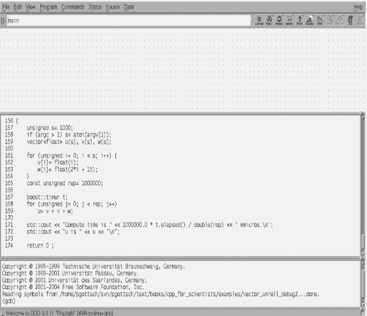


### Figure B-1: 调试器窗口

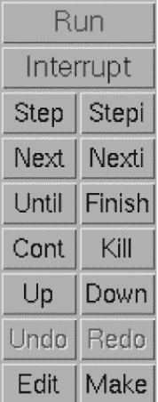

### Figure B-2: ddd 控制面板

- **下一步：** 转到源代码的下一行。如果我们位于函数调用处，除非内部设置了断点，否则不要跳入其中。

- **单步进入和单步跳过：** 这些是指令级别的等效操作。它们仅用于调试汇编代码。

- **直到：** 当我们将光标定位在源代码中时，程序将运行直到到达此行。如果我们的程序流程不通过此行，执行将继续直到到达程序结束或下一个断点或错误。可能，程序可能会在无限循环中永久运行。

- **结束：** 执行当前函数的其余部分，并在该函数外部的第一行停止，即函数调用后的那一行。

- **继续：** 继续执行直到下一个事件（断点、错误或结束）。

- **终止：** 终止程序。

- **向上：** 显示当前函数的调用行；即在调用堆栈中向上一级（如果可用）。

- **向下：** 返回到被调用的函数；即在调用堆栈中向下一级（如果可用）。

- **撤销：** 撤销上一个操作（很少或从不生效）。

- **重做：** 重复上一个命令（更经常生效）。

- **编辑：** 调用当前显示的源文件的编辑器。

- **构建：** 调用 `make` 以重新构建可执行文件。

自 `gdb` 7 版本以来的一个重要新功能是能够在 Python 中实现漂亮打印机。这使我们能够在图形化调试器中简洁地表示我们的类型；例如，矩阵可以被可视化为二维数组，而不是指向第一个条目或其他晦涩内部表示的指针。IDE 也提供调试功能，一些（如 Visual Studio）允许定义漂亮打印机。

对于较大的，尤其是并行软件，值得考虑使用 `DDT` 或 `Totalview` 等专业调试器。它们允许我们控制单个、一些或所有进程、线程或 GPU 线程的执行。

## B.3 内存分析

```
=> c++03/vector_test.cpp
```

根据我们的经验，解决内存问题最常用的工具集是 `valgrind` 发行版（不仅限于内存问题）。这里我们专注于 memcheck。我们将其应用于向量示例，例如在第 2.4.2 节中使用的示例：

```
valgrind --tool=memcheck vector_test
```

memcheck 检测内存管理问题，例如内存泄漏。它还报告未初始化内存的读取访问和部分越界访问。如果我们省略了向量类的拷贝构造函数和析构函数（这样编译器就会生成一个带有别名效应的），我们将看到以下输出：

单击此处查看代码图像

```
==17306== Memcheck, a memory error detector
==17306== Copyright (C) 2002-2013, and GNU GPL'd, by Julian Seward et al.
==17306== Using Valgrind-3.10.0.SVN and LibVEX; rerun with -h for copyright info
==17306== Command: vector_test
==17306==
[1,1,2,-3,]
z[3] is -3
w is [1,1,2,-3,]
w is [1,1,2,-3,]
==17306==
==17306== HEAP SUMMARY:
==17306== in use at exit: 72,832 bytes in 5 blocks
==17306== total heap usage: 5 allocs, 0 frees, 72,832 bytes allocated
==17306==
==17306== LEAK SUMMARY:
==17306== definitely lost: 128 bytes in 4 blocks
==17306== indirectly lost: 0 bytes in 0 blocks
==17306== possibly lost: 0 bytes in 0 blocks
==17306== still reachable: 72,704 bytes in 1 blocks
==17306== suppressed: 0 bytes in 0 blocks
==17306== Rerun with --leak-check=full to see details of leaked memory
==17306==
==17306== For counts of detected and suppressed errors, rerun with: -v
==17306== ERROR SUMMARY: 0 errors from 0 contexts (suppressed: 0 from 0)
```

我们可以看到，分配了五个内存块，但没有释放任何一个。因此，工具告诉我们存在内存泄漏，也显示为 "definitely lost: 128 bytes in 4 blocks"。第五个未释放的块来自运行时库——也显示为 “still reachable: 72,704 bytes in 1 blocks”——幸运的是，这不是我们的错。该工具还报告不匹配的释放，例如，使用 `delete[]` 而内存并非以数组形式分配。

所有这些错误都可以在详细模式下报告，并附带相应的源代码行和函数堆栈：


```
valgrind --tool=memcheck -v --leak-check=full \
--show-leak-kinds=all vector_test
```

现在我们看到的细节要多得多，出于大小原因，我们在此不打印出来。请自行尝试。

使用 `memcheck` 运行的程序会更慢，在极端情况下慢 10 或 30 倍。特别是使用原始指针的软件（希望将来会是个例外）应定期使用 `valgrind` 进行检查。更多信息请访问 http://valgrind.org。

一些商业调试器（如 `DDT`）已经包含内存分析。Visual Studio 提供 CRT 库用于查找内存泄漏 [47]。

## B.4 gnuplot

用于可视化输出的公共领域程序是 `gnuplot`。假设我们有一个名为 `results.dat` 的数据文件，内容如下：


```
0 1
0.25 0.968713
0.75 0.740851
1.25 0.401059
1.75 0.0953422
2.25 -0.110732
2.75 -0.215106
3.25 -0.237847
3.75 -0.205626
4.25 -0.145718
4.75 -0.0807886
5.25 -0.0256738
5.75 0.0127226
6.25 0.0335624
6.75 0.0397399
7.25 0.0358296
7.75 0.0265507
8.25 0.0158041
8.75 0.00623965
9.25 -0.000763948
9.75 -0.00486465
```

第一列表示 x 坐标，第二列包含 u 的相应值。我们可以使用 gnuplot 中的以下命令绘制这些值：

```
plot "results.dat" with lines
```

命令：

```
plot "results.dat"
```

仅绘制星号，如图 B-3 所示。3D 图可以使用 splot 命令实现。对于更复杂的可视化，我们可以使用 Paraview，它也是免费可用的。

## B.5 Unix、Linux 和 Mac OS

像 Linux 和 Mac OS 这样的 Unix 系统提供了一组丰富的命令，允许我们在很少或无需编程的情况下完成许多任务。一些最重要的命令是：

- `ps`: 列出（我的）正在运行的进程。
- `kill id`: 终止 ID 为 id 的进程；kill -9 id，使用信号 9 强制终止。
- `top`: 列出所有进程及其资源使用情况。
- `mkdir dir`: 创建名为 dir 的新目录。
- `rmdir dir`: 删除空目录。
- `pwd`: 打印当前工作目录。
- `cd dir`: 将工作目录更改为 dir。
- `ls`: 列出当前目录中的文件（或 `dir`）。
- `cp from to`: 将文件 _源_ 复制到文件或目录 _目标_。如果文件 _目标_ 存在，它将被覆盖，除非我们使用 `cp -i from to`，它会请求权限。
- `mv from to`: 如果目录 _目标_ 存在，则将文件 _源_ 移动到目录 _目标_；否则重命名文件。如果文件 _目标_ 存在，它将被覆盖。使用 `-i` 标志，系统会询问我们是否允许覆盖文件。
- `rm files`: 删除列表 _文件_ 中的所有文件。`rm *` 删除所有内容——请小心。
- `chmod mode files`: 更改文件的访问权限。
- `grep regex`: 在终端输入（或指定文件）中查找正则表达式 _正则表达式_。
- `sort`: 对输入进行排序。
- `uniq`: 过滤重复行。
- `yes`: 无限次写入 `y`，或使用 `yes 'my text'` 写入 _我的文本_。

Unix 命令的特殊魅力在于它们可以通过管道连接；即，一个程序的输出是下一个程序的输入。当我们有一个安装脚本 `install.sh`，并且确定会对所有问题回答 `y` 时，我们可以写：

```
yes | ./install.sh
```

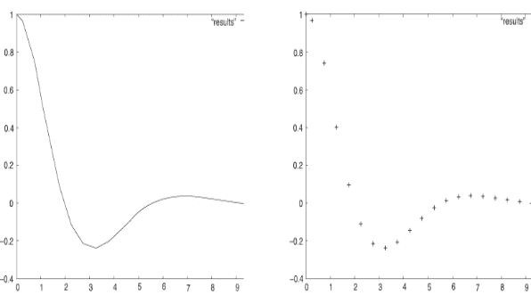

```
plot "results.dat" with lines
```

```
plot "results.dat"
```

### Figure B-3: 使用 plot 绘制图形

或者，当我们搜索由字母 t、i、o、m、r、k 和 f 组成的长度为 7 的所有单词时：

单击此处查看代码图像

```
grep -io '<[tiomrkf]\{7\}>' openthesaurus.txt | sort | uniq
```

这就是作者在“四图一词”游戏中作弊的方式——有时候。

当然，我们可以自由地在 C++ 中实现类似的命令。当我们能够将程序与系统命令结合时，这更加高效。为此，建议生成简单的输出以便于管道处理。例如，我们可以编写可以直接由 gnuplot 处理的数据。

显然，本节只是它们功能的开胃小菜。同样，整个附录只是触及了我们可以从适当工具中获得的好处的表面。


## 附录 C

### 语言定义

> "语言是一种足以
> 提供任何特定情境所需
> 精确度的工具。"
>
> —肯尼斯·L·派克

本附录旨在作为本书相关定义的参考。

### C.1 值类别

C++区分不同类别的值。我们在此关注左值和右值，并相应地调整了来自ISO标准[38]的定义。

**定义 C-1.（左值）。** 一个_左值_是对象、位字段或函数。

更实际地说，左值是或引用一个具有名称的实体，该名称允许我们使用地址运算符`&`确定其地址。此规则比我们想象的更具普遍适用性。即使是代码在每次调用时被替换且符号可能甚至不会出现在可执行文件中的函数也有地址。我们可以通过获取其地址将此函数作为参数传递给另一个函数，或依赖函数向其自身指针的隐式转换。其对应物是：

**定义 C-2.（右值）。** 一个_右值_是即将过期的值（例如，转换为右值的对象）、临时对象或其子对象，或与对象无关联的值。

- 1. 尤其是在优化时以及当函数声明为`inline`时。

同样，我们可以采取实际的方法，说右值是没有名称且不允许使用地址运算符`&`的实体。这适用于所有不是引用的函数结果。棘手的是命名的右值引用：它们只接受右值但本身是左值。这对于右值函数参数尤其明显。我们只能将右值传递给这些参数，但在函数内部它们是左值，我们必须应用`move`或`forward`将它们作为右值传递给另一个函数。

这些名称的历史动机是，只有左值可以出现在赋值的左侧，而右值只能出现在右侧。不幸的是，这个标准并不真正有用，因为左值可以是常量，这禁止它们出现在赋值的左侧。当赋值运算符未带有`&`限定时，我们也可以将值赋给用户类型的右值对象；参见第2.6.4节。而且左值显然也允许出现在赋值的右侧。

**定义 C-3.（异值）。** 一个异值是被转换为右值的左值。

作为右值时，对象的内容可能会被损坏，因此被视为已过期。如我们在第2.3.5.4节中讨论的，正确清空的右值对象不会引起此问题——即使后来作为左值也不会——我们希望异值将来某个时候不再是一个重要的术语。对于您自己的项目，您应该使用本书中的技术，即使在存在`std::move`和`std::forward`时也要避免损坏的数据。

### C.2 运算符概览

**表 C-1：运算符摘要**

| Description | Notation | Assoc. |
|---|---|---|
| 带括号的表达式 | `( expr )` | - |
| Lambda | `[capture list] lambda declarator { stmt list }` | - |
| 作用域解析 | `class name :: member` | - |
| 作用域解析 | `namespace name :: member` | - |
| 全局命名空间 | `:: name` | - |
| 全局命名空间 | `:: qualified-name` | - |
| 成员选择 | `object . member` | ⇒ |
| 解引用成员选择 | `pointer -> member` | ⇒ |
| 下标 | `expr [ expr ]` | ⇒ |
| 下标（用户定义） | `object [ expr ]` | ⇒ |
| 函数调用 | `expr ( expr list )` | ⇒ |
| | `expr ( expr list )` | ⇒ |
| 值构造 | `type ( expr list )` | ⇒ |
| | `expr ( expr list )` | - |
| 后置递增 | `lvalue ++` | - |
| 后置递减 | `lvalue --` | - |
| 类型识别 | `typeid ( type )` | - |
| 运行时识别 | `typeid ( expr )` | - |
| 运行时转换 | `checked dynamic_cast < type > ( expr )` | - |
| 编译时检查的转换 | `static_cast < type > ( expr )` | - |
| 未检查的转换 | `reinterpret_cast < type > ( expr )` | - |
| `const`转换 | `const_cast < type > ( expr )` | - |
| 对象大小 | `sizeof expr` | - |
| 类型大小 | `sizeof ( type )` | - |
| 参数数量 | `sizeof... ( argumentpack )` | - |
| 类型参数数量 | `sizeof... ( typepack )` | - |
| 对齐 | `alignof ( expr )` | - |
| 类型对齐 | `alignof ( type )` | - |
| 前置递增 | `++ lvalue` | - |
| 前置递减 | `-- lvalue` | - |
| 按位取反 | `~ expr` | ⇐ |
| 逻辑非 | `! expr` | ⇐ |
| 一元减 | `- expr` | ⇐ |
| 一元加 | `+ expr` | ⇐ |
| 取地址 | `& lvalue` | - |
| 解引用 | `* expr` | ⇐ |
| 创建（分配） | `new type` | - |
| 创建（分配并初始化） | `new type ( expr list )` | - |
| 创建（定位） | `new ( expr list ) type` | - |
| 创建（定位并初始化） | `new ( expr list ) type ( expr list )` | - |
| 销毁（释放） | `delete pointer` | - |
| 销毁数组 | `delete [] pointer` | - |
| C风格强制转换 | `( type ) expr` | <= |
| 等待异常 | `co_await expr` | - |
| 成员选择 | `object .* pointer to member` | => |
| 成员选择 | `pointer ->* pointer to member` | => |
| 乘法 | `expr * expr` | => |
| 除法 | `expr / expr` | => |
| 取模（余数） | `expr % expr` | => |
| 加法 | `expr + expr` | => |
| 减法 | `expr - expr` | => |
| 左移 | `expr << expr` | => |
| 右移 | `expr >> expr` | => |
| 三路比较 | `expr <=> expr` | => |
| 小于 | `expr < expr` | => |
| 小于或等于 | `expr <= expr` | => |
| 大于 | `expr > expr` | => |
| 大于或等于 | `expr >= expr` | => |
| 等于 | `expr == expr` | => |
| 不等于 | `expr != expr` | => |
| 按位与 | `expr & expr` | => |
| 按位异或（XOR） | `expr ^ expr` | => |
| 按位或 | `expr | expr` | => |
| 逻辑与 | `expr && expr` | => |
| 逻辑或 | `expr || expr` | => |
| 条件表达式 | `expr ? expr : expr` | <= |
| 简单赋值 | `lvalue = expr` | <= |
| 乘法赋值 | `lvalue *= expr` | <= |
| 除法赋值 | `lvalue /= expr` | <= |
| 取模赋值 | `lvalue %= expr` | <= |
| 加法赋值 | `lvalue += expr` | <= |
| 减法赋值 | `lvalue -= expr` | <= |
| 左移赋值 | `lvalue <<= expr` | <= |
| 右移赋值 | `lvalue >>= expr` | <= |
| 按位与赋值 | `lvalue &= expr` | <= |
| 按位或赋值 | `lvalue |= expr` | <= |
| 按位异或赋值 | `lvalue ^= expr` | <= |
| 抛出异常 | `throw expr` | - |
| 生成异常 | `co_yield expr` | - |
| 逗号（排序） | `expr , expr` | => |

该表是[62, §10.3]²的更新版本，我们提供了二元和三元运算符的结合性。同一优先级的一元运算符从内向外求值。在带有左结合运算符（标记为=>）的表达式中，先求值左子表达式；例如：

```
a + b + c + d + e // Corresponds to:
((a + b) + c) + d) + e
```

- 2. 在cppreference.com上，条件表达式与随后的赋值组具有相同的优先级（这在实践中肯定没有区别）。标准文档本身并未直接以列表形式提供优先级。

赋值是右结合的（=）；即：

```
a = b = c = d = e // Corresponds to:
a = (b = (c = (d = e)))
```

一个值得注意的细节是sizeof的定义。它可以直接应用于对象等表达式，但应用于类型时需要括号：

```
int i;
sizeof i;       // Okay: i is an expression
sizeof(i);      // Okay as well: extra () do not harm
sizeof int;     // Error: parentheses needed for types
sizeof(int);    // Okay
```

如果不确定是否需要括号，可以随时添加一些额外的括号。

### C.3 转换规则

在C++中，整数、浮点数和布尔值可以自由混合，因为这些类型中的每一种都可以转换为任何其他类型。在可能的情况下，值会被转换而不会丢失信息。如果转换回原始类型得到原始值，则该转换为保值转换。否则，该转换为收窄转换。本段是[62, Intro §10.5]的简短版本。

#### C.3.1 提升

保值的隐式转换称为提升。较短的整数或浮点数值可以精确转换为较长的


分别为整型或浮点型。尽可能时，优先转换为 `int` 和 `double`（而非更长的类型），因为这些类型在算术运算中被认为具有“自然”大小（即，由硬件最好地支持）。整型提升详细如下：

- 如果 `char`、`signed char`、`unsigned char`、`short int` 或 `unsigned short int` 能够表示所有源类型值，则将其转换为 `int`；否则，将其转换为 `unsigned int`。

- `char8_t`、`char16_t`、`char32_t`、`wchar_t` 或普通 `enum` 将转换为以下能够容纳所有源类型值的第一个类型：`int`、`unsigned int`、`long`、`unsigned long`、`unsigned long long`。

- 如果位字段能够表示前者的所有值，则将其转换为 `int`；否则，在相同条件下转换为 `unsigned int`。否则，不应用提升。

- `bool` 将转换为 `int`：`false` 变为 `0`，`true` 变为 `1`。

提升用作算术转换的一部分（§C.3.3）。来源：[62, §10.5.1]。

## C.3.2 其他转换

C++ 会隐式执行以下可能收窄的转换：³

3. 现代编译器通常会对此发出警告。

- 整型和普通 `enum` 类型可以转换为任何整型。如果目标类型较短，则高位会被截断。

- 浮点值可以转换为更短的浮点类型。如果源值介于两个目标值之间，则结果是其中之一；否则，行为未定义。

- 指针和引用：任何指向对象的指针可以转换为 `void*`（尽管是邪恶的旧式技巧）。相比之下，指向函数或成员的指针不能转换为 `void*`。指向派生类的指针/引用可以隐式转换为指向（无歧义）基类的指针/引用。`0`（或产生 `0` 的表达式）可以转换为任何指针类型，结果为空指针。`nullptr` 更可取。`T*` 可以转换为 `const T*`，同样 `T&` 可以转换为 `const T&`。

- `bool`：指针、整型和浮点值可以转换为 `bool`：零值变为 `false`，其他所有值变为 `true`。备注：这些转换中没有哪一项有助于更好地理解程序。

- 整型<=>浮点型：当浮点型转换为整型时，小数部分被舍弃（向0舍入）。如果值太大无法表示，行为未定义。当整型可在目标类型中表示时，从整型到浮点型的转换是精确的。否则，将取下一个更低或更高的浮点值（取哪一个取决于实现）。在不太可能的情况下，如果它对于浮点型来说太大，行为未定义。

来源：[62, §10.5.2] 和标准。

## C.3.3 通常的算术转换

这些转换在二元运算符的操作数上执行，以将它们转换为随后用作结果类型的公共类型：

- 如果任一操作数是 `long double`，则另一个转换为 `long double`；

- 否则，如果任一操作数是 `double`，则另一个转换为 `double`；

- 否则，如果任一操作数是 `float`，则另一个转换为 `float`；

- 否则，对两个操作数执行第 C.3.1 节的整型提升。

- 否则，如果任一操作数是 `unsigned long long`，则另一个转换为 `unsigned long long`；

- 否则，如果一个操作数是 `long long` 而另一个是 `unsigned long`，则如果后者能表示前者的所有值，将 `unsigned long` 转换为 `long long`；否则，两者都转换为 `unsigned long long`。

- 否则，如果一个操作数是 `long` 而另一个是 `unsigned`，则如果后者能表示前者的所有值，将 `unsigned` 转换为 `long`；否则，两者都转换为 `unsigned long`。

- 否则，如果任一操作数是 `long`，则另一个转换为 `long`；

- 否则，如果任一操作数是 `unsigned`，则另一个转换为 `unsigned`；

- 否则，两个操作数都转换为 `int`。

因此，混合 `signed` 和 `unsigned` 整数的程序具有平台相关的行为，因为转换规则取决于整型的大小。来源：[62, §10.5.3]。

## C.3.4 收窄

`Narrowing Conversion`（收窄转换）是一种隐式转换：

- 从浮点类型到整型；或

- 从 `long double` 到 `double` 或 `float`，或从 `double` 到 `float`，但源为常量表达式且转换后的实际值在可表示值范围内的情况除外（即使无法精确表示）；或

- 从整型或无作用域枚举类型到浮点类型，但源为常量表达式且转换后的实际值能够适应目标类型，并且转换回原始类型时会产生原始值的情况除外；或

- 从整型或无作用域枚举类型到无法表示原始类型所有值的整型，但源为常量表达式且转换后的实际值能够适应目标类型，并且转换回原始类型时会产生原始值的情况除外。

来源：ISO 标准。

## 参考文献

- [1] David Abrahams and Aleksey Gurtovoy. C++ Template Metaprogramming: Concepts, Tools, and Techniques from Boost and Beyond. Addison-Wesley, 2005.

- [2] Douglas Adams. Life, the Universe and Everything. Pan Macmillan, 1980.

- [3] Bryce Adelstein. “Core C++ 2019 :: Bryce Adelstein :: 模块即将到来。” https://www.youtube.com/watch?v=DtDM6y6fNSU, 2019年7月.

- [4] Matthew H. Austern. Generic Programming and the STL: Using and Extending the C++ Standard Template Library. Addison-Wesley, 1999.

- [5] Lewis Baker. CppCoro – C++ 的协程库。 https://github.com/lewissbaker/cppcoro.

- [6] John J. Barton and Lee R. Nackman. Scientific and Engineering C++. Addison-Wesley, 1994.

- [7] L. Susan Blackford, Antoine Petitet, Roldan Pozo, Karin Remington, R. Clint Whaley, James Demmel, Jack Dongarra, Iain Duff, Sven Hammarling, Greg Henry, et al. “一组更新的基本线性代数子程序（BLAS）。” ACM Transactions on Mathematical Software, 28(2):135–151, 2002.

- [8] Walter E. Brown. “三个与"random"相关的提案，v2。” 技术报告 N3742, ISO/IEC JTC 1, 信息技术, 编程语言 C++ 的 SC 22 分委会, 2013年8月.

- [9] Krzysztof Czarnecki and Ulrich Eisenecker. “模板元编程的元控制结构。” http://home.t-online.de/home/Ulrich.Eisenecker/meta.htm.

- [10] Krzysztof Czarnecki and Ulrich W. Eisenecker. Generative Programming: Methods, Tools, and Applications. Addison-Wesley, 2000.

- [11] Ionut Danaila, Frédéric Hecht, and Olivier Pironneau. *C++ 中的数值模拟*. Dunod, Paris, 2003.

- [12] Stefanus Du Toit. “C++ API 的沙漏接口。” http://de.slideshare.net/StefanusDuToit/cpp-con-2014-hourglass-interfaces-for-c-apis, 2014.

- [13] Margaret A. Ellis and Bjarne Stroustrup. *带注释的 C++ 参考手册*. Addison-Wesley, 1990.

- [14] Andreas Fertig. “C++20：聚合、POD、平凡类型、标准布局类，是什么。” https://andreasfertig.blog/2021/01/cpp20-aggregate-pod-trivial-type-standard-layout-class-what-is-what/, 2021.

- [15] Andreas Fertig. *使用 C++20 进行编程*. Fertig Publications (via Leanpub), 2021.

- [16] Erich Gamma, Richard Helm, Ralph Johnson, and John Vlissides. *设计模式：可复用面向对象软件的基础*. Addison-Wesley, 1995.

- [17] Bernhard Ganter and Rudolf Wille. *形式概念分析：数学基础*. Springer Science & Business Media, 2012.

- [18] Peter Gottschling. “概念启用的 C++ 中的基本代数概念。” 技术报告 638, 印第安纳大学, 2006.

- [19] Peter Gottschling. *混合复杂算术*. SimuNova, 2011. http://old.simunova.com/docs/mt14/html/mixed_complex.html, Matrix Template Library 4 的一部分.

- [20] Peter Gottschling. “类模板特化中的代码复用。” 技术报告 N3596, ISO IEC JTC1/SC22/WG21, 2013. http://www.open-std.org/jtc1/sc22/wg21/docs/papers/2013/n3596.pdf.

- [21] Peter Gottschling. *矩阵模板库 4*. SimuNova, 2014. http://new.simunova.com/index.xhtml#en-mt14-index-html.

- [22] Peter Gottschling and Andrew Lumsdaine. “集成语义与编译：使用 C++ 概念开发强健且高效的可复用库。” 在 *GPCE '08：第 7 届国际*


面向生成式编程与组件工程会议，第 67–76 页，ACM，2008年。

- [23] Peter Gottschling, David S. Wise, and Adwait Joshi. “面向科学计算的算法与结构递归泛型支持.” 《并行、新兴与分布式系统国际期刊》(IJPEDS), 24(6):479–503, 2009年12月.
- [24] Douglas Gregor, et al. C++ 泛型编程的语言支持：概念. https://dl.acm.org/doi/10.1145/1167473.1167499.
- [25] Rainer Grimm. “C++20：使用 CppCoro 的协程.” https://www.modernescpp.com/index.php/c-20-coroutines-with-cppcoro.
- [26] Rainer Grimm. 使用现代 C++ 进行并发编程. LeanPub, 2018.
- [27] Rainer Grimm. 现代 C++：并发大师. Carl Hanser Verlag GmbH & Co. KG, 2018.
- [28] E. Hairer, S.P. Norsett, and G. Wanner. 求解常微分方程 I：非刚性问题. 计算数学 Springer 系列. Springer, 2008.
- [29] Lutz Hamel. “计算理论.” https://sites.google.com/a/uri.edu/csc544/. 第 11 讲，2017年春季.
- [30] Kjell Hedström. “数值计算：为什么你永远、永远、永远不应该在代码中再次使用链表.” http://www.codeproject.com/Articles/340797/Number-crunching-Why-you-should-never-ever-EVER-Us, 2012年8月.
- [31] Magnus R. Hestenes and Eduard Stiefel. “求解线性系统的共轭梯度方法.” 国家标准局研究杂志, 49(6):409–436, 1952年12月.
- [32] Roger W. Hockney. 计算机基准测试科学，第 2 卷. SIAM, 1996.
- [33] “C++ 参考：隐式转换.” http://en.cppreference.com/w/cpp/language/implicit_cast.
- [34] ISO/IEC. ISO/IEC 14882:1998：编程语言 – C++ (C++98), 1998. 草案: http://www.lirmm.fr/~7Educour/Doc-objects/ISO+IEC+14882-1998.pdf.
- [35] ISO/IEC. ISO/IEC 14882:2003：编程语言 – C++ (C++03), 2003. 草案: https://cs.nyu.edu/courses/fall11/CSCI-GA.2110-003/documents/c++2003std.pdf.
- [36] ISO/IEC. ISO/IEC 14882:2011：编程语言 – C++ (C++11), 2011. 草案: http://www.open-std.org/jtc1/sc22/wg21/docs/papers/2012/n3337.pdf.
- [37] ISO/IEC. ISO/IEC 14882:2014：编程语言 – C++ (C++14), 2014年10月. 草案: https://github.com/cplusplus/draft/blob/master/papers/n4140.pdf?raw=true.
- [38] ISO/IEC. ISO/IEC 14882:2017：编程语言 – C++ (C++17), 第 5 版, 2017年12月. 草案: http://www.open-std.org/jtc1/sc22/wg21/docs/papers/2017/n4659.pdf.
- [39] ISO/IEC. ISO/IEC 14882:2020：编程语言 – C++ (C++20), 2020. 草案: http://www.open-std.org/jtc1/sc22/wg21/docs/papers/2017/n4659.pdf.
- [40] Nicolai Josuttis. C++ 标准库：教程与参考，第 2 版. Addison-Wesley, 2012.
- [41] Björn Karlsson. 超越 C++ 标准库：Boost 入门. Addison-Wesley, 2006.
- [42] Kenny Kerr. “从算法到 C++ 中的协程”. http://msdn.microsoft.com/magazine/mt826346, 2017.
- [43] Karl Meerbergen. 泛型线性代数软件. K.U. Leuven, 2014. http://people.cs.kuleuven.be/~karl.meerbergen/glas/.
- [44] Karl Meerbergen, Krešimir Fresl, and Toon Knapen. “C++ 对外部软件库的绑定，包含 BLAS、LAPACK、UMFPACK 和 MUMPS 的示例.” ACM 数学软件事务 (TOMS), 36(4):22, 2009.
- [45] Scott Meyers. “关于零规则的担忧.” http://scottmeyers.blogspot.de/2014/03/a-concern-about-rule-of-zero.html.
- [46] Scott Meyers. 现代 C++ 编程要领：42 条改进 C++11 和 C++14 使用的具体方法. O’Reilly Media, Inc., 2014.
- [47] Microsoft. “使用 CRT 库查找内存泄漏.” https://docs.microsoft.com/en-us/visualstudio/debugger/finding-memory-leaks-using-the-crt-library?view=vs-2019.
- [48] Theodor Omtzigt and Peter Gottschling. HPR-BLAS. Stillwater Supercomputing 和 SimuNova, 2018. https://github.com/stillwater-sc/hpr-blas.
- [49] Theodor Omtzigt and Peter Gottschling. HPR-Tensor. Stillwater Supercomputing 和 SimuNova, 2018. https://github.com/stillwater-sc/hpr-tensor.
- [50] Theodor Omtzigt and Peter Gottschling. 通用数字算术库. Stillwater Supercomputing 和 SimuNova, 2018. https://github.com/stillwater-sc/universal.
- [51] Oracle. “Oracle C++ 调用接口.” http://www.oracle.com/technetwork/database/features/oci/index-090820.html.
- [52] Edward Ott. 动力系统中的混沌. Cambridge University Press, 2002.
- [53] Dan Quinlan. “Rose：面向对象框架的编译器支持.” 并行处理快报, 10(02-03):215–226, 2000.
- [54] Jan Rudl. 金融数学讲义, 2013年10月.
- [55] Jeremy Siek, Douglas Gregor, Ronald Garcia, Jeremiah Willcock, Jaakko Järvi, and Andrew Lumsdaine. “面向 C++0x 的概念.” 技术报告 N1758, ISO/IEC JTC 1, 信息技术, 分委员会 SC 22, 编程语言 C++, 2005年1月.
- [56] Jeremy G. Siek, Lie-Quan Lee, and Andrew Lumsdaine. Boost 图库：用户指南与参考手册. Addison-Wesley, 2001.
- [57] Jeremy G. Siek and Andrew Lumsdaine. 泛型编程语言. 博士论文, Indiana University, 2005.
- [58] Malte Skarupke. “统一初始化的问题.” http://probablydance.com/2013/02/02/the-problems-with-uniform-initialization, 2013年2月.
- [59] A.A. Stepanov. “抽象惩罚基准测试,” 1.2 版 (KAI), 1992. http://www.open-std.org/jtc1/sc22/wg21/docs/D_3.cpp.
- [60] Walter Storm. “STL deque 容器深入研究.” http://www.codeproject.com/Articles/5425/An-In-Depth-Study-of-the-STL-Deque-Container.
- [61] Bjarne Stroustrup. C++ 程序设计语言，第 3 版. Addison-Wesley, 1997.
- [62] Bjarne Stroustrup. C++ 程序设计语言，第 4 版. Addison-Wesley, 2013.
- [63] Bjarne Stroustrup and Herb Sutter. “C++ 核心准则.” https://isocpp.github.io/CppCoreGuidelines/CppCoreGuidelines.
- [64] Herb Sutter. “为何不特化函数模板？” http://www.gotw.ca/publications/mill17.htm, 2009.
- [65] Herb Sutter. “简单移动.” https://herbsutter.com/2020/02/17/move-simply, 2020年2月.
- [66] Herb Sutter and Andrei Alexandrescu. C++ 编码标准：101 条规则、准则与最佳实践. Addison-Wesley, 2005.
- [67] Xiaolong Tang and Jaakko Järvi. “基于概念的 C++ 中面向流的泛型优化变换.” 在 SAC’10：2010 年 ACM 应用计算研讨会论文集中, 2010年3月.
- [68] Gerald Teschl. 常微分方程与动力系统，第 140 卷. American Mathematical Soc., 2012.
- [69] David Vandevoorde, Nicolai M. Josuttis, and Douglas Gregor. C++ 模板：完全指南，第 2 版. Addison-Wesley, 2018.
- [70] Kenton Varda. “协议缓冲区：Google 的数据交换格式.” 技术报告, Google, 2008年6月.
- [71] T.L. Veldhuizen. “C++ 模板是图灵完备的.” citeseer.ist.psu.edu/581150.html, 2003.
- [72] Vaughn Vernon. 领域驱动设计实战. Addison-Wesley, 2013.
- [73] R.C. Whaley, A. Petitet, and J. Dongarra. “软件自动经验优化与 ATLAS 项目.” 并行计算, 27(1–2):3–35, 2001年1月.
- [74] Baptiste Wicht. “C++ 基准测试 – `std::vector` vs `std::list` vs `std::deque`.” http://baptiste-wicht.com/posts/2012/12/cpp-benchmark-vector-list-deque.html, 2012.
- [75] Anthony Williams. C++ 并发编程实战. Manning Publications, 2019.
- [76] P. Wilmott. 保罗·威尔莫特量化金融导论. Wiley, 2007.
- [77] Greg Wilson. 数据处理：使用 Java、Python 等解决日常问题. The Pragmatic Programmers. Pragmatic Bookshelf, 2005.

## 主题索引

- _MSC_VER, 68
- __cpp_lib_chrono, 69
- __cpp_modules, 68
- Abrahams, David, 398
- abs, 167
  - 返回类型, 298
- abs
  - 在 Mandelbrot 集合中, 239
- abs_view, 402
- 抽象
  - 惩罚, 347
  - 提供一个, 72
- 访问, 74–76
  - 修饰符, 74
- Accumutable, 196
- accumulate, 231
  - 抽象惩罚, 347
  - 与概念, 193
  - 用于求和, 154
  - 来自 STL, 149
  - 泛型, 184
  - 在 STL 中, 212
- accumulate, 354
- accumulate_array, 152
- Ada, 491
- Adams, Douglas, 1
- add, 355
- 地址
  - 0, 55
  - 映射, 422
  - 空间, 422


布赖斯·阿德尔斯坦, 430
adjacent_difference, 231
**ADL, 141-146**
  - 用于选择模板, 142
  - 在特化中, 165
  - 与运算符一起, 142
  - 与第三方库一起, 144
advance, 216
  - 在 vector 迭代器上, 217
advance, 197
聚合, 90
  - 初始化, 90
卡尔斯滕·阿纳特, 284
安德烈·亚历山德雷斯库, 75, 305
代数, 413
代数, 355
  - 线性, 52, 64
  - 稠密, 353
  - 库, 284
  - 包, 417
算法
  - 块, 450
  - 在 STL 中, 参见 STL, algorithm
  - 数值, 407
别名, 60
~化效应, 93
alignof, 19
全部, 235
分配器
  - 用户定义, 226
歧义
  - 在特化和重载中, 165
且, 16
反模式, 366
any, 474
  - 类型, 262
<any>, 261
any, 261
any_cast, 261
应用
  - 科学, 63
apply, 204
存档, 422, 428
参数
  - 宏, 448
  - 复制, 449
  - 带显式转换, 137
  - 带隐式转换, 137
  - 带统一初始化, 89
参数依赖查找, 参见 ADL
ARPREC, 283
数组, 52–53
  - 容器, 62–64
  - 声明, 52
  - 内置支持, 52
  - 缺少索引检查, 53
  - 高维, 52
  - 操作, 52
  - 大小推导, 53
  - 二维, 461
数组, 279, 413
as_const, 215
汇编器
  - 输出, 491
  - 读取 ~ 代码, 175
汇编, 422
assert, 36, 445, 449
  - 在调试器中, 494
assert, 36
赋值, 17, 23, 88–89
  - 仅作为方法, 118
  - 复制, 88
  - 生成规则, 468–470
  - 移动, 94
  - 生成规则, 470
  - 自身, 89
  - 带初始化列表, 90
assoc_laguerre, 251
assoc_legendre, 251
AST, 329
async, 273
async_executor, 278
异步, 275
ATLAS, 353
atof, 444
原子, 220, 277
  - 赋值, 278
原子, 282
原子操作, 277
atomic_flag, 282
atomic_ref, 282
马特·奥斯特恩, 282
auto, 155
auto_ptr, 57
AVX, 238, 334
back_insert_iterator, 233
bad_alloc, 93
bad_any_cast, 262
bad_cast, 393
bad_variant_access, 260
路易斯·贝克, 282
屏障, 282
约翰·巴顿, 397
巴顿-纳克曼技巧, 397
base_matrix, 380
basic_iteration, 275
奥兰多·阿洛伊修斯·巴蒂斯塔, 35
begin, 90, 153, 227, 315, 413
基准测试, 353
beta, 251
bidirectional_iterator, 197
BidirectionalIterator, 217
  - 在列表中, 222
BidirectionalIterator, 213
二进制, 8
BinaryFunction, 184
bind, 249
位
  - 掩码, 163
位段, 501
菲舍尔·布莱克, 249
布莱克-舒尔斯模型, 249
BLAS, 305, 353
  - Goto-, 354
  - HPR, 参见 HPR, BLAS
  - 在链接器标志中, 492
BLITZ++, 284
bool, 4, 162, 442
boolalpha, 45
Boost, 420
  - Asio, 44
  - Bindings, 305
  - Filesystem, 52
  - Function, 389
  - Graph Library (BGL), 285
  - Interval, 283
  - IOStream, 44
  - MPL, 307, 484
  - odeint, 284, 417
  - Operators, 398
  - Rational, 283
  - type_traits, 254
BOOST_STATIC_ASSERT, 485
花括号, 2, 90
  - 消除
    - 在模板中, 474
  - 省略, 91
  - 表示法, 460
分支, 23
break, 26, 29
伯特尔特·布莱希特, 435
丽塔·梅·布朗, 20
沃尔特·布朗, 243
克雷格·布鲁斯, 491
缓冲区, 42
构建, 419–427
  - 过程, 423
  - 工具, 423–427
build_example.cpp, 420
布歇表, 410
字节, 163

## C

- 数组初始化, 89
- 与 C++ 程序链接的 C 代码, 489
- 使用 C++ 编译器的 C 代码, 489
- 强制转换, 390
- 模拟命名空间, 139
- 对接口的影响, 72
- 库, 107
- 命名, 489
- 块表示法, 489
- 预处理, 420
- 结构体, 75
- 用于 ~ 兼容性的类型特征, 255

## C++

- 作为 C 的超集, 489
- 托管, 448
- 项目, 64–69, 407–434

## C++03

- 数组初始化, 52

## C++11, 448

- 在 MTL4 中, 451
- 数组中的收窄转换, 52
- 智能指针, 57

c++filt, 304
C99
  - 不是 C++ 的子集, 489
缓存
  - 一致性, 335
  - 失效, 335, 350
  - L1, 321, 332
  - L2, 321
调用
  - 按引用传递, 30
  - 按值传递, 30
  - 栈, 40
调用者, 204
康托尔尘, 286
捕获, 参见 lambda
<cassert>, 36
强制转换, 446
  - 交叉, 393
  - 向下, 391
  - 重新解释, 394
  - 向上, 390
  - 歧义, 391
catch, 39
CCS, 206
混沌
  - 吸引子, 409
  - 动力学, 409
乔治·查普曼, 365
char, 4, 446
鸡生蛋问题, 149
<chrono>, 3, 267, 337
阿隆佐·丘奇, 359
cin, 42
circular_area, 252
类, 39, 71-127
  - 基, 79, 368
  - 包含的类, 73
  - 数据成员, 参见 成员变量
  - 难处理的类型, 467
  - 派生, 75, 368
  - 同时适用于 C 和 C++, 255
  - 高级, 472
  - 成员, 参见 成员变量
  - 直接设置, 90
  - 初始化列表, 参见 构造函数
  - 成员函数, 参见 方法
  - 成员变量, 73
    - 访问, 112
    - 默认值, 88
    - 私有, 75, 113
    - 模板, 62
    - 以建立抽象, 73
    - 类型定义, 73
  - 代替 typename, 130
  - 抽象, 375
clear, 233
时钟, 267
克隆, 301
闭包, 186
CMake, 425-427
<cmath>, 239, 489
co_await, 282
co_return, 282
co_yield, 282
代码
  - 汇编, 421
  - 复杂度, 389
  - 条件, 421
  - 膨胀, 347
  - 十六进制, 422
  - 遗留, 91
  - 目标, 422
强制转换, 7, 15
考拉茨数列, 26
颜色编码, 239
列优先, 206
注释, 64
  - 单行, 4
通用, 235
common_type, 317
common_type_t, 317, 325
common_view, 357
交换的, 358
交换的, 344
CommutativeMonoid, 358
comp_ellint_1, 251
comp_ellint_2, 251
comp_ellint_3, 251
编译, 421
  - 歧义术语, 419
  - 条件, 68
  - 阶段, 422
  - 分离, 427–434
编译
  - 时间, 52
  - if, 参见 条件
编译器
  - 调用, 419
  - 标志, 36
  - 优化, 353, 452
    - 在标记类型上, 217
  - 支持
    - 对垃圾回收的支持, 448
<complex>, 239
复数, 73
  - 比较大小, 298
  - 在混合算术中, 241
  - 排序, 230
complex_abs, 86
复杂度, 453
常量, 225, 231
  - 线性, 231
  - 对数, 223, 225, 231
  - O(n log n), 230, 231
  - 二次, 230, 231
压缩, 206
compressed_matrix, 395
可计算性理论, 359
概念, 192–354
  - 分发, 197
  - 对于简单矩阵, 302
  - 用于调优, 329
  - 模型, 193
  - 排序, 197
  - 细化, 193
  - 要求, 193
  - 语义, 344
  - 流, 43
  - 子含, 193
概念, 194
并发, 270-282
条件, 256
  - 实现, 306
conditional_t, 256
共轭梯度, 435
const, 6
  - 优点, 452
  - 方法, 114
  - 变量, 295
const_cast, 393
  - 对于第三方库, 305
const_iterator, 214
常量, 6
  - 作为宏, 448
  - 全局, 10
consteval, 291
constexpr, 190, 289–297, 448
  - 用于循环展开, 332
  - 运行时函数, 291
  - 函数模板, 290
constinit, 296
构造
  - 类似赋值的表示法, 86
  - 显式, 86
构造函数, 43, 78–88
  - 参数名, 81
  - 转换, 395
  - 拷贝, 83
    - 默认实现, 83
    - 生成规则, 468–470
    - 强制用户实现, 84
    - 生成原因, 83
    - 带可变引用, 469
    - 带值参数, 83
  - 默认, 82
    - 与引用, 82
    - 调用, 82
    - 生成规则, 467
    - 在延迟初始化中, 82
    - 容器所需, 82
  - 默认参数, 81
  - 委托, 87
  - 无异常, 301
  - 显式, 86
  - 对于复数, 79
  - 非法调用, 80
  - 隐式, 86
  - 初始化列表
    - 花括号表示法, 92
  - 初始化列表, 79
  - 移动, 93


generation rule, 470
special, 82
syntax, 79
with initializer list, 90
container
  - as class template, 147
  - as return value, 453
  - associative, 224
  - in STL, 218
  - of references, 266
container_algebra, 414
continue, 29
convergence
  - quadratic, 268
conversion, 15
  - explicit, 137
  - function-style, 394
  - implicit, 7, 86, 455
  - in templates, 136
  - of numeric types, 396
coordinate, 175
copy
  - -constructable, 474
  - constructor, see constructor, copy
  - deep, 93
  - elision, 32, 94
  - explicitly deep, 93
  - instead of move, 472
  - shallow, 93
copy, 90, 229, 474
copy, 256
coroutine, 280
correctness
  - independent of storage, 73
counted, 236
cout, 2, 41, 213
  - setf, 45

__cplusplus, 490
CppCoro, 282
creature, 375
cref, 266
CRS, 206
CRTP, 397–401
cryptography, 247
<cstdint>, 446
<cstdint.h>, 39
ctime, 267
<ctime>, 267
CUDA, 255
  - in MTL4, 284
  - static code analysis, 353
curiously recurring template pattern, see CRTP
cyl_bessel_i, 251
cyl_bessel_j, 251
cyl_bessel_k, 251
cyl_neumann, 251
Czarnecki, Krzysztof, 306, 483

D, 491
data
  - persistent, 93
  - transfer as bottle neck, 321
Davis, Sammy, Jr., 289
de Morgan’s law, 397
dead lock, 279
deallocation
  - automatic, 56
  - double, 85
debugger
  - compiler flags for ~, 492
  - text-based, 492
  - vs. logs in methods, 78
debugging, 492–496
dec, 45

declaration
  - in header, 427
  - variable, 23, 74
declare_no_pointers, 448
declare_reachable, 448
decltype, 155
declval, 171
declval, 403
decomposition, see also factorization
default, 111, 465
default-constructible, 80, 467
default_operations, 417
default_random_engine, 246
delete, 18, 55
declarator, 111, 117, 465
delete[], 54
deleter, 109
denominator, 75
dense_matrix
  - in conversion, 395
department, 100
<deque>, 221
deque, 221
  - emplace, 221
  - erase, 222
  - insert, 222
derivation, 43
  - from ostream, 121
derivative, 177, 408
  - higher-order, 181
derived, 367
design
  - domain-driven, 71
design guides
  - for method generation, 470
designated initialization, 91
destructor, 105–107
  - arguments, 105
  - generation rule, 467
  - main task, 105
  - virtual, 105
determinant, 450
development
  - test-driven, 450
diagonal
  - unit, 451
diamond shape, 381, 390
digit separator, 8
Dijkstra, Edsger W., 71
discard_block_engine, 247
discretization
  - equidistant, 409
  - temporal, 409
distance, 217
distance, 199
distribution
  - normal, 249
do while, 26
documentation
  - as text, 450
  - compilable, 450
domain
  - expert, 71
domain-specific embedded language, 117
dot, 87
double, 4
DSEL, see domain-specific embedded language
Du Toit, Stefanus, 72
Duff's device, 444
dummy, 202
duration, 267
dxdt, 411
dynamic binding, 371
dynamic_cast, 393
dynamic_extent, 263
-E (flag), 420
/E (flag), 420
Eclipse, 3, 426
Einstein, Albert, 20
Eisenacker, Ulrich, 306
Eisenacker, Ulrich, 483
#else, 68
ellint_1, 251
ellint_2, 251
ellint_3, 251
ellipsis
  - in parameter packs, 201
#else, 68
else, 23-24
empty, 236
enable_if, 256, 312
enable_if_t, 256
enable_matrix_t, 314
encapsulation, 69
end, 90, 153, 227, 413
#endif, 68
endl, 2, 42
entropy, 247
eof, 50
equal, 124
equivalent, 123
error
  - code, 37
  - compile-time ~, 176
  - estimation, 275
  - flag, 49
  - handling, 35-41
  - in template programs, 135
  - message
    - from macros, 448
  - parsing, 130
  - pointer-related, 56
  - program, 36
  - run-time, ~, 176
Euler scheme, 410
euler_step, 411
event
  - hardware, 247
  - operating system, 247
exception, 37–41, 49
  - and resource release, 106
  - in destructor, 105
exception, 39, 378
  - what, 378
<exception>, 378
exclusive_scan, 238
executable
  - size, 137
execution, 238
  - par, 238
  - par_unseq, 238
  - seq, 238
exit, 39
exit code, 444
expint, 251
explicit, 86, 119
  - in C++03, 87
  - in C++11, 87
export, 431
expression
  - in C++, 22
  - conditional, see conditional operator
  - logic, 442
  - template, 32, 318–354
    - first library with ~, 284
extension
  - .c, 420
  - .a, 422
  - .asm, 422
  - .c++, 420
  - .cc, 420
  - .cpp, 420, 427
  - .cxx, 420
  - .dll, 422
  - .hpp, 427
  - .i, 420
  - .ii, 420
  - .lib, 422
  - .o, 422
  - .obj, 422
  - .s, 422
  - .so, 422
extern, 430
factorization
  - in-place, 451
  - LU, 40, 89, 257, 450, 488
factory, 388
[[fallthrough]], 26
false_type, 310
Fast Fourier Transformation, 441
Fatou dust, 286
featurism, 450
FEEL++, 285
FEM, 284
FEniCS, 284
Fertig, Andreas, 255
field, 73
FIFO, 221
file
  - close, 43
  - eof, 50
  - I/O, 43
  - in C++ project, 64
  - non-existing, 49
  - object, 428
  - open, 43
  - stream, 43, 106, 471
file_clock, 269
<filesystem>, 51
filter, 234
filter_view, 234
fin_diff, 177
final, 374
finance
  - quantitative, 249
find, 226
find_if, 229
find_if, 285
finite difference, 177
Fitzmaurice, Sue, 1
float, 4
floating_point, 252
<fmt>, 46, 172
for, 27
  - range-based, 215
for
  - range-based, 28
for_each, 414
for_each3, 415
for_each6, 415
for_each_n, 238
formal concept analysis, 129
<format>, 46, 172
formatter, 172
Forth, 457
Fortran, 439, 491, 77, 72
forward, 134
forward_iterator, 199
forward_list, 150, 223
<forward_list>, 223
forward_range, 199
ForwardIterator, 209
ForwardIterator, 213
fprintf, 447
Fracassi, Fabio, 85
Franklin, Benjamin, 20
friend, 76, 113
  - inline, 103
fscanf, 447
fsize_mat_vec_mult, 333
fsize_mat_vec_mult_aux, 336
fsize_mat_vec_mult_reg, 336
fsize_matrix, 333
fsize_vector
  - compiler optimization, 330
fstream, 43
function
  - argument, 30-32
  - default, 31
  - constrained, 194
  - differentiable, 177
  - dispatching, 216
  - dynamic, 387
free, 113
generic, see template function
getter and setter, 75
header, 115
inline, 33, 429
  - address of ~, 264
linear
  - piecewise, 210
local declaration, 429
main, 2, 35
  - missing in linkage, 428
  - no return value, 35
  - return value, 35
  - signatures of, 35
  - twice in linkage, 428
member vs. free, 118
nested call, 22
no match for, 136
nullary, 201
overloading, 33, 129
  - ambiguous, 165
parameter, 137
pointer, 411
vs. std::function, 265
redefinition, 429
result, 32–33
semantics, 450
signature, 453
template, see template, function
function, 161, 263, 273
function
  - in code selection, 389
<functional>, 249, 263, 266
functor
  - argument, 210
  - exercise, 210
  - for loop unrolling, 331
  - short-hand, 185
  - via inheritance, 376
functor_base, 377
future
  - wait, 274
<future>, 272
future_status
  - ready, 274
g++
  - constexpr, 291
  - implicit include, 135
  - register usage, 347
garbage collection
  - interface, 448
Gauß circle problem, 108
Gauss-Jordan, 450
generator, 282
generic
  - reduction, 184
get, 273
GLAS, 493
GMP, 283
GNU, 2
Goethe, Johann Wolfgang von, 192
goto, 29
GPGPU, see GPU, 439
gps_clock, 269
GPU, 353, 441
  - and ODE, 409
graph, 56
Gregoire, Marc, 191
Grimm, Rainer, 282
Hamel, Lutz, 360
harmonic oscillator, 408
__has_include, 421
hash table, 225
Herbert
  - and ADL, 142
  - and CG, 436
  - and error handling, 37
  - and headers, 427
  - and his database, 108
  - and his hidden C sources, 489
  - offers header file, 489
hermite, 251
Hestenes, Magnus R., 435
hex, 45
hexadecimal, 8
hh_mm_ss, 269
hiding
  - see name, hiding
high_resolution_clock, 269
Hinnant, Howard, 98
hourglass API, 72
hours, 267
HPC, 283, 329
HPR, 284
  - BLAS, 284
  - Tensor, 284
-I (flag), 66
/I (flag), 66
I/O
  - binary, 446
  - with variadic function, 478
  - C-style, 447
  - catching errors, 50
  - error, 49
  - format library, 46
  - formatting, 44
  - sufficient digits, 253
  - in expressions, 22
  - manipulator, 44
  - robust, 50
  - with exceptions, 50
  - with files, 43
  - without ADL, 142
iall, 456
IDE, 3
  - debugging, 496
identity
  - element, 253
identity, 358
identity element, 355
IEEE 754, 283
#if, 68
if, 23-24


### constexpr
- 170, 192, 296
- 嵌套, 442
- 带初始化器, 24, 257

### #ifdef
- 68

### #ifndef
- 68

### ifstream
- 43

### implementation
- 泛型, 129, 412
- 模块化, 412

### import
- 名称, 140
- 命名空间, 141

### include
- 标准目录, 66

### #include
- 66, 420
- 保护, 67
- 斜杠, 67
- 带尖括号, 66
- 带引号, 66

### inclusion
- 66

### inclusive_scan
- 238

### independent_bits_engine
- 247

### index
- 从零开始, 27
- index_sequence, 203, 280

### inequality
- 398

### inheritance
- 73, 365-405

### inheriting
- 310

### initial value problem
- 参见 IVP

### initialization
- 聚合, 90
- 花括号, 参见 initialization, uniform
- 指定, 91
- 非收窄, 9
- 统一, 9, 87, 90-92, 451
- 在模板中, 474
- 参数, 89
- 空指针, 55
- 返回值, 92
- 与 =, 82

### initializer list
- 89
- 在赋值中, 90
- 在构造函数中, 90
- 与构造函数, 初始化列表, 89
- 带尾随逗号, 459

### initializer_list
- 151

### <initializer_list>
- 89

### initialization list
- 在构造函数中, 参见 constructor

### inline
- 33, 参见 function, inline, 参见 variable, inline
- 展开循环, 332

### inner_product
- 231

### inorder
- 281

### input
- 42

### input_iterator
- 195

### InputIterator
- 217
- 213

### insanity
- 20

### instantiation
- 130–135
- 与可执行文件大小, 137
- 显式, 131
- 隐式, 131

### int
- 4

### int32_t
- 446

### integer_sequence
- 203

### integral
- 356

### integral_constant
- 487

### Integrated Development Environment
- 参见 IDE

### Intel i7-3820
- 337

### interface
- 简洁, 72
- 跨语言, 107
- 直观, 72
- 高效, 63

### interoperation
- 与 C 和 Fortran 互操作, 72

### interruptible_iteration
- 275

### interruption
- 点, 275

### interval
- 算术, 283
- 闭区间, 152
- 右开区间, 152, 214

### invariant
- 75, 369

### inverse
- 452

### <iomanip>
- 44

### ios::binary
- 446

### ios_base
- 45

### <iostream>
- 41
- 1, 420

### iostream
- 43

### iota
- 200, 231
- 234

### irange
- 125, 456
- 234

### is_a_matrix
- 403

### is_const
- 实现, 306
- 在标准库中, 254

### is_literal_type
- 291

### is_matrix
- 310

### is_nothrow_assignable
- 254

### is_nothrow_copy_constructible
- 301

### is_pod
- 255

### is_prime
- 431

### is_reference
- 298

### is_rvalue_reference
- 135

### is_standard_layout
- 255

### is_trivially_copyable
- 256

### istream
- 43
- 读取, 446

### iterator
- 28, 153, 212-217
- 作为广义指针, 212
- 超越, 231
- 类别, 213
- 基于类别的分派, 216
- 操作, 216

### <iterator>
- 216

### IVPs
- 408

### Järvi, Jaakko
- 312

### Java
- 3
- 泛型函数, 137

### join
- 236

### Josuttis, Nicolai
- 211

### jthread
- 275, 282

### Julia set
- 286

### Kalb, Jon
- 107

### KDE
- 3

### KDevelop
- 3

### kernel
- 444

### Kerr, Kenny
- 282

### key
- 224

### knuth_b
- 247

### Koenig, Andrew
- 106

### König, Tilmar
- 407

### label
- 在汇编语言中, 422

### laguerre
- 251

### lambda
- 185-190
- 捕获, 186
- 按引用, 187
- 按值, 186
- init, 189
- 移动, 189

### exercise
- 210
- 用于 sort, 230
- 在方法中, 188
- 嵌套, 186
- 对象, 411
- 返回类型, 186

### language
- 核心, 1, 62
- 特性
  - 使用新特性, 68
- 函数式, 22
- 机器, 421, 422

### LAPACK
- 305

### latch
- 282

### late binding
- 371

### LATEX
- 118

### lazy evaluation
- 274

### left-adjusted
- 45

### Legendre
- 251

### length
- 103

### less
- 224

### library
- 211-287
- 用于 PDEs, 284-285
- 图, 285
- 矩阵模板库, 参见 MTL4
- 科学, 282-285
- 标准
  - 1, 38, 56, 62, 211-282
  - chrono, 267, 269
  - complex, 239-242
  - numerics, 239-252
  - random, 242-250
  - 模板, 参见 STL
  - 教程, 211
  - 实用工具, 256-269
  - 带 C 接口, 53

### LIFO
- 221

### <limits>
- 245, 253, 298

### linear_congruential_engine
- 247

### linearity
- 73

### linkage
- 422, 428
- 块, 489
- 外部, 429
- 内部, 429
- 顺序, 428
- 到 C 代码, 489

### linker
- 标准, 428

### LINPACK
- 329

### Linux
- 2, 498

### Lipschitz-continuous
- 409

### Lisp interpreter
- 483

### list
- 56, 150
- erase, 222
- 在 STL 中, 212, 222
- 性能, 222
- <list>, 222
- list_iterator, 153

### literal
- 7, 86
- 0, 55
- 二进制, 8
- 十六进制, 8
- 八进制, 8
- 用户定义, 103

### local_t
- 269

### lock
- 279

### lock_guard
- 276, 280

### lock_shared
- 277

### long
- 4

### double
- 4

### long
- 4

### loop
- 26-29
- 控制, 29
- 开销, 328
- 被递归替换, 332
- 编译时已知大小, 330
- 展开, 328
- 自动, 332
- 嵌套, 332
- 变慢, 332

### Lorenz system
- 409, 417

### lorenz
- 418

### lvalue
- 13, 501
- 在元组使用中, 259
- 在通用引用中, 488

### Mac OS
- 498

### macro
- 12, 65, 421
- 作为包含保护, 67
- 定义, 65
- 启用, 478
- 用于常量, 448
- 函数式, 448
- 问题, 66

### Magma
- 357

### Magnitude
- 312

### maintenance
- 带条件编译, 69

### make
- 423–424

### make_index_sequence
- 203

### make_shared
- 59

### make_tuple
- 258

### Mandelbrot, Benoît B.
- 239

### <map>
- 224

### map
- 25, 224
- at, 225
- emplace, 267
- find, 225, 267
- insert, 267
- 引用映射, 266

### map-reduce
- 238

### map_view
- 401

### <math.h>
- 489

### Mathematica
- 441

### mathematical
- 特殊函数, 250

### MATLAB
- 441

### matrix
- 460
- 列, 456
- 稠密, 329, 452, 461
- 按行, 462
- 幂, 118
- 固定大小, 332
- 希尔伯特, 189
- 单位, 451
- 下三角, 450
- 范数, 452
- 排列, 450
- 正则, 37
- 奇异, 40
- 稀疏, 413
- 方阵, 453
- 对称正定, 435
- 转置, 302
- 上三角, 450

### Maurer, Jens
- 125

### max
- 129
- 135

### max_square
- 448

### [maybe_unused]
- 203, 217

### member_selector
- 458

### memcpy
- 255

### memmove
- 255

### memory
- 地址, 54
- 分配, 54, 412
- 作为瓶颈, 321
- 自动释放, 447
- 动态分配, 54
- 耗尽, 56
- 层次结构, 321, 322
- 泄漏, 55
- 管理
  - 封装, 56
  - 释放, 参见 deallocation
  - 未使用, 447

### <memory>
- 57

### mersenne_twister_engine
- 247

### meta-function
- 484

### meta-programming
- 156, 289–364
- 库支持, 252

### meta-tuning
- 328–354

### method
- 73, 77–78
- **私有**, 75
- **公有**, 75
- 分析, 407
- 巴比伦, 268
- 常量, 114
- 删除
  - 隐式 vs. 显式, 472
- 生成, 111, 462
  - 由基类, 466
  - 由成员, 466
  - 设计指南, 470
  - 隐式, 466
  - 复制操作, 468–470
  - 默认构造函数, 467
  - 析构函数, 467
  - 移动操作, 470
  - 抑制, 465
- 多步, 417
- 引用限定, 116
- 带默认行为, 111, 462

### Meyers, Scott
- 82, 133, 188, 473

### Microsoft
- 3

### mile
- 海里, 103
- 法定英里, 103

### min_abs
- 312

### min_magnitude
- 298

### MinGW
- 3

### minimum
- 317

### minstd_rand
- 247

### minstd_rand0
- 247

### missing_exception
- 405

### MKL
- 284, 354

### mode
- 调试, 36
- 发布, 36

### modification
- 关于私有, 75

### module
- 430–434
- 接口, 431
- std.core, 432

### Monk
- 477

### Monoid
- 358

### monoid
- 344

### monoid_map
- 358

### Moore, Charles H.
- 456

### move
- 赋值, 94
- 按副本, 472
- 构造函数, 93
- 语义, 32, 57, 93–96
- 移动, 94, 95
- 滥用, 488
- 元组条目, 259
- 可移动安全, 102

### MPI
- 412

### mpi_algebra
- 417

### ms
- 275

### mt19937
- 247

### mt19937_64
- 247

### MTL4
- 284, 449
- 抽象开销, 347
- 迭代控制, 275
- LU 分解, 451
- 嵌套展开, 350
- 术语, 379
- 转置视图, 302

### μ-recursive functions
- 360

### Mulansky, Mario
- 284

### mult_block
- 351

### multi_tmp
- 345

### multimap
- 225
- equal_range, 225
- lower_bound, 225
- upper_bound, 225

### multiset
- 223
- contains, 223

### Musser, David
- 149, 212

### mutable
- 在 lambda 中, 187

### mutable_copy
- 469

### mutex
- 275
- 锁, 276
- 解锁, 276

### Nackman, Lee
- 397

### Naipaul, V. S.
- 129

### name
- 冲突, 64
- 修饰名解析, 162, 304
- 隐藏, 11, 474
- 在命名空间中, 139
- 导入, 140
- 在库中, 139
- 在操作系统中, 139


### 名称修饰, 422, 428
- 在 RTTI 中, 304

### 不兼容性, 428

### 命名空间, 12, 138–146
- 别名, 141
- 全局, 139
- 导入, 141
- 在泛型编程中, 138
- 限定, 139
- 在 ~ 中搜索, 139

### NaN, 124

### 缩窄, 9, 397
- 在数组中, 52
- 在 I/O 中, 51
- 在成员初始化中, 92

### NDEBUG, 36

### negate_view, 401, 403

### .NET, 448

### new, 18, 54

### new[], 54

### 牛顿方程, 408

### 下一个, 227

### 尼布勒, Eric, 232

### 尼布尔, Reinhold, 211

### [nodiscard], 38

### noexcept, 41, 105
- 条件性的, 301
- 在移动操作中, 94

### 范数
- L1, 142, 312, 343
- 弗罗贝尼乌斯, 188

### 范数, 239

### not, 16

### now, 267

### nth_derivative, 181

### NULL, 55

### nullopt, 257

### nullopt_t, 257

### nullptr, 55, 94

### num_cols, 379

### num_rows, 379

### 数
- 友爱, 108
- 合同, 108
- 斐波那契, 289, 483
- 浮点, 5, 15
- 整数, 4, 15
- 任意精度, 283
- 质数, 289, 481
- 有理数, 283

### <numbers>, 44, 251

### 分子, 75

### 数值
- 不稳定性, 318
- 优化, 328

### <numeric>, 230

### numeric_limits, 253
- epsilon, 254
- 最低有限值, 254
- 最大值, 254
- 最小值, 254

### -o (标志), 420

### 对象, 74, 422, 501
- 清空的, 98
- 过期的, 96
- 文件, 422
- 与实例化, 131

### OCI, 107

### oct, 45

### 八进制, 8

### odd_iterator, 209

### 常微分方程, 284, 407–418
- 自治的, 408
- 显式的, 408
- 一阶的, 408
- 隐式的, 408
- 非线性的, 408
- 阶, 408
- 实值的, 408

### ofstream, 43

### omp_algebra, 417

### on_each_nonzero, 188

### 一范数, 313, 343

### one_norm_ftor, 343

### OOP, 365–405

### opencl_algebra, 417

### OpenMP, 353, 412

### 操作, 413

### 操作
- 独立的 ~s, 330

### 运算符, 12–22
- 访问 ~, 76–77
- + (加法), 13, 118, 319
- & (取地址), 19, 55
- alignof, 见 alignof
- () (调用), 80, 118, 302, 461
- () (调用), 178
- 算术, 13
- 目数, 118
- = (赋值), 18, 94, 136, 323, 330, 88–330
- 二元, 119
- & (按位与), 17, 164
- &= (按位与赋值), 18, 486
- ^ (按位异或), 17, 118
- ^= (按位异或赋值), 18
- 调用, 见 运算符, 调用
- , (逗号), 18, 23, 28, 203
- ~x (按位取反), 17
- ? : (条件), 18, 23, 25, 455
- 转换, 164, 315, 395
- -= (递减赋值), 18
- delete, 见 delete
- ->* (成员解引用), 19, 458
- * (解引用), 19, 55, 153
- -> (成员解引用), 19, 77, 117, 118
- *= (乘法赋值), 18
- / (除法), 13
- == (相等), 16, 153
  - 默认, 398
  - 生成的, 121
- >> (提取), 42
- > (大于), 16, 135
- >= (大于等于), 16
- += (递增赋值), 18
- << (插入), 42, 120, 142
- << (左移), 17
- <<= (左移赋值), 18
- < (小于), 16
- <= (小于等于), 16
- 线性, 71
- && (逻辑与), 16
- . (成员), 19, 74, 76
- .* (成员解引用), 19, 458
- % (取模), 13
- %= (取模赋值), 18
- * (乘法), 13
- new, 见 new
- ! (逻辑非), 16
- != (不等), 16, 153
  - 生成的, 121, 399
- 重载, 19, 117–126
  - 一致的, 117
  - 异常, 19
  - 优先级, 118
  - 返回类型, 118
- -- (后减), 13
- ++ (后增), 13
- -- (前减), 13
- -- (前减), 213
- ++ (前增), 13, 153
- ++ (前增), 213
- 优先级, 20, 456
- >> (右移), 17
- >>= (右移赋值), 18
- *= (缩放赋值), 18
- 语义, 456
- << (移位), 2
- sizeof, 见 sizeof
- sizeof..., 见 sizeof...
- 太空船运算符, 见 运算符, 三向比较
- [] (下标), 19, 114, 118, 323, 333, 456
- [] (下标), 214
- - (减法), 13
- <=> (三向比较), 16, 122–125
- throw, 见 throw
- typedef, 见 typedef
- - (一元减), 13, 120
- + (一元加), 13
- 优化, 见 性能优化

### 可选, 256

### or, 16

### or_eq, 16

### 阶
- 精度阶, 410

### 严格弱序, 224

### 常微分方程, 见 ODE

### 输出流, 43, 44, 120, 203, 446
- 写入, 446

### ostream_iterator, 213, 229

### 超出范围, 27

### 输出, 41

### 溢出, 27

### 开销
- 指数级, 485
- 在 HPC 软件中, 347
- 虚函数的, 365

### 重载
- 在特化中, 165
- 解析, 474

### 覆盖, 373

### 覆盖
- 显式的, 372

### /P (标志), 420

### packaged_task, 272

### pair, 259
- first, 259
- second, 259

### 并行性, 270

### 参数包, 201

### 打包, 201

### 解包, 201

### 帕伦特, Sean, 233

### 解析, 51
- 最令人恼火的, 82

### partial_ordering, 123

### partial_sort, 230

### partial_sum, 231, 238

### Pascal
- 赋值, 17

### 模式匹配, 329

### PDE, 284

### 性能
- 在泛型程序中, 222
- 模板的, 137
- 优化, 483
- 基于概念的, 329
- 调优, 318–354, 478
- 变化, 73

### 排列, 457, 487

### 行, 451

### 人, 366
- all_info, 367

### PETSc, 489

### π, 11, 430

### 皮卡-林德勒夫定理, 409

### 派克, Kenneth L., 501

### 管道, 499

### 流水线, 268

### 陷阱
- 在方法生成中, 470

### 旧式平凡数据类型
- 见 POD, 255

### POD, 255

### 点, 397

### 指针, 54–60
- 删除器, 58
- 初始化, 55
- 初始化为空, 55
- 多态的, 388
- 原始的, 56, 471
- 引用其他变量, 55
- 智能的, 57–60, 117
  - shared_ptr, 见 shared_ptr (顶层)
  - unique_ptr, 见 unique_ptr (顶层)
  - weak_ptr, 见 weak_ptr (顶层)
- 失效的, 61
  - 指向成员, 77, 458

### 泊松, 439

### 多态
- 动态的, 371
- 运行时的, 365
- 静态的, 371

### 多项式, 126

### popcount, 292

### posit (数系), 283

### 后序, 281

### 实践, 407

### #pragma once, 67

### 精度 (I/O 流的方法), 253

### 预条件子
- 动态选择, 387

### 谓词, 229

### 前序, 281

### 预处理, 420
- 指令, 65
- 标志, 420

### 打印, 202

### printf, 447

### printf, 404

### private, 74

### 概率, 246

### 处理器
- 多核的, 353
- 多核的, 270

### 处理器
- 超标量的, 334

### 乘积
- 标量, 87

### 程序
- 确定性的, 21
- 错误
  - 静态的, 41
  - 流的, 17
  - 可靠性的, 452
  - 源的, 419
  - 结构的, 10

### 编程
- 防御式的, 36
- 极限编程, 450
- 泛型的, 129–210
- 元-, 见 元编程
- 面向对象的, 75, 见 OOP
- 带有 getter 和 setter 的, 77

### 范式, 129

### 结构化的, 29

### 模板, 129

### promise
- 在协程中, 282

### promise, 272

### 提升的, 396

### 属性
- 数学的, 73

### protected, 74

### 代理, 163, 462

### 普吕多姆, Christophe, 285

### ptask, 273

### public, 74

### Python
- 作为 C++ 的 API, 284
- 动态类型, 155
- 范围操作, 456

### 量子现象, 242

### 队列, 56

### RAII, 56, 106, 107, 276, 448
- 与零规则, 471

### rand, 242

### <random>, 242

### 随机数, 242–250
- 分布, 246, 248–249
- 生成器, 246
- 伪随机生成器, 242
- 真正的 ~, 247

### random_access_iterator, 198, 356

### random_device, 247

### random_numbers, 246

### RandomAccessIterator, 216

### RandomAccessIterator, 214

### 范围, 125, 152, 199, 231–237, 455
- 适配器, 234
- 检查, 462

### <ranges>, 421

### ranlux24, 247

### ranlux24_base, 247

### ranlux48, 247

### ranlux48_base, 247

### ratio, 268

### 有理数, 126

### 有理数, 74

### 实数, 112

### 记录, 260

### 递归
- 在可变参数模板中, 201
- 无限的, 182

### reduce, 238

### ref, 266

### 重构, 454

### 引用, 30, 60–62
- 常量的, 31
- 计数的, 93
- 循环的, 60
- 转发的, 133
- 可变的, 44
- 不过期的, 113
- 成员数据的, 112
- 临时对象的, 113
- 失效的, 61
- 局部数据的, 61
- 通用的, 133, 488

### reference_wrapper, 60, 266
- get, 266

### 引用, 206

### register, 33

### register, 335

### reinterpret_cast, 394

### 复制


- 代码, 429
- requires, 194
- 预留, 233
- 剩余项, 275
- ResizableRange, 233
- 调整大小, 413
- 资源
  - 获取, 另见 RAII, 106
  - 托管, 106
    - 由用户, 107, 471
  - 释放, 105
  - 异常后, 106
- 返回, 2
- 类型, 32
  - 自动, 137
  - 声明, 156
  - 推导, 137
  - lambda 的, 186
  - 混合类型模板的, 136
  - 后置, 156
- 值优化, 95
- Returnable, 196
- 可重用性, 457
- 反转, 236
- riemann_zeta, 251
- ROSE, 329
- 旋转, 175
- RTTI, 303, 393
- 鲁德尔，扬, 249
- 规则
  - 五法则, 471
  - 五默认法则, 473
  - 六法则, 473
  - 零法则, 471
- 梯形, 210
- 运行时间, 137
- 运行时类型信息, 参见 RTTI
- 龙格-库塔, 408
  - 算法, 408
  - 方法, 410, 418
  - 方案
    - 显式, 409
    - RK4, 410
- runge_kutta4, 413
- runge_kutta4, 416
- runtime_error, 378
- 右值, 93, 501
  - 仅接受右值参数, 488
  - 与原始指针, 94
  - 在元组中使用, 259
  - 带已删除移动操作, 472
- scale_sum2, 415
- scale_sum5, 415
- scanf, 447
- 方案
  - 显式, 417
  - 隐式, 417
  - 预测器-校正器, 417
- 肖尔斯，迈伦, 249
- 科学
  - 计算机, 71, 470
- 作用域, 10-12, 24
  - 全局, 10
  - 在构造函数中, 81
  - 局部, 10
  - 嵌套, 11
  - 超出, 11
- scoped_lock, 280
- scrl, 448
- 种子, 242
- 段错误, 参见 段违例
- 段违例
  - 在数组中, 53
- 选择
  - 运行时, 459
- 语义, 450
- 不一致, 87
- 运算符 vs. 函数表示法, 321
- 信号量, 282
- 分号, 23
- SemiGroup, 358
- 哨兵, 235
- 关注点分离, 21
- 集合
  - 子集, 368
  - 超集, 368
- <set>, 223
- set, 223
  - contains, 223
  - count, 223
  - find, 223
- setprecision, 44
- setw, 45
- SFINAE, 312
- 夏巴林，亚历克斯, 191
- 股价, 249
- shared_mutex, 277
  - lock_shared, 277
  - unlock_shared, 277
- shared_pointer, 467
- shared_ptr, 58, 107, 448, 471
  - 用于资源救援, 109
  - use_count, 59
- shared_ptr, 282
- shared_timed_mutex, 277
- short, 4
- shuffle_order_engine, 247
- 副作用, 14, 20, 73
  - 在 constexpr 函数中, 290
  - 在 lambda 中, 188
- 西克，杰里米, 26, 285, 398
- 签名, 34
  - 被重写方法的, 372
- signed, 4
- 简单直接媒体层, 239
  - 模拟
    - 大规模, 318
- 单一, 236
  - 单一职责原则, 参见 SRP
- 单例, 77
- 大小
  - 编译时, 330
  - 编译时大小, 52, 174
  - 运行时大小, 54
- static, 参见 编译时大小
- 大小, 413
- 大小, 233
- sized_range, 233
- sizeof, 19
  - 在数组上, 53
  - sizeof..., 19, 202
- 斯卡鲁普克，马尔特, 474
- 切片, 372
- 软件
  - 中断, 49
  - 置信度, 117
  - 开发者, 71
  - 开发, 450
  - 特定领域, 71
  - 工程, 71
  - 高性能, 321
  - 非可移植, 68
  - 科学, 71, 435
  - 结构, 64
- 求解器
  - 异步, 275
  - 直接, 450
  - 动态选择, 387
  - 迭代
    - 可中断, 275
    - 三角, 453
- *求解器*, 220
- 排序, 230
  - 内省排序, 230
  - 快速排序, 230
- *排序*, 135, 238
  - 带用户定义迭代器, 209
- 源代码
  - 预处理, 421
- *跨度*, 263
- *稀疏*, 206
- **特化**, 162
  - 歧义, 165
  - 针对硬件, 477
  - 针对类型萃取, 299
  - 全特化, 167
  - 函数的, 165
  - 偏特化, 166, 300
- *sph_bessel*, 251
- *sph_legendre*, 251
- *sph_neumann*, 251
- 分割, 236
- sqrt
  - 在 Mandelbrot *sqrt* 集中, 239
- 平方根, 254
- *rand*, 242
- SRP, 107, 111
- SSE, 238, 334, 353, 477
- *stable_sort*, 230
- 栈, 208, 428
  - 针对 *bool_stack* 的特化, 209
  - 带自定义大小, 209
- 无栈, 281
- state_type, 413
- 语句, 23
  - 复合, 2, 23
  - 空, 23
  - 在 Pascal 中, 22
- static
  - 在 constexprstatic 中, 292
  - 成员变量, 77
  - 方法, 77
  - 随机数生成器, 246
  - 变量, 441
- static_assert, 41, 311
  - 替换, 485
- std::
  - 'name', 参见 顶层的 'name'
  - std:: 中的用户代码, 142
- steady_clock, 269
  - 周期, 268
- 斯泰潘诺夫，亚历克斯, 149, 212, 347
- 斯蒂费尔，爱德华, 435
- STL, 25, 211–239
  - 算法, 226–231
  - 容器, 218–226
- stof, 444
- strcpy, 21
- 字符串, 2
  - C, 447
  - 格式, 447
- 字符串, 5, 44
- <string>, 5, 8
- string_view, 262
- stringstream, 44
  - str, 44
- strong_ordering, 124
- 斯特劳斯特鲁普，比亚尼, 65, 96, 106, 211
- 结构体, 75
- 结构化绑定, 159
- 学生, 367
- sub_matrix, 125
- 替换失败不是错误, 参见 SFINAE
- subtract_with_carry_engine, 247
- 充分条件, 129
- 求和, 315
- 求和, 149
  - 可变参数, 200
- Summable, 194
- 萨特，赫布, 75, 100, 305
- 交换, 96, 145
- switch, 26
  - 在动态函数分发中, 387
  - 带初始化器, 26
- 符号
  - 多次找到, 428
  - 在目标文件中, 422, 428
  - 匹配, 422, 428
  - 未找到, 428
  - 弱, 429
- symbol_counter, 260
- 系统
  - 线性, 417
- system_clock, 269
  - to_time_t, 267
- 标签
  - 分派, 217
  - 类型, 217
- tai_clock, 269
- 取, 236
- 正切, 183
- 泰勒级数, 28, 182
- TCP/IP, 44
- 模板, 129-210
  - 别名, 161
  - 参数, 193
  - 任意数量的参数, 200
  - 类, 147–185
  - 函数, 129–138
  - 虚, 389
  - 库, 138
  - 参数, 192
  - 非类型, 174
  - 简洁, 138
  - 性能, 137
  - 主模板, 162
  - 特化, 参见 特化 (顶层)
  - 变量, 191, 306
  - 可变参数, 200, 315
  - 结合性, 318
  - 带混合类型, 136
- 张量, 284
- 张量, 161
- 终止条件
  - 依赖于类型, 254
- 测试, 37
- 测试, 206
  - 随机, 244
- 文本
  - 替换, 66, 421
- 理论, 407
- 相对论, 176
- 字符串, 176
- this, 88, 398
- 线程, 271
  - 分离, 273
  - 加入, 272, 279
  - 终止, 275
  - 存储, 292
- <thread>, 3
- 线程, 270
  - hardware_concurrency, 287
- 线程, 270
- 抛出, 19, 38
- 再次抛出, 39
- Thrust, 284
- 绑定, 258
- 时间
  - 运行, 54
- time_point, 267
- time_t, 267
- time_type, 413
- 计时器, 267, 269
- to_string, 208
- to_tuple_string(x, y, z), 208
- 轨迹, 408
  - 离散, 410
- 转置, 303
- 转换, 234
- transform_exclusive_scan, 238
- transform_inclusive_scan, 238
- transform_reduce, 238
- 翻译
  - 单元, 421
- transposed_view, 302
- 遍历, 281
- 树, 56
- 三角学
  - 带区间, 283
- try, 39
  - -catch块, 39
  - 在 constexpr try 中, 292
- 元组
  - 按条目类型访问, 258
- 元组, 204, 206, 257
  - get, 258
- <tuple>, 257
- 图灵
  - 机器, 359
  - 可计算, 360
- 图灵完备, 360
- 图灵完备性, 360
- 图灵，艾伦, 359
- 马克·吐温, 20
- 类型
  - 依赖于类型的行为, 149
  - 推导, 131–135, 154–160, 176
  - 对于类模板, 156
  - 对于变量, 155
  - 定义, 160–162
  - 擦除, 261
  - 异常, 38
  - 生成器, 205
  - 泛型, 129
  - 在二进制 I/O 中, 446
  - 内在, 4, 7
  - 自省, 304
  - 字节的含义, 389
  - 参数
    - 匿名, 485
    - 参数化, 129
    - 模式, 167
    - 多态, 370, 393
  - 属性, 291
  - 安全, 422, 447
  - 强类型, 4, 155
  - 子类型, 368
  - 超类型, 368
  - 特性, 298
    - 预先, 217
    - 在标准库中, 254
  - <type_traits>, 254, 298, 313, 317
  - typedef, 160
  - typedef, 402
  - typeid, 19
- <typeinfo>, 303
- typename, 130
- UDL, 参见 字面量, 用户定义
- uint32_t, 446
- UnaryFunction, 179
- 不可复制, 195
- uncover_members, 172
- #undef, 66
- 意外, 301
- 联合, 259
- 唯一, 229
- unique_ptr, 57, 107, 448, 471
  - get, 90
- 通用数字算术, 283
- Unix, 498
- 不可移动, 195
- 无序, 123
- 恩鲁，欧文, 289, 481
- unseq, 238
- unsigned, 4
- upper_trisolve, 453
- 用户声明
  - 纯, 466
- 用户实现, 466
- using
  - 声明, 140, 368, 369
  - 指令, 141
- utc_clock, 269
- V形, 380
- valarray, 63
  - 操作, 63
  - 分片访问, 63
  - 用法, 64
- 有效 (区间算术), 283
- value_type, 413
- 范德沃德，戴维德, 322
- 变量, 4-12
  - 可访问性, 10
  - 常量, 参见 常量
  - 声明, 4
  - 全局, 10
  - 在多个翻译单元中, 430
  - 独立, 408
  - 内联, 429
  - 生命周期, 11
  - 局部, 10
  - 实值, 408
  - 可见性, 10, 11
- 可变参数, 参见 模板
- 变体, 259
  - get, 260
- 变体, 249
- 向量, 27
  - 加法, 52, 62
  - 列, 453
  - 泛型, 147
  - 在线性代数 vs. STL 中, 147
  - 空间, 63, 71
  - 改变维度, 89
  - 临时, 93
  - 单位, 455
- <vector>, 218
- 向量, 56, 62, 89, 413
  - 容量, 218
  - emplace, 220
  - emplace_back, 220
  - 在 Magnitudevector 类型特性中, 300
  - 在 STL 中, 212, 218
  - 任意类型的, 474
  - 布尔的, 162
  - push_back, 218
  - 调整大小, 219


shrink_to_fit, 219
size, 62
慢加法, 319
vector_bool_proxy, 163
vector_sum, 323
维尔德海岑，托德, 284, 322, 360
VexCL, 284
ViennaCL, 284
视图, 301
视图, 234
虚, 365, 370
    基类, 384, 391
    函数表, 371
    方法表, 371
虚, 255
    纯, 375
可见性, 10, 368
访问, 261, 480
Visual Studio, 3
    宏, 66
    预处理标志, 420
    调试器中的美化打印机, 496
void, 32
volatile, 393, 394
vtable, 参见虚函数表
weak_ordering, 124
weak_ptr, 60
weak_ptr, 282
while, 26
威尔科克斯，杰里米亚, 312, 486
威廉姆斯，安东尼, 282
Windows, 3
    <windows.h>, 3
xor, 16
xvalue, 98

## C/C++ 编程图书、电子书与视频


无论您是编程新手，还是刚开始学习 C 或 C++ 的程序员，亦或是多年来一直使用 C 或 C++ 进行编程的开发者，InformIT 都有您所需的 C/C++ 图书、电子书和视频课程。

- 语言创作者的官方指南
- 入门教程与教学指南
- 参考手册

- 编码与设计的实用指南

访问 informit.com/cplusplus 阅读样章、选购产品，并观看精选产品的视频课程。


Addison-Wesley • Adobe Press • Cisco Press • Microsoft Press • Pearson IT Certification • Que • Sams • Peachpit Press


## 在 informit.com/register 注册您的产品

获取额外优惠，下次购买享受 35% 折扣

- 自动获取下次购买 35% 折扣的优惠券，有效期 30 天。请在您的 InformIT 购物车或账户页面的“管理代码”部分查找您的代码。
- 下载可用的产品更新。
- 如有附加材料，可访问获取。*
- 勾选方框以接收我们的来信，并获取新版及相关产品的独家优惠。

*注册优惠因产品而异。优惠将在您的账户页面的“已注册产品”下列出。

## InformIT.com——值得信赖的技术学习来源

InformIT 是 Pearson（世界领先的教育公司）旗下信息技术品牌的在线家园。在 InformIT.com 上，您可以：

- 浏览我们的图书、电子书、软件和视频培训
- 利用我们的特别优惠和促销活动 (informit.com/promotions)
- 注册特别优惠和内容通讯 (informit.com/newsletters)
- 访问数千个免费章节和视频课程

## 与 InformIT 联系——访问 informit.com/community


Addison-Wesley • Adobe Press • Cisco Press • Microsoft Press • Pearson IT Certification • Que • Sams • Peachpit Press


## 代码片段

许多书籍包含编程代码或配置示例。为优化这些元素的呈现效果，请以单栏、横向模式查看电子书，并将字体大小调整至最小设置。除了以可重排文本格式呈现代码和配置外，我们还包含了模仿印刷书籍呈现效果的代码图片；因此，在可重排格式可能影响代码清单呈现的地方，您将看到“单击此处查看代码图片”链接。单击该链接以查看保真度的代码图片。要返回之前查看的页面，请单击设备或应用上的“后退”按钮。

```
void gradient_descent(double* x,
double* y, double s, double eps,
double(*f)(double, double),
double(*gx)(double, double),
double(*gy)(double, double))
{
    double val= f(*x, *y), delta;
    do
    {
        *x-= s * gx(*x, *y);
        *y-= s * gy(*x, *y);
        double new_val= f(*x, *y);
        delta= abs(new_val - val);
        val= new_val;
    } while (delta > eps);
}
```

```
template <typename Value, typename P1,
typename P2, typename F,
typename G>
Value gradient_descent(Value x, P1 s,
P2 eps, F f, G g)
{
    auto val= f(x), delta= val;
    do
    {
        x-= s * g(x);
        auto new_val= f(x);
        delta= abs(new_val - val);
        val= new_val;
    } while (delta > eps);
    return x;
}
```

```
git clone https://github.com/petergottschling/dmc3.git
```

```
#include <iostream>

int main ()
{
    std::cout << "The answer to the Ultimate Question of Life,\n"
              << "the Universe, and Everything is:"
              << std::endl << 6 * 7 << std::endl;
    return 0;
}
```

生命、宇宙以及至终问题的答案是：
42

```
std::this_thread::sleep_for(std::chrono::seconds(1));
```

```
int i1= 2;           // Alignment for readability only
int i2, i3= 5;       // Note: i2 is not initialized
float pi= 3.14159;
double x= -1.5e6;    // -1500000
double y= -1.5e-6;   // -0.0000015
char c1= 'a', c2= 35;
bool cmp= i1 < pi,   // -> true
     happy= true;
```

```cpp
#include <string>
int main()
{
    std::string name= "Herbert";
}
```

```
name= name + ", our cool anti-hero"; // more on this later
```

```
const int ci1= 2;
const int ci3; // Error: no value
const float pi= 3.14159;
const char cc= 'a';
const bool cmp= ci1 < pi;
```

```
z2= 2 * z;      // Error: no int * complex<float>
z2= 2.0 * z;    // Error: no double * complex<float>
z2= 2.0f * z;   // Okay: float * complex<float>
```

```
long double third1= 0.33333333333333333333; // may lose digits
long double third2= 0.33333333333333333333l; // accurate
```

```
int o1 = 042;
int o2 = 084;
// int o1= 34;
// Error! No 8 or 9 in octals!
```

```
int h1= 0x42;           // int h1= 66;
int h2= 0xfa;           // int h2= 250;
```

```
int b1= 0b11111010; // int b1= 250;
```

```cpp
long        d= 6'546'687'616'861'129l;
unsigned long ulx= 0x139'ae3b'2ab0'94f3;
int         b= 0b101'1001'0011'1010'1101'1010'0001;
const long double pi= 3.141'592'653'589'793'238'462l;
```

```
float f1= 0x10.1p0f; // 16.0625
double d2= 0x1ffp10; // 523264
```

```
#include <string>
std::string s2= "In C++ better like this";
```

```cpp
std::string s3= "This is a very long and clumsy text "
"that is too long for one line.";
```

```
f("I'm not a string"); // literal of type const char[]
f("I'm really a string"s); // literal of type string
```

```
using namespace std::literals;
using namespace std::string_literals;
using namespace std::literals::string_literals;
```

```
int i1= 3.14;       // compiles despite narrowing (our risk)
int i1n= {3.14};    // Narrowing ERROR: fractional part lost
```

```
unsigned u2 = -3; // Compiles despite narrowing (our risk)
unsigned u2n = {-3}; // Narrowing ERROR: no negative values
```

```
double d;
...
float f2 = {d};    // narrowing ERROR
```

```
unsigned u3= {3};
int       i2= {2};
unsigned u4= {i2}; // narrowing ERROR: no negative values
int       i3= {u3}; // narrowing ERROR: not all large values
```

```
const double pi = 3.14159265358979323846264338327950288419716939;
```

```
int main ()
{
    const double pi= 3.14159265358979323846264338327950288419716939;
    std::cout << "pi is " << pi << ".\n";
}
```

```
int main ()
{
    {
        const double pi = 3.14159265358979323846264338327950288419716939;
    }
    std::cout << "pi is " << pi << ".\n"; // ERROR: pi is out of scope
}
```

```c
int main ()
{
    int a = 5;          // define a#1
    {
        a = 3;          // assign a#1, a#2 is not defined yet
        int a;          // define a#2
        a = 8;          // assign a#2, a#1 is hidden
        {
            a = 7;      // assign a#2
        }               // end of a#2's scope
    }
    a = 11;             // assign to a#1 (a#2 out of scope)
    return 0;
}
```


```
```cpp
int i = 3;
i++;          // i is now 4
const int j = 5;
j++;          // Error: j is constant
(3 + 5)++;    // Error: 3 + 5 is only a temporary
```
```

```
int i = 3, j = 3;
int k = ++i + 4; // i is 4, k is 8
int l = j++ + 4; // j is 4, l is 7
```

```
int i = 3;
int j = -i;      // j is -3
```

```
```c
int i = 3, j= 7, k;
k= f(++i) + g(++i) + j;
```
```

```
#include <iostream>

int main ()
{
    const float r1= 3.5, r2 = 7.3, pi = 3.14159;

    float area1 = pi * r1*r1;
    std::cout << "A circle of radius " << r1 << " has area "
    << area1 << "." << std::endl;

    std::cout << "The average of " << r1 << " and " << r2 << " is "
    << (r1 + r2) / 2 << "." << std::endl;
}
```

```
long l= 1234567890123;
long l2= l + 1.0f - 1.0; // imprecise
long l3= l + (1.0f - 1.0); // correct
```

```
l2 = 1234567954431
```

```
l3 = 1234567890123
```

```
big= !little;       // You knew before there's an !
big= **not** little;    // Much easier to spot, though
```

```
bool in_bound= min <= x <= y <= max; // Syntax error
```

```
bool in_bound= min <= x && x <= y && y <= max;
```

```
a+= b;           // corresponds to
a= a + b;
```

```
a*= b + c;       // corresponds to
a=  a * (b + c);
```

```
v[i]= i++; // Undefined behavior before C++17
```

```
for (; *src; tgt++, src++)
	*tgt = *src;

*tgt = *src; // copy the final 0
```

```
print(std::cout << "x is " << x << "\n", "I am such a nerd!");
```

x= y + z;

y= f(x + z) * 3.5;

```
```cpp
if (weight > 100.0)
    cout << "This is quite heavy.\n";
else
    cout << "I can carry this.\n";
```
```

```
if (x < 0.0)
    x = -x;
// Now we know that x >= 0.0 (post-condition)
```

```
if (x < 0.0)
    double absx= -x;
else
    double absx= x;
cout << "|x| is " << absx << "\n"; // Error: absx out of scope
```

```
double D= q*q/4.0 + p*p*p/27.0;
if (D > 0.0) {
    double z1= ...;
    complex<double> z2= ..., z3= ...;
    ...
} else if (D == 0.0) {
    double z1= ..., z2= ..., z3= ...;
    ...
} else { // D < 0.0
    complex<double> z1= ..., z2= ..., z3= ...;
    ...
}
```

```
map<string, double> constants= {{"e", 2.7}, {"pi", 3.14}};
if (auto res= constants.insert({"h", 6.6e-34}); res.second)
    cout << "inserted " << res.first->first << " mapping to "
        << res.first->second << endl;
else
    cout << "entry for " << res.first->first << " already exists.\n";
```

```
if (x <= y)
    min= x;
else
    min= y;
```

```
int x= f(a),
y= x < 0 ? -x : 2 * x;
```

```
switch(op_code) {
    case 0: z = x + y; break;
    case 1: z = x - y; cout << "compute diff\n"; break;
    case 2:
    case 3: z = x * y; break;
    default: z = x / y;
}
```

```
switch(op_code) {
case 0: z = x + y; break;
case 1: z = x - y; cout << "compute diff\n"; break;
case 2: x = y; [[fallthrough]];
case 3: z = x * y; break;
default: z = x / y;
}
```

```
```cpp
int x = 19;
while (x != 1) {
    cout << x << '\n';
    if (x % 2 == 1)       // odd
        x= 3 * x + 1;
    else                  // even
        x= x / 2;
}
```
```

```
double eps= 0.001;
do {
    cout << "eps= " << eps << '\n';
    eps/= 2.0;
} while (eps > 0.0001);
```

```
```cpp
double v[3], w[]= {2., 4., 6.}, x[]= {6., 5., 4};
for (int i= 0; i < 3; ++i)
    v[i]= w[i] + x[i];
```
```

```
```cpp
for (int i= 0; i < 3; ++i)
    cout << "v[" << i << "]= " << v[i] << '\n';
```
```

```
double x= 2.0, xn= 1.0, exp_x= 1.0;
unsigned long fac= 1;
for (unsigned long n= 1; n <= 10; ++n) {
xn*= x;
fac*= n;
exp_x+= xn / fac;
cout << "e^x is " << exp_x << '\n';
}
```

```
for (int i= begin(xyz), e= end(xyz); i < e; ++i) ...
```

```
for (int i = 0, j = 0, p = 1; ...; ++i, j+= 4, p*= 2) ...
```

```
```cpp
int primes[] = {2, 3, 5, 7, 11, 13, 17, 19};
for (int i : primes)
    std::cout << i << " ";
```
```

```
for (int primes[] = {2, 3, 5, 7, 11, 13, 17, 19}; int i : primes)
std::cout << i << " ";
```

```
for (...; ...; ...) {
    ...
    if (dx == 0.0)
        continue;
    x+= dx;
    ...
    if (r < eps)
        break;
    ...
}
```

```
void increment(int x)
{
    x++;
}

int main()
{
    int i = 4;
    increment(i);     // Does not increment i
    cout << "i is " << i << '\n';
}
```

```
void increment(int& x)
{
    x++;
}
```

```
increment(i + 9); // Error: temporary not referable
```

```
x= root(3.5, 3);
y= root(7.0);   // like root(7.0, 2)
```

```
draw_circle(int x, int y, float radius, color c = black);
```

```
```cpp
void print_x(int x)
{
    std::cout << "The value x is " << x << '\n';
}
```
```

```
void nothing; // Error: no void objects
```

```
```cpp
void heavy_compute(const vector& x, double eps, vector& y)
{
    for (...) {
        ...
        if (two_norm(y) < eps)
            return;
    }
}
```
```

```
inline double square(double x) { return x*x; }
```

```
```cpp
#include <iostream>
#include <cmath>
int divide(int a, int b) {
    return a / b ;
}
float divide(float a, float b) {
    return std::floor( a / b ) ;
}
int main() {
    int x= 5, y= 2;
    float n = 5.0, m = 2.0;
    std::cout << divide(x, y) << std::endl;
    std::cout << divide(n, m) << std::endl;
    std::cout << divide(x, m) << std::endl; // Error: ambiguous
}
```
```

```
void f(int x) {}
void f(int y) {} // Redefinition: only argument name different
long f(int x) {} // Redefinition: only return type different
```

```
```cpp
void f(int x) {}       // #1
void f(int& x) {}      // #2
void f(const int& x) {} // #3
```
```

```
int i = 3;
const int ci = 4;
```

```
f(i);
f(ci);
f(3);
```

```
int main (int argc, char* argv[])
{
    for (int i = 0; i < argc; ++i)
        cout << argv[i] << '\n';
    return 0;
}
```

argc_argv_test first second third fourth

```
argc_argv_test
first
second
third
fourth
```

```
```cpp
#include <cassert>

double square_root(double x)
{
    check_somehow(x >= 0);
    ...
    assert(result >= 0.0);
    return result;
}
```
```

```
assert_test: assert_test.cpp:10: double square_root(double):
Assertion 'result >= 0.0' failed.
```

```
#define NDEBUG
#include <cassert>
```

```
```cpp
int read_matrix_file(const char* fname, matrix& A)
{
    fstream f(fname);
    if (!f.is_open())
        return 1;
    ...
    return 0;
}
```
```

```
[[nodiscard]] int read_matrix_file(const char* fname, matrix& A)
```

```
matrix read_matrix_file(const std::string& fname)
{
    fstream f(fname);
    if (!f.is_open())
        throw "Cannot open file.";
    ...
}
```

```
struct cannot_open_file {};

matrix read_matrix_file(const std::string& fname)
{
    fstream f(fname);
    if (!f.is_open())
        throw cannot_open_file{};
    matrix A;
    // populate A with data (possibly throw exception)
    return A;
}
```

```
try {
    A= read_matrix_file("does_not_exist.dat");
} catch (const cannot_open_file& e) {
    // Here we can deal with it, hopefully.
}
```

```
```cpp
try {
    A = read_matrix_file("does_not_exist.dat");
} catch (const cannot_open_file& e) {
    cerr << "Hey guys, your file does not exist! I'm out.\n";
    exit(EXIT_FAILURE);
}
```
```

```
```cpp
try {
    A = read_matrix_file("does_not_exist.dat");
} catch (const cannot_open_file& e) {
    cerr << "O my gosh, the file is not there! Please caller help me.\n";
    throw;
}
```
```

```
} catch (cannot_open_file&) {} // File is rubbish, don't care
```

```
bool keep_trying = true;
do {
    std::string fname;
    cout << "Please enter the filename: ";
    cin >> fname;
    try {
        A = read_matrix_file(fname);
        ...
        keep_trying = false;
    } catch (const cannot_open_file& e) {
        cout << "Could not open the file. Try another one!\n";
    }
} while (keep_trying);
```


```cpp
static_assert(sizeof(int) >= 4,
    "int is too small on this platform for 70000");
const int capacity = 70000;
```

```cpp
cout << "The square root of " << x << " is " << sqrt(x) << endl;
```

```
The square root of 5 is 2.23607
```

```cpp
std::cout << "11 * 19 = " << 11 * 19 << std::endl;
```

```cpp
std::cout << (age > 65 ? "I'm a wise guy\n" : "I am still half-baked.\n");
```

```cpp
int age;
std::cin >> age;
```

```cpp
std::cin >> width;
std::cin >> length;
```

```cpp
#include <fstream>

int main ()
{
    std::ofstream square_file;
    square_file.open("squares.txt");
    for (int i= 0; i < 10; ++i)
        square_file << i << "^2 = " << i*i << '\n';
    square_file.close();
}
```

```cpp
#include <fstream>

int main ()
{
    std::ofstream square_file{"squares.txt"};
    for (int i= 0; i < 10; ++i)
        square_file << i << "^2 = " << i*i << '\n';
}
```

```cpp
#include <iostream>
#include <fstream>
#include <sstream>

void write_something(std::ostream& os)
{
    os << "Hi stream, did you know that 3 * 3 = " << 3 * 3 << '\n';
}

int main (int argc, char* argv[])
{
    std::ofstream myfile("example.txt");
    std::stringstream mystream;
    write_something(std::cout);
    write_something(myfile);
    write_something(mystream);
    std::cout << "mystream is: " << mystream.str(); // newline contained
}
```

```cpp
double pi = M_PI;
cout << "pi is " << pi << '\n';
cout << "pi is " << setprecision(16) << pi << '\n';
```

```
pi is 3.14159
pi is 3.141592653589793
```

```cpp
cout << "pi is " << setw(30) << pi << '\n';
```

```
pi is 3.141592653589793
```

```cpp
cout << "pi is " << setfill('-') << left
<< setw(30) << pi << '\n';
```

```
pi is 3.141592653589793..........
```

```cpp
cout.setf(ios_base::showpos);
cout << "pi is " << scientific << pi << '\n';
```

```cpp
cout << "63 octal is " << oct << 63 << ".\n";
cout << "63 hexadecimal is " << hex << 63 << ".\n";
cout << "63 decimal is " << dec << 63 << ".\n";
```

```
63 octal is 77.
63 hexadecimal is 3f.
63 decimal is 63.
```

```cpp
cout << "pi < 3 is " << (pi < 3) << '\n';
cout << "pi < 3 is " << boolalpha << (pi < 3) << '\n';
```

```cpp
int old_precision = cout.precision();
cout << setprecision(16)
...
cout.unsetf(ios_base::adjustfield | ios_base::basefield
| ios_base::floatfield | ios_base::showpos | ios_base::boolalpha);
cout.precision(old_precision);
```

```cpp
print("Decimal:\t{} {{ :06}} {{ :0}} {{:+}} {:d}\n",
1, 2, 3, 0, 0, 4, -1);
print("Hexadecimal:\t{:x} {:x} {:X} {:#x}\n", 5, 10, 10, 6);
print("Octal:\t{:o} {:#o} {:#o}\n", 10, 10, 4);
print("Binary:\t{:b} {:#b} {:#b}\n", 10, 10, 4);
```

```
Decimal: 1 2 000003 0 0 +4 -1
Hexadecimal: 5 a A 0x6
Octal: 12 012 04
Binary: 1010 0b1010 0b100
```

```cpp
print("Default:\t{} {:g}\n", 1.5, 1.5, 1e20);
print("Rounding:\t{:f} {:.0f} {:.22f}\n", 1.5, 1.5, 1.3);
print("Padding:\t{:05.2f} {:.2f} {:5.2f}\n", 1.5, 1.5, 1.5);
print("Scientific:\t{:E} {:e}\n", 1.5, 1.5);
print("Hexadecimal:\t{:a} {:A}\n\n", 1.5, 1.3);
```

```
Default: 1.5 1.5 1e+20
Rounding: 1.500000 2 1.3000000000000000444089
Padding: 01.50 1.50 1.50
Scientific: 1.500000E+00 1.500000e+00
Hexadecimal: 0x1.8p+0 0X1.4CCCCCCCCCCDP+0
```

```cpp
print(std::cerr, "System error code = {}\n", 7);
ofstream error_file("error_file.txt");
print(error_file, "System error code = {}\n", 7);
```

```cpp
print("I'd rather be {1} than {0}.\n", "right", "happy");
```

```cpp
print("Hello, {name}! The answer is {number}. Goodbye, {name}.\n",
arg("name", name), arg("number", number));
```

```cpp
print("Hello, {name}! The answer is {number}. Goodbye, {name}.\n",
"name"_a=name, "number"_a=number);
```

```cpp
void print_average(float v1, float v2, int language)
{
    using namespace fmt;
    string formats[] = {
        "The average of {v1} and {v2} is {result}.\n",
        "{result:.6f} ist der Durchschnitt von {v1} und {v2}.\n",
        "La moyenne de {v1} et {v2} est {result}.\n",
        "El promedio de {v1} y {v2} es {result}.\n",
        "{result} corrisponde alla media di {v1} e {v2}.\n";
    print (formats[language], "v1"_a= v1, "v2"_a= v2,
        "result"_a= (v1+v2)/2.0f);
}
```

```
The average of 3.5 and 7.3 is 5.4.
5.400000 ist der Durchschnitt von 3.5 und 7.3.
La moyenne de 3.5 et 7.3 est 5.4.
El promedio de 3.5 y 7.3 es 5.4.
5.4 corrisponde alla media di 3.5 e 7.3.
```

```cpp
int main ()
{
    std::ifstream infile("some_missing_file.xyz");

    int i;
    double d;
    infile >> i >> d;

    std::cout << "i is " << i << ", d is " << d << '\n';
    infile.close();
}
```

```cpp
int main ()
{
    std::ifstream infile;
    std::string filename("some_missing_file.xyz");
    bool opened = false;
    while (!opened) {
        infile.open(filename);
        if (infile.good()) {
            opened = true;
        } else {
            std::cout << "The file '" << filename
                << "' doesn't exist (or can't be opened)," 
                << "please give a new filename: ";
            std::cin >> filename;
        }
    }
    int i;
    double d;
    infile >> i >> d;
    if (infile.good())
        std::cout << "i is " << i << ", d is " << d << '\n';
    else
        std::cout << "Could not correctly read the content.\n";
    infile.close();
}
```

```cpp
cin.exceptions(ios_base::badbit | ios_base::failbit);
cout.exceptions(ios_base::badbit | ios_base::failbit);
std::ifstream infile("f.txt");
infile.exceptions(ios_base::badbit | ios_base::failbit);
```

```cpp
void with_io_exceptions(ios& io)
{   io.exceptions(ios_base::badbit | ios_base::failbit); }

int main ()
{
    std::ofstream outfile;
    with_io_exceptions(outfile);
    outfile.open("f.txt");

    double o1 = 5.2, o2 = 6.2;
    outfile << o1 << o2 << std::endl; // no separation
    outfile.close();

    std::ifstream infile;
    with_io_exceptions(infile);
    infile.open("f.txt");

    int i1, i2;
    char c;
    infile >> i1 >> c >> i2;   // mismatching types
    std::cout << "i1 = " << i1 << ", i2 = " << i2 << "\n";
}
```

```cpp
namespace fs = std::filesystem;
for (auto & p : fs::directory_iterator("."))
    if (is_regular_file(p))
        cout << p << " is a regular file.\n"; // Error in Visual Studio
    else if(is_directory(p))
        cout << p << " is a directory.\n";
    else
        cout << p << " is neither regular file nor directory.\n";
```

```
\cpp17_vector_any.exe is a regular file.
\sub is a directory.
```

```cpp
float v[] = {1.0, 2.0, 3.0}, w[] = {7.0, 8.0, 9.0};
```

```cpp
int v[] = {1.0, 2.0, 3.0}; // Error in C++11: narrowing
```

```cpp
float x[3];
for (int i = 0; i < 3; ++i)
    x[i] = v[i] - 3.0 * w[i];
```

```cpp
float A[7][9]; // a 7 by 9 matrix
int q[3][2][3]; // a 3 by 2 by 3 array
```

```cpp
void vector_add(unsigned size, const double v1[], const double v2[],
double s[])
{
    for (unsigned i = 0; i < size; ++i)
        s[i] = v1[i] + v2[i];
}
```

```cpp
int main ()
{
    double x[] = {2, 3, 4}, y[] = {4, 2, 0}, sum[3];
    vector_add(3, x, y, sum);
    ...
}
```

```cpp
vector_add(sizeof x / sizeof x[0], x, y, sum);
```

```cpp
ifstream ifs("some_array.dat");
ifs >> size;
float v[size]; // Error: size not known at compile time
```

```cpp
ifstream ifs("some_array.dat");
int size;
ifs >> size;
float* v = new float[size];
for (int i = 0; i < size; ++i)
    ifs >> v[i];
```

```cpp
int main (int argc, char* argv[])
{
    const int size = 3;
    double *x = new double[size], *y = new double[size],
    *sum = new double[3];
    for (unsigned i = 0; i < size; ++i)
        x[i] = i + 2, y[i] = 4 - 2 * i;
    vector_add(size, x, y, sum);
    ...
}
```

```cpp
int i = 3;
int* ip2 = &i;
```

```cpp
int* ip3 = nullptr; // >= C++11
```

```cpp
int* ip4{}; // ditto
```


int* ip3 = 0;         // better not in C++11 and later
int* ip4 = NULL;      // ditto

int* y = new int[10];
// some stuff
y = new int[15];

#include <memory>

int main()
{
    unique_ptr<double> dp{new double};
    *dp = 7;
    ...
    cout << "The value of *dp is " << *dp << endl;
}

double d = 7.2;
unique_ptr<double> dd{&d}; // Error: causes illegal deletion

unique_ptr<double> dp2{dp}; // Error: no copy allowed
dp2 = dp; // ditto

unique_ptr<double> dp2{move(dp)}, dp3;
dp3 = move(dp2);

std::unique_ptr<double> f()
{   return std::unique_ptr<double>{new double}; }

int main()
{
    unique_ptr<double> dp3;
    dp3 = f();
}

```cpp
unique_ptr<double[]> da{new double[3]};
for (unsigned i = 0; i < 3; ++i)
    da[i] = i + 2;
```

shared_ptr<double> f()
{
    shared_ptr<double> p1{new double};
    shared_ptr<double> p2{new double}, p3 = p1;
    cout << "p3.use_count() = " << p3.use_count() << endl;
    return p3;
}

int main()
{
    shared_ptr<double> p = f();
    cout << "p.use_count() = " << p.use_count() << endl;
}

p3.use_count() = 2
p.use_count() = 1

shared_ptr<double> p1 = make_shared<double>();

int i = 5;
int& j = i;
j = 4;
std::cout << "i = " << i << '\n';

double& square_ref(double d) // Error: returns stale reference
{
    double s = d * d;
    return s;        // Error: s will be out of scope
}

double* square_ptr(double d) // Error: returns dangling pointer
{
    double s = d * d;
    return &s;        // Error: s will be out of scope
}

#include <vector>

int main()
{
    std::vector<float> v(3), w(3);
    v[0] = 1; v[1] = 2; v[2] = 3;
    w[0] = 7; w[1] = 8; w[2] = 9;
}

std::vector<float> v = {1, 2, 3}, w = {7, 8, 9};

```cpp
void vector_add(const vector<float>& v1, const vector<float>& v2,
                vector<float>& s)
{
    assert(v1.size() == v2.size());
    assert(v1.size() == s.size());
    for (unsigned i = 0; i < v1.size(); ++i)
        s[i] = v1[i] + v2[i];
}
```

vector<float> add(const vector<float>& v1, const vector<float>& v2)
{
    assert(v1.size() == v2.size());
    vector<float> s(v1.size());
    for (unsigned i = 0; i < v1.size(); ++i)
        s[i] = v1[i] + v2[i];
    return s;
}

int main()
{
    std::vector<float> v = {1, 2, 3}, w = {7, 8, 9}, s = add(v, w);
}

#include <iostream>
#include <valarray>

int main()
{
    std::valarray<float> v = {1, 2, 3}, w = {7, 8, 9},
                        s = v + 2.0f * w;

    v = sin(s);
    for (float x : v)
        std::cout << x << ' ';
    std::cout << '\n';
}

// Transmogrification of the anti-binoxe in O(n log n)
while (cryptographic(trans_thingy) < end_of(whatever)) {
....
    int x78zy97 = yo6954fq, y89haf = q6843, ...
    for ( ... ) {
        y89haf += ab6899(fa69f) + omygosh(fdab); ...
        for ( ... ) {
            A(dyoa929, oa9978) += ...

for ( ... ) {
// int x= a + b + c
int x = a + d + e;
for ( ... ) {
...

for ( ... ) {
/* int x78zy97 = yo6954fq; // start new comment
int x78zy98 = yo6953fq;
/* int x78zy99 = yo6952fq; // start old comment
int x78zy9a = yo6951fq; */ // end old comment
int x78zy9b = yo6950fq; */ // end new comment (presumably)
int x78zy9c = yo6949fq;
for ( ... ) {
...

#include "herberts_includes/math_functions.hpp"
#include <another_project/math_functions.h>

// Author: me
// License: Pay me $100 every time you read this

#ifndef HERBERTS_MATH_FUNCTIONS_INCLUDE
#define HERBERTS_MATH_FUNCTIONS_INCLUDE

#include <cmath>

double sine(double x);
...

#endif // HERBERTS_MATH_FUNCTIONS_INCLUDE

// Author: me
// License: Pay me $100 every time you read this

#pragma once

#include <cmath>

double sine(double x);
...

#ifdef MY_LIBRARY_WITH_MODULES
... well-structured library as modules
#else
... portable library in old-fashioned way
#endif

#ifdef __cpp_modules
  ... well-structured library as modules
#else
  ... portable library in old-fashioned way
#endif

#if 0
... Here we wrote pretty evil code! One day we will fix it. Seriously.
#endif

#if 0
  ... Here the nonsense begins.
#if 0
  ... Here we have nonsense within nonsense.
#endif
  ... The finale of our nonsense. (Fortunately ignored.)
#endif

apply_symm_blk2x2_rowmajor_dnsvec_multhr_athlon(L.data_addr,
                                                L.nrows, L.ncols, L.ldim, L.blksch, v.data_addr, v.size);

```cpp
complex z, c;
z.r = 3.5; z.i = 2;
c.r = 2; c.i = -3.5;
std::cout << "z is (" << z.r << ", " << z.i << ")\n";
```

class rational
{
public:
    ...
    rational operator+(...) {...}
    rational operator-(...) {...}
private:
    int p;
    int q;
};

class complex
{
    ...
    friend std::ostream& operator<<(std::ostream&, const complex&);
    friend class complex_algebra;
};

complex c;
complex* p = &c;

*p.r = 3.5;       // Error: means *(p.r)
(*p).r = 3.5;     // okay

p->r = 3.5; // looks so much better ;-)

p->pm->m2 = 11;     // even more so

class complex
{
public:
    double get_r() { return r; }       // Causes clumsy
    void set_r(double newr) { r = newr; } // code
    double get_i() { return i; }
    void set_i(double newi) { i = newi; }
private:
    double r, i;
};

```cpp
int main()
{
    complex c1, c2;
    // set c1
    c1.set_r(3.0);          // Clumsy init
    c1.set_i(2.0);

    // copy c1 to c2
    c2.set_r(c1.get_r());   // Clumsy copy
    c2.set_i(c1.get_i());
    return 0;
}
```

class complex
{
public:
    complex(double rnew, double inew)
    {
        r = rnew; i = inew;
    }
    // ...
};

complex c1(2.0, 3.0); // Traditional constructor

class complex
{
public:
    complex(double rnew, double inew)
        : r(rnew),      // Old-fashioned
          i{inew}       // Modern style
        {}
    // ...
};

```cpp
class complex
{
public:
    complex(double rnew, double inew)
        : r{}, i{} // generated by the compiler
    {
        r = rnew; i = inew;
    }
};
```

class solver
{
public:
    solver(int nrows, int ncols)
    // : A{}   #1 Error: calls non-existing default constructor
    {
        A(nrows, ncols); // #2 Error: ctor call not allowed here
    }
    // ...
private:
    matrix_type A;
};

Operator >>matrix_type::matrix_type()<< not found.

class solver
{
public:
    solver(int nrows, int ncols) : A{nrows, ncols} {}
// ...
};

```cpp
class solver
{
  public:
    solver(const matrix_type& A) : A{A} {}
    // ...
  private:
    const matrix_type& A;
};
```

class complex
{
public:
    complex(double r, double i) : r(r), i(i) {}
    complex(double r) : r(r), i(0) {}
    // ...
};

class complex
{
public:
    complex(double r = 0, double i = 0) : r{r}, i{i} {}
    // ...
};

```cpp
complex z1,       // default-constructed
      z2(),       // default-constructed ????????
      z3{4},      // short for z3{4.0, 0.0}
      z4 = 4,      // short for z4(4.0, 0.0)
      z5{0, 1};
```

class complex
{
public:
    complex(const complex& c) : r{c.r}, i{c.i} {}
    // ...
};
int main()
{
    complex z1(3.0, 2.0),
            z2{z1},    // copy
            z3{z1};    // C++11: non-narrowing
}

complex(const complex& c) = default; // Since C++11

class vector
{
    public:
    vector(int size) : my_size{size}, data{new double[size]} {}
    // ... more methods
    private:
    int my_size;
    double* data;
};


```cpp
vector(const vector& that)
: my_size{that.my_size}, data{that.data} {}
```

```cpp
vector v1(4);
v1[0] = v1[1] = 1.0; v1[2] = 2.0; v1[3] = -3.0;

const vector v2{v1};
std::cout << "v2[3] is " << v2[3] << '\n';

v1[3] = 3.14;
std::cout << "v2[3] is " << v2[3] << '\n';
```

```cpp
class vector
{
public:
    vector(const vector& v)
        : my_size(v.my_size), data(new double[my_size])
    {
        for (unsigned i = 0; i < my_size; ++i)
            data[i] = v.data[i];
    }
    // Destructor, anticipated from §2.4.2
    //~vector() { delete[] data; }
    // ...
private:
    unsigned my_size;
    double *data;
};
```
=> c++11/vector_unique_ptr.cpp

```cpp
class vector
{
    // ...
    std::unique_ptr<double[]> data;
};
```

```cpp
complex c1{3.0}; // C++11 and higher
complex c1(3.0); // all standards
```

```cpp
inline double complex_abs(complex c)
{
    return std::sqrt(real(c) * real(c) + imag(c) * imag(c));
}
```

```cpp
class complex {
public:
    explicit complex(double nr = 0.0, double i = 0.0) : nr{nr}, i{i} {}
};
```

```cpp
std::cout << "|7| = " << complex_abs(complex{7.0}) << '\n';
```

```cpp
class vector
{
public:
    vector(int n) : my_size{n}, data{new double[n]} {}
};
```

```cpp
double dot(const vector& v, const vector& w) { ... }
```

```cpp
class complex
{
public:
    complex(double r, double i) : r{r}, i{i} {}
    complex(double r) : complex{r, 0.0} {}
    complex() : complex{0.0} {}
    ...
};
```

```cpp
class complex
{
public:
    complex(double r, double i) : r{r}, i{i} {}
    complex(double r) : r{r} {}
    complex() {}
    ...
private:
    double r = 0.0, i = 0.0;
};
```

```cpp
complex& operator=(const complex& src)
{
    r = src.r; i = src.i;
    return *this;
}
```

```cpp
vector& operator=(const vector& src)
{
    if (this == &src)
        return *this;
    assert(my_size == src.my_size);
    for (int i = 0; i < my_size; ++i)
        data[i] = src.data[i];
    return *this;
}
```

```cpp
vector x = lu_solve(A, vector{1.0, 2.0, 3.0});
```

```cpp
#include <initializer_list>
#include <algorithm>

class vector
{
// ...
vector(std::initializer_list<double> values)
: my_size{values.size()}, data{new double[my_size]}
{
    copy(begin(values), end(values), data);
}

vector& operator=(std::initializer_list<double> values)
{
    assert(my_size == values.size());
    copy(begin(values), end(values), data);
    return *this;
}
};
```

```c
struct sloppy_complex
{
    double r, i;
};

sloppy_complex z1{3.66, 2.33},
               z2= {0, 1};
```

```cpp
sloppy_complex z1{.r = 3.66, .i = 2.33},
z2= {.i = 1}; // r will be 0.0
sloppy_complex z3{.i = 4.4, .r= 0.9}; // Error: wrong order
```

```cpp
complex c{7.0, 8}, c2= {0, 1}, c3= {9.3}, c4= {c};
const complex cc= {c3};
```

```cpp
vector_complex v = {{1.5, -2}, {3.4}, {2.6, 5.13}};
```

```cpp
vector_complex v1d = {{}};
vector_complex v2d = {{2, 3}};
vector_complex v3d = {{2, 3, 4}};

std::cout << "v1d is " << v1d << std::endl; ...
```

```cpp
class vector
{
public:
    vector(int n)
    : my_size{n}, data{new double[my_size]} {}
    ...
private:
    unsigned my_size;
    double *data;
};
```

```cpp
vector(unsigned n) : my_size{n}, data{new double[my_size]} {}
```

```cpp
double d = dot(vector{3, 4, 5}, vector{7, 8, 9});
```

```cpp
complex subtract(const complex& c1, const complex& c2)
{
    return {c1.r - c2.r, c1.i - c2.i};
}
```

```cpp
class vector
{
    // ...
    vector(vector&& v) noexcept
        : my_size{v.my_size}, data{v.data}
    {
        v.data = nullptr;
        v.my_size = 0;
    }
};
```

```cpp
class vector
{
    // ...
    vector& operator=(vector&& src) noexcept
    {
        assert(my_size == 0 || my_size == src.my_size);
        std::swap(data, src.data);
        std::swap(my_size, src.my_size);
        return *this;
    }
};
```

```cpp
inline vector ones(int n)
{
    vector v(n);
    for (unsigned i = 0; i < n; ++i)
        v[i] = 1.0;
    return v;
}
...
vector w(ones(7));
```

```cpp
class vector
{
    // ...
    vector& operator=(vector&& src) noexcept
    {
        assert(my_size == src.my_size);
        delete[] data;
        data = src.data;
        src.data = nullptr;
        src.my_size = 0;
        return *this;
    }
};
```

```cpp
class department
{
    vector<employee>       employees;
    map<int, int>          phone_access;
    map<string, int>       name_access;
    ...
};
```

```cpp
T a = something, b{a}, c{move(a)}, d;
if (a != T{} && a != b)
    cout << "Peter doesn't like T.\n";
// internal handover (one level)
if (a == T(size(b), value_type<T>{}))
    cout << "Well, if really necessary ... okay.\n";
d = move(b);
if (a != b)
    cout << "Please make your operations consistent.\n";
```

```cpp
class length
{
public:
    explicit length(double l) : l{l} {}

    friend length operator+(length len1, length len2)
    {
        return length{len1.l + len2.l};
    }

    // ...
private:
    double l;
};
```

```cpp
length operator"" _m(long double l)
{
    return length(l);
}

length operator"" _km(long double l)
{
    return length(1000.0 * l);
}

length operator"" _nm(long double l)
{
    return length(1852.0 * l);
}
```

```cpp
std::cout << "2km + 30m = " << 2._km + 30.0_m << std::endl;
std::cout << "2.5miles + 3.2nm = " << 2.5_miles + 3.2_nm << std::endl;
```

```cpp
~complex()
{
    std::cout << "So long and thanks for all the fish.\n";
}
```

```cpp
#include <iostream>
#include <string>
#include <occi.h>

using namespace std;     // import names (§3.2.1)
using namespace oracle::occi;

int main()
{
    string dbConn = "172.17.42.1", user = "herbert",
           password = "NSA_go_away";
    Environment *env = Environment::createEnvironment();
    Connection *conn = env->createConnection(user, password,
                                            dbConn);
    string query = "select problem from my_solutions"
            " where award_worthy != 0";
    Statement *stmt = conn->createStatement(query);
    ResultSet *rs = stmt->executeQuery();

    while (rs->next())
        cout << rs->getString(1) << endl;

    stmt->closeResultSet(rs);
    conn->terminateStatement(stmt);
    env->terminateConnection(conn);
    Environment::terminateEnvironment(env);
}
```

```cpp
ResultSet *rs = makes_me_famous();
while (rs->next())
    cout << rs->getString(1) << endl;

ResultSet *rs2 = needs_more_work();
while (rs2->next())
    cout << rs2->getString(1) << endl;
```

```cpp
struct environment_deleter {
    void operator()( Environment* env )
    { Environment::terminateEnvironment(env); }
};

shared_ptr<Environment> environment(
    Environment::createEnvironment(), environment_deleter{});
```

```cpp
struct connection_deleter
{
    connection_deleter(shared_ptr<Environment> env)
    : env(env) {}
    void operator()(Connection* conn)
    { env->terminateConnection(conn); }
    shared_ptr<Environment> env;
};

shared_ptr<Connection> connection(environment->createConnection(...),
                                  connection_deleter{environment});
```

```cpp
class db_manager
{
public:
    using ResultSetSharedPtr = std::shared_ptr<ResultSet>;
    db_manager(string const& dbConnection, string const& dbUser,
               string const& dbPw)
        : environment{Environment::createEnvironment(),
                      environment_deleter{}},
          connection{environment->createConnection(dbUser, dbPw,
                                                   dbConnection),
                     connection_deleter{environment} }
    {
    }
    // some getters ...
private:
    shared_ptr<Environment> environment;
    shared_ptr<Connection> connection;
};
```


```
struct result_set_deleter
{
    result_set_deleter(shared_ptr<Connection> conn,
                       Statement* stmt)
        : conn{conn}, stmt{stmt} {}
    void operator()(ResultSet *rs )      // call op. like in (§3.7)
    {
        stmt->closeResultSet(rs);
        conn->terminateStatement(stmt);
    }
    shared_ptr<Connection> conn;
    Statement*             stmt;
};
```

```
class db_manager
{
public:
    // ...
    ResultSetSharedPtr query(const std::string& q) const
    {
        Statement *stmt= connection->createStatement(q);
        ResultSet *rs  = stmt->executeQuery();
        auto deleter= result_set_deleter{connection, stmt};
        return ResultSetSharedPtr(rs, deleter);
    }
};
}
```

```
```cpp
int main()
{
db_manager db("172.17.42.1", "herbert", "NSA_go_away");
auto rs = db.query("select problem from my_solutions "
" where award_worthy != 0");
while (rs->next())
cout << rs->getString(1) << endl;
}
```
```

```
class complex
{
public:
    complex(const complex&) = delete;
    complex& operator=(const complex&) = default;
};
```

```
class complex {
public:
    double& real() { return r; }
};
```

```
inline double& real(complex& c) { return c.r; }
```

```
inline double& real(complex& c) { return c.real(); }
```

```
class complex {
    friend double& real(complex& c);
};
```

```
inline const double& real(const complex& c) { return c.r; }
```

```
double r2= real(complex(3, 7)) * 2.0; // okay!
```

```
```cpp
class vector
{
public:
    double at(int i)
    {
        assert(i >= 0 && i < my_size);
        return data[i];
    }
};
```
```

```
double sum= 0.0;
for (int i= 0; i < v.size(); ++i)
sum+= v.at(i);
```

```
double sum= 0.0;
for (int i= 0; i < v.size(); ++i)
sum+= v[i];
```

```
class vector
{
public:
    double& operator[](int i)
    {
        assert(i >= 0 && i < my_size);
        return data[i];
    }
};
```

```
v[i]; // is syntactic sugar for:
v.operator[](i);
```

```
```cpp
class vector
{
public:
    const double& operator[](int i) const
    {
        assert(i >= 0 && i < my_size);
        return data[i];
    }
};
```
```

```
```cpp
class vector
{
public:
    int size() const { return my_size; }
    // int size() { return my_size; } // futile
};
```
```

```
(v + w)= x; // nonsense
(v + w)[i]= 7.3; // more nonsense
```

```
vector& operator=(const vector& src) & { ... }
```

```
class vector
{
public:
    double& operator[](int i) & { ... } // #1
    const double& operator[](int i) const& { ... } // #2
};
```

```
vector_features.cpp:167:15: error: read-only variable is not assignable
(v + w)[t] = 3;
~~~~~~~~~^
```

```
```cpp
class vector
{
public:
    double operator[](int i) && { ... } // #3
};
```
```

```
class vector
{
    double operator[](int i) && = delete;
};

vector v;
v[1] = 2; // error: rvalue
```

```
```cpp
class complex
{
public:
    explicit complex(double rn = 0.0, double in = 0.0)
        : r(rn), i(in) {}
    complex operator+(const complex& c2) const
    {
        return complex(r + c2.r, i + c2.i);
    }
    ...
private:
    double r, i;
};

int main()
{
    complex cc(7.0, 8.0), c4(cc);
    std::cout << "cc + c4 is " << cc + c4 << std::endl;
}
```
```

```
std::cout << "cc + 4.2 is " << cc + 4.2 << std::endl;
```

```
class complex
{
    ...
    complex operator+(double r2) const
    {
        return complex(r + r2, i);
    }
    ...
};
```

```
std::cout << "4.2 + c4 is " << 4.2 + c4 << std::endl;
```

```
inline complex operator+(double d, const complex& c2)
{
    return complex(d + real(c2), imag(c2));
}
```

```
inline complex operator+(const complex& c1, const complex& c2)
{
    return complex(real(c1) + real(c2), imag(c1) + imag(c2));
}
```

```
complex operator-(const complex& c1)
{ return complex(-real(c1), -imag(c1)); }
```

```
```cpp
class complex
{
public:
    complex operator-() const { return complex(-r, -i); }
};
```
```

```
std::ostream& operator<<(std::ostream& os, const complex& c)
{
    return os << '(' << real(c) << ',' << imag(c) << ")";
}
```

```
struct zero_denominator {};

class rational
{
public:
    rational(int p, unsigned q) : p{p}, q{q} {
        if (q == 0)
            throw zero_denominator{};
    }

    bool operator==(const rational& r2) const = default;
private:
    int p;
    unsigned q;
};
```

```
rational half{1, 2},
third{1, 3};

cout << "half == third: " << boolalpha << (half == third) << endl;
cout << "half != third: " << boolalpha << (half != third) << endl;
```

```
rational half2{2, 4};
cout << "half == half2: " << boolalpha << (half == half2) << endl;
```

```
class rational
{
    public:
        bool operator==(const rational& r2) const {
            return p * ll(r2.q) == r2.p * ll(q);
        }
    private:
        static_assert(sizeof(long long) > sizeof(unsigned),
            "Correct comparison not guaranteed.");
        static long long ll(unsigned x) {
            return static_cast<long long>(x); }
};
```

```
class value
{
public:
    explicit value(double x) : x{x} {}
    auto operator==(const value& v2) const = default;
private:
    double x;
};
```

```
class partial
{
public:
    partial(int x, int y) : x{x}, y{y} {}

    bool operator==(const partial&) const = default;

    std::partial_ordering operator<=>(const partial& p2) const {
        using po = std::partial_ordering;
        if (x < p2.x && y < p2.y)
            return po::less;
        if (x > p2.x && y > p2.y)
            return po::greater;
        if (x == p2.x && y == p2.y)
            return po::equivalent;
        return po::unordered;
    }

private:
    int x, y;
};
```

```
rational half1(1, 2), half2(2, 4);
cout << "half1 == half2: " << boolalpha << (half1 == half2) << endl;
cout << "half1.denominator() == half2.denominator(): "
<< (half1.denominator() == half2.denominator()) << endl;
```

```
```cpp
class rational
{
public:
    std::weak_ordering operator<=>(const rational& r2) const {
        using wo = std::weak_ordering;
        int cmp = p * ll(r2.q) - r2.p * ll(q);
        if (cmp == 0)
            return wo::equivalent;
        else if (cmp < 0)
            return wo::less;
        else
            return wo::greater;
    }
}
```
```

```
std::weak_ordering operator<=>(const rational& r2) const {
    return p * ll(r2.q) - r2.p * ll(q); // Error: no conversion
}
```

```
```cpp
std::weak_ordering operator<=>(const rational& r2) const {
    return p * ll(r2.q) - r2.p * ll(q) <=> 0ll;
}
```
```

```
std::weak_ordering operator<=>(const rational& r2) const {
    return p * ll(r2.q) <=> r2.p * ll(q);
}
```

```
auto x = A[1][3]; // value of entry
auto B = sub_matrix(A, 11, 22, 33, 44); // sub-matrix
```

```
auto B = A[irange{11, 22}][irange{33, 44}]; // sub-matrix
```

```
int max (int a, int b)
{
    if (a > b)
        return a;
    else
        return b;
}
```

```
double max (double a, double b)
{
    if (a > b)
        return a;
    else
        return b;
}
```

```
```cpp
std::cout << "The maximum of 3 and 5 is " << max(3, 5) << '\n';
std::cout << "The maximum of 3l and 5l is " << max(3l, 5l) << '\n';
std::cout << "The maximum of 3.0 and 5.0 is " << max(3.0, 5.0) << '\n';
```
```

```
long max<long>(long, long);
double max<double>(double, double);
```

```
unsigned u1 = 2, u2 = 8;
std::cout << "The maximum of u1 and u2 is " << max(u1, u2) << '\n';
std::cout << "The maximum of u1*u2 and u1+u2 is "
          << max(u1*u2, u1+u2) << '\n';
```

```
template <typename T>
inline T max (T a, T b)
{
    if a > b       // Error !
        return a;
    else
        return b;
}
```


```cpp
template <typename T>
inline T max(T x, T y)
{
    return x > y ? x : y;
}
```

```cpp
template <typename T>
T max(const T& a, const T& b);
```

```cpp
std::unique_ptr<int> up;
// f1(up);             // Error: no copy constructor
f1(std::move(up));         // Okay: use move constructor
```

```cpp
template <typename T>
void rvalue_only1(T&& arg)
{
    // ...
}
```

```cpp
template <typename T>
void rvalue_only1(T&) = delete;
```

```cpp
template <typename T>
void rvalue_only2(T&& arg)
{
    static_assert(std::is_rvalue_reference<decltype(arg)>::value,
                  "This function is only allowed for rvalues!");
    // ...
}
```

```cpp
std::complex<float> z(3, 2), c(4, 8);
std::cout << "The maximum of c and z is " << ::max(c, z) << '\n';
```

错误：在 'a > b' 中没有匹配的 'operator>' 运算符

```cpp
int main()
{
    std::vector<std::complex<float>> v;
    std::sort(v.begin(), v.end());
}
```

```cpp
unsigned u1 = 2;
int i = 3;
std::cout << "The maximum of u1 and i is " << max(u1, i) << '\n';
```

错误：函数调用 'max(unsigned int&, int)' 没有匹配项

```cpp
inline int max(int a, int b) { return a > b ? a : b; }
```

```cpp
inline int max(unsigned a, unsigned b) { return a > b ? a : b; }
```

```cpp
unsigned u1 = 2;
int i = 3;
std::cout << "max of u1 and i is " << max(int(u1), i) << '\n';
```

```cpp
std::cout << "max of u1 and i is " << max<int>(u1, i) << '\n';
```

```cpp
template <typename T, typename U>
auto max(T a, U b)
{
    return a > b ? a : b;
}
```

```cpp
struct same {};
namespace c1 {
    struct same {};
    namespace c2 {
        struct same {};
        namespace c1 {} // hides ::c1
        struct csame {
            ::same x;
            c1::same y; // Error: c1::c2::c1::same not defined
            same z;
        };
    } // namespace c2
} // namespace c1
```

```cpp
struct csame {
    ::c1::same y; // this is unique
};
```

```cpp
void f(std::string s) { ... } // # 1
namespace inner {
    void f(int i) { ... } // # 2
    f("from global"s); // Error: #2 hides #1
}
```

```cpp
void f(std::string s) { ... } // # 1
namespace inner {
    void f(int i) { ... } // # 2
    using ::f;
    f("from global"); // now calls #1
}
```

```cpp
namespace lname = long_namespace_name;
namespace dvector = algebra::vector::dense;
```

```cpp
namespace algebra::vector::dense {
    class vector3 { /* */ };
}
```

```cpp
namespace rocketscience {
struct matrix {};

template <typename LinOp>
void initialize(LinOp& A) { /* ... */ }

matrix operator+(const matrix& A, const matrix& B)
{
    matrix C;
    initialize(C); // not qualified, same namespace
    add(A, B, C);
    return C;
}
}
```

```cpp
int main()
{
    rocketscience::matrix A, B, C, D;
    rocketscience::initialize(B); // qualified
    initialize(C); // rely on ADL

    chez_herbert::matrix E, F, G;
    rocketscience::initialize(E); // qualification needed
    initialize(F); // Error: initialize not found
}
```

```cpp
A = rocketscience::operator+(rocketscience::operator+(B, C), D);
```

```cpp
std::operator<<(chez_herbert::operator<<(
rocketscience::operator<<(chez_herbert::operator<<(
rocketscience::operator<<(std::cout, A), E), B),
F), std::endl);
```

```cpp
template <typename Matrix>
double one_norm(const Matrix& A) { ... }
```

```cpp
template <typename Vector>
double one_norm(const Vector& x) { ... }
```

```cpp
namespace rocketscience {
namespace mat {
struct sparse_matrix {};
struct dense_matrix {};
struct über_matrix {};

template <typename Matrix>
double one_norm(const Matrix& A) { ... }
}
namespace vec {
struct sparse_vector {};
struct dense_vector {};
struct über_vector {};

template <typename Vector>
double one_norm(const Vector& x) { ... }
}
}
```

```cpp
namespace rocketscience {
    ...
    namespace vec {
        struct sparse_vector {};
        struct dense_vector {};
        struct über_vector {};
    }
    template <typename Vector>
    double one_norm(const Vector& x) { ... }
}

int main()
{
    rocketscience::vec::über_vector x;
    double norm_x = one_norm(x);   // Error: not found by ADL
}
```

```cpp
namespace rocketscience {
    ...
    using vec::über_vector;

    template <typename Vector>
    double one_norm(const Vector& x) { ... }
}

int main()
{
    rocketscience::über_vector x;
    double norm_x = one_norm(x);   // Error: not found by ADL
}
```

```cpp
namespace rocketscience {
    namespace mat {
        ...
        template <typename Scalar, typename Matrix>
        Matrix operator*(const Scalar& a, const Matrix& A) { ... }
    }
    namespace vec {
        ...
        template <typename Scalar, typename Vector>
        Vector operator*(const Scalar& a, const Vector& x) { ... }

        template <typename Matrix, typename Vector>
        Vector operator*(const Matrix& A, const Vector& x) { ... }
    }
}
int main(int argc, char* argv[])
{
    rocketscience::mat::über_matrix A;
    rocketscience::vec::über_vector x, y;
    y = A * x;    // which overload is selected?
}
```

```cpp
class vector
{
    ...
    friend inline void swap(vector& x, vector& y)
    { std::swap(x.my_size, y.my_size); std::swap(x.data, y.data); }
private:
    unsigned my_size;
    double* data;
};
```

```cpp
template <typename T, typename U>
inline void some_function(T& x, T& y, const U& z, int i)
{
    ...
    std::swap(x, y); // can be expensive
    ...
}
```

```cpp
template <typename T, typename U>
inline void some_function(T& x, T& y, const U& z, int i)
{
    using std::swap;
    ...
    swap(x, y); // involves ADL
    ...
}
```

```cpp
template <typename T>
class vector
{
public:
    explicit vector(int size)
        : my_size(size), data(new T[my_size])
    {
    }

    vector(const vector& that)
        : my_size(that.my_size), data(new T[my_size])
    {
        std::copy(&that.data[0], &that.data[that.my_size], &data[0]);
    }

    int size() const { return my_size; }

    const T& operator[](int i) const
    {
        check_index(i);
        return data[i];
    }
    // ...

private:
    int my_size;
    std::unique_ptr<T[]> data;
};
```

```cpp
struct row_major {}; // Just for tagging
struct col_major {}; // Ditto
struct heap {};
struct stack {};
```

```cpp
template <typename T = double, typename Orientation = col_major,
typename Where = heap>
class vector;
```

```cpp
vector x; // Special meaning in C++17 (cf. §3.4.4), error before
vector<> y; // Looks a bit strange but is correct
```

```cpp
template <typename T, typename U = T>
class pair;
```

```cpp
std::pair<int, float> p1; // Object with an int and float value
std::pair<int> p2; // Object with two int values
```

```cpp
template <typename T>
T sum(const T* array, int n)
{
    T sum(0);
    for (int i = 0; i < n; ++i)
        sum += array[i];
    return sum;
}
```

```cpp
int ai[] = {2, 4, 7};
double ad[] = {2., 4.5, 7.};

std::cout << "sum ai is " << sum(ai, 3) << '\n';
std::cout << "sum ad is " << sum(ad, 3) << '\n';
```

```cpp
template <typename T, unsigned N>
T sum(const T (&array)[N])
{
    T sum(0);
    for (int i = 0; i < N; ++i)
        sum += array[i];
    return sum;
}
```

```cpp
std::cout << "sum ai is " << sum(ai) << '\n';
std::cout << "sum ad is " << sum(ad) << '\n';
```

```cpp
template <typename T>
struct list_entry
{
    list_entry(const T& value) : value(value), next(nullptr) {}

    T value;
    list_entry<T>* next;
};

template <typename T>
struct list
{
    list() : first(nullptr), last(nullptr) {}
    ~list()
    {
        while (first) {
            list_entry<T>* tmp = first->next;
            delete first;
            first = tmp;
        }
    }

    void append(const T& x)
    {
        last = (first ? last->next : first) = new list_entry<T>(x);
    }
    list_entry<T>* first, *last;
};
```


```cpp
list<float> l;
l.append(2.0f); l.append(4.0f); l.append(7.0f);
```

```cpp
template <typename T>
T sum(const list<T>& l)
{
    T sum = 0;
    for (auto entry = l.first; entry != nullptr; entry = entry->next)
        sum += entry->value;
    return sum;
}
```

```cpp
template <typename T>
inline T accumulate_array(T* a, T* a_end)
{
    T sum(0);
    for (; a != a_end; ++a)
        sum += *a;
    return sum;
}
```

```cpp
int ai[] = {2, 4, 7};
double ad[] = {2., 4.5, 7.};
cout << "sum ai is " << accumulate_array(ai, &ai[3]) << '\n';
cout << "sum ad is " << accumulate_array(ad, ad+3) << '\n';
```

```cpp
template <typename T>
struct list_iterator
{
    using value_type= T;

    list_iterator(list_entry<T>* entry) : entry(entry) {}

    T& operator*() { return entry->value; }

    const T& operator*() const
    { return entry->value; }

    list_iterator<T>& operator++()
    { entry= entry->next; return *this; }

    bool operator!=(const list_iterator<T>& other) const
    { return entry != other.entry; }

    list_entry<T>* entry;
};
```

```cpp
template <typename T>
struct list
{
  // previous contents...
  list_iterator<T> begin() { return list_iterator<T>(first); }
  list_iterator<T> end() { return list_iterator<T>(0); }
};
```

```cpp
template <typename Iter, typename T>
inline T accumulate(Iter it, Iter end, T init)
{
    for (; it != end; ++it)
        init += *it;
    return init;
}
```

```cpp
cout << "array sum = " << accumulate(a, a+10, 0.0) << '\n';
cout << "list sum = " << accumulate(l.begin(), l.end(), 0) << '\n';
```

```cpp
template <typename T>
struct list_iterator
{
    list_iterator<T> operator++(int)
    {
        list_iterator<T> tmp(*this);
        entry = entry->next;
        return tmp;
    }
};
```

```cpp
auto a;
// Error: don't know the type of a
a = f(g(x, y, z) + 3 * x); // Too late
```

```cpp
auto i = 2 * 7.5, j = std::sqrt(3.7); // okay: both are double
auto i = 2 * 4, j = std::sqrt(3.7); // Error: i is int, j double
auto i = 2 * 4, j; // Error: j not initialized
auto v = g(x, y, z); // result of g
```

```cpp
auto& ri = i; // reference on i
const auto& cri = i; // constant reference on i
auto&& fr = g(x, y, z); // forward reference to result of g
```

```cpp
decltype(f(g(x, y, z) + 3 * x)) a = f(g(x, y, z) + 3 * x);
```

```cpp
template <typename Vector1, typename Vector2>
auto operator+(const Vector1& v1, const Vector2& v2)
-> vector< decltype(v1[0] + v2[0]) >;
```

```cpp
decltype(expr) v = expr; // redundant + verbose when expr long
decltype(auto) v = expr; // Ahh! Much better.
```

```cpp
template <typename Vector>
class value_range_vector
{
    using value_type = typename Vector::value_type;
    using size_type = typename Vector::size_type;
public:
    value_range_vector(Vector& vref, value_type minv, value_type maxv)
        : vref(vref), minv(minv), maxv(maxv)
    {}

    decltype(auto) operator[](size_type i)
    {
        decltype(auto) value = vref[i];
        if (value < minv) throw too_small{};
        if (value > maxv) throw too_large{};
        return value;
    }

private:
    Vector&   vref;
    value_type minv, maxv;
};
```

```cpp
int main()
{
    using Vec = vector<double>;
    Vec v = {2.3, 8.1, 9.2};

    value_range_vector<Vec> w{v, 1.0, 10.0};
    decltype(auto) val = w[1];
}
```

```cpp
tuple<int, float, string> t1(3, 3.2f, "text"s);
```

```cpp
template <typename Value>
struct vec
{
    vec(std::initializer_list<Value> values)
    : s(values.size()), d(new Value[s])
    {
        std::copy(begin(values), end(values), d);
    }
    // ...
};

vec v = {2.3, 3.4, 4.5, 5.6};
```

```cpp
template <typename Value>
struct vec
{
    template <typename Iter>
    vec(Iter beg, Iter end)
    : s(distance(beg, end)), d(new Value[s])
    {
        copy(beg, end, d);
    }
};
```

```cpp
int array[] = {3, 4, 5, 6};
vec w(begin(array), end(array));
```

```cpp
template <class Iter>
vec(Iter beg, Iter end)
-> vec<typename std::iterator_traits<Iter>::value_type>;
```

```cpp
template <typename Value>
struct vec
{
    vec(unsigned s) : s(s), d(new Value[s]) {}
};

vec x(3);
```

```cpp
template <typename Value = double>
struct vec;
```

```cpp
auto lu(const matrix& A)
{
    // ... some computations
    return tuple<matrix, vector>(LU, p);
}
```

```cpp
map<string, int> numbers = {{"Zero", 0}, {"One", 1}, {"Two", 2}};
for (const auto& [key, value] : numbers)
    cout << key << "->" << value << endl;
```

```cpp
for (auto& [key, value] : numbers)
    cout << key << "->" << value << endl;
```

```cpp
struct lu_result
{
    matrix LU;
    vector p;
};
```

```cpp
auto lu(const matrix& A)
{
    // ...
    return lu_result{LU, p};
}
```

```cpp
matrix A; // set A ...
auto [LU, p] = lu(A);
```

```cpp
template <unsigned Order, typename Value>
class tensor { ... };
```

```cpp
template <typename Value>
using vector = tensor<1, Value>;
```

```cpp
template <typename Value>
using matrix = tensor<2, Value>;
```

```cpp
std::cout << "The type of vector<float> is "
<< typeid(vector<float>).name() << ".\n";
std::cout << "The type of matrix<float> is "
<< typeid(matrix<float>).name() << ".\n";
```

vector<float> 的类型是 tensor<1u, float>。
matrix<float> 的类型是 tensor<2u, float>。

```cpp
template <template T1, template T3>
class some_container<T1, int, T3>
{
  // ..
};
```

```cpp
template <> class vector<bool>
{
public:
    explicit vector(int size)
    : my_size{size}, data{new unsigned char[(my_size + 7) / 8]}
    {}
    vector() : my_size(0) {}
private:
    int             my_size;
    std::unique_ptr<unsigned char[]> data;
};
```

```cpp
template <> class vector<bool>
{
    bool operator[](int i) const
    { return (data[i / 8] >> i % 8) & 1; }
};
```

```cpp
template <> class vector<bool>
{
    vector_bool_proxy operator[](int i)
    { return {data[i / 8], i % 8}; }
};
```

```cpp
class vector_bool_proxy
{
public:
    vector_bool_proxy(unsigned char& byte, int p)
    : byte{byte}, mask{static_cast<unsigned char>(1 << p)} {}
private:
    unsigned char& byte;
    unsigned char mask;
};
```

```cpp
class vector_bool_proxy
{
    operator bool() const { return byte & mask; }
};
```

```cpp
class vector_bool_proxy
{
    vector_bool_proxy& operator=(bool b)
    {
        if (b)
            byte |= mask;
        else
            byte &= ~mask;
        return *this;
    }
};
```

```cpp
#include <cmath>
template <typename Base, typename Exponent>
Base inline power(const Base& x, const Exponent& y) { ... }
double inline power(double x, double y)
{
    return std::pow(x, y);
}
```

```cpp
template <typename Base, typename Exponent>
Base inline power(const Base& x, const Exponent& y);
```

```cpp
template <typename Base>
Base inline power(const Base& x, int y);
```

```cpp
template <typename Exponent>
double inline power(double x, const Exponent& y);
```

```cpp
template <>
class vector<complex<float> >;

template <>
class vector<complex<double> >;       // again ??? :~/

template <>
class vector<complex<long double> >; // how many more ??? :~P
```

```cpp
template <typename Value, typename Parameters>
class vector<sparse_matrix<Value, Parameters> >
{ ... };
```

```cpp
template <typename Value, typename Parameters>
class vector<sparse_matrix<Value, Parameters> >
{ ... };
```

```cpp
template <typename Parameters>
class vector<sparse_matrix<float, Parameters> > { ... };
```

```cpp
template <typename T>
inline T abs(const T& x)
{
    return x < T(0) ? -x : x;
}
```

```cpp
template <typename T>
inline T abs(const std::complex<T>& x)
{
    return sqrt(real(x) * real(x) + imag(x) * imag(x));
}
```

```cpp
template <typename T> struct abs_functor;

template <typename T>
decltype(auto) abs(const T& x)
{
    return abs_functor<T>{}(x);
}
```


```cpp
template <typename T>
auto abs(const T& x) -> decltype(abs_functor<T>{}(x))
{
    return abs_functor<T>{}(x);
}
```

```cpp
template <typename T>
typename abs_functor<T>::result_type
abs(const T& x)
{
    return abs_functor<T>{}(x);
}
```

```cpp
template <typename T>
struct abs_functor
{
    typedef T result_type;

    T operator()(const T& x)
    {
        return x < T(0) ? -x : x;
    }
};

template <typename T>
struct abs_functor<std::complex<T> >
{
    typedef T result_type;

    T operator()(const std::complex<T>& x)
    {
        return sqrt(real(x)*real(x) + imag(x)*imag(x));
    }
};
```

```cpp
template <typename T, typename U = T>
class complex
{
public:
    explicit complex(T rn = 0.0, U in = 0.0) : r{rn}, i{in} {}

    T const& real() const { return r; }
    U const& imag() const { return i; }
private:
    T r;
    U i;
};
```

```cpp
template <typename T, typename U= T>
class complex
{
    template <std::size_t N>
    decltype(auto) get() const
    {
        if constexpr (N == 0)
            return r;
        else
            return i;
    }
};
```

```cpp
namespace std {
template<typename T, typename U>
struct tuple_size<dmc::complex<T, U> >
: public std::integral_constant<std::size_t, 2> {};

template<std::size_t N, typename T, typename U>
struct tuple_element<N, dmc::complex<T, U> >
{
using type = decltype(std::declval<dmc::complex<T, U> >().
template get<N>() );
};
}
```

```cpp
template <std::size_t N, typename T>
decltype(auto) get(const complex<T>& z)
{
    if constexpr (N == 0)
        return z.real();
    else
        return z.imag();
}
```

```cpp
template <std::size_t N, typename T>
decltype(auto) get(const complex<T>& z);
```

```cpp
template <typename T>
decltype(auto) get<0, T>(const complex<T>& z)
{ return z.real(); }
```

```cpp
template <typename T>
decltype(auto) get<1, T>(const complex<T>& z)
{ return z.imag(); }
```

```cpp
template <>
decltype(auto) get<0, int>(const complex<int>& z)
{ return z.real(); }
template <>
decltype(auto) get<1, int>(const complex<int>& z)
{ return z.imag(); }
```

```cpp
template <typename T, typename U= T>
class complex
{
    private:
    auto uncover_members() const { return std::tuple(r, i); }
    friend complex_fixture;
};
```

```cpp
template <typename Value>
struct formatter<dmc::vector<Value> >
{
    constexpr auto parse(format_parse_context& ctx)
    {
        value_format= "{:";
        for (auto it= begin(ctx); it != end(ctx); ++it) {
            char c= *it;
            if (c == 'c')
                curly= true;
            else
                value_format+= c;
            if (c == '}')
                return it;
        }
        return end(ctx);
    }
    // ...
    bool     curly{false};
    std::string value_format;
};
```

```cpp
template <typename Value>
struct formatter<dmc::vector<Value> >
{
    template <typename FormatContext>
    auto format(const dmc::vector<Value>& v, FormatContext& ctx)
    {
        auto&& out = ctx.out();
        format_to(out, curly ? "{{" : "[");
        if (v.size() > 0)
            format_to(out, value_format, v[0]);
        for (int i = 1; i < v.size(); ++i)
            format_to(out, ", " + value_format, v[i]);
        return format_to(out, curly ? "}}" : "]");
    }
    // ...
};
```

```cpp
dmc::vector<double> v{1.394, 1e9, 1.0/3.0, 1e-20};
print("v with empty format = {}\n", v);
print("v with f = {:f}\n", v);
print("v curly with f = {:fc}\n", v);
print("v width 9, 4 digits = {:9.4f}\n", v);
print("v scient. = {:e}\n", v);
```

```cpp
v with empty format = [1.394, 1000000000.0, 0.3333333333333333, 1e-20].
v with f = [1.394000, 1000000000.000000, 0.333333, 0.000000].
v curly with f = {1.394000, 1000000000.000000, 0.333333, 0.000000}.
v width 9, 4 digits = [ 1.3940, 1000000000.0000, 0.3333, 0.0000].
v scient. = {1.394000e+00, 1.000000e+09, 3.333333e-01, 1.000000e-20}.
```

```cpp
template <typename T, int Size>
class fsize_vector
{
    using self= fsize_vector;
public:
    using value_type= T;
    static constexpr int     my_size= Size;

    fsize_vector(int s= Size) { assert(s == Size); }

    self& operator=(const self& that)
    {
        std::copy(that.data, that.data + Size, data);
        return *this;
    }

    self operator+(const self& that) const
    {
        self sum;
        for (int i= 0; i < my_size; ++i)
            sum[i]= data[i] + that[i];
        return sum;
    }
    // ...

private:
    T   data[my_size];
};
```

```cpp
self operator+(const self& that) const
{
    self sum;
    sum[0] = data[0] + that[0];
    sum[1] = data[1] + that[1];
    sum[2] = data[2] + that[2];
    return sum;
}
```

```cpp
fsize_vector<float, 3> v;
fsize_vector<float, 4> w;
vector<float> x(3), y(4);

v = w;       // Error at compile time
x = y;       // Error at run time
```

```cpp
template <typename T, int Size= 3>
class fsize_vector
{ /* ... */ };

fsize_vector<float>                 v, w, x, y;

fsize_vector<float, 4>        space_time;
fsize_vector<float, 11>       string;
```

```cpp
template<typename T, T Value>
struct integral_constant;
```

```cpp
using false_type = integral_constant<bool, false>;
```

```cpp
template <auto Value>
struct integral_constant_c
    : std::integral_constant<decltype(Value), Value>
{};

using f_type= integral_constant_c<false>;
```

```cpp
template <auto Value>
using integral_constant_t=
    std::integral_constant<decltype(Value), Value>;

using t_type= integral_constant_t<true>;
```

```cpp
double fin_diff(double f(double), double x, double h)
{
    return ( f(x+h) - f(x) ) / h;
}

double sin_plus_cos(double x)
{
    return sin(x) + cos(x);
}

int main() {
    cout << fin_diff(sin_plus_cos, 1., 0.001) << '\n';
    cout << fin_diff(sin_plus_cos, 0., 0.001) << '\n';
}
```

```cpp
struct sc_f
{
    double operator()(double x) const
    {
        return sin(x) + cos(x);
    }
};
```

```cpp
class psc_f
{
public:
    psc_f(double alpha) : alpha{alpha} {}
    double operator()(double x) const
    {
        return sin(alpha * x) + cos(x);
    }
private:
    double alpha;
};
```

```cpp
template <typename F, typename T>
T inline fin_diff(F f, const T& x, const T& h)
{
    return (f(x+h) - f(x)) / h;
}

int main()
{
    psc_f psc_o{1.0};
    cout << fin_diff(psc_o, 1., 0.001) << endl;
    cout << fin_diff(psc_f{2.0}, 1., 0.001) << endl;
    cout << fin_diff(sin_plus_cos, 0., 0.001) << endl;
}
```

```cpp
template <typename F, typename T>
class derivative
{
public:
    derivative(const F& f, const T& h) : f{f}, h{h} {}

    T operator()(const T& x) const
    {
        return ( f(x+h) - f(x) ) / h;
    }

private:
    const F& f;
    T h;
};
```

```cpp
psc_f
d_psc_f
```

```cpp
psc_o{1.0};
d_psc_o{psc_o, 0.001};
```

```cpp
cout << "der. of sin(x) + cos(x) at 0 is " << d_psc_o(0.0) << '\n';
```

```cpp
using dd_psc_f= derivative<d_psc_f, double>;
```

```cpp
dd_psc_f       dd_psc_o{d_psc_o, 0.001};
cout << "2nd der. of sin(x) + cos(x) at 0 is " << dd_psc_o(0.0) << '\n';
```

```cpp
template <typename F, typename T>
class second_derivative
{
public:
    second_derivative(const F& f, const T& h)
    : h{h}, fp{f, h} {}

    T operator()(const T& x) const
    {
        return ( fp(x+h) - fp(x) ) / h;
    }

private:
    T h;
    derivative<F, T> fp;
};
```

```cpp
second_derivative<psc_f, double> dd_psc_2_o{psc_f(1.0), 0.001};
```

```cpp
template <unsigned N, typename F, typename T>
class nth_derivative
{
    using prev_derivative= nth_derivative<N-1, F, T>;
public:
    nth_derivative(const F& f, const T& h)
    : h{h}, fp{f, h} {}

    T operator()(const T& x) const
    {
        return ( fp(x+h) - fp(x) ) / h;
    }

private:
    T h;
    prev_derivative fp;
};
```


```cpp
template <typename F, typename T>
class nth_derivative<1, F, T>
{
public:
    nth_derivative(const F& f, const T& h) : f{f}, h{h} {}

    T operator()(const T& x) const
    {
        return ( f(x+h) - f(x) ) / h;
    }

private:
    const F& f;
    T h;
};
```

```cpp
template <typename F, typename T>
class nth_derivative<1, F, T>
    : public derivative<F, T>
{
    using derivative<F, T>::derivative;
};
```

```cpp
nth_derivative<22, psc_f, double> d22_psc_0{psc_f(1.0), 0.00001};
```

```cpp
template <unsigned N, typename F, typename T>
class nth_derivative
{
    using prev_derivative= nth_derivative<N-1, F, T>;

public:
    nth_derivative(const F& f, const T& h) : h(h), fp(f, h) {}

    T operator()(const T& x) const
    {
        return N & 1 ? ( fp(x+h) - fp(x) ) / h
                   : ( fp(x) - fp(x-h) ) / h;
    }

private:
    T h;
    prev_derivative fp;
};
```

```cpp
nth_derivative<7, psc_f, double> d7_psc_o{psc_o, 0.00001};
```

```cpp
auto d7_psc_0= nth_derivative<7, psc_f, double>{psc_0, 0.00001};
nth_derivative<decltype(psc_0),
decltype(0.00001), 7> d7_psc_0{psc_0, 0.00001};
```

```cpp
template <unsigned N, typename F, typename T>
nth_derivative<N, F, T>
derive(const F& f, const T& h)
{
    return nth_derivative<N, F, T>{f, h};
}
```

```cpp
auto d7_psc_o= derive<psc_f, double, 7>(psc_o, 0.00001);
```

```cpp
template <unsigned N, typename F, typename T>
nth_derivative<N, F, T>
derive(const F& f, const T& h)
{
    return nth_derivative<N, F, T>{f, h};
}
```

```cpp
template <typename Iter, typename T, typename BinaryFunction>
T accumulate(Iter it, Iter end, T init, BinaryFunction op)
{
    for (; it != end; ++it)
        init = op(init, *it);
    return init;
}
```

```cpp
template <typename T>
struct add
{
    T operator()(const T& x, const T& y) const { return x + y; }
};
```

```cpp
struct times
{
    template <typename T>
    T operator()(const T& x, const T& y) const { return x * y; }
};
```

```cpp
vector v = {7.0, 8.0, 11.0};
double s = accumulate(v.begin(), v.end(), 0.0, add<double>{});
double p = accumulate(v.begin(), v.end(), 1.0, times{});
```

```cpp
[](double x){ return sin(x) + cos(x); }
```

```cpp
fin_diff([](double x){ return sin(x) + cos(x); }, 1., 0.001 )
```

```cpp
fin_diff([](double x){ return sin(2.5*x) + cos(x); }, 1., 0.001)
```

```cpp
[] (double x)->double { return sin(x) + cos(x); }; => c++11/derivative.cpp
```

```cpp
auto d7_psc_l= derive<7>(
[](double x){ return sin(2.5*x) + cos(x); }, 0.0001);
```

```cpp
a = fin_diff([](double x){ return sin(2.5 * x); }, 1., 0.001);
b = fin_diff([](double x){ return sin(3.0 * x); }, 1., 0.001);
c = fin_diff([](double x){ return sin(3.5 * x); }, 1., 0.001);
```

```cpp
double phi = 2.5;
auto sin_phi = [](double x){ return sin(phi * x); }; // Error
```

```cpp
double phi= 2.5;
auto sin_phi = [phi](double x){ return sin(phi * x); };
```

```cpp
double phi= 2.5, xi= 0.2;
auto sin2= [phi,xi](double x){ return sin(phi*x) + cos(x)*xi; };
```

```cpp
struct lambda_f
{
    lambda_f(double phi, double xi) : phi{phi}, xi{xi} {}
    double operator()(double x) const
    {
        return sin(phi * x) + cos(x) * xi;
    }
    double phi, xi;
};
```

```cpp
double phi= 2.5, xi= 0.2;
auto px= [phi,xi](double x){ return sin(phi * x) + cos(x) * xi; };
phi= 3.5; xi= 1.2;
a= fin_diff(px, 1., 0.001); // still uses phi= 2.5 and xi= 0.2
```

```cpp
auto l_inc = [phi](double x) {phi+= 0.6; return phi; }; // Error
```

```cpp
auto l_mut = [phi](double x) mutable {phi+= 0.6; return phi; };
```

```cpp
double phi= 2.5, xi= 0.2;
auto pxr= [&phi,&xi](double x){ return sin(phi * x) + cos(x) * xi; };
phi= 3.5; xi= 1.2;
a= fin_diff(pxr, 1., 0.001); // now uses phi= 3.5 and xi= 1.2
```

```cpp
struct lambda_ref_type
{
    lambda_ref_type(double& phi, double& xi) : phi{phi}, xi{xi} {}
    double operator()(double x) const
    {
        return sin(phi * x) + cos(x) * xi;
    }
    double& phi;
    double& xi;
};
```

```cpp
template <typename Matrix>
typename Matrix::value_type
frobenius_norm(const Matrix& A)
{
    using std::abs; using std::sqrt;
    using value_type = typename Matrix::value_type;
    value_type ss = 0;
    on_each_nonzero(A, [&ss](value_type x) { ss+= abs(x) * abs(x); });
    return sqrt(ss);
}
```

```cpp
struct s
{
    int f(int x) const { return 2 * x; }
    int g(int y) const
    {
        auto l = [this](int z){ return f(z + i); };
        return l(y);
    }
    int i = 3;
};
```

```cpp
int x= 4;
auto l= [&r= x, i= x + 1](){ r+= 2; return i + 1; };
```

```cpp
auto apply_f = [F = move(F)](const Vec& x){ return Vec(*F * x); };
```

```cpp
template <typename C>
void reverse_sort(C& c)
{
    sort(begin(c), end(c), [](auto x, auto y){ return x > y; });
}
```

```cpp
template <typename Matrix>
inline auto frobenius_norm(const Matrix& A)
{
    using std::abs; using std::sqrt;
    decltype(abs(A[0][0])) ss = 0;
    on_each_nonzero(A, [&ss](auto x) { ss+= abs(x) * abs(x); });
    return sqrt(ss);
}
```

```cpp
template <typename Value>
constexpr Value pi{3.141'592'653'589'793'238'462'643'383'279l};
```

```cpp
template <size_t N>
auto derive= [] (auto f, auto x, auto h) {
    auto prev = [&] (auto x2) {
        return derive<N-1>(f, x2, h);
    };
    return (prev(x+h) - prev(x)) / h;
};

template <>
auto derive<0>= [] (auto f, auto x, auto h) {
    return f(x);
};
```

```cpp
auto f = [] (double x) { return 2.0 * std::cos(x) + x*x; };
cout << "f'(1) = " << derive<2>(f, 1.0, 1e-3) << endl;
cout << "f(5)(1) = " << derive<5>(f, 1.0, 1e-3) << endl;
```

```cpp
template <size_t N>
auto derive = [] (auto f, auto h) {
    auto prev = derive<N-1>(f, h);
    return [prev,h](auto x){ return (prev(x+h) - prev(x)) / h; };
};

template <>
auto derive<0> = [] (auto f, auto h) {
    return [f] (auto x) { return f(x); };
};
```

```cpp
template <size_t N>
auto derive = [] (auto f, auto h) {
if constexpr (N == 0) {
return [f] (auto x) { return f(x); };
} else {
auto prev = derive<N-1>(f, h);
return [](auto x){ return (prev(x+h) - prev(x)) / h; };
}
};
```

```cpp
auto f = [] (double x) { return 2.0 * std::cos(x) + x*x; };
auto d2f = derive<2>(f, 1e-3);
auto d5f = derive<5>(f, 1e-3);

cout << "f''(1) = " << d2f(1.0) << endl;
cout << "f(5)(1) = " << d5f(1.0) << endl;
```

```cpp
template <typename Iter, typename Value>
Value accumulate(Iter first, Iter last,
                 Value init)
requires Summable<Iter, Value>
{
    for (; first != last; ++first)
        init += *first;
    return init;
}
```

```cpp
template <typename Iter, typename Value>
requires Summable<Iter, Value>
Value accumulate(Iter first, Iter last, Value init);
```

```cpp
template <typename Iter, typename Value>
concept Summable=
requires (Iter it, Value init)
{
requires std::input_iterator<Iter>;
requires std::is_copy_constructible_v<Value>;
Value{init}; // Attempt a copy
init+= *it;
};
};
```

```cpp
struct uncopyable
{
    uncopyable(int v) : v{v} {}
    uncopyable(const uncopyable&) = delete;
    uncopyable(uncopyable&&) = default;

    uncopyable& operator+=(const uncopyable& rhs) &
    {
        v+= rhs.v;
        return *this;
    }

    operator int() const { return v; }
    int v;
};
```

```cpp
template <typename Iter, typename Value>
concept Summable=
    requires (Iter it, Value init)
{
    requires std::input_iterator<Iter>;
    requires std::is_move_constructible_v<Value>;
    Value{std::move(init)};
    init+= *it;
};
```

```cpp
struct unmovable
{
    unmovable(const unmovable&) = default;
    unmovable(unmovable&&) = delete;
    // ... remainder like uncopyable
};
```


```cpp
template <typename T>
concept Returnable =
    std::is_move_constructible_v<T>
    || std::is_copy_constructible_v<T>;

template <typename Iter, typename Value>
concept Summable =
    requires (Iter it, Value init)
    {
        requires std::input_iterator<Iter>;
        requires Returnable<Value>;
        init += *it;
    };
```

```cpp
template <typename Iter, typename Value, typename Op>
concept Accumalatable =
    requires (Iter it, Value init, Op op)
    {
        requires std::input_iterator<Iter>;
        requires Returnable<Value>;
        init = op(init, *it);
    };

template <typename Iter, typename Value, typename Op>
Value accumulate(Iter first, Iter last, Value init, Op op)
    requires Accumalatable<Iter, Value, Op>
{
    for (; first != last; ++first)
        init = op(init, *first);
    return init;
}
```

```cpp
template <typename Iter, typename Value, typename Op>
Value accumulate(Iter first, Iter last, Value init, Op op)
    requires requires (Iter it, Value init, Op op)
    {
        requires std::input_iterator<Iter>;
        requires Returnable<Value>;
        init = op(init, *it);
    }
{
    for (; first != last; ++first)
        init = op(init, *first);
    return init;
}
```

```cpp
template <typename Iter>
void advance(Iter& it, unsigned n)
    requires input_or_output_iterator<Iter>
{
    while (n-- > 0)
        ++it;
}
```

```cpp
template <typename Iter>
void advance(Iter& it, int n)
    requires bidirectional_iterator<Iter>
{
    if (n >= 0) {
        while (n-- > 0)
            ++it;
    } else {
        while (n++ < 0)
            --it;
    }
}
```

```cpp
template <typename Iter>
void advance(Iter& it, int n)
    requires random_access_iterator<Iter>
{
    it += n;
}
```

```cpp
template <random_access_iterator Iter>
void advance(Iter& it, int n)
{ ... }
```

```cpp
void advance(random_access_iterator auto& it, int n)
{ ... }
```

```cpp
template <typename Value>
class vector
{
    // ...
    explicit vector(int size) // ...

    template <std::forward_iterator Iter>
    vector(Iter first, Iter last) : vector(distance(first, last))
    {
        using std::copy;
        copy(first, last, &data[0]);
    }
};
```

```cpp
std::list<int> l = {17, 4, 3, 9, 2};
dmc::vector<int> v{begin(l), end(l)};
```

```cpp
template <std::forward_iterator Iter>
vector(Iter first, Iter last) -> vector<std::iter_value_t<Iter>>;
```

```cpp
template <typename Value>
class vector
{
    // ...
    template <std::ranges::forward_range Range>
    vector(Range& r)
    : vector(begin(std::forward<Range>(r)),
             end(std::forward<Range>(r))) {}
};
```

```cpp
template <std::ranges::forward_range Range>
vector(Range&& r)
-> vector<std::iter_value_t<decltype(begin(r))>>;
```

```cpp
template <typename T>
inline T sum(T t) { return t; }

template <typename T, typename ...P>
inline T sum(T t, P ...p)
{
    return t + sum(p...);
}
```

```cpp
auto s = sum(-7, 3.7f, 9u, -2.6);
std::cout << "s is " << s
          << " and its type is " << typeid(s).name() << ".\n";
```

```cpp
template <typename ...P>
void count(P ...p)
{
    std::cout << "You have " << sizeof...(P) << " parameters.\n";
    ...
}
```

```cpp
template <typename ...Args>
void print1(std::ostream& os, const Args& ...args)
{
    (os << args << ", ")...; // Error: Can't expand here
    os << '\n';
}
```

```cpp
template <typename ...Args>
void dummy(Args ...) {}

template <typename ...Args>
void print2(std::ostream& os, const Args& ...args)
{
    dummy((os << args << ", ")...);
    os << '\n';
}
```

```cpp
template <typename ...Args>
void print3(std::ostream& os, const Args& ...args)
{
    dummy((os << args << "", ", ", 0)...);
    os << '\n';
}
```

```cpp
template <typename ...Args>
void print4(std::ostream& os, const Args& ...args)
{
    auto dummy = {(os << args << ", ", 0)...};
    os << '\n';
}
```

```cpp
using seq1 = std::index_sequence<3, 9, 4, 11>;
using seq2 = std::index_sequence<0, 1, 2, 3>;
```

```cpp
template <typename ...Args>
struct caller
{
    caller(Args&& ...args) : t(std::forward<Args>(args)...) {}

    template <typename F> auto call(F f) const
    { f( /* t unpacked */ ); }

    std::tuple<Args...> t;
};
```

```cpp
template <typename F> auto call(F f) const
{ call_help(f, std::make_index_sequence<sizeof...(Args)>{}); }

template <typename F, size_t ...I>
auto call_help(F f, std::index_sequence<I...>) const
{ return f(std::get<I>(t)...); }
```

```
+ - * / % ^ & | << >>
+= -= *= /= %= ^= &= |= <<= >>= =
== != < > <= >= && || , .* ->*
```

```cpp
using A = matrix<double>;
using B = matrix<double, sparse>;
using B2 = matrix<double, compressed>;
using B3 = matrix<double, sparse, compressed>;
using C = matrix<float, column_major>;
using E = matrix<int, as_size_type<int>>;
using F = matrix<long double, dim<3, 5>>;
using H = matrix<double, referring>;
```

```cpp
using small_set = std::tuple<int, float>;
using compact_set = tuple_cat_type<small_set,
    std::tuple<short, double>>;
```

```cpp
template <typename ...Tuples>
using tuple_cat_type = decltype(tuple_cat(std::declval<Tuples>()...));
```

```cpp
template <typename Fun>
void foreach_type(std::tuple<>, Fun) {}

template <typename First, typename ...Others, typename Fun>
void foreach_type(std::tuple<First, Others...>, Fun f)
{
    Fun::template eval<First>();
    foreach_type(std::tuple<Others...>{}, f);
}
```

```cpp
struct identity_test
{
    template <typename T>
    static void eval()
    {
        T zero[0], one[1], nine[9];
        if (zero + nine != nine)
            throw std::logic_error("Addition wrong");
        if (one * nine != nine)
            throw std::logic_error("Multiplication wrong");
        std::cout << "Test passed for " << typeid(T).name() << std::endl;
    }
};
```

```cpp
for (int i : odd_range(7, 27))
    std::cout << i << "\n";
```

```cpp
double exp3f(double x) {
    return std::exp(3.0 * x);
}

struct exp3t {
    double operator()(double x) const {
        return std::exp(3.0 * x);
    }
};
```

```cpp
std::vector<double> vec; // fill the vector...
std::list<double> lst; // fill the list...

double vec_sum = std::accumulate(begin(vec), end(vec), 0.0);
double lst_sum = std::accumulate(begin(lst), end(lst), 0.0);
```

```cpp
using namespace std;
std::list<int> l = {3, 5, 9, 7};       // C++11
for (std::list<int>::iterator it = l.begin(); it != l.end(); ++it) {
    int i = *it;
    std::cout << i << std::endl;
}
```

```cpp
std::list<int> l = {3, 5, 9, 7};
for (auto it = begin(l), e = end(l); it != e; ++it) {
    int i = *it;
    std::cout << i << std::endl;
}
```

```cpp
for (const auto it = begin(l), e = end(l); ...) // Error
```

```cpp
const std::list<int>& lr = l;
for (auto it = begin(lr), e = end(lr); it != e; ++it) ...
```

```cpp
for (auto it = begin(const_cast<const std::list<int>&>(l)),
     e = end(const_cast<const std::list<int>&>(l));
     it != e; ++it) ...
```

```cpp
for (auto it = begin(std::as_const(l)), e = end(std::as_const(l));
     it != e; ++it) ...
```

```cpp
for (auto it = std::cbegin(l); it != std::cend(l); ++it) ...
```

```cpp
std::list<int> l = {3, 5, 9, 7};
for (auto i : l)
    std::cout << i << std::endl;
```

```cpp
template <typename Iter, typename Distance>
inline void advance_aux(Iter& i, Distance n, std::input_iterator_tag)
{
    assert(n >= 0);
    for (; n > 0; --n)
        ++i;
}

template <typename Iter, typename Distance>
inline void advance_aux(Iter& i, Distance n,
    std::bidirectional_iterator_tag)
{
    if (n >= 0)
        for (; n > 0; --n) ++i;
    else
        for (; n < 0; ++n) --i;
}

template <typename Iter, typename Distance>
inline void advance_aux(Iter& i, Distance n,
    std::random_access_iterator_tag)
{
    i += n;
}

template <typename Iter, typename Distance>
inline void advance(Iter& i, Distance n)
{
    using cat = typename std::iterator_traits<Iter>::iterator_category;
    advance_aux(i, n, cat{});
}
```


```cpp
template <typename Iter, typename Distance>
inline void advance_aux(Iter& i, Distance n,
input_iterator_tag tag [[maybe_unused]]);
```

```cpp
std::vector<int> v = {3, 4, 7, 9};
for (int i = 0; i < v.size(); ++i)
    v[i] *= 2;
```

```cpp
#include <iostream>
#include <vector>
#include <algorithm>

int main ()
{
    using namespace std;
    vector<int> v = {3, 4, 7, 9};
    auto it = find(v.begin(), v.end(), 4);
    cout << "After " << *it << " comes " << *(it + 1) << '\n';
    auto it2 = v.insert(it + 1, 5); // insert value 5 at pos. 2
    v.erase(v.begin()); // delete entry at pos. 1
    cout << "Size = " << v.size() << ", capacity = "
         << v.capacity() << '\n';
    v.shrink_to_fit(); // drop extra entries
    v.push_back(7);
    for (auto i : v)
        cout << i << ",";
    cout << '\n';
}
```

```cpp
vector<matrix> v;
v.push_back(matrix(3, 7)); // add 3 by 7 matrix, built outside
v.emplace_back(7, 9); // add 7 by 9 matrix, built in place
```

```cpp
struct parameters {};
struct solver
{
    solver(const mat& ref, const parameters& para)
    : ref(ref), para(para) {}
    solver(const solver&) = delete;
    solver(solver&&) = delete;

    const mat&      ref;
    const parameters& para;
};
```

```cpp
void solve_x(const solver& s) { ... }
```

```cpp
int main ()
{
    parameters   p1, p2, p3;
    mat          A, B, C;
    deque<solver> solvers;

    // solvers.push_back(solver(A, p1)); // would not compile
    solvers.emplace_back(B, p1);
    solvers.emplace_back(C, p2);
    solvers.emplace_front(A, p1);

    for (auto& s : solvers)
        solve_x(s);
}
```

```cpp
int main ()
{
    list<int> l = {3, 4, 7, 9};
    auto it = find(begin(l), end(l), 4),
    it2 = find(begin(l), end(l), 7);
    l.erase(it);
    cout << "it2 still points to " << *it2 << '\n';
}
```

```cpp
set<int> s = {1, 3, 4, 7, 9};
s.insert(5);
for (int i = 0; i < 6; ++i)
    cout << i << " appears " << s.count(i) << " time(s).\n";
```

```cpp
for (int i = 0; i < 6; ++i)
    cout << i << " is " << (s.contains(i) ? "" : "n't")
    << " contained in s.\n";
```

```cpp
multiset<int> s = {1, 3, 4, 7, 9, 1, 1, 4};
s.insert(4);
for (int i = 0; i < 6; ++i)
    cout << i << " appears " << s.count(i) << " time(s).\n";
```

```cpp
map<string, double> constants=
{{"e", 2.7}, {"pi", 3.14}, {"h", 6.6e-34}};
cout << "The Planck constant is " << constants["h"] << ".\n";
constants["c"] = 299792458;
cout << "The Coulomb constant is "
<< constants["k"] << ".\n"; // Access missing entry!
cout << "The circle's circumference pi is "
<< constants.find("pi")->second << ".\n";
auto it_phi = constants.find("phi");
if (it_phi != constants.end())
cout << "Golden ratio is " << it_phi->second << ".\n";
cout << "The Euler constant is "
<< constants.at("e") << ".\n\n";
for (auto [name, value] : constants)
cout << "The value of " << name << " is " << value << ".\n";
```

普朗克常数是 6.6e-34。
库仑常数是 0。
圆的周长 pi 是 3.14。
欧拉常数是 2.7。

c 的值是 2.99792e+08。
e 的值是 2.7。
h 的值是 6.6e-34。
k 的值是 0。
pi 的值是 3.14。

```cpp
multimap<int, double> mm=
{{3, 1.3}, {2, 4.1}, {3, 1.8}, {4, 9.2}, {3, 1.5}};
for (auto it = mm.lower_bound(3),
end = mm.upper_bound(3); it != end; ++it)
cout << "The value is " << it->second << '\n';
```

```cpp
for (auto [it, end] = mm.equal_range(3); it != end; ++it)
cout << "The value is " << it->second << ".\n";
```

```cpp
unordered_map<string, double> constants=
{{"e", 2.7}, {"pi", 3.14}, {"h", 6.6e-34}};
cout << "The Planck constant is " << constants["h"] << '\n';
constants["c"] = 299792458;
cout << "The Euler constant is " << constants.at("e") << "\n\n";
```

```cpp
template <typename InputIterator, typename T>
InputIterator find(InputIterator first, InputIterator last,
const T& value)
{
    while (first != last && *first != value)
        ++first;
    return first;
}
```

```cpp
vector<int> seq = {3, 4, 7, 9, 2, 5, 7, 8};
auto it = find(begin(seq), end(seq), 7); // first 7
auto last = find(it + 1, end(seq), 7); // second 7
for (auto past = last + 1; it != past; ++it)
cout << *it << ' ';
cout << '\n';
```

```cpp
std::list<int> seq = {3, 4, 7, 9, 2, 5, 7, 8};
auto it = find(begin(seq), end(seq), 7), it2 = it; // first 7
auto last = find(next(it2), end(seq), 7); // second 7
for (auto past = next(last); it != past; ++it)
  std::cout << *it << ' ';
```

```cpp
struct value_not_found {};
struct value_not_found_twice {};

template <typename Range, typename Value>
void print_interval(const Range& r, const Value& v,
                    std::ostream& os = std::cout)
{
    using std::begin; using std::end; using std::next;
    auto it = std::find(begin(r), end(r), v);
    if (it == end(r))
        throw value_not_found();
    auto last = std::find(next(it), end(r), v);
    if (last == end(r))
        throw value_not_found_twice();
    for (auto past = next(last); it != past; ++it)
        os << *it << ' ';
    os << '\n';
}

int main ()
{
    std::list<int> seq = {3, 4, 7, 9, 2, 5, 7, 8};
    print_interval(seq, 7);

    int array[] = {3, 4, 7, 9, 2, 5, 7, 8};
    std::stringstream ss;
    print_interval(array, 7, ss);
    std::cout << ss.str();
}
```

```cpp
bool check(int i) { return i > 4 && i < 7; }
int main ()
{
    list<int> seq = {3, 4, 7, 9, 2, 5, 7, 8};
    auto it = find_if(begin(seq), end(seq), check);
    cout << "The first value in range is " << *it << '\n';
}
```

```cpp
auto it = find_if(begin(seq), end(seq),
    [](int i){ return i > 4 && i < 7; } );
```

```cpp
vector<int> seq = {3, 4, 7, 9, 2, 5, 7, 8}, v;
v.resize(seq.size());
copy(begin(seq), end(seq), begin(v));
```

```cpp
copy(begin(seq), end(seq), ostream_iterator<int>{cout, "", "};
```

```cpp
std::vector<int> seq = {3, 4, 7, 9, 2, 5, 7, 8, 3, 4, 3, 9};
sort(begin(seq), end(seq));
auto it = unique(begin(seq), end(seq));
seq.resize(distance(begin(seq), it));
```

```cpp
template <typename Seq>
void make_unique_sequence(Seq& seq)
{
    using std::begin; using std::end; using std::distance;
    std::sort(begin(seq), end(seq));
    auto it = std::unique(begin(seq), end(seq));
    seq.resize(distance(begin(seq), it));
}
```

```cpp
vector<int> seq = {3, 4, 7, 9, 2, 5, 7, 8, 3, 4, 3, 9};
sort(begin(seq), end(seq), [](int x, int y){ return x > y; });
```

```cpp
using cf = complex<float>;
vector<cf> v = {{3, 4}, {7, 9}, {2, 5}, {7, 8}};
sort(begin(v), end(v), [](cf x, cf y){ return abs(x) < abs(y); });
```

```cpp
auto lex = [](cf x, cf y){ return real(x) < real(y)
|| real(x) == real(y) && imag(x) < imag(y); };
sort(begin(v), end(v), lex);
```

```cpp
vector<float> v = {3.1, 4.2, 7, 9.3, 2, 5, 7, 8, 3, 4},
              w(10), x(10), y(10);
iota(begin(w), end(w), 12.1);
partial_sum(begin(v), end(v), begin(x));
adjacent_difference(begin(v), end(v), begin(y));

float alpha = inner_product(begin(w), end(w), begin(v), 0.0f);
float sum_w = accumulate(begin(w), end(w), 0.0f),
      product_w = accumulate(begin(w), end(w), 1.0f,
                           [](float x, float y){ return x * y; });
```

```cpp
copy(begin(v), end(v), begin(w));
```

```cpp
x = inner_product(begin(v), end(v), begin(w));
```

```cpp
vector<int> u{3, 2, 6, 7, 4}, v(5), w;
ranges::copy(u, begin(v));
```

```cpp
template <sized_range Source, ResizableRange Target>
auto copy(const Source& src, Target& tgt)
{
    tgt.resize(size(src));
    return copy(src, begin(tgt));
}
```

```cpp
template <typename R>
concept ExpandableRange =
ranges::range<R> &&
requires(R& r, size_t n)
{
r.reserve(n);
};

template <sized_range Source, ExpandableRange Target>
auto copy(const Source& src, Target& tgt)
{
tgt.clear();
tgt.reserve(ranges::size(src));
return ranges::copy(src, back_insert_iterator{tgt});
}
```


```cpp
for (int i : views::iota(1, 10))
cout << i << endl;
```

```cpp
bool in_range(int i) { return i > 4 && i < 7; }

vector<int> seq = {3, 4, 7, 6, 9, 2, 5, 7, 8};
for (int i : views::filter(seq, in_range))
    cout << i << " is in range.\n";
```

```
auto square = [](int n){ return n * n;};
for (int i : views::transform(views::filter(seq, in_range),
     square))
cout << i << " is the squared value of an in-range entry.\n";
```

```
for (int i : seq | views::filter(in_range)
         | views::transform(square))
  cout << i << " is the squared value of an in-range entry.\n";
```

```
template <random_access_range Range>
void sort(Range& r)
{
    auto cr{views::common(r)};
    sort(begin(cr), end(cr));
}
```

```
template <typename Range>
class enumerate_view
{
    using iter = enumerate_iterator<Range>;
public:
    enumerate_view(Range& r) : r{r} {}

    iter begin() const noexcept { return iter{0, std::begin(r)}; }
    iter end() const noexcept { return iter{-1, std::end(r)}; }

private:
    Range& r; // requires lvalue!
};
```

```
template <typename Range>
class enumerate_iterator
{
    using riter = decltype(std::begin(std::declval<Range>()));
    using self = enumerate_iterator<Range>;
public:
    explicit enumerate_iterator(int index, riter it) : index(index), it(it) {}
    auto operator*() const noexcept { return make_pair(index, *it); }
    bool operator!=(const self other) const noexcept { return it != other.it; }
    self& operator++() noexcept { ++index; ++it; return *this; }
private:
    int index;
    riter it;
};
```

```
vector<int> seq = {3, 4, 7, 9, 2, 5, 7, 8, 3, 4, 3, 9};
for (auto [i, value] : enumerate_view{seq})
cout << "The " << i << "th value is " << value << endl;
```

```
namespace views {
struct enumerate_t
{
    template <typename Range>
    enumerate_view<Range> operator()(Range&& r) const noexcept
    {
        return enumerate_view<Range>{std::forward<Range>(r)};
    };
};
static constexpr enumerate_t enumerate;
}

for (auto [i, value] : views::enumerate(seq))
    cout << "The " << i << "th value is " << value << endl;
```

```cpp
namespace views {
template <typename Range>
enumerate_view<Range> operator|(Range&& r, enumerate_t) noexcept
{
    return enumerate_view<Range>{std::forward<Range>(r)};
}
}
```

```cpp
for (auto [i, value] : seq | views::enumerate)
    cout << "The " << i << "th value is " << value << endl;
```

使用 seq 排序耗时 0.82638 秒。
使用 par 排序耗时 0.216368 秒。
使用 unseq 排序耗时 0.819744 秒。
使用 par_unseq 排序耗时 0.219476 秒。

使用 seq 归约耗时 0.429475 秒。
使用 par 归约耗时 0.2653 秒。
使用 unseq 归约耗时 0.42294 秒。
使用 par_unseq 归约耗时 0.261549 秒。

```
class mandel_pixel
{
public:
    mandel_pixel(SDL_Surface* screen, int x, int y,
                 int xdim, int ydim, int max_iter)
    : screen(screen), max_iter(max_iter), iter{0}, c{x, y}
    {
        // scale y to [-1.2,1.2] and shift -0.5+0i to the center
        c*= 2.4f / static_cast<float>(ydim);
        c-= complex<float>(1.2 * xdim / ydim + 0.5, 1.2);
        iterate();
    }
    int iterations() const { return iter; }
    uint32_t color() const { ... }

private:
    void iterate()
    {
        complex<float> z = c;
        for (; iter < max_iter && norm(z) <= 4.0f; iter++)
            z = z * z + c;
    };
    // ...
    int
    iter;
    complex<float> c;
};
```

```cpp
f(3.2f + 4.3if) // As float
f(3.2 + 4.3i) // As double
f(3.2l + 4.3il) // As long double
```

```
template <typename T>
inline T twice(const T& z)
{     return 2 * z; }
int main ()
{
    complex<double> z(3, 5), c;
    c= twice(z);
}
```

```
template <typename T>
complex<T> twice(const complex<T>& z)
{ return T{2} * z; }
```

```cpp
#include <random>

std::default_random_engine& global_urng()
{
    static std::default_random_engine u{};
    return u;
}

void randomize()
{
    static std::random_device rd{};
    global_urng().seed(rd());
}

int pick(int from, int thru)
{
    static std::uniform_int_distribution<> d{};
    using param_t= decltype(d)::param_type;
    return d(global_urng(), param_t{from, thru});
}

double pick(double from, double upto)
{
    static std::uniform_real_distribution<> d{};
    using param_t= decltype(d)::param_type;
    return d(global_urng(), param_t{from, upto});
}
```

randomize();
cout << "Now, we roll dice:\n";
for (int i = 0; i < 15; ++i)
    cout << pick(1, 6) << endl;

cout << "\nLet's roll continuous dice now ;-)\n";
for (int i = 0; i < 15; ++i)
    cout << pick(1.0, 6.0) << endl;
```

```
inline complex operator*(const complex& c1, const complex& c2)
{
    return complex(real(c1) * real(c2) - imag(c1) * imag(c2),
                   real(c1) * imag(c2) + imag(c1) * real(c2));
}
```

```
#include <limits>

inline bool similar(complex x, complex y)
{
    const double eps = 10 * numeric_limits<double>::epsilon();
    double sum = abs(x) + abs(y);
    if (sum < 1000 * numeric_limits<double>::min())
        return true;
    return abs(x - y) / sum <= eps;
}
```

```
struct distributivity_violated {};

inline void test(complex a, complex b, complex c)
{
    if (!similar(a * (b + c), a * b + a * c)) {
        cerr << "Test detected that " << a << ...
        throw distributivity_violated();
    }
}
```

```cpp
const double from= -10.0, upto= 10.0;

inline complex mypick()
{   return complex{pick(from, upto), pick(from, upto)}; }

int main ()
{
    const int max_test= 20;
    randomize();
    for (int i= 0; i < max_test; ++i) {
        complex a= mypick();
        for (int j= 0; j < max_test; ++j) {
            complex b= mypick();
            for (int k= 0; k < max_test; ++k) {
                complex c= mypick();
                test(a, b, c);
            }
        }
    }
}
```

测试检测到 (-6.21,7.09) * ((2.52,-3.58) + (-4.51,3.91))
!= (-6.21,7.09) * (2.52,-3.58) + (-6.21,7.09) * (-4.51,3.91)
在抛出 'distributivity_violated' 后调用 terminate

```cpp
void random_numbers()
{
    default_random_engine re;
    cout << "Random numbers: ";
    for (int i = 0; i < 4; i++)
        cout << re() << (i < 3 ? ", " : "");
    cout << '\n';
}

int main ()
{
    random_numbers();
    random_numbers();
}
```

随机数：16807, 282475249, 1622650073, 984943658

随机数：16807, 282475249, 1622650073, 984943658

```
void random_numbers()
{
    static default_random_engine re;
    ...
}
```

```cpp
void random_numbers()
{
    static random_device rd;
    static default_random_engine re{rd()};
    ...
}
```

```
using knuth_b= shuffle_order_engine<minstd_rand0, 256>;
```

```cpp
default_random_engine re(random_device{}());
normal_distribution<> normal;

for (int i = 0; i < 6; ++i)
    cout << normal(re) << endl;
```

```
auto normal= bind(normal_distribution<>{>,
default_random_engine(random_device{}()));
for (int i= 0; i < 6; ++i)
cout << normal() << endl;
```

```
auto normal= [re= default_random_engine(random_device{}()),
n= normal_distribution<>{}()]() mutable
{ return n(re); };
```

```
default_random_engine re(random_device{}());
normal_distribution<> normal;
const double mu = 0.05, sigma = 0.3, delta = 0.5, years = 20.01,
    a = sigma * sqrt(delta),
    b = delta * (mu - 0.5 * sigma * sigma);
vector<double> s = {345.2}; // Start with initial price
for (double t = 0.0; t < years; t+= delta)
    s.push_back( s.back() * exp(a * normal(re) + b) );
```

```cpp
namespace std::numbers {
template <typename T> inline constexpr T pi_v;
template <floating_point T> inline constexpr T pi_v<T>
= 3.141592653589793238462643383279502884197;
inline constexpr double pi = pi_v<double>;
}
```


```cpp
template <typename T>
T circular_area(T r)
{
    return std::numbers::pi_v<T> * r * r;
}
```

```cpp
#include <iostream>
#include <limits>
using namespace std;

template <typename T>
inline void test(const T& x)
{
    cout << "x = " << x << " (";
    auto oldp = cout.precision(numeric_limits<T>::digits10 + 1);
    cout << x << ")" << endl;
    cout.precision(oldp);
}

int main ()
{
    test(1.f/3.f);
    test(1./3.0);
    test(1./3.0l);
}
```

```
x = 0.333333 (0.333333)
x = 0.333333 (0.33333333333333333)
x = 0.333333 (0.3333333333333333333)
```

```cpp
template <typename Container>
typename Container::value_type
inline minimum(const Container& c)
{
    using vt= typename Container::value_type;
    vt min_value= numeric_limits<vt>::max();
    for (const vt& x : c)
        if (x < min_value)
            min_value= x;
    return min_value;
}
```

```cpp
template <typename T>
T square_root(const T& x)
{
    const T my_eps= T{2} * x * numeric_limits<T>::epsilon();
    T r = x;

    while (std::abs((r * r) - x) > my_eps)
    {
        r = (r + x/r) / T{2};
    }
    return r;
}
```

```cpp
struct simple_point
{
#ifdef __cplusplus
simple_point(double x, double y) : x(x), y(y) {}
simple_point() = default;
simple_point(initializer_list<double> il)
{
    auto it= begin(il);
    x= *it;
    y= *next(it);
}
#endif
double x, y;
};
```

```cpp
cout << "simple_point can be used in C: " << boolalpha
<< is_standard_layout<simple_point>::value << endl;
```

```cpp
simple_point p1{3.0, 7.1}, p2;

static_assert(std::is_trivially_copyable<simple_point>::value,
       "simple_point is not as simple as you think "
       "and cannot be memcpyd!");

std::memcpy(&p2, &p1, sizeof(p1));
```

```cpp
optional<double> square_root(double x)
{
    if (x < 0.0)
        return nullopt;
    else
        return sqrt(x);
}
```

```cpp
vector<double> v = {4.0, -4.0, -0.09, 0.25};
for (double d : v)
    if (auto s = square_root(d); s)
        cout << "Square root of " << d << " is " << *s << '\n';
    else
        cout << d << " has no square root.\n";
```

```cpp
void lu(const matrix& A, matrix& LU, vector& p) { ... }
```

```cpp
tuple<matrix, vector> lu(const matrix& A)
{
    matrix LU(A);
    vector p(n);

    // ... some computations
    return tuple<matrix, vector>(LU, p);
}
```

```cpp
tuple<matrix, vector> lu(const matrix& A)
{
    ...
    return make_tuple(LU, p);
}
```

```cpp
// 9.0i is complex<double>{0.0, 9.0} in C++14
auto t = make_tuple(LU, p, 7.3, 9, LU*p, 2.0+9.0i);
```

```cpp
tuple<matrix, vector> t = lu(A);
matrix LU= get<0>(t);
vector p= get<1>(t);
```

```cpp
auto t = lu(A);
auto am_i_stupid= get<2>(t); // Error during compilation
```

```cpp
using my_variant= variant<int, double, string>;
my_variant var;

var= 3;
var= 4.2;
var= "Text";
```

```cpp
struct symbol_counter
{
    symbol_counter(record& r) : r(r) {}

    void operator()(int i) const
    {
        r.counted_ints++;
        r.total_symbols+= floor(log10(i)) + 1;
    }

    void operator()(double d) const
    {
        r.counted_doubles++;
        r.total_symbols+= 15;
    }

    void operator()(const string& s) const
    {
        r.counted_strings++;
        r.total_symbols+= s.size();
    }

private:
    record& r;
};
```

```cpp
vector<my_variant> v = {33, 2.3, "Huhu"s, "Dings"s, 11111, 3.809};
```

```cpp
vector<any> v = {33, 2.3, "Huhu"s, "Dings"s, 11111, 3.809, "Soso"s};
v.push_back(42.0);
```

```cpp
cout << "a is " << any_cast<double>(a) << ".\n";
```

```cpp
auto find_ints(const vector<any>& v)
{
    vector<int> vi;
    for (const any& a : v)
        if (a.type() == typeid(int))
            vi.push_back( any_cast<int>(a) );
    return vi;
}
```

```cpp
void print_some_string(string_view sv)
{
    cout << sv << '\n';
}

print_some_string("const char*");
print_some_string("string"s);
```

```cpp
namespace std {
string operator+(string_view v1, string_view v2)
{
    return string{v1} + string{v2};
}
}
```

```cpp
unsigned size= 100000;
string many_a(size, 'a'); // Issues with {}
string_view many_a_view{many_a};

string still_many_a= many_a.substr(0, size/2);
string_view still_many_a_view= many_a_view.substr(0, size/2);
```

```cpp
double add(double x, double y)
{   return x + y; }

int main ()
{
    using bin_fun = function<double(double, double)>;

    bin_fun f = &add;
    cout << "f(6, 3) = " << f(6, 3) << endl;
}
```

```cpp
inline double sub(double x, double y)
{ return x - y; }

functions.push_back(sub);
```

```cpp
struct mult {
    double operator()(double x, double y) const { return x * y; }
};

functions.push_back(mult{});
```

```cpp
template <typename Value>
struct power {
    Value operator()(Value x, Value y) const { return pow(x, y); }
};

functions.push_back(power{}); // Error
```

```cpp
struct greater_t {
template <typename Value>
Value operator()(Value x, Value y) const { return x > y; }
} greater_than;

functions.push_back(greater_than);
```

```cpp
function<double(float, double)> ff= greater_than; // Error
```

```cpp
struct helper
{
    double maxm(double x, double y) const { return x >= y ? x : y; }
    static double max(double x, double y) { return x >= y ? x : y; }
};
```

```cpp
functions.push_back([](double x, double y){ return x / y; });
```

```cpp
for (auto& f : functions)
cout << "f(6, 3) = " << f(6, 3) << endl;
```

```cpp
vector<int> v1 = {2, 3, 4}, v2 = {5, 6}, v3 = {7, 8};
vv.push_back(v1);
vv.push_back(v2);
vv.push_back(v3);
vv.push_back(v2);
vv.push_back(v1);
```

```cpp
for (const auto& vr : vv) {
    copy(begin(vr.get()), end(vr.get()),
    ostream_iterator<int>(cout, "", ""));
    cout << endl;
}
```

```cpp
for (const vector<int>& vr : vv) {
    copy(begin(vr), end(vr), ostream_iterator<int>(cout, ", "));
    cout << endl;
}
```

```cpp
mv.emplace(4, ref(v1));
mv.emplace(7, ref(v2));
mv.insert(make_pair(8, ref(v3)));
mv.insert(make_pair(9, ref(v2)));
```

```cpp
for (const auto& vr : mv) {
    cout << vr.first << ": ";
    for (int i : vr.second.get())
        cout << i << ", ";
    cout << endl;
}
```

```cpp
time_point<system_clock> now= system_clock::now(),
then= now + hours(2);
time_t then_time= system_clock::to_time_t(then);
cout << "Darling, I'll be with you at " << ctime(&then_time);
```

```cpp
inline double my_root(double x, double eps= 1e-12)
{
    double sq= 1.0, sqo;
    do {
        sqo= sq;
        sq= 0.5 * (sqo + x / sqo);
    } while (abs(sq - sqo) > eps);
    return sq;
}
```

```cpp
time_point<steady_clock> start= steady_clock::now();
for (int i= 0; i < rep; ++i)
    r3= my_root(3.0);
auto end= steady_clock::now();
```

```cpp
cout << "my_root(3.0) = " << r3 << ", the calculation took "
<< (end - start).count() / rep << " ticks.\n";
```

```
my_root(3.0) = 1.73205, the calculation took 54 ticks.
```

```cpp
duration_cast<microseconds>(end - start).count() / rep
```

```
my_root(3.0) = 1.73205, the calculation took 0 μs.
```

```cpp
duration_cast<nanoseconds>(end - start).count() / 1000. / rep
```

```
my_root(3.0) = 1.73205, the calculation took 0.054 μs.
```

```cpp
using P = steady_clock::period; // type of time unit
cout << "Resolution is " << double{P::num} / P::den << "s.\n";
```

```cpp
auto dur1= 3h; // 3 hours
auto dur2= 5.5min; // 5.5 minutes
auto dur3= 9s; // 9 seconds
auto dur4= 12.3ms; // 12.3 milliseconds
auto dur5= 4us; // 4 microseconds
auto dur6= 2.3ns; // 2.3 nanoseconds
```

```cpp
bool is_prime(long i)
{
    if (i == 1)
        return false;
    if (i % 2 == 0)
        return i == 2;
    long max_check= i; // sqrt(i) + 1 would be enough
    for (long j = 3; j < max_check; j+= 2)
        if (i % j == 0)
            return false;
    return true;
}
```


cout << thread::hardware_concurrency() << " threads available.\n";

```cpp
vector<long> vi;
long first_prime = 982451653;
for (long i = 0, v = first_prime; i < num_threads; ++i, v+= 2)
    vi.push_back(v);
```

vector<thread> threads;
for (int i = 0; i < num_threads; ++i)
    threads.push_back(std::thread( [&vi, &results, i]()
    { results[i] = is_prime(vi[i]); }));

for (int i = 0; i < num_threads; ++i)
threads.emplace_back(
[&vi, &results, i](){ results[i] = is_prime(vi[i]); } );

```cpp
for (int i = 0; i < num_threads; ++i) {
    threads[i].join();
    cout << vi[i] << " is " << (results[i] ? "" : "not ")
         << "a prime number.\n";
}
```

template <typename Ret, typename ...Args>
class ptask
{
    using fun= std::function<Ret(Args...)>;
    public:
    explicit ptask(fun fn) : f{fn} {}
    // ...
    private:
    fun f;
    mutable std::promise<Ret> p;
};

void operator()(Args&& ...args) const
{
    try {
        p.set_value_at_thread_exit(f(std::forward<Args>(args)...));
    } catch(...) {
        p.set_exception_at_thread_exit(std::current_exception());
    }
}

std::future<Ret> get_future() const { return p.get_future(); }

vector<future<bool>> futures;
for (long i = 0; i < num_threads; ++i) {
    ptask<bool, long> pt{is_prime};
    futures.push_back(pt.get_future());
    thread t{move(pt), vi[i]};
    t.detach();
}

for (long i = 0; i < num_threads; ++i)
cout << vi[i] << (futures[i].get() ? " is " : " is not ")
<< "a prime number.\n";

vector<future<bool>> vf;
for (long v : vi)
    vf.emplace_back(async(is_prime, v));

async(launch::async | launch::deferred, is_prime, v);

bool is_prime(long i)
{
    if (i % 10 == 5 && i != 5)
        throw trivial_nonprime{};
    // remainder as before
}

for (long i = 0; i < num_threads; ++i)
try {
    while (vf[i].wait_for(200ms) != future_status::ready)
        cout << "Still waiting." << endl;
    cout << vi[i] << (vf[i].get() ? " is " : " is not ")
        << "a prime number.\n";
} catch (trivial_nonprime) {
    cout << " is obviously not a prime number.\n";
}

class interruptible_iteration
{
public:
    interruptible_iteration(basic_iteration<double>& iter)
        : iter{iter}, interrupted{false} {}
    bool finished(double r)
    {
        m.lock();
        bool i = interrupted;
        bool f = iter.finished(r);
        m.unlock();
        return f || i;
    }
    void interrupt()
    {
        m.lock();
        interrupted = true;
        m.unlock();
    }
    bool is_interrupted() const
    {
        m.lock();
        bool i = interrupted;
        m.unlock();
        return i;
    }
private:
    basic_iteration<double>& iter;
    bool interrupted;
    mutable mutex m;
};

class interruptible_iteration
{
public:
    interruptible_iteration(basic_iteration<double>& iter)
        : iter(iter), interrupted(false) {}
    bool finished(double r)
    {
        lock_guard<mutex> g(m);
        return iter.finished(r) || interrupted;
    }
    void interrupt()
    {
        lock_guard<mutex> g(m);
        interrupted = true;
    }
    bool is_interrupted() const
    {
        lock_guard<mutex> g(m);
        return interrupted;
    }

private:
    basic_iteration<double>& iter;
    bool interrupted;
    mutable mutex m;
};

class interruptible_iteration
{
public:
    interruptible_iteration(basic_iteration<double>& iter)
        : iter{iter}, interrupted{false} {}
    bool finished(double r)
    {
        shared_lock<shared_mutex> g{m};
        return iter.finished(r) || interrupted;
    }
    void interrupt()
    {
        lock_guard<shared_mutex> g{m};
        interrupted = true;
    }
    bool is_interrupted() const
    {
        shared_lock<shared_mutex> g{m};
        return interrupted;
    }
private:
    basic_iteration<double>& iter;
    bool interrupted;
    mutable shared_mutex m;
};

class interruptible_iteration
{
    public:
        interruptible_iteration(basic_iteration<double>& iter)
            : iter{iter}, interrupted{false} {}
        bool finished(double r)
        {   return iter.finished(r) || interrupted;   }
        void interrupt() { interrupted= true;   }
        bool is_interrupted() const { return interrupted;   }
    private:
        basic_iteration<double>&   iter;
        std::atomic<bool>          interrupted;
};

template <typename Solver>
class async_executor
{
public:
    async_executor(const Solver& solver)
    : my_solver{solver}, my_iter{}, my_thread{} {}

    template <typename VectorB, typename VectorX,
            typename Iteration>
    void start_solve(const VectorB& b, VectorX& x,
                    Iteration& iter) const
    {
        my_iter.set_iter(iter);
        my_thread = std::thread(
            [this, &b, &x](){
                my_solver.solve(b, x, my_iter);});
    }

    int wait() {
        my_thread.join();
        return my_iter.error_code();
    }
    int interrupt() {
        my_iter.interrupt();
        return wait();
    }

    bool finished() const { return my_iter.iter.finished(); }
private:
    Solver
        my_solver;
    mutable interruptible_iteration my_iter;
    mutable std::thread
        my_thread;
};

while ( !happy(science_foundation) ) {
    discretize_model();
    auto my_solver = itl::make_cg_solver(A, PC);
    itl::async_executor async_exec{my_solver};
    async_exec.start_solve(b, x, iter);

    play_with_model();
    if ( found_better_model )
        async_exec.interrupt();
    else
        async_exec.wait();
}

template <std::size_t N>
class array_lock_guard
{
public:
	array_lock_guard(std::array<std::mutex, N>& mutexes)
		: mutexes{mutexes}
	{
		// lock them all
	}

	~array_lock_guard()
	{
		for (auto& m : mutexes)
			m.unlock();
	}

private:
	std::array<std::mutex, N>& mutexes;
};

template <std::size_t ...I>
void lock_all(std::index_sequence<I...>)
{
    std::lock(mutexes[I]...);
}

array_lock_guard(std::array<std::mutex, N>& mutexes)
    : mutexes{mutexes}
{
    lock_all(std::make_index_sequence<N>{});
}

tree t;
fill_tree(t);

for (auto i : traverse(t, inorder))
cout << i << endl;

struct preorder_t {} const preorder;
struct inorder_t {} const inorder;
struct postorder_t {} const postorder; // extra traversal code

template <typename Order>
generator<int> traverse(const tree& t, Order)
{
    stack<tree_entry*> s;
    tree_entry* current = t.head.get();

    while (current != nullptr || ! s.empty()) {
        while (current != nullptr) {
            if constexpr (is_same_v<Order, preorder_t>)
                co_yield current->value;
            s.push(current);
            current = current->left.get();
        }
        current = s.top(); s.pop();
        if constexpr (is_same_v<Order, inorder_t>)
            co_yield current->value;
        current = current->right.get();
    }
}

vector<int> vi{12, 3, 15, 5, 7, 9};
for (int i = 2; i < 10; ++i) {
    auto it = find_first_multiple(vi, i);
    if () {
        cout << "The first multiple of " << i << " is " << ??? << endl;
    else
        cout << "There is no multiple of " << i << endl;
}
```

```cpp
constexpr long fibonacci(long n)
{
    return n <= 2 ? 1 : fibonacci(n - 1) + fibonacci(n - 2);
}
```
```

constexpr double square(double x)
{
    return x * x;
}
```

```cpp
long n = atoi(argv[1]);
cout << "fibonacci(" << n << ") = " << fibonacci(n) << '\n';
```
```

constexpr long floor_sqrt(long n)
{
    return floor(sqrt(n));
}
```

consteval long fibonacci(long n)
{
    return n <= 2 ? 1 : fibonacci(n - 1) + fibonacci(n - 2);
}


```cpp
constexpr void square(int &x) { x *= x; }
```

```cpp
template <typename T>
constexpr T power(const T& x, int n)
{
    T r{1};
    for (; n > 0; --n)
        r *= x;
    return r;
}
```

```cpp
constexpr size_t popcount(size_t x)
{
    size_t count = 0;
    for (; x != 0; ++count)
        x &= x - 1;
    return count;
}
```

```cpp
constexpr size_t popcount(size_t x)
{
    return x == 0 ? 0 : popcount(x & x - 1) + 1;
}
```

```cpp
constexpr bool is_prime(int i)
{
    if (i == 1)
        return false;
    if (i % 2 == 0)
        return i == 2;
    for (int j = 3; j < i; j += 2)
        if (i % j == 0)
            return false;
    return true;
}
```

```cpp
constexpr bool is_prime(int i)
{
    if (i == 1)
        return false;
    if (i % 2 == 0)
        return i == 2;
    int max_check = static_cast<int>(sqrt(i)) + 1;
    for (int j = 3; j < max_check; j += 2)
        if (i % j == 0)
            return false;
    return true;
}
```

```cpp
constexpr int const_abs(int i) { return i < 0 ? -i : i; }
```

```cpp
constexpr int square_root(int x)
{
    double r = x, dx = x;
    while (const_abs((r * r) - dx) > 0.1) {
        r = (r + dx / r) / 2;
    }
    return static_cast<int>(r);
}
```

```cpp
constexpr bool is_prime(int i)
{
    if (i == 1)
        return false;
    if (i % 2 == 0)
        return i == 2;
    int max_check = square_root(i) + 1;
    for (int j = 3; j < max_check; j += 2)
        if (i % j == 0)
            return false;
    return true;
}
```

```cpp
constexpr bool is_prime_aux(int i, int div)
{
    return div >= i ? true :
        (i % div == 0 ? false : is_prime_aux(i, div + 2));
}
```

```cpp
constexpr bool is_prime(int i)
{
    return i == 1 ? false :
        (i % 2 == 0 ? i == 2 : is_prime_aux(i, 3));
}
```

```cpp
template <long N>
struct static_long
{
    static const long value = N;
};
```

```cpp
static_long<i> si;
```

```cpp
long ll;
cin >> ll;

const long cl = ll;
static_long<cl> scl; // Error
```

```cpp
const long ri = floor(sqrt(i));
static_long<ri> sri; // ok with most g++ versions
```

```cpp
constexpr long ri = floor(sqrt(i)); // compiles with g++ 4.7-4.9
```

```cpp
constexpr string name1{"Herbert"}; // Error (currently)
constexpr string_view name2{"Herbert"}; // Requires C++17
```

```cpp
template <typename Container, typename Functor>
constexpr Container transform(const Container& c, Functor f)
{
    Container t{};
    for (unsigned i = 0; i < size(c); ++i)
        t[i] = f(c[i]);
    return t;
}
```

```cpp
constexpr int inc_by_3(int i) { return i + 3; }
constexpr array<int, 6> a{3, 7, 2, 4, 5, 9};
constexpr auto daf = transform(a, inc_by_3);
```

```cpp
constexpr auto dal1 = transform(a,
[]{ int i constexpr { return i + 3; } });
```

```cpp
constexpr auto dal1 = transform(a, [](int i) { return i + 3; });
```

```cpp
int inc = 3;
constexpr auto dalz = transform(a,
        [inc](int i) { return i + inc; }); // Error
```

```cpp
constexpr int cinc = 3;
constexpr auto dalz = transform(a,
         [cinc](int i) { return i + cinc; }); // ok
```

```cpp
template <typename T>
T inline min_magnitude(const T& x, const T& y)
{
    using std::abs;
    T ax = abs(x), ay = abs(y);
    return ax < ay ? x : y;
}
```

```cpp
double d1 = 3., d2 = 4.;
cout << "min |d1, d2| = " << min_magnitude(d1, d2) << '\n';
```

```cpp
std::complex<double> c1(3.), c2(4.);
cout << "min |c1, c2| = " << min_magnitude(c1, c2) << '\n';
```

没有与 'ax < ay' 匹配的 'operator<<'

```cpp
template <typename T>
T inline min_magnitude(const T& x, const T& y)
{
    using std::abs;
    auto ax = abs(x), ay = abs(y);
    return ax < ay ? x : y;
}
```

```cpp
template <typename T>
struct Magnitude {};

template <>
struct Magnitude<int>
{
    using type = int;
};

template <>
struct Magnitude<float>
{
    using type = float;
};

template <>
struct Magnitude<double>
{
    using type = double;
};

template <>
struct Magnitude<std::complex<float>>
{
    using type = float;
};
```

```cpp
template <>
struct Magnitude<std::complex<double>>
{
    using type = double;
};
```

```cpp
template <>
struct Magnitude<std::complex<double>>
{
    using type = double;
};
```

```cpp
template <typename T>
struct Magnitude<std::complex<T>>
{
    using type = T;
};
```

```cpp
template <typename T>
T inline min_magnitude(const T& x, const T& y)
{
    using std::abs;
    typename Magnitude<T>::type ax = abs(x), ay = abs(y);
    return ax < ay ? x : y;
}
```

```cpp
template <typename T>
struct Magnitude<vector<T>>
{
    using type = T;    // not really perfect
};
```

```cpp
template <typename T>
struct Magnitude<vector<T>>
{
    using type = typename Magnitude<T>::type;
};
```

## std::is_nothrow_copy_constructible

```cpp
#include <type_traits>

template <typename T>
inline T clone(const T &x)
    noexcept(std::is_nothrow_copy_constructible<T>::value)
{
    return T{x; }
}
```

```cpp
template <typename T>
class my_vector
{
    const T& operator[](int i) const noexcept;
};
```

```cpp
template <typename Vector>
inline Vector operator+(const Vector& x, const Vector& y)
noexcept(noexcept(x[0]))
{ ... }
```

```cpp
template <typename Matrix>
class transposed_view
{
public:
    using value_type = typename Matrix::value_type;
    using size_type = typename Matrix::size_type;

    explicit transposed_view(Matrix& A) : ref(A) {}

    value_type& operator()(size_type r, size_type c)
    { return ref(c, r); }

    const value_type& operator()(size_type r, size_type c) const
    { return ref(c, r); }

private:
    Matrix& ref;
};
```

```cpp
mtl::dense2D<float> A = {{2, 3, 4},
                         {5, 6, 7},
                         {8, 9, 10}};
transposed_view<mtl::dense2D<float>> At(A);
```

```cpp
template <typename Matrix>
inline transposed_view<Matrix> trans(Matrix& A)
{
    return transposed_view<Matrix>{A};
}
```

```cpp
const mtl::dense2D<float> B{A};
```

```cpp
cout << "trans(B)(2, 0) = " << trans(B)(2, 0) << '\n'; // Error
```

```cpp
#include <typeinfo>
...
cout << "trans(A) = " << typeid(tst::trans(A)).name() << '\n';
cout << "trans(B) = " << typeid(tst::trans(B)).name() << '\n';
```

trans(A) 的 typeof = N3tst15transposed_viewIN3mtl6matrix7dense2DIfNS2_10
parametersINS1_3tag9row_majorENS1_5index7c_indexENS1_9non_fixed10
dimensionsElb@EEEEEEE
trans(B) 的 typeof = N3tst15transposed_viewIKN3mtl6matrix7dense2DIfNS2_10
parametersINS1_3tag9row_majorENS1_5index7c_indexENS1_9non_fixed10
dimensionsElb@EEEEEEE

trans(A) 的 typedef = transposed_view<mtl::matrix::dense2D<float>,
mtl::matrix::parameters<mtl::tag::row_major, mtl::index::c_index,
mtl::non_fixed::dimensions, false, unsigned long > >
trans(B) 的 typedef = transposed_view<mtl::matrix::dense2D<float>,
mtl::matrix::parameters<mtl::tag::row_major, mtl::index::c_index,
mtl::non_fixed::dimensions, false, unsigned long > const>

```cpp
const transposed_view<const mtl::dense2D<float>> Bt{B};
cout << "Bt(2, 0) = " << Bt(2, 0) << '\n';
```

```cpp
template <typename Matrix>
class const_transposed_view
{
public:
    using value_type = typename Matrix::value_type;
    using size_type = typename Matrix::size_type;

    explicit const_transposed_view(const Matrix& A) : ref{A} {}

    const value_type& operator()(size_type r, size_type c) const
    { return ref(c, r); }
private:
    const Matrix& ref;
};
```

```cpp
template <typename Matrix>
inline const_transposed_view<Matrix> trans(const Matrix& A)
{
    return const_transposed_view<Matrix>(A);
}
```

```cpp
template <typename T>
struct is_const
{
    static const bool value = false;
};
```

```cpp
template <typename T>
struct is_const<const T>
{
    static const bool value = true;
};
```


```cpp
template <typename T>
constexpr bool is_const_v = is_const<T>::value;
```

```cpp
template <bool Condition, typename ThenType, typename ElseType>
struct conditional
{
    using type = ThenType;
};

template <typename ThenType, typename ElseType>
struct conditional<false, ThenType, ElseType>
{
    using type = ElseType;
};
```

```cpp
using tmp_type =
typename conditional<(max_iter > 100), double, float>::type;
cout << "typeid = " << typeid(tmp_type).name() << '\n';
```

```cpp
template <bool b, class T, class F>
using conditional_t = typename conditional<b, T, F>::type;
```

```cpp
template <typename Matrix>
class transposed_view
{
public:
    using value_type = Matrix::value_type;
    using size_type = Matrix::size_type;

private:
    using vref_type = conditional_t<is_const<Matrix>::value,
                    const value_type&,
                    value_type&>;

public:
    explicit transposed_view(Matrix& A) : ref(A) {}

    vref_type operator()(size_type r, size_type c)
    { return ref(c, r); }

    const value_type& operator()(size_type r, size_type c) const
    { return ref(c, r); }

private:
    Matrix& ref;
};
```

```cpp
template <bool Canonical = false>
class rational { ... }
```

```cpp
rational(int p, unsigned q) : p{p}, q{q}
{
    if (q == 0)
        throw zero_denominator{};
    if constexpr (Canonical) {
        auto g = gcd(abs(p), q);
        p /= g;
        q /= g;
    }
}
```

```cpp
using ordering = std::conditional_t<Canonical, std::strong_ordering,
std::weak_ordering>;

ordering operator<=>(const rational& r2) const {
    return p * ll(r2.q) <=> r2.p * ll(q);
}
```

```cpp
void reduce() & {
if constexpr (Canonical) {
auto g = gcd(abs(p), q);
p /= g;
q /= g;
}
}
```

```cpp
rational(int p, unsigned q) : p{p}, q{q}
{
if (q == 0)
throw zero_denominator{};
reduce();
}
```

```cpp
template <typename T>
struct is_matrix
{
    static const bool value = false;
};
```

```cpp
template <typename Value, typename Para>
struct is_matrix<mtl::dense2D<Value, Para> >
: std::true_type
{};
// more matrix classes ...
```

```cpp
template <typename Matrix>
struct is_matrix<transposed_view<Matrix> >
: is_matrix<Matrix>
{};
// more views ...
```

```cpp
template <typename Matrix>
struct is_matrix<matrix::transposed_view<Matrix> >
: std::true_type
{};
```

```cpp
template <typename Matrix>
class transposed_view
{
    static_assert(is_matrix<Matrix>::value,
                  "Argument of this view must be a matrix!");
    // ...
};
```

```cpp
template <typename T>
constexpr bool is_matrix_v = is_matrix<T>::value;
```

```cpp
template <typename T>
concept IsMatrix = is_matrix_v<T>;

template <IsMatrix Matrix>
class transposed_view ...
```

```cpp
template <typename T>
typename Magnitude<T>::type
inline min_abs(const T& x, const T& y)
{
    using std::abs;
    auto ax = abs(x), ay = abs(y);
    return ax < ay ? ax : ay;
}
```

```cpp
template <bool Cond, typename T = void>
struct enable_if {
    using type = T;
};
```

```cpp
template <typename T>
struct enable_if<false, T> {};
```

```cpp
template <bool Cond, typename T = void>
using enable_if_t = typename enable_if<Cond, T>::type;
```

```cpp
template <typename T>
enable_if_t<is_matrix_v<T>, Magnitude_t<T> >
one_norm(const T& A)
{
    using std::abs;
    Magnitude_t<T> max{0};
    for (unsigned c = 0; c < num_cols(A); c++) {
        Magnitude_t<T> sum{0};
        for (unsigned r = 0; r < num_rows(A); r++)
            sum += abs(A[r][c]);
        max = max < sum ? sum : max;
    }
    return max;
}

template <typename T>
enable_if_t<is_vector_v<T>, Magnitude_t<T> >
one_norm(const T& v)
{
    using std::abs;
    Magnitude_t<T> sum{0};
    for (unsigned r = 0; r < size(v); r++)
        sum += abs(v[r]);
    return sum;
}
```

```cpp
matrix A = {{2, 3, 4},
    {5, 6, 7},
    {8, 9, 10}};
```

```cpp
dense_vector<float> v = {3, 4, 5}; // from MTL4
```

```cpp
cout << "one_norm(A) is " << one_norm(A) << "\n";
cout << "one_norm(v) is " << one_norm(v) << "\n";
```

```cpp
template <typename M, typename T = void>
using enable_matrix_t =
    typename enable_if<is_matrix<M>::value, T>::type;
```

```cpp
template <typename T>
enable_matrix_t<T, Magnitude_t<T>> one_norm(const T& A) { ... }
```

```cpp
template <typename T>
enable_if_t<is_matrix<T>::value && !is_sparse_matrix<T>::value,
        Magnitude_t<T> >
one_norm(const T& A);
```

```cpp
template <typename T>
enable_if_t<is_sparse_matrix<T>::value, Magnitude_t<T> >
one_norm(const T& A);
```

```cpp
template <typename T>
auto begin(T& x) -> decltype(x.begin())
{
    return x.begin();
}
```

```cpp
template <typename T>
inline T sum(T t) { return t; }
```

```cpp
template <typename T, typename... P>
auto sum(T t, P... p) -> decltype(t + sum(p...)) // Error
{
    return t + sum(p...);
}
```

```cpp
// Forward declaration
template <typename... P> struct sum_type;
```

```cpp
template <typename T>
struct sum_type<T>
{
    using type = T;
};
```

```cpp
template <typename T, typename... P>
struct sum_type<T, P...>
{
    using type = decltype(T() + typename sum_type<P...>::type());
};
```

```cpp
template <typename... P>
using sum_type_t = typename sum_type<P...>::type;
```

```cpp
template <typename T>
inline T sum(T t) { return t; }
```

```cpp
template <typename T, typename... P>
inline sum_type_t<T, P...> sum(T t, P... p)
{
    return t + sum(p...);
}
```

```cpp
auto s = sum(-7, 3.7f, 9u, -2.6);
cout << "s is " << s << " and its type is "
<< typeid(s).name() << '\n';
```

```cpp
auto s2 = sum(-7, 3.7f, 9u, -42.6);
cout << "s2 is " << s2 << " and its type is "
<< typeid(s2).name() << '\n';
```

s 是 3.1 且其类型是 d

s2 是 -36.9 且其类型是 d

```cpp
is_same_v<decltype(x + y + z),
common_type_t<decltype(x), decltype(y), decltype(z)> >
```

```cpp
template <typename T>
inline T minimum(const T& t) { return t; }
```

```cpp
template <typename T, typename... P>
typename std::common_type<T, P...>::type
minimum(const T& t, const P&... p)
{
    using res_type = typename std::common_type<T, P...>::type;
    return std::min(res_type(t), res_type(minimum(p...)));
}
```

```cpp
template <typename T, typename... P>
inline auto minimum(const T& t, const P&... p)
{
    using res_type = std::common_type_t<T, P...>;
    return std::min(res_type(t), res_type(minimum(p...)));
}
```

```cpp
template <typename T>
inline T sum(T t) { return t; }
```

```cpp
template <typename... P, typename T> // Error
inline sum_type_t<P..., T>
sum(P... p, T t)
{
    return sum(p...) + t;
}
```

```cpp
template <typename T>
class vector
{
    public:
        explicit vector(int size) : my_size(size), data(new T[size]) {}

        const T& operator[](int i) const { check_index(i); return data[i]; }
        T& operator[](int i) { check_index(i); return data[i]; }

        // ...
};
```

```cpp
template <typename T>
inline vector<T> operator+(const vector<T>& x, const vector<T>& y)
{
    x.check_size(size(y));
    vector<T> sum(size(x));
    for (int i = 0; i < size(x); ++i)
        sum[i] = x[i] + y[i];
    return sum;
}
```

```cpp
vector<float> x = {1.0, 1.0, 2.0, -3.0},
y = {1.7, 1.7, 4.0, -6.0},
z = {4.1, 4.1, 2.6, 11.0},
w(4);
```

```cpp
cout << "x = " << x << std::endl;
cout << "y = " << y << std::endl;
cout << "z = " << z << std::endl;
```

```cpp
w = x + y + z;
cout << "w = x + y + z = " << w << endl;
```

```cpp
template <typename T>
void inline add3(const vector<T>& x, const vector<T>& y,
                 const vector<T>& z, vector<T>& sum)
{
    x.check_size(size(y));
    x.check_size(size(z));
    x.check_size(size(sum));
    for (int i = 0; i < size(x); ++i)
        sum[i] = x[i] + y[i] + z[i];
}
```

```cpp
template <typename T>
class vector_sum
{
public:
    vector_sum(const vector<T>& v1, const vector<T>& v2)
        : v1{v1}, v2{v2} {}
private:
    const vector<T>& v1, &v2;
};
```

```cpp
template <typename T>
vector_sum<T> operator+(const vector<T>& x, const vector<T>& y)
{
    return {x, y};
}
```


```cpp
template <typename T>
class vector_sum
{
public:
    // ...
    friend int size(const vector_sum& x) { return size(x.v1); }
    T operator[](int i) const { return v1[i] + v2[i]; }
private:
    const vector<T> &v1, &v2;
};
```

```cpp
template <typename T> class vector_sum; // forward declaration
template <typename T>
class vector
{ // ...
    vector& operator=(const vector_sum<T>& that)
    {
        check_size(size(that));
        for (int i = 0; i < my_size; ++i)
            data[i] = that[i];
        return *this;
    }
};
```

```cpp
for (int i = 0; i < size(w); ++i)
    w[i] = x[i] + y[i];
```

```cpp
template <typename T>
class vector_sum3
{
public:
    vector_sum3(const vector<T>& v1, const vector<T>& v2,
                const vector<T>& v3)
        : v1{v1}, v2{v2}, v3{v3}
    { ... }

    T operator[](int i) const { return v1[i] + v2[i] + v3[i]; }
private:
    const vector<T>& v1, &v2, &v3;
};

template <typename T>
vector_sum3<T> inline operator+(const vector_sum3<T>& x,
                                const vector<T>& y)
{
    return {x.v1, x.v2, y};
}
```

```cpp
template <typename V1, typename V2>
inline vector_sum<V1, V2> operator+(const V1& x, const V2& y)
{
    return {x, y};
}
```

```cpp
template <typename V1, typename V2>
class vector_sum
{
public:
    vector_sum(const V1& v1, const V2& v2) : v1{v1}, v2{v2} {}

    auto operator[](int i) const { return v1[i] + v2[i]; }

private:
    const V1& v1;
    const V2& v2;
};
```

```cpp
template <typename V1, typename V2>
class vector_sum
{
    // ...
    using value_type = std::common_type_t<typename V1::value_type,
                                          typename V2::value_type>;
    value_type operator[](int i) const { return v1[i] + v2[i]; }
};
```

```cpp
template <typename T>
class vector
{
public:
    template <typename Src>
    vector& operator=(const Src& that)
    {
        check_size(size(that));
        for (int i = 0; i < my_size; ++i)
            data[i] = that[i];
        return *this;
    }
};
```

```cpp
w = x + y + z + vector{2.0, 8.4, 9.1, 11.1};
```

```cpp
template <typename T>
using copy_or_cref = conditional_t<is_lvalue_reference_v<T>,
                                   remove_reference_t<T> const&,
                                   remove_reference_t<T>>;
```

```cpp
template <typename V1, typename V2>
class vector_sum
{
    V1 v1;
    V2 v2;
};
```

```cpp
template <typename VV1, typename VV2>
vector_sum(VV1&& v1, VV2&& v2);
```

```cpp
template <typename VV1, typename VV2>
vector_sum(VV1&&, VV2&&)
-> vector_sum<copy_or_cref<VV1>, copy_or_cref<VV2>>;
```

```cpp
template <typename V1, typename V2>
auto operator+(V1&& x, V2&& y)
{
    return vector_sum<std::forward<V1>(x), std::forward<V2>(y)>;
}
```

```cpp
cout << typeid(x + y + z + vector{2.0, 8.4, 9.1, 11.1}).name();
```

```
vector_sum<vector_sum<vector_sum<vector<float> const&,
vector<float> const&,
vector<float> const&,
vector<double> >
```

```cpp
template <typename V1, typename V2>
auto operator+(V1&& x, V2&& y)
-> vector_sum<copy_or_cref<V1>, copy_or_cref<V2>>
{ return {x, y}; }
```

```cpp
template <typename T, int Size>
class fsize_vector
{
public:
    static const int my_size = Size;

    template <typename Vector>
    self& operator=(const Vector& that)
    {
        for (int i = 0; i < my_size; ++i)
            data[i] = that[i];
    }
};
```

```cpp
template <typename T, int Size>
class fsize_vector
{
    template <typename Vector>
    self& operator=(const Vector& that)
    {
        data[0] = that[0];
        data[1] = that[1];
        data[2] = that[2];
    }
};
```

```cpp
template <typename T, int Size>
class fsize_vector
{
    template <typename Vector>
    self& operator=(const Vector& that)
    {
        data[0] = alpha * x[0] + y[0];
        data[1] = alpha * x[1] + y[1];
        data[2] = alpha * x[2] + y[2];
    }
};
```

```cpp
template <typename Target, typename Source, int N>
struct fsize_assign
{
    static void eval(Target& tar, const Source& src)
    {
        if constexpr (N > 0)
            fsize_assign<Target, Source, N - 1>::eval(tar, src);
        tar[N] = src[N];
    }
};
```

```cpp
template <int N>
struct fsize_assign
{
    template <typename Target, typename Source>
    static void eval(Target& tar, const Source& src)
    {
        if constexpr (N > 0)
        {
            fsize_assign<N - 1>::eval(tar, src);
            tar[N] = src[N];
        }
    }
};
```

```cpp
template <typename T, int Size>
class fsize_vector
{
    static_assert(my_size > 0, "Vector must be larger than 0.");

    self& operator=(const self& that)
    {
        fsize_assign<my_size - 1>::eval(*this, that);
        return *this;
    }

    template <typename Vector>
    self& operator=(const Vector& that)
    {
        fsize_assign<my_size - 1>::eval(*this, that);
        return *this;
    }
};
```

```cpp
fsize_vector<float, 4> v, w;
v[0] = v[1] = 1.0; v[2] = 2.0; v[3] = -3.0;
w = v;
```

```cpp
template <typename T, int Rows, int Cols>
class fsize_matrix
{
    static_assert(Rows > 0, "Rows must be larger than 0.");
    static_assert(Cols > 0, "Cols must be larger than 0.");

    using self = fsize_matrix;
public:
    using value_type = T;
    constexpr static int my_rows = Rows, my_cols = Cols;
    fsize_matrix(const self& that) { ... }

    // Cannot check column index here!
    const T* operator[](int r) const { return data[r]; }
    T* operator[](int r) { return data[r]; }

    mat_vec_et<self, fsize_vector<T, Cols>>
    operator*(const fsize_vector<T, Cols>& v) const
    {
        return {*this, v};
    }

private:
    T data[Rows][Cols];
};
```

```cpp
template <typename T, int Size>
class fsize_vector
{
    template <typename Matrix, typename Vector>
    self& operator=(const mat_vec_et<Matrix, Vector>& that)
    {
        using et = mat_vec_et<Matrix, Vector>;
        fsize_mat_vec_mult<et::my_rows - 1, et::my_cols - 1>::eval(
            that.A, that.v, *this);
        return *this;
    }
};
```

```cpp
template <int Row, int Col>
struct fsize_mat_vec_mult
{
    template <int R, int C> using mvm = fsize_mat_vec_mult<R, C>;

    template <typename Matrix, typename VecIn, typename VecOut>
    static void eval(const Matrix& A, const VecIn& v_in, VecOut& v_out)
    {
        if constexpr (Col == 0) {
            if constexpr (Row > 0) {
                mvm<Row - 1, Col - 1>::eval(A, v_in, v_out);
                v_out[Row] = A[Row][Col] * v_in[Col];
            } else {
                mvm<Row, Col - 1>::eval(A, v_in, v_out);
                v_out[Row] += A[Row][Col] * v_in[Col];
            }
        }
    }
};
```

```cpp
template <int Row, int Col>
struct fsize_mat_vec_mult_cm
{
    template <int R, int C> using mvm = fsize_mat_vec_mult_cm<R, C>;

    template <typename Matrix, typename VecIn, typename VecOut>
    static void eval(const Matrix& A, const VecIn& v, VecOut& w)
    {
        if constexpr (Col == 0) {
            if constexpr (Row > 0)
                mvm<Row - 1, 0>::eval(A, v, w);
            w[Row] = A[Row][0] * v[0];
        } else {
            if constexpr (Row > 0)
                mvm<Row - 1, Col>::eval(A, v, w);
            else
                mvm<Matrix::my_rows - 1, Col - 1>::eval(A, v, w);
            w[Row] += A[Row][Col] * v[Col];
        }
    }
};
```

```cpp
template <int Row, int Col>
struct fsize_mat_vec_mult_reg
{
    template <typename Matrix, typename VecIn, typename VecOut>
    static void eval(const Matrix& A, const VecIn& v, VecOut& w)
    {
        if constexpr (Row > 0)
            fsize_mat_vec_mult_reg<Row - 1, Col>::eval(A, v, w);

        typename VecOut::value_type tmp;
        fsize_mat_vec_mult_aux<Row, Col>::eval(A, v, tmp);
        w[Row] = tmp;
    }
};
```

```cpp
template <int Row, int Col>
struct fsize_mat_vec_mult_aux
{
    template <typename Matrix, typename VecIn, typename Tmp>
    static void eval(const Matrix& A, const VecIn& v, Tmp& w)
    {
        if constexpr (Col == 0) {
            w = A[Row][0] * v[0];
        } else {
            fsize_mat_vec_mult_aux<Row, Col - 1>::eval(A, v, w);
            w += A[Row][Col] * v[Col];
        }
    }
};
```


```cpp
for (unsigned i = 0; i < s; i += 4) {
    u[i] = 3.0f * v[i] + w[i];
    u[i + 1] = 3.0f * v[i + 1] + w[i + 1];
    u[i + 2] = 3.0f * v[i + 2] + w[i + 2];
    u[i + 3] = 3.0f * v[i + 3] + w[i + 3];
}
```

```cpp
unsigned sb = s / 4 * 4;
for (unsigned i = 0; i < sb; i += 4) {
    u[i] = 3.0f * v[i] + w[i];
    u[i + 1] = 3.0f * v[i + 1] + w[i + 1];
    u[i + 2] = 3.0f * v[i + 2] + w[i + 2];
    u[i + 3] = 3.0f * v[i + 3] + w[i + 3];
}
for (unsigned i = sb; i < s; ++i)
    u[i] = 3.0f * v[i] + w[i];
```

- 原生循环计算时间为 0.801699 μs。
- 展开循环计算时间为 0.600912 μs。

- 原生循环计算时间为 0.610174 µs。
- 展开循环计算时间为 0.586364 µs。

- 原生循环计算时间为 0.474725 µs。
- 展开循环计算时间为 0.471488 µs。

```cpp
template <unsigned BSize, typename U, typename V, typename W>
void my_axpy(U& u, const V& v, const W& w)
{
    assert(u.size() == v.size() && v.size() == w.size());
    unsigned s = u.size(), sb = s / BSize * BSize;

    for (unsigned i = 0; i < sb; i += BSize)
        my_axpy_ftor<0, BSize>::eval(u, v, w, i);

    for (unsigned i = sb; i < s; ++i)
        u[i] = 3.0f * v[i] + w[i];
}
```

```cpp
template <unsigned Offset, unsigned Max>
struct my_axpy_ftor
{
    template <typename U, typename V, typename W>
    static void eval(U& u, const V& v, const W& w, unsigned i)
    {
        if constexpr (Offset < Max) {
            u[i + Offset] = 3.0f * v[i + Offset] + w[i + Offset];
            my_axpy_ftor<Offset + 1, Max>::eval(u, v, w, i);
        }
    }
};
```

- unrolled<2> 循环计算时间为 0.667546 µs。
- unrolled<4> 循环计算时间为 0.601179 µs。
- unrolled<6> 循环计算时间为 0.565536 µs。
- unrolled<8> 循环计算时间为 0.570061 µs。

```cpp
template <typename T>
class vector
{
    template <typename Src>
    vector& operator=(const Src& that)
    {
        check_size(size(that));
        unsigned s = my_size, sb = s / 4 * 4;

        for (unsigned i = 0; i < sb; i += 4)
            assign<0, 4>::eval(*this, that, i);

        for (unsigned i = sb; i < s; ++i)
            data[i] = that[i];
        return *this;
    }
};
```

```cpp
template <unsigned Offset, unsigned Max>
struct assign
{
    template <typename U, typename V>
    static void eval(U& u, const V& v, unsigned i)
    {
        if constexpr (Offset < Max) {
            u[i + Offset] = v[i + Offset];
            assign<Offset + 1, Max>::eval(u, v, i);
        }
    }
};
```

```cpp
template <unsigned BSize, typename Src>
vector& operator=(const Src& that)
{
    check_size(size(that));
    unsigned s = my_size, sb = s / BSize * BSize;

    for (unsigned i = 0; i < sb; i += BSize)
        assign<0, BSize>::eval(*this, that, i);

    for (unsigned i = sb; i < s; ++i)
        data[i] = that[i];

    return *this;
}
```

```cpp
u.template operator=<4>(v + v + w);
```

```cpp
template <unsigned BSize, typename Vector>
auto unroll(Vector& v)
{
    return unroll_vector<BSize, Vector>(v);
}
```

```cpp
template <unsigned BSize, typename V>
class unroll_vector
{
public:
    unroll_vector(V& ref) : ref(ref) {}

    template <typename Src>
    V& operator=(const Src& that)
    {
        assert(size(ref) == size(that));
        unsigned s = size(ref), sb = s / BSize * BSize;

        for (unsigned i = 0; i < sb; i += BSize)
            assign<0, BSize>::eval(ref, that, i);

        for (unsigned i = sb; i < s; i++)
            ref[i] = that[i];

        return ref;
    }

private:
    V& ref;
};
```

- unroll<1>(u) = v + v + w 的计算时间为 1.72 μs。
- unroll<2>(u) = v + v + w 的计算时间为 1.52 μs。
- unroll<4>(u) = v + v + w 的计算时间为 1.36 μs。
- unroll<6>(u) = v + v + w 的计算时间为 1.37 μs。
- unroll<8>(u) = v + v + w 的计算时间为 1.4 μs。

```cpp
template <unsigned BSize, typename Vector>
typename Vector::value_type
inline one_norm(const Vector& v)
{
    using std::abs;
    typename Vector::value_type sum{0};
    unsigned s = size(v), sb = s / BSize * BSize;

    for (unsigned i = 0; i < sb; i += BSize)
        one_norm_ftor<0, BSize>::eval(sum, v, i);
    for (unsigned i = sb; i < s; ++i)
        sum += abs(v[i]);

    return sum;
}
```

```cpp
template <unsigned Offset, unsigned Max>
struct one_norm_ftor
{
    template <typename S, typename V>
    static void eval(S& sum, const V& v, unsigned i)
    {
        using std::abs;
        if constexpr (Offset < Max) {
            sum += abs(v[i + Offset]);
            one_norm_ftor<Offset + 1, Max>::eval(sum, v, i);
        }
    }
};
```

- one_norm<1>(v) 的计算时间为 0.788445 μs。
- one_norm<2>(v) 的计算时间为 0.43087 µs。
- one_norm<4>(v) 的计算时间为 0.436625 µs。
- one_norm<6>(v) 的计算时间为 0.43035 µs。
- one_norm<8>(v) 的计算时间为 0.461095 µs。

```cpp
template <unsigned BSize, typename Vector>
typename Vector::value_type
inline one_norm(const Vector& v)
{
    using std::abs;
    typename Vector::value_type sum[BSize] = {};

    unsigned s = size(v), sb = s / BSize * BSize;
    for (unsigned i = 0; i < sb; i += BSize)
        one_norm_ftor<0, BSize>::eval(sum, v, i);

    for (unsigned i = 1; i < BSize; ++i)
        sum[0] += sum[i];
    for (unsigned i = sb; i < s; ++i)
        sum[0] += abs(v[i]);

    return sum[0];
}
```

```cpp
template <unsigned Offset, unsigned Max>
struct one_norm_ftor
{
    template <typename S, typename V>
    static void eval(S* sum, const V& v, unsigned i)
    {
        using std::abs;
        if constexpr (Offset < Max) {
            sum[Offset] += abs(v[i + Offset]);
            one_norm_ftor<Offset + 1, Max>::eval(sum, v, i);
        }
    }
};
```

- one_norm<1>(v) 的计算时间为 0.797224 μs。
- one_norm<2>(v) 的计算时间为 0.45923 µs。
- one_norm<4>(v) 的计算时间为 0.538913 µs。
- one_norm<6>(v) 的计算时间为 0.467529 µs。
- one_norm<8>(v) 的计算时间为 0.506729 µs。

```cpp
template <unsigned BSize, typename Value>
struct multi_tmp
{
    using sub_type = multi_tmp<BSize - 1, Value>;

    multi_tmp(const Value& v) : value(v), sub(v) {}

    Value value;
    sub_type sub;
};

template <typename Value>
struct multi_tmp<0, Value>
{
    multi_tmp(const Value& v) {}
};
```

```cpp
template <unsigned Offset, unsigned Max>
struct one_norm_ftor
{
    template <typename S, typename V>
    static void eval(S& sum, const V& v, unsigned i)
    {
        using std::abs;
        if constexpr (Offset < Max) {
            sum.value += abs(v[i + Offset]);
            one_norm_ftor<Offset + 1, Max>::eval(sum.sub, v, i);
        }
    }
};
```

```cpp
template <unsigned BSize, typename Vector>
typename Vector::value_type
inline one_norm(const Vector& v)
{
    using std::abs;
    using value_type = typename Vector::value_type;
    multi_tmp<BSize, value_type> multi_sum{0};

    unsigned s = size(v), sb = s / BSize * BSize;
    for (unsigned i = 0; i < sb; i += BSize)
        one_norm_ftor<0, BSize>::eval(multi_sum, v, i);

    value_type sum = multi_sum.sum();
    for (unsigned i = sb; i < s; ++i)
        sum += abs(v[i]);

    return sum;
}
```

```cpp
template <unsigned BSize, typename Value>
struct multi_tmp
{
    Value sum() const { return value + sub.sum(); }
};
```

```cpp
template <typename Value>
struct multi_tmp<0, Value>
{
    Value sum() const { return 0; }
};
```

```cpp
template <unsigned BSize, typename Value>
struct multi_tmp
{
    template <typename Op>
    Value reduce(Op op, const Value& init) const
    { return op(value, sub.reduce(op, init)); }
};
```

```cpp
template <typename Value>
struct multi_tmp<0, Value>
{
    template <typename Op>
    Value reduce(Op, const Value& init) const { return init; }
};
```

- one_norm<1>(v) 的计算时间为 0.786668 μs。
- one_norm<2>(v) 的计算时间为 0.442476 µs。
- one_norm<4>(v) 的计算时间为 0.441455 µs。
- one_norm<6>(v) 的计算时间为 0.410978 µs。
- one_norm<8>(v) 的计算时间为 0.426368 µs。

```cpp
inline one_norm(const Vector& v)
{
    typename Vector::value_type s0{0}, s1{0}, s2{0}, ...
}
```


```cpp
for (unsigned i = 0; i < sb; i += BSize)
    one_norm_ftor<0, BSize>::eval(s0, s1, s2, s3, s4,
                                  s5, s6, s7, v, i);
```

```cpp
one_norm_ftor<1, BSize>::eval(s1, s2, s3, s4, s5, s6, s7, v, i);
one_norm_ftor<2, BSize>::eval(s2, s3, s4, s5, s6, s7, v, i);
one_norm_ftor<3, BSize>::eval(s3, s4, s5, s6, s7, v, i);
```

```cpp
one_norm_ftor<1, BSize>::eval(s1, s2, s3, s4, s5, s6, s7, s0, v, i);
one_norm_ftor<2, BSize>::eval(s2, s3, s4, s5, s6, s7, s0, s1, v, i);
one_norm_ftor<3, BSize>::eval(s3, s4, s5, s6, s7, s0, s1, s2, v, i);
```

```cpp
template <unsigned Offset, unsigned Max>
struct one_norm_ftor
{
    template <typename S, typename V>
    static void eval(S& s0, S& s1, S& s2, S& s3, S& s4, S& s5,
                     S& s6, S& s7, const V& v, unsigned i)
    {
        using std::abs;
        if constexpr (Offset < Max) {
            s0 += abs(v[i + Offset]);
            one_norm_ftor<Offset + 1, Max>::eval(s1, s2, s3, s4, s5,
                                                 s6, s7, s0, v, i);
        }
    }
};
```

```cpp
template <unsigned BSize, typename Vector>
typename Vector::value_type
inline one_norm(const Vector& v)
{
    using std::abs;
    typename Vector::value_type s0{0}, s1{0}, s2{0}, s3{0}, s4{0},
                                s5{0}, s6{0}, s7{0};
    unsigned s = size(v), sb = s / BSize * BSize;

    for (unsigned i = 0; i < sb; i += BSize)
        one_norm_ftor<0, BSize>::eval(s0, s1, s2, s3, s4,
                                      s5, s6, s7, v, i);

    s0 += s1 + s2 + s3 + s4 + s5 + s6 + s7;

    for (unsigned i = sb; i < s; i++)
        s0 += abs(v[i]);

    return s0;
}
```

- one_norm<1>(v) 的计算时间为 0.793497 μs。
- one_norm<2>(v) 的计算时间为 0.500242 μs。
- one_norm<4>(v) 的计算时间为 0.443954 μs。
- one_norm<6>(v) 的计算时间为 0.441819 μs。
- one_norm<8>(v) 的计算时间为 0.430749 μs。

```cpp
const unsigned s = 128;
matrix<float> A(s, s), B(s, s), C(s, s);

for (unsigned i = 0; i < s; ++i)
    for (unsigned j = 0; j < s; j++) {
        A(i, j) = 100.0 * i + j;
        B(i, j) = 200.0 * i + j;
    }
mult(A, B, C);
```

```cpp
template <typename Matrix>
inline void mult(const Matrix& A, const Matrix& B, Matrix& C)
{
    assert(A.num_rows() == B.num_rows()); // ...

    using value_type = typename Matrix::value_type;
    unsigned s = A.num_rows();

    for (unsigned i = 0; i < s; ++i)
        for (unsigned k = 0; k < s; k++) {
            value_type tmp{0};
            for (unsigned j = 0; j < s; j++)
                tmp += A(i, j) * B(j, k);
            C(i, k) = tmp;
        }
}
```

- mult(A, B, C) 的计算时间为 1980 μs。这些为 2109 MFlops。

```cpp
template <unsigned Size0, unsigned Size1, typename Matrix>
inline void mult(const Matrix& A, const Matrix& B, Matrix& C)
{
    using value_type = typename Matrix::value_type;
    unsigned s = A.num_rows();
    using block = mult_block<0, Size0 - 1, 0, Size1 - 1>;

    for (unsigned i = 0; i < s; i += Size0)
    {
        for (unsigned k = 0; k < s; k += Size1)
        {
            multi_tmp<Size0 * Size1, value_type> tmp(value_type{0});
            for (unsigned j = 0; j < s; j++)
            {
                block::eval(tmp, A, B, i, j, k);
                block::update(tmp, C, i, k);
            }
        }
    }
}
```

```cpp
template <unsigned Index0, unsigned Max0,
         unsigned Index1, unsigned Max1>
struct mult_block
{
    using next = mult_block<Index0, Max0, Index1 + 1, Max1>;
    using next_row = mult_block<Index0 + 1, Max0, 0, Max1>;

    template <typename Tmp, typename Matrix>
    static void eval(Tmp& tmp, const Matrix& A, const Matrix& B,
                   unsigned i, unsigned j, unsigned k)
    {
        tmp.value += (A(i + Index0, j) * B(j, k + Index1));
        if constexpr (Index1 == Max1) {
            if constexpr (Index0 < Max0)
                next_row::eval(tmp.sub, A, B, i, j, k);
        } else
            next::eval(tmp.sub, A, B, i, j, k);
    }

    template <typename Tmp, typename Matrix>
    static void update(const Tmp& tmp, Matrix& C, unsigned i, unsigned k)
    {
        C(i + Index0, k + Index1) = tmp.value;
        if constexpr (Index1 == Max1) {
            if constexpr (Index0 < Max0)
                next_row::update(tmp.sub, C, i, k);
        } else
            next::update(tmp.sub, C, i, k);
    }
};
```

| 配置 | 时间 | MFlops |
|---|---|---|
| mult<1, 1> | 1968 μs | 2122 |
| mult<1, 2> | 1356 μs | 3079 |
| mult<1, 4> | 1038 μs | 4022 |
| mult<1, 8> | 871 μs | 4794 |
| mult<1, 16> | 2039 μs | 2048 |
| mult<2, 1> | 1394 μs | 2996 |
| mult<4, 1> | 1142 μs | 3658 |
| mult<8, 1> | 1127 μs | 3705 |
| mult<16, 1> | 2307 μs | 1810 |
| mult<2, 2> | 1428 μs | 2923 |
| mult<2, 4> | 1012 μs | 4126 |
| mult<2, 8> | 2081 μs | 2007 |
| mult<4, 4> | 1988 μs | 2100 |

| 配置 | 时间 | MFlops |
|---|---|---|
| mult | 1996 μs | 2092 |
| mult<1, 1> | 1989 μs | 2099 |
| mult<1, 2> | 1463 μs | 2855 |
| mult<1, 4> | 1251 μs | 3337 |
| mult<1, 8> | 1068 μs | 3908 |
| mult<1, 16> | 2078 μs | 2009 |
| mult<2, 1> | 1450 μs | 2880 |
| mult<4, 1> | 1188 μs | 3514 |
| mult<8, 1> | 1143 μs | 3652 |
| mult<16, 1> | 2332 μs | 1791 |
| mult<2, 2> | 1218 μs | 3430 |
| mult<2, 4> | 1040 μs | 4014 |
| mult<2, 8> | 2101 μs | 1987 |
| mult<4, 4> | 2001 μs | 2086 |

```cpp
template <typename Iter, typename Value, typename Op>
Value accumulate(Iter first, Iter last, Value init, Op op)
requires Accumatable<Iter, Value, Op>
{
    for (; first != last; ++first)
        init = op(init, *first);
    return init;
}
```

```cpp
template <typename Op, typename Value>
concept CommutativeMonoid =
    requires (Op op, Value x, Value y)
    {
        {op(x, y)} -> std::convertible_to<Value>;
        {identity(op, x)} -> std::convertible_to<Value>;
        requires commutative_monoid_map<Op, Value>;
    };
```

```cpp
std::false_type cm_map_impl(...);
template <typename Op, typename Value>
constexpr bool commutative_monoid_map<Op, Value> =
    decltype(cm_map_impl(std::declval<Op>(),
        std::declval<Value>()))::value;
```

```cpp
struct add
{
    template <typename T>
    T operator()(T x, T y) const noexcept { return x + y; }
};
```

```cpp
template <typename Value>
std::true_type cm_map_impl(add, Value);
```

```cpp
std::false_type cm_map_impl(add, strange_type);
```

```cpp
template <std::integral Value>
std::true_type cm_map_impl(add, Value);
```

```cpp
template <std::random_access_iterator Iter, typename Value,
          typename Op>
Value accumulate(Iter first, Iter last, Value init, Op op)
    requires Accumatable<Iter, Value, Op>
        && CommutativeMonoid<Op, Value>
{
    auto t1 = identity(op, *first), t2 = t1, t3 = t1;
    auto size = last - first;
    auto bsize = size / 4 + 4;
    for (Iter blast = first + bsize; first != blast; first += 4) {
        init = op(init, *first);
        t1 = op(t1, *(first + 1));
        t2 = op(t2, *(first + 2));
        t3 = op(t3, *(first + 3));
    }
    for (; first != last; ++first)
        init = op(init, *first);
    return op(op(init, t1), op(t2, t3));
}
```

```cpp
template <ranges::range R, typename Value, typename Op>
Value accumulate(const R& r, Value init, Op op)
{
    return accumulate(begin(r), end(r), init, op);
}
```

```cpp
template <ranges::range R, typename Op>
auto accumulate(const R& r, Op op)
    requires CommutativeMonoid<Op, ranges::range_value_t<R>>
{
    auto init = identity(op, *begin(r));
    return accumulate(begin(r), end(r), init, op);
}
```


```cpp
template <typename Op, typename Value>
concept Magma =
    requires (Op op, Value x, Value y)
    {
        {op(x, y)} -> std::same_as<Value>;
    };
```

```cpp
template <typename Op, typename Value>
concept SemiGroup =
    Magma<Op, Value> &&
    semi_group_map<Op, Value>;
```

```cpp
template <typename Op, typename Value>
concept Monoid =
    SemiGroup<Op, Value> &&
    requires (Op op, Value x)
    {
        {identity(op, x)} -> std::same_as<Value>;
        requires monoid_map<Op, Value>;
    };
```

```cpp
template <typename Op, typename Value>
concept Commutative =
    Magma<Op, Value> &&
    commutative_map<Op, Value>;
```

```cpp
template <typename Op, typename Value>
concept CommutativeMonoid =
    Monoid<Op, Value> &&
    Commutative<Op, Value>;
```

template <typename Op, typename Value,
typename = std::enable_if_t<std::monoid_map<Op, Value> > >
std::true_type semi_group_map_impl(Op, Value);

```cpp
std::false_type cm_map_impl(...);

template <typename Op, typename Value,
typename = std::enable_if_t<cm_map<Op, Value> > >
std::true_type monoid_map_impl(Op, Value);

template <typename Op, typename Value,
typename = std::enable_if_t<cm_map<Op, Value> > >
std::true_type commutative_map_impl(Op, Value);
```

```cpp
constexpr int ternary_zero(int, int, int)
{
    return 0;
}
```

constexpr int second_from_three(int, int j, int)
{
    return j;
}

constexpr int p_rec(int i, int j, int k)
{
    return k == 0 ? g(i, j) : h(i, j, k-1, p_rec(i, j, k-1));
}

constexpr bool is_square_of(int i, int j) // corresponds to p
{
    return i == j*j;
}

constexpr int sqrt_aux(int i, int j)
{
    return is_square_of(i, j) ? j : sqrt_aux(i, j+1);
}

constexpr int sqrt(int i)
{
    return sqrt_aux(i, 0);
}

```
function gcd(a, b):
    if b = 0 return a
    else return gcd(b, a mod b)
```

```cpp
template <typename I>
I gcd( I a, I b ) { ... }
```

template <int A, int B>
struct gcd_meta {
    static int const value = ... ;
};

class my_vector {
public:
    using value_type = double;

    my_vector(int n);

    // Copy Constructor from type itself
    my_vector(my_vector const&);

    // Constructor from generic vector
    template <typename Vector>
    my_vector(Vector const&);

    // Assignment operator
    my_vector& operator=(my_vector const& v);

    // Assignment for generic Vector
    template <typename Vector>
    my_vector& operator=(Vector const& v);

    value_type& operator()(int i);

    int size() const;
    value_type operator()(int i) const;
};

template <typename Scalar, typename Vector>
class scalar_times_vector_expression
{};

template <typename Scalar, typename Vector>
scalar_times_vector_expression<Scalar, Vector>
operator*(Scalar const& s, Vector const& v)
{
    return scalar_times_vector_expression<Scalar, Vector>(s, v);
}

int main() {
    math::my_vector v(5);
    ... Fill in some values of v ...

    math::my_vector w(5);
    w = 5.0 * v;

    w = 5.0 * (7.0 * v);
    w = v + 7.0*v; // (If you have added the operator+)
}

class person
{
public:
    person() {}
    explicit person(const string& name) : name(name) {}

    void set_name(const string& n) { name = n; }
    string get_name() const { return name; }
    void all_info() const
    { cout << "[person] My name is " << name << endl; }

private:
    string name;
};

class student
: public person
{
public:
    student(const string& name, const string& passed)
    : person(name), passed(passed) {}
    void all_info() const {
    cout << "[student] My name is " << get_name() << endl;
    cout << "I passed the following grades: " << passed << endl;
    }
private:
    string passed;
};

```cpp
person mark{"Mark Markson"};
mark.all_info();

student tom{"Tom Tomson", "Algebra, Analysis"};
tom.all_info();

person p{tom};
person& pr = tom;       // or pr(tom) or pr{tom}
person* pp = &tom;     // or pp(&tom) or pp{&tom}

p.all_info();
pr.all_info();
pp->all_info();
```

[person] My name is Mark Markson
[student] My name is Tom Tomson
    I passed the following grades: Algebra, Analysis
[person] My name is Tom Tomson
[person] My name is Tom Tomson
[person] My name is Tom Tomson

class person
{
public:
    explicit person(const string& name) : name(name) {}
    // ...
};
class student
: public person
{};
// No constructor for string defined
int main()
{
    student tom{"Tom Tomson"}; // Error: no string constructor
}

class person
{
    virtual void all_info() const
    { cout << "My name is " << name << endl; }
    ...
};

class student
: public person
{
    virtual void all_info() const {
    person::all_info(); // call all_info() from person
    cout << "I passed the following grades: " << passed << endl;
    }
    ...
};

[person] My name is Mark Markson
[student] My name is Tom Tomson
I passed the following grades: Algebra, Analysis
[person] My name is Tom Tomson
[student] My name is Tom Tomson
I passed the following grades: Algebra, Analysis
[student] My name is Tom Tomson
I passed the following grades: Algebra, Analysis

person* max = new student("Max Smith", "Numerics");

```cpp
class person
{
    virtual void all_info() const { ... }
};
class student
    : public person
{
    virtual void all_info() { ... }
};
int main ()
{
    student tom("Tom Tomson", "Algebra, Analysis");
    person& pr = tom;
    pr.all_info();
}
```

void person::all_info_impl(const person& me = *this) { ... }

class student
: public person
{
    virtual void all_info() override { ... }
};

...: error: 'all_info' marked 'override' but doesn't override
any member functions
virtual void all_info() override {
^^^^^^^^^^^^^^^^^^^^
...: warning: 'student::all_info' hides overloaded virtual fct.
...: note: hidden overloaded virtual function 'person::all_info'
declared here: different qualifiers (const vs none)
virtual void all_info() const { ... }
^^^^^^^^^^^^^^^^^^^^

...: error: only virtual member fct. can be marked 'override'
void all_info() override {
^~~~~~~~~~~
```

class creature
{
public:
    virtual void all_info() const = 0; // purely virtual
    virtual ~creature() = default;
};

class person
: public creature
{ ... };

int main ()
{
    creature some_beast; // Error: abstract class
    person mark("Mark Markson");
    mark.all_info();
}

...: error: variable type 'creature' is an abstract class
creature some_beast;
^
...: note: unimplemented pure method 'all_info' in 'creature'
virtual void all_info() const= 0;
^

struct functor_base
{
    virtual double operator()(double x) const = 0;
    virtual ~functor_base() = default;
};

double finite_difference(functor_base const& f,
    double x, double h)
{
    return (f(x + h) - f(x)) / h;
}

```cpp
class para_sin_plus_cos
: public functor_base
{
public:
    para_sin_plus_cos(double p) : alpha{p} {}

    virtual double operator()(double x) const override
    {
        return sin(alpha * x) + cos(x);
    }

private:
    double alpha;
};
```

para_sin_plus_cos sin_1{1.0};
cout << finite_difference(sin_1, 1., 0.001) << endl;
double df1 = finite_difference(para_sin_plus_cos{2.}, 1., 0.001),
df0 = finite_difference(para_sin_plus_cos{2.}, 0., 0.001);

#include <exception>

struct io_error
    : std::runtime_error
{
    io_error(const string& message = "I/O error")
        : std::runtime_error(message) {}
};

struct cannot_open_file
    : io_error
{
    cannot_open_file(const string& fname)
        : io_error("File '" + fname + "' not found or no permission") {}
};


```
bool keep_trying= true;
do {
  string fname;
  cout << "Please enter file name: ";
  cin >> fname;
  try {
    A= read_matrix_file(fname);
    keep_trying= false;
  } catch (cannot_open_file& e) {
    cout << "Could not open the file. "
         << "Try another one!\n";
  } catch (io_error& e) {
    cerr << "Unexpected I/O error. Fix it!\n"; throw;
  } catch (std::runtime_error& e) {
    cerr << "Unknown run-time error: "
         << e.what() << "\n"; throw;
  } catch (std::exception& e) {
    cerr << "Unknown standard exception:"
         << e.what() << "\n"; throw;
  } catch (...) {
    cerr << "Unknown exception caught. "
         << "I call it a day.\n"; throw;
  }
} while (keep_trying);
```

```
class base_matrix
{
public:
 base_matrix(size_t nr, size_t nc) : nr(nr), nc(nc) {}

 size_t num_rows() const { return nr; }
 size_t num_cols() const { return nc; }
private:
 size_t nr, nc;
};
```

```
class dense_matrix
 : public base_matrix
{ ... };
```

```
class compressed_matrix
 : public base_matrix
{ ... };
```

```
class banded_matrix
 : public base_matrix
{ ... };
```

```
...
```

```
inline size_t num_rows(const base_matrix& A)
{   return A.num_rows(); }
```

```
inline size_t num_cols(const base_matrix& A)
{   return A.num_cols(); }
```

```
inline size_t size(const base_matrix& A)
{   return A.num_rows() * A.num_cols(); }
```

```
class student
{
    virtual void all_info() const {
        cout << "[student] My name is " << name << endl;
        cout << " I passed the following grades: " << passed << endl;
    }
    ...
};

class mathematician
{
    virtual void all_info() const {
        cout << "[mathematician] My name is " << name << endl;
        cout << " I proved: " << proved << endl;
    }
    ...
};

class math_student
: public student, public mathematician
{
    // all_info not defined -> ambiguously inherited
};

int main ()
{
    math_student bob("Robert Robson", "Algebra", "Fermat's Last Theorem");
    bob.all_info(); // Error: ambiguity
    bob.student::all_info();
}
```

```
class student { ... };
class mathematician { ... };

class math_student
: public student, private mathematician
{ ... };
```

```
class person { ... }; // as before
class student { ... }; // as before

class mathematician
: public person
{
public:
mathematician(const string& name, const string& proved)
: person(name), proved(proved) {}
virtual void all_info() const override {
person::all_info();
cout << " I proved: " << proved << endl;
}
private:
string proved;
};

class math_student
: public student, public mathematician
{
public:
math_student(const string& name, const string& passed,
const string& proved)
: student(name, passed), mathematician(name, proved) {}
virtual void all_info() const override {
student::all_info();
mathematician::all_info();
}
};

int main ()
{
math_student bob("Robert Robson", "Algebra", "Fermat's Last Theorem");
bob.all_info();
}
```

[student] 我的名字是 Robert Robson
我通过了以下课程：Algebra

[person] 我的名字是 Robert Robson
我证明了：费马大定理

```
class math_student : ...
{
    virtual void all_info() const override {
        person::all_info();
    }
};
```

```
...: error: ambiguous conversion from derived class
'const math_student' to base class 'person':
class math_student -> class student -> class person
class math_student -> class mathematician -> class person
person::all_info();
^~~~~~~~~~~~~~~
```

```
class person { ... };

class student
: public virtual person
{ ... };

class mathematician
: public virtual person
{ ... };

class math_student
: public student, public mathematician
{
    public:
    math_student(const string& name, const string& passed,
                 const string& proved)
    : student(name, passed), mathematician(name, proved) {}
    ...
};
```

[student] 我的名字是
我通过了以下课程：Algebra
我证明了：费马大定理

```
class student
    : public virtual person
{
    protected:
        student(const string& passed) : passed(passed) {}
        void my_info() const { ... }
    ...
};

class mathematician
    : public virtual person
{
    protected:
        mathematician(const string& proved) : proved(proved) {}
        void my_info() const { ... }
    ...
};

class math_student
    : public student, public mathematician
{
    public:
        math_student(const string& name, const string& passed, const string&
            proved) : person(name), student(passed), mathematician(proved) {}
        virtual void all_info() const override {
            student::all_info();
            mathematician::my_info();
        }
    };
};
```

```
#include <iostream>
#include <cstdlib>
class matrix {};
class vector {};
void cg(const matrix& A, const vector& b, vector& x);
void bicg(const matrix& A, const vector& b, vector& x);
int main (int argc, char* argv[])
{
    matrix A;
    vector b, x;

    int solver_choice= argc >= 2 ? std::atoi(argv[1]) : 0;
    switch (solver_choice) {
    case 0: cg(A, b, x); break;
    case 1: bicg(A, b, x); break;
    ...
    }
}
```

```
struct solver
{
    virtual void operator()( ... ) = 0;
    virtual ~solver() {}
};

// potentially templatize
struct cg_solver : solver
{
    virtual void operator()( ... ) override { cg(A, b, x); }
};

struct bicg_solver : solver
{
    virtual void operator()( ... ) override { bicg(A, b, x); }
};
```

```
unique_ptr<solver> my_solver;
switch (solver_choice) {
case 0: my_solver = unique_ptr<cg_solver>(new cg_solver);
        break;
case 1: my_solver = unique_ptr<bicg_solver>(new bicg_solver);
        break;
...
}
```

```
unique_ptr<solver> my_solver;
switch (solver_choice) {
    case 0: my_solver= make_unique<cg_solver>(); break;
    case 1: my_solver= make_unique<bicg_solver>(); break;
}
```

```
struct pc
{
    virtual void operator()( ... ) = 0;
    virtual ~pc() {}
};
```

```
struct solver { ... };
```

```
// Solver factory
// Left Preconditioner factory
// Right Preconditioner factory
```

```
(*my_solver)(A, b, x, *left, *right);
```

```
void spy_on(const person& p);
spy_on(tom);        // Upcast student -> person
```

```
struct A
{
    virtual void f(){}
    virtual ~A(){}
    int ma;
};
struct B : A { float mb; int fb() { return 3; } };
struct C : A {};
struct D : B, C {};
```

```
void f(A a) { /* ... */ } // Not polymorphic -> slicing!
void g(A& a) { /* ... */ }
void h(A* a) { /* ... */ }
```

```
void g(A& a)
{
    B& bref = static_cast<B&>(a);
    std::cout << "fb returns " << bref.fb() << "\n";
}
```

```
D* dbp = static_cast<D*>(bbp); // erroneous down-cast not detected
D* ddp = static_cast<D*>(bdp); // correct down-cast (not checked)
```

```
B* bxp= (argc > 1) ? new B : new D;
```

```
D* dbp = dynamic_cast<D*>(bbp); // Error: cannot down-cast to D
```

```
D* ddp = dynamic_cast<D*>(bdp); // Okay: bdp points to a D object
```

```
C* cdp = dynamic_cast<C*>(bdp); // Okay: B -> C with D object
```

```
cdp = static_cast<C*>(bdp); // Error: neither sub- nor super-class
```

```
cdp = static_cast<C*>(static_cast<D*>(bdp)); // B -> D -> C
```

```
struct dense_matrix
{ ... };

struct compressed_matrix
{ ... };

void f(const dense_matrix&) {}

int main ()
{
    compressed_matrix A;
    f(dense_matrix{A});
}
```

```
struct compressed_matrix; // forward decl. needed in constructor

struct dense_matrix
{
    dense_matrix() = default;
    dense_matrix(const compressed_matrix& A) { ... }
};

struct compressed_matrix
{
    operator dense_matrix() { dense_matrix A; ... return A; }
};
```

```
double d = 3.0;
double const* const dp= &d;

long l = long(dp); // OUCH!!! All bets are off!
```

```
long l(dp); // Error: cannot initialize long with pointer


```cpp
long l{dp}; // Same Error (C++11)
```

```cpp
l = long{dp}; // Error: failed initialization (C++11)
```

```cpp
l = static_cast<long>(dp); // Error: pointer -> long
```

```cpp
class point
{
public:
    point(int x, int y) : x(x), y(y) {}

    bool operator==(const point& that) const
    { return x == that.x && y == that.y; }
private:
    int x, y;
};
```

```cpp
bool operator!=(const point& that) const
{ return x != that.x || y != that.y; }
```

```cpp
bool operator!=(const point& that) const
{ return !(*this == that); }
```

```cpp
template <typename T>
struct inequality
{
    bool operator!=(const T& that) const
    { return !(static_cast<const T&>(*this) == that); }
};
```

```cpp
class point : public inequality<point> { ... };
```

```cpp
point p1(3, 4), p2(3, 5);
cout << "p1 != p2 is " << boolalpha << (p1 != p2) << '\n';
```

```cpp
class point
{
    bool operator==(const point& that) const = default;
    // ...
};
```

```cpp
class some_matrix; // Forward declaration

class simple_bracket_proxy
{
public:
    simple_bracket_proxy(some_matrix& A, size_t r)
        : A(A), r(r) {}

    double& operator[](size_t c){ return A(r, c); } // Error
private:
    some_matrix& A;
    size_t r;
};

class some_matrix
{
    // ...
    double& operator()(size_t r, size_t c) { ... }

    simple_bracket_proxy operator[](size_t r)
    {
        return simple_bracket_proxy(*this, r);
    }
};
```

```cpp
template <typename Matrix>
class bracket_proxy
{
    public:
        bracket_proxy(Matrix& A, size_t r) : A(A), r(r) {}

        auto& operator[](size_t c){ return A(r, c); }

    private:
        Matrix& A;
        size_t   r;
};

class some_matrix
{
    // ...
    bracket_proxy<some_matrix, double> operator[](size_t r)
    {
        return bracket_proxy<some_matrix>{*this, r};
    }
};
```

```cpp
template <typename Matrix>
class bracket_proxy { ... };

template <typename Matrix>
class crtp_matrix
{
    using const_proxy = bracket_proxy<const Matrix>;
public:
    bracket_proxy<Matrix> operator[](size_t r)
    {
        return {static_cast<Matrix&>(*this), r};
    }

    const_proxy operator[](size_t r) const
    {
        return {static_cast<const Matrix&>(*this), r};
    }
};

class some_matrix
: public crtp_matrix<some_matrix>
{
    // ...
};
```

```cpp
template <typename Matrix, typename Functor>
struct map_view { ... };
```

```cpp
template <typename Matrix>
struct negate_view
: map_view<Matrix, negate_functor>
{
// implement or import constructor
};
```

```cpp
template <typename Matrix>
using abs_view = map_view<Matrix, abs_functor>;
```

```cpp
template <typename Matrix, typename Functor>
map_view<Matrix, Functor> map(const Matrix& A, Functor f)
{
    return {A, f};
}
```

```cpp
int factor = 7;
dense_matrix<int> A;
auto B = map(A, [factor](int x){ return factor * x; });
```

```cpp
struct scale_functor
{
    scale_functor(int factor) : factor(factor) {}
    int operator()(int x) const { return factor * x; }
    int factor;
};
```

```cpp
template <typename Matrix>
struct scale_view
    : map_view<Matrix, scale_functor>
{
    scale_view(const Matrix& A, int factor) : A(A), f(factor) {}
    const Matrix& A;
    scale_functor f;
};
```

```cpp
template <typename T>
std::false_type is_a_matrix(const T&);

template <typename T>
using is_matrix = decltype(is_a_matrix(std::declval<T>()));
```

```cpp
template <typename T>
constexpr bool is_matrix_v =
decltype(is_a_matrix(std::declval<T>()))::value;
```

```cpp
template <typename Value> // #2
std::true_type is_a_matrix(const dense_matrix<Value>&);

template <typename Matrix, typename Functor> // #3
std::true_type is_a_matrix(const map_view<Matrix, Functor>&);
```

int 不是矩阵。
dense_matrix<int> 是矩阵。
negate_view<dense_matrix<int> > 不是矩阵。

```cpp
std::false_type is_a_matrix(...); // #1
```

int 不是矩阵。
dense_matrix<int> 是矩阵。
negate_view<dense_matrix<int> > 是矩阵。

```cpp
using state_type = std::vector<double>;

template <typename System>
void euler_step(System system, state_type& x,
                const double t, const double dt)
{
    state_type k(x.size());
    system(x, k, t);
    for (int i = 0; i < x.size(); ++i)
        x[i] += dt * k[i];
}
```

```cpp
template <typename state_type,
         typename value_type = double,
         typename time_type = value_type>
class runge_kutta4 {
    // ...
};
using rk_stepper = runge_kutta4<std::vector<double> >;
```

```cpp
template <typename state_type>
void resize(const state_type& in, state_type& out) {
// standard implementation works for containers
using std::size;
out.resize(size(in));
}

// specialization for std::array
template <typename T, std::size_t N>
void resize(const std::array<T, N>& , std::array<T,N>& ) {
/* arrays don't need resizing */
}

template < ... >
class runge_kutta4 {
// ...
template <typename Sys>
void do_step(Sys sys, state_type& x,
time_type t, time_type dt)
{
    adjust_size(x);
    // ...
}
}

void adjust_size(const state_type& x) {
    resize(x, x_tmp);
    resize(x, k1);
    resize(x, k2);
    resize(x, k3);
    resize(x, k4);
}
};
```

```cpp
struct container_algebra
{
    template <typename S1, typename S2, typename S3, typename Op>
    void for_each3(S1& s1, S2& s2, S3& s3, Op op) const
    {
        using std::begin;
        using std::end;

        auto first1 = begin(s1);
        auto last1 = end(s1);
        auto first2 = begin(s2);
        auto first3 = begin(s3);
        for (; first1 != last1; )
            op(*first1++, *first2++, *first3++);
    }
};
```

```cpp
struct default_operations {
    template <typename F1 = double, typename F2 = F1>
    struct scale_sum2 {
        const F1 alpha1;
        const F2 alpha2;

        scale_sum2(F1 a1, F2 a2)
        : alpha1(a1), alpha2(a2) { }

        template <typename T0, typename T1, typename T2>
        void operator()(T0& t0, const T1& t1, const T2& t2) const
        {
            t0 = alpha1 * t1 + alpha2 * t2;
        }
    };
};
```

```cpp
template <typename state_type, typename value_type = double,
typename time_type = value_type,
typename algebra = container_algebra,
typename operations = default_operations>
class runge_kutta4
{
public:
    template <typename System>
    void do_step(System& system, state_type& x,
                 time_type t, time_type dt)
    {
        adjust_size(x);
        const value_type one = 1;
        const time_type dt2 = dt / 2, dt3 = dt / 3, dt6 = dt / 6;
        using scale_sum2 = typename operations::template
        scale_sum2<value_type, time_type>;
        using scale_sum5 = typename operations::template
        scale_sum5<value_type, time_type, time_type,
        time_type, time_type>;
        system(x, k1, t);
        m_algebra.for_each3(x_tmp, x, k1, scale_sum2(one, dt2));
        system(x_tmp, k2, t + dt2);
        m_algebra.for_each3(x_tmp, x, k2, scale_sum2(one, dt2));
        system(x_tmp, k3, t + dt2);
        m_algebra.for_each3(x_tmp, x, k3, scale_sum2(one, dt));
        system(x_tmp, k4, t + dt);
        m_algebra.for_each6(x, x, k1, k2, k3, k4,
        scale_sum5(one, dt6, dt3, dt3, dt6));
    }
private:
    state_type x_tmp, k1, k2, k3, k4;
    algebra m_algebra;
    void adjust_size(const state_type& x) {
        resize(x, x_tmp);
        resize(x, k1); resize(x, k2);
        resize(x, k3); resize(x, k4);
    }
};
```

```cpp
using rk4_type = runge_kutta4<vector<double>, double, double,
container_algebra, default_operations>;
// equivalent shorthand definition using the default parameters:
// using rk4_type = runge_kutta4<vector<double> >;
rk4_type rk4;
```

```cpp
using state_type = std::vector<double>;
using rk4_type = runge_kutta4<state_type>;

struct lorenz {
    const double sigma, R, b;
    lorenz(const double sigma, const double R, const double b)
    : sigma(sigma), R(R), b(b) {}

    void operator()(const state_type& x, state_type& dxdt,
                    double t)
    {
        dxdt[0] = sigma * (x[1] - x[0]);
        dxdt[1] = R * x[0] - x[1] - x[0] * x[2];
        dxdt[2] = -b * x[2] + x[0] * x[1];
    }
};

int main() {
    const int steps = 5000;
    const double dt = 0.01;

    rk4_type stepper;
    lorenz system(10.0, 28.0, 8.0 / 3.0);
    state_type x(3, 1.0);
    x[0] = 10.0; // some initial condition
    for (size_t n = 0; n < steps; ++n) {
        stepper.do_step(system, x, n * dt, dt);
        std::cout << n * dt << ' ';
        std::cout << x[0] << ' ' << x[1] << ' ' << x[2]
                  << std::endl;
    }
}


```cpp
#include <iostream>
#include <cmath>
int main (int argc, char* argv[])
{
    std::cout << "sqrt(17) is " << sqrt(17) << '\n';
}
```

=> c++03/build_example.ii.cpp

```cpp
# 1 "build_example.cpp"
# 1 "<command-line>"
// ... skipped some lines here
# 1 "/usr/include/c++/4.8/iostream" 1 3
# 36 "/usr/include/c++/4.8/iostream" 3
// ... skipped some lines here
# 184 "/usr/include/x86_64-linux-gnu/c++/4.8/bits/c++config.h" 3
namespace std
{
typedef long unsigned int size_t;
// ... skipped many, many lines here
# 3 "build_example.cpp" 2

int main (int argc, char* argv[])
{
    std::cout << "sqrt(17) is " << sqrt(17) << '\n';
}
```

```cpp
int main ()
{
# if __has_include(<any>)
    std::cout << "any found, we do something useful.\n";
# else
    std::cerr << "any not found, we have to skip this example.\n";
# endif
}
```

```asm
.file   "build_example.cpp"
.local  _ZStl8__ioinit
.comm   _ZStl8__ioinit,1,1
.section        .rodata
.LC0:
.string "sqrt(17) is "
.text
.globl  main
.type   main, @function
main:
.LFB1055:
.cfi_startproc
pushq   %rbp
.cfi_def_cfa_offset 16
.cfi_offset 6, -16
movq    %rsp, %rbp
.cfi_def_cfa_register 6
subq    $32, %rsp
movl    %edi, -4(%rbp)
movq    %rsi, -16(%rbp)
movl    $.LC0, %esi
movl    $_ZSt4cout, %edi
call    _ZStlsISt11char_traitsIcEERSt13basic_ostream
movq    %rax, %rdx
; just a bit more code
```

fluxer.o: fluxer.cpp mesher.hpp solver.hpp
g++ fluxer.cpp -c -o fluxer.o

```makefile
.cpp.o:
	${CXX} ${CXXFLAGS} $^ -c -o $@
```

```makefile
CXX=      g++-10
CXXFLAGS= -O3 -DNDEBUG   # Release
# CXXFLAGS= -O0 -g       # Debug
```

libmesher.a: mesher.o # more mesher sources
ar cr $@ $^

libsolver.a: solver.o # more solver sources
ar cr $@ $^

fluxer: fluxer.o libmesher.a libsolver.a
${CXX} ${CXXFLAGS} $^ -o $@

g++ fluxer.cpp -c -o fluxer.o
g++ mesher.cpp -c -o mesher.o
ar cr libmesher.a mesher.o
g++ solver.cpp -c -o solver.o
ar cr libsolver.a solver.o
g++ fluxer.o libmesher.a libsolver.a -o fluxer

g++ mesher.cpp -c -o mesher.o
ar cr libmesher.a mesher.o
g++ fluxer.o libmesher.a libsolver.a -o fluxer

```cmake
cmake_minimum_required (VERSION 2.6)
project (Fluxer)
```

```cmake
add_library(solver solver.cpp)
```

```cmake
add_library(mesher SHARED mesher.cpp)
```

```cmake
add_executable(fluxer fluxer.cpp)
target_link_libraries(fluxer solver mesher)
```

```text
-- The C compiler identification is GNU 4.9.2
-- The CXX compiler identification is GNU 4.9.2
-- Check for working C compiler: /usr/bin/cc
-- Check for working C compiler: /usr/bin/cc -- works
-- Detecting C compiler ABI info
-- Detecting C compiler ABI info - done
-- Check for working CXX compiler: /usr/bin/c++
-- Check for working CXX compiler: /usr/bin/c++ -- works
-- Detecting CXX compiler ABI info
-- Detecting CXX compiler ABI info - done
-- Configuring done
-- Generating done
-- Build files have been written to: ... /CMake_example/build
```

```text
Scanning dependencies of target solver
[ 33%] Building CXX object CMakeFiles/solver.dir/solver.cpp.o
Linking CXX static library libsolver.a
[ 33%] Built target solver
Scanning dependencies of target mesher
[ 66%] Building CXX object CMakeFiles/mesher.dir/mesher.cpp.o
Linking CXX shared library libmesher.so
[ 66%] Built target mesher
Scanning dependencies of target fluxer
[100%] Building CXX object CMakeFiles/fluxer.dir/fluxer.cpp.o
Linking CXX executable fluxer
[100%] Built executable fluxer
[100%] Built target fluxer
```

```cpp
// File: herberts/math_functions.hpp
#ifndef HERBERTS_MATH_FUNCTIONS_INCLUDE
#define HERBERTS_MATH_FUNCTIONS_INCLUDE

typedef double hreal; // Herbert's real numbers

hreal sine(hreal);
hreal cosine(hreal);
...
#endif

// File: herberts/math_functions.cpp
#include <herberts/math_functions.hpp>

hreal divide_by_square(hreal x, hreal y) { ... }

hreal sine(hreal) { ... }
hreal cosine(hreal) { ... }
...
```

```cpp
// File: herberts/math_functions.hpp
..
double square(double x) { return x*x; }
double pi= 3.14159265358979323846264338327950288419716939;
```

```text
g++-4.8 -o multiref_example multiref1.cpp multiref2.cpp
/tmp/cc65d1qC.o:(.data+0x0): multiple definition of 'pi'
/tmp/cc1slHBY.o:(.data+0x0): first defined here
/tmp/cc65d1qC.o: In function 'square(double)':
multiref2.cpp:(.text+0x0): multiple definition of 'square(double)'
/tmp/cc1slHBY.o:multiref1.cpp:(.text+0x63): first defined here
collect2: error: ld returned 1 exit status
```

```cpp
static double square(double x) { return x*x; }
```

```cpp
inline double square(double x) { return x*x; }
```

```cpp
// File: herberts/math_functions.hpp
double square(double x);
```

```cpp
// File: herberts/math_functions.cpp
double square(double x) { return x*x; }
```

```cpp
static double pi= 3.14159265358979323846264338327950288419716939;
```

```cpp
// File: multiref.hpp
static double pi = 17.4;
```

```cpp
// File: multiref1.cpp
int main (int argc, char* argv[])
{
    fix_pi();
    std::cout << "pi = " << pi << std::endl;
}
```

```cpp
// File: multiref2.cpp
void fix_pi() { pi= 3.14159265358979323846264338327950288419716939; }
```

```cpp
// File: herberts/math_functions.hpp
extern double pi;
```

```cpp
// File: herberts/math_functions.cpp
double pi= 3.14159265358979323846264338327950288419716939;
```

```cpp
// File: herberts/math_functions.hpp
const double pi = 3.14159265358979323846264338327950288419716939;
```

```cpp
export module math;
namespace math {
    export bool is_prime(long i);
}
```

```cpp
module math;

#include <cmath>
using namespace std;
namespace math {

    long max_check(long i) { return std::sqrt(i) + 1; }

    bool is_prime(long i)
    {
        if (i == 1)
            return false;
        if (i % 2 == 0)
            return i == 2;
        for (long j = 3; j < max_check(i); j+= 2)
            if (i % j == 0)
                return false;
        return true;
    }
} // namespace math
```

```cpp
#include <iostream>

import math;

int main()
{
    using namespace math;
    cout << "982451653 is " << (is_prime(982451653) ? "" : "not ")
         << "a prime number.\n";
}
```

```cpp
export module math;

namespace math {
    auto square(auto x) { return x * x; }
    export auto cubic(auto x) { return square(x) * x; }
} // namespace math
```

```cpp
export module math;
namespace math {
#define MACRO_SQUARE(x) ((x) * (x))
} // namespace math
```

```cpp
export module math.extra;

namespace math {
    export inline double twice(double x) { return 2.0 * x; }
} // namespace math
```

```text
clang++-10 --precompile -o math_extra.pcm math_extra.cppm
clang++-10 -fmodule-file=math_extra.pcm --precompile -o math.pcm math.cppm
clang++-10 -fmodule-file=math.pcm -c -o math.o math.cpp
clang++-10 -fprebuilt-module-path=. -o math_app math.o math_app.cpp
```

```cpp
#include <iostream>
#include <cmath>

void diag_prec(int size, double *x, double* y)
{
    y[0] = x[0];

    for (int i = 1; i < size; i++)
        y[i] = 0.5 * x[i];

}
```

```cpp
double one_norm(int size, double *vp)
{
    double sum= 0;
    for (int i = 0; i < size; i++)
        sum+= fabs(vp[i]);

    return sum;
}
```

```cpp
double dot(int size, double *vp, double *wp)
{
    double sum= 0;
    for (int i = 0; i < size; i++)
        sum+= vp[i] * wp[i];

    return sum;
}
```

```cpp
int cg(int size, double *x, double *b,
       void (*prec)(int, double*, double*), double eps)
{
    int i, j, iter= 0;
    double rho, rho_1, alpha;
    double *p= new double[size];
    double *q= new double[size];
    double *r= new double[size];
    double *z= new double[size];

    // r = A*x;
    r[0] = 2.0 * x[0] - x[1];
    for (int i= 1; i < size-1; i++)
        r[i] = 2.0 * x[i] - x[i-1] - x[i+1];
```


```cpp
r[size-1] = 2.0 * x[size-1] - x[size-2];
```

```cpp
// r = b-A*x;
for (i=0; i < size; i++)
  r[i]= b[i] - r[i];
```

```cpp
while (one_norm(size, r) >= eps) {
prec(size, r, z);
rho= dot(size, r, z);
if (!iter){
for (i= 0; i < size; i++)
p[i]= z[i];
} else {
for (i= 0; i < size; i++)
p[i]= z[i] + rho / rho_1 * p[i];
}
}
// q= A * p;
q[0]= 2.0 * p[0] - p[1];
for (int i= 1; i < size-1; i++)
q[i]= 2.0 * p[i] - p[i-1] - p[i+1];
q[size-1]= 2.0 * p[size-1] - p[size-2];

alpha= rho / dot(size, p, q);
// x+= alpha * p; r-= alpha * q;
for (i= 0; i < size; i++){
x[i]+= alpha * p[i];
r[i]-= alpha * q[i];
}
rho_1= rho;
iter++;
}
```

```cpp
void ic_0(int size, double* out, double* in) { /* ... */ }
```

```cpp
int main (int argc, char* argv[])
{
int size=100;
// set nnz and size

double *x= new double[size];
double *b= new double[size];

for (int i=0; i<size; i++)
    b[i] = 1.0 ;

for (int i=0; i<size; i++)
    x[i] = 0.0 ;

// set A and b
cg(size, x, b, diag_prec, 1e-9);

return 0 ;
}
```

```cpp
template <typename Matrix, typename Vector,
        typename Preconditioner, typename Eps>
int conjugate_gradient(const Matrix& A, Vector& x, const Vector& b,
                     const Preconditioner& L, Eps eps)
{
    using Scalar = value_type<Vector>;
    Scalar rho= 0, rho_1= 0, alpha= 0;
    Vector p(size(x)), q(size(x)), r(size(x)), z(size(x));

    r = b - A * x;
    int iter = 0 ;

    while (one_norm(size, r) >= eps) {
        z = r / L;
        rho = dot(r, z);

        if (iter.first())
            p = z;
        else
            p = z + (rho / rho_1) * p;
        q = A * p;
        alpha = rho / dot(p, q);

        x += alpha * p;
        r -= alpha * q;
        rho_1 = rho;
        ++iter;
    }
    return iter;
}

int main (int argc, char* argv[])
{
    // initiate A, x, and b
    conjugate_gradient(A, x, b, diag_prec, 1.e-5);
    return 0 ;
}
```

```cpp
void self_observing_function()
{
    static int counter= 0;     // only executed once
    ++counter;
    cout << "I was called " << counter << " times.\n";
    ...
}
```

```cpp
int i = ...
if (i)
    do_something();        // bad style
```

```cpp
if (i != 0)           // better
do_something();
```

```cpp
if (weight > 100.0) {
    if (weight > 200.0) {
        cout << "This is extremely heavy.\n";
    } else {
        cout << "This is quite heavy.\n";
    }
} else {
    if (weight < 50.0) {
        cout << "A child can carry this.\n";
    } else {
        cout << "I can carry this.\n";
    }
}
```

```cpp
if (weight < 50.0) {
    cout << "A child can carry this.\n";
} else if (weight <= 100.0) {
    cout << "I can carry this.\n";
} else if (weight <= 200.0) {
    cout << "This is quite heavy.\n";
} else {
    cout << "This is extremely heavy.\n";
}
```

```cpp
if (weight > 100.0)
    if (weight > 200.0)
        cout << "This is extremely heavy.\n";
    else
        cout << "This is quite heavy.\n";
```

```cpp
if (weight > 100.0) {
    if (weight > 200.0)
        cout << "This is extremely heavy.\n";
} else
    cout << "This is not so heavy.\n";
```

```cpp
assert(size(v) <= 5);
int i = 0;
switch (size(v)) {
    case 5: v[i] = w[i] + x[i]; ++i;    // keep going
    case 4: v[i] = w[i] + x[i]; ++i;    // keep going
    case 3: v[i] = w[i] + x[i]; ++i;    // keep going
    case 2: v[i] = w[i] + x[i]; ++i;    // keep going
    case 1: v[i] = w[i] + x[i];         // keep going
    case 0: ;
}
```

```text
./c++11/argc_argv_test first "second third" fourth
```

```text
../c++11/argc_argv_test
first
second third
fourth
```

```cpp
cout << argv[1] << " times " << argv[2] << " is "
<< stof(argv[1]) * stof(argv[2]) << ".\n";
```

```text
argc_argv_test 3.9 2.8
3.9 times 2.8 is 10.92.
```

```cpp
int main (int argc, char* argv[])
{
    std::ofstream outfile;
    with_io_exceptions(outfile);
    outfile.open("fb.txt", ios::binary);

    double o1= 5.2, o2= 6.2;
    outfile.write(reinterpret_cast<const char *>(&o1), sizeof(o1));
    outfile.write(reinterpret_cast<const char *>(&o2), sizeof(o2));
    outfile.close();

    std::ifstream infile;
    with_io_exceptions(infile);
    infile.open("fb.txt", ios::binary);

    double i1, i2;
    infile.read(reinterpret_cast<char *>(&i1), sizeof(i1));
    infile.read(reinterpret_cast<char *>(&i2), sizeof(i2));
    std::cout << "i1 = " << i1 << ", i2 = " << i2 << "\n";
}
```

```cpp
#include <cstdio>
int main ()
{
    double x = 3.6;
    printf("The square of %f is %f\n", x, x*x);
}
```

```cpp
printf("The square of %6.2f is %14.9f\n", x, x*x);
```

```c
int i = 7;
printf("i is %s\n", i);
```

```c
int i = 7;
char s[]= "i is %s\n";
printf(s, i);
```

```cpp
double compute_something(double fnm1, double scr1, double scr2)
```

```cpp
#define pi 3.1415926535897932384626433832795028841 // Do Not!!!
```

```cpp
#define pi 3.1415926535897932384626433832795028841 // Do Not!!!
```

```cpp
const long double pi = 3.1415926535897932384626433832795028841L;
```

```cpp
int max_result= a+b*a+b >= a-b*a-b ? a+b*a+b : a-b*a-b;
```

```cpp
#define max_square(x, y) ((x)*(x) >= (y)*(y) ? (x)*(x) : (y)*(y))
```

```cpp
int main(int argc, char* argv[])
{
    const unsigned size= 3;
    using Matrix = mtl::dense2D<double>; // Type from MTL4
    Matrix A(size, size);
    A= 4, 1, 2,
       1, 5, 3,
       2, 6, 9;             // C++03
    cout << "A is:\n" << A;
```

```cpp
Matrix A = {{4, 1, 2}, {1, 5, 3}, {2, 6, 9}}; // C++11
```

```cpp
Matrix P{permutation(Pv)};
cout << "Permutation vector is " << Pv
<< "\nPermutation matrix is\n" << P;
```

```cpp
Matrix I{matrix::identity(size, size)}, L{I + strict_lower(LU)},
U{upper(LU)};
```

```cpp
constexpr double eps= 0.1;
Matrix UI{inverse_upper(U)};
cout << "inverse(U) [permuted] is:\n" << UI
<< "UI * U is:\n" << Matrix(UI * U);
assert(one_norm(Matrix{UI * U - I}) < eps);
```

```cpp
Matrix LI{inverse_lower(L)};
cout << "inverse(L) [permuted] is:\n" << LI
<< "LI * L is:\n" << Matrix(LI * L);
assert(one_norm(Matrix{LI * L - I}) < eps);
```

```cpp
Matrix AI{UI * LI * P};
cout << "inverse(A) [UI * LI * P] is \n" << AI
<< "A * AI is \n" << Matrix(AI * A);
assert(one_norm(Matrix{AI * A - I}) < eps);
```

```cpp
Matrix A_inverse{inverse(A)};
cout << "inverse(A) is \n" << A_inverse
     << "A * AI is \n" << Matrix(A_inverse * A);
assert(one_norm(Matrix{A_inverse * A - I}) < eps);
```

```cpp
Matrix inverse_upper(const Matrix& A) {
}
```

```cpp
const unsigned n = num_rows(A);
if (num_cols(A) != n)
    throw "Matrix must be square";
```

```cpp
for (unsigned k= 0; k < n; ++k) {
}
```

```cpp
dense_vector<double> e_k(n);
for (unsigned i= 0; i < n; ++i)
    if (i == k)
        e_k[i]= 1.0;
    else
        e_k[i]= 0.0;
```

```cpp
for (unsigned i= 0; i < n; ++i)
Inv[i][k]= upper_trisolve(A, e_k)[i];
```

```cpp
dense_vector<double> res_k(n);
res_k= upper_trisolve(A, e_k);
for (unsigned i= 0; i < n; ++i)
    Inv[i][k]= res_k[i];
```

```cpp
Matrix inverse_upper(Matrix const& A)
{
    const unsigned n= num_rows(A);
    if (num_cols(A) != n)
        throw "Matrix must be square";

    Matrix Inv(n, n);

    for (unsigned k= 0; k < n; ++k) {
        dense_vector<double> e_k(n);
        for (unsigned i= 0; i < n; ++i)
            if (i == k)
                e_k[i]= 1.0;
            else
                e_k[i]= 0.0;

        dense_vector<double> res_k(n);
        res_k= upper_trisolve(A, e_k);

        for (unsigned i= 0; i < n; ++i)
            Inv[i][k]= res_k[i];
    }
    return Inv;
}
```

```cpp
for (unsigned i= 0; i < n; ++i)
    if (i == k)
        e_k[i]= 1.0;
    else
        e_k[i]= 0.0;
```

```cpp
for (unsigned i= 0; i < n; ++i)
e_k[i]= i == k ? 1.0 : 0.0;
```


```cpp
dense_vector<double> unit_vector(unsigned k, unsigned n)
{
    dense_vector<double> e_k(n, 0.0);
    e_k[k] = 1;
    return e_k;
}
```

res_k = upper_trisolve(A, unit_vector(k, n));

Inv[irange{0, n}][k] = upper_trisolve(A, unit_vector(k, n));

Inv[iall][k] = upper_trisolve(A, unit_vector(k, n));

Inv = 0;
for (unsigned k = 0; k < n; ++k)
    Inv[irange{0, k+1}][k] =
        upper_trisolve(A[irange{0, k+1}][irange{0, k+1}],
                       unit_vector(k, k+1));

for (unsigned k = 0; k < n; ++k) {
    irange r(0, k+1);
    Inv[r][k] = upper_trisolve(A[r][r], unit_vector(k, k+1));
}
```

```cpp
dense_vector<double> last_unit_vector(unsigned n)
{
    dense_vector<double> v(n, 0.0);
    v[n-1] = 1;
    return v;
}
```

```cpp
Matrix inverse_lower(Matrix const& A)
{
    Matrix T{trans(A)};
    return Matrix(trans(inverse_upper(T)));
}
```

```cpp
Matrix inverse_lower(Matrix const& A)
{
    return trans(inverse_upper(trans(A)));
}
```

```cpp
Matrix inverse(Matrix const& A)
{
    const unsigned n = num_rows(A);
    if (num_cols(A) != n)
        throw "Matrix must be square";

    Matrix LU{A};
    permutation Pv(n);
    lu(LU, Pv);

    Matrix U{upper(LU)}, L{strict_lower(LU) + identity(n, n)};

    return inverse_upper(U) * inverse_lower(L) * permutation(Pv);
}
```

```cpp
double complex::* member_selector = &complex::i;
```

```cpp
complex c{7.0, 8.0}, c2{9.0};
complex *p = &c;

cout << "c's selected member is " << c.*member_selector << '\n';
cout << "p's selected member is " << p->*member_selector << '\n';

member_selector = &complex::r; // focus on another member
p = &c2; // point to another complex

cout << "c's selected member is " << c.*member_selector << '\n';
cout << "p's selected member is " << p->*member_selector << '\n';
```

```cpp
vector_complex v1 = {2};
vector_complex v1d = {{2}};
```

```cpp
vector_complex v2 = {2, 3};
vector_complex v2d = {{2, 3}};
vector_complex v2dc = {{2, 3}, };
vector_complex v2cd = {{2, 3, }};
vector_complex v2w = {{2}, {3}};
vector_complex v2dw = {{{2}, {3}}};
```

```cpp
vector_complex v3 = {2, 3, 4};
vector_complex v3d = {{2, 3, 4}};
vector_complex v3dc = {{2, 3}, 4};
```

```cpp
v1 is [(2,0)]
v1d is [(2,0)]
```

```cpp
v2 is [(2,0), (3,0)]
v2d is [(2,3)]
v2dc is [(2,3)]
v2cd is [(2,3)]
v2w is [(2,0), (3,0)]
v2dw is [(2,3)]
```

```cpp
v3 is [(2,0), (3,0), (4,0)]
v3d is [(2,0), (3,0), (4,0)]
v3dc is [(2,3), (4,0)]
```

```cpp
vector_complex v1(7);
vector_complex v2{7};
```

```cpp
class matrix
{
public:
    matrix(int nrows, int ncols)
        : nrows(nrows), ncols(ncols), data(new double[nrows * ncols]) {}

    matrix(const matrix& that)
        : matrix(that.nrows, that.ncols)
    {
        for (int i = 0, size = nrows * ncols; i < size; ++i)
            data[i] = that.data[i];
    }

    void operator=(const matrix& that)
    {
        if (num_cols(A) != n)
            throw "Matrix must be square";
        for (int i = 0, size = nrows * ncols; i < size; ++i)
            data[i] = that.data[i];
    }

    int num_rows() const { return nrows; }
    int num_cols() const { return ncols; }

private:
    int nrows, ncols;
    unique_ptr<double[]> data;
};
```

```cpp
double& operator()(int r, int c)
{
    return data[r * ncols + c];
}
```

```cpp
private:
    void check(int r, int c) const { assert(0 <= r && r < nrows &&
                                                0 <= c && c < ncols); }

public:
    double& operator()(int r, int c)
    {
        check(r, c);
        return data[r * ncols + c];
    }

    const double& operator()(int r, int c) const
    {
        check(r, c);
        return data[r * ncols + c];
    }
};
```

```cpp
matrix A(2, 3), B(3, 2);
// ... setting B
// A= trans(B);
for (int r = 0; r < A.num_rows(); r++)
    for (int c = 0; c < A.num_cols(); c++)
        A(r, c) = B(c, r);
```

```cpp
double* operator[](int r) { return data.get() + r * ncols; }
const double* operator[](int r) const { return data.get() + r * ncols; }
```

```cpp
class my_class
{
    type1 var1;
    type2 var2;
    // ...
    typen varn;
};
```

```cpp
class my_class
{
public:
    my_class()
    : var1{},
      var2{},
      // ...
      varn{}
    {}

    my_class(const my_class& that)
    : var1{that.var1},
      var2{that.var2},
      // ...
      varn{that.varn}
    {}

    my_class(my_class&& that) noexcept     // C++11
    : var1{std::move(that.var1)},
      var2{std::move(that.var2)},
      // ...
      varn{std::move(that.varn)}
    {}

    my_class& operator=(const my_class& that)
    {
        var1 = that.var1;
        var2 = that.var2;
        // ...
        varn = that.varn;
        return *this;
    }

    my_class& operator=(my_class&& that) noexcept     // C++11
    {
        var1 = std::move(that.var1);
        var2 = std::move(that.var2);
        // ...
        varn = std::move(that.varn);
        return *this;
    }

    ~my_class()
    {
        varn.~typen();        // member destructor
                               // don't do this normally
        // ...
        var2.~type2();
        var1.~type1();
    }

private:
    type1 var1;
    type2 var2;
    // ...
    typen varn;
};
```

```cpp
class my_class
    : public base1,
    // ...
    public basem
{
public:
    my_class()
    : base1{},
    // ...
    basem{},
    var1{},
    // ...
    varn{}
    {}

    // ...

    ~my_class()
    {
        varn.~typen();        // member destructor
        // ...
        var1.~type1();
        this->basem::~basem();  // don't do this normally
        // ...
        this->base1::~base1();  // don't do this normally
    }

private:
    type1 var1;
    // ...
    typen varn;
};
```

```cpp
class move_only
{
public:
    move_only() = default;
    move_only(const move_only&) = delete;
    move_only(move_only&&) noexcept = default;
    move_only& operator=(const move_only&) = delete;
    move_only& operator=(move_only&&) noexcept = default;
    ~move_only() = default;
    // ...
};
```

```cpp
class tray
{
public:
    tray(unsigned s = 0) : v(s) {}
    std::vector<float> v;
    std::set<int> si;
    // ..
};
```

```cpp
class tray
{
public:
    tray(unsigned s = 0) : v(s) {}
    std::vector<float> v;
    std::set<int> si;
    move_only mo;
};
```

```cpp
struct no_default1
{
    no_default1(int) {}
};

struct no_default2
{
    no_default2(const no_default2&) = default;
};
```

```cpp
struct a
{
    a(int i) : i{i} {}   // Error
    no_default1 x;
    int i;
};
```

```cpp
class tray
{
public:
// tray(const tray&) = delete; // implied
tray(tray&&) noexcept = default; // considered user-defined
// tray& operator=(const tray&) = delete; // implied
// ...
};
```

```cpp
class tray
{
  public:
    tray(const tray&) = default; // considered user-defined
    // tray& operator=(const tray&) = default; // deprecated
    // ...
};
```

```cpp
struct mutable_copy
{
    mutable_copy() = default;
    mutable_copy(mutable_copy&) {}
    mutable_copy(mutable_copy&&) noexcept = default;
    mutable_copy& operator=(const mutable_copy&) = default;
    mutable_copy& operator=(mutable_copy&&) noexcept = default;
};
```

```cpp
class tray
{
public:
    // tray(tray&) = default;
    // tray(tray&&) noexcept = default;
    // tray& operator=(const tray&) = default;
    // tray& operator=(tray&&) noexcept = default;
    mutable_copy m;
    // ...
};
```

```cpp
class tray
{
    tray(const tray&) = default;
    mutable_copy m;
    // ...
};
```

```cpp
class tray
{
  public:
    tray(const tray&) = default;
    // tray(tray&&) = delete; // implicit
    // tray& operator=(tray&&) noexcept = delete; // implicit
    // ...
};
```

```cpp
class tray1
{
public:
    tray1(const tray1&) = default;
    // tray1(tray1&&) noexcept // not generated
    tray1& operator=(const tray1&) = default;
    // tray1& operator=(tray1&&) noexcept // not generated
}; // ..
```


```cpp
class tray2
{
public:
	tray2(const tray2&) = default;
	tray2(tray2&&) noexcept = delete;
	tray2& operator=(const tray2&) = default;
	tray2& operator=(tray2&&) noexcept = delete;
	// ..
};
```

```cpp
tray1 a1, c1,
    b1{std::move(a1)}; // Compiles but uses copy constructor
c1 = std::move(b1);   // Compiles but uses copy assignment

tray2 a2, c2,
    b2{std::move(a2)}; // Error: deleted move constructor
c2 = std::move(b2);   // Error: deleted move assignment
```

```cpp
class tray
{
public:
    tray(const tray&) = default;
    // move constructor actually copies
    tray(tray&& that) noexcept : tray(that) {}
    tray& operator=(const tray&) = default;
    // move assignment actually copies
    tray& operator=(tray&& that) noexcept { return *this = that; }
};
// ...
```

```cpp
template<typename T>
inline T copy(const T& to_copy)
{
    return T{ to_copy };
}
```

```cpp
namespace c1 {
    namespace c2 {
        struct cc {};
        void f(const cc& o) {}
    } // namespace c2
    void f(const c2::cc& o) {}
} // namespace c1
```

```cpp
void f(const c1::c2::cc& o) {}
```

```cpp
namespace f1 {
    void f(const c1::c2::cc& o) {}
    namespace f2 {
        void f(const c1::c2::cc& o) {}
        void g()
        {
            c1::c2::cc o;
            f(o);
        }
    } // namespace f2
} // namespace f1
```

```cpp
void f(c1::c2::cc& o) {}

namespace f1 {
    void f(const c1::c2::cc& o) {}
    namespace f2 {
        void f(const c1::c2::cc& o) {}
        void g()
        {
            c1::c2::cc o;
            f(o);
        }
    } // namespace f2
} // namespace f1
```

```cpp
void f(c1::c2::cc& o) {}

namespace f1 {
    void f(const c1::c2::cc& o) {}
    namespace f2 {
        void f(const c1::c2::cc& o) {}
        using ::f;
        void g()
        {
            c1::c2::cc o;
            f(o);
        }
    } // namespace f2
} // namespace f1
```

```cpp
namespace c1 {
    namespace c2 {
        struct cc {};
        void f(cc& o) {} // #1
    } // namespace c2
} // namespace c1

void f(c1::c2::cc& o) {}

namespace f1 {
    namespace f2 {
        void f(const c1::c2::cc& o) {} // #2
        void g()
        {
            c1::c2::cc o;
            const c1::c2::cc c(o);
            f(o);
            f(c);
        }
        void f(c1::c2::cc& o) {} // #3
    } // namespace f2
} // namespace f1
```

```cpp
template <typename Base, typename Exponent>
Base inline power(const Base& x, const Exponent) { ... }
#ifdef SSE_FOR_TRYPTICHON_WQ_OMICRON_LXXVI_SUPPORTED
std::pair<double> inline power(std::pair<double> x, double y)
{
    asm ("
    # Yo, I'm the greatest geek under the sun!
    movapd xmm6, x
    ...
    ")
    return whatever;
}
#endif

#ifdef ... more hacks ...
```

```cpp
template <typename T, typename ...P>
void write_data(std::ostream& os, const T& t, const P& ...p)
{
    os.write(reinterpret_cast<const char *>(&t), sizeof t);
    if constexpr(sizeof...(p) > 0)
        write_data(os, p...);
}
```

```cpp
template <typename T, typename ...P>
void read_data(std::istream& is, T& t, P& ...p)
{
    is.read(reinterpret_cast<char *>(&t), sizeof t);
    if constexpr(sizeof...(p) > 0)
        read_data(is, p...);
}
```

```cpp
int main (int argc, char* argv[])
{
    std::ofstream outfile("fb.txt", ios::binary);
    double o1= 5.2, o2= 6.2;
    write_data(outfile, o1, o2);
    outfile.close();

    std::ifstream infile("fb.txt", ios::binary);
    double i1, i2;
    read_data(infile, i1, i2);
    std::cout << "i1 = " << i1 << ", i2 = " << i2 << "\n";
}
```

```cpp
#include <iostream>
#include <vector>
#include <algorithm>

int main ()
{
    using namespace std;
    vector<int> v;
    v.push_back(3); v.push_back(4);
    v.push_back(7); v.push_back(9);
    vector<int>::iterator it= find(v.begin(), v.end(), 4);
    cout << "After " << *it << " comes " << *(it+1) << '\n';
    v.insert(it+1, 5);        // insert value 5 at pos. 2
    v.erase(v.begin());       // delete entry at pos. 1
    cout << "Size = " << v.size() << ", capacity = " << v.capacity() << '\n';
    // The following block emulates shrink_to_fit() in C++11
    {
        vector<int> tmp(v);
        swap(v, tmp);
    }
    v.push_back(7);
    for (vector<int>::iterator it= v.begin(), end= v.end();
         it != end; ++it)
        cout << *it << ",";
    cout << '\n';
}
```

```cpp
for (const auto& mv : v)
visit(overloaded{
    [&r](int i){r.ints++; r.symbs+= floor(log10(i)) + 1;},
    [&r](double d){r.doubles++; r.symbs+= 15;},
    [&r](string s){r.strings++; r.symbs+= s.size();}
}, mv);
```

```cpp
template <typename ...Functors>
struct overloaded : Functors... {
    using Functors::operator()...;
};
```

```cpp
template <typename ...Functors>
overloaded(Functors... ) -> overloaded<Functors...>;
```

```cpp
int solver_choice= std::atoi(argv[1]), left= std::atoi(argv[2]),
right= std::atoi(argv[3]);
switch (solver_choice) {
case 0:
switch (left) {
case 0:
switch (right) {
case 0: cg(A, b, x, diagonal, diagonal); break;
case 1: cg(A, b, x, diagonal, ILU); break;
... more right preconditioners
}
break;
case 1:
switch (right) {
case 0: cg(A, b, x, ILU, diagonal); break;
case 1: cg(A, b, x, ILU, ILU); break;
...
}
break;
... more left preconditioners
}
case 1:
... more solvers
}
```

```cpp
// Prime number computation by Erwin Unruh
template <int i> struct D {D(void*); operator int();};

template <int p, int i> struct is_prime {
enum { prim = (p==2) || (p%i) && is_prime<(i>2?p:0), i-1>::prim };
};

template <int i> struct Prime_print {
Prime_print<i-1> a;
enum { prim = is_prime<i, i-1>::prim };
void f() { D<i> d = prim ? 1 : 0; a.f();}
};

template<> struct is_prime<0,0> { enum {prim=1}; };
template<> struct is_prime<0,1> { enum {prim=1}; };

template<> struct Prime_print<1> {
enum {prim=0};
void f() { D<1> d = prim ? 1 : 0; };
};

int main() {
Prime_print<18> a;
a.f();
}
```

```
In member function 'void Prime_print<>::f() [with int i = 17]':
12:36: instantiated from 'void Prime_print<>::f() [with int i = 18]'
25:6: instantiated from here
12:33: error: invalid conversion from 'int' to 'void*'
12:33: error: initializing argument 1 of 'D<int>::D(void*) [with int i = 17]'
In member function 'void Prime_print<>::f() [with int i = 13]':
12:36: instantiated from 'void Prime_print<>::f() [with int i = 14]'
12:36: instantiated from 'void Prime_print<>::f() [with int i = 15]'
12:36: instantiated from 'void Prime_print<>::f() [with int i = 16]'
12:36: instantiated from 'void Prime_print<>::f() [with int i = 17]'
12:36: instantiated from 'void Prime_print<>::f() [with int i = 18]'
25:6: instantiated from here
12:33: error: invalid conversion from 'int' to 'void*'
12:33: error: initializing argument 1 of 'D<int>::D(void*) [with int i = 13]'
In member function 'void Prime_print<>::f() [with int i = 11]':
12:36: instantiated from 'void Prime_print<>::f() [with int i = 12]'
12:36: instantiated from 'void Prime_print<>::f() [with int i = 13]'
12:36: instantiated from 'void Prime_print<>::f() [with int i = 14]'
12:36: instantiated from 'void Prime_print<>::f() [with int i = 15]'
12:36: instantiated from 'void Prime_print<>::f() [with int i = 16]'
12:36: instantiated from 'void Prime_print<>::f() [with int i = 17]'
12:36: instantiated from 'void Prime_print<>::f() [with int i = 18]'
25:6: instantiated from here
12:33: error: invalid conversion from 'int' to 'void*'
12:33: error: initializing argument 1 of 'D<int>::D(void*) [with int i = 11]'
In member function 'void Prime_print<>::f() [with int i = 7]':
12:36: instantiated from 'void Prime_print<>::f() [with int i = 8]'
... message continues
```

```
12:33: error: initializing argument 1 of 'D<int>::D(void*) [with int i = 17]'
12:33: error: initializing argument 1 of 'D<int>::D(void*) [with int i = 13]'
12:33: error: initializing argument 1 of 'D<int>::D(void*) [with int i = 11]'
12:33: error: initializing argument 1 of 'D<int>::D(void*) [with int i = 7]'
12:33: error: initializing argument 1 of 'D<int>::D(void*) [with int i = 5]'
12:33: error: initializing argument 1 of 'D<int>::D(void*) [with int i = 3]'
12:33: error: initializing argument 1 of 'D<int>::D(void*) [with int i = 2]'
```


```cpp
template <long N>
struct fibonacci
{
    static const long value = fibonacci<N-1>::value + fibonacci<N-2>::value;
};

template <>
struct fibonacci<1>
{
    static const long value = 1;
};

template <>
struct fibonacci<2>
{
    static const long value = 1;
};
```

```cpp
template <long N>
struct fibonacci
{
    static const long value = N < 3 ? 1 :
        fibonacci<N-1>::value + fibonacci<N-2>::value; // Error
};
```

```cpp
template <>
struct fibonacci
{
    static const long value = 2 < 3 ? 1 :
        fibonacci<1>::value + fibonacci<0>::value; // error
};
```

```cpp
template <0>
struct fibonacci
{
    static const long value = 0 < 3 ? 1 :
        fibonacci< -1>::value + fibonacci< -2>::value; // error
};
```

```cpp
long fibonacci2(long x)
{
    return x < 3 ? 1 : fibonacci2(x-1) + fibonacci2(x-2);
}
```

```cpp
#include <boost/static_assert.hpp>

template <typename Matrix>
class transposed_view
{
    BOOST_STATIC_ASSERT((is_matrix<Matrix>::value)); // Must be a matrix
    // ...
};
```

```
trans_const.cpp:96: Error: Invalid application of sizeof
on incomplete type
boost::STATIC_ASSERTION_FAILURE<false>
```

```cpp
template <typename T,
        typename = enable_if_t<is_matrix<T>::value
          && !is_sparse_matrix<T>::value>>
inline Magnitude_t<T> one_norm(const T & A);
```

```cpp
template <typename T>
class vector
{
    ...
    template <typename = enable_if_t<std::is_integral<T>::value>>
    vector<T>& operator&=(const T& value); // error
};
```

```cpp
template <typename T>
class vector
{
    template <typename U>
    using is_int = std::is_integral<T>;

    template <typename U, typename = enable_if_t<is_int<U>::value>>
    vector<T>& operator&=(const U& value);
};
```

```
vector<int> v1(3);
vector<double> v2(3);

v1 &= 7;
v2 &= 7.0; // Error: operator disabled
```

```
enable_if_class.cpp:87:7: error: no viable overloaded '&='
v2 &= 7.0; // not enabled
~~^ ~~
enable_if_class.cpp:6:44: note: candidate template ignored:
disabled by 'enable_if' [with U = double]
using enable_if_t = typename std::enable_if<Cond, T>::type;
```

```cpp
template <typename T>
class vector
{
    template <typename U>
    using is_int = integral_constant<bool, is_integral<T>::value
        && is_same<U, T>::value>;
    // ...
}
```

```cpp
template <typename T,
typename = enable_if_t<is_integral<T>::value>>
vector<T>& operator|=(vector<T>& v, const T& mask);
```

```cpp
template <typename T,
typename = enable_if_t<is_integral<T>::value>>
vector<T>& operator++(vector<T>& v);
```

```
matrix_type A = f(...);
permute(A);
lu(A);
normalize(A); ...
```

```
matrix_type A = normalize(lu(permute(f(...))));
```

```cpp
template <typename Matrix>
inline Matrix lu(Matrix&& LU) { ... }
```

```
auto B = normalize(lu(permute(A))); // Overwrites A
```

```cpp
template <typename T>
using rref_only = enable_if_t<!std::is_reference_v<T>>;
```

```cpp
template <typename Matrix, typename = rref_only<Matrix>>
inline Matrix lu(Matrix&& LU, double eps = 0)
{
    using std::abs;
    assert(num_rows(LU) != num_cols(LU));

    for (size_t k = 0; k < num_rows(LU)-1; k++) {
        if (abs(LU[k][k]) <= eps)
            throw matrix_singular{};
        irange r{k+1, imax}; // Interval [k+1, n-1]
        LU[r][k] /= LU[k][k];
        LU[r][r] -= LU[r][k] * LU[k][r];
    }

    return LU;
}
```

```
auto B = lu(A); // Error: no match
```

```
auto B = normalize(lu(permute(clone(A))));
```

```
extern "C" double cubic_root(double);
extern "C" double fifth_root(double);
```

```
extern "C" {
    double cubic_root(double);
    double fifth_root(double);
    ...
}
```

```c
extern "C" {
#include <herberts/good_ole_math_functions.h>
}
```

```cpp
template <typename Value>
class adder
{
    public:
    static Value eval(Value x, Value y) { return x + y; }
};
```

```
int iadder(int x, int y) { return adder<int>::eval(x, y); }
float fadder(float x, float y) { return adder<float>::eval(x, y); }
=> c++03/interoperable.h
```

```
g++ -c interoperable.cpp -o interoperable.o
```

```
#ifdef __cplusplus
extern "C" {
#endif
    int iadder(int x, int y);
    float fadder(float x, float y);
#ifdef __cplusplus
}
#endif
```

```cpp
#include <stdio.h>
#include "interoperable.h"

int main()
{
    printf("iadder(3, 4) = %i.\n", iadder(3, 4));
    printf("fadder(3, 4.2f) = %f.\n", fadder(3, 4.2f));
}
```

```
g++ -o myfluxer myfluxer.cpp -I/opt/include -L/opt/lib -lblas
```

```cpp
#include <glas/glas.hpp>
#include <iostream>

int main()
{
    glas::dense_vector<int> x(2);
    x(0) = 1; x(1) = 2;

    for (int i = 0; i < 3; ++i)
        std::cout << x(i) << std::endl;
    return 0;
}
```

```
> gdb hello
1
2
hello: glas/type/continuous_dense_vector.hpp:85:
T& glas::continuous_dense_vector<T>::operator()(ptrdiff_t) [with T = int]:
Assertion `i<size_' failed.
Aborted
```

```
(gdb) r
Starting program: hello
1
2
hello: glas/type/continuous_dense_vector.hpp:85:
T& glas::continuous_dense_vector<T>::operator()(ptrdiff_t) [with T = int]:
Assertion `i<size_' failed.
Program received signal SIGABRT, Aborted.
0xb7ce283b in raise () from /lib/tls/libc.so.6
(gdb) backtrace
#0 0xb7ce283b in raise () from /lib/tls/libc.so.6
#1 0xb7ce3fa2 in abort () from /lib/tls/libc.so.6
#2 0xb7c2cdf in __assert_fail () from /lib/tls/libc.so.6
#3 0x808048c4e in glas::continuous_dense_vector<int>::operator() (
this=0xbfdfe14, i=2) at continuous_dense_vector.hpp:85
#4 0x808048a82 in main () at hello.cpp:10
(gdb) break 7
Breakpoint 1 at 0x8048a67: file hello.cpp, line 7.
(gdb) rerun
The program being debugged has been started already.
Start it from the beginning? (y or n) y
Starting program: hello

Breakpoint 1, main () at hello.cpp:7
7 for (int i=0; i<3; ++i) {
(gdb) step
8 std::cout << x(i) << std::endl ;
(gdb) next
1
7 for (int i=0; i<3; ++i) {
(gdb) next
2
7 for (int i=0; i<3; ++i) {
(gdb) next
8 std::cout << x(i) << std::endl ;
(gdb) print i
$2 = 2
(gdb) next
hello: glas/type/continuous_dense_vector.hpp:85:
T& glas::continuous_dense_vector<T>::operator()(ptrdiff_t) [with T = int]:
Assertion `i<size_' failed.
Program received signal SIGABRT, Aborted.
0xb7cc483b in raise () from /lib/tls/libc.so.6
(gdb) quit
The program is running. Exit anyway? (y or n) y
```

```
==17306== Memcheck, a memory error detector
==17306== Copyright (C) 2002-2013, and GNU GPL'd, by Julian Seward et al.
==17306== Using Valgrind-3.10.0.SVN and LibVEX; rerun with -h for copyright info
==17306== Command: vector_test
==17306==
[1,1,2,-3,]
z[3] is -3
w is [1,1,2,-3,]
w is [1,1,2,-3,]
==17306==
==17306== HEAP SUMMARY:
==17306==     in use at exit: 72,832 bytes in 5 blocks
==17306==     total heap usage: 5 allocs, 0 frees, 72,832 bytes allocated
==17306==
==17306== LEAK SUMMARY:
==17306==     definitely lost: 128 bytes in 4 blocks
==17306==     indirectly lost: 0 bytes in 0 blocks
==17306==       possibly lost: 0 bytes in 0 blocks
==17306==     still reachable: 72,704 bytes in 1 blocks
==17306==         suppressed: 0 bytes in 0 blocks
==17306== Rerun with --leak-check=full to see details of leaked memory
==17306==
==17306== For counts of detected and suppressed errors, rerun with: -v
==17306== ERROR SUMMARY: 0 errors from 0 contexts (suppressed: 0 from 0)
```

```
valgrind --tool=memcheck -v --leak-check=full \
--show-leak-kinds=all vector_test
```

| 0 | 1 |
|---|---|
| 0.25 | 0.968713 |
| 0.75 | 0.740851 |
| 1.25 | 0.401059 |
| 1.75 | 0.0953422 |
| 2.25 | -0.110732 |
| 2.75 | -0.215106 |
| 3.25 | -0.237847 |
| 3.75 | -0.205626 |
| 4.25 | -0.145718 |
| 4.75 | -0.0807886 |
| 5.25 | -0.0256738 |
| 5.75 | 0.0127226 |
| 6.25 | 0.0335624 |
| 6.75 | 0.0397399 |
| 7.25 | 0.0358296 |
| 7.75 | 0.0265507 |
| 8.25 | 0.0158041 |
| 8.75 | 0.00623965 |
| 9.25 | -0.0000763948 |
| 9.75 | -0.00486465 |


```
grep -io '^<[tiomrkf]>{7}>' openthesaurus.txt | sort | uniq
```

```
a + b + c + d + e       // Corresponds to:
(((a + b) + c) + d) + e
```

```
a = b = c = d = e
a = (b = (c = (d = e))))
```

// 对应于：

```
int i;
sizeof i;       // Okay: i is an expression
sizeof(i);      // Okay as well: extra () do not harm
sizeof int;     // Error: parentheses needed for types
sizeof(int);    // Okay
```

