# 发现现代 C++：科学家、工程师和程序员的密集课程（C++ 深度系列）


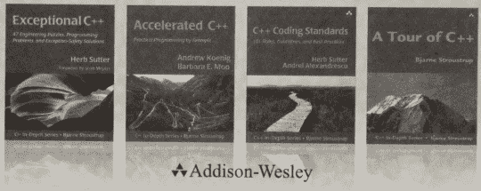


## 前言

> "世界是建立在C++（及其C子集）之上的。"
> ——Herb Sutter

Google、Amazon和Facebook的基础设施在很大程度上是用C++构建的。此外，相当一部分底层技术是用C++实现的。在电信领域，几乎所有固定电话和蜂窝电话连接都由C++软件驱动。最重要的是，德国所有主要传输节点都由C++处理，这意味着作者家庭的平静无条件地依赖于C++软件。

即使是用其他编程语言编写的软件也依赖于C++，因为最流行的编译器是用C++、Visual Studio、clang以及GNU和Intel编译器的较新部分实现的。对于运行在Windows上的软件来说，这一点更为真实，因为它也是用C++实现的（Office套件也是如此）。该语言无处不在，你的手机和汽车肯定都包含由C++驱动的组件。它的发明者Bjarne Stroustrup建立了一个带有应用程序的网页，此处的大多数示例均源自该网页。

在科学和工程领域，许多高质量的软件包都是用C++实现的。该语言的优势尤其体现在项目规模超过一定大小且数据结构相当复杂时。难怪当今科学和工程领域许多——如果不是大多数——仿真软件都是用C++实现的：领先的有Abaqus、deal.II、FEniCS、OpenFOAM，仅举几例；同样，领先的CAD软件CATIA也是如此。得益于更强大的处理器和改进的编译器，即使是嵌入式系统也越来越多地用C++实现（在这些系统中，并非所有现代语言特性和库都始终可用）。最后，我们不知道如果这些项目是后来开始的，有多少项目会使用C++而不是C来实现。例如，作者的好友Matt Knepley（非常成功的科学库PETSc的合著者）承认，如果重写的成本可承受，他今天会用C++来编写该库。

## 学习C++的理由

与其他任何语言不同，C++掌握了从一端足够接近硬件的编程到另一端抽象高级编程的完整光谱。底层编程——例如用户可定义的内存管理——使你作为程序员能够了解执行期间实际发生的事情，这反过来又有助于你理解其他语言中程序的行为。在C++中，你可以编写极其高效的程序，只有以荒谬的努力编写机器语言代码才能略微超越它。然而，你应该暂时搁置硬核性能调优，首先专注于清晰且富有表现力的软件。

C++的高级特性正是在此处发挥作用。该语言直接支持多种编程范式：面向对象编程（第6章）、泛型编程（第3章）、元编程（第5章）、并发编程（§4.6）和过程式编程（§1.5），等等。

多种编程技术——例如RAII（§2.4.1）和表达式模板（§5.3）——是为C++而发明并在C++中发明的。由于该语言非常富有表现力，通常可以在不更改语言的情况下建立这些新技术。谁知道呢，也许有一天你会发明一种新技术。

## 阅读本书的理由

本书的材料已经过真人测试。作者在三年内（即三次两个学期）教授了他的课程“面向科学家的C++”。学生大多来自数学系，此外还有来自物理系和工程系的学生，他们在上课前通常不了解C++，但能够在课程结束时实现表达式模板（§5.3）等高级技术。你可以按照自己的节奏阅读本书：遵循主路径直奔主题，或通过阅读附录A中的更多示例和背景信息来更深入地学习。

## 美与丑

C++程序可以用多种方式编写。在本书中，我们将平稳地引导你采用更高级的风格。这需要使用高级特性，起初可能令人生畏，但一旦你习惯了它们，这种感觉就会减轻。实际上，高级编程不仅适用范围更广，而且通常同样高效或更高效，且更易读。

我们将通过一个简单的示例给你一个初步印象：固定步长的梯度下降。原理极其简单：我们使用其梯度（假设为g(x)）计算f(x)的最陡下降方向，并沿此方向以固定步长前进到下一个局部极小值。即使是算法伪代码也像这个描述一样简单：

```
Algorithm 1: Gradient descent algorithm
Input: Start value x, step size s, termination criterion ε, function f, gradient g
Output: Local minimum x
do
  x = x - s . g(x)
while |Δf(x)| ≥ ε ;
```

对于这个简单的算法，我们编写了两种截然不同的实现。请查看并让其在脑海中沉淀，不要试图理解技术细节。


```cpp
void gradient_descent(double* x,
    double* y, double s, double eps,
    double(*f)(double, double),
    double(*gx)(double, double),
    double(*gy)(double, double))
{
    double val = f(*x, *y), delta;
    do {
        *x -= s * gx(*x, *y);
        *y -= s * gy(*x, *y);
        double new_val = f(*x, *y);
        delta = abs(new_val - val);
        val = new_val;
    } while (delta > eps);
}
```

```cpp
template <typename Value, typename P1,
    typename P2, typename F,
    typename G>
Value gradient_descent(Value x, P1 s,
    P2 eps, F f, G g)
{
    auto val = f(x), delta = val;
    do {
        x -= s * g(x);
        auto new_val = f(x);
        delta = abs(new_val - val);
        val = new_val;
    } while (delta > eps);
    return x;
}
```

乍一看，它们非常相似，我们会告诉你我们更喜欢哪一个。第一个版本原则上是纯 C，即也可以用 C 编译器编译。其优点是被优化的内容直接可见：一个带 double 值的 2D 函数（由高亮的函数参数指示）。我们更喜欢第二个版本，因为它更通用：适用于任意维度和任意值类型的函数（由标记的类型和函数参数可见）。令人惊讶的是，通用实现并不效率更低。恰恰相反，给定的 F 和 G 函数可能会被内联（参见 §1.5.3），从而节省函数调用开销，而左侧版本中显式使用（丑陋的）函数指针则使这种优化变得困难。

对于非常有耐心的读者，附录 A（§A.1）中有一个比较旧式和新式风格的更长示例。在那里，现代编程的优势比这里的玩具示例更加明显。但我们不想用初步的小规模交锋让你等待太久。

## 科学与工程中的语言

> "如果各种数值软件都能用 C++ 编写而不损失效率，那将是件好事，但除非能找到一种在不损害 C++ 类型系统的情况下实现这一点的方法，否则依赖 Fortran、汇编语言或特定于架构的扩展可能更可取。"
>
> —比亚尼·斯特劳斯特鲁普

科学和工程软件使用不同的语言编写，哪一种最合适取决于目标和可用资源——如同其他领域一样：

- 当我们可以使用现有算法时，MATLAB、Mathematica 或 R 等数学工具非常出色。当我们使用细粒度（例如，标量）操作实现自己的算法时，性能会显著下降。这可能不是问题——问题规模较小或用户有无限的耐心；否则我们应该考虑其他语言。

- Python 非常适合快速软件开发，并且已经包含“scipy”和“numpy”等科学库，基于这些库（通常用 C 和 C++ 实现）的应用程序效率相当高。同样，基于细粒度操作的用户自定义算法会付出性能代价。Python 是高效实现小型和中型任务的绝佳方式。当项目足够大时，编译器变得更严格变得越来越重要（例如，当参数不匹配时会拒绝赋值）。

- 当我们可以依赖现有的、经过良好调优的操作（如稠密矩阵操作）时，Fortran 也非常出色。它非常适合完成老教授的作业（因为他们只要求 Fortran 中容易做的事情）。根据作者的经验，引入新的数据结构相当麻烦，用 Fortran 编写大型模拟程序是一个巨大的挑战——如今只有越来越少的少数人会自愿这样做。

- C 允许获得良好的性能，并且大量软件是用 C 编写的。核心语言相对较小且易于学习。挑战在于使用简单而危险的语言特性（尤其是指针（§1.8.2）和宏（§1.9.2.1））编写大型且无错误的软件。

- 当应用程序的主要组件是 Web 或图形界面且不进行太多计算时，Java、C# 和 PHP 等语言可能是不错的选择。

- C++ 在开发大型、高质量且性能良好的软件时尤其出色。尽管如此，开发过程不必缓慢而痛苦。有了合适的抽象，我们可以相当快速地编写 C++ 程序。我们乐观地认为，在未来的 C++ 标准中，将包含更多科学库。

显然，我们掌握的语言越多，选择就越多。此外，我们对这些语言了解得越多，选择就越明智。此外，大型项目通常包含不同语言的组件，而在大多数情况下，至少性能关键的内核是用 C 或 C++ 实现的。总而言之，学习 C++ 是一段引人入胜的旅程，深入理解它无论如何都会让你成为一名优秀的程序员。

## 排版约定

新术语以清晰的蓝色和斜体显示。C++ 源代码以蓝色等宽字体打印。重要细节以粗体标记。类、函数、变量和常量为小写，可选地包含下划线。例外是矩阵，通常用单个大写字母命名。模板参数和概念以大写字母开头，可能包含更多大写字母（CamelCase）。程序输出和命令以浅蓝色打字机字体显示。

需要 C++03、C++11 或 C++14 特性的程序会用相应的边距框标记。几个轻度使用 C++11 特性（可轻松用 C++03 表达式替代）的程序没有明确标记。

```
=> directory/source_code.cpp
```

除了非常简短的代码示例外，本书中的所有编程示例都在至少一个编译器上进行了测试。通过箭头指示，完整程序的路径在讨论所包含代码片段的段落或章节开头给出。

所有程序都可在 GitHub 的公共仓库 https://github.com/petergottschling/discovering_modern_cpp 中获得，因此可以通过以下命令克隆：

```
git clone https://github.com/petergottschling/discovering_modern_cpp.git
```

在 Windows 上，使用 TortoiseGit 更方便；参见 tortoisegit.org。

## 致谢

按时间顺序，作者要感谢 Karl Meerbergen 及其同事，他们提供了最初的 80 页文本，该文本于 2008 年由 Karl 和我本人在 KU Leuven 用作块式讲座。随着时间的推移，大部分段落已被重写，但原始文档为整个写作过程提供了至关重要的初始动力。我真心感谢 Mario Mulansky 对第 7.1 节“常微分方程求解器的实现”的贡献。

我非常感激 Jan Christiaan van Winkel 和 Fabio Fracassi，他们逐一核对了手稿的每一个微小细节，并就标准合规性和可读性提出了许多建议。

我特别要感谢比亚尼·斯特劳斯特鲁普，感谢他为塑造本书提供战略建议、建立与艾迪生-韦斯利的联系、慷慨允许我重用他准备充分的材料，以及（不得不提）创建了 C++。所有这些校对人员都敦促我尽可能使用 C++11 和 C++14 特性更新旧的讲座材料。

此外，我感谢 Karsten Ahnert 的建议，以及 Markus Abel 帮助我消除前言的冗长。

当我为第 4.2.2.6 节寻找有趣的随机数应用时，Jan Rudl 建议了他课堂上使用的股价演变 [60]。

我感谢德累斯顿工业大学，它让我在数学系教授 C++ 超过 3 年，并感谢该课程学生提供的建设性反馈。同样，我感谢参加我 C++ 培训的学员。

我深深感谢我的编辑 Greg Doench，感谢他接受本书中半严肃半随意的风格，忍受关于战略决策的长时间讨论直到我们双方都满意，并提供专业支持，没有这种支持，本书永远无法出版。

Elizabeth Ryan 应得赞誉，她管理了整个制作过程，并对我所有特殊要求都耐心等待。

最后但同样重要的是，我衷心感谢我的家人——我的妻子 Yasmine，以及我的孩子们 Yanis、Anissa、Vincent 和 Daniel——他们牺牲了大量我们在一起的时间，让我能够专注于编写本书。


## 关于作者

Peter Gottschling的职业热情是编写前沿科学软件，并希望将这种“病毒”传染给许多读者。这一职业使他编写了矩阵模板库4，并合著了包括Boost图库在内的其他库。这些编程经验在大学的多门C++课程和专业培训课程中分享——最终促成了本书的出版。

他是ISO C++标准委员会成员、德国编程语言标准委员会副主席，以及德累斯顿C++用户组的创始人。在德累斯顿工业大学年轻狂野的岁月里，他同时学习了计算机科学和数学，达到学士水平，并以计算机科学专业获得博士学位。在学术机构的漫长旅程后，他创办了自己的公司SimuNova，并回到了他心爱的家乡莱比锡，正好赶上该市1000周年纪念。他已婚，育有四个孩子。

# 第1章

# C++基础

> “致我的孩子们：
> 别嘲笑不得不帮我处理电脑事务，
> 我教过你们如何使用勺子。”
> —Sue Fitzmaurice

在本章中，我们将引导您了解C++的基本特性。与全书一样，我们将从不同角度探讨，但不会试图展示每一个可能的细节——这本身也不可行。关于特定特性的更详细问题，我们推荐在线手册 http://www.cplusplus.com/ 和 http://en.cppreference.com。

## 1.1 我们的第一个程序

作为C++语言的入门，让我们看看以下示例：

```
#include <iostream>

int main ()
{
 std::cout << "The answer to the Ultimate Question of Life,\n"
 << "the Universe, and Everything is:"
 << std::endl << 6 * 7 << std::endl;
 return 0;
}
```

其输出为
生命、宇宙以及至终问题的答案是：
42

根据Douglas Adams [2]。这个简短示例已经说明了C++的几个特性：

- 输入和输出不是核心语言的一部分，而是由库提供。必须显式包含；否则我们无法读取或写入。
- 标准I/O具有流模型，因此名为<iostream>。要启用其功能，我们在第一行包含<iostream>。
- 每个C++程序都通过调用函数`main`开始。它返回一个整数值，其中0表示成功终止。
- 大括号`{}`表示一个代码块/组（也称为复合语句）。
- std::cout和std::endl在<iostream>中定义。前者是一个输出流，用于在屏幕上打印文本。std::endl终止一行。我们也可以使用特殊字符`\n`换行。
- 运算符`<<`可用于将对象传递给输出流（如std::cout）以执行输出操作。
- `std::`表示使用的是标准命名空间中的类型或函数。命名空间帮助我们组织名称并处理命名冲突；参见§3.2.1。
- 字符串常量（更准确地说是字面量）用双引号括起来。
- 表达式`6 * 7`被求值并作为整数传递给`std::cout`。在C++中，每个表达式都有一个类型。有时，我们作为程序员必须显式声明类型，而其他时候编译器可以为我们推断。6和7是int类型的字面常量，因此它们的乘积也是int。

在继续阅读之前，我们强烈建议您在计算机上编译并运行这个小程序。一旦它能编译并运行，您可以随意修改，例如添加更多操作和输出（并查看一些错误消息）。最后，真正学习一门语言的唯一方法就是使用它。如果您已经知道如何使用编译器甚至C++ IDE，可以跳过本节的其余部分。

### Linux

每个发行版至少提供GNU C++编译器——通常已预安装（参见第B.1节的简短介绍）。假设我们将程序命名为`hello42.cpp`，可使用以下命令轻松编译：

```
g++ hello42.cpp
```

遵循上世纪的传统，生成的二进制文件默认名为`a.out`。总有一天我们可能会有多个程序，届时可以使用输出标志指定更有意义的名称：

```
g++ hello42.cpp -o hello42
```

我们还可以使用构建工具`make`（概览见§7.2.2.1），它在较新版本中提供构建二进制文件的默认规则。因此，我们可以调用

```
make hello42
```

`make`将在当前目录中查找同名程序源文件。它会找到`hello42.cpp`，由于`.cpp`是C++源文件的标准后缀，它将调用系统默认的C++编译器。编译程序后，我们可以在命令行中这样调用它：

```
./hello42
```

我们的二进制文件无需任何其他软件即可执行，可以将其复制到另一个兼容的Linux系统¹并在该处运行。

### Windows

如果您运行的是MinGW，可以以与Linux相同的方式编译。如果使用Visual Studio，则需要先创建一个项目。开始时，最简单的方法是使用控制台应用程序的项目模板，例如如http://www.cplusplus.com/doc/tutorial/introduction/visualstudio中所述。运行程序时，控制台关闭前只有几毫秒时间读取输出。要将读取阶段延长到一秒，只需插入不可移植的命令Sleep(1000); 并包含<windows.h>。使用C++11或更高版本，等待阶段可以可移植地实现：

```
std::this_thread::sleep_for(std::chrono::seconds(1));
```

在包含<chrono>和<thread>之后。Microsoft提供名为“Express”的免费版Visual Studio，它们像专业版一样支持标准语言。区别在于专业版附带更多开发者库。由于本书未使用这些库，您可以使用“Express”版本来尝试我们的示例。

### IDE

像本书中的示例这样的短程序可以用普通编辑器轻松处理。在大型项目中，建议使用集成开发环境（IDE）来查看函数的定义或使用位置、显示代码内文档、在项目范围内搜索或替换名称等等。KDevelop是KDE社区用C++编写的免费IDE。它可能是Linux上最高效的IDE，并且与git和CMake集成良好。Eclipse是用Java开发的，明显较慢。然而，最近有人投入大量精力改进其C++支持，许多开发者使用它也非常高效。Visual Studio是一个非常稳健的IDE，带有一些独特功能，例如作为滚动条的缩小彩色页面视图。

找到最高效的环境需要一些时间和实验，当然也取决于个人和协作偏好。因此，它也会随时间演变。

## 1.2 变量

C++是一种强类型语言（与许多脚本语言不同）。这意味着每个变量都有一个类型，且该类型永不改变。变量通过以类型开头、后跟变量名（可选初始化）或其列表的语句来声明：

```
int   t1 = 2;   // Alignment for readability only
int   t2, t3 = 5;
```

1. 通常标准库是动态链接的（参见§7.2.1.4），那么在另一系统上存在相同版本的库也是兼容性要求的一部分。

```cpp
float   pi = 3.14159;
double  x  = -1.5e6;    // -1500000
double  y= -1.5e-6;     // -0.0000015
char    c1= 'a', c2= 35;
bool    cmp= 1 < pi,    // -> true
        happy= true;
```

这里的两个斜杠//开始一个单行注释；即，从双斜杠到行尾的所有内容都被忽略。原则上，关于注释这点就足够了。为了不让您觉得该话题上仍有重要内容缺失，我们将在1.9.1节中再多讨论一些。

回到变量！它们的基本类型——也称为内置类型——列于表1-1中。

前五种类型是长度不递减的整数。例如，int至少和short一样长；即，它通常但不一定更长。每种类型的确切长度取决于实现；例如，int可能是16、32或64位。所有这些类型都可以限定为signed或unsigned。前者对整数（char除外）没有影响，因为它们默认是signed的。

当我们将整数类型声明为unsigned时，将没有负值，但正值的数量是两倍（如果将零视为既非正也非负，则再加一）。signed和unsigned可以被视为short、int等名词的形容词，当仅声明形容词时，int为默认名词。

char类型有两种用途：表示字母和较短的数字。除非是非常特殊的架构，它几乎总是8位长。因此，我们可以表示-128到127（signed）或0到255（unsigned）的值，并对其执行所有可用于整数的数值运算。当既未声明signed也未声明unsigned时，使用哪一种取决于编译器的实现。我们还可以表示任何代码能放入8位的字母。甚至可以混合使用；例如，'a' + 7通常会得到'h'，具体取决于字母的底层编码。我们强烈建议不要这样做，因为潜在的混淆可能会导致明显的时间浪费。

| 名称 | 语义 |
| :--- | :--- |
| char | 字母和非常短的整数 |
| short | 相当短的整数 |
| int | 常规整数 |
| long | 长整数 |
| long long | 非常长的整数 |
| unsigned | 所有前述类型的无符号版本 |
| signed | 所有前述类型的有符号版本 |
| float | 单精度浮点数 |
| double | 双精度浮点数 |
| long double | 长浮点数 |
| bool | 布尔值 |


然而，当存在大量小数字的容器时，使用 char 或 unsigned char 可能很有用。

逻辑值最好表示为 bool。布尔变量可以存储 true 和 false。

非递减长度属性同样适用于浮点数：float 的长度小于或等于 double，而 double 又小于或等于 long double。典型大小为：float 32 位，double 64 位，long double 80 位。

在下一节中，我们将展示常应用于整型和浮点型的操作。与 Python 等其他语言不同，Python 中 ' 和 " 既用于字符也用于字符串，而 C++ 区分这两者。C++ 编译器将 'a' 视为字符 'a'（其类型为 char），而 "a" 是包含 "a" 和一个作为终止符的二进制 0 的字符串（即，其类型为 char[2]）。如果你习惯使用 Python，请注意这一点。

> 建议
> 尽可能晚地声明变量，通常在第一次使用它们之前立即声明，并且只要可能，不要在能够初始化它们之前声明。

这使得程序在变长时更易读。它还允许编译器在嵌套作用域中更高效地使用内存。

C++11 可以为我们推断变量的类型，例如：

```
auto i4 = i3 + 7;
```

i4 的类型与 i3 + 7 的类型相同，即 int。虽然类型是自动确定的，但它保持不变，之后分配给 i4 的任何内容都将转换为 int。我们将在后面看到 auto 在高级编程中有多有用。对于本节中这样的简单变量声明，通常最好显式声明类型；auto 将在第 3.4 节中详细讨论。

### 1.2.1 常量

从语法上讲，常量类似于 C++ 中的特殊变量，具有额外的常量属性。

```
const int   c1 = 2;
const int   ci3;          // Error: no value
const float pi = 3.14159;
const char  cc = 'a';
const bool  cpm = c1 < p1;
```

由于它们不能被更改，必须在声明时设置它们的值。第二个常量声明违反了此规则，编译器不会容忍这种不当行为。

常量可以在允许使用变量的任何地方使用——当然，前提是它们不被修改。另一方面，像上面这样的常量在编译期间已经是已知的。这使得多种优化成为可能，并且常量甚至可以用作类型的参数（我们将在 §5.1.4 中稍后回到这一点）。

### 1.2.2 字面量

像 2 或 3.14 这样的字面量也有类型。简单来说，整数根据位数被视为 int、long 或 unsigned long。每个带有小数点或指数的数字（例如，3e12 ≡ 3 * 10^12）都被视为 double。

其他类型的字面量可以通过添加以下表格中的后缀来编写：

| 字面量 | 类型 |
| --- | --- |
| 2 | int |
| 2u | unsigned |
| 2l | long |
| 2ul | unsigned long |
| 2.0 | double |
| 2.0f | float |
| 2.0l | long double |

在大多数情况下，无需显式声明字面量的类型，因为内置数值类型之间的隐式转换（又称强制转换）通常会将值设置为程序员所期望的结果。

然而，我们应该关注字面量类型的三个主要原因：

**可用性：** 标准库提供了一种复数类型，其实部和虚部的类型可以由用户参数化：

```
std::complex<float> z(1.3, 2.4), z2;
```

不幸的是，操作仅在类型本身与底层实数类型之间提供（并且这里不转换参数）。因此，我们不能用 int 或 double 乘以 z，只能用 float：

```
z = 2 * z;    // Error: no int * complex<float>
z = 2.0 * z;  // Error: no double * complex<float>
z = 2.0f * z; // Okay: float * complex<float>
```

**歧义：** 当函数针对不同参数类型重载时（§1.5.4），像 0 这样的参数可能是歧义的，而对于像 0.0 这样的限定参数可能存在唯一匹配。

**精度：** 当我们使用 long double 时会出现精度问题。由于非限定字面量是 double，我们在将其赋值给 long double 变量之前可能会丢失数字：

```
long double third1 = 0.33333333333333333333; // may lose digits
long double third2 = 0.33333333333333333333l; // accurate
```

如果上述三段对你来说太简略，可以在第 A.2.1 节中找到更详细的版本。

**非十进制数：** 以零开头的整数字面量被解释为八进制数，例如：

```
int o1 = 042; // int o1 = 34;
int o2 = 084; // Error! No 8 or 9 in octals!
```

十六进制字面量可以通过 0x 或 0X 前缀来编写：

```
int h1 = 0x42; // int h1 = 66;
int h2 = 0xfa; // int h2 = 250;
```

C++14 引入了以 0b 或 0B 前缀的二进制字面量：

```
int b1 = 0b11111010; // int b1 = 250;
```

为了提高长字面量的可读性，C++14 允许我们使用撇号分隔数字：

```
long d = 6'546'687'616'861'129l;
unsigned long ulx = 0x139'ae3b'2ab9'94f3;
int b = 0b101'0001'0011'1010'1101'1010'0001;
const long double pi = 3.141'592'653'589'793'238'462l;
```

字符串字面量被视为 char 数组：

```
char s1[] = "old C style"; // better not
```

然而，这些数组远不方便，我们最好使用库 <string> 中的真正字符串类型。它可以直接从字符串字面量创建：

```
#include <string>

std::string s2 = "In C++ better like this";
```

非常长的文本可以拆分成多个子字符串：

```
std::string s3 = "This is a very long and clumsy text "
"that is too long for one line.";
```

有关字面量的更多详细信息，例如请参见 [43, §6.2]。

### 1.2.3 非收窄初始化

假设我们用一个长数字初始化一个 long 变量：

```
long l2 = 1234567890123;
```

这可以正常编译并正确运行——当 long 占用 64 位时（如大多数 64 位平台）。当 long 只有 32 位长时（我们可以通过使用 -m32 等标志编译来模拟这一点），上述值太长。然而，程序仍然会编译（可能带有警告），并以另一个值运行，例如，前导位被截断的值。

C++11 引入了一种初始化方式，以确保不会丢失数据，换句话说，值不会被收窄。这是通过统一初始化或花括号初始化实现的，我们在这里仅提及，并在第 2.3.4 节中详细展开。花括号中的值不能被收窄：

```
long l = {1234567890123};
```

现在，编译器将检查变量 l 是否能在目标架构上容纳该值。

编译器的收窄保护允许我们验证初始化时值不会丢失精度。而使用浮点数对 int 进行普通初始化由于隐式转换是允许的：

```
int l1 = 3.14; // compiles despite narrowing (our risk)
int l1n = {3.14}; // Narrowing ERROR: fractional part lost
```

第二行中的新初始化形式禁止这样做，因为它会截断浮点数的小数部分。同样，将负值赋给无符号变量或常量在传统初始化中是被容忍的，但在新形式中则被禁止：

```
unsigned u2 = -3; // Compiles despite narrowing (our risk)
unsigned u2n = {-3}; // Narrowing ERROR: no negative values
```

在前面的示例中，我们在初始化中使用了字面量值，编译器会检查特定值是否可以用该类型表示：

```
float f1 = {3.14}; // okay
```

嗯，值 3.14 在任何二进制浮点格式中都无法绝对准确地表示，但编译器可以将 f1 设置为最接近 3.14 的值。当 float 从 double 变量或常量（而非字面量）初始化时，我们必须考虑所有可能的 double 值以及它们是否都可以无损地转换为 float。

```
double d;
...
float f2 = {d}; // narrowing ERROR
```

请注意，收窄可能在两种类型之间是相互的：

```
unsigned u3 = {3};
int i2 = {2};
unsigned u4 = {i2}; // narrowing ERROR: no negative values
int i3 = {u3}; // narrowing ERROR: not all large values
```

signed int 和 unsigned int 类型大小相同，但每种类型的并非所有值都可以在另一种类型中表示。

### 1.2.4 作用域

作用域决定了（非静态）变量和常量的生存期和可见性，并有助于在我们的程序中建立结构。


#### 1.2.4.1 全局定义

程序中打算使用的每个变量，都必须在代码中更早的位置用其类型说明符进行声明。变量可以位于全局作用域或局部作用域。全局变量是在所有函数之外声明的。声明后，全局变量可以在代码中的任何地方引用，甚至在函数内部。乍一看这非常方便，因为它使变量易于访问，但当你的软件规模增长时，跟踪全局变量的修改会变得更加困难和痛苦。到某个阶段，每一次代码更改都有可能引发一连串的错误。

> 建议 -
> 不要使用全局变量。

如果你确实使用它们，迟早会后悔的。相信我们。像下面这样的全局常量

```
const double pi = 3.14159265358979323846264338327950288419716939;
```

是可以的，因为它们不会引起副作用。

#### 1.2.4.2 局部定义

局部变量是在函数体内声明的。其可见性/可用性仅限于其声明所在的{ }括起来的块。更准确地说，变量的作用域从其声明开始，到声明块的右花括号结束。

如果我们在函数`main`中定义$\pi$：

```
int main ()
{
    const double pi = 3.14159265358979323846264338327950288419716939;
    std::cout << "pi is " << pi << ".\n";
}
```

变量$\pi$只在`main`函数中存在。我们可以在函数内部以及在其他块内部定义块：

```
int main ()
{
    {
        const double pi = 3.14159265358979323846264338327950288419716939;
    }
    std::cout << "pi is " << pi << ".\n"; // ERROR: pi is out of scope
}
```

在这个示例中，$\pi$的定义仅限于函数内部的块，因此函数其余部分的输出是一个错误：

```
>pi< is not defined in this scope.
```

因为$\pi$超出了作用域。

#### 1.2.4.3 隐藏

当嵌套作用域中存在同名变量时，只有一个变量是可见的。内层作用域中的变量会隐藏外层作用域中的同名变量。例如：

```
int main ()
{
    int a = 5;        // define a#1
    {
        a = 3;        // assign a#1, a#2 is not defined yet
        int a;        // define a#2
        a = 8;        // assign a#2, a#1 is hidden
    }                 // end of a#2's scope
    a = 7;            // assign to a#1 (a#2 out of scope)
    return 0;
}
```

由于隐藏，我们必须区分变量的生命周期和可见性。例如，a#1从其声明开始一直存活到main函数结束。然而，它仅从其声明到a#2的声明期间可见，以及在包含a#2的块关闭后再次可见。事实上，可见性等于生命周期减去被隐藏的时间。

在同一作用域中两次定义同一个变量名是错误的。

作用域的优势在于，我们不需要担心变量是否已经在作用域外的某处定义。它只是被隐藏，但不会产生冲突。3 遗憾的是，隐藏使得外层作用域中的同名变量无法访问。我们可以通过巧妙重命名在一定程度上解决这个问题。然而，更好的解决方案是使用命名空间来管理嵌套和可访问性；参见第3.2.1节。

静态变量是例外中的规则：它们存活到执行结束，但仅在作用域内可见。我们担心，在这个阶段详细介绍它们更多是分散注意力而非有帮助，因此将讨论推迟到第A.2.2节。

## 1.3 运算符

C++拥有丰富的内置运算符。有不同种类的运算符：

- 计算：
  - 算术：+, -, *, %, ...
- 布尔：
  - 比较：<=, !=, ...
  - 逻辑：&& 和 ||
- 位运算：~, << 和 >>, &, ^, 和 |
- 赋值：=, +=, ...
- 程序流程：函数调用, ?:, 和 ,
- 内存处理：new 和 delete
- 访问：., ->, [ ], *, ...
- 类型处理：dynamic_cast, typedef, sizeof, alignof ...
- 错误处理：throw

本节将对运算符进行概述。有些运算符在相关语言特性的上下文中会有更好的描述；例如，作用域解析最好与命名空间一起解释。大多数运算符可以为用户定义的类型重载；也就是说，我们可以决定当表达式中的一个或多个参数是我们的类型时执行哪些计算。

在本节末尾（表1-8），你会找到一个简洁的运算符优先级表。打印或复制此页面并贴在显示器旁边可能是个好主意；许多人都这样做，几乎没有人能完全背诵整个优先级列表。如果你对优先级不确定，或者相信这样对其他使用你源代码的程序员来说更易理解，也不应犹豫在子表达式周围加上括号。如果你要求编译器严格检查，它往往会过于认真地对待这项工作，并提示你添加多余的括号，假设你被优先级规则弄不知所措。在第C.2节，我们将提供所有运算符的完整列表，附有简要描述和参考。

### 1.3.1 算术运算符

表1-2列出了C++中可用的算术运算符。我们按优先级对它们进行了排序，但让我们逐一查看。

第一类操作是自增和自减。这些操作可以用于将数字增加或减少1。由于它们改变数字的值，它们仅对变量有意义，而不对临时结果有意义，例如：

```
int i = 3;
i++; // i is now 4
const int j = 5;
++j; // error, j is constant
(3 + 5)++; // error, 3 + 5 is only a temporary
```

简而言之，自增和自减操作需要某个可修改且可寻址的东西。可寻址数据项的技术术语是Lvalue（参见附录C中的定义C-1）。在上面的代码片段中，这仅对i成立。相比之下，j是常量，而3 + 5不可寻址。

### 表 1-2：算术运算符

| 操作 | 表达式 |
| :--- | :--- |
| 后自增 | x++ |
| 后自减 | x-- |
| 前自增 | ++x |
| 前自减 | --x |
| 单目加 | +x |
| 单目减 | -x |
| 乘法 | x * y |
| 除法 | x / y |
| 取模 | x % y |
| 加法 | x + y |
| 减法 | x - y |

无论是前缀还是后缀表示法，对变量的效果都是给其加1或减1。自增和自减表达式的值对前缀和后缀运算符不同：前缀运算符返回修改后的值，后缀运算符返回旧值，例如：

```
int i = 3, j = 3;
int k = ++i + 4;    // i is 4, k is 8
int l = j++ + 4;    // j is 4, l is 7
```

最后，i和j都为4。然而，在计算l时，使用了j的旧值，而第一次加法使用了已经自增后的i值。

一般来说，最好避免在数学表达式中使用自增和自减，而应将其替换为j+1之类的表达式，或分别执行自增/自减操作。当数学表达式没有副作用时，人类读者更容易理解，编译器也更容易优化。我们很快就会明白原因（§1.3.12）。

单目减对数字取负：

```
int i = 3;
int j = -i;    // j is -3
```

单目加对标准类型没有算术效果。对于用户定义的类型，我们可以定义单目加和单目减的行为。如表1-2所示，这些单目运算符的优先级与前自增和前自减相同。

操作*和/自然是乘法和除法，并且都定义在所有数值类型上。当除法的两个参数都是整数时，结果的小数部分会被截断（向零舍入）。运算符%产生整数除法的余数。因此，两个参数都应具有整型。

最后，两个变量或表达式之间的操作符+和-分别表示加法和减法。

操作的语义细节——结果如何舍入或溢出如何处理——在语言中未指定。出于性能原因，C++通常将此留给底层硬件。


一般来说，一元运算符的优先级高于二元运算符。在极少数同时应用了后缀和前缀一元表示法的情况下，前缀表示法优先于后缀表示法。

在二元运算符中，我们有与数学中相同的行为：乘法和除法优先于加法和减法，且运算为左结合性，即：

```
x - y + z
```

始终被解释为

```
(x - y) + z
```

需要牢记的一件非常重要的事情：参数的求值顺序未定义。例如：

```
int i = 3, j = 7, k;
k = f(++i) + g(++i) + j;
```

在这个示例中，结合性保证第一个加法在第二个加法之前执行。但是表达式 f(++i) 或 g(++i) 哪个先计算取决于编译器实现。因此，k 可能是 f(4) + g(5) + 7 或 f(5) + g(4) + 7。此外，我们不能假设在不同平台上结果相同。一般来说，在表达式中修改值是危险的。它在某些条件下有效，但我们始终需要对其进行测试并投入巨大的精力。总的来说，我们的时间最好花在多输入几个字母并分别进行修改上。有关此主题的更多内容请参见第 1.3.12 节。

```
=> c++03/num_1.cpp
```

使用这些运算符，我们可以编写第一个（完整的）数值程序：

```
#include <iostream>

int main ()
{
    const float r1= 3.5, r2 = 7.3, pi = 3.14159;

    float area1 = pi * r1*r1;
    std::cout << "A circle of radius " << r1 << " has area "
              << area1 << "." << std::endl;

    std::cout << "The average of " << r1 << " and " << r2 << " is "
              << (r1 + r2) / 2 << "." << std::endl;
}
```

当二元运算的参数具有不同类型时，一个或两个参数会根据第 C.3 节的规则自动转换（强制转换）为共同类型。

转换可能导致精度损失。浮点数优先于整数，显然将 64 位 long 转换为 32 位 float 会导致精度损失；即使是 32 位 int 也并不总能被正确表示为 32 位 float，因为一些位用于指数。也有过这样的情况：目标变量可以保存正确的结果，但中间计算中精度已经丢失。为了说明这种转换行为，让我们看看以下示例：

```cpp
long l = 1234567890123;
long l2 = l + 1.0f - 1.0; // imprecise
long l3 = l + (1.0f - 1.0); // correct
```

这在作者的平台上导致

```
l2 = 1234567954431
l3 = 1234567890123
```

在 l2 的情况下，由于中间转换我们丢失了精度，而 l3 计算正确。诚然，这是一个人为的示例，但你应该意识到不精确中间结果的风险。

幸运的是，不准确的问题在下一节不会困扰我们。

### 1.3.2 布尔运算符

布尔运算符是逻辑运算符和关系运算符。顾名思义，两者都返回 bool 值。这些运算符及其含义列于表 1-3 中，按优先级分组。

二元关系运算符和逻辑运算符优先级低于所有算术运算符。这意味着像 4 >> 1 + 7 这样的表达式会被求值，仿佛写作 4 >> (1 + 7)。相反，用于逻辑非的一元运算符 ! 优先于所有二元运算符。在旧（或老式）代码中，你可能会看到在 int 值上执行逻辑操作。请避免这样做：可读性较差，且可能出现意外行为。

> **建议**
> 逻辑表达式始终使用 bool。

表 1-3：布尔运算符

| 操作 | 表达式 |
| :--- | :--- |
| 非 | !b |
| 大于 | x > y |
| 大于或等于 | x >= y |
| 小于 | x < y |
| 小于或等于 | x <= y |
| 等于 | x == y |
| 不等于 | x != y |
| 逻辑与 | b && c |
| 逻辑或 | b \|\| c |

请注意，比较不能像这样链式使用：

bool in_bound = min <= x <= y <= max; // Error

相反，我们需要更冗长的逻辑归约：

bool in_bound = min <= x && x <= y && y <= max;

在下一节中，我们将看到非常相似的运算符。

### 1.3.3 位运算符

这些运算符允许我们测试或操作整数类型的单个位。它们对系统编程很重要，但对现代应用开发则不那么重要。表 1-4 按优先级列出了所有运算符。

操作 x << y 将 x 的位向左移动 y 位。相反，x >> y 将 x 的位向右移动 y 次。在大多数情况下，移入 0，除了右移时负有符号值的情况由实现定义。按位与可用于测试值的特定位。按位或可设置一位，按位异或可翻转一位。这些操作在系统编程中比在科学应用中更重要。作为算法娱乐，我们将在 §3.6.1 中使用它们。

### 1.3.4 赋值

对象（可修改的左值）的值可以通过赋值来设置：

```
object = expr;
```

当类型不匹配时，如果可能，expr 会被转换为 object 的类型。赋值是右结合的，因此可以在一个表达式中将值依次赋给多个对象：

```
o3 = o2 = o1 = expr;
```

说到赋值，作者现在将解释他为什么将符号左对齐。大多数二元运算符在两个参数都是值的意义上是对称的。相比之下，赋值在左侧有一个可修改的变量。虽然其他语言使用非对称符号（例如 Pascal 中的 :=），但作者在 C++ 中使用非对称间距。

表 1-4：位运算符

| 操作 | 表达式 |
|---|---|
| 按位取反 | ~x |
| 左移 | x << y |
| 右移 | x >> y |
| 按位与 | x & y |
| 按位异或 | x ^ y |
| 按位或 | x \| y |

复合赋值运算符将算术或位运算应用于左侧对象与右侧参数；例如，以下两个操作是等价的：

```
a += b; // corresponds to
a = a + b;
```

所有赋值运算符的优先级都低于每个算术或位运算，因此右侧表达式始终在复合赋值之前求值：

```
a *= b + c; // corresponds to
a = a * (b + c);
```

赋值运算符列于表 1-5 中。它们都是右结合的，且优先级相同。

| 操作 | 表达式 |
|---|---|
| 简单赋值 | x = y |
| 乘并赋值 | x *= y |
| 除并赋值 | x /= y |
| 取模并赋值 | x %= y |
| 加并赋值 | x += y |
| 减并赋值 | x -= y |
| 左移并赋值 | x <<= y |
| 右移并赋值 | x >>= y |
| 按位与并赋值 | x &= y |
| 按位或并赋值 | x \|= y |
| 按位异或并赋值 | x ^= y |

### 1.3.5 程序流程

有三个运算符用于控制程序流程。首先，C++ 中的函数调用被视为运算符处理。有关函数及其调用的详细描述，请参见第 1.5 节。

条件运算符 c ? x : y 求解条件 c，当其为真时表达式的值为 x，否则为 y。它可以作为 if 分支的替代方案，特别是在只允许表达式而不允许语句的地方；请参见第 1.4.3.1 节。

C++ 中一个非常特殊的运算符是逗号运算符，它提供顺序求值。其含义只是先求值逗号左侧的子表达式，再求值右侧的子表达式。整个表达式的值是右子表达式的值：

```
3 + 4, 7 * 9.3
```

该表达式的结果是 65.1，第一个子表达式的计算完全无关紧要。子表达式也可以包含逗号运算符，因此可以定义任意长的序列。借助逗号运算符，可以


在仅允许一个表达式的程序位置求值多个表达式。一个典型的例子是在 for 循环中递增多个索引（§1.4.4.2）：

++i, ++j

当用作函数参数时，逗号表达式需要周围加上括号；否则逗号会被解释为函数参数的分隔符。

### 1.3.6 内存处理

运算符 new 和 delete 分别用于分配和释放内存；参见第 1.8.2 节。

### 1.3.7 访问运算符

C++ 提供了多个用于访问子结构的运算符，用于引用——即，获取变量的地址——以及解引用——即，访问地址所指向的内存。在讨论指针和类之前讨论这些运算符没有意义。因此，我们将它们的描述推迟到表 1-6 给出的章节中。

### 1.3.8 类型处理

用于处理类型的运算符将在第 5 章介绍，届时我们将编写针对类型进行操作的编译时程序。可用的运算符列于表 1-7 中。

| 操作 | 表达式 | 参考 |
|---|---|---|
| 成员选择 | x.m | §2.2.3 |
| 延迟成员选择 | p->m | §2.2.3 |
| 下标 | x[i] | §1.8.1 |
| 解引用 | *x | §1.8.2 |
| 成员解引用 | x.*q | §2.2.3 |
| 延迟成员解引用 | p->*q | §2.2.3 |

| 操作 | 表达式 |
|---|---|
| 运行时类型识别 | typeid(x) |
| 类型识别 | typeid(t) |
| 对象大小 | sizeof(x) 或 sizeof x |
| 类型大小 | sizeof(t) |
| 参数个数 | sizeof...(p) |
| 类型参数个数 | sizeof...(P) |
| 对齐 | alignof(x) |
| 类型对齐 | alignof(t) |

请注意，在表达式上使用 `sizeof` 运算符时，是无需括号的那个形式。`alignof` 引入于 C++11；其余所有运算符至少自 98 版本起就存在。

### 1.3.9 错误处理

`throw` 运算符用于指示执行过程中的异常（例如，内存不足）；参见第 1.6.2 节。

### 1.3.10 重载

C++ 一个非常强大的特点是，程序员可以为新类型定义运算符。这将在第 2.7 节中解释。内置类型的运算符不能更改。但是，我们可以定义内置类型与新类型如何交互；即，我们可以重载像 double 乘以矩阵这样的混合操作。

大多数运算符都可以重载。例外是：

- :: 作用域解析；
- . 成员选择；（可能会在 C++17 中添加）；
- .* 通过指针进行的成员选择；
- ?: 条件运算；
- sizeof 类型或对象的大小；
- sizeof... 参数个数；
- alignof 类型或对象的内存对齐；以及
- typedef 类型标识符。

C++ 中的运算符重载给了我们很大的自由，我们必须明智地使用这种自由。我们将在下一章回到这个话题，届时我们将实际重载运算符（请等到第 2.7 节）。

### 1.3.11 运算符优先级

表 1-8 简要概述了运算符优先级。为了紧凑，我们将类型和表达式的表示法合并（例如，`typedef`），并融合了 new 和 delete 的不同表示法。符号 @= 表示所有计算赋值，如 +=、-= 等等。带有语义的运算符更详细的摘要见附录 C，表 C-1。

### 1.3.12 避免副作用！

> "疯狂：一遍又一遍地做同一件事，却期望不同的结果。"
> —未知

在带有副作用的应用程序中，对相同的输入期望不同的结果并不疯狂。相比之下，很难预测一个组件

### Table 1-8: 运算符优先级

| class::member | namespace::member | ::name | | |
|---|---|---|---|---|
| object.member | pointer->member | expr [ expr ] | expr ( expr-list ) | |
| type ( expr-list ) | lvalue++ | lvalue-- | typeid ( type/expr ) | |
| * cast:type<> ( expr ) | | | | |
| sizeof expr | sizeof ( type ) | sizeof ... ( pack ) | alignof ( type/expr ) | |
| +lvalue | -lvalue | ~expr | !expr | |
| *expr | &expr | ++lvalue | &lvalue | *expr |
| new ... , type ... | delete [ opt ] pointer | ( type ) expr | | |
| object .* member-ptr | pointer->* member-ptr | | | |
| expr * expr | expr / expr | expr % expr | | |
| expr + expr | expr - expr | | | |
| expr << expr | expr >> expr | | | |
| expr <=> expr | | | | |
| expr < expr | expr > expr | expr >= expr | | |
| expr == expr | expr != expr | | | |
| expr & expr | | | | |
| expr ^ expr | | | | |
| expr | expr | | | |
| expr && expr | | | | |
| expr || expr | | | | |
| expr ? expr : expr | | | | |
| lvalue = expr | lvalue @= expr | | | |
| throw expr | | | | |
| expr , expr | | | |

相互严重干扰。此外，一个结果确定但错误的程序，可能比一个偶尔产生正确结果的程序更好，因为后者通常更难修复。

在 C 标准库中，有一个用于复制字符串的函数（strcpy()）。该函数获取源和目标的第一个字符的指针，并复制后续字母，直到找到一个零。这可以用一个甚至具有空函数体的单循环来实现，将复制和递增作为继续测试的副作用来执行：

```
while (*tgt++ = *src++) ;
```

看起来可怕？嗯，确实有点。然而，这是完全合法的 C++ 代码，尽管某些编译器在 pedantic 模式下可能会抱怨。花些时间思考运算符优先级、子表达式的类型和求值顺序，是一个很好的思维练习。

让我们考虑更简单的事情：我们将值 i 赋给数组的第 i 个条目，并为下一次迭代递增值 i：

```
v[i] = i++;
```

看起来没问题。但事实并非如此：这个表达式的行为是未定义的。为什么？i 的后递增保证我们先赋 i 的旧值，然后再递增 i。

然而，这个递增仍可能在表达式 v[i] 求值之前执行，因此我们可能将 i 赋给 v[i+1]。

最后一个例子应该让你了解，副作用并不总是一眼就能看出来的。一些相当棘手的东西可能可以工作，但更简单的东西可能不行。更糟糕的是，某些东西可能工作一段时间，直到有人在不同的编译器上编译它，或者你的编译器的新版本更改了一些实现细节。

第一个代码片段是优秀编程技巧的示例，也是运算符优先级合理的证据——不需要括号。尽管如此，这种编程风格不适合现代 C++。尽可能缩短代码的渴望可以追溯到早期 C 语言的时代，当时打字更加费力，使用的打字机更偏向机械而非电气，还有穿卡机，所有这些都没有显示器。借助当今的技术，数字原住民输入一些额外的字母不应该是个问题。

简洁复制实现的另一个不利方面是将不同的关注点混在一起：测试、修改和遍历。软件设计中的一个重要概念是关注点分离。它有助于提高灵活性并降低复杂性。在此情况下，我们希望降低理解实现所需的心理过程的复杂性。将该原则应用于臭名昭著的复制一行代码，可能会产生

```
for ( ; *src; tgt++, src++)
    *tgt = *src;
*tgt = *src; // copy the final 0
```

现在，我们可以清楚地区分三个关注点：

- * 测试：*src
- * 修改：*tgt = *src;
- * 遍历：tgt++, src++

同样明显的是，递增是在指针上执行的，而测试和赋值是在它们所指向的内容上执行的。实现不像以前那么紧凑，但检查正确性要容易得多。还建议将非零测试更明显（*src != 0）。

有一类编程语言被称为函数式语言。在这些语言中，值一旦设置就不能更改。C++ 显然不是这种方式。但当我们尽可能以函数式风格编程时，我们对自己大有裨益。例如，当我们编写赋值语句时，唯一应该改变的东西应该是赋值符号左边的变量。为此，我们必须用常量表达式替换突变操作：例如，用 i+1 替换 ++i。右侧没有副作用的表达式有助于我们理解程序行为，并使编译器更容易优化代码。经验法则是：更易理解的程序具有更好的优化潜力。


## 1.4 表达式和语句

C++ 区分表达式和语句。非常随意地说，我们可以说每个表达式在后面加上分号就变成了语句。不过，我们想更详细地讨论这个话题。

### 1.4.1 表达式

让我们从下往上递归地构建这个概念。任何变量名（x, y, z, ...）、常量或字面量都是表达式。一个或多个表达式通过运算符组合构成一个表达式，例如 x + y 或 x * y + z。在几种语言中，如 Pascal，赋值是一条语句。在 C++ 中，它是一个表达式，例如 x = y + z。因此，它可以用于另一个赋值中：x2 = x = y + z。赋值从右到左求值。输入和输出操作，例如

```
std::cout << "x is " << x << "\n"
```

也是表达式。

带有表达式作为参数的函数调用是一个表达式，例如 abs(x) 或 abs(x * y + z)。因此，函数调用可以嵌套：pow(abs(x), y)。请注意，如果函数调用是语句，则嵌套将不可能。

由于赋值是一个表达式，它可以用作函数的参数：abs(x = y)。或者像上面这样的输入/输出操作，例如：

```
print(std::cout << "x is " << x << "\n", "I am such a nerd!");
```

毫无疑问，这并不特别易读，而且会造成比有用的事情更多的混淆。用括号括起来的表达式也是一个表达式，例如 (x + y)。由于括号分组优先于所有运算符，我们可以改变求值顺序以满足我们的需求：x * (y + z) 先计算加法。

### 1.4.2 语句

上面的任何表达式后面加上分号就是一条语句，例如：

```
x= y + z;
y = f(x + y) * 3.5;
```

像 y + z; 这样的语句虽然可能无用，但仍被允许。在程序执行期间，y 和 z 的和会被计算然后丢弃。最近的编译器会优化掉这种无用的计算。但是，不能保证这条语句总是可以省略。如果 y 或 z 是用户定义类型的对象，那么加法也是用户定义的，可能会改变 y 或 z 或其他东西。这显然是不良的编程风格（隐藏的副作用），但在 C++ 中是合法的。

单个分号是一条空语句，因此我们可以在表达式后面加上任意多个分号。有些语句不以分号结尾，例如函数定义。如果在这样的语句后面加上分号，这不是错误，只是多了一个空语句。尽管如此，有些编译器在 pedantic 模式下会打印警告。用花括号括起来的任何语句序列都是一条语句——称为复合语句。

我们之前看到的变量和常量声明也是语句。作为变量或常量的初始值，我们可以使用任何表达式（除了另一个赋值或逗号运算符）。其他语句——将在后面讨论——是函数和类定义，以及我们将在下一节介绍的控制语句。

除了条件运算符之外，程序流程由语句控制。在这里，我们将区分分支和循环。

### 1.4.3 分支

在本节中，我们将介绍允许我们在程序执行中选择分支的不同特性。

### 1.4.3.1 if 语句

这是最简单的控制形式，其含义直观明了，例如在

```
if (weight > 100.0)
    cout << "This is quite heavy.\n";
else
    cout << "I can carry this.\n";
```

通常，else 分支不是必需的，可以省略。假设我们在变量 x 中有一些值，并计算其大小：

```
if (x < 0.0)
    x = -x;
// Now we know that x >= 0.0 (post-condition)
```

if 语句的分支是作用域，使得以下语句出错：

```
if (x < 0.0)
    int absx = -x;
else
    int absx = x;
cout << "|x| is " << absx << "\n"; // absx already out of scope
```

以上，我们引入了两个新变量，都名为 absx。它们不冲突，因为它们位于不同的作用域中。if 语句之后两者都不存在，在最后一行访问 absx 是错误的。实际上，在分支中声明的变量只能在此分支中使用。

if 的每个分支由单个语句组成。要执行多个操作，我们可以使用花括号，如 Cardano 方法所示：

```
double D = q*q/4.0 + p*p*p/27.0;
if (D > 0.0) {
    double z1 = ...;
    complex<double> z2 = ..., z3 = ...;
    ...
} else if (D == 0.0) {
    double z1 = ..., z2 = ..., z3 = ...;
    ...
} else {
    complex<double> z1 = ..., z2 = ..., z3 = ...; // D < 0.0
    ...
}
```

开始时，总是写上花括号很有帮助。许多风格指南也强制对单个语句使用花括号，而作者更喜欢不带花括号。无论如何，为了更好的可读性，强烈建议缩进分支。

if 语句可以嵌套，而每个 else 都与最近的未匹配的 if 关联。如果您有兴趣查看示例，请参阅第 A.2.3 节。最后，我们给出以下建议：

### 建议

尽管空格不影响 C++ 的编译，但缩进应反映程序的结构。理解 C++（如 Visual Studio 的 IDE 或 C++ 模式下的 emacs）并自动缩进的编辑器对结构化编程非常有帮助。每当一行没有按预期缩进时，很可能某些东西没有按预期嵌套。

### 1.4.3.2 条件表达式

虽然本节描述的是语句，但我们想在这里谈谈条件表达式，因为它与 if 语句很接近。以下内容的结果是

```
condition ? result_for_true : result_for_false
```

当 condition 为真时是第二个子表达式（即 result_for_true），否则是 result_for_false。例如，

```
min = x < y ? x : y;
```

对应于以下 if 语句：

```
if (x < y)
    min = x;
else
    min = y;
```

对于初学者，第二个版本可能更易读，而有经验的程序员通常出于简洁性更喜欢第一种形式。

?: 是一个表达式，因此可以用于初始化变量：

```
int x = f(a),
    y = x < 0 ? -x : 2 * x;
```

使用该运算符，用几个选定的参数调用函数很容易：

```
f(a, (x < 0 ? b : c), (y < 0 ? d : e));
```

但使用 if 语句则相当笨拙。如果你不相信我们，试试看。

在大多数情况下，使用 if 还是条件表达式并不重要。所以使用你觉得最方便的。

轶事：一个 if 和 ? : 之间的选择会产生影响的例子是标准模板库（STL）中的 replace:copy 操作，§4.1。它以前是用条件运算符实现的，而 if 会更通用。这个“错误”大约有 10 年没有被记录，只有在 Jeremy Siek 的博士论文 [38] 的自动分析中才被发现。

### 1.4.3.3 switch 语句

switch 就像一种特殊的 if。当对整数值的不同情况执行不同计算时，它提供了一种简洁的表示法：

```
switch(op_code) {
case 0: z = x + y; break;
case 1: z = x - y; cout << "compute diff\n"; break;
case 2: z = x * y; break;
default: z = x / y;
}
```

一个有些令人惊讶的行为是，除非我们用 break 终止，否则接下来的 case 的代码也会执行。因此，在我们的示例中，case 2 和 3 执行相同的操作。switch 的高级用法见附录 A.2.4。

### 1.4.4 循环

### 1.4.4.1 while 和 do-while 循环

顾名思义，while 循环会重复，只要某个条件成立。让我们以实现 Collatz 序列为例，该序列定义如下

| 输入: x0 |
|---|
| 1 当 xi != 1 时执行 |
| 2 xi = { 3xi-1 + 1 如果 xi-1 是奇数 |
|     xi-1 / 2 如果 xi-1 是偶数 |

只要我们不担心溢出，这很容易用 while 循环实现：

```
int x = 19;
while (x != 1) {
cout << x << '\n';
```


```cpp
if (x % 2 == 1)    // odd
    x = 3 * x + 1;
else               // even
    x = x / 2;
```

与 if 语句类似，当只有一条语句时，循环也可以不使用花括号。

C++ 还提供 do-while 循环。在这种情况下，继续条件在末尾进行测试：

```cpp
double eps = 0.001;
do {
    cout << "eps = " << eps << '\n';
    eps /= 2.0;
} while (eps > 0.0001);
```

循环至少执行一次——即使在我们的示例中 eps 取极小值也是如此。

### 1.4.4.2 for-Loop

C++ 中最常见的循环是 for 循环。作为简单示例，我们将两个向量5相加，然后打印结果：

```cpp
double v[3], w[3] = {2., 4., 6.}, x[] = {6., 5., 4};
for (int i = 0; i < 3; ++i)
    v[i] = w[i] + x[i];
for (int i = 0; i < 3; ++i)
    cout << "v[" << i << "] = " << v[i] << '\n';
```

循环头由三个部分组成：

- 初始化；
- 继续条件；以及
- 步进操作。

上面的示例是典型的 for 循环。在初始化中，我们通常声明一个新变量并将其初始化为 0——这是大多数索引数据结构的起始索引。条件通常测试循环索引是否小于某个大小，最后的操作通常递增循环索引。在示例中，我们对循环变量 i 使用了预递增。对于 int 等内置类型，无论是写 ++i 还是 i++ 都无所谓。但是对于用户定义的类型，后递增会导致不必要的拷贝；参见 §3.3.2.5。为了在本书中保持一致，我们始终对循环索引使用预递增。

初学者非常常见的错误是写出类似 i <= size(...) 的条件。由于 C++ 中的索引从零开始，索引 i == size(...) 已经超出范围。有 Fortran 或 MATLAB 经验的人需要一些时间来适应从零开始的索引。对许多人来说，从一开始的索引似乎更自然，数学文献中也使用从一开始的索引。然而，对索引和地址的计算几乎总是使用从零开始的索引更简单。

5. 稍后我们将介绍真正的向量类。目前我们使用简单的数组。

作为另一个示例，我们想要计算指数函数的泰勒级数：

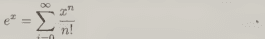

直到第十项：

```cpp
double x = 2.0, xn = 1.0, exp_x = 1.0;
unsigned long fac = 1;
for (unsigned long i = 1; i <= 10; ++i) {
    xn *= x;
    fac *= i;
    exp_x += xn / fac;
    cout << "e^x is " << exp_x << '\n';
}
```

这里单独计算第 0 项并从第 1 项开始循环更简单。我们还使用了小于等于，以确保考虑到项 $x^{10}/10!$。

C++ 中的 for 循环非常灵活。初始化部分可以是任何表达式、变量声明或为空。可以引入同类型的多个新变量。这可以用来避免在条件中重复相同的操作，例如：

```cpp
for (int i = xyz.begin(), end = xyz.end(); i < end; ++i) ...
```

在初始化中声明的变量仅在循环内可见，并会隐藏循环外同名的变量。

条件可以是任何可转换为 bool 的表达式。空条件始终为真，循环将无限重复。仍然可以在循环体内终止它，我们将在下一节中讨论。我们已经提到，循环索引通常在 for 的第三个子表达式中递增。原则上，我们也可以在循环体内修改它。但是，如果在循环头中完成，程序会清晰得多。另一方面，没有限制说只有一个变量增加 1。我们可以使用逗号运算符（§1.3.5）并按所需的任何方式修改任意多个变量，例如

```cpp
for (int i = 0, j = 0, p = 1; ...; ++i, j += 4, p *= 2) ...
```

这当然比只有一个循环索引更复杂，但仍然比在循环前或循环体内声明/修改索引更易读。

### 1.4.4.3 Range-Based for-Loop

一种非常紧凑的表示法由名为 Range-Based for-Loop 的新特性提供。当我们讨论迭代器概念（§4.1.2）时，我们会告诉你更多关于其背景的信息。

目前，我们将其视为遍历数组或其他容器中所有条目的简洁形式：

```cpp
int primes[] = {2, 3, 5, 7, 11, 13, 17, 19};
for (int i : primes)
    std::cout << i << " ";
```

这将打印数组中的素数，用空格分隔。

### 1.4.4.4 Loop Control

有两条语句可以偏离常规的循环求值：

- break
- continue。

break 完全终止循环，而 continue 仅结束当前迭代并继续下一次迭代，例如：

```cpp
for (....; ....; ....) {
    ...
    if (dx == 0.0) continue;
    x += dx;
    ...
    if (r < eps) break;
    ...
}
```

在上面的示例中，我们假设当 dx == 0.0 时不需要迭代的其余部分。在某些迭代计算中，在迭代过程中（这里当 r < eps 时）可能已经清楚工作已完成。

### 1.4.5 goto

所有分支和循环在内部都通过跳转实现。C++ 提供称为 goto 的显式跳转。然而：

> **建议**
> 不要使用 goto！绝对不要！永远不要！

goto 的适用性在 C++ 中比在 C 中更受限制（例如，我们不能跳过初始化）；它仍然有能力破坏我们程序的结构。

## 1.5 函数

函数是 C++ 程序的重要构建块。我们看到的第一个示例是 hello-world 程序中的 main 函数。我们将在 1.5.5 节中多谈谈 main。

C++ 函数的一般形式是

```cpp
[inline] return_type function_name (argument_list)
{
    body of the function
}
```

在本节中，我们将更详细地讨论这些组件。

### 1.5.1 参数

C++ 区分两种参数传递形式：按值传递和按引用传递。

#### 1.5.1.1 Call by Value

当我们将参数传递给函数时，默认情况下会创建一个副本。例如，以下函数递增 x 但对外部不可见：

```cpp
void increment(int x)
{
    x++;
}

int main()
{
    int i = 4;
    increment(i);    // Does not increment i
    cout << "i is " << i << '\n';
}
```

输出是 4。increment 函数中的操作 x++ 仅递增 i 的局部副本，而不递增 i 本身。这种参数传递方式称为 Call-by-Value 或 Pass-by-Value。

#### 1.5.1.2 Call by Reference

要修改函数参数，我们必须按引用传递参数：

```cpp
void increment(int& x)
{
    x++;
}
```

现在，变量本身被递增，输出将如预期为 5。我们将在 §1.8.4 中更详细地讨论引用。

临时变量——例如操作的结果——不能按引用传递：

```cpp
increment(i + 9); // Error: temporary not referable
```

因为我们无法以任何方式计算 (i + 9)+。为了用某个临时值调用此类函数，我们需要先将其存储在变量中，然后将该变量传递给函数。

较大的数据结构（如向量和矩阵）几乎总是按引用传递，以避免昂贵的拷贝操作：

```cpp
double two_norm(vector& v) { ... }
```

像范数这样的操作不应更改其参数。但是按引用传递向量存在意外覆盖它的风险。为了确保我们的向量不会被更改（也不会被拷贝），我们将其作为常量引用传递：

```cpp
double two_norm(const vector& v) { ... }
```

如果我们尝试在此函数中更改 v，编译器将发出错误。

按值传递和常量引用都确保参数不会被更改，但方式不同：

- 按值传递的参数可以在函数中更改，因为函数使用的是副本。⁶
- 使用常量引用时，我们直接对传递的参数进行操作，但所有可能更改参数的操作都被禁止。特别是，常量引用参数不能出现在赋值表达式的左侧（LHS），也不能作为非常量引用传递给其他函数（实际上，赋值表达式的左侧也是一个非常量引用）。

与可变⁷引用相比，常量引用允许传递临时变量：

```cpp
alpha = two_norm(v + w);
```

诚然，这在语言设计方面并不完全一致，但它大大简化了程序员的工作。

#### 1.5.1.3 默认值

如果参数通常具有相同的值，我们可以为其声明默认值。假设我们实现一个计算 n 次根的函数，大多数情况下是平方根，那么可以写

```cpp
double root(double x, int degree = 2) { ... }
```


此函数可以使用一个或两个参数调用：

```
x = root(3.5, 3); // like root(7.0, 2)
y = root(7.0);
```

我们可以声明多个默认值，但只能放在参数列表的末尾。换句话说，在带有默认值的参数之后，不能再有没有默认值的参数。

默认值在添加额外参数时也很有帮助。假设我们有一个绘制圆形的函数：

```
draw_circle(int x, int y, float radius);
```

这些圆形都是黑色的。后来，我们添加了颜色：

```
draw_circle(int x, int y, float radius, color c = black);
```

多亏了默认参数，我们不需要重构应用程序，因为带有三个参数的 draw_circle 调用仍然有效。

### 1.5.2 返回结果

在之前的示例中，我们只返回了 double 或 int。这些是行为良好的返回类型。现在我们将看看两种极端情况：大量数据或没有数据。

#### 1.5.2.1 返回大量数据

计算大型数据结构新值的函数更加困难。关于详细信息，我们将推迟到后面再讲，这里只提及可选方案。好消息是，编译器足够智能，在许多情况下可以省略返回值的拷贝；参见第 2.3.5.3 节。此外，移动语义（第 2.3.5 节）会窃取临时对象的数据，在前述省略不适用时避免拷贝。高级库使用一种称为表达式模板的技术，完全避免返回大型数据结构，并推迟计算，直到知道将结果存储在哪里（第 5.3.2 节）。无论如何，我们都不能返回指向局部函数变量的引用（第 1.8.6 节）。

#### 1.5.2.2 返回空值

从语法上讲，每个函数都必须返回某些东西，即使没有东西可返回。这个困境由名为 void 的 void 类型解决。例如，一个仅打印 x 的函数不需要返回任何东西：

```
void print_x(int x)
{
 std::cout << "The value x is " << x << '\n';
}
```

void 不是真正的类型，而更像是一个占位符，使我们可以省略返回值。我们不能定义 void 对象：

```
void nothing; // Error: no void objects
```

void 函数可以提前终止：

```
void heavy_compute(const vector& x, double eps, vector& y)
{
    for (...) {
        ...
        if (two_norm(y) < eps)
            return;
    }
}
```

使用无参数的 return。

### 1.5.3 内联

调用函数代价相对较高：必须保存寄存器，将参数拷贝到栈上，等等。为了避免这种开销，编译器可以内联函数调用。在这种情况下，函数调用会被函数中包含的操作所替换。程序员可以使用适当的关键字要求编译器这样做：

```
inline double square(double x) { return x*x; }
```

然而，如果没有关键字，编译器并不有义务内联函数，即使这看起来对性能有好处。内联声明仍然有用：用于在多个编译单元中包含函数，我们将在第 7.2.3.2 节讨论。

### 1.5.4 重载

在 C++ 中，只要参数声明足够不同，函数就可以共享相同的名称。这称为函数重载。让我们先看一个示例：

```
#include <iostream>
#include <cmath>

int divide(int a, int b) {
    return a / b;
}

float divide(float a, float b) {
    return std::floor(a / b);
}

int main() {
    int x = 5, y = 2;
    float m = 5.0, n = 2.0;
    std::cout << divide(x, y) << std::endl;
    std::cout << divide(n, m) << std::endl;
    std::cout << divide(x, m) << std::endl; // Error: ambiguous
}
```

这里我们定义了两次 divide 函数：分别使用 int 和 double 参数。当我们调用 divide 时，编译器执行重载决议：

- 1. 是否存在与参数类型完全匹配的重载？如果有，使用它；否则：
- 2. 是否存在经过转换后匹配的重载？有多少个？
  - 0：错误：未找到匹配的函数。
  - 1：使用它。
  - > 1：错误：调用存在歧义。

这如何应用于我们的示例？调用 divide(x, y) 和 divide(n, n) 是精确匹配。对于 divide(x, n)，没有重载完全匹配，两者都通过隐式转换匹配，因此存在歧义。

“隐式转换”这一术语需要一些解释。我们已经看到，数值类型可以相互转换。这些就是示例中演示的隐式转换。当我们稍后定义自己的类型时，可以实现从另一种类型到它的转换，或者反过来从我们的新类型到现有类型的转换。这些转换可以声明为 explicit，并且仅在明确请求转换时应用，而不用于匹配函数参数。

=> c++11/overload_testing.cpp

更正式地说，函数重载必须在其签名上有所不同。在 C++ 中，签名由以下部分组成：

- 函数名称；
- 参数的数量，称为 Arity；以及
- 参数的类型（按各自顺序）。

相比之下，仅在返回类型或参数名称上有所不同的重载具有相同的签名，被视为（禁止的）重新定义：

```
void f(int x) {}
void f(int y) {} // Redefinition: only argument name different
long f(int x) {} // Redefinition: only return type different
```

名称或 arity 不同的函数是不同的，这不言而喻。引用符号的存在将参数类型变为另一种参数类型（因此，f(int) 和 f(int&) 可以共存）。以下三个重载具有不同的签名：

```
void f(int x) {}
void f(int& x) {}
void f(const int& x) {}
```

这段代码片段可以编译。然而，当我们调用 f 时，会出现问题：

```
int i = 3;
const int ci = 4;

f(3);
f(i);
f(ci);
```

所有三个函数调用都存在歧义，因为在每种情况下，最佳匹配都是第一个带值参数的重载和其中一个带引用参数的重载。混合引用参数和值参数的重载几乎总会失败。因此，当一个重载具有引用限定参数时，另一个重载的相应参数也应该是引用限定的。我们可以在玩具示例中通过省略带值参数的重载来实现这一点。然后 f(3) 和 f(ci) 将解析为带常量引用的重载，而 f(i) 将解析为带可变引用的重载。

### 1.5.5 main 函数

main 函数与其他任何函数在本质上没有区别。标准中允许两种签名：

```
int main()

或

int main(int argc, char* argv[])
```

后者等价于

```
int main(int argc, char** argv)
```

参数 argv 包含参数列表，argc 是其长度。在大多数系统上，第一个参数（argv[0]）是被调用的可执行文件的名称（可能与源代码文件名不同）。为了操作参数，我们可以编写一个名为 argc_argv_test 的短程序：

```
int main (int argc, char* argv[])
{
    for (int i = 0; i < argc; ++i)
        cout << argv[i] << '\n';
    return 0;
}
```

使用以下选项调用此程序：

```
argc_argv_test first second third fourth
```

产生：

```
argc_argv_test
first
second
third
fourth
```

如您所见，命令中的每个空格都会分隔参数。`main` 函数返回一个整数作为退出代码，指示程序是否正确结束。返回 0（或来自 `<cstdlib>` 的宏 `EXIT_SUCCESS`）表示成功，其他任何值表示失败。在 `main` 函数中省略 return 语句是符合标准的。在这种情况下，`return 0;` 会自动插入。更多详细信息见第 A.2.5 节。

## 1.6 错误处理

> "只有在你拒绝纠正错误时，错误才成为过失。"
> —约翰·F·肯尼迪

### 1.6.1 断言

头文件 `<cassert>` 中的宏 `assert` 继承自 C 语言，但仍然很有用。它对表达式求值，当结果为假时，程序会立即终止。它应当用于检测编程错误。假设我们实现了一个酷炫算法来计算非负实数的平方根。那么根据数学知识，结果应该是非负的。否则，我们的计算就出了问题：

```
#include <cassert>

double square_root(double x)
{
    check_somehow(x >= 0);
    ...
    assert(result >= 0.0);
    return result;
}
```

目前尚未说明如何实现初始检查。当我们的结果为负数时，程序执行会打印类似以下的错误：

```
assert_test: assert_test.cpp:10: double square_root(double):
Assertion 'result >= 0.0' failed.
```

事实是，当我们的结果小于零时，我们的实现包含一个错误，在将此函数用于严肃应用之前必须修复它。

修复错误后，我们可能会想移除断言。我们不应该这样做。也许有一天我们会更改实现；那时我们仍然有所有的健全性测试在起作用。实际上，对后置条件的断言在某种程度上就像微型单元测试。


assert 的一个巨大优势是，我们可以通过一个简单的宏声明让它完全消失。在包含 <cassert> 之前，我们可以定义 NDEBUG：

```
#define NDEBUG
#include <cassert>
```

这样所有断言都被禁用；也就是说，它们在可执行文件中不会引起任何操作。与其在每次在调试模式和发布模式之间切换时修改程序源代码，不如在编译器标志中声明 NDEBUG（通常在 Linux 上为 -D，在 Windows 上为 /D），这样更好、更整洁：

```
g++ my_app.cpp -o my_app -O3 -DNDEBUG
```

如果在发布模式下未禁用断言，关键内核中带有断言的软件可能会慢两倍或更多。像 CMake 这样的优秀构建系统会在发布模式的编译标志中自动包含 -DNDEBUG。

由于断言可以如此轻松地禁用，我们应该遵循以下建议：

### 防御性编程

- 尽可能测试多个属性。

即使你确定某个属性显然对你的实现成立，也要编写一个断言。有时系统的行为并不完全如我们所假设，或者编译器可能有 bug（极少见但可能），或者我们做了一些与最初意图略有不同的事情。无论我们推理得多么充分，实现得多么仔细，迟早可能会触发一个断言。如果属性太多以至于实际功能被测试弄得杂乱无章，可以将测试外包到另一个函数中。

负责任的程序员会实现大量的测试。尽管如此，这并不能保证程序在所有情况下都能正常工作。一个应用程序可能运行多年一帆风顺，但有一天它会崩溃。在这种情况下，我们可以在启用所有断言的调试模式下运行应用程序，在大多数情况下，这将大大有助于找到崩溃的原因。然而，这要求崩溃情况是可重现的，并且在较慢的调试模式下，程序能在合理的时间内到达关键部分。

### 1.6.2 异常

在前一节中，我们了解了断言如何帮助我们检测编程错误。然而，即使是最聪明的编程也无法防止许多关键情况，例如我们需要读取但已被删除的文件。或者我们的程序需要的内存比实际机器上可用的内存更多。其他问题在理论上是可以预防的，但实际工作量不成比例地高，例如，检查矩阵是否正则是可行的，但可能需要与实际任务一样多或更多的工作。在这种情况下，通常更高效的做法是尝试完成任务，并在过程中检查异常。

#### 1.6.2.1 动机

在展示旧式错误处理之前，我们要介绍我们的反英雄 Herbert⁸，他是一位天才数学家，认为编程是展示其算法多么出色的必要恶。他像个真正的男人一样学习编程，对现代编程那些花哨的胡说八道免疫。

他处理计算问题的最爱方法是返回一个错误代码（就像 `main` 函数所做的那样）。假设我们想从文件中读取一个矩阵并检查文件是否确实存在。如果不存在，我们返回错误代码 1：

```
int read_matrix_file(const char* fname, ...)
{
    fstream f(fname);
    if (!f.is_open())
        return 1;
    ...
    return 0;
}
```

因此，我们检查了所有可能出错的情况，并用相应的错误代码通知调用者。当调用者评估了错误并做出适当反应时，这没问题。但如果调用者只是忽略了我们的返回代码，会发生什么呢？什么都不会发生！程序继续运行，以后可能会因荒谬的数据而崩溃，或者更糟的是产生荒谬的结果，粗心的人可能会用这些结果来制造汽车或飞机。当然，制造汽车和飞机的人不会那么粗心，但在更现实的软件中，即使是小心的人也无法关注每一个细微的细节。

尽管如此，向像 Herbert 这样的编程恐龙阐明这一点可能也说服不了他们：“你不仅愚蠢到向我完美实现的函数传入一个不存在的文件，而且甚至不检查返回代码。你做错了所有事情，不是我。”

错误代码的另一个缺点是，我们无法返回计算结果，而必须将其作为引用参数传递。这阻止了我们使用结果构建表达式。另一种方法是返回结果，并将错误代码作为（引用）函数参数传递，这也不怎么不麻烦。

#### 1.6.2.2 抛出

更好的方法是抛出一个异常：

```
matrix read_matrix_file(const char* fname, ...) {
    fstream f(fname);
    if (!f.is_open()) 
        throw "Cannot open file.";
... 
}
```

在这个版本中，我们抛出一个异常。调用应用程序现在有义务对此做出反应——否则程序会崩溃。

异常处理相对于错误代码的优势在于，我们只需要处理我们能够处理的问题。例如，在调用 read_matrix_file 的函数中，可能无法处理不存在的文件。在这种情况下，代码的实现就好像没有抛出异常一样。因此，我们不需要用返回错误代码来使程序变得晦涩难懂。在发生异常的情况下，它会被向上传递到适当的异常处理中。在我们的场景中，这种处理可能包含在 GUI 中，GUI 会向用户请求一个新文件。因此，异常同时带来了更易读的源代码和更可靠的错误处理。

C++ 允许我们将任何东西作为异常抛出：字符串、数字、用户定义类型等等。然而，为了妥善处理异常，最好定义异常类型或使用标准库中的异常类型：

```
struct cannot_open_file {};

void read_matrix_file(const char* fname, ...)
{
    fstream f(fname);
    if (!f.is_open())
        throw cannot_open_file{};
    ...
}
```

在这里，我们引入了自己的异常类型。在第 2 章中，我们将详细解释如何定义类。在上面的示例中，我们定义了一个空类，只需要一对开闭括号后跟一个分号。较大的项目通常会建立一整套异常类型层次结构，这些类型通常派生自（第 6 章）std::exception。

#### 1.6.2.3 捕获

为了响应异常，我们必须捕获它。这是在 try-catch 块中完成的：

```
try {
    ...
} catch (e1_type& e1) {
    ...
} catch (e2_type& e2) { ... }
```

无论在哪里，只要我们预期会出现可以解决（或至少可以采取一些措施）的问题，我们就打开一个 try 块。在右花括号之后，我们可以捕获异常，并根据异常的类型以及可能的值来启动救援。建议按引用捕获异常 [45, Topic 73]，尤其是当涉及多态类型（§6.1.3 中的定义 6-1）时。当抛出异常时，会执行第一个匹配类型的 catch 块。同一类型（或子类型；§6.11.1）的进一步 catch 块会被忽略。带有省略号（即三个点）的 catch 块会捕获所有异常：。

```
try {
 ...
} catch (ei_type& e1) { ... }
catch (e2_type& e2) { ... }
catch (...) { // deal with all other exceptions
}
```

显然，捕获所有异常的处理程序应该是最后一个。.

如果别无他法，我们可以捕获异常，在终止程序之前提供一条信息性错误消息：

```
try {
 A = read_matrix_file("does_not_exist.dat");
} catch (cannot_open_file& e) {
 cerr << "Hey guys, your file does not exist! I'm out.\n";
 exit(EXIT_FAILURE);
}
```

一旦异常被捕获，问题就被视为已解决，执行将在 catch 块之后继续。要终止执行，我们使用了头文件 <cstdlib> 中的 exit 函数。exit 函数即使不在 main 函数中也会结束执行。只有在进一步执行太危险，并且没有希望调用函数能对异常有任何补救措施时，才应该使用它。

或者，我们可以在抱怨或部分救援操作后继续，通过重新抛出异常，该异常可能稍后会被处理：

```
try {
 A = read_matrix_file("does_not_exist.dat");
} catch (cannot_open_file& e) {
 cerr << "O my gosh, the file is not there! Please caller help me.\n";
 throw e;
}
```

在我们的例子中，我们已经在 main 函数中，调用栈上没有其他东西可以捕获我们的异常。要重新抛出当前异常，存在一种更简短的写法：

```
} catch (cannot_open_file&) {
 ...
 throw;
}
```

这种简写更受青睐，因为它不易出错，并且更清楚地表明我们正在重新抛出原始异常。忽略异常可以通过一个空块轻松实现：

```
} catch (cannot_open_file&) {} // File is rubbish, keep going
```

到目前为止，我们的异常处理并没有真正解决文件缺失的问题。如果文件名由用户提供，我们可以纠缠他/她，直到得到一个让我们满意的文件名：

```
bool keep_trying= true;
do {
```


```cpp
char fname[80]; // std::string is better
cout << "Please enter the file name: ";
cin >> fname;
try {
    A = read_matrix_file(fname);
    ...
    keep_trying = false;
} catch (cannot_open_file& e) {
    cout << "Could not open the file. Try another one!\n";
} catch (...) {
    cout << "Something is fishy here. Try another file!\n";
}
} while (keep_trying);
```

当我们到达 try 块的末尾时，我们知道没有抛出异常，可以收工了。否则，我们会进入某个 catch 块，且 keep_trying 保持为 true。

异常的一个巨大优势是，在检测到问题的上下文中无法处理的问题可以推迟到以后处理。作者实践中的一个例子涉及 LU 分解。对于奇异矩阵，无法计算 LU 分解。对此我们无能为力。然而，如果分解是迭代计算的一部分，我们仍然能够在没有该分解的情况下以某种方式继续迭代。虽然使用传统的错误处理也能实现这一点，但异常让我们能以更易读、更优雅的方式实现它。我们可以针对常规情况编写分解代码，并在检测到奇异性时抛出异常。然后，由调用者决定如何在各自的上下文中处理奇异性——如果可能的话。

#### 1.6.2.4 谁抛出？

C++11

C++03 已经允许指定函数可以抛出哪些类型的异常。不深入细节，这些规范证明并不十分有用，现已弃用。

C++11 添加了一种新的限定符，用于指定函数不得抛出任何异常，例如：

```cpp
double square_root(double x) noexcept { ... }
```

此限定符的好处是，调用代码在 square_root 之后永远不需要检查抛出的异常。如果尽管有此限定符仍抛出异常，程序将被终止。

在模板函数中，是否抛出异常可能取决于参数类型。为妥善处理此情况，noexcept 可以取决于编译时条件；参见第 5.2.2 节。

断言还是异常更可取并非易事，我们对此也没有简短的答案。这个问题现在可能不会困扰你。因此，我们将讨论推迟到第 A.2.6 节，留待你阅读时自行判断。

### 1.6.3 静态断言

在编译期间就能检测到的程序错误可以引发 `static_assert`。在这种情况下，会发出错误消息并停止编译。此时举例并无意义，我们将其推迟到第 5.2.5 节。

## 1.7 输入/输出

C++ 使用一种名为流的便捷抽象来在屏幕或键盘等顺序媒体上执行 I/O 操作。流是一个对象，程序可以向其中插入字符或从中提取字符。标准 C++ 库包含头文件 `<iostream>`，其中声明了标准输入和输出流对象。

### 1.7.1 标准输出

默认情况下，程序的标准输出写入屏幕，我们可以通过名为 `cout` 的 C++ 流访问它。它与插入运算符一起使用，该运算符用 `<<` 表示（类似于左移）。我们已经看到，它可以在单个语句中使用多次。当我们想要打印文本、变量和常量的组合时，这尤其有用，例如：

```cpp
cout << "The square root of " << x << " is " << sqrt(x) << endl;
```

输出如下：

The square root of 5 is 2.23607

`endl` 会产生一个换行符。`endl` 的另一种表示形式是字符 `\n`。出于效率考虑，输出可能会被缓冲。在这方面，`endl` 和 `\n` 有所不同：前者会刷新缓冲区，而后者不会。在调试（不使用调试器）时，刷新可以帮助我们找出程序在哪些操作之间崩溃。相比之下，当将大量文本写入文件时，每行都刷新会显著减慢 I/O 速度。

幸运的是，插入运算符的优先级相对较低，因此可以直接编写算术运算：

```cpp
std::cout << "11 * 19 = " << 11 * 19 << std::endl;
```

所有比较运算以及逻辑和按位运算都必须用括号括起来。条件运算符也是如此：

```cpp
std::cout << (age > 65 ? "I'm a wise guy\n" : "I am still half-baked.\n");
```

如果我们忘记加括号，编译器会提醒我们（会给出一条晦涩难懂的消息供我们解读）。

### 1.7.2 标准输入

标准输入设备通常是键盘。在 C++ 中，处理标准输入是通过在 `cin` 流上应用重载的提取运算符 `>>` 来完成的：

```cpp
int age;
std::cin >> age;
```

std::cin 从输入设备读取字符，并将其解释为要存储到的变量类型（此处为 int）的值（此处为 age）。键盘输入在按下回车键后进行处理。

我们还可以使用 cin 向用户请求多个数据输入：

```cpp
std::cin >> width >> length;
```

这等价于

```cpp
std::cin >> width;
std::cin >> length;
```

在这两种情况下，用户都必须提供两个值：一个用于 width，另一个用于 length。它们可以由任何有效的空白分隔符分隔：空格、制表符或换行符。

### 1.7.3 文件输入/输出

C++ 提供了以下类来执行从/到文件的字符输入和输出：

| 类 | 说明 |
| :--- | :--- |
| ofstream | 写入文件 |
| ifstream | 从文件读取 |
| fstream | 从/到文件同时读取和写入 |

我们可以像使用 `cin` 和 `cout` 一样使用文件流，唯一的区别是必须将这些流与物理文件关联。下面是一个示例：

```cpp
#include <fstream>

int main ()
{
  std::ofstream square_file;
  square_file.open("squares.txt");
  for (int i = 0; i < 10; ++i)
    square_file << i << " - " << i*i << std::endl;
  square_file.close();
}
```

这段代码创建一个名为 squares.txt 的文件（如果已存在则覆盖），并向其中写入一行文字——就像向 cout 写入一样。C++ 建立了一个通用的流概念，输出文件和 std::cout 都满足该概念。这意味着我们可以向文件写入所有可以向 std::cout 写入的内容，反之亦然。当我们为新类型定义 operator<< 时，我们只需为 ostream（第 2.7.3 节）定义一次，它就可以与控制台、文件以及任何其他输出流一起工作。

或者，我们可以将文件名作为参数传递给流的构造函数以隐式打开文件。当 square_file 超出作用域时，文件也会被隐式关闭，在此例中是在 main 函数结束时。前面程序的简短版本是

```cpp
#include <fstream>

int main ()
{
    std::ofstream square_file("squares.txt");
    for (int i = 0; i < 10; ++i)
        square_file << i << " ^ 2 = " << i*i << std::endl;
}
```

我们偏好简短形式（一如既往）。只有在文件先声明后因某种原因稍后打开时，才需要显式形式。同样，只有在文件需要在超出作用域之前关闭时，才需要显式 close。

### 1.7.4 通用流概念

流不仅限于屏幕、键盘和文件；每个类都可以用作流，只要它从 istream、ostream 或 iostream 派生并为这些类的函数提供实现。例如，Boost.Asio 为 TCP/IP 提供流，Boost.IOStream 是上述 I/O 的替代方案。标准库包含一个 stringstream，可用于从任何可打印类型创建字符串。stringstream 的 str() 方法返回流的内部字符串。

我们可以编写接受每种输出流的输出函数，方法是使用可变的 ostream 引用作为参数：

```cpp
#include <iostream>
#include <fstream>
#include <sstream>

void write_something(std::ostream& os)
{
    os << "Hi stream, did you know that 3 * 3 = " << 3 * 3 << std::endl;
}

int main (int argc, char* argv[])
{
    std::ofstream myfile("example.txt");
    std::stringstream mystream;

    write_something(std::cout);
    write_something(myfile);
}
```


write_something(mystream);
std::cout << "mystream is: " << mystream.str(); // newline contained
}
```

Likewise, generic input can be implemented with istream and read/write I/O with iostream.

### 1.7.5 格式化

```
=> c++03/formatting.cpp
```

I/O 流由所谓的 I/O 操纵符进行格式化，它们位于头文件 <iomanip> 中。默认情况下，C++ 只打印浮点数的几位数字。因此，我们提高精度：

```
double pi = M_PI;
cout << "pi is " << pi << '\n';
cout << "pi is " << setprecision(16) << pi << '\n';
```

并得到一个更精确的数字：

```
pi is 3.14159
pi is 3.141592653589793
```

在第 4.3.1 节中，我们将展示如何将精度调整为类型可表示的位数。

当我们编写表格、向量或矩阵时，需要对齐值以提高可读性。因此，我们接下来设置输出宽度：

```
cout << "pi is " << setw(30) << pi << '\n';
```

结果如下

```
pi is         3.141592653589793
```

setw 仅更改下一次输出，而 setprecision 会影响所有后续（数值）输出，与其他操纵符一样。提供的宽度被理解为最小值，如果打印的值需要更多空间，我们的表格就会变得难看。

我们还可以要求值左对齐，并用我们选择的字符（例如 -）填充空白空间：

```
cout << "pi is " << setfill('-') << left
     << setw(30) << pi << '\n';
```

得到

```
pi is 3.141592653589793--------------
```

另一种格式化方式是直接设置标志。一些不常用的格式选项只能通过这种方式设置，例如，是否也为正值显示符号。此外，我们在归一化指数表示中强制使用“科学”计数法：

```
cout.setf(ios_base::showpos);
cout << "pi is " << scientific << pi << '\n';
```

结果为

```
pi is +3.1415926535897931e+08
```

整数可以通过以下方式表示为八进制和十六进制：

```
cout << "63 octal is " << oct << 63 << "\n";
cout << "63 hexadecimal is " << hex << 63 << "\n";
cout << "63 decimal is " << dec << 63 << "\n";
```

预期输出如下：

```
63 octal is 77
63 hexadecimal is 3f
63 decimal is 63
```

布尔值默认打印为整数 0 和 1。按需，我们可以将其呈现为 true 和 false：

```
cout << "pi < 3 is " << (pi < 3) << "\n";
cout << "pi < 3 is " << boolalpha << (pi < 3) << "\n";
```

最后，我们可以重置所有更改的格式选项：

```
int old_precision= cout.precision();
cout << setprecision(16)
...
cout.unsetf(ios_base::adjustfield | ios_base::basefield
| ios_base::floatfield | ios_base::showpos | ios_base::boolalpha);
cout.precision(old_precision);
```

每个选项由状态变量中的一位表示。要启用多个选项，我们可以使用二进制 OR 组合它们的位模式。

### 1.7.6 处理 I/O 错误

首先要明确一点：C++ 中的 I/O 并非失败安全（更不用说傻瓜安全了）。错误可以以不同方式报告，我们的错误处理必须符合这些方式。让我们尝试以下示例程序：

```
int main ()
{
    std::ifstream infile("some_missing_file.xyz");
    int i;
    double d;
    infile >> i >> d;
    std::cout << "i is " << i << ", d is " << d << "\n";
    infile.close();
}
```

尽管文件不存在，打开操作并未失败。我们甚至可以从不存在的文件中读取，程序会继续运行。不用说，i 和 d 中的值都是无意义的：

```
i is i, d is 2.3452e-310
```

默认情况下，流不会抛出异常。原因是历史性的：它们比异常更早出现，后来为了不破坏期间编写的软件，保留了该行为。

为了确保一切顺利，原则上需要在每次 I/O 操作后检查错误标志。以下程序会向用户询问新文件名，直到能够打开文件为止。读取其内容后，我们再次检查是否成功：

```
int main ()
{
    std::ifstream infile;
    std::string filename("some_missing_file.xyz");
    bool opened = false;
    while (!opened) {
        infile.open(filename);
        if (infile.good()) {
            opened = true;
        } else {
            std::cout << "The file " << filename
                      << " doesn't exist, give a new file name: ";
            std::cin >> filename;
        }
    }
    int i;
    double d;
    infile >> i >> d;
    if (infile.good())
        std::cout << "i is " << i << ", d is " << d << '\n';
    else
        std::cout << "Could not correctly read the content.\n";
    infile.close();
}
```

从这个简单示例可以看出，使用文件 I/O 编写健壮的应用程序需要一些工作。

如果我们想使用异常，需要在运行时为每个流启用它们：

```
cin.exceptions(ios_base::badbit | ios_base::failbit);
cout.exceptions(ios_base::badbit | ios_base::failbit);

std::ifstream infile("f.txt");
infile.exceptions(ios_base::badbit | ios_base::failbit);
```

每当操作失败或流处于“坏”状态时，流都会抛出异常。在（意外的）文件末尾也可能抛出异常。然而，文件末尾更方便地通过测试来处理（例如，while (!eof())）。

在上面的示例中，infile 的异常仅在打开文件（或尝试打开）后启用。为了检查打开操作，我们需要先创建流，然后打开异常，最后显式打开文件。启用异常至少能保证，当程序正常终止时，所有 I/O 操作都已成功。我们可以通过捕获可能抛出的异常来使程序更加健壮。

文件 I/O 中的异常只能部分保护我们免于出错。例如，以下小程序显然是错误的（类型不匹配且数字未分隔）：

```
void with_io_exceptions(ios& io)
{
    io.exceptions(ios_base::badbit | ios_base::failbit); }

int main ()
{
    std::ofstream outfile;
    with_io_exceptions(outfile);
    outfile.open("f.txt");

    double o1 = 5.2, o2 = 6.2;
    outfile << o1 << o2 << std::endl; // no separation
    outfile.close();

    std::ifstream infile;
    with_io_exceptions(infile);
    infile.open("f.txt");

    int i1, i2;
    char c;
    infile >> i1 >> c >> i2; // mismatching types
    std::cout << "i1 = " << i1 << ", i2 = " << i2 << "\n";
}
```

尽管如此，它并未抛出异常，而是生成了以下输出：

```
i1 = 5, i2 = 26
```

众所周知，测试不能证明程序的正确性。当涉及 I/O 时，这一点更加明显。流输入读取传入字符，并将其作为适当变量类型的值传递，例如，在设置 i1 时为 int。它在第一个不能作为值一部分的字符处停止，首先是 int 值 i1 的小数点。如果之后再读取一个 int，将会失败，因为空字符串无法解释为 int 值。但我们并非如此；相反，我们读取一个 char，小数点被赋给它。在解析 i2 的输入时，我们首先找到 o1 的小数部分，然后是 o2 的整数部分，才遇到一个不能属于 int 值的字符。

不幸的是，并非每一种语法规则的违反在实践中都会导致异常：3 解析为 int 会得到零（而下一次输入可能会失败）：-5 解析为 unsigned 会得到 4294967291（当 unsigned 为 32 位时）。缩小原则显然尚未进入 I/O 流（如果出于向后兼容性考虑，也许永远也不会）。

无论如何，应用程序的 I/O 部分需要格外关注。数字必须正确分隔（例如，用空格），并以写入时相同的类型读取。当输出包含分支导致文件格式可能变化时，输入代码会复杂得多，甚至可能存在歧义。


## 1.8 数组、指针和引用

### 1.8.1 数组

C++ 内置的数组支持存在某些限制和一些奇怪的行为。尽管如此，我们认为每个 C++ 程序员都应该了解它并意识到其问题。

数组的声明如下：

```cpp
int x[10];
```

变量 x 是一个包含 10 个 int 元素的数组。在标准 C++ 中，数组的大小必须是常量且在编译时已知。某些编译器（例如 gcc）支持运行时大小。

数组通过方括号访问：x[i] 是对 x 的第 i 个元素的引用。第一个元素是 x[0]；最后一个是 x[9]。数组可以在定义时初始化：

```cpp
float v[] = {1.0, 2.0, 3.0}, w[] = {7.0, 8.0, 9.0};
```

在这种情况下，数组大小会被推断。

C++11 中的列表初始化不能再进行缩小转换。这在实践中很少会产生影响。例如，以下内容：

C++11

```cpp
int v[] = {1.0, 2.0, 3.0}; // Error in C++11: narrowing
```

在 C++03 中是合法的，但在 C++11 中不合法，因为从浮点字面量转换为 int 可能会丢失精度。不过，我们无论如何都不会写这种丑陋的代码。

对数组的操作通常在循环中执行；例如，要将 x = v - 3w 作为向量操作来计算，可通过以下方式实现：

```cpp
float x[3];
for (int i = 0; i < 3; ++i)
    x[i] = v[i] - 3.0 * w[i];
```

我们也可以定义多维数组：

```cpp
float A[7][9]; // a 7 by 9 matrix
int q[3][2][3]; // a 3 by 2 by 3 array
```

该语言不为数组提供线性代数运算。基于数组的实现不够优雅且容易出错。例如，一个向量加法函数看起来会像这样：

```cpp
void vector_add(unsigned size, const double v1[], const double v2[],
                double s[])
{
    for (unsigned i = 0; i < size; ++i)
        s[i] = v1[i] + v2[i];
}
```

请注意，我们将数组大小作为第一个函数参数传递，而数组参数不包含大小信息。11 在这种情况下，函数的调用者负责传递正确的数组大小：

```cpp
int main ()
{
    double x[] = { 2, 3, 4 }, y[] = { 4, 2, 0 }, sum[3];
    vector_add(3, x, y, sum);
    ...
}
```

由于数组大小在编译期间已知，我们可以通过将数组的字节大小除以单个元素的字节大小来计算它：

```cpp
vector_add(sizeof x / sizeof x[0], x, y, sum);
```

使用这种老式接口，我们也无法测试我们的数组是否大小匹配。遗憾的是，至今仍有 C 和 Fortran 库使用此类接口，其中大小信息作为函数参数传递。它们在用户稍有失误时就会崩溃，并且追溯崩溃原因可能需要耗费巨大的精力。出于这个原因，我们将在本书中展示如何实现我们自己的数学软件，使其更易于使用且不易出错。希望未来的 C++ 标准会包含更多数学功能，尤其是线性代数库。

数组有以下两个缺点：

- 在访问数组之前不会检查索引，我们可能会越界，导致程序因段错误/违规而崩溃。这甚至不是最坏的情况；至少我们能看出有问题。错误的访问还可能搞乱我们的数据；程序继续运行并产生完全错误的结果，后果不堪设想。我们甚至可能覆盖程序代码。然后我们的数据会被解释为机器操作，导致任何可能的荒谬结果。

- 数组的大小必须在编译时已知。12 例如，我们有一个存储在文件中的数组，需要将其读回内存：

```cpp
ifstream ifs("some_array.dat");
ifs >> size;
float v[size]; // Error: size not known at compile time
```

这行不通，因为大小需要在编译期间已知。

第一个问题只能通过新的数组类型来解决，第二个问题则通过动态分配来解决。这引出了指针。

11. 传递多维数组时，只有第一个维度可以是开放的，而其他维度必须在编译期间已知。然而，这样的程序很容易变得混乱，而 C++ 中有更好的技术来处理它。

12. 某些编译器支持将运行时值作为数组大小。由于其他编译器不保证这一点，应在可移植软件中避免使用此功能。此功能曾被考虑用于 C++14，但其加入被推迟，因为并非所有细节都已完全澄清。

### 1.8.2 指针

指针是包含内存地址的变量。这个地址可以是另一个变量的地址，我们可以通过地址运算符（例如 &x）获得，也可以是动态分配的内存。

让我们从后者开始，因为我们正在寻找动态大小的数组。

```cpp
int* y= new int[10];
```

这会分配一个包含 10 个 int 的数组。现在大小可以在运行时选择。我们也可以实现上一节中的向量读取示例：

```cpp
ifstream ifs("some_array.dat");
int size;
ifs >> size;
float* v= new float[size];
for (int i= 0; i < size; ++i)
ifs >> v[i];
```

指针与数组有相同的危险：访问越界数据可能导致程序崩溃或静默数据失效。处理动态分配的数组时，程序员有责任存储数组大小。

此外，程序员有责任在不再需要时释放内存。这是通过以下方式完成的：

```cpp
delete[] v;
```

由于数组作为函数参数在内部被视为指针，第 47 页的 vector_add 函数也适用于指针：

```cpp
int main (int argc, char* argv[])
{
double *x= new double[3], *y= new double[3], *sum= new double[3];
for (unsigned i= 0; i < 3; ++i)
x[i] = i*2, y[i]= 4.2*i;
vector_add(x, y, sum);
... }
```

使用指针时，我们不能使用 sizeof 技巧；它只会给出指针本身的字节大小，这当然与元素数量无关。除此之外，指针和数组在大多数情况下可以互换：指针可以作为数组参数传递（如上一节所示），数组也可以作为指针参数传递。它们真正不同的唯一地方是定义：定义大小为 n 的数组会为 n 个元素预留空间，而定义指针仅预留存储地址的空间。

由于我们从数组开始，关于指针的使用，我们先迈出了第二步才迈出第一步。指针的简单用法是分配一个单个数据项：

```cpp
int* ip= new int;
```

释放此内存是通过以下方式完成的：

```cpp
delete ip;
```

请注意分配和释放的对偶性：单对象分配需要单对象释放，数组分配需要数组释放。否则运行时系统会错误地处理释放，并且很可能在此处崩溃。指针也可以引用其他变量：

```cpp
int i = 3;
int* ip2 = &i;
```

运算符 & 获取一个对象并返回其地址。相反的运算符是 *，它获取一个地址并返回一个对象：

```cpp
int j = *ip2;
```

这称为解引用。鉴于运算符优先级和语法规则，符号 * 作为解引用或乘法的含义不会混淆——至少编译器不会混淆。

未初始化的指针包含一个随机值（对应内存中设置的任何位）。使用未初始化的指针可能导致任何类型的错误。要明确表示指针未指向任何东西，我们应将其设置为

```cpp
int* ip3 = nullptr; // >= C++11
int* ip4{}; // ditto
```

或在旧编译器中：

```cpp
int* ip3 = 0; // better not in C++11 and later
int* ip4 = NULL; // ditto
```

地址 0 保证永远不会被应用程序使用，因此以这种方式指示指针为空（未引用任何东西）是安全的。尽管如此，字面量 0 并不明确地传达其意图，并且可能导致函数重载中的歧义。宏 NULL 也好不到哪里去：它只是求值为 0。C++11 引入了 nullptr 作为指针字面量的关键字。它可以与所有指针类型进行赋值或比较。由于它不会与其他类型混淆并且自解释，因此优于其他表示法。使用空花括号列表初始化也会设置一个 nullptr。

指针最大的危险是内存泄漏。例如，我们的数组 y 变得太小，我们想要分配一个新数组：

```cpp
int* y = new int[15];
```

现在我们可以在 y 中使用更多空间。很好。但是我们之前分配的内存发生了什么？它仍然在那里，但我们无法再访问它。我们甚至无法释放它，因为这也需要地址。在程序其余执行期间，这块内存都丢失了。只有在程序结束时，操作系统才能释放它。在我们的示例中，我们只丢失了 40 字节，而我们可能拥有好几千兆字节。但如果这种情况发生在迭代过程中，未使用的内存会不断增长，直到某个时候整个（虚拟）内存被耗尽。

即使浪费的内存对当前应用程序不是关键，当我们编写高质量的科学软件时，内存泄漏是不可接受的。当许多人使用我们的软件时，迟早有人会因此批评我们，并最终劝阻其他人使用我们的软件。幸运的是，有工具可以帮助你查找内存泄漏，如第 B.3 节所示。


指针所演示的问题并非旨在扫兴。我们也并不劝阻使用指针。许多事情只有通过指针才能实现：列表、队列、树、图等等。但指针必须格外小心地使用，以避免上述所有真正严重的问题。

有三种策略可以最大限度地减少与指针相关的错误：

- **使用标准容器：** 我们将在下一节（§1.8.3）中介绍。

- **封装：** 在类中进行动态内存管理。然后我们每个类只需处理一次。13 当对象分配的所有内存在对象销毁时被释放，那么我们分配内存的频率就无关紧要了。如果有 738 个带有动态内存的对象，那么它将被释放 738 次。内存应在对象构造时分配，在对象销毁时释放。这一原则称为 *资源获取即初始化*（RAII）。相比之下，如果我们调用了 738 次 new，部分在循环和分支中，我们可以确定我们调用了恰好 738 次 delete。我们知道有工具可以做到这一点，但这些错误最好是预防而非修复。14 当然，封装的想法并非万无一失，但要把它做对所需的工作远少于在程序中到处撒播（原始）指针。我们将在 2.4.2.1 节中更详细地讨论 RAII。

- **使用智能指针：** 我们将在下一节（§1.8.3）中介绍。

指针有两个用途：

- 指向对象；以及
- 管理动态内存。

所谓 *原始指针* 的问题在于，我们无法知道一个指针是仅仅引用数据，还是在数据不再需要时也负责释放内存。为了在类型级别明确做出这一区分，我们可以使用 *智能指针*。

### 1.8.3 智能指针

C++11 引入了三种新的智能指针类型：`unique_ptr`、`shared_ptr` 和 `weak_ptr`。C++03 中已存在的名为 `auto_ptr` 的智能指针通常被视为通往 `unique_ptr` 道路上一次失败的尝试，因为当时语言尚未准备好。它不应再使用。所有智能指针都定义在头文件 `memory` 中。如果你的平台无法使用 C++11 特性（例如，在嵌入式编程中），Boost 中的智能指针是一个不错的替代品。

C++11

13. 可以安全地假设对象远多于类；否则整个程序设计有问题。
14. 此外，该工具仅显示当前运行没有错误，但使用其他输入时可能不同。

#### 1.8.3.1 独占指针

该指针的名称表明它对所引用数据具有独占所有权。它基本上可以像普通指针一样使用：

```
#include <memory>

int main ()
{
    unique_ptr<double> dp(new double);
    *dp= 7;
    ...
}
```

与原始指针的主要区别在于，当指针过期时内存会自动释放。因此，分配非动态分配的地址是一个错误：

```
double d;
unique_ptr<double> dd(&d); // Error: causes illegal deletion
```

指针 dd 的析构函数将尝试删除 d。

独占指针不能赋值给其他指针类型或隐式转换。为了在原始指针中引用指针的数据，我们可以使用成员函数 get：

```
double * raw_dp = dp.get();
```

它甚至不能赋值给另一个独占指针：

```
unique_ptr<double> dp2(dp); // Error: no copy allowed
dp2= dp; // ditto
```

它只能被移动：

```
unique_ptr<double> dp2(move(dp)), dp3;
dp3= move(dp2);
```

我们将在 2.3.5 节讨论移动语义。现在先说这么多：与复制数据不同，移动会将数据从源传递到目标。在我们的示例中，所引用内存的所有权首先从 dp 传递给 dp2，然后传递给 dp3。之后 dp 和 dp2 都是 nullptr，dp3 的析构函数将释放内存。同样，当从函数返回 unique_ptr 时，内存的所有权也会被传递。在以下示例中，dp3 接管了在 f() 中分配的内存：

```
std::unique_ptr<double> f()
{
    return std::unique_ptr<double>(new double);
}
```

```
int main ()
{
    unique_ptr<double> dp3;
    dp3= f();
}
```

在这种情况下，不需要 move()，因为函数结果是一个临时对象，将被移动（详情见 §2.3.5）。

## 

独占指针针对数组有特殊实现 15。这是为了正确释放内存（使用 `delete[]`）所必需的。此外，该特化提供了类似数组的元素访问：

```
unique_ptr<double[]> da(new double[3]);
for (unsigned i = 0; i < 3; ++i)
da[i] = i*2;
```

作为交换，数组不可用 `operator*`。

`unique_ptr` 的一个重要优点是它相对于原始指针绝对没有额外开销：无论是时间上还是内存上。

**延伸阅读：** 独占指针的一个高级特性是提供我们自己的 `Deleter`；详情请参见 [26, §5.25.5]、[43, §34.3.1] 或在线参考（例如，cppreference.com）。

#### 1.8.3.2 共享指针

正如其名称所示，`shared_ptr` 管理由多方共同使用的内存（每方持有一个指向它的指针）。一旦不再有 `shared_ptr` 引用该数据，内存就会自动释放。这可以大大简化程序，尤其是在处理复杂数据结构时。一个极其重要的应用领域是并发：当所有线程都终止对其访问时，内存会自动释放。

与 `unique_ptr` 相反，`shared_ptr` 可以随意复制，例如：

```
shared_ptr<double> f()
{
    shared_ptr<double> p1(new double);
    shared_ptr<double> p2(new double);
    shared_ptr<double> p3 = p2;
    cout << "p3.use_count() = " << p3.use_count() << endl;
    return p3;
}
```

```
int main ()
{
    shared_ptr<double> p = f();
    cout << "p.use_count() = " << p.use_count() << endl;
}
```

在示例中，我们为两个 `double` 值分配了内存：在 `p1` 和 `p2` 中。指针 `p2` 被复制到 `p3`，因此两者都指向相同的内存，如图 1-1 所示。

我们可以从 `use_count` 的输出中看出这一点：

```
p3.use_count() = 2
p.use_count() = 1
```

当函数返回时，指针被销毁，`p1` 引用的内存被释放（从未被使用过）。第二个分配的内存块仍然存在，因为 `main` 函数中的 `p` 仍在引用它。

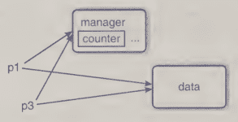

图 1-1：内存中的共享指针

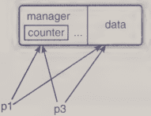

图 1-2：make_shared 之后内存中的共享指针

如果可能，应使用 `make_shared` 创建 `shared_ptr`：

```
shared_ptr<double> p1 = make_shared<double>();
```

然后，管理数据和业务数据将一起存储在内存中——如图 1-2 所示——内存缓存更高效。由于 `make_shared` 返回一个共享指针，为了简单起见，我们可以使用自动类型推断（§3.4.1）：

```
auto p1 = make_shared<double>();
```

我们必须承认，`shared_ptr` 在内存和运行时有一些开销。另一方面，得益于 `shared_ptr` 带来的程序简化，在大多数情况下这点小开销是值得的。

延伸阅读：关于 `shared_ptr` 的删除器和其他细节，请参见库参考 [26, §5.2.2]、[43, §34.4.3.2] 或在线参考。

#### 1.8.3.3 弱指针

共享指针可能出现的一个问题是 *循环引用*，它会阻碍内存释放。这样的循环可以通过 `weak_ptr` 打破。它们不声称拥有内存的所有权，甚至不拥有共享所有权。此时，我们仅为了完整性而提及它们，并建议在确认需要时阅读相关参考资料：[26, §5.2.2]、[43, §34.3.3] 或 cppreference.com。


### 1.8.4 引用

以下代码介绍了一个引用：

```cpp
int i = 5;
int& j = i;
j = 4;
std::cout << "j = " << j << '\n';
```

变量 j 引用 i。改变 j 也会改变 i，反之亦然，如示例所示。i 和 j 将始终具有相同的值。可以将引用视为别名：它为现有对象或子对象引入一个新名称。每当我们定义一个引用时，必须直接声明它引用什么（与指针不同）。之后不可能引用另一个变量。

到目前为止，这听起来似乎并不十分有用。引用对于函数参数（§1.5）、引用其他对象的部分（例如，向量的第七个条目）以及构建视图（例如，§5.2.3）极其有用。

作为指针和引用之间的折中方案，新标准提供了一个 reference_wrapper 类，其行为与引用类似，但避免了一些局限性。例如，它可以在容器中使用；参见 §4.4.2。

### 1.8.5 指针与引用的比较

指针相对于引用的主要优势在于动态内存管理和地址计算能力。另一方面，引用被强制引用现有位置。16 因此，它们不会留下内存泄漏（除非你玩一些非常恶劣的把戏），并且在使用时与被引用对象具有相同的表示法。不幸的是，几乎不可能构建引用的容器。

简而言之，引用并非绝对安全，但比指针少出错得多。指针只应在处理动态内存时使用，例如当我们动态创建列表或树等数据结构时。即便如此，我们也应通过经过充分测试的类型来完成此操作，或尽可能将指针封装在类中。智能指针负责内存分配，即使在类中也应优先于原始指针。指针-引用比较总结在表 1-9 中。

| 特性 | 指针 | 引用 |
|---|---|---|
| 指向定义的位置 | | ✓ |
| 强制初始化 | | ✓ |
| 避免内存泄漏 | | ✓ |
| 对象式表示法 | | ✓ |
| 内存管理 | ✓ | |
| 地址计算 | ✓ | |
| 构建其容器 | ✓ | |

### 1.8.6 不要引用过时数据！

函数局部变量仅在函数作用域内有效，例如：

```cpp
double& square_ref(double d) // DO NOT!
{
    double s = d * d;
    return s;
}
```

这里，我们的函数结果引用了局部变量 s，而该变量已不再存在。存储它的内存仍然存在，我们可能（错误地）庆幸它尚未被覆盖。但这不是我们可以依赖的。实际上，这样的隐藏错误比明显的错误更糟糕，因为它们只在特定条件下破坏我们的程序，然后很难找到。

这样的引用称为过时引用（Stale References）。当我们引用局部变量时，好的编译器会警告我们。遗憾的是，我们在网络教程中见过这样的例子。

指针也是如此：

```cpp
double* square_ptr(double d) // DO NOT!
{
    double s = d * d;
    return &s;
}
```

这个指针持有一个已超出作用域的局部地址。这称为悬空指针（Dangling Pointer）。

在成员函数中引用成员数据时，返回引用或指针可以是正确的；参见第 2.6 节。

> **建议**
> 仅返回指向动态分配数据、函数调用前已存在的数据或静态数据的指针和引用。

### 1.8.7 数组容器

作为传统 C 数组的替代方案，我们想要介绍两种可以以类似方式使用的容器类型。

#### 1.8.7.1 标准向量

数组和指针是 C++ 核心语言的一部分。相比之下，std::vector 属于标准库，并作为类模板实现。尽管如此，它可以非常类似于数组地使用。例如，第 1.8.1 节中设置两个数组 v 和 w 的示例，对于向量如下所示：

```cpp
#include <vector>

int main ()
{
    std::vector<int> v(3), w(3);
    v[0] = 1; v[1] = 2; v[2] = 3;
    w[0] = 7; w[1] = 8; w[2] = 9;
}
```

向量的大小不需要在编译时已知。向量甚至可以在其生命周期中调整大小，如第 4.1.3.1 节所示。

逐元素设置并不十分紧凑。C++11 允许使用初始化列表进行初始化：

```cpp
std::vector<float> v = {1, 2, 3}, w = {7, 8, 9};
```

在这种情况下，向量的大小由列表的长度隐含。之前所示的向量加法可以更可靠地实现：

```cpp
void vector_add(const vector<float>& v1, const vector<float>& v2,
                vector<float>& s)
{
    assert(v1.size() == v2.size());
    assert(v1.size() == s.size());
    for (unsigned i=0; i < v1.size(); ++i)
        s[i] = v1[i] + v2[i];
}
```

与 C 数组和指针不同，向量参数知道它们的大小，我们现在可以检查它们是否匹配。注意：数组大小可以通过模板推导，我们将其留作以后的练习（参见 §3.11.9）。

向量是可复制的，并可以由函数返回。这允许我们使用更自然的表示法：

```cpp
vector<float> add(const vector<float>& v1, const vector<float>& v2)
{
    assert(v1.size() == v2.size());
    vector<float> s(v1.size());
    for (unsigned i=0; i < v1.size(); ++i)
        s[i] = v1[i] + v2[i];
    return s;
}
```

```cpp
int main ()
{
    std::vector<float> v = {1, 2, 3}, w = {7, 8, 9}, s = add(v, w);
}
```

此实现可能比之前将目标向量作为引用传入的实现更昂贵。我们将稍后讨论优化的可能性：无论是编译器端还是用户端。根据我们的经验，首先以高效的接口开始，稍后再处理性能更为重要。使正确的程序运行快，比使快速的程序正确更容易。因此，首先追求良好的程序设计。在几乎所有情况下，有利的接口都可以以足够的性能实现。

容器 std::vector 不是数学意义上的向量。没有算术运算。尽管如此，该容器在科学应用中处理非标量中间结果时证明非常有用。

#### 1.8.7.2 valarray

valarray 是一个一维数组，具有逐元素操作；即使乘法也是逐元素执行的。与标量值的操作分别对 valarray 的每个元素执行。因此，浮点数的 valarray 是一个向量空间。

以下示例演示了一些操作：

```cpp
#include <iostream>
#include <valarray>

int main ()
{
 std::valarray<float> v = {1, 2, 3}, w = {7, 8, 9}, s = v + 2.0f * w;
 v = sin(v);
 for (float x : v)
 std::cout << x << ' ';
 std::cout << '\n';
}
```

请注意，valarray<float> 只能与自身或 float 操作。例如，2 * w 会失败，因为它是 int 与 valarray<float> 之间不支持的乘法。

valarray 的一个优势是能够访问其切片。这使我们能够模拟矩阵和高阶张量及其各自的操作。尽管如此，由于缺乏对大多数线性代数操作的直接支持，valarray 在数值社区中并未广泛使用。我们还建议使用成熟的 C++ 线性代数库。希望未来的标准将包含一个。

为了暂时结束整个数组和内存领域，我们想补充一点：C++11 引入了垃圾回收，我们将在 A.2.9 中进一步讨论——基本上说，我们可以没有它也过得很好。

## 1.9 构建软件项目

大型项目的一个大问题是名称冲突。出于这个原因，我们将讨论宏如何加剧这个问题。另一方面，我们将在后面第 3.2.1 节中展示命名空间如何帮助我们掌握名称冲突。

为了理解 C++ 软件项目中的文件如何交互，有必要了解构建过程，即如何从源代码生成可执行文件。这将


将成为我们第一个小节的主题。在此背景下，我们将介绍宏机制和其他语言特性。

首先，我们想简要讨论一个有助于构建程序的特性：注释。

### 1.9.1 注释

注释的主要目的显然是用通俗的语言描述程序源代码中并非每个人都一目了然的内容，例如：

```
// Transmogrification of the anti-binoxe in O(n log n)
while (cryptographic(trans_thinny) < end_of(whatever)) {
....}
```

通常，注释是对混淆实现的澄清性伪代码：

```
// A = B * C
for ( ... ) {
    int x87zy97= yo6954fq, y89haf= q6843, ...
    for ( x789yt = { ... } {
    y89haf+= { ab6899(fa69f) + omygosh(fdab); ...
    for ( ... ) {
    A(dyoa929, oa9978)+= ...
```

在这种情况下，我们应该问自己是否可以重构软件，使得这种晦涩的实现仅在库的某个角落中出现一次，而在其他地方我们编写清晰简单的语句，例如

```
A= B * C ;
```

作为程序而非伪代码。这是本书的主要目标之一：向你展示如何编写你想要的表达式，而底层实现则榨取最大性能。

注释的另一种常见用途是暂时让代码片段消失，以便尝试替代实现，例如：

```
for ( ... ) {
    // int x87zy97= yo6954fq, y89haf= q6843, ...
    int x87zy98= yo6953fq, y89haf= q6842, ...
    for ( ... ) {
    ...
}
```

与 C 语言一样，C++ 提供了一种块注释，由 /* 和 */ 包围。它们可以用于将代码行中的任意部分或多行转换为注释。不幸的是，它们不能嵌套：无论用 /* 打开了多少层注释，第一个 */ 都会结束所有块注释。几乎所有程序员都会掉进这个陷阱：他们想要注释掉一段已经包含块注释的较长代码，导致注释比预期提前结束，例如：

```
for ( ... ) {
    /* int x87zy97= yo6954fq; // start new comment
    int x87zy98= yo6953fq;
/* int x78zy99= yo6952fq;     // start old comment
int x78zy9a= yo6951fq;     */ // end old comment
int x78zy9b= yo6958fq;     /*     // end new comment (presumably)
int x78zy9c= yo6949fq;
for ( ... ) {
```

在这里，设置 x78zy9b 的那一行本应被禁用，但前面的 */ 过早地终止了注释。

嵌套注释可以通过预处理器指令 #if 正确实现，我们将在 1.9.2.4 节中说明。另一种方便地禁用多行的方法是使用 IDE 和面向语言的编辑器提供的相应功能。

### 1.9.2 预处理器指令

在本节中，我们将介绍可用于预处理的命令（指令）。由于它们大多与语言无关，我们建议将其使用限制在绝对最小，尤其是宏。

#### 1.9.2.1 宏

> “几乎每个宏都揭示了编程语言、程序或程序员的缺陷。”
> ——Bjarne Stroustrup

这是一种通过将宏名称扩展为其文本定义（可能带参数）来实现代码复用的旧技术。使用宏可以为你的程序提供很多增强可能性，但毁掉程序的可能性更多。宏对命名空间、作用域或任何其他语言特性都无效，因为它们是不顾类型概念的鲁莽文本替换。不幸的是，有些库定义了像 `major` 这样的常见名称宏。我们毫不妥协地取消定义此类宏，例如 `#undef major`，对那些可能想使用这些宏的人毫不留情。Visual Studio 甚至在今天仍然定义 `min` 和 `max` 为宏，我们强烈建议你通过使用 `/DNOMINMAX` 编译来禁用此功能。几乎所有宏都可以用其他技术（常量、模板、内联函数）替换。但如果你确实找不到实现某事的其他方法：

#### 宏名称

宏请使用 LONG_AND_UGLY_NAMES_IN_CAPITALS！

宏几乎可以以各种可想象和不可想象的方式制造奇怪的问题。为了让你大致了解，我们将在附录 A.2.10 中查看一些示例，并提供一些处理技巧。你可以随时推迟阅读，直到遇到相关问题。

如你在本书中将看到的，C++ 提供了更好的替代方案，如常量、内联函数和 `constexpr`。

#### 1.9.2.2 包含

为了保持 C 语言的简单，许多诸如 I/O 之类的特性被排除在核心语言之外，而是由库来实现。C++ 遵循这种设计，尽可能通过标准库实现新特性，但没有人会称 C++ 为简单语言。

因此，几乎每个程序都需要包含一个或多个头文件。最常见的是用于 I/O 的头文件，如前面所示：

```
#include <iostream>
```

预处理器会在标准包含目录（如 /usr/include、/usr/local/include 等）中搜索该文件。我们可以通过编译器标志将更多目录添加到此搜索路径中——在 Unix/Linux/Mac OS 世界中通常是 -I，在 Windows 中是 /I。

当我们使用双引号写文件名时，例如：

```
#include "herberts_math_functions.hpp"
```

编译器通常首先在当前目录中搜索，然后在标准路径中搜索。17 这等同于使用尖括号引用并将当前目录添加到搜索路径。有些人认为尖括号应仅用于系统头文件，而用户头文件应使用双引号。

为了避免名称冲突，通常会将包含文件的父目录添加到搜索路径，并在指令中使用相对路径：

```
#include "herberts_includes/math_functions.hpp"
#include <another_project/more_functions.h>
```

斜杠是可移植的，在 Windows 下也能正常工作，尽管那里子目录用反斜杠表示。

包含保护：由于间接包含，经常使用的头文件可能在一个翻译单元中被包含多次。为了避免禁止的重复并限制文本扩展，所谓的包含保护确保只执行第一次包含。这些保护是普通宏，用于声明某个文件的包含。典型的包含文件如下所示：

```
// Author: me
// License: Pay me $100 every time you read this

#ifndef HERBERTS_MATH_FUNCTIONS_INCLUDE
#define HERBERTS_MATH_FUNCTIONS_INCLUDE

#include <cmath>

double sine(double x);
...

#endif // HERBERTS_MATH_FUNCTIONS_INCLUDE
```

因此，只有在保护尚未定义时才会包含文件的内容。在内容中，我们定义保护以抑制进一步的包含。

与所有宏一样，我们必须格外注意名称的唯一性，不仅在我们的项目中，而且在我们直接或间接包含的所有其他头文件中也是如此。理想情况下，名称应代表项目和文件名。它还可以包含项目相对路径或命名空间（§3.2.1）。通常的做法是用 _INCLUDE 或 _HEADER 结尾。意外重用保护可能会产生多种不同的错误消息。根据我们的经验，发现问题根源可能需要非常长的时间。高级开发人员会根据上述信息自动生成它们，或使用随机生成器。

一个方便的替代方案是 #pragma once。前面的示例简化为

```
// Author: me
// License: Pay me $100 every time you read this

#pragma once

#include <cmath>

double sine(double x);
...
```

这个 pragma 不是标准的一部分，但所有主要编译器今天都支持它。通过使用这个 pragma，避免重复包含的责任就变成了编译器的责任。

#### 1.9.2.3 条件编译

预处理器指令的一个重要且必要的用途是控制条件编译。预处理器提供 #if、#else、#elif 和 #endif 指令用于分支。条件可以是比较、定义检查或其逻辑表达式。#ifdef 和 #ifndef 指令分别是以下内容的简写：

```
#if defined(MACRO_NAME)
...
#if !defined(MACRO_NAME)
```

当定义检查与其他条件组合时，必须使用长形式。同样，#elif 是 #else 和 #if 的简写。

在理想世界中，我们只会编写可移植的标准合规 C++ 程序。在现实中，我们有时不得不使用不可移植的库。假设我们有一个仅在 Windows 上可用的库，更准确地说是仅在 Visual Studio 上可用。对于所有其他相关编译器，我们都有一个替代库。平台相关实现的最简单方法是为不同编译器提供替代代码片段：

```
#ifdef _MSC_VER
... Windows code
#else
... Linux/Unix code
#endif
```


同样，当我们想要使用一种在所有目标平台上都不可用的新语言特性时，也需要条件编译，例如移动语义（§2.3.5）：

```
#ifdef MY_LIBRARY_WITH_MOVE_SEMANTICS
... make something efficient with move
#else
... make something less efficient but portable
#endif
```

在此，我们可以在特性可用时使用它，同时仍保持对不支持该特性的编译器的可移植性。当然，我们需要可靠的工具，仅在特性真正可用时才定义宏。条件编译非常强大，但它也有代价：源代码的维护和测试更加费力且容易出错。这些缺点可以通过设计良好的封装来减轻，使不同的实现通过一个共同接口使用。

#### 1.9.2.4 可嵌套注释

指令 #if 可用于注释掉代码块：

```
#if 0
... Here we wrote pretty evil code! One day we fix it. Seriously.
#endif
```

相对于 /* ... */ 的优势在于它可以嵌套：

```
#if 0
... Here the nonsense begins.
#if 0
... Here we have nonsense within nonsense.
#endif
... The finale of our nonsense. (Fortunately ignored.)
#endif
```

尽管如此，这种技术应适度使用：如果四分之三的程序都是注释，我们应该考虑进行严肃的修订。

回顾本章，我们在附录 A.3 中阐释了 C++ 的基本特性。我们未将其列入主阅读路径，以保持给急躁读者的高节奏。对于不那么赶时间的人，我们建议花时间阅读它，了解非平凡软件是如何演进的。

### 1.10 练习

#### 1.10.1 年龄

编写一个程序，从键盘获取输入，将结果打印到屏幕并写入文件。问题是：“你的年龄是多少？”

#### 1.10.2 数组和指针

- 1. 编写以下声明：指向字符的指针、10个整数的数组、指向10个整数数组的指针、指向字符串数组的指针、指向指向字符的指针的指针、整数常量、指向整数常量的指针、指向整数的常量指针。初始化所有这些对象。

- 2. 编写一个小程序，在栈上创建数组（固定大小数组）和在堆上创建数组（使用分配）。使用 valgrind 检查当你没有正确删除它们时会发生什么。

#### 1.10.3 读取 Matrix Market 文件的头部

Matrix Market 数据格式用于以 ASCII 格式存储稠密矩阵和稀疏矩阵。头部包含关于矩阵类型和大小的一些信息。对于稀疏矩阵，数据存储在三列中。第一列是行号，第二列是列号，第三列是数值。当矩阵的值类型为复数时，会增加第四列用于虚部。

Matrix Market 文件的示例是

```
%%MatrixMarket matrix coordinate real general
%
% ATHENS course matrix
%
    2025        2025        100015
      1           1     .92735580081498543E-01
      1           2     .35458866449008583E-01
........
```

第一个不以 % 开头的行包含行数、列数和稀疏矩阵中的非零元素个数。

使用 fstream 读取 Matrix Market 文件的头部，并在屏幕上打印行数和列数以及非零元素个数。

# 第 2 章

# 类

> "计算机科学与计算机的关系，并不比天文学与望远镜的关系更大。"
> —艾兹格尔·W·戴克斯特拉

因此，计算机科学不仅仅是钻研编程语言细节。话虽如此，本章不仅将提供关于声明类的信息，还将介绍如何充分利用它们，如何最好地满足我们的需求。或者更好地说：如何在广泛的场景中方便且高效地使用类。我们主要将类视为在软件中建立新抽象的工具。

## 2.1 面向通用意义而非技术细节的程序

仅关注性能细节来编写前沿工程或科学软件非常痛苦且很可能失败。科学和工程编程中最重要的任务是

- 识别领域中重要的数学抽象，以及
- 在软件中全面且高效地表示这些抽象。

专注于为特定领域软件找到合适的表示方法如此重要，以至于这种方法演变成了一种编程范式：领域驱动设计（DDD）。核心思想是，软件开发人员应定期与领域专家讨论软件组件应如何命名和行为，以便生成的软件尽可能直观（不仅对程序员，也对用户）。本书未详细讨论该范式，而是参考其他文献，如 [50]。

几乎每个科学应用中都会出现的常见抽象是向量空间和线性算子。后者将一个向量空间投影到另一个向量空间。

首先，我们应该决定如何在程序中表示这些抽象。设 v 为向量空间的一个元素，L 为一个线性算子。那么 C++ 允许我们将 L 在 v 上的应用表示为

```
L(v)
```

或

```
L * v
```

哪一种更普遍适用并不那么容易说清。然而，很明显，这两种表示法都远好于

```
apply_symm_blk2x2_rowmajor_dnsvec_multhr_athlon(L.data_addr, L.nrows,
L.ncols, L.ldim, L.blksch, v.data_addr, v.size);
```

它暴露了大量技术细节，并使人偏离主要任务。

以这种风格开发软件远非乐事。它浪费了程序员大量精力。即使正确调用函数，也比使用简单清晰的接口要费力得多。对程序的微小修改——例如为某个对象使用另一种数据结构——可能引发一系列必须一丝不苟完成的修改。请记住，实现线性投影的人实际上想要做的是科学研究。

提供此类接口的科学软件的根本错误（我们见过比我们的例子更糟糕的情况）在于用户界面中承诺了过多的技术细节。原因部分在于使用了更简单的编程语言，如 C 和 Fortran 77，或者在于努力与用这些语言编写的软件进行互操作。

### 建议

如果你被迫编写与 C 或 Fortran 互操作的软件，请先为自己和其他 C++ 程序员用 C++ 编写具有简洁直观接口的软件，并封装对 C 和 Fortran 库的接口，使其不对开发人员暴露。

诚然，从 C++ 应用程序调用 C 或 Fortran 函数比反过来更容易。尽管如此，用那些语言开发大型项目效率低得多，因此从 C 或 Fortran 调用 C++ 函数的额外努力绝对是合理的。Stefanus Du Toit 在他的 _沙漏 API_ 中展示了一个通过精简 C API 在 C++ 和其他语言之间对接程序的示例 [12]。

编写科学软件的优雅方式是提供最佳抽象。良好的实现将用户界面简化为基本行为，并省略所有不必要的技术细节承诺。具有简洁直观界面的应用程序可以与其丑陋且痴迷细节的对应物一样高效。

我们在此的抽象是线性算子和向量空间。对开发人员来说重要的是这些抽象如何被使用，在我们的情况中，是如何将线性算子应用于向量。假设应用由符号 * 表示，如 L * v 或 a * x。显然，我们期望此操作的结果产生一个向量类型的对象（因此，语句 w = L * v; 应该能够编译），并且线性的数学性质成立。这就是开发人员使用线性算子所需要知道的全部内容。

线性算子在内部如何存储与程序的正确性无关——只要该操作满足所有数学要求，并且实现没有意外的副作用（例如覆盖其他对象的内存）。因此，提供必要接口和语义行为的两种不同实现是可互换的；也就是说，程序仍然可以编译并产生相同的结果。不同的实现当然在性能上可能相差巨大。出于这个原因，为目标平台或特定应用选择最佳实现可以通过很少（或无需）程序修改来实现非常重要。


这就是为什么对我们来说，C++中类最重要的好处不是继承机制（第6章），而是建立新抽象并为其提供替代实现的能力。本章将为其奠定基础，我们将在后续章节中用更高级的技术详细阐述这种编程风格。

## 2.2 成员

在长篇为类辩护之后，是时候定义一个了。类定义了一种新的数据类型，可以包含

- 数据：称为成员变量，或简称为成员；标准也称其为数据成员；
- 函数：称为方法或成员函数；
- 类型定义；以及
- 包含的类。

数据成员和方法将在本节中讨论。

### 2.2.1 成员变量

一个简洁的类示例是用于表示复数的类型。当然，C++中已经存在这样的类，但为了说明目的，我们编写自己的：

```cpp
class complex
{
    public:
    double r, i;
};
```

该类包含用于存储复数实部和虚部的变量。对类定义作用的常见心智图景是蓝图。也就是说，我们尚未定义任何单个复数。我们只是说复数包含两个名为r和i的double类型变量。

现在我们将创建我们类型的对象：

```cpp
complex z, c;
z.r = 3.5; z.i = 2;
c.r = 2; c.i = -3.5;
std::cout << "z is " << z.r << ", " << z.i << "\n";
```

这段代码通过变量声明定义了对象z和c。这样的声明与内置类型无异：一个类型名后跟一个变量名或变量列表。对象的成员可以通过点运算符.访问，如上所示。可以看出，成员变量可以像普通变量一样读写——前提是它们可访问。

### 2.2.2 可访问性

类的每个成员都有指定的可访问性。C++提供三种：

- public：可从任何地方访问；
- private：仅在类内部可访问；以及
- protected：在类本身及其派生类中可访问。

这使得类设计者能很好地控制类用户如何使用每个成员。定义更多public成员会给予使用更多自由，但控制力较少。另一方面，更多private成员会建立更严格的用户界面。

类成员的可访问性由访问修饰符控制。假设我们想要实现一个带有public方法和private数据的类rational：

```cpp
class rational
{
    public:
    ...
    rational operator+(...) {...}
    rational operator-(...) {...}
    private:
    int p;
    int q;
};
```

访问修饰符适用于所有后续成员，直到出现另一个修饰符。我们可以放置任意数量的修饰符。请注意我们在语言上区分声明单个项目属性的说明符和描述多个项目的修饰符：即下一个修饰符之前的所有方法和数据成员。拥有许多访问修饰符比令人困惑的类成员顺序更好。第一个修饰符之前的类成员全部为private。

#### 2.2.2.1 隐藏细节

面向对象编程的纯粹主义者将所有数据成员声明为private。这样就可以为所有对象保证属性，例如，当我们想要在前面提到的类rational中建立分母始终为正的不变量时。然后我们将分子和分母声明为private（如我们所做），并实现所有方法以保持此不变量。如果数据成员是public，我们就无法保证此不变量，因为用户可以在修改时违反它。

private成员还增加了我们在代码修改方面的自由度。当我们更改private方法的接口或private变量的类型时，该类的所有应用程序在重新编译后将继续工作。修改public方法的接口可能（并且通常会）破坏用户代码。换句话说：public变量和public方法的接口构成了类的接口。只要我们不更改此接口，就可以修改类，所有应用程序仍然可以编译（并且如果我们没有引入错误，仍然可以工作）。当public方法保持其行为时，所有应用程序也会如此。我们如何设计private成员完全取决于我们（只要我们不浪费所有内存或计算能力）。通过仅在类的外部接口中定义类的行为而不定义其实现方式，我们建立了抽象数据类型（ADT）。

另一方面，对于小型辅助类，仅通过getter和setter函数访问其数据可能不必要地麻烦：

```cpp
z.set_real(z.get_real()*2);
```

而不是

```cpp
z.real *= 2;
```

在简单的public成员类和带有private数据的完整类之间划清界限是一个相当主观的问题（因此为开发团队中的争论提供了巨大潜力）。Herb Sutter和Andrei Alexandrescu很好地表述了这一区别：当你建立新抽象时，将所有内部细节设为private；当你只是聚合现有抽象时，数据成员可以是public [45, Item 11]。我们想补充一种更具挑衅性的表述：当你的抽象数据类型的所有成员变量都有平凡的getter和setter时，该类型根本不是抽象的，你可以将变量设为public而不会失去任何东西，除了笨拙的接口。protected成员仅对带有派生类的类型有意义。第6.3.2.2节将给出protected的良好用例。C++还包含来自C的struct关键字。它也声明一个类，具有类可用的所有功能。唯一的区别是所有成员默认都是public。因此，

```cpp
struct xyz
{
  ...
};
```

与

```cpp
class xyz
{
  public:
    ...
};
```

相同。

经验法则：

> **建议**
> 优先使用class，仅将struct用于功能有限且没有不变量的辅助类型。

#### 2.2.2.2 友元

虽然我们不向所有人提供内部数据，但我们可能会为好朋友做个例外。在我们的类中，我们可以授予非成员函数和类特殊权限来访问private和protected成员，例如：

```cpp
class complex
{
    ...
    friend std::ostream& operator<<(std::ostream&, const complex&);
    friend class complex_algebra;
};
```

在此示例中，我们允许输出运算符和名为complex_algebra的类访问内部数据和功能。友元声明可以位于类的public、private或protected部分。当然，我们应尽可能少地使用友元声明，因为我们必须确保每个友元都保持内部数据的完整性。

### 2.2.3 访问运算符

有四个这样的运算符。我们已经见过第一个：使用点的成员选择，x.m。所有其他运算符以某种方式处理指针。

首先，我们考虑指向类complex的指针以及如何通过此指针访问成员变量：

```cpp
complex c;
complex* p = &c;
```

```cpp
*p.r = 3.5;    // Error: means *(p.r)
(*p).r = 3.5;  // okay
```

通过指针访问成员并不特别优雅，因为选择运算符.的优先级高于解引用*。仅为了自虐，想象成员本身是指向另一个类的指针，而我们想访问该类的成员。那么我们需要另一个括号来先于第二个选择：

```cpp
(*(*p).pn).m2 = 11; // oh boy
```

通过->提供了更方便的指针成员访问：

```cpp
p->r = 3.5; // looks so much better :-)
```

即使之前提到的间接访问也不再是问题：

```cpp
p->pm->m2 = 11; // even more so
```

在C++中，我们可以定义指向成员的指针，这可能对所有读者都不相关（作者至今未在本书之外使用过它们）。如果你能想到用例，请阅读附录A.4.1。

### 2.2.4 类的static说明符

声明为static的成员变量每个类只存在一次。这使我们可以在类的对象之间共享资源。另一个用例是创建单例：一种确保某个类只有一个实例的设计模式 [14, pages 127–136]。因此，既是static又是const的数据成员只存在一次且不可更改。结果，它在编译时可用。我们将在第5章中将其用于元编程。


方法也可以声明为 `static`。这意味着它们只能访问静态数据并调用静态函数。当方法不需要访问对象数据时，这可能会启用额外的优化。

我们的示例中静态数据成员仅以常量形式使用，且没有静态方法。然而，后者在第 4 章的标准库中出现。

### 2.2.5 成员函数

类中的函数称为*成员函数*或*方法*。面向对象软件中典型的成员函数是获取器和设置器：

```cpp
Listing 2-1: Class with getters and setters

class complex
{
    public:
        double get_r() { return r; }       // Causes clumsy
        void set_r(double newr) { r = newr; } // code
        double get_i() { return i; }
        void set_i(double newi) { i = newi; }
    private:
        double r, i;
};
```

方法默认与每个成员一样是 *private*；也就是说，它们只能由类内的函数调用。显然，这对我们的获取器和设置器来说并不特别有用。因此，我们赋予它们公共可访问性。现在，我们可以写 `c.get_r()` 但不能写 `c.r`。上面的类可以如下使用：

```cpp
Listing 2-2: Using getters and setters

int main()
{
    complex c1, c2;
    // set c1
    c1.set_r(3.0);       // Clumsy init
    c1.set_i(2.0);

    // copy c1 to c2
    c2.set_r(c1.get_r()); // Clumsy copy
    c2.set_i(c1.get_i());

    return 0;
}
```

在 main 函数开始时，我们创建两个 `complex` 类型的对象。然后我们设置其中一个对象并将其复制给另一个。这可行，但有点笨拙，不是吗？

我们的成员变量只能通过函数访问。这使得类设计者对行为拥有最大控制权。例如，我们可以限制设置器接受的值的范围。我们可以统计每个 `complex` 数在执行期间被读取或写入的次数。函数可以包含用于调试的额外打印输出（调试器通常比在程序中插入打印输出更好）。我们甚至可以允许仅在一天中的特定时间读取，或仅在程序运行于具有特定 IP 的计算机上时写入。我们很可能不会做后者，至少对于复数不这样做，但我们可以。如果变量是公共的并且被直接访问，这种行为就不可能实现。尽管如此，以这种方式处理复数的实部和虚部很笨拙，我们将讨论更好的替代方案。

大多数 C++ 程序员不会以这种方式实现。那么 C++ 程序员首先会做什么？编写构造函数。

## 2.3 设置值：构造函数和赋值

构造和赋值是设置对象值的两种机制，无论是在对象创建时还是之后。因此，这两种机制有很多共同之处，这里将一起介绍。

### 2.3.1 构造函数

构造函数是初始化类对象并为成员函数创建工作环境的方法。有时，此类环境包括文件、内存或锁等资源，这些资源在使用后需要释放。我们稍后再讨论此问题。

我们的第一个构造函数将设置复数的实部和虚部值：

```cpp
class complex
{
public:
	complex(double rnew, double inew)
	{
		r = rnew; i = inew;
	}
	// ...
};
```

构造函数是与类本身同名的成员函数。它可以拥有任意数量的参数。这个构造函数允许我们在定义时直接设置 c1 的值：

```cpp
complex c1(2.0, 3.0);
```

在构造函数中设置成员变量和常量有一种特殊语法，称为成员初始化列表，或简称初始化列表：

```cpp
class complex
{
public:
	complex(double rnew, double inew) : r(rnew), i(inew) { }
	// ...
};
```

初始化列表以构造函数函数头后的冒号开头。原则上，它是成员变量（和基类）构造函数调用的非空列表或其子集（当初始化顺序与定义顺序不匹配时，编译器会发出警告）。编译器希望确保所有成员变量都已初始化。因此，它会为我们未自行初始化的所有成员生成一个无参数构造函数的调用。这种无参数构造函数称为默认构造函数（我们将在 §2.3.1.1 中更详细地讨论）。因此，我们的第一个构造函数示例（某种程度上）等价于

```cpp
class complex
{
public:
    complex(double rnew, double inew)
    : r(), i() // generated by the compiler
    {
        r= rnew; i= inew;
    }
};
```

对于 int 和 double 等简单算术类型，无论我们是在初始化列表中还是在构造函数体中设置它们的值都不重要。未出现在初始化列表中的内置类型数据成员保持未初始化。当类类型的成员数据项未包含在初始化列表中时，它会被隐式默认构造。

当成员本身是类时，成员的初始化方式变得更加重要。假设我们编写了一个类，用于求解给定矩阵的线性方程组，我们将该矩阵存储在类中：

```cpp
class solver
{
public:
    solver(int nrows, int ncols)
    // : A() #1 Error: calls non-existing default constructor
    {
        A(nrows, ncols); // #2 Error: not a ctor call here
    }
    // ...
    private:
    matrix_type A;
};
```

假设我们的矩阵类有一个设置两个维度的构造函数。这个构造函数不能在构造函数的函数体中调用（#2）。#2 中的表达式不被解释为构造函数，而是作为函数调用：A.operator()(nrows, ncols)；参见 §3.8。

由于所有成员变量在到达构造函数体之前都会被构造，我们的矩阵 A 将在 #1 处被默认构造。不幸的是，矩阵不是默认可构造的，导致以下错误消息：

```
matrix_type::matrix_type() not found.
```

因此，我们需要编写：

```cpp
class solver
{
public:
    solver(int nrows, int ncols) : A(nrows, ncols) {}
    // ...
};
```

以调用矩阵的正确构造函数。

在前面的示例中，矩阵是求解器的一部分。更可能的情况是矩阵已经存在。那么我们不想为副本浪费所有内存，而是引用该矩阵。现在我们的类包含一个作为成员的引用，我们再次有义务在初始化列表中设置引用（因为引用也不是默认可构造的）：

```cpp
class solver
{
public:
    solver(const matrix_type& A) : A(A) {}
    // ...
private:
    const matrix_type& A;
};
```

该代码还表明，我们可以将构造函数参数命名为与成员变量相同的名称。这就引发了一个问题：名称指代哪个对象，在我们的例子中，不同出现处的 A 指代哪一个？规则是：初始化列表中括号外的名称始终指代成员。括号内的名称遵循成员函数的作用域规则。成员函数局部的名称——包括参数名称——会隐藏类中的名称。构造函数体也是如此：参数和局部变量的名称会隐藏类中的名称。这在开始时令人困惑，但你会比想象中更快地习惯它。

让我们回到我们的复数示例。到目前为止，我们有一个允许设置实部和虚部的构造函数。通常只设置实部，而虚部默认为 0。

```cpp
class complex
{
public:
    complex(double r, double i) : r(r), i(i) {}
    complex(double r) : r(r), i(0) {}
    // ...
};
```

我们也可以说，当未给出值时，即复数被默认构造时，该数为 0+0i：

```cpp
complex() : r(0), i(0) {}
```


我们将在下一节中更多地关注默认构造函数。
上面的三种不同构造函数可以通过使用默认参数合并为一个：

```cpp
class complex {
public:
    complex(double r = 0, double i = 0) : r(r), i(i) {}
    // ...
};
```

这个构造函数现在允许各种形式的初始化：

```cpp
complex z1,       // default-constructed
        z2(),     // default-constructed
        z3(4),    // short for z3(4.0, 0.0)
        z4 = 4,   // short for z4(4.0, 0.0)
        z5(0, 1);
```

z2 的定义是一个陷阱。它看起来绝对像是对默认构造函数的调用，但实际上不是。相反，它被解释为名为 z2、不接受参数并返回 complex 的函数声明。Scott Meyers 将这种解释称为“最令人困惑的解析”。使用单个参数的构造可以使用类似赋值的记法，如 z4 所示，使用 =。在旧书中，你有时可能会读到这会造成开销，因为先构建一个临时对象，然后再拷贝。这不正确；这可能在 C++ 的早期时代是事实，但今天没有编译器会这样做。

C++ 有三种特殊的构造函数：

- 前面提到的默认构造函数，
- 拷贝构造函数，和
- 移动构造函数（C++11 及更高版本；§2.3.5.1）。

在接下来的章节中，我们将更仔细地查看它们。

#### 2.3.1.1 默认构造函数

默认构造函数只不过是不带参数的构造函数，或者是为每个参数都提供默认值的构造函数。类中包含默认构造函数并不是强制性的。

乍一看，许多类似乎不需要默认构造函数。然而，在实际生活中，拥有一个默认构造函数要容易得多。对于 complex 类，似乎我们可以没有默认构造函数，因为我们可以推迟其声明，直到知道对象的值。没有默认构造函数会造成（至少）两个问题：

- 在内部作用域中初始化但出于算法原因在外部作用域中生存的变量，必须在没有有意义的值的情况下已经被构造。在这种情况下，使用默认构造函数声明变量更为合适。
- 最重要的原因是，为没有默认构造函数的类型实现容器（如列表、树、向量、矩阵）相当麻烦（尽管是可能的）。

简而言之，可以没有默认构造函数，但迟早会变得艰难。

> 建议
> 只要可能，就定义一个默认构造函数。

然而，对于某些类，定义默认构造函数非常困难，例如，当某些成员是引用或包含引用时。在这种情况下，接受前面提到的缺点，而不是构建设计不良的默认构造函数，可能更可取。

#### 2.3.1.2 拷贝构造函数

在我们的入门 getter-setter 示例（清单 2-2）的 main 函数中，我们定义了两个对象，其中一个是另一个的副本。拷贝操作是通过在应用程序中读取和写入每个成员变量来实现的。拷贝对象更好的方法是使用拷贝构造函数：

```cpp
class complex
{
public:
    complex(const complex& c) : i(c.i), r(c.r) {}
    // ...
};

int main()
{
    complex z1(3.0, 2.0),
            z2(z1);        // copy
    z3{z1};                // C++11: non-narrowing
}
```

如果用户没有编写拷贝构造函数，编译器会以标准方式生成一个：按定义顺序调用所有成员（和基类）的拷贝构造函数，就像我们在示例中所做的那样。

在像这种情况下，拷贝所有成员正是我们希望拷贝构造函数做的，我们应该使用默认值，原因如下：

- 代码更简洁；
- 不易出错；
- 其他人无需阅读我们的代码就能直接知道我们的拷贝构造函数的作用；以及
- 编译器可能会找到更多优化机会。

一般来说，不建议使用可变引用作为参数：

```cpp
complex(complex& c) : i(c.i), r(c.r) {}
```

这样只能拷贝可变对象。然而，可能存在我们需要这样做的情况。

拷贝构造函数的参数不能按值传递：

```cpp
complex(complex c) // Error!
```

请思考几分钟为什么。我们将在本节末尾告诉你。

`-> c++03/vector_test.cpp`

存在默认拷贝构造函数不起作用的情况，尤其是当类包含指针时。假设我们有一个带有拷贝构造函数的简单向量类：

```cpp
class vector
{
public:
    vector(const vector& v)
    : my_size(v.my_size), data(new double[my_size])
    {
        for (unsigned i = 0; i < my_size; ++i)
            data[i] = v.data[i];
    }

    // Destructor, anticipated from §2.4.2
    ~vector() { delete[] data; }

    // ...
    private:
        unsigned my_size;
        double *data;
};
```

如果我们省略了这个拷贝构造函数，编译器不会抱怨，并会自愿为我们构建一个。我们很高兴程序变得更短、更酷，但迟早会发现它行为奇怪。修改一个向量也会修改另一个，当我们观察到这种奇怪行为时，必须在程序中找到错误。这尤其困难，因为我们写的代码中没有错误，错误在于我们省略的内容。

原因是我们没有拷贝数据，而只是拷贝了指向数据的地址。图 2-1 说明了这一点：当我们使用生成的构造函数将 v1 拷贝到 v2 时，指针 v2.data 将引用与 v1.data 相同的数据。

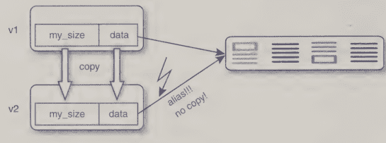

图 2-1：生成的向量拷贝

我们会观察到的另一个问题是，运行时库会尝试释放同一块内存两次。1 为了说明目的，我们在此提前引用了第 2.4.2 节的析构函数：它删除 data 所寻址的内存。由于两个指针都包含相同的内存地址，第二次析构函数调用将失败。

`=> c++11/vector_unique_ptr.cpp`

由于我们的向量旨在作为其数据的唯一所有者，unique_ptr 听起来比原始指针更适合用于 data：

```cpp
class vector
{
    // ...
    std::unique_ptr<double[]> data;
};
```

不仅内存会自动释放，编译器也无法自动生成拷贝构造函数，因为 unique_ptr 中的拷贝构造函数被删除。这迫使我们提供用户实现。

回到我们关于为什么拷贝构造函数的参数不能按值传递的问题。你此刻肯定已经想明白了。按值传递参数需要拷贝构造函数，而我们正要定义它。因此，我们创建了一个自依赖，这可能导致编译器陷入无限循环。幸运的是，编译器不会在此处卡住，甚至会给我们一个有意义的错误消息（从奥斯卡·王尔德的意义上说，许多程序员以前犯过这个错误，未来也会有人犯）。

#### 2.3.1.3 转换和显式构造函数

在 C++ 中，我们区分隐式构造函数和显式构造函数。隐式构造函数支持隐式转换和类似赋值的构造记法。而不是

```cpp
complex c1(3.0); // <c++11 and higher
complex c1(3.0); // all standards
```

我们也可以写：

```cpp
complex c1 = 3.0;
```

或

```cpp
complex c1 = pi * pi / 6.0;
```

对于许多受过科学教育的人来说，这种记法更易读，而当前编译器为两种记法生成相同的代码。

当需要一种类型而给出另一种类型时，隐式转换就会生效，例如，给出 double 而不是 complex。假设我们有一个函数。2

```cpp
double inline complex_abs(complex c)
{
    return std::sqrt(real(c) * real(c) + imag(c) * imag(c));
}
```

并用 double 调用它，例如：

```cpp
cout << "|7| = " << complex_abs(7.0) << '\n';
```

字面量 7.0 是 double，但没有接受 double 的 complex_abs 函数重载。不过，我们有一个接受 complex 参数的重载，而 complex 有一个接受 double 的构造函数。因此，complex 值是从 double 字面量隐式构建的。

可以通过将构造函数声明为 explicit 来禁用隐式转换：

```cpp
class complex { public:
    explicit complex(double nr = 0.0, double i = 0.0) : r(nr), i(i) {}
};
```

然后 complex_abs 就不会用 double 调用。要用 double 调用此函数，我们可以为 double 编写一个重载，或在函数调用中显式构造一个 complex：

```cpp
cout << "|7| = " << complex_abs(complex(7.0)) << '\n';
```

explicit 属性对于某些类非常重要，例如 vector。通常有一个构造函数接受向量的大小作为参数：

```cpp
class vector
{
    public:
    vector(int n) : my_size(n), data(new double[my_size]) {}
};
```

2. real 和 imag 的定义将很快给出。


一个计算标量积的函数期望两个向量作为参数：

```
double dot(const vector& v, const vector& w) { ... }
```

该函数可以用整数参数调用：

```
double d = dot(8, 8);
```

会发生什么？两个大小为 8 的临时向量会通过隐式构造函数创建并传递给函数 dot。通过将构造函数声明为 explicit，可以轻松避免这种荒谬的情况。

最终哪个构造函数应当是 explicit，由类设计者决定。在向量示例中，这很明显：没有一个头脑清醒的程序员希望编译器自动将整数转换为向量。

complex 类的构造函数是否应为 explicit，取决于预期用法。由于虚部为零的复数在数学上与实数相同，隐式转换不会产生语义不一致。隐式构造函数更方便，因为双精度值或字面量可以在任何期望复数值的地方使用。非性能关键的函数可以仅为 complex 实现一次，然后用于 double。

在 C++03 中，explicit 属性仅对单参数构造函数有意义。从 C++11 开始，由于统一初始化（参见第 2.3.4 节），explicit 对多参数构造函数也相关。

#### 2.3.1.4 委托构造

在之前的示例中，我们有包含多个构造函数的类。通常这些构造函数并不完全不同，且有一些共同代码；也就是说，往往存在一些冗余。在 C++03 中，当仅涉及原始变量的设置时，这通常被忽略；否则，合适的共同代码片段会被外包到一个方法中，然后由多个构造函数调用。

C++11 提供了委托构造函数；这些是调用其他构造函数的构造函数。我们的 complex 类可以使用此特性，而不使用默认值：

```
class complex
{
public:
    complex(double r, double i) : r{r}, i{i} {}
    complex(double r) : complex{r, 0.0} {}
    complex() : complex{0.0} {}
    ...
};
```

显然，对于这个小示例，好处并不明显。委托构造函数对于初始化更复杂的类（比我们的 complex 更复杂）会更有用。

#### 2.3.1.5 成员默认值

C++11 的另一个新特性是成员变量的默认值。这样我们只需在构造函数中设置与默认值不同的值：

```
class complex {
    public:
        complex(double r, double i) : r(r), i(i) {}
        complex(double r) : r(r) {}
        complex() {}
        ...
    private:
        double r = 0.0, i = 0.0;
};
```

同样，对于大型类，好处肯定更明显。

### 2.3.2 赋值

在第 2.3.1.2 节中，我们已经看到可以在没有 getter 和 setter 的情况下复制用户类的对象——至少在构造期间可以。现在，我们希望通过以下方式将值复制到现有对象中：

```
x = y;
u = v = w = x;
```

为此，类必须提供赋值运算符（或者不阻止编译器生成一个）。像往常一样，我们首先考虑 complex 类。将复数值赋给复数变量需要类似这样的运算符：

```
complex& operator=(const complex& src)
{
    r = src.r; i = src.i;
    return *this;
}
```

显然，我们复制了成员 r 和 i。该运算符返回对象的引用以支持多重赋值。this 是指向对象本身的指针，由于我们需要引用，因此对该指针进行解引用。赋予对象类型值的运算符称为拷贝赋值，可以由编译器合成。在我们的示例中，生成的代码将与我们的相同，因此我们可以省略此处的实现。

如果将 double 赋给 complex 会发生什么？

```
c = 7.5;
```

即使没有为 double 定义赋值运算符，也能编译通过。再次，我们有隐式转换：隐式构造函数即时创建一个 complex 并赋予它。如果这成为性能问题，我们可以为 double 添加赋值：

```
complex& operator=(double nr)
{
    r = nr; i = 0;
}
```

和之前一样，vector 的合成运算符不令人满意，因为它只复制数据的地址而不复制数据本身。实现与拷贝构造函数非常相似：

```
1 vector& operator=(const vector& src)
2 {
3   if (this == &src)
4     return *this;
5   assert(my_size == src.my_size);
6   for (int i = 0; i < my_size; ++i)
7     data[i] = src.data[i];
8   return *this;
9 }
```

建议 [45, p. 94] 拷贝赋值和构造函数应保持一致，以避免让用户感到极度困惑。

将对象赋值给自身（源和目标具有相同地址）可以跳过（第 3 和 4 行）。在第 5 行，我们通过检查向量大小的相等性来测试赋值是否为合法操作。或者，如果大小不同，赋值可以调整目标的大小。这在技术上是合法的选择，但在科学上相当可疑。只需想想数学或物理中向量空间突然改变其维度的上下文。

### 2.3.3 初始化列表

C++11 引入了初始化列表作为新特性——不要与“成员初始化列表”（§2.3.1）混淆。要使用它，必须包含头文件 <initializer_list>。虽然此特性与类概念正交，但向量的构造函数和赋值运算符是极佳的用例，因此这是介绍初始化列表的合适位置。它允许我们一次性设置向量的所有条目（直到合理的大小）。

普通 C 数组可以完全在其定义中初始化：

```
float v[] = {1.0, 2.0, 3.0};
```

C++11 将此功能推广，使任何类都可以用一组值（相同类型）进行初始化。使用合适的构造函数，我们可以写：

```
vector v = {1.0, 2.0, 3.0};
```

或

```
vector v{1.0, 2.0, 3.0};
```

我们也可以在赋值中设置所有向量条目：

```
v = {1.0, 2.0, 3.0};
```

接受向量参数的函数可以用即时设置的向量调用：

```
vector x = lu_solve(A, vector{1.0, 2.0, 3.0});
```

## 

上述语句对向量 (1, 2, 3)^T 求解线性方程组，对 A 进行 LU 分解。

要在我们的向量类中使用此特性，需要一个构造函数和一个接受 initializer_list<double> 作为参数的赋值。懒人可以只实现构造函数，并在拷贝赋值中使用它。为了演示和性能目的，我们将两者都实现。这还允许我们在赋值中验证向量大小是否匹配：

```
#include <initializer_list>
#include <algorithm>

class vector
{
  // ...
  vector(std::initializer_list<double> values)
  {
    my_size(values.size()), data(new double[my_size])
    {
      std::copy(std::begin(values), std::end(values),
                std::begin(data));
    }
  }

  self& operator=(std::initializer_list<double> values)
  {
    assert(my_size == values.size());
    std::copy(std::begin(values), std::end(values),
              std::begin(data));
    return *this;
  }
};
```

要将列表中的值复制到我们的数据中，我们使用标准库中的函数 std::copy。该函数接受三个迭代器作为参数。这三个参数分别表示输入的开始和结束以及输出的开始。自由函数 begin 和 end 是在 C++11 中引入的。在 C++03 中，我们必须使用相应的成员函数，例如 values.begin()。

### 2.3.4 统一初始化

在 C++11 中，花括号 {} 用作所有形式变量初始化的通用表示法，通过

- 初始化列表构造函数，
- 其他构造函数，或
- 直接成员设置。

后者仅对数组和类允许，前提是所有（非静态）变量都是公有的且类没有用户定义的构造函数。4 此类类型称为聚合类型，使用花括号列表设置其值相应地称为聚合初始化。


假设我们定义一个没有构造函数的粗糙复数类，可以按如下方式初始化：

```cpp
struct sloppy_complex
{
    double r, i;
};
```

```cpp
sloppy_complex z1{3.66, 2.33},
               z2 = {0, 1};
```

不用说，我们更倾向于使用构造函数而不是聚合初始化。不过，在处理旧代码时，它很有用。

本节中包含构造函数的复数类可以使用相同的表示法进行初始化：

```cpp
complex c{7.0, 8}, c2 = {0, 1}, c3 = {9.3}, c4 = {c};
const complex cc = {c3};
```

当相关构造函数被声明为显式时，不允许使用带=的表示法。

还剩下我们在上一节介绍的初始化列表。将列表作为统一初始化的参数实际上需要双层花括号：

```cpp
vector v1 = {{1.0, 2.0, 3.0}},
       v2{{3, 4, 5}};
```

为了简化我们的工作，C++11在统一初始化器中提供了花括号省略；也就是说，可以省略花括号，列表条目按给定顺序传递给构造函数参数或数据成员。因此，我们可以将声明缩短为

```cpp
vector v1 = {1.0, 2.0, 3.0},
       v2{3, 4, 5};
```

花括号省略既是福音也是诅咒。假设我们将复数类集成到向量中以实现vector_complex，我们可以方便地设置它：

```cpp
vector_complex v = {{1.5, -2}, {3.4}, {2.6, 5.13}};
```

然而，以下示例：

```cpp
vector_complex vid = {{2}};
vector_complex v2d = {{2, 3}};
vector_complex v3d = {{2, 3, 4}};
```

```cpp
std::cout << "vid is " << vid << std::endl; ...
```

可能会有点令人惊讶：

```cpp
vid is [{2,0}]
v2d is [{2,3}]
v3d is [{2,0}, {3,0}, {4,0}]
```

在第一行中，我们有一个参数，因此向量包含一个复数，它由单参数构造函数初始化（虚部为0）。下一条语句创建一个具有一个元素的向量，其构造函数由两个参数调用。显然，这种方案无法继续：`complex`没有三参数构造函数。因此，这里我们切换到多个向量条目，每个由一个参数构造。有兴趣的读者可参阅附录A.4.2中的更多实验。

花括号的另一个应用是成员变量的初始化：

```cpp
class vector
{
public:
    vector(int n)
    : my_size{n}, data{new double[my_size]} {}
    ...
private:
    unsigned my_size;
    double *data;
};
```

这可以保护我们免受偶尔的粗心：在上面的示例中，我们用`int`参数初始化一个无符号成员。编译器会谴责这种缩窄转换，我们将相应替换类型：

```cpp
vector(unsigned n) : my_size{n}, data{new double[my_size]} {}
```

我们已经表明，初始化列表允许我们即时创建非原始函数参数，例如：

```cpp
double d = dot(vector{3, 4, 5}, vector{7, 8, 9});
```

当参数类型明确时——例如，只有一个重载可用时——列表可以无类型地传递给函数：

```cpp
double d = dot({3, 4, 5}, {7, 8, 9});
```

同样，函数结果也可以通过统一表示法设置：

```cpp
complex subtract(const complex& c1, const complex& c2)
{
    return {c1.r - c2.r, c1.i - c2.i};
}
```

该函数的返回类型是`complex`，我们用一个双参数带花括号的列表对其进行初始化。

在本节中，我们展示了统一初始化的可能性，并说明了一些风险。我们相信这是一个非常有用的特性，但在处理棘手的边界情况时应谨慎使用。

### 2.3.5 移动语义

复制大量数据代价高昂，人们使用许多技巧来避免不必要的副本。几个软件包使用浅拷贝。这意味着对于我们的`vector`示例，我们只复制数据的地址而不复制数据本身。因此，在赋值之后：

```cpp
v = w;
```

两个变量包含指向内存中相同数据的指针。如果我们更改v[7]，那么我们也更改w[7]，反之亦然。因此，使用浅拷贝的软件通常提供一个函数来显式调用深拷贝：

```cpp
copy(v, w);
```

每次变量赋值时，都必须使用此函数而不是赋值。对于临时值——例如，作为函数结果返回的向量——浅拷贝并不关键，因为临时值否则无法访问，我们也没有别名效应。避免副本的代价是，程序员必须格外注意，在存在别名的情况下，内存不会被释放两次；也就是说，需要引用计数。

另一方面，当大对象作为函数结果返回时，深拷贝代价高昂。稍后，我们将介绍一种非常高效的避免副本的技术（参见§5.3）。现在，我们引入C++11的另一个特性来实现这一点：移动语义。其思想是，变量（换句话说，所有命名项目）被深拷贝，而临时对象（无法通过名称引用的对象）转移其数据。

这就引发了一个问题：如何区分临时数据和持久数据？好消息是：编译器为我们完成这项工作。在C++术语中，临时对象称为右值，因为它们只能出现在赋值的右侧。C++11引入了右值引用，用两个&&表示。带有名称的值，即所谓的左值，不能传递给右值引用。

#### 2.3.5.1 移动构造函数

通过提供移动构造函数和移动赋值，我们可以确保右值不会被昂贵地复制：

```cpp
class vector
{
    // ...
    vector(vector&& v)
        : my_size(v.my_size), data(v.data)
    {
        v.data = 0;
        v.my_size = 0;
    }
};
```

移动构造函数从其源窃取数据，并将其留在空状态。

作为右值传递给函数的对象在函数返回后被视为已过期。这意味着所有数据都可以是完全随机的。唯一的要求是对象的销毁（§2.4）不能失败。必须对原始指针（一如往常）给予极大的关注。它们不得指向随机内存，以免删除失败或释放其他用户数据。如果我们保持指针v.data不变，那么当v超出作用域时内存将被释放，我们的目标向量的数据将失效。通常，移动操作后原始指针应为nullptr（C++03中的0）。

请注意，像vector&& v这样的右值引用本身不是右值，而是左值，因为它具有名称。如果我们想将我们的v传递给另一个帮助移动构造函数进行数据窃取的方法，我们将不得不使用标准函数std::move将其再次转换为右值（参见§2.3.5.4）。

#### 2.3.5.2 移动赋值

移动赋值可以通过交换数据指针以简单的方式实现：

```cpp
class vector
{
    // ...
    vector& operator=(vector&& src)
    {
        assert(my_size == 0 || my_size == src.my_size);
        std::swap(data, src.data);
        return *this;
    }
};
```

这使我们免于释放自己的现有数据，因为当源被销毁时会完成此操作。

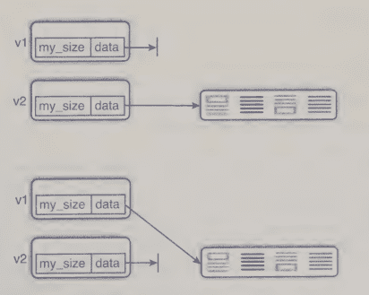

图2-2：移动的数据

假设我们有一个空向量v1和一个在函数f()中临时创建的向量v2，如图2-2上部所示。当我们将f()的结果赋值给v1时：

```cpp
v1 = f(); // f returns v2
```

移动赋值将交换数据指针，因此v1随后包含v2的值，而后者为空，如图2-2下部所示。

#### 2.3.5.3 副本省略

如果我们在这两个函数中添加日志，可能会发现我们的移动构造函数被调用的次数没有我们想象的那么多。其原因是，现代编译器提供了一种比窃取数据更好的优化。这种优化称为副本省略，编译器省略数据的副本，并修改数据的生成方式，使其立即存储到副本操作的目标地址。

其最重要的用例是返回值优化（RVO），特别是当新变量用函数结果初始化时，例如：

```cpp
inline vector ones(int n)
{
    vector v(n);
    for (unsigned i = 0; i < n; ++i)
        v[i] = 1.0;
    return v;
}
...
vector w(ones(7));
```

编译器可以在函数结束时构造v并将其复制（或移动）到w，而是可以立即创建w并直接在其上执行所有操作。复制（或移动）构造函数永远不会被调用。我们只需通过日志输出或调试器检查此即可。

在移动语义之前，许多编译器中已经提供了副本省略。然而，这不应意味着移动构造函数无用。移动数据的规则由标准强制要求，而RVO优化不保证。通常，细微的细节可以将其关闭，例如，如果函数有多个返回语句。

#### 2.3.5.4 我们需要移动语义的地方

移动构造函数肯定会被使用的一种情况是与函数std::move一起使用。实际上，这个函数并不移动，它只是将左值强制转换为右值。换句话说，它假装变量是一个临时对象；也就是说，它使其可移动。因此，后续的构造函数或赋值将调用右值引用的重载，如以下代码片段所示：

```cpp
vector x(std::move(w));
v = std::move(u);
```

在第一行中，x窃取w的数据并将其留作空向量。第二条语句将交换v和u。

当与std::move一起使用时，我们的移动构造函数和赋值并不完全一致。只要我们只处理真正的临时对象，就不会看到区别。


然而，为了更强的一致性，我们也可以将移动赋值的源对象留空状态：

```
class vector
{
    // ...
    vector& operator=(vector&& src)
    {
        assert(my_size == src.my_size);
        delete[] data;
        data = src.data;
        src.data = nullptr;
        src.my_size = 0;
        return *this;
    }
};
```

另一种看法是，对象在 std::move 之后被视为过期。换句话说，它们尚未死亡而是已退役，只要它们处于合法状态（即，析构函数不会崩溃），它们的值是什么就无关紧要了。

移动语义的一个良好应用是 C++11 及更高版本中 std::swap 的默认实现；参见第 3.2.3 节。

## 2.4 析构函数

析构函数是在对象销毁时每次都会被调用的函数，例如：

```
~complex()
{
    std::cout << "So long and thanks for the fish.\n";
}
```

由于析构函数是默认构造函数的补运算，它使用补运算符的表示法（~）。与构造函数相反，只有一个重载，且不允许参数。

### 2.4.1 实现规则

有两条非常重要的规则：

- 永远不要在析构函数中抛出异常！你的程序很可能会崩溃，且异常永远不会被捕获。在 C++11 或更高版本中，这始终被视为会中止执行的运行时错误（析构函数被隐式声明为 noexcept，§16.2.4）。在 C++03 中，结果取决于编译器实现，但程序中止是最可能的反应。

- 如果类包含虚函数，析构函数也应该是虚函数。我们将在第 6.1.3 节再次讨论此问题。

### 2.4.2 妥善处理资源

在析构函数中做什么是我们的自由选择，语言没有限制。实际上，析构函数的主要任务是释放对象的资源（内存、文件句柄、套接字、锁等），并清理程序中不再需要的与对象相关的一切。由于析构函数不得抛出异常，许多程序员相信释放资源应该是析构函数的唯一活动。

```
=> c++03/vector_test.cpp
```

在我们的示例中，销毁复数时无需做任何操作，可以省略析构函数。当对象获取内存等资源时，需要析构函数。在这种情况下，内存或其他资源必须在析构函数中释放：

```
class vector
{
    public:
    // ...
    ~vector()
    {
        delete[] data;
    }
    // ...
    private:
    unsigned my_size;
    double *data;
};
```

请注意，delete 已经测试指针是否为 nullptr（C++03 中为 0）。同样，使用旧式 C 句柄打开的文件需要显式关闭（这只是不使用它们的一个原因）。

### 2.4.2.1 资源获取即初始化

资源获取即初始化（RAII）是主要由 Bjarne Stroustrup 和 Andrew Koenig 发展的一种范式。其理念是将资源与对象绑定，并利用对象构造和销毁机制在程序中自动处理资源。每当我们想要获取资源时，都通过创建拥有该资源的对象来实现。每当对象超出作用域时，资源（内存、文件、套接字等）都会自动释放，如我们上面的 vector 示例所示。

想象一个在 986 个程序位置分配 37,186 个内存块的程序。我们能确定所有内存块都被释放了吗？要达到这种确定性，或者至少达到可接受的信心水平，我们需要花费多少时间？即使使用 valgrind（§B.3）等工具，我们也只能测试单次运行中是否没有内存泄漏，但无法一般性地保证内存始终被释放。另一方面，当所有内存块都在构造函数中分配并在析构函数中释放时，我们可以确定不存在泄漏。

### 2.4.2.2 异常

当抛出异常时，释放所有资源会更加具有挑战性。每当我们检测到问题时，必须在抛出异常之前释放迄今为止获取的所有资源。不幸的是，这不仅限于当前作用域中的资源，还取决于异常被捕获的位置而扩展到周围作用域的资源。这意味着更改错误处理需要对手动资源管理进行繁琐的调整。

### 2.4.2.3 托管资源

前面提到的所有问题都可以通过引入管理资源的类来解决。C++ 标准库已经提供了此类管理器。文件流管理来自 C 的文件句柄。unique_ptr 和 shared_ptr 以无泄漏、异常安全的方式处理内存。8 在我们的 vector 示例中，我们也可以从 unique_ptr 中受益，而无需实现析构函数。

### 2.4.2.4 自行管理

智能指针表明，一种资源类型可以有不同的处理方式。然而，当没有现有类以我们想要的方式处理资源时，这是一个绝佳的机会，让我们亲自编写一个量身定制的资源管理器。

这样做时，我们不应该在一个类中管理多个资源。这一准则的动机是，构造函数中可能会抛出异常，而以一种保证迄今获取的所有资源都被释放的方式编写构造函数是非常繁琐的。

因此，每当我们编写一个处理两个资源（即使是同一类型）的类时，我们应该引入一个管理其中一个资源的类。更好的做法是，我们应该为两个资源都编写管理器，并将资源处理完全与科学内容分离。即使在构造函数中途抛出异常的情况下，我们也不会遇到资源泄漏问题，因为它们的管理器的析构函数会自动调用并处理此事。

术语“RAII”在语言上更强调初始化。然而，从技术上讲，终结更为重要。资源不一定非要在构造函数中获取。这可以在对象生命周期的后期发生。根本的是，一个单一对象负责该资源并在其生命周期结束时释放它。Jon Kalb 将这种方法称为单一职责原则（SRP）的应用，值得观看他在网上发布的演讲。

### 2.4.2.5 资源救援

在本节中，我们将介绍一种技术，即使在使用具有显式资源处理的软件包时，也能自动释放资源。我们将使用 Oracle C++ Call Interface（OCCI）[33] 来演示该技术，用于从 C++ 程序访问 Oracle 数据库。这个示例使我们能够展示一个现实的应用，我们假设许多科学家和工程师不时需要处理数据库。尽管 Oracle 数据库是商业产品，但我们的示例可以使用免费的 Express 版进行测试。

5. 只有循环引用需要特殊处理。

| 问题 | 值得获奖 |
|---|---|
| 高斯圆 | ? |
| 合同数 | ? |
| 亲和数 | ✓ |

OCCI 是 C 库 OCI 的 C++ 扩展，仅在其上添加了带有一些 C++ 特性的薄层，同时保持整个软件架构为 C 风格。遗憾的是，这适用于大多数 C 库的跨语言接口。由于 C 不支持析构函数，无法建立 RAII，资源必须显式释放。

在 OCCI 中，我们首先必须创建一个 Environment，它可用于建立到数据库的 Connection。这反过来允许我们编写一个返回 ResultSet 的 Statement。所有这些资源都由原始指针表示，并且必须按逆序释放。

作为示例，我们查看表 2-1，其中我们的朋友 Herbert 记录了他对（所谓的）未解决数学问题的解决方案。第二列指示他是否确定自己有资格因其工作而获得奖项。出于大小原因，我们无法在此打印他惊人发现的完整列表。

```
=> c++03/occi_old_style.cpp
```

不时地，Herbert 使用以下 C++ 程序查找他值得获奖的发现：

```
#include <iostream>
#include <string>
#include <occi.h>

using namespace std; // import names (§3.2.1)
using namespace oracle::occi;

int main()
{
    string dbConn= "172.17.42.1", user= "herbert",
           password= "NSA_go_away";
    Environment *env = Environment::createEnvironment();
    Connection *conn = env->createConnection(user, password,
                                               dbConn);
    string query= "select problem from mySolutions"
                  " where award_worthy != 0";
    Statement *stmt = conn->createStatement(query);
    ResultSet *rs = stmt->executeQuery();

    while (rs->next())
        cout << rs->getString(1) << endl;
```


```cpp
stmt->closeResultSet(rs);
conn->terminateStatement(stmt);
env->terminateConnection(conn);
Environment::terminateEnvironment(env);
}
```

这次，我们不能责怪赫伯特使用老式编程风格；这是库所强制的。让我们来看看代码。即使对于不熟悉 OCCI 的人来说，发生了什么也是显而易见的。首先，我们获取资源，然后遍历赫伯特的巧妙成就，最后以相反的顺序释放资源。我们突出了资源释放操作，因为我们需要更加关注它们。

```cpp
ResultSet *rs = makes_me_famous();
while (rs->next())
  cout << rs->getString(1) << endl;

ResultSet *rs2 = needs_more_work();
while (rs2->next())
  cout << rs2->getString(1) << endl;
```

现在我们有了没有对应语句来关闭的结果集；它们是在查询函数中声明的，现在已超出作用域。因此，对于每个对象，我们还必须保留用于生成它的对象。迟早这将变成依赖关系的噩梦，具有巨大的出错潜力。

```
=> c++11/ocl_resource_rescue.cpp
```

问题是：我们如何管理依赖于其他资源的资源？解决方案是使用 unique_ptr 或 shared_ptr 的删除器。它们在托管内存释放时被调用。删除器的一个有趣方面是，它们没有义务实际释放内存。我们将探索这种自由来管理我们的资源。Environment 的处理最简单，因为它不依赖于另一个资源：

```cpp
struct environment_deleter {
  void operator() (Environment* env)
  { Environment::terminateEnvironment(env); }
};
```

```cpp
shared_ptr<Environment> environment(
  Environment::createEnvironment(), environment_deleter{});
```

现在，我们可以创建任意多个环境的副本，并保证当最后一个副本超出作用域时，执行 terminateEnvironment(env) 的删除器会被调用。

Connection 的创建和终止需要一个 Environment。因此，我们在 connection_deleter 中保留一个副本：

```cpp
struct connection_deleter
{
    connection_deleter(shared_ptr<Environment> env)
        : env(env) {}
    void operator()(Connection* conn)
        { env->terminateConnection(conn); }
    shared_ptr<Environment> env;
};
```

```cpp
shared_ptr<Connection> connection(environment->createConnection(...),
                                  connection_deleter(environment));
```

现在，我们保证当 Connection 不再需要时会被终止。在 connection_deleter 中保留 Environment 的副本，可以确保只要 Connection 存在，Environment 就不会被终止。

当我们为数据库创建一个管理器类时，可以更方便地处理数据库：

```cpp
class db_manager
{
public:
    using ResultSetSharedPtr = std::shared_ptr<ResultSet>;

    db_manager(string const& dbConnection, string const& dbUser,
               string const& dbPw)
        : environment(Environment::createEnvironment()),
          connection(environment->createConnection(dbUser, dbPw,
                                                   dbConnection),
                     connection_deleter(environment))
    {}

    ResultSetSharedPtr query(const std::string& q) const
    {
        Statement *stmt = connection->createStatement(q);
        ResultSet *rs = stmt->executeQuery();
        auto deleter = result_set_deleter(connection, stmt);
        return ResultSetSharedPtr(rs, deleter);
    }

    // some getters ...

private:
    shared_ptr<Environment> environment;
    shared_ptr<Connection> connection;
};
```

请注意，该类没有析构函数，因为成员现在是托管资源。

我们可以向这个类添加一个查询方法，返回一个托管的 ResultSet：

```cpp
struct result_set_deleter
{
    result_set_deleter(shared_ptr<Connection> conn,
                       Statement* stmt)
        : conn(conn), stmt(stmt) {}

    void operator()(ResultSet *rs)    // call op. like in (§3.8)
    {
        stmt->closeResultSet(rs);
        conn->terminateStatement(stmt);
    }

    shared_ptr<Connection> conn;
    Statement* stmt;
};
```

得益于这个新方法和我们的删除器，应用程序变得简单如下：

```cpp
int main()
{
    db_manager db("172.17.42.1", "herbert", "NSA_go_away");
    auto rs = db.query("select problem from my_solutions "
                       " where award_worthy != 0");
    while (rs->next())
        cout << rs->getString(1) << endl;
}
```

查询越多，我们的努力越有回报。不耻于重复自己：所有资源都会被隐式释放。

细心的读者已经意识到我们违反了单一职责原则。为了表达对这一发现的感谢，我们邀请您在练习 2.8.4 中改进我们的设计。

## 2.5 方法生成总结

C++ 有六种方法（C++03 中有四种）具有默认行为：

- 默认构造函数
- 拷贝构造函数
- 移动构造函数（C++11 或更高版本）
- 拷贝赋值
- 移动赋值（C++11 或更高版本）
- 析构函数

这些方法的代码可以由编译器生成——使我们免受枯燥常规工作的困扰，从而防止疏忽。

确定哪些方法被隐式生成的规则涉及大量细节。这些细节在附录 A，第 A.5 节中有更详细的介绍。在这里，我们只想给出针对 C++11 及更高版本的最终结论：

### 六法则

关于上述六种操作，尽可能少地实现，尽可能多地声明。任何未实现的操作都应声明为 default 或 delete。

## 2.6 访问成员变量

C++ 提供了多种访问类成员的方式。在本节中，我们将介绍不同的选项，并讨论它们的优缺点。希望您能了解如何在未来以最适合您领域的方式设计类。

### 2.6.1 访问函数

在 §2.2.5 中，我们介绍了 getter 和 setter 来访问类 complex 的变量。当我们想要，例如，递增实部时，这变得很麻烦：

```cpp
c.set_r(c.get_r() + 5.);
```

这看起来不太像数值运算，也不太易读。实现此操作的更好方法是编写一个返回引用的成员函数：

```cpp
class complex {
public:
    double& real() { return r; }
};
```

有了这个函数，我们可以写

```cpp
c.real() += 5.;
```

这已经好多了，但仍然有点奇怪。为什么不这样递增计算：

```cpp
real(c) += 5.;
```

为此，我们编写一个自由函数：

```cpp
inline double& real(complex& c) { return c.r; }
```

不幸的是，这个函数访问了私有成员 r。我们可以修改自由函数，调用成员函数：

```cpp
inline double& real(complex& c) { return c.real(); }
```

或者，将自由函数声明为 complex 的友元，以访问其私有数据：

```cpp
class complex {
    friend double& real(complex& c);
};
```

访问实部在复数为常量时也应有效。因此，我们还需要关于参数和结果的此函数的常量版本：

```cpp
inline const double& real(const complex& c) { return c.r; }
```

这个函数也需要友元声明。

在最后两个函数中，我们返回了引用，但这些引用保证不会过时。函数——无论是自由形式还是成员形式——显然只能在被引用对象已创建时调用。我们在语句中使用的数字实部的引用

```cpp
real(c) += 5.;
```

仅在语句结束前存在，这与被引用变量 c 不同，c 存活时间更长：直到其定义的作用域结束。我们可以创建一个引用变量：

```cpp
double &rr = real(c);
```

它存活到当前作用域结束。即使 c 在同一作用域中声明，C++ 中对象销毁的逆序也保证 c 比 rr 存活更久。

临时对象的成员引用可以安全地在同一表达式中使用，例如：

```cpp
double r2 = real(complex(3, 7)) * 2.0; // okay!
```

临时复数仅在语句中存活，但至少比其实部的引用存活更久，因此该语句是正确的。但是，如果我们保留对其实部的引用，它将过时：

```cpp
const double &rr = real(complex(3, 7)); // Really bad!!!
cout << "The real part is " << rr << '\n';
```

> **规则**
> 不要保留临时表达式的引用！
>
> 它们在我们第一次使用之前就失效了。

### 2.6.2 下标运算符

要遍历 vector，我们可以编写一个类似这样的函数：

```cpp
class vector
{
public:
    double at(int i)
    {
        assert(i >= 0 && i < my_size);
```


```
return data[i];
}
```

对向量 v 的元素求和，如下所示：

```
double sum = 0.0;
for (int i = 0; i < v.size(); ++i)
    sum += v.at(i);
```

C++ 和 C 使用下标运算符访问（固定大小）数组的元素。因此，对（动态大小）向量也这样做是很自然的。那么我们可以将前面的示例重写为

```
double sum = 0.0;
for (int i = 0; i < v.size(); ++i)
    sum+= v[i];
```

这更简洁，也更清楚地展示了我们在做什么。

运算符重载的语法与赋值运算符相同，实现方式与函数 at 相同：

```
class vector
{
public:
    double& operator[](int i)
    {
        assert(i >= 0 && i < my_size);
        return data[i];
    }
};
```

有了这个运算符，我们可以使用方括号访问向量元素，但（以这种形式）仅当向量是可变的时才可以。

### 2.6.3 常量成员函数

这引发了一个更一般的问题：我们如何编写接受常量对象的运算符和成员函数？事实上，运算符是成员函数的一种特殊形式，可以像成员函数一样调用：

```
v[i];
v.operator[](i); // is syntactic sugar for:
```

当然，长形式几乎从不使用，但它说明运算符是常规方法，仅提供额外的调用语法。

自由函数允许限定每个参数的 const 属性。成员函数甚至在签名中都不提及被处理的对象。那么我们如何指定当前对象必须是 const 呢？有一种特殊的表示法可以在函数头后添加限定符：

```
class vector
{
public:
    const double& operator[](int i) const
    {
        assert(i >= 0 && i < my_size);
        return data[i];
    };
}
```

const 属性不仅仅是程序员不介意用常量对象调用此成员函数的随意指示。C++ 编译器非常认真地对待这种 const 属性，并会验证函数不修改对象（即其某些成员），并且该对象仅作为 const 参数传递给其他函数。因此，在调用其他方法时，它们也必须是 const 的。

这种 const 属性保证还阻止了返回指向数据成员的非常量指针或引用。可以返回常量指针或引用以及对象。返回的值不需要是常量（但也可以是），因为它是当前对象、其某个成员变量（或常量）或临时变量的副本。这些副本都不存在修改当前对象的风险。

常量成员函数可以用非常量对象作为参数调用（因为 C++ 在必要时会隐式将非常量引用转换为常量引用）。因此，通常只提供常量成员函数就足够了。例如，这里有一个返回向量大小的函数：

```
class vector
{
public:
    int size() const { return my_size; }
    // int size() { return my_size; } // futile
};
```

非常量 size 函数与常量版本的作用相同，因此是多余的。

对于我们的下标运算符，我们需要常量版本和可变版本。如果只有 const 成员函数，我们可以用它来读取常量和可变向量的元素，但无法修改后者。

数据成员可以声明为 mutable。然后它们甚至可以在 const 方法中被更改。这旨在用于内部状态（如缓存），这些状态不影响可观察的行为。我们在这本书中不使用此功能，并建议您仅在真正必要时才应用它，因为它破坏了语言的数据保护。

### 2.6.4 引用限定成员

除了对象的 const 属性（即 *this 的 const 属性）之外，在 C++11 中我们还可以要求对象是左值或右值引用。假设我们有一个向量加法（参见 §2.7.3）。其结果将是一个非常量的临时对象。因此我们可以为其元素赋值：

```
(v + w)[i] = 7.3; // nonsense
```

诚然，这是一个相当人为的示例，但它说明还有改进的空间。

赋值左侧只应接受可变左值。这对内置类型一视同仁。这就引发了一个问题：为什么 (v + w)[1] 是可变左值？向量的方括号运算符有两个重载：一个用于可变对象，一个用于常量对象。v+w 不是常量，因此优先选择可变向量的重载。因此，我们访问了可变对象成员的可变引用，这是合法的。

问题是 (v + w)[1] 是左值，而 v+w 不是。我们在这里缺少的是要求方括号运算符只能应用于左值：

```
class vector
{
public:
    double& operator[](int i) & { ... } // #1
    const double& operator[](int i) const& { ... } // #2
};
```

当我们用引用限定一个成员的重载时，必须对其他重载也进行限定。有了这个实现，重载 #1 不能用于临时向量，而重载 #2 返回一个常量引用，无法向其赋值。因此，对于上面那个毫无意义的赋值，我们会看到编译器错误：

```
vector_features.cpp:167:5: error: read-only variable is not assignable
(v + w)[1] = 3;
```

同样，我们可以对向量的赋值运算符进行引用限定，以禁用它们对临时对象的使用：

```
v + w = u; // nonsense, should be forbidden
```

如预期，两个与号允许我们将成员函数限制为右值；也就是说，该方法只能在临时对象上调用：

```
class my_class
{
    something_good donate_my_data() && { ... }
};
```

用例可能包括需要避免大量拷贝（例如矩阵）的转换。

像矩阵这样的多维数据结构可以以不同方式访问。首先，我们可以使用应用运算符（§3.8），它允许我们将多个索引作为参数传递。不幸的是，方括号运算符只接受一个参数，我们在附录 A.4.3 中讨论了一些处理方法，但没有一种令人满意。一种从连串方括号运算符调用应用运算符的高级方法将在 6.6.2 节中稍后介绍。

## 2.7 运算符重载设计

除少数例外（§1.3.10）外，C++ 中的大多数运算符都可以重载。但是，有些运算符只有在特定目的下重载才有意义；例如，延迟成员选择 p->m 对于实现新的智能指针很有用。在科学或工程背景下，如何直观地使用这个运算符就不那么明显了。同样，地址运算符 & 的自定义含义也需要充分的理由。

### 2.7.1 保持一致！

如前所述，语言为我们在类的运算符设计和实现中提供了高度的自由度。我们可以自由选择每个运算符的语义。但是，我们的自定义行为越接近标准类型的行为，其他人（共同开发者、开源用户等）就越容易理解我们在做什么并信任我们的软件。

重载当然可以用于简洁地表示某个应用领域中的操作，即建立领域特定嵌入式语言（DSEL）。在这种情况下，偏离运算符的典型含义可能是有成效的。尽管如此，DSEL 本身应该保持一致。例如，如果运算符 -、+ 和 += 是用户定义的，那么表达式 a = a + b 和 a += b 应该产生相同的效果。

#### 一致的重载

使你的运算符彼此一致，并在适当时提供与标准类型相似的语义。

我们也可以自由选择每个运算符的返回类型；例如，x == y 可以返回字符串或文件句柄。同样，我们越接近 C++ 中典型的返回类型，每个人（包括我们自己）就越容易使用我们的自定义运算符。

运算符唯一预定义的方面是它们的 Arity，即参数的数量和运算符的相对优先级。在大多数情况下，这内在于所表示的操作：乘法始终采用两个参数。对于某些运算符，可以想象可变的 arity。例如，如果下标运算符除了被下标对象外还接受两个参数，那将很好，这样我们就可以这样访问矩阵元素：A[ i, j ]。唯一允许任意 arity（包括可变参数实现，§3.10）的运算符是应用运算符：operator()。

语言提供给我们的另一种自由是选择参数的类型。例如，我们可以为无符号类型（返回单个元素）、范围（返回子向量）和集合（返回一组向量元素）实现下标运算符。这在 MTL4 中确实得到了实现。与 MATLAB 相比，C++ 提供的运算符较少，但我们有无限的机会无限地重载它们，以创建我们喜欢的任何数量的功能。

### 2.7.2 尊重优先级

当我们重新定义运算符时，必须确保操作的预期优先级与运算符优先级相符。例如，我们可能会想到使用 IT++X 记法来表示矩阵的幂运算：

```
A = B ^ 2 ;
```


A = B^2。到目前为止，一切都好。^ 的原始含义是按位异或，这不让我们担心，因为我们从未打算对矩阵实现按位操作。

现在我们将 C 加到 B^2：

```
A = B^2 + C;
```

看起来不错。但它不起作用（或者做了一些奇怪的事情）。为什么？因为 + 的优先级高于 ^。因此，编译器将我们的表达式理解为

```
A = B ^ (2 + C);
```

哎呀。尽管运算符表示法提供了简洁直观的接口，但非平凡表达式可能不符合我们的预期。因此：

#### 尊重优先级

请注意，重载运算符的语义/预期优先级应与 C++ 运算符的优先级匹配。

### 2.7.3 成员函数或自由函数

大多数运算符可以定义为成员函数或自由函数。以下运算符——任何类型的赋值、operator[]、operator-> 和 operator()——必须是非静态方法，以确保其第一个参数是左值。我们在 2.6 节中展示了 operator[] 和 operator() 的示例。相比之下，以内置类型作为第一个参数的二元运算符只能定义为自由函数。

不同实现选择的影响可以用我们复数类的加法运算符来演示：

```
class complex
{
public:
    explicit complex(double rn = 0.0, double in = 0.0) : r(rn), i(in) {}
    complex operator+(const complex& c2) const
    {
        return complex(r + c2.r, i + c2.i);
    }
    ...
private:
    double r, i;
};
```

```
int main()
{
    complex cc(7.0, 8.0), c4(cc);
    std::cout << "cc + c4 is " << cc + c4 << std::endl;
}
```

我们还可以将复数和 double 相加吗？

```
std::cout << "cc + 4.2 is " << cc + 4.2 << std::endl;
```

使用上面的实现不行。我们可以为接受 double 作为第二个参数的运算符添加一个重载：

```
class complex
{
    ...
    complex operator+(double r2) const
    {
        return complex(r + r2, i);
    }
    ...
};
```

或者，我们可以从构造函数中删除 explicit。然后 double 可以隐式转换为 complex，我们就可以相加两个 complex 值。

两种方法各有优缺点：重载只需要一次加法操作，而隐式构造函数通常更灵活，因为它允许将 double 值传递给 complex 函数参数。或者，我们既进行隐式转换又进行重载，这样就既有灵活性又有效率。

现在我们颠倒参数顺序：

```
std::cout << "4.2 + c4 is " << 4.2 + c4 << std::endl;
```

这无法编译。事实上，表达式 4.2 + c4 可以被视为以下内容的简写：

```
4.2.operator+(c4)
```

换句话说，我们正在寻找 double 中的一个运算符，而 double 甚至不是一个类。

要提供一个以原始类型作为第一个参数的运算符，我们必须编写一个自由函数：

```
inline complex operator+(double d, const complex& c2)
{
    return complex(d + real(c2), imag(c2));
}
```

同样，建议将两个 complex 值的加法实现为自由函数：

```
inline complex operator+(const complex& c1, const complex& c2)
{
    return complex(real(c1) + real(c2), imag(c1) + imag(c2));
}
```

为了避免歧义，我们必须删除带有 complex 参数的成员函数。

总而言之，成员函数和自由函数的主要区别在于：前者仅允许对第二个参数（这里是加数）进行隐式转换，而后者允许对两个参数都进行隐式转换。如果简洁的程序源代码比性能更重要，我们可以省略所有带有 double 参数的重载，并依赖隐式转换。

即使我们保留所有三个重载，将它们实现为自由函数也更加对称。第二个加数无论如何都要进行隐式转换，最好让两个参数具有相同的行为。简而言之：

#### 二元运算符

将二元运算符实现为自由函数。

一元运算符也有同样的区别：仅限自由函数，例如：

```
complex operator-(const complex& c1)
{ return complex(real(c1), -imag(c1)); }
```

允许隐式转换，而成员函数则不然：

```
class complex
{
public:
	complex operator-() const { return complex(-r, -i); }
};
```

这是否可取取决于上下文。很可能，用户定义的解引用运算符*不应涉及转换。

最后但同样重要的是，我们想为流实现一个输出运算符。该运算符接受一个可变的 std::ostream 引用和一个通常为常量的用户类型引用。为简单起见，我们继续使用我们的 complex 类：

```
std::ostream& operator<<(std::ostream& os, const complex& c)
{
	return os << '(' << real(c) << ', ' << imag(c) << ')';
}
```

由于第一个参数是 ostream&，我们无法在 complex 中编写成员函数，向 std::ostream 添加成员也不是一个真正的选择。通过这一个实现，我们在所有标准化输出流（即派生自 std::ostream 的类）上提供输出。

## 2.8 练习

### 2.8.1 多项式

编写一个多项式类，至少应包含：

- 一个给出多项式次数的构造函数；
- 一个用于存储系数的动态 double 数组/向量/列表；
- 一个析构函数；以及
- 一个用于 ostream 的输出函数。

算术运算等其他成员是可选的。

### 2.8.2 移动赋值

为练习 2.8.1 中的多项式编写一个移动赋值运算符。将复制构造函数定义为默认。要测试你的赋值是否被使用，请编写一个函数 polynomial f(double c2, double c1, double c0)，它接受三个系数并返回一个多项式。在你的移动赋值中打印一条消息，或使用调试器来确保你的赋值被使用。

### 2.8.3 初始化列表

使用初始化列表的构造函数和赋值运算符扩展练习 2.8.1 中的程序。多项式的次数应为初始化列表长度减一。

### 2.8.4 资源救援

重构 2.4.2.5 节中的实现。为 Statement 实现一个删除器，并在托管的 ResultSet 中使用托管语句。

# 第 3 章

泛型编程

模板是 C++ 的一个特性，用于创建操作于参数化（泛型）类型的函数和类。结果是，函数或类可以处理多种不同的数据类型，而无需为每种类型手动重写。

泛型编程有时被认为与模板编程同义。但这并不正确。泛型编程是一种编程范式，旨在在提供正确性的同时实现最大适用性。其主要工具是模板。从数学上讲，它基于形式概念分析 [15]。在泛型编程中，模板程序附带了正确使用的充分条件文档。可以说，泛型编程是模板编程的负责任方式。

## 3.1 函数模板

函数模板——也称为泛型函数——是生成潜在无限数量函数重载的蓝图。在日常对话中，术语“模板函数”比“函数模板”更常用，而后者是标准中的正确术语。在本书中，我们同时使用这两个术语，它们的含义完全相同。

假设我们想编写一个函数 max(x, y)，其中 x 和 y 是某种类型的变量或表达式。使用函数重载，我们可以轻松地这样做：

```
int max (int a, int b)
{
    if (a > b)
        return a;
    else
        return b;
}

double max (double a, double b)
{
    if (a > b)
        return a;
    else
        return b;
}
```

请注意，int 和 double 的函数体完全相同。使用模板机制，我们可以编写一个泛型实现：

```
template <typename T>
T max (T a, T b)
{
    if (a > b)
        return a;


else
    return b;
}

这个函数模板替换了非模板重载，我们保留名称 max。它可以像重载函数一样使用：

```
std::cout << "The maximum of 3 and 5 is " << max(3, 5) << '\n';
std::cout << "The maximum of 3l and 5l is " << max(3l, 5l) << '\n';
std::cout << "The maximum of 3.0 and 5.0 is " << max(3.0, 5.0) << '\n';
```

在第一种情况下，3 和 5 是 int 类型的字面量，max 函数被实例化为

```
int max (int, int);
```

同样，max 的第二次和第三次调用实例化为：

```
long max (long, long);
double max (double, double);
```

因为这些字面量被解释为 long 和 double。同样地，模板函数可以用变量和表达式调用：

```
unsigned u1 = 2, u2 = 8;
std::cout << "The maximum of u1 and u2 is " << max(u1, u2) << '\n';
std::cout << "The maximum of u1+u2 and u1+u2 is "
<< max(u1*u2, u1+u2) << '\n';
```

在这里，该函数为 unsigned 实例化。

除了 typename，在此上下文中也可以写 class，但我们不推荐这样做，因为 typename 更好地表达了泛型函数的意图。

### 3.1.1 实例化

实例化是什么意思？对于非泛型函数，编译器读取其定义，检查错误，并生成可执行代码。当编译器处理泛型函数的定义时，它只能检测与模板参数无关的错误，例如解析错误。例如：

```
template <typename T>
inline T max (T a, T b)
{
    if a > b      // Error !
        return a;
    else
        return b;
}
```

无法编译，因为没有括号的 if 语句不是 C++ 语法的合法表达式。

然而，我们遇到的大多数错误都取决于替换后的类型。例如，以下实现可以编译：

```
template <typename T>
inline T max(T x, T y)
{
    return x < y ? y.value : x.value;
}
```

我们不能用 int 或 double 等内置类型调用它，但该函数模板可能并非面向内置类型，并且可能适用于实际的参数类型。

函数模板本身的编译不会在二进制文件中生成任何代码。只有在调用它时才会发生这种情况。在这种情况下，我们实例化这个函数模板。只有那时，编译器才会对泛型函数是否对给定的参数类型正确进行完整检查。在我们之前的示例中，我们看到 max 可以用 int 和 double 实例化。

到目前为止，我们看到的最隐式形式是：当存在调用且类型参数从参数推导时，模板被实例化。为了更显式，我们可以声明替换模板参数的类型，例如：

```
std::cout << max<float>(8.1, 9.3) << '\n';
```

在这里，模板使用给定类型显式实例化。在最显式的形式中，我们在没有函数调用的情况下强制实例化：

```
template short max<short>(short, short);
```

当我们生成目标文件（§7.2.1.3）并且必须保证某些实例存在，而不管编译单元中的函数调用时，这很有用。

> 定义 3-1。为了简洁，我们称带有类型推导的实例化为隐式实例化，称带有显式类型声明的实例化为显式实例化。

根据我们的经验，隐式实例化在大多数情况下都按预期工作。显式指定实例化类型主要用于消除歧义和特殊用法，例如 std::forward（§3.1.2.4）。为了更深入地理解模板，了解编译器如何替换类型非常有帮助。

### 3.1.2 参数类型推导

```
=> c++11/template_type_deduction.cpp
```

在本节中，我们将更仔细地查看模板参数如何根据参数是按值、按值还是按右值引用传递而被替换。当变量通过 auto 声明自动类型时（如第 3.4.1 节所示），此知识更为重要。然而，与 auto 变量相比，函数参数的替换规则更直观，因此我们在此讨论它们。

#### 3.1.2.1 值参数

在之前的示例中，我们直接将类型参数 T 用作 max 中的函数参数：

```
template <typename T>
T max (T a, T b);
```

与任何其他函数参数一样，函数模板的参数也可以是 const- 和 引用限定的：

```
template <typename T>
T max (const T& a, const T& b);
```

让我们将此（不失去一般性）表示为一元 void 函数 f：

```
template <typename TPara>
void f(TPara p);
```

其中 FPara 包含 TPara。当我们调用 f(arg) 时，编译器必须推导类型 TPara，使得参数 p 可以用 arg 初始化。这就是全部内容。但让我们看一些案例来了解它。最简单的语法情况是 TPara 和 FPara 相等：

```
template <typename TPara>
void f1(TPara p);
```

这意味着函数参数是参数的局部副本。我们用 int 字面量、int 变量以及可变和常量 int 引用调用 f1：

```
template <typename TPara>
void f1(TPara p) {}
```

```
int main ()
{
    int i = 0;
    int& j = i;
    const int& k = i;

    f1(3);
    f1(i);
    f1(j);
    f1(k);
    ...
}
```

在所有四个实例化中，TPara 被替换为 int，因此函数参数 p 的类型也是 int。如果 TPara 被替换为 int& 或 const int&，参数也可以传入。但那样我们就没有值语义了，因为对 p 的修改会影响函数参数（例如 j）。因此，当函数参数是没有限定符的类型参数时，TPara 变为去除了所有限定符的参数类型。只要类型可复制，此模板函数接受所有参数。

例如，unique_ptr 具有已删除的拷贝构造函数，只能作为右值传递给此函数：

```
unique_ptr<int> up;
// f1(up); // Error: no copy constructor
f1(move(up)); // Okay: use move constructor
```

#### 3.1.2.2 左值引用参数

为了真正接受每个参数，我们可以使用常量引用作为参数：

```
template <typename TPara>
void f2(const TPara& p) {}
```

TPara 同样是去除了所有限定符的参数类型。因此，p 是非限定参数类型的常量引用，所以我们不能修改 p。

更有趣的情况是可变引用作为参数：

```
template <typename TPara>
void f3(TPara& p) {}
```

此函数拒绝所有字面量和临时对象，因为它们不可引用。1 我们也可以用类型替换的术语来表述：拒绝临时对象是因为不存在这样的 TPara 类型，使得 TPara&& 变为 int&&（当我们在 3.1.2.3 节讨论引用折叠时，我们会回到这一点）。

当我们传入普通 int 变量（如 i）时，TPara 被替换为 int，因此 p 的类型为 int&& 并引用 i。当传入可变引用变量（如 j）时，可以观察到相同的替换。当我们传入 const int 或 const int&（如 k）时会发生什么？可以与 TPara&& 匹配吗？可以，当 TPara 被替换为 const int 时。相应地，p 的类型是 const int&&。因此，类型模式 TPara&& 并不将参数限制为可变引用。该模式可以匹配常量引用。但是，如果函数修改 p，实例化稍后将失败。

#### 3.1.2.3 转发引用

在 2.3.5.1 节中，我们介绍了只接受右值作为参数的右值引用。带有类型参数的形式 T&& 的右值引用也接受左值。出于这个原因，Scott Meyers 为它们创造了通用引用一词。在这里，我们坚持使用标准术语转发引用。我们将展示它们为什么可以同时接受右值和左值。为此，我们查看以下一元函数的类型替换：

```
template <typename TPara>
void f4(TPara&& p) {}
```

当我们向此函数传递右值时，例如：

```
f4(3);
f4(move(i));
f4(move(up));
```


TPara 被未限定的参数类型替换——这里是 int 和 unique_ptr<int>——p 的类型是相应的右值引用。

当我们用 i 或 j 这样的左值调用 f4 时，编译器会将这些参数作为模板右值引用参数接受。类型参数 TPara 被替换为 int&，这也是 p 的类型。这是怎么可能的？解释见表 3-1，该表展示了引用的引用是如何折叠的。

表 3-1 的要点是，当至少有一个是左值引用时，引用会折叠为左值引用（粗略地说，非常粗略地说，我们可以取与符的最小数量）。这解释了 f4 中左值的处理方式。TPara 被替换为 int&，而其右值引用也是 int&&。

缺乏类型替换是非模板右值引用不接受左值的原因。函数参数可以是左值的唯一原因是替换引入了左值引用。没有这种替换，就不涉及左值引用，引用也不会折叠。

关于整个类型推导故事的更详细、更戏剧性的讲述见 [32，第 9-35 页和 157-214 页]。

#### 3.1.2.4 完美转发

我们已经看到，左值可以通过 move（§2.3.5.4）转换为右值。这次我们想要有条件地转换它们。转发引用参数同时接受右值和左值参数，分别由右值引用和左值引用持有。当我们将这样的引用参数传递给另一个函数时，我们希望左值引用作为左值传递，右值引用作为左值传递，右值引用作为右值传递。然而，在两种情况下，引用本身都是左值（因为它们有名称）。我们可以用 move 将引用转换为右值，但这也会应用于左值引用。

在这里，我们需要一个有条件的转换。这是通过 std::forward 实现的。它将右值引用转换为右值，并保持左值不变。forward 必须使用（未限定的）类型参数实例化，例如：

```cpp
template <typename TPara>
void f5(TPara&& p)
{
    f4(forward<TPara>(p));
}
```

f5 的参数以相同的值类别传递给 f4。无论作为左值传递给 f5 的什么，都作为左值传递给 f4；右值亦然。与 move 类似，forward 是纯粹的转换，不会产生任何机器操作。人们这样表述：move 不移动，forward 不转发。它们只是将参数转换为可移动或可转发的形式。

| | & | && |
|---|---|---|
| T& | T& | T& |
| T&& | T& | T&& |

### 3.1.3 处理模板中的错误

回到我们适用于所有数值类型的 max 示例。但是对于不提供 operator< 的类型，例如 std::complex<>，会发生什么呢？让我们尝试编译以下代码片段：

```cpp
std::complex<float> z(3, 2), c(4, 8);
std::cout << "The maximum of c and z is " << ::max(c, z) << '\n';
```

我们的编译尝试将以类似这样的错误结束：

> 错误：在 >>a >> b< 中没有匹配的 >operator<<

当我们的模板函数调用另一个模板函数，而该函数又调用另一个，以此类推时，会发生什么？同样，这些函数仅被解析，完整检查被推迟到实例化时。让我们看看以下程序：

```cpp
int main ()
{
    vector<complex<float> > v;
    sort(v.begin(), v.end());
}
```

无需深入细节，问题与之前相同：我们无法比较复数，因此无法对它们进行排序。这次，缺失的比较是在间接调用的函数中被发现的，编译器为我们提供了完整的调用和包含堆栈，以便我们可以追溯错误。请尝试在不同编译器上编译此示例，看看你是否能从错误消息中看出任何端倪。

如果你遇到这样冗长的错误消息，不要惊慌！首先，查看错误本身，并提取对你有用的信息：例如，缺少 operator>，或某物不可赋值，或某物是 const 而不应该是。然后在调用堆栈中找到属于你程序的最内层代码，即你从标准库或第三方库调用模板函数的位置。盯着这段代码及其前面的行看一段时间，因为根据我们的经验，这是最可能发生错误的地方。然后问自己：根据错误消息，函数的模板参数类型是否缺少某个运算符或函数？

不要害怕到决定此生不再使用模板的地步。在大多数情况下，问题远没有永无止境的错误消息让我们相信的那么复杂。根据我们的经验，经过一些训练，模板函数中的大多数错误比运行时错误更容易找到。

### 3.1.4 混合类型

迄今为止我们尚未回答的另一个问题是：当我们使用两种不同类型作为参数时，我们的 max 函数会发生什么？

```cpp
unsigned ui = 2;
int i = 3;
std::cout << "The maximum of ui and i is " << max(ui, i) << '\n';
```

编译器告诉我们——这次出奇地简短——类似这样的内容：

> 错误：函数调用 'max(unsigned int&, int)' 没有匹配项

确实，我们假设两种类型相等。但是等等，当不存在精确匹配时，C++ 不会隐式转换参数吗？会，但模板参数除外。模板机制旨在在类型级别提供足够的灵活性。此外，将模板实例化与隐式转换结合具有很高的歧义潜力。

到目前为止还好。我们可以编写带有两个模板参数的函数模板吗？当然可以。但这会带来一个新问题：这个模板的返回类型应该是什么？有不同的选择。首先，我们可以添加一个非模板函数重载，例如

```cpp
int inline max (int a, int b) { return a > b ? a : b; }
```

这可以用混合类型调用，无符号参数将被隐式转换为 int。但是如果我们还为 unsigned 添加另一个函数重载会怎样？

```cpp
int max(unsigned a, unsigned b) { return a > b ? a : b; }
```

int 会被转换为 unsigned 还是反之？编译器不知道，并会对此歧义提出异议。

无论如何，向模板实现添加非模板重载远非优雅或高效。因此，我们移除所有非模板重载，首先看看在函数调用中可以做什么。我们可以显式地将一个参数转换为另一个参数的类型：

```cpp
unsigned ui = 2;
int i = 3;
std::cout << "max of ui and i is " << max(int(ui), i) << '\n';
```

现在，max 用两个 int 调用。另一个选择是在函数调用中显式指定模板类型：

```cpp
std::cout << "max of ui and i is " << max<int>(ui, i) << '\n';
```

然后两个参数都是 int，当两个参数都是 int 或可以隐式转换为 int 时，可以调用函数模板的实例。

在了解了这些关于模板的不太愉快的细节之后，有一个非常好的消息：模板函数的执行效率与非模板对应物一样高！原因是 C++ 为函数调用所用的每种类型或类型组合生成新代码。相比之下，Java 只编译一次模板，通过将类型转换为相应类型来为不同类型执行它们。这导致更快的编译和更短的可执行文件，但运行时间更长。

为了快速模板，我们还要付出另一个代价：由于每种类型（组合）的多次实例化，可执行文件会更长。在极端（且罕见）的情况下，当更快的内存[^4]被汇编指令填满，数据必须从较慢的内存加载和存储时，更大的二进制文件可能导致执行变慢。然而，在实践中，函数的实例数量不会那么多，这仅对未内联的大函数有影响。对于内联函数，二进制代码无论如何都会直接插入到可执行文件的函数调用位置，因此对可执行文件长度的影响对模板和非模板函数是相同的。

### 3.1.5 统一初始化

统一初始化（来自 §2.3.4）也适用于模板。然而，在极少数情况下，花括号消除可能会导致一些令人惊讶的行为。如果你好奇或已经遇到过一些意外，请阅读附录 A，第 A.6.1 节。

### 3.1.6 自动返回类型

C++11 引入了具有自动返回类型的 lambda，而函数的返回类型仍然是强制性的。在 C++14 中，我们可以让编译器推断返回类型：

```cpp
template <typename T, typename U>
inline auto max (T a, U b)
{
    return a > b ? a : b;
}
```

返回类型从 return 语句中的表达式推断，方式与函数模板参数从参数推断的方式相同。如果函数包含多个 return 语句，则它们推断出的类型必须全部相等。在模板库中，有时简单函数有相当冗长的返回类型声明——可能甚至比函数体还长——这时程序员不必将它们拼写出来，是一种巨大的解脱。

## 3.2 命名空间和函数查找

命名空间不是泛型编程的子主题（事实上，它们与它正交）。

然而，在存在函数模板时，它们变得更加重要，因此这是本书中讨论它们的好地方。

### 3.2.1 命名空间

命名空间的动机是，像 min、max 或 abs 这样的常见名称可以在不同的上下文中定义，因此名称是歧义的。即使在实现函数或类时名称是唯一的，当包含更多库或包含的库发展时，它们也可能在以后发生冲突。例如，GUI 实现中通常有一个名为 window 的类，统计库中也可能有一个。我们可以通过命名空间来区分它们：

[^4]: L2 和 L3 缓存通常在数据和指令之间共享。


namespace GUI {
 class window;
}

namespace statistics {
 class window;
}

处理名称冲突的一种可能性是使用不同的名称，如 max、ny_abs 或 library_name_abs。事实上，C 语言正是这么做的。主库通常使用短函数名，用户库使用较长的名称，与操作系统相关的内部名称通常以下划线 _ 开头。这降低了冲突的概率，但还不够充分。当我们编写自己的类时，命名空间非常重要，尤其是在它们被用于函数模板时更是如此。它们允许我们以层次结构组织软件中的名称。这避免了名称冲突，并为函数和类名提供了精细的访问控制。

命名空间类似于作用域；也就是说，我们可以看到周围命名空间中的名称：

```
struct global {};
namespace c1 {
 struct c1c {};
 namespace c2 {
 struct c2c {};
 struct cc {
 global x;
 c1c y;
 c2c z;
 };
 } // namespace c2
} // namespace c1
```

在内部命名空间中重新定义的名称会隐藏外部命名空间中的名称。与块不同，我们仍然可以通过命名空间限定来引用这些名称：

```
struct same {};
namespace c1 {
 struct same {};
 namespace c2 {
 struct same {};
 struct csame {
 ::same x;
 c1::same y;
 same z;
 };
 } // namespace c2
} // namespace c1
```

如你所料，::same 指的是全局命名空间中的类型，c1::same 指的是 c1 中的名称。成员变量 z 的类型是 c1::c2::same，因为内部名称隐藏了外部名称。命名空间的查找是从内向外进行的。如果我们在 c2 中添加一个命名空间 c1，这将隐藏同名的外部命名空间，并且 y 的类型将不正确：

```
struct same {};
namespace c1 {
    struct same {};
    namespace c2 {
        struct same {};
        namespace c1 {} // hides ::c1
        struct csame {
            ::same x;
            c1::same y; // Error: c1::c2::c1::same not defined
            same z;
        };
    } // namespace c2
} // namespace c1
```

这里，::c1::same 存在于全局命名空间中，但由于 c1 被 c1::c2::c1 隐藏，我们无法访问它。如果我们在命名空间 c2 中定义一个名为 c1 的类，也会观察到类似的隐藏。我们可以通过在命名空间前加上双冒号来避免隐藏，并更明确地指定 y 的类型：

```
struct csame {
    ::c1::same y; // this is unique
};
```

这明确了我们指的是全局命名空间中的名称 c1，而不是任何其他名为 c1 的名称。经常需要的函数或类名称可以通过 using 声明导入：

```
void fun( ... )
{
    using c1::c2::cc;
    cc x;
    ...
    cc y;
}
```

该声明在函数和命名空间中有效，但在类中无效（在那里它会与其他 using 声明冲突）。在头文件的命名空间中导入名称会大大增加名称冲突的风险，因为该名称在编译单元的所有后续文件中都保持可见。在函数中使用 using（即使在头文件中）则不那么关键，因为导入的名称仅在函数结束前可见。

同样，我们可以使用 using 指令导入整个命名空间：

```
void fun( ... )
{
    using namespace c1::c2;
    cc x;
    ...
    cc y;
}
```

与之前一样，这可以在函数或另一个命名空间中进行，但不能在类作用域中。语句

```
using namespace std;
```

通常是 main 函数中的第一条语句，甚至是包含语句之后的第一条。在全局命名空间中导入 std 有很大的名称冲突潜力，例如，当我们也定义一个名为 vector 的类（在全局命名空间中）时。真正有问题的是头文件中的 using 指令。

当命名空间名称对我们来说太长时，尤其是嵌套命名空间，我们可以使用命名空间别名将其重命名：

```
namespace Iname = long_namespace_name;
namespace nested = long_namespace_name::yet_another_name::nested;
```

与之前一样，这应该在适当的作用域中进行。

### 3.2.2 参数相关查找

参数相关查找（Argument-Dependent Lookup，或 ADL）将函数名称的搜索扩展到其参数的命名空间中——但不包括它们各自的父命名空间。这使我们免除了函数的冗长命名空间限定。假设我们在朴素的命名空间 rocketryscience 中编写终极科学库：

```
namespace rocketryscience {
    struct matrix {};
    void initialize(matrix& A) { /* ... */ }
    matrix operator+(const matrix& A, const matrix& B)
    {
        matrix C;
        initialize(C); // not qualified, same namespace
        add(A, B, C);
        return C;
    }
}
```

每次我们使用函数 initialize 时，都可以省略命名空间 rocketryscience 中所有类的限定：

```
int main ()
{
    rocketryscience::matrix A, B, C, D;
    rocketryscience::initialize(B); // qualified
    initialize(C); // rely on ADL

    chez_herbert::matrix E, F, G;
    rocketryscience::initialize(E); // qualification needed
    initialize(C); // Error: Initialize not found
}
```

运算符也受 ADL 约束：

```
A = B + C + D;
```

想象如果没有 ADL 的前面表达式：

```
A = rocketryscience::operator+(rocketryscience::operator+(B, C), D);
```

同样丑陋且更加麻烦的是流式 I/O，当必须限定命名空间时。由于用户代码不应位于命名空间 std:: 中，因此类的 operator<< 最好定义在该类的命名空间中。这允许 ADL 为每种类型找到正确的重载，例如：

```
std::cout << A << E << B << F << std::endl;
```

如果没有 ADL，我们需要以冗长的表示法限定每个运算符的命名空间。这将把前面的表达式变为

```
std::operator<<(chez_herbert::operator<<(
    rocketryscience::operator<<(chez_herbert::operator<<(
        rocketryscience::operator<<(std::cout, A), E), B),
    F), std::endl);
```

当类分布在多个命名空间中时，ADL 机制也可用于选择正确的函数模板重载。线性代数中的 L1 范数既定义于矩阵，也定义于向量，我们希望为两者提供模板实现：

```
template <typename Matrix>
double one_norm(const Matrix& A) { ... }
```

```
template <typename Vector>
double one_norm(const Vector& x) { ... }
```

编译器如何知道我们想要哪个重载？一种可能的解决方案是为矩阵和向量分别引入命名空间，以便可以通过 ADL 选择正确的重载：

```
namespace rocketryscience {
    namespace mat {
        struct sparse_matrix {};
        struct dense_matrix {};
        struct über_matrix; // Sadly, ü is not allowed in C++
        template <typename Matrix>
        double one_norm(const Matrix& A) { ... }
    }
    namespace vec {
        struct sparse_vector {};
        struct dense_vector {};
        struct uber_vector {};
        template <typename Vector>
        double one_norm(const Vector& x) { ... }
    }
}
```

5. 当然，我们使用 über 的原始德语拼写——有时甚至出现在美国论文中。请注意，名称中不允许使用 ä 等特殊字符。

ADL 机制仅在参数类型声明的命名空间中搜索函数，而不在它们各自的父命名空间中搜索：

```
namespace rocketryscience {
...
namespace vec {
    struct sparse_vector {};
    struct dense_vector {};
    struct über_vector {};
}
template <typename Vector>
double one_norm(const Vector& x) { ... }
}

int main ()
{
    rocketryscience::vec::über_vector x;
    double norm_x = one_norm(x); // Error: not found by ADL
}
```

当我们在另一个命名空间中导入一个名称时，该命名空间中的函数也不受 ADL 约束：

```
namespace rocketryscience {
...
using vec::über_vector;
template <typename Vector>
double one_norm(const Vector& x) { ... }
}

int main ()
{
    rocketryscience::über_vector x;
    double norm_x = one_norm(x); // Error: not found by ADL
}
```

仅依赖 ADL 来选择正确的重载有其局限性。当我们使用第三方库时，可能会发现我们在自己的命名空间中也实现了相同的函数和运算符。这种歧义可以通过仅使用单个函数而不是整个命名空间来减少（但不能完全避免）。


参数为多个参数的函数，尤其是当参数类型来自不同命名空间时，歧义的概率会进一步上升，例如：

```cpp
namespace rocketry {
namespace mat {
...
template <typename Scalar, typename Matrix>
Matrix operator*(const Scalar& a, const Matrix& A) { ... }
}
namespace vec {
...
template <typename Scalar, typename Vector>
Vector operator*(const Scalar& a, const Vector& x) { ... }

template <typename Matrix, typename Vector>
Vector operator*(const Matrix& A, const Vector& x) { ... }
}
}
int main (int argc, char* argv[]) {
rocketry::mat::ober_matrix A;
rocketry::vec::ober_vector x, y;
y = A * x; // which overload is selected?
}
```

这里的意图很明确。嗯，对于人类读者来说是这样。对于编译器来说则不那么明确。A 的类型定义在 rocketry::mat 中，x 的类型定义在 rocketry::vec 中，因此 operator* 会在两个命名空间中进行查找。因此，所有三个模板重载都可用，并且没有哪一个比其他更匹配（尽管可能只有一个能编译通过）。

不幸的是，显式模板实例化与 ADL 不兼容。每当在函数调用中显式声明模板参数时，函数名不会在参数的命名空间中查找。⁶

调用哪个函数重载取决于迄今讨论过的规则：

- 命名空间嵌套和限定，
- 名称隐藏，
- ADL，以及
- 重载决议。

对于经常重载的函数，必须理解这种非平凡的相互作用，以确保不会出现歧义并且选择正确的重载。因此，我们在附录 A.6.2 中给出了一些示例。在处理较大的代码库并遇到意外的重载决议或歧义之前，可以随时推迟此讨论。

6. 问题在于 ADL 在编译过程中执行得太晚，开放尖括号已经被误读为小于号。要解决此问题，必须通过命名空间限定或使用 using 导入使函数可见（有关更多详细信息，请参阅标准 §14.8.1.8）。

### 3.2.3 命名空间限定或 ADL

许多程序员不想深入研究编译器如何选择重载或遇到歧义的复杂规则。他们会限定被调用函数的命名空间，并确切知道选择了哪个函数重载（假设该命名空间中的重载在重载决议中不存在歧义）。我们不责备他们；名称查找绝非易事。

当我们计划编写包含可与多种类型实例化的函数和类模板的优秀通用软件时，应考虑 ADL。我们将用许多程序员遇到的一个非常流行的性能错误（尤其是在 C++03 中）来演示这一点。标准库中包含一个名为 `swap` 的函数模板。它交换同类型两个对象的内容。旧的默认实现使用拷贝和一个临时对象：

```cpp
template <typename T>
inline void swap(T& x, T& y)
{
    T tmp(x); x = y; y = tmp;
}
```

它适用于所有具有拷贝构造函数和赋值运算符的类型。目前为止，一切都好。假设我们有两个向量，每个包含 1GB 数据。那么使用默认实现时，我们需要拷贝 3GB，并且还需要额外的 1GB 内存。或者我们可以做得更聪明一些：切换指向数据和大小信息的指针：

```cpp
template <typename Value>
class vector
{
    ...
    friend inline void swap(vector& x, vector& y)
    { std::swap(x.my_size, y.my_size); std::swap(x.data, y.data); }
    private:
    unsigned my_size;
    Value *data;
};
```

请注意，此示例包含一个内联友元函数。它声明了一个作为所含类友元的非成员函数。显然，这比分别声明友元和函数更简短。

假设我们需要在某个泛型函数中交换参数化类型的数据：

```cpp
template <typename T, typename U>
inline void some_function(T& x, T& y, const U& z, int i)
{
    ...
    std::swap(x, y); // can be expensive
    ...
}
```

我们采取了稳妥的做法，使用了适用于所有可拷贝类型的标准 swap 函数。但是我们拷贝了 3GB 数据。使用我们只切换指针的实现会快得多且更节省内存。可以通过一种通用的小改动来实现这一点：

```cpp
template <typename T, typename U>
inline void some_function(T& x, T& y, const U& z, int i)
{
    using std::swap;
    ...
    swap(x, y); // involves ADL
    ...
}
```

使用此实现时，两个 swap 重载都是候选项，但重载决议会优先选择我们类中的那个，因为其参数类型比标准实现更具体。更一般地说，任何针对用户类型的实现都比 std::swap 更具体。事实上，出于同样的原因，std::swap 已经为标准容器重载了。这是一个通用模式：

#### 使用 using

不要限定可能存在用户类型重载的函数模板的命名空间。相反，应使名称可见并以非限定方式调用函数。

作为默认 swap 实现的补充：自 C++11 以来，默认做法是在两个参数和临时对象之间移动值：C++11

```cpp
template <typename T>
inline void swap(T& x, T& y)
{
    T tmp(move(x));
    x = move(y);
    y = move(tmp);
}
```

结果是，只要提供快速移动构造函数和赋值运算符，没有用户定义 swap 的类型也可以高效交换。只有既没有用户实现也没有移动支持的类型最终才会被拷贝。

## 3.3 类模板

在上一节中，我们描述了使用模板创建泛型函数的方法。模板也可用于创建泛型类。与泛型函数类似，类模板是标准中的正确术语，而 template class（或 templated class）在日常生活中更常用。在这些类中，数据成员的类型可以被参数化。

这对于向量、矩阵和列表等通用容器类尤其有用。我们也可以用参数化值类型扩展复数类。但是，我们已经在这个类上花费了太多时间，看点别的似乎更有趣。

### 3.3.1 容器示例

例如，让我们编写一个泛型向量类，这里的向量是指线性代数意义上的向量，而非 STL 向量。首先，我们实现一个仅包含最基本运算符的类：

#### 列表 3-1：模板向量类

```cpp
template <typename T>
class vector
{
public:
    explicit vector(int size)
    : my_size(size), data( new T[my_size] )
    {
    }

    vector(const vector& that)
    : my_size(that.my_size), data(new T[my_size])
    {
        std::copy(&that.data[0], &that.data[that.my_size], &data[0]);
    }

    int size() const { return my_size; }

    const T& operator[](int i) const
    {
        check_index(i);
        return data[i];
    }
    // ...

private:
    int my_size;
    std::unique_ptr<T[]> data;
};
```

模板类与非模板类在本质上没有区别。唯一的区别是多了一个参数 T 作为元素类型的占位符。我们有像 my_size 这样的成员变量和像 size() 这样的成员函数，它们不受模板参数影响。其他函数（如下标运算符或拷贝构造函数）是参数化的，但仍与其非模板等价物相似：以前我们使用 double 的地方，现在都放入了类型参数 T（用于返回类型或分配内存）。同样，成员变量 data 只是被 T 参数化。

模板参数可以有默认值。假设我们的向量类不仅参数化值类型，还参数化方向和位置：

```cpp
struct row_major {}; // just for tagging
struct col_major {}; // ditto
struct heap {};
struct stack {};
```

```cpp
template <typename T = double, typename Orientation = col_major,
       typename Where = heap>
class vector;
```

向量的参数可以完全声明：

```cpp
vector<float, row_major, heap> v;
```

最后一个参数等于默认值，可以省略：

```cpp
vector<float, row_major> v;
```

与函数一样，只能省略最后的参数。例如，如果第二个参数
是默认值而最后一个不是，则必须全部写出：

```cpp
vector<float, col_major, stack> w;
```

当所有模板参数都设置为默认值时，我们当然可以全部省略。
但是，由于此处不讨论的语法原因，仍然需要写出尖括号：

```cpp
vector x; // Error: it is considered a non-template class
```

```cpp
vector<> y; // looks a bit strange but is correct
```

与函数参数的默认值不同，模板默认值可以引用前面的参数：

```cpp
template <typename T, typename U = T>
class pair;
```

这是一个用于两个可能具有不同类型的值的类。如果不是，我们可以只声明一次类型：

```cpp
pair<int, float> p1; // object with an int and float value
pair<int> p2; // object with two int values
```

默认值甚至可以是前面参数的表达式，我们将在第 5 章中看到。

### 3.3.2 设计统一的类和函数接口

=> c++03/accumulate_example.cpp

当我们编写泛型类和函数时，可以问自己一个鸡生蛋蛋生鸡的问题：哪个先来？我们可以选择先编写函数模板，然后通过实现相应方法来调整我们的类以适应它们。或者，我们可以先开发类的接口，然后针对该接口实现泛型函数。

当我们的泛型函数需要能够处理内置类型或标准库中的类时，情况会稍有不同。这些类无法更改，我们应该调整我们的函数以适应它们的接口。还有其他我们稍后将介绍的选项：特化和元编程，它们允许类型依赖的行为。

作为案例研究，我们使用标准模板库第 4.1 节中的 accumulate 函数。它是在程序员比今天更频繁地使用指针和普通数组的时代开发的。因此，STL 创建者 Alex Stepanov 和 David Musser 建立了一个极其通用的接口，它适用于指针和数组，也适用于他们库中的所有容器。


#### 3.3.2.1 真正的数组求和

为了以泛型方式对数组元素求和，首先想到的可能是一个接受数组地址和大小的函数：

```
template <typename T>
T sum(const T* array, int n)
{
    T sum(0);
    for (int i = 0; i < n; ++i)
        sum+= array[i];
    return sum;
}
```

该函数可以按预期调用：

```
int ai[] = {2, 4, 7};
double dt[] = {2., 4.5, 7.};

cout << "sum ai is " << sum(ai, 3) << '\n';
cout << "sum dt is " << sum(dt, 3) << '\n';
```

不过，我们可能会疑惑为什么需要传递数组的大小。编译器不能为我们推断吗？毕竟，它在编译期间是已知的。为了使用编译器推导，我们为大小引入一个模板参数，并按引用传递数组：

```
template <typename T, unsigned N> // more about non-type templates in §3.7
T sum(const T (&array)[N])
{
    T sum(0);
    for (int i = 0; i < N; ++i)
        sum+= array[i];
    return sum;
}
```

语法诚然看起来有点奇怪：我们需要括号来声明数组的引用，而不是引用的数组。该函数可以用单个参数调用：

```
cout << "sum ai is " << sum(ai) << '\n';
cout << "sum dt is " << sum(dt) << '\n';
```

现在，类型和大小都被推导了。这反过来意味着，如果我们对同一类型但大小不同的两个数组求和，该函数将被实例化两次。不过，这不应该影响可执行文件的大小，因为这样的小函数通常会被内联。

#### 3.3.2.2 对列表元素求和

列表是一种简单的数据结构，其元素包含一个值和对下一个元素的引用（有时也包含对前一个元素的引用）。在 C++ 标准库中，类模板 std::list 是一个双向链表（§4.1.3.3），而没有后向引用的列表在 C++11 中作为 std::forward_list 引入。在这里，我们只考虑前向引用：

```
template <typename T>
struct list_entry
{
    list_entry(const T& value) : value(value), next(0) {}

    T value;
    list_entry<T>* next;
};

template <typename T>
struct list
{
    list_entry<T>* first, *last;
    list() : first(0), last(nullptr) {}
    ~list()
    {
        while (first) {
            list_entry<T>* tmp= first->next;
            delete first;
            first= tmp;
        }
    }

    void append(const T& x)
    {
        last= (first? last->next : first)= new list_entry<T>(x);
    }
};
```

这个列表实现实际上非常精简，有点简洁。利用现有的接口，我们可以建立一个小列表：

```
list<float> l;
l.append(4.0f); l.append(7.0f);
```

请随时用 initializer_list 构造等有用的方法来丰富我们的代码。这个列表的求和函数很简单：

Listing 3-2: 列表元素求和

```
template <typename T>
T sum(const list<T>& l)
{
    T sum= 0;
    for (auto entry= l.first; entry != nullptr; entry= entry->next)
        sum+= entry->value;
    return sum;
}
```

可以以显而易见的方式调用它。我们突出了与数组实现不同的细节。

#### 3.3.2.3 共同点

当我们追求通用接口时，首先要问自己：这两个 sum 实现有多相似？乍一看不太相似：

- 值的访问方式不同；
- 条目的遍历方式不同；以及
- 终止条件不同。

不过，在更抽象的层面上，这两个函数执行相同的任务：

- 数据访问
- 进入下一个条目
- 检查结束

两个实现之间的区别在于，这些任务如何使用给定类型的接口来实现。因此，为了为两种类型提供一个通用函数，我们必须建立一个通用接口。

#### 3.3.2.4 替代数组求和

在 3.3.2.1 节中，我们以面向索引的方式访问数组，这种方式不能应用于内存中任意分散的列表——至少不能高效地应用。因此，我们在这里以更顺序的方式重新实现数组求和，进行逐步遍历。我们可以通过递增指针直到越过数组末端来实现这一点。数组末端之后的第一个地址是 `&a[n]`，或者更简洁地使用指针算术，`a + n`。图 3–1 说明我们从 `a` 的地址开始遍历，并在到达 `a+n` 时停止。因此，我们用地址的右开区间来指定条目范围。

当软件编写以实现最大适用性时，右开区间被证明比闭区间更通用，特别是对于像列表这样的类型，其中位置由随机分配的内存地址表示。右开区间上的求和可以如清单 3–3 所示实现。

Listing 3-3: 数组元素求和

```
template <typename T>
inline T accumulate_array(T* a, T* a_end)
{
    T sum(0);
    for (; a != a_end; ++a)
        sum+= *a;
    return sum;
}
```

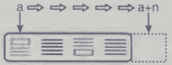

图 3-1：带有 begin 和 end 指针的长度为 n 的数组

表示上述右开区间的一对指针是一个 Range：C++ 中一个非常重要的概念。标准库中的许多算法都是以类似于 accumulate_array 的方式为指针类对象的范围实现的。要为新容器使用此类函数，我们只需提供这种指针类接口。作为示例，我们现在将演示如何为我们的列表调整其接口。

```
int main (int argc, char* argv[])
{
    int a[]= {2, 4, 7};
    double d[]= {2., 4.5, 7.};

    cout << "sum a is " << accumulate_array(a, &a[3]) << '\n';
    cout << "sum d is " << accumulate_array(d, d+3) << '\n';
}
```

#### 3.3.2.5 泛型求和

清单 3-2 和清单 3-3 中的两个求和函数看起来非常不同，因为它们是为不同的接口编写的。从功能上讲，它们并不那么不同。

在 3.3.2.3 节中，我们对 3.3.2.1 节和 3.3.2.2 节的 sum 实现进行了说明：

- 它们都从一个元素遍历到下一个元素。
- 它们都访问当前元素的值并将其加到 sum 中。
- 它们都测试是否到达了序列的末尾。

这也适用于 3.3.2.4 节中我们修订的数组实现。然而，后者使用了一种具有更抽象的序列增量遍历概念的接口。因此，当另一个序列（如列表）提供这种顺序接口时，可以将其应用于该序列。

Alex Stepanov 和 David Musser 在 STL 中的巧妙想法是为所有容器类型和传统数组引入一个通用接口。该接口由称为迭代器的泛化指针组成。然后，所有算法都针对这些迭代器实现了。我们将在 4.1.2 节中更广泛地讨论这一点，这里仅略作预告。

=> c++03/accumulate_example.cpp

我们现在需要一个列表的迭代器，它以指针类似的语法提供必要的功能，即：

- 使用 ++it 遍历序列；
- 使用 *it 访问值；以及
- 使用 == 或 != 比较迭代器。

实现很简单：

```
template <typename T>
struct list_iterator
{
    using value_type = T;

    list_iterator(list_entry<T>* entry) : entry(entry) {}

    T& operator*() { return entry->value; }

    const T& operator*() const
    { return entry->value; }

    list_iterator<T> operator++()
    { entry = entry->next; return *this; }

    bool operator!=(const list_iterator<T>& other) const
    { return entry != other.entry; }

    list_entry<T>* entry;
};
```

为了方便，为我们的列表添加 begin 和 end 方法：

```
template <typename T>
struct list
{
    list_iterator<T> begin() { return list_iterator<T>(first); }
    list_iterator<T> end() { return list_iterator<T>(0); }
};
```

list_iterator 使我们能够将清单 3-2 和清单 3-3 合并为 accumulate：

Listing 3-4: 泛型求和

```
template <typename Iter, typename T>
inline T accumulate(Iter it, Iter end, T init)
{
    for (; it != end; ++it)
        init += *it;
    return init;
}
```

这个泛型求和可以以如下形式用于数组和列表：

```
cout << "array sum = " << accumulate(a, a+10, 0.0) << '\n';
cout << "list sum = " << accumulate(l.begin(), l.end(), 0) << '\n';
```

与之前一样，成功的关键在于找到正确的抽象：迭代器。


list_iterator 实现也是终于回答“为什么迭代器应该前增量而非后增量”这一问题的良好机会。我们已经看到，前增量会更新 entry 成员并返回对迭代器的引用。后增量必须返回旧值，并递增其内部状态，以便下次使用迭代器时引用的是下一个列表条目。遗憾的是，只有在后增量操作在更改成员数据之前复制整个迭代器并返回该副本时，才能实现这一点：

```cpp
template <typename T>
struct list_iterator
{
    list_iterator<T> operator++(int)
    {
        list_iterator<T> tmp(*this);
        p = p->next;
        return tmp;
    }
};
```

我们通常调用增量操作只是为了进入下一个条目，并不关心操作返回的值。那么创建一个从未使用过的迭代器副本只是资源浪费。优秀的编译器可能会优化掉多余的操作，但没有必要冒这个险。后增量定义的一个有趣细节是那个伪 int 参数，它仅存在以与前增量定义区分开来。

## 3.4 类型推导与定义

C++ 编译器在 C++03 中已能为函数模板的参数自动推导类型。设 f 为一个模板函数，我们调用

```cpp
f(g(x, y, z) + 3 * x);
```

编译器即可推导 f 参数的类型。

### 3.4.1 自动变量类型

当我们将类似前面示例的表达式结果赋值给变量时，在 C++03 中需要知道该表达式的类型。另一方面，如果我们将结果赋值给一个不可转换的类型，编译器会在提供不兼容类型的同时告知我们。这表明编译器知道该类型，而在 C++11 中，这一知识也共享给了程序员。

使用前面示例中类型信息的最简单方式是自动变量类型：

```cpp
auto a = f(g(x, y, z) + 3 * x);
```

这并未改变 C++ 是强类型语言这一事实。auto 类型不同于 Python 等其他语言中的动态类型。在 Python 中，对 a 进行赋值可以改变 a 的类型，即改为所赋表达式的类型。在 C++11 中，变量 a 具有表达式结果的类型，并且此后该类型永远不会改变。因此，auto 类型不是一种会根据赋给变量的内容自动适应的类型，而是只确定一次。

只要所有变量都用相同类型的表达式初始化，我们就可以在同一语句中声明多个 auto 变量：

```cpp
auto i = 2 * 7.5, j = std::sqrt(3.7); // okay: both are double
auto i = 2 * 4, j = std::sqrt(3.7); // Error: i is int, j double
auto i = 2 * 4, j; // Error: j is not initialized
auto v = g(x, y, z); // result of f
```

我们可以使用 const 和引用属性来修饰 auto：

```cpp
auto& ri = i; // reference handler on i
const auto& cri = i; // constant reference on i
auto&& ur = g(x, y, z); // forward reference to result of f
```

auto 变量的类型推导与函数参数的推导完全一样，如第 3.1.2 节所述。例如，这意味着即使 g 返回引用，变量 v 也不是引用。同样，通用引用 ur 根据 f 的结果类型是右值还是左值（引用），要么是右值引用，要么是左值引用。

### 3.4.2 表达式的类型

C++11 中的另一个新特性是 decltype。它就像一个返回表达式类型的函数。如果第一个 auto 示例中的 f 返回一个值，我们也可以用 decltype 来表达：

```cpp
decltype(f(g(x, y, z) + 3 * x)) a = f(g(x, y, z) + 3 * x);
```

显然，这过于冗长，因此在此情境下不太有用。

该特性在需要显式类型的地方非常重要：首先是作为类模板的模板参数。例如，我们可以声明一个向量，其元素能够容纳另外两个向量元素的和，例如 v1[0] + v2[0] 的类型。这使我们能够表达两个不同类型向量之和的适当返回类型：

```cpp
template <typename Vector1, typename Vector2>
auto operator+(const Vector1& v1, const Vector2& v2)
-> vector< decltype(v1[0] + v2[0]) >;
```

这段代码还引入了另一个新特性：后置返回类型。在 C++11 中，我们仍然有义务声明每个函数的返回类型。借助 decltype，用函数参数来表达返回类型会更方便。因此，我们可以将返回类型的声明移到参数之后。

两个向量可能具有不同类型，而结果向量又是另一种类型。通过表达式 `decltype(v1[0] + v2[0])`，我们推导出将两个向量的元素相加会得到什么类型。该类型将是我们结果向量的元素类型。

`decltype` 的一个有趣之处在于，它仅在类型层面操作，不求值作为参数给出的表达式。因此，前面示例中的表达式对空向量不会引起错误，因为 `v1[0]` 未被执行，只确定了其类型。

`auto` 和 `decltype` 两个函数不仅在应用上不同，类型推导也不同。虽然 `auto` 遵循函数模板参数的规则，并且经常丢弃引用和 `const` 限定符，但 `decltype` 会原样获取表达式类型。例如，如果我们介绍性示例中的函数 `f` 返回一个引用，那么变量 `a` 将是一个引用。相应的 auto 变量将是一个值。

只要我们主要处理内置类型，就无需自动类型推导也能应付。但借助高级泛型和元编程，我们可以从这些极其强大的特性中获益良多。

### 3.4.3 decltype(auto)

这一新特性弥合了 `auto` 和 `decltype` 之间的差距。借助 `decltype(auto)`，我们可以声明具有与 `decltype` 相同类型的 auto 变量。下面两个声明是等价的：

```cpp
decltype(expr) v = expr; // redundant + verbose when expr long
decltype(auto) v = expr; // Ahh! Much better.
```

第一个语句相当冗长：我们添加到 `expr` 的所有内容在语句中都要写两次。并且每次修改时都必须注意这两个表达式仍然相同。

=> c++14/value_range_vector.cpp

限定符的保留在自动 `return` 类型中也很重要。例如，我们引入一个向量视图，用于测试值是否在给定范围内。该视图将使用 `operator[]` 访问被视向量的一个元素，并在范围测试后以完全相同的限定符返回它。这显然是 `decltype(auto)` 的工作。我们对该视图的示例实现仅包含一个构造函数和访问运算符：

```cpp
template <typename Vector>
class value_range_vector
{
    using value_type = typename Vector::value_type;
    using size_type = typename Vector::size_type;

public:
    value_range_vector(Vector& vref, value_type minv, value_type maxv)
        : vref(vref), minv(minv), maxv(maxv)
    {}

    decltype(auto) operator[](size_type i)
    {
        decltype(auto) value = vref[i];
        if (value < minv) throw too_small{};
        if (value > maxv) throw too_large{};
        return value;
    }
private:
    Vector& vref;
    value_type minv, maxv;
};
```

我们的访问运算符在返回之前会缓存来自 vref 的元素以进行范围检查。临时变量的类型和返回类型都使用 decltype(auto) 推导。为了测试向量元素是否以正确类型返回，我们将一个元素存储在 decltype(auto) 变量中并检查其类型：

```cpp
int main()
{
    using Vec = mtl::vector<double>;
    Vec v = {2.3, 8.1, 9.2};
    value_range_vector<Vec> w(v, 1.0, 10.0);
    decltype(auto) val = w[1];
}
```

val 的类型是 double&，正如所期望的那样。该示例使用了三次 decltype(auto)：视图实现中两次，测试中一次。如果我们只将其中一个替换为 auto，val 的类型将变为 double。

### 3.4.4 定义类型

定义类型有两种方式：使用 typedef 或 using。前者是在 C 中引入的，并从一开始就存在于 C++ 中。这也是它唯一的优势：向后兼容。7 为了编写无需使用 C++11 之前编译器编译的新软件，我们强烈建议你

> 建议
> 使用 using 而非 typedef。

它更易读、更强大。对于简单的类型定义，这只是顺序问题：

```
typedef double value_type;
versus
using value_type = double;
```

7. 这是本书示例中有时仍使用 typedef 的唯一原因。


在 using 声明中，新名称位于左侧，而 typedef 将其放在右侧。对于数组声明，新类型名称不是 typedef 中最右侧的部分，且类型被分成两部分：

```cpp
typedef double da1[10];
```

与之相反，在 using 声明中，类型保持为一个整体：

```cpp
using da2 = double[10];
```

对于函数（指针）类型，差异更加明显——希望你在类型定义中永远不需要它。§4.4.2 中的 std::function 是一个更灵活的替代方案。例如，声明一个带有 float 和 int 参数并返回 float 的函数，读作

```cpp
typedef float float_fun1(float, int);
```

与之相对

```cpp
using float_fun2 = float (float, int);
```

在所有这些示例中，using 声明清楚地将新类型名称与定义分开。

此外，using 声明允许我们定义模板别名。这些是带有类型参数的定义：假设我们有一个用于任意阶数和可参数化值类型的模板类：

```cpp
template <unsigned Order, typename Value>
class tensor { ... };
```

现在我们想为一阶和二阶张量分别引入类型名称 vector 和 matrix。这无法通过 typedef 实现，但可以通过 using 的模板别名轻松实现：

```cpp
template <typename Value>
using vector = tensor<1, Value>;
```

```cpp
template <typename Value>
using matrix = tensor<2, Value>;
```

当我们将以下几行的输出：

```cpp
std::cout << "type of vector<float> is "
<< typeid(vector<float>).name() << '\n';
std::cout << "type of matrix<float> is "
<< typeid(matrix<float>).name() << '\n';
```

交给名称去修饰器，我们将看到

```
type of vector<float> is tensor<1u, float>
type of matrix<float> is tensor<2u, float>
```

总而言之，如果你有 typedef 经验，你会欣赏 C++11 带来的新机遇；如果你是类型定义领域的新手，你应该立即开始使用 using。

## 3.5 关于模板的一点理论：概念

> "亲爱的朋友，灰色皆是理论，生命之树常青。"<sup>8</sup>
> —Johann Wolfgang von Goethe

在前面的章节中，你可能会产生这样的印象：模板参数可以被任何类型替代。事实上，这并不完全正确。模板类和函数的程序员对可以对模板参数执行的操作做出了假设。

因此，了解哪些参数类型是可接受的非常重要。例如，我们已经看到 `accumulable` 可以用 `int` 或 `double` 实例化。没有加法的类型（如第 74 页的求解器类）不能用于 `accumulable`。从一组求解器中应该累积什么？函数 `accumulate` 的模板参数 `T` 的所有要求可以总结如下：

- `T` 是可拷贝构造的：当 `b` 的类型为 `T` 时，`T a(b);` 可编译。
- `T` 是可加赋的：当 `a` 和 `b` 的类型为 `T` 时，`a += b;` 可编译。
- `T` 可以从 `int` 构造：`T a(0);` 可编译。

这样一组类型要求称为 _概念_。包含概念 `C` 的所有要求并可能有额外要求的概念 `C` 称为 `C` 的 _细化_。满足概念 `C` 的所有要求的类型 `T` 称为 `C` 的 _模型_。例如，可加赋类型包括 `int`、`float`、`double`，甚至 `string`。

模板函数或类的完整定义应包含所需概念的列表，就像标准模板库中的函数所做的那样；见 `http://www.sgi.com/tech/stl/`。

今天，这些要求仅作为文档。未来的 C++ 标准很可能将概念作为核心语言特性支持。主要由 Andrew Sutton 编写的技术规范 "C++ Extensions for Concepts" [46] 正在进行中，可能会成为 C++17 的一部分。

## 3.6 模板特化

一方面，能够为许多参数类型使用相同的实现是一大优势。然而，对于某些参数类型，我们可能知道更高效的实现，这可以通过 C++ 中的 _模板特化_ 实现。原则上，我们甚至可以为某些类型实现完全不同的行为，代价是造成极大的混乱。因此，特化将更高效，但行为相同。C++ 提供了巨大的灵活性，我们作为程序员有责任负责任地使用这种灵活性，并保持自身的一致性。

### 3.6.1 为单一类型特化类

=> c++11/vector_template.cpp

在接下来的内容中，我们想将 Listing 3.3.1 中的 vector 示例特化为 bool。我们的目标是通过将 8 个 bool 值打包到一个字节中来节省内存。让我们从类定义开始：

```cpp
template <>
class vector<bool>
{
    // ...
};
```

虽然我们的特化类不再是类型参数化的，但我们仍然需要 template 关键字和空三角括号。名称 vector 之前已被声明为类模板，我们需要这个看似多余的模板表示法来表明以下定义是主模板的特化。因此，在主模板之前定义或声明模板特化是错误的。在特化中，必须在尖括号中为每个模板参数提供一个类型。这些值本身可以是参数（或其表达式）。例如，如果我们针对三个参数中的一个进行特化，另外两个仍然声明为模板参数：

```cpp
template <typename T1, typename T3>
class some_container<T1, int, T3>
{
    // ...
};
```

回到我们的布尔向量类：我们的主模板为空向量和包含 n 个元素的向量定义了构造函数。为保持一致性，我们也应该定义相同的构造函数。对于非空向量，当位数不能被 8 整除时，我们需要向上取整数据大小：

```cpp
template <>
class vector<bool>
{
public:
    explicit vector(int size)
        : my_size(size), data(new unsigned char[(my_size + 7) / 8])
    {
    }
    vector() : my_size(0) {}
private:
    int my_size;
    std::unique_ptr<unsigned char[]> data;
};
```

你可能已经注意到，默认构造函数与主模板中的相同。不幸的是，该方法不会“继承”到特化中。每当我们编写特化时，都必须从头开始定义所有内容或使用一个共同基类。9

我们可以自由地从主模板中省略成员函数或变量，但为保持一致性，我们只有出于充分理由，甚至非常充分的理由时才应这样做。例如，我们可能会省略 operator+，因为 bool 没有加法。常量访问运算符通过移位和位掩码实现：

```cpp
template <> class vector<bool>
{
    bool operator[](int i) const
    { return (data[i / 8] >> i % 8) & 1; }
};
```

可变访问更棘手，因为我们无法引用单个位。诀窍是返回一个 Proxy，它为单个位提供读写操作：

```cpp
template <> class vector<bool>
{
    vector_bool_proxy operator[](int i)
    { return {data[i / 8], i % 8}; }
    vector_bool_proxy operator[](int i) const
    { return {data[i / 8], i % 8}; }
};
```

返回语句使用花括号列表来调用两参数构造函数。让我们现在实现我们的代理，以管理 vector<bool> 中的特定位。显然，该类需要对包含字节的引用以及该字节内的位置。为了简化进一步操作，我们创建一个掩码，该掩码在问题位置有一个位，在所有其他位置有零位：

```cpp
class vector_bool_proxy
{
public:
    vector_bool_proxy(unsigned char& byte, int p)
        : byte(byte), mask(1 << p) {}

private:
    unsigned char& byte;
    unsigned char mask;
};
```

读取访问通过转换为 bool 来实现，我们只需对引用的字节进行掩码：

```cpp
class vector_bool_proxy
{
    operator bool() const { return byte & mask; }
};
```

只有当字节中的考虑位为 1 时，按位与才会产生非零值，该值在从 unsigned char 到 bool 的转换中被评估为 true。
设置位通过 bool 的赋值运算符实现：

```cpp
class vector_bool_proxy
{
```


```
vector_bool_proxy& operator=(bool b)
{
    if (b)
        byte|= mask;
    else
        byte&= ~mask;
    return *this;
};
```

当我们区分所赋的值时，赋值操作更容易实现。
当参数为 true 时，我们用掩码进行 OR 运算，使考虑位置上的比特被置位。所有其他位置保持不变，因为与 0 进行 OR 运算没有影响（0 是按位 OR 的单位元）。反之，当参数为 false 时，我们先反转掩码，然后将其与字节引用进行 AND 运算。这样，掩码在活动位置上的零比特会将该比特清零。在所有其他位置上，与 1 进行 AND 运算会保留旧的比特值。

使用针对 bool 的 vector 专用化后，我们只使用大约八分之一的内存。
尽管如此，该专用化与主模板大体一致：我们可以以相同的方式创建 vector 并读写它们。坦率地说，压缩的 vector 并不与主模板完全相同，例如，当我们获取元素引用或涉及类型推导时。不过，我们尽可能让该专用化与通用版本相似，在大多数情况下我们不会察觉差异，它的工作方式也相同。

### 3.6.2 对函数进行专用化和重载

在本节中，我们将讨论并评估函数模板专用化的优缺点。

#### 3.6.2.1 将函数专用化到特定类型

函数可以像类一样进行专用化。不幸的是，它们不参与重载决议，且不够具体的重载会优先于更具体的模板专用化；参见 [44]。出于这个原因，Sutter 和 Alexandrescu 在 [45, Item 66] 中给出了以下建议：

#### 建议

不要使用函数模板专用化！

要为上述某个特定类型或类型元组提供特殊实现，我们可以直接使用重载。这效果更好，甚至更简单，例如：

```
#include <cmath>

template <typename Base, typename Exponent>
Base inline power(const Base& x, const Exponent& y) { ... }

double inline power(double x, double y)
{
    return std::pow(x, y);
}
```

拥有众多专用化的函数最好通过类专用化来实现。这样可以进行全专用化和偏专用化，而无需考虑所有重载和 ADL 规则。我们将在第 3.6.4 节中展示这一点。

如果你曾想用汇编代码编写针对特定硬件的专用化，请尽量抵制。如果做不到，请先阅读附录 A.6.3 中的几条说明。

#### 

在前面的示例中，我们专用化了函数的所有参数。也可以在重载中专用化其中一些参数，并将剩余参数保留为模板：

```
template <typename Base, typename Exponent>
Base inline power(const Base& x, const Exponent& y);

template <typename Base>
Base inline power(const Base& x, int y);

template <typename Exponent>
double inline power(double x, const Exponent& y);
```

编译器会找到所有与参数组合匹配的重载，并选择最具体的一个，该重载应当提供最高效的特殊情况实现。例如，power(3.0, 2u) 会匹配第一个和第三个重载，其中后者更具体。用高等数学的术语来说：10 类型特异性是一个形成格的偏序关系，编译器会从可用的重载中选取最大值。不过，你无需深入代数学即可看出哪个类型或类型组合更具体。

如果我们使用前面的重载调用 power(3.0, 2)，则三个重载都会匹配。但这次我们无法确定最具体的重载。编译器会告诉我们调用存在歧义，并将重载 2 和 3 列为候选项。由于我们以一致且性能最优的方式实现了这些重载，我们可能对任一选择都感到满意，但编译器不会做出选择。为了消除歧义，我们必须添加第四个重载：

```
double inline power(double x, int y);
```

格论专家会立刻说：“当然，我们缺少特异性格中的连接。”但即使没有这种专业知识，我们大多数人也明白为什么使用三个重载时调用会存在歧义，以及为什么第四个重载解救了我们。事实上，大多数 C++ 程序员无需研究格论也能很好地工作。

10. 仅供喜欢高等数学的人阅读。而且只供此类人阅读。

### 3.6.3 偏专用化

在实现模板类时，迟早会遇到这种情况：我们想要将一个模板类专用化到另一个模板类。假设我们有模板 complex 和 vector，并希望将后者专用化到所有 complex 的实例上。逐一进行此操作会非常麻烦：

```
template <>
class vector<complex<float> >;
```

```
template <>
class vector<complex<double> >; // again ??? :-/
```

```
template <>
class vector<complex<long double> >; // how many more ??? :-P
```

这不仅不优雅，还破坏了我们普遍适用性的理想，因为 complex 类支持所有实数类型，而上述专用化仅考虑了其中有限数量的类型。特别是，出于显而易见的原因，无法考虑带有未来用户定义类型的 complex 实例。

避免实现冗余和忽略新类型的解决方案是偏专用化。我们将 vector 类专用化到所有 complex 实例化上：

```
template <typename Real>
class vector<complex<Real> >
{ ... };
```

如果你使用的编译器不支持 C++11，请注意在闭合 > 之间加上空格；否则编译器可能会将两个连续的 > 解释为移位运算符 >>，从而导致相当令人困惑的错误。尽管本书主要涉及 C++11 编程，但我们仍保留分隔空格以提高可读性。

偏专用化也适用于具有多个参数的类，例如：

```
template <typename Value, typename Parameters>
class vector<sparse_matrix<Value, Parameters> >
{ ... };
```

我们也可以对所有指针进行专用化：

```
template <typename T>
class vector<T*>
{ ... };
```

只要类型集合可以用类型模式表达，我们就可以对其应用偏专用化。

偏模板专用化可以与 §3.6.1 中的常规模板专用化结合使用——为区分起见，我们称其为全专用化。在这种情况下，全专用化优先于偏专用化。在不同的偏专用化之间，会选择最具体的一个。在下面的示例中：

```
template <typename Value, typename Parameters>
class vector<sparse_matrix<Value, Parameters> >
{ ... };
```

```
template <typename Parameters>
class vector<sparse_matrix<float, Parameters> > { ... };
```

第二个专用化比第一个更具体，并且在匹配时会被选中。事实上，全专用化始终比任何偏专用化都更具体。

### 3.6.4 对函数进行偏专用化

函数模板实际上不能进行偏专用化。但是，我们可以像全专用化（§3.6.2.1）那样，使用重载来提供特殊实现。为此，我们编写更具体的函数模板，在匹配时会被优先使用。例如，我们为所有 complex 实例重载了通用 abs：

```
template <typename T>
inline T abs(const T& x)
{
    return x < T(0) ? -x : x;
}
```

```
template <typename T>
inline T abs(const std::complex<T>& x)
{
    return sqrt(real(x)*real(x) + imag(x)*imag(x));
}
```

函数模板重载易于实现且效果相当不错。但是，对于被大量重载的函数，或者分布在大型项目众多文件中的重载，有时预期的重载不会被调用。原因是已经颇具挑战性的命名空间解析与混合模板和非模板函数的重载解析之间存在非平凡的相互作用。

```
=> c++14/abs_function.cpp
```

为了获得可预测的专用化行为，最安全的做法是在内部通过类模板专用化来实现，并且只提供一个函数模板作为用户接口。这里的挑战在于，当专用化的返回类型不同时，这个单一函数的返回类型。如我们的 abs 示例所示：通用代码返回参数类型，而更具体的 complex 版本返回底层值类型。这可以以可移植的方式处理，以便即使在 C++03 下也能工作。不过，较新的标准提供了简化此任务的特性。

我们先从使用 C++14 的最简单实现开始：

```
template <typename T> struct abs_functor;

template <typename T>
decltype(auto) abs(const T& x)
{
    return abs_functor<T>()(x);
}
```


我们的泛型 abs 函数创建一个匿名对象 abs_functor<T>()，并用参数 x 调用其 operator()。因此，相应的 abs_functor 特化需要一个默认构造函数（通常由编译器隐式生成）和一个作为一元函数的 operator()，接受类型 T 的参数。operator() 的返回类型会自动推导。对于 abs，我们很可能可以使用 auto 来推导返回类型，因为所有不同的特化都应该返回一个值。仅针对某些特化可能是 const 或引用限定的不太可能的情况，我们使用 decltype(auto) 来传递限定符。

使用 C++11 编程时，我们必须显式声明返回类型。至少，此声明可以应用类型推导：

```cpp
template <typename T>
auto abs(const T& x) -> decltype(abs_functor<T>()(x))
{
    return abs_functor<T>()(x);
}
```

诚然，重复 abs_functor<T>()(x) 是冗余的，而任何冗余都是不一致的潜在来源。

回到 C++03，我们根本不能对返回类型使用类型推导。因此，函子必须提供返回类型，例如，通过一个名为 result_type 的 typedef：

```cpp
template <typename T>
typename abs_functor<T>::result_type
abs(const T& x)
{
    return abs_functor<T>()(x);
}
```

在这里，我们必须依赖 abs_functor 的实现者，确保 result_type 与 operator() 的返回类型一致。

最后，我们为 complex<T> 实现一个带有偏特化的函子：

```cpp
template <typename T>
struct abs_functor
{
    typedef T result_type;

    T operator()(const T& x)
    {
        return x < T(0) ? -x : x;
    }
};
```

```cpp
template <typename T>
struct abs_functor<std::complex<T> >
{
    typedef T result_type;

    T operator()(const std::complex<T>& x)
    {
        return sqrt(real(x)*real(x) + imag(x)*imag(x));
    }
};
```

这是一个可移植的实现，适用于 abs 的所有三种实现。当我们放弃对 C++03 的支持时，可以省略模板中的 typedef。这个 abs_functor 可以针对任何合理的类型模式进一步特化，而不会遇到大量重载函数可能带来的麻烦。

## 3.7 模板的非类型参数

到目前为止，我们只将模板参数用于类型。值也可以作为模板参数。并非所有值，而是所有整型，即整数和 bool。为完整起见，指针也是允许的，但我们在此不作探讨。

=> c++11/fsize_vector.cpp

一种非常流行的做法是将大小作为模板参数来定义短向量和小矩阵：

```cpp
template <typename T, int Size>
class fsize_vector
{
    using self= fsize_vector;
public:
    using value_type= T;
    const static int my_size= Size;

    fsize_vector(int s= Size) { assert(s== Size); }

    self& operator=(const self& that)
    {
        std::copy(that.data, that.data + Size, data);
        return *this;
    }

    self operator+(const self& that) const
    {
        self sum;
        for (int i= 0; i < my_size; ++i)
            sum[i]= data[i] + that[i];
        return sum;
    }
// ...
private:
    T data[my_size];
};
```

由于大小已经作为模板参数提供，我们不需要将其传递给构造函数。但是，为了为向量建立统一的接口，我们在构造时仍然接受一个大小参数，并检查它是否与模板参数匹配。

将此实现与第 3.3.1 节中动态大小的向量进行比较，我们不会看到太多差异。本质区别在于大小现在是类型的一部分，并且可以在编译时访问。因此，编译器可以执行额外的优化。例如，当我们添加两个大小为 3 的向量时，编译器可以将循环转换为三条语句，如下所示：

```cpp
self operator+(const self& that) const
{
    self sum;
    sum[0] = data[0] + that[0];
    sum[1] = data[1] + that[1];
    sum[2] = data[2] + that[2];
    return sum;
}
```

这节省了计数器递增和循环结束测试。操作可能在 SSE 上并行执行。我们将在第 5.4 节详细讨论循环展开。

额外的编译时信息会诱导哪种优化，当然取决于编译器。只有通过阅读生成的汇编代码，或者间接地通过观察性能并将其与其他实现进行比较，才能发现实际执行了哪种转换。阅读汇编代码很困难，尤其是在高优化级别下。使用不那么激进的优化时，我们可能看不到静态大小带来的好处。

在上面的示例中，编译器可能会对像 3 这样的小尺寸展开循环，而对像 100 这样的大尺寸保留循环。因此，这些编译时大小对于小型矩阵和向量尤其有趣，例如三维坐标或旋转。

在编译时知道大小的另一个好处是，我们可以将值存储在数组中，这样我们的 `fsize_vector` 就使用单个内存块。与难以管理的动态分配内存相比，这使得创建和销毁更加容易。

我们之前提到过，大小成为类型的一部分。因此，对于相同类型的向量，我们不需要检查大小是否匹配。

我们说过，大小成为类型的一部分。细心的读者可能已经意识到，我们省略了检查向量是否具有相同大小的代码。我们不再需要这些测试了。如果参数具有相同的类类型，它隐式地具有相同的大小。请考虑以下程序片段：

```cpp
fsize_vector<float, 3> v;
fsize_vector<float, 4> w;
vector<float> x(3), y(4);

v = w;
x = y;
```

最后两行是不兼容的向量赋值。区别在于，第二个赋值 `x = y;` 中的不兼容性在我们的断言中在运行时被发现。赋值 `v = w;` 甚至无法编译，因为大小为 3 的固定大小向量只接受相同维度的向量作为参数。

如果需要，我们可以为非类型模板参数声明默认值。生活在我们的三维世界中，假设许多向量的维度为 3 是合理的：

```cpp
template <typename T, int Size = 3>
class fsize_vector
{ /* ... */ };
```

```cpp
fsize_vector<float> v, w, x, y;
fsize_vector<float, 4> space_time;
fsize_vector<float, 11> string;
```

对于相对论和弦理论，我们可以承担声明其向量维度的额外工作。

## 3.8 函子

在本节中，我们介绍一个极其强大的特性：函子，又称函数对象。乍一看，它们只是提供可像函数一样调用的运算符的类。与普通函数的关键区别在于，函数对象可以更灵活地相互应用或应用于自身，从而允许我们创建新的函数对象。这些应用需要一些时间来适应，阅读本节可能比前面的章节更具挑战性。然而，我们在这里达到了编程的全新质量，花在阅读上的每一分钟都值得。本节还为 lambda 表达式（§3.9）铺平了道路，并为元编程（第 5 章）打开了大门。

作为研究案例，我们开发一个数学算法来计算可微函数 f 的有限差分。有限差分是对第一导数的近似，由

$f'(x) \approx \frac{f(x+h) - f(x)}{h}$

给出，其中 h 是一个小值，也称为间距。

清单 3-5 展示了一个用于计算有限差分的通用函数。我们在函数 `fin_diff` 中实现了它，该函数接受一个任意函数（从 double 到 double）作为参数：

#### 清单 3-5: 使用函数指针的有限差分

```cpp
double fin_diff(double f(double), double x, double h)
{
    return ( f(x+h) - f(x) ) / h;
}
```


```cpp
double sin_plus_cos(double x)
{
    return sin(x) + cos(x);
}
```

```cpp
int main() {
    cout << fin_diff(sin_plus_cos, 1., 0.001) << '\n';
    cout << fin_diff(sin_plus_cos, 0., 0.001) << '\n';
}
```

这里我们用 h = 0.001 近似了 sin_plus_cos 在 x = 1 和 x = 0 处的导数。sin_plus_cos 作为函数指针传递（必要时，函数可以隐式转换为函数指针）。

现在我们想计算二阶导数。用 fin_diff 本身作为参数来调用它似乎很合理。不幸的是，这不可能，因为 fin_diff 有三个参数，与其自身只有一个参数的函数指针参数不匹配。

我们可以使用仿函数（Functors）或函数对象（Function Objects）来解决这个问题。这些是提供应用运算符 operator() 的类，因此其对象可以像函数一样被调用，这也解释了“函数对象”这一术语。不幸的是，在许多文本中，该术语是指类还是对象并不明显。在那些语境下这可能不是问题，但我们需要在类和对象之间做出明确的区分。因此，我们更倾向于使用 functor 一词，尽管它在范畴论中有其他含义。在本书中，functor 始终指代一个类，而其对象相应地被称为仿函数对象（functor object）。每当我们使用术语 function object 时，它与 functor object 同义。

回到我们的示例。之前使用的函数 sin_plus_cos 作为仿函数实现如下：

#### 列表 3-6：函数对象

```cpp
struct sc_f
{
    double operator()(double x) const
    {
        return sin(x) + cos(x);
    }
};
```

仿函数的一大优势是能够将参数作为内部状态保持。因此，我们可以用 α 对 sin 函数中的 x 进行缩放，即 sin αx + cos x：

#### 列表 3-7：带状态的函数对象

```cpp
class psc_f
{
public:
    psc_f(double alpha) : alpha(alpha) {}
    double operator()(double x) const
    {
        return sin(alpha * x) + cos(x);
    }
private:
    double alpha;
};
```

记法：在本节中，我们介绍了大量的类型和对象。为了更好地区分，我们采用以下命名约定：仿函数类型使用后缀 _f 命名，如 psc_f，其对象使用后缀 _o。近似导数前缀为 d_，二阶导数前缀为 dd_，高阶导数则为 d 加上其阶数，如 d7_ 表示七阶导数。为简洁起见，我们不会对每个导数都说明它只是近似值（阶数在 20 左右的导数实际上已经非常不正确，以至于近似本身就显得牵强）。

### 3.8.1 函数式参数

```cpp
=> c++11/derivative.cpp
```

在定义完我们的仿函数类型后，我们需要找出如何将其对象传递给函数。我们之前对 fin_diff 的定义使用函数指针作为参数，这无法用于我们的仿函数对象。此外，当我们希望支持不同的仿函数（例如 sc_f 和 psc_f）时，不能使用特定的参数类型。接受不同类型参数的技术主要有两种：继承和模板。继承版本推迟到第 6.1.4 节，直到我们实际介绍该特性。现在，我们必须指出，泛型方法在适用性和性能上更优。因此，我们为仿函数和函数使用类型参数：

```cpp
template <typename F, typename T>
inline T fin_diff(F f, const T& x, const T& h)
{
    return (f(x+h) - f(x)) / h;
}
```

```cpp
int main()
{
    psc_f psc_o(1.0);
    cout << fin_diff(psc_o, 1., 0.001) << endl;
    cout << fin_diff(psc_f(2.0), 1., 0.001) << endl;
    cout << fin_diff(sin_plus_cos, 0., 0.001) << endl;
}
```

在此示例中，我们创建仿函数对象 psc_o 并将其作为模板参数传递给 fin_diff。下一次调用将即时创建的对象 psc_f(2.0) 传递给求导操作。在 fin_diff 的最后一次调用中，我们演示了仍然可以传入普通函数，如 sin_plus_cos。

这三个例子表明参数 f 非常灵活。这就引发了一个问题：到底有多灵活。从我们使用 f 的方式来看，它必须是一个接受一个参数的函数。STL（§4.1）为这些要求引入了 UnaryFunction 概念：

- 令 f 为类型 f。
- 令 x 为类型 T，其中 T 是 f 的参数类型。
- f(x) 用一个参数调用 f 并返回结果类型的对象。

由于我们使用类型 T 的值进行所有计算，还应添加要求：f 的返回类型也是 T。

### 3.8.2 组合仿函数

迄今为止，我们已针对计算研究了不同类型的函数参数。不幸的是，通过将 fin_diff 作为参数传递给自身来优雅地计算高阶导数的目标，我们并未更近一步。问题在于 fin_diff 本身是一个三元函数，却需要一个一元函数作为参数。我们可以通过定义一个一元仿函数来克服这一差异，该仿函数将待求导的函数和步长作为内部状态：

```cpp
template <typename F, typename T>
class derivative
{
    public:
        derivative(const F& f, const T& h) : f(f), h(h) {}

        T operator()(const T& x) const
        {
            return ( f(x+h) - f(x) ) / h;
        }

    private:
        const F& f;
        T h;
};
```

然后，只有 x 仍作为普通函数参数传递给求导操作。该仿函数可以用一个表示 f(x) 的仿函数来实例化，其结果是一个用于近似 f'(x) 的仿函数：

```cpp
using d_psc_f = derivative<psc_f, double>;
```

这里，f(x) = sin(α·x) + cos(x) 的导数由仿函数 d_psc_f 表示。我们现在可以为 α = 1 创建导数的函数对象：

```cpp
psc_f             psc_o(1.0);
d_psc_f           d_psc_o(psc_o, 0.001);
```

这使我们能够在 x = 0 处计算差商：

```cpp
cout << "der. of sin(0) + cos(0) is " << d_psc_o(0.0) << '\n';
```

嗯，我们以前也能做到。与我们之前的解决方案的根本区别在于，原始函数及其导数具有相似性。它们都是从仿函数创建的一元函数。

因此，我们终于实现了目标：我们可以像对待 f(x) 一样对待 f'(x)，并从中构建 f''(x)。更技术性地说：我们可以用派生函数的仿函数 d_psc_f 来实例化 derivative：

```cpp
using dd_psc_f = derivative<d_psc_f, double>;
```

现在我们确实有了一个二阶导数的仿函数。我们通过为其创建函数对象并近似 f''(0) 来演示这一点：

```cpp
dd_psc_f dd_psc_o(d_psc_o, 0.001);
cout << "2nd der. of sin(0) + cos(0) is " << dd_psc_o(0.0) << '\n';
```

由于 dd_psc_f 同样是一个一元仿函数，我们可以为三阶及更高阶导数创建一个。

如果我们需要从多个函数中获取二阶导数，可以投入更多精力直接创建二阶导数，而无需让用户先创建一阶导数。以下仿函数在构造函数中为一阶导数创建函数对象，并近似 f''(x)：

```cpp
template <typename F, typename T>
class second_derivative
{
public:
    second_derivative(const F& f, const T& h)
        : h(h), fp(f, h) {}
    T operator()(const T& x) const
    {
        return ( fp(x+h) - fp(x) ) / h;
    }
private:
    T h;
    derivative<F, T> fp;
};
```

现在我们可以从 f 构建 f'' 的函数对象：

```cpp
second_derivative<psc_f, double> dd_psc_2_o(psc_f(1.0), 0.001);
```

同样，我们可以为每个高阶导数构建一个生成器。更好的是，我们现在将实现一个用于近似任意阶导数的仿函数。

### 3.8.3 递归

当我们思考如何实现三阶、四阶或一般的 n 阶导数时，我们会发现它们与二阶导数非常相似：在 x+h 和 x 上调用 (n-1) 阶导数。我们可以用递归实现来探索这种重复模式：


```cpp
template <typename F, typename T, unsigned N>
class nth_derivative
{
    using prev_derivative = nth_derivative<F, T, N-1>;
    public:
        nth_derivative(const F& f, const T& h)
        : h(h), fp(f, h) {}
        T operator()(const T& x) const
        {
            return ( fp(x+h) - fp(x) ) / h;
        }
    private:
        T h;
        prev_derivative fp;
};
```

为了防止编译器陷入无限递归，我们必须在到达第一个导数时停止这种相互引用。请注意，我们不能使用 if 或 ?: 来停止递归，因为两个分支都会被急切求值，并且其中一个分支仍然包含无限递归。递归模板定义通过如下的特例化来终止：

```cpp
template <typename F, typename T>
class nth_derivative<F, T, 1>
{
    public:
        nth_derivative(const F& f, const T& h) : f(f), h(h) {}
        T operator()(const T& x) const
        {
            return ( f(x+h) - f(x) ) / h;
        }
    private:
        const F& f;
        T h;
};
```

这个特例化与我们现在可以丢弃的类 derivative 相同。或者我们保留它，并通过简单地从它派生来重用其功能（关于派生的更多内容见第 6 章）。

```cpp
template <typename F, typename T>
class nth_derivative<F, T, 1>
: public derivative<F, T> {};
```

现在我们可以计算任何导数，例如第 22 阶导数：

```cpp
nth_derivative<psc_f, double, 22> d22_psc_o(psc_f, 0.00001);
```

新对象 d22_psc_o 同样是一个一元函数对象。不幸的是，它的近似效果太差，以至于我们不敢在此展示结果。根据泰勒级数，我们知道当对前向差分应用后向差分时，$f''$ 近似的误差会从 $O(h)$ 降低到 $O(h^2)$。也就是说，也许我们可以通过在前向差分和后向差分之间交替来改进近似：

```cpp
template <typename F, typename T, unsigned N>
class nth_derivative {
    using prev_derivative = nth_derivative<F, T, N-1>;
    public:
    nth_derivative(const F& f, const T& h) : h(h), fp(f, h) {}
    T operator()(const T& x) const
    {
        return N & 1 ? (fp(x+h) - fp(x)) / h
                     : (fp(x) - fp(x-h)) / h;
    }
    private:
    T h;
    prev_derivative fp;
};
```

遗憾的是，我们的第 22 阶导数仍然和之前一样错误，嗯，甚至稍微更糟。尤其是当我们意识到 f 被求值了超过四百万次时，这尤其令人沮丧。减小 h 也没有帮助：切线更好地逼近导数，但另一方面，f(x) 和 f(x ± h) 的值彼此趋近，它们的差值只保留了几个有效位。至少，正如泰勒级数所教导的，我们的交替差分方案改进了第二阶导数。另一个令人欣慰的事实是，我们可能并未为这种交替付出代价。模板参数 N 在编译时已知，条件 N&1 的结果也是已知的。因此，编译器可以将 if 语句缩小为相应的活跃 then- 或 else-分支。

总而言之，我们学到了一些关于 C++ 的知识，并且我们深信不疑：

> **格言**
> 
> 即使是最酷的编程也无法替代扎实的数学。

归根结底，这本书主要是关于编程的。函数对象被证明对于生成新的函数对象极具表现力。尽管如此，如果任何读者对数值上更好的递归计算有好主意，欢迎联系作者。

只有一个细节仍然让我们困扰：函数对象参数与构造函数参数之间的冗余。假设我们计算 psc_o 的第七阶导数：

```cpp
nth_derivative<psc_f, double, 7> d7_psc_o(psc_o, 0.00001);
```

nth_derivative 的前两个参数正好是构造函数参数的类型。这很冗余，我们更希望能推导它们。auto 和 decltype 在这里帮助不大：

```cpp
auto d7_psc_o= nth_derivative<psc_f, double, 7>(psc_o, 0.00001);
nth_derivative<decltype(psc_o),
decltype(0.00001), 7> d7_psc_o(psc_o, 0.00001);
```

更有希望的是一个 make-函数，它接受构造函数参数并像这样推导它们的类型：

```cpp
template <typename F, typename T, unsigned N> // Not clever
nth_derivative<F, T, N>
make_nth_derivative(const F& f, const T& h)
{
    return nth_derivative<F, T, N>(f, h);
}
```

这应该能推导 F 和 T，我们只需要显式声明 N。不幸的是，这并不像预期那样工作。当我们声明某个模板参数时，我们有义务声明所有前面的参数：

```cpp
auto d7_psc_o= make_nth_derivative<psc_f, double, 7>(psc_o, 0.00001);
```

嗯，这并不特别有用。我们必须更改 make-函数的模板参数顺序：必须声明 N，而 F 和 T 可以推导。因此，我们将 N 放在前面：

```cpp
template <unsigned N, typename F, typename T>
nth_derivative<F, T, N>
make_nth_derivative(const F& f, const T& h)
{
    return nth_derivative<F, T, N>(f, h);
}
```

现在编译器可以推导第七阶导数的函数对象和值类型：

```cpp
auto d7_psc_o= make_nth_derivative<7>(psc_o, 0.00001);
```

我们已经看到，模板参数的顺序对我们的 make-函数很重要。在编译器推导所有参数的函数模板中，参数顺序无关紧要。只有在显式声明参数或其中一些参数时，我们才需要注意。未推导的参数必须位于参数列表的前面。为了记住这一点，想象一个部分参数被推导的模板函数调用：显式声明的参数排在前面，位于开括号 ( 的左侧，而其他参数则从右侧 ( 的参数中推导。

### 3.8.4 泛型归约

回顾我们在 3.3.2.5 节中用来说明泛型编程的函数 accumulate。在本节中，我们将把这个函数推广为泛型归约。我们引入一个 BinaryFunction，它作为函数或可调用类对象实现对两个参数的操作。然后，我们可以对序列的所有元素应用 BinaryFunction 来执行任何归约：

```cpp
template <typename Iter, typename T, typename BinaryFunction>
T accumulate(Iter it, Iter end, T init, BinaryFunction op)
{
    for (; it != end; ++it)
        init = op(init, *it);
    return init;
}
```

要对值求和，我们可以实现一个由值类型参数化的函数对象：

```cpp
template <typename T>
struct add
{
    T operator()(const T& x, const T& y) const { return x + y; }
};
```

除了类，我们也可以对 operator() 进行参数化：

```cpp
struct times
{
    template <typename T>
    T operator()(const T& x, const T& y) const { return x * y; }
};
```

这样做的好处是编译器可以推导值类型：

```cpp
vector v = {7.0, 8.0, 11.0};
double s = accumulate(v.begin(), v.end(), 0.0, add<double>{});
double p = accumulate(v.begin(), v.end(), 1.0, times{});
```

在这里，我们计算了向量元素的和与积。add 函数对象需要使用向量的值类型进行实例化，而 times 函数对象不是模板类，其参数类型在应用时被推导。

## 3.9 Lambda

C++11 引入了 Lambda 表达式。\(\lambda\)-表达式只是函数对象的简写。然而，它使程序更加紧凑，而且通常也更易理解。特别是对于简单的计算，在使用的地方看到其实现比调用代码位于其他地方的函数更清晰。之前见过经典的函数对象后，理解什么是 Lambda 就非常容易了。

清单 3-6 实现了一个用于 sin x + cos x 的函数对象。相应的 \(\lambda\)-表达式是

#### Listing 3-8: Simple \(\lambda\)-expression

```cpp
[](double x) { return sin(x) + cos(x); }
```


lambda表达式不仅定义了一个仿函数，而且立即创建其对象。因此，我们可以将其立即作为参数传递给函数：

```cpp
fin_diff([](double x){ return sin(x) + cos(x); }, 1., 0.001 )
```

参数可以融入lambda表达式。因此，我们可以像在仿函数psc_f（清单3-7）中所做的那样，通过插入乘法来缩放sin参数，同时仍然提供一个一元函数对象：

```cpp
fin_diff([](double x){ return sin(2.5*x) + cos(x); }, 1., 0.001)
```

我们还可以将其存储到变量中以供重复使用：

```cpp
auto sc_l= [](double x){ return sin(x) + cos(x); };
```

之前示例中的lambda表达式不声明其返回类型。在这种情况下，它们由编译器推导。如果无法推导或我们希望显式声明，可以将返回类型作为尾随参数提供：

```cpp
[]()->double { return sin(x) + cos(x); };
```

=> c++11/derivative.cpp

既然我们可以即时创建函数对象，并且不太想费心处理它们的类型，我们很高兴我们的导数生成器能够推导类型。这使我们能够在一个单一表达式中创建sin 2.5x + cos x的近似七阶导数函数：

```cpp
auto d7_psc_l= make_nth_derivative<7>( [](double x){ return sin(2.5*x) + cos(x); }, 0.0001);
```

遗憾的是，教科书中的语句对于单行来说太长，但在实际程序中并非如此（就作者的品味而言）。

一旦lambda表达式出现，许多程序员就对它们兴奋不已，以至于用lambda实现每个函数参数——通常跨越多行并包含内部lambda。这对经验丰富的程序员来说可能是一个有趣的挑战，但我们相信，将庞大的嵌套表达式分解为可读的片段有助于所有使用和维护我们软件的人。

### 3.9.1 捕获

在上一节中，我们通过简单插入一个操作来参数化lambda。然而，对于大量参数来说，这并不十分高效：

```cpp
a= fin_diff([](double x){ return sin(2.5 * x); }, 1., 0.001);
b= fin_diff([](double x){ return sin(3.0 * x); }, 1., 0.001);
c= fin_diff([](double x){ return sin(3.5 * x); }, 1., 0.001);
```

不幸的是，我们不能这样访问作用域中的变量或常量：

```cpp
double phi= 2.5;
auto sin_phi= [](double x){ return sin(phi * x); }; // Error
```

\(\lambda\)表达式只能使用其自身的参数或之前*捕获*的参数。

### 3.9.2 按值捕获

为了使用phi，我们必须先捕获它：

```cpp
double phi = 2.5;
auto sin_phi = [phi](double x){ return sin(phi * x); };
```

要捕获多个变量，可以提供逗号分隔的列表：

```cpp
double phi = 2.5, xi = 0.2;
auto sin2 = [phi,xi](double x){ return sin(phi*x) + cos(x)*xi; };
```

这些参数被复制，但与按值传递的函数参数不同，禁止修改它们。作为仿函数类编写，前面的λ对应于

```cpp
struct lambda_f
{
    lambda_f(double phi, double xi) : phi(phi), xi(xi) {}
    double operator()(double x) const
    {
        return sin(phi * x) + cos(x) * xi;
    }
    const double phi, xi;
};
```

因此，稍后修改捕获的变量对lambda没有影响：

```cpp
double phi = 2.5, xi = 0.2;
auto px = [phi,xi](double x){ return sin(phi * x) + cos(x) * xi; };
phi = 3.5; xi = 1.2;
a = fin_diff(px, 1., 0.001); // still uses phi= 2.5 and xi= 0.2
```

变量在定义λ时被捕获，因此在调用lambda时使用那时的值。

此外，尽管它们是副本，我们也不能在lambda函数内部修改值。原因是lambda的函数体对应于上面lambda_f中的const限定的operator()。例如，在下面的lambda中，递增捕获的phi是非法的：

```cpp
auto l_inc = [phi](double x) { phi+= 0.6; return phi; }; // Error
```

为了允许修改捕获的值，lambda必须被限定为mutable：

```cpp
auto l_mut = [phi](double x) mutable { phi+= 0.6; return phi; };
```

与这个可变lambda等价的仿函数类不会被const限定：

```cpp
struct l_mut_f
{
    double operator()(double x); // not const
    // ...
    double phi, xi; // not const either
};
```

因此，我们不能再将lambda l_mut传递给const参数。另一方面，我们在这里并不真正需要可变性，可以改为返回phi+0.6并省略递增。

### 3.9.3 按引用捕获

变量也可以按引用捕获：

```cpp
double phi = 2.5, xi = 0.2;
auto pxr = [&phi, &xi](double x){ return sin(phi * x) + cos(x) * xi; };
phi = 3.5; xi = 1.2;
a = fin_diff(pxr, 1., 0.001); // now uses phi = 3.5 and xi = 1.2
```

在这个例子中，使用的是\(\Lambda\)函数调用时的phi和xi的值，而不是创建lambda时的值。相应的仿函数类将如下所示：

```cpp
struct lambda_ref_type
{
    lambda_ref_type(double& phi, double& xi) : phi(phi), xi(xi) {}
    double operator()(double x)
    {
        return sin(phi * x) + cos(x) * xi;
    }
    double& phi;
    double& xi;
};
```

引用语义的另一个后果是能够修改被引用的值。这不仅可能是副作用的来源，还可以高效地使用。假设我们有不同的稠密和稀疏矩阵类。对于所有这些类，我们提供通用遍历函数on_each_nonzero，将矩阵作为第一个参数，函数对象作为第二个参数（按值传递）。这使我们能够通用地计算Frobenius范数：


鉴于此公式，我们显然可以忽略所有零项，只处理非零项：

```cpp
template <typename Matrix>
typename Matrix::value_type
frobenius_norm(const Matrix& A)
{
    using std::abs; using std::sqrt;
    using value_type = typename Matrix::value_type;
    value_type ss = 0;
    on_each_nonzero(A, [&](value_type x) { ss += abs(x) * abs(x); });
    return sqrt(ss);
}
```

为简单起见，我们在这里假设A(0,0)和abs(A(0,0))的类型相同。请注意，\(\lambda\)表达式不返回值，因为其目的是在被引用的变量ss中累加平方矩阵值。这里缺少return语句意味着void返回类型。

捕获所有变量有快捷方式：

- [=]: 按复制捕获所有；
- [&]: 按引用捕获所有；
- [=&,a,b,&c]: 按复制捕获所有，但a、b、c按引用捕获；以及
- [&,a,b,c]: 按引用捕获所有，但a、b、c按复制捕获。

Scott Meyers建议不要使用捕获所有功能，因为它增加了悬空引用的危险以及忽略静态或成员变量的风险；参见[32, Item 31]。

### 3.9.4 初始化捕获

捕获的泛化由初始化捕获引入。它允许我们将变量移动到闭包中，并为上下文变量或其表达式赋予新名称。假设我们有一个返回作为unique_ptr的Hilbert矩阵的函数：

```cpp
auto F = make_unique<Mat<Mat<{1., 0.5},{0.5,1./3.}}>);
```

我们可以捕获指针的引用，但当闭包的生命周期超过指针时，我们面临悬空引用的风险。另一方面，unique_ptr不能被复制。为了确保我们的矩阵与闭包一样长寿，我们必须将数据移动到由闭包拥有的unique_ptr中：

```cpp
auto apply_hilbert= [F = move(F)](const Vec& x){ return Vec{*F * x}; };
```

初始化捕获还允许我们为现有变量引入新名称，并对表达式求值并将名称与结果关联：

```cpp
int x = 4;
auto y=
    [&r= x, x = x + 1]()
    {
        r+= 2;    // increment r, a reference to outer x
        return x + 2; // return x + 2 where x is the outer x + 1
    }();
```

标准中的这个示例定义了一个返回int的无参闭包。闭包引入了两个局部变量：r是上下文中x的引用，局部值x用外部x + 1初始化。

在示例中，我们可以看到初始化捕获的形式为var = expr。一个有趣的事实（你可能已经注意到）是var和expr在不同的作用域中定义。var在闭包的作用域中定义，expr在其上下文中定义。因此，相同的名称可以出现在=的两边。相反，下面的捕获列表：

```cpp
int x = 4;
auto y= [&r= x, x = r + 1](){ ... }; // Error: no r in context
```

是不允许的，因为r只存在于闭包中，因此不能用于捕获列表的右侧。


### 3.9.5 泛型 Lambda

C++11 中的 Lambda 确定了返回类型，但参数需要显式声明。C++14 取消了这一限制。与函数模板不同，参数不是用有些冗长的 template-typename 表示法声明的，而是使用关键字 auto。例如，一个按降序对（随机访问）容器元素进行排序的函数可以简单地实现为

```cpp
template <typename C>
void reverse_sort(C& c)
{
    sort(begin(c), end(c), [](auto x, auto y) { return x > y; });
}
```

同样，我们可以简化 3.9.3 节中的 frobenius_norm。求平方模之和的 Lambda 可以简单地实例化参数类型：

```cpp
template <typename Matrix>
inline auto frobenius_norm(const Matrix& A)
{
    using std::abs; using std::sqrt;
    decltype(abs(A[0][0])) ss = 0;
    on_each_nonzero(A, [&ss](auto x) { ss+= abs(x) * abs(x); });
    return sqrt(ss);
}
```

在这个小函数中，我们使用了更多的类型推导机制，完全摆脱了声明 value_type 的需要。我们现在还可以处理 abs 可能返回与 value_type 不同类型的情况。

## 3.10 可变参数模板

当函数和类模板的参数个数可变时，称为可变参数模板；即，它们适用于任意数量的参数。更准确地说，可能存在最小参数个数，但不存在最大参数个数。此外，模板参数允许是不同的类型（或整型常量）。

在撰写本文时，程序员社区仍在探索这一强大特性的道路上。用例包括，例如，类型安全的 printf 实现、不同种类的归约以及所有形式的泛型转发函数。希望我们的示例能为应用中更频繁的可变参数模板实现贡献一份力量。

我们将使用混合类型的求和函数来说明该特性：

```cpp
template <typename T>
inline T sum(T t) { return t; }

template <typename T, typename... P>
inline T sum(T t, P... p)
{
    return t + sum(p...);
}
```

可变参数模板通过递归来处理。我们分解所谓的*参数包*，并处理其子集。通常，分离出一个元素并将其与其余部分的结果组合。

可变参数模板引入了由 ... 表示的新省略号运算符。左侧的运算符表示打包，右侧表示解包。省略号的不同解释如下：

- typename ...P：将多个类型参数打包到类型包 P 中；
- <P...>：在实例化类或函数模板时解包 P（稍后介绍）；
- P... p：将多个函数参数打包到变量包 p 中；以及
- sum(p...)：解包变量包 p 并使用多个参数调用 sum。

因此，我们的 sum 函数计算第一个条目与其余部分之和的加法。这个和也以递归方式计算。为了终止递归，我们为单个参数编写了一个重载。我们也可以为一个零元函数（无参数函数）编写一个重载，返回 int 类型的 0。

我们的实现有一个显著的缺点：`return` 类型是第一个参数的类型。在某些情况下，这或多或少可以工作：

```cpp
auto s = sum(-7, 3.7f, 9u, -2.6);
std::cout << "s is " << s
          << " and its type is " << typeid(s).name() << '\n';
```

结果为

```
s is 2 and its type is int
```

正确结果 3.1 无法存储为 int。13 是我们第一个参数 -7 的类型。这并不十分令人满意，但情况可能更糟，如下面的计算所示：

```cpp
auto s2 = sum(-7, 3.7f, 9u, -42.6);
std::cout << "s2 is " << s2 << " and its type is " << typeid(s2).name() << '\n';
```

这也返回一个 int：

```
s2 is -2147483648 and its type is int
```

第一个中间结果是 9 - 42.6 = -33.6，转换为无符号数时会产生一个非常大的数字，随后转换为一个非常小的 int 值。另一方面，计算

```cpp
auto s = -7 + 3.7f + 9u + -42.6;
```

计算出正确结果并将其存储为 double。但在我们谴责可变参数模板之前，我们必须承认自己为中间值和最终结果选择了不合适的类型。我们将在 5.2.7 节中使用更合适的返回类型来纠正这一点。

在编译时计算参数包中的参数个数，可以使用类函数表达式 sizeof...：

```cpp
template <typename... P>
void count(P... p)
{
    cout << "You have " << sizeof...(P) << " parameters.\n";
    ...
}
```

A.2.7 节中的二进制 I/O 在 A.6.4 节中进行了修订，以允许写入和读取操作中有任意数量的参数。

正如求和示例已经表明的那样，可变参数模板的全部威力只有在与元编程（第 5 章）结合时才能释放。

## 3.11 练习

### 3.11.1 字符串表示

编写一个泛型函数 to_string，它接受任意类型（作为 const&）的参数，通过将其管道传输到 std::stringstream 来生成一个字符串，并返回生成的字符串。

### 3.11.2 元组的字符串表示

编写一个可变参数模板函数，将任意数量的参数表示为字符串中的元组。即，函数调用 to_tuple_string(x, y, z) 通过将每个元素打印到字符串流中，返回形式为 (x, y, z) 的字符串。

提示：使用一个针对不同参数个数重载的辅助函数 to_tuple_string_aux。

### 3.11.3 泛型栈

为泛型值类型编写一个栈实现。栈的最大大小在类中定义（硬连线）。提供以下函数：

- 构造函数；
- 析构函数（如有必要）；
- top：显示最后一个元素；
- pop：删除最后一个元素（不返回）；
- push：插入新元素；
- clear：删除所有条目；
- size：元素个数；
- full：栈是否已满；
- empty：栈是否为空。

栈上溢或下溢必须抛出异常。

### 3.11.4 向量的迭代器

为类 vector 添加 begin() 和 end() 方法，用于返回起始迭代器和结束迭代器。同时向类中添加 iterator 和 const_iterator 类型。请注意，指针是随机访问迭代器概念的模型。
使用 STL 函数 sort 对向量条目进行排序，以证明您的迭代器按预期工作。

### 3.11.5 奇数迭代器

编写一个名为 odd_iterator 的奇数迭代器类。该类必须模拟（实现）forward_iterator 概念（http://www.sgi.com/tech/stl/ForwardIterator.html）。这意味着它必须提供以下成员：

- 默认构造函数和拷贝构造函数；
- operator++ 用于移动到下一个奇数元素，包括前置递增和后置递增；
- operator* 作为解引用，返回一个（奇数）int；
- operator== 和 operator!=；以及
- operator-。

具有明显的语义。此外，类应包含一个接受 int 值的构造函数。该值将在解引用运算符中返回（只要迭代器未递增）。如果该值为偶数，此构造函数应抛出异常。同样，默认构造函数应将内部值初始化为 1，以提供合法状态。

### 3.11.6 奇数范围

编写一个表示奇数范围的类。成员函数或自由函数 begin 和 end 应返回如练习 3.11.5 中定义的 odd_iterator。
以下代码应打印奇数 {7, 9, ..., 25}：

```cpp
for (int i : odd_range(7, 27))
std::cout << i << '\n';
```

### 3.11.7 bool 栈

将练习 3.11.3 中的栈实现特化为 bool。使用 unsigned char 存储 8 个 bool，如 3.6.1 节所示。

### 3.11.8 自定义大小的栈

使用用户定义的大小修订练习 3.11.3 中的栈实现（以及可选的练习 3.11.7 中的实现）。大小作为第二个模板参数传递。默认值应为 4096。

### 3.11.9 推导非类型模板参数

我们已经看到，模板参数的类型可以在函数调用中推导。在大多数情况下，非类型模板参数被显式声明，但当它们是参数类型的一部分时，也可以推导。为例，编写一个函数 array_size，它接受任意类型和大小的 C 数组的引用，并返回该数组的大小。实际函数参数可以省略，因为我们只关心其类型。你还记得吗？我们在 1.8.7.1 节中处理过这个练习。另一方面，我们在中间已经揭示了它最棘手的部分。

### 3.11.10 梯形法则

计算函数积分的一种简单方法是梯形法则。假设我们想在区间 [a, b] 上对函数 f 进行积分。我们将区间分成 n 个长度相同的小区间 [x_i, x_{i+1}]，其中 h = (b - a)/n，并用分段线性函数近似 f。然后，积分近似为该函数积分之和。

这导出了以下公式：

```
I = \frac{h}{2}f(a) + \frac{h}{2}f(b) + h \sum_{j=1}^{n-1} f(a + jh) \quad (3.1)
```

在这个练习中，我们开发一个带有仿函数参数的梯形法则函数。为了比较，使用继承和泛型编程来实现这一点。作为测试用例，对以下内容进行积分：

- f = exp(-3x)，x 在 [0, 4] 上。尝试使用以下参数调用 trapezoid：

```cpp
double exp3f(double x) {
    return std::exp(3.0 * x);
}
```

```cpp
struct exp3t {
    double operator() (double x) const {
        return std::exp(3.0 * x);
    }
};
```

- 当 x < 1 时 f = sin(x)，当 x >= 1 时 f = cos(x)，x 在 [0, 4] 上。

- 我们可以调用 trapezoid( std::sin, 0.0, 2.0 ) 吗？？

作为第二个练习，开发一个用于计算有限差分的仿函数。然后对有限差分进行积分，以验证您是否得到了函数值。


### 3.11.11 函子

为 2 cos z + x^2 编写一个函子，并使用第 3.8.1 节中的函子计算其一阶和二阶导数。

### 3.11.12 Lambda

计算与练习 3.11.11 相同的导数，但这次使用 lambda 表达式。

### 3.11.13 实现 make_unique

实现你自己的 make_unique。使用 std::forward 将参数包传递给 new。

## 第 4 章 库

> "上帝，赐予我平静，去接受我无法改变的事，
> 赐予我勇气，去改变我能够改变的事，
> 并赐予我智慧，去分辨两者的差异"
> ——雷因霍尔德·尼布尔

作为程序员，我们也需要类似的力量。我们对软件应该完成什么有着宏大的愿景，并且需要非常强大的勇气来实现它。尽管如此，一天只有 24 小时，即使是硬核极客有时也要吃饭和睡觉。因此，我们无法独自编程实现我们梦想的一切（或受雇去做的一切），不得不依赖现有软件。然后，我们必须通过实现带有适当前处理和后处理的接口来接受该软件所提供的内容。是使用现有软件还是编写新程序的决定需要我们运用全部智慧。

实际上，即使没有多年使用经验，依赖软件甚至还需要某种预见能力。有时，软件包一开始运行良好，但一旦我们在其之上构建更大的项目，可能会遇到一些无法轻易弥补的严重问题。那时我们可能会痛苦地意识到，另一个软件包或从头开始的实现本会是更好的选择。

C++ 标准库可能并不完美，但它经过非常精心的设计和实现，因此我们可以避免此类不愉快的意外。标准库的组件经过与核心语言特性相同的彻底评估过程，并保证最高质量。库的标准化还确保其类和函数在每个符合标准的编译器上都可用。我们之前已经介绍过一些库组件，例如 §2.3.3 中的初始化列表或 §1.7 中的 I/O 流。在本章中，我们将介绍更多对编程科学家或工程师非常有用的库组件。

C++11 标准库的全面教程和参考由 Nicolai Josuttis 提供 [26]。Bjarne Stroustrup 的书籍第四版 [43] 也涵盖了所有库组件，尽管细节较少。

此外，针对线性代数或图算法等标准领域，还有许多科学库。我们将在最后一节简要介绍其中一些。

## 4.1 标准模板库

标准模板库（STL）是容器和算法的基础泛型库。每个程序员都应该了解它，并在适当的时候使用它，而不是重复造轮子。这个名称可能有点令人困惑：Alex Stepanov 和 David Musser 创建的 STL 的大部分内容已成为 C++ 标准库的一部分。另一方面，标准库的其他组件也是用模板实现的。为了让混淆达到完美，C++ 标准为每个与库相关的章节关联一个库名。在 2011 和 2014 标准中，STL 包含在三个这样的章节中：第 23 章 容器库、第 24 章 迭代器库和第 25 章 算法库（后者还包含部分 C 库）。

标准模板库不仅提供了有用的功能，还奠定了一种编程哲学的基础，该哲学在可重用性和性能的结合上无比强大。STL 定义了泛型容器类、泛型算法和迭代器。在线文档可在 www.sgi.com/tech/stl 上查阅。还有关于 STL 用途的整本书，因此我们可以在此简要介绍并参考这些书籍。例如，STL 核心实现者 Matt Austern 专门为此写了一整本书：[3]。Josuttis 的库教程大约有 500 页专门介绍 STL。

### 4.1.1 入门示例

容器是用于包含对象（包括容器和容器的容器等等）的类。vector 和 list 类是 STL 容器的示例。这些类模板中的每一个都由元素类型参数化。例如，以下语句创建一个 double 向量和一个 int 向量：

```
std::vector<double> vec_d;
std::vector<int> vec_i;
```

请注意，STL 向量不是数学意义上的向量，因为它们不提供算术运算。因此，我们在各种不断发展的实现中创建了自己的向量类。

STL 还包括大量操作容器数据的算法。例如，之前提到的 accumulate 算法可以用于以以下方式计算列表或向量上的任何归约（如求和、乘积或最小值）：

```
std::vector<double> vec; // fill the vector...
std::list<double> lst; // fill the list...

double vec_sum = std::accumulate(begin(vec), end(vec), 0.0);
double lst_sum = std::accumulate(begin(lst), end(lst), 0.0);
```

函数 begin() 和 end() 返回表示右开区间的迭代器，与之前一样。C++11 为它们引入了自由函数表示法，而在 C++03 中我们必须使用相应的成员函数。

### 4.1.2 迭代器

STL 的核心抽象是迭代器。简单来说，迭代器是泛化的指针：可以对其进行解引用和比较，并更改所引用的位置，就像我们在第 3.3.2.5 节中使用自己的 list_iterator 演示的那样。然而，鉴于迭代器的重要性，这种简化并不能充分体现其价值。迭代器是解耦数据结构和算法实现的基本方法。在 STL 中，每个数据结构都提供一个用于遍历的迭代器，所有算法都以迭代器的方式实现，如图 4-1 所示。

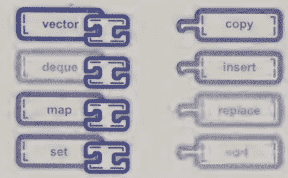

图 4-1：STL 容器与算法之间的互操作性

在经典 C 和 Fortran 编程中，要在 n 个数据结构上实现 m 个算法，需要 m · n 个实现。

用迭代器表达算法可将数量减少到仅 m + n 个实现！

#### 4.1.2.1 类别

并非所有算法都可以用于每个数据结构。哪种算法适用于给定的数据结构（例如线性查找或二分查找）取决于容器提供的迭代器类型。迭代器可以按访问形式区分：

- InputIterator：用于读取所引用条目的迭代器概念（但只能读取一次）。

- OutputIterator：用于向所引用条目写入的迭代器概念（但只能写入一次）。

请注意，写入能力并不意味着可读性；例如，ostream_iterator 是一个 STL 接口，用于向 cout 或输出文件等输出流写入。迭代器的另一种区分方式是遍历形式：

- ForwardIterator：适用于可以从一个元素传递到下一个元素的迭代器的概念，即提供 operator++ 的类型。它是 InputIterator 和 OutputIterator 的细化。与前者不同，ForwardIterator 允许读取值两次并进行多次遍历。

- BidirectionalIterator：适用于具有逐步前向和后向遍历的迭代器的概念，即具有 operator++ 和 operator-- 的类型。它细化了 ForwardIterator。

- RandomAccessIterator：适用于可以添加任意正或负偏移量的迭代器的概念，即此外还提供 operator[] 的类型。它细化了 BidirectionalIterator。

仅使用简单迭代器接口（如 InputIterator）的算法实现可以应用于更多的数据结构。同样，提供更丰富迭代器接口（例如建模 RandomAccessIterator）的数据结构可以用于更多的算法。

所有迭代器接口的一个巧妙设计选择是，指针也提供它们的操作。每个指针都建模 RandomAccessIterator，因此所有 STL 算法都可以通过指针应用于旧式数组。

#### 4.1.2.2 使用迭代器

所有标准容器模板都提供一组丰富且一致的迭代器类型。以下非常简单的示例展示了迭代器的典型用法：

```
using namespace std;
std::list<int> l = {3, 5, 9, 7}; // C++11
for (list<int>::iterator it = l.begin(); it != l.end(); ++it) {
    int i = *it;
}
cout << l << endl;
```

在此第一个示例中，我们将自己限制在 C++03 特性中（列表初始化除外），以证明使用迭代器对 C++11 来说并非新事物。在本节的其余部分，我们将使用更多 C++11 特性，但原理保持不变。

如代码片段所示，迭代器通常成对使用，一个处理实际迭代，另一个标记容器的末尾。迭代器由相应的容器类使用标准方法 begin() 和 end() 创建。begin() 返回的迭代器指向第一个元素，而 end() 返回指向元素末尾之后的迭代器。末尾迭代器仅用于比较，因为在大多数情况下尝试访问值会失败。STL 中的所有算法都使用右开区间 [b,e) 实现，对 b 引用的值进行操作，直到 b = e。因此，形式为 [x,x) 的区间被视为空。

成员函数 begin() 和 end() 保持容器的常量性：

- 如果容器对象是可变的，则这些方法返回指向可变容器条目的迭代器类型。

- 对于常量容器，这些方法返回 const_iterator，它通过常量引用访问容器条目。

通常 iterator 可以隐式转换为 const_iterator，但你不应该依赖此特性。回到现代 C++。我们首先为迭代器引入类型推导：

```
std::list<int> l = {3, 5, 9, 7};
for (auto it = begin(l), e = end(l); it != e; ++it) {
    int i = *it;
    std::cout << l << std::endl;
}
```


我们还改用了 C++11 引入的更符合习惯的 begin 和 end 自由函数表示法。由于它们是内联函数，此更改不影响性能。说到性能，我们引入了一个新的临时变量来保存 end 迭代器，因为我们不能 100% 确定编译器能否优化对 end 函数的重复调用。

与我们的第一个代码片段使用 const_iterator 不同，推导出的迭代器允许我们修改所引用的条目。这里有多种方法可以确保列表在循环内不被修改。有一种方法行不通，就是 const auto：

```
for (const auto it = begin(l), e = end(l); ...) // Error
```

这推导出的不是 const_iterator，而是 const 迭代器。这是一个小但重要的区别：前者是指向常量数据的（可变）迭代器，而后者本身是一个常量，因此不能递增。如前所述，begin() 和 end() 对于常量列表返回 const_iterator。因此，我们可以将列表声明为常量，缺点是它只能在构造函数中设置。或者我们定义一个指向该列表的 const 引用：

```
const std::list<int>& lr = l;
for (auto it = begin(lr), e = end(lr); it != e; ++it) ...
```

或者将其强制转换为 const 引用：

```
for (auto it = begin(const_cast<const std::list<int>&>(l)),
      e = end(const_cast<const std::list<int>&>(l));
      it != e; ++it) ...
```

不用说，这两种版本都相当麻烦。因此，C++11 引入了成员函数 cbegin 和 cend，它们对常量和可变容器都返回 const_iterator。相应的自由函数是在 C++14 中引入的：

```
for (auto it = cbegin(l); it != cend(l); ++it) // C++14
```

这种基于 begin-end 的遍历模式如此常见，正是引入基于范围的 for（§14.4.3）的动机。到目前为止，我们只在过时的 C 数组上使用过它，现在很高兴能最终将其应用于真正的容器：

```
std::list<int> l = {3, 5, 9, 7};
for (auto i : l) {
    std::cout << i << std::endl;
}
```

循环变量 i 是一个（隐藏的）已解引用迭代器，遍历整个容器。因此，i 依次指向每个容器条目。由于所有 STL 容器都提供 begin 和 end 函数，我们可以用这个简洁的 for 循环遍历它们。

更一般地说，我们可以将这个 for 循环应用于所有具有返回迭代器的 begin 和 end 函数的类型：例如表示子容器的类或用于反向遍历返回迭代器的辅助类。这个包含所有容器的更广泛概念称为 Range，这也毫不奇怪地是 range-based for-loop 名称的由来。尽管我们在本书中仅在容器上使用它，但值得一提的是，因为范围在 C++ 的演进中日益重要。为了避免将容器条目复制到 i 中的开销，我们可以创建一个类型推导的引用：

```
for (auto& i : l)
    std::cout << i << std::endl;
```

引用 i 与 l 具有相同的常量性：如果 l 是可变/常量容器（范围），那么引用也是可变/常量的。为了确保条目不能被更改，我们可以声明一个 const 引用：

```
for (const auto& i : l)
    std::cout << i << std::endl;
```

STL 包含简单和复杂的算法。它们都包含（通常深藏其中）与上面示例本质上等价的循环。

#### 4.1.2.3 操作

<iterator> 库提供两个基本操作：advance 和 distance。操作 advance(i, n) 将迭代器 i 递增 n 次。这看起来可能是一种表达 it++ 的麻烦方式，但有两个根本区别：第二种表示法不会改变迭代器 it（这不一定是劣势），并且它仅适用于 RandomAccessIterator。函数 advance 可以用于任何类型的迭代器。从这个意义上说，advance 就像 += 的一种实现，也适用于只能逐步递增的迭代器。

为了高效，该函数在内部针对不同的迭代器类别进行分发。这种实现常被用作函数分发的入门，我们忍不住要概述 advance 的典型实现：

Listing 4-1：advance 中的函数分发

```
template <typename Iterator, typename Distance>
inline void advance_aux(Iterator& i, Distance n, input_iterator_tag)
{
    assert(n >= 0);
    for (; n > 0; --n)
        ++i;
}

template <typename Iterator, typename Distance>
inline void advance_aux(Iterator& i, Distance n,
                        bidirectional_iterator_tag)
{
    if (n >= 0)
        for (; n > 0; --n) ++i;
    else
        for (; n < 0; ++n) --i;
}

template <typename Iterator, typename Distance>
inline void advance_aux(Iterator& i, Distance n,
                        random_access_iterator_tag)
{
    i += n;
}

template <typename Iterator, typename Distance>
inline void advance(Iterator& i, Distance n)
{
    advance(i, n, typename iterator_category<Iterator>::type());
}
```

当函数 advance 用迭代器类型实例化时，该迭代器的类别由类型特性（§5.2.1）确定。该标签类型的对象决定调用辅助函数 advance_aux 的哪个重载。因此，当 Iterator 是随机访问迭代器时，advance 的运行时间是常数，否则是线性。双向迭代器和随机访问迭代器允许负距离。

现代编译器足够智能，能够意识到 advance_aux 每个重载中的第三个参数未被使用，且标签类型是空类。因此，参数传递和标签类型对象的构造被优化掉。因此，额外的函数层和标签分发不会造成任何运行时开销。例如，在 vector 迭代器上调用 advance 归结为仅生成 i += n 的代码。

advance 的对应操作是 distance：

```
int i = distance(it1, it2);
```

它计算两个迭代器之间的距离，即第一个迭代器必须递增多少次才能等于第二个迭代器。不言而喻，实现也是标签分发的，因此随机访问迭代器的开销是常数，否则是线性。

## 4.1.3 容器

标准库中的容器涵盖了广泛的重要数据结构，易于使用，且效率相当高。在编写自己的容器之前，尝试标准容器绝对是值得的。

### 4.1.3.1 向量

std::vector 是最简单的标准容器，也是连续存储数据最高效的容器，类似于 C 数组。与某些大小以下的 C 数组存储在栈上不同，向量始终位于堆上。向量提供方括号运算符，可以使用数组风格的算法：

```
std::vector<int> v = {3, 4, 7, 9};
for (int i = 0; i < v.size(); ++i)
    v[i] *= 2;
```

或者，我们可以使用迭代器：直接使用或在基于范围的 for 中隐式使用：

```
for (auto& x : v)
    x *= 2;
```


图 4-2：向量的内存布局

不同的遍历形式效率应当相似。可以通过在末尾添加新条目来扩大向量：

```
std::vector<int> v;
for (int i = 0; i < 100; ++i)
    v.push_back(my_random());
```

其中 my_random() 返回随机数，如第 4.2.2 节中的生成器一样。STL 向量通常会预留额外空间，如图 4-2 所示，以加速 push_back。

因此，追加条目可以是

- 要么相当快，只需填充已预留的空间；
- 要么相当慢，当需要分配更多内存并复制所有数据时。

可用空间由成员函数 capacity 提供。当向量数据扩大时，额外空间的量通常与向量大小成正比，因此 push_back 具有渐进常数时间。典型实现会在向量大小翻倍时（即每次重新分配时从 s 扩大到 \sqrt{2}s）执行两次内存分配。图 4-3 说明了这一点：第一张图是一个完全填充的向量，添加新条目需要新分配，如第二张图所示。之后，我们可以继续添加条目，直到额外空间也被填满，如第三张图所示。然后需要分配新内存并复制所有条目，如第四张图所示；只有之后才能添加新条目。

方法 resize(n) 将向量缩小或扩大到大小 n。新条目会被默认构造（对于内置类型则设置为 0）。使用 resize 缩小向量不会释放内存。这可以在 C++11 中使用 shrink_to_fit 完成，它将容量减小到实际的向量大小。

```
=> c++11/vector_usage.cpp
```

下面的简单程序说明了如何使用 C++11 特性设置和修改向量：

```
#include <iostream>
#include <vector>
#include <algorithm>

int main()
{


```
using namespace std;
vector<int> v = { 3, 4, 7, 9};
auto it = find(v.begin(), v.end(), 4);
cout << "After " << *it << " comes " << *(it+1) << '\n';
auto it2 = v.insert(it+1, 5); // insert value 5 at pos. 2
v.erase(v.begin()); // delete entry at pos. 1
cout << "Size = " << v.size() << ", capacity = "
<< v.capacity() << '\n';
v.shrink_to_fit(); // drop extra entries
v.push_back(7);
for (auto i : v)
cout << i << ",";
cout << '\n';
}
```

第 A.7 节展示了如何在旧的 C++03 中实现相同的功能。

可以在任意位置添加和删除条目，但这些操作代价高昂，因为所有后面的条目都需要移动。然而，它并没有我们想象中那么昂贵。

vector 中的其他新方法是 emplace 和 emplace_back，例如：

```
vector<matrix> v;
v.push_back(matrix(3, 7)); // add 3 by 7 matrix, built outside
v.emplace_back(7, 9); // add 7 by 9 matrix, built in place
```

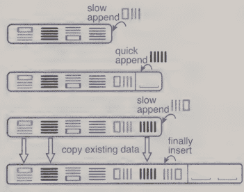

图 4-3：追加 vector 条目

使用 push_back 时，我们需要先构造一个对象（如示例中的 3×7 矩阵），然后将其复制或移动到 vector 的新条目中。相比之下，emplace_back 直接在 vector 的新条目中构造一个新对象（这里是 7×9 矩阵）。这节省了复制或移动操作，并可能节省一些内存分配/释放。其他容器中也引入了类似的方法。

如果 vector 的大小在编译时已知且之后不再更改，我们可以改用 C++11 容器 array。它位于栈上，因此效率更高（浅拷贝操作如 move 和 swap 除外）。

### 4.1.3.2 双端队列

deque（双端队列的准缩写）可以从多个角度来理解：

- 作为 FIFO（先进先出）队列；
- 作为 LIFO（后进先出）栈；或
- 作为在开头具有快速插入功能的 vector 的泛化。

得益于其内存布局，该容器具有非常有趣的特性。在内部，它由多个子容器组成，如图 4-4 所示。当追加新项时，它被插入到最后一个子容器的末尾，如果该子容器已满，则分配一个新的子容器。同样，可以在前面插入新条目。

这种设计的好处是数据在内存中大多是顺序的，访问速度几乎与 vector 一样快 [41]。同时，deque 条目永远不会被重新定位。这不仅节省了复制或移动的开销，还允许我们存储既不可复制也不可移动的类型，如下文所示。

```
=> c++11/deque_emplace.cpp
```

**非常高级：** 使用 emplace 方法，我们甚至可以创建不可复制、不可移动类的容器。假设我们有一个 solver 类，它既不包含复制构造函数也不包含移动构造函数（例如，由于原子成员；关于原子请参见 §4.6）：

```cpp
struct parameters {};
struct solver
{
    solver(const mat& ref, const parameters& para)
        : ref(ref), para(para) {}
    solver(const solver&) = delete;
    solver(solver&&) = delete;
    solver& operator=(const solver&&) = delete;

    const mat& ref;
    const parameters& para;
};
```

该类的多个对象存储在一个 deque 中。稍后，我们遍历这些 solvers：

```
void solve_x(const solver& s) { ... }
```

```cpp
int main ()
{
    parameters    p1, p2, p3;
    mat           A, B, C;
    deque<solver> solvers;

    // solvers.push_back(solver(A, p1)); // would not compile
    solvers.emplace_back(B, p1);
    solvers.emplace_back(C, p2);
    solvers.emplace_front(A, p1);

    for (auto& s : solvers)
        solve_x(s);
}
```

请注意，solver 类只能用于不涉及数据移动或复制的容器方法。例如，vector::emplace_back 可能会复制或移动数据，相应的代码由于 solver 中的已删除构造函数而无法编译。即使使用 deque，我们也不能使用所有成员函数：例如，insert 和 erase 需要移动数据。我们还必须对循环变量 s 使用引用，以避免在那里进行复制。

### 4.1.3.3 列表

list 容器（在 <list> 中）是一个双向链表，如图 4-5 所示，因此可以向前和向后遍历（即，其迭代器模拟 BidirectionalIterator）。与前面的容器不同，我们无法直接访问第 n 个条目。相对于 vector 和 deque 的一个优势是，中间的插入和删除代价较低。

当其他条目被插入或删除时，列表条目永远不会被移动。因此，只有被删除条目的引用和迭代器会失效，而其他所有条目都保持有效。

```
int main ()
{
    list<int> l = { 3, 4, 7, 9 };
    auto it = find(begin(l), end(l), 4), it2 = find(begin(l), end(l), 7);
    l.erase(it);
    cout << "it2 still points to " << *it2 << '\n';
}
```

对每个单独条目的动态内存处理将它们分散在内存中，如图 4-6 所示，因此不幸的缓存行为导致比 vector 和 deque 性能更差。列表在某些操作上更高效，但在许多其他操作上更慢，因此列表的总体性能很少更好；例如，比较 [28] 或 [52]。幸运的是，在泛型编程的应用中，只需更改容器类型就可以快速克服此类性能瓶颈。

在典型的 64 位平台上，我们的 list<int> 的一个条目占用 20 字节：两个 8 字节用于 64 位指针，4 字节用于 int。当不需要向后迭代时，我们可以节省一个指针的空间并使用 forward_list（在 <forward_list> 中）。

### 4.1.3.4 集合和多重集

set 容器的目的是存储某个值属于集合的信息。set 中的条目在内部按树排序，以便可以以对数复杂度访问。set 中某个值的存在可以通过成员函数 find 和 count 来测试。find 返回指向该值的迭代器，如果未找到则返回 end 迭代器。如果我们不需要迭代器，count 更方便。在这种情况下，使用 count 更方便：

```cpp
set<int> s = {1, 3, 4, 7, 9};
s.insert(5);
for (int i = 0; i < 6; ++i)
    cout << i << " appears " << s.count(i) << " times.\n";
```

输出如下：

```
0 appears 0 time(s),
1 appears 1 time(s),
2 appears 0 time(s),
3 appears 1 time(s),
4 appears 1 time(s),
5 appears 1 time(s),
```

多次插入相同的值没有影响；即，count 始终返回 0 或 1。

multiset 容器还计算某个值被插入的次数：

```cpp
multiset<int> s = {1, 3, 4, 7, 9, 1, 1, 4};
s.insert(4);
for (int i = 0; i < 6; ++i)
    cout << i << " appears " << s.count(i) << " time(s).\n";
```

产生：

```
0 appears 0 time(s).
1 appears 3 time(s).
2 appears 0 time(s).
3 appears 1 time(s).
4 appears 3 time(s).
5 appears 0 time(s).
```

仅为了检查某个值是否存在于 multiset 中，find 更高效，因为它不需要遍历重复的值。

请注意，没有名为 multiset 的头文件，但 multiset 类也定义在 <set> 中。

### 4.1.3.5 映射和多重映射

=> c++11/map_test.cpp

map 是一个关联容器；即，值与键相关联。键可以是任何具有顺序的类型：要么由 operator <（通过 less 函子）提供，要么由建立严格弱序的函子提供。map 提供了一个方括号运算符用于简洁的访问表示法。以下程序说明了其用法：

```
map<string, double> constants=
{{"e", 2.7}, {"pi", 3.14}, {"h", 6.6e-34}};
cout << "The Planck constant is " << constants["h"] << '\n';
constants["c"] = 299792458;
cout << "The Coulomb constant is " <<
constants["k"] << '\n'; // Access missing entry!
cout << "The value of pi is " << '\n';
auto it_phi = constants.find("phi");
if (it_phi != constants.end())
cout << "Golden ratio is " << *it_phi->second << '\n';
cout << "The Euler constant is " <<
constants.at("e") << '\n';
for (auto& c : constants)
cout << "The value of " << c.first << " is "
<< c.second << '\n';
```

这产生：
The Planck constant is 6.6e-34
The Coulomb constant is 0
The circle's circumference pi is 3.14
The Euler constant is 2.7

The value of c is 2.99792e+08
The value of e is 2.7
The value of h is 6.6e-34
The value of k is 0
The value of pi is 3.14

这里 map 是通过键值对列表初始化的。请注意，map 的 value_type 不是 double，而是 pair<const string, double>。在接下来的两行中，我们使用方括号运算符来查找键为 h 的值，并为 c 插入一个新值。方括号运算符返回该键值的引用。如果未找到键，则使用默认构造的值插入一个新条目。然后返回对该值的引用。对于 c，我们向此引用赋值并建立键值对。然后我们查询不存在的库仑常数，意外地创建了一个值为零的条目。

为了避免 [] 的可变和常量重载之间的不一致，STL 的创建者完全省略了常量重载（这是一个我们并不真正满意的设计选择）。要在常量 map 中搜索键，我们可以使用经典方法 find 或 C++11 方法 at。find 不如 [] 优雅，但它可以防止我们意外插入条目。它返回一个 const_iterator，指向一个键值对。如果未找到键，则返回 end 迭代器，当键不确定时，我们应该将其与之比较。

当我们确定键存在于 map 中时，可以使用 at。它像 [] 一样返回对值的引用。关键区别是，当未找到键时（即使 map 是可变的）会抛出 out_of_range 异常。因此，它不能用于插入新条目，但提供了一个用于查找条目的紧凑接口。


当我们遍历容器时，得到的是键及其关联值的对（因为单独的值本身是没有意义的）。

```
=> c++11/multimap.test.cpp
```

当一个键可以关联多个值时，我们需要 multimap。相同键的条目被存储在彼此相邻的位置，因此我们可以遍历它们。迭代器范围由 lower_bound 和 upper_bound 方法提供。在下一个示例中，我们遍历所有键等于 3 的条目并打印它们的值：

```
multimap<int, double> mm=
{{3, 1.3}, {2, 4.1}, {3, 1.8}, {4, 9.2}, {3, 1.5}};
for (auto it = mm.lower_bound(3),
    end = mm.upper_bound(3); it != end; ++it)
    cout << "The value is " << it->second << '\n';
```

这将产生：

The value is 1.3
The value is 1.8
The value is 1.5

最后四个容器——set、multiset、map 和 multimap——都以某种树的形式实现，访问的复杂度为对数复杂度。在下一节中，我们介绍平均复杂度下访问更快的容器。

### 4.1.3.6 哈希表

```
=> c++11/unordered_map.test.cpp
```

哈希表是具有非常高效搜索能力的容器。与前面的容器不同，哈希映射在单次访问时具有常数复杂度（前提是哈希函数足够好）。为了避免与现有软件发生名称冲突，标准委员会避免使用带有“hash”的名称，并在有序容器的名称前加上了“unordered”。

无序容器的使用方式与其有序对应物相同：

```
unordered_map<string, double> constants=
{{"e", 2.7}, {"pi", 3.14}, {"h", 6.6e-34}};
cout << "The Planck constant is " << constants["h"] << '\n';
constants["c"] = 299792458;
cout << "The Euler constant is " << constants.at("e") << "\n\n";
```

这与 map 产生相同的结果。如果需要，可以提供用户定义的哈希函数。

**进一步阅读：** 所有容器都提供可自定义的分配器，允许我们实现自己的内存管理或使用平台特定的内存。分配器接口例如在 [26]、[43] 中给出。

## 4.1.4 算法

通用 STL 算法定义在头文件 <algorithm> 中，而主要用于数值计算的算法定义在 <numeric> 中。

### 4.1.4.1 不修改的序列操作

find 接受三个参数：两个定义搜索空间右开区间的迭代器，以及在该范围内要搜索的值。每个由 first 引用的条目都与 value 进行比较。当找到匹配项时，返回指向它的迭代器；否则递增迭代器。如果值不在序列中，则返回等于 last 的迭代器。因此，调用者可以通过将结果与 last 进行比较来测试搜索是否成功。

这实际上并不是一项特别困难的任务，我们可以自己实现：

```
template <typename InputIterator, typename T>
InputIterator find(InputIterator first, InputIterator last,
                   const T& value)
{
    while (first != last && *first != value)
        ++first;
    return first;
}
```

这段代码片段确实是 find 的标准实现方式，尽管针对特殊迭代器可能存在专用重载。

=> c++11/find_test.cpp

作为演示，我们考虑一个包含两次数字 7 的整数序列。我们想要编写一个以第一个 7 开始、以第二个 7 结束的子序列。换句话说，我们必须找到这两个出现位置并打印出一个闭区间——而 STL 始终使用右开区间。这需要一些额外的工作：

```
vector<int> seq = { 3, 4, 7, 9, 2, 5, 7, 8};
auto it = find(seq.begin(), seq.end(), 7); // first 7
auto end = find(it+1, seq.end(), 7); // second 7
for (auto past = end+1; it != past; ++it)
    cout << *it << ' ';
cout << '\n';
```

在找到第一个 7 之后，我们从下一个位置重新开始搜索（以免再次找到同一个 7）。在 for 循环中，我们递增结束迭代器，以免在打印中包含第二个 7。在上面的示例中，我们依赖于 7 在序列中出现两次这一事实。为了健壮性，当 7 未找到或只找到一次时，我们抛出用户定义的异常。

为了更健壮，我们可以检查搜索是否成功：

```
if (it == seq.end())
    throw no_seven();
...
if (end == seq.end())
    throw one_seven{};
```

上面的实现不适用于 list，因为我们使用了 it+1 和 end-1 这样的表达式。这要求迭代器是随机访问迭代器。然而，我们可以通过复制一个迭代器并使用递增操作来消除这一要求：

```cpp
list<int> seq = {3, 4, 7, 9, 2, 5, 7, 8};
auto it = find(seq.begin(), seq.end(), 7), it2 = it; // first 7
++it2;
auto end = find(it2, seq.end(), 7); // second 7
++end;
for (; it != end; ++it)
    std::cout << *it << ' ';
```

这种迭代器用法与前面的实现差别不大，但通过避免随机访问操作，它更具通用性。例如，我们现在可以使用 list。更正式地说：我们的第二个实现只要求 it 和 end 为前向迭代器，而第一个实现需要随机访问迭代器。

采用同样的风格，我们可以编写一个适用于所有 STL 容器的通用函数来打印区间。让我们更进一步：我们还想支持经典数组。不幸的是，数组没有 begin() 和 end() 成员。（没错，它们根本没有成员。）C++11 为它们和所有 STL 容器提供了名为 begin() 和 end() 的自由函数，这使我们能够更具通用性：

#### 列表 4-2：打印闭区间的通用函数

```cpp
struct value_not_found {};
struct value_not_found_twice {};

template <typename Range, typename Value>
void print_interval(const Range& r, const Value& v,
                    std::ostream& os = std::cout)
{
    using std::begin; using std::end;
    auto it = std::find(begin(r), end(r), v), it2 = it;
    if (it == end(r))
        throw value_not_found();
    ++it2;
    auto past = std::find(it2, end(r), v);
    if (past == end(r))
        throw value_not_found_twice();
    ++past;
    for (; it != past; ++it)
        os << *it << ' ';
}

int main ()
{
    std::list<int> seq = { 3, 4, 7, 9, 2, 5, 7, 8 };
    print_interval(seq, 7);

    int array[] = { 3, 4, 7, 9, 2, 5, 7, 8 };
    std::stringstream ss;
    print_interval(array, 7, ss);
    std::cout << ss.str();
}
```

我们还对输出流进行了参数化，以不局限于 std::cout。请注意函数参数中静态多态与动态多态的和谐混合：范围 r 和值 v 的类型在编译期间实例化，而 os 的输出运算符 << 在运行时根据 os 实际引用的类型进行选择。

此时，我们想向您说明我们处理命名空间的方式。当我们使用大量标准容器和算法时，可以在包含头文件后直接声明

```
using namespace std;
```

然后就不再需要编写 std:: 了。这对于小型程序来说没问题。但在大型项目中，迟早会遇到名称冲突。修复它们可能既费时又令人烦恼（在此，预防胜于治疗）。因此，我们应该尽可能少地导入命名空间——尤其是在头文件中。我们对 print_interval 的实现不依赖于先前的名称导入，可以安全地放置在头文件中。即使在函数内部，我们也不导入整个 std 命名空间，而是仅限于我们实际使用的函数。

请注意，我们在某些函数调用中没有限定命名空间，例如 std::begin(r)。这在上面的示例中可行，但我们无法覆盖在类的命名空间中定义 begin 函数的用户类型。using std::begin 和 begin(r) 的组合保证能找到 std::begin。另一方面，用户类型的 begin 函数通过 ADL（§3.2.2）查找到，并且会比 std::begin 更匹配。end 也是如此。相比之下，对于 find 函数，我们不想调用可能的用户重载，并确保它来自 std。

find_if 通过搜索满足一般条件的第一个条目来推广 find。它不再与单个值进行比较，而是评估一个 Predicate——一个返回 bool 的函数。假设我们要搜索第一个大于 4 且小于 7 的列表条目：

```
bool check(int i) { return i > 4 && i < 7; }
```

```
int main() {
    list<int> seq = { 3, 4, 7, 9, 2, 5, 7, 8 };
    auto it = find_if(begin(seq), end(seq), check);
    cout << "The first value in range is " << *it << '\n';
}
```

或者我们就地创建谓词：

```
auto it = find_if(begin(seq), end(seq),
[](int i){ return i > 4 && i < 7; });
```


搜索和计数算法可以类似地使用，在线手册提供了良好的文档。

for_each：一个至今对我们来说用处仍成谜的STL函数是for_each。它的目的是对序列中的每个元素应用一个函数。在C++03中，我们必须预先定义函数对象，或使用仿函数或伪lambda将其组合。一个简单的for循环更容易实现，也更易于理解。今天我们可以使用lambda即时创建函数对象，但我们也有更简洁的基于范围的for循环，因此循环实现再次变得更简单、更易读。然而，如果你在某些场景中发现for_each有用，我们不想劝阻你。虽然根据标准for_each允许修改序列元素，但出于历史原因，它仍被归类为非可变的。

### 4.1.4.2 修改序列操作

copy：修改操作必须谨慎使用，因为被修改的序列通常仅由起始迭代器参数化。因此，作为程序员，我们有责任确保有足够的空间。例如，在复制容器之前，我们可以将目标调整为源的大小：

```
vector<int> seq = { 3, 4, 7, 9, 2, 5, 7, 8 }, v;
v.resize(seq.size());
copy(seq.begin(), seq.end(), v.begin());
```

迭代器灵活性的一个很好的演示是使用copy打印序列：

```
copy(seq.begin(), seq.end(), ostream_iterator<int>(cout, " "));
```

ostream_iterator为输出流构建了一个极简的迭代器接口：++和*操作是空的，这里不需要比较，而对值的赋值会将其连同分隔符一起发送到所引用的输出流。

unique是数值软件中非常有用的一个函数：它删除序列中的重复项。作为前提条件，序列必须已排序。然后可以使用unique重新排列条目，使唯一值位于前面，重复项位于末尾。将返回指向第一个重复条目的迭代器，并可用于删除重复项：

```
std::vector<int> seq = { 3, 4, 7, 9, 2, 5, 7, 8, 3, 4, 9 };
sort(seq.begin(), seq.end());
auto it = unique(seq.begin(), seq.end());
seq.resize(distance(seq.begin(), it));
```

如果这是一个频繁的任务，我们可以将前面的操作封装在一个参数化为序列/范围的泛型函数中：

```
template <typename Seq>
void make_unique_sequence(Seq& seq)
{
    using std::begin; using std::end; using std::distance;
    std::sort(begin(seq), end(seq));
    auto it = std::unique(begin(seq), end(seq));
    seq.resize(distance(begin(seq), it));
}
```

还有许多遵循相同原则的可变序列操作。

### 4.1.4.3 排序操作

标准库中的排序函数非常强大且灵活，几乎可以用于所有情况。早期的实现基于快速排序，平均复杂度为O(nlogn)，但最坏情况为平方复杂度。最近的版本使用内省排序，其最坏情况复杂度也是O(nlogn)。简而言之，很少有理由费心实现自己的排序。

默认情况下，sort使用<运算符，但我们可以自定义比较，例如，将序列按降序排列：

```
vector<int> seq = {3, 4, 7, 9, 2, 5, 7, 8, 3, 4, 3, 9};
sort(seq.begin(), seq.end(), [](int x, int y){return x > y;});
```

lambda再次派上用场。除非我们定义一个比较（例如按模值），否则无法对复数序列进行排序：

```
using cf = complex<float>;
vector<cf> v = {{3, 4}, {7, 9}, {2, 5}, {7, 8}};
sort(v.begin(), v.end(), [](cf x, cf y){return abs(x)<abs(y);});
```

虽然在这里不太有意义，但也可以用lambda快速定义字典序：

```
auto lex = [](cf x, cf y){return real(x)<real(y)
|| real(x)==real(y)&&imag(x)<imag(y);};
sort(v.begin(), v.end(), lex);
```

许多算法都要求序列已排序作为前提条件，就像我们在unique中看到的那样。集合操作也可以在已排序的序列上执行，不一定需要集合类型。

### 4.1.4.4 数值操作

STL的数值操作位于头文件/库<numeric>中。iota生成一个从给定值开始，后续所有条目依次递增1的序列。accumulate默认计算序列的和，当用户提供二元函数时执行任意归约。inner_product默认计算点积，其通用形式允许指定一个二元函数对象分别替代加法和乘法。partial_sum和adjacent_difference的行为与其名称所暗示的一致。下面的小程序一次展示了所有数值函数：

```
vector<float> v = {3.1, 4.2, 7, 9.3, 2, 5, 7, 8, 3, 4},
w(10), x(10), y(10);
iota(w.begin(), w.end(), 12.1);
partial_sum(v.begin(), v.end(), x.begin());
adjacent_difference(v.begin(), v.end(), y.begin());

float alpha = inner_product(w.begin(), w.end(), v.begin(), 0.0f);
float sum_w = accumulate(w.begin(), w.end(), 0.0f);
float product_w = accumulate(w.begin(), w.end(), 1.0f,
    ([](float x, float y){return x * y;}));
```

函数iota不是C++03的一部分，但自C++11起已集成到标准中。

### 4.1.4.5 复杂度

Bjarne Stroustrup在一个简洁的表格（表4-1）中总结了所有STL算法的复杂度，我们与您分享。

## 4.1.5 超越迭代器

迭代器无疑对现代C++编程做出了重要贡献。尽管如此，它们相当危险，并导致不优雅的接口。

让我们先从危险开始。迭代器成对出现，只有程序员才能确保用于终止条件的两个迭代器确实相互关联。

这为我们提供了一套不吸引人的故障场景：

- 结束迭代器在前。
- 迭代器来自不同的容器。
- 迭代器跨越较大步骤（多个条目）且未命中结束迭代器。

在这些情况下，迭代可能会遍历任意内存，并且可能只有在程序离开可访问地址空间时才会停止。程序崩溃可能仍然是我们最好的选择，因为我们能看到哪里出错了。在某个时刻停止迭代的执行很可能已经破坏了大量数据，因此程序在以崩溃或所谓的成功结束之前可能会造成严重损害。

同样，STL中对多个容器的操作只接受一个容器的一对迭代器，而仅接受其他容器的起始迭代器，例如：

```
copy(v.begin(), v.end(), w.begin());
```

#### 表4-1：STL算法的复杂度

| 算法复杂度 | |
| :--- | :--- |
| O(1) | swap, iter_swap |
| O(log n) | lower_bound, upper_bound, equal_range, binary_search, push_heap, pop_heap |
| O(n log n) | inplace_merge, stable_partition, 所有排序算法 |
| O(n^2) | find_end, find_first_of, search, search_n |
| O(n) | 所有其他算法 |

来自[43，第931页]

3. 一对迭代器不一定代表整个容器。它也可以指容器的一部分或某个更一般的抽象。仅考虑整个容器就足以证明即使是微小的错误也会产生灾难性后果。

因此，无法测试copy的目标是否提供足够的空间，随机内存可能会被覆盖。

最后，基于迭代器的函数的接口并不总是优雅。考虑

```
x = inner_product(v.begin(), v.end(), w.begin());
```

与

```
x = dot(v, w);
```

这个例子不言自明。此外，第二种概念允许我们检查v和w的大小是否匹配。

C++17可能会引入范围。这些是所有提供begin()和end()函数并返回迭代器的类型。这包括所有容器，但不限于此。范围也可以表示子容器、容器的反向遍历或某个转换视图。范围将很好地精简函数接口，并还允许大小检查。

与此同时，通过在具有迭代器接口的函数之上添加函数，我们对自己有好处。在低级或中级别上使用基于迭代器的函数没有任何问题。它们提供最通用的适用性非常出色。但在大多数情况下，我们不需要这种通用性，因为我们在完整容器上操作，而具有简洁接口的大小检查函数允许我们编写更优雅、更可靠的应用程序。另一方面，现有的基于迭代器的函数可以在内部调用，就像我们在清单4.2中为print_interval所做的那样。同样，我们可以从inner_product实现一个简洁的dot函数。因此：

#### 基于迭代器的函数

如果你编写基于迭代器的函数，请在其之上提供用户友好的接口。

最后的评论：本节仅浅尝辄止STL，旨在作为一道开胃菜。

## 4.2 数值计算

在本节中，我们将说明如何使用C++的复数和随机数生成器。头文件<cmath>包含大量数值函数，其用法简单直接，无需进一步说明。

### 4.2.1 复数

我们已经在第2章中演示了如何实现非模板复数类，并在第3章中使用了复数类模板。为了不一遍又一遍地重复显而易见的内容，我们用图形示例来说明用法。


#### 4.2.1.1 Mandelbrot 集

The Mandelbrot set—named after its creator, Benoît B. Mandelbrot—is the set of complex numbers that don't reach infinity by successive squaring and adding the original value:

曼德勃罗集——以其创建者布瓦·B·曼德勃罗命名——是指那些通过连续平方并加上原始值而不会趋于无穷大的复数集合：

\( M = \{c \in \mathbf{C} : \lim_{n \to \infty} z_n(c) \neq \infty \} \)

where

\( z_0(c) = c \quad z_{n+1}(c) = z_n^2 + c \)

It can be shown that a point is outside the Mandelbrot set when \(|z_n(c)| > 2\). The most expensive part of computing the magnitude is the square root at the end. C++ provides a function norm which is the square of abs, i.e., the calculation of abs without the final sqrt. Thus, we replace the continuation criterion abs(z) < 2 with norm(z) < 4.

可以证明，当 \(|z_n(c)| > 2\) 时，该点位于曼德勃罗集之外。计算模长最耗时的部分是最后的平方根运算。C++ 提供了一个名为 norm 的函数，它是 abs 的平方，即不包含最后一次 sqrt 的 abs 计算。因此，我们将继续判据 abs(z) < 2 替换为 norm(z) < 4。

```
=> c++11/mandelbrot.cpp
```

The visualization of the Mandelbrot set is a color coding of the iterations needed to reach that limit. To draw the fractal, we used the cross-platform library Simple DirectMedia Layer (SDL 1.2). The numeric part is realized by the class mandel_pixel that computes for each pixel on the screen how many iterations are needed until norm(z) > 4 and which color that represents:

曼德勃罗集的可视化是对达到该极限所需迭代次数的颜色编码。为了绘制分形，我们使用了跨平台库 Simple DirectMedia Layer (SDL 1.2)。数值部分由类 mandel_pixel 实现，它计算屏幕上每个像素直到 norm(z) > 4 所需的迭代次数以及该次数代表的颜色：

```
class mandel_pixel
{
public:
  mandel_pixel(SDL_Surface* screen, int x, int y,
               int xdim, int ydim, int max_iter)
  : screen(screen), max_iter(max_iter), iter(0), c(x, y)
  {
    // scale y to [-1.2,1.2] and shift -0.5+0i to the center
    c *= 2.4f / static_cast<float>(ydim);
    c-= complex<float>(1.2 * xdim / ydim + 0.5, 1.2);
    iterate();
  }

  int iterations() const { return iter; }
  uint32_t color() const { ... }

private:
  void iterate()
  {
    complex<float> z= c;
    for (; iter < max_iter && norm(z) <= 4.0f; iter++)
      z= z * z + c;
  }
  // ...
  int iter;
  complex<float> c;
};
```

The complex numbers are scaled such that their imaginary parts lie between -1.2 and 1.2 and are shifted by 0.5 to the left. We have omitted the code lines for the graphics, as they are beyond the scope of this book. The complete program is found on GitHub, and the resulting picture in Figure 4-7.

复数被缩放，使其虚部介于 -1.2 和 1.2 之间，并向左平移 0.5。我们省略了图形相关的代码行，因为它们超出了本书的范围。完整程序可在 GitHub 上找到，生成的图片见图 4-7。

In the end, our core computation is realized in three lines and the other ≈ 50 lines are needed to draw a nice picture, despite our having chosen a very simple graphics library. This is unfortunately not an uncommon situation: many real-world applications contain far more code for file I/O, database access, graphics, web interfaces, etc., than for the scientific core functionality.

最终，我们的核心计算只需三行代码即可实现，而其他约 50 行代码用于绘制一幅漂亮的图片，尽管我们选择了一个非常简单的图形库。不幸的是，这并非罕见情况：许多现实世界的应用程序包含的文件 I/O、数据库访问、图形、Web 界面等代码远多于科学核心功能的代码。

#### 4.2.1.2 混合复数计算

As demonstrated before, complex numbers can be built from most numeric types. In this regard, the library is quite generic. For its operations it is not so generic: a value of type complex<T> can only be added (subtracted, etc.) with a value of type complex<T> or T. As a consequence, the simple code

如前所示，复数可以由大多数数值类型构建。在这方面，该库非常通用。但对于其操作则不那么通用：类型 complex<T> 的值只能与类型 complex<T> 或 T 的值相加（相减等）。因此，简单的代码

```
complex<double> z(3, 5), c = 2 * z;
```

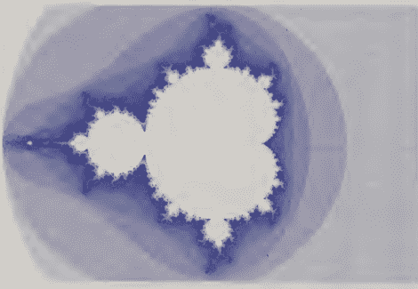

doesn't compile since no multiplication is defined for int and complex<double>. The problem is easily fixed by replacing 2 with 2.0. However, the issue is more annoying in generic functions, e.g.:

无法编译，因为未定义 int 和 complex<double> 之间的乘法。将 2 替换为 2.0 即可轻松解决此问题。然而，在泛型函数中，这个问题更令人烦恼，例如：

```cpp
template <typename T>
inline T twice(const T& z)
{
    return 2 * z;  // Error!
}

int main ()
{
    complex<double> z(3, 5), c;
    c = twice(z);
}
```

The function twice will not compile for the same reason as before. If we wrote 2.0 * z it would compile for complex<double> but not for complex<float> or complex<long double>. The function

函数 twice 出于与之前相同的原因无法编译。如果我们写 2.0 * z，它可以为 complex<double> 编译，但不能为 complex<float> 或 complex<long double> 编译。函数

```cpp
template <typename T>
complex<T> twice(const complex<T>& z)
{
    return T(2) * z;
}
```

works with all complex types—but only with complex types. In contrast, the following:

适用于所有复数类型——但仅适用于复数类型。相比之下，以下代码：

```cpp
template <typename T>
inline T twice(const T& z)
{
    return T(2) * z;
}
```

compiles with complex and non-complex types. However, when T is a complex type, 2 is unnecessarily converted into a complex and four multiplications plus two additions are performed where only half of them are needed. A possible solution is to overload the last two implementations. Alternatively, we can write type traits to deal with it.

可与复数和非复数类型一起编译。但是，当 T 是复数类型时，2 会被不必要地转换为复数，并且执行了四次乘法和两次加法，而实际上只需要其中一半。一种可能的解决方案是重载最后两个实现。或者，我们可以编写类型特征来处理它。

The programming becomes more challenging when multiple arguments of different types are involved, some of them possibly complex numbers. The Matrix Template Library (MTL4, Section 4.7.3) provides mixed arithmetic for complex numbers. We are committed to incorporate this feature into future standards.

当涉及多个不同类型的参数（其中一些可能是复数）时，编程变得更加具有挑战性。矩阵模板库（MTL4，第 4.7.3 节）为复数提供了混合运算。我们承诺将此功能纳入未来的标准。

### 4.2.2 随机数生成器

Many application domains—like computer simulation, game programming, or cryptography—use random numbers. Every serious programming language thus offers generators for them. Such generators produce sequences of numbers that appear random. A random generator may depend on physical processes like quantum phenomena. However, most generators are based on pseudo-random calculations. They have an internal state—called a Seed—that is transformed by deterministic computation each time a pseudo-random number is requested. Thus, a pseudo-random number generator (PRNG) always emits the same sequence when started with the same seed.

许多应用领域——如计算机模拟、游戏编程或密码学——都使用随机数。因此，每种严肃的编程语言都为其提供生成器。此类生成器产生看似随机的数字序列。随机生成器可能依赖于量子现象等物理过程。然而，大多数生成器基于伪随机计算。它们具有一个内部状态——称为种子（Seed）——每次请求伪随机数时，该状态都会通过确定性计算进行转换。因此，伪随机数生成器（PRNG）在使用相同种子启动时，始终会发出相同的序列。

Before C++11, there were only the rand and srand functions from C with very limited functionality. More problematic is that there are no guarantees for the quality of generated numbers and it is indeed quite low on some platforms. Therefore, a high-quality <random> library was added in C++11. It was even considered to deprecate rand and srand altogether in C++. They are still around but should really be avoided where the quality of random numbers is important.

在 C++11 之前，只有来自 C 的 rand 和 srand 函数，功能非常有限。更成问题的是，生成数字的质量没有保证，在某些平台上确实相当低。因此，C++11 添加了高质量的 <random> 库。甚至曾考虑在 C++ 中彻底弃用 rand 和 srand。它们仍然存在，但在随机数质量很重要的地方，确实应该避免使用它们。

#### 4.2.2.1 保持简单

The random number generators in C++11 provide a lot of flexibility which is very useful for experts but somewhat overwhelming for beginners. Walter Brown proposed a set of novice-friendly functions [6]. Slightly adapted, 4 they are:

C++11 中的随机数生成器提供了大量灵活性，这对专家非常有用，但对初学者来说有些令人不知所措。Walter Brown 提出了一组对新手友好的函数 [6]。经过略微调整，4 它们是：

```
#include <random>

std::default_random_engine& global_urng()
{
    static std::default_random_engine u{};
    return u;
}

void randomize()
{
    static std::random_device rd{};
    global_urng().seed(rd());
}

int pick(int from, int thru)
{
    static std::uniform_int_distribution<> d{};
    using param_t = decltype(d)::param_type;
    return d(global_urng(), param_t{from, thru});
}

double pick(double from, double upto)
{
    static std::uniform_real_distribution<> d{};
    using param_t = decltype(d)::param_type;
    return d(global_urng(), param_t{from, upto});
}
```

To start with random numbers, you could just copy these three function into the project and look at the details later. Walter's interface is pretty simple and nonetheless sufficient for many practical purposes like code testing. We only need to remember the following three functions:

要开始使用随机数，你可以将这三个函数复制到项目中，稍后再查看细节。Walter 的接口非常简单，但对于代码测试等许多实际用途来说已经足够。我们只需要记住以下三个函数：

- randomize: Make the following numbers really random by initializing the generator's seed.
- pick(int a, int b): Give me an int in the interval [a, b] when a and b are int.
- pick(double a, double b): Give me an double in the right-open interval [a, b) when a and b are double.

- randomize：通过初始化生成器的种子，使后续数字真正随机。
- pick(int a, int b)：当 a 和 b 为 int 时，给我一个在区间 [a, b] 中的 int。
- pick(double a, double b)：当 a 和 b 为 double 时，给我一个在右开区间 [a, b) 中的 double。

4. Walter used return type deduction of non-lambda functions which is only available in C++14 and higher. We further shortened the function name from pick_a_number to pick.

4. Walter 使用了非 lambda 函数的返回类型推导，这仅在 C++14 及更高版本中可用。我们还将函数名从 pick_a_number 进一步缩短为 pick。

Without calling randomize, the sequence of generated numbers is equal each time which is desirable in certain situations: finding bugs is much easier with reproducible behavior. Note that pick includes the upper bound for int but not for double to be consistent with standard functions. global_urng can be considered as an implementation detail for the moment. With those functions, we can easily write loops for rolling dice:

如果不调用 randomize，生成的数字序列每次都相同，在某些情况下这是可取的：可重复的行为使查找 bug 更容易。请注意，pick 对于 int 包含上界，但对于 double 不包含，以保持与标准函数的一致性。目前，global_urng 可以被视为实现细节。有了这些函数，我们可以轻松编写掷骰子的循环：

```
randomize();
cout << "Now, we roll dice:\n";
for (int i = 0; i < 15; ++i)
    cout << pick(1, 6) << endl;

cout << "\nLet's roll continuous dice now: :-)\n";
for (int i = 0; i < 15; ++i)
    cout << pick(1.0, 6.0) << endl;
```

In fact, this is even simpler than the old C interface. Apparently it is too late for C++14, but the author would be glad to see these functions in future standards. In the following section, we will use this interface for testing.

事实上，这甚至比旧的 C 接口更简单。显然，为 C++14 加入这些函数为时已晚，但作者很高兴在未来的标准中看到这些函数。在下一节中，我们将使用此接口进行测试。

#### 4.2.2.2 随机测试

Say we want to test whether our complex implementation from Chapter 2 is distributive:

假设我们想测试第 2 章中的复数实现是否满足分配律：

\(a(b+c) = ab + ac \quad \forall a,b,c.\) (4.1)

The multiplication is canonically implemented as

乘法的规范实现如下：

```
inline complex operator*(const complex& c1, const complex& c2)
{
    return complex(real(c1) * real(c2) - imag(c1) * imag(c2),
                   real(c1) * imag(c2) + imag(c1) * real(c2));
}
```

To cope with rounding errors we introduce a function similar that checks relative difference:

为了应对舍入误差，我们引入一个名为 similar 的函数来检查相对差异：

```
#include <limits>

const double eps = 10 * numeric_limits<double>::epsilon();

inline bool similar(complex x, complex y)
{
    double sum= abs(x) + abs(y);
    if (sum < 1000 * numeric_limits<double>::min())
        return true;
    return abs(x - y) / sum <= eps;
}
```

To avoid divisions by zero we treat two complex numbers as similar if their magnitudes are both very close to zero (the sum of magnitudes smaller than 1000 times the minimal value representable as double). Otherwise, we relate the difference of the two values to the sum of their magnitudes. This should not be larger than 10 times epsilon, the difference between

为了避免除以零，如果两个复数的模都非常接近零（模之和小于 1000 倍的 double 可表示的最小值），则我们将这两个复数视为相似。否则，我们将两个值的差与它们的模之和相关联。这不应大于 10 倍的 epsilon，即


1 和可表示为 double 的下一个值。此信息由第 4.3.1 节稍后介绍的 <limits> 库提供。

接下来，我们需要一个测试，它接受 (4.1) 中变量的三个复数，然后检查两边各项的相似性：

```
struct distributivity_violated {};

inline void test(complex a, complex b, complex c)
{
    if (!similar(a * (b + c), a * b + a * c)) {
        cerr << "Test detected that " << a << " * ...
        throw distributivity_violated();
    }
}
```

如果检测到违规，关键值将在错误流上报告，并抛出用户定义的异常。最后，我们实现复数的随机生成和对测试集的循环：

```
const double from= -10.0, upto= 10.0;

inline complex mypick()
{   return complex(pick(from, upto), pick(from, upto)); }

int main ()
{
    const int max_test= 20;
    randomize();
    for (int l= 0; l < max_test; ++l) {
        complex a= mypick();
        for (int j= 0; j < max_test; j++) {
            complex b= mypick();
            for (int k= 0; k < max_test; k++) {
                complex c= mypick();
                test(a, b, c);
            }
        }
    }
}
```

此处我们仅对实部和虚部使用 [-10,10) 范围内的随机数进行了测试；这是否足以对正确性建立良好的信心，尚存争议。在大型项目中，构建可复用的测试框架绝对是值得的。包含随机值生成并在最内层循环中放置测试函数的嵌套循环模式适用于许多场景。它可以封装在一个类中，该类可能是可变参数的，以处理涉及不同数量变量的属性。随机值的生成也可以由一个特殊的构造函数提供（例如，由标记标记），或者可以预先生成一个序列。可以想象不同的方法。本节中的循环模式是为了简单起见而选择的。

为了看到分配律不精确成立，我们可以将 eps 减小到 0。然后，我们会看到类似下面的（缩写的）错误消息：

```
Test detected that (-6.21,7.09) * ((2.52,-3.58) + (-4.51,3.91))
!= (-6.21,7.09) * (2.52,-3.58) + (-6.21,7.09) * (-4.51,3.91)
terminate called after throwing 'distributivity_violated'
```

现在我们深入探讨随机数生成的细节。

#### 4.2.2.3 引擎

<random> 库包含两种函数对象：生成器和分布。前者生成无符号整数序列（精确类型由每个类的 typedef 提供）。每个值应具有大约相同的概率。分布类将这些数字映射到其概率对应于参数化分布的值上。

除非有特殊需求，否则我们可以直接使用 default_random_engine。我们必须牢记，随机数序列取决于其种子的确定性，并且每次创建对象时每个引擎都用相同的种子初始化。因此，给定类型的新引擎始终产生相同的序列，例如：

```
void random_numbers()
{
    default_random_engine re;
    cout << "Random numbers: ";
    for (int i = 0; i < 4; ++i)
        cout << re << (i < 3 ? " , " : "");
    cout << '\n';
}
```

```
int main ()
{
    random_numbers();
    random_numbers();
}
```

在作者的机器上产生：

```
Random numbers: 16807, 282475249, 1622650073, 984943658
Random numbers: 16807, 282475249, 1622650073, 984943658
```

为了在每次调用 random_numbers 时获得不同的序列，我们需要通过将其声明为 static 来创建一个持久引擎：

```
void random_numbers()
{
    static default_random_engine re;
    ...
}
```

不过，每次程序运行的序列仍然相同。为了克服这一点，我们必须将种子设置为近乎真正的随机值。random_device 提供了这样的值：

```
void random_numbers()
{
    static random_device rd;
    static default_random_engine re(rd());
    ...
}
```

random_device 返回一个依赖于硬件和操作系统事件测量的值，可以被视为几乎真正的随机值（即，实现了非常高的熵）。事实上，random_device 提供了与引擎相同的接口，只是种子不能设置。因此，它也可以用于生成随机值，至少在性能不重要时可以。在我们的测试机器上，使用 default_random_engine 生成一百万个随机数耗时 4.13 ms，而使用 random_device 耗时 810-820 ms。在依赖高质量随机数的应用程序中，例如密码学，这种性能损失仍然可以接受。在大多数情况下，仅使用 random_device 生成起始种子就足够了。

在生成器中，有基本引擎、其参数化适配器以及预定义的适配引擎：

- 生成随机值的基本引擎：
  - linear_congruential_engine，
  - mersenne_twister_engine，以及
  - subtract_with_carry_engine。

- 从另一个引擎创建新引擎的引擎适配器：
  - discard_block_engine：每次忽略底层引擎的 n 个条目；
  - independent_bits_engine：将基本随机数映射到 w 位；
  - shuffle_order_engine：通过保留最后值的内部缓冲区来修改随机数的顺序。

- 通过实例化或适配从基本引擎构建的预定义适配引擎：
  - knuth_b
  - minstd_rand
  - minstd_rand0
  - mt19937
  - mt19937_64
  - ranlux24
  - ranlux24_base
  - ranlux48
  - ranlux48_base

最后一组中的预定义引擎只是类型定义，例如：

```
typedef shuffle_order_engine <minstd_rand0,256> knuth_b;
```

#### 4.2.2.4 分布概览

如前所述，分布类将无符号整数映射到参数化分布。表 4-2 总结了 C++11 中定义的分布。由于空间限制，我们使用了一些缩写符号。分布的结果类型可以作为类模板的参数指定，其中 1 表示整数和实数类型。当构造函数（例如，n）和描述公式（例如，μ）中使用不同的符号时，我们在前提条件中表示等价性（例如 m ≡ μ）。为了保持一致性，我们在对数正态分布和正态分布中使用了相同的符号（与其他书籍、在线参考和标准相反）。

| 名称 | 前提条件 | 分布 | 默认值 | 结果 |
| :--- | :--- | :--- | :--- | :--- |
| uniform_int_distribution<IntType=a, b> | a <= b | p(x|a,b) = 1/(b-a+1) | (0, max) | [a, b] <= N |
| uniform_real_distribution<RealType=a, b> | a <= b | p(x|a,b) = 1/(b-a) | (0.0, 1.0) | [a, b] <= R |
| bernoulli_distribution(p) | 0 <= p < 1 | P(b|p) = { p if b = true; 1-p if b = false } | 0.5 | {true, false} |
| binomial_distribution<IntType=t, p> | 0 <= p <= 1 and 0 <= t | P(i|t,p) = (t choose i) * p^i * (1-p)^(t-i) | (1, 0.5) | N |
| geometric_distribution<IntType=p> | 0 < p < 1 | P(i|p) = p(1-p)^i | 0.5 | N |
| negative_binomial_distribution<IntType=k, p> | 0 < p < 1 and 0 < k | P(i|k,p) = (k+i-1 choose i) * p^k * (1-p)^i | (1, 0.5) | N |
| poisson_distribution<IntType=m> | 0 <= m == mu | P(i|mu) = e^(-mu) * mu^i / i! | 1.0 | N |
| exponential_distribution<RealType=lambda> | 0 < l == lambda | p(x|lambda) = lambda * e^(-lambda * x) | 1.0 | x > 0 <= R |
| gamma_distribution<RealType=alpha, RealType=beta> | 0 < a == alpha and 0 < b == beta | p(x|alpha, beta) = (1 / (beta^alpha * Gamma(alpha))) * x^(alpha-1) * e^(-x/beta) | (1.0, 1.0) | x > 0 <= R |
| weibull_distribution<RealType=a, b> | 0 < a and 0 < b | p(x|a,b) = (b/a) * (x/a)^(b-1) * exp(-(x/a)^b) | (1.0, 1.0) | x > 0 <= R |
| extreme_value_distribution<RealType=a, b> | 0 < b | | (0.0, 1.0) | R |
| normal_distribution<R>(m,s) | 0 < s <= σ, m == μ | p(x|μ, σ) = 1/(σ√2π) exp -(x-μ)^2 / 2σ^2 | (0.0, 1.0) | R |
| lognormal_distribution<R>(m,s) | 0 < s <= σ, m == μ | p(x|μ, σ) = 1/(xσ√2π) exp -(ln x - μ)^2 / 2σ^2 | (0.0, 1.0) | x > 0 ∈ R |
| chi_squared_distribution<R>(n) | 0 < n | p(x|n) = Γ(n/2)^-1 * x^(n/2 - 1) * e^(-x/2) | 1 | x > 0 ∈ R |
| cauchy_distribution<R>(a,b) | 0 < b | p(x|a,b) = (πb (1 + ((x-a)/b)^2))^-1 | (0.0, 1.0) | R |
| fisher_f_distribution<R>(m,n) | 0 < m and 0 < n | p(x|m,n) = Γ((m+n)/2) / (Γ(m/2)Γ(n/2)) * (m/n)^(m/2) * x^(m/2 - 1) * (1 + m/n * x)^(-(m+n)/2) | (1, 1) | x > 0 ∈ R |
| student_t_distribution<R>(n) | 0 < n | p(x|n) = 1/√(nπ) * Γ((n+1)/2) / Γ(n/2) * (1 + x^2/n)^(-(n+1)/2) | 1 | R |
| discrete_distribution<I>(b,e) | 0 <= b[i] | P(i|w0,...,wn-1) = w_i / s, 0 <= i < n, s = sum w_k | none | [0, e - b) ⊂ N |
| piece_constant_distribution<R>(b,e,bz,e2) | b[i] < b[i+1] | P(x|b, w) = w_i / s, b_i <= x < b_{i+1}, s = sum w_k (b_{k+1} - b_k) | none | [b*, *(e - 1)) ⊂ R |
| piece_linear_distribution<R>(b,e,bz,e2) | b[i] < b[i+1] | P(x|b, w) = ... | none | [b*, *(e - 1)) ⊂ R |

#### 4.2.2.5 使用分布

分布参数化了一个随机数生成器，例如：

```
default_random_engine re(random_device{}());
normal_distribution<> normal;
```

```
for (int i = 0; i < 6; ++i)
    cout << normal(re) << endl;
```

此处我们创建了一个引擎——在构造函数中随机化——以及一个类型为 double、使用默认参数 μ = 0.0 和 σ = 1.0 的正态分布。在每次调用分布时-


based generator, we pass the random engine as an argument. The following is an example of the program’s output:

```
-0.339502
0.766392
-0.891504
0.218919
2.12442
-1.56393
```

It will of course be different each time we call it.

Alternatively, we can use the bind function from the <functional> header (§4.4.2) to bind the distribution to the engine:

```
auto normal= bind(normal_distribution<>{>,
 default_random_engine(random_device{}()));
```

```
for (int i= 0; i < 6; ++i)
 cout << normal() << endl;
```

The function object normal can now be called without arguments. In this situation, bind is more compact than a lambda—even with init capture (§3.9.4):

```
auto normal= [re= default_random_engine(random_device{}()),
 n= normal_distribution<>{}]() mutable
 { return n(re); };
```

In most other scenarios, lambdas lead to more readable program sources than bind but the latter seems more suitable for binding random engines to distributions.

#### 4.2.2.6 股价演化的随机模拟

With the normal distribution we can simulate possible developments of a stock’s share price in the Black-Scholes model by Fischer Black and Myron Scholes. The mathematical background is for instance discussed in Jan Rull’s lecture [36, pages 94–95] (in German, unfortunately) and in other quantitative finance publications like [54]. Starting with an initial price of \(s_0 \cong S_0^1\) with an expected yield of \(\mu\), a variation of \(\sigma\), a normally distributed random value \(Z_i\), and a time step \(\Delta\), the share price at \(t = i \cdot \Delta\) is simulated with respect to the preceding time step by

\(S^1_{t+\Delta} \sim S^1_{(t-1)\cdot\Delta} \cdot e^{\sigma \cdot \sqrt{\Delta} \cdot Z_i + \Delta \cdot (\mu - \sigma^2/2)}\).

Subsuming \(a = \sigma \cdot \sqrt{\Delta}\) and \(b = \Delta \cdot (\mu - \sigma^2/2)\), the equation simplifies to

\(S^1_{t+\Delta} \sim S^1_{(t-1)\cdot\Delta} \cdot e^{a \cdot Z_i + b}\). (4.2)

```
=> c++11/black_scholes.cpp
```


Figure 4-8: Simulated share price over 20 years

The development of \( S^1 \) with the parameters \( \mu = 0.05, \sigma = 0.3, \Delta = 1.0, t = 20 \) as constants according to (4.2) can now be programmed in a few lines:

```
default_random_engine re(random_device(){});
normal_distribution<> normal;

const double mu= 0.05, sigma= 0.3, delta= 0.5, years= 20.01,
        a= sigma * sqrt(delta),
        b= delta * (mu - 0.5 * sigma * sigma) ;
vector<double>
        s= {345.25}; // Start with initial price

for (double t= 0.0; t < years; t+= delta)
        s.push_back( s.back() * exp(a * normal(re) + b) );
```

Figure 4-8 depicts five possible developments of the share price for the parameters from the previous code.

We hope that this introduction to random numbers will give you a smooth start to the exploration of this powerful library.

## 4.3 Meta-programming

In this section, we will give you a foretaste of meta-programming. Here, we will focus on the library support and in Chapter 5 we will provide more background.

### 4.3.1 Limits

A very useful library for generic programming is `<limits>` which provides important information on types. It can also prevent surprising behavior when the source is compiled on another platform and some types are implemented differently. The header <limits> contains the class template numeric_limits that delivers type-specific information on intrinsic types. This is especially important when dealing with numeric type parameters.

In Section 1.7.5, we demonstrated that only some digits of floating-point numbers are written to the output. Especially when the numbers are written to files, we want to be able to read back the correct value. The number of decimal digits is given in numeric_limits as a compile-time constant. The following program prints 1/3 in different floating-point formats with one extra digit:

```
#include <iostream>
#include <limits>

using namespace std;

template <typename T>
inline void test(const T& x)
{
    cout << "x = " << x << " (";
    int oldp = cout.precision(numeric_limits<T>::digits10 + 1);
    cout << x << ") " << endl;
    cout.precision(oldp);
}

int main ()
{
    test(1.f/3.f);
    test(1./3.0);
    test(1./3.0L);
}
```

This yields

```
x = 0.333333 (0.3333333)
x = 0.333333 (0.3333333333333333)
x = 0.333333 (0.3333333333333333333333)
```

Another example is computing the minimum value of a container. When the container is empty we want the identity element of the minimum operation, which is the maximal representable value of the corresponding type:

```
template <typename Container>
typename Container::value_type
inline minimum(const Container& c)
{
    using vt = typename Container::value_type;
    vt min_value = numeric_limits<vt>::max();
    for (const vt& x : c)
        if (x < min_value)
            min_value = x;
    return min_value;
}
```

The method max is static and can be called for the type directly without the need of an object. Likewise, the static method min yields the minimal value—more precisely, the minimal representable value for int types and the minimal value larger than 0 for floating-point types. Therefore, C++11 introduces the member lowest which yields the smallest value for all fundamental types.

Termination criteria in fixed-point computations should be type-dependent. When they are too large, the result is unnecessarily imprecise. When they are too small, the algorithm might not terminate (i.e., it may only finish when two consecutive values are identical). For a floating-point type, the static method epsilon yields the smallest value to be added to 1 for a number larger than 1, in other words, the smallest possible increment (with respect to 1), also called Unit of Least Precision (ULP). We already used it in Section 4.2.2.2 for determining the similarity of two values.

The following generic example computes the square root iteratively. The termination criterion is that the approximated result of \(\sqrt{x}\) should be in an \(\epsilon\)-environment of \(x\). To ascertain that our environment is large enough, we scale it with \(x\) and double it afterward:

```
template <typename T>
T square_root(const T& x)
{
    const T my_eps = T{2} * x * numeric_limits<T>::epsilon();
    T r = x;
    while (std::abs((r * r) - x) > my_eps)
        r = (r + x/r) / T{2};
    return r;
}
```

The complete set of numeric_limits's members is available in online references like www.cppreference.com or www.cplusplus.com.

### 4.3.2 Type Traits

```
=> c++11/type_traits_example.cpp
```

The type traits that many programmers have already used for several years from the Boost library were standardized in C++11 and provided in <type_traits>. We refrain at this point from enumerating them completely and refer you instead to the before-mentioned online manuals. Some of the type traits—like is_const (§5.2.3.3)—are very easy to implement by partial template specialization. Establishing domain-specific type traits in this style (e.g., is_matrix) is not difficult and can be quite useful. Other type traits that reflect the existence of functions or properties thereof—such as is_nothrow_assignable—are quite tricky to implement. Providing type traits of this kind requires a fair amount of expertise (if not black magic).

```
=> c++11/is_pod_test.cpp
```

With all the new features, C++11 did not forget its roots. There are type traits that allow us to check the compatibility with C. is_pod tells us whether a type is a Plain Old Data type (POD). These are all intrinsic types and “simple” classes that can be used in a C program. In case we need a class that is used in C and C++ programs, it is best to define it only once in a C-compatible fashion: as struct and with no or conditionally compiled methods. It should not contain virtual functions and static data members. In sum, the memory layout of the class must be compatible with C and the default and copy constructor must be Trivial: they are either declared as default or compiler-generated in a default manner. For instance, the following class is POD:

```
struct simple_point
{
  #ifdef __cplusplus
  simple_point(double x, double y) : x(x), y(y) {}
  simple_point() = default;
  simple_point(initializer_list<double> il)
  {
    auto it = begin(il);
    x = *it;
    y = *next(it);
  }
  #endif
  double x, y;
};
```

We can check this as follows:

```
cout << "simple_point is pod = " << boolalpha
<< is_pod<simple_point>::value << endl;
```

All C++-only code is conditionally compiled: the macro __cplusplus is predefined in all C++ compilers. Its value reveals which standard the compiler supports (in the current translation). The class above can be used with an initializer list:

```
simple_point p1 = {3.0, 7.0};
```

and is nonetheless compilable with a C compiler (unless some clown defined __cplusplus in the C code). The CUDA library implements some classes in this style. However, such hybrid constructs should only be used when really necessary to avoid surplus maintenance effort and inconsistency risks.

```
=> c++11/memcpy_test.cpp
```

Plain old data is stored contiguously in memory and can be copied as raw data without calling a copy constructor. This is achieved with the traditional functions memcpy or memmove. However, as responsible programmers we check upfront with is_trivially_copyable whether we can really call these low-level copy functions:

```
simple_point p1{3.0, 7.1}, p2;
static_assert(std::is_trivially_copyable<simple_point>::value,
              "simple_point is not as simple as you think "
              "and cannot be memcpy'd!");
std::memcpy(&p2, &p1, sizeof(p1));
```


不幸的是，该类型特性在多个编译器中实现较晚。例如，g++ 4.9 和 clang 3.4 不提供它，而 g++ 5.1 和 clang 3.5 提供。

这种旧式复制函数仅应在与 C 交互时使用。在纯 C++ 程序中，最好依赖 STL 复制：

```
copy(&a, &x + 1, &y);
```

无论我们的类的内存布局如何，这都适用，且当类型允许时，复制的实现内部会使用移动。

C++14 添加了一些模板别名，例如

```
conditional_t<B, T, F>
```

作为以下内容的快捷方式：

```
typename conditional<B, T, F>::type
```

同样，enable_if_t 是 enable_if 类型的缩写。

## 4.4 实用工具

C++11 添加了新库，使现代编程风格更加轻松和优雅。例如，我们可以更轻松地返回多个结果，更灵活地引用函数和函数对象，并创建引用容器。

### 4.4.1 元组

当函数计算多个结果时，它们过去通常作为可变引用参数传递。假设我们实现一个带主元的 LU 分解，接受矩阵 A 并返回分解后的矩阵 LU 和置换向量 p：

```
void lu(const matrix& A, matrix& LU, vector& p) { ... }
```

我们也可以将 LU 或 p 作为函数结果返回，并通过引用传递另一个对象。这种混合方法更加令人困惑。

=> c++11/tuple_move_test.cpp

为了在不实现新类的情况下返回多个结果，我们可以将它们捆绑到一个元组中。元组（来自 <tuple>）与容器的区别在于允许不同类型。与大多数容器不同，对象的数量必须在编译时已知。使用元组，我们可以一次返回 LU 分解的两个结果：

```
tuple<matrix, vector> lu(const matrix& A)
{
    matrix LU(A);
    vector p(n);
    // ... some computations
    return tuple<matrix, vector>(LU, p);
}
```

返回语句可以借助辅助函数 make_tuple 简化，该函数能推导类型参数：

```
tuple<matrix, vector> lu(const matrix& A)
{
    ...
    return make_tuple(LU, p);
}
```

make_tuple 在与 auto 变量结合使用时尤其方便：

```
auto t = make_tuple(LU, p, 7.3, 9, LU*p, 2.0+9.0i);
```

调用我们的函数 lu 的调用者可能会使用函数 get 从元组中提取矩阵和向量：

```
tuple<matrix, vector> t = lu(A);
matrix LU = get<0>(t);
vector p = get<1>(t);
```

在此，所有类型也可以推导：

```
auto t = lu(A);
auto LU = get<0>(t);
auto p = get<1>(t);
```

函数 get 接受两个参数：一个元组和其中的位置。后者是编译时参数。否则，结果的类型将无法得知。如果索引过大，错误将在编译期间检测到：

```
auto t = lu(A);
auto am_i_stupid = get<2>(t); // Error during compilation
```

在 C++14 中，如果类型无歧义，元组条目也可以按类型访问：

```
auto t = lu(A);
auto LU = get<matrix>(t);
auto p = get<vector>(t);
```

这样我们就不再需要记住元组中的内部顺序了。或者，我们可以使用函数 tie 来分离元组中的条目。这通常更优雅。

在这种情况下，我们必须事先声明兼容的变量：

```
matrix LU;
vector p;
tie(LU, p) = lu(A);
```

tie 乍一看相当神秘，但其实现出人意料地简单：它创建一个带有函数参数引用的对象。将元组赋给该对象会执行每个元组成员到相应引用的赋值。

使用 tie 的实现比使用 get 的实现具有性能优势。当我们将函数 lu 的结果直接传递给 tie 时，它仍然是右值（没有名称），我们可以移动条目。使用中间变量时，它变成左值（有名称），条目必须被复制。为了避免复制，我们也可以显式移动元组条目：

```
auto t = lu(A);
auto LU = get<0>(move(t));
auto p = get<1>(move(t));
```

在此，我们踩得相当危险。原则上，对象在应用 move 后被视为已过期。只要析构函数不会崩溃，它可以处于任何状态。在我们的示例中，在对 t 应用 move 后我们又读取了 t。在这种情况下这是正确的。move 将 t 转换为右值，我们可以随意处理其数据。但我们没有。当 lu 被创建时，我们只获取元组条目 0 的数据而不触碰条目 1。相反，在创建 p 时，我们只从 t 的条目 1 窃取数据而不访问条目 0 中已过期的数据。因此，这两个操作移动的是完全不相交的数据。尽管如此，对同一数据项多次使用 move 非常危险，必须仔细分析（就像我们所做的那样）。

在讨论了调用方的高效数据处理后，我们应该再看一下函数 lu。结果矩阵和向量在从函数返回时会被复制到元组中。在返回语句中，移动函数中的所有数据是安全的，因为这些数据无论如何都会被销毁。以下是修订后的函数片段：

```
tuple<matrix, vector> lu(const matrix& A)
{
    ...
    return make_tuple(move(LU), move(p));
}
```

既然我们已经避免了所有复制，返回元组的实现与使用可变引用的代码一样高效，至少在结果用于初始化变量时是这样。当结果被赋值给现有变量时，我们仍然有分配和释放内存的开销。

C++ 中的另一个异构类是 pair。它在 C++03 中就已存在，并且至今仍然存在。pair 等同于带有两个参数的元组。两者之间存在转换，因此 pair 和两参数元组可以相互交换甚至混合。本节中的示例都可以使用 pair 实现。我们可以写 t.first 而不是 get<0>(t)（以及 t.second 对应 get<1>(t)）。

=> c++11/boost_fusion_example.cpp

#### 进一步阅读：

库 Boost::Fusion 旨在将元编程与经典（运行时）编程融合。使用此库，我们可以编写遍历元组的代码。以下程序实现了一个通用函数对象 printer，它针对元组 t 的每个条目被调用：

```cpp
struct printer
{
    template <typename T>
    void operator()(const T& x) const
    {
        std::cout << "Entry is " << x << std::endl;
    }
int main ()
{
    auto t = std::make_tuple( 7u, "Hallo", std::string("Hl"),
                              std::complex<float>(3, 7));
    boost::fusion::for_each(t, printer{});
}
```

该库还提供了更强大的功能来遍历和转换异构类型容器（boost::fusion::for_each 在我们看来远比 std::for_each 有用）。尤其是当编译时和运行时的功能以非平凡方式交互时。Boost Fusion 是必不可少的。

元编程领域中功能最全面的库是 Boost 元编程库（MPL）[22]。该库实现了大部分 STL 算法（§4.1），并提供了类似的数据类型：例如，vector 和 map 被实现为编译时容器。尤其是，当编译时和运行时的功能以非平凡方式交互时，MPL 与 Boost Fusion 的组合极其强大。撰写本书时的一个新库是 Hana [11]，它以更函数式的方法处理编译时和运行时计算。它在很大程度上依赖 C++14 特性，从而产生显著更紧凑的程序。

### 4.4.2 function

=> c++11/function_example.cpp

<functional> 中的 function 类模板是泛化函数指针。函数类型规范作为模板参数传递，如下所示：

```cpp
double add(double x, double y)
{
    return x + y;
}
int main ()
{
    using bin_fun = function<double(double, double)>;
    bin_fun f = &add;
    cout << "f(6, 3) = " << f(6, 3) << endl;
}
```

function 包装器可以持有具有相同返回类型和相同参数类型列表的不同种类的函数实体。6 我们甚至可以构建兼容函数对象的容器：

```cpp
vector<bin_fun> functions;
functions.push_back(&add);
```

6. 因此，它们可能具有不同的签名，因为不要求相同的函数名称。相比之下，签名的相等性并不强制要求相同的返回类型。


当函数作为参数传递时，其地址会被自动取出。正如数组会隐式退化为指针一样，函数也会退化为指针。因此，我们可以省略取地址运算符 &：

```
functions.push_back(add);
```

当函数被声明为内联时，其代码应被插入到调用上下文中。尽管如此，每个内联函数在需要时都会获得一个唯一地址，该地址也可以作为函数对象存储：

```
inline double sub(double x, double y) { return x - y; }
```

```
functions.push_back(sub);
```

同样，地址是隐式取出的。函子也可以被存储：

```
struct mult { double operator()(double x, double y) const { return x * y; } };
```

```
functions.push_back(mult{});
```

这里我们使用默认构造函数构造了一个匿名对象。类模板不是类型，因此我们无法创建其对象：

```
template <typename Value> struct power { Value operator()(Value x, Value y) const { return pow(x, y); } };
```

```
functions.push_back(power{}); // Error
```

我们只能从已实例化的模板构造对象：

```
functions.push_back(power<double>{});
```

另一方面，我们可以从包含函数模板的类中创建对象：

```
struct greater_t { template <typename Value> Value operator()(Value x, Value y) const { return x > y; } } greater_than;
```

```
functions.push_back(greater_than);
```

在此上下文中，模板调用运算符必须能针对函数类型进行实例化。作为反例，以下语句无法编译，因为我们无法将其实例化为具有不同参数类型的函数：

```
function<double(double, double)> ff = greater_than; // Error
```

最后但同样重要的是，返回类型和参数类型匹配的 lambda 可以作为函数对象存储：

```
functions.push_back([](double x, double y){ return x / y; });
```

我们容器中的每个条目都可以像函数一样调用：

```
for (auto& f : functions)
    cout << "f(6, 3) = " << f(6, 3) << endl;
```

产生预期的输出：

```
f(6, 3) = 9
f(6, 3) = 3
f(6, 3) = 18
f(6, 3) = 216
f(6, 3) = 1
f(6, 3) = 2
f(6, 3) = 2
```

不用说，就灵活性和清晰度而言，这个函数包装器优于函数指针（我们为此付出了一些开销的代价）。

### 4.4.3 引用包装器

假设我们想要创建一个向量或矩阵列表——可能是很大的。此外，假设某些条目出现多次。因此，我们不想存储实际的向量或矩阵。我们可以创建一个指针容器，但我们想避免与它们相关的所有危险（§1.8.2）。

不幸的是，我们无法创建引用容器：

```
vector<vector<int>> vv; // Error
```

C++11 为此提供了一种名为 reference_wrapper 的类引用类型，可以通过头文件 <functional> 包含：

```
vector<reference_wrapper<vector<int> >> vv;
```

向量可以被插入：

```
vector<int> v1= {2, 3, 4}, v2= {5, 6}, v3= {7, 8};
vv.push_back(v1);
vv.push_back(v2);
vv.push_back(v3);
vv.push_back(v2);
vv.push_back(v1);
```

它们会被隐式转换为引用包装器（reference_wrapper<T> 包含一个针对 T& 的非显式构造函数）。

该类包含一个 get 方法，用于获取实际对象的引用，因此我们可以，例如，打印我们的向量：

```
for (const auto& vr : vv) {
    copy(begin(vr.get()), end(vr.get()),
         ostream_iterator<int>(cout, " "));
    cout << endl;
}
```

在这里，vr 的类型是 const reference_wrapper<vector<int> >&。包装器还提供了对底层引用类型 T& 的隐式转换，可以更方便地使用：

```
for (const vector<int>& vr : vv) {
    copy(begin(vr), end(vr), ostream_iterator<int>(cout, " "));
    cout << endl;
}
```

该包装器由两个辅助函数补充：ref 和 cref，它们位于同一个头文件中。ref 对于类型 T 的左值产生一个类型为 reference_wrapper<T> 且指向前者的对象。如果 ref 的参数已经是 reference_wrapper<T>，则它只是被复制。同样，cref 产生一个类型为 reference_wrapper<const T> 的对象。这些函数在标准库的多个地方被使用。

我们将使用它们来创建引用的 std::map：

```
map<int, reference_wrapper<vector<int> > > mv;
```

考虑到包装器类型名称的长度，使用类型推断声明它更简短，如下所示：

```
map<int, decltype(ref(v1))> mv;
```

映射的常规括号表示法：

```
mv[4] = ref(v1); // Error
```

无法应用，因为包装器没有默认构造函数，该构造函数会在赋值发生之前在表达式 mv[4] 中内部被调用。与使用括号表示法相比，我们应该使用 insert 或 emplace：

```
mv.emplace(make_pair(4, ref(v1)));
mv.emplace(make_pair(7, ref(v2)));
mv.insert(make_pair(8, ref(v3)));
mv.insert(make_pair(9, ref(v2)));
```

要遍历条目，再次应用类型推断更容易：

```
for (const auto& vr : mv) {
    cout << vr.first << ": ";
    for (int i : vr.second.get())
        cout << i << " , ";
    cout << endl;
}
```

由于我们映射的括号运算符无法编译，查找特定条目是通过 find 执行的：

```
auto& e7 = mv.find(7)->second;
```

这会产生与键 7 关联的向量的引用。

## 4.5 时机已至

<chrono> 库为时钟和计时器提供类型安全的功能。两个主要实体是

- time_point，表示相对于时钟的时间点；以及
- duration，具有明显的含义。

它们可以相加、相减和缩放（在有意义的情况下）。例如，我们可以将 duration 添加到 time_point 来发送一条消息，表示我们两小时后到家：

```cpp
time_point<system_clock> now = system_clock::now(),
                         then = now + hours(2);
time_t then_time = system_clock::to_time_t(then);
cout << "Darling, I'll be with you at " << ctime(&then_time);
```

这里我们计算了从现在起两小时后的 time_point。对于字符串输出，C++ 重用了 C 库的 ctime()。time_point 被转换为 to_time_t 中的 time_t。ctime 生成一个字符串（更准确地说是 char[]），包含本地时间：

Darling, I'll be with you at Wed Feb 11 22:31:31 2015

字符串以换行符结尾，我们不得不将其截断以保持输出在同一行。

我们经常需要知道使用我们经过优化的实现，某个计算花了多长时间，例如，使用巴比伦方法计算平方根：

```cpp
inline double my_root(double x, double eps = 1e-12)
{
    double sq = 1.0, sqo;
    do {
        sqo = sq;
        sq = 0.5 * (sqo + x / sqo);
    } while (abs(sq - sqo) > eps);
    return sq;
}
```

一方面，它包含一个昂贵的操作：除法（通常会刷新浮点流水线）。另一方面，该算法具有二次收敛性。因此，我们需要精确测量：

```cpp
time_point<steady_clock> start= steady_clock::now();
for (int i = 0; i < rep; ++i)
    r3 = my_root(3.0);
auto end = steady_clock::now();
```

为了不让时钟开销污染我们的基准测试，我们运行多次计算并相应地缩小时间间隔：

```
cout << "my_root(3.0) = " << r3 << ", the calculation took " << ((end - start) / rep).count() << " ticks\n";
```

在测试机上产生：

my_root(3.0) = 1.73205, the calculation took 54 ticks

因此，我们应该知道一个 tick 有多长。我们稍后会弄清楚这一点。首先，我们将 duration 转换为更具体的单位，例如微秒：

```
duration_cast<microseconds>((end - start) / rep).count()
```

我们的新输出是

my_root(3.0) = 1.73205, the calculation took 0 µs

count 返回一个整数值，我们的计算显然花费了不到一微秒。为了以三位小数打印 duration，我们将其转换为纳秒，并除以双精度值 1000.0：

```
duration_cast<nanoseconds>((end - start) / rep).count() / 1000.
```

注意末尾的点；如果我们除以 int，就会截断小数部分：

my_root(3.0) = 1.73205, the calculation took 0.054 micros

时钟的分辨率由时钟内部 typedef period 中的秒比率给出：

```
using P = steady_clock::period; // type of time unit
cout << "Resolution is: " << double(P::num) / P::den << " s.\n";
```

测试机上的输出是

Resolution is 1e-09s.

因此，时钟的分辨率是一纳秒。该库区分三种时钟：

- system_clock 表示系统上的本地墙上时钟。它与 <ctime> 兼容，如我们第一个示例中所需。
- high_resolution_clock 在底层系统上具有尽可能高的分辨率。
- steady_clock 是具有保证递增时间点的时钟。另外两个时钟在某些平台上可能会被调整（例如，在午夜），以至于较晚的时间点可能具有较低的值。这可能导致负持续时间和其他荒谬的情况。因此，steady_clock 对于计时器（当分辨率足够时）是最方便的。

熟悉 <ctime> 的人可能会在一开始觉得 <chrono> 有些复杂，但我们不需要在不同的接口中处理秒、毫秒、微秒和纳秒。C++ 库提供了统一的接口，许多错误可以在类型级别被检测出来——使程序更加安全。


## 4.6 并发

如今销售的每一款通用处理器都包含多个核心。然而，挖掘多核平台的计算能力对许多程序员来说仍是一项挑战。除了让多个核心保持忙碌之外，多线程在单核上也能提高效率，例如在接收到的数据被处理的同时从网络加载数据。在一方面提供最大清晰度和表达力，在另一方面实现最优性能，找到合适的抽象是 C++ 演进中最重要的挑战之一。

C++11 引入了首批并发特性。目前，并发编程的基本组件包括：

- thread：用于新执行路径的类；
- async：异步调用函数；
- atomic：用于非交错值访问的类模板；
- mutex：用于控制互斥执行的设施；
- future：用于从线程接收结果的类模板；以及
- promise：用于为 future 存储值的模板。

作为用例，我们想要实现一个异步且可中断的迭代求解器。这样的求解器将为科学家或工程师提供更高的生产力：

- 异步性：求解器运行时，我们可以已经着手处理下一个模型。
- 可中断性：如果我们确信新模型好得多，也可以停止旧模型的求解。

不幸的是，线程不能被杀死。嗯，可以杀死，但这会中止整个应用程序。要正确停止线程，它们必须通过提供明确定义的中断点来协作。停止迭代求解器最自然的时机是在每次迭代结束时的终止测试中。这不允许我们立即停止求解器。对于执行大量相当短迭代的典型实际应用，这种方法以相对较少的工作量获得良好的收益。

因此，构建可中断求解器的第一步是一个可中断的迭代控制类。为简洁起见，我们在 MTL4 [17] 的 `basic_iteration` 之上构建我们的控制类，并为本示例的完整代码未公开而道歉。迭代对象由绝对和相对 epsilon 以及最大迭代次数（或其子集）初始化。迭代求解器在每次迭代后计算一定的误差估计，通常是残差的范数——并与迭代控制对象检查计算是否应结束。我们现在的任务是加入对可能提交的中断的测试：

```cpp
class interruptible_iteration
{
    public:
    interruptible_iteration(basic_iteration<double>& iter)
        : iter(iter), interrupted(false) {}
    bool finished(double r)
    { return iter.finished(r) || interrupted.load(); }
    void interrupt() { interrupted = true; }
    bool isInterrupted() const { return interrupted.load(); }
    private:
        basic_iteration<double>& iter;
        std::atomic<bool> interrupted;
};
```

interruptible_iteration 包含一个 bool 值，用于指示是否已中断。该 bool 是原子的，以避免不同线程之间的访问冲突。调用 interrupt 方法会导致求解器在迭代结束时终止。

在纯单线程程序中，我们无法利用 interruptible_iteration 的任何优势：一旦求解器启动，下一条命令只有在求解器完成后才会执行。因此，我们需要对求解器进行异步执行。为了避免重新实现所有顺序求解器，我们实现了一个 async_executor，它在额外的线程中运行求解器，并在求解器启动后将执行控制权交还：

```cpp
template <typename Solver>
class async_executor
{
public:
    async_executor(const Solver& solver)
    : my_solver(solver), my_iter{}, my_thread{}
    {}

    template <typename VectorB, typename VectorX,
              typename Iteration>
    void start_solve(const VectorB& b, VectorX& x,
                     Iteration& iter) const
    {
        my_iter.set_iter(iter);
        my_thread = std::thread(
            [this, &b, &x](){
                return my_solver.solve(b, x, my_iter);
            });
    }

    int wait() {
        my_thread.join();
        return my_iter.error_code();
    }

    int interrupt() {
        my_iter.interrupt();
        return wait();
    }

    bool finished() const { return my_iter.iter->finished(); }

private:
    Solver my_solver;
    mutable interruptible_iteration my_iter;
    mutable std::thread my_thread;
};
```

使用 async_executor 启动求解器后，我们可以去做其他事情，并不时检查求解器是否 finished()。如果意识到结果已变得无关紧要，可以 interrupt() 执行。无论是完整求解还是中断执行，都必须 wait()，直到线程通过 join() 正确结束。

以下伪代码说明了科学家如何使用异步执行：

```
while ( !happy(science_foundation) ) {
 discretize_model();
 auto my_solver = itl::make_cg_solver(A, PC);
 itl::async_executor<decltype(my_solver)> async_exec(my_solver);
 async_exec.start_solve(x, b, itl::iter);

 play_with_model();
 if ( found_better_model() )
 async_exec.interrupt();
 else
 async_exec.wait();
 }
```

对于工程版本，将 science_foundation 替换为 client。

我们也可以将异步求解器用于数值上具有挑战性的系统，而我们事先不知道哪个求解器可能会收敛。为此，我们将所有有望成功的求解器并行启动，并等待其中一个完成，然后中断其他求解器。为清晰起见，我们应将执行器存储在容器中。特别是当执行器既不可复制也不可移动时，可以使用第 4.1.3.2 节中的容器。

本节远非并发 C++ 编程的全面介绍。它只是关于利用新特性可以做什么的灵感。在编写严肃的并发应用程序之前，我们强烈建议阅读专门讨论该主题并包含理论背景的出版物。特别是，我们推荐 Antony Williams 所著的《C++ Concurrency in Action》[53]，他是 C++11 并发特性的主要贡献者。

## 4.7 超越标准库的科学库

除了标准库之外，还有许多用于科学应用的第三方库。本节将简要介绍一些开源库。选择完全是作者在撰写时的主观偏好。因此，某个库的缺失不应被过度重视；其存在也不应被过度重视——尤其是自撰写以来。此外，由于开源软件变化速度快于底层编程语言的基础，且许多库会快速添加新功能，我们不进行详细介绍，而参考相应的手册。

### 4.7.1 其他算术

大多数计算在实数、复数和整数上进行。在数学课上我们也学习过有理数。标准 C++ 不支持有理数，但有开源库支持。其中一些包括：

- **Boost::Rational** 是一个模板库，以自然的运算符表示法提供常见的算术运算。有理数始终被归一化（分母始终为正且与分子互质）。使用无限精度整数配合该库可克服精度丢失、溢出和下溢问题。

- **GMP** 提供此类无限/任意精度整数。它还提供基于其自身整数和任意精度浮点数的有理数。C++ 接口为这些操作引入了类和运算符表示法。

- **ARPREC** 是另一个用于任意精度的库，提供可自定义小数位数的整数以及实数和复数。

### 4.7.2 区间算术

这种算术的理念是，实际中的输入数据项并非精确值，而是对建模实体的近似。为考虑这种不准确性，每个数据项都由一个保证包含正确值的区间表示。该算术通过适当的舍入规则实现，使得结果区间包含精确结果；即，该值是在输入数据和计算完全精确且无不精确性的情况下获得的。然而，当输入数据的区间已经很大或算法在数值上不稳定（或两者皆是）时，结果区间可能很大——最坏情况下为 [-∞, ∞]。这不尽令人满意，但至少很明显出了问题，而计算浮点数的质量则完全不明确，需要额外分析。

Boost::Interval 提供一个模板类来表示区间以及常见的算术和三角运算。该类可以实例化为每个已建立必要策略的类型，例如前几段中的类型。

### 4.7.3 线性代数

这是一个有许多开源和商业软件包可用的领域。这里我们只介绍其中的一小部分。

Blitz++ 是由 Todd Veldhuizen 创建的第一个使用表达式模板（第 5.3 节）的科学库，他是该技术的两位发明者之一。它允许定义可自定义标量类型的向量、矩阵和高阶张量。


uBLAS 是一个较新的 C++ 模板库，最初由 Jörg Walter 和 Mathias Koch 编写。它成为 Boost 集合的一部分，由其社区维护。

MTL4 是作者针对向量和多种矩阵的模板库。除了标准线性代数运算外，它还提供最新的迭代线性求解器。基本版本是开源的。GPU 支持通过 CUDA 提供。超级计算版本可以在数千个处理器上运行。更多版本正在开发中。

### 4.7.4 常微分方程

由 Karsten Ahnert 和 Mario Mulansky 开发的 odeint 以数值方式求解常微分方程（ODE）。得益于其泛型设计，该库不仅支持多种标准容器，还能与外部库协作。因此，底层线性代数可以使用 MKL、CUDA 库 Thrust、MTL4、VexCL 和 ViennaCL 来执行。该库中使用的高级技术由 Mario Mulansky 在第 7.1 节中解释。

### 4.7.5 偏微分方程

求解偏微分方程（PDE）的软件包数量庞大。这里，我们只提到两个，在我们看来它们非常通用，并且很好地利用了现代编程技术。

FEniCS 是一个用于通过有限元法（FEM）求解 PDE 的软件集合。它提供了 Python 和 C++ 的用户 API，其中表示了 PDE 的弱形式。FEniCS 可以从该表述生成一个求解 PDE 问题的 C++ 应用程序。

FEEL++ 是 Christophe Prud'homme 的一个 FEM 库，同样允许表示弱形式。与 FEniCS 不同，FEEL++ 不使用外部代码生成器，而是利用 C++ 编译器的能力来转换代码。

### 4.7.6 图算法

Boost 图库（BGL）主要由 Jeremy Siek 编写，提供了一种非常通用的方法，因此该库可以应用于各种数据格式 [37]。它包含大量图算法。其并行扩展可以在数百个处理器上高效运行。

## 4.8 练习

### 4.8.1 按大小排序

创建一个 double 向量并用值 -9.3, -7.4, -3.8, -0.4, 1.3, 3.9, 5.4, 8.2 初始化它。你可以使用初始化列表。按大小对值进行排序。编写

- 一个仿函数和
- 用于比较的 lambda 表达式。

尝试这两种解决方案。

### 4.8.2 STL 容器

为电话号码创建一个 `std::map`；即，从字符串到无符号 `long` 的映射。用至少四个条目填充映射。搜索一个存在的和一个不存在的名称。还要搜索一个存在的和一个不存在的号码。

### 4.8.3 复数

实现一个类似于 Mandelbrot 集的 Julia 集（二次多项式）可视化。唯一的区别是添加到平方函数的常数与像素位置无关。基本上，你需要引入一个常数 `k` 并稍微修改 `iterate`。

- 从 `k = -0.6 + 0.6i`（图 4-9）开始，它是一个复杂的康托尔尘，也称为 Fatou 尘。

- 尝试其他 `k` 值，例如 `0.353 + 0.288i`（比较 `http://warp.povusers.org/Mandelbrot/`）。最终你可能想更改颜色方案以创建更酷的可视化效果。

- 软件设计的挑战是为 Mandelbrot 集和 Julia 集编写代码冗余最少的实现。（算法挑战可能是找到对所有 `k` 都看起来不错的颜色。但这超出了本书的范围。）

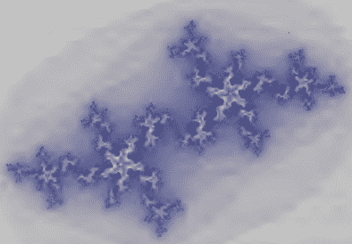

图 4-9: `k == -0.6 + 0.6i` 的 Julia 集，产生复杂的康托尔尘

- 高级：两个分形可以以交互方式结合。为此，需要提供两个窗口。第一个像以前一样绘制 Mandelbrot 集。此外，它可以启用鼠标输入，以便鼠标光标下的复杂值被用作第二个窗口中 Julia 集的 k。

- 非常高级：如果 Julia 集的计算太慢，可以使用线程并行性，甚至使用 CUDA 或 OpenGL 进行 GPU 加速。

# 第 5 章

# 元编程

元程序是关于程序的程序。将程序作为文本文件读取并对其执行某些转换，在大多数编程语言中当然是可行的。在 C++ 中，我们甚至可以编写在编译期间计算或转换自身的程序。Todd Veldhuizen 表明 C++ 的模板类型系统是图灵完备的 [49]。这意味着一切可计算的东西都可以在 C++ 编译时计算。

我们将在本章中彻底讨论这一引人入胜的特性。特别是，我们将探讨它的三个主要应用：

- 编译时计算（§5.1）；

- 关于类型的信息和类型转换（§5.2）；以及

- 代码生成（§5.3–§5.4）。

这些技术使我们能够使前几章中的示例更可靠、更高效、更通用。

## 5.1 让编译器计算

元编程的完整范围可能是由于一个错误而被发现的。Erwin Unruh 在 90 年代初编写了一个程序，该程序将素数作为 _错误消息_ 打印出来，从而证明 C++ 编译器能够进行计算。这个程序无疑是最著名的无法编译的 C++ 代码。感兴趣的读者将在附录 A.9.1 中找到它。请将此视为异常行为的证据，而不是未来程序的灵感。

编译时计算可以通过两种方式实现：与模板 _元函数_ 向后兼容，或更轻松地使用 `constexpr`。后一功能在 C++11 中引入，并在 C++14 中扩展。

### 5.1.1 编译时函数

即使在现代 C++ 中，实现素数测试也并非易事，因此我们先从更简单的东西开始：斐波那契数。它们可以递归计算：

```
constexpr long fibonacci(long n)
{
    return n <= 2 ? 1 : fibonacci(n - 1) + fibonacci(n - 2);
}
```

在 C++11 中，constexpr 在大多数情况下是单个 return 语句。我们还可以包含某些不计算的语句：空语句、（某些）static_assert、类型定义以及 using 声明和指令。与常规函数相比，constexpr 相当受限：

- 它不能读取或写入函数外的任何内容。即，没有副作用！

- 它不能包含变量。¹

- 它不能包含 if 或 for 等控制结构。¹

- 它只能包含单个计算语句。¹

- 它只能调用也是 constexpr 的函数。

另一方面，与模板元函数（§5.2.5）相比，constexpr 明显更灵活：

- 我们可以传入浮点类型。

- 我们甚至可以处理用户类型（如果它们可以在编译时处理）。

- 我们可以使用类型检测。

- 我们可以定义成员函数。

- 我们可以使用条件语句（比特例化更简单）。

- 我们可以使用运行时参数调用函数。

针对浮点数的一个简单函数是 square：

```
constexpr double square(double x)
{
    return x * x;
}
```

浮点类型不允许作为模板参数，在 C++11 之前根本不可能使用浮点数进行编译时计算。我们可以用模板参数将前面的函数推广到所有合适的数值类型：

```
template <typename T>
constexpr T square(T x)
{
    return x * x;
}
```

该泛型函数在某些条件下甚至接受用户类型。一个类型是否适合 constexpr 函数取决于微妙的细节。简单地说，类型定义不应通过包含例如 volatile 成员或在运行时大小的数组来阻碍编译时对象的创建。

语言标准试图定义类型在 constexpr 函数中可用的条件。结果发现，这不能定义为类型属性，因为它取决于类型的使用方式——更准确地说，是在考虑的 constexpr 函数中调用哪个构造函数。因此，相应的类型特性 is_literal_type 注定无用，并在 C++14 中被声明为弃用。² C++17 中预计会有新定义。

constexpr 函数的一个非常好的特性是它们既可在编译时也可在运行时使用，例如：

```
long n = atoi(argv[1]);
cout << "fibonacci(" << n << ") = " << fibonacci(n) << '\n';
```

这里我们传递了命令行的第一个参数（在编译时肯定未知）。因此，每当一个或多个参数仅在运行时已知时，函数就无法在编译时求值。只有当所有函数参数在编译时都可用时，函数才能在编译期间计算。

constexpr 函数的混合适用性反过来意味着它们的参数只能传递给 constexpr 函数。将参数传递给常规函数将阻碍编译时的使用。相反，我们不能将函数参数传递给像 static_assert 这样的编译时求值，因为这会阻止运行时调用。因此，我们无法在 C++11 的 constexpr 函数中表达断言。最新的编译器在 C++14 模式下将 assert 作为 constexpr 提供，因此可以用于参数。

语言标准规定标准库中哪些函数必须实现为 constexpr。某些库实现将其他函数实现为 constexpr。例如，以下函数：

```
constexpr long floor_sqrt(long n)
{
    return floor(sqrt(n));
}
```

由 g++ 4.7-4.9 版本支持。相比之下，floor 和 sqrt 在更早和更晚的版本（或其他编译器）中不是 constexpr 函数，因此上述代码在那里无法编译。

### 5.1.2 扩展的编译时函数

在 C++14 中，编译时函数的限制在合理范围内被放宽。现在，我们可以使用：

- void 函数，例如：

```
constexpr void square(int &x) { x *= x; }
```


- 局部变量，只要满足以下条件：
  - 已初始化；
  - 既没有静态存储期也没有线程存储期；并且
  - 具有字面量类型。

- 控制结构，但不包括：
  - goto（反正我们也不想使用它）；
  - 汇编代码，即 asm 块；以及
  - try 块。

以下示例在 C++14 中是允许的，但在 C++11 中不允许（出于多种原因）：

```cpp
template <typename T>
constexpr T power(const T& x, int n)
{
    T r(1);
    while (--n > 0)
        r *= x;
    return r;
}
```

有了这些扩展，编译时函数几乎和普通函数一样富有表现力。作为一个更技术性的示例，我们还将实现 popcount（population count 的缩写），用于计算二进制数据中 1 比特的数量：

```cpp
constexpr size_t popcount(size_t x)
{
    int count = 0;
    for ( ; x != 0; ++count)
        x &= x - 1;
    return count;
}
```

分析此算法也有助于更好地理解二进制算术。这里的关键思想是，`x &= x - 1` 将最低有效位置零，并保持所有其他位不变。

该函数也可以用 C++11 constexpr 表达，并且在递归表述中更加简短：

```cpp
constexpr size_t popcount(size_t x)
{
    return x == 0 ? 0 : popcount(x & x - 1) + 1;
}
```

这种无状态的递归计算对某些读者来说可能不太容易理解，而对另一些读者来说可能更清晰。据说，发现迭代或递归程序更容易理解取决于它们向程序员介绍的顺序。幸运的是，C++ 允许我们同时实现两者。

### 5.1.3 素性

我们已经提到过，素数是第一个严肃元程序的主题，尽管不可编译。现在我们想展示，我们可以在（可编译的）现代 C++ 中计算它们。更准确地说，我们将实现一个函数，在编译时告诉我们给定的数字是否为素数。你可能会问：“我究竟为什么在编译期间需要这些信息？”这是个公正的问题。实际上，作者曾在他的研究中使用过这个编译时函数，用于基于语义概念对循环群进行分类（§8.5）。当群的大小是素数时，它是一个域，否则是一个环。一个实验性编译器（ConceptGCC [21]）在 C++ 中启用了这样的代数概念，它们的模型声明包含了素性的编译时检查（不幸的是，在 concepts 可用之前）。

=> c++14/is_prime.cpp

```cpp
constexpr bool is_prime(int i)
{
    if (i == 1)
        return false;
    if (i % 2 == 0)
        return i == 2;
    for (int j = 3; j < i; j += 2)
        if (i % j == 0)
            return false;
    return true;
}
```

实际上，我们只需要测试参数 i 小于其平方根的奇数的可整除性：

```cpp
constexpr bool is_prime(int i)
{
    if (i == 1)
        return false;
    if (i % 2 == 0)
        return i == 2;
    int max_check = static_cast<int>(sqrt(i)) + 1;
    for (int j = 3; j < max_check; j += 2)
        if (i % j == 0)
            return false;
    return true;
}
```

不幸的是，此版本仅适用于 sqrt 为 constexpr 的标准库（如前所述，>= 4.7-4.9）。否则，我们必须提供自己的 constexpr 实现。例如，我们可以使用第 4.3.1 节中的定点算法：

```cpp
constexpr int square_root(int x)
{
    double r = x, dx = x;
    while (std::abs(r * r - dx) > 0.1) {
        r = (r + dx / r) / 2;
    }
    return static_cast<int>(r);
}
```

如你所见，我们以 double 执行迭代方法，仅在返回结果时将其转换为 int。这导致了一个（足够）高效且可移植的实现：

```cpp
constexpr bool is_prime(int i)
{
    if (i == 1)
        return false;
    if (i % 2 == 0)
        return i == 2;
    int max_check = square_root(i) + 1;
    for (int j = 3; j < max_check; j += 2)
        if (i % j == 0)
            return false;
    return true;
}
```

=> c++11/is_prime.cpp

最后，我们喜欢迎接挑战，使用 C++11 中受限的 constexpr 实现这个（好吧，它的第一个版本）：

```cpp
constexpr bool is_prime_aux(int i, int div)
{
    return div >= i ? true :
           (i % div == 0 ? false : is_prime_aux(i, div + 2));
}
```

```cpp
constexpr bool is_prime(int i)
{
    return i == 1 ? false :
           (i % 2 == 0 ? i == 2 : is_prime_aux(i, 3));
}
```

这里我们需要两个函数：一个用于处理特殊情况，另一个用于检查从 3 开始的奇数的可整除性。

在理论上，我们可以使用 C++11 constexpr 实现每一种计算。它提供了 μ-递归函数的所有特性：常数和后继函数、投影和递归。在可计算性理论中，已进一步证明 μ-递归函数等价于图灵机，因此每个可计算函数都可以用 μ-递归函数实现，进而也可以用 C++11 constexpr 实现。理论就是这样。但在实践中，使用这种受限的表现力来实现真正复杂的计算所需的努力（和痛苦）则是另一回事了。

**向后兼容性：** 在引入 `constexpr` 之前，编译时计算是通过模板 _元函数_ 实现的。它们的适用性更有限（不支持浮点数或用户定义的类型），并且更难实现。如果你出于某种原因无法使用 C++11 特性，或者只是对历史编程感兴趣，欢迎阅读附录 5.2.5 中的元函数部分。

### 5.1.4 我们的常量有多恒定？

将（非成员）变量声明为 const：

```cpp
const int i = something;
```

可以建立两个层次的常量性：

- 对象在程序执行期间不能更改（始终如此）。
- 值在编译时已经知晓（有时如此）。

`i` 的值在编译期间是否可用取决于分配给它的表达式。如果 `something` 是字面量：

```cpp
const long i = 7, j = 8;
```

那么我们可以在编译期间使用它，例如，作为模板参数：

```cpp
template <long N>
struct static_long
{
    static const long value = N;
};
```

```cpp
static_long<i> si;
```

编译时常量的简单表达式通常在编译期间可用：

```cpp
const long k = i + j;
static_long<k> sk;
```

当我们将变量分配给 const 对象时，它在编译期间绝对不可用：

```cpp
long ll;
cin >> ll;
const long cl = ll;
static_long<cl> scl; // Error
```

常量 `cl` 在程序中不能更改。另一方面，它不能在编译期间使用，因为它依赖于运行时值。

有些场景中，我们无法从程序源代码中判断拥有哪种常量，例如：

```cpp
const long ri = floor(sqrt(i));
static_long<ri> sri; // compiles with g++ 4.7-4.9
```

这里，当 sqrt 和 floor 在标准库实现中都是 constexpr 时（例如，在 g++ 4.7-4.9 中），ri 在编译期间是已知的；否则，当它作为模板参数使用时会报错。

为了确保常量具有编译时值，我们必须将其声明为 constexpr：

```cpp
constexpr long ri = floor(sqrt(i)); // compiles with g++ 4.7-4.9
```

这保证了 ri 在编译期间是已知的；否则该行无法编译。请注意，constexpr 对变量比对函数更严格。constexpr 变量仅接受编译时值，而 constexpr 函数既接受编译时参数也接受运行时参数。

## 5.2 提供和使用类型信息

在第 3 章中，我们看到了函数和类模板的表现力。然而，所有这些函数和类对所有可能的参数类型都包含完全相同的代码。为了进一步提高模板的表现力，我们将根据参数类型引入大小不一的代码变体。因此，我们首先需要类型信息来进行分发。此类类型信息可以是技术性的——例如 `is_const` 或 `is_reference`——或者是语义/领域特定的——例如 `is_matrix` 或 `is_pressure`。对于大多数技术类型信息，我们将在头文件 `<type_traits>` 和 `<limits>` 中找到库支持，如第 4.3 节所示。领域特定的类型属性正等待我们去实现。

### 5.2.1 类型特征

=> c++11/magnitude_example.cpp

在我们迄今编写的函数模板中，临时变量和返回值的类型等于函数参数之一。不幸的是，这并不总是有效。想象一下，我们实现一个函数，从两个值中返回幅度最小的那个：

```cpp
template <typename T>
T inline min_magnitude(const T& x, const T& y)
{
    using std::abs;
    T ax = abs(x), ay = abs(y);
    return ax < ay ? x : y;
}
```

我们可以针对 int、unsigned 或 double 值调用此函数：

```cpp
double d1 = 3., d2 = 4.;
cout << "min |d1, d2| = " << min_magnitude(d1, d2) << '\n';
```


如果我们用两个 `complex` 值调用这个函数：

```
std::complex<double> c1(3.), c2(4.);
cout << "min <c1, c2> = " << min_magnitude(c1, c2) << '\n';
```

我们将看到类似这样的错误消息：

```
no match for 'operator<' in 'ax < ay'
```

问题是，abs 在这里返回 double 值，而比较运算符需要此类值，但我们将结果作为 complex 值存储在临时对象中。

我们现在有多种方法来解决这个问题。例如，我们可以完全避免使用临时对象，通过不存储它们来比较两个大小。在 C++11 或更高版本中，我们可以让编译器推断临时对象的类型：

```
template <typename T>
T inline min_magnitude(const T& x, const T& y)
{
    using std::abs;
    auto ax = abs(x), ay = abs(y);
    return ax < ay ? x : y;
}
```

在本节中，为了演示起见，我们选择一种更显式的方法：可能的参数类型的大小类型由用户提供。在较新的标准中，显式类型信息不那么重要，但并非完全多余。此外，了解基本机制有助于我们理解棘手的实现。

在 C++ 中，类型属性由 *类型特征* 提供。这些本质上是带有类型参数的元函数。在我们的示例中，我们将编写一个类型特征来提供大小的类型（对于 C++03，只需将每个 using 替换为传统的 typedef）。这是通过模板特例化实现的：

```
template <typename T>
struct Magnitude {};

template <>
struct Magnitude<int>
{
    using type = int;
};

template <>
struct Magnitude<float>
{
    using type = float;
};

template <>
struct Magnitude<double>
{
    using type = double;
};

template <>
struct Magnitude<std::complex<float>>
{
    using type = float;
};

template <>
struct Magnitude<std::complex<double>>
{
    using type = double;
};
```

诚然，这段代码相当笨拙。我们可以通过假设“如果我们不知道更好的情况，我们假设 T 的 Magnitude 类型就是 T 本身”来缩写第一个定义：

```
template <typename T>
struct Magnitude
{
    using type = T;
};
```

这对所有内置类型都成立，我们用一个定义正确地处理了它们。这个定义的一个小缺点是，它错误地适用于所有没有专用特征的类型。我们知道上述定义不正确的类都是类模板 complex 的所有实例化。因此，我们像这样定义特例化：

```
template <>
struct Magnitude<std::complex<double>>
{
    using type = double;
};
```

与其为 complex<float>、complex<double> 等单独定义，不如对所有 complex 类型使用偏特化：

```
template <typename T>
struct Magnitude<std::complex<T>>
{
    using type = T;
};
```

既然类型特征已经定义，我们可以在我们的函数中使用它们：

```
template <typename T>
T inline min_magnitude(const T& x, const T& y)
{
    using std::abs;
    typename Magnitude<T>::type ax = abs(x), ay = abs(y);
    return ax < ay ? x : y;
}
```

我们还可以将此定义扩展到（数学）向量和矩阵，例如，确定范数的返回类型。特例化如下：

```
template <typename T>
struct Magnitude<vector<T> >
{
    using type = T;   // not really perfect
};
```

但是，当向量的值类型为 complex 时，其范数不会是 complex。因此，我们不需要值类型本身，而是需要其相应的 Magnitude：

```
template <typename T>
struct Magnitude<vector<T> >
{
    using type = typename Magnitude<T>::type;
};
```

实现类型特征需要投入一定的编程精力，但之后它会带来回报，使能够进行更强大的编程。

### 5.2.2 条件异常处理

在第 1.6.2.4 节中，我们介绍了限定符 noexcept，它表示函数不允许抛出异常（即，不会生成异常处理代码，最终的异常会终止程序或导致未定义行为）。对于函数模板，是否无异常可能取决于类型参数。

例如，当参数类型具有无异常拷贝构造函数时，clone 函数不会抛出异常。标准库为这个属性提供了一个类型特征：

```
std::is_nothrow_copy_constructible
```

这使我们能够表达我们的 clone 函数的无异常特性：

```
#include <type_traits>

template <typename T>
inline T clone(const T& x)
    noexcept(std::is_nothrow_copy_constructible<T>::value)
{
    return T(x);
}
```

你可能会觉得这个实现有些不成比例：函数头的大小是函数体的多倍。老实说，我们有同样的感觉，并认为这种冗长的声明只有在最高编码标准下的高频使用函数中才是必要的。

条件 noexcept 的另一个用例是两个向量的泛型加法，当向量类的括号运算符不抛出异常时，该加法将是无异常的：

```
template <typename T>
class my_vector
{
    const T& operator[](int i) const noexcept;
};

template <typename Vector>
inline Vector operator+(const Vector& x, const Vector& y)
    noexcept(noexcept(x[0]))
{ ... }
```

双重 noexcept 当然需要一些熟悉。这里外层的是条件声明，内层的是对表达式的相应条件。当找到相应表达式的 noexcept 声明时——这里是 x 的类型的括号运算符——该条件成立。例如，如果我们添加两个 my_vector 类型的向量，加法将被声明为 noexcept。

### 5.2.3 一个 const-干净的视图示例

在本节中，我们将使用类型特征来解决 Views 的技术问题。这些是小对象，为另一个对象提供不同的视角。一个典型的用例是矩阵转置。当然，提供转置矩阵的一种方法是创建一个具有相应互换值的新矩阵对象。这是一个相当昂贵的操作：它需要内存分配和释放，并复制矩阵的所有数据并切换值。正如我们将看到的，视图更高效。

#### 5.2.3.1 编写一个简单的视图类

与使用新数据构造对象不同，视图仅引用现有对象并调整其接口。这对于矩阵转置非常有效：我们只需在接口中切换行和列的角色：

#### 列表 5-1：简单视图实现

```
template <typename Matrix>
class transposed_view
{
public:
    using value_type = typename Matrix::value_type;
    using size_type= typename Matrix::size_type;

    explicit transposed_view(Matrix& A) : ref(A) {}

    value_type& operator()(size_type r, size_type c)
    { return ref(c, r); }
    const value_type& operator()(size_type r, size_type c) const
    { return ref(c, r); }

private:
    Matrix& ref;
};
```

这里我们假设 `Matrix` 类提供一个接受两个参数（用于行和列索引）的 operator() 并返回相应条目 $a_{ij}$ 的引用。我们还假设 value_type 和 size_type 已定义类型特征。在这个小示例中，这就是我们需要知道的关于被引用矩阵的所有内容（理想情况下，我们会为简单矩阵指定一个概念）。当然，像 MTL4 这样的真实模板库提供更大的接口。然而，这个小示例足以演示在某些视图中使用元编程。

类 `transposed_view` 的对象可以像普通矩阵一样处理；例如，它可以传递给所有期望矩阵的函数模板。转置是通过调用被引用对象的 operator() 并交换索引来即时实现的。对于每个矩阵对象，我们可以定义一个表现得像矩阵的转置视图：

```
mtl::dense2D<float> A = {{2, 3, 4},
                             {5, 6, 7},
                             {8, 9, 10}};

transposed_view<mtl::dense2D<float>> At(A);
```

当我们访问 `At(i, j)` 时，我们将得到 `A(j, i)`。我们还定义了非 const 访问，这样我们甚至可以更改条目：

```
At(2, 0) = 4.5;
```

此操作将 `A(0, 2)` 设置为 4.5。

定义转置视图对象并不会导致特别简洁的程序。为了方便，我们添加一个返回转置视图的函数：

```
template <typename Matrix>
inline transposed_view<Matrix> trans(Matrix& A)
{
    return transposed_view<Matrix>(A);
}
```

现在我们可以在科学软件中优雅地使用 trans，例如，在矩阵-向量乘积中：

```
v = trans(A) * q;
```

在这种情况下，会创建一个临时视图并在乘积中使用。由于大多数编译器会内联视图的 operator()，使用 `trans(A)` 的计算将与使用 `A` 一样快。

#### 5.2.3.2 处理 const 性

到目前为止，我们的视图工作良好。当我们为常量矩阵构建转置视图时，会出现问题：

```
const mtl::dense2D<float> B(A);
```

我们仍然可以创建 `B` 的转置视图，但无法访问其元素：

```
cout << "trans(B)(2, 0) = " << trans(B)(2, 0) << '\n'; // Error
```

编译器会告诉我们无法从 const float 初始化 `float&`。当我们查看错误位置时，我们意识到这发生在运算符的非 const 重载中。这引发了一个问题：为什么不使用返回常量引用且完全符合我们需求的 const 重载？


首先，我们应该检查 ref 成员是否真的是常量。我们在类定义或函数 trans 中从未使用过 const 说明符。运行时类型识别（Run-Time Type Identification，RTTI）提供了帮助。我们添加头文件 <typeinfo> 并打印类型信息：

```cpp
#include <typeinfo>
...
cout << "trans(A) is = " << typeid(tst::trans(A)).name() << '\n';
cout << "trans(B) is = " << typeid(tst::trans(B)).name() << '\n';
```

这将使用 g++ 产生以下输出：

```
typedef of trans(A) = N3tst11transposed_viewIN3mtl6matrix7dense2D1fNS2_10
parametersINS1_3tag9Row_majorENS1_5Index7c_IndexENS1_9non_fixed10
dimensionsElb0EEEEEEEE
typedef of trans(B) = N3tst11transposed_viewIN3mtl6matrix7dense2D7dense2D1fNS2_10
parametersINS1_3tag9Row_majorENS1_5Index7c_IndexENS1_9non_fixed10
dimensionsElb0EEEEEEEE
```

输出并不完全可读。RTTI 打印的类型是名称修饰（name-mangled）过的。当我们非常仔细地观察时，可以看到第二行中的额外 const，它告诉我们该视图是用常量矩阵类型实例化的。尽管如此，我们建议你不要浪费时间在修饰名上。获得可读类型名称的一个简单（且可移植！）技巧是触发如下错误消息：

```cpp
int ta = trans(A);
int tb = trans(B);
```

更好的方法是使用名称还原工具（Name Demangler）。例如，GNU 编译器附带一个名为 c++filt 的工具。默认情况下它只还原函数名，我们需要添加 -t 标志，如下面的命令管道所示：const.view.test | c++filt -t。然后我们将看到：

```
typedef of trans(A) = transposed_view<mtl::dense2D<float>,
mtl::matrix::parameters<mtl::tag::row_major, mtl::index::c_index,
mtl::non_fixed::dimensions, false, unsigned long> > ,
typedef of trans(B) = transposed_view<mtl::dense2D<float>,
mtl::matrix::parameters<mtl::tag::row_major, mtl::index::c_index,
mtl::non_fixed::dimensions , false, unsigned long> > const>
```

现在我们可以清楚地看到，trans(B) 返回一个带有模板参数 const dense2D<...> 的 transposed_view。（而不是 dense2D<...>）。因此，成员 ref 的类型是 const dense2D<...>。

退一步来看，这现在说得通了。我们将一个类型为 const dense2D<...> 的对象传递给函数 trans，该函数接受类型参数 Matrix 的模板参数。因此，Matrix 被替换为 const dense2D<...>，返回类型相应地是 transposed_view<const dense2D<...>>。经过这次简短的类型内省之旅后，我们确定成员 ref 是一个常量引用。会发生以下情况：

- 当我们调用 trans(B) 时，函数的模板参数被实例化为 const dense2D<float>。
  - 因此，返回类型是 `transposed_view<const dense2D<float>> >`。
  - 构造函数参数的类型是 `const dense2D<float>&`。
  - 同样，成员 ref 是一个 `const dense2D<float>&`。

仍然存在一个问题：尽管我们引用的是常量矩阵，为什么会调用运算符的非 const 版本？答案是，ref 的常量性对选择无关紧要，关键在于视图对象本身是否是常量。为了确保视图也是常量，我们可以写：

```cpp
const transposed_view<const mtl::dense2D<float>> Bt(B);
cout << "Bt(2, 0) = " << Bt(2, 0) << '\n';
```

这可行但相当笨拙。为使视图针对常量矩阵编译，一种粗暴的可能性是去除 const 属性。不希望的结果是，对常量矩阵的可变视图将允许修改所谓的常量矩阵。这严重违反了我们的原则，以至于我们甚至不展示代码会是什么样子。

> **规则**
> 仅在最后手段时才考虑去除 const 属性。

接下来，我们将为你提供非常强大的方法来正确处理常量性。每个 `const_cast` 都是严重设计错误的指标。正如 Herb Sutter 和 Andrei Alexandrescu 所说：“一旦走上 const 之路，就再也回不去了。”我们需要 `const_cast` 的唯一情况是处理不正确的 const 第三方软件，即只读参数作为可变指针或引用传递的情况。这不是我们的错，我们别无选择。不幸的是，仍有许多包完全忽略 const 限定符。其中一些太大，无法快速重写。我们能做的最好办法是在其上添加适当的 API 并避免使用原始 API。这使我们免于用 `const_cast` 污染我们的应用程序，并将不可避免的 `const_cast` 限制在接口中。这样的层的一个好例子是 `Boost::Bindings` [30]，它为 BLAS、LAPACK 以及其他具有同样老式接口（委婉地说）的库提供了 const 正确的高质量接口。相反，只要我们只使用自己的函数和类，我们就能付出多少额外工作来避免每个 `const_cast`。

为了正确处理常量矩阵，我们可以实现一个专门用于常量矩阵的第二个视图类，并重载 `trans` 函数，以便对常量参数返回此视图：

```cpp
template <typename Matrix>
class const_transposed_view
{
  public:
    using value_type = typename Matrix::value_type;
    using size_type = typename Matrix::size_type;

    explicit const_transposed_view(const Matrix& A) : ref(A) {}
    const value_type& operator()(size_type r, size_type c) const
    { return ref(c, r); }
  private:
    const Matrix& ref;
};

template <typename Matrix>
inline const_transposed_view<Matrix> trans(const Matrix& A)
{
    return const_transposed_view<Matrix>(A);
}
```

有了这个额外的类，我们解决了问题。但为此添加了大量代码。比代码长度更糟糕的是冗余：我们的新类 const_transposed_view 与 transposed_view 几乎相同，只是不包含非 const 的 operator()。让我们寻找一个更高效、冗余更少的解决方案。为此，我们在接下来的内容中介绍两个新的元函数。

#### 5.2.3.3 检查常量性

我们在清单 5-1 中的视图存在的问题是，它不能在所有方法中正确处理常量类型作为模板参数。为了修改常量参数的行为，我们首先需要找出参数是否是常量。提供此信息的元函数 is_const 通过偏模板特化非常容易实现：

```cpp
template <typename T>
struct is_const
{
    static const bool value = false;
};

template <typename T>
struct is_const<const T>
{
    static const bool value = true;
};
```

常量类型同时匹配两个定义，但第二个更具体，因此会被编译器选中。非常量类型只匹配第一个。请注意，我们只查看最外层类型：不考虑模板参数的常量性。例如，view<const matrix> 不被视为常量，因为视图本身不是 const。

#### 5.2.3.4 编译时分支

我们视图需要的另一个工具是基于逻辑条件的类型选择。这项技术由 Krzysztof Czarnecki 和 Ulrich W. Eisenecker [8] 引入。编译时 if 在标准库中名为 conditional。它可以通过相当简单的实现来实现：

清单 5-2：conditional，又名编译时 if

```cpp
template <bool Condition, typename ThenType, typename ElseType>
struct conditional
{
    using type = ThenType;
};

template <typename ThenType, typename ElseType>
struct conditional<false, ThenType, ElseType>
{
    using type = ElseType;
};
```

当此模板用逻辑表达式和两种类型实例化时，只有当第一个参数求值为 true 时，主模板（上面的那个）才匹配，并且 ThenType 用于类型定义。如果第一个参数求值为 false，则下面的特化更具体，因此使用 ElseType。像许多巧妙的发明一样，一旦找到它就非常简单。这个元函数是 C++11 的一部分，位于头文件 <type_traits> 中。3

这个元函数允许我们定义一些有趣的事情，例如当最大迭代次数大于 100 时为临时变量使用 double，否则使用 float：

```cpp
using tmp_type =
    typename conditional<(max_iter > 100), double, float>::type;
cout << "typedef = " << typeid(tmp_type).name() << '\n';
```

不用说，max_iter 必须在编译时已知。诚然，这个例子看起来并不十分有用，元 if 在小型孤立代码片段中也不那么重要。相比之下，在开发大型通用软件包时，它变得极其重要。

请注意，比较被括号包围；否则大于符号 > 会被解释为模板参数的结束。同样，包含右移 >> 的表达式在 C++11 或更高版本中也必须用括号包围，原因相同。

3. 使用 C++03 时，可以使用 Boost 元编程库（MPL）中的 boost::mpl::if_c。如果同时使用标准类型特性和 Boost，请注意有时不一致的命名约定。


为了避免在引用结果类型时输入 typename 和 ::type，C++14 引入了模板别名：

```
template <bool b, class T, class F>
using conditional_t = typename conditional<b, T, F>::type;
```

如果编译器的标准库未提供此别名，你可以快速自行添加——也许使用不同的名称或放在另一个命名空间中，以避免日后出现名称冲突。

#### 5.2.3.5 最终视图

现在我们拥有修订清单 5-1 中视图所需的一切。问题在于我们将常量矩阵的一个条目作为可变引用返回。为避免这种情况，我们可以尝试在引用的矩阵为 const 时，使视图中的可变访问运算符消失。这是可能的，但更复杂。我们将在 5.2.6 节中回到这种方法。

更简单的解决方案是保留可变访问运算符和常量访问运算符，但根据模板参数的类型选择前者的返回类型：

#### 清单 5-3：const 安全的视图实现

```
template <typename Matrix>
class transposed_view
{
public:
    using value_type = Collection<Matrix>::value_type;
    using size_type = Collection<Matrix>::size_type;
private:
    using vref_type = conditional_t<is_const<Matrix>::type,
                                    const value_type&,
                                    value_type&>;
public:
    transposed_view(Matrix& A) : ref(A) {}
    vref_type operator()(size_type r, size_type c)
    { return ref(c, r); }
    const value_type& operator()(size_type r, size_type c) const
    { return ref(c, r); }
private:
    Matrix& ref;
};
```

此实现区分了可变视图在常量和可变引用矩阵之间的返回类型。这建立了所需的行为，如以下案例研究所示。

当引用的矩阵是可变时，operator() 的返回类型取决于视图对象的常量性：

- 如果视图对象是可变的，则第 14 行的 operator() 返回可变引用（第 10 行）；以及
- 如果视图对象是常量的，则第 17 行的 operator() 返回常量引用。

这与清单 5-1 中的行为相同。

如果引用的矩阵是常量，则始终返回常量引用：

- 如果视图对象是可变的，则第 14 行的 operator() 返回常量引用（第 9 行）；以及
- 如果视图对象是常量的，则第 17 行的 operator() 返回常量引用。

总的来说，我们实现了一个视图类，仅当视图对象和引用的矩阵均为可变时才提供写入访问权限。

### 5.2.4 标准类型特性

注意：标准库中的类型特性源自 Boost 库集合。如果你正在从 Boost 类型特性迁移到标准类型特性，请注意有些名称不同。行为上也存在细微差别：Boost 中的元函数期望一个类型并隐式读取其布尔值，而标准中同名的元函数期望一个布尔值作为参数。只要可能，请优先使用 4.3 节中概述的标准类型特性。

### 5.2.5 特定领域的类型属性

既然我们已经了解了标准库中类型特性的实现方式，就可以利用这些知识为自己实现特定领域的类型属性。毫不奇怪，我们选择线性代数作为领域并实现属性 is_matrix。为保险起见，只有在我们显式声明时，类型才被视为矩阵。因此，类型默认被声明为非矩阵：

```
template <typename T>
struct is_matrix
{
    static const bool value = false;
};
```

标准库提供了一个仅包含此静态常量的 false_type。4 我们可以通过从该元函数派生并从 false_type 继承（参见第 6 章）value 来节省一些输入：

```
template <typename T>
struct is_matrix
    : std::false_type
{};
```

4. 在 C++03 中，你可以求助于 boost::mpl::false_。

现在我们为所有已知的矩阵类特化元谓词：

```
template <typename Value, typename Para>
struct is_matrix<mtl::dense2D<Value, Para> >
    : std::true_type
{};
// more matrix classes ...
```

谓词也可以依赖于模板参数。例如，我们可能有一个适用于矩阵和向量的 transposed_view 类（当然实现起来很棘手，但这是另一个问题）。当然，转置向量不是矩阵，而转置矩阵是：

```
template <typename Matrix>
struct is_matrix<transposed_view<Matrix> >
    : is_matrix<Matrix>
{};
// more views ...
```

更可能的是，我们将为转置矩阵和向量实现单独的视图，例如：

```
template <typename Matrix>
struct is_matrix<matrix::transposed_view<Matrix> >
    : std::true_type
{};
```

为确保我们的视图被正确使用，我们使用 static_assert 验证模板参数是一个（已知的）矩阵：

```
template <typename Matrix>
class transposed_view
{
    static_assert(is_matrix<Matrix>::value,
                  "Argument of this view must be a matrix!");
    // ...
};
```

如果视图用非矩阵类型（或未声明为矩阵的类型）实例化，编译将中止并打印用户定义的错误消息。由于 static_assert 不会产生运行时开销，因此应在任何可以在类型级别或关于编译时常量检测错误的地方使用。截至 C++14，错误消息必须是字面量。后续 C++ 版本可能会允许我们使用类型信息组合消息。

当我们尝试使用静态断言编译测试时，会发现 trans(A) 可以编译，但 trans(B) 不行。原因是 const dense2D<> 在模板特化中被视为与 dense2D<> 不同，因此它仍然不被视为矩阵。好消息是，我们不需要为可变类型和常量类型分别编写双倍的特化，而是可以为所有常量参数编写一个偏特化：

```
template <typename T>
struct is_matrix<const T>
    : is_matrix<T> {};
```

因此，每当类型 T 是矩阵时，const T 也是矩阵。

### 5.2.6 enable_if

一种非常强大的元编程机制是 `enable_if`，由 Jaakko Järvi 和 Jeremy Walcock 发现。它基于一种称为 SFINAE 的函数模板编译约定：**替换失败不是错误**。这意味着函数模板的头部无法用参数类型进行替换时，会被简单地忽略，而不会导致错误。

当函数的 `return` 类型是模板参数的元函数时，可能会发生此类替换错误，例如：

```
template <typename T>
typename Magnitude<T>::type
inline min_abs(const T& x, const T& y)
{
    using std::abs;
    auto ax = abs(x), ay = abs(y);
    return ax < ay ? ax : ay;
}
```

这里我们的 `return` 类型是 `T` 的 `Magnitude`。当 `Magnitude<T>` 不包含 `x` 和 `y` 类型的成员类型时，替换失败，函数模板被忽略。这种方法的好处是，当多个重载中恰好有一个可以成功替换时，函数调用可以被编译。或者当多个函数模板可以被替换且其中一个比其他所有模板更具体时。`enable_if` 利用了这种机制。

这里我们将使用 `enable_if` 根据特定领域属性选择函数模板。作为示例，我们实现 $L_1$ 范数。它定义于向量空间和线性算子（矩阵）。虽然这些定义相关，但有限维向量和矩阵的实际实现有足够差异，足以证明多个实现的合理性。当然，我们可以为每种矩阵和向量类型实现 $L_1$ 范数，这样调用 `one_norm(x)` 将为该类型选择合适的实现。

=> c++03/enable_if.test.cpp

为了提高生产力，我们希望为所有矩阵类型（包括视图）提供一个单一实现，为所有向量类型提供一个单一实现。我们使用元函数 `is_matrix` 并相应地实现 `is_vector`。此外，我们需要元函数 `Magnitude` 来处理复杂矩阵和向量的模。为方便起见，我们还提供了模板别名 `Magnitude_t` 以访问包含的类型信息。

接下来，我们实现元函数 `enable_if`，它允许我们定义仅在给定条件成立时才可行的函数重载：

```
template <bool Cond, typename T = void>
struct enable_if {
    typedef T type;
};
```

```
template <typename T>
struct enable_if<false, T> {};
```


它仅在条件成立时定义一个类型。我们的实现与 C++11 中的 <type_traits> 兼容。此处的程序片段仅用于说明，而在生产软件中我们使用标准元函数。

与 C++14 一样，我们希望添加一个模板别名，以使记法更简洁：

```cpp
template <bool Cond, typename T = void>
using enable_if_t = typename enable_if<Cond, T>::type;
```

与之前一样，它使我们免于编写 typename::type 对。现在我们拥有了实现我们所追求的泛型 L1 范数所需的一切：

```cpp
1 template <typename T>
2 enable_if_t<is_matrix<T>::value, Magnitude_t<T>>
3 inline one_norm(const T& A)
4 {
5 using std::abs;
6 Magnitude_t<T> max(0);
7 for (unsigned c = 0; c < num_cols(A); c++) {
8 Magnitude_t<T> sum(0);
9 for (unsigned r = 0; r < num_cols(A); r++)
10 sum += abs(A[r][c]);
11 max = max < sum ? sum : max;
12 }
13 return max;
14 }
```

```cpp
16 template <typename T>
17 enable_if_t<is_vector<T>::value, Magnitude_t<T>>
18 inline one_norm(const T& v)
19 {
20 using std::abs;
21 Magnitude_t<T> sum(0);
22 for (unsigned r = 0; r < size(v); r++)
23 sum += abs(v[r]);
24 return sum;
25 }
```

现在选择由第 2 行和第 17 行中的 enable_if 驱动。让我们详细看看针对矩阵参数的第 2 行：

- 1. is_matrix<T> 被求值为（即，继承自）true_type。
- 2. enable_if_t<> 变为 Magnitude_t<T>。
- 3. 这是函数重载的返回类型。

当参数不是矩阵类型时，此行会发生以下情况：

- 1. is_matrix<T> 被求值为 false_type。
- 2. enable_if_t<> 无法被替换，因为在这种情况下 enable_if<>::type 不存在。
- 3. 该函数重载没有返回类型并且是错误的。
- 4. 因此它被忽略。

简而言之，只有当参数是矩阵时，重载才会被启用——正如元函数的名称所说：同样，第二个重载仅适用于向量。一个简短的测试演示了这一点：

```cpp
matrix A = {{2, 3, 4},
             {5, 6, 7},
             {8, 9, 10}};

dense_vector<float> v = {3, 4, 5}; // from MTL4

cout << "one_norm(A) is " << one_norm(A) << "\n";
cout << "one_norm(v) is " << one_norm(v) << "\n";
```

对于既不是矩阵也不是向量的类型，将没有可用的 one_norm 重载，也不应该有。被视为既是矩阵又是向量的类型会引起歧义并表明设计缺陷。

#### 局限性：

enable_if 机制非常强大，但可能会使调试复杂化。尤其是使用旧编译器时，由 enable_if 导致的错误消息通常相当冗长，同时又不太有意义。当给定参数类型缺少函数匹配时，很难确定原因，因为没有向程序员提供有用的信息；他/她只被告知未找到匹配，仅此而已。较新的编译器（clang++ >= 3.3 或 gcc >= 4.9）会通知程序员找到了合适的重载，但被 enable_if 禁用了。

此外，启用机制无法选择最具体的条件。例如，我们无法为 is_sparse_matrix 等条件特化实现。可以通过避免条件中的歧义来实现这一点：

```cpp
template <typename T>
enable_if<is_matrix<T>::value && is_sparse_matrix<T>::value,
          Magnitude_t<T>>
inline one_norm(const T& A);

template <typename T>
enable_if<is_sparse_matrix<T>::value, Magnitude_t<T>>
inline one_norm(const T& A);
```

显然，当考虑太多层次条件时，这会变得相当容易出错。

SFINAE 范式仅适用于函数本身的模板参数。成员函数不能在类的模板参数上应用 enable_if。例如，清单 5-1 第 9 行中的可变访问运算符不能对常量矩阵的视图使用 enable_if 隐藏，因为该运算符本身不是模板函数。

在之前的示例中，我们使用 SFINAE 来使返回类型无效。这对于没有返回类型的函数（如构造函数）不起作用。在这种情况下，我们可以引入一个带默认值的虚拟参数，当我们的条件不成立时，该参数也可以被无效。有问题的是没有可选参数和可自定义返回类型的函数，例如转换运算符。

可以使用匿名类型参数解决其中几个问题。由于此功能在日常编程中不常用，我们将其放在第 A.9.4 节。

### 5.2.7 重访可变参数模板

在第 3.10 节中，我们实现了一个可变参数 sum，它接受任意数量的混合类型参数。此实现的问题是，我们不知道合适的返回类型，而使用了第一个参数的类型。结果惨败。

在此期间，我们了解了更多特性，并希望重新解决这个问题。我们的第一种方法是使用 decltype 来确定结果类型：

```cpp
template <typename T>
inline T sum(T t) { return t; }

template <typename T, typename ...P>
auto sum(T t, P ...p) -> decltype( t + sum(p...) ) // Error
{
    return t + sum(p...);
}
```

不幸的是，此实现对于两个以上的参数无法编译。要确定 n 个参数的返回类型，需要最后 n - 1 个参数的返回类型，而这只有在函数完全定义后才可用，但在尾返回类型中尚不可用。上述函数被递归调用，但并未被递归实例化。

#### 5.2.7.1 可变参数类模板

因此，我们必须首先确定结果类型。这可以通过可变参数类型特征递归完成：

```cpp
// Forward declaration
template <typename ...P> struct sum_type;

template <typename T>
struct sum_type<T>
{
    using type = T;
};

template <typename T, typename ...P>
struct sum_type<T, P...>
{
    using type = decltype(T() + typename sum_type<P...>::type());
};

template <typename ...P>
using sum_type_t = typename sum_type<P...>::type;
```

可变参数类模板也被递归声明。为了清晰起见，我们首先需要将一般形式作为声明，然后才能编写定义。定义始终由两部分组成：

- 复合部分——如何用 n-1 个参数来定义带有 n 个参数的类；以及，
- 通常为零个或一个参数的基本情况。

上面的示例使用了之前在可变参数函数模板中未出现过的表达式：`P...` 解包类型包。

请注意递归函数和类的不同编译行为：后者被递归实例化，而前者不是。这就是为什么我们可以在可变参数类中递归使用 `decltype`，但在可变参数函数中不能。

#### 5.2.7.2 解耦返回类型推导和可变参数计算

使用前面的类型特征，我们可以用合理的 `return` 类型实现可变参数函数：

```cpp
template <typename T>
inline T sum(T t) { return t; }

template <typename T, typename ...P>
inline sum_type<T, P...> sum(T t, P ...p)
{
    return t + sum(p...);
}
```

此函数为之前的示例产生正确结果：

```cpp
auto s = sum(-7, 3.7f, 9u, -2.6);
cout << "s is " << s << " and its type is "
     << typeid(s).name() << '\n';
```

```cpp
auto s2 = sum(-7, 3.7f, 9u, -42.6);
cout << "s2 is " << s2 << " and its type is "
     << typeid(s2).name() << '\n';
```

结果如下：

```
s is 3.1 and its type is d
s2 is -36.9 and its type is d
```

#### 5.2.7.3 通用类型

标准库提供了一个类似于 `sum_type` 的类型特征，名为 `<type_traits>` 中的 `std::common_type`（加上 C++14 中的别名 `common_type_t`）。此类型特征的动机是，内置 C++ 类型具有隐式转换规则，因此表达式的结果类型与操作无关；它只取决于参数类型。因此，当变量为内置类型时，x + y + z、x - y - z、x * y * z 和 x * y + z 都具有相同的类型。对于内置类型，以下元谓词始终求值为 true_type：

```cpp
is_same<decltype(x + y + z),
common_type<decltype(x), decltype(y), decltype(z)>>
```

其他表达式也是如此。

用户定义的类型不能保证在所有操作中都返回相同的类型。因此，提供依赖于操作的类型特征可能是有意义的。

标准库包含一个 minimum 函数。该函数仅限于两个相同类型的参数。使用 common_type 和可变参数模板，我们可以轻松编写一个泛化版本：

```cpp
template <typename T>
inline T minimum(const T& t) { return t; }
```

```cpp
template <typename T, typename ...P>
std::common_type<T, P...>::type
minimum(const T& t, const P& ...p)
{
    typedef std::common_type<T, P...>::type res_type;
    return std::min(res_type(t), res_type(minimum(p...)));
}
```

为了避免混淆，我们将该函数命名为 minimum。它接受任意数量的任意类型参数，只要为其定义了 std::common_type 和比较运算。例如，表达式

```cpp
minimum(-7, 3.7f, 9u, -2.6)
```

返回一个值为 -7 的 double。在 C++14 中，minimum 的可变参数重载简化为

```cpp
template <typename T, typename ...P>
inline auto minimum(const T& t, const P& ...p)
{
    using res_type = std::common_type_t<T, P...>;
    return std::min(res_type(t), res_type(minimum(p...)));
}
```

通过使用模板别名和返回类型推导。

#### 5.2.7.4 可变参数函数的结合性

我们的 sum 可变参数实现将第一个参数与剩余参数的和相加。也就是说，最右边的 + 先被计算。另一方面，C++ 中的 + 运算符定义为左结合；求和时最左边的 + 先被计算。不幸的是，相应的左结合实现：

```cpp
template <typename T>
inline T sum(T t) { return t; }

template <typename ...P, typename T>
```


```cpp
typename std::common_type<P..., T>::type
sum(P... p, T t)
{
    return sum(p...) + t;
}
```

does not compile. The language does not support splitting off the last argument.

Integer numbers are associative (i.e., the order of calculation does not matter). Floating-point numbers are not due to rounding errors. Thus, we have to pay attention that changes in evaluation order due to the use of variadic templates do not cause numeric instabilities.

## 5.3 表达式模板

Scientific software usually has strong performance requirements – especially when C++ is involved. Many large-scale simulations of physical, chemical, or biological processes run for weeks or months and everybody is glad when at least a part of this very long execution time can be saved. The same can be said about engineering, e.g., for static and dynamic analysis of large constructions. Saving execution time often comes at the price of program sources’ readability and maintainability. In Section 5.3.1, we will show a simple implementation of an operator and discuss why this is not efficient, and in the remainder of Section 5.3 we will demonstrate how to improve performance without sacrificing the natural notation.

### 5.3.1 简单运算符实现

Assume we have an application with vector addition. We want, for instance, to write the following vector expression:

```
w = x + y + z;
```

Say we have a vector class like in Section 3.3:

```
template <typename T>
class vector
{
public:
    explicit vector(int size) : my_size(size), data(new T[my_size]) {}

    const T& operator[](int i) const { check_index(i); return data[i]; }
    T& operator[](int i) { check_index(i); return data[i]; }
    // ...
};
```

We can of course provide an operator for adding such vectors:

Listing 5-4: Naive addition operator

```
1 template <typename T>
2 inline vector<T> operator+(const vector<T>& x, const vector<T>& y)
3 {
    x.check_size(size(y));
    vector<T> sum(size(x));
    for (int i = 0; i < size(x); ++i)
        sum[i] = x[i] + y[i];
    return sum;
}
```

A short test program checks that everything works properly:

```
vector<float> x = {1.0, 1.0, 2.0, -3.0},
                y = {1.7, 1.7, 4.0, -6.0},
                z = {4.1, 4.1, 2.6, 11.0},
                w(4);
```

```
cout << "x = " << x << std::endl;
cout << "y = " << y << std::endl;
cout << "z = " << z << std::endl;
```

```
w = x + y + z;
cout << "w=x + y + z = " << w << endl;
```

If this works as expected, what is wrong with it? From the software engineering perspective: nothing. From the performance perspective: a lot.

The following list shows which operation is performed in which line of operator+ when the statement is executed:

- 1. Create a temporary variable sum for the addition of x and y (line 5).
- 2. Perform a loop reading x and y, adding it element-wise, and writing the result to sum (lines 6-7).
- 3. Copy sum to a temporary variable, say, t_xy, in the return statement (line 8).
- 4. Delete sum with the destructor when it goes out of scope (line 9).
- 5. Create a temporary variable sum for the addition of t_xy and z (line 5).
- 6. Perform a loop reading t_xy and z, adding it element-wise, and writing the result to sum (lines 6-7).
- 7. Copy sum to a temporary variable, say, t_xyz, in the return statement (line 8).
- 8. Delete sum (line 9).
- 9. Delete t_xy (after second addition).
- 10. Perform a loop reading t_xyz and writing to w (in assignment).
- 11. Delete t_xyz (after assignment).

This is admittedly the worst-case scenario; however, it really happened with old compilers.

Modern compilers perform more optimizations by static code analysis and optimize return values (§2.3.5.3), thus avoiding the copies into temporaries t_xy and t_xyz.

The optimized version performs still:

- 1. Create a temporary variable sum for the addition of x and y (for distinction we call it sum_xy) (line 5).
- 2. Perform a loop reading x and y, adding it element-wise, and writing the result to sum (lines 6+7).
- 3. Create a temporary variable sum (for distinction, sum_xyz) for the addition of sum_xy and z (line 5).
- 4. Perform a loop reading sum_xy and z, adding it, and writing the result to sum_xyz (lines 6+7).
- 5. Delete sum_xy (after second addition).
- 6. Perform a loop reading sum_xyz and writing it element-wise to w (in assignment).
- 7. Delete sum_xyz (after assignment).

How many operations did we perform? Say our vectors have dimension n, then we have in total:

- 2n additions
- 3n assignments
- 5n reads
- 3n writes
- 2 memory allocations
- 2 memory deallocations

By comparison, if we could write a single loop or an inline function:

```
template <typename T>
void inline add3(const vector<T>& x, const vector<T>& y,
                 const vector<T>& z, vector<T>& sum)
{
    x.check_size(size(y));
    x.check_size(size(z));
    x.check_size(size(sum));
    for (int i = 0; i < size(x); ++i)
        sum[i] = x[i] + y[i] + z[i];
}
```

This function performs

- 2n additions
- n assignments
- 3n reads
- n writes

The call of this function:
add3(x, y, z, w);

is of course less elegant than the operator notation. It is also a little bit more prone to errors: we need to look at the documentation to see whether the first or the last argument contains the result. With operators, the semantics are evident.

In high-performance software, programmers tend to implement a hard-coded version of every important operation instead of freely composing them from smaller expressions. The reason is obvious; our operator implementation performed additionally

- 2n assignments
- 2n reads
- 2n writes
- 2 memory allocations
- 2 memory deallocations

The good news is we have not performed additional arithmetic. The bad news is that the operations above are more expensive. On modern computers, it takes much more time to read large amounts of data from or to write to the memory than executing fixed or floating-point operations.

Unfortunately, vectors in scientific applications tend to be rather long, often larger than the caches of the platform, and the vectors must really be transferred to and from main memory. In Figure 5-1, we depict the memory hierarchy symbolically. The chip on top represents the processor, the blue chips beneath it the L1 cache, the disks L2, the floppies the main memory, and the cassettes the virtual memory. The hierarchy consists of small fast memory close to the processor and large slow memory. When a data item from small memory is read (marked in the second (blue) cassette), a copy is held in every faster memory (second floppy, first disk, first blue L1 cache chip).

In case of shorter vectors, the data might reside in L1 or L2 cache and the data transfer is less critical. But in this case, the allocation and deallocation become serious slow-down factors.

### 5.3.2 表达式模板类

The purpose of Expression Templates (ET) is to keep the original operator notation without introducing the overhead induced by temporaries. The technique was independently discovered by Todd Veldhuizen and Daveed Vandevoorde.

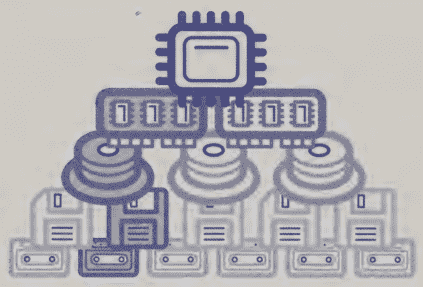

Figure 5-1: Memory hierarchy

```
=> c++11/expression_template_example.cpp
```

The solution to the dilemma of elegance versus performance is the introduction of a class for intermediate objects keeping references to the vectors and allowing us to perform all computations later in one sweep. The addition does not return a vector any longer but an object referring to the arguments:

```
template <typename T>
class vector_sum
{
public:
    vector_sum(const vector<T>& v1, const vector<T>& v2)
    : v1(v1), v2(v2) {}
private:
    const vector<T>& v1, &v2;
};
```

Now we can write x + y but not w = x + y yet. It is not only that the assignment is not defined; we have not yet provided vector_sum with enough functionality to perform something useful in the assignment. Thus, we first extend vector_sum so that it looks like a vector itself:

```
template <typename T>
class vector_sum
{


public:
 // ...
 friend int size(const vector_sum& x) { return size(x.v1); };
 T operator[](int i) const { return v1[i] + v2[i]; }
 private:
 const vector<T>& v1, &v2;
 };

这个类中最有趣的函数是括号运算符：当访问第 i 个元素时，我们即时计算操作数的第 i 个元素之和。

在括号运算符中计算逐元素求和的缺点是，当元素被多次访问时会出现重复计算。例如，在矩阵向量乘法中计算 A * (x+y) 时就会发生这种情况。因此，对于某些操作，提前求出向量和而不是在访问运算符中逐元素计算可能更有益。

为了求出 w = x + y，我们还需要为 vector_sum 提供一个赋值运算符：

```
template <typename T> class vector_sum; // forward declaration
 template <typename T>
 class vector
 {
 // ...
 vector& operator=(const vector_sum<T>& that)
 {
 check_size(size(that));
 for (int i = 0; i < my_size; ++i)
 data[i] = that[i];
 return *this;
 }
 };
```

该赋值运算符遍历当前对象的数据以及参数 that 的数据。由于后者是 vector_sum，表达式 that[i] 计算一个逐元素求和，即 x[i] + y[i]。因此，与 Listing 5-4 中朴素实现所执行的操作相比，w = x + y 的求值现在具有：

- 只有一个循环；
- 没有临时向量；
- 没有额外的内存分配和释放；以及
- 没有额外的数据读写。

实际上，执行的操作与以下循环相同：

```
for (int i = 0; i < size(w); ++i)
 w[i] = x[i] + y[i];
```

创建 vector_sum 对象的开销可以忽略不计。该对象将保留在栈上，不需要内存分配。即使是创建对象所需的这点小开销，通常也会被大多数具有体面静态代码分析能力的编译器优化掉。

当我们相加三个向量时会发生什么？Listing 5-4 中朴素的实现返回一个向量，该向量可以与另一个向量相加。我们的方法返回一个 vector_sum，但我们没有为 vector_sum 和 vector 提供加法。因此，我们需要另一个表达式模板类和相应的操作：

```
template <typename T>
class vector_sum3
{
public:
    vector_sum3(const vector<T>& v1, const vector<T>& v2,
                const vector<T>& v3)
        : v1(v1), v2(v2), v3(v3)
    { ... }

    T operator[](int i) const { return v1[i] + v2[i] + v3[i]; }

private:
    const vector<T>& v1, &v2, &v3;
};

template <typename T>
vector_sum3<T> inline operator+(const vector_sum<T>& x,
                                const vector<T>& y)
{
    return {x.v1, x.v2, y};
}
```

此外，vector_sum 必须将我们的新加法运算符声明为友元以访问其私有成员，而 vector 需要为 vector_sum3 提供赋值运算。这变得越来越令人烦恼。另外，如果我们先执行第二个加法会怎样：w = x + (y + z)？那么我们需要另一个加法运算符。如果某些向量与标量相乘会怎样，例如 w = x + dot(x, y) * y + 4.3 * z，而这个标量积也通过 ET 实现？我们的实现工作将陷入组合爆炸，我们需要一个更灵活的解决方案，我们将在下一节中介绍。

### 5.3.3 泛型表达式模板

到目前为止，我们从一个特定的类（vector）开始，逐步泛化实现。虽然这有助于我们理解机制，但我们现在直接转向适用于任意向量类型及其视图的通用版本：

```
template <typename V1, typename V2>
inline vector_sum<V1, V2> operator+(const V1& x, const V2& y)
{
    return {x, y};
}
```

我们现在需要一个带有任意参数的表达式类：

```
template <typename V1, typename V2>
class vector_sum
{
public:
    vector_sum(const V1& v1, const V2& v2) : v1(v1), v2(v2) {}
    ??? operator[](int i) const { return v1[i] + v2[i]; }

private:
    const V1& v1;
    const V2& v2;
};
```

这相当直接。唯一的问题是 operator[] 应该返回什么类型。为此，我们必须在每个类中定义 value_type（外部类型特征会更灵活，但我们希望在这里尽可能简单）。在 vector_sum 中，我们可以取第一个参数的 value_type，而该类型本身可以从另一个类中获取。只要整个应用程序中的标量类型相同，这是一个可接受的解决方案。然而，我们在 3.10 节中看到，如果不注意结果类型，混合参数可能会产生完全荒谬的结果。为了应对混合运算，我们取参数的 value types 的 common_type_t：

```
template <typename V1, typename V2>
class vector_sum
{
    // ...
    using value_type = std::common_type_t<typename V1::value_type,
                                          typename V2::value_type>;

    value_type operator[](int i) const { return v1[i] + v2[i]; }
};
```

如果我们的 vector_sum 类不需要显式声明 value_type，可以在 C++14 中使用 decltype(auto) 作为返回类型，并将类型推断完全交给编译器。相比之下，当模板用 vector_sum 本身实例化时，后置返回类型不起作用，因为这会产生对自身的依赖。

为了将不同种类的表达式赋值给向量类，我们还应该泛化赋值运算符：

```
template <typename T>
class vector
{
public:
    template <typename Src>
    vector& operator=(const Src& that)
    {
        check_size(size(that));
        for (int i = 0; i < my_size; ++i)
        data[i] = that[i];
        return *this;
    }
};
```

这个赋值运算符接受每种类型，除了 vector<T>，我们需要为其提供专用的拷贝赋值运算符。为了避免代码冗余，我们可以实现一个执行实际拷贝的方法，并从通用赋值和拷贝赋值中调用它。

### 表达式模板的优势：

尽管 C++ 中运算符重载的可用性产生了记号上更简洁的代码，但科学界拒绝放弃使用 Fortran 编程或直接在 C/C++ 中实现循环。原因是传统的运算符实现开销太大。由于创建临时变量以及复制向量和矩阵对象的开销，C++ 无法与用 Fortran 编写的程序的性能竞争。随着泛型和表达式模板的引入，这一问题已得到解决。现在我们可以以记号上方便的方式编写极其高效的科学程序。

## 5.4 元调优：编写你自己的编译器优化

编译器技术在进步，提供的优化技术也越来越多。理想情况下，我们都以最简单、最易读的方式编写软件，编译器从中生成最优的可执行文件。我们只需要一个更新、更好的编译器，程序就会越来越快。不幸的是，这并不总是真的有效。

除了像复制消除（§2.3.5.3）这样的通用优化之外，编译器还提供像循环展开（Loop Unrolling）这样的数值优化技术：循环被转换，使得多次迭代在一次中完成。这减少了循环控制的开销，并增加了并发执行的潜力。许多编译器仅将此技术应用于内层循环，而展开多个循环通常能带来更好的性能。多次迭代计算从引入额外临时变量中受益，而这反过来可能需要用户类型或操作中不可用的语义信息。

某些编译器特别针对特定操作进行了调优——尤其是用于基准测试的操作，更具体地说，是用于对世界500台最快计算机进行排名的 LINPACK 基准测试（www.top500.org）。例如，它们可以使用模式匹配来识别标准稠密矩阵乘法中典型的三重嵌套循环，并将此代码替换为高度调优的汇编实现，其速度可以快一个或多个数量级。这些程序使用七个或九个循环，配合平台相关的块大小，以榨取每个缓存级别的最后一点性能，转置子矩阵，在多个线程上运行，进行精巧的寄存器编排，等等。5

5. 有时人们可能会产生这样的印象：高性能计算（HPC）社区认为，以接近峰值性能乘以稠密矩阵可以解决世界上的所有问题，或者至少可以证明，只要足够努力，一切都可以以接近峰值性能来计算。出于嫉妒，超级计算机中心越来越多的人意识到，他们的机器不仅仅运行稠密矩阵操作，而且现实世界的应用在大多数情况下受限于内存带宽和延迟。


将简单的循环实现替换为运行在近乎峰值性能的代码，绝对是一项伟大的成就。不幸的是，这让许多程序员相信大多数计算都可以以类似方式加速。通常，微小的改动就足以偏离模式，而性能远不如预期那样显著。无论模式定义得多么通用，其适用性始终是有限的。一种算法变更（例如，将矩形矩阵乘法改为三角矩阵乘法），只要不妨碍分块和展开优化，很可能就会脱离编译器的特例优化。

长话短说：编译器能做很多事，但并非万能。无论编译器调优了多少个特例，总会需要领域特定的优化。作为编译器技术的替代方案，存在像 ROSE [35] 这样的工具，它们允许你在抽象语法树（AST，即程序的编译器内部表示）上使用用户定义的变换来转换源代码（包括 C++）。

编译器优化的一大障碍在于，某些变换需要语义知识。这种知识仅对编译器实现者已知的类型和操作可用。感兴趣的读者也可以参阅 [19] 中关于该主题的更深入讨论。目前正在进行研究，以通过基于概念的优化 [47] 提供用户定义的变换。不幸的是，要使其成为主流还需要时间；即使是计划用于 C++17 的新 Concepts Lite 扩展，也只能算是朝着由用户语义驱动的优化迈出的一步，因为起初它只会处理语法。

在本章的其余部分，我们将展示在线性代数领域中使用元编程进行用户定义的代码变换。目标是让用户尽可能清晰地编写操作，同时函数和类模板力求达到最大可实现的性能。鉴于模板系统的图灵完备性，我们可以提供任何理想的用户界面，同时在底层实现一个与最高效代码行为等价的实现，正如我们将在本节中演示的那样。编写经过良好调优的模板是一项巨大的编程、测试和基准测试工作。为了让这项工作有回报，模板应包含在维护良好的库中，这些库应面向广泛的用户社区（至少在研究团队或公司内部）。

### 5.4.1 经典固定尺寸展开

```
=> c++11/fsize_unroll_test.cpp
```

对于固定尺寸的数据类型（尤其是第 3.7 节中提到的数学向量），最简单的编译时优化形式可以得以实现。与默认赋值类似，我们可以编写一个通用的向量赋值：

```
template <typename T, int Size>
class fsize_vector
{
public:
    const static int my_size = Size;
    template <typename Vector>
    self& operator=(const self& that)
    {
        for (int i = 0; i < my_size; ++i)
            data[i] = that[i];
    }
};
```

一个先进的编译器会识别出所有迭代都是相互独立的；例如，data[2] = that[2]; 与 data[1] = that[1]; 相互独立。编译器还会在编译期间确定循环的大小。因此，大小为 3 的 fsize_vector 生成的二进制代码将等价于

```
template <typename T, int Size>
class fsize_vector
{
    template <typename Vector>
    self& operator=(const self& that)
    {
        data[0] = that[0];
        data[1] = that[1];
        data[2] = that[2];
    }
};
```

右侧向量可能是一个表达式模板（§5.3，例如 alpha * x + y），其求值也将被内联：

```
template <typename T, int Size>
class fsize_vector
{
    template <typename Vector>
    self& operator=(const self& that)
    {
        data[0] = alpha * x[0] + y[0];
        data[1] = alpha * x[1] + y[1];
        data[2] = alpha * x[2] + y[2];
    }
};
```

为了使展开更加显式，并为了逐步引入元调优，我们开发了一个执行赋值的函子：

```
template <typename Target, typename Source, int N>
struct fsize_assign
{
    void operator()(Target& tar, const Source& src)
    {
        fsize_assign<Target, Source, N-1>()(tar, src);
        std::cout << "assign entry " << N << '\n';
        tar[N] = src[N];
    }
};
```

```
template <typename Target, typename Source>
struct fsize_assign<Target, Source, 0>
{
    void operator()(Target& tar, const Source& src)
    {
        std::cout << "assign entry " << 0 << '\n';
        tar[0] = src[0];
    }
};
```

打印输出将向我们展示执行情况。为了避免显式实例化参数类型，我们对 operator() 进行参数化，而不是对类进行参数化：

```
template <int N>
struct fsize_assign
{
    template <typename Target, typename Source>
    void operator()(Target& tar, const Source& src)
    {
        fsize_assign<N-1>()(tar, src);
        std::cout << "assign entry " << N << '\n';
        tar[N] = src[N];
    }
};
```

```
template <>
struct fsize_assign<0>
{
    template <typename Target, typename Source>
    void operator()(Target& tar, const Source& src)
    {
        std::cout << "assign entry " << 0 << '\n';
        tar[0] = src[0];
    }
};
```

然后，在调用算子时，编译器可以推断向量类型。我们不使用循环实现，而是在算子中调用递归赋值函子：

```
template <typename T, int Size>
class fsize_vector
{
    static_assert(my_size > 0, "Vector must be larger than 0.");
    self& operator=(const self& that)
    {
        fsize_assign<my_size-1>()(*this, that);
        return *this;
    }
}
```

```
template <typename Vector>
self& operator=(const Vector& that)
{
    fsize_assign<my_size-1>()(*this, that);
    return *this;
}
```

以下代码片段的执行：

```
fsize_vector<float, 4> v, w;
v[0] = v[1] = 1.0; v[2] = 2.0; v[3] = -3.0;
w = v;
```

显示了预期的行为：

```
assign entry 0
assign entry 1
assign entry 2
assign entry 3
```

在此实现中，我们用递归替换了循环——依赖编译器对操作和循环控制进行内联。否则，递归函数调用将比普通循环更慢。

此技术仅对在 L1 缓存中运行的小循环有益。较大的循环主要由从内存加载数据所主导，循环开销无关紧要。恰恰相反，对非常大的向量展开所有操作通常会降低性能，因为需要加载大量指令，因此数据传输必须等待。如前所述，编译器可以自行展开此类操作，并希望包含启发式规则来决定何时不展开更好。我们观察到，对单个循环的自动展开有时比像上面那样的显式实现更快。

人们可能会认为，至少有了 C++14 扩展，使用 constexpr 实现应该会更简单。不幸的是，情况并非如此，因为我们会混合编译时参数——大小——与运行时参数——向量引用。因此，constexpr 将退化为普通函数。

### 5.4.2 嵌套展开

根据我们的经验，大多数编译器会展开非嵌套循环。即使是能够处理某些嵌套循环的优秀编译器，也无法优化每个程序内核，特别是那些具有许多用户定义类型实例化的模板参数的内核。我们将在此演示如何在编译时展开嵌套循环，以矩阵向量乘法为例。

为此，我们引入一个简单的固定尺寸矩阵类型：

```
template <typename T, int Rows, int Cols>
class fsize_matrix
{
    static_assert(Rows > 0, "Rows must be larger than 0.");
    static_assert(Cols > 0, "Cols must be larger than 0.");

    using self = fsize_matrix;

public:
    using value_type = T;
    const static int my_rows = Rows, my_cols = Cols;

    fsize_matrix(const self& that) { ... }

    // Cannot check column index here!
    const T* operator[](int r) const { return data[r]; }
    T* operator[](int r) { return data[r]; }

    mat_vec_et<self, fsize_vector<T, Cols> >
    operator*(const fsize_vector<T, Cols>& v) const
    {
        return (*this, v);
    }

private:
    T data[Rows][Cols];
};
```

出于简单性考虑，括号运算符返回一个指针，而一个良好的实现应返回一个代理，以允许检查列索引（参见 §A.4.3.3）。与向量的乘法通过表达式模板实现，以避免复制结果向量。然后，为我们的表达式模板类型重载了向量赋值：

```
template <typename T, int Size>
class fsize_vector
{
    template <typename Matrix, typename Vector>
    self& operator=(const mat_vec_et<Matrix, Vector>& that)
    {
        using et = mat_vec_et<Matrix, Vector>;
        using mv = fsize_mat_vec_mult<et::my_rows-1, et::my_cols-1>;
        mv(that.A, that.v, *this);
        return *this;
    }
};
```

函子 fsize_mat_vec_mult 根据三个参数计算矩阵向量乘积。该函子的通用实现如下：

```
template <int Rows, int Cols>
struct fsize_mat_vec_mult
```


## 

```cpp
{
    template <typename Matrix, typename VecIn, typename VecOut>
    void operator()(const Matrix& A, const VecIn& v_in, VecOut& v_out)
    {
        fsize_mat_vec_mult<Rows, Cols-1>()(A, v_in, v_out);
        v_out[Rows]+= A[Rows][Cols] * v_in[Cols];
    }
};
```

同样，仿函数只将大小参数作为显式参数，而容器的类型则被推导。该运算符假设所有较小的列索引都已处理，并且我们可以通过 A[Rows][Cols] * v_in[Cols] 递增 v_out[Rows]。特别是，我们假设第一个操作 v_out[Rows] 初始化该值。因此，我们需要针对 Cols = 0 的（偏）特化：

```cpp
template <int Rows>
struct fsize_mat_vec_mult<Rows, 0>
{
    template <typename Matrix, typename VecIn, typename VecOut>
    void operator()(const Matrix& A, const VecIn& v_in, VecOut& v_out)
    {
        fsize_mat_vec_mult<Rows-1, Matrix::my_cols-1>()(A, v_in, v_out);
        v_out[Rows]= A[Rows][0] * v_in[0];
    }
};
```

细心的读者会注意到 += 被替换成了 =。我们还必须对前一行的所有列以及递归地对所有较小的行调用计算。为简单起见，矩阵的列数从矩阵类型的内部定义中获取。6 我们还需要一个（全）特化来终止递归：

```cpp
template <>
struct fsize_mat_vec_mult<0, 0>
{
    template <typename Matrix, typename VecIn, typename VecOut>
    void operator()(const Matrix& A, const VecIn& v_in, VecOut& v_out)
    {
        v_out[0]= A[0][0] * v_in[0];
    }
};
```

通过内联，我们的程序将对大小为 4 的向量执行 w = A * v 操作，仿佛我们计算了：

```cpp
w[0] = A[0][0] * v[0];
w[0]+= A[0][1] * v[1];
w[0]+= A[0][2] * v[2];
w[0]+= A[0][3] * v[3];
w[1]= A[1][0] * v[0];
w[1]+= A[1][1] * v[1];
w[1]+= A[1][2] * v[2];
...
```

6. 将其作为额外的模板参数传递或使用类型特征会更通用，因为我们不再依赖类中的 my_cols 定义。

#### 5.4.2.1 提高并发性

前一种实现的一个缺点是，对目标向量某个元素的所有操作都在一次扫描中完成。因此，第二个操作必须等待第一个，第三个等待第二个，以此类推。第五个操作可以与第四个并行，第九个与第八个并行，等等。然而，这种并发性相当有限。我们希望程序中有更多的并行性，以便在超标量处理器甚至 SSE 中启用并行流水线。同样，我们可以坐等编译器将语句重新排序为我们喜欢的顺序，或者亲自动手。当我们在“内层”循环中遍历结果向量和矩阵行时，可以提供更多的并发性：

```cpp
w[0]= A[0][0] * v[0];
w[1]= A[1][0] * v[0];
w[2] = A[2][0] * v[0];
w[3] = A[3][0] * v[0];
w[0]+= A[0][1] * v[1];
w[1]+= A[1][1] * v[1];
...
```

我们只需要重构我们的仿函数。通用模板现在如下：

```cpp
template <int Rows, int Cols>
struct fsize_mat_vec_mult_cm
{
    template <typename Matrix, typename VecIn, typename VecOut>
    void operator()(const Matrix& A, const VecIn& v_in, VecOut& v_out)
    {
        fsize_mat_vec_mult_cm<Rows-1, Cols>()(A, v_in, v_out);
        v_out[Rows]+= A[Rows][Cols] * v_in[Cols];
    }
};
```

现在，我们需要一个针对第 0 行的偏特化，它会转到下一列：

```cpp
template <int Cols>
struct fsize_mat_vec_mult_cm<0, Cols>
{
    template <typename Matrix, typename VecIn, typename VecOut>
    void operator()(const Matrix& A, const VecIn& v_in, VecOut& v_out)
    {
        fsize_mat_vec_mult_cm<Matrix::my_rows-1, Cols-1>()(A, v_in, v_out);
        v_out[0]+= A[0][Cols] * v_in[Cols];
    }
};
```

针对第 0 列的偏特化还必须初始化输出向量的元素：

```cpp
template <int Rows>
struct fsize_mat_vec_mult_cm<Rows, 0>
{
    template <typename Matrix, typename VecIn, typename VecOut>
    void operator()(const Matrix& A, const VecIn& v_in, VecOut& v_out)
    {
        fsize_mat_vec_mult_cm<Rows-1, 0>()(A, v_in, v_out);
        v_out[Rows] = A[Rows][0] * v_in[0];
    }
};
```

最后，我们仍然需要一个针对第 0 行和第 0 列的特化来终止递归。这可以从之前的仿函数中复用：

```cpp
template <>
struct fsize_mat_vec_mult_cm<0, 0>
{
    : fsize_mat_vec_mult_cm<0, 0> {};
};
```

请注意，我们对不同的数据执行相同的操作，SIMD 架构可以从中受益。SIMD 代表单指令流多数据流。现代处理器包含 SSE 单元，这些单元可以同时对多个浮点数执行算术操作。要使用这些 SSE 指令，处理的数据必须在内存中对齐且连续，并且编译器必须知晓这一点。在我们的示例中，我们没有解决对齐问题，但展开的代码清楚地表明，相同的操作是在连续内存上执行的。

#### 5.4.2.2 使用寄存器

我们还应牢记现代处理器的另一个特性是缓存一致性。现代处理器设计为共享内存，同时保持其缓存的一致性。因此，每次我们在内存中写入像我们的向量 w 这样的数据结构时，缓存失效信号都会发送到其他核心和处理器。遗憾的是，这会显著减慢计算速度。

幸运的是，在许多情况下，可以通过在函数中引入临时变量来避免缓存失效瓶颈，当类型允许时，这些临时变量会驻留在寄存器中。我们可以依赖编译器做出关于临时变量位置的良好决策。C++03 有 register 关键字。然而，这仅仅是一个提示，编译器并不有义务将变量存储在寄存器中。特别是，当程序针对开发过程中未考虑的目标平台编译时，如果强制使用寄存器，弊大于利。因此，在 C++11 中该关键字被弃用，因为编译器有相当好的启发式方法来平台相关地定位变量，无需程序员的帮助。

引入临时变量需要两个类：一个用于外层循环，一个用于内层循环。让我们从外层循环开始：

```cpp
template <int Rows, int Cols>
struct fsize_mat_vec_mult_reg
{
  template <typename Matrix, typename VecIn, typename VecOut>
  void operator()(const Matrix& A, const VecIn& v_in, VecOut& v_out)
  {
    fsize_mat_vec_mult_reg<Rows-1, Cols>()(A, v_in, v_out);
    typedef VecOut::value_type tmp;
    fsize_mat_vec_mult_aux<Rows, Cols>()(A, v_in, tmp);
    v_out[Rows] = tmp;
  }
};
```

我们假设 fsize_mat_vec_mult_aux 在此类之前已定义或声明。第 7 行的第一条语句调用前几行的计算。第 9 行定义了一个临时变量，假设体面的编译器会将其放置在寄存器中。然后我们开始对该矩阵行进行计算。临时变量作为引用传递给内联函数，以便求和在寄存器中执行。在第 10 行，我们将结果写回 v_out。这仍然会在总线上引起失效信号，但每个条目只发生一次。仿函数必须针对第 0 行进行特化，以避免无限循环：

```cpp
template <int Cols>
struct fsize_mat_vec_mult_reg<0, Cols>
{
  template <typename Matrix, typename VecIn, typename VecOut>
  void operator()(const Matrix& A, const VecIn& v_in, VecOut& v_out)
  {
    typename VecOut::value_type tmp;
    fsize_mat_vec_mult_aux<0, Cols>()(A, v_in, tmp);
    v_out[0] = tmp;
  }
};
```

在每一行中，我们遍历列并递增临时变量（希望在寄存器中）：

```cpp
template <int Rows, int Cols>
struct fsize_mat_vec_mult_aux
{
  template <typename Matrix, typename VecIn, typename ScalOut>
  void operator()(const Matrix& A, const VecIn& v_in, ScalOut& tmp)
  {
    fsize_mat_vec_mult_aux<Rows-1, Cols>()(A, v_in, tmp);
    tmp += A[Rows][Cols] * v_in[Cols];
  }
};


要终止矩阵列的计算，我们编写一个特化：

```cpp
template <int Rows>
struct fsize_mat_vec_mult_aux<Rows, 0>
{
    template <typename Matrix, typename VecIn, typename ScalOut>
    void operator()(const Matrix& A, const VecIn& v_in, ScalOut& tmp)
    {
        tmp = A[Rows][0] * v_in[0];
    }
};
```

在本节中，我们展示了优化二维循环（固定大小）的不同方法。当然还有更多可能性：例如，我们可以尝试同时具有良好并发性和寄存器使用率的实现。另一种优化是聚合写回操作，以进一步减少缓存失效信号。

### 5.4.3 动态展开-预热

=> c++11/vector_unroll_example.cpp

固定大小优化固然重要，但对动态大小容器的加速需求更为迫切。我们从这里开始，通过一个简单示例和一些观察来展开。我们将复用清单3-1中的向量类。为了更清晰地展示实现，我们不使用运算符和表达式模板来编写代码。我们的测试用例将计算

u = 3v + w

针对三个大小为1000的短向量。墙钟时间将使用<chrono>进行测量。向量v和w将被初始化，并且为了绝对确保数据在缓存中，我们将在计时前运行一些额外操作。为了简洁，我们将基准测试代码移至附录A.9.5。

我们将直接循环与每次迭代执行四个操作的循环进行比较。

```cpp
for (unsigned j = 0; j < rep; j++)
    for (unsigned i = 0; i < s; i += 4) {
        u[i] = 3.0f * v[i] + w[i];
        u[i+1] = 3.0f * v[i+1] + w[i+1];
        u[i+2] = 3.0f * v[i+2] + w[i+2];
        u[i+3] = 3.0f * v[i+3] + w[i+3];
    }
```

这段代码显然仅在向量大小能被4整除时才能工作。为了避免错误，我们可以在向量大小上添加断言，但这并不真正令人满意。相反，我们将此实现推广到任意向量大小：

### 清单5-5：u = 3v + w的展开计算

```cpp
for (unsigned j = 0; j < rep; j++) {
    unsigned sb = s / 4 * 4;
    for (unsigned i = 0; i < sb; i += 4) {
        u[i] = 3.0f * v[i] + w[i];
        u[i+1] = 3.0f * v[i+1] + w[i+1];
        u[i+2] = 3.0f * v[i+2] + w[i+2];
        u[i+3] = 3.0f * v[i+3] + w[i+3];
    }
    for (unsigned i = sb; i < s; ++i)
        u[i] = 3.0f * v[i] + w[i];
}
```

遗憾的是，我们看到最旧的编译器获得了最大收益。在Intel i7-3820 3.6 GHz上使用gcc 4.4及标志-O3 -ffast-math -DNDEBUG运行，结果为

```
Compute time native loop is 0.801699 µs.
Compute time unrolled loop is 0.600912 µs.
```

本章中的测量时间均为至少1000次运行的平均值，因此累积执行时间超过10秒，时钟提供了足够的分辨率。

或者，除了手动编写的展开之外，我们还可以使用编译器标志-funroll-loops。这在测试机上产生了以下执行时间：

```
Compute time native loop is 0.610174 µs.
Compute time unrolled loop is 0.586364 µs.
```

因此，编译器标志为我们提供了类似的性能提升。

当向量大小在编译时已知时，编译器能够应用更多优化：

```cpp
const unsigned s = 1000;
```

然后，转换循环或确定转换是有益的可能更容易：

```
Compute time native loop is 0.474725 µs.
Compute time unrolled loop is 0.471488 µs.
```

使用g++ 4.8时，我们观察到的运行时间约为0.42µs，而使用clang 3.4时甚至为0.16µs。对生成的汇编代码进行调查揭示，主要区别在于数据如何从主内存移动到浮点寄存器并返回。

这也表明，一维循环经过现代编译器优化效果非常好，通常比我们手动调优更好。尽管如此，我们将首先在一维中展示元调优技术，作为为更高维度做准备，在更高维度中它仍能提供显著的加速。

假设循环展开对于特定平台上的给定计算是有益的，我们接下来问自己：“展开的最优块大小是多少？”

- 它是否取决于表达式？
- 它是否取决于参数的类型？
- 它是否取决于计算机架构？

答案是肯定的。全部都是。主要原因（但不是唯一原因）是不同处理器拥有不同数量的寄存器。一次迭代需要多少个寄存器取决于表达式和类型（复杂值比浮点数需要更多寄存器）。

在接下来的章节中，我们将解决这两个问题：如何封装转换使其不出现在应用程序中，以及如何在不重写循环的情况下更改块大小。

### 5.4.4 向量表达式展开

为了更易理解，我们逐步讨论元调优中的抽象。我们从之前的循环示例u = 3v + w开始，并将其实现为可调优函数。该函数名为my_apxy，并有一个用于块大小的模板参数，因此我们可以编写，例如：

```cpp
for (unsigned j = 0; j < rep; j++)
    my_apxy<2>(u, v, w);
```

该函数包含一个带有可自定义块大小的展开主循环和末尾的清理循环：

```cpp
template <unsigned BSize, typename U, typename V, typename W >
void my_apxy(U& u, const V& v, const W& w)
{
    assert(u.size() == v.size() && v.size() == w.size());
    unsigned s = u.size(), sb = s / BSize * BSize;

    for (unsigned i = 0; i < sb; i += BSize)
        my_apxy_ftor<0, BSize>()(u, v, w, i);

    for (unsigned i = sb; i < s; ++i)
        u[i] = 3.0f * v[i] + w[i];
}
```

如前所述，推导的模板类型（如本例中的向量类型）必须定义在参数列表的末尾，而显式给出的参数（在本例中为块大小）必须传递给第一个模板参数。第一个循环中的块语句实现可以类似于第5.4.1节中的函子实现。我们稍微偏离了该实现，使用两个模板参数，其中第一个参数递增直到等于第二个参数。我们观察到，与只使用一个参数并将其递减到零相比，这种方法在gcc上产生了更快的二进制文件。此外，两参数版本与第5.4.7节中的多维实现更加一致。与固定大小展开一样，我们需要递归模板定义。在每个运算符中，执行单个操作并调用以下内容：

```cpp
template <unsigned Offset, unsigned Max>
struct my_apxy_ftor
{
    template <typename U, typename V, typename W >
    void operator()(U& u, const V& v, const W& w, unsigned i)
    {
        u[i + Offset] = 3.0f * v[i + Offset] + w[i + Offset];
        my_apxy_ftor<Offset + 1, Max>()(u, v, w, i);
    }
};
```

与固定大小展开的唯一区别是索引相对于索引i。operator()首先在Offset等于0时调用，然后是1、2，依此类推。由于每个调用都被内联，函子调用表现为一个单体操作块，没有循环控制和函数调用。因此，my_apxy_ftor<0, 4>()(u, v, w, i)的调用执行与清单5-5中第一个循环一次迭代相同的操作。

当然，如果没有针对Max的特化，此编译将陷入无限循环：

```cpp
template <unsigned Max>
struct my_apxy_ftor<Max, Max>
{
    template <typename U, typename V, typename W>
    void operator()(U& u, const V& v, const W& w, unsigned i) {}
};
```

使用不同展开参数执行所考虑的向量操作会产生

```
Compute time unrolled<2> loop is 0.667546 µs.
Compute time unrolled<4> loop is 0.601179 µs.
Compute time unrolled<6> loop is 0.565536 µs.
Compute time unrolled<8> loop is 0.570861 µs.
```

现在我们可以为任何喜欢的块大小调用此操作。另一方面，为每个向量表达式提供这样的函子是不可接受的编程工作量。因此，我们现在将把此技术与表达式模板相结合。

### 5.4.5 调优表达式模板

=> c++11/vector_unroll_example2.cpp

在第5.3.3节中，我们实现了向量和的表达式模板（不展开）。同样，我们可以实现标量-向量积，但我们将此作为练习5.5.4留给有动力的读者，并仅考虑带有加法的表达式，例如：

u = v + v + w

我们的基准性能是

```
Compute time is 1.72 µs.
```

要将元调优纳入表达式模板，我们只需修改实际赋值，因为所有基于循环的向量操作都在此处执行。其他操作（加法、减法、缩放等）仅返回包含引用的小对象。我们可以像之前一样，将表达式operator=中的循环分割为开头的展开部分和末尾的完成部分：


```cpp
template <typename T>
class vector
{
    template <typename Src>
    vector& operator=(const Src& that)
    {
        check_size(size(that));
        unsigned s = my_size, sb = s / 4 * 4;

        for (unsigned i = 0; i < sb; i += 4)
            assign<0, 4>()(*this, that, i);

        for (unsigned i = sb; i < s; ++i)
            data[i] = that[i];
        return *this;
    }
};
```

赋值仿函数的实现与 my_axpy_ftor 类似：

```cpp
template <unsigned Offset, unsigned Max>
struct assign
{
    template <typename U, typename V>
    void operator()(U& u, const V& v, unsigned i)
    {
        u[i + Offset] = v[i + Offset];
        assign<Offset + 1, Max>()(u, v, i);
    }
};
```

```cpp
template <unsigned Max>
struct assign<Max, Max>
{
    template <typename U, typename V>
    void operator()(U& u, const V& v, unsigned i) {}
};
```

计算上述表达式得到

```
Compute time is 1.37 µs.
```

通过这个相当简单的修改，我们现在加速了所有向量表达式模板。然而，与之前的实现相比，我们失去了自定义循环展开的灵活性。仿函数 assign 有两个参数，从而允许自定义。问题是赋值运算符。原则上，我们可以在这里定义一个显式模板参数：

```cpp
template <unsigned BSize, typename Src>
vector& operator=(const Src& that)
{
    check_size(size(that));
    unsigned s = my_size, sb = s / BSize * BSize;
    for (unsigned i = 0; i < sb; i += BSize)
        assign<0, BSize>()(*this, that, i);
    for (unsigned i = sb; i < s; ++i)
        data[i] = that[i];
    return *this;
}
```

缺点是我们不能再将符号 = 用作自然的中缀运算符。相反，我们必须写：

```
u.operator<=(v + v + w);
```

这确实有一种极客的魅力，也有人可能会争辩说，人们为了性能曾经并且现在仍然做过更痛苦的事情。尽管如此，它并不符合我们关于直观性和可读性的理想。

替代表示法是

```
unroll<4>(u = v + v + w);
```

或

```
unroll<4>(u) = v + v + w;
```

两种版本都可以实现，但我们认为后者更易读。前者更准确地表达了我们正在做的事情，而后者更容易实现，并且计算表达式的结构保持了更好的可见性。因此，我们展示第二种形式的实现。

函数 unroll 实现简单：它只是返回一个 unroll_vector 类型的对象（见下文），其中包含对向量的引用和展开大小的类型信息：

```cpp
template <unsigned BSize, typename Vector>
unroll_vector<BSize, Vector> inline unroll(Vector& v)
{
    return unroll_vector<BSize, Vector>(v);
}
```

类 unroll_vector 也不复杂。它只需要获取目标向量的引用并提供一个赋值运算符：

```cpp
template <unsigned BSize, typename V>
class unroll_vector
{
public:
    unroll_vector(V& ref) : ref(ref) {}
    template <typename Src>
    V& operator=(const Src& that)
    {
        assert(size(ref) == size(that));
        unsigned s = size(ref), sb = s / BSize * BSize;

        for (unsigned i = 0; i < sb; i += BSize)
            assign<0, BSize>()(ref, that, i);

        for (unsigned i = sb; i < s; ++i)
            ref[i] = that[i];
        return ref;
    }

private:
    V& ref;
};
```

对一些块大小评估所考虑的向量表达式得到

- Compute time unroll<1>(v) = v + v + w is 1.72 µs.
- Compute time unroll<2>(v) = v + v + w is 1.52 µs.
- Compute time unroll<4>(v) = v + v + w is 1.36 µs.
- Compute time unroll<6>(v) = v + v + w is 1.37 µs.
- Compute time unroll<8>(v) = v + v + w is 1.4 µs.

这些少量基准测试与之前的结果一致；即，unroll<1> 等同于标准实现，而 unroll<4> 与硬连线展开一样快。

### 5.4.6 调优归约操作

本节的技术以类似的方式适用于各种向量和矩阵范数。它们也可用于点积和张量归约。

#### 5.4.6.1 在单个变量上进行归约

```
=> c++03/reduction_unroll_example.cpp
```

在前面的向量操作中，每个向量的第 i 个条目与任何其他条目独立处理。对于归约操作，它们通过一个或多个临时变量相关联。而这些临时变量可能成为严重的瓶颈。

首先，我们测试一种归约操作（例如，离散 L1 范数，也称为曼哈顿范数）是否可以通过 5.4.4 节的技术加速。我们使用迭代块的仿函数来实现 one_norm 函数：

```cpp
template <unsigned BSize, typename Vector>
typename Vector::value_type
inline one_norm(const Vector& v)
{
    using std::abs;

    typename Vector::value_type sum(0);
    unsigned s = size(v), sb = s / BSize * BSize;

    for (unsigned i = 0; i < sb; i += BSize)
        one_norm_ftor<0, BSize>()(sum, v, i);
    for (unsigned i = sb; i < s; ++i)
        sum += abs(v[i]);
    return sum;
}
```

仿函数也以相同的方式实现：

```cpp
template <unsigned Offset, unsigned Max>
struct one_norm_ftor
{
    template <typename S, typename V>
    void operator()(S& sum, const V& v, unsigned i)
    {
        using std::abs;
        sum += abs(v[i + Offset]);
        one_norm_ftor<Offset + 1, Max>()(sum, v, i);
    }
};

template <unsigned Max>
struct one_norm_ftor<Max, Max>
{
    template <typename S, typename V>
    void operator()(S& sum, const V& v, unsigned i) {}
};
```

对于归约，使用较新的编译器（如 gcc 4.8）可以看到调优收益：

- Compute time one_norm<1>(v) is 0.788445 µs.
- Compute time one_norm<2>(v) is 0.438087 µs.
- Compute time one_norm<4>(v) is 0.436625 µs.
- Compute time one_norm<6>(v) is 0.430335 µs.
- Compute time one_norm<8>(v) is 0.461095 µs.

这对应于 1.8 的加速比。让我们尝试一些替代实现。

#### 5.4.6.2 在数组上进行归约

```
=> c++0x/reduction_unroll_array_example.cpp
```

当我们查看之前的计算时，我们看到每次迭代使用 v 的不同条目。但每次计算都访问相同的临时变量 sum，这限制了并发性。为了提供更多并发性，我们可以例如在数组中使用多个临时变量7。修改后的函数如下：

```cpp
template <unsigned BSize, typename Vector>
typename Vector::value_type
```

7. 严格来说，这对于我们所能想到的每一种可能的标量类型都不成立。求和类型的加法必须是一个交换幺半群，因为我们改变了求值顺序。这当然适用于所有内置数值类型，并且几乎适用于所有用户定义的算术类型。然而，我们可以自由定义一种非交换或非幺半群的加法。在这种情况下，我们的变换将是错误。为了处理此类例外，我们需要语义概念，希望它们最终会成为 C++ 的一部分。（尤其是作者已经花了大量时间研究它们。）

```cpp
inline one_norm(const Vector& v)
{
    using std::abs;
    typename Vector::value_type sum[BSize];
    for (unsigned i = 0; i < BSize; ++i)
        sum[i] = 0;

    unsigned s = size(v), sb = s / BSize * BSize;
    for (unsigned i = 0; i < sb; i += BSize)
        one_norm_ftor<0, BSize>()(sum, v, i);

    for (unsigned i = 1; i < BSize; ++i)
        sum[0] += sum[i];
    for (unsigned i = sb; i < s; ++i)
        sum[0] += abs(v[i]);

    return sum[0];
}
```

现在，one_norm_ftor 的每个实例都在 sum 数组的另一个条目上操作：

```cpp
template <unsigned Offset, unsigned Max>
struct one_norm_ftor
{
    template <typename S, typename V>
    void operator()(S* sum, const V& v, unsigned i)
    {
        using std::abs;
        sum[Offset] = abs(v[i + Offset]);
        one_norm_ftor<Offset + 1, Max>()(sum, v, i);
    }
};
```

```cpp
template <unsigned Max>
struct one_norm_ftor<Max, Max>
{
    template <typename S, typename V>
    void operator()(S* sum, const V& v, unsigned i) {}
};
```

在测试机器上运行此实现得到

- Compute time one_norm<1>(v) is 0.797224 µs.
- Compute time one_norm<2>(v) is 0.45923 µs.
- Compute time one_norm<4>(v) is 0.538913 µs.
- Compute time one_norm<6>(v) is 0.467529 µs.
- Compute time one_norm<8>(v) is 0.586729 µs.

这甚至比单变量版本稍慢一些。也许数组作为参数传递（即使在内联函数中）也更昂贵。让我们尝试其他方法。


#### 5.4.6.3 在嵌套类对象上进行归约

=> c++03/reduction_unroll_nesting_example.cpp

为避免使用数组，我们可以为 n 个临时变量定义一个类，其中 n 是模板参数。这样，类的设计更符合函子的递归方案：

```cpp
template <unsigned BSize, typename Value>
struct multi_tmp
{
  typedef multi_tmp<BSize-1, Value> sub_type;

  multi_tmp(const Value& v) : value(v), sub(v) {}

  Value value;
  sub_type sub;
};
```

```cpp
template <typename Value>
struct multi_tmp<0, Value>
{
  multi_tmp(const Value& v) {}
};
```

此类对象可以递归初始化，因此不需要像数组那样使用循环。函子可以操作 value 成员，并将 sub 成员的引用传递给其后继者。这引出了我们函子的实现：

```cpp
template <unsigned Offset, unsigned Max>
struct one_norm_ftor
{
  template <typename S, typename V>
  void operator()(S& sum, const V& v, unsigned i)
  {
    using std::abs;
    sum.value += abs(v(i + Offset));
    one_norm_ftor<Offset + 1, Max>()(sum.sub, v, i);
  }
};

template <unsigned Max>
struct one_norm_ftor<Max, Max>
{
  template <typename S, typename V>
  void operator()(S& sum, const V& v, unsigned i) {}
};
```

使用此函子的展开函数如下：

```cpp
template <unsigned BSize, typename Value>
typename Vector::value_type
inline one_norm(const Vector& v)
{
    using std::abs;
    typedef typename Vector::value_type value_type;
    multi_tmp<BSize, value_type> multi_sum(0);
    unsigned s = size(v), sb = s / BSize * BSize;
    for (unsigned i = 0; i < sb; i += BSize)
        one_norm_ftor<0, BSize>()(multi_sum, v, i);
    value_type sum = multi_sum.sum();
    for (unsigned i = sb; i < s; ++i)
        sum += abs(v[i]);
    return sum;
}
```

还缺少一部分：我们必须在最后对 `multi_sum` 中的部分和进行归约。不幸的是，我们无法对 `multi_sum` 的成员编写循环。因此，我们需要一个递归函数来深入 `multi_sum`，最简单的方法是将其实现为带有相应特化的成员函数：

```cpp
template <unsigned BSize, typename Value>
struct multi_tmp
{
    Value sum() const { return value + sub.sum(); }
};
```

请注意，我们是从空的 `multi_tmp` 开始求和，而不是从最内层的 value 成员开始。否则，我们需要为 `multi_tmp<1, Value>` 额外编写一个特化。同样，我们可以像 `accumulate` 那样实现一般归约，但这需要存在一个初始元素：

```cpp
template <unsigned BSize, typename Value>
struct multi_tmp
{
    template <typename Op>
    Value reduce(Op op, const Value& init) const
    { return op(value, sub.reduce(op, init)); }
};

template <typename Value>
struct multi_tmp<0, Value>
{
    template <typename Op>
    Value reduce(Op op, const Value& init) const { return init; }
};
```

此版本的计算时间如下

| 实现 | 时间 |
|---|---|
| one_norm<1>(v) | 0.786668 µs |
| one_norm<2>(v) | 0.442476 µs |
| one_norm<4>(v) | 0.441455 µs |
| one_norm<6>(v) | 0.410978 µs |
| one_norm<8>(v) | 0.426368 µs |

因此，在我们的测试环境中，不同实现的性能相似。

#### 5.4.6.4 应对抽象惩罚

=> c++03/reduction_unroll_registers_example.cpp

在前面的章节中，我们引入了临时变量以实现更多独立操作。然而，这些临时变量只有在被分配到寄存器时才有益处。否则，由于额外的内存流量和缓存失效信号，它们甚至可能减慢整个执行速度。在某些旧编译器中，数组和嵌套类位于主内存中，展开代码的运行时间甚至比顺序代码更长。

这是抽象惩罚的典型示例：语义等价的程序由于采用更抽象的表述而运行得更慢。为了量化抽象惩罚，Alex Stepanov 在 20 世纪 90 年代初编写了一个基准测试，用于测量包装类对 accumulate 函数性能的影响 [40]。其思想是，能够以相同速度运行所有测试版本的编译器应该能够在不产生额外开销的情况下执行 STL 算法。

当时，可以观察到更抽象代码存在显著开销，而现代编译器可以轻松处理该基准测试中的抽象。但这并不意味着它们能处理每一层抽象，我们始终需要检查性能关键型内核是否可以通过不那么抽象的实现来运行得更快。例如，在 MTL4 中，矩阵向量积以迭代器风格为所有矩阵类型和视图进行泛型实现。该操作针对重要的矩阵类进行了特化，并针对这些数据结构进行了调优，部分使用了原始指针。泛型高性能软件需要在泛型可重用性和针对性调优之间取得良好平衡，一方面避免可感知的开销，另一方面避免组合式代码爆炸。

在我们特殊的寄存器使用情况中，我们可以尝试通过将复杂性从数据结构中转移出来来帮助编译器优化。我们最好的机会是将它们存储在寄存器中，方法是将其声明为函数局部变量：

```cpp
inline one_norm(const Vector& v)
{
    typename Vector::value_type s0(0), s1(0), s2(0), ...
}
```

现在的问题是我们应该声明多少个。数量不能依赖于模板参数，而必须对所有块大小固定。此外，临时变量的数量限制了我们展开循环的能力。

## 

迭代块中实际使用的临时变量数量取决于模板参数 BSize。不幸的是，我们无法根据模板参数更改函数调用中的参数数量，即，对于较小的 BSize 值传递更少的参数。因此，我们必须将所有变量传递给迭代块函子：

```cpp
for (unsigned i = 0; i < sb; i += BSize)
    one_norm_ftor<0, BSize>()(s0, s1, s2, s3, s4, s5, s6, s7, v, i);
```

每个块中的第一个计算在 s0 上累积，第二个在 s1 上累积，依此类推。不幸的是，我们无法根据参数选择临时变量（除非为每个值进行特化）。

或者，每个计算都在其第一个函数参数上执行，后续函子在不带第一个参数的情况下被调用：

```cpp
one_norm_ftor<1, BSize>()(s1, s2, s3, s4, s5, s6, s7, v, i);
one_norm_ftor<2, BSize>()(s2, s3, s4, s5, s6, s7, v, i);
one_norm_ftor<3, BSize>()(s3, s4, s5, s6, s7, v, i);
```

这也无法通过模板实现。

解决方案是旋转引用：

```cpp
one_norm_ftor<1, BSize>()(s1, s2, s3, s4, s5, s6, s7, s0, v, i);
one_norm_ftor<2, BSize>()(s2, s3, s4, s5, s6, s7, s0, s1, v, i);
one_norm_ftor<3, BSize>()(s3, s4, s5, s6, s7, s0, s1, s2, v, i);
```

此旋转通过以下函子实现来完成：

```cpp
template <unsigned Offset, unsigned Max>
struct one_norm_ftor
{
    template <typename S, typename V>
    void operator()(S& s0, S& s1, S& s2, S& s3, S& s4, S& s5, S& s6,
                    S& s7, const V& v, unsigned i)
    {
        using std::abs;
        s0 += abs(v[i + Offset]);
        one_norm_ftor<Offset + 1, Max>()(s1, s2, s3, s4, s5, s6, s7,
                                        s0, v, i);
    }
};

template <unsigned Max>
struct one_norm_ftor<Max, Max>
{
    template <typename S, typename V>
    void operator()(S& s0, S& s1, S& s2, S& s3, S& s4, S& s5, S& s6,
                    S& s7, const V& v, unsigned i) {}
};
```

基于此函子的相应 one_norm 函数很简单：

```cpp
template <unsigned BSize, typename Vector>
typename Vector::value_type
inline one_norm(const Vector& v)
{
    using std::abs;
    typename Vector::value_type s0(0), s1(0), s2(0), s3(0), s4(0),
        s5(0), s6(0), s7(0);
    unsigned s = size(v), sb = s / BSize * BSize;
    for (unsigned i = 0; i < sb; i += BSize)
        one_norm_ftor<0, BSize>()(s0, s1, s2, s3, s4, s5, s6, s7, v, i);
    s0 += s1 + s2 + s3 + s4 + s5 + s6 + s7;
    for (unsigned i = sb; i < s; ++i)
        s0 += abs(v[i]);
    return s0;
}
```

一个小缺点是对于非常小的向量存在开销：即使没有块迭代，所有寄存器也必须在块迭代后累积。另一方面，一个巨大的优势是，旋转允许块大小大于临时变量的数量。它们被重复使用而不会损坏结果。尽管如此，实际并发性不会更大。

此实现的执行在测试机上耗时如下

| 实现 | 时间 |
|---|---|
| one_norm<1>(vs) | 0.793497 µs |
| one_norm<2>(vs) | 0.508242 µs |
| one_norm<4>(vs) | 0.443954 µs |
| one_norm<6>(vs) | 0.441819 µs |
| one_norm<8>(vs) | 0.438749 µs |

这种性能与嵌套类实现相当，适用于能够正确处理后者（即，数据成员在寄存器中）的编译器；否则，旋转代码明显更快。

### 5.4.7 调优嵌套循环

=> c++11/matrix_unroll_example.cpp

性能讨论中最常用（也最被滥用）的示例是稠密矩阵乘法。我们不声称能与手工调优的汇编代码竞争，但我们展示了元编程的强大之处，即从单一实现生成代码变体。作为起点，我们使用第 A.4.3 节中的矩阵模板实现。在以下内容中，我们使用这个简单的测试用例：

```cpp
const unsigned s = 128; // s = 4 in testing, 128 in timing
matrix<float> A(s, s), B(s, s), C(s, s);
for (unsigned i = 0; i < s; ++i)
    for (unsigned j = 0; j < s; j++) {
        A(i, j) = 100.0 * i + j;
        B(i, j) = 200.0 * i + j;
    }
mult(A, B, C);
```


矩阵乘法可以通过三层嵌套循环轻松实现。六种可能的嵌套方式之一是对 C 的每个条目进行类似点积的计算：

$c_{ik} = A_i \cdot B^k$

其中 $A_i$ 是 A 的第 i 行，$B^k$ 是 B 的第 k 列。我们在最内层循环中使用一个临时变量，以减少每次操作向 C 的元素写入时的缓存失效开销：

```cpp
template <typename Matrix>
inline void mult(const Matrix& A, const Matrix& B, Matrix& C)
{
    assert(A.num_rows() == B.num_rows()); // ...
    typedef typename Matrix::value_type value_type;
    unsigned s = A.num_rows();
    for (unsigned i = 0; i < s; ++i)
        for (unsigned k = 0; k < s; k++) {
            value_type tmp(0);
            for (unsigned j = 0; j < s; j++)
                tmp += A(i, j) * B(j, k);
            C(i, k) = tmp;
        }
}
```

对于此实现，我们在附录 A.9.6 中提供了一个向后兼容的基准测试。我们标准实现（使用 128 x 128 矩阵）的运行时间和性能如下：

Compute time mult(A, B, C) is 1980 $\mu$s. These are 2109 MFlops.

此实现是我们在性能和结果方面的参考。对于展开实现的开发，我们回到 4 x 4 矩阵。与第 5.4.6 节不同，我们不展开单个归约，而是并行执行多个归约。关于三个循环，这意味着我们展开两个外层循环并在内层循环中执行块操作；即，每次迭代中处理多个 i 和 j 值。此块由一个大小可参数化的函子实现。

与标准实现一样，归约不是直接在 C 的元素上执行，而是在临时变量中执行。为此，我们使用来自 §5.4.6.3 的类 multi_tmp。为简单起见，我们将自己限制在矩阵大小是展开参数倍数的情况（针对任意矩阵大小的完整实现在 MTL4 中实现）。展开的矩阵乘法在以下函数中显示：

```cpp
template <unsigned Size0, unsigned Size1, typename Matrix>
inline void mult(const Matrix& A, const Matrix& B, Matrix& C)
{
    using value_type = typename Matrix::value_type;
    unsigned s = A.num_rows();
    mult_block<0, Size0-1, 0, Size1-1> block;
    for (unsigned i = 0; i < s; i+= Size0)
        for (unsigned k = 0; k < s; k+= Size1) {
            mult_tmp<Size0 * Size1, value_type> tmp(value_type(0));
            for (unsigned j = 0; j < s; j++)
                block(tmp, A, i, j, k);
            block.update(tmp, C, i, k);
        }
}
```

我们仍需实现函子 mult_block。这些技术本质上与向量操作中的相同，但我们需要处理更多索引及其各自的限制：

```cpp
template <unsigned Index0, unsigned Max0, unsigned Index1,
unsigned Max1>
struct mult_block<Index0, Max0, Index1+1, Max1>
{
    typedef mult_block<Index0, Max0, Index1+1, Max1> next;
    template <typename Tmp, typename Matrix>
    void operator()(Tmp & tmp, const Matrix& A, const Matrix& B,
        unsigned i, unsigned j, unsigned k)
    {
        tmp.value += A(i + Index0, j) * B(j, k + Index1);
        next()(tmp.sub, A, B, i, j, k);
    }
    template <typename Tmp, typename Matrix>
    void update(const Tmp & tmp, Matrix& C, unsigned i, unsigned k)
    {
        C(i + Index0, k + Index1) = tmp.value;
        next().update(tmp.sub, C, i, k);
    }
};
```

```cpp
template <unsigned Index0, unsigned Max0, unsigned Max1>
struct mult_block<Index0+1, Max0, 0, Max1>
{
    typedef mult_block<Index0+1, Max0, 0, Max1> next;
    template <typename Tmp, typename Matrix>
    void operator()(Tmp & tmp, const Matrix& A, const Matrix& B,
        unsigned i, unsigned j, unsigned k)
    {
        tmp.value += A(i + Index0, j) * B(j, k + Max1);
        next()(tmp.sub, A, B, i, j, k);
    }
    template <typename Tmp, typename Matrix>
    void update(const Tmp & tmp, Matrix& C, unsigned i, unsigned k)
    {
        C(i + Index0, k + Max1) = tmp.value;
        next().update(tmp.sub, C, i, k);
    }
};
```

```cpp
template <unsigned Max0, unsigned Max1>
struct mult_block<Max0, Max0, Max1, Max1>
{
    template <typename Tmp, typename Matrix>
    void operator()(Tmp & tmp, const Matrix& A, const Matrix& B,
                    unsigned i, unsigned j, unsigned k)
    {
        tmp.value += A(i + Max0, j) * B(j, k + Max1);
    }

    template <typename Tmp, typename Matrix>
    void update(const Tmp & tmp, Matrix& C, unsigned i, unsigned k)
    {
        C(i + Max0, k + Max1) = tmp.value;
    }
};
```

通过适当的日志记录，我们可以显示与标准实现一样，对 C 的每个条目执行相同的操作。我们还可以看到关于条目的计算是交错的。在以下日志中，我们乘以 4 x 4 矩阵并展开 2 x 2 块。从四个临时变量中，我们观察到两个：

```
tmp.4 -= A[1][0] * B[0][0]
tmp.3 -= A[1][0] * B[0][1]
tmp.4 += A[1][1] * B[1][0]
tmp.3 += A[1][1] * B[1][1]
tmp.3 -= A[1][1] * B[1][0]
tmp.4 -= A[1][2] * B[2][0]
tmp.3 -= A[1][2] * B[2][1]
tmp.4 += A[1][3] * B[3][0]
tmp.3 += A[1][3] * B[3][1]
C[1][0] = tmp.4
C[1][1] = tmp.3
tmp.4 -= A[3][0] * B[0][0]
tmp.3 -= A[3][0] * B[0][1]
tmp.4 += A[3][1] * B[1][0]
tmp.3 += A[3][1] * B[1][1]
tmp.3 -= A[3][1] * B[1][0]
tmp.4 -= A[3][2] * B[2][0]
tmp.3 -= A[3][2] * B[2][1]
tmp.4 += A[3][3] * B[3][0]
tmp.3 += A[3][3] * B[3][1]
C[3][0] = tmp.4
C[3][1] = tmp.3
```

在临时变量 4 中，我们累积 A1 · B0 并将结果存储到 c1,0。这与临时变量 3 中 A1 · B1 的累积交错进行，从而允许使用超标量处理器的多个流水线。我们还可以看到

$c_{ik} = \sum_{j=0}^3 a_{ij} b_{jk} \forall i, k.$

上述实现可以简化。第一个函子特化仅在索引递增方式上与通用函子不同。我们可以通过额外的 loop2 类将其提取出来：

```cpp
template <unsigned Index0, unsigned Max0, unsigned Index1,
              unsigned Max1>
struct loop2
{
    static const unsigned next_index0 = Index0,
                          next_index1 = Index1 + 1;
};
```

```cpp
template <unsigned Index0, unsigned Max0, unsigned Max1>
struct loop2<Index0, Max0, Max1, Max1>
{
    static const unsigned next_index0 = Index0 + 1, next_index1 = 0;
};
```

这样的通用类具有很高的复用潜力。有了这个类，我们可以融合函子模板和第一个特化：

```cpp
template <unsigned Index0, unsigned Max0, unsigned Index1,
              unsigned Max1>
struct mult_block
{
    typedef loop2<Index0, Max0, Index1, Max1> l;
    typedef mult_block<l::next_index0, Max0,
                       l::next_index1, Max1> next;
};
```

```cpp
template <typename Tmp, typename Matrix>
void operator()(Tmp& tmp, const Matrix& A, const Matrix& B,
                unsigned i, unsigned j, unsigned k)
{
    tmp.value += A(i + Index0, j) * B(j, k + Index1);
    next()(tmp.sub, A, B, i, j, k);
}
```

```cpp
template <typename Tmp, typename Matrix>
void update(const Tmp& tmp, Matrix& C, unsigned i, unsigned k)
{
    C(i + Index0, k + Index1) = tmp.value;
    next().update(tmp.sub, C, i, k);
};
```

另一个特化保持不变。

最后但同样重要的是，我们想看看我们不那么简单的矩阵乘法实现的影响。基准测试在我们的测试机上得出如下结果：

| 配置 | 时间 | MFlops |
|---------------|------|--------|
| mult<1, 1> | 1968 µs | 2122 |
| mult<1, 2> | 1356 µs | 3079 |
| mult<1, 4> | 1038 µs | 4022 |
| mult<1, 8> | 871 µs | 4794 |
| mult<1, 16> | 2039 µs | 2048 |
| mult<2, 1> | 1394 µs | 2996 |
| mult<4, 1> | 1142 µs | 3658 |
| mult<8, 1> | 1127 µs | 3705 |
| mult<16, 1> | 2307 µs | 1810 |
| mult<2, 2> | 1428 µs | 2923 |
| mult<2, 4> | 1012 µs | 4126 |
| mult<2, 2> | 2081 µs | 2007 |
| mult<4, 4> | 1988 µs | 2100 |

我们可以看到 mult<1, 1> 与原始实现具有相同的性能，实际上它以完全相同的顺序执行操作（到目前为止，编译器优化未在内部更改顺序）。我们还看到大多数展开版本更快，最高可达 2.3 倍。

使用双精度矩阵时，性能通常略低：

| 配置 | 时间 | MFlops |
|---------------|------|--------|
| mult | 1996 µs | 2092 |
| mult<1, 1> | 1989 µs | 2099 |
| mult<1, 2> | 1463 µs | 2855 |
| mult<1, 4> | 1251 µs | 3337 |
| mult<1, 8> | 1068 µs | 3908 |
| mult<1, 16> | 2078 µs | 2009 |
| mult<2, 1> | 1450 µs | 2880 |
| mult<4, 1> | 1188 µs | 3514 |
| mult<8, 1> | 1143 µs | 3652 |
| mult<16, 1> | 2332 µs | 1791 |
| mult<2, 2> | 1218 µs | 3430 |
| mult<2, 4> | 1040 µs | 4014 |
| mult<2, 2> | 2101 µs | 1987 |
| mult<4, 4> | 2001 µs | 2086 |

这表明其他参数化能产生更多加速，且性能可能翻倍。

哪种配置最好以及原因——如前所述——不在本书讨论范围内；我们仅展示编程技术。邀请读者在自己的计算机上尝试此程序。本节中的技术旨在实现最佳 L1 缓存使用。当矩阵更大时，我们应使用更多层级的阻塞。针对 L2、L3、主内存、本地磁盘等的局部性通用方法是递归。这避免了为每种缓存大小重新实现，并且在虚拟内存中也表现相当不错；例如，参见 [20]。


### 5.4.8 调优摘要

软件调优（包括基准测试 [25]）在高级编译器优化方面本身就是一门艺术。源代码中微小的修改都可能改变被检查计算的运行时行为。在我们的示例中，大小在编译时是否已知本不应该有影响。但事实并非如此。尤其是在未使用 -DNDEBUG 编译代码时，编译器可能在某些情况下省略索引检查，而在其他情况下执行检查。打印计算出的值也很重要，因为当结果显然不需要时，编译器可能会省略整个计算。

此外，我们必须验证重复执行（为了更好的时钟分辨率和分摊测量开销）是否真的被重复执行。当结果与重复次数无关时，聪明的编译器可能只执行一次代码（我们在 clang 3.4 和块大小为 8 的展开归约中观察到了这一点）。这种优化尤其发生在结果为内置类型时，而对用户定义类型的计算通常不受此类省略影响（但我们不能指望这一点）。尤其是，CUDA 编译器执行密集的静态代码分析，并严格丢弃所有无影响的计算——这让基准测试程序员完全困惑（并且常常过早地兴奋于所谓的极快计算，而这些计算实际上从未执行过或执行次数未达到预期）。

本节的目标不是实现终极的矩阵或标量乘积。在拥有数百个和数千个核心以及数百万个线程的新 GPU 和多核处理器面前，我们对超标量流水线的探索似乎沧海一粟。但事实并非如此。调优后的实现可以与第 4.6 节中的多线程技术或 OpenMP 相结合。模板参数化的阻塞也是为 SSE 加速做准备的绝佳方式。

比精确的性能数值更重要的是，我们要展示 C++ 的表达能力和生成能力。我们可以从任何令我们满意的语法表示中生成任何我们喜欢的执行。高性能计算中最著名的代码生成项目是 ATLAS [51]。对于给定的密集线性代数函数，它从 C 和汇编片段生成不同的实现，并在目标平台上比较它们的性能。经过训练阶段后，BLAS 库 [5] 的高效实现可用于目标平台。

在 C++ 中，我们可以使用任何编译器生成每一种可能的实现，而不需要外部代码生成器。程序可以通过简单地更改模板参数来调优。调优参数可以轻松地在平台相关的配置文件中设置，从而在各种平台上生成显著不同的可执行文件，而无需大规模重新实现。

然而，性能调优是射向移动目标：今天带来巨大益处的东西明天可能变得无关紧要甚至有害。因此，重要的是性能改进不应深度硬编码在应用程序内部，而应能够方便地配置我们的调优参数。

本节的示例表明，元调优相当复杂，令我们失望的是，这些变换的益处不如我们在 2006 年首次调查时那样明显。我们还在几个示例中看到，编译器非常强大地应用通用优化，并且通常以较少的努力获得更好的结果。从精力角度来看，也不建议在密集线性代数等热门领域与高度调优的库竞争。MKL 或 Goto-BLAS 等库极其高效，经过巨大工作后超越它们的机会微乎其微。总而言之，我们应将精力集中在最重要的目标上：对应用程序总运行时间有强烈影响的基本内核的领域特定优化。

## 5.5 练习

### 5.5.1 类型特征

编写用于删除和添加引用的类型特征。为元谓词 is_vector 添加一个领域特定的类型特征，并假设目前已知的向量只有 my_vector<Value> 和 vector<sum_E1, E2>。

### 5.5.2 斐波那契序列

编写一个元模板，在编译时生成斐波那契序列。斐波那契序列由以下递归定义：

```
x0 = 0
x1 = 1
xn = xn-1 + xn-2 for n >= 2 .
```

### 5.5.3 最大公约数元程序

编写两个整数的最大公约数（GCD）的元程序。算法如下：为整数类型 I 编写一个计算 GCD 的泛型函数。

```
1 function gcd(a, b):
2   if b = 0 return a
3   else return gcd(b, a mod b)
```

```
template <typename I>
I gcd( I a, I b ) { ... }
```

然后编写一个积分元函数，在编译时执行相同的算法。你的元函数应采用以下形式：

```
template <int A, int B>
struct gcd_meta {
  static int const value = ... ;
} ;
```

即，gcd_meta<a,b>::value 是 a 和 b 的最大公约数。验证结果是否与你的 C++ 函数 gcd() 对应。

### 5.5.4 向量表达式模板

实现一个向量类（内部可以使用 std::vector<double>），至少包含以下成员：

```
class my_vector {
public:
    typedef double value_type ;

    my_vector( int n );

    // Copy Constructor from type itself
    my_vector( my_vector& );

    // Constructor from generic vector
    template <typename Vector>
    my_vector( Vector& );

    // Assignment operator
    my_vector& operator=( my_vector const& v );

    // Assignment for generic Vector
    template <typename Vector>
    my_vector& operator=( Vector const& v );

    value_type& operator()( int i );

    int size() const;
    value_type operator()( int i ) const;
};
```

为标量乘以向量创建一个表达式：

```
template <typename Scalar, typename Vector>
class scalar_times_vector_expression
{};

template <typename Scalar, typename Vector>
scalar_times_vector_expression<Scalar, Vector>
operator*( Scalar const& s, Vector const& v )
{
    return scalar_times_vector_expression<Scalar, Vector>( s, v );
}
```

将所有类和函数放在命名空间 math 中。你也可以为两个向量的加法创建一个表达式模板。

```
int main() {
    math::my_vector v( 5 );
    ... Fill in some values of v ...

math::my_vector w( 5 );
w = 5.0 * v;
w = 5.0 * ( 7.0 * v );
w = v + 7.0*v; // (If you have added the operator+)
}
```

使用调试器查看发生了什么。

### 5.5.5 元列表

创建一个类型列表。实现元函数 insert、append、erase 和 size。

# 第 6 章

# 面向对象编程

C++ 是一种多范式语言，与 C++ 最强关联的范式是面向对象编程（OOP）。因此，我们在书籍和教程中发现了所有这些精美的狗-猫-老鼠示例。然而，经验表明，大多数真实软件包并不包含文献让我们相信的那么深的类层次结构。

此外，我们的经验是，泛型编程是科学和工程编程中的优越范式，因为

- 它更灵活：多态性不仅限于子类；并且
- 它提供更好的性能：函数调用没有开销。

我们将在本章中更详细地解释这一点。

另一方面，当多个类共享数据和功能时，继承可以帮助我们提高生产力。访问继承的数据没有开销，即使调用继承的方法，当它们不是虚函数时也没有额外成本。

面向对象编程的巨大好处是运行时多态性：调用哪个方法的实现可以在运行时决定。我们甚至可以在执行过程中选择类类型。之前提到的虚函数开销只有在非常细粒度的方法（如元素访问）是虚函数时才是问题。相反，当我们仅将粗粒度方法（如线性求解器）实现为虚函数时，额外的执行成本可以忽略不计。

OOP 与泛型编程相结合，是提供一种两种范式各自无法提供的可重用性形式的非常强大的方式（§6.2–§6.6）。

## 6.1 基本原则

与 C++ 相关的 OOP 基本原则是：

- 抽象：类（第 2 章）定义对象的属性和方法。类还可以指定属性的不变量；例如，在有理数类中，分子和分母应互质。所有方法都必须保持这些不变量。

- 封装表示隐藏实现细节。内部属性不能直接访问，以避免违反不变量，而只能通过类的方法访问。作为回报，公共数据成员不是内部属性，而是类接口的一部分。


- 继承意味着派生类包含其基类（或多个基类）的所有数据成员和函数成员。
- 多态是指标识符根据上下文或参数被解释的能力。我们已从函数重载和模板实例化的角度见过多态。在本章中，我们将看到另一种与继承相关的形式。
- 晚期绑定是在运行时选择实际被调用的函数。

我们已讨论过抽象、封装以及某些形式的多态。在本章中，我们将介绍继承及其相关的多态。

为了演示面向对象编程的经典用法，我们将使用一个与科学和工程只有间接关系的简单示例，但它能让我们以易于理解的方式学习 C++ 特性。稍后，我们将提供科学领域的示例，并介绍更复杂的类层次结构。

### 6.1.1 基类和派生类

```
=> c++03/oop_simple.cpp
```

面向对象编程所有原则的一个用例是不同类型人员的数据库。我们从一个将作为本节中所有其他类基础的类开始：

```
class person
{
    public:
    person() {}
    explicit person(const string& name) : name(name) {}
    void set_name(const string& n) { name = n; }
    string get_name() const { return name; }
    void all_info() const
    { cout << "person My name is " << name << endl; }

    private:
    string name;
};
```

为简单起见，我们仅使用一个成员变量存储姓名，而不将其拆分为名、中间名和姓。

典型的面向对象编程类通常包含成员变量的 getter 和 setter 方法（一些 IDE 在添加新变量时会自动在类中插入这些方法）。尽管如此，如今无条件地为每个成员引入 getter 和 setter 被视为不良实践，因为这与封装的理念相悖。许多人甚至将其视为一种反模式，因为我们直接读写内部状态来对对象执行操作。相反，对象应提供执行各自任务的方法，而无需暴露内部状态。

all_info 方法旨在具有多态性，因为它取决于人员的实际类类型，我们由此获取关于该人员的信息。

我们的第一种人员类型是学生：

```
class student
    : public person
{
    public:
        student(const string& name, const string& passed)
            : person(name), passed(passed) {}

        void all_info() const
        {
            cout << "[student] My name is " << get_name() << endl;
            cout << "I passed " << passed << endl;
        }

    private:
        string passed;
};
```

类 student 从 person 派生。因此，它包含 person 的所有成员：方法和数据成员；也就是说，它从其基类（person）继承了它们。图 6-1 显示了 person 和 student 的公有成员和私有成员（分别用 +/- 表示）。学生可以访问所有这些成员，而（仅仅是）人只能访问其自己的成员。因此，如果我们向 person 添加一个成员，例如方法 get_birthday()，它也会添加到 student 中。

换句话说，学生 Is-A 人。因此，student 可以在任何可以使用 person 的地方使用：作为参数、在赋值等中。就像在现实生活中一样，如果我们允许人可以开设银行账户，学生也可以（我们为所有经历不同的拮据学生道歉）。我们稍后将看到这在 C++ 中是如何表达的。

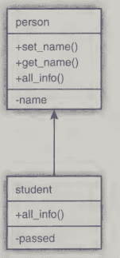

图 6-1：派生类

关于名称的可见性，派生类类似于内部作用域：除了类的成员外，我们还能看到其基类（及其基类）的成员。当派生类包含同名变量或函数时，基类的那些成员会被隐藏，这同样类似于作用域。相比之下，我们仍可通过名称限定（如 person::all_info）访问派生类的成员。即使名称相同但签名不同的函数（重载）在派生类中也会被隐藏——C++ 隐藏的是名称而非签名。可以通过 using 声明（如 using base::fun）使它们在派生类中可见。然后，那些与派生类中所有重载签名不同的函数重载可以无需限定即可访问。

当我们以如下方式使用我们的两个类时：

```cpp
person mark("Mark Markson");
mark.all_info();

student tom("Tom Tomson", "Algebra, Analysis");
tom.all_info();
```

```cpp
person p(tom);
person& pr = tom;     // or pr(tom) or pr(tom)
person* pp = &tom;    // or pp(&tom) or pp(tom)

p.all_info();
pr.all_info();
pp->all_info();
```

如果不感到失望，我们可能会对结果感到惊讶：

```
[person] My name is Mark Markson
[student] My name is Tom Tomson
I passed the following grades: Algebra, Analysis
[person] My name is Tom Tomson
[person] My name is Tom Tomson
[person] My name is Tom Tomson
```

只有当变量的类型为 student 时，我们才能获得成绩信息。当我们尝试将学生视为普通人处理时，程序可以编译和运行，但我们看不到额外的学生信息。

尽管如此，我们被允许：

- 将学生复制给人；
- 将学生视为人；以及
- 将学生作为人参数传递给函数。

更正式地说：派生类是其基类的子类型，在任何需要基类的地方，其派生类都被接受。

理解子类型和超类型的一个好方法是思考子集和超集。一个类建模某个集合，而该集合的子集由一个子类建模，该子类通过不变量约束超类。我们的 person 类建模各种人员，我们使用 person 的子类来建模人员群体。

这种图景的悖论在于，派生类可能包含额外的成员变量，且可能对象的数量大于其超类。可以通过考虑适当的不变量来正确建模子集，从而解决这一悖论。例如，student 类的不变量是不存在两个同名但成绩不同的对象。这将保证学生集合的基数不大于人员集合的基数。不幸的是，上述不变量难以验证（即使对于具有自动不变量检查的语言也是如此），必须通过设计良好的程序逻辑隐式建立。

当从基类派生时，我们可以指定从该类继承的成员的访问限制程度。在前面的示例中，我们进行了公有派生，因此所有继承的成员在基类和派生类中具有相同的可访问性。如果将类作为 protected 派生，则基类的公有成员在派生类中为 protected，而其他成员保留其可访问性。私有派生类的成员全部为私有（这种继承形式仅用于高级面向对象编程应用程序）。当我们不指定如何访问基类时，定义类时派生默认为 private，而定义结构体时默认为 public。

### 6.1.2 继承构造函数

构造函数是一种不会从基类隐式继承的方法。因此，以下程序无法编译：

```
class person
{
public:
    explicit person(const string& name) : name(name) {}
    // ...
};
```

```
class student : public person
{
}; // No constructor for string defined
```

```
int main ()
{
    student tom("Tom Tomsom"); // Error: no string constructor
}
```

类 student 继承 person 的所有方法，但 string 构造函数除外。C++11 允许我们通过 using 声明从基类继承所有构造函数：

```
class student
{
public:
    using person::person;
};
```

当两个类中存在相同签名的构造函数时，优先使用派生类中的构造函数。

到目前为止，我们已应用了前面提到的四项基本原则中的三项：封装、继承和子类型化。但仍有缺失，我们将立即介绍。

### 6.1.3 虚函数和多态类

只有使用虚函数，面向对象编程的全部潜力才能被释放。它们的存在从根本上改变了类的行为，导致以下结果：

> **定义 6-1（多态类型）。** 包含一个或多个 **虚** 函数的类称为 **_多态类型_**。

我们继续使用前面的实现，仅向方法 `all_info()` 添加 virtual 属性：

```cpp
class person
{
    virtual void all_info() const { cout << "My name is " << name << endl; }
    ...
};
```

```cpp
class student
    : public person
{
    virtual void all_info() const {
        person::all_info(); // call all_info() from person
        cout << "I passed the following grades: " << passed << endl;
    }
    ...
};
```

我们在命名空间限定（§3.2）中见过的双冒号 `::` 同样可以限定我们调用其方法的类。当然，这要求该方法可访问：我们不能从另一个类调用私有方法，甚至不能从基类调用。

使用多态类打印信息时，结果会突然完全不同：

```
[person] My name is Mark Markson
[student] My name is Tom Tomson
I passed the following grades: Algebra, Analysis
[person] My name is Tom Tomson
[student] My name is Tom Tomson
I passed the following grades: Algebra, Analysis
[student] My name is Tom Tomson
I passed the following grades: Algebra, Analysis
```


打印对象的信息与之前的行为一致。最大的区别在于获取对象引用和指针的信息：pr->all_info() 和 pp->all_info()。在这种情况下，编译器会经历以下步骤：

- 1. pr 或 pp 的静态类型是什么？也就是说，pr 或 pp 是如何声明的？
- 2. 该类中是否存在名为 all_info 的函数？
- 3. 可以访问吗？还是它是私有的？
- 4. 它是虚函数吗？否则直接调用它。
- 5. pr 或 pp 的动态类型是什么？也就是说，pr 或 pp 所引用对象的类型是什么？
- 6. 从该动态类型调用 all_info。

为了实现这些动态函数调用，编译器维护虚函数表（又称虚方法表）或 Vtables。它们包含函数指针，通过这些指针调用实际对象的每个虚方法。引用 pr 的类型为 person&，并引用类型为 student 的对象。通过 pr 的 vtable，all_info() 的调用被定向到 student::all_info。这种通过函数指针的间接调用为虚函数增加了一些额外开销，对于微小函数而言显著，而对于足够大的函数则可忽略不计。

定义 6-2（后期绑定和动态多态）。在运行时选择要执行的方法称为后期绑定或动态绑定。它也代表动态多态——与使用模板的静态多态相对。

类似于引用 pr，指针 pp 指向一个 student 对象，student::all_info 通过后期绑定为 pp->all_info() 调用。我们还可以引入一个自由函数 spy_on()：

```
void spy_on(const person& p)
{
    p.all_info();
}
```

这得益于后期绑定，即使我们传递一个基类的引用，也能提供 Tom 的完整信息。

动态选择的好处是，无论针对 person 的多少个子类调用，代码在可执行文件中只存在一份。与函数模板相比的另一个优势是，调用函数时只需可见声明（即签名），而不一定需要定义（即实现）。这不仅节省了大量编译时间，还允许我们向用户隐藏我们巧妙（或肮脏）的实现。

唯一从 Tom 派生并调用 person::all_info() 的实体是 p。p 是 person 类型的对象，我们可以将一个 student 对象复制给它。但是，当我们将派生类复制到基类时，会丢失派生类的所有额外数据，只有基类的数据成员会被真正复制。同样，虚函数调用执行的是基类的调用（这里是 person::all_info()）。也就是说，基类对象在从派生类复制构造时不会表现不同：所有额外成员都消失了，vtable 不再引用派生类的任何方法。

同样地，以值传递方式将参数传递给函数：

```
void glueless(person p)
{
    p.all_info();
}
```

这会禁用后期绑定，从而阻碍从派生类调用虚函数。这是面向对象编程中非常常见（不仅限于）初学者的错误，称为 *对象切片*。因此，我们必须遵守以下规则：

#### 传递多态类型
多态类型必须始终通过引用或（智能）指针传递！

#### 6.1.3.1 显式重写

即使是高级程序员也时常会掉入的另一个流行陷阱是，重写方法的签名略有不同，例如：

```
class person
{
    virtual void all_info() const { ... }
};
```

```
class student
    : public person
{
    virtual void all_info() { ... }
};
```

```
int main()
{
    student tom("Tom Tomson", "Algebra", "Analysis");
    person& pr = tom;
    pr.all_info();
}
```

在这个例子中，person::all_info() 没有被后期绑定到 person::all_info()，因为签名不同。这种差异诚然不明显，起始于这样一个问题：方法的 const 限定符与签名究竟有什么关系。我们可以将成员函数视为带有一个隐式隐藏参数的函数，该参数指向对象本身：

```
void person::all_info_impl(const person& me = *this) { ... }
```

现在很明显，方法的 `const` 限定符限定了 `person::all_info()` 中的这个隐藏引用。`student::all_info()` 中对应的隐藏引用不是 const 限定的，由于签名不同，该方法不被视为重写。编译器不会警告我们，只是将 `student::all_info()` 视为新的重载。你可以相信我们，这个小小的讨厌错误会让你忙上一阵子，尤其是当类很大且存储在不同文件中时。

我们可以轻松地使用 C++11 添加的属性 `override` 来防止此类问题：

```
class student
{
  public:
    virtual void all_info() override { ... }
};
```

在这里，程序员声明该函数重写了基类的一个 `virtual` 函数（具有完全相同的签名）。如果不存在这样的函数，编译器会报错：

```
...: error: 'all_info' marked 'override' but doesn't override
       any member functions
virtual void all_info() override {
```

```
...: warning: 'student::all_info' hides overloaded virtual fct.
...: note:   hidden overloaded virtual function 'person::all_info'
             declared here: different qualifiers (const vs none)
virtual void all_info() const { ... }
```

这里，我们还从 `clang` 得到提示，即限定符不同。对非虚函数使用 `override` 是错误：

```
...: error: only virtual member fct. can be marked 'override'
       void all_info() override {
```

`override` 并未为我们的软件增加激动人心的新功能，但它可以避免我们费力地查找笔误（键盘误操作）。建议在所有地方都使用 `override`，除非需要向后兼容性。这个词输入很快（尤其是配合自动补全），能使我们的程序更可靠。它还能向其他程序员，甚至是多年未查看代码的我们自己，传达我们的意图。

C++11 中的另一个新属性是 `final`。它声明一个 `virtual` 成员函数不能被重写。这允许编译器将某些间接 vtable 调用替换为直接函数调用。不幸的是，我们目前没有经验知道 `final` 实际上能加速虚函数多少。不过，我们也可以使用 `final` 来防止函数重写带来的意外行为。甚至可以将整个类声明为 `final`，以防止他人从中派生。

相较之下，`override` 是关于超类的声明，而 `final` 指的是子类。两者都是上下文关键字；也就是说，它们仅在特定上下文中保留：作为成员函数的限定符。在其他地方，这些词可以自由使用，例如作为变量名。但是，出于清晰度考虑，建议不要这样做。

#### 6.1.3.2 抽象类

迄今为止，我们只查看过在基类中定义虚函数并在派生类中扩展的示例。有时我们会遇到这样的情况：有一组具有共同函数的类，并且需要一个共同的超类来动态选择这些类。例如，在第 6.4 节中，我们将介绍提供相同接口的求解器：一个 solve 函数。为了在运行时选择它们，它们需要共享一个带有 solve 函数的超类。然而，没有一种通用的求解算法是我们以后可以重写的。为此，我们需要一个新特性来声明：“我在这个类中有一个没有实现的虚函数；这将在以后的子类中实现。”

#### 定义 6-3（纯虚函数和抽象类）
当虚函数声明为 = 0 时，它是一个纯虚函数。包含纯虚函数的类称为抽象类。

```
=> c++11/oop_abstract.cpp
```

更具体地说，我们用一个抽象超类 creature 扩展我们的 person 示例：

```
class creature
{
    virtual void all_info() const = 0; // pure virtual
};

class person
: public creature
{ ... };

int main ()
{
    creature some_beast; // Error: abstract class
    person mark("Mark Markson");
    mark.all_info();
}
```

创建 creature 对象失败，出现类似这样的消息：

```
...: error: variable type 'creature' is an abstract class
creature some_beast;
```

```
...: note: unimplemented pure method 'all_info' in 'creature'
virtual void all_info() const = 0;
```

当我们重写 all_info 使得 person 不包含纯虚函数时，对象 mark 的行为与之前一样。


抽象类可以被视为接口：我们可以声明其引用和指针，但不能创建对象。请注意，C++允许我们混合使用纯虚函数和普通虚函数。子类对象只有在所有纯虚函数都被重写后才能创建。

给Java程序员的旁注：在Java中，所有成员函数本质上都是虚函数（即，方法不能是非虚的）。Java提供了接口这一语言特性，其中方法只被声明而不被定义（除非它们具有default属性，该属性允许提供实现）。这对应于C++中所有方法都是纯虚函数的类。

大型项目通常会建立多个抽象层级：

- 接口：无实现；
- 抽象类：默认实现；
- 具体类。

这有助于为复杂的类系统保持清晰的心智图景。

### 6.1.4 通过继承实现函子

在第3.8节中，我们讨论了函子，并提到它们也可以通过继承来实现。现在，我们兑现承诺。首先，我们需要一个所有待实现函子的共同基类：

```cpp
struct functor_base
{
    virtual double operator()(double x) const = 0;
};
```

这个基类可以是抽象的，因为它仅作为我们的接口使用，例如，将函子传递给finite_difference求值：

```cpp
double finite_difference(functor_base const& f,
                             double x, double h)
{
    return (f(x+h) - f(x)) / h;
}
```

显然，所有待求导的函子都必须从functor_base派生，例如：

```cpp
class para_sin_plus_cos
: public functor_base
{
public:
    para_sin_plus_cos(double p) : alpha(p) {}

    virtual double operator()(double x) const override
    {
        return sin(alpha * x) + cos(x);
    }

private:
    double alpha;
};
```

我们重新实现了para_sin_plus_cos，以便可以用有限差分近似sin(αx) + cos x的导数：

```cpp
para_sin_plus_cos sin1(1.0);
cout << finite_difference(sin1, 1., 0.001) << endl;
double df1 = finite_difference(para_sin_plus_cos(2.), 1., 0.001),
df0a = finite_difference(para_sin_plus_cos(2.), 0., 0.001);
```

面向对象方法同样允许我们实现带有状态的函数。如果需要，我们也可以将有限差分实现为OOP函子，并以类似于通用函子的方式组合它们。

OOP方法的缺点是：

- 性能：operator()始终作为虚函数调用。
- 适用性：只有从functor_base派生的类才能作为参数。模板参数允许传统函数和任何类型的函子，包括第3.8节中的那些。

因此，函子应尽可能使用第3.8节中的通用方法实现。只有在运行时选择函数时，使用继承才有好处。

2. 我们避免使用Instantiation一词以防混淆。该术语在Java中用于表示对象是从类构建的（而有些作者甚至将对象称为具体类）。在C++中，instantiation几乎总是指从类/函数模板创建特定类/函数的过程。我们偶尔看到“类实例化”一词用于从类创建对象，但这并非常用术语，我们避免使用它。

3. 但是，将它们声明为final可以使编译器消除晚期绑定的开销。

## 6.2 消除冗余

通过使用继承和隐式向上转型，我们可以避免实现冗余的成员函数和自由函数。类被隐式转换为超类的事实使我们能够一次实现通用功能，并在所有派生类中重用它。假设我们有几个矩阵类（稠密、压缩、带状、三角形……），它们共享num_rows和num_cols⁴等成员函数。这些可以轻松地外包到一个共同的超类中——包括相应的数据成员：

```cpp
class base_matrix
{
public:
    base_matrix(size_t nr, size_t nc) : nr(nr), nc(nc) { }

    size_t num_rows() const { return nr; }
    size_t num_cols() const { return nc; }
private:
    size_t nr, nc;
};
class dense_matrix
    : public base_matrix
{ ... };
class compressed_matrix
    : public base_matrix
{ ... };
class banded_matrix
    : public base_matrix
{ ... };
...
```

现在所有矩阵类型都通过继承提供base_matrix的成员函数。将通用实现放在一个地方不仅节省了输入，还能确保修改一次性应用到所有相关类中。在这个玩具示例中这不是问题（毕竟没什么可改的），但在大型项目中，保持所有冗余代码片段的一致性变得相当费力。

自由函数也可以以同样的方式重用，例如：

```cpp
inline size_t num_rows(const base_matrix& A)
{ return A.num_rows(); }
inline size_t num_cols(const base_matrix& A)
{ return A.num_cols(); }
inline size_t size(const base_matrix& A)
{ return A.num_rows() * A.num_cols(); }
```

由于隐式向上转型，这些自由函数可以针对所有从base_matrix派生的矩阵调用。这种共同基类功能的形式不会带来运行时开销。

我们还可以将自由函数参数的隐式向上转型视为更一般概念的特例：is-a关系；例如，compressed_matrix is-a base_matrix，我们可以将compressed_matrix值传递给每个期望base_matrix的函数。

## 6.3 多重继承

C++提供多重继承，我们将通过一些示例来说明。

### 6.3.1 多个父类

一个类可以从多个超类派生。为了更形象的描述，以及为了不那么笨拙地讨论基类的基类，我们偶尔使用parents和grandparents这些直观易懂的术语。有两个父类时，类层次结构看起来像一个V（有很多时则像一束花）。子类的成员是所有超类成员的并集。这带来了歧义的风险：

```cpp
class student
{
    virtual void all_info() const {
        cout << "[student] My name is " << name << endl;
        cout << " I passed the following grades: " << passed << endl;
    }
    ...
};

class mathematician
{
    virtual void all_info() const {
        cout << "[mathman] My name is " << name << endl;
        cout << " I proved: " << proved << endl;
    }
    ...
};

class math_student
: public student, public mathematician
{
};
// all_info not defined -> ambiguously inherited

int main ()
{
    math_student bob("Robert Robson", "Algebra", "Fermat's Last Theorem");
    bob.all_info();
}
```

math_student从student和mathematician都继承了all_info，且两者之间没有优先级之分。消除math_student中all_info歧义的唯一方法是在类math_student中适当定义该方法。

这种歧义让我们得以说明一个我们应当了解的C++细微之处。public、protected和private修改的是可访问性，而非可见性。当我们尝试通过将一个或多个超类作为private或protected继承来消除成员函数的歧义时，这一点变得痛苦地清晰：

```cpp
class student { ... };
class mathematician { ... };
class math_student
    : public student, private mathematician
    { ... };
```

现在student的方法是public的，而mathematician的方法是private的。调用math_student::all_info时，我们希望看到student::all_info的输出。然而，我们得到两条错误消息：首先是math_student::all_info存在歧义，此外mathematician::all_info不可访问。

### 6.3.2 共同祖父母

多个基类共享它们的基类并不罕见。在上一节中，mathematician和student没有超类。从前面的章节来看，将它们都从person派生会更自然。描绘这种继承配置会形成一个菱形，如图6-2所示。我们将以两种略有不同的方式实现这一点。

#### 6.3.2.1 冗余与歧义

=> c++11/oop_multi.cpp

首先，我们以直截了当的方式实现这些类：

```cpp
class person { ... } // as before
class student { ... } // as before
```

```cpp
class mathematician
    : public person
```

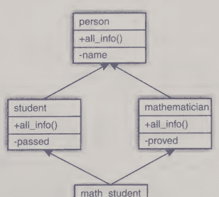

图6-2：菱形类层次结构


```
{
    public:
    mathematician(const string& name, const string& proved)
        : person(name), proved(proved) {}
    virtual void all_info() const override {
        person::all_info();
        cout << " I proved: " << proved << endl;
    }
    private:
    string proved;
};
```

```
class math_student
    : public student, public mathematician
{
    public:
    math_student(const string& name, const string& passed,
                 const string& proved)
        : student(name, passed), mathematician(name, proved) {}
    virtual void all_info() const override {
        student::all_info();
        mathematician::all_info();
    }
};
```

```
int main ()
{
    math_student bob("Robert Robson", "Algebra", "Fermat's Last Theorem");
    bob.all_info();
}
```

程序运行正常，除了存在冗余的名称信息：

```
[student] My name is Robert Robson
    I passed the following grades: Algebra
[person] My name is Robert Robson
    I proved: Fermat's Last Theorem
```

作为读者，您现在有两种选择：接受这种非最优方法并继续阅读，或者跳转到练习 6.7.1 尝试自行解决。

由于 person 被继承了两次，这段代码存在以下问题：

- 冗余：名称被存储了两次，如图 6-3 所示。
- 易错：name 的两个值可能不一致。
- 歧义：在 math_student 中访问 person::name 时。

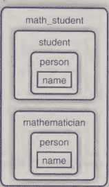

图 6-3：math_student 的内存布局

为了说明上述歧义，我们在 math_student 中调用 person::all_info：

=> c++11/oop/multi2.cpp

```
class math_student : ...
{
    virtual void all_info() const override {
        person::all_info();
    }
};
```

这会导致以下（重新格式化的）错误：

```
.... error: ambiguous conversion from derived class
    'const math_student' to base class 'person';
class math_student -> class student -> class person
class math_student -> class mathematician -> class person
person::all_info();
```

with clang 3.4. We will of course encounter the same problem with every function or data member of super-classes inherited via multiple paths.

#### 6.3.2.2 虚基类

=> c++11/oop/multi3.cpp

虚基类允许我们仅在公共超类中存储一次成员，从而帮助解决相关问题。然而，这需要对内部实现有基本的了解，以避免引入新问题。在以下示例中，我们仅将 person 声明为虚基类：

```
class person { ... };
.
class student
: public virtual person
{
... };
.
class mathematician
: public virtual person
{ ... };
.
```

```
class math_student
: public student, public mathematician
{
public:
math_student(const string& name, const string& passed, const string&
proved) : student(name, passed), mathematician(name, proved) {}
...
};
```

and get the following output that might surprise some of us:

```
[student] My name is
I passed the following grades: Algebra
I proved: Fermat's Last Theorem
```

尽管 student 和 mathematician 都调用了初始化 name 的 person 构造函数，但我们丢失了 name 的值。要理解这种行为，我们需要知道 C++ 如何处理虚基类。我们知道，派生类有责任调用基类构造函数（否则编译器会生成对默认构造函数的调用）。然而，我们只有一份 person 基类的副本。图 6-4 说明了新的内存布局：mathematician 和 student 不再包含 person 数据，而是仅引用一个属于最派生类 math_student 的公共对象。

创建 student 对象时，其构造函数必须调用 person 构造函数。同样，创建 mathematician 对象时，其构造函数也会调用 person 构造函数。现在我们创建一个 math_student 对象。math_student 构造函数必须调用 mathematician 和 student 的构造函数。但我们知道，这两个构造函数都应该调用 person 构造函数，因此共享的 person 部分会被构造两次。

为防止这种情况，规定在虚基类的情况下，最派生类（在本例中：math_student）有责任调用共享基类构造函数（在本例中：person）。作为回报，当 mathematician 和 student 从派生类间接调用时，对 person 构造函数的调用被禁用。

=> c++11/oop_mult4.cpp

牢记这一点，我们相应地修改构造函数：。

```
class student
: public virtual person
{
protected:
student(const string& passed) : passed(passed) {}
```

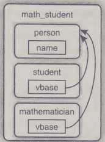

图 6-4：带有虚基类的 math_student 内存

```
};
class mathematician
    : public virtual person
{
    protected:
        mathematician(const string& proved) : proved(proved) {}
    ...
};
```

```
class math_student
    : public student, public mathematician
{
    public:
        math_student(const string& name, const string& passed,
                     const string& proved) : person(name), student(passed),
                                                mathematician(proved) {}
        virtual void all_info() const override {
            student::all_info();
            mathematician::my_infos();
        }
    }
};
```

现在，math_student 显式初始化 person 以在那里设置名称。两个中间类 student 和 mathematician 经过重构，以区分包含性和排他性成员处理：

- 包含性处理包含 person 的方法：两参数构造函数和 all_info。这些方法是公共的，主要面向 student 和 mathematician 对象。

- 排他性处理仅涉及类本身的成员：单参数构造函数和 my_infos。这些方法是受保护的，因此仅在子类中可用。

示例表明需要所有三种访问修饰符：

- private：仅在类内访问的数据成员；
- protected：子类需要但不会用于其自身对象的方法；以及
- public：面向类对象的方法。

在奠定 OOP 技术基础之后，我们现在将在科学环境中应用它们。

## 6.4 通过子类型进行动态选择

=> c++11/solver_selection_example.cpp

```
#include <iostream>
#include <cstdlib>

class matrix {};
class vector {};

void cg(const matrix& A, const vector& b, vector& x);
void bicg(const matrix& A, const vector& b, vector& x);

int main (int argc, char* argv[])
{
    matrix A;
    vector b, x;

    int solver_choice= argc >= 2 ? std::atoi(argv[1]) : 0;
    switch (solver_choice) {
        case 0: cg(A, b, x); break;
        case 1: bicg(A, b, x); break;
        ...
    }
}
```

这可行，但就源代码复杂性而言，它不具备可扩展性。当我们在其他地方使用其他向量和矩阵调用求解器时，必须为每个参数组合复制整个 switch-case 块。可以通过将该块封装为函数并用不同参数调用该函数来避免。

当多个参数动态选择时，情况会变得复杂得多。对于线性求解器，我们希望选择左预条件子和右预条件子（对角、ILU、IC 等）。然后我们需要像第 A.8 节所示的嵌套 switch。因此，我们可以在不使用 OOP 的情况下动态选择函数对象，但必须接受参数空间上的组合爆炸：求解器、左和右预条件子。如果添加新求解器或预条件子，我们需要在多个位置扩展这个庞大的选择块。

我们求解器和预条件子的优雅解决方案是使用抽象类作为接口，并使用带有特定求解器的派生类：

```
struct solver
{
    virtual void operator()( ... ) = 0;
    virtual ~solver() { }
};
```

```
// potentially templatize
struct cg_solver : solver
{
    virtual void operator()( ... ) override { cg(A, b, x); }
};
```

```
struct bicg_solver : solver
{
    virtual void operator()( ... ) override { bicg(A, b, x); }
};
```

在我们的应用程序中，可以定义接口类型 solver 的（智能）指针，并将其分配给所需的求解器：

```
C++11
```

```
unique_ptr<solver> my_solver;
switch (solver_choice) {
    case 0: my_solver = unique_ptr<cg_solver>(new cg_solver);
        break;
    case 1: my_solver = unique_ptr<bicg_solver>(new bicg_solver);
        break;
    ...
}
```

这种技术在设计模式书籍 [14] 中作为 _工厂_ 模式进行了详细讨论。工厂也可以在 C++03 中使用原始指针实现。

`unique_ptr` 的构造有些繁琐。C++14 引入了便捷函数 `make_unique`，使此情况变得真正方便：

```
C++11
```

```
unique_ptr<solver> my_solver;
switch (solver_choice) {
    case 0: my_solver = make_unique<cg_solver>(); break;
    case 1: my_solver = make_unique<bicg_solver>(); break;
}
```

按照练习 3.11.13 的建议，实现您自己的 `make_unique` 是一个很好的练习。

一旦我们的多态指针初始化，调用动态选择的求解器就很简单了：

```
(*my_solver)(A, b, x);
```


这里的括号意味着我们解引用一个函数指针并调用被引用的函数。如果没有括号，我们将（不成功地）尝试将函数指针作为函数来调用并解引用其结果。

当多个函数被动态选择时，工厂方法的全部威力便显而易见。这样我们就可以避免之前展示的组合爆炸。多态函数指针使我们能够解耦各自的选择，并将任务分解为一系列工厂和一次带有指针的调用：

```cpp
struct pc
{
    virtual void operator()( ... ) = 0;
    virtual ~pc() {}
};

struct solver { ... };

// Solver factory
// Left Preconditioner factory
// Right Preconditioner factory

(*my_solver)(A, b, x, *left, *right);
```

现在，我们在工厂中具有线性代码复杂度，以及用于函数调用的单个语句，这与巨大选择块中的立方代码复杂度形成对比。

在我们的示例中，我们实现了一个公共超类。我们也可以通过使用 `std::function` 来处理没有公共基类的求解器类和函数。这使我们能够实现更通用的工厂。尽管如此，它基于相同的技术：虚函数和指向多态类的指针。C++03 中的一个向后兼容的替代方案

C++11 `boost::function`。

## 6.5 转换

转换不仅与 OOP 相关的话题，在介绍基类和派生类之前，我们也无法全面讨论它。反之，查看相关类之间的强制转换有助于巩固对继承的理解。

C++ 是一种强类型语言。每个对象（变量或常量）的类型在编译时定义，并在执行期间无法更改。5 我们可以将对象视为

- 内存中的位，以及
- 赋予这些位以意义的类型。

对于多种强制转换，编译器只是以不同的方式查看内存中的位：要么对位有另一种解释，要么具有不同的访问权限（例如，`const` 与 `non-const`）。其他强制转换实际上会创建新对象。

在 C++ 中，有四种不同的强制转换运算符：

- `static_cast`
- `dynamic_cast`
- `const_cast`
- `reinterpret_cast`

作为其语言根源的 C 只知道一个强制转换运算符：`( _type_ ) _expr_`。这个单一运算符难以理解，因为它可以触发一系列转换以创建目标类型的对象：例如，将指向 `int` 的 `const` 指针转换为指向 `char` 的 `non-const` 指针。

相比之下，C++ 强制转换每次只更改类型的一个方面。C 风格强制转换的另一个缺点是它们在代码中难以查找（另请参见 [45, 第 95 章]），而 C++ 强制转换易于发现：只需搜索 `_cast`。C++ 仍然允许这种旧式强制转换，但所有 C++ 专家都一致不鼓励其使用。

> **C 风格强制转换**
> 不要使用 C 风格强制转换。

在本节中，我们将展示不同的强制转换运算符，并讨论不同环境下不同强制转换的优缺点。

### 6.5.1 基类和派生类之间的强制转换

C++ 在层次结构的类之间提供静态和动态强制转换。

#### 6.5.1.1 向上转型

```
=> c++03/up_down_cast_example.cpp
```

向上转型，即从派生类到基类，在没有歧义时始终是可能的。它甚至可以像我们在函数 `spy_on` 中所做的那样隐式执行：

```cpp
void spy_on(const person& p);
spy_on(tom); // Upcast student -> person
```

`spy_on` 接受 `person` 的所有子类，而无需显式转换。因此，我们可以将 `student tom` 作为参数传递。为了讨论菱形层次结构中类之间的转换，我们为简洁起见引入了一些单字母类名：

```cpp
struct A
{
 virtual void f(){}
 virtual ~A(){}
 int ma;
};
struct B : A { float mb; int fb() { return 3; } };
struct C : A {};
struct D : B, C {};
```

我们添加以下一元函数：

```cpp
void f(A a) { /* ... */ } // Not polymorphic -> slicing!
void g(A& a) { /* ... */ }
void h(A* a) { /* ... */ }
```

类型 `B` 的对象可以传递给所有三个函数：

```cpp
B b;
f(b); // Slices!
g(b);
h(&b);
```

在所有三种情况下，对象 `b` 都会隐式转换为类型 `A` 的对象。但是，函数 `f` 不是多态的，因为它像在第 6.1 节中讨论的那样对对象 `b` 进行了切片。只有当基类存在歧义时，向上转型才会失败。在当前示例中，我们无法从 `D` 向上转型为 `A`：

```cpp
D d;
A ad(d); // Error: ambiguous
```

因为编译器不知道是指来自 `B` 还是来自 `C` 的基类 `A`。我们可以通过显式中间向上转型来澄清这种情况：

```cpp
A ad(B(d));
```

或者我们可以通过虚拟基类在 `B` 和 `C` 之间共享 `A`：

```cpp
struct B : virtual A { ... };
struct C : virtual A {};
```

现在，`A` 的成员在 `D` 中只存在一次。在大多数情况下，这通常是多重继承的最佳解决方案，因为我们节省了内存且不会冒 `A` 不一致复制的风险。

#### 6.5.1.2 向下转型

向下转型是将指针/引用转换为子类型指针/引用的转换。当实际引用的对象不是该子类型时，行为是未定义的。因此，这种转换应极其谨慎地使用，并且仅在绝对必要时使用。

回想一下，我们将类型 `B` 的对象传递给了类型 `A&` 的引用和类型 `A*` 的指针：

```cpp
void g(A& a) { ... }
void h(A* a) { ... }
```

```cpp
B b;
g(b);
h(&b);
```

在 `g` 和 `h` 中，我们无法访问 `B` 的成员（即 `mb` 和 `fb()`），尽管被引用的对象 `b` 是类型 `B`。确信相应的函数参数 `a` 引用的是类型 `B` 的对象后，我们可以将 `a` 分别向下转型为 `B&` 或 `B*`，然后访问 `mb` 和 `fb()`。

在我们的程序中引入向下转型之前，我们应该问自己以下问题：

- 我们如何确保传递给函数的参数真的是派生类的对象？例如，通过额外参数或运行时测试？
- 如果对象无法向下转型，我们该怎么办？
- 我们是否应该为派生类编写函数而不是这样做？
- 我们为什么不为基类和派生类型重载函数？这绝对是一种更清晰的设计，并且始终可行。
- 最后但同样重要的是，我们是否可以重新设计类，使我们的任务可以通过虚函数的晚期绑定来完成？

如果在回答所有这些问题后，我们诚实地仍然认为需要向下转型，那么我们必须决定应用哪种向下转型。有两种形式：

- `static_cast`，速度快但不安全；以及
- `dynamic_cast`，以一定额外开销为代价是安全的，并且仅适用于多态类型。

正如名称所示，`static_cast` 仅检查编译时信息。这意味着在向下转型的上下文中，目标类型是否派生自源类型。例如，我们可以将 `g` 的函数参数 `a` 转换为类型 `B&`，然后就能调用类 `B` 的方法：

```cpp
void g(A& a)
{
    B& bref = static_cast<B&>(a);
    std::cout << "fb returns " << bref.fb() << "\n";
}
```

编译器验证 `B` 是 `A` 的子类并接受我们的实现。当参数 `a` 引用的对象不是类型 `B`（或其子类型）时，程序行为是未定义的——最可能的结果是崩溃。

在我们的菱形示例中，我们还可以将指针从 `B` 向下转型为 `D`。为此，我们声明类型为 `B*` 的指针，它们允许引用子类 `D` 的对象：

```cpp
B *bbp = new B, *bdp = new D;
```

编译器接受两个指针向下转型为 `D*`：

```cpp
bbp = static_cast<D*>(bbp); // erroneous downcast performed
D* ddp = static_cast<D*>(bdp); // correct downcast (but not checked)
```

由于不执行运行时检查，作为程序员，我们有责任只引用正确类型的对象。`bbp` 指向类型 `B` 的对象，当我们解引用指针时，我们冒着数据损坏和程序崩溃的风险。在这个小示例中，一个智能编译器可能通过静态分析检测到错误的向下转型并发出警告。通常，不可能总是回溯指针引用的实际类型，尤其是因为它可以在运行时选择：

```cpp
B *bxp = (argc > 1) ? new B : new D;
```

在第 6.6 节中，我们将看到一个有趣的静态向下转型应用，它是安全的，因为类型信息作为模板参数提供。

`dynamic_cast` 执行运行时测试，以查看实际转换的对象是否具有目标类型或其子类型。它只能应用于多态类型（定义或继承一个或多个虚函数的类，第 6.1 节）：

```cpp
D* dbp = dynamic_cast<D*>(bbp); // Error: cannot downcast to D
D* ddp = dynamic_cast<D*>(bdp); // Okay: bdp points to a D object
```

当无法执行转换时，将返回空指针，以便程序员最终可以对失败的向下转型做出反应。引用的不正确向下转型会抛出类型为 `std::bad_cast` 的异常，可以在 try-catch 块中处理。这些检查是通过运行时类型信息 (RTTI) 实现的，并需要一点额外时间。

高级背景信息：`dynamic_cast` 在底层实现为虚函数。因此，只有当用户通过定义至少一个虚函数使类变为多态时，它才可用。否则，所有类都将承担虚表的开销。多态函数无论如何都有这些，因此 `dynamic_cast` 的开销是虚表中的一个额外指针。

#### 6.5.1.3 交叉转型

`dynamic_cast` 的一个有趣特性是，当被引用对象的类型是两种类型的派生类时，可以从 `B` 向 `C` 进行交叉转型：

```cpp
C* cdp = dynamic_cast<C*>(bdp); // Okay: B -> C with D object
```

同样，我们可以从 `student` 向 `mathematician` 进行交叉转型。

从 `B` 到 `C` 的静态交叉转型：

```cpp
cdp = static_cast<C*>(bdp); // Error: neither sub- nor super-class
```


表 6-1：静态转换与动态转换

| | static_cast | dynamic_cast |
|---|---|---|
| 适用类 | 所有 | 多态 |
| 交叉转换 | 否 | 是 |
| 运行时检查 | 否 | 是 |
| 开销 | 无 | RTTI 检查 |

不允许，因为 c 既不是 B 的基类也不是派生类。可以通过 D 间接转换：

```
cdp = static_cast<C*>(static_cast<D*>(bdp)); // B -> D -> C
```

同样，由程序员负责确定所指向的对象是否真的可以这样转换。

#### 6.5.1.4 比较静态转换和动态转换

由于对引用对象类型进行运行时检查，动态转换比静态转换更安全但更慢。静态转换允许向上和向下转换，由程序员负责确保引用的对象被正确处理。

表 6-1 总结了两种转换形式的区别：

### 6.5.2 const_cast

const_cast 用于添加或删除 const 和/或 volatile 属性。关键字 volatile 告诉编译器，变量可能会在其他地方被修改。例如，某些内存条目由硬件设置，在为该硬件编写驱动程序时必须意识到这一点。这些内存条目不能被缓存或保存在寄存器中，每次都必须从主内存读取。在科学和高级工程软件中，外部修改的变量较少见，因此我们在此书中不再进一步讨论 volatile。

const 和 volatile 都可以隐式添加。删除真正为 volatile 的对象的 volatile 属性会导致未定义行为，因为缓存和寄存器中可能存在不一致的值。反之，volatile 属性只能从指向非 volatile 对象的 volatile 限定指针和引用中删除。

删除 const 属性会使整个调用栈上所有相应的 const 限定符失效，因此当数据被意外覆盖时，调试工作量会大大增加。不幸的是，在处理通常缺乏适当 const 限定符的旧式库时，有时不得不这样做。

### 6.5.3 reinterpret_cast

这是最激进的转换形式，本书中不使用它。它获取对象的内存位置，并将其位解释为如果对象具有另一种类型。例如，这允许我们通过将浮点数转换为位链来更改其中的单个位。reinterpret_cast 对于编程硬件驱动程序比对于高级流求解器更重要。不用说，它是破坏应用程序可移植性的最有效方式之一。如果你真的必须使用它，请将其包含在平台相关的条件编译中，并过度测试你的代码。

### 6.5.4 函数样式转换

构造函数可用于转换值：如果类型 T 具有针对类型 U 参数的构造函数，我们可以从类型 U 的对象创建类型 T 的对象：

```
U u;
T t(u);
```

或更好的写法：

```
U u;
T t(u); // C++11
```

因此，使用构造函数表示法来转换值是有意义的。让我们使用不同的矩阵类型重用我们的示例。假设我们有一个用于稠密矩阵的函数，并希望将其应用于压缩矩阵：

```
struct dense_matrix
{ ... };

struct compressed_matrix
{ ... };

void f(const dense_matrix&) {}

int main ()
{
    compressed_matrix A;
    f(dense_matrix(A));
}
```

这里我们获取 compressed_matrix A 并从中创建一个 dense_matrix。这需要以下之一：

- dense_matrix 中接受 compressed_matrix 的构造函数；或
- compressed_matrix 到 dense_matrix 的转换运算符。

这些方法如下所示：

```
struct compressed_matrix; // forward decl. needed in constructor

struct dense_matrix
{
    dense_matrix() = default;
    dense_matrix(const compressed_matrix& A) { ... }
};

struct compressed_matrix
{
    operator dense_matrix() { dense_matrix A; ... return A; }
};
```

当两者都存在时，构造函数优先。使用此类实现，我们也可以通过隐式转换调用 f：

```
int main ()
{
    compressed_matrix A;
    f(A);
}
```

在这种情况下，转换运算符优先于构造函数。请注意，隐式转换不适用于 explicit 构造函数或转换运算符。explicit 转换运算符是在 C++11 中引入的。

[C++11]

这种表示法的危险在于，它表现得像带有内在目标类型的 C 风格转换，即：

```
long(x); // corresponds to
(long)x;
```

这允许我们编写危险代码，例如：

```
double d = 3.0;
double const* const dp = &d;

long l = long(dp); // OUCH!!!! All bets are off!
```

这里我们将指向 const double 的 const 指针转换成了 long！虽然我们看似要求创建一个新值，但实际上执行了 const_cast 和 reinterpret_cast。不用说，l 的值相当无意义，所有依赖它的值也是如此。

请注意，以下初始化无法编译：

```
long l(dp); // Error: cannot initialize long with pointer
```

带花括号的初始化也无法编译：

```
long l{dp}; // Same Error (C++11)
```

这引出了另一种表示法：

```
l = long(dp); // Error: failed initialization (C++11)
```

使用花括号时，我们始终初始化一个新值，甚至阻止收窄。static_cast 允许收窄，但也拒绝从指针到数字的转换：

```
l = static_cast<long>(dp); // Error: pointer -> long
```

出于这些原因，Bjarne Stroustrup 建议对行为良好的构造使用 T(u) 或 T u，对其他转换使用像 static_cast 这样的具名转换。

### 6.5.5 隐式转换

隐式转换的规则并不简单。好消息是，大多数情况下，了解最重要的规则即可应付，通常可以对它们的优先级无所谓。例如，完整列表可在“C++ 参考”[7]中找到。表 6-2 给出了最重要转换的概述。

| 从 | 到 |
| :--- | :--- |
| T | T 的超类型 |
| T | const T |
| T | volatile T |
| T[N] | T* |
| T | U，如 §6.5.4 所述 |
| 函数 | 函数指针 |
| nullptr_t | T* |
| 整型 | 更大的整型 |
| 数值类型 | 另一种数值类型 |

数值类型可以以不同方式转换。首先，整型可以提升，即用 0 或符号位扩展。6 此外，当需要匹配函数参数类型时，每种内置数值类型都可以转换为其他任何数值类型。对于 C++11 中的新初始化技术，只允许不丢失精度（即不收窄）的转换步骤。如果没有收窄规则，甚至允许浮点数和 bool 之间的转换，中间会转换为 int。所有可以用函数样式（§6.5.4）表示的用户定义类型之间的转换，在启用的构造函数或转换运算符未声明为 explicit 时，也会隐式执行。不用说，不应过度使用隐式转换。哪些转换应显式表达，以及在哪里可以依赖隐式规则，是一个没有通用规则的重要设计决策。

## 6.6 CRTP

本节描述了奇异递归模板模式（CRTP）。它将模板编程与继承非常高效地结合在一起。该术语有时与基于 CRTP 并由 John Barton 和 Lee Nackman [4] 引入的 Barton-Nackman 技巧混淆。

### 6.6.1 简单示例

```
=> c++03/crtp_simple_example.cpp
```

我们将用一个简单示例来解释这种新技术。假设我们有一个名为 point 的类，其中包含一个相等运算符：

```
class point
{
public:
    point(int x, int y) : x(x), y(y) {}
bool operator==(const point& that) const
{
    return x == that.x && y == that.y;
}
private:
    int x, y;
};
```

我们可以使用常识或应用德摩根定律来编程不等式：

```
bool operator!=(const point& that) const
{
    return x != that.x || y != that.y;
}
```

或者，我们可以简化生活，只对相等的结果取反：

```
bool operator!=(const point& that) const
{
    return !(*this == that);
};
```

我们的编译器非常复杂，内联后肯定能完美处理德摩根定律。以这种方式否定相等运算符是每种类型（具有相等运算符）的不等运算符的正确实现。我们可以复制粘贴这段代码片段，每次只替换参数的类型。

或者，我们可以编写如下类：

```
template <typename T>
struct inequality
{
    bool operator!=(const T& that) const
    {
        return !(static_cast<const T&>(*this) == that);
    }
};
```

并从中派生：

```
class point : public inequality<point> { ... };
```

这个类定义建立了相互依赖：

- point 派生自 inequality，且
- inequality 以 point 为参数。

尽管存在相互依赖，这些类仍然可以编译，因为模板类（如 inequality）的成员函数在被调用之前不会被编译。我们可以检查 operator= 是否有效：

```
point p1(3, 4), p2(3, 5);
cout << "p1 != p2 is " << boolalpha << (p1 != p2) << '\n';
```

但是当我们调用 p1 != p2 时，实际发生了什么？

- 1. 编译器在类 point 中查找 operator!= -> 未找到。
- 2. 编译器在基类 inequality<point> 中查找 operator!= -> 找到。
- 3. this 指针指向 point 对象一部分的类型为 inequality<point> 的对象。


- 4. 两种类型都完全已知，我们可以将此指针静态向下转型为 point*。
- 5. 由于我们知道 inequality<point> 的 this 指针是向上转型为 point 的 this 指针，因此将其向下转型回其原始类型是安全的。
- 6. point 的相等运算符被调用并实例化（如果之前未完成）。

每个带有相等运算符的类 U 都可以以相同方式从 inequality<U> 派生。由 Jeremy Siek 和 David Abrahams 提供的 Boost.Operators 提供了一组此类用于运算符默认实现的 CRTP 模板。

### 6.6.2 可复用的访问运算符

```
=> c++11/matrix_crtp_example.cpp
```

CRTP 惯用法使我们能够解决之前提到的一个问题（§2.6.4）：使用可复用实现的方括号运算符访问多维数据结构。当时我们不知道所需的语言特性，尤其是模板和继承。现在我们知道了，并将运用这些知识，通过一个二元调用运算符实现两个方括号运算符调用，即将 A[i][j] 求值为 A(i, j)。

假设我们有一个名为 some_matrix 的优雅矩阵类型，其 operator() 仅访问 a_ij。为与向量表示法保持一致，我们更倾向于使用方括号运算符。它们只接受一个参数，因此我们需要一个代表对矩阵行访问的代理。该代理反过来提供一个方括号运算符，用于访问对应行中的列，即产生矩阵的一个元素：

```
class some_matrix; // Forward declaration

class simple_bracket_proxy
{
public:
    simple_bracket_proxy(some_matrix& A, size_t r) : A(A), r(r) {}

    double& operator[](size_t c){ return A(r, c); } // Error
private:
    some_matrix& A;
    size_t r;
};

class some_matrix
{
// ...

    double& operator()(size_t r, size_t c) { ... }

    simple_bracket_proxy operator[](size_t r)
    {
        return simple_bracket_proxy(*this, r);
    }
};
```

其思想是 A[i] 返回一个指代 A 并包含 i 的代理 p。调用 A[i][j] 对应于 p[j]，而 p[j] 反过来应调用 A(i, j)。不幸的是，此代码无法编译。当我们在 simple_bracket_proxy::operator[] 中调用 some_matrix::operator() 时，some_matrix 类型仅被声明而未完全定义。互换两个类定义只会反转依赖关系并导致更多无法编译的代码。此代理实现的问题是我们需要两个相互依赖的完整类型。

这是模板的一个有趣方面：由于其延迟代码生成，它们允许我们打破相互依赖。向代理添加模板参数可消除依赖：

```cpp
template <typename Matrix, typename Result>
class bracket_proxy
{
public:
    bracket_proxy(Matrix& A, size_t r) : A(A), r(r) {}

    Result& operator[](size_t c){ return A(r, c); }

private:
    Matrix& A;
    size_t r;
};

class some_matrix
{
    // ...
    bracket_proxy<some_matrix, double> operator[](size_t r)
    {
        return bracket_proxy<some_matrix, double>(*this, r);
    }
};
```

最后，我们可以编写 A[i][j]，并在内部通过两参数应用运算符执行它。现在我们可以编写许多具有完全不同的 operator() 实现的矩阵类，并且它们都可以以完全相同的方式部署 bracket_proxy。

在实现了多个矩阵类后，我们发现所有矩阵类中的 operator[] 看起来都非常相似：只是返回一个带有矩阵引用和行参数的代理。我们可以添加另一个 CRTP 类，仅实现一次此方括号运算符：

```cpp
template <typename Matrix, typename Result>
class bracket_proxy { ... };

template <typename Matrix, typename Result>
class crtp_matrix
{
    using const_proxy = bracket_proxy<const Matrix, const Result>;

public:
    bracket_proxy<Matrix, Result> operator[](size_t r)
    {
        return {static_cast<Matrix&>(*this), r};
    }

    const_proxy operator[](size_t r) const
    {
        return {static_cast<const Matrix&>(*this), r};
    }
};
class matrix
: public crtp_matrix<matrix, double>
{
    // ...
};
```

请注意，C++11 特性仅用于简洁；我们也可以用 C++03 实现此代码，只是会多一些冗长。此 CRTP 矩阵类可以为每个带有双参数应用运算符的矩阵类提供方括号运算符。然而，在功能齐全的线性代数包中，我们需要注意哪些矩阵是可变的，以及返回的是引用还是值。这些区别可以使用第 5 章中的元编程技术安全地处理。

尽管代理方法会创建一个额外对象，但我们的基准测试表明，方括号运算符的使用速度与应用运算符一样快。显然，现代编译器中精巧的引用转发可以消除代理的实际创建。

## 6.7 练习

### 6.7.1 非冗余菱形

实现第 6.3.2 节中的菱形，使名称仅打印一次。在派生类中区分 all_info() 和 my_info() 并适当调用这两个函数。

### 6.7.2 继承向量类

修订第 2 章中的向量示例。引入基类 vector_expression 用于 size 和 operator()。使 vector 从此基类继承。然后创建一个类 ones，它是一个全为 1 的向量，并且也从 vector_expression 继承。

### 6.7.3 克隆函数

为名为 clone() 的成员函数编写一个 CRTP 类，该函数复制当前对象——类似于 Java 的 clone 函数（http://en.wikipedia.org/wiki/Clone_%28Java_method%29）。请注意，该函数的返回类型必须是克隆对象的类型。

# 第 7 章
科学项目

在前几章中，我们主要关注 C++ 的语言特性以及如何将它们最好地应用于相对较小的学习示例。本章最后一章应为您提供构建大型项目的一些思路。第一节（§7.1）由作者的朋友 Mario Mulansky 撰写，讨论了库之间互操作性的主题。它将让您一窥 odeint 的内部工作原理：一个与多个其他库以非常紧密的方式无缝互操作的通用库。然后，我们将介绍如何从许多程序源和库存档构建可执行文件（§7.2.1）以及工具如何支持此过程（§7.2.2）。最后，我们讨论如何将程序源适当地分布到多个文件中（§7.2.3）。

## 7.1 ODE 求解器的实现

Mario Mulansky 撰写

在本节中，我们将介绍设计数值库的主要步骤。这里的重点不是提供最完整的数值功能，而是达到一种确保最大通用性的稳健设计。作为示例，我们将考虑用于求解常微分方程（ODE）的数值算法。遵循第 3 章的精神，我们的目标是通过使用泛型编程使实现尽可能通用。我们首先简要介绍算法的数学背景，然后给出一个简单直接的实现。从此，我们将能够识别实现的各个部分，并逐一使其可交换，从而达到一个完全通用的库。我们相信，在学习了这个通用库设计的详细示例后，读者将能够将此技术应用于其他数值算法。

### 7.1.1 常微分方程

常微分方程是建模物理、生物、化学或社会过程的基本数学工具，也是科学和工程中最重要的概念之一。除了少数简单情况外，ODE 的解无法通过解析方法找到，我们必须依赖数值算法来获得至少一个近似解。在本章中，我们将开发 Runge-Kutta-4 算法的通用实现，这是一种通用 ODE 求解器，因其简单性和鲁棒性而被广泛使用。


通常，常微分方程是包含自变量 \(t\) 的函数 \(x(t)\) 及其导数 \(x', x'', ...\) 的方程：

\(F(x, x', x'', ..., x^{(n)}) = 0.\) (7.1)

这是最一般的形式，包括隐式常微分方程。然而，这里我们只考虑 *显式* 常微分方程，其形式为 \(x^{(n)} = f(x, x', x'', ..., x^{(n-1)})\)，在数值求解上要简单得多。ODE 中出现的最高导数 \(n\) 称为 ODE 的 *阶*。但任何 \(n\) 阶 ODE 都可以轻易转换为一个 \(n\) 维的一阶 ODE [23]。因此，只需考虑 \(n=1\) 的一阶微分方程即可。后面介绍的数值例程都将处理初值问题 (IVPs)：即在起始点 \(x(t=t_0) = x_0\) 处给定 \(x\) 值的常微分方程。因此，后续页面中将进行数值求解的问题的数学表述为

\(\frac{d}{dt}\vec{x}(t) = \vec{f}(\vec{x}(t), t), \quad \vec{x}(t=t_0) = \vec{x}_0.\) (7.2)

这里，我们使用向量记号 \(\vec{x}\) 来表示变量 \(\vec{x}\) 可能是一个多维向量。通常，常微分方程定义于实值变量上，即 \(\vec{x} \in \mathbb{R}^n\)，但也可以考虑复值常微分方程，其中 \(\vec{x} \in \mathbb{C}^N\)。函数 \(\vec{f}(\vec{x}, t)\) 称为常微分方程的右侧 (RHS)。常微分方程最简单的物理例子大概是 *谐振器*，即一个连接弹簧的质点。

此类系统的牛顿运动方程为

\(\frac{d^2}{dt^2}q(t) = -\omega_0^2 q(t),\) (7.3)

其中 \(q(t)\) 表示质点的位置，\(\omega_0\) 是振荡频率。后者是质量 \(m\) 和弹簧刚度 \(k\) 的函数：\(\omega_0 = \sqrt{k/m}\)。通过引入 \(p = dq/dt\)，使用 \(\vec{x} = (q, p)^T\) 并定义一些初始条件（例如 \(q(0) = q_0, p(0) = 0\)），可以将其转换为形式 (7.2)。

使用简写记号 \(\ddot{\vec{x}} := d^2\vec{x}/dt\) 并省略显式时间依赖后，我们得到

\(\ddot{\vec{x}} = \vec{f}(\vec{x}) = \begin{pmatrix} p \\ -\omega_0^2 q \end{pmatrix}, \quad \vec{x}(0) = \begin{pmatrix} q_0 \\ 0 \end{pmatrix}.\) (7.4)

注意，公式 (7.4) 中的 \(\vec{f}\) 不依赖于变量 \(t\)，这使得公式 (7.4) 成为一个 *自治* 常微分方程。还要注意，在此示例中，自变量 \(t\) 表示时间，\(\vec{x}\) 表示相空间中的一点，因此解 \(\vec{x}(t)\) 是谐振器的 *轨迹*。这是物理常微分方程中的典型情况，也是我们选择变量 \(t\) 和 \(\vec{x}\) 的原因。1

对于公式 (7.4) 中的谐振器，我们可以找到 IVP 的解析解：\(q(t) = q_0 \cos \omega_0 t\) 和 \(p(t) = -q_0 \omega_0 \sin(\omega_0 t)\)。更复杂的非线性常微分方程通常无法解析求解，我们必须采用数值方法来寻找近似解。一类特定的例子是表现出 *混沌动力学* [34] 的系统，其中轨迹无法用解析函数描述。最早探索这一现象的模型之一是所谓的 Lorenz 系统，这是一个三维常微分方程，对于 \(\vec{x} = (x_1, x_2, x_3)^T \in \mathbb{R}^3\) 由以下方程给出：

```
\(\dot{x}_1 = \sigma(x_2 - x_1)\)
\(\dot{x}_2 = Rx_1 - x_2 - x_1x_3\)
\(\dot{x}_3 = x_1x_2 - bx_3\)
(7.5)
```

其中 \(\sigma, R, b \in \mathbb{R}\) 是系统的参数。图 7-1 描绘了该系统在典型参数选择 \(\sigma = 10, R = 28, \text{ 且 } b = 10/3\) 下的一个轨迹。对于这些参数值，Lorenz 系统表现出所谓的 *混沌吸引子*，可以在图 7-1 中识别出来。

虽然这种解无法解析求得，但关于右侧 \(\vec{f}\) 在某些条件下的解的 *存在性* 和 *唯一性* 存在数学证明，例如 Picard-Lindelöf 定理，该定理要求 \(\vec{f}\) 为 Lipschitz 连续 [48]。只要满足此条件且存在唯一解——这几乎适用于所有实际问题——我们就可以应用算法例程来求解该解的数值近似。

### 7.1.2 龙格-库塔算法

求解常微分方程初值问题最常用的通用方案是所谓的 *龙格-库塔* (RK) 方法 [23]。我们将专注于 *显式* RK 方案，因为它们更容易实现且非常适合 GPU。它们是一类依赖时间离散化来计算 IVP 近似解的迭代一步法。时间离散化意味着近似解在时间点 \(t_n\) 处求值。因此，我们使用 \(\vec{x}_n\) 表示时间 \(t_n\) 处解 \(x(t_n)\) 的数值近似。

在最简单但最常用的等距离散化（恒定步长 \(\Delta t\)）情况下，数值解写作：

```
\(\vec{x}_n \approx \vec{x}(t_n), \quad \text{with} \quad t_n = t_0 + n \cdot \Delta t.\)
(7.6)
```

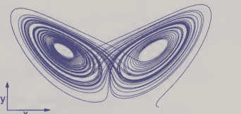

图 7-1: 参数为 \(\sigma = 10, R = 28, \text{ 且 } b = 10/3\) 的 Lorenz 系统中的混沌轨迹

近似点 \(\vec{x}_n\) 通过一个数值算法依次获得，该算法可写成最一般形式为

\(\vec{x}_{n+1} = \vec{F}_{\Delta t}(\vec{x}_n).\) (7.7)

这里，映射 \(\vec{F}_{\Delta t}\) 表示数值算法，即龙格-库塔方案，它以时间步长 \(\Delta t\) 从 \(\vec{x}_n\) 进行一次迭代到 \(\vec{x}_{n+1}\)。如果数值方案生成的解在某些 \(m+1\) 阶误差范围内是精确的，则称该数值方案具有 \(m\) 阶：

\(\vec{x}_1 = \vec{x}(t_1) + O(\Delta t^{m+1}),\) (7.8)

其中 \(\vec{x}(t_1)\) 是从初始条件 \(\vec{x}(t_0) = \vec{x}_0\) 出发的常微分方程在 \(t_1\) 处的精确解。因此，\(m\) 表示该方案 *单步* 的精度阶。

计算此类离散轨迹 \(x_1, x_2, ...\) 最基本的数值算法是 *欧拉方案*，其中 \(\vec{F}_{\Delta t}(\vec{x}_n) := \vec{x}_n + \Delta t \cdot \vec{f}(\vec{x}_n, t_n)\)，这意味着下一个近似是从当前近似通过以下方式获得的：

\(\vec{x}_{n+1} = \vec{x}_n + \Delta t \cdot \vec{f}(\vec{x}_n, t_n).\) (7.9)

该方案没有实际意义，因为它只提供 \(m=1\) 阶的精度。通过引入中间点并将一步划分为多个阶段，可以达到更高阶。例如，著名的 *RK4* 方案（有时也称为龙格-库塔方法）有 \(s=4\) 个阶段，阶数也为 \(m=4\)。它定义如下：

\(\vec{x}_{n+1} = \vec{x}_n + \frac{1}{6} \Delta t (\vec{k}_1 + 2\vec{k}_2 + 2\vec{k}_3 + \vec{k}_4), \quad \text{with}\)
\(\vec{k}_1 = \vec{f}(\vec{x}_n, t_n),\)
\(\vec{k}_2 = \vec{f}\left(\vec{x}_n + \frac{\Delta t}{2} \vec{k}_1, t_n + \frac{\Delta t}{2}\right),\)
\(\vec{k}_3 = \vec{f}\left(\vec{x}_n + \frac{\Delta t}{2} \vec{k}_2, t_n + \frac{\Delta t}{2}\right),\)
\(\vec{k}_4 = \vec{f}\left(\vec{x}_n + \Delta t \vec{k}_3, t_n + \Delta t\right).\) (7.10)

注意，中间结果 \(\vec{k}_i\) 的后续计算依赖于前一阶段的结果 \(\vec{k}_{j<i}\)。

更一般地，龙格-库塔方案由其阶段数 \(s\) 和一组参数 \(c_1 .. c_s\)、\(a_{21}, a_{31}, a_{32}, .., a_{ss-1}\) 以及 \(b_1 .. b_s\) 定义。计算下一个近似 \(x_{n+1}\) 的算法如下：

\(x_{n+1} = x_n + \Delta t \sum_{i=1}^s b_i k_i, \quad \text{where} \quad k_i = f(x_n + \Delta t \sum_{j=1}^{i-1} a_{ij} k_j, \Delta t c_i).\) (7.11)

参数集 \(a_{ij}\)、\(b_i\) 和 \(c_i\) 定义了所谓的布彻表（参见图 7-2），并完全描述了特定的龙格-库塔方案。上述 RK4 方案的布彻表给于图 7-2(b)。


| | | | | | |
|---|---|---|---|---|---|
| C1 | | | | | |
| C2 | a2,1 | | | | |
| C3 | a3,1 | a3,2 | | | |
| ... | ... | | | | |
| Cs | as,1 | as,2 | ... | cs,s-1 | |
| | b1 | b2 | ... | bs-1 | bs |

| | | | | |
|---|---|---|---|---|
| 0 | | | | |
| 0.5 | 0.5 | | | |
| 0.5 | 0 | 0.5 | | |
| 1.0 | 0 | 0 | 1.0 | |
| | 1/6 | 1/3 | 1/3 | 1/6 |

#### 图 7-2: 布彻表格（Butcher tableaux）

### 7.1.3 通用实现

在 C++ 中以直截了当的方式实现上面介绍的 Runge-Kutta 方案并不会带来任何困难。例如，我们可以使用 `std::vector<double>` 来表示状态 \(\vec{x}\) 和导数 \(\vec{k}_n\)，并使用模板参数来为右端函数 \(\vec{f}(\vec{x}, t)\) 提供一定的通用性。清单 7-1 中的代码展示了上面介绍的欧拉方案的一个快速简便实现。为保持简单，我们将示例限制在欧拉方案，以使代码片段简短，但以下要点也适用于更复杂 Runge-Kutta 方案的类似实现。

#### 清单 7-1: 欧拉方案的基本实现

```
typedef std::vector<double> state_type;

template<class System>
void euler_step(System system, state_type &x,
                const double t, const double dt)
{
    state_type k(x.size());
    system(x, k, t);
    for(int i=0; i<x.size(); ++i)
        x[i] += dt*k[i];
}
```

将右端系统定义为模板参数已经为我们提供了一定的通用性：`euler_step` 函数接受函数指针、仿函数以及 C++ Lambda 对象作为系统参数。唯一的要求是系统对象可按参数结构 `system(x, dxdt, t)` 调用，并且在 `dxdt` 中计算导数。

虽然此实现在许多情况下运行良好，但一旦遇到一些非标准情况，就会出现几个严重问题。此类情况可能包括：

- 不同的状态类型，即可能提供更好性能的固定大小数组（`std::array`）；
- 针对复数的常微分方程；
- 非标准容器，即用于复杂网络上的常微分方程；
- 比 `double` 更高精度的必要性；
- 并行化，例如通过 OpenMP 或 MPI；以及
- 使用 GPGPU 设备。

在接下来的部分，我们将以一种能够处理上述情况的方式推广清单 7-1 中的实现。因此，我们将首先识别 Runge-Kutta 方案的计算要求，然后逐个解决这些要求。结果将是这些算法的高度模块化实现，它将允许我们交换计算的特定部分，从而为上述问题提供解决方案。

#### 7.1.3.1 计算要求

为了获得欧拉方案（清单 7-1）的通用实现，我们需要将算法与实现细节分离。为此，我们首先需要识别欧拉方案中涉及的计算要求。通过检查公式 (7.9) 或 (7.10) 以及清单 7-1 中的基本欧拉实现，我们可以识别出计算所需的几个部分。

首先，代码中必须表示数学实体，即常微分方程的状态变量 \(\vec{x}(t)\)、自变量 \(t\) 以及 Runge-Kutta 方案的常数 \(a, b, c\)。在清单 7-1 中，我们分别使用 `std::vector<double>` 和 `double`，但在通用实现中，这将变成模板参数。其次，需要进行内存分配以存储中间结果 \(\vec{k}\)。此外，需要对可能是高维的状态变量进行迭代，最后还需要执行涉及状态变量元素 \(x_i\)、自变量 \(t\)、\(\Delta t\) 以及数值常数 \(a, b, c\) 的标量计算。总结一下，之前介绍的 Runge-Kutta 方案需要以下计算组件：

- 1. 数学实体的表示，
- 2. 内存管理，
- 3. 迭代，以及
- 4. 基本计算。

在识别了这些要求后，我们现在可以设计一个通用实现，其中每个要求都由一段可交换的模块化代码来解决。

#### 7.1.3.2 模块化算法

在我们的模块化设计中，我们将为之前识别的四个要求引入独立的代码结构。我们从表示数学对象所使用的类型开始：状态 \(\vec{x}\)、自变量（时间）\(t\) 以及算法的参数 \(a, b, c\)（图 7-2(a)）。将算法推广到任意类型的标准方法是引入模板参数。我们也遵循这种方法，因此定义了三个模板参数：`state_type`、`time_type` 和 `value_type`。清单 7-2 显示了带有这些模板参数的 Runge-Kutta-4 方案的类定义。

#### 清单 7-2: 带模板类型的 Runge-Kutta 类

```
template<
    class state_type,
    class value_type = double,
    class time_type = value_type
    >
class runge_kutta4 {
    // ...
};
typedef runge_kutta4< std::vector<double> > rk_stepper;
```

注意，我们为 `value_type` 和 `time_type` 使用 `double` 作为默认参数，因此在大多数情况下，用户只需指定 `state_type`。

接下来，我们处理内存分配。在清单 7-1 中，这是通过 `std::vector` 构造函数完成的，该构造函数期望向量大小作为参数。对于通用 `state_type`，这已不再可接受，因为用户可能提供其他类型，例如 `std::array`，它们不是用相同的签名构造的。因此，我们引入了一个模板辅助函数 `resize` 来处理内存分配。用户可以为任何给定的 `state_type` 特化这个模板辅助函数。清单 7-3 显示了针对 `std::vector` 和 `std::array` 的实现，以及它在 `runge_kutta4` 实现中的用法。请注意，`resize` 函数根据输入状态为输出状态分配内存。这是实现此类内存分配的最通用方式；它也适用于所需大小不那么平凡的稀疏矩阵类型。清单 7-3 中的调整大小方法提供了与清单 7-1 中非通用版本相同的功能，因为 `runge_kutta4` 类再次负责其自身的内存管理。它可以立即适用于任何提供 `resize` 和 `size` 函数的向量类型。对于其他类型，用户可以提供 `resize` 重载，从而告诉 `runge_kutta4` 类如何分配内存。

接下来是计算右端方程 \(\vec{f}(\vec{x}, t)\) 的函数调用。这在清单 7-1 中已经通过模板以通用方式实现，我们将保留此解决方案。

最后，我们需要为数值计算找到抽象。如上所述，这涉及对 \(\vec{x}\) 的元素进行迭代以及对这些元素进行基本计算（求和、乘法）。我们通过引入两个代码结构：Algebra 和 Operation，分别处理这两部分。Algebra 将处理迭代，而 Operation 将负责计算。

我们从 Algebra 开始。对于 RK4 算法，我们需要两个函数，分别对三个和六个 `state_type` 实例进行迭代。考虑到 `state_type` 通常是 `std::vector` 或 `std::array`，提供一个可以处理 C++ 容器的 algebra 是合理的。为了确保我们的基本 algebra 尽可能通用，我们将使用 C++11 作为标准库一部分引入的 `std::begin` 和 `std::end` 函数。

#### 清单 7-3: 内存分配

```
template<class state_type>
void resize(const state_type &in, state_type &out) {
    // standard implementation works for containers
    using std::size;
    out.resize(size(in));
}

// specialization for std::array
template<class T, std::size_t N>
void resize(const std::array<T, N> &, std::array<T,N> & ) {
    /* arrays don't need resizing */
}

template < ... >
class runge_kutta4 {
    // ...
    template<class Sys>
    void do_step(Sys sys, state_type &x,
                 time_type t, time_type dt)
    {
        adjust_size(x);
        // ...
    }
}

void adjust_size(const state_type &x) {
    resize(x, x_tmp);
    resize(x, k1);
    resize(x, k2);
    resize(x, k3);
    resize(x, k4);
}
}
```

#### 建议

在通用库中使用 `std::begin` 等自由函数的正确方法是，通过 `using std::begin` 将它们局部提升到当前命名空间，然后不带命名空间限定符地访问它们，即 `begin(x)`，如清单 7-4 所示。这样，如果需要，编译器还可以通过参数相关名称查找（ADL）利用与 `x` 的类型定义在同一命名空间中的 `begin` 函数。

清单 7-4 显示了这样的 `container_algebra`。迭代在名为 `container_algebra` 的结构体的 `for_each` 函数中执行。这些函数期望若干容器对象以及一个操作对象，然后简单地对所有容器进行迭代并按元素执行给定的操作。对每个元素执行的操作是简单的乘法和加法，将在下一部分描述。


#### 清单 7-4: 容器代数

```cpp
struct container_algebra
{
    template<class S1, class S2, class S3, class Op>
    void for_each(S1 &s1, S2 &s2, S3 &s3, Op op) const
    {
        using std::begin;
        using std::end;

        auto first1 = begin(s1);
        auto last1 = end(s1);
        auto first2 = begin(s2);
        auto first3 = begin(s3);
        for( ; first1 != last1 ; )
            op(*first1++, *first2++, *first3++);
    }
};
```

最终部分是由一组再次收集在结构体中的仿函数对象组成的基本操作。清单 7-5 展示了这些操作函数的实现。为求简洁，我们再次仅展示可用于 for_each3（清单 7-4）的 scale_sum2 仿函数。然而，扩展 scale_sum5 以配合 for_each5 使用相当直接。如清单 7-5 所示，这些仿函数由若干参数 alpha1、alpha2... 以及一个计算所需乘积和的函数调用运算符组成。

#### 清单 7-5: 操作

```cpp
struct default_operations {
    template<class F1=double, class F2=F1>
    struct scale_sum2 {
        typedef void result_type;

        const F1 alpha1;
        const F2 alpha2;

        scale_sum2(F1 a1, F2 a2)
        : alpha1(a1), alpha2(a2) { }

        template<class T0, class T1, class T2>
        void operator()(T0 &t0, const T1 &t1, const T2 &t2) const
        {
            t0 = alpha1 * t1 + alpha2 * t2;
        }
    };
};
```

在收集了所有模块化组件后，我们可以基于上述部分实现龙格-库塔 4 算法。清单 7-6 展示了此实现。请注意，上述引入的所有部分均作为模板参数提供，因此是可配置的。

#### 清单 7-6: 泛型龙格-库塔 4

```cpp
template<class state_type, class value_type = double,
         class time_type  = value_type,
         class algebra    = container_algebra,
         class operations = default_operations>
class runge_kutta4
{
public:
    template<typename System>
    void do_step(System& system, state_type &x,
                 time_type t, time_type dt)
    {
        adjust_size(x);
        const value_type one = 1;
        const time_type dt2 = dt/2, dt3 = dt/3, dt6 = dt/6;

        typedef typename operations::template scale_sum2<
            value_type, time_type> scale_sum2;

        typedef typename operations::template scale_sum5<
            value_type, time_type, time_type,
            time_type, time_type> scale_sum5;

        system(x, k1, t);
        m_algebra.for_each3(x_tmp, x, k1, scale_sum2(one, dt2));

        system(x_tmp, k2, t + dt2);
        m_algebra.for_each3(x_tmp, x, k2, scale_sum2(one, dt2));

        system(x_tmp, k3, t + dt2);
        m_algebra.for_each3(x_tmp, x, k3, scale_sum2(one, dt));

        system(x_tmp, k4, t + dt);
        m_algebra.for_each5(x, x, k1, k2, k3, k4,
                            scale_sum5(one, dt6, dt3,
                                       dt3, dt6));
    }

private:
    state_type x_tmp, k1, k2, k3, k4;
    algebra m_algebra;

    void adjust_size(const state_type &x) {
        resize(x, x_tmp); resize(x, k1);
        resize(x, k2); resize(x, k3); resize(x, k4);
    }
};
```

以下代码片段展示了如何实例化此龙格-库塔 4 步进器：

```cpp
typedef runge_kutta4< vector<double>, double, double,
        container_algebra,
        default_operations > rk4_type;
// equivalent shorthand definition using the default parameters:
// typedef runge_kutta4< vector<double> > rk4_type;

rk4_type rk4;
```

#### 7.1.3.3 简单示例

最后，我们展示了一个小示例，说明如何使用上述泛型龙格-库塔 4 实现来积分著名的 Lorenz 系统的轨迹。因此，我们只需定义状态类型，实现 Lorenz 系统的右端（RHS）方程，然后使用上述的 runge_kutta4 类，搭配标准的 container_algebra 和 default_operations。清单 7-7 展示了一个仅需 30 行 C++ 代码的示例实现。

### 7.1.4 展望

我们已抵达龙格-库塔 4 方案的泛型实现。从此，我们可以向众多方向继续拓展。显然，可以添加更多龙格-库塔方案，可能包括步长控制和/或密集输出功能。尽管此类方法可能更难以实现，并且需要后端（代数和操作）提供更多功能，但它们在概念上符合上述概述的泛型框架。此外，还可以扩展到其他显式算法，如多步方法或预测-校正方案，因为本质上所有显式方案仅依赖于此处展示的 RHS 计算和向量操作。然而，隐式方案需要更高阶的代数例程，如求解线性系统，因此需要不同于此处引入的代数类。

此外，除了 container_algebra，我们还可以提供其他后端。一个示例是使用 omp_algebra 或 mpi_algebra 引入并行性。此外，还可以通过 opencl_algebra 及相应的数据结构来处理 GPU 计算。另一个用例是依赖某些线性代数库，该库提供已实现所需操作的向量或矩阵类型。在这种情况下，不需要迭代，应使用一个虚拟代数，它仅将所需计算转发给 default_operations 而不进行迭代。

如您所见，泛型实现提供了丰富的方式来调整算法以适应非标准情况，例如不同的数据结构或 GPU 计算。这种方法的优势在于，实际算法无需更改。这种通用性允许我们替换实现的某些部分以适应不同情况，但算法的实现本身保持不变。

遵循此处所述方法的通用常微分方程（ODE）算法的广泛实现见于 Boost.odeint 库。2 它包含众多数值算法和多个后端，例如用于并行性和 GPU 计算的后端。它积极维护并

#### 清单 7-7: Lorenz 系统中的轨迹

```cpp
typedef std::vector<double> state_type;
typedef runge_kutta4< state_type > rk4_type;

struct lorenz {
    const double sigma, R, b;
    lorenz(const double sigma, const double R, const double b)
    : sigma(sigma), R(R), b(b) { }

    void operator()(const state_type &x, state_type &dxdt,
        double t)
    {
        dxdt[0] = sigma * ( x[1] - x[0] );
        dxdt[1] = R * x[0] - x[1] - x[0] * x[2];
        dxdt[2] = -b * x[2] + x[0] * x[1];
    }
};

int main() {
    const int steps = 5000;
    const double dt = 0.01;

    rk4_type stepper;
    lorenz system(10.0, 28.0, 8.0/3.0);
    state_type x(3, 1.0);
    x[0] = 10.0; // some initial condition
    for( size_t n=0 ; n<steps ; ++n ) {
        stepper.do_step(system, x, n*dt, dt);
        std::cout << n*dt << ' ';
        std::cout << x[0] << ' ' << x[1] << ' ' << x[2]
            << std::endl;
    }
}
```

广泛使用和测试。只要有可能，强烈建议使用此库，而不是重新实现这些算法。否则，此处展示的想法和代码可以作为一个良好的起点，以泛型方式实现新的、更针对特定问题的例程。

## 7.2 创建项目

只要程序简短，我们如何设计程序并不关键。对于较大的软件项目，例如超过 100,000 行代码的项目，源代码结构良好至关重要。

首先，程序源代码必须以明确定义的方式分布在文件中。单个文件应有多大或多小因项目而异，超出了本书的范围。在此，我们仅演示基本原则。

### 7.2.1 构建过程

从源文件到可执行文件的构建过程包含四个步骤。尽管如此，许多文件较少的程序可以通过单次编译器调用来构建。因此，“编译”一词被模糊地用于实际编译步骤（§7.2.1.2）以及由单个命令执行的整个构建过程。

图 7-3 描绘了四个步骤：预处理、编译、汇编和链接。以下各节将分别讨论这些步骤。

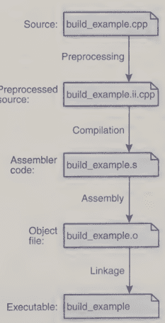

图 7-3: 简单构建


#### 7.2.1.1 预处理

预处理的（直接）输入是一个包含函数和类实现的源文件。对于 C++ 项目，这是一个具有以下典型扩展名之一的文件：.cpp、.cxx、.cc 或 .c++，例如 build_example.cpp：

```
#include <iostream>
#include <cmath>

int main (int argc, char* argv[])
{
    std::cout << "sqrt(17) is " << sqrt(17) << '\n';
}
```

间接输入是相应 #include 指令包含的所有文件。这些包含是包含声明的头文件。包含是一个递归过程，会展开到包含的包含，依此类推。结果是一个包含所有直接和间接包含文件的单一文件。当包含像 Boost 这样具有大量依赖项的大型第三方库时，这样的展开文件可以包含几十万行。仅包含 <iostream> 就会将像前面的玩具示例这样的小程序膨胀到大约 20,000 行：

```
#### 
#### 
#### 
#### 
#### 
skipped some lines here
#### 
namespace std
{
    typedef long unsigned int size_t;
    // ... skipped many, many lines here
#### 

int main (int argc, char* argv[])
{
    std::cout << "sqrt(17) is " << sqrt(17) << '\n';
}
```

预处理后的 C++ 程序通常获得扩展名 .ti（预处理后的 C 为 .i）。要仅执行预处理，请使用编译器标志 -E（Visual Studio 为 /E）。输出应使用 -o 指定；否则将打印到屏幕上。

除了包含之外，宏会被展开并选择条件代码。整个预处理步骤是纯文本替换，大部分与编程语言无关（不依赖于语言）。因此，它非常灵活，但也极易出错，如我们在第 1.9.2.1 节中讨论的那样。预处理期间合并的文件集称为翻译单元。

### 7.2.1.2 编译

（实际）编译将预处理后的源代码翻译为目标平台的汇编代码。4 这是平台机器语言的符号表示，例如：

```
.file "build_example.cpp"
.local _ZStlsISt11char_traitsIcEERSt13basic_ostreamIcT_ES5_PKc
.comm _ZStL8__ioinit,1,1
.section .rodata
.LC0:
.string "sqrt(17) is "
.text
.globl main
.type main, @function
main:
.LFB1055:
.cfi_startproc
pushq %rbp
.cfi_def_cfa_offset 16
.cfi_offset 6, -16
movq %rsp, %rbp
.cfi_def_cfa_register 6
subq $32, %rsp
movq %rdi, -4(%rbp)
movq %rsi, -16(%rbp)
movl $LC0, %esi
movl $ZSt4cout, %edi
call _ZStlsISt11char_traitsIcEERSt13basic_ostreamIcT_ES5_PKc
movq %rax, %rdx
; just a bit more code
```

令人惊讶的是，对于此示例，汇编代码（92 行）比预处理后的 C++ 短得多，因为它只包含实际执行的操作。汇编程序的典型扩展名是 .s 和 .asm。

编译是构建过程中最复杂的部分，其中应用了 C++ 的所有语言规则。编译本身由多个阶段组成：前端、中端和后端，而这些阶段又可以包含多个遍。

除了代码生成之外，C++ 程序的名称还会用类型和命名空间（§3.2.1）信息进行修饰。这种修饰称为名称修饰。

### 7.2.1.3 汇编

汇编是从汇编语言到机器语言的简单一对一转换，其中命令被十六进制代码替换，标签被真实的（相对）地址替换。生成的文件称为目标代码，其扩展名通常是 .o，在 Windows 上为 .obj。目标文件中的实体（代码片段和变量）称为符号。

目标文件可以打包到存档中（扩展名 .a、.so、.lib、.dll 等）。此过程对 C++ 程序员完全透明，我们无法做错任何事以致在此部分的构建过程中出错。

### 7.2.1.4 链接

在最后一步中，目标文件和存档被链接在一起。链接器的两个主要任务是

- 匹配不同目标文件的符号，以及
- 将相对于每个目标文件的地址映射到应用程序的地址空间。

原则上，链接器没有类型概念，仅按名称匹配符号。然而，由于名称已用类型信息修饰，链接期间仍提供一定程度的类型安全。名称修饰允许在函数重载时将函数调用链接到正确的实现。

存档——也称为链接库——以两种方式链接：

- 静态链接：存档完全包含在可执行文件中。此链接应用于 Unix 系统上的 .a 库和 Windows 上的 .lib 库。
- 动态链接：链接器仅检查所有符号的存在并保留对存档的某种引用。这用于 .so（Unix）和 .dll（Windows）库。

影响显而易见：与动态库链接的可执行文件要小得多，但依赖于在执行二进制文件的机器上存在这些库。在 Unix/Linux 上找不到动态库时，可以将其目录添加到环境变量 LD_LIBRARY_PATH 的搜索路径中。在 Windows 上，这需要多做一些工作。

### 7.2.1.5 完整构建

图 7-4 说明了如何生成流模拟器的应用程序。首先，我们预处理主应用程序 fluxer.cpp，其中包含像 <iostream> 这样的标准库以及用于网格划分和求解的领域特定库。然后，展开的源代码被编译为目标文件 fluxer.o。最后，应用程序的目标文件与像 libstdc++.so 这样的标准库以及我们之前包含过头文件的领域库进行链接。这些库可以像 libsolver.a 那样静态链接，或像 libmesher.so 那样动态链接。像系统库这样的常用库通常同时提供这两种形式。

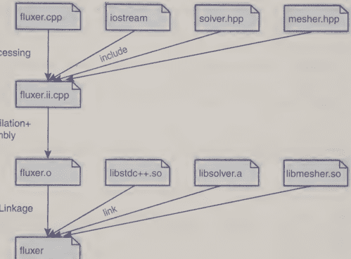

图 7-4：复杂构建

## 7.2.2 构建工具

当我们从程序源代码和已编译的库构建应用程序和库时，可以反复输入大量命令，也可以使用合适的工具。在本节中，我们介绍后者中的两个：make 和 CMake。作为案例研究，我们考虑类似图 7-4 的场景：一个 fluxer 应用程序，它与网格库和求解器库链接，而这些库又从相应的源文件和头文件构建。

### 7.2.2.1 make

我们不知道你对 make 听说了什么，但它并不像它的名声那么糟糕。5 实际上，它对小型项目效果相当好。基本思想是我们表达目标及其源代码之间的依赖关系，当目标比其源代码旧或缺失时，将使用给定命令生成该目标。这些依赖关系写入 makefile 并由 make 自动解析。在我们的示例中，我们需要将 fluxer.cpp 编译为相应的目标文件 fluxer.o：

```
fluxer.o: fluxer.cpp mesher.hpp solver.hpp
    g++ fluxer.cpp -c -o fluxer.o
```

包含命令的行必须以制表符开头。由于所有目标文件的规则足够相似，我们为所有源自 C++ 源代码的文件编写一个通用规则：

```
.cpp.o:
    ${CXX} ${CXXFLAGS} $^ -c -o $@
```

变量 ${CXX} 预设为默认 C++ 编译器，${CXXFLAGS} 预设为其默认标志。我们可以更改这些变量：

```
CXX = g++ -S
CXXFLAGS = -O3 -DNDEBUG    # Release
#### CXXFLAGS = -O0 -g         #### Debug
```

在这里，我们更改了编译器或应用了激进优化（用于发布模式）。作为注释，我们还演示了无优化和调试工具所需的目标文件内符号表的调试模式。我们使用了自动变量：$@ 用于规则的目标，$^ 用于其源代码。接下来，我们需要构建我们的网格库和求解器库：

```
libmesher.a: mesher.o # more mesher sources
    ar cr $@ $^

libsolver.a: solver.o # more solver sources
    ar cr $@ $^
```

为简单起见，我们两者都使用静态链接构建（偏离图 7-4）。最后，我们将应用程序和库链接在一起：

```
fluxer: fluxer.o libmesher.a libsolver.a
    ${CXX} ${CXXFLAGS} $^ -o $@
```

如果我们在这里使用默认链接器而不是 C++ 编译器，则需要添加 C++ 标准库以及可能的一些特定于 C++ 链接的标志。现在，我们可以用单个命令构建项目：

```
make fluxer
```

这将触发以下命令：

```
g++ fluxer.cpp -c -o fluxer.o
g++ mesher.cpp -c -o mesher.o
ar cr libmesher.a mesher.o
g++ solver.cpp -c -o solver.o
ar cr libsolver.a solver.o
g++ fluxer.o libmesher.a libsolver.a -o fluxer
```


如果我们修改了 mesher.cpp，下一次构建过程只会生成依赖于它的目标：

```
g++ mesher.cpp -c -o mesher.o
ar cr libmesher.a mesher.o
g++ fluxer.o libmesher.a libsolver.a -o fluxer
```

按照惯例，第一个不以点开头的目标被视为默认目标：

```
all: fluxer
```

因此我们可以直接运行 make。

### 7.2.2.2 CMake

```
=> buildtools/CMakeLists.txt
```

CMake 是比 make 抽象程度更高的工具，我们将在本节中演示。我们的构建项目在此指定于一个名为 CMakeLists.txt 的文件中。它通常首先声明所需的工具版本并命名项目：

```
cmake_minimum_required (VERSION 2.6)
project (Fluxer)
```

生成一个新库只需声明其源文件即可：

```
add_library(solver solver.cpp)
```

使用哪些命令以及如何参数化由 CMake 决定，除非我们坚持更详细的规范。带动态链接的库也可以同样轻松地生成：

```
add_library(mesher SHARED mesher.cpp)
```

我们的最终目标是创建 fluxer 应用程序，它与这两个库链接：

```
add_executable(fluxer fluxer.cpp)
target_link_libraries(fluxer solver mesher)
```

最佳实践是在单独的目录中构建 CMake 项目，以便一次性丢弃所有生成的文件。通常创建一个名为 build 的子目录，并在其中运行所有命令：

```
cd build
cmake ..
```

现在 CMake 搜索编译器和其他工具，包括它们的标志：

```
-- The C compiler identification is GNU 4.9.2
-- The CXX compiler identification is GNU 4.9.2
-- Check for working C compiler: /usr/bin/cc
-- Check for working C compiler: /usr/bin/cc -- works
-- Detecting C compiler ABI info
-- Detecting C compiler ABI info - done
-- Check for working CXX compiler: /usr/bin/c++
-- Check for working CXX compiler: /usr/bin/c++ -- works
-- Detecting CXX compiler ABI info
-- Detecting CXX compiler ABI info - done
-- Configuring done
-- Generating done
-- Build files have been written to: ... /buildtools/build
```

最后它构建一个我们现在调用的 `makefile`：

```
make
```

运行：

```
[ Scanning dependencies of target solver
[ 33%] Building CXX object CMakeFiles/solver.dir/solver.cpp.o
Linking CXX static library libsolver.a
[ 33%] Built target solver
Scanning dependencies of target mesher
[ 66%] Building CXX object CMakeFiles/mesher.dir/mesher.cpp.o
Linking CXX shared library libmesher.so
[ 66%] Built target mesher
Scanning dependencies of target fluxer
[100%] Building CXX object CMakeFiles/fluxer.dir/fluxer.cpp.o
Linking CXX executable fluxer
[100%] Built target fluxer
```

生成的 makefile 反映了依赖关系，当我们更改某些源文件时，下一次 `make` 只会重新构建受更改影响的部分。与我们在 7.2.2.1 节中的简单 makefile 不同，此处会考虑修改后的头文件。例如，如果我们更改了 `solver.hpp`，则 `libsolver.a` 和 `fluxer` 都会被重新构建。

我们留到最后的最大好处是：`CMake` 的可移植性。从同一个用于生成 makefile 的 `CMakeLists.txt` 文件，我们可以通过使用另一个生成器来创建 Visual Studio 项目。作者非常喜欢这个功能：至今他从未亲自创建过 Visual Studio 项目，而是全部使用 `CMake` 生成。他也没有将这些项目迁移到较新版本的 Visual Studio。相反，他只是使用新版本的生成器创建了新项目。同样，可以生成 `Eclipse` 和 `XCode` 项目。`KDevelop` 可以从 `CMake` 文件构建其项目，甚至可以更新它们。简而言之，这是一个非常强大的构建工具，在撰写本文时，可能是许多项目的最佳选择。

## 7.2.3 分离编译

在了解如何从多个源文件构建可执行文件后，我们现在将讨论这些源文件应如何设计以避免冲突。

### 7.2.3.1 头文件和源文件

每个源代码单元通常拆分为

- 带有声明的头文件（例如 .hpp），以及
- 源文件（例如 .cpp）。

源文件包含将生成可执行文件的所有算法的实现。6 头文件包含在其他文件中实现的函数和类的声明。某些函数可能仅在内部使用，因此在头文件中省略。例如，我们朋友 Herbert 的数学函数将被拆分为

```
// File: herberts/math_functions.hpp

#ifndef HERBERTS_MATH_FUNCTIONS_INCLUDE
#define HERBERTS_MATH_FUNCTIONS_INCLUDE

typedef double hreal; // Herbert's real numbers

hreal sine(hreal);
hreal cosine(hreal);
#endif
```

```
// File: herberts/math_functions.cpp

#include <herberts/math_functions.hpp>

hreal divide_by_square(hreal x, hreal y) { ... }

hreal sine(hreal) { ... }
hreal cosine(hreal) { ... }
...
```

我们留给读者去想象 Herbert 为何引入他自己的实数类型。要使用 Herbert 精彩的函数，我们需要两样东西：

- 声明，通过
  - 包含头文件 herberts/math_functions.hpp，或
  - 我们自己声明所有所需的函数。
- 编译后的代码，通过
  - 链接 math_functions.o（Windows 下为 .obj），或
  - 链接包含 math_functions.o 的库。

声明告诉编译器，给定签名的函数的代码存在于某处，并且可以在当前编译单元中调用。

链接步骤随后将函数调用与其实际代码结合起来。将编译后的函数链接到某个应用程序的最简单方法是将目标文件或存档作为参数传递给 C++ 编译器。或者，我们可以使用标准链接器，但那样我们就需要一堆 C++ 特定的额外标志。

### 7.2.3.2 链接问题

在链接过程中，C++ 实体（如函数和变量）由符号表示。C++ 使用名称修饰：用类型和命名空间（§3.2.1）信息装饰符号名称。

链接过程中可能出现三种问题：

- 1. 找不到符号（函数或变量）；
- 2. 找到重复的符号；或
- 3. 没有 main 函数（或有多个）。

找不到符号可能有不同的原因：

- 声明和实现的符号不匹配。
- 未链接相应的目标文件或存档。
- 存档链接顺序错误。

在大多数情况下，缺少符号只是一个拼写错误。由于名称修饰，符号名称包含类型信息，因此也可能是类型不匹配。另一种可能性是源代码使用了不兼容的编译器进行编译，其中名称的修饰方式不同。

为了避免链接或执行期间的问题，必须验证所有源文件都使用兼容的编译器编译；即，名称以相同方式修饰，函数参数在堆栈上以相同顺序放置。这不仅适用于我们自己的目标文件和第三方库的目标文件，也适用于始终链接的 C++ 标准库。在 Linux 上，应该使用默认编译器，它保证与所有预编译软件包兼容。如果较旧或较新的编译器版本无法作为包获得，这通常是兼容性问题的指示。它仍然可以使用，但这需要明显更多的工作（手动安装、仔细配置我们自己的构建过程……）。

当链接器抱怨符号重定义时，可能是同一个名称在多个实现中被声明和使用。更常见的是，这是由于在头文件中定义变量和函数引起的。只要这样的头文件只在一个翻译单元中被包含，这就可以工作。当带有（某些）定义的头文件被多次包含时，链接将失败。

为了说明，我们回到我们朋友 Herbert 臭名昭著的数学函数。除了许多精彩的数学函数外，头文件中包含以下关键定义：

```cpp
// File: herberts/math_functions.hpp
//
double square(double x) { return x*x; }
double pi = 3.14159265358979323846264338327950288419716939;
```

将此头文件包含到多个翻译单元后，链接器会抱怨：

```
g++-4.8 -o multiref_example multiref1.cpp multiref2.cpp
/tmp/ccG5d1O.o:(.data+0x8): multiple definition of `pi'
/tmp/ccisLhbY.o:(.data+0x8): first defined here,
/tmp/ccG5d1O.o: In function `square(double)':
multiref2.cpp:(.text+0x8): multiple definition of `square(double)'
/tmp/ccisLhbY.o:multiref1.cpp:(.text+0x63): first defined here
collect2: error: ld returned 1 exit status
```


我们先处理函数，再处理变量。

防止重定义的首要办法是 static：

```
static double square(double x) { return x*x; }
```

它将函数声明为仅对翻译单元可见。C++ 标准称其为 *内部链接*（与外部链接相对）。缺点是代码复制：当头文件被包含 *n* 次时，函数代码会在可执行文件中出现 *n* 次。

内联声明：

```
inline double square(double x) { return x*x; }
```

产生类似效果。无论函数是否实际被内联，带有 *inline* 说明符的函数始终具有内部链接。* 反之，没有 *inline* 说明符的函数具有外部链接，即使程序员选择将其内联，也会导致链接器错误。

或者，我们可以通过仅在一个翻译单元中定义函数来避免重定义：

```
// File: herberts/math_functions.hpp
// square(double x);
```

```
// File: herberts/math_functions.cpp
double square(double x) { return x*x; }
```

对于大型函数，这是更推荐的方法。

### 函数定义

短函数应为内联并在头文件中定义。大型函数应在头文件中声明，在源文件中定义。

对于数据，我们可以使用类似技术。静态变量：

```
static double pi = 3.141592653589793238462643383279502884197169399;
```

会在所有翻译单元中复制。这解决了我们的链接器问题，但可能引发其他问题，如下面这个不太聪明的例子所示：

```
// File: multiref.hpp
static double pi = 17.4;
```

```
// File: multiref1.cpp
int main (int argc, char* argv[])
{
    fix_pi();
    std::cout << "pi = " << pi << std::endl;
}
```

```
// File: multiref2.cpp
void fix_pi() { pi = 3.141592653589793238462643383279502884197169399; }
```

7. 高级：与静态函数不同，代码不一定会被复制。相反，它可以由弱符号表示，重定义时不会导致链接器错误。

最好在源文件中定义一次，并在头文件中使用 extern 属性声明：

```
// File: herberts/math_functions.hpp
extern double pi;
```

```
// File: herberts/math_functions.cpp
double pi = 3.141592653589793238462643383279502884197169399;
```

最后，我们将采取最合理的做法，将 pi 声明为常量。常量也具有内部链接^8（除非之前已声明为 extern），可以安全地在头文件中定义：

```
// File: herberts/math_functions.hpp
const double pi = 3.141592653589793238462643383279502884197169399;
```

头文件不应包含普通函数和变量。

### 7.2.3.3 链接到 C 代码

许多科学库是用 C 编写的，例如 PETSc。要在 C++ 软件中使用它们，我们有两种选择：

- 使用 C++ 编译器编译 C 代码，或
- 链接已编译的代码。

C++ 最初是 C 的超集。C99 引入了一些不属于 C++ 的特性，即使在旧版 C 中，也存在一些不是合法 C++ 代码的学术示例。但是，在实践中，大多数 C 程序都可以用 C++ 编译器编译。

对于不兼容的 C 源代码或仅以编译形式提供的软件，可以将 C 二进制文件链接到 C++ 应用程序。但是，C 没有像 C++ 那样的名称修饰。因此，C 和 C++ 编译器将函数声明映射到不同的符号。

假设我们的朋友赫伯特用 C 语言开发了有史以来最好的立方体根算法。他希望获得菲尔兹奖，因此拒绝向我们提供源代码。作为一位伟大的科学家，他以固执为荣，觉得用 C++ 编译器编译他秘密的 C 函数是对其的亵渎。然而，出于他无限的慷慨，他向我们提供了已编译的代码。要链接它，我们需要使用 C 命名（不进行修饰）来声明函数：

```
extern "C" double cubic_root(double);
extern "C" double fifth_root(double);
...
```

为了节省输入，我们可以使用块表示法：

```
extern "C" {
 double cubic_root(double);
 double fifth_root(double);
 ...
}
```

后来他变得更加慷慨，向我们提供了他宝贵的头文件。有了它，我们可以使用所谓的链接块将整个函数集声明为 C 代码：

```
extern "C" {
    #include <herberts/good_ole_math_functions.h>
}
```

在这种风格中，<math.h> 被包含在 <cmath> 中。

## 7.3 结语

希望你享受阅读本书，并渴望将许多新学到的技术应用到自己的项目中。我的意图并非要涵盖 C++ 的所有方面；我尽力展示这种强大的语言可以以多种不同的方式使用，并提供表达性和性能。随着时间的推移，你会找到自己充分利用 C++ 的个人方式。“最佳用途”对我来说是一个基本标准。我不想枚举无数个功能和所有与语言模糊相关的细节，而是要展示哪些功能或技术最能帮助你实现目标。

在我的编程中，我花了大量时间榨取尽可能多的性能，并将其中一些知识传授在本书中。诚然，这种调优并不总是有趣，编写没有最终性能要求的 C++ 程序要容易得多。即使不使用最恶劣的技巧，C++ 程序在大多数情况下也明显快于用其他语言编写的程序。

因此，在关注性能之前，请注意生产力。计算中最宝贵的资源不是处理器时间或内存，而是你的开发时间。无论你多么专注，所需时间总是比你想象的要长。一个好的经验法则是做出初步估计，乘以二，然后使用下一个更大的时间单位。如果额外的时间能带来真正有影响的程序或计算结果，那么这是可以接受的。我衷心祝愿你成功。

# 附录 A

# 笨拙的内容

本附录专门介绍那些不能忽略但会减慢本书进度的细节。早期关于基础知识和类的章节不应阻止读者接触引人入胜的高级主题——至少不应超过必要的范围。如果你想了解更多细节，并且不觉得本附录的章节笨拙，作者不会责备你；恰恰相反：这对他来说将是一种乐趣。从某种意义上说，本附录就像电影的删减场景：它们没有进入最终作品，但对部分观众仍然有价值。

## A.1 更多优秀和糟糕的科学软件

本附录的目的是让你了解我们认为什么是优秀的科学软件，什么不是。因此，如果你在阅读本书之前不完全理解这些程序中发生了什么，请不要担心。就像前言中的示例程序一样，这些实现只是对 C++ 中不同编程风格及其优缺点的初步印象。这里的细节并不重要，重要的是整体感知和行为。

作为讨论的基础，我们考虑一种求解线性方程组 $Ax = b$ 的迭代方法，其中 $A$ 是一个（稀疏）对称正定（SPD）矩阵，$x$ 和 $b$ 是向量，且正在求解 $x$。该方法称为 *共轭梯度法*（CG），由 Magnus R. Hestenes 和 Eduard Stiefel [24] 提出。这里的数学细节并不重要，重要的是不同的实现风格。该算法可以写成以下形式：

### 算法 A-1：共轭梯度算法

```
Input: SPD matrix A, vector b, and left preconditioner L, termination criterion \(\epsilon\)
Output: Vector x such that \(Ax \approx b\)
r = b - Ax
while ||r|| >= \(\epsilon\) do
    z = L^{-1}r
    \(\rho = (r, z)\)
    if First iteration then
        p = z
    else
        p = z + \frac{\rho}{\rho'}p
    q = Ap
    \alpha = \rho/(p, q)
    x = x + \alpha p
    r = r - \alpha q
    \rho' = \rho
```

程序员使用语言中的操作将这种数学记法转换为编译器能理解的形式。对于从第 1 章过来的读者，我们想介绍我们的反英雄赫伯特，他是一位天才数学家，认为编程是展示其算法多么精妙的必要之恶。实现其他数学家的算法对他来说更加烦人。他仓促敲出的 CG 版本——你只需浏览一下——如下所示：

### 清单 A-1：CG 的低抽象实现

```
#include <iostream>
#include <cmath>

void diag_precon(int size, double *x, double* y)
{
    y[0] = x[0];
    for (int i = 1; i < size; i++)
        y[i] = 0.5 * x[i];
}

double one_norm(int size, double *vp)
{
    double sum = 0;
    for (int i = 0; i < size; i++)
        sum += fabs(vp[i]);
    return sum;
}

double dot(int size, double *vp, double *wp)
{
    double sum = 0;
    for (int i = 0; i < size; i++)
```


## 

```cpp
sum+= vp[i] * wp[i];
return sum;
}

int cg(int size, double *x, double *b,
     void (*prec)(int, double*, double*), double eps)
{
    int i, j, iter= 0;
    double rho, rho_0, alpha;
    double *p= new double[size];
    double *q= new double[size];
    double *r= new double[size];
    double *z= new double[size];

    // r = A*x;
    r[0] = 2.0 * x[0] - x[1];
    for (int i= 1; i < size-1; i++)
        r[i] = 2.0 * x[i] - x[i-1] - x[i+1];
    r[size-1] = 2.0 * x[size-1] - x[size-2];

    // r = b-A*x;
    for (i= 0; i < size; i++)
        r[i]= b[i] - r[i];

    while (one_norm(size, r) >= eps) {
        prec(size, r, z);
        rho_0= dot(size, r, z);
        if (iter)
            for (i= 0; i < size; i++)
                p[i]= z[i];
    } else {
        for (i= 0; i < size; i++)
            p[i]= z[i] + rho / rho_1 * p[i];
    }

    // q = A * p;
    q[0] = 2.0 * p[0] - p[1];
    for (int i= 1; i < size-1; i++)
        q[i] = 2.0 * p[i] - p[i-1] - p[i+1];
    q[size-1] = 2.0 * p[size-1] - p[size-2];

    alpha= rho / dot(size, p, q);
    // x+= alpha * p; r-= alpha * q;
    for (i= 0; i < size; i++) {
        x[i]+= alpha * p[i];
        r[i]-= alpha * q[i];
    }
    iter++;
}

delete [] q; delete [] p; delete [] r; delete [] z;
return iter;
}

void ic_0(int size, double* out, double* in) { /* .. */ }
int main (int argc, char* argv[])
{
    int size=100;
    // set nnz and size
    double *x= new double[size];
    double *b= new double[size];
    for (int i=0; i<size; i++)
        b[i] = 1.0;
    for (int i=0; i<size; i++)
        x[i] = 0.0;
    // set A and b
    cg(size, x, b, diag_prec, 1e-9);
    return 0;
}
```

让我们大致讨论一下。这段代码的好处是它是自包含的——这一优点也为许多糟糕的代码所共有。然而，这几乎是唯一的优点。该实现的问题在于其抽象级别较低。这造成了三个主要缺点：

- 可读性差，
- 缺乏灵活性，以及
- 易出错。

可读性差表现在几乎每个操作都在一个或多个循环中实现。例如，如果没有注释，我们能发现矩阵向量乘法 q = Ap 吗？可能可以。我们很容易找到代表 q、A 和 p 的变量被使用的位置，但要看出这是一个矩阵向量乘积，需要更仔细地查看，并很好地理解矩阵的存储方式。

这引出了第二个问题：该实现绑定了许多技术细节，仅在这种特定上下文中工作。算法 A-1 只要求矩阵 A 是对称正定的，但它并不要求某种特定的存储方案，更不要求特定的矩阵。Herbert 为表示离散化 1D 泊松方程的矩阵实现了该算法。在如此低的抽象级别进行编程，每当我们有其他数据或其他格式时，都需要进行修改。

矩阵及其格式并非代码绑定的唯一细节。如果我们想以较低（float）或更高（long double）精度进行计算怎么办？或者求解复杂线性系统？对于每个这样的新 CG 应用程序，我们都需要一个新实现。不用说，在并行计算机上运行或探索 GPGPU（通用图形处理单元）加速也需要重新实现。更糟糕的是，上述每种组合都需要一个新实现。

有些读者可能会想：“这只是一个 20 或 30 行的函数。重写这个小函数，能有多少工作量？而且我们每个月也不会引入新的矩阵格式或计算机架构。”当然没错，但从某种意义上说，这是本末倒置。正是由于这种不灵活、过分关注细节的编程风格，许多科学应用程序发展到了几十万甚至上百万行代码。一旦应用程序或库达到如此庞大的规模，修改软件功能就非常困难，而且很少进行。成功之道是从一开始就从更高的抽象级别开始编写软件，即使最初工作量更大。

最后一个主要缺点是代码多么容易出错。所有参数都作为指针传递，底层数组的大小作为额外参数给出。作为 cg 函数的程序员，我们只能希望调用者做得完全正确，因为我们无法验证。如果用户没有分配足够的内存（或根本没有分配），执行将在某个或多或少随机的位置崩溃，或者更糟的是，会产生一些荒谬的结果，因为数据甚至我们程序的机器代码都可能被随机覆盖。优秀的程序员避免这种脆弱的接口，因为最轻微的错误都可能产生灾难性后果，而且程序错误极难定位。不幸的是，即使是最近发布并广泛使用的软件也是以这种方式编写的，要么是为了与 C 和 Fortran 保持向后兼容性，要么是因为它是用这两种语言之一编写的。或者开发者只是对软件开发的任何进步持抵制态度。事实上，上面的实现是 C 而不是 C++。如果你喜欢这样的软件，那么你可能不会喜欢这本书。

关于我们不喜欢的软件就说到这里。在清单 A-2 中，我们展示了一个更接近我们理想的版本。

### 清单 A-2：CG 的高抽象实现

```cpp
template < typename Matrix, typename Vector,
typename Preconditioner >
int conjugate_gradient( const Matrix& A, Vector& x, const Vector& b,
const Preconditioner& L, const double& eps)
{
typedef typename Collection<Vector>::value_type Scalar;
Scalar rho= 0, rho_1= 0, alpha= 0;
Vector p(resource(x)), q(resource(x)), r(resource(x)),
z(resource(x));
r= b - A * x;
int iter = 0;

while (one_norm(size, r) >= eps) {
    prec(r, z);
    rho = dot(r, z);

    if (iter.first())
        p = z;
    else
        p = z + (rho / rho_i) * p;
    q = A * p;
    alpha = rho / dot(p, q);

    x += alpha * p;
    r -= alpha * q;
    rho_i = rho;
    ++iter;
}

return iter;
}

int main (int argc, char* argv[])
{
    // initiate A, x, and b
    conjugate_gradient(A, x, b, diag_prec, 1.e-5);
    return 0;
}
```

你可能首先会意识到，CG 实现无需注释也很易读。经验法则是，如果别人的注释看起来像你的程序源代码，那么你就是一名非常优秀的程序员。如果你将算法 A-1 中的数学符号与清单 A-2 进行比较，你会发现——除了开头的类型和变量声明外——它们是相同的。有些读者可能会觉得它看起来更像 MATLAB 或 Mathematica，而不是 C++。是的，如果投入足够的精力来编写优秀的软件，C++ 也可以是这样的。

显然，在这个抽象级别编写算法也比用低级操作表达它们要容易得多。

### 科学软件的目的

科学家进行研究。工程师创造新技术。

优秀的科学和工程软件仅用数学和领域特定操作来表达，不暴露任何技术细节。

在这个抽象级别，科学家可以专注于模型和算法，从而提高生产力并推动科学发现。

没人知道每年有多少科学家在像清单 A-1 这样的糟糕软件的小技术细节上浪费了多少时间。当然，技术细节必须在某个地方实现，但不应该在科学应用程序中。这是最糟糕的位置。采用两级方法：用表达性的数学操作编写你的应用程序，如果它们不存在，则单独实现它们。这些数学操作必须仔细实现，以确保绝对正确性和最佳性能。什么是最佳取决于你能花多少时间进行调优，以及额外性能能给你带来多少好处。在基本操作上投入时间，当它们被非常频繁地重用时会有回报。

#### 建议

使用正确的抽象！
如果它们不存在，请实现它们。

说到抽象，清单 A-2 中的 CG 实现不绑定任何技术细节。该函数在任何地方都不限制于 double 等数值类型。它同样适用于 float、GNU 的多精度、复数、区间算术、四元数等……

矩阵 A 可以存储在任何内部格式中，只要 A 可以与向量相乘。事实上，它甚至不需要是矩阵，可以是任何线性算子。例如，当 FFT 表示为 A 与向量的乘积时，执行向量快速傅里叶变换（FFT）的对象可以用作 A。同样，向量不需要由有限维数组表示，可以是任何向量空间的元素，只要该向量空间以某种方式可由计算机表示，并且算法中的所有操作都可以执行。

我们也对其他计算机架构持开放态度。如果矩阵和向量分布在并行超级计算机的节点上，并且可用相应的并行操作，则该函数可以在不修改任何一行代码的情况下并行运行。(GP)GPU 加速也可以在不更改算法实现的情况下实现。一般来说，任何我们可以为其实现矩阵和向量类型及其相应操作的现有或新平台都受到我们的通用共轭梯度函数的支持。

因此，基于此类抽象构建的几千行的复杂科学应用程序可以在不修改代码的情况下移植到新平台。

## A.2 详细基础

本节汇总了第 1 节中外包的细节。

### A.2.1 关于限定字面量的更多内容

这里我们想稍微扩展一下第 1.2.2 节中关于字面量限定的示例。

**可用性：** 标准库提供了一种（模板）复数类型，其实部和虚部的类型可以由用户参数化：

```cpp
std::complex<float> z(1.3, 2.4), z2;
```


这些复数当然提供加法和乘法等常见操作。出于未知原因，这些操作仅在类型本身与底层实数类型之间提供。因此，当我们写：

```
z2= 2 * z; // Error: no int * complex<float>
z2= 2.0 * z; // Error: no double * complex<float>
```

我们会收到乘法不可用的错误消息。更具体地说，编译器会告诉我们，int 和 std::complex<float> 之间以及 double 和 std::complex<float> 之间都没有 operator*()。1 为了让上面的简单表达式编译通过，我们必须确保值 2 的类型为 float：

z2= 2.0f * z;

歧义：在本书的某个地方，我们介绍了函数重载：一个针对不同参数类型具有不同实现的函数（§1.5.4）。编译器选择最匹配的那个函数重载。有时最佳匹配并不明确，例如，如果函数 f 接受无符号整数或指针，而我们调用：

```
f(0);
```

字面量 0 被视为 int，可以隐式转换为无符号整数或任何指针类型。没有任何转换被优先考虑。与之前一样，我们可以通过使用所需类型的字面量来解决这个问题：

```
f(0u);
```

精度：当我们使用 long double 时，精度问题就会出现。在作者的计算机上，该格式至少可以处理 19 位数字。让我们用 20 位数字定义 1/3 并打印出其中的 19 位：

```
long double third= 0.33333333333333333333;
cout.precision(19);
cout << "One third is " << third << ".\n";
```

结果是

One third is 0.33333333333333333333148.

如果在数字后面追加 l，程序行为会更令人满意：

```
long double third= 0.33333333333333333333l;
```

得到我们希望的输出：

One third is 0.33333333333333333333.

1. 由于乘法是作为模板函数实现的，编译器不会将 int 和 double 转换为 float。

### A.2.2 静态变量

与第 1.2.4 节中在作用域结束时销毁的作用域变量不同，静态变量会一直存活到程序结束。因此，将局部变量声明为 static 只有在包含块被执行多次时才有效：在循环或函数中。在函数内，我们可以实现一个计数器，记录函数被调用的次数：

```
void self_observing_function()
{
    static int counter = 0; // only executed once
    ++counter;
    cout << "I was called " << counter << " times.\n";
    ...
}
```

为了重用静态数据，初始化只执行一次。静态变量的主要动机是在下一次函数调用中重用辅助数据，如查找表或缓存。然而，如果辅助数据的管理达到一定复杂度，基于类的解决方案（第 2 章）可能会导致更简洁的设计。

关键字 static 的效果取决于上下文，但共同点是：

- 持久性：静态变量的数据在程序其余执行期间保留在内存中。
- 文件作用域：静态变量和函数仅在实际文件的编译中可见，当多个编译后的程序链接在一起时不会发生冲突。这在第 7.2.3.2 节中有所说明。

因此，对全局变量的影响是限制其可见性，因为它们本身就会一直存活到程序结束。相反，对局部变量的影响是延长其生命周期，因为它们的可见性已经受到限制。static 还有一个与类相关的含义，将在第 2 章中讨论。

### A.2.3 关于 if 的更多内容

if 的条件必须是 bool 表达式（或可转换为 bool 的内容）。因此，以下是允许的：

```
int i = ...
if (i)
    do_something(); // bad style
```

这依赖于从 int 到 bool 的隐式转换。换句话说，我们测试 i 是否不等于 0。更清晰的说法是：

```
if (i == 0)
    do_something(); // better
```

if 语句可以包含其他 if 语句：

```
if (weight > 100.0) {
    if (weight > 200.0) {
        cout << "This is extremely heavy.\n";
    } else {
        cout << "This is quite heavy.\n";
    } else {
        if (weight < 50.0) {
            cout << "A child can carry this.\n";
        } else {
            cout << "I can carry this.\n";
        }
    }
}
```

在上面的示例中，可以省略括号而不改变行为，但保留括号更清晰。当我们重新组织嵌套时，示例更易读：

```
if (weight < 50.0) {
    cout << "A child can carry this.\n";
} else if (weight < 100.0) {
    cout << "I can carry this.\n";
} else if (weight < 200.0) {
    cout << "This is quite heavy.\n";
} else {
    cout << "This is extremely heavy.\n";
}
```

这里也可以省略括号，并且需要较少的努力来弄清楚发生了什么。

在我们对 if-then-else 的讨论结束时，我们想做一些高级的事情。让我们来看看倒数第二个示例的 then 分支，不带花括号：

```
if (weight > 100.0)
    if (weight > 200.0)
        cout << "This is extremely heavy.\n";
    else
        cout << "This is quite heavy.\n";
```

看起来，当 weight 在 100 和 200 之间时会执行最后一行，假设第一个 if 没有 else 分支。但我们也可以假设第二个 if 没有 else 分支，并且最后一行在 weight 小于或等于 100 时执行。幸运的是，C++ 标准规定 else 分支始终属于最内层的可能 if。因此，我们可以依赖我们的第一种解释。如果 else 分支属于第一个 if，我们需要花括号：

```
if (weight > 100.0) {
    if (weight > 200.0)
        cout << "This is extremely heavy.\n";
} else
    cout << "This is not so heavy.\n";
```

也许这些示例会让你相信，设置更多花括号更高效，并节省猜测分支归属的时间。

### A.2.4 Duff 设备

switch case 中的继续执行允许我们在每次迭代后无需终止测试也能实现短循环。假设我们有维度 <= 5 的向量。那么我们可以不使用循环来实现向量加法：

```cpp
assert(size(v) <= 5);
int l = 0;
switch (size(v)) {
    case 5: v[l] = w[l] + x[l]; ++l;    // keep going
    case 4: v[l] = w[l] + x[l]; ++l;    // keep going
    case 3: v[l] = w[l] + x[l]; ++l;    // keep going
    case 2: v[l] = w[l] + x[l]; ++l;    // keep going
    case 1: v[l] = w[l] + x[l]; ++l;    // keep going
    case 0: ;
}
```

这种技术称为 Duff 设备。它通常不像上面那样单独使用（而是作为展开循环的清理）。这种技术不应在项目的主要开发中使用，而只应作为对性能关键内核的最终调优。

### A.2.5 关于 main 的更多内容

包含空格的参数必须加引号。在第一个参数中，我们也可以看到当程序带路径信息调用时，例如：

```
../c++11/arg_argv_test first "second third" fourth
```

打印出：

```
../c++11/arg_argv_test
first
second third
fourth
```

一些编译器还支持字符串向量作为 `main` 参数。这更方便，但不可移植。

要使用参数进行计算，必须先转换它们：

```cpp
cout << argv[1] << " times " << argv[2] << " is "
     << stof(argv[1]) * stof(argv[2]) << "\n";
```

这可以为我们提供如此令人印象深刻的知识：

```
arg_argv_test 3.9 2.8
3.9 times 2.8 is 10.92.
```

不幸的是，从字符串到数字的转换不会告诉我们完整字符串何时不可转换。只要字符串以数字或加号或减号开头，如果发现一个不能属于数字的字符，读取就会停止，并且读取到这一点的子字符串会被转换为数字。

在类 Unix 系统中，可以通过 shell 中的 $? 访问最后一条命令的退出码。

我们也可以使用退出码，在前一条命令成功的条件下连续执行多个命令：

```
do_this && do_that && finish_it
```


与 C 和 C++ 相反，命令 shell 将退出代码 0 解释为 true，即表示正常。然而，&& 的处理与 C 和 C++ 类似：只有当第一个子表达式为 true 时，我们才需要对第二个求值。同样，只有当前一个命令成功时，才会执行命令。相应地，|| 可用于错误处理，因为 || 后面的命令仅在前一个命令失败时执行。

### A.2.6 断言还是异常？

无需深入细节，异常比断言更昂贵，因为 C++ 在抛出异常时会清理运行时环境。关闭异常处理可以显著加速应用程序。另一方面，断言会立即终止程序且不需要清理。此外，它们在发布模式下通常也会被禁用。

如前所述，源自编程错误的意外或不一致的值应使用断言处理，而异常状态应使用异常处理。不幸的是，当我们遇到问题时，这种区别并不总是显而易见。考虑我们无法打开文件的示例。原因可能是用户输入了错误的名称，或在配置文件中找到了错误的名称。此时使用异常最合适。错误的文件也可能是源代码中的字面量，或是错误字符串拼接的结果。这类程序错误无法处理，我们更倾向于让程序通过断言终止。

这种两难是避免冗余与即时健全性检查之间的冲突。在输入或组合文件名的位置，我们不知道它是编程错误还是错误的输入。在这些点上实现错误处理可能需要多次重复打开测试。这会导致重复检查实现的额外编程工作，并存在测试彼此不一致的风险。因此，只测试一次且不需要知道当前麻烦的原因，更高效且不易出错。在这种情况下，我们应审慎行事并抛出异常，以便至少在某些情况下可以进行修复。

损坏的数据通常更适合使用异常处理。假设你公司的薪资正在计算，而新员工的数据尚未完全设置。引发断言将意味着整个公司（包括你）当月无法领取薪资，或者至少要等到有问题的数据集修复后才能领取。如果在数据评估期间抛出异常，应用程序可以以某种方式报告错误，并继续处理剩余员工。

谈到程序健壮性，广泛使用的库中的函数绝不应中止。例如，如果该函数用于实现自动驾驶，我们宁愿关闭自动驾驶，也不愿整个程序终止。换句话说，当我们不知道库的所有应用领域时，无法判断程序中止的后果。

有时，问题的原因在理论上并非 100% 确定，但在实践中足够清楚。向量或矩阵的访问运算符应检查索引是否在有效范围内。原则上，越界索引可能源自用户输入或配置文件，但在几乎所有情况下，它都来自程序错误。在此引发断言是合适的。为了符合健壮性要求，可能需要允许用户通过编译标志在断言和异常之间进行选择（参见 §19.2.3）。

### A.2.7 二进制 I/O

字符串之间的转换可能非常昂贵。因此，将数据直接以各自的二进制表示形式写入文件通常更高效。尽管如此，在这样做之前，建议使用工具检查文件 I/O 是否真的是应用程序的显著瓶颈。

当我们决定使用二进制时，应设置 std::ios::binary 标志以阻止隐式转换，例如将换行符调整为 Windows、Unix 或 Mac OS。该标志区分文本文件和二进制文件的说法并不正确：可以在没有该标志的情况下写入二进制数据，也可以在有该标志的情况下写入文本。然而，为了防止前面提到的意外情况，最好适当设置该标志。

二进制输出使用 ostream 的成员函数 write 执行，输入使用 istream::read。这些函数接受 char 地址和大小作为参数。因此，所有其他类型都必须转换为 char 指针：

```
int main(int argc, char* argv[])
{
    std::ofstream outfile;
    with_io_exceptions(outfile);
    outfile.open("fb.txt", ios::binary);

    double o1= 5.2, o2= 6.2;
    outfile.write(reinterpret_cast<const char *>(&o1), sizeof(o1));
    outfile.write(reinterpret_cast<const char *>(&o2), sizeof(o2));
    outfile.close();

    std::ifstream infile;
    with_io_exceptions(infile);
    infile.open("fb.txt", ios::binary);

    double i1, i2;
    infile.read(reinterpret_cast<char *>(&i1), sizeof(i1));
    infile.read(reinterpret_cast<char *>(&i2), sizeof(i2));
    std::cout << "i1 = " << i1 << ", i2 = " << i2 << "\n";
}
```

二进制 I/O 的一个优点是我们不需要担心流是如何解析的。另一方面，读写命令中类型不匹配会导致完全无法使用的数据。特别是，当文件不是在创建它们的同一平台上读取时，我们必须格外小心：long 变量在一台机器上可以包含 32 位，在另一台机器上可以包含 64 位。为此，库 <cstdint> 提供了在每个平台上大小相同的类型。例如，int32_t 在每个平台上都是 32 位有符号 int。uint32_t 是相应的无符号类型。

当类是自包含的时，二进制 I/O 的工作方式相同，即所有数据都存储在对象内部，而不是由指针或引用引用的外部数据。将包含内存地址的结构（如树或图）写入文件需要特殊表示，因为地址在新的程序运行中显然无效。在 A.6.4 节中，我们将展示一个便利函数，允许我们在一次调用中写入或读取许多对象。

### A.2.8 C 风格 I/O

C 风格的旧式 I/O 在 C++ 中也可用：

```cpp
#include <cstdio>

int main ()
{
    double x = 3.6;
    printf("The square of %f is %f\n", x, x*x);
}
```

printf 命令不出所料代表 print-formatted。其对应的输入是 scanf。文件 I/O 使用 fprintf 和 fscanf 实现。

这些函数的优点是格式相当紧凑；将第一个数字以 6 个字符和 2 位小数打印，将第二个数字以 14 个字符和 9 位小数打印，可用以下格式字符串表示：

```cpp
printf("The square of %6.2f is %14.9f\n", x, x*x);
```

格式字符串的问题是它们不是类型安全的。如果参数与其格式不匹配，可能会发生奇怪的事情，例如：

```cpp
int i = 7;
printf("%i is %s\n", i);
```

该参数是 int，将作为 C 字符串打印。C 字符串通过指向其首字符的指针传递。因此，7 被解释为地址，在大多数情况下程序会崩溃。较新的编译器会检查格式字符串，如果它作为字面量在 printf 调用中提供。但字符串可以事先设置：

```cpp
int i = 7;
char s[] = "i is %s\n";
printf(s[i], i);
```

或是字符串操作的结果。在这种情况下，编译器不会警告我们。

另一个缺点是它无法扩展到用户定义的类型。C 风格 I/O 在基于日志的调试中可能很方便，但流更不容易出错，应在高质量生产软件中优先使用。

### A.2.9 垃圾回收

垃圾回收（GC）被理解为未使用内存的自动释放。几种语言（例如 Java）会不时释放程序中不再引用的内存。C++ 中的内存处理设计得更加显式：程序员以某种方式控制何时释放内存。尽管如此，C++ 程序员对 GC 仍有兴趣，要么是为了使软件更可靠——尤其是当包含旧的泄漏组件而无人愿意或能够修复时——要么是为了与具有托管内存处理的其他语言进行互操作性。后者的一个示例是 .NET 中的 Managed C++。

鉴于这种兴趣，标准（从 C++11 开始）为垃圾回收器定义了一个接口。然而，垃圾回收不是强制性功能，迄今为止我们不知道


支持它的编译器。反过来，依赖GC的应用程序无法在常见编译器上运行。垃圾回收应仅作为最后手段。内存管理应主要封装在类中，并与类的创建和销毁绑定，即RAII（§2.4.2.1）。如果这不可行，应考虑unique_ptr（§1.8.3.1）和shared_ptr（§1.8.3.2），它们会自动释放未被引用的内存。实际上，shared_ptr的引用计数已经是一种简单的GC形式（尽管可能不是所有人都会同意这个定义）。只有当所有这些技术都因某种棘手的循环依赖而不可行，且可移植性不是问题时，才应求助于垃圾回收。

### A.2.10 宏带来的麻烦

例如，具有以下签名的函数

```
double compute_something(double fnm1, double scr1*, double scr2)
```

在大多数编译器上可以编译，但在Visual Studio上会出现奇怪的错误消息。原因是scr1是一个定义十六进制数的宏，它替换了我们第二个参数的名称。显然，这不再是合法的C++代码，但错误消息将包含替换发生前的原始源代码。因此，我们看不到任何可疑之处。解决此类问题的唯一方法是运行预处理器并检查展开后的源代码，例如：

```
g++ my_code.cpp -E -o my_code.ii.cpp
```

这可能需要一些努力，因为展开后的版本包含所有直接和间接包含文件的源代码。最终，我们会发现编译器拒绝的源代码行发生了什么：

```
double compute_something(double fnm1, double 0x0490, double scr2)
```

一旦知道它在某处被用作宏，我们可以简单地通过更改参数名来修复此问题。

计算中使用的常量不应通过宏定义：

```
#define pi 3.1415926535897932384626433832795028841 // Do Not!!!
```

而应作为真正的常量：

```
const long double pi = 3.1415926535897932384626433832795028841L;
```

否则，我们就会制造出前面示例中scr1引起的那种麻烦。在C++11中，我们还可以使用constexpr来确保值在编译期间可用，而C++14也提供模板常量。

类函数宏提供了另一套有趣的陷阱。主要问题是，宏参数仅在简单用例中表现得像函数参数。例如，当我们编写宏max_square时：

```
#define max_square(x, y) x*x >= y*y ? x*x : y*y
```

该表达式的实现看起来很简单，我们可能不会预料到任何麻烦。但当我们将其与和或差一起使用时，就会遇到麻烦：

```
int max_result = max_square(a+b, a-b);
```

然后它将被求值为

```
int max_result = a+b*a+b >= a-b*a ? a+b*a+b : a-b*a-b;
```

这会产生显然错误的结果。这个问题可以通过添加一些括号来修复：

```
#define max_square(x, y) ((x)*(x) >= (y)*(y) ? (x)*(x) : (y)*(y))
```

为了防止高优先级运算符，我们还用一对括号括住了整个表达式。因此，宏表达式需要在每个参数周围和整个表达式周围加上括号。请注意，这是正确性的必要条件，而不是充分条件。

表达式中参数复制是另一个严重问题。如果我们按如下方式调用`max_square`：

```
int max_result = max_square(++a, ++b);
```

变量a和b将被递增四次。

宏是一种相当简单的语言特性，但实现和使用它们比乍看之下更复杂、更危险。危险在于它们与整个程序交互。因此，新软件根本不应包含宏。不幸的是，现有软件已经包含许多宏，我们不得不处理它们。

遗憾的是，没有治疗宏问题的通用方法。以下是大多数情况下有效的一些技巧：

- 避免使用流行宏的名称。最突出的是，assert是标准库中的一个宏，将该名称赋予函数就是自找麻烦。
- 使用`#undef`取消宏定义。
- 在包含所有其他库之后再包含宏密集型库。然后宏仍然会污染你的应用程序，但不会污染其他包含的头文件。
- 令人印象深刻的是，一些库提供了针对其自身宏的保护：可以定义一个宏来禁用或重命名宏中危险的短名称。

我们曾见过一个库，它将单个下划线定义为宏，造成了很多问题。

## A.3 现实世界示例：矩阵求逆

> "理论与实践之间的差异在实践中比在理论中更大。"
> —Tilmar König

为了总结基本特性，我们将它们应用于演示如何轻松创建新功能。我们希望让你了解我们的想法如何自然地演变成可靠且高效的C++程序。特别关注清晰性和可重用性。我们的程序内部结构应良好，外部使用应直观。

为了简化我们案例研究的实现，我们使用作者的库（开源部分）*矩阵模板库 4* — 参见http://www.mtl4.org。它已经包含了我们在这里需要的大量线性代数功能。我们希望未来的C++标准能开箱即用地提供此类功能。也许本书的一些读者会为其做出贡献。

作为一种软件开发方法，我们将采用*极限编程：先编写测试*的原则，随后实现功能——即*测试驱动开发*（TDD）。这有两个显著优势：

- 它在一定程度上保护我们程序员免受*功能主义*——即沉迷于不断添加更多功能，而不是一件接一件地完成事情——的影响。如果我们写下想要实现的目标，我们会更直接地朝着这个目标努力，并且通常会更早地完成它。在编写函数调用时，我们已经指定了计划实现的函数的接口。当我们为测试设置预期值时，我们就在说明函数的语义。因此，*测试是可编译的文档*。测试可能无法告诉我们关于要实现的函数和类的一切，但它所说的内容非常精确。文本文档可以比测试更详细、更易懂，但也可能更模糊（并且会被无限期拖延）。
- 如果我们在最终完成实现后才开始编写测试——比如说，在周五下午很晚的时候——我们*不想看到它失败*。我们会使用良好的数据编写测试（无论这对特定程序意味着什么），并尽量降低失败的风险。或者我们可能决定回家，发誓周一再测试。

出于这些原因，如果我们先编写测试，会更诚实。当然，如果我们发现某些事情不如我们想象的那样运行，或者根据迄今获得的经验演变了接口设计，我们可以稍后修改测试。或者我们可能只是想测试更多。不言而喻，验证部分实现需要暂时注释掉测试的部分内容。

在开始实现逆函数及其测试之前，我们必须选择一个算法。我们可以在不同的直接求解器中选择：子矩阵行列式、分块算法、高斯-约当消元法，或带有或不带主元的LU分解。假设我们更喜欢带列主元的LU分解，因此有

```
LU = PA,
```

其中$L$是单位下三角矩阵，$U$是上三角矩阵，$P$是置换矩阵。因此

```
A = P^{-1}LU
```

以及

```
A^{-1} = U^{-1}L^{-1}P. (A.1)
```

我们使用MTL4中的LU分解，实现下三角和上三角矩阵的求逆，并适当地组合它们。

现在，我们从定义一个可逆矩阵并将其打印出来开始编写测试：

```
int main(int argc, char* argv[])
{
 const unsigned size = 3;
 using Matrix = mtl::dense2D<double>; // type from MTL4
 Matrix A(size, size);
 A = 4, 1, 2,
     1, 5, 3,
     2, 6, 9;

 cout << "A is\n" << A;
}
```

为了以后抽象，我们定义了类型`Matrix`和常量size。使用C++11，我们可以使用统一初始化来设置矩阵：

```
Matrix A = {{4, 1, 2}, {1, 5, 3}, {2, 6, 9}};
```

然而，对于我们的实现，C++03就足够了。

MTL4中的LU分解是原地进行的。为了不修改原始矩阵，我们将其复制到一个新矩阵中。

```
Matrix LU(A);
```

我们还为分解中计算的置换定义了一个向量：

```
mtl::dense_vector<unsigned> Pv(size);
```

这些是LU分解的两个参数：

```
lu(LU, Pv);
```

出于我们的目的，将置换表示为矩阵更方便：

```
Matrix P(permutation(Pv));
cout << "Permutation vector is " << Pv << "\nPermutation matrix is\n" << P;
```

这使我们可以通过矩阵乘积来表示行置换：

```
cout << "Permuted A is \n" << Matrix(P * A);
```

我们现在定义一个适当大小的单位矩阵，并从原地分解中提取_L_和_U_：

```
Matrix I(matrix::identity(size, size)), L(I + strict_lower(LU)),
     U(upper(LU));
```

请注意，_L_的单位对角线未存储，测试时需要添加。它也可以隐式处理，但为了简单起见，我们不这么做。我们现在有

你可能会问，为什么要从乘积_P_ * _A_创建一个矩阵，因为乘积本身已经是一个矩阵。嗯，从技术上讲，它不是。出于效率原因，它是一个表达式模板（参见第5.3节），在某些表达式中求解乘积。输出不是其中之一——至少在公开版本中不是。


完成了初步工作，来到我们的第一个测试。一旦我们计算出 U 的逆，命名为 UI，它们的乘积必须是单位矩阵（近似）。L 的逆也是如此。

```cpp
constexpr double eps = 0.1;

Matrix UI(inverse_upper(U));
cout << "inverse(U) [permuted] is:\n" << UI << "UI * U\n is:\n" << Matrix(UI * U);
assert(one_norm(Matrix(UI * U - I)) < eps);
```

对非平凡数值计算结果的相等性进行测试几乎注定会失败。因此，我们使用矩阵差的范数作为判据。同样，L 的逆（使用不同的函数）也进行了测试。

```cpp
Matrix LI(inverse_lower(L));
cout << "inverse(L) [permuted] is:\n" << LI << "LI * L\n is:\n" << Matrix(LI * L);
assert(one_norm(Matrix(LI * L - I)) < eps);
```

这使我们能够计算 A 本身的逆，并测试其正确性：

```cpp
Matrix AI(UI * LI * P);
cout << "inverse(A) [UI * LI * P] is:\n" << AI << "A * AI\n is:\n" << Matrix(AI * A);
assert(one_norm(Matrix(AI * A - I)) < eps);
```

我们还用相同的判据检查我们的逆函数：

```cpp
Matrix A_inverse(inverse(A));
cout << "inverse(A) is:\n" << A_inverse << "A * AI\n is:\n" << Matrix(A_inverse * A);
assert(one_norm(Matrix(A_inverse * A - I)) < eps);
```

在为计算的所有组件建立测试后，我们开始其实现。

我们编程的第一个函数是上三角矩阵的逆。该函数以稠密矩阵作为参数，并返回一个稠密矩阵：

```cpp
Matrix inverse_upper(const Matrix& A) {
}
```

由于不需要输入矩阵的另一份副本，我们按引用传递它。参数不应被更改，因此我们可以将其作为 const 传递。const 具有以下几个优点：

- 我们提高了程序的可靠性。作为 const 传递的参数保证不会更改；如果我们意外修改它们，编译器会提醒我们并中止编译。有一种方法可以移除 const 属性，但这只应作为最后手段，例如，用于与他人编写的过时库进行接口。你自己编写的所有内容都可以在不消除参数 const 属性的情况下实现。
- 当对象保证不会被更改时，编译器可以更好地优化。
- 对于引用，函数可以用表达式调用。非 const 引用需要将表达式存储到变量中，并将变量传递给函数。

另一个评论：人们可能会告诉你，将容器作为结果返回代价太高，使用引用更高效。原则上这是事实。目前，我们接受这额外的代价，并更关注清晰性和便利性。本书后面将介绍如何最小化从函数返回容器的代价的技术。

关于函数签名就说到这里；现在让我们将注意力转向函数体。我们要做的第一件事是验证参数是否有效。显然，矩阵必须是方阵：

```cpp
const unsigned n = num_rows(A);
if (num_cols(A) != n)
  throw "Matrix must be square";
```

行数在此函数中需要多次使用，因此存储在一个变量中，嗯，是一个常量。另一个先决条件是矩阵对角线上没有零元素。我们将此测试留给三角求解器。说到这个，我们可以使用线性系统的三角求解器来获取逆三角矩阵，我们在 MTL4 中找到了它；更准确地说，U^-1 的第 k 个向量是 Ux = e_k 的解，其中 e_k 是第 k 个单位向量。首先，我们为结果定义一个临时变量：

```cpp
Matrix Inv(n, n);
```

然后我们遍历 Inv 的列：

```cpp
for (unsigned k = 0; k < n; ++k) {
}
```

在每次迭代中，我们需要第 k 个单位向量：

```cpp
dense_vector<double> e_k(n);
for (unsigned i = 0; i < n; ++i)
  if (i == k)
    e_k[i] = 1.0;
  else
    e_k[i] = 0.0;
```

三角求解器返回一个列向量。我们可以将该向量的元素直接赋给目标矩阵的元素：

```cpp
for (unsigned i = 0; i < n; ++i)
  Inv[i][k] = upper_trisolve(A, e_k)[i];
```

这简洁短小，但我们会计算 n 次 upper_trisolve！虽然我们说过此时性能不是主要目标，但总复杂度从 3 阶增加到 4 阶太浪费资源了。许多程序员犯了过早优化的错误，但这并不意味着我们应该（没有充分理由）接受更高复杂度的实现。为了避免多余的重新计算，我们存储三角求解器的结果，并从中复制元素。

```cpp
dense_vector<double> res_k(n);
res_k = upper_trisolve(A, e_k);

for (unsigned i = 0; i < n; ++i)
    Inv[i][k] = res_k[i];
```

最后，我们返回临时矩阵。函数的完整形式如下：

```cpp
Matrix inverse_upper(Matrix const& A)
{
    const unsigned n = num_rows(A);
    assert(num_cols(A) == n); // Matrix must be square

    Matrix Inv(n, n);

    for (unsigned k = 0; k < n; ++k) {
        dense_vector<double> e_k(n);
        for (unsigned i = 0; i < n; ++i)
            if (i == k)
                e_k[i] = 1.0;
            else
                e_k[i] = 0.0;

        dense_vector<double> res_k(n);
        res_k = upper_trisolve(A, e_k);

        for (unsigned i = 0; i < n; ++i)
            Inv[i][k] = res_k[i];
    }
    return Inv;
}
```

既然函数已完成，我们先运行测试。显然，我们必须注释掉测试的一部分，因为到目前为止我们只实现了一个函数。尽管如此，尽早了解第一个函数是否按预期工作仍然是好的。它确实如此，我们现在可以对其感到满意，并将注意力转向下一个任务；还有很多任务。但我们不会。

好吧，至少我们可以为有一个正确运行的函数而感到高兴。尽管如此，花些时间改进它仍然是值得的。这种改进称为 _重构_。经验表明，在实现后立即重构所需的时间远少于在发现错误或将软件移植到其他平台时重构。显然，当我们还知道发生了什么时，立即简化和结构化我们的软件要比几周/几个月/几年后容易得多。

我们可能不喜欢的第一件事是，像初始化单位向量这样简单的事情竟然需要五行。这相当冗长：

```cpp
for (unsigned i = 0; i < n; ++i)
    if (i == k)
        e_k[i] = 1.0;
    else
        e_k[i] = 0.0;
```

我们可以使用条件运算符更紧凑地写出这一点：

```cpp
for (unsigned i = 0; i < n; ++i)
    e_k[i] = i == k ? 1.0 : 0.0;
```

条件运算符 ?: 通常需要一些时间来习惯，但它能产生更简洁的表示。

虽然我们没有从语义上更改程序中的任何内容，而且结果显然仍然相同，但再次运行测试也无妨。你会发现，你常常确信程序修改绝不会改变行为——但事实却恰恰相反。我们越早发现意外行为，修复它所需的工作就越少。使用我们已经编写的测试，只需几秒钟，并能让我们更有信心。

如果我们想真正酷一点，可以探索一些内部知识。表达式 i == k 返回一个布尔值，我们知道 bool 可以隐式转换为 int，然后转换为 double。在此转换中，false 变为 0，true 变为 1，符合标准。这些正是我们想要的 double 值：

```cpp
e_k[i] = static_cast<double>(i == k);
```

实际上，从 int 到 double 的转换也是隐式执行的，也可以省略：

```cpp
e_k[i] = i == k;
```

尽管这看起来很可爱，但将逻辑值赋给浮点数有点牵强。它由隐式转换链 bool -> int -> double 明确定义，但会让潜在读者感到困惑，你可能最终需要在邮件列表上向他们解释发生了什么，或者在程序中添加注释。在这两种情况下，你为解释编写的文本都比在程序中节省的要多。

我们可能会想到的另一个想法是，这可能不是我们最后一次需要单位向量。那么，为什么不为它编写一个函数呢？

```cpp
dense_vector<double> unit_vector(unsigned n, unsigned i)
{
    dense_vector<double> e_k(n, 0.0);
    e_k[i] = 1;
    return e_k;
}
```

由于该函数返回单位向量，我们可以直接将其作为三角求解器的参数：

```cpp
res_k = upper_trisolve(A, unit_vector(n, k));
```

对于稠密矩阵，MTL4 允许我们将矩阵列作为列向量访问（而不是子矩阵）。然后，我们可以直接赋值结果向量，而无需循环：

```cpp
Inv[irange(0, n)][k] = res_k;
```

作为简短的说明，括号运算符的实现方式是：行和列的整数索引返回矩阵元素，而行和列的范围返回子矩阵。同样，行的范围和单个列给我们一个列的


对应的矩阵——或该列的一部分。相反，可以使用整数作为行索引和列范围，从矩阵中提取行向量。

这是一个关于如何处理 C++ 的局限性和可能性的有趣示例。其他语言将范围作为其内置符号的一部分；例如，Python 有一个符号 : 用于表示索引范围。C++ 不提供这样的符号，但我们可以引入一种新类型——例如 MTL4 的 range——并为该类型定义 operator[] 的行为。这将产生一种极其强大的机制！

### 扩展运算符功能

由于我们无法向 C++ 引入新运算符，因此我们定义新类型，并在将运算符应用于这些类型时赋予其所需的行为。这种技术使我们能够用有限数量的运算符提供非常广泛的功能。

用户类型上的运算符语义必须直观，并且必须与运算符优先级一致（参见 §1.3.10 中的示例）。

回到我们的算法。我们将求解器的结果存储在向量中，然后将其分配给矩阵列。事实上，我们可以直接分配三角求解器的结果：

```
Inv[trange(0, n)][k] = upper_trisolve(A, unit_vector(k, n));
```

所有索引的范围预定义为 tail：

```
Inv[tail][k] = upper_trisolve(A, unit_vector(k, n));
```

接下来，我们探讨一些数学背景。上三角矩阵的逆也是上三角矩阵。因此，我们只需要计算结果的上半部分，并将其余部分设为 0——或者在计算上半部分之前将整个矩阵设为零。当然，我们现在需要更小的单位向量，并且只需要 A 的子矩阵。这可以用范围很好地表达：

```
Inv = 0;
for (unsigned k= 0; k < n; ++k)
    Inv[trange(0, k+1)][k]=        upper_trisolve(A[trange(0, k+1)][trange(0, k+1)],
                       unit_vector(k, k+1));
```

诚然，trange 使表达式难以阅读。虽然它看起来像一个函数，但 trange 是一个类型，我们只是即时创建对象并将其传递给 operator[]。由于我们三次使用相同的范围，为其创建一个变量（或常量）会更短：

```
for (unsigned k= 0; k < n; ++k) {
    const trange r(0, k+1);
    Inv[r][k]= upper_trisolve(A[r][r], unit_vector(k, k+1));
}
```

这不仅使第二行更短，而且也更容易看出每次使用的是相同的范围。

另一个观察：缩短单位向量后，它们都在最后一个条目中有 1。因此，我们只需要向量的大小，1 的位置是隐含的：

```
dense_vector<double> last_unit_vector(unsigned n)
{
    dense_vector<double> v(n, 0.0);
    v[n-1] = 1;
    return v;
}
```

我们选择不同的名称以反映不同的含义。尽管如此，我们还是怀疑是否真的需要这样的一个函数。我们再次需要它的概率是多少？Forth 编程语言的创建者查尔斯·H·摩尔曾说过：“函数的目的不是将程序切成小碎片，而是创建高度可重用的实体。”话虽如此，我们更喜欢更通用的函数，因为它以后更有可能派上用场。

经过所有这些修改后，我们现在对实现感到满意，并进入下一个函数。我们以后可能仍会更改某些内容，但将其做得更清晰、结构更好，将使以后的修改对我们（或其他人）来说容易得多。我们积累的经验越多，实现令我们满意的实现所需的步骤就越少。而且不言而喻，在修改过程中我们反复测试了 inverse_upper。

既然我们知道如何对三角矩阵求逆，我们也可以对下三角矩阵做同样的处理。或者，我们可以简单地转置输入和输出：

```
Matrix inverse_lower(Matrix const& A)
{
    Matrix T(trans(A));
    return Matrix(trans(inverse_upper(T)));
}
```

理想情况下，此实现应如下所示：

```
Matrix inverse_lower(Matrix const& A)
{
    return trans(inverse_upper(trans(A)));
}
```

显式创建两个 Matrix 对象是一种技术工艺品。5 随着未来的 C++ 标准或 MTL4 的后续版本，我们肯定不再需要这种工艺品。

有人可能会争辩说转置和复制成本更高。此外，我们知道下三角矩阵具有单位对角线，但我们没有利用这一特性，例如，为了避免三角求解器中的除法。我们甚至可以忽略或省略对角线，并在算法中隐式处理这一点。这一切都是真的。然而，我们在这里将实现的简洁性和清晰性以及可重用性置于性能之上。6

我们现在拥有将矩阵求逆组合在一起所需的一切。与上面一样，我们从检查方阵开始：

```
Matrix inverse(Matrix const& A)
{
    const unsigned n = num_rows(A);
    assert(num_cols(A) == n); // Matrix must be square
}
```

然后，我们执行 LU 分解。出于性能原因，此函数不返回结果，而是将其参数作为可变引用并原地分解。因此，我们需要矩阵的副本和适当大小的排列向量：

```
Matrix PLU(A);
dense_vector<unsigned> Pv(n);
lu(PLU, Pv);
```

排列后的 A 的上三角因子 PU 存储在 PLU 的上三角中。下三角因子 PL（部分）存储在 PLU 的严格下三角中。单位对角线被省略并在算法中隐式处理。因此，我们需要在求逆前添加对角线（或者在求逆中隐式处理单位对角线）。

```
Matrix PU(upper(PLU)), PL(strict_lower(PLU) + matrix::identity(n, n));
```

根据公式 (A.1)，方阵的求逆然后可以在一行中完成：7

```
return Matrix(inverse_upper(PU) * inverse_lower(PL) * permutation(Pv));
```

在本节中，我们看到大多数时候我们都有实现相同行为的替代方案——你很可能以前有过这种经历。尽管我们可能给人一种印象，即我们所做的每个选择都是最合适的，但并不总是存在唯一的最佳解决方案，即使在权衡替代方案的优缺点时，也可能得不出最终结论而只是选择其中一个。我们还说明了选择取决于目标；例如，如果性能是主要目标，实现方式会有所不同。

本节还表明，非平凡的程序并非由天才一气呵成地编写而成——例外可能证明规律——而是逐步改进开发的结果。经验会使这段旅程更短、更直接，但我们不会第一次就写出完美的程序。

## A.4 类详情

### A.4.1 成员指针

成员指针是类局部指针，可以存储相对于类的成员地址：

```
double complex::* member_selector = &complex::i;
```

变量 `member_selector` 的类型为 double complex::*，即指向类 complex 中 double 的指针。它引用成员 i（在本示例中为公共成员）。

使用运算符 .* 我们可以访问任何 complex 对象的成员 i，同样地，使用 ->* 可以访问 complex 指针的该成员：

```
double complex::* member_selector = &complex::i;

complex c(7.0, 8.0), c2(9.0);
complex *p = &c;

cout << "c's selected member is " << c.*member_selector << '\n';
cout << "p's selected member is " << p->*member_selector << '\n';

member_selector = &complex::r; // focus on another member
// point to another complex
p = &c2;

cout << "c's selected member is " << c.*member_selector << '\n';
cout << "p's selected member is " << p->*member_selector << '\n';
```

与类相关的指针也可以在运行时用于从类的方法中选择一个函数。

### A.4.2 更多初始化示例

初始化列表可以以尾随 , 结尾，以将其与参数列表区分开来。在上面的示例中，它没有改变参数列表的解释。以下是更多包装和列表的组合：

```
vector_complex vi = {2};
vector_complex vd{{2}};

vector_complex v2 = {2, 3};
vector_complex v2d = {{2, 3}};
vector_complex v2cd = {{2, 3}, };
vector_complex v2cd = {{2, 3 }, };
vector_complex v2cd = {{2, 3}, {}};
vector_complex v2cd = {{2, 3}, {{2}, 3}}};

vector_complex v3 = {2, 3, 4};
vector_complex v3d = {{2, 3, 4}};
vector_complex v3cd = {{2, 3}, 4};
```

生成的向量为

```
v1 is [{2,0}]
vd is [{2,0}]

v2 is [{2,0}, {3,0}]
v2d is [{2,3}]
v2dc is [{2,3}]
v2cd is [{2,3}]
```


v2w is [(2,0), (3,0)]
v2c is [(2,3)]
v2dw is [(2,3)]

v3 is [(2,0), (3,0), (4,0)]
v3d is [(2,0), (3,0), (4,0)]
v3dc is [(2,3), (4,0)]

All this said, we have to pay attention that the initialization of nested data is really performed as we intended. It is also worthwhile to reflect on the most comprehensible notation, especially when we share our sources with other people.

总而言之，我们必须注意嵌套数据的初始化是否真正按照我们的意图执行。同时，也值得反思最易理解的表示法，尤其是在与他人共享源代码时。

Uniform initialization favors constructors for `initializer_list<>`, and many other constructors are hidden in the brace notation. As a consequence, we cannot replace all parentheses with braces in constructors and expect the same behavior:

统一初始化偏向于 `initializer_list<>` 的构造函数，而许多其他构造函数在花括号表示法中被隐藏。因此，我们不能在构造函数中将所有圆括号替换为花括号，并期望相同的行为：

```
vector_complex v1(7);
vector_complex v2{7};
```

The first vector has seven entries with value 0 and the second vector one entry with value 7.

第一个向量有七个值为 0 的条目，第二个向量有一个值为 7 的条目。

### A.4.3 Accessing Multi-dimensional Arrays

### 

Let us assume that we have a simple class like the following:

假设我们有一个如下的简单类：

```
class matrix
{
public:
	matrix(int nrows, int ncols)
	: nrows(nrows), ncols(ncols), data( new double[nrows * ncols] ) {}

	matrix(const matrix& that)
	: nrows(that.nrows), ncols(that.ncols),
	data(new double[nrows * ncols])
	{
	for (int i = 0, size= nrows*ncols; i < size; ++i)
	data[i] = that.data[i];
	}

	void operator=(const matrix& that)
	{
	assert(nrows == that.nrows && ncols == that.ncols);
	for (int i = 0, size= nrows*ncols; i < size; ++i)
	data[i] = that.data[i];
	}

	int num_rows() const { return nrows; }
	int num_cols() const { return ncols; }

private:
	int nrows, ncols;
	unique_ptr<double> data;
};
```

So far, the implementation is done in the same manner as before: variables are private, the constructors establish defined values for all members, the copy constructor and the assignment are consistent, size information is provided by a constant function.

到目前为止，实现方式与之前相同：变量为私有，构造函数为所有成员建立定义值，拷贝构造函数和赋值运算保持一致，大小信息由常量函数提供。

What we are missing is access to the matrix entries.

我们缺少的是对矩阵条目的访问。

Be Aware!

注意！

The bracket operator accepts only one argument.

方括号运算符只接受一个参数。

That means we cannot define

这意味着我们不能定义

```
double& operator[](int r, int c) { ... }
```

#### A.4.3.1 Approach 1: Parentheses

#### A.4.3.1 方法 1：圆括号

The simplest way to handle multiple indices is replacing the square brackets with parentheses:

处理多个索引的最简单方法是将方括号替换为圆括号：

```
double& operator()(int r, int c)
{
    return data[r*ncols + c];
}
```

Adding range checking—in a separate function for better reuse—can save us a lot of debug time in the future. We also implement the constant access:

添加范围检查（在单独的函数中以便更好地复用）未来可以为我们节省大量调试时间。我们还实现常量访问：

```
private:
    void check(int r, int c) const { assert(0 <= r && r < nrows &&
                                           0 <= c && c < ncols); }

public:
    double& operator()(int r, int c)
    {
        check(r, c);
        return data[r*ncols + c];
    }

    const double& operator()(int r, int c) const
    {
        check(r, c);
        return data[r*ncols + c];
    }
```

The access of matrix entries is accordingly denoted with parentheses:

矩阵条目的访问相应地用圆括号表示：

```
matrix A(2, 3), B(3, 2);
// ... setting B
// A = trans(B);
for (int r = 0; r < A.num_rows(); r++)
    for (int c = 0; c < A.num_cols(); c++)
        A(r, c) = B(c, r);
```

This works well, but the parentheses look more like function calls than access to matrix elements. Maybe we can find another way of using brackets if we try harder.

这工作良好，但圆括号看起来更像函数调用而非对矩阵元素的访问。也许如果我们更加努力，可以找到另一种使用方括号的方法。

#### A.4.3.2 Approach 2: Returning Pointers

#### A.4.3.2 方法 2：返回指针

We mentioned that we cannot pass two arguments in one bracket, but we could pass them in two brackets, e.g.:

我们提到不能在一个方括号中传递两个参数，但可以在两个方括号中传递，例如：

```
A[0][1];
```

This is also how two-dimensional built-in arrays are accessed in C++. For our dense matrix, we can return the pointer to the first entry in row r and when the second bracket with the column argument is applied on this pointer C++ will perform the address calculation:

这也是 C++ 中访问二维内置数组的方式。对于我们的稠密矩阵，我们可以返回行 r 中第一个条目的指针，当带有列参数的第二个方括号应用于该指针时，C++ 将执行地址计算：

```
double* operator[](int r) { return data + r*ncols; }
const double* operator[](int r) const { return data + r*ncols; }
```

This method has several disadvantages. First, it only works for dense matrices that are stored row-wise. Second, there is no possibility of verifying the range of the column index.

这种方法有几个缺点。首先，它仅适用于按行存储的稠密矩阵。其次，无法验证列索引的范围。

#### A.4.3.3 Approach 3: Returning Proxies

#### A.4.3.3 方法 3：返回代理

Instead of returning a pointer, we can build a specific type that keeps a reference to the matrix and the row index and that provides an operator[] for accessing matrix entries. Such helpers are called Proxies. A proxy must be therefore a friend of the matrix class to reach its private data. Alternatively, we can keep the operator with the parentheses and call this one from the proxy. In both cases, we encounter cyclic dependencies.

与其返回指针，不如构建一种特定类型，它保留对矩阵和行索引的引用，并提供 operator[] 来访问矩阵条目。此类辅助类称为代理（Proxies）。因此，代理必须是矩阵类的友元才能访问其私有数据。或者，我们可以保留带圆括号的运算符，并从代理中调用它。在这两种情况下，我们都会遇到循环依赖。

If we have several matrix types, each of them would need its own proxy. We would also need different proxies for constant and mutable access respectively. In Section 6.6, we showed how to write a proxy that works for all matrix types. The same templated proxy will handle constant and mutable access. Eventually, it even solves the problem of mutual dependencies. The only minor flaw is that eventual errors cause lengthy compiler messages.

如果我们有多种矩阵类型，每种都需要自己的代理。我们还需要分别为常量访问和可变访问提供不同的代理。在第 6.6 节中，我们展示了如何编写适用于所有矩阵类型的代理。同一个模板代理将处理常量访问和可变访问。最终，它甚至解决了相互依赖的问题。唯一的小缺陷是，最终的错误会导致冗长的编译器消息。

#### A.4.3.4 Comparing the Approaches

#### A.4.3.4 比较各方法

The previous implementations show that C++ allows us to provide different notations for user-defined types, and we can implement them in the manner that seems most appropriate to us. The first approach was replacing square brackets with parentheses to enable multiple arguments. This was the simplest solution, and if one is willing to accept this syntax, one can save oneself the effort of coming up with a fancier notation. The technique of returning a pointer is not complicated either, but it relies too strongly on the internal representation. If we use some internal blocking or some other specialized internal storage scheme, we will need an entirely different technique. For that reason, it always helps to encapsulate the technical details and to provide a sufficiently abstract interface for the user. Then our applications do not depend on technical details. Another drawback is that we cannot test the range of the column index.

之前的实现表明，C++ 允许我们为用户定义类型提供不同的表示法，我们可以按照自己认为最合适的方式实现它们。第一种方法是将方括号替换为圆括号，以支持多个参数。这是最简单的解决方案，如果有人愿意接受这种语法，就可以省去想出更花哨表示法的麻烦。返回指针的技术也不复杂，但它过于依赖内部表示。如果我们使用某种内部阻塞或其他专门的内部存储方案，我们将需要完全不同的技术。因此，封装技术细节并为用户提供足够抽象的接口总是有帮助的。那么我们的应用程序就不依赖于技术细节。另一个缺点是，我们无法测试列索引的范围。

## A.5 Method Generation

## 

C++ has six methods (four in C++03) with a default behavior:

C++ 有六种方法（C++03 中有四种）具有默认行为：

- Default constructor
- Copy constructor
- Move constructor (C++11 or higher)
- Copy assignment
- Move assignment (C++11 or higher)
- Destructor

- 默认构造函数
- 拷贝构造函数
- 移动构造函数 (C++11 或更高版本)
- 拷贝赋值
- 移动赋值 (C++11 或更高版本)
- 析构函数

The code for these can be generated by the compiler—saving us from boring routine work and thus preventing oversights.

这些方法的代码可以由编译器生成——使我们免于枯燥的常规工作，从而防止疏忽。

**Shortcut:** If you want to ignore the technical details (for the moment) and prefer to play by the rules, you can go directly to the design guides in Section A.5.3 with a stopover in Section A.5.1.

**捷径：** 如果你想暂时忽略技术细节并更愿意遵循规则，可以直接前往第 A.5.3 节的设计指南，途中在第 A.5.1 节停留。

Assume that our class declares several member variables like this:

假设我们的类声明了几个成员变量，如下所示：

```
class my_class
{
    type1 var1;
    type2 var2;
    // ...
    typename varn;
};
```

Then the compiler adds the six before-mentioned operations (as far as the member types allow) and our class behaves as if we had written:

然后编译器会添加前述六种操作（只要成员类型允许），我们的类表现得就好像我们写了：

```
class my_class
{
public:
    my_class()
    : var1(),
      var2(),
      // ...
      varn()
    {}

    my_class(const my_class& that)
    : var1(that.var1),
      var2(that.var2),
      // ...
      varn(that.varn)
    {}

    my_class(my_class&& that)    // C++11
    : var1(std::move(that.var1)),
      var2(std::move(that.var2)),
      // ...
      varn(std::move(that.varn))
    {}

    my_class& operator=(const my_class& that)
    {
        var1 = that.var1;
        var2 = that.var2;
        // ...
        varn = that.varn;
        return *this;
    }

    my_class& operator=(my_class&& that) // C++11
    {
        var1 = std::move(that.var1);
        var2 = std::move(that.var2);
        // ...
        varn = std::move(that.varn);
        return *this;
    }

    ~my_class()
    {
        varn.~typename(); // member destructor
        // ...
        var2.~type2();
        var1.~type1();
    }

private:
    type1 var1;
    type2 var2;
    // ...
    typename varn;
};
```

The generation is straightforward. The six operations are respectively called on each member variable. The careful reader will have realized that the constructors and the assignment are performed in the order of variable declaration. The destructors are called in reverse order to correctly handle members that depend on other members constructed earlier.

生成过程很简单。这六种操作分别对每个成员变量调用。细心的读者会意识到，构造函数和赋值是按照变量声明的顺序执行的。析构函数按逆序调用，以正确处理依赖于先前构造的其他成员的成员。

### A.5.1 Controlling the Generation

### 

C++11 provides two declarators to control which of these special methods are generated: default and delete. The names are self-explanatory: default causes a generation in a default fashion as we have shown before, and delete suppresses the generation of the marked method. Say, for instance, we want to write a class whose objects can only be moved but not copied:

C++11 提供了两个说明符来控制生成哪些特殊方法：default 和 delete。名称不言自明：default 会按默认方式生成，就像我们之前展示的那样，而 delete 会抑制标记方法的生成。例如，假设我们想要编写一个类，其对象只能移动而不能复制：

```
class move_only
{
public:
    move_only() = default;
    move_only(const move_only&) = delete;
    move_only(move_only&&) = default;
    move_only& operator=(const move_only&) = delete;
```


move_only& operator=(move_only&&) = default;
~move_only() = default;
// ...
};
```

unique_ptr 采用这种风格实现，以防止两个 unique_ptr 对象引用同一内存。

#### 备注 A.1.

显式声明某操作将以默认方式生成，被视为用户声明的实现。同样，声明删除某操作也是如此。因此，其他操作可能不会被生成，类可能会以意外行为让我们惊讶。防止此类惊喜的最安全方式是显式声明全部或不声明这六项操作中的任何一项。

#### 定义 1-1.

为便于区分，我们使用“纯用户声明”（Purely User-Declared）一词来指代使用 default 或 delete 声明的操作，使用“用户实现”（User-Implemented）来指代带有实际（可能为空）实现块的操作。纯用户声明或用户实现的操作均称为“用户声明”（User-Declared），如标准中所述。

## A.5.2 生成规则

要理解隐式生成，我们需要理解几条规则。我们将逐步讲解。

为便于说明，我们将使用一个名为 tray 的类：

```
class tray
{
public:
    tray(unsigned s = 0) : v(s) {}
    std::vector<float> v;
    std::set<int> s;
    // ..
};
```

该类在每次演示中都会进行修改。

### A.5.2.1 规则 1：生成成员和基类允许的内容

如前所述，只要我们不声明任何特殊方法，C++ 就会生成所有特殊方法。如果某个可生成的方法不存在于

- 任一成员类型中，
- 任一直接基类中（第 6.1.1 节），以及
- 任一虚基类中（第 6.3.2.2 节），

则该方法不会在相关类中生成。换句话说，生成的方法是其成员和基类中可用方法的交集。

例如，如果我们在 `tray` 中声明之前定义的 `move_only` 类的一个成员：

```
class tray
{
public:
    tray(unsigned s = 0) : v(s) {}
    std::vector<float> v;
    std::set<int> s;
    move_only mo;
};
```

其对象将无法再被拷贝和拷贝赋值。当然，我们无需依赖生成的拷贝构造函数和赋值运算符；可以编写自己的实现。

该规则递归适用：在某个类型中被删除的方法，会隐式删除包含该类型的所有类中的该方法，以及包含这些类的所有类中的该方法，以此类推。

例如，在没有用户定义的拷贝操作的情况下，包含 `tray` 的类 `bucket` 无法被拷贝；包含 `bucket` 的类 `barrel` 也不能，包含 `barrel` 的类 `truck` 也不能，以此类推。

### A.5.2.2 难处理的成员类型

不提供全部六个可生成方法的类型，在用作成员类型时可能会引发问题。最突出的例子是：

- 引用不可默认构造。因此，每个包含引用的类都没有默认构造函数，除非用户自行实现。这同样也很棘手，因为被引用的地址无法在稍后设置。最简单的变通方法是在内部使用指针，在对外提供引用。不幸的是，默认构造函数经常被需要，例如，用于创建该类型的容器。

- `unique_ptr` 既不可拷贝构造，也不可拷贝赋值。如果类需要其中一项拷贝操作，我们必须使用另一种指针类型，例如原始指针，并承担其所有风险；或者使用 `shared_ptr` 并接受性能开销。

### A.5.2.3 规则 2：除非用户自行实现，否则析构函数会被生成

这无疑是最简单的规则：要么程序员编写析构函数，要么编译器生成。由于所有类型都必须提供析构函数，规则 1 在这里不适用。

### A.5.2.4 规则 3：默认构造函数会单独生成

在隐式生成方面，默认构造函数是最“害羞”的操作。一旦定义了 `any` 其他构造函数，默认构造函数将不再生成，例如：

```
struct no_default1
{
    no_default1(int) {}
};
```

```
struct no_default2
{
    no_default2(const no_default2&) = default;
}
```

两个类都不会包含默认构造函数。结合规则 1，这意味着，例如，以下类无法编译：

```
struct a
{
    a(int i) : i(i) {}
    no_default1 x;
    int i;
};
```

成员变量 x 未出现在初始化列表中，并调用了 no_default1 的默认构造函数。或者调用失败。

在存在任何其他用户定义的构造函数时省略隐式默认构造函数的动机是：假设其他构造函数会显式初始化成员数据，而许多默认构造函数——尤其是针对内置类型的默认构造函数——会使成员未初始化。为了避免成员数据意外包含随机垃圾值，当存在其他构造函数时，默认构造函数必须被定义或显式声明为 default。

### A.5.2.5 规则 4：何时生成拷贝操作

为简洁起见，我们使用 C++11 的说明符 default 和 delete。当我们写出默认实现时，示例的行为方式相同。拷贝构造函数和拷贝赋值运算符

- 当存在用户定义的移动操作时，不会隐式生成；
- 当相应的另一操作被用户定义时，仍会隐式生成；
- 当析构函数被用户定义时，仍会隐式生成。

此外，拷贝赋值运算符

- 当非静态成员是引用时，不会隐式生成；
- 当非静态成员是 const 时，不会隐式生成。

任何移动操作会立即禁用两个拷贝操作：

```
class tray
{
public:
    // tray(const tray&) = delete; // implied
    tray(tray&&) = default; // considered user-defined
    // tray& operator=(const tray&) = delete; // implied
};
```

在存在其对应操作时，一个拷贝操作的隐式生成在 C++11 和 C++14 中被标记为弃用，但编译器通常仍会提供（通常不会报错）：

```
class tray
{
public:
    tray(const tray&) = default; // considered user-defined
    // tray& operator=(const tray&) = default; // deprecated
    // ...
};
```

同样，当析构函数被用户定义时，拷贝操作的生成被弃用，但仍受支持。

### A.5.2.6 规则 5：拷贝操作如何生成

在正常情况下，拷贝操作以常量引用作为参数。允许使用可变引用实现拷贝操作，我们在此讨论这一点主要是为了完整性，而非实际相关性（也作为一种警示示例）。如果类的任何成员在拷贝操作中需要可变引用，则生成的操作也需要可变引用：

```
struct mutable_copy
{
    mutable_copy() = default;
    mutable_copy(mutable_copy&) {}
    mutable_copy(mutable_copy&&) = default;
    mutable_copy& operator=(const mutable_copy&) = default;
    mutable_copy& operator=(mutable_copy&&) = default;
};
```

```
class tray
{
public:
    // tray(tray&) = default;
    // tray(tray&&) = default;
    // tray& operator=(const tray&) = default;
    // tray& operator=(tray&&) = default;
    mutable_copy m;
    // ...
};
```

类 mutable_copy 在其拷贝构造函数中仅接受可变引用。因此，tray 的拷贝构造函数也需要可变引用。如果编译器生成它，它将是非常量的。一个显式声明的带有常量引用的拷贝构造函数：

```
class tray
{
    tray(const tray&) = default;
    mutable_copy m;
    // ...
};
```

将被拒绝。

与构造函数相反，我们示例中的拷贝赋值运算符接受常量引用。虽然这是合法的 C++ 代码，但这是非常糟糕的做法：相关的构造函数和赋值运算符在参数类型和语义上应保持一致——其他一切都会导致不必要的混淆，迟早会引发错误。在拷贝操作中使用可变引用可能有其理由（可能是为了应对其他地方的糟糕设计决策），但我们可能会遇到分散我们主要任务注意力的奇怪效果。在使用此类特性之前，花时间寻找更好的解决方案确实是值得的。

### A.5.2.7 规则 6：何时生成移动操作

移动构造函数和移动赋值运算符不会在以下情况下隐式生成：

- 存在用户定义的拷贝操作；
- 另一个移动操作是用户定义的；
- 析构函数是用户定义的。

除上述规则外，移动赋值运算符在以下情况下也不会隐式生成：

- 非静态成员是引用；
- 非静态成员是 const。

请注意，这些规则比拷贝操作的规则更严格：在这里，操作总是被删除，而不仅仅是在某些情况下被视为弃用。就像计算机科学中事物不完全匹配时经常发生的情况一样，原因是历史性的。拷贝操作的规则是 C++03 的遗留，为了向后兼容而保留。移动操作的规则较新，反映了下一节中的设计准则。

作为上述规则的示例，拷贝构造函数的定义会删除两个移动操作：

```
class tray
{
public:
    tray(const tray&) = default;
    // tray(tray&&) = delete; // implicit
    // tray& operator=(tray&&) = delete; // implicit
    // ...
};
```

由于出于许多原因，隐式生成被禁用，因此在需要时建议将移动操作声明为 default。


## A.5.3 陷阱与设计指南

在上一节中，我们了解到标准的规则是遗留做法与正确类行为之间的折中。在设计新类时，我们无需向过时的危险做法让步。以下规则体现了这一点。

### A.5.3.1 五法则

该规则的动机源于用户管理的资源。它们是用户实现拷贝和移动操作以及析构函数的主要原因。例如，当我们使用经典指针时，自动生成的拷贝/移动不会拷贝/移动数据，析构函数也不会释放内存。因此，为了正确行为，我们必须实现以下全部或全部不实现：

- 拷贝构造函数，
- 移动构造函数，
- 拷贝赋值，
- 移动赋值，以及
- 析构函数。

同样的规则也适用于 C 风格的文件句柄和其他手动管理的资源。

当我们为上述五种操作中的某一种编写实现时，通常是在管理资源，并且很可能还需要实现其他四种才能保证正确行为。在某一项或多项操作具有默认行为或不会被使用的情况下，最好使用 default 和 delete 显式声明，而不是依赖前述规则。简而言之：

五法则
上述五种操作要么全部声明，要么全部不声明。

### A.5.3.2 零法则

在上一节中，我们说明资源管理是用户实现操作的主要原因。在 C++11 中，我们可以用 unique_ptr 或 shared_ptr 替代经典指针，并将资源管理交给这些智能指针。同样，如果我们使用文件流而不是过时的文件句柄，就不需要关闭文件。换句话说，如果我们对所有成员都依赖 RAII，编译器会为我们生成适当的操作。

零法则
不要实现上述五种操作中的任何一种。

请注意，该规则禁止的是实现，而不是将其声明为 default 或 delete。可能存在标准库未提供我们感兴趣的资源管理类的情况。此时，如果我们编写一小组类来管理资源（如第 2.4.2.4 节所讨论），并让所有高层类使用这些资源管理器，那么高层类中五种操作的默认行为就有明确定义，这对我们有利。

### A.5.3.3 显式删除与隐式删除

请比较以下两种在其他方面完全相同的类实现：

```
class tray
{
public:
    tray(const tray&) = default;
    // tray(tray&&) = delete; // implied
    tray& operator=(const tray&) = default;
    // tray& operator=(tray&&) = delete; // implied
};
// ...
```

与之相对的是

```
class tray
{
public:
    tray(const tray&) = default;
    tray(tray&&) = delete;
    tray& operator=(const tray&) = default;
    tray& operator=(tray&&) = delete;
};
// ...
```

在两种情况下，拷贝操作具有默认行为，而移动操作被删除。因此它们的行为应该相同。但在 C++11 中，当传递右值时，情况并非如此：

```
tray b(std::move(a));
c = std::move(b);
```

tray 的第一种变体可以与上述代码片段一起编译。然而，值实际上并未被移动，而是被拷贝。tray 的第二种变体会产生编译器错误，指出移动操作已被显式删除。这种差异的原因在于，显式删除的操作会被考虑在重载决议中，它们比拷贝操作更匹配。在后续编译阶段，将检测到它们无法使用。隐式删除的操作在重载决议期间根本不存在，拷贝操作是最佳匹配。

幸运的是，这种不一致性在 C++14 中消失，因为显式删除的移动操作在重载决议中也不再被考虑。因此，仅拷贝的类将不再可能，每个无法移动的类都将被隐式拷贝。

与此同时，我们可以通过定义显式调用相应拷贝操作的移动操作来帮助自己：

#### 清单 A-3: 通过拷贝显式实现移动

```
class tray
{
public:
    tray(const tray&) = default;
    // move constructor actually copies
    tray(tray&& that) : tray(that) {}
    tray& operator=(const tray& that) = default;
    // move assignment actually copies
    tray& operator=(tray&& that) { return *this = that; }
    // ...
};
```

移动构造函数和赋值接收右值 that，在方法内部它是一个左值（具有名称）。将此左值传递给构造函数或赋值运算符，分别调用拷贝构造函数和拷贝赋值。在注释中解释这种将右值静默转换为左值的过程，并不表明缺乏 C++ 专业知识。它还可以阻止其他人添加所谓的缺失 std::move（这可能导致难看的崩溃）。

### A.5.3.4 六法则：显式声明

前面的示例表明，基本操作的隐式生成：

- 默认构造函数，
- 拷贝构造函数，
- 移动构造函数，
- 拷贝赋值，
- 移动赋值，以及
- 析构函数。

取决于多条规则的相互作用。要找出哪些操作实际上被生成，必须检查所有成员以及直接和虚基类的源代码——尤其是当这些类来自第三方库时，这非常令人烦恼。迟早我们会发现，但这段时间纯属浪费。

因此，我们建议对于内容非平凡的常用类：

六法则

对于上述六种操作，尽可能少地实现，尽可能多地声明。任何未实现的操作都应声明为 default 或 delete。

要显式删除移动操作，可以使用声明符并将自己限制在 C++14，或使用清单 A-3 中的简短实现。与其他设计指南不同，我们在此处包含默认构造函数，因为其隐式生成也取决于成员和基类（§A.5.2.1 中的规则 1）。

我们可以将析构函数从列表中删除，因为每个未实现的析构函数都将被生成为 default，而每个类都需要析构函数。然而，长类定义需要完整阅读才能确定不存在用户实现的析构函数。Scott Meyers 提出了非常相似的五默认法则，指出五个默认生成的构造函数和赋值不应在类定义中省略，而应声明为 default [31]。

## A.6 模板细节

### A.6.1 统一初始化

在第 2.3.4 节中，我们介绍了统一初始化。该技术也可用于函数模板。然而，花括号消除现在取决于类型参数。也就是说，消除的花括号数量可能因实例化而异。这简化了许多实现，但在某些情况下可能导致令人惊讶或非预期的行为。这种现象可以在相当简单的函数中观察到。

Malte Skarupke 在他的博客 [39] 中演示了像以下这样简单的拷贝函数可能会失败：

```
template<typename T>
inline T type(const T& to_copy)
{
    return T{to_copy};
}
```

该函数适用于几乎每种可拷贝构造的类型。例外是 boost::any 的容器，例如 std::vector<boost::any>。boost::any 是一种实用工具类，通过类型擦除存储可拷贝构造类的对象。由于 boost::any 可以存储（几乎）任何东西，它也可以存储 std::vector<boost::any>，而拷贝操作的结果是一个包含原始向量作为单个元素的向量。

### A.6.2 最终调用的是哪个函数？

考虑到 C++ 中在多个命名空间中多次重载函数的所有可能性，每个人迟早都会问自己：“我如何知道最终调用的是哪一个？”嗯，我们可以在调试器中运行程序。但作为科学家，我们想了解发生了什么。为此，我们必须考虑 C++ 中的多个概念：

- 命名空间，
- 名称隐藏，
- 参数相关查找，以及
- 重载决议。


让我们直接进入主题，从一个具有挑战性的示例开始。为了简洁，我们选择短名称：c1 和 c2 用于包含类的命名空间，f1 和 f2 用于包含调用函数的命名空间：

```cpp
namespace c1 {
    namespace c2 {
        struct cc {};
        void f(const cc& o) {}
    } // namespace c2
    void f(const c2::cc& o) {}
} // namespace c1

void f(const c1::c2::cc& o) {}
```

```cpp
namespace f1 {
    void f(const c1::c2::cc& o) {}
    namespace f2 {
        void f(const c1::c2::cc& o) {}
        void g()
        {
            c1::c2::cc o;
            f(o);
        }
    } // namespace f2
} // namespace f1
```

现在来个刁钻的问题：在 f1::f2::g 中调用的是哪个 f？让我们先逐一查看每个重载：

- c1::c2::f：通过 ADL 是候选项；
- c1::f：不是候选项，因为 ADL 不会考虑外部命名空间；
- f：在 g 的外部命名空间中，但被 f1::f2::f 隐藏；
- f1::f：与 f 相同；以及
- f1::f2::f：是候选项，因为它与 f1::f2::g 在同一命名空间中。

至少，我们可以排除五个重载中的三个，只剩下 c1::c2::f 和 f1::f2::f。剩下的问题是哪个重载优先。答案是没有；程序是歧义的。

现在我们可以对这五个重载的子集进行一些推演。首先，我们可以舍弃 c1::f；反正它也无关紧要。如果我们也省略 c1::c2::f 会怎样？那么情况就很清楚了：将调用 f1::f2::f。如果保留 c1::c2::f 并移除 f1::f2::f 呢？情况将是歧义的：在 c1::c2::f 和 c1::f 之间，现在哪个是可见的？到目前为止，所有重载都有相同的参数类型。让我们考虑全局 f 接受非常量引用的场景：

```cpp
void f(c1::c2::cc& o) {}
```

```cpp
namespace f1 {
    void f(const c1::c2::cc& o) {}
    namespace f2 {
        void f(const c1::c2::cc& o) {}
        void g()
        {
            c1::c2::cc o;
            f(o);
        }
    } // namespace f2
} // namespace f1
```

无论重载解析如何，全局 f 都是最佳匹配。然而，它仍然被 f1::f2::f 隐藏：尽管签名不同。事实上，任何名为 f 的东西（类、命名空间）都会隐藏函数 f。

#### 名称隐藏

任何来自外部命名空间的项目（函数、类、typedef），只要在内部命名空间中使用了相同的名称，就不可见——即使是完全不同的东西。

为了让 g 可见全局 f，我们可以应用 using 声明：

```cpp
void f(c1::c2::cc& o) {}

namespace f1 {
    void f(const c1::c2::cc& o) {}
    namespace f2 {
        void f(const c1::c2::cc& o) {}
        using ::f;
        void g()
        {
            c1::c2::cc o;
            f(o);
        }
    } // namespace f2
} // namespace f1
```

现在，c1::c2 和全局命名空间中的函数对 g 都可见；并且全局 f 是最佳匹配，因为使用了非常量引用。

以下情况是否无歧义？如果是，将选择哪些 f 的重载？

```cpp
namespace c1 {
namespace c2 {
struct cc {};
void f(cc& o) {} // #1
} // namespace c2
} // namespace c1
void f(c1::c2::cc& o) {}
namespace f1 {
namespace f2 {
    void f(const c1::c2::cc& o) {} // #2
```

## 

```cpp
void g()
{
    c1::c2::cc o;
    const c1::c2::cc c(o);
    f(o);
    f(c);
}
} // namespace f2
} // namespace f1
void f(c1::c2::cc& o) {} // #3
```

对于 const 对象 c，只有重载 #2 可接受且可见。好了，这就结束了。对于可变对象 o，我们需要仔细看一下。f 的最后一个重载（f #3）定义在 g 之后，因此在 g 中不可见。全局函数 f 被 #2 隐藏。因此只剩下 #1 和 #2，其中前者是更好的匹配（无需隐式转换为 const）。

总结一下，确定调用哪个函数重载的一般策略包含三个步骤：

1. 查找调用之前定义的所有重载
   - 在调用者的命名空间中；
   - 在其父命名空间中；
   - 在参数的命名空间中（ADL）；
   - 在导入的命名空间中（using 指令）；以及
   - 通过导入的名称（using 声明）。

   如果此集合为空，程序将无法编译。

2. 消除隐藏的重载。

3. 在可用重载中选择最佳匹配。如果这是歧义的，程序将无法编译。

本小节的示例无疑有些乏味，但正如 Monk 所说：“你以后会感谢我的。”好消息是：在你未来的程序员生涯中，情况很少会像我们编造的示例那样糟糕。

### A.6.3 针对特定硬件的特化

说到平台特定的汇编技巧，也许我们渴望贡献通过并行执行两个计算来探索 SSE 单元的代码。这可能如下所示：

```cpp
template <typename Base, typename Exponent>
Base inline power(const Base& x, const Exponent) { ... }

#ifdef SSE_FOR_TRYPTICHON_WQ_OMICRON_LXXXVI_SUPPORTED
std::pair<double> inline power(std::pair<double> x, double y)
{
    asm ("
    # Yo, I'm the greatest geek under the sun!
```

```cpp
movapd xmm6, x
...
")
return whatever;
}
#endif
#ifdef ... more hacks ...
```

关于这段代码片段有什么可说的？如果你不喜欢编写这样的特化（从技术上讲是一个重载），我们不责备你。但如果我们这样做，必须将此类技巧放入条件编译中。我们还必须确保构建系统仅在确定是支持汇编代码的平台时才启用宏。对于不支持的情况，我们必须保证泛型实现或另一个重载可以处理 double 对。否则，我们将无法在可移植应用程序中调用特化实现。

标准 C++ 允许我们在程序中插入汇编代码。这看起来就像调用一个名为 asm 的函数，并将字符串字面量作为参数。该字符串的内容，即汇编代码，当然是平台相关的。

在科学应用中使用汇编应该经过深思熟虑。在大多数情况下，收益无法证明所付出的努力和缺点是合理的。测试正确性甚至兼容性可能更加费力且容易出错。作者曾有过这样的经验：一个 C++ 库在 Linux 上运行顺畅，但在 Visual Studio 上由于汇编中的激进调优而几乎无法使用。说了这么多，当我们开始使用汇编片段调优性能时，这不仅会大幅增加开发和维护成本，而且在开源领域还可能失去用户对我们软件的信任。

### A.6.4 可变参数二进制 I/O

A.2.7 节给出了一个二进制 I/O 的示例。它包含重复的指针强制转换和 sizeof。使用类型推导和可变参数函数等语言特性，我们可以提供一个更方便的接口：

```cpp
inline void write_data(std::ostream&) {}
```

```cpp
template <typename T, typename ...P>
inline void write_data(std::ostream& os, const T& t, const P& ...p)
{
    os.write(reinterpret_cast<const char *>(&t), sizeof t);
    write_data(os, p...);
}
```

```cpp
inline void read_data(std::istream&) {}
```

```cpp
template <typename T, typename ...P>
inline void read_data(std::istream& is, T& t, P& ...p)
{
    is.read(reinterpret_cast<char *>(&t), sizeof t);
    read_data(is, p...);
}

int main(int argc, char* argv[])
{
    std::ofstream outfile("fb.txt", ios::binary);
    double o1 = 5.2, o2 = 6.2;
    write_data(outfile, o1, o2);
    outfile.close();

    std::ifstream infile("fb.txt", ios::binary);
    double i1, i2;
    read_data(infile, i1, i2);
    std::cout << "i1 = " << i1 << ", i2 = " << i2 << "\n";
}
```

这些可变参数函数允许我们在每次函数调用中写入或读取任意数量的自包含对象。可变参数模板的全部威力在与元编程（第 5 章）结合时才能释放。

## A.7 在 C++03 中使用 std::vector

以下程序展示了如何在 C++03 中实现 4.1.3.1 节中的 vector 用法：

```cpp
#include <iostream>
#include <vector>
#include <algorithm>

int main ()
{
    using namespace std;
    vector<int> v;
    v.push_back(3); v.push_back(4);
    v.push_back(7); v.push_back(9);
    vector<int>::iterator it = find(v.begin(), v.end(), 4);
    cout << "After " << *it << " comes " << *(it+1) << "\n";
    v.insert(it + 1, 5); // insert value 5 at pos. 2
    v.erase(v.begin()); // delete entry at pos. 1
    cout << "Size = " << v.size() << ", capacity = "
         << v.capacity() << "\n";
    // The following block emulates shrink_to_fit() in C++11
    {
        vector<int> tmp(v);
        swap(v, tmp);
    }
    v.push_back(7);
    for (vector<int>::iterator it = v.begin(), end = v.end());
}
```


it != end; ++it)
cout << *it << "; ";
cout << "\n";
}

与 C++11 相反，我们必须拼写出所有迭代器类型，并处理相当繁琐的初始化和缩小操作。只有在向后兼容性真的很重要时，才应该费心使用这种旧式编码。

## A.8 旧式动态选择

以下示例演示了使用嵌套 switch 语句进行动态选择的冗长性：

```
int solver_choice= std::atoi(argv[1]), left= std::atoi(argv[2]),
right= std::atoi(argv[3]);
switch (solver_choice) {
case 0: {
switch (left) {
case 0:
switch (right) {
case 0: cg(A, b, x, diagonal, diagonal); break;
case 1: cg(A, b, x, diagonal, ILU); break;
... more right preconditioners
}
break;
case 1:
switch (right) {
case 0: cg(A, b, x, ILU, diagonal); break;
case 1: cg(A, b, x, ILU, ILU); break;
...
}
break;
... more left preconditioners
}
case 1:
... more solvers
}
}
```

对于每个新的求解器和预处理器，我们都必须在多个地方扩展这个巨大的代码块。

## A.9 元编程细节

### A.9.1 历史上的第一个元程序

元编程实际上是偶然发现的。Erwin Unruh 在 90 年代初编写了一个程序，该程序将质数作为错误消息打印出来，从而证明了 C++ 编译器能够进行计算。由于自 Erwin Unruh 编写该示例以来语言已经发生了变化，这里提供了一个适应当今标准 C++ 的版本：

```
// Prime number computation by Erwin Unruh

template <int i> struct D {D(void*); operator int(); };

template <int p, int i> struct is_prime {
  enum { prim = (p>=2) && !(p&i) && is_prime<(p>2?p:0), i-1>::prim };
};

template <int i> struct Prime_print {
  Prime_print<i-1> a;
  enum { prim = is_prime<i, i-1>::prim };
  void f() { D<i> d = prim ? 1 : 0; a.f();}
};

template<> struct is_prime<0,0> { enum {prim=1}; };
template<> struct is_prime<0,1> { enum {prim=1}; };

template<> struct Prime_print<1> {
  enum {prim=0};
  void f() { D<1> d = prim ? 1 : 0; };
};

int main() {
  Prime_print<18> a;
  a.f();
}
```

当我们使用 g++ 4.5.8 编译此代码时，会看到以下错误消息：

```
unruh.cpp: In member function 'void Prime_print<t>::f() [with int t = 17]':
unruh.cpp:12:36:   instantiated from 'void Prime_print<t>::f() [with int t = 18]'
unruh.cpp:25:6:   instantiated from here
unruh.cpp:12:33: error: invalid conversion from 'int*' to 'void*'
unruh.cpp:12:33:   error:   initializing argument 1 of 'D<t>::D(void*)' [with int t = 17]
unruh.cpp: In member function 'void Prime_print<t>::f() [with int t = 13]'
unruh.cpp:12:36:   instantiated from 'void Prime_print<t>::f() [with int t = 14]'
unruh.cpp:25:6:   instantiated from here
unruh.cpp:12:33: error: invalid conversion from 'int*' to 'void*'
unruh.cpp:12:33:   error:   initializing argument 1 of 'D<t>::D(void*)' [with int t = 13]
unruh.cpp: In member function 'void Prime_print<t>::f() [with int t = 11]'
unruh.cpp:12:36:   instantiated from 'void Prime_print<t>::f() [with int t = 12]'
unruh.cpp:25:6:   instantiated from here
unruh.cpp:12:33: error: invalid conversion from 'int*' to 'void*'
unruh.cpp:12:33:   error:   initializing argument 1 of 'D<t>::D(void*)' [with int t = 11]
unruh.cpp:12:36:   instantiated from 'void Prime_print<t>::f() [with int t = 15]'
unruh.cpp:25:6:   instantiated from here
unruh.cpp:12:33: error: invalid conversion from 'int*' to 'void*'
unruh.cpp:12:33:   error:   initializing argument 1 of 'D<t>::D(void*)' [with int t = 15]
unruh.cpp:12:36:   instantiated from 'void Prime_print<t>::f() [with int t = 16]'
unruh.cpp:25:6:   instantiated from here
unruh.cpp:12:33: error: invalid conversion from 'int*' to 'void*'
unruh.cpp:12:33:   error:   initializing argument 1 of 'D<t>::D(void*)' [with int t = 16]
```

8. 其他编译器给出类似分析，但我们发现此消息最适合展示效果。

```
unruh.cpp:12:36:   instantiated from 'void Prime_print<t>::f() [with int t = 17]'
unruh.cpp:12:36:   instantiated from 'void Prime_print<t>::f() [with int t = 18]'
unruh.cpp:25:16:   instantiated from here
unruh.cpp:12:33: error: invalid conversion from 'int' to 'void*'
unruh.cpp:12:33: error: initializing argument 1 of 'D<int>::D(void*)' [with int t = 11]
unruh.cpp: In member function 'void Prime_print<t>::f() [with int t = 7]'
unruh.cpp:12:36:   instantiated from 'void Prime_print<t>::f() [with int t = 8]'
... message continues
```

当我们对错误消息进行初始化过滤时，可以清楚地看到我们的编译器计算得有多好。

```
unruh.cpp:12:33: error: initializing argument 1 of 'D<int>::D(void*)' [with int t = 17]
unruh.cpp:12:33: error: initializing argument 1 of 'D<int>::D(void*)' [with int t = 13]
unruh.cpp:12:33: error: initializing argument 1 of 'D<int>::D(void*)' [with int t = 11]
unruh.cpp:12:33: error: initializing argument 1 of 'D<int>::D(void*)' [with int t = 7]
unruh.cpp:12:33: error: initializing argument 1 of 'D<int>::D(void*)' [with int t = 5]
unruh.cpp:12:33: error: initializing argument 1 of 'D<int>::D(void*)' [with int t = 3]
unruh.cpp:12:33: error: initializing argument 1 of 'D<int>::D(void*)' [with int t = 2]
```

在人们意识到 C++ 编译器的计算能力后，它被用来实现非常强大的性能优化技术。事实上，可以在编译期间执行整个应用程序。Krzysztof Czarnecki 和 Ulrich Eisenecker 编写了一个 Lisp 解释器，该解释器在 C++ 编译期间计算 Lisp 子集的表达式 [9]。

另一方面，过度使用元编程技术可能导致相当长的编译时间。在花费数百万美元资金后，整个研究项目被取消了，因为即使是少于 20 行的短小应用程序在并行计算机上编译也需要几周时间。作者认识的人中还有一个可怕的例子：他们设法生成了一个 18MB 的错误消息，该消息主要源自单个错误。虽然这可能是世界纪录，但他们并不特别为这项成就感到自豪。

尽管有这段历史，作者在他的科学项目中仍使用了相当多的元编程，并且仍然避免了详尽的编译时间。此外，编译器在过去十年中有了显著改进，如今在处理大量模板代码方面要高效得多。

### A.9.2 元函数

斐波那契数可以通过递归在编译期间计算：

```
template <long N>
struct fibonacci
{
    static const long value= fibonacci<N-1>::value
        + fibonacci<N-2>::value;
};

template <>
struct fibonacci<1>
{
    static const long value= 1;
};

template <>
struct fibonacci <2>
{
 static const long value= 1;
};
```

定义名为 `value` 的成员且在编译时已知的类模板称为 _元函数_。如果类成员变量同时声明为 static 和 const，则在编译期间可用。静态成员每个类只存在一次，当它也是常量时，也可以在编译时设置。

回到我们的代码示例。请注意，我们需要针对 1 和 2 的特化来终止递归。以下定义：

```
template <long N>
struct fibonacci
{
 static const long value = N < 3 ? 1 :
 fibonacci<N-1>::value + fibonacci<N-2>::value; // Error
};
```

将导致无限编译循环。对于 _N_ = 2，编译器将评估表达式

```
template <>
struct fibonacci
{
 static const long value = 2 < 3 ? 1 :
 fibonacci<1>::value + fibonacci<0>::value; // error
};
```

这需要评估 `fibonacci<0>::value` 为

```
template <>
struct fibonacci
{
 static const long value = 0 < 3 ? 1 :
 fibonacci< -1>::value + fibonacci< -2>::value; // error
};
```

这需要 `fibonacci< -1>::value` ... 尽管 _N_ < 3 的值未被使用，编译器仍会生成无限数量的这些项，并在某个时刻崩溃。

如前所述，我们以递归方式实现了计算。事实上，所有重复计算都必须以递归方式实现，因为元函数没有迭代<sup>10</sup>。

例如，当我们写入时，

```
std::cout << fibonacci<45>::value << "\n";
```


该值在编译期间已经计算好，程序只需将其打印出来。如果你不相信我们，可以阅读汇编代码（例如，使用 g++ -S fibonacci.cpp -o fibonacci.asm 进行编译）。

我们在第5章开头提到了使用元编程进行的长时间编译。斐波那契数45的编译耗时不到一秒。与之相比，一个天真的运行时实现：

```cpp
long fibonacci2(long x)
{
    return x < 3 ? 1 : fibonacci2(x-1) + fibonacci2(x-2);
}
```

在同一台计算机上耗时14秒。原因在于编译器保留了中间结果，而运行时版本会重新计算一切。然而，我们相信本书的每位读者都可以重写 fibonacci2，而无需承担重新计算的指数级开销。

## A.9.3 向后兼容的静态断言

当我们不得不使用不支持 static_assert 的旧编译器时，可以改用 Boost 库集合中的宏 BOOST_STATIC_ASSERT：

```cpp
// #include <boost/static_assert.hpp>

template <typename Matrix>
class transposed_view
{
    BOOST_STATIC_ASSERT((is_matrix<Matrix>::value)); // Must be a matrix
    // ...
};
```

不幸的是，错误消息不太有意义，更不用说相当令人困惑了：

```
trans_const.cpp:96: Error: Invalid application of sizeof
on incomplete type
boost::STATIC_ASSERTION_FAILURE<false>
```

如果你看到包含 STATIC ASSERTION 的错误消息，不要去想消息本身——它是没有意义的——而是查看导致此错误的源代码行，并希望断言的作者在注释中提供了更多信息。使用较新版本的 Boost 和符合 C++11 标准的编译器时，该宏会展开为 static_assert，并且至少会将条件作为错误消息打印出来。请注意，BOOST_STATIC_ASSERT 是一个宏，不理解 C++。这一点在参数包含一个或多个逗号时尤其明显。此时预处理器会将其解释为宏的多个参数并产生混淆。可以通过将 BOOST_STATIC_ASSERT 的参数用括号括起来来避免这种混淆，就像我们在示例中所做的那样（尽管在这里并非必要）。

## A.9.4 匿名类型参数

从2011标准开始，SFINAE技术可以应用于模板参数类型。这使得实现明显更易读。当启用类型处理不扭曲返回类型或参数，而是表达为未使用且未命名的类型参数时，函数模板的结构会好得多。上一个示例将相应变为：

```cpp
template <typename T,
         typename= enable_if_t<is_matrix<T>::value
                               && !is_sparse_matrix<T>::value>>
inline Magnitude_t<T> one_norm(const T& A);

template <typename T,
         typename= enable_if_t<is_sparse_matrix<T>::value>>
inline Magnitude_t<T> one_norm(const T& A);
```

由于我们现在不再关心 enable_if_t 定义的类型，可以为未使用的类型参数采用其默认值。

=> c++11/enable_if_class.cpp

此时，我们想要提起通过类模板参数控制成员函数可用性的话题。它们与 SFINAE 无关，因此 enable_if 表达式是错误的。假设我们想要对向量的每个元素应用按位与运算，即用标量实现 &=。这只有在向量具有整数值时才有意义：

```cpp
template <typename T>
class vector
{
    ...
    template <typename= enable_if_t<std::is_integral<T>::value>>
    vector<T>& operator&=(const T& value); // error
};
```

不幸的是，这段代码无法编译。替换失败必须依赖于函数和类的模板参数。

根据 Jeremiah Wilcock 的说法，它只需看起来依赖于模板参数即可。因此，我们的 operator&= 必须依赖于某个参数，比如说 U，以便我们可以对 U 应用 enable_if：

```cpp
template <typename T>
class vector
{
    template <typename U>
    struct is_int : std::is_integral<T> {};

    template <typename U, typename= enable_if_t<std::is_integral<U>::value> >
    vector<T>& operator&=(const U& value);
};
```

诀窍在于，这个条件可以间接依赖于 T，但实际上只依赖于 T 而不依赖于 u。在这里，函数有一个自由模板参数，可以使用 SFINAE：

```cpp
vector<int> v1(3);
vector<double> v2(3);
```

```cpp
v1 &= 7;
v2 &= 7.0; // Error: operator disabled
```

现在我们成功地根据类的模板参数启用了一个方法。clang 3.4 的错误消息甚至让我们知道重载已被禁用：

```
enable_if_class.cpp:87:7: error: no viable overloaded '&='
v2 &= 7.0; // not enabled
```

```
enable_if_class.cpp:6:44: note: candidate template ignored:
disabled by 'enable_if' [with U = double]
using enable_if_t = typename std::enable_if<Cond, T>::type;
```

好吧，我们的启用机制引用了类参数。不幸的是，仅限于此：在我们的实现中，函数的模板参数无关紧要。我们可以将 double 标量与 int 向量进行“与”运算：

```cpp
v1 &= 7.0;
```

这个函数调用是启用的（因此它无法编译）。我们的原始实现将向量的值类型（即 T）作为函数参数，但这不允许我们使用 SFINAE。要应用 SFINAE 并且只接受 T 作为参数，我们必须确保 T 和 u 相等：

```cpp
template <typename T>
class vector
{
    template <typename U>
    struct is_int
    : integral_constant<bool, is_integral<T>::value
    && is_same<U, T>::value> {};
    // ...
}
```

诚然，这种技术并不特别优雅，我们应该尝试寻找更简单的替代方案。幸运的是，大多数运算符可以实现为自由函数，并且可以更容易地应用 enable_if：

```cpp
template <typename T,
typename enable_if_t<is_integral<T>::value>>
vector<T>& operator|=(vector<T>& v, int mask);
```

```cpp
template <typename T,
typename enable_if_t<is_integral<T>::value>>
vector<T>& operator+=(vector<T>& v);
```

无论如何，这样的实现都优于使用伪模板参数的可疑间接方式。后者仅对于必须在类内部定义的运算符（如赋值运算符或括号运算符）以及方法（§2.2.5）才是必要的。

在科学应用中，我们有许多转换操作，例如排列或因式分解。一个重要的设计决策是，此类转换是应该创建新对象还是修改现有对象。对于大量数据，创建新对象的代价太高。另一方面，传递引用的修改不能嵌套：

```cpp
matrix_type A = f(...);
permute(A);
lu(A);
normalize(A); ...
```

更自然的表示法是

```cpp
matrix_type A = normalize(lu(permute(f(...))));
```

为了避免过度复制，我们要求参数是右值：

```cpp
template <typename Matrix>
inline Matrix lu(Matrix&& LU) { ... }
```

然而，带有通用模板的 &-表示法是一个前向引用，也接受左值，例如：

```cpp
auto B = normalize(lu(permute(A))); // Overwrites A
```

为了将我们的函数限制为右值，我们引入了一个基于替换失败的过滤器：

```cpp
template <typename T>
using rref_only = enable_if_t<!std::is_reference<T>::value>;
```

它利用了这样一个事实：在通用引用中，当参数是左值时，类型参数会被替换为引用。现在可以按如下方式实现 LU 分解：

```cpp
template <typename Matrix, typename= rref_only<Matrix> >
inline Matrix lu(Matrix&& LU, double eps = 0)
{
    using std::abs;
    assert(num_rows(LU) == num_cols(LU));
    for (size_t k = 0; k < num_rows(LU)-1; k++) {
        if (abs(LU[k][k]) < eps) throw matrix_singular();
        int r(k+1, imax); // Interval [k+1, n-1]
        LU[r][k]/= LU[k][k];
        LU[r][r]-= LU[r][k] * LU[k][r];
    }
    return LU;
}
```

传递左值：

```cpp
auto B = lu(A); // Error: no match
```


由于我们为左值参数禁用了该函数，这将是一个错误。较新的编译器会告诉我们关于基于SFINAE的禁用，而较旧的编译器只是声明缺少重载（或无法编译匿名类型参数）。

当然，我们可以用`std::move`将一切声明为右值，并用这样的谎言自取其咎。相反，我们应该创建一个匿名副本，如

```
auto B = normalize(lu(permute(clone(A))));
```

这里，我们首先创建A的副本，所有变换都在此副本上执行。最终，同一副本被B的移动构造函数接管。总的来说，我们只创建了A的一个副本，其转换后的数据最终保留在B中。

### A.9.5 动态展开的基准源

```
=> c++11/vector_unroll_example.cpp
```

以下程序用于第5.4.3节的基准测试：

```
#include <iostream>
#include <chrono>
// ...

using namespace std::chrono;

template <typename TP>
double duration_ms(TP const& from, const TP& to, unsigned rep)
{
    return duration_cast<nanoseconds>((to - from) / rep).count() / 1000.;
}

int main()
{
    unsigned s = 1000;
    if (argc > 1) s = atoi(argv[1]); // read (potentially)
    // from command line
    vector<float> u(s), v(s), w(s);

    for (unsigned i = 0; i < s; ++i) {
        v[i] = float(i);
        w[i] = float(2*i + 15);
    }

    // Load to L1 or L2 cache
    for (unsigned j = 0; j < 3; j++)
        for (unsigned i = 0; i < s; ++i)
            u[i] = 3.0f * v[i] + w[i];

    const unsigned rep = 200000;
    using TP = time_point<steady_clock>;
    TP unr = steady_clock::now();
    for (unsigned j = 0; j < rep; j++)
     for (unsigned i = 0; i < s; ++i)
     u[i] = 3.0f * v[i] + w[i];
    TP unr_end = steady_clock::now();
    std::cout << "Compute time unrolled loop is "
     << duration_ms(unr, unr_end, rep)
     << " µs.\n";
}
```

### A.9.6 矩阵乘积基准

以下后向兼容的基准函数：

```
template <typename Matrix>
void bench(const Matrix& A, const Matrix& B, Matrix& C,
 const unsigned rep)
{
 boost::timer t1;
 for (unsigned j = 0; j < rep; j++)
 mult(A, B, C);
 double t = t1.elapsed() / double(rep);
 unsigned s = A.num_rows();
 std::cout << "Time mult is "
 << 1000000.0 * t << " µs. These are "
 << s * s * (2*s - 1) / t / 1000000.0 << " MFlops.\n";
}
```

在第5.4.7节中使用。

# 附录B 编程工具

在本章中，我们将介绍一些基本的编程工具，它们可以帮助我们实现编程目标。

## B.1 gcc

最流行的C++编译器之一是g++，即C编译器gcc的C++版本。该缩写曾代表Gnu C Compiler，但该编译器支持多种其他语言（Fortran、D、Ada、...），名称已更改为Gnu Compiler Collection，同时保留了缩写。本节简要介绍如何使用它。

以下命令：

```
g++ -o hello hello.cpp
```

将C++源文件hello.cpp编译为可执行文件hello。标志`-o`可以省略。然后可执行文件将命名为a.out（出于奇怪的历史原因，是"assembler output"的缩写）。一旦目录中有多个C++程序，可执行文件不断相互覆盖就会很烦人；因此最好使用输出标志。

最重要的编译器选项是

- `-I directory`: 将目录添加到包含路径；
- `-O n`: 使用级别n进行优化；
- `-g`: 生成调试信息；
- `-p`: 生成分析信息；
- `-o filename`: 将输出文件命名为filename而不是a.out；
- `-c`: 仅编译，不链接；
- `-L directory`: 下一个库的目录；
- `-D macro`: 定义宏；
- `-l file`: 与库libfile.a或libfile.so链接。

稍复杂的示例是

```
g++ -o myfluxer myfluxer.cpp -I/opt/include -L/opt/lib -lblas
```

它编译文件myfluxer.cpp，并将其与目录/opt/lib中的BLAS库链接。除标准包含路径外，还在/opt/include中搜索包含文件。

为了生成快速的可执行文件，我们必须至少使用以下标志。

- `-O3 -DNDEBUG`

`-O3`是g++中的最高优化级别。`-DNDEBUG`定义一个宏，通过条件编译（`#ifndef NDEBUG`）使`assert`在可执行文件中消失。禁用断言对性能非常重要：例如，MTL4几乎慢一个数量级，因为每次访问都会进行范围检查。相反，我们也应该为调试使用某些编译器标志：

- `-O0 -g`

`-O0`关闭所有优化并全局禁用内联，以便调试器可以逐步执行程序。标志`-g`让编译器在二进制文件中存储所有函数和变量的名称以及源代码行的标签，以便调试器可以将机器代码与源代码关联起来。关于使用g++的简短教程可在http://tinf2.vub.ac.be/~dvermeir/manual/utntr0/gpp.html上找到。

## B.2 调试

对于那些玩数独的人来说，让我们尝试做一个比较。调试程序有点像修复数独中的错误：要么快速而容易，要么非常烦人，很少介于两者之间。如果错误是最近犯的，我们可以迅速发现并修复它。当错误长时间未被发现时，它会导致错误的假设并引发一连串的后续错误。因此，在查找错误的过程中，我们会发现许多结果错误和/或自相矛盾但内部自洽的部分。原因是它们建立在错误的前提之上。对我们之前花费大量思考和工作所创造的一切表示怀疑，这非常令人沮丧。在数独的情况下，通常最好直接放弃并重新开始。对于软件开发，这并不总是一个选项。

采用精巧错误处理的防御性编程——不仅针对用户错误，也针对我们自身潜在的编程错误——不仅能带来更好的软件，而且通常也是时间上的绝佳投资。检查我们自己的编程错误（使用断言）需要相应比例的额外工作（例如，5–20%），而当错误隐藏在大型程序深处时，调试工作量可能会无限增长。

### B.2.1 文本调试器

有几种调试工具。一般来说，图形化工具更用户友好，但它们并不总是可用或可用（尤其是在远程机器上工作时）。在本节中，我们将描述gdb调试器，它对于追踪运行时错误非常有用。

以下使用GLAS [29]的小程序将作为案例研究：

```
#include <glas/glas.hpp>
#include <iostream>

int main()
{
  glas::dense_vector< int > x( 2 );
  x(0) = 1; x(1) = 2;

  for (int i= 0; i < 3; ++i)
    std::cout << x(i) << std::endl;

  return 0;
}
```

在gdb中运行该程序会产生以下输出：

```
> gdb myprog
1
2
hello: glas/type/continuous_dense_vector.hpp:85:
T& glas::continuous_dense_vector<T>::operator() (ptrdiff_t) [with T = int]:
Assertion ‘i<size_’ failed.
Aborted
```

程序失败的原因是我们无法访问x(2)，因为它超出了范围。以下是使用该程序的gdb会话输出：

```
(gdb) r
Starting program: hello
1
2
hello: glas/type/continuous_dense_vector.hpp:85:
T& glas::continuous_dense_vector<T>::operator() (ptrdiff_t) [with T = int]:
Assertion ‘i<size_’ failed.

Program received signal SIGABRT, Aborted.
0xb07ce8b3 in raise () from /lib/tls/i686/cmov/libc.so.6
(gdb) backtrace
#0  0xb7ce28b3 in raise () from /lib/tls/i686/cmov/libc.so.6
#1  0xb7ce3fa2 in abort () from /lib/tls/i686/cmov/libc.so.6
#2  0xb7cdc2df in __assert_fail () from /lib/tls/i686/cmov/libc.so.6
#3  0x08048c4e in glas::assert::continuous_dense_vector<int>::operator() (
    T&x=0xbfffdae14, i=2) at continuous_dense_vector.hpp:85
#4  0x08048ba2 in main () at hello.cpp:10
(gdb) break 7
Breakpoint 17 at 0x8048a67: file hello.cpp, line 7.
(gdb) rerun
The program being debugged has been started already.
Start it from the beginning? (y or n) y
```


Starting program: hello
Breakpoint 1, main () at hello.cpp:7
7		for (int i=0; i<3; ++i) {
(gdb) step
8		std::cout << x(i) << std::endl ;
(gdb) next
.
7		for (int i=0; i<3; ++i) {
7
(gdb) next
7
(gdb) next
for (int i=0; i<3; ++i) {
(gdb) next
8		std::cout << x(i) << std::endl ;
(gdb) print i
$2 = 2
(gdb) next
hello: glas/type/continuous_dense_vector.hpp:85:
T& glas::continuous_dense_vector<...>::operator()(ptrdiff_t) [with T = int]:
Assertion '<size>' failed.
Program received signal SIGABRT, Aborted.
0xb7cc48b3 in raise () from /lib/tls/libc.so.6
(gdb) quit
The program is running. Exit anyway? (y or n) y

命令 backtrace 告诉我们程序当前所在的位置。从这个 backtrace 中可以看出，程序在 main 函数的第 10 行崩溃，因为在 glas::continuous_dense_vector<int>::operator()() 中触发了断言，此时 i 为 2。

### B.2.2 使用图形界面调试：DDD

与文本级调试相比，使用像 DDD（数据显示调试器）这样的图形界面更加方便。它与 gdb 具有或多或少相同的功能，并且实际上在内部运行 gdb（或另一个文本调试器）。然而，我们可以如图 B-1 所示看到我们的源代码和变量。

该屏幕截图源自第 5.4.5 节中 vector.unroll_example2.cpp 的调试会话。除了主窗口外，我们还能看到一个较小的窗口，如图 B-2 所示，通常位于大窗口的右侧（当屏幕有足够空间时）。这个控制面板让我们以比文本调试更简单、更方便的方式浏览调试会话。我们有以下命令：

- **运行**: 启动或重新启动程序。
- **中断**: 如果我们的程序没有终止或没有到达下一个断点，我们可以手动停止它。
- **单步进入**: 向前执行一步。如果我们的位置是一个函数调用，则跳入该函数。

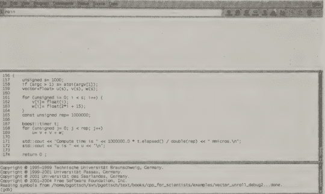

图 B-1: 调试器窗口

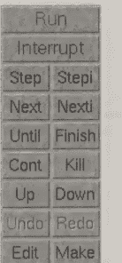

图 B-2: DDD 控制面板

- **下一行**: 转到源代码中的下一行。如果我们位于一个函数调用上，除非内部设置了断点，否则不要跳入它。
- **单步指令和下一行指令**: 这些是指令级别的等效命令。这仅在调试汇编代码时需要。
- **直到**: 当我们在源代码中定位光标时，程序将运行直到到达这一行。如果我们的程序流程不通过这一行，执行将继续直到程序结束或直到下一个断点或错误。或者，程序可能会在无限循环中永久运行。
- **完成**: 执行当前函数的其余部分，并在该函数外部的第一行停止，即函数调用后的那一行。
- **继续**: 继续执行直到下一个事件（断点、错误或结束）。
- **终止**: 终止程序。
- **向上**: 显示当前函数调用的行；即在调用堆栈中向上一级（如果可用）。
- **向下**: 返回到被调用的函数；即在调用堆栈中向下一级（如果可用）。
- **撤销**: 撤销上一个操作（很少或从不生效）。
- **重做**: 重复上一个命令（更经常生效）。
- **编辑**: 使用当前显示的源文件调用编辑器。
- **构建**: 调用 make 以重新构建可执行文件。

gdb 7 版本的一个重要新功能是能够使用 Python 实现美观打印机。这使我们能够在图形调试器中简洁地表示我们的类型；例如，矩阵可以被可视化为二维数组，而不是指向第一个条目或其他晦涩内部表示的指针。IDE 也提供调试功能，其中一些（如 Visual Studio）允许定义美观打印机。

对于较大的，尤其是并行软件，值得考虑使用 DDT 和 Totalview 等专业调试器。它们允许我们控制单个、一些或所有进程、线程或 GPU 线程的执行。

## B.3 内存分析

根据我们的经验，用于内存问题的最常用工具集是 valgrind 发行版（不仅限于内存问题）。这里我们专注于 memcheck。我们将其应用于例如在第 2.4.2 节中使用的向量示例：

```
valgrind --tool=memcheck vector_test
```

memcheck 检测内存管理问题，例如内存泄漏。它还报告未初始化内存的读取访问和部分越界访问。如果我们省略了向量类的拷贝构造函数（这样编译器就会生成一个带有别名效应的构造函数），我们将看到以下输出：

```
==17386== Memcheck, a memory error detector
==17386== Copyright (C) 2002-2013, and GNU GPL'd, by Julian Seward et al.
==17386== Using Valgrind-3.10.0.SVN and LibVEX; rerun with -h for copyright info
==17386== Command: vector_test
==17386==
[1,1,2,3]
z[3] is -3
w is [1,1,2,3]
W is [1,1,2,3]
==17386==
==17386== HEAP SUMMARY:
==17386==     in use at exit: 72,832 bytes in 5 blocks
==17386==   total heap usage: 5 allocs, 0 frees, 72,832 bytes allocated
==17386==
==17386== LEAK SUMMARY:
==17386==     definitely lost: 128 bytes in 4 blocks
==17386==     indirectly lost: 0 bytes in 0 blocks
==17386==      possibly lost: 0 bytes in 0 blocks
==17386==     still reachable: 72,704 bytes in 1 blocks
==17386==         suppressed: 0 bytes in 0 blocks
==17386== Rerun with --leak-check=full to see details of leaked memory
==17386==
==17386== For counts of detected and suppressed errors, rerun with: -v
==17386== ERROR SUMMARY: 0 errors from 0 contexts (suppressed: 0 from 0)
```

所有这些错误都可以在详细模式下连同相应的源代码行和函数堆栈一起报告：

```
valgrind --tool=memcheck -v --leak-check=full \
--show-leak-kinds=all vector_test
```

现在我们看到了显著更多的细节，但出于大小考虑，我们在此不打印出来。请亲自尝试一下。

使用 memcheck 运行的程序会更慢，在极端情况下会慢 10 到 30 倍。特别是使用原始指针的软件（希望将来这将是个例外）应该定期使用 valgrind 进行检查。更多信息请访问 http://valgrind.org。

一些商业调试器（如 DDT）已经包含内存分析。Visual Studio 提供用于查找内存泄漏的插件。

## B.4 gnuplot

gnuplot 是一个用于可视化输出的公共领域程序。假设我们有一个名为 results.dat 的数据文件，内容如下：

```
0 1
0 .25 0.968713
0 .75 0.740851
1.25 0.491059
1.75 0.9953422
2.25 -0.110732
2.75 -0.215106
3.25 -0.237847
3.75 -0.205626
4.25 -0.148418
4.75 -0.0877886
5.25 -0.0256738
5.75 0.0127226
6.25 0.0335624
6.75 0.0397399
7.25 0.0384546
7.75 0.0255507
8.25 0.0159841
8.75 0.00623965
9.25 -0.000763948
9.75 -0.08486465
```

第一列表示 x 坐标，第二列包含 u 的相应值。我们可以使用 gnuplot 中的以下命令绘制这些值：

```
plot "results.dat" with lines
```

命令

```
plot "results.dat"
```

仅绘制星号，如图 B-3 所示。3D 图可以使用 splot 命令实现。

对于更复杂的可视化，我们可以使用 Paraview，它也是免费可用的。

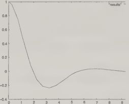

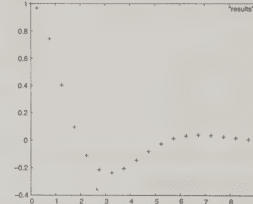

## B.5 Unix、Linux 和 Mac OS

像 Linux 和 Mac OS 这样的 Unix 系统提供了一组丰富的命令，允许我们在几乎不需要编程的情况下完成许多任务。其中一些最重要的命令是：

- ps: 列出（我的）正在运行的进程。
- kill id: 终止 ID 为 id 的进程；kill -9 id，使用信号 9 强制终止。
- top: 列出所有进程及其资源使用情况。
- mkdir dir: 创建名为 dir 的新目录。
- rmdir dir: 删除一个空目录。
- pwd: 打印当前工作目录。
- cd dir: 将工作目录更改为 dir。
- ls: 列出当前目录（或 dir）中的文件。
- cp from to: 将文件 from 复制到文件或目录 to。如果文件 to 存在，它将被覆盖，除非我们使用 cp -i from to，后者会询问权限。
- mv from to: 如果目录 to 存在，则将文件 from 移动到目录 to；否则重命名文件。如果文件 to 存在，它将被覆盖。使用 -i 标志时，系统会询问我们是否有权限覆盖文件。
- rm files: 删除列表 files 中的所有文件。rm * 会删除所有内容——请小心。
- chmod mode files: 更改文件的访问权限。
- grep regex: 在终端输入（或指定文件）中查找正则表达式 regex。
- sort: 对输入进行排序。
- uniq: 过滤重复行。
- yes: 无限地写入 y，或使用 yes 'my text' 写入任何文本。

Unix 命令的独特魅力在于它们可以通过管道连接；即，一个程序的输出是下一个程序的输入。当我们有一个安装脚本 install.sh，并且确定会对所有问题回答 y 时，我们可以写：

```
yes | ./install.sh
```

或者，当我们想要知道由字母 t、i、o、m、r、k 和 f 组成的长度为 7 的所有单词时：

```
grep -io '\<[tiomrkj]\{7\}\>' openthesaurus.txt |sort| uniq
```

作者有时就在 4 Pics 1 Word 游戏中这样作弊。


当然，我们可以自由地在 C++ 中实现类似命令。当我们能够将程序与系统命令结合时，这会更加高效。为此，建议生成简单的输出以便于管道传输。例如，我们可以编写可以直接从 gnuplot 处理的数据。

有关 Unix 命令的更多信息，例如可在 http://www.physics.wm.edu/unix_intro/outline.html 找到。显然，本节仅是其功能的引子。同样，整个附录只是我们可以从合适的工具中获益的表面。

# 附录 C

# 语言定义

本附录旨在作为与本书相关的定义的参考。

## C.1 值类别

C++ 区分不同的值类别。最重要的是左值和右值。

定义 C-1（左值）。左值（历史上之所以如此命名，是因为左值可以出现在赋值表达式的左侧）指定一个函数或对象。

更实际地说，左值是我们可以获取其地址的实体。这并不排除它们可能是常量——尽管这与术语有些不一致。原因在于早期版本的 C 没有 const 属性，因此所有左值都允许出现在赋值的左侧。

其对应的是：

定义 C-2（右值）。右值（历史上之所以如此命名，是因为右值可以出现在赋值表达式的右侧）是一个过期的值（例如，转换为右值引用的对象）、临时对象或其子对象，或者与对象不关联的值。

这些定义改编自 ISO 标准。

## C.2 运算符概览

| 描述 | 符号 | 结合性 |
| :--- | :--- | :--- |
| 带括号的表达式 | ( expr ) | – |
| Lambda | [ capture_list ] lambda_declarator { stmt_list } | – |
| 作用域解析 | class_name :: member | – |
| 作用域解析 | namespace_name :: member | – |
| 全局命名空间 | :: name | – |
| 全局命名空间 | :: qualified-name | – |
| 成员选择 | object . member | ← |
| 解引用成员选择 | pointer -> member | ← |
| 下标 | expr [ expr ] | ← |
| 下标（用户定义） | object [ expr ] | ← |
| 函数调用 | expr ( expr_list ) | ← |
| | expr ( expr_list ) | ← |
| 值构造 | type ( expr_list ) | ← |
| | expr { expr_list } | ← |
| 后自增 | lvalue ++ | – |
| 后自减 | lvalue -- | – |
| 类型识别 | typeid ( type ) | – |
| 运行时类型识别 | typeof ( expr ) | – |
| 运行时检查的转换 | dynamic_cast < type > ( expr ) | – |
| 编译时检查的转换 | static_cast < type > ( expr ) | – |
| 未检查的转换 | reinterpret_cast < type > ( expr ) | – |
| const 转换 | const_cast < type > ( expr ) | – |
| 对象大小 | sizeof expr | – |
| 类型大小 | sizeof ( type ) | – |
| 参数数量 | sizeof... ( argumentpack ) | – |
| 类型参数数量 | sizeof... ( typepack ) | – |
| 对齐 | alignof ( expr ) | – |
| 类型对齐 | alignof ( type ) | – |
| 前自增 | ++ lvalue | – |
| 前自减 | -- lvalue | – |
| 按位取反 | ~ expr | – |
| 逻辑非 | ! expr | – |
| 一元减 | - expr | – |
| 一元加 | + expr | – |
| 取地址 | & lvalue | – |
| 解引用 | * lvalue | – |
| 创建（分配） | new type | – |
| 创建（分配并初始化） | new type ( expr_list ) | – |
| 创建（定位） | new ( expr_list ) type | – |
| 创建（定位并初始化） | new ( expr_list ) type ( expr_list ) | – |
| 销毁（释放） | delete pointer | – |
| 销毁数组 | delete [] pointer | – |
| C 风格强制转换 | ( type ) expr | ← |
| 成员选择 | object .* pointer_to_member | ← |
| 成员选择 | pointer ->* pointer_to_member | ← |
| 乘法 | expr * expr | ← |
| 除法 | expr / expr | ← |
| 取模（余数） | expr % expr | ← |
| 加法 | expr + expr | ← |
| 减法 | expr - expr | ← |
| 左移 | `expr << expr` | ← |
| 右移 | `expr >> expr` | ← |
| 小于 | `expr < expr` | ← |
| 小于等于 | `expr <= expr` | ← |
| 大于 | `expr > expr` | ← |
| 大于等于 | `expr >= expr` | ← |
| 相等 | `expr == expr` | ← |
| 不相等 | `expr != expr` | ← |
| 按位与 | `expr & expr` | ← |
| 按位异或（XOR） | `expr ^ expr` | ← |
| 按位或 | `expr | expr` | ← |
| 按位或 | `expr || expr` | ← |
| 逻辑或 | `expr || expr` | ← |
| 逻辑表达式 | `expr ? expr : expr` | ←→ |
| 简单赋值 | `lvalue = expr` | → |
| 乘法赋值 | `lvalue *= expr` | → |
| 除法赋值 | `lvalue /= expr` | → |
| 取模赋值 | `lvalue %= expr` | → |
| 加法赋值 | `lvalue += expr` | → |
| 减法赋值 | `lvalue -= expr` | → |
| 左移赋值 | `lvalue <<= expr` | → |
| 右移赋值 | `lvalue >>= expr` | → |
| 按位与赋值 | `lvalue &= expr` | → |
| 按位或赋值 | `lvalue |= expr` | → |
| 按位异或赋值 | `lvalue ^= expr` | → |
| 抛出异常 | `throw expr` | – |
| 逗号（顺序） | `expr , expr` | ← |

该表取自 [43, §10.3]；我们提供了二元和三元运算符的结合性。同一优先级的一元运算符从内向外求值。在具有左结合性运算符的表达式中，先求值左子表达式；例如：

```
a + b + c + d + e     // Corresponds to:
((((a + b) + c) + d) + e)
```

赋值是右结合性的；即：

```
a = b = c = d = e       // Corresponds to:
a = (b = (c = (d = e)))
```

值得注意的细节是 `sizeof` 的定义。它可以直接应用于对象等表达式，但应用于类型时需要括号：

```
int i;
sizeof i;          // Okay: i is an expression
```

```
sizeof(i);     // Okay as well: extra () do not harm
sizeof int;    // Error: parentheses needed for types
sizeof(int);   // Okay
```

如果不确定是否需要括号，可以始终添加额外的括号。

## C.3 转换规则

在 C++ 中，整数、浮点数和 bool 值可以自由混合，因为每种类型都可以转换为任何其他类型。在可能的情况下，值会被转换而不丢失信息。如果转换回原始类型能得到原始值，则该转换为值保持（Value-Preserving）。否则，该转换为收窄（Narrowing）。本段是 [43, Intro §10.5] 的简短版本。

### C.3.1 提升

保留值的隐式转换称为提升。较短的整数或浮点值可以分别精确转换为较长的整数或浮点类型。在可能的情况下，优先转换为 int 和 double（而非更长的类型），因为这些类型在算术运算中被认为具有“自然”大小（即，硬件支持最好）。整数提升的详细情况如下：

- 如果 int 能表示所有源类型值，则 char、signed char、unsigned char、short int 或 unsigned short int 转换为 int；否则，转换为 unsigned int。

- char16_t、char32_t、wchar_t 或普通枚举转换为以下能容纳所有源类型值的第一个类型：int、unsigned int、long、unsigned long 和 unsigned long long。

- 如果位字段能表示前者的所有值，则转换为 int；否则在相同条件下转换为 unsigned int。否则，不适用提升。

- bool 转换为 int：false 变为 0，true 变为 1。

提升用作常规算术转换（§C.3.3）的一部分。来源：[43, §10.5.1]。

### C.3.2 其他转换

C++ 隐式执行以下可能收窄的转换：

- 整数和普通枚举类型可以转换为任何整数类型。如果目标类型较短，则高位会被截断。

- 浮点值可以转换为较短的浮点类型。如果源值介于两个目标值之间，则结果是其中之一；否则，行为未定义。


- 指针和引用：指向对象类型的任何指针都可以转换为 void*（虽然这是邪恶的旧式技巧）。相比之下，指向函数或成员的指针不能转换为 void*。派生类的指针/引用可以隐式转换为（无歧义的）基类的指针/引用。0（或产生 0 的表达式）可以转换为任何指针类型，结果为空指针。nullptr 更可取。T* 可以转换为 const T*，同样 T& 可以转换为 const T&。

- 布尔型：指针、整型和浮点型值可以转换为 bool：零值变为 false，其他所有值变为 true。这些转换都没有助于理解程序。

- 整型<->浮点型：当浮点型转换为整型时，小数部分被舍弃（向 0 舍入）。如果值太大无法表示，行为是未定义的。当整型可以在目标类型中表示时，从整型到浮点型的转换是精确的。否则，会取下一个更低或更高的浮点型值（哪一个取决于实现）。在不太可能的情况下，如果它对于浮点型来说太大，行为是未定义的。

来源：[43, §10.5.2] 和标准。

### C.3.3 通常算术转换

这些转换在二元运算符的操作数上执行，将它们转换为一个公共类型，然后用作结果类型：

1. 如果任一操作数是 long double，则另一个转换为 long double；
- 否则，如果任一操作数是 double，则另一个转换为 double；
- 否则，如果任一操作数是 float，则另一个转换为 float；
- 否则，对两个操作数执行第 C.3.1 节中的整型提升。

2. 否则，如果任一操作数是 unsigned long long，则另一个转换为 unsigned long long；
- 否则，如果一个操作数是 long long 而另一个是 unsigned long，则当后者能表示前者的所有值时，unsigned long 转换为 long long；否则，两者都转换为 unsigned long long。
- 否则，如果一个操作数是 long 而另一个是 unsigned int，则当后者能表示前者的所有值时，unsigned int 转换为 long；否则，两者都转换为 unsigned long。
- 否则，如果任一操作数是 long，则另一个转换为 long；
- 否则，如果任一操作数是 unsigned，则另一个转换为 unsigned；
- 否则，两个操作数都转换为 int。

因此，混合有符号和无符号整数的程序具有平台相关的行为，因为转换规则取决于整型类型的大小。来源：[43, §10.5.3]。

### C.3.4 窄化转换

窄化转换是一种隐式转换：

- 从浮点型到整型；或
- 从 long double 到 double 或 float，或从 double 到 float，除非源是常量表达式且转换后的实际值在可表示值的范围内（即使无法精确表示）；或
- 从整型或无作用域枚举类型到浮点型，除非源是常量表达式且转换后的实际值能适合目标类型，并且转换回原始类型时会产生原始值；或
- 从整型或无作用域枚举类型到不能表示原始类型所有值的整型，除非源是常量表达式且转换后的实际值能适合目标类型，并且转换回原始类型时会产生原始值。

来源：ISO 标准。

# 参考文献

- [1] D. Abrahams 和 A. Gurtovoy，《C++ 模板元编程：来自 Boost 及更远的概念、工具和技术》。Addison-Wesley，2004年。

- [2] D. Adams，“生命、宇宙以及一切”，《银河系搭车客指南》，Pan Macmillan，1980年。

- [3] M. H. Austern，《泛型编程与 STL：使用和扩展 C++ 标准模板库》。专业计算系列。Addison-Wesley，1998年。

- [4] J. J. Barton 和 L. R. Nackman，《科学与工程 C++》。Addison-Wesley，1994年。

- [5] L. S. Blackford, A. Petitet, R. Pozo, K. Remington, R. C. Whaley, J. Demmel, J. Dongarra, I. Duff, S. Hammarling, G. Henry 等人，“一组更新的基本线性代数子程序 (BLAS)”，《ACM 数学软件事务》，第 28 卷，第 2 期，第 135–151 页，2002年。

- [6] W. E. Brown，“三个与 <random> 相关的提案，v2”，技术报告 N3742，ISO/IEC JTC 1，信息技术，SC 22 分委会，编程语言 C++，2013年8月。

- [7] “C++ 参考：隐式转换。” http://en.cppreference.com/w/cpp/language/implicit_cast.

- [8] K. Czarnecki 和 U. W. Eisenecker，《生成式编程：方法、工具和应用》。ACM Press/Addison-Wesley，2000年。

- [9] K. Czarnecki 和 U. Eisenecker，“用于模板元编程的元控制结构。” http://home.t-online.de/home/Ulrich.Eisenecker/meta.htm.

- [10] I. Danaila, F. Hecht 和 O. Pironneau，《C++ 中的数值模拟》。Dunod，巴黎，2003年。

- [11] L. Dionne，“Boost.hana。” http://ldionne.com/hana/index.html，2015年。

- [12] S. Du Toit，“C++ API 的沙漏接口。” http://de.slideshare.net/StefanusDuToit/cpp-con-2014-hourglass-interfaces-for-c-apis，2014年。

- [13] M. A. Ellis 和 B. Stroustrup，《C++ 参考手册注释版》。Addison-Wesley，1990年。

- [14] E. Gamma, R. Helm, R. Johnson 和 J. Vlissides，《设计模式：可复用面向对象软件的基础》。Addison-Wesley，1994年。

- [15] B. Ganter 和 R. Wille, *形式概念分析：数学基础*. Springer Science & Business Media, 2012年。

- [16] P. Gottschling, "类模板特化中的代码复用," Tech. Rep. N3596, ISO IEC JTC1/SC22/WG21, 2013年。http://www.open-std.org/jtc1/sc22/wg21/docs/papers/2013/n3596.pdf.

- [17] P. Gottschling, *矩阵模板库 4*. SimuNova, 2014年. mtl4.org.

- [18] P. Gottschling, *混合复杂算术*. SimuNova, 2011年. https://simunova.zih.tu-dresden.de/mtl4/docs/mixed__complex.html, 矩阵模板库 4 的一部分。

- [19] P. Gottschling 和 A. Lumsdaine, "集成语义与编译：使用 C++ 概念开发健壮高效的可复用库," in *GPCE '08：第 7 届生成式编程与组件工程国际会议论文集*, pp. 67–76, ACM, 2008年。

- [20] P. Gottschling, D. S. Wise, 和 A. Joshi, "面向科学计算的算法和结构递归的泛型支持," *并行、新兴和分布式系统国际期刊 (IJPEDS)*, vol. 24, no. 6, pp. 479–503, 2009年12月。

- [21] D. Gregor, "ConceptGCC," 2007年. http://www.generic-programming.org/software/ConceptGCC/.

- [22] A. Gurtovoy 和 D. Abrahams, *Boost 元编程库*. Boost, 2014年. www.boost.org/doc/libs/1_56_0/libs/mpl.

- [23] E. Hairer, S. Norsett, 和 G. Wanner, *求解常微分方程 I：非刚性问题*. 计算数学 Springer 系列, Springer Berlin Heidelberg, 2008年。

- [24] M. R. Hestenes 和 E. Stiefel, "求解线性系统的共轭梯度方法," *国家标准局研究杂志*, vol. 49, no. 6, pp. 409–436, 1952年12月。

- [25] R. W. Hockney, *计算机基准测试科学*, vol. 2. SIAM, 1996年。

- [26] N. Josuttis, *C++ 标准库：教程与参考，第 2 版*. Addison-Wesley, 2012年。

- [27] B. Karlsson, *超越 C++ 标准库*. Addison-Wesley, 2005年。

- [28] KjellKod.cc, "数值运算：为什么你应该永远、永远、永远不要在代码中再次使用链表." http://www.codeproject.com/Articles/348797/Number-crunching-Why-you-should-never-ever-EVER-us, 2012年8月。

- [29] K. Meerbergen, *泛型线性代数软件*. K.U. Leuven, 2014年. http://people.cs.kuleuven.be/~karl.meerbergen/glas/.


- [30] K. Meerbergen, K. Fresl, 和 T. Knapen，“面向外部软件库的 C++ 绑定，附 BLAS、LAPACK、UMFPACK 和 MUMPS 示例，”*ACM 数学软件事务 (TOMS)*，第 36 卷，第 4 期，第 22 页，2009.

- [31] S. Meyers，“关于零规则的担忧。” http://scottmeyers.blogspot.de/2014/03/a-concern-about-rule-of-zero.html.

- [32] S. Meyers, *现代 C++ 高效使用指南：42 种改进 C++11 和 C++14 使用的具体方法*，O’Reilly Media, Inc., 2014.

- [33] Oracle，“Oracle C++ 调用接口。” http://www.oracle.com/technetwork/database/features/oci/index-099820.html.

- [34] E. Ott, *动态系统中的混沌*。Cambridge University Press, 2002.

- [35] D. Quinlan，“Rose：面向对象框架的编译器支持，”*并行处理快讯*，第 10 卷，第 02-03 期，第 215–226 页，2000.

- [36] J. Rudl，“金融数学讲座脚本，”2013 年 10 月.

- [37] J. G. Siek, L.-Q. Lee, 和 A. Lumsdaine, *Boost 图库：用户指南和参考手册*。Addison-Wesley, 2001.

- [38] J. G. Siek 和 A. Lumsdaine, *面向泛型编程的语言*。博士论文，印第安纳大学，2005.

- [39] M. Skarupke，“统一初始化的问题。” http://probablydance.com/2013/02/02/the-problems-with-uniform-initialization, 2013 年 2 月.

- [40] A. Stepanov，“抽象惩罚基准测试，版本 1.2 (kai)，”1992 年。http://www.open-std.org/jtc1/sc22/wg21/docs/p0_3.cpp.

- [41] W. Storm，“STL deque 容器深入研究。” http://www.codeproject.com/Articles/5425/An-In-Depth-Study-of-the-STL-Deque-Container.

- [42] B. Stroustrup, *C++ 程序设计语言（第 3 版）*。Addison-Wesley, 1997.

- [43] B. Stroustrup, *C++ 程序设计语言（第 4 版）*。Addison-Wesley, 2013.

- [44] H. Sutter，“为何不特化函数模板？” http://www.gotw.ca/publications/mill17.htm, 2009 年.

- [45] H. Sutter 和 A. Alexandrescu, *C++ 编码规范*。C++ 深度系列，Addison-Wesley, 2005.

- [46] A. Sutton，“面向概念的 C++ 扩展，”技术报告 N4377，ISO/IEC JTC 1，信息技术，子委员会 SC 22，编程语言 C++，2015 年 2 月.

- [47] X. Tang 和 J. Järvi，“基于概念的 C++ 中通用流敏感优化变换，”载于 *SAC’10：2010 年 ACM 应用计算研讨会论文集*，2010 年 3 月.

- [48] G. Teschl, *常微分方程与动力系统*，第 140 卷，美国数学学会，2012.

- [49] T. Veldhuizen, "C++ 模板是图灵完备的." `citeseer.ist.psu.edu/581150.html`, 2003.

- [50] V. Vernon, *领域驱动设计实现*。Addison-Wesley, 2013.

- [51] R. Whaley, A. Petitet, 和 J. Dongarra，“软件自动化经验优化与 ATLAS 项目，”*并行计算*，第 27 卷，第 1-2 期，第 3-35 页，2001 年 1 月.

- [52] B. Wicht, "C++ 基准测试 - std::vector vs std::list vs std::deque." `http://baptiste-wicht.com/posts/2012/12/cpp-benchmark-vector-list-deque.html`, 2012.

- [53] A. Williams, *C++ 并发编程实战*。Manning, 2012.

- [54] P. Wilmott, *Paul Wilmott 定量金融导论*。Wiley, 2007.

# 索引

- -0，35
- .NET，360
- //，59
- <iostream>，40
- a.out，403
- Abaqus，xvii
- Abrahams, David，318
- abs，142
  - 在 Mandelbrot 集中，187
  - 返回类型，227
- 抽象
  - 惩罚，274
  - 提供一个，66
- 访问
  - 修饰符，68
- accessibility()，68
- accessibility()，70
- accumulate，185
  - 与概念，136
  - 用于求和，130
  - 来自 STL，125
  - 泛型，153
  - 在 STL 中，166
- 抽象惩罚，274
- accumulate_array，128
- Ada，403
- Adams, Douglas，1
- 加法
  - 向量，47
- 地址
  - 0，50
  - 映射，336
  - 空间，336
- adjacent_difference，185
- ADL，118–123
  - 显式实例化，121
  - 用于选择模板，119
  - 在特化中，140
  - 与运算符，118
  - 与第三方库，120
- advance，170
  - 在向量迭代器上，171
- 聚合，83
  - 初始化，83
- Ahnert, Karsten，215
- Alexandrescu, Andrei，69, 233
- 代数，327
- 代数
  - 线性，47, 58, 363
  - 稠密，282
  - 库，214–215
  - 包，331
- 算法
  - 块，363
  - 在 STL 中，参见 STL, 算法
  - 数值，321
- 别名，55
  - 别名化效应，86
- alignof，17
- 分配器
  - 用户定义，179
- Amazon，xvii
- 歧义
  - 在特化和重载中，140
- 反模式，288
- 应用
  - 科学，58
- 存档，336, 342
- 参数
  - 宏，361
  - 复制，362
  - 带显式转换，114
  - 带隐式转换，114
  - 带统一初始化，82
- 参数相关查找，参见 ADL
- 算术
  - 区间，214
- ARPREC，214
- 数组，47-48
  - 容器，56-58
  - 声明，47
  - 内置支持，47
  - 缺少索引检查，48
  - 高维，47
  - 操作，47
  - 大小推导，48
  - 二维，375
- 数组，327
- ASCII，64
- asm
  - 在 constexpr 中，222
- 汇编器，389
  - 输出，403
  - 读取汇编代码，145
- 汇编，336
- assert，34
- assert，358, 362
  - 在调试器中，406
- 赋值，15, 22, 81-82, 413
  - 仅作为方法，102
  - 复制，81
  - 生成规则，380-382
  - 移动，87
  - 生成规则，382
  - 自身，82
  - 带初始化列表，83
- 关联的
  - 左，244
- AST，254
- async，211
- async_executor，212
- 异步，211
- ATLAS，282
- atomic，175, 211
- Austern, Matt，166
- auto，131
- auto_ptr，51
- backtrace，406
- bad_cast，312
- Barton, John，316
- Barton-Nackman 技巧，316
- base_matrix，299
- basic_iteration，211
- begin，83, 130, 181
- 基准测试，282
- bernoulli_distribution，195
- BidirectionalIterator，167, 171
  - 在列表中，175
- 二进制，7
- BinaryFunction，154
- bind，197
- binomial_distribution，195
- 位
  - 掩码，138
- Black, Fischer，197
- Black-Scholes 模型，197
- BLAS，233, 282
  - Goto-，283
  - 在链接器标志中，404
- BLITZ2+，214
- bool，137, 355
- boolalpha，44
- Boost，334
  - Any，386
  - Asio，42
  - Bindings，233
  - Function，308
  - Fusion，204
  - 图库 (BGL)，215
  - Interval，214
  - IOStream，42
  - MPL，205, 235, 395
  - odeint，331
  - Operators，318
  - Rational，214
  - 类型特征，200, 237
  - uBLAS，215
- BOOST_STATIC_ASSERT，396
- 花括号，2, 83
  - 消除
    - 在模板中，386
  - 省略，84
  - 表示法，373
- 分支，22
- break，27
- break，24
- Brown, Rita Mae，18
- Brown, Walter，190
- 缓冲区，40
- 构建，333-340
  - 过程，336
  - 工具，337-340
- build_example.cpp，334
- Butcher 表，324
- 字节，138
- C
  - 数组初始化，82
  - 与 C++ 程序链接的 C 代码，344
  - 344
  - 与 C++ 编译器一起的 C 代码，344
    - 强制转换，309
  - const，413
  - 模拟命名空间，116
  - 对接口的影响，66
  - 库，92
  - 中的左值，413
  - 命名，344
    - 块表示法，344
    - 预处理的，334
  - struct，69
  - 用于 C 兼容性的类型特征，200
- C++
  - 作为 C 的超集，344
  - 特性
    - 基本，1-63
    - 托管，360
    - 项目，58-345
- C++03
  - 数组初始化，47
- C++11，361
  - 在 MTL4 中，364
  - 数组中的收窄转换，47
  - 智能指针，51
- C++17，136
- c++filt，232
- C99
  - 不是 C++ 的子集，344
- 缓存
  - 一致性，261
  - 失效，261, 277
  - L1，248, 257
  - L2，248
- 调用
  - 按引用，28
  - 按值，28
  - 栈，38
- Cantor 尘，216
- 捕获，参见 lambda
- <cassert>，34
- 强制转换，359
  - 交叉，312
  - 向下，310
  - 重新解释，313
  - 向上，309
  - 歧义，310
- catch，37
  - (...) 省略号，38
  - 按引用，37
- CATIA，xvii
- cauchy_distribution，196
- cd，411
- 混沌吸引子，323
- 混沌动力学，323
- char，359
- chi_squared_distribution，196
- 鸡与蛋，125
- chmod，411
- <chrono>，3, 209, 263
- cin，41
- clang，xvii
  - 与 enable_tf，398
- 类，37, 65-105
  - 基类，73, 290
  - 包含的类，67
  - 仅复制，384
  - 数据成员，参见成员变量
  - 难处理的类型，379
  - 派生类，69, 290
  - 同时适用于 C 和 C++，201
  - 高级，384
  - 成员，参见成员变量
  - 直接设置，83


- 类, （续）
  - 初始化列表，参见 constructor
  - 成员函数，参见 method
  - 成员变量, 67
    - 访问, 96
    - 默认值, 81
    - 私有, 68, 96
    - 表示法, xx
  - 模板, 56
  - 建立抽象, 67
  - 类型定义, 67
- 类
  - 抽象, 296
  - 代替 typename, 108
- 时钟, 209
- 克隆, 229
- CMake, 35
- CMake, 339-340
- <cmath>, 186, 345
- 代码
  - 汇编, 335
  - 复杂度, 308
  - 条件, 335
  - 爆炸, 274
  - 十六进制, 336
  - 遗留, 84
  - 对象, 336
- 强制转换, 6, 13
- Collatz 序列, 24
- 颜色编码, 187
- 注释, 89
  - 单行, 4
- 承诺
  - 对技术细节, 66
- common_type, 243
- common_type_t, 243, 252
- 交换, 270
- 编译, 335
  - 歧义术语, 333
  - 条件, 62
  - 阶段, 335
  - 分离, 340-345
- 编译
  - 时间, 47
  - 如果，参见 conditional

- 编译器
  - 调用, 333
  - 标志, 35
  - 优化, 282, 366
  - 对标签类型, 171
  - 支持
    - 对垃圾回收, 361
  - <complex>, 186
- 复数, 67, 354
  - 比较大小, 227
  - 在混合算术中, 188
  - 库, 187
  - 缺少运算符, 113
  - 排序 ~, 184
- complex_abs, 79
- 复杂度, 366
  - 常数, 179, 185
  - 线性, 185
  - 对数, 176, 179, 185
  - O(n log n), 184, 185
  - 二次, 184, 185
- compressed_matrix
  - 在转换中, 314
- 计算
  - 标量, 326
- 概念, 136
  - 对简单矩阵, 231
  - lite, 254
  - 模型, 136
  - 表示法, xx
  - 细化, 136
  - 要求, 136
  - 语义, 270
  - 流, 41, 42
- 并发, 211
- 条件
- 货币
  - 充足, 107
- 条件, 202
  - 实现, 235
  - conditional_t, 202
- 共轭梯度, 347
- const, 5
  - 优点, 365
  - 方法, 98
  - 变量, 225

- const_cast, 313
  - 对第三方库, 233
- const_iterator, 168
- 常量, 5
  - 作为宏, 361
  - 全局, 9
  - 表示法, xx
- constexpr, 219-226, 361
  - 对循环展开, 257
  - 运行时函数, 221
  - 函数模板, 220
  - 在 C++14 中, 221
- 构造
  - 类赋值表示法, 79
  - explicit, 79
- 构造函数, 42, 72-81
  - 参数名, 74
  - 转换, 314
  - 拷贝, 76
    - 默认实现, 76
    - 生成规则, 380-382
    - 强制用户实现, 77
    - 生成原因, 77
    - 带可变引用, 381
    - 带值参数, 77
  - 默认, 75
    - 与引用, 76
    - 调用, 75
    - 生成规则, 379
    - 在延迟初始化中, 76
    - 容器所需, 76
  - 默认参数, 75
    - 委托, 80
    - 无异常, 229
  - 异常, 79
    - 对复数, 72
    - 非法调用, 73
    - 隐式, 79
  - 初始化列表
    - 花括号表示法, 85
    - 初始化列表, 72
  - 移动, 86
    - 生成规则, 382
  - 特殊, 75
  - 语法, 72
  - 带初始化列表, 83

- 容器
  - 作为类模板, 124
  - 作为返回值, 366
  - 关联, 177
  - 在 STL 中, 171
  - 引用, 207
- container_algebra, 328
- continue, 27
- 收敛
  - 二次, 209
- 转换, 14
  - 显式, 114
  - 函数式, 314
  - 隐式, 6, 79, 368
  - 在模板中, 114
  - 数值类型, 316
- 坐标, 145
- 拷贝
  - 可赋值, 379
  - 可构造, 386
  - 可构造, 379
  - 构造函数，参见 constructor, copy
  - 深, 86
  - 省略, 30, 88
  - 显式深, 86
  - 代替移动, 384
  - 浅, 85
- 拷贝, 83, 183, 386
- 正确性
  - 与存储无关, 66
- cout, 2, 40, 167
  - setf, 43
- cp, 411
- 生物, 296
- cref, 208
- CRTP, 316-320
- 密码学, 194
- <cstdint>, 359
- <cstdlib>, 38
- <ctime>, 209
- ctime, 209
- CUDA, 201
  - 在 MTL4 中, 215
  - 静态代码分析, 282

- 奇异递归模板模式，*参见* CRTP
- Czarnęki, Krzysztof, 235, 394
- D, 403
- 数据
  - 持久, 86
  - 作为瓶颈的传输, 248
- DDD, 406
- DOT, 408
- 德摩根定律, 317
- deal.II, xvii
- 释放, 50
  - 自动, 51
  - 双重, 78
- 调试器
  - 编译器标志 ~, 404
  - 文本, 404
  - 与方法中的日志相比, 72
- 调试, 404-408
- dec, 44
- 声明
  - 在头文件中, 340
  - 变量, 22, 67
- decltype, 132
- 分解，*另见* factorization
- 默认, 377
- 默认可构造, 73, 379
- default_operations, 331
- default_random_engine, 103
- delete, 17, 49
- 说明符, 377
- delete[], 49
- deleter, 93
- 分母, 68
- dense_matrix
  - 在转换中, 314
- <deque>, 174
- deque, 174
  - emplace, 175
  - erase, 175
  - insert, 175
- 派生, 42
  - 从 ostream, 104
- 导数, 146, 322
  - 高阶, 150

- 派生, 289
- 设计
  - 领域驱动, 65
- 设计指南
  - 对方法生成, 383
- 析构函数, 89-91
  - 参数, 89
  - 生成规则, 379
  - 主要任务, 90
  - 虚, 89
- 行列式, 363
- 开发
  - 测试驱动, 363
- 对角线
  - 单位, 364
- 菱形, 301
- 菱形的, 309
- 数字分隔符, 7
- Dijkstra, Edsger W., 65
- discard_block_engine, 194
- discrete_distribution, 196
- 离散化
  - 等距, 323
  - 时间, 323
- 距离, 171
- 分布
  - 正态, 196
- do while, 24
- 文档
  - 作为文本, 363
  - 可编译, 363
- 域
  - 域特定嵌入语言, 101
  - 专家, 65
- 点, 80
- DSEL，*参见* 域特定嵌入语言
- Du Toit, Stefanus, 66
- Duff 设备, 357
- 持续时间, 209
- dwdt, 325
- 动态绑定, 293
- dynamic_cast, 312

- -E (标志), 334
- /E (标志), 334

- Eclipse, 3
- Einstein, Albert, 18
- Eisencker, Ulrich, 394
- Eisencker, Ulrich W., 235
- #else, 62
- 省略号
  - 在参数包中, 160
- else, 22–23
- enable_if, 202, 239
- enable_if_t, 202
- 封装, 63
- end, 83, 130, 181
- #endif, 62
- endl, 2, 40
- 熵, 194
- eof, 45
- 错误
  - 代码, 36
  - 编译时 ~, 146
  - 估计, 211
  - 标志, 45
  - 处理, 34–40
  - 在模板程序中, 113
  - 消息
    - 来自宏, 361
    - 解析, 108
  - 与指针相关, 51
  - 程序, 34
  - 运行时 ~, 146
- 欧拉方案, 324
- euler_step, 325
- 事件
  - 硬件, 194
  - 操作系统, 194
- 异常, 35–39, 45
  - 与资源释放, 91
  - 在析构函数中, 89
- 异常, 37
- 可执行文件
  - 大小, 114
- exit, 38
- 退出码, 357
- explicit, 79, 103
  - 在 C++03 中, 80
  - 在 C++11 中, 80

- exponential_distribution, 195
- 表达式, 21
  - 在 C++ 中, 21
  - 条件，参见 conditional
  - 运算符
    - 逻辑, 355
  - 模板, 30, 245–283, 364
    - 带 ~ 的第一个库, 214
- 扩展
  - .c, 334
  - .a, 336
  - .asm, 335
  - .cc+, 334
  - .cc, 334
  - .cpp, 334, 340
  - .cxx, 334
  - .dll, 336
  - .hpp, 340
  - .i, 334
  - .it, 334
  - .lib, 336
  - .o, 336
  - .obj, 336
  - .s, 335
  - .so, 336
- extern, 344
- extreme_value_distribution, 195

- Facebook, xvii
- 分解
  - 原地, 364
  - LU, 39, 83, 202, 363, 399
- 工厂, 307
- false_type, 237
- 快速傅里叶变换, 353
- Fatou 尘, 216
- 功能主义, 363
- FEEL++, 215
- FEM, 215
- FEniCS, xvii, 215
- FIFO, 171
- 文件
  - 关闭, 41
  - eof, 45
  - I/O, 41
  - 在 C++ 项目中, 58
  - 不存在, 44
  - 对象, 342
  - 打开, 41
  - 流, 41, 91, 383
- fin_diff, 146
- fn_at, 295
- 金融
  - 定量, 197
- find, 180
- find_if, 182
- 有限差, 146
- fisher_f_distribution, 196
- Fitzmaurice, Sue, 1
- for, 25
  - 基于范围, 26, 169
- for_each, 183, 328
- for_each3, 329
- for_each6, 329
- 形式概念分析, 107
- Forth, 370
- Fortran, xix, 351, 403
  - 77, 66
- forward, 112
- <forward_list>, 176
- forward_list, 126, 176
- ForwardIterator, 162, 167
- fprintf, 360
- Fracassi, Fabio, 78
- Franklin, Benjamin, 18
- friend, 69, 96
- fscanf, 360
- fsize_nat_vec_mult, 258
- fsize_nat_vec_mult_aux, 263
- fsize_nat_vec_mult_cm, 260
- fsize_nat_vec_mult_reg, 262
- fsize_matrix, 258
- fsize_vector
  - 编译器优化, 255
- 函数, 28–34, 413
  - 参数, 28-30
  - 默认, 29
  - 可微, 146
  - 分发, 170
  - 动态, 306
  - 自由, 96
  - 泛型，参见 template function
  - Getter 和 Setter, 69
  - 头, 98
  - inline, 31, 343
    - ~ 的访问, 206
  - 线性
    - 分段, 163
  - 局部声明, 343
  - main, 2, 33
  - 链接中缺失, 342
  - 无返回值, 34
  - 返回值, 34
  - 签名, 33
  - 链接中出现两次, 342
  - 成员 vs. 自由, 102
  - 嵌套调用, 21
  - 无匹配, 114
  - 表示法, xx
  - 零元, 160
  - 重载, 31, 107
    - 歧义, 140
  - 参数, 114
  - 指针, 308, 325
  - 与 std::function 相比, 207
  - 重定义, 343
  - 结果, 30-31
  - 语义, 363
  - 签名, 366
  - 模板，参见 template, function
- 函数, 135, 205
  - 在代码选择中, 308
- <functional>, 197, 205, 207
- 函子, 146-161, 325
  - 参数, 163
  - 练习, 164
  - 对循环展开, 255
  - 简写, 154
  - 通过继承, 297
- functor_base, 297
- future, 211
- gamma_distribution, 195
- 垃圾回收, 360
  - 接口, 360


- 高斯圆问题, 92
- 高斯-约旦, 363
- gcc, xvii
- constexpr, 221
- 隐式包含, 113
- 寄存器使用, 274
- gdb, 404
- 泛型
  - 归约, 153
- 几何分布, 195
- GitHub, xxi
- GLAS, 405
- GMP, 214
- GNU, 2
- gnuplot, 409
- 歌德, 约翰·沃尔夫冈·冯, 136
- Google, xvii
- goto, 27
- GPGPU, 参见 GPU, 351
- GPU, 282, 353
  - 与 ODE, 323
- 图, 51
- grep, 411
- 谐振子, 322
- 哈希表, 179
- 赫伯特
  - 与 ADL, 118
  - 与 CG, 348
  - 与错误处理, 36
  - 与头文件, 341
  - 与他的数据库, 92
  - 与他隐藏的 C 源代码, 344
  - 提供头文件, 345
- 赫斯特内斯, 马格努斯·R., 347
- hex, 44
- 十六进制, 7
- 隐藏, 参见 name, hiding
- high_resolution_clock, 210
- 沙漏 API, 66
- 小时, 209
- HPC, 253
- -t (标志), 61
- /t (标志), 61

- I/O, 40-47
  - 二进制, 359
  - 与可变参数函数, 390
  - C 风格, 360
  - 捕获错误, 46
  - 错误, 44
  - 格式化, 43
  - 足够位数, 199
  - 在表达式中, 21
  - 操纵符, 43
  - 健壮, 45
  - 与异常, 45
  - 与文件, 41
  - 无 ADL, 119
- tall, 369
- IDE, 3
  - 调试, 408
- 恒等
  - 元素, 199
- #if, 62
- if, 22-23
  - 嵌套, 355
- #ifdef, 62
- #ifndef, 62
- 实现
  - 泛型, 107, 326
  - 模块化, 326
- 导入
  - 名称, 117
  - 命名空间, 117
- 包含
  - 标准 ~ 目录, 61
  - #include, 61, 334
  - 保护, 61
  - 中的斜杠, 61
  - 带尖括号, 61
  - 带引号, 61
  - 包含, 1
  - 包含, 61
- independent_bits_engine, 194
- 索引
  - 从零开始, 25
- 不等式, 317
- 继承, 237
- 继承, 67, 287-320

- 初值问题, 参见 IVP
- 初始化
  - 聚合, 83
  - 花括号, 参见 initialization, uniform
  - 非收窄, 7
  - 统一, 7, 80, 83–85, 364
  - 在模板中, 386
  - 参数的, 82
  - 空指针的, 50
  - 返回值的, 85
  - 带 =, 75
- 初始化列表, 82
  - 在赋值中, 83
  - 在构造函数中, 83
  - 与构造函数, 初始化列表, 82
  - 带尾随逗号, 372
- <initializer_list>, 82
- initializer_list, 127
- 初始化列表
  - 在构造函数中, 参见 constructor
- 内联, 参见 function, inline
- 内联, 31
  - 展开循环, 257
- inner_product, 185
- 输入, 41
- InputIterator, 167, 171
- 疯狂, 18
- 实例化, 108–112
  - 与可执行文件大小, 115
  - 显式, 109
  - 隐式, 109
- int32_t, 359
- integral_constant, 398
- 集成开发环境
  - 参见 IDE
- Intel 编译器, xvii
- Intel i7-3820, 264
- 接口
  - 简洁, 66
  - 跨语言, 92
  - 直观, 66
  - 高效, 58
- 互操作
  - 与 C 和 Fortran, 66
- interruptible_iteration, 212

- 中断
  - 点, 211
- 区间
  - 算术, 214
  - 闭区间, 128
  - 右开区间, 128, 168
- 不变量, 68, 290
- 逆, 365
- <cstdint>, 43
- ios::binary, 359
- ios_base, 43
- <ostream>, 1, 334
- iostream, 42
  - 读取, 359
- iota, 185
- Irange, 369
- is_const
  - 实现, 234
  - 在标准库中, 200
- is_literal_type, 221
- is_matrix, 237
- is_nothrow_assignable, 200
- is_nothrow_copy_constructible, 229
- is_pod, 200
- is_reference, 226
- is_trivially_copyable, 201
- 迭代器, 26, 129, 166–171
  - 作为广义指针, 166
  - 超越, 185
  - 类别, 167
  - 基于 ~ 类别的分派, 170
  - 操作, 170
- <iterator>, 170
- IVP, 322
- 亚尔维, 雅科, 239
- Java, 3
  - 泛型函数, 114
- 约乌茨约基, 尼古莱, 165
- 朱利亚集, 216
- 卡尔布, 乔恩, 91
- KDE, 3
- KDevelop, 3
- 肯尼迪, 约翰·F., 34

- 内核, 357
- 键, 177
- kill, 411
- 克尼普利, 马特, xv
- kill -9, 411
- knuth.b, 194
- 科赫, 马蒂亚斯, 215
- 科尼格, 安德鲁, 90
- 克尼格, 蒂尔马, 362
- 标签
  - 在汇编器中, 336
- lambda, 154–161
  - 捕获, 155
  - 按引用, 157
  - 按值, 156
  - 初始化, 158
  - 移动, 158
  - 练习, 164
  - 用于排序, 184
  - 嵌套, 155
  - 对象, 325
  - 伪, 183
  - 返回类型, 155
- 语言
  - 核心, 1, 56
  - 特性
    - 使用新的, 63
  - 函数式, 20
  - 机器, 335, 336
- LAPACK, 233
- 晚期绑定, 293
- LATEX, 101
- LD_LIBRARY_PATH, 336
- 左对齐, 43
- less, 177
- 库, 165–217
  - 用于 PDEs, 215
  - 图, 215
  - 矩阵模板库 4, 参见 MTL4
  - 科学, 213–215
  - 标准, 1, 37, 51, 56, 165–213
    - chrono, 209, 210
    - complex, 186–189
    - numerics, 186–198
    - random, 189–198
  - 模板, 参见 STL
  - 教程, 165
  - 实用工具, 202–210
  - 带 C 接口, 48
- LIFO, 174
- <limits>, 192, 198, 226
- linear_congruential_engine, 194
- 线性, 66
- 链接, 336, 341
  - 块, 345
  - 外部, 343
  - 内部, 343
  - 顺序, 342
  - 到 C 代码, 344
- 链接器
  - 标准, 341
- LINPACK, 253
- Linux, 2, 411
- 利普希茨连续, 232
- Lisp 解释器, 394
- List, 51
- <list>, 175
- list, 126
  - erase, 176
  - 在 STL 中, 166, 175
  - 性能, 176
- list_iterator, 130
- 字面量, 6, 79, 353
  - 0, 50
  - 二进制, 7
  - 十六进制, 7
  - 八进制, 7
- lognormal_distribution, 196
- long
  - double, 4
  - long, 4
- 循环, 24–27
  - 控制, 27
  - 开销, 253
  - 被递归替换, 257
  - 编译时已知大小, 255
  - 展开, 253
  - 自动, 257
  - 嵌套, 257
  - 变慢, 257

- 循环, 280
- 洛伦兹系统, 323, 331
- lorenz, 332
- ls, 411

- 左值, 11, 413
  - 作为强制性第一个参数, 102
  - 在元组使用中, 203
  - 在通用引用中, 399

- Mac OS, 411
- 宏, 10, 60, 335
  - 作为包含保护, 61
  - 定义, 60
  - 启用, 390
  - 用于常量, 361
  - 函数式, 361
  - 问题, 60
- Magnitude, 239

- 维护
  - 与条件编译, 63
- make, 337-339
- make_shared, 54
- make_tuple, 203

- 曼德尔布罗, 本瓦·B., 187
- <map>, 177
- map, 177
  - 作为编译时容器, 205
  - at, 178
  - emplace, 208
  - find, 178, 208
  - insert, 208
  - 引用的, 208

- <math.h>, 345
- Mathematica, 352
- Matlab, 352
- 矩阵
  - 列, 369
  - 稠密, 253, 365, 375
  - 按行, 375
  - 幂运算, 101
  - 固定大小, 258
  - 希尔伯特, 158
  - 单位, 364
  - 下三角, 363
  - Matrix Market, 64
  - 范数, 365
  - 记号, xx
  - 排列, 363
  - 正则, 35
  - 奇异, 39
  - 稀疏, 64, 327
  - 方阵, 366
  - 对称正定, 347
  - 转置, 230
  - 上三角, 363
- 矩阵, 373
- max, 107, 113, 116
- max_square, 361
- member_selector, 372
- 备忘录, 408
- memcpy, 201
- memmove, 201

- 内存
  - 地址, 49
  - 分配, 49, 326
  - 作为瓶颈, 248
  - 自动释放, 360
  - 动态分配, 49
  - 耗尽, 50
  - 层次结构, 248, 249
  - 泄漏, 50
  - 管理
    - 封装, 51
    - 释放, 参见 deallocation
    - 未使用, 360
- <memory>, 51
- mersenne_twister_engine, 194
- 元函数, 395
- 元编程, xviii, 133, 219-285
  - 库支持, 198
  - 与运行时编程混合, 204
- 元调优, 253-283
- 方法, 67, 71-72
  - 分析, 321
  - 巴比伦, 209
  - 常量, 98
  - 删除
    - 隐式 vs. 显式, 384
    - 生成, 95, 375
    - 由基类, 378
  - 由成员, 378
  - 设计指南, 383
  - 隐式, 378
  - 复制操作的, 380-382
  - 默认构造函数的, 379
  - 析构函数的, 379
  - 移动操作的, 382
  - 抑制, 377
- 多步, 331
- private, 68
- public, 68
- 引用限定, 99
- 带默认行为, 95, 375
- 迈耶斯, 斯科特, 75, 111, 158, 386
- Microsoft, 3
- min_abs, 239
- min_magnitude, 226
- MinGW, 3
- 最小值, 244
- minstd_rand, 194
- minstd_rand0, 194
- mkdir, 411
- MKL, 283
- 模式
  - 调试, 35
  - 发布, 35
- 修改
  - 关于 private, 68
- 蒙克, 389
- 幺半群, 270
- 莫尔, 查尔斯·H., 370
- 移动
  - 赋值, 87
  - 通过复制, 384
  - 构造函数, 86
  - 语义, 30, 52, 85-89
  - 移动, 87, 88
  - 滥用, 400
  - 在返回语句中, 204
  - 元组条目的, 203
- MPI, 326
- mpt_algorithm, 331
- mt19937, 194
- mt19937_64, 194
- MTL4, 215, 363
  - 抽象惩罚, 274
  - 迭代控制, 211
  - LU 分解, 364
  - NDEBUG, 404
  - 嵌套展开, 277
  - 术语, 298
  - 转置视图, 231
- 穆兰斯基, 马里奥, 215
- mult_block, 279
- mult_tmp, 272
- multmap, 179
  - lower_bound, 179
  - upper_bound, 179
- multiset, 177
- 穆瑟, 大卫, 125, 166
- mutable
  - 在 lambda 中, 156
- mutable_copy, 381
- mutex, 211
- nv, 411
- 纳克曼, 李, 316
- 名称
  - 冲突, 58
  - 修饰名还原器, 135, 232
  - 隐藏, 10, 386
  - 在命名空间中, 117
  - 导入, 117
  - 在库中, 116
  - 在操作系统中, 116
  - 名称修饰, 335, 341
  - 在 RTTI 中, 232
  - 不兼容, 342
- 命名空间, 10, 11, 115-123
  - 别名, 118
  - 全局, 116
  - 导入, 117
  - 在泛型编程中, 115
  - 嵌套, 116
  - 限定, 116
  - 在 ~ 中搜索, 117
- 收窄, 7, 316
  - 在数组中, 47
  - 在 I/O 中, 46
  - 在成员初始化中, 85


- NDEBUG, 35
- negative_binomial_distribution, 195
- new, 17, 49
- new[], 49
- 牛顿方程, 322
- 莱因霍尔德·尼布尔, 165
- noexcept, 39, 89
  - 条件的, 229
- 范数
  - L1, 119, 239, 269
  - 弗罗贝尼乌斯, 157
- 范数, 187
- normal_distribution, 196
- 记号
  - LaTeX, 101
- now, 209
- nth_derivative, 150
- NULL, 50
- nullptr, 50, 87
- num_cols, 298
- num_rows, 298
- 数字
  - 亲和数, 92
  - 合同数, 92
  - 斐波那契数, 219, 394
  - 浮点数, 5, 13
  - 整数, 4, 13
  - 任意精度数, 214
  - 质数, 219, 392
  - 有理数, 214
- numeric, 68
- 数值
  - 不稳定性, 245
  - 优化, 253
- <numeric>, 184
- numeric_limits, 199
  - epsilon, 200
  - lowest, 200
  - max, 200
  - min, 200
- -o (标志), 334
- 对象, 67, 336, 413
  - 过期的, 89
  - 文件, 336
  - 与实例化, 109
- OCI, 92
- oct, 44
- 八进制, 7
- odd_iterator, 162
- ODE, 215, 321-332
  - 自治的, 322
  - 显式的, 322
  - 一阶, 322
  - 隐式的, 322
  - 非线性的, 322
  - 阶, 322
  - 实值的, 322
- Office, xvii
- ofstream, 41
- omp_algorithm, 331
- on_each_nonzero, 157
- one_norm, 240, 269
- one_norm_fotr, 270
- OOP, xviii, 287-320
- opencl_algorithm, 331
- OpenFOAM, xvii
- OpenMP, 282, 326
- 操作, 327
- 操作
  - 独立操作, 255
- 运算符, 10-20
  - 访问运算符, 70
  - + (加法), 12, 102, 245
  - & (取地址), 50
  - alignof, 参见 alignof
  - () (调用), 73, 101, 102, 147, 231, 374
  - 算术, 11
  - 目数, 101
  - = (赋值), 16, 87, 113, 250, 254, 81-254
  - 二元, 102
  - & (按位与), 15, 138
  - &= (按位与赋值), 16, 397
  - ^ (按位异或), 15, 102
  - ^= (按位异或赋值), 16
  - 调用, 参见 operator, application
  - , (逗号), 16, 22, 26
  - ~x (取补), 15
  - ?: (条件), 16, 22, 23, 368
  - 转换, 138, 242, 314
  - -= (减赋值), 16
  - delete, 参见 delete
  - ->* (成员指针解引用), 17, 372
  - * (解引用), 17, 50, 104, 129
  - -> (成员访问), 17, 70, 100, 102
  - ** (除以), 16
  - / (除法), 12
  - == (相等), 14, 129
  - >> (提取), 41
  - > (大于), 14, 113
  - >= (大于等于), 14
  - ++ (增量), 16
  - << (插入), 40, 104, 119
  - << (左移), 15
  - <<= (左移赋值), 16
  - < (小于), 14
  - <= (小于等于), 14
  - 线性, 65
  - && (逻辑与), 14
  - . (成员), 17, 67, 70
  - .* (成员指针解引用), 17, 372
  - 缺失, 113
  - % (取模), 12
  - %= (取模赋值), 16
  - * (乘法), 12
  - new, 参见 new
  - ! (非), 14
  - != (不等), 14, 129
  - 重载, 18, 100-104
    - 一致的, 101
    - 异常, 18
    - 优先级, 101
    - 返回类型, 101
  - -- (后递减), 12
  - ++ (后递增), 12
  - -- (前递减), 12, 167
  - ++ (前递增), 12, 129, 167
  - 优先级, 18, 369
  - >>= (右移赋值), 15
  - >>= (右移赋值), 16
  - *= (缩放赋值), 16
  - 语义, 369
  - << (移位), 2
  - sizeof, 参见 sizeof
  - sizeof..., 参见 sizeof...
  - [] (下标), 17, 97, 102, 168, 250, 258, 369
  - - (减法), 12
  - throw, 参见 throw
  - typeid, 参见 typeid
  - typedef, 参见 typedef
  - - (一元负号), 12, 104
  - + (一元正号), 12
- 优化, 参见 performance
- 优化
  - 顺序
    - 精度, 324
  - 排序
    - 严格弱序, 178
- 普通微分方程, 参见 ODE
- ostream, 41, 42, 104, 359
  - write, 359
- ostream_iterator, 167, 183
- 超出范围, 25
- 输出, 40
- 溢出, 24
  - 指数, 396
  - 在 HPC 软件中, 274
  - 虚函数, 287
- 重载
  - 在特化中, 140
  - 解析, 386
  - 对于已删除的移动, 384
- 覆盖, 295
- 覆盖
  - 显式, 294
- pair, 204
  - first, 204
  - second, 204
- 参数包, 160
  - 打包, 160
  - 解包, 160
- Paraview, 410
- 解析, 46
  - 最令人困惑的, 75
- partial_sort, 184
- partial_sum, 185
- Pascal
  - 赋值, 15
  - I/O, 61
- 模式匹配, 253
- PDE, 215
- 性能
  - 在泛型程序中, 176
  - 移动, 204
  - 模板, 114
  - 优化, 394
    - 基于概念的, 254
  - 调优, 245-283, 390
  - 变化, 66
- 排列, 371, 399
  - 行, 364
- person, 288
  - alt_info, 288
- PETSc, xvi, 344
- π, 9, 344
- 皮卡德-林德勒夫定理, 323
- piece_constant_distribution, 196
- piece_linear_distribution, 196
- pipe, 411
- pipeline, 209
- 陷阱
  - 在方法生成中, 383
- 旧式平凡数据类型
  - 参见 POD, 201
- POD, 201
- 点, 316
- 指针, 49-55
  - 删除器, 53
  - 初始化, 50
  - 初始化为空, 50
  - 多态的, 307
  - 原始, 51, 383
  - 引用其他变量, 50
  - 智能, 51-55, 101
    - shared_ptr, 参见 shared_ptr (顶层)
    - unique_ptr, 参见 unique_ptr (顶层)
    - weak_ptr, 参见 weak_ptr (顶层)
  - 失效的, 56
  - 指向成员, 70, 371
- 泊松, 351
- poisson_distribution, 195
- 多态性
  - 动态, 293
  - 运行时, 287
  - 静态, 293
- 多项式, 104
- popcount, 222
- 实践, 362
- #pragma once, 62
- 精度 (I/O 流的方法), 199
- 预处理器
  - 动态选择, 306
- 谓词, 182
- 预处理
  - 指令, 60
  - 标志, 334
- printf, 360
- private, 68
- 概率, 193
- 处理器
  - 多核, 282
  - 多核, 211
- 处理器
  - 超标量, 260
- 乘积
  - 标量, 80
- 程序
  - 确定性, 19
  - 错误
    - 静态, 40
  - 流程, 16
  - 可靠性, 365
  - 源码, 333
  - 结构, 8
- 编程
  - 并发, xviii
  - 防御, 35
  - 极限, 363
  - 泛型, xviii, 107-164
  - 元-, 参见 meta-programming
  - 面向对象, 68, 参见 OOP
  - 带 getter 和 setter, 71
  - 范式, 107
  - 范式, xviii
  - 过程, xviii
  - 结构化, 28
  - 模板, 107
- promise, 211
- promoted, 316
- 属性
  - 数学的, 66
- protected, 68
- proxy, 138, 375
- 克里斯托弗·普拉杜姆, 215
- ps, 411
- public, 68
- pwd, 411
- Python
  - 作为 C++ 的 API, 215
  - 动态类型, 132, 308
  - 范围操作, 369
  - 字符串表示法, 5
- 量子现象, 189
- queue, 51
- RAII, 51, 90, 92, 361
  - 与零规则, 383
- rand, 189
- <random>, 189
- 随机数, 189-198
  - 分布, 193, 195-197
  - 生成器, 193
  - 伪随机生成器, 189
  - 真随机, 193
  - random_device, 193
  - rand_numbers, 193
- RandomAccessIterator, 168, 170
- 范围, 129, 368
  - 检查, 375
- ranlux24, 194
- ranlux24_base, 194
- ranlux48, 194
- ranlux48_base, 194
- ratio, 210
- rational, 68
- real, 96
- 递归
  - 在可变参数模板中, 160
  - 无限, 151
- ref, 208
- 重构, 367
- 引用, 29, 55-56
  - 常量, 29
  - 计数, 86
  - 循环, 54
  - 前向, 111
  - 可变, 42
  - 不过期, 97
  - 成员数据, 96
  - 临时对象, 97
  - 失效的, 55, 97
  - 指向局部数据, 55
  - 通用, 111, 399
- reference_wrapper, 55, 207
  - get, 207
- register, 31
- register, 261
- reinterpret_cast, 313
- 复制
  - 代码, 343
- residuum, 211
- resize, 327
- 资源
  - 获取, 另参见 RAII, 90
  - 托管, 91
  - 由用户, 91, 383, 384
  - 释放, 90
  - 异常后, 91
- 返回
  - 类型, 30
    - 自动, 115
    - 声明, 132
    - 推导, 115
    - lambda 的, 155
    - 混合类型模板的, 114
    - 后置, 132
  - 值优化, 88
- 返回, 2
- 可重用性, 370
- rn, 411
- rndir, 411
- ROSE, 254
- 旋转, 145
- RTTI, 232, 312
- 扬·鲁迪, 197
- 规则
  - 五法则, 383
  - 五默认法则, 386
  - 六法则, 385
  - 零法则, 383
  - 梯形, 163
- 运行时, 114
- 运行时类型信息, 参见 RTTI
- 龙格-库塔, 321
  - 算法, 321
  - 方法, 324, 332
  - 方案
    - 显式, 323
    - RK4, 324
- runge_kutta4, 327, 330
- 右值, 86
  - 仅接受右值参数, 399
  - 与原始指针, 86
  - 在元组中使用, 203
  - 与已删除的移动操作, 384
- scale_sun2, 329
- scale_suns, 329
- scanf, 360
- 方案
  - 显式, 331
  - 隐式, 331
  - 预测校正, 331
- 迈伦·舒尔斯, 197
- 菲利普·舒尔斯, xxi
- 科学
  - 计算机, 65, 382
- 作用域, 8-10, 22
  - 全局, 9
  - 在构造函数中, 74
  - 局部, 9
  - 嵌套, 10
  - 超出, 9
- src1, 361
- seed, 189
- 段错误, 参见 段违规
- 段违规
  - 在数组中, 48
- 选择
  - 运行时, 372
- 语义
  - 不一致, 80
  - 运算符 vs. 函数表示法, 248
- 分号, 21
- 关注点分离, 20
- 集合
  - 子-, 290
  - 超-, 290
- <set>, 176
- set, 176
  - count, 177
  - find, 177
- setprecision, 43
- setw, 43
- SFINAE, 239
- share_price, 197
- shared_pointer, 379
- shared_ptr, 53, 91, 361, 383
  - 用于资源救援, 93
  - use_count, 53
- short, 4
- shuffle_order_engine, 194
- 副作用, 12, 18, 66
  - 在 constexpr 函数中, 220
  - 在 lambda 中, 157
- 杰里米·西克, 24, 215, 318
- 签名, 32
  - 被覆盖方法的, 294
- 简单直接媒体层, 187
- 模拟
  - 大规模, 245
- 单一职责原则, 参见 SRP
- 单例, 70
- 大小
  - 编译时大小, 254
  - 编译时大小, 47, 144
  - 运行时大小, 49
  - 静态, 参见 compile-time size
- 大小, 327
- sizeof, 17
  - 在数组上, 48
- sizeof..., 17, 161
- 马尔特·斯卡鲁普克, 386
- 对象切割, 294


- 软件
- break, 45
- 置信度, 101
- 开发者, 65
- 开发, 363
- 领域特定的, 65
- 工程, 65
- 高性能, 248
- 不可移植的, 62
- 科学的, 65, 347
- ...的结构, 58
- 求解器
- 异步, 211
- 直接, 363
- 动态选择, 306
- 迭代
- 可中断, 211
- 三角, 366
- 求解器, 175
- 排序, 184
- 介绍, 184
- 快速, 184
- 排序, 411
- 排序, 113
- 带用户定义迭代器, 162
- 源
- 预处理, 335
- 特化, 136
- 歧义, 140
- 针对硬件, 389
- 针对类型特征, 227
- 全, 141
- 函数的, 139
- 偏, 141, 228
- sqrt
- 在曼德尔布罗特集中, 187
- 平方根, 200
- srand, 189
- SRP, 91, 95
- SSE, 260, 282, 389
- 稳定排序, 184
- 栈, 161, 342
- 栈
- bool的特化, 162
- 带自定义大小, 163
- state_type, 327
- 语句, 21
- 复合, 2, 22
- 空, 21
- 在Pascal中, 21
- 静态
- 在constexpr中, 222
- 成员变量, 70
- 方法, 71
- 随机数生成器, 193
- 变量, 355
- static_assert, 40, 238
- 替换, 396
- std::
  - 'name'，参见顶层的'name'
  - ~中的用户代码, 119
- std::begin, 327
- std::end, 327
- steady_clock, 210
- 周期, 210
- Stepanov, Alex, 125, 166, 274
- Stiefel, Eduard, 347
- STL, 24, 165-186
- 算法, 179-185
- ~中的概念, 136
- 容器, 171-179
- stof, 357
- strcpy, 19
- 字符串, 2, 5
- C, 360
- 格式, 360
- <cstring>, 7
- 字符串, 42
- stringstream, 42
- str, 42
- Stroustrup, Bjarne, xix, 90, 165
- 结构体, 69, 201
- 学生, 289
- student_t_distribution, 196
- 替换失败不是错误，
- 参见SFINAE
- subtract_with_carry_engine, 194
- sun, 126
- 可变参数, 159
- Sutter, Herb, xvii, 69, 233
- Sutton, Andrew, 136
- swap, 89, 122
- switch, 24
- 动态函数分发中的switch, 306
- 符号被找到两次, 342
- 在目标文件中, 336, 341
- 匹配, 336, 342
- 未找到, 342
- 弱, 343
- 线性系统, 331
- system_clock, 210
- to_time_t, 209
- 标记类型, 171
- tangent, 152
- 泰勒级数, 26, 152
- TCP/IP, 42
- template, 107–164
- 别名, 135
- 参数, 136
- 任意数量的~, 159
- 类, 123–154
- 常量, 361
- 函数, 107–115
- 虚, 308
- 库, 115
- 参数, 136
- 非类型, 144
- 记法, xx
- 记法, xix
- 性能, 114
- 主, 137
- 特化，参见特化（顶层）
- 可变参数, 159, 242
- 结合性, 244
- 带混合类型, 113
- 张量, 214
- 张量, 135
- 依赖类型的终止条件, 200
- test, 35
- 随机测试, 191
- 文本替换, 60, 335
- theory, 362
- 相对论, 146
- 字符串, 146
- this, 81, 317
- <thread>, 3
- thread, 211
- join, 213
- 终止, 211
- 存储, 222
- throw, 18, 36
- rethrow, 38
- tie, 203
- time run, 49
- time_point, 209
- time_t, 209
- time_type, 327
- timer, 209, 210
- to_string, 161
- to_tuple(string(x, y, z)), 161
- top, 411
- TortoiseGit, xxi
- Totalview, 408
- trajectory, 322
- discrete, 324
- trans, 231
- translation unit, 335
- transposed_view, 231
- tree, 51
- trigonometry with intervals, 214
- trivial, 201
- try, 37
- catch-block, 37
- try in constexpr, 222
- tuple access by entry type, 203
- <tuple>, 202
- tuple, 202
- get, 203
- Turing-complete, 219
- Twain, Mark, 18
- type
- type-dependent behavior, 125
- deduction, 109-112, 131-135
- for class templates, 132
- for variables, 131
- erasure, 386
- exception, 37
- generic, 107
- in binary I/O, 359
- intrinsic, 4, 6
- introspection, 232
- meaning of bits, 308
- parameter
- anonymous, 397
- parametric, 107
- pattern, 141
- polymorphic, 37, 292
- property, 221
- safe, 336, 360
- strongly typed, 3, 132
- subtype, 38, 290
- supertype, 290
- trait, 226
- in advance, 171
- in standard library, 200
- <type_traits>, 171
- typedef, 134
- typeid, 17
- <typeinfo>, 232
- typename, 108
- types
- polymorphic, 312
- uint32_t, 359
- UnaryFunction, 149
- #undef, 60
- uniform_int_distribution, 195
- uniform_real_distribution, 195
- uniq, 411
- unique, 183
- unique_ptr, 52, 91, 361, 379, 383
- for resource rescue, 93
- get, 52
- Unix, 411
- Unruh, Erwin, 219, 392
- unsigned, 4
- upper_trisolve, 366
- user-declared, 378
- purely, 378
- user-implemented, 378
- using, 134
- declaration, 117, 290, 291
- directive, 117
- v-shape, 300
- valarray, 58
- operations, 58
- sliced access, 58
- usage, 58
- valgrind, 408
- value_type, 327
- Vandevoorde, Daveed, 248
- variable
- 3-10
- accessibility, 9
- constant, see constant
- declaration, 3
- global, 9
- in multiple translation units, 343
- independent, 322
- life time, 10
- local, 9
- notation, xx
- real-valued, 322
- visibility, 9, 10
- variadic, see template variadic, 197
- vector, 25
- addition, 57
- column, 366
- generic, 124
- in linear algebra vs. STL, 124
- space, 58, 65
- changing dimension, 82
- temporary, 86
- unit, 368
- <vector>, 171
- vector, 51, 56, 82, 327
- as compile-time containers, 205
- capacity, 172
- emplace, 173
- emplace_back, 173
- in Magnitude type trait, 229
- in STL, 166, 171
- of bool, 137
- of boost::any, 386
- push_back, 172
- resize, 172
- shrink_to_fit, 172
- size, 57
- slow addition, 245
- vector_sum, 249
- Veldhuizen, Todd, 214, 219, 248
- view, 230
- virtual, 287, 292
- base class, 303, 310
- destructor, 89
- function table, 293
- method table, 293
- pure, 296
- visibility, 8, 290
- Visual Studio, xvii, 3
- macros, 60
- preprocessing flag, 334
- pretty printer in debugger, 408
- void, 30
- volatile, 313
- vtable, see virtual function table
- Walter, Jörg, 215
- weak_ptr, 54
- weibull_distribution, 195
- while, 24
- Wilcock, Jeremiah, 239, 397
- Wilde, Oscar, 79
- Williams, Antony, 213
- Windows, xvii, 3
- <windows.h>, 3
- yes, 411

## Take the Next Step to Mastering C++

informit.com/cplusplus

- **使用C++的编程：原理与实践**
  比雅尼·斯特劳斯特鲁普

- **急用C++**
  Brian Overland

- **C++程序设计语言**
  Bjarne Stroustrup

- **C++标准库**
  Nicolai M. Josuttis

- **C++编码标准**
  Sutter/Alexandrescu

- **高效C++**
  Scott Meyers

- **更多高效C++**
  Scott Meyers

- **高效STL**
  Scott Meyers

- **C++常识**
  Stephen C. Dewhurst

- **C++模板**
  Vandevoorde Josuttis

- **C++基础I和II**
  Paul J. Deitel

- **面向程序员的C++11**
  Deitel/Deitel

- **STL教程与参考指南**
  Musser/Derge/Saini

- **C++标准库扩展**
  Pete Becker

- **超越C++标准库**
  Björn Karlsson

- **卓越C++风格**
  Herb Sutter

- **卓越C++**
  Herb Sutter

- **更多卓越C++**
  Herb Sutter

- **现代C++设计**
  Andrei Alexandrescu

- **加速C++**
  Koenig/Moo

For more information on these titles visit informit.com/cplusplus

## 在 informit.com/register 注册您的产品

Access Additional Benefits and SAVE 35% on Your Next Purchase

- 下载可用的产品更新。
- 适用时访问奖励材料。
- 接收新版本和相关产品的独家优惠。（设置账户时只需勾选框以接收我们的来信。）
- 获取下次购买35%的优惠券，有效期30天。您的代码将在您的InformIT购物车中提供。（您也会在账户页面的“管理代码”部分找到它。）

Registration benefits vary by product. Benefits will be listed on your account page under Registered Products.

## InformIT.com——值得信赖的技术学习源

InformIT是Pearson（世界领先的教育公司）旗下信息技术品牌的在线家园。在InformIT.com，您可以

- 浏览我们的图书、电子书、软件和视频培训。
- 利用我们的特别优惠和促销活动（informit.com/promotions）。
- 注册特别优惠和内容通讯（informit.com/newsletters）。
- 阅读信息技术专家撰写的免费文章和博客。
- 访问数千个免费章节和视频课程。

Connect with InformIT—Visit informit.com/community Learn about InformIT community events and programs.


## 圣地亚哥国家大学图书馆

| 到期日期 | | | |
|---|---|---|---|
| | | | |
| | | | |
| | | | |
| | | | |
| | | | |
| | | | |
| | | | |
| | | | |
| | | | |
| | | | |
| | | | |
| | | | |
| | | | |
| | | | |

QA 76.73 .C153 G68 2016
彼得·戈特施林
《探索现代 C++》

## 《探索现代 C++》

彼得·戈特施林

随着科学和工程项目规模不断扩大、复杂度不断提高，这些项目越来越可能采用 C++ 编写。随着嵌入式硬件性能不断增强，其软件也在大量迁移至 C++。掌握 C++ 能让你在从“贴近硬件”到最高层抽象的几乎所有编程层面上都具备强大的能力。简而言之，C++ 是科学和技术从业者需要掌握的语言。

彼得·戈特施林的《探索现代 C++》是一本深入浅出的入门指南，将平滑地引导你掌握基于高级特性的复杂方法。戈特施林利用众多技术领域的示例介绍关键概念，凭借其培训专业人员以及向物理、数学和工程专业学生教授 C++ 的丰富经验。

本书旨在帮助你快速上手，然后逐步掌握越来越强大的特性，从 Lambda 表达式到表达式模板。你还将学习如何利用 C++ 程序员可用的强大库：包括标准模板库（STL）以及用于算术、线性代数、微分方程和图论的科学库。

全书中，戈特施林演示了如何使用面向对象、泛型、元编程和过程化技术编写清晰且富有表现力的软件。读完本书后，你将掌握编写高质量、高性能 C++ 程序所需的所有抽象。

**彼得·戈特施林** 是 SimuNova 公司的创始人，该公司致力于开发矩阵模板库（MTL4）并提供 C++ 培训。他是 ISO C++ 标准委员会成员、德国编程语言标准委员会副主席，以及德累斯顿 C++ 用户组的创始人。他于 2002 年在德累斯顿工业大学获得计算机科学博士学位。

在 informit.com/register 注册您的产品，以便在下载、更新和勘误表可用时轻松获取。

