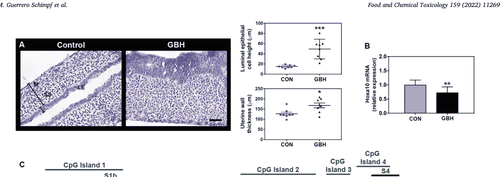
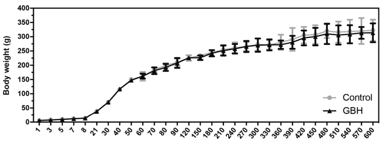
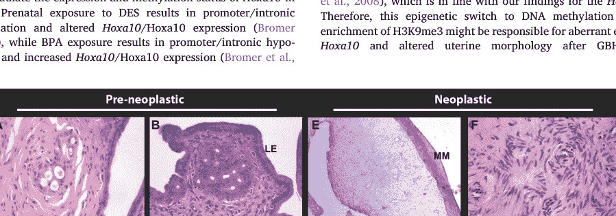
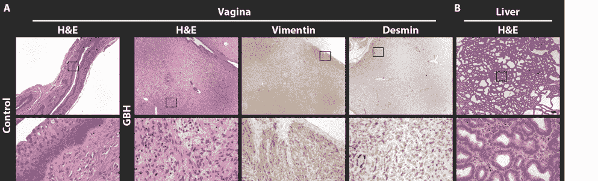

# 大鼠模型中草甘膦除草剂暴露对发育编程的影响及长期后果

# 大鼠模型中暴露于糖醇酸基脂质对发育编程的干扰及其长远影响

Marlise Guerrero Schimpf,b, María M. Milesia,b, María Victoria Zanardia,b Jorgelina Varayoua,b

* * a 沿岸健康与环境研究所 (ISAL, UNL-CONCONICET), 生物与生物科学学院，拉普托尔国立大学，圣塔菲罗，阿根廷
* b 人体化学系，生物与生物科学学院，拉普托尔国立大学，圣塔菲罗，阿根廷

## 摘要

处理编辑：Jose Luis Domingo 博士

关键词：
- Hox10a
- 表观遗传重编程
- 子宫发育
- 内分泌干扰物

糖醇酸基�hydraz类（GBHs）与对生殖器官的绪干扰作用有关。我们研究了暴露于 GBH 是否会影响子宫并产生长远后果。雌性幼从从出生后天（PND）开始接受车辆（对照组）或 GBH（每天 2 mg 糖醇酸），直到子宫对内分泌干扰高度敏感的时期。我们观察到新生雌鼠（PND8）的子宫出现增生和水肿。DNA 甲基化、形态发生基因调节区域的 H3K27me 富集以及血清孕酮（P4）下降，导致了经周期改变。暴露于 GBH 的成年雌鼠（PND 60）在出生时表现出导管增生和腺肿，阴道上皮减少，子宫发育期内 Hox10 基因表达改变及高甲基甲基化增加，且小鼠水平的 E2/P4 血清比例升高。我们认为，子宫 Hox10a 的表观遗传重编程解释了 GBH 暴露大鼠中产生长远不良影响的可能机制。

## 1. 引言

糖醇酸（N-磷酸甘酸）是市售广谱除草剂�hydraz类化合物（GBHs）的酯。目前，GBHs 因其使用以及对人类健康多样且广泛的影响引起了极大关注。糖醇酸及其代谢物已在清洁剂、土壤、水和空气等各种环境中中检测出（Bonminas et al., 2017; Primot et al., 2017; Ronco et al., 2016; Van Brogen et al., 2018），并在人类摄中发现（Riro and Onvestrous Ora and Diaz-Canal, 2017; Rodrigues and de Souza, 2016）。

如今，糖醇酸的致癌潜力存在争议。国际癌症研究（ARC，世界卫生组织）认定糖醇酸为“可能的人致癌物”（2A）。这是基于对胰腺癌和胰腺岛细胞腺癌、血管瘤、管状癌和胃癌风险的病例流行病学研究的有限证据，但在其基因毒性和氧化应激方面有有力证据（ARC, 2017）。然而，欧洲食品安全局（EFSA）认定糖醇酸“不太可能对人类产生致癌危害”（EFSA, 2015）。美国环保署（EPA）审查了

缩写：BPA，双酚A；DE，二乙乙烯；E2，17β-乙雌醇；EDC，内分泌干扰物；EPA，欧洲食品安全局；Er, P4，孕酮；PND，出生后天；U. EPA，美国环保署。

a 沿岸健康与环境研究所 (ISAL), 生物与生物科学学院，拉普托尔国立大学，Sacramento 街 24 号，3000，阿根廷。

电子邮箱：mgs234@med.unl.ar (M. Guerrero Schimpf)

内分泌干扰物（EDCs）的暴露会干扰不可逆的生殖发育。许多研究表明，暴露于 EDC 会导致生殖道、形态、激素水平和基因表达的永久改变，从而引发疾病和癌症（Palmer et al., 2006; Schug et al., 2012; Wang et al., 2012）。

草甘膦的潜力被认为“很可能对人类致癌”（U.S. EPA, 2018）。致癌性的差异归因于草甘膦形式的毒性（Porter et al., 2016; Tanaka et al., 2017）。这些数据表明，草甘膦介导的解毒不足以消除人类对草甘膦的暴露（Vanderberg et al., 2019）。

体外研究显示草甘膦促进了内分泌干扰物（Savage et al., 2017; Thongsaka et al., 2013）和雌激素受体（ERα）（Sritana et al., 2018）。同样，通过体外模型评估雌激素活性，我们证明草甘膦能够减轻大鼠雌激素敏感基因的表达（Varsay et al., 2017）。我们还显示草甘膦暴露影响雄雌鼠的青春期性成熟，导致 17β-雌酮的改变（Gomez et al., 2020）。啮齿类相关的效应包括睾功能和形态的改变（Cassier-Meyer, 2014; Dellegrave et al., 2017）、精子发生干扰（Dantario et al., 2010）以及生殖功能障碍（Ingram et al., 2018; Gomez et al., 2019; Levisz et al., 2017）。

## 2. 材料与方法

### 2.1. 化学品

本研究使用的 GBH 是水溶性的 Roundup Full，含有 66.2% 的草甘膦硫酸盐，相当于 54% 的草甘膦酸。与许多 GBHs 一样，该配方含有除草剂标签上未指定的助剂。

### 2.2. 动物

本研究使用的所有方案均已获得拉普托尔国立大学生物与生物科学学院（UNL, San Fe, Argentina）机构伦理委员会以及美国国家科学学院实验室动物伦理委员会的批准。

Wistar-Dawley 大鼠在拉普托尔国立大学生物与生物科学学院（UNL, San Fe, Argentina）的人体生理系饲养。研究使用的大鼠（25±30天，体重200±20 g）被随机分为五组：
- 1）接受生理盐水的对照组（n=8）
- 2）接受生理盐水稀释 GBH 的组（每天2 mg/kg体重）。

改变调节分的环境分子的表达（Guerero Schimp et al., 2017）。此外，通过对去卵巢小鼠进行雌激素妊娠治疗，我们检测到 GBH 暴露增强了子宫对 E2 的敏感性（Guerero Schimp et al., 2017）。我们认为这些效应会导致后期生活中子宫上皮的改变。通过使用相同的暴露模型，本研究旨在评估：
- i) 使用 GBH 作为宫内关键分子对子宫发育的短期影响；
- ii) 它对雌激素和卵巢类固醇水平作为肿瘤形成可能促进因素的影响；
- iii) 对老年大鼠妊娠早产/肿瘤性病变发生率的长远不良影响。

幼鼠来自单饲养的定时妊娠大鼠。出生后（PND0），对幼鼠进行体重并由母体交叉喂养以确保使用同胎（Guerero Schimp et al., 2017）。然后每个窝被分配到以下组之一：
- 1）接受生理盐水的对照组（n=8）
- 2）接受生理盐水稀释 GBH 的组（每天2 mg/kg体重）。

动物从 48 小时到 PND8 通过颈部凹陷给药。每天通过口胃胃给药处理溶液，浓度取决于草甘膦酸浓度和幼鼠体重。本研究使用的 GBH 处于相当于以往研究报告的效应数量级（U.S. EPA, 2017）。此外，使用的剂量处于我国不同环境中发现的草甘膦残留水平数量级，例如：土壤、开放水库水和在……生长的测试大豆（Testimon et al., 2013; Primonus et al., 2017）。

Hox10 是 Hox 簇的成员，在子宫和内膜中高水平且动态表达。Hox10 对于子宫发育过程中平肌层的良好组织和生长是必要的（Everington et al., 2013），并在内分泌干扰物下对子宫发育至关重要（Dallegrave et al., 2015）。GBH 的表达与子宫发育不全缺陷有关（Block et al., 2000）。我们之前显示 GBH 暴露会影响出生后的第一阶段

部分雌性幼鼠在治疗结束后 24 小时接受暴露（PND8，每组 24 只幼鼠），我们用于

### 2.4. 反向转录与定量 PCR (qPCR)

在 PND98 收集子宫样本（每组 n=8），使用 RT (Trizogen；阿根廷，布宜诺斯艾斯）提取并按照制造商说明进行提取。使用 NanoDrop (Thermo Fisher) 对总 RNA (1 μg) 进行定量。发表于 Guerrero 等人 (2016)。为了分析总 Hox10 mRNA 的相对表达水平，采用了 qPCR 实验方案。所使用的扩增引物如下：Hox10 F 5'-GAACTTCAGCAGCCTCACTTC-GC-3'；以及 Rh19（核糖体蛋白 1, 19，管家基因）：F5'-AGCTGTAGTGCTCTTCTC-3' 和 R5'-TGAGCAGCTCTTC-3。每个引物（200 nM）共 5 μL，配合 10 μL SYBR Green 混合液 (SolBios Bio-Nica, Biocorta，阿根廷)，最终体积为 20 μL。包括了不含 DNA 的对照组。每个样本均使用实时 PCR 循环仪 Rotor-G Que-Q (Tagen，阿根廷) 进行定量。反应持续 15 分钟，反应混合物经过连续的 95 °C 变性 5 分钟，以及 54（对于 60）°C 退火（Rpl19 为 15 分钟，在 72 °C 下延伸 15 分钟）。产物通过连续的变性循环产生。每个靶点的特异性分析使用 Rotor-G-Pure Detection 软件版本 1.7 (Qiagen，天津) 计算。靶点的相对表达水平使用标准法 (Cilos 等人，2007) 计算，并根据管家基因 (Rpl19) 的质量除以对照样本的靶质量进行归一化。

### 2.5. DNA 甲基化状态

使用甲基化响应酶 Btu1 (Cilos 等人，2008；van Kel 等人，2010) 评估了 Hox10 基因座点的甲基化状态。在 PND98 使用酚/氯仿/异丙醇提取法从子宫样本（每组 n = 8）中分离基因组 DNA。使用 SYBR III (Thermo Fisher Scientific) 生成 (1 μg) DNA，然后在 60 °C 下纯化 1 小时。消化产物使用酚/氯仿法 (England Labs，美国，贝弗利) 在 60 °C 下纯化 1 小时。消化产物使用表 1 所示的方法。进行甲基化响应扩增。如果 CpG 富集位点未甲基化，则 Btu1 不被扩增。相反，如果位点被甲基化，则 Btu1 不在甲基化位点切割，并进行三次扩增作为内部对照。

### 2.7. 染色质免疫沉淀 (ChIP-qPCR)

针对 H3K9me3 和 H3K27me3 的 ChIP 通过 qPCR 在子宫样本（每组 n = 8）的 Hox10 区域进行，在 PBS 中进行遵循之前发表的方案 (Altamano 等人，2017；Lewis 等人，2019)。组织在与 DNA 交联前用甲醛处理 15 分钟。用 125 mM 氨基酸提取并用 PBS 洗涤后，子宫在含有 1 x 蛋白 (Complete Machine, Roche Diagnostics，德国) 的 600 μL 裂解液中孵育。使用 Sonic-Cell™ VCK750 (Materials & Scientific，美国，康狄格州，新顿) 在裂解液中取样，进行 40 个循环，20 天内计算的 CpG 生成百分比超过 50%。

收集并评估了对子宫发育编程的短期影响。每组 8 只幼崽的一个角固定在 10% (v/v) 有用福尔林中并包埋在石蜡中，所有其他角在氮气中冷冻并保存在 -80 °C 一天。进行了 DNA 和 RNA 分析。小鼠饲养至 PND21，每笼四只，并在不进行处理的情况下维持以评估中长期影响。在治疗期间的每天以及治疗结束 24 小时后 (PND98) 记录每日体重。图 1 显示实验设计的示意图。

# 新生儿/产前发育

# 成年期

| 出生后天数 | 短期影响 | 中期影响 | 长期影响 |
| --- | --- | --- | --- |
| | 0 1 3 5 7 8 21 | 120 | 600 |
| 出生 | | | |
| | | | |
| | 子宫: | | | |
| | 组织: | | |
| | 断奶 | 阴道学: |
| 治疗 | 尾部 | |
| 对照 (载体) | | |
| 图 1. 雌性大鼠在暴露于 GBH (mg/kg/day) 的中长期影响的示意图。

### 2.8. 发情周期与激素分析

从 PND10 开始，收集雌性大鼠样本并按照描述的方法 (Zanardi 等人，2020) 评估发情周期状态。使用超灵敏放射免疫免疫测法 (Immotech，捷克) 测量血液中的 E2 (pg/ml) 和 P4 (ng/ml) 水平，实验持续在 20 天内。

### 2.9. 死亡

暴露于 GBH 的大鼠的甲基化状态。

### 2.10. 组织学分析

所有组织切成 5 μm 厚并用苏木精和伊红染色进行形态学检查。使用 Nikon V3 数字相机 (Olympus Optical Co., Tokyo) 记录表面 (LECH) 的图像。在显微镜下对子宫进行测量。

### 2.11. 免疫组化

α 平滑肌蛋白 (α-SMA)

### 2.12. 统计学

所有结果以均值 ± 标准误差 (SEM) 表示。使用双因素曼特尼检验或费雪精确检验计算组间差异的显著性，并使用 R 软件 (https://www.r-project.org/)。p < 0.05 显著。

# 3. 结果

## 3.1. 短期影响：子宫的改变

为了确定早期暴露于 GBH 的短期影响，我们评估了 PND8 收集的子宫形态。结果显示，GBH 暴露导致子宫壁间质层和上皮层 (LECH) 明显的形态变化 (图 A; p < 0.05)，这表明了子宫增生。我们随后试图确定这些变化是否与怀孕（子宫发育的关键）有关。

## 引物序列和 PCR 产物

| 引物 S (5' → 3') | 引物 A (5' → 3') | 大小 (bp) | 退火温度 (°C) |
|---|---|---|---|
| CpG 岛 1 位点-1A | TAGAGAGCTTCGA | GTTAGACCGCGT | 116 | 54 |
| CpG 岛 1 位点-1B | ACCTGGCCAGCTGG | GTAACCTCAGGT | 208 | 59 |
| CpG 岛 2 位点-2 | CCCTGGCCAGCAAT | CGTTCTAGCCTC | 129 | 54 |
| CpG 岛 3 位点-3 | CGAAAAAGGGAGCTGG | CTTCCCTAGATTTC | 95 | 55 |
| CpG 岛 4 位点-4 | CGGGAACTACGGCCTAG | AGAGAGCTGGATTAG | 105 | 52 |
| 内部 | ACTAAAAAGCTAAACTAA | | 25 | 60 |

总甲基化的 25% 通过亚硫酸盐转化进行测量。间质层和间质（腔层）的甲基化水平在 2 小时和 4 小时使用 50 µ/l DNA 亚硫酸盐 (Invitrogen) 和抗 H3K9me3 兔抗体 (Millipore，德国，德国) 或兔血清（非特异性抗体）进行测量。使用 Gel & PCR 纯化试剂 (IP)，按照方法所述，使用针对 Hox10 区域的引物对输入 DNA 进行扩增 14 个循环。BP 使用非特异性抗体归一化，并以样本归一化值的比值表示。

**图. 2.** 苏木精和伊红染的代表性子宫切片，展示了 ND8 期间的形态演变。(A) 腔上皮细胞厚度和子宫宽度（间质和子肌层）。线和误差棒分别表示组平均值和标准差（*p < 0.05, ** < 0.001）。(B) ND8 时子宫组织中大鼠 *Hoxa10* mRNA 水平的总表达。线和误差棒分别表示组平均值和标准差（*p < 0.05, ** < 0.001）。(C) 大鼠 *Hoxa10* 位点的基因组结构，显示了甲基化敏感性外源元件（CpG 位点），以及用于 DNA 甲基化和 ChIP 分析的位点特异性 PCR 引物；zanz2 增强子 (Zanz2)、Junmo1 和富含相互作用域 2；Mtf2，金属元素结合因子；suz12，蛋白 12；mstr1。(D) 使用甲基化敏感性亚硫酸测序对 *Hoxa10* 位点区域进行 DNA 甲基化分析。(E) *Hoxa10* 位点针对 H3K27me3 和 H3K4me3 的 ChIP 分析。标记已通过输入 DNA 控制进行归一化。对照组值赋值为 1；代表平均值

（图 2b; p < 0.01）。因此，为了确定 *Hoxa10* 位点不同残基的 DNA 甲基化和和翻译后修饰（PTMs）（H3K9me3 和 H3K27me3）的变化是否导致了在 ND2 时检测到的改变。由于鉴定的区域经历了基因甲基化，我们确定了 *Hoxa10* 的 CpG 位点和用于甲基化分析的限制区域。我们对大鼠 *Hoxa10* 位点甲基化状态的生物信息学分析识别出了四个 CpG 岛中的全部四个：**CpG 岛 1**，位于启动子和基因处；**CpG 岛 2**，跨越 -265 到 +413（相对于 *Hoxa10* 基因起始位）；**CpG 岛 3**，跨越 127 到 327（相对于 *Hoxa10* 基因起始位）；以及 **CpG 岛 4**，跨越 -527 到 +1521（相对于 TSS22），跨越外显子 1b (EIB) 启动子区域 5 和外显子 1-2 的 5’-端。在该区域内，通过 DNA 结合因子 Tf2 (Junmo1) 和富含相互作用域 2 (2) 识别出子宫增强子的多个限制位点；每个位点发现了两个（s22）。CpG 3（长 322 bp）位于外显子 1-2 的 3’-端，包含 s31 到 s34 之间的位点；CpG 4（长 336 bp）位于外显子 2，也包含甲基化敏感位点（s54）。分析 GBH 暴露后，*Hoxa10* 位点区域针对 H3K27me3 和 H3K4me3 表观遗传重编程的 DNA 甲基化。子宫组织中检测到的 DNA 甲基化分析显示，GBH 暴露组中的所有区域均处于高水平化（图 2），表明 GBH 高甲基化。在对照组中观察到低甲基化。然而，组蛋白甲基化分析显示，GBH 暴露与所有位点 H3K27me3 的减少有关（*Hoxa10* 上的 H3K9me3 和 H3K27me3 表观遗传标记）。为了确定 *Hoxa10* 位点不同残基的 DNA 甲基化和翻译后修饰（PTMs）（H3K9me3 和 H3K27me3）的变化是否导致了在 ND2 时检测到的改变。由于鉴定的区域经历了基因甲基化，我们确定了 *Hoxa10* 的 CpG 位点和用于甲基化分析的限制区域。我们对大鼠 *Hoxa10* 位点甲基化状态的生物信息学分析识别出了四个 CpG 岛中的全部四个：**CpG 岛 1**，位于启动子和基因处；**CpG 岛 2**，跨越 -265 到 +413（相对于 *Hoxa10* 基因起始位）；**CpG 岛 3**，跨越 127 到 327（相对于 *Hoxa10* 基因起始位）；以及 **CpG 岛 4**，跨越 -527 到 +1521（相对于 TSS22），跨越外显子 1b (EIB) 启动子区域 5 和外显子 1-2 的 5’-端。在该区域内，通过 DNA 结合因子 Tf2 (Junmo1) 和富含相互作用域 2 (2) 识别出子宫增强子的多个限制位点；每个位点发现了两个（s22）。CpG 3（长 322 bp）位于外显子 1-2 的 3’-端，包含 s31 到 s34 之间的位点；CpG 4（长 336 bp）位于外显子 2，也包含甲基化敏感位点（s54）。分析 GBH 暴露后，*Hoxa10* 位点区域针对 H3K27me3 和 H3K4me3 表观遗传重编程的 DNA 甲基化。子宫组织中检测到的 DNA 甲基化分析显示，GBH 暴露组中的所有区域均处于高水平化（图 2；p < 0.05），表明 GBH 高甲基化。在对照组中观察到低甲基化。然而，组蛋白甲基化分析显示，GBH 暴露与所有位点 H3K27me3 的减少有关（*Hoxa10* 上的 H3K9me3 和 H3K27me3 表观遗传标记）。

## 3.2. 中期

（GBH 暴露与所有位点 H3K27me3 的减少有关（*Hoxa10* 上的 H3K9me3 和 H3K27me3 表观遗传标记）。

## 3.2. 中期

GBH 暴露与所有位点 H3K27me3 的减少有关（*Hoxa10* 上的 H3K9me3 和 H3K27me3 表观遗传标记）。

## 3.2. 中期

GBH 暴露与所有位点 H3K27me3 的减少有关（*Hoxa10* 上的 H3K9me3 和 H3K27me3 表观遗传标记）。

## 3.2. 中期

GBH 暴露与所有位点 H3K27me3 的减少有关（*Hoxa10* 上的 H3K9me3 和 H3K27me3 表观遗传标记）。

## 3.2. 中期

GBH 暴露与所有位点 H3K27me3 的减少有关（*Hoxa10* 上的 H3K9me3 和 H3K27me3 表观遗传标记）。

## 3.2. 中期

GBH 暴露与所有位点 H3K27me3 的减少有关（*Hoxa10* 上的 H3K9me3 和 H3K27me3 表观遗传标记）。

## 3.2. 中期

GBH 暴露与所有位点 H3K27me3 的减少有关（*Hoxa10* 上的 H3K9me3 和 H3K27me3 表观遗传标记）。

## 3.2. 中期

GBH 暴露与所有位点 H3K27me3 的减少有关（*Hoxa10* 上的 H3K9me3 和 H3K27me3 表观遗传标记）。

## 3.2. 中期

GBH 暴露与所有位点 H3K27me3 的减少有关（*Hoxa10* 上的 H3K9me3 和 H3K27me3 表观遗传标记）。

## 3.2. 中期

GBH 暴露与所有位点 H3K27me3 的减少有关（*Hoxa10* 上的 H3K9me3 和 H3K27me3 表观遗传标记）。

## 3.2. 中期

GBH 暴露与所有位点 H3K27me3 的减少有关（*Hoxa10* 上的 H3K9me3 和 H3K27me3 表观遗传标记）。

## 3.2. 中期

GBH 暴露与所有位点 H3K27me3 的减少有关（*Hoxa10* 上的 H3K9me3 和 H3K27me3 表观遗传标记）。

## 3.2. 中期

GBH 暴露与所有位点 H3K27me3 的减少有关（*Hoxa10* 上的 H3K9me3 和 H3K27me3 表观遗传标记）。

## 3.2. 中期

GBH 暴露与所有位点 H3K27me3 的减少有关（*Hoxa10* 上的 H3K9me3 和 H3K27me3 表观遗传标记）。

## 3.2. 中期

GBH 暴露与所有位点 H3K27me3 的减少有关（*Hoxa10* 上的 H3K9me3 和 H3K27me3 表观遗传标记）。

## 3.2. 中期

GBH 暴露与所有位点 H3K27me3 的减少有关（*Hoxa10* 上的 H3K9me3 和 H3K27me3 表观遗传标记）。

## 3.2. 中期

GBH 暴露与所有位点 H3K27me3 的减少有关（*Hoxa10* 上的 H3K9me3 和 H3K27me3 表观遗传标记）。

## 3.2. 中期

GBH 暴露与所有位点 H3K27me3 的减少有关（*Hoxa10* 上的 H3K9me3 和 H3K27me3 表观遗传标记）。

## 3.2. 中期

GBH 暴露与所有位点 H3K27me3 的减少有关（*Hoxa10* 上的 H3K9me3 和 H3K27me3 表观遗传标记）。

## 3.2. 中期

GBH 暴露与所有位点 H3K27me3 的减少有关（*Hoxa10* 上的 H3K9me3 和 H3K27me3 表观遗传标记）。

## 3.2. 中期

GBH 暴露与所有位点 H3K27me3 的减少有关（*Hoxa10* 上的 H3K9me3 和 H3K27me3 表观遗传标记）。

## 3.2. 中期

GBH 暴露与所有位点 H3K27me3 的减少有关（*Hoxa10* 上的 H3K9me3 和 H3K27me3 表观遗传标记）。

## 3.2. 中期

GBH 暴露与所有位点 H3K27me3 的减少有关（*Hoxa10* 上的 H3K9me3 和 H3K27me3 表观遗传标记）。

## 3.2. 中期

GBH 暴露与所有位点 H3K27me3 的减少有关（*Hoxa10* 上的 H3K9me3 和 H3K27me3 表观遗传标记）。

## 3.2. 中期

GBH 暴露与所有位点 H3K27me3 的减少有关（*Hoxa10* 上的 H3K9me3 和 H3K27me3 表观遗传标记）。

## 3.2. 中期

GBH 暴露与所有位点 H3K27me3 的减少有关（*Hoxa10* 上的 H3K9me3 和 H3K27me3 表观遗传标记）。

## 3.2. 中期

GBH 暴露与所有位点 H3K27me3 的减少有关（*Hoxa10* 上的 H3K9me3 和 H3K27me3 表观遗传标记）。

## 3.2. 中期

GBH 暴露与所有位点 H3K27me3 的减少有关（*Hoxa10* 上的 H3K9me3 和 H3K27me3 表观遗传标记）。

## 3.2. 中期

GBH 暴露与所有位点 H3K27me3 的减少有关（*Hoxa10* 上的 H3K9me3 和 H3K27me3 表观遗传标记）。

## 3.2. 中期

GBH 暴露与所有位点 H3K27me3 的减少有关（*Hoxa10* 上的 H3K9me3 和 H3K27me3 表观遗传标记）。

## 3.2. 中期

GBH 暴露与所有位点 H3K27me3 的减少有关（*Hoxa10* 上的 H3K9me3 和 H3K27me3 表观遗传标记）。

## 3.2. 中期

GBH 暴露与所有位点 H3K27me3 的减少有关（*Hoxa10* 上的 H3K9me3 和 H3K27me3 表观遗传标记）。

## 3.2. 中期

GBH 暴露与所有位点 H3K27me3 的减少有关（*Hoxa10* 上的 H3K9me3 和 H3K27me3 表观遗传标记）。

## 3.2. 中期

GBH 暴露与所有位点 H3K27me3 的减少有关（*Hoxa10* 上的 H3K9me3 和 H3K27me3 表观遗传标记）。

## 3.2. 中期

GBH 暴露与所有位点 H3K27me3 的减少有关（*Hoxa10* 上的 H3K9me3 和 H3K27me3 表观遗传标记）。

## 3.2. 中期

GBH 暴露与所有位点 H3K27me3 的减少有关（*Hoxa10* 上的 H3K9me3 和 H3K27me3 表观遗传标记）。

## 3.2. 中期

GBH 暴露与所有位点 H3K27me3 的减少有关（*Hoxa10* 上的 H3K9me3 和 H3K27me3 表观遗传标记）。

## 3.2. 中期

GBH 暴露与所有位点 H3K27me3 的减少有关（*Hoxa10* 上的 H3K9me3 和 H3K27me3 表观遗传标记）。

## 3.2. 中期

GBH 暴露与所有位点 H3K27me3 的减少有关（*Hoxa10* 上的 H3K9me3 和 H3K27me3 表观遗传标记）。

## 3.2. 中期

GBH 暴露与所有位点 H3K27me3 的减少有关（*Hoxa10* 上的 H3K9me3 和 H3K27me3 表观遗传标记）。

## 3.2. 中期

GBH 暴露与所有位点 H3K27me3 的减少有关（*Hoxa10* 上的 H3K9333 H3K27.3 观遗传标记）。

  3.2. 

GB   . 位点 3 27 3 的减少 （*H 10    H3   3 和 H3 27.3 表观遗传标记）。

## 3.2. 中期

GBH 暴露与所有位点 H3K27me3 的减少有关（*Hoxa10* 上的 H3K9me3 和 H3K27me3 表观遗传标记）。

## 3.2. 中期

GBH 暴露与所有位点 H3K27me3 的减少有关（*Hoxa10* 上的 H3K9me3 和 H3K27me3 表观遗传标记）。

## 3.2. 中期

GBH 暴露与所有位点 H3K27me3 的减少有关（*Hoxa10* 上的 H3K9me3 和 H3K27me3 表观遗传标记）。

## 3.2. 中期

GBH 暴露与所有位点 H3K27me3 的减少有关（*Hoxa10* 上的 H3K9me3 和 H3K27me3 表观遗传标记）。

## 3.2. 中期

GBH 暴露与所有位点 H3K27me3 的减少有关（*Hoxa10* 上的 H3K9me3 和 H3K27me3 表观遗传标记）。

## 3.2. 中期

GBH 暴露与所有位点 H3K27me3 的减少有关（*Hoxa10* 上的 H3K9me3 和 H3K27me3 表观遗传标记）。

## 3.2. 中期

GBH 暴露与所有位点 H3K27me3 的减少有关（*Hoxa10* 上的 H3K9me3 和 H3K27me3 表观遗传标记）。

## 3.2. 中期

GBH 暴露与所有位点 H3K27me3 的减少有关（*Hoxa10* 上的 H3K9me3 和 H3K27me3 表观遗传标记）。

## 3.2. 中期

GBH 暴露与所有位点 H3K27me3 的减少有关（*Hoxa10* 上的 H3K9me3 和 H3K27me3 表观遗传标记）。

## 3.2. 中期

GBH 暴露与所有位点 H3K27me3 的减少有关（*Hoxa10* 上的 H3K9me3 和 H3K27me3 表观遗传标记）。

## 3.2. 中期

GBH 暴露与所有位点 H3K27me3 的减少有关（*Hoxa10* 上的 H3K9me3 和 H3K27me3 表观遗传标记）。

## 3.2. 中期

GBH 暴露与所有位点 H3K27me3 的减少有关（*Hoxa10* 上的 H3K9me3 和 H3K27me3 表观遗传标记）。

## 3.2. 中期

GBH 暴露与所有位点 H3K27me3 的减少有关（*Hoxa10* 上的 H3K9me3 和 H3K27me3 表观遗传标记）。

## 3.2. 中期

GBH 暴露与所有位点 H3K27me3 的减少有关（*Hoxa10* 上的 H3K9me3 和 H3K27me3 表观遗传标记）。

## 3.2. 中期

GBH 暴露与所有位点 H3K27me3 的减少有关（*Hoxa10* 上的 H3K9me3 和 H3K27me3 表观遗传标记）。

### M. Guerrero Schimpf 等人

**图 3.** 暴露于载体（对照组）或 GBH 的雌性鼠生长曲线。数据表示平均值 ± 标准误差 (SEM)。

表 3
出生后暴露于 GBH 的老年大鼠子宫癌前病变和肿瘤病变的发生率。
| | 对照组 | GBH |
|---|---|---|
| 带有子腺的腺体 | 4/26 (15%) | 10/25 (40%) |
| 子宫腺肌症 | 0/26 (0%) | 1/25 (4%) |
| 非典型子宫内增生 | 1/26 (4%) | 2/25 (8%) |
| 平滑肌瘤 | 0/26 (0%) | 4/25 (16%) |
| 病变总数 | 5/26 (19%) | 14/25 (56%) |

2010)，表明 DNA 甲基化的变化是内分泌干扰的表观遗传机制。

组蛋白翻译后修饰 (PTMs) 通过染色质重塑或通过有助于调节因子的调节来调节基因表达。染色质标记与转录沉默有关（Zhang 等人，2015）。若干报告表明两种组蛋白标记是互斥的，且一些 ChIP 测序研究显示 H3K9me3 可参与基因发育（Liu 等人，2011；Hawkins 等人，2010）。鉴于两种组蛋白标记都与基因表现（表达）有关，有研究认为它们可能相互作用，作为细胞命运的调节因子。在这项研究中，我们发现 GBH 组 H3K27me3 的异常丢失与基因表达相关。在 GBH 暴露后，Hox10a 位点内的所有位点的 H3K27me3 都被删除。有趣的是，子宫上皮和子腺中的某些位点保持正常。正常且伴随的背景产生 DNA 甲基化或抑制性 H3K27me3 以及 DNA 修饰。因此，在 Hox10a 位点中，DNA 甲基化的丢失和 H3K9me3 的富集可能导致 GBH 暴露后 Hox10a 的异常表达和子宫形态的改变。

GBH 暴露引起的形态变化可能是通过 Hox10 位点的表观遗传重编程介导的。我们检测到 GBH 诱导的表观遗传变化，包括 DNA 超甲基化和 Hox10 调节区域 H3K27me3 的减少，导致发育不良。

Hox10a CpG 岛的新 DNA 甲基化是基因沉默的稳定表观遗传标记（Ceder 和 Bergman，2009）。

与我们的结果一致，发育暴露于 GBH 影响了
* p = 0.064, p < 0.01，双侧 Fisher 检验
围产期暴露于 GBH 导致启动子/内含子高甲基化和表达增加，以及 Hox10a/Hox10 表达增加（Bromer 等人，2009），而启动子/内含子低甲基化的 BPA 暴露增加了 Hox10a/Hox10 表达（Bromer 等人）。

**图 4.** 出生第一周暴露于 GBH 后雌性小鼠（20个月）的癌前病变和肿瘤病变。子宫切片用苏木精和伊红染色（A-F）以及 α-SMA（G 和 H）染色。且 B 为带有子腺的。（C 和 D）腔上皮和腺上皮的非典型子宫内膜增生（星号）。（E-H）子宫平滑肌瘤。肿瘤细胞 α-SMA 免疫染色阳性。LE，腔上皮；GE，腺上皮；MM，子宫肌。比例尺：(A-B 和 F) 50 μm；(D-E 和 G) 100 μm；(C) 200 μm。

### 阴道
### B
### 肝
### H&E
### Vimentin
### Desmin
### H&E
### 对照组
### GBH

图 5. 在出生第一周暴露于 GBH 后，老年雌鼠中观察到其他肿瘤病变。（A）阴道肉肉瘤。阴道切片用苏木精和伊红 (H&E)、vimentin 和 desmin 染色。肿瘤细胞 vimentin 阳性，但 desmin 阴性。（B）肝内胆管癌。病变用 H&E 染色。底部图像是上方面板的放大图。比例尺：上方 100 μm；下方 50 μm。

### 表 4
老年大鼠观察到的癌前病变和肿瘤病变总结
| 子宫 | 阴道 | 生殖道 | 病变总数 |
|---|---|---|---|
| 病变发生率 | p 值 | 病变发生率 | p 值 | 病变发生率 | p 值 | 病变发生率 | p 值 |
| 对照组 (n=26) | 1/26 (4%) | 0.3497 | 0/26 (0%) | 0.0253 | 0.0993 | 1/26 (4%) | 0.4996 |
| GBH 组 (n=25) | | 2/25 (8%) | | 6/25 (24%) | |

* 包括非典型增生和肿瘤病变
* 包括肝内胆管癌

所有值均通过双侧 Fisher 检验。重要的是，老年啮动物具有 Sox2（sex 2 抑制因子）和 E2（sex 2 增强因子）的多组蛋白复合物 2 (PRC2) 注释位点，其介导 H3K27 甲基化并在基因表达的表观遗传调节中起着重要作用。DNA 甲基化的干扰导致 Hox10 被沉默（Fischer 等人，2011），此外，E2 在子宫息肉、腺瘤以及癌中发生高甲基化和下调（Fischer 等人，2013；Kui 等人，2016）。因此，暴露对 Hox10 位点的重编程可能导致基因表达的永久性改变，从而在晚年引起子宫疾病或恶性病变。

雌激素水平的变化，暴露于甘糖膦（glyphosate）或 GBH (Roundup) (Mansery 等人，2019)。与我们结果的差异可能归于样本量、不同物种和暴露持续时间。Mansery 等人 (2019) 发现 GBH 组雌鼠 E2 水平较高，这与我们的结果一致。然而，由于样本量小，无法进行统计学评估。此外，我们最近报道，雌性在妊娠和哺乳期暴露于甘糖膦或 GBH 会增加各阶段的 E2 血清水平（Lorenz 等人，2020），并损害卵巢功能和性周期。这项研究将阐明 GBH 暴露后 E2 和 P4 血清水平的机制。

## 4.2. 在 GBH 内分泌模式后 E2/P4 比例增加中观察到的激素失调

雌激素在生殖组织激素依赖功能的发病中起着关键作用。在啮动物中，激素失调导致的 E2/P4 比例持续增加被认为是激素性癌症的风险因素（Okono 等人，2010；Yoon 等人，2010）。为了评估 GBH 的作用，我们试图评估年轻雌鼠各阶段的卵巢类固醇水平。暴露于 GBH 的动物在 4 月大显示周期异常，特征是雌期延长和发卵期缩短。E2 和 P4 的血清浓度导致 E2/P4 比例增加，产生类似于高 E2 的状态。我们的发现与 Mansery 等人 (2019) 一致，他们在一项初步研究中报告没有

## 4.3. 发育暴露于 GBH 增加易感性

如前所述， EDC 的发育重编程和激素环境的变化可能促进晚期疾病。根据在暴露于 GBH 的雌鼠中观察到的发育和内分泌干扰影响，我们评估了其对老年雌鼠肿瘤或肿瘤病变发育的影响。总存活率在对照组和 GBH 组之间没有显著差异。暴露于 GBH 的子宫组织病学显示激素依赖性病变的发生率增加。这些病变包括良性、癌前和恶性肿瘤，以及肌瘤、腺体、子宫内增生和子宫平滑肌瘤。根据我们的结果，暴露于 EDC 与子宫发育风险的增加有关，这在出生前暴露于 DES (Newbold 等人，1990) 和 BPA (Bowa 等人，2007) 的老年鼠子宫中被检测到。有趣的是，暴露于甘糖膦的雄鼠子宫中也报告腺增生发生率增加。总之，我们的发现表明，发育暴露于 GBH 与激素干扰性肿瘤的易感性增加有关。

如所述，在本研究中我们使用了甘糖膦配剂（Roundup），含有活性成分。其显示比 GBH 更强。

## 5. 结论

总结来说，早期暴露于 GBH 干扰了 Hox10 的发育程序和 E2/P4 比例。需要进一步的研究确定人类和动物暴露的潜在机制。

# 参考文献

Alder, A., Lavish, F., Havens, A., Eboes, P., Sinha, S., Chandrasekhar, A., et al. 2010. 甘糖膦和配剂干扰母体妊娠暴露后后代的发育。Tox. 185(3), 197-203. https://doi.org/10.1016/j.tox.2009.08.048

与我们的结果一致，研究报道暴露于甘糖膦（活性成分）GBH 会促进小鼠不同类型肿瘤的发展。Zanardi 等人 (2020) 的最新报告得出结论，这些足以在实验模型中建立与甘糖膦的联系（Potterio, 2020）。显示甘糖膦会导致小鼠的脂肪瘤、肝癌和肾脏肿瘤，以及皮肤、肾上腺肿瘤。

内分泌学与胆道树病学。J. Gastroenterol. 12 (2022), 357–364. https://doi.org/10.1016/j.jastro.2022.12.355

Andersen, M. E., Sker, J., Rahm, M. A., Luque, E., 等，2015。在高浓度苯二甲酸酯和代谢改变的雄性大鼠中发现内分泌干扰物。Mol. Cell. Endocrol. 401, 111–119. https://doi.org/10.1016/j.ymene.2015.03.014

Bahl, S.H., Oghue, S.M., 2016. 苯二甲酸酯对人类健康的环境暴露、毒性关注和潜在风险。Vol. Environ. Sci. Ind. Res. 32(4), 443–450.

Bartol, F.L., Wiley, A.A., Basagel, C.A., 2006. 超声暴露和内分泌干扰影响。Environ. Reproductive Health. 51(2), 215–220. https://doi.org/10.1016/j.envrepro.2005.09.012

Benjamink, C., 2016. 美国及全球苯二甲酸酯的使用趋势。Environ. Sci. Ind. Res. 28(1), 13–28. https://doi.org/10.1016/j.esir.2015.12.0316

Gastiano, P.M., Durando, D., Mello, M.M., Loreto, V., Vagasso, J., 等，2020. 通过雌激素受体途径苯二甲酸酯诱导的人类胎睾细胞间充质转化相关变化。

Gillenas, G., Wassermann, F., Shaffer, M.R., Rahm, J., Zhang, L., Zhang, S., 等，2017。苯二甲酸酯暴露对大鼠繁殖功能的影响。Environ. Reproductive Health. 18(1), 7–12. https://doi.org/10.1186/s12937-017-0140-9

Gonzalez, A.L., Altimari, G.T., Boulezias, J.V., De-Muz-I, M., Mann, K.S., 2019. 发育期暴露于苯二甲酸酯混合物激活大鼠睾丸中的雌激素受体α。Chem Res. Endocrol. 118, 107933. https://doi.org/10.1016/j.chemchem.2019.107933

Guerrero Sánchez, M., Mello, M.M., Ingaramo, P., Luque, E., Evararaj, Y., 2017. 苯二甲酸酯类暴露增强大鼠精子中的内分泌毒性。Endocr. 229(2), 197–213. https://doi.org/10.1097/EDE.000000007

Bork, K., Argaras, A., Taylor, P. J., Wang, H., 2010. 邻苯二甲酸酯 (DEHP) 对大鼠睾丸精子发生和雄激素基因表达的影响。Fertil. 119(4), 1109–1118. https://doi.org/10.1016/j.fertil.2010.0436

Bao, J., Wang, Y., Li, J., Lee, M., 2017. 邻苯二甲酸酯和 GAMP 对大鼠睾丸生育和基因表达的影响。Tox. 386(1), 91–106. https://doi.org/10.1016/j.tox.2017.0312

Hossini, S., Kim, J., Lauer, R., Pelizzella, M., 等，2010。苯二甲酸酯诱导的人多能干细胞表观遗传变化。Cell Sci. 12, 805–810. https://doi.org/10.1016/j.cellsci.2010.0312

Hover, N. R., Hyer, M., Pflumer, R., Davis, B., Beville, C., 等，2011。苯二甲酸酯暴露对小鼠精子发生的影响。Reprod. Tox. 25(6), 495–500. https://doi.org/10.1007/s00240

Jang, Y., Ng, S. H., Lee, S. J., Kim, D., 2010。邻苯二甲酸酯导致大鼠雄激素基因表达改变。Fertil. 24 (7), 2273–2280. https://doi.org/10.1016/j.fert.2010.0416

Kajimura, T., Hamada, Y., Tamura, H., Horikawa, K., 2006. 邻苯二甲酸酯诱导的大鼠 DNA 甲基化。Dev. 20 (9), 1219–1226.

Kassa-Mayer, E., Cress, S., Gerasimov, G., De-Lander, M., 2014. 急性暴露苯二甲酸酯混合物改变睾丸睾酮水平。Reprod. Tox. 109(1), 103–110.

Kozik, C., Sivukov, A., Kopolak, J., 2007. DNA 含量的定量评估：用于 DNA 分析的方法比较。Ann. Mol. Biol. 38(1), 14–19.

Larab, E., Martinez, M., Setio, A., Andrade, J., Danishberg, L., 等，2008。DEHP 暴露对精子发生的影响。Tox. 89 (1), 665–679. https://doi.org/10.1016/j.tox.2007.0911

Li, Y., Wang, Y., Zhang, Y., Wang, J., 2018。使用快速 LC-MS 对 DEHP、GAMP 和苯二甲酸酯混合物进行评估。Environ. Sci. 65, 43–54.

Lu, J., Miller, M.B., Taylor, L., 2011。HOXA10 响应苯二甲酸酯诱导的睾丸雄激素变化。Tox. 95(3), 1133–1136.

Fischer, G.-C., Yan, E., Ingez, L., Hotter, H., Heiniman, S., Zhang, X., 等，2008。PC12 细胞中多态性区域和 DNA 甲基化的频繁测序。J. Mol. Sci. 105(35), 12979–12984.

Ingaramo, P. V., Mello, M.M., Guerrero Sánchez, M., Mello-De-Torres, L., Ruiz-Méndez, 等，2017。苯二甲酸酯混合物暴露改变精子基因表达。Hum Reprod. 32, 100–107. https://doi.org/10.1016/j.humrep.2017.10007

Ingaramo, P. V., Mello, M.M., Guerrero Sánchez, M., Luque, E., Skinner, M., 2019。苯二甲酸酯诱导的表观遗传遗传和精子发生评估。Environ. Sci. Tox. 91(1), 1–10.

Kass, J. P., Ramshankar, S., Taylor, H., 2016。特发性男性不不症患者的苯二甲酸酯暴露健康评估。Reprod. Tox. 53(3), 455–466. https://doi.org/10.1187/s1935-0891(16)001112

Lesort, L., Rosso, K., White, G., Griffiths, M., Kahn, S., 等，2016。小鼠精子功能的演变。Nucleic Acids Res. 44 (1), 126–132. https://doi.org/10.1093/nar/gkw628 (访问于2024年5月22日)。

EPA (美国环保署). 2009。苯二甲酸酯暴露的风险评估：食品和饮用水中苯二甲酸酯结果总结。

EPA. 2018。苯二甲酸酯暴露指南：通用关注评估：苯二甲酸酯对人类健康和环境的关注。

Message, R., Phedrinos, A., Block, J., Vackari, L., 等，2019。二苯二甲酸酯暴露对男性生殖道的长期影响。

Loreto, V., Mello, M.M., Schen, G., Evararaj, Y., Ingaramo, P., 2019。苯二甲酸酯混合物对雌激素受体α的激活。

Miley, M., Lorena, V., Belodomin, P., Vama, S., Vanyov, J., Lueh, E. (2019)。草甘膦基质暴露对二代后代的不良影响。Arch. Toxicol. 93(2), 361–370. https://doi.org/10.1007/s00204-01825207

Mifelli, M.A., Mali, M.F., Finn, K., Lueh, E., 2018。大鼠草甘膦的生殖毒性。Mol. Biol. 64(3), 535–543. https://doi.org/10.1007/s00444-0182

Noor, M., Capelli, A., Dalgado, E., Meis, M., Romano-Gando, J., 2017。草甘膦和其他除草剂暴露导致男性后代的内分泌干扰。Environ. Sci. Pollut. 223. https://doi.org/10.1016/j.envpol.2017.0312

Newbold, R.R., Beachem, R.C., Macloon, J., (2019)。暴露于草甘膦的小鼠子宫内腺癌。Reprod. Tox.

Newbold, R.R., Vanyov, J., Panella-Davis, E., (2007)。非选择性除草剂暴露对小鼠生殖健康的长期影响。Reprod. Tox. 199(3), 277–280. https://doi.org/10.1016/j.fertox.2007.0413

Newbold, R.R., Vanyov, J., Panella-Davis, E. (2009)。草甘膦的产前暴露对后代的不良影响。Health Public Pers. 117(6), 879–885. https://doi.org/10.1080/136973093863

Oladiran, A., 2017。草甘膦诱导的大鼠生殖毒性评估。Environ. Sci. 307. https://doi.org/10.1016/j.env.2017.0504

Patkar, N., Hach, A.E., Tino-Rostagno, S., Watkins, M. (2006)。草甘膦的产前发育毒性和癌症风险。Biomarkers. 115(5), 598–605. https://doi.org/10.1016/j.ymb.2005.09018

Polcini, J., Artmert, A.B., Beckley, G., Riley, M., 等。(2016)。国际癌症机构(IARC)和全球食品安全机构(EPA)对草甘膦的评估。J. Environ. Health. 106(8), 771–779. https://doi.org/10.1289/eh06-0176

Rendon-Ojin, J., Ruiz-Damil, Carraz, J. (2017)。墨西哥饮用水、食品和尿液中的草甘膦残留：一项调查。Int. J. Environ. Res. Public Health. 14(12), 2410. https://doi.org/10.3390/ijerph14122410

Rodrigues, N. S., Souza, A. A., Berardi, M.M., Pinto, P., Olojo, A.A. (2018)。乳汁和尿液中的草甘膦及残留评估。J. Sci. Anal. Clam. Anal. 45(3), 723–738. https://doi.org/10.1007/s12899-01719409

Romano, R. B., Silva, L. G. S. (2016)。草甘膦及草甘膦除草剂产前暴露导致男性后代的内分泌干扰。Environ. Monitor. Assess. 88(1), 1–13. https://doi.org/10.1016/j.chemma.2016.0324

Schugg, T.T., Janissick, A., Blijm, H., Heidberg, J.J. (2011)。大鼠草甘膦的内分泌干扰影响。Toxicol. 228(1-2), 204–215. https://doi.org/10.1016/j.toxicol.2010.08018

Seraini, G.C., Elame, E., Message, R., Defarge, N., Malatera, M., 等。(2014)。苯二甲酸酯诱导的精子发生影响。Environ. Sci. Eur. 26 (1), 1–17. https://doi.org/10.1186/s12302

Spencer, T., Eadie, K., Maklin, J. (2012)。响应苯二甲酸酯诱导的睾丸雄激素变化的HOXA10表达。Dev. Mol. 254(1-2), 10–13. https://doi.org/10.1016/j.devmol.2011.093

Strita, N., Sthivasarayanan, J., Jayaspin, S., Thanthakumar, A., Sayatsavar, J. (2018)。通过非基因信号通路草甘膦诱导的雌激素受体α活性。Chem. Biol. 118, 595–607. https://doi.org/10.1016/j.chembio.2018.12

Tang, Y., So, M. (2007)。发育中的表观遗传重编程和印记。Dev. Endocr. 8 (2), 173–182.

Tanimaka, N., Takita, M., Panella-Davis, E. (2014)。苯二甲酸酯混合物对精子质量的影响。Sperm. 119(4), 295–300. https://doi.org/10.1187/s10633-01425

Vigzel, J., Bopliazos, V., Kass, L. R., Ramos, J., Muñoz-de Toro, M., Lueh, E.H., 等。(2015)。草甘膦暴露及其对大鼠生殖发育的影响。Tox. 312, 101–114. https://doi.org/10.1016/j.tox.2015.0106

