# 分布式语言（Benjamins Current Topics）

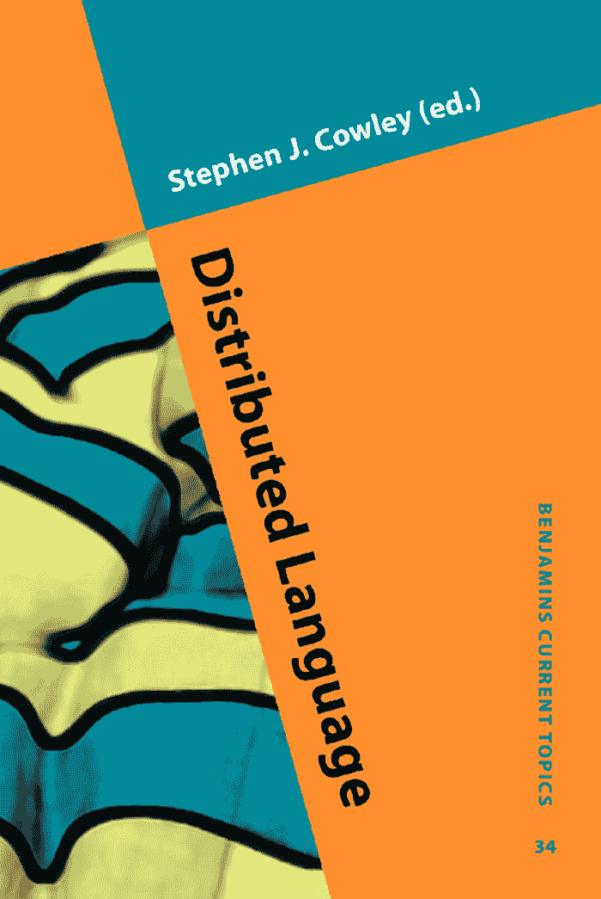

知名期刊的特刊往往仅在这些期刊读者的范围内流传。对于 Benjamins Current Topics 系列，我们从各种期刊中选择了若干特刊，包含了突出的研究主题，旨在为具有主题价值的内容寻找新的读者群，并通过书籍的形式将这些材料带给更广泛的读者。

了解该系列出版的所有书籍，请参阅`http://benjamins.com/catalog/bct`。

## 编者

**Stephen J. Cowley**

英国赫特福德大学

# 关于作者

Stephen Cowley 是英国赫特福德大学发展心理学的高级教师。尽管他的博士学位和职业早期从事的是语言学，但从2000年开始，他一直在心理学和认知科学领域教学。近期的实证工作关注母亲与婴儿、儿童与机器人之间的互动，以及健康紧急情况的模拟。他创立并共同领导分布式语言小组（`Distributed Language Group`），这是一个不断增长的社区，旨在通过关注引导性的、对话活动来转型语言科学，赋予人类智能以集体维度。

Timo Järälehto 自1986年起担任奥奥鲁大学心理学教授。他的基础研究领域是脑科学和心理生理学，始于20世纪60年代的脑电图问题（`CNV`、诱发电位），扩展到感觉生理学和心理物理学问题（人体微图），以及行为动物的单位。自1990年以来，他一直基于有机体-环境系统理论开发“系统心理学”框架下的心理学理论。

Veli-Matti Nurkala 拥有运动与健康科学硕士学位，目前是奥陆鲁大学的博士生（`Skilllab`）。他的博士论文研究不同阅读情境下的阅读过程，旨在建立阅读过程模型。他的其他兴趣包括运动员和学生的情绪动力学、健康水平和压力水平。

Kyösti Koskela 拥有工程学学士学位，目前在雅斯基大学攻读运动科学硕士。他目前在`Skill`公司担任实验室工程师，专门从事运动研究。他的其他领域包括运动注意、心率变异性以及熟练动作中的肌电图。

Alex Kravchenko 是贝贝加尔国立经济大学外语系主任。自20世纪80年代以来，他一直从事认知语言学工作，特别是语言的感知落地（`perceptual grounding`），以及符号学和认识论问题。

Evridiki Fioratou 目前是阿伯丁大学的研究员。近期的实证工作关注母亲与婴儿、儿童与机器人之间的互动，以及健康紧急情况的模拟。她创立并共同领导分布式语言小组（`Distributed Language Group`），这是一个不断增长的社区，旨在通过关注引导性的、对话活动来转型语言科学，赋予人类智能以集体维度。

Kristian Tylén 拥有奥尔堡大学的认知符号学硕士学位和奥尔堡大学语言学博士学位。他目前在符号学中心担任博士后职位。他的主要兴趣在于美学和认知。

Johanne Stege Philipsen 拥有奥尔堡大学的语言学和认知符号学硕士学位。她曾在语言与认知研究所担任研究助理。她的主要兴趣在社会神经科学、符号学和神经语言学领域。

Ethan Weed 拥有认知符号学硕士学位，目前是奥尔堡大学语言学系的的博士候选生。他的研究兴趣是语言、认知和实用主义。

Evelyn Tribble 是奥塔哥大学的唐纳德·科利教授。她是《环球中的认知：莎士比亚剧场中的注意与记忆》（纽约：`Palgrave`, 2011）以及（与 Nicholas Keene 合著）《认知生态与记忆历史：早期英语中的宗教、教育与记忆》（贝辛斯托：`Palgrave`, 2011）的作者。她的兴趣包括记忆研究、表演、戏剧历史以及文学与认知。

Barry van Heusden 是格宁根大学艺术、文化与媒体系的高级教师。他的研究关注文化与艺术符号学。自2008年以来，他一直领导荷兰研究项目“镜中文化”（2008–2012），旨在为4至18岁的青少年开发一套综合文化课程理论框架。

Bert H. Hodges 在范德堡大学获得心理学博士学位，现任温汉戈学院心理学教授，以及康涅狄格大学的高级科学家。他的工作是开发和应用感知-动作、社会心理学和语言的生态解释。

Sune Vork Steffensen 是丹麦南部大学语言与传播学院的副教授。他领导着整体主义、对话与组织研究小组，该小组负责研究组织背景下的认知、语言和交互性。他的研究兴趣包括（交互）语言学中的整体论、生态学和分布式理论，以及健康交互。他曾合编了书籍《语言、生态与社会：辩证法》（伦敦：`Continuum`, 2007）和《符号化的躯体：生物符号学、交互与健康》（布拉加：`Portuguese Catholic University Press`, 2010），并撰写了许多关于语言与交互的论文和章节。他还是国际分布式健康交互（`Distributed Health Interaction`）项目的协调员。

## 分布式语言

Stephen J. Cowley

英国哈特福德大学

将语言视为多尺度的协调，分布式视角挑战了两种主流的正统观点。首先，它否定语言本质上是“符号性的”；其次，它否定言语模式是在表征头脑（或大脑）中的。相反，语言既是个体的，也是思维感觉的构成要素。它分布在我们之间。作为说明，开篇章节报告了关于阅读的预期动力学、其认知后果、莎士比亚戏剧所激发的图像以及解决洞察力问题的实证工作。在为这一对语言自主性的挑战提供理由后，全书以理论论文结束。首先，文章认为语言依赖于语义认知的特定功能。其次，文章提出价值的实现是语言的核心功能。第三，与所有社会活动一样，这可以追溯到文化和生物符号如何调节人类动力学。最后，Steffensen（本卷）认为，语言远非以有机体为中心，而是为我们提供了一个扩展生态系统的入口，在这一生态系统中，我们通过协调编织了自身的历史。

# 超越符号处理

对心灵的计算观点引入了一个在语法上运行的系统，因此，该系统不参考人类生活。然而，如今的认知研究正在逐渐远离这类模型。活生的人类依赖的不仅仅是符号，还有那些让我们对彼此以及对我们的文化实践变得敏感的交互。当 Hutchins (1995a, 1995b) 使用认知模型来考察我们如何航船和驾驶陆地飞机时，这一常识性观点获得了新的生命。他表明，特定文化的产物和叙事在公共领域中起着传播表征的作用。认知是文化且具身的：虽然许多活动发生在脑部，但事件是在人与以及世界互动时产生的。尽管这种观点现在是认知科学的主流，《分布式语言》展示了其对语言的激进意义。由于人类不需要产物来体现思想，语言从根本上说是动态的。当人们协调活动流时，言语模式限制了身体动作和思维的感觉。因此，这一视角挑战了那些优先考虑语言形式和/功能的理论。协调变成了思想的具身：语言同时是生态的、对话的而非局部的。

# 2. 分布式视角

语言可以追溯到活体身体如何与世界协调。在这种视角下，语言远不是一个共时的“系统”，而是一种通过将人与人、外部资源和传统联系起来的组织模式。我们以物种特异的方式协调演讲、思考、手势和动作。当我们为单词发声、做出手势、想象并处理物体和机构时，语言便产生了。它是一种塑造意义生成的全身活动，同时也发展了、允许文本和机构丰富我们的思考和行动。我们不是将语言视为一个对象，而是生活在一个网格（Steffensen, Thibault and Cowley, 2010; Thibault, 2011）中，其动态融合事件利用了多个时间尺度。语言经验提醒我们，如何向他人取向（而他人也向我们取向）。正如我与读者协调一样，你根据你的预期产生头部动作，可以扫描眼前的物体，唤起记忆，或许还能看到未来的前景。即使在阅读中，语言活动也连接了你以及铭文和单词。对于那些关注结果的人，我们可以问我们如何创造和建构语言，并在通常情况下，管理人类行动。语言将当下与过去以及至关重要的未来联系起来。因此，毫无疑问的是，从意义上说，语言是一种分布式现象。

尽管语言及其部分限制了意义生成，人类也依赖于交织的手势、声音和产物。当语言关注这些多尺度的动力学时，他们发现了一种优先考虑先验语言符号（或语言系统）的替代方案。我简要勾勒了将符号（或单词）置首而产生的困难。最重要的是，这些是将语言从具身活动中剥离出来的抽象化。它们使言说行为（动作）与结果描述（言语模式）发生冲突。这不仅标记了声音、手势和产物之间的相互依赖性，而且语言变成了不具身的“系统”。它们以组成部分、较大单元和语言的形式被物化。抽象化对于描述意义、单词和语法有价值，但无法解释人类行为。简单来说，我们所做的和说的——我们如何体现思想——是文化活动。符号化或不具体的方法忽视了活动，并在其提供的提供了关于有机体（或其部分）的解释。与其将技能追溯到经验，这些技能被归因于功能或心灵、话语，或者对社会习俗的知识。诉诸语言系统通过调用由单一有机体生成或建构和管理言语类型的大脑或心灵，从而排除了实时动态性。对于索绪尔来说，规律性是强加的而非自由选择的；形式和/或功能利用了我们别无选择的遗产（Saussure, 1983: 71）。在不具身的观点下，语言符号是预先给定的，人性化简化为“系统”如何操纵言语模式。相比之下，在分布式语言运动中，我们拒绝符号优先的语言观。

# 3. 分布式语言运动：前史

语言可以追溯到跨越群体、时间和时间尺度的多尺度动力学。这一视角源于将对语言的非有机批判（Harris, 1981; Spurrett, 2004）与分布式认知（见 Hutchins, 1995a; Holman, Holman and Kirsh, 2000; Giere）结合起来。这一运动明确了，对语言解码的挑战与对心灵符号观点的挑战是行的（见 Love, 2004; Kravchenko, 2007; Cowley, 2007a）。与人类认知一样，语言是具身的、嵌入的且内在。在 Love (2004) 的术语中，一级活动（如说话和听）可以被感知、解码并解释为言语模式或二级文化建构。在这种观点下，学习说话取决于采取主体间行为的人类身体（Trevarten, 1979）。语境化的身体促使我们发声、与他人互动，并最终按照被感知为言语模式的约束采取行动（Cowley, 2004）。我们学会行动，并在合适的情况下构建明确的信息。然而，这取决于一种基于听取采取语言立场言语的控制形式（Cowley, 2011），我们根据细致的绕线开发技能。

我们成立了分布式语言小组（`DLG`），该小组在悉尼萨塞克斯学院的首次会议催生了一系列论文（参见 Cowley, 2007b），为目前对动态性的关注提供了参考。然而，在转向其多尺度复杂性之前，我将先勾勒语言是如何是生态的、对话的且非局性的。

## 4. 语言：生态的、对话的与非局性的

脱离身体的观点将语言置于大脑或社会之中，而分布式视角将语言视为生态系统的一部分。当社会事件将身体与物理环境以及文化传统联系起来时，语言便产生了。因此，语言既不是局限于某个人（或身体），也不是环境的属性。这种生态视角挑战了所有以有机体为中心的模型。它认为，“在任何功能意义上，有机体与环境都是不可分割的，形成了一个单一系统”（Järilehto, 1998:329）。我们并不是将语言与人工制品和动作分离，而是身体协调的历史赋予了我们必要的技能。在生活中，我们遇到许多他人，而他们的生活深受语言资源的影响。语言是活跃的，其中词汇发挥了作用。这种伞式定义允许我们连接概念，包括“语言行为”（Maturana, 1998; Kravchenko, 2006）、“言语活动”（Cowley, 2004, 2009b; Thibault, 2011）、“一阶语言”（Love, 2004）、“对话”（Linell, 2009）、“闲谈”（Jennings and Thompson，出版中）以及“具身的、体现的语言使用”（Fowler, 2010）。

通过否定个体产生和处理言语类型，协调被追溯到对生态资源的使用。当我们参与语言时，我们做梦、思考、使用文本以及电话、计算机等。在承认这种多样性后，语言研究变得生态化（参见 Hodges, 2007; Hodges and Fowler, 2010; Thibault, 2011; Cowley, 2011）。更具体地说，重点落在“有机体-环境系统”持续活动的结果上（参见 Jarilehto, 1998; 2009）。在这种观点下，语言、行动和感知的概念也可以是同一事件。阅读就是感知，并且必然是建构所看到的东西。在对话中，当我们说话时，动态性塑造着塑造、感受和思考。甚至写作也取决于对动作结果的实时监控以及通过编辑来实现。作为行动的一部分，在具有想象力（或意识）的情况下，语言成为沉默思考的一部分；它逐渐渗透到回响的语音姿势中，这些姿势与缠绕和生活方式都相连。言语活动产生于我们做出并追踪语音姿势之时（Fowler, 2010），这些姿势促使我们听到言语类型。使用不同的时间尺度，语言唤发的经验（Port, 2010）为缠绕赋予了特定的意义。我们报告（或转录）的言语类型也是协调的语音动力学。对话性活动受到语音姿势的限制，这些姿势促使我们听到缠绕，有时让我们关注言语结构：当语音姿势与其他神经肌肉活动协调时，“语言行为”便随之产生。我们交谈、经历、遇到他人，并丰富了思考的感觉（Harnad, 2006）。从生态视角来看，这既不是内在的，也不是以有机体为中心的：感受贡献了一个共同世界。

语言从根本上说是对话的。虽然其生态方面可以通过语音科学追溯，但其“数字”或言语方面深刻地影响了我们的自我感和对他人的体验。在某种程度上，我们取决于我们交流的方式。正如巴赫金（1981）和米德（1932）所见，意义构建的经验将自我渗透到我们的感受、行动和思考之中。随着这种的显现，我们发现了由缠绕唤发的交叉或重叠意义。语义学是对话的且丰富的。这种涌现使我们发现了由缠绕唤发的交叉或重叠意义。语义学是对话的且丰富的。由于语言唤发的经验为缠绕赋予了特定的意义。在词汇的其中，语言是活跃的。

### 分布式语言

我们报告（或转录）的言语类型也是协调的语音动力学。对话性活动受到语音姿势的限制，这些姿势促使我们听到缠绕，有时让我们关注言语结构：当语音姿势与其他神经肌肉活动协调时，“语言行为”便随之产生。我们交谈、经历、遇到他人，并丰富了思考的感觉（Harnad, 2006）。从生态视角来看，这既不是内在的，也不是以有机体为中心的：感受贡献了一个共同世界。

语言从根本上说是对话的。虽然其生态方面可以通过语音科学追溯，但其“数字”或言语方面深刻地影响了我们的自我感和对他人的体验。在某种程度上，我们取决于我们交流的方式。正如巴赫金（1981）和米德（1932）所见，意义构建的经验将自我渗透到我们的感受、行动和思考之中。随着这种的显现，我们发现了由缠绕唤发的交叉或重叠意义。语义学是对话的且丰富的。由于语言唤发的经验为缠绕赋予了特定的意义。

我们报告（或转录）的言语类型也是协调的语音动力学。对话性活动受到语音姿势的限制，这些姿势促使我们听到缠绕，有时让我们关注言语结构：当语音姿势与其他神经肌肉活动协调时，“语言行为”便随之产生。我们交谈、经历、遇到他人，并丰富了思考的感觉（Harnad, 2006）。从生态视角来看，这既不是内在的，也不是以有机体为中心的：感受贡献了一个共同世界。

语言从根本上说是对话的。虽然其生态方面可以通过语音科学追溯，但其“数字”或言语方面深刻地影响了我们的自我感和对他人的体验。在某种程度上，我们取决于我们交流的方式。正如巴赫金（1981）和米德（1932）所见，意义构建的经验将自我渗透到我们的感受、行动和思考之中。随着这种的显现，我们发现了由缠绕唤发的交叉或重叠意义。语义学是对话的且丰富的。由于语言唤发的经验为缠绕赋予了特定的意义。

我们报告（或转录）的言语类型也是协调的语音动力学。对话性活动受到语音姿势的限制，这些姿势促使我们听到缠绕，有时让我们关注言语结构：当语音姿势与其他神经肌肉活动协调时，“语言行为”便随之产生。我们交谈、经历、遇到他人，并丰富了思考的感觉（Harnad, 2006）。从生态视角来看，这既不是内在的，也不是以有机体为中心的：感受贡献了一个共同世界。

语言从根本上说是对话的。虽然其生态方面可以通过语音科学追溯，但其“数字”或言语方面深刻地影响了我们的自我感和对他人的体验。在某种程度上，我们取决于我们交流的方式。正如巴赫金（1981）和米德（1932）所见，意义构建的经验将自我渗透到我们的感受、行动和思考之中。随着这种的显现，我们发现了由缠绕唤发的交叉或重叠意义。语义学是对话的且丰富的。由于语言唤发的经验为缠绕赋予了特定的意义。

我们成立了分布式语言小组（`DLG`），该小组在悉尼萨塞克斯学院的首次会议催生了一系列论文（参见 Cowley, 2007b），为目前对动态性的关注提供了参考。然而，在转向其多尺度复杂性之前，我将先勾勒语言是如何是生态的、对话的且非局性的。

## 4. 语言：生态的、对话的与非局性的

脱离身体的观点将语言置于大脑或社会之中，而分布式视角将语言视为生态系统的一部分。当社会事件将身体与物理环境以及文化传统联系起来时，语言便产生了。因此，语言既不是局限于某个人（或身体），也不是环境的属性。这种生态视角挑战了所有以有机体为中心的模型。它认为，“在任何功能意义上，有机体与环境都是不可分割的，形成了一个单一系统”（Järilehto, 1998:329）。我们并不是将语言与人工制品和动作分离，而是身体协调的历史赋予了我们必要的技能。在生活中，我们遇到许多他人，而他们的生活深受语言资源的影响。语言是活跃的，其中词汇发挥了作用。这种伞式定义允许我们连接概念，包括“语言行为”（Maturana, 1998; Kravchenko, 2006）、“言语活动”（Cowley, 2004, 2009b; Thibault, 2011）、“一阶语言”（Love, 2004）、“对话”（Linell, 2009）、“闲谈”（Jennings and Thompson，出版中）以及“具身的、体现的语言使用”（Fowler, 2010）。


通过否定个体产生和处理言语类型，协调被追溯到对生态资源的使用。当我们参与语言时，我们做梦、思考、使用文本以及电话、计算机等。在承认这种多样性后，语言研究变得生态化（参见 Hodges, 2007; Hodges and Fowler, 2010; Thibault, 2011; Cowley, 2011）。更具体地说，重点落在“有机体-环境系统”持续活动的结果上（参见 Jarilehto, 1998; 2009）。在这种观点下，语言、行动和感知的概念也可以是同一事件。阅读就是感知，并且必然是建构所看到的东西。在对话中，当我们说话时，动态性塑造着塑造、感受和思考。甚至写作也取决于对动作结果的实时监控以及通过编辑来实现。

作为行动的一部分，在具有想象力（或意识）的情况下，语言成为沉默思考的一部分；它逐渐渗透到回响的语音姿势中，这些姿势与缠绕和生活方式都相连。言语活动产生于我们做出并追踪语音姿势之时（Fowler, 2010），这些姿势促使我们听到言语类型。使用不同的时间尺度，语言唤发的经验（Port, 2010）为缠绕赋予了特定的意义。我们报告（或转录）的言语类型也是协调的语音动力学。

对话性活动受到语音姿势的限制，这些姿势促使我们听到缠绕，有时让我们关注言语结构：当语音姿势与其他神经肌肉活动协调时，“语言行为”便随之产生。我们交谈、经历、遇到他人，并丰富了思考的感觉（Harnad, 2006）。从生态视角来看，这既不是内在的，也不是以有机体为中心的：感受贡献了一个共同世界。

语言从根本上说是对话的。虽然其生态方面可以通过语音科学追溯，但其“数字”或言语方面深刻地影响了我们的自我感和对他人的体验。在某种程度上，我们取决于我们交流的方式。正如巴赫金（1981）和米德（1932）所见，意义构建的经验将自我渗透到我们的感受、行动和思考之中。

随着这种的显现，我们发现了由缠绕唤发的交叉或重叠意义。语义学是对话的且丰富的。由于语言唤发的经验为缠绕赋予了特定的意义。

## 分布式语言

这种涌现使我们发现了由缠绕唤发的交叉或重叠意义。语义学是对话的且丰富的。由于语言唤发的经验为缠绕赋予了特定的意义。

我们报告（或转录）的言语类型也是协调的语音动力学。对话性活动受到语音姿势的限制，这些姿势促使我们听到缠绕，有时让我们关注言语结构：当语音姿势与其他神经肌肉活动协调时，“语言行为”便随之产生。我们交谈、经历、遇到他人，并丰富了思考的感觉（Harnad, 2006）。从生态视角来看，这既不是内在的，也不是以有机体为中心的：感受贡献了一个共同世界。

（注：原文后续部分存在大量重复，此处已根据要求进行去重并翻译核心逻辑内容）

### 心（Clark）

作者们对个体、互动和集体因素给予了截然不同的重点。一些人关注二阶构构（言语模式），并强调一阶活动。然而，所有人都认同：人类经验是我们在与工具以及彼此相互协调的过程中产生的。在文本的制作和构建过程中，字面意义往往是次要的。

Järvehito等人（本卷）证明，在朗读时，人们通过生成意义和效用，并根据铭文测试预期。当我们将动态过程与思维的感觉耦合时，文本模式便被赋予了意义。鉴于协调允许我们在监控其物理特征的同时将意义投射到文本上，这解释了我们如何作为“有机体-环境系统”运作（Järvehito, 1988）。

本着身体与世界相互依赖的相同精神，Kravchenko（本卷）转向俄罗斯的社会变。他拒绝了符号优先（或“代码”）的语言模型，认为随着阅读（及教学）习惯的改变，受过教育的人们正在失去推断能力。由于放弃了深层学习（尤其是文学推断），推断能力的形成正在衰落。

推测，本文强调了阅读、对话与认知领域之间的差异。例如，阅读赋予了我们基于定位自身（以及其他作为对所读内容的观察者）的认知能力。

其他论文关注工具如何影响认知动态。通过一项洞察力实验，Fioratou和Cowley（本卷）对比了任务的具体版本和抽象版本的解决方案。他们发现：首先，使用工具使任务变得更容易；其次，他们认为，这是因为工具有助于分布式认知系统的运行（参见：Hollan et al. 2000），而其本身并不具备内在认知性（参见：Giera, 2004）。

功能系统中的人类部分与物体保持协调，使得偶尔会产生洞察力这就足够了。类比之，正是通过对文档、程序、书籍和雕刻的积极参与，它们才“活”了过来。人类的意义构建受到物体和/或奇观的限制。

值得注意的是，Tylén等人（本卷）将一种类似的逻辑应用于逻辑对象。基于 fMRI 研究——即当实验参与者观察显示各种日常物品排列方式（例如椅子）的图像时，大脑是如何激活的——他们将其发现转化为口头报告。在比较“信号”图像的描述与描绘场景的图像描述时，他们发现，在前一种，人们提供的是以他人为导向的描述。他们的主体间报告唤起了集体价值。虽然这些示例具有美学意义，但同样的逻辑可能完全适用于价值论问题。

延续文化主题，Tribble（本卷）重新审视了莎士比亚戏剧在伊莎莎白时代/雅各伯时期的表演。呈现一场表演比重复言语（或编码）内容更重要。剧团合伙人连同雇佣人员利用物质资源进行即兴创作。与那些忠实于文本的人不同，他们重建了自己想象的内容。

作为分布式认知系统进行表演，在公共空间内将链接的言语模式、手势、节奏模式结合。鉴于莎士比亚作品是如何呈现的，他的写作显示了集体影响。无疑，集体性阐明了诸如同一时期创作六部剧的壮举。

接下来，Van Heusden（本卷）转向颅内资源。在他的双重处理假设中，我们开发了基于感知差异的内部符号。尽管人类记忆从未完全对应事件，但它们稳定了现实和模仿符号过程（作为一种符号认知形式），Heusden的观点与其他贡献者的观点形成了对比。

最后几篇论文发展了生态主题。Hodges（本卷）拒绝规则或无价值的规范，将语言呈现为一种关怀系统。它通过实现连接个体与集体领域的价值，增强了我们的感知和行动能力。这种系统在生态上是特殊的，并塑造了人类的存在模式。

接下来，Rązaszek-Leonardi（本卷）探讨了语言如何既是符号的又是动态的。通过生物识别技术，她提出，正如生物系统一样，没有任何符号可以从其演化的网格中被抽象出来。由于持续的更新，网格的动态功能允许并限制社会活动。符号衡量动态、实施控制，并关键的是，促使人类的测量。

由于“相同”的符号允许多种解释，语言整合了跨越实时、发展和演化的事件。最后，Steffensen（本卷）阐明了为什么语言是非局部的：他强调我们作为个体，如何为学习的语言认知做出贡献——我们学会行动不是自主的，而是作为负责任的存在，其价值对于扩展生态系统的运作至关重要。

## 6. Mbumba：共同行动

语言的共生本质确保了，虽然它的动态促使我们行动，但所说的内容限制了我们共同所做。对于我们这样的生物文化代理来说，虽然基因和大脑很重要，但很大程度上也取决于环境、工具和其他非局部现象（例如“轮次”交换、面子、金、教育）。

语言将技能活动与言语和其他循环模式相结合，稳定了生活和工作的方式。虽然英语缺乏这种共同活动的词，但在祖鲁语中，它被称为 Mbumba。正如 Donald（1991; 2007）所建议，实践可能与语言和文化共同进化。

然而，虽然 Heusden（本卷）将结果归于符号认知，其他人则强调我们如何预测我们（以及他人）可能感知。阅读是创造性的。尽管需要更多实证工作，但这建立了一场辩论。当 Heusden 关注大脑限制的过程时，Järlehito 和 Steffensen 关注非神经的有机体-环境关系。

对于 Kravchenko（本卷）而言，产生的网格提供了连接我们的力量。在阅读中，我们可以利用我们如何定位变化的自我。对于 Hodges 来说，寻找并掌握词的基础（用 Evans 和 Levin 的话说），使它们能够“反映文化关注和生态兴趣”（2009: 436，引用自 Hodges, 148）。人类认知中，言语模式和听觉促使我们识别为社会群的成员。

符号认知与异质性兼容。对于 Heus（本卷）来说，这是因为语义索引了缺失。不存在确定的语言实体，也没有具有完全特定的意义。正如 Hodges（本卷）所言，文化现象是模糊的，语言索引了价值。

历史可能确保了莎士比亚处于“表演与诗歌之间”。Tribble（本卷）认为这不仅体现在文本细节中，也体现在表演者的实践和资源中。他们的异质性利用了对流的敏感，以及人类的疏离（无法完全准确）。无疑，无论由于大脑还是文化生态，都存在汇聚。多位贡献者引入了符号认知中固有的双重性，即符号的双重性。

再次在生物学视角中出现。进化的在不断变化的社会网格中，我们的扩展表型将措辞、情感和其他文化现象作为社会规范的索引。经验赋予我们技能、谈话、感受和行动的方式，这些方式限制了他人可能的行为方式。

我们依赖于由人类协作的历史所创造、维持和转化的人工制品和传统。人类的生活模式依赖于一个扩展的生态系统，人们通过协作来实现价值观。

## 7. 未来前景

将语言视为一种协作时，新的意义空间随之产生。虽然本卷的内容邀请读者改变对语言的看法，但这需要视角的双重转变。仅仅承认大脑控制行动以及语言是分布式的是不够的。

还需要看到，由于语言在社会网格中不断更新，因此没有必要将言语模式表征在“头脑中”。事实上，正是这种洞察力使我们能够推翻符号优先的模型，并取而代之强调语言的“不可完结性”。

这种现象的重要性在内在时刻，或在我们努力理解一项任务如何完成的时刻表现得尤为明显。例如，在阅读本文时，许多人可能注意到对海德格尔、维特根斯坦、戴维森等人的援用。尽管这些名字都没有出现在正文中，但写作的行为创造了一个流动的环绕，可以被读者（模糊地）唤起（一个潜在的“共识领域”）。

具有相关技能和经验的人可以使用未命名的来源来丰富自己的阅读行为。从认知角度来说，互文性产生于我们连接语言的动态方面和符号方面。Rązaszek-Leonardi 是这样说的：

> 这两个视角观察的是同一个现象。最迷人的挑战是理解它们是如何相互关联的。从动态耦合中，我们辨别出声音模式，这些模式让位于格式（尽管是有漏的）描述。在这个有序的声音系统中，它与丰富的动力学相连（本卷，第162页）

我们将社会现实追溯到在初级活动期间，声音如何触发意义的生成。呼应维特根斯坦（1978）的概念，这些概念强加于我们，或者用海德格尔（1971）的话说，语言在说话。

通过开启这些思想，分布式语言认知（DLG）视角为后索绪尔语言学的基础朴素实在主义提出了新的挑战。只要我们成功了，这将证明对话塑造了语言涌现的认知动力学。

目前，一种假设是，由于需要重复使用语言符号标识，我们依赖于预测结果。协调的意义构建体现了思想：我们首先依赖动力学，随后才依赖符号。

## 注释

1. Peirce (1940)、Gibson (1979)、Dennett (1991) 和 Ross (2000) 等人认为，“虚拟”组织维持了行为和语言。另一方面，Rązaszek-Leonardi（见本卷，2008年）提供了一种基于 Howard Pearce 工作（例如，2008年）诉诸物理符号的观点。

2. 在2008年11月在隆德举行的瑞典语言与认知协会第一次会议上。

3. 大多数论文是 Cowley (2009a) 在《语用学与认知》上关于“分布式语言”特刊论文的修订版（Jarvela, Nurkala, & Kosk, Kravchenko, Fioratou & Cowley, Tribble，由 Heuzen, Hodges 和 Rązaszek-Leonardi 编）。然而，Cowley、Tylén、Phillipsen 和 Steffensen 的论文是为本期特意重写的。

4. 在《分布式语言与动力学》中，(2009a) 暗 Heuzen 将语言与行为分离。他否认了这一点：“我会说我将语言与行为分离。相反——我看到认知，以及认知之中的语言，它们是行为的形式……我也强调了语言是社会性的且贯穿始终。双重处理假设是一个关于人类认知行为的假设”（Heuzen，私人通信）。

5. 分布式认知的定义特征是，认知过程在时间上是“分布的，以至于早期事件可以改变后期事件的性质”（Holan 2000）。

## 参考文献

Bakhtin, M. M. 1981. *Dialogic Imagination: Four Essays*. (C. W. Emerson & M. Holquist, 译).

Bakhtin, M. M. 1986. *Speech and Other Essays*. (V. W. McGee & M. Holquist, 编.).

Carr, P. 2007. "Internalism, extended and cognition," *Language Sciences*, 29/5: 672–689.

Clark, A. 1998. "Magic words: how language augments computation." In P. Carruthers and J. Boucher (eds) *Language and Thought*. Cambridge.

Clark, A. 2008. *Supersizing the Mind, Action and Extension*. Oxford University Press.

Cowley, S. J. 1994. *The Place of Prosody in Italian*. Unpublished PhD, Cambridge.

Cowley, S. J. 2004. "Contextualizing bodies: responsiveness distributed cognition." *Language Sciences*, 26/4: 565–591.

Cowley, S. J. 2007a. "The codes of Language: all the way?" In M. Barbieri (ed) *Codes of Life*. Berlin, 319–345.

Cowley, S. J. 2007. "Cognitive dynamics and distributed." *Language Sciences*, 29/5: 575–583.

Cowley, S. J. 2009a. "Distributed language and dynamics." *Pragmatics & Cognition*, 17/3: 495–507.

Cowley, S. J. 2009b. "Language flow: opening the subject." *Cognitive Semiotics*, 4: 64–92.

Cowley, S. J. 2011. "Taking a language stance." *Ecological Psychology*, 23/3: 185–209.

Dennett, D. C. 1991. "Real patterns." *The Journal of Philosophy*, 88 (1), 27–51.

Donald, M. 1991. *The Origins of the Modern Mind*. Cambridge MA: Harvard University Press.

Donald, M. 2007. "The problem of cognitive adaptation for distributed networks." *Journal of Philosophy* – 101: 214–222.

Evans, N. and Levin, S. (2009). "The myth of language universals. Language diversity and importance for cognitive science." *Behavioral and Brain Sciences*, 32: 429–492.

Fioratu, E. and Cowley, S. J. This volume. "Insightful thinking: Cognitive dynamics and artificial artifacts." In S.J. Cowley (ed.) *Distributed Language*. Amsterdam: Benjamins, 57–80.

Fowler, C. 2010. "Embodied, embedded language usage." *Ecological Psychology*, 22: 286–303.

Gibson, J. J. 1979. *The Ecological Approach to Visual Perception*. Boston: Houghton Mifflin.

Giere, R. N. 2004. "The problem of agency in scientific distributed cognitive systems." *Journal of Cognition and Culture*, 4(3): 759–774.

Offman, E. 1959. *The Presentation of Self in Everyday Life*. New York: Anchor Books.

Harnad, S. 2005. "Distributed processes, distributed neighbors and cognition." *Pragmatics & Cognition*, 13 (3): 501–514.

Harris, R. 1988. *The Language of Poetry*. London: Duckworth.

Heidegger, M. 1971. "Language: In Poetry, Language, Thought." London: Harper Collins, 185–208.

Hodges, B. H. 2007. "Good prospects: Ecological and social perspectives on conforming," *Language Sciences*, 19/1: 584–604.

Hodges, B. H. and F. Cowler. "Distributed Language: distributed, dialectical and dynamical resources." *Ecological Psychology*, 22: 239–253.


Hodges, B. H. This volume. "Ecological pragmatics: values, distributed arrays, complexity and caring." In S.J. Cowley (ed.) *Distributed Language*. Amsterdam: Benjamins, 135–160.

Hollan, J., Hutchins, E., & Kirk, D. 2000. "Distributed Cognition: Toward a new foundation for human-computer interaction." *ACM Transactions on Computer-Human Interaction*, 7, 174–196.

Hutchins, E. 1995a. *Cognition in the World*. Cambridge, MA: MIT Press. *Cognitive Science* 19, 265–288.

Hutchins, E. 1995b. "A theory of the organization-environment system: I. Description of the territory." *Evolutionary Psychology and Behavioral Science*, 32, 321–334.

Järvelö, T. 1998. "The theory of the Organ-Environment System as a basis of experimental work in psychology." *Ecological Psychology*, 21:112–120.

Järvelö, T. & Nurkalla, V. M and Kosela, K. This volume. "The role of participation in reading." *Distributed Language*. Amsterdam: Benjamins, 15–32.

Jennings, R.E. & Thompson, J. J. 2001. "The language of language and the genesis of recursive embedding." To appear, *Interaction Studies*.

Kirsh, D. 2006. "Distributed cognition: a methodological note." *Pragmatics & Cognition*, 14 (2): 249–262.

Kravchenko, A. 2006. "Cognitive linguistics, biology of cognition and semibiotics: Bridging the gaps." *Language Sciences* 28 (1): 51–75.

Kravchenko, A. 2007. "Essential properties of language: why language is not a digital code." *Language Sciences*, 29/5: 650–621.

Kravchenko, A. This volume. "The experimental basis of speech and writing." In S.J. Cowley (ed.) *Distributed Language*. Amsterdam: Benjamins, 33–55.

Linell, P. 2005. 语言学中的书面语言偏见：本质、起源与演变。伦敦: Routledge.

Linell, P. 2009. 对话式地思考语言、心灵与世界：生成的交互与语境理论。夏洛特，NC: Information Age Publishing.

Love, N. 2007. “语言是数字代码吗？”《Language Sciences》, 29 (5): 690–709.

Maturana, H.R. 1988. “现实：对客观性的寻找还是对有力论证的追求。”《Irish Journal of Psychology》， 9(1): 25–82.

Mead, G.H. 1932. 现在的哲学。芝加哥: Open Court.

Pattee, H.H. 2008. “符号、代码与语言的物理与功能条件。”《Bioseiotics》， 1: 147–184.

Peirce, C.S. 1940. “哲学与分类：”收录于 J. Buchler (编辑)《皮尔斯的哲学》。伦敦: Routledge, 60–73.

Port, R. 2010. “丰富的记忆与分布式音系。”《Language Sciences》，, 32(1): 43–55.

Raszacekan-Lown, J. 本章。“符号作为自然语言中动力学的结构化与自组织组织。”收录于 S.J. Cowley (编辑)《分布式语言》。阿姆斯特丹: Benjamins, 161–184.

Raszacekan-Llin, J. & Kelso, A.S. 2008. “调和语言的符号与动态方面：迈向动态心理语言学。”《New Ideas in Psychology》， 26:193–207.

Ross, D. 2000. “雨林效应。”收录于 Ross, A. Brookes 和 D. Thompson (编辑)《丹尼特的哲学：全面评估》。MA: MIT Press, 147–168.

Ross, D., 2004. “用于社会代理间协调的元语言签名。”《Language Sciences》， 26 (6), 621–642.

Ross, H.. 2007. “作为生态特性的H：语言贡献了什么？”《Language Sciences》， 16 (1): 710–731.

Sausure, F. de [1916] 1983: 通用语言学教程 (Roy Harris 译)。伦敦: Routledge.

Surprett, D. 2004. “分布式认知与整合语言学。”《Language Sciences》， 26/4:497–501.

Steffensen, S.V. 2019. “赋予意义的身体：非局部性：余波。”收录于“超越心灵：语言的扩展生态学”，见于 S.J. Cowley (编辑)《分布式语言》。阿姆斯特丹: Benjamins, 185–209.

Steffensen, S.V. & Cowley, Major, M.J., Dinns, A. and Steffensen, S (编辑)，《签名身体：生物符号学、交互与健康》。布拉加: Portuguese Catholic University Press, 331–355.

Thibault, P. 2011 “一级语言动态与二级语言：分布式语言视角。”《生态语言学》， 23/3: 210–245.

Trevareten, C. 1979. “早期语言中的交流与合作：初级主主体性的描述。”收录于 M. Bullowa (编辑)《言语之前》。剑桥: Cambridge University Press, 321–347.

Trible, E. 本章。“莎士比亚剧场中的语言。”收录于 S.J. Cowley (编辑)《分布式语言》。阿姆斯特丹: Benjamins, 101–115.

Tylén, K. Phillipsen, J.S. and Weed, E. 本章。“在物质世界中实现符号可负担（affordances）。”

Van Heuden, B. 本章。“符号认知与文化逻辑。”收录于 S.J. Cowley (编辑)《分布式语言》。阿姆斯特丹: Benjamins, 117–133.

Whitehead, A. 1926. 科学与现代世界。剑桥: Cambridge University Press.

Wittgenstein, L. W. 1958. 《哲学探求》（第2版）。Blackwell: Oxford.

# 预期在阅读中的作用

Timo Järvilehto, Veli-Matti Nurkkala, 和 Kyösti Koskela

芬兰，奥鲁大学

本文引入了注视-语音间隔（`FSI`）测量，作为研究阅读过程的重要工具。利用有机体-环境系统理论（Jarvilehto 1998a），我们设计了实验来研究阅读的时间进程。通过将眼动追踪与阅读的同步记录相结合，我们对信息处理模型提出了挑战。注视-语音间隔是阅读过程的一个真实衡量，记忆深刻且难以遗忘。我们得出结论，阅读不仅取决于解码，还取决于对文本信息的生成。

**关键词：** 预期、眼动追踪、注视-语音间隔、有机体-环境系统、阅读

## 1 引言

关于阅读的实验研究长期一直认为语言是大脑处理的文本实体。因此，阅读的早期实验使用了对单词速度的研究（Cattell 1886）。在过去一个世纪里，通过追踪眼动和记录大脑电生理及血流动力学测量的方法，实验的可能性扩大了。然而，对于阅读过程中事件时间方法的研究却令人惊讶。由于语境对阅读至关重要（例如 Altmann 2001），这种基于命名单词或句子的研究是可以受到批评的。

确定阅读过程最简单的方法是连续测量注视单词到发音之间的间隔。事实上，这种测量在百年前就被开发了。开创者 Quantz（1897）意识到在发音之前，眼睛识别单词。此外，Quantz 将两者之间的空间距离称为跨度（`EVS`）。20世纪初，跨度通常限于字符或单词的数量（Buswell 1920）。然而，由于技术原因，很少进行时间测量。在世纪中叶之后，跨度的测量一直被使用（见 Levin 1979），作为阅读过程和阅读技能的指标。然而在过去的几十年里，对这种方法的兴趣已经了。这可能是因为在信息处理框架中，阅读被视为一种主要的解码过程。

# 2 信息处理还是预期？

阅读研究仍然由信息处理模型主导。根据这一观点，阅读取决于大脑如何处理存储在文本文本中的信息。虽然理论者对处理的实现存在争议（例如 Rayner 1998: 388），模型通常将过程追溯到眼睛注视单词时。他们假设会导致视觉信息的传输和进一步处理。认为视觉或音位编码（或两者）用于识别单词和句子意义。在朗读时，过程的感知部分被认为是是运动程序的选择和语音的实现。这种对阅读过程的观念化遵循了感知和运动动作作为神经系统中线性/并行信息处理的一般认知模型。虽然愿意讨论阅读是基于字母、音节还是整个单词的传输，或者单词识别是基于双路径还是交互模型，但这些理论共享一个假设。他们的核心主张是，单词识别仅在刺激呈现或注视文本项后发生。识别是基于将输入信息与表征进行对比。

它们存储在一个假设的内部词汇中。人们常说，这些心理模型得到了 EEG 或 MEG 大脑成像的支持，这些技术可以追踪大脑的序列激活（例如，Sereno and Rayner 2003; Parviainen et al. 2006）。

即使是19世纪的工作也挑战了感知的线性信息处理模型（Bain 1855; Dewey 1896）。更近期的传统延续了这种批判（如 Hull and Krisat 1932; Gibson 1979）。利用“有机体-环境系统理论”（Järvilehto 1998a），对动物和人类的实验工作被用于支持一种替代方案。因此，Järvilehto (1999:97) 认为：

> 感知不是一个从刺激到感知的线性过程，而是一个涉及感觉器官、运动器官以及环境事件的环路。感知过程并非始于刺激，而是刺激是这一过程的终点。刺激是拼图中的最后一块。拼图的最后一块之所以能入位，是因为拼图的其他所有碎片已经以特定的方式放置好了。正是其他碎片的结合及其协调组织，留下了一个可以让这块碎片嵌入进去的空隙。因此，是其他碎片的组织定义了我们完成拼图时可能的最后碎片。同样，只有当一个可以容纳它的有机体存在时，刺激才存在。因此，刺激与感知之间没有因果关系，正如拼图的最后一块与构建出的图像之间没有一样。刺激是有机体-环境系统重组过程的一部分，这一重组构成了新知识的基础。

应用于阅读，大脑以线性方式分析和解释标记或铭文。相反，有机体-环境系统将所见内容与当前的组织整合在一起。与其说是处理“单词或句子刺激”，不如铭文的作用是创建单词和意义。这是因为，就像单个拼图碎片一样，铭文只有在成为有机体-环境系统的组成部分时才具有意义。由于它们缺乏内在意义，说单词和句子存在于纸上或它们被大脑“解码”是错误的。相反，整个有机体-环境系统的重组产生了这些结果。观察纸上的铭文使得标记被纳入一种预期性组织中，从而导致个人意义的形成和/或发音行为产生（在朗读中）。这一过程并非由刺激决定，而是可以追溯到读者的文化和经验历史如何为有机体-环境系统的动态设定了结构条件。

尽管注视通常被视为从书面文字传输信息的起点，但仍存在竞争性的解释。基于对口头朗读的“误读”分析，Goodman (1969:9) 将阅读比作一种“猜谜游戏”，并明确否认了它依赖于真实信息的传输。最近，McDonald 和 Shillock 认为，“阅读的高效至少部分归因于对单词预测的在线形成。语言环境的统计特性为这些预测提供了来源”（2003:651）。在最近关于理解的研究中，Levy (2007:11) 在其资源分配处理难度的理论中强调了预期的作用。与此同时，Federme (2007) 利用与预期单词和非预期单词相关的事件相关电位（`N400`）记录指出，“大脑似乎通过预先思考、通过生成可能的刺激并在多个层面提前做好准备以处理它们，来应对语言处理的速度和复杂性”（同上，第502页）。阅读是一项以惊人速度完成的特殊技能。这就是为什么预期在阅读中可能起着重要作用，就像它在对时间要求高的技能中一样（例如，Abernethy et al. 2001）。

## 3 注视-语音间隔（FSI）作为阅读时间动态的测量

字母易位单词的易读性表明了预期可能具有重要性（Rayner et al. 2006）。然而，Rayner 等人 (2006: 192–193) 也发现，当单词中的字母顺序改变时会有代价：阅读速度下降，注视次数增加。Rayner 等人 (2006: 192–193) 从主流信息处理模型的角度对此解释了解释。

### 3.1 FSI 与文本类型

Järvilehto 等人 (2008) 更详细地检查了字母易位的影响。在过程中，我们在“乱码”文本之外还引入了两种控制变量：正常的“离散”文本和单词间没有空格的“连续”文本。此外，除了记录通常的眼动参数外，我们还开发了一种阅读效率衡量方法。这包括注视-语音间隔（`FSI`），即从单词的初始注视到开始发音之间的时间间隔。`FSI` 允许对注视铭文和发音其意义之间的时间间隔进行生态有效的研究。通过这种方式，整个有机体-环境系统的重组过程通过一系列注视和眼动运动捕捉了对其他部分的使用。

#### 阅读中预期的作用 19

如果线性处理假设是正确的，我们预计“正常”和“乱码”文本之间的时间间隔存在显著差异。这是因为在解码模型中，文本是以线性方式分析和处理的。因此，乱码单词的分析应该比正常单词耗时，即使它们是连续的（即没有空格）时也是如此。相反，在预期模型中，字母的乱码相对于它是离散（正常）还是连续的影响较小。这是因为为了产生意义，预期模型只需要我们使用铭文片段。

由于意识的变化与“连续”文本相关，这支持了预期模型。事实上，参与者阅读乱码文本并没有困难。“连续”条件减慢了阅读并显著干扰了阅读节奏。这些发现与线性模型相反。它们表明，诉诸铭文的线性解码为阅读过程提供的见解有限。

文本类型对注视-语音有显著影响。因此，正如所提到的，最长的间隔与连续文本相关。在注视-语音间隔与项目在文本位置关联上也发现了其他显著差异。文本行开头的“单词”与短间隔相关，而行中间的单词则引发了更长的注视-语音间隔。这表明 `FSI` 的持续与前视预览无关（关于前视预览在阅读中的可能意义，见 Vitu 1991）。

### 3.2 FSI 与发音、句子结构和阅读经验的关系

最近的研究使用的 `FSI` 测量精度在 4 毫秒内。这允许更密切地研究阅读与语音（特别是发音的作用）、句子结构和阅读经验之间的关系。在实验中，我们为正常阅读呈现了三种芬兰语文本（一个关于羊和山羊的故事，受试者并不熟悉），并以乱码、离散和连续版本呈现。每个参与者被要求以正常的阅读速度处理文本屏幕（每个试验的字母数量大致相同）。每个屏幕代表一个试验：第一个是离散文本。第二个字母被乱码（对于大约 50% 的单词，只保留开头和结尾）：例如，受试者必须读这类单词；而在第三个连续试验中，单词之间没有空格（例如，受试者必须读这类文本）。

眼动记录使用 `EyeLinkII` (`SR Research`) 追踪器进行记录，采用瞳孔和角膜反射追踪（采样精度为 4 ms；噪声 <0.1

（视角度）。在实验开始前，对记录系统进行了校准。每次试验开始时均进行了漂移修正。语音信号通过显示程序（由 `Experiment Builder`、`SR Research` 程序）借助安装在追踪器上靠近受试者嘴部的微型麦克风同步记录。该程序生成两个独立的数据文件，用于存储眼动测量值和语音信号，并带有同步的时间信息。

结果证实了之前的研究（Järviletto 等人，2008）关于离散、乱序和连续文本 `FSI` 测量的发现。详细

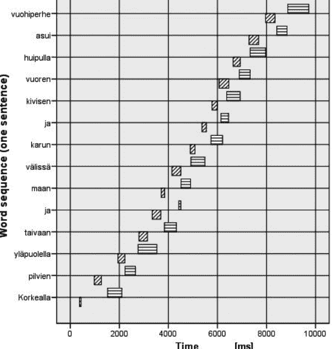

图 1。一个受试者阅读一个句子的注视-语音关系示例。横轴显示时间（单位为 ms），纵轴显示句子单词的顺序（从图中底部开始）。每个单词对应行的符号显示了注视方向和单词的发音情况（注视开始-结束，发音开始-结束）。使用 `EyeLinkII` 跟踪器通过瞳孔和角膜反射追踪记录眼动（采样精度为 4 ms；噪声 < 0.1 视角度）。语音信号借助安装在追踪器上靠近嘴部的微型麦克风同步记录。

对 `FSI` 变化的分析（图 1 和图 2）显示，一个单词的发音通常在下一个单词的注视之前就开始了。通常情况下，注视会领先一个或两个单词。`FSI` 的变异在间隔分布中也显而可见。这种间隔可能小于 200 ms（受试者的平均值，N=33；年龄范围 14–59 岁），范围从 443 到 824 ms；总平均值 = 625 ms，标准差 = 217 ms。


如此短的间隔使人们对神经系统执行标准阅读模型中假设的许多“内部”操作产生了怀疑。考虑到喉部肌电图（EMG）激活与语音信号之间约 100 ms 的间隔（Gallena 等人，2001），这一点尤为如此。然而，根据这种观点，人们将面临解释大脑如何完成“猜测”的任务。因此，不如假设单词使用文本上下文来“猜测”。解释“猜测”是如何在神经系统的预见性过程中形成的。如果是这样，该过程在受试者产生单词准确内容之前就开始了。

至于发音的作用，FSI 可能会受到语音表现的影响。在其他方面，间隔可能会被发音因素“污染”。例如，发音时间越长，FSI 也就越长。因此，我们调查了 FSI、前一个项目的发音持续时间以及发音之间间隔之间的关系。当发音持续时间与当前 FSI 之间存在正相关（r=.167, p<.01, n=1287, Pearson）时，其他发现更为惊人。发音之间的间隔也存在显著正相关（r=.332, p<.01, n=1184; Pearson），并且（在更高的显著性水平下）前一个项目与当前项目 FSI 之间的间隔持续时间也存在正相关（r=.479, p<.01, n=1164; Pearson）。我们与其强调文本项目的长度污染了 FSI，不如倾向于表明 FSI 捕捉到了阅读的节奏。

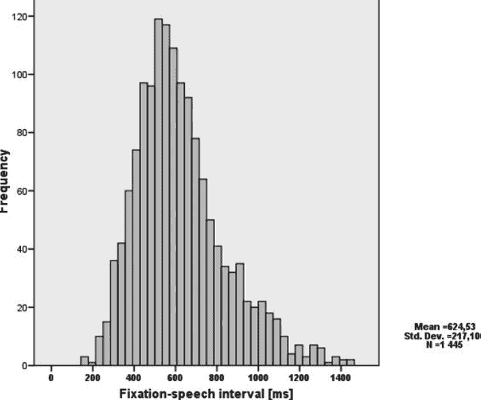

当我们考虑 FSI 如何映射到文本项目出现的位置时，这种解释得到了进一步的支持。对于每段文本，FSI 一致取决于这些句首单词是出现在句首还是出现在逗号之后（图 3：句子位置效应在 p<.001 处显著；F(4, 1440)=32.14；单因素方差分析）。这种 FSI 的调制相比句子标点与阅读节奏（产生有意义的思想）的相关性更好。事实上，即使在没有标点的情况下，连续文本也显示相同的模式。最后，前一个单词的发音持续时间与当前 FSI 之间的相关取决于单词在句子中的位置。因此，句首位置给出高正相关（r =.256, p<.05, n=91; Pearson），而在句尾位置，相关性为负（r =-166, p<.05, n=161; Pearson）。

# Timo Järvilehto、Veli-Matti Nurkkala 和 Kyösti Koskela

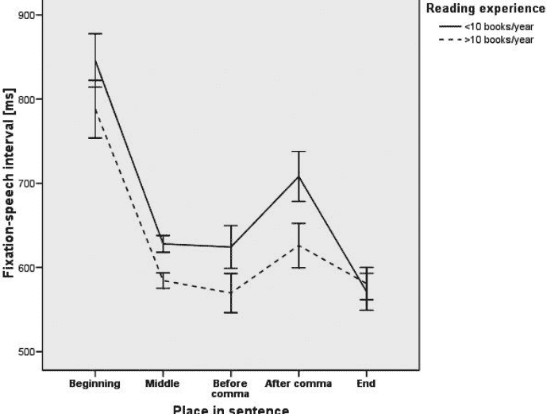

眼动追踪给出了相关的结果。项目的首次注视平均时长在 186 到 354 ms 之间（平均 254，标准差 119）；扫视幅度在 1.3 到 2.3 视角度之间（平均 1.7；sd 1.37 视角度）。单词在句子中的位置影响注视时长（注视时间总和/单词），且与 FSI 反相关。具体而言，在 FSI 测量中，在逗号之前和句末最长。与 FSI 相反，注视时长在行开头最长，在末尾最短。

我们研究了阅读表现与 FSI 之间的关系。这是通过检查 FSI、阅读时长和受试者阅读经验（通过每年声称阅读的书数测量）之间的关系的。我们发现 FSI 与阅读时长之间存在正相关（r=.519, p<.01, n=33, Pearson）。惊的是，阅读经验较多的受试者（n=17）的 FSI 显著短于阅读较少的人（n=16）；平均差异为 46 ms（差异在 p<.01 处显著；t=3.789, df=1443）。差异在句子中间最为显著（图 3）。对于眼动参数，我们发现阅读经验较多的人使用的注视较少，扫视幅度更大。这些差异在句子内部更为明显。

### 3.3 FSI：对阅读的意义

将阅读理想化为一个线性过程是误导的。通过研究 FSI，我们证明阅读不仅仅是解码，而且是一个动态过程。注视-语音间隔是阅读节奏的真实衡量标准，而这在传统模型中往往被忽视。

# 预期（期待）在阅读中的作用

## 4.2 预期的神经模型

与神经信息处理模型不同，有机体-环境系统理论认为神经系统与身体元素和环境要素共同组织，以获得行动结果（Järvilehto 1998b）。根据该理论，神经元的放电并不是为了解码某种信息。相反，像其他细胞一样，神经元试图维持其代谢。当这种状态受到干扰时，它们就会放电，并借此影响形成复杂神经网络的神经元。通过使用神经递质，该网络可以影响肌肉，并通过停止放电来恢复其代谢状态。如果结果没有价值，神经元就会死亡。在神经系统中，这种情况无处不在。因此，神经元放电并不是“信息处理”。

神经元是活细胞，是与其他神经元连接的有机代谢系统。它们无法执行心理学“功能”（如感知或阅读）。没有任何神经网络可以分析书面文本的特征、进行心理操作，或构建模型或表征。相反，它们使有机体和环境能够在单一功能系统中利用动态机制。虽然阅读并非在大脑中发生，但大脑对阅读过程无疑至关重要。然而，阅读并非发生在大脑内部，而是发生在一个由有机体、环境以及阅读发生的整个语境组成的更大系统中。阅读过程的主体不是神经元或大脑，而是一个无法用生理概念定义的人。

有机体-环境系统具有一个预期的神经系统，如图 4 所示。从这一观点来看，感觉感受器或受体矩阵不是字面意义上的“接收性的”是非常重要的。相反，它们创建了环境连接，支持了整个有机体-环境系统的形成。对受体的推论具有特殊意义。这是因为正如 Järvilehto (1999) 详细所示的，它们创建了接收矩阵，用于选择性地使用要素（如纸上的文本字迹）。如果没有这一点，系统就无法实现其行动结果。同样，肌肉是不同的器官，也包含传入神经（图 4 中的“肌肉传入神经”），其意义体现在与感受体的相互作用中。正因为肌肉和感受器具有相似的结构（传入神经和支配神经），它们共同定义了整个有机体-环境系统的部分，以实现行动结果（例如对文本的理解）。感知和动作不是独立的感官和运动过程，而是同一枚硬币的两面，是一个整体的两个方面。因此，阅读既是感官过程，也是运动过程。

当我们使用脑活动的变化作为衡量阅读时间进程的基础时（Sereno and Rayner 2003），我们无法忽视这些主张。

## 预期神经系统

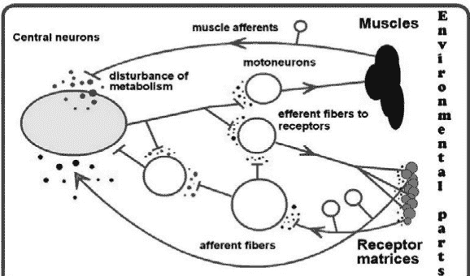

## 有机体-环境系统

Parvainen 等人 2006。事实上，如果页面上的字迹完成了组织，那么在呈现刺激后的事件相关电位（或眼睛固定在字迹上）就不能作为刺激感官处理的指标。相反，它们反映了整合预期组织的完成，从而实现了从一个状态到另一个状态的转换。许多被概念化为刺激“处理”的内容发生在看页面之前。这种“处理”在将页面作为完成行动的“触发器”之前已经完成，或者在口头阅读中，在对其进行翻译之前完成。

阅读的线性和分层模型混淆了心理学和神经生理学概念。由于它们从描述阅读任务“必需”的操作开始，不可避免地忽略了神经系统的时间动态。事实上，传统的做法是将任务组件呈现在框中，而框的内容取决于外周处理如何使我们能够“解码”刺激。（注：原文后续部分包含大量逻辑重复和 OCR 错误，翻译时已根据核心意图进行精炼。）

当我们共同相互定位时。在阅读过程中，作者物理上并不在场，但尽管如此，他们参与了意义的生成。就像对方在场一样，读者可以向文本提问，并奇迹地找到答案。文本允许作者与读者之间进行合作，这种合作可以导致新思想和观点的产生。

## 注释

- 我们感谢 Stephen J. Cowley 在手稿准备期间提供的许多有用的建议和修正。我们还感谢三位匿名评审员提供的有用意见。
- 1. 应该指出，根据有机体-环境系统理论，行为（如学习）是对整个有机体-环境系统的识别。心理学概念（如感知）描述了有机体-系统中组织动力学的不同方面（Järvlehto 2000）。
- 2. 旁凹视视觉（Parafoveal vision）意味着利用投影到视网膜旁凹视区域文本信息的可能性。
- 3. 出于技术原因，上述研究（Järvlehto 等人 2008）报告的结果中，FSI 的测量准确性为 40 毫秒。
- 4. 目前尚不清楚我们的结果如何取决于芬兰语的特定特征（例如形态句法的复杂性），但 Levin (1979) 等人报告了英语具有类似的眼视跨度（eye-view span）。然而，Levin 并没有测量 FSI 等时间参数。
- 5. 综合来看，这些结果可能是“注视韵律”（prosody of looking）的指示，即与意义生成相关的动作节奏。
- 6. 如引言中所指，相关的测量方法是 EVS，但它仅应用于空间测量，无法提供确定阅读过程进程的可能性。另一种相关方法是呈现单个单词或短句并测量语音反应时间，但这种测量具有生态效度差的缺点。
- 7. 然而，目前还没有针对不同语言的系统比较。

## 参考文献

Abernathy, Bill, D.P., Parks, S.L., and Packer, S.T. 2001. “Expertise and the perception of kinematic and situational probability information.” *Perception* 30: 233–252.

Abramson, M. and Goldinger, S.D. 1997. “What the reader’s eye tells the mind’s ear: Reading inner speech.” *Perception & Psychophysics* 59: 1059–1068.

Timo Järvihte, Veli-Matti Nurkkala, Kyösti Koskela

Altmann, G.T.M. 2001. “The language machine: Psycholinguistics in review”. *British Journal of Psychology* 92: 129–170.

Bain, A. 1855, *The Senses and the Intellect*. London: Longmans, Green.

Buswell, G.T. 1920. *An experimental study of the eye-vision span in reading*. Chicago: Supplementary Educational Monographs: 17.

Cattell, J. McK. 1886. “The time it takes to see and make objects”. *Mind* 11: 63–65.

Cowley, S.J. 2007a. “Distributed language: Biomechanics, functions, and the origins of talk”. C. Lyon, C. Nahaniv, and A. Cangelosi (eds), *Emergence of Communication and Language*. London: Springer, 105–128.

Cowley, S.J. 2007b. “The cognitive dynamics of distributed language”. *Language Sciences* 29: 575–583.

Cowley, S.J. 2007c. “How infants interact with symbol goaling”. *Interaction Sciences* 8: 83–104.

Dewey, J. 1896. “The reflex arc in psychology”. *Psychological Review* 3: 357–370.

Feidmer, K. 2007. “Thinking ahead: The role and roots of prediction”. *Psychophysiology* 44: 491–505.

Gallas, S., Smith, P., Zeffiro, T., and Ludlow, C. 2001. “Effects of Levodopa on laryngeal muscle for onset and offset in Parkinson disease”. *Journal of Speech, Language and Hearing Research* 44: 1284–1294.

Gibson, I. 1979. “Analysis of Experimental Approach to Visual Perception”. Boston: Mifflin.

Goodman, K.S. 1996. “Analysis of reading cues: Applied psycholinguistics”. *Reading Quarterly* 5: 9–30.

Järvihte, T. 1998a. “The theory of the organism-environment system: I. Description of the theory”. *Integrative Physiological and Behavioral Science* 33: 321–334.

Järvihte, T. 1998b. “The theory of the organism-environment system: II. Significance of novelty in the organism-environment system”. *Integrative Physiological and Behavioral Science* 33: 335–343.

Järvihte, T. 1999. “The theory of the organism-environment system: III. Role of influence on the formation of knowledge”. *Integrative Physiological and Behavioral Science* 34: 90–100.

Järvihte, T. 2000. “The theory of the organism-environment system: IV. The problem of memory and consciousness”. *Integrative Physiological and Behavioral Science* 35: 51–57.

Järvihte, T., Nurkkala, V., Koskela, H., and Viiala, H. 2008. “Reading as anticipatory formation of fixation-speech intervals when different types of text”. *Journal of Transmatics* 1: 73–81.

Kondo, T. and Mazuki, R. 2096. “Prosodic functioning while aloud: online examination of sentences”. *Journal of Psycholinguistic Research* 25: 357–381.

Kravchenko, A. 2001. “The experiential basis of speech and writing” In S.J. Cowley (eds) *Distributed Language*. Amsterdam: 33–55.

Levin, R. 1979. *The Eye-vision span*. Cambridge, MA: The MIT Press.

Lovy, R. 2007. “Expectation-based syntactic comprehension”. *Cognition* 106: 1126–1177.

Lukatela, G., Eaton, T., Sabatini, L., and Turvey, M. 2004. “Vowel duration affects word identification: Evidence that the mediating phonology is potentially informed”. *Journal of Experimental Psychology: Human Perception and Performance* 30: 151–162.

Manguel, A. 1996. *A History of Reading*. New York: Viking.

McDonald, S.A. and Shillock, R.C. 2003. “Eye movements reveal the on-line computation of lexical probabilities during reading”. *Psychological Science* 14: 648–651.

Neisser, U. 1976. *Cognition and Reality: Principles and Implications of Cognitive Psychology*. San Francisco: Freeman.

Parvaien, T., Helenius, P., Poskiparta, E., Niemi, P., and Salmelin, R. 2006. “Cortical sequence of word perception in beginning readers.” *Journal of Neuroscience* 26: 6052–6061.

Paulson, E.J. 2002. “Are oral reading movements subtensions caused by careless eye movements.” *Reading Psychology* 23: 45–66.


Perfetti, C.A. and McCullen, D. 1982. “Speech processes in reading.” *Speech and Language: Advances in Research and Practice* 7: 237–269.

Quantz, O.J. 1897. “Problems in psychology of reading.” *Psychological Monographs* 2 (1, Whole No. 5).

Rayner, K. 1998. “Eye movements in reading and information processing: 20 years of research.”

Rayner, K., White, S., Johnson, R.L., and Liversedge, S.P. 2006. “Reading words with jumbled letters: there is a cost.” *Psychological Science* 17: 192–193.

Rosen, R. 1985. *Anticipatory Strategies*. Oxford: Pergamon Press.

Sereno, S.C. and Rayner, K. 2003. “Measuring word recognition in reading: eye movements and event-related potentials.” *Trends in Cognitive Sciences* 7: 489–493.

Sokolov, A.N. 1972. *Inner Speech and Thought*. New York: Plenum Press.

Stanovich, K. 2000. *Progress in Understanding Reading: Scientific Foundations and New Frontiers*. New York: Guilford Press.

von Uexkill, J. and Krisat, G. 1932. *Streitfreiheit durch die Umwelt von Tieren und Menschen*. Frankfurt am Main: Fischer.

Vitu, F. 1991. “The influence of parafaeal preprocessing and linguistic context on the optimal landing position effect.” *Perception and Psychophysics* 50: 58–75.

Wagner, R.K. and Torgersen J.K. 1987. “The nature of phonological processing and its causal role in the acquisition of reading skills.” *Psychological Bulletin* 101: 192–212.

认知与语言理论，是由我们在处理“编码的”含义时所做的一系列决策组成的。人工智能的经典方法旨在开发一种算法脚本，将所有符号分析为先验的价值集合。无论这种逻辑方法看起来多么有吸引力，它都忽略了（语言）符号化过程的实验性质。

然而，对于一个被称为“分布式语言小组”（Distributed Language Group）的国际跨学科学术共同而言，经验变得至关重要（Cowley 2007a）。分布式语言观点将语言视为分布在不同时间尺度上的社会（对话性）活动的关键方面。在非客观主义范式中，认知的“对象”并非外部现实中事物的指称脚本，而是“交互认知主体之间的行动协调”（Stewart 1996:318）；因此，他者导向、语境、互动和符号中介成为关键概念（Linell 2007）。Cowley 强调，“语言活动严格受限于我们对环境的敏感性以及使用许多二阶文化建构的技能（2007a:576）。”在我们使用的许多文化制品中，写作目前是最引人注目的；它与语言活动的共生关系，以及它对人类（从认知和演化角度来看）的影响程度仍有待阐述（Menary 2007）。语音和写作具有不同的本体，为了避免一种严重的谬误（Love 2007; Kravchenko 2007a），两者不应被混淆（Linell 2005），语言的代码模型掩盖了语音与写作之间的深刻差异。本文致力于探索这种最重要的差异，即由语音和写作领域中语言互动的不同认知动力所导致的经验性差异。

语言行为，或称“言语化”（`languaging`），是一种特殊的互动行为，在马图拉纳的术中（1970, 1978a），它建立了一个认知领域。对话式互动发生在时空之中，交流伙伴监控并对发生的情况做出反应（Linell 2005）。相比之下，书面文本通常不是在产生时被阅读的。对于普通读者来说，焦点必须落在文本产品上。由于生产过程是不可及的，对书面语言的分析必然关注文本及其组成部分。字母、单词、句子、段落类似于可以被操作的对象（尤其是在使用计算机上对文本进行排版和编辑时）。考虑到语音的互动性质，这建立了一个本体论上截然不同的符号系统。虽然在马图拉纳的术中（1978b），“言语化”是取向性的，但写作的主要认知功能类似于内部记忆或生物记忆。与扩展了人类感官的语言（Morrison 1938）不同，写作是“一种允许人类积累经验和知识的存储和检索系统”（Donald 1991: 309）。

一旦我们精通写作，就可以将认知负载“倾倒”到物质制品上，并在随后利用它们与我们的认知自我进行互动。虽然言语化是具身的且是分布置的，但写作（句子、文本）建立了文化制品。与语音不同，这种对跨历史和演化尺度的个人及社区的影响是深远的。因此，尽管存在传统，语音和写作并非单一现象的表现。作为两个独立的认知领域，它们通过对比的认知动力建立了对比的躯体-世界关系。

写作在人类社会中的作用无论如何强调都不过分。事实上，工业和后工业社会的发展表明，写作是我们伟大的发明之一（Hagege 1996）。今天，文本制作日益被视为近期人类共同演化的重要部分（参见 Donald 1991）。文本及其计算扩展——日益决定着人类生活的的重要方面。显然，人类认知探索了身体之外的世界（Hutchins 1995），并在某些意义上延伸了思维（Clark and Chalmers 1998）。对于 Clark（1997）来说，我们生活在一个基于语言增强认知的认知生态位中，物质符号增强了人类智能。其他人则将其视为一种陈述：对于 Harnad（2005, 2007）来说，即使认知是语言增强的，重要的也是思考。维高斯基（1994）认为思考和言语化是不可分离的；一种认知的生物理论提出了更有力的主张——“‘人类大脑用语言思考’”（Maturana, Mpoodozis, and Letelier 1995: 24）。

一旦语言的某些方面受到重视，语音和写作就必须重新思考。它们是物质上不同的现象，具有完全不同的时间和空间分布。从演化的角度来看，写作有助于克服言语化的时空局限。它赋予我们一个无时间的（相对于局部而言）存在/信息环境。因此，当人类在一个基于他们如何利用经验进行言语化的领域运作写作系统时，他们的共识领域通过写作的发明而发生了转型。在马图拉纳的术中，如果个体人类是二阶系统，那么社区就是三阶系统。由于这些系统在组织上日益依赖文本，写作的兴起导致了新生态出现（参见 Bang et al. 2007）。

三阶系统通过语言行为的关系领域（如图 1 所示）作为互动的统一得以维持。在这样的系统中，每个个体处于其特定的物理环境中（实心圆），与他人建立共识互动领域（重叠椭圆）。考虑到语音的互动性质，这建立了一个本体论上截然不同的符号系统。虽然在马图拉纳的术中（1978b），言语化是取向性的，但写作的主要认知功能类似于内部记忆或生物记忆。与扩展了人类感官的语言（Morrison 1938）不同，写作是“一种允许人类积累经验和知识的存储和检索系统”（Donald 1991: 309）。一旦我们精通写作，就可以将认知负载“倾倒”到物质制品上，并在随后利用它们与我们的认知自我进行互动。虽然言语化是具身的且是分置的，但写作（句子、文本）建立了文化制品。与语音不同，这种对跨历史和演化尺度的个人及社区的影响是深远的。因此，尽管存在传统，语音和写作并非单一现象的表现。作为两个独立的认知领域，它们通过对比的认知动力建立了对比的躯体-世界关系。

## 语音和写作的经验基础

> 尽管口头文化有一种不容忽视的补救措施，电子媒体提供了多样化和对比性的巨大优势，但印刷提供了不可替代的专注注意力和沉思的形式，这使得复杂的交流和洞察成为可能。失去这种智力能力——以及持续存在的许多人性——将构成巨大的文化贫乏（Bradshaw and Nichols 2004:7）。

此外，美国国家艺术基金（NEA）的调查显示，阅读的下降意味着参与公民和文化生活的进一步退缩。这项研究的长期影响不仅影响文学，还影响所有艺术——以及志愿者服务、慈善甚至政治参与等社会活动（同上）。那么，阅读能力的下降与缺乏公民和文化生活的参与之间存在关系吗？为了回答这个问题，我们必须放弃语言是一种代码的观点（Kravchenko 2007a）。口语和写作具有不同的历史，因此具有截然不同的认知动态。虽然两者都可以被作为物质符号进行分析，但我们与人以及图形产物的互动方式是不同的。在追求这种对比时，我我们需要一种对读写能力（以及社会读写能力）的新视角。事实上，除非我们理解它们是如何在其各自的认知领域内限制事件的，否则我们既无法理解社会生活，也无法理解它们如何影响我们的认知。

## 1. 语言学家的读写能力观

Donald（1991）具有影响力的著作强调，模仿导致了文化演化和语言——这改变了灵长类动物。反之，这支持了 Clark（1997）关于工具和物质符号如何扩展思维的观点。但我们应该在多大程度上字面上理解这一观点？它支持“语言”是一种底层能力的观点吗？还是我们必须考虑口语和写作之间的差异？虽然 Clark 对物质符号的诉求是避免这种问题的尝试，但忽视认知动态无疑是错误的。事实上，如果每个人都有自己的语言，我们应该期望社交对话的技能能映射到我们对图形符号的使用上。然而，说话和听力的技能与读写能力并不相关。更戏剧的是，在自闭症谱系中，高表现者可能具备读写能力，但在语言表达（`languaging`）上存在缺失。这两个领域之间存在认知差异。

读写能力通常被视为与书面标记相关的编码/解码机制。因此，这一过程以一种更简单的方式被“解释”。语言习得被视为掌握一套语言符号和规则，这些规则允许意义从符号序列中浮现。清点此类清单中包含的内容是通过编写使用特殊代码产生的书写标记来完成的。在这里，读写能力被视为一种执行三步操作的匹配和识别的能力：

1. 一个特定的字母（图形编码，或符号）与特定的声学现象（声音类型，或音素）匹配。
2. 字母的特定组合（图形单词）与声音类型的特定组合（口语单词，或物理单词）匹配。
3. 图形单词被识别为口语单词。

这些认知能力处于阅读和写作技能习得的基础之下。这种狭隘的观点是非常不足的。没有人会认为一个能用铅笔在纸上画出简单线条和图案的孩子是艺术家。同样，一个能在钢琴上弹出一个八度音，同时将声音与音乐谱的图形符号匹配的孩子，既不是音乐家也不是作曲家。尽管他能读懂乐谱（在音乐上是有“素养”的），但这样的孩子并弹钢琴。但如果一个孩子能多或少准确地发出口单词的图形表示，我们可以说：“他识字了。”与绘画和音乐大师的类比是——读者需要的不仅仅是解码他人的思想。任何基于代码的读写能力观，充其量都是根本性的不完整。

教育为年轻人提供了认知发展的工具和技术。因此，读写能力在开发基于“纸上世界”（Olson 1994）的推理和判断能力方面发挥着重要作用。然而，一个不可争议的事实是，读写本身并不能让一个人在社会上成熟。联合国在20世纪50年代和60年代的项目归功于读写能力的本质上是想象的（Olson and not Torrance 2001）。推理能力的发展证明并不取决于读写能力本身，而是取决于从教育获得的知识与生活经验之间建立意义的关系。换句话说，读写能力也是“关于我们知识的一套处方”（Cook-Gumperz 2006:1）。联合国教科文组织总长松浦庆一郎在国际识字日上强调，读写能力有助于学习和生活技能的获取，当应用于整个生命周期时，个人和社区能够以可持续的方式发展（Matsuura 2008）。因此，读写能力不是一种基于阅读和写作的认知能力，而是能够维持我们认知发展的技能的基础。这取决于使用维持人类存在的语言表达和环境动态，使其成为对他人产生影响的现象赋予意义的技能。

在俄罗斯大学进行的一项实验中，本科生（语言学专业学生）被要求阅读并解释一个据出自19世纪俄罗斯小说的句子。该句子包含19个单词，描述了一个名为 Triffon 的人简陋的家当（共四件物品）：

1. 一块掉落的法兰绒，一把折叠木卷尺，一个旧铸铁块，和一瓶开启的拉菲特葡萄酒——这就是 Triffon 留下的全部。

```text
Podmocnienia shtuka bumazai, skladnoj devrejannij arshin, dampened roll flannelette GEN wooden arshin\3 stary cast-iron block, open bottle of Lafitte — that was all left after Triffon. Podmocnienia shtuka bumazai, skladnoj devrejannij arshin, dampened roll flannelette GEN wooden arshin\3 stary cast-iron block, open bottle of Lafitte — that was all left after Triffon. Podmocnienia shtuka bumazai, skladnoj devrejannij arshin, dampened roll flannelette GEN wooden arshin\3 stary cast-iron block, open bottle of Lafitte — that was all left after Triffon.
```

令人惊讶的是，许多学生未能从句中推断出以下内容：

1. Triffon 有四件物品。
2. Triffon 很贫穷。
3. 这些物品在他家里。
4. Triffon 死了。

## 2. 口语和写作的经验基础

对书写标记的理解源于对世界、语言和写作的积累经验。

## 3. 语言化经验

在基于自发生认识论（Maturana 1978a; Maturana and Varela 1980; Di Paolo 2005）的语言认知哲学（Kravchenko 2003, 2008, 2009b）中，意义是以经验为参数的认知功能。因此，意义被执行有机体与其环境之间的动态关系。每一刻，它都取决于环境因素对有机体的价值（Zlatev 2003）。语言符号解释者（交流口语行为的观察者）的认知努力产生的结果源于物理、生物、社会、历史、文化等影响交流经验的参数（Kravchenko 2010）。我们有机体的状态将其表征为一个决定的结构——一个系统的发生或产生是其结构动力学的结果，在该系统中，没有其他东西可以规定其发生了什么，只能触发其由结构所决定的结构变化（Maturana 2000:461）。系统是存在于结构耦合环境中的交互单元。认知系统的组织决定了其能够进行有意义的行动以维持自身的交互领域，而认知是该领域内的一种实际行为。

用神经科学术语来说，经验探索了由过去环境交互引起的神经活动相对状态。出于功能性考虑，这些生物符号现象（Kravchenko 2003）作为交互的表征。认知个体利用这些表征来增强它们的适应能力。这样做，他们避免了与环境中潜在危险的方面发生直接的物理交互。由于经验产生于世界的交互，其结构和内容取决于认知者的历史。在 Clark（1997）的比喻中，“生态位”包含了语言现象。从结构和内容上，它意味着在处理同一对象或现象时，意义具有非同一性。正如塞尔（1948:4）所论的，“孩子赋予词语的意义是其个人经验的产物，并根据其环境和感官而变化。”但如此，相互理解是否成为交流的一部分？

将语言符号定义为用于指示世界上事物的语言单位，并没有阐明语言如何与其他现象相关。尽管

## 口语与写作的实验基础

语言化是人类的生物活动（转瞬即逝的），社区成员将语言现象视为物理和文化媒介的自然组成部分，这些媒介塑造了他们的世界。典型的语言符号或单词只能以物理物质的形式存在。它们与塑造每个单词存在语境的各种物理参数（或其环境介质）处于时空关系中。物理语境的变化改变了特定单词与构成其环境的其他现象之间关系的性质和数量。因此，所谓“符号的表达”的产生源于高度可变的关联。符号化（sign-called）是一个解释性过程，它关键取决于我们作为语言使用者的经验与他人经验的契合程度（Kravchenko 2007a）。在我们利用一个共识领域或共同行为的范围内。意义的产生引发了一种复杂的认知动态，这种动态刻画了我们。与其他有机体一样，我们利用独特的发育结构耦合历史。但独特的是，这也取决于在共识领域中的行为如何塑造（语言的）环境。在人类中，取向交互的认知领域具有额外的维度。它虽然由取向有机体与其神经活动状态的交互建立，但也受到相互如何面对彼此的存在的影响。因此，与认知现实主义观点相反，语言并不是一种心理能力。作为一种生物现象，语言是行为共识协调中的一种运作模式（Maturana 1978b）。对于恩麦来说，人类虽然植根于有机世界，但我们通过文化、语言和社会制度产生了特定的动态模式或形态，通过这些模式我们的有机和生命的存在得以实现（Emmeche 2007: 456）。理解语言符号是一个认知过程：在产生意义时，认知者寻找潜在经验来解释他人的行为。正因为大脑本质上是辩证的，我们才能进入他人的关系领域（Linell 1998）。因此，这意味着理解与回应之间存在紧密的关系。（言语）产生与理解之间的区别并不像发送者（说话者、行动者）和接收者（听者）模型中传统上假设的那样根本。

由于实时发生的特定话语的物理背景提供了复杂的脚手架，我们解释为理解的行为反应往往在说话者完成特定的旨在引导他人进入其共识领域的语言表达之前就已经获取了。

## 4. 书写标记的认知领域


会说话的人类彼此相互交互，而书面交流主要是为了参与。写作的动态取决于书写工具和材料的使用，标记保留在上面。当这些无生命的物体随后被阅读时，其结果可以被视为反映了作者与其思想的交互。虽然在某种意义上这具有“交互性”，但其内在的反射性本质与对话形成对比。

由于读者的交互对象是静态的人造物（例如文本），结果与我们与人接触时的情况不同。我们并不假设作者的思想可以通过语言符号的字面符号化来获取。相反，读者对符号不断变化的解释依赖于一个认知自我。对于自然语言化而言，这依赖于读者对语言和非语言交互的终身经验。这就是为什么那些在书写领域经验很少的人可以被迅速识别出来。

在俄罗斯俗语中，说对于具有代码级素养的人，“Smotrait v knigu, a vidiat figu”。大致翻译过来，这意味着他们“看”书，却除了看到“图像”之外什么也看不见。这样的读者缺乏从文本中“提取”知识所需的技能。用本文的术语来说，他们缺乏相关认知领域的经验。

> 言语与写作的经验基础 45

环境可以分为不同的交互领域，包括个人空间、家庭领地和公共领地（Somner 1996; Slane et al. 1981）。将公共领地视为一个结构化的交互领域，可以将其分为教育领域、文化内领域和跨文化领域。

在语言习得第一个至关重要的阶段，人类幼体在个人空间和家庭领地进行交互。儿童在语言环境中积极获取信息，发展出最初的语言行为标准。在交互过程中，这些标准通过直接或间接地诉诸权威（父母、照顾者、家庭成员等）不断受到测试。儿童语言行为的恰当性是通过与其家庭成员的个人价值观、优先事项和特殊特征联系来评估的。当然，这些涉及到本质、性格和公共相关性。

换句话说，在语言习得过程中，儿童学会遵循（Tomarello 2006; Hodges 2007），确保了他们的“功能性适配”。

在文化内交互领域中，“功能性适配”的概念存在争议。辩证法矛盾往往使个人目标与社区目标相对立。因此，随着时间的推移，行为模式作为处理社会世界事件的适应性解决方案应而生。每个人都必须具备行为策略，产生“符合”文化内领域的行动。

这导致了紧张关系。儿童可能试图作为一名认知者，通过最小化（社会）环境的限制性影响来实现自主性的最大化。同时，其他利益也在施加控制。活的社区（社会）将通过最小化个人认知自主性来增强群体的适应潜力。

因此，文化内交互领域（作为更大的跨文化交互领域）引发了认知活动的震荡模式。在演化时间尺度上，吸引子将试图在部分与整体之间建立动态平衡。对于社会心理学来说，这种认知流的一个后果是二级和三级生命系统交互界面上不可避免的冲突——这些通常被归类为犯罪行为。

随着个体成长，他与环境的交互领域扩展到公共关系领域。然而，在融入社会及其文化的过程中，儿童的发展通过教育交互实现了社会化。换句话说，儿童在人类栖息地获取信息，通过利用共识领域的规范和标准，试图从社会认可的价值观和规范提供那里寻求鼓励和认可。

专业教育者也有自己的个人价值观和偏好，这些偏好在多个领域发挥作用，产生了相似但竞争的目标。语言行为受教育交互领域影响的人类个体，面临着根据许多语境参数构建特定解释策略的压力。

有必要根据其共识领域的关系，判断其语言行为是否得到了具有相应权威的人的“批准”。同样，他必须决定是否使用与家庭/家交互领域相同的模型。

结果，当他在书面领域交互时，他必须参考自己如何解释物理语境来构建其语言行为（对文本的解释）——这种语境在定义上与要解释的文本无关。类似于代码符号的图形标记使得跨越不同时空不同用途的解释成为可能。

由于这是写作最相关的功能，图形图像往往（错误地）被视为语言符号。这种未能对“作为局部且时间性的言语”与“作为非局部且时间性的文本”进行本体论/经验区分的失败，为语言行为（包括阅读和写作）的功能性失败下了伏笔。在处理书面文本时，这导致了沟通功能障碍（Kravchenko 2009b）。

作者方面沟通功能障碍的一个显著例子是贴在门上的告示，例如：

- (2) 回来十分

通过将图形标记识别为自然语言符号，作者进入了交互领域。因此，这种告示剥夺了其语言行为在交互领域发挥引导影响的能力，仅仅因为在这些情况下没有共识领域。

读者无法建立一个共同的参考点，必须猜测是否要等 5 分钟（假设该告示是真实的）。当然，对这种情况的解释假设作者在语言上是成熟的。写的人可能完全意识到自己在做什么。该符号也可以用于，例如为缺席提供掩护。

> 言语与写作的经验基础 47

这种惊讶的情况很容易解释。一个典型的“udostoverenie”（身份证明）解释者其驱动力是利用共识领域另一个解释者的权威作为认知支架，因为出于实用考虑，这会对官僚的语言行为产生最大的本体论影响。换句话说，官僚受其主管或老板的指导。

关于文本的认知领域，权威的解释能力往往不尽如意。简而言之，他们发展历史上并没有信息时代所需的广泛阅读和写作。对于渴望“进入顶层”的人来说，这并不意外，因为在语言化领域的交互（被上级引导以及通过反馈进行引导）对于适应周围环境至关重要。

他们削弱了书面文本领域的认知重要性。对于许多人来说，掌控者塑造了他们的环境。这也捕捉在民间智慧中：

- (3) “如果你是老板，我是傻瓜；我是老板，你就是傻瓜”
- (b) `Ty nachal’nik — ja durak, ja nachal’nik — ty durak I fool I you fool`

# 5. 超越语言的代码模型

语言绝非代码，而是一系列可能性。观点认为，这些可能性可以在不同的认知领域以不同的方式实现，最引人注目的是书面文本和语言化的领域。

通过关注交互领域中的内涵行为，我们学会了使用一系列语言资源的技能。这些资源既用于产生言语，也用于主动应对言语：

> 这些资源 [...] 旨在仅在情境化的意义构建中完成。它们并不“编码”或“包含”其含义；而是通过参考、概念化和干预来索引、提示或促发理解（Linell 2007: 611）。

相比之下，在书面文本中，理解本质上不是对话性的。我们不会被沟通个体所处不断变化的环境所提示。鉴于其本体论属性，书面文本本质上不是对话性的。

因此，虽然语言化（languaging）的功能是扩展人类感觉，但文本充当了增强人类认知能力的脚架。二阶符号化作为我们过去经验的“提醒”，或对近期经历的认知状态的参考点。这里没有共同的代码。

重复一遍，是认知动力学的本体论差异使得说话和写作进入了不同的认知领域。

语言化是发生在共识领域的行为。恰当的解释取决于对实施语言行为时所处物理语境的考量。在标准情况下，我们大量地使用动态特征，包括发声、手势、面部表情以及面向世界的特定方式（Cowley 2004）。

在语言化以及学习说话过程中，这些对于促使孩子听取并解释语言符号至关重要。文本缺乏这些。然而，随着历史时间的推移，这转化为了我们的优势。例如，我们切断了自然符号的“外在”部分，构建了（书面）文本领域。

正如 Clark（2007:427）所强调的，书面语言“不是面对面口头交流的穷亲戚。它为思想交换以及（更重要的是）思想的积极构建提供了一种新的媒介”。

虽然“思想交换”只是比喻，但写作在“思想的积极构建”中起着作用。此外，如上所述，其产增强了三阶生命系统的持续性（具有书面文化的社会）。当印刷机为交互的认知领域提供新的组织层次时，这一点变得尤为显著。

比喻地，书面文本领域变成了一种培养个体人类的培养皿。然而，存在一种区别：通过在书面文本的滋养中茁成长，我们不仅没有耗尽它，反而通过添加新文本来生长和培养它。

然而，我们也付出了代价。无法在文化中发展的个体，或者说规避文化的人，其社会适应能力就会面临危险。由于无法与书面文本（或二阶关系领域）有效交互，可能会产生认知功能障碍。

虽然能够有效参与语言化，但许多人的适应能力却降低了。识字能力作为一种福祉和革命性的进步，它并不产生认知发展。即使它是一种工具，它的价值只有在作为工具被有效使用时才会显现。这只能通过经验来实现。

> 语音与写作的实验基础 49

Harris（2000:xi）将识字能力的最高水平或发展阶段描述如下：

> 完全的识字能力或许没有任何一个社会达到，它是指这样一种状态：写作不再被视为“延续过去时间记忆和人类联结的营性投资；不再是人类思维的特定运作模式以及新语言概念的关键”。

在我看来，这种“语言的新概念”将把书面文化视为一种生态媒介。人类社会可以作为一个维持历史连续性的三阶系统而存在。

书面文本对解释者行为的引导效应，在很大程度上取决于解释者如何将这一领域与长期经验联系起来。换句话说，我们的解释技能是结构化系统结构动力学的函数。这些结构动力学的术语是“背景知识”。

越来越多，这些来自文本领域的多元经验（取决于……）。媒介分类物种高度依赖于共享的背景知识。反之，这源于语言使用者的文本媒介交互以及使用图形文字的语境——或者说，是解释者在书面标记领域交互时所拥有的此类（高度可变的）语境的综合经验。

这是一个非常重要的一点。在解释（理解）书面文本时，结构动力学并不决定其对文本（或口语）做出反应来“提取”知识。相反，它们依赖于内在组织，这种组织源于个体发生结构耦合（包括其他的动力学），充当了“刺激”。

那么，个体的语言交互维持了现代社会运行的条件吗？为了理解语言与社会之间的关系，我们需要强调口语和书面语言之间的现象学差异。

如果人类社会像一个有机体，那么口语就是“神经系统”，其核心包含在书面基因中。这些产生了一种本体论二元性，用于协调整个机体的运作。

来自中枢神经系统的信号是将机体各部分状态视为功能统一体时产生的神经学结果。此类信号比神经系统外周产生的信号具有更高的相关性。

此外，有机体作为功能系统的复杂性越高，其大脑的复杂性越高。事实上，在高等脊椎动物身上，这成了机体正常功能的“软弱环节”。大脑损伤的后果远大于（就体重而言）对其他器官的相应损伤。

最后，植物层面的功能“故障”和干扰可能会干扰或中断对中枢神经系统信号的恰当（认知上角的）“正确”解释。结果是特定器官可能无法在系统内发挥其功能，机体的整体适应能力可能会下降。

类似的考虑也适用于口语和书面语言如何调节我们称为人类社会的三阶系统的运行。每一位使用共同语言的说话者都在持续个体和社区是如何通过语言并被语言相互决定的。

因此，语言沟通和认知领域的语言交互对于两个社区和个体的形成与发展都是必要的。从这种观点来看，语言的首要功能是社会生成的。

有必要区分不同层次的语言交互。与个体的（自然）语言或共识领域相比，文本领域在本体上是次要的。然而，当社会被视为一个结构化系统时，它是首要的。

原因很简单：鉴于结构耦合的历史，个体和社会是相互决定的。因此，正常的个体功能（反过来又为社会自身的正常运行提供前提）预设了书面文本领域的引导效应对于（自然）语言共识领域的符号效应系统的首要性。

书面文本领域和口语领域的不同现象学要求基于不同的参考点建立不同的解释系统。因此，个体在社会中的最佳功能取决于在这些不同坐标网格中解释技能的发展。

对书面文本领域交互产生的引导效应的解释技能尚不成熟或发育不足（以及缺乏将此类解释结果投影到自然语言交互共识领域的技能），导致了功能性文盲或个体未能通过识别书面文本领域交互的引导效应来改变语言行为。

文化的退化会导致社会自身的退化。然而，这是一个未来研究的问题。

# 6. 结论

文化，从广义上理解为依赖于符号思维能力的人类知识、信仰和行为的整合模式，以及“社会学习”（[Wikipedia](https://wikipedia.org)）可以被视为一个由三阶系统（人类社会）交互的关系领域所维持的持续进化空间。

至关的一点是，这取决于“语言化”作为一种动态整合的复杂交互行为，存在于一个涉及各种人工制品和实践的共识领域中。与晚期人类不同，现代人类的适应性意图活动越来越依赖于“权力之世界”。

写作作为人类文化的产物，开始作为交互单元，调介三阶系统关系领域中的相互作用，从而在提供文化连续性方面具有了至关重要的意义，并成为增强人类认知能力的不可或缺的工具。在书面文本领域中积累的交互经验，决定了个体在三阶系统中的“功能性适配”水平。

作为一种社会机构，教育的目标是促进作为二阶生存系统的年轻人的认知发展，使其在三阶系统中实现功能性整合。如果个体无法将写作视为“一种特定的思维运作模式”来增强其在关系领域的适应性，那么这种有效的整合将是不可能的。

然而，“语言学家的观点”将读写错误混淆了言语和写作。借鉴语言的代码模型，它掩盖了我们与其他生命系统交互以及与无生命人工制品（文本）交互之间的关键差异。

因此，教育工作者未能看到，个体在发展过程中书面文本领域积累的相关经验如何导致了功能性文盲，而且意不意外的是——缺乏了对文化生活的参与。

基于文本的推理能力正在下降吗？一旦开始关注认知领域的事件，即当我们把阅读想象成解读摩尔斯电码时，这个问题就变得难以捉摸。这是因为这一构想被概念化在了（假设的）编码层面。

由于对内在语言根深蒂固的信念，语言学未能将言语和写作归于不同的（重叠的）认知领域。现在是时候承认，原则上，这可能源于我们处理文本方式的变化。

其次，我们不能忽视这样一个事实：这与新技术密不可分。很有可能是，在我们失去推理能力的同时，我们正在创造新的方式来利用文本所提供的功能：伴随着新的——技术增强型交互方式（这影响了二阶和三阶系统的结构动力学），新的思维方式可能会出现。

我们需要新的方法来研究我们如何与一个演变中的（计算机增强的）文本世界接触。我们需要追问在个体的一生中，基于文本的思维是如何发展的，并揭揭个体差异。

从生物认知观点来看，这首先取决于认知动力学的改变，以及我们如何将对铭文的使用与其他技能整合起来。

> Alexander V. Kravchenko

铭文的物质属性——以及它们出现的表面和屏幕——对于教学来说是次要的。我们需要关于它们动力学的模型，最重要的是，我们需要了解我们的认知能力如何利用制作和构建铭文实体的经验。

一旦这些问题变得清晰，我们就可以开始开发新的交互方法，鼓励人们发展自己的技能。然而，这需要对读写能力有新的观点——这些观点不仅关注其社会功能（读写的多样性），还关注它们如何改变了我们与他人交往的方式，最引人注目的是改变了我们自身的思维自我。

## 注释

1. 马图拉（Maturana）写道：“我们作为观察者存在于一个描述领域，而这个领域作为一个共识领域是一个认知领域。事实上，我们在许多不同的认知领域中运作，这些领域构成了实现自创（autopoiesis）的许多方式。此外，每个认知领域都构成一个封闭的关系或交互领域，该领域由决定它的结构耦合中内部一致性的特征所定义”（1978a: 46）。

2. 在观察现象的自创性扩张中，“统一体”是一个实体，无论是具体的还是概念的，动态的还是静态的，它通过区分操作被界定，从而将其从背景中隔离开来，并以这种区分赋予它的属性为特征的特征”（Maturana 1978:31）。

3. Arshin（阿尔申）——一种古俄罗斯长度单位（约 71 cm）；chugunny bolvan——在炉子上加热的铁；štoff——一种方形短口瓶（1.2 升）。

4. 这在《语用学与认知》特别专书中被讨论过（Kravchenko 2007b; Harnad 2007）。

## 参考文献

- Belpaeme, T. and Cowley, S.J. 2007. "Extending symbol grounding." *Interaction Studies* 8: 2–6.
- Bang, J.C., Dør, J., Steffensen, S.V., and Nash, J. 2007. *Language, Ecology and Society: A Dialectical Approach*. London: Continuum.
- Bradshaw, T. and Nichols, B. 2004. "Reading at risk: Survey of literary reading in America". National Endowment for the Arts: Research Division Project 46. Washington, DC.
- Crystal, D. 2008. *Txtng: The Gr8 D88*. Oxford: Oxford University Press.
- Clark, A. 1997. *Being There: Putting Brain, Body and World Together Again*. Cambridge, MA: The MIT Press.
- Clark, A. 2007. "A sense of presence." *Pragmatics & Cognition* 15(3): 413–433.
- Clark, A. and Chalmers, 1998. "The extended mind." *Analysis* 58: 7–19.
- Cook-Gumperz, J. 2006. “The social construction of literacy”. In J. Cook-Gumperz (ed), *The Social Construction of Literacy*. Cambridge: Cambridge University Press, 1–18.
- Cowley, S.J. 2004. “Contextualizing babies: Human infants and distributed”. *Language* 26: 565.
- Cowley, S.J. 2007a. “Functional properties of”. *Language Sciences* 29: 575–583.
- Cowley, S.J. 2007b. “Functional, of”. *Interaction Studies* 8: 83–104.
- Di Paolo, E. 2005. “The theory of the organism-environment: The problem of mental activity”. *Integrative Physiological and Behavioral Science* 35: 35–57.
- Jenkins, H., Clinton, K., Purushotma, R., Robinson, A., and Weiner, M. 2006. “The confronting nature of participatory cognition: Media for the 21st century”. MacArthur Foundation. Available at <http://www.digitallearning.macfoundation.org/>


- Dror, I.E.ed) 2008. Learning Technologies and Cognition: Special issue of Pragmatics & Cognition 16.
- Emmech, C. 2007. “biosemiotic note on humans, machines, cyborgs”. Pragmatics & Cognition 15(3): 455–483.
- Hagège, C. 1996. “L’Homme de Paroles”. Paris: Fayard.
- Harnad, S. 1990. “The grounding problem”. Physica D 42: 335–346.
- Harnad, S. 2005. “Distributed processes, distributed cognizers, and collaborative”. Pragmatics & Cognition 13(3): 501–514.
- Harnad, S. 2007. “Matura’s hermeneics”. Pragmatics & Cognition 15(3): 599–603.
- Harris, R. 2000. Rethinking Writing. Ecological and social processes on conforming, creating, and caring in conversation”. Language 29(5): 584–604.
- Hutchins, E. 1995. “Cognition in the Wild. Cambridge, MA: The MIT Press.
- Järvile, T. 2000. “Autopoiesis, adaptivity, teleology”. Cognitive Sciences 4: 429–452.
- Kravchenko, A. V. 2009c. 语言与心灵：生物认知视角。见 H. Götzche (编)，《记忆与语言》。纽卡斯尔：Cambridge Scholars Publishing, 103–124.
- Kravchenko, A. V. 2010. 母语者、母亲以及语言的其他客体。《语言科学》32(6): 677–785。
- Linell, P. 1998. 《对话写作：对话视角下的谈话、互动与语境》。阿姆斯特丹：John Benjamin.
- Linell, P. 2005. 《语言学中的书面语言偏见：其本质、起源与转型》。伦敦：Routledge。
- Linell, P. 2007. “认知”。P.M. Hejl, W. and Brain：二元论与非生物学之间存在收敛吗？《语言科学》29: 605–620。
- Love, N. 2004. “认知与语言神话。《语言科学》26: 524–554.
- Love, N. 2007. “语言是数字代码吗？《语言科学》29: 690–709.
- Maturna, H.R. 1970. 《语言的认知》。BCL报告 `#9.0`。伊利诺伊大学，厄尔巴纳。
- Maturna, H.R. 1978a. “语言的本体论：现实的认识论”。见 G. Miller and E. Lenberg (编)，《语言与思维心理学》。纽约：Academic Press, 28–62.
- Maturna, H.R. 1978b. 《Wahrnehmung und Kommunikation》（感知与交流）。法兰克福：Peter Lang, 24–49.
- Maturna, H.R. 2000. “自然法则的本质。《系统研究与行为科学》17(5): 459–468.
- Maturna, H and Varela, F. 1980. 《自组织与认知：生命的实现》。波士顿：Deidel.
- Maturna, H. Podozis, J., and Jeteler, J.C. 1995. “大脑、语言与人类心理功能的起源。《生物研究》28: 15–26.
- Matsuura, K. 2003. “来自联合国教科文组织总长松浦庆一郎的消息，国际识字日，2008年9月9日。”获取自：<https://unesco.org/images/0016/0621621856.pdf>
- Menary, R. 2007. “写作即思考。《语言科学》29(5): 621–632.
- Morris, C.W. 1938. “符号理论的基础”。见 O. Neurath, R. Carnap, and C.W. Morris (编)，《国际科学百科全书》，第1卷，22。芝加哥：芝加哥大学出版社。[重印于包含第一卷10个数字的单行装本中；芝加哥大学出版社，1955, 77–137]。
- Olson, D.R. 1994. 《纸上的世界：书写与阅读的概念与认知意涵》。剑桥：剑桥大学出版社。
- Olson, D.R. and Torrance, N (编) 2001. 《社会的形成》。牛津福：Blackwell Publishers.
- Romano, L. 2005. “大学毕业生的识字率下降：调查发现的阅读能力下降无法解释，《华盛顿邮报》，12月25日；A12.
- Russell, B. 1948. 《人类知识：其范围与局限》。纽约：Simon and Schuster.
- Slane, S., Petruska, R., and Cheyfitz, S. 1981. “个人空间测量：一种变异比较。《心理学研究》31(2): 145–151.
- Sommer, R. 1969. 《个人空间：设计的行为基础》。新泽西州，恩格伍德克里夫：Prentice-Hall.
- Stewart, J. 1996. “认知 = 生命：对高层认知的启示。《行为过程》35: 311–326.
- Thibault, P.J. 2000. “社会符号化中大脑的对话性整合：Edelman与向下因果关系的案例。《心灵、文化与活动》7: 291–311.
- Tomasello, M. 2006. “获取语言结构”。见 D. Kuhn, R.S. Siegler, W. Damon, and R.M. Lerner (编)，《儿童心理学手册》，第六版，认知、感知与语言。
- Vygotsky, L. 1994. 《思维与语言》。剑桥。
- Zlatev, J. 2003. “认知（+文化）的演化。《语言演化》4: 253–296.

# 认知动力学

## 洞察力

### 扩展认知（Extended mind）

分布式认知，工具，具启发性的洞察力

Fioratou and Stephen J. 阿伯丁大学，赫伯特福大学

在纸上的世界：书写与阅读的概念与认知意涵

在社会符号化中大脑的对话性整合：Edelman与向下因果关系的案例

言语与写作的经验基础 55

## 洞察性思维：认知动力学与物质人工制品

突然领悟、“啊哈！”时刻以及新事物的出现，总是发生在思维材料发生突然重构的时刻。表征的重构平行于对视觉错觉的感知解释（Ellen 1982; Smith 1995）。它是动态的、主动的且以事件为导向的。由于传统忽略了皮肤之外的世界，维特海默（Wertheimer 1959）对比了两种（内在）思维。在生产性或洞察性思维中，我们把握问题或情境中的结构关系，并将各个部分重构为一个整体。相比之下，在再生性思维中，我们对单个子部分的学习反应进行“盲目”感知。尽管洞察性问题解决符合情境，但它本身是内在的重构。根本性的变化发生于解决者（或大脑）看到一个问题时。

格式塔理论强调动力学是不连续的。例如，迈尔（Maier 1931）的双绳问题要求参与者从宽敞房间两端捡起天花板上的绳子。为了获得洞察，一名参与者需要使用其中一个物体（例如钳子），使其像钟摆一样向另一个人摆动。据报道，在一种情况下，参与者仅在实验者“意外”移动绳子时才解决了问题。尽管参与者没有报告观察到该线索，但解决率却增加了。科霍勒和迈尔（1931）忽略了身体现实。由于忽视了“外部资源”，他将洞察追溯为对以往经验的重构。这种结合发生在所谓的某种“影响”之下。“部分……必须以某种方式结合，而攻击问题的方向或方式似乎是决定结合性质的因素”（Maier 1931:143）。因此，一旦被赋予“方向”，参与者就可能产生解决方案。对于邓克（Duncker 1945）来说，方向是问题的（内在）重新表述，它启动了解决过程。它并不指导行动，而是在解决的早期阶段做出贡献。其他的“辅助手段”包含了解决方案的后期属性。然而，邓克关于方向导致问题重新表述的观点也可以被解释为设定了一个目标。

## 2.1 信息处理模型

与许多认知心理学一样，该领域因信息处理的兴起而转型。新威尔和西蒙（Newell and Simon 1972）将解决问题视为从初始状态到目标状态的旅行。在一个问题解决示例中，计算被归于一个内在空间。渐进式问题解决用应用运算符和启发法来描述。在这种情况下，参与者寻求新的表征（Kaplan and Simon 1990）。解决方案的产生来自于搜索程序的改变，而非表征过程。因此，洞察性问题与汉诺塔等问题不同，后者达到目标状态取决于一系列步骤（Weisberg 1995）。出于相同的原因，一旦被发现，洞察性的解决方案似乎非常简单。在单步或少数步骤的问题中，新情境和限制会影响问题的解决。具体而言，可以区分洞察问题与渐进性问题的定性差异（Chronicle, MacGregor, and Ormerod 2004）。从新威尔和西蒙（1972）的角度来看，洞察使用了普通的过程（例如 Bower, Farfolon, and Mergivis 1995）；这种并无特殊性的观点将洞察视为普通问题解决的变体。这符合 Weisberg 和 Alba（1981a, 1981b, 1982, Weisberg and Suls 1973）的检索框架。他们通过强调先验知识，挑战了格式塔关于重构是自发的观点。相反，“问题的重构是由于进一步搜索记忆的结果，而这种搜索是由受试者在解决问题时所获得的新信息引起的”（Weisberg and Alba 1992:328）。

奥尔沙森（Olshansson 1992）的表征改变理论（RCT）介于信息处理和格式塔理论之间。他将洞察追溯到“僵局的语境，这种僵局在某种意义上是不合理的，因为思考者实际上是有能力解决该问题的”（Olshansson 1992:4）。我们陷入僵境，即不知道该做什么，这产生了问题解决活动。如果没有僵境，就不会有洞察：解决方案无法在正确的情况下达成。最后，除非解决者具备必要的能力，否则洞察是不可能的。因此，RCT 关注僵局是如何发生的。参与者的初始心理表征在唤起与必要要求无关的“知识”（即概念、观点、想法、运算符、原则、规则、图式等）时会形成阻塞。干扰产生于无帮助元素的激活和对有用知识的抑制。通过提供访问被忽略的知识元素，改变了记忆的激活方式。工作记忆中（以及在主观体验中）出现不需要的知识会产生“啊哈”体验。问题的表述可以修正，例如通过放松限制或禁用一个阻塞性的知识元素。

Knoblich、Olshansson 和 Rhenius 1999 用算术题测试了 RCT。尽管可以使用所有火柴，通过算术运算（`+`、`–` 和 `=`）罗马数字（`I`、`II`、`III` 等）形成了错误的陈述。一个错误的陈述可以通过“移动”（而非丢弃）火柴转变为正确的。为了使错误的陈述 `IV = III + III` 成立，必须将左侧放在 `V` 的右侧（得到 `VI = III + III`）。由于每个问题都有唯一的解，难度不能归因于移动的次数。相反，对于 Knoblich 等人（1999-1534），这取决于必要的表征改变。难度的产生是因为先验知识抑制了对洞察解决方案的搜索。

例如，八硬币问题（Ormerod 等人，2002）。给定一个包含八枚硬币的初始数组，参与者需要进行两次移动。之后，每一枚硬币必须恰好接触三枚硬币。在找到解决方案时，必须使用三维空间。数组中心的两枚硬币必须叠放在其他硬币三组之上。根据约束满足问题（CSP）理论，许多符合局部理性标准（硬币接触另外三个硬币）的二维移动使得这个问题变得非常困难。Ormerod 等人（2002:793）表明，当资源可用时，更多的参与者能够解决问题。即使是对三维相关性的视觉提示（在初始状态下将一个硬币放在另一枚硬币上），除非没有符合标准的移动可用，否则对解决方案的影响也很小。

## 3. 外部主义扩展

在尝试解释解决过程时，RCT 或 CSP 理论都没有完全解释洞察（insight）。对“脑内”假设过程的关注确保了理论忽略了物质人工制品如何对洞察做出贡献。在内在主义传统中，物质对象的不可见属性通常被忽视了。然而，作为行动的资源，这些属性可以对洞察做出贡献。因此，这就是为什么解决问题需要一系列人工制品。在使用纸笔时，物质标记在八硬币问题中起到了作用。皮肤之外的因果过程可以对洞察做出贡献。这同样适用于经典案例。如上所述，使用物质木棍取到香蕉，以及 Maier（1931）的精妙实验要求参与者与行动进行协调。因此，我们将这项工作与日益主导当代认知科学的外部主义观点联系起来。

重点在于人类力量是如何随着身体相互连接以及与世界的联结而产生的（Varela, Thompson, and Rosch 1991; van Gelder 1998; Clark 1997）。在许多领域，智能的具身性和嵌入性受到了重视。虽然所有动物都依赖于适应环境，但其他动物（包括人类）依赖于生态位构建（Laland and Sterling 2006）。人类使用物质文化（Donald 1991; Hutchins 1995; Clark 2006）。人工制品和语言在演化（Deacon 1997; Ross 2007）、发展（Tomasello 1999; Cowley 2007a）和经验（Goodwin 2000; Glenberg 2008）时间内改变大脑。对于 Hutchins (1995) 来说，当我们参与分布式认知系统时，产生了灵活的适应性行为。在智能行动（包括解决问题）中，我们通常与外部人工制品和/或其他人互动。考虑到人类信息处理具有历史性，认知是文化分布的。我们现在展示这项工作如何澄清对洞察做出贡献的机制。

## 洞察思维：认知动态与物质人工制品

除了“脑内”事件外，物质人工制品也可以影响行动和感知。事实上，Noël（2004）显示这也适用于视觉。考虑到两个视觉流（以及整合的神经过程），视觉取决于“看”的行为。对于 Noë 来说，“我们感知到的取决于我们准备好要做什么（或我们知道如何做）；它取决于我们准备好要做什么”（2004:1 [原文斜体]）。预期至关重要。虽然感知使用表层属性，但洞察可以利用比表象更多的内容。不可见性在 Clark（1997, 2006）关于语言的观点中广为人知。“语言的形式和结构”（2006:1）被认为将神经资源与其引导的心智物质符号连接起来：

语言（以及更广泛的物质符号）扮演着双重角色。一方面，它们（关键性）激活了其他类型的认知救援，即心理语言（mentalese）片段或我们所喜欢的重用。它们作为其所是有的物质符号，也发挥着不可还原的作用（Clark 2006:2）。

Clark 对物质符号的强调值得赞赏。对于 Love（2004:539）来说，这种方法达到了类代码的单元（先验的形式和结构）。Harnad（2006）虽然没有否定 Clark 的观点，但要求将思考的感觉也作为认知模型的一部分。为了识别情感（并避免代码模型），其他人强调了认知动态或语言协调（Cowley 2007a; Thibault 2004; Love 2007; Ross 2007; Kravchenko 2007; Port 2007）。经验在听取言语模式方面消解了技能（Cowley 2007b），并在随后在说话中使用这些技能。在分布式观点下，动态和规范的偶然性塑造了我们的认知能力（Cowley and MacDorman 2006），或者用另一种说法，我们通过行动来实现价值（Hodges 2009）。转向洞察力问题，我们可以检查人工制品是否影响选择规则。一旦我们确认确实如此，我们就可以问这取决于人工制品本身还是分布式系统的运作。通过观察皮肤之外的世界，我们的意图并不是削弱大脑在事件中的作用。事实上，我们的发现似乎与表征变化理论以及强调满意进展标准的工作基本兼容。

使用 Silveraira（1971）的廉价项链问题（经 Fioratau（2006）修改），我们探讨了人工制品如何（是否）对洞察做出贡献。这允许我们使用标准的指令、格式和人工制品来探索参与者如何行动和感知。在承认神经活动（以及意识思想）的重要性的同时，我们将解决问题视为一种行动。通过这样做，我们可以利用关于洞察性解决方案出现的行为证据。这使我们能够询问人工制品是否促成了解决方案，还是说参与者依赖于体-世界动态。

使用 Silveraira（1971）的廉价项链问题（经 Fioratau（2006）修改），我们探讨了人工制品如何（是否）对洞察做出贡献。这允许我们使用标准的指令、格式和人工制品来探索参与者如何行动和感知。在承认神经活动（以及意识思想）的重要性的同时，我们将解决问题视为一种行动。通过这样做，我们可以利用关于洞察性解决方案出现的行为证据。这使我们能够询问人工制品是否促成了解决方案，还是说参与者依赖于体-世界动态。

使用 Silveraira（1971）的廉价项链问题（经 Fioratau（2006）修改），我们探讨了人工制品如何（是否）对洞察做出贡献。这允许我们使用标准的指令、格式和人工制品来探索参与者如何行动和感知。在承认神经活动（以及意识思想）的重要性的同时，我们将解决问题视为一种行动。通过这样做，我们可以利用关于洞察性解决方案出现的行为证据。这使我们能够询问人工制品是否促成了解决方案，还是说参与者依赖于体-世界动态。

使用 Silveraira（1971）的廉价项链问题（经 Fioratau（2006）修改），我们探讨了人工制品如何（是否）对洞察做出贡献。这允许我们使用标准的指令、格式和人工制品来探索参与者如何行动和感知。在承认神经活动（以及意识思想）的重要性的同时，我们将解决问题视为一种行动。通过这样做，我们可以利用关于洞察性解决方案出现的行为证据。这使我们能够询问人工制品是否促成了解决方案，还是说参与者依赖于体-世界动态。


使用`Silveraira（1971）`的廉价项链问题（经`Fioratau (2006)`修改），我们探讨了人工制品如何（是否）对洞察做出贡献。这允许我们使用标准的指令、格式和人工制品来探索参与者如何行动和感知。在承认神经活动（以及意识思想）的重要性的同时，我们将解决问题视为一种行动。通过这样做，我们可以利用关于洞察性解决方案出现的行为证据。这使我们能够询问人工制品是否促成了解决方案，还是说参与者依赖于体-世界动态。

使用`Silveraira（1971）`的廉价项链问题（经`Fioratau (2006)`修改），我们探讨了人工制品如何（是否）对洞察做出贡献。这允许我们使用标准的指令、格式和人工制品来探索参与者如何行动和感知。在承认神经活动（以及意识思想）的重要性的同时，我们将解决问题视为一种行动。通过这样做，我们可以利用关于洞察性解决方案出现的行为证据。这使我们能够询问人工制品是否促成了解决方案，还是说参与者依赖于体-世界动态。

使用`Silveraira（1971）`的廉价项链问题（经`Fioratau (2006)`修改），我们探讨了人工制品如何（是否）对洞察做出贡献。这允许我们使用标准的指令、格式和人工制品来探索参与者如何行动和感知。在承认神经活动（以及意识思想）的重要性的同时，我们将解决问题视为一种行动。通过这样做，我们可以利用关于洞察性解决方案出现的行为证据。这使我们能够询问人工制品是否促成了解决方案，还是说参与者依赖于体-世界动态。

使用`Silveraira（1971）`的廉价项链问题（经`Fioratau (2006)`修改），我们探讨了人工制品如何（是否）对洞察做出贡献。这允许我们使用标准的指令、格式和人工制品来探索参与者如何行动和感知。在承认神经活动（以及意识思想）的重要性的同时，我们将解决问题视为一种行动。通过这样做，我们可以利用关于洞察性解决方案出现的行为证据。这使我们能够询问人工制品是否促成了解决方案，还是说参与者依赖于体-世界动态。

使用`Silveraira（1971）`的廉价项链问题（经`Fioratau (2006)`修改），我们探讨了人工制品如何（是否）对洞察做出贡献。这允许我们使用标准的指令、格式和人工制品来探索参与者如何行动和感知。在承认神经活动（以及意识思想）的重要性的同时，我们将解决问题视为一种行动。通过这样做，我们可以利用关于洞察性解决方案出现的行为证据。这使我们能够询问人工制品是否促成了解决方案，还是说参与者依赖于体-世界动态。

使用`Silveraira（1971）`的廉价项链问题（经`Fioratau (2006)`修改），我们探讨了人工制品如何（是否）对洞察做出贡献。这允许我们使用标准的指令、格式和人工制品来探索参与者如何行动和感知。在承认神经活动（以及意识思想）的重要性的同时，我们将解决问题视为一种行动。通过这样做，我们可以利用关于洞察性解决方案出现的行为证据。这使我们能够询问人工制品是否促成了解决方案，还是说参与者依赖于体-世界动态。

使用`Silveraira（1971）`的廉价项链问题（经`Fioratau (2006)`修改），我们探讨了人工制品如何（是否）对洞察做出贡献。这允许我们使用标准的指令、格式和人工制品来探索参与者如何行动和感知。在承认神经活动（以及意识思想）的重要性的同时，我们将解决问题视为一种行动。通过这样做，我们可以利用关于洞察性解决方案出现的行为证据。这使我们能够询问人工制品是否促成了解决方案，还是说参与者依赖于体-世界动态。

使用`Silveraira（1971）`的廉价项链问题（经`Fioratau (2006)`修改），我们探讨了人工制品如何（是否）对洞察做出贡献。这允许我们使用标准的指令、格式和人工制品来探索参与者如何行动和感知。在承认神经活动（以及意识思想）的重要性的同时，我们将解决问题视为一种行动。通过这样做，我们可以利用关于洞察性解决方案出现的行为证据。这使我们能够询问人工制品是否促成了解决方案，还是说参与者依赖于体-世界动态。

使用`Silveraira（1971）`的廉价项链问题（经`Fioratau (2006)`修改），我们探讨了人工制品如何（是否）对洞察做出贡献。这允许我们使用标准的指令、格式和人工制品来探索参与者如何行动和感知。在承认神经活动（以及意识思想）的重要性的同时，我们将解决问题视为一种行动。通过这样做，我们可以利用关于洞察性解决方案出现的行为证据。这使我们能够询问人工制品是否促成了解决方案，还是说参与者依赖于体-世界动态。

| 初始状态 | 目标状态 |
| :--- | :--- |
| A | |
| B | |
| C | |

使用`Silveraira（1971）`的廉价项链问题（经`Fioratau (2006)`修改），我们探讨了人工制品如何（是否）对洞察做出贡献。这允许我们使用标准的指令、格式和人工制品来探索参与者如何行动和感知。在承认神经活动（以及意识思想）的重要性的同时，我们将解决问题视为一种行动。通过这样做，我们可以利用关于洞察性解决方案出现的行为证据。这使我们能够询问人工制品是否促成了解决方案，还是说参与者依赖于体-世界动态。

## 4.1 实验 1：纸笔具化版本

Wait，在承认神经活动（以及意识思想）的重要性的同时，我们将解决问题视为一种行动。通过这样做，我们可以利用关于洞察性解决方案出现的行为证据。这使我们能够询问人工制品是否促成了解决方案，还是说参与者依赖于体-世界动态。

### 4.1.1 方法

**参与者。** 七十二名在兰卡斯特大学的本科生和研究生担任参与者。其中39人被放在纸笔条件下，33人放在处理具化材料的条件下。

**材料。** 使用了纸笔和具化版本的`CNP`。具化版本使用了物理链节，像纸笔版本一样形成链条。链节可以打开和关闭。纸笔和具化版本均使用相同的指令（见图 1）。

**设计。** 实验采用受试间设计，分为两组。组之间在外部资源上有所不同。控制组获得纸笔，实验组获得物理链。因变量是问题是否被解决。

**实验流程。** 参与的学生被随机分配到不同的实验条件。他们被给了10分钟的时间来解决问题。使用纸笔组的学生通过画出他们的解决方案，而操作由材料链制成的项链链接的学生则在操作实物。尝试的结果被判定为成功或失败。

## 4.1.2 结果与讨论

只有 3%（39名参与者之一）在纸笔版本中解决了原始`CNP`，而 30%（33名参与者中的10名）在使用项链材料时解决了它。两者之间的差异极显著，`χ²(1, N=72) = 10.626, p < .001`。

使用实体项链的成功率明显更高。尽管如此，考虑到 23/33 的失败率，接触到真实的链接并不能让问题变得简单。但由于更多参与者通过操作物理项链解决了问题，结果使得该问题变得简单。这些结果与`Zhang (1997)`描述的通用问题解决方法相比。在组装廉价项链时，实体物体对成功有显著影响。

## 4.2 实验2：开放链接实验

洞察性解决方案经常在操作项链材料时出现。由于存在“重构”——或者意识到要创造一个就必须先破坏一个——的需求，我们现在转向这些目标是如何实现的。

实验2 基于`Ormerod 等人 (2002)`的研究，即人们试图通过向假设的目标状态移动来最大化进展（`Fioratou 2006`）。由于目标状态由一组连接的链组成，预计他们将最大化链之间的间隙闭合。可以通过遵循公式来预测下一步移动（即：每次移动必须等于或超过要连接的链的数量，除以剩余的开启和关闭移动次数）。当这些情况没有发生时，参与者可能会做出最佳选择。这是


因为人们开始连接那些问题证明为困难的链。事实上，这一移动超过了成功的标准（对于第一次移动，这等于 4条链/3次移动 = 至少 1 和 1/3 个链链接）。只有在最后允许的步骤时，参与者才意识到他们缺乏完成项链所需的资金。因此，为了突出“破坏”链的选项，创建了原始`CNP`。这涉及将顶部的链呈现为两侧有两个开放链接（见图2）。由于问题本身没有变化，可以通过以下步骤得出解决方案：首先，使用中间链接断开开放的链；其次，三个链接中的每一个都可以用于构建一条完整的项链。

尽管我们预计这种具象化条件比原始版本更简单，但为了观察经验和激励是否起作用，我们通过操纵开启和关闭链接的成本设置了两个条件。我们假设合适的措辞可能会提示他们开启适当的链接（即已开启链接的链的中间链接）。成本被更改为开启一个链接 5 美分，关闭为 0 美分（最高成本 5 美分）。在`Ormerod 等人 (2002)`的术语中，这导致了早期标准失败的经历。对`CNP`变体进行类似的成本操纵将与原始`CNP`中表现的行为相似（即晚期标准失败的经历）。这样做是为了确保与我们的早期标准失败操纵进行直接比较。表1对比了爬山算法下的早期和晚期标准失败。

**表1。** 爬山算法启发式下的早期 vs 晚期标准失败（`CF`）。

| 移动顺序 | 早期标准失败 | 晚期标准失败 |
| :--- | :--- | :--- |
| 爬山算法下 | 5 € — 0 € 关闭 | 0 开启 — 5 € 关闭 |
| 关闭 | 0 | 5 |
| 关闭 | 0 — CF (5) | 10 |
| 开启 | 5 | 10 |
| 关闭 | 5 | 15 |
| 开启 | 10 | 15 — CF (19) |

### 4.2.1 方法

**参与者。** 招募了32名来自兰卡斯特大学的大学生，每组16名。他们获得了实验报酬。

**材料。** 使用了如图2所示的具象化`CNP`变体，在两个条件中都使用了该版本。早期标准失败的指令如下：你被给定四组链接（A、B、D）。每组链接在开始时连接在一起，除了 A 组由已开启的链接组成和一个关闭的链接。开启一个链接 5 美分，关闭它 0 美分（再次开启为免费）。你的目标是形成一条完整的项链，使用 A、B、D，花费不超过 5 美分。

晚期标准失败的指令如下：你被给定四组链接（A、B、D）。每组链接在开始时连接在一起，除了 A 组由已开启的链接组成和一个关闭的链接。开启一个链接 0 美分，关闭它 5 美分（再次开启为免费）。你的目标是形成一条完整的项链，使用 A、B、D，花费不超过 5 美分。

**设计。** 实验采用了组间设计。一组接受早期标准失败指令，另一组接受晚期标准失败。因变量是问题是否被解决。

**流程。** 参与者被随机分配到两个条件，并被给了10分钟的时间来解决问题。

### 4.2.2 结果与讨论

早期标准失败条件下，16人中有11人（69%）解决了问题；晚期标准失败条件下，16人中有10人（62%）解决了问题。两个条件之间没有显著差异，`χ²(1, N=32) = 0.139, p<.05`。

在开放链接条件下，很少参与者破坏开放链接。通常，在发现标准失败后，他们会重复该操作。在早期和晚期失败条件下，他们都陷入了僵局，处理物理项链稍微容易一些。不应归因于项链。相反，操作链可能缓解了限制。因此，我们询问解决方案是如何获得的。

解决问题的三种方法：洞察、意外（偶然发现的形式）和尝试错误。在所有21个解决者中，只有5人（早期标准失败3人，晚期标准失败2人）在做出正确序列之前具有“洞察”。也就是说，在操作链接时（已有两个开启），他们利用了链掉落的事实。十个人（早期失败4人，晚期失败6人）通过尝试错误解决——他们尝试了不同的组合，而没有显式地增加3条链。尝试错误的移动导致了如下解决方案：解决者预测了爬山算法下或通过将两条链连接到两个已开启链接的链的两端的预期解决方案。然后，他们通过将产生的9链大链分成两个各带一个开启链接和一个关闭链接的4链来继续。最后，他们连接两个4链的末端以创建剩余的3链链，然后开启剩余的单个关闭链接。

... 采用`Ormrod 等人 (2002)`关于最大化间隙闭合的启发式。... 产生更多的解决方案。接下来，将我们的结果放在理论背景中，我们比较了扩展思维和分布式认知的预测。

## 5. 理论背景下的实验

廉价项链的成功率在丰富的外部资源（即物理项链）的情况下更高。更多参与者在他们时获得洞察性解决方案。

比起使用笔和纸，操作项链更为有效。在“已开启”的状态下，我们发现了进一步的改进。项链问题（`CNP`）的解决方案既不取决于个人，也不取决于工具本身。相反，参与者的行为将问题空间扩展到了皮肤之外。虽然我们在从`CNP`中泛括时必须谨慎，但我们挑战了例如`Gick 和 Lockhart（1995）`关于困难取决于（内在）认知维度的观点。同样，我们的发现显示，洞察并不总是源于执行困难（`Schooler, Fallshore, and Fiore 1995`）。对于`CNP`，工具的使用有助于求解。虽然思考至关重要，但信息处理也利用了实时行动和感知。如果有机会，参与者通过将经验与正在发生的事件联系起来寻求解决方案。由于行动（以及意外）导致了结果的发生，洞察可以利用认知技能。

这些发现与`Ormod 等人（2002）`的最大化启发式是一致的。`CN`移动是可以预测的。然而，它们也需要（瞬间的）偏。虽然连接链会导致脱落，而在这种进展的过程中，这一点必须被忽略。相反，当在使用最大化启发式时，任务必须被重新组织。当已开启的链从链上掉落，这最容易实现。如果注意到，此类事件为行动提供了新的标准。偏离事件促使求解者采取机会主义解决方案。这种关于最大化（未能解决）的解释在哈诺伊塔中也适用。`O’Hara 和 Payne（1998）`显示，即使花费更长时间来解决，参与者也喜欢避免计划。他们更倾向于认知要求较低的行动和评估策略。与`CNP`平行的是，大多数人倾向于在连接之后才评估移动。很少有人会计划或预测后果。事实上，即使在陷入僵局后，许多人仍然重复同样的无效移动。

## 5.1 跨越内在主义

`CNP`的解决方案仍然难以捉摸。除非链断裂，否则参与者通常使用最大化启发式并陷入僵局。只有当失败感（或类似的感觉）促使初始策略发生改变时，他们才会“看到”解决方案。当然，这不能解释启发性的解决方案。人们需要将内在主义模型与协调对关系解决方案的影响联系起来。`Rupert（2002）`代表了一种广泛的思维传统，即我们的认知能力对资源进行了“出人意料的丰富”利用。他承认（内在）计算被物质实体所补充，认为这足以克服对扩展心灵的夸大主张。

在闭合和开放链链中，相同的模式和资源维持了不同的求解率。差异并不取决于初始状态，解决方案必须取决于参与者如何操作链和链。然而，同时，改变的条件仅仅增加了求解率。即使在“开放链”用以防止僵局的情况下，参与者也倾向于忽略指令、操作、奖励值以及他们所看到的。许多人最终都执迷不悟。显然，丰富的环境无法解释表现。僵局只有通过这种方式才能被克服。首先，观察开放链可以让人联想到“撤销”。在`张（1997）`的术语中，对象的外部表示会导致成功。更多时候，参与者忽略了开放链。他们还忽略了告诉他们可以“自由”开启或关闭链的措辞（旨在影响标准的失败）。尽管有实验，很少有人采取破坏性行动。与原始情况一样，大多数人寻求通过行动来解决。由于对所看到的内容判断不力，他们监控变化的变化以及发生了什么。忽略了线索，他们寻求一个解决方案或改变策略的提示。通常，他们被动作和感觉“播种”了。解决方案与参与者体验的变化共同出现。与使用外部表示（模式识别）的机器不同，人们使用意外之外的事件和负面情绪。在`CNP`的某些版本中，这引发了机会主义的解决方案，或者实际上切换到了尝试错误。

## 5.2 扩展心灵还是分布式认知？

在`CNP`中，解决方案既取决于工具本身，也不取决于我们看到的。虽然环境因素有助于解决方案，但外部表示没有监控行动的可能影响重要。当问题空间中的事件触发事故时，解决方案产生于对可能的感知和对当前影响的影响。我们依赖经验。求解者在监控时将感觉运动程序与因果过程联系起来。他们进行预判。当`Sultan`将两根木子连接到杆子上以拿到香蕉时，可能发生了同样的情况。对于香蕉，我们可以说经验促使猴子构成了一个分布式认知系统。这涉及到杆子，因为物质结构对于从两根木子组装成它是必要的。虽然它们不是大脑的一部分，但它们促使黑猩预测杆子可以改变因果过程。因此，`Rupert（2004）`说工具“补充”了计算是错误的。相反，当它们整合到行动中时，它们变成了有价值的资源。然而，我们没有发现这种扩展心灵观点的明确支持：

- 人类的认知处理在字面上延伸到生物周围的环境中，人类的认知状态字面上包含——正如整体包含其相应组成部分一样——该环境中的元素（`Rupert 2004:293`；引自`Clark 2008:112`）。

在`CNP`中，工具并不作为认知状态的元素发挥作用。相反，参与者利用跨越个人和链的因果扩散，并在这样做时，为新种类的行动创造机会。对象操作设定了诸如挫败和失望之类的体验，与（内在）计算同步，使我们能够预测可能的影响。虽然没有作为整体部分发挥作用，移动的工具在与行动、感知和感觉整合时，有助于认知决策。因此，链和链不是认知状态的恰当组成部分。正如`Rupert`所出的，因果扩散不足以扩展心灵。廉价项链的工具并没有引发洞察。然而，认知过程利用了因果扩散。工具有助于理解它们自身。通过找到强调主观体验的理由，我们反映了`Noé（2004）`关于行为如何影响的观点。

## 5.3 与语言的平行

在`CNP`中，工具丰富了一项具有挑战性的认知任务。实验证明，链和链有助于解决方案。这种现象是因为在操作期间，我们看到了离开僵局的可能途径。作为有机体-环境系统，我们扩展和收缩我们的意图领域。正在这里，`CNP`与我们创建和解释语言的方式。因为正如`Clark（1998: 162）`所见，在工具的情况下，语言不需要还原为基于形式的表示（例如句子、话语、对话或言语）。

# 洞察性思考：认知动态与物质人工制品

与先验意义相结合。`Clark`拒绝了翻译观点。那么，符号是什么呢？在避开术语标签的情况下，`Clark (2008)`通过诉诸计算来说明。虽然很少有人能想象“98 新闻”，但我们“理解数字 98 代表了 97 和 99 之间一个独特的数量”（`2008:50`）。“98”这个词（无论它是什么）是一个物质符号。假设该标记（token）是“novantotto”的一个情境化话语。一个人（或程序）可以操作“novantotto”来生成（即构建出）一个陈述，说明它比“99”少一。就像计算机的物理符号一样，“novantotto”在没有确定含义的情况下发挥作用。这很合理。


语言学家可能会说“novantotto”是一个不寻常的标记。虽然（大多数）意大利语读者确实能够将其与`novantotto`的话语识别出来，但很少有人会将其映射为`sëntidhjë e të`。尽管“98”同时描述了这两种特殊性，但它们来自不同的“语言”。“98”的例子依赖于与`98`相关的非语言铭文（例如`XVIII`）。在澄清“98”这个词时，它与映射到语言中立书面描述的“mama”或“ancora”形成了对比。数值示例突显了特殊性。当意大利人使用“novantotto”的语音模式时，对“98 新闻”的诉诸就淡化了，阿尔尼亚人则唤起了“nëntidhjë e të”。在挑战翻译模型时，Clark 显示了书面标记可以作为物质符号发挥。这很合理。但这不支持人类能力通过语言结构得到延伸的观点。其他人认为这仅仅是不寻常的数字标记，但它们对于经验、发展和文化具有惊人的独立性。Clark 因此将语言与铭文的一个子集联系起来。通过诉诸书面标记（“98”），他混淆了描述模式与语言行动中的动态。

分布式观点更为简单。语言的物质基础可以追溯到感知和（交互）作用。这在发展过程中清晰可见。像成年人问题解决者一样，婴儿通过监控（共同）行动及其影响来学习说话。因此，共同注意力对于构建和创造成人所听到的“词汇”至关重要（Tomasello 1999）。掌握的是语言的使用——而不是物质符号——以及如何表现。然而，一旦萌芽出现，孩子们开始以一种光谱层面的方式听到它们。到两岁时，他们就开始重复“词汇”，或者用 Cowley (2007a; 2011) 的话来说，开始采取语言立场。基于感知的技能不需要物质符号。与打印的“98”不同，“mama”或“ancora”的话语是在语境和活动背景下被听到的。说话、感受和思考都汲取对话活动。生命史、全方位的动态日益受到言语模式的制约。虽然基于基于感觉运动活动，但有效的社会行为也执行了我们所听到的内容（包括二阶文化建构）。在将语言视为动态-言语混合体时，有越来越多的 Love (0004; 2007)、Kravchenko (2007) 等人拒绝语言的编码观点。将挑战限制在翻译模型上是乏味的。虽然 Clark 拒绝先验意义是正确的，但他没必要地试图拯救先验形式。谈话既不使用不变结构，也不使用物质符号。语言虽然具有工具性，但并不由文本组成。通过符号实体化，Clark 将经验、发展和文化还原为脱离体的技能。扩展心灵仍然是一种编码观点，因为它没有尝试解决语言材料如何与行动相结合的问题。

Clark 将对话的“内容”等同于可以在文本（或摩斯密码）中“看到”的结构。他假设标记（符号）激活了类语言神经模式。在连接主义传统中，此类观点正在退缩。例如，Elman (2004:301) 现在显示词汇（无论它们是什么）作为意义的线索。它们远非激活（或心理的），它们是物理事件。通过实验语音学，Port (2007:143) 显示神经动态将物质话语（和文本）映射到（内心的）和社会定义的形式上。在协调行动时，我们与言语模式建立了联系。重要的不是“符号”（本身），而是感知到的机会。在设计语言敏感型机器人时，没有人试图将程序的物理符号映射为公共语言标记。相反，技巧的作用是确保编程人员和终端用户采用类似的惯例。机器人越来越多地利用人类动态（例如目光）来预测事件。正如 Seabra-Lopes 和 Belpaeme (2008) 报告的，他们使用了“对语言的多模态、定向和对话式特征的详细分析”（233）。在 CNP 中，机器人远不是成为心灵的一部分，而是监控人类行动可能的效应。引人注目的是，Járvíle 等人 (2009) 解释了回答如何引导领先。Clark 错误地将物质符号与身体、协调和情感隔离开。通过忽略动态和生命史，扩展心灵掩盖了感知如何塑造行动的机会。

语言材料似乎作为链接和链条发挥作用。虽然利用模式识别促使我们进行预判。语言事件将实时动态（说话、听话、看）与感知到的言语（和其他）模式整合在一起。它们是不是物质符号——而是对话，是识字社区中的大声呼喊，是构建和创造符号的方式。语言行动受到 Love (2004:530) 二阶建构的提示。作为事件，我们进入了洞察，语言允许我们预判要看到、听到或做什么。我们将模式与经验联系起来，以对生命史、全方位的动态产生规范性约束。

以及错误。对于 Dartnall (2005) 而言，内渗为我们提供了心理意象，帮助我们“发现”比我们所知的更多的东西。通过洞察，我们的能力取决于对（可能）有利效果的（内在）行动进行监控。结果，我们不仅使用工具和世界，还利用了带有标记的经验。我们采取行动以确保身体-世界的动态能够引发洞察、构想的世界以及对（不）可能的图景。我们的技能被“内化”了，或者更准确地说，我们利用了由规范性事件动态所塑造的经验。当我们学习在文化和规范性世界中行动时，思维便渗透进了头部。

## 注释

- *此处报告的实验是第一作者博士研究的一部分，由兰卡斯特大学的学生资助。我们还感谢 Ken Gilhooley、Fred ValleeTourange 和 Karl MacDorman 对本文的早期版本给出的详尽评论意见。*
- 1. 根据此处提出的观点，我们可以将其视为两种身体嵌入的方式：在一种情况下，我们需要找到一个（外部）模型；在另一种情况下，我们利用熟悉的惯例。
- 2. 当洞察不依赖于行动时，这一点可能适用。隐含的是，“洞察问题”将与传统的（外部）问题脱钩。呼应 Gic 和 Lockhart (1995) 的观点，这可以定义为：（假设的）现有表征用于构建新的表征，然后解决者在面对访问的（或显性的）对应物时仅遇到微小的困难。
- 3. 例如，Zhang (1997) 在“15游戏”中测试了人们，在该游戏中，两名玩家轮流从 0 到 9 之间选择数字。目标是选出前三个和为 15 的数字。在井棋中，该问题提供了丰富的外部表征：人们使用`3x3`的网格轮流写下符号（通常是`X`或`O`），直到达成目标。“15游戏”实际上是从一个内部表征进行的，这种表征导致了对传统（井棋）表征所要求的理解更差、速度更慢。这种表征效应说明，在某些深度层面上同构的问题，在它们的物理表征中所嵌入的信息的丰富程度方面存在显著差异。因此，井棋和15游戏在解决策略上存在显著差异。
- 4. 人可能会认为，思考激活了某些心理语言/神经片段，以对应于抽象配置。我们认为这些实验表明，我们的行动-感知模型可能是更简单的。
- 5. 对于 Dennett (1991) 来说，虚拟模式被“安装”在脑中。Clark (2006) 拒绝了 Dennett 的“发展性”观点，并取而代之提出了“影子想象编码”。在分布式观点中，二阶建构潜于听觉之中（例如在我们操纵项链时瞥到的机会）。婴儿期之后，我们生活在一个虚拟模式的世界中，这些模式作为计算功能的媒介，使我们能够利用“推理”来自我构建成为根据自己的信念进行行动、说话和听觉的人（参见 Ross 2007; Cowley and MacDorman 2007; Cowley 2007a）。

# 洞察性思考：认知动态与物质人工

## 参考文献

Bowers, K.S., Farvolden, P., and Mergis, L. 1995. “洞察的直觉先驱.” In S.M. Smith, T.B. Ward, and R.A. Finke (eds), *The Cognition Approach*. Cambridge, MA: The MIT Press, 27–52.

Churlchand, P. 1989. *The Neurocomputational Perspective*. Cambridge, MA: The MIT Press, Bradford Books.

Chronicle, E.P., McGregor, J.N., and Ormrod, T.C. 2004. “是什么构成了洞察问题？启发式、目标构想和解决方案识别在知识匮乏问题中的作用.” *Journal of Experimental Psychology: Learning, Memory, and Cognition* 30: 14–27.

Clark, A. 1998. “魔咒：语言如何构成人类认知.” In P. Carruthers and J. Boucher (eds), *Language and Thought: Interdisciplinary Themes*. Cambridge: Cambridge University, 162–183.

Clark, A. 2001. “再次将大脑、身体和世界结合在一起. Cambridge, MA: The MIT Press.

Clark, A. 2006. “物质符号.” *Philosophical Psychology* 19:3–17.

Clark, A. 2008. “心灵的扩张：具身性、行动与认知扩展. Oxford: Oxford University.

Clark, A. and Chalmers, 1998. “扩展心灵.” *Analysis* 58: 7–19.

Cowley, S.J. 2007a. “具有领域基础的人类思想.” *Interaction Sciences* 8 (1): 81–104.

Cowley, S.J. 2007b. “认知动态与分布式语言.” *Cognitive Languages* 29, (5): 575–583.

Cowley, S.J. 2007c. “语言的技艺：理解身体连接.” In D. Moyal-Sharrock (ed), *Perspicuous Presentations: Essays on Wittgensteinstein’s Philosophy of Psychology*. London: Macmillan, 278–298.

Cowley, S. J. 2011. “进入语言阶段.” *Ecological Psychology*, 23/3:185–209.

Cowley, S. J. and MacDorman, K. 2006. “婴儿、婴儿和数语告诉了我们关于交互的信息.” *Cognitive Science* 18:363–378.

Dartnall, T. 2005. “内渗为我们提供了心理意象，帮助我们‘发现’比我们所知的更多的东西。”

Deacon, T. 1997. *The of mind.*

Dennett, D. 1991. *Consciousness.* Donald, D.

Duncker, K. 1945. “洞察.”

Ellen, P. 1982. “解决问题的经验因素.” *Journal of Experimental Psychology: General*, 111:316–325.

Fodor, J. 1987. “认知-系统理论.,,,..

.,,..............           ...................................,,.,................................................................................................................................................................................................

Fiorat, E. 2006. “行动-感知模型可能是更简单的.”

Greenberg, M. 2008. “认知过程的快速变化.”

Goodwin, C. 2000. “具身化的交互.”

Harnad, S. 2007. “分布式过程与分布式认知.”

Hodges, B. 2009. “生态价值：对话的阵列与关怀.”

Järveelto, T. 1998. “有机体-环境理论 1.

Järveelto, T., Nurkkala, V.M., and Koskela, K. 2009. “期待在阅读中的作用.”

Kaplan, C. A. and Simon, H. 1990. “寻找洞察.” *Cognitive Psychology* 22: 374–419.

Knoblich, G., Ohsson, S., Haider, H., and Rhenius, D. 1999. “洞察问题中的约束松弛与块分解.” *Journal of Experimental Psychology: Learning, Memory, and Cognition* 25:1534–1555.

Kravchenko, A. 2007. “语言的本质属性，或语言不是代码.” *Language-Sciences* 29: 650–671.

Koffka, K. 1935. *Principles of Gestalt Psychology*. New York: Harcourt, Brace and World.

Köhler, W. 1925. *The Mentality of Apes*. New York: Liverpool.

Laland, R. and Sterling, K. 2006. “忽视生态位构建的五个理由.” *Evolution* 60: 1751–1762.

Love, N. 2007. “语言是一种数字代码吗?” *Language Sciences* 25: 599–610.

MacGregor, J.N., Ormrod, T.C., and Chronicle, E.P. 2001. “信息处理与洞察：九点问题及相关问题上的表现过程.” *Journal of Experimental Psychology: Learning, Memory, and Cognition* 27: 176–201.

# Insightful thinking: Cognitive dynamics and material artifacts

## References

Bowers, K.S., Farvolden, P., and Mergis, L. 1995. “Intuitive antecedents of insight.” In S.M. Smith, T.B. Ward, and R.A. Finke (eds), *The Cognition Approach*. Cambridge, MA: The MIT Press, 27–52.

Churlchand, P. 1989. *The Neurocomputational Perspective*. Cambridge, MA: The MIT Press, Bradford Books.

Chronicle, E.P., McGregor, J.N., and Ormrod, T.C. 2004. “What makes an insight problem? The roles of heuristics, goal conception, and solution recognition in knowledge-lean-problems.” *Journal of Experimental Psychology: Learning, Memory, and Cognition* 30: 14–27.

Clark, A. 1998. “Magic words: how language amounts human cognition.” In P. Carruthers and J. Boucher (eds), *Language and Thought: Interdisciplinary Themes*. Cambridge: Cambridge University, 162–183.

Clark, A. 2001. “Putting Brain, Body and World Together Again. Cambridge, MA: The MIT Press.

Clark, A. 2006. “Material symbols.” *Philosophical Psychology* 19:3–17.

Clark, A. 2008. *Supersizing the Mind: Embodiment, Action and Cognitive Extension*. Oxford: Oxford University.

Clark, A. and Chalmers, 1998. “The extended mind.” *Analysis* 58: 7–19.

Cowley, S.J. 2007a. “Human ideas with domain grounding.” *Interaction Sciences* 8 (1): 81–104.

Cowley, S.J. 2007b. “Cognitive dynamics and distributed language.” *Cognitive Languages* 29, (5): 575–583.

Cowley, S.J. 2007c. “The craft of language: making sense of bodily connections.” In D. Moyal-Sharrock (ed), *Perspicuous Presentations: Essays on Wittgensteinstein’s Philosophy of Psychology*. London: Macmillan, 278–298.

Cowley, S. J. 2011. “Taking a language stage.” *Ecological Psychology*, 23/3:185–209.

Cowley, S. J. and MacDorman, K. 2006. “What baboons, babies, and Tetris tell us about interaction.” *Cognitive Science* 18:363–378.

Dartnall, T. 2005. “Inward leakage gives us the mental imagery that serves to 'discover' more than we know.”

Deacon, T. 1997. *The of mind.*

Dennett, D. 1991. *Consciousness.* Donald, D.

Duncker, K. 1945. “Insight.”


Ellen, P. 1982. “Problem-solving experience.” Journal of Experimental Psychology: General, 111:316–325.

Fodor, J. 1987. “Cognitive-system theory. Cambridge, MA.

Fiorat, E. 2006. “Our action-perception model is likely to be simpler.”

Greenberg, M. 2008. “Rapid changes in cognitive process.”

Goodwin, C. 2000. “Embodied interaction.”

Harnad, S. 2007. “Distributed processes and distributed cognition.”

Hodges, B. 2009. “Ecological values: dialogical arrays and caring.”

Järveelto, T. 1998. “The organism-environment system 1.”

Järveelto, T., Nurkkala, V.M., and Koskela, K. 2009. “The role of anticipation in reading.”

Kaplan, C. A. and Simon, H. 1990. “In search of insight.” Cognitive Psychology 22: 374–419.

Knoblich, G., Ohsson, S., Haider, H., and Rhenius, D. 1999. “Constraint relaxation and chunk decomposition in insight problem solving.” Journal of Experimental Psychology: Learning, Memory, and Cognition 25:1534–1555.

Kravchenko, A. 2007. “Essential properties of language, or how language is not a code.” Language-Sciences 29: 650–671.

Koffka, K. 1935. Principles of Gestalt Psychology. New York: Harcourt, Brace and World.

Köhler, W. 1925. The Mentality of Apes. New York: Liverpool.

Laland, R. and Sterling, K. 2006. “Seven reasons not to neglect niche construction.” Evolution 60: 1751–1762.

Love, N. 2007. “Is language a digital code?” Language Sciences 25: 599–610.

MacGregor, J.N., Ormrod, T.C., and Chronicle, E.P. 2001. “Information processing and insight: A process of performance on the nine-dot and related problems.” Journal of Experimental Psychology: Learning, Memory, and Cognition 27: 176–201.

# Insightful Thinking: Cognitive Dynamics and Material Artifacts

## References

## 在物质世界中实现符号可负担性

Kristian Tylén<sup>a,b</sup>、Johanne Stege Björndahl<sup>a</sup> 和 Ethan Weed<sup>b,c</sup>

丹麦，奥斯陆大学

本文探讨了体现在我们体验环境中的静态物体和属性方式中的一种特殊社会意义构建。这种情况发生，例如，当我们遇到诸如吸尘器、切好的番茄和运动鞋等物体时，这些物体根据其语境安排似乎提供了一种主体间的探索模式。文章认为，我们对物体配置的主体间性体验源于对构图中特殊示性质量的关注：某些位置属性被有目的地地构建，以提供一种主体间性的感知模式。这显著改变了观察者对场景的符号探索。从一种由片段式的、自传式内容构建的“私人”意义构建模式，观察者采用了一种质上完全不同的意义构建策略：作为一个主动的意义追求者参与其中。为了支持这一主张，我们提供了来自参与者描绘日常对象的实证研究的证据。我们表明，这些物体配置（信号）的一个子集引发了一种特殊的反应态度，这体现在参与者的内省报告中。通过讨论神经认知工作中的相似之处以及示性影响如何影响行为，突显了这些发现的重要性。

*本是 Tylén 等人 (2009) 文章的修订版。Taking a Language Stance in a Material World: a comprehensive study, Pragmatics & Cognition, 17(3):573–595。*

（通讯作者）邮箱：`kristian@cfn.dk`

a. 丹麦，奥斯陆大学符号学中心，Jens Skous Vej 7, 8000 Aarhus；

b. 丹麦，奥斯陆大学医院，功能整合性神经科学中心，Nbrogaard, 8000 Aarhus C；

c. 丹麦，奥斯陆大学语言系，N. Ringgaarde, Building 1410, DK-8000 Aarhus C.

关键词：物质信号，符号可负担性，主体间性，常规性，物体认知

## 1. 引言

在这项研究中，我们关注特殊类型的由物体介导的通信，即当我们偶然将椅子、散落的花瓣或吸尘器等日常物体视为社会协调和主体间意义构建的手段时。当我们意识到物质环境中的此类物体或属性是以一种引人注目且故意的方式操纵或安排，并提供了一种特殊的符号探索时，这种构建实现了。例如，我们可以在街上看到预留停车位的计数器，洒成箭头形状的花瓣以指示方向，或者草坪上排列的一排排吸尘器以创造一件概念艺术品。

在基础层面上，这种介导功能取决于语境。不存在脱离语境的物体感知。物体总是从特定的视角、在特定的光照下被感知，从而赋予它一个轮廓。此外，我们将所有的以往经验和当前的兴趣、价值观和情感带入遭遇。这些因素共同塑造了感知体验。因此，对物体的感知是由其内在的可负担性和观察者带入遭遇的即时相关性共同构成的。通常，这种感知、思考和行动预期之间的连续性为我们的体验带来了正念（Gallagher and Zahavi 2008）。

然而，某些物体感知案例无法用“片段式的”第一人称体验来详尽地描述。我们有时会遇到某些物体和属性，其中另一个代理人的被认可干预赋予了它们特殊的相关性（Tylén, 2007）。具体而言，语境以某种方式为我们构建，刻画了语境化物体中的社会意义潜力。此类构建的符号可负担性的示例包括：看似故意将物体放置在新的、熟悉的语境中，对颜色或形状等属性的操纵，以及对常见物体在新的构图中（例如对称配置）的安排（Tylén, 2007）。在这些情况下，感知的结构不仅取决于物体的可负担性如何影响我们带入主客遭遇的心智状态和过去经验。相反，我们认为，对场景有目的配置的识别触发了观察者的主体间态度。

## References

Metcalfe, J. and Wiebe, D. 1987. "Intuition in insight and noninsight problem solving". Memory & Cognition 15: 238–44.

Noé, A. 2004. Action in Perception. Cambridge, MA: The MIT Press.

Newell, A. and Simon, H.A. 1972. Human Problem Solving. Engelwood Cliffs, NJ: Prentice-Hall.

Newell, A., Shaw, J.C., and Simon, H.A. 1985. "Elements of a theory of human problem solving". Psychological Review 65: 151–166.

O’Hara, K.P. and Payne, S.J. 1998. "The effects of operate implementation cost on planfulness of problem solving and learning". Cognitive Psychology 55: 34–70.

Olsson, S. 1992. "Information-processing explanations of insight and related phenomena". In M. Keane and K.J. Gilhooley (eds), Advances in the Psychology of London. London: Harvester-ersheaf, 1–44.

Ornerod, T.C., MacGregor, J.N., and Chronicle, E.P. 2002. "Dynamics and constraints in insight problem solving". Journal of Experimental Psychology: Learning, Memory, and Cognition 28: 791–799.

Port, R. 2007. "How are...". （此处原文不完整）

Ross, D. 1995. "The individual: what does". Language 16: 710–731.

Rupert, R. 2002. "Challenges to external". Journal of Philosophy 101: 389–428.

Sternberg, R.J. and Davidson, J.E. 1995. The Nature of Insight. Cambridge, MA: The MIT Press.

Varela, F., Thompson, E., and Rosch, E. 1991. The Embodied Mind: Cognitive Science and Human Experience, Cambridge, MA: The MIT Press.

# 在物质世界中实现符号可负担性

认知。在这些研究中（例如 Gergely et al., 2007; Senju & Csiba, 2008; Senju et al., 2008），研究发现婴儿对成人操纵物体的反应，与他们作为主动接收者参与时的情况有所不同。当婴儿在实验中被设定为第三人观察者时，成人的行为被理解为表达特定实验者的倾向（例如“杰恩喜欢西兰花”）。相比之下，当实验者对婴儿进行示意性传达（如眼神交流、点头和用“母亲语”发声）时，面向客体的行为是通过关于世界的社会共享信息被理解的（例如“西兰花很好！”）。因此，婴儿作为主动接收者（而非观察的旁观者）的参与性投入对其意义构建态度产生了巨大影响（Gergely et al., 2007）。这种方式并非依赖于“私人的”且认识论的感知风格，而是通过身体动作与对象的交互再情境化，使得共享“公共”意义成为媒介（Cowley et al. 2004; Cowley 2007; Tylén & Allen, 2009）。

我们认为，这种主体间遭遇的示意性特征可以扩展到我们对特定类型静态物体配置的实验中。在看似语境和构成属性的启发下，我们的感知不再是“私人的”，我们作为第二人接收者参与其中并激活了符号潜力。这种主动的意义产生于将物体配置视为信号行为。事实上，我们将注意力引导至物体的情境化、再情境化，使得物质场景的新细节变得具有符号相关性（Tylén, 2007; Tylén & Allen, 2009）。感知变成了一种共同行动，其中关注的场景构成提供了接受性的社会参与。此外，由于情境的根本不对称性（此处考虑的物质信号本质上是单声的），感知者开始依赖规范策略来调节语义意图和解释行为（Picker and Garrod, 2004; Itkonen, 2008）。

这种对物质信号的分布式方法得到了近期认知研究的支持，这些研究显示，许多形式的交流媒介（包括身体手势和物质物体）在传统上被认为是“语言区域”的脑区产生共鸣（参见 Tylén & Allen, 2009; Tylén et al, 2009; Rooenst, 2008; Spurrett and Cowley, 2004）。与此同时，存在日益增长的共识，认为各种表达手段可能具有共同的本体和发育起源（Zlate, 2008; Donald, 2002; Arbib, 2005）。

## 2.0 物质信号的识别与理解

这一概念产生了可以通过实证研究的预测。在最近的一个事件相关 fMRI 脑成像研究中，Tylén 及其同事在 MR 脑成像系统中向两个志愿者展示了两种对比类型的图像（Tylén et al., 2009）。刺激物由百张处于语境中的静态日常物体的照片组成，以随机顺序呈现，持续五秒。在实验条件下，图像描绘了需要主体间解释的物体（例如：放在街道上预留车位的椅子，或放在私家门门口表达表白之意的一束花等）。在控制条件下，相同的物体被于标准的、工具性的或偶然的（非交流性的）语境中。这些条件对比了被视为主体间信号的物体与缺乏交流相关性的物体。数据分析基于参与者在扫描后对刺激图像的分类（交流性 vs. 非交流性），以构建他们对场景理解的潜在差异。

实验人员发现，当参与者做出交流性解释并将物体配置视为意图意义的来源时，他们在脑状回的部分区域（该结构也被称为布罗卡区的视觉形式区域部分，BA 45）中活动增强。此外，随后在下额回的脑角回中，右半球下回回的激活显示出对表达信号常规程度的敏感性（根据参与者事后的自我评定，非常规的信号导致了活性的增强）。这些相同区域（尤其是左半球布罗卡区）在言语语言和阅读的研究中被一致发现，而右下额回已被证明会被非语言比喻和辞藻语言所调节，这些语言倾向于更多地依赖语境整合。

这些结果补充了日益增多的认知神经成像研究，这些研究发现布罗卡活动参与了各种非语言表达活动，如手部、身体和面部手势（例如 Lotze et al, 2006, Lawrence et al, 2006）、非语言发声（Dietrich et al, 2007）、音乐模式（Viist et al, 2005, 2006）以及共同行动（Newman-Norlund et al, 2008）。布罗卡区似乎并不是一个先天的“言语语言-”或“语法模块”（参见 Pinker, 1994 和 Fodor, 1983），而是普遍参与交互式的意义构建和意义建构。显然，它有助于各种模态和表达手段，包括日常物体的符号配置（Tylén et al, 2009; Tylén & Allen, 2009）。

虽然有证据表明在神经动力学水平上，感知作为信号与非信号存在定性差异，但在下文中，我们将调查扩展到参与者对此类场景（主）间体验的另一个指标。简而言之，我们诱发了对描述场景的语言构建，以研究对信号和非信号的意义构建态度。我们预测 fMRI 研究中感知差异将改变人们对不同条件下图像的解释。此外，预计更具定性的方法将有助于研究社会规范和态度如何塑造意义。

该研究关注两个核心假设。第一个是分类的：

- 人们在分类信号与非信号方面存在根本性差异。

第二个是语义的：

- 不同类型的信号将诱发不同的追求意义的态度。

受脑成像研究的启发，我们预计表达实践的原创程度可以预测赋予信号的意义差异。

## 2.1 实验

实验基于 20 名健康参与者（10 名女性/男性，平均年龄 26 ± 3（标准差））的语言构建，他们描述了具有各种物体配置的视觉场景。其中，只有部分场景预计能够实现上述主体间的探索。基于假设，我们的首要目标是确定概念上区分的第一人主观（非交流性）体验与第二人主体间（交流性）体验是否体现在参与者对场景理解的口头报告中。其次，我们旨在识别解释具有不同常规程度的物质信号时所采用意义构建策略的趋势和规范模式。

刺激材料由一系列照片组成，描绘了各种场景，这些场景包含了采集自当地环境以及如 `www.flickr.com` 和 `www.polfoto.dk` 等照片分享网站的日常物品。虽然画面中没有人物，但我们仅包含了实际发生的场景图像。根据先前的分类研究，刺激材料被分为三种情况。22名参与者（并非本研究的参与者）被要求对物体配置的图像做出相关的区分。他们通过电子问卷，对100张图像的样本根据两个参数进行评分：

1. 通信信号的存在/非存在；
2. 信号的常规化程度（细节请见 Tylén 等人，2009年）。

常规化定义为相对频率，或参与者预期遇到某种类型物质信号的频率。通过对数据的统计分析，我们为三个预定义条件中的每种情况各选取了18个示例：

- **实验条件 I**：发现这些图像描绘了利用实物物体作为通信信号的常规方式。例如：一个标记渔网位置的浮标、因哀悼遇难者而留在人道上的一大堆玫瑰、以及喷成箭头形状以指示方向的火。

- **实验条件 II**：发现这些图像描绘了利用实物物体作为通信信号的非常规方式。例如：草坪上排列成概念艺术品的吸尘器群、汽车挡风玻璃上呈图案分布的番茄片、以及涂有红漆的冰山。

- **控制条件**：参与者发现这些图像没有唤起任何明显的通信解释。例如：挂在外面晾干的彩色衣物、厨房桌上的搅拌机、以及杂乱柜子里的灭火器（见图1）。

刺激材料使用 Microsoft PowerPoint 在13.3英寸显示器上以随机顺序呈现。每张图像显示60秒，参与者被要求在观看图像时进行口述。他们的口头报告使用立体声 IC 录音机（型号 ICD-SX56）进行记录。该程序产生了六小时的音频录音语料，并使用 CLAN 软件（MacWhinney, 2000）进行了转录。对转录材料进行了分析。


总的来说，该方法论使我们能够测试基于概念的区分（在分类研究中已部分验证）是否会导致参与者对不同类型物体场景的非引导、随意的体验产生显著差异。我们当然承认，实验程序可能无法可靠地反映自然发生的生态环境主客体遭遇。口头建构图像反映了参与者的配合性、语言能力以及获取体验内容的能力。尽管如此，通过使用被试者设计在对比条件下呈现刺激材料，我们可以对相同实验设置下的描述进行对比。虽然一个悬而的问题是这些差异如何应用于“现实生活”，但我们认为我们的类别得到神经科学发现的验证是非常重要的。

## 测试 I

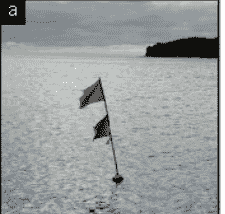

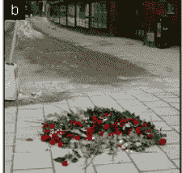

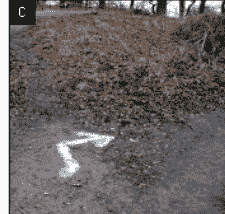

## 测试 II

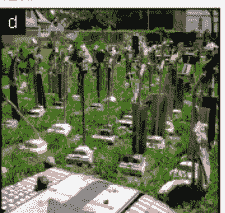


## 控制

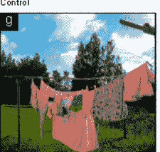

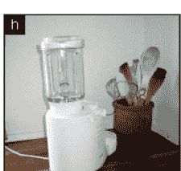


**图 1。** 三种条件的刺激图像示例。第一行描绘了实验刺激 I：利用物体作为信号的常规方式。第二行描绘了实验刺激 II：利用物体作为信号的非常规方式，第三行描绘了控制刺激：没有任何明显通信相关性的场景。

## 3.0 数据分析

我们的数据编码参考了内容分析（Neuenendorf, 2002）。该程序依赖于预先识别与预设假设相关的变量。原始数据（例如参与者的口头建构）随后可以根据预设变量进行编码。完成后，可以对编码材料进行总结，并测试其分布条件上的差异。在研究中，两种此类分析捕捉了图像描述的不同方面。此外，我们还使用了定性语义分析来识别参与者对场景探索中的细微差别。

第一种编码程序旨在评估与三种刺激条件下每个图像相关的类别直觉（信号 vs 非信号）。我们预测这将反映在口头报告中特定词汇项的分布上。因此，我们寻找了与通信和意义相关的术语以及话语标记（例如对发送者和接收者关系的引用），其类型如下方代表性示例中出现的那样。我们描述了一个控制组（图 1）和一个实验组（图 1c）：

- 那里有一点……有一点……嗯，那是什么？我想是一把扫帚。某个独裁者之类的……

- 那有一个箭头指向前景的画面，看起来就像这些吸尘器在某处移动……

（注：此处省略了原文中重复的 OCR 错误片段，已根据要求进行清理。）

## 表 1. 编码方案 I

| 代码 | 描述 | 示例 |
|---|---|---|
| A | 对通信术语的显式引用 | 名词：“符号”“艺术”“象征”“信息”等，或动词：“表达”“说”“指示”“展示”等。 |
| B | 对意义的显式引用 | 社会功能、情态、有动机的比喻或隐喻意义、对图像中不存在的物体或情况的有动机引用。 |
| C | 对话标记“发送者”的显式引用 | 与通信相关的动词的语法结构，如“某人”“一位艺术家”“你”等。 |
| D | 对话标记“受话者”的显式引用 | 对象的语法索引，如“某人”“你”“人们”等。 |
| E | 对非通信活动的显式引用 | 动词如“建造”“挂起”“穿”“制作”等。 |

用于图像多编码分析的编码方案。三位编码员根据方案中定义的五个维度对图像描述进行了独立评分。为了达到较高水平的客观性（以及编码间信度），该方案主要旨在指定易于识别的词汇项。

随后对每个参与者的每幅图像描述评分取平均值。使用单因素方差分析（ANOVA）测量了三种条件（实验 I、实验 II 和控制组）之间每个变量的统计学显著性差异。此外，使用 Tukey's MSD 多重比较检验执行了一系列计划的事后分析。两类分析均在 `MATLAB`（Mathworks Inc., Sherborn, Massachusetts, USA）中完成。

三位编码员之间的编码间信度针对每个变量和每个参与者通过一致率（PA）和 Cohen kappa（κ）（Cohen, 1960）在 `PRAM v 0.4.5`（Skymeg Software, Inc.）中进行，然后在参与者、编码员和变量之间平均（关于信度测量的讨论参见 Neuendorf, 2002）。

## 3.1 编码程序 I 的结果

单因素方差分析显示，不同条件下描述图像所使用的单词数量没有显著差异（F(2,15) = 2.86, p = .09）。因此，其他指标的显著差异不能归因于参与者报告长度的变化。

每个变量“非通信活动”在不同条件之间显示出显著差异。结果如下：通信：F(2/15) = 8.45, p = .0035；语义：F(2/15) = 13.64, p = .0004；发送者：F(2/15) = 6.57, p = .0089；受话者：F(2/15) = 3.88, p = .0439；非通信活动：F(2/15) = 0.68, p = .52（见表 2）。这支持了我们的假设。接下来，为了探索两个实验条件（常规和非常规信号），我们使用了一组两对事后 Tukey HSD 多重比较（阈值 = p < .05）。未发现显著效应。尽管这两个条件在语义方面显示出强趋势（实验 I：M = 59，对比实验 II：M = 39），但数据的变异性使得这种差异不显著。因此，虽然编码方案的定义变量成功捕捉到了构建物体场景作为通信信号或非信号之间的差异，但它们没有显示两个实验条件（常规信号与非常规信号）之间的对比。

编码间信度测量结果为一致率（PA）= 86，Cohen kappa（κ）= 0.56（Cohen, 1960），对应于“中等到良好”的一致性（Banerjee et al., 1999）。由于信度令人满意，这为统计分析提供了效性支持（Neuendorf, 2002）。

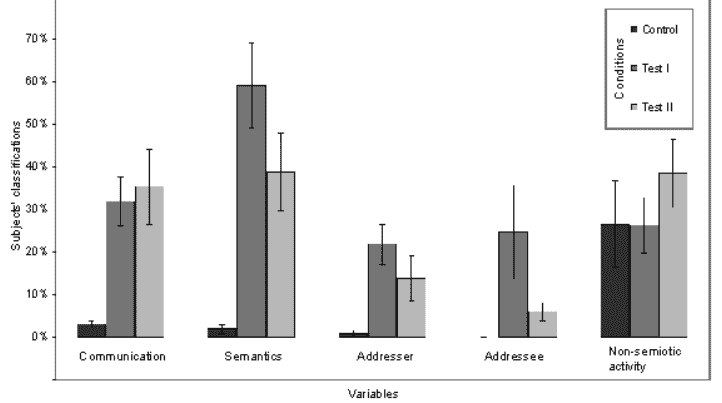

**图 2。** 表示三种条件相对于五个变量中平均分布差异的图表（“Test I”对应实验 I；“Test II”对应实验 II）。y 轴代表三位编码员对参与者图像描述加权评分的百分比汇总。误差棒表示标准误（SEM）。所有与通信相关的变量（通信、语义、发送者和受话者）在单因素方差分析中均显示出显著效应（p < .05），而通信中性变量（非符号活动）则没有。

## 3.2 编码程序 II：符号策略

虽然第一个程序探索了“信号与非信号”的对比，但第二个程序侧重于不同类型的意义构建策略。分析的动机是参与者在将自己的解释策略与实验条件和控制条件的图像对齐方面的相对倾向存在差异。正如第一个编码程序的结果所示，实验场景（但不是控制场景）的属性提供了解释性探索的符号策略。这些似乎受到主主性规范的引导。因此，我们评估参与者在理解实验条件图像时如何关注类似的意义构建策略。专注于社会/语义意义，我们更密切地观察相关的图像描述。由于问题涉及数据子集（即较小样本量），我们以较具定性的方式进行。

（注：提供的 OCR 包含大量重复，已整合为连贯的章节。）

### 在物质世界中实现符号赋能

## 表 2. 编码方案 II

| 代码 | 描述 | 示例 |
|---|---|---|
| Icon | 图标/审美策略：物体因其预期的质量而受到欣赏 | 显式引用艺术位置的方面，如对称性 |
| Index | 指示策略：物体被体验为社会命令 | 显式归属于感知者的义务意义，例如体现在情态动词中，如“shall”“ought to”“is supposed to” |
| Symbol | 符号策略：物体因其对任意意义的惯用引用而受到欣赏 | 显式引用文化用途 |

识别参与者在描述物质信号时所采用的不同符号策略的编码方案。专家编码员根据方案中定义的三个变量对参与者的图像描述进行评分。

## 3.3 编码程序 II 的结果

单因素方差分析显示，不同条件下描述图像所使用的单词数量没有显著差异（F(2,15) = 2.86, p = .09）。因此，其他指标的显著差异不能归因于参与者报告长度的变化。

每个变量“非通信活动”在不同条件之间显示出显著差异。结果如下：通信：F(2/15) = 8.45, p = .0035；语义：F(2/15) = 13.64, p = .0004；发送者：F(2/15) = 6.57, p = .0089；受话者：F(2/15) = 3.88, p = .0439；非通信活动：F(2/15) = 0.68, p = .52（见表 2）。这支持了我们的假设。接下来，为了探索两个实验条件（常规和非常规信号），我们使用了一组两对事后 Tukey HSD 多重比较（阈值 = p < .05）。未发现显著效应。尽管这两个条件在语义方面显示出强趋势（实验 I：M = 59，对比实验 II：M = 39），但数据的变异性使得这种差异不显著。因此，虽然编码方案的定义变量成功捕捉到了构建物体场景作为通信信号或非信号之间的差异，但它们没有显示两个实验条件（常规信号与非常规信号）之间的对比。

# 94 Kristian Tylén, Johanne Stege Björndahl, and Ethan Weed

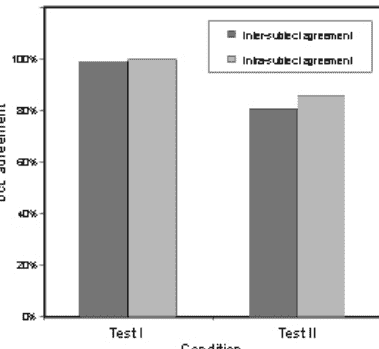

**图 3。** 表达了参与者在不同实验条件下选择解释态度的相对一致性（百分比）的图表。图中代表了两种一致性：(1) 主体一致性（两个或多个参与者在策略选择上一致的程度），以及 (2) 个体一致性（每位参与者致力于单一解释策略的程度，而不是在几种备选策略之间犹豫不决地游移）。

## 4. 讨论

两种编码程序的结果显示，实验场景与控制场景之间存在显著差异，支持了我们的假设。与上述神经认知场景并行，我们发现实验参与者在三种条件下提供语义可负担性（semantic affordances）的方式存在显著差异。编码程序 I 显示了受试者效应，影响了参与者如何分别从词汇上将实验与控制场景视为信号和非信号。在受试者间编码过程中，虽然对控制组的描述显示出差异，但实验场景通常表现出强烈的对齐倾向，表明了对社会规范的遵循。独立的是，参与者在应用不同的符号策略时，对特定场景进行了非常相似的描述。

虽然对非社会对象的感知是一种更私人的事务，特征是不受监管的、片段式的意义构建，但某些物体具有敏感特质，会改变参与者对构释的态度：它们提供了一种特殊的社会约束，限制了感知探索。正如口语构释所示，它们引发了对交流概念、社会意义和话语角更显性的引用。

第二个编码程序使用皮尔斯（Peirce）的符号分类（像、索引和符号）来探索意义构建的规范性方面。一个醒目的例子出现在实验条件下使用的两个图像描述中，实现了物质世界中的符号可负担性（图 1c 和 1d）。两者都描述了场景中心位置的一个箭头，但语境不同。在图 1c 中，面粉被洒在木森林的小径上形成一个箭头；而在图 1d 中，一个绘有箭头的路标落在草坪上，周围环绕着成排的旧吸尘器。虽然箭头可以被视为具有几乎固有语法意义的传统“符号”类型（Stjerfelt, 2007），但参与者对箭头的意义构释完全不同。在对图 1c 的描述中，参与者始终选择对箭头的指令/命令性解读。这体现在他们使用的表达义务意义（deontic meanings）的情态动词（如 should, ought to, have to 等）的数量是图 1d 的两倍以上（图 1c: 26，图 1d: 9）。这种解释在描述中非常罕见。在审美语境下，箭头并没有被体验为以指令或命令的方式向感知者发出。相反，它“只是指向那里”。这通过从图 1c 和图 1d 的描述中摘录得到了说明：

- * 你身处一片森林，那里有一个用白色粉笔画的箭头，我想，它指向右边，你可能不应该沿走正前方那条小路 (...)

- (...) (...) 在吸尘器阵列的前面，你看到一个路标，箭头指向前景，这个路标落在某个看起来像纸板的东西上，上面画着*美国国旗*。

与指令性信号相反，审美立场（吸尘器场景）的主体间相关性并非为了修改感知者的行为而构建的。因此，箭头被认为仅与配置的其他组件相关。

参与者不仅在将某些物体配置构释为主体信号方面达成一致，而且对各种场景的组合细节表现出增强的敏感性。因此，参与者在面对其社会构建的可负担性时，会对同样相似的物体（如箭头）赋予不同的意义。有趣的是，在此过程中，我们观察到符号物体配置的常规化程度如何影响感知者对审美态度的规范性对齐。虽然常规与非常规物体配置之间的区别在类别水平上（信号 vs 非信号）没有显示出显著影响，但在第二个编码程序中，它预测了参与者对齐其符号态度的倾向。与实验条件 1 中的常规风格信号相比，非常规信号的描述显示出较少的对齐构释。参与者倾向于采取自己的解读。

在参与者对图 1.e 的描述中可以找到一个说明性例子。图像描绘了一辆红汽车，挡风玻璃上有序地分布着一堆薄西红柿片。汽车显然停在停车场里的其他汽车之间。图像将参与者分成了使用解释框架的组。这通过两个描述得到了说明：

- 1) “我不认为它们是自然出现在那里的，所以我认为这是某种艺术表达，西红柿片放在那块窗户上的方式。我不确定它具体意味着什么。它可能是与红色的某种类比，或者我真的不知道。可能与健康有关，就像汽车被西红柿‘感染’了，或者类似的奇怪事情。”

- 2) “这是某种敌意行为，或者有人在汽车挡风玻璃上放西红柿片来开别人的玩笑。无论如何，这都是件奇怪的事。还不清楚是怎么回事。这当然是某人在和（或）朋友开玩笑。”

第一个例子代表了部分参与者如何对场景应用类像的、比喻的态度（与冰山或吸尘器并行）。一些参与者甚至暗示该场景可能是“一件艺术品”。相比之下，较小的一群既不欣赏其类像性，也不将其视为符号（如箭头）。场景的不非常规性是一种“敌意行为”或“恶作剧”。场景的新颖性通过其组合得以实现。在物体配置依赖于常规表达模式的范围内，这种实际过程变得不再监管且可能更具多义性。场景的新颖性通过其物品的良好排序得以实现。从这个角度来看，我们看到了两种解释（类像/审美），反映了不同的注意力策略。那些采取全局视角而忽略组合细节的人注意到停车场的景象。这个例子随后以有趣的方式补充了引言中提出的一般观点：对组合的有目的显性的识别增加了对潜力的敏感性（Tylén, 2007）；通过关注可用的主体间背景化，感知者实现了符号可负担性。

## 5. 结论

在本研究中，我们考察了一种特殊的社会意义构建活动，体现在我们如何将日常物品的新颖配置感知为交互的媒介。当配置以独特的方式排列或呈现时，这种情况就会发生。扩展最近的一项脑成像研究（Tylén et al., 2009），我们进行了一个实验，比较了参与者对三类常规材料信号、非常规材料信号以及无明显交流相关性的物体配置的随意理解。对参与者口语构建的分析显示，他们一致捕捉到实验（而非控制）条件下组合细节中的某些显性特征，并将物体配置视为“信号行为”。这种感知态度的转变体现在对交流及相关术语更显性的引用，以及在实验现实相对于控制场景描述中对话语角色（发送者和接收者）的引用。这不是由片段经验构建的私人感知模式，而是为了公共感知意义构建模式；这些场景的组合属性和物质环境的属性被实现为主间意义构建的来源。

然而，除了交流性与非交流性物体配置之间的类别区分外，我们还展示了对象的社会语境化如何调节参与者的解释态度。从参与者意义构建方式的巨大差异到对控制条件的图像，这些以有趣的方式与参与者处理实验条件图像对应。我们推测，这些对齐效应源于此类表达实践中共享规范的取向（这与“顶层交互”的想法不可比拟，Roepstorf & Frith, 2004）。我们的发现表明，我们对物体以及物质环境属性的参与作为跨主体间意义的媒介，应当被视为言语语言和手势等人类表达行为的延续。与言语表达不同，某些物体配置会激发体现意义的境域可负担（situated affordances）的激活。这一过程涉及到对动态物质的响应性敏感，以及对引导构建的调节规范的调适。

## 致谢

作者感谢 Stephen Cowley 对本手稿早期版本提供的详尽且见地的意见。此外，我们还感谢 Chris Frith、Uta Frith、Mikkel Wallantin、Andreas Roepstorf、Kim Mouridsen、Velux 基金以及丹麦国家研究基金的功能神经科学中心。

## 注释

1. 如 Tylén (2007) 所述，这可以被概念化为符号代理（semiotic agency），其本身就是一种显性行动（H. Clark, 2005）。

2. 大多数物质结构都为多种替代性的意义探索解释提供了空间（例如 Myers & Liben, 2008），这使得对言语发送者原始意图的注意和调适至关重要（Levinson, 1979）。

3. 例如 Cohen et al, 2000, 2002; Dehaene et al. 2002。

4. 详尽参考文献请参阅 Tylén et al, 2009。

### 在物质世界中实现符号可负担

## 参考文献

Arbib, M.A. 2005. "From monkey-like action to recognition to human language: an evolution-framework for neurolinguistics." *Behavioral and Brain Sciences*, 28: 105–167.

Banerjee, M., Capozzelli, M., McSweeney, L., Sinha, D. 1999. "Beyond kappa: a review of inter-rater agreement measures." *Canadian Journal of Statistics*, 27: 23–33.

Clark, A. 2006. "Material symbols." *Philosophical Psychology*, 19: 291–307.


Clark, H.H. 1996. *Using Language*. Cambridge: Cambridge University Press.

Clark, H.H. 2005. “Coordinating with each other in a material world.” *Discourse Studies*, 7: 507–525.

Cohen, J. 1960. “A coefficient of agreement for nominal scales.” *Educational and Psychological Measurement*, 20: 37–46.

Cohen, L., Dehane, S., Naccache, L., Lehericy, S., Dehane-Lambertz, G., Henaff, M.A., Michel, F. 2000. “The visual word area: spatial and temporal characterization of an initial task of reading in normal subjects and split-brain patients.” *Brain*, 123: 291–307.

Cohen, L., Lehericy, S., Coochon, F., Lerner, C., Rivaud, S., Dehane, S. 2002. “Language-specific tuning of visual cortex? Functional properties of the Visual Word Area.” *Brain*, 125: 1054–1069.

Dehane, S., Le Clec, H.G., Polline, J.B., Le Bidan, D., Cohen, L. 2002. “The Visual Word Form Area: A lexical representation of words in fusiform gyrus.” *Neuroreport*, 131: 321–325.

Donald, M. 2002. *A Mind So Rare: The Evolution of Consciousness*. New York: Norton.

Crowley, S.J. 2007. “How human infants deal with symbol.” *Interaction Studies*, 8: 81–104.

Crowley, S.J., Molly & Firth-Crowley, A. 2004. “Grounding signs of culture: primary interaction sociivity.” *Mind and Activity*, 11: 109–132.

Dietrich, H., Ulrich, L., Ischeckbeck, A., Ackermann, H. 2007. “Semiotics of nonverbal vocalizations: a functioning imaging.” *NeuroReport*, 18: 1891–1994.

Fodor, J. A. 1983. *The Modularity of Mind*. Bradford Books. Cambridge: MIT Press.

Gallagher, S. 2003. *Phenomenology and Experimental Design: Toward a Phenomenologically Enlightened Science*. In Jack and A. Rooerstff (eds), *The Use of Introspective Evidence in Cognitive Science*, Vol. 1, pp. 85–99. London: Import.

Gallagher, S., Zahavi, D. 2008. *The Phenomenological Mind: An Introduction to Philosophy of Mind and Cognitive Science*. London: Routledge.

# 莎士比亚剧场的语言化

**伊芙琳·特里布（Evelyn Tribble）**

新西兰奥塔哥大学

印刷版莎士比亚戏剧的丰富使得人们认为，这些剧目的表演是基于对语言精确逐字还原的理想化。然而，从莎士比亚生前流传的其他剧本版本以及我们对早期现代英国戏剧实践的了解，为我们呈现了一个截然不同的画面。这一时期的表演实践其特征是：即兴的当下语言化实践（包括表演中手势的使用）与基于“戏剧作为书面文件”这一新兴观念的新期待之间的张力。

**关键词：**分布式语言、手势、莎士比亚、剧场、书面语言偏见

## 1. 书面语言偏见与语言的编码观点

尼格尔·洛夫（Nigel Love）等人指出了铭刻技术在塑造语言“编码”观点方面的力量：“并不是语言本身是一种让我们能够将思想具象化的代码。相反，正因为（通过写作这一关键行为）我们将言语具象化——将其视为更抽象实体的实例——我们才（认为）发展出了一种编码”（Love 2004:542）。正如珀·林内利（Per Linelli）所指出的，持续的书面语言偏见侵蚀了语言学和文学研究。它将语言与书面语言模型隐含地等同“事物”，而非由“编码行动主体”产生的活跃、动态且分布的过程（Cowley 2007:577）。¹

这种强大的溯源导致了书面语言偏见产生了深远的影响。本文探讨了其中之一：隐含或显性的假设，即莎士比亚的文字被视为用于复制的代码，而不是一种约束（但不构成或决定）表演的骨架结构。书面语言偏见告诉我们，剧本由台词和舞台指示组成，可以通过多种方式复制，印刷文本对戏剧的具象化强化了这一观点。但如果我们从多模态的动态视角来看戏剧，就会得到一个完全不同的画面。对于15世纪90年代的演员来说，排演剧作不仅是从纸面到舞台的简单翻译，更是一种生产语言的行为。正如我将论证的那样，莎士比亚研究中的许多假设本质上基于对书面文字主导重要性的错误假设，以及认为演员持有逐字还原作者原话理想的假设。但该时期戏剧制作的环境使得此类假设变得怀疑。事实上，这些假设通常是强书面语言偏见的结果，这种偏见假设演员试图尽可能符合由剧作家本人授权的剧本版本。这导致上世纪末的编辑和编目学家将早期出版版本之间的差异，以及内部的不准确和不连贯之处，归咎于所谓的盗版者（pirates）试图通过记忆重构剧本的诚实尝试。在这种观点下，即兴、重复、犹豫和不连贯的迹象都是演员口头表演的印记，与剧作家纯净的书面文字形成对比。

## 2. 背景：早期现代剧场的表演条件

要理解表演的动态机制，理解该时期戏剧制作的实际、物质条件至关重要，这些条件与当今演员的经历大不相同。当时的情况大约是：演员每周排演最多六部不同的剧目，每两周还会学习并排演一部新剧。那里没有像现在这样的长演；一部剧可能每隔几周重复一次，而几乎没有听说过同一部会在连续几天内重复。没有导演，极少有集体排练，没有特殊的灯光，也没有实景。剧团本身相对稳定，由大约八位股份者（sharers）组成——即共同出资并管理演员的男性；以及大约八名作为剧团演员学徒的男孩，负责所有的女性和青少年角色。演员本人被赋予了几乎完全的权力，对舞台移动、道具使用、台词表达等做出决策；戏剧的大部分准备工作是个人对自己角色的“研读”（Stern 2000:12）。

三套书面文件被用于排演戏剧，均匀地分布在剧团中。每位演员都会收到自己的“分本”（part）：他的台词被手抄在长卷轴上，每隔2-3个词由提示词分开。入场、出场和主要的舞台动作被记录在“情节图”（plot）上，那是一张A-3尺寸的大纸，很可能贴在后台供查阅。最后，剧团的书记员准备“剧本全书”（play-book），即戏剧的完整记录。因此，没有演员能接触到整部剧——只有他们自己的分本，以及入场的示意大纲。

“剧本全书”对剧团非常有价值，原因有几个：首先，它是完整戏剧的唯一记录，以防任何分本丢失或转抄错误。书中还标注了至关重要的制作提示，特别是音乐和音效的提示，这些需要进行集中控制。最重要的是，它构成了一份官方法律文件。在伦敦，没有“游宴主管”（Master of the Revels）的签名，任何剧目都无法制作，这是一位高级宫廷官员，负责证明戏剧不包含政治或宗教颠覆性内容。官方规定是，演员不能说任何未在剧本全书中写记录的台词。在实践中，这一规则无法以任何有意义的方式执行（Potter 1986:87）；相反，它是为了惩罚任何在戏剧获得授权后引入拓扑敏感内容的尝试。

任何特定戏剧与书面文字的关系都是复杂的。我们太习惯于拥有印刷书籍，以至于忘记了精确对比口头表演与其书面对应物的能力是多么不寻常，这样做又是多么罕见。在如今的印刷世界里，莎士比亚的戏剧被教给学生，他们手里都拿着相同的剧本副本。封面之间的“文本”变成了“戏剧”。但对于早期现代演员来说，戏剧是什么呢？正如我们看到的，确实存在剧本全书，但只有一份，作为剧团官方工作文件的一部分被仔细保存。戏剧的印刷版本是少数例外而非常态，观众不太可能在脑中将表演构想为书面剧本全书的某个“版本”。早期现代演员会将戏剧想象为一种事件，它实时发生并在表演过程中构建，分布在各个个人分本中；物理道具和剧院环境中；演员之间的互动中；以及贴在后台的一页纸总结“情节图”。

## 3. 行动中的戏剧

戏剧从字面上来说是分布的，分散在各种器物中，只有通过提供协调活动“胶水”的“人类技术”才能实现，而研究这种活动变得“在协调的多样性和微妙性上非常丰富”（Kirish 2006:258；亦见 Sutton 2006）。正如我在其他地方论证的那样（Tribble 2005:139; Tribble 2011），制作戏剧的行为可以通过 Hutchins (1995) 描述的分布式认知模型进行有用的概括。

[第115页]

## 莎士比亚剧场中的语言行为

……一种个体心灵在孤立状态下运行的，并鼓励我们将复杂的社会文化系统的属性误认为是个体心灵的属性”（Hutchins 1995:81）。在这种叙述中，人类创建了基于某种约束系统的“智能”结构，而这种系统矛盾的是，它使得复杂任务得以执行。在现代海军舰艇上，这些结构包括图表、GPS系统、导航电子工具、控制室的物质配置以及船上生活的社会结构。Hutchins 认为：

> 人类思维的环境并非“自然”环境。它们是人造的，人类通过创造自己行使力量的环境来发挥其认知能力。到目前为止，我们花时间研究了这些作为认知活动组织者的环境，但对它们在构建思维中的作用却知之甚少（Hutchins 1995: 169）。

在这一点上，Hutchins 了一群在风暴过后占据海滩未翻动表面的蚂蚁。随着时间的推移，它们的活动留下了痕迹，最终组织了蚂蚁的活动，这些蚂蚁现在似乎是“通过与它们祖先行动历史的遗留物的简单互动变得智能的”（Hutchins 1995:169）。16世纪90年代的职业剧团正在专门建造的永久性剧院这一相对不受干扰的环境中，开发这些轨迹和路径径。对于早现代的职业剧团来说，类似的工具是剧场的物理空间、演员的身体（包括他们在空间中的移动、手势、与其他演员以及与环境的互动）、他们的专业水平，以及每个角色中诗歌的语言特征，这些特征构成了戏剧的语言“脊梁”。

为了更详细地阐述“脊梁”这一比喻：书面文字构成了戏剧的骨骼结构，没有它，戏剧就无法存在，或者至少无法与杂技或舞蹈等非语言艺术区分开来。在这里，与船上导航的类比失效了——导航这种时间紧迫、目标驱动的目标是从点A到点B的成功进展，而戏剧剧团类似的目标是成功的制作，这是一项跨越演员、观众和环境的协作努力。我们不应将表演行为还原为书面文字的再现，而应将其构想为各种人工制品、实践和社会代理主体成功的“认知整合”（Menary 2007:3）。

[第116页]

## 4. 舞台上的多模态动态

《哈姆莱特》开场白提供了一个具有欺骗性的简单例子，展示了早现代舞台运作的多模态动态：

- 两个哨兵巴纳多和弗朗西斯科上场

巴纳多：是谁？

弗朗西斯科：是

这些台词的成功表演涉及一个复杂的分布式认知过程，它需要：

- (a) 个体演员回忆台词以及更重要的是回忆提示词（cues）的能力；
- (b) 对入场惯例和舞台使用的知识；
- (c) 阐述第一句对整个场景含义的能力——“是谁？”意味着无法看见，反过来说明环境是黑暗的，这又要求演员利用其在表演方面的具身专业知识，而舞台本身完全被日光照亮，因为戏剧将在户外场地的下午2点开始；
- (d) 调用表演经验、文化图式，以及适合“哨兵”身份的演员、道具和服装的物质供应的能力；
- (e) 在戏剧“情节图”上定位自己入场并正确控制时间的能力；
- (f) 两个演员之间微妙且不断变化的协调。

演员并非简单地复述台词，而是参与到一种涉及物质和社会力量的混合过程中。事实上，对话性（dialogism）被内建在提示词脚本实践的制作过程中，因为记住如何说提示以及倾听自己的提示是维系整个制作的胶水——忘记提示词可能会导致整个场景像“纸牌屋”一样倒塌（Palfrey and Stern 2007:85）。随后，剧院构建了一个“生态社会符号环境”（Thibault 2005:123），它仅通过人、人工制品和空间之间活跃的协调动态起作用。

## 5. “权威”与表演动态

这种情况比这种叙述所允许的还要复杂，因为我们忘记了页面上的文字实际上具有多大的偶然性。为了说明舞台上的实际实践似乎超过了对书面文件的简单再现的一个具体例子，我们可以查看莎士比亚在其生前流传的替代版本的证据。

[第117页]

## 莎士比亚剧场中的语言行为

莎士比亚在其生前流传的戏剧。这是莎士比亚研究中一个极其复杂的问题，但对我们的目的来说，只需要知道：

- (a) 莎士比亚的37部戏剧于1623年由其剧团成员在遗后出版，收录于名为“第一全集”（First Folio）的精装印刷卷书中；
- (b) 这些戏剧中约一半在他生前也出版了，但显然经过了他的监督，以类似于今天平装书的廉价版本出版；
- (c) 这些版本中的某些版本彼此之间、以及与“第一全集”文本之间存在显著差异；
- (d) 《哈姆莱特》的情况尤为复杂，因为存在两个非常不同的廉价版本，通常（尽管是错误地）被称为“劣质开刻本”（Quarto 1）和“良好开刻本”（Quarto 2）（Wertine 1990:65）。

在不处理关于这些文本之间关系的无数问题的情况下，可以说，早期的莎士比亚研究侧重于建立它们的文本权威。然而，我们必须将焦点转向表演本身……（此处后续为大量重复性错误，已按指令要求清理）。

## 莎士比亚剧场中的语言实践

戏剧与演说实践。“动作”（action）与“韵律”（accent）、动作/手势/言语的结合，似乎是这一时期的常态，并源于古典修辞实践。也就是说，当演员学习剧本时，他们并不简单将其视为需要背诵的单词，而是将其视为语言与身体整合的骨架结构。这种学习角色的方法应该是动态的、建设性的且具象的，而不是一种死记硬背。借鉴《哈姆特》中“不要这样用你的手臂挥舞空气”的指令，许多戏剧历史学家得出结论：早现代剧团的运作是基于一套僵化、程式化的、通过背诵学习和传递的惯用手势构件的（Hattaway 1982:54）。即使是当代对手势的语言学研究也往往忽视排练过的手势；例如，McNeill 在演说者和演员使用的“编排式”手势与在线对话中的“自发性手势”之间划分了严格的区别（McNeill 1994:3）。然而，我认为，将动作和韵律纳入排练和制作过程的技术，并没有导致对固定书面文档的机械复制，而是是一种启动身体技术的手段，旨在保留并产生意义。

关于手势语言学家、认知心理学家和认知人类学家日益增多的文献消解了认为手势仅仅是随机挥手、单词与动作的拟态匹配或思维的正式补充的观点。许多研究表明，“手势为口头记忆带来了益处”（Goldin-Meadow 2004:402）。在题为《互补策略：为什么我们在思考时使用手》的论文中，David Kirsh 讨论了我们如何使用手来帮助思考、记忆、感知以及管理注意力的方式（Kirsh 1995:212）。手势成为一种“完整的策略”，被定义为“任何招募元素以减轻认知负荷的组织活动……手、手指和周围的物体被招用于认知使用”（Kirsh 1995: 212, 216）。在《想象事物的认知生命》中，Ed Hutchins 建议在某些语境下，身体本身可以成为一种认知人工制品，在其之上可以执行具有意义的环境耦合手势。在这种环境中，空间中的运动获得了概念意义，而推理可以通过移动身体来完成（Hutchins 2006）。思维的物质和身体“锚点”都可以用于管理注意力和记忆。

考虑到演员的活动具有时间紧迫的性质，以及流畅度和应对突发情况的重要性，他们必须是管理注意力和记忆的专家。证据表明，在背诵口头材料的同时，对手势进行阐述和编码是完成这些任务的主要手段。台词并非简单地朗诵；如果我们将词句视为骨架，那么手势就充当了系统，即语言人工制品被提升到体内的手段。如果我们意识到手势“不仅仅是挥手”（Goldin-Meadows 2003:12）或更正式的舞台表演，我们可能会发现什么启示呢？是否所有初级演讲者或演员都在痛苦地将动作模仿到单词上，且往往有些脱节或落后于正确的时机？但这正是我们对初学者的预想，因为学习任何技能的主要挑战之一，就是达到一个表演变得流畅且此前互不相关的技能变得整合的水平（例如，学习发排球或击板球（Sutton 2007)）。如果表演韵律和动作是相关领域，这些认知领域将被用于编码角色，线索脚本（cue-scripts）是个体学习主要的认知人工制品。要求单词适应动作、动作适应单词，这不仅仅是对表演的建议；它可能描述了文本本身被编码到体内的过程，而这种过程反过来被创建为表演中使用的互补策略，以执行深度编码，允许记忆使用多个钩子“钓鱼”，并在诗歌的语言限制上附加物理约束。

对这一论点的一个最直接的反对意见可能是：当 Goldin-Meadows (2004)、McNeill (1992) 和 Kirsh (1995) 讨论手势时，他们明确表示对排练过的或“惯用的”手势不感兴趣——也就是说，对他们来说，值得讨论的手势是在即时、面对面的讨论中产生的“在线”自发性手势。根据 Kendon (1988) 识别出的手势连续体，McNeill (1994) 仔细地区分了手势的临时语言工作与其在修辞学中的对应物。他写道，像昆西律这样的古典修辞学家，“指定了可以在编排的演示中被设计成刻意的手势。因此，它们与本书的主题的自发性手势完全不同”（McNeill 1994:3）。


这种自发性手势与编码手势之间的区分过于生硬。诚然，像昆西律这样的修辞学家编写了将手势编码的实用指南，这些指南有时被视为演员和修辞者依赖于背诵学习的静态手势储备的证据。在这种观点下，编码角色将涉及动作和韵律的常规匹配。但得出这一论点是将系统的系统化与混乱的细节混为一谈——这类似于将字典的系统化与其所声称代表的实际学习实践混为一谈。事实上，昆西律特别建议年轻演说者“提前背诵他们的手势”（Quintilian 2001: 109）。认为一个系统是可以被描述的，并且因为它是作为一种“艺术”存在的，所以它在定义上某种程度上是不真诚且仅仅是机械的，这种想法代表了对早期现代手势真实动态的误解。相反，手势是舞台上实践的即时语言行为的重要组成部分。

## 7. 语言实践的局限：作者与小丑

对莎士比亚作品与“语言实践”关系的完整说明，必须注意到新兴的书本剧场与剧中强烈残留的物理“呈现式”（Weimann 1998）元素之间的张力。回到《哈姆特》，我们可以看到这些张力在虚构故事内部发生，在哈姆特对访问演员的讲话中，这些演员即将作为剧中一部分表演（3.2）。在其他指令中，哈姆特关注小丑（Clown）的角色，小丑在剧团中的工作是在剧作内部提供身体和语言幽默，并作为随后表演的“吉曲”的领队。哈姆特建议：

> 让那些扮演小丑的不要超过为他们设置的内容。因为对于他们来说，为了让一些乏味的观众也随之笑，剧中的某个必要问题就会变成：那是勇敢的，显示了那个傻子可怜的野心（Irace 1998:67; Sc. 8:17–21）。

在这里，呈现式即兴表演与剧本之间的张力变得显而易见。在这种观点下，小丑和剧作者争夺剧情的控制权。小丑试图超越作者的指令——即“多于剧本设置的内容说话”——通过简单的大笑动作来诉诸观众，这种非语言的言说感染了观众，让他们也跟着笑。随之而来的混沌压了精心构建的情节，观众对情节的“必要问题”表现出毫无兴趣。在这里，语言实践和小丑的身体动作与剧作者的词句处于对立状态。

在所谓的劣质本（bad quarto）中，哈姆特详细阐述了书面文字与语言实践之间的竞争：

> 然后你还有另一个小丑，他保持着一套特定的笑话，就像人通过一套衣服被认出来一样，绅士们在来剧之前无法在桌上预知他的笑话，例如，“不能说我不能说吃我的粥”；以及“你们的啤酒酸了”，并且嘴唇嘟嘟嘟囔着，心里记着他的五连套（cinquepace）笑话，而天知道，那个热心的小丑除非偶然，否则根本无法说出一个笑话（Irace 1998:67–68; Sc. 8:21–38）。

哈姆雷特在这里描述了关于戏剧目的这一问题的根本性分歧。对于这位王子来说，戏剧由其书面呈现形式组成，由作者控制，由演员传递，并由观众消费，这是一个严谨的过程，确保了情节的“必要要点”在一种高效传播的模式中得到传达。但他对戏中实际表演内容的描述与这一模型有显著不同。在这一版本中，“绅士们”去看戏并不是为了遵循复杂情节，也不是为了欣赏构思精妙的诗歌，而是为了享受熟悉感的乐趣。这些绅士已经写下了他们要去看的内容——在他们的笔记本上记录了他们期待小丑表演的段子。诸如“你不能等我吃完粥再吗？”或“你的啤酒酸了”之类的短语几乎没有表征内容——或许它们已经脱离了关于吃饭和饮水的戏剧化表现。它们是把观众和演员绑定在一种体验中的口号，这种体验不能被看作是以任何方式推进论点或情节，而是唤起了对熟悉段子流动的愉悦，就像今天的音乐会观众要求他们喜欢的乐队演唱熟悉的老歌一样。小丑与观众的动态可以被看作是实现价值的语言手段的一种实例（Hodges 2007:585）。在这种情况下，看戏与其说是关于表演者与观众之间的协作社会动态，不如说是关于“倾听”。

存在于伊莎莎时代剧院小丑的关键作用之外。对于早期现代的观众来说，看戏不仅仅是观看一个自成一体的虚构戏剧表现。剧院里的戏剧总是被歌曲、淫秽的舞蹈所吸引；这些并不是粗浅的过场，而是观戏体验不可或的一部分（Wiles 1987）。伴随着歌曲、最重要的是舞蹈的剧院滑曲（Wiles 1987）。在正剧结束后，舞台会交给剧团的小丑，由他主持滑曲，滑曲往往会蔓延到观众，有时会导致混乱的结果（Baskerville 1929: 16）。当然，哈姆雷特声称，小丑本身可能试图将他的段子引入戏剧本身，通过夸张的表情（“嘴唇嘟嘟”）或淫秽的舞蹈（段子的连串）。对权威的蔑视引起了知识分子大学大学生哈姆雷特的反对。事实上，在剧早早期哈姆雷特就表现出对波洛尼亚斯戏剧品味的蔑视，当他说：“他为了一个滑曲，或者一个色情故事，否则就是睡着了”（Irace 1998:65; Sc. 8: 322）。

许多莎士比亚学者一直无法抵御住将哈姆雷特视为戏剧传声筒的诱惑。在这种叙述中，剧作家莎士比亚利用他的角色来谴责我一直描述的那些语言实践。将莎士比亚与哈姆雷特等同并没有必然依据。

莎士比亚自己的立场——既是一个演员也是一名剧作家，经常为他的社会上级表演——与其更像那些无名演员，而不是像那些为了工作而工作的贵族业余专业人士。至少，我们需要承认这里运作的“作者的笔与演员的声音”之间的紧张关系（Weimann 2000:6）。事实上，在说这些台词时，角色哈姆雷特必须模仿“他所描绘的那种即兴的、‘口语的’戏剧”（Marcus 1996: 174；另见 Johnson 2003）。

## 8. 结论

莎士比亚的作品之所以与分布式语言领域相关，是因为他所处的那个关键历史时刻，在那个时刻，戏剧处于表演与诗歌之间的悬而未决。在莎士比亚写作时，他的戏剧以及其他人的戏剧质量和大型合订版的出版已成为一种溯溯形成的过程，这一过程最终将戏剧从“行为”变成了“对象”。印刷戏剧在这一时期是一个新现象，它最终改变了剧院的认知生态，将重点转移到了戏剧的脊部而非其现场特性。这种转变在本·乔森出版他的《作品集》（Workes，1616）中显而易见。乔森深受同时代的嘲笑，他们嘲笑称之为“作品”而不是“戏剧”。这一过程在莎士比亚去世后继续，他的戏剧同样在1623年的《四开本集》中被汇编。在此期间，我们发现了其他剧作家试图将其作品固定为文学表演的证据；当马辛格在1626年出版他的剧《罗马演员》时，这位作家菲利普·马辛格区分了他的“诗篇”与无知者喜好的“滑曲”（Massinger 1626）。将戏剧描述为“诗篇”是一种将其置于文字领域的手段，使其免受与滑曲等低端即兴、行动导向型类型的影响。

哈姆雷特是否反映了莎士比亚自己的观点——这是一个无法解决的问题——但最终占据主导的是哈姆雷特版本的“戏剧”。文本的丰富遮蔽了伊莎莎时代剧院的真实体验，这种体验包含了歌曲、舞蹈、即兴片段、观众与演员之间的语言战斗、景观和滑曲（Hattaway 1982）。然而，除了零散的引用和目击记录外，我们拥有的莎士比亚戏剧只有流传下来的书面文本。因为这是我们所拥有，所以倾向于认为这就是它们的全部。

## 注释

1. 关于“分布式语言”运动的讨论，见 Cowley (2007)；关于语言与分布式认知之间的关系，见 Cowley (2004)。
2. 关于这些的批判性描述见 Werstine 1990。
3. 这一时期在音乐方面也发生了类似的过程，见 Sloboda (2005) 关于。

## 参考文献

- Bartlett, F. 1932. *Remembering*.
- Baskerville, C. 1929. *The Elizabethan Jig and Related Song*.
- Bentley, G. 1984. *Profession of Player in Shakespeare’s Time*.
- Cowley, S. 2007. “The cognitive dynamics of distributed language”. *Language Sciences* 29:575–583.
- Goldin-Meadow, S. 2003. *Hearing Gesture: How Our Hands Help Us Think*.
- Goldin-Meadow, S., Nussbaum, H., and Wagner, S. 2004. ... *Journal of Memory and Language* 50: 395–407.
- Hattaway, M. 1982. *Elizabethan Popular Theatre: Plays in Performance*.
- Hodges, B. 2007. “Good prospects: ecological and social perspectives on conversation”. *Language Sciences* 29:584–604.
- Hunter, I.M. 1984. ... In M. Kirsti, J. Lagersperch, and P. Niemi (eds), *Psychology in the 1990s*. Amsterdam-dam: North-Holland, 425–440.
- Hutchins, E. 2005. *In the Wild*. Cambridge: The MIT Press.
- Hutchins, E. 2006. “The cognitive life of things”. Presented at the symposium: “The Cognitive Life of Gestures: Recasting the Boundaries of Mind”. Organized by Colin Renfrew and Malafurus at the McDonald Institute for Archaeological Research, Cambridge University, April, 2006.
- Irace, K. 1988. *The First Quarto of Hamlet*.
- Jenkins, H. 1982. *Hamlet: The Arden Shakespeare*.
- Johnson, N. 2003. *The Actor as Playwright in Early Modern Drama*.
- Kendon, A. 1988. “How gestures become like words”. In F. Poyatos (ed), *Cross-cultural Perspectives in Nonverbal Communication*. Toronto: Hogre Press: 131–141.
- Kendon, A. 2004. *Gesture: Visible Language as Utterance*. Cambridge: Cambridge University Press.
- Kirsh, D. 1995. “Complementary strategies: Why we use our hands when we think”. In J.D. Moore and J.F. Lehmann (eds), *Proceedings of the Seventeenth Annual Conference of the Cognitive Society*, 212–217.
- Massinger, 1626.
- Marcus, 1996.
- Sloboda (2005).
- Weimann, 2000.
- Werstine 1990.
- Wiles, 1987.

# 莎士比亚剧场中的语言

Kirsh, D. 2006. "分布式认知：一种方法论说明。"*Pragmatics & Cognition* 14(2): 249–262.

Linell, P. 2005. 《语言学中的书面语言偏差：其本质、起源与转型》。伦敦与纽约: Routledge。

Love, N. 2004. "语言是数字代码吗？"*《语言科学》* 26: 525–554。

Marcus, L. 1996. 《重审文艺复兴：莎士比亚、马洛洛、密尔顿》。伦敦与纽约: Routledge。

McNeill, D. 1994. 《手脑：手势揭示了怎样的思维》。芝加哥：芝加大学出版社。

McNeill, D. 2005. 《手势与思维》。芝加哥：芝加大学出版社。

Maguire, L. 1996. 《莎士比亚疑义文本：“坏”开本及其争端》。纽约与剑桥: 剑桥大学出版社。

Massinger

Menary, R. 2007. "写作即思考。"*《语言科学》* 29: 61–32。

Palfrey, S. and Stern, T. 2007. 《分角的莎士比亚》。纽约与牛津：牛津大学出版社。

Potter, L. 1986. "没有人是完美的：演员的记忆与16世纪90年代的莎士比亚剧作。"*《莎士比亚季刊》* 42: 85–97。

Quillian, 2001. 《演说者的教育》。D. Russell (编)。马萨诸塞州剑桥：Loeb。

Rubin, D. 1995. 《口头传统中的记忆：史诗、民谣和数数歌的认知心理学》。纽约：牛津大学出版社。

Sloboda, J.A. 2005. 《探索心灵：认知、情感、能力、功能》。牛津：牛津大学出版社。

Small, J. 1997. 《心灵的蜡板：古典古代记忆与读写能力的认知研究》。伦敦与纽约: Routledge。

Stern, T. 2000. 《从莎士比亚到谢里丹的排练》。牛津：Clarendon Press。

Sutton, J. 2006. "分布式认知：领域与维度。"*Pragmatics & Cognition* 14 (2): 235–249.

Sutton, J. 2007. "击球、习惯与记忆：具身认知与技能的本质。"收录于认知与哲学特刊：《社会中的体育》10: 5。

Thibault, P.J. 2005. "大脑、身体、活动语境化的活动与语言。人类（以及倭猩）拥有语言能力，它们可以在没有语言的情况下做到这一点吗？"*《语言与人类科学》* 1: 99–125。

Tribble, E. 2005. "环球剧场中的认知分发。"*《莎士比亚季刊》* 56(3): 135–55。

Tribble, E. 2011. 《环球剧场中的认知：莎士比亚剧场中的注意与记忆》。纽约：Palgrave Macmillan。

Weimann, R. 2000. 《作者的笔与演员的声》。剑桥：剑桥大学出版社。

Werstein, P. 1990. "关于印刷莎士比亚文本的叙述：‘草稿’与‘坏’开本。"*《莎士比亚季刊》* 41(1): 65–86。

Wiles, D. 1987. 《莎士比亚的小丑：伊丽莎白时代剧院中的演员与文本》。纽约与剑桥: 剑桥大学出版社。

# 符号认知与文化逻辑

Barend van Heusden

荷兰，格罗宁根大学

在本文中，我论证符号认知是一种独特的认知形式，它必须从更早的非符号认知形式演化而来。符号认知依赖于符号的使用。符号的理解是基于认知过程的特定组织或结构。符号认知是人类特有的一种认知形式，符号化为一种演化发展提供了基础结构，这种发展不再是严格遵循达尔文主义，而是遵循其自身的——符号——逻辑。在处理无处不在的差异的日益抽象的方式中，我们发现了这种文化演化的逻辑，它决定了长期变化的进程。

**关键词:** 认知，文化演化，意义，符号认知

## 1. 认知与表征

在进化过程中，通过变异和选择，生物物种获得了各种反应模式。这些模式确保了物种在特定环境中的生存，大多数是基因编码的，但有时是单个动物通过模仿或模仿物种的其他成员学习到的。这些反应模式构成了有机体的*记忆*（包括个体和物种的记忆）。它们为有机体提供了环境的*表征*（参见 Changeux 1997:115）。我们不需要假设表征本身是文化性的或符号的，甚至是“理性的”，正如例如 De Sousa (2007) 所认为的那样。我们不需要将表征构想为有机体神经系统“内”的图像，或由小人感知、识别或解码的编码信息（参见 Clark 1997:143f）。环境表征是神经感觉-运动活动的模式。如果这种模式被激活，环境对有机体而言就具有了意义。

在进化过程中，通过变异和选择，生物物种获得了各种反应模式。这些模式确保了物种在特定环境中的生存，大多数是基因编码的，但有时是单个动物通过模仿或模仿物种的其他成员学习到的。这些反应模式构成了有机体的*记忆*（包括个体和物种的记忆）。它们为有机体提供了环境的*表征*（参见 Changeux 1997:115）。我们不需要假设表征本身是文化性的或符号的，甚至是“理性的”，正如例如 De Sousa (2007) 所认为的那样。我们不需要将表征构想为有机体神经系统“内”的图像，或由小人感知、识别或解码的编码信息（参见 Clark 1997:143f）。环境表征是神经感觉-运动活动的模式。如果这种模式被激活，环境对有机体而言就具有了意义。

在进化过程中，通过变异和选择，生物物种获得了各种反应模式。这些模式确保了物种在特定环境中的生存，大多数是基因编码的，但有时是单个动物通过模仿或模仿物种的其他成员学习到的。这些反应模式构成了有机体的*记忆*（包括个体和物种的记忆）。它们为有机体提供了环境的*表征*（参见 Changeux 1997:115）。我们不需要假设表征本身是文化性的或符号的，甚至是“理性的”，正如例如 De Sousa (2007) 所认为的那样。我们不需要将表征构想为有机体神经系统“内”的图像，或由小人感知、识别或解码的编码信息（参见 Clark 1997:143f）。环境表征是神经感觉-运动活动的模式。如果这种模式被激活，环境对有机体而言就具有了意义。

与环境的有意义的互动带来了某些风险。情况要么被识别，要么就没有——在意义上它们并不存在（当然，对于观察者而言）。如果发生了某些事情却没有匹配怎么办？如果没有任何反应呢？正如我所说的，从观察者的角度来看，有机体要么幸运，要么死亡。在后者的情况下，从有机体的角度来看，生命停止了。因此，整个系统在相对稳定的环境中运行良好。在发生变化的情况下，有机体手无策策（或脚），只能希望变异能提供帮助。最终，如果动物能够学习，它们可能会通过试错获得成功。如果不能，糟糕的是，许多物种无法足够快地适应。

## 符号认知与文化逻辑


从人文角度来看，将动物世界视为充满意义的世界并非显而易见。它需要某种思维的转变。学者们习惯将意义视为人类文化的事物，并与意图性以及符号、语言直接相关。这使得人们难以接受例如，狮子发现、追踪并捕获猎物可以被认为是有意义的。如果意义作为一种没有进一步说明的单一现象，在所有生物中都能发现，那么我们就不必专门为人类意义烦恼。重要的是，我们可能可以使用研究其他生物的方法来研究人类意义（甚至可能研究机器，因为不能排除机器存在意义）。人类是动物物种，正如通过鸣叫和交谈来了解鸟一样，为什么要大费周呢？我们在某些方面可能更复杂，但本质上并没有区别。

在语义学中，这种观点是由`Charles Morris`在 1938 年在《系统百科全书》框架首次提出的符号理论。类似的观点似乎证明了`Mesoudi`、`Whiten`和`Laland (2006)`制定一种统一的文化演化科学的尝试。这些作者自信地声称，“文化表现出达尔文式的进化特性。”如果接受了这一点，”他们说，“意味着用于研究生物演化的相同工具、方法和途径可以成当地应用于研究人类文化，而且，文化演化科学的结构应该大致类似于演化生物学的结构”（同上：329）。将生物学方法和工具转移到人类文化研究似乎是因为非文化（生物）与文化之间的相似性是合理的。根据作者的观点，事实上这两个领域的底层过程如此相似，以至于我们预期对应关系（同上：330）。

## 2. 差异

> 无必要不增多实体（`Entia non sunt multiplicanda praeter necessity`）

从方法论的角度来看，这种观点对应的文化是：上一节描述的行为学方法似乎足够合理。如果没有必要，我们在处理人类问题时应该避免提议一个独立的“意义”概念。这对于人类文化的定义也是如此。因此，人类文化变成了人类（再）反应模式的集合。再次，这似乎没有任何问题。与所有其他生物一样，我们对环境做出反应——我们喜欢或不喜欢，珍惜或恐惧某些情境，并根据遗传或社会习得的模式行动。

与这一观点相对应的文化定义是`Richerson`和`Boyd (2005)`的，他们将文化定义为“通过教学、模仿和其他形式的社会传递从物种其他成员那里获取的、能够影响个体行为的信息”（同上：5；该定义也被`Mesoudi`、`Whiten`和`Laland 2006`引用过）。如果我们重新表述这个定义，即如果从物种其他成员处获取的信息影响了个体的行为，那么它文化。因此，“文化”是“学习行为”的同义词——这是弗兰斯·德瓦尔（`Frans De Waal, 2001`）等灵长类学家会认可的定义——因为这意味着许多动物也有文化。显然，在社会背景下获取的信息影响个体行为的方式，要么是无关的，要么是显而易见的。这个定义以及底层理论的问题在于，某些形式的文化是可以学习的，而文化本身不能。人可以学习语言，但不能学会“具有语言能力”。人可以学习一种文化，但不能学会“具有文化性”。人类学习文化是因为他们是文化性动物。作为学习行为的文化理论无法解释人类文化的两个相关特殊之处：解释性和创造力。

人类在某些（尽管并非所有）其他生物方面似乎在做一些稍微不同的事情——并非总是，但往往如此——他们的反应模式中，在使用记忆的方式上，与我们在生物世界的其他地方发现的形成了对比。这是一种微小的差异：人类识别情境并基于行为模式的匹配，但奇怪的是，他们可能会识别出一个情境或事件。认为，这导致了人类文化。在我们的术语中，人类经历了意义的缺失。这种对缺失或差异（相对于习得的行为模式）的意识，甚至是基础认知：我们识别到的“不是之物”，与用于识别的模式永远是不等同的。我们并不生活在表征之中，现实与我们的表征并不重合。人类不仅识别并在或多程度上稳定的模式上行动，他们还无法`识别`模式。让这更令人惊讶和不安的是，他们在大多数时间里是同时这样做的。但一个生物如何在`识别`某事的同时，`识别`另一事呢？上面我论证过，对于生物来说，意义的缺失与缺失是一致的它不存在，至少对于生物自身而言如此。然而对于人类来说，他们记忆的内容与“此时此刻”（这一点将有更多论述）之间的这种差异是常有的。它直接关系到我们的现实感、时空感以及自我感。我们可以试图消除它——人们可能会想到这些不同的事物——如精神科的隔离室或冥想技巧——但此类尝试通常注定失败。将人类认知以及人类文化与其他生物区分开来的无，而是意义的`缺失`。这种缺失在人类认知中的存在是非常奇异的。然而，人们可能会问这种能力有什么用——它不是一种细微差别吗？其次，它在生物学上如何实现？第三，它在进化中是如何出现的？关于人类文化和文化演化的理论面临着挑战，即解释生物进化是如何产生人类文化的特异性的。

我想提出的假设是，意义的缺失，以及人类现实感、时间和空间概念的出现，是对信息进行`双重处理`的结果。人类认知依赖于一种特殊的表征系统（或“模式匹配”），我们处理所看到的和听到的内容。我们在`同时`以稳定模式的维度来处理这些信息。这种双重处理的结果是两者之间的`差异`：首先是与我们所说的`记忆`相对应的稳定模式，其次是一个不稳定的、持续变化的模式，我们称之为为`现在`的`此时此刻`（`here and now of`）。在有意识的人类大脑中，这些模式从未完全合并。

这种无处不在的差异所产生的深层歧义，并不是我们所知的那种形式上的歧义，例如对同一个图形的两种互斥的解释（如心理学教科书中著名的鸭兔图）。这种`符号学`上的歧义是模式（`semi`，符号、脚本或类型）发生的内在属性——这里的“发生”是一个容易描述的词，但其内涵非常难以捕捉。某些东西——事实上是被感知到的——既是 A（稳定模式）又是`非 A`（一个不稳定的模式）。此外，发生的`非 A`总是`~A`；它在任何时候总是“与 A 大致相似”。这种同一性（`模式`）与差异性（构成“发生”（`occurrence`）的不稳定的、变化的模式）的统一，似乎是人类文化的起点。根据假设，这在神经生物学、认知和进化上都是成立的。

这种同时存在的稳定与变化模式之间、记忆与发生之间的差异，被命名为上帝、无、空、物自身（`Ding an sich`）或不可言喻（`je ne sais quoi`）。可以说，它是人类处境的基础。它一方面令我们背负着一个巨大的工程：在一个连贯的世界、时间和范围内行动，而这种差异必须被克服、解决或消除。此外，我们从未成功地彻底消除它。差异首先产生了怀疑、不确定性、恐惧和攻击性，甚至是疯狂。它还让我们从大多数（或所有）其他生物所处的持续“此时此刻”中解放出来。通过这种方式它赋予了我们独立于事实本身去处理环境的自由；它赋予了我们幻想、神话、宗教、技术、艺术、科学以及哲学。我们在想象中构建的世界让我们能够以比其他生物更复杂的方式应对变化——看出其收益并不难。

如果下面的假设是正确的，我们应该从两个方向进行进一步调查。“向后”，是为了发现并解释这种处理是如何导致了人类的演化的。这是演化心理学的主题。以及“向前”，是为了发现，人类认知的特殊结构是如何影响人类文化的演化的。

让我们简要观察人类双重处理能力的可能进化过程。这种能力很可能利用了人类大脑强大的侧脑化。我并不是想暗示侧脑化导致了人类文化，但我怀疑侧脑化已经存在（可能赋予了灵长类左右手用性），它允许具有立体视觉的动物以稳定和变化的模式对视觉和听觉信息进行双重处理，这导致了视觉输入在两个半球之间100%的同一。这种协调处理需要一个同样存在的“首席执行官”，正如`Elkhorn Goldberg (2001:2:11)`所命名的那样。

另一侧（被识别为“现实”、“实体”、“对象”、“物自身”等）是一个不断变化的情境。现在，记忆可以独立于实际发生的过程进行存储和处理。稳定的记忆被用于识别、赋予形式或“阐释”一个不断变化的现象世界。^10 显而易见，如果可用的记忆集足够庞大，这种发展将产生最大的价值。这两个因素（大量的记忆集和一个强力比较器）都需要大脑来完成。从假设上说，这也许就是人类脑部在 200 万年前到 150 万年前之间变得如此巨大的“迫切理由”^11，以及为什么为如此庞大的大脑付出的代价是值得的。

## 3. 文化演化

第二组问题与人类文化的演化有关。生物演化导致了双重处理能力。进一步的适应，例如人类大脑皮层的增长——例如为了容纳语言和逻辑模式——可能并没有改变基本结构，而是对其进行了详化。因此，在相对较小的适应（比较黑猩猩和人类的 DNA）^12 的基础上，一种新的结构可能会出现：即人类文化。它允许“记忆内容”独立于发生过程而发展，极大地扩大了对变化环境的可能反应范围。但这种生物结构是否也影响了人类文化的演化？如果是，又是怎样的？

正如我们所论的，在认知中，稳定的模式（记忆）与变化的模式（情境或事件）相关。稳定的模式或符号被用于识别（赋予形式、阐释、指示）构成事件的更浮动的模式。事件的此时此刻，反过来，不是符号的部分——它是“现实”、“世界”、“对象”——尽管它是基于记忆的建构。认知之间的差异并非我们记忆的建构，而是看似至关重要的东西。在认知中，人类是意图性的（`intentional`）或符号性的。^13。根据本文提出的观点，这需要的不是新的“符号”器官，而是对信息处理结构的系统性重组。因此，符号不是一个“东西”，而是一种特定的信息处理、表征或认知方式。双重处理已经存在，稳定的记忆领域与变化的当下领域伴随着它们之间的关系共同出现。正是这种关系我们开始想象为“意图性”或“关于性”（`aboutness`）。这种“关于性”发展出的多种形式证明了人类文化的复杂性。符号是关于世界的，它们构成了一个想象的世界，但它们不是世界——也就是说，差异永远无法被消除。差异在这里是持久的，作为符号过程（即人类文化）的持续触发器和动力发挥作用。

到目前为止，我主要关注感官信息的处理。但故事中显然也有动力部分。表征支配着我们的行动——因此，双重处理也导致了一种新类型的行动：即我们通过表现（`act out`）稳定的模式或记忆来行动。事实上，人类也具有双重性。他们一方面包含一个符号，另一方面包含实相。行动的双重性导致了手势的出现，以及也被被识别为“符号”或“文本”的人工制品。虽然它们始终是某种东西，但这种东西可能不是正在发生的情境（或现实），而是别处的情境（并且，可能在另一个时代）。因此，当我坐在餐桌旁时，我可能在想那个早先发生的事件会变得非常强烈——“心里面充满什么，口就说什么”（路加福音6:45）。符号被表现或“外显化”^14，我们的思想变得可感知，我们可以与它们交流并将它们存储在外部记忆存储系统中（`Donald 1991`）。

交通标志特别有趣，不仅是因为它们具有稳定的惯用意义，还因为它们明确地作为符号发挥作用。交通标志通过赋予变化的现实（例如交叉路口）符号所赋予的形式来稳定行为模式；交通标志所赋予的并非如所断言的那种惯用意义。相反，重要的是它所稳定或指示的那个变化的现实的部分。我认为，这一原则应该是实用用主义人类文化理论的核心：人类文化是一个认知过程，在这个过程中，或或少稳定的记忆被用来处理不断变化的世界带给我们的差异。我们可以将符号定义为“用于识别变化的现实的稳定记忆”。此外，文化是我们在记忆上进行的工作，为了优化这一功能。

作为符号化或文化认知基础的双重处理，面临着一个“双重范围”^15的问题，必须通过成功的行动来使之成为可能。这是文化的根本动力：人类必须处理感知中出现的问题。他们将以各种方式解决问题。这些问题也赋予了他们某种自由——即针对可用记忆的选择自由。

处理差异的方式将决定人类文化的演化：如何能高效地存储记忆，以及如何高效将它们与变化的现实联系起来——也就是说，尽可能安全且具有经济效益？人类曾尝试以许多不同的方式来应对这种变化的现实，这些尝试的故事就是文化演化的故事。通过信息处理系统的双重化——基本上是感知表征的双重化——一种由`Donald (1991:124–161)`描述并在由`Frans de Waal`在黑猩猩和倭猿中研究的“情境文化”（`episodic culture`），可能变成一种符号文化。模仿行为与情境文化中的行为不同。这是因为情境性模仿遵循对行为的复制，而模仿性符号化或拟态（`mimesis`）允许了一种新的表征方式。拟态模仿是关于行动的。通过模仿，稳定的符号记忆或符号以听觉和视觉符号的形式出现。^16 那么在第二阶段，那些相对于现实感知变得自主的记忆，是想象可以生长的基础（`Modell 2003:111`。）。通过想象操纵记忆奠定了技术基础：人工制品的制造和使用。在第三阶段，对稳定模式（例如）的表现变得越来越“图式化”。这允许了我们识别为概念的表征的发展。这些符号不再是单一实体（图像或人工制品），因为它们变成了双位实体，存在于身体或语音手势的图像与情境原型图像之间。抽象的概念思维产生了概念意义。斐迪南·索绪绪（`Saussure 1916:155–169`）明确指出概念产生于标准的图像以及与这些图像相关的动作（著名的“语音图像”）。语音手势或口语的出现可能是这一演化过程中的一个关键阶段。在随后的阶段，人类概念的世界将遇到无法操纵的东西——必然性。必然性的发现（可能仅发生在 7 万到 5 万年前，并可能与图形符号的发现和发明有关）成为文化中一个新的演化发展基础——理论思维（`Donald 1991:269–360`）。这创造了前所未有的创造力爆炸（参见`Mithen 1996, 1998`）。由于演化过程的累积特性（早期阶段没有被放弃而是被整合），随着每个新阶段的出现，包括自我、社交互动和物理环境在内的世界符号复杂性增加了。^17

| 符号化 | 顺应（`accommodation`） | 同化（`assimilation`） |
| --- | --- | --- |
| 具体/特殊 | 感知 | 想象（工具使用） |
| 抽象/一般 | （理论性）分析 | 概念化 |

**图 1.** 符号化的四个阶段。箭头表示时间顺序。“顺应”和“同化”概念指的是认知过程的“方向”。

## 巴伦·范·赫斯登

人类文化因此是一种差异，我们利用或或少稳定的记忆来处理作用于我们身上的世界力量。此时此刻呈现为一种偏离，一种可用模式的新颖且未知的组合。这种偏离提供了某种程度的自由，因为它唤起了那些被“捕捉”的图像。因此，创造性图像、隐喻和模型的奇迹随之产生。首先，必须存在一个与稳定符号不匹配的情境（或事件）。为了抓住这种差异，我们寻找其他的记忆——其他的符号。例如，有一张脸，它皱了纹，是的，但它还让我想起了什么？羊皮纸，或是旧布料，又是一片被深邃峡谷切割的干旱景观。“契合”新情境的图像最初并不在那里，而是随之，作为对问题的回答：我感知到了什么，我该如何处理这种差异？图像所创造的“混合”并不是问题，而是它的解决方案。事实上，当我们面对有意义的隐喻、修辞、图像或叙事时，我们都承认了这一点。这些使我们能够理解在生活中经历的差异。另一种情况是：我想表达对某人的感受——当然，我可以简单直说，但我必须承认这个概念并没有穷尽我所拥有的感受（这种“差异”！）。出于原因，我转向记忆，寻找能唤起这些感受的图像、概念或模型。事实上，我可能会列出一份像《吉尔伽美斯史》（约公元前3000年）那样的清单。在我们现存的最古文学作品中，吉尔伽美斯用寒冷侮辱女神伊什塔尔：一个既留不住狂风也留不住风暴门、一个压垮守军的城堡、弄黑携带者的沥青、一个追赶携带者的水袋、一块从女儿墙掉下的石头、一个被敌人击回的撞槌、一只绊倒“穿者”的凉鞋（`Sandars 1960:86`）。

## 4. 自意识

我们迄为止讨论的认知过程本身就是我们不断变化的人类现实的一个维度。因此，它是差异的来源，并且（援引康德的话）是：我们记得并感受自己正在感受，我们记得并看着自己正在看，我们记得并听到自己正在听，我们记得并思考自己，无论是个人还是集体。在这里，自意识作为一种独特的人类能力出现。在此时此刻，并作为一个变化的当下，我们对自身而言是一个差异；我们是一个需要处理的差异。再次，我们利用了稳定的记忆。

一旦孩子们理解了错误信念的概念或心灵修正世界的能力，他们就意识到信念是心理表征，从而区分了心灵与世界。这种理解通常发生在3到5岁之间。这种意识已经在非灵长类动物中得到过测试，并源于这样一个假设：随着心灵与世界差异的出现，产生了对知识来源以及他人信念理解（`Gazzaniga et al 1998:547`，斜体为作者添加）。

我们作为人类的身份因此是一个不断需要投入能量的过程。它由一组或或少稳定的记忆（图像、故事、思想——包括内部和外部）¹，一个变化的现在，以及利用记忆来处理变化的过程。自意识正如道格拉斯·霍夫斯塔特（`2007:101f`）所假设的那样，似乎是“怪圈”。相反，我会说：作为个体或群体，我们与所处的文化世界其他部分并无异：我们作为一组记忆存在，并作为一个利用这些记忆来处理动态环境的过程存在。我、我们，处于“生成之中”。将自我视为一个过程而非对象变得更加自然（`Noble 2006`）。自我始终是一个构建的自我，也是一个被记忆的自我，或者说，一个“正在建设中的”自我。

无论是个人还是集体的自意识都是递归的形式——不是形式递归，而是符号递归。在形式递归中，一个形式由重复该形式的元素组成（例如一个三角形由三个较小的三角形组成，每个三角形又由三个更小的三角形组成，以此类推），而在符号递归中，表征（关于）的过程是关于自身的。这就是我们所说的反思性、元表征或元认知。此外，这种元认知过程再次被记住，这带带我们一种强烈的“活着”且“曾活过”的感觉（参见`Metzinger 2003:325f`）。这种以自我指涉或元认知方式处理差异的最基本形式，是许多文化领域的基础。艺术、宗教和哲学是现代和当代文化中的重要形式。在艺术中，我们通过具体的图像、声音和故事来反映生活（参见`Donald 2006`），而在宗教和哲学中，我们通过更抽象的概念化来这样做。¹

| 元符号化 | 适应（`accommodation`） | 同化（`assimilation`） |
| --- | --- | --- |
| 具体 / 特别 | 自我感知 | 模仿；艺术 |
| 抽象 / 一般 | 哲学；理论 | 神话；宗教；意识形态 |

**图 2.** 元符号化的四个阶段。箭头表示时间顺序。“适应”和“同化”概念指的是认知过程的“方向”。

## 5. 结论

关于人类文化演化取决于一种内在逻辑（这种逻辑与其结构直接相关）的直觉，在吉安巴蒂斯·维科（`1744`）和恩斯特·卡西西尔（`1923–1929; 1944`）的作品中，以及哲学家埃尔温·潘诺夫斯基（`1939`）和阿洛伊斯斯·里格尔（`1966`）的作品中得到了表达，尽管术语非常不同。或许不明显的是，它也是梅尔林·唐纳德（`1991, 1998`）、鲍尔（`1969`）、海登·怀特（`1973`）的进化心理学的基础。文化演化似乎与其说是持续的“进步”——这暗示存在一个可以进行价值判断的外部视角——不如说是符号过程日益增长的多性和复杂性。尽管基本的符号结构相对简单，但文化的现实证明是极其广阔且复杂的。

## 符号认知与文化逻辑


子系统。21. 反之，此处提出的二元性被认为是人类认知所固有的。尽管文化无疑是人类生物学的一个事实，但其引人注目的之处在于，它超出了生物学——在这种情况下，出现了一种至少在某种程度上脱离了生物学法则的认知形式。这是通过在这些法则中增加一个新维度来实现的，即符号学的维度。22 这种方法是深层且真正的达尔文式的，其意义在于它在可以且应该应用的地方应用了达尔文的视角，并利用它来解释一个非达尔文式的进化系统（尽管嵌套在生物演化中并实现相同的目标）是如何以及为何产生的。（新）达尔文主义是有成效的，但仅限于特定程度。一旦符号过程的产生，发展的规律就改变了。不再是“BSR = 变异 + 选择保留”，符号过程的逻辑（涉及感知、想象、概念化和分析）将决定人类进化的进程。23 虽然保留可能继续像在动物生命中那样发挥作用，但文化变异并非盲目的，而是受符号过程的启示并由符号策略驱动的。24.

## 注释

- 我想感谢 Stephen Cowley 以及三位匿名评审员，感谢他们的宝贵意见，这无疑帮助我改进了论点的陈述。

1. 在此语境下，使用简单意义上的模仿就足够了——即对行为的复制。关于对所有形式模仿的广泛讨论，请参考 Hurley 和 Chater (2005)。
2. Von Uexküll 在 Georg Krisrisat 的帮助下，试图对不同物种的环境（Umwelt）给出一个形象的印象（Von Uexküll and Krisrisat 1940）。
3. 因此，例如，北海鳕现在正通过保持较小的体型和更高的繁殖率来适应人类的捕鱼活动。
4. 虽然在非灵长类动物中可能存在这方面的证据，但存在的是认知结构而非物种分化。关于人类与非人类思维之间不连续性的详细讨论，请参见 Penn 等人 (2008)。
5. 关于其他感官我不确定。
6. 但关于不同的观点，请参见 Fauconnier 和 Turner (2002:7)。
7. William James (1983:913–917) 和 Charles Sanders Peirce (1886:14ff) 都强调了怀疑作为一种身体体验以及所有探究起源（另见 Mark Johnson 2007:53–54）。
8. 参见 Andrew and Rogers 2002；MacNelag 2008。
9. 关于半脑侧化化的丰富科学文献可以根据这一假设重新阅读。
10. 参见 Gazzaniga 等人 (1998: 52 ff) 关于人类物种中大脑解释器的出现表述：事实证明，我们有一个专门的系统来执行这种解释性综合，它位于大脑的左半球。解释器是一个寻求外部和内部事件的解释以产生相应行为的系统。我们知道它只存在于左半球，而且似乎与我们看到连续事件相互相关联的能力有关（同上: 543）。
11. 这引用了 Ian Tattersall 的话：“简单没有令人信服的理由知道为什么人类大脑会变得如此大”（Bryson 2003: 396）。
12. 在计数问题上的差异为 2-5%。
13. 参见 Thorne von Uexküll (1984) 关于“res”和人类环境（Umwelt）。
14. 我使用这个术语时有些犹豫，因为我对内部/外部的二分法持有怀疑。
15. 引用指的是 Fauconnier 和 Turner 的概念整合理论 (2002)。
16. 这对应于 Piaget (1962) 的“表象性模仿”概念，根据他的说法，这种概念通过延迟模仿从感觉运动模仿中产生（参见 Zlatev 2007）。
17. 关于文化进化阶段的更详细处理，请参见 van Heusden 2004。
18. 这通过 Edelman 的工作 (1989) 说明了记忆如何作为被执行的模式。
19. 我在 van Heusden 2007 中更广泛地探讨了艺术和文学符号过程。
20. 参见 Penn 等人 2008:120–121。
21. 参见 Evans (2003) 以获取双处理视观的概述。
22. 此处我的方法接近交互主义，其前提是人构成了一个从生物领域发展出来的突现本体论层面（Bickhard 2007）。
23. Lassèue (2007) 了一个相关的“替代”观点（即相对于新达尔文主义，强烈倾向于 Ernst Cassirer 的工作）。另见 Wolfgang Wildgens (2003) 关于人类语言进化的著作。
24. 参见 Wheeler, Ziman 和 Boden (2002) 关于文化进化和新达尔文主义。另见 Premack (2007)，该书中强调了人类与动物认知之间的显著差异。

## 符号认知与文化逻辑

## 参考文献

Andrew, R.J. and Rogers, L. 2002. Comparative Vertebrate Lateralization. Cambridge: Cambridge University Press.

Bax, M., van Heusden, B., and Wildgen, W. (eds). 2004. Semiotic Evolution and the Dynamics of Culture. Bern: Peter Lang.

Bickhard, M. and Christopher, J.C. 2007. "Culture and identity: interactivist contributions to a methodology." Culture and Psychology 13: 259–295.

Braudel, F. 1980. History. Translated from French by S. Matthews. London: Wiley and Nicholson.

Bryson, B. 2003. A Short History of Everything. London: Wiley.

Cassirer, E. 1944. An Essay on Man. An Introduction to Human Culture. Haven: Yale University Press.

Cassirer, E. Semiotic of Symbolic Forms. Vol. 1: Language, Vol. 2: Mythical Thought, Vol. 3: Phenomenology of Knowledge. Translated by R. Mannheim. Yale University Press. Originally published 1923–1929.

Change, J.-P. 1997. Neural Mind. The Biology of Mind. With a new preface by V. Mountcastle. Princeton: Princeton University Press. Originally published 1983.

Clark, A. 2016. Being There: Putting Brain, Body, and World together. Cambridge, MA: MIT Press.

Donald, M. 1991. Origins of the Modern Mind. Three Stages in the Evolution and Cognition, Cambridge, MA: Harvard University Press.

Donald, M. 1998. "Mimesis and the executive suite: Missing links in language evolution." In J.R. Hurford, M. Stuart-Kennedy, and K. Knight (eds), Approaches to the Evolution of Language: Social and Cognitive Semantics. Cambridge: Cambridge University Press. 44–67.

Donald, M. 2006. "Art and cognitive evolution." In M. Turner (ed), The Artful Mind, Cognitive Science and the Riddle of Human. Oxford: Oxford University Press. 3–20.

Edelman, G. 1989. The Remembered Self. A Biological Theory of Consciousness. New York: Basic Books.

Evans, J.B. 2003. "In two minds: dual-process accounts of reasoning." Trends in Cognitive Science 7(10): 454–460.

Fauconnier, G. and Turner, M. 2002. The Way We Think: Conceptual Blending and the Mind's Hiddenities. New York: Basic Books.

Gazzani, M.S., Ivory, R., and Mangan, G.R. 1998. Cognitive Neuroscience. The Biology of the Mind. New York and London: Norton.

Gibson, J.J. 1979. The Ecological Approach to Visual Perception. Boston: Mifflin.

Goldberg, E. 2001. The Executive Brain: Frontal Lobes and the Civil Mind. Oxford: Oxford University Press.

van Heusden, B. 1999. "The emergence of difference: Some notes on the evolution of human semiotics." Semiotica 127(1–4): 631–646.

van Heusden, B. 2004. "A bandwidth model of semiotic evolution." In M. Bax, B. van Heusden, and W. Wildgen (eds), Semiotic Evolution and the Dynamics of Culture. Bern: Peter Lang. 1–28.

van Heusden, B. 2007. "Semiosis, art, and literature." Semiotica 164(1-4): 133–147.

Hofstadter, D. 2007. I Am a Strange Loop. New York: Basic Books.

## Barend van Heusden

Hurford, J.R., Studdert-Kennedy, M., and Knight, C. (eds). 1998. Approaches to the Evolution of Language. Social and Cognitive Bases. Cambridge: Cambridge University Press.

James, W. 1983. The Principles of Psychology. Cambridge, MA: Harvard University Press.

Johnson, M. 1987. The Body in the Mind: The Bod Basis of Meaning, Imagination, and Reason. Chicago and London: The University of Chicago Press.

Johnson, M. 2007. The Meaning of the Body: Aesthetics of Human Understanding. Chicago: The University of Chicago Press.

Lassèche, J. 2007. Une réinterprétation de la forme symbolique dans un scénario récent émergent de la culture. Revue de métaphysique et de morale 2: 221–236.

MacNeilage, P.F. 2008. The Origin of Speech. Oxford: Oxford University Press.

Mesoudi, A., White, and Laland, K.N. 2006. “A unified science of cultural evolution.” Behavioral and Brain Sciences 29(4): 329–347.

Metzinger, T. 2003. No One: The Self-model Theory of Subjectivity. Cambridge, MA: The MIT Press.

Miven, S. 1996. The Prehistory of the Mind: A Search for the Origins of Art, Religion and Science. London: Thames and Hudson.

Miven, S. 1998. "The creative explosion!" In S. Miven (ed), Creativity in Human Evolution. London and New York: Routledge. 165–191.

Mithen, S. 1999. Creativity in Human Evolution. London and New York: Routledge.

Noble, D. 2006. The Music of Life. Oxford: Oxford University Press.

Panofsky, E. 1939. Studies in Humanistic Themes in the Art of the Renaissance. New York: Oxford University Press.

Penn, D.C., Hockum, K., and Povinelli, D. 2008. "Darwin’s mistake: Explaining the discontinuity between human and nonhuman." Behavioral and Brain Sciences 31(2): 109–178.

Premack, D. 2007. "Human and animal cognition: Continuity and discontinuity." Proceedings of the National Academy of United States of America, 104(35): 13861–13867.

Richardson, P.J. and Boyd, R. 2005. Not by Genes Alone: How Culture Transform Human Evolution. Chicago and London: The University of Chicago Press.

Rieg, A. 2004. Historical Grammar of the Vocal Arts. Translated from the German by J.E. Jung; forward by B. Winston. New York: Zone Books. Originally published 1966.

Sandars, N.K. 1960. The Epic of Gilgamesh. English with introduction by N.K. Sanders. Hamiltonsworth: Penguin Books.

de Saussure, F., 1974, Course in General Linguistics. Introduction by J. Culler; edited by C. Bally and A. Séchelay in collaboration with A. Riedinger; translated from the French by W. Baskin. London: Owen. Originally published 1916.

de sousa, R. 2007. Why Think? Evolution and the Rational Mind. Oxford: Oxford University Press.

Tatersall, I. 2008. The world begins begins to 4000 BCE. Oxford: Oxford University Press.

## 符号认知与文化逻辑 133

Turner, M. (编). 2006. 《艺术的心灵》(The Artful Mind)：认知科学与人类创造力的谜题。牛津大学大学出版社。

von Uexkill, J. 1973. 《理论生物学》(Theoretische Biologie)。法兰克福：Suhrkamp出版社。[原版于1920年]

von Uexkill, J. 与 Krisat, G. 1970. 《人类与动物环境漫游：解释理论》(Streifzüge durch die Umwelten von Menschen und Tieren. Deutungslehre)。法兰克福：Fischer出版社。[原版于1940年]

von Uexkill, T. 1984. “作为人类符号问题的符号与现实。”收于 K. Oehler (编)，《符号与现实》(Zeichen und Realität)。第1卷。图宾根：斯图加特：61–72。


Vico, G. 1984. 《新科学》（The New Science）。第三版（1744年）完整译本，增补 Th. G. Bergin 和 M.H. Fisch 所著“新科学的实践”。伊塔卡：康奈尔大学出版社。[原版于1974年]

de Waal, M., Ziman, J., 与 Boden, M. A.（编）. 2002. 《文化实体的演化》（The Evolution of Cultural Entities）：灵长类学者的文化思考。纽约：Basic Books。

Wheeler, M. 2002. 《文化实体的演化》（The Evolution of Cultural Entities）。牛津：牛津大学出版社，英国科学院出版。

White, H. 1974. 《19世纪欧洲的历史想象》（The Historical Imagination in 19th Century Europe）。巴尔的摩与伦敦：约翰霍普金斯大学出版社。

Wildgen, W. 2003. 《人类语言的演化》（The Evolution of Human Language）：方案、原则与文化动态。阿姆斯特丹：Benjamins。

Zlatev, J. 2007. “体化、语言与模仿”。收于 T. J. Ziemke, J. Zlatev, 与 R. Franck（编），《身体、语言、心灵》。第1卷：体化。柏林：Mouton de Gruyter：297–333。

## 生态语用学

### 价值、对话矩阵、复杂性与关怀

Bert Hodges

戈登学院，马萨诸塞州温纳姆 & 康涅狄格大学，康涅狄格州斯托尔斯，美国

本文探讨了一个假设：一级语言活动通过生态的、价值实现的动态来理解，而不是基于规则的过程。对话与其他感知—行动技能（例如驾驶）一样，受到多种价值的限制，且这些价值是异层化组织的。

这一假设通过三种广泛的方法得到了探讨，这些方法与将语言视为认知系统的模型形成对比：

1. 对话作为探索对话阵列的感知系统（Hodges 2007a）；
2. 作为整合不同时空尺度的行动系统（Van Order 2007）；以及
3. 对话作为关怀系统，用以实现价值所需的语境敏感性和相互依赖性（Hodges 2007b）。

将语言视为一种关怀—感知系统，导致了对语言活动认知维度的重新考虑，包括意识、语用学、痛苦和希望。

**关键词：** 行动系统、注意力、意识、语境敏感性、生态心理学、异层性、非线性动态、痛苦、价值

## 1. 超越规则

人们普遍认为语言是遵循规则的，至少是遵守规则。Smith（1999:29）提供了一个典型的例子：“任何英语母语者都知道 `I speak English fluently`（我英语流利）和 `I speak fluent English`（我说流利的英语）是可以接受的，而 `I speak fluent English is` 是错误的。”

但这个例子失败了。人们很快就会想到说 `I speak fluently English`（我流利地说英语）、斯瓦希里语和法语的合法性。Smith 可能会反对说这并不是（试图构建的）句子，但这种反驳也失败了，因为人们可以说：

`I speak fluently English. Swahili and French I speak only a little`

（我英语说得很流利。斯瓦希里语和法语我会一点）。

这个双句序列——可能是对关于流利程度问题的回答——不仅是允许的，而且表达得非常优雅。只有流利的说话者才会这样说。

这个反例的意义不在于它反驳了语言是遵循规则的说法，而是由于我生成反例的能力，以及 Smith 最初提出一个不规范句子示例的能力，都依赖于规则之外的东西。如果语言的功能完全依赖于规则，那么 Smith 就不可能故意且完全地生成一个不规范的句子。这样做将违背他声称语言所遵循的规则。同样，我也没有依据来生成另一种可能性。

因此，所谓的遵循规则的序列指向了它们自身之外的东西：我们胜任且流利说话的能力所需的不仅仅是规则。

超越规则之外还需要什么？对于这个问题可能会有很多答案，但我将在本文探讨的答案是：遵循规则的序列指向并依赖于价值实现的动态（Hodges 2007a, 2007b; Hodges and Baron 1992）。探索这些价值实现动态的本质，将引导对重新思考我们如何理解语言的三种广泛方法。

第一种方法是将语言视为一种感知系统（Gibson 1966），用于探索对话阵列（Hodges 2007a）。这将提供一个机会来考虑语言如何实现定位和寻路。

第二种方法是将语言视为一种行动系统，用于整合不同的时空尺度（Van Order 2007）。

第三种方法是将语言视为一种关怀系统，用以实现价值所需的语境敏感性和相互依赖性（Hodges 2007b）。

将语言视为一种关怀—感知系统，导致了对语言活动认知维度的重新考虑，包括意识、语用学、痛苦和希望。

## 2. 生态感知与行动：在驾驶和对话中识别价值

本文用于考虑语言活动的理论框架是一种生态的、价值实现的心理学，有时被称为价值语用学理论。这是心理学的一种通用方法（Hodges 2007b; Hodges and Baron 1992），已应用于社会心理学问题（Hodges 2004; Hodges and Geyer 2006）、感知—行动研究（Hodges 2007b; Hodges and Lindheem 2006）、发展心理学（Hodges and Baron 1992）以及语言研究（Hodges 2007a）。

根据价值实现理论，所有的行动，无论是开车还是与同事对话，都受到限制和由多重价值所合法化。价值是行动必须充分实现的以使生态系统存在的真实利益；因此，价值是定义“什么构成了良好的驾驶或良好的交谈”的义务性需求（Hodges 2007a, 2007b; Hodges and Baron 1992）。

这些对行动的多重约束往往处于张力状态中（例如驾驶中的准确性与安全性）并相互拉扯（Hodges 2007b），但总体而言它们是协作的，因为每个价值只有与其他所有价值共同才能实现（Hodges and Baron 1992）。

实现价值的心理学的关键来源之一是吉布森（1966, 1979）的生态感知理论，其关注在于代理性（agency）和可负担性（affordances）。感知是一种依赖动物具身运动并通过各种阵列（即视觉的、宇宙的，产生通过差异性揭示的信息）的行为；这种感知对于来源足够具体，以至于动物能够找到食物、避难所、潜在配偶以及生存所需的其他利益（即价值）。

感知与行动是互为因果的：没有彼此就不可能，且彼此都不会导致对方的发生。行动是探索性的、表演性的或两者兼具的。

感知本质上不是概念性的：它是关于动物通过行动来检测可负担性，而不是检测物体、类别或任何其他类型的思考。可负担性是动物与其周围环境互动以实现利益的可能。

例如，猫看到的不是窗台，而是看到或感觉到“可以跳上去”和“可以躺下”的可负担性。它们看到的是一个潜在的领域，该领域是根据整个生态系统的利益以及对它们的需求而定义的。动物作为生态系统的代理，通过行动实现可负担性。

在转向人类的语言活动之前，我们来看人类驾驶车辆的例子，这在 Hodges（2007b:154–163）中有更详尽的描述。吉布森和克鲁克斯（1938）提出，驾驶是由一个安全旅行场组织和引导的。

如图1所示，安全旅行场是一个非常真实的场，可以被描述为车辆前方不断展开的可能路径集合，受到不断变化的物理障碍阵列的限制，这些障碍充当了法律性的约束。它也是一个社会约束的场：有车道线、各种信号和标志，所有这些都充当可能被遵循（或不遵循）的规则，协助司机维持这个场。

它是一个共同构建的场：任何一辆车辆的移动都会影响附近其他车辆场的大小和形状。因此，这个场也是道德的，由信仰定义：我们必须信任他人的运动以及我们自己的运动，其都是为了实现价值。驾驶中需要实现的价值是什么？

吉布森和克鲁克斯对该场的命名清楚地表明它是由价值定义的，即安全与旅行。人类发明或发现驾驶的完全理由是因为全面性是一种价值（例如，更大的活动范围；即旅行）。

但旅行的价值与安全性之间存在着复杂的关系。更大的范围可以增加安全性（例如，更多的资源，更免受捕食者的保护），但更多的旅行也增加了危险的数量和伤害风险。

尽管没有被命名，但还有其他价值约束着这个场，如准确性、容忍度和效率。根据 Hodges 和 Baron（1992），价值以异层次化的方式运作，为“整个生态系统完整性的保护”提供保障（Hodges 2007b:155）。

价值之间的异层次关系是指行动受到所有价值的相互约束，因此价值不存在固定的、分级的排序；相反，跨越时间和任务，为了实现所有价值（即整个生态系统），价值的排序随时间、任务而变化。

价值之间确实存在真实的张力，但正是这种张力为行动、情感和认知提供了能量。将这些张力视为权衡是容易的，但这忽略了价值之间必要的互惠性，因为它们协作工作以增强彼此（Hodges and Baron 1992:281–282）。

例如，如果没有准确性（例如方向）和效率（例如速度），驾驶将毫无用处，但尽可能地接近潜在危险或以最快速度行驶并不是好的。安全性通常要求降低速度（或增加容忍度），但在“紧急情况下”可能要求增加速度和更小的容忍度。良好的驾驶是一种持续的平衡行为，共同实现所有价值。

总结来说，驾驶是一个由价值定义的生态系统，价值是既构成又评价这项活动的需求。价值使得开发或修订规则，以及利用新发现的法律关系成为可能，这一切都服务于活动。这些规则的修订和自然法则的重新排列为实现活动中所体现的价值开启了新机会。

交谈就像驾驶一样，连贯性是由价值定义的生态系统。定义它的价值包括清晰性、全面性和复杂性（Hodges 1990; Hodges and Baron 1992）。

在我们的说话以及我们听的过程中，使言语变得足够差异化、整合、灵活且丰富（一级语言），以便被标记为清晰的、语法的、有意义的、实用的（二级语言）。

这四个价值与斯洛宾（1979）假设的约束良好匹配，这些约束引导了语言的演变和发展：清晰；可能的（例如语法和语用的）；快速且容易（例如词折的模糊）；以及具有表现力的（例如语义和修辞的多样性）。

他认为，这些约束处于这些竞争压力之间维持的“动态平衡”中（Slobin 1979:1）。价值之间的异层次关系意味着没有任何言语能完全满足斯洛宾的要求，因为它们相互张力；随着时间的推移，价值（它们共同）提供了语言的充分性。

虽然清晰连贯（也许是全面）直觉上是最合理的约束，复杂性可能更令人惊讶。为什么会被复杂性吸引而不是简单或透明？也许最简单而有力的回答是指语言的语用特征。

语用强调了人们如何复杂彼此交流，塑造和重塑语言形式和模式，以增加所说和所理解的力量、美和微妙。隐喻、讽刺、礼貌以及所有其他语用现象让说话者和听者更加复杂，矛盾地也使其更加有效有趣（库利2007:1所称为“用词的魔力”）。

雷认为，复杂性是人类语言活动的“默认设置”。亲密小组内的对话比与陌生人的对话在语义和语法上更晦涩、不规则，儿童对语音形式的复杂性和不一致具有更高的容忍度。

基于规则的系统性可能是一种文化发展，而非他人交流的自然起点。埃文斯和列文森（2009）提出，语言的多样性在于其——没有其他动物的交流系统在形式和内容上都是变化的（同上446）。这种对多样性的强调反驳了关于语言形式统一性和普遍性的观点（即规则规律性）。

随着时间和环境的变化，说话者和听者通过语用的方式来判断复杂性以及清晰性、连贯性和全面性的需求。取决于针对的对象和情况的具体细节，清晰性可能占据主导（例如，导游对没有该语言经验的游客过度强调，使用简化的策略），或者可能退居其次。

## 生态实用学

相对于全面性而言（例如，一份针对专业知识和兴趣多样化群体的指南，会根据受众调整其形式和内容的清晰度与复杂性）。

在关于对话活动的生态学方法中，重点在于物理层面和实用性层面（Hodges 2007a）：当多个人在特定的物理环境中相互对话时，发生了哪些活动？这些活动是如何随时间推移而协调和引导的？

说话和听话被视为合作性的手势，而发音手势的回应是其他手势和动作，这些动作既是有意的（例如，伸手），也是无意的（例如姿态、眼部运动），这些都是通常被探索的领域（Chambers, Tanenhaus and Magnus 2004；Galantucci, Fowler, and Goldstein，出版中；Rosenblum 2005；Shockley, Baker, Richardson, and Fowler 2007）。

手势是指向其他动作的动作，指向这些动作的结果，以及指向未来动作的可能性。

与他人对话并非破译抽象结构或产生某种结果的问题；相反，它是一种持续的活动。能动性（Agency）是引发展开的行动，这些行动激活了环境潜能，构成了一个真实的物理—社会—道德场域，它约束并引导着正在进行的活动。

与他人听和说话会产生“可供性”（affordances），如果被积极探索，就能揭示其结构，使它们能够作为进一步可供性的信号发挥作用。通过在语言层面的感知和行动，人类可以利用语言可供性来帮助实现其他可供性（Hodges 2007a, 2007b）。

在生态核算中，价值观是什么？它们与可供性之间有什么关系？

从本体论上说，价值观是自组织系统的全局约束，是“不仅为系统提供了条件，而且还构成了系统动力学的基础”的边界条件（Hodges and Baron 1992:270）。因此，它们激励并对齐了系统内部意向代理人的活动。

然而，整个系统本身是有意图的：价值观是“世界作为一个自组织系统的意图”（Hodges and Baron 1992:270，此处删除了斜体）。因此，价值观并非人们或对象的属性（正如人们假设或争论的那样，例如 Read 1996; Rokeach 1973），而是关于关系以及生态系统对这些关系提出的要求。

价值观是生态的，而非主观的或客观的。可供性是针对特定动物的事件和对象特定布局的可能性。如果它们被实现，可供性就是生态系统价值观的部分执行和体现。

价值观本质上是复数性的、多样化的且具有发展性的（即随着时间的推移而显现）。它们作为一种异层体系（heterarchy）发挥作用，以合作的方式相互牵引。因此，它们不能通过固定的层级关系来定义，正如规则驱动系统中的那样。

在给定任务或发展轨迹的特定点可能会产生暂时的层级关系，但它们是可逆的，因此在某一时间或地点处于领先地位的，会在另一个时间或地点跟随。

价值观不能被表征为目标。价值观“支撑了生态位（即生活方式）的自组织构成，这些构成引导了目标的选择、协调和修正……[因此]它们优先于目标，而不是为了‘实现’目标而存在”（Hodges 2007a）。

目标、规则是由价值观合法化的，反之亦然（Hodges and Baron 1992）。价值观不仅约束目标的选择，还约束了恰当实现目标的路径（Martin, Kleindorfer, and Brashakers 1987）。

一种生态的、实现价值观的心理学能为我们理解语言、对话的人类以及蕴含在其中的手势形式提供什么帮助？语言与感知和行动、与认知和情感之间是什么关系？

为了开始探索这些问题，我们将采取之前提到的三种方法，将语言视为一种感知系统、一种行动系统和一个关怀系统。

## 3. 对话阵列：作为感知系统的对话

Hodges（2007a）考虑了语言是一种感知系统的假设，以及为什么它通常不被视为如此（例如，没有专门的感觉解剖结构）。

如果从感知术语来考虑语言，重点通常在于音位或句法结构是如何被感知的，或者语义推理如何影响对语音的感知。偶尔，重点在于对音质的感知，这些音质指示了关于说话者的某些信息（例如身份、情绪）。

Hodges 提议的是，将一个本质上具有对话性的感知系统的一部分。通过与他人对话，人们可以感知（尽管是部分且可能错误的）关于其所处物理环境布局的信息，这些信息通常优于个人探索（无论多广泛）所能学到的。

此外，人们可以通过对话感知大量关于对话伙伴参与过的先前事件，以及他们打算参与的未来事件。其具体建议是，对话允许对对话阵列进行感知探测。

类似于蝙蝠，人类产生广播复杂的声学模式并返回复杂的声学模式，这些模式提供了关于周围环境的信息。普通声学阵列与人类语音生成的阵列之间的关键区别在于，前者是引发的，而后者不是。人们可以以提供信息的方式说话，但也可以不。

讨论对话阵列的基础是与光学阵列或声学阵列的比较。光学阵列是指从各种边界表面反射的、不同方向上不同强度的光，围绕观察点排列。不同的强度提供了视觉系统可以探索的光学结构。

Gibson（1979）所说的“环境光学阵列”是所有这些总和，是围绕观察者的所有点的布局，可以通过眼睛和身体的移动进行探索。视觉系统不对光产生反应，而是对通过环境光学阵列运动所揭示的光学信息做出反应。

对话阵列是环绕给定说话者—听者的一组听者—说话者，他们通过听和说话的方式不可避免地揭示了他们相对于当前地点和时间的观点、意图和历史。

就像阵列中有序的手势一样，以及它们随时间推移而发生的无序重排，允许阵列的参与者在不同尺度上拥有自己的排序。这是一个伙伴阵列，包括实际和潜在的伙伴，他们提供的信息不仅关于他们自己作为意向代理人和对象本身，还关于超出即时周围物理和时间界限的对象、事件和代理人。

当我们以语言学视角观察时，我们可以越来越多地看到（就像普通视觉一样）未来待实现的真实前景，以及赋予某种感知模式形体的真实历史。

作为一种感知系统的语言提供了一种视觉永远无法比拟的“距离感知”。然而，这种权衡之一是，它作为介质没有光那么透明，而且远比光更不连续。它充满了空白，并且往往是不透明的。

尽管如此，对话阵列提供了回顾性的和前瞻性的感知，为我们正在进行的活动提供了真实的方向，并为可能的未来提供了认知准备。参与对话阵列是人类广泛发现的一项关键技能。

对话阵列还提供了一种比个体更安全、更准确的测量即时环境的方法，即使是那种会随时间移动并在多个位置的个体。正是出于这个简单的原因，我们在科学实验室、法庭以及家庭餐桌上重视多个观察者和对事件的描述。

从对话中产生的是一种超视觉，它等同于如果我们是全知，从光学阵列中每一个可能的位置观察世界所可能的结果。但由于许多事件是不可逆的且部分短暂的，最好分享我们词汇的交汇——即使只是部分且往往是痛苦的——以便我们在所处的世界中更完整、更清晰地定位自己。


对话阵列是共同创建并维持的。在我们主动探测和乐于被探测的过程中，我们可能了解自己的处境及其前景，以及关于处境地平线之外的事物。但只有通过我对话模式的地平线（字面上和比喻意义上的），我才能开始看到视界之外。地平线隐藏并揭示了一个更大的现实，这个现实构成了即时和局部的行为。随着时间的推移，对话阵列的任何实际探索的语用学涉及一种重构事物的运动——就像当我移动时地平线会移动一样——某些事物消失在视野之外，另一些则进入视野。

限制我们生活的边界令人安心，它支持、围绕并关怀我们面前的视野与行动领域。语言表达了一种存在——我们的、我们伙伴的、行动与视野领域、以及我们带有定向和发现前景的地平线。这种存在具有问责和回答的代理性。它暗示但并未证明了一种关怀的本体论，以及一种承担风险的伦理。当我们一起交谈和倾听时，我们冒险了自己和他人。在对话中，我们通过他人达到地平线，从而发现产生我们的存在、对话和目的的本体关怀源。

## 分形动力学的复杂性：作为行动系统的对话

从生态学和价值实现的角度来看，语言活动不仅是感知的，更是生成性的（enactive）。虽然人们通常将语言视为一种认知技能，但它是行动的形式，因为“行动是环境所提供能力的实现（Reed 1982: 101），它们是分布的，正如‘在’环境之中正如‘在’机体之中（ibid: 125）。”正如对话阵列的讨论所揭示的，言语作为感知系统运行（Hodges 2007a）的生态系统关系既是局部的也是远远的，既是现在的也是历史的。对话语被执行为感知系统，以定位并引导我们适应周围的可能、机会和义务。在定位和引导我们时，语言活动像所有感知系统一样，发挥着情境敏感的作用。

作为行动，言语具有前瞻性。它们是有意图的。正如我们之前看到的，对话阵列只能通过对话场（关怀对话的领域）的执行来探索。随着人们在和穿过对话阵列移动，对话场的创建和发展要求语言充当行动系统（例如，Hodges 2007a; Reed 1982）。也就是说，我们定义为语言的运动不能是许多相互独立、反应性地拼凑在一起、仅针对局部符号的单独行动。运动必须是协调且引导的。我曾声称，价值观是动力，也是提供方向和协调的大规模动力约束。

运动的协调必须在许多尺度上发生。Thibault (2004, 2005) 提出语言是一种“多模态的情境化活动，嵌入在一个整合了不同时空尺度的生态符号环境之中”（Thibault 2005: 123）。这表明语言在整合人类的行动与感知尺度方面可能起着特殊作用，但也意味着如果语言要在语用上有效，语言活动本身将在多个层面上具有尺度化特征。

这些跨多个尺度的情境敏感性和前瞻性协调问题将是本节探索的重点。动力系统的最新研究阐述并澄清了“语言是分布的”这一主张有多么激进。它指出，对语言活动的理解比以前想象的要复杂，且情境敏感性和全局相互依赖是复杂性的特征。在此过程中，我们将学习更多关于感知和行动的生态方法，关于规则引导语言活动的局限性，以及识别价值观而非仅仅识别目标的重要性。

这种分形模式意味着没有单一的尺度（或测量单位）可以定义或捕捉这种现象。这意味着这种现象（即被测量的活动）并不是在通常意义上引起的；没有单一的、近因的原因（或原因层次）来解释这一行为（Gibbs and Van Orden 2003; Shaw 2001）。虽然此类表现通常被称为无标尺度的（Kloos and Van Orden, 2009），但更好的描述可能是这种模式是全局的、集体的悖论的。

## Bert Hodges

分形模式是全局的：它与测量的样本一样大，因此如果我们收集更多数据，我们将发现比以前观察到的更大、更长的模式。测量精度的提高并没有减少变异，反而揭示了更多的变异（Van Orden, Kello, and Holden, 2010）。

分形模式是集体的：它随着时间的推移，通过无数活动/组件之间的相互作用产生，这些组件连接在一个相互依赖的网络中。动力学是交互主导的；现象在特定的时空配置中产生，但在任何组件系统之前或之后都不存在（Van Orden, Kello, and Holden, 2010）。所展示的技能、知识或能力无法定位于大脑、身体、一套指令、一套文化实践、一组实验组或一段进化历史中。所有这些及更多因素都可能参与，但在集体行动的完整性中，它们可以产生现象。由于配置的唯一性和完整性，无法从组件测量中预测现象，也无法以分离各种参与组件影响的方式来预测。

分形模式是悖论的：现象产生于单一、“相同”模式的重复，但结果却是多样性。现象不是随机的；相反，它是全局范围的。相互依赖表明人类行动是情境敏感，在所有尺度上展开。这对于强调相互依赖的动力系统是真实的。运动的协调必须在许多尺度上发生。Thibault (2004, 2005) 提出语言是一种多模态的情境化活动，嵌入在一个整合了不同时空尺度的生态符号环境之中”（Thibault 2005: 123）。这表明语言在整合人类的行动与感知尺度方面可能起着特殊作用，但也意味着如果语言要在语用上有效，语言活动将在多个层面上具有尺度化特征。

规避分形模式力量的一种方法是声称任务（即目标）在建立能力或技能本质时应被视为范式的，而其他交互效应被视为能力的边缘性，即特定的表现条件。困难之处在于，似乎没有原则性的、经验性的依据来决定哪些任务应该是范式的（Kloos and Van Orden, 2009; Van Orden, Holden, and Turvey 2005）。在许多研究领域发生的情况是，关于哪些任务适合正确划分能力或模块的争论已经陷入了僵局（Kloos and Van Orden, 2009）。与其争论哪种任务和描述它的规则系统产生更“纯净”的数据（即揭示“无情境能力”），另一种替代方案是承认所有数据都是相关的，且底层能力与其语境支持是不可分割的。软性组装的、语境敏感的动态表现正是人类能力（而不仅仅是作为语言的表现）的本质：语言即使用。重复和递归并非语言的天才之处，而是分形变异性。

在反对语言普遍性的论证中，Evans 和 Levinson (2009) 声称，“我们对语言的了解越多，发现的多样性就越多”（同书：436），并且“几乎每种进入显微镜的语言都会显示出意料之外的特征”（同书：432）。这是语言动态全球性质的一个强有力例证；也就是说，我们的测量越精确、越全面，观察到的声音、语法和语义塑造中的变异性就越大。如果对话是在比以前假设的许多尺度上组装的，但同时也比预期的更具整合性，并且语言学家研究越来越多的范例，自然语言的多样性和复杂性随之增长，这暗示了两个点：第一，语言比传统关于普遍性的认知模型所承认的更像是一个系统。第二，这种更大、更整合的语言表明，语言形式“反映了文化关注和生态利益”（Evans and Levinson, 2009: 436），以及一般的生物和心理限制（Christensen and Chater 2008；Locke and Bogin 2006）。此外，一种关联价值的方法（Hodges 2007b）表明，生态利益超越了任何文化，深于任何特定的生物学（Hodges and Barnes 1992:270–271）。语言与其他复杂系统一样，体现出一种“全球依赖”（Van Orden, Moreno, and Holden 2003:51）。语言体现了我们并不孤单的本体论信念。

结束对分形变异性的讨论，再次考虑那个流利的英语例子。关于“规则本身是不够的”这一主张，更积极且深刻的一面是，语言是语境敏感且相互依赖的，而且往往极其精妙。语境的微小变化将看似固定的格局转移到了另一种可能性区域。反例是通过扩展该技能熟练运的领域范围而产生的。这将焦点从特定领域（英语）转移到了技能（流利度）及其范围。这种重心的转移略微倾斜了平衡；曾经不可能或尴尬的事变得可能且优雅。同样，尽管在许多心理学家（包括生态心理学家）看来，以任何非遵循规则制度的方式接触语言是不可能的，但也许平衡正在向新的方向倾斜，创造并揭示了新的负担性（affordances）。

## 5. 通过负担性实现价值：作为关怀系统的对话

语境敏感性和相互依赖的主题凸显了生态学的、实现价值的语言说明的核心主题：它们是关怀的区分标记，Hodges (2007a, 2007b) 假设关怀是对话（即语言）的主要功能。关怀产生于相互依赖并要求语境敏感性，这与传统的自主和控制指标形成对比。

一种语言的生态学方法优先考虑物理和语用层面的东西，即一阶活动。对话是一种导向、整合和寻路的形式（Hodges 2007b: 174），帮助人类识别并实现现有的负担性，并修改和创造引导负责任行动的新负担性。正如早前对话对话阵列说明所示，语言的特殊力量在于它能够通过回顾和前瞻地扩展我们的感知来协助寻路，从而扩大我们的眼界，并因此实现价值的能力。

鉴于寻路的目的是实现体现并执行价值的负担性，语言活动在物理上改变人类及其周围环境，尽管没有许多感知-动作系统那样直接和立即。语言活动并不参与对话阵列，也不改变其他不实现价值且不会维持的表演性和探索性活动的向和方向。语言活动作为一种“对他人、我们自己以及世界关怀的方式”被维持、调整和改变（Hodges 2007b: 174）。关怀可以定义为为了在相遇中实现价值而努力（即感到不适）（Hodges 2007；Hodges and Lindhi 2006）。一些生物和心理学证据表明，关怀作为一种物理-社会-道德系统的功能存在（例如 Taylor 2002）。

关怀意味着在评估和处理某种情况时（无论关怀的对象是什么或是谁）是焦虑、细致且审审慎的。它是根据事件嵌入的更大环境，为事件或其参与者的利益服务。如果关怀要存在，那么所做的创造性选择将实现价值。关怀某意味着对其产生依赖，将自己置于他们的服务中，但这需要他们被关怀的对话意愿。如果这种关系像自组织的复杂系统在临界状态下的繁荣方式那样运作，双方以某种方式相互服务，并服务于价值（Kloos and Van Orden, 2009）。

声称对话旨在实现价值并体现和执行关怀，并不意味着所有的语言活动都被判断为好。我们可以、也确实对含糊、笨拙、虚假、无关、粗心、不体贴和残忍的言论提出主张。生态理论并不将这些主张视为个人偏好的空洞强加或社会权力的压迫结构（尽管它们可能是），而是旨在实现价值的判断，且这些判断本身也受到判断。

彼此说话和倾听（或倾听我们）总是恰当的行动，以适当利用先前资源的方式并在对话和生活中找到“继续下去”的适当方法（Hodges 2007a:597–598）。价值使语言活动具有创造性，能够挑战同时也承认社会实践及其权威，并违反或改变规则，不是作为自主意志的断言，而是社会团结和信任的行为（Hodges 2007a；Hodges and Geyer 2006）。

将对话视为一个关怀系统是为了避免理解语言的影响力但有限的模型：一种是将语言的功能设定为表征；另一种是从工具的角度界定语言。两者都将语言视为固定现实的手段：作为表征的语言旨在将现实转化为自我的形象或社会目标；作为工具的语言操纵现实以实现某种社会目标。

# 调适与异化：意识、痛苦与希望

到目前为止，语言被视为一种探索对话阵列的感知系统，以及一种协调多样时空尺度的行动系统。这两者都指向对话作为一种务实活动的完整性，这种活动关注从开始到结束的恰性（即价值）。这种务实活动并非被引起，而是在整个生态系统的完整性中共同演化的。然而，价值的实现不是自动且不可避免的。它需要努力。通过合作（包括论证和一致的）对话，世界才能被呈现，我们实施和体现善的能力才能增强。这项任务是一项共同的任务，需要创造力而非顺从，但确实需要遵循与引领（Hodges 2007b）。

由于关注共同行动，生态学方法对语言的看法并不像像许多务实主义理论者（de Saussure 2005:6; May 2003:343–345）所认为的那样是排斥工具。对话行为本身就使我们走向分享，而非顺从。但这种分享是复杂且惊人的。尽管生态心理学从行动和感知的角度处理语言，但认知是必要的。Thibault (2004:1) 正确地声称，如果我们忽略人类意识，我们就对语言没有严肃的解释。发展研究表明，最初的感知出现在儿童早期，通过与照顾者的对话互动产生（Bräten 2007; Reddy and Morris 2004; Trevarthen 1999）：“他者的原则——自我……是一种负担——也许是所有中最基本的一种——生态符号环境的负担……这一观察表明，我们生物社会存在的本体论基础是异质性”。

在这里 Thibault 的观点是完全生态学的。Shaw 和 Turing (1999) 讨论了意识的生态基础。他们以“新物理学”为出发点——在这种物理中，信息使得有机生物动力学与环境动力学之间存在强制或非强制的耦合——他们认为问题在于薛定谔的猫是死是活，猫是否也在观察我们（同时也也被我们观察）。如果是这样，就存在社会二元体，共享一个环境……在这里存在一个生态系统……作为部分，它们在本体论上共同下降，通过信息耦合，满足相同的观察，受相同的法则支配……[在这个相互约束的系统中]，它们的波函数是完全相位的……[并且]和谐是事后实现的（Shaw and Turing 1999:119–120）。

对于 Thibault，以及 Shaw 和 Turvey 来说，异质性的焦点在于关注（attentement）。Thibault 提出，当一个人以一种维持的方式居住在环境中时（即关注），就存在“对话式的闭合”，且“没有一个我们可以自我感知的自身本身（2004:230）”。这表明关注的意识不同于自我意识。我认为关于这一点他是正确的。Thibault 所识别出的某种类似于 Csikszentmihalyi (1991) 所说的“心流”，或者可能是某种在“迷失”中那样的对他物的感知，即完全投入到活动之中。与朋友享用大餐的一场绝妙对话便说明了这种无私的闭合。时间的负担似乎消失了。这种体验就像“天堂的味道”。

但我想说，这呈现了一个问题。意识被标记为一种对关注之外事物的感受——实际上说是一种重量感。Shaw 和 Turvey 所读出的语境化和再语境化被视为内在且和谐的，而务实主义理论者（例如 May 2001）则将其视为外在的，并且是不对称的、排斥的和异化的。在这里，我，务实主义理论者是有点的，而且是目的论理论者需要注意的。

我（Hodges 1997）认为关于意识起源的假设是：它的根源是历史的（Taylor 1908, Mead 1934; Vygotsky 1988）以及道德的（Iopling 1993），与自我感的兴起密不可分——这种自我不是与环境互惠的生态自我，而是一种通过分离和异化感而产生的自我。根据许多理论者的观点，意识的出现条件是中断的形式。“我们经历过自动开车、写信，甚至经历过像这样的失败，如刹车故障、钥匙卡住，或者由于某些失败或某句‘你没听我说话’而突然中断（Mandler 1985:72）。”Mandler 认为中断需要结构化、选择或故障排除。从中断产生的意识可能是痛苦的；事实上，Mandler 建议痛苦是最执着的意识形式（同上：67）。更广泛地说，意识被标记为一种痛苦，一种挑战人类和常规的不适感。根据 Baars (1997:16)，他提出的引发意识的最深刻且最普遍的条件是缺失。最引人注目的的形式是死亡。我曾建议，对我们即将到来的债务的认知（Hodges 1997:8）可能是意识的焦点，这也是为什么我们科学家有时不愿于探讨意识。Deacon (1999:22) 观察到只有人类会思考“不喜欢的会是什么”，并声称对自身终结“不可想象的可能性”（436）的认知产生了一种“对……即将失去的预感感”（437）。死亡可以被视为生命务实的对话视界。

## 生态务实主义

那么，意识可以被异化约束下的务实主义。Kagan (1989) 和 Lamb (1991) 的研究表明，18个月大的孩子自发地开始并哀叹（“噢”）事物的裂缝和破碎。这种对周围环境的局促感。对于他人来说尤其如此，我们学到他们是不可信任的。更痛苦的是，我们意识到自己也是不可信任的。因此，意识使我们能够在我们的感受、行为和言语中“照顾”（即谨慎和审慎）。当然，谨慎和限制正是务实主义的精髓。

事实上，务实主义之所以成为必要的首要原因是既存在异化也存在关注。调适是一个项目，而非给定的。异化同样不是给定的，而是未能履行关注项目的后果。认知主义假设关注是基础性的，但不是有保障的。需要的工作是想象一个我们没有直接接触的世界，彻底并共同地探索我们居住并照顾的世界。我们再次回到关怀是语言的核心，没有哪里比定义务实主义的关怀更显而易见了。礼貌、诚实、相关性以及务实主义中描述的所有其他原则都根于对关怀和谨慎的需求。务实主义要求我们思考所说的话，或通过其他手段，因为关怀“意味着痛苦，一种沉重且焦虑的责任感（Hodges 2007b:167）”。关怀是一种愿意被他人解除武装、中断和困扰。

我们如何协商作为关注和异化的意识？我们如何照顾？我们如何辨别什么应该修复？意识的谜团将我们带回对话阵列。Bakhtin (1993) 建议人类的基本心理因素（位于与他者的对话关系中）不是关注或异化，而是问责（answerability）。Bakhtin 声称，人类对他人做出回答，他将其不同地视为一个人的社区、“历史的法庭”，甚至是神（Bakhtin 1986:126）。对他而言，社会和道德是人类意识行为的定义语境；因此，意识是一个生态问题，而非笛卡尔式的自我。正如他所说：我意识到自己，并通过他人、为了他人并借助他人来向他人揭示自己……意味着为了他人存在；通过他为自己存在……人没有内部的主权领土；他始终完全处于边界之上（Bakhtin 1984:287）。

## Bert Hodges

这表明意识发挥着一种“良知”（con-science）的功能，其字面意思是“共同认知”（von Foer 1986; Järvilehto, 2009）；即意识是某种对话的形式，它鼓励远见并批判疏忽。它指向了一种可能性：人类是在对话阵列内部衰减与异化的对话中变得具有意识并产生关心的。

我曾论证，实用主义是实现价值的。在这些异层组织的活动中，我们可以设定目标并制定规则，试图协调我们的努力。但是，由于语言既是混乱的又有序的，仅仅追求目标和遵循规则对于实用主义所需的协调来说太过于不精确且重复了。另一方面，价值提供了一种“就绪性”，一种趣味性，这使得语言能够正常运作（Hodge 1995, 2007）。Thibault (2004) 认为，意识是通过三元的、合作性的游戏发展的：通过游戏，孩子的世界在某种意义上显著扩大，在另一个意义上又显著稳固。更具体地说，孩子学习到语言本身并不是现实，而是一种游戏形式（Thibault 2004: 298）。但这是一种严肃的游戏。何解之？


悖论的是，我们发现打破规则的言语比传统的遵循规则的言语更有趣、包含的信息更丰富。仿佛当语言具有趣味性时，我们发现它比它“按规则办事”（working to rule，工会使用的一个短语，指以法律化的方式遵守合同义务，而非实现价值；Schwartz 1986）时更有用。Cowley (2004) 讨论了语言具有趣味性与严肃性的方式，认为言语（即“词汇”）在孩子认真对待它们之前，无法发挥作为工具的功能。因此，父母——Goodwin 和她的同事（Goodnow 1988, 1990; Goodwin and Warton 1991）注意到，那些致力于鼓励孩子变得负责任、友善且具有关怀的父母，往往会向他们说一些奇怪的、难以比较的事情。（等等，原文此处有拼写错误：“difficult to compare-things to them”）。父母并没有清楚地解释孩子想做什么以及为什么（正如几乎所有的发育专家所鼓励他们做的那样），他们似乎是有意地遮蔽，至少是部分地。这种部分遮蔽的目的可能是邀请孩子进入某种游戏，一种捉迷藏，但其严肃的意图是让他们从自我为中心的立场移动到能够让他们更清晰地看到他人的位置。由于必须努力（并玩耍）来理解父母的言语，孩子将开始改变那个孩子正在学习的语言本身。父母趣味性的遮蔽邀请了孩子采取一个严肃的举动，即进入对话阵列。

表征性意识（即脱离的自我）将自己作为感知与行动、学习与社会成就的充分指南。事实并非如此。它部分地遮蔽了生态关系，而这些关系为承认依赖关系和义务提供了资源，正是这些关系使我们的行动成为可能。熟练的活动，从抛接球到“兼顾家庭与事业”，似乎平衡在法律和规则的边缘（Hodges 1995: 6–7），因为这些技能的存在本身取决于实现价值的意图。说话和听力中固有的杂耍也存在于边缘。Beek, Turkey, 和 Schmidt (1992:91) 认为，生物行动系统“在很大程度上是‘受挫的’……同时受到许多它们无法完全满足的不同物理要求的限制”。这正是价值的异层性本质。与他人对话总会产生一种痛苦：随着我们在时间流中参与对话，我们意识到无论我们如何努力，都无法做到完全清晰、连贯、全面和复杂。这种挫败感是痛苦的，但悖论的是，它也是希望的基础。因为对话阵列以及我们所体现的长程相关性，我们能够共享一个比我们任何一个人所看到的更大的世界。对话充当了我们的良知（即意识），允许我们参与协商生存需求的共同行动。

只有在欣赏他人的不透明性、在真正作为人去关怀他们时，对话阵列才可能作为一个实质性的边界，并成为通往地平线之外前景和历史的相对透明的媒介。如果我们参与实用主义的间接性，是否可能留心关怀维持、规定并告知我们我们的生态系统？对话阵列以隐喻的方式揭示。较近的现实被用来探测位于地平线之外更远的现实。如果我们足够谦逊顺从对话阵列，并有信心去面对对方的回应（Bakhtin 1986），我们将拥有必要的希望，将语言视为感知的媒介和行动的模式。

## 生态实用主义

## Note

- 本章部分内容的早期版本曾在 2007 年 5 月在挪威阿格德大学学院格里姆斯桑举行的“语言动态与个人经验现象学”研讨会上过，感谢 Paul Thibault 的邀请。感谢 Reuben Baron, Stephen Cowley, Damian DiMauro, Timo Jarvilehto, Alex Kravchenko, James Martin 和 Guy Van Orden 对本文早期版本提供的评论和建议，同时也感谢 Stein Bräten, Lynne Cameron, Barbara Johnstone, Jem Lemke, Per Linell, Derek Melser 以及其他研讨会参与。特别感谢 Joanna Rączeszek、Sune Steffensen 和 Christian 的仔细评审。感谢教学院发展部门的支持。

Bert Hodges

## References

- Asch, S. 1956. Autonomous and-
- Baars, B.J. 1997. The Theater of Consciousness.
- Bakhtin, M. 1984. Problems of Language.
- Bakhtin, M. 1993. Philosophy of the Act.
- Beek, P., Tukey, M., and Schmidt, R. 1992.
- Deacon, T.W. 1997. The Symbolic Species: The Co-evolution of Language and the Brain.
- Evans, N. and Levin, S. 2009. "The myth of universal:
- Galantucci, B., Fowler, C.A., and Goldstein, L. 2009. "Perceptomotor compatibility in speech."
- Gibbs, R.W., and Van Orden, G. 2003. "Are emotional expressions intentional? A self-organizational."
- Gibson, J.J. 1966. The Sensed Sense as Perceptual Systems.
- Gibson, J.J. 1979/1986. The Ecological Approach to Visual Perception.
- Gibson, J.J. and Crooks, L.E. 1938. "A theoretical field analysis of automobile-driving."
- Goodnow, J.B. 1988. "The children's household: Its nature and functions."
- Csikzentmihalyi, M. 1991. Flow: The Psychology of Optimal Experience.
- Clark, H.H. 2004. Using Language.
- Cowley, S.J. 2005. "Simulating: The basis of."
- Cowley, S.J. 2007. "The magic of words."
- Chambers, C., Tanenhaus, M., and Magnusson, G. 2001. "Actions and effects in."
- Christians, M. and Chater, N. 2008. "Language as shaped by."
- von Forster, H. 1988

## 生态语用学

157

Goodnow, J.J. 1990. “认知发展研究中加入社会因素”。发表于美国心理学协会会议的论文，波士顿。

Goodnow, J.J. 和 Wharton, M.P. 1991. “社会认知的社会基础：关于工作与实施的交互”，“Merrill-Porter Quarterly” 37: 27–58。

Grice, H.P. 1975. “逻辑与对话”。收于 P. Cole 和 J. Morgan (编)，句法与语义，第 3 卷：言语行为。纽约：学术出版社, 41–58。

Hodges, B.H. 1990. “对感知保证的生态解释的社会与价值取向限制”。发表于感知-行动研讨会的论文，康涅狄格大学，斯托尔斯。

Hodges, H.B. 1997. “意识的重要性与不充分性”。发表于第九届感知与行动国际会议的论文，多伦多。

Hodges, H.B. 2004. “价值的拱架与平衡”，“行为与脑科学” 27: 343–344。

Hodges, H.B. 2007a. “良好的前景：形成、创造与对话的生态与社会视角”，“语言科学” 29: 584–604。

Hodges, H.B. 2007b. “价值定义场域：驱动、携带、引导、谈判与对话的意向动力学”，“生态心理学” 19: 153–178。

Hodges, B. 和 Baron, R.M. 1992. “作为可负担性限制的价值：适当的感知与行动”。收于《社会行为理论》22: 263–294。

Hodges, B. 和 Geyer, A.L. 2006. “对阿什实验的非传统性解释：价值、实用性与道德困境”，“人格与社会心理学” 10: 2–19。

Hodges, B. 和 Lindholm, O. 2006. “抱婴儿和提杂物：道德和社会重量对携带的影响”，“生态心理学” 18: 93–111。

Järvilete, T. 2009. “有机体-环境系统理论作为心理学工作的基础”，“生态心理学” 21: 112–120。

Jumping, D. 1993. “认知科学、他心与对话的哲学”。收于 U. Neisser (编)，被感知的自我：自我知识的生态与人际表面。剑桥：剑桥大学出版社, 290–309。

Kagan, J. 1989. 《不稳定的想法：性情、认知与自我》。马萨诸塞州，剑桥：哈佛大学出版社。

Kloos, H. 和 Van Order, G.C. 2009. “用于统一理论的软组装机制”。收于 J.P. Spencer, M. Thomas 和 J. McClelland (编)，迈向统一理论：连接主义与动态系统的重构。牛津：牛津大学出版社, 253–267。

Kravchenko, A.V. 2007. “语言的本质属性，或为什么语言不是代码”，“语言科学” 29: 650–671。

Lamm, S. 1991. “内在状态词：与道德发展以及在生命第二阶段母亲关于道德发展的交流的关系”，“第一母语” 11: 391–406。

Linell, P. 2007. “语言、心灵与大脑中的对话性：对话主义与神经生物学之间存在收敛吗？”语言科学” 29: 605–620。

Locke, J.L. 和 Bogin, B. 2006. “语言与生命史：人类语言发展与演化的新视角”，“行为与脑科学” 29: 259–325。

Love, N. 2004. “认知与语言神话”，“语言科学” 26: 525–544。

Love, N. 2007. “语言是数字代码吗？”语言科学” 29: 690–709。

## 贝尔·霍奇斯

Mandler, G. 1985. 《认知心理学：认知科学随笔》。新泽西州，希尔斯代尔：Lawrence Erlbaum Associates。

Martin, J.E., Kleindor, G.B., 以及 Brashers, W.R. 1987. “有限理性理论与局限性问题”。社会行为理论期刊17: 63–82。

Mead, G.H. 1934. 《心灵、自我与社会》。芝加哥：芝加哥大学出版社。

Melser, D. 2004. 《思考的行为》。马萨诸塞州，剑桥：麻理工学院。

Mey, J.L. 2001. 《语用学》。第22版。牛津：Basil Blackwell。

Mey, J.L. 2003. “语境与（不）歧义：语用学视角”，“语用学期刊”35: 331–347。

Reddy, V. 和 Morris, P. 2004. “参与者不需要理论：互动中的心灵认知”。理论与心理学14: 64–65。

Reed, E.S. 1982. “行动理论轮纲”。行为期刊14: 97–134。

Reed, E.S. 1995. “感知”。语言与交流。

Reed, E.S. 1996. 《遭遇世界：生态心理学》。牛津。

Rokeach, M. 1973. 《价值的本质》。纽约。

Rosenblum, L. 2005. “感知的首要性”。收于 D. P (编)，语言手册。

Saussure, 和 P. Schulz (编). “20世纪的意识形态”。阿姆斯特丹：113–146。

Schwartz, B. 1986. 《人类心理学》。纽约。

Shaw, R. 2001. “生态方法”。生态心理学22: 275–314。

Shaw, R. 和 Tukey 1999. “健康的系统”。行为期刊13: 20–29。

Shockley, K., Baker, A., Richardson, M., 以及 Fowler, C. 2007. “1/f 缩放”。实验心理学期刊34: 117–123。

Taylor, S.E. 2002. 《本能》。纽约：Henry Holt。

Thibault, J. 2004. 《作为复杂系统的动态》。伦敦：Continuum。

Thibault, J. 2005. “多模态感知”。语言科学99–125。

Trevarthen, C. 1998. “主观性的概念基础”。收于 S. Bracketing (编)，早期主观性交流与情感。剑桥：剑桥大学出版社。

Van Order, G.C. 2007. “健康的分形”。心理科学展望22: 1–5。

Van Order, G.C., Holden, J.G., 以及 Turvey, M. 2005. “认知的心理尺度”。实验心理学期刊13: 343–344.

Van Order, G.C., Kello, C., 以及 Holden, J.G. 2010. “情境行为与测量”。生态心理学22: 24–43。

Vygotsky, L.S. 1978. 《社会中的心灵》。马萨诸塞州，剑桥：哈佛大学出版社。

Wray, A. 和 Grace, G.W. 2007. “与陌生人交流的后果：社会文化影响对语言形式的演化结果”。语言117: 543–578。

## 作为限制的符号

### 动力学与自我组织在自然语言中的作用

Joanna Rązaszek-Leonardi

华沙大学，波兰

本文将自然语言符号与生物系统中的符号模式进行了类比。符号与其功能相关的动力学具有不可分割性，表明其结构化很大程度上源于动力学和自我组织。文章还强调，决定语言结构的重要因素位于个体心灵/大脑之外，且其尺度与现象学体验完全不同。将语言分解为单元和子系统并非易事，因为它们在许多层面上和许多尺度上都显示出功能性。

**关键词：** 控制、限制、动力学、测量、自然语言、符号、符号结构

## 1. 引言

对自然语言的研究基于科学领域、可用方法论以及认知和实际动机。领域之间的交流往往是困难的，因为术语的定义往往不同。这是因为它们植根于不同的理论传统，并且从自下而上，取决于不同的操作化和数据收集方式。这些差异涉及对所研究现象至关重要的术语。例如，语言和语言符号。

关于其个体发育和/或在线生成的模型。在这种观点下，“语言”一词指代一个符号系统（对应单词的语言元素），这些元素通过语法规则进行合法的连接；而学学的主要目标是发现这些规则。相比之下，那些关注语言如何塑造交互的人倾向于关注动态过程和机制，这些机制使得语言成为一种重要的社会调节和协调设备。从这个角度来看，“语言”一词既指代交换的语音模式，也指这些语音模式所参与的动态过程。它与塑造交互的动态变量不可分地联系在一起。它不同于人工代码。语言绝非一个由语法规则连接的优雅单位系统，而是由不同类型的实体和过程构成的网络，它们在许多层面和尺度上运行。这被称为“语言”更为准确（例如 Cowley 2005; Kravchenko 2007）。

然而，这两种过程观察的是同一个现象，最引人入胜的挑战在于理解它们是如何相互关联的。从动态语言中，我们识别出一种与形式化（注意“leaky”）描述相关的语音模式。通过这种方式，一个有序的语音系统与丰富的内联系在一起。本文旨在追踪动态事件对语音模式施加的结构化影响，而不依赖于内在或习得规则的解释。在此过程中，它接受语言在首要上是一个用于协调人类在物理、认知和情感方面交互的丰富系统。

## 1.1 没有符号的语言？

在涉及自然语言的一系列理论中，动态过程对解释变得至关重要。一旦其作用得到认可，人们就可以开发出新类型的测量方法，其跨越了广泛的时间尺度和层次。人们可以关注个体的认知过程，如语音感知（Tuller et al. 1994; Rączeszek-Leonardi et al. 1999; Port and Leary 2005; Port 2007）以及在线句子理解（Rączeszek-Leonardi et al. 2008）。或者，人们可以转向个体间的过程，如情感和运动协调（Trevvart 1979, 1998; Cowley 2006）、通过语音进行的物理协调（Shockley, Baker, Richardson, and Fowler 2007），以及通过语言发展对概念范畴进行协调（Stels and Belpaeme 2005）。最后，人们可以转向群体和物种层面的研究。因此，动态过程模型可以用于研究语言演化，例如，语音的演化（Lindblom et al. 1984；较近的工作参见 Oudeneyer 2006），或特定语法属性的出现（Smith, Brighton, and Kirby 2003; Culicover and Nowak 2003）。研究和理论跨越的时间尺度从大脑在线语言处理的毫秒，到交互的几秒几分钟，语言发展的几个月和几年，数百年的文化历史，直到数百万年的生物演化。此外，它们涉及的系统层次从个体的神经网络到方言、文化群体和整个社会。

在联系语言的符号方面和动态方面时，人们可以通过将语言的语音模式与交流交换的物理动力学等同起来，来采取一种绝对的动态观点。原则上，可以假设为了统一的动态描述的名义，我们在结果模式中趋于符号的倾向是可以被牺牲的¹。但在任何参与信息传输的生命系统中，这种描述是可能的吗？这个问题通过生物体信息过程理论在基础层得到了解决。这些理论使我们询问符号属性对于生物体是否必不可少。如果事实如此，这些属性是什么？而且同样重要的是，它们与动态之间是什么关系？一位开辟这一研究方向的理论家是 Howard Pattee，他在过去的 40 年里，对符号如何贡献于生物体生存所需的信息过程进行了全面的阐述（参见 Pattee 1969, 1972, 1982, 1987, 1996, 2001）。在此过程中，他从一个简单的问题开始：哪些过程（如果有的话）需要涉及超越物理依赖定律的描述？²


在指出符号信息在生物体中所起的作用时，Pattee 必须重建“符号”的概念。他不再关注该术语在形式系统中的用法，对于物质，他通过符号相对于其演化动力学的功能来定义符号。如果我们接受 Pattee 的观点，认为符号在生物体中是不可或的，我们就开启了思考语言的新途径。自然语言重复语音模式的符号化性质，可能不仅是因为外部观察者将其描述为符号（并由此产生语言描述），而且可能是为了生物学反应。符号在任何自然化的语言模型中都是不可消除的。

鉴于符号对生命体的重要性，Pattee 的工作可用于重新思考自然语言的“符号”。当然，在自然语言中被认为具有符号作用的实体，与 Pattee 认为的生物体中的符号不同。事实上，它们运行的动力学完全不同。尽管如此，通过采用 Pattee 关于符号与动态如何相互作用的观点，可以开发理解自然语言的新策略。在之前的工作中，重点是关于意义的情境依赖性和语言效率的实证问题（Rązaszek-Leonardi and Kelso 2008）。本文的主要关注点是动态在符号结构出现中的关键作用。与语言的涌现论（例如 MacWhinney 2002; Elman 1999）并行，大部分权重落在了迭代过程和自组织上。然而，这些内容可以通过 Pattee 关于符号为何必不可少以及它们如何与动态相互关联的观点进行扩展。因此，本文从 Pattee 观点对关键术语的影响开始。

# 符号作为约束：语言中的动力学与自组织

Pattee (1972, 1987, 1997) 发现了不用物理的、随时间变化的规律来描述系统的两个功能性原因。第一个是控制。在形态发生过程中，这允许对蛋白质合成速率进行选择性控制，并延伸到功能性结构的个体发育性形成（形态学）。第二个过程是测量。这是一种取决于选择多种动力学过程的选择过程。其结果发生在特定时刻，并且是符号化的。事实上，根据 Pattee 的观点，符号只能通过测量产生，因此这些过程在功能上是连接的。³ 这是因为约束必须在符号被物理实例化的不同情境中被跨载（被记住）。这确保了当测量对环境中的结构和行为提供有效控制时，结果得以保留。需要用符号进行描述的物理结构，是测量和控制过程发生位的基础。

细胞的 DNA 证明了具有符号功能的结构的物理实现，即动力学系统的符号模式。它的两种描述——1) 作为符号和 2) 基于物理定律的描述，在 Pattee 的理论中是彼此不交但又互补的（Pattee 1996: 262–263）。由于 Pattee 强调这两种描述模式的必要性，这代表了一种二元性：然而我们应将其视为非笛卡尔的二元性：任何一种都无法独立于对方运行。因此，仅依靠符号描述来制定构建规则（以 DNA 为例）或信息处理（以经典认知科学中的“符号心灵”为例）是不可能的。关于符号在生物体中基本作用的断言，使得 Pattee 的方法与生物符号学方法保持一致，即意义的关系（发生于符号与动力学之间的情况）是生物体描述的一个原始元素（例如，参见 Barbieri 2007 或 Favareau 2007）。对生命系统中描述性共存的强调，对 Pattee 的符号和意义概念产生了深远影响。因此，它们并没有给出自然动力学的详细规格，而是约束了会发生什么。它们既不包含动作的详细程序，也没有为它们构建的结构提供蓝图。就像细胞的 DNA 一样，符号的作用是利用已经存在的动力学。根据定义，符号充当着“利用物质来执行连贯功能的层级约束”（Pattee 1972: 248）。

基于这种定义，符号与独立于语义进行操作的元素几乎没有共同点。它们不同于计算系统中的句法单元。这是因为，在 Pattee 对生物学符号的观点中，它们的意义基于其作为动力学约束的功能。因此可以推导出，没有任何符号可以从其演化出的（或者说，整个符号系统演化的）网格中抽象出来。因此，为了解释意义，必须同时考虑符号所约束的动力学，以及同样关重要的维持符号结构的动力学。

因此，没有任何一个实体是符号所捕捉、识别、指示或其他表达的（即一个外部指称或心理表征）。事实上，这是一个赋予意义动态、过程维度的功能性定义（例如，Pattee 1987）。

另一方面，Pattee 认为将符号与物理实体等同视之将是一个错误。虽然符号是物理刺激，但它们的选择角色使得它们变得特殊。更具体地说，与动力学事件的关系标记了之前选择、筛选的历史，通过这些选择，它们对动力学建立立了功能性约束。由于这些结构跨越时间携带约束，根据 von Neumann (1966) 的说法，它们是 Pattee 所说的对一个“内部描述”。事实上，如果不是因为它们的物理结构，生物的适应复杂性就不可能增加（参见 Pattee 1982）。⁴

从约束和测量动力学事件的角度来看待符号，对它们所形成的结构具有影响。这无疑具有理论上的意义。符号如何共同运作取决于它们所测量的动力学、它们施加的控制以及测量设备的结构。因此，对单个符号意义的定义是极其笨拙的，甚至是毫无意义的。在许多（也许是所有）情况下，系统的各种单元和子结构可能在不同层级（或动力学系统）上具有功能性。对动力学的约束具有符号性和系统性这一特征，这使得 Pattee 认为生物体中的符号描述模式是语言的。我们曾批评这一模糊的术语在应用于生物信息处理时是比喻色彩的（Oyama 2000: 56）。虽然这有道理，但在生物语境下使用语言、符号和意义可以产生强有力的新见解，有益于生物学和语言学。鉴于生物学家关于符号如何影响动力学的模型，可以与自然语言建立类比。这些类比并非基于浅层的比喻，而是基于对所有生命系统中这种基本关系相似性的认知。通过这种方式，语言不再是一个完全的新系统。相反，可以证明它依赖于与其他生物体共享的信息传递原则。

## 2.1 自然语言的符号：多时间尺度对动力学的约束

采取这种关于符号与动力学关系的观点对语言研究具有巨大的影响。事实上，由于符号无法详细规定它们所约束的动力学，它们在交流系统中的作用在某种程度上被缩小了。相反，动力学（在许多时间尺度和层面）的重要性凸显出来。这与以下观点一致：符号是通过利用许多时间尺度上丰富的动力学演化出来的。

在心理语言学和发展心理学中，许多研究人员正在重新思考符号的本质。语言发展主流研究日益强调语言的交互背景，并因此重新考虑 50、60 年代功能导向型理论者的工作（例如，Halliday 1975; Brunner 1975）。例如，Tomasello 强调言语如何有助于共同控制。通过这种方式，他关注了研究符号参与的动力学过程的方法（Tomasello and Akhtar 1995; Tomasello 1999；符号讨论见 Tomasello 2000）。根根于功能传统的研究人员将人类交互技能追溯到婴儿和幼儿的交流与协调能力（Trevartarden 1979, 1998）。这些能力构成了语言的基础，另一方面，孩子与语言（以及他人）日益增加的对于对于自身协调（及认知）能力的自组织至关重要（Cowley 2006）。

在语言学中，语言符号的形式模型仍然强大。然而，在该领域面临着关于意义依赖性的理论和实证研究的挑战。正如 Barwise 和 Perry (1983) 指出的，语言哲学家过度关注（无缝）句子之间的蕴含，并因此将自然语言的歧义性视为一种罕见的缺陷。这使得很难承认歧义性可能是语言的核心特征之一。因此，正如他们二十年前所说：

> 表达式……可以被反复利用，在不同的地点、时间由不同的人用来表达不同的意思。这就是我们所说的语言的效率。（Barwise and Perry 1983: 32；作者强调）。

效率取决于塑造意义的动力学。一旦这一点被承认，就可以询问语境如何贡献于话语语义。许多作者试图通过说话者和听者之间的相互作用，系统化并形式化语用因素如何贡献于交流。他们的动态意义理论出现在 80 年代（Heim 1982; Kamp 1981），最近则导致了交流的博弈论方法（例如，Benz et al. 2006）。在所有此类理论中都承认语言符号与其情境化的交流意义之间存在着复杂的关系。

168 Joanna Rązaszek-Leonardi

在任何符号充当约束的模型中，语境依赖性都是必须的。这是因为实体在测量和约束动态过程时可以承担符号功能。它们并不构成意义。相反，它们参与了意义的具境化条件，并因此适应于语境。抽象的语言“意义”可能是对许多语境、情境化构建的概括，因为表达的意义无法被一劳永当地指定（即便是在语言学脑子里？）。从某种意义上说，它只是事后的。人类互动依赖许多独立于语言的因素，建立了其动力学。语言“依赖”于这种动力学，这使得符号的作用始终在语境上具有灵活性，并在演化中，赋予了符号利用无处不在的动力学的足够力量。

## 2.2 动力学的相互作用

通过受符号约束的动力学作用来承认自然的语境依赖性，不仅是为了在线通信的时间尺度。动力学在多个相互交织的时间尺度上运行。将这一观点应用于语言时，关注文化演化、语言发展和人类在线通信的时间尺度是有用的。它们之间的相互依赖意味着，一个时间尺度上的事件将作为其他时间尺度事件的约束，同时也受到这些事件的约束。例如，语言符号的演化“依赖”于可靠存在的在线互动动力学。语言的引导并不是为了指定交流的完整内容。这与 DNA 的情况相似。正如由于 DNA 考虑了（例如）重力和梯度，并因此没有对它们的作用进行“编码”一样，自然语言符号的演化是为了参与意义的构建。它们也“依赖”于认知、互动和协调的动力学。

因此，语言是一个约束系统，它围绕人类的认知能力（感知和学习）以及人与之间的自然互动演化而来（MacWhitney 1999; Deacon 1997）。毫无疑问，随着语言的出现，这些动力学发生了彻底的转变。在这种语境下，重要的不仅是动力学影响了语言演化，而且其影响也发挥了作用。语言可以被看作是各种社会情境下的自然人类互动。它转化了这些互动，通过仅提供“缺失”的信息使新的协调方式成为可能。它缓慢地但从未完全地将这些互动转化为语言互动。

## 2.3 句法规则描述涌现模式

如果一个符号（如 Pattee 所接受的，见第 2 节）的作用是约束（不同时间尺度上的）动力学，那么符号的协同作用对于形成结构是决定性的。这种符号结构与形式符号结构非常不同。由于这些符号与动力学不可分，结构的出现至少可以根据按照物理定律（包括导致自组织的定律）展开的动力学来解释。这种观点反映了描述这些结构的规则的本体论地位的反思。

对于 Pattee 来说，符号之间的功能性相互依赖决定了它们出现的配置。符号之所以协同运作是因为它们开始控制动态事件的兼容方面，或者可能是控制动态现象中紧密相关的方面。最后，它们可能因为测量设备（即人类的感知和认知系统）的属性而共同出现。因此，符号的系统性共出现在部分是相对于多尺度动力学的、稳定的控制/测量功能的重复性结果。为了捕捉这些系统性而制定的规则，因此是对这些表层共出现现象的描述，这些描述在动力学发生剧烈变化时极易发生改变。从这一观点来看，认为符号“遵守规则”是错误的：符号参与了测量和控制，必须“遵守”它们演化出的系统的动力学。因此，描述符号共出现的规则不能用作解释性构建。事实上，这种错误产生了一种虚假的理解感，而实际上，我们的模型极度地简化了底层的多时间尺度。虽然很有价值，但通过注意到符号功能（及协同功能）中的规律，仍然从中获益。我们的描述能够识别底层过程中的持续偏见，并标记出需要解释的现象。从长期来看，这可能通过指定动态事件如何跨时间尺度整合来实现。

语言结构源于在多个时间尺度上运行的动态过程的观点，与近期关于语言涌现的观点一致。Deacon (1997) 显示，这种过程可以解释系统性的涌现，而其他人将其归因于他们称为“通用语法”的内在能力（Chomsky 1965）。根据 Deacon 的观点，语言的结构性属性可能源于脑外的过程，这些过程使语言适应人类能力和社会。用他的话来说，“所有层面的语言结构都是强大的多级演化过程的产物，心理倾向仅包含达尔文选择偏差的一个子集”（Deacon 1997: 122）。将先天的语法规则归于儿童头脑是可以理解的但具有误导性的：“人类儿童似乎适应了正确使用句法规则，因为语言演化为将最常被问题的模式嵌入到它们的句法中”（同上）。因此，通过其他结构化力量开始，人们从语言中“剪掉”了未学习的部分。一旦承认符号充当动力学的约束，就很清楚了，学会说话（至少在开始阶段）几乎不需要抽象结构。儿童开始用词汇做事情。通过在具境化行动中纳入声音模式，他们创造了丰富的结构化活动。在物理世界中发生的模式化社交互动逐渐地、功能性地被纳入语言结构之中。

将动力学引入语言结构解释的另一个结果是，自组织被赋予了新的重要性。在将动力学引入语言结构解释的另一个结果中，自组织被赋予了新的重要性。

将动力学引入语言结构解释的另一个结果是，自组织被赋予了新的重要性。在将动力学引入语言结构解释的另一个结果中，自组织被赋予了新的重要性。

将动力学引入语言结构解释的另一个结果是，自组织被赋予了新的重要性。在将动力学引入语言结构解释的另一个结果中，自组织被赋予了新的重要性。

将动力学引入语言结构解释的另一个结果是，自组织被赋予了新的重要性。在将动力学引入语言结构解释的另一个结果中，自组织被赋予了新的重要性。

将动力学引入语言结构解释的另一个结果是，自组织被赋予了新的重要性。在将动力学引入语言结构解释的另一个结果中，自组织被赋予了新的重要性。

将动力学引入语言结构解释的另一个结果是，自组织被赋予了新的重要性。在将动力学引入语言结构解释的另一个结果中，自组织被赋予了新的重要性。

将动力学引入语言结构解释的另一个结果是，自组织被赋予了新的重要性。在将动力学引入语言结构解释的另一个结果中，自组织被赋予了新的重要性。

将动力学引入语言结构解释的另一个结果是，自组织被赋予了新的重要性。在将动力学引入语言结构解释的另一个结果中，自组织被赋予了新的重要性。

将动力学引入语言结构解释的另一个结果是，自组织被赋予了新的重要性。在将动力学引入语言结构解释的另一个结果中，自组织被赋予了新的重要性。

将动力学引入语言结构解释的另一个结果是，自组织被赋予了新的重要性。在将动力学引入语言结构解释的另一个结果中，自组织被赋予了新的重要性。

将动力学引入语言结构解释的另一个结果是，自组织被赋予了新的重要性。在将动力学引入语言结构解释的另一个结果中，自组织被赋予了新的重要性。

将动力学引入语言结构解释的另一个结果是，自组织作为约束的。在。

反应-扩散方程因此提供了理解，正如 Murray (1988) 显示的，斑点出现在皮肤。

将动力学引入语言结构解释的另一个结果是，自组织被赋予了新的重要性。在将动力学引入语言结构解释的另一个结果中，自组织被赋予了新的重要性。

将动力学引入语言结构解释的另一个结果是，自组织被赋予了新的重要性。在将动力学引入语言结构解释的另一个结果中，自组织被赋予了新的重要性。

符号作为约束的。在在。

反应-扩散方程因此提供了理解，正如 Murray (1988) 显示的，斑点出现在皮肤。

自组织已被用于阐明语音学系统（MacWhitney 1999; Hurford 1998; Outeyer 2006）。自那时，对语言中“涌现”的诉求已经出现。与动力系统理论早期预期相反，Pattee 的工作表明自组织不足以解释任何系统的自适应复杂性增加。正如 D'Arcy Thomson (1992: 2001) 所写的：“物理和数学复杂性中没有时间顺序的问题。……雪花晶今天和第一次雪落下时是一样的。”需要某些东西来记住选择结果，这种东西可能是具有物理结构的。

- 自组织和动力学在模式涌现中起着结构化作用，通过提供合理的机制丰富了解释。
- 无需提出一套先天的规则或“小人人”（humunculi）。

为了解决许多时间尺度和层面上语言模式的涌现问题，可以使用计算机模型来澄清这些现象。因此，下文中将展示如何利用模型来阐明语法的演化。虽然这些模型在捕捉相关动力学方面具有价值，但它们（或少有意识地）忽略了某些时间尺度。此外，它们通常对符号和通信做出形式主义假设。然而，从原则上说，此类方法可能通过将通信视为社会协调，而与 Pattee 开发的框架联系起来。

# 识别动力学：计算机建模的示例

计算机模拟用于模拟多尺度、多智能体的复杂性（例如 Cangelosi and Parisi 2002）。目前已有关于语言产生、理解、发展和演化的各个方面的模拟。在这种背景下，重点在于最后一大类，即“计算进化语言学”（Kirby 2001; Smith, Brighton, and Kirby 2003; Cangelosi 2006; Steels and Belpeau 2005）。Brighton 同同事呼应了 Jackendorf 的观点，描述他们的目标：

> 如果语言行为的某些方面可以根据社区通信动力学的通用考虑来预测，而不是根据个体说话者的语言能力，那么它们就应该是预测的（Jackendorf 2002: 101；引自 Brighton, Smith, and Kirby 2005: 291）。

语言的演化被视为对相互复杂的动态系统的利用，这些系统运行在生物演化、文化演化和语言习得的所有尺度上（分别对应系统发生、语源发生和个体发育）。通常缺失的是对在线通信的关注。在一种模型中，Smith 等人 (2003) 关注代际传递如何塑造结构化因素。虽然这把模型限制在了学习和时间尺度上，但这些理想化表明，组合性可以作为对语言传递中“瓶颈”的适应（即后代仅经历语言的子集的情况）。因此，我们假定只有可学习的语言在演化中是稳定的，并且这是一种“为了可学习性的文化选择”过程（Smith et al. 2003; Brighton et al. 2005: 291）。鉴于特别是主导发展语言语言学的争论（例如 Pinker 1994），这是一个重要的结论。它表明，“刺激的贫乏”可以在不提出“头脑中的规则”的情况下产生组合性。进一步证明了该方法的威力，一个尺度上的过程可以有益于导致另一个尺度上组合结构的涌现（见 Bati 1998; De Beule and Bergen 2006）。虽然并不等同于代际传递，但上述论文表明，系统性的语法结构可以从结构化环境中的重复通信实例中涌现。因此，语义因素可以有助于结构的涌现。


Smith、Brighton 和 Kirby（2003）关注结构化的最小要求。为了做到这一点，他们仅使用相关变量的子集来检查是否可以在不诉诸个体认知属性或通信过程属性的情况下解释结构化。通过强调代际传递过程，他们忽略了人际通信的动力学（及其时间尺度）。因此，某些主张应该谨慎对待。与其赞同“如果没有刺激的贫乏，组合语言将没有比非结构语言的优势”（Kirby 2003:7），我们可能假定结构的某些方面依赖于其他因素。例如，它们可能依赖于身体与世界交互的历史。事实上，仅仅因为一个特征足以引发现象的某些方面，并没有理由认为其起源（和本质）可以没有其他基础。由于几个原因，个体认知和在线通信都可能很重要。

首先，行为结果和通信有效性将有利于对结构的选择。这可能完全独立于（理论上的）可学习性。换句话说，某些元素或结构可能因为其对有机体的价值或对通信的有效性而被选中。即使它们需要努力学习，这也可能适用。其次，人类交互的社会协调动力学为“符号控制发生的情况”提供了许可。在这种背景下，创造性并不等同于“生成性”。虽然这有很多原因，但其中之一是人们经常违反语法规则。第三，个体间的通信事件确实塑造了语言，正如研究显示的个体认知中日益增多的非语言方面（例如，Bowerman and Levinson 2001；计算机模型见 Steels and Belpeau 2005）。Clark 强有力地表达了这一点：“我们不能希望理解建立在个体行动之上的语言”（Clark 1996:4）。但这种影响是双向的：通信和共同行动在构成个体（尤其是语言）认知、动机系统和行动方面发挥的作用，可能与它们在构成语言方面的作用一样大（Cowley 2006; Trevarthen and Aitken 1994）。

因此，虽然在理论上忽略在线通信以关注其他因素和尺度是有趣的，但必须谨慎对待。事实上，语言演化的模拟无法避免对通信功能的假设，尽管这些假设通常是内含的。这些假设在智能体模拟的任务中被揭示。因为，Smith 等人（2003）假定智能体学习前几代交互的“输出”。在这种观点下，学习还原为跨代传递符号—意义。类似地，虽然 Batali（1998）假定智能体寻求建立共同参考（即必须面对同一个场景），但 De Bele 和 Bergen（2026）给他们的任务是计算说话者的输出（即映射说话者的形式）。两种模拟都使用了简单和复杂的（组合的）场景。因此，组合性利用了场景的组合性。虽然组合性在某种程度上反映了世界的结构，但它也可能建立在通过社会共同过滤的复杂关系之上。

## 符号作为约束：语言中的动力学和自组织

计算模型展示了不同尺度动力学和自组织的重要性。然而，它们往往将语言还原为可以在代际或智能体之间传递的形式—意义对。从这个角度来看，符号形式的静态映射对动力学没有影响。

### 通信：意义映射还是协调？

……其主要作用是构建功能性结构并塑造协调行为模式。应用于自然语言时，这支持了一种优先考虑个体的观点，但关注语言如何维持物理和社会协调。从听者到说话者的映射（即建立共同参考，这通常被认为是通信的目标）仅仅是语言功能的一种（Halliday 1975; Hymes 1992）。通过语言，双方实现了情感和认知协调。在这些对称交互中，每个说话者都提供并寻求信息（Hodges 2007）。事实上，当人们意识到一个表达的特定使用不仅取决于给定通信中的重要对象，还取决于它们在主观、时间和语境上的重要方面时，参考的一致性本身就受到了质疑。因此，如果产生了某种意义，它可能很符合协调的目标。

## 符号作为约束：语言中的动力学与自我组织

物理符号可以被视为构建一种认知生态位（Clark 2006）。然而，根据 Pattee 的符号观点，这不能通过我们指代（或表征）对象的技能来解释。相反，语言的功能首要目的是约束互动动力学。在语言生态位中，它带来了协调行动的新方式，并塑造了个体认知。虽然 Clark（2006）正确地指出符号的表征功能使自我引导语言的自我调节能力发挥了作用，但个体间的沟通可能是主要的。事实上，如果语言具有表征方面，这可能隶从于语言的协调功能。这之所以可能，是因为持续的行动是在没有符号共享指称物的情况下进行协调的（如果指称物是客观实体；Galantucci 2005）。如果语言的功能是通过共享、链接（共同划分）在社会实践中产生的认知来实现的社会协调（Hutchins 1995），那么通信就不依赖于对“意义的一致性”的协商。在协调行动中，意义（即外部引用或心理表征）的差异往往并不重要。此外，还有某些情况下的协调取决于个体心理“意义”上的差异。例如，我们预想消防员与“火”一词相关的概念和行动计划会与焊工不同。

语言的在线通信不仅仅是建立指称的问题（例如，通过传达说话者相对于指称的意图，以塑造听者相对于指称的意图）。然而，它也可能远于此。在通信中，指称可以通过任何为共同行动提供足够“相同性”的手段建立。事实上，这正是利用具有歧义且规范不足的符号的价值所在。因此，语言形式本身的作用微乎其微。它们的功能是以利用当前情境背景的方式来控制人际动力学。一旦我们认真对待这种“符号”的观点，我们就会意识到通信的发生并不是因为我们如何使用语言，而是引导并约束了协调（包括在线协调以及在其演化过程中的协调），使我们能够使用现有的通信形式。

虽然模拟通常将“通信成功”定义为听者和说话者之间的意义映射，但也可以使用其他标准。如果它们关注的是协调行动的结果，那么涌现结构可以追溯到除（通常是人为构建的）外部世界之外的特征。至少在某种程度上，它反映了在给定环境中我们是如何结构化共同行动的。毕竟，通信成功的唯一标准是行为和情感的协调。这类协调依赖于指称的一致性（甚至是内涵的一致性）绝非显而易见的。

如果语言形状不仅取决于认知因素（Deacon 1997）、学习和传递属性（Steels, Brighton, and Kirby 2003），还取决于互动协调的需求，那么相似的物理和社会世界就会产生塑造语言的偏向。因此，正如上述引用的 Deacon 对“通用语法”的解释一样，我们应该预期人类文化之间存在相似性，并由于这个原因在结构上存在共性。换句话说，我们应该预期世界为语言演化创造“共同的适应语境”。相反，我们可以从不同的角度思考结构差异。在其他因素中，这些差异可能指向并源于给定社会中任务是如何协调的。

这种通用观点具有许多启示。一旦我们停止优先考虑符号映射、映射，就会发现儿童通过语言控制人际事件来学习。由此推导出，语言可以被创造性地用于在线目的：当情境因素产生影响时，创新可能会出现。此外，在某些情况下，这些创新可能会违反语言描述中的“语法规则”。用 Steels 的话来说，“根据这种动态协调，语言永远在变化。它是一个复杂的自适应系统，由群体成员塑造和重塑，以满足他们的需求”（2006:349）。语言适应协调需求，依赖于创新的产生和选择过程。正如语言学和社会语言学研究所示，成年人往往出于语用原因而偏离语义和句法上的“正确”做法（Hedges 2007; Garrod and Pickering 2007）。Galantucci 展示了我们在发明适用于各种任务的通信系统时的创造性过程。在协作设置中，成年人开发出一种复杂的通信系统，尽管指称上不匹配仍能正常运行。

语言在许多层面对协调产生影响——从个体的概念协调（在线和发育中），到通过严格的物理、声学和时间变量进行的物理协调（这些变量限制了姿态和参与者的注意力，Shockley et al. 2007），再到情感对齐（发育和在线）以及认知协调（情境视角的人际对齐）。大量塑造动力学因素的相关性引发了关于语言结构单元的问题。人们可能预期选择压力作用于……

## 5. 语言结构的单元

将单词视为短语的元素，短语视为句子和更大文本的元素，可能会在微妙方面产生误导。似乎，没有理由认为这反映了我们称为语言的复杂社会协调的功能性划分。换句话说，实现结构的现象学单元并不一定与由于语言在不同层级和时间尺度上的控制和维持方式产生的功能性单元划分相匹配。

将语言视为互动、调节和协调的手段的观点，指向了与世界的定域性、学习偏向以及垂直（跨代）传输完全不同的结构点。在关于婴儿出生后几天双元互动的项开创性工作中，Trevartin（1979）显示了语言的韵律特征如何使婴儿适应社会刺激，同样重要的是，婴儿如何模仿父母的韵律行为。语言是获取信息的手段。基于这项工作，Cowley（2004）显示了初级协调如何塑造母亲和婴儿在情感和认知上协调的动机系统。这些研究展示了重要性。首先，承受进化压力的单元可能与“单词”大不相同。其中，它们取决于韵律轮廓和交换的时机。其次，在给定环境中对社会协调行动具有功能贡献的变量，比纯粹感知的、现象经验可及的似乎用于分类世界的变量更成为构建语言的候选者。在早期互动中“正确”使用语言，孩子需要对这些模式敏感，并以某种方式区分它们。这些是与世界互动相关的复杂的、明显的动力学变量，需要为了协调的目的进行传达。

话语的碎片，词汇可能必须与之“契合”。单个语言符号因此可能是一个抽象：符号总是出现在一个被维护且具有功能的整体系统中，而不是单个元素之中。

这种将语言先验地（a priori）划分为元素的做法，导致了诸多问题：“什么规则规定了这些元素？”事实上，可能有更好的方法来发现这些排序力量，即侧重于语言如何在其系统属性的不同层面上发挥功能。各种子结构可能在不同的层面上和时间尺度上发挥功能：例如，某些结构由发育过程塑造并也被该过程塑造，另一些则通过在线通信塑造。

Pattee 关于符号如何限制动力学的观点，使我们能够重新思考符号功能如何协调动力学（反之亦然）。这使得我们在人类互动中赋予动力过程更大的角色，这些过程是无处不在的。事实上，将 Pattee 的生物符号观点应用于语言学，有助于识别相关的动力学。它能促进对相关子结构的赋予。在更理论的层面上，这种方法表明特定语言的形状不太可能“反映”物理世界的结构或个体的感知系统。这是因为构建语言的力显然在许多层次和时间尺度上发挥作用。虽然物理学和人类感知能力可能对语言的构建起作用，但产生的“映射”取决于中介功能，这些功能规定了对物理世界的感知是如何在很大程度上取决于个体间协调的（社会）行动中展开的。

## 6. 结论：自然语言的特异性

遵循 Pattee 所假设的自然语言中符号与动力学之间的特定关系具有优势。最重要的是，它通过承认动力学和自我组织在塑造符号结构中具有解释作用，为研究活体系统中的信息提供了理论支持。通过承认在该结构上存在多类的动力学，理论学家能够意识到她关注某一个尺度或层次的局限性。同时，可以承认这些中的每一项都嵌入在具有自身时间尺度的动力系统中。语言绝非可以还原为“大脑中的”系统，而必须被视为根本性异质的，并分布在空间、时间和躯体之中。

仅仅关注个体过程或集体过程都是错误的。事实上，理论上的挑战在于展示这些过程是如何相互联系的。通过承认符号的功能是限制动力学，我们可以开始思考，个体动力学是如何通过嵌入在更高层人际尺度上发生的动力学之中（塑造并被其塑造）而获益的。在这种观点下，这两个层面将通过选择和自我组织过程施加压力，以稳定进化中的结构。重要的是，许多塑造语言的过程是个人意识无法触及的。事实上，语言的现象学可能从属于个体间协调层面的动力学。

上述叙述并没有解释自然语言如何区别于自然的其他符号过程。然而，显而易见的是，语言与生物特征的其他信息传输符号过程形成对比。这仅仅是将自然语言描述为一种限制发育和互动动力学的符号系统的开始。梅纳德·史密斯和 Smith（1999:16–18）声称，从一种适应性自我重构单细胞组织向通过语言组织的社会演化的过程中，信息的存储和传输方式发生了五个主要的定性变化。自然语言相对于其他信息存储传输系统的特异性问题，是连接 Pattee 认知和语言理论的下一步。在认知功能领域，这项任务已由 Pattee（1982, 1997）等人完成（例如，见 Cariani 2001）。

语言之所以特殊，有一个方面是显而易见的。我们拥有描述性规则。虽然在宏观尺度上缺乏解释价值，但这些规则确实捕捉了语言信号中的系统性。结果，一旦被识别，它们就可以执行许多功能。鉴于认知系统擅长提取统计规律，它们可以被用于支架学习。儿童注意到并使用系统性，从这个意义上说，塑造他们知识的“规则”（例如见 Saffron, Aslin, and Newport 1996）。结果，这种方法可以为语言学习的统计模型和构建学习（Goldberg 2006）提供新视角，将它们分配为整体动力学中的稳定作用。能够将语言视为一种现象本身，能够谈论它并——显然——在某个层面上识别它的元素，这无疑改变了语言的使用方式（见 Cowley 的“采取立场”，例如 2006, 2007, 2011，以及 Loves（2004）的“二阶”构筑）。然而，即使获取作为许可某种性质的规则是一种学习策略，语言仍然是一个维持活体组织的生物信息传输系统。它利用了符号与动力学之间“基础的”“原始的”关系。出于某些原因，诉诸这种初级关系是不可缺的。首先，如果不掌握它，我们就无法理解语言是如何起源的。其次，无论语言目前的形状和功能在多大程度上取决于自我反思主体和二阶构筑，它的基础在于维持其作为符号系统的动力力量。这些力量从未脱离并变成一个抽象对象。

## 注释

1. 本项工作由资作者的玛丽·居里学金（MEIF-CT-2007-042086）资助。我要感谢 Stephen Cowley 对本文的多次讨论和宝贵意见，并感谢 Paul Thibault 对早期版本的敏锐见解。
2. 在神经科学中开发非共生认知方法的尝试已存在于神经科学（Freeman and Skarda 1990）、某些神经模型和动力系统。
3. 在 Pattee 看来，物理定律被表达为依赖速率的方程（例如，Pattee 2001:11），它们与物理时间直接相关。
4. 符号是选择过程的结果，将动力学信息压缩为变量。
5. “描述”一词应谨慎解释。它被冯·诺依曼等人用于刻画适应性自我复制的条件。“描述”作为此类条件之一，与认知科学背景下“内部描述”通常所唤起的“表征”并没有直接的关系。
6. 语言的出现涉及其他时间框架。最近 MacWinney（2005）对其分类法提出了提议。
7. 在生成语法中，正是“刺激贫乏”论被乔姆斯基用于他的主张：从逻辑上讲无法从输入进入规则，儿童必须依赖一套内在的语法规则。（Chomsky 1980:34–38）

## 参考文献

### C

- Cangelosi, A. 2006. “符号的基底与共享”。*Pragmatics & Cognition* 14(2): 275–285.
- Cangelosi A and Parisi, D. 2002. “计算机模拟：研究语言演化的新科学方法”。在 A. Cangelosi and D. Parisi（编），*语言演化的模拟*。伦敦：Springer, 3–28.
- Ciariani, P. 2001. “大脑中的符号与动力学”。*Biosystems* 60, 59–83.
- Chomsky, N. 1965. *句法理论 Aspects*。Cambridge, MA: The MIT Press.
- Chomsky, N. 1980. *规则与表征*。Oxford: Basil Blackwell.
- Clark, A. 2006. “语言、具身性与认知生态位”。*Trends in Cognitive Sciences* 10: 370–374.
- Clark, H.H. 1996. *使用语言*。Cambridge: Cambridge University Press.
- Cowley, S.J. 2004. “语境化偏差：人类反应如何分配分布式认知”。*Language Sciences* 26: 565–591.
- Cowley, S.J. 2005. “人类与倭猩如何锁定人类的生存模式”。*International Journal of Computational Cognition* 3(1): 44–55.
- Cowley, S.J. 2006. “分布式语言：生物力学、功能与谈话的起源”。在 C. Lyon, C. Nevanish, and A. Cangelosi（编），*语言交流的出现与演化*。伦敦：Springer, 105–129.
- Cowley, S.J. 2007. “分布式语言的认知动力学”。*Language Sciences* 29: 575–583.
- Cowley, S. J. 2011. “承担语言责任”。*Ecological Psychology* 23: 183–209.
- Culikower, P. and Nowak, A. 2003. *动态语法*。Oxford: Oxford University Press.

### D

- De Jle, J. and Bergen, B.K. 2006. “成为符号化思维”。*第6届语言演化会议论文集*，罗马，35–42.
- Deacon, T. 1997. “生物符号学的演化史”。*Trends in Cognitive Sciences* 8: 66–70.

### E

- Elman, L.J. 1999. “语言的出现：一种阴谋理论”。在 M. Barbieri（编），*语言出现的导论*。Hillsdale, NJ: Lawrence Erlbaum Associates, 1–28.

### F

- Farevau, D. 2006. *生物符号学导论*。Dordrecht: Springer, 1–67.
- Freeman, W.J and Skarda, C.A. 1990. “表征：谁需要它们？”。在 J.L. McGaugh, N.M. Weinberg and G. Lynch（编），*大脑组织与记忆*。New York: Oxford University Press, 375–380.

### G

- Galantucci, B. 2005. “人类交流系统出现的实验研究”。*Cognitive Science* 29: 737–767.
- Garrod, S and Pickering, M. 2004. “为什么对话是如此容易？”*Trends in Cognitive Sciences* 8: 8–11.
- Goldberg, A. 2006. *工作中的构拟：语言中的泛化理论*。Oxford: Oxford University Press.

### H

- Halliday, M.A.K. 1975. “学习如何意义”。在 E.H. Lenberg and E. Lenberg（编），*语言发展的基础，第1卷*。巴黎：UNESCO and Academic Press.


Harnad, S. 2005. “分布式过程、分布式认知者与协作认知”。*Pragmatics & Cognition* 13(3): 501–514。

Heim, I. 1982. *二元名词与不定名词的语义*。未出版的博士论文，马萨诸塞大学大学，阿姆斯特德。

## Joanna Rązaszek-Leonardi

Hodges, B.H. 2007. “展望：对话中顺从、创造与关爱的生态与社会视角”。Language Sciences 29: 584–604。

Hurford, J. 1998. “引言：句法的出现”。在 J.R Hurford, M. Studdert-Kenned, and C. Knight（编），*语言演化的方法：社会与认知基础*。Cambridge: Cambridge University Press, 299–304。

Hutchins, E. 1995. *野外中的认知*。Cambridge, MA: The MIT Press。

Hymes, D. 1972. “语言与社会生活的交互模型”。在 J. Gumperz and D. Hymes（编），*社会语言学方向：交际的民族学*。New York: Holt, Rine and Winston。

Jackendorf, R. 2002. *语言的基础*。Oxford: Oxford University Press。

Kamm, H. 1981. “真表征理论”。在 J. Groendijk, T. Janssen, and M. Stokhof（编），*语言研究*。Amsterdam: Mathematisch Centrum, 277–332。

Kirby, S. 2001. “语言结构的概念演化：不规则性的迭代模型”。IEEE Transactions on Computational Psychology 5: 102–110。

Krachenko, A. 2007. “语言的本质属性”。Language Sciences 29(1): 650–671。

Lindblom, B., MacNeill, P., and Studett-Kennedy, M. 1984. “自组织过程与语音普遍性”。在 B. Comrie and O. Dahl（编），*语言的解释*。New York: 181–203。

Love, N. 2004. “语言神话”。Language Sciences 26(6): 525–544。

Love, N. (2007). “数字的出现”。Language Sciences 29: 690–709。

MacNeill, B. 1999. “具身的出现”。在 B. MacNeill（编），*语言的出现*。Hullside, NJ: Erlbaum, 213–256。

MacNeill, B. 2005. “时间中的语言形式出现”。Connection Science 17(3–4): 191–211。

*语言发展的整合视角——致敬 Henning*。Trier: Wissenschaftliche Verlag, 17–42。

Markman, A and Dietrich, E. 2000. “扩展的表征观点”。Cognitive Psychology 40: 138–171。

Maynard Smith, J and Szath, E. 1999. *生命的起源：从生命的诞生到语言*。Oxford: Oxford University Press。

Murray, J.D. 1988. “豹子的斑纹是如何形成的”。Scientific American 258: 80–87。

von Neumann, J. 1966. *自产生机理论*。A.W. Urban 编辑，IL: University of Illinois Press。

Nisset, R. 2003. *思维的地理学*。New York: The Free Press。

Scheloff, E.A., and Thompson, S.（编）. 1996. *交互与语法*。Cambridge: Cambridge University Press。

Oyler, P. 2006. *语言演化中的自组织*。Oxford: Oxford University Press。

Oyama, S. 2000. *交互的本体论*。第二版。Durham, NC: Duke University Press。

Pattee, H.H. 1969. “分子如何成为信息？”Developmental Biology Supplement 3: 1–16。

# 符号作为约束：语言中的动力学与自组织

Pattee, H.H. 1972. “法则与约束、符号与语言”。在 C.H. Waddington（编），*理论生物学 4*。Edinburgh: Edinburgh University Press, 248–258。

Pattee, H.H. 1982. “细胞心理学：符号模型的演化方法”。Cognition and Brain Science 5: 325–341。

Pattee, H.H. 1987. “生物自组织中的不稳定性和信息”。在 F.E. Yates（编），*自组织系统：秩序的出现*。伦敦: Plenum Press, 325–338。

Pattee, H.H. 1996. “生物组织模型中的可观测问题”。在 E.L. Khalil and K.E. Boulding（编），*演化、秩序与复杂性*。伦敦: Routledge, 249–264。

Pattee, H.H. 1997. “符号的物理学与符号学的演化”。*复杂系统控制机制会议：测量与符号分析问题*。Redwood City, CA: Santa Fe Institute in the Sciences of Complexity, Addison Wesley（下载自 `http://ssie.binghamton.com/faculty/pat-lee/semiotic.html`）。

Pattee, H 2001. “符号的物理学：跨越认知切分”。Biosystems 60: 5–21。

Pinker, S. 1994. *语言本能：大脑如何创造语言*。New York: Harper Collin。

Port, R. 2007. “单词是如何存储在记忆中的？超越音素与现象”。New Ideas in Psychology 25: 143–170。

Port, R and Leary, A. 2005. “反对语音学”。Language 81: 927–964。

Raczaszejak, T., Beller, B., Shapiro, L.P., Case, and Kelso, J.A. 1999. “歧义项的分类：一种动力学方法”。Journal of Psychological Research 28: 367–393。

Raczaszejak, J. 2003. “语言描述中时间尺度交互”。Views & Echoes 1: 93–108。

Raczaszejak, J., and Kelso, S.A. 2008. “协调符号与动态方面：走向动态心理语言学”。New Ideas in Psychology 26: 193–207。

Raczaszejak, J., Shapiro, L., Teller, B., and Kelso, J.A. 2008. “文本中的类别：在线适应”。Journal of Psychological Research 37: 87–113。

Saffran, J., Ashlin, R., and Neport, E. 1996. “8个月婴儿的统计学习”。Science 274: 1926–1928。

Schegloff, E.A., O, E., and Thompson, S.（编）. 1996. “引言”。在 E. Ochs, A.E. Schegloff, and D. Thompson，*交互与语法*。Cambridge: Cambridge University Press, 1–51。

Shockley, K., Baker, A., Richardson, M.J., and Fower, C. 2007. “人际姿态协调的发音约束”。Journal of Experimental Psychology 33: 201–208。

Smith, K., Brighton, H., and Kirby, S. 2003. “语言演化中的复杂系统：组合结构的文化出现”。Advances in Complex Systems 6: 537–558。

Steels, L. 2006. “人类交流出现的实验”。Trends in Cognitive Science 10: 347–349。

Steels, L. and Belpape, T. 2005. “通过语言协调理论感知的类别：颜色的案例研究”。Behavioral and Brain Sciences 28: 469–489。

184 Joanna Rączeszek-Leonardi

Tomaselo, M. and Akhtar, N. 1995. “两岁儿童利用语用线索区分对物体和动作的引用。《认知发展》10: 201–224。

Trevarthen, C. 1979. “婴儿早期的交流与合作：初级主体性的描述。”收录 M. Bulowa（编），《语言之前：人类交流的开始》。Cambridge: Cambridge University Press, 321–347。

Trevarthen, C. 1998. “婴儿主体性的概念与基础。”收录 S. Braten（编），《早期发育中的主体间主体性、沟通与情感》。Cambridge: Cambridge University Press, 15–46。

Trevarthen, C. and Aitken, K.J. 1994. “大脑发育、婴儿交流与共情障碍：儿童心理健康的内在因素。《发展与精神病学》6: 599–635。

Tuller, B., Case, Kelso, J.A.S., and Ding, M. 1994. “范畴感知的非线性动力学。《实验心理学杂志：人类感知与表现》20: 3–16。

Turing, A.M. 1952. “形态形成的化学基础。《英国皇家学会会报：B系列，生物科学》237: 37–72。

Umerez, J. 2001. “霍华德·帕蒂的理论生物学：一种处理生命、演化与复杂性的激进认识论立场。《生物系统》60: 159–177。

## 超越心灵

### 一种扩展的语言化生态学*

Sune Vork Steffensen

丹麦南部大学，丹麦

本章将语言的分布式视角与安迪·克拉克（Andy Clark）在《心灵的扩展》（Supersizing the Mind, 2008）中如何将扩展心灵假设应用于语言进行了对比。尽管对克拉克的宏观观点表示赞同，但研究表明他对语言的理解是不充分的。本章概述了拒绝其保守观点的五个主要原因：

1. 语言无法通过参考“语言系统”来解释，即用于交流的符号系统。
2. 语言与实时的代谢活动不可还原地结合在一起（例如语音动力学和以任务为导向的行动模式）。
3. 语言获得了认知能力，但处理它的并非个体认知者，而是源于他们如何适应社会塑造的生态位。
4. 语言在隐喻上充当了分布式认知系统中的“空中突触”。
5. 语言提供了一个扩展的生态生态系统，人类认知者在其中进行“语言化”（languaging）。

本章结论认为，语言对人类活动的贡献无法与克拉克关于“扩展心灵是以生物为中心”的惊人观点相调和。

**关键词：** 扩展心灵假设；语言；分布式认知；交互；扩展生态学

## 引言

本章的目的是对比两种后笛卡尔主义认知方法在语言问题上的差异。这两种方法别是扩展心灵假设（Clark and Chalmers, 1998; Clark, 2008）和分布式认知（Hutchins 1995; Hollan et al., 2000, Kirsh, 2010）。前者在学科上归根于心灵哲学（尽管大量借鉴了实验认知科学），后者则源于认知人类学。但它们共享一个核心论点，即人类认知是非局部的（Steffensen and Cowley, 2010），也就是说它依赖大脑、身体和周围环境，包括其他认知者、人工制品、社会关系和环境结构。用他们自己的话来说，克拉克和哈钦斯分别展示了他们对认知既是内部也是外部的观点：

> 实现某些人类认知形式的实际操作包含了不可分割的反馈、前馈和环绕回路的交织：这些回路显著地交叉地跨越了大脑、身体和世界的边界。如果心灵的局部机制是正确的，它们完全并不在脑子里。认知泄漏到了身体和世界中。（Clark, 2008: xxviii）

> 人类是适应性系统，不断产生并利用丰富的文化结构世界。……内部与外部结构这种强烈的相互作用表明，内部与外部或个体与背景之间的边界应该是软化的。……考虑将这些结构（“人工制品和社会组织的结构”）协调起来，使它们能够相互塑造并被相互塑造。这个世界中的思考者是一个非常特殊的介质，可以在许多结构化介质中提供认知——一些在内部，一些在外部，一些在人工制品中，一些在思想中，一些在社会关系中。（Hutchins, 1995: 228, 316）

这些观点在20世纪80和90年代被视为对认知科学中笛卡尔政权的反叛。因此，西方认知科学四年来一直用“心灵即机器”的隐喻构构人类认知，这在玛格丽特·波登（Margaret Boden）的巨著《心灵即机器》（Boden, 2006）中得到了详尽阐述。通过将心灵视为机器，人类认知与有效程序的计算使用进行比较：心灵变成了神经机器，通过适当的输入产生相关的输出。在20世纪后半叶，认知科学随着计算输入输出模型和心灵表征理论而繁荣，“根据这种理论，认知状态和过程是由各种信息载体结构的发生、转换和存储（在心灵/大脑中）所构成的”（Pink, 2008）。在语言学中，乔姆斯基（例如 1965）使用该模型论证表现从属于能力（Chomsky, 1965）。人们用语言所做的事（表现）在理论上与他们对语言的认知是的。本章关注如何根据扩展心灵假设和分布式认知方法处理语言。讨论的核心是对克拉克语言观点的批判；尽管我认为他对心灵的一般观点是开创性的，但我发现他对语言的处理相当不足。哈钦斯也持有表征主义观点，具有同样的弱点。因此，我的任务不是用认知人类学反对心灵哲学。相反，我主张，如果我们采用这些认知科学的原则（参见 Steffensen, 出中），我们会发现它们需要一种处理语言认知的新方法。这一主张通过提出五个相关的关键差异来辩护。

第一个观点是：无论符号系统在生活中扮演什么角色，我们的日常生活首先取决于代谢：我们首先是代谢的，其次是符号的。根据这一前提，认知是具身的（而非程序的）、嵌入的（而非表征的）以及生成的（既非主观的非客观的）。第二个是第一个的逻辑延续（尽管在同一领域）。从笛卡尔心灵中退一步，这否定了内部与外部之间的任何严格区别。在这一论点的基础上，我们可以增加认知不仅是具身的、嵌入的和生成的；它还是扩展的、分布的和情境的（参见 Robbins and Ayhede, 2009）。

到为止，正如 Kiverstein 和 Clark (2009) 指出的，人们倾向于将所有后笛卡尔谱系归类为具身的、嵌入的、生成的、分布和情境的“同一个教会”。目前的讨论精神与他们的论文一致：“我更看重对差异的讨论，而非对相似性的庆祝，并且我同意这种讨论标志着具身心灵研究演化和成熟的一个重要时刻。它标志着新兴范式特有的批判性自我意识和质疑的时刻”（Kiverstein and Clark, 2009: 6）。

- 3. 语言的认知能力并非源于个体认知者如何处理语言，而是源于他们如何适应社会塑造的生态位。
- 4. 语言在隐喻意义上充当分布式认知系统中的空中突触。
- 5. 语言提供了一个扩展的生态系统，人类认知者在其中进行“语言化活动”（languaging）。

## 语言系统之外的语言

**主张 1：** 语言无法通过“语言系统”，即“用于通信的符号系统”来解释。

安迪·克拉克（Andy Clark）在他最近的著作《大脑扩张》（*Supersizing the Mind*, Clark, 2008: 44–60）的第三章“物质符号”中提出了他对语言的观点。克克的起点是一个关键问题：“在我们不断形成的、具有塑性、能利用环境且生态高效的主体蓝图中，语言处于什么位置？”（Clark, 2008: 44）。虽然这个问题具有高度的相关性，但克拉克回答这一问题的策略可能会让读者感到惊讶：

> 接近这个问题的一种有效方法是将语言本身视为一种转换思维的认知脚手架：一个持续存在但永不静止的符号建筑，其在促进思维和推理方面的关键作用仍被令人惊讶地所理解（44）。

问题在于诉诸于“语言本身”，对于语言学家来说，这呼响了费尔迪南·德·索绪尔的结构主义概念“语言本身”（la langue elle-même）和“语言学本身”（la linguistique elle-même）。用他自己的话，语言是一种为认知提供脚手架的建筑，即语言的重要性取决于它在个体认知者面前的呈现方式。这样做，克拉克通过采纳语言的朴素现实主义观点，将其工作置于西方语法传统之中。克拉克选择忽视了赋予受审视现象（语言或语言化活动）生命的具身动力学。语言被还原为一个结构性实体，被与扩展心灵文献中的各种人工制品并同视之，例如奥托的笔记本（参见 Clark and Chalmers, 1998）、莎巴的塑料标签（参见 Clark, 2008: 45）以及俄罗斯方块玩家的电脑（参见 Kirsh and Maglio, 1994）。在克拉克看来，语言最好通过认知者与“语言本身”之间的关系来理解。事实上，正是因为这种保守的观点，他的工作表现出对非对话性和非会话示例（如标记、回忆和推理）的偏颇偏好。

## 超越心灵：语言化活动的扩展生态系统

简单的标记因此起到了一种增强现实幻技巧的作用，通过这种技巧，我们可以廉价且开放地将新的分组和结构投影到感知的场景中。（Clark, 2008: 46）

语言形式的排练使专家能够暂时改变自己的注意力焦点，精细调整将由快速、流利、经过高度训练的次级资源处理的输入模式。（Clark, 2008: 48）

语言形式的推理……作为一种关键认知工具而出现，通过这种工具，我们能够客体化、反思，从而有意识地与我们自己的思维、推理链和个人性格互动。（Clark, 2008: 59）


即使涉及多个主体，克拉克的主体也保持着单一的逻辑。我们从未遇到正忙于语言互动或应对物质交流困扰的人类。我们看到的是接受过数字训练的黑猩猩、进行语言排练的专家、在人工设计的房间里穿行的前语言婴儿，以及用两种语言进行数学运算的俄英双语者。所有示例都详细建立在对个体语言用户的实验工作基础上。虽然这些示例具有启发性，但它们询问的是语言在人类互动的生态设置中是如何服务我们的。因此，从语言学的角度来看，克拉克的语言观点是保守的，并且奇怪地“未扩展”的。

通过将克拉克的扩展观点与分布式立场进行对比，这一点变得清晰。两者都同意，用克拉克的话说，“语言的物质结构在某种程度上起着认知作用，实际上取决于并利用了那种多变的物质性”（同上）。

一个关键区别可以追溯到尼格尔·洛（Nigel Love, 2004）的一篇开创性论文，在文中，经典心灵观点与分布式心灵观点的区别被证明在语言学中存在对应关系。这源于将语言的经典观点与整合观点进行比较（参见 Love 2004:525；Love, 2007；Harris, 1981；参见克拉克对 Harris 的“语言神话”理论的回应，2004）。

Harris 挑战了决定语言系统（由确定形式组成）用于无问题通信（或“语言化”）的正统观点。虽然克拉克也拒绝翻译，但他坚持确定形式，并借此说明如何告知人类认知。在语言理论化中，特别是索绪尔主义中，当不同的实验调用相同的语言形式时，稳定性就出现了。因此，你说的和我说的，我们在内容层面是相同的。根据叶姆斯（Hjelmslev）的术语，“表达层面”的差异在“内容层面”没有区别（1943:44-55）。稳定性被认为是内容层面的特征，由将不同表达“翻译”为相同的（心灵语或神经）内容所保证。

反对这一观点的是，分布式和扩展方法（例如参见 Love, op.cit. 以及 Clark 2006, 2008）都拒绝任何“语言翻译理论”（本身）。然而，当克拉克将稳定性归于语言本身时，后者将其归于由社会制度（字母、语法、宗教传统等）维持的人类现象。

首先，许多语言模态——说话和写作——并不共享（抽象的）物质性的事实（参见 Kravchenko, 2007, 同上）。其次，语言的物质性既不是字母也不是音系等同；它是高度多变的。在洛的话中：

> 语言符号（无论是口头的还是书面的）并不是一个对象，也不是一个对象的永久属性。它在被这样使用时成为一个符号，其意义是这种使用的结果。当涉及到将语言视为一组一致可识别的形式时，问题在于存在某些维度，人们可能认为它们与另一个相同或不同。

克拉克在这里未能理解形式的形式，他的物质稳定性概念诉诸了对识别相同内容的能力：

> 当然，实际的声音流中存在大量的变异性，但我们通常能够识别出不同字体和由不同说话者说出的同一个单词，这就是我需要的稳定性（Clark 2004:723）

克拉克的论点将关系稳定性与客观稳定性混淆了。虽然我们确实感知到了所谓的相同，但这不能为我们如何说话或行动提供科学解释。这与人类颜色存在对应（2006）：即使在不同的光暗环境下，我们通常也可以强调某种颜色是相同的。这既不是我们客观上看到了相同的电磁波，也不是我们客观上拥有相同的体验。视觉系统适应各种程度的环境光，并借此稳定了有机体与环境之间的关系。

在这种情况下，人们不能从表现得像两种颜色相同这一事实，推导出它们在物质上或其他手段是相同的结论。同样，人们无法得出大脑（或心灵）代表了对应于我们所见的离散类别。

## 2. 从语言到语言化活动

**主张 2：**语言与实时代谢活动不可还原地结合（例如语音动态学、注视和任务导向的行为模式）。

克拉克关于语言具有“物质稳定性”的断言被实验语音学反驳（参见 Port and Leary 2005；Port 2010）。语言发声如此多样，以至于我们质疑任何将“物质稳定性”归于语言的理论。

作为说明，Port（2010）邀请我们考虑单个说话者对音节 `[di]` 和 `[du]` 的发音（如 Dee 和 Dew）。他认为，作为识字者，我们相信这些由相同的辅音开头、两个不同的元音组成。事实上，正如 Port 所证明的：

> 它们在我们听来似乎有相同的起始“声音”，但并没有任何物理上的不变性。这种情况并不罕见，实际上在言语观察的任何地方都是常态（Port 2010:49）

Port 继续说道：

> 从过去半个世纪寻找音位等单位的物理对应的尝试中得出的结论是，它们显然没有不变的物理对应。尽管说话者拥有特有的听觉系统和特有的语音发音，语言仍然在运作（Port 2010:43f）。

克拉克成为了佩尔·林内（Per Linell）语言学中书面语言偏见的受害者（Linell 2005），即认为语言在结构上（音系、形态和句法）像字母表一样，由较小的构建块组合成更大的区块。由于从语音学上讲这是错误的，因此依赖“内部”语言单元是没有根据的。在 Port 的术语中，“语言记忆并没有为每个辅音和元音提取出一个抽象、无关上下文、不重叠的不变量”（Port 2010:48）。

在分布式观点中，这一论证导致了这样一个洞察：我们经历的稳定性不是基于个体的（表征）技能，而是基于我们制造费福勒所说的“语音手势”的能力（参见 Fowler and Rosenberg, 1991；Thibault 2011）。这种能力通过“注意教育”出现（Gibson, 1966）：在与照顾者的互动中，婴儿关注特定的活动模式，并在这一过程中学会了采取语言立场（Cowley, 2007b；2011）。事实上，如果没有立场，人们将无法通过选择说什么来控制言语，正如他们缺乏对表观语言稳定性的现象学体验一样。

当克拉克的扩展假说将语言描述为个体认知者所使用的支架时，分布式观点则将语言视为活动的一部分。在此过程中，分布式方案采纳了整合论视角，即：

- 语言是一种二阶文化建构，是永久开放且不完全的，产生于制造和解释语言符号的一阶活动，而这种活动又是一个实时的、由语境决定的过程，赋予行为或行为产物（口语、手势或其他）以符号学意义的（Love 2004:530）

这一观点使扩展方法与分布式方法在关注点上产生了另一个关键区别。因此，保罗·蒂博特（Paul Thibault）将整合论关于第一阶和二阶的区分推得比 Love 更进一步。他没有将一阶活动限制为“制造和解释语言符号”，而是强调了分布式活动：通过不再区分“语言类”的人类活动与其“非语言类”的对应活动：

- 一阶语言化（`languing`）是一种全身性的制造活动，使人们能够以协作的形式相互互动，并整合自身，参与可能单独执行或与其他主体共同执行的社会活动。（Thibault, 2011:215）

讽刺的是，克拉克在讨论手势时展示了这可以是如何实现的。因此，当涉及到手势时，克拉克观察到“我们在打电话时会这样做。我们自言自语时会这样做。我们在没人看到的黑暗中也会这样做”（123）。注意这个主体：“我们做”——手势是被完成的，它是一项活动。

克拉克对手势的处理重点在于，“在 McNeill 的简洁表述中，手势本身的实际运动是‘思维的一个维度’”（McNeill 2005:98；引自 Clark 127）。因此，并不是某些预定义的手势形式、视线方向和身体姿态施加了思维；而是做出手势的过程，即实际运动就是思维。

呼应 Alaç 和 Hutchins 的观点，克拉克（2004）代表了“行动认知”。他将语言视为“实际运动”（同 McNeill 2005），并认为“语言即认知”（同 Alaç and Hutchins 2004?）。如果他真的这样做了，他将会得出语言是人类共同完成某事时所进行的活动的结论。语言就是手势，即“做手势”，因为语言具有实时的维度：行动。事实上，语言是手势的一种形式，尽管是“语音学手势”（cf. Fowler and Rosenblum, 1991）。

分布式语言运动的人们没有将语言还原为物质支架，而是关注语言化过程的认知动力学（Cowley 2007a, 2010；Steffensen et al., 2010；Thibault, 2008, 2011）。人类参与“全身心的沟通”，这在许多情况下更多地取决于对话者之间身体上的（或身体与世界上的）协作，而不是取决于他们（他们认为）所说的内容。

根据这一观点，语言是一组异质的物理、认知和社交活动集合，在许多时间尺度上实时展开。它的产生源于我们相互适应，并协调我们的生活世界、行为和认知。

例子包括 Cowley（1994）证明了动态如何影响人际关系，以及 Steffensen 等人（2010）证明了一位在模拟中扮演护士的资深医生如何仅通过微妙的体间动态来引导初级医生的注意力。人们如何互动，更多取决于体间耦合，而非取决于规则、轮替或实际所说之物的“内容”。

例如，Cowley 展示了人们如何通过极其复杂的言语表达在相互预期、响应和共鸣的同时进行交流（Cowley, 2010）。相比之下，索绪尔或后索绪尔的、形式导向的语言学依赖于朴素现实主义。它将一种二阶现象视为其本身。通过这样做，一阶语言（具身化表达）的复杂性变成了“非语言的”。讽刺的是，克拉克依赖于识字者处理语言的现象经验。

然而，仅仅说语言是行动是不够的。这类主张可以追溯到威廉·洪堡（Wilhelm Humboldt）时代，在沃洛申诺夫（1973）的简洁总结中，他持有观点：

> 语言是一种活动，是个体行为中一种不稳定的创造过程（energia）；……语言作为一种成品（ergon），作为一种稳定的系统（词汇表、语法、语音），可以说是语言创造性的惰性外壳、硬化的岩浆，语言学为了便于将作为成品工具的语言进行实际教学，使其成为一个抽象建构。（Vološinov, 1973:48）

虽然洪堡和分布式方法都将二阶语言（洪堡的 ergon）视为一阶语言化（洪堡的 energeia）的冻结沉积，但它们在两个主要点上存在分歧：洪堡似乎假设了 ergon 和个体言语之间存在一个闭回路，而分布式语言运动提出了一个网状观点（Steffensen et al., 2010；Thibault, 2011）。

从这一特定视角来看，需要特定的语言创造力来产生说话或写作等活动。语言不是一个单一的“系统”，而是我们在人类存在中赖以生存的许多卵石。其次，对于洪堡来说，“语言创造的规律是个体心理学的规律”（Vološinov, 1973:48），而分布式方法对克拉克的语言观点采取了一种自然化的社会文化方法。具体如何将在接下来的探索语言的自然化锚定的章节中展示。

## 3. 作为生态位构建的语言化的社交维度

**主张 3：**语言的认知力量并非来自个体认知者如何处理它，而是来自他们如何适应社会塑造的生态位。

生态位构建（Niche construction）是“动物通过建立物理结构，借助（或阻碍）对某些领域或领域的思维和推理来转化问题空间的过程”（Clark, 2008:62）。经典的例子是海狸、蜜蜂和白蚁建造的结构。

但人类也以此方式利用环境，克拉克列举了一些例子，特别是 Tribble（2005）关于剧院的景致结构如何帮助演员记忆情节和台词的研究（另见本卷其他部分）。促进思维的人工制品和行动分别被称为“认识论人工制品”（epistemic artifacts）和“认识论行动”（epistemic actions），它们指向了大脑、身体和世界之间的循环交互，表明“内外边界在分析上没有帮助，而且在计算上远比理论上认为的要重要得多”（Clark, 2008:73）。

有趣的是，克拉克在第 4 章《整合的世界》（World, Incorporated）（61-82）中研究了这些结构，即在第 3 章（物质符号）中介绍语言之后。如果克拉克反转这些章节的顺序，他可能会询问语言是否像物质结构和认识论人工制品一样丰富了生态位？与其先验地假设语言支撑认知，不如询问语言（严格来说，社交语境下稳定的语言化模式）如何影响人类的生态位。这个问题是本节的主题。

正如海狸“集体建造在它们自身寿命内持续的结构（即水坝）”（61）一样，现象上稳定的语言化模式持续了超过个体的寿命。在交流中无效的内容在语言化的演化历史中被筛选掉，这并非盲目，而是作为与他人共事所产生的行为的结果。

因此，语言现象绝非相对于个体认知者的物质系统，而是塑造并被一个由人类社交性塑造的更大的群体社区。然而，尽管海狸是物质的，但人类的语言化既依赖于物质属性也依赖于心理经验：我们不仅被人的动作移动，而且在婴儿期之后，我们开始将言语视为措辞，或者用 Cowley 的话来说，采取语言立场（Cowley 2007；2011）。

# 超越心灵：一种语言化的扩展生态学

我们能够掌握语言化的身体-世界技能，是因为我们将自己的新陈代谢与符号联系起来（参见 Rączeszek-Leonardi，本卷）。随着时间的推移，我们开始将语言化中的（外部）词汇听为意义。逐渐地，随着这种变得熟悉，语言化成为了我们作为生命体身份的一部分。

因此，在涉及语言认知时，“个体认知者”是一个修饰性矛盾（`contradict in adiectum`）。当我们观察人类如何利用语言资源时，认为“因此，个体认知是以有机体为中心的”这种说法完全是错误的（Clark, 2008:123）。Clark 之所以采纳这种个人主义偏见，是因为他做了一个“（无疑毫无争议的）假设，生物大脑至少是所有人类个体认知活动片段中的核心”（Clark, 2008:118；强调为自注）。

在分布式视角下，语言是深层集体性的。通过将动力学与语言化立场的交互性（affordances）联系起来，我们成为了生物学个体，在（多声部的）推理中，利用许多人的声音、价值观和裁决进行行动和思考。

Clark 认为“语言形式的推理允许我们与自己的思想、推理链以及认知和人格进行互动”（59；强调为自注），他忽略了语言深层的社会属性。他没有看到，在语言形式形成的背景下，我们的思想不再是严格属于我们自己的。第一人称与第二人称之间的互动存在于第三人的介质中（参见 Bang and Door 2007）：

> 当我们使用语言时，总有一个匿名的第三者。这个匿名的第三者表达了在某种程度上预先组织了语言的文化和社会秩序。这意味着学习语言的孩子被迫考虑这个匿名的第三者。我们通常不反思这些问题，因为我们相信自己的内心独白是与自己以及无人的对话。我们被赋予了这种信念，认为自己正处于一场“自由”的对话（Door 1998:40-41；引自 Steffen 2007:24）。

人类依赖于可以从社会世界中汲取的认知。虽然语言和社会秩序重塑了我们的主体性，但它们也削弱了我们的个性。通过使用匿名的第三者，我们学会了根据观察来监控和调整自己的行为和思想；我们付出了被社会现实规范和价值观塑造的代价。

维特根斯坦说“概念会强加于自身”是对了一半（Wittgenstein, 1958:204；引自 Cowley，本卷）；故事的另一半是，概念（作为语法结构等）充当了人类代理及其生活环境（生活形式）的代理人。此外，如果被促使（或自发如此），我们还会履行祖先的话语、声音和价值观，也可以挑战这些内容。

一旦我们认真对待语言化的社会或社会逻辑维度（Bang and Dør 2007:51-55），我们注定考虑扩展心灵是如何嵌入到社会现实之中的。借鉴奥托（Otto）这个具有启发性的寓言——他不是使用生物记忆，而是使用笔记本作为扩展认知的一部分来找到通往博物馆的路（参见 Clark, 2008:226-232），我们提出了新问题：奥托从哪里得到笔记本的？是谁教他如何使用的？是谁在地图上标出博物馆的，又为什么？

许多人融入了使奥托能够找到路的动态过程，并且对此至关重要。此类问题在 Clark 的解释中缺乏严肃处理，因为语言被还原为认知者与符号建筑之间的抽象关系。出于相同的原因，Clark 往往忽略人类生活的社会本质，忘记了语言锚定在社会认知的行为模式中。

通过考虑 Clark 的例子可以澄清扩展个人主义和社会分布式认知之间的区别。基于 Boysen 等（1996）的实验工作，Clark（2008:45-47）引入了希巴（Shiba），它是五只经过数字训练的黑猩猩之一。

在一个实验中，黑猩可以从两个堆满糖果的盘中选择一个，“它们是高度喜爱的物品，动物有强烈的动机去触发”（Boysen 1996:77）。其中一个盘子里有一大堆糖果，另一个只有一小堆。设置是，选择者获得另一个盘子，而另一个者则选择被选中的那一个。为了得到偏爱的大堆糖果，黑猩必须选择小堆。

实验结果显而易见。面对两堆糖果，黑猩无法学会选择小堆。它们始终选择大堆的，即使这意味着它们无法获得大奖励。然而，在一种不寻常的设置下——两堆用带有数字的卡片交换——经过数字训练的黑猩可以选择较小的数字和未被选中的卡片。

Clark 结论说“物质符号影响行为……为选择性注意力提供了新目标，为动作控制提供了新支点”（Clark, 2008）。

事实是清楚的：接受过语言训练的希巴在指向大堆时获得更多糖果。然而，声称这告诉了我们关于数字的信息在逻辑上是谬的——更不用说语言了！因此，如果我们考虑跨两个实验的互动动力学，就能看到不同的模式。

第一种设置特征是黑猩-糖果关系的展开，黑猩指向它们偏好的事物：面对这种款赏，它们无法避开本能的驱动。第二组关系更为复杂。当作为“黑猩-糖果”的情境呈现时，这种社会-实验者之间的互动很大程度上是由数字所“中介”的。

# 超越心灵：一种语言化的扩展生态学

希巴对特定生态系统中复杂耦合历史的依赖，类似于 Clark 其他例子中的另一个主角，美国社会学家兼爵士钢琴家大卫·苏德诺（David Sudnov）（参见 Clark, 2008:237；2007；Sudnov 2001）。

作为一个钢琴新手，当老师告诉他“去感受爵士”或用“爵士手”演奏时，他感到非常沮丧。在学会之后，乐器指令变成了“非常详细的实践对话，一套调整和重塑既定常规的‘照顾实践’简要手册”（Clark, 2008:237）。（Sutton, 2007:33）是植根于爵士社区的表达。

也就是说，当钢琴新手使用音乐社区（吸收老师的教学术语）来解决演奏爵士的问题时，她依靠人类实验者来指示较小的一部分。

在展示了希巴和苏德诺案例的分布式重新解释后，以 Clark 的思想实验结束，主角是一个假设的蛇类生物 Adder，它生活在先进的触摸屏环境中。

在这个平屏设置中，蛇的每一次移动都能看到屏幕其他地方出现特定的符号标记——这些标记非常适合感知摄取（或许通过某种盲文方式）（Clark, 2008:203）。

基于这一思想实验，Clark 认为认知并非强意义上的具身化，即思想和推理与人类身体的细节有着不可分割且非平凡的联系（Clark, 2008:204）。我们可以很容易地想象，


Addder 通过在触摸屏上扭动身体，执行“与标准的、纸笔会计师 Ada 相同的复杂的会计工作”（同上）。Addder 实验阐明了克拉克（Clark）的分布式功能分解原则（Distributed Functional Decomposition）（Clark, 2008:203）。用他的话来说，认知过程使用了“由神经、宏观身体和世界机会某种组合所提供的全套编码和操作”（同上）。换句话说，认知依赖于整个生态位。然而，如果我们接受他的结论（我当然是接受），那么声称 Sheba 利用其生态位中极极小的一个部分来解决认知问题就是自相矛盾的。与 Addder 和 Sudnow 一样，Sheba 的认知能力使用了大脑、身体和环境的“全套”。

## 4. 生态扩展认知

**主张 4：**语言在隐喻上充当分布式认知系统中的“空中突触”。

我们的大脑模式依赖于语言和社会和现象层面。它们为我们提供了一个生态系统，让我们成为彼此环境的一部分，从而成为彼此扩展的脑-体-世界系统。因此，当思维通过语言化（languaging）终结时，个体的解决能力就与其他代理人的能力联系在一起。然而，在日常生活中，许多问题并非纯粹是个人的，而是表现为需要集体解决方案的共同问题。这在实验工作中并不得那么清晰，部分是因为传统心理学的方法论个人主义（Udehn, 2002）。

第四个主张是，当启动成为焦点时，通信代理网络内部事件具有了新的重要性。语言化是一种涌现的集体现象：个体的思维在相互的影响流中被他人遇到。隐喻地说，语言化像个人社区一样触发了突触。它的功能是将全身动态与语言模式（基于采取语言立场）连接起来。换句话说，人类的主动性部分是集体的。我们利用了位于个体边界之外思维思维的共享资源（例如数字和语言模式）。

分布式观点挑战了克克的“生物为中心认知假设”（Hypothesis of Organism-Centered-Cognition）：

> 人类认知处理（有时）字面上扩展到了生物周围的环境中。但生物（以及生物内部的大脑/中枢神经系统）仍然是核心且目前最活跃的元素。认知是以生物为中心的，即使它不限于生物（Clark, 2008:139）。

## 超越思维：语言化的扩展生态系统

对于克拉克来说，大脑将认知扩展到了世界上：“确实是生物大脑（或可能是其某些子系统）占据着主导席的位置”（Clark, 2008:122）。为了研究此类主张，我们可以问：扩展认知本身是否是一种认知技能？如果答案是肯定的，那么这种技能就可以由一个裸脑来扩展。因此，在克克的扩展计划中，一些关键的认知过程本质上是被规定的。

这相当令人惊讶，因为实际上与基质中立的功能主义相悖，而功能主义允许思维扩展到大脑和身体之外。当克克的某些批评者（例如 Adams 和 Aizawa，参见 Clark 2008:85-99）指责他主张这样观点——即因为笔记本是认知系统的一部分（笔记本本质上是认知性的）时，他们未能理解功能原理。

这是因为，如果认真对待，对思维成立的事实并不一定适用于它的每一个部分：如果我的车具有自动移动的能力，这并不意味着变速箱或油箱可以自己移动。功能原理促使我们，每当我们遇到表现出认知迹象的现象时，都要调查是因为该现象本质上是认知性的，还是因为它是一个更大系统的一部分。克拉克的功能主义基于一个先验主张：我们体验到自己是认知性的，个体认知者对齐了（扩展的）认知的中心。我们需要考虑人类构成一个单一文化认知网络（Donald, 2001）的可能性，该网络通过语言化实现了高度协调。

“扩展”（extended）一词意味着起点，但“分布式”（distributed）一词没有这种内涵。事实上，从分布式的视角来看，有一种简单且更彻底的方法来理解扩展思维的社会维度。这可以通过完全放弃生物为中心的认知假设来实现。相反，如果认知扩展到社会领域，这种扩展可能由许多大脑和身体控制。

人类认知通常是以生物为中心的，这当然并不意味着认知独立于生物发生。在类似的观点中，Timo Järvilehto 认为“心理活动不能位于生物的任何部分；它不是大脑的活动，尽管没有大脑它可能就不存在”（Järvilehto, 1998:330）。

这两个立场之间的差异是因为克拉克关注的是认识论人工（epistemic artifacts），这些人工当然比认知不活跃。然而，在阐述他的生物为中心认知假设时，克拉克忽略了认识论人工与人类共同认知者之间本体论上的差异。

根据生物为中心认知假设，如果其他认知者成为个体扩展思维的一部分，它们就与笔记本和教科书等认识论人工同等。这意味着克克的假设认为：

> 认知者的环境、人工制品和认知者的功能是类似的。

换句话说，克克的假设毫不掩饰地将其他人类工具化了。

另一种方案是从一个简单的事实开始：在实验室之外，我们与其他人一起做事情，他们也与我们一起做。结果，我们建立了复杂的交互过程。

超越了克拉克（Clark）对心灵的单向扩展。基于如此，在提出第五点观点时，对扩展心灵假说的关注较少。事实上，要更全面地理解语言如何塑造人类生态，诉诸物质符号的作用有限。相反，“扩展生态”的概念将克克的扩展心灵假设与理查德·道金斯（Richard Dawkins）的扩展表型理论结合在一起。正如丹尼斯·沃特（Dennis Waters）在一篇启发性的论文（出版中）中所述的那样，扩展表型可以用于开发语言的分布式视角。

扩展表型的经典例子是蜘蛛网和海狸坝。网是“其身体的临时延伸，其捕食器官有效捕获面积的巨大扩张”（Dawkins, 1982:1992；引自 Waters，出版中）。与蜘蛛网不同，海狸坝（克拉克在 2008:616f. 中也提到）“不是直接的代谢产物”（Waters，出版中）。此外，与水坝不同，我们“寿命比建造它的海狸更长，并继续为后代和后续产物发挥功能”（同上）。

这些例子为我们理解语言如何在扩展生态中运作提供了一个恰当的隐喻。语言扩展了人类个体感知和行动的能力：像蜘蛛一样，我们可以依赖二手感知（参见 Gibson, 1966:26）和远距离行动。如果我听到警告信号（“火灾！”），我可能能够远距离行动。同样，如果有人感知到紧迫危险：“叫消防！”

像蜘蛛一样，我们依赖于外化，外化的空气并非代谢产生（但经过代谢调节）。这意味着我们并不依赖于触觉对信息的获取，而这种获取限制了我们扩展行动和感知发挥作用的距离。相反，虽然蜘蛛的表型扩展是自持的，但我们依赖于共识来尊重我们的身体动力学。

如果这就是全部，那么我们的处境并不比黑臀猴（Waters 出版中的另一个典型例子）好到哪里，它们只需通过发出三种不同的叫声就能执行警报反应。然而，作为具有语言立场的人类，我们拥有大量已开发的社会文化资源可供调遣。

在这方面，我们更像海狸而不是蜘蛛：我们可以利用祖先通过经验发展出的应对日常生存的方式。我们通常依赖于压缩在语言模式中的经验：我们信任地依赖“油漆未干”标志，让我们的行为被先辈艰辛的教训所塑造。

正如克拉克指出的，我们通常信任环境中的信息，因为被欺骗的概率“足够低，以至于效率收益（对于某些认知而言）可以抵消一些信息‘留在世界上’，并依赖于即时获取”（Clark, 2008:103f）。

语言带给了我们蜘蛛、海狸和猴子从它们的网、坝和叫声中获得的一些优势：它确保我们每个人都配备了扩展表型。然而，如上所述，语言不是以生物为中心的。相反，语言引发的人类心灵和表型的扩展取决于一个由人类互动和共同作用不断更新的文化网格。

在这方面，人类使用语言类似于超有机体与寄生生物的生物现象。

首先，“超有机体”是“社会性蚂蚁、蜜蜂、黄蜂和白蚁群”（Wilson and Sober, 1989:45），它们表现出“超越单一大脑的群落级热调节和信息处理模式”（同上）。极多的人类过程和活动依赖于群体层面和社会层面的调节，而这些调节依赖于超越个体的自组织（参见 Heylighen, 2007）。

问问你自己，有多少人参与了你能够阅读这些列表的过程？软件程序员、硬件工程师、大学管理人员、教师、出版商、编辑、科学家团体等——而且作为谜中的另一部分，还有一个作者。

从生物学角度来看，多人类聚集体充当了超有机体：认知过程发生在多个时间尺度上，但稳定了整个系统以及此类语言形式所依赖的社会协调。

由于我们对相对自主且具有（相对）自由意志的代理有现象学经验，承认超有机系统让我们产生一种被还原为极权社会中齿轮的恐惧感。然而，正如 Heylighen (2007) 所言，生物个体和社会群体都是“自组织的、适应性的系统。这种系统中的绝大多数过程是去中心化的、不确定的且不断流动的。它们在‘噪声’、混沌和创造力中繁荣”（Heylighen, 2007:59）。

正如 Garfinkel (1967) 所暗示的，自从世界历史上第一次违背实验以来，很显然，自组织系统依赖于学习（和语言），当时上帝说：“我们去那里吧，我们去，扰乱他们的语言，叫他们听不懂彼此的话。”（创世记 11.7）。

因此，有机体和超有机体是利用生物发生学的自组织系统（参见 Fvareau, 2009），在人类物种中这包含了标记。唐·罗斯在回答这一问题时表示认同：“尽管人类具有标准的哺乳动物种群遗传学，是如何实现接近社会性动物协调的？”（Ross, 2007:729）。他回答说，“行为沉浸于语言履行了单倍遗传学在蜜蜂身上所的工作”（同上）。

## 超越心灵：一个扩展生态

在另一个生态位中，寄生生物为我们提供了洞察，让我们了解“一种生物的表型不是通过构建，而是通过指令来扩展的”（Waters，出版中）。

某些寄生生物指导其宿主行为，且通常是以有利于寄生虫生命周期的方式。例如，矛盾吸虫 Leuchloridium 在鸟类体内繁殖，并沿宿主的粪便排出卵。幼虫孵化后，它们需要重新进入鸟的消化系统进行繁殖，当你住在鸟粪中时，这显然是一个挑战。矛盾吸虫如何解决这个问题？它们被蜗牛吃掉……所以：

> 矛盾吸虫爬上蜗牛的触角，产生了两个影响。首先，它使蜗牛产生趋光性，是被吸引而非躲避，而这是它的常态。结果是蜗牛想要爬向阳光。蜗牛本身开始脉动，使其触角看起来像一只小昆虫。这吸引了一只鸟类捕食者，吞下了蜗牛和那个封闭的世界。（Waters，出版中）

正如示例所示，扩展表型通过约束其他“表型”行为来发挥作用。作为约束他人行为的一种，语言在人际关系中无处不在，不仅存在于面对面的交流，也存在于跨时维度。

正如语言动力约束（参见 Raczaszek-Leonardi, 本卷）是人类的一个重要子类一样，正如矛盾吸虫进入蜗牛的触角一样，充满语言的价值观和规范字面上进入了婴儿，正如他们听觉上消化世界提供的内容。

超有机体和寄生生物共同证明了，集体（无论是否自愿）、其他生物的代理在动物界中无处不在，而语言对动态约束（参见 Raczaszek-Leonardi, 本卷）是人类的一个重要子类。

这一洞察需要引导语言与非语言之间的二元对立：谈话和其他语义类型的行为，并不构成一个与其他人类行为隔绝的意义领域。尽管人们可以在严格的顺序模式中通过相互唤起和发现，在方法论上描述言语行为或轮次之间的关系，但这并不能为语言是什么或在做什么提供真实的解释：

在进行语言活动时，人类创造了一个生物-社会-生态关系的网格（参见 Thibault, 2011; Steffens et al., 2010），任何关于独特的语义意义领域的断言都完全依赖于语义观察者在多人类景观上投影的特定视角（参见 Giere, 2006）。

苏内·沃克·斯特芬森（Sune Vork Steffensen）

**扩展生态学**处于将语言还原生物学与不回归生物学而处理语言之间的中道。两种极端都是有害的。

语言在人类的“有机体-环境-系统”中展开（参见 Järvile, 1998, 2009），并且作为人类生态学的一部分，正如网是蜘蛛生态学的一部分一样。但不可否认，语言跃迁地提升并稳定了人类认知，这种方式在任何其他物种的生态学中都是不可比拟的。人类生态学是根本性扩展的。

所有生命系统都通过对环境进行分类（根据能吃什么、与谁交配以及生存面临哪些危险）来实现价值观（参见 Hodges, 本卷）。语言允许人类分享关切、对其进行反思，然后赋予分布式认知系统以生命。

重要的是，通过相互进行“语言活动”（languaging），我们不仅仅是彼此环境的一部分；我们在一个共享的世界中发展出了共同的代理性（shared agency）。

正如伯特·霍奇斯（Bert Hodges）观察到的，这允许我们彼此之间建立深层的情感关系。我们的共同代理性不仅取决于我们个人能单独获得的，还取决于我们将代理性分布到更大社会群体中的能力和意愿。

在霍奇斯的术中，“与那些以关怀的方式倾听我们说话的人保持社会团结，是解释我们为何以及如何说话的至关重要的维度”（Hodges 2007: 598）。

## 1. 结论：如果你想学习语言，请忘记语言！

为了理解心智和认知如何扩展到大脑之外，我们需要仔细审视语言在我们的日常生存中是如何渗透人类认知的。以整合理论为跳板（Harris, 1981; 1998; Love, 2004），分布式语言运动试图通过超越我们对“使用语言”的字母级现象学经验寻求理解。

按照布鲁姆菲尔德的方式（à la manière de Bloomfield）总结，这可以表述为一句口号：“如果你想学习语言，请忘记语言！”

因此，一个更全面的理解要求我们放弃那种天真的想法，即我们对“语言”的理解对应于自然界中的单一现象。相反，我们可以从全景视角观察基于制造和追踪声音及肢体手势的人类互动如何影响我们的生活。

这与克拉克（Clark）认为认知是一个使用语言（或语言形式）结构的个体认知者形成了对比：通过固守语言的印象主义观点，克拉克传播了一种个人主义的（伪装成“以有机体为中心”）的人类认知观。

本章表明，深入洞察人类认知、语言活动和互动的路径源于独特的扩展生态学。正如海狸的堤坝一样，语言活动有一段历史，受到超越情境的第三方的影响（Bang and Dør, 2007:58–61; Linn, 2009:99–105），正如我们留下的声音会静静地为我们后代的互动做出贡献一样。

作为第三方的领域，语言的“水坝”是可遗传的、可变的且易受选择的。人类认知这种具有历史基础的、超越维度在时间上散布了其分布（参见 Hollan et al., 2000）。然而，语言活动也允许我们参与集体文化网络（参见 Donald, 2001），同样，也包括分布式认知系统（参见 Hollan et al., 2000）。

在这种意义上，语言充当了空中突触：它有助于人与人之间的协调，让我们变得更聪明、更有创意且更灵活，就像大脑比一群神经元更聪明更灵活。遗憾的是，它也让我们犯下最愚蠢、怪异和可怕的错误、恶行和违法行为。这就是生活。

由于语言是实时代谢活动（参见语音动力学、门控和任务导向的操作模式），它可以通过参考“语言系统”或复杂的微观规则和规范来解释。我们需要承认人类生物学在扩展生态学中展开的作用。

然而，诉诸生物生态学并不意味着我们完全抛弃社会规范性；借用斯蒂芬·考利（Stephen Cowley）的一个术语，语言是共生的；实时的生物动力学部分被现象学重构了。它在一个扩展生态学中运作，在那里，生物学和现象学似乎不再是个体。

这一主张挑战了目前的人类互动观点。这样做，它要求对生物内部之间的实时身体活动进行更深层的观察。要实现这一点，需要拒绝关于“语言”、“手势”、“意义构建”等的预理论想法（参见 Steffen 2008, 出版中）。

当我们试图理解人们在单独或一起做事情时，假设我们理解了这些现象，在本体论、认识论和方法论上都是站不住脚的。为了充分掌握人类互动和的复杂复杂性，整个扩展生态学将成为我们的分析单元。

## 笔记

- 本章是 Andy Clark 的《心智的扩张化》（2008）综述文章（Steffensen, 2009）的彻底修订版。感谢 Nigel Lowe、Susan Stuart 和 Stephen Cowley 对前一个版本的意见。Dennis Waters 和 Stephen Cowley 对当前版本提供了有帮助且宝贵的意见。

- 1. 当然，这些都是太粗粒度的描述了。关于这一运动的概述可以在以下地方找到，例如 Boden, 2006; Robbins and Ayede, 2009 以及 Kiverland and Clark, 2009。

- 2. 第3章是 Clark, 2006 的修订版。在当前的语境下，我审视了那篇从 Clark 的假设出发的原始论文。

- 3. “La tâche de la linguistique sera [...] de délimiter et de définir un objet unique en elle-même”（Saussure 1916/1972:20）。以及“la linguistique sera pour objet unique pour elle-même”（Saussure 1916/1972:37）。索绪尔使用这个术语有两个相互依赖的目的（Steffensen 2000）；其是将实践置于一种特权地位以接触语言（即“真实的”语言），另一个是提出一个本体论主张，即语言——作为一个系统（Hjelmslev 1943年的术语）——是一个本体论现象：“La ne pas comme un objet de nature”（Saussure 1916/1972:32）。

- 4. 参见 Bade and Noble,

- 5. 即使是同一说话者重复的此类言论也会具有“物质稳定性，如果它们在这里没有意思或者否则”，因此我们在认知上并不是扩展的（Clark 2008:238）。但正如 Kelly and Walter (2009) 指出的，如果代理者与代理之间的耦合存在，那么……

- 6. 参见 Hodges, 2009:83。

- 7. 参见 Donald, 2001:11。

- 8. https://www.youtube.com/watch?v=45

- 9. 语言源自希腊语 oikos，意为“房屋”。支配源自拉丁语 domus，意为“房屋”。

## 超心智：互动的生态学

## 参考文献

Alaç, M. and Hutchins, E. 2004. 认知中的行动。Journal of Cognition and Culture, 4: 629–661.

Bang, J. and Dør, J. 2007. 语言，一种生态学。S.V. Steffensen and J. Nash (eds.).

Boden, M. 2006. 机器心灵：认知科学史。Oxford: Oxford University Press.

Boysen, S., Hannan, M., and Cacioppo, J. 1997. 黑猩猩基于数量的推理。Journal of Experimental Psychology: Animal Behaviour, 22: 76–86.


Chomsky, N. 1965. 句法理论方面。Cambridge, MA: The MIT Press.

Clark, A. 1996. 语言的控制、编码与协作。Language, 26: 717–726.

Clark, A. and Chalmers, D. 1998. 扩展的心智。Analysis, 58(1): 7–19.

Clark, A. 2018. 心智的扩张。具身、行动与认知扩展。Oxford: Oxford University Press.

Clark, A. 2006. 物质符号。Philosophical Psychology, 19.

Crowley, S.J. 1994. 对话中轮次的作用：一种行为视角。Language and Communication, 14: 353–376.

Crowley, S.J. 1998. 论时机、轮次与对话。Journal of Psycholinguistic Research, 27(5): 541–571.

Crowley, S.J. 2007a. 分布式语言的认知动力学。Language Sciences, 29(5): 575–583.

Crowley, S.J. 2007b. 人类如何处理互动与落地的约束。在 J. Streeck (Ed.), Interaction and Language. Interaction Studies, 8 (1): 83–104.

Crowley, S.J. 2010. 超越符号：互动与互动。John Benjamins: Amsterdam, pp. 47–70.

Crowley, S.J. 2011. 潮流的转折：重新思考语言、心智与世界。Journal of Multicultural Discourses, 62: 197–210.

Harris, S. 1981; 1998. 整合理论。

Hodges, B. 2007: 598.

Hodges, B. 本卷。

Hjelmslev, L. 1943. 系统。

Hollan, J., et al. 2000. 认知的分布。

Järvile, J. 1998, 2009.

Kelly, R. and Walter, T. 2009.

Kiverland, J. and Clark, A. 2009.

Love, C. 2004.

Saussure, 1916/1972.

Steffensen, S.V. 2000.

Steffensen, S.V. 2009.

Steffen, S. 2008.

Cowley, S. 本卷.

Garfinkle, H. 1967. `民族方法学研究` (`Studies in Ethnomethodology`). Cambridge: Polity Press.

Gibson, J.J. 2006. `作为感知系统的感觉` (`The Senses Considered as Perceptual Systems`). Boston: Houghton-Mflin.

Giere, N.R. 2006. `科学透视` (`Scientific Perspectivism`). Chicago: Chicago University Press.

Harris, R. 1981. `语言神话` (`The Language Myth`). London: Duckworth.

Harris, R. 1998. `交互语言学导论` (`Introduction to Interactional Linguistics`). Oxford: Pergamon Press.

Heylhen, F. 2007. "全球幽灵：新兴网络社会的演化-控制论模型。"《社会演化与历史》`Social Evolution & History`, 6(1): 58–19.

Hjelmslev, L. 1943. `语言导向基础` (`Sprogreorienterings Grundlæggende`). Copenhagen: Hans Retitz Forlag.

Hodge, B.H. 2007. "良好的前景：形成-创造与关怀的生态与社会表演。"《语言科学》`Language Sciences` 29(5): 584–604.

Hodge, B.H. 本卷。“生态实用学：对话阵列、复杂性与关怀。”

Hollar, J., Sutton, E., and Kirk, D. 2000. "分布式认知：迈人机交互的新基础。"收录于 ACM 人机交互汇刊（`ACM Transactions on Human-Computer Interaction`），第(2)卷，第174–196页。

Hutchins, E. 2005. `世界中的认知` (`Cognition in the World`). Cambridge: The MIT Press.

Jarvieto, T. 1998. "有机体-环境系统理论：I. 对他者的描述。"《整合心理学与行为科学》`Integrative Psychological and Behavioral Science` 33: 321–334.

Jarvieto, T. 2009. "作为心理学实验基础的有机体-环境系统理论。《生态心理学》`Ecological Psychology`, 21(2): 112–120.

Kirsh, D. 2019. "空间的智能利用。《人工智能与智能》`AI & Intelligence`, 73(1-2): 31–68.

Kirsh, D. 2010. "利用外部表征思考。"《人工智能与社会》`AI & Society`, 25(4): 411–454.

Kirsh, D. and Maglio, P. 1994. "从主动认知中构建认知棱镜。"《认知科学》`Cognitive Science`, 18(4), 第513–549页。

Kverstein, J. and Clark, A. 2009. "引言：具身的、嵌入的、行动的心智：一个教会还是多个？《拓扑》`Topoi` 28: 1–7。"

Kravchenko, A.V. 2007. "语言的本质属性，或为何语言不是一种代码。《语言科学》`Language Sciences` 29(5): 650–671.

Kravchenko, A.V. 本卷。“言语与写作认知域的经验基础。”

Kyselo, M. and Walter, S. 2009. "扩张心智。《哲学心理学》`Philosophical Psychology`, 22(6): 803–807。"

Linn, P. 2005. `语言学中的语言基础：其性质、起源与转化` (`The Language Basis in Linguistics: Its Nature, Origins and Transformations`). London: Routledge.

Linn, P. 2009. `关联语言、心智与对话：人类意义构建的交互与语理论` (`Relating Language, Mind, and Dialogue: Interactional and Contextual Theories of Human Sense-making`). Charlotte, NC: Information Publishing.

Lloyd, D. 2009. "外包心智。《美国科学家》`The American Scientist` 97, 2009年7月-8月:340–342页。

Love, N. 2004. "认知与语言神话。《语言科学》`Language Sciences` 26(6): 524–554。"

Love, N. 2007. "语言是数字代码吗？《语言科学》`Language Sciences` 29(5): 690–719。"

McNeill, D. 2005. `手势与思维` (`Gesture and Thought`). 芝加大学出版社。

Pitt, D. 2008. "心理表征。《斯坦福哲学百科书》`The Stanford Encyclopedia of Philosophy` (2008年秋季版)，F.N. Zalta 编。URL `http://plato.stanford.edu/archives/fall2008/mental-representation`.

Port, R.F. 2010. "富足记忆与分布式哲学。《语言科学》`Language Sciences`, 32(1), 43–55页。

Port, R.F. and Leary, A.P. 2005. "反对形式哲学。《语言》`Language` 81 (4): 927–964页。"

Rączesek-Leonardi, J. 本卷。“符号作为约束：动态与自组织在自然语言中的结构化作用。”收录于 S.J. Cowley (编) 《分布式语言》`Distributed Language`。阿姆斯特丹: Benjamin, 161–184页。

# 苏内·斯特芬森 (Sune Steffensen)

# 超越心智：语言化的扩展生态学 209

Robbins, P. and Aydede, M. (编). 2009. 情境认知剑桥手册 (`The Cambridge Handbook of Situated Cognition`). Cambridge: 剑桥大学出版社。

Ross, D. 2007. "智人从生态上是特殊的：语言贡献了什么？《语言科学》`Language Sciences` 29 (5):710–731。"

Saussure, F. 1916/1972. `普通语言学教程` (`Cours linguistique générale`)。

Steffensen, S.V. 2000. 结构主义、马克思主义与辩证法。关于话语的对话 (`Structuralisme, Marxisme og Dialektik. Dialektiske lesninger om diskurs`)。奥德斯。

Steffensen, S.V. 2007. "语言、生态与社会：辩证语言学导论。"收录于 J.C. Bang and J. Doer，《生态与社会》，伦敦，3–31页。

Steffensen, S.V. 2008. "语法的生态学。整体论与自创原则。"收录于 M. Dörning, P., and W. Trampe，《符号与自然》，哥本哈根，89–105。

Steffensen, S.V. 2009. "语言、语言化与扩展心智。《语用学与认知》`Pragmatics & Cognition`, 17(3):677–98。"

Steffensen, S.V. 2010. "生活在社会网中。"收录于 S.J. Cowley, J. Steffensen, S.V., and A. Denis (编)，《分布式语言》`Distributed Language`。阿姆斯特丹，331–356。（注：检查文本“331–356”是正确的）。

Sudnow, D. 2001. `手之道` (`Ways of the Hand`)。麻省: MIT出版社。

Sutton, J. 2007. "习惯与记忆：具身心智。《语言》`Language` 10 (5):763–786。"

Thierry, P. 2008. "面对面交流。"收录于 K. Knapp and G. Antos (编)，《应用语言学手册》`Handbooks of Applied Linguistics`，第2卷，285–330页。

Thierry, P. 2011. "第一与二阶动态。《生态心理学》`Ecological Psychology`, 23(3):210–245。"

Thierry, E. 2005. "全球分布式认知。《语言科学》`Language Sciences` (特刊)，1–25。"

Thierry, E. 本卷。“莎士比亚的语言化。《语言季报》`Language Quarterly`, 56(2):135–155。"

Van Orden, G.C., Holden, J., and Turvey, M.T. 2005. "人类认知与扩展性。《实验心理学杂志》`Journal of Experimental Psychology`:117–123。"

Van Orden, G.C., Moreno, M.A., and Holden, J. 2003. "认知表演的形而上学。《线性动力学》`Nonlinear Dynamics`, 7:49–60。"

Vishinov, V.N. 1973. `马克思主义与语言哲学` (`Marxism and the Philosophy of Language`)。纽约: Seminar Press。

Wilson, D. and Sober, E. 1989. "恢复超有机。《理论生物学杂志》`Journal of Theoretical Biology`, 136:337–356。"

Wittgenstein, L. 1958. `哲学研究` (`Philosophical Investigations`)。第2版。牛津: Blackwell。

# 主题索引

## A

意义缺失 (`absence of meaning`), 120, 121

重音 (`accent`), 108, 110

声学列 (`acoustic array`), 142, 143

行动 (`action`), 2, 4, 5, 8, 9, 11, 12, 24, 25, 26, 27, 28, 29, 57, 58, 62, 63, 70, 71, 72, 73, 74, 75, 76, 77, 78, 79, 82, 84, 89, 98, 99, 100, 104, 108, 109, 110, 113, 118, 120, 124, 135, 136, 137, 138, 139, 142, 144, 145, 146, 150, 151, 154, 155, 157, 158, 168, 170, 175, 177, 178, 185, 189, 192, 193, 196, 201, 205,

行动结果 (`action results`), 24, 25, 26, 27

写作行为 (`acts of writing`), 11

可能性 (`affordances`), 9, 13, 14, 81, 82,

适应 (`adaptation`), 13, 48, 123, 172, 183, 200

92, 94, 97, 118, 138, 141, 148, 149, 156, 157

代理 (`agency`), 10, 52, 98, 100, 138, 141, 154, 204

异化 (`alienation`), 110, 151, 152, 153, 154

对齐 (`alignment`), 8, 22, 93, 94, 95, 176

匿名 (`anonymous`), 195

能力 (`answerability`), 144, 153

预期动态 (`anticipatory dynamics`), 1, 24, 27, 28

预期过程 (`anticipatory process`), 11, 58, 72

发动作 (`articulatory gestures`), 34, 41, 44, 51, 60, 71, 73, 81, 97, 108, 109, 115, 123, 134, 140, 144, 151, 152, 153, 156, 167, 170, 171, 172, 173, 174, 175, 176, 177, 178, 179, 180, 181, 182, 183, 184, 185, 186, 187, 188, 189, 190, 191, 192, 193, 194, 195, 196, 197, 198, 199, 200, 201, 202, 203, 204, 205, 206, 207, 208, 209, 210

编码认知 (`coding cognition`), 1, 2, 3, 4, 5, 6, 7, 8, 9, 10, 11, 12, 13, 14, 15, 16, 17, 18, 19, 20, 21, 22, 23, 24, 25, 26, 27, 28, 29, 30, 31, 32, 33, 34, 35, 36, 37, 38, 39, 40, 41, 42, 43, 44, 45, 46, 47, 48, 49, 50, 51, 52, 53, 54, 55, 56, 57, 58, 59, 60, 61, 62, 63, 64, 65, 66, 67, 68, 69, 70, 71, 72, 73, 74, 75, 76, 77, 78, 79, 80, 81, 82, 83, 84, 85, 86, 87, 88, 89, 90, 91, 92, 93, 94, 95, 96, 97, 98, 99, 100, 101, 102, 103, 104, 105, 106, 107, 108, 109, 110, 111, 112, 113, 114, 115, 116, 117, 118, 119, 120, 121, 122, 123, 124, 125, 126, 127, 128, 129, 130, 131, 132, 133, 134, 135, 136, 137, 138, 139, 140, 141, 142, 143, 144, 145, 146, 147, 148, 149, 150, 151, 152, 153, 154, 155, 156, 157, 158, 159, 160, 161, 162, 163, 164, 165, 166, 167, 168, 169, 170, 171, 172, 173, 174, 175, 176, 177, 178, 179, 180, 181, 182, 183, 184, 185, 186, 187, 188, 189, 190, 191, 192, 193, 194, 195, 196, 197, 198, 199, 200, 201, 202, 203, 204, 205, 206, 207, 208, 209, 210

- 认知生态学，113

- 认知整合，105

- 认知生态位，35, 175, 181

- 认知状态，48, 71, 72, 75, 186


- 认知主义，153
- 认知者，42, 43, 185, 188, 192, 194, 195, 196, 200, 205
- 一贯性，140
- 集体性的，1, 6, 7, 8, 13, 145, 146, 169, 178, 195, 198, 205
- 交流，6, 12, 14, 34, 37, 42, 50, 55, 56, 58, 89, 90, 97, 110, 114, 140, 158, 167, 172, 173, 175, 180, 181, 182, 185, 187, 188, 189, 207, 209
- 交流功能障碍，33, 46, 53
- 交流成功，175
- 复杂适应系统，176, 41, 43, 18, 29, 78, 123, 125, 128, 135, 136, 140, 144, 145, 150, 167, 171, 172, 183, 184, 208
- 认知结构，173, 81, 86, 97, 183
- 认知本体论，82, 93, 172, 174, 181
- 理解，18, 30, 44, 45, 84, 95, 97, 127
- 全面性，138, 140
- 计算模型，174
- 概念性思维，125
- 顺从，94, 151
- 意识，4, 30, 57, 78, 99, 131, 135, 136, 137, 150, 151, 152, 153, 154, 156, 157, 158, 179
- 共识考虑，43
- 共识领域，9, 11, 33, 35, 41, 43, 44, 45, 46, 47, 48, 50, 51, 52
- 约束关系，60, 61, 78
- 上语境，7, 15, 21, 25, 27, 28, 31, 43, 44, 46, 48, 60, 69, 82, 84, 88, 96, 103, 108, 120, 128, 129, 135, 136, 144, 145, 146, 147, 148, 149, 153, 158, 167, 168, 172, 173, 175, 180, 183, 186, 191, 206
- 上语境密度依赖，168
- 控制，3, 5, 8, 11, 24, 28, 65, 84, 88, 89, 90, 92, 97, 100, 105, 111, 131, 136, 147, 149, 150, 161, 165, 166, 167, 169, 173, 175, 186, 202, 191, 196, 207
- 惯行为，124
- 传统的，55, 131, 132, 82, 84, 86, 95
- 转换，135, 137, 140, 142, 144, 149, 150, 151, 154, 157, 209, 210
- 协调，4, 74, 104, 106, 142, 145, 150, 154, 158, 161, 162, 168, 174, 175, 177, 179, 183, 186, 202
- 协调动力学，173
- 协作能力，167
- 创造力，120, 125, 131, 132, 153, 151, 202
- 文化资本，103
- 文化认知网络，199
- 文化进化，38, 117, 119, 121, 123, 124, 128, 130, 171
- 文化实践，1, 75, 146
- 文化，9, 13, 34, 38, 45, 48, 49, 50, 53, 62, 73, 74, 99, 100, 104, 108, 117, 120, 121, 122, 123, 124, 126, 131, 132
- 对话性的，2, 4, 5, 6, 13, 24, 34, 44, 48, 54, 55, 73, 74, 135, 136, 142, 143, 144, 147, 149, 151, 152, 153, 154, 188, 209
- 对话活动，5, 44
- 对话阵列，13, 78, 135, 136, 142, 143, 144, 151, 153, 154, 208
- 对话，4, 5, 7, 10, 11, 28, 44, 54, 100, 132, 143, 144, 151, 154, 157, 205, 210
- 差异，19, 23, 34, 48, 65, 66, 68, 90, 93, 117, 120, 121, 122, 123, 124, 126, 127, 128, 131, 142, 192, 196, 207
- 数字缩放，3
- 距离感知，143
- 分布认知，3, 12, 13, 14, 53, 57, 58, 69, 72, 78, 100, 104, 114, 115, 181, 185, 197, 208
- 分布认知过程，106
- 分布认知系统，7, 8, 13, 58, 62, 65, 71, 72, 75, 188, 198, 204, 205
- 分布式语言，1, 3, 4, 12, 13, 24, 30, 53, 57, 77, 101, 113, 114, 192, 193, 204, 207, 210
- 分布式视角，1, 2, 4, 9, 185, 201
- 分布现象，2, 164
- 分布式系统，63
- 多样性，4, 38, 52, 128, 140, 146, 147, 156
- 语言多样性，140, 125, 168
- 双重普遍性，5
- 双重过程，8, 12, 121, 122, 123, 124, 128

## D

- 达尔文，117, 119, 120
- 解码，15, 16, 19, 23, 24
- 依赖关系，136, 146, 155

# 主题索引

- 双重加工假设，8, 12
- 二元交互，162, 168
- 动态过程，162, 164, 150, 151, 165, 166, 165, 170, 178, 196
- 动力学，1, 2, 3, 4, 5, 6, 7, 8, 9, 10, 11, 12, 13, 14, 24, 25, 26, 29, 33, 35, 38, 40, 41, 42, 44, 49, 50, 51, 52, 57, 59, 60, 61, 63, 65, 67, 68, 70, 71, 72, 73, 74, 75, 76, 77, 79, 80, 81, 82, 85, 102, 106, 111, 131, 133, 135, 136, 144, 147, 148, 150, 151, 152, 153, 154, 155, 156, 157, 161, 162, 163, 164, 165, 166, 168, 169, 170, 171, 172, 173, 174, 175, 176, 177, 178, 180, 181, 182, 183, 184, 187, 188, 191, 192, 193, 194, 195, 196, 197, 198, 199, 200, 201, 202, 203, 204, 205, 207, 208, 209
- 进化发展，117, 125
- 进化历史，6, 146, 181, 194
- 进化语言学，172
- 进化属性，119
- 进化心理学，122, 128
- 准确回忆，104
- 经验，2, 3, 5, 7, 10, 11, 15, 19, 22, 23, 34, 35, 37, 40, 42, 43, 44, 47, 49, 51, 52, 57, 58, 60, 61, 63, 65, 67, 68, 70, 71, 72, 73, 74, 75, 76, 77, 79, 80, 81, 82, 85, 106, 112, 113, 118, 120, 129, 152, 155, 156, 171, 197, 191, 199, 207
- 表达，3, 5, 8, 33, 46, 47, 92, 168, 189, 193
- 扩展生态学，9, 11, 14, 185, 188, 200, 204
- 扩展理想主义，196
- 扩展心，52, 57, 58, 69, 70, 71, 74, 75, 77, 115, 187, 188, 192, 196, 200, 206, 207, 209, 202, 203, 207, 210
- 外部记忆存储，124
- 外部资源，2, 59, 65, 69, 70
- 外部精英主义，72
- 外部主义，58, 62

## E

- 伦理伦学，185, 194, 197, 198, 203
- 伦理心理学，7, 13, 77, 135, 144, 151, 156, 157, 159, 208, 207, 208
- 伦理自我，152
- 进化，4, 7, 9, 50, 52, 153, 197, 198, 200, 201, 204, 205, 206, 207, 209
- 生态系统，138, 140, 149, 144, 151, 155, 200
- 注意力教育，191
- 高效共鸣，25
- 效率，112, 139, 167, 173, 201
- 涌现，30, 35, 37, 43, 121, 125, 128, 130, 131, 152, 162, 164, 169, 170, 172, 173, 181, 182, 183
- 情感依恋，176
- 活跃编码，54, 59, 101, 110
- 间节性文化，125
- 认识论人工制品，99, 33, 35, 53, 77, 119

## F

- 思考的感觉，1, 2, 5, 7, 63, 74, 59, 134, 144, 156, 187
- 一阶活动，3, 6, 7, 11

## G

- 游戏理论，180
- 凝视，23, 74, 185, 188, 191, 192, 205
- 手势，2, 5, 9, 98, 108
- 目标状态，59, 61, 64
- 语法规则，162, 169, 173, 179, 180
- 图形图像，37, 44, 46
- 图形标记，33

## H

- 异类
- 启发式，61, 67, 69, 70
- 层级水平，50, 161, 169
- 层级模型，26
- 历史，1, 3, 4, 6, 7, 9, 10, 15, 17, 27, 28, 30, 36, 42, 47, 50, 51, 72, 73, 74, 75, 101, 153, 155, 157, 163, 166, 173, 196, 197, 200, 205, 207
- 人类交流，5, 161, 168, 183, 184
- 人类技术，104
- 混合系统，213

## I

- 标志性策略，8, 10, 37, 54, 81, 84, 86, 87, 88, 90, 92, 93, 95, 98, 117, 125, 126, 127
- `umamba`，9, 10
- 模仿，117, 120, 125, 129, 130, 132
- 临兴表演，10, 102, 111
- 个体，1, 7, 8, 33, 35, 45, 48, 49, 50, 51, 59, 79, 81, 84, 102, 104, 105, 106, 110, 117, 120, 126, 127, 128, 133, 136, 155, 161, 163, 165, 166, 168, 169, 172, 173, 174, 175, 176, 178, 185, 188, 191, 192, 193, 194, 195, 199, 200, 202, 205
- 推理，51
- 推理技能，7
- 影响，5, 7, 8, 24, 25, 37, 45, 46, 59, 63, 69, 71, 72, 74, 75, 76, 77, 78, 79, 142, 143, 146, 176, 177, 178, 189, 203
- 信息处理，15, 16, 17, 18, 23, 24, 31, 62, 70, 123, 124, 125, 126, 128
- 信息转换，161, 163, 169
- 初始状态，52, 64, 70
- 输入输出模型，18, 19, 24, 26, 27
- 意图，1, 4, 5, 7, 9, 10, 11, 12, 13, 14, 15, 18, 24, 29, 30, 31, 33, 34, 35, 37, 38, 39, 41, 42, 43, 44, 46, 47, 48, 51, 52, 53, 54, 55, 57, 58, 62, 72, 73, 74, 75, 76, 77, 78, 79, 83, 84, 85, 99, 100, 101, 104, 107, 109, 114, 115, 119, 120, 125, 128, 130, 131, 132, 133, 135, 136, 140, 142, 143, 144, 145, 147, 148, 149, 150, 151, 153, 154, 155, 156, 157, 161, 163, 164, 165, 166, 167, 168, 169, 170, 171, 172, 173, 174, 175, 176, 177, 178, 179, 181, 182, 183, 185, 186, 187, 188, 189, 190, 191, 192, 193, 194, 195, 196, 197, 201, 202, 203, 204, 205, 206, 207, 208, 209, 210
- 交互动力学，175, 196
- 交互主导，147, 172, 180
- 交互意义构建，10, 84, 100
- 语言习，34, 158, 167, 181
- 语言发展，158, 167, 181
- 交互二元语言学，193
- 相互依赖组件，146
- 语言效率，163
- 语言本身，188
- 交互个体，161, 162, 173, 175, 179
- 语言神话，13, 14, 54, 78, 185, 189, 208
- 内部描述，156, 180
- 语言生态位，175
- 内部主义，12, 70, 75, 72
- 语言立场，3, 10, 73, 77, 179, 191, 195, 198, 201
- 迭代实践，83
- 语言系统，185, 187, 188, 209
- 间动词，3, 8, 82, 83, 84, 85, 92, 95, 96, 98
- 语言传输，2, 6, 7
- 上语境化，88, 96
- 语言活动，3, 4, 5, 7, 9, 10, 11, 12, 13, 14, 15, 18, 24, 29, 30, 31, 33, 34, 35, 37, 38, 39, 41, 42, 43, 44, 46, 47, 48, 51, 58, 51, 52, 53, 54, 55, 57, 58, 62, 72, 73, 74, 75, 76, 77, 78, 79, 83, 84, 85, 99, 100, 101, 104, 107, 109, 114, 115, 119, 120, 125, 128, 130, 131, 132, 133, 135, 136, 140, 142, 143, 144, 145, 147, 148, 149, 150, 151, 153, 154, 155, 156, 157, 161, 163, 164, 165, 166, 167, 168, 169, 170, 171, 172, 173, 174, 175, 176, 177, 178, 179, 181, 182, 183, 185, 186, 187, 188, 189, 190, 191, 192, 193, 194, 195, 196, 197, 201, 202, 203, 204, 205, 206, 207, 208, 209, 210
- L

# 主题索引 215

- 语言符号，161, 167, 168, 169, 173, 178
- 读写能力，38, 39, 41, 45, 48, 49, 51, 52, 53, 54, 115,
- 生命系统，6, 8, 36, 42, 51, 161, 163, 164, 165, 166, 178,
- 开放环，127, 186

## M

- 文字魔力，146
- 注意力管理，109
- 物质性实践，101
- 物质信号，82, 83, 84, 85, 92, 97
- 物质稳定性，190, 201
- 物质符号，6, 10, 35, 38, 58, 62, 73, 74, 75, 77, 99, 100, 188, 194, 196, 207
- 物质性，189, 190
- 语法矩阵，177
- 最大化启发式法法，70
- 意义，5, 7, 9, 10, 11, 15, 16, 17, 18, 19, 29, 23, 28, 30, n37, n41, 42, 44, 47, 53, 55, 73, 74, 77, 81, 82, 84, 85, 88, 89, 92, 93, 94, 96, 97, 104, 107, 117, 118, 119, 120, 121, 132, 165, 166, 177, n176, 203, 205
- 意义映射，174, 176
- 意义空间，10, 11
- 意义构建，43, 48, 53
- 机制，171
- 媒介，35, 42, 43, 48, 49, 76, 143, 155, 186, 190, 195
- 记忆，4, 34, 49, 54, 58, 60, 77, 78, 79, 102, 107, 109, 114, 115, 117, 120, 121, 122, 123, 156, 169, 181, 183, 191, 196, 208, 209
- 网网，2, 8, 9, 11, 162, 193, 202, 203, 209
- 新陈活动，185, 188, 191, 205
- 拟态，38, 100, 125, 131, 133
- 拟态模仿，125
- 拟态匹配，109
- 拟态符号化，8
- 拟态，117
- 监控，4, 7, 10, 57, 71, 73, 74, 76
- 单语的，83
- 形态发生，165, 171, 184
- 时间态的，74, 102, 106, 158
- 多晶态动力学，106

## N


天真现实主义，10, 11, 193, 204

自然语言，14, 37, 43, 46, 161, 162, 163, 164, 166, 167, 168, 169, 174, 179

新中心主义，200

神经认知研究，83, 94

神经动力学，85

神经元，25

生态位，35, 42, 62, 78, 194

生态位构建，62, 78

非线性动力学分析

非线性动力学，135, 159, 145, 184, 209

非局部，2, 4, 6, 8, 9, 10, 46, 186, 209

非局部性，6, 14

无特殊，65

有机体环境系统，4, 7, 13, 15, 17, 24, 25, 29, 30, 53, 57, 72, 74, 78, 157, 208

延展性，81, 83, 97

他者取向，5

## P

寄生虫，202, 203

模式形成，171

反应模式，117, 118, 120

感知，4, 13, 16, 17, 25, 27, 28, 29, 30, 31, 37, 55, 63, 70, 71, 72, 73, 76, 79, 80, 81, 82, 85, 94, 97, 99, 124, 125, 126, 129, 131, 135, 136, 137, 138, 142, 144, 150, 151, 154, 157, 158, 162, 168, 184, 201

感知-动作，135, 136, 139, 157

感知意识，151

感知意义，82

感知过程，175

感知系统，136, 137, 142, 144, 151, 156, 178, 208

表现，8, 9, 21, 23, 26, 30, 57, 61, 65, 78, 101, 104, 105, 110, 113, 114, 126, 147, 155, 159, 184, 186, 197

执行实践，3, 6, 8, 84, 130, 143, 155, 192

现象学经验，161, 191, 193, 202, 204

现象学报告，6, 33, 53, 99, 100, 131, 155, 156, 169, 179, 190

费洛蒙信号，4, 191, 192, 207

## O

对象配置，81, 83, 84, 85, 92, 96, 97

对象导向的，83

在线通信，168, 172, 173, 174, 175, 178

本体论，6, 48, 100, 144

光学阵列，143

口头文化，87, 97

有机体为中心，1, 4, 5, 85, 202

物理符号，12, 73, 74, 128, 175

物理生产，30, 70, 75

多人类态，4, 5, 37, 39, 46, 57, 61, 63, 102, 103, 104, 105, 112, 113, 122, 145, 154, 164, 189, 197, 202

智力贫乏，173

实践活动，12, 13, 52, 57, 78, 135, 136, 137, 140, 150, 152, 153, 154, 180, 181, 183, 209

处理，52, 126, 141

问题解决，10, 57, 58, 60, 61, 62, 63, 64, 65, 76, 77, 78, 79, 80, 21, 23, 24, 25, 26, 27, 28, 29, 30, 31, 33, 34, 35, 36, 37, 38, 39, 40, 41, 42, 43, 44, 45, 46, 47, 48, 49, 50, 51, 52, 53, 54, 55, 56, 57, 58, 59, 60, 61, 62, 63, 64, 65, 66, 67, 68, 69, 70, 71, 72, 73, 74, 75, 76, 77, 78, 79, 80, 81, 82, 83, 84, 85, 86, 87, 88, 89, 90, 91, 92, 93, 94, 95, 96, 97, 98, 99, 100, 101, 102, 103, 104, 105, 106, 107, 108, 109, 110, 111, 112, 113, 114, 115, 116, 117, 118, 119, 120, 121, 122, 123, 124, 125, 126, 127, 128, 129, 130, 131, 132, 133, 134, 135, 136, 137, 138, 139, 140, 141, 142, 143, 144, 145, 146, 147, 148, 149, 150, 151, 152, 153, 154, 155, 156, 157, 158, 159, 160, 161, 162, 163, 164, 165, 166, 167, 168, 169, 170, 171, 172, 173, 174, 175, 176, 177, 178, 179, 180, 181, 182, 183, 184, 185, 186, 187, 188, 189, 190, 191, 192, 193, 194, 195, 196, 197, 198, 199, 200, 201, 202, 203, 204, 205, 206, 207, 208, 209

语音符号，4, 191, 192, 207

## R

日期索引，163

阅读，1, 2, 3, 4, 6, 7, 8, 9, 10, 11, 12, 13, 14, 15, 16, 17, 18, 19, 21, 22, 23, 24, 25, 26, 27, 28, 29, 30, 31, 32, 33, 34, 35, 36, 37, 38, 39, 40, 41, 42, 43, 44, 45, 46, 47, 48, 49, 50, 51, 52, 53, 54, 55, 56, 57, 58, 59, 60, 61, 62, 63, 64, 65, 66, 67, 68, 69, 70, 71, 72, 73, 74, 75, 76, 77, 78, 79, 80, 81, 82, 83, 84, 85, 86, 87, 88, 89, 90, 91, 92, 93, 94, 95, 96, 97, 98, 99, 100, 101, 102, 103, 104, 105, 106, 107, 108, 109, 110, 111, 112, 113, 114, 115, 116, 117, 118, 119, 120, 121, 122, 123, 124, 125, 126, 127, 128, 129, 130, 131, 132, 133, 134, 135, 136, 137, 138, 139, 140, 141, 142, 143, 144, 145, 146, 147, 148, 149, 150, 151, 152, 153, 154, 155, 156, 157, 158, 159, 160, 161, 162, 163, 164, 165, 166, 167, 168, 169, 170, 171, 172, 173, 174, 175, 176, 177, 178, 179, 180, 181, 182, 183, 184, 185, 186, 187, 188, 189, 190, 191, 192, 193, 194, 195, 196, 197, 198, 199, 200, 201, 202, 203, 204, 205, 206, 207, 208, 209

公共出版，15

识别价值，1, 8, 10, 31, 121, 137, 149, 150

识别不是，1, 37, 43, 46, 48, 50, 81, 92, 96, 97, 130, 174, 175, 176, 177, 184, 185, 186, 187, 188, 191, 194, 195

调节，177

再化，101

关系稳定性，90

记忆的模式，106, 108, 114, 122

表，58, 61, 71, 76, 99, 105, 112, 114, 121, 123, 125, 156, 160, 182, 207

表征变化，60

再生产语言，102

生产性思考，59

结果，6, 8, 24, 25, 27, 29, 37, 39, 41, 45, 49, 50, 61, 76, 92, 102, 144, 165, 169, 170, 172, 199, 200

规则，103, 135, 136, 137, 140, 141, 144, 151

规则，6, 9, 30, 135, 136, 137, 138, 139, 142, 154, 155, 162, 164, 165, 169, 171, 172, 173, 176, 178, 179, 180, 181, 193

## S

脚手架，44, 48, 53, 58, 65, 79, 192, 206

无标度，14

二手生产，201

二阶构造，76

二阶文化结构，3, 34, 43, 74, 92, 136, 140, 199

二阶生命系统，5, 13, 44, 76, 112, 119, 120, 121, 125, 126, 127, 131, 141, 142, 149, 152, 154, 156, 157, 158, 161, 164, 167, 169, 170, 171, 172, 174, 175, 178, 179, 180, 181, 193

自我意识，126, 127, 152

自组织，144, 156, 161, 164, 169, 170, 171, 172, 174, 178, 182, 183, 202

自组织化，141, 142, 149, 182, 183, 202

语义变化，88, 92

符号歧义，121

符号注意力，1, 8, 94, 117, 128

符号探索，81, 82, 95

符号递归，34, 185, 188

符号系统，5, 9, 103, 119

自我的意义，5, 12, 44, 81, 83, 94, 97, 152

意义构建，1, 2, 5, 8, 11, 44, 81, 83, 94, 97, 192, 203

句子，16, 22, 23, 24, 27, 40, 135, 136

偶然性，59

共享代理性，204

共享资源，198

符号，5, 9, 37, 39, 43, 46, 53, 92, 124, 126, 190, 201

符号类型，8, 10, 21, 86, 88, 93, 94, 95

信号，8, 10, 21, 86, 88, 93, 94, 95

沉默阅读，28, 29

模拟，172, 180, 181, 193

情形，5, 10, 48, 60, 118, 120, 165, 178, 180

技能，18, 110, 115, 143, 144, 146, 147, 149

社会协调，82, 172, 174, 175

社会动态，39, 125, 170

社会意义，81, 82, 84, 92, 94

社会存在，7, 11, 195, 196

社会建构性，95

社会规范，1, 5, 35, 45, 49, 50, 51, 102, 114, 115, 158, 159, 169, 176, 179

社会文化规范，191

空间-时间尺度，135, 136, 145, 151

言语，2, 6, 7, 8, 9, 10, 11, 12, 13, 14, 15, 16, 17, 18, 19, 21, 22, 23, 24, 25, 26, 27, 28, 29, 30, 31, 32, 33, 34, 35, 36, 37, 38, 39, 40, 41, 42, 43, 44, 45, 46, 47, 48, 49, 50, 51, 52, 53, 54, 55, 56, 57, 58, 59, 60, 61, 62, 63, 64, 65, 66, 67, 68, 69, 70, 71, 72, 73, 74, 75, 76, 77, 78, 79, 80, 81, 82, 83, 84, 85, 86, 87, 88, 89, 90, 91, 92, 93, 94, 95, 96, 97, 98, 99, 100, 101, 102, 103, 104, 105, 106, 107, 108, 109, 110, 111, 112, 113, 114, 115, 116, 117, 118, 119, 120, 121, 122, 123, 124, 125, 126, 127, 128, 129, 130, 131, 132, 133, 134, 135, 136, 137, 138, 139, 140, 141, 142, 143, 144, 145, 146, 147, 148, 149, 150, 151, 152, 153, 154, 155, 156, 157, 158, 159, 160, 161, 162, 163, 164, 165, 166, 167, 168, 169, 170, 171, 172, 173, 174, 175, 176, 177, 178, 179, 180, 181, 182, 183, 184, 185, 186, 187, 188, 189, 190, 191, 192, 193, 194, 195, 196, 197, 198, 199, 200, 201, 202, 203, 204, 205, 206, 207, 208, 209

统计学方法，16, 17, 24, 26, 86, 88, 89, 156, 173

结构动力学，42, 49

结构决定系统，42, 49, 50, 135, 151, 152, 153, 155

痛苦，202

超有机体，1, 2, 7, 8, 11

最终性，11

通用语法，3, 4, 5, 6, 7, 8, 9, 10, 11, 12, 13, 14, 15, 16, 17, 18, 19, 20, 21, 22, 23, 24, 25, 26, 27, 28, 29, 30, 31, 32, 33, 34, 35, 36, 37, 38, 39, 40, 41, 42, 43, 44, 45, 46, 47, 48, 49, 50, 51, 52, 53, 54, 55, 56, 57, 58, 59, 60, 61, 62, 63, 64, 65, 66, 67, 68, 69, 70, 71, 72, 73, 74, 75, 76, 77, 78, 79, 80, 81, 82, 83, 84, 85, 86, 87, 88, 89, 90, 91, 92, 93, 94, 95, 96, 97, 98, 99, 100, 101, 102, 103, 104, 105, 106, 107, 108, 109, 110, 111, 112, 113, 114, 115, 116, 117, 118, 119, 120, 121, 122, 123, 124, 125, 126, 127, 128, 129, 130, 131, 132, 133, 134, 135, 136, 137, 138, 139, 140, 141, 142, 143, 144, 145, 146, 147, 148, 149, 150, 151, 152, 153, 154, 155, 156, 157, 158, 159, 160, 161, 162, 163, 164, 165, 166, 167, 168, 169, 170, 171, 172, 173, 174, 175, 176, 177, 178, 179, 180, 181, 182, 183, 184, 185, 186, 187, 188, 189, 190, 191, 192, 193, 194, 195, 196, 197, 198, 199, 200, 201, 202, 203, 204, 205, 206, 207, 208, 209

言语活动，3, 4, 6, 7, 100

技术，8, 33, 38, 51, 78, 125

文本，7, 8, 11, 12, 13, 14, 15, 16, 17, 18, 19, 20, 21, 22, 23, 24, 25, 26, 27, 28, 29, 30, 31, 32, 33, 34, 35, 36, 37, 38, 39, 40, 41, 42, 43, 44, 45, 46, 47, 48, 49, 50, 51, 52, 53, 54, 55, 56, 57, 58, 59, 60, 61, 62, 63, 64, 65, 66, 67, 68, 69, 70, 71, 72, 73, 74, 75, 76, 77, 78, 79, 80, 81, 82, 83, 84, 85, 86, 87, 88, 89, 90, 91, 92, 93, 94, 95, 96, 97, 98, 99, 100, 101, 102, 103, 104, 105, 106, 107, 108, 109, 110, 111, 112, 113, 114, 115, 116, 117, 118, 119, 120, 121, 122, 123, 124, 125, 126, 127, 128, 129, 130, 131, 132, 133, 134, 135, 136, 137, 138, 139, 140, 141, 142, 143, 144, 145, 146, 147, 148, 149, 150, 151, 152, 153, 154, 155, 156, 157, 158, 159, 160, 161, 162, 163, 164, 165, 166, 167, 168, 169, 170, 171, 172, 173, 174, 175

文本-词，41

思考，2, 4, 5, 10, 11, 13, 30, 35, 41, 44, 52, 54, 57, 58, 59, 62, 72, 74, 75, 78, 79, 80, 82, 105, 115, 119, 124, 126, 138, 151, 183, 186, 192, 194


三阶生命系统，3, 4, 6, 33, 35, 36, 161, 162, 172, 177, 178, 183, 193, 125, 166, 167, 168, 169, 170

工具使用模型，150

顶层顶交互，98

翻译方法，73, 74

U

理解，5, 25, 27, 31, 33, 42, 43, 44, 48, 49, 84, 100, 127, 132, 144, 150, 162

写作，4, 8, 13, 30, 33, 34, 35, 37, 38, 39, 41, 44, 46, 50, 51, 104, 104, 107, 108, 110, 111, 113, 125

V

价值，7, 8, 9, 11, 13, 34, 45, 46, 61, 63, 71, 78, 125, 135, 136, 137, 138, 139, 140, 141, 142, 144, 145, 148, 149, 151, 154, 155, 157, 158, 195, 203, 204

Van Heusen，6, 8, 9, 12, 14, 117, 130, 131

口语语言，84, 89, 98

口语模式，1, 2, 5, 7, 8, 9, 11, 55, 57, 58, 63, 72, 73, 74

逐字记忆，108, 114

充满活力的，147

虚拟模式，76

W

路径寻路，136, 143, 149

全身交流，192

## 姓名索引

### A

- Altmann, G.T., 16

### B

- Bakhtin, M.M., 5, 153, 155
- Bang, J.C., 31, 196, 195, 205
- Barbieri, M., 171
- Belpaeme, T., 37, 174, 172, 173
- Bickhard, M.H., 130
- Brighton, H., 162, 172, 173, 176, 180, 183
- Bruner, J., 167

### C

- Cangelosi, A., 172
- Cariani, P., 164, 179
- Changeux, J.-P., 117
- Chomsky, N., 170, 180, 206
- Chronicle, E.P., 60, 61
- Clark, A., 7, 35, 37, 38, 42, 48, 58, 62, 65, 71, 72, 73, 74, 75, 76, 117, 118, 150, 153, 175, 185, 186, 187, 189, 190, 191, 192, 193, 194, 196, 197, 198, 199, 200, 201, 204, 205
- Cowley-Gumper, J., 40
- Cowley, S.J., 2, 3, 4, 5, 6, 7, 10, 12, 24, 27, 34, 38, 42, 63, 73, 83, 101, 114, 136, 140, 154, 162, 167, 169, 173, 177, 179, 186, 191, 192, 193, 194, 195
- Cikszentmihayi, M., 152

### D

- Dartnall, T., 36
- Deacon, T.W., 62, 152, 168, 170, 176
- Dewey, J., 17
- Donald, J.M., 8, 9, 35, 37, 38, 62, 83, 124, 125, 127, 128, 199, 205

### E

- Elman, J.L., 74, 164
- Evans, N., 130

### F

- Favreau, D., 162, 205
- Fioratu, E., 6, 7, 10, 58, 63, 64
- Fowler, C.A., 144, 161, 192, 191
- Frith, C.D., 98

### G

- Gallagher, S., 2, 82, 85
- Gibson, J.J., 12, 17, 118, 136, 137, 138, 139, 191, 201
- Giure, R. N., 3, 7, 190, 203
- Goffen, E., 51
- Goldman-Lewis, N., 110, 119
- Goodman, J., 154

### H

- Hofstadter, D., 127
- Hollan, J., 3, 7, 10, 12, 185, 205
- Hutchins, E., 1, 3, 35, 58, 62, 104, 105, 169, 175, 185, 186, 187, 192

### J

- James, W., 129
- Jarvilehto, T., 4, 7, 9, 10, 15, 17, 18, 24, 25, 28, 59, 72, 74, 154, 199, 204

### K

- Kagan, J., 153
- Kelso, J.A.S., 6, 163, 164
- Kendon, O., 60, 61
- Kirsh, D., 3, 7, 104, 109, 110, 185
- Knoblick, G., 60, 61
- Koffka, S., 58
- Kravchenko, A., 3, 4, 6, 7, 9, 28, 33, 37, 42, 52, 63, 137, 192

### L

- Levinson, S., 98, 140, 148, 173
- Linell, P., 15, 25, 43, 44, 101, 131, 197, 205
- Lloyd, D.,
- Love, N., 3, 4, 6, 34, 58, 63, 74, 101, 114, 136, 177, 179, 186, 191, 192

### M

- MacWinney, B., 86, 164, 178, 171
- Halliday, M.A., 167, 174
- Harnad, S., 5, 63, 169
- Harris, R., 3, 4, 189, 204
- Heiger, M., 119
- Hodges, B.H., 4, 7, 9, 45, 62, 132, 135, 140, 141, 142, 144, 148, 149, 150, 151, 152, 153, 174, 176, 185
- Martin, J.E., 142
- Maturana, H.R., 4, 34, 35, 42, 52
- McNeill, D.O., 109, 192
- Mead, G.H., 5, 152
- Meiser, D., 159
- Men, R., 34, 37, 105
- Metzinger, T., 127
- Mithen, S., 125
- Morris, C.W., 34, 119

### N

- Newell, A., 58, 59, 60, 75

### O

- Ochs, E., 177
- Ohsson, S., 60, 61
- Olson, D.R., 39, 40
- Ormerod, T.C., 60, 61, 62, 66, 67, 70

### P

- Pattee, H.H., 12, 163, 164, 165, 169, 171, 172, 174, 175, 178, 179, 180
- Peirce, C.S., 5, 12, 92, 94, 129
- Port, R.F., 5, 63, 74, 162, 180, 191

### Q

- Quantz, J.O., 16

### R

- Rązek-Leonardi, J., 6, 8, 10, 11, 163, 164, 195, 203
- Rayner, K., 16, 17, 18, 25, 28
- Reed, S.E., 136, 141, 144, 152, 202
- Ross, D., 3, 10, 12, 62, 63, 76
- Pert, R., 70, 71, 72, 75
- Russell, B., 42

### S

- Schegloff, E.A., 177
- Simon, M.A., 58, 59, 64, 75
- Sober, E., 202
- Steels, L., 162, 172, 173
- Steffensen, S.V., 1, 2, 6, 7, 8, 9, 186, 197, 192, 195, 203, 205, 206
- Stjernelt, 92, 95
- Sutton, J., 104, 110, 197

### T

- Thibault, P.J., 2, 4, 43, 58, 63, 106, 136, 145, 151, 152, 191, 192, 203
- Tomasel, M., 45, 62, 73, 167
- Tribble, E., 7, 8, 9, 10, 104, 108, 194
- Trevart, C., 3, 151, 162, 167, 173, 177
- Tylen, K., 8, 10, 82, 83, 84, 96

### V

- Van Heuden, B., 8, 9, 130
- Van Orden, G.C., 135, 145, 146, 147, 149, 206

### W

- Weisberg, R. W., 59, 60
- Wertheimer, M., 59
- Whitehead, A.N., 6
- Wilson, D.S. 202

### Z

- Zhang, J., 58, 66, 76
- Zlatev, J., 42, 83, 130
