# DK 练习册：Scratch 编程练习：计算机编程入门指南


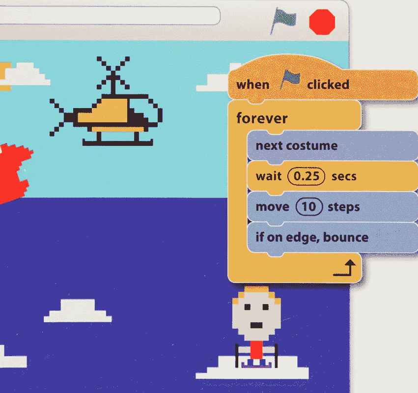


作者兼顾问：Jon Woodcock 博士

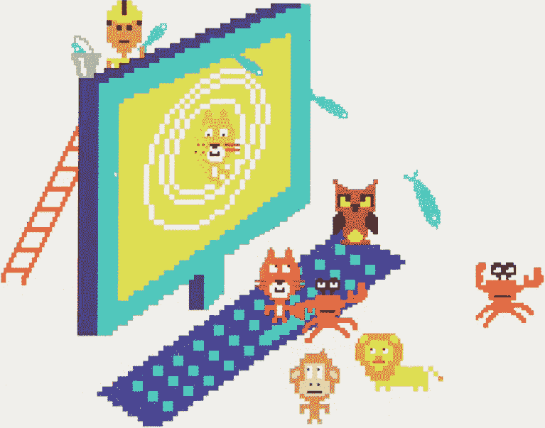


## 编写：
Jon Woodcock 博士
编辑：Steve Watford
编辑：Jenny Siklos, Allison Singer
设计：Peter Radcliffe
出版：Laura Buller
艺术总监及书封设计：Martin Wilson
制作，前期制作：Francesca Wardell
制作：Christine Ni
出版总：Sophie Mitchell


16 17 18 19 20 8 7 6 5 4 3


思想的世界：
探索已知的一切
www.dk.com

他们以我的名字给
Scratch（抓抓）取了名。

它本应该叫 Pinch（捏取）的！


> 我最喜欢这个页面。


## 什么是 Scratch？

Scratch 是一种视觉编程语言，允许你创建故事、游戏和动画。

你将学习：
- 如何使用界面
- 如何移动和制作动画
- 如何使用循环和条件
- 如何使用变量和事件
- 如何创建你自己的游戏

## 什么是 Scratch？

Scratch 是学习基础知识的有趣方式。

## 计算机理解什么

程序是告诉计算机做什么的指令集。在 Scratch 中，这些指令是由像拼图一样的区块组成的。

## Scratch 项目由什么组成

项目由几个部分组成：
- 舞台：动作发生的地方
- 角色：项目中的人物或物体
- 脚本：告诉角色做什么的区块集
- 背景：舞台的背景

### 脚本

脚本用于控制角色的行为。每个角色可以有多个脚本。这是一个示例：

```
when green flag clicked
forever
  move 10 steps
  if edge on then
    bounce
```

### 获取 Scratch

你可以在在线使用 Scratch，如果你并不总是联网，可以将其安装在电脑上。

### 在线使用 Scratch

如果你注册 Scratch 账号，就可以在线保存项目并与朋友分享。

### 注册 Scratch

访问 scratch.mit.edu 并选择“加入 Scratch”获取注册说明。你需要获得带有电子邮箱的成人的许可。

### 创建 Scratch

当你想要使用 Scratch 时，访问 Scratch 网站并点击“创建”。这将打开编辑器窗口。

### 保存 Scratch

如果你登录了 Scratch 账号，项目会自动保存。你可以通过点击右上角带有“S”字母的文件来查看已保存的项目。

> 来自猫猫的小贴士
需要“右键点击”但鼠标上只有一个按钮？通常你可以在点击时按住键盘上的 CTRL 键。不起作用怎么办？那就问问电脑的主人。


### 在电脑上安装 Scratch

如果你无法访问互联网或想离线工作，你需要一个 Scratch 安装程序。访问 scratch.mit.edu/scratch2 并按照安装说明操作。

要启动 Scratch，双击桌面上的 Scratch 2.0 图标。

 双击 Scratch 2.0 图标启动

## 操作系统

检查你的计算机操作系统能够运行 Scratch。

- Scratch 2.0 的在线版本可以在 Windows (PC)、OS X (Mac) 和某些 Linux 上运行。
- 离线版本可能在某些 Linux 上无法工作。
- Raspberry Pi 目前无法运行 Scratch 2.0。


> 你不在这本书中。


## Scratch 在线社区

在 Scratch 网站上，你可以分享你的项目并尝试其他编码者的作品。此外，你可以探索每个项目是如何运作并对其进行“混编 (remix)”。注意下面的按钮。


## Scratch 导览

在你的电脑上打开 Scratch，你会看到这些。你在这个屏幕上创建并运行你的 Scratch 项目。观察一下。

> 实验！
点击按钮和标签来尝试 Scratch。别担心，你不会弄坏电脑的！

- 更改语言
- 在此处保存项目
- 删除角色或脚本
- 帮助工具


点击此处查看全屏视图

这是舞台——在这里运行项目并看到动作

角色是由脚本控制的

点击这些来启动（运行）和停止项目

点击舞台或角色列表中的项选择它

点击此处查看详细的角色信息

你也可以选择舞台并编辑（更改）它的脚本、背景和声音

按钮添加新背景（背景图片）

你选中的角色周围会出现一个蓝色框

用于添加新角色的按钮

## Scratch 地图

舞台是运行项目的地方。角色列表显示项目所有的角色。脚本块可以在区块面板中找到。在脚本区域编写脚本。

造型标签——用于更改角色的外观

脚本标签

声音标签——用于更改角色发出的声音

点击此处查看分步指南和提示

• 已保存
stilton181


- 脚本
- 造型
- 声音

动作
- 看起来
- 声音
- 画笔
- 数据
- 事件
- 控制
- 感测
- 运算符
- 更多块

选择不同类型的块

```
当点击
重复
去 [鼠标指针]
移动 10 步
```

- 移动 10 步
旋转 15 度
旋转 15 度
面向方向 90
面向 [ ]
移到 x: 0 y: 0
滑行 1 秒到 x: 0 y: 0

块会组合在一起——使用鼠标移动它们
每个块都是某条不同的指令

```
重复
下一个造型
播放声音 [喵] 直到结束
```


背包用于复制角色、造型和声音
从此处将块拖入脚本区域
在此处编写脚本

## 你的第一个项目

该开始我们的 Scratch 项目了。我们将创建一些简单的指令来让猫说话。通过用鼠标移动块，我们可以构建一个名为脚本的简单程序。

- 你将学习：
- 角色是由脚本控制的
- 如何从 Scratch 块构建脚本
- 脚本中的事情会一个个执行
- 你可以阅读 Scratch 来了解它的功能


### Scratch——友善的小猫

首先，打开 Scratch 编辑器：：在 Scratch 网站上选择，或点击你电脑上的图标。你会看到猫角色站在舞台上。让我们编写一个脚本来告诉猫该做什么。

 点击“看起来”标签


- 1 开始一个新脚本
我们将从让猫说“你好！”开始。点击编辑器中心的脚本标签。
- 2 选择“说”块
编辑器中间的块列表会变化。用鼠标点击顶部的“说”块并将其拖到右侧。

```
说 你好！2 秒
```
- 3 再次执行
将第二个“说”块拖入脚本区域。当块重叠时释放鼠标，它们会像拼图一样锁定。

```
说 你好！2 秒
说 你好！2 秒
```
- 4 更改猫说的内容我们可以让猫说不同的内容。点击底部的说框。输入一条新消息，如“天气不错！”。

```
说 你好！2 秒
说 天气不错！2 秒
``` 消息在这里

### 完成你的脚本

点击“事件”标签。将列表中的棕色块拖到右侧脚本区域。悬停在顶部的“说”块上，然后松开。棕色块会连接。

点击绿旗运行脚本

### 阅读整个脚本

脚本告诉我们我们需要点击舞台右上角的绿旗。这被称为“运行”脚本。


### 观察动作

当你点击绿旗时，猫会说“你好！”2 秒。然后它会说“天气不错！”2 秒。

> 观察块是如何工作的——猫按顺序执行每个动作。

### 保存

做得棒！你构建了第一个 Scratch 项目。点击“文件”菜单并“保存”或“全部保存”。

## Scratch 谜题

我们挑选了一些块供猫尝试。为每个块画一条线到猫将执行的正确图片。

### 移动它！

你将学习：
* 如何创建一个角色
* Scratch 以“步”为单位测量
* 如何让角色直立

 现在开始动作。让我们使用深蓝色动作块让猫移动。Scratch 以“步”测量距离。舞台宽 480 步，高 360 步。有一个块可以防止角色卡在墙上。它们会弹回来！

- 让猫移动
开始一个新项目。点击舞台上“新建”。添加此脚本并思考块的作用。

 点击绿旗运行脚本。猫会向右移动一小段。尝试几次。

 点击“移动”块中的 10 并输入 100。现在猫每次移动的距离远得多。尝试不同的步数进行实验。


- 在墙上反弹
现在将你的脚本改为这样。阅读脚本。你认为它在做什么？“重复”块会重复内部的内容！“如果碰到边缘”块会让猫在边缘转弯。

 运行新脚本。现在猫会在舞台上向右、向左移动。实验——步数越多，猫移动得越快。


### 别倒立着，猫！

可怜的猫整天倒着——太糟糕了！要停止这一点，点击角色列表左角的蓝色区域。会出现关于角色的额外信息。将旋转样式改为 <->。尝试其他样式看看猫会做什么。


猫面向它行走的方向，有时是倒着的。

直立着向右走


| 猫 | x: 84 y: 69 方向: -90° |
| 旋转样式: [] 拖入玩家: [] 显示: |

猫面向左或右，且始终直立。

### 展示你所学的

你能通过这个测验答多远？一直到最后吗？

- 1. 动作块是什么颜色的？
2. Scratch 以什么为单位测量距离？
2a. 舞台宽是多少单位？
2b. 舞台高是多少单位？
3. 程序中的错误被称为“漏洞 (bug)”。


#### 哪个方向？

当你想要移动一个角色时，你需要知道两件事：多远以及向哪个方向。每个角色都有一个内置的方向箭头。当脚本运行到深蓝色的移动模块时，那就是角色将要去的方向。

- 你将学到：
- 如何让角色指向不同的方向
- 如何制作一个角色

#### 猫咪跟随鼠标！

让我们的猫咪在所有可能的方向上旋转。在 Scratch 编辑器中打开一个新项目。为猫咪角色编写此脚本。阅读这段脚本。你认为它是做什么的？点击绿色旗帜看看你是否猜得正确。

来自棕色的“事件 (Events)”模块
- 来自黄色的“控制 (Control)”模块
- 来自深蓝色的“动作 (Motion)”模块

```
when clicked
forever
point toward cursor
```

猫咪将跟随鼠标指针

在舞台上移动鼠标，观察猫咪转动，让它始终面向指针。`forever` 模块会反复执行 `point toward cursor` 模块。

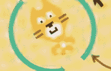

如果不起作用，请检查旋转样式 (rotation style)

#### 角色知道要去哪里！

方向 (direction): -90

每个角色都知道自己指向的方向。当你点击蓝色的 **i** 时，角色信息面板中会显示角色的方向。

角色信息面板上的方向圆

方向 -90° 意味着“向左”

方向 0° 意味着“向上”

随着猫咪旋转，你会看到它的方向值在变化，蓝色的线条指针在圆上移动。

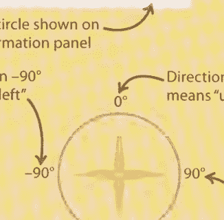

方向 180° 意味着“向下”

方向 90° 意味着“向右”

使用这里显示的“指南针”来解码方向数字。

#### 选择角色方向

我们也可以使用带有 **point in direction**（面向方向）模块的窗口来设置角色的方向。你可以点击数字旁边的小三角形来选择常用方向，或者直接点击窗口并输入数字。

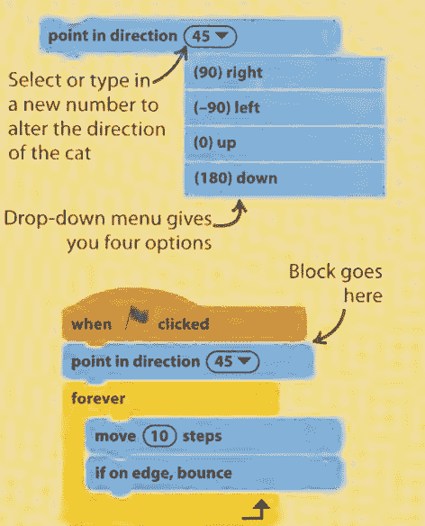

#### 再次碰撞墙壁

在第 12 页的“反弹墙壁”脚本中添加 **point in direction 45** 模块。将它放在 **when green flag clicked** 模块之后、**forever** 模块之前。运行脚本。猫咪将沿对角线出发。尝试不同的方向和旋转样式。

### 展示你的才华

熟悉 Scratch 吗？试一下这些脑筋转弯吧！

- 1. 这个模块中应该用哪个数字替换 ? 来将角色的方向设置为：

向上 = .................................................n向下 = .................................................

向左 = .................................................n向右 = .................................................

- 2. 测试你的 Scratch 脚本阅读能力！这个脚本是做什么什么的？仔细阅读它并尝试在脑海中模拟每个模块。

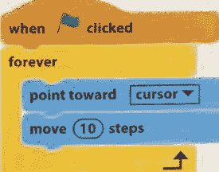

................................................................................................n................................................................................................n................................................................................................

### 循环

在计算机程序中，我们经常想要多次执行相同的指令。为了避免多次放置相同的模块，我们可以将它们包装在一个循环指令中，以重复这些模块。来认识 `forever`（永远）和 `repeat`（重复）循环吧！

- 你将学到：
- 如何使用循环重复一组模块
- `forever` 循环和 `repeat` 循环之间的区别
- 如何在 Scratch 中发出声音


### 执行模块

启动新项目并制作此脚本。阅读、理解并运行它。它运行得很快，没做什么作用。

模块按顺序执行。

当我们运行脚本时，每个模块都从上到底执行。首先猫咪转动了一下，然后猫咪的颜色变了。

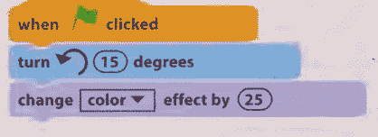


### 永远循环

循环指令按从上到下的顺序运行脚本，然后回到顶部。`forever` 循环再次运行内部的模块。尝试在模块周围套上 `forever` 循环。

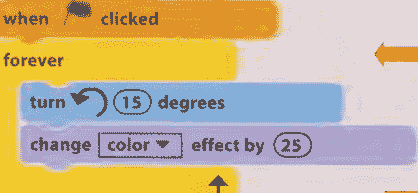

动作完成后，程序总是回到开始。现在每次重复 `forever` 循环中的模块时，猫咪转动更多并改变颜色。点击红色按钮停止循环。

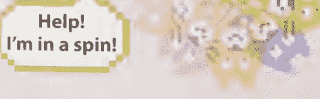

### 重复循环

如果我们只想重复几次模块然后执行脚本的剩余部分，我们可以使用 `repeat` 循环。

为猫咪尝试此脚本。`repeat` 循环执行两个模块 10 次，然后执行 `think` 模块。尝试改变重复次数。

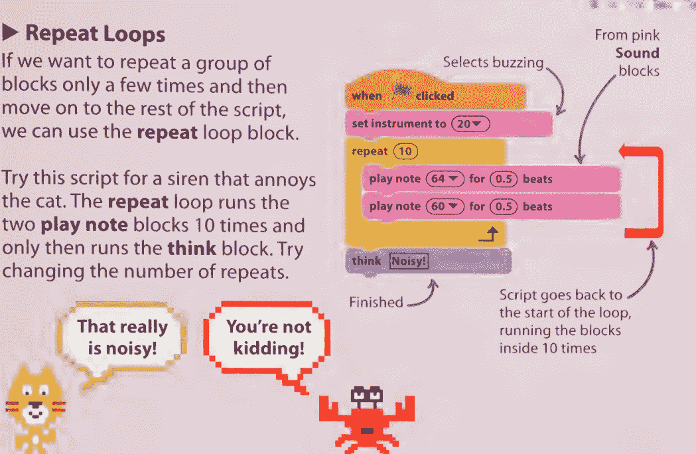

### 展示你的知识

你对循环了解多少？通过这个测验测试一下自己。

- 1. 循环用于 ............................................模块组。
- 2. 两种 Scratch 循环是 ......................... 和 ....................................
- 3. 你可以通过点击 .................................停止 `forever` 循环。
- 4. 在哪个部分你可以找到粉色的模块？........................
- 5. 哪个模块包含循环？
- 6. 找虫！这个脚本应该画出正方形的四边，但运行时什么都没有发生。你能发现并建议修复方法吗？程序员称之为“调试 (debugging)”。

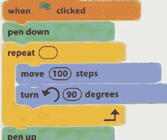

### 动画

动画中的角色似乎在移动，但实际上你只是看着许多略微不同的图片欺骗了你的大脑。这被称为动画。角色可以用相同的方式制作动画。

- 如何为角色制作动画
- 角色可以改变外观
- 如何使用装帧 (costumes)
- 如何从库中加载新角色


### 装帧

我们的猫咪角色有两个不同的图片，或“装帧 (costumes)”，它可以显示。启动一个新的 Scratch 项目并点击模块列表上面的“装帧”选项卡。你将看到猫咪角色可以“穿”的两个装帧。

为了制作动画，编写并运行此脚本。`forever` 循环重复 `next costume` 模块。图片每半秒变化一次，这让猫咪看起来像在走路。尝试在循环中添加 `move` 模块来改进动画。


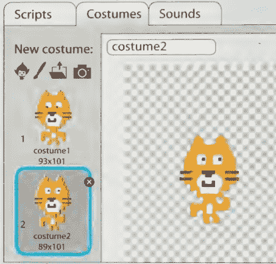

> 角色的装帧按顺序排列

这选择了下一个装帧。快速切换装帧让猫咪看起来像在走路。

```
when clicked
forever
  next costume
  wait 0.5 secs
```

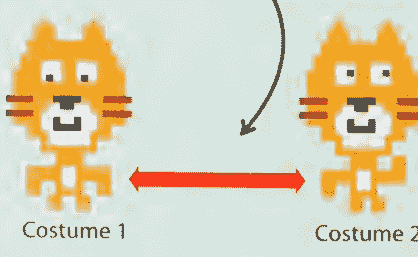

`wait` 防止装帧切换过快

### 芭蕾舞者

你可以使用相同的脚本让其他角色也跳起来！让我们添加芭蕾舞者角色。点击角色列表顶部的“从库中选择角色”。然后选择芭蕾舞者并点击确定。

将切换装帧的脚本添加到芭蕾舞者的脚本区域。她有四个装帧。点击“装帧”选项卡查看它们。当你运行脚本时，她在舞台上跳舞时使用了所有的装帧。

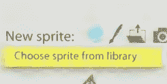

点击第一个图标查看所有角色

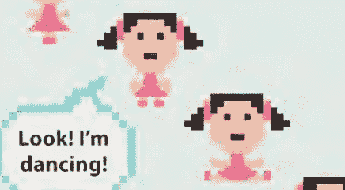


### 角色派对！

尝试向你的项目添加许多正在跳舞的角色。选择具有两个或更多装帧的角色。尝试 Dinosaur1 或一些跳舞的小孩。

### 展示你的才华

你可以让角色跳舞。你也能解决这些问题吗？

- 1. 角色在舞台上显示的不同图片是 .................................................
- 2. ............................................ 通过按顺序显示略微不同的图片来让角色看起来在移动。
- 3. 你能重新排列下面的角色来制作跳跃小马的动画吗？
在框内填写数字 1 到 5 以显示正确的顺序。

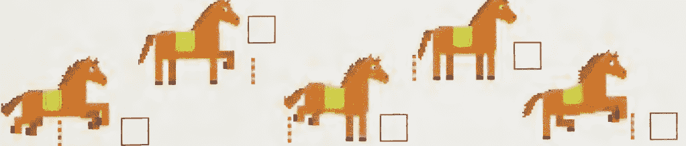


## 派对时间！

我们学习了许多关于制作角色来执行动作，但如果项目发生在一个安静、白色的舞台上，它就还未完成！让我们看看如何从 Scratch 库中选取一些场景和音乐来让项目活跃起来。

- 你将学到：
- 如何更改背景图片
- 如何为背景添加效果
- 如何为你的项目添加音乐

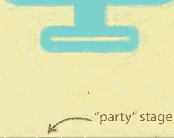

### 添加场景——背景

就像角色可以有很多造型一样，舞台也可以有多个背景图片，或者说多个背景（backdrop）。点击**舞台信息**(Stage info）区域左下角的**从库添加新背景**(Add new backdrop from library）按钮。

现在是小猫的生日，所以选择“派对”（party）舞台。你会看到舞台上有只猫！你可以加载多个背景。尝试加载“水下2”（underwater2）。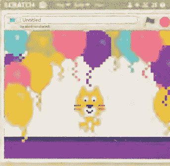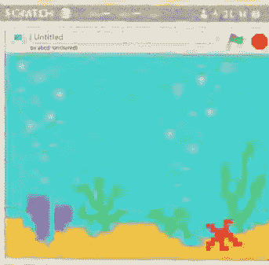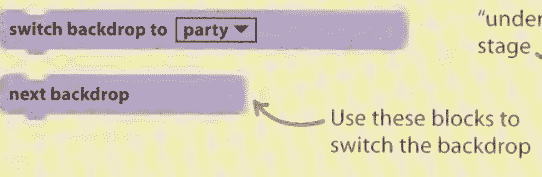

### 灯光秀！

我们可以为舞台添加脚本：点击**舞台信息**区域上方舞台区域的小图。然后尝试在你的派对背景下下运行这个脚本，让它活起来。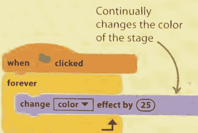

## 音乐

没有音乐的派对就不是派对！
声音可以加载到角色或舞台中。但你必须在脚本区域制作脚本来播放它们。

点击声音（Sounds）选项卡下的扬声器图标将带你进入声音库。

### 加载音乐

再次点击舞台。然后点击积块上方的声音选项卡，选择从库选择声音（扬声器符号）。

新声音：

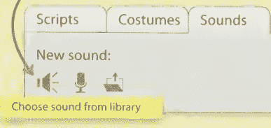

### 选择曲目

选择其中一个音乐循环，例如“趣味舞蹈”（dance funky），并点击右下角的确定进行加载。声音将出现在声音列表中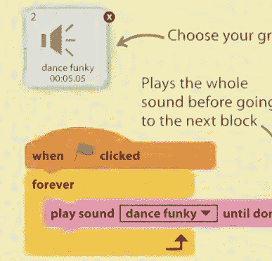

### 制作、阅读和运行脚本

点击脚本（Scripts）选项卡并制作这个脚本。阅读并运行它。你将拥有无休止的音乐！

### 展示你的知识

小猫正处于派对状态。你准备好参加测验了吗？

- 1. 舞台上的背景图片被称为 ....................................
- 2. 圈出在继续执行之前播放整个声音的积块：........................

```
play sound [pop ▼]
play sound [pop ▼] until done
```

- 3. 判断对错？
  a. 一个项目只能加载一个背景。...................................
  b. 只有加载了声音的角色才能播放它。...................................................
  c. 舞台可以拥有声音和脚本。...................................................
  d. 一旦你为脚本选择了背景，你就无法更改它。....................................
  a. 角色可以使用脚本来更改舞台的背景。................................................

## 如果-那么

如果下雨了，我们决定穿雨衣。我们可以使用黄色控制（Control）部分的如果那么积块来制作这种判断。就像循环一样，它们包裹其他积块并控制它们的何时执行。

- 你将学到：
- 关于如果那么积块
- 如何控制积块执行或跳过
- 如何在按下按时感知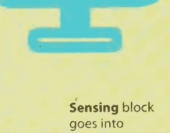

### 旋转控制

让我们使用如果那么积块来决定猫何时旋转。我们将使用一些蓝色的感知（Sensing）积块来询问“真或假？”。在脚本选项卡下找到它们。

- 启动新项目
  添加这个脚本。你认为它是做什么的？每个如果那么积块内部的积块只有在答案为“真”时才执行。
猫向左旋转15 度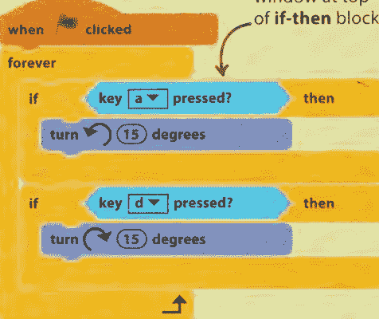

- 运行脚本
  发生了什么？按下“a”键，猫向后转。松开按键，它停止。第一个如果那么积块内部的积块只有在“按下a?”的答案为“真”时才执行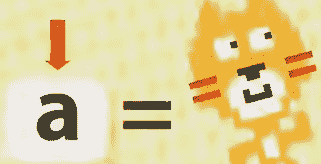

猫向右旋转15 度

- 现在按下“d”键
  猫向另一个方向旋转。第二个如果那么积块内部的积块只有在“按下d?”的答案为“真”时才执行。如果两个键都没有按下，两个积块都会被跳过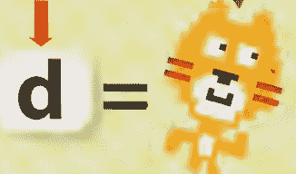

### 观察如果那么积块

查看这个脚本中的如果那么积块。仔细阅读并思考它是做什么的。

如果答案为“假”，积块被跳过
条件（答案为“真”或“假”）
如果答案为“真”，积块执行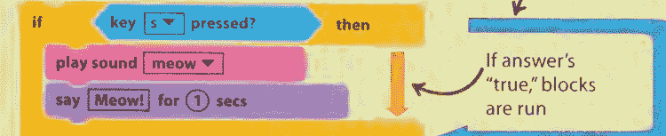

- 如果那么积块是黄色控制积块，因为其内部的积块会被执行。
- 一个如果那么积块有一个问题作为条件。问题必须有真/假答案。
- 如果那么积块内部的积块只有在问题的答案为“真”时才执行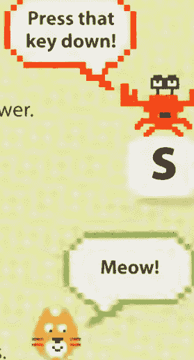

- 如果问题的答案为“假”，如果那么积块内部的积块会被忽略。
- 将这个如果添加到添加到脚本中，当按下“s”键时猫会喵喵。将如果那么积块放在循环内部但在如果那么积块外部。

### 展示你的知识

如果你是 Scratch 专家，你会很容易发现这个 Bug！这个脚本应该在按下空格键时让角色改变颜色，但角色一直在变色。你能发现这个“Bug”吗？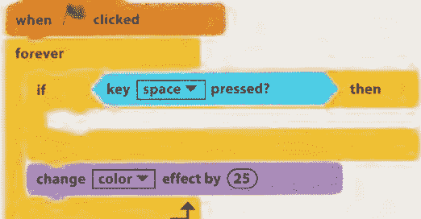

## 变量

计算机非常擅长存储信息或“数据”。这些数据可以是人的名字，可以是蛋糕的重量。变量就像一个带标签的盒子，你可以在其中存储数据直到程序需要它。

- 你将学习：
- 变量在程序中存储数据
- 如何制作和使用变量
- 使用变量让代码更清晰

 带标签的盒子

变量可以存储数字或单词（程序员称单词为“字符串”）。存储在变量中的内容被称为它的值。你可以更改变量的值。给变量起有帮助的名字让代码变得易读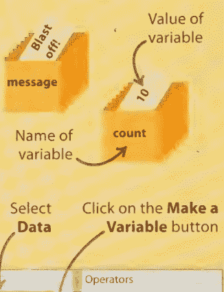

按照这些指令在 Scratch 中创建第一个变量。

- 1 从数据开始
  在脚本（Scripts）选项卡下选择**数据**(Data)。然后点击**制作变量**(Make Variable)按钮。将弹出**新建变量**(New Variable)窗口。

- 2 命名、勾选、点击！
  首先，给你的变量起一个有用的名字。勾选“所有角色”（For all sprites），并点击“确定”（你可以忽略“仅限此角色”和“云端变量”）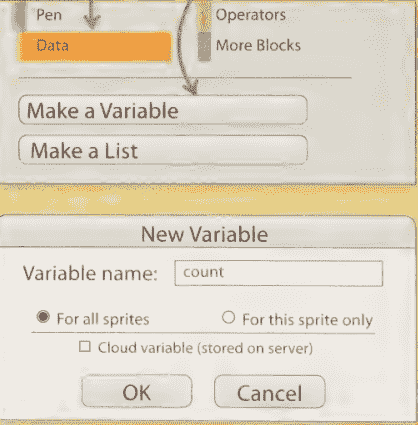

- 3 认识你的积块！
  该变量的积块将出现在积块区域。确保你了解每个积块的作用。

勾选在舞台上显示变量
变量积块可以在其他积块内部使用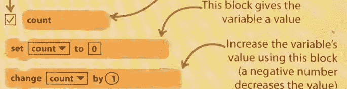

### 倒计时的猫

是时候看看变量的动作了。启动一个新项目。

在橙色的数据部分，创建两个名为 count 和 message 的变量。始终给你的变量起一个解释其中存储了内容的名字。

添加这个脚本。确保你将带有 count 和 message 的小橙色积块拖入“说”（say）积块的窗口中。不要在说窗口里输入单词。如果你这样做，猫会说变量的名字而不是存储在变量的内容。

阅读脚本。你能算出会发生什么吗？现在运行脚本。

尝试脚本中的数字和文本。你能让猫向上数而不是向下数吗？

```
when clicked
set [count] to [10]
set [message] to [Blast off!]
repeat (10)
say [count] for 1 secs
change [count] by -1
```

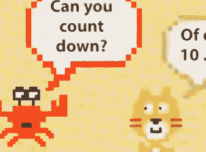

### 展示你的知识

测试你的大脑盒中存储了多少 Scratch 数据。

- 1. 变量有一个名字和一个 ....
- 2. 制作变量按钮位于橙色的 ... 积块部分。
- 3. 为这些这组积块填充对话框：

```
set [name] to Spot!
say [name]
set [name] to Spot!
say [name]
```

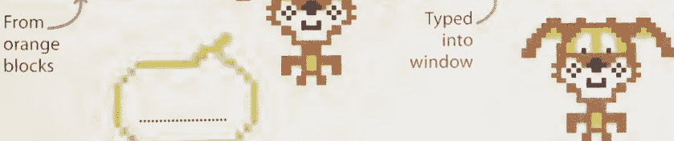


## 数学

Scratch 可以完成你熟悉的所有数学运算。但它使用的一些符号有所不同，以适应你电脑键盘的布局。我们可以在 Scratch 中编写等式并在其中使用变量。Scratch 甚至可以为掷骰子。

- 你将学习：
- 如何在 Scratch 中进行数学运算
- 计算机使用的数学符号
- 如何使用变量编写等式
- 如何使用电脑“掷骰子”


### 数学工具

要进行数学运算，你需要绿色的“运算符”模块。每个模块都会对两个窗口中的数字进行不同的运算。

#### 加法 (+)
"+" 积会将模块中的两个数字相加。

#### 减法 (-)
"-" 积会从第一个数字中减去第二个数字。

### 放置运算符

无论你将运算符积放在哪里，它都会显示该题目的答案。所以，如果你把它放在“说”积的窗口里，猫就会说出答案。

#### 乘法 (*)
Scratch 使用 "*" 符号，因为 "x" 看起来像一个字母。

#### 除法 (/)
键盘上没有除法符号。Scratch 使用 "/" 代替。

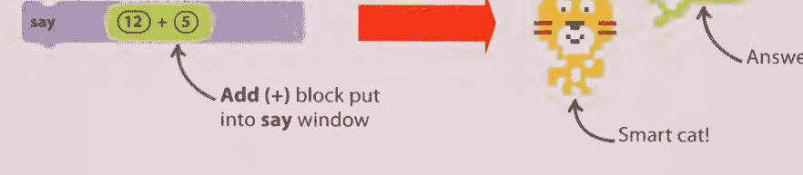

放入说窗口的加法 积

聪明的猫！

## 数学与变量

我们可以使用运算符积来解决涉及变量的问题。例如，为了找到宠物的总数，我们可以使用加法 积将变量 `dogs` 和 `cats` 的值相加并将并将存储在一个名为 `pets` 的变量中。

将加法 积放入设置积的窗口中

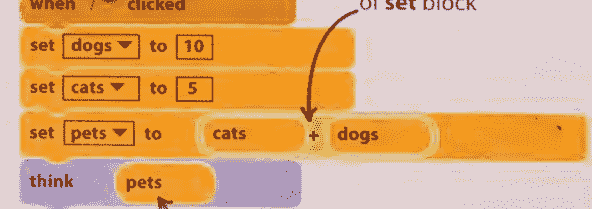

猫在想 15

## 掷骰子

随机数是我们无法预测的数字。它就像我们掷骰子时得到的数字——在掷之前，我们并不知道数字是多少。Scratch 可以像骰子一样工作为我们“掷骰”。在一个新项目中尝试这个脚本。

阅读脚本然后运行它。猫在思考时会向你展示四个随机数。随机数在游戏中非常有用，因为它们让动作变得难以预测。

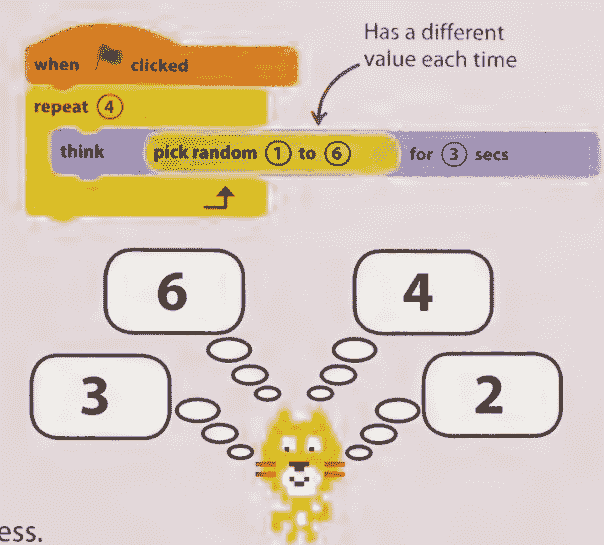

## 展示你的所学

- 1. 你是电脑！计算这些积模块的值。

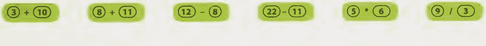

- 2. 这些积使用了变量。你能算出答案吗？

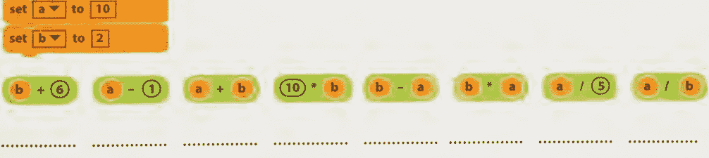

- 3. 写下存储在变量中的值。

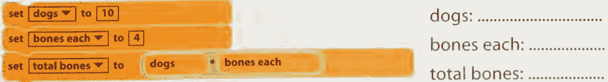

## 输入与事件

输入程序的数据（例如当 Scratch 提问时你输入的答案）被称为“输入”。事件是动作，比如点击角色或按下选定的键，Scratch 可以利用这些事件运行脚本。

- 你将学习：
- 如何提问并使用答案
- 什么是**事件** 积
- 如何通过按键或点击运行脚本


### 只管提问

角色可以使用“感知”标签下的浅蓝色“询问”和“回答”积来提问和获取答案。开启新项目并添加此脚本。阅读脚本。它会做什么？

猫在提问。


午吃什么？

输入“猫吃的”

```
当询问午吃什么？
想：好吃！
等待 2 秒
```

问题在这里

```
猫吃的！
```

运算符部分

存储在回答 积中的回复

然后按下回车

### Scratch 的午餐时间！

猫提问并等待你输入回复。当你按下回车时，你输入的内容就是 `回答` 积的值。


好吃！
猫吃的！

### 回答就像变量

`回答` 积的作用就像一个变量。无论你把 `回答` 积放在哪里，它都会被你的回答替换。上面的绿色“拼接”积会将它的两个窗口的内容连接在一起。

它总是饿的！

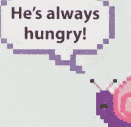

### 事件触发

事件是电脑可以告知你的状况，比如按键和鼠标点击。棕色的“事件”积在事件发生时运行脚本，就像绿色旗帜在被点击时运行脚本一样。

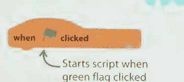

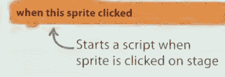

### 制作一套打击乐

创建像这样的脚本列表。为每个版本的脚本选择不同的键和不同的乐器。当你按下正确的键时，运行下面的积。使用你选择的键弹奏独奏！

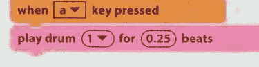


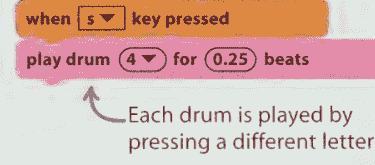

### 展示你的知识

你能回答这些关于输入和事件的问题吗？

- 1. 哪个蓝色的感知积让角色提问？...........................
- 2. 哪个积持有给出的回复？...................................
- 3. 电脑上发生的动作（如鼠标点击或按键）被称为...................................................
- 4. 如果我点击带有此脚本的角色会发生什么？...................................................
- 5. 可以同时运行多个脚本吗？...................................

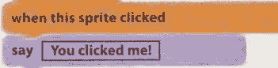

## 如果-那么-否则 (if-then-else)

让我们认识“如果-那么-否则”。如果-那么-否则”积可以做决策。

- 你将学习：
- 如何提问并使用答案
- 什么是**事件** 积
- 如何通过按键或点击运行脚本

### 比较事物

还有一个“如果-那么-否则”。在“运算符”部分有 `=`、`<` 和 `>` 等符号。

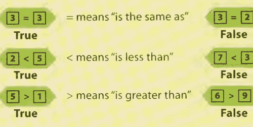

### 检查器

“如果-那么-否则”积可以检查你是否小于 10。第一组为真，第二组为假。


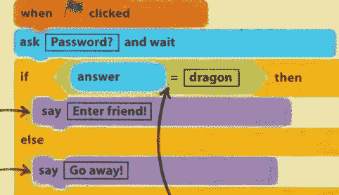

### 朋友还是敌人？

“如果-那么-否则”积有两个组。一个在为真运行时，另一个在为假时运行。

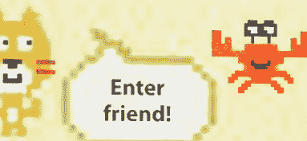


### 冰淇淋！

“如果-那么-否则”积可以检查你是否小于 10。第一组为真，第二组为假。


### 展示你的知识

你能回答这些关于输入和事件的问题吗？

- 1. 哪个蓝色的感知积让角色提问？...........................
- 2. 哪个积持有给出的回复？...................................
- 3. 电脑上发生的动作（如鼠标点击或按键）被称为...................................
- 4. 如果我点击带有此脚本的角色会发生什么？...................................................
- 5. 可以同时运行多个脚本吗？...................................


## 分数

一个好的游戏需要分数和挑战。为所有角色添加一个名为 `score`（分数）的新变量。勾选该变量，以便它显示在舞台上。

将此脚本添加到猫咪角色中。阅读它。每当你拖动龙 3 秒，你就能得到 1 分。但每当你得分，龙的游戏速度就会增加 1！

运行游戏看看它是否符合你的预期。如果不符合，请从头开始检查一切。和朋友们竞争获得最高分。为什么不添加一个背景和一些音乐呢？

```
when clicked
set score to 0
forever
  wait 3 secs
  change score by 1
  change speed by 1
```

勾选此框

分数越高，龙移动得就越快


你喜欢 Scratch 吗？

只有当我“痒”的时候才喜欢！

## 展示你的才学

回答测验——会得到高分还是“游戏结束”？

- 1. 为什么我们要保持分数变量的复选框勾选状态？
- 2. 你如何让龙在开始时以半速度运行？
- 3. 你可以在猫咪的无限循环内部添加哪个积木，让它看起来像在走路？
- 4. 龙有多少种装扮？
- 5. 如果你在角色列表中右键点击龙并选择“复制”，会发生什么？

## 答案

做得好，你完成了所有任务！现在是检查你的“展示才学”答案的时候了。表现得如何？你现在是 Scratch 天才了吗？

第 4–5 页什么是 Scratch？

- 1. **脚本**（script）是 Scratch 中的一组指令（程序）。
- 2. 在项目中执行动作的对象被称为**角色**（sprites）。
- 3. 在 Scratch 程序中，动作发生在**舞台**（stage）上。
- 4. 启动程序被称为**运行**（running）它。
- 5. 声音或图形的集合被称为**库**（library）。


第 10–11 页你的第一个项目


第 12–13 页 动起来！

- 1. **动作**（Motion）积木是什么颜色的？**深蓝色**
- 2. Scratch 使用称为**步**（steps）的单位来测量距离。

- 2a. 舞台宽是多少个单位？480
- 2b. 舞台高是多少个单位？360
- 3. 程序中的错误被称为“虫虫”（bug）。这个脚本本应该让猫咪穿过舞台，但当我点击绿色旗帜运行它时，什么都没有发生！怎么了？缺少了“当点击绿色旗帜时”积木。


第 14–15 页 哪一边？

- 1. 这个积木中的 ? 应该用什么数字来将角色的方向设置为：
  上 = 0
  左 = -90
  下 = 180
  右 = 90
- 2. 测试你的 Scratch 能力！这个脚本是做什么的？仔细阅读它并尝试表演每个积木的内容。这个脚本让猫咪向舞台上的光标运行。


第 16–17 页 循环

- 1. 循环用于重复一组积木。
- 2. Scratch 的两种类型循环是“无限”（forever）和“重复”（repeat）。
- 3. 你可以通过点击红色按钮停止无限循环。
- 4. 你在哪个部分找到粉红色的积木？
- 5. 哪个部分包含循环？
- 6. 找虫虫！这个脚本应该画出正方形的四条边，但运行时运行时什么都没有发生。你能发现虫虫并建议修复方法吗？程序员称之为“调试”（debugging）。重复循环没有说明要重复多少次。在窗口中输入“4”来修复虫虫。

第 18–19 页 动画

- 1. 舞台上显示的不同图片被称为装扮（costume）。
- 2. 动画按顺序显示细微差异的图片使角色移动。
- 3. 你可以重新排列下面的角色来制作跳跃的小马动画吗？在框内写数字 1 到 5 显示正确的顺序。


第 20–21 页 派对时间！

- 1. 舞台上的背景图片被称为背景（backdrop）。
- 2. 圈出在继续之前播放完整声音的积木：


3. 判断对或错？

- a. 一个项目只能有一个背景。错
- b. 只有加载的角色可以播放它。对
- c. 舞台可以有声音和脚本。对
- d. 一旦你为脚本选择了背景，你就无法更改它。错
- e. 角色可以使用脚本更改舞台背景。对

第 22–23 页 如果那么

这个脚本应该在按下空格键时让角色改变颜色，但角色一直在改变颜色。你能发现虫虫吗？“将特效增加 5”积木需要放在“如果那么”积木内部。


第 24–25 页 变量

- 1. 变量有一个名称和一个值。
- 2. 制作变量按钮位于橙色的数据积木中。
- 3. 填充这些积木组的对话框：


橙色变量积木让狗说“Spot!”（变量）。如果你输入“name?”它就会说“name!”（始终使用橙色积木获取变量的值。）

第 26–27 页 数学

- 1. 你是电脑！计算这些积木的值。

- 2. 这些积木使用了变量。你能算出答案吗？


- 3. 写下存储在这些变量中的值。

第 28–29 页 输入与事件

- 1. 哪个蓝色积木让角色提问？ask
- 2. 哪个积木持有回答？answer
- 3. 发生在电脑上的事情（如鼠标点击或按键）被称为事件（event）。
- 4. 如果我点击带有此脚本的角色，会发生什么？！[](img/c8b294ee7af329f5e2b96cede7af2ab1_39_3.png)
角色说：“你点击了我！”
- 5. 可以同时运行多个脚本吗？是的。（许多脚本可以同时在多个角色上运行。）

第 30–31 页 如果那么否则

- 1. 什么形状的积木进入“如果那么”或“如果那么否则”的条件窗口？
- 2. 查看下面的变量，然后圈出值为“true”（真）的绿色运算符积木。


第 32–33 页 ：龙！

- 1. 我们为什么要保持分数变量的复选框勾选状态？
- 2. 你如何让龙在开始时以半速度运行？
- 3. 你可以在猫咪的无限循环内部添加哪个积木让它看起来像在走路？
- 4. 龙有多少种装扮？
- 5. 如果你在角色列表中右键点击龙并选择“复制”，会发生什么？

## 词汇表

动画（animation）：快速更换图片使物体移动。

在 Scratch 中卡住了？点击菜单栏上的“提示”（Tips）获取建议。或使用“帮助”工具——点击它可以打开该积木的帮助页面。


背景（backdrop）：角色后面的图片。

调试（debug）：移除并修复虫虫。

操作系统（OS）：控制你电脑所有内容的程序，例如 OS 或 Windows。

背包（backpack）：在 Scratch 项目之间复制内容的方法。

事件（event）：发生在电脑上的事情，如鼠标点击。

运行（run）：启动程序。

积木（block）：Scratch 中的一种指令。积木可以组合在一起。

输入（input）：进入程序的数据，例如来自键盘。

脚本（script）：运行的指令堆。

虫虫（bug）：程序中的错误。因为昆虫进入了第一批电脑的布线导致了错误。

库（library）：角色、声音或装扮的集合。

角色（sprite）：舞台上可以移动和改变的图片。

条件（condition）：用于在程序中做出决策的“真”或“假”问题。

循环（loop）：让指令重复的指令。

舞台（stage）：包含角色区域，Scratch 项目在此运行。

装扮（costume）：角色在舞台上显示的图片。

程序（program）：告诉电脑执行的指令列表。

字符串（string）：程序员用于包含单词的数据类型。

数据（data）：信息——例如数字或单词。

运算符（operator）：根据数据计算的积木，例如将两个数字相加。

变量（variable）：程序中存储数据的地方。变量始终有一个名称和一个值。

> 给家长的注
帮助孩子逻辑性地解决任何困难。检查明显的错误，例如脚本中交换了相似的积木。还要检查脚本是否控制了正确的角色。不要忘记 Scratch 应该是有趣的。Scratch 网站由麻省省理工学院（MIT）运行，旨在供儿童安全使用。自己试 true吧！


## 准备好学习一种全新的语言：计算机编程！

在这本计算机编程练习册中，你将获得灵感、学习编码，并练习 Scratch 的基础操作。

- 趣味性介绍如何使用 Scratch，Scratch 是一个全球数百万用户使用的免费在线编程平台
- 帮助开发处理代码所需的必备技能，包括解决问题和批判性思维
- 非常适合初学者，指令清晰，插图直观且益于理解，且没有复杂的术语

## 准备就绪，准备出发，开始编码！
