# DKfindout! 编程入门指南

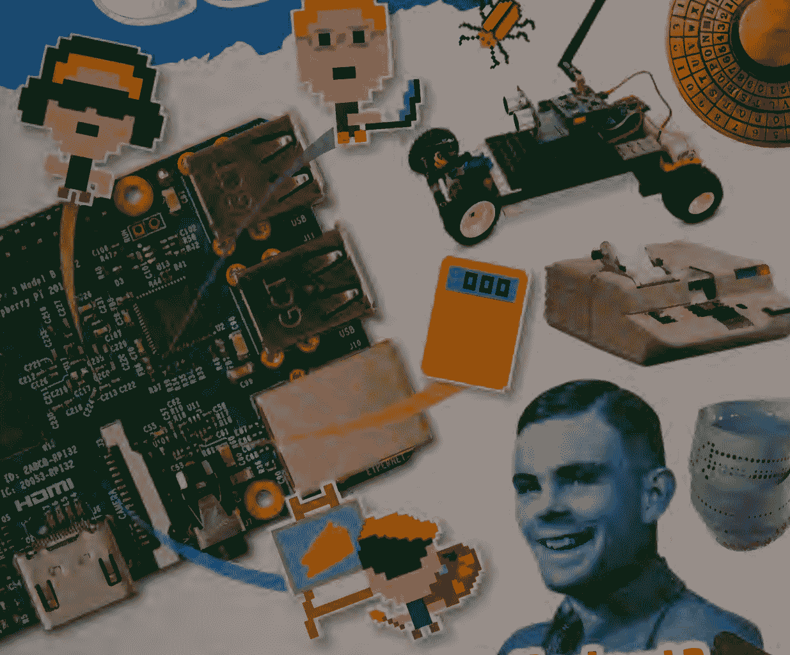

你想发现什么？

趣味冷知识、惊奇图片、测试

测试你对代码的认知，并发现更多有趣的冷知识！

软件历史上出现过一些惊人的发现，软件是告诉计算机如何工作以及做什么的程序。


## 电子邮件

雷·汤姆林（Ray Tomlinson）创建了第一个用于发送数字信息的电子邮件程序。

## WordStar

Micropro 发布了第一个文字处理器，让人们能够轻松在计算机上写作。

## 计算机病毒

“大脑”（Brain）是第一个全球计算机病毒。它通过软盘在计算机之间传播。

## 社交媒体

世界上第一个社交媒体网络诞生了。它被称为 SixDegrees。


| 年份 | 事件 |
| :--- | :--- |
| 1969 | ARPANET：第一台计算机网络建立，形成了今天现代互联网的基础。 |
| 1971 | 电子邮件：雷·汤姆林发送了第一封电子邮件。 |
| 1979 | WordStar：Micropro 发布了第一个文字处理器。 |
| 1983 | Apple Lisa 发布，是最早的个人桌面电脑之一。 |
| 1984 | MacPaint 和 MacWrite：Apple 随其 Macintosh 电脑发布了两个程序，允许用户在计算机上绘图和写作。 |
| 1992 | 互联网浏览器：世界上第一个互联网浏览器 Mosaic 发布。 |
| 2003 | 社交媒体：世界上第一个社交媒体网络 SixDegrees 诞生。 |
| 2014 | HTML5：万维网的原始 HTML 代码更新为 HTML5，让编码员更容易使用。 |


需要发现的内容：

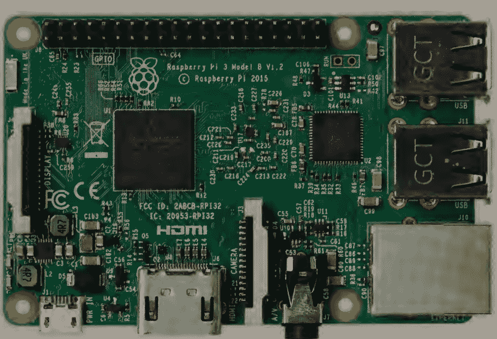

作者：James Floyd Kelly


### 制作团队

**高级编辑** Lizzie Davey

**设计师** Emma Hobson

**项目编辑** Manisha Majithia, Ishani Nandi

**艺术编辑** Nehal Verma

**编辑助理** Sarah Foakes, Charles Raspin

**设计助理** Ala Uddin

**执行编辑** Laura Gilbert, Alka Thakur

**执行艺术编辑** Diane Peyton Jones, Romi Chakraborty

**制作制片** Dragana Puvacic

**制片人** Isabell Schart

**艺术总监** Martin Wilson

**出版者** Sarah Larter

**出版监制** Sophie Mitchell

**教育顾问** Jacqueline Harris

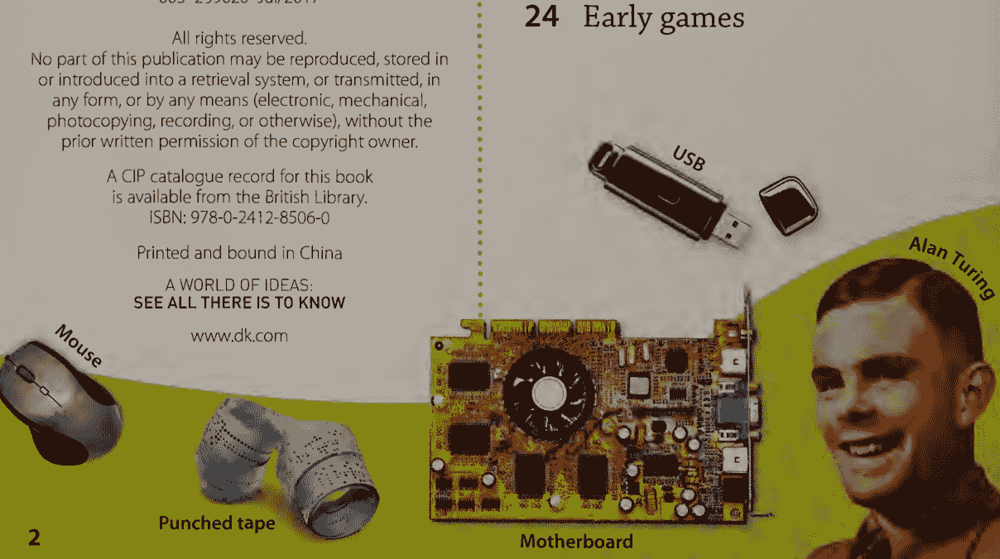

# 什么是编码员？

编码员或程序员是为计算机编写代码的人——这是一组告诉计算机该做什么的指令。许多编码员自学编码，其他人则在学校学习。编码员需要各种不同的技能来构建程序。

## 团队协作

虽然许多编码员独立工作，但大多数人团队工作。团队完成程序更快且错误更少。团队合作帮助编码员从他人那里学习技能。

## 逻辑思维

计算机在运行时遵循规则和逻辑。编码员在编写代码时需要像计算机一样思考，并构建程序运行的所有步骤。

## 许多语言

能够用不同的语言编码是一项宝贵的技能。程序员持续学习编码以创建现代程序。典型编码员的屏幕充满了这样的代码：

```javascript
var type = "image";
var currentImage = document.getElementById("image");
currentImage.src = "images/" + type + ".png";
function updatePage() {
  var html = "<div style=\"width:300px\" class=\"page\">";
  html += "<div style=\"text-align:center\">";
}
```

### 跟上潮流

技术在不断变化。编码员必须跟上最新的编程语言和技术。这可以帮助他们找到工作并为最新设备构建程序。

## 准确性

编码员必须反复检查代码以确保程序运行。指令需要清晰、详细，并分解成易于遵循的小块。

### 太空代码

宇航员兼飞行工程师苏尼塔·威廉姆斯（Sunita Williams）在太空中使用她的笔记本电脑。

# 如何成为编码员？

学习编码永远都不晚。有很多教授编码的书籍以及大量的在线信息。你可以在学校学习编码，也可以查看附近是否有俱乐部。

### Micro:bit

用于学校教学编码。

### 树莓派

一种向人们展示计算机如何工作的微电脑。

# 我们周围的代码

当我们思考编码时会想到计算机，但代码无处不在。历史上，人类创造了许多不同的代码来进行通信。某些代码用于发送秘密信息，而另一些则远距离传递信息。看不听不见的人可以使用代码相互交流。盲人用手读盲文。

# 莫斯密码

莫斯密码通过电线长距离发送信息。每个字母都由特殊机器上敲出的点和横线序列表示。

| 字母 | 代码 |
| :--- | :--- |
| A | · — |
| B | — · · · |
| C | — · — · |
| D | — · · |
| E | · |
| F | · · — · |
| G | — — · |
| H | · · · · |
| I | · · |
| J | · — — — |
| K | — · — |
| L | · — · · |
| M | — — |
| N | — · |
| O | — — — |
| P | · — — · |
| Q | — — · — |
| R | · — · |
| S | · · · |
| T | — |
| U | · · — |
| V | · · · — |
| W | · — — |
| X | — · · — |
| Y | — · — — |
| Z | — — · · |

这是一个短音，或者是一个点。

这是一个长音，或者是一个横线。

哇！

古埃及人有700多种不同的象形文字。

### 图片语言

古埃及人没有字母系统。相反，他们使用一系列被称为象形文字的图片来代表声音和单词。

这块石头满了象形文字。

## 信号旗

信号旗是一种使用手持旗帜的信号系统。它经常被海上船只使用，因为旗帜从远处就能看到。旗帜保持不同的位置以信号字母和数字。

## 盲文

一些盲人使用一种被称为盲文的系统来读写。不同的凸点组合代表字母和数字。

## 手语

由于听障人士听不见声音，他们可以使用手语进行交流。字母、数字和单词可以使用各种手势来展示。

# 计算机之前的编码

在现代计算机发明之前，人们就已经在编写代码了。许多早期程序以打孔卡的形式存在，代表了一组指令。这些卡片被机器读取以执行不同的任务。

# 帕斯卡机

帕斯卡机是由法国数学家布莱斯·帕斯卡发明的。它是一种可以进行加法的简单的计算设备。

总和是通过箱内部滚筒和齿轮的运动来计算的。

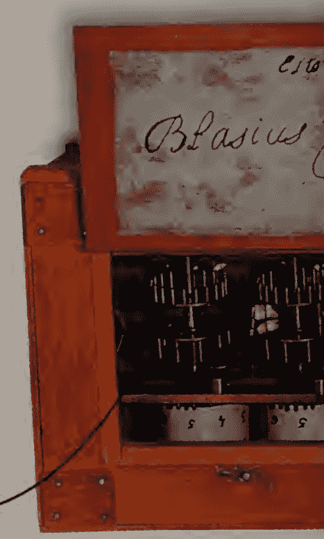

> **档案文件**
>
> - 时间：1642年
> - 功能：计算器
> - 趣味趣闻：帕斯卡在发明这台机器时只有19岁。

# 雅卡织机

这台织布机由约瑟·雅卡（Joseph Jacquard）制造。它能够根据打孔卡上的指令在织物上织出图案。

> **档案文件**
>
> - 时间：1800年代初
> - 功能：织机
> - 趣味趣闻：今天的织物图案仍然在使用特殊的计算机程序创建。

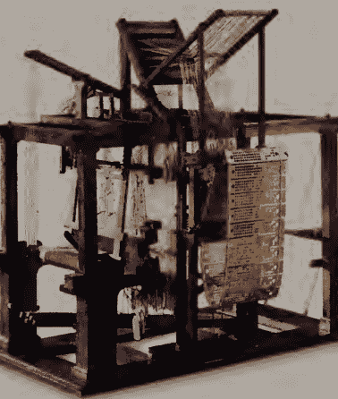

# 人口普查机

赫曼·霍勒律（Herman Hollerith）发明了这台机器为1890年美国人口普查记录数据。它使用打孔卡来记录年龄和性别等信息。

办事员坐在桌前，将打孔卡插入机器中。每个数字都显示在刻度盘上方的框内。

> **档案文件**
>
> - 时间：1890年
> - 功能：人口普查数据收集
> - 趣味趣闻：霍勒律的公司后来变成了科技公司IBM。

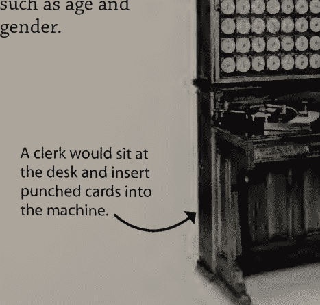

# 自动钢琴

从19世纪50年代开始，人们发明了许多可以自动演奏的钢琴。它们被称为自动钢琴。许多钢琴使用带孔的纸质谱轴来控制哪些音符。

可以通过更换谱轴来演奏不同的乐曲。

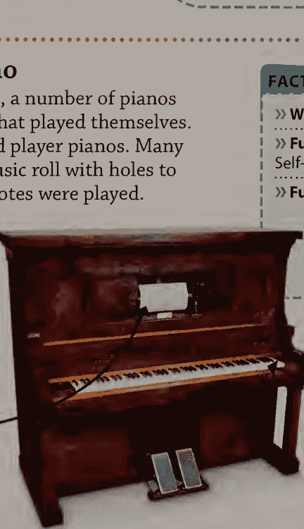

当钢琴演奏时，琴键会上下移动。

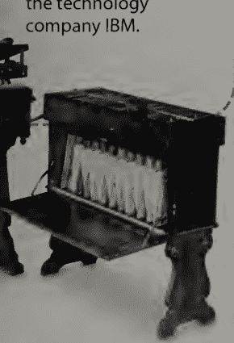

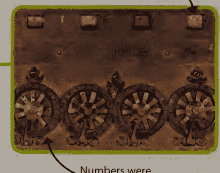

> **档案文件**
>
> - 时间：19世纪
> - 功能：自动演奏钢琴
> - 趣味趣闻：有时被称为pianolas，自动钢琴在今天仍然在使用。

# 与爱达·洛芙莱斯的采访

# 编码先驱

1842年，英国数学家爱达·洛芙莱（Ada Lovelace）成为世界上第一位计算机程序员。她因对查尔斯·巴贝奇制造的早期机械计算机的工作而闻名。她为计算机的未来铺平了道路。这是与这位聪明伯爵的虚拟对话。

> **档案文件**
>
> - 姓名：奥古斯塔·爱达·金-诺尔，洛芙莱伯爵
> - 年代：1815–52
> - 地点：英国
> - 趣味趣闻：当爱达12岁时，她曾尝试制造一台飞行机器！


**Q：爱达，你什么时候发现自己擅长数学的？**

**答：** 很早。即使在孩子时代，我也记得自己很擅长解决数学题。

**Q：你来自一个数学天才家庭吗？**

**答：** 完全不是！不过，我的父亲是著名的诗人拜伦勋爵（Lord Byron）。我有导师教我科学和数学，尽管对于一个小女孩来说学习这些学科并不寻常，但我很快发现自己很擅长它们。

**Q：你是如何遇到计算机天才查尔斯·巴贝奇的？**

**答：** 我很幸运，在1833年他在英国剑桥大学教学时遇到了他。

**Q：查尔斯给你起了一个绰号对吗？**

**答：** 是的！查尔斯叫我“数字魔术师”，而他被称为“计算机之父”。

**Q：告诉我们关于你过的过的台机器吧。**

**答：** 分析引擎（Analytical Engine）是查尔斯设计的第二台机器，它非常迷人！我意识到它可以使用字母和数字组成的代码来解决问题。

**Q：你到底什么时候写的程序？**

**答：** 1842年，我写了一组指令，并证明了计算机可以使用它们来解决数学问题。

**Q：所以你是第一位程序员？**

**答：** 嗯，是的，但我并不喜欢炫耀！令我兴奋的是这台机器的潜力。可能性是无限的！我相信所有类型的事情都可以转换为代码。谁知道编码的未来会带来什么呢！

分析引擎（1837年）由查尔斯·巴贝奇设计，用于解决以前从未复杂的计算。富有远见的爱达相信计算机有一天可以用于创作音乐或艺术。


# 秘密代码

“code”一词指的是秘密。在历史上，人们使用这些代码来隐藏信息。

# 毕波密码

古希腊人毕波（Polybius）创建了一个使用数字对应字母的矩阵来隐藏信息。

## 如何工作

找到你想要编码的字母，然后找到它上方的数字和左方的数字。在这里，A是11。

| 1 | 2 | 3 | 4 | 5 |
|---|---|---|---|---|
| 1 | A | B | C | D | E |
| 2 | F | G | H | I/J | K |
| 3 | L | M | N | O | P |
| 4 | Q | R | S | T | U |
| 5 | V | W | X | Y | Z |

希腊字母只有24个字母。英语字母表将I和J放在同一个格子里。

# 斯巴达盘

斯巴达人通过将信息写在纸上绕在棒子上来扰乱信息。

写在纸条上的信息。

| 1 | 2 | 3 | 4 | 5 |
|---|---|---|---|---|
| 1 | A | B | C | D | E |
| 2 | F | G | H | I/J | K |
| 3 | L | M | N | O | P |
| 4 | Q | R | S | T | U |
| 5 | V | W | X | Y | Z |

只有当读者将纸条绕在与其尺寸相同的棒子上时，字母才会正确对齐。


# 凯撒密码

尤利乌·凯撒（Julius Caesar）的密码非常简单，但在几个世纪里一直有效。他的敌人无法阅读。罗马将军凯撒通过将字母向前移动一位来加密他的信息。

## 如何工作

要解码位移两次的凯撒密码，将信息中的每个字母在字母表中后移两位。DCA可以变成BAY。查看左侧的两个行示例。

| .. Y Z A B C D E F G H I J K L M N O P Q R S T U |

# 阿尔贝蒂盘

1467年，意大利建筑师阿尔贝蒂（Alberti）发明了带有两个转盘的装置，可以交换字母。为了解码信息，必须知道转盘是如何旋转的。


# 恩格玛密码

在20世纪30年代，德国想要控制其他国家。1939年，它入侵了波兰。英国和法国对此宣战，第二次世界大战爆发了。战争使用了坦克、雷达和机密的恩格玛密码机等新技术。

在第二次世界大战期间，军队在陆地、空、海上进行战斗，并在战斗之间快速移动。电报和无线电被用于跨远距离发送指令。

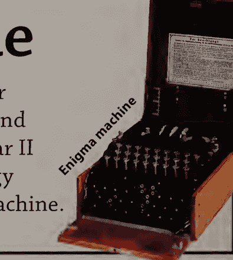


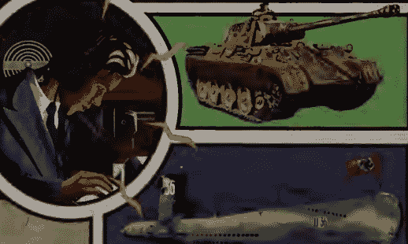


德国人使用名为恩格玛（Enigma）的机器对他们的信息进行加密。这让他们能够袭击敌人，并与他们的间谍通信。


这些秘密指令使得无法追踪到被称为U潜艇的致命德国潜艇。


在英国，有超过1万人在一个名为布莱切莱园公园（Bletchley Park）或“X站”的机密基地工作，破解恩格玛密码。

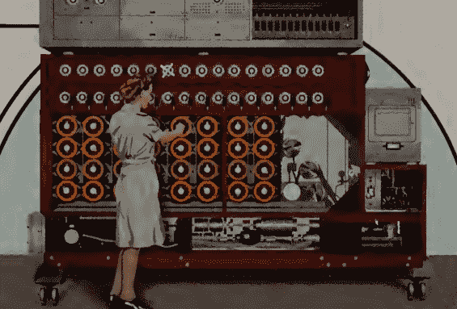

世界上最早的计算机之一被用于布莱切莱园公园，由艾伦·图灵等顶级科学家和工程师设计。

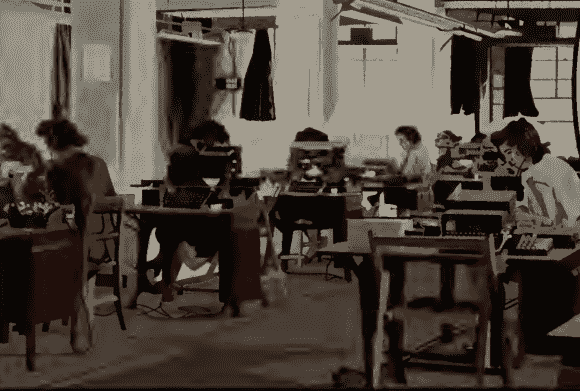

1942年10月30日，三名英国水员从一艘沉没的德国U潜艇上救出一台运行中的恩格玛机器。

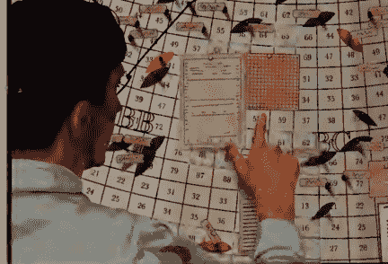

这些机器帮助英国破解了恩格玛并控制了海洋。


万岁！

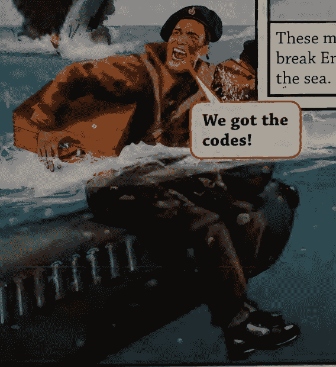

> 我们破解了密码！


胜利！

德国对海洋的控制被打破了。1945年5月7日，德国投降。

# 艾伦·图灵

英国人艾伦·图灵是一位数学和科学天才。第二次世界大战开始时，他加入了机密基地布莱切莱园公园，在那里他致力于破解敌密码并揭露德国的计划。他的发明和思想开启了现代计算机时代。

每台炸弹机（Bombe）宽2米（7英尺），重0.9吨（1吨）。

> 图灵奖是一项年度计算奖项。谷歌将给获奖者1,000,000美元。


## 秘密工作

图灵在密码和计算方面的工作极其秘密，以至于在战争结束后也少有人知道。今天，他被认为是“计算机之父”。

| 图灵机 | 隐藏的声音 |
| --- | --- |
| 1936年，图灵描述了一种想象中的机器，只要给它正确的指令集，它就能执行任何任务。他从未制造过它，但我们把这个想法称为图灵机。 | 1944年，图灵帮助开发了SIGABA，一种使用随机噪声加密消息的安全方法，因为任何窃听的人都会听到嗡嗡声。 |

## 图灵测试

1950年，图灵设想了一项测试，用来判断计算机是否具有“智能”。人类将与一个隐藏的伙伴交流，并试图判断对方是人类还是计算机。

战后，图灵利用数学探索了新的科学领域。1951年，他创建了一个方程来解释生物体中的模式，比如老虎身上的条纹或手指的数量。

图灵在1951年发表了世界上第一个下象棋程序Turochamp。当时没有计算机可以运行它，所以图灵设计了程序的规则来决定真实象棋中的走法。

# 第一台计算机

1939年，这台早期计算机通过测试恩格玛机器可能的组合来破解密码。200多人在布莱切莱园公园日夜工作。


1943年，美国的工程师开始设计一种可以通过编程解决不同数学问题的机器。这是电子积分计算机（ENIAC），第一台计算机。ENIAC每秒可以执行5000条指令，比当时的计算器快1000倍。它体积巨大，占据了整个房间。

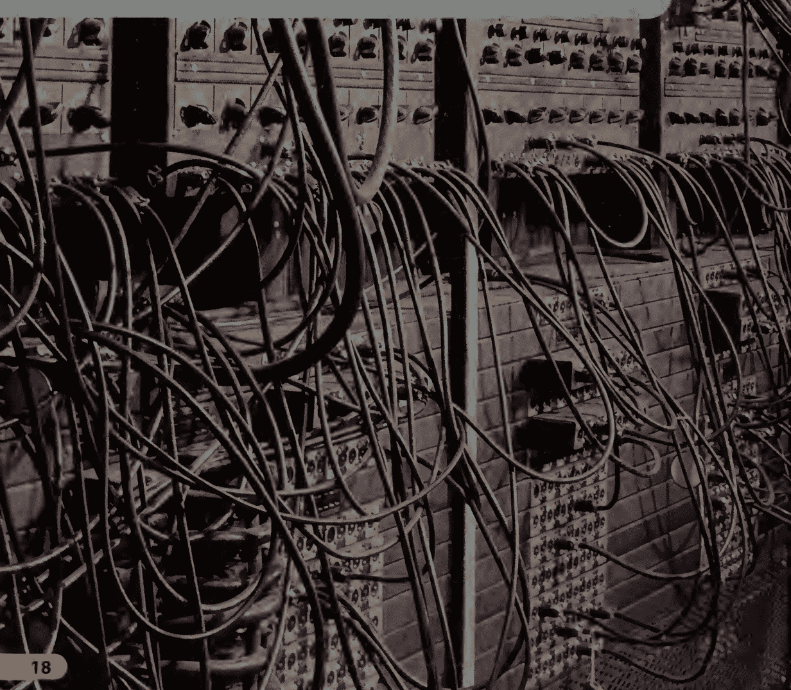

## 它是如何工作的

ENIAC重27吨（30吨）——相当于五头大象。ENIAC没有现代计算机那样的“内部”。相反，它的部件固定在40个面板上。每个面板上有数百根电线和真空管。

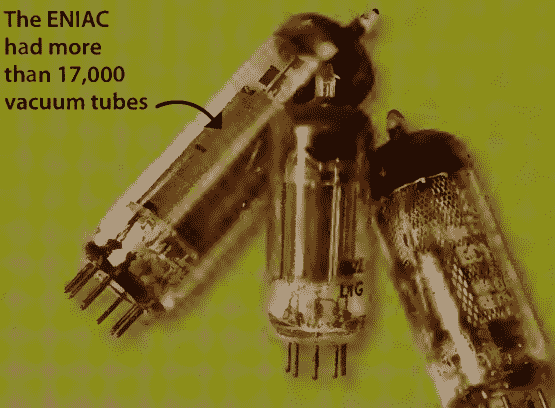

### 真空管


真空管看起来像灯泡。它们的作用像开关，用于接通或断开电路。

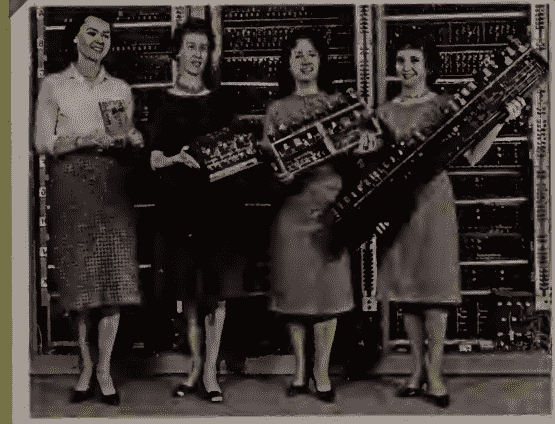

### 为ENIAC编程

男女并肩为ENIAC编程。每次编程时，一切都必须手动移动。设置它执行单个任务可能需要几周时间。

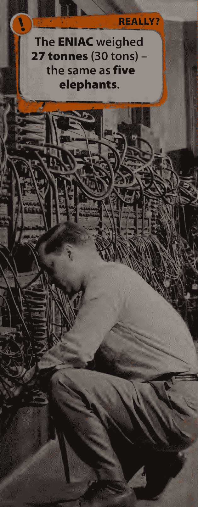

## 多任务机器

计算机同时处理的任务越多，完成得越快。早期的计算机只能处理一项任务，但现在的笔记本电脑或手机可以同时执行数千个独立任务，称为“进程”。

> 哇！最重的计算机是SAGE系统，重226.8吨（250吨）。

Z3制造于德国，是世界上第一台可编程的计算机。旧的计算机需要重新布线才能运行新程序，但Z3将程序存储在纸带上。它在第二次世界大战期间被炸弹摧毁。

### 档案

- **时间**：1941年
- **重量**：0.9吨（1吨）
- **趣事实**：德国政府拒绝帮助改进Z3。他们认为计算机对战争并不重要。

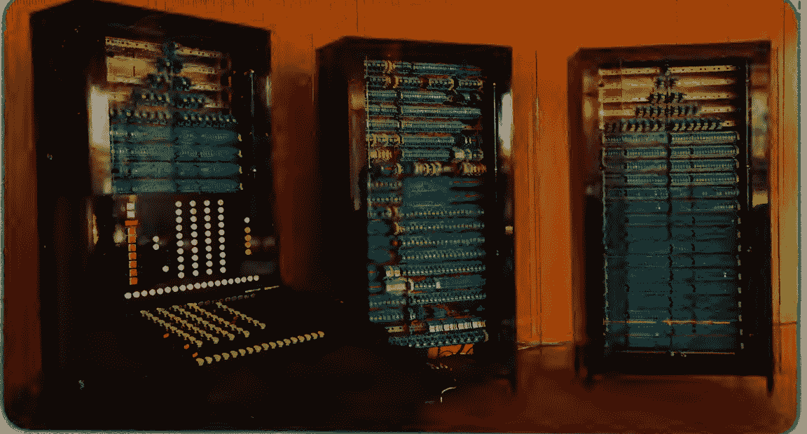

小型实验机器（SSEM）建造于英国曼彻斯特大学。它是第一台将程序存储在自己内存而非纸带上的计算机。

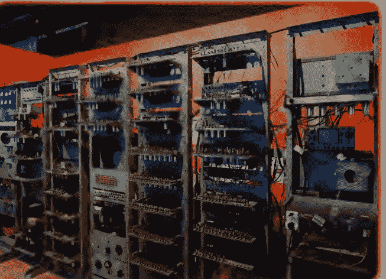

### 档案

- **时间**：1948年
- **重量**：1吨（1.1吨）
- **趣事实**：因为SSEM非常小，它被戏戏地命名为“宝贝”。

UNIVAC I是第一台向公众出售的计算机。它的名字代表“通用自动计算机”。它使用大型汞延迟线来存储电信号。

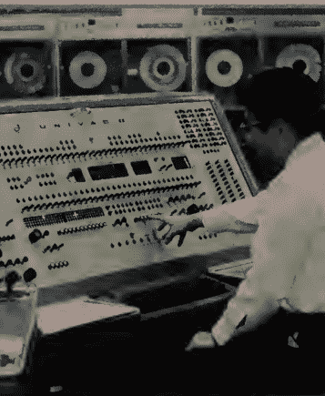

### 档案

- **时间**：1951年
- **重量**：13吨（14.3吨）
- **趣事实**：UNIVAC预测了艾森豪在1952年总统选举中的胜利。

IBM360是第一系列可以在多台机器上运行的计算机。它们的设计非常负担得起，以便企业购买或租赁。


### 档案

- **时间**：1964年
- **重量**：从0.7吨（0.75吨）到2.3吨（2.6吨）不等
- **趣事实**：IBM 360计算机用于规划阿波罗登月计划。

## 像计算机一样思考

计算机不能自己思考。它们遵循程序员提供的非常具体的指令。这些指令必须既精确又简单。程序员经常将复杂的指令分解为更容易遵循的较小步骤。

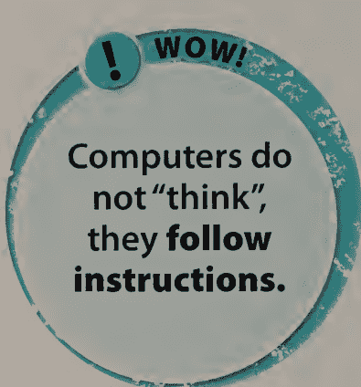

当机器人遇到障碍时，它都会再次遵循规则，从算法开始开始。

## 遵循规则

机器人必须像计算机一样，按照固定的步骤穿过迷宫。它必须遵循下面的规则。算法的信息与规则相同，但其写法是为了让计算机（机器人）能够遵循。

| 算法 |
| --- |
| 开始 <--> 向前 <|
| 如果被墙挡住：右侧没有墙则向右转；左侧没有墙则向左转。返回开始 <|
| 如果看到红门：忽略。返回开始 <|
| 如果看到蓝门：忽略。返回开始 <|
| 如果看到绿门：打开门。进入绿门后的空间。关闭绿门。返回开始 <|

# 什么是算法？

编码人员在编写任何代码之前，通常会开发一套被称为算法的步骤或指令。例如，编写一个机器人穿袜子可能会遵循以下简单算法。

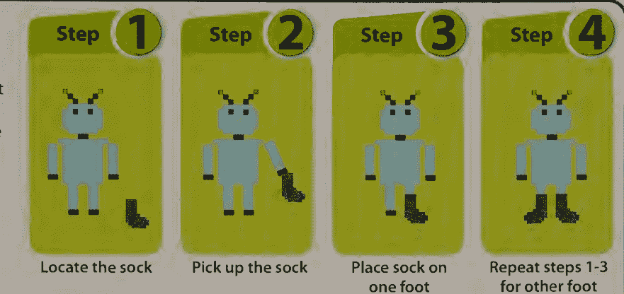

- 找到袜子
- 拿起袜子
- 将袜子放在一只脚上
- 对另一只脚重复步骤 1-3

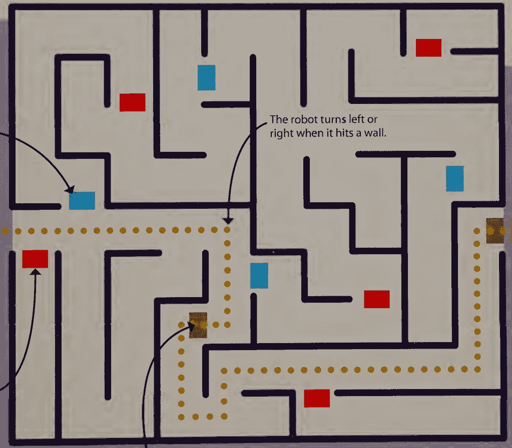

- 机器人忽略蓝色门。
- 机器人在撞到墙壁时会向左或向右转。
- 机器人进入迷宫。
- 机器人忽略红色门。
- 机器人打开并通过绿色门。

从计算机早期开始，编码人员就一直在制作游戏。我们所有人都需要代码，我们玩的所有游戏都需要代码，无论是在电脑、电视还是手机上玩。这些图像现在看起来很简单，但它们在被创造时是突破性的！

Pong 由 Atari 在 1972 年创建。两名玩家使用带有旋转旋钮的拍子来回击“球”。当对方玩家没接住球时即可得分。它有两个版本：街机游戏版和一个连接到电视的版本。

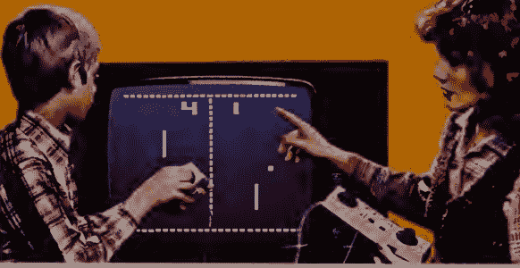

Atari 2600 是从 1977 年起销售最早且最受欢迎的家用游戏系统之一。游戏是小的矩形塑料盒，插入到一个被称为“主机”的盒子里。

控制器带有用于移动的摇杆和一个单一“发射”按钮。

### 宇宙侵入侵者（SPACE INVADERS）

最早的街机游戏之一是《太空侵入侵者》，于 1978 年发布。外星人在空中移动，玩家向他们发射导弹，试图阻止外星人着陆。

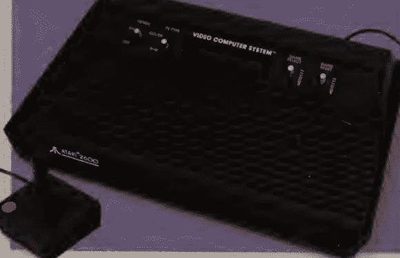

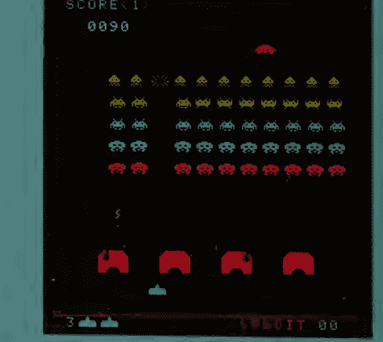

### 冒险（Adventure）

### ZORK I

一些早期游戏没有图形。相反，玩家阅读描述并输入命令。发布于 1977 年的《Zork I》是最受欢迎的文字冒险游戏之一。玩家探索房屋下的隧道，与怪物战斗并努力生存。

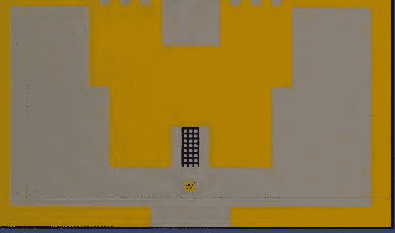

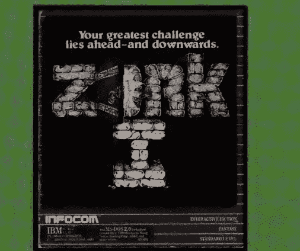

> Zork 1 封面艺术

在这部 1980 年的游戏中，玩家使用摇杆引导吃豆人（一个黄色圆圈）在迷宫中穿行。吃豆人吃豆子得分，并必须避开四个追逐它的幽灵。

20 世纪 80 年代中期，任天堂 NES 是世界上最受欢迎的游戏机。游戏装在塑料盒子里，插入到主机中。

玩家使用一个带有几个按钮的粗壮灰色控制器。

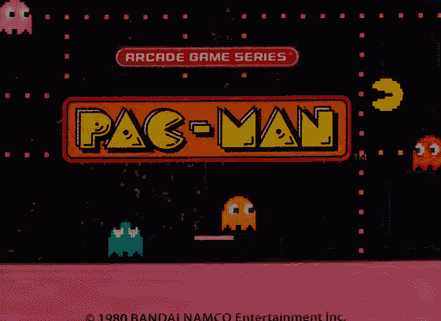

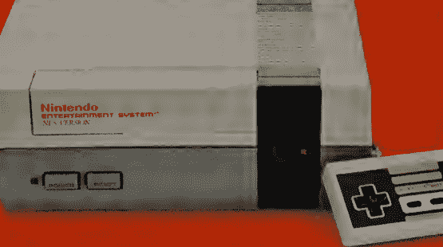

计算机的物理部分被称为硬件。编码人员需要理解硬件如何工作，以便编写告诉计算机做什么的代码。

这是存储计算机大部分数据的地方。

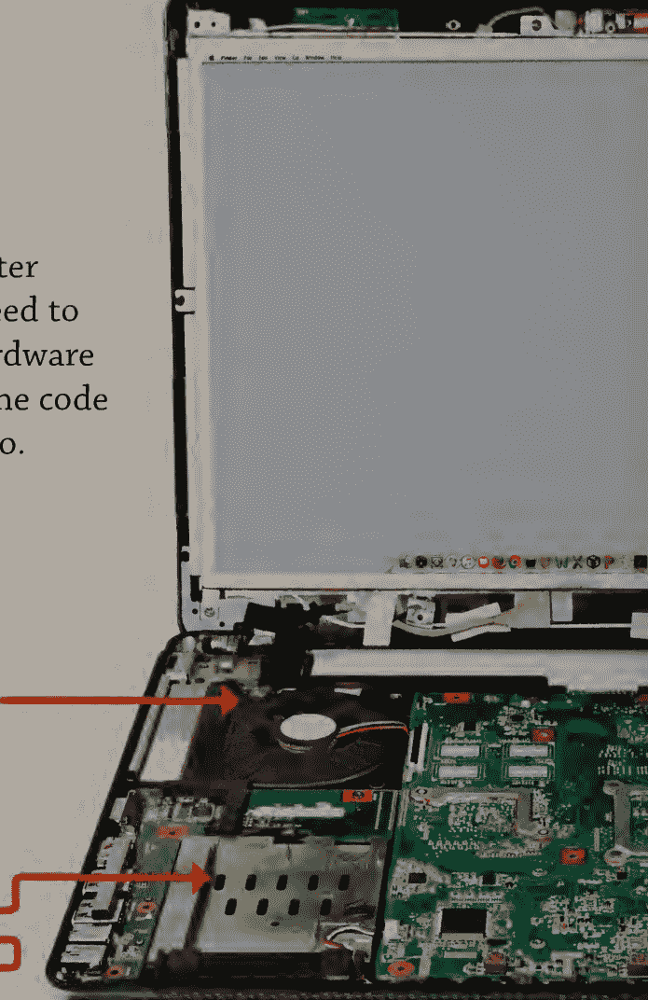

随机存存储器是在通电时存储信息的内存。

计算机数据需要保存以便共享和再次使用。今天，我们使用“云”存储数据。这里是我们仍在使用的物理存储设备。

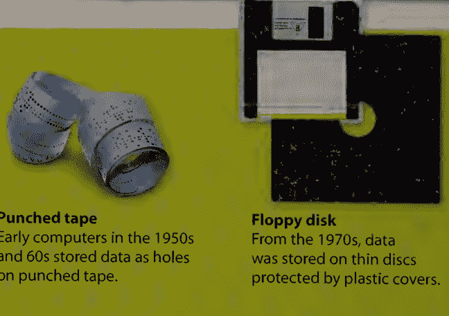

- 磁带：20 世纪 50 年代和 60 年代的早期计算机以孔带的形式存储数据。
- 软盘：从 20 世纪 70 年代开始，数据存储在这些由塑料盖保护的圆盘上。

文本和图像在这里显示。哇！第一台笔记本电脑于 1981 发布。

## 主板

这块巨大的电路板持有处理器。所有部分都连接到它，以便计算机的不同部分可以通信。

## 处理器

这是计算机的“大脑”。它执行运行计算机的大部分计算。

计算机需要能量才能工作。笔记本未插电时由电池供电。

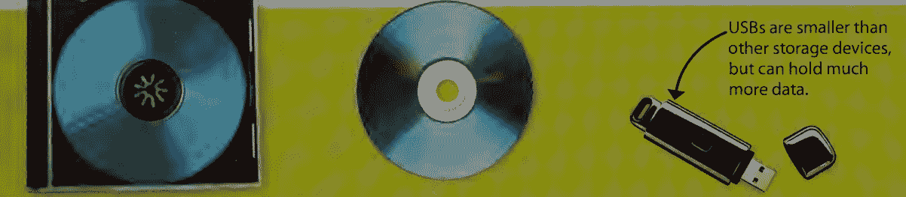

CD 使用激光写入磁盘。它可以存储比软盘更多的数据。

DVD 比 CD 有更好的音质和更大的空间存储视频。

USB 比其他存储设备小，但容量更大。它们直接插入计算机。

| 特性 | 详情 |
|---|---|
| 重量 | 5 公斤 (7 磅) |
| 功能 | 解方程 |
| 速度 | 计算需要 30-60 秒 |
| 硬件 | 带有 37 个键的键盘、打印机和带有中央处理单元的塑料壳 |

1965 年，意大利公司 Olivetti 通过创建世界上第一台台式电脑创造了历史。这项突破性的技术设计易于操作并适合放在桌子上。蓝灯表示机器正在运行并准备好输入，红灯指示错误。

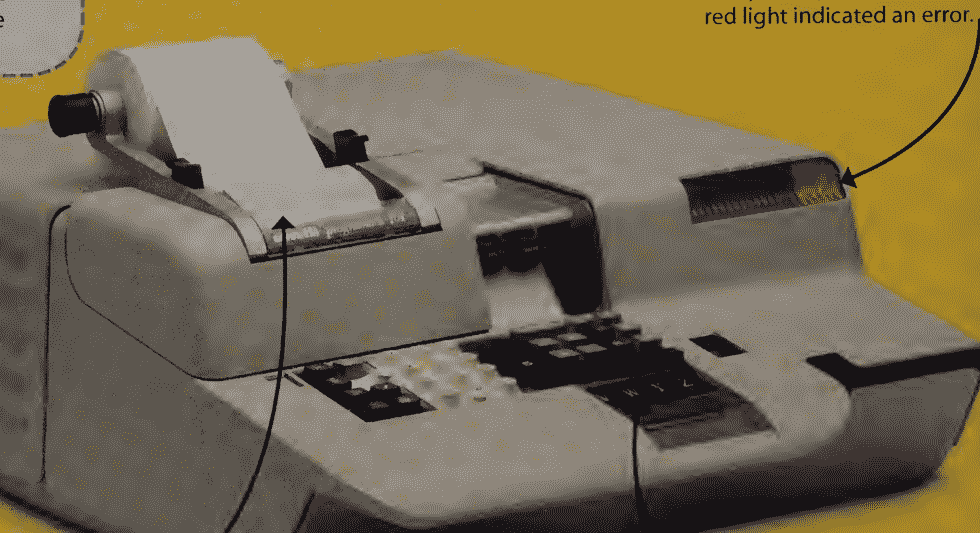

计算机每秒可以打印 30 个字符（数字、字母或符号）。键盘具有运行程序、记录数据和打印结果的开关。

多年来计算机发生了巨大的变化。早期计算机大到可以填房间，但现代电脑小到可以放入背包。20 世纪 60 年代，人们为家里购买个人电脑。屏幕清晰锐，允许用户查看和编辑图像、创建游戏并访问互联网。一种称为鼠标的手持移动设备用于在屏幕上移动。在键盘上打字的数据会立即显示在屏幕上。

| 特性 | 详情 |
|---|---|
| 重量 | 10 公斤 (22 磅) |
| 功能 | 数据处理、信息存储和数据输出 |
| 速度 | 复杂功能的几乎即时结果 |
| 硬件 | 带有 102 个键的键盘、屏幕和微处理器技术 |

## 现代机器

相比之下，现代计算机轻得多，功能更广泛。这些设备可以在家里使用，有些也可以移动使用。现代计算机使用较小的处理器（微处理器）来存储、处理和显示海量数据。

英语中有 26 个字母，但计算机和其他数字设备只用 0 和 1 “说话”。你能想象只用 0 和 1 与朋友交聊天吗？所有的计算机信息都存储为 0 和 1。

所有计算机都使用称为二进制的两个进行通信。“1”意味着信号“开启”，“0”意味着信号“关闭”。想象灯开关；通过打开灯，你可以向远处的朋友发送信息“1”，而关闭则发送信息“0”。


一个字节的数据由八个位（bit）组成。每个位是 0 或 1。一个字节可以表示 255 个不同的字母、数字或符号。

- 字节：八位组合成一个字节。
- 位：单个位是 0 或 1。

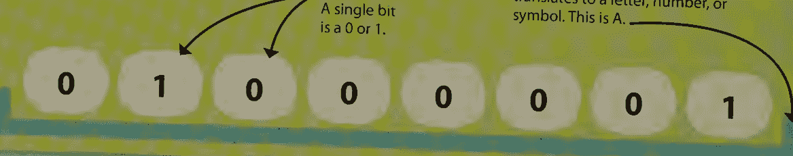

构成计算机的设备通过移动字节进行二进制通信。它们之间“说”的一切都是由 0 和 1 的字符串组成的。

所有数据存储在系列为“1”或“0”的电脉冲中。字节不断地往回移动。

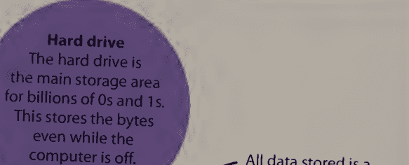

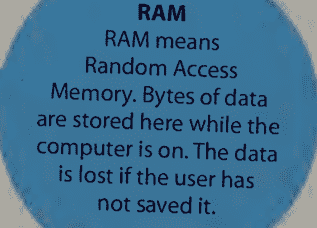

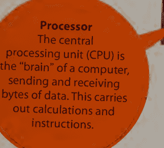

为了将二进制数字转换为字符，计算机使用 ASCII（键），即美国信息交换标准。每组二进制数字代表 ASCII 代码中的一个数字、字母或符号。

计算机存储使用字节描述。单位显示了计算机空间有多少 0 和 1。

+ 1 千字节是 1024 字节
2 兆字节是 1024 千字节
3 吉字节是 1024 兆字节
4 太字节是 1024 吉字节
5 拍字节是 1024 太字节
6 艾字节是 1024 拍字节

| 二进制 | ASCII |
|---|---|
| 01000001 | A |
| 01000010 | B |
| 01000011 | C |
| 00110001 | 1 |
| 00110010 | 2 |
| 00110011 | 3 |
| 00101110 | . |
| 00101111 | ! |
| 00111111 | ? |
| 01000000 | @ |

编程语言是一组告诉计算机该做什么的指令。为了不同类型的程序，已经创建了数百种语言。下面的六个代码泡告诉计算机如何说“Hello, World!”。你能根据线索将每种代码与其对应的语言匹配起来吗？


```c
#include <stdio.h>

main() {

    printf("Hello, World!");

}
```


```python
print("Hello, World!")
```


```basic
10 PRINT "Hello, World!"
20 GOTO 10
```


Java 发布于 1994 年，允许程序在不更改代码的情况下运行在多个操作系统上。


Python 是一种受程序员欢迎的近期语言，代码简洁且简单。这使得它很容易学习。

PHP 主要用于从事网页设计和 HTML（超文本标记语言）的程序员。

> 线索：
> Java 程序以单词“class”开头。

> 线索：
> Python 是最易读且代码最短的代码。

> 线索：
> 该语言的名称就在实际代码中。

Ook! 是由 David Morgan-Mar 作为一个玩笑创造的编程语言。它并非为了严肃用途，指令被更改成了大猩猩语的单词。这些单词是“Ook”、“Ook!”和“Ook?”。它们可以组合成命令。

```
Ook. Ook? Ook. Ook. Ook. Ook. Ook. Ook. Ook. Ook.
Ook. Ook. Ook. Ook. Ook. Ook. Ook? Ook. Ook. Ook.
Ook. Ook. Ook. Ook. Ook. Ook. Ook? Ook. Ook. Ook.
Ook! Ook! Ook! Ook! Ook! Ook! Ook! Ook! Ook.
Ook. Ook. Ook. Ook. Ook. Ook. Ook? Ook. Ook. Ook.
Ook! Ook! Ook! Ook! Ook! Ook! Ook! Ook! Ook!
Ook? Ook? Ook. Ook. Ook. Ook. Ook. Ook. Ook.
Ook. Ook. Ook. Ook. Ook! Ook! Ook! Ook. Ook.
Ook. Ook! Ook! Ook! Ook. Ook! Ook. Ook. Ook.
Ook. Ook! Ook? Ook? Ook? Ook? Ook. Ook. Ook.
Ook. Ook. Ook. Ook. Ook. Ook. Ook. Ook! Ook. Ook!
```

Ook 语言的计算机代码

```java
class Hello, WorldApp {

    public static void main (String[] args) {

        System.out.println("Hello World!");

    }

}
```

```php
<?php

echo"Hello, World!";

?>
```

点击时

BASIC 是最老的编程语言之一。它的全称是“初学者通用符号指令代码”。

C 是世界上广泛使用的语言之一，但学习起来很困难。它通常用于制作运行快速的软件。

Scratch 被用来教初学者编程。与其输入代码，不如使用现制块来构建指令。

> 线索：
> 每行代码都以数字开头。

> 线索：
> C 程序以井号 (#) 开头。

> 线索：
> Scratch 使用彩色块来构建代码。

无论是程序、应用还是代码，你描述的都是一组特殊的指令，被称为“软件”。大多数现代设备由软件控制。这包括手机、平板电脑、太空中的卫星甚至火星上的机器人。

手机或平板电脑上的每个应用都是独立运行的小型程序。应用可以做各种事情：拍照、发送消息以及玩游戏。

无人机是不需要飞行员飞行的设备。相反，它们使用遥控器和特殊软件。它们被用于拍摄照片和视频。

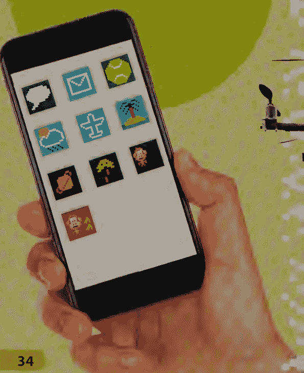

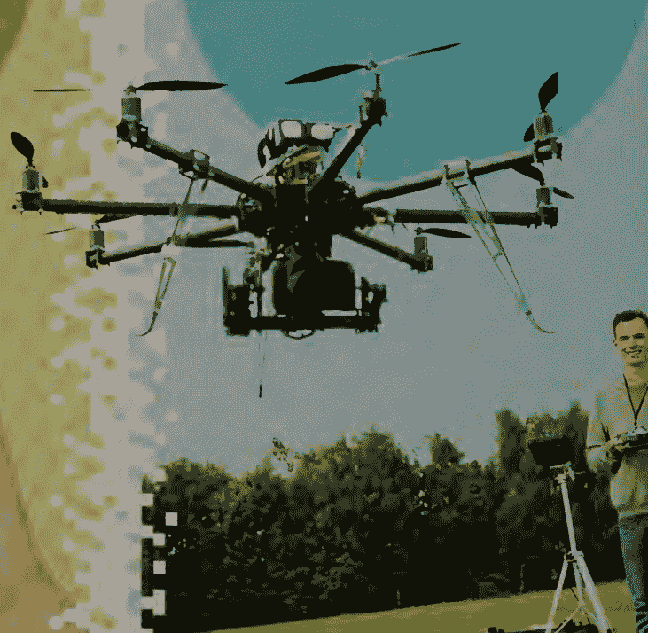

程序员花费大量时间让应用运行流畅，但他们需要将应用发布给所有用户。有时应用需要广告和营销的帮助，而口碑是一个很好的方法。分享应用意味着它可以获得更多用户，甚至可能病毒式传播。这意味着它在许多人之间被谈论。

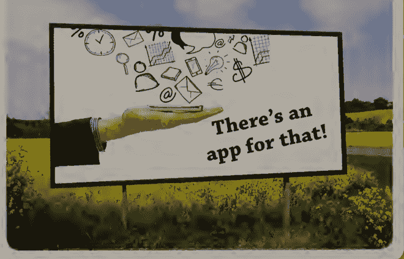

> 有这样一个应用！

有些外科医生依靠机器人协助最精细的操作。机器人的每个手臂都有特殊代码来帮助医生完成重要任务。

探测 B 正在探测火星表面。它使用特殊代码，可以在距离地球 2.25亿公里（1.4亿英里）的地方工作。

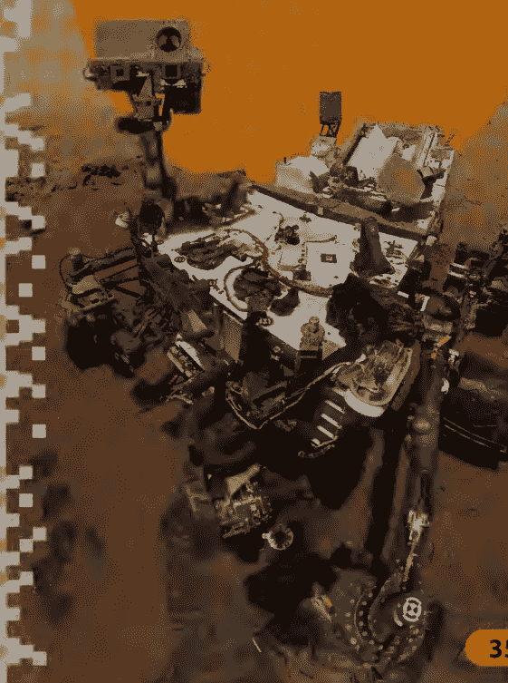

# 计算机计算机并不总是运行流畅。有些人传播恶意代码（如蠕虫）来损害或窃取信息。如果代码中有错误，程序可能会停止工作。这些被称为漏洞。防病毒程序和“防火墙”是保护计算机免受恶意代码侵害的软件。


自从 1945 年发现一台美国大学的计算机里有一蛾以来，计算机错误一直被称为漏洞。


# 计算机黑客

黑客是编写恶意代码（恶意软件）以获取计算机访问的人。他们可以窃取信息或损坏数据。

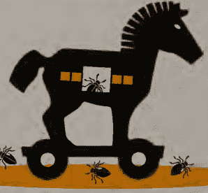

# 洛马木

洛马木是一个伪装无害的文件。一旦打开，它就会加载一个控制你计算机的程序。


```c
for (i) {
```


```
case 1:
    do_something(1); break;
case 2:
    do_something(2); break;
case 3:
    do_something(3); break;
    do_something(4); break;
default:
    break;
}
```

> 这是代码中的一个错误——Case 1 被错误地复制到了 case 3 下。

# 病毒

病毒是恶意软件的一种，它附着在程序上并自动运行。


# 后门

后门程序允许黑客在没有密码的情况下入侵系统。

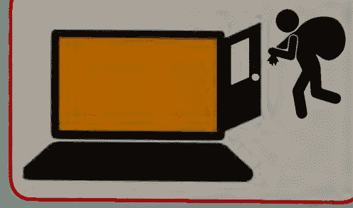

# 漏洞

漏洞是程序中的错误或故障。它可以导致程序运行异常，例如在屏幕上显示奇怪的文字。它会导致程序停止工作。

# 漏洞扫描

黑客使用漏洞扫描程序来寻找安全漏洞。

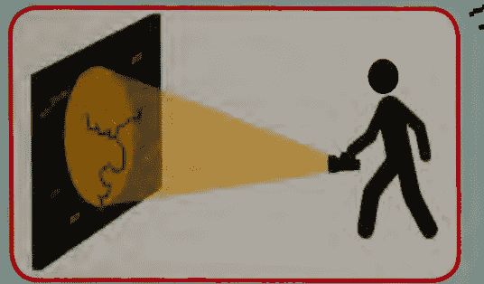

# 嗅探器

嗅探器监控网络上传输的信息。它们捕获用户数据。


# 计算机虫

计算机蠕虫通过向所有机器发送副本来感染网络。它们比病毒更难对付。


# 键盘记录

键盘记录监控别人键盘上按下的每一个键。它让黑客看到密码或其他隐私信息。

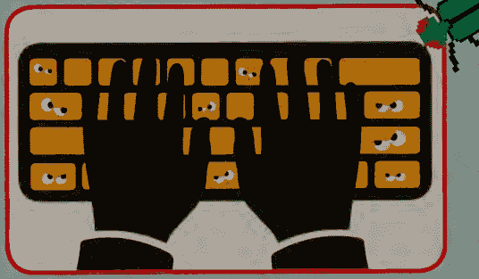

# 互联网

互联网是一个连接全球计算机的网络。它起源于 20 世纪 60 年代，但当时只有少数大学在使用它。现在，数百万人每天使用它进行通信、获取信息以及娱乐。它让我们能够快速方便地完成许多原本需要更长时间的事情。

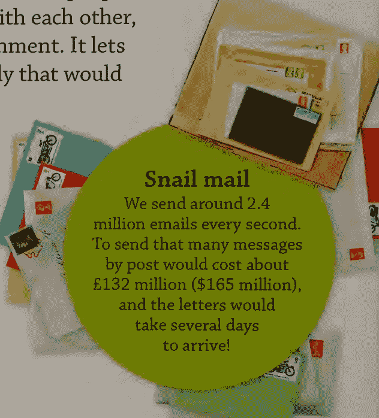

## 慢速

我们利用互联网几乎立即获取信息。如果没有它，我们必须找到关于我们感兴趣的书，然后查找，这会花费更长的时间。

## 蜗政

我们每秒发送 240 万封电子邮件。如果通过邮寄发送这么多信息，将花费 1.32 亿英镑（1.6 亿美元），而且信件需要几天才能到达！

## 地图阅读

手机使用太空卫星在地图上显示位置。如果没有互联网，手机将无法与卫星通信，因此无法显示你在哪里。

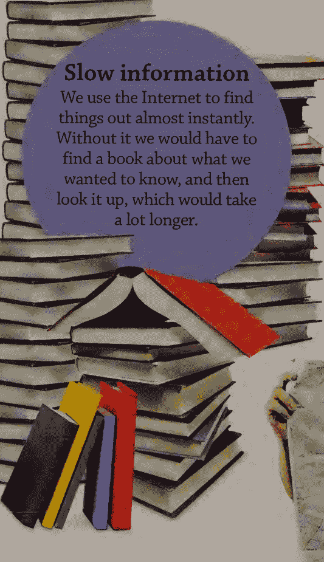


## 社交功能无法使用

社交网络应用让你随时与朋友聊天。

## 发送文件

互联网让我们即时共享和下载文件。如果没有它，我们只能通过计算机之间的线缆进行共享，或者通过邮寄副本来分享。

你可以与大量朋友同时聊天、安排会面并分享最新消息。

## 购物

你可以通过互联网购买几乎你需要的任何东西，从食物饮料到巨大的塑料象！所有物品都会通过邮寄送给你，所以你不需要去商店。

## 看什么呢？

互联网让我们即时观看电影。我们只需点击按钮即可下载任何想要的内容，而不需要寻找和观看 DVD。


## 什么是 App？

App 是用代码编写的指令集。它们主要用于手机和平板，完成许多不同的任务，从玩游戏到打视频电话。有很多专门为孩子设计的 App。


# 游戏

问答、比赛和谜题都是有趣且流行的游戏 App 类型。有些是免费的，但另一些会对游戏内项目收费，所以要小心！

## 购物

购物 App 让人们无需出门就能买东西。大多数大型商店都有 App。你还可以和其他人竞标拍卖来购买物品。

## App 开发

你手机或电脑上的 App 并不是凭空出现的。从一个想法到变成完成的程序，需要大量的工作。以下是实现方法。


### 想法

人们对新 App 有想法。这些 App 通常尝试实现一些目前还没有 App 实现的实用功能。

### 设计

App 的外观以及人们如何使用它很重要。流行的 App 通常看起来精美且易于使用。

## 智能手机

智能手机是你随身携带的微型计算机。与台式电脑不同，它们足够小可以在途中使用。智能手机拥有操作系统。这是一个内置的指令集，让 App 运行。苹果的 iOS 和谷歌的 Android 是最流行的两个操作系统。


手机运行中


## 地图

## 通信

手机不仅仅用于通话。App 让人们以许多不同的方式交流，包括视频通话、图片消息和群聊。


## 编程

每个 App 都由代码组成。在 App 发布之前，代码经过多次测试以确保其正常工作。

## 反馈

一旦 App 开始使用，人们会对哪些功能有效、哪些不起作用提供反馈。程序员会不断调整代码，直到它完美运行。

哇！在 2016 年，智能手机可用 App 超过两百万。

## 日常编码

虽然我们看不见代码，但代码无处不在，每天帮助着我们。计算机使用代码让现代技术顺畅运行。以下是生活中编码的一些示例。

## 交通灯

编码用于控制许多城镇和城市的交通流量。计算机向交通灯发送编码指令，告诉它们变换。司机和行人知道何时停止，何时通过。


## 电脑游戏

电脑游戏可以带领玩家进入虚拟世界。每个游戏都有代码在后台运行，让你的角色跳跃或移动。


## 自动售卖机

当你投入货币并选择后，售卖机的代码会计算你需要多少找零，并将物品掉到盘子里供你取用。


## 微波炉

当你按下微波炉上的按钮时，简单的编码指令会控制微波炉的计时和加热温度。


## 条码扫描

商店里的每件物品都有唯一的线条代码来识别。这些线条（条码）由计算机读取并在数据库中找到物品及其价格，以便你购买。


## 车辆

汽车使用计算机代码监控发动机并确保其运行正常。代码还控制转向灯等功能。

## 智能板

这些大屏幕使用计算机编码指令让学生选择并控制显示的信息。他们只需触摸屏幕。


## 计算器

计算器使用代码计算数学题答案。结果立即显示在屏幕上。


## Scratch

Scratch 是最容易的编程语言之一。程序通过组合彩色区块来告诉屏幕上的角色做什么。Scratch 让你制作自己的故事、游戏和艺术。

## Scratch 布局

屏幕布局右侧有放置指令的空间。左侧是“舞台”，你的代码在此运行。

- 指令区块被称为脚本。
- 你可以根据项目更改背景图片。
- Scratch 中的角色被称为 Sprite。
- 区块包含许多不同的指令。


## 关于 Scratch 的事实

1. Scratch 发源于美国麻省理工学院（MIT）。
2. Scratch 支持 40 多种语言，在全球范围内使用。
3. 在没有网络时，可以使用离线版本的 Scratch。

## 角色 (Sprites)

Sprite 是 Scratch 中使用的角色。它们由编码指令集控制。Sprite 可以移动、在气泡中说话以及出现和消失。


### 绘制你自己的角色

Scratch 有许多可选择的 Sprite。还有一个绘画工具让你创建自己的。


正在构建的脚本用于当前显示的 Sprite。区块相互组合在一起，告诉 Sprite 该做什么。剑向下移动。


哇！Scratch 被全球 150 多个国家使用。

海盗装扮 1
服装是不同姿态的 Sprite 图片。切换服装可以让这个海盗移动。

海盗装扮 2
从装扮 1 切换到装扮 2 时，海盗的腿和剑似乎在移动。向外移动。

## 树莓派

树莓派是一种微型计算机，用于教人们计算机是如何运作的。它可以连接到各种设备，如电视、摄像头甚至机器人，并有足够的功率运行全尺寸计算机类似的程序。


## Micro SD 卡

微型内存卡存储操作系统、程序和数据。


## LCD 显示面板接口

液晶显示器（LCD）面板可以连接到此端口。


## HDMI 视频

计算机屏幕或现代电视可以连接到此端口。


## 摄像头接口

连接摄像头让树莓派能够拍摄照片和视频。

# 树莓派的应用

日本工程师石渡翔（Shota Ishiwatari）创造了名为“Rapiro”的类机器人，它通过树莓派运行。Rapiro 有眼睛可以用 LED 灯点亮的眼睛，并且走路并移动手臂。

# GPIO 引脚

这些引脚可以连接灯光或蜂鸣器。当树莓派运行时，它们会亮起或发出声音。


# USB 端口

鼠标和键盘可以连接到这些端口，与电脑配合使用。


# 以太网端口

树莓派可以通过此端口通过有线连接访问互联网。


# 音频输出

耳机或扬声器可以连接到这里听音乐。


> 自 2012 年发布以来，树莓派的销量已超过了 1100 万台。

# 关键程序员

自从第一台计算机发明以来，计算领域发生了巨大的变化，全球的程序员一直在不断开发新技术。有些人创造了改变我们世界的事物。你认识这些著名的程序员有多少？


# 蒂姆·伯纳斯-利

英国计算机程序员蒂姆·伯纳斯-利（Tim Berners-Lee）在 1989 年发明了万维网。万维网将网页连接在一起，现在被全球数百万人使用。


# 格蕾丝·霍珀

格蕾丝·霍珀（Grace Hopper）是美国海军一名少将，也是一位计算机科学家，她创造了世界上第一个计算机编译器——一种将普通语言转换为计算机可以理解的代码程序。


# Mark·扎克伯格

大学学生马克·扎克伯格（Mark Zuckerberg）在 2004 年创立社交媒体网站 Facebook 时，成为了世界上最年轻的亿万富翁之一。该网站在十个月内就拥有了一百万用户。

# 玛格丽特·汉密尔顿

美国计算机程序员玛格丽特·汉密尔顿（Margaret Hamilton）曾任职于美国航空航天局（NASA）。她负责开发 1969 年将人类送上月球的飞行软件。

# 斯蒂夫·乔布斯和斯蒂夫·沃兹尼亚克

科技公司苹果的创始人，美国人斯蒂夫·乔布斯（Steve Jobs）和斯蒂夫·沃兹尼亚克（Steve Wozniak）在 1976 年制造了最早的家用电脑之一。现在苹果是世界上最成功的品牌之一。

# 比尔·盖斯

美国人比尔·盖斯（Bill Gates）在 1975 年共同创立了计算机软件公司微软。十年后，微软创建了 Windows，这是应用最大的操作系统。

# 谢尔格·布林和拉里·佩奇

全球最流行的搜索引擎 Google 是由谢尔格·布林（Sergey Brin）和拉里·佩奇（Larry Page）在 1998 年创立的。今天，大约 80 到 85% 的互联网查询是在 Google 搜索引擎中完成的。

# 认识专家

程序员兼作家杰夫·阿特伍德（Jeff Atwood）共同创立了 Stack Overflow（一个回答问题的网站）以及 Discourse（一个在线交流程序）。

- Q：我们知道这是关于编程的，但你的实际工作是什么？
- A：我的工作是写指令告诉计算机做什么，并让它做得更好。

- Q：你使用特殊的设备吗？
- A：我们使用带有大量内存的计算机。我们还使用多个显示器和舒适的椅子。

- Q：你最喜欢编程的什么？
- A：软件很容易变得更好，软件还可以鼓励人们做更好的事情并帮助他人。

- Q：你的日常工作是怎样的？
- A：我在家里工作，所以我起床后就在办公室。我通过互联网与团队交流。

- Q：你工作中最好和最坏的部分是什么？
- A：我工作中最好的部分是软件可以触及许多人——通过他们的手机、笔记本电脑和电脑。我工作中最坏的部分是花费大量时间与计算机交流。当你犯错时（即使是微小的错误），它也是不留情的。


```c
void main() {
    printf("Hello, World!");
}
```


# 树莓派的应用

日本工程师石渡翔（Shota Ishiwatari）创造了名为“Rapiro”的类机器人，它通过`树莓派`运行。Rapiro 有眼睛可以用 `LED` 灯点亮的眼睛，并且走路并移动手臂。

# GPIO 引脚

这些引脚可以连接灯光或蜂鸣器。当`树莓派`运行时，它们会亮起或发出声音。


# USB 端口

鼠标和键盘可以连接到这些端口，与电脑配合使用。


# 以太网端口

`树莓派`可以通过此端口通过有线连接访问互联网。


# 音频输出

耳机或扬声器可以连接到这里听音乐。


> 自2012年发布以来，`树莓派`的销量已超过了1100万台。

# 关键程序员

自从第一台计算机发明以来，计算领域发生了巨大的变化，全球的程序员一直在不断开发新技术。有些人创造了改变我们世界的事物。你认识这些著名的程序员有多少？


# 蒂姆·伯纳斯-利

英国计算机程序员蒂姆·伯纳斯-利（Tim Berners-Lee）在1989年发明了万维网。万维网将网页连接在一起，现在被全球数百万人使用。


# 格蕾丝·霍珀

格蕾丝·霍珀（Grace Hopper）是美国海军一名少将，也是一位计算机科学家，她创造了世界上第一个计算机编译器——一种将普通语言转换为计算机可以理解的代码程序。


# Mark·扎克伯格

大学学生马克·扎克伯格（Mark Zuckerberg）在2004年创立社交媒体网站`Facebook`时，成为了世界上最年轻的亿万富翁之一。该网站在十个月内就拥有了一百万用户。

# 玛格丽特·汉密尔顿

美国计算机程序员玛格丽特·汉密尔顿（Margaret Hamilton）曾任职于美国航空航天局（`NASA`）。她负责开发1969年将人类送上月球的飞行软件。

# 斯蒂夫·乔布斯和斯蒂夫·沃兹尼亚克

科技公司`苹果`的创始人，美国人斯蒂夫·乔布斯（Steve Jobs）和斯蒂夫·沃兹尼亚克（Steve Wozniak）在1976年制造了最早的家用电脑之一。现在`苹果`是世界上最成功的品牌之一。

# 比尔·盖斯

美国人比尔·盖斯（Bill Gates）在1975年共同创立了计算机软件公司`微软`。十年后，`微软`创建了`Windows`，这是应用最大的操作系统。

# 谢尔格·布林和拉里·佩奇

全球最流行的搜索引擎`Google`是由谢尔格·布林（Sergey Brin）和拉里·佩奇（Larry Page）在1998年创立的。今天，大约80到85%的互联网查询是在`Google`搜索引擎中完成的。

# 认识专家

程序员兼作家杰夫·阿特伍德（Jeff Atwood）共同创立了`Stack Overflow`（一个回答问题的网站）以及`Discourse`（一个在线交流程序）。

- Q：我们知道这是关于编程的，但你的实际工作是什么？
- A：我的工作是写指令告诉计算机做什么，并让它做得更好。

- Q：你使用特殊的设备吗？
- A：我们使用带有大量内存的计算机。我们还使用多个显示器和舒适的椅子。

- Q：你最喜欢编程的什么？
- A：软件很容易变得更好，软件还可以鼓励人们做更好的事情并帮助他人。

- Q：你的日常工作是怎样的？
- A：我在家里工作，所以我起床后就在办公室。我通过互联网与团队交流。

- Q：你工作中最好和最坏的部分是什么？
- A：我工作中最好的部分是软件可以触及许多人——通过他们的手机、笔记本电脑和电脑。我工作中最坏的部分是花费大量时间与计算机交流。当你犯错时（即使是微小的错误），它也是不留情的。


- Q：成为软件开发者？我一直很喜欢计算机，我发现我可以建立自己的游戏——我被迷住了。

- Q：你有什么开发过的最喜欢的东西吗？
- A：我们建立了`Stack Overflow`，它就像程序员的百科全书！


# 认识专家

我们遇到了计算机科学家`Kiki Prottman`。她是`code.org`的课程经理，目标是让更多人参与编程。

- Q：我们知道这是关于编程的，但你的实际工作是什么？
- A：我走遍各地，向学生和老师展示如何像科学家一样思考。

- Q：成为计算机科学家？
- A：当我还是女孩时，我爸爸教我编程。我喜欢计算机科学中的解决问题和创造力。


- Q：你使用特殊的设备吗？
- A：我们使用带有大量内存的计算机。我们还使用多个显示器和舒适的椅子。

- Q：你最喜欢编程的什么？
- A：软件很容易变得更好，软件还可以鼓励人们做更好的事情并帮助他人。

- Q：你的日常工作是怎样的？
- A：我在家里工作，所以我起床后就在办公室。我通过互联网与团队交流。

- Q：你工作中最好和最坏的部分是什么？
- A：我工作中最好的部分是软件可以触及许多人——通过他们的手机、笔记本电脑和电脑。我工作中最坏的部分是花费大量时间与计算机交流。当你犯错时（即使是微小的错误），它也是不留情的。

- Q：成为计算机科学家？
- A：当我还是女孩时，我爸爸教我编程。我喜欢计算机科学中的解决问题和创造力。

- Q：你使用特殊的设备吗？
- A：我们使用带有大量内存的计算机。我们还使用多个显示器和舒适的椅子。

- Q：你最喜欢编程的什么？
- A：软件很容易变得更好，软件还可以鼓励人们做更好的事情并帮助他人。

- Q：你的日常工作是怎样的？
- A：我在家里工作，所以我起床后就在办公室。我通过互联网与团队交流。

- Q：你工作中最好和最坏的部分是什么？
- A：我工作中最好的部分是软件可以触及许多人——通过他们的手机、笔记本电脑和电脑。我工作中最坏的部分是花费大量时间与计算机交流。当你犯错时（即使是微小的错误），它也是不留情的。

- Q：你有什么开发过的最喜欢的东西吗？
- A：我们建立了`Stack Overflow`，它就像程序员的百科全书！

# 游戏

尽管游戏曾是一项罕见的爱好，但现在人们在游戏上的花费比音乐或电影还多。

> `俄罗斯方块`是历史上最受欢迎的游戏，销量已达5亿份。


# 游戏机

像`Xbox`或`PlayStation`这样的游戏机也是计算机，但它们的硬件是专门用于游戏的。这使得它们能够提供先进的画面和音效。不同品牌之间的竞争非常激烈。

# 移动游戏

游戏机变得越来越小。以前对计算机来说太先进的游戏现在可以在手机或平板上玩，而且通常是免费。有些游戏甚至利用摄像头设置游戏场景。


# 在线游戏

早期计算机游戏只有一个玩家。如今，在线游戏意味着数百万人可以在大型在线游戏中一起玩，或者在线分享他们的游戏体验。一些著名的游戏玩家吸引了数百万观众。


# 特殊控制

并不是所有的控制器都使用按钮。有些看起来像乐器、舞垫甚至是方向盘。动作控制让玩家无需控制器就能玩，因为游戏会“观察”玩家并对其动作做出反应。


# 虚拟现实

游戏的下一个大步是虚拟现实。头戴式设备可以用栩栩如生的画面环绕玩家并对他们的动作做出反应，让他们感觉置身游戏之中。


```c
void main() {
    printf("Hello, World!");
}
```


## 团队协作

许多程序员在团队中工作。团队对于分配工作、构思新点以及解决问题非常有帮助。程序员可能会因为他们为团队带来的特殊技能而被分配特定的任务。团队也是程序员分享知识和学习新技能的绝佳方式。


## 图形程序员

如今的应用程序色彩斑纷、引人注目，且细节惊人。图形程序员从事应用程序开发，因为他们擅长字体设计、动作设计（用于游戏）和艺术创作等领域。


图形程序员会从应用程序员那里获得关于设计的指令和反馈。


应用程序员会通过与用户交流，将应用程序运行过程中出现的任何问题告知系统程序员。

## 应用程序员

通常有一位或多位程序员负责创建应用程序的外观以及人们使用方式。这些应用程序员经常与客户紧密合作，以确保应用程序满足他们的需求。

## 网页程序员

网站通常在后台运行着代码，控制着在线支付和视频加载等功能。网页程序员创建这些代码。每天都有数百万互联网用户使用这些代码。


网站的代码通常根据应用程序员的设计请求来构建。

## 游戏程序员

游戏是最受欢迎的应用程序类型之一，整个团队由程序员组成，他们理解如何创建用于评分、关卡和爆炸等功能的特殊代码。

## 系统程序员

手机、平板电脑和电脑运行着软件，允许应用程序与它们进行通信。系统程序员经常需要创建代码，以便应用程序能够在不同的操作系统上运行。

网页程序员经常需要系统程序员为不同的网页浏览器制作特殊代码。

游戏程序员在设计游戏外观和玩家使用方式时会使用应用编程。

游戏程序员需要理解音频编程，以便创建游戏中的声音。

## 音频程序员

声音对于许多类型的应用程序都很重要，尤其是游戏。音频程序员为你在使用应用程序时听到的声音创建代码。


# 学习编程

你可以使用书籍或在线视频开始编程。最重要的是尽可能多写——熟能生巧。代码并不总是正确的，但当你的代码正确运行时，那种感觉非常令人兴奋。


### 玩游戏！

使用游戏学习编程是一个很好的方法。因为你可以按照自己的节奏进行。你可以选择简单或困难的游戏来学习你想学的。

### 编程程序

简单的程序（如 `Scratch`）让你练习编写代码。例如，你可能会编写让角色在屏幕上移动的指令。


硬盘将数据保存到磁盘中，并可以读取磁盘上的数据。

### 构建自己的电脑

组装电脑会教你不同的部分以及它们是如何工作的。它并没有你想象的那么难！


内存


鼠标

# 编程语言

有很多不同的编程语言，例如 `Python`、`Ruby` 和 `C++`。尽可能多学习，以便为不同的功能编写代码。

## 共同编程

你不需要独自学习编程。世界各地的学校都在教。编程最有趣的方式之一是与伙伴或团队成员一起。一旦你掌握了知识，甚至可以教别人编程。


主板

游戏程序员在设计游戏外观和玩家使用方式时使用应用编程。

游戏程序员需要理解音频编程以便创建游戏中的声音。

## 成为机器人大师

机器人套件让你轻松地组装机器人。然后你可以通过编写代码告诉机器人做什么。


主板连接不同的部分。


## 事实与数字

编程是一个迷人的探索领域。这里有一些可能不知道的奇特事实。


1980年，国防部以这位最年轻程序员的名字命名了一种新语言 `ADA`。


世界上最年轻的程序员去世时60岁。


第一个计算机病毒是为了玩笑创建的。


世界上最快的计算机是神华太湖。它每秒可以进行万亿次计算。

第一台笔记本电脑重量为11公斤（24磅）。`Colossus`机在二战期间被用于布莱切奇公园破解德国密码。

## 词汇表

以下是学习编程时实用的一些词汇含义。

- **算法**：执行任务的一系列简单步骤指令。为计算机编写的算法称为程序。
- **位**：计算机数据的最小单位。计算机数据存储在字节中；一个字节是八个位。
- **控制台**：用于玩游戏的计算机。
- **数据**：信息的另一种说法。数据按位测量并存储在内存中。
- **调试**：检查并移除错误。
- **应用**：通常为移动设备设计的用于任务任务程序。
- **Bug**：程序中的错误，会导致程序运行异常或停止。
- **数字**：任何使用二进制的电子设备。
- **下载**：从互联网上的另一台计算机接收数据副本。
- **芯片**：存储内存或运行程序的微型设备。
- **加密**：将计算机数据转换成另一种形式以保持秘密，只有某些人可以阅读。
- **ASCII**：以计算机理解的格式存储数字和字母的代码。
- **代码**：计算机程序使用的编写指令或语言。
- **图形**：计算机创建的图像。
- **汇编**：人类难以阅读的简单计算机代码。
- **屏幕**：电脑硬件的一部分。
- **黑客**：编写坏程序（恶意软件）以非法访问计算机的人。
- **后端**：计算机程序中对用户隐藏的部分。
- **硬盘**：在计算机上永久存储信息的内置设备。
- **二进制**：用于在计算机上存储信息的代码。它只使用数字0和1来表示字母和数字。
- **硬件**：电脑的物理部分，如键盘和电缆。


- **HTML**：用于编写网页的编程语言。代表超文本标记语言（`Hypertext Markup Language`）。
- **互联网**：连接全球计算机的网络。
- **语言**：用于给计算机提供指令的单词和规则集合。
- **恶意软件**：窃取信息或损坏计算机的有害程序。
- **内存**：计算机上用于立即存储信息的物理设备。
- **主板**：连接计算机所有主要部分并在它们之间传递指令的打印电路板。
- **网络**：两或多台通过电子方式相互通信的链接计算机。
- **操作系统**：计算机上最重要的程序。它控制计算机的所有功能。
- **处理器**：按照机器码运行程序的计算机芯片。
- **程序**：计算机为完成任务而遵循的一系列指令。
- **编程**：使用特殊语言为计算机编写其遵循的指令。
- **RAM**：计算机的短期内存，用于帮助其运行更快。`RAM` 代表随机访问存储器（`Random Access Memory`）。
- **树莓派**：用于帮助教人们计算机原理的微型计算机。它可以连接到不同的设备并运行程序。
- **ROM**：计算机的长期内存，存储告诉它如何工作的重要程序。`ROM` 代表只读存储器（`Read-Only Memory`）。
- **运行时**：程序工作或运行的时间。快速的计算机运行时较短。
- **Scratch**：最容易学习的编程语言之一。使用彩色区块来编程和制作角色动画。
- **服务器**：可以通过网络连接在计算机之间传输信息的计算机。
- **社交媒体**：允许用户相互通信和共享内容的网站或应用程序。
- **真空管**：曾用于早期计算机。
- **软件**：计算机上告诉它如何工作的各种程序。
- **上传**：通过互联网将数据副本发送到另一台计算机。
- **病毒**：恶意软件附在另一个程序上并破坏文件。
- **网站**：互联网上相互链接的网页集合。
- **Wi-Fi**：技术允许计算机在无线的情况下连接到其他电子设备或互联网。
- **万维网**：信息页面集合，像网一样相互链接。
- **蠕虫**：将自身复制到其他计算机的有害程序。


# 索引

## A

- 冒险 25
- 艾伯蒂公式 12–13
- 算法 22–23
- 字母表 6, 12–13, 30
- 分析机 11
- 安卓 41
- 愤怒的小鸟 59
- 苹果 41, 49, 58
- 应用代码 54
- App 34–35, 40–41
- ASCII 码 31
- 雅达利 24, 25
- 阿特伍，杰夫 50
- 音频代码 55
- 音频输出 47
- 光盘 27
- 人口普查机 8–9
- 中央处理器单元 (CPUs) 31
- 电路板 27
- “云端” 26
- 编码员 4–5, 48–49
- 通信 30–31, 38–39, 41
- 控制台 24, 52
- 盖斯，比尔 49
- 谷歌 16, 49, 59
- GPIO 引 47
- 图形代码 54
- 希腊字母表 12–13
- 绿蜂侠 16

## H

- 骇客 36–37
- 哈密尔顿，玛丽特 49
- 硬盘 26, 31, 56
- 硬件 26–27
- 象形文字 6
- 霍勒礼，赫曼 8–9
- 霍珀，格蕾丝 48
- HTML 32

## B

- 巴贝，查尔斯 10–11
- 后门程序 36
- 条码扫描器 43
- BASIC 33
- 电池 27
- 伯纳斯-李，蒂姆 48
- 二进制码 30–31
- 它的 30
- 布莱切利公园 15, 17, 59
- Bombe 机 17
- 盲文 7
- 布林，谢尔盖 49
- 漏洞 36, 37
- 字节 30–31

## B (重复)

- 数据存储 26, 31
- 十进制值 31
- 编码 12–13
- 差分机 11
- 磁盘 12–13
- 无人机 34
- DVD 27, 39

## E

- 早期计算机 28
- 彩蛋 25
- 埃及人 6
- 邮件 38
- ENIAC 18–19
- 密码 14–17
- 错误 36, 37

## I

- IBM 9, 21
- 指令 4–5, 22–33, 34–35, 40–41
- 智能 17
- 互联网 26, 38–39, 48, 49
- 石川，庄 47

## C

- 计算机语言 33, 57
- 计算器 8–9, 11, 18
- 相机 46, 52
- 汽车 34, 43

## F

- Facebook 48
- 文件共享 39
- 防火墙 36, 37
- 旗帜 7
- 软磁盘 26

## J

- 雅卡尔织机 8
- Java 32
- 乔布，史夫 49

## K

- 键盘 28, 29, 37
- 键记录 37

## L

- 局域网端口 47
- 语言 4, 30, 32–33, 57, 58

## G

- 游戏代码 55
- 游戏 24–25, 40, 42, 52–53, 56, 59
- 笔记本电脑 11, 27, 50, 59
- LCD 显示器 46
- 编程 5, 56–57
- 洛芙莱斯，艾达 10–11, 58

## M

- 恶意软件 36
- 地图 38, 41
- 主板 27, 57
- 动作控制 53
- 鼠标 29
- 多任务机 20–21

## N

- 天堂 25

## O

- 奥利实体 28
- 在线游戏 53
- 操作系统 41, 46

## P

- 吃豆人 25
- 页，拉里 49
- 帕斯卡，布莱斯 8–9
- 帕斯卡计算机 8–9
- 密码 36, 37
- 手机 34, 38, 40–41, 52, 55
- PHP 32
- 玩家钢琴 9
- 波斯方阵 12–13
- 俄罗斯砖游戏 24
- 处理器 27, 29
- 程序 101 28, 29
- 程序 34–35
- 特罗特曼，基基 51
- 打孔卡和磁带 8, 26
- Python 32

## R

- 无电电 14, 16
- RAM（随机访问存储器）26, 31
- “Rapiro” 47
- 树莓派 5, 46–47
- 机器人 4, 22–23, 35, 47, 51, 57
- 罗马人 12
- Ruby 57
- 规则 12, 22

## S

- SAGE 系统 20
- 卫星 34, 38
- 扫描器 43
- Scratch 3, 44–45, 56
- 屏幕 27, 29, 43, 46
- 斯基加密盘 12–13
- 搜索引擎 49
- 秘密信息 6, 12–13
- 硒阶段 7
- 手语语 7
- SIGSALY 16
- 智能黑板 43
- 智能手机 41, 50
- 嗅探器 37
- 社交网络 39
- 软件 34–35, 36
- 空间 5, 34, 35, 49
- 太空入侵者 24
- 斯巴达 12–13
- SSEM 21
- Stack Overflow 50
- 存储 26, 31
- 手术机器人 35
- 系统编码员 55

## T

- 平板 34, 40, 52, 55
- 团队合作 4, 54–55, 57
- 俄罗斯俄罗斯 25
- 特木马 36
- 图灵，艾伦 15, 16–17
- 图灵奖 16

## U

- UNIVAC 1
- USB 27, 47

## V

- 真空管 19
- 虚拟现实 53
- 病毒 36, 57
- 漏洞扫描器 37

## W

- 网页编码员 54
- 网页设计 32
- 威廉姆斯，苏妮塔 5
- Windows 49
- 第二次世界大战 14–15, 16–17, 20
- 世界维网
- 蠕虫 36, 37
- 沃兹尼克，史夫 49

## Z

- Z 20
- 扎克伯格，马克 48


# 计算机历史

计算机是处理信息的机器。发现一些不可思议的计算发明。


### 算盘

算盘珠被用于世界上包括埃及、希腊和中国在基础数学计算。


### ENIAC（电子IAC计算机）

第一台电子通用计算机是在美国宾夕法尼亚大学建造的。

### 第一台时钟

这种机械钟制造于中国，由水力驱动。

### 分析机

查尔斯·巴贝奇设计了分析机，这是一种早期的齿轮驱动计算机。

| 公元前500年 | 公元前200年 | 公元700年 | 1801年 | 1822年 | 1890年 | 1936年 | 1943年 |
| --- | --- | --- | --- | --- | --- | --- | --- |

### 打孔卡织布机

约瑟·雅卡尔发明了用于编织织物图案的打孔卡织布机。

### 制表机

赫尔曼·霍勒律发明了一种使用打孔卡存储数据的机器。

### 安提基特拉机械

古希腊人使用这种设备来预测恒星的位置和食相。

安提基特拉机械是从一次沉船中发现的。

### 图灵机

艾兰·图灵提出了一种可以进行编程以遵循指令的机器。


霍勒律机记录了1890年人口普查的数据。


# 想了解更多吗？把它们全部收集起来！


## DK findout! 上线了！

孩子唯一需要的免费在线百科全书！

www.dkfindout.com

了解该网站

## DK 编程

你是否想知道计算机是如何思考的？或者什么是计算机漏洞（bug）？

你可以发现答案！

DK findout! 编程系列充满了来自编程世界的迷人事实和惊奇图片。这是一本装满宏大思想的小书。


