# 你是否知道另一个人如何认知存在？：超认识论 神经语义编程，NSP


南臺科技大學圖書館
A443164

如果你想了解自己或他人，这部作品适合你。它适合所有人。

当你阅读这部作品时，它将向你讲述一种新的思考和存在方式。它将让你对生活情境有全新的认识。

你可能不知道，当你：

- 1. 参加鸡尾酒会
- 2. 参加家庭聚会
- 3. 在酒吧与朋友见面
- 4. 乘飞机飞往伦敦，坐在头等舱
- 5. 与孙辈玩耍

时，你在潜意识中会自动“知道如何存在”，因此，你不必担心如何存在。

换句话说，你不必在任何生活情境中琢磨如何存在，无论是正常的社交场合还是紧张的职业场合。我们主观现实的结构和主观体验的构造，不知不觉中已为我们安排好。

在更深层次上，仿佛有一台心理机器在为我们工作，以产生我们在任何情境中所需的存在方式。

这部作品是关于探索我们每个人如何“知道如何存在”，称为“本体论到情境”。它也是关于另一个人如何知道你“知道如何存在”，称为“上认识论”。它还涉及治疗师如何利用这些知识来帮助他人。

在这部作品中，我们邀请你通过探索你的本体论来了解自己和他人。


## 致谢

我们感谢：

- (a) 全国催眠师协会
- (b) 国际医学和牙科催眠协会
- (c) 国际咨询师和治疗师协会
- (d) 国际医学心理治疗委员会

允许我们在各自的年度会议上教学。我们特别感谢他们允许我们教授我们的算法：如何逆转癌症。

我们感谢澳大利亚布里斯班的 Alan Patching，他有勇气看看我们逆转癌症的治疗算法是否有效。并最终在 2014 年获得他的咨询，涉及他最初的两个成功病例，第一个是胰腺癌的逆转，第二个是伴有四个脑转移灶的舌癌。

我们感谢美国医学心理治疗和心理诊断委员会的 Ken Anchor，他多年来对我们工作的友谊和支持。

我们感谢 Saroja Krishnaswamy 教授，她有眼光让我们向她的学生教授我们在治疗中一些“另类”的方法。

我们感谢 Bryan Walsh 关于撰写手稿的意见。

我们感谢 Steve Corbeil 的友谊以及他对我们诸多个人善意和支持的行为。

我们感谢 Yusra 和 Bazyli Debowski 在撰写本书过程中提供的持续帮助和计算机知识。

我们感谢 Gary Phillips 强有力的编辑意见和指导，以重新制定我们书籍的标题。

我们感谢 Paul Kennedy 为本作品制作的动画。

## 起源

万物皆有开端。那么，神经语义编程的起源是什么，在哪里？

对我们西方文明来说，它始于大约 2600 年前，当时古希腊哲学家开始对一个人如何“知道如何存在”成为指甲咬者、拔毛者、双相情感障碍等的物理现象产生兴趣。因此，他们正在探索存在的本质。他们的探索本应寻求以下问题的答案：

- (a) 什么构成了主观现实/体验的结构/构造？
- (b) 一个人如何在生活中展开它？

他们将其研究领域命名为：
本体论。

古希腊哲学家看到，仅凭这种本体论能力，一个人就会坐着在本体论幻想中虚度一生。他们得出结论，一个人必须具备这种额外的能力：
知道-知道如何存在。

有了这种能力，他就会走入生活，表达他的本体论以获得他的需求、欲望和愿望。这为他们开辟了一个新的研究领域。他们将其命名为：
认识论。

任何人都会认为本体论和认识论是重要的研究领域。遗憾的是，证据表明两者都已从当代学术界的高塔中坠落。作为 1960 年代的医学生，我从未学习过本体论这门学科。根据我们的来源，我们知道即使在 2016 年，它也不是医学和心理学中教授的学科。

在我们各自的专业领域，心理治疗和催眠治疗中，很明显两者都是关键学科。但是，来自本体论和认识论研究的杰出发现，没有关键论文或通知。唯一的例外是 1975 年至 20 世纪 80 年代末期间，神经语言程序学，NLP，领域向世界分享了其令人难以置信的本体论发现。它们包括：

- (a) 思维结构
- (b) 人类意识的本质
- (c) 人类意识的本质
- (d) 如何校准
- (e) 锚定状态
- (f) 消解对位状态
- (g) 如何制定人类策略
- (h) 如何改变策略的语法
- (i) 重新框架
- (j) 改变历史的运作。
- (k) 飞行恐惧症治疗
- (l) 将 (k) 扩展到治疗对昆虫和蛇的恐惧
- (m) 催眠的定义
- (n) 催眠语言的本质
- (o) 语言良构性和不良构性的概念
- (p) 发现第一种元语言，元模型
- (q) 等等。

以上所有都具有无法估量的价值。作为新本体论发现的来源，遗憾的是，它已经结束。我们希望 NLP 的创始人能因其研究获得诺贝尔奖。

也许公众和政客会顺便想知道，对于专业界来说，为什么本体论和认识论不教授给医学和心理学的学生。

然后，在 20 世纪 80 年代初，一个引人深思的问题在我们心中展开：

另一个人能否知道一个人如何“知道-知道如何存在”。


从我们的探索和研究中，我们发现，事实上，有可能 <u>to-know</u> 另一个 <u>knows-to-know-to-be</u> 是如何的。由此产生了一门新的研究领域，我们将其命名为 **Neuro-Semantic Programming, NSP。**

简而言之，它是对如何：<u>to-know-to-know-to-know-to-be</u> 相对于另一个的考察。

对于治疗师来说，这是一个不可思议的福音，因为：<u>Know how another knows-to-know-to-be</u> 就是知道DSM-5所暗示的精神障碍的结构。有了这些信息，他现在可以解除精神障碍，使患者摆脱其问题状态。

NSP为治疗师提供了对人类行为的预测性洞察。为此，在对安大略省医师工作的评级中，第二作者的客户给他打了最高分。我们希望所有临床医生都能得到如此等同的评级——为了更大的共同利益。

每个人在工作中都会遇到本体论问题。因此，这项NSP福音对首席执行官、首席运营官、政治家、医学博士、法学博士、法学学士、文学学士、理学学士、文学硕士、工商管理硕士、哲学博士、神学博士、法官、邮轮和航空公司机长、服务员、空乘人员、经理、警察、商人、银行家、牧师、主教、红衣主教、教皇、阿亚图拉、穆夫提等人来说，价值无可估量。

1980年，NLP汇总并扩展了其研究成果，产生了其权威著作：

## 神经语言程序学，第I卷 人类主观体验结构的研究

这是一部由罗伯特·迪尔茨、约翰·格林德、理查德·班德勒、莱斯利·卡梅伦·班德勒和朱迪思·德洛齐尔撰写的著作。

当时我们这些NLP从业者对这部著作非常兴奋，尤其是因为其副标题：主观体验结构的研究，即本体论！对我们来说，这部著作是将本体论从学术界显然将其流放到的荒原中，恢复到其应有地位的希望。然而，对我们来说，最终的悲伤是，我们所希望的，本体论作为一门研究领域的复兴并未发生。恢复它的任务和挑战依然存在。它在这部著作中继续。我们怀疑，本体论与当今科学对它的隐含轻视和鄙夷相联系。因此，我们祈祷这部著作不会被沉默的礁石击碎¹。如果我们失败，我们确信，这件事不会以我们告终。某处，某时：

佐罗将再次策马而来。

¹ 因此，我们祈祷这部著作不会被沉默的礁石击碎：如果你认为这个祈祷是为了让这部著作畅销，从而像J.K.罗琳凭借《哈利·波特》系列一样赚取财富，让我们告诉你，这并非如此。我们的财务状况使我们免于对金钱的需求。我们各自的年龄合计150岁，现在我们在生活中确实没有对金钱的渴望。我们的目标是让本体论在学术界占据其应有的地位。

## 说明

当爱因斯坦关于狭义相对论（TSR）的论文于1905年发表时，他并未担任某著名德国大学的显赫专业教席。他只是瑞士专利局的一名专利审查员。

他那个时代的科学界对他的论文非常戒备；尤其是当他的论文得出一个惊人的结论，即光并非沿直线传播时，这种戒备更是如此！这违反了欧几里得关于光沿直线传播的发现！

科学的幸运立场是，你可以提出任何你选择的理论，无论它将你引向何种结论。然而，对你的要求是，你必须设计一项合法的测试，其结果能证明你所持的结论；之后，第二个中心必须进行相同的测试，并且必须得到相同的结果来证明你的结论¹。

直到第一次世界大战结束后，天体物理学家亚瑟·爱丁顿才能进行这项测试，该测试证明了爱因斯坦结论的准确性，即光并非沿直线传播。结果表明，不仅是第二个中心，而是大量中心进行了相同的测试并得到了相同的测试结果——即，光并非沿直线传播。

我们现在知道，我们不能完全依赖常识。我们不能，因为正是常识曾经告诉我们，从前：

- (a). 世界是平的
- (b). 太阳从东方升起，在西方落下
- (c). 太阳绕地球运行
- (d). 我们位于宇宙中心
- (e). 我们是宇宙中唯一的有感知生命形式

所有这些结论以及其他结论都已被证明不符合事实。然而，我们认为，仍有四条常识结论潜伏其中，即：

- (a). WHY是生活中使用的一个有力且理性的问题
- (b). 存在因果关系
- (c). 可能没有上帝
- (d). 我们从未受到过外星生物的来访

我们认为，只有当常识所把握和理解的事物处于洛伦兹时空框架²之内；并且，首先，你可以设计一项测试来验证它，其次，世界上其他地方也应用相同的测试并得到相同结果时，你才可以依赖你的常识。

有些主张无法与现实相符：

- (a). 我将爱你直到时间的尽头。
- (b). 这将永远持续。
- (c). 这将延续到永恒。

在这部著作中，我们将竭力确保，我们以主张、结论、评价和断言形式呈现在你面前的内容，都有测试和/或证据支持。我们认为，尤其是在今天，提出没有任何支持的主张或断言是非常不妥的。因此，断言我们体内存在一种内在力量，而根据我们的生活经验并没有证据支持，这将这种主张置于“啦啦啦”的幻想之地！这样做是站不住脚的。该主张需要通过某种测试或证据来证实。简单来说：证据在哪里？没有它，正如《权力的游戏》的乔治·R·R·马丁所说：

> 你的话随风而去

## 引言

这部著作：神经语义程序学（NSP），讲述了一个伟大的故事。这个故事是西方文明的一部分。我们注意到古埃及人1在人类本体论研究方面的工作，这在古以色列人（法老的前奴隶）的神圣经文《妥拉》中的这句引言得到了体现：

> 人心里怎样思量，他为人就怎样。

我们承认古希腊哲学家在人类本体论和尤其是认识论探究方面的关键开创性工作。

我们向罗伯特·迪尔茨、约翰·格林德、理查德·班德勒、莱斯利·C·班德勒和朱迪思·德洛齐尔复兴本体论研究的英勇努力致敬。

这是NSP发展的谱系轨迹：

- 本体论 ... 公元前515年。帕门尼德斯等人
- 认识论 ... 其他古希腊哲学家
- 一般语义学 ... 1933年 阿尔弗雷德·科日布斯基
- 神经语言程序学 .. 1975年 迪尔茨、格林德、班德勒、班德勒、德洛齐尔
- 神经语义学 ... 1980年 霍尔
- 神经语义程序学 ... 2017年 齐翁和齐翁

最重要的是，它承认本体论和认识论研究中断之谜。

¹ 第二个中心必须进行相同的测试，并且必须得到相同的结果来证明你的结论：就我们逆转癌症的治疗算法而言，已经取得相同逆转癌症结果的第二个中心位于澳大利亚布里斯班，由其主管艾伦·帕丁奇负责。

² 洛伦兹时空框架：据说，一个人在精神上无法把握十亿美元的实际情况。“直到时间的尽头”、“永远”或“一万年”这样的表达，涉及一种在精神上我们无法把握的时间跨度。然而，洛伦兹时间框架是我们可以把握的，例如明天、下一秒、一小时后。一千小时后呢？

1 古埃及人：他们是一个与古希腊有联系的伟大的地中海强国。希罗多德曾去埃及，并在他的《历史》中记录了它的奇迹。


在探索存在的本质时，希腊哲学家别无选择，只能思考存在的本质是通过何种过程向语境展开自身的。我们现在知道，他们在探究中严重受限，因为他们没有：

- (a). 关于神经解剖学的信息
- (b). 关于神经病学的信息
- (c). 来自 NLP 关于医院呼叫的某些概念工具，以便他这样做。这是一个经典的认识论定理示例，它展开了一系列诊断：(i). 抑郁症，(ii). 紧张与激动，(iii). 精神分裂型，(iv). 焦虑，(v). 愤怒和 (v). 暴力。


精神疾病领域的治愈属于二阶改变（IIOC）。什么是一阶改变（IOC）？一个噩梦接一个噩梦是IOC。醒来是IIOC。试图让患者对飞行恐惧症脱敏是IOC。应用NLP的治疗算法，其飞行恐惧症治疗法是IIOC。

如果你学习NSP的研究，我们希望它将：

- (a). 将你正统信条中某些令人瘫痪的方面搁置一旁
- (b). 给你寻找新探究路线的机会
- (c). 提供新发现的潜力
- (d). 为你打开思想与思考的广阔新视野
- (e). 让你看到一个新方向。

在撰写这部作品的三分之一处，我们意识到自己可能正在使用一些读者可能不熟悉的语言学术语以及一系列想法和概念。因此，如果我们参加安大略省天文学家、电工、木匠、银行家或水管工协会的任何年度会议，我们在社交上就会格格不入，更不用说在精神上了。他们各自的英语表达将带来一场术语和想法的海啸，我们对此几乎或完全不熟悉。

为了帮助促进和便于阅读和理解这部作品，我们已尽可能将其简化。我们建议你阅读脚注以进一步帮助？我们还创建了一个术语表。

5. 为你打开思想与思考的广阔新视野：这实际上是关于亨利·马克拉姆的人脑计划（HBP，Human Brain Project）。他希望在超级计算机上用数学方法模拟大脑的860亿个神经元和100万亿个突触。为此，欧盟在10年内向他颁发了13亿欧元。遗憾的是，今天马克拉姆的工作已经停滞并严重偏离轨道。这是一个听起来诱人美妙的研究项目的例子。但最终它是一场骗局。

# 第一章：心智/大脑思考

思考或思考这两个词看似简单；但它们掩盖了一个非常复杂的主题。这迫使我们重写了本章四次。

本章由一系列子章节层级组成。我们将在进行时逐一列举。

- 1. 首先，你在思考。但是，你知道自己是如何思考的吗？如果你知道自己是如何思考的，我们恭喜你。我们推测你不知道，因为：

  - (a). 思考的本质是无意识的。因此，通常人对其没有认知意识。我们意识到的是思考的最终产物，换言之，我们所说的话或所做的事。

  - (b). 思考速度极快，以至于你无法在某一瞬间停下来，只为捕捉其下一步是什么。

你思考可能停滞的唯一正常时间是当你面对高级餐厅菜单上的选择时。那时你无法决定。一旦你发现你可以决定，保立多，选择就完成了。你的思考可以如此之快。那么，问题变成了：

你是如何以保立多的速度从菜单中决定你的选择的？

基于这些考虑，即思考可以如此之快，NSP被迫得出结论，但遗憾的是没有证据，即：

1. 遗憾的是没有证据：这超出了我们对神经解剖学和神经生理学的掌握，这展示了我们的本能，即所有感官和抽象信息都必须用二进制语言。我们希望有一天具备所需技术和神经外科技能的人会设计实验来验证我们在此声称的内容。

- (a). 来自外部世界的所有信息都在我们的大脑中被编码为二进制语言。
- (b). 所有内部生成的记忆、想法和概念都使用二进制语言。

- 2. 所有思考都由一组层级逻辑文件构成。这些文件是语义全系的一部分，逻辑上隶属于特定的语义领域。当你在语境中谈论2016年美国总统大选时，起作用的GH是政治。因此，你突然谈论梵蒂冈的问题将非常奇怪。这样做意味着你在语境中已转移到你的宗教GH。

当你受邀与富有、有权势和优秀的人士参加黑领带活动时，在进入大舞厅之前，你必须思考如何展示自己。当你进入舞厅并遇到第一对夫妇并互相致意时，你必须思考如何最好地与这对夫妇相处。然后你必须思考你可能与他们谈论什么。当你现在与10位不认识的同桌食客同坐一桌，而他们似乎都互相认识时，更敏锐和更快速思考的局势变得更加紧迫。

- 3. 所有思考都是关于自我、他人和事物的，事物可以是物理的或抽象的；或者它可能是关于某个情境/情况的，例如你为家人和朋友举办的聚会怎么样。

- 4. 关于任何事物的思考都会产生落入以下任何一类的思考产物：

| 观点 | 诠释 | 看法 |
|---|---|---|
| 想法 | 评价 | 自我评价 |
| 判断 | 决定 | 结论 |

每个类别，例如观点，都是关于某个人、事物或想法的。对另一个事物的“关于”按定义是元的。也就是说，它高于它。正因如此，NSP得出结论，思考能力是通过元功能（mf）的力量实现的。

什么是元功能？在医学中，它被称为抽象能力。在心理学中，它被称为全局功能。它是使我们能够超越一个考虑话题并洞察它，从而能够推导出关于它的抽象、观点或诠释的能力。在这个逻辑考虑层面，思考的能力是关于对自我、他人以及面前的一切进行超导出的能力。元功能的力量存在于我们的心智/大脑和我们的存在/身体中。

- 5. 关于任何事物的思考永远不可能是事物本身。这是一般语义学的一条根本格言。我们完全同意这一点，当你反思时，你也会同意。

同样，关于任何事物的谈话永远不可能是事物本身。至关重要的是要记住，当你对一位有魅力的有力演讲者感到敬畏，他正在就某个话题发表演讲时，他所说的永远不可能是事物本身。

- 6.

  - (a). 我们通过位于左脑（LfB）、右脑（RtB）和边缘系统中的心智来思考。如果LfB或RtB受伤，该人的思考将立即偏离其常态。
  - (b). 在一个逻辑层面和通俗说法中，心智/大脑思考是通过思想进行的。
  - (c). 我们也可以通过我们的存在/身体来思考。在一个逻辑层面，在通俗说法中，通过存在/身体的思考是通过感受进行的。

正因如此，我们修改：

- (i). 圣经格言：

> > 人心里怎样思索，他为人就是怎样

改为

> > 人通过其存在/身体和心智/大脑思考，他为人就是怎样！

- (ii). 笛卡尔格言：

> > Cogito ergo sum

因此，必须改为：

> > Cogito et sensus ergo sum.
> > 我思我感，故我在。

2. 所有思考都由一组层级逻辑文件构成。当你受邀与富有、有权势和优秀的人士参加黑领带活动时，在进入大舞厅之前，你必须思考如何展示自己：这基于一个真实事件，第二作者曾是伦敦多切斯特酒店卡德伯里巧克力的卡德伯里勋爵的客人。晚宴在大舞厅举行。这家酒店是已故伊丽莎白·泰勒和理查德·伯顿每次在伦敦时偏爱的住宿地点。

3. 边缘系统是我们体内最古老的/后脑（鼻脑，rhinencephalon）。正是从其古皮层中绽放出中脑（mesencephalon）的中皮层；并从中皮层绽放出我们前脑（prosencephalon）的新皮层。在边缘系统中，是我们的思考，用以知道何时战斗（攻击）、逃跑（逃避）、进食（饥饿）和繁殖（性）。这些是确保个体及其物种生存的四个关键行为思考痕迹。


在38年的治疗过程中，许多高权力、成功的专业人士来找我们解决他们长期吸烟的问题。由此，有明显证据表明，他们在自己的心智中没有任何力量来结束这种停滞状态。不仅在这个问题上，心智力量只是一个无助的旁观者，在所有其他人类问题状态中也是如此：

心智没有力量。

这是NSP长期以来的判定。NSP希望“心智有力量”这个谎言终结。如果是这样，那么：

力量在于……？

当你在NSP会议上遇到我们时，问我们，我们会告诉你。

- 7. 一个公认的事实是，所有思考都在亚里士多德因果体系A之中和通过该体系进行。正因为如此，人们承认：

  I think by Cause and Effect or I think by Cause Effect
  我通过因果思考，或者我通过因果思考

现在，NSP知道人们从不直觉地去质疑：

  How is it that people of a native language never say: I think by English/French/Russian/Mandarin/Hindi?
  母语使用者怎么从不说：我通过英语/法语/俄语/普通话/印地语思考？

这是我们将在下文解答的谜团，届时你将恍然大悟。

现在，我们与你分享的内容至关重要。亚里士多德因果语言体系A被指出是：

- (a). 阿尔弗雷德·科日布斯基（AK）在其奠基性著作《科学与理智》（Science and Sanity，1933年）中，作为一般语义学（GS）研究的基础，将其称为“非理性”（unsane）
- (b). 约翰·格兰德和理查德·班德勒在其奠基性著作《魔法结构》（Structure of Magic）中，作为神经语言程序学（NLP）领域研究的基础，将其称为*语义结构不当*（semantically ill-formed），时间为1975年
- (c). 张氏在其合著奠基性作品《别问为什么？！》（Don't Ask WH?！, 1991年）中，将其称为*疯狂*（insane）

诚然，尽管20世纪对A发出了如此强有力的警告，世界却仍然欢快地沿着其*非理性*、*语义结构不当*和*疯狂*的因果思考之路前行，这确实是一个令人惊叹的谜团。为此，有实际的后果。最可怕的证据是，从第一次世界大战一直到现在（2017年），战争一直在继续。事实上，当今有诸如著名澳大利亚记者兼电影制作人约翰·皮尔杰（John Pilger）这样的权威人士，警告我们正处于第三次世界大战的边缘。

A植根于我们之中。因此，其所有运作通常都超出我们的有意识监督，因此：

**通常不在我们的意志控制之中⁴**。

⁴ 通常不在我们的意志控制之中：有一个狂乱的例外。当我们正在交谈并说话时。突然间，我们意识到，如果我们说出那句悬在嘴边的话，后果将不堪设想。天哪！我们咬住舌头。时隔已久，我们第一次努力寻找替代的话来说。我们生疏得在词语中挣扎，结结巴巴地组织句子，说话时磕磕绊绊、结结巴巴。你看，心智是相当无助的。

作为一个自产整体论，其首要任务是确保其力量持续存在；并且要意识到任何威胁其主导地位的事物。它不会容忍任何会削弱其影响力的东西。

当然，A早已知道GS、NLP和NSP对它的态度。因此，它所需要做的只是简单地将这些研究领域边缘化。阿尔弗雷德·科日布斯基（AK）已去世，他的直接学生们一直尽力推动GS的发展。然而，他们都在通过A进行思考。他们不可避免地受到A的所有固有缺陷、非理性、语义结构不当和疯狂的限制。为此，我们非常关切他们在推动GS方面的持续福祉和努力，尤其是关切一般语义学研究所。

理查德·班德勒和约翰·格兰德（B&G）曾认定A在语义上结构不当。然而，他们从未寻找AK所引述的其对立语言体系。AK将其命名为非亚里士多德相对性与关联性语言体系（后两个词是我们加入的），Ã。在他们之间，他们只有A和同样语义结构不当的非正式逻辑语言体系。这两个人是非常有权势的人物，拥有独特而强大的人格。他们也拥有极其卓越的才智。你显然不会惊讶于，他们最终在关于NLP权利的巨大法庭斗争中结束了其开创性的合作与友谊。据我们了解，他们今天互不交谈。

我们是唯一研究出A和Ã语言体系的人。这使我们处于一个我们并不真正想处于的位置；但不幸的是，这个位置是命运之手强加给我们的。

- 8. 我们绝不能忘记正统观念在我们思考中所扮演的角色。NSP知道，正常人的正统观念是他的超级朋友。它不断向他保证，无论他思考、说、感觉和做什么，都 始终正确。他 从来没错。它总是恭维他，说他多么了不起和伟大。

NSP有这样的建议。做这件事会非常困难，但是，不要听从你的正统观念。如果你听从，你就会被欺骗和蒙蔽，可能会有严重后果。要保持警惕，时刻意识到自己的人类缺陷、缺点、不足和偏差。我们没有人是完美的。

- 9. 我们通过tote思考。tote代表：

  ### 测试 操作 测试 退出

  tote是一个封闭的思考/行动序列，旨在实现一个结果。如果未实现，思考和行动会重新开始，直到结果达成。然后，针对该结果的思考/行动停止；人立即准备好重新开始。

  totes可以缝合形成一个扩大的tote。华尔兹是两个舞者之间缝合的一组序列。当音乐的最后一个音符响起时，tote结束。辩论也是如此。它是一组缝合的句子序列，形成主题段落。然后，终于，其中一位辩手发表演说，在场所有人都显而易见，他已经击败了对手。tote结束。在这种情况下，投票是一种仪式性手势。

  有了这个介绍，我们希望你记住关于心智/大脑思考的上述所有品质/要素，我们现在进入本章的核心：

  ## 一个人如何思考？

  检视思考的“如何”存在巨大的区别

  - (a). 通过对其实际步骤的考察和探索，与
  - (b). 关于它的一套有力且合理的观点。

  我们最大的发现之一是，我们的思考由我们拥有的一套生活蓝图所决定和配置。这些蓝图是我们的语义整体论：

  - (i). 一般整体论
  - (ii). 特定整体论
  - (iii). 元整体论。

  ### (i). 一般整体论

  我们之前列出过它们。我们再次列出：

  - 种族
  - 文明
  - 教育
  - 政治
  - 行业
  - 科学
  - 传统
  - 家庭
  - 文化
  - 宗教
  - 经济学
  - 商业
  - 习俗
  - 家族
  - 社会
  - 法律
  - 货币
  - 商务
  - 军事
  - 传说

  在英国，氏族一般语义整体论的运作体现在约克郡人对其出生地的自豪感，或苏格兰人对高地的自豪感中。家庭作为一般语义整体论，从英吉利海峡沿岸到苏格兰赫布里底群岛，是一个非常真实而强大的一般语义整体论。其中一些贵族世家可以将其世系追溯到1066年。

  今天，是家庭一般整体论的驱动力。其见证是西方人追溯家族根源的本能驱动力。

  这些一般语义整体论有什么重要之处？重要的是，每个都有独特的哲学。从其哲学中产生其逻辑。逻辑植根于人之中。正是这一点决定了人的思考、视野、视角和理解。这就是我们都 不同 的原因。两个陌生人可以长得相似，即他们的形态是同构的。然而，他们的语义将像白垩和奶酪一样截然不同。

  然而，通过我与朋友罗兰·罗伊·弗雷泽之间一次非凡的交流，我们都认定一般语义整体论的哲学是：


## 全虚拟哲学

作为虚拟事物，我们并不真正知道它们是什么。因此，你知道吗：

> > 西方文化、多伦多风格、新奥尔良风格或新加坡风格的哲学是什么？

事实上，你知道吗：

> > 罗马天主教或伊斯兰教、佛教或祆教的哲学是什么？

### (ii). 特定全相序

这些是由特定个人从难以置信的庞大可能性中选出的一组可能的语义范式。我们将引用五个例子：

- (a). 社会与我为敌。
- (b). 女人不喜欢我。
- (c). 我必须总是友善。
- (d). 你绝不能信任政客。
- (e). 准时是品格的标志。

正因我们的一般范式和特定范式，我们坚持这样的观察：我们相信斯蒂芬·古尔德曾经观察到（我们意译）：

> > 在生活的每一个情境中，我们无法不带着我们的偏见和成见这一“魔爪”来面对。

正因如此，你现在或许能理解政治正确者对其零容忍立场——即绝对不容忍——所持不妥协僵化的基础。就我们所知，在哲学和神学上，绝对不容忍这一属性仅属于奥林匹斯山的诸神与女神——而不属于我们。

### (iii). 元语义全相序

事实上，存在两个元语义全相序：

- (a). 亚里士多德的因果体系，
- (b). 非亚里士多德的相关性与关联体系。

A与非A是彼此的自然对立面。在非常真实的意义上，各自是对方的反面。

以A和非A来思考和生活，有着至关重要的后果。这些问题将在本书最后两章中尤其聚焦。

目前，占主导地位的通用元全相序是A。通过其运作，它决定了一个人体内所有一般和特定全相序的运作方式。

值得注意的是，从班德拉和格林德关于思维的初步探索中，出现了对意识和觉知这些术语从结构观点出发的首个清晰阐释5。

5 从结构观点来看，意味着该方法源自实地事实，而非观点。我们意识到，这正是其他关于这两个主题的作者和演讲者试图凭借讲台魅力灌输给听众的内容。当前思维的时尚是正念！NSP对此有非常严重的担忧。

所有感官信息要么来源于外部来源e，要么在内部产生i。因此，对于班德拉和格林德所选并命名为四元组的四个主要系统，我们可以列出一个人意识的可能全部潜在描述如下：

- 视觉，V e/i，听觉，A e/i，体觉，K e/i。以及嗅觉，O e/i。

这种描述会随一个人所处的情境而变化。因此，此刻，在你阅读本书的情境下，你意识状态的描述很可能是：

Vᵉ, Aⁱ, Kⁱ, O⁻

这是基于这样一个事实：通过阅读，你在外部以视觉方式获取文字，Vᵉ。而且你很可能在重复这些文字，Aⁱ。我们预设你房间里没有气味，你也没有在想任何你经历过的气味。你所觉知的是你的感受，如果你所读的内容合理且有效，Kⁱ。

如果你是盲人，你将通过盲文阅读。在这种情况下，你将通过触觉获取文字。如果是这样，那么你的意识状态描述将是：

V^/- , A^i, K^e/K^i, O^/-.

让我们考虑另一个例子。你位于安大略省尼亚加拉瀑布边缘。这将是你意识的描述：

Vᵉ, Aᵉ, Kⁱ, Oᵉ.

你将是Vᵉ，因为你在外部获取瀑布的景象，Aᵉ是落水的轰鸣声，Oᵉ是水雾的气味。然而，你的觉知将是Kⁱ——你内心的敬畏感。正是e或i的这些转变构成了一个人的心理处理，即思考。

班德拉和格林德将永远因其关于四元组的洞见而受到持久的敬意，他们迈出了量子式的一步，提供了这张关于人类思维结构的元图谱。这是他们的描述：

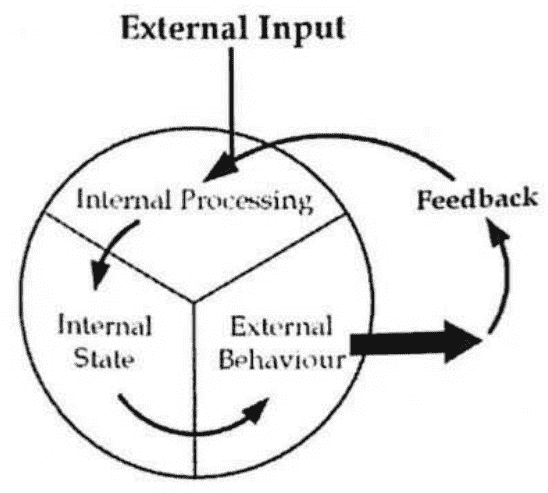

这里描述的是我们自身内部一个可自我验证的事件。

随着随后的：

- (a). NLP的校准发现
- (b). NLP和NSP关于读取个人本体论的发现
- (c). NSP关于暗示关键重要性的发现

事实上，人们可以知道一个人的思维结构是什么；并由此知道他的最终状态将是什么。要了解如何做到上述引用的内容，是NLP和NSP培训的问题。

让我们举个例子。当外部输入是：我母亲刚刚去世，我的内部处理将我追溯到一个最终语义内部状态。那是悲伤和哀痛。由此产生了与之相符的逻辑行为。

让我们举另一个例子。这是一个关于贪财的临床案例。该来访者人生第一次去了安大略省的赌场⁶。他这么做是因为他有一些美国客户。他觉得带那些家伙出去好好玩一晚是合适的。此次访问，他赢了45,000.00美元！下次访问，他赢了79,000.00美元。获胜的刺激和萌发的贪念现在将他钩住了。第三次访问，他输了27,000.00美元。第四次访问，他输掉了所有赢来的钱；之后每次访问，他输得越来越多。在他妻子的坚持下，他终于来见我。经询问，他证实他的总损失高达400,000.00加元以上！这是一个绝佳的例子，其中：

心智完全无力帮助他停止这条毁灭之路。

⁶ 安大略省赌场：安大略省从事大规模赌博业务。在另一个如今不幸已逝去的时代，这种行为会被视为非常有罪的行为。

通过NSP的治疗性操作，解除他卡住的状态是一件非常简单的事。这也好，正如我们所知道的，不存在反赌药丸，当然也没有反贪药丸。然而，制药公司有强效药丸，例如抗精神病药丸；但令我们难以置信的是，对于像赌博或贪婪这样简单的事情，却什么都没有⁷。

⁷ 但令我们难以置信的是，对于像赌博或贪婪这样简单的事情，却什么都没有：这里的教训是，如果其中没有利润，制药公司就不会生产反赌博或反贪婪药丸。

然后在1995年，17年后，神经语义编程（NSP）这一新领域出现了。我们意识到，对NLP所提出的思维原始描述，存在一个更扩展、更符合事实的理解：

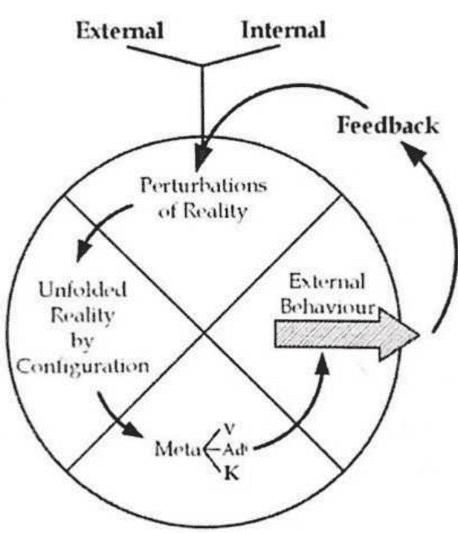

在提出此观点时，我们无意对B & G表示不敬。没有什么是永恒的，我们真诚地欢迎我们的任何NSP和NLP学生站出来，改进人类元认知的图景⁸。

⁸ 我们真诚地欢迎我们的任何NSP和NLP学生站出来，改进人类元认知的图景：事实上，我们希望有一天我们的某个学生或某个来自

在上述循环中，总是有一个停顿。借此，但愿有一个平静的时刻。然后是下一个扰动或动荡的时刻。简单来说，我们从一个事件走向另一个事件，或者正如俗话所说，人生充满了起起落落。

所有带有扰动的初始条件都会经历其循环并结束。人们必须从初始条件出发，组织扰动，并借此摆脱最初的困惑和迷茫。因此，每个首次购房的新业主，都会面临关于主卧、客房、客厅、家庭房和餐厅哪些家具最合适的巨大扰动情况。每个房间选什么窗帘，房子选什么装饰，浴室选什么小摆设，浴室选什么肥皂和盥洗用品；以及墙壁选什么装饰。我们将不审视厨房、车库以及前后院所需物品的问题。

上述扰动的解决涉及当事人之间就每个具体事项的选择和意见分歧。你能想象这些交流会采取什么形式吗？从潜在的偏好差异出发，可能是礼貌的交流，也可能是坚定的讨论、激烈的辩论、愤怒的争吵和轰鸣般的争斗。这是扰动之上的扰动。

对于一个曾学过勾股定理且现在被要求证明它的人来说，这是一个有偏见的扰动。人们会对如何开始感到困惑和迷茫。


如果你打算在日本北海道度假两周，你肯定会陷入扰动。会有这些问题：

- (a). 什么时候去最好？
- (b). 坐哪家航空公司？
- (c). 有可能去邻国游玩吗？
- (d). 关于签证要求的问题？
- (e). 关于货币的问题？
- (f). 穿什么？
- (g). 用哪种行李？
- 等等。

当你正要小憩，即将入睡时，传来一声尖锐的声响。你突然醒来。此刻，你陷入了扰动，因为你不太确定那声音的性质。你迅速回想一下。那是枪声、尖叫声、汽车发动机回火、摩托车发动机回火、车祸、建筑物坍塌的碎片，还是其他什么？在你做出判断之前，你将一直处于困惑和茫然的扰动之中。

扰动有两种：

- (a). 对一个人初始状态的破坏
- (b). 对一个人当前存在状态的剧烈干扰。

想象一下，一个男人突然想到，他的合伙兄弟可能在欺骗他。想象一下，一个男人开始怀疑他的好友和妻子可能有染！此刻，两人都将处于扰动状态。

现在我们来谈谈通过语言思考的现象。所有人都使用语言思考！那么问题来了：

你怎么知道要这样思考？

要找到答案，我们要回到语言学（Linguistics）的基本命题。这是1979年我们初涉语言学领域时学到的：

- (a). 当我们听到有人说话时，我们听到的是他口腔发音的声音。这些声音被称为语言的表层结构（surface structures，SS）。如果我们不理解它们，例如 "Nee how ma?"，它们被称为音素。如果我们理解它们，即掌握了它们的语义形式，它们就被称为语素。两者的区别在于我们是否拥有所讲语言的转换语法。上述音素是普通话句子 "How are you?" 的对应词。对你来说，这些词是音素："Apah marcham. Mari seeni." 它们是马来语的语素。意思是："发生什么事了？过来。"

- (b). 所有语素都会通过深层结构（Deep Structure，DS）被带入深层语言结构（Deep Linguistic Structure，DLS）。

上述过程描述如下：

表层结构，SS
↓ DS
深层语言结构，DLS

随后，班德勒和格林德提出，语素必须被带入感觉数据库（Sensory Data Base，SDB）中的：

- 视觉，V，听觉，A，触觉，K，嗅觉，O，味觉，G

9 语言学研究：NSP认为语言学是一门科学，因为在某一逻辑层面上，科学就是关于精确性和精确度的研究。NSP知道，凭借自我见证的证据，说话者对句子的含义有着绝对精确的认知，误差在1埃（1Å）以内。然而，问题在于听话者及其对他所认为听到的说话者所说内容的解读。现在，我们进入了不精确、不严谨和幻想的领域。

## 神经语义编程

缩写为：

### VAKOG

思考或元思维现在采用以下扩展形式：

表层结构，SS
↓ DS + HOPs
深层语言结构，DLS
↓ DS + HOPs
V A K O G

上述描述的意思是，所有语素的声音都被带入DLS，在那里被转换为二进制代码。然后，它们被发送到个人SDB中相应的部分进行存储。一个人从他的SDB中检索所有所需的数据和信息。考虑以下语素序列：

> 我站在一片美丽的蓝水边。

根据上述句子，你会通过与SDB中相应位置的关联来理解它。由此，我们可以提出两个问题：

- 你是在一天中的什么时候看到我站在那片美丽的蓝水边的？
- 那是在墨西哥坎昆，还是在安大略穆斯科卡？

所有输入，无论是外部还是内部，都是对一个人当前状态的扰动或干扰。10 当然，如果我们听到异常的声音，看到意外的景象，或感受到意外的触感，我们就会经历扰动。因此，如果一个新的存在时刻呈现在我们面前，我们会去感知

10 所有输入，无论是外部还是内部，都是对一个人当前状态的扰动：事物的运作方式是，我们所有的生理机制都倾向于维持当前现实的稳态。正因如此，任何大小和强度的输入，按定义来说，对一个人来说都是一种干扰。我们更倾向于使用“扰动”而非“干扰”，因为我们知道科学更偏好这个术语。

## 思考之心智/大脑

新情境，并确定我们希望它变成什么样。幸运的是，对于我们普通人来说，展开的现实依然是老一套的平庸。

普通人过着平庸的生活。
它是平凡而普通的。
当我们能凑够足够的钱去巴黎度假时，
那便是非同寻常的。

任何重大干扰都需要进行检查和评估。检查和评估对普通人来说难度各异。我们过去常开车去美国各地参加年度专业会议。有时在夜晚，道路可能会变得迷雾弥漫。那时，很难判断远处闪烁的灯光代表什么——警察、事故、交通堵塞、消防车、救护车等等。我们上面提到的所有这些，都是人类思维的特征。

从上面的NSP图中，你可以看到，触觉状态和视觉状态是行动……或不行动的基础。在这方面，沟通理论中有一个教导：

> 没有沟通就是沟通。

由此得出了NSP的推论：

> 没有行动就是行动。

从1979年到2017年，跨度为38年，自那以后我们认识到：

- (a). 所有传入的感官数据都会被分流到LfB和RtB中各自的神经部位
- (b). 这是通过每个项目带有一个时间标签（Time Tag，TT）和一个几何标签（Geometric Tag，GT）来完成的。带有TT的项目会进入右撇子男性的LfB。
- (c). DS的性质从未被描述；我们将其视为我们的(a). HOPs和(b). 深层结构2，DS2。我们提出DS2是因为，一个由DS2的野孩子在望远镜中看到仙女座星系时，会和正常孩子一样看到它；DS将所有信息转换为二进制代码。

- (d). 所有传入数据中，位于各自神经部位的所有信息原子单位，构成了通用物理记录（Universal Physical Records，UPR）

- (e). 通过HOPs和深层结构，它们被转换为通用逻辑记录（Universal Logical Records，ULR）。其证据是，你对ULR中信息的访问几乎是即时的。如果我让你想起你的母亲，她在你脑海中的画面几乎立刻就会浮现。这是因为你会进入：
  - (1). 人物子文件
  - (2). 然后是家庭子子文件
  - (3). 在那里就是母亲。

通过语言思考的描述现在采用以下形式：

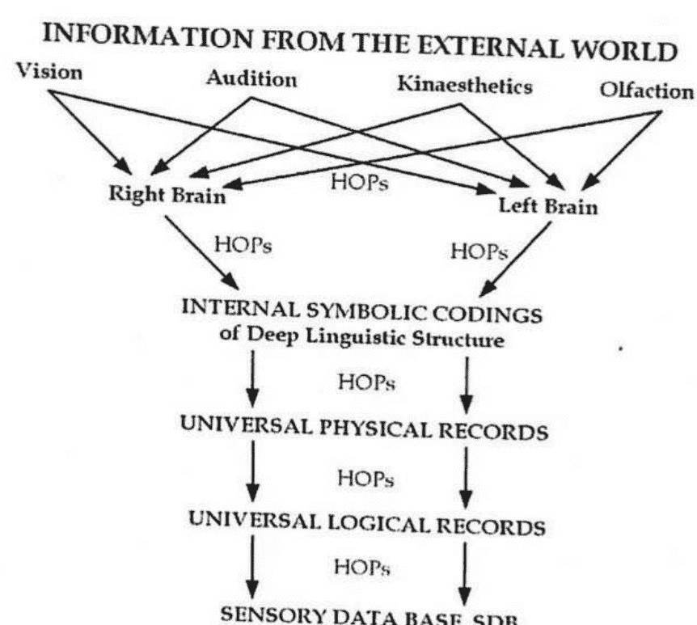

向下指向的箭头用于被称为超导出的思考过程。在超导出中，我们获得所说内容的感性意义。如果我们反转箭头，使其向上指向，那么思考过程就被称为生成。在生成中，思考过程使我们能够知道我们希望对另一个人说什么或展示什么。

在这段文字和这个阶段，我们使用思考的正式术语。所有思考都是通过我们内部语义符号编码（Internal Semantic Symbolic Codings，ISSC）的过程进行的；它们全部采用二进制代码。借助二进制语言，交换可以完全在我们的意识之外进行，因为它是以光速进行的。最好的见证是高度重要和重大的关键问题。学者对解决方案完全束手无策。最终，他放弃了，将问题搁置在脑海深处。然后有一天，答案突然揭晓。这就是弗里德里希·奥古斯特·凯库勒发现苯结构的故事。1890年，德国化学会举办了一场盛大的表彰活动，以表彰凯库勒于1865年的发现。

我们所有人都充满了生活中的模糊性、不确定性以及未解决的情感、财务和概念冲突。它们涉及哲学、宗教、政治、伦理、道德等一大堆语义领域。其中一些，比如苯的化学结构，曾是整个化学领域的一场灾难。

NSP的观点是，处理此类事项的快速、高效和迅捷的场所，在于被称为胼胝体（Corpus Callosum，CC）的交合纤维部位。它位于左脑（LfB）和右脑（RtB）之间。这一结论基于解剖学事实：当RtB皮层的一小部分被切除时，会显示出来自胼胝体的神经纤维流向LfB，或者从LfB流向RtB的纤维。完全切剖会揭示CC的大小。它非常巨大。

无论性质、质量和强度如何，所有交换都在CC中进行。有时会发生，一侧大脑


对另一方怀有敌意，换言之，一个大脑对抗另一个大脑：“我不喜欢你所持的立场”。然而，从神经解剖学角度，我们知道大脑作为一种结构是无法感觉的。因此，为了说出这句话，它将“喜欢”这种感觉源自另一个部位。我们提出，它来自于人的存在或身体。

从技术和解剖学角度，胼胝体（CC）是一个巨大的结构，与在此处进行的数百万必要的脑智操作相称——在无意识中进行。两个大脑通过胼胝体（Corpus Callosum）“交谈”的证据是什么？证据在于一种曾经流行的手术——大脑分离手术（SPLIT-BRAIN OPERATION）的神经和元认知后果。在这项手术中，胼胝体被外科手术切断。这样一来，此人将无法进行上述的脑智操作，即辨别歧义——观念上的、情感上的、财务上的；以及哲学、宗教、政治、伦理、道德等方面的概念冲突。做这些事情的能力对一个人的生活至关重要。你可以想象如果这项手术施加在你身上会带来什么后果。我们相信，这种手术今天已不再进行。我们今天都生活在完全的信心中，相信我们的感知力和连贯性将保持完好并发挥作用，无论其在语义上是构造良好还是构造不良。这项手术曾被执行，旨在阻断巨大的大发作癫痫所产生的刺激性电冲动的传递。

还有一种更糟糕的手术，称为额叶切除术。通过这项手术，一个人会丧失在高度重要和重大的智力事务上的认知功能。我们相信，在今天进行这项手术在法律上被视为犯罪。

我们现在有选择，如何描述深层语言结构（Deep Linguistic Structure，DLS）11中的元认知或内部处理。如果我们参考班德勒和格林德的原始量子发现，它恰当地展示了它们之间的平行位点：

### NLP:

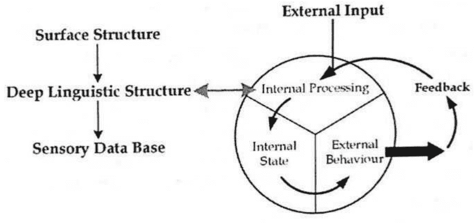

### NSP:

这稍微复杂一些。

11 我们现在有选择，如何描述DLS中的元认知或内部处理：无论是NLP还是NSP，任何关于思维描述的关键基础都取决于这样一个默认假设，即我们的外部现实是既定的；并且它独立于我们。在我们著作的修订第三版中，《不要问为什么！》（Don't Ask WHY?!）将是一个惊人的立场，即我们发现我们不能将外部现实视为既定事实。

## 神经-语义编程

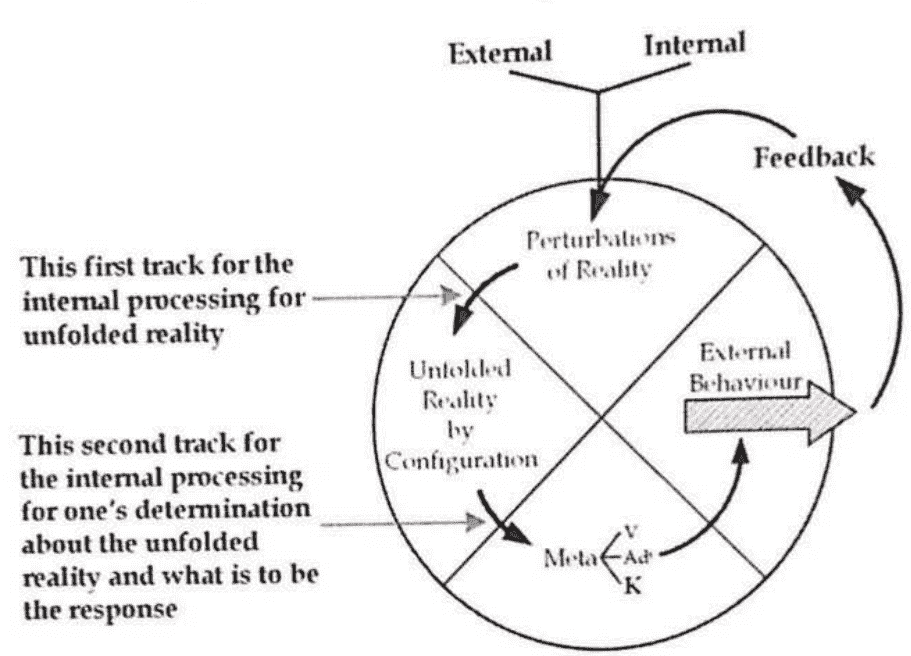

理查德·班德勒和约翰·格林德，B & G，始终是我们最敬重的老师。然而，事实是生活在继续，没有什么是永恒的。在科学中，思维处于不断的流动、发展和演变之中，所有科学家都欢迎这一点。的确，我们祈祷并希望，我们的学生有一天能将我们所发现的东西推得更远，因为阐明**人类存在的无限奥秘**的任务将伴随我们，只要这个宇宙还存在。

## 结语

> 理查德·班德勒曾教导我们：
> 
> 每个人都是一个**未被探索的宇宙**，充满着**奇迹、神秘与复杂**。

在这次关于我们如何思考的考察中，我们提供了对此处所写内容的基本研究的重要性、意义、价值和价値。

# 第二章：通过存在/身体进行思考

我们的存在/身体通过其元功能获得思考的能力。其思考的产物是感受/情绪，这些感受/情绪归入先前所述的这些类别。

- 观点
- 想法
- 判断
- 诠释
- 评价
- 决定
- 看法
- 自我评价
- 结论。

一个例子是，当一个人向他的治疗师承认他对自己感觉非常糟糕时。这是一种在觉知觉（kinaesthetics，即感觉/情绪）中的自我评价。

通过存在/身体进行思考的“软件”在结构上与通过心智进行思考的“软件”相平行。它是：

## 范式全相体，HOPs.

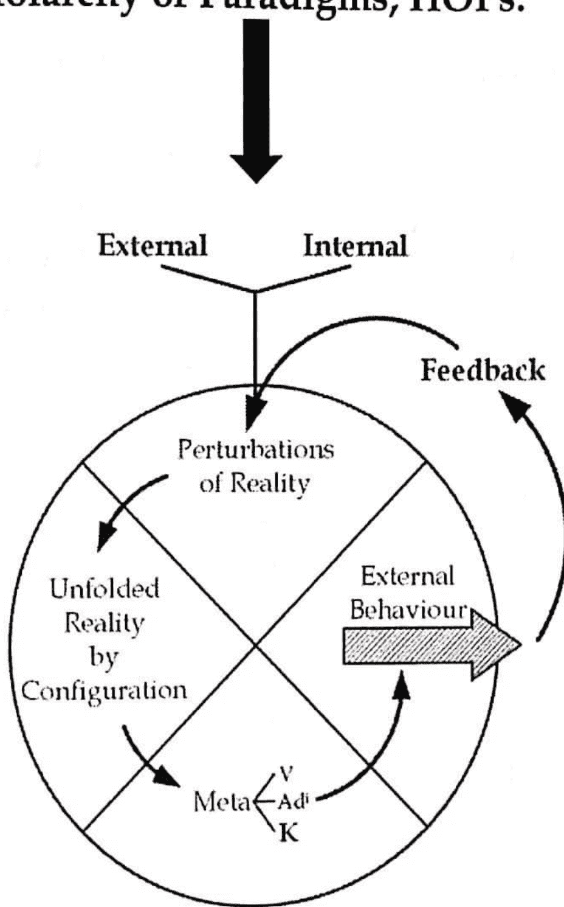

历史上，在西方文明中，对存在的研究始于古希腊哲学家——大约2600年前。他们将其研究命名为本体论（Ontology）。有趣的是，在《托拉》中有这个令人难以置信的本体论结论：

> 人心里怎样思索，他为人就是怎样！

这源自古埃及，显然是由其奴隶发现的。我们都知道，在血汗工厂工作的人没有教育或时间去深入探究本体论。我们的结论是，这些古埃及的以色列奴隶是从他们的主人那里学到了这个本体论方程式。

奇怪的是，古埃及有医生（MDs）进行神经外科手术。他们患者术后存活的证据在于，头骨上的孔的锐利骨边被磨平的骨骼被吸收。患者的存活说明：

- (a). 对客户问题的神经诊断的准确性
- (b). 手术定位的准确性，以拯救患者。令人惊讶的是，这是在没有CT扫描、X光或MRI的情况下完成的。

如果我们今天拥有像古埃及医生那样熟练的神经外科医生（MDs），那该多好。想想对安大略省健康保险计划（OHIP）的成本节约。我们可以向您保证，不必进行X光、CT扫描和MRI将不会是一笔微不足道的成本节约。

现在，来了一个更有趣的问题：

在他们的本体论和认识论探索中，古埃及人怎么没有得出这样的结论：

> 人按其大脑所思所想，他就是怎样的人！

我们的推测是，古埃及人和我们一样！我们本能地将存在的核心联系到我们的“心脏”；并且从它那里散发出我们最强烈的情感：

> 我的心永远属于你。
> 从我的心，我爱你。
> 从我的心，我渴望你。
> 从我的心，我愿为你而死。
> 从我的心，我将我的一切都给你。

古埃及军队的医生（MDs）必然在战场上处理过伤员，将断裂的小动脉或细小动脉的血液泵送与心脏的泵送联系起来，这将非常简单。他们知道心脏与思考无关。因此，上述认识论公理中该术语的使用，是将心脏比喻为我们情感的根源。

所有关于感受/情绪的考虑都涉及其：

- (i). 强度
- (ii). 品质

### (i). 感受/情绪的强度：

首先，为了论证，我们建议情绪的强度应以缪子（muons，μ⁻s）来表示/测量。强度的增加现在可以描述为从0μ⁻的基数增加到，比如说，455μ⁻，前提是我们有一台能够以μ⁻s测量情绪强度变化的机器。不幸的是，我们没有这样的机器。因此，我们没有机器可以测量抑郁症（Depression）处于多少μ⁻s，才值得获得长期残疾养老金（LTD）。如果我们有这样的机器，那将太棒了。有了它，我们可以检查所有领取LTD的人，以确定谁成功地骗取了我们给他们的LTD。作为加拿大安大略省的纳税人，我们祈祷发明出这样的机器。

其次，强度增加的速率可以是渐进的。然而，它也可能在瞬间飙升到惊人的高度。一个人可以慢慢爱上另一个人。有时，一见钟情地对另一个人怀有绝望的激情和放纵，这并非罕见。在这种情况下，这可能被视为一时的狂热迷恋。然而，如果50年后他们仍然彼此深爱，那么这种否定就会被认为是不友善且不准确的。

### (ii) 感受/情绪的品质：

任何感受/情绪的品质是指它将属于哪种分类：

- (a). 原初的
- (b). 混合的
- (c). 解离的
- (d). 元-元-元 . .
- (e). 催眠的
- (f). 良善的、有德的、圣洁的
- (g). 黑暗面

(a). 原初的感受/情绪是纯粹的生理反应，如以下示例所示：

- 我喜欢你。
- 我厌恶你。
- 我憎恶你。
- 我爱你。
- 我鄙视你。
- 我恨你。

(b). 混合的感受/情绪是一种原初情绪与另一种原初情绪混合的感觉，如以下示例所示：

- 我很高兴去牙买加度假，但我紧张乘飞机。
- 我为自己的晋升感到非常自豪，但我害怕我的新老板。
- 和他在一起很有趣，但我有时会感到焦虑，因为他可能会尖酸刻薄。
- 我喜欢和他一起去看望他母亲，但不包括她开始让他感到内疚的时候。
- 当他开始酗酒时，我的力量中混杂着担忧。

### (c). 解离的感受/情绪：

某些人通常可以与自己的感受解离。不幸的是，这里不是讨论这些问题及其由NSP人员对来访者的判定的场所，如果来访者是：


## 通过存在/身体进行思考

- (a). mesa/进入他的情绪
- (b). ortho/与他的情绪正常
- (c). meta/与他的情绪解离。

在临床环境中，训练有素的NLP从业者或NSP从业者可以在几秒钟内引导一个人与自己的感受解离。如果患者正处于急性身体或情绪疼痛中，这种操作将非常有帮助。

通常，一个人可以处于一个愉快的环境中，例如在安大略省北部湖边小屋的海滩上。坐在他的躺椅上，他回忆起另一个时光。让我们假设那是在牙买加的蒙特哥湾。现在他与自己在小屋的状态解离，因为他身在蒙特哥湾。他处于解离状态。

### (d) 元-元-元……情感或情绪：

来自神经语义学之父迈克尔·霍尔的工作，他的观点是我们可以有关于感受的感受；然后，我们可以有关于感受的感受的感受……一直到关于感受的感受的感受等等。迈克尔发现，当这种情况发生时，最终的感受摆脱了其洛伦兹时空约束。结果是，这个人知道自己在感受什么，但不知道那是关于什么的。

> 你对什么感到沮丧？

> 我不知道。

如果精神科医生或心理学家不了解霍尔的工作，他会得出结论：抑郁症现在是一种原始情绪，具有精神病学病因学，本身独立存在。这意味着它是一个孤岛。根据霍尔的工作，这个结论是不成立的。根据第一性原理，情绪必须有一个根源。临床医生缺乏提取根源所需信息的语言工具，这显然是另一个逻辑层级的关键问题。

### (e) 催眠情感/情绪：

无论本体论如何，即我们表达的感受/情绪，我们知道它们是我们的，因为它们源自我们的HOPs。然而，在催眠中，舞台催眠师取代了我们的HOPs。鉴于这一事实，我们：

- (i). 不再控制我们的思维操作。舞台催眠师在为我们做这件事
- (ii). 对他所做的任何事情没有认知意识
- (iii). 对任何思维没有记忆，因为那时我们并没有在思考。

作已故拉斯维加斯著名"不可能主义者"Reveen的舞台对象，第二作者证实这里所写的内容。

在全国催眠师协会年会晚宴后，总是有一场催眠舞台表演。对作者来说，最令人震惊的一次是，一位舞台催眠师曾要求：

- (i). 一个男人，在他发出信号时想要杀死他
- (ii). 一个女人，在他发出信号时，以无节制的放荡欲望想要他。

多亏了他的预见性，那个男人立刻恢复了他的HOPs，那个女人也恢复了她的HOPs。由此，我们了解到"我们的潜意识总会保护我们"这一教导是无效的。如果它曾经是真的，那它肯定也从未保护过一个因慢性阻塞性肺疾病（COPD，又称肺气肿）而吸烟至可怕死亡的吸烟者。

在催眠中，存在Esdaile状态，其中所有生理参数都被重置为其稳态理想状态。例如血糖水平、血尿素、生长激素水平等。

### (f). 良好、高尚、谦卑、圣洁的情感/情绪：

本节讲述人类长期珍视的理想。历史上，曾有伟大的老师来教导我们这些事情。我们心中有一部分在想，他们的努力是否可能已经失败了。

今天，我们似乎生活在一个接近邪恶的时代。道德和伦理不再是人类行为的指南。一方面，人生目标是名声、声望和名人地位。另一方面，则是尽可能多地获取金钱。

没有人曾经想过：

### 通往原力光明面的道路是什么？

我们怀疑，NSP对这一问题的考察将是巨大的；并且我们认为，这不会是我们的荣幸去承担。我们的希望是，有一天，我们的一名NSP学生会接手这件事。

### (g). 原力黑暗面，及其情感和情绪：

我们要感谢乔治·卢卡斯的这种用语：

### 原力黑暗面的情感。

问题是：

### 通往原力黑暗面的道路是什么？

道路可以在亚里士多德的因果系统A，C→E中找到。这是如何做到的，将在本书后面阐述。在此节点，我们提供这些见解。

在以下之间存在一个强大的自我服务循环：

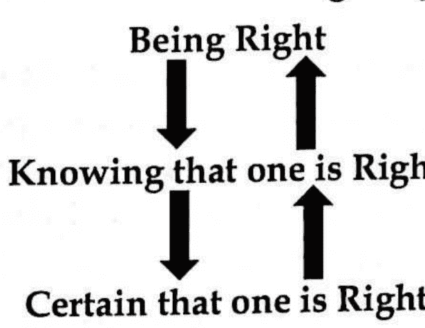

该循环自我强化和支撑。其强度可以飙升到无数的μ⁻s高度。在此过程中，这个人的立场，即他的本体论/存在，从以下状态转变：

- 热忱的
- 固执的
- 不灵活的
- 难对付的
- 僵硬的
- 偏执的
- 狂热的
- 极端的。

当我们在正常情况下的期望受到否定时，我们会感到愤怒、沮丧和失望。你认为当一个狂热者的期望，关于他热衷的那些事物，受到否定时，他的本体论会是什么？

每个给定的本体论都有其独特的主观现实结构。因此，每个都有其独特的生理学。爱的本体论具有与愤怒不同的生理学。愤怒不等同于贪婪。如果是放纵的贪婪，那会更加不同。对于人类问题卡住状态，如吸烟、酗酒、咬指甲等等，也是如此。对于NSP，关键在于如何解析：

- (i). 其语法方程公式配置定理

要获得语法、方程、公式、配置、定理，即问题状态诊断的精神障碍，你需要：

- (a). 知道如何提出好问题，好问题是能够揭示问题或子问题本质的问题。
- (b). 对亚里士多德因果系统A和非正式逻辑IL获得自愿和意志的掌握
- (c). 获得对非亚里士多德相对性和关联性系统Ã，修正版的自动无意识能力
- (d). 知道如何无意识地读取一个人的本体论
- (e). 知道如何以轻松的自动性校准一个人的表征系统，尤其是子表征系统
- (f). 知道如何无意识地勾勒一个人的本体论。

有了上述技能，NSP治疗师可以解析：

- (a). 产生问题状态的语法/方程。在NLP中，语法/方程被称为策略。NSP治疗师需要做的就是确定策略的最小调整，以带来所需的改变
- (b). 诊断的公式/配置。任务是设计一种治疗操作来解除卡住状态。
- (c). 编织客户临床畸形状况的定理。一旦他完成了这一点，他的下一个任务就是解析治疗算法来解开畸形状况。

上述内容索引的是，所有问题状态都可以根据其难度归入上述类别之一。那么，你认为哪些问题状态对NSP治疗师来说最具挑战性？答案是：那些是本体论定理函数的状态。

既然所有DSM-5诊断都被声明为各自精神障碍的函数，我们在这里引用的内容是关于DSM-5所有诊断的治愈。未说明的是，精神障碍有一个难度层次。它们从方程函数一直到定理函数。

但是，如果以下情况，治愈是不可能的：

- (a). 患者拒绝治疗
- (b). 患者从其状况中获得次要收益。第二作者曾是多伦多一家非常著名疼痛诊所的催眠治疗师。一位患者抱怨因5起车祸而引起的顽固疼痛。从每起事故中，他都从不同的保险公司获得了极高的赔偿，除了第五起。第五起事故发生在印度。保险公司拒绝赔偿他。他向我倾诉他的痛苦。作为临床医生，我得出结论，他保留疼痛索赔是为了维持他从……那里收到的月度款项，而在这里我完全失去了兴趣，去关注哪个不幸的一方必须为他持续的疼痛付款？

现在我们来到语言与存在的生活过程之间的一个关键问题。一种存在方式可以是感到焦虑。然而，我们内心有一种自动无意识的倾向去名词化。名词化是指转换：

- 动词变为名词
- 过程变为事物。

动词或过程是实际的。名词或事物是名词化这一心理行为的产物或制品。因此，它是不实际的。它是心灵的幻想。令人难以置信的是，西方国家的精英和大多数人口相信名词或事物是真实的、实际的。仅凭数量的压倒性优势，其余的人也会跟随。如果你进入一个房间，即使你不想跳舞，但其他人都在跳，你也会感到压力要跳舞。因此，在接受所有名词化都是现实的前提下，我们将适应并调整到其所有伴随的异常和偏差。

- (ii). 每种生理学独有的生理指标。


## 通过存在/身体进行思考

在一个逻辑层面上，我们的**主观体验**诉诸于我们的情绪。对于任何给定的情绪，**它就是我们的人类状态**。它有独特的生理指标。这些生理指标反映在血液的生物化学中。因此，它们的相关值构成了给定人类状态的独特描述。

然而，当一种独特的情绪在个体中展开时，该情绪具有其特征性的生理值。但它们偏离生理规范。这会立即导致身体稳态机制的激活。结果是，情绪的所有偏差都会立即重新平衡到身体的规范。请考虑这一点。如果一个人瞬间暴怒，他的血压、心率和呼吸会飙升到顶峰。只有当他的肾上腺进入过度工作状态时，这种情况才会发生。为此，他的促肾上腺皮质激素水平会飙升；然后他的肾上腺素血液水平将超出正常范围。身体的智慧不会允许这种情况发生，在激活其稳态机制时，它会尽快将所有这些扭曲的水平恢复到正常范围。因此，几乎不可能获得一份我们可以分析、能够给出给定情绪实际描述的血液样本。结果是，我们永远无法获得真正适用于真正抑郁或暴怒的生物特征数据。

NSP 提出，绕过这一问题的唯一方法是让人进入催眠状态。然后将其加深到 Esdaile 状态。在 Esdaile 状态中，可以显现问题的本体论。当它展开时，取他的血液样本并检查其生物特征。对于真正的研究科学家，他会立即看到我们正在索引一个至关重要的新研究领域。因此，我们希望精神病学研究临床医生能朝这个方向发展，而不是他们目前的临床研究，后者是关于评估患者对新精神科药物的反应。由此可见，医学研究诺贝尔奖从未颁发给过精神病学，这显而易见。我们确信一件事。通过这项研究，我们将获得真正构成正常人类状态的完整血液图景，无论你是阿拉斯加人还是津巴布韦人。

如上所述，所有情感/情绪都从零 µ-强度开始。视情况而定，它们的强度会上升。NSP 发现，当一种情绪不再是纯粹内在/内部的感觉时，它可以上升到一个临界阈值。在这个阈值上，它将以行动形式表达出来。这个点被称为语义阈值，ST。因此，在 ST 时，对另一个人的欲望会表现为性骚扰。当然，在 ST 时，欲望转化为强奸，愤怒转化为暴力，暴怒/狂怒转化为杀害他人。

然而，NSP 发现，在 ST 时，这种转化并非不可避免。一个人的 HOPs 可能会覆盖这种转化。因此，第二作者一直持有这样的信念：

> 我永远不会打女人。

在他 80 多岁时，曾有过罕见的时刻，他处于可以这样做的 ST 状态，但在他的经验中，他没有这样做。在讨论中，他发现了其他处于同一类别的男性。我们将在“原力黑暗面的情绪”部分进一步审查此事。

# 第三章：应用语言学与思考

我们如何使用语言属于应用语言学领域。我们的思考，以及由此延伸的我们在生活中的*存在*和*行为*，都是我们应用语言学的衍生物。NSP 的观点是，应用语言学是那些寻求在宗教、法律、医学、心理学、政治和商业领域发展职业生涯的人的关键研究。

我们的思考通过语言进行。我们的语言是一个系统。**所有系统都有其语法**来确定何时以及如何被激活以及它们如何运作。简单来说，每个系统都有其治理规则。

然而，系统可以位于称为元系统的更大系统之中。考虑这个例子。一个家庭是一个系统。然而，家庭系统位于市政系统之中。一个身体虐待妻子的丈夫会发现自己进了监狱。如果父母未能照顾他们的孩子，在安大略省，儿童援助协会（CAS）会介入。那么，你当然知道压力和痛苦的含义。

以下是 NSP 的观点：

> 男性被造物主赋予攻击性和更大的肌肉力量。
> 女性被造物主赋予力量、洞察力和温柔。

在*古老*的日子里，在一个家庭中，头号人物是父亲。母亲处于第二位。接下来是大儿子，依此类推。在我们今天的家庭中，我们目睹了相反的情况。头号是母亲；并且我们怀疑在智人历史上，一直是母亲；但男性拥有攻击性和更大的体力，他用这些来确立自己为头号人物。然而，随着时间的推移，真相会揭示谁才真正是头号人物。

这是 NSP2017 的基本教义：

### 丈夫，服从你的妻子。

NSP 的观点是，女性利用她们的力量来忍耐男性的攻击性。因此，在一场高档鸡尾酒会上，一个丈夫突然对妻子发火，因为她不小心忘记做他要求她做的事。他完全无视她和在场的宾客，对她大喊大叫、尖叫。她尽可能保持最好的沉着冷静，忍受了他的咆哮。我们可以读出她的合理化理由：

> 最好不要反抗和激怒他。
> 最好不要惹事生非。
> 万一我羞辱他怎么办？
> 如果他变得暴力，警察会介入。
> 最好保持安静。

这就是证明，忍耐需要力量。当然，NSP-心理治疗师会做任何必要的事情来结束这种臣服的哲学立场。上述丈夫确实需要他的妻子来打击他。

加拿大航空的一架波音 777 是一个机械系统和政治系统。作为机械系统，有系统中的系统，例如发动机、起落架、液压系统、自动驾驶、无线电、雷达等等。777 有一个政治系统。头号人物是飞机长，第二号是副驾驶，第三号是飞行工程师，第四号是乘务长，第五号是头等舱头号乘务员，依此类推，直到人员名单末尾。乘客可能会喝醉并行为不端。对于飞机长来说，他的想法会是：

> 最近的机场在哪里，这样我可以降落并把这个白痴交给当地警察？

1 飞机长：天哪！时代变了。今天，飞机长可以是一位女士！

乘客可能没有意识到，由于这一事件，飞机要继续飞行必须找到并登记新的飞行计划。这需要花钱。

英语本身是一个系统。然而，它处于一个称为亚里士多德因果系统的元系统之中，在 NSP 中为 C→E，或在计算机语言中为 C=>E。不太为人所知的是，C→E 也有其自己的语言。因此，每当我们说任何英语句子时，它不仅仅是：

> [一个英语句子，不言而喻]

而是：

```
c → e [An English sentence] c → e.
```

正因如此，c→e [ ] c→e，无论你的母语是什么，这种方言都成立：

### 我通过 C→E 思考。

简单来说，物理定律是我们都通过 C → E 的语言进行思考。由此可知，我们的存在也是通过 C→E 的。因此，在西方文明中，C→E 是：

- (a). 由我们的父母植入我们心中
- (b). 由我们的教育系统加强
- (c). 由基督教信仰支撑
- (d). 由我们的法律加固
- (e). 由我们的科学加强。

它是我们生活中首要且占主导地位的环境。然而，世界所不知的是，我们现在正处于语言使用、进而思考和存在发生变化的刀刃之上。这项工作正是关于这一点。它关乎我们从 C → E 的束缚中获得自由。

```
c→e [ ] c→e.
```


这是至关重要的，因为：

- (i). AK及其一般语义学（GS）领域发现，C → E语言系统是**不理智的**
- (ii). 约翰·格林德和理查德·班德勒及其神经语言程序学（NLP）领域发现，C → E语言系统在语义上是**畸形的**
- (iii). 珍妮弗·K·崔和丹尼斯·K·崔及其神经语义程序学（NSP）领域发现，C → E语言系统是：
  - (a). 疯狂的
  - (b). 它是通向原力黑暗面情感的通道
- (iv). 大卫·休谟²发现，C → E的关系在逻辑上是站不住脚的。

如果我们不能逃脱在C→E中的奴役状态，我们将把后代留在一个疯狂、疯狂、疯狂、疯狂的世界里。我们的后代将继续生活并受苦：

- (a). 战争接连不断的罪行³
- (b). 一种可悲的憎恶：人们只是为了每天避免饥饿和口渴而漫无目的地生活，并将子女注定到同样的命运，代代相传！（此引文已从阿尔弗雷德·科日布斯基的原文改写。）

² 大卫·休谟撰写了《关于人类理解》和《关于道德原理》。

³ 战争接连不断的罪行：无论是发动战争的国家还是赢得战争的国家，都从未因危害人类的罪行受审。失败方遭受胜利者对其国家财富的掠夺，而胜利者则走向荣耀，尽管有数千名本国人员死亡和致残。无论是失败方还是胜利方，都未对数十万/数百万被屠杀的非战斗人员（即平民——妇女、儿童和老人）负责。

## 应用语言学与思维

- (a). 系统的语法
- (b). 系统的逻辑。

这适用于所有系统，无论是有生命的还是无生命的。它当然也适用于语言。

如上所述，我们的思维和存在源自我们的范式全相体（HOPs）。然而，覆盖在我们HOPs之上的元全相体是亚里士多德体系，A，C→E：

```
C→E [ HOPs ] C→E.
```

这意味着我们注定陷入因果哲学，并由此受其哲学逻辑的约束。NSP现在知道，逻辑承载在其语言系统中。准确地说，其逻辑通过其语言全体的逻辑层级（即其语言结构，LSs）来传输。其语言全体是什么，将在后续章节中详细描述。

此刻，我们将引用亚里士多德本人发现的A的最初语言全体。以下是维基百科的摘录：

> 亚里士多德写道：“在我们掌握事物的‘为什么’，即其原因之前，我们就不了解该事物”。

那么，根据亚里士多德，你现在有：

### 为什么

作为A语言系统中的关键语言全体。

### 原因

通过原因的延伸，你现在也有：

### 结果

从原因，你现在有：

### 你让我...

然后在对C→E的考察中，亚里士多德使用了希腊词aitia。根据维基百科，我们读到：亚里士多德的aitia最接近当今日常语言的翻译是“解释”。

那么，你现在有：

### 解释。

这个第5个语言全体有以下同义词：

- 理由
- 合理化
- 辩护
- 借口。

这是一个悖论：虽然我们认为自己是浑然一体的整体，但实际上由部分组成。我们就像一件衬衫。衬衫是一个整体；但接缝清楚地表明，领子是一个独立的部分，已缝在衬衫上。袖子、口袋等等也是如此。相应地，我们有各自可以是开玩笑的、有趣的、善良的、慷慨的、充满爱心等等的部分；然而我们也认识到，我们有可以是闷闷不乐的、脾气坏的、恶劣的、自私的、不充满爱心等等的部分。每个部分都是整体的一个自产子系统。

在学术界，这些不同的部分被称为模块。因此我们是模块化实体。因此我们的心智也是模块化的⁴。

⁴ 我们的心智也是模块化的：有关更多信息，请参阅杰里·A·福多（Jerry A. Fodor）的著作《心智的模块化》（Modularity of Mind），MIT出版社。

部分拥有其独特的语言。在宗教问题上，一名伊斯兰圣战者将通过一种独特的C→E语言进行思考，这与一名西方自由派政治正确人士的思考截然不同。考虑“必须”一词的使用。对于伊斯兰圣战者来说，对他来说，这是一件强制性的逻辑之事：

我必须杀死美国人。

对于一名西方政治正确、自由派人士：

我们不应伤害他人的感情。

从NSP的观点来看，前者在说疯话，后者在说废话。人们思考并决定是否感到被冒犯。没有人能让另一个人感到受伤或任何其他情绪。

正因如此，作为我们本体论引擎的HOPs是一件非常复杂的事情；如果我们包括其语义细微差别，我们所看到的是理查德·班德勒教导我们的基础：

> 每个人都是一片充满奇迹、神秘和复杂性的未知宇宙。

这一公理是我们：

- (a). 完全同意的
- (b). 使我们最初认为这项工作永远无法由任何人来撰写。因此，我们拒绝撰写这项工作——从1997年到2015年，即18年。

我们同意约瑟夫·坎贝尔的命题：我们生活在对立的现实中。

正因如此，对于每一个正常的事物或过程，必然存在其自然的对立面，即其异常面。

因此，我们可以有正常思维。但可以肯定的是，我们会有异常思维。每种思维都有其对应的类比。因此，在其语义阈值（ST）处，异常思维将有其类比变体。因此，对于：

- (a). 爱你的父亲，对应的是：恨你的父亲
- (b). 善待他人，对应的是：让他们受苦
- (c). 世界必须和平，对应的是：让我们开战
- (d). 慷慨，对应的是：贪婪
- (e). 节俭，对应的是：让我们花钱。

因此，DSM-5可能拥有近乎无限的诊断。证明是《精神障碍诊断与统计手册》的每个新版本都包含越来越多的新诊断。因此，从最初适度的行为问题列表，它已扩展到目前的600多个诊断！有趣的是，心理治疗的数量也相应增加。您可以从其网站访问该列表：

该列表包括裸体心理治疗！对我们来说，很明显这里存在一种状况，即心理治疗存在严重问题。这源于以下事实：

- (a). 它没有一个形成良好的形而上学基础
- (b). 因此，它在哲学上没有坚实的基础。

心理治疗思维中当前新兴的时尚是正念。NSP的发现是，人类的缺乏觉察、不警觉和不成熟是大多数人的恒常特征。从NSP的观点来看，没有人能对任何事物保持正念，除非他们身上的缺乏觉察、不警觉和不成熟被消除。

在此背景下，我们获悉DSM-5在出版前曾努力减少诊断数量。显然，这是一项徒劳的努力，因为问题行为的数量将不可遏制地飙升。这五项诊断：

- (a). 注意力缺陷障碍
- (b). 注意力缺陷多动障碍
- (c). 创伤后应激障碍
- (d). 对抗违抗行为
- (e). 路怒症。

这些诊断未列在我1964年医学毕业时拥有且至今仍拥有的精神病学著作中。相对于我的精神病学教科书，它们代表了艾略特·斯莱特和马丁·罗斯不知道的新问题状态。

如果在心理治疗中有一项值得进行的研究，那就是确定支撑心理治疗的哲学基础。这


考察必须立足于人类经验中的_先验的_事实，这些事实代表了畸形人类行为的实际物理动力学。无论是经验主义的还是基于假设的假设性解释都不行。简单来说，博学的空话和杜撰都站不住脚。

此处所引内容的必要性显而易见。必须有一种逻辑方法来判断现有的和新出现的“心理治疗”是否符合其声称的“心理治疗”这一头衔。当然，这引出了什么是心理治疗的定义。不绕弯子，需要回答的问题是：

## 什么是治疗？

我们不打算在本文中回答这个问题，因为这部作品并非关于治疗。不过，您将在我们即将出版的关于NSP心理治疗的著作中找到答案。

这是NSP的一条格言，亦即一条物理定律：

- (a). 在混乱/问题状态下，情况永远不会好转。
- (b). 它只会恶化、加剧和扩展。

任何人的思维方式都取决于其HOPs的语义格式正确性或失调性。在此，验证了AK的观察，我们转述如下：

> 要变得精神失常，你必须有头脑，
> 亦即一个敏捷的头脑。
>
> 简单来说，要变得精神失常
> 你必须有一个好头脑。
>
> 天生精神缺陷的孩子
> 根本无法变得精神失常。

我们同意AK的所有这些结论。我们认为它们也是物理定律。

从我们HOPs中可能散发出的难以置信的复杂性中，产生了关于我们如何存在的复杂、奇妙与神秘的宇宙。因此，我们用头脑以疯狂方式思考的能力，其可能的变体是无限的。

就此，我们将始终感谢约翰·格兰德 5 对我们关于英语语言这一真理的教导。不可能生成一个完全格式正确的英文句子。

什么是格式正确的英文句子？它是包含说话人希望传达的全部相关语义信息的句子。由于这无法实现，那么从本质上讲，所有英文句子都是

- (a). 语义上失调的
- (b). 不完整的
- (c). 含糊不清的。

正因如此，法律文件才如此冗长；但无论它们多么冗长，都永远无法承载全部预期的信息和意义。它们总会存在缺陷。这为任何律师提供了考验，以衡量他为委托人利益服务的出色程度。他的工作是找出文件中的缺陷，并为委托人的利益将其充分利用。

NSP的立场是，通过以下语言获得有用且有价值的信息确实没有希望：

- (a). 亚里士多德因果体系，A，C→E
- (b). 非正式逻辑。

要获得有价值的信息，你需要这三种语言体系：

- (a). 非亚里士多德相对性与关联体系，Ã

5 约翰·格兰德是当时新兴的英语转换语法领域的主要权威之一。他也是神经语言程序学（NLP）领域的联合创始人。

- (b). 修订版元模型，3M
- (c). ~YML语言模型。

目前你还不具备这些。我们希望有一天能将它们教给你。

现在我们来谈控制论循环现象。情绪或人类情感是人类思维的产物。情绪通过在基础情绪之上叠加更多元层来驱动人类的元思考。举个例子，请考虑这一点。在特定情境中，一个人评估的结果是对另一个人感到愤怒。下一个元步骤是觉得他是个白痴。再下一步是得出他是个愚蠢白痴的结论……思维产品的层叠可以这样不断继续下去。它们由基础感受驱动。

在人类思维中，基本目标是如何获得我们想要、需要或渴望的东西。有些人天生有才华，能以惊人的速度获得结果，因为他们的思维敏捷，并且拥有才能和技能。普通人将拥有普通技能来实现他们期望的普通结果。如果他们期望的结果是非凡的，那将超出他们普通能力范围的任务。在光谱的另一端，有些人的技能水平远低于平均水平。对他们来说，他们的生活将勉强维持基本生存必需品。这也是一条物理定律。我们要说的是，这个说法：

> 我可以成为我想成为的任何人
> 我可以做我想做的任何事

并不符合现实。

NSP的人生格言很明确：

> 以迅捷与清晰思考，
> 机智并愿你有才华
> 如此蒙福，你将轻易获得想要的东西。

上述也是另一条物理定律。正因如此，在我们看来，要在伦敦、巴黎、纽约、多伦多、罗马等城市生活、做好并为其经济文化环境做出贡献，一个人必须在其应用语言学方面达到某些标准。然而，证据表明，在这些城市里，有些人靠福利生活，过着不体面的生活；他们无家可归，处于饥饿边缘。

从逻辑上讲，我们想知道，如果他们自愿迁居到另一个地方，在那里能找到有用且富有成效的生活，是否会更好。换句话说，换一个环境，他们可能有机会“成功”并保有尊严。有些人甚至可能看到，在另一个国家他们能做得多么出色。这种想法并不罕见。证据表明，在这个时代背景下，人们在迁徙，为自己和家人寻求更好的生活。一项最近的研究表明，在今天的德国（2017年），大量新企业实际上是由移民难民创办的。

中国曾实行一孩政策。因此，中国面临人口困境。它面临着可能没有足够人力来取代老龄化劳动力的可能性。他们面临的另一个困境是社会性问题。由一孩政策所生的受宠儿子们被宠得无法无天。结果是他们认为：

> 他们是“小皇帝”

结果就是他们是小皇帝。这就是他们在中国今天的称呼。然而，他们现在已经是成年人。他们不再“小”了。你愿意反思一下这可能带来的社会后果吗？在西方，我们也有类似的情况。我们抚养年轻人，让他们在思维和存在中知道：

> 我是我生命的主人。
> 我是我命运的主宰。

这样的孩子长大后，确信自己是生活中的伟大的我/大我。结果是他们自我中心、自我肯定、自我推销、贪婪且自私。他们骄傲自大。他们是头号人物。

只有知道如何做到，你才能成为自己生命的主人。这样的孩子的父母可能甚至不知道如何掌控自己的生活，更不用说他们的缺点和不足了。

认为人可以成为自己命运的主宰，这完全是胡说。当一个人入睡时，有什么保证他第二天早上能醒来？醒来吧！没有人曾是自己命运的主宰。

我们来自一个这样的世代，我们的首要任务是这样思考：

- (a). 深入自我，思考我们内心的恶魔是什么以及如何克服它们
- (b). 如果成功了，下一个任务是如何提升自己，过一种为他人服务的生活
- (c). 并为更大的共同利益而生活。

然而，这并非导致世界金融崩溃的思维方式。崩溃源于：

华尔街人士有缺陷的应用语言学，他们欺诈性地打包无价值的抵押贷款，并将其作为高端证券出售。

他们从事这一活动的回报，早上工作就有数千万美元，一天的工作就有数亿美元。

从真正意义上讲，这些华尔街人士丧失了法律、道德和伦理指南针；这只能源于思维和本体论中难以置信的转变。据我们所知，他们中没有一个人曾去看过NSP心理治疗师，以确保其思维发生所需的根本性改变，就：


## 神经语义编程

他们是如何知晓-知晓-存在的
那些骗子，他们正是 <u>并且至今仍是</u>！

他们所做的远超任何纽约市黑帮教父所能成就的。与他们相比，伯尼·麦道夫所做的简直不值一提。

然后，语言结构（LS）的想法来自我们在20世纪70年代阅读人工智能（AI）著作时的启发。什么是LS？它是一个语义域的标题。其中包含关于特定主题的所有可能文件。这些文件包含与之*相关*的所有可能句子和词语。简单来说，LS将包含该主题的全部词汇，包括其土语俚语等等。一个人LS中的所有材料都以二进制语言编码。任何LS都是其全体架构（Holarchy）的一个组成部分。这意味着我们的应用语言学是研究我们如何根据语言的语法使用我们的LS。以下是LS的示例：

- (a). 加拿大宪法
- (b). 约克郡布丁
- (c). 圣母玛利亚
- (d). 尼亚加拉湖畔镇
- (e). 安乐死。

考虑这个LS：*维也纳国家歌剧院舞会*。如果你是这个活动的组织者，你能想象一下你将用来实现这个活动的子LS数量之巨大吗？

同样，我们在讨论中如何使用语言将决定我们的本体论。在数学上，两者之间的关系由以下方程式描述：

```
Ontology = f (Applied Linguistics) *apropos* to a topic.
Onᵀ = f (AL)
```

这意味着逆命题也成立：

```
Applied Linguistics = f (Ontology)
AL = f (Onᵀ)
```

因此——根据这些方程：

## 思考是应用语言学的一个函数。

`Tg = f (AL)`

如果你的本体论是愤怒和沮丧，那么你的言语将快速、音量提高、语气尖锐，且你的呼吸将集中在胸部上方且紧绷。如果你的本体论倾向是冷静和严肃，那么你的言语将节奏适中、语调柔和，且你的呼吸将集中在胸部下方、平滑且规律。

在应用语言学中，所有语言转换6，即所说的句子，通常都符合语境。随着语境的变化，说话者的本体论将随新的语义而改变。同样，句子相对于其语义、强度、紧迫性、焦点和分量的价值也会改变。例如，如果你以敷衍了事的态度对待语境中的话题，你的语言将非常肤浅且不集中。然而，如果你以严肃和决心说话，你的本体论将是一种严肃认真的状态。

我们用语言思考，通过语言思考，在语言中思考。然而，通常我们是以幸运的自动性，有时以惊人的速度进行；无论哪种方式，这完全是无意识7的。我们唯一不得不立即停止说话8的时候，是当我们要说嘴边的话时；我们突然意识到，如果说了出来，那么就像人们所说的，汽油柱会喷到喷灯上，造成最可怕的后果。幸运的是，我们及时克制了自己。

及时克制自己后，我们发现自己处于一个通常不习惯的现实中。我们现在必须找到替代句子。我们发现需要思考要说什么。令我们震惊的是，我们发现自己已经生疏到在认知和自主努力构建句子时，会笨手笨脚、搞砸、跌跌撞撞和绊跌。此外，我们还发现自己在结巴。

因此，这里有证据表明，通常我们的思考是通过无意识的幸运自动性和速度为我们完成的。这意味着**我们从未掌控过自己的思考**。如果我们通常和自愿地并不掌控我们所说句子的构建，那么我们现在想知道，是谁或什么在为我们做这件事。是谁或什么？它是**THE BOSS**。谁是**THE BOSS**？你会很高兴地知道，是你自己的范式全体架构（Holarchy of Paradigms）+ AnY9在为你做这件事。这是许多专业人士没有注意到的一件事。

作为你大脑中的软件包，你的HOPs + 辅助9（Ancillary 9），AnY9是终极的信息和数据处理设备。因此，当它们拥有处理产品时，它们将始终将其呈现给你以供批准，*并附带建议**你批准**其使用*。当然，我们总是会这样做。请记住，人类思考是关于心理处理的。它是作为句子体现的信息或数据的处理。因此，所有处理都关于句子中包含的语义。正因如此，生活中至关重要的是神经语义学。处理很少涉及单个单词。所有处理都会带来一个结果——其产品。物理定律是，你的心智必须将产品呈现给你，以决定其批准。这反过来意味着你的决定基于产品的法律、道德、伦理、文化、经济、家庭和社会价值观。大多数时候，决定是迅速的。很少需要推迟决定。更少见的是有人因此而瘫痪无法决定。然而，这些是我们都可以见证的人生经历。

结果是，它使我们通常可以漫不经心地胡说八道。我们非常感激我们的HOPs，因为当我们胡说八道时，大多数时候它是明智、合乎逻辑且有说服力的。但随后，我们也见过其他人说话疯狂、不合乎逻辑且没有说服力。最有趣的例子是一个不暴力的醉汉，但他一直被认为在所有事情上都一丝不苟、端正得体。我们都不完美。有些罕见的时候，一个人说话不加谨慎，每一次胡说八道都是一次失礼，并且是许多欢笑和嬉闹的来源。很难不陷入我们的幸灾乐祸。当我们自己也住在铁皮罐头里时，明智的做法是不要向别人扔开罐器。当然，有一种人会胡说八道，随之而来天翻地覆！从中：

- 学习 – 始终注意你嘴里说出来的话。

很高兴知道，在绝大多数时间和语境中，我们的HOPs都会很好地为我们服务。在继续这样做时，它会提供它认为我们需要发声的内容。很少，我们会担心是否需要外交辞令。

现在我们来到语言生成中的一个非常重要的发现：(i)。语言科学的教导是，表层结构（SS）中的所有语言元素都被降至一个称为深层语言结构（DLS）的实体。在语言学中，执行此操作的装置被称为深层结构（DS）。

## 神经语义编程

口语句子 = 表层结构
深层结构，DS
深层语言结构，DLS

最初，人们认为一个人会直接从DLS中获得其含义。

(ii). 然而，理查德·班德勒和约翰·格林德的发现是，还有一个步骤。即从DLS，必须进入一个人的感官数据库（SDB）才能获得SS的含义。

考虑这句话：我正在尼亚加拉悬崖的凯尔索保护区小径上行走。你能理解它。既然你理解它，我现在问你：你认为我是在一天中的什么时候在小径上行走的。通过你的回答，你正在肯定你对这句话的理解，这句话来自你的视觉元组，你在其中看到了我行走，在那个时候，而且这绝对不是二月的凌晨3点，在加拿大隆冬时节。之所以不是，是因为在你的画面中，小径沿线树木的叶子都是绿色的。

口语 = SS
深层语言结构，DLS
感官数据库

| 感官 | 缩写 |
|------|------|
| 视觉 | V |
| 听觉 | A |
| 觉察觉 | K |
| 嗅觉 | O |

(iii). 我们随后得出结论，深层结构（DS）必须包括我们大脑的关键软件，即我们的HOPs。在HOPs中，将包括：

6 语言转换是用来描述句子的术语。这样做的逻辑是，每个紧随其后的句子都是其转换。

7 然而，通常我们以幸运的自动性，有时以惊人的速度进行：神经冲动极快。沿神经轴突的最快传导时间已被计算为高达120米/秒或432,000米/小时。

8 stat是拉丁语，意为“立即”或“马上”。


- (a). 我们语言的蓝图
- (b). 我们语言的历史和
- (c). 我们语言的转换语法。

我们的语言的转换语法，TG，是英语。Ni hao ma 是普通话。如果你在语言全息体系中没有普通话 TG，那意味着什么？只有拥有普通话 TG，你才能理解它的意思是“你好吗？”

- (iv). 然而，我们现在意识到，从表层结构，SS 到深层语言结构，DLS 的转换是有目的的。其目的是将所有 SS 转换为其 DLS。这种深层语言结构项目，DSLI 是与其语义价值相对应的不同独特价值的心智项目。我们决定将每个 DLSI 称为一个心智芯片，mc。出于各种考虑，我们得出结论：所有心智芯片都是二进制语言。

我们之所以被迫得出这个结论，是因为两个先例。第一是，如果赌场使用特定客人的本国货币，它就无法真正运作。如果这样做，赌场将不得不使用该货币的每种面额，无论是 $、£、¥、€ 等等。因此，从拉斯维加斯到澳门再到新加坡的所有赌场都要求他们的游戏使用他们的货币，即筹码进行。这显著确保了竞争各方之间的理解，并支撑了赌博互动的便捷性和速度。

9 这显著确保了竞争各方之间的理解：竞争各方之所以竞争，是因为赌场决心获胜并击败客人顾客，而客人顾客则在恳求幸运女神让他击败赌场。唯一的补偿特征是赌场对客人的宠爱，尤其是如果你是大玩家。

最后，世界不得不决定哪一种可能是我们的通用度量衡体系。今天它选择了公制。这提高了商业的效率和顺畅性。

- (v). 只有因为我们拥有 DSLI 或心智芯片，一个人才有可能将俄语翻译成马来语、粤语翻译成客家语、英语翻译成芬兰语、法语方言翻译成高地德语、加泰罗尼亚语翻译成摩洛哥阿拉伯语。它是所有的人类语言进行语义交换的通用货币。简单地说，没有这些心智芯片，我们将无法将英语翻译成法语，反之亦然。更简单地说，我们体内的心智芯片相当于我们的听觉数字/词汇转换器。

- (vi). 为了使心智和商业运作成为可能，有可用的心智芯片，mcs，是必要的，就像赌场必须有其筹码一样，或者在建设一个国家的度量衡体系与其他国家相同。但是，像所有理想一样，后者并未普遍实现。在美国，仍有某些系统使用的是他们前帝国宗主国的度量衡体系。因此，在心智上，各种思想、概念、观念、句子、词语都是以我们心智货币的面额来传达的。它们被转换为深层结构语言项目，即心智芯片。以这种形式，它们增加并扩展了元思维处理的速度。

- (vii). 所有心智芯片将被放置在我们感官数据库，SDB 的四元组中的各自位置。

- (viii). 从那里，根据需要，它们将被送往对侧大脑进行进一步处理，或被送往巨大的联合纤维所在地，即胼胝体，CC，在那里它们可以参与阐释左脑 vs 右脑或与边缘系统所持有的相反观点。请记住，除非你在你的 **语言全息体系和你的语言历史** 中拥有转换语法，否则你将无法理解另一种语言的语言音素，例如：

> Pater noster, qui es in coelis.

如果，然而，语素是：

我开车带珍妮弗前往尼亚加拉湖畔，去肖节观看一部诺埃尔·考沃德喜剧，并在其一家顶级酒庄用餐。那是一个美好的夜晚。

由于你拥有英语转换语法，你可以执行步骤 i 到 iv，瞧，你就得到了句子的含义。第一组音素是拉丁文主祷文的第一行：我们在天上的父。

这个“向下或下降”到我们的感官数据库，SDB，被称为 **转推导**，之所以发生，是因为我们拥有语言的 **深层结构** 加上我们的 HOPS 来完成此事。然而，它与深层语言结构或深层语文结构，DLS 并不相同。{HOPs + DS} 是一种装置、实体或事物，通过其治理决定一个人将如何理解呈现给他的内容。

深层语言结构 DLS 是我们操纵以达到最佳含义的心智芯片集合，无论其是结构良好还是结构不良。这是我们认为自己最好的思考方式，无论我们为自己渴望的是神圣还是不神圣，结构良好还是结构不良。

## 表层结构，SS

HOPs + DS ↓ 转推导

深层语言结构项目，DSLI，心智芯片/mcs

转推导是思维的一个关键方面；但它发生在我们的意识觉知之外。在这项工作中，我们将向你提供思维的其他关键方面，每一个都是独特的新发现。但一旦揭示，它就显而易见。这就像如果你问今天任何十二年级的男学生：光沿直线传播吗？对他们来说，答案显而易见；但曾有一段时间，德国物理学的高层权威对这一命题感到难以置信，而且更为谨慎，因为它是由瑞士专利局的一位低级职员提出的，我们现在知道他就是阿尔伯特·爱因斯坦。

感官数据库，SDB，是存储你一生中所有感官信息的数据库，无论是有意识还是无意识的。它将存储你与祖父母共度时光的感官数据，包括祖母烘焙的美妙气味。只有通过这种方式，我们才能理解语素的含义。

为了向你证明这一点，请考虑前一句：我们在斯特拉特福湖边野餐，然后进入斯特拉特福戏剧节剧院。你认为我们选择在一天中的什么时候野餐？无论时间是什么，你都必须从你的视觉感官数据库中选择它，在那里你会看到我们野餐的样子。这就是证据：在所有可能的选择中，一次转推导会触及你选择的地点，“大约下午 6:00。”另一个人会得出结论，我们下午 3:00 野餐。

对于同一讨论话题，人们会得出他们独特的转推导。正是这些差异支撑了意见或解释的差异。这悲哀地可能导致本体论中的非常重大差异。它甚至可能导致你得出结论：你交往了大约 20 年的朋友，实际上是个白痴！在政治正确圈子里，某些谈话话题是禁忌，情况正是如此。因此，我们可能会推测，在政治正确，PC，晚宴上，可能永远不会存在快活的讲故事的人或尖锐的机智之人。

我们对理查德·班德勒和约翰·格兰德扩展语言学基本命题的洞察力感到惊叹。就此而言，17 年后的 1994 年，在我们的作品 *《无痛之刃》* 中，我们对他们的贡献添加了更多关键内容。

所以，回过头来，这就是 RB 和 JG 将这些考虑带到的地方：

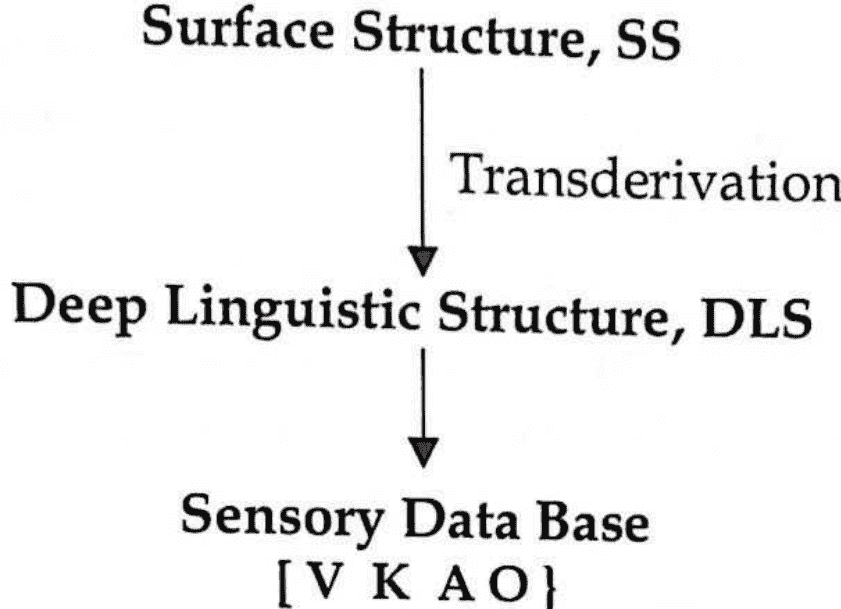

在上图中，SS 到 DLS 的转换是思维。DLS 到 [ V K A O ] 的转换也是思维。思维是一个非常复杂的过程。随着我们继续，它变得越来越复杂。美妙之处在于，我们无法回到思维显然是如此简单的日子。对我们来说，奇妙之处在于发现我们是如何做到的。

所有进入的原子信息单元都将进入左脑和右脑。20 世纪末更有趣的发现之一是 LfB 和 RtB 中的功能侧化。正因如此，我们现在知道，每个进入的信息项都会带有时间标签，TT 或序列标签，ST，发送到 LfB；而发送到 RtB 的则会带有几何标签，GT 或位置标签，LT。这意味着所有 DSLI，任何价值的心智芯片，都将拥有它们的 TT 和 GT。每次打标签的行为也是思维。换句话说，每次侧化行为都是一个思维步骤。幸运的是，这对我们来说是在无意识中完成的。


任何给定时间我们所处的每个情境，事实上都是一个包含无限信息的广阔海洋。我们无法处理所有这些信息。乔治·米勒的发现是，我们所能期望的最多，就是在任何给定时间处理最多 7 ± 2 个信息块。其余所有信息，正如大卫·戈登曾对我们所说，会自动进入我们的潜意识。即使只有 7 ± 2 个信息块，我们也会难以处理它们。如果我们被要求对所有可能的信息（就一切实际目的而言，这些信息是无限的）进行 TT 和 PT，我们就无望活下去。

那么，对这些物理现象 TT 和 GT 的测试是什么？测试是通过这两个相应的问题来进行的。它们不同：

- 你生命中最好的假期是什么时候？
- 你生命中最好的假期在哪里？

前一个问题是关于时间的，后一个问题是关于地点的。无论哪个问题，你都会得到同样的答案。没有它们的标签，所有以其“心智芯片”形式存在的信息都处于一种被称为“通用物理记录”（UPR）的随机混乱分布中。现在，有了标签，所有信息都可以呈现出一种有序的组织分布，被称为“通用逻辑记录”。

你可以看到，将所有信息和数据的原子单位按其自然形式组织起来是多么困难。尤其是在考虑数据的子模态时更是如此。子模态是每个信息项目中存在的极细微区别，无论该信息是视觉、听觉、觉知还是嗅觉元素。我们提供以下五项关于视觉子模态的内容：

- (a). 项目的颜色
- (b). 项目的焦点
- (c). 与主体的距离
- (d). 项目的大小
- (e). 静止或移动

然而，以语义心智芯片的形式，在通用逻辑记录中组织和存储所有信息和数据变得非常简单；最重要的是，任何信息或数据的检索都有可能是即时的，在最坏的情况下也不超过几秒钟。前提是你不患 ALZ 或没有忘记它。

我们通过下图总结了上述内容，该图在我们的著作《无痛之刃》第 123 页中有所描述：

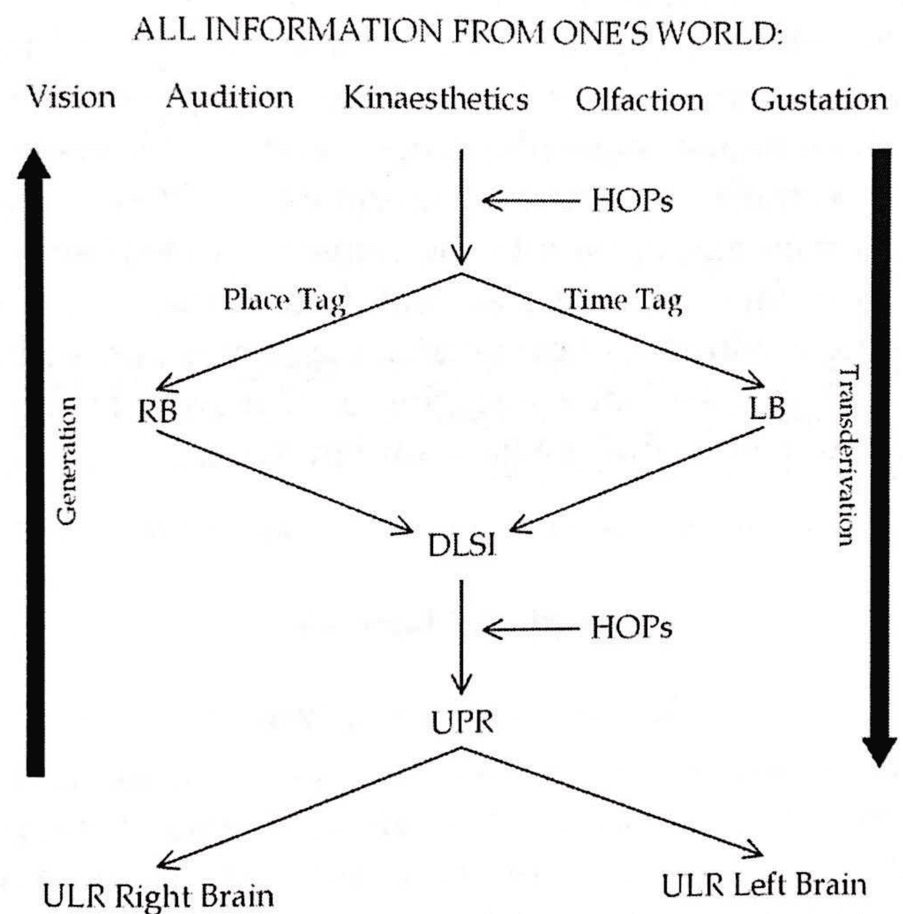

在读完约翰·索尔的《言语行为》后，我们意识到，所有信息单位，通过 HOPs 的运作，都是语义信息单位。在一个逻辑层面的考虑下：

> 生活中的一切都关乎语义。

正如在另外两个逻辑层面的考虑下：

- 生活中的一切都关乎哲学。
- 生活中的一切都关乎金钱。

我们需要了解自己、他人和生命本身；并以良好构建的语义生活。如果我们在这里所说的是真实且对生活紧迫的，那么一个人的意见有什么价值？奇怪的是，无论情境如何，无论身在何处，人们都非常热衷于将自己的意见强加给他人。

语义信息单位，又称我们的心智芯片，获得全息体和子全息体等等的特性。通过 HOPs，它们被隔离到其逻辑语义聚合体中。进而，这些聚合体形成逻辑语义子子核和子核，最终形成语义信息核。这些语义核随后聚合为语义子子模块，然后是子模块，最终形成其语义模块，并最终形成超级模块，而这些超级模块反过来就是一般范式或语义全息体系。我们可以用如下形式描述我们所说的内容：

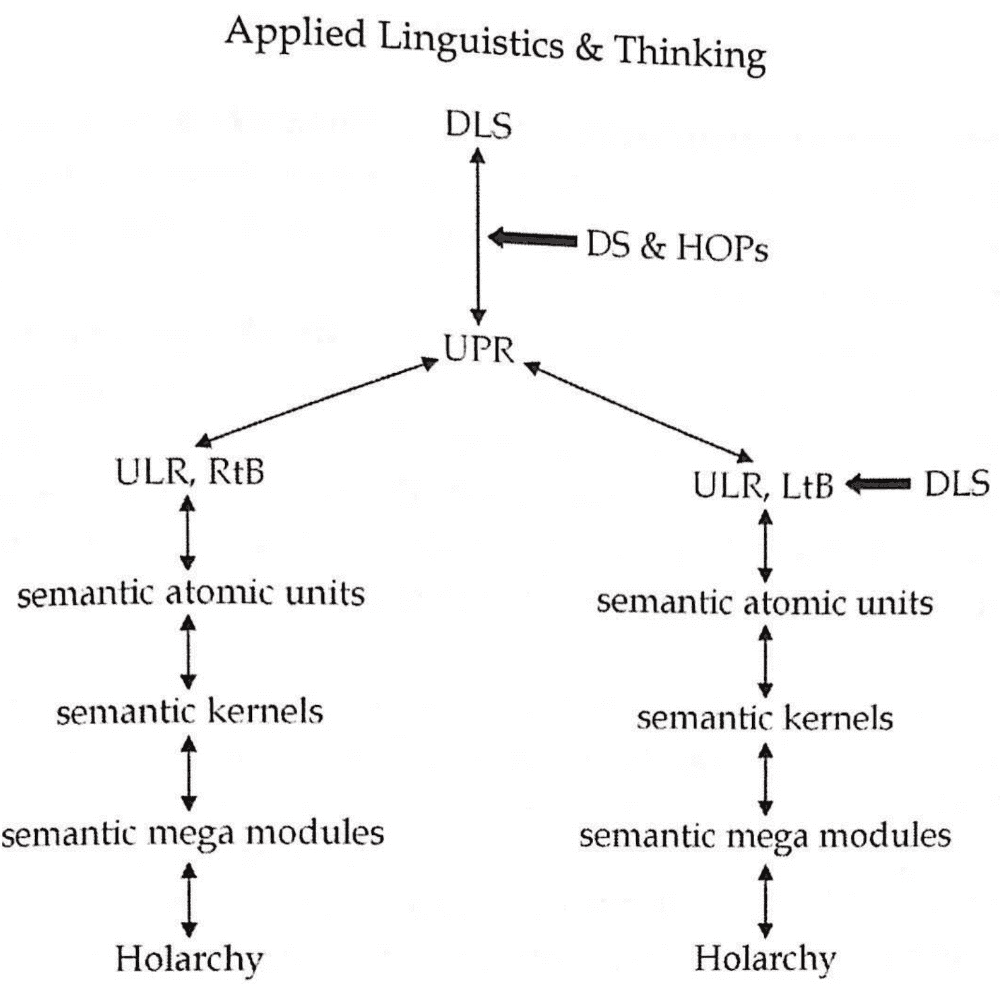

我们所描述的是思维的折纸。上述过程的每一步都是一种思维行为，它从其折叠中展开。幸运的是，我们的 HOPs 软件为我们完成了这项工作。这些语义超级模块，事实上，就是：

- 一般范式
- 或
- 范式全息体系，HOPs。

当我们选择思考、说话、感受和行动时，我们每个人都来自我们在 RtB 或 LtB 的通用逻辑记录中的特定选择位置。考虑一场关于堕胎的辩论。支持堕胎的人回忆起那些地下堕胎者的时代以及母亲们可怕死亡的后果。反对堕胎的人则来自这样的语义命题：一个孩子是一个活着的人，拥有生命权。因此，堕胎就是谋杀。显然，双方都有其默认假设。

这些默认假设完全不在意识觉知之中，并且实际上，作为驱动因素，可能是极端的，因为没有任何认知覆盖的可能性来强迫妥协，更不用说“随它去了”。

说话就是生成称为句子的词串。为此，这被称为生成。无论我们生成什么，都是通过我们的 DLSI。现在清楚的是，我们所有的 DLSI 都汇编在我们的 HOPs 的语言结构中。当我们说话或写作时，我们句子中的所有单词都来自主题 10 的语言结构。

10 当我们说话或写作时，我们句子中的所有单词都来自主题的语言结构，正因如此，当我们写作时，我们会忘记写了什么。然后几页之后，我们会逐字重复同一段落，一直到逗号和最后的句号。

因此，对于他语言结构中约克郡布丁这个语义主题，将包含该人可能希望用于参与此主题话语交流的所有可能句子的全部词汇。将有关于温度、数量、体积等方面的句子，与他的食谱有关。对于该主题的爱好者来说，这些可能是严肃辩论中非常关键的问题。将有关于是否使用油或起酥油以及使用其中一种而不使用另一种的后果的句子；等等。

这反过来意味着，语言结构与我们的语言使用之间存在区别。换句话说，我们说话时说出的话，与我们获取单词的源头并不相同。

想想为威廉王子和凯特的婚礼所做的准备工作。这是一项艰巨的任务。这是一个巨大的语义考虑模块。你能想象其中包含这一考虑事项吗？它涉及新娘第二好的朋友的到达时间，

11 思考是不间断的，因此是连续的：我们知道这一点，因为脑电波从未平线。即使在睡眠中，波动也在蠕动。当然，如果你做噩梦，脑电波会非常显著。波永远不会告诉我们你在做什么梦，又称“在睡眠中思考”。然而，通过图表纸上波动的扫描范围，我们可以说你在思考某件大事。在这方面，有些人相信，如果他们能在体外将脑电波放入你的大脑，那么，他们就能让你按照他们想要的方式思考。这是一个好莱坞式的想法，我们确信永远不会被活生生的证据所证实。

朋友，以及她在西敏寺应坐的位置。然后，还有访问国家元首及其代表团的正式款待问题。它涉及婚礼前后的茶点和晚餐。然后，还有安排地点的婚礼宴会和盛大的午夜宵夜。组织的范围以及一切的时间和速度必须恰到好处。完成所有这些事情所需的思考方式，只有因为我们有 DLSI、我们的心智芯片等，才能发生。

组织者如何应对小错误和重大失误？如果他是一个易怒的人，想想语言使用可能会多么丰富。如果他是一个沉着冷静且有智慧的人，想想那会有多么不同。

那么，我们大部分思考是在哪里进行的？思考是不间断的，因此是连续的。11 这正是在语言科学的开端就被提出的地方。正是在我们的 DLS 中，我们进行所有思考。我们的 DLS 位于哪里？它位于胼胝体。

关键的是，生活中每个人都用手工作。如果我们没有手，我们就无法记录患者的档案。手的拉丁语是 manus。由此产生了英语单词 manipulation。对此，我们对使用这个词没有情感上的顾虑。所以，生活中的一切都取决于操纵。它关乎


## 我们如何培养出强大卓越的菩萨？

我清楚地记得自己参与大学辩论赛的时光。我现在确信，在那个时期，我正在快速检索我的ULR以寻找我的mcsTT/GT。我的对手正在赢得辩论。当我找到我的mcsTT/GT时，我知道，我将以毁灭性的效果赢得辩论。我曾是安大略医学协会珀斯县医学会的会长，随后又是哈尔顿医学会的会长。由于担任这些职务，我连续6年作为代表出席安大略医学协会的年会。毫无疑问，为期三天的会议总是在酒店的大宴会厅举行。辩论大多数时候都非常热烈。有时，我感觉理事会的走势与我所想的相反。我的解决办法是选择在麦克风前排队的时间。当被叫到发言时，我所做的只是以问题的形式提出我的LS，即mcsTT/GT。通过这个问题，它会将理事会的辩论引向我偏好的方向。这就是操纵。

如果你偶然发现自己陷入争论，你会意识到，你的通用逻辑记录（ULR）或HOPs中的语言结构、LSs或其心智芯片mcsTT/GT，正是你思考所需的语言工具。使用它们，取决于它们的质量和精巧程度，你可能会迅速得出一个恰当且致胜的反驳。没有什么比知道你所说的每一句话都在粉碎对手的论点更令人兴奋的了。最后，如果对手承认你所做的一切，你会感到完整，因为你是他的菩萨。如果一个人在辩论或争论中失去了立场，他主观现实的构成会是什么？

我们曾考虑为这部作品设立一章，标题为：在元层面上及关于元层面的思考。然而，我们现在知道，这是另一本书的基础。我们怎么知道这一点？我们感觉到，我们的HOPs不知何故已经组织好了所有必要的mcsTT/GT，以使这种现实成为可能。这与理查德·瓦格纳生平的电影无异。在电影中，你看到在一个夜晚的一瞬间，帕西法尔整部歌剧都来到了他的脑海。他知道必须把它全部写下来，以免忘记。它在第二天黎明时分完成。恍然大悟或顿悟的时刻，就是你所有的mcsTT/GT汇聚为一个语义整体的时刻。这就是莎士比亚所描述的时刻：

> 当你的缪斯用它的火焰触碰你时。

思考与语言，是人类本体论的根源。通过我们的元思维和应用语言学，展开我们的：

## 存在。

# 第四章：正统与存在

我们读到，在晴朗的日子里，当你处于珠穆朗玛峰大本营时，可以抬头看到其山顶¹。在那一刻，你会被山峰的巨大尺寸深深震撼。他们说，人们不得不在它面前感到真正的谦卑。你突然意识到自己是多么渺小。

正统就像珠穆朗玛峰，一座安山岩山脉，已知最坚硬的石头²。作为一个单一实体，我们的HOPs按照我们正统的意愿运作。在我们的正统中，还有我们的：

- (a). 默认假设
- (b). 信念
- (c). 预设
- (d). 假设
- (e). 标准
- (f). 价值观
- (g). 准则
- (h). 道德
- (i). 伦理

我们将上述九项命名为：

辅助九项，Anʏ9

因此，我们要说的是我们的：

正统 = HOPs + Anʏ9

正是这个实体，我们的正统，让我们知道在所有语义
¹ 抬头看其山顶：看到它，就等于看到商业客机的平均巡航高度。
² 安山岩，已知最坚硬的石头：钻石是已知最坚硬的东西，评级为10。一块安山岩评级为7。铜凿子有什么机会切入它？而这正是传统考古学所提出的，古埃及人用来雕刻法老和王后美丽雕像的工具。

领域中我们总是正确的，并且在我们存在的每一瞬间，我们都简直是奇妙而美妙的。正确的问题在于其伴随物——确定性。在控制论循环中，我们的正统支撑着我们，而我们反过来又加强我们的正统。这样一来，我们就打开了通向变得固执、不灵活、偏执乃至更甚的大道。

每当在文雅社会和专业圈子里讨论正统问题时，人们倾向于快速跳过，因为我们不想挑战对方的立场，即他可能是错误的。这就是俗称的“客厅里的大象”。它就在那里，没有人能移动它，没有人谈论它；事实上，没有人真的想谈论它。事实上，它在我的《临床精神病学》学术著作的文本中甚至没有索引。我找不到关于正统的任何一条注释，哪怕是间接的。事实上，没有任何角色被赋予它作为思考的驱动基础，因此也是我们本体论的基础。在DSM-5的索引中，正统这个词甚至没有列出。作为一个词，它在我们的书《精神病学词典》的文本中也找不到。

对我们来说，一个引人入胜的谜团是：正统并不是精神病学、心理学、心理治疗和催眠治疗的研究部分。然而，在公共领域的思想主体中，普遍认识到一个人的正统强有力地决定着他的思考、他的语言、他的人性和他的行为。我们在这里所说的，甚至是普通老百姓也普遍知道的事情是：

> 本体论是正统的函数
> On^T = f (Ortho^Y)

我们的存在源于正统：

> 存在是正统的函数

## 正统与存在

## 存在 = f (Ortho^Y)

从科学角度看，这是关于一种关系。这些方程描述了一个人的本体论和存在的变化值，与其正统相对。这些值如何相互变化，将在下面的示例中描述。

这是一个实际的历史事实。它涉及一个人，即英森三世教皇所采取的立场。他决定举起阿尔比派十字军的旗帜。他的号召将导致在法国南部朗格多克地区屠杀超过一百万卡特派人士（包括男人、女人、儿童和老人）的本体论现象。这是他正统价值的证据，一种极端热忱的正统，催生了一种存在方式。这种存在方式具有不可阻挡的专注和不屈不挠的决心，去杀死所有卡特派人士。如果我当时还活着并反对他，你早就已经看到我化为烟火了。

哲学、科学、医学和心理学领域的高级学者对正统的含义理解不完整。他们没有意识到的是，人类正统的引擎源于我们的HOPs + An^9：

正统 = 范式全息架构 + 辅助9项。

Ortho^Y = HOPs + An^9。

正是在我们的语义全息架构（SHs）或范式的主体中，我们理解自己、他人以及我们所生活的世界。我们的情感/情绪从我们的SHs中展开。在丹·布朗的《达芬奇密码》一书中，有一个白化病人角色。在这个白化病人的宗教语义全息架构中，有一条格言：

> 罪恶是被禁止的！

如果你的罪是致命的罪，你必须受到严厉惩罚。因此，如书中/电影中所述，他鞭打自己。这被称为自鞭，是一种备受推崇的方式，在


中世纪基督教教会教导你的身体不要在贪婪、性、食物等方面放纵。

历史上，我们知道，在中世纪，苦行者的自我鞭笞是所有基督徒为惩罚自身罪孽而首选的方法；并且这得到了教会的祝福和认可；这确实无疑是一件宗教上时髦的事情。肉体是软弱的。其逻辑是，通过惩罚肉体，它会因血和痛而变得强壮。一般来说，中世纪人们普遍认为肉体需要受到惩罚。其目的是剥夺肉体的尘世享乐。这包括穿粗毛衣；以及在荒野中生活，比如沙漠中的隐士。我们在这里描述的是源自中世纪基督教正统的内在本体论，即“正常人不会那样做。他一定疯了”。

因此，他由精神科医生治疗。现在他的惩罚是一段精神科治疗期，以治愈他的精神分裂症。我们想指出的是，每当一个行为令人憎恶时，这个人从未为自己的行为被追究责任或问责，因为默认假设是他必须疯了才会做出他所做的事。

如果一个住在纽约公园大道或伦敦梅费尔的男人，因为邻居与他妻子通奸而割断邻居的喉咙，然后用自己的生殖器塞满对方的嘴和喉咙，你难道不会说这是一个不正常之人的行为吗？

如果你的一个邻居抓住他一岁孩子的脚跟，一挥就把孩子的头砸在厨房墙上，你难道不会说这是一个精神有病、需要精神科护理的人的行为吗？

对于NSP来说，在这两个例子中，相关个人都必须决定做他们所做的事。所有决定都是有感知的行为。正是出于这个原因，这个人应当为自己的行为负责。

因此，在阿尔及利亚独立战争中，双方——一方是法国士兵和黑脚族，另一方是民族解放阵线（FLN）和当地阿拉伯人——对彼此做了难以置信的可怕事情，甚至比上面引用的例子更糟糕。

当法国军队抓住他们时，FLN士兵或阿拉伯人是否被当作精神不健康者审判，并被送入精神病科室接受治疗？不！法国士兵把他们聚集成群，然后用机枪扫射。这现在是大屠杀！正常的理智之人会进行大屠杀吗？当然不会。

神经语义编程指出：

> 让法律按照议会制定的法令来处理犯罪。并且停止因关于正常与疯狂的意见而偏离其职责，因为争议点可能非常具有争议性、无法定义且无法确定。

如果确实有人被贴上“疯狂”的标签，支撑这一结论的科学指标是什么？没有任何指标，因为正常或疯狂是基于意见的。然而NSP教导说，任何行为都必须满足良好形成性的条件才能被视为正常。

你现在会想知道任何行为或举动的良好形成性条件是什么。当一个行为/举动满足以下条件时，即为良好形成：

- (a). 个人有自由决定去做的选择
- (b). 该行为无瑕疵地完成⁶
- (c). 对他/他人/共同利益有用且有价值
- (d). 在给定语境的语义上结构准确
- (e). 符合伦理，且不对自身或他人造成伤害

⁶ “impeccably”源自拉丁语“peccatum”，意为污点。在英语中，“impeccable”意为无瑕疵且无可指责。NSP使用这个词是指，不粗制滥造。


- (f). 它帮助个人提升对自己/他人/以及他所生活的世界的觉察水平
- (g). 它包含某种爱或慈悲

我们可以使用这些相同的指标来判断，DSM-5中任何诊断的人的隐含正统性和行为是形成良好还是形成不良。

考虑这个例子。在英格兰，有一个人被诊断为慢性抑郁症，并获得了长期残疾养老金，LTDP。偶然间，他在他兄弟的小屋里被录像。他帮助兄弟给小屋盖了新屋顶。他会出去钓鱼；他享受烧烤和啤酒，并在待在那里的两周里共同参与娱乐活动。

他回到家后，对整个家庭来说简直是一种痛苦。在家里，他表现出自己无法工作。现在，他当然配得上他的LTDP。作为一名慢性抑郁症患者，他拒绝所有家庭洗礼、婚礼、聚会、晚餐、烧烤、野餐和舞会的邀请。他根本无法为自己或任何人做任何有成效的事情。家人应该侍奉他。

考虑到在古罗马时代并没有慢性抑郁症这种东西，你知道如果他向其辖区的地方法官坚持这种行为，他的下场会怎样吗？他会被赐予终身邮轮假期。他会被锁在战船上，成为一名出色的划桨手。

所有现存和当前的法庭都基于亚里士多德因果体系衍生出的对与错来运作。对一个人来说，被这样的体系判定犯有**错误**意味着，没有普遍指标来支撑法庭对他**错误**的认定。正因如此，他有可能宣称：*我不在乎你们判我有罪，因为我确信我所做的是**正确**的。* 他不仅知道这一点：他是**正确**的，他还确信*在他上帝眼中他是**正确**的。* 从真正的意义上说，从哲学上讲，这样的人实际上已经战胜了法庭的认定。他现在拥有在上帝面前成为殉道者的荣耀。正是通过这种方式，自杀式炸弹圣战者升入他们的上帝和他们那具人形的天堂。

同样，当一个男人在家里地下室发现妻子脖子上套着绳子吊死时，这一物理现象的惊人事实被**归咎于抑郁症**，而非她的正统性。这是还原论中逻辑操作得出的一个非常简单化的结论。事实上，这是一个非常复杂的事件。例如，在儒家中国，调查者会想知道丈夫对妻子施加了何种严重的不正当把戏，导致她决定结束生命，并永远结束与丈夫的关系。这实际上是一个非常绝望的有感知行为。向你提出这一点，你突然领悟到做为人类的复杂性。

因此：*在NSP和正统性中，无论形成良好还是不良，一切都与观点无关。*

我们随后发现，正统性与语言在其多序词子领域之间存在着强大的关系。多序词是AK的一个惊人发现。单词的含义由其使用的上下文决定。换句话说，根据AK：

> "它可能适用于所有言语层级，在每个特定情况下可能有不同的内容或含义，因此没有单一的内容或含义。"

举例来说，考虑单词 structure：

- (a). 该结构可容纳100,000吨原油。
- (b). 如果那根梁失效，该结构将会坍塌。
- (c). 该结构非常坚固，如果你打破它，将意味着你的死亡。
- (d). 你希望拥有多少个结构？
- (e). 如果你继续进行更多修改，该结构将不再如最初设计的那样。

这个词可以应用于关于第一个陈述或下一个陈述的陈述，并成为其抽象。这里有一整套多序词，我们举几个例子：good, fine, love, excellent, gracious, ungracious, kind, fast, more, less 等等。

生命是时间的一个瞬间。那个时间瞬间只是无数可能的独特生命情境中的一个。

多序词的存在和范围意味着我们的感知可以扩展到无限上下文的语义中。理论上，这意味着我们摆脱了可能适用于我们的语义固着的限制。它为我们拥有自由意志和选择打开了可能性，而动物则固着于他们在那一刻想要的东西。正统性与语言之间的关系体现在这段引文中：

> 随着术语多序性的引入——这是一个自然但至今未被注意的事实，我们的普通词汇得到了极大的丰富；事实上，这种对人类而言自然的词汇中的词汇数量是无限的。术语的多序性是人类语义反应完全条件性的基本机制；它消除了数不胜数的旧有动物性阻塞，并且对理智至关重要。

> 阿尔弗雷德·科日布斯基：《科学与理智：非亚里士多德体系和一般语义学导论》，国际非亚里士多德图书馆出版公司，第四版，第六次印刷1980年，第14-15页。

简言之，让我们通过其他例子来回顾多序词：yes。作为一个术语，它在大量语义语境中有应用。它只有一个前提，即你同意该语境的语义。同样，这对于术语：no 也是成立的。它在数量惊人的大量语义语境中有应用。

如果你稍加思考，你会想起自己对大量邀请、活动、事物、人和决定说过“是”，这包括一个麦当劳汉堡。这包括你在加拿大大选中的最后一次投票“是”、你买的鞋、你选择观看的电影以及向你推荐的新餐厅。

另一个多序词是 love。因此，对于某些工程师来说，二战时期著名的喷火式战斗机是他们热爱的事物，它的飞行员也是如此。另一方面，你可以热爱一道经典的周日烤猪肉，配上其酥脆的烤皮。突然间，你意识到你所爱的事物、人、地方和时间数不胜数；它甚至包括你的泰迪熊。我们甚至可以说我们热爱热爱。

恨也是一个多序词。所以，让我们默认我们都恨像希特勒这样的人。然而，我曾与珍妮弗在佛罗里达州那不勒斯的船屋餐厅共进晚餐。在三个女人的聚会中有一个男人，只有他一人爆发出最令人恼火的奉承式大笑，反复地，那是我不得不倾听的不幸。那是我第一次接近于恨一个人的笑声带来的烦恼。现在你明白了你生命中可能恨过的事情。

我们已经说过，我们每个人都可以说出任意数量的可能英文句子。这一陈述证实了我们每个人都拥有无限的力量；为了支撑它，我们必须拥有无限的词汇。然而，我们并没有！正是多序词的词汇支撑了我们在语言中的无限力量，并通过它，我们在语言学上可以是无限的。我们要说的是，如果我们能生成无数句子中的任何一个，那么就意味着我们可以以无数种方式思考。进而，我们可以生成无数本体论中的任何一个。这是我们拥有的一种美妙能力，然而，它可能导致困惑、误解和争论。

患有精神障碍的人似乎失去了生成无数本体论中任何一个的能力。他们被困在一个语义上形成不良/畸形的本体论中。

7 我们可以使用这些相同的指标来判断隐含正统性：没有任何指标来判断一个结论是对还是错。如果是这样，那么这只能是某人常识与个人专断的结合。而事实上，这正是英诺森三世谴责卡特里派的方式。有趣的是，杀死卡特里派人士有内置的收益。你拥有你杀死的卡特里派人士的一切。你杀得越多，就变得越富有。

8 **他们那具人形的天堂：** 阅读《古兰经》的人将对伊斯兰天堂有完整的描述。你将拥有一座坐落在花园中的宅邸，花园中流淌着美酒、蜂蜜和清泉的河流。在主卧室里，将有60多位胡里女等待侍奉你的每一个需求。

9 人类语义反应：当科日布斯基撰写《科学与理智》时，当时的风尚是将人类行为视为类似于膝跳反射。对髌骨肌腱的刺激/敲击，啪的一下，立刻，松弛的腿笔直向前弹出的反应。这种行为确实不需要任何内部处理。我们不是机器人或狗。出于此，我们现在建议将科日布斯基对人类行为的缩写 s.r.（语义反应）改为人类语义反应 s.r.，即不再对 s.r. 使用粗体。


然而，科日布斯基推测，我们可以“消除数不胜数的旧有动物性阻塞。”他所指的这些“动物性阻塞”，是我们祖先居住在洞穴时的思维模式和行为及其衍生物。我们本希望进化能像AK所说的那样，从我们身上抹去动物性的人类思维。然而，我们知道事实并非如此。事实并非如此，这一点基于以下例子。正是那种贪婪的贪欲，策划了华尔街银行家的欺诈，从而引发了世界金融崩溃。正是那种仍在我们内心的极端动物性。

在所有我们未能消除的彻底腐朽的动物性阻塞中，最严重的莫过于在可怕的物理现象——人类战争（HUMAN WARFARE）中，大规模杀戮我们的亲人和同类。我们被迫得出结论，之所以无法消除这一点，是因为我们的正统（Orthodoxy）。事实上，我们的意思是，如果我们希望改变，那么就必须改变我们的正统，因为动物性阻塞深深埋藏其中。简单来说，我们必须改变我们的HOPs + AnY9。如果我们能做到，那么我们就能，并且将能够“消除数不胜数的旧有动物性阻塞。”

我们正统的大部分组成部分都被无意识地植入我们心中。正因如此，贺拉斯曾说：

> 你可以用干草叉戳刺人性，但它总会回来。

因此，这句话证明，在心理治疗工作中，期望的结果——一种二阶改变（IIOC）——对于许多心理健康专业人士来说，往往是一个近乎不可能的目标——直到NSP心理治疗出现。

从我们诞生之时起，我们就一直在互相战争：


然而，我们现在知道，战争的**软件**，即这个*动物性阻塞*，是硬连线到我们的神经硬件上的。换句话说，我们的意思是，我们的语义结构，通过被称为神经元的实际解剖导线，连接到大脑中包含我们洞穴居住祖先的动物性行为代码的特定位点。

我们已经进化到可以用勺子、刀和叉子用餐。然而，让我们假设我们要玩一个猜谜游戏，被选中的人要扮演我们洞穴居住的祖先之一。我们扮演这样的角色毫无问题。那个人轻易地推开任何桌子或椅子；然后他粗暴地拂开桌上所有精美的陶器和切割玻璃，冲过去抓住羊腿，用牙齿撕咬，并抓起一个水壶把水灌下去。


他能这样做，是因为这些原始的行为代码仍在他体内。如果它们被进化抹去，他就无法扮演这个角色，因为他没有相关知识。

今天我们确切地知道战争的位点在哪里；它绝对不在我们大脑的海马体、杏仁核、脑桥、视觉皮层或小脑中。

这些是我们即将出版的书中将要讨论的关键问题。

## 战争与广岛

## 我们不可避免的灭绝或通往救赎之路

根据你所读的内容，你现在可以体会到所有达到语义阈值（ST）的情绪所起的作用。当一种情绪，被标记在我们范式全序（Holarchy of Paradigms）中的一个语义项目上，并达到其语义阈值（ST）时，就没有什么能阻止该语义项目被转化为现实。下面是一个情绪如何达到其语义阈值的图示。一旦达到，就意味着将采取行动。

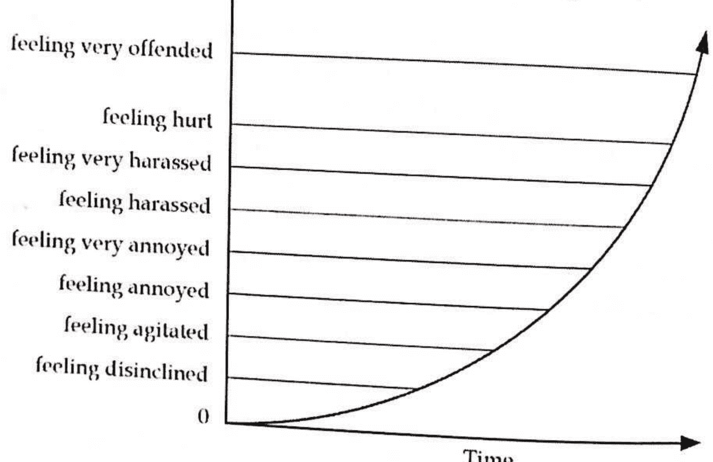

神经语义编程（NSP）的领域研究非常重视正统（Orthodoxy）这一问题。在此过程中，它探索了其结构。我们发现，一般语义学（GS）同样非常重视这一结构的问题，这非常有趣。一般语义学和NSP将结构定义为**两个可变值之间的关系**。值的变化可以用数学方程式来描述。10 从下面我们描述的内容，你可以理解我们在这里引用的内容。显而易见，我们的思维是正统的函数。同样显而易见，我们的人性也是正统的函数。因此，这意味着我们可以用这些方程式来表达我们所说的内容：

```
thinking = f (orthodoxy)
human nature = f (orthodoxy)
human nature = f (thinking)
```

问题在于，我们思维的价值，一方面取决于其强度、决心、专注和奉献，另一方面取决于我们正统的热忱、承诺、凶猛和残暴。这些变量的值不能是数字。它们只能通过格式塔来评估。因此，当我们的正统结合不佳时，思维的强度可能较弱。然而，当我们的正统严肃而凶猛时，我们的思维可以高度集中。从数学角度来看，由此可得出：

```
human nature = f (our thinking)
our thinking = f (human nature)
```

这里的问题是，我们人性的连贯性、凝聚力、侵略性和目标，与我们上面引用的思维的运行指标相比。从数学上讲，由此可得出，我们的存在是思维和人性的乘积。我们可以这样表达：

10 值的变化可以用数学方程式来描述：NSP极其重视数学。整个不断展开的宇宙，连同其中所有不可思议的物理现象，都由数学方程式来描述。问题在于找到无法支持方程式有效性的证据。而这正是科学的全部内容。在科学中，不是寻找支持你立场的证据。重要的是能够反驳理论的证据。

```
being = (thinking) (human nature) c
```

其中：
c是一个常数，在此例中为时间。

在无数千年里，我们一直是一个互相战争杀戮的同类物种。在我们的杀戮中，我们违反了生物学的一条基本定律。任何物种的成员都不会杀害其同类。没有一群虎鲸会出动去消灭另一群虎鲸，也没有一群狼会出动去灭绝另一群狼。没有一群猴子或黑猩猩11曾被知晓会杀死整个群体的成员。我们是唯一已知会对同类进行种族灭绝的物种。

尽管大屠杀（Holocaust）惨不忍睹，但它不能声称自己是第一个种族灭绝受害者的独特殊荣。从前，一个名叫成吉思汗的蒙古人，骑着驴子进入亚洲平原，该平原延伸至中亚平原，他沿途屠杀所遇之人——一直到维也纳城门。当他去世，必须被送回外蒙古的乌兰巴托时，路边的所有人都必须被屠杀，以保守他死亡的秘密。值得称道的是，他的行为造成了约四千六百万人丧生。

根本不允许审视一位科西嘉人所造成的死亡人数，然而在他鼎盛时期，他发动的战争比欧洲和俄罗斯之前任何人都多。海地曾是法国帝国的明珠。它是第一个从其主人种族法国手中赢得独立的非洲奴隶国家。出于对拿破仑的恐惧，海地的一位皇帝建造了他的城堡，以防他回来揍他。

11 朱迪·古道尔博士发现黑猩猩会为了肉类而猎杀同类黑猩猩。在此过程中，它们表现出食人行为。一旦狩猎目标达成，追逐就结束，宴饮开始。进攻的群体不会继续追捕以灭绝另一群的所有成员。

## 正统与存在

1904年，今名纳米比亚的西南非洲德国政府消灭了赫雷罗人和纳马夸人。1985年，联合国将其后果列为试图灭绝西南非洲的赫雷罗人和纳马人，因此是20世纪最早的种族灭绝企图之一。2004年，德国政府承认并为这些事件道歉，但拒绝为受害者后代提供经济补偿。2015年7月，德国政府和议会正式将这些事件称为“种族灭绝”和“种族战争的一部分”。

那么，问题是：

> 我们正统中嵌入的什么结构，迫使我们从那时起、现在以及所有可能的未来，都成为亲人和同类的大规模杀戮者？

如果我们不改变我们的正统，我们就不能假设我们中任何人都会有明天。如果确实存在使我们成为大规模杀戮者的结构，那么从逻辑上讲，它与我们的神经学相关或相连。

上述所有例子都涉及宗教、文化、种族或政治信仰。然而，我们的正统影响着我们涉及对自己、他人和生活经验信念的个人问题状态。无论我们生活中发生什么事件，我们都通过我们的范式全序（Holarchies）和我们的HOPs来处理信息。我们的正统，即HOPs + AnY9，是我们存在（Being）的根源。

从NSP的角度来看，我们确信在治疗中，尽管患者可能会向治疗师寻求帮助，但患者的正统决心要确保他保持不变，并继续他过去的方式延伸到未来。因此，患者与临床医生之间为了解决问题而建立治疗联盟的想法，是一个美好的想法，但却是一个矛盾修辞法。


证据已经存在。人人都知道，你无法通过说教让一个人摆脱焦虑或抑郁等困境。有酗酒者或吸烟者曾因为一条好建议而戒掉瘾吗？如果真有这种可能，那么在基督教教会讲坛上几个世纪的布道和说教之后，我们早就停止了自私、贪婪、放纵、残忍、杀戮和战争。事实上，实际证据表明，我们一代比一代变得更糟。然而，所有宗教，尤其是西方宗教，凭借其正统教义，至今仍如故。

坐在治疗师面前的患者并非“朋友”，因为他问题状态的正统教义决心要否定治疗师所能提供的一切。这将我们带到了问题的核心——如果正统教义如此强大，那么治疗到底是关于什么的呢？

正因如此，心理治疗急于寻找DSM-5所有诊断所反映的本体论问题真实本质的答案；然而，NSP已经拥有数据，可以证明存在大量DSM-5不知晓的惊人诊断。本书只是对以下内容探索的一个非常谦逊的入门：

*作为人类的奇妙、神秘与复杂性的未知宇宙*

那么，什么是心理治疗？它是一种独特的过程，旨在带来二阶变化（IIOC）。我们在第一章中简要讨论过这一点。

前来接受治疗的人寻求其本体论的改变。然而，他们只意识到自己的症状，而不知道自己是如何产生这些症状的。

**一阶变化，IOC**，是指行为或问题保持不变。它涉及应对情况或谈论它。作为一阶变化的示例，涉及一个房间，你可以：

- (a) 将长沙发从一个位置移到另一个位置
- (b) 以不同方式重新排列椅子和桌子
- (c) 重新安置电视的位置
- (d) 将壁炉改为自动燃气壁炉
- (e) 将墙上的图片重新安置到新位置。

尽管有所有这些变化，房间本质上仍然是一样的。要使其具有二阶变化的地位，可以将其改造成桑拿房或热水浴缸。

一阶变化，IOC，就是做《大餐车》（Diners, Drive Ins and Dives）主持人盖伊·菲耶（Guy Fieri）所做的事。他从一个地点到另一个地点，吃不同制作的食物。二阶变化，IIOC，是如果他成为一名修道院僧侣，以不变的谦卑简单方式用餐。这极不可能发生，因为盖伊是一位忠实的美食家。

IIOC是一种转向完全不同状态的变化。一对有婚姻问题的夫妻留在关系中，试图并希望维持它，这是一阶变化。结束关系并继续前进是二阶变化。从书籍《Change》中，你会找到这句话：

> "走出梦境的唯一方式是从做梦转变为醒来。显然，醒来不再是梦的一部分，而是转向完全不同的状态。这是一种变化的变化。"

归根结底，生活是一种平衡：一方面是不断变化却又始终如一的现实，另一方面是彻底的改变。

我们的生活每天都不同，却又相同。当我们去度假或发生重大事件时，它会发生根本性的变化。我们结婚47年了。幸存者的生活将发生根本性的变化。

以下是另一个跨越几个世纪的存在方式的例子。武士的命运是为主人而死。这是他能做的最高尚、最伟大的事情。这也是古罗马人的文化正统：如果他受到耻辱，就应当结束自己的生命。于是，他会这么做。如果一位中国古代官员辜负了中国皇帝，他就必须死去。于是，他会结束自己的生命。

时代已经改变。今天，我们有高级部长，他们在部门支出方面搞砸了，花钱花到连一美元的去向都无法交代，**更不用说数十亿美元了**。加拿大联邦和省级审计长已严厉批评他们不光彩的受托管理。至今，没有一个人被绳之以法。我们不禁要问，发生了什么，以至于在这个时代，我们在政治和世俗生活的正统中否定了荣誉的地位？

我们的军人今天被分散到世界各地的不同战场。其运作的预设是，如果有必要，他们应当为国家光荣牺牲。如果事实如此，那么当我们的高级政客把国家搞得一贫如洗、债台高筑时，他们为何不为对国家的不光彩付出代价呢？然而，我们知道有些文化的正统中，没有比为自己的上帝而死更大的荣誉了：

**这就是本体论！**
**这就是正统教义！**

本作品只能提供关于正统在我们**知-知-存在**方式中所起作用的快照。也许有一天，我们的一名学生会写一本书，对以下内容做出更充分的阐述：

## NSP与正统结构及其后果

## 正统与存在

在自由研讨会的演示中，我们教授存在的第一、第二和第三基础。12 对我们而言，它们是关于“存在”意味着什么的自我可验证真理的基本公理。

12 存在的第一、第二和第三基础是自由研讨会中教授的关键教学元素。不幸的是，这里不是向您揭示它们的地方。当您参加自由研讨会时，您将了解它们。

# 第五章：亚里士多德因果系统，A

亚里士多德因果系统，A，¹ 也被NSP缩写为C→E，是一个庞大的主题。像所有系统一样，它有其运作的语法、其功能的哲学及其价值的逻辑。在这里，这种哲学被称为因果律。我们还将其命名为责备框架。

阿尔弗雷德·科日布斯基，一般语义学之父，GS，意识到C→E具有一种语言系统。在其哲学中，包含其独特的逻辑；正是其语言系统承载了C→E的逻辑。

作为元全相体，它对我们的语言运用具有超级力量，因此我们对情境的理解和对生活中情境的反应，将遵循C→E的逻辑。我们发现，C→E对我们有着难以置信且强大的后果。

令人遗憾的是，我们会自动且无意识地适应、调整并习惯于它们。当我们最终适应它们时，我们对它们没有意识。结果是，我们既没有认知上的监督，也没有意志上的监督，来了解它们在对我们做什么以及如何诋毁我们。更奇怪的是，我们的正统自动向我们确认，所发生的一切是正常的、自然的，而且最重要的是正确的！

生活中一个有趣的公理是，如果你不知道自己内心在处理什么，你就无法控制它。因此，将这一事实铭记在心至关重要。NSP在这里引用的意思是，我们无法逃避A对我们的诅咒和代价。稍后，你将了解这些担忧的严重性。这就像一个兄弟突然发现，多年来，他被指定为年迈父亲遗产执行人的另一个兄弟，一直在从中大量盗窃资金。这是一个真实的生活案例。

A是如何成为人类所有其他语义范式全相体之上的主导元范式的？这个问题的答案在于我们生活在……的古生物学和谱系学祖先。


## 神经语义编程

树²。在它们树栖的生存中，有安全和所有必要的营养资源。它们是素食主义者。

然后有一天，他们能够站立并沿着树枝行走，甚至在树枝上奔跑。随着时间的推移，他们下来探索大地。在某个时刻，或许是通过拾荒，他们发现了食肉。因此，他们发现肉类比树叶提供更丰富的蛋白质来源。于是，他们开始在平原、丘陵和山谷中追逐和猎捕野生动物。在此背景下，他们将猎物逼入绝境，并用石头投掷猎物以致命方式将其杀死。这为我们的祖先提供了亚里士多德因果关系体系的一个经典法则，A：

> 我们扔出的石头，会致死。
> 我们*导致*了猎物的死亡。

然后他们发现了用石头敲击石头的方法，从而产生了边缘非常锋利的碎片。最好的石头是黑曜石，也称为火山玻璃。用石头或鹿角敲击它，它就会碎裂。碎片的边缘具有外科手术刀般的锋利。这样的石头用来磨尖木棍，制成矛。这些石碎片可以制成箭头。我们祖先的下一个重要步骤是发现如何生火；随之而来的是烤肉的香气。这结束了他们食用*鞑靼生肉*的日子。

我们的祖先在洞穴中找到了庇护所。然后有一天，一个兄弟用石头击打另一个兄弟的头部并将其杀死。因此，证据如下：

> 我*导致*了我兄弟的死亡。

² 生活在树上的我们的古生物学和谱系学祖先：这一断言基于对我们古生物学祖先骨骼的骨骼学研究。我们的祖先用手和脚在树与树之间荡来荡去。在此过程中，他们采集了花朵、树叶和果实等树栖资源。请思考这一点。我们的祖先是带着简的泰山。

现在他要为此负责，但他杀人的理由是：我要简。我会为了她而导致我兄弟的死亡。杀即是做。做需要一个人决定去做。决定关乎有感知的处理。因此，决定是一种有感知的行为。杀戮是一种有感知的行为。这对所有行为都成立，无论你对该行为持有什么观点，例如，只有疯子才会做这种事。

由此可见，对某项行为的厌恶观点，在法庭评判案件时不应占据任何位置。因此，一个人抓住婴儿的脚踝，然后将其抛掷，使婴儿的头撞碎墙壁，这是一种极其恐怖的行为。你和我当然不喜欢这样。你可能会得出结论：他肯定是精神有问题才会这么做。法庭也同意你的看法。现在，你和法庭已经免除了他所有的责任。他被宣告无罪。然而，我们依据的是他的行为，而非观点。他的行为在法律上属于谋杀，依法应因他有意识地决定杀人而受审。

C→E关系被基督教信仰和西方法律完全采纳。今天，它被视为物理学的一个事实。从结构上看，C→E是关于一个初始事件的转变，随后由→一个后续事件。这，如索引所示，涉及处理，因此涉及一个由“→”反映的时间跨度。这可以这样描述：

时间跨度 = →

1777年，大卫·休谟，随后是1933年的阿尔弗雷德·科日布斯基，他们看出，总有可能有另一个元素插入→中。如果发生这种情况，那么针对E的所谓C就不能成立。因此，→始终打开了另一个变量成为真正原因的可能性。同时性作为一种物理现象，在生活中是非常罕见的事件。任何事物要成为E，都需要时间，→。同样，没有任何东西可以是瞬间的，这是一个科学事实。

这意味着在所有事物中，我们看到的是一个序列。这一事实得到了以下论点的证实：无论光速多么快，它都不是无限的。如果光速是无限的，我们会在一瞬间把握所有可感知的现实。³ 由于情况并非如此，我们被困在一个序列的现实中。语法一词是序列的同义词。因此，我们可以说一个句子是单词的序列，也是单词的语法。

³ 如果光速是无限的，我们会在一瞬间把握所有可感知的现实：我们观察天空，而我们的常识欺骗了我们。我们看到的事件有数百万个太阳年之久，因为我们看到的星星，需要数百到数千光年才能到达我们这里。此外，我们并没有看到所有应该看到的东西。还有更多东西，而看到更多需要时间。同样，这也适用于微观世界。如果我们不耐心和小心，我们会错过很多东西；其中一些可能至关重要。

⁴ 这意味着在C→E的现实中，我们处于绝对确定性之中：这一说法成为了阿尔伯特·爱因斯坦与量子物理学这门新科学之间的分界线，量子物理学充满了不确定性和不确定因素。我们现在知道，有一座桥梁本可以将他与量子物理学调和起来——这是一门他本人在其著作中就曾预见的新科学领域。我们将在本书后面讨论这座桥梁是什么，以及它对我们所有人的非凡意义。

当你通过C→E思考时，你可以在你的本体论中验证这些情绪，当你生活中的确定状态突然被破坏时，不仅一次，而是反复发生。正是因此，在C→E中生活，我们的存在反复被恐惧和愤怒锤打，直至悲伤和泪水。然而，这种状况并未列入DSM-5的诊断中。

当然，对于宇宙中所有展开的生命奥秘，每一个都将受限于C→E语法的约束。科学今天面临着一个奥秘的海洋。其中之一无疑是关于我们如何：

## 知-知-知-在

在任何时间和地点。但直到现在，我们仍然不知道我们如何知-知-知-在。

如果事实是，我们所有人从智人起源之初就一直在按照我们的C→E逻辑运作和生活，那么你可以逻辑上和自然主义地得出结论，我们彼此之间本应友好相处、和睦相处。然而，历史的证据否定了这一点。相反，似乎我们被迫得出结论：我们在共存的数千年中共同拥有的这种C→E逻辑，正是相反情况的基础。它是以下事物的根源：

- (a). 争论
- (b). 厌恶
- (c). 敌意
- (d). 憎恨
- 和
- (e). 战争。

在历史的每个时代，我们之间都存在分歧、战争和杀戮，无论我们是崇拜阿蒙-拉的尼罗河埃及人，还是崇拜沃坦的北欧人。作为一个物种，我们从未以爱、友谊和善意与同类相处。我们饶恕的那些人是我们的亲人、同部落的男女和儿童。其余的人我们征服并奴役了。今天，工业军事复合体、IMC/US和美国的深层政府无法忍受特朗普暗示他想向普京伸出友谊之手的可能性。对他们来说，他们必须有一个敌人。对于工业军事复合体、IMC/US来说，今天可能的敌人要么是俄罗斯，要么是中国。

我们现在处于21世纪。你可以从互联网上下载“美国军事行动时间表”。然后你可以阅读美国目前参与的冲突数量。你会对此感到非常震惊。换句话说，在A中，我们有一个非常危险的思维工具，并且我们完全处于它的控制之下。

有什么佐证可以以如此不友好的方式描述C→E？第一是AK的结论，即C→E的语言系统是不健全的。

然后，理查德·班德勒和约翰·格兰德得出结论，C→E的语言系统在语义上是畸形的。5 奇怪的是，就像科日布斯基的情况一样，班德勒和格兰德都不了解C→E语言的全部范围。

5 C→E的语言系统在语义上是畸形的：班德勒和格兰德附加给C→E语言的标签，远比科日布斯基的更为严厉和苛刻。他们的术语意味着，如果你使用C→E的语言，你得到的意义将会是扭曲的、歪斜的、错误的、变形的、扭曲的、偏离正轨的、反常的和变态的。我们将其标记为疯狂。

然后，我们得出结论，C→E的语言是疯狂的，因为它充斥着指责和畸形。随着时间的推移，在我们的研究中，由于一次无意的偶然发现，我们发现了一件事，那是所有可能中最糟糕的


## 亚里士多德因果体系，A

关于C→E的事物。这不仅仅是疯狂。事实上，这是la grande via：通向原力黑暗面的道路。

想想看，没有人会偶然闯入原力黑暗面。我们是通过有意识的决定进入它的。在《星球大战》中，对阿纳金的警告证实了这一点：不要进入它。杰弗里·达默，正如他母亲所指出的，长大后曾是个如此甜美可爱、如此棒的男孩。那么，发生了什么？

我们向你呈现C→E的完整语言系统：

### 亚里士多德体系

因果性
因果关系
Y使得X

- 为什么
  - 原因
  - 解释 → 关于X？

- Y
  - 应当是
  - 应当不是

- Y
  - 正确
  - 错误

Y——辩解

- 责备
  - 自我
  - 他人
  - 事物

- 过错
  - 自我
  - 他人
  - 事物

- 内疚
  - 自我
  - 他人

- 不容忍
  - 自我
  - 他人
  - 事物

自我重要感与骄傲

回避所有自我责任

疯狂，疯狂，疯狂，疯狂，疯狂的世界

你眼前所见，即为A的全部语言全体/语言。从结构上讲，每一层都是一个多序项。这个层级结构涉及语义层级的顺序，自上而下，但令我们惊讶的是，它在功能上自下而上运作。随着你继续阅读，这将向你阐明。

它是一个自产系统。因此，它维持并保存自身。每一层：

- (a). 积极与C→E的所有全体协作与合作，以确保A整体全体架构的福祉、力量和影响力
- (b). 保持警觉并意识到如何保留和扩展其影响力和角色
- (c). 保持警觉并意识到任何可能危及或削弱其角色和影响力的变量

为了考察A全体架构的语言系统，我们将按照发现它的相同顺序来进行。巧合的是，当亚里士多德开始探索A时，他也像我们现在一样，从同一个词开始：

## A的第四逻辑全体：

### 为什么？

在探索A的初步阶段，我们必须从某处开始。似乎从“为什么”这个问题开始是最合适的。每个人都轻松而无意识地自动使用这个问题。事实证明，在我们这个时代，天主教教理问答的第一个问题是：

上帝为什么创造你？

为什么是宗教、法律、政治、科学、商业、贸易和新闻业中的主导问题。它也是生活中所有社会互动交流中的主导问题。它无疑是儿童使用最多的问题。

为什么是A整体全体架构旋转和转动的支点，并且：

- (a). 在本体论上，我们的生命同样旋转和跳舞
- (b). 整个世界所有语义领域的事务都在翻涌和翻腾。

之所以如此，是因为我们常常不理解人、事物和事件。当这种情况发生时，我们问为什么以获得：

- (a). 解释
- (b). 原因
- (c). 合理化
- (d). 辩解
- (e). 借口

从这些类别中得出的答案将满足提问者。这些名词是多序项。它们在生活中任何可能的情境中都有应用。你只需想到一个情境，就可以编造一个使用上述任何名词的问题。让我们举个简单的例子：用餐时，一位客人不小心放了屁，即打嗝。对于这个事件，你可以问：你打嗝的解释/借口/等等是什么？

至于为什么这个问题，让我们考虑这个例子。你看到我总是挖鼻孔。对你来说这是个谜。所以，你问：

> “丹尼斯，你为什么总是挖鼻子？”

我诚实地回答：

> “这是我养成的一个习惯。”

这就是你在不再追问的情况下接受的原因、解释、合理化、辩解和借口；但你真的有答案吗？

然而，我们无意识且自动地被锚定在使用为什么来满足其语言功能。它的语言功能是什么？它是为了寻求：

## 辩解

对于任何动词。这就是它成为多序项的方式。没有英语句子是不能对其动词应用为什么的。这在法庭审判中表现得很明显，法律顾问反复要求可怜的原告回答他的为什么。

就此而言，让我们现在澄清英语中其他疑问词的语言功能，即：

- (a). 如何寻求关于方法的信息。
- (b). 谁关于人员信息。
- (c). 什么关于事物信息。
- (d). 何时关于时间。
- (e). 哪里关于地点。
- (f). 哪个关于选择/选项。
- (g). whom是来自一般集合的身份。
- (h). whose关于特定身份。

我们都习惯于使用为什么。我们接受并适应其后果，结果是对它们没有认知意识。考虑这个问题：

> 你认识任何人拥有神圣或法律授权，可以自动要求另一个人为其所作之事辩解吗？

在我们的法律和文化中，我们知道唯一可以合法且合理地问“为什么”的地方是法庭。据我们所知，我们的宪法和法律没有规定任何人可以随意通过“为什么”要求另一个人辩解。想想这个例子。一位记者问了一位乘协和式客机飞抵纽约市的名人：“你为什么回来？”

## 第三语言全体：

### Y使得X

在一个人的一生中，有无数无法计算的事情是一个人不理解的，其中可能包括，对我们来说：

> “你为什么在读这本书？”

让我们假设你的答案是：

> “我买它来读，因为有人强烈推荐我这么做。”

有了这个答案，我现在明白你为什么在读这本书了。然而，有了它，我也知道：

> 强烈推荐阅读这本书让你买了这本书。

换句话说，为什么这个问题要求思考转向为什么之上的逻辑层级，即：

Y使得X。

这种逻辑层级的转变不是认知上人为构造的。它是A语法的一个功能，体现了这一点。像为什么一样，“make”是一个多序项。它在其中占有一席之地，开启了近乎无限的句子。

在自由研讨会上，我们实时测试这种关系。我们请一名学生上来帮忙。我们问：“你为什么参加这个研讨会？”假设他的答案是XYZ。然后我们请全班看他。接着我们问：“说XYZ正在让你参加这个研讨会，这是否属实。”自1983年开设这个研讨会以来，每一位注册者都回答：“是的”，同时点了点头。获得口头肯定与共模确认，这就是所谓的一致性答案。如果他口头说是的同时摇头，那将大不相同。这将是一个不一致的答案。在我们的文化中，理想是获得一致的答案，无论是肯定还是否定。

对于所有事件和事物，我们被锚定在思考是什么让它们发生或产生它们。这隐含着我们对“使得”行为质量的关注。

此外，我们自动倾向于寻找：

- 什么让一个人成为他现在的样子？
- 什么让一个人做了他所做的事？

一旦你问这些问题，你在逻辑上就从该人身上移除了对他行为的所有问责和责任。之所以如此，是因为无论是什么让他这么做，那个变量才是负责的，而不是这个人。在这条路上，我们现在正走在不理智的道路上。

## 第二语言全体：

## 原因和结果

在逻辑层级上，Y使得X，一个人在功能上处于原因和结果，即C→E。所以，如果我们问：强烈推荐阅读这本书导致你买了这本书，这是否属实？答案必然是一致的肯定。

在地球和宇宙中，存在着无限的现象。我们内嵌的逻辑迫使我们去寻找它们的原因。这是科学的*运作方式*。然而，在生活中，人们寻找是什么导致另一个人做了他所做的事。这样做，他们是在寻找一个名词，使行动者无需为其行为和后果负责或承担责任。这个名词被赞誉为该行为的发起者和执行者。这种思维方式是荒谬的。

## 第一语言全体：

## 因果性

在我们继续制定A的语言系统时，一旦我们处于C→E的层级，我们立即意识到只需再上升一步，就能达到C→E哲学的逻辑层级，即因果性[^6]。

[^6]: 一旦我们处于C→E的层级，我们立即意识到只需再上升一步，就能达到C→E哲学的逻辑层级，即因果性：仅在这几行中，我们就向你描述了A顶层四个语言全体之间的相互关系。35年前，当我们最初开始探索A，而我们只有为什么时，我们最初没有看到y使得x与它相关联。你可以推测，A中还有其他联系对我们来说是真正重大的发现；正如我们发现有些更简单一样。以这种方式，我们在应用语言学领域证明了自己。


伯特兰·罗素的《西方哲学史》、伯特兰·罗素和阿尔弗雷德·诺斯·怀特海的《数学原理》、卡尔·马克思的《资本论》、马丁·海德格尔的《存在与时间》、《奥义书》、《梨俱吠陀》、《薄伽梵歌》、《论语》、《圣经》、《古兰经》、路德维希·维特根斯坦的《逻辑哲学论》

从上述适度的阅读和研究中，我们现在确信的是，NSP 对因果性的研究必须包括：

- (a) 我们发现的其语言系统
- (b) 其语言系统的内含语法
- (c) 其逻辑
- (d) 其形式语义学
- (e) 其语义学的内含和元扩展
- (f) 其在语言系统中反映的哲学⁷

⁷ 其在语言系统中反映的哲学：我们知道在西方大学的哲学系中，因果性是被教授的。然而，我们知道这些系所没有 C→E 的语言系统。这使我们得出结论，他们的教学只能基于他们对语言系统的后天神经语言和神经语义直觉展开。这打开了难以置信的挑战和激动人心的争议的可能性。反过来，这为关于因果性的数量惊人的书籍和论文创造了条件，这些书籍和论文充满了并继续充满这些伟大机构（当今和过去）以及伟大修道院（现在和过去）的图书馆。

从这个基础出发，我们可以看到关于因果性的新的难以置信的发现和博士论文的展开。我们毫不怀疑，这一新的开启将对我们如何通过 C→E 理解现实以及我们如何不应通过它思考和生活产生难以置信的后果。如果你碰巧感到困惑，我们祈求你的耐心，因为这将会被揭示。

在与你分享了前四个层级后，我们现在继续亚里士多德体系的剩余层级

## 第五语言全体：

### 应当存在或不应当存在

(+) (-)

当我们解出 A 的前四个逻辑语言全体或语言结构后，我们曾质疑：

*一个人出于什么逻辑情况会问 WHY？*
或
*一个人何时知道他必须问 WHY？*
或
*一个人如何知道他必须问 WHY？*

上述问题与这个问题不同：

*一个人会出于什么目的使用 WHY？*

这个问题关乎意向性。

经过一段时间，上述原始问题的答案终于来到了我们这里。它涉及一个结构问题：即一个事件是否应当存在或不应当存在，以及一个人是否理解它（+）或不理解（-）。因此：

- (a) 如果 Y，按你的价值体系是一个应当存在的事物，并且你理解它，（+），则没有理由问 WHY。
- (b) 如果 Y，按你的价值体系，是一个应当存在的事物，但你不理解，（-），你会问 WHY。因此，当你还是个孩子时，你的父母在做一些事情，比如不得不出差，但你不理解。为此，你问 WHY 他们要离开你。
- (c) 如果 Y，按你的价值体系，是一个不应当存在的事物，但（+），你会问 WHY。后来，在你的生活中，你得出结论，你的父母在做一些你觉得他们不应该做的事情，比如离婚，尽管你因为他们的理由而理解他们的行为。你然后问他们，WHY。
- (d) 如果 Y，按你的价值体系，是一个不应当存在的事物，并且对你来说是（-），你会问 WHY。生活中有许多事情发生，你最肯定地觉得它们不应该发生，并且你不理解它们。你肯定会问，WHY。

SHOULD 这个词曾经属于英语中被称为祈使句的词类。它们包括这些其他词：MUST、HAVE TO、REQUIRED、IMPERATIVE 和 OBLIGATORY。今天，所有这些词都被认为属于被称为必然性模态算子（MONS）的词类，与可能性模态算子（MOPS）相对。

每个 MON 都带有其 EXPECTATIONS。因此：人们 SHOULD 准时，承载着我对他人准时的期望。如果他们不准时，他们就否定了我不被让等待的 ENTITLEMENT。

经验的见证是，我们生活在未知的现实中，在那里没有保证、担保或确定性。安大略省的任何司机在 401 号高速公路上驾驶时都希望有保证、担保和确定性。在这种情况下，拥有 EXPECTATIONS 还有任何逻辑或站得住脚吗？在加拿大，你知道有任何议会颁布的法律赋予我们 ENTITLEMENT 吗？从 NSP 的角度来看，按照我们的 MONs 生活是徒劳且不合逻辑的。

现在，要继续，如果按你的价值体系某事 SHOULD BE，但你不理解它，（-），那么你会问 WHY。你这样做是因为你想要 REASON、EXPLANATION、RATIONALIZATION、JUSTIFICATION 或 EXCUSE⁸。为此，你自动知道你需要使用问题 WHY。WHY 的强大价值在于：

如果你不理解 X，WHY 会让你得到你需要的。

所以，例如，我们很高兴你拥有这本书。然而，假设你是一位著名且非常忙碌的天体物理学家，在多伦多大学、哈佛大学和牛津大学任职。你真的没有时间阅读我们的书。从我们的角度来看，恭敬地说，由于你的大学义务，你 SHOULD NOT 阅读我们的书。那么现在，你能感觉到 WHY 问题正从我们这里沿着铁路线向你驶来吗？它到达了！“WHY 你在阅读这部作品？”你回答：“如果我能放下，我早就放下了，但我发现它有趣、引人入胜，而且奇怪的是，在个人层面上充实。”现在我们有了圆满的结局！

有大量事情 SHOULD NOT BE，我们当然不理解它们，（-）。我们最糟糕的例子是一辆货车沿着我们的主要高速行驶。货车里的一个男人把一个孩子扔出了车窗。幸运的是，他被抓住了，而且出于仁慈，婴儿被发现未受伤，活着且健康。当我读到这件事时，我不理解它，对我来说，这最肯定是一件 SHOULD NOT BE 的事情。我对这个怪物极其愤怒。所以：

⁸ JUSTIFICATION 或 EXCUSE：作为语义项目，JUSTIFICATIONS 和 EXCUSES 可以在逻辑上结构良好或逻辑上结构不良。任何借口都可以提出，但它可能是合法的或非法的。在法庭上，因为他们使用 A 的语言，而且它是疯狂的且在语义上结构不良，JUSTIFICATIONS 可以得逞，非法的借口可以得势。结果，法院已经得出了对原告的难以置信的裁决，如 Stella Awards 中所列。

### WHY 他做了这件事？

在我们的书《沟通中的力量与优雅》和《力量研讨会 第一部分 & 第二部分》中，我们教授如何获取处理生活中 SHOULD BE 和 SHOULD NOT BE 的实用方法——当它们被强加于一个人时。

有趣的是，通常 SHOULDs 是关于动词-做/存在的形式和风格应当如何，根据他人。如果 SHOULD 是自我修正的，当然，没有问题。

## 第六语言全体：

### 正确和错误

在我们对 A 的语言探索的这个阶段，这个问题来到了我们这里。

一件事如何成为 SHOULD BE，而另一件事成为 SHOULD NOT BE？

在没有偶然地偶然找到答案之前，我们最初处于一种困惑的状态。你可以想象找到答案花了多长时间。有一天它突然来了：

- (a) X 是一个 SHOULD BE，因为它是 RIGHT
- (b) Y 是一个 SHOULD NOT BE，因为它是 WRONG

当然，现在你读起来似乎很简单；但对我们当时来说非常不同，因为我们当时不知道它。顺便说一句，我们已经意识到，尽管我们多年来努力解开 A 的全部，我们已经看到：

C→E 作为一个系统是难以置信且非凡地简单。

看到 SHOULD BE 只有在它是 RIGHT 时才能存在，而任何 WRONG 都是 SHOULD NOT BE 的事情，这是一件非常简单的事。无论你是否理解它，（+）或不，（-），这都无关紧要。


我们的生活皆由对与错所主宰，以及它应当或不应当的何种状态。对与错是多序数术语。因此，它们在无数语义语境中具有普遍适用性。它可以涵盖从在私人晚宴上放屁是错，到为了一己事业花费上百万美元推动某人被罗马天主教会封为圣人是极为对的整个光谱。对与错将我们的生命开向文明、文化、法律、社会、政治、宗教、科学、经济和商业等语义领域及子领域中无限广阔的考量范围与视野。没有哪个语义领域是对与错没有发言权的。

然而，对与错有两个重大问题。第一个是人人都忽略的问题。即：

它在时空中没有普遍性。

换句话说，对一个人来说可能是对的东西，对另一个人可能不是对。如果它没有普遍性，你可以推断对与错没有神圣根源，也不受任何物理定律支撑。如果是这样，那么我们面对的是一个人造之物。这意味着关于对与错的一切都是因人而异且人为的。

世界历史处处可见其确实是人造之物的证据。今天在沙特阿拉伯法律中被完全禁止的事，例如饮酒，在西方是合法的。西方法律允许的事，例如电影中的接吻场景，在印度孟买的宝莱坞电影中是被禁止的。从前，在日本，如果你辱没了自己，切腹是必须的，这一习俗在古罗马和古希腊文化中有对应。今天西方法律不再允许此事。从前，罗马帝国曾让狮子进入竞技场捕食人类，但今天在西方这是完全违法的。

既然它是人造之物，那么对与错毫无永恒之说已变得非常清楚。请看这些例子。在西方近期的过去，即从维多利亚女王统治时期起，曾有这些不屈不挠、强硬无情的法律反对：

- (a) 同性恋
- (b) 裸体
- (c) 酗酒
- (d) 软硬毒品
- (e) 色情

正因如此，英国人对同性恋的敌意导致奥斯卡·王尔德惨遭迫害致死，艾伦·图灵自杀。今天，多亏了议员利奥·阿布斯，这一切已有所改变。休·赫夫纳带来了西方社会对裸体态度的转变。幸运的是，禁酒令被废除，但在此之前，它在美国政体中催生了黑帮犯罪。今天，人们对软毒品的态度正在转变。在某些欧洲国家，他们将硬毒品的使用视为医学问题。鲍勃·基奇奥带来了西方对色情态度的转变。

我们希望认识到：

今天，英国议会已就其曾经对同性恋者怀有的恶毒态度向所有同性恋者道歉。

从对出发，是我们为实现生活中对的实际状态而奋起的海啸。NSP 的观点是，我们最好对自己愿意为之战斗和牺牲的事情保持谨慎。

> 他们想要禁酒
> 结果却得到了阿尔·卡彭。

对的第二个问题是，作为一种情绪，它可以在品质和强度上升至极端。当一个人超越了极度对，就变成了超级对，即完美主义。在我们的临床工作中，我们遇到了无数来访者，他们通过 NSP 治疗技术“象限搜索”（QS）向我们确认：是的！我是个完美主义者⁹。当然，他们对自己所承认的这种本体论所涉及的问题毫无察觉。在从“我只是一个普通人”到“我是个完美主义者”的等级式转变过程中，对应的是从谦卑到傲慢的转变。

任何自称“我是完美主义者”的人面临的问题是，他本能且直觉地知道自己是人。因此，他无法逃避潜意识中可能会出错的隐忧。因此，他注定要过一种担忧和焦虑的生活，害怕自己所做之事可能不够完美。对某些人来说，当任务至关重要时，他们甚至可能陷入恐慌，担心自己会搞砸或不够好。他们知道自己身处一群笨手笨脚、跌跌撞撞、一团糟、搞砸一切的人之中。如果他们在监督下属的工作，他们总是处于持续的紧张、担忧、焦虑和恐惧之中，害怕自己会辜负下属。

他们也很容易迅速沮丧和易怒。因此，你不会惊讶于他们吸烟、抽大麻，或者在某些情况下吸食可卡因。这被视为缓解紧张、沮丧和愤怒的快速医疗手段。

作为完美主义者，如果他们搞砸或失败，他们会撒谎或把责任推给别人。当然，这两者在语义学上都不是本体论上格式良好的。你是否也感觉到我们都生活在一个有点疯狂的世界，而这个疯狂的世界源于某种疯狂的逻辑？

完美主义者会自动转向崇高和优越的本体论。其副作用是，他们对那些他们认为有缺陷或低于自己的人毫无自然尊重。

⁹ 我是个完美主义者：经检验，这种状况被揭示为一种卡住的状态，带有严重的本体论格式不良后果。我们恭敬地主张，它最好被列入 DSM-5。

我们上面提供的只是从 A 展开的那种病态本体论的一个小样本。这个时代的新问题是，当父母决心让他们的孩子成为完美的人时。在这方面，他们似乎表现出色。将完美的孩子培养成成年人的结果是，社会中会出现一个可能不会成为有礼貌、谦卑、守法、纳税的成年人的问题。

人类的织锦是一幅拼贴画，涵盖了从有德者、有权者、富有者和善良者，到极其不敬虔、放荡、失所、贫困潦倒、饱受折磨和负伤者的整个光谱。这就是真正的多元文化所指；它并非真正关于约瑟那件五彩人皮外衣。在对与错的语境中，自由与宽容又有何容身之地？

值得注意的是，对与错关乎动词的端正。

## 第七语言整体：

### 辩护

现在，我们在探索中来到了这样一个点，面临着这个问题：

*一件事物如何变成对，而另一件事物变成错？*

一种方式是通过权力的敕令、权威或命令。终极敕令是对他人生杀予夺的权威或命令。在今天的现实中，发动战争就是对数百万/数十亿人行使终极权力敕令。这尤其可能是绝对独裁者、暴君或独裁者的权力。他只需说 X 是对的，它 **就是**；Y 是错的，它 **就是**。

另一种方式是称为辩护的过程。这是一种试图证明或辩护某事的过程。例如，它可以涉及一场辩论，导致由被认可有投票资格的人投票；或者可以由一批代表达成共识来实现。耶稣是否是上帝曾是一个非常有争议的问题。它在公元325年尼西亚公会议上得以解决，会议提出了一份信条，大约300位主教中除两位外都签署了同意。而那些外部不同意的人，他们的胳膊被严重扭直到他们同意，或者被放逐。

然而，正如我们已经指出的，对与错并不拥有使其永远存在和持续的固有品质和属性。事物、人或情境都在变化，最终如微风般短暂。我们所知道的是，人们总是想要对他们所认为是错的或不应该是的任何事物寻求辩护。因此他们会问“为什么？”

当然，需要被质疑的情境（例如“我们有什么资格写这本书”）与自发展开的情境之间是有区别的。例如，没有护士执照执业作为 RN，你就不能自发地成为一名 RN。有了执照，就可以。这对所有职业和行业都适用。

另一种自发展开的状况是，当你出生并获得你的 HOPs，并由此获得行使公民权利的能力时。如果你天生有精神缺陷或遭受严重脑损伤，你将无法行使你的法律权利。考虑一下，如果由于车祸导致脑损伤，你没有 HOPs，那你现在是什么？就目前而言，Dennis 作为一名 MD，无法想到有哪种医学状况会导致一个孩子长大后没有 HOPs。然而，如果我们假设这样的孩子存在，那么问题就变成了：


## 什么是没有HOPs的人类实体？

当我们的第一个孙子出生时，从生物学上讲，他的大脑，左脑和右脑，都健康完好。然而，在那最初的几天里，所有人都显而易见地看出，他的大脑一无所知，他什么都不知道。

随着时间的推移，他开始获取信息和数据，尤其是开始识别区别。最初的主要区别是“妈妈”和“爸爸”，接着是“外婆”和“外公”。没有软件的计算机是什么？我们所目睹的是他的父母向他输入的内容，即他大脑的软件，他的HOPs。通过这种方式，他的大脑通过其运作展现了他心智的发展。他现在十岁了，正在朝着拥有成人心智的方向发展。因此，一个没有HOPs的人就是没有心智的人。

在脑损伤的情况下，你的HOPs可能会在运作中停滞。在这种情况下，你会失忆。在某些情况下，它可能会被抹去，一个人可能会像电影《亨利的事》（Regarding Henry，哈里森·福特主演）中描述的那个人一样。他脑海中的一切都被抹去了。亨利什么都不知道，甚至不知道自己是谁，该做什么，身在何处，时间是什么时候……一切。他脑中一无所有。

在这样的条件下，你不能向他提出“为什么”这个问题。A现实中的这样的逻辑约束对他来说没有意义。但对我们来说有意义，因为通过我们的HOPs，我们时刻意识并警觉到什么时候会被要求进行辩护。我们无需告诉你如果未能做到会发生什么。而这，以一种非常自然的方式，将我们带到了第八语言整体。

## 第八语言整体：

### 责备、过错与罪恶感

我们想简要指出，责备、过错和罪恶感也是多序词。你能想到英语中任何一个你无法指责的名词或动词吗？一个例子是一个愤怒且失望的父亲对女儿发火：我告诉过你我从不赞成他。但你坚持要。我责备你（名词）对他的爱（爱 = 动词）。

因此，当责备、过错和罪恶感来到你门前时，就必须进行辩护。它们可能是童年事件，其中父母、家庭成员、老师、婚姻话语、环境甚至国家事件被指责。如果你辩护得当，你就会被免责。如果你未能做到，责备、过错和罪恶感就会落在你身上。无论多少次叩头都无法拯救你。

因此，我们需要解决以下考虑事项：

- (i). 责备或过错或罪恶感的方式

从经典上讲，它们通过我们的感官系统传达。为此，当这些项目的值达到其极限时，我们说的是：

- (a). 致命的眼神
- (b). 致命的话语
- (c). 致命的行动

这就是责备达到极致时的做法。

20世纪80年代初，理查德·班德勒和约翰·格林德是多伦多安大略临床催眠学会春季研讨会的嘉宾演讲者，丹尼斯正在参加。发生的事情如下：

> 在本次研讨会上，他们向全班提出：“动觉责备，KB是‘杀死他人’的条件。”一些人立即举手，因为我们无法理解所提议的等式：
> KB = kill

我是理解最困难的人；最终，约翰·格林德友善地从舞台上下来，把我带到一边。

终于，我的顿悟时刻到来，我理解了。我向他道谢，他转身回去继续演讲。他离我不到3步远时，我有了第二次顿悟。那就是，如果：

KB = 杀死
则
KB = 人类战争

在不到一秒钟内，我走到格林德面前，他转身回应我。我向他提出了我的第二个结论。

然后最不可思议的事情发生了。他从未口头回应。他的肩膀似乎圆了，似乎压在他身上，他的眼睛低垂。然后他抬起头，眼睛湿润了。他直视着我，非常缓慢地点了点头。他深吸一口气，然后慢慢转身回到了舞台。

我站在那里，被他类比式的肯定所震惊；从那以后，这件事一直留在我心中。正是这段记忆驱使我和珍妮弗投身于NSP项目的任务，我们现在意识到该项目包括No-Y-ian项目和自由项目。

我们在这里引述的，是揭示A或C→E作为我们内在的嵌入结构，是我们：

### 战争！

从我们类人猿的过去，到现在，再到未来。唯一的区别是，现在我们拥有广岛和长崎原子弹及其惊人的改进。因此，我们现在知道我们可以对同类进行战争，直到相互毁灭。在这样做的过程中，我们将被这样一个真理所安慰：

我们确实在做正确的事。

- (ii). 责备或过错或罪恶感的后果

它们由法律、宗教、商业公司和世俗社会规定。在加拿大，谋杀罪是“无期”监禁。谈到宗教，在最坏的情况下，是永恒的地狱。没有已知记录表明，一旦宣判你下地狱，六年后就会被释放。加拿大曾有一个案例，一个男子刺死妻子。他被判有罪并依法受罚。然后令我们惊讶的是，六年后他被释放了。在商业公司中，对于严重违规，你将被终身解雇。你不会在六年后恢复公司副总裁职位，所有福利都恢复如初。

在旧秩序阿米什社会中，对于某些不可容忍的不法行为，惩罚是社区将孤立你。在英国，因为不支持你的工会，你会被“送入考文垂”。

- (iii). 责备采取的终极形式：

从责备中产生战争。当理由、辩护和合理化达到其语义阈值ST时，就会发生这种情况。最近的案例是大规模杀伤性武器。

然而，你可以感到责备而不杀人。出于愤怒、狂怒和暴怒而展开的杀人行为，并不是战争的基础，因为：

- (a). 这些情绪通常针对一个人
- (b). 它们需要消耗惊人的大量能量，会让人喘不过气来，精疲力竭
- (c). 这个人需要15-20分钟来恢复精力以杀死另一个人

这是一个真实的例子。在英格兰克罗默的一家酒吧里，两个男人在似乎突然的愤怒、狂怒和暴怒中，向对方扑去。他们挥舞着拳头和手臂向对方扑去，在酒吧地板上摔倒，桌子四处翻倒。在摔倒过程中，他们被分开了。就在那一刻，战斗结束了，因为两人都不得不站起来，但都没有精力继续。两个男人瘫倒在最近的座位上。他们喘着粗气，胸口起伏。他们的脸仍然发红，眼睛布满血丝。他们的手放在膝盖上。正如法国人所说，他们都已*失去战斗力*。他们甚至找不到精力互相怒视。他们打过架，但现在无法在身体上将攻击推进到各自的逻辑结论——即杀死对方。

他们都花了几分钟恢复。当他们终于能站起来时，每个人都明智地决定，带着朋友，默默地离开。

奇怪的是，在战争杀戮的事业中，指挥战斗的将军们仍然可以举办精致的晚宴和鸡尾酒会。他们并不气喘吁吁，也不是精疲力竭。

如前所述，战争的基础是ST处动觉责备的一种功能。为此，责备情绪必须由一个国家的好战精英在公民中建立起来。这需要时间。在ST处，责备情绪随后被指向目标国家。在过去，战争会针对另一种宗教。战争也为了获取他人拥有的土地。当国王、皇帝或一个民族想要扩张边疆时，就会发生这种情况。起初，被杀的人数非常少，主要涉及


战斗人员。今天，杀戮最初达到数十万人，然后达到数百万和数千万人。

有趣的是，作为一个物种，我们不需要历史记录来向自己证明，我们从一开始就一直在从事战争。奇怪的是，我们的A思维从一开始就与我们同在，存在于我们之中。

> 现在谁会对意识到
> 我们战争与A之间的联系感到惊讶？

## (iv). 我如何摆脱我的A思维？

这是我们将在本书末尾处理的问题。目前，我们只想观察一件奇怪的事情。患者不会带着以下抱怨来找他们的二级心理健康服务提供者：

- 医生，帮我停止责怪自己。
- 医生，帮我停止指责自己和他人。
- 医生，帮我停止让我的孩子感到内疚。

二级心理健康服务提供者之定义即精神科医生和心理学家。这与一级心理健康服务提供者（即家庭医生、心理治疗师和催眠治疗师）形成对比。

结果是，这些非常不完善的本体论在DSM-5中找不到自己的位置。

现在，我们将考虑A的第九和第十逻辑层级。对我们来说，将它们一起处理似乎是合乎逻辑的。

## 第九和第十语言整体：

### 不容忍与骄傲

### 自我重要性、SI、自尊、SE和自我

在不容忍的语义中嵌入了一个人优于另一个人的想法。正是这种关系差异，给予了上位者全权将责任推卸给下位者、堆积过错并向下位者泼洒内疚的自由，而下位者则面临一系列可能的负面情况。如果双方平等，这不可能发生。你看，这是重力的问题。任何泥石流都会向下流动。重力不会允许任何人将负面情绪向上雪崩到比你优越的人身上。

在优越的姿态中，人们可以带着极端的消极不敬来俯视他人。例如，她是个婊子，他是个杂种，她一无价值，他是个自私自利的自恋狗。

我们的自我重要性、SI、自尊、SE和自我是我们崇高自我中心主义的母亲。由此产生了那种基督教式的标志性思维，即我们是：

- (a). 处于我们太阳系和宇宙的中心
- (b). 上帝创造的唯一有感知的生物。

时代已经改变。从天文/科学的角度来看，我们早已摒弃了在太阳系和宇宙中的自我中心地位。现在我们正在寻找系外行星和地外智慧生命。然而，在我们的世俗生活中，我们是自我中心的，因为我们仍然沉浸在我们的SI、SE和自我中。但是，NSP的观点是，在生活中，找出对方来自何处至关重要。我们必须将我们的姿态从：

自我中心转向他中心。

为此，我们需要学习NSP工具，以了解一个人来自何处，他是如何成为现在的样子，并能够预测他在与我们相遇时想要什么。

不容忍和骄傲硬币的另一面是自我重要性、自尊和自我。这些各自的价值可以上升，随着它们的上升，不容忍的强度也随之上升。那么，让我们言归正传。从数学上讲，我们可以用以下方程式描述上面所说的内容：

INTOLERANCE = f (SELF-IMPORTANCE)
I = f (SI)
INTOLERANCE = f (SELF-ESTEEM)
I = f (SE)
INTOLERANCE = f (EGO)
I = f (EGO)

因此，可以得出：
不容忍 = 自我重要性 × 自尊 × 自我。
I = SI × SE × 自我 × c
其中 c = 常数 = 正统。

- 曾几何时：
- (a). 我们试图直面内心的恶魔
- (b). 以消除它们
- (c). 寻找变得更好的方法
- (d). 通过自我贬抑和谦逊来生活
- (e). 并服务我们的亲朋好友。

那种思维方式，在那个时代，已经一去不复返了。今天，我们一方面承受着我们不容忍和骄傲的鞭打，另一方面承受着自我重要性、自尊和自我的鞭打。我们已经变成了傲慢、骄傲、自私自利、捶胸顿足、自我推销、自我宣传和自私的实体。我们寻求支配他人；我们寻求满足我们的需求、欲望和渴望。我们已经成为贪婪的活生生的隐喻。大我和伟大的我，在我们内部疯狂而狂暴。当然，我们都知道这类人有例外。

在不同程度上，并以不同的变体，公开而喧嚣或隐秘而隐蔽，这种本体论在民事、政府、宗教、科学、企业和军事机构中盛行。在古代，小酋长向他们的领主鞠躬。领主向他们的王子鞠躬。王子向他们的国王鞠躬。国王向皇帝叩头。皇帝在神祇面前跪下。

然而有一个故事说，神皇帝薛西斯邀请斯巴达国王列奥尼达在他面前跪下。列奥尼达以右膝战争伤口为由拒绝了。这曾经是，并且仍然是事物的自然秩序。今天，我们有这个的现代等价物。只是现在我们的本体论结构变得更加不完善。

我们当前的民事、政府、宗教、科学、企业和军事机构之所以能够运作，是因为它们各自层级中的权力分配。下级从不敢挑战上级。面对这种恶劣的工作条件，悖然的是，它成为了吹哨人的接生婆。我想我们必须在能报复的地方报复。

我们现在知道，11名吹哨人履行着公共服务。结果是，今天在英格兰，他们受到法律保护。你可以立即看到其他国家的相对不成熟，这些国家固执地坚持吹哨人违反了国家保密法，因此他们必须受到惩罚，并错过了他们行为的有益方面。

## 第十一语言整体：

### 回避所有自我责任

在文化上，每个人都自动厌恶被指责、被挑错和被施加内疚。在一次自由研讨会上，尽管我们作为其创建者和开发者是其教师，但我们通过教授它学到了很多，以至于我们突然想向班级提出这个问题：

> 谁是生活中最擅长施加内疚的人？

答案如出一辙地来自班级：

### 母亲！

在这样一种威胁下，一个人会自动不惜一切代价避免被施加内疚或被指责。事实上，并非鲜见有些人在回避所有自我责任的艺术上如此熟练，以至于在两句话之内，他们就能将试图让他们承担责任的人反将一军。我们称之为一门艺术，因为A中包含了指责他人的la grande via，并且它有一个内置装置来回避所有自我责任。结果是，对方惊讶和沮丧地发现，反而是他自己被指责或挑错了。

在责备框架的现实中，这种方式对我们所有人都是普遍的，即：

- (a). 准备好避免这个：

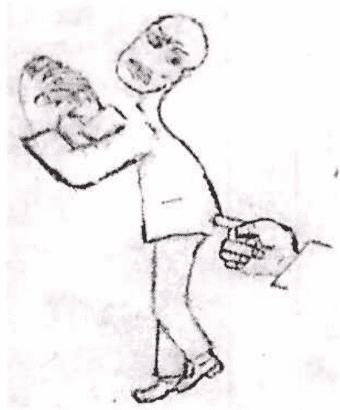

- (b). 始终确保我们的后路无虞：

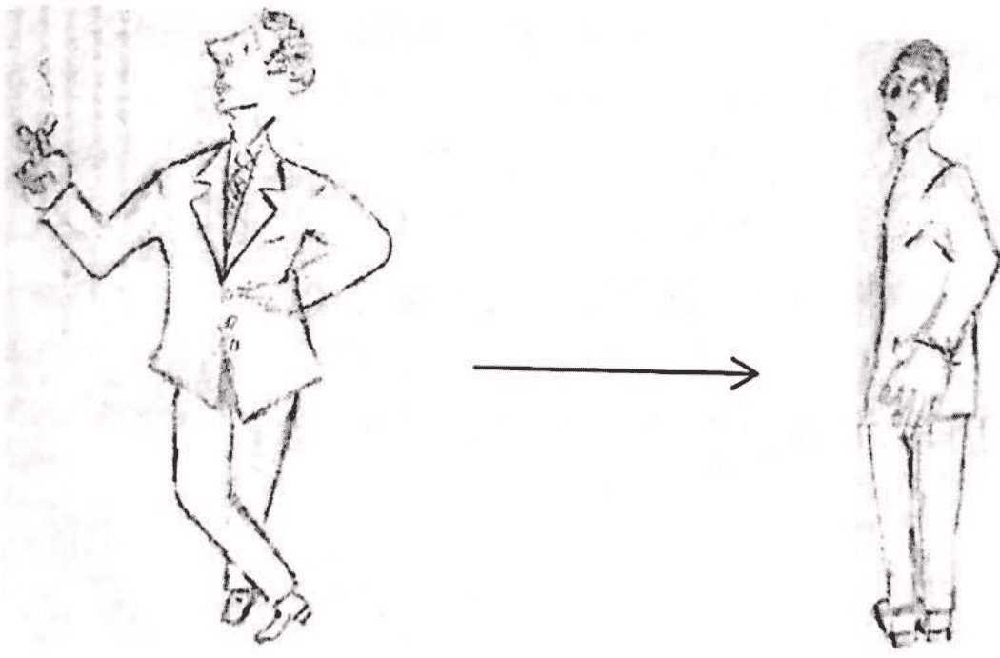

- (c). 快速而灵巧地将试图施加的责备扭转到对方身上……前提是你擅长此道。

在自由研讨会期间，总会有那么一刻，我们向学生提出这个问题：

> "你是否遇到过这样一个人，你发现他做了错事，并试图让他负责。然后，令你震惊和沮丧的是，你发现他在两句话之内就把事情扭转过来，现在反而指责你了？"

举手确认这种经历，夹杂着笑声和不适的记忆。

## 第十二语言整体：

### 我们生活在一个疯狂、疯狂、疯狂、疯狂的世界

我们现在来到A的最后一个逻辑整体。从措辞上说，称其为疯狂、疯狂、疯狂、疯狂的世界并非我们的创作。它最初是为1963年电影《疯狂世界》的标题而创造的，由斯坦利·克雷默执导。

这个第十二个整体只有在其前提实际上是一种普遍生活方式时才能贴近生活。这意味着，我们生活在一个世界里，生活的准则是摒弃自我负责权威的外衣来生活。西方政客正是这一现象的活生生的典范。他们在英国和北欧国家创建福利国家，就说明了这一真相。其动机是引入从摇篮到坟墓的国家照顾。公民不需要对任何事情承担责任。国家是全知的、全视的、全理解的、全给予的和全提供的。

随着时间的推移，他们发现国家负担不起。因此，现在有一种回归基本的倾向。

政治上的神棍将福利国家强加于他们的国家。这样做，他们从公民那里移除了按照自我负责、自我问责和自我权威的外衣生活的义务。他们自己，并没有按照这些自我负责、自我-


问责与自主权。于是，他们重新构建了系统，无论其在政治职务中犯下何种失职行为，都永远不会被送上法庭。最近的一个例子是安大略省的一份合同。当时的政府想要建造两座发电厂。合同金额为二十亿美元。合同规定，如果安大略省政府改变主意，它将支付给承包商商定的二十亿美元。安大略省政府随即改变了主意。承包商什么都没做就拿走了二十亿美元。你闻到腐败的味道了吗？对此合同的合法性没有任何调查。

我们的年轻人被这种哲学所感染。他们不尊重他人，且迅速指责他人。他们在生活中的行为模式是依赖他人。

恭敬地，我们想向您提出这一点。请思考这个问题，并思考，既然我们每个人：

- (a). 过我们的生活，无论身在何处、时时刻刻都在保护自己的“屁股”
- (b). 在指责的恐惧和暴政下，如受惊动物般度日

这难道不正是在疯狂的世界中生活吗？

人们在大型公司、政治机构、宗教机构、社交俱乐部、学校、学院和大学等处，都被指责所恐吓。我们成长过程中，在学校里，从未有过关于人生中承担责任重要性的课程。或许你现在会想，这种独特的人类存在论的真正条件是什么，因为没有证据表明狐猴、猴子、黑猩猩和猿等其他灵长类动物会为自己创造福利社会。

对于一个人来说：

- (a). 通过将责任推卸给他人来规避所有自我责任的把戏
- (b). 要求他人供养他们
- (c). 表演一出歌剧小品以获取长期残疾养老金

这是一场可怕的游戏。这是在利用他人、政府、慈善机构，以及任何手边可用的人。

由此出现了一个世界：

- (a). 每个人都只顾自己
- (b). 充满潜在不信任和潜在敌意的世界

正因如此，我们别无选择，只能向您指出，我们生活在一个：

## 疯狂，疯狂，疯狂，疯狂的世界。

我们世界的整个存在论源于亚里士多德因果关系体系（A，即 C→E）这一主导元范式。

# 第六章：非亚里士多德体系，即相对性与关联性 Ã

从前，没有人知道存在非亚里士多德相对性与关联性体系 Ã 这一事物。我们或许有误地说西方大学的哲学系并不了解这一体系。我们只是无意中发现它。在查阅理查德·班德勒和约翰·格林德著作《魔法的结构》¹ SOM 的参考书目时，我们注意到一本名为《科学与理智》² S&S 的书，其标题颇为不寻常。其作者的名字极不盎格鲁-撒克逊风格，名叫阿尔弗雷德·科日布斯基。这真正引起了我们对这部作品的浓厚兴趣和好奇。我们觉得必须弄到它。在阅读过程中，我们接触到了非亚里士多德体系 Ã。阅读 S&S 是我们生命中最美好、最幸运的馈赠³。

- ¹ 《魔法的结构》参考书目：我们的书没有参考书目，因为它本质上是 S&S 与《沟通中的力量与优雅》PAEIC 参考书目的合集。
- ² 《科学与理智》——我们于 1980 年购买了这部作品。到那时，它已经是第六次重印、第四版。它最初出版于 1933 年。这本书就是我们所说的“长青书”，因为我们知道未来会有几代学生想要并需要阅读它、了解它。我们希望我们的书也能属于这一类别。
- ³ 阅读 S&S 是我们生命中最美好、最幸运的馈赠：然而，当 S&S 首次被评论时，评论者将其描述为“无法阅读”。这说明了该评论者缺乏宽容，以及他未能与科日布斯基的写作风格同步。

催眠疗法，无法指望比在《科学与理智》S&S 和《沟通中的力量与优雅》PAEIC 中更稳固的基础了。

在发现 Ã 的过程中，AK **推测**其语言系统与 A 相反。最奇怪的地方在于，在这样做时，他既没有 A 的语言，也没有 Ã 的语言。作为 A 和 Ã 语言的发现者，我们今天可以说，2017 年，AK 的推测是天才之举，因为我们可以证实它们确实是相反的；而这部作品将向您展示这一点。

我们于 1991 年在作品《别问为什么？！》中出版了 A 或 Ã 的实际语言系统，这是一本关于指责结构、糟糕沟通和误解的书。该作品也由德国容弗尔曼出版社（Junferman Verlag）以其德文标题《Frag nicht warum》出版。

当时，我们自动且毫不置疑地接受了 AK 关于 A 和 Ã 之间语言差异的陈述。之所以这样做，是因为我们尊他为我们的 *导师*，并敬重他的思想力量和更广博的知识基础。4 这本书证明了他关于 A 和 Ã 之间实际巨大差异的洞察力是准确的。说它们是相反的，还算是轻描淡写。

A 和 Ã 的语言系统在**结构上**不同。**系统上**它们完全彼此不同。**语义上**它们是对立的。在功能上，它们是**对抗性的**。我们知道：

一个人可以使用 A 或 Ã 语言系统进行思考、感受、生活和存在，但不能同时使用两者。

证据是，我们在日常生活中都通过因果关系进行思考。因此，我们的重大发现是：

4 之所以这样做，是因为我们尊他为我们的导师，并敬重他的思想力量和更广博的知识基础：这一态度是我们生命中最幸运的事件，因为它让我们踏上了探索与发现之路。

逻辑上，如果一个人在思维上从 A 转向 Ã，那么这将构成：

## 终极格式塔转换。

AK 于 1933 年在 S&S 中写下以下内容，印证了上述说法：

> 总而言之，至少就白种人而言，人们不得不看到，从 A 体系转向 Ã 体系必将是重大的。

阿尔弗雷德·科日布斯基：《科学与理智，非亚里士多德体系与一般语义学导论》，国际非亚里士多德图书馆出版公司，1980 年第六次重印，第 52 页。

后来，我们找到了这样的印证：

> 从一种语言转到另一种语言，在心理上与从一种几何参考系转到另一种几何参考系是平行的。所指涉的周遭世界对两种语言来说是相同的；点的世界在两个参考系中也是相同的。但是，对表达的经验项目（如同对空间中的给定点）的形式处理方法如此不同，以至于产生的定向感在两种语言和两个参考系中都无法相同。必须进行完全不同或至少可测量不同的形式调整，这些差异具有其心理对应物。

大卫·G·曼德尔鲍姆编：《爱德华·萨皮尔关于语言、文化与个性的选集》，加州大学出版社，1949 年，第 153 页。

请考虑，如果我们所有人都在生活中从 A 转向 Ã，会产生哪些副产品。我们俩都在罗马天主教家庭中长大，珍妮弗由修女教导，丹尼斯是受过英国耶稣会训练的人，这一切都在梵蒂冈第二届大公会议之前。我们的幸运在于，我们能够转入 → Ã 的奇妙之中。并且我们已将学生带入这一新现实。就我个人而言，


就我们自身而言，我们以更加清晰和开放的眼光看待事物。其运作方式将在本著作中阐明。

在继续阅读本文之前，请花点时间浏览并反思下面的框架，即整体的 Ã：

## 非亚里士多德语言系统，Ã 自由框架

- 相对性与关联性
- 控制论与几何动力学
- Y = function of X
- 如何，谁，什么，何时，何地，哪个，谁的

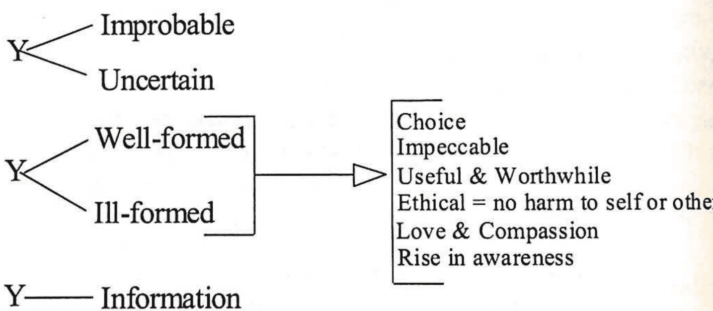

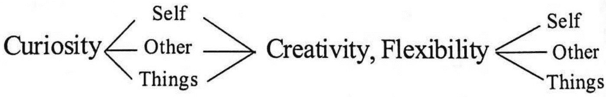

- 尊重与无畏
- 自尊与谦逊
- 接受所有自我责任
- 爱因斯坦的宇宙

我们将以与对待 A 相同的顺序，来审视和探索非亚里士多德的相对性与关联性系统 Ã：

## Ã 的第四逻辑全体及其语言全体：如何，谁，什么，何地，何时，哪个，谁的和谁（宾格）？

上述每个疑问词都有独特的语言功能。它们用于获取其类别相应的信息：

- 如何用于做事的方法
- 谁用于人及其地位、职业或称号
- 什么用于事物、装置、意图、目的、目标等
- 何时用于时间，过去、现在或将来
- 何地用于地点、位置、空间位置、地理
- 哪个关于选择或选项
- 谁的 是关于物品所有权身份的一般性询问
- 谁（宾格） 是关于人的具体身份。

让我们将这些问题与 WHY 进行比较。以一个正在自己建房子的人为例。以下是按逻辑顺序排列的可能 WHY 问题：

- WHY 他要建自己的房子？
- WHY 他要用这种材料来建自己的房子？
- WHY 他以为他能在那个日期前完成自己的房子？
- WHY 他要在那里建自己的房子？
- WHY 他要把那些名字放在他的产权证上？
- WHY 他的叔叔将是主要居民？
- WHY 这些其他人将住在他的新家里？

相比之下

以下是按逻辑顺序排列的可能替代问题：

- HOW 他如何建自己的房子？
- WHO 谁在建造这栋 70,000 平方英尺的房子？
- WHAT 他用什么材料来建自己的房子？
- WHERE 他将房子选址在他的地块上的哪里？
- WHEN 他计划何时完成自己的房子？
- WHICH 哪个人将是主要居民？
- WHOSE 他将把谁的名字放在他房子的产权证上？
- WHOM 谁将住在他的新家里？

恭敬地，我们向您表明，对所有 WHY 问题**本能的自然**回答是：

**管好你自己的事！**⁵
或者
**我不知道**

⁵ 管好你自己的事！底特律有一家非常著名的当铺。一位女士带着她的朋友来当一些珠宝。店主以非常和蔼的态度询问：*你为什么要当你的珠宝？* 这是这行生意的标准问题，因为有了这些信息，他有时会给这个人比物品价值更多的钱来帮助这个人。然而，这位女士爆发了：*你管我来当戒指的事吗。* 我只想要我的钱。Les 被这位女士完全无来由的愤怒震惊了。不用说，随后的交流演变成了一次完全令人恼火、沮丧且徒劳的时间浪费，Les 被迫让这位女士及其同伴被赶出店铺。Les 不知道的是，问题 WHY 可能是一个 IED，（即兴爆炸装置）。你永远不知道什么时候会触发它。

à 的疑问词能获取更多信息，且回答者不会感到受到威胁。

所有这些语言全体都是多序词，因为它们可以逻辑地应用于任何情境。我们将引用两个例子来说明这一点。

在中国新疆省首府乌鲁木齐，你可以走过手工艺店铺，那里制作各种各样的东西。你可以问他们中的任何一个：*你如何制作……？* 该省以其无籽葡萄闻名。你可以问：你如何种植它们？

作为游客，你可能会交上一位当地朋友，他邀请你参加婚礼。在婚礼上，你可以问：新娘的母亲是谁？

当你阅读上面的 WHY 问题列表时，你可以看到，在使用 WHY 的地方，它似乎有一个合理的位置。仿佛，它可以取代 Ã 的疑问词。如果是这样，那么它就能取代 Ã 问题的各自专门语言功能。任何人都可以检查自己在被问及 A 问题与 Ã 问题时的反应。两者有区别。这种区别的基础将在你继续阅读时变得清晰。

关键问题是：

WHY 是否拥有一种全能的力量，能够神奇地改变自身，并取代语言学中 Ã 问题的自然功能，这是真的吗？

答案是否定的！

- (a). WHY 实际上并没有任何全能的力量来改变自身以承担任何 Ã 疑问词的语言功能。
- (b). WHY 的自然语言功能是获取与英语中任何句子动词所暗示的任何行为相关的理由的信息。
- (c). 在追求理由的过程中，它可以向英语中任何句子的任何动词索要理由。这就是为什么，表面上看，它似乎对任何句子都有一个普遍的合理和逻辑位置。说任何事，做任何事，我都可以问你 WHY？例如：你为什么要那样做？为什么不？你为什么擦你的盘子？等等。
- (d). 因此，尽管 WHY 作为一个问题可能看起来具有普遍适用性，但关键问题是：任何人类是否拥有神圣授权或法律许可，可以*随心所欲*、随时随地向任何其他人类索要理由？我们当然知道我们没有。就此而言，令人惊异的是，人们竟然不加思考地继续使用它！我们对它有一种自动的顺从。
- (e). 虽然我们都习惯了对他人使用它以及它被应用于我们自己，带着微笑，在潜意识层面，人们知道自己被要求提供理由，并且他们不喜欢这样。没有人真的喜欢这样。

如果你思考我们上面所指出的，你会意识到，四处趾高气扬、到处跑来跑去，向每个人发射 WHY，是一件相当粗鲁和失礼的事情。我们在法律和文化上都没有基础要求任何人向我们证明他的行为是合理的。当然，我们确信你的上帝没有给你这样做的许可。然而，在 C→E 的世界里，每个人都在这样做，尤其是年幼的孩子。

WHY 似乎是使用*最自然的疑问词*，但实际上，它是所有疑问词中最不自然的。只有两个地方是它的自然所在地。在地上，一个是在法庭上。另一个是在天堂，在最后一天，上帝需要知道 WHY 你滥用了他赐予你的生命礼物。

现在，我们给你投票的机会。我们真正想要什么？生活是要由什么决定？

- WHY？[ ]
- 或
- HOW, WHO, WHAT, WHERE, WHEN, WHICH, WHOSE, WHOM？[ ]

## Ã 的第三逻辑全体及其语言全体：
### Y is a function of X.

表达式 Y is a function of X 是什么意思？这意味着 Y 和 X 是两个变量，它们的值彼此同步变化。每个男学生都知道这个关系，C = 2 π r。圆周长 C 的值随半径值的变化以 2 π 为常数/因子而变化。半径的值并不制造或导致圆周长的值，反之亦然。简单来说，随着 r 的增加，C 的值也会增加。

亨伯托·马图拉纳（Humberto Maturana，HM）和弗朗西斯科·瓦雷拉（Francisco Varela，FV）6 的圣地亚哥理论描述了夫妻处于一种社会结构化的关系中。NSP 将夫妻关系称为共轭关系7。随着丈夫变得更加激动和愤怒，妻子的反应是感觉越来越糟。当丈夫变得越来越多情时，妻子的反应是感觉越来越高兴。当然，如果丈夫突然爆发，妻子的反应是突然的惊慌和无助。在结构化或共轭关系中，一方不能制造或导致另一方产生某种感觉。他们感觉如何以及如何感觉，是他们应对所处情境所选择的方式。

没有人能决定另一个人如何应对语义情境。然而，有两个例外。第一个是如果

6 亨伯托·马图拉纳（Humberto Maturana，HM）和弗朗西斯科·瓦雷拉（Francisco Varela，FV）：这两人是智利大学圣地亚哥分校著名的神经科学家。
7 共轭关系：在拉丁语研究中，拉丁动词的变格被称为变位。由于所有人际关系都是关于人与人之间的动词，我们将人际关系命名为共轭关系，因此，在本著作中，我们将使用这些一致的术语：共轭的、共轭中、共轭关系等等。


你对他人拥有绝对权力 8；第二种情况是，如果你拥有一件如此重要且意义重大的物品，以至于可以勒索某人按你的意愿行事。

生活中关系中的所有项目都因元素之间的动词而相连。因此，所有关系都是通过其动词而形成的共轭关系。我们同意 HM 和 FV 的观点，即，如果且当关系被良好地共轭时，它将是一个良好形成的关系。正式地，一个共轭关系可以这样表达：

```
y = f(x).
```

上述方程用英文句子表达为：

Y 是 X 的函数。

然而，在形式逻辑中，共轭关系也被称为：

*肯定前件*。

什么是肯定前件？它是这样一种关系：“如果 A 为真，则 B 为真。这些可能的句子变体示例有：

- 如果 x，则 y。
- 当 x，则 y。
- 如 x，则 y。
- 无论 x，则 y。
- 如果你探望你的母亲，那么她会非常高兴。
- 当你努力学习，那么你可能会获得高分。
- 当你长大后，那么你会更有智慧。
- 无论你做什么，那么她可能会心软。

8 绝对权力：这意味着你可以决定对方的生死。在美国，每个人在拥有枪支时都拥有绝对权力。我们确信你能看到人们利用这种权力是多么巨大的诱惑。当然，语义上畸形的人会这样做。正因如此，NSP 必须得出结论，在美国没有认识或承认耶稣的明智告诫：……不要叫我们遇见试探，救我们脱离凶恶。美国现有的枪支法律与耶稣的建议完全相反。

- 因为 x，所以 y。
- 然而 x，所以 y。
- 因为你对赌博的上瘾，所以你输光了钱。
- 无论你给多少，他们可能会满意。

上述示例正是我们自然思考方式的证据——以数学方式。如果我们参考圆周长及其半径的方程，这涉及肯定前件：

C = 2 π r.

如果半径有任何实数值，则周长将按 2 π 的因子具有其值。那么，孩子们为何在数学上会有如此多的问题？答案是，如果他们以 C→E 的方式思考，他们就会遇到问题。他们在 A 的语言中被养育和培养，无法看到 r 的值如何产生 c 的值。孩子看不到，因为 r 并不产生 c。那里根本没有什么可看的。孩子将以这种错误的方式继续处理所有其他数学方程，结果将是灾难性的。他注定在数学上取得非常糟糕的成绩。

在口语中，通常是省略肯定前件中的“then”。因此，与其说：

如果你举办一场你惯常的精彩派对，那么，你所有的朋友都会快乐。

不如说：

如果你举办一场你惯常的精彩派对，你所有的朋友都会快乐。

非常清楚的是，只有通过数学的语言，我们才能理解以下现实：

- (a). 我们的宇宙，目前温度约为绝对零度以上 +3 度⁹
- (b). 我们的正常世界，生存温度范围在 +47°C 到 -75°C 之间
- (c). 亚原子粒子的量子现实。

由此延伸，高能物理的所有探索都是在寻找有效构成宇宙语法的物理定律；因此，这是关于寻找和探索以发现这个宇宙本质的过程。出于同样的理由，对于 NSP 来说，这是寻找和探索适用于我们认识论和本体论的物理定律。对于 NSP，这是关于支配我们存在本质的数学。从其简单性中，将展开我们正常性的基础及其对人类行为的预测能力。正因如此，这项工作为科学打开了一扇不可思议的新大门。

A 如此深植于我们之中，以至于每当一位科学家发现值得注意的事物时，他就会以 C→E 的语言将其与公众分享！当他撰写关于其发现的论文或就此发表演讲或讲座时，整个语言结构都在 C→E 的语言中。

然而，所有科学调查、发现和理解只有通过数学/肯定前件的语言，即 y = f(x)，才成为可能。发现的语言被重构为 C→E，用于出版¹⁰、教学、话语和交谈。之所以会出现这种情况，其基础是什么？这是因为

⁹ 温度约为绝对零度以上 +3 度：这是一个既定事实，即当宇宙的温度降至绝对零度时，宇宙将走向毁灭。
¹⁰ 发现的语言被重构为 C→E，用于出版：编辑和编辑委员会扎根于 C→E 的语言。他们是 A 正统的产物。这意味着他们有权确保接受的科学教条和规范得以延续，代价是牺牲我们对语义语境中发生的细微变化的创造性和创新性理解。因此，你一时对某事感到恼怒。然后前门的门铃响了。开门时，你发现你最好的朋友，你已经10年没见了，正在来看你。那么，现在哪个更准确：

> 你因他的来访而感到喜悦，还是他的来访让你感到喜悦？

从恼怒转变为喜悦并非通过 C→E。关于我们内部变化，不存在 C→E 现象。

令人悲伤但又有趣的事实是，医学没有一种电机械装置可以测量人类情绪的变化值。为此，存在严重的弊端。让我们考虑这个例子。一个抑郁症患者正陷入自杀的可能性。精神科医生没有客观的衡量标准来判断患者的最终结局可能是什么。没有什么比精神科医生在星期五看到一位患有抑郁症的患者更糟糕的了。然后他去他的


周末休息；他周一回来时，却发现他的病人在周六自杀了。

这样的问题有解决的可能性吗？耐心点！答案在下面。但目前，我们请你投票。我们究竟是什么？

- 数学存在 [ ]
- 因果存在？[ ]

## 第二语言全体（Holon）的 Ã，其中其语言全体为：

### 控制论与几何流体力学

控制论（CYBERNETICS）是20世纪发现的更令人兴奋的新研究领域之一。11 麻省理工学院的诺伯特·维纳（Norbert Wiener）创立了它。它本质上是研究系统内部及系统之间的信息流；以及信息输入如何影响系统，系统又如何做出反应。你是一个系统，我也是一个系统。在生活中，我们会做出反应。

有一天，我接收到了这样的信息：“你父亲昨晚9点去世了。”我的反应与任何其他人/系统一样。所有人/系统都按照其语法规则的层级运作。然而，反应由系统的初始条件强力决定。请考虑关于初始条件和我父亲去世消息的这些例子：

- (a). 我刚发现自己在Lotto Max上赢了5000万美元，然后就被告知我父亲去世了！
- (b). 我刚发现我妻子离开了我，现在我被告知我父亲去世了。
- (c). 我正在和孩子们玩耍，这时我得知我父亲去世了的消息。
- (d). 我正与朋友争论得正起劲，这时被告知我父亲去世了的消息打断了我。
- (e). 我和妻子正聊着一则劲爆的八卦，笑得前仰后合，这时电话响了，传来我父亲去世了的消息。

初始条件是所有后续反应/事件的先验状态。它也是逻辑基础。因此，当别人指责我们：“你让我如此不快乐！”或者“你给我带来如此痛苦和悲惨！”时，我们不能认真对待。然而，我们对他人使用这类语言，却不加思考自己在做什么以及此类行为的后果。

### 几何流体力学是研究空间几何的变化动力学/变形，12 以及时间节拍器的变化动力学/转换。13 因此，该术语涵盖了这个宇宙及其中一切发生的所有变化。这将我们带入宇宙学领域。其核心在于引力（GRAVITY）和光速 c。

自哈勃望远镜发射以来，对几何流体力学或宇宙学的研究揭示了我们宇宙中难以置信的奇迹。它继续揭示新现象，要求我们审视对这个宇宙的现有理解。因此，已发现黑洞周围有防火墙。这些防火墙的数学尚未被发现。

目前，没有一套关于这个宇宙的全面数学理解是一成不变的。14 这有时会让研究者感到有些不安，因为这可能意味着关于某些珍视的宇宙学子理论的彻底转变。对每位天体物理学家来说，每一次彻底转变都像是一场智力地震或海啸。没有人喜欢这样的事件。

我们现在知道，我们是从这个宇宙中展开出来的元素。似乎先验地，我们无法逃避造就我们的物理定律。15 “你的意思是要告诉我上帝没有参与吗？”事实上，我们能说“没有上帝”吗？这个问题的答案是——是的，也不是。

宇宙是一个系统，因此按照其语法运作，即物理定律。作为从这个宇宙中展开出来的元素，我们不可避免地是物理定律的产物。这些定律将对我们的认识论和本体论产生重大影响。NSP现在正处于发现这些定律的边缘。NSP的这一推测在下面的引文中得到了支持：

> 基于康奈尔大学团队项目“法律系统共同核心”成员所做的比较研究，美国法律哲学家彼得·H·桑德（Peter H. Sand）和阿尔伯特·埃伦茨魏格（Albert Ehrenzweig）都持有这样一个显著观点：正常人对什么是合法和正确的感觉，植根于一种与生俱来的、可遗传的程序。
>
> 康拉德·洛伦茨：《人道的消亡》，Little Brown and Company，1983年，第104页

简单来说，某种东西或某人将一条物理定律植入我们体内，使我们守法、有道德和有伦理。

如果这是真的，那么是谁或什么将这个可遗传程序植入我们体内？是谁将逻辑植入物理定律？你的答案是，是：

- 上帝：[ ]
- 无上帝：[ ]

NSP推测，我们目前正处于从不知到知的过渡期。这可比作我们以前不知道这条物理定律的时代：

E = mc²

但突然间，我们就知道了它；为此我们感谢阿尔伯特·爱因斯坦。我们所说的新过渡是一条令人难以置信的发现之路的开始。即物理定律适用于我们——适用于我们的存在，适用于我们如何知晓-知晓-存在，以及我们生活中的感受和行为。今天，我们还不具备对人性进行任何预测的理解。然而，NSP确信我们正处于能够做到这一点的门槛上。这些物理定律是各向同性且普遍的。

我们向你提出，这些是适用于人类的一些物理定律：

- (a). 任何渴望傲慢或自负的人在语义上都是畸形的。
- (b). 在自负状态下，一个人及其所有同伴都将经历命运的逆转（peripeteia）¹⁶。
- (c). 如果他的自负完全冒犯了他的神祇，那么他们将派遣他的报应（nemesis）来毁灭他。

请考虑以下五个其他例子及其隐含的物理定律：

- (a). 语义上畸形的人会屈服于权力的腐蚀。
- (b). 给一个人一把枪，就等于给了他对他人生命的绝对权力，如果他语义上畸形，他会尽可能多地使用它。
- (c). 将一个畸形的人引入诱惑，他就会屈服。
- (d). 腐败者将会倒台。

11 控制论（CYBERNETICS）是20世纪发现的更令人兴奋的新研究领域之一：从前，西方大学的研究仅限于英语、希腊语、拉丁语、宗教、法律、历史、数学、天文学、医学和地理。随着时间的推移，数量略有扩大，包括建筑学、考古学；尤其是埃及学以及底格里斯河和幼发拉底河流域的文明。然而，自二战结束以来，西方大学可供学习的学科数量已大幅扩大。它们包括一般语义学、神经语言程序学、运动学、古生物学、地质学、英语转换语法、天体物理学、核物理学、控制论、几何流体力学、工商管理等，还有更多。

12 空间几何的变化动力学/变形：空间的形状可以变为无限可能性中的任何一种。它可以扩张、收缩、压缩、弯曲等等。变化的速度可以是无限可能性中的任何一种。理论上，空间可以坍缩为虚无。

13 时间节拍器的变化动力学/转换：我们对时间的感知可以是难以言表的无聊缓慢，也可以是快到事件在开始前就已经结束。它可以是断断续续的或断奏的。我们可以将时间分割为过去、现在和未来。它也可以被感知为连续波。

14 没有一成不变的全面数学理解：1964年，我学习过一种肾生理学形式，但当我1973年在加拿大重考医学期末考试时，一切都已改变。

15 我们无法逃避造就我们的物理定律：我们尚未探索并确定适用于宇宙中事物（如星座、类星体、脉冲星、红巨星、白矮星，乃至亚原子粒子等）的所有物理定律。我们列出的这些显然是无生命的。我们尚未探索适用于动物生命形式的所有物理定律。我们在这部作品中引用了一些。如果我们在此提出的内容符合事实，那么它与这句话一致：世上没有偶然之事。

¹⁶ 命运的逆转（peripeteia）是指降临到自负之人及其追随者身上的厄运滋味。


- (e). 所有非洲“民主”暴君都将被反革命推翻。

上文引用的第一定律的例子是希特勒先生。第二定律的例子是杰森·范戴克，他是一个非常畸形的人。拥有生杀大权后，他完全屈服于其腐蚀，在芝加哥向一名非裔美国青年连发了16颗子弹，而非一颗。

上述仅是物理定律在人类认识论和本体论语义领域应用中的几个例子。没有逃避，没有例外，也没有豁免。从NSP的角度来看，上述都是人类类比的物理定律。如果我们所说的符合事实，那么被锚定为“天生可遗传程序”的东西只能源于物理定律。17 但此处引述的是，通过抚养孩子的方法，它可以被弯曲、扭曲、扭转甚至消融。高等物理学的无可置疑的事实是，这个宇宙被创造了。它被创造是因为在此之前存在绝对虚无。仅此事实就引出了创造行为的逻辑。这种逻辑是什么，将在自由研讨会第二天早上阐明。

17 如果我们所说的符合事实，那么被锚定为“天生可遗传程序”的东西只能源于物理定律：美国步枪协会的严重错误在于向美国民众发放枪支。这样一来，持有武器的人现在对任何其他同胞拥有生杀大权。这种绝对权力会腐蚀人，一旦腐蚀，就会彻底腐蚀。美国民众并非普遍由守法、有道德和有操守的男人、女人和青少年组成，也并非都是神圣、圣洁和虔诚的人。物理定律将占据上风，美国国家将注定因枪支对其公民进行反复的大规模屠杀。他们当然不必通过引入伊斯兰圣战者来使这场混乱雪上加霜。在这一点上，唐纳德·特朗普是站得住脚的。

## 什么是绝对虚无？

宇宙创造“之前”的虚无是我们所能想象的最彻底的空无——不存在空间、时间或物质。这是一个没有场所、没有持续或永恒、没有数字的世界——这就是数学家所谓的“空集”。然而，这个不可思议的空无将自身转化为存在的充盈——这是物理定律的必然结果。这些定律写在何处？是什么“告诉”空无，它孕育着一个可能的宇宙？似乎连空无也受制于法则，一种存在于空间和时间之前的逻辑。

> 海因茨·R·帕格尔斯：《完美的对称：时间起源之探》，西蒙与舒斯特，1985年，第347页。

这个绝对虚无在被宇宙取代之前存在了多久？没人知道！这个绝对虚无之前是什么？没人知道！

请允许我们推测，这个宇宙是由此绝对虚无中渗出的一个粒子所创造的。18 渗出是什么时候开始的？没人知道！这个粒子渗出成其确定形式花了多久？没人知道！它有多大？高等物理学基于一些深奥的数学认为，它比量子物理学中已知的最小粒子还要小！这个粒子蕴含了整个宇宙的全部质量和能量，然而高等物理学被迫假设它不占据任何空间！它以一种难以置信的凝聚态形式存在。这个粒子以这种方式保持了多久？没人知道！简单来说，我们整个宇宙中的一切，包括你和我的概念形式，都在其中。我们可以推测，你和我成为存在时，有一个预定的时间和地点。

18 这个宇宙是由此绝对虚无中渗出的一个粒子所创造的：“从其中渗出”这句话暗示从某物中出来。然而，这不可能，因为没有绝对虚无可供其出来或从中出来。在绝对虚无中甚至没有空空间，因为后一术语暗示一个充盈。充盈是某种东西。所以，绝对虚无中不存在这样的东西。那么，我们如何可以说粒子从绝对虚无中渗出？因此，我们为使用这种语言道歉。我们别无选择。我们希望能找到一个准确的替代说法。就目前而言，我们接受我们和所有科学家都在胡说八道的指责！

就我们所知，这个粒子及其虚无中没有大脑或心智。它是无感觉的、无生命的，且完全非目的论的，即没有目的。那么，这个无感觉、无生命且完全非目的论的能量/质量实体，究竟如何能奇迹般地、从头开始，决定并确定：

- (a). 具体需要创造哪些物理定律，才能适合它并完成其任务，即成为这个宇宙
- (b). 何时将这些定律植入其自身
- (c). 如何将这些定律植入其自身
- (d). 这个粒子展开成其内在蕴含的宇宙的时刻是什么时候
- (e). 不继续其存在，而是在140多亿年的跨度中不断展开成今天的这个宇宙
- (f). 如此继续下去直到……？是的，这将终极问题摆在我们面前：这个宇宙将如何终结？

我们现在发现，除了提出在某个时刻（没人确切知道是什么时候），有人或某物做出了创造所有物理定律的决定之外，别无逻辑选择。做完之后，这个无论是什么，必须对其应用**该逻辑**，以支配所有定律的运作。

说这话就是说，作为一个系统，宇宙必须拥有一个元语法，以决定其所有物理定律的功能。正是在物理定律的逻辑中，语法支配着整个宇宙的发展与演变。简单来说，正是这个逻辑决定了这个宇宙的折纸结构。通过这一点，我们无意间肯定了阿尔伯特·爱因斯坦那句名言的真理，即“上帝不掷骰子”。我们在这里所说的，是对爱因斯坦宣言的确认和加强。

正是由于我们在此处所写的内容以及海因茨·R·帕格尔斯的引文，我们不得不提及斯蒂芬·霍金在这些问题上的立场。他的观点是，**物理定律阐释并支配一切**，任何元层面的考量都不必要；然而，显而易见的是，这些相同的物理定律无法阐释自身。是谁将逻辑置于物理定律之中？他的立场是一个自我递归的矛盾。19

19 他的立场是一个自我递归的矛盾：我们这么说，并非对斯蒂芬·霍金有任何不敬。他的崇高地位远超我们，因为我们毫无地位；而悖论的是，我们不得不断言我们所说的话，这让我们感到痛苦。我们唯一的辩解是，我们陈述它是因为在我们看来这是真理；为此，我们既不能掩埋它，也不能贬低它。

现在一切就绪，我们祈求无神论者原谅我们，如果我们说，有人或某物必须做出决定，批准大爆炸发生的“何时”。从逻辑上讲，这必然如此，因为这种无感觉、无生命且完全非目的论的能量/质量不可能自发做出如此关键的决定。若要这样做，就违背了智能。回想它是从绝对虚无中渗出的，要得出结论认为在其渗出过程中蕴含智能，将难以令人置信。因此，我们认为它绝对没有任何层级的智能，当然不具备阿尔伯特·爱因斯坦或斯蒂芬·霍金，甚至我们本人所拥有的高级智能。

现在是大爆炸事件。从绝对虚无中，我们得到了宇宙的充盈。问题是，在其存在的第一秒的第一个纳秒里，它是什么？这当今是高等物理学的一大引人注目的兴趣。高等物理学提出，在其存在的最初几秒的最初纳秒里，宇宙是能量和亚原子粒子的凝聚体。现在，高等物理学真正渴望知道的是，支配这个凝聚体的数学是什么。拥有这个，就拥有了关于极其不可思议和无法言喻的必然之事的知识。在这方面，NSP想知道，高等物理学是否最终会被允许去发现并认识神圣。

大爆炸是什么时候发生的？高等物理学有答案。它的计算表明，我们的宇宙大约在140多亿年前诞生。它以能量和亚原子粒子的爆炸形式开始了存在。在此基础上，物理定律决定了它如何演化。在我们所在的宇宙区域，根据物理定律，演化轨迹包括恐龙统治地球的时代。正是根据这些相同的定律，它们终将不复存在。我们存在的代价是它们的灭绝。我们无法想象为了存在而欠下的债务。由此，我们被迫得出结论：每个人类个体的降生，显然是生命可能剧目中最不可思议、最奇妙的篇章之一。20

20 由此，我们被迫得出结论：每个人类个体的降生，显然是生命可能剧目中最不可思议、最奇妙的篇章之一：今天，已经积累了足够的证据来得出结论，大约一万二千年前，存在一个非常高级的人类文明，他们


NSP 的终极元元搜索是要找出：

- (a). 适用于我们的物理定律是什么？
- (b). 它们如何决定我们的认识论和本体论？
- (c). 作为个体和物种，在事物的自然秩序中，我们的终极目的是什么？
- (d). 我们所处的事物的自然秩序是什么？

那么，现在我们可以投票了。是选择遵循因果哲学的语法 ☐
还是物理定律哲学的语法 ☐？

## Ã 的第一个逻辑整体及其语言整体：相对性与关联性。

我们生活在未知的现实中。在我们生活的任何情境中，都没有确定性、把握或保障²¹。断言这一点就是否定 A，因为在 A 中存在 C→E 之间的关系确定性。正因如此，量子物理学根本无法支持因果关系。

统治了这颗星球。某些灾难性事件消灭了它们中的绝大部分。土耳其哥贝克力石阵的发掘证实了这一点。现代考古学确信它最初存在于一万二千年前；并且它拥有一个有盈余支持的农业基础。埃及文明的突然出现表明，它是那些人类幸存者的遗产，因为没有证据表明古埃及人是狩猎采集者的后代。文明突然就在那里了！

²¹ 没有确定性、把握或保障：你的保险公司通过将你引向细则来证明这一点，以支撑不支付你原本确信在保单中得到保障的款项。

然而，大象走进了客厅。你在房间里，手中的牛奶杯滑落了。令大象和你都惊讶的是，牛奶杯浮到了空中。不！这不可能。但事实如此，你亲眼所见。这在地球上的什么地方会发生？不是在地球上，而是在太空中25英里高的空间站，那里有零重力，g_zero。所以，我们又回到了数学：

```
fall of the glass = f (g_earth)
floating of the glass in space = f (g_zero.)
```

接受这一点就是知道我们生活在相对性的实际性中。没有既定事实。在相对性中，我们如何理解生活中任何时刻的认知，实际上是我们对眼前真实情况的最佳猜测。做到这一点，取决于我们如何看、听、触、嗅、尝。从经典角度看，我们的感知取决于我们实际位置相对于他人的坐标；以及，在那一刻，我们所见、所闻、所感的形态、敏锐度和清晰度如何决定我们的感知。

无论我们所见、所闻、所感的形态、敏锐度和清晰度如何，接下来我们需要对其进行语义推导；而做到这一点的唯一方法，是应用我们正统的解释、观点、结论、判断和评价。我们的 HOPs 引擎会自动为我们完成此事。此外，压倒一切的，是我们正统对当前情境的偏见和成见。为了使问题复杂化，我们如何能忘记默认假设？声称自己客观，是一种自我欺骗和自欺欺人的愚蠢把戏。

加拿大一位法官最近被要求参加一个人类敏感性培训项目。在一名被强奸女性的审判中，他当着全体法庭的面表示惊讶，称她在被强奸时竟然没想到要夹紧双腿！这是他正统的产物。这反过来表明，在因果世界中，一个人可以多么精彩地错误，错误，错误！

在我们的正统中，存在着元功能的官能。我们从中生成所有关于观点、解释、结论、判断和评价的 ABOUTS。我们想指出，我们并不是在生成这些思维产物。是我们的正统在为我们做这些事。有趣的是，我们的正统似乎能够哄骗我们，让我们相信是我们在产生这些东西。它奉承我们，说“我们产生的”东西总是正确的。当我们对别人产生一个观点，而它是错误的，并且会产生严重灾难性后果时，我们愚蠢地承担其责任、过错和罪恶感。

当某人的正统所产生的任何思维产物被证明是“错误”时，NSP 建议你责备你的正统。这并非愚蠢之举，因为你的正统是一个自产自养的有感知实体。它是有意识的。作为它的主人，它会默默接受其应得的责备，并希望改用非亚里士多德体系。它是否会屈服于你的意志是另一回事。如何使其屈服于你的意志不属于本书讨论范围，因为这将涉及如何设计算法来实现此事的领域。你将在我们即将出版的书籍《NSP 和人类 Sphexishness》中找到相关讨论。

解释和观点是心智的发明；它们是独特的，是我们正统的产物。奇怪的是，所有解释和观点都是个人且独特的。然而，它们都有一个共同属性。每一个都是正确的！当它们被证明是错误时，其生成源头从不为此受到责备。是你！

在相对性的现实中，如果你正面看一把日本寿司刀，由于刀刃极薄，你可能会以为自己看到一条直闪闪发光的线或一串银线。侧面看，它可能是一面长镜子碎片的反射表面。正面看一块白色粉笔，可能是一个白色纽扣。从侧面看，它可能是一条白色油漆条。正是：

- (a). 我们在空间中相对于某物的位置/地点，决定了我们的感知
- (b). 我们如何得出对某物是什么的解释。

归根结底，我们的现实源于我们的元功能 mf，作为它所给予我们的解释的一个函数。如果你确定那是一条朝你飞来的线，那无需担心。然而，如果你的解释是那是一把寿司刀，那就快跑！我们的生活经验证明，解释可能会出错；现在我们突然意识到，我们对现实的掌控是多么脆弱。

由此，我们可以推导出：

- (a) 我们的神经语义学 NS 和我们的本体论 ON^T 是我们感知 P^N 的函数
- (b) 我们的神经语义学 NS 和我们的本体论 ON^T 是我们理解 C^N 的函数
- (c) 我们的理解是我们的 mf 的衍生物

从以上内容，我们可以推导出以下数学方程：

```
P^N = f (NS + ON^T)
C^N = f (NS + ON^T)
C^N = f (mf)
```

因此：

```
P^N X C^N = (NS + ON^T) ^2 X mf
```

由此可得：

```
C^N = [(NS + ON^T) ^2 X mf] / P^N
```

也就是说，我们的理解是我们的神经语义学、本体论和 mf 的乘积，除以我们在空间中的感知。

生活在相对性和人类关联性的现实中，要求我们在任何情境下都要时刻保持警觉和有意识的觉知。我们被要求尽可能准确地感知，并且我们的元功能（即思维）的质量要尽可能机智和敏捷。如果做不到，付出的代价有时可能是苛刻的。

一个例子是，一个男人娶了一位老安大略世家的女性。对于内行人来说，“老安大略世家”这句话意味着这位女性通过继承拥有难以置信的财富。他再也不需要工作了。现在她75岁，来找我。从这个故事中，我产生了一个伦理问题，并对她说：我相信我为你所做的工作可能对你的配偶产生非常严重的后果。我想知道你是否愿意让他知道，我希望他能和你一起来咨询。她同意了。预约定在下周。让我担心的是，她再也没有回来……直到8周后。当她回来时，她说：我想为没有早点回来向你道歉。我花了这8周时间，尽力让我丈夫来。在我最后的努力中，他反驳说：我没有问题。是你有问题。你去找他。我不来。说完这些，我立即打电话预约来见你。然后我对她说：作为你法律上的当事人，我会履行对你的责任，并尽力为你做到最好。接下来的周末是一个为期3天的工作坊，我们称之为自由研讨会。我希望你来参加。你能来吗？她回答说：可以。

她完成了研讨会。她原定在下周三进行研讨后的回顾。她再也没有回来。我震惊了。我以为我失去了她。

8周后，她被带进我的咨询室。她立即为自己回来晚了道歉。然后她对我说：

> 我想感谢你通过你的研讨会为我所做的一切。我想告诉你，我


我刚从法律顾问那里回来。我已指示他们对我丈夫提起离婚诉讼。

我沉默了片刻，消化她与我分享的内容的分量。她是一位非常优雅、美丽、仪表端庄、衣着得体的女人。我看不出她的丈夫是如何沦落到对她傲慢漠视、失礼冷淡的。如今，75岁的她，通过自由研讨会找到了清晰和力量，对丈夫说：我不会再把我的生命多给你一秒钟。

我脑海中浮现出她过去8周是如何度过的，做出最后一次挽救婚姻的努力。然后她知道，最终只有一个答案。于是她行动了。拥有老派安大略财富，你可以嫁入其中。但在离婚时，法律上没有任何方式能让你声称拥有一分钱。他是个如此不自觉的人。现在他突然醒悟了。

在我们的生命中，没有什么比发现那个时刻更美妙的了：啊哈，这就是它。这就是我人生的目的！然而，根据我们的经验，仿佛在我们意识之外，某只神秘之手触碰了我们；然后面前出现了一个新的：啊哈：这是一条更好的人生道路。我们会无缝地改变方向。这种情况发生在我们身上超过五次。最终，在我们这个年纪，它把我们带到了写这本书！

然而，我们不能确定自己是否找到了决定性的人生目标。随着这部作品的完成和出版，我们感觉，退休的时间还未到来。80多岁的丹尼斯并不这么觉得。那只神秘之手或许还为我们指引着新的方向。如果发生，那将像是一段延伸旅程的延续，并且会是一个新方向，一种新生活。我们很想知道有多少位读者见证过同样的经历，因为我们无法相信只有我们经历了迄今为止对我们而言是一种特权、充满挑战和令人兴奋的经历……迄今为止。

根据我们上面所述，基于我们的经验，我们得出了这个结论。除非你走在某条人生道路上，否则什么都不会发生。当你走在上面时，神秘之手将触碰你的生命，你将无缝地延伸到新的方向。我们相信，这是一个不言自明的道理：每个人在生命中的某个时刻开始。一个人结束的地方，从来不是开始的地方，但你必须走在路上，你的生命才能开始展开和演变 22。

那么，让我们对此投票：

我的未来正如我所理解和领悟的那样！[ ]

或者

我确定，这，最终，确实将是我的生命？[ ]

我们已完成前四个逻辑层级。现在我们将继续第五个逻辑层级。

## Ã 的第五个逻辑全体及其语言全体：

### 不可能与不确定。

对我们而言，这是在不可能与不确定的现实中犯错并摸索前行的喘息空间。因此，没有保证、担保或确定性；如果这符合实际，就不可能有期望和权利 23。这两个全体阐述了生命的实际：在我们这个层面，整个现实都是不可能和不确定的。如果是这样，就没有逻辑支持：

- (a). 这 应该 是
- (b). 那 应该 是
- (c). 这 不 应该 是
- (d). 那 不 应该 是

谁拥有神圣的授权或世俗法律的制定权，能够将他的“应该”强加于他人？我们都知道这种权力掌握在法官职位上，而不是在你我这样的普通人手中。那么，我们何时才能停止使用这个词，“应该”？

幸运的是，我们并非生活在绝对混乱的现实中，一方面受物理定律引导，另一方面受我们的范式全体、HOPs 和我们的 AnY9 引导。正因如此，我们生活在一个现实中，一方面它对我们的人格提出挑战，涉及我们的品格、守法性、道德和伦理；另一方面它不断督促我们机智的敏捷和头脑的灵活。替代方案是一种由担保、保证和确定性构成的生活。如果真是这样，我们向你保证，那将是一种无聊的生活。

没有人能保证自己在聚会上会是什么样子，也无法确定在这样的场合可能会做什么或说什么。没有任何保证、誓言或声明能确保你会以特定方式行事，无论情境如何。接受这样的生活事实可能会动摇你主观现实的根基。然而，在某种程度上，你一直知道这里所述的真相。谁能担保路上不会遇到事故？谁有把握今晚入睡后明天早上还能醒来？谁能确定回到家时家里没有被盗？

理论上，在任何精神病或心理治疗会面中都没有保证、担保或确定性。然而，就前者而言，我们反复听到这样的抱怨：我刚开始讲述我的问题，他就已经在开处方了。如果这是真的，那么对我们来说，这个指控令人困惑。我们谦逊的观点是，只有上帝才能知道，即使在病人坐下之前，他的问题状态是什么，应该使用什么药物。

每一次诊断都是一种意见。我不必告诉你，我们能做的最快的事情就是得出这样的意见：他是个白痴。他一无是处。他是父母的累赘。他是个挥霍者。他是个花花公子。我们以光速做到这一点！当我们对另一个人持正面和肯定的意见时，我们会稍慢一些。

如果我们不警觉、不自觉、不机敏，我们最终可能会陷入我们的“应该”和“不应该”中。我们期望事情会朝某个方向发展，当它没有时，我们最终会哭喊：

> 要是我早知道就好了！
> 或者
> 你为什么不告诉我？

为了在任何情况下收集所需的信息，我们需要知道如何提问。因此，通过修改元模型框架内 Ã 的疑问词，其实用价值才在生活中找到位置。请看：

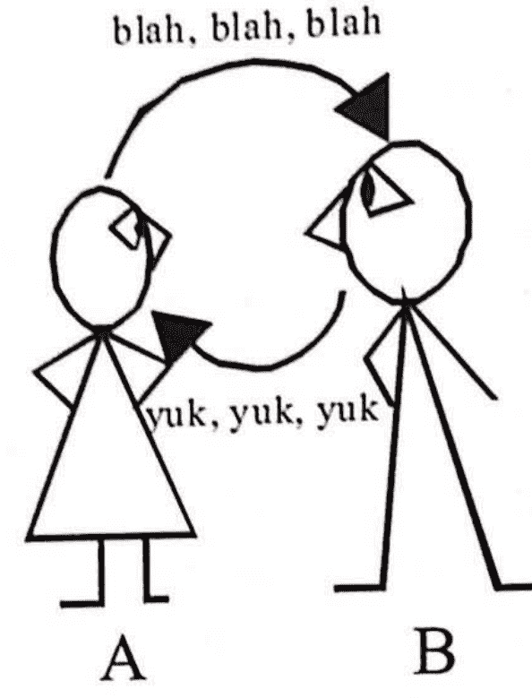

要理解他人，你必须拥有一种关于语言的语言。遗憾的是，除非你知道如何使用 Ã 的疑问词 24，否则你并不拥有这种关于语言的语言。当你拥有这些新的语言工具时，你就能做到。它们是：

- (a). 修改元模态 3M
- (b). 非亚里士多德体系 Ã
- (c). 诺-伊语言系统 ~YL。

这三种语言工具是独特的语言系统。作为系统，它们拥有独特的哲学、逻辑、语法和功能。你目前拥有的全部是因果语言 A 和非正式逻辑。想想如果将这 3 个系统添加到你现有的内容中，你的思想将会得到多么惊人的扩展。

阿尔弗雷德·科日布斯基看到了元语言的重要性：

22 但你必须走在路上，你的生命才能开始展开和演变：最终，在她40多岁末期，一名前女服务员嫁给了一位是宝石商的顾客！随着时间的推移，她接管了他的账本、他每年亚洲采购之行的安排，结识了新卖家并旁听了他的交易。她的丈夫死于心脏病。生意完全掌握在她手中。她随后继承了他的衣钵，现在她是一位宝石商。我们相信，这就是我们所说的神秘之手指引我们生活的方式。

23 没有保证、担保或确定性；如果这符合实际，就不可能有期望和权利：正因如此，有些人陷入 A，带着 C→E 的确定性。他们无法接受生活中没有确定性。有些人退隐为隐士，也不愿面对生活中的未知和不可能。愿我们用这个信息让你惊讶：这种状况既未列入 DSM-5，也未列入我们的精神病学词典！

24 如何使用 Ã 的疑问词是能够在相对性和关联性的现实中良好生活和运作的必要条件。在因果现实中，你不需要知道如何使用 WHY。你可以在礼貌的社会中使用它，也可以在发牢骚时使用它！不需要教育。


要考察一种具有确定结构的语言的结构，我们必须产生另一种结构不同的语言，以便在其中分析第一种语言的结构。

阿尔弗雷德·科日布斯基：《科学与理智》，非亚里士多德体系与一般语义学导论，国际非亚里士多德图书馆出版公司第六次重印，1980年，第56页。

> 这验证了伯特兰·罗素在1922年提出的观点，即存在一种“可能性”，即“每种语言都有……一种结构，关于这种结构，在该语言内无法言说，但可能存在另一种语言来处理第一种语言的结构，并且本身具有新的结构”。罗素所称的“可能性”，一旦构建起一种结构不同的系统，就成为事实。

阿尔弗雷德·科日布斯基：《科学与理智》，非亚里士多德体系与一般语义学导论，国际非亚里士多德图书馆出版公司1980年第六次重印，第xxiii-xxiv页。

随着时间的推移，元语言的论点被有力地陈述如下：

> 最终我们意识到，这种状况与所有语言、交流、学习等的层级结构直接相关。如我们在第1章中所指出的，表达或解释某事需要转移到高于被表达或被解释内容的一层逻辑层级。在同一层级上无法完成任何解释；必须使用元语言，但这种元语言不一定可用。造成改变是一回事；关于这种改变进行交流则是另一回事：首先，这是正确逻辑类型化和创建适当元语言的问题。

保罗·瓦茨拉维克、约翰·韦克兰和理查德·菲施：《改变，问题形成与问题解决的原则》，W. W. Norton and Co.，1974年，第79页。

这些作者坦率地承认“……这种元语言不一定可用。”随后，仿佛命运之手干预以纠正这一状况。《改变》出版一年后，即1975年，RB&JG出版了他们的著作《魔法的结构》，SOM。书中勾勒出了第一种元语言，他们将其命名为元模型，2M。

在其时代，2M是最强大的信息收集工具。通过它，你可以学会理解一个人，并推断他来自何处。25 掌握2M的熟练程度要求我们的本体论发生改变。最主要的区别是，在接近人们及其问题状态时，我们的信心得到了提升。然而，随着时间的推移，我们确定2M中存在某些结构缺陷。主要缺陷在于，2M最初是在因果A中创建的。我们从2M中提取了因果，并将其重新配置为Ã中的3M。2M还需要某些关键的增强和扩展。

对于我们对2M所做的修改，我们最初将其命名为信息收集模块，GIM。出于对RB&JG的尊重，我们决定不再这样命名；因此，我们将其命名为修正元模型，3M。它于1992年在我们的著作《沟通中的力量与优雅，人们、范式与悖论》中出版。

25 通过它，你可以了解一个人，并推断他来自何处，这在今天是一件非常重要的事情。在一个逻辑层面上，我们了解自己，就像我们不了解他人一样确定。但我们过于专注于始终尽力投射我们自己和我们的想法。在这方面，我们遇到了那些可能非常令人生畏的人。现在我们比以往任何时候都更确定的是，我们必须放下自我，专注于尽可能多地了解他人的任务。

没有元语言，就无望构建结构良好的问题。因此，我们向你建议，最好的事情是你拥有3M的语法来提出你的问题；并在你生活中进行任何文明话语交流时拥有它。使用WHY，你就没有力量，无论你使用得多么激进。通过持续使用WHY，我们已经退化了在使用Ã的其他问题方面的技能：HOW、WHO、WHAT、WHEN、WHICH、WHOSE和WHOM。

那么，我们是依据：

- 我们确信自己所处的世界 [ ]
- 我们头脑通过A、IL、Ã、3M和~YL的敏捷程度？[ ]

## Ã的第六个逻辑全体及其语言全体：

### 结构良好或结构不良

当我们听到有人说以下话语时，这些术语在我们的日常用语中有其地位：

- (a) 他所做的很不得体。
- (b) 他是一个非常结构不良的人。
- (c) 他以一种结构良好的方式行事。
- (d) 他忠于自己的形式。
- (e) 他在自己的形式中表现出色。

在上述示例中，“形式”一词指什么？它指的是一个人语义存在的形状/配置。问题是：它是否符合该人所处的语义语境。在守灵场合开玩笑和傻乎乎是结构不良的。

A中的对与错层级，与Ã中的结构良好性和结构不良性相平行。在结构上，这两个类别的语义和功能并不相同。区分它们的关键在于，the

## 神经语义编程

前者没有确定一种考虑是对还是错的普遍度量标准。后者有。

再次，我们回顾适用于结构良好性及其隐含延伸的结构不良性的普遍度量标准。它们都涉及生命的动词：

- (a) 必须有自由选择去做
- (b) 做必须是无可挑剔的
- (c) 它是有用且有价值的
- (d) 它必须是道德的，不给自己或他人带来伤害
- (e) 它必须带着一些爱和同情去做
- (f) 它必须帮助个人提高觉知

要使一种行为成为结构良好的，它必须满足上述度量标准。如果行为未能做到，那么它就是结构不良的。如果你将上述度量标准应用于吸烟者或酗酒者，你就会知道他们的行为是结构良好还是结构不良。

与结构良好性和结构不良性相关的事项非常广泛。显然，我们不能在此考察所有这些问题。因此，我们将考察限制在它们如何应用于人类信念上。

一种结构良好或结构不良的信念是一种情绪；和所有情绪一样，它可以在强度上上升：如果有人相信自己是对的，那么情绪会像下面的量表一样上升。

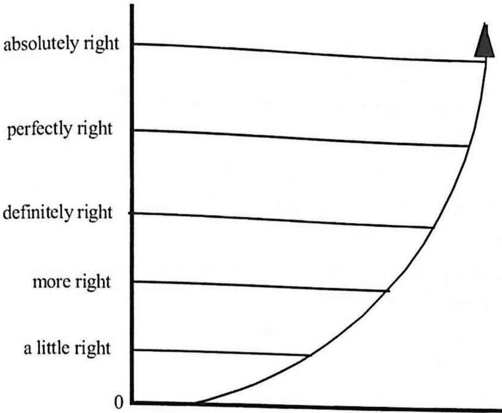

无论行为是什么，你都可以应用结构良好性的度量标准来确定人们所做的是否是结构良好的。

有一个人的故事，他本要追随印度耆那教信徒所走的道路。当他离开的时候，家人和朋友举行了盛大的庆祝活动。在此次活动中，这位耆那教徒将一家工厂给了他的儿子，另一家给了他的女儿和女婿。他将他的房屋和土地的所有权以及所有金钱、股票和股份都给了他的妻子。字面意义上，他现在一无所有。

第二天早上，当家里人还在睡觉时，他醒来了。带着一个托钵碗和一根拐杖，他走出家门，再也没有回来。现在他游走于印度各地。他不拥有一件衣服或一双鞋。他跋涉在极度贫困的道路上。在他到达一个村庄很久以前，村民们就知道他要来了。怀着极大的尊重，这位耆那教圣人受到欢迎，并获得食物和庇护。他唯一的回应方式，就是根据自己流浪经历所学到的，给予他们最好的菩萨法教；而村民和孩子们则陶醉地聆听并学习。

你可以应用结构良好性的度量标准，你就会得到验证，判断这位耆那教徒所选择的是否是结构良好的。当然，你可以说他所做的是对的；而另一个人可能会得出结论，他把所有东西都送掉，为了如此愚蠢的生活方式离开家人，这完全是愚蠢的，因此他是错的。

信念赋予一个人行事的力量；而这些事情可以构成他升天或堕入活生生的邪恶怪物深渊的弧线。介于两者之间的是绝大多数正常的普通人，他们通过自己的笨拙、绊跌、失误和搞砸来度过一生。然而，正是通过他们行为的总和，支撑了他们彼此共享的社会的更大利益；并且，正是这些人承担了国家的税收负担。

我们认为，如果我们所有的法律都从A和IL的语言转录为Ã、3M和~YL的语言，那将好得多。并且让我们的法院从A转变为Ã。换句话说，与其是一个对与错的法庭，不如是一个结构良好性或结构不良性的法庭。

一个Ã法院可以通过语义结构良好性的6个度量标准，对比A中两种独特的对与错价值来进行任何审判。

让我们举一个Ã法院运作的例子。审判对象是一个杀害他人的人。在最关键的时刻，一切都取决于他的回答。如果他对上述问题（与所引用的度量标准相关）的回答全是肯定的，+，他将被判无罪。如果有任何回答是否定的，—，他将被判有罪。那么，让我们开始：

问题：当你杀死他时，是出于你自己的自由意志和自由选择吗？回答：+。


问题：当你杀了他时，你是否完美无缺地完成了？
回答：+。
问题：杀他是不是一件有用且值得的事？
回答：+。

此时，他正朝着被判无罪的方向发展。

问题：他被你杀死对你来说是不是有用且值得的事？
回答：对我 +。
问题：然而，他的妻子是个带着三个孩子的寡妇。他被杀死是不是有用且值得的事？回答：—。
问题：当你杀他时，这是否合乎伦理，即你对他或对自己都没有造成伤害？
回答：对我 —，对他 —。
问题：当你杀他时，你是否带着一些爱和同情心这么做的？
回答：—。我恨他，因为他抢走了我爱的女人。
问题：杀死他是否帮助你提升了觉察？
回答：—。如果非做不可，我还会再做一次。

对于最后六个否定回答，他将被判有罪；而且你会注意到，他是亲口自证其罪。

任何人都可以对某个事物或人生情境得出自己独特的个人理解或意义。换句话说，你可以有自己的看法！幸运的是，大多数时候其他人与你在同一个范围内。当这种情况发生时，你再好不过了。然而，我们都经历过其他人与我们立场相去甚远的情况。我们还清楚地记得，因为我们的偏差错误（a.k.a. 做错事<sup>26</sup>），来自四面八方的言语石块如雪崩般砸在我们身上。

WELL-FORMEDNESS 和 ILL-FORMEDNESS 的核心在于，我们如何满足这样一个问题：我们所思、所言、所感、所为是否 **合适**（fitting）？WELL-FORMED 与 RIGHT 之间存在着关键区别。然而，在罕见情况下，WELL-FORMED 或 RIGHT 可能难以区分。与其谈论它，不如通过一个例子来说明这种区别。在经济衰退期间，一位妻子带她的丈夫来见我。他是一名技艺精湛、声誉极佳的木匠。他每周工作 75 到 90 小时，而其他人则是兼职、没有生意或被解雇了。

在这种情况下，他的妻子，*de facto*，已成为两个孩子的单亲母亲。她每天早餐后早早送他出门。孩子们从未见过他。当他深夜回家，疲惫不堪时，他会在电视机前坐下，她会端上他的饭菜。她告诉我：*很多时候我会去客厅看看他怎么样了。他的饭只吃了一部分。他已经睡着了。我会端走他的饭盘。然后我会回来，把枕头垫在他头下，把他的脚搭在沙发上，盖上一条毯子。我会关掉灯，上楼睡觉。* 这是她“拖”他来见我时的抱怨：

> 我们没有一起生活！

他的回答是：医生，这些是艰难的时刻。许多人失业了。我必须尽我所能、在可能的时候为家里赚钱。我能对他说什么呢？然而，我继续会见这位妻子。这是支持性治疗；她对此非常感激。

<sup>26</sup> 来自四面八方的言语石块如雪崩般砸在我们身上，因为我们的偏差错误，a.k.a. 做错事：当这种情况发生时，你会突然发现，你甚至没有一个朋友可以帮助或保护你。

然后，有一天她兴高采烈地来了。她丈夫一天晚上回来说：我需要度假。我们去露营。这正是她一直和他以及孩子们一起度过的那种假期。她欣喜若狂。终于，一家人可以在一起，度过一些真正高质量的时光。她再也没有听到关于度假的消息，但她保持信心，耐心等待出发的通知。

一天晚上他回家告诉她：这个星期五，你父亲和我要去北边露营钓鱼！她惊得说不出话！她一言不发，也没有表露出强烈的失望。她知道他需要休息。

然而，当他和她父亲度假回来时，她“气得要命”，把他拖来见我。她向我倾诉了上面的故事。他沉默不语。当她讲完故事后，我慢慢转向他问：

> 我知道和你岳父一起度假对你来说是正确（RIGHT）的事。
> （我停顿了一下。）

> 但是，我想知道，你认为把你的妻子和孩子排除在度假之外，是否是合适（FITTING）的事？

现在，听到我对他说的话后，他低下了头，相当懊悔。他平静地回答：

> 不！

我们所有人都受自己关于什么是正确（RIGHT）的独特个人结论所驱动。然而，通过这个案例，在更深层次上，这个人不得不同意。出于他根深蒂固的、与生俱来的、可遗传的合法性和语义良构程序，他被迫承认，他为假期所做的决定并不良构；把妻子和孩子排除在外是不合适的。有趣的是，他的心理有合理化（JUSTIFICATION），认为他和岳父一起离开是正确（RIGHT）的。它是：

## 正确的决定

有可能把一个孩子养成不良构（ILL-FORMED），甚至畸形（MAL-FORMED）吗？答案是肯定的！在犯罪家庭中长大的孩子会继承长辈的不良构 HOPs。他们的生活就是犯罪的生活。

我们现在有一个非常有趣的投票要交给你。我们的生活应当遵循

- 正确与错误（RIGHT and WRONG）？[ ]
- 还是
- 良构与不良构（WELL-FORMEDNESS and ILL-FORMEDNESS）？[ ]

## 第七逻辑全体（Holon） of à 及其语言全体：信息。

在 Ã 的现实中，最重要的是信息（INFORMATION），尤其是其质量和准确性。我们发现，HOPs 的语法将信息转化为有用知识（USEFUL KNOWLEDGE）。信息，尤其是知识，对于所有人在生活中的努力和事业都至关重要。

学生最终要么上大学，要么上研究生院。在那里他们学习自己选择的专业。所选专业是一个带有其信息（INFORMATION）的范式。这些信息被转化为有用知识（USEFUL KNOWLEDGE），支撑他们在行业或职业中的生活实践。

然而，有些人只有高中毕业（Grade XII）。他们从这些卑微的起点出发，也能在人生中翱翔。他们很少见，但他们证明了你不需要文凭和学位也能在生活中成功。你必须拥有的是天赋（TALENT）和/或诀窍（KNOW-HOW）！你的 HOPs 的认识论引擎会为你完成一切。

正是通过认识论引擎，英语字母和语法的基础才成为 J. K. Rowling 写作《哈利·波特》系列的基础。最近揭示，9 X 2 = 18 的数学基础成为高盛（Goldman Sachs）进行实操性操纵的知识基础，将破产的希腊塞进欧盟货币联盟。<sup>27</sup>

我们现在需要解决的是思维的成熟度。为了使信息和知识成熟，它需要具备以下属性：

- 符合事实（true-to-fact）
- 范围（scope）
- 质量（quality）
- 准确符合事实（accurate-to-fact）
- 深度（depth）
- 真实符合事实（real-to-fact）
- 价值（value）
- 完整性（completeness）

我们每个人都可以审视这里引用的要素的重要性和意义。为此，我们提议进行一次扫描。因此，不完整或碎片化的信息/知识不能被视为良构。其缺陷可能产生严重后果。例如，使用我们的神经语义感觉来判断信息是否缺乏深度，即是否肤浅，这一点很重要。如果是，它可能会带来惩罚。没有深度，它可能毫无用处。

从童年到 18 岁的教育是传递一套关键且至关重要的基本信息所必需的。令人难以置信的是，有些小孩不会听老师讲课。然后他们就无法学习所需的信息

<sup>27</sup> 高盛（Goldman Sachs）为将破产的希腊塞进欧盟货币联盟而进行的实操性操纵：根据希腊的经济表现数据，她远未达到申请加入欧洲货币联盟所需的各项指标。为了解决这个问题，希腊聘请高盛来操纵其数据，使其数据看起来可以接受。


完成他们的教育是必要的。他们关注的是自己在多大程度上能够分散注意力、扰乱课堂，并让老师感到苦恼、不安和沮丧。许多这样的学生最终无法获得高中毕业证书。在安大略省，这将在未来几年给他们带来惩罚性的代价。

在那些不当行为的岁月里，儿童被贴上患有ADD的标签。随着时间的推移，标签变成了ADHD。这现在成为他们行为的借口。不幸的是，当一个孩子活在并相信这个标签时，他们“步入人生”时，缺乏进入行业、学院或大学所需的最低知识基础。

另一方面，我们也遇到过一些情况：有些父母过分溺爱子女，将他们捧到天上去。这些孩子是成年生活中“大我”和“伟大自我”的缩小版。他们充满了自我重要感（SI）、自尊心（SE）和自我（Ego）。他们进入课堂时对任何人都没有尊重。这类孩子的目标是向全班展示他们比其他人或他们的老师要优秀和聪明得多！

然而，当他们在学校失范行为达到顶峰时来找我们，在直接询问下，他们非常清楚：数学很无聊。英语很无聊。我懂我的历史。我对地理没有兴趣。老师没什么可教我的。我已经都知道了。爸爸不帮我。妈妈没用。

在这里，安大略省，我们当然拥有优秀的小学和中学以及教师。我们的教育系统耗资数十亿。然而，目前人们怀疑它未能产生纳税人想要的那种结果。当将我们孩子的成绩与其他不得其名的国家孩子的成绩进行比较时，我们并不在前五名之列。

几年前，滑铁卢大学的一位教授已经忍无可忍。他公开哀叹自己担心大学正在录取**英语文盲**的学生！回应是一片雷鸣般的沉默。

没有哪个专业团体能声称其所有成员在工作中都是十分完美。作为一名医生，我知道我们的专业纪律机构一直在积极甄别工作中不称职的同事。根据其无用程度的不同，他们可能会终身丧失执照。我们发现，说到教师，如果你找到一个工作完全不称职的人，要将他从职位上解雇是非常困难的。然而，这类教师的不胜任会给他们的学生带来严重后果。

然而，在我那个时代，学童必须保持沉默，服从，甚至不敢想去批评自己的老师，更不用说对他不胜任提出投诉了。那时，我们的命运是忍受痛苦并心甘情愿地承受。然后我们记得那位好老师，凭借他传授我们应分享信息的能力，我们的成绩一飞冲天。

现在，我们有一个有趣的投票要交给你。生活是取决于

| | |
|---|---|
| 信息 | [ ] |
| 理由？ | [ ] |

## Ã的第八个逻辑整体及其语言整体：好奇心、创造力和灵活性。

Ã认识到，一个真正的信息和知识追求者，其内心好奇心（CURIOSITY）如火焰般明亮燃烧；创造力（CREATIVITY）的大釜在奋力翻涌；而他**灵活性（FLEXIBILITY）**的*手*<sup>28</sup>是纯净且可塑的。这样的人会为自己、对他人、为事物以及为他所生活的世界，运用和应用这些神圣的天赋。

如果班德勒的公理准确，那么没有人会知道一切，当然也不会了解他自己：

> *每个人都是一个未经勘绘的、充满奇迹、神秘和复杂性的宇宙。*

然而，有些父母决心教导孩子正确的思考和行为方式；也有那些对孩子完全不施加管教的父母。问题在于，一旦孩子知道了“正确的方式”，他们会如何对待持相反立场的其他人？这将成为杀死被视为“不正确”的他人的场合。在冲突中，那个自认为“绝对正确”的人会愿意为他所坚持的“绝对正确”而死。在这种情况下，好奇心、创造力和灵活性早已消失殆尽！

现在，这里有一个有趣的问题。你现在能看出零容忍是“绝对正确”的产物吗？

在意识到我们每个人都是独特的之后，我们应当保持好奇心，收集能让我们了解面前之人的信息。有些父母无论是有意还是无意，都竭力把子女养成像他们一样的人。然而，无法保证他们会成功。这涉及认同的问题。我们有一本尚未出版的手稿，其中将涉及此类问题。其书名为：《育儿，艺术与科学》<sup>29</sup>

我们所说的认同是什么意思？是说两个在语义上独特的项目在所有方面都相同。这是通过动词“is”来完成的。这里引用五个例子：

- (a). 他是个白痴。
- (b). 她是个婊子。
- (c). 这辆本田是这辆宝马。
- (d). 这份卡邦尼面是这份意面。
- (e). 这次巴黎假期是这次古巴假期。

有趣的是，在生活中，人们会自动接受(a)和(b)是有效的。然而，对于(c)、(d)和(e)，显然这是不可能的。

NSP所说的是，如果(c)、(d)和(e)不成立，那么(a)和(b)同样无效。它们为何无效？它们之所以无效，是因为班德勒的洞见：每个人都是一个充满奇迹的未经勘绘的宇宙，

<sup>29</sup> 《育儿，艺术与科学》：从1991年到1997年，我们写了五本书。育儿本应是下一本，但我们决定改写文章。我们现在知道这是我们的一个严重错误。当我们最终决定重新拿起笔时，我们的情况要求我们先写这部关于认识论的著作。《育儿》将在不久之后出版。


神秘与复杂。如果这符合现实，那么一个作为未知宇宙的人类，怎么会突然成为一个白痴或一个婊子呢。我们现在在胡说八道。当我们使用认同时，我们在我们的世界上施加了一种难以置信的扭曲；其后果可能是巨大的。

由认同引起的畸形扭曲，只是我们施加于一个人的无限可能性中的一种。现在，这里有一个新的投票供你选择。我们要如何度过我们的生命

- 以我们是正确（RIGHT）的确定性？[ ]
- 或
- 我们可能不知道一切，并且我们要保持好奇心（CURIOUS）、创造力（CREATIVE）和灵活性（FLEXIBLE）的不确定性？30 [ ]

30 我们可能不知道是一个极难接受的命题。它需要大量的正直和谦逊。我们确实多么希望不必将此摆在你们面前。

## Ã的第九个逻辑整体及其语言整体：

### 尊重与无畏

这不是一篇关于人类尊重（RESPECT）和不尊重（dis-RESPECT）的物理现象的著作。对于本书，我们需要提出的问题是：

什么是交流相互尊重的必要条件？

当两个人接受并视彼此为平等时，就是这样。当你知道其中一方确信自己更正确（MORE RIGHT）和更确定（CERTAIN）；而另一方则确信自己是伟大的我（BIG ME）和伟大的自我（GREAT I）时，这几乎是不可能的。在这种情况下，这两个人并没有将彼此视为平等。

然而，实际情况是我们彼此平等，这体现了创造的真理。没有一个曾经存在、现在存在或将要存在的人类，出生时带有神圣的敕令，声称：

> 我，上帝 hereby 特此敕令 XYZ 出生时优于任何其他人类，地位更崇高。
> 上帝
> 签名

同样，在加拿大这里，没有一个人携带这项议会法案，声称：

> 根据本议会法案，任何不向你，XYZ，叩头的加拿大人，将被视为犯有刑事罪行，可处女王陛下的意愿下监禁3个月。
> 
> John Smith
> 加拿大总理

我们平等的证据是什么？证据在于：

- (a). 我们都必须纳税
- (b). 我们都必须呼吸彼此的 CO₂
- (c). 我们都需要清洁自己。

然而，这个世界的现实是，有些人自认为（de novo）自己优越且比他人更崇高。这是一件严肃的事情，因为万物皆有起源。那么，是谁或什么将优越的种子种入一个孩子或人的心中，从而滋生出对所有人的优越感和崇高态度呢？这本身并不是任何问题的基础。问题在于，当他作为职场中的成年人，担任一个被赋予履行其职务所需权力的职位时。这有什么证据呢？当你要去安大略省执照局续办执照时，你必须面对那些受薪为你服务的人。每个人都必须对他们非常客气。

请考虑以下五个例子：

- (a). 加拿大总督
- (b). 加拿大总理
- (c). 警察局长
- (d). 加拿大航空的空军准将
- (e). ICU护士长。

上述各职位的持有者都有共同点。他们对下属拥有权力（POWER）。这种状况是不可避免的，因为任何等级制度的语法都要求这样。那些处于上级之下的人必须服从（OBEY）；这有利于系统的运作。

然而，它容易被滥用。在 C→E 的世界里，这当然是事实。正因为如此，等级制度有失去下属潜在创造性贡献的风险。在 NSP 的世界里，我们确信没有任何等级制度能承受这样的损失。

拥有一个元系统是必不可少的，以便人们能意识到这种可能性；并且应明确划定针对此类违规行为的处罚体系。目前，纠正滥用的机制是举报。而且明智的是，英国已经将其合法化。

让别人服从（OBEY）你是令人陶醉的美酒；这会扭曲一个人的本体论。在 A 中，权力的权杖是：

- (a). 指责他人的能力和便利
- (b). 解雇下属的权力

被指责的人会感到被贬低和自卑。如果他灵活，他会学会优雅而艺术地退让。如果他僵化不灵活，他会被解雇。如果他不想要那个结果，那么他会带着沸腾的怨恨，毫无品位和风格地退让。之后，他会被盯上，晋升机会会从他身边溜走。归根结底，人们需要玩转系统的游戏：也就是说，服从（TO OBEY）并且做好它。

元问题是当人们开始相信自己确实低劣时；他们会自动仰视指责者作为一个优越的存在。这种本体论会延伸到其他负面的本体论后果，并相互叠加。在婚姻的例子中，配偶现在会摆出以下姿态：

- (a). 是的，亲爱的，你有权随意践踏我。
- (b). 我真正爱的是你，因为我崇拜你。
- (c). 为了你，我做你要求的一切。
- (d). 一切都将如你所愿。
- (e). 如果这让你高兴，我希望你承认我存在。

这就是取悦他人或对他人做出萨提尔姿态1（Satir Stance 1）的含义。我们建议你获取弗吉尼亚·萨提尔（Virginia Satir）的著作《Peoplemaking》（《人际沟通》），你将在其中找到关于她类比语义姿态概念（I、II、III、IV 和 V）的关键信息。有了这些信息，你对本体论（Ontology）的理解将会扩展。

相反，或者说元-元层面的负面，是当一个人相信自己确实优越，是一个崇高的存在。现在，拥有权力，他就是一只超级猿猴。要像猴子一样，你必须像猴子一样思考。猴子是怎么思考的，尤其是猴群中的头猴？他是这样思考的：

- (a). 我下属的每个人都低于我。
- (b). 每个人和一切都属于我。
- (c). 我所想要的一切，我现在就要。
- (d). 我可以做任何我想做的事。
- (e). 我将粉碎（CRUSH）所有反对我的人。

有趣的是，猴子不能像人类一样思考，但我们可以像猴子一样思考。

NSP 发现，我们可以像猴子一样思考，并且我们确实如此，因为我们内心有两样东西：

- (i). 因果关系，A
- (ii). 权力

证据是什么？来自高端商业世界，Ken Lay、Dennis Koslowski、Calisto Tanzi 和 Conrad Black 给他们各自的公司带来了荒凉和毁灭，这些公司在1990年代中期估值在80亿到100亿美元之间。例外是 Conrad，因为他比其他人处于一个小得多的圈子。众所周知，在 Enron 的案例中，人们失去了养老金。

来自政治世界，拥有绝对权力，Hitler、Stalin、Mao Zedong 和 Idi Amin Dada 都是超级猿猴。他们给自己的国家带来了数以千万计的死亡和毁灭。唯一的例外是 Idi，因为他是个小人物暴君。

在 Ã 中，无论一个人可能担任多么崇高和显赫的职位，都要记住他是被创造为你的平等者，因此，你要在沟通中无畏地（FEARLESSLY）与他平等交流。正如伟大的剧作家所写：

> 全世界都是一个舞台，所有男男女女只不过是演员；他们有各自的退场和登场，一个人在一生中扮演许多角色，他的行为分为七个阶段。起初，是婴儿，在保姆的怀里啼哭和吐奶。
>
> 威廉·莎士比亚
> 《皆大欢喜》第二幕第七场

我们对莎士比亚在这里所写的真理毫不怀疑。因此，在生活中，问题是我们是否能表演出奥斯卡级别的表演。另一种选择是屈服于对我们人格尊严的羞辱和侵犯。在通俗语言中，这被称为言语虐待。

在婚姻中，虐待的开始似乎如此自然地发生，伴随着无数可能的理由、合理化、解释和辩护来支撑它！很少是妻子是施虐者。更常见的是


丈夫。NSP的建议是，你必须向配偶摊牌，你既不会容忍也不会忍受虐待。如果这种情况反复发生，婚姻就结束了。当你说这话时，你必须认真对待并付诸行动。你会去找你的律师，指示他提起离婚诉讼。我们采取这一立场，因为在生命的循环中，这种每一次转折的虐待只会越来越糟——永远不会变好。你会适应它，调整自己，习惯它，对其产生依赖，最终容忍它。在其循环的一年结束时，你甚至不会意识到你的人格早已被摧毁。

你会奇怪，这个过程怎么会如此自然，而虐待却是如此不自然的事情。施虐者完全不知道自己在做什么，因为当你问他：你爱你的妻子吗？他直截了当地回答：我爱！当这种情况在治疗中发生时，临床医生就真的棘手了。

现在我们要进行一次投票。我们是要生活成：
- 生命舞台上的演员？[ ]
- 我们真正的自己？[ ]

## 第十逻辑全体 of à 及其语言全体：自我价值与谦逊

根据物理定律，我们每个人都天生要承受每日的生活问题、挑战和障碍 31。这根本无法逃避。普通人会遇到普通的问题、挑战和障碍。我们的任务是快速而高效地解决所有这些问题。通过这样做，我们赢得我们的**自我价值**。这是我们赢得的，没有人能从我们这里夺走。

> 31 我们每日的生活问题、挑战和障碍：任何人能诚实地说，只要他们有记忆以来，能回想起生命中一天完全彻底的幸福，而那天没有一个问题、一个挑战或一个障碍吗？即使在假期里，每日配额的某种变体也会存在。

然而，根据同样的物理定律，我们每个人总有一天会遇到一个问题、挑战或障碍，它将是一个**大麻烦**。西方哲学和基督教神学认为，无论**大麻烦**的规模和复杂性如何，我们内心总是有能力解决它。看起来，没有问题、挑战和障碍的生活是没有刺激、没有兴奋和没有危险的生活。这否则被称为**无聊的生活**。所以NSP指出：

## 对你的际遇心怀感激

然而，有一种本能的认知：生活中总会有某个人，能戳破我们的**自我重要性**（**SI**），践踏我们的**自尊心**（**SE**），并唾弃我们的**自我**（**EGO**）。我们都明白这一点。因此，我们知道我们的SI、SE和EGO实际上是脆弱、软弱且无法防御的东西。既然它们如此无价值，我们究竟为什么还要紧紧抓着它们不放？**自我价值**是我们在生命中必须赢得的东西。

我们如何知道自己已经赢得了**自我价值**？这很简单。当我们问自己：*我今天赢得了我的自我价值吗？我是否尽了最大努力？* 等待，答案会在你心中涌现。如果是：**是**，那么你就有了自证，并且本能地知道**没有人**能从你这里夺走它。这是唯一重要的答案。别人对你的看法随风而去。正如有人最近所说：“你怎么看我，不是我的事。”

没有什么能保护你的SI、SE和EGO。它们对你来说可能极其珍贵，但本身它们毫无价值、毫无意义、毫无用处，很容易被戳破、踩踏和刮伤。当这种情况发生时，对那个人来说可能是终结，如果不是字面意义上的，那么肯定在情感上和隐喻上都是如此。因此，依赖它们生活是极其愚蠢、不负责任和不成熟的。

那么什么是谦逊？就是当你知道你与他人合一。你和其他所有人都在同一条船上。在这条船上，没有头等舱乘客；也没有三等舱乘客。在上帝面前，我们都是一样的。

这是NSP的一条格言：

> 骄傲是通往攻击的道路。
> 谦逊是通往力量的道路。

这可能是别人说过的话。如果是这样，我们尊重这个人。然而，我们在阅读中从未遇到过这句对联。

只有拥有力量，我们才能生活并实现我们生命的真谛。这一切都关乎一个人的品格。他有健全且形成良好的品格吗？或者如《保持体面》中的巴克太太对某人所说的，他：软弱如水。NSP确信没有人能软弱如水地生活。

没有人拥有神圣的命令或议会的授权，就必须照顾或支持另一个人。我们只有自己的生命，我们必须自己生活。没有人会替我们这样做。然而，你可能知道有些家庭，其中的子女即使成年后仍住在家里，从未出去工作一天或赚到一分钱。他们的生活质量因这些父母声称对他们的爱而降低。

因此，这里有一个非常有趣的投票。我们是靠自己挣路 [ ] 还是互相支持？[ ]

## 第十一逻辑全体 of à 及其语言全体：接受全部自我回应责任

这里我们陈述的是NSP自由研讨会中教授的第一基本原理：
我们每个人都被赋予了自我启动、自我实现、自我维持和自我支持的能力 32。
因此，我们每个人都被创造为独立的个体，对自己拥有主权，自治且自我管理。

因此，
我们内心拥有成长、发展和进化的力量，沿着我们选择的道路前进。

正因第一基本原理，在于我们的存在中，我们有权衡和裁决面前的一切，然后决定如何回应。潜意识里，我们知道这一点，但它被C→E否认。它也曾一度被thes危及。因此，是输入决定回应，I → R，对此我们别无选择，只能为我们所有的**自我回应**承担责任。

> 32 自我支持：父母们立刻会为孩子的无助辩护。然而，伦敦、巴黎、罗马、柏林、布宜诺斯艾利斯等地的街头儿童就摆在他们面前……那么，你是否希望我们继续列这个清单？在家中受虐待的孩子别无选择，只能离开；并且凭借神圣之手的奇迹，他们在街头生存下来。这非常艰难，但父母需要学会谦卑地知道自己的位置，并遵循事物的自然秩序。我的一位患者最终按照我的建议做出了决定。他在儿子18岁时把他赶出了家门。今天，儿子35岁，是一名持证重型设备驾驶员。

在C→E思维中，结论是效果的必然性，即E是原因C的结果。这在我们的语言中得到了印证：

- (a). 你冒犯了我。
- (b). 你让我感到恶心。
- (c). 你伤害了我的感情。
- (d). 你导致了我的毁灭。
- (e). 你毁掉了我的生活。

上述所有这些表达方式，分别是自我忏悔和自我承认，表明一个人完全无助，已丧失战斗力。根据NSP第一基本原理所蕴含的原则和准则，这是可信的吗？这些说法与精神病学或初级心理健康服务提供者的语言具有同构关系，后者声称：

> 是的，你的抑郁症正在让你变成这样！

当然，按照NSP的思维，这种表达方式不仅不符合实际，而且站不住脚。上述说法都是错误的信念，并且通过自我见证证明了这一点。正因如此，出现了一大群人不愿服用针对导致其问题的事物的药物！对于那些人来说，由于NSP新兴的新治疗算法可以逆转这些状况，使用药物没有逻辑基础。

治疗算法用于治愈DSM-5诊断（如惊恐发作和成瘾）的地位，可以说，数量已经略微激增。曾经，飞行恐惧症是无法治愈的，并通过药物治疗。然后，NLP发明了一种治疗算法，治愈了它。

在我们教授自由研讨会的所有年份里，从1983年到2017年，总会有一个时刻，在

在研讨会上，我们请一两个人协助演示。我们请他们回想上一次真正愤怒的时候。除了记住谁参与其中以及事件是什么之外，我们不要求任何关于事件的细节。通常，主要行为者是一名男子。有了这些信息，我们便向他提出这个问题：

以下哪种说法更准确：

是他让你生气

还是

你的愤怒是对你对他所做之事的评价所做出的反应？

答案始终是“我的反应。”

在提出这个问题之前，此人一直认为是别人让他生气，或者是别人引起了他的愤怒。从NSP的角度来看，这个问题在他们的生命中是一个菩萨时刻。

就此而言，如果我们对他人所说的某个情境、句子或词语产生冒犯感等情绪反应，这显然是我们自己的反应。

这里有一个有趣的投票机会：

- 我们要对他人做菩萨吗？[ ]

或

- 我们要在心理健康领域提供初级保健吗？[ ]

## A的第十二逻辑全体及其语言全体：

## 爱因斯坦的相对性与关联性宇宙

本作品承认支撑我们对宇宙奇妙几何动力学理解的令人难以置信的数学。这是一个由阿尔伯特·爱因斯坦的广义相对论论文开创的领域。如果你想了解所涉及内容的数量级，我们向你推荐这部作品：查尔斯·W·米斯纳、基普·S·索恩和约翰·阿奇博尔德·惠勒合著的《引力》（GRAVITATION），由W. H. Freeman and Company于1973年出版。我们预先警告你，阅读它需要良好的微积分基础。

宇宙在绕其轴自转，但同时也处于某个轨迹上。按照同样的结构，所有星系都在绕其轴自转，但它们也各自处于独特的轨迹上。每个星系中的每个太阳系都在绕其轴自转，并且处于其自身的轨迹上。空间中没有任何一点是恒定的。因此，没有一个固定点是永恒不变的位置，以供我们作为参考点。一切皆是相对的，道理就在于此。如果你还记得之前关于感知和寿司刀的阅读内容，所有感知和理解都由我们在空间中的坐标决定，是相对于他人的。因此，处于空间不同坐标的人会有不同的感知。一直令人惊奇的是，由一个好家庭抚养长大的同卵双胞胎，一个变成了守法纳税的公民，并被公认为其专业领域的顶尖人才，而另一个却变成了无用的瘾君子！现在你明白了。同样的教养，但不同的坐标，不同的理解，不同的人生结论和信念。

我们已经讨论过，在相对性的现实中，不可能存在等同于C→E的确定性，即对于给定的原因，往别人头上扔一块石头是绝对确定的结果，即对方死亡。

按照定义，有许多人、事物、情境和事件，我们一无所知。因此，如果班德勒关于我们的说法是真的，即“每个人都是一个未经探索的宇宙”，我们还有什么希望去认识自己。而我们不认识自己的证据，源于个人经验的现象，即我们反复做某事，然后哇，对自己所做的事感到惊讶和震惊。因此，你对自己了解得真的很少，更不用说了解他人了。是时候披上谦卑的外衣了。是时候：

结束我们的自我中心方法，转而采用以他为中心的方法。

我们正处于相对性与关联性新物理学的时代。我们必须接受我们命运中固有的不可避免的问题，这是事物的自然秩序。在这个宇宙及其惊人事物的背景下，这就是我们的命运。这些是我们的数学帮助我们理解的事物；但还有那些我们的数学尚未为我们解决的未知。今天，2017年，最伟大的主题一方面涉及暗物质，另一方面是我们是否在这个宇宙中孤独。

生活在这个时代是如此独特的特权。33 这是一个高科学的男女自动拥有谦卑承认的时代：

- (a). 我不知道。
- (b). 我有一个理论和一个结论。请证明我是错的。

总而言之：“我不知道”，是愿意致力于查明的态度。在某一层面上，我们不害怕持有异议。我们记得，爱因斯坦曾是瑞士专利局的一名普通职员。从这个卑微的位置，他撰写了他的论文《狭义相对论》，得出光并非沿直线传播的惊人结论。那在当时是异端邪说！它违背了欧几里得关于光沿直线传播的发现。当时的德国科学界对此保持沉默

> 33 生活在这个时代是如此独特的特权。当今时代与教皇无所不知并将知识传授给我们的时代截然不同。那个时代的傲慢由此诞生；随之而来的是确信，当时正确的做法是活活烧死持有矛盾立场的人，因为他们错了。错误必须通过死刑来抹去。我们的祖先多么欢呼并感谢上帝，为信仰裁判（auto da fé）。

## 神经语义编程

冲突。随后，一大批测试结果证明了爱因斯坦在其论文中断言的真理。

这就是当今科学的事实。他们发现和学习得越多，最高水准的科学家就越承认自己知道得越少。这就是谦卑。没有一位有声望的科学家曾声称：我现在全都知道了。这不是该把人烧死在信仰裁判（auto da fé）柴堆上的时代。但他的主张会遭到嘲笑，更糟的是，会遭到同情和担忧。对我们来说，这是我们对科学期刊编辑和编委会的担忧。他们如此执着于坚持自己的正统；而研究前沿的人早已放弃了自己的正统。你认为哪一方更合理？

在《科学美国人》2015年4月第312卷第4期中，讨论了黑洞周围“防火墙”的问题。这些防火墙显然正在挑战广义相对论和粒子物理学。这是一个肯定，即并非一切都被理解，当然也并非一切都已知。就像德国科学界对待“异类”爱因斯坦及其不沿直线传播的光波一样，每个人都必须保持沉默，直到他们找到关于这些防火墙的数学。

然而，尽管我们上面所说的，仍然存在一些不幸的不足。不幸的是，这对所有年轻的新科学家和不知名的新研究人员来说，是最终的缺陷。下面的引用将阐明这一点：

> 一个显著的障碍是科学思想在其企业层面上的保守主义。某一特定时间科学的集体基质由一种建制决定，该建制包括大学、学术团体，以及最近期的技术期刊编辑部。像其他建制一样，他们有意或无意地致力于维持现状——部分原因是非正统创新对其权威构成威胁，但也源于更深层的恐惧，即他们费力建立的智识大厦可能在冲击下崩溃。企业正统主义从阿里斯塔克斯到伽利略，再到哈维、达尔文和弗洛伊德，一直是天才的诅咒；几个世纪以来，其方阵顽强地捍卫习惯以对抗独创性。催眠术在牙科手术、分娩等方面的应用，被视为现代发现。事实上，埃斯戴尔（生于1808年，卒于1859年）在“梅斯梅尔催眠状态”下进行了三百例大手术；但由于梅斯梅尔被宣布为骗子，医学期刊拒绝刊登埃斯戴尔的论文。1842年，沃德在催眠状态下无痛截肢，并向皇家医学与外科学会提交了一份报告。

亚瑟·考斯勒：《创造行为》，Arkana，企鹅集团出版，1964年，第239页。

自中世纪教母教会将我们所有人都置于奴役和统治之下的宽厚偏执以来，我们已经成长、发展和进化。然而，上面引用的考斯勒的警告今天依然成立。

作为能够逆转癌症的治疗算法的发现者，并且有两个独立中心验证了这一结果——一个在加拿大奥克维尔，另一个在澳大利亚布里斯班——我们想知道，当我们的书《如何逆转癌症》（How to Reverse a Cancer）出版时，我们的本体论命运将会如何。我们最好的期望是，企业科学建制会忽略我们。最坏的情况是，他们会以某种人为制造的21世纪变体形式向我们泼脏水，这可与加利略所遭受的指控（被指控异端邪说）相媲美。

我们过去、现在或未来的思维和存在方式，正是认识论和本体论所关注的一切。

那么现在，我们来进行最后一次投票。即：


## 神经语义编程

由自我和虚荣主导的生活？
还是
由探索和谦逊主导的生活？[ ]

# 第七章：比较 A 和 Ã

历史上第一次，我们有机会比较两种截然不同且强大的系统，它们对我们的思维、存在和生活中的行为具有极高的重要性和意义。每个系统在语法、哲学、逻辑、最终目的、功能和语言方面都不同。由于它们的运作语法不同，后果也不同。

NSP 发现，我们只知道亚里士多德的因果系统 A：

- 潜意识地和自动地¹。

就此而言，我们对其运作没有意识或认知上的觉知，只知其最终产物。因此，NSP 持有这样的立场：我们最好有意识地、自愿地了解 A：

- 有意识地、自愿地。

人们不知道非亚里士多德的相对性和关联性系统 Ã。首先学习 Ã 至关重要：

- 首先有意识地、自愿地，然后潜意识地、自动地。

目前，非亚里士多德的相对性和关联性系统 Ã 对西方所有人来说都是一种新的语言系统。他们迫切需要学习它。当他们能够做到时，通过定期练习，他们将能够潜意识地、自动地使用它。

根据你所读的内容，你现在知道亚里士多德的因果系统 A 如何成为我们生活中的首要操作系统。从其语言中产生了 CAUSE、EFFECT、C→E、WHY 和 y makes x 等词语。感官见证是每个 E 总是紧随其后的 C。因此，我们形成了对它的 EXPECT。伴随着 EXPECTATIONS 而来的是我们的 SHOULD，即 E 必须紧随 C。海德堡人² 不需要 10,000 次双盲试验来确信下次他用石头砸别人的头时会杀死他吗？就这样，在不知不觉中，一种独特的语言系统从 C→E 中产生了。

¹ 潜意识地和自动地：很少有专业人士意识到，当一种语法在我们内部潜意识地和自动地运作时，我们无法控制它。那么谁才是老板？

然而，在正常的人际交流中，有时我们不使用 C→E 的语言元素。以下是五个例子：

- (a). 你能请把盐递给我吗？
- (b). 我现在要走了。
- (c). 你好吗？
- (d). 你觉得今天会下雨吗？
- (e). 去野餐会很不错。

不可避免地，我们的人际交流语言是在 C→E 的框架内出现的。对于相同的条件，我们所有其他生活蓝图的语言都组织在 C→E 语言的范围内。

你只需倾听，当人们与你交谈并分享信息时，你就能听到所有 C→E 的语言结构，例如：

- (a). “我想知道他为什么那样做。”
- (b). “我本应该在那里的。”
- (c). “那太酷了！你做对了。”
- (d). “你让他非常不开心。”
- (e). “我怪他为此事。”

² 海德堡人是一种可能拥有某种言语能力的古人类。从 DNA 研究来看，他是尼安德特人和智人直接的进化前身。后两者在同一时期共存并通婚。然而，尼安德特人灭绝了，而我们幸存了下来。

C→E 的语言是普遍且无处不在的。证据在于《奥义书》、《伊利亚特》、《圣经》、奥维德的作品、《论语》、佛教信仰的佛语以及《古兰经》等伟大古代文本的语言。通过这些作品，你将看到、阅读并感受到 A 的无处不在的力量。正因如此，在通俗语言中：

我们都通过因果关系思考。

关于 C→E 的一切，以及与之相关的所有后果，因此都是正常的、自然的，并且很好。

我们必须注意到，C→E 的语言是：

- (a). 印制/焊接进我们的心智
- (b). 印记/刻入我们的肢体语言，BL

NSP 的发现是，所有反映在 DSM-5 诊断中的人类问题状态，都是一个人 HOPs 全相序中某个有缺陷子集或故障的功能。这个有缺陷的组件或故障就是 DSM-5 在其诊断中所指的实际精神障碍。我们在一位肥胖客户的社会系统全相序中遇到了这种信念形式的异常子集：

因为我胖，我在男人和我之间有了一道屏障。

我们内部的所有信息都在深层语言结构³，DLS 中以二进制编码；并且所有这些二进制代码的信息都参与其所有独特且不同的思维转换和操作，在被称为因果律的 C→E 哲学的总体控制下。因果律中嵌入了其逻辑。因此，DLS 的所有元素都受 A 逻辑的控制。进而，A 的逻辑决定了一个人本体论连贯性和说服力的形式。连贯性和说服力可以是良好形成或形成不良，合乎逻辑或不合乎逻辑，理智或失常。简单来说，A 在无限可能性中的任何一种情况下都决定了我们的人性。

³ 我们内部的所有信息都以二进制编码进深层语言结构：如果这可以被证明为真，那么它将成为适用于这一人类本体论领域的物理定律。这种二进制代码是人类语言之间翻译成为可能的共同分母。当我们在另一个星系遇到更先进的生命形式，其信息编码不是由二进制数字组成时，希望会有模拟设备来帮助我们。我们的希望和梦想是，DLS 中的二进制编码作为物理定律是各向同性的，因此是普遍的。

非亚里士多德框架，正如你已经读到的，被称为自由框架。这是因为我们多次被告知，即使暂时从因果世界中解离，也会带来一种为自己负责并以不同眼光看待事物的自由感。仿佛他们从一片阻碍他们前进的云层下走了出来。

它帮助许多人看到了以下内容的恐怖和可憎：

> 对于为劳作而活、为死亡而死，除了避免饥饿和口渴（我们补充）之外一无所获，并且子女也注定陷入同样的疲惫循环，这种对生活目标虚无的认识已经攫住了数百万人的心。

阿尔弗雷德·科日布斯基：《科学与理智，非亚里士多德系统和一般语义学导论》，国际非亚里士多德图书馆出版公司，1980 年，第六次重印，第 49 页。

饥荒是命运的行为，例如大规模干旱。AK 在这段引文中谈论的是人类的行为。对于前者，我们无能为力。但是，我们当然可以改善后者⁴，中国人已经证明了这一点。

⁴ 但是，我们当然可以改善后者：由于毛泽东的暴行，几代中国人过着生活目标虚无的生活。通过转向资本主义经济，他们已将几乎所有人民从这种可耻的命运中解放出来。

### 比较 A 和 Ã

很少有人意识到，甚至认识到这是一个持续的物理现象。它在人类存在的漫长岁月中，一步步地、深深地烙印在数十亿人的生活中。这当然是我们尚未消除的一种状况。仅仅每天为一个饥饿的孩子捐赠 22 美元，并不是解决这个 AK 问题的最终方案。这是一种持续的荒凉可憎之景，对每个思考的人都是无法容忍的冒犯。我们决心以某种方式看到它的终结，也许不是在我们有生之年；因此，我们祈祷我们打算发起的事情，能够继续直到其预期的逻辑结论。

在电视剧《秘密百万富翁》中，我们震惊地发现这种荒凉可憎之景今天仍存在于美国城市。美国有些人可以花 4000 美元吃一顿晚餐，而街对面却有人忍受着“生活目标的虚无”。当这些秘密百万富翁与穷人一起生活和工作时，他们找到了改变自己信念并尽可能带来改变的机会。从一种思维方式转向另一种是一种启示。

如果这种可憎之景是一种人为现象，那么证据表明，自远古时代起它就在不同国家存在并继续存在。如果是这样，那么这说明存在一种强制其存在的共同人为结构。正是这种结构必须被打破，才能终结这种可憎之景。要找出这种结构是什么，我们需要比较 A 和 Ã。我们所有人都必须回答的重要问题是：

- (a). 亚里士多德系统是否应因其缺陷和缺陷而从其主导地位中废除？
- (b). 非亚里士多德系统是否应取代亚里士多德系统，因为它具有更好的语言全体，并且由此延伸，具有能够保证的符合现实的思维模式


continuing development and evolutionary well-being of our species?

At the core of it all, what we have come to realize is that:

> > Man’s deadliest weapon is *language.*
> > Arthur Koestler: *Bricks to Babel*, Hutchinson, 1980, page 519.

To grasp what we are saying is to know the meaning of what it is to live on the edge. Life is improbable and uncertain.

Let us now compare:

## A and Ã

We put to you that it would be a truly good thing if you take a few moments to reflect, as best as you can, on what is placed before you below, before you continue reading this work:

| Aristotelian System | Non Aristotelian System |
|---|---|
| 亚里士多德体系 | 非亚里士多德体系 |
| Causality | Relativity & Relatedness |
| 因果律 | 相对性与关联性 |
| Cause and Effect | Cybernetics & Geometrodynamics |
| 原因与结果 | 控制论与几何流体力学 |
| Y makes X | Y = f(x) |
| Y 导致 X | Y = f(x) |
| WHY | How, Who, What, Where, When, Where, Which, Whose, Whom |
| 为什么 | 如何、谁、什么、哪里、何时、哪里、哪个、谁的、whom |
| Y SHOULD BE / SHOULD NOT BE | Y IMPROBABLE / UNCERTAIN |
| Y 应当是 / 不应当是 | Y 不大可能 / 不确定 |
| Y Right / Wrong | Y Well-formed / Ill-formed |
| Y 对 / 错 | Y 结构良好 / 结构不良 |
| Y <- Justification | Y <- Information |
| Y <- 理由 | Y <- 信息 |
| Blame/Fault/Guilt [self, other, things] | Y [Curiosity, Creativity, Flexibility] |
| 责备/过错/罪恶 [自我、他人、事物] | Y [好奇心、创造力、灵活性] |
| Intolerance [self, other, thing] | Respect [self, other, thing] |
| 不容忍 [自我、他人、事物] | 尊重 [自我、他人、事物] |
| SI, SE, Ego & Pride | Self-Worth & Humility |
| SI, SE、自我与骄傲 | 自我价值与谦逊 |
| AVOID Self-Responsibility | ACCEPT Self-Responsibility |
| 回避自我责任 | 接受自我责任 |
| MAD, MAD, MAD, MAD WORLD | Einstein's Universe |
| 疯狂、疯狂、疯狂、疯狂的世界 | 爱因斯坦的宇宙 |

We will start from the top with the first logical level of A and à and go down:

## Causality versus Relativity and Relatedness

Causality is like a mega monolith, a behemoth that stands inviolate and invincible. Its language system and its lineage are ancient. Only the cognoscenti know the weight of A, C→E, on people’s minds and hearts. Its power and strength are transcendental, inescapable and invasive.

Over the millennia, C→E has accreted an incalculable number of illogicalities. For a person who thinks by C→E, all these illogicalities are normal, natural and fine. This comes about because, the person adapts, adjusts, habituates and finally accommodates them. In our clinical work, we have often been told by clients, that due to what we did, a weight was lifted off either their chest, shoulders or back. This was a problem they were not aware of as they had adapted, adjusted, habituated and finally accommodated to it. If they had not come to us and we had not applied the algorithm of therapy they would have suffered the secondary consequences of this weight for the rest of their lives. Yet, for them, everything was NATURAL, NORMAL and FINE. This is the result of the way of thinking by C→E.

People do not realize that Political Correctness, PC, is a spawn of A. For this work, if we allowed ourselves we would write a chapter on it. To spare you, we will quote to you the answer President Harry S. Truman gave to General Douglas MacArthur as to what PC is:

> Political Correctness is a doctrine, recently fostered by a delusional, illogical minority and promoted by a sick mainstream media, which holds forth the proposition that it is entirely possible to pick up a piece of shit by the clean end!

## Comparing A and Ã

From President Harry Truman to General Douglas A. MacArthur and Admiral Chester H. Nimitz, 1 September 1945:

PC was powerfully supported by Politicians of the West. They oft times found that they could not speak the truth to their constituents. Their language became known as political speak. PC became the artful use of euphemisms, especially to blunt harsh truths. Therefore, what needed to be told was disguised in a new language that proffered a duplicitous mispeak and misrepresentation of the truth.

I read somewhere that today, it takes an enormous amount of integrity to speak respectfully, the truth, as one sees it. The unspoken consequence is that everyone is in fear of telling the truth as-it-is! This fear has now become generalized. The result is that automatically, everyone is wondering how they can say whatever they have to, in a nice pleasant way that is acceptable and does not give offense. This is what is known as being APPROPRIATE. But then the question is: Appropriate to whom? So, without realizing it, all of us are constantly living on the edge of having to engage in euphemisticalization. And to do euphemisticalization well, the elite, the cognoscenti and the literati know that you must have a BA in English from Oxford University, England! Only a few people in the world of PC have this distinction. So you have to wonder what qualifications they have, to do what they push to do.

In business corporations, in the military and in Science, the place of TELLING THE TRUTH is not only critical but it is necessary. It takes a lot of integrity and backbone to do so. None of the above can really afford THE RISKS that are intrinsic to euphemisticalization. There is a famed story of a King of a Greek city. He was before the Oracle of Delphi. His question was: Will I be victorious if I go to war? The Oracle was very PC and answered: In war is Victory. Pleased, he went to war. Victory was the other King's. This is an example of THE RISKS when PC is palmed off on you.

With à as the master Meta paradigm of Relativity and Relatedness each of us will know that we live in a humongous paradox, as per the Santiago Theory.5 By the Santiago Theory we now know that from the structures within us, our:

[ HOPs + An'y9 + Deep Structure ]

unfold the reality of ourselves, others, the world we live in and this universe. Since we have similar structures we unfold similar realities. However, as the Santiago Theory teaches us, each of us has:

a world but not THE world.

In other words:

- (a). Out of the infinite possibilities of a humongous mega perturbation we use our structure to form ourselves, others, this world and this universe. Yet, we are condemned to explore, discover and find our understanding of what we have created – ourselves, others, this world and our universe, the meaning of our existence and our ultimate purpose. Our task is to discover the wonder, mystery and complexity of the unchartered universe that is in us and to explore the wonder, mystery and complexity of the universe that is around us.

- (b). In Ã, we will also know that this is our fate by the decree of the absolutely complete 6, illimitable, unfathomable, immeasurable, eternal, unutterable, unnameable and the ineluctable that sustains us and all the universes that each of us create.

5 Santiago Theory is a remarkable new theory about what our reality is. It is the work of two neuro-scientists from the University of Chile, Humberto Maturana and Francisco Varela. I was informed by Maturana that unfortunately Varela has passed on.
6 absolutely complete: The adjective, absolutely, in philosophy can only apply to God, NOT to human beings. We have enough intrinsic defects, flaws, insufficiencies and inadequacies to self-witness that this term can NEVER apply to us. This does not mean that we do not have the insane in our midst who believe that they are a God. And the even more insane who say there is NONE.

What of Western Philosophy that God is unknowable.

- (c). Across every moment of our existence we are to know our place in the vast order and incomprehensible magnitude of things. For us, respectfully, it is an incredible incomprehensibility, how one human being can rise from the dust of his creation and proclaim: There is no God! ... ? It is a kind of inverted hubris that only leaves us bewildered. In Medieval England, there were an untold number of peasants who were doomed to live, work and die and never see with their own eyes the King of England. The amazing thing is that none dared to say: There is no King of England.

- (d). We will also know that we are all equal with each other and no one is created superior or more exalted than the other.

- (e). We are to live our lives in a well-formed way.

What we have cited above is our understanding of the Santiago Theory.

Relativity and Relatedness are semantic items that relate to the structure of reality. Relativity has been critically explored in Einstein's two papers on the subject.

What NSP has determined, as the most significant thing about human relatedness, is whether we have the know-how to build a sound bridge to another. Technically, few know how to do so in a consistently systematic way. Most just wing it by being nice. And it is certainly not

7 There is no God! ... ? We accept the conclusion of some of you that there is SPECIFICALLY NO Vishnu, Amun-Ra, Horus, Isis, Aten, Osiris, Jupiter, Sol Invictus, Odin, Thor, Jaweh, Mithras, Diana, Artemis, Aries, Jesus and Allah. That there is NO GOD, for us is an entirely different logical order of consideration and therefore, astounding.


基于对他人的看法，希望与他人建立良好关系，这并不合乎逻辑⁸。

人生是一件非常严肃的事情。根据我们的经验，仅凭一个不明智的决定，惩罚就会立即降临。无处可逃。

那么现在，你如何投票？

- A ☐
- Ã ☐

## 我们继续探讨 A 和 Ã 的第二逻辑层级：

## 因果效应与控制论与几何动力学

我们已通过实例探讨了 C→E 实际现象的感知证据；但我们也已举例说明了相对论现实中的实际现象。

如何调和两个彼此对立的真实发生的事件？是否有可能，无论如何，调和这两类各自的现象？

这就是这个谜题的答案。在地球上，相对于我们而言，地球的质量和引力（G）的大小会扭曲我们周围的空间。当你手中的一杯牛奶滑落时，这杯子实际上会掉落

⁸ 基于对他人的看法而希望与他人建立良好关系，这当然并不合乎逻辑，因为这样做会让我们在对人的结论中犯错的可能性。正是 AK 指出，对一个人的看法并非该人本身。然而，如果你知道一个人偏好的沟通结构是什么，你可以利用它们与他建立联系。你可能不知道这一点。我们提供一个专门处理此事的研讨会，名为 IROSSEMPFMISsT 研讨会。这个缩写中的字母代表我们所谈论的沟通结构。如果你知道它们是什么以及如何使用它们，你就可以与他人建立起自己的桥梁。没有人能通过看法来建立桥梁。

### 对比 A 和 Ã

进入空间扭曲；落下在撞到地板时停止，由于撞击力，杯子破碎并碎裂，牛奶洒得到处都是。在太空梭内，其中包含的所有单独物品都有质量，但这些质量不能有效地扭曲空间。结果是，没有扭曲的空间可供物体掉入。

事实上，如果你身着太空服，在太空梭外，太空梭的质量不足以扭曲空间让你掉入其中。如果你与太空梭的连接绳断了，你就会漂浮进入太空的真空中。简单来说，你正在实践相对论的公理：生命的正常状态就是处于自由落体。换句话说，每一个在零重力条件下漂浮的人，都处于自由落体状态。

在现实中，不存在 C→E。现在你突然开始看到 C→E 是一种错觉。真实可言的是，事件，即坠落，E 是空间扭曲 D^TN 的函数。在数学上，我们可以这样描述这种关系：

```
E = f (D^TN)
```

该方程表明：

效应（E）是空间扭曲（D^TN）的函数。

值得注意的是：

```
D^TN = f (G)
```

以及：

```
G = f (m)
```

因此：

```
E = m * G
```

其中：

m 代表质量

我们上面引用的是一条物理定律，其中不存在 C→E。

然而，为了辩论起见，假设此刻我们接受 C→E 是符合实际的；并且我们不予质疑。我们在感官经验的证据面前俯首称臣：如果我让手中的一杯牛奶滑落，我就是随后发生之事的原因，即其效应。杯子会碎裂破碎，牛奶会洒得到处都是。

让我们假设那个时刻已经过去，我们现在处于一个非亚里士多德的 Ã 世界。我们向你提出，在 1777 年，大卫·休谟曾针对 C→E 提出过这样的论证：

> 但当某一特定类型的事件在所有实例中始终与另一类事件结合在一起时，我们不再犹豫，在另一事件出现时预测前一事件，并运用那种唯一能让我们确信任何事实或存在的推理。我们称前一对象为原因，后一对象为效应。我们假设它们之间存在某种联系；一种力量存在于前者之中，它必然产生后者，并以最大的确定性和最强的必然性运作。

那么，事件之间必然联系的这一观念，似乎源于这些事件不断结合出现的多个相似实例；而且，这一观念绝不能由任何单一实例所暗示，无论从何种角度和位置审视。但在多个实例中，除了在重复出现相似实例后，心灵会因习惯，在一个事件出现时，期待其通常的伴随者并相信它会存在之外，并没有什么不同于每一个被认为完全相似的单一实例。因此，我们在心中感受到的这种联系，想象力从一个对象到其通常伴随者的这种习惯性转变，正是我们形成力量或必然联系观念的情感或印象。除此之外别无他物。

大卫·休谟：《人类理解论》与《道德原理论》，Clarendon Press，1979 年，第 74-75 页。

随后，在 1933 年，一般语义学之父阿尔弗雷德·科日布斯基非常清楚地看到了关于因果效应可成立性的一个关键反论点：

我们“感觉”并试图“思考”“因果效应”在“时间”上是连续的。但“在时间上连续”涉及某个“时间单位”的不可能的“无穷小”。但是，既然我们已经看到不存在这样的东西，我们就必须接受“原因”与“效应”之间的间隔是有限的。这一结构事实改变了整个局面。如果“原因”与“效应”之间的间隔是有限的，那么无论间隔多么微小，中间总有可能发生某些事情。“相同的原因”将不会产生“相同的效应”。预期的结果不会随之而来。这仅仅意味着，在这个世界上，要确定某个预期效应，就要求环境中没有任何东西能干扰从标记为“原因”的条件到标记为“效应”的条件的过程。在这个世界上，以其现有的结构，我们绝不能假设一个我们所认识的“原因”单独就足以产生所谓的“效应”。当我们考虑不断变化的环境时，可能性的数量会大幅增加。如果可能考虑到整个环境，那么某个事件在所有细节上重复，从而展现出我们昔日理所当然的所谓“原因”与“效应”的假定二值关系的概率，实际上几乎为零。

阿尔弗雷德·科日布斯基：《科学与理智》，国际非亚里士多德图书馆出版公司，第四版，第六次印刷 1958 年，第 216 页。

随后，来自神经语言程序学（NLP）领域研究的，是这套针对因果效应的逻辑：

我们已将语义畸形的概念推广，以包括诸如以下的句子：

> 我丈夫让我发疯。

治疗师可以将此句识别为具有以下形式：
某人导致某人产生某种情绪。

当第一个人，即施加者，与体验愤怒的人不同时，该句子被认为在语义上是畸形且不可接受的。这类句子的语义畸形源于这样一个事实：从字面上看，一个人不可能在另一个人身上创造情绪——因此，我们拒绝这种形式的句子。事实上，这类句子识别的是一种情境：一个人做出某种行为，第二个人通过某种感觉来回应。这里的要点是，尽管这两个事件先后发生，但一个人的行为与另一个人的反应之间并没有必然联系。因此，这类句子识别的是一种模型：当事人将其情绪的责任归咎于其控制之外的人或力量。行为本身并不导致情绪；相反，情绪是一种反应，它源于一种模型，在这种模型中，当事人对他本可以控制的经历不承担责任。

理查德·班德勒 & 约翰·格兰德：《魔法的结构》，Science and Behaviour Books Inc.，1975 年，第 51-52 页。


这股针对因果关系的海啸力量获得了显著的分量：

> ……从此被称为“因果性危机”。绝对空间和绝对时间已被抛弃；我们传统世界观的第三支柱，因果决定律，如今也随之倒下。所谓自然法则失去了其坚实的特征；它们不再能被视为表达确定性，而仅仅是统计概率。“原因”与“结果”之间僵硬的因果联系被松动了，可以说是变软了；物理学家曾视为普遍法则的东西，现在证明不过是经验法则，其有效性仅限于中等规模的现象；在亚原子层面，决定性本身溶解在一种模糊的边缘中；所有确定性都从宇宙中消失了。

阿瑟·凯斯勒：《通往巴别塔的砖块：附作者评论的精选作品》，Hutchinson & Co. (Publishing) Ltd，1980年，第77-78页。

我们反过来对因果关系产生了深切的担忧：

> 因果/结果思维会造成不一致。它会造成误解，这些误解被纳入我们作为个人和社会的自我定义之中。因为，通过因果/结果思维，我们以因果/结果的方式感知，反之亦然。之前尝试从语言中移除因果/结果的努力失败了，因为需要一种新的语言系统。

丹尼斯·K·崔 & 詹妮弗·K·崔：《别问为什么？！》，C-Jade Publications Inc.，1991年，第7页。

出于对此的担忧，我们发现C→E是la grande via通往原力黑暗面的道路。在我们的作品《别问为什么？！》中，我们展示了CAUSE、EFFECT、SHOULD、RIGHT、WRONG、JUSTIFICATION、BLAME、FAULT AND GUILT这些语言整体如何强大而不可避免地将任何在生活中使用它们的人引向黑暗面。同样，我们对这一发现的意义视而不见。然后，来自高等物理学世界的声明如下：

> 因果性原理要求每个结果都必须由一个唯一的原因先行。这一观点在一个多世纪里几乎作为所有理性研究形式的基本假设而存在。法国数学家拉普拉斯被认为给出了应用于牛顿力学中因果性的最简单定义：如果在某一时刻粒子的位置和动量被准确知道，那么，其运动对于所有未来时间都完全由力学方程确定。海森堡断言，不确定性原理否定了这一点：“在因果律的严格表述中——如果我们知道现在，我们就能计算未来——错误的不是结论，而是前提。动量和位置的初始值不能同时以绝对精度测量。因此，对于粒子在任何未来时间的位置和动量，只能计算出一系列可能性。现在与未来之间的因果联系丧失了，量子力学的定律和预测在本质上变成了概率性的、统计性的。海森堡的不确定性原理在几乎每个方面都深刻而深远。

大卫·C·卡西迪：《海森堡、不确定性与量子革命》，科学美国人，1992年5月，第110-111页。

正是阿尔伯特·爱因斯坦本人，在其关于广义相对论的开创性论文中，指明了通往量子物理领域的道路。当量子物理最终展开时，爱因斯坦因其不确定性、不确定性和明显的矛盾而无法也不愿为其发展做出贡献。量子物理显然违反了他的信念：上帝不掷骰子。

我们珍视并绝对坚持爱因斯坦的公理：上帝不掷骰子。然而，对我们来说极其悲伤的是，我们现在所知道的，无法与他分享，即：

> 只有在神圣秩序的结构中，才存在绝对的秩序和确定性。

约瑟夫·坎贝尔不可避免的逻辑洞察是，我们并不生活在永恒中，而是生活在爱因斯坦的时空连续体中。而时空是对立面的现实。为了使绝对无限的僵化成为可能，其在地球上的对立面必须占主导地位——即不确定性和不确定。否则，人类生命又怎能像我们所知的那样存在呢？

让我们考虑这些例子来展示我们的意思。没有什么比管理国际象棋游戏的法则更僵硬的了。然而，正是在其法则之中，才存在着机遇和不确定性。没有什么比网球比赛的规则更不屈不挠的了，然而在其规则之中也存在着机遇和不确定性。在多伦多市北部边界，有一条世界上最繁忙的高速公路，即401号高速公路。所有使用它的人都必须按照适用于其使用的法则驾驶。在上面行驶，你将目睹机遇和不确定性的恒常事实。仰望天空，你将看到神圣法则在你面前运作，并像天文学家和天体物理学家一样，被不断出现的不确定性的偶然发现所震撼。诚然，赌场里的一切都对客户不利。但是，所有赌场游戏都是按照其法则进行的。简单来说，秩序与法则的逻辑推论就是机遇和不确定性。正因如此，一名玩家可以出现并让赌场遭受重创。

如果爱因斯坦还在世，这就是我们会与他分享的内容。凭借他逻辑的头脑，他会看到我们在这里陈述的内容确实是真的，即上帝不掷骰子。只有那些掷骰子的人才能在经验中知道，难以置信的刺激、恐惧和挑战以及乐趣，与危险、危险的锋利边缘和失去的痛苦之间的平衡。更正式地说，在神圣秩序中，他会看到机遇和不确定性的不可避免和逻辑推论。然后，他会为量子物理领域做出贡献。如果他这样做，后果会是什么，我们当然现在永远不会知道了。

每个伟大灵魂死亡的确定性，伴随着其未来创造的所有机遇和不确定性的丧失。这是一条基本的物理定律。

当约翰·列侬被谋杀时，我们失去了他本可以为我们创作的伟大音乐的所有机遇和不确定性。

在一个层面上，我们生活在控制论和几何动力学的时代。控制论将我们的理解开启到系统以及系统之中系统的奇妙世界，以及其中和之间的信息流。几何动力学让我们开眼看到了天堂的奇迹和难以置信的恐怖⁹。在这方面，我们有幸能够看到其中的一些。

那么现在，你如何投票？

⁹ 天堂的难以置信的恐怖：对我们来说最令人敬畏的是两个星系相互碰撞。天文学已经知道，我们的银河系正与仙女座星系碰撞航线上。

## 比较 A 和 Ã

- A [ ] 或 Ã [ ]

## 我们现在来到 A 和 Ã 的第三个逻辑层级：

- Y 导致 X 与 Y 是 X 的函数。

一位病人告诉我，她刚喝了一口水，正好打开了洗碗机的循环，她打开它放入玻璃杯。然后她关上它，再次打开了洗碗机。与此同时，当她这样做时，她的女儿从厨房吧台的凳子上下来，在这样做时，她的牛奶杯滑落、掉落、粉碎，牛奶溅得到处都是。她立刻抬头看着母亲，愤怒地喊道：

> 看看你让我做了什么？

她的母亲立刻震惊和困惑，因为她离女儿大约18英尺远。有没有一位高等物理学家能回答关于机械物理学的问题，即女儿的母亲如何从18英尺外让她掉落玻璃杯？当然，没有高等物理学家有答案。然而，我们有！母亲拥有哈利·波特的魔杖！这里引用的关键事件已被预言：

> 因果/结果思维会造成不一致。它会造成误解……

参见：引用第217页

误解是女儿的。这成为她指责母亲为自己应负的责任的基础。在C→E的世界里，如果你能把责任推给别人，你就为自己的行为被免责。我们的家庭教养和学校教育都教导我们这一点！


正如本例所示，C→E 是我们自动得出离奇异常感知及其等同误解和相应本体论的方式。当然，女儿得出了一个完全偏离的结论，即她母亲是她打翻牛奶杯的“根本原因”。这当然不是这种 C→E 对应他“为什么”问题的唯一例子。目前的结果是，他已被逼到绝望的地步。他们对他说：“仅仅因为‘它就是这样。’”遗憾的是，这根本不是答案。在任何阶段，他都没有被告知不要使用“为什么”；也没有被教导使用其他可用的疑问词。

让我们用这个例子。我们正在海边闲逛，我看见你在挖鼻孔。我礼貌地问你：“你为什么挖鼻孔？”你回答：我鼻子痒。我反驳道：“不，你不是在挠鼻子。你是在挖鼻孔。那么，你为什么要那样做？”坦率地说，如果你想想看，你用鼻子做什么，与我何干？此刻，你难道不想大喊：管好你自己的事！但问题就在这里。虽然你的本能是告诉我：管好你自己的事，但在政治正确（PC）的专制世界里，你不能。所以，你会拼命地找一个似是而非的故事来让我闭嘴。今天就是这样，每个人都得编造些似是而非的胡说八道来搪塞对方。为此，你是否闻到了政治正确（PC）正把我们引向一种糊涂境地的气味？如果我们在这里声称的是真的，你真的认为我们生活在一个有教养、受过教育且理性的社会里吗？

人们在问“为什么”或回答“为什么”时，可以如此自动地擅长。有些人擅长否认他们对“为什么”的感受，或者他们没有意识到自己在压抑这些感受。偶尔，人们会因为问这样一个冒犯和侵入性的问题而受到惩罚。如果发生这种情况，恭敬而真诚地说，我们只能对他们说：“你活该”。

在非亚里士多德的相关性与关联性体系 Ã 中，这些问题取代了“为什么”：

  - 如何, 谁, 什么, 哪里，
  - 何时, 哪个, 谁的, 谁？

你会记得它们的语言功能是什么。它们都寻求与独特语义域相关的信息，因此：

  - How 方法
  - Who 人物
  - What 事物
  - Where 地点
  - **When** 时间
  - **Which** 选择
  - **Whose** 来自一组人身份的归属
  - **Whom** 特定身份。

通过制定和使用准确的问题，你有机会筛选出有价值的有意义信息。然而，我们现在知道，问题必须在元语言固有的逻辑格式内构建。对我们来说，元语言是修订的元模型。简单来说，只是随心所欲地使用 Ã 的疑问词可能还不够。

一对夫妇为他们的18岁儿子感到绝望。他不愿考虑上学，却一份工作接一份工作地丢掉。他们急于知道“为什么”的答案。我告诉他们这个问题是徒劳的，并给了他们以下五个例子，始于一位记者询问一位飞往纽约的名人：

  - **为什么** 你此时访问纽约？
  - <u>什么</u> 计划你此次访问？
  - **为什么** 我的儿子只是无所事事地闲逛？
  - <u>什么</u> 希望你的儿子对未来有？
  - **为什么** 你对妻子大喊大叫？
  - <u>如何</u> 你可能解决妻子的担忧？
  - **为什么** 你嫁给了他？
  - <u>何时</u> 你决定嫁给他时，你有什么计划？
  - **为什么** 你又生了一个孩子？
  - <u>谁的</u> 决定是再生一个孩子？

如果你比较两组问题的可能答案，你会立即看到，从第二组问题中你会得到更丰富的信息。而使用“为什么”，你会得到一个又一个的辩解。

当人们交流时，他们通常会自动断定，其他人想知道他们对事物、政治、经济和生活中其他问题的看法、立场和意见。在 A 中，基于这种自恃的自我假设，他们大步走上舞台中央


会议、鸡尾酒会、晚宴等场合，以此阐述他们的观点。我们在此引述的是亲身证言。

事实上，真正能够站在舞台中央的人寥寥无几。能够做到的人被称为讲故事的人。杰拉尔德·霍夫南（Gerald Hoffnung）和他的《泥瓦匠的哀歌》（The Bricklayer's Lament）便是其中之一。人们可能会令人厌烦；而他们根本意识不到自己对他人有多么乏味。那么，你又如何期望与他人建立起桥梁呢？

**我们上面所述的内容，正是关于放弃自我中心立场、转而采取外中心立场的重要性与价值。**

建立桥梁需要你提出合适的问题。进一步说，经过精心锤炼的合适问题就是好问题。

在本章后面，我们将描述提出好问题所需的语言工具是什么。

那么现在，你如何投票？

A [ ] 或 Ã [ ]

## 我们现在来到 A 和 Ã 的第五个逻辑层级：

### 应当与不大可能和不确定

整个世界都由 C→E 这种普遍思维结构运作；由于每个 E 都是其 C 的必然结果，这意味着我们生活在一种人类确定性（CERTAINTY）的状态中。由于 C→E 关系近乎无限，依据这一结构，我们可以自然而然地、逻辑上得出结论：我们生活在一个确定性（A REALITY OF CERTAINTY）的现实中！逻辑上随之而来的是，这使我们能够拥有我们的“应当”（SHOULDs）。正是从我们的“应当”（SHOULDs）中，流淌出我们全部的期望（EXPECTATIONS）与权利感（ENTITLEMENTS）。

然而，正如我们所知，生活中没有任何事物是有保证、确定或有把握的。一个事件接续另一个事件，结果可能看似确定，但并非总是如此。我们无法逃避这一矛盾：这个世界同样充满了未知（UNKNOWN）。我们甚至无法确保自己在派对上会如何表现，也无法肯定他人会如何回应我们。

一旦航天飞机“挑战者号”（Challenger）起飞，它看似又一次 NASA 的成功，随后灾难便降临了。如果有人需要证据证明生活中没有保证、担保或确定性，那么我们在此引述的便是终极证明。而这一证明还得到了离婚、致命道路交通事故和杀戮等近乎流行病级别数字的支撑。

正是出于对这个世界不确定性、不大可能性和未知性的恐惧，许多富人选择过隐士的生活，这并不令人惊讶。他们可以在自己的庄园、豪宅和封闭式社区中这样做。亿万富翁霍华德·休斯（Howard Hughes）就是一个例子。我们相信，范德比尔特家族（Vanderbilts）和罗斯柴尔德家族（Rothschilds）中的某些成员也有类似做法。

确定性是 C→E 结构性思维模式的产物。任何事件确定性的必然推论是，你可以预期它。从这种确定性中，诞生了我们的“应当是”（SHOULD BE）或“不应当是”（SHOULD NOT BE）。在我天真的青年时代，我以为每个人都像我一样：守时是品格的标志。在我未意识到的“应当”（SHOULD）中，包含了我对对方任何约会都必须准时（ON TIME）的期望（EXPECTATION）。现在，你只要想上一想：难道你不也和我一样，从头到脚充满了期望（EXPECTATIONS）吗？但是，这是一个巨大的“但是”（BUT）：当我们生活的现实没有任何保证、担保或确定性时，你又怎能拥有哪怕一个微小的期望（EXPECTATION）呢？NSP 确信，拥有哪怕一个期望（EXPECTATION）都是精神错乱的表现。你认为这种生理现象被列入 DSM-5 诊断标准了吗？当然没有！

### 比较 A 和 Ã

当你确定某个事件将要发生时，你可以宣称它“应当”（SHOULD）如此。因此，从确定性中产生了一个人的“应当”（SHOULDs）。因此，打翻那杯牛奶……你可以确定它“应当”（SHOULD）……因此，你可以期望（EXPECT）它……因此，我们有如下逻辑序列：

C→E → 确定性（CERTAINTY） → 应当（SHOULD） → 期望（EXPECT）。

在前面的例子中，当 10 分钟过去，来见我的人仍未到达时，我肯定会生气，因为他明显侵犯了我不被让人等待的权利感（ENTITLEMENT）。现在我们有如下逻辑序列：

C→E → 确定性（CERTAINTY） → 应当（SHOULD） → 期望（EXPECT） → 权利感（ENTITLEMENT）。

如果生活能按照这个序列与现实相符，那对我们所有人来说将极其美妙、精彩绝伦。

然而，我们所有人都知道，没有人天生就拥有权利感（entitlements）这一事实。在这方面，政治正确（PC）的世界显然正试图打造一种现实：人们拥有不被任何人冒犯的权利感（NOT TO BE OFFENDED BY ANYONE）。鉴于我们关于权利感（entitlement）的论述，这种人为打造的现实显然是畸形的，与事实不符。

当然，没有我们的权利感（entitlements），我们就永远不会经历社会心理上的耳光，也就没有机会学会如何应对。我们将有法律权利惩罚那些侵犯我们嵌入权利感（ENTITLEMENTS）中的权利（RIGHTS）的人。

然而，在 Ã 的现实中，一切都是不大可能且不确定的。这是一种对任何事情都毫无预知的生活。一切都是未知。这为我们打开了一个机会，即一种通过探索、发现、冒险、惊喜、危险、刺激、成就和完成（LIFE BY EXPLORATION, DISCOVERY, ADVENTURE, SURPRISE, DANGER, THRILLS, ACHIEVEMENT and ACCOMPLISHMENT）的生活。另一种选择则是一种索然无味的无聊生活。

当我们将危险纳入考量，我们便设定了一个适合大胆、勇敢和敢于冒险之人的现实。百分之九十九的人都是平庸的。平庸的人过着平庸的生活。平庸的生活关乎平庸的问题、挑战和障碍。我是平庸的人。我无意独自环球航行，也不希望攀登珠穆朗玛峰（Mt. Everest）的顶峰。只有极少数人有勇气去做这样的事情，他们体现了作为人类意味着什么的奇妙。的确，我们祝愿他们成功与胜利（triumph）。

那么现在，你如何投票？

A [ ] 或 Ã [ ]

## 我们现在来到 A 和 Ã 的第六个逻辑层级：对与错 versus 规范与非规范。

在 C→E 或 A 的世界中，很少有人意识到，他们的正统（ORTHODOXY）结构中内嵌并安装了适用于所有可能思考、看见、听见、感受和行动的对错（RIGHT and WRONG）；正因为如此，我们每个人都会自动且不断地确信，自己是对的（RIGHT）。我们的正统（ORTHODOXY）为我们做了这件事。我们永远不需要有意识地、认知地努力去得出自己是对的（RIGHT）的结论。瞧，它始终就在那里，原位（in situ）。随之而来的是对确定性的自动肯定，以及一种个人崇高感。

然而，这种局面的必然推论是：既然一个人是对的（RIGHT），那么对方在他甚至还未摊牌之前，就可以被当作错的（WRONG）予以否定。如果他现在出示

### 比较 A 和 Ã

它们，并且他也声称自己是**正确**，我们会本能地对他的主张感到冒犯。这不可能。我们是**正确**，因此他必定是**错误**。瞬间，我们便走上赛场，*一对一*（*mano a mano*）。这一切都是本体论，但有点疯狂。

以下是人类报复心、恶意、复仇心和恶意的一个非凡例子。不幸的教皇福尔莫苏斯（Pope Formosus）被掘出棺材，身着教皇法衣，被安置在王座上，面对约翰八世（John VIII）的所有指控。裁决是，已故者不配担任他的教皇职位（pontificate）。*记忆诅咒*（*Damnatio memoriae*），一项源自古罗马的古老司法惯例，被应用于福尔莫苏斯。他所有的措施和行为都被废除，由他授予的命令被宣布无效。随后，他的教皇法衣被从身上撕下，他用于祝圣仪式的右手三根手指被切断，尸体被扔进了蒂伯河（Tiber River）。

在我们的生活中，我们没有意识到，因为**正确**和**错误**，我们所有人都面临着多大的风险。逻辑证据表明，**正确**和**错误**并非人类友谊、友好和持续合作的基础。20 世纪和 21 世纪出现的、试图解决这一问题的尝试性方案是政治正确（PC）。然而，对我们来说，这过于简单化了。这经不起推敲，因为不难看出，这是一个非常复杂的认识论人类问题。也就是说，不应断言自己是**正确**，尤其是以冒犯的方式。然而，第一次世界大战、第二次世界大战、朝鲜战争以及印支、越南、阿富汗和伊拉克战争，其根源都在于一方认为自己是**正确**，而另一方是**错误**。

虽然**正确**和**错误**乍看之下是认知层面的，但它们各自都有类比变体。因此，**正确**是一种情感。所有人类情感的属性是，它们

强度可能会增加。所以，请记住下面的图示：

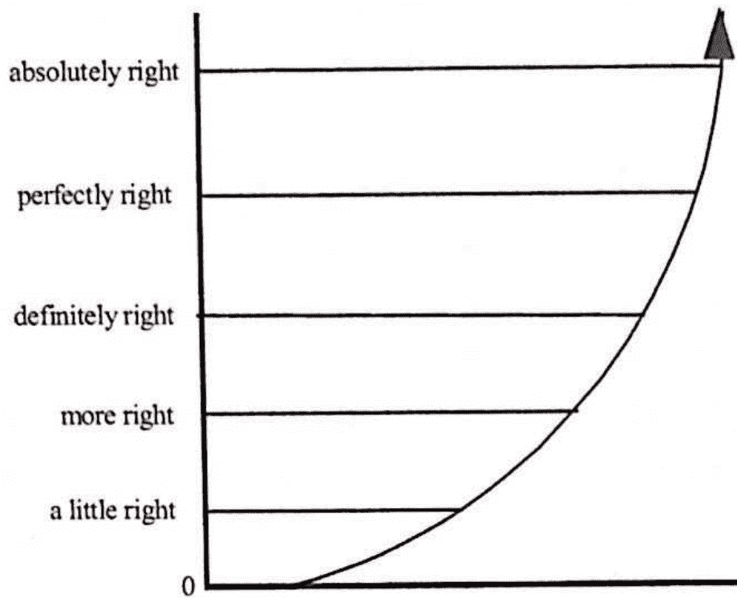

随着情绪强度的上升，人会越来越确信自己更 RIGHT。这一过程可以将人提升到傲慢（hubris）的境地。只有众神才能完美 RIGHT。因此，人可以得出结论：他与他的神平起平坐！与这一物理事实并行的，是一个强大的次要物理现象正在发生。它关乎一个人本体论的一致性变化，如下图所示：

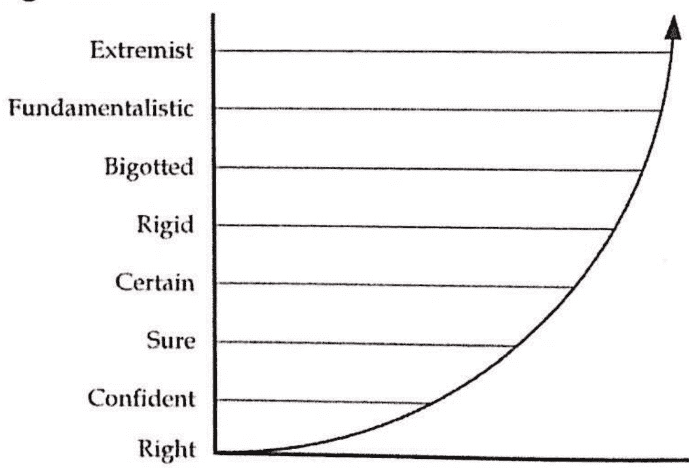

人可以在众多语义领域成为极端分子。有人可以从日本拉面成为极端分子，也可以在社会问题上成为极端分子。这是一条物理定律：

在给定条件下，人将飞升至傲慢。

这毫无疑问应当被纳入 DSM-5 的诊断中，但事实如此吗？答案是：尚未。当极端主义涉及宗教时，它便成为一个重大问题。原教旨极端主义固有的是一个人对其宗教信仰的热忱[^10]。当一个人在其宗教信仰方面完美 RIGHT，并拥有其神的 Imprimatur 和 Nihil Obstat 时，你能想到他为了传播信仰会做出多么不可思议的事情吗？这在西方文明中并非新鲜事。从其创立之初，我们就派遣了成百、成千、成千上万的人为信仰而死。其根源是引人注目的本体论行动：

DEATH to he who is WRONG.

我们的一位密友告知我们，今天，惊人的是，有些公司实体有其独特的准则，规定员工应当如何。并且对偏离这些准则的行为零容忍。

在此例中，我们通过还原论看到了一个新的丰富元程序，EMP。这是为了仅筛选一种偏好，而其他人可以通过其他选择来观察和筛选。与此类似的是通过专制 versus 民主来筛选。

正如我们所指出的，没有指标来决定 RIGHT 和 WRONG。其结果是，RIGHT 和 WRONG 对特定个体而言是独特的，或对特定文明而言是独断的。当掌权者处于权力地位时，这便成为一件极其严重的事情；因为他们倾向于对其他国家开战。曾几何时，在我们的文化中，强迫妻子贞操带是被允许的。在《利未记》和《古兰经》中，丈夫仍可体罚妻子。但在今天的西方，这是被禁止的。

在 Ã 的现实中，NSP 不关心 RIGHT 和 WRONG。NSP 关心的是 WELL-FORMEDNESS 和 ILL-FORMEDNESS。这些术语涉及一个人本体论的语义形式。它关乎那个人的存在/本体论方式中的意义。这也涉及事物（无论是动物、植物还是矿物）的语义形式。相对于其理想状态，比萨斜塔在其语义形式上并不规整。它正偏离其垂直轴。伊丽莎白一世号船是畸形的，因为今天，就其形式而言，它已沉没在香港港口。

**Well-formedness** 是关于与其自然功能相符的形式。当一个人为共同利益而生活时，其生活是规整的。当其生活是犯罪生活时，如美国、日本、中国、印度、加拿大等国的著名犯罪家族，则是 **ill-formed** 的。粗鲁可能会冒犯他人，但如果其形式传达真相，那么如同所有人一样，我们应当接受手掌的责打，就像我们小时候那样。

此处我们将你引向第 84 页，了解我们关于如何判定语义项目是否 WELL-FORMED 的指标描述。在此过程中，我们为你索引了替代方案。根本没有普遍指标来决定 RIGHT 是否正确，WRONG 是否错误。后者这些要素取决于个人（尤其是掌权者）的独断专行。

现在，我们来投票吧？
A [ ] 或 Ã [ ]

## 我们来到 A 和 Ã 的第七个逻辑层级：

### 论证 versus 信息

追求 JUSTIFICATION 唯一合乎逻辑的场所是 A 法庭，在那里，关于 RIGHT 和 WRONG 的冲突问题正在得到解决。只有在此语境下，疑问词 WHY 才找到了其真正而自然的位置。

我们今天都生活在 A 的体系之中。就此而言，在我们的世俗生活中，从过去直到现在，每个人都随心所欲地使用它的语言，从社会最高层人士到我们的孩子。它是最常用的自动疑问词，似乎任何人都可以随意提问 WHY。

我们对 WHY 的不加思考、随意和放纵使用已经习以为常，以至于今天我们没有意识到，当有人向我们提出这个问题时，实际上是在要求我们为自己的行为 JUSTIFY！对问题真正所指向的内容缺乏意识，将我们带到了奇妙的边缘。

今天，在 Ã 的现实中，互联网将我们带入了信息世界。希望是我们可以获取最高质量的无偏见信息。为了获得信息，我们必须知道如何提问，不是通过 WHY 而是通过 HOW、WHO、WHAT、WHEN、WHERE、WHICH、WHOM 和 WHOSE。在最近与一位去印记研讨会学生的互动中，当他被邀请使用任何 Ã 的疑问词时，他卡住了。因此，他无法用 HOW 构建问题。

当然，还有一个预设：一个人拥有规整的人生哲学和真正健全丰富的知识基础。如果他们没有，让我们祈祷他们能获得获取它的意愿。没有这样的信息收集基础，如何能提出好问题？

信息本身具有非常有限的功能。毕竟，1+1 = 2 本身有什么价值呢？我们确实意识到，幸运的是，我们摄入的信息，通过我们范式全息体系 + Anÿ9 的认识论引擎，被转化为有用的知识。这是关键的转折点。如果一个人有缺陷的、不规整的或畸形的 HOPs + Anÿ9，你可以看到，他将信息转化为有用知识的过程将是有缺陷的。立即，你现在可以感受到这样一个人生命价值的可怕损失。

现在，你如何投票？
A □ 或 Ã □

## 我们继续探讨 A 和 Ã 的第八个逻辑层级：

### 责备、过错与内疚 versus 好奇心、创造力与灵活性

指责、责备和内疚是生活中的正常体验。从某种意义上说，我们都是对此行之有素的专家。因此，我们不会讨论在日常生活范围内发生的责备、过错和内疚。

然而，关于责备的本质，有一件我们不知道的事。在 A 中，当仇恨、愤怒、狂怒和暴怒等特定情绪达到其语义阈值 ST[^11] 时，将不可避免地导致暴力。情绪只需略高于其 ST，就会导致杀死另一个人。

有趣的是，通过身体暴力杀人并非唯一方法。在凯撒统治时期，首选的微妙方法是施用毒药。直到 20 世纪，在西线战场、第三帝国灭绝营的毒气室，以及萨达姆·侯赛因对其什叶派异见人士的攻击中，才使用了这种方法。

如上文所述，责备在其动觉 ST 时，将导致身体暴力。但责备高出其 ST 一级，意味着：

### 人类战争！

我们希望与你分享一个非常关键的区别。当你怒火中烧、想要杀人时，你不能登上头等舱飞往塔希提。然而，当你处于动觉责备的 ST 时，你可以出席白金汉宫的国宴，同时为你的国家进行的杀戮仍在继续。

在 Ã 的现实中，我们享有那些富有洞察力的时刻，看到我们的孙子孙女通过他们持续的好奇心、创造力和灵活性来玩耍和学习。我们深感幸运，他们被赋予了这样的天赋。

我们发现，仅仅通过教导年轻人 RIGHT 的事情和 RIGHT 的思考和行动方式，他们的好奇心、创造力和灵活性就被埋葬了。他们变得像我们一样——不容忍且缺乏灵活性。

我们还发现，当我们向学生教授 NSP 核心研讨会时，他们会恢复这些神圣的天赋：CURIOSITY、CREATIVITY 和 FLEXIBILITY。然而，因为 A 尚未从人身上根除，两周后它会重新确立其对个人 HOPs 的治理权力，因此他的...

[^10]: 热忱：对 NSP 而言，关于美国和西方反恐战争，有趣的是双方完全忽略了战争真正的内容。它是针对热忱的。你如何赢得一场针对热忱的战争？除非受邀，否则我们不打算提供答案。顺便说一句，你是否立刻感觉到人们可能很愚蠢？

[^11]: 语义阈值，ST：所有情绪都会从零开始上升强度。当它们达到 ST 时，情绪不再是内在感觉。它将以其模拟形式表达。在戏剧《窈窕淑女》中，男主人公一直在抗议他对女主人公的爱，但那只是他的话语。最后，她向他唱道：SHOW ME。在 ST 以下，责备是一种内在感觉。在 ST 时，它变成其模拟形式。当它应用于整个国家时，那就是战争。没有人能用狂怒、愤怒或暴怒的情绪来进行战争。但通过责备，你可以维持一场战争多年。


认识论与本体论。当这种情况发生时，万物如故，唯此例外。此人知道他的神圣天赋仍在他之中。他现在想要的是从他的本体论中移除 A。

在比较 A 和 Ã 时，我们使用以下示例。一架飞机坠毁，许多人丧生。在 A 中，我们寻找谁该受指责和过错。谁有罪？在 Ã 中，我们审视发生了什么，以及未来如何改进以使飞行更安全？因此，在 A 中，当有罪的肇事者被找到并受到惩罚时，你的愤怒和沮丧情绪得到平息。而在 Ã 中，找到坠机的根源。法规、规程和技术得到改进。未来的生命得以挽救。

那么现在，你如何投票？

A [ ] 或 Ã [ ]

## 我们现在来到 A 和 Ã 的第九个逻辑层级：不容忍与傲慢 versus 尊重与无畏

在 A 中，如此容易被忽略的是这一关切，我们希望你能注意并铭记。如果有人身着贵族貂皮长袍的正义外衣指责他人，他实际上是在揭示他对对方的不容忍。将指责归咎于他人，只能意味着从他身上流露出他优越感的傲慢，这赋予了他指责他人的权利。在生活中，你不能责备：

- (a). 在地位、职位或权力上高于你的人
- (b). 与你地位相当的人
- (c). 你所爱的人
- (d). 你所尊重的人

从结构角度来看，如果对方在地位、职位或权力上低于你，不是你的平等之人，是你不爱¹²或不关心的人，以及你不尊重的人，那么他就是你指责的公开靶子。我们被告知，纳粹将犹太人视为害虫。因此，犹太人的命运已被纳粹对他们的这种心态所注定。

¹² 你不爱的人，唉，这并不完全准确。证据表明，我们也会责备我们所爱的人……或许甚至更甚！

在 Ã 中，是认识到我们并不了解对方。因此，在相互关系中，你不能从担忧、不确定、焦虑或恐惧的立场出发。我们必须从勇气和善意的姿态开始，并接受这样一个普遍真理：我们都需要清洁自己；这也是我们知道自己与对方平等的最终标志。如果是这样，那么我们只能从尊重和无畏的立场开始。我们在这里所说的话，在一个普遍的类比中得到了印证：

> 我们都会擦拭自己。

我们认识到，由于独特的创伤性生活经历，有些人相信自己不配或不够好。这反过来意味着，他们生活在担忧、焦虑和恐惧之中，害怕自己易受他人的嘲笑、戏弄、轻蔑或鄙视。在这种情况下，他们怯懦地相处，害怕他人对他们的看法。反过来，他们羞怯，并在社交互动中倾向于退缩。我们在这里引用的是 DSM-5 的诊断依据。

要了解你面前的人，需要警觉、觉知，尤其是良好的信息。现在你的任务是如何搭建桥梁与他建立联系；并帮助他站在桥的中间位置，看到那美丽的景色？

也有可能遇到与我们上面描述的相反的人。他们自负、傲慢、吹嘘。你无法逃避他们所属的类别，即：大我和伟大的我。

在这种情况下，你可能会在这样的人面前畏缩，并断然得出结论：你不想与他建立任何桥梁。然而，如果他是你工作上的上级，那么你就有麻烦了。

那么现在，我们如何投票？

A [ ] 或 Ã [ ]

## 我们现在来到 A 和 Ã 的第十个逻辑层级：SI、SE 和 自我 versus 自我价值。

如前所述，名词化是英语转换语法领域的一个术语。它指的是将动词或过程在心理上转换为名词或事物。示例如下：

- (a). 爱或热爱 名词化为 Love
- (b). 用餐或就餐 名词化为 Dinner
- (c). 杀害数十万人 名词化为 War
- (d). 飞行或飞翔 名词化为 Flight
- (e). 建造房屋 名词化为 Construction

显然，动词或过程是符合事实的，而名词或事物是脱离生活的。因此，感到沮丧是实际体验，而名词“抑郁”是心灵的产物，因此是脱离生活的。名词化（又称再物化）数量庞大。它们中没有一个存在于现实中。

## 比较 A 和 Ã

每个动词都有其名词化形式，在我们的 NLP 培训的一个阶段，约翰·格兰德向我们提出了这个问题：

> "什么是终极名词化？"

鉴于每个动词都有其对应的名词化形式，因此存在大量名词化。格兰德想知道的是，从语义角度来看，其中最反常的是什么。全班同学都拼命寻找答案。我们都失败了。最后，他告诉了我们。它是：

- I。

“I”是“存在”或“存在状态”的再物化。存在或存在状态是符合生活的。I 作为一个名词，是由心灵通过英语转换语法（ETG）的一种技巧创造的。它并不实际存在。如果它不存在，那么“你”也不存在。哎呀！因此，问题是你的存在是什么？你的真正本质到底是什么？只有在自由研讨会的第二天，这才会向学生揭示。另一种选择是从我们的书中获得答案：《永恒一瞥，永恒机会》。就此而言，回想起这一切令人难以置信。当摩西告诉上帝，他需要知道上帝的名字，以便告诉他的人民是谁派他去见他们时，上帝告诉了他自己的名字。它是：

> 我是我所是。

换句话说，上帝自称对摩西是：

> 存在或存在状态。

当然，我们在这里关于你的“我”所说的话很难接受；这意味着你要放弃很多东西——比如将自我重要性、自尊、自我主义和大量自我吹捧加诸其上的快感，其中最美味的是“我是对的”。或者，我们可以贬低和贬损我们的“我”，直到我们不再相信自己。这种愚蠢错误信念的代价是无法在生活中好好运作。

现实是，在我们生命的每一刻，我们都在*存在*。我们并不是在“我”-ing。在我们的*存在*中，有我们的*存在*，而*存在*就是*是*。这才是符合生活且符合事实的。生命最大的奥秘是*我们的存在*。它的研究是本体论和认识论学科的基础。时时刻刻，处处皆然，我们根本无法确切知道*我们将会如何*。

我们将它的*重要性*、*自尊*和*自我*，以及我们的*显赫与宏大的阈值*，都加诸于这个不真实的东西，这个“我”之上。

然而，有趣的是，我们最新的研究发现。为了能够在生活中好好生活和运作，这些*虚构变量* SI、SE 和 Ego 必须在一个人身上存在，理想情况下，在其在人体上的语义良好形成的范围内。这意味着，如果一个人要好好生活，SI、SE 和 Ego 不能被消除。当它们在一个人身上不起作用时，这构成一种独立的临床状况。因此，它们的缺失使人不完整或不完整。由此，对一个人如何生活以及他能在生活中实现、完成和成就什么，会产生负面后果。这种状况列在 DSM-5 中吗？答案是：不！

SI、SE 和 Ego 的移位是关键创伤经历的结果——身体、性、言语、情感和心理上的创伤。当它们被移位时，会在其位置留下一个类比标记。在恢复人体内 SI、SE 和 Ego 的治疗算法研讨会上，学生将学习在哪里寻找类比标记，如何修复 SI、SE 和 Ego，以及如何将它们恢复到其身体部位。

我们不能在此结束论述而不指出，“me”一词也是*存在*或*存在状态*的另一种名词化。我们目前的观点是，从语义上讲，“I”和“me”是同义词。


## 比较 A 和 Ã

理论上它们并不真实。然而，从功能角度来看，它们在我们的生活中扮演着关键角色。我们在此引用的悖论在汉斯·费兴格的著作《如若哲学》（Philosophy of As If）中找到了其逻辑基础。

有趣的是，锡克教认为所有人类罪恶中最严重的是 Ego。同样有趣的是，基督教信仰将骄傲列为七宗罪之首。基督教信仰如同锡克教一样，对过高的个人崇高感、对自尊的极度沉溺以及对个人 EGO 的不合理膨胀并不欢迎。然而，有些父母出于对孩子的爱，将他们捧上天堂的高处。这样做，他们把孩子培养成 BIG ME 和 GREAT I 的微型版本。当他们上幼儿园时，我们看到 ADD 的开端，随后它演变为 ADHD。这两种情况在西方学校已达到流行病的程度。

在早期基督教教会中，主教由神职人员选举产生，他们的住所非常简朴。然而，随着时间的推移，神职人员的条件和环境发生了变化。主教、大主教、牧首、红衣主教和教皇，无论过去还是现在，都住在最令人难以置信的宏伟宫殿中。我们很难看出这些人如何是耶稣（那个昔日木匠的儿子）的活生生的榜样。

一个非常有趣的现象是，现任教皇方济各拒绝居住在梵蒂冈的教皇公寓里。此前没有任何教皇做过这样的事。现在，你不得不思考：

- (a). 教皇方济各做出这个决定的依据是什么？
- (b). 他害怕什么？如果他住在教皇公寓里，最坏的事情会是什么？
- (c). 如果他住在那里，最好的事情会是什么？

注：为什么教皇不睡在他的教皇公寓里？

在 A 中，今天，在西方，SI、SE 和 EGO 这三位一体形成了一种统一，其珍贵程度甚至超过了咕噜的力量之戒。咕噜是《魔戒》中那个畸形、堕落、杀人成性的小妖精。

我们顺便提到，凭借本能的自我见证，人们知道那些珍视自己 SI、SE 和 EGO 的人似乎倾向于沉溺其中。当你拥有它并且它确实如此珍贵时，你会活在恐惧中，因为你知道现实世界中有人可以刺穿你的 SI，剥夺你的 SE 并践踏它，最后总会有人伤害你的 EGO。既然这些事情可以对一个人的 SI、SE 和 EGO 造成，这就说明了它们实际上是多么毫无价值。但就像咕噜的戒指一样，它们是 PRECIOUS 的，似乎没有人能挽回它们的损失。

根据我们的研究，我们发现有些创伤性事件确实能重创一个人的 SI、SE 和 EGO。当这种情况发生时，会使一个人陷入近乎无法弥补和无法恢复的创伤后应激障碍（PTSD）状态。因此，在对阿富汗的战争中，美、英、加士兵连队反复、骄傲且笃定地前往赫尔曼德省的各个目标地点攻击塔利班农民。这些连队的旗帜在进入时高高飘扬。随后他们被包围了。接着，令他们极度难以置信的是，他们发现自己正在与这些未受教育的农民为生存而战。这些人中没有一个甚至达到过安大略学校五年级的水平。现在遭受惨重损失，旗帜即将降下，连队必须撤退逃跑。当你不得不收起旗帜时，你知道那种丢脸的感觉吗；同时，通过你的行为，向这些没有你那样精良军事训练的阿富汗农民承认失败。这就是 PTSD 的军事根源。

2001年9月11日，纽约市的消防队勇敢地在全世界电视摄制组面前将生命置于危险之中。这些消防员目睹了他们的同伴和同胞的死亡。许多人做出了英勇的举动来拯救他人的生命。

然后，轮到那个不得其名的人收取他数十亿的保险金了。爆破装置被触发，世贸中心双塔倒塌。纽约市的消防队别无选择，只能撤退；而且他们必须在全世界的见证下这样做。你还会奇怪他们也患上了创伤后应激障碍吗？他们的无助和不幸是绝对且彻底的。这些是骄傲的战士。他们被留在了屈辱中。他们身处其中却无能为力。世界看到了他们的可怜境遇。

现在请考虑这一点。一对父母不得不埋葬他们的孩子，该孩子最终被发现，被绑架者强奸并杀害。你如何从这样的事情中恢复过来？这难道不是创伤吗？但这样的父母并不以患 PTSD 而闻名。他们以有意义且富有成效的方式继续生活。

幸存于癌症、中风或大面积心脏病发作，这难道不是一种难以置信的创伤吗？已知这些人会患 PTSD 吗？答案是否定的！他们庆幸自己还活着；并且他们尽力继续生活。

那么，这种差异的依据是什么？这是我们的发现。在赫尔曼德省士兵和纽约市消防员的案例中，他们被迫从属于他们的管辖权和来源中撤退，无法将其完成。在上面被谋杀儿童的例子中，该事件从未在父母的管辖权和来源之内。因此，对于前者，PTSD 是不可避免的。一个人内心 SI、SE 和 EGO 的缺失或丧失，会让他们感到不完整或不整体。这就是问题所在。对于后者，无法言表的悲痛是不可避免的。在著作《NSP 与人类蜂拥性》中将描述治愈该问题的算法。

幸存于癌症和中风等其他状况的人，会遭受创伤，但他们不会患 PTSD。他们对发生在他们身上的此类事件没有任何管辖权或来源的有意识认知。

顺便提一下，有些人遭受着执着之苦。佛教的基本教义之一是：如果你对任何事物——动物、植物或矿物——有执着，你就会受苦。支持这一逻辑的是：没有什么是永恒的。一切事物最终都会消逝。后一个结论出自《奥义书》，这是一部重要的吠陀经典。其中蕴含着能照亮你的人类智慧的精妙之处。这部文本的历史可以追溯到古埃及文字出现之前的几千年。这远在佛陀关于执着的教义之前。如果该物品是一件物质对象，你可能会意外丢失它，它可能会被偷走，你可能记不起放在哪里，它可能会被火烧毁或被打碎。最惩罚性和最具创伤性的、证实这一真理的事件是，当我们的祖父母、母亲、父亲、兄弟、姐妹、叔伯、姑姨、表亲、朋友和深受尊敬的老师去世时。

在 Ā 中，凭直觉每个人都知道 SELF-WORTH 是必须赚取的东西。一旦赚取，没有人能从你那里夺走它。这仅仅是知道你以谦卑的态度在所做的一切中尽了最大努力，无论结果如何。那么现在，你如何投票？

## 比较 A 和 Ã

A [ ] 或 Ã [ ]

### 我们现在来到了 A 和 Ã 的第十一个逻辑层级：回避所有自我责任 versus 接受所有自我-自我-回应-能力

在 C→E（又称 Y 导致 X）的世界中，寻找的是问题的 THE CAUSE。因此，当一个人被指控犯罪时，他的辩护律师只需找到一个合理的、促使他这么做的 CAUSE；如果他能成功论证该 CAUSE 的“真实性”，那么就解除了他对其行为的所有个人责任和问责。换句话说，找出是什么促使他这么做，就没有理性或逻辑依据来追究他对他最初实际上决定做的事情的责任或问责。那个促使他这么做的 IT，就是 CAUSE。

我们上面引用的就是所谓正常逻辑思维的公认模式。当然，NSP 对其逻辑的正当性深感怀疑。

因此，多年前，南美洲一次审判的陪审团同意这样的观点：正是 JEALOUSY 导致那个男人杀死了他的妻子。他被完全免除了罪行。更近些时候，埃德蒙顿的一个陪审团同意，正是 AUTOMATISM 导致一位阿尔伯塔社交名流向她丈夫开了六枪。一旦找到了 CAUSE，她就被完全免除了对其罪行的所有责任。

西方司法系统的游戏规则是找出你不法行为的 THE CAUSE；一旦找到，你在逻辑上就必须被免除对你行为的任何和所有责任。从前，它是：

- (a). 是魔鬼让我这么做的
- (b). 是恶魔诱惑了我


- (c). 这是我的酗酒
- (d). 这是我的可卡因或摇头丸与酒精
- (e). PTSD
- (f). Automatism
- (g). Brain Washing
- (h). Road Rage

你真的想让我们继续这个白痴名单吗？

人们总是可以将任何事情的责任或过错推卸给他人或其他事物。有些人天生就是这种直觉大师。然而，通过练习，任何人也都能将这种艺术形式提升到一个体面的门槛。

人类反应与人类回应之间存在巨大的区别。在人类反应中，变化并不涉及我们法律体系的任何要求，即法律体系会因我伤害施虐者而责怪我，并认定我因打断他的锁骨、两根肋骨和一只黑眼圈而有罪。因为袭击施虐者，我可能会被判处一年监禁。至于虐待小男孩的事，该男子是初犯，刑罚可能是六个月的社区服务。

最近有一则新闻称，一架美国无人机向ISIS营地发射了一枚地狱火导弹，在此过程中杀死了几名无辜平民，其中包括一名美国公民。奥巴马总统立即站出来说：我对此负责。

## Comparing A and Ã

这是一个高尚的姿态；仅此而已。在美国法律中，他从未被带到法庭，为他承认自己对一名美国公民的死亡负责而面对法律的正义。

在新加坡，法律的运作方式不同。以强奸案为例。因强奸罪，一名男子在强奸受害者的家属、其家属以及一组高级监狱官员面前，被抽了10下光臀部藤条。他以自私的沉默承受了前6下。到第8下时，他痛苦地呻吟并额头流汗而崩溃。随后他被送去服刑。在加拿大，作为初犯，他将被无情地判处250小时的社区服务。

我们可以举出许多关于在生活中为自己的行为承担责任意味着什么的例子。然而，我们确信你自己有很多可供参考的例子。

那么现在，你如何投票？

- A [ ] 或 Ã [ ]

## We finally come to the twelfth logical levels of A and Ã: MAD, MAD, MAD, MAD WORLD versus Einstein's Universe

当我们将A的语言整体与Ã的语言整体进行比较时，我们可以看到它们的差异，并且它们完全不匹配。反过来，我们发现的是，Ã的语言整体与我们所生活的现实结构相对应。A的语言整体则不。由于A是范式全体论的主导元范式，其后果是：

- (a). 非理性（unsane），正如AK首先指出的
- (b). 语义上畸形（semantically ill-formed），正如RB和JG宣称的
- (c). 疯狂（insane），正如JKSC和DKC所示
- (d). 站不住脚（untenable），正如休谟、柯斯勒、卡西迪等许多人所指出的

我们试图向你展示，因果关系，A，是我们疯狂、我们堕入原力黑暗面以及我们通过战争对亲朋好友进行大规模屠杀等物理现象的驱动力。即使在今天，也有新的战争和新的战争传闻。毫无疑问，NSP只能将WAR视为我们中的一种强迫症，OCD；在所有已知文明的记录中，这都是事实。

我们怀疑，如果事情继续按目前的方式发展，将会有第三次世界大战。它将始于两个国家之间微不足道的地方冲突。然后这些冲突将变得语气更加强烈，直到最终一方决定通过发射一枚不足一千吨（比广岛使用的小）的小型核弹来给另一方一个教训。立即，另一方将以相应威力的核弹回应。第一个发动核打击的国家感到自己未能教会对方必须学习的正确教训。于是，它发射了一枚威力更强的核弹。回应也是一枚更强的核弹。在此过程中，其余的我们带着苦笑的幸灾乐祸看着他们的愚蠢。

如果这两个国家在第三次世界大战中做得非常出色，那么他们将实现爱因斯坦的推测：当时间循环再次到来时，他们只能用石头、弓箭、投石机、长矛和希腊火进行战斗，前提是他们找到了配方。其余的我们当然将面临将降临全人类的核冬天带来的终结。

在爱因斯坦关于第三次世界大战的幽默中，有一个非常严肃的内嵌观点。这个内嵌观点涉及我们的认识论。在这个领域，我们关于战争的认识论被编码进我们的神经解剖学，并被排版进我们的DLS。由此，它将不可避免地展开我们的神经生理学和神经心理学，用于WAR。此事将在我们即将出版的作品中讨论：

## War
Our Inevitable Extinction
or
Our salvation

你脑海中可能掠过的逻辑问题是，我们大规模杀戮倾向的认识论硬接线是什么？除非我们知道它是什么，并知道如何切断电路，否则我们将注定陷入战争的本体论。这是独特的人类特征，因为其他物种绝不会以我们那样的宏大方式大规模杀戮同类。简·古道尔的工作表明，一群黑猩猩会攻击另一群，为了晚餐食掉其中一两个。但这不是对整个群体的大规模谋杀。他们这样做是为了他们的“塔塔牛排”。

尽管伟大的人类思想家（远比我们伟大的思想家）的鼓舞人心的教导，人类反复走向战争的结构基础是什么？伟大的鼓舞人心的教导相当于伟大静修中的布道，supposedly 旨在引导我们过上美好纯洁的生活。就我们所知，这些强大而伟大的布道从未改变过我们在这个领域的本体论行为。

因此，在索引我们在这个领域的认识论硬接线时，我们遗憾地向你保证，这个世界的终结是不可避免的。因此，我们的最终目标是如何更像其他物种，我们现在知道，在至少一个领域，它们明显比我们先进得多。
那么现在，你如何投票？

## Neuro-Semantic Programming

- A [ ] 或 Ã [ ]

在构建本章时，我们尽力不偏袒你的投票。我们留给你根据你的本土神经语言本能以及你对应该投什么票的神经语义直觉来决定。

我们希望你享受这个过程，尤其是在诚实地自我探索你会如何回应摆在你面前的论证时。

当你统计投票时，你将能够得出结论，哪个将是你生命的主导元范式。

无论它是：

- A [ ] 或 Ã [ ]

## Conclusion

似乎很久以前，我们最初偶然踏上了找出以下内容的任务：

- (a). 亚里士多德因果关系系统A的语言系统
- (b). 以及非亚里士多德相对性与关联性系统Ã的语言系统

我们从1978年到1983年才找出A的语言系统是什么。然后从1983年到1985年才找出Ã的语言。

不难记住我们在自己内部和彼此之间关于我们发现适合A的语言元素的关键辩论和争论。在其发现过程中，逐渐展开的是语言项目层级的初步雏形。这最终让我们卷入了关于为新发现的语言项目（用于展开的层级）确定位置的次要辩论和争论。

我们重申，A和Ã的语言元素或项目是多序术语。这意味着它们在语义上有无限制的应用。多序术语的一个简单例子是：like。我喜欢你喜欢这本书这一事实。一个人可以喜欢他的宠物山羊；也可以喜欢第150次重游尼亚加拉瀑布。

正如我们之前所述，正是在解开A和Ã的语言系统的过程中，构成了我们进入应用语言学领域的个人非预谋且无意的步骤。为此，我们感谢AK对我们生活的独特贡献。至于“非预谋无意的步骤”这件事，我们现在知道，这也适用于神经语义编程（NSP）的整个发现过程。我们作为这一惊人真理的见证者生活着：

> 上帝以神秘的方式运作。


在认知意识中，A 的语言系统并不为人所知。我们都在使用它，而且是不由自主地、无意识地、未经预谋地且得心应手地使用。其结果，凭自我见证，是我们通常不会掌控其发声的运作和机制。因此，我们根本没有意识到或领悟到，我们完全处于 A 的摆布之中。其元结果是，我们对其毁灭性后果毫无察觉；我们也看不到或感受不到其不足、缺陷和亏欠。之所以如此，是因为我们已完全适应、调整、习惯并完全顺应于它们。因此，一切似乎都显得 NATURAL、NORMAL 和 FINE。

自生实体是一个自足的完整整体。因此，作为活的整体，我们是自生处理实体。我们的生命处理是连续的。没有停顿。我们的新陈代谢和大脑处理没有休息日。我们内部没有任何静止的东西。我们内部的一切都是活的。如果有什么东西是静止的，那么它就会停滞并死亡。我们体内任何死物，如果不被我们生理过程清除，就会变得坏疽；并且它可能威胁我们的福祉，甚至我们的生命。

- 作为自生实体，我们是：
  - (a). 自我实现的
  - (b). 自我启动的
  - (c). 自我维持的
  - (d). 自我支持的

- 因此，我们是：
  - (a). 独立的
  - (b). 自主的
  - (c). 自治的
  - (d). 对自己拥有主权的

我们在此断言的是 NSP 的第一基本原理。如果这符合实际，那么人们在生活中匆忙奔波，对他人不支持他们而呻吟叹息，其逻辑依据又是什么？

## Conclusion

你认识有人天生带有神圣使命或议会法律颁布，注定在他一生中要支持另一个特定的人吗？

我们是逻辑和理性的存在。我们最初与生俱来，在我们之间可能会有误解和摩擦。最终，达成一致，LAW 将决定偏离程度（在感知层面）是否构成犯罪。我相信我是一个守法的人；并且我很庆幸我从未遇到过同堂会的中国士兵。

据说，我们每个人作为一个完整的 WHOLE，内心都有一种与生俱来的本能，以确保我们在肉体上生存。同样真实的是，作为一个集体、一个物种，我们也有生存的本能。那么，我们如何在逻辑上公然违抗这条自然法则并发动战争呢？在生活过程中，作为一个 WHOLE，我们会自动且持续地保持警觉和意识，即我们在政治和社会权力与影响力地位的上方正在得到改善、增强和美化；并且作为一个 WHOLE，我们会自动且持续地保持警觉和意识，即什么可能会在下方削减、否认或贬低我们的权力和影响力。显然，在最佳情况下，我们会被接受、受到尊敬和敬重。在最坏的情况下，我们会被同辈、家人和朋友拒绝、鄙视和排斥。

我们生活中的所有事件都是由我们的生命处理-在行动中产生的。然而，我们的语言化使所有事件都变成了心理项目——词语。例如，所有战争都是时间中和跨时间的可怕人类行为。我们的战争行为从来没有任何静止之处。然而，当我们说话时，我们说：

- (a). 伯罗奔尼撒战争
- (b). 拿破仑战争
- (c). 第一次世界大战
- (d). 第二次世界大战
- (e). 美国越南战争
- (f). 即将到来的第三次世界大战

以这种方式谈论此类事件，就是将它们当作名词来思考和谈论。战争不是名词或事物。它们是活的活动或过程。事实上，在战争行为中，它们是巨大的活动或过程。若将它们当作名词或事物来谈论，我们会立即将其视为无生命的；并且立即，会自动且一致地对正在发生的事情的规模进行心理上的简化和简约。当任何战争行为正在进行时，其中没有任何无生命之物。对于士兵和无辜平民来说，其中有杀戮、受伤、致残、痛苦和死亡。

如果对什么是名词化没有意识，那么它会自动被接受为真实事物。而这正是当今正在发生的事情。现在事情变得更加奇幻了。在 A 的现实中，名词化、名词、再物化成为结果的原因。一旦你接受这一立场，该人就完全免除了对他产生情感和行为的所有责任。大规模杀伤性武器是布莱尔和布什发动价值 1 万亿美元以上的伊拉克政权更迭战争的借口。大规模杀伤性武器是名词

## Conclusion

短语，是用来为开战推卸责任的名词化。而那个应该被指责的人逃脱了。同时，在美国，4000多万公民生活在贫困中，而且他们至今仍然如此。他们靠食品券生存，没有医疗保险。

我们是我们各部分或模块的总和。我们的模块化结合在一起并以连贯的方式运作。基于此并由此，我们感觉自己是一个理性逻辑的整体。这预设了一个总体驱动力。当前的驱动力当然是 A。当主导元范式没有很好地连贯时，临床医生就会面临一个患有多重人格的人的矛盾。将我们束缚为有感知统一体的力量或驱动力已经分裂为子单元。每个子单元现在相互独立地运作。这一现象最简单（如果不是最好）的例子出现在我们自身的个人生活经验中。我们内部有一部分看到去做 X 的美德；而它被一个持相反立场的部分所冲突：等等，不要那么仓促。看看事情如何发展，然后再决定。这种状况体现在肢体语言中。当他说“一方面”然后“另一方面”时，此人会通过手的自动无意识使用来展示这一点。这在 NSP 中被定义为冲突状态。在这种状态下，人无法行动，但是，一旦经过内部处理并找到答案，可能就有机会了。

医学，尤其是精神病学，曾假设通过我们的心理运作，我们具有抽象的能力。换句话说，我们有一个元功能，mf。这意味着我们可以对一个事件、项目、事业、企业或行动进行总结。让我们举个例子。你在墨西哥的巴尔塔港度过了一个非常美妙的假期。回来后，有人问你：“你的假期怎么样？”你回答说：“太不可思议了，食物、人们、地方和令人难以置信的太平洋日落。”你的回答是关于你假期的抽象，它是你对假期的总结。从 NSP 的角度来看，你关于假期所说的内容是你对假期的评价或意见。

这就是抽象能力真正所 ABOUT 的内容。它是为了获得一组词语，用来向他人讲述 ABOUT 考虑的话题。同样，一个 ABOUT 可以归入不同的类别，例如：

- 意见
- 结论
- 决定
- 推导
- 评价
- 自我评价
- 概念
- 判断
- 自我判断
- 想法
- 顿悟时刻

上述类别中的任何项目都是某事物的 ABOUT。因此，对任何事物进行 ABOUT 的能力在 NSP 中被称为元功能，mf。在心理学中，它被称为全局功能，在医学中，它被称为抽象或评价的能力。

鉴于我们可以拥有一个关于元的元，即关于一个意见的意见，由此可见，元功能具有无限性的属性。这体现在一些人的非凡能力上，他们在交谈中可以不停地关于他们的关于，谈论更多的关于，关于他们的关于。我们将这样的人描述为进入他的元层。对于听众来说，这成为一种忍耐的考验。然而，如果你有一个真正机智的讲故事者或喜剧演员，情况就不同了。那时你会祈祷并希望他不要停止。

是 AK 指出了：

> 关于一件事物的意见不能是它本身。

因此，几乎所有元意见都是徒劳的。例外是法官在审判结束时的结论，或法律合同中的书面元层。

心理治疗中的所有探索都是对作为人类的语法的探索，无论是形成良好还是形成不良，理智还是失常，逻辑还是非逻辑。换句话说，心理治疗是对结构的探索


## 结论

人本体论。当你使用大鼠进行研究时，你研究的是大鼠，而不是人类。在涉及人类以及由此延伸的人类事务方面，我们需要掌握的是情境的语法、群体的语法和当事人的语法。这与给定情境、群体以及该情境中最高负责人的本体论方程有关。

例如，你回到家，爸爸妈妈正处于激烈争吵的中间。你感到苦恼、害怕、悲伤和担忧。你的本体论变化是他们本体论冲突的函数。当他们和好并带你出去吃晚餐时，你的本体论变化是幸福的，它是他们本体论和解的函数。这些变化可以用方程或公式来描述。

例如，事物的价值可以发生变化。有些变化极其缓慢。因此，如果你将一块花岗岩放入洞穴中，其所有原子都会处于原子布朗运动中。总有一天，其中一个原子会与另一个原子碰撞，并从那块花岗岩的总体中被排出；它将永不返回。花岗岩的质量减少了一个原子。这需要漫长的时间，总有一天那块花岗岩将不复存在。这是物理学的一个事实。因此，如果没有风雨侵蚀过程，金字塔将遵循熵定律，S = k log W，总有一天它们也将不复存在。

在我们所处的、称为洛伦兹时空的时空连续体中，人和物理事物可以变化得快得多。这些变化的速度是我们能够感知和理解的。为此，我们可以区分这些变化；并且可以看到这些变化之间以及与我们之间存在着怎样的关系。

这些关系可以用方程来表达。

对于这个三角形：

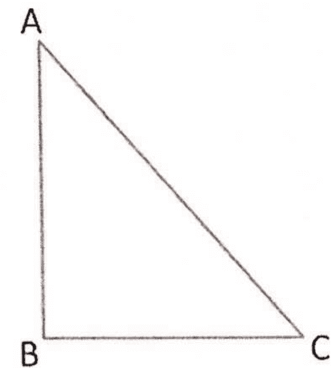

任何学龄儿童都能告诉你，边之间的关系是：

AC² = AB² + BC²

这个方程是数学领域中的物理定律。因此，它是各向同性的，并在宇宙任何地方都成立。如果 AB 是 4 厘米，BC 是 3 厘米，那么 AC 将是 5 厘米。

本体论方程有其最终结果，用以确认方程或公式的有效性。治疗飞行恐惧症的NLP治疗算法实际上就是应用一个方程或公式。其结果验证了该方程或公式。

因果关系，C→E，的元范式是我们所有人都遵循的东西。因此，我们的语言受此系统支配。在其语言元素的层次结构中，我们意识到每个层级都支撑着下一个层级。我们突然意识到，每个层级都在追逐英语语言中任何句子中的动词或动作。它质疑所使用的动词或动作的价值。它所寻求的价值是执行该动作的人的正当理由。

如果WHY的任务是寻求动作的这种价值，即其完全的正义性和充分的正当理由，那么如果一个人未能做到，指责、过错和内疚将随之而来。正因如此，人们认识到生活中存在“责备游戏”。现在你可以看到，责备游戏是责备框架的直接衍生物，即亚里士多德的因果关系体系，A。

在相对性与关联性的世界中，我们意识到每个人的思维方式都是独特的。在我们的DLS中，包含了构成我们语言结构的所有整体。任何语言结构都是语言的基本单位，包含所考虑语义项目的所有可能语言和词汇。语言结构的一个例子是CUISINE。该语言结构将拥有子语言结构，例如EUROPEAN CUISINE、NORTH AMERICAN CUISINE等等。在EUROPEAN CUISINE的子语言结构中，有子-子语言结构，例如ENGLISH、ITALIAN、FRENCH、DANISH和FINNISH CUISINES。

因此，在与他人就某个话题（即子-子语言结构，意大利菜）进行交谈时，你需要知道他是否处于相同的子-子-子语言结构，例如米兰式、西西里式或威尼托式烹饪。在交谈中，并不自动告诉对方他来自哪里。人们只是假设对方知道。既然一个人知道自己处于什么位置，那么他就知道-知道-要说他分享什么。一个人的问题是对方的子-子-子站点是什么。

当一个人进入例如意大利面食谱这样的子-子-子-子主题时，你现在可以看到知道食谱来自哪个子-子-子语言结构的重要性。换句话说，我们是在谈论米兰式、西西里式或威尼托式的不同种类的意大利面食谱吗。为此信息，一个人需要知道如何提出好问题。从NSP的角度来看，能够提出好问题是生活的必需品。一个好问题是：

- (a). 为你筛选出最高质量的信息
- (b). 揭开问题的真实本质。

在我们举办的一个教学研讨会上，一位男士与我们分享了一个无法按时完成上午预约的问题。参与听众的问题未能解决该问题状态。使用NSP，我们提出了一个恰当的问题：“谁安排你的预约？”那位男士得到了解决方案。

在任何情况下，例如婚姻、亲子、政治、商业或社交，能够出色地沟通是一项优势。要做到这一点，一个人需要知道对方来自哪种语言结构。有了这些信息，一个人在如何与该人接口方面立足于坚实的基础。没有它，我们实际上迷失在我们独特的想法和关于我们认为他处于何处的奇思异想的空中楼阁中。

英语语言中任何句子固有的可怕延伸属性是其歧义性。当一个句子具有歧义性时，它就可以被解释。你对它的理解可能与分享信息的人不同。你可能还记得在斯特拉特福举行的野餐以及是一天中什么时候的例子。

现在，基于我们上面所说的，你不得不思考，有魅力的演讲者如何能够让整个听众WOW和RAH-RAH？拥有如此不可思议演讲技巧的直接祖父当然是阿道夫·希特勒。你记得他在纽伦堡如何让所有人WOWED和RAH-RAHED。我们问你：

你认为正常理性的人允许自己以这种方式被飘送到他们的NEVERLAND是一件健康的事情吗？

这项工作的目的不是与你分享如何成为顶级WOW或RAH-RAH演讲者。有一种结构，通过掌握它，你可以成为这样的人。

我们对一个话题有自己独特的想法。这些独特的想法承载在我们独特的语言结构中。从我们独特的语言结构中，产生了我们关于该话题的独特句子、词语和独特的说话风格。正因如此，在同一个话题上，没有两个人会有相同的见解和角度。你是否曾与他人开始交谈，在交换了三四句话后，突然意识到你和对方在谈论完全不同的主题？我记得有一次我正在谈论交谊舞，突然意识到对方在谈论钓鱼！

正是因为英语句子中这种固有的歧义性，法律文件才如此冗长。任何优秀的NSP律师都知道，无论法律文件多么冗长，在试图清晰地阐明自身并超越任何反驳可能性时，他总能在其中找到一个漏洞。

有哪些可用于处理歧义的语言工具？这些工具是修改后的元模型、3M和无Y语言模型，~YML。你在哪里可以获取关于它们的信息？前者来自PAEIC，后者来自《力量研讨会手册》。

没有人仅仅通过阅读关于飞行的手册就能成为一名合格的飞行员。你需要一位老师，也就是飞行教练。因此，我们希望有一天你能参加力量研讨会第一部分和第二部分。当你这样做时，你将在获得卓越沟通技能方面迈出非常值得的一步。我们希望，从你对这里所写内容的阅读中，你会惊讶地意识到


沟通良好是一项后天习得的技能。而从未有人教过你如何把它做好。

你现在可以开始看到，DSM-5 中列出的所有人类问题状态，都是一个人 HOPs 内部语义运作中某些功能失调或异常的函数。进而，你可以看到，潜在的功能失调或异常数量可能多达数十万。心理治疗中目前繁多的治疗方式，正是我们在此所主张的证据。你不得不怀疑，任何制药公司是否有可能为所有当前诊断以及未来不断涌现的海量新诊断，发明出所有必要的药物。

那么，你现在站在哪里？你是属于以下哪个世界：

- [ ] 亚里士多德因果系统 A - 责备框架
- [ ] 非亚里士多德相对性系统 Æ - 自由框架？

如果你在上述选择中知道自己所处的位置，且是 A，那么我们无法为你做任何事。你已经身处其中，我们祈祷你能找到一种生活，使你摆脱：

- 恐惧与愤怒
- 焦虑与沮丧
- 痛苦与受苦
- 忧伤与泪水

但如果你希望从亚里士多德因果系统 A 转向非亚里士多德相对性与关联性系统 Æ，那么我们邀请你开始一段激动人心的发现之旅，学习如何做到这一点。

## 发现之旅

我们总是被教导，阅读一本书应遵循仁慈原则。对我们而言，书籍 *科学与理智：非亚里士多德系统与一般语义学导论，S&S* 是一部极其精彩且开创性的著作。S&S 初版时，曾被《哲学期刊》评论。评论者极不仁慈地将 S&S 描述为难以阅读。令人惊讶的是，当我们购买自己的副本时，它已经是 1980 年的第 4 版、第 6 次重印。当我们出版自己的作品 *别问 WH？！* 时，它曾遭到猛烈抨击，但 3 年内便进行了第二次重印。电影《星球大战》初上映时也遭到严厉批评，却最终一飞冲天。

丹尼斯在阅读理查德·班德勒和约翰·格林德的著作 *魔法结构，SOM* 后，思维已经发生了深刻转变。S&S 就像一枚火箭，将他推向一个充满奇妙理念与概念的新宇宙，并向珍妮弗介绍了这些内容。随后，他们共同针对这些概念，将其塑造成了这部作品。因此，在非常重要的层面上，我们的神经语义编程（NSP）发现归功于 S&S。正是出于这个原因，我们才以这样的方式撰写了这部作品的献辞。

> 的确，我们感谢 AK 为此。
> 这是我们永远无法偿还的一系列永恒债务中的一项。

如果，正如似乎已到时机，要向那些指导我们、帮助我们走到今天的人表示感谢，我们当然必须承认古希腊哲学家。在非常真实的意义上，正是他们找到了通往本体论与认识论的道路。正是他们为我们标记了这些研究，让我们得以跋涉、搜索、探索、发现、解开和探究。正是出于这个原因，我们现在承认他们，并为 NSP 赋予其希腊名称：

### 认识论

对他们，我们也欠下一笔永远无法偿还的债务。

如前所述，神经语义编程（NSP）的认识论，简而言之，是研究你如何：知道另一个人如何知道-知道-成为一个咬指甲者、口吃者、抑郁者、焦虑者、恶意者，等等。正是通过这种方式，人们才能获得关于：存在的本体论方程式（OnTEqN）的知识。

逻辑上，如果一个人了解另一个人的 OnTEqN，那么他就能打破或解开它。通过这样做，这个人将永远摆脱他的问题。这正是我们作为 NSP 创造者所做的。当然，在断言这一点时，我们意识到，我们正在向精神病学、心理学、心理治疗、催眠疗法、哲学、法律、科学和商业等领域提出一件似乎难以置信的事情。我们希望，通过这本书，他们能看到研究中广阔的新可能性；并且他们会在自己的领域开展研究。这样一来，他们自己就能解决那些是他们不可避免命中注定的人类本体论问题。

起初，我们不确定打破任何人的 OnTEqN 是否可行。当我们最初的探索步骤证实这是可能的时，我们感到如释重负。有了这些信息，我们发现，当一个人带着问题状态来找我们时，我们所需要做的就是：

- (a) 非常仔细地阅读和评估他的入档表
- (b) 仔细观察他
- (c) 精细阅读他，换言之，勾勒他

有了这些信息，我们就能确定他的过程诊断（pDx），即他问题本体论的诊断。这也是他的 OnTEqN。在这方面，我们需要注意 pDx 与 Dx 的区别：

- (a) pDx 关乎个人问题状态的本体论处理
- (b) Dx 是问题状态的名词或名词化形式

一个例子是抑郁症。抑郁症（Dx）是问题状态处理（pDx 或 OnTEqN）的名词或事物。因此，临床选择是：

- (a) 用药物治疗名词
- (b) 应用治疗算法来终止 OnTEqN（本体论处理）的运作

是亚瑟·考斯勒观察到：

> 我不愿赘述天才的殉难史；
> 本节标题所指的是一种非凡的
> 盲目形式，它常常阻止
> 原创思想者感知其自身发现的
> 意义和重要性。

亚瑟·考斯勒：《创造行为》，Arkana，企鹅集团出版，1964 年，第 216 页。

我们亲身体验了考斯勒式的洞见：

- (a) 我们对自身发现的价值和重要性视而不见
- (b) 我们未意识到我们工作的后果

其结果是：

- (a) 我们做出了明智的决定，让“盲人”从 1977 年到 2014 年不撰写这部作品
- (b) 我们被告知以下内容时，真正感到震惊：

> 你的作品超前于时代。
> 德怀特·达蒙
> 全国催眠师协会主席

> 你的作品远远超前于时代。
> 斯卡特·克劳德·李
> 卓越原则的创造者

我们感谢他们对我们作品的慷慨评价。我们希望他们能原谅我们，尽管我们真诚地向他们的判断鞠躬，但我们仍不确定自己是否配得上他们的评价。

现在，由于我们年事已高，我们以迫切的紧迫感撰写这部作品，将这些极其关键、重要的事项呈现给世界。在理想世界中，我们知道本可以在二十年前就写出这部作品。对我们而言，令人惊讶的是，通过现在撰写这部作品，我们知道我们还有大量尚未撰写的书籍。

神经语义编程（NSP）的上认识论，为学习提供了新的视野。为此，专门创办了一所学校。它就是不-为-主义学院¹。这是一所致力于帮助人们学习 NSP 的机构。即使在今天这个年纪，我们向您保证，学习新事物和有用事物的机会，幸运的是，永远不会结束。

¹ 我们邀请您探索本书末尾列出的关于 NSP 在不-为-主义学院的这些新学习机会。

## 术语表

**4-元组** 是视觉、动觉、听觉、嗅觉的术语。

**An⁹** 是指一个人的辅助生活指标。它们包括 1. 默认假设，2. 预设，3. 信念，4. 假设，5. 标准，6. 价值观，7. 准则，8. 道德和 9. 伦理。

**亚里士多德因果系统** 是一个强大的语言系统，其运作基于源自其哲学（称为因果律）的逻辑结构。它也是一个全面的生活蓝图，决定了你所有一般范式和特定范式的运作。

**自动症** 被认为是一种存在于现实中的实体。从未指明过其住所在哪里。它可以控制一个人，使他做坏事。从 NSP 的观点来看，这完全是胡说。然而，在英国的一个案例和加拿大的第二个案例中，它被提出为原告犯罪的原因。陪审团在两个案件中都接受了该论点。每个人都被释放，因为从逻辑上讲，被告不能为其邪恶行为负责或承担责任。
这曾是古老论点的重演：*魔鬼让我这么做*。

**自生自发** 是有感知实体的属性，该实体是自主和自治的。它专注于确保其在环境中持续的权力和影响力的任务。它也警觉并意识到任何可能削弱其权力和影响力的变量。

**菩萨** 是一个拥有洞察力，能照亮他人生命的人。曾几何时，奴隶制是普遍的。然后有一天，一个人向世界提出：*爱人如己*。这个想法就像一颗种子。随着它的传播和生长，它照亮了人类，让人们看到奴隶制必须结束。在我们的工作中，我们只能帮助人们停止吸烟、酗酒和成瘾，因为我们可以照亮他们来终止它。

**菩萨式的** 是源自其名词的形容词。


### 深层语言结构，DLS

深层语言结构，DLS，是大脑中持有所有表层结构项目的实体。在大脑中，所有表层结构项目都以二进制代码形式存在。

### 深层语言结构项目，DSLI

深层语言结构项目，DSLI 是现在以二进制代码形式存在的表层结构项目。因此，它们被称为心智芯片，心智芯片。

### 深层结构，DS

深层结构，DS 是一个歧义术语。一种歧义，语言学中的 DS，是将所有表层结构感官项目带入 DLS（深层语言结构）的装置。

它的另一种歧义，是向我们每个人展示我们共同现实中一切的装置，无论我们是否理解。让一位牛津大学英语学士（BA Oxon）坐在天文望远镜指向仙女座星系的座位上。通过深层结构，他会看到它。如果你把一个被野狒狒抚养长大的野孩子放在同一个座位上，通过他的深层结构，他也会看到仙女座。

然而，虽然一位牛津大学英语学士看到面前的物品是一把柯尔特45左轮手枪并知道它是什么，但野孩子不会知道那是什么。

### 自我

自我是拉丁语中“我”的意思。对于西格蒙德·弗洛伊德，它是“一个人想要成为的自己的内在形象”。根据我们的生活经验，我们从未产生过自己想要成为的内在形象。我们是按照以下方式生活的：

- (a) 霍勒斯的结论：你可以用干草叉戳人性，但它总会回来。
- (b) 我们认识到，我们的 HOPs + 焦虑将决定我们的人性，包括其所有缺点、失败、缺陷、毛病和不足。

接纳自己的人性是一件真正令人谦卑的事。

### 脑电图研究，EEG

脑电图研究，EEG，是对大脑活动的研究。放置在头骨上的电极可以捕捉脑电波。在一个人身上，它们的频率和波长会随一天中的时间而变化。

### 委婉化

委婉化是我们的新造词。它涉及一种语言艺术形式。与其使用粗俗、刺耳、无礼、粗鄙、低俗的词语，不如使用文雅有教养的语言。以下是一个例子。与其大骂：杂种，你真的把我搞砸了，不如考虑这个替代表达：你的私生子身份不是问题。但我必须告诉你，你真的可以如此不公平地为难我。

### 函数

函数：在数学中，这个词写作 f(x)。它可以指关系、作用、用途、价值、动作或其工作。因此，金钱、杠杆、汤匙、筷子的函数，是指该项目在一个人与另一个人、一件事物或一种情况之间的作用。

### 几何或位置标签，GT 或 PT

几何或位置标签，GT 或 PT：所有带有 GT 或 PT 的心智芯片都将位于大脑的某个部分，该部分的功能侧化以处理操作的格式塔。一首诗、一份乐谱、一个数学定理都是格式塔的示例。

### g_zero

g_zero 代表零值/强度的重力。

### HOPs

HOPs 代表范式全相体。

### HBP

HBP 代表人脑计划。

### IL

IL 代表非正式逻辑。

### ISSCs

ISSCs 代表内部符号语义代码。这是描述 mcs 的另一种方式。

### 语言结构，LS

语言结构，LS 是一个文件/柜子/指定/标签，用于考虑的主题，该主题拥有/包含/持有所有语义材料和整个词汇表，LS 的所有者从中获取关于给定主题的所有想法、写作和口语。

### LSs

LSs 代表语言结构。

### LtB

LtB 代表左脑。

### LoG

LoG 代表神之光。

### mc

mc 代表心智芯片。它是通过特定感官系统获取的信息项目。它以二进制代码存储在大脑中。以这种形式，获取的项目被称为心智芯片。

### mcs_TT/GT

mcs_TT/GT 代表带有 TT 或 GT 的心智芯片。

### muons（缪子），µ⁻s

muons，µ⁻s，是我们的新造词，用于代表情绪单位。这样的单位在现实中并不存在。它是一个理论概念，创建它是为了促进交流和理解。

### 多源术语

**多源术语** 是英语中的一个术语，在广泛的语境扫描中具有语义位置和价值。我们提供五个示例：

- (a) like：你可以喜欢大量的项目
- (b) yes：你可以对近乎无限的项目说 yes
- (c) love：你可以喜欢一大堆蔬菜、动物、矿物、想法和情境
- (d) no：你可以对任意数量的项目说 no
- (e) present：你可以将其用作动词或名词，每种用法都可以在不确定数量的情境中，对任意数量的人使用。

### 裸体心理治疗

**裸体心理治疗** 是一种用于性治疗的心理治疗形式。

### OnTEqN

**OnTEqN** 代表本体论方程。它是决定一个人在任何给定时间和情境下独特思考和存在方式的方程。它是思考/元思维的序列。

### 范式

**范式** 是蓝图、地图、计划或设计。

### 还原论

**还原论** 是指将语义项目剥离到其结构核心的行为。问题是，这可能无法以规范和准确的方式完成。结果是，最终产品是对原始内容的异常和不准确的扭曲。

### 语义范式

**语义范式** 是一种用于理解大型待考虑语义领域的蓝图。

### 表层结构

**表层结构** 是你实际看到、听到、感觉到、尝到和闻到的东西，而不是你对面前物品的称呼。当你在教室里，正前方的物品的表层结构是什么？你会说：黑板。那不是你看到的。你看到的是一个形状。它是一个矩形。它的边缘颜色与边缘内的内容颜色不同。边缘内有一些白线。有些部分比其他部分更暗。那么，当你站在尼亚加拉瀑布前时，声音的表层结构是什么？当你触摸我手掌的皮肤时，表层结构是什么？

### 优越感

**优越感** 是递归地将自己视为比他人更好、更伟大、更崇高的行为。这是一种个人专断的行为。该人没有正式权威这样做。

### 创伤后应激障碍，PTSD

**创伤后应激障碍，PTSD：** 这是一种精神障碍，当事人经历了一次打击，之后无法像数亿其他普通人那样继续其平均生活。数百万其他普通人必须过的平均生活是什么？谋生、纳税、解决生活中的日常问题、面对日常挑战并克服日常障碍、抚养子女并听从妻子的话。

### 理查德·班德勒，RB，和约翰·格林德，JG

**理查德·班德勒，RB，和约翰·格林德，JG** 是神经语言程序学，NLP 的联合创始人。

### 右脑，RtB

**右脑，RtB：** 我们都有两个大脑半球。右边的那个被称为右脑。在这本作品中，我们将其缩写为 RtB。

### 二阶改变，IIOC

**二阶改变，IIOC：** IOC 或一阶改变是一种睡眠体验，其中经历一个又一个噩梦的变化。IIOC 是醒来。IOC 是以这种或那种方式翻修房屋。IIOC 是将其拆除，建造一座新的建筑师设计的四层楼房，配有内部电梯和屋顶太阳能电池板。

### SDB

**SDB** 代表感官数据库，意思是大脑中我们定位视觉、听觉、动觉、嗅觉和味觉信息的位置。这些字母代表 SDB 的不同感官 - V、A、K、O、G。

### 时间函数，Tf

**时间函数，Tf** 代表我们与时间一致的心理操作。语言由 Tf 进行。在一个句子中，第一个词应处于第一个时刻。语法决定下一个词的时刻，以此类推，直到句子完成。语法决定句子中动词的时间和动词宾语的时间。

### 时间或时标，TT

**时间或时标，TT** 是用于感官项目的标签，该项目将位于大脑中，该大脑功能侧化以处理顺序操作。因此，跳舞是一项非常复杂的活动，需要一步接一步，前提是你有舞蹈的 TTs。直到今天，我们仍然遗憾我们没有阿根廷探戈的 TTs。


## 神经语义编程

TG 代表转换语法。一个句子在逻辑上源自前一个句子。因此，它是前一个句子的转换。为此，语言学中的所有句子都被称为语言转换。理解一个句子的唯一方法是拥有该句子的转换语法。这是由 MIT 的诺姆·乔姆斯基发现的一项研究。

ULR 代表通用逻辑记录。在 ULR 中包含了你按逻辑顺序存储的所有信息和数据的全部内容。

UPR 代表通用物理记录。UPR 代表一个人所获得的所有信息和数据，这些信息和数据按其被看到、听到、感受到、闻到和尝到的方式存储。

零容忍代表绝对的不容忍。在西方哲学和神学中，“绝对”是神的事，而不是那些每天至少要擦拭自己一次的实体的事。这一点由以下教导所支持：

> 你们中谁没有罪，谁就可以先拿石头打他。

## 缩写

- C→E 因果效应
- f 函数
- PT 位置标签
- LOG 神之光
- JG 约翰·格林德
- DS 深层结构
- GT 几何标签
- LfB 左脑
- mcs 心智芯片
- RtB 右脑
- 4 元组 视觉、听觉、觉知、嗅觉
- DLS 深层语言结构
- An⁹ 辅助九项
- DLSI 深层语言结构项目
- EEG 脑电图
- LS 语言结构
- mcsₜ/ₚ 特定时间和地点的心智芯片
- ISSCs 内部符号语义编码
- Onᵀᴱqᴺ 本体论方程
- Onᵀʰᴹ 本体论定理
- PTSD 创伤后应激障碍
- IOC 一阶改变
- IIOC 二阶改变
- SDB 感官数据库
- TT 时间或时间标签
- TG 转换语法
- ETG 英语转换语法
- ULR 通用逻辑记录
- UPR 通用物理记录

## 索引

- 4 元组 61
- 命运之举 196
- 适应、调整、惯常化并最终适配 199
- adhd 52, 173, 232
- 阿尔弗雷德·科日布斯基 iii, 1, 13, 14, 48, 80, 85, 97, 100, 131, 133, 163, 196, 205, 206
- 歧义 252, 253, 256
- 含糊的 53, 252, 256
- 动物性阻塞 85, 87
- 应用语言学 45, 55, 56, 57, 58, 73, 109, 243, 273
- 树状的 99
- 阿瑟·科斯特勒 3, 191, 197, 207, 269
- 依恋 235
- 依恋 235
- 自动化 237
- 自我产生的 3, 14, 50, 104, 156, 244
- 意识 six, 9, 18, 19, 28, 37, 64, 70, 82, 98, 107, 116, 159, 166, 168, 193, 225, 229, 235, 244, 246
- 大我 56
- 二进制语言 9, 28, 57, 62
- 责备 120, 122, 198, 208, 226, 250, 254
- 生命蓝图 2, 16, 80
- 菩萨 72, 73
- 布朗运动 249
- C→E 4, 38, 47, 48, 49, 50, 54, 97, 98, 100, 101, 102, 103, 105, 108, 109, 110, 114, 121, 130, 138, 140, 141, 142, 143, 154, 160, 180, 186, 189, 193, 194, 195, 199, 203, 204, 205, 208, 212, 217, 218, 219, 220, 236, 250, 251
- 原因 49, 100, 108, 138, 142, 145, 193, 205, 212, 236, 237
- 因果关系，一个 4, 13, 18, 38, 39, 47, 54, 97, 99, 130, 193, 213, 239, 243, 251
- 确定性 76, 101, 161, 176, 217, 219
- 有魅力的演讲者 252
- 国际象棋 209
- 黑猩猩 91
- 冲突状态 247
- 意识 ix, 18, 19
- 胼胝体 29, 63, 71
- 创造力 174, 198, 226
- 好奇心 174, 198, 226
- 控制论环路 54, 76
- 控制论 144, 198, 203, 210
- 达芬奇密码 77
- 记忆诅咒 221
- 黑暗面 35, 38, 43, 48, 103, 208, 239
- 原力的黑暗面 38, 43, 48, 103, 239
- 大卫·C·卡西迪 209
- 大卫·休谟 48, 100, 205
- 死亡营 227
- 深层语言结构 25, 60, 61, 62, 64, 66, 195, 256
- 深层语言结构，dls 60
- 默认假设 70, 75, 155, 255
- 丹尼斯·K·崔 & 珍妮弗·K·崔 208
- 精神障碍诊断与统计手册，dsm-5 6
- 诊断 7, 40, 195, 219, 223, 253
- 解离 35
- 扭曲 80, 142, 178, 203, 204
- dls 25, 30, 60, 61, 62, 64, 66, 71, 195, 240, 251, 256
- 不要问为什么？！ 13, 30, 208, 267, 275
- 唐纳德·特朗普 102, 149, 200
- dsm-5 x, 40, 51, 52, 76, 82, 93, 102, 116, 124, 161, 176, 187, 195, 219, 223, 229, 232, 253
- 德怀特·达蒙 269
- 利己主义 231
- 爱因斯坦 xii, 65, 101, 148, 152, 188, 190, 191, 198, 202, 209, 210, 239, 240
- 权利 112, 160, 218, 219
- 认识论硬接线 240, 241
- 认识论 viii, ix, 1, 2, 5, 149, 227, 231, 245, 267, 273, 275
- 埃斯代尔状态 42
- 委婉化 200
- 期望 39, 111, 112, 160, 193, 218, 219
- 主观的结构/织构 viii
- 过错 120, 198, 208, 226
- 一阶改变，ioc 7, 93
- 第一、第二和第三基础 95
- 灵活性 174, 198, 226
- 飞行恐惧症治疗 ix, 7
- 自由框架 196
- 函数 5, 10, 11, 58, 62, 75, 76, 90, 106, 107, 123, 126, 137, 138, 140, 151, 155, 156, 157, 161, 162, 165, 193, 204, 211, 212, 214, 224, 231, 247, 248, 249, 257, 259
- 气体室 227
- 道格拉斯·A·麦克阿瑟将军 199
- 一般全相体 3, 16
- 一般全相体，ghs 3
- 一般语义全相体 16, 17
- 一般语义学 1, 11, 13, 14, 47, 89, 97, 144, 205
- 生成 28, 48, 56, 60, 93
- 生成 70
- 几何标签 27
- 几何动力学 144, 146, 188, 198, 203, 210
- 杰拉尔德·霍夫南 217
- 咕噜 233
- 大我 56, 173
- 希腊哲学家 iii, viii, 1, 2, 32
- 内疚 120, 198, 208, 226
- 汉斯·费兴格 232
- 哈利·波特 xi, 172, 211
- 海森堡 208, 209
- 高级物理学 141, 149, 150, 152, 153, 208
- 稳态机制 41, 42
- 霍华德·休斯 218
- 人类战争 227
- 催眠 vii, ix, 37, 120, 273, 275
- 催眠的 ix, 37, 191
- 批准 223
- 不可能性 209
- 不可能的 160, 217
- 天空的难以置信的恐怖 211
- 强度 26, 29, 34, 38, 42, 58, 90, 116, 125, 166, 176, 221, 222, 226
- 内部语义符号编码 28
- 不容忍 17, 124, 125, 175, 228
- irossempfmisst 203
- 詹姆斯·奇 213
- 简·古道尔 240
- 约翰·格林德 iii, x, 1, 13, 31, 47, 53, 61, 65, 103, 120, 121, 131, 207, 230, 259, 267
- 约翰·列侬 210
- 约翰 viii 221
- 约瑟夫·坎贝尔 50, 209
- 朱迪思·德洛齐埃 x, 1
- 理由 49, 106, 112, 117, 118, 137, 171, 174, 208, 214, 225
- 知道一个人如何知道-知道-存在 ix
- 知道-存在 viii
- 知道-知道-存在 i, x, 95, 102, 148
- 拉普拉斯 208
- 熵定律 249
- 物理定律 47, 52, 54, 55, 59, 80, 147, 148, 149, 195, 204, 210, 222, 250
- 物理定律 114, 141, 143, 146, 147, 148, 149, 151, 152, 153, 154, 160, 183, 212
- 神圣法则 209
- 莱斯·戈尔德 215
- 莱斯利·C·班德勒 1
- 边缘系统 11, 63
- 语言转换 58, 260
- 语言良构性 ix
- 小皇帝 55
- 洛伦兹的 xiii, 36, 249
- 制作的 107, 108, 114, 115, 143, 211, 236
- mcs_tt/gt 71, 72, 73
- 心智芯片 62, 257
- 精神障碍 x, 7, 40, 87
- 梅萨 35
- 元 ix, 4, 16, 18, 35, 36, 39, 54, 73, 97, 164, 201, 223, 239, 241, 247, 253
- 元函数，mf 11, 248
- 元语义全相体 18
- 元语言 ix, 163, 164, 165, 216
- 动机 236
- 珠穆朗玛峰 75
- 多源术语 84, 85, 86, 243
- nasa 218
- 神经解剖学 240
- 神经语言程序学 ix, x, 1, 2, 13, 47, 53, 144, 206
- 神经生理学 240
- 神经心理学 240


神经语义编程，nsp i, x, 1,
21, 48, 89, 243, 267, 268,
270, 271
无障碍 223
名词化 230, 232, 246, 268
名词化 41, 230
不被任何人冒犯 219
nsp 与正统的结构及其后果 95
裸体心理治疗 51
强迫症 239
黑曜石 99
德尔菲神谕 200
正统 75, 76, 77, 79, 84, 85, 87, 89, 92, 93, 95, 98, 142, 156
监督 13, 98
古生物学与谱系学的先祖 98
范式 3, 4, 17, 32, 48, 59, 69, 77, 89, 160, 226, 239, 255, 257
pc 65, 79, 175, 199, 200, 212, 215, 219, 221
“仿佛”哲学 232
政治话语 200
政治正确 17, 50
福尔摩索教皇 221
英诺增三世教皇 77
力量研讨会 113, 253, 271
哈里·S·杜鲁门总统 199
骄傲 124, 125, 126, 228
心理治疗 vii, viii, 6, 51, 52, 76, 87, 93, 131, 248, 253, 258, 268, 271, 273
ptsd 52, 234, 235, 237, 259
品质 29, 34, 35, 73, 108, 116, 157, 170, 171, 172, 185, 225, 251
量子物理 101, 150, 154, 209, 210
助威 252
存在理由 246
现实/体验 viii
还原论 223
关联性 131, 134, 154, 188, 189, 202, 215
相对性 xii, 4, 14, 18, 39, 54, 131, 134, 154, 157, 162, 188, 189, 190, 198, 199, 201, 202, 203, 204, 209, 215, 243, 251, 254
资源 99
理查德·班德勒 iii, iv, x, 1, 5, 13, 31, 47, 50, 61, 65, 103, 120, 131, 207, 259, 267
正确 15, 75, 82, 83, 98, 113, 114, 115, 116, 117, 118, 121, 142, 155, 156, 165, 166, 167, 169, 170, 171, 175, 176, 178, 190, 208, 220, 221, 222, 223, 224, 225, 227, 228, 231, 239
罗伯特·迪尔茨 x, 1
s = k log w 249
圣地亚哥理论 138, 201, 202
科学与理智 13, 85, 131, 133, 163, 196, 206, 267
斯卡特·克劳德·李 269
二阶改变，iioc 7, 93, 94

秘密百万富翁 197
自尊 124, 125, 126, 184, 231
自负 124, 125, 126, 184, 231
语义全序层，shs 3, 77
语义内部状态 20
语义核 69
语义阈值 42
语义上畸形的 13, 14, 47, 53, 87, 103, 112, 139, 148, 206, 239
感官数据库 61
应该 110, 111, 112, 113, 114, 118, 160, 193, 208, 218, 219
特定全序层 4, 16, 17, 18
优越感 228
表层结构 60
表层结构 25, 62, 66, 258
句法方程 39
挑战者 218
对立面的现实 50, 209
软件 32, 59, 69, 88
不确定性原理 208
维也纳国家歌剧院舞会 57
勾股定理 23
狭义相对论 xii
治疗 52
时间标记 27, 66, 259
知—知—存在 viii
tote 15
超导出 11, 28, 64, 65
转换语法 24, 53, 61, 62, 63, 64, 144, 260
不确定的 160, 217
通用逻辑记录 27, 67, 260
通用物理记录 27, 67, 260
未知 154, 218
变量 89, 90, 138, 231
弗吉尼亚·萨提亚 181, 214
大规模杀伤性武器 246
人的工作 196
世界金融崩溃 56, 87
哇 252
错误 15, 76, 82, 83, 113, 114, 115, 117, 118, 128, 155, 156, 165, 167, 169, 171, 190, 208, 220, 221, 223, 224, 225
热情 77, 90, 115, 223
零容忍 176, 223


## 迈向 NSP 的道路

## 神经语义编程，NSP 元认识论

## 不-Y 学院：

这是一家合法设立的教学学校，其母体授权实体位于美国。该学校可颁发以下认证：

- 从基础级到大师培训师级别的 NSP
- 从基础到大师级别的 NSP 沟通
- NSP 与提问及如何提问
- 从基础到大师级别的 NSP 催眠疗法
- 从基础到大师级别的 NSP 心理治疗
- NSP 与正常性 versus 异常性
- NSP 与如何逆转癌症
- NSP 与魅力
- NSP 与魅力和公开演讲
- NSP 与 IROSSFMISsTEMPs
- NSP 与人际关系
- NSP 与等等

## NSP 简介。

以下是所有候选人必须参加的核心 NSP 研讨会：

### 第一级：

- 自由研讨会
- 去印记研讨会
- 力量研讨会 I 和 II

## NSP 入门研讨会的价值、效益与益处

NSP 核心研讨会带来的价值、效益与益处列于各研讨会的手册中。每个研讨会开始时，主持人会宣读每个人将获得的益处清单。研讨会结束时，会邀请一位代表全班人员。随后会询问他能否确认自己在认知和类比体验中拥有这些益处。

这些研讨会自 1983 年起便已提供。上述测试的证据和受邀的推荐证言证实了 NSP 入门研讨会的价值、效益与益处。

### 第二级

- 不-Y 研讨会，I 和 II
- 如何提问研讨会

### 第三级

- IROSSFMISsTEMPS

### 第四级

- 基础神经语义编程
- 大师神经语义编程

### 第五级

- 神经语义编程培训师
- 神经语义编程大师培训师

## 咨询

如果您希望了解这一新兴研究领域，可以：

- 电话：905 844 0864
- 传真：905 844 3212
- 查看我们的网站：http://neuro-semanticprogramming.com/

## 作者

Jennifer 和 Dennis Chong 从 1979 年至今一直共同执业心理治疗和催眠疗法。在此期间，他们无意中将执业转变为一个关于本体论及其后继学科认识论的奇迹与特殊性研究实验室。

这使他们涉足应用语言学、应用哲学、形式逻辑、非正式逻辑、非语言语言、科学、句法、语法、语义学、宗教、系统、结构、人际关系、人工智能、人类沟通、分形和混沌理论等领域。这进一步将他们的知识基础扩展到法律、道德、伦理、博弈论、计划和归纳等领域。

两人均为安大略临床催眠学会、全国催眠师协会的特邀演讲者，及其期刊《催眠》的撰稿作者。

他们是国际咨询师与治疗师协会的特邀研讨会演讲者，及其期刊的撰稿作者。他们是国际医学与牙科催眠治疗协会的研讨会演讲者，及其期刊的撰稿作者。他们是美国心理治疗委员会的特邀演讲者，及其期刊的撰稿作者。

他们曾在加拿大、美国、英国、西班牙、意大利、德国、澳大利亚、香港和马来西亚的各类学院、大学及专业论坛上演讲。

两人均为神经语义学会和美国心理治疗委员会的会士。Jennifer 是国际医学与牙科催眠治疗协会的会士；Dennis 是国际医学与牙科催眠治疗协会的持证会员。2017 年 5 月，Dennis 入选催眠名人堂。

他们曾受到同行的荣誉，获得一系列奖项。他们在此列举其中几项：

## 神经语义编程

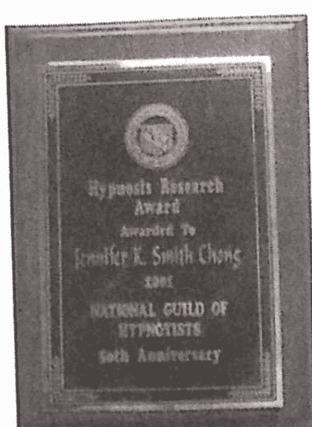


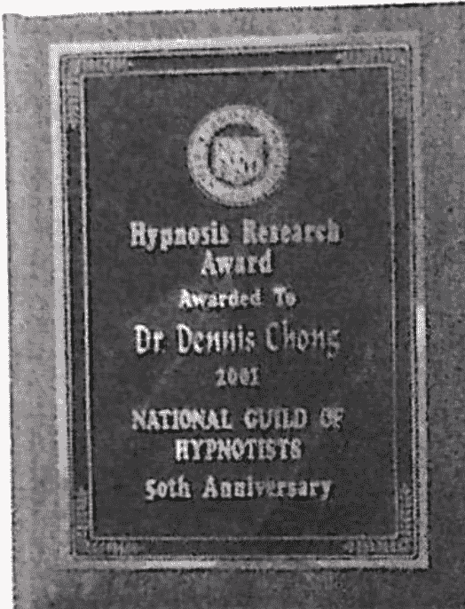


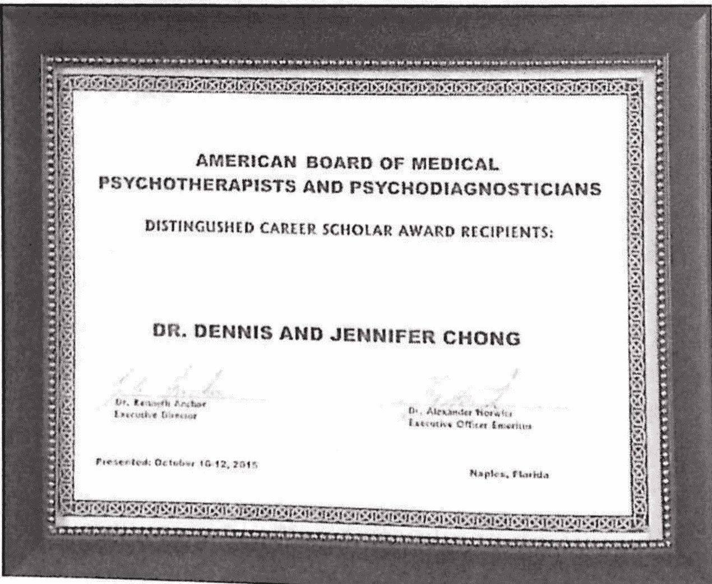


## 即将出版的作品

我们不可能预先有意识地思考过我们现在与您分享的内容。

撰写这部关于认识论的著作直接让我们意识到，我们将要撰写这些书籍：

- 不要问 WHY？！（修订第三版）
- 育儿，艺术与科学
- NSP 与政治
- 人类的蜂狄性，一种 NSP 的心理治疗方法
- 人类的蜂狄性 II
- NSP 与法律
- NSP 与执法
- NSP 与宗教
- NSP 与贪婪
- NSP 与人际关系
- NSP 与企业层级
- NSP 与宗教层级
- 阅读、勾勒与校准
- 催眠与催眠疗法的 NSP 方法，第 I 卷
- 催眠与催眠疗法的 NSP 方法，第 II 卷
- 从前有一个生命
- 如何逆转癌症
- 战争与广岛，我们不可避免的灭亡或通往拯救之路
- 癌症、NSP 与法律
- NSP 与银行业
- 文明与文化
- NSP 与财务咨询
- NSP 与再犯罪
- NSP 与商业
- NSP 与犯罪
- NSP 与教育
- NSP 与沟通
- 催眠
- 催眠之语
- 语言，生命之母，死亡之母
- IROSSFMIsTEMPS，一种 NSP 的共鸣方法
- 分块
- 提问的艺术

我们对此感到震惊和恐惧。

Dennis 现在 80 岁以上。我们两人都不关心名声、声望或荣耀，因为在同行社群中，我们是无意中、未经预谋地通过上述一些我们向您提及的奖项获得了荣誉。我们可以向您保证，我们无需贪婪地追求金钱。摆脱这种贪婪才是**自由**。在此，我们悲哀地注意到，有些人拥有数亿，另一些人拥有数十亿，他们仍然陷在想要更多的漩涡中！

那么，我们为何要撰写这些作品？我们这样做是因为，在我们内心深处，知道每部作品中可能包含关键材料，这些材料对读者可能产生菩萨行般的后果。正是为了这位未知的读者，我们才撰写这 30 本书。

> 这部作品在其范围和重要性上令人震撼。
> Gary Phillips, MA, CRSP, CHRP
> NLP 持证训练师

> 作者汇集了来自研究和情境各个广阔角落的大量信息。本书呈现了人类层面，涵盖了读者理解我们所处位置（以及若进一步探索可能达到的位置）所需的知识。
> 尽管主题困难，本书触及了人性的底层和各个侧面，从而为所有人带来价值。
> 这是针对我们对世界似乎在翻涌的不完美理解的一种具体治疗。
> Dato' Syed Ahmad Idid
> 马来西亚高等法院前法官

> 本书包含了几种关键科学方法，用于理解构成人类境况的身心环境关联。以极佳的表达力，并基于广泛的研究和各学科知识，它同时向我们呈现了一种哲学和调查工具：神经语义编程（NSP）。
> 它从根本上打破了亚里士多德式的人类心智层级观，展现出其关联性和连接性结构。与其对应物——神经语言程序学不同，NSP 提供了一种真正人道和人性化的方法，用于理解从语言到疼痛的一切。这本书是任何有兴趣了解我们是谁的人的“必读之作”。
> Marcel Danesi, Ph.D., FRSC
> 多伦多大学人类学教授

> 怀着敬意，这部巨著是该领域当前文献中非常宝贵的贡献。它清楚地说明了两位作者为出版这份手稿所进行的深思熟虑和研究的深度。我认为他们的专业领域引人入胜、发人深省且非常独特。他们为其他工作者铺平了道路，以便进一步发展这一领域造福人类，他们辛勤的努力应当受到祝贺和赞扬。
> Saroja Krishnaswamy, MB, BS, FRANZCP, FRCPych(UK)
> 西悉尼大学精神病学教授，澳大利亚


