# 机器学习文档处理指南

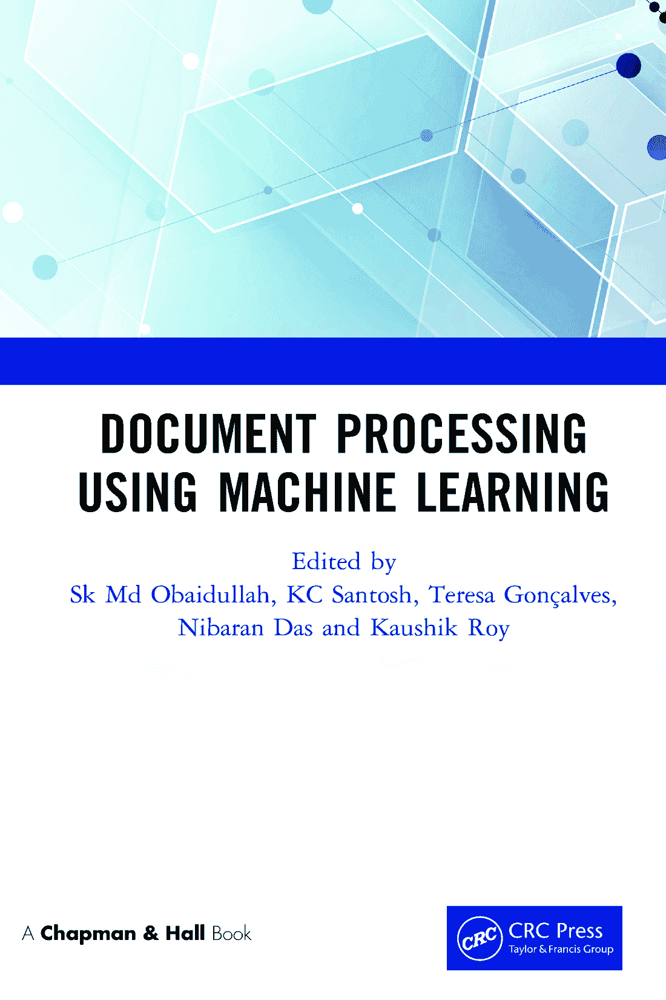

## 序言

我们被各种类别的海量数据包围。在大数据的背景下，对自动化和更快速工具有着迫切需求。通常，数据存在于扫描文档中，可能是机器打印的也可能是手写的。这些包括但不限于信件、支票、付款单、所得税表和商业表格，数量达数十亿。手动数字化是不可能的、耗时的、昂贵的且容易出错。自动化可以解决这些问题。与机器打印文档相比，手写文档处理可能更具挑战性，而且当然开启了许多需要考虑的问题。通过笔迹进行写者识别可以是重要应用之一。此外，我们发现机器打印和手写文本可以同时出现在同一份文档中。我们可以分别对待/处理它们吗？为此，需要能够提取有意义的信息；这些信息可以来自机器打印或手写文本。这可以开启文档信息提取和理解的想法，例如信息检索和自然语言处理。

文档处理的进步只有通过考虑有助于构建数据驱动模型或预测的适当机器学习算法才是可能的。这一过程包括分类、聚类、回归、关联规则等。我们如何能忘记基于深度学习的方法？在本书中介绍了使用了最新且训练良好的机器学习算法的先进文档处理技术。

第一章讨论了`AI`在不同文档分析问题（如光学字符识别和网页文本分类）中的作用，并考虑了现实问题。

第二章讨论了孟加拉手写字符识别的多种方法。除了两个公开的基准数据库（即`ISI`手写字符数据库和`CMATERdb 3.1.2`），它还提供了一个手写字符数据库的结果。

第三章介绍了多脚本艺术文档的脚本识别研究，并考虑了现实问题。这项工作的动力是`OCR`工具依赖于脚本。在作者的作品中，使用半自动分割算法进行单词内的字符分离，随后进行细化处理和结构特征提取；使用`Gabor`滤波器进行特征提取。结果使用了不同的机器学习分类器报告。

第四章讨论了极端学习机（`ELM`）的使用，因为它们抑制了神经网络学习率慢和参数调优等缺点。作者提供了如何使用`ELM`进行文档分析的思路。

互联网技术给我们的日常生活带来了巨大的变化。如今，我们需要多种数字手段来自动管理、过滤、存储和检索来自文本文档的信息。自动化文本文档分析和挖掘正成为计算机应用不可或缺的一部分，因此需要各种分类和聚类方法来执行这些任务。文档分类需要在训练数据集上进行，该数据集进一步用于训练模型分类器，以将文本文档分类到各自的文本类别或领域中。因此，文本分析成为文本数据挖掘的主要方面之一。在此范围内，第 5 章、第 6 章和第 7 章为不同的文本分类问题提供了多种基于图的模型。

第 8 章讨论了作者的两个方面，即作者攻击性和作者画像。攻击性识别被分为三类：公开的、隐蔽的和非攻击性的。另一方面，画像分析识别了年龄和性别两个属性。该章还解释了整合到深度神经网络中的各种机器学习概念。它还对以往关于作者攻击性和画像分析的研究工作提供了见解。

文档图像分析问题广泛可分为两类：离线和在线。在第 9 章中，作者讨论了使用从生成的离线图像计算出的特征进行在线手写孟加拉字符识别。有趣的是，这一章展示了合并离线和在线领域以提高识别性能的集成版本/概念。

第 10 章讨论了棕叶经稿的手写字符识别。棕叶经是主要来自南亚和东南亚的古代文献。数百年来，这些手稿已经损坏。该章讨论了如何将棕叶图像转换为机器编码文本，以便文档可以进行编辑、检索、访问和处理。书中详细介绍了针对上述问题应用光学手写字符识别的问题以及相关的挑战。

我们希望这本书能够帮助文档分析和机器学习领域的研究人员，因为书中讨论了不同的现实问题及其实验结果。此外，希望在文档分析问题上开展研究型项目或论文的本科或研究生也可以从书中获得帮助。

Sk Md Obaidullah

KC Santosh

Teresa Gonçalves

Nibaran Das

Kaushik Roy

## 编辑


Sk Md Obaidullah 在贾达普尔大学（`Jadavpur University`）获得工程学博士，在加尔加答大学（`University of Calcutta`）获得计算机科学与应用硕士学位，并分别于 2017 年、2009 年和 2004 年在`Vidyasagar`大学获得计算机科学与工程学士学位。2017 年 11 月至 2018 年 9 月，他在葡萄牙埃沃拉大学（`University of Évora`）担任欧盟委员会资助的`Erasmus`博士后。他拥有超过 11 年的专业经验，包括两年行业经验和九年学术经验，其中五年用于研究。目前，他是加尔加塔阿利亚大学（`Aliah University`）计算机科学与工程系的副教授。他在知名期刊和国内外学术会议上发表了 65 多篇论文。他是文档图像处理、医学图像分析、模式识别和机器学习领域的活跃研究人员。


KC Santosh（`IEEE`高级会员）是南达科他州大学（`USD`）计算机科学系的助理教授兼研究生课程主任。`Santosh`博士还担任泰勒大学（`Taylor's University`）计算与 IT 学院的访问副教授。在加入`USD`之前，`Santosh`博士曾在美国国家医学图书馆（`NLM`）、国立卫生研究院（`NIH`）担任研究员。他曾在法洛林大学（`Université de Lorraine`）的`LORIA`研究中心担任博士后研究科学家，与法国工业伙伴`ITESOFT`直接合作。他还在法国的`INRIA Nancy Grand Est`研究中心担任研究科学家，并在那里完成了计算机科学博士学位。在此之前，他曾在泰国玛萨大学（`Thammasat University`）的`SIIT`担任研究生研究员。他发表了 120 多篇经过同行评审的研究论文，编写了两本书（`Springer`出版），并编辑了十本书、期刊杂志和会议论文集。`Santosh`博士担任《国际机器学习与网络控制学杂志》（`International Journal of Machine Learning & Cybernetics`）的副编辑。`Santosh`博士在人工智能、机器学习、模式识别、计算机视觉、图像处理、数据挖掘和大数据方面拥有专长，涵盖多个应用领域，如医疗和医学成像、文档信息内容挖掘、生物识别、法医学、语音/音频分析、卫星成像、机器人和物联网。


Teresa Gonçalves 是葡萄牙埃沃拉大学（`University of Évora`）信息学系的助理教授。她在埃沃拉大学获得信息学博士学位（2008 年），并从里斯本新大学（`New University of Lisbon`）科学与技术学院获得信息工程学学位和硕士学位，分别于 1992 年和 1996 年。

她在知名期刊和会议上发表了 60 多篇研究论文，并担任过各种国际会议的组织和程序委员会主席。她曾担任葡萄牙政府和欧盟委员会资助的不同研究和流动性项目的负责人（`PI`）。她的研究兴趣包括机器学习和数据挖掘（特别是针对文本数据和图像）、推荐系统和进化算法。她负责计算机科学专业的本科、硕士和博士级几门课程。在成功指导了两名博士和六名硕士生后，她目前指导六名博士生和六名硕士生，主要将机器学习方法应用于文本或图像相关的问题。


Nibaran Das 是贾达普尔大学计算机科学与工程系的副教授。在加入贾达普尔大学之前，他于 2005 年至 2006 年在`Saltlake`的`Techno India`担任讲师。2012 年至 2014 年间，他曾不连续地六个月在埃沃拉大学（`University of Évora`）担任博士后研究科学家。2007 年，他曾在德国凯尔斯斯鲁滕工业大学的`DFKI`多媒体分析与数据挖掘能力研究中心（`MADM`）担任研究实习生。`Das`博士担任`Sadhana: Academy Proceedings in Engineering Sciences`期刊副编辑。`Das`博士在深度学习、模式识别、图像处理和机器学习方面展现了专业知识，并应用于手写识别（尤其是字符识别）以及医学图像分析等领域。他发表了超过 125 篇研究论文，并出版了书籍《智能通信应用近期进展研究手册》（`IGI Global`），并合著了多本会议论文集。他指导了该系 30 多名硕士研究生。`Das`博士还于 2014 年至 2015 年担任`IEEE`加尔答分会青年专业协会主席。他是孟加拉语月刊计算机杂志`Computer Jagat`的创始编辑。他是他专业领域高质量期刊（`IEEE`、`Springer`、`Elsevier`）以及高质量会议和研讨会（由`IEEE`和`Springer`赞助）的定期审稿人。


Kaushik Roy 在`NIT Silchar`获得计算机科学与工程学士学位，分别于 1998 年、2002 年和 2008 年在贾达普尔大学获得计算机科学与工程硕士（`ME`）和博士（`Engg.`）学位。他曾担任`ISI-Kolkata`的项目相关人员，并在`CDAC-Kolkata`担任科学官。他曾于印度`Maulana Abul Kalam University of Technology`（原名西孟加尔邦科技大学）担任助理教授。他目前在印度加尔答的西孟加尔邦立立大学计算机系担任教授兼系主任。2004 年，他荣获印度计算机学会颁发的“青年 IT 专业人士”奖。他在知名会议和期刊上发表了 150 多篇研究论文/书籍章节。他的研究兴趣包括模式识别、文档图像处理、医学图像分析、在线手写识别、语音识别和音频信号处理。他是`IUPRAI`（`IAPR`的分支）和印度计算机学会的终身会员。

## 贡献者

Roy Bayot

埃沃拉大学

葡萄牙，埃沃拉

Ankan Bhattacharyya

工程与管理未来学院

印度，加尔答

Jakramate Bootkrajang

清迈大学

泰国，清迈

Jeerayut Chaijaruwanich

清迈大学

泰国，清迈

Sahana Das

西孟加尔邦立大学

印度，加尔答

Niladri Sekhar Dash

印度统计学院

印度，加尔答

Ankita Dhar

西孟加尔邦立大学

印度，加尔答比邻的巴拉萨特

Mridul Ghosh

Shyampur Siddheswari Mahavidyalaya

印度，豪拉赫

Subhashmita Ghosh

Aliah 大学

印度，加尔答

Chayan Halder

工程与管理未来学院

印度，加尔答

Papangkorn Inkeaw

清迈大学

泰国，清迈

Himadri Mukherjee

西孟加尔邦立大学

印度，加尔答

Santanu Phadikar

Maulana Abul Kalam Azad 技术大学

印度，卡雅尼

Kashyap Raiyani

埃沃拉大学

葡萄牙，埃沃拉

Payel Rakshit

Maheshtala College

印度，加尔答

Shibaprasad Sen

工程与管理未来学院

印度，加尔答

Himadri Mukherjee, Payel Rakshit, Ankita Dhar, Sk Md Obaidullah, KC Santosh , Santanu Phadikar and Kaushik Roy

#### 表 2.3

方法的比较结果分析

| 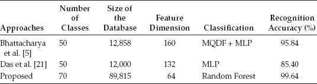 |

#### 表 2.4

当前方法的比较研究

| 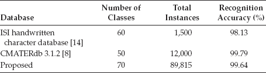 |

#### 表 2.5

`ISI`手写字符数据库上与`Bhattacharya et al.` [5] 的比较研究

| 方法 | 类别数 | 识别率 (%) |
| --- | --- | --- |
| `Bhattacharya et al.` [5] | 50 | 95.84 |
| 提出的方法 | 60 | 98.13 |

#### 表 2.6

`CMATERdb 3.1.2`上与`Das et al.` [21] 的比较研究

| 方法 | 类别数 | 识别率 (%) |
| --- | --- | --- |
| `Das et al.` [21] | 50 | 85.40 |
| 提出的方法 | 50 | 99.79 |

#### 表 2.7

`ISI`手写字符数据库中仅数字与`Das et al.`的比较研究

| 方法 | 类别数 | 识别率 (%) |
| --- | --- | --- |
| `Das et al.` [8] | 10 | 98.63 |
| 提出的方法 | 10 | 100 |

本章介绍了对不同标准数据库中手写孤立字符的识别研究。我们考虑了自有的包含 89,815 个字符（字母+数字+元音修饰符）的数据库。还考虑了`ISI`手写字符标准数据库和`CMATERdb 3.1.2`以对我们的方法进行比较研究。比较研究表明，我们的方法在各个方面都优于其他任何方法。进一步的研究还表明，我们提出的特征在所有标准数据库中都具有良好的鲁健性和稳定性。尽管识别性能很高，但由于某些孟加拉字母、数字和元音修饰符的手写形状相似，结果中仍存在分类错误。

未来，可以研究更多的特征和特征组合，以寻找类似的特征描述符，从而在不同数据库中提供极高的识别性能。将对手写孟加拉语文本数据库进行类似的研究，以不仅在准确性方面而且在计算复杂度方面获得更好的识别性能。此外，在未来的文本数据库尝试中，可以采用类似于 [22] 的工作的极端学习方法，以及类似于 [23] 的基于深度学习的方法。未来可以实现类似于 [24] 的基于图挖掘的特定内容选择方法以实现快速学习。同时，我们将尝试发布一个类似于 [25] 脚本识别数据库的数据库，并将其向研究社区免费，用于字符识别研究。

## References

1. P. Rakshit, C. Halder, S. Ghosh, K. Roy, “Line, word, and character segmentation from Bangla handwritten text-A precursor towards Bangla HOCR”, In: R. Chaki, A. Cortesi, K. Saeed, N. Chaki (eds), Advanced Computing and Systems for Security, Advances in Intelligent Systems and Computing, Vol. 666, Springer, 2018.

2. K. C. Santosh, E. Iwata, “Stroke-based cursive character recognition”, Advances in Character Recognition, editor: Xiaoqing Ding, ISBN 979-953-307-796-2, 2012.

3. T. K. Bhowmik, P. Ghanty, A. Roy, S. K. Parui, “SVM-based hierarchical architectures for handwritten Bangla character recognition”, International Journal on Document Analysis and Recognition (IJDAR), 12(2), Pages 97–108, 2009.

4. U. Bhattacharya, B. B. Chaudhuri, “Handwritten numeral databases of Indian scripts and multistage recognition of mixed numerals”, IEEE Transactions on Pattern Analysis and Machine Intelligence, 31(3), Pages 444–457, 2009.

5. U. Bhattacharya, M. Shridhar, S. K. Parui, P. K. Sen, B. B. Chaudhuri, “Offline recognition of handwritten Bangla characters: An efficient two-stage approach”, Pattern Analysis and Applications, 15(4), Pages 445–458, 2012.

6. D. S. Maitra, U. Bhattacharya, S. K. Parui, “CNN based common approach to handwritten character recognition of multiple scripts”, 13th International Conference on Document Analysis and Recognition (ICDAR), Tunis, Pages 1021–1025\. doi: 10.1109/ICDAR.2015.7333916, 2015.

7. Olarik Surinta, Mahir F. Karaaba, Lambert R. B. Schomaker, Marco A. Wiering, “Recognition of handwritten characters using local gradient feature descriptors”, Engineering Applications of Artificial Intelligence, 45, Pages 405–414, 2015.

8. Nibaran Das, Ram Sarkar, Subhadip Basu, Punam K. Saha, Mahantapas Kundu, Mita Nasipuri, “Handwritten Bangla character recognition using a soft computing paradigm embedded in two pass approach”, Pattern Recognition, 48(6), Pages 2054–2071, 2015.


9. Ritesh Sarkhel, Nibaran Das, Amit K. Saha, Mita Nasipuri, “A multi-objective approach towards cost effective isolated handwritten Bangla character and digit recognition”, Pattern Recognition, 58, 2016.

10. Rahul Pramanik, Soumen Bag, “Content”, Journal of Visual Communication and Image, 50.

11. Ritesh Sarkhel, Nibaran Das, Mahantapas Kundu, Mita Nasipuri, “A multi-scale learning method for isolated characters”, Pattern Recognition, 71, 2017.

12. M. Kumar, S. Jindal, R. Sharma, “Performance of several feature-based”, International Conference on Devices, Circuits (ICDC), 1–6.

13. L. Wendling, “Content-independent”, Frontiers of Computer Science, 9(5).

14. [`finereader.com`](https://finereader.com)

15. S. Rakshit, S. Basu, “Recognition of handwritten script using Tesseract open source”, National Conference on (NAQC), 141–145, 2008.

16. C. Halder, K. Roy, “Individuality of isolated”, International Conference on Devices, Circuits (ICDC), 1, 2014.

17. [`www.isical.ac.in/~ujjwal/download/database.html#x2002`](https://www.isical.ac.in/~ujjwal/download/database.html#x2002) 12. 2018.

18. C. Halder, S. M. Obaidullah, K. C. Santosh, K. Roy, “Content independent writer identification on Bangla script: A document level”, International Journal of Artificial Intelligence & Pattern Recognition, 32(9), 185601, 2018.

19. S. M. Obaidullah, K. C. Santosh, C. Halder, N Das, K. Roy, “Automatic Indic script identification from handwritten documents: page, block, line and word-level approach”, International Journal of Machine Learning and Cybernetics, 1–20, 2017.

20. D. Aha, D. Kibler, M. Albert, “Instance-based learning algorithms”, Machine Learning, 6(1), Pages 37–66, 1991.

21. N. Das, S. Basu, R. Sarkar, M. Kundu, D. K. Basu, “An improved feature descriptor for recognition of Bangla alphabet”, International Conference on Signal and Image Processing, pp. 451–454, 2009.

22. S. M. Obaidullah, A. Bose, H. Mukherjee, K. C. Santosh, N. Das, K. Roy, “Extreme learning machine for handwritten Indic script identification in multi-script documents”, Journal of Electronic Imaging, 27(5), 051214, 2018.

23. S. Ukil, S. Ghosh, S. M. Obaidullah, K. Santosh, K. Roy, N. Das, “Deep Learning for Word-Level Handwritten Script Identification”, arXiv Preprint ArXiv:1801.01627, 2018.

24. K. C. Santosh, “g-DICE: graph mining-based document information content exploitation”, International Journal on Document Analysis and Recognition (IJDAR), 18(4), Pages 337–355, 2015.

## 25. 

S. M. Obaidullah, C. Halder, K. C. Santosh, N. Das, K. Roy, “PHDIndic_11:Page-level handwritten document image dataset of 11 official Indic scripts for script identification”, Multimedia Tools and Applications (MTAP), 77(2), Pages 1643–1678, 2017.

# 艺术多字符脚本识别

Mridul Ghosh, Himadri Mukherjee, Sk Md Obaidullah, KC Santosh, Nibaran Das and Kaushik Roy

## 目录

- 3.1 引言
- 3.2 文献综述
- 3.3 数据收集与预处理
- 3.4 特征提取
    - 3.4.1 基于拓扑的特征
    - 3.4.2 纹理特征
- 3.5 实验
    - 3.5.1 估计程序
    - 3.5.2 结果与分析
- 3.6 结论
- 参考文献

## 3.1 引言

脚本识别是图像处理和模式识别领域的一个研究课题，在国际背景下的文档图像自动处理中是一个非常重要的阶段。这是因为脚本识别是`OCR`的前提条件，没有它，`OCR`系统将无法自动读取并将图像转换为读者舒适的不同脚本。目前还无法为所有脚本设计一种通用的或泛化的`OCR`，特别是在印度等国家，其印度文字包含非常复杂的图形符号。因此，一种良好的脚本识别技术可以帮助我们选择正确的`OCR`包。几年来，人们已经提出了许多自动脚本识别的工作，但还没有能够完全解决涉及的因素，如多脚本混合级、词级、字符级、复杂背景、断线、噪声数据、方向复杂性等。到为止尚未实现的一个特征是艺术多字符脚本识别，即不同的脚本字符在颜色、纹理、大小和背景上存在显著差异。图 3.1 展示了我们所提工作的流程图，该工作解决了这一研究课题。

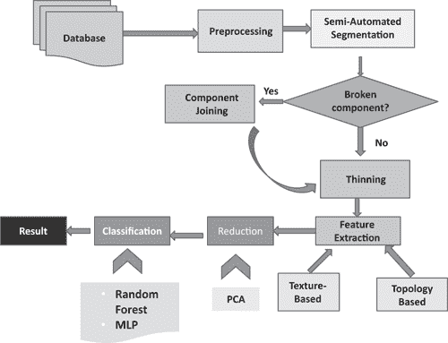

图 3.1 我们所提工作的流程图。

## 3.2 文献综述

在 [10] 中，作者从多通道 Gabor 滤波方法的扩展版本中提取了旋转不变纹理特征，以识别 15 种不同的纹理，该技术已被用于识别不同的脚本，即波斯语、希腊语、俄语、中文、英语和马拉雅姆语。[11] 中的作者提出了一种词脚本识别技术：他们的工作分两个阶段进行，考虑了准确性和处理速度之间的平衡，以识别孟加拉语、天城文字母和罗马脚本。在第一阶段，使用链码直方图进行特征提取，高速返回 64 维特征，但准确性较低。在第二阶段，考虑到那些准确率较低的样本，从 400 维处提取了梯度特征。对于大多数分类，利用了投票方法。在 [12] 中，使用从打印文本顶部和底部轮廓提取的独特特征，从打印文档中分离出泰卢固语、天城文字母和英语脚本。实验在 2,400 行文本上进行，识别准确率为 99.67%。[13] 的作者使用了`EDH`和`KNN`。[14] 的作者使用了`GLCM`、`Gabor`和`SVM`。[15] 的作者讨论了使用`matras`和`shirorekhas`的中文、英语、天城文字母和孟加拉语脚本。

## 3.3 数据收集与预处理

由于数据收集是图像处理和模式识别的准备工作，因此对验证方法的研究非常重要。然而，收集真实的艺术脚本并非易事。我们仅从印度加尔各答的不同地区收集了脚本本身，但对于我们的工作来说还不够充分。因此，我们制作了合成艺术图像进行实验。到目前为止，我们已经成功从广告牌、横幅、T 恤等各种地方处收集了 49 张真实图像。我们使用了分辨率从 8 MP 到 20 MP 不等的手机，以及一台带有 24.2 MP 像素和 18–55 mm 镜头的单反数码相机`Nikon D3300`。从这些真实图像中提取了约 2628 个字符，此外还从 833 张合成图像中提取了 178 个天城文字母、1599 个孟加拉语和 851 个罗马脚本。

印地语是印度使用最广泛的语言之一，约有 2 亿人，主要居住在北部、西部和东部地区，并将这种语言作为交流媒介；西孟拉邦也有约 1.9 亿使用这种语言。尽管英语是印度的外语，但我们国家约 3.4 亿人在教育机构、企业、工作场所和其他部门使用它。图 3.2 显示了我们数据库的样本图像。其中一些具有简单的背景，另一些具有复杂的背景。在(a)中，图像是从一个标志横幅捕捉的，拍摄于路边，图像不仅用两种不同的脚本（天城文字、罗马）书写，而且是以艺术方式呈现的。在(b)、c)、d)中，图像是结合孟加拉语和罗马字的合成艺术图像：在(b)中图像由孟加拉语组成，然后是罗马和孟加拉语；在(c)中孟加拉语后是罗马字；在(d)中罗马字后是孟加拉语。

从这些图像可以看出，图像不仅在颜色、大小、字体和纹理上有所不同，而且背景（包、T 恤、墙等）也不相同。在这种情况下，自动检测感兴趣区域是一项非常复杂的任务。因此，为了简化这一步骤，我们手动检测感兴趣区域（ROI）。

每幅图像的 ROI 都是手动提取的，应用 Otsu [16] 二值化算法将图像转换为二值图，然后是灰度图。使用连通组件标记和不交集分析自动分割算法 [17] 从双文字单词中提取单个字符。在这项工作中，我们考虑了三种不同的文字，即罗马字母（Roman）、天城文字语（Devanagari）和孟加拉语（Bangla）。这些单词由具有 $3C_2$ 组合的双文字字符组成，即孟加拉语结合天城文字语、罗马字母结合孟加拉语、天城文字语结合罗马字母。

从图 3.3 可以看出，自动分割后只有部分图像分割良好，而许多图像没有良好分离。因此，为了解决这个问题，我们对那些在自动分割中未分割的图像进行了手动分割。

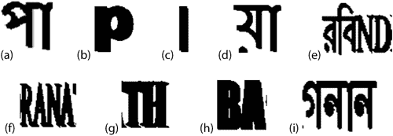

图 3.3 部分 (a)–(d) 是双文字单词分割良好的字符，而 (e)–(i) 是双文字单词分割不足的图像。

在二值化过程中，某些图像没有良好二值化，单个字符形成了不连通的组件。因此，为了使它们连接，使用了以下组件合并算法（算法 1），该算法利用了各项同性膨胀 [18]、组件标记 [19] 和泛洪填充算法 [20] 以及欧几里得变换算法 [21]。在图 3.4 中，可以看到破碎的组件字符图像及其对应的连通组件字符。接下来，我们使用 Zhang Suen 细化算法 [22] 对图像进行了细化。

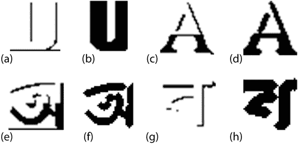

图 3.4 (a)、(c)、(e)、(g) 显示了断开组件图像；(b)、(d)、(f)、(h) 显示了合并组件图像。

算法 1：组件合并

输入：`I`, `N` [其中 `I` 代表二值图像，`N` 是连通组件的数量]

```
1. Threshold T = 0
2. 如果 (N > 1) 重复步骤 3 到 5 直到 N = 1
3. I = EDT <= T [其中 EDT 是欧几里得距离变换]
4. T = T + 0.1
5. 更新 N
```

输出：连通组件字符图像 `I`。

## 3.4 特征提取

特征提取是图像识别中非常重要的一个阶段。在这项工作中，我们考虑了两种特征，即基于拓扑或几何的特征以及纹理特征。

### 3.4.1 基于拓扑的特征

基于拓扑的 [23] 特征提取字符图像的基本几何属性。字符拓扑中考虑了以下特征：

*   a. 面积：面积测量整个图像中强度值为 `I` 的像素数量。面积可以表示为：

| $$\text{Area} = {\sum\limits_{\text{m},\text{n} \in \text{R}}\text{I}}$$ | (3.1) |

其中 `m` 和 `n` 表示区域 `R` 的 x 轴和 y 轴范围。

*   b. 主轴长度：在椭圆中有两个焦点（foci），`a` 和 `b`；这些点之间的距离之和代表长度（图 3.5）。主轴长度可以表示为 `n+p`，其中 `n` 和 `p` 是每个焦点到椭圆上任意随机点 `c` 的距离。

*   c. 短轴长度：观察图 3.5，短轴长度可以表示为 $\sqrt{{(\text{n} + \text{p})}^{2} - \text{m}^{2}}$。

*   d. 离心率：离心率的意思是“偏离”。这意味着随着离心率的增加，焦点比例地远离中心或偏中心。它可以表示为：

| $$\text{Eccentricity} = \frac{\text{g}}{\text{h}}$$ | (3.2) |

其中 `g` 和 `h` 是参数。

| $$\psi(\text{x,y}) = \left( \frac{1}{2\pi\sigma_{\text{x}}\sigma_{\text{y}}} \right)\exp\left( {\frac{- 1}{2}\left( {\frac{\text{x}^{2}}{\sigma_{\text{x}}^{2}} + \frac{\text{y}^{2}}{\sigma_{\text{y}}^{2}}} \right)} \right)\exp\left( {2\pi\mspace{2mu}\text{jwx}} \right)$$ | (3.9) |

通过使用生成函数，我们可以得到其他的 Gabor 波形如下：

| `Ψ`[`so`] (`x`, `y`) = `m`[`−`c`] `Ψ` (`x`[`′], `y`[`′])` | (3.10) |

其中

| `x`[`′] = `r`[`−`c`] (`x`cos `θ`  `y`sin `θ*`)  `and` `y`[`′] = (−`x`sin `θ`  + `y`cos   `θ*`)  | (3.11) |

当 `m` > `1` 且 $\theta = \frac{\text{d}\pi}{\text{t}1}$ 时

这里，`t1` 代表滤波标量的总数。

能量内容可以被认为是图像 `g` 的尺度 `c` 和方向 `d`，如下：

| $$\text{E}_{\text{cd}}\mspace{6mu}\left( \text{g} \right) = \sum\limits_{\text{x}}\sum\limits_{\text{y}}\left&#124; {W_{\text{cd}}\left( \text{x,y} \right)} \right&#124;$$ | (3.12) |

从 Gabor 波形中获得了 2560 个特征，但其中许多是冗余的，处理如此大量的特征会降低我们工作的性能。为此，我们使用了 PCA（主成分分析）进行降维 [27]。通过使用 PCA，我们考虑了 60 个纹理特征，并从基于拓扑的特征中获得了 12 个。因此，本工作考虑了 72 个特征。

## 3.5 实验

### 3.5.1 估计程序

为了估计我们技术的性能，可以测量正确识别率 (CRR)：

| $$\text{CRR} = \frac{\text{(正确识别的图像数量)}}{\text{(图像总数)}}100\%$$ | (3.13) |

除了 CRR 外，Kappa 统计和均方根误差 (RMSE) 指标在识别中也起着至关的作用，定义如下：

| $$\text{Kappa} = \frac{(\text{observed}\mspace{6mu}\text{accuracy} - \text{expected}\mspace{6mu}\text{accuracy})}{(\text{1} - \text{expected}\mspace{6mu}\text{accuracy})}$$ | (3.14) |

| $$\text{RMSE} = \sqrt{\frac{\sum\limits_{\text{m} = 1}^{\text{S}}{\sum\limits_{\text{n} = 1}^{\text{T}}\left\lbrack {\text{f}(\text{m,n}) - \text{g}(\text{m,n})} \right\rbrack^{2}}}{\text{ST}}}$$ | (3.15) |

其中 `f(x,y)` 和 `g(x,y)` 分别代表参考图像和目标图像，大小分别为 `S`、`X`、`T`。

在这里，使用了五折交叉验证来估计我们技术的性能。在五折验证过程中，整个数据集被分为五个等大的部分，其中一部分作为测试集，其余部分作为训练集；所有结果的平均值产生最终结果。

### 3.5.2 结果与分析

我们使用不同的分类器测试了我们的方法，如 SVM [28], RBF [29], 随机森林 [30] 和 MLP [31]，表 3.1 展示了它们相应分类器的不同参数值。

表 3.1


不同参数的分类器

| 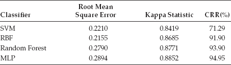 |

从表 3.1 可以看出，`MLP` 在随机森林 (93.90%)、`RBF` (91.90%) 和 `SVM` (71.29%) 之后提供了最高的准确率 (94.95%)。`MLP` 的 `Kappa` 统计和 `RMSE` 分别为 0.8852 和 0.2894。在 `MLP` 中，学习率参数取值为 0.3，动量取值为 0.2，且发现隐藏层效果最佳。在表 3.2 中，我们列出了在数据集上性能最好的分类器的混淆矩阵。

表 3.2

使用随机森林的高准确率双脚本混淆矩阵

| 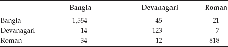 |

在表 3.2 中观察到某些字符没有被正确识别：554 个字符被正确分类为孟加拉语（`Bangla`），但分别有 45 个和 21 个字符被分类为 `Devanagari` 和罗马语。这种误分类发生在字符形状的相似性和二值化问题。

## 3.6 结论

多字符识别是脚本识别和文档处理领域非常新的问题 [32][33]。尺寸、颜色、复杂背景和倾斜等因素使得这个问题对研究人员来说具有挑战性 [35]。我们的技术观察到了 94.95% 的准确率，但通过更准确的预处理阶段和上述特征提取算法，可以进一步提高这一率。数据库的创建是另一个问题。

## 参考文献

1 Ghosh, D., Dube, T., & Shivaprasad, A. 脚本识别——综述。`IEEE Transactions on Pattern Analysis and Machine Intelligence`, 32(12), 2142–2161 (2010).

2 Obaidullah, S. M., Bose, A., Mukherjee, H., Santosh, K. C., Das, N., & Roy, K. 用于多脚本手写识别的极学习机。`Journal of Electronic Imaging`, 27(5), 051214 (2018).

3 Obaidullah, S. M., Santosh, K. C., Halder, C., Das, N., & Roy, K. 手写文档的自动脚本识别：页面级、块级和单词级方法。`International Journal of Machine Learning and Cybernetics`, 10(1), 1–20 (2019).

4 Obaidullah, S. M., Halder, C., Santosh, K. C., Das, N., & Roy, K. `Indic-11`：11 官方脚本的页面级手写文档数据集。`Multimedia Tools and Applications`, 77(2), 1643–1678 (2018).

5 Obaidullah, S. M., Goswami, C., Santosh, K. C., Das, N., Halder, C., & Roy, K. 通过 `matra` 分离多脚本文档以进行有效的手写脚本识别。`International Journal of Pattern Recognition and Artificial Intelligence`, 31(05), 1753003 (2017).

6 Obaidullah, S. K., Santosh, K. C., Halder, C., Das, N., & Roy, K. 单词级多脚本 `Indic` 文档数据集和脚本识别基准结果。`International Journal of Computer Vision and Image Processing (IJCVIP)`, 7(2), 81–94 (2017).

7 Obaidullah, S. M., Santosh, K. C., Das, N., Halder, C., & Roy, K. 多脚本图像中的手写 `Indic` 脚本识别：综述。`International Journal of Pattern Recognition and Artificial Intelligence`, 32(10), 1856012 (2018).

8 Hangarge, M., Santosh, K. C., & Pardeshi, R. 用于手写脚本识别的定向离散余弦变换。在：2013 12th International Conference on Document Analysis and Recognition (pp. 344–348). IEEE (2013).

9 Mori, S., Suen, C. Y., & Yamamoto, K. `OCR` 研究与发展的历史回顾。`Proceedings of the IEEE`, 80(7), 1029–1058 (1992).

10 Tan, T. N. 旋转不变纹理特征及其在自动脚本识别中的应用。`IEEE Transactions on Pattern Analysis and Machine Intelligence`, 20(7), 751–756 (1998).

[11.] Chanda, S., Pal, S., Franke, K., & Pal, U. 一种用于词级脚本识别的两阶段方法。在：第 10 届文档分析与识别国际会议, 2009. `ICDAR'09` (pp. 926–930). IEEE (2009).

[12.] Padma, M. C., & Vijaya, P. A. 使用区分性识别泰卢固语、天城满文字母和英语脚本。计算机科学杂志, 1, 64–78 (2009).

[13.] Manjula, S., & Hegadi, R. S. 使用最大互信息的多语言文档的识别与分类。在：2017 年能量、通信、数据分析与软计算国际会议 (`ICECDS`) (pp. 1679–1682). IEEE (2017).

[14.] Busch, A., Boles, W. W., & Sridharan, S. 用于脚本识别的纹理。`IEEE` 模式分析与机器智能汇刊, 27(11), 1720–1732 (2005).

[15.] Pal, U., & Chaudhuri, B. B. 英语、中文、阿拉伯语的自动识别。在：第六届天城满文字和孟加拉脚本行国际会议论文集。文档分析与识别，2001 (pp. 790–794). IEEE (2001)

[16.] Otsu, N. 一种基于灰度直方图的阈值选择方法。`IEEE` 系统、人与控制学汇刊, 9(1), 62–66 (1979).

[17.] Sridevi, N. 用于 11 世纪手写泰米尔脚本分类的优化复杂极端学习机 (2013)。

[18.] Vincent, L. 形态学算法。在：E. Dougherty, 编辑，图像处理中的数学形态学, `Marcel Dekker`, New York, 255–258 (1992).

[19.] Samet, H., & Tamminen, M. 由线性二叉树表示的任意维度图像的高效组件标记。`IEEE` 模式分析与机器智能汇刊。`IEEE`. 10(4), 579 (1988).

[20.] Silvela, J., & Portillo, J. 广度搜索及其在图像处理问题中的应用。`IEEE` 图像处理汇刊, 10(8), 1194–1199 (2001).

[21.] Breu, H., Gil, J., Kirkpatrick, D., & Werman, M. 线性时间欧几里得距离变换算法。`IEEE` 模式分析与机器智能汇刊, 17(5), 529–533.

[22.] Zhang, T. Y., & Suen, C. Y. 一种数字模式细化的快速并行算法。`ACM` 通信, 27(3), 236–239 (1984).

[23.] Yang, M., Kpalma, K., & Ronsin, J. 形状特征提取技术综述，模式识别, Peng-Yeng Yin (编) (pp. 43–90) (2008)。

[24.] Lin, X., Sha, Y., Ji, J., & Wang, Y. 图像欧拉数公式的证明。中国科学：F 系列, 49(3), 364–371 (2006).

[25.] Ma, W. Y., & Manjunath, B. S. 纹理特征与学习相似性。在：`CVPR'96` `IEEE` 计算机学会计算机视觉与模式识别会议论文集 (pp. 425–430). IEEE (1996).

[26.] Zhang, D., Wong, A., Indrawan, M., & Lu, G. 基于 `Gabor` 纹理特征的内容型图像检索。`IEEE PAMI`, 13–15 (2000).

[27.] Jolliff, I. 主成分分析。`Springer` 统计学系列，第 2 版，`Springer`, New York, (2002), XXIX, 487 插。

[28.] Cusano, C., Ciocca, G., & Schettini, R. 使用 `SVM` 的图像标注。在：网络成像 (卷 5304, pp. 330–339)。国际光学与光子学会。

[29.] Er, M., Wu, S., Lu, J., & Toh, H. 使用径向基函数 (`RBF`) 网络的人脸识别。`IEEE` 神经网络汇刊, 13(3), 697–710 (2002).

[30.] Rodriguez-Galiano, V., Ghimire, B., Rogan, J., Chica-Olmo, M., & Rigol Sanchez, J. 随机森林用于土地覆盖分类的有效性评估。`ISPRS` 摄影测量与遥感杂志, 67, 93–104 (2012).

[31.] Alkan, A., Koklukaya, E., & Subasi, A. 使用逻辑回归和人工神经网络在 `EEG` 中自动检测癫痫。神经科学科学方法杂志, 148(2), 167–176 (2005).

[32.] Santosh K. `g-DICE`: 基于图挖掘的文档信息利用。文档分析与识别国际杂志 (`JDAR`), 18(4), 337–355 (2015).

[33.] Santosh, K. C., & Belaïd, A. 基于需求的文档提取及其评估。在：2013 年第 12 届文档分析与识别国际会议 (pp. 35–39). IEEE (2013).

[34.] Bougelia, M., Nowaczyk, S., Santosh, K. C., & Verikas, A. 不同意见：带标签的主动学习。机器学习与控制论国际杂志, 9(8), 1307–1319 (2018).

[35.] Vajda, S., & Santosh, K. 无监督聚类的快速 k 最近邻分类器。在：图像处理与模式识别最新趋势国际会议 (pp. 185–193). `Springer`, Singapore (2016).

# 4 极端学习机研究

Himadri Mukherjee, Sahana Das, Subhashmita Ghosh, Sk Md Obaidullah, KC Santosh, Nibaran Das and Kaushik Roy

## 目录

## 4.1 引言

## 4.2 预备

## 4.3 `ELM` 的激活函数

### 4.3.1 `Sigmoid` 函数

### 4.3.2 硬限函数 (`Hardlim`)

### 4.3.3 径向基函数 (`Radbas`)

### 4.3.4 正弦函数

### 4.3.5 三角基函数 (`Tribas`)

## 4.4 `ELM` 的演变

## 4.5 `ELM` 的应用

### 4.5.1 文档分析中的 `ELM`

### 4.5.2 医学中的 `ELM`

### 4.5.3 音信号处理中的 `ELM`

### 4.5.4 其他模式识别问题中的 `ELM`

## 4.6 `ELM` 的挑战

## 4.7 结论

## 参考文献

## 4.1 引言

极端学习机（`ELMs`）建立的主要问题是神经网络中学习速度缓慢。`ELM` 算法接近单隐藏层前馈神经网络 (`SHLFFNN`) 用于回归和分类。

最初，Huang 等 [1] 提出了 `ELMs` 以解决基于梯度下降的算法所带来的复杂性。但在 20 世纪 40 年代，McCulloch 和 Pitts [2] 给出的逻辑视角开启了人工神经网络（`ANNs`）的研究路径。

当隐藏层到输出层的权重被投影时，`ELM` 被用于解释线性方程。`Moore–Penrose` 广义逆 [3] 被用于求解一般方程组，从而导致了线性方程的求解。`ELM` 已被用于分类和回归问题 [4, 5]，并在多个实例中取得了令人鼓舞的结果。

在本章中，我们将讨论 `ELMs` 的基础知识、扩展、应用和问题。

## 4.2 基础知识

假设有一个具有 `L` 个隐藏神经元的 `SHLFFNN`，其中 `G (w [i], b [i], x)` 是隐藏层节点的计算输出，`b[i]` 是对应于输入向量 `x` 的偏置，权重 `w[i]` (`w [1], w [2], […], w [i]`) 连接从隐藏层到输出层，那么 `β[i (]β[1], β[2], β[i])` 是由以下公式给出的输出函数 `f ( )`：

| $$f(x) = \sum\limits_{i = 1}^{L}\,\beta_{i}G\left( {w_{i},b_{i},x_{i}} \right)$$ | (4.1) |

`G( )` 对加性隐藏神经元的计算值为：

| `G(w[i], b[i], x[i]) = g(w[i].x + b[i])` | (4.2) |

此处，激活函数由 `g: R → R` 表示。

方程 4.1 和 4.2 有助于生成以下内容：

| `Hβ = Y` | (4.3) |

| `β = H^(−1)Y` | (4.4) |

其中隐藏层输出矩阵为 `H`。

| $$H = \begin{bmatrix} {\operatorname{}G\left( {w_{1},b_{1,},x_{1}} \right)\mspace{6mu}\mspace{6mu}\mspace{6mu}\,\operatorname{}\ldots\ldots..} & {\operatorname{}G\left( {w_{L},b_{L},x_{1}} \right)} \\ {\operatorname{}G\left( {w_{1},b_{1,},x_{M}} \right)\mspace{6mu}\mspace{6mu}\mspace{6mu}\ldots\ldots..} & {\operatorname{}G\left( {w_{L},b_{L},x_{M}} \right)} \end{bmatrix}$$ |  |

| $$B = \begin{bmatrix} \beta_{1} \\ : \\ \beta_{L} \end{bmatrix}$$ |  |

| $$Y = \begin{bmatrix} Y_{1} \\ : \\ Y_{M} \end{bmatrix}$$ |  |

其中 `{(x [i] , y [i] )} [i] [=] [1,2,3,] […] [M]` 是训练集。

`x [i] = (x [1,] x [2] , …,., x [M] )` 是预期的输入向量。

`y [i] = (y [1], y [2], …, y [k] )` 是输出向量。

对于具有隐藏神经数量 `L` 和激活或传递函数 `g( )` 的训练集 `(x [i] , y [i] )`，`ELM` 算法分为三个步骤：

1. 随机分配隐藏层的输入权重 `w[i]` 和偏置 `b[i]`。

2. 确定隐藏层到输出层的 `G (w[i], b[i], x)`。

3. 最后，根据之前提到的方程 4.3 和 4.4 计算 `β`。

## 4.3 `ELM` 的激活函数

激活函数是 `ANN` 最强大的特征之一，`ANN` 是一种用于学习和解释极其复杂材料的单层前馈神经网络。激活函数的主要目的是将输入神经转换为输出信号。现在的问题是，如果我们不用这个函数会怎样？如果没有它，输出函数只是简单的线性函数，`ANN` 将变成一个线性回归模型，无法学习任何复杂数据集。

`ELM` 主要处理 `sigmoid`、`sine`、`hardlimit`、`tribas` 和 `radbas` 激活。以下是对这些简要讨论。

### 4.3.1 `Sigmoid` 函数

`sigmoid` 函数产生 `S` 型曲线，范围在 0 到 1 之间。该函数被广泛使用，但 `sigmoid` 也有一些主要问题，它会饱和并杀掉梯度。方程如下：

$$g(w,b) = \frac{1}{1 + \exp(w + b)}$$ (4.5)

### 4.3.2 `Hardlimit` 函数

`hardlimit` 激活被称为 `hardlimit`，要求节点在达到阈值时输出 1，否则设置为 0。方程如下：

$$\begin{array} g(w,b) = 1 & \text{If } x - b \geq 0 \\ g(w,b) = 0 & \text{If } x - b \leq 0 \end{array}$$ (4.6)

### 4.3.3 径基函数

`ELM` 中的 `radbas` 激活是仅定义在欧几得空间上的实值函数。对于该函数使用了高斯核。方程如下：

$$g(w,b) = \exp(-w²)$$ (4.7)

### 4.3.4 `Sine` 函数

`sine` 激活被称为 `SinC`，是非常流行的函数。众所周知，除以 0 会导致未定义方程。因此对上述情况有例外：

$$y = \frac{\sin(x)}{x}$$ (4.9)

### 4.3.5 三角基函数

`tribas` 函数也称为 `hat`、`triangle` 或 `tent` 函数。方程如下：

$$\begin{matrix} g(w,b) = 1 & \text{if } -1 \leq x \leq 1 \\ g(w,b) = 0 & \text{otherwise} \end{matrix}$$ (4.10)

## 4.4 `ELM` 的演变

由于 `ELMs` 的一些局限性和缺陷，`ELM` 的演变思想已经建立。以下是简变的演变实现：

*   提出了增量 `ELM` 或 `I-ELM` [6] 用于处理学习过程中出现的复杂性。在这里，隐藏节点逐个随机分配到隐藏层，输出权重也随之凝固。


增强了进化`ELM`，也称为`E-ELM`[7]，以便在不需要调优到最小二乘最小的情况下确定权重。`E-ELM`的结果优于传统算法。

为了解决分类的基准问题，提出了一种剪枝`ELM`或`P-ELM`[8]。它是解决回归和分类问题的一种流行方法。`P-ELM`不仅能处理过拟合问题，首先收集不适合网络的节点，然后从网络中消除剩余的节点。

一种基于投票的`ELM`，被称为`V-ELM`[9]，减少了误分类问题。对于经典的`ELM`，由于偏置和输入权重的流式抽象，靠近分类边界的数据可能会被误分类。通过通过在多次训练后应用主投票机制，生成的`V-ELM`能够处理此类误分类问题。

在线序列`ELM`或`OS-ELM`[10]可能设置也可能不设置学习大小。在`OS-ELM`中，输入到隐藏层的权重被快速组装，但输出权重以精细的方式调节。明显看出，`OS-ELM`速度更快且有助于更好的泛化性能。

为了解决参数调优以及局部最小值问题，Li等人[11]提出了一种全复`ELM`或`C-ELM`。它可以在任何复域内舒适地移动，其学习阶段速度极快，并能获得符号错误率（`SER`）。

为了抑制计算复杂度，提出了一种误差最小化的`ELM`或`EM-ELM`[12]。除了这种演变，目前还提出了`ELMs`的其他扩展版本。

目前不仅实现了这些`ELM`的扩展，还存在其他变体，如`O-ELM`、`Fuzzy ELM`、`Weighted ELM`、`Regularized ELM`、`Robust ELM`、`Parallel ELM`、`TLS ELM`、`S-ELM`等。这些扩展被用于处理`ELMs`在分类、回归、近边界等问题中出现的各种复杂情况。

## 4.5 ELMs的应用

`ELMs`及其扩展可以对许多领域做出贡献。`ELMs`可以服务于分类和回归问题的不同方面。下面讨论了`ELMs`应用非常热门的一些领域。

### 4.5.1 文档分析中的ELMs

Obaidullah等人[13]在从手写文档图像进行脚本识别的任务中实验了不同的激活函数。极端学习机被生动地用于识别模式。Chacko等人[14]使用`ELMs`进行手写字符识别，并结合小波能量识别3D对象。Mahmoud等人[15]使用`ELMs`结合`SVMs`来识别离线手写阿拉伯数字。

### 4.5.2 医学中的ELMs

机器学习在医学[16]-[21]和健康保健领域做出了显著贡献。Li等人[22]使用`ELMs`识别甲状腺刺激激素。Daliri等人[23]显示`ELMs`也可以检测肺癌。Karpagachelvi等人[24]证明了可以使用`ELM`检测心脏问题。

### 4.5.3 音频信号处理中的ELM

`ELMs`被证明在各种基于音频的应用中非常有益。Mukherjee等人[25]展示了在存在不同类型噪声的情况下，将`ELMs`用于乐器以及从音频信号识别乐器类。在另一个实例中，他们使用`ELM`进行语音活动检测[26]。

### 4.5.4 其他模式识别中的ELM

Mohammed等人[27]定义了`ELM`如何识别人脸。根据[28]，`ELMs`也可以用于多标签，Zong等人[29][30]`Parallel ELM`[31]用于回归。

## 4.6 ELM的挑战

尽管`ELMs`在许多领域非常流行，但仍存在一些问题。主要问题之一是与学习相比，性能相当不稳定。

## 4.7 结论

在本章中，我们讨论了`ELMs`的架构以及它们的扩展、类型。我们讨论了`ELMs`的流行性及其缺点。为了克服`ELMs`的缺点，引入了一些扩展。

## 参考文献

1. Huang, G. B., Zhu, Q., & Siew, C. K. (2004, July). Extreme learning machine: A new learning scheme of feed forward neural networks. In: Proceedings of the 2004 International Joint Conference on Neural Networks (Vol. 2, pp. 985–990). IEEE.

2. McCulloch, W. S., & Pitts, W. (1943). A logical calculus of the ideas immanent in nervous activity. The Bulletin of Mathematical Biophysics, 5(4), pp. 115–133.

3. Rao, C. R. (1971). Generalized Inverse of Matrices and Its Applications. John Wiley & Sons, New York.

4. Rong, H. J., Ong, Y. S., Tan, A. H., & Zhu, Z. (2008). A fast pruned-extreme learning machine for classification. Neurocomputing, 72(1–3), 359–366.

5. Huang, G. B., Zhou, H., Ding, X., & Zhang, R. (2012). Extreme learning machine for regression and multiclass classification. IEEE Transactions on Systems, Man, and Cybernetics, Part B (Cybernetics), 42(2), 513–529.

6. Huang, G. B., Chen, L., & Siew, C. K. (2006). Universal approximation using incremental constructive feedforward networks with random hidden nodes. IEEE Transactions on Neural Networks, 17(4), 879–892.

7. Zhu, Q. Y., Qin, A. K., Suganthan, P. N., & Huang, G. B. (2005). Evolutionary extreme learning machine. Pattern Recognition, 38(10), 1759–1763.

8. Rong, H. J., Ong, Y. S., Tan, A. H., & Zhu, Z. (2008). 一种用于分类问题的快速剪枝极端学习机. *Neurocomputing*, 72(1–3), 359–366.

9. Cao, J., Lin, Z., Huang, G. B., & Liu, N. (2012). 基于投票的极端学习机. *Information Sciences*, 185(1), 66–77.

10. Liang, N. Y., Huang, G. B., Saratchandran, P., & Sundararajan, N. (2006). 一种前馈神经网络的快速准确在线顺序学习算法. *IEEE Transactions on Neural Networks*, 17(6), 1411–1423.

11. Li, M. B., Huang, G. B., Saratchandran, P., & Sundararajan, N. (2005). 全复极端学习机. *Neurocomputing*, 68, 306–314.

12. Feng, G., Huang, G. B., Lin, Q., & Gay, R. K. L. (2009). 隐藏节点增长与增量学习的误差最小极端学习机. *IEEE Transactions on Neural Networks*, 20(8), 1352–1357.

13. Obaidullah, S. M., Bose, A., Mukherjee, H., Santosh, K. C., Das, N., & Roy, K. (2018). 多脚本文档中手写印地文字识别的极端学习机. *Journal of Electronic Imaging*, 27(5), 051214.

14. Chacko, B. P., Krishnan, V. V., Raju, G., & Anto, P. B. (2012). 使用小波能量和极端学习机的手写字符识别. *International Journal of Machine Learning and Cybernetics*, 3(2), 149–161.

15. Mahmoud, S. A., & Olatunji, S. O. (2009). 使用支持向量和极端学习机自动识别离线手写阿拉伯（印度）数字. *International Journal of Imaging*, 2(A09), 34–53.

16. Ruikar, D. D., Santosh, K. C., & Hegadi, R. S. (2019). 基于CT图像的骨折骨自动分割与标记. *Journal of Medical Systems*, 43(3), 60.

17. Vajda, S., Karargyris, A., Jaeger, S., Santosh, K. C., Candemir, S., Xue, Z., Antani, S., & Thoma, G. (2018). 前胸X光片自动结结病筛查的特征选择. *Journal of Medical Systems*, 42(8), 146.

18. Ruikar, D. D., Hegadi, R. S., & Santosh, K. C. (2018). 用于心理运动技能和手术程序训练的骨科模拟器综述. *Journal of Medical Systems*, 42(9), 168.

19. Santosh, K. C., & Wendling, L. (2018). 基于角关系签的胸X光图像视图分类. *Medical and Biological Engineering and Computing*, 1–12.

20. Santosh, K. C., & Antani, S. (2018). 自动胸部X光筛查：肺部对称性有助于检测肺部异常吗？*IEEE Transactions on Medical Imaging*, 37(5), 1168–1177.

21. Zohora, F. T., Antani, S., & Santosh, K. C. (2018, March). 使用归一化交叉相关和无监督聚类检测胸部X光中的圆形异物. In: Medical Imaging 2018: Image Processing (Vol. 10574, p. 105741V). International Society for Optics and Photonics.

22. Li, L. N., Ouyang, J. H., Chen, H., & Liu, D. (2012). 基于极端学习机的甲状腺疾病计算机辅助系统. *Journal of Medical Systems*, 36(5), 3327–3337.

23. Daliri, M. R. (2012). 基于遗传算法和模糊极端学习机的肺癌诊断混合自动系统. *Journal of Medical Systems*, 36(2), 1001–1005.

24. Karpachelvi, S., Arthanari, M., & Sivakumar, M. (2012). 使用支持向量机和极端学习机心电图信号分类. *Neural Computing and Applications*, 21(6), 1331–1339.

25. Mukherjee, H., Obaidullah, S. M., Phadikar, S., & Roy, K. (2018). 使用LPCC-S特征和极端学习从噪声音频中分离MISNA-A器. *Multimedia Tools and Applications*, 1–26.

26. Mukherjee, H., Obaidullah, S. M., Santosh, K. C., Phadikar, S., & Roy, K. (2018). 基于线谱频率特征和用于语音检测的极端学习机. *International Journal of Speech Technology*, 1–8.

27. Mohammed, A., Minhas, R., Wu, Q. J., & Sid-Ahmed, M. A. (2011). 基于多维PCA和极端学习机的人脸识别. *Pattern Recognition*, 44(10–11), 2588–2597.

28. Wang, H., Hussain, M. F., Mukherjee, H., Obaidullah, S. M., Hegadi, R. S., Roy, K., & Santosh, K. C. (2018). 一项实证研究：人脸匹配中的ELM. In: International Conference on Recent Trends in Image Processing & Pattern Recognition (pp. 277–287). Springer, The Netherlands.

29. Zong, W., & Huang, G. B. (2011). 极端学习机上的人脸识别. *Neurocomputing*, 74(16), 2541–2551.

30. He, Q., Shang, T., Zhuang, F., & Shi, Z. (2013). 基于`MapReduce`的回归并行极端学习机. *Neurocomputing*, 102, 52–58.

31. Li, G., & Niu, P. (2013). 基于岭回归的回归增强型极端学习机. *Neural Computing and Applications*, 22(3–4), 803–810.

32. Balasundaram, S. (2013). 基于牛顿法用于ε-敏感回归的极端学习机. *Neural Computing and Applications*, 22(3–4), 559–567.

# 5 基于图的文本分类模型

Ankita Dhar, Niladri Sekhar Dash 和 Kaushik Roy

## 5.1 引言

## 5.2 相关工作

### 5.2.1 英语

### 5.2.2 中文、日语和波斯语

### 5.2.3 阿拉语和乌尔语

### 5.2.4 孟加拉语以外印度语言

### 5.2.5 孟加拉语

## 5.3 提议方法

### 5.3.1 数据收集

### 5.3.2 预处理

### 5.3.3 基于图的表示

### 5.3.4 分类器

## 5.4 结果与分析

### 5.4.1 与现有方法的对比

## 5.5 结论

## 致谢

## 参考文献

大量的可访问数字数据发现是以非结构化或半结构化的形式存在的。因此，为了让用户根据需求理解这种形式信息的重要性和适用性，并高效地访问这些信息，迫切需要自动化信息提取和文本文档分类/分类系统。然而，这项任务并不简单，因为文本数据是用自然语言形成的。以语言的书面和口语形式进行交流需要对句法和语义关系有理解，以及该语言中丰富的感知。尽管存在这些复杂性，文本挖掘领域的大多数研究仅关注语言的一个特定方面，即词项频率。使用词袋模型（bag-of-words）表示文本文档被认为是自给自足的，没有表达词或系列词之间的句法或语义关系。但在分类短文本文档时，这些关系变得非常重要，因为尽管类别相似，文本中使用了同义词或相互关联词，捕捉词之间的语义关系对于识别是必要的。

在本次实验中，设计了一种基于图的文本分类方法，涉及句法和语义关系以及词频，以增强文本分类系统的性能。实验在一个包含9000份孟加拉语文本文档的数据集上进行，这些文档涵盖了从在线新闻语料库、各种杂志和网页获取的八种不同文本类别。文本集被视为图集，执行加权图算法提取子图，这些子图可以进一步用于从考虑的数据集中生成特征向量进行分类。考虑到加权图算法来提取最合适的子图，这连续提高了分类率和计算效率。与传统的向量空间模型和词袋方法相比，基于图的模型通过考虑文本文档的结构信息运行得更高效。基于图的模型正成为表示文本的替代方法，因为它们能够封装有关文本的重要事实，例如词的顺序、词的共现以及不同词之间的关系。此外，与各种研究人员应用于孟加拉语文本分类的现有方法相比，基于图的学习方法显示了涉及相关知识的优势。


本文的结构如下：在第 5.2 节中，通过综述该领域的文献提供了文本分类的基础和各种机器学习算法。第 5.3 节提供了关于数据收集、用于预处理的方法、用于特征提取的图生成方法以及分类算法的详细见解。第 5.4 节探索了基于图的方法获得的结果和其他感知。在分析结果和潜在发展之外，第 5.4 节还提供了几种常用分类算法之间的比较，以及与现有方法的比较。在第 5.5 节中，得出了结论并展示了一些未来方向。

## 5.2 相关工作

### 5.2.1 英语

从文献调查中可以看出，英语文本分类引起了研究人员的高度关注。这里简要讨论了几个工作。例如，`Dasondi` 等[1]提出了一种新的文本分类技术，用于分类来自社交媒体的文本文档。提出的方法自动分析文本模式，并根据分析的模式提取它们的正向和负向方向。该方法利用词项出现的可能性、句子的生成以及为词项分配权重来观察文本数据的位置。他们将这种方法公式化，可以使用图模型观察词项的各种组合。估计的概率和分配的权重用于生成有向加权图，并根据该图对文本文档进行分类。`Guru` 等[2]引入了另一种选择方案，用于为文本分类从主特征集中选择最合适的子集。基于特征集和标准的特征选择方法，所提方法为簇中的特征分配排名，而不是单独分配排名。根据他们的研究，第`n^(th)`名的特征簇比第`(n + 1)^(th)`名的特征簇主导得得多。因此，开发了多种能够区分不同类别的特征簇。他们技术的优势因素在于它能够在对特征簇进行排名时自动丢弃相关特征。此外，该方法根据低排名但主导特征的选择高效地处理了重叠类别。实验还在三个标准数据集上进行了扩展，使用了四种常用的分类算法（如支持向量机`SVM`和朴素贝叶斯`NB`），以观察系统相对于现有方法的性能。`Asim` 等[3]对在六个标准数据集上对九种广泛使用的特征选择方法进行了对比研究，分别为`K1a`、`RE1`、`WAP`、`Enron`、`RE0`和`Spam`，其中`K1a`和`RE0`是使用`NB`和`SVM`算法的高度倾斜的数据集。`Koswari` 等[4]提出了一种名为随机多模型深度学习（`RMDL`）的技术，通过深度学习网络的集成来提高准确性，解决了感知理想深度学习网络的问题。他们在`IMDB`数据集上进行了实验，并使用 15 个`RMDL`模型获得了 90.79%的最大准确率，并观察到`RMDL`与传统方法相比表现好得多。`Feng` 等[5]提出了一种基于匹配评分函数的概率模型对词项进行加权的新方案，并分别观察了使用`KNN`和`SVM`在小型文本和大型文本上的有效性。

### 5.2.2 中文、日语和波斯语

除了英语，这里还可以参考针对中文、日语和波斯语开展的各种工作。例如，`Wang` 和 `Liu` [6] 引入了一种基于图的`KNN`的中文文本文档分类的新技术。他们使用特征选择方法降低了特征维度，并提出了一种改进的基于图的文本分类方法，使用`KNN`算法将训练集中的文本文档分配到特定领域。从结果中观察到，在准确性和执行时间方面，基于图的模型比基于传统的`VSM`的`KNN`方法表现更好。`Wei` 等人 [7] 针对包含 14,150 份来自 12 类中文文本文档的中文语料库进行了实验，基于三个参数：(i) 绝对文本频率、相对文本频率与`N-gram`频率之间的性能比较；(ii) 稀疏性与特征相关性之间的比较；(iii) 0/1 逻辑值、`N-gram`频率数值与`TF-IDF`值之间的性能比较。`Wenliang` 等人 [8] 使用了包含来自 37 个领域的 14,459 篇文本的`NEU TC`数据集，应用文档频率和卡方统计来开发词项的类别分布。他们还使用了一种称为`global CM`的`全局聚类模型`进行中文文本分类。`Mikawa` 等人 [9] 提出了一种使用扩展余弦测量的有效方法，用于日本《每日新闻》和客户评论的分类。该方法基于向量空间模型衡量两个文档之间的距离。在波斯语的情况下，`Parvin` 等人 [10] 使用归一化互信息结合同义词表对五个文本类的波斯文本文档进行分类，并在`K` = 1 时获得了 81.45% 的最大准确率。

### 5.2.3 阿拉伯语和乌尔都语

除了英语、中文、日语和波斯语的情况外，针对阿拉伯语也探索了多种文本分类技术。例如，`Al-Tahrawi` [11] 使用卡方法对半岛阿拉伯语新闻语料库中均匀分布在五个领域的 1500 篇新闻文章进行了分类。`Al-Radaideh` 和 `Al-Khateeb` [12] 提出了一种基于关联规则的分类算法，用于阿拉伯语医疗文本文档分类；`Haralambous` 等人 [13] 在`Kalimat`语料库获取的数据上实现了轻量级词干和词根程序，并结合`TF-IDF`和依赖语法特征。`Ali` 和 `Ijaz` [14] 对使用`NB`和`SVM`分类乌尔语文本文档的统计方法进行了比较研究。他们主要使用特定语言的技术对文档进行预处理，以开发一种标准且低维的特征向量。从实验可以看出，当`n`值增加到 3 时性能提高，但当值达到 4 时会下降。

### 5.2.4 孟加拉语以外的印度语言

这里简要讨论了近期在印度语言开展的文本分类研究。例如，`Gupta` 和 `Gupta` [15] 结合了`NB`和基于本体的技术，对从涵盖体育七个子领域的各种新闻语料库中提取的 184 份旁遮普语文本文档进行分类。他们的实验表明，结合方法比其他方法表现更好。对于泰米尔语文本文档的分类，`ArunaDevi` 和 `Saveeth` [16] 使用了考虑词对对的`C-feature`提取技术。对于马拉拉地语文本，`Patil` 和 `Bogiri` [17] 使用标签归纳分组 (`LINGO`) 算法，基于用户画像对 20 个类别的 200 份马拉拉地语文本文档进行了自动分类。在另一个实验中，`Patil` 和 `Game` [18] 使用了四种算法，其中`NB`证明在分类马拉拉地语文本文档的准确性和时间上更为有效。`Sarmah` 等人 [19] 和 `Mohanty` 等人 [20] 使用特定语言的`WordNet`对阿萨姆语和梵语进行了分类。在阿萨姆语 [19] 的情况下，考虑了四类，并获得了 90.27%准确率这一令人鼓舞的结果。

### 5.2.5 孟加拉语

孟加拉语文本分类的演进状态糟糕。该领域的信息缺乏表明有一段紧急旅程等待我们。这里报道了一些工作：`Mansur` 等人 [21] 针对《Pratham》报一的数据应用了`N-gram`方法。在另一个实验中，`Mandal` 和 `Sen` [22] 使用了四种监督学习方法对 1000 份包含 22,218 个词项的文档进行分类实验。他们使用`SVM`方法取得了令人满意的结果。另一方面，`Kabir` 等人 [23] 使用随机梯度下降 (`SGD`) 分类器对九类文本文档进行分类，并达到了 93.85%的准确率，与之前的相比更好。在另一项工作 [24] 中，基于`TF-IDF`和`SVM`算法在 12 个文本领域观察到 92.57%的准确率。`Dhar` 等人 [25] 使用余弦相似度和欧几里得距离算法对来自商业、国家、医疗、体育和科学五个领域的 1000 份网络文本文档进行分类，基于`TF-IDF`权重方案；他们在余弦相似度量上获得了 95.80% 的最大准确率。在另一项研究中，`Dhar` 等人 [26] 提出了一种新的压缩技术方案，该方案从使用`TF-IDF`方法从训练文档中提取的词项集中考虑了前 40%的术语。该实验针对五个领域的 1960 份文本文档进行，并使用`LIBLINEAR`分类器取得了令人满意的结果。

通过文献调查发现，基于特定领域的孟加拉语文本文档数量不足，因此我们必须构建一个自己的数据库来执行文本分类任务。数据是任何实验结果中最重要的元素，因此在质量和数量上都应该进行充分收集。数据库的开发需要大量的关注，以确保在进行实验时不出现错误，并获得适当的结果。实验涉及的文本文档来自各种在线孟加拉语新闻语料库：由领先孟加拉语报纸涵盖的八个文本领域的杂志和网页，即商业 (B)、体育 (SP)、娱乐 (E)、科学技术 (ST)、医学 (M)、旅游 (T)、食品 (F) 和国家新闻 (P)。这八个领域孟加拉语文本文档的分布见表 5.1。文本文档的网页来源包括`anandabazar.com`、`bartamanpatrika.com`、`ebela.in`、`deshirecipe.wordpress.com`、`ebanglarecipe.com`、`recipebangla.com`、`banglaadda.com`、`amaderchhuti.com`以及`ebanglatravel.com`。

#### 表 5.1

各领域文本文档分布

| 领域 | 文档数量 |
| --- | --- |
| 商业 | 1100 |
| 娱乐 | 1100 |
| 食品 | 1000 |
| 医学 | 1000 |
| 国家新闻 | 1400 |
| 体育 | 1400 |
| 科学技术 | 1000 |
| 旅游 | 1000 |
| 总计 | 9000 |

### 5.3.2 预处理

数字文本文档的形成涉及字符、单词和短语等线性表示序列。对于相应文本文档中的给定字符序列，在实施特征提取和选择方法之前需要进行分词（`Tokenization`）。分词是将句子分割成标记（tokens）的任务。如果不能将句子清晰地切分成标记，就无法进行进一步处理。在这里，句子的划分是基于“空格”分隔符的，从数据集中检索到的单词总数为`2,806,159`。分词后的数据增强了系统的处理能力，使其更高效并减轻了系统资源的负担。这对于依赖良好性能的系统是一个优势。由于从数据集中提取的单词并非都足够相关或包含足够信息，因此需要从集合中移除停用词以过滤数据。在目前的实验中，标点符号、代词、英语单词、后词、英语和孟加拉语数字、感叹词、某些形容词、连词、某些副词以及所有的冠词都被视为停用词，得到的标记数为`1,310,119`。停用词的选择取决于特定的语言以及特定的问题。

### 5.3.3 基于图的表示

在目前的实验中，实现基于加权图算法的图文本表示方案。图模型已用于多个领域 [27]。然后使用分类算法为中的文本分配类别。

图`Z`由三元组表示：`Z = (V, E, W)`，其中`V`是节点或顶点集合，`E`是连接节点的加权边集合，`W`代表边的特征权重向量。

- **节点**：使用特征提取方法从训练集中获得的唯一术语。
- **边**：根据术语在文本文档中的出现情况建立。如果两个术语出现在某个文本中，则从前一个节点到后一个节点分配一条边。
- **特征权重向量**：使用公式 1 确定，其中`W(p,q)`代表分配给术语`p`和`q`的权重；`f(p,q)`表示术语`p`和`q`在文本文档中的出现次数；`f(p)`表示术语`p`的出现次数；`f(q)`表示术语`q`在该特定文本文档中的出现次数。权重`W(p,q)`越高，两个节点之间的边越强。

```
$$W\left( {p,q} \right) = \frac{f\left( {p,q} \right)}{f(p) + f(q) - f\left( {p,q} \right)}$$
```

(5.1)

八类不同文本类别的特征趋势在图 5.2 中图中所示。

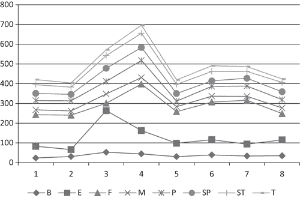

#### 图 5.2

八类文本类别的特征趋势。

### 5.3.4 分类器

多层感知器 (`MLP`) 是模式识别问题中流行且常用的分类器之一 [28–31]，是一种前馈人工神经网络，它将输入数据映射到输出集。它涉及至少三个点面，每个面上都有一定数量的神经元，非线性函数使得`MLP`能够分类非线性可的数据，并将其与线性感知器区分开来。在我们的实验中，我们选择`MLP`配置为`i-hl-o`（即`i`表示属性数量，`hl`代表隐藏层数量，`o`是输出类别数量）。它应用反向传播方法来训练架构。隐藏层中神经元的数量根据训练数据集特征向量的范围计算得出。该架构中的每个神经元都使用 sigmoid 函数，该架构基于迭代次数`1500`、学习率`0.3`和动量`0.2`了训练。

根据混淆矩阵，每个领域正确分类文本文档的平均百分比以及错误率见表 5.3。基于所采用方法的系统性能下降，是由于两个或多个文本类别的文本文档在标记（tokens）的组织或排列上存在相似，导致了文本文档的分类错误。从表 5.3 可以观察到，商业（Business）和国家新闻（State News）领域的文本文档分类错误率高于其他文本领域，这是因为这些领域的文本内容非常相似。

### 表 5.3

正确与错误分类的平均百分比

| 领域 | 正确分类 (%) | 错误分类 (%) |
| --- | --- | --- |
| 商业 | 96.82 | 3.18 |
| 娱乐 | 98.90 | 1.10 |
| 食品 | 99.70 | 0.30 |
| 医疗 | 98.60 | 1.40 |
| 国家新闻 | 97.85 | 2.15 |
| 体育 | 99.28 | 0.72 |
| 科技 | 99.30 | 0.70 |
| 旅游 | 98.70 | 1.30 |
| 平均值 | 98.64 | 1.36 |

本实验达到的性能水平还与其他常用的分类算法进行了比较，即多项朴素贝叶斯（`NBMN`）、多变量朴素贝叶斯（`NBMV`）、决策树（`J48`）和 K 近邻（`KNN`）[35]，以测试我们系统的健壮性。所有分类器获得的准确率见表 5.4，基于精确率、召回率和`F[1]`分值的比较分析所示图 5.3，从图中可以看出，在孟加拉语文本文档分类的情况下，本实验采用的方法在使用`MLP`时比其他方法表现更好。最差的是`NBMV`；`KNN`、`J48`和`NBMN`分别获得第二、第三和第四名。

### 表 5.4

分类器比较

| 分类器 | 准确率 (%) |
| --- | --- |
| MLP | 98.62 |
| NBMN | 96.49 |
| NBMV | 94.20 |
| J48 | 97.09 |
| KNN | 97.98 |

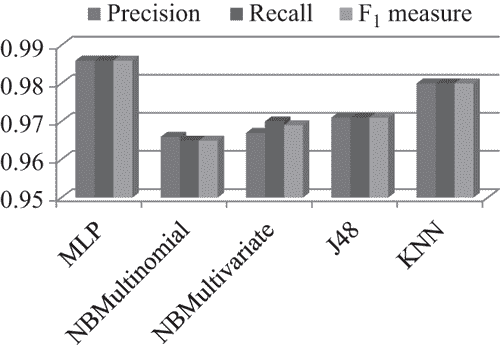

### 图 5.3

不同分类器之间的比较。

#### 5.4.1 与现有方法的比较

所提工作已与孟加拉语的一些现有工作进行了比较。在这些比较中，由于无法获得它们的数据库，仅遵循了其他研究人员在现有工作中用于训练其模型的方案。我们在我们包含 9000 份孟加拉语文本文档的获取数据库上，使用`MLP`算法对实验进行了评估。所有方法获得的准确率见下方的表 5.5。从表中可以看出，此处提出的方法在识别准确率方面与所有其他用于孟加拉语的技术相比，都表现良好。也可以说，与传统的机器学习算法相比，用于文本文档分类的各种距离指标的性能是非常鼓舞的。

### 表 5.5

所提方法与现有方法的比较

| 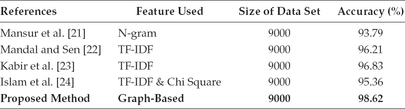 |

## 5.5 结论

本章介绍了一种基于基于图的文本表示方案的多层感知器分类算法，用于将孟加拉语文本文档分类到各自的文本类别。结果还与其他常用的分类器进行了比较，通过实验观察到，多层感知器在分类孟加拉语文本文档方面比其他算法表现更好。未来，该实验可以扩展到包含更多孟加拉语文本领域以及文本类别。此外，还可以引入新的混合方法将文本文档分类到预定的文本类别中。我们还计划尝试其他的机器学习技术，例如基于深度学习 [36] 和主动学习 [37] 的方法，以获得更好的结果。此外，如 [38, 39] 中述的基于动态规划的方法以及 [40] 中的`ELM`可以在文本分类任务中进行探索。未来，本研究还可以在其他语言的数据集上进行探索。

## 致谢

作者之一感谢 DST 以 INSPIRE 学士金的形式提供的支持。

## 参考文献

1. `Das, V., Pathak, M., Rathore, N.P.`：基于图的文本分类技术用于社交媒体。CDAN, p. 7.

2. `Guru, D.S., Suhil, M., Raju, L., Kumar, N.`：用于文本分类的替代方案框架。模式识别报, 103, pp. 23–31.

3. `Asim, M., Wasim, M., Ali, M., Rehman, A.`：针对倾斜数据集的特征选择。INTLECT, p. 8.

4. `Kowsari, K., Heidrafa, M., Meimandi, K., Barnes, L.E.`：用于深度学习的随机模型。ICISDM, p. 11.

5. `Feng, G., Li, S., Sun, T., Zhang, B.`：用于分类的概率模型权重加权。模式识别报, 110, pp. 23–29.

6. `Wang, Z., Liu, Z.`：基于 KNN 的文本分类。FSKD, pp. 2363–2366.

7. `Wei, Z., Miao, D., Chauchat, J., Zhao, R.`：基于 N-gram 的特征选择。智能系统与应用杂志, 2, pp. 365–374.

8. `Wenliang, C., Xingzhi, C., Huizhen, W., Jingbo, Y.`：利用全局信息的自动词聚类。AIRS, p. 11.

9. `Mikawa, K., Ishidat, T., Goto, M.`：用于文本分类的扩展余弦距离测量的提议。ICSMC, pp. 1741–1746.

10. `Parvin, H., Dahbashi, A., Parvin, S., Minaei, B.`：使用波斯语词典改进波斯语文本分类与聚类。ICDAI, pp. 493–500.

11. `Al-Tahrawi, M.`：使用逻辑回归的阿拉伯文本分类。智能系统与应用杂志, 6(6), pp. 71–78.

12. `Al-Radaideh, Q.A., Al-Khateeb, S.S.`：用于阿拉伯医学文本的关联规则分类器。知识工程与数据挖掘杂志, 3, 255–273.


13 Haralambous, Y., Elidrissi, Y., Lenca, P.: 基于依赖句法的特征选择用于阿拉伯语文本分类。ICALP, p. 10.

14 Ali, A., Ijaz, M.: 乌尔都语文本分类。ICFIT, pp. 1–7.

15 Gupta, N., Gupta, V.: 使用朴素贝叶斯、质心和混合方法进行旁遮普语文本分类。SEANLP, pp. 109–122.

16. ArunaDevi, K., Saveeth, R.: 一种基于 C 特征的泰米语文本分类新方法，《International Journal of Scientific Research & Development》， 2, pp. 343–345, 2014.

17. Patil, J.J., Bogiri, N.: 马拉地语文档的自动文本归类，《International Journal of Advanced Research in Computer Science and Management Studies》， 3, pp. 280–287, 2015.

18. Patil, M., Game, P.: 马拉地语文本分类器的比较，《ACEE, International Journal on Information Technology》， 4, pp. 11–22, 2014.

19. Sarmah, J., Saharia, N., Shikhar, K.: 基于阿萨姆语词网的文档分类新方法，《Proc. of IGWC》， pp. 324–329, 2012.

20. Mohanty, S., Santi, P., Mishra, R., Mohapatra, R., Swain, S.: 基于词网的语义文本分类：印度语言视角，《Proc. of ICECCE》， pp. 321–324, 2006.

21. Mansur, M., UzZaman, N., Khan, M.: 报纸语料库中孟加语的 `N-Gram` 文本分类分析，《Proc. of ICCIT》，p. 8, 2006.

22. Mandal, A.K., Sen, R.: 孟加语网页文档分类的监督学习方法，《International Journal of Artificial Intelligence & Applications》， 5(5), pp. 93–105, 2014.

23. Kabir, F., Siddique, S., Kotwal, M.R.A., Huda, M.N.: 使用随机梯度下降 (`SGD`) 分类器的孟加语文本文档归类，《Proc. of ICCCIP》， pp. 1–4, 2015.

24. Islam, Md.S., Jubayer, F.E.Md., Ahmed, S.I.: 结合 `TF-IDF` 算法的支持向量机用于孟加语文档分类，《Proc. of ICECCE》，pp. 191–196, 2017.

25. Dhar, A., Dash, N.S., Roy, K.: 通过距离测量进行文本分类：多领域孟加语文本文档实验，《Proc. of ICACCA》，pp. 1–6, 2017.

26. Dhar, A., Dash, N.S., Roy, K.: `TF-IDF` 特征在在线孟加拉语文本语料库文档分类中的应用，《Proc. of FICTA》，pp. 51–59, 2017.

27. Santosh, K.C.: `g-DICE`: 基于图挖掘的文档信息内容利用，《International Journal on Document Analysis and Recognition》，18(4), pp. 337–355, 2015.

28. Pembe, F.C., Gungor, T.: 一种基于树的文档结构分析方法及其在网页搜索中的应用，《Natural Language Engineering》，2, pp. 569–605, 2014.

29. Obaidullah, Sk.M., Halder, C., Santosh, K.C., Das, N., Roy, K.: `PHDIndic_11`: 用于脚本识别的 11 种官方印度脚本页级手写文档图像数据集，《Multimedia Tools and Applications》，77, pp. 1643–1678, 2017.

30. Obaidullah, S.M., Goswami, C., Santosh, K.C., Roy, K.: 在多脚本文档中通过`Matra` 分离印度脚本以有效的手写脚本识别，《International Journal of Artificial Intelligence & Pattern Recognition (IJPRAI), World Scientific,31, p. 1753003 (17 页), 2017.

31. Obaidullah, S.M., Santosh, K.C., Halder, C., Das, N., Roy, K.: 词级多脚本印度语图像数据集及基准结果，《International Journal of Computer Vision and Image Processing (IJCV), 7, pp. 81–94, 2017.

32. Obaidullah, S.M., Santosh, K.C., Halder, C., Das, N., Roy, K.: 从手写文档中自动识别脚本：页级、行级和词级方法，《International Journal of Machine Learning and Cybernetics,pp. 1–20,2017.

33. Santosh, K.C., Wendling, L.: 非线性多投影剖面的字符识别，《Frontiers of Computer Science》，9(5), pp. 678–690, 2015.

34. Hall, M., Frank, E., Holmes, G., Pfahringer, B., Reutemann, P., Witten, I.: `Weka`数据挖掘软件：更新，《ACM SIGDD Newsletter, 11(1), pp. 10–18, 2009.

35. Vajda, S., Santosh, K.C.: 使用无监督聚类的`k-Nearest Neighbor` 分类器，《Proc. of R》，pp. 185–193, 2016.

36. Ukil, S., Ghosh, S., Obaidullah, S.M., Santosh, K.C., Roy, K., Das, N.: 词级手写识别深度学习，arXiv `1801.01627`,2018.

37. Bouguelia, M., Nowaczyk, S., Santosh, K.C., Verikas, A.: 无众包噪声标签主动学习，《International Journal of Machine Learning and Cybernetics,9, p. 13,2017.

38. Santosh, K.C.: 基于`dtw-Radon`的字符识别，《Proc. of ICDAR,pp. 264–268,2011.

39. Santosh, K.C., Nattee, C., Lamiroy, B.: 基于空间相似性的笔画数量和顺序聚类，《Proc. of ICFHR,pp. 652–657,2010.

40. Obaidullah, S.M., Bose, A., Mukherjee, M., Santosh, K.C., Das, N., Roy, K.: 用于多脚本文档手写识别的极端机器学习，《Journal of Electronic Imaging,27(5),p51214,2018.

# 6. 文档分类中距离指标的研究

Ankita Dhar, Niladri Sekhar Dash 和 Kaushik Roy

## 6.1 引言

## 6.2 文献综述

### 6.2.1 印欧语系

### 6.2.2 汉藏语系

### 6.2.3 日本语系

### 6.2.4 非亚语系

### 6.2.5 达维达语系

### 6.2.6 雅语系

## 6.3 提出的方法

### 6.3.1 数据收集

### 6.3.2 预处理

### 6.3.3 特征提取与选择

### 6.3.4 距离测量

#### 6.3.4.1 平方欧几得距离

#### 6.3.4.2 曼哈顿距离

#### 6.3.4.3 马哈拉纳距离

#### 6.3.4.4 明可夫斯距离

#### 6.3.4.5 切比雪距离

#### 6.3.4.6 坎伯拉距离

## 6.4 结果与讨论

### 6.4.1 与现有方法的比较

## 6.5 结论

## 6.6 致谢

## 6.7 参考文献

计算机能够通过各种数据挖掘和机器学习方法执行高效且自动化的工作。近年来，随着互联网的快速发展，数字文本数据量突然增加。此外，对每条文本数据进行人工调查是一项耗力、易错且耗时的任务。因此，迫切需要为这些大量的非结构化文本资源提供一种高效的自动文本分类系统。文本分类已成为文本挖掘问题中的一项主要任务。近年来，各种语言已开发了多种文本分类技术，但未能满足印地系语言（尤其是孟加拉语）的要求。因此，本文旨在提出一种对孟加拉语文本文档执行分类任务的文本分类技术。所提的方法是一个文本分类问题，它从各种新闻语料库、在线杂志和网页获取预标记孟加拉语文本文档作为输入；这些文档是根据各种距离测量算法训练模型分类器所需的训练数据，并将它们分类到本研究考虑的相应文本类别中。

在本章中，首次针对孟加拉语文本分类探索了一些距离测量算法，如平方欧几里得距离、曼顿距离、马哈拉比距离、闵可夫斯距离、切比雪夫距离和坎伯拉距离，并使用一个由各种网络新闻语料库、杂志和网页生成的涵盖八个文本类别的 9000 份孟加拉语文本文档数据集检查了它们在该任务中的适用性。此外，为了进行比较，还在数据集上研究了一些标准且常用的距离测量算法，即余弦相似度和欧几里得距离。

论文的其余部分结构如下：第 6.2 节讨论了相关工作，随后第 6.3 节介绍了所提的方法，其中包含了对数据收集、预处理技术、特征提取与选择方法以及各种距离测量算法的讨论。第 6.4 节讨论了结果，并对各种距离测量算法进行了比较分析，同时将所提方法与现有方法进行了比较。第 6.5 节对论文进行了总结，并展示了该领域的一些未来方向。

## 6.2 文献综述

### 6.2.1 印欧语系

英语文本分类已获得全球研究人员的广泛认可。在印欧语系中，除了英语，还有针对波斯语和乌尔都语的一些工作。例如，Lin 等人[1]通过考虑三种情况提出了一种名为文本处理相似性度量（`SMTP`）的新相似性度量：(i) 同时出现在两个文本文档中的特征；(ii)仅出现在一个文本文档中的特征；(iii) 都不出现在任何文本文档中的特征。他们基于`TF-IDF`在 `WebKB`、`Reuters-8` 和 `RCV1` 上进行了实验，在`K = 11`、`11`和`8`的值下分别获得了 0.8467、0.9488 和 0.7130 的准确率。在另一个实验中，Wandabwa 等人[2]通过根据内容为特征分配权重提取了最相关的特征。然后他们估计了分类任务集中高排名特征之间的距离。他们在一个包含 15,000 份随机维基百科人物文档的数据集上进行了实验，这些文档包含 `URI`、名称和文本等元素。Wu 等人[3]的一项实验利用 `20 Newsgroups`、`RT-2K`、`IMDB` 和 `Reuters-21578` 数据集展示了一种在文本分类中平衡术语权重过高和权重过低的方法。Koswari 等人[4]提出了一种名为随机多模型深度学习（`RMDL`）的技术，通过增强深度学习网络的集成来提高准确性，从而解决感知理想深度学习网络的问题。他们使用 `IMDB` 数据集进行实验，使用`15 RDLs`模型获得了 90.79%的最大准确率，并观察到`RDML`的性能远优于传统方法。Feng 等人[5]提出了一种基于使用匹配评分函数的概率模型对术语加权的新方案，并分别在小文本和大型文本上使用`K-NN`和`SVM`观察了该方法的有效性。在波斯语方面，Parvin 等人[6]利用归一化互信息结合同义词表将波斯语文本文档分为五类，并在`K = 1`的值下获得了 81.45%的最大准确率。Ali 和 Ijaz[7]对使用`NB`和`SVM`分类乌尔都语文本文档的统计方法进行了比较研究。他们主要使用特定语言的技术对文档进行预处理，以开发标准的低维的特征向量。从实验可以看出，当`n`值增加到 3 时性能会提高，但当达到 4 时会下降。

### 6.2.2 汉藏语系

除了英语、波斯语和乌尔都语的情况，这里还可以参考针对汉语进行的各种工作。例如，Wei 等人[8]在一个包含 14,150 份文档的中文语料库上进行了实验，基于三个参数：(i) 绝对与相对频率以及 `N-gram` 频率的比较；(ii) 稀疏性和特征相关性的比较；(iii) 0/1 逻辑值、来自 37 个领域的 14,459 篇 `N-gram` 文本之间的性能，并应用文档频率和卡方统计量来开发标记的类别分布。他们还使用了一种称为全局`CM`的全局聚类模型处理中文文本。

### 6.2.3 日本语系

Mikawa 等人[10]提出了一种使用扩展余弦度量对日本《每日新闻》报和客户评论进行日语分类的高效方法。该方法基于向量空间模型衡量两个文档之间的距离。

### 6.2.4 亚哈非语系

各种文本分类技术也针对阿拉伯语进行了探索。提到，Boukil 等人[11]在使用`TF-IDF`方案提取特征后，使用卷积神经网络对阿拉伯语文本进行分类。Al-Tahrawi 和 Al-Khatib[12]在 `Al-Jazeera` 数据集上使用多项式神经网络取得了鼓舞的结果。Raho 等人[13]研究了 BBC 阿拉伯语数据集上各种学习模型的性能，并展示了非常有用的结果。

### 6.2.5 达罗毗语系

这里简要讨论了达罗毗语文本分类的最新研究。对于泰米尔语文本文档的分类，ArunaDevi 和 Saveeth[14]使用了`C-feature`特征提取技术，该技术考虑了术语对。

### 6.2.6 雅来语系

这里简要讨论了近期针对印地雅米语系文本分类开展的研究。例如，Gupta 和 Gupta [15] 结合了朴素贝叶斯（`NB`）和基于本体的技术，对从涵盖体育七个子领域的各种新闻语料库中提取的 184 份旁遮普语文本文档进行了分类。他们的实验表明，这种结合方法比其他方法性能更好。Patil 和 Bogiri [16] 使用标签引导分组算法（`LINGO`），根据用户剖析对 200 份属于 20 个类别的马拉拉地语（Marathi）文本文档进行了自动马拉拉地语分类。Rakholia 和 Saini [17] 实现了一个朴素贝叶斯模型，对来自六个类别的 280 份古吉拉语（Gujarati）文档在两种情况下（使用特征选择方法和不使用特征选择方法）进行分类，分别获得了 88.96% 和 75.74% 的准确率。Sarmah 等人 [18] 和 Mohanty 等人 [19] 使用针对阿斯姆语和梵语的特定语言词汇网络（`WordNets`）对文本进行了分类。在阿斯姆语 [18] 的情况下，考虑了四类，并获得了 90.27% 准确率这一令人鼓舞的结果。然而，孟加拉语（`Bangla`）文本分类方法的现状却不尽如人。该领域信息的匮乏表明，在我们意识到该语言进行更多研究的紧切需求之前还需要很长一段时间。这里报道了针对该语言开展的一些工作。Alam 和 Islam [20] 研究了 376,226 篇文章基于文本的特征，并使用逻辑回归模型获得了 0.95 的精确率。Mandal 和 Sen [21] 实验了四种监督学习方法，对包含总计 22,218 个标记的五个类别的 1000 份标记文档进行分类。他们通过 `SVM` 方法实现了 89.14% 的最高准确率。另一方面，Kabir 等人 [22] 使用随机梯度下降（`SGD`）分类器对来自九个不同领域的文档进行分类，实现了 93.85% 的准确率，比之前的方法更好。在另一项工作 [23] 中，基于 `TF-IDF` 和 `SVM` 算法对 12 个文本领域的孟加拉语文本文档进行分类时，观察到了 92.57% 的准确率。Dhar 等人 [24] 在 4000 篇文章上结合多层感知器模型进行了文本表示方案工作，并实现了 98.03% 的准确率。在另一项工作 [25] 中，作者通过权重方案修改布谷搜索算法（`Cuckoo search algorithm`）对 9000 篇文章进行了优化研究，并获得了 98% 的准确率。这里提供的简要综述表明，为孟加拉语用户开发一种自动文本分类系统仍然需要走很长的路，以便高效地服务他们的需求。

## 6.3 所提方法

所提方法的概述见图 6.1。在利用特征提取方法（词频-逆文档频率-逆类别频率）获取的特征集上，实施了多种距离量度，以对从各种网络来源获取的 9000 份孟加拉语文档进行分类。实验结果的详情见第 6.4 节。

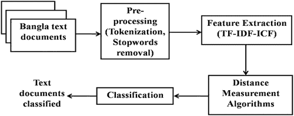

图 6.1

所提方法的概述。

### 6.3.1 数据收集

无论质量还是数量，数据都是任何实验结果中的重要因素。数据库的开发需要大量注意力，以确保在执行实验时不出现错误，并获得适当的结果。然而，从简要的文献综述中观察到，基于类别的孟加拉语文本文档不足，因此我们必须建立自己的数据库来完成任务。实验涉及的文本文档获取自各种在线孟加拉语新闻语料库、杂志和网页，正如主流报纸所言，涵盖了八个文本领域：商业 (`B`)、体育 (`SP`)、州新闻 (`P`)、娱乐 (`E`)、旅游 (`T`)、医学 (`M`)、食品 (`F`) 以及科学技术 (`ST`)。这八个领域中每个领域的文本文档分布见表 6.1。

文本文档的网络来源为 `anandabazar.com`、`bartamanpatrika.com`、`ebela.in`、`deshirecipe.wordpress.com`、`ebanglarecipe.com`、`recipebangla.com`、`banglaadda.com`、`amaderchhuti.com`。

表 6.1

各领域文本分布

| 领域 | 文档数量 |
| :--- | :--- |
| 商业 | 1100 |
| 娱乐 | 1100 |
| 食品 | 1000 |
| 医学 | 1000 |


| 州新闻 | 1400 |
| 体育 | 1400 |
| 科学技术 | 1000 |
| 旅游 | 9000 |

### 6.3.2 预处理

数字文档是由字符、单词等序列组成的。在实施特征提取和选择之前，需要进行分句。分句是将句子切分成标记（`tokens`）的过程。在根据给定的分隔符对句子进行分句后，标记的数量为 280。分句能够更快速、更有效地处理数据并减轻系统压力。由于并非从数据集中提取的所有标记都具有足够的信息量，因此去除用词是必要的。在目前的实验中，标点符号、代词、英语等价词、后置词、英语数字、叹词、形容词、连词以及所有的冠词都被视为用词，结果为 13。考虑用词的问题取决于特定语言。

### 6.3.3 特征提取与选择

标准的且广泛使用的权重方案词频-逆文档频率（`TF-IDF`）被修改为一种新方法并命名为 `TF-IDF-ICF`，通过引入逆类别频率（`ICF`）来从数据开发特征向量 [26]。逆文档频率（`IDF`）基本上用于评估术语在相关文本文档之间的区分程度。之前的实验表明，在领域 `x` 的文档中，某个标记出现的概率高于不属于 `x` 的文档。根据这一观察，提出了 `ICF` 来衡量术语对某一领域的区分能力。

`TF` 统计特定文本 `d` 中标记 `t` 的出现次数。这里通过对数归一化变为归一化的词频。

```
TF = log\frac{O_{t,d}}{\sum_{t \in d}O_{t,d}}
```

(6.1)

`IDF` 通常预测术语在数据集中的相关性。文档频率（`DF`）通过以下公式计算术语 `t` 在数量文本中的出现次数：

```
IDF = log\frac{N}{DF(t)}
```

(6.2)

类频（`CF`）统计了标记 `t` 在所有领域总统计中的出现次数。`ICF` 是根据以下方程估计的，其中 `C` 是实验中考虑的整体类别。

```
\text{ICF} = \log\frac{N}{\text{CF}(t)}
```

(6.3)

提出的 `TF-IDF-ICF` 是一种新方案，它在考虑 `TF-IDF` 的同时，考虑了标记 `t` 在领域 `c` 中的出现情况，并使用公式 6.4 测量 `t` 的权重。在任何情况下，都考虑了各项项的归一化值，以获得更具特定且更具相关性的特征向量。

```
TF-IDF-ICF = TF * IDF * ICF
```

(6.4)

本实验所考虑的八类不同文本类别的特征趋势已在图 6.2 中通过图形所示。

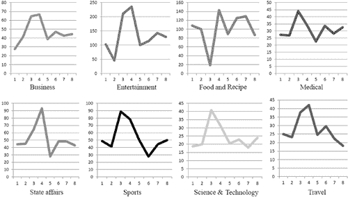

**图 6.2**

八类文本类别的特征趋势。

### 6.3.4 距离测量

距离度量是许多机器学习任务中的重要事项。距离测量的目的是估计两个术之间的相似性或差异性。考虑的距离度量包括`平方欧几得距离`、`曼哈顿距离`、`马哈拉诺尼距离`、`闵夫斯基距离`、`切雪夫距离`和`坎拉距离`。

#### 6.3.4.1 平方欧几得距离

`平方欧几得距离`测量的公式与`欧几得距离`测量相同，但区别在于它进行了平方，以便对距离较远的术语分配逐渐增加的权重。它使用下面的方程进行估计。

```
Dis²(i, j) = (i[1] − j[1])² + (i[2] − j[2])² + … + (i[n] − j[n])²
```

(6.5)

`平方欧几得距离`考虑了对应文本文档的术之间平方差的和。

#### 6.3.4.2 曼哈顿距离

`曼哈顿距离`有多种名称，如`街区距离`、`L1 距离`或`绝对值距离`。它测量两个术沿直角轴之间的距离，并使用公式 6.6 计算。与`欧几得`和`平方欧几得`测量相比，这种距离度量对偏差的影响较小。

```
Dis(i, j) = |i - j| = Σ_{l=1}^{n} |i_l - j_l|
```

(6.6)

#### 6.3.4.3 马哈拉诺尼距离

`马哈拉诺尼距离`考虑了变异数据的均值或质心。它测量两个术相对于质心的相对距离。对于距离质心越远的术`马哈拉诺尼距离`越大。距离由方程 6.7 表示，其中 `SD` 是数据集上 `i[l]` 和 `j[l]` 的标准差。`协方差矩阵`表示了与对象相关的协方差。使用`协方差`的原因是为了获得两个或多个对象共同的结果。它通常用于需要开发不同对象簇之间相关性的分类和聚类任务。

```
Dis(i, j) = sqrt(Σ_{l=1}^{n} (i_l - j_l)² / SD_l²)
```

(6.7)

#### 6.3.4.4 闵夫斯基距离

`闵夫斯基距离`可以被视为`欧几得距离`和`曼哈顿距离`的泛化，使用以下方程计算，其中 `m` 是一个被认为是 1 或 2 的正整数。

```
Dis(i, j) = (Σ_{l=1}^{n} |i_l - j_l|^m)^(1/m)
```

(6.8)

#### 6.3.4.5 切雪夫距离

`切雪夫距离`可以定义在特征向量上，用于测量沿标准坐标两个向量空间之间差异的最大值。它使用下面的方程测量。

```
Dis(i, j) = max[l] |i[l] − j[l]|
```

(6.9)

#### 6.3.4.6 坎拉距离

`坎拉距离`探索了一对变量坐标一系列分数差之和。每个变量的值在 0 到 1 之间，对小变化非常敏感。给定向量 `i` 和 `j` 的`坎拉距离`使用方程 6.10 表示。它是向量空间中术对距离的数值测量。

```
Dis(i, j) = Σ_{l=1}^{n} |i_l - j_l| / (|i_l| + |j_l|)
```

(6.10)

## 6.4 结果与讨论

所提的方法已获取的数据集上实施，该数据集包含 9000 篇孟加拉语文档，来自八类不同的类别（商业、娱乐、食品、医疗、国家新闻、体育、科学技术和旅游），基于使用各种距离测量算法（如`平方欧几得距离`、`曼哈顿距离`、`马哈拉诺尼距离`、`闵夫斯基距离`、`切雪夫距离`和`坎拉距离`）的 `TF-IDF-ICF` 特征提取方案。

所提工作与已存在的一些孟加拉语工作进行了比较。在这些比较中，由于无法获得其数据库，仅遵循了其他研究人员在现有工作中训练模型时采用的方案。我们在包含`9000`份孟加拉语文本文档的数据库上，使用`Mahalanobis distance`测量算法对实验进行了评估。所有方法的准确率见下方的表 6.5。从表中可以看出，本文提出的方法在识别率方面优于其他现有的孟加拉语方法。也可以说，与传统的机器学习算法相比，各种距离指标在文本文档分类中的性能非常令人鼓。

### 表 6.5

所提方法与现有方法的对比

| 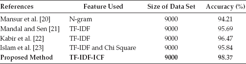 |

## 6.5 结论

本章介绍了一种基于特征提取方案（`TF-IDF-ICF`）使用各种距离指标（即`squared Euclidean`、`Manhattan`、`Mahalanobis`、`Minkowski`、`Chebyshev` 和 `Canberra` 距离量）将孟加拉语文本文档分类到各自文本类别的方法。从实验中可以观察到，在分类孟加拉语文本文档方面，`Mahalanobis distance`优于其他指标。未来，该实验可以扩展到包含更多孟加拉语文本数据集以及更多领域或文本类别。此外，还可以引入新的混合方法将文本文档分类到预定的文本类别中。我们还计划尝试其他机器学习技术，例如基于深度学习 [29] 和主动学习 [30] 方法，以获得更好的结果。如[31, 32] 中所述的基于动态规划的方法以及[33] 中的 `ELM`，也可以在文本分类中进行探索。未来，这项研究也可以在其他语言数据集上进行探索。

## 致谢

其中一名作者感谢 `DST` 通过 `INSPIRE` 奖学金提供的支持。

## 参考文献

1. Lin, Y.S., Jiang, J.Y., Lee, S.J.: 用于文本分类与聚类的相似性量，IEEE Transactions on Knowledge and Data Engineering, 26(7), pp. 1575–1590, 2014.

2. Wandabwa, H., Zhang, D., Sammy, K.: 通过属性距离加权 k 近邻分类进行文本分类, Proc. of ICIT, pp. 225–228, 2016.

3. Wu, H., Gu, X., Gu, Y.: 监督式术语加权中权重过载与不足的平衡，Information Processing and Management, 53(2), pp. 547–557, 2017.

4. Kowsari, K., Heidarysafa, M., Brown, D.E., Meimandi, K.J., Barnes, L.E.: RMDL: 用于分类的随机模型深度学习，Proc. of ICISDM, p. 11, 2018.

5. Feng, G., Li, S., Sun, T., Zhang, B.A.: 用于文本分类的概率模型术语加权方案，Pattern Recognition Letters, 110, pp. 23–29, 2018.

6. Parvin, H., Dahbashi, A., Parvin, S., Minaei, B.: 使用波斯语词义库改进波斯文本分类与聚类，Proc. of ICDCAI, pp. 493–500, 2012.

7. Ali, A., Ijaz, M.: 乌尔德语文本分类，Proc. of ICFIT, pp. 1–7, 2009.

8. Wei, Z., Miao, D., Chauchat, J., Zhao, R., Li, W.: 用于中文文本分类的基于 N-Gram 特征选择与文本表示，International Journal of Computational Intelligence Systems, 2, pp. 365–374, 2009.

9. Wenliang, C., Xingzhi, C., Huizhen, W.: 余弦相似度用于文本分类的方法，Journal of CA, pp. 174–176, 2011.

11. Bou, F., S., M.: 文本分类，Methods of Computing, 17, pp. 103–114, 2018.

12. Al, M. S., Tahib, S.: 用于阿拉伯语的支持机，Journal of King Saud-Computer, 27, pp. 437–449, 2015.

13. Al, G., Khalib, S., Nassar, A.: 基于特征选择的阿拉伯文本分类，Science 6, pp. 23–28, 2015.

14. Aruna, K., Save, R.: 用于泰米尔语分类的新方法，International Journal of Scientific Research and Development, 2, pp. 343–345, 2014.

15. Gupta, N., Gupta, V.: 使用朴素贝斯分类器的旁遮普语分类，Proc. of SELP, pp. 109–122, 2012.

16. Patil, J., Bogiri, N.: 马拉雅语语分类，International Journal of Research and Management Studies, 3, pp. 280–287, 2015.

17. Rakholia, R., Saini, J.: 使用朴叶贝斯分类器的古吉特语分类，Indian Journal of Science and Technology, 5, pp. 1–9, 2017.

18. Sarmah, S., Saharia, K.: 使用词网的阿萨姆语文本新方法，Proc. of IGWC, pp. 324–329, 2012.

19. Mohanty, S., Santi, P., Mishra, R., Mohapatra, R., Swain, S.: 使用语义孟加拉语文本分类，Proc. of ICECCE, pp. 321–324, 2006.

20. Mansur, M., UzZaman, N., Khan, M.: 报纸语料库中基于 N-Gram 的孟加拉语分析，Proc. of ICCIT, p. 8, 2006.

21. Mandal, A.K., Sen, R.: 孟加拉语文档分类的监督学习方法，International Journal of Artificial Intelligence & Applications, 5(5), pp. 93–105, 2014.

22. Kabir, F., Siddique, S., Kotwal, M.R., Huda, M.N.: 使用随机梯度下降（SGD）分类器的孟加拉语文本分类，Proc. of ICCCIP, pp. 1–4, 2015.

23. Islam, Md.S., Jubayer, F.E., Ahmed, S.I.: 结合 TF-IDF 算法的支持机分类孟加拉语文档，Proc. of ICECCE, pp. 191–196, 2017.

24. Dhar, A., Dash, N.S., Roy, K.: 基于 TF-IDF-ICF 文本分析方案的孟加拉语网络文本分类，Proc. of CSI, pp. 477–484, 2018.

25. Dhar, A., Dash, N.S., Roy, K.: 基于改进的布谷搜索优化问题的网络文本文档分类高效特征选择，Proc. of RTIP2R, pp. 640–651, 2019.

26. Dhar, A., Dash, N.S., Roy, K.: 基于逆类别频率的孟加拉语文本文档分类，Proc. of IoT-SIU, pp. 1–6, 2018.

[27.] Obaidullah, S.M., Santosh, K.C., Halder, C., Das, N., Roy, K.: 手写文档的自动印度语脚本识别：页面、块、行和词级层的方法，《国际机器学习与网络安全期刊》(International Journal of Machine Learning and Cybernetics), pp. 1–20, 2017.

[28.] Santosh, K.C., Wendling, L.: 基于非线性多投影测量的字符识别，《计算机科学进展》(Frontiers of Computer Science), 9(5), pp. 678–690, 2015.

[29.] Ukil, S., Ghosh, S., Obaidullah, S.M., Santosh, K.C., Roy, K., Das, N.: 用于词级手写印度语脚本识别的深度学习。arXiv 印本 arXiv:1801.01627, 2018.

[30.] Bouguelia, M.R., Nowaczyk, S., Santosh, K.C., Verikas, A.: 同意分歧：无需众包的噪声标签主动学习，《国际机器学习与网络安全期刊》(International Journal of Machine Learning and Cybernetics), 9, p. 13, 2017.

[31.] Santosh, K.C.: 基于 dtw-Radon 的字符识别，ICDAR 会议 (Proc. of ICDAR), pp. 264–268, 2011.

[32.] Santosh, K.C., Nattee, C., Lamiroy, B.: 基于空间相似性的笔画数量和顺序自由聚类，ICFHR 会议 (Proc. of ICFHR), pp. 652–657, 2010.

[33.] Obaidullah, S.M., Bose, A., Mukherjee, M., Santosh, K.C., Das, N., Roy, K.: 多语言文档手写印度语脚本识别的极端学习机，《电子成像期刊》(Journal of Electronic Imaging), 27(5), p. 51214, 2018.

# 文本分类领域接近性研究

Ankita Dhar, Niladri Sekhar Dash 和 Kaushik Roy

## 目录

7.1 引言

7.2 相关工作

7.3 提出的方法

7.3.1 数据收集

7.3.2 预处理

7.3.3 特征提取与选择

7.3.4 分类器

7.4 结果与分析

7.5 结论

致谢

参考文献

## 7.1 引言

过去几年中，基于内容的文档管理系统在计算机和信息科学领域引起了极大关注。这种需求背后的原因是大规模数字文本文档的可用性以及更高效地访问这些文档的需求。因此，“文本分类”（`TC`）应运而生，也可以称为“分类”或“主题检测”。文本分类是文本挖掘中的一个动态研究领域，指的是使用某些分类技术将文本文档分配到相应的类别中，以便有效地管理信息。如果文本文档被分类，那么从这些文本中搜索和检索信息将变得快速有效。文本分类的主要目标是将随机文本文档分类到其类别。文本分类可以是单标签或多标签的：在前一种情况下，文档仅被分为一类，而在后者它将属于多个类别。

目前 `TC` 在许多框架中都有各种应用。某些应用包括基于词汇的文档索引、文档过滤、词义消歧和在线资源的分层分类。通常在最近的场景中，`TC` 服务于多种用途，需要对文档进行灵活的访问、选择、组织和修改。它也适用于 Web 自动化与文本模式数据搜索和检索相结合。


20 世纪 90 年代，机器学习文本分类方法变得流行。`TC` 有着深远的历史。该领域已经探索了多种技术来增强多种语言的性能，但针对印度语言（特别是孟加拉语）提出的方法很少。常见且广泛使用的文本表示方法是词袋模型（bag-of-words），它有时会使用短语、单词序列或 N-gram。大多数在处理文本时，主要重点是在应用特征选择或特征加权方案之前，需要从数据集中提取单词或 N-gram。文本分类不再是手动分类文档或基于人工编写的分类规则，而是使用基于训练文档的分类规则训练的机器学习技术。

在目前的实验中，考虑了唯一词袋（`UBoWs`）以及文本类别之间的接近性，以提高自动分类孟加拉语文本文档系统的效率。类别的接近性是基于 `UBoWs` 模型确定的。然后，采用评分算法根据语料库中接近频率为不同领域的接近性分配不同的分数。在开发特征集后，使用朴素贝叶斯多项式（`NBM`）作为分类器。实验在一个包含 9000 份孟加拉语文本文档的数据库上进行，这些文档来自八个领域的各种在线新闻语料库、杂志和网页，即商业、旅游、食品、州新闻、娱乐、体育、医疗以及科学技术。本章其余结构如下：7.2 节简要描述相关工作，7.3 节介绍提出的方法，其中涉及对数据收集、预处理技术、特征提取与选择方法以及所用分类器的讨论。7.4 节对结果进行了分析，并对各种分类算法进行了比较研究，并将所提方法与现有方法进行了对比。7.5 节对论文进行了总结，并展示了该领域的未来方向。

## 7.2 相关工作

从文献调查中可以观察到，英语文本分类了研究人员的高度关注。这里简要讨论了几项工作。

DeySarkar 等人 [1] 基于一种使用朴素贝叶斯分类器的聚类技术，对来自 13 个数据集的文档进行了分类，获得了相当令人鼓舞的结果。Guru 和 Suhil [2] 基于 `Term_Class` 相关性方法，使用支持向量机 (`SVM`) 和 K-最近邻算法 (`K-NN`) 算法在 `20Newsgroups` 数据集上进行了实验。Jin 等人 [3] 提出了一种嵌入袋模型（bag-of-embeddings model），并结合随机梯度下降 (`SGD`) 分类器，用于对路透社-21578 和 `20Newsgroups` 数据集的文档进行分类。Wang 和 Zhang [4] 引入了两种新方案，将逆类别频率 (`ICF`) 引入 `TF-ICF` 和 `ICF-based` 方法中，作为文本分类的特征提取方案。Tellez 等人 [5] 提出了一种适中且多提议的分类算法，无论类别和语言如何，都能有效处理管理文本分类任务。他们将自己的方法定义为一种微文本分类模型，该模型由各种文本表示、转换以及用于便于实现分类的监督学习算法组成。事实证明，他们的方法对于非正式书写的文本是有效的。Linh 等人 [6] 提出了一种使用狄利克特函数处理方向性数据的分类技术。已标记的训练文本文档被用于自动确定每个形成、合适且标记的文本领域的主题数量。他们的观察显示了该方法在可识别性、解释性以及对高维复杂散乱数据库分类方面的优势。

除了英语，这里还可以参考针对中文、日语和波斯语开展的各种工作。举例来说，Wei 等人 [7] 使用了一个包含来自 12 类的 14,150 份中文文本文档的语料库，并基于三个因素进行了实验：(i) 绝对频率、相对频率与 `N-gram` 频率之间的性能比较；(ii) 稀疏性与特征性之间的比较；(iii) 0/1 逻辑值、`N-gram` 频率数值值与 `TF-IDF` 值之间的性能比较。Wenliang 等人 [8] 在一个包含 37 个领域 14,459 篇文本的标准数据集上进行了实验，使用文档频率和卡方统计量来建立标记的类别分布。他们还使用了一种名为 `global CM` 的全局聚类模型进行中文文本分类。Mikawa 等人 [9] 引入了一种基于扩展余弦测量的日语文本分类高效方法，用于每日新闻（Mainichi newspaper）和客户评论的分类。该方法基于向量空间模型确定两个文档之间的距离。在波斯语文本分类方面，Parvin 等人 [10] 使用归一化互信息以及词典对来自五个文本类别的文档进行了分类，并在值 `K = 1` 时达到了 81.45% 的最大准确率。

除了英语、中文、日语和波斯语，阿拉伯语也探索了多种文本分类技术。举例来说，Al-Tahrawi [11] 使用卡方法对半岛岛阿拉伯新闻语料库中 1500 篇均匀分布在五个领域的新闻文章进行了分类。Al-Radaideh 和 Al-Khateeb [12] 提出了一种基于关联规则的分类算法，用于阿拉伯医学文档的分类；Haralambous 等人 [13] 在来自 Kalimat 语料库的数据集上实现了轻量词干和根提取程序，并结合 `TF-IDF` 和依赖语法特征。Ali 和 Ijaz [14] 对使用 `NB` 和 `SVM` 分类乌语文本文档的统计方法进行了比较研究。他们主要使用特定语言的方法对文档预处理，以开发标准但低维的特征向量。从实验可以看出，当 `n` 的值增加到 3 时性能会提高，但当值达到 4 时性能会下降。

最近，针对印度语言的文本分类也进行了一些研究工作。这里简要讨论了其中一些。例如，Gupta 和 Gupta [15] 结合了 `NB-` 和基于本体的技术，对从涵盖体育七个子领域的各种新闻语料库中提取的 184 份旁遮普语文档进行了分类。他们的实验表明，与其他方法相比，结合方法的效果更好。对于泰米尔语文本文档的分类，ArunaDevi 和 Saveeth [16] 使用了考虑术语对的 `C-feature` 特征提取技术。对于马拉地拉语文本文档分类，Patil 和 Bogiri [17] 使用标签引导分组 (`LINGO`) 算法提出了一种自动马拉地拉语文本文档分类技术，根据用户配置文件对 20 个类别的 200 份文档进行分类。在另一个实验中，Patil 和 Game [18] 使用了四种算法，其中 `NB` 在准确性和时间上被证明在分类马拉地语文本文档时更为有效。Sarmah 等人 [19] 和 Mohanty 等人 [20] 使用特定语言的 `WordNet` 对阿萨姆语和梵语的文本进行了分类。在阿萨姆语 [19] 的情况下，考虑了四个类别，并获得了 90.27% 准确率这一令人鼓舞的结果。

然而，对于孟加拉语（Bangla），文本分类方法的演进速度缓慢。该领域信息的匮乏表明，在我们意识到对该语言进行更多紧迫研究的需求之前，还有很长的路要走。这里报道了一些已针对孟加拉语开展的工作。Mansur 等人 [21] 使用 `N-gram` 方法对孟加拉语新闻语料库 Pratham Alo 的一年数据进行了分类。在另一项实验中，Mandal 和 Sen [22] 尝试了四种监督学习方法，将 1000 份标记文本分为五类，并使用 `SVM` 方法实现了 89.14% 的最高准确率。另一方面，Kabir 等人 [23] 使用 `SGD` 分类器对九个不同类的文本文档进行分类，达到了 93.85% 的准确率，这比之前的结果要好。在另一项工作 [24] 中，基于 `TF-IDF` 和 `SVM` 算法对 12 个文本领域的孟加拉语文本文档进行分类，观察到了 92.57% 的准确率。Dhar 等人 [25] 使用基于 `TF-IDF` 加权方案的 `cosine similarity` 和 `Euclidean Distance` 对来自五个领域（商业、国家、医疗、体育和科学）的 1000 份网页文本文档进行分类。他们的结果显示，使用 `Cosine Similarity` 衡量量达到了最高准确率（95.80%）。在另一项工作中，Dhar 等人 [26] 提出了一种新的降维技术，从基于 `TF-IDF` 方法从训练文本文档中提取的总集中考虑了前 40% 的术语。该实验针对五个领域的 1960 份文本文档进行，并使用 `LIBLINEAR` 分类器取得了令人鼓舞的结果。这里提供的简要调查充分表明，为了给孟加拉语用户开发一套自动文本分类系统，我们还需要巨大的努力，以便有效地服务他们的需求。

## 7.3 提出的方法论

所提方法的概述如图 7.1 所示。对于使用特征提取方法（`UBoWs` 和文本类别之间的接近性）获取的特征集，实现了一种 `naive Bayes multinomial classification algorithm`，对从各种网络来源获取的 9000 份孟加拉语文本文档进行分类。实验结果详情见第 7.4 节。

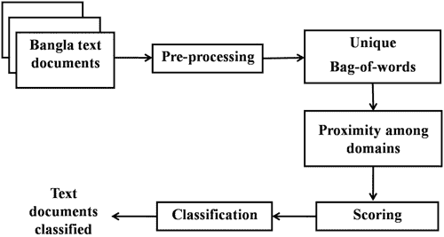

图 7.1 所提方法的框图。

### 7.3.1 数据收集

从质量还是数量上，数据都是任何实验结果的重要因素。开发数据库需要大量的关注，以确保实验过程中不会出现错误，并获得适当的结果。然而，从简要的文献调查中发现，基于领域的孟加拉语文本文档不足，因此我们必须建立自己的数据库来完成任务。实验涉及的文本文档从各种在线孟加拉语新闻语料库、杂志和网页中获取，涵盖八个文本领域：商业 (B)、体育 (SP)、国家新闻 (P)、娱乐 (E)、医疗 (M)、食品 (F)、科学与技术 (ST) 以及旅游 (T)，正如领先报纸所述。八个领域每个领域的文本文档分布见表 7.1。文本文档的网络来源有：`anandabazar.com`、`bartamanpatrika.com`、`ebela.in`、`deshirecipe.wordpress.com`、`banglarecipe.com`、`recipebangla.com`、`banglaadda.com`、`amaderchhuti.com`、`ebanglatravel.com`。

表 7.1 每个领域的文本文档分布

| 领域 | 文档数量 |
| --- | --- |
| 商业 | 1100 |
| 娱乐 | 1100 |
| 食品 | 1000 |
| 医疗 | 1000 |
| 国家新闻 | 1400 |
| 体育 | 1400 |
| 科学与技术 | 1000 |
| 旅游 | 1000 |
| 总计 | 9000 |

### 7.3.2 处理

使用如字符、单词和短语等表示形式的线性序列来形成数字文本文档。对于相应文本文档中的给定字符序列，在应用特征提取和选择方案之前，需要进行 `tokenization`（分词）。分词是将句子分割成称为 `tokens`（标记）片段的任务。如果不将句子清晰地切分成标记，就无法进行进一步处理。在这里，句子的分割是基于“空格”分隔符进行的，从数据集中检索到的单词总数为 2,806,159。分词后的数据加速了系统的处理，使其更高效并减轻了系统资源的负担。这对于依赖性能的系统来说是一个优势。由于从数据集中提取的所有词并不都相关或包含足够的信息以进入特征集，因此有必要删除停用词。在目前的实验中，标点、代词、英语等价词、介词、英语和孟加拉数字、叹词、某些形容词、连词、某些副词以及冠词都被视为停用词，获得的标记数量为 1,310,119。停用词的选择取决于特定的语言和特定的问题。

### 7.3.3 特征提取与选择

文本分类使用了许多技术。常用之一被称为“词袋模型”。这种方法在表示和实现上非常简单，但在自然语言处理（NLP）中，简单的方法需要很长时间才能产生令人鼓舞的结果。该方法也非常灵活，可以用于从文本中提取特征。词袋模型可以描述为文本文档中单词的出现。它是使用机器学习算法表示文本知识的过程。

在本次实验中，开发了一个 `UBoWs` 并考虑了两个文本类别之间的接近性以提取特征，随后可用于训练模型分类器。`UBoWs` 集中的每个唯一 token 代表一个描述性特征。词袋模型（bag-of-words）已证明在语言建模和文本文档分类任务中取得了成就。按照词袋模型的通常做法，考虑了每个文本文档中的所有单词，然后统计每个 token 的频率。在获得每个术的出现次数后，选择了一数量出现频率较高的 token。在实施机器学习算法之前，需要将原始文本转换为数值向量。每个唯一术语的权重由 `Equation 7.1` 确定。所有文本类别/领域的唯一术语百分比列于表 7.2。本实验考虑的八个不同文本类别的特征趋势在图 7.2 中图形所示。使用 `Equation 7.2` 进行评分，以确定文本文档与文本类别之间的接近程度。表 7.3 提供了不同领域之间的接近性百分比，该比例是通过考虑本实验所涉及领域内文本文档之间唯一术语的重叠来估计的。

### 表 7.2 所有文本类别/领域的唯一术语百分比

| 领域 | 唯一术语 (%) |
| --- | --- |
| 商业 | 36.34 |
| 娱乐 | 49.49 |
| 食物 | 73.42 |
| 医学 | 51.28 |
| 国家新闻 | 38.54 |
| 体育 | 44.67 |
| 科学技术 | 51.72 |
| 旅行 | 65.44 |

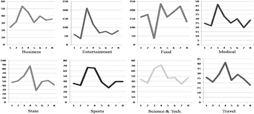

### 图 7.2 八个文本类的特征趋势。

### 表 7.3 不同领域之间的接近性百分比

| 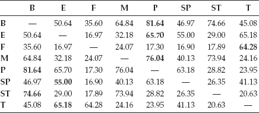 |
| :--- | :--- |
| `W(t[x]) = (1 + log2) O(t[x], d)` | (7.1) |

其中 `W(t[x])` 是文档中唯一术语 `t [x]` 的权重，`O[t[x]]` 是术语在数据集中的出现次数，而 `O(t[x], d)` 是术语在其相应文档中的出现次数。

| `P(c) = p + W(t[x])` | (7.2) |

其中 `P(c)` 是文本文档相对于文本类别的接近程度，`p` 是不同领域之间的接近性百分比。从特征集中选择了归一化特征，以便从自动孟加拉语文本分类系统中获得更精确的结果。

### 7.3.4 分类器

开发的特征集用于训练 `NBM` 分类算法以对孟加拉语文本文档进行分类。选择此分类器的原因是它在早期的文本分类工作中取得了令人瞩目的成就 [27](参考文献)–[30]。`NBM` 算法是朴素贝叶斯的扩展版本，根据文本文档的类型通常效果更好。它通常估计文档中某个领域的概率。一个领域的概率 `{P(v|w)}` 使用 `Equation 7.3` 确定，其中 `{P(t|v)}` 是术语 `t` 的条件概率，而 `t [w]` 代表文档 `w` 中术语的计数。

```
\left. P\left( v \middle&#124; w \right) = P(v)\prod\limits_{1 \leq l \leq t_{w}}P(t \middle&#124; v) \right.
```

(7.3)

该方程确定了 token 的计数并管理了操作中的计算。此扩展版本基本上用于分类任务中一个术语多次出现的情况。它计算条件概率 `{P(t|v)}`，该概率表示给定文本类别中特定术语 `t` 出现的相对频率。它使用 `Equation 7.4` 进行评估，其中 `t` 代表领域 `v` 的术语，`N` 表示数据集，`B [w]` 是词袋，而 `{N v t}` 决定术语 `t` 在领域 `v` 文档中的出现情况，并考虑了单词多次出现。

```
P\left( {t\text{&#124;}v} \right) = \frac{N_{v_{t}}}{\sum_{t' \in B_{w}}N_{{v'}_{t}}}
```

(7.4)

## 7.4 结果与分析

本节介绍了对 9,000 份文档进行孟加拉语文本分类获得的结果。为此，使用了广泛认可的工具 `WEKA` 来实施分类器。`K` 被选择为 10 [31]。使用 `NBM` 进行 10 折交叉验证获得的准确率如表 7.4 所示。每个领域的结果见表 7.5，基于 `NBM` 的领域级性能见图 7.3。获得的混淆矩阵见表 7.6。精确率、召回率和 F[1] 量的性能见表 7.4。八个类别的最高准确率 `97.3%` 见图 7.3。（fig7.2）。

本章介绍了一种基于特征提取方案（唯一词袋和领域间的邻近性）的 NBM 分类算法，用于孟加拉语文本文档分类到其各自的文本类别中。结果还与其他常用的分类器进行了比较，实验结果表明，在孟加拉语文本分类方面，NBM 的性能优于其他算法。在未来，该实验可以扩展到包含更多跨越领域的孟加拉语文本文档，以及更多的领域或文本类别。此外，还可以引入新的混合方法将文本文档归类到预设的文本类别中。我们还计划尝试其他的机器学习技术，例如基于深度学习和主动学习的 [35] 方法，以获得更好的结果。未来，这项研究也可以应用于其他语言的数据集。

## 致谢

其中一名作者感谢 DST 以 INSPIRE 学金的形式提供的支持。

## 参考文献

[1] DeySarkar, S., Goswami, S., Agarwal, A., Aktar, J.: A Novel Feature Selection Techniquefor Text Classification Using Nave Bayes, International Scholarly Research Notices, 2014, p. 10, 2014.

[2] Guru, D., Suhil, M.: A Novel Term Class Relevance Measure for Text Categorization, Proc. of ICACTA, pp. 13–22, 2015.

[3] Jin, P., Zhang, Y., Chen, X., Xia, Y.: Bag-Of Embeddings for Text Classification, Proc. of IJCAI, pp. 2824–2830, 2016.

[4] Wang, D., Zhang, H.: Inverse-Category-Frequency Based Supervised Term Weighting Schemes for Text Categorization, Journal of Information Science and Engineering, 29, pp. 209–225, 2013.


[5] Tellez, E., Moctezuma, D., Miranda-Jimnez, S., Graff, M.: `An Automated Text Categorization Framework Based on Hyperparameter Optimization`, `Knowledge-Based Systems`, 149, pp. 110–123, 2018.

[6] Linh, N. V., Anh, N. K., Than, K., Dang, C. N.: `An Effective and Interpretable Method for Document Classification`, `Knowledge and Information Systems`, 50(3), pp. 763–793, 2017.

[7] Wei, Z., Miao, D., Chauchat, J., Zhao, R., Li, W.: `N-Grams Based Feature Selection and Text Representation for Chinese Text Classification`, `International Journal of Computational Intelligence Systems`, 02, pp. 365–374, 2009.

[8] Wenliang, C., Xingzhi, C., Huizhen, W., Jingbo, Z., Tianshun, Y.: `Automatic Word Clustering for Text Categorization Using Global Information`, `Proc. of AIRS`, pp. 1–11, 2015.

[9] Mikawa, K., Ishidat, T., Goto, M.: `A Proposal of Extended Cosine Measure for Distance Metric Learning in Text Classification`, `Proc. of ICSMC`, pp. 1741–1746, 2011.

[10] Parvin, H., Dahbashi, A., Parvin, S., Minaei, B.: `Improving Persian Text Classification and Clustering Using Persian Thesaurus`, `Proc. of ICDCAI`, pp. 493–500, 2012.

[11] Al-Tahrawi, M.: `Arabic Text Categorization Using Logistic Regression`, `International Journal of Intelligent Systems and Applications`, 06(6), pp. 71–78, 2015.

[12] Al-Radaideh, Q.A., Al-Khateeb, S.S.: `An Associative Rule-Based Classifier for Arabic Medical Text`, `International Journal of Knowledge Engineering and Data Mining`, 03, pp. 255–273, 2015.

[13] Haralambous, Y., Elidrissi, Y., Lenca, P.: `Arabic Language Classification Using Dependency Syntax-Based Selection`, `Proc. of ICALP`, p. 10, 2014.

[14] Ali, A., Ijaz, M.: `Urdu Text Classification`, `Proc. of ICFIT`, pp. 1–7, 2009.

[15] Gupta, N., Gupta, V.: `Punjabi Text Classification Using Naive Bayes, Centroid and Hybrid Approach`, `Proc. of SEANLP`, pp. 109–122, 2012.

[16] ArunaDevi, K., Saveeth, R.: `A Novel Approach on Tamil Classification Using C-Feature`, `International Journal of Scientific Research & Development`, 02, pp. 343–345, 2014.

[17] Patil, J.J., Bogiri, N.: `Automatic Text Categorization Marathi Documents`, `International Journal of Advanced Research in Computer Science and Management`, 03, pp. 280–287, 2015.

[18] Patil, M., Game, P.: `Comparison of Marathi Text Classifiers`, `ACE`, `International Journal on Information Technology`, 04, pp. 11–22, 2014.

[19] Sarmah, J., Saharia, N., Shikhar, K.: `A Novel Approach for Document Classification Using Assamese Wordnet`, `Proc. of IGWC`, pp. 324–329, 2012.

[20] Mohanty, S., Santi, P., Mishra, R., Mohapatra, R., Swain, S.: `Semantic Based Text Classification`, `Indian Language`, `Proc. of ICECCE`, pp. 321–324, 2016.

[21] Mansur, M., UzZaman, N., Khan, M.: `Analysis of N-Gram Based Text Categorization for Bangla in Newspaper`, `Proc. of ICCIT`, p. 08, 2006.

[22] Mandal, A., Sen, R.: `Supervised Learning for Bangla Categorization`, `International Journal of Artificial Intelligence and Applications`, 05(5), pp. 93–105, 2014.

[23] Kabir, F., Siddique, S., Kotwal, M., Huda, M.: `Bangla Textization Using Stochastic Gradient Descent` (`SGD`), `Proc. of ICCIP`, pp. 1–4, 2015.

[24] Islam, Md.S., Jubayer, F., Ahmed, S.: `A Support Vector Machine with` `TF-IDF` `to Categorize Document`, `Proc. of ICECCE`, pp. 191–196, 2017.

[25] Dhar, A., Dash, N.S., Roy, K.: `Classification of Text Documents through Distance Measurement: Multi-Domain Bangla Text`, `Proc. of ICACCA`, p. 16, 2017.

[26] Dhar, A., Dash, N.S., Roy, K.: `Application of` `TF-IDF` `Feature for Categorizing Bangla Corpus`, `Proc. of FICTA`, pp. 51–59, 2017.

[27] Kibriya, A.M., Frank, E., Pfahringer, B., Holmes, G.: `Multinomial Naive Bayes for Text Categorization`, `Revisited`, `Proc. of AJCAI`, pp. 488–499, 2005.

[28] Kim, S.B., Han, K.S., Rim, H.C., Myaeng, S.H.: `Some Effective Techniques for Naive Bayes Text Classification`, `IEEE Transactions on Knowledge and Data Engineering`, 18(11), pp. 1457–1466, 2006.

[29] Rehman, A., Javed, K., Babri, H.A.: `Term-Weighting Approaches in Automatic Text Retrieval`, `Information Processing and Management`, 53(2), pp. 473–489, 2017.

[30] Wilbur, J.W., Kim, W.: `The Ineffectiveness of Within-Document Term Frequency in Text Classification`, `Information Retrieval`, 12(5), pp. 509–525, 2009.

[31] Hall, M., Frank, E., Holmes, G., Pfahringer, B., Reutemann, P., Witten, I.H.: `The Weka Data Mining Software: An Update`, `ACM SIGKDDexplorations Newsletter`, 11(1), pp. 10–18, 2009.

[32] Obaidullah, Sk.M., Santosh, K.C., Halder, C., Das, N., Roy, K.: `Automatic Indic Script Identification from Handwritten Documents: Page, Block, Line and Word-Level Approach`, `International Journal of Machine Learning and Cybernetics`, pp. 1–20, 2017.

- `33.`、`隐性攻击 (CAG)` 或 `非攻击性 (NAG)`。在进行任何处理之前，都对数据进行了可视化处理。有两个数据文件：

- `en_train/hi_train.csv` 包含训练集，有 12,000 条记录（`显性攻击 = 2708`、`隐性攻击 = 4240`、`非攻击性 = 5052`）。

- `en_dev/hi_dev.csv` 包含测试集，有 3001 条记录（`显性攻击 = 711`、`隐性攻击 = 1057`、`非攻击性 = 1233`）。

### 8.2.2 数据特征

推文大多通过 API 提取，提取器定义了如地理区域、语言和感兴趣的主题等范围。在性别识别和攻击性识别的背景下，最常见的数据特征如下：

- 数据收集区域：通过这些信息可以很容易地预测/移除数据集中不需要的噪声。例如，对俚语语言的理解、用户行为/讽刺的常见特征。

- 特定语言停用词的使用：通常观察到 30% 的用户帖子包含常用词。例如，如果推文是英语，那么这些词就是 `the`, `is`, `a`, `an` 等。

- 词汇在缩写/术语层面的模态：通常在非正式交流中，人们倾向于使用缩写或术语，而不是写完整的单词。例如，`ROFL`、`LOL` 等。

- 表情符号的使用对推文的影响：显然，表情符号比文本提供了更多见解，或者为推文增加了额外的含义。这里的重点主要是检查分布水平，以及表情符号为数据集增加了多少噪声。

- 在监督学习的情况下，数据集上的类别/标签分布：对于机器学习方法来说，具有均匀分布的数据集是理想的，但许多数据集面临类别不平衡的问题。

- 话题标签的使用：由于这是一个 Twitter 和 Facebook 数据集，它包含了许多话题标签和组合词。在对其进行任何预处理之前，需要考虑这些标签在语境中包含多少意义。

表 8.2 显示了数据集的数据特征。

**表 8.2：数据集特征**

| 数据收集区域 | 印度 |
| --- | --- |
| 英语停止词 | 高 |
| 模态缩写/专业术语 | 高 |
| 表情符号的使用 | 分布于各个类别 |
| 类别/标签分布 | 不平衡 |
| 话题标签的使用 | 高 |

### 8.2.3 数据预处理

数据预处理是任何系统建模最重要的阶段，通常在预处理时会考虑数据特征。在这里，针对上述提到的数据特征，讨论了推文的预处理。

- **词干 (Stem words)**：根据语言形态学。词干是不带前缀的词。从单词中移除后缀或将其转换为词干形式不会影响其语义。此外，它减少了数据集中不同单词的数量。这在使用数据集创建词词表时可能非常有帮助。规则如下：

  - **规则**：`regexp = '^(.*?)(ing)(ed)(ment)(ion)?$'`

- **停止词 (Stop-words)**：在许多无法捕捉句子语义的情况下，移除停止词很有帮助。同样，通过只保留句子中有意义的词，有助于减少句子长度并消除分布的语言噪声。另一方面，当用户想要捕捉句子的语义时，不建议移除停止词。

- **符号表情符号 (Symbolic emojis)**：在大多数文本社交媒体通信中，表情符号用于表示作者的情绪。通常，所有文本平台都有表情符号（图像），但大多数人使用符号表情符号。为了这一点，使用了以下正则表达式：

  - `“(:\s?D|:-D|x-?D|X-?D)”` 用于 # 笑 -- `:D`, `: D`, `:-D`, `xD`, `x-D`, `XD`, `X-D`

  - `“(:\s?\)|:-\)|\(\s?:|\(-:|:\'\))”` 用于 # 微 -- `:)`, `: )`, `:-)`, `(:`, `( :`, `(-:`

  - `“(<3|:\*)”` 用于 # 爱 -- `<3`, `:*`

  - `“(;-?\)|;-?D|\(-?;)”` 用于 # 眨 -- `;-)`, `;)`, `;-D`, `;D`, `(;`, `(-;`

  - `“(:\s?\(|:-\(|\)\s?:|\)-:)”` 用于 # 难过 -- `:-(`, `: (`, `:(`, `):`, `)-:`

  - `“(:,\(|:\'\(|:”\()”` 用于 # 哭 -- `:, `, `:(`

- **缩写/专业术语**：取决于数据收集区域，因此使用正则表达式将这些词替换为原始形式。

- **分割 (Segmentation)**：最常用的字符“#”后面跟着许多单词。在大多数情况下，研究不使用此信息，但在这里使用了图解（ekphrasis）[13] 来移除分割并找到随后的单词。

表 8.3 显示了对数据集进行的预处理。

**表 8.3：数据集预处理**

| 预处理/语言 | 英语 | 印地语 |
| --- | --- | --- |
| 词干 | ✓ | ✗ |
| 停止词 | ✓ | ✗ |
| 符号表情符号 | ✓ | ✓ |
| 缩写/专业术语 | ✓ | ✓ |
| 分割 | ✓ | ✓ |

### 8.2.4 特征提取

信息检索的关键方面是特征提取。根据提取特征的数量，可以定义使用这些特征的系统。通常，提取特征是字符级的一单元、双单元和三单元。除了这些，还使用了 `TFIDF Vectorizer`、`Doc2Vec`、`Word2Vec`、分布式词袋 (`DBOW`)、分布式内存拼接 (`DMC`) 和分布式内存平均值 (`DMM`)。在这里，`TFIDF` 用于衡量文档中的词权重，`Doc2Vec` 和 `Word2Vec` 为单词/句子/段落/文档生成向量。`DBOW`、`DMC` 和 `DMM` 作为 `Doc2Vec` 的部分。在许多系统中，研究人员还使用词性 (`POS`) 标签作为特征之一。表 8.4 显示了在数据集上提取的特征。

**表 8.4：数据集提取的特征**

| 特征/语言 | 英语 | 印地语 |
| --- | --- | --- |
| 一单元 (Unigram) | ✓ | ✗ |
| 双单元 (Bigram) | ✓ | ✗ |
| 三单元 (Trigram) | ✓ | ✗ |
| `TFIDF` 向量化 | ✓ | ✗ |
| `Doc2Vec – DBOW` | ✓ | ✗ |
| `Doc2Vec – DMC` | ✓ | ✗ |
| `Doc2Vec – DMM` | ✓ | ✗ |
| 词典 | ✓ | ✓ |

### 8.2.5 实验设置

为了系统建模，使用了两种方法：(a) 传统机器学习或线性建模和 (b) 深度学习。对于线性模型，使用了 `logistic regression`；对于深度学习建模，使用了 `Keras`。

使用了四个测试集分类：(a) Facebook 和 (b) Twitter（英语）；以及 (c) Facebook 和 (d) Twitter（印地语）。在这里，使用 Facebook 测试数据来检查监督学习的水平，而使用 Twitter 测试数据来检查迁移学习。将稠密模型（`dense model`）与 `FastText` 模型进行了对比。表 8.8 显示了提交系统的结果。

**表格 8.8：结果：`Dense` 对比 `FastText` [17]**

| 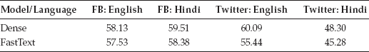 |

## 8.3 作者画像分析

文档处理的重要方面之一是作者身份识别，即在给定特定文本的情况下预测特定作者。作者画像（`Author profiling`）是一个子领域，其中预测的不再是特定作者，而是作者的年龄和性别等特征。画像分析方法主要源于提取的不同特征。


`Stamatatos [18]`提供的论文概述了各种特征。他概述了词汇、字符、句法、语义以及特定于应用的特征。这些特征类型在`PAN`作者画像任务的提交中显而易见，`PAN`是评估论坛会议与实验室（`CLEF`）的一项正在进行的项目。`PAN`有多个版本，但与我们的任务相关的是`PAN 2015 [19]`（其任务是对四种语言的推文进行分类）和`PAN 2016 [20]`（其任务是进行跨领域评估）。提取的特征主要类型包括基于风格的、基于内容的、基于`n-gram`的、基于信息检索的以及基于词搭配的。例如，在`PAN 2015`中，字符`n-gram`模型被用于`[21, 22]`。单词`n-gram`也用于如`[23]–25]`等工作。`TFIDF n-gram`被用于`[26, 27]`。`POS n-gram`也被用于`[26, 28]`。另一组特征源于词向量。目前提出了多种词向量实现方案。其中被广泛使用的是`Mikolov`提出的`Word2Vec [29, 30]`。`Word2Vec`算法本质上有两种模式：连续袋模型（`continuous bag of words`）和跳词模型（`skip-grams`）。为了获取词向量，程序必须从随机数初始化向量。然后它从`Wikipedia`等大型语料库中读取。利用语料库中的单词序列，程序使用代表单词的初始随机向量来预测其他单词。例如，在连续袋模型中，目标词是通过周围的上下文词来预测的。相反，跳词模型是使用一个单词来预测其上下文词。

### 8.3.1 数据集

有两个来自`PAN`的数据集。第一个来自`PAN 2015`数据集`[19]`。它由具有不同数量推文的用户组成，涵盖四种语言：英语、西班牙语、意大利语和荷兰语。然而，我们只使用英语和西班牙语部分。用户数量有所不同。英语有`152`个用户，而西班牙语有`110`个。该数据集根据性别进行了平衡，并提供了性别、年龄和性格的标签。年龄有四个不同的类别：`18–24`、`25–34`、`35–49`和`50`岁以上。这在表`8.9`中所示。在性格特征方面，每个用户在五要素理论（`Five Factor Theory`）`[31]`的五大人格特征上的得分都在`–0.5`到`0.5`之间。这些包括外向性、情绪稳定性/神经质、宜、责任心和经验开放。

**表格 8.9**

`PAN 2015`数据集的年龄分布

```
| 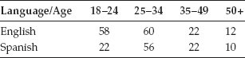 |
```

第二个数据集来自`PAN 2016`数据集`[20]`。它由具有不同数量推文的用户组成，涵盖四种语言：英语、西班牙语、意大利语和荷兰语。然而，我们只使用英语和西班牙语部分。用户数量有所不同。英语有`152`个用户，而西班牙语有`110`个。该数据集根据性别进行了平衡，并提供了性别、年龄和性格的标签。年龄有四个不同的类别：`18–24`、`25–34`、`35–49`和`50`岁以上。这在表`8.10`中所示。

**表格 8.10**

`PAN 2016`数据集的年龄分布

```
| 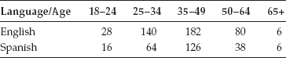 |
```

### 8.3.2 预处理

没有进行大量的预处理。对于每种语言，推文都被读取。根据实验设置，这些推文被转换为小写。`Twitter`特有的特征如标签（`hashtags`）、提及（`mentions`）和转发被去除了。

### 8.3.3 特征提取

提取了一些特征。这些包括词袋特征、`n-gram`和词性`n-gram`。第一种是归一频率，它是通过词数归一化的。第二种是`TFIDF`，它是通过逆文档频率归一化的。使用了单词双元组和三元组。使用的标记器是`Schmid`的`TreeTagger [32]`。另一项特征是词向量的平均值。我们使用了`Gensim [33]`的`Word2Vec`实现获取维度为`100`和`300`的词向量。我们使用了`2016`年`2`月`5`日的`Wikipedia`转储。

### 8.3.4 实验设置

有多个需要测试的内容。首先，我们想知道哪些传统特征可以指示年龄、性别和性格的类别。然后我们想观察使用词向量是否能给分类带来相当或更大的改进。

最后，我们想看看使用深度学习架构是否也能产生更好的结果。由于有两个不同的数据集，且具有不同的分类算法模式，以及有不同的测试内容，因此创建了两种设置。这在图`8.2`中所示。

第二种设置使用了留出（`hold-out`）和`PAN 2016`数据集。在该设置中，一个训练示例是一个推文。数据集首先按用户划分为`70%`的训练集和`30%`的测试集。训练示例由来自`70%`的每条推文组成。测试示例也由来自`30%`部分每条推文组成。然后，这些训练示例用于基于`Kim [35]`的卷积神经网络模型中。这使得我们能够观察到分类的一些因素。

### 8.3.5 算法与模型微调

实验中使用了两种学习算法：支持向量机（`SVM`）和卷积神经网络（`CNN`）。在第一部分，我们使用了带有线性核的`SVM`，并将误差项的默认惩罚参数设置为`1`，以观察哪些传统特征对该问题效果最好。随后进行了威尔科克森符号秩检验`[36]`，以检查结果之间的差异是否显著。

然后，对于词向量平均值，我们实验了多项式核和径向基函数核。我们实验了次数为`1`、`2`和`3`的多项式阶，并将误差项的惩罚参数设置为`0.01`、`1`或`100`。我们还实验了`gamma`为`0.01`、`1`或`100`的径向基函数核，并采用了与之前相同的误差项惩罚参数选项。在这一部分中，我们没有使用统计检验。

我们使用的卷积神经网络遵循`Kim [35]`的模型，它由一个嵌入层以及随后的带有三个过滤器的卷积层组成，过滤器的窗口大小分别为`3`、`4`和`5`，其中每个过滤器窗口有`100`个特征图。我们使用`tanh`函数作为非线性激活。在特征图之后，执行了时间步最大池化（`max-over-time pooling`）。然后添加了丢弃层（`dropout layer`）。我们的丢弃概率为`0.5`。最后，收集所有数据用于最终的`softmax`层，其权重向量受`l[2]`范数的约束。所有训练均使用`Adadelta`对洗乱后的小批量（`mini batches`）进行随机梯度下降。每个小批量包含`3000`个示例。通过这种设置，我们实验了使用`skip-grams`的`100`到`300`维词向量维度，以及保持词向量为静态或非静态。保持向量静态意味着我们在训练期间不会更改向量值。此外，由于数据集是以用户为单位的，而模型是推文分类，我们聚合了属于同一用户的推文分类结果，并使用多数投票法来确定每个用户的类别。我们还能看到使用多数投票对分类的影响。

### 8.3.6 结果

我们的第一组实验涉及检查哪种特征类型为`PAN 2015`提供了最好的分类准确率。所有语言和任务的结果在`[37]`论文中进行了更详细的解释。然而，随后的表格是关于英语和西班牙语的年龄与性别分类，以及对人格特征的回归。

性别分类准确率见表`8.11`。在词袋特征中，`TFIDF`特征给出了比归一化词频更好的结果。在词`n-gram`特征中，英语的词三元组（`trigrams`）比词二元组（`bigrams`）效果更好，但西班牙语的情况相反。在`POS n-gram`中，`POS`一元组和二元组的组合在英语和西班牙语中表现良好。然而，从统计差异来看，只有西班牙语的词`n-gram`以及英语和西班牙语的词袋结果存在差异。从表中可以看出，`TFIDF`为英语推文提供了最高准确率，达到`68.3%`。特征的组合为西班牙语带来了最佳结果，为`80.0%`。

**表 8.11**

`PAN 2015`性别分类准确率结果

```
| 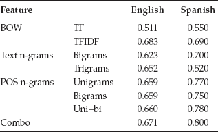 |
```

年龄分类的结果见表`8.12`。在词袋特征中，`TFIDF`给出了最好的结果，而在词`n-gram`中，词二元组的结果最好。然而，对于`POS n-gram`，英语的二元组提供了最佳结果，而西班牙语的一元组和二元组组合则提供了最佳结果。观察统计差异，只有英语的词袋特征和西班牙语的词`n-gram`结果之间存在差异。从表中可以看到，`TFIDF`特征为英语提供了`69.1%`的准确率；它高于归一化词频，甚至高于最佳特征的组合。对于西班牙语，特征的拼接提供了最高准确率，为`72.0%`。

**表 8.12**

`PAN 2015`年龄分类准确率结果

```
| 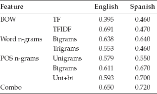 |
```

所有五个人格特征的平均均方误差见表`8.13`。大部分结果在统计上互不差异。从量级来看，`TFIDF`在英语中效果最好，而特征组合在西班牙语中效果良好。然而需要注意的是，这些量级较小。

**表 8.13**

`PAN 2015`人格结果平均

```
| 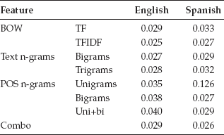 |
```

我们的第二个实验涉及使用词向量平均值作为分类特征，并在`PAN 2016`数据集上进行十折交叉验证。这些实验的最高准确率总结见表`8.14`。英语性别分类的最高准确率为使用`C=100`的三次多项式核得到的`68.2%`。结果存在较大的波动，因为最低值为`50.0%`。其他参数的结果详情在另一篇论文`[38]`中说明。

**表 8.14**

`PAN 2015`英语性别分类分类

```
| 任务/语言 | 英语 | 西班牙语 |
| --- | --- | --- |
| 性别 | 0.682 | 0.671 |
| 年龄 | 0.448 | 0.513 |
```

对于英语的年龄分类，获得的最高准确率为`44.8%`。产生最佳分类的`SVM`参数使用了`C=1`和`gamma=100`的径向基函数核，尽管大多数其他值也接近。西班牙语推文的最高性别分类准确率为`67.1%`。该分类器使用了`gamma=1`和`C=100`的径向基函数核。另一方面，西班牙语年龄分类的最高准确率为`51.3%`。这是由使用`gamma=1`和`C=100`的径向基函数核的分类器提供的。

我们的第三个实验使用`CNN`在留出设置下对`PAN 2016`数据集的推文进行分类。表`8.15`显示了英语和西班牙语的`CNN`准确率结果。

**表 8.15**

`PAN 2016`按推文与用户评估的准确率对比

```
| 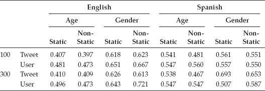 |
```

从上表中可以得出许多趋势。首先，我们观察到，对给定数据集的推文使用多数投票预测（`majority prediction`）可以提高结果。这与其他将用户推文进行拼接的方法形成对比。一个例外是西班牙语的性别分类。其次，我们注意到增加维度会提高准确率。尽管准确率提高的次数与下降的次数相等，但其变动幅度说明了其他问题。将向量更改为可训练或不可训练、非静态或静态的情况也是如此。将向量设为可训练或非静态会提高准确率。一种解释可能是，随着训练数据的增加，向量得到了更精细的微调。使用`100`和`300`维度进行英语性别分类的准确率分别提升了`1.5%`和`7.7%`。使用`100`维度进行西班牙语年龄分类提升了`1.3%`，而使用`300`维度则没有产生任何差异。使用`300`维度进行西班牙语性别分类也提升了`8.0%`。然而，其他实例在调整向量时降低了结果。最大的降幅为`4.0%`，来自使用`100`维度的性别分类。

## 8.4 结论与未来工作

在对攻击性识别和作者画像（`author profiling`）这两个主要方面进行深入讨论后，得出以下结论。

在攻击性识别方面，普通/密集型架构（`plain/normal dense architecture`）优于其他先进架构。唯一的缺点是，由于建模过程中遇到的每个词都需要索引，密集型架构只能用于较小的数据集。索引越大，矩阵表示越大，导致计算资源的消耗越高。此外，字典/索引中未出现的词会被丢弃。这可以在未来工作中得到解决。此外，模型没有捕获句子的语义含义，例如词性和形态。这也可以在未来工作中予以考虑。

在作者画像方面，通过查看`PAN 2015`数据集，我们可以得出：在英语分类任务中，使用标准的`TFIDF`优于其他特征。然而，多种特征的组合对于西班牙语分类任务更好。同时，针对性格的回归结果相似。使用词向量平均值作为`PAN 2016`数据集的分类器特征可能会获得相当的结果，尽管由于我们使用了不同的数据集，其准确性并不那么高。最后，使用`CNN`架构结合词向量根据向量维度的大小以及向量的可训练性，似乎可以产生更高的准确率。然而，我们应该对此进行更好的测试，因为目前的设置是不同的。

## 参考文献

[1.] `Anna Schmidt`, and `Michael Wiegand`. 2017. A Survey on Hate Speech Detection Using Natural Language Processing. In: Proceedings of the Fifth International Workshop on Natural Language Processing for Social Media, Association for Computational Linguistics, pages 1–10, Valencia, Spain.

[2.] `Shervin Malmasi`, and `Marcos Zampieri`. 2017. Detecting Hate Speech in Social Media. In: Proceedings of the International Conference Recent Advances in Natural Language Processing (RANLP), pages 467–472.

[3.] `Irene Kwok`, and `Yuzhou Wang`. 2013. Locate the Hate: Detecting Tweets Against Blacks. In: Proceedings of the Twenty-Seventh AAAI Conference on Artificial Intelligence, pages 1621–1622.

[4.] `Chikashi Nobata`, `Joel Tetreault`, `Achint Thomas`, `Yashar Mehdad`, and `Yi Chang`. 2016. Abusive Language Detection in Online User Content. In: Proceedings of the 25th International Conference on World Wide Web, pages 145–153., International World Wide Web Conferences Steering Committee.

[5.] `Alexandra Schofield`, and `Thomas Davidson`. 2017. Identifying Hate Speech in Social Media. XRDS: Crossroads, The ACM Magazine for Students, 24(2):56–59.

[6.] `Björn Gambäck`, and `Utpal Kumar Sikdar`. 2017. Using Convolutional Neural Networks to Classify Hate-speech. In: Proceedings of the First Workshop on Abusive Language Online, pages 85–90.

[7.] `Ziqi Zhang`, `David Robinson`, and `Jonathan Tepper`. 2018. Detecting Hate Speech on Twitter Using a Convolution-GRU Based Deep Neural Network. In: Lecture Notes in Computer Science, Springer Verlag.

[8.] `Antigoni-Maria Founta`, `Constantinos Djouvas`, `Despoina Chatzakou`, `Ilias Leontiadis`, `Jeremy Blackburn`, `Gianluca Stringhini`, `Athena Vakali`, `Michael Sirivianos`, and `Nicolas Kourtellis`. 2018. Large Scale Crowdsourcing and Characterization of Twitter Abusive Behavior. arXiv Preprint:1802.0039.

[9.] `Karthik Dinakar`, `Roi Reichart`, and `Henry Lieberman`. 2011. Modeling the detection of cyberbullying. In: The Social Mobile, pages 11–17.

[10.] `Pete Burnap`, and `Matthew L`, 2015. Cyber hate speech on twitter: An application of machine classification and decision making. Policy and Internet, 7(2):223–242.

[11.] `Ritesh Kumar`, `Aishwarya N Reganti`, `Akshit Bhatia`, and `Tushar Maheshwari`. 2018b. Aggression-annotated Corpus of Hindi-English Code-mixed Data. In: Proceedings of 11th Language Resources and Evaluation Conference (LREC), Miyazaki, Japan.


[12.] Ritesh Kumar, Atul Kr Ojha, Shervin Malmasi, and Marcos Zampieri. 2018a. Benchmarking Aggression Identification in Social Media. In: Proceedings of the First Workshop on Trolling, Aggression and Cyberbullying (TRAC), Santa Fe, USA.

[13.] Christos Baziotis, Nikos Pelekis, and Christos Doulkeridis. 2017. Datastories at semeval-2017 task 4: Deep lstm with attention for message-level and topic-based sentiment analysis. In: Proceedings of the 11th International Workshop on Semantic Evaluation (SemEval-2017), pages 747–754, Vancouver, Canada. Association for Computational Linguistics.

[14.] François Chollet et al., 2015. Keras. [`keras.io`](https://keras.io).

[15.] Martín Abadi, Paul Barham, Jianmin Chen, Zhifeng Chen, Andy Davis, Jeffrey Dean, Matthieu Devin, Sanjay Ghemawat, Geoffrey Irving, Michael Isard, Manjunath Kudlur, Josh Levenberg, Rajat Monga, Sherry Moore, G Murray, Benoit Steiner, Paul Tucker, Vijay Vasudevan, Pete Warden, Martin Wicke, Yuan Yu, and Xiaoqiang Zheng. 2016. Tensorflow: A system for large-scale machine learning. In: Proceedings of the 12th USENIX Conference on Operating Systems Design and Implementation, OSDI’16, pages 265–283, Berkeley, CA, USA: USENIX Association.

[16.] Jeffrey Pennington, Richard Socher, and Christopher D. Manning. 2014. Glove: Global vectors for word representation. In: Empirical Methods in Natural Language Processing (EMNLP), pages 1532–1543.

17. Kashyap Raiyani, Teresa Gonçalves, Paulo Quaresma, and Vitor Beires Nogueira. 2018. “带有先进预处理器的全连接神经网络，用于识别 Facebook 和 twitter 上的攻击行为”。In: Proceedings of the First Workshop on Trolling, Aggression and Cyberbullying (TRAC-2018). Santa Fe, New Mexico, USA: Association for Computational Linguistics, pages 28–41. URL: [`aclweb.org/anthology/W18-4404`](http://aclweb.org).

18. Efstathios Stamatatos. 2009. 现代作者归属方法综述。Journal of the American Society of Information Science and Technology, 60(3):538–556.

19. Francisco Rangel, Fabio Celli, Paolo Rosso, Martin Potthast, Benno Stein, and Walter Daelemans. 2015. PAN 2015 第 3 次作者画像任务概览。In: Linda Cappellato, Nicola Ferro, Gareth Jones, and Eric San Juan, editors, CLEF 2015 Evaluation Labs and Workshop – Working Notes Papers, 8-11 September, Toulouse, France. CEUR-WS.org, September 2015.

20. Francisco Rangel, Paolo Rosso, Ben Verhoeven, Walter Daelemans, Martin Potthast, and Benno Stein. 2016. PAN 2016 第 4 次作者画像任务概览：跨领域评估。In: Working Notes Papers of the CLEF 2016 Evaluation Labs, CEUR Workshop Proceedings. CLEF and CEUR-WS.org, September 2016.

21. Carlos E González-Gallardo, Azucena Montes, Gerardo Sierra, J Antonio Núnez-Juárez, Adolfo Jonathan Salinas-López, and Juan Ek. 2015. 使用依赖语料库标签、字符和 pos n-gram 对推文进行分类。In: CLEF (Working Notes).

22. Suraj Maharjan, and Thamar Solorio. 2015. 使用广泛的特征进行作者画像。In: CLEF (Working Notes).

23. Mounica Arroju, Aftab Hassan, and Golnoosh Farnadi. 2015. 多语言环境下利用推文进行年龄、性别和性格识别。In: 6th Conference and Labs of the Evaluation Forum (CLEF 2015): 实验性 IR 遇到多语言、多模态和交互，pages 23–31.

24. Fahad Najib, Waqas Arshad Cheema, and Rao Muhammad Adeel Nawab. 2015. 使用基于内容的方法在推特数据上预测作者特征。In: CLEF (Working Notes).

25. Scott Nowson, Julien Perez, Caroline Brun, Shachar Mirkin, and Claude Roux 2015. 用于多语言作者画像 Xrce 个人语言分析引擎。Working Notes Papers of the CLEF.

26. Maite Giménez, Delia Irazú Hernández, and Ferran Pla. 2015. 目标观众细：利用推文进行自动作者画像。In: Proceedings of CLEF.

27. Andreas Grivas, Anastasia Krithara, and George Giannakopoulos. 2015. 使用文体统计和结构特征分组进行作者画像。In: CLEF (Working Notes).

28. Alonso Palomino-Garibay, Adolfo T Camacho-Gonzalez, Ricardo A Fierro-Villaneda, Irazu Hernandez-Farias, Davide Buscaldi, Ivan V Meza-Ruiz, et al. 2015. 用于作者画像的随机森林方法。In: CLEF (Working Notes).

29. Tomas Mikolov, Kai Chen, Greg Corrado, and Jeffrey Dean. 2013. 向量空间中词表示的高效估计。arXiv Preprint ArXiv:1301.3781.

30. Tomas Mikolov, Ilya Sutskever, Kai Chen, Greg S Corrado, and Jeff Dean. 2013. 单词和短语的分布式表示及其组合性。In: Advances in Neural Information Processing Systems, pages 3111–3119.

31. Robert R McCrae, and Paul T Costa Jr. 1999. 性格五要素理论。Handbook of personality. Theory and Research, 2:139–153.

32. Helmut Schmid 2013. 使用决策树的概率性词性标记。In: New Methods in Language Processing, Page, 154.

33. Radim Řehůřek, and Petr Sojka. 2010. 用于大规模语料库的主题建模软件框架。In: Proceedings of the LREC 2010 Workshop on New Challenges for NLP Frameworks, pages 45–50, Valletta, Malta. ELRA. [`is.muni.cz/publication/884893/en`](http://is.muni.cz).

34. Corinna Cortes, and Vapnik 1995. 支持向量网络。Machine Learning, 20(3):273–297.

35. Yoon Kim 2014. 用于分类的卷积神经网络。Arxiv:1408.5882.

36. Woolson 2007. 威尔科逊符号秩检验。Wiley Encyclopedia of Clinical Trials, 1–3.

37. Roy Chaot, Teresa Gonçalves 2016. 带有语言特征的作者画像。

38. Roy Chaot, Teresa Gonçalves 2016. 使用 svms 和平均值的作者画像。Notebook clef。

# 使用离线图像计算特征对孟加拉手写识别的影响

Shibrasad Sen, Ankan Bhattachya, and Kaushik Roy

## 目录

9.1 引言  
9.2 文献综述  
　　9.2.1 方向代码特征  
　　9.2.2 面积与局部特征  
　　　　9.2.2.1 面积特征  
　　　　9.2.2.2 局部特征  
　　9.2.3 点特征  
　　9.2.4 转换计数特征  
　　9.2.5 拓扑特征  
　　　　9.2.5.1 交叉点  
9.3 数据库准备与预处理  
　　9.3.1 数据收集设计  
9.4 特征提取  
　　9.4.1 基于定向豪斯距离（DHD）的特征  
9.5 实验结果与分析  
9.6 结论  
参考文献

在本章中，我们专注于开发一种用于在线识别手写孟加拉语字符的系统。选择孟加拉语的原因不仅是因为该领域的研究较为有限，还因为该语言深厚的文化底蕴，这激励着我们开展一些实质性的工作，以利用尖端的机器学习方法进行必要的定制。此外，孟加拉语是印度第二流行的语言。它是印度使用的官方语言和文字之一，同时也是孟加拉国的官方语言。该文字文字源自古老的婆罗米文字。像天瓦纳文字等其他印欧雅言文字一样，孟加拉语的书写风格是从左到右的。孟加拉文字的基本字符集包含 39 个辅音和 11 个元音，如图图 9.1 所示[2]。

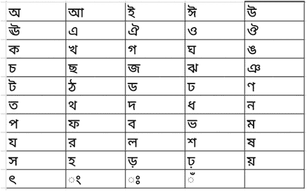

图 9.1 孟加拉语字母表。

在本章描述的工作中，我们的目标是从相应的在线信息构建一个离线字符图像数据库，同时生成更强大的特征集，通过结合字符图像的在线和离线属性来提高整体识别准确率。在本章中，我们提到了完整的识别方案，从准备在线手写孟加拉语字符数据库到预处理，再到从预处理数据中提取特征的细节，最后通过某些常用的分类器对手写写字符进行识别[3, 4]。本章还建议了通过将相应的离线信息整合到在线信息中来增强生成特征强度的方法[5]。尽管第一批商用光学手识别（OHR）系统出现在 20 世纪 90 年代，但它们的能力有限，成功率也不理想。我们认为 OHR 许多领域仍未解决，这里我们简要总结了不同研究人员在在线手写孟加拉语字符识别中面临的一些挑战：

* i) 不同个体之间书写风格的巨大差异使得识别过程具有挑战性。
* ii) 即使是同一个人，书写速度和尺寸也存在巨大的差异。较快的书写速度意味着使用更少的像素点来相同的信息[6]。
* iii) 书写字符时笔画数的差异[7]为在线手写字符的识别带来了挑战。这在图 9.2 中所示，该字符分别使用了两、三和最多四笔画书写。
* iv) 书写字符时笔画顺序的变化使得情况变得更加困难。例如，在图 9.3 中，使用四笔画来写字符‘ঝ’，但笔画出现的顺序是不同的。
* v) 某些字符之间的形状相似性是另一个挑战，如图 9.4 所示。
* vi) 不同用户有不同的书写风格。图 9.5 展示了同一个字符‘ক’以不同风格书写的场景。

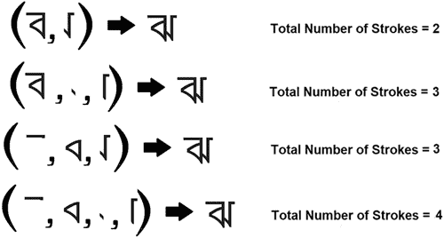

图 9.2 使用不同笔画书写同一个字符‘ঝ’的插图。

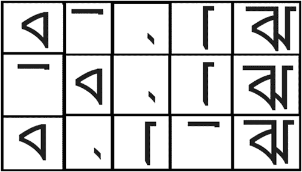

图 9.3 写相同字符的笔画顺序变化。


图 9.4 某些形状相似字符的示例。

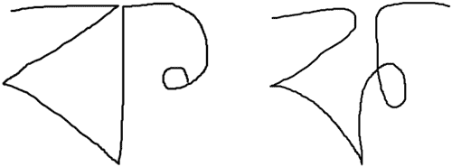

图 9.5 写相同字符的不同风格插图。

由于这些各种挑战，随着在线设备的日益普及以及将手写文本转换为可编辑电子内容的渴望，OHR 研究人员正越来越关注不同语言的在线手写字符识别[8]。关于天瓦纳文字[9–16]、英语[17–24]、古鲁米语/古吉拉特语[25–37]文字的研究材料在文献中可见。一些工作涉及新型机器学习概念，如深度学习[38–45]和极限学习机[46]。关于孟加拉文字，虽然已经有一些研究出版物（见下文），但进展仍处于婴儿阶段。

Roy 等人在[2]中提出了整体特征提取技术，从书写板上的笔运动中收集序列和动态信息。这些特征通过二次分类器进行评估，以识别在线手写孟加拉字符。作者在[47]中展示了方向代码和点浮直方图特征在四种常用印地文字识别中的有效性。作者使用了如多层感知器（MLP）、最近邻（NN）和隐马尔可夫模型（HMM）等一些常用的分类器进行分类。[48]中突出了一种不同的方案，首先在字符层提取组成笔画。之前提到的序列和动态特征从笔画中提取用于识别。识别出的笔画序列然后与已建立的规则库进行匹配，以构建字符。


Parui 等人在 [49] 中强调了一种基于笔画的字符识别机制，为每一类笔画都构建了一个隐马尔可夫模型（HMM）。作者根据字形层面的形状相似性，手动将所有字符的笔画划分为 54 类。字符通过之前构建的查找表帮助，由识别出的笔画序列形成。作者在 [50] 中使用了基于方向的特征来识别在线手写孟加拉语基础字符。Bandyopadhyay 等人在 [51] 中提到了另一种基于笔画的字符识别方法，他们从所有字符样本中收集的组成笔画生成了基于形状的特征。笔画的识别是通过使用动态时间规整（DTW）技术 [52] 完成的。[53] 中的作者还实验了一种基于笔画的字符识别方案，他通过将方案划分为九个区域来生成特征，并考虑了倾斜、书写方向、弯曲度、`XY` 坐标的标准差以及笔画的曲率。使用 SVM 分类器 [54] 进行笔画分类。Sen 等人在 [55–58] 中详细讨论了基于距离的特征、全局特征、局部特征、基于豪斯夫距离的特征、面积特征、质量分布和弦长特征对于在线手写孟加拉语字符的有效性。

这些研究工作通过引入新特征和结合不同的特征向量，为提高在线手写孟加拉语字符的识别准确率做了努力 [59]。在本章中，尝试将离线图像信息与在线模式生成的特征相结合，以提高整体字符识别准确率。这项工作的目的有两个：第一，从在线信息生成离线字符图像以用于离线工作；第二，通过结合其对应对象的离线信息来提高字符识别准确率。

本文的结构如下：第 9.2 节介绍了用于在线手写孟加拉语字符识别的一些常用特征提取技术的简述。第 9.3 节涉及数据库准备和预处理机制。第 9.4 节描述了用于在线和离线模式下识别在线手写孟加拉语字符的特征生成过程。第 9.5 节报告了在线和离线模式（分别）的不同分类器的分类结果。该节还规定了将离线信息与在线模式生成的特征相结合以提高识别准确性的机制。最后，第 9.6 节总结了实验步骤并描述了未来的计划。

## 9.2 文献综述

### 9.2.1 基于方向代码的特征 [50]

收集的字符数据在应用这种特征提取技术之前首先要经过一些预处理阶段。预处理步骤包括消除冗余（重复）的笔点，然后将结果点重采样为固定数量的几乎等距的点（图 9.6）。

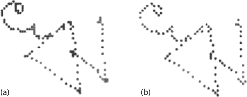

图 9.6

(a) 具有三个组成笔画的字符的笔点。  
(b) 第一次重采样后字符的笔点。

每个预处理后的字符样本被划分为 `K` 个子区域，并为所有子区域估计方向代码特征。由于字符样本可能包含单笔画或多笔画，第 `ith` 笔画的子区域数量通过公式 9.1 计算。

| 公式 | 编号 |
|---|---|
| $$K_i = \operatorname{round}\left(\frac{X_i}{X}K\right)$$ | 9.1 |

笔画的长度 `X[i]` 通过相加组成它的序列中两个连续点之间的距离计算。字符样本的总长度 `X` 计算为 `X = ∑[i]X[i]`，`i` 的值表示表示样本字符的笔画数。如果 `∑[i]K[i] ≠ K`，则需要进行微调，使得 `∑[i]K[i] = K`。

然而，如果第 `ith` 笔画的笔点数量不是 `K[i]` 的倍数，则再次重采样以生成新的点序列，使得数量变为 `K[i]` 的最接近倍数且点几乎等距。

笔画的划分如图 9.7 所示。考虑到字符样本有三个笔画，这些笔画在预处理后包含 4、27 和 3 个点。这三个笔画的计算长度比例为 4:27:3。因此，如果为字符样本考虑 10 个划分，三个笔画将分别具有 4、3 和 3。观察到第一笔画的点数不是 4 的倍数，因此作者对第一笔画进行了重采样，此时第一笔画的点数变为 4，这是 4 的最接近倍数。类似地，第三个笔画在重采样后应有 27 个点，这是 3 的最接近倍数，而第二个不需要，因为 27 已经是 3 的倍数。图 9.7 b 和 c 展示了第二次重采样。

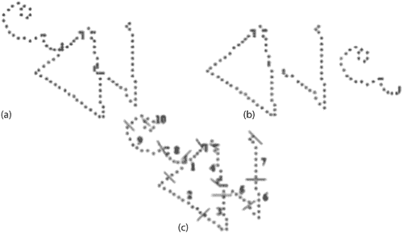

图 9.7

(a) 图 9.6 所示字符根据书写顺序的三个组成笔画。  
(c) 每个笔画的划分数量。

在将字符样本划分为 `K` 个段后，测量方向代码。假设第 `jth` 笔画包含点序列 `p[1], p[2], …, p[n[i]]`。再次考虑从位置 `p[b]` 移动到 `p[b+1]` 时与 x 轴的夹角为 `α[b]`，`b = 1, 2, …, n[i] – 1`（`0° ≤ α[b] < 360°`）。在这种特征提取方法中，从一个笔点到下一个笔点的方向变化信息起着重要作用。从一个笔点到下一个笔点的方向变化可以通过 Freeman 方向代码（八个可能值 1, 2, …, 8）来表示 [60]。笔画第一个像素的方向代码被设为 0。因此，字符的每个笔画由方向代码测量值表示。

为每个子区域计算对应测量方向代码的直方图。由于方向变化由九个可能值之一表示，每个子区域的直方图包含九部分。如果整个字符包含 `K` 个划分，则该过程产生一个 9 × `K` 元素的特征向量。

### 9.2.2 面积与局部特征

Sen 等人的研究 [58] 显示了他们如何通过计算面积、质量分布和弦长，发现在识别在线手写孟加拉基础字符时某些特征的强度。这些特征通过首先将样本分为 [58] 中提到的基于四叉树的图像分割方法，从字符的局部区域提取。详细的特征提取机制描述如下。

#### 9.2.2.1 面积特征

在大多数情况下，孟加拉字符的形状各不相同。因此，在不同的四叉树深度下观察时，不同块中不同字符的组成部分结构也是不同的。考虑到这一点，我们假设对此类字符段的曲线下面积进行分块计算可能会产生判别性特征，这些特征可能对增强字符识别准确率起到重要作用。曲线下面积的分块计算如图 9.8 所示。可能存在某些没有像素点的块，在这种情况下，该区域的计算面积被视为 0。通过观察如 এ 等样本的块结构模式，可以说生成的特征值可能在高效分类字符方面发挥有用作用。公式 9.2 所示的复合辛普森法则被用于寻找区域曲线下面积。

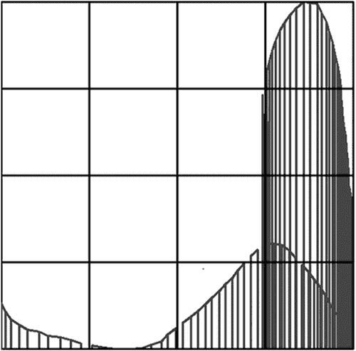

图 9.8

使用复合辛普森法则在四叉树深度为二时，两个字符样本的分块面积特征计算示意图。

| 公式 | 编号 |
|---|---|
| $$\text{Area} = \sum_{k=1}^{n-1}\left(\frac{h}{3}\left(y_k + 4y_{\text{middle}} + y_{k+1}\right)\right)$$ | 9.2 |

其中，`n` 表示每个块中从 `y[1]` 到 `y[n]` 的笔点数量。`(y[k], y[k+1])` 是该块中连续笔点的 y 坐标值。`h` 和 `y[middle]` 的测量值通过评估公式 9.3 和 9.4 计算得出。

| 公式 | 编号 |
|---|---|
| $$h = \frac{\operatorname{mod}(x_{k+1}-x_k)}{2}$$ | 9.3 |
| $$y_{\text{middle}} = \frac{y_k+y_{k+1}}{2}$$ | 9.4 |

对于特定的字符样本，当样本字符被分为 `N × N` 个块时，通过评估公式 9.1 总共估计 `N × N` 个值。这些计算出的面积值被作为特征。

#### 9.2.2.2 局部特征

##### 9.2.2.2.1 质量分布

质量分布描述了不同四叉树深度下块内数据点的数量。由于孟加拉字符的形状不同，不同块中的像素数量也不同。因此，对块进行像素计数对于区分不同形状的字符可能至关重要。样本 এ 的测得质量分布反映在图 9.9 的四叉树深度 3 处。灰色像素表示块中的像素。

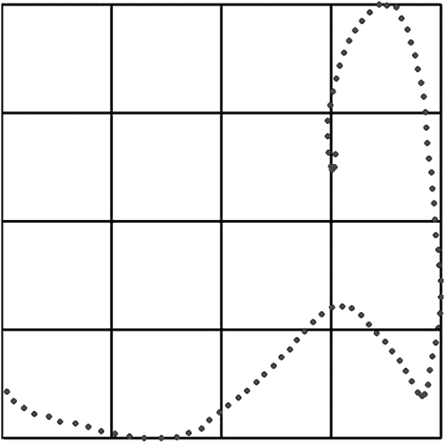

图 9.9

四叉树深度下的质量特征计算示意图。

##### 9.2.2.2.2 弦长

弦长特征通过计算每个块中字符段的长度来估计，并视为区分不同字符形状的特征。如果 `p[1], p[2], p[3], ..., p[n]` 是某个块的像素点序列，则通过相加 `p[1]` 到 `p[n]` 连续点之间的距离来测量该段的长度。由于不同字符的结构模式不同，发现计算出的长度差异很大。因此，生成的特征向量对于模式分类问题可能是有效的。计算此特征的详细步骤见 [58]。

### 9.2.3 基于点的特征 [2, 48]

在这种特征提取技术中，字符样本由特征向量序列 `t = [t[1], …, t[N]]` 表示，`t[i] = (t[i][1], t[i][2], t[i][3])^T`。

这里，`t[i][1]`、`t[i][2]` 表示通过样本均值 `μ` 归一化的笔坐标，测量值为：

| 公式 |
|---|
| $$$\mu = \frac{1}{N}\sum_{i=1}^{N}p_i$$$ |
| $$t_{i1} = \frac{x_i-\mu}{\sigma_y}$$ |
| $$t_{i2} = \frac{y_i-\mu}{\sigma_x}$$ |
| $$\sigma_y = \sqrt{\frac{1}{N}\sum_{i=1}^{N}(y_i-\mu)^2}$$ |
| $$\sigma_x = \sqrt{\frac{1}{N}\sum_{i=1}^{N}(x_i-\mu)^2}$$ |

（注：根据上下文重建了缺失的公式。）

对于特定的字符样本，当样本字符被分为 `N × N` 个块时，通过评估公式 9.1 总共估计 `N × N` 个值。这些计算出的面积值被作为特征。

### 9.2.4 转换计数特征 [61]

所提技术首先将样本缩放到 `N × N` 的窗口，然后对缩放样本进行二值化。如果该位置是字符数据点（称为前景像素），则设置为 1，否则设置为 0（背景像素）。计算二值化图像的重心（CG），然后将字符图像分为四个区域。在每个区域内，沿四个方向测量前景到背景及反向的转换计数：行、列以及两条主对角线（即角度 `θ = 0°, 90°, 45°, 135°`）。这种技术基本上沿四个方向寻找数据分布。图 9.10 的左侧显示了基于重心分为四个区域的二值化字符图像。还注意到子图中特定行、列或对角线的转换计数最大值为 6。在下一步中，估计这些计数的频率并作为特征。对于每个区域，0 到 1 的转换生成 28（即 7 × 4）个特征值，1 到 0 生成另外 28 个。因此，每个区域总共生成 56（即 28 × 2）个特征值。最后，整个图像产生 224（即 56 × 4）个特征值。为了方便参考，图 9.10 的右侧描述了假设图像上的特征计算（此处为 0 到 1 的转换）。

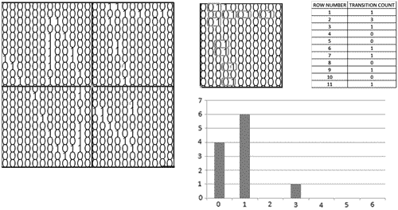

图 9.10 字符‘অ’的转换计数特征计算。

### 9.2.5 拓扑特征 [61]

#### 9.2.5.1 交叉点

该功能对于区分孟加拉语字母中几个形状高度相似的字符对非常有用。例如，‘ম’和‘য’在结构上非常相似，但‘ম’由于环形的形成，在左下侧有一个交叉点。因此，交叉点的存在对于区分此类字符对起着重要作用。为了估计这一特征，对字符样本的像素点进行重采样，使得点与点之间的距离为单位距离。该特征检查字符样本是否包含环。样本字符的像素点被视为具有三个以上相邻邻居的交叉点，以帮助形成环。例如，考虑图 9.11，图中可以很容易地观察到环的存在；在该图中，交叉点用浅灰色圆圈标出，而深灰色方块表示相应交叉点的邻居。使用这种技术总共测量了五个特征值（交叉点的数量、第一个交叉点的坐标以及第一个交叉点最近邻居的坐标）。该过程通过根据环的存在来区分相似形状，从而提高了识别准确率。

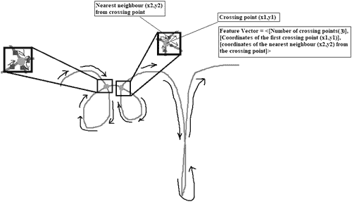

图 9.11

字符样本‘শ’中的交叉点识别。

## 9.3 数据库准备与预处理

### 9.3.1 数据收集表的设计

数据库开发过程的主要阶段是设计数据收集表或多个表单。在设计表单期间，考虑了各种因素。人口中的不同因素可能会影响手写特征，如性别、年龄、教育程度、宗教等。此外，不同间隔的写作可能会影响不同个人的手写风格。为了捕捉这些变化并简化问题，设计了包含写作中常用的孟加拉语脚本字符的数据收集表。分别设计了孤立字符数据收集表和手写文本数据收集表。孤立字符包括孟加拉字母表中所有的基本字母以及数字和元音修饰符。数据收集表分为两个区域：在页眉区域收集书写者信息，在写作区域，书写者需要用自己的笔迹写下指定的字符。图 9.12 的左侧显示了孤立字符的空白数据收集表，所有字段都已标记以便于理解，而图右侧显示了相应的填充表单。在表单设计过程中，考虑了编写孟加拉文本时的所有元音、字母以及元音修饰符。孤立字符数据收集表的设计总共考虑了 11 个元音、40 个辅音、10 个元音修饰符和 10 个数字。

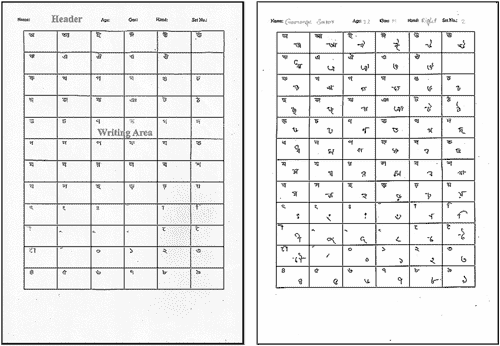

图 9.12

一个空白字符数据收集表（左）和一个填充表单（右）。

在数据收集过程中，要求个人以自然速度在表单提供的区域内编写样本孤立字符和样本打印文本。书写者在不同的日期获得每个数据收集表（空白），以便捕捉书写者内部以及书写者之间的变化。数据收集过程中考虑了不同性别、文化、年龄组和教育程度的人员。数据收集涵盖了 8 到 70 岁的人员，包括学生、退休人员、毕业生、研究生和不同职业的人士。自然变化整合到数据库中，以创建标准的孤立字符和文本文档数据库 [62, 63]，有助于评估字符或文本识别算法在本质上是否具有健壮性。对于字符级数据库，字符如图 9.12 所示写在框内。在下一步中，测量每个框的边界坐标，然后存储所有框的字符级信息（x、y 坐标以及笔触状态）。

本节描述了此处开发的两种类型数据库的详细统计数据。在孤立字符数据库设计期间，有一百名志愿者做了贡献，并从每个人那里收集了三组孟加拉字母字符。尽管最初有 135 名志愿者同意贡献开发此字符数据库，但只有 100 名志愿者完成了要求的三个组数据。该数据库包含约 12,000 个字母、3,300 个元音、3,000 个元音修饰符和 3,000 个数字。每个收集的数据集包含带有 x 和 y 坐标的有序像素点，以及笔抬起或落下信息；这些以 `.dat` 格式保存，并遵循特定的命名规范：`<4 位序列号（Writer_id）>_<2 位序列号（Set_id）>`。例如，第一个数字化表将命名为 `0000_01`，其中 `0000` 代表第一个书写者的 ID，`01` 代表该书写者的第一组写作；这两个字段由 `_` 符号分隔。

## 9.4 特征提取

### 9.4.1 基于定向豪夫距离（DHD）的特征

本工作已利用在线信息和离线图像从手写字符中提取了现基于 HD 的特征。

考虑了常用的 `minmin` 函数，通过公式 9.5 计算从集合 `P` 到集合 `Q` 的正向 HD `h(P,Q)`。

```text
h(P,Q) = max_{x ∈ P} {min_{y ∈ Q} d(x,y)}
```

其中集合 `P` 和 `Q` 的笔点分别由 `a` 和 `b` 表示。在本次实验中，`d(x,y)` 测量 `x` 和 `y` 之间的欧几里得距离。同样，从集合 `Q` 到集合 `P` 估计了 `h(Q,P)`（称为反向 HD）。图 9.13a 展示了从区域 `P` 的每个点到区域 `Q` 其他所有点的距离计算，并将区域 `P` 每个点的最小距离标记为黄色。在这些最小值距离中，最大值被视为正向 HD，并反映在图 9.13b 中。同样，反向 HD 的计算见图 9.14a 和 b。

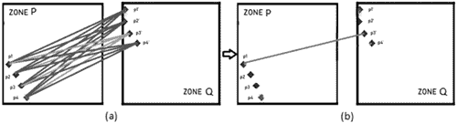

图 9.13

(a)、(b) 正向 HD 计算示意图。

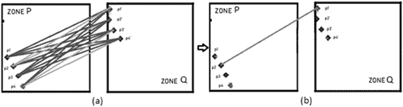

图 9.14

(a)、(b) 反向 HD 计算示意图。

在分析过程中发现，计算出的 `h(P,Q)` 和 `h(Q,P)` 值大部分时候是不相同的。因此，在本文工作中，作者测量了从每个区域到所有其他区域的正向和反向 HD 值（称为 DHD），以获得唯一性。这种特征提取策略为每个区域生成 `N–1` 个 DHD 值，从而整个字符估计了总共 `N × (N–1)` 个 DHD 特征。

为了在离线模式下提取基于 DHD 的特征，对之前生成的字符图像进行二值化，并在四叉树深度为二时，重复之前在线模式中使用的程序。从在线信息生成的字符图像和相应的二值化图像见图 9.15。

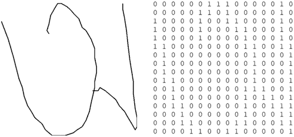

图 9.15

根据在线信息和相应的二值化生成的字符图像。

## 9.5 实验结果与分析

通过 `DHD` 过程从在线和离线模式的字符图像中提取的特征集通过四种常用的分类器进行评估：多层感知器（`MLP`）、支持向量机（`SVM`）、`BayesNet` 和简单逻辑回归，其中字符样本被划分为 16 个区域（四叉树深度为二）。分类过程中使用了五折交叉验证方案。[表 9.1] 记录了上述分类器在字符图像在线和离线模式下产生的分类准确率。

### 表 9.1

不同分类器对在线和离线模式字符图像中基于 DHD 特征的识别准确率

| 图表 |
|---|
| 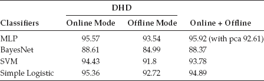 |

[表 9.1] 表明，对于所有分类器，使用在线信息产生的特征向量的强度都高于从离线字符图像生成的特征集。

还将在线和离线模式产生的特征向量相结合，以观察组合的效果。在此阶段，`MLP` 产生了最佳准确率，即 95.92%，高于从字符图像在线或离线模式提取特征时获得的准确率。所得结果确保了通过将离线信息结合到在线模式中增加了在线模式产生特征向量的强度。在此阶段，[表 9.2] 显示了一些识别错误的字符。

### 表 9.2

部分分类错误的字符对

| 原始字符（200 个样本） | 分类错误为（200 个中的样本） |
|---|---|
| ভ | ড（8） |
| ন | ল（8） |
| খ | ঘ（6） |
| ঙ | উ（4）、ড（4） |
| ঘ | য（4）、ম（4） |


当我们细致观察分类器 `MLP` 对两种特征向量的预测得分时，发现在某些情况下，离线特征向量的正确选项预测得分更高。我们还观察到两种特征的正确选项预测得分都不是最高。因此，为了提高整体字符识别性能，对 `MLP` 的前五个预测选择尝试了后期融合技术 [[30]]，即在利用 `MLP` 分两种特征向量（在线模式和离线模式）对字符进行分类后。在该方案中，`MLP` 分类器针对每个模态（`m`）“在线模式”和“离线模式”分别训练。每个模态被分配了一个针对特定活动 `s`（预测选择）的专家信任得分 `e[sm]`。该得分定义为根据模态 `m` 为活动 `s` 获取的性能度量 `P[sm]`（来自分类器的观测概率/预测百分比）计算出的归一化性能值。

```text
e_{sm} = \frac{P_{sm}}{\sum_{m}P_{sm}}
```

（9.6）

最终决策计算方式如下：对于每个观测值，为具有两种模态最佳专家信任得分的活动分配标签。

对于每个观测值 `O[i]`，我们应用了公式 9.7 定义的 `argmax` 融合算子。

```text
s[i] = argmax(e[s[i online based],e[s[i offline based]])
```

（9.7）

带有最大融合算子的后期融合技术的应用提供了两种模态之间信任得分最高的字符预测选择。因此，结果选择可以从基于点或基于曲线的模态中产生。结果是整体笔画识别准确率提高，达到了 96.74%。

[图 9.16] 展示了在 `MLP` 分类后应用后期融合技术的结果。该图强调了 `MLP` 对在线和离线模式生成的两种特征向量，“গ’（G__）的前五个识别选择。通过观察该图可以看出，离线模式的特征将字符正确识别为最高选项。另一方面，在线模式生成的特征未能将该字符识别为最高选项。当应用后期融合时，基于分类器的置信度，字符样本被正确识别，从而提高了整个系统的性能。

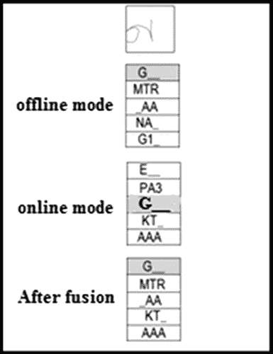

## 图 9.16

使用在线、离线和后期融合方法进行字符符号预测选择的说明。

应用后期融合技术后，分类错误的字符数量减少，如[表 9.3]所示。

## 表 9.3

采用后期融合技术后的分类错误字符。

| 原始字符（200 个样本） | 分类错误为（200 个中的样本） |
| --- | --- |
| ভ | ড（5） |
| ন | ল（4） |
| খ | ঘ（5） |
| ঙ | 우（2） ড（1） |
| ঘ | য（3） ম（2） |

# 9.6 结论

在目前的工作中，通过创建相同在线手写孟加拉字符图像的相应离线版本，提高了生成的特征集的效率。其意图不仅是为了增强字符识别，还为了建立可以用于进一步工作的在线和离线数据库。尽管组合特征集反映了比从在线和离线版本分别创建的特征向量更好的性能，但整体准确率提高并不。后期融合方案产生了更好的结果并提高了识别准确率。然而，由于结构相似性，仍有一些字符被分类错误。因此，我们计划在未来引入更多特征来区分形状相似的字符以提高整体识别。另一个可行计划是测试该特征集在其他语言中的效率。

8. W. Zhao，J. F. Liu，and X. L. Tang。2002。基于字符 `HMMs` 级联连接的在线手写英语单词识别。In: 机器学习与网络国际会议论文。IEEE，1758–1761。

9. R. K. Bawa，and R. Rani。2011。一种在线手写 Gurmukhi 数字识别的预处理技术。In: 高性能架构与网格计算国际会议论文。IEEE，275–281。

10. M. Gupta，N. Gupta，and R. Agrawal。2012。使用支持向量机的在线手写 Gurmukhi 笔画识别。In: 第 7 届生物启发计算国际会议：理论与应用论文集，495–506。

11. J. R. Prasad，and U. Kulkarni。2015。使用带有模糊边缘的自适应神经模糊分类器进行古吉拉特字符识别。国际机器学习与网络期刊。6(5)，763–775。

12. M. K. Sachan，G. Lehal Singh，and V. K. Jain。2011。一种分割在线 Gurmukhi 脚本的新颖方法。In: 印度语言信息系统国际会议论文集，1–8。

13. M. K. Sachan，G. Lehal Singh，and V. K. Jain。2011。一用于在线 Gurmukhi 脚本识别的系统。In: 印度语言信息系统国际会议论文集，299–300。

14. K. C. Santosh，and J. Iwata。2012。基于笔画的草写字符识别。In: 字符识别进展，X. Ding，编。INTECH Open。

15. K. C. Santosh，C. Nattee，and B. Lamiroy。2012。基于笔画聚类的相对定位：一种在线手写 Devanagari 字符识别的新方法。国际图像图形期刊。12(2)，2（2012），25 页。Doi: `10.1142/S0219467812500167`。

16. K. C. Santosh，and L. Wendlingc。2015。基于非线性多投影轮面测量的字符识别。国际计算机科学杂志。9(5)，678–690。

17. A. Sharma，and K. Dahiya。2012。手机设备上 Gurmukhi 和 Devanagiri 字符的在线书法识别。In: 信息技术最新进展与未来趋势国际会议论文集，37–41。

18. A. Sharma，R. Kumar，and R. K. Sharma。2008。使用弹性匹配的在线手写 Gurmukhi 字符识别。In: 图像与信号处理大会论文。IEEE，391–396。

19. A. Sharma，R. Kumar，and R. K. Sharma。2009。在线手写 Gurmukhi 单词识别中已识别笔画的重排。In: 第 10 届文档分析与识别国际会议论文，1241–1245。

20. A. Sharma，R. Kumar，and R. K. Sharma。2010。基于 `HMM` 的在线手写 Gurmukhi 字符识别。国际机器图形视觉期刊。19(4)，439–449。

21. P. K. Singh，R. Sarkar，N. Das，S. Basu，and M. Nasipuri。2014。用于多脚本手写文档脚本识别的分类器的统计比较。国际应用模式识别期刊。1(2)，152–172。

22. B. B. Ahmed，S. Naz，M. I. Razzak，S. F. Rashid，M. Z. Afzal，and T. M. Breuel。2016。使用循环神经网络评估草体和非草体脚本。国际神经应用期刊。27(3)，603–613。

23. M. R. Bouguelia，S. Nowaczyk，A. Verikas，and K. C. Santosh。2017。同意于反对：无众包的噪声标签主动学习。国际机器学习与网络期刊，1–13。

24. J. Du，J. Zhai，and J. Hu。2017。通过深度学习特征进行在线书法识别适应。国际文档分析与识别期刊。20(1)，69–78。

25. A. El-Sawy，H. Bakry，and M. Loey。2016。基于 `LeNet-5` 的手写数字 `CNN`。In: 高级系统与信息国际会议论文集，566–575。

26. J. D. Prusa，and T. M. Khoshftaar。2017。用新的文本表示改进深度神经网络设计。国际大数据 4(1)（2017）。Doi: `10.1186/s40537-017-065-x`。

27. X. Tang，Y. Ding，and K. Hao。2017。一种用于深度网络参数优化的基于线段的新方法。国际模式智能期刊 `185107`。

28. W. Wang，G. Tan，and H. Wang。2017。提取在线评论的跨领域算法比较。国际机器学习期刊。8(3)。

29. Q. Wu，Z. Gui，S. Li，and J. Ou。2017。直接连接卷积网络。模式识别智能期刊。32(5)，`185907`。

30. A. Fu，C. Dong，and L. Wang。2015。极端学习稳定性和泛化性的研究。国际机器学习期刊。6(1)，129–135。

31. K. Roy，N. Sharma，and U. Pal。2007。书法识别系统。In: 手写识别国际会议论文集，117–122。

32. T. Mondal，U. Bhattacharya，S. K. Parui，K. Das，and D. Mandalapu。2010。印度脚本书法识别——基准测试。In: 第 12 届手写识别国际会议论文，200–205。

33. K. Roy。2012。用于孟加拉书法的数据库设计。国际现代工程杂志。2(4)，2534–2540。

34. S. K. Parui，K. Guin，U. Bhattacharya，and B. B. Chaudhuri。2008。使用 `HMM` 的在线孟加拉字符识别。In: 模式识别国际会议论文，1–4。

35. U. Bhattacharya，B. K. Gupta，and S. K. Parui。2007。用于在线手写孟加拉字符的方向编码特征。In: 文档分析与识别国际会议论文，58–62。

36. A. Bandyopadhyay，and B. Chakraborty。2009。在线书法识别系统的开发：基于孟加拉字符的案例研究。In: 自然与生物启发计算世界大会论文，514–519。

37. R. Ghosh。2015。一种用于孟加拉和天城字母字符识别的新颖特征提取方法。In: 信号处理与集成网络国际会议论文，483–488。

38. S. Sen，R. Sarkar，and K. Roy。2016。一种用于在线手写孟加拉字符识别的简单有效技术。In: 第 4 届智能计算前沿国际会议：理论与应用论文，201–209。

39. N. Joshi，G. Sita，A. G. Ramakrishnan，and V. Deepu。2005。在线手写 Devanagari 字符的机器识别。In: 文档分析与识别国际会议论文，1156–1160。

40. S. Sen，A. Bhattacharyya，A. Das，R. Sarkar，and K. Roy。2016。用于在线手写孟加拉基础字符识别的新型特征向量设计。In: Proceedings of the 1st International Conference on First International Conference on Intelligent Computing & Communication，485–494。

41. S. Sen，R. Sarkar，K. Roy，and N. Hori。2016。基于豪斯夫距离特征识别在线手写孟加拉字符。In: Proceedings of the 5th International Conference on Frontiers in Intelligent Computing: Theory and Application，541–549。

42. S. Sen，M. Mitra，S. Chowdhury，R. Sarkar，and K. Roy。2016。基于四叉树的图像分割与特征提取以识别在线手写孟加拉字符。In: Proceedings of the 7th IAPR TC3 Workshop on Artificial Neural Networks in Pattern Recognition。Ulm，Germany，246–256。

43. J. Demsar。2006。多数据集分类器的统计学比较。Int. J. Mach. Learn. Res. 7，1–30。

44. M. Hall，E. Frank，G. Holmes，B. Pfahringer，P. Reutemann，and I. H. Witten。2009。`WEKA` 数据挖掘软件：更新版。ACM SIGKDD Explor. Newslett. 11(1)，10–18。

45. J. Pinquier，S. Karaman，L. Letoupin，P. Guyot，R. Megret，J. Benois-Pineau，Y. Gaestel，and J. Dartigues。2012。基于层级 `HMM` 多特征融合策略：应用于可穿戴视听传感器的活动识别。In: International Conference on Pattern Recognition，3192–3195。

46. S. Sen，A. Bhattacharyya，P. K. Singh，R. Sarkar，K. Roy，and D. Doermann。2018。结构和拓扑特征在识别在线手写孟加拉字符中的应用。ACM Trans. Asian Low-Resour. Lang. Inf. Process.，17(3)。Doi: `10.1145/3178457`。

47. K. C. Santosh，C. Nattee，and B. Lamiroy。2012。用于在线手写德瓦纳加里字符识别的基于笔画的新方法的相对定位。In: Int. J. Image Graph.，25 pages。

48. K. C. Santosh。2011。基于 `DTW-RadonICDAR` 的字符识别。Doi: `10.1109/ICDAR.2011.61`。

49. K. C. Santosh，C. Nattee，and B. Lamiroy。2010。基于空间相似性的笔数和顺序无关聚类。In: 12th International Conference on Frontiers in Handwriting Recognition，652–657。

50. S. Kubatur，M. Sid-Ahmed，and M. Ahmadi。2012。一种在线德瓦纳加里手写字符识别的神经网络方法。In: Proceedings of the International Conference on High Performance Computing and Simulation。Doi: `10.1109/HPCSim.2012.6266913`。

51. A. Kumar，and S. Bhattacharya。2010。使用隐马尔可夫模型用于 `iPhone` 的在线德瓦纳加里孤立字符识别。In: Proceedings of the International Conference on Students’ Technology Symposium，300–304。

52. H. Freeman。1974。线描图像的计算机处理。ACM Comput. Surv. 6(1)，57–97。

53. V. L. Lajish，and S. K. Kopparapu。2014。使用扩展方向特征的在线手写德瓦纳加里笔画识别。In: Proceedings of the 8th International Conference on Signal Processing and Communication System。IEEE。Doi: `10.1109/ICSPCS.2014.7021063`。

54. Sk. Md. Obaid，C. Halder，K. C. Santosh，N. Das，and K. Roy。2017。`PHDIndic_11`：11 种官方印度文字的页级手写文档图像数据集。Multimedia. Appl.。Doi: `10.1007/s11042-017-4373-y`。

55. Sk. Md. Obaid，K. C. Santosh，C. Halder，N. Das，and K. Roy。2017。词级多脚本印度文档数据集及基准结果。Int. J. Comput. Vis.，7(2)，81–94。

56. A. Tripathi，S. Paul，and V. K. Pandey。2012。用于 `iPhone` 的在线孤立德瓦纳加里字符识别的笔顺标准化。In: Proceedings of the International Conference on Technology Education。IEEE，1–5。

57. Gerrit J. van den Burg，and Patrick J. Groenen。2016。`GenSVM`：一种通用的多分类支持向量机。J. Mach. Learn. Res. 17(225)，1–42。

58. H. Swethalakshmi，C. C. Sekhar，and V. S. Chakrathy。2007。用于德瓦纳加里和泰米尔语在线字符识别的空结构特征。In: International Conference on Artificial Neural Networks，230–239。

59. H. Swethalakshmi，A. Jayaraman，V. S. Chakrathy。2006。基于支持向量机的德瓦纳加里和泰米尔语在线字符识别。In: International Workshop on Handwriting Recognition，367–372。

60. Sk. Md. Obaid，C. Halder，N. Das，and K. Roy。2016。四种印度文字的离线数字图像数据集及其图像变换基准。Int. J. Eng. Inf.，4(1)，1–20。


61. Sk. Md. Obaid, K. C. Santosh, N. Das, C. Halder, and K. Roy. 2018. 多脚本文档中的手写脚本识别：综述。`Int. J. Pattern Recognit. Art. Intell.` 32(10), 1856012.

62. K. C. Santosh, and L. Wendling. 2015. 基于非线性投影的字符识别。`Front. Comput. Sci.` 9(5), 678–690.

63. S. D. Connell, R. M. Sinha, and A. K. Jain. 2000. 无约束在线德瓦纳加里字符识别。In: Proceedings of the 15th International Conference on Pattern Recognition, 368–371.

# 10 叶片稿手写字符识别

Papangkorn Inkeaw, Jeerayut Chaijaruwanich and Jakramate Bootkraj

## 10.1 引言

## 10.2 叶片稿

## 10.3 叶片稿 OHCR 面临的挑战

## 10.4 叶片稿文档处理与识别

### 10.4.1 预处理

### 10.4.1.1 二值化

### 10.4.1.2 降噪

### 10.4.1.3 倾斜校正

### 10.4.2 分割

### 10.4.2.1 文本分割

### 10.4.2.2 字符分割

### 10.4.3 识别

### 10.4.3.1 基于分割的方法

### 10.4.3.2 免分割的方法

## 10.5 针对兰纳叶片稿的 OHCR 系统

### 10.5.1 预处理

### 10.5.2 布局分析

### 10.5.3 分割

### 10.5.4 识别

## 10.6 结论与展望

光学手写字符识别（`OHCR`）是一种将手写文档图像转换为机器编码文本的常用自动方法。尽管在过去的十年里开发了多种 `OHCR` 技术，但 `OHCR` 仍然是一个不断增长的研究领域。此外，`OHCR` 技术如今已应用于办公自动化。同时，近期的研究方向正在扩大 `OHCR` 技术在数字图书馆古代文献处理中的应用。`OHCR` 的挑战通常与写作媒介的类型和字母的复杂度有关。每种写作媒介都需要特定的预处理技术，而字母的特征决定了字符分段和识别方法的设计。

在古代棕叶手稿上进行 `OHCR` 面临着巨大的困难。存档的棕叶手稿通常状况较差，因此需要细致的预处理步骤来处理各种噪声。行标记的缺失也为行分段增加了一些不确定性。更重要的是，大多数棕叶手稿广泛存在于南亚和东南亚语言，在这些语言中，可能接触或破损的字母、元音和声调标记的组合使得问题更加复杂。

在本章中，我们将阐明与在棕叶手稿上执行 `OHCR` 相关的问题。随后，我们概述了已成功应用于该任务的先进预处理、行分段、字符分段和字符识别步骤。最后，我们通过一个古代兰纳经文字符识别系统的运行示例作为本章的总结。

## 10.2 棕叶手稿

棕叶手稿是由干燥棕叶制成的古代文献。在古代，棕叶主要在南亚和东南亚用写作材料。在数百年里，这些手稿已经受损。为了保护这些可能具有价值的文档，多个机构开始在各地当地社区进行调查。许多无价的手稿得以保存，是在斯里兰卡、印度、老挝、缅甸、柬埔寨和泰国。图 10.1 显示了在泰国北部发现的棕叶手稿示例，描述了传统医学，这对于进一步研究具有重要意义。这些手稿是通过微缩胶、扫描和摄影技术进行保存和存档的。通常，几片棕叶被放在一张称为“页”（`folio`）的图像中。以页的形式存储棕叶手稿有助于缩短数字化时间并节省空间。

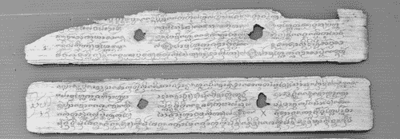

图 10.1

在泰国北部发现的棕叶手稿示例。

## 10.3 棕叶手稿 OHCR 的挑战

以图像数据形式存储棕叶手稿在某种程度上限制了与文档的交互。相反，更理想是将棕叶图像转换为机器编码文本，以便方便对文档进行编辑、检索、访问和处理。遗憾的是，手动执行图像到文本的转换成本非常高。`OHCR` 是解决这一问题的可行方案。通常，`OHCR` 过程包含四个任务，即预处理、分段、识别和后处理。`OHCR` 的挑战通常与写作媒介的类型和字母的复杂度有关。在这里，我们将阐明在四个步骤中在棕叶手稿上执行 `OHCR` 时遇到的常见问题。这些问题应该在开发用于棕叶手稿的 `OHCR` 系统期间得到解决。

图像质量通常是 `OHCR` 过程中遇到的第一个问题。许多棕叶手稿图像是在没有标准设备的情况下拍摄的，导致图像质量差异巨大。虽然通常首选使用专业扫描仪进行数字化，但在处理极具价值且脆弱的原件时，策展人员往往选择数字相机。因此，很难确保主体完全平整放置。光照不均匀也会导致文本与背景之间的对比度差。此外，大多数棕叶图像在拍摄时背景上没有任何行标记。因此，生成的图像中存在一些可见的倾斜（即文档图像相对于水平轴的旋转）。

棕叶手稿图像上的几种噪声和图像伪影进一步恶化了状况。根据 [1] 中的研究，棕叶手稿上的噪声可分为三类，即小分量噪声、叶纹和叶洞。这些噪声的示例在图 10.2 所示。小分量噪声表现为旧文档图像上的颗粒。它们不仅可能由写作媒介的自然老化产生，还可能由图像二值化过程产生。此外，手稿是干燥的棕叶，是在没有现代造纸工艺知识的情况下自然制成的，因此写作媒介上仍然可见叶纹。叶纹噪声通常沿着叶片的裂缝出现。最后，为了装订手稿，棕叶在页面中间的区域周围穿了一个或两个孔。这些孔变成了在进一步处理之前应该删除的伪影。由于这些挑战，在 `OHCR` 系统的预处理步骤需要有效的图像处理技术。

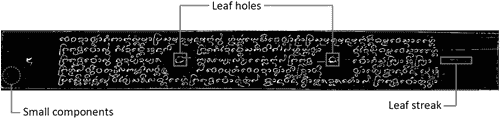

图 10.2

棕叶手稿上的三类噪声。

对于棕叶手稿，每个单独的字符都是使用尖锐的写作工具在长矩形切割的干燥棕叶上刻画的。从棕叶手稿中提取文本行的困难之一在于，行之间拥挤在一起，行间距非常细小。此外，由于是手写，文本行也可能是倾斜或向上/向下弯曲的。此外，与从左到右排序的拉丁字母不同，棕叶手稿中常见的字母大多是多级样式书写的。某些字符位于另一个字符的下方或上方。它们倾向于远远超出主行，与相邻行的其他字符接触或重叠。在尝试对棕叶手稿页进行行分段和字符分段时，人们需要意识到这些问题。

最后，字符类别数量巨大、手写风格的变化、无约束书写以及视觉相似字符的存在，被认为是字符识别任务中具有挑战性的问题。此外，由于棕叶手稿上出现的大多是现代不再使用的古代字符，为训练识别模型仅提供了来自少数书写者的少量标注示例。在棕叶手稿的 `OHCR` 中，缺乏训练示例是构建有效识别模型的主要挑战。

## 10.4 棕叶手稿的文档处理与识别

文档图像处理和识别因其在许多应用中的潜力和技术挑战受到了研究界的广泛关注。目前为止，已经提出了许多有效的文档图像预处理、分段、识别和后处理方法。

### 10.4.1 预处理

在预处理任务中，输入的文档图像被转换为适当的格式，希望能尽可能去除大部分噪声，并进行前景和背景分离，其中对应字符的像素（被视为前景）和对应背景的像素通常被分别指定为二值 1 和 0。棕榈叶手稿的预处理任务还包括二值化和偏斜校正 [1, 2]。

### 10.4.1.1 二值化

二值化是文档图像分析的通用的起点，它能将灰度图像值转换为二进制表示。二值化技术的性能影响巨大，并直接影响分割和识别任务的性能。一种简单且为人知的二值化方法是阈值法。根据阈值的选择，二值化方法通常可分为两类：全局阈值和局部自适应阈值。对于全局阈值，根据图像的全局特征计算单个阈值值。例如，大津法（`Otsu's method`）[3] 是一种著名的全局二值化技术。在局部自适应阈值中，在每个较小的局部图像区域、区域或窗口内计算阈值值。目前已经提出了许多局部自适应阈值技术，例如自适应平均法、`Niblack` 方法 [4]、`Sauvola` 方法 [5]、`Wolf` 方法 [6] 和 `NICK` 方法 [7]。另一种二值化方法是基于训练的方法。该方法使用分类器将每个像素归类为前景像素或背景像素。前两种基于训练的二值化方法是在 `ICFHR 2016` 巴厘岛棕榈叶手稿图像手写体分析竞赛的二值化挑战赛中提出的 [8]。该竞赛中的最佳方法 `ICFHR G1` [8] 采用了一种全卷积网络（`FCN`）。它将彩色子图像作为输入，并输出子图像中每个像素属于前景的概率。第二优的方法 `ICFHR G2` [8] 使用了两个神经网络分类器将每个像素分类为背景或非背景。一项针对棕榈叶手稿的文档图像分析方法的对比研究报道在 [9] 中。该研究对东南亚的棕榈叶手稿集（即巴厘岛、高棉和巽他答棕榈叶手稿）对二值化、文本行分割、孤立字符识别、单词识别和转录进行了全面的测试。报告显示，`Niblack` 方法、`ICFHR G1` 和 `ICFHR G2` 分别在巽他答、高棉和巴厘岛手稿上表现良好，具有最高的 F 值分数。阈值方法的比较显示，`Niblack` 方法和 `NICK` 方法分别在巴厘岛和高棉手稿上获得了最高的 F 值分数。

### 10.4.1.2 降噪

在文档图像转换为二值图像后，需要移除被视为噪声的干扰组件。[1] 中提出了一种旨在消除第 10.2 节中提到的三种类型噪声的降噪技术。通过分析连通组件的大小（例如，一组相连的前景像素）过滤掉小组件噪声，而通过检查每个组件的宽高比来检测叶片条纹。为了处理叶片空洞，通过对输入图像应用全局阈值处理生成了一个掩码（`mask`），然后使用它来移除叶片空洞。

### 10.4.1.3 偏斜校正

为了纠正文档的偏斜，首先应该确定输入文档图像相对于水平轴的旋转角度。有几种常用的检测文档偏斜的方法。一些方法使用霍夫变换（`Hough transform`）进行线条检测 [10, 11]。取检测到的线条角度的中位数作为文档偏斜值。另一种技术依赖于连通组件的检测 [12, 13]，这些组件大致等同于字符，然后找到连接它们质心的平均角度。相比之下，某些方法直接使用投影轮面分析（`projection profile analysis`）检测文档偏斜 [14, 15]。将文档在多个角度进行投影，并计算每条投影线的前景像素数量。与行对齐的投影可能具有最大的方差。

### 10.4.2 分割

在分割任务中，二值图像被逐渐分离以获得孤立字符或单词图像。它涉及行分割和字符分割。

#### 10.4.2.1 文本行分割

大多数文档分析和识别都从行分割开始。各种投影技术被应用于 [1, 16, 17, 18, 19]。这些方法的目标是根据文档水平投影轮面的峰和谷提取文本行的估计中心或缝隙位置。另一种行分割方法尝试寻找通过文本缝隙的最优路径 [20, 21, 22, 23]。这些行分割方法在二值图像上运行，因此需要有效的二值化方法。相比之下，也提出了一些不依赖二值化过程有效性的行分割方法。[24] 中提出的方法通过分析水平投影轮面创建了文本行的中心轴。相邻行通过缝隙切割算法（`seam-carving`）进行分离。一种自适应路径查找方法已在 [25] 中提出。了一种竞争算法用于寻找文本行的中心轴。为了处理跨越行的组件，使用改进的 `A*` 路径规划技术分离相邻的两行 [26]。

### 10.4.2.2 字符分割

在行划分之后，每行文本中的字符需要被分割成孤立的字符图像，以便在识别任务中进行识别。字符分割方法分为三种策略，即切分法（`dissection`）、基于识别的分割和整体方法 [27]。切分策略被认为是一种启发式方法。由于不同的字母具有不同的特征，切分法对于其所设计的字母具有很强的针对性。通常使用的特征包括轮廓信息 [28, 29]、水池特征（`reservoir`） [30] 以及骨架特征 [29, 31]。

另一方面，基于识别的分割利用字符识别模型的反馈来确定分割点。最近的一项研究表明，基于识别的方法通常优于切分法 [32]。基于识别的分割方法通常包含两个阶段，即过分割阶段和分割点搜索阶段。通常，在过分割阶段使用切分法来获取候选分割点。这些候选分割点被用于将给定的单词图像分割成若干片段。这些片段被表示在合适的数据结构中，代表所有可能的分割假设。目前处理连写数字的最先进方法通常使用有向无环图（`DAG`）来表示可能的分割假设 [33](参考34)–35]。

问题在于如何搜索最佳分割路径。现有的方法考虑过使用 `Viterbi` 算法 [33, 36] 和最短路径算法 [34, 37]。或者，也可以使用无向图来表示分割假设 [36]。最佳分割假设是通过应用改进的 `Viterbi` 算法得到的一组线性子图。尽管目前已经有了多种基于识别的字符分割方法，但这些现有方法无法满意地分割属于某些复杂书写风格的字符。一种为处理复杂手写字符设计的基于识别的分割方法可能是泰语手写字符 [38]。该方法分析单词图像的水池属性来获取候选分割点。使用贪心算法确定最优分割点。在我们之前的工作 [39] 中，通过分析背景和前景骨架来获取候选分割点。这些点被用于获取单词图像的冗余片段。然后使用这些片段形成分割假设图。使用划分算法将假设图划分子图，每个子图对应一个分割后的字符。

与前两种方法不同，整体分割方法避免了将单词图像分割成有意义片段的需求。它试图一次识别单词图像。为了实现，需要一个标记的单词图像数据集来训练整体分割模型。我们将在下一节讨论这种方法，即单词识别。

### 10.4.3 识别

大多数 `OHCR` 流水线的共同点是字符识别任务，其中图像实际上被转换为文本；这是现有方法无法提供满意结果的任务。字符识别方法可以分为两类，即基于分割的方法和无分割方法。

### 10.4.3.1 基于分割的方法

基于分割的方法需要孤立的字符图像作为输入。适当的特征提取和有效的分类器可以提高识别准确率。文献中已经提出了许多用于手写字符识别的特征提取方法。著名的特征提取方法包括方向梯度直方图（`HOG`） [40]、尺度不变特征变换描述子 [41]、图像矩描述子 [42](参考43–46)、[47]–48]、傅里叶描述符 [49]、多投影轮廓 [50] 以及链码 [51, 52, 53]。

此外，一些研究人员报告，组合多个描述符形成特征向量可以提高识别性能 [54](参考55)–56]。为了识别孤立字符，有几种可用的分类模型，例如 k 最近邻（`kNN`）、支持向量机（`SVM`）和多层感知器（`MLP`）。

另一种字符识别方法是采用卷积神经网络（`CNN`）作为识别模型。`CNN` 在学习模型的同时进行特征提取。一种著名的 `CNN` 架构可能是 `LeNet-5` [57]，它在手写数字上表现良好。目前已提出了多种字符识别架构，例如`net` [58]、`Vanilla` [9] 和 `SHL-CNN` [59]。通常由于分类器的复杂度，`CNN` 需要大量的训练样本才能达到最佳性能。根据我们的经验，使用小训练集训练 `CNN` 会导致严重的过拟合。

#### 10.4.3.2 无分割方法

在无分割字符识别中，单词图像可以直接作为输入发送给分类器。这种方法中流行的识别模型是循环神经网络-长短期记忆（`RNN-LSTM`） [60] 和连接性时间分类（`CTC`） [61] 的结合。使用 `RNN-LSTM` 进行单词识别的近期研究可以在 [62, 63] 中找到。

在本节中，我们将展示一个用于兰纳（`Lanna`）经叶手稿的实用 `OHCR` 系统示例。这些手稿是兰纳智慧知识的重要来源。该系统由四个主要任务组成，如图 10.3 所示。

**图 10.3**

兰纳经叶手稿手写字符识别流程图。

### 10.5.1 预处理

系统从预处理任务开始 `OHCR` 过程。由于经叶手稿通常以包含多个经叶图像的单页图像形式存档，因此为了方便 `OHCR` 过程，需要从单页图像中提取每片经叶。为此，研究人员提出了一种经叶手稿页面分割方法 [64]。该方法包含两个主要步骤：(1) 目标检测和 (2) 目标选择。在第一步中，将 RGB 色空间的单页图像转换为 `L*a*b*` 色空间。所有由 `a*` 和 `b*` 表示的像素被聚类为 k 组。然后，使用簇编号作为每个像素的标签生成标记图像。最后，每个连通分量被表示为单页图像中的一个对象。第二步是基于规则的对象选择，将对象标记为经叶或非经叶。这三个规则是根据经叶手稿的形状信息设计的。从单页图像中提取经叶图像后，使用 `NICK` 方法将其转换为二值图像。在去噪之前，利用叶纹噪声进行倾斜校正，因为叶纹噪声通常与经叶页上的文本行平行。叶纹相对于 `x-axis` 的角度可用于推断图像的倾斜度。使用 `Hough transform` 检测文档倾斜度。下一步是去噪步骤。为了处理叶孔噪声，区分了背景板和经叶。将 RGB 颜色的原始经叶图像转换为 `L*a*b*`。所有由 `a*` 和 `b*` 表示的像素被聚类为两组。假设经叶是原始图像中最大的对象，我们可以直观地将最大的簇分配给经叶像素组。接下来，使用簇编号作为每个像素的标签生成标记图像。由于叶孔噪声通常是经叶的一部分并接触背景，因此会检测二值图像中与背景像素相邻的分量。这些分量将从二值图像中被移除。对于叶纹噪声，通过滤波器对二值图像进行平滑处理，如图 10.4 所示。

**图 10.4**

用于平滑二值经叶图像的六种滤波器。滤波器中心的像素是目标。任何被正方形掩码“d”覆盖的像素将被忽略。如果被正方形掩码“0”覆盖的所有像素值都为零，则目标像素的值被强制设为相同的值。

### 10.5.2 布局分析

通过观察几份兰纳经叶手稿，我们发现了四种布局对齐模式，如图 10.5 所示。然后计算垂直投影轮面。接下来，检测所有波峰（`hills`）的起始和结束点对。每一对对应给定二值经叶图像上的每个布局。

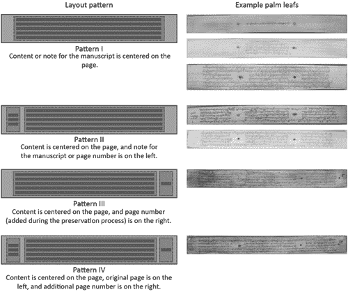

**图 10.5**

在兰纳经（`Dhamma`）经叶上发现的四种文本布局模式。

### 10.5.3 分割

`OHCR` 过程中的下一个任务是分割步骤，它极大影响识别性能。逐渐分割每个文本布局的二值图像以获得若干孤立的字符图像。我们将此任务分为三个步骤，即 (1) 文本行分割、(2) 分块分割和 (3) 字符分割。

在文本行分割中，我们采用了 [18] 中提出的文本行分割方法的概念。首先确定给定二值图像中的文本行数。与 [18] 不同，我们通过分析整个图像的水平投影轮面来估计文本行数。轮面的峰数量被赋值为文本行数，因为行的整体曲率往往是线性的。


在分块分割中，忽略语义地将文本行分割成小块。该任务是为了为字符分割准备合适的输入图像，字符分割在输入为字符块时效果更好。这可以通过分析每行的垂直投影轮面轻松实现。首先，计算每行的垂直投影轮面。然后通过扫描找到值为零的位置，从轮面提取字符间的间隙。为了避免将断裂字符切割为冗余块，忽略较小的间隙。同时，较大的间隙被用作分割文本行的小块切割点。

在字符分割中，将每个块中的字符分离为孤立字符。为此，我们在`[39]`中提出了一种基于识别的字符分割方法。该方法包含三个阶段：(1)确定候选分割点、(2)在假设图中表示分割以及(3)确定最佳分割假设。在第一阶段，我们分析给定单词图像的骨架以获取候选分割点。这些分割点用于将单词图像分割成片段。在第二阶段，我们将所有分割假设表示为无向图。在最后阶段，将图划分为对应分割字符图像的子图。我们定义了一个置信函数，结合了识别模型的反馈以及分割字符的预期宽度和高度，以引导划分算法。使用多层感知机作为识别模型。我们设计了一种动态规划算法，为图划分问题寻找全局最优解（即使置信函数最大化）。

## 10.5.4 识别

字符识别是我们的`OHCR`（光学手写字符识别）系统的最后一个任务。在这项任务中，每个孤立字符都要被分类到对应的字符类别中。为了提高独立书写识别准确率，我们提出了一种基于智能矩特征选择（`LDIMS`）的手写兰纳`Dhamma`字符高效字符识别方法`[54]`。`LDIMS`从全面的基于形状的矩描述符集中获得一组最优设计的特征。它由三个主要阶段组成：(1) 确定每个有效矩描述符的阶阶；(2) 确定矩描述符的最佳组合；以及(3) 使用可继承的双目标组合遗传算法进行优化的矩特征选择。之所以考虑矩特征，是因为它们提供了尺度不变性、旋转不变性以及噪声鲁棒性。通过实验，选取了包括`Meixner`、`Charlier`、`Tchebichef`和`Hahn`在内的四个有效矩描述符来形成特征向量。采用`kNN`作为分类器，因为它对数据分布的假设较少。

## 10.6 总结与展望

在本章中，我们讨论了在贝叶手稿上执行`OHCR`相关的问题。在开发针对贝叶手稿的`OHCR`系统时，应当强调这些问题。随后，我们概述了成功应用于该任务的最先进的预处理、行分割、字符分割和字符识别步骤。最后，展示了一个古代兰纳`Dhamma`字符识别系统的工作示例。尽管到目前已提出了多种方法，但贝叶手稿`OHCR`方面仍有改进空间。与人类的识别能力和应用需求相比，目前`OHCR`系统对贝叶手稿的识别准确率仍然不足。此外，`OHCR`最新的方法大多是基于深度学习方法提出的，但由于训练数据集的局限性，这些方法无法应用于贝叶手稿的研究中。需要构建大型训练数据集，以开发使用深度学习方法的、贝叶手稿高效`OHCR`方法。

## 参考文献

- 1. Inkeaw, P., et al., 基于小波变换的贝叶手稿兰纳`Dharma`手写字符识别. In: 2015 IEEE International Conference on Signal and Image Processing Applications (ICSIPA). 2015.
- 2. Klomsae, A., 兰纳`Dharma`手写字符识别的特征提取, In: Department of Computer Science. Chiang Mai University, Thailand. 2012.
- 3. Otsu, N., 基于灰度直方图的阈值选择方法. IEEE Transactions on Systems, Man, and Cybernetics, 1979. 9(1): p. 62–66.
- 4. Niblack, W., 数字图像处理导论. Strandberg Publishing Company. p. 215. 1985.
- 5. Sauvola, J., and M. Pietikäinen, 自适应文档图像二值化. Pattern Recognition, 2000. 33(2): p. 225–236.
- 6. Wolf, C., J. Jolion, and F. Chassaing, 多媒体文档中的文本定位、增强和二值化. Object Recognition Supported by User Interaction for Service Robots, 2002. 2: p. 1037–1040.
- 7. Khurshid, K., et al., 用于古代文献的`Niblack`启发二值化方法对比. In: IS&T/SPIE Electronic Imaging. SPIE, 2009.
- 8. Burie, J.-C., et al., 关于巴厘岛贝叶手稿图像手写文本分析的`ICFHR2016`竞赛. 2016 [引用自 2018 6/12/2018]; 可访问: [`amadi.univ-lr.fr/ICFHR2016_Contest/`](http://amadi.univ-lr.fr/ICFHR2016_Contest/).
- 9. Kesiman, W.M., et al., 东南亚贝叶手稿文档图像分析任务的基准. Journal of Imaging, 2018. 4(2): p. 43.
- 10. Amin, A., and S. Fischer, 使用霍变换的文档倾斜检测方法. Pattern Analysis and Applications, 2000. 3(3): p. 243–253.
- 11. Gari, A., et al., 倾斜检测与校正.
- 12. Hashizume, A., 矩描述符的阶数. In: International Conference on Wireless Technologies, Embedded Systems.
- 13. Yue, L., and T. Chew, 基于最近邻的精确倾斜估计. In: Seventh International Conference on Document Analysis.
- 14. Baird, H.S., 打印文档的倾角. In: Document Analysis, O.G. Lawrence and K. Rang, Editors, IEEE Computer Society.
- 15. Li, S., and J. Sun, 使用小波分解和投影的倾斜检测. Pattern Recognition, 2007.
- 16. Ptak, R., and O. Unold, 基于自适应阈值的投影行分割. 27(1).
- 17. Chamchong, R., and C.C. Fung, 用于贝叶手稿的投影行提取. In: International Conference on Handwriting.
- 18. Valy, D., M. Verleysen, and K. Sok, 使用竞争学习算法的行分割. In: 15th International Conference on Handwriting Recognition (ICFHR).
- 19. Chamchong, R., and C.C. Fung, 贝叶手稿的字符分割. In: Proceedings of the 2011 Workshop on Historical Document Imaging and Processing, ACM: Beijing, USA.
- 20. Nicolaou, A., and B. Gatos, 将文本切分为行. In: 10th International Conference on Document Analysis.
- 21. Peng, G., et al., 使用`Viterbi`算法的贝叶手稿行分割. In: International Conference on Audio, Language and Image Processing (ICALIP).
- 22. Zhang, X., and C.L. Tan, 使用受限剪缝算法的手写文档行分割. In: 14th International Conference on Frontiers in Handwriting.
- 23. Surinta, O., et al., 手写文档行分割的路径规划. In: 14th International Conference on Frontiers in Handwriting.
- 24. Arvanitopoulos, N., and S. Sstrunk, 用于彩色和灰度历史手稿的剪缝法文本行提取. In: 14th International Conference on Frontiers in Handwriting.
- 25. Valy, D., M. Verleysen, and K. Sok, 针对棉语贝叶手稿灰度文本图像的行分割. In: Seventh International Conference on Image Processing Theory, Tools and Applications (IPTA).
- 26. Hart, P.E., N.J. Nilsson, B. Raphael, and A. Formal, 最小代价路径启发式确定性基础. IEEE Transactions on Systems Science and Cybernetics, 1968. 4(2): p. 100–107.
- 27. Casey, R.G., and E. Lecolinet, 字符分割方法与策略综. IEEE Transactions on Pattern Analysis and Machine Intelligence, 1996. 18(7): p. 690–706.
- 28. Shi, Z., and V. Govindaraju, 连通手写数字字符串的分割与识别. Pattern Recognition, 1997. 30(9): p. 1501–1504.
- 29. Elnagar, A., and R. Alhajj, 连通手写数字字符串的分割. Pattern Recognition, 2003. 36(3): p. 625–634.
- 30. Pal, U., A. Belaí̈d, and C. Choisy, 利用水库概念进行接触性数字分割. Pattern Recognition Letters, 2003. 24(1): p. 261–272.
- 31. Pravesjit, S., and A. Thammano, 历史兰纳手写手稿的分割. In: 第 6 届 IEEE 国际智能系统会议. 2012.
- 32. Ribas, F.C., L.S. Oliveira, A.S. Britto, and R. Sabourin, 手写数字分割：一项比较研究. International Journal on Document Analysis and Recognition (IJDAR), 2013. 16(2): p. 127–137.
- 33. Elagouni, K., et al., 结合多尺度字符识别与语言知识用于自然场景文本`OCR`. In: 第 10 届 IAPR 国际文档分析系统工作会议. 2012.
- 34. Fujisawa, H., Y. Nakano, and K. Kurino, 字符识别的分割方法：从分割到文档结构分析. Proceedings of the IEEE, 1992. 80(7): p. 1079–1092.
- 35. Yi-Kai, C., and W. Jhing-Fa, 利用背景与前景分析进行单接触或多接触手写数字字符串的分割. IEEE Transactions on Pattern Analysis and Machine Intelligence, 2000. 22(11): p. 1304–1317.
- 36. Oliveira, L.S., R. Sabourin, F. Bortolozzi, and C.Y. Suen, 手写数字字符串的自动识别：一种识别与验证策略. IEEE Transactions on Pattern Analysis and Machine Intelligence, 2002. 24(11): p. 1438–1454.
- 37. Ji, J., L. Peng, and B. Li, 基于图模型优化的历史汉字分割方法. In: 第 11 届 IAPR 国际文档分析系统工作会议. 2014.
- 38. Chatchinarat, A., 使用比例不变性识别技术的泰语手写分割. In: 未来计算机与通信国际会议. 2009.
- 39. Inkeaw, P., et al., 用于多级书写风格的基于识别的字符分割. International Journal on Document Analysis and Recognition (IJDAR), 2018. 21(1): p. 21–39.
- 40. Dalal, N., and B. Triggs, 用于人体检测的方向梯度直方图. In: IEEE 计算机学会计算机视觉与模式识别会议 (CVPR'05). 2005.
- 41. Surinta, O., M.F. Karaaba, L.R.B. Schomaker, and M.A. Wiering, 利用局部梯度特征描述符的手写字符识别. Engineering Applications of Artificial Intelligence, 2015. 45: p. 405–414.
- 42. Sayyouri, M., A. Hmimid, and H. Qjida, 用于二值和灰度图像的字符快速计算. In: 信息科学与技术 (CIST) 2012 研讨会.
- 43. Sayyouri, M., A. Hmimid, H. Qjida, and A. A新型`Meixner`不变矩的快速计算. Circuits, Systems, and Signal Processing, 2015. 34(3): p. 875–900.
- 44. Liu, J.G., H.F. Li, and F.K. Lam, 通过矩的计算实现快速离散余弦变换. Journal of VLSI Signal Processing for Signal, Image and Video Technology, 1998. 19(3): p. 257–268.
- 45. Zhou, J., et al., 基于离散正交`Hahn`矩的图像分析. Berlin, Heidelberg: Springer Berlin Heidelberg. 2005.
- 46. Pew-Thian, Y., R. Paramesran, and O. Seng-Huat, 基于`Krawtchouk`矩的图像分析. IEEE, 2003. 12(11): p. 1367–1377.
- 47. Mukundan, R., S.H. Ong, and P.A. Lee, 基于`Tchebichef`矩的图像分析. IEEE Transactions on Image Processing: IEEE 信号处理学会出版物, 2001.
- 48. Hosny, K., 利用`Gegenbauer`矩的图像表示. Pattern Recognition, 2011. 32(6): p. 795–804.
- 49. Gonzalez, R.C., and R.E. Woods, 数字图像处理. 第 3 版. 2006, Prentice-Hall.
- 50. Santosh, K.C., 基于`DTW-radon`的字符识别. In: 文档分析与识别会议. 2011.
- 51. Santosh, K.C., and L. Wendling, 基于非线性多投影测量的特征. Frontiers of Computer Science, 2015. 9(5): p. 678–690.
- 52. Jain, J., et al., 用于字符识别的改进链码直方图. Berlin, Heidelberg: Springer 2012.
- 53. Santosh, K.C., and E. Iwata, 基于笔画草体字符识别. In: 字符识别进展，X. Ding 编, IntechOpen. p. 175–192. 2012.
- 54. Inkeaw, P., et al., 利用一组最优设计的矩的手写兰纳字符识别. International Journal on Document Analysis and Recognition (IJDAR), 2017. 20(4): p. 259–274.
- 55. Shridhar, M., and A. Badreldin, 利用傅里叶和拓扑描述的高精度字符识别算法. Pattern Recognition, 1984. 17(5): p. 515–524.
- 56. Wu, T., et al., 改进的汉字识别描述符. In: 第三届智能信息技术国际会议.
- 57. Lecun, Y., L. Bottou, Y. Bengio, and P. Haffner, 应用文档识别的梯度学习. Proceedings of the IEEE, 1998. 86(11): p. 2278–2324.
- 58. Dae-Gun, K., S. Song, K. Kang, and S. Han, 用于字符级分类的卷积神经网络. IEIE Transactions on SMART Processing & Computing, 2017. 6(1): p. 53–59.
- 59. Bai, J., et al., 利用从不同语言学习的深度卷积神经网络进行图像字符识别. In: IEEE 图像处理会议 (ICIP). 2014.
- 60. Hochreiter, S., and J. Schmidhuber, 长短期记忆. Neural Computation, 1997. 9(8): p. 1735–1780.
- 61. Graves, A., et al., 卷积时间分类：使用神经网络对未分割序列数据进行标记. In: 第 23 届国际机器学习会议，ACM: Pittsburgh, Pennsylvania, USA. p. 369–376. 2006.


[62.] Ahmed, S.B., et al., Evaluation of cursive and non-cursive scripts using recurrent neural networks. `Neural Computing and Applications`, 2016. 27(3): p. 603–613.

[63.] Sarraf, S., French word recognition through a quick survey on recurrent neural networks using long-short term memory `RNN-LSTM`. `Arxiv e-Prints`, 2018.

[64.] Inkeaw, P., et al., Rule-Based Page Segmentation for Palm Leaf Manuscript on Color Image. Cham: Springer International Publishing. 2016.

[65.] Burger, W., and M. Burge, Digital Image Processing : An Algorithmic Introduction Using Java. London: Springer Publishing Company. 2016.

# 索引

### A

* 攻击性识别
  * 数据特征，104–105
  * 数据预处理，105–106
  * 数据集，102, 104
  * 深度学习算法，108
  * 稠密架构，108
  * 稠密文本与快速文本，109
  * 实验设置，107
  * 特征提取，106
  * 逻辑回归，特征集，107
  * 相关工作，103
  * 测试集类别，109
* `ANNs`，见人工神经网络
* 人工神经网络 (`ANNs`)，44
* 艺术多字符脚本识别
  * 数据收集/预处理
    * 自动分割算法，32
    * 二值化，32–33
    * 组件图像，33
    * 组件合并算法，33
    * 欧几里德变换算法，33
    * 洪水填充算法，33
    * `ROI`，32, 33
    * 样本图像，32
    * `Zhang Suen` 细化算法，33
  * 实验
    * 分类器，39
    * 混淆矩阵，39
    * 估计程序，38
    * 结果分析，38–39
  * 特征提取
    * 纹理特征（见纹理特征）
    * 基于拓扑的（见基于拓扑特征）
  * 文献综述，30–31
  * 提议工作，流程图，30

### 作者画像

* 年龄分布，`PAN 2015/2016`，110
* 算法/微调模型，112–113
* `CLEF`，109
* 数据集，110
* 实验设置，111
* 特征提取，111
* 插图，设置，112
* 预处理，110–111
* 结果，113–116
  * 年龄分类结果，`PAN 2015`，114
  * 英语分类准确率，`PAN 2015`，115
  * 通过推文和用户评估，`PAN 2016`，115
  * 性别分类结果，`PAN 2015`，113
  * `MSE` 结果，`PAN 2015`，114

### B

* 词袋方法，54，86
* 孟加拉语
  * 字母集，122
  * 字符
    * 不同的笔画，123
    * 相似形状，124
    * 笔顺变化，124
  * `OHR`，123
  * 书写风格，122, 124
* 孟加拉语手写，123, 124 见识别
  * 单个字符，22–23
  * 目标，16
* 孟加拉语文档，实验，54
* 二值化，149–150
* 鸟眼视图，提议方法，73

### C

* `CAG`，见攻击性
* 框图，17
* 孟加拉语 3.1，25
* 数据库性能，25
* 直接比较，24
* 间接比较，21–24
* 手写字符数字，25
* 隔离字符，24
* 属性选择，18
* 分类，18–19
* 数据库，17–18
* 特征提取阶段，18
* `IBK`，19
* `MLP`，19–20
* 随机森林，19
* 简单逻辑，19
* 精确，20–21, 22–23
* 提议方法，20–21
* 回回率，21, 22–23
* 圆形度，36
* `CLEF`，见评估论坛
* `CNN`，见卷积神经网络
* 通信，53–54
* 组件合并算法，33
* 评估论坛，109
* 联结时间分类 (`CTC`)，153
* 隐性攻击性 (`CAG`)，102
* 凸区域，35
* 卷积神经网络 (`CNN`)，15
* `CTC`，见联结时间分类

### D

* `DAG`，见有向无环图
* `DBOW`，见分布式词袋
* 字典/索引，116
* 数字文档，类型，2
* 有向无环图 (`DAG`),151
* 分布式词袋 (`DBOW`), 106
* 分布式内存连接 (`DMC`), 106
* 分布式内存平均 (`DMM`), 106
* `DMC`, 见 分布式内存连接
* `DMM`, 见 分布式内存平均
* `DTW`, 见 动态时间规整
* 动态时间规整 (`DTW`), 16, 125

### E

* 离心率, 34
* 边缘, 60
* 边缘直方图 (`EDH`), 31
* `EDH`, 见 边缘直方图
* `ELMs`, 见 极端学习机
* 等效直径, 36
* 欧几里变换算法, 33
* 欧拉数, 35
* 范围, 36
* 极端学习机 (`ELMs`), 43
  * 激活函数
    * 硬限幅 (`hardlimit`), 46
    * `radbas`, 46
    * `sigmoid`, 46
    * `sine`, 46–47
    * `tribas`, 47
  * 算法, 45
  * 应用
    * 音频信号处理, 49
    * 文档分析, 48–49
    * 医学, 49
    * 模式识别问题, 49
  * 挑战, 49
  * 差异, 43–44
  * 蜕变, 47–48
  * 准备知识, 44–45

### F

* `FCN`, 见 全卷积网络
* 特征权重向量, 60
* 洪水填充算法, 33
* 全卷积网络 (`FCN`), 149

### G

* `Gabor` 滤波方法, 30
* `Gabor` 波波, 37–38
* 基于图的文本分类
  * 阿拉伯语/乌尔都语, 56
  * 孟加拉语, 57
  * 中文/日语/波斯语, 55–56
  * 分类/误分类, 61
  * 分类器，比较, 63
  * 混淆矩阵, `MLP`, 62
  * 正确/错误分类, 62
  * 英语, 54–55
  * 除孟加拉语以外的印度语言, 56–57

### 提议方法

* 分类器, 60–61
* 数据收集, 58–59
* 文档分布，领域, 59
* 与现有方法, 63–64
* 特征趋势，类别, 61
* 流水线, 58
* 预处理, 59–60
* 表示方案, 60

### H

* 手写识别系统 (`HOCR`), 8
* 手写字符识别, 16
* 隐藏马尔可夫模型 (`HMM`), 125
* `HMM`, 见 隐藏马尔可夫模型
* `HOCR`, 见 手写识别系统

### I

* `IBK`, 见 基于实例的邻域
* 印度语文字, 3, 5, 29
* 基于实例的邻域 (`IBK`), 19
* 写写者间变体, 3
* 写写者内部变体, 3, 4
* 逆类频率 (`ICF`), 75
* 逆文档频率 (`IDF`), 75

### K

* `K` 折交叉验证, 94–95

### L

* 标签归感 (`LINGO`), 57, 88
* `LINGO`, 见 标签归感
* 长短期记忆 (`LSTM`), 107
* `LSTM`, 见 长短期记忆

### M

* 马哈拉诺比斯距离, 76, 78, 79, 80
* 主轴长度, 34
* 曼哈顿距离, 76
* 闵可夫斯基距离, 78
* 副轴长度, 34
* `MLP`, 见 多层感知机
* 多层感知机 (`MLP`), 15, 19–20, 60, 96, 125

### N

* `NAG`, 见 非攻击性
* 朴素贝叶斯多项 (`NBMN`), 62, 86
* 朴素贝叶斯多变量 (`NBMV`), 62
* 自然语言处理 (`NLP`), 2
  * 应用
    * 问答, 10
    * 文本分类, 10
    * 文本摘要, 10
    * 词义消歧, 10–11
  * 解析, 10
  * 语音标记，部分的, 9
  * 词干提取, 9
  * 停词去除, 9
  * 分词, 3, 9
* `NBMN`, 见 朴素贝叶斯多项
* `NBMV`, 见 朴素贝叶斯多变量
* 临近点 (`NN`), 125
* `NLP`, 见 自然语言处理
* `NN`, 见 临近点

### Node

* 节点, 60
* 非攻击性 (`NAG`), 102

### O

* `OAG`, 见 过度攻击性
* `OCR`, 见 光学字符识别
* `OHR`, 见 在线手写识别
* 在线手写识别 (`OHR`), 121
  * 面积特征, 128–129
  * 辛普森法则, 129
  * 字符笔画，二次重采样，127
  * 字符笔画，三部分组件笔画，126
  * 细分，笔画，127
  * 书写顺序，三部分组件笔画，127
  * 特征提取
    * 基于 `DHD` 的特征，134–136
    * 前向 `HD` 计算，135
  * 局部特征
    * 弦长，129–130
    * 质量分布，129
  * 基于点的特征，130–131
  * 原因，121–122
  * 结果与分析
    * `argmax` 融合算子，137
    * 晚融合方法，137–138
    * 分类错误的字符对，137
    * 字符的在线/离线模式，136
  * 拓扑特征
    * 交叉点，131–132
    * 转换计数特征，131

### 光学字符识别 (`OCR`), 2

* 应用
  * 自动车牌识别系统，8
  * 银行业，7
  * 验证码 (`CAPTCHA`)，8
  * 手写差异，7
  * 医疗保健，7
  * 法律行业，7
* 孟加拉语字符，相似性，3
* 印度语文字系，3
* 书写者内部与外部的差异，3
* 多种倾斜，2
* 噪声，3, 5–6
  * 涂改，类型，6
  * 墨水溢出/意外痕迹，5
  * 纸折/污渍标记，6
* 分割，6

### 方向，35

### 显性攻击性 (`OAG`), 102

### P

* 棕榈叶

### 文档图像处理与识别

* 二值化，149–150
* 降噪，150
* 预处理，149
* 分割（见分割任务）
* 倾斜校正，150
* 像素滤波器，155
* 兰纳经法 (`Lanna Dhamma`)，文本布局，156
* 噪声/图像伪影，147–148
* 泰国北部，147
* `OHCR`（手写光学手写字符识别）过程，146–148
* 用于兰纳语的 `OHCR` 系统
  * 光学手写字符识别流程图，154
  * 布局分析，155
  * 预处理，153–154
  * 识别，157
  * 分割，156–157
* 词性标记 (`POS`)，106
* 边界，36
* `POS`，见词性标记
* 准确率，20–21, 22–23

### R

* 径向激活函数，46
* 随机森林，19
* 随机模型学习 (`RMDL`)，71
* 召回率，21, 22–23
* 长短期记忆递归神经网络 (`RNN-LSTM`)，153
* 兴趣区域 (`ROI`)，31
* `RMDL`，见随机模型学习
* `RNN-LSTM`，见长短期记忆递归神经网络
* `ROI`，见感兴趣区域
* 运行长度平滑，31

### S

* 分割任务
  * 字符分割，151–152
  * 识别
    * 基于分割的方法，152–153
    * 无分割方法，153
  * 文本行，150–151
* `Shirorekhas`，31
* `SHLFFNN`，见单层前馈神经网络
* `Sigmoid` 激活函数，46
* 文本处理相似性度量 (`SMTP`)，71
* 正弦激活函数，46–47
* 单层前馈神经网络 (`SHLFFNN`)，43
* 坚固性，36
* 先进方法，21
* 支持向量机 (`SVM`)，15, 31, 55, 87, 112, 136
* `SVM`，见支持向量机

### T

* 词频-逆文档频率 (`TF-IDF`)，75

### 文本分类系统

* 应用，86
* 阿罗-闪米语，72
* 词袋方法，86
* 分类/分类错误，80
* 混淆矩阵，79
* 正确/错误分类，80
* 距离指标，80
* 领域评估，79
* 达罗毗荼语，72
* 特征趋势，93
* 目标，85
* 印度-雅利安语，72–73
* 日语，72

### 文献综述

* 实验，87
* `ICF`，87
* `LINGO`，88
* 研究工作，88
* `SGD`，87
* `SVM`，87
* `TF-IDF` 权重方案，88–89
* 接近百分比，94

### 提出的方法

* 类别/领域，唯一术语，92
* 分类器，92, 94
* 数据收集，74, 89–90
* 距离测量（见距离度量）
* 特征提取与选择，75–76, 91–92
* 预处理，74–75, 90–91
* 分类器，比较，96
* 混淆矩阵，`NBM`，94
* 正确/错误分类，96
* 交叉验证折，95
* 分领域评估，精确率、召回率和 `f[1]` 测量，95
* 十折交叉验证，95
* 汉藏语系，71–72
* `UBoWs`，86
* 文本分类/主题检测，85

### 纹理特征

* 定义，36
* `Gabor` 波波，37–38
* 均值方向能量，36
* 基于拓扑的特征，34–36
  * 面积，34
  * 椭圆离心率，35
  * 带焦点的椭圆，34
  * 椭圆方向，35

### 三角形基函数

* 三角形基函数，47

### U

* `UBoWs`, 见 唯一词袋
* 唯一词袋 (`UBoWs`), 86

### W

* 权重图算法, 54
* 逐词级脚本识别, 30

### Z

* `Zhang Suen` 细化算法, 33
