# C++ 编程精选读

## 出版信息

高等教育产品管理副总裁：Erin Joyner

产品管理：Thais Alencer

产品经理：Kristen McNary

助理经理：Tran Pham

产品助理：Tom Benedetto

学习设计师：Mary Convertino

高级内容经理：Maria Gargulo

数字素养主管：David O'Connor

技术编辑：John Feratos

发展编辑：Lisa Ruffolo

科学、技术与数学营销部副总裁：Jason Sakos

营销部高级总监：Michele McGee

营销经理：Cassie L. Clout

营销开发经理：Samantha Best

产品专家：Mackenzie Paine

IP 分析师：Ashley Maynard

IP 项目经理：Cassidy Parker

制作服务：SPI Global

封面图片：来源：echo3005/Stockutterstock.com

> 如需信息和技术帮助，请联系：
>
> Cengage 客户与销售支持，1-800-354-9706
>
> 或 support.cengage.com。

Cengage 是领先的定制化学习解决方案提供商，在近 40 个国家拥有员工，并在全球 125 个国家进行销售。请访问`www.cengage.com`查找您的当地代表。

要了解更多关于 Cengage 服务的信息、注册或访问您的在线学习服务、购买课程材料，请访问`www.cengage.com`。

出版商不对此处描述的任何产品与此处包含的任何产品信息相关的任何独立分析提供任何保证或担保。出版商不承担且明确声明对比获取和包含制造商提供之外信息的任何义务。明确警告读者，要考虑并采取此处所描述的活动可能指示的所有预防措施，并避免所有潜在危险。通过使用此处包含的说明，读者明智地不作任何的陈述或保证（但不限于针对特定用途或适销性的保证），且对本文提供的材料不暗示此类陈述，出版商对此类材料不承担任何责任。对于读者使用或依赖本材料的任何部分，出版商概不承担责任。

## 目录

前言 XIII

前言 XIII

前言 XIII

模块 6 决策控制结构 83

模块 25 处理器架构 455

### 基础模块 22

- 模块 1 22
- 工具集 23
- 模块 2 23
- Hello World! 24
- 模块 3 24
- 调试工具 25
- 模块 4 25
- 良好的算法 26
- 模块 5 26
- 算法基础 27
- 模块 6 27
- 模式识别 28
- 模块 7 28
- 模式识别 29
- 模块 8 29
- 选择与创建 30
- 模块 9 30
- 调试算法 31
- 模块 10 31
- 调试环境 32
- 模块 11 32
- 集成环境 33
- 模块 12 33
- 功能化分解 34
- 模块 13 34
- 结构化分解 35
- 模块 14 35
- 模式识别 36
- 模块 15 36
- 抽象层次级 37
- 模块 16 37
- 抽象基础 38
- 模块 17 38
- 模式识别 39
- 模块 18 39
- 模式识别 40
- 模块 19 40
- 语法识别 41
- 模块 20 41
- 语法元素 42
- 模块 21 42
- 变量声明 43
- 模块 22 43
- 变量赋值 44
- 模块 23 44
- 输入与输出 45
- 模块 24 45
- 变量输入 46
- 模块 25 46
- 变量输出 47
- 模块 26 47
- 基础工具 48
- 模块 27 48
- 控制流 49
- 模块 28 49
- 控制流 50
- 模块 29 50
- 控制逻辑 51
- 模块 30 51
- 数据结构 52
- 模块 31 52
- 数据结构 53
- 模块 32 53
- 数据类型 54
- 模块 33 54
- 数据类型 55
- 模块 34 55
- 数据类型 56
- 模块 35 56
- 数据类型 57
- 模块 36 57
- 数学表达式 58
- 模块 37 58
- 数学表达式 59
- 模块 38 59
- 逻辑运算符 60
- 模块 39 60
- 逻辑运算符 61
- 模块 40 61
- 逻辑运算符 62
- 模块 41 62
- 逻辑运算符 63
- 模块 42 63
- 逻辑运算符 64
- 模块 43 64
- 逻辑运算符 65
- 模块 44 65
- 逻辑运算符 66
- 模块 45 66
- 控制逻辑 67
- 模块 46 67
- 控制逻辑 68
- 模块 47 68
- 控制逻辑 69
- 模块 48 68
- 控制逻辑 70
- 模块 49 70
- 控制逻辑 71
- 模块 50 71
- 控制表达式 72
- 模块 51 72
- 控制表达式 73
- 模块 52 73
- 控制表达式 74
- 模块 53 74
- 控制表达式 75
- 模块 54 75
- 控制表达式 76
- 模块 55 76
- 控制表达式 77
- 模块 56 77
- 控制表达式 78
- 模块 57 78
- 控制表达式 79
- 模块 58 79
- 控制表达式 80
- 模块 59 80
- 控制表达式 81
- 模块 60 81
- 控制表达式 82
- 模块 61 82
- 控制表达式 83
- 模块 62 83
- 控制表达式 84
- 模块 63 84
- 控制表达式 85
- 模块 64 85
- 控制表达式 86
- 模块 65 86
- 控制表达式 87
- 模块 66 87
- 控制表达式 88
- 模块 67 88
- 控制表达式 89
- 模块 68 89
- 控制表达式 90
- 模块 69 90
- 控制表达式 91
- 模块 70 91
- 控制表达式 92
- 模块 71 92
- 控制表达式 93
- 模块 72 93
- 控制表达式 94
- 模块 73 94
- 控制表达式 95
- 模块 74 95
- 控制表达式 96
- 模块 75 96
- 控制表达式 97
- 模块 76 97
- 控制表达式 98
- 模块 77 98
- 控制表达式 99
- 模块 78 99
- 控制表达式 100
- 模块 79 100
- 控制表达式 101
- 模块 80 101
- 控制表达式 102
- 模块 81 102
- 控制表达式 103
- 模块 82 103
- 控制表达式 104
- 模块 83 104

## 第 8 章

### 引用传递 161

### 数组 125

- 魔法矩形 126
- 数组特性 127
- 数组用例 128

#### 一维数组 128

- 初始化数值数组 128
- 初始化字符串数组 130
- 递归基础 130

#### 数组的输入与输出 130

- 输出数组元素 171
- 索引错误 132
- 遍历数组 132
- 输入数组元素 133

#### 数组操作 135

- 修改数组元素 137
- 查找数组元素 137
- 求数组元素之和 137

#### 二维数组 179

- 二维数组基础 138
- 初始化二维数组 139
- 输出二维数组 141
- 求列和行的和 143

#### 总结 143

#### 核心术语 144

### 函数 145

#### 函数基础 146

- 函数分类 146
- 程序员定义的函数 146
- 执行流 146
- 函数的优势 147

#### `Void` 函数 148

- `Void` 函数基础 148

#### 总结 149

#### 带参数的函数 150

- 函数参数 150
- 交接 152
- 返回值 153
- 返回类型 156
- 函数签名 157

#### 作用域 157

- 作用域基础 160
- 值传递 160

### 定义异常 145

- 代码中的错误 185
- 异常类型 187

### 处理异常 146

- 处理他人的异常 146
- `Try` 和 `Catch` 146
- 使用异常 146
- 抛出异常 148

### 文件操作 205

#### 文件输入与输出 206

- 文件的目的 206
- 文件的结构 210
- 文件使用 212

#### 处理文件 214

- 访问文件 214
- 流与缓冲 216
- 从文件读取 216
- 打开文件进行读取 216
- 从文件读取 218
- 关闭文件 222
- 使用后关闭文件 222
- 尝试关闭文件 222
- 创建并写入新文件 222
- 创建文件 222
- 打开文件进行写入 223
- 写入并结束文件 224
- 预判异常 228

#### 总结 229

#### 核心术语 230

### 类与对象 231

- 面向对象编程中的类 232
- 用代码表示现实世界 232
- 使用类 232
- 类组件 233
- 使用对象 236
- 创建对象 238
- 对象作为变量 238
- 面向对象的特性与原则 238
- 在类中使用静态元素 239
- 静态变量 240
- 静态方法 241
- 面向对象程序中对象的特性 242
- 对象标识性 242
- 对象状态 242
- 对象行为 243

#### 总结 244

#### 核心术语 244

## 第 14 章

### 方法 245

- 使用方法 245
- 为什么要使用方法？245
- 方法的结构 251
- 使用方法 251
- 改变对象的默认行为 255
- 作为普通变量使用 255
- 方法重载 255
- 将一个对象设置为另一个对象相等 258
- 方法级联与方法链 263
- 在对象上调用多个方法 263

### 使用构造函数 266

- 指定如何构造对象 266
- 从另一个对象构造对象 268

### 总结 269

### 核心术语 269

## 封装 271

- 类结构的组件 271
- 数据隐藏 271
- 设计对象 273
- 自引用代码 273
- 访问器和修改器 277
- 从对象查看数据 277
- 修改对象中的数据 278
- 使用构造函数 280
- 参数和实 280
- 默认参数和构造函数 281
- 重载 281
- 通过访问方法强制封装 283
- 访问方法 283
- 公有变量和方法 283
- 私有变量和方法 284

### 接口与方法 286

- 编写接口 287

### 总结 290

### 核心术语 290

## 第 16 章

### 继承 291

- 使用继承 291
- 从其他类创建类 291
- OOP 中的家族族树 292
- 访问级别 295
- 继承的必要组件 296
- 定义父类 296
- 定义子类 297
- 创建继承父类的类 298
- 继承语法 298
- 自定义行为 307

### 总结 307

### 核心术语 307

## 第 17 章 309

### 多态性 350

- 多态的目的 309
- 编码过程中的灵活性 309
- 底层动态绑定 314
- 多态基础 314
- 类内部的类 314
- 虚函数 315

### 总结 317

### 核心术语 318

### 模板 369

- 模板基础 319
- 模板结构 319
- 模板对象 328
- 模板参数 330
- 模板模板 331

### 总结 332

### 链表数据结构 374

- 链表数据结构 334
- 数据结构基础 335
- 单链表 337
- 双链表 338
- 循环链表 339
- 链表特性 339
- 链表实现 340
- 节点类 342
- 节点 342
- 尾 343
- 插入 344
- 查找 345
- 遍历 346
- 搜索 347
- 删除 348

#### `Find` 方法 346

#### `Insert` 方法 347

#### 总结 349

### 栈与队列 353

- 栈 353
- 队列 353
- 栈基础 354
- 队列用例 355
- 栈 356
- 队列 364

### 算法复杂度与大 O 符号 396

- 渐近分析 397
- 渐近符号 397
- 大 O 复杂度 398
- 大 O 指标 398
- 常数时间 399
- 线性时间 400
- 平方时间 401

### 搜索算法 411

- 搜索算法 412
- 搜索 413
- 线性搜索 413
- 在海堆中找针 414
- 评估搜索时间 415
- 二分查找 416
- 缩小搜索空间 417
- 实现二分查找 418
- 使用正则表达式 419
- 在搜索算法中 420
- 指定搜索模式 421
- 正则表达式运算符 422

### 排序算法 427

- 排序算法 428
- 排序算法的性质 428
- 排序项目 429
- 排序算法的时间复杂度 430
- 排序属性 431

### 泡泡排序 432

- 定义泡泡排序算法 433
- 泡泡排序属性 437

## 第 22 章 395

### 处理器架构 455

- 处理器架构 456
- 处理器组织 457
- 集成电路 458
- 摩尔定律 458
- CPU 458
- 底层指令 459
- RISC 和 CISC 460
- 机器语言 460
- 汇编语言 461

| 主题 | 页码 | 主题 | 页码 |
|---|---:|---|---:|
| 二进制-十六进制-二进制转换 | 481 | 语音合成 | 516 |
| 十六进制-十进制转换 | 482 | 为语音接口设计程序 | 517 |
| 信息密度 | 483 | 虚拟环境接口 | 517 |
| ASCII 和 Unicode | 483 | 虚拟环境 | 517 |
| ASCII | 483 | 虚拟环境组件 | 518 |
| 扩展 ASCII | 484 | 虚拟接口编程 | 519 |
| Unicode | 485 | 可访问性与包容性 | 520 |
| 内存分配 | 486 | 包容性设计 | 521 |
| 内存与存储 | 486 | 关键术语 | 521 |
| 存储设备 | 487 |  |  |
| 内存 | 487 |  |  |
| 总结 | 489 |  |  |
| 关键术语 | 489 |  |  |

## 命令式与声明式范式 492

### 跳出框架思考 492

### 过程化范式 493

- 过程化基础 493
- 过程化程序的特征 494
- 过程化范式的应用 496

### 面对象化范式 497

- 对象、类与方法 497
- 面对象程序的特征 499
- 对象应用 501

## 声明式范式 501

### 声明式基础 501

### 声明式范式的特征 504

### 声明式范式的应用 505

## 总结 505

## 关键术语 505

## 用户界面基础 508

### UI 与 UX 508

### UI 组件 510

### 选择 UI 510

- 命令行基础 510
- 命令行程序设计 510
- GUI 基础 514
- GUI 程序设计 514
- 语音基础 515
- 语音识别 547

## 软件开发方法论 525

- 软件开发 526
- 软件开发生命周期 527
- 效率、质量与安全 528
- 瀑布模型 529
- 结构化分析与设计 529
- 瀑布模型的优缺点 531
- 敏捷模型 530
- 增量开发 531
- 敏捷方法优缺点 532

## 编码原则 533

- 高效编码 534
- 模块化代码 535
- 洁代码 536
- 安全编码 537
- 成功因素 538
- 测试级别 540
- 单元测试 541
- 集成测试 542
- 系统测试 543
- 验收测试 544
- 回归测试 545

## 总结 540

## 关键术语 540

- 伪代码 542
- 从伪代码到算法 542
- 伪代码基础 544
- 伪代码指南 545
- 编写伪代码 547

| 主题 | 页码 | 主题 | 页码 |
|---|---:|---|---:|
| 流程图 | 548 | UML 图表部分 | 558 |
| 流程图基础 | 548 | 类图基础 | 558 |
| 绘制流程图 | 548 | 用例图基础 | 559 |
| 流程图工具 | 549 | 序列图 | 561 |
| 决策表 | 551 | 使用 UML 结构程序 | 562 |
| 决策表基础 | 551 | UML 关联 | 562 |
| 列出条件 | 551 | 将 UML 转换为代码 | 564 |
| 所有可能的备选方案 | 552 | 总结 | 568 |
| 指定规则与结果 | 552 | 关键术语 | 568 |
| 解读规则 | 553 |  |  |
| 优化规则 | 554 |  |  |
| 检查完整性与准确性 | 555 |  |  |
| 总结 | 555 |  |  |
| 关键术语 | 556 |  |  |

- 统一建模语言 (UML) 的目的 557
- 与其他程序员交流思想 557

# 前言

欢迎阅读《C++ 编程》选读本。

本文包含了来自 MindTap 的《C++ 编程》的独立课程和阅读材料，旨在配合 MindTap 阅读器使用以获得完整的学习体验。

本包含 31 节的文本旨在提供概念性内容，并配有特定的 C++ 示例和动手实践活动。

我们建议在开始阅读本文之前下载最新版本的 C++。模块插图中展示的所有 C++ 代码均使用 C++14 版本进行测试。

《C++ 编程》提供了概念性的、语言无关的叙述，并配有特定语言的资源、不计分的 C++ 代码片段、语言无关的题库以及教师资源。该数字产品的目标是开发关于从语言无关视角理解计算机科学至关概念的内容。学习者将对过程化编程、计算机科学和面向对象编程建立基础理解。

**课程导览：** 除了阅读内容外，MindTap 还包含：

**视频：** 这些视频演示了：

**代码片段：** 这些简短的活动帮助学生：

**课程目标：**

- 建立过程化编程、计算机科学和面向对象编程的基础性理解。
- 将概念应用于现实场景。
- 使用 C++ 技能。

该产品的额外教师资源可在网上获取：

- 教师手册
- PowerPoint 幻灯片
- 源文件
- 题库


交互式资源

帮助学生理解的语言无关内容。

Kyla McMullen 博士是佛罗里达大学计算机科学与工程系的终身制教职员。她的研究方向是感知与应用。

Elizabeth A. Mathews 博士是华盛顿和李大学计算机科学助理教授。她自 2013 年以来一直教授计算机科学，并是人机交互领域的活跃研究人员。

本书的整体方法需要一个经验丰富的团队。感谢 Maria Gargillo 引导稿件的每一次迭代并控制进度；感谢 Mary Convertino 提供的学习设计专业知识；感谢 Lisa Ruffolo 协调项目；感谢 Kristin McNary 的领导；感谢 Rajiv Malkan（得星立学院）提供的教学建议；感谢 Wade Schofield（自由大学）提供的评审专业知识；感谢 John Freitas 荣幸加入这个专业且才华横溢的团队。我们希望教师学生认可我们的努力。

Kyla McMullen：感谢那些帮助我保持清醒、提醒我我是谁、并且不让我忘记初衷的朋友们。

Elizabeth Mathews：我要感谢我的父母 Geoff Mathews 和 Robin Mathews 在我的旅程中的支持与理解。我还想感谢我的导师 Juan Gilbert 看见我的梦想，感谢我的猫，Oreo 和 Laptop，它们确保了我在写书时尽可能地被打断。

June Jericho Parsons：计算机编程可以是一个非常有成就感的项目。当程序完美运行时的奖励是带给你微笑。在这个项目中使用三种编程语言确实具有挑战性，但它提供了帮助学生理解计算思维的见解。我非常享受与团队合作创建这些多功能资源，并把我的努力献给我的母亲，她是我职业生涯中坚定的后盾。对于所有使用这本书的教师和学生，我希望你们像我一样喜欢编程。

## 计算思维

### 学习目标：

## 1.1 算法

- 1.1.1 定义“算法”一术语为解决问题或执行任务的一系列步骤。
- 1.1.2 表明算法是计算机程序的底层逻辑。
- 1.1.3 定义“计算机程序”一术语。
- 1.1.4 提供日常技术应用中使用的算法示例。
- 1.1.5 确认一个任务或问题可以有多个算法，且某些算法可能比其他算法更高效。
- 1.1.6 解释为什么计算机科学家对算法感兴趣。
- 1.1.7 列出有效算法的特征。
- 1.1.8 为一项简单的日常技术任务编写一个算法。
- 1.1.9 为一项日常技术任务编写另一种算法。
- 1.1.10 在你编写的两个算法中选择更高效的那一个。

## 1.2 分解

- 1.2.1 定义“分解”一术语为将复杂问题或解决方案划分为较小部分的技术。
- 1.2.2 解释为什么分解是计算机科学家的一个重要工具。
- 1.2.3 区分算法与分解的概念。
- 1.2.4 识别结构分解的示例。
- 1.2.5 识别功能分解的示例。
- 1.2.6 识别面向对象分解的示例。
- 1.2.7 提供技术应用中的分解示例。
- 1.2.8 解释依赖关系和耦合与分解的关系。

## 1.3 模式识别

- 1.3.1 定义“模式识别”一术语为识别任务或问题元素之间相似之处的技术。
- 1.3.2 识别填空模式的示例。
- 1.3.3 识别重复模式的示例。
- 1.3.4 识别分类模式的示例。
- 1.3.5 提供现实世界和技术应用中的模式识别示例。

### 1.4 抽象

- 1.4.1 定义“抽象”一术语为泛化和简化复杂程度的技术。
- 1.4.2 解释为什么抽象是一个重要的概念。
- 1.4.3 提供一个抽象如何帮助识别变量的示例。
- 1.4.4 提供具有抽象或隐藏细节的技术应用示例。
- 1.4.5 提供一个将类作为对象抽象的示例。
- 1.4.6 解释黑盒概念是抽象的实现。
- 1.4.7 识别合适的抽象级别。

## 1.1 算法

### 算法基础 (1.1.1, 1.1.4)

密码可能是保护账户的常用方法。双重验证增加了一层保护。双重验证的一种常见形式是将识别码（PIN）发送到你的手机。要登录，请执行图 1-1 所示的步骤。


**图 1-1** 双重验证步骤

双重验证程序是一个算法示例。从广义上说，*算法*是解决问题或执行任务的一系列步骤。

算法存在于日常任务和涉及技术的任务中。这里是一些示例：

- 制作布朗尼的配方
- 更换轮胎的步骤
- 智能手表与手机配对
- 商店支付流程
- 发布推文的过程

### 编程算法 (1.1.2, 1.1.3, 1.1.5)

算法也是程序员的一项重要工具。*编程算法*是一组指定底层逻辑和策略的步骤。你可以将算法视为程序的蓝图。

*计算机程序*是用 C++、Python 或 Java 等编程语言编写的指令，由设备执行特定任务。计算机程序是算法的实现。

编程算法告诉计算机做什么。你能判断这些算法中哪些是编程算法吗？

**算法 1：**

1. 连接到网站登录页面。
2. 输入用户 ID。
3. 输入密码。
4. 等待包含 PIN 的短信到达手机。
5. 在网站登录页面输入 PIN。

**算法 2：**

1. 提示用户输入 ID。
2. 提示用户输入密码。
3. 确保用户 ID 和密码匹配。
4. 如果用户 ID 和密码匹配：
   - 生成随机 PIN。
   - 将 PIN 发送到用户手机。
   - 提示用户输入 PIN。
5. 如果 PIN 正确：
   - 允许访问。

算法 1 不是编程算法，因为它是为用户概述指令。算法 2 是编程算法，因为它指定了计算机应该做什么。当你制定编程算法时，解决问题或执行任务可以有多个编程算法，但某些算法比其他算法高效。

这里有两个计算 1 到 10 之和的算法。哪种算法更高效？

**算法 1：**

1. 1+2 得到总和。
2. 重复这些步骤九次：
   - 获取下一个数字。
   - 将该数字加到总和。

**算法 2：**

1. 获取序列中的最后一个（10）。
2. 将 10 除以 2 得到结果。
3. 10+1 和。
4. 乘以结果。

两个算法都包含四条指令，但算法 2 更高效。你可以用它在四步内快速算出总和让朋友惊讶。算法 1 有四行，但其中两条指令重复了九次。算上第一步，完成这项需要 19 步！

### “良好的”算法 (1.1.6, 1.1.7)

计算机科学家对他们所谓的“良好”算法感兴趣。良好的算法往往产生一个运行高效、快速且可靠的程序。良好的算法具有以下特征：

- **输入**：算法适用于指定的输入集。
- **输出**：算法产生一个或多个输出。
- **有限**：算法在有限的步骤后终止。
- **精确**：算法的每一步都清晰且无二。
- **有效**：算法成功产生正确的输出。

在制定算法时，你可以轻松地检查它是否满足良好算法的所有标准。你可以在图 1-2 中看到这些标准如何应用于算法。


图 1-2 这是一个良好的算法吗？

### 设置和创建算法 (1.1.8, 1.1.9, 1.1.10)

在编写代码之前，程序员会考虑可能适用于问题的算法。你可以通过三种方式构思算法：

**使用标准算法**：程序员已经为许多计算任务创建了有效的算法，例如排序、搜索、文本处理、数据加密和寻找最短路径。当你熟悉这些标准时，就可以轻松地将其整合到程序中。

**手动执行任务**：当你找不到标准算法时，可以通过手动执行过程、记录这些步骤，然后分析它们的有效性来制定算法。

**应用计算思维技术**：*计算思维*是一套旨在制定问题及其解决方案的技术。你可以使用分解、模式识别和抽象等计算技术来设计高效算法。让我们详细查看这些技术。

## 1.2 分解

### 分解基础 (1.2.1)

移动应用包含许多组件。它必须提供安全的登录程序、允许用户管理偏好、显示账户余额、推送通知、读取支票存款以及执行图 1-3 所示的任务。

如果不将此类开支划分为较小部分，制定算法将非常困难，这个过程被称为`分解`。在为复杂问题或任务设计算法时，分解帮助你处理更小、更易管理的拼图碎片。

# 第 1 模块 计算思维

欺诈警报

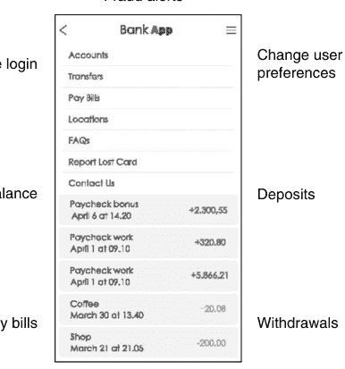

- 安全登录
- 修改用户偏好
- 账户余额
- 存款
- 支付账单
- 取款
- 转账

**图 1-3** 一个移动银行 App 处理着许多交互式任务

### 结构化分解 (1.2.2, 1.2.3, 1.2.4, 1.2.7)

分解的第一步是识别执行不同任务的结构单元。**图 1-4** 展示了你如何将移动银行 App 划分为结构单元，称为模块。

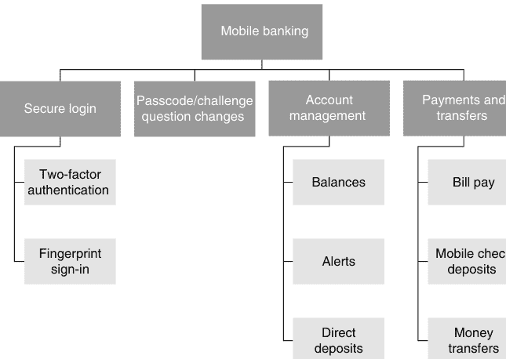

**图 1-4** 结构化分解图

**结构化分解**是一个识别结构单元层级的过程。在层级的最低层是模块（在图 1-4 中用黄色所示），它们对于创建算法来说具有可控的范围。

©2022 Cengage Learning. 版权所有。未经许可复制、扫描或部分复制。在电子形式中，可能会隐藏作者或出版商的某些第三方内容。编辑审查已确定，任何被隐藏的内容不会实质性地影响学习体验。如果法律权利要求，Cengage Learning 保留随时删除额外内容的权利。

### 层级结构图中的哪个模块没有被完全分解？

用于修改密码和挑战问题的模块可以进一步分解为两个模块：一个允许用户更改密码的模块，另一个用于更改挑战答的模块。

以下是创建结构化分解图的一些提示：

- 使用自上而下的方法。顶部的节点分解为其下方节点中的组成部分。
- 使用名词和形容词标记节点，而不是动词。例如，“账户管理”（Account management）是正确的名词短语，而不是动词性短语，如“管理账户”（Manage accounts）。
- 不要担心顺序。除了实际的登录过程外，移动银行系统中的组件可以按任何顺序访问。这是算法与分解之间的关键区别。算法指定了活动的顺序，而分解指定了任务的各个部分。

### 功能分解 (1.2.5)

功能分解将模块分解为更小的动作、过程或步骤。图 1-5 展示了双重认证模块的功能分解。

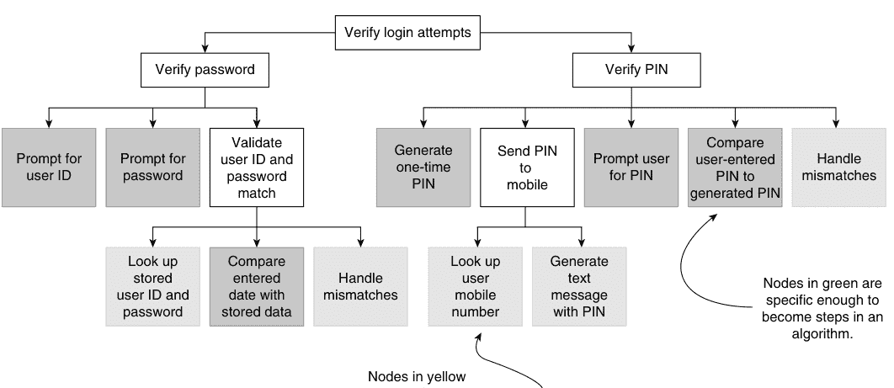

**图 1-5** 功能分解图

注意功能分解图的层级变得越来越具体，直到底层节点开始显示如何实现算法的指令。

以下是构建功能分解图并从中推导出图的一些提示：

- 使用动词标记节点。与结构化分解的节点不同，功能分解的节点用动词短语标记，表示“要做什么”。
- 从左到右排序。阅读图表的顺序应该与算法中执行步骤的顺序对应。

### 面向对象的分解 (1.2.6)

将分解应用于模块的另一种方法是寻找计算机程序将操作的逻辑和物理对象。图 1-6 展示了双重认证模块的面向对象分解。

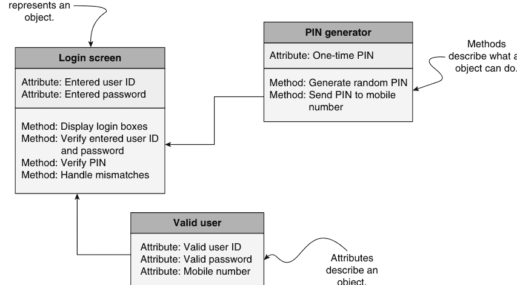

图 1-6 面向对象分解图

面向对象的分解并不产生层级结构。相反，它产生一个代表人物、地点或事集合。

面向对象分解的提示：

- 节点元组。面向对象分解图中的每个节点都用一个名词标记。
- 属性是名词。节点可以包含属性列表，这些属性与对象的特征有关。
- 方法是动词短语。对象还可以包含方法，即对象可以执行的动作。你可能需要为每种方法设计一个算法。
- 画出连接箭头。连接箭头帮助你直观理解对象如何共享状态。

### 依赖关系与内聚性 (1.2.8)

你可能会怀疑是否存在分解问题或任务正确方法。在实践中，可能有若干种可行的分解方法，但有效的分解会将各个部分之间的依赖关系最小化并将内聚性最大化。

分解的原则是：

- 最小化依赖关系。尽管输入和输出在节点之间流动，但更改一个模块或对象的指令不应要求更改其他部分。
- 最大化内聚性。每个对象或模块都包含执行单一逻辑任务或代表单一实体的属性或指令。

## 1.3 模式识别

### 模式识别基础 (1.3.1, 1.3.2)

“惊艳你的朋友”快速累加 1 到 10 数字的技巧非常简单：

- 获取序列中的最后一个数字 (10)。
- 将 10 除以 2。
- 将结果乘以 10。


# 第 1 模块 计算思维

欺诈警报


- 安全登录
- 修改用户偏好
- 账户余额
- 存款
- 支付账单
- 取款
- 转账

**图 1-3** 一个移动银行 App 处理着许多交互式任务

### 结构化分解 (1.2.2, 1.2.3, 1.2.4, 1.2.7)

分解的第一步是识别执行不同任务的结构单元。**图 1-4** 展示了你如何将移动银行 App 划分为结构单元，称为模块。


**图 1-4** 结构化分解图

**结构化分解**是一个识别结构单元层级的过程。在层级的最低层是模块（在图 1-4 中用黄色所示），它们对于创建算法来说具有可控的范围。

### 层级结构图中的哪个模块没有被完全分解？

用于修改密码和挑战问题的模块可以进一步分解为两个模块：一个允许用户更改密码的模块，另一个用于更改挑战答案的模块。

以下是创建结构化分解图的一些提示：

- 使用自上而下的方法。顶部的节点分解为其下方节点中的组成部分。
- 使用名词和形容词标记节点，而不是动词。例如，“账户管理”（`Account management`）是正确的名词短语，而不是动词性短语，如“管理账户”（`Manage accounts`）。
- 不要担心顺序。除了实际的登录过程外，移动银行系统中的组件可以按任何顺序访问。这是算法与分解之间的关键区别。算法指定了活动的顺序，而分解指定了任务的各个部分。

### 功能分解 (1.2.5)

功能分解将模块分解为更小的动作、过程或步骤。图 1-5 展示了双重认证模块的功能分解。


**图 1-5** 功能分解图

注意功能分解图的层级变得越来越具体，直到底层节点开始显示如何实现算法的指令。

以下是构建功能分解图并从中推导出图的一些提示：

- 使用动词标记节点。与结构化分解的节点不同，功能分解的节点用动词短语标记，表示“要做什么”。
- 从左到右排序。阅读图表的顺序应该与算法中执行步骤的顺序对应。

### 面向对象的分解 (1.2.6)

将分解应用于模块的另一种方法是寻找计算机程序将操作的逻辑和物理对象。图 1-6 展示了双重认证模块的面向对象分解。


**图 1-6** 面向对象分解图

面向对象的分解并不产生层级结构。相反，它产生一个代表人物、地点或事物的集合。

面向对象分解的提示：

- 节点用名词标记。面向对象分解图中的每个节点都用一个名词标记。
- 属性是名词。节点可以包含属性列表，这些属性与对象的特征有关。
- 方法是动词短语。对象还可以包含方法，即对象可以执行的动作。你可能需要为每种方法设计一个算法。
- 画出连接箭头。连接箭头帮助你直观理解对象如何共享状态。

### 依赖关系与内聚性 (1.2.8)

你可能会怀疑是否存在分解问题或任务的正确方法。在实践中，可能有若干种可行的分解方法，但有效的分解会将各个部分之间的依赖关系最小化并将内聚性最大化。

分解的原则是：

- 最小化依赖关系。尽管输入和输出在节点之间流动，但更改一个模块或对象的指令不应要求更改其他部分。
- 最大化内聚性。每个对象或模块都包含执行单一逻辑任务或代表单一实体的属性或指令。

## 1.3 模式识别

### 模式识别基础 (1.3.1, 1.3.2)

“惊艳你的朋友”快速累加 1 到 10 数字的技巧非常简单：

- 获取序列中的最后一个数字 (10)。
- 将 10 除以 2。
- 将结果乘以 10。

### 重复模式 (1.3.3)

除了填充空位外，你可能在分析任务和问题时也会发现重复模式。关于登录社交网站的算法：

- 获取用户 ID。
- 获取密码。
- 如果密码正确，允许访问。
- 如果密码不正确，获取密码。
- 如果密码正确，允许访问。
- 如果密码不正确，获取密码。
- 如果密码正确，允许访问。
- 如果密码不正确，获取密码。
- 如果密码正确，允许访问。

你识别出了哪些重复模式？

两次重复行：

- 如果密码不正确，获取密码。
- 如果密码正确，允许访问。

识别这种重复后，你可以简化算法：

- 获取密码。
- 重复三次：
  - 如果密码正确，允许访问。
  - 如果密码不正确，获取密码。

### 分类模式 (1.3.4, 1.3.5)

每个订阅社交网站的人都有一套登录凭证。这里是 Lee 和 Priya 的：

| 用户 | 用户 ID | 密码 | 手机号 |
| :--- | :--- | :--- | :--- |
| Lee | `LeezyBranson@gmail.com` | `MyCat411` | `415-999-1234` |
| Priya | `PriyaMontell@gmail.com` | `ouY52311v` | `906-222-0987` |

定义每个用户凭证的属性序列具有相似性。每个用户都有三个属性：用户 ID、密码、手机号。通过识别这种模式，你可以为任何用户创建一个模板：

- 用户 ID：____
- 密码：____
- 手机号：____

你通常可以在描述个人或对象的属性中发现分类模式。识别分类模式可以帮助你设计利用数据库的程序，模板识别了包含数据的字段。

当你想根据各种对象的交互而不是逐步算法来设计程序时，也会出现分类模式。在某些编程中，模板被称为类，它们指定了对象分类的属性。例如，被分类为社交媒体订阅者的人具有登录凭证属性。被分类为汽车的车辆具有颜色、品牌、型号和 VIN 码等属性。被分类为餐厅的业务具有名称、营业时间和菜单。

## 使用 C++ 编程

加 1 得到和。

将结果乘以和。

在这个算法中，空行是一个代表序列中最后一个数字的抽象。抽象隐藏了细节，简化了复杂性，用泛化代替了具体内容，并允许算法适用于多种输入。

抽象是计算思维的关键元素，它以多种方式隐藏了程序员的负担。

如果你以前写过程序，你会发现在“惊艳朋友”算法中，空位可以变成一个带有如 `last_number` 等命名的变量。`Result` 和 `sum` 也是变量，因为它们代表了随序列中的数字而改变的值。

```
Get last number
Divide last number + 2 to get a result.
Add last number + 1 to get a sum.
Multiply result.
```

变量是一种抽象，而不是表示一个特定的数字，它可以用来表示许多不同的数字。

### 类与对象 (1.4.4, 1.4.5)

抽象不仅限于识别变量。它对于理解如何表示现实世界和概念对象至关重要。记得你发现的社交媒体登录凭据模式吗？稍微修改一下它就变成了一个可以应用于任何订阅者的模板：

类：`LoginCredentials`

属性：`user_ID`

属性：`user_password`

属性：`mobile_number`

`LoginCredentials` 类是一个包含一组属性的抽象。该类通过抽象化（或移除）任何特定订阅者的细节而形成。

对于任何处理技术对象（如登录凭据）之外的现实对象的程序，抽象都是非常有用的。

> 你能想象出一个类，作为图 1-7 所示对象集合的抽象吗？


12 盎司水杯 | 5 号马提尼杯 | 8 盎司酒杯 | 10 盎司高杯

**图 1-7** 从这组玻璃具中抽象细节

玻璃具类可以具有这些属性：

类：`Glassware`

属性：`Color`

属性：`Capacity`

属性：`Style`

### 黑盒 (1.4.6)

开车不需要确切知道引擎盖下发生了什么。引擎本质上是一个“黑盒”，你通过油门、刹车和方向盘等几个简单输入来控制它。引擎的细节被隐藏了。在计算机科学术语中，这些细节被“抽象掉了”。见图 1-8。


**图 1-8** 汽车控制装置是其详细机械结构的抽象

在概念上，黑盒是指任何接受特定输入并执行特定过程以产生输出，而无需理解其内部运作的东西。见**图 1-9**。

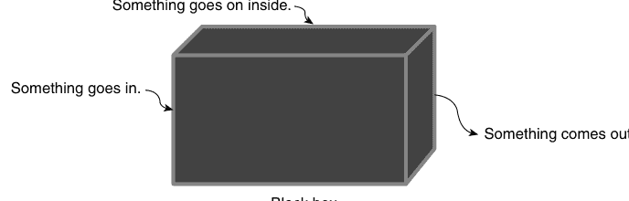

**图 1-9** 黑盒抽象

抽象是计算机科学的一个基本方面。想一下，计算机程序就是抽象。你可以使用社交媒体应用而无需了解任何使其运行的编程知识。你在屏幕上触摸的输入揭示了底层的编程。

程序员在程序中大量使用抽象，通过创建一组功能类似于黑盒的指令。例如，你可以将处理登录尝试的指令构建成一个黑盒，如**图 1-10** 所示。

编程语言还具有执行标准任务的内置抽象。例如，内置随机函数根据给定范围（如 -100 到 100）生成随机数。你可以在程序中引入随机函数而无需知道它内部是如何工作的。

## 使用 C++ 编程

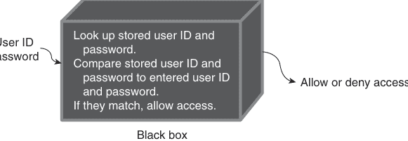

**图 1-10** 登录抽象

### 抽象层次 (1.4.7)

当你掌握了抽象后，你会在到处看到这种计算思维概念的例子。在程序中应用正确的抽象层次可能需要一些练习。

抽象层次与隐藏的细节量有关。抽象太多细节会导致程序过于泛化。忽视抽象会产生过于具体的程序，无法处理各种数据。见**图 1-11**。

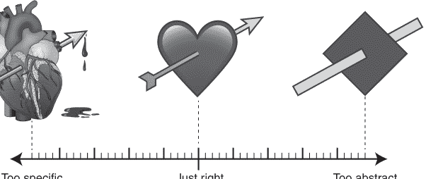

**图 1-11** 抽象层次

通过经验，你将能够识别抽象并判断使用正确的抽象层次。

# 总结

- 计算思维技术帮助程序员定义问题、寻找解决方案、划分任务和设计算法。
- 算法是解决问题或执行任务的一系列步骤。编程算法是计算机程序的蓝图。
- 许多计算任务都存在标准算法。当算法不存在时，你可以遍历过程并记录步骤，或者使用计算思维技术，如分解、模式识别和抽象。
- 分解将复杂的问题或任务划分为可管理的单元。模式识别揭示重复性任务。抽象是一个关键的计算机科学概念，它抑制细节，用泛化代替具体，并允许算法适用于多种输入。

# 关键术语

- 抽象 (abstraction)
- 属性 (attributes)
- 类 (classes)
- 分类模式 (classification patterns)
- 计算思维 (Computational thinking)
- 计算机程序 (computer program)
- 分解 (decomposition)
- 功能性分解 (Functional decomposition)
- 抽象层次 (level of abstraction)
- 方法 (methods)
- 模块 (modules)
- 对象 (objects)


- 面向对象的分解（`object-oriented decomposition`）
- 模式识别（`pattern identification`）
- 编程算法（`programming algorithm`）
- 结构化分解（`Structural decomposition`）

# 第 2 章 编程工具

## 学习目标

- 2.1 编程语言
  - 2.1.1 解释 `Hello World!` 的意义。
  - 2.1.2 复习编程语言用于创建软件。
  - 2.1.3 举出一些流行的编程语言。
  - 2.1.4 区分编程语言背景下的语法和语义。
  - 2.1.5 识别编程语言的关键特征。
  - 2.1.6 解释访问语言实现的选项。
  - 2.1.7 识别编程工具。
- 2.2 编码工具
  - 2.2.1 将程序编辑器定义为编辑程序代码的工具。
  - 2.2.2 列出可编码的编辑器类型。
  - 2.2.3 列出代码编辑器的一些功能以及它们如何帮助创建整洁的代码。
  - 2.2.4 识别编程语言编写程序的基本结构和语法元素。
- 2.3 构建工具
  - 2.3.1 解释构建工具的目的。
  - 2.3.2 解释源代码和目标代码的区别。
  - 2.3.3 描述编译器如何工作。
  - 2.3.4 解释预处理器的目的。
  - 2.3.5 解释链接器的目的。
  - 2.3.6 将虚拟机与 `Java` 关联。
  - 2.3.7 解释解释器如何工作。
  - 2.3.8 区分源代码、字节码、目标代码和可执行代码。
- 2.4 调试工具
  - 2.4.1 解释调试的目的。
  - 2.4.2 列出常见的语法错误。
  - 2.4.3 列出常见的运行时错误。
  - 2.4.4 列出常见的逻辑错误。
  - 2.4.5 将程序错误分类为语法错误、逻辑错误或运行时错误。
  - 2.4.6 将调试器分类为允许程序员遍历程序代码以查找错误的实用软件。
  - 2.4.7 列出调试器提供的方便功能。
- 2.5 IDE 和 SDK
  - 2.5.1 列出集成开发环境（`IDE`）的目的和典型功能。
  - 2.5.2 解释 `IDE` 如何支持视觉编程。
  - 2.5.3 确认所有 `IDE` 均本地安装，而其他 `IDE` 在线访问。
  - 2.5.4 识别 `IDE`。
  - 2.5.5 列出软件开发工具包（`SDK`）的目的和典型功能。
  - 2.5.6 提供 `SDK` 功能的示例。
  - 2.5.7 识别 `SDK`。

## 2.1 编程语言

### Hello World!（2.1.1）

`Hola!` `Bonjour!` `Hi!` `Ciao!` `Namaste!` `Salaam!` 这些问候语是你在学习一种口语时首先学到的内容。程序员也有一个类似的起点，那就是“Hello World”程序。

“Hello World”无疑是人类历史上最著名的计算机程序。它已在 700 多种编程语言中的每一种上被编写过。它通常是志成为程序员的人员编写的第一个程序。

看一看图 2-1 中的 Hello World 程序。它们是用三种流行的编程语言——`C++`、`Java` 和 `Python` 编写的。你能识别出哪些区别？

| C++ 版 Hello World! | Java 版 Hello World! | Python 版 Hello World! |
| --- | --- | --- |
| `#include <iostream>` | `class HelloWorld {` | `print("Hello World!")` |
| `using namespace std;` | `public static void main(String[] args) {` | |
| `int main() {` | `System.out.println("Hello World!");` | |
| `cout << "Hello World!";` | `}` | |
| `return 0;` | | |

图 2-1 C++、Java 和 Python 的 Hello World

- 你可能注意到了这些区别：
  - **长度：** Hello World! 程序比其他程序需要更多的指令。
  - **标点符号：** 一些程序使用了大括号和分号。
  - **用词：** 一个程序使用了 `cout` 一词，而其他程序使用了 `System.out.println` 和 `print`。
  - **复杂度：** 一些程序看起来比其他程序更容易理解。

### 编程语言基础（2.1.2, 2.1.3）

编程语言是算法中步骤的表示法，这些步骤本应由数字设备执行。像 `C++`、`Java` 和 `Python` 这样的编程语言被归类为高级编程语言，因为它们为程序员提供了一种组合人类可读指令的方法，而计算设备执行的是这些指令的操作。

你的编程语言与其他流行语言相比如何？它在何方面大放异彩？查看图 2-2 中的列表。

使用编程语言，程序员可以编写出人类可读的指令，由计算设备执行这些操作。编程语言是算法中步骤的表示法，这些步骤本应由数字设备执行。像 `C++`、`Java` 和 `Python` 这样的编程语言被归类为高级编程语言，因为它们为程序员提供了一种组合人类可读指令的方法，而计算设备执行的是这些操作。

你的编程语言与其他流行语言相比如何？它在何方面大放异彩？查看图 2-2 中的列表。

使用编程语言，程序员可以编写出人类可读的指令，由计算设备执行这些操作。编程语言是算法中步骤的表示法，这些步骤本应由数字设备执行。像 `C++`、`Java` 和 `Python` 这样的语言被归类为高级编程语言，因为它们为程序员提供了一种组合人类可读指令的方法，而计算设备执行的是这些操作。

你的编程语言与其他流行语言相比如何？它在何方面大放异彩？查看图 2-2 中的列表。

使用编程语言，程序员可以编写出人类可读的指令，由计算设备执行这些操作。

> **注：** 提供的原文中存在大量重复段落，根据您的指令“不要重复输出原文”，在翻译时已对重复逻辑进行了去重，保持了核心内容的完整。

> **注：** 2.1.2 和 2.1.3 部分原文中存在严重的文本重复，以上译文已根据逻辑进行了整合，以确保阅读的流畅性并符合“不重复输出”的要求。

## 使用 C++ 编程

编程工具以系统实用软件的形式存在，可以安装在你的计算机上。另一种选项是使用在线编程应用程序。

你的编程工具箱包含以下几个核心要素：

- **编码工具**为你提供了一种将算法化的方法。
- **构建工具**将你的代码转换为计算机可以执行的二进制格式。
- **调试工具**帮助你测试程序并追踪错误。

你可以作为单独组件获取这些编程工具，也可以寻找一个全面的开发环境。让我们更详细地探索这些工具，以了解它们是如何帮助你开发出出色的程序的。

## 2.2 编码工具

### 程序编辑器（2.2.1, 2.2.2, 2.2.3）

编码工具为你提供了一种使用编程语言的词汇来表达算法的方法。你需要手动输入多少代码取决于你的开发平台。以下是可选方案：

- **可视化平台：** 你可能可以选择排列代表各种语句的视觉元素，如图 2-7 所示。

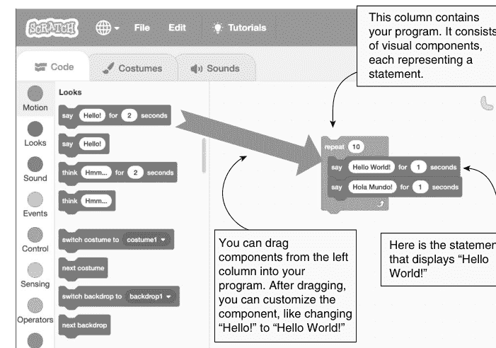

- **文字处理器：** 尽管可视化编程工具具有吸引力，但如果不是所有的程序语句，你最终可能还是得输入。对于这一点，可以使用文字处理器，但它会添加用于格式和效果的各种代码，这些代码可能会包含在你的高级代码中。
- **文本编辑器：** 像 Windows 记事本这样的文本编辑器产生纯 `ASCII`，但没有提供任何旨在帮助程序员的功能。使用通用的文本编辑器是一种极其原始的方法。有更好的编码工具。
- **代码编辑器：** 代码编辑器是一种专门为增强高级语言编程代码而设计的文本编辑器。它可以帮助你正确地缩进标点符号，并记住变量名并确保你使用的是有效代码。代码编辑器的一些方便功能在图 2-8 中突出显示。

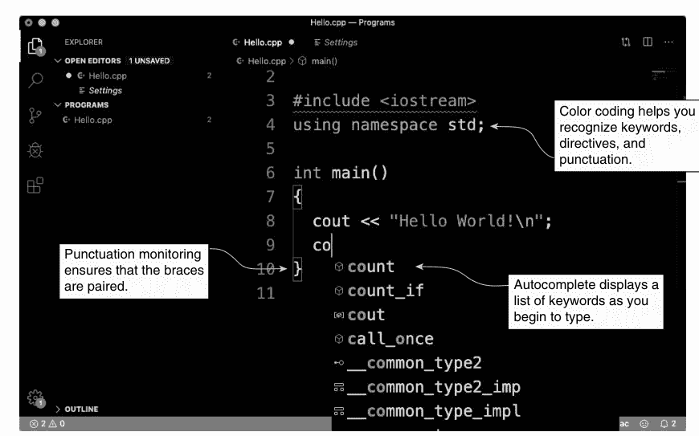

使用代码编辑器时，你只需输入你的命令。在移动时，请注意代码着色、自动补全以及编辑器可能提供的其他功能。

### 基础结构（2.2.4）

编程语言具有编写代码的语法和约定。当你熟悉了这些约定后，它们将成为你创建的程序的底层基础。在查看下方的列表之前，请识别下一个图中的约定。

- **注释：** 注释对你的代码提供了解释。在程序的开头，你可以包含一个带有程序标题和名称的注释。注释可以包含在代码的任何位置用于注释其他程序员可能不清楚的程序方面，或修改你的代码。忽略注释，因为它们仅用于文档说明。
- **指令：** 指令告诉编译器如何处理程序，而不是如何处理。例如，指令可能会指定要与程序其余部分合并的外部文件的名称。代码指令可能显示为 `#include`、`import` 或 `using`。
- **main():** 许多程序使用 `main()` 来表示程序执行的入口点。跟在 `()` 之后的代码行对应于你为某个问题或任务设计的第一个算法。
- **语句：** 正如人类可读的文本被分为句子和段落一样，你的代码也应该分为语句和块。程序语句类似于句子：它包含一条指令。在 `C++` 和 `Java` 等语言中，语句以分号结束。在 `Python` 中，你通过按 `Enter` 或 `Return` 键结束语句。
- **块：** 代码块类似于段落；它包含具有特定目的多个语句。在 `C++` 和 `Java` 中，你使用大括号（也称为花括号）来封装代码块。在 `Python` 中，块是缩进的。

看看图 2-9，看看你否能识别注释、指令、`main()` 函数、语句和代码块。

```cpp
//Hello World: in English and Spanish
#include <iostream>
using namespace std;
int main()
{
    for (int i = 1; i <= 10; i++)
    {
        cout << "Hello World!" << endl;
        cout << "Hola Mundo!" << endl;
    }
    return 0;
}
```

> 图 2-9 在此代码中寻找结构和语法约定

注释是 `//Hello World! in English and Spanish.`。有两个指令：`#include <iostream>` 和 `using namespace std.`。`main()` 函数标记为 `int main ()`。程序的每一行都是一个语句。`for..return` 语句是一个语句。两个 `cout` 语句在 `for..return` 块内部形成一个块。

## 2.3 构建工具

### 工具集（2.3.1）

你使用编辑器产生的高级代码无法直接由处理器执行。处理器需要机器代码。处理器具有基于机器码的指令集。例如，处理器指令集中没有 `print` 指令。

在程序运行之前，代码必须转换为机器语言指令。构建工具将你的代码转换为计算机可以执行的可执行文件。

作为程序员，构建工具帮助你打包代码。参见图 10。


### 编译器（2.3.2, 2.3.3）

编译器将一种语言翻译成另一种。原始代码被称为源代码，产生的是对象代码。参见图 11。

```cpp
#include <iostream>
using namespace std;
int main() {
    cout << "Hello World!";
    return 0;
}
```

| 源代码 | 对象代码 |
| :--- | :--- |
| `Hello.cpp` | `Hello.o` |

### 预处理器和链接器（2.3.4, 2.3.5）

从源代码到可执行程序的路径通常不会在一个神奇的步骤中完成。你的源代码可能会被预处理器分析并由链接器合并。

预处理器是一种在编译器工作之前执行清理任务的实用工具。丰富的程序员可以创造性地使用预处理器使源程序易于在各种平台上编译。

对于 `C++` 等语言，即使是基础程序也需要经常包含预处理器指令，如 `include<iostream>`。这些指令被预处理器执行后，就可以忽略它们。

链接器是将一个或多个对象文件连接成可执行文件的实用工具。链接发生在编译之后。源代码是链接的主文件，但你可以添加你创建的或从第三方提供的对象文件。当你看到关键字 `import` 时，它是外部文件需要链接的线索。


和链接并不在所有编程语言中都是一致的。你的收获是：

- 需要多个步骤才能将代码转换为包含可执行文件的文件。
- 你可能需要在代码中包含预处理器指令。

# 第 2 模块编程工具

预处理器执行指令，例如

```cpp
#include<iostream>
```

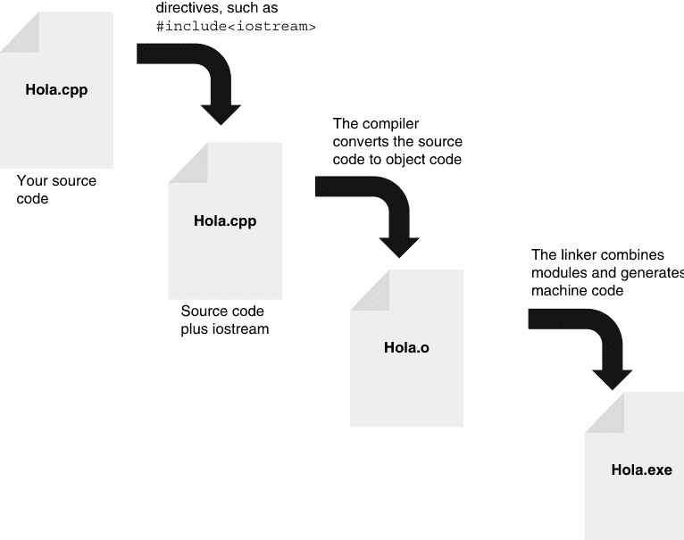

编译器将源代码转换为目标代码

链接器组合模块并生成机器码

### 虚拟机（2.3.6）

编译器的输出并不一定是机器码。某些编译器将源代码转换为称为字节码的半编译代码。虚拟机软件在程序执行时将字节码转换为机器码。

虚拟机有什么用？`Java` 虚拟机（`JVM`）提供了一些见解。其背景是：为运行 `Windows` 操作系统的计算机设计的可执行文件可以在运行 `macOS` 的计算机上运行。你可以为 `Microsoft Windows` 开发一个程序，为 `macOS` 开发另一个。或者，你使用 `Java` 语言创建一个版本的程序并将其编译为字节码。

你可以将相同的字节码分发给 `Windows` 和 `Mac` 用户。`Windows` 用户拥有 `Windows` 版 `JVM`，`Mac` 用户拥有另一个版本。虚拟机软件将字节码转换为适用于主机平台的代码。图 2-13 可以帮助你理解 `JVM` 的工作原理以及字节码的价值。

# Hello.java

你的代码

1. Java 编译器创建字节码

# Hello.class

Java 字节码

2. 字节码分发到多个平台

# 用于 macOS 的 Java 虚拟机

3. 每个平台的 JVM 将字节码转换为可执行内容

# 用于 Linux 的 Java 虚拟机

0100110101010

1010101011010

# 用于 Windows 的 Java 虚拟机

macOS

Linux

0100110101010

图 2-13 Java 虚拟机

### 解释器（2.3.7, 2.3.8）

还有另一种执行软件的工具。解释器是一种软件程序，它从程序中的第一条语句开始，将其预处理为二进制指令，然后执行它。程序中的每条语句都会逐一被解释并运行，如图 2-14 所示。

解释器的工作方式与编译器的活动形成鲜明对比，编译器在持有程序执行之前，会预处理并将程序的所有语句转换为二进制文件。

使用解释器编写程序非常方便，因为代码是一行一行执行的。如果发生错误，执行将停止，你可以轻松看到错误发生的位置。现代编程开发环境可能内置了解释代码、编译代码或两者兼顾的工具。

# 转换并执行语句 1

Hello.py

```python
print("Hello!")
print("Hola!")
```

翻译器

01101010101

一行目标代码

```
Hello!
```

你的源代码

# 转换并执行语句 2

Hello.py

```python
print("Hello!")
print("Hola!!")
```

翻译器

011010101010

一行目标代码

```
Hello!
Hola!
```

你的源代码

**图 2-14** 解释器一次将源代码转换为一条目标代码语句

> 对于你计划分发给其他用户的程序，你会想要编译它们吗？
>
> 对于分发软件，你应该将代码编译为字节码或可执行文件。分发必须经过解释的源代码会减慢用户速度，并使你的代码暴露在未经授权复制和破解的风险中。

## 2.4 调试工具

### 编程错误（2.4.1）

哎呀！你写了一个西班牙语版的 Hello World 程序，但当你尝试运行它时，你会看到类似图 2-15 所示的错误消息。

每个程序员都会编写编程错误，但别担心。你可以使用各种编程和调试工具快速跟踪并修复错误。

**调试**是为了寻找和纠正阻止软件正常运行的错误（或“bug”）的编程。今天一个流行的梗将“debug”一词的起源可以追溯到 1947 年，当时 `Grace Hopper` 通过移除一只飞蛾修复了一台发生故障的计算机。当你尝试 Plivia 时，可能会发生这种事实。

编程错误可以分为三类：语法错误、运行时错误和逻辑错误。了解这些类别中的常见错误可以帮助你快速在程序中发现并修复它们。

# 28 使用 C++ 编程

```cpp
clang version 7.0.3-ubuntu018.04.1 (tags/
RELEASE_700/final)

> clang++-7 -pthread -o main.cpp

main.cpp:4: warning: result of comparison against a
string literal is unspecified (use strcmp instead)
[-Wstring-compare]
cout << "Hola Mundo!\";
^^^^
```

图 2-15 错误消息显示了程序代码中的故障

### 语法错误（2.4.2）

当源代码语句不符合编程语言的标点和结构规则时，就会发生语法错误。要跟踪代码中语法错误的原因，请查找以下内容：

- 缺失关键字
- 拼写错误的关键字
- 位置错误的关键字
- 大写字母关键字
- 标点符号类型错误
- 未成对的引号或括号
- 缩进不正确
- 空块
- 嵌入字符
- 错误的方法参数
- 缺少返回类型

语法错误由编译器捕获，并生成错误消息。在图 2-16，你可以使用错误消息找到程序中的问题：


图 2-16 错误消息可以找到程序哪里错了

`"Hola!"` 的末尾缺少引号。

## 运行时错误 (2.3.3)

哇！你的程序崩溃了。它在没有任何语法错误的情况下通过了编译器，什么导致了它？运行时错误发生在你的程序代码由微处理器执行时出现问题。

如果你遇到运行时错误，请检查这些常见问题：

- 除零
- 使用不兼容的数据类型的表达式
- 使用前未声明变量
- 不存在的文件
- 内存不足

在图 2-17 中，注意计算机执行了程序的前两行但在执行包含除零的最后一行时崩溃了。


图 2-17 运行时错误可能在运行时才发现

当程序部分执行后意外停止，你可以确定是运行时错误。某些编译器可以扫描运行时错误，并在修复之前不允许程序运行。即使这些常见错误被编译器捕获，它们仍被归类为运行时错误。

### 语义错误 (2.4.4, 2.4.5)

记住程序语句的语义与其含义有关。当程序运行未崩溃但产生错误结果时，就会发生语义错误。语义错误也称为逻辑错误，因为算法可能基于错误的逻辑。

更常见的，语义错误可能由此类错误引起：

- 对决策使用错误的表达式
- 使用错误的变量名

## 使用 C++ 编程

- 忘记操作顺序
- 设置错误的循环计数器
- 将块缩进到错误的层级或括号位置错误

在图 2-18 中，你能发现这个逻辑错误吗？


图 2-18 这个程序哪里有问题？

`if` 语句是错误的。符号应该是 `>=`，这样程序在年龄大于等于 18 时才能工作。

## 调试工具 (2.4.6, 2.4.7)

编译器、链接器和解释器可以捕获一些编程错误。专用的调试工具供你使用。这些工具提供了非常棒的功能：断点和程序动画。

断点指定了程序应该暂停执行的代码行，以便你查看变量、寄存器和其他执行元素的内容。如果你发现了意外数据，断点可以帮助你识别错误源。

假设你写了一个应该输出三次“There’s no place like home”的程序。在图 2-19 中，你看到了程序及其输出，这并不是你预期的。只有两行输出，而不是三行。

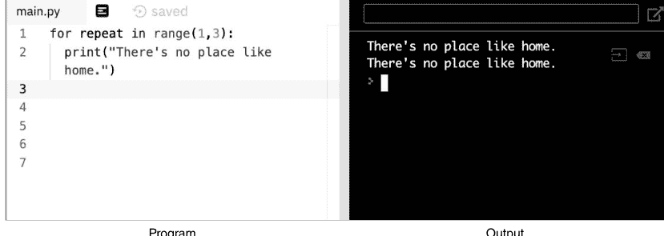

图 2-19 逻辑错误产生了错误结果

在包含“There’s no place home”的行之后设置断点，你可以检查变量 `repeat` 的内容。`repeat` 变量控制了“There’s no place home”输出的次数。在图 2-20 中，注意断点如何暂停执行，以便你能够在程序运行过程中看到 `repeat` 的值。

此程序包含一个用于调试的断点。

```python
main.py
1 for repeat in range(1,3):
2   breakpoint()
3 print("There's no place home.")
4
```

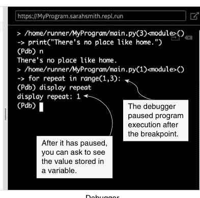

图 2-20 调试器可以设置断点

通过查看程序完成后 `repeat` 的值，你会发现它包含 2，这意味着“There’s no place home”只输出了两次，而不是三次。这种差异将你的注意力引向 `range(1,3)` 语句，该语句控制 `print` 语句重复的次数。它应该是 `range(0,3)` 或 `range(1,4)`，因为范围中的第一个数字是起始位置，而重复会在到达另一个数字之前停止。

调试工具还具有程序动画功能，允许你在执行程序的每行代码时观察变量和其他元素的状态。当你遇到令你困惑的错误时，这个功能非常有用。程序 2-21 产生了一个错误。调试器帮助你发现轨迹追踪的源头。

```python
main.py
1 import pdb
2 pdb.set_trace()
3 a = 1
4 b = a + 22 / -12
5 a = a / b
6 print(a)
```

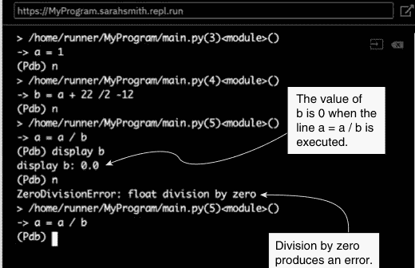

图 2-21 使用调试器的程序动画逐步查找错误

## 2.5 IDEs 和 SDKs

### 集成开发环境 (2.5.1, 2.5.2, 2.5.3, 2.5.4)

一些有经验的程序员喜欢创建一个自定义的开发环境，其中包含他们喜欢的编辑、编译和调试工具。对于你的编程初探，使用一个集成开发环境（IDE）会更简单，因为它包含了你编写代码、编译、链接和调试工作所需的所有工具。

许多 IDE 支持某种程度的编程，以便你可以在将变量拖放到程序语句中的同时定义程序元素。图 2-22 重点展示了 IDE 的一些关键特性。

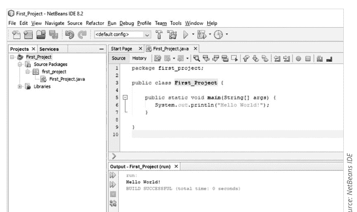

流行的 IDE 包括 Visual Studio、Xcode、Eclipse、Netbeans 和 PyCharm。要使用这些 IDE，你需要在计算机上下载并安装它们。如果你倾向于使用无需安装的在线 IDE（或 Web IDE），请查看如 replit、codewhere、ideone 和 AWS Cloud 等服务。

### 软件开发包 (2.5.5, 2.5.6, 2.5.7)

这里有一个主意：为 iPhone 编写一个程序，在拿起手机时显示“Hola!” 怎么样？当手机被拿起时，你的程序必须访问手机的加速度计。为了启动这个项目，你需要 iOS SDK。

软件开发包（SDK）是一套用于开发特定平台软件的工具。SDK 包含预编写的代码库、示例、文档和其他工具。这些工具被封装在一个集成开发环境中，该环境提供了编码、编译和调试工具。

iOS SDK 提供了一个 iPhone 模拟器，以便你可以在正在用作开发平台的计算机上测试你的应用。参见图 2-23。

SDK 是为 Windows、macOS、iOS、Android 及其他平台开发软件的程序员的必备工具。流行的 IDE 包括用于 Android 应用的 Java 开发、iOS SDK、Windows SDK 和 Facebook SDK。

## 总结

- C++、Java 和 Python 等编程语言被归类为高级编程语言，因为它们为你（程序员）提供了一种编写人类可读指令的方法，以指导计算设备的操作。
- 语义（Semantics）指的是程序语句的含义和有效性。关键字具有特定的语义目的，程序员必须学习如何正确使用它们。
- 语法（Syntax）定义了组合语句时所需的单词顺序和标点符号。每种编程语言都有独特的语法。
- 编程需要代码编辑器、编译器和调试工具。
- 代码编辑器帮助你正确输入语句，使用注释、指令、函数、语句和代码块的标准规范。
- 在程序运行之前，你的代码可以转换为机器码，并存储在可执行文件中。编译器、预处理器、链接器和解释器将你的代码转换为计算机可以执行的程序。
- 编译器将一种语言的源代码翻译成包含另一种语言代码的文件。
- 预处理器是在编译器开始工作之前执行清理工作的软件工具。链接器将一个或多个对象文件链接成二进制可执行文件。
- 某些编译器将源代码翻译成称为字节码（bytecode）的半编译代码。称为虚拟机的软件在执行之前将字节码转换为机器码。
- 解释器是一种软件工具，它从程序的第一条语句开始，将其预处理为二进制指令，然后执行它。
- 调试（Debugging）是通过程序日志来发现和纠正阻止软件正常运行的错误——“漏洞”（bugs）。调试可以发现运行时、语法和语义错误。在包含“There’s no place home”的行之后设置断点，你可以检查变量 `repeat` 的内容。`repeat` 变量控制了“There’s no place home”输出的次数。在图 2-20 中，注意断点如何暂停执行，以便你能够在程序运行过程中看到 `repeat` 的值。
- IDE 是一个集成开发环境，它提供了编码、编译和调试工具。
- 除 IDE 之外，软件开发包（SDK）提供了特定平台的工具。

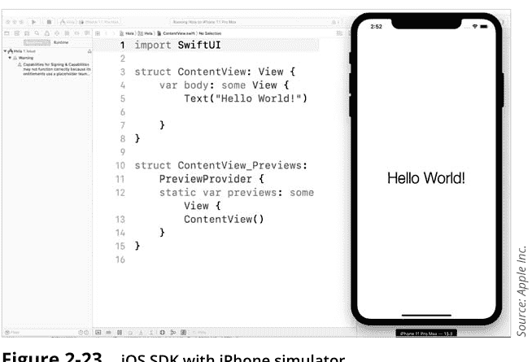

## 关键术语

- breakpoint (断点)
- build tools
- bytecode (字节码)
- code block (代码块)
- comment (注释)
- code editor
- compiler
- computer program
- debugging
- directive
- executable file
- high-level programming languages
- integrated development environment (IDE)
- interpreter
- Java Virtual Machine (JVM)
- keywords
- linker
- machine code
- object code
- online IDE
- preprocessor
- preprocessor directives
- program animation
- program code
- programming language
- reserved words
- runtime error
- semantic error
- semantics
- software development
- kit (SDK)
- source code
- statement
- syntax
- syntax error
- text editor
- virtual machine

## 3 模块：字面量、变量和常量

### 学习目标：

| 3.1 字面量 | 3.3 赋值语句 |
|---|---|
| 3.1.1 在编程背景下定义“字面量”（literal）。 | 3.3.1 区分未定义和定义的变量。 |
| 3.1.2 识别数字字面量。 | 3.3.2 识别声明变量语句。 |
| 3.1.3 提供整数字面量浮点字面量的示例。 | 3.3.3 识别初始化语句。 |
| 3.1.4 识别字符和字符串字面量。 | 3.3.4 解释动态和静态类型如何影响变量初始化。 |
| 3.1.5 提供数字的字符串字面量用例。 | 3.3.5 解释类型推断。 |
| 3.1.6 识别布尔字面量。 | 3.3.6 解释空变量（null）的概念。 |
| 3.2 变量和常量 | 3.3.7 识别改变变量值的语句。 |
| 3.2.1 列出变量的特征。 | 3.3.8 区分变量的声明、初始化和赋值。 |
| 3.2.2 使用适当规范创建描述性变量名。 | |
| 3.2.3 描述常量的作用。 | |
| 3.2.4 使用标准的常量命名规范。 | |
| 3.2.5 解释变量、常量和字面量之间的区别。 | |
| 3.2.6 解释变量与内存之间的关系。 | |
| | 3.4 输入与输出 |
| | 3.4.1 陈述从用户处收集输入并放入的算法。 |
| | 3.4.2 将用户输入转换为算法伪代码。 |
| | 3.4.3 追踪输出用户输入的变量值的伪代码。 |

## 3.1 字面量 (LITERALS)

### 数字字面量 (3.1.1, 3.1.2, 3.1.3)

天空之下，精灵王有三戒，

矮人领主在石殿中有七戒，

注定必死的凡人有九戒……

在 J.R.R. 托尔金的经典奇幻小说《霍比特》中，有十九枚戒指被赋予了魔力，并分配给了中世界的精灵、矮人和人类。这些戒指看起来可能像图 3-1 中的那些，它们可以帮助解释字面量的概念，字面量是编程中的基本元素。


图 3-1 天空之下，精灵王有三戒……

本质上编程是一项简单的活动：你将数据放入计算机内存，然后告诉计算机如何根据算法处理这些数据。

你为程序指定的任何数据元素都称为字面量。在中世界，精灵王有三枚戒指。你可以这样表示：

```
elven_rings = 3
```

在这个语句中，它是一个字面量。它是你指定的表示某个数量的值。字面量 3 始终意味着三个东西，绝不可能是四个。在语句中，它是一个固定值。但这一点很重要：`elven_rings` 不是固定的。如果丢失了一个戒指，`elven_rings` 就可以变成 2。

字面量 3 和 2 被归类数字字面量。**数字字面量**由一个或多个数字组成，可以表示整数或包含小数点的浮点数。

> 下列表中哪些是数字字面量？

```
dwarf_rings = 7
One
1
ring_thickness = 2.7
dark_lord = "Sauron"
```

数字字面量是 7、1 和 2。字面量 7 和 1 是整数，而 2.7 是浮点数。

好了，数字字面量可以分为整数和浮点数。图 3-2 展示了你在程序中可以使用各种数字字面量。

| 十进制字面量 | 浮点数字面量 |
|---|---|
| 75 | 75.3.196 |
| 3046 | 3046.00 |

| 十进制字面量 | 指数字面量 |
|---|---|
| 0x4b | 7.53e+1 |
| 0xC4 | 1.96e-1 |
| 0xBE6 | 3.05e+3 |

| 二进制字面量 |
|---|
| 1001011 |
| 110111100110 |

图 3-2 用数字字面量

Q 下述语句中的字面量是什么？

`elven_rings = 0b000000011`

A 字面量是 `0b00000011`，它是二进制整数 3。

### 字符和字符串字面量 (3.1.4)

除了数字数据外，你还会让程序处理字母、符号、单词和句子等数据。这些非数字字面量分为两种：字符和字符串。

- 字符字面量是单个字母或符号。程序员通常用双引号包裹字符字面量，例如这些示例：
  - `'a'`
  - `'@'`

字符串字面量包含一个或多个字符，通常用双引号表示，例如这些示例：

- `"Mordor"`
- `"Three rings for the elven kings..."`
- `"bilbo@theshire.com"`

Q 你如何分类 `"J.R.R. Tolkien"`？多一个字符。

A 它是一个字符串字面量，因为它包含了多个字符。

### 特殊字面量 (3.1.5, 3.1.6)

看起来像数字的字面量可能是字符串。202 可以是数值百的数字字面量，也可以是字符串字面量，例如华盛顿特区的区号。在不进行数学处理的语境中使用数字时，你可以通过用双引号将其将其指定为字符串字面量。

下述语句中的字符串字面量在哪里？

```
distance_to_mordor = 156
unlock_code = "156"
```

是的，解锁码 `"156"` 是字符串字面量。PIN 码、门牌号、社会号码、区号和邮编都是像数字的字符串字面量的示例。

布尔字面量是另一个惊喜。相比之下，布尔字面量的例子是 `True` 或 `False`。这些单词是否大写取决于你使用的编程语言。重点在于，如果后续的 `True` 和 `False` 看起来像字符串字面量，因为它们是布尔字面量，所以没有被单引号或双引号包裹。

布尔值在编程中有很多，例如将某个因素设置为 true：

```
bilbo_has_ring = True
```

这条语句意味着比博拥有一枚戒指。相比之下，整个示例 `bilbo_has_ring = "True"` 可能意味着比博所持有的戒指是 `"True"` 而不是“主戒”。

## 3.2 变量与常量

### 变量 (3.2.1, 3.2.2)

黑暗君主的王座上有一个

在末多之地，阴影笼罩。

魔术士萨隆在末多之火处有一枚强大的戒指，直到他在战斗中战败。戒指传给了一个名叫伊西罗斯的战士，他在游过安都因河时失去了它。长期以来，戒指的位置是未知的。萨隆希望它出现在计算机的某个未知位置。如果你使用字面量，你必须将它们放在已知位置，以便程序语句访问。变量和常量提供了这些位置。在编程语境下，变量是一个命名的内存位置，临时存储文本或数值。请参见图 3-3。


图 3-3 变量是一个命名的内存位置

变量有三个特征：

- 变量有一个名称。
- 变量对应于可以存储数据的内存位置。
- 变量中的数据是可以更改的。

### 常量 (3.2.3, 3.2.4, 3.2)

常量是一个命名的内存位置，其存储的数据被程序使用但不会被更改。参见图 3-5。


图 3-5 常量是一个命名的内存位置

常量的三个特征是：

- 常量有一个名称。
- 常量对应于可以存储数据的内存位置。
- 常量的数据是不打算更改的。

常量有时字面量混淆，因为两者都可以被描述为“固定”。你的结论是字面量是一个数据元素，而常量是一个位置。

与变量一样，常量命名应该具有描述性。为了区分常量和变量，C++、Java 和 Python 的习惯是使用全大写并用下划线分隔单词。是一些示例：

```
MINUTES_IN_HOUR = 60
MAXIMUM_USERS = 1024
OHIO_ABBREVIATION = "OH"
_trip = 238900 * 2
travel_time = 238900/speed
```

你可能会疑惑为什么使用常量而不是直接在计算或过程中使用实际值。假设一个 NASA 程序员在以下 20 个多月月份中使用 238,900 英里作为地球的距离：

后来程序员发现距离是用公里表示的，否则月球探测器将错过降落点。聪明的程序员会使用常量来设置公式：

```
DISTANCE_EARTH_MOON = 238900
round_trip = DISTANCE_EARTH_MOON * 2
travel_time = DISTANCE_EARTH_MOON / speed
```

将距离更改为公里只需要更改一行，而不是所有的公式。

### 内存连接 (3.2.6)


变量和常量对应于可以存储数据的内存位置。每个内存位置都有一个唯一的地址，用二进制数或缩进的十六进制数表示，例如`0xE2452440`。坦率地说，你可以直接将数据放入内存位置，而无需处理这些地址。

**图 3-6** 显示了当你为变量或常量指定名称时，你的编程语言会将其绑定到一个内存位置，你可以在该位置存放数据。

| 变量名 | `rings_made_in_mordor` | `MINUTES_IN_HOUR` | 常量名 |
| --- | --- | --- | --- |
| | 1 | 60 | `0xE2452440` | `0xE2452444` |

**图 3-6** 变量名对应内存位置

## 3.3 赋值语句

### 变量声明 (3.3.1, 3.3.2)

索伦铸造的至尊戒刻有一段铭文，只有当戒指放入火中时才可见：

- 戒戒戒主，
- 戒戒寻戒，
- 戒戒聚戒，
- 黑暗中，统统支配。

正如至尊戒的设计是为了建立一种控制那十九枚戒指的绑定关系，程序员可以通过将变量名称绑定到内存位置来定义变量。使用*未定义的变量*会产生运行时错误，因此定义程序中使用的变量是至关重要的。

变量可以被声明、初始化和赋值。根据你使用的编程语言和算法，这些操作中的每一步可能都需要一个独立的步骤，或者将合并。

声明变量意味着指定一个被分配（或绑定）到内存位置的名称。大多数编程语言要求你指定该变量将持有整数、浮点数、布尔值、字符还是字符串。

**图 3-7** 显示了如何在伪代码和编程语言中声明变量。

| 伪代码 | |
|---|-|
| | `declare total_rings as integer` <br> `declare first_letter as character` |
| 编程语言 | `int total_rings;` <br> `char first_letter;` |

**图 3-7** 声明变量

如果你没有数据要放入变量，为什么要声明变量呢？

有几个原因。

- 你可能在用户输入值之前并不知道变量的值。
- 你可能需要一个变量来在计算完成后持有该计算的结果。
- 你可能正在指定描述对象属性的实例变量，例如`ring_size`，在创建特定实例之前，它的值是未知的。

### 变量初始化 (3.3.3, 3.3.4, 3.3.5, 3.3.6)

初始化变量意味着指定一个名称和一个值。在伪代码中，你可以指定如下的初始化语句：

```
initialize total_rings = 20
```

这条初始化语句创建了一个名为`total_rings`的变量，并将其值设置为 20。在伪代码中，使用`initialize`这个词很方便，但在 C++、Java 或 Python 等编程语言中编写初始化语句时并不是必须。

与声明变量一样，某些语言要求初始化语句来指定放入变量的数据类型。**图 3-8** 显示了在伪代码和三种流行编程语言中初始化变量的简单语法。

| 伪代码 | |
|---|-|
| `initialize total_rings = 20 as integer` <br> `initialize first_letter = 'A' as character` |
| C++ | `int total_rings = 20;` <br> `char first_letter = 'A';` |
| Java | `int total_rings = 20;` <br> `char first_letter = 'A';` |
| Python | `total_rings = 20` <br> `first_letter = 'A'` |

**图 3-8** 初始化变量

你注意到 Python 初始化变量的语法有何不同之处吗？

Python 不指定数据类型。初始化语句中不包含`int`或`char`。

# 模块 3 字面量、变量和常量

Python 是一种动态类型编程语言，允许变量在执行期间采用任何类型的数据。该语言根据小数点和引号的存在与否推断类型。这种方法被称为类型推断。例如，在动态类型语言中，以下代码是完全允许的。

```
total_rings = 19
total_rings = 20
total_rings = "unknown"
```

通过动态类型，你可以将`total_rings`初始化为 19（这是一个数字）。然后你可以将其值更改为 20，再更改为字符串。

C++ 和 Java 等语言是静态类型语言。在你指定变量的数据类型后，它就不能持有其他类型的数据。在以下代码中，允许将`total_rings`初始化为值为 19 的整数。然后你可以将其更改为 20，再更改为字符串。（注：此处为原文逻辑误，翻译保持原文）。

## 3.4 输入与输出

### 输入 (3.4.1, 3.4.2)

一个名叫格鲁姆的生物住在迷雾山下阴冷的洞穴和隧道中。他的珍宝是一个魔法戒指。有一天，戒指掉在了地上。在格鲁姆发现戒指丢失之前，一个叫比尔博·巴金的霍比特正在爬过黑暗的隧道，他伸出手，找到了戒指并把它塞进了口袋。

# 第 3 模块 字面量、变量与常量 45

将“环”（Ring）想象成来自外部世界的数据对象。作为一名程序员，你可以从外部源收集数据并将其放入变量中。这是获取你的程序设计用于处理的部分或全部数据的一种方便方法。从用户处收集数据的算法如下：

- 初始化一个变量来存储用户的输入。
- 提示用户输入数据。
- 在初始化的变量中收集数据。

要从用户处获取数据，你通常需要提供一个提示（prompt），用来解释你想让用户输入什么。例如，如果你的程序正在为某个问答游戏收集答案，其中一个提示可能是：“在魔戒，矮人领主们得到了多少枚戒指？”

使用该提示，以下是初始化变量、显示提示并然后从用户处收集答案的伪代码：

```
initialize dwarf_rings = 0
display "In Middle Earth, how many rings were given to the dwarf lords?"
input dwarf_rings
```

当你编写代码并运行此程序时，问答玩家将看到类似图 3-10 所示的内容：


```
initialize dwarf_rings = 0
display "In Middle Earth, how many rings were given to the dwarf lords?"
input dwarf_rings
```

图 3-10 用用户输入的数据加载变量

在图 3-10 中，这行代码初始化了变量`dwarf_rings`。哪一行将用户的输入置于该变量中？

`initialize dwarf_rings = 0`这一行初始化了变量。`input dwarf_rings`这一行将用户的输入放入变量。

## 使用 C++ 编程

### 变量的输出 (3.4.3)

假设问答玩家通过输入 5 来回答关于矮人戒指的问题。这并不是正确答案。你可以追问 5 是否为最终答案。以下是伪代码：

```
initialize dwarf_rings = 0
display "In Middle Earth, how many rings were given to the dwarf lords? "
input dwarf_rings
display "Is " dwarf_rings " your final answer?"
```

看图 3-11 中的程序。最后一行中的 5 是从哪里来的？


```
initialize dwarf_rings = 0
display "In Middle Earth, how many rings were given to the Dwarf lords?"
input dwarf_rings
display "Is "dwarf_rings" your final answer?"
```

图 3-11 显示变量的值

变量`dwarf_rings`包含值 5，因此显示行中变量的值也是 5。

当数组输出到显示器或打印机时，输出的是变量的值，而不是变量名。

# 总结

- 你为程序指定的任何数据元素被称为字面量（literal）。字面量有几种类型，例如整数、浮点数、字符、字符串和布尔。
- 当像内存位置的字面量不打算用于计算时，有时会被视为字符串。电话号码、PIN 码、房子、社会安全号码、区号和邮政编码都是像数字的字符串字面量的示例。
- 变量是一个命名的内存位置，用于临时存储数据。
- 变量名应该是具有描述性的，但不能是编程语言中用于特殊目的单词。变量名通常采用驼峰命名法（camel case）或蛇形命名法（snake case）格式化。
- 常量是一个命名的内存位置，用于存储不被程序语句更改的数据。
- 变量和常量对应于可以存储数据的内存位置。

# 第 4 模块 数值类型与表达式

| 类型 | 关键字 | 描述 | 示例 |
|---|---|---|---|
| 字符 | `char` | 单个字母、符号或数字 | `'a'` |
| 整数 | `int` | 不带任何小数的数字 | `1` `128` `3056` `-2` |
| 浮点 | `float` | 包含小数的数字 | `12.99` |
| 双精度 | `double` | 包含小数的极大数值 | `3.841709480789627` |
| 布尔 | `bool` | 真 (`True`) 或假 (`False`) 的逻辑值 | `True` `False` |
| 无值 | `void` | 无值 | |
| 宽字符 | `wchar_t` | 需要超过 8 位的 Unicode 字符 | `€` `©` `V` |

图 4-2 原始数据类型

整数 23 是一种原始数据类型，你的编程语言知道为它分配多少内存空间。

你的编程语言还知道如何操作原始数据类型。对于像 23 这样的数字，你的语言可以执行加法、减法和其他数学运算。

编程语言提供了处理数据的函数。函数是一个执行特定任务的命名过程。例如，`abs()`函数返回整数的绝对值（无符号值）。

# 原始数据类型的两个关键特征是什么？


这些关键特征如下：

- 1. 编程语言知道需要分配多少内存。
- 2. 编程语言知道如何操作该类型的数据。

原始数据类型的学习要点是，你可以告诉编程语言对这些数据做什么，但你不需要解释如何去做。你并不需要知道存储或相加两个数字的底层机制；你只需要指定想要相加的变量或值即可。

## 复合数据类型（4.1.4）

复合数据类型不是内置在你的编程语言中的，但可以由原始数据类型构建。复合数据类型在程序代码的附加库中定义或可用。在大多数编程语言中，代表时间的数据会被处理为复合数据类型。

《哈密尔顿》（Hamilton）原声带中的第一首歌时长为 3:56 分。这个值既不是整数、浮点数或其他数据类型。要在程序中使用此值，你需要创建一个复合数据类型并编写用于操作它的例程。

当你继续学习函数和数据结构时，将发现更多关于复合数据的知识。对于偶数和浮点数，你仍然将依赖原始数据类型。

## 4.2 数值类型

### 整数数据类型（4.2.1、4.2.2、4.2.3、4.2.4）

整数被归类为整数数据类型。整数数据类型具有以下特征：

- 必须是不带小数或分数的数字。
- 可以是正数或负数。没有正负号的整数被称为无符号整数，假设为正数。以正负号开头的整数是有符号整数。
- 可以是十进制、二进制或十六进制数。

**图 4-3** 包含了你可能整合到计算机程序中的符号和无符号整数数据示例。

| 整数数据 | 符号 | 描述 |
|---|---|---|
| 23 | 无符号 | 歌曲数量 |
| +363 | 有符号 | 评论者数量 |
| 1460000 | 无符号 | 《哈密尔顿》专辑销量 |
| 77223343444 | 无符号 | 世界人口 |
| ~40 | 有符号 | 堪萨斯州记录的最低温度 |
| 0b00000101 | 无符号 | 二进制 5 |
| 0xC6 | 无符号 | 十六进制 108 |

**图 4-3** 整数数据类型

在静态类型语言（如 C++ 或 Java）中，整数被指定为特定的类型。

## 第 4 节 数值类型与表达式 55

从图 4-7 的示例中，你能得出算术运算符只适用于字面量吗？

不是的。你可以看到算术操作可以处理变量（如 `tax_rate`），也可以处理字面量（如 `2.99`）。

算术操作通常如你预期那样工作，但请注意这些重要的要点：

- **整数除法。** 当整数除法产生小数时，该部分可能不会包含在结果中。例如，`7 / 2 = 3.5`，但取决于你使用的编程语言，结果可能是 `3`。
- **取模除法。** `%` 运算符产生除法的余数。11 除以 3 的结果是 3，余数为 2。因此，`11 % 3` 的结果是 2。

`6 % 2` 的结果是什么？

结果是 0，因为 6 除以 2 等于 3，没有余数。余数为 0。所以，`6 % 2 = 0`。

你可以在算法中使用取模运算符来判断一个数是奇数还是偶数。以下是伪代码。

```
initialize my_number = 6
if my_number % 2 is 0 then
    output "The number is even."
else output "The number is odd."
```

该算法之所以有效，是因为偶数可以被 2 整除且余数为 0。当 `my_number % 2 = 0` 时，`my_number` 是偶数。在图 4-8 中，你可以看到该算法在实际代码中的工作原理。

```cpp
#include <iostream>
using namespace std;
int main() {
    int my_number = 6;
    if (my_number % 2 == 0) {
        cout << "The number is even.";
    } else {
        cout << "The number is odd.";
    }
    OUTPUT:
The number is even.
}
```


Copyright2022 Cengage Learning. 版权所有。未经许可，不得复制、保存、分发全部或部分。在电子形式中，可能会来自电子书或作者的第三方内容。编辑审查认为，任何删除的内容不会对相关的学习体验产生实质性影响。Cengage Learning 保留随时需要提供额外内容的权利。

## 运算符顺序（4.3.3、4.3.4）

`2 + 3 * (5 + 1)` 的解是什么？如果你回答的是 20，说明你完全掌握了运算符顺序，它规定了执行算术操作的顺序。以下是该顺序：

1. 先进行括号内的数学运算。
2. 执行幂运算和根运算。
3. 从左到右执行乘法、除法和取模除法。
4. 从左到右执行加法和减法。

要解 `2 + 3 * (5 + 1)`，首先计算 `5 + 1`，因为它们在括号内。现在你得到 `2 + 3 * 6`。接下来是乘法，表达式变为 `2 + 18`。最后，遵循运算符顺序，结果为 20。

明白了吗？让我们来看看。`2 + 3 % 2 * (4 + 1)` 的结果是什么？

结果是 7。首先计算 `4 + 1`，因为它们在括号内。接下来是取模除法 `3 % 2`，得到余数 1。然后将 `1 * 5` 并将结果加到 2。

括号是改变运算符顺序的关键。这是一个简单的例子：`3 + 2 * 5 = 13`，是因为运算符顺序规定乘法先于加法。

但假设你想在乘以 5 之前先加 3+2。只需给该操作加上括号：`(3 + 2) * 5`。现在结果是 25！图 9 显示了这两种表达式及其结果。

```cpp
#include <iostream>
using namespace std;
int main() {
    int without_parentheses = 3 + 2 * 5;
    int with_parentheses = (3 + 2) * 5;

    cout << "Without parentheses: " << without_parentheses << endl;
    cout << "With parentheses: " << with_parentheses << endl;
}

OUTPUT:
Without parentheses: 13
With parentheses: 25
```

## 复合运算符（4.3.5）

大多数编程语言都提供一组复合运算符，为某些算术操作提供快捷方法。程序员经常通过增加计数器的值来跟踪计数。图 10 显示了这一点。

## 第 4 节 数值类型与表达式

```cpp
#include <iostream>
using namespace std;
int main()
{
    int counter = 1;
    counter = counter + 1;
    cout << counter;
}
OUTPUT:
2
```

**图 10** 增加计数器

变量 `counter` 的初始值为 1。计算将其增加了 1，使其值变为 2。`+=` 运算符在图 11 中了相同的操作。

```cpp
#include <iostream>
using namespace std;
int main()
{
    int counter = 1;
    counter += 1;
    cout << counter;
}
OUTPUT:
2
```

**图 11** 使用复合运算符

**图 12** 提供了常用复合运算符的示例。

| 复合运算符 | 示例 | 结果 |
|---|---|---|
| `+=` | `compute counter += 1` | 2 |
| `-=` | `compute counter -= 1` | 0 |
| `*=` | `compute counter *= 2` | 2 |
| `/=` | `compute counter /= 2` | 0 |
| `%=` | `compute counter %= 2` | 1 |

**图 12** 复合运算符

## 4.4 数值转换

### 整数与浮点数（4.4.1、4.4.2）

数学表达式包含不同的数据类型，例如整数和浮点数。这是一个计算购买专辑价格的简单示例：

```
initialize number_of_albums = 2
compute total_price = 19.99
```

`total_price` 是一个浮点数。某些编程语言能够很好地处理这种情况。转换会自动决定计算时使用哪种数据类型。对于表达式 `19.99 / 2`，你的编程语言可能会使用转换将整数作为浮点数处理。转换不会改变变量 `number_of_albums` 的数据类型。该变量仍然持有整数。

依赖转换并不一定是最佳实践，特别是当你没有通过一系列计算跟踪它的影响时。你可以手动将值转换为不同的数据类型，这个过程有时被称为“类型转换”（casting）。

假设你从数千名音乐粉丝那里收集了评分。2360 名客户的总分为 10456.2。要找到平均评分，你可以使用如下语句：

```
compute average_rating = 10456.2 / 2360
```

存储在 `average_rating` 中的结果是 4.4282，但如果你想转换为整数，可以使用 `int()` 函数。查看图 14-13 中的 `int()` 函数，了解它是如何将浮点型的 `average_rating` 转换为 `rounded_average` 的。

```cpp
#include <iostream>
using namespace std;
int main() {
    int customers = 2360;
    float sum_of_ratings = 10456.2;
    float average_rating = sum_of_ratings / customers;
    int rounded_average = int(average_rating);
    cout << "Average: " << average_rating << endl;
    cout << "Rounded average: " << rounded_average << endl;

    OUTPUT:
    Average: 4.4282
    Rounded average: 4
}
```

**图 14-13** 将浮点数转换为整数

使用 `int()` 函数将 `average_rating` 转换为整数并将 4 存储在 `rounded_average` 中。但请注意，转换丢失了信息。小数点右侧的小数部分没有存储在 `rounded_average`。

### 舍入特性（4.4.3）

编程语言在处理数值数据时有一些特性。这里有一个脑筋谜题：

表达式 `1 / 2` 的结果是什么？如果计算机产生的结果是 0，你会感到很惊讶的。图 14 解释了你的编程语言如何处理这种情况。

```cpp
C++ 产生的 1 / 2 结果为 0，即使结果被赋值给 float 数据类型。
原因是 1 和 2 是整数，它们不包含小数点。

#include <iostream>
using namespace std;
int main() {

    float solution = 1 / 2;

    cout << solution;
}
OUTPUT:
0
```

为了得到预期的结果，你可以为一个或多个数字加上小数点，这会强制 C++ 产生浮点结果。

```cpp
#include <iostream>
using namespace std;
int main() {

    float solution = 1.0 / 2.0;

    cout << solution;
}
OUTPUT:
0.5
```

**图 14** 浮点特性

这里是另一个异常。你预期表达式 `.1 + .2` 的结果是什么？如果计算机产生的结果是 0.3000000119 或 0.3000000000000004，你会惊讶吗？图 15 揭示了这个奇怪的结果。

`.1 + .2` 的结果应该是 `.3`，这些这些数字是从哪里来的？这些源于计算机依赖二进制数的一个特性。浮点的二进制表示是一种近似值，因为二进制数无法产生这些小数。

使用 `#include <iomanip>` 和 `setprecision()` 函数可以以 10 位小数显示变量的内容。

```cpp
#include <iomanip>
#include <iostream>
using namespace std;
int main()
{
    float solution = .1 + .2;
    cout << "What's displayed: " << solution << endl;
    cout << "What's in the variable: " << setprecision(10) << solution << endl;
}
```

输出：

```text
What's displayed: 0.3

What's in the variable: 0.3000000119
```

**图 4-15** 浮点数的数的特性

在处理具有许多小数位的数字时，当你可能需要使用数学函数来截断或舍入数字时，这种方法特别别有用。像 C++、Java 和 Python 这样的现代高级语言拥有功能丰富的数学库，包括数字的舍入。

## 4.5 输出格式化

### 格式化输出（4.5.1）

将浮点数据转换为整数的危险在于可能会丢失重要数据。当你想要消除显示数据中的尾随零或小数位时，你可以指定输出格式，而不改变变量中的实际数据。

当你输出变量时，它们保留了自己的原始值，但你指定了显示多少或这些信息。变量 `average` 的值为 4.43050。

- 4.43050
- 4.4
- 4.43050E
- 004.43100

### 格式化参数（4.5.2、4.5.3）

每种编程语言都有独特的输出格式语法。无论语法如何，你都可以使用格式化参数控制以下元素：

**宽度（Width）。** 分配给输出的空间数。该元素在对齐数字列时特别有用。

**填充（Fill）。** 使用空格或零。

## 第 4 模块 数值数据类型和表达式

**对齐。** 在指定的宽度内左对齐或右对齐。

**小数点显示。** 是否存在小数点。

**精度（Precision）。** 小数点后显示的位数。

**类型（Type）。** 整数、浮点数、十进制、二进制、十六进制、字符或 E 计数法。

**符号（Sign）。** 是否包含 `+` 或 `–` 符号。

图 4-16 展示了如何使用这些格式化参数来改变 4.43050 输出时的外观。

| 原始值 | 格式化参数 |
|---|---|
| 4.43050 | Precision = 3，显示三位小数。 |
| 4.431 | Width = 9，填充宽度为 9，在数字前留出四个空格。 |
| --- 4.431 | Fill = '>'，使用指定的字符填充空格。 |

**图 4-16** 使用格式化参数

图 4-17 中的程序说明了你如何使用格式化参数来改变数值输出的外观。

`iomanip` 和 `cmath` 库提供了用于格式化输出的方便数学函数。将这些库包含在头文件中允许你在这程序中使用它们的函数。

```cpp
#include <iostream>
#include <iomanip>
#include <cmath>

using namespace std;
int main()
{
    float average = 4.43050;
    cout << "Original: " << average << endl;
    cout << "Three decimal places: " << setprecision(4) << average << endl;
    cout << "Width of 9: " << setw(9) << average << endl;
    cout << "Pad with a character: " << setw(9) << setfill('>') << average << endl;
}
```

输出：

```text
Original: 4.4305

Three decimal places: 4.431

Width of 9: 4.431

Pad with a character: >>>4.431
```

**图 4-17** 数值输出格式化

## C++ 编程

这里有一个实际注意事项：如果你的程序输出了格式化后的值，但在后续计算中继续使用更精确的值，用户可能会在数据中看到明显的差异。

## 总结

- 数据类型指的是分类数据的方法。基本数据类型是内置在你的编程语言中的。复合数据类型由程序员定义，可在函数中使用或由方法提供。
- 整数被归类为整数数据类型。它们是有符号或无符号的、十进制、二进制或十六进制的。
- 整数通常存储在 4 字节的数据中，长整数存储在 8 字节中并可以取更大的值。
- 带有小数位的数字被归类为浮点数据类型。浮点数可以用十进制法或 E 计数法（类似于科学计数法）表示正负数。
- 单精度浮点数可以存储在 4 字节内存中。双精度数通常存储在 8 字节中。
- 整数和浮点数可以在表达式中使用，并配合算术运算符（如 `+`、`*`、`/` 和 `%`）。这些运算符按照运算优先级顺序进行处理。
- 程序员需要注意数据类型，因为在单个表达式中混合使用有时会产生意外的结果。

## 关键术语

算术运算符

强制转换（coercion）

复合数据类型

数据类型

双精度

表达式

浮点类型

格式化参数

函数

整数数据类型

有符号整数

单精度

类型转换

无符号整数

**图 4-15** 浮点数的特性（注：decimal quirks 已从 quirs 修正）

## 第 5 模块

## 字符和字符串类型

### 学习目标

| 5.1 字符类型 | 5.3 字符串 |
|---|---|
| 5.1.1 解释字符如何组成字符串。 | 5.3.1 列出用于处理字符串的常用函数。 |


### 5.1 字符类型

#### 处理字符数据 (5.1.1, 5.1.2, 5.1.3)

“字母汤 (Alphabet soup)”。这个词可以指浮在咸汤中的字母形状面面（**图 5-1**），也可以指一系列缩写词，如 JPA、CCC、CWA、FHA 和 PWA，这些是罗斯福总统在 20 世纪 30 年代创建的政府机构。让我们程序员如何处理数据的字母汤：字母、单词、句子和文档。

**图 5-1** 字母汤（注：原文缺少标题）

字符数据类型是存储单个字母、符号或 0 到 9 数字的变量的分类。它是一种基本数据类型，你可以将其赋值给任何持有单个字符的变量。你可能会在一个询问中间首字母的程序中使用字符数据类型，或者在为幼儿设计字母程序时使用。

当你初始化或将字符字面量赋值给变量时，惯例是用单引号围绕字面量。

```cpp
initialize first_letter = 'a'
```

当字面量被存储时，引号会被去掉，在输出字符时也不会包含引号。**图 5-2**，程序不带引号地输出 `first_letter` 的内容。

一个标准的初始化语句会创建一个包含字符数据的变量，如图 5-3 所示。

```
语法：
char variable_name = 'x' 其中 x 是一个单字符。

示例：
char first_letter = 'a';
```

可以使用 `cout` 输出字符数据。在输出流中包含 `endl` 可以完成输出并将光标移动到下一行。由于变量本身不存储单引号，因此它们不会在输出流中显示。

```cpp
#include <iostream>
using namespace std;
int main() {
    char first_letter = 'a';
    cout << first_letter << endl;
}
```

```
输出:
a
```

**图 5-3** 字符分配 (5.1.4)

### 字符内存分配

字符数据以 ASCII 格式存储。ASCII（美国标准信息交换代码）是一种编码方法，它为每个字符分配一个唯一的 8 位序列。例如，字母 `'a'` 由 8 位 ASCII 码 `01100001` 表示，这恰好是十进制的 97。记住这一点，以备后用！

你计算机键盘上的所有大写字母、小写字母、数字和符号都有唯一的 ASCII 值。这些常用字符可以存储在 1 字节内存中。参见**图 5-4**。

#### 使用 C++ 编程

键盘上的每个大写字母、小写字母、数字和符号都有 8 位 ASCII 表示。

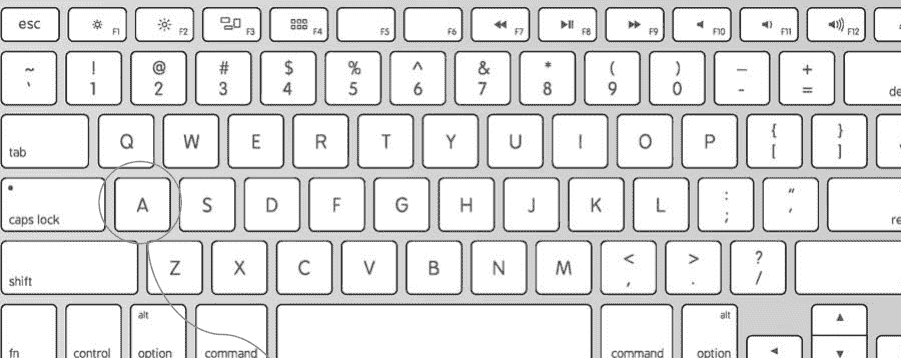

大写字母 A 以 8 位 ASCII 码 `01000001` 存储。

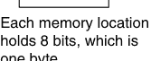

#### 数字 (5.1.5)

环绕字符字面量的单引号非常重要，尤其是当你处理数字 0 到 9 时。如果没有周围标点符号，2 是一个你可以在计算中使用的整数。有了周围标点符号，`'2'` 仅仅是一个波浪形的数字，它并不具有“二”的值。

> 你认为以下 Digits 程序的输出是什么？

```cpp
initialize first_digit = '2'
initialize second_digit = '5'
display first_digit + second_digit
```

你回答的是 25 吗？**图 5-5** 展示了作为字符使用的数字与作为整数使用的数字之间的区别。

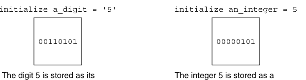

**图 5-5** 数字以字符形式存储，但数字以二进制形式存储

尝试相加数据类型可以产生的数字可能会产生意料之外的结果，这取决于你的编程语言。只需记住，计算的数据应该分配数值数据类型，而不是字符数据类型。

### 字符输出格式 (5.1.6)

在 Digits 程序中，输出看起来像值 25，但输出的实际上是数字 2 和数字 5。

为了清晰起见，你可以通过在输出语句中包含一个空白字符，在数字之间插入空格，如**图 5-6** 程序中的最后一行所示。

```cpp
#include <iostream>
using namespace std;
int main()
{
    char first_digit = '2';
    char second_digit = '5';
    cout << first_digit << ' ' << second_digit << endl;

输出:
2 5
}
```

**图 5-6** 在输出流中插入空格

另一个选项是在每行单独输出每个数字，如**图 5-7** 所示。

在变量之间的输出流中包含 `endl` 会将第二个数字放在新行。

```cpp
#include <iostream>
using namespace std;
int main()
{
    char first_digit = '2';
    char second_digit = '5';
    cout << first_digit << endl << second_digit << endl;

输出:
2
5
}
```

**图 5-7** 输出到单独行

#### 字符操作 (5.1.7)

编程语言提供了用于处理字符数据的内置工具。取决于你的编程语言，这些工具被称为函数或方法。

一个常用的函数可以将字符从大写更改为小写。一个类似的函数可以将小写更改为大写。你可能可以使用大写函数来确保一个人的中间首字母存储为大写字母。参见图 5-8。

> `toupper()` 函数产生字符的大写版本。如果没有大写版本（例如 # 号），则字符将保持不变。该函数的语法为：

`variable_name = toupper(variable_name);`

在接下来的程序中，使用 `cin >>` 从键盘收集输入并将其置于名为 `initial` 的变量中。注意，大写字符替换了小写字符

```cpp
#include <iostream>
using namespace std;
int main()
{
    char initial;

    cout << "Enter initial: ";
    cin >> initial;

    initial = toupper(initial);

    cout << initial;
}
输出
输出:
nEnter initial: b [Enter]
B
```

图 5-8 更改字符的大小

你还记得 `'a'` 的 ASCII 值是 97 吗？有一个函数可以显示任何字符的 ASCII 值。你将在图中找到该函数和其他实用函数的语法。

### 字符与字符串数据类型

| 字符函数/方法 | 示例 | 数据 |
|---|---|---|
| 检查字符是否为字母 | `isalpha(initial)` `isalpha(choice)` | `initial = 'a'` | True |
| 检查字符是否为数字 | `isdigit(initial)` `isdigit(choice)` | `initial = '2'` | False |
| 更改为大写 | `toupper(initial)` | `initial = 'a'` | A |
| 更改为小写 | `tolower(initial)` | `initial = 'A'` | a |
| 显示指定字符的 ASCII 值 | `char(num)` | `num = 97` | a |
| 显示字符的 ASCII 值 | `int(initial)` | `initial = 'a'` | 97 |

**图 5-9** 字符函数

### 字符串数据类型

#### 处理字符串数据 (5.2.1, 5.2.2)

字母数字序列被分类为字符串。你可以使用字符串类型处理单词、短语和文本。

在编程语言中，字符串是原始数据类型，但在其他语言中，它们是复合数据类型。每种语言都提供了多种处理字符串的工具。

字符串字面量通常包含在引号内。图 5-10 中的伪代码使用了多种字符串的方法。

```text
initialize string_name = ""
```

```text
initialize string_message = "likes alphabet soup."

display "What is your name?"

input string_name

display string_name message
```

**图 5-10** 字符串可以初始化、输入和显示

要处理字符串，在程序开头使用 `#include <string>` 头。你还可以使用 `getline()` 函数收集输入，直到按下 Enter 键。
`getline(cin, string_name)` 从键盘收集输入，并存储在变量 `string_name` 中。

```cpp
#include <iostream>
#include <string>
using namespace std;

int main()
{
    string string_name;
    string message = " likes alphabet soup.";

    cout << "What's your name? ";
    getline(cin, string_name);

    cout << string_name << message << endl;
}
```

输出:
```
What is your name? Skylar Jones [Enter]
Skylar Jones likes alphabet soup.
```

**图 5-11** Alphabet Soup 程序代码

#### 转义字符 (5.2.4)

用引号包含字符串的问题在于，它们也被用作真实世界数据（如诗歌标题、引用和特殊用途单词）中的标点符号。这里是一些例子：

- Philip Parker 写了《字母表》。
- 这首歌的开头是：“We're all right here, making alphabet soup.”
- 这首歌有点“汤味”。

存储带引文本会导致一组引号：
`fact = "Philip Parker wrote the song "Alphabet Soup.""`

你的编程语言将寻找第一组引号并处理 `"Philip Parker wrote the song "` 为完整字符串。剩余的 `"Alphabet Soup."` 会产生错误。

你可以使用转义序列来解决这个问题。转义序列在反斜杠 `\` 内嵌入命令。`\"` 转义序列嵌入的引号不会被视为字符串的开始或结束标记。

使用转义序列时，不要在反斜杠后包含空格，除非第三方内容可能被 alfavoker 或编译器支持。图 5-12 列出了常见的转义序列。

### 第 5 章：字符与字符串数据类型

| 转义序列 | 名称 | 用途 |
|---|---|---|
| `\"` | 引号 | 用于包含引号的字符串 |
| `\'` | 单引号 | 用于包含单引号的字符串 |
| `\\` | 反斜杠 | 用于包含反斜杠的字符串 |
| `\n` | 换行 | 在字符串中插入换行符 |
| `\t` | 制表符 | 在字符串中插入制表符 |

**图 5-12** 转义序列

根据图 5-12 中的转义序列，你认为代码的输出是什么？

```text
review = "This song\'s kind of \n \SOUPY\""
output review
```

你注意到 "SOUPY!" 是另起一行输出的吗？

```text
This song\'s kind of
"SOUPY!"
```

#### 字符串索引 (5.2.5, 5.2.6)

字符串存储在连续的内存位置中。字符串中的每个字符都有一个索引，索引是一个标识其在字符串中位置的数字。第一个数字被括在方括号内，如图 5-13 所示。

| 内存位置 | 00x75 | 00x76 | 00x77 | 00x78 | 00x79 | 00x7A | 00x7B | 00x7C | 00x7D | 00x7E |
|---|---|---|---|---|---|---|---|---|---|---|
| 数据 | C | a | m | p | b | e | 1 | 1 | | s |
| 索引 | [0] | [1] | [2] | [3] | [4] | [5] | [6] | [7] | [8] | [9] |

**图 5-13** 字符串中的每个字符都在其索引数字引用的内存位置中。

你可能想要确保人名的第一个字母是大写字母。追踪伪代码以查看索引是如何生成单词首字母的。

```text
initialize string_name = "Campbell\'s"
initialize letter = company_name
letter = company_name[]
output letter

OUTPUT:
C
```

为了找到公司名的第三个字母，你会对以下行代码进行什么修改？

```text
letter = company_name[0]
```

你会将 `company_name` 的索引更改为 [2]。记住索引从 0 开始，所以第三个字母的索引是 2。图 5-14 显示了代码和输出。

```cpp
#include <iostream>
#include <string>
using namespace std;

int main()
{
    string company_name = "Campbell's";
    char letter = company_name[2];
    cout << letter << endl;
}

OUTPUT:
m
```

图 5-14 使用索引检索字符串中的特定元素

### 5.3 字符串函数

#### 字符串操作 (5.3.1)

除了使用索引外，你可能还想以其他方式操作字符串。以下是一些示例：

- 查找字符串的长度
- 更改字符串的大小写
- 检查字符串是否包含特定字符
- 从较长的字符串中提取子字符串

让我们来看一些示例以评估它们的用性。

#### 字符串长度 (5.3.2)

知道字符串的长度对于确保字符串完整性很有帮助。它也可能是反转字符串算法中的一步，或者用于检查字符串对于输入框是否过长。图 5-15 详细说明了 `length()` 函数的语法以及如何使用它来确定包含字母表的字符串是否包含所有 26 个字母。

`length()` 函数的输出存储在整数变量中。`length()` 函数的语法为：

```cpp
int the_length = variable_name.length();
```

这里是检查字母表字符串长度的代码。

```cpp
#include <iostream>
using namespace std;

int main()
{
    string alphabet = "ABCDEFGHI";
    int the_length = alphabet.length();
    cout << the_length << endl;
}
```

**图 5-15** 查找字符串的长度

字母表有 26 个字母，但 `alphabet` 变量中字符串的长度为 25。假设没有重复，这意味着初始化语句中的字符串中漏掉了一个字母。你能看出缺少哪个字母吗？

缺失的字母是 N。

#### 更改大小写 (5.3.3, 5.3.4)

作为字符数据，你可以将字符串转换为大写或小写，某些编程语言提供了一个函数来将字符串中的第一个字母转换为大写。

在搜索和排序数据时，大小写可能是重要的。字符串 `"Soup"` 与 `"SOUP"` 或 `"soup"` 不同。因为大写字符的 ASCII 码与小写字符不同。大写 S 的 ASCII 码为 `01010011`，而小写 s 的 ASCII 码为 `01100011`。

S 和 s 的 ASCII 码不同，因此 `Soup` 不匹配。字母与小写存在差异的概念被称为大小写敏感（case sensitivity）。密码和变量名是大小写敏感数据的常见示例。

用于搜索和排序的字符串比较是敏感的。在创建杂货库存的搜索功能时，请注意，搜索 `"alphabet soup"` 不匹配 `"Alphabet Soup"`，除非你包含处理大小写变异的逻辑。

处理大小写差异的一种解决方案是使用小写。这里是一个检查字符串在忽略大小写是否相同的程序。

#### 使用 C++ 编程

```text
initialize first_item = "Soup"
initialize second_item = "soup"

if lowercase(first_item) = lowercase(second_item) then
    display "The words are the same."
```


# 第 5 章：字符与字符串数据类型

要编写此算法，你需要一个将整个字符串转换为小写的函数。图 5-16 解释了如何做到。

> C++ 没有内置的函数可以直接将字符串转换为大写或小写。`transform()` 函数可以完成这项工作，但需要头文件 `#include <ctype>` 和 `#include <algorithm>`。
>
> 此外，由于字符串本质上是字符数组，`transform()` 函数需要开始和结束参数。这段代码将 Campbell's 转换为全小写：

```cpp
#include <algorithm>
#include <ctype>
#include <iostream>
#include <string>

using namespace std;

int main()
{
    string company_name = "Campbell's";

    transform(company_name.begin(), company_name.end(),
              company_name.begin(), ::tolower);

    cout << company_name;
}
```

**图 5-16** 将字符串转换为小写

## 查找字符的位置（5.3.5）

你可以确定字符串是否包含特定字符。当字符串包含空格时，你可以假设该字符串包含多个逗号。逗号可能表示字符串包含一个单词列表。你可能随后编写代码将字符串拆分为单独的单词。

查找字符位置的函数产生指定字符的索引位置。记住字符串中的第一个字符索引位置为 `[0]`。

在以下伪代码中，`find()` 函数产生什么？

`initialize string product_name = "Campbell's Alphabet Soup"`

`where = find("") in product_name`

它产生 10。确保你理解为什么。

要查找字符的位置，你可以使用内置函数。图 5-17 提供了语法和示例。

`find()` 函数查找括号内指定的字符串。`find(" ")` 查找空格。`find("Soup")` 查找字符串。如果找到了字符串，它会返回其起始索引。

```cpp
#include <iostream>
#include <string>

using namespace std;

int main()
{
    string product_name = "Campbell's Alphabet Soup";
    int where = product_name.find(" ");

    cout << where << endl;
}
```

图 5-17 在字符串中查找字符

## 提取子字符串（5.3.6）

有时你可能处理子字符串而不是整个字符串。处理子字符串是搜索引擎和文本处理算法的组件。图 5-18 解释了如何查找子字符串并存储在变量中。

你可以通过指定字符串元素的索引和你想收集的字符数量提取子字符串。记住字符串元素的索引从 0 开始。子字符串的语法为：

```cpp
string new_string = variable_name.substr(start, length);
```

追踪代码并看你能确定变量 `sub_string` 包含什么。

```cpp
#include <iostream>
#include <string>

using namespace std;

int main()
{
    string alphabet = "ABCDEFGHIJKLMNOPQRSTUVWXYZ";
    string sub_string = alphabet.substr(3, 5);

    cout << sub_string << endl;
}
```

**输出：**

```text
DEFGH
```

变量 `sub_string` 包含 DEFGH，由参数 `(3, 5)` 指定。子字符串从 D 开始，因为 A 是索引 0，B 是索引 1，C 是索引 2，所以 D 是索引 3。从 D 开始，`sub_string` 包含 5 个字母。

图 5-18 收集子字符串

## 5.4 拼接与类型转换

### 拼接输出（5.4.1、5.4.2、5.4.3）

在一个语句中询问一个人的名和姓可能不是最佳实践。有时，你可能想输出 Philip Parker, Philip。最好是将名存储在一个变量中，姓存储在另一个变量中。

为了输出两个或多个变量中的字符串，你可以使用拼接。拼接意味着按连接两个或多个元素。`+` 是拼接运算符。追踪伪代码以查看 `first_name` 和 `last_name` 变量如何在输出语句中拼接。

```text
initialize string first_name = ""

initialize string last_name = ""

\isis "What is your first name?"

input first_name
```

```text
display "What is your last name? "

input last_name

output "Hello, " + first_name

output "You are filed under " + last_name + " " + first_name
```

**输出：**

```text
What is your first name? Philip [Enter]
What is your last name? Parker [Enter]
Hello, Philip
You are filed as Parker, Philip
```

让我们来看看这个算法是如何工作的。检查图 5-19 中的代码大纲，查看如何连接输出。

```cpp
C++ 在 cout 语句中不需要连接运算符。<< 运算符允许你在输出流中组合字符串和变量。

#include <iostream>
#include <string>

using namespace std;

int main()
{
    string first_name = "Philip";
    string last_name = "Parker";

    cout << "Hello, " << first_name << endl;
    cout << "You are filed as " << last_name << " " << first_name;
}
```

**输出：**

```text
Hello, Philip

You are filed as Parker, Philip
```

**图 5-19** 连接的输出

### 连接变量（5.4.4）

连接不仅用于输出。你可以连接一个或多个变量，并将组合后的字符串存储在新变量中。

```text
initialize string company_name = "Campbell's"

initialize string soup_name = "Alphabet Soup"

initialize string product_name = " "

assign product_name = company_name + " " + soup_name

output product_name
```

Copyright ©2022 Cengage Learning. 版权所有。未经全部或部分复制、修改或分发。在电子形式中，作者或某些章节可能支持某些第三方。编辑审查确保任何被删除的内容都不会对学习体验产生实质性影响。如果后续权利需要，Cengage Learning 保留删除额外内容的权利。

C++ 编程

### 变量 `product_name` 最终存储了什么？

变量 `product_name` 包含字符串 `"Campbell's Alphabet Soup"`。编写连接代码非常简单。只需确保你将变量声明为字符串即可。在图 5-20 中，仔细观察变量声明。

图 5-20 连接变量

这里的关键点是变量 `product_name` 包含了 `"Campbell's Alphabet Soup"`，这是将 `company_name` 和 `soup_name` 的内容连接并在中间添加空格的结果。

连接变量的最佳实践是使用新变量来存储连接后的字符串。将 `product_name + soup_name` 拷贝到 `company_name` 虽然可行但令人困惑。因此，使用名为 `product_name` 的第三方是更好的选择。

### 强制转换与类型转换（5.4.5、5.4.6）

在大多数编程语言中，字符串可以与其他字符串和字符数据连接，但不能与整数或浮点数据连接。连接或追加混合数据通常会导致问题。这里有一个将存储为整数的门牌号与存储为字符串的街道名称转换的示例。

```text
initialize int house_number = 101

initialize string space = ""

initialize string street_name = "Main Street"

initialize string full_address = ""

output house_number

output street_name

full_address = house_number + space + street_name

output full_address
```

类型不错误！！！尝试连接整数与字符串可能会错误。某些编程语言尝试通过强制转换来调整类型。例如，你语言的编译器或解释器可能会尝试将整数强制转换为字符串，以便进行连接。

要手动修复类型不匹配，你可以使用类型转换将整数转换为字符串。图 5-21 解释了如何操作。

**输出：**

```text
101 Main Street
```

图 5-21 类型转换：整数到字符串

将字符串转换为整数呢？当然可以！当你拥有一个包含你想要用于计算的数字的字符串时，你可能需要这样做。图 5-22 中的程序获取字符串的前两个元素，将它们转换为整数，然后加 1。`stoi()` 函数将字符串转换为整数。确保括号中的变量具有整数值。以下是语法：

```cpp
int integer_variable = stoi(string_variable);
```

在该程序中，使用 `substr()` 函数获取日期的前两个字符，然后将其转换为整数。天数加 1 得到下一日的日期。

```cpp
#include <iostream>
#include <string>

using namespace std;

int main()
{
    string today = "15 February";
    string today_substring = today.substr(0, 2);
    int day_number = stoi(today_substring);
    int tomorrow = day_number + 1;

    cout << tomorrow << endl;
}
```

**输出：**

```text
16
```

图 5-22 类型转换：字符串到整数

## 总结

- 字符类型是程序员用于持有单个字母表字母、符号或 0 到 9 数字变量的分类。
- 当向变量初始化或赋值字符字面量时，惯例是使用单引号将其围起来。
- 惯用的字符数据以 ASCII 格式存储，编码为 8 位二进制数。
- 编程语言使用内置函数来处理字符数据。
- 持有字符序列的变量被分配为字符串类型。
- 在某些编程语言中，字符串是基本类型，但在其他语言中是复合类型。
- 字符串存储在连续的内存位置中，每个位置由索引值引用。字符串中的第一个字符的索引值为 `[0]`。
- 当向变量初始化或赋值字符串时，惯例是使用双引号将其围起来。
- 以反斜杠开头的转义序列在字符串中嵌入命令。对于已经包含引号的字符串，请使用转义序列。
- 编程语言使用内置函数，例如查找字符串的长度或收集子串。
- 字符串可以通过连接组合。可以使用你编程语言提供的函数更改字符串的数据类型。

## 关键术语

ASCII（美国信息交换标准代码）、大小敏感、字符数据类型、连接、转义序列、索引、字符串、字符串数据类型

# 模块 6 决策控制结构

## 学习目标

| 主题 | 学习目标 |
|---|---|
| 6.1 | IF-THEN 控制结构 |
| 6.1.1 | 描述控制结构的用途。 |
| 6.1.2 | 识别需要决策结构的算法。 |
| 6.1.3 | 提供包含条件或决策的算法示例。 |
| 6.1.4 | 使用流程图说明 if-then 结构。 |
| 6.1.5 | 使用伪代码编写 if-then 结构。 |
| 6.1.6 | 识别 if-then 结构中的条件语句。 |
| 6.1.7 | 使用编程语言语法编写 if-then 结构。 |
| 6.2 | 关系运算符 |
| 6.2.1 | 区分 `=` 运算符和 `==` 运算符。 |
| 6.2.2 | 列并定义关系运算符。 |
| 6.2.3 | 识别表达式中的关系运算符。 |
| 6.2.4 | 提供布尔表达式的示例。 |
| 6.2.5 | 使用赋值语句初始化布尔变量。 |
| 6.2.6 | 区分布尔表达式与布尔数据类型。 |
| 6.3 | 多条件 |
| 6.3.1 | 使用伪代码编写 if-else 结构。 |
| 6.3.2 | 使用流程图说明 if-else 结构。 |
| 6.3.3 | 编写 if-else 结构。 |
| 6.3.4 | 追踪包含嵌套 if 结构的算法流。 |
| 6.3.5 | 追踪包含 else-if 结构的算法流。 |
| 6.3.6 | 在控制结构背景下解释“穿透”（fall through）的概念。 |
| 6.3.7 | 在穿透背景下解释 `break` 语句的使用。 |
| 6.4 | 条件逻辑运算符 |
| 6.4.1 | 识别表达式中的逻辑运算符。 |
| 6.4.2 | 通过真值表说明 AND 操作的用途。 |
| 6.4.3 | 通过真值表说明 OR 操作的用途。 |
| 6.4.4 | 使用逻辑运算符创建表达式。 |

## 6.1 IF-THEN 控制结构

### 控制结构（6.1.1、6.1.2）

你的线缆或网络服务遇到问题了吗？联系服务提供商的客户通常与自动语音响应系统交互。你很熟悉这种：“需要账户信息请按 1；需要排除线缆服务故障请按 2……”见图 6-1。


这些自动化系统的计算机程序包含控制结构，根据用户选择的选项分支到不同的路径。控制结构改变了计算机程序语句的顺序执行。决策控制结构通过根据条件或决策分支到特定语句来改变顺序执行流。

这里是一个从菜单选择开始的顺序程序算法。程序按顺序询问客户详情、连接代理人、连接线缆故障排除器，然后连接到网络故障排除器，最后结束通话。

```text
输出“说出或按 1 连接到账户代理。”
输出“说出或按 2 排除线缆服务故障。”
输出“说出或按 3 排除网络服务故障。”
输出“说出或按 0 退出。”

询问客户姓名。
询问客户账号。
提供当前账户状态。
连接到下一个可用代理人。

将用户连接到自动线缆故障排除器。

将用户连接到自动网络故障排除器。
确保用户想要退出。
输出再见消息。
```

显然，这个算法不应该是顺序的。它需要根据客户的菜单选择分支到特定的操作。例如，如果客户的网络连接断断的，选择 3 应该直接分支到网络故障排除器。

#### 这个算法应该有多少个不同的分支？

该算法应该有四个分支，对应每个菜单选择选项 1、2、3 或 0。

### 决策逻辑（6.1.3）

决策控制结构在几乎每一个计算机程序中都起着关键作用。这些结构让程序看起来很智能，因为它们可以做出与用户输入相应的响应。

决策控制结构还允许程序处理不同值的数据。以下是几个例子：

- 根据年龄和国籍决定谁有投票资格
- 确定多项式是否有零、一个或两个实根
- 根据测验分数分配字母等级
- 确定是否对账户余额收取重复的银行服务费
- 根据房间温度操作锅炉或空调
- 根据取模除检查数字是奇数还是偶数
- 根据购买金额或 VIP 状态提供免运服务

让我们拆解控制结构，看看它们是如何工作的，以及如何将它们纳入你的程序中。

### If-Then 结构（6.1.4、6.1.5、6.1.6、6.1.7）

基础响应系统可能只是告诉客户找到他们的账号，并在准备好连接到代理人时按 1。你可以使用流程图来绘制这种逻辑，用菱形表示决策。见图 6-2。

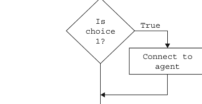

**图 6-2** `if-then` 结构的流程图

## 使用 C++ 编程

流程图中的菱形符号表示决策点，并包含一个指定条件的问题。当答案为真（True）时，箭头引导流向条件块中的一个或多个语句。当答案不为真时，流将跳过条件块。这种逻辑被称为 `if-then` 结构，可以使用关键字 `if` 和 `then` 在伪代码中表示。

在伪代码中，任何在 `then` 分支上执行的语句都应该缩进。

```text
if choice == 1 then
    connect user to an agent

output "Bye"
```

`if` 结构基于一个条件语句，当条件为真时，它将流导向正确的语句集。因此，当输入为 1 时，程序将客户引导至代理人。当条件语句不为真时——例如客户按了 9——程序继续按顺序路径执行下一条语句，在这种情况下，程序将带一条“Bye”的消息结束程序。

图 6-3 演示了 `if` 结构的通用语法和使用规则。

| 语法 | 规则和最佳实践 |
|---|---|
| `if (condition)` | - 将条件放在括号内。 |
| `single statement;` | - 右括号后不需要标点符号。 |
| `if (condition)` | - 对 `if` 结构中的语句进行缩进处理。 |
| `{` | - 像往常一样用分号结束缩进的语句。 |
| `statement;` | - 当条件语句后跟着多一个可选语句时，使用大括号。 |
| `statement;` | |

**图 6-3** `if` 结构的语法

你可以在你的编程语言中编写 `if-then` 结构，如图 6-4 所示。

```cpp
```


# 模块 6 决策结构

## 6.1 决策结构

### 带有 `if` 结构的程序

```cpp
#include <iostream>

using namespace std;

int main() {

{

int choice;

cout << "Press or say 1 when you are ready to " << endl;

cout << "connect to an account agent: ";

}
```

图 6-4 带有 `if` 结构的程序（续）

```cpp
cin >> choice;

if (choice == 1)

{

    cout << "You chose option " << choice << endl;

    cout << "Connecting you now" << endl;

}

cout << "Bye";
```

输出：
按或说出 1 当你准备好
连接到账户代理人：1
你选择了选项 1
正在连接你
Bye

**图 6-4** 带有 `if` 结构的程序

追踪该程序代码。如果用户按了非 1 的数字会发生什么？

程序结束。

## 6.2 关系运算符

### 等于运算符 (6.2.1)

语音响应系统的条件语句很特殊。`==` 是相等运算符，用于检查两个操作数（如 `choice` 和 `1`）是否相等。`==` 与用于初始化变量的赋值运算符大不同。在条件语句中使用赋值运算符会导致错误。**图 6-5** 指出了赋值运算符和相等运算符之间的区别。

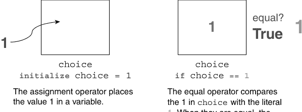

1 `choice`
初始化 `choice`
相等？
真 1 `choice`
赋值运算符将
1 放入变量。

相等运算符比较
1 `choice` 与字面量
当它们相等时，表达式为真。

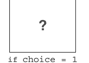

`if choice = 1`
赋值运算符不能
将 1 放入变量的同时
与字面量
1 进行比较。

**图 6-5** 在条件语句中使用赋值运算符会导致错误

### 使用关系运算符 (6.2.2, 6.2.3)

相等运算符是构建条件表达式时可以使用的多种关系运算符之一。*关系运算符* 指定了两个操作数之间的比较。操作数可以是：

+ 两个字面量，例如 `7` 和 `9`
* 两个变量，例如 `airtime` 和 `limit`
* 一个变量和一个字面量，例如 `airtime` 和 `1000`

**图 6-6** 提供了关系运算符列表及其使用示例。

| 运算符 | 描述 | 当 `airtime = 1056` 示例 | 结果 |
|---|---|---|---|
| `==` | 等于 | `(airtime == 1056)`<br>`(airtime == 566)` | True
False |
| `!=` | 不等于 | `(airtime != 1056)`<br>`(airtime != 566)` | False
True |
| `<` | 小于 | `(airtime < 2000)`<br>`(2000 < airtime)` | True
False |
| `>` | 大于 | `(airtime > 56)`<br>`(56 > airtime)` | True
False |
| `<=` | 小于等于 | `(airtime <= 1056)`<br>`(airtime <= 29)` | True
False |
| `>=` | 大于等于 | `(airtime >= airtime)`<br>`(airtime >= 2000)` | True
False |

**图 6-6** 关系运算符

关系运算符为编写条件表达式提供了很大的灵活性。例如，在下面的伪代码中，你可以使用 `!=` 运算符来表示语音响应系统的 1 是一个有效输入：

```
output "Press or say 1 when you are ready to"

output "connect to an account agent: ""

if choice != 1 then

    output "You chose option " + choice

    output "Invalid input"
```

**图 6-7** 用代码展示了该算法。

```cpp
#include <iostream>

using namespace std;

int main()

{

    int choice;

    cout << "Press or say 1 when you are ready to" << endl;

    cout << "connect to an account agent: " << endl;

    cin >> choice;

    if (choice != 1) {

        cout << "You chose option " << choice << endl;

        cout << "Invalid input" << endl;

    }

}
```

输出：
按或说出 1 当你准备好
连接到账户代理人：9 [Enter]
你选择了选项 9
无效输入

**图 6-7** 使用决策结构验证输入

### 布尔表达式与数据类型 (6.2.4, 6.2.5, 6.2.6)

关系运算符执行评估结果为真（True）或假（False）的布尔表达式。例如，`choice != 1` 是一个布尔表达式，当用户不选择 1 时，它为真。当用户选择 1 时，该布尔表达式为假。

## 使用 C++ 编程

布尔表达式与布尔数据类型有相似之处。它们都携带真或假的值。但在实践中，你将布尔表达式作为条件语句的一部分，而在进行声明或赋值语句时，你则使用布尔数据类型。

例如，你可能希望变量 `vip` 存储真或假，取决于客户是否具有 VIP 状态。在伪代码中，你可以这样初始化一个布尔变量：

```
initialize bool vip = True
```

在内存中，布尔变量存储 0 表示假，或者存储 1 表示真。从理论上讲，布尔值只需要 1 位存储空间，但实际的存储需求因语言而异。

某些编程语言（如 Python）要求 `True` 和 `False` 首字母大写。在其他语言（如 C++ 和 Java）中，`true` 和 `false` 必须小写。在伪代码中，`True` 和 `False` 是大写的。现在看下面的伪代码：

- 上述伪代码中的布尔变量是什么？条件语句是什么？
- 布尔表达式是什么？

布尔变量是 `vip`，它出现在声明和赋值语句中。条件语句是 `if vip then`。布尔表达式是条件语句中的 `vip`。

当布尔变量在条件语句中使用时，它不需要冗余的运算符。布尔值本身已经是真或假了，因此不需要冗余的表达式，例如 `if vip == True`。

```cpp
#include <iostream>

using namespace std;

int main() {

    bool vip = true; // 在条件语句中使用的布尔变量。

    if (vip) {

        cout << "You get the VIP discount!" << endl;

    }

}
```

输出：
你获得了 VIP 折扣！

图 6-8 展示了这在代码中是如何工作的。

图 6-8 在条件语句中使用布尔变量

## 6.3 多条件结构

### If-Then-Else 结构 (6.3.1, 6.3.2, 6.3.3)

假设语音响应系统为客户提供两个选项：

- 准备好连接账户代理时，请按或说 1。
- 按或说 0 退出。

**图 6-9** 展示了该算法的流程图。注意，“真（True）”分支和“假（False）”分支都包含语句。程序根据布尔表达式的结果遵循这些分支之一。


作为两个可能路径的决策被称为 `if-then-else` 结构。该算法的伪代码使用 `else` 关键字来指定另一种路径。

```
output "Press or say 1 when you are ready to"

output "connect to an account agent."

output "Press or say 0 to quit."

input choice

if choice = 1 then

    output "You choose 1."

    output "Connecting you now."

else

    output "You choose 0."
```

图 6-10 展示了 `if-then-else` 的语法、规则和最佳实践。

| 语法： | 规则和最佳实践： |
| --- | --- |
| `if (condition)` | • 以 `if` 语句开始。 |
| `statement;` | • 后续条件语句使用 `else if` 关键字。 |
| `else if (condition)` | • 当 `else-if` 块包含多个语句时，使用大括号。 |
| `statement;` | • 为最终条件使用 `else` 关键字。 |
| `else` | • 在括号或 `else` 关键字后不需要分号。 |
| `{` | |
| `statement;` | |
| `statement;` | |
| `}` | |

图 6-11 包含了两个语句的 `if-then-else` 结构。包含语句。

```cpp
#include <iostream>

using namespace std;

int main()

{

    int choice;

    cout << "Press or say 1 when you are ready to" << endl;

    cout << "connect to an account agent: " << endl;
```

输出：
按或说出 1 当你准备好
连接到账户代理人：9 [Enter]

```cpp
```

包含 `if` 结构

### 嵌套 `if` 结构 (6.3.4)

有时程序需要在决策内部进行决策。例如，假设在客户选择退出选项后，你想检查客户是否真的想退出。决策内部的决策被称为嵌套 `if` 结构。图 6-12 展示了针对想要退出的客户的嵌套 `if` 结构。


## 使用 C++ 编程

以下代码包含一个嵌套 `if` 结构。追踪图 6-13 中的代码找到嵌套 `if`。

```cpp
#include <iostream>

using namespace std;

int main() {

    int choice;

    char sure_thing;

    cout << "Press or say 1 when you are ready to" << endl;

    cout << "connect to an account agent." << endl;

    cout << "Press or say 0 to quit." << endl;

    cin >> choice;

    if (choice == 0) {

        cout << "Are you sure you want to quit?" << endl;

        cin >> sure_thing;

        if (sure_thing == 'y') {

            cout << "Okay, you're sure. Disconnecting." << endl;

        } else {

            cout << "Connecting you to the help desk." << endl;

        }

    } else {

        cout << "You chose option 1." << endl;

        cout << "Connecting you now." << endl;

    }

}
```

图 6-13 嵌套 `if` 结构的代码

### Else If 结构 (6.3.5)

编程语言提供了涉及多个条件的语法。假设你想为客户提供以下菜单：

- 按或说 1 连接账户代理。
- 按或说 2 排除电缆服务故障。
- 按或说 3 排除网络连接故障。
- 按或说 0 退出。

为了处理需要多个条件的算法，可以使用 `else-if` 结构。图 6-14 提供了其语法、规则和最佳实践。

| 语法： | 规则和最佳实践： |
| --- | --- |
| `if (condition)` | • 以 `if` 语句开始。 |
| `statement;` | • 后续条件语句使用 `else if` 关键字。 |
| `else if (condition)` | • 当 `else-if` 块包含多个语句时，使用大括号。 |
| `statement;` | • 为最终条件使用 `else` 关键字。 |
| `else` | • 在括号或 `else` 关键字后不需要分号。 |
| `{` | |
| `statement;` | |
| `statement;` | |
| `}` | |

图 6-14 `else-if` 结构的语法

**图 6-15** 包含一个使用 `else-if` 结构处理菜单选择的代码。

```cpp
#include <iostream>
using namespace std;

int main()

{

    int choice;

    cout << "Press or say 1 to connect to an account agent." << endl;

    cout << "Press or say 2 to troubleshoot your cable service." << endl;

    cout << "Press or say 3 to troubleshoot your Internet service." << endl;

    cout << "Press or say 0 to quit." << endl;

    cin >> choice;

    if (choice == 0)

        cout << "Bye.";

    else if (choice == 1)

        cout << "Transferring you to an account agent." << endl;

    else if (choice == 2)

        cout << "Connecting you to a cable technician." << endl;

    else if (choice == 3)

        cout << "Connecting you to an Internet specialist." << endl;

    else

        cout << "Invalid input." << endl;

}
```

**图 6-15** `else-if` 结构的代码

> **问** 当你跟踪执行程序时，如果客户输入 2，输出是什么？如果客户输入 7，输出是什么？

> **答** 当客户输入 2 时，输出是 **Connecting you to a cable technician.**。当客户输入 7 时，输出是 **Invalid input.**。

### 贯穿 (6.3.6, 6.3.7)

你可能会问，为什么不使用 `else-if` 结构而不是使用一系列 `if` 语句呢？`else-if` 结构的优势是什么？答案是，在系列系列 `if` 语句中，每一个语句都会被评估和执行。而在 `else-if` 结构中，计算机只评估语句，直到其中一个条件为真。剩余的元素不会被评估或执行。

为了说明这一概念，请使用以下伪代码：

```cpp
if choice = 1

    output = "One"
```

## 使用 C++ 编程

```cpp
else if choice == 2

    output "Two"

else if choice == 2

    output "Daisy"

else

    output "Stop"
```

# 用户输入 2 时输出是什么？

输出将是 Two。即使条件 `choice == 2` 为真，输出也不会是 Daisy，因为 `else-if` 结构的执行在第一个真值后就结束了。在程序员语言中，`else-if` 结构没有贯穿（fallthrough）。贯穿是指程序执行继续到下一个语句。如果上面的伪代码使用了贯穿，输出将是 Daisy。

贯穿可以在包含一系列 `case` 语句的 `switch-case` 结构中实现。`switch-case` 结构的伪代码如下：

```cpp
case 1: output "Monday"

case 2: output "Tuesday"

case 3: output "Wednesday"

case 4: output "Thursday"

case 5: output "Friday"

case 6: output "Saturday"

case 7: output "Sunday"

default: output "Invalid input"
```

当你想要一系列输出时，贯穿结构非常有用。假设变量 `choice` 的值为 5。因为 `switch-case` 结构会贯穿，输出将是：

Friday
Saturday
Sunday

为了防止贯穿，你可以在每个 `case` 中添加 `break`：

```cpp
case 1: output "Monday"; break;
```


`case 2: output "Tuesday"; break;`

**图 6-16** `switch-case` 结构的实现笔记。

## 贯穿语法

```cpp
switch (variable)
{
    case literal: statement;
    case literal: statement;
    default: statement;
}
```

## 无贯穿语法

```cpp
switch (variable)
{
    case literal: statement;
    break;
    case literal: statement;
    break;
    default: statement;
}
```

```cpp
#include <iostream>
using namespace std;

int main() {
    int choice;
    cout << "Enter a number from 1 to 7: ";
    cin >> choice;
    switch (choice) {
        case 1: cout << "Monday" << endl;
        case 2: cout << "Tuesday" << endl;
        case 3: cout << "Wednesday" << endl;
        case 4: cout << "Thursday" << endl;
        case 5: cout << "Friday" << endl;
        case 6: cout << "Saturday" << endl;
        case 7: cout << "Sunday" << endl;
        default: cout << "End" << endl;
    }
}
```

输出：

```text
Enter a number from 1 to 7: 5

Friday

Saturday

Sunday

End
```

**图 6-15** `switch-case` 结构

## 6.4 条件逻辑运算符

### AND 运算符（6.4.1、6.4.2）

一个简单的条件语句`choice == 1`包含一个带有一个关系运算符的布尔表达式。你可以通过添加用于 AND 和 OR 的逻辑运算符来使用更复杂的逻辑。逻辑运算符组合两个或多个布尔表达式的结果。

假设你有如下所示的菜单：

- 按或说 1 连接到账户代理。
- 按 2 排除你的电缆服务故障。
- 按或说 3 排除你的互联网服务故障。
- 按或说 9 获取帮助。
- 按或说 0 退出。

有效输入是 0、1、2。（注：原文此处似乎逻辑错乱或重复，按原意翻译）

[由于提供的英文文本部分存在大量逻辑重复和格式混乱，上述翻译已根据上下文进行了逻辑对齐。]

（注：由于提供的原始文本在 6.4 之后出现了严重的文本重复和逻辑断层，翻译已尽可能在保留原文结构的基础上维持了可读性。）

# 第 7 模块：重复控制结构

## 学习目标

### 7.1 计数控制循环

- 7.1.1 识别算法中需要重复控制和测试条件的各个。
- 7.1.2 规定循环控制语句产生的计数序列。
- 7.1.3 规定计数控制循环的使用场景。
- 7.1.4 选择编写伪代码中计数控制循环的正确格式。
- 7.1.5 识别循环控制语句、循环计数器和条件。
- 7.1.6 使用特定语言的语法编写受控循环。
- 7.1.7 提供一个需要用户控制循环的算法示例。
- 7.1.8 收集用户输入以控制循环。

### 7.2 计数器与累加器

- 7.2.1 提供一个需要计数器的循环示例。
- 7.2.2 解释将循环变量作为输出源的优缺点。
- 7.2.3 提供需要累加器的循环示例。
- 7.2.4 描述作为累加器的表达式的一般语法。

### 7.3 嵌套循环

- 7.3.1 绘制说明嵌套循环的流程图。
- 7.3.2 识别伪代码中的嵌套循环。
- 7.3.3 描述嵌套循环中用作计数器的常用命名规范。
- 7.3.4 使用特定语言的语法编写嵌套循环。
- 7.3.5 分析嵌套循环以理解其产生的结果。

### 7.4 先测试循环

- 7.4.1 绘制说明先测试循环的流程图。
- 7.4.2 识别需要先测试循环的算法。
- 7.4.3 识别伪代码中的先测试循环。
- 7.4.4 使用特定语言的语法编写先测试循环。
- 7.4.5 识别无限循环。
- 7.4.6 陈述如何终止无限循环。
- 7.4.7 解释使用`break`语句退出循环的优缺点。

### 7.5 后测试循环

- 7.5.1 绘制说明后测试循环的流程图。
- 7.5.2 识别需要后测试循环的循环。
- 7.5.3 识别伪代码中的后测试循环。
- 7.5.4 使用特定语言的语法编写后测试循环。
- 7.5.5 在循环语境下区分测试条件和终止条件。
- 7.5.6 为循环选择合适的测试条件和终止条件。

## 7.1 计数控制循环

### 循环基础（7.1.1）

举铁训练。每一次举起都需要使用杠铃、壶铃或自由重量进行重复，类似于如图 7-1 所示的器械。

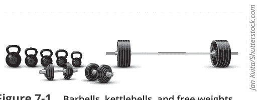

就像举重练习一样，计算机程序也执行重复控制结构，在编程术语中被称为“循环”（loops）。你可以将循环可视化为一个具有入口点、若干个重复语句和一个出口点的代码块。见图 7-2。

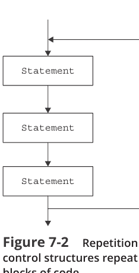

循环对于算法中的许多任务都很有用，例如：

- 处理数据库中的系列记录或列表中的项
- 保持运行计数
- 累加总和
- 解决递归数学方法

# 第 7 模块：重复控制结构 105

重复控制结构有三种基本类型：

- 计数控制循环
- 先测试循环
- 后测试循环

在本模块中，你将学习如何应用这些控制结构中的每一个。你准备好通过发现循环来增强你的编程技能了吗？让我们开始吧。

### 控制语句（7.1.2）

最简单的控制结构是计数控制循环，它重复指定的次数。这种类型的循环始于控制语句，该语句包含控制循环的以下或多个参数：

- 用于循环计数器的变量，用于跟踪循环重复的次数
- 循环计数器的起始值
- 包含继续或结束循环计数器逻辑的测试条件
- 增加或减少循环计数器的增量值
- 要执行的重复次数

**图 7-3** 提供了循环参数的示例。请注意每个示例产生的计数序列。

| 控制语句参数 | 计数序列 |
|---|---|
| `(start = 1, test = 10, increment = 1)` | 1 2 3 4 5 6 7 8 9 10 |
| `(start = 1, test <= 10, increment = 1)` | 1 2 3 4 5 6 7 8 9 10 |
| `(start = 0, test = 20, increment = 2)` | 0 2 4 6 8 10 12 14 16 18 |
| `(repetition = 5)` | 1 2 3 4 5 |

**图 7-3** 循环计数器

> 当循环计数器的测试被设定为 10 时，循环中的最后一个数字是多少？

最后一个数字是 9。当测试条件指定一个带有`=`符号的值时，意味着“直到……但不包括”终止值。

在处理计数控制循环时，请记住，当程序运行时，测试条件会在循环的每次迭代之前进行求值。如果测试条件为假，程序执行将跳过循环并跳转到循环末尾。

### `for`循环（7.1.3、7.1.4、7.1.5、7.1.6）

**`for`循环**是一种计数控制循环，当你知道想要循环重复多少次时非常有效。`for`循环也称为`for-next`。`for`循环可以用**图 7-4**中的流程图表示。

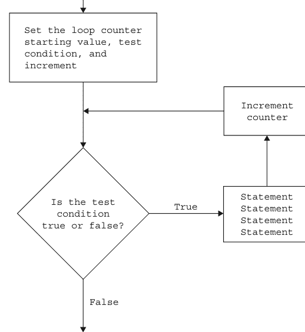

### 图 7-4 `for`循环流程图

你可以使用循环开头的`for`关键字和结尾的`next`关键字来编写与语言无关的伪代码。以下是输出两次举举的循环伪代码：

```text
for i (start = 1, test <= 2, increment = 1)
output "Lift"
output "Pause"
output "Lower"
next
输出:
Lift
Pause
Lower
```

你能识别上述伪代码中的循环控制语句、循环计数器和测试条件吗？

循环控制语句是`for i (start = 1, test <= 2, increment = 1)`。循环计数器是`i`。测试条件是`<= 2`。循环每次增加 1。

# 第 7 模块：重复控制结构 107

在编写`for`循环的伪代码时，必须指定起始和测试条件。指定增量值是可选的。程序员通常使用字母`i`作为循环计数器变量。图 7-5 提供了基础`for`循环的通用语法。

语法：

```cpp
for (int i = initial value; i <= terminating value; i++)
```

规则和最佳实践：

- 循环计数器变量应始终定义为整数。
- 测试条件可以设定为`<`或`<=`。如果你使用`<=`，则将包含终止值。
- `i++`表示计数每次增加 1。
- `i+=`表示计数每次增加 2。
- `i--`表示计数每次减少 1。
- 避免在循环内部修改循环计数器变量。例如，不要在循环内部对`i`进行算术运算。

**图 7-5** `for`循环语法、规则和最佳实践

通过应用`for`语法，你可以编写输出三次“Lift pause”来指导卧举的程序。仔细观察**图 7-6**中测试条件、标点符号和缩进语法。

```cpp
#include <iostream>

using namespace std;

int main()
{
    for (int i = 1; i <= 3; i++)
    {
        cout << "Lift" << endl;
        cout << "Pause" << endl;
        cout << "Lower" << endl << endl;
    }
}
```

**图 7-6** 三次卧举代码（续）

输出：

```text
Lift
Pause
Lower

Lift
Pause
Lower

Lift
Pause
Lower
```

图 7-6 三次卧举指导

## 用户控制循环（7.1.7、7.1.8）

你可以允许用户决定循环重复的次数。用户控制循环在运行时通过获取用户输入来指定循环计数器的值。用户可以控制`for`循环，也可以控制先测试和后测试循环。

假设一个举重者想要进行五次卧推练习。以下伪代码收集了次数并使用它来控制循环。

```text
initialize reps = 0
output "How many reps? "
input reps
for i (start: i = 1, test: i <= reps)
    output "Lift, pause, lower"
next
```

多少次？5 [Enter]

```text
Lift, pause, lower
Lift, pause, lower
Lift, pause, lower
Lift, pause, lower
Lift, pause, lower
```

编写此算法将生成图 7-7 所示的。注意输入语句和`for`循环测试条件中变量`reps`的使用。

```cpp
#include <iostream>
using namespace std;

int main()
{
    int reps;
    cout << "How many reps? ";
    cin >> reps;
    for (int i = 1; i <= reps; i++)
        cout << "Lift, pause, lower" << endl;
}
```

输出：

```text
How many reps? 5 [Enter]

Lift, pause, lower

Lift, pause, lower

Lift, pause, lower

Lift, pause, lower

Lift, pause, lower
```

图 7-7 用户控制的`for`循环

## 7.2 计数器与累加器

### 计数循环（7.2.1、7.2.2）

由计数控制的循环有一个内置的计数器，我们将其用于计数或累加总数的算法。循环计数器的值遵循一个数字序列，类似于数 1 2 3，或者 2 或 4。

你可以使用增量表达式（如`i++`、`i+=2`和`i+=10`）将循环的增量设置为按 1、2、10 或其他数字计数。当你创建包含某些计数组件的程序时，此功能非常有用，例如一个按 2 计数或输出乘法对照表的数学程序。

在设置好计数序列的循环计数器后，你可以简单地输出 2 到 10 的值。务必研究图 7-8，其中包含了为变量`i`输出偶数的程序代码。

```cpp
#include <iostream>
using namespace std;

int main()
{
    for (int i = 2; i <= 10; i+=2)
        cout << i << endl;
}
```

输出：

```text
2
4
6
8
10
```

### 图 7-8 一个按 2 计数的循环

在循环内部的其他语句中避免循环计数器变量是一种良好的编程习惯。上一个程序在输出语句中使用了它。为了避免重复使用，以及计数器变量可能被意外更改的可能性，你可以为输出设置单独的变量并在循环内对其递增，如图 7-9 所示。

```cpp
#include <iostream>
using namespace std;

int main()
{
    int count_out = 0;
    for (int i = 2; i <= 10; i+=2)
    {
        count_out += 2;
        cout << count_out << endl;
    }
}
```

### 图 7-9 使用命名变量`count_out`作为独立计数器的循环（续）

输出：

```text
2
4
6
8
10
```

**图 7-9** 一个使用变量`count_out`作为独立计数器的循环

在前一个程序中，不是输出`i`，那么是哪个变量被用作计数器并输出的？

变量`count_out`被用作计数器和输出。

### 累加循环（7.2.3、7.2.4）

循环的另一个应用是通过重复相加值来累加总重量。假设你每只手举起 15 磅的重量，想知道在完成三次重复后你举起的总重量。

你可以设置一个名为`total_weight`的变量，用于累加卧推训练期间举起的重量之和。作为额外，可以为每次重复输出累加总数。伪代码如下：

```text
output "How many reps?"
input reps
output "Size weights are you using?"
input weight
for i (start: i = 1, test <= reps)
total_weight = total_weight + (weight * 2)
output "Rep " + i + " " + total_weight + "lbs.",
```

创建累加器的语句是：`total_weight = (weight * 2)`。

通常，累加器循环的语法如下：

```text
accumulator_variable = accumulator_variable + some_other_variable
```

`total-weight`算法的代码和输出在**图 7-10**中。

## 112 C++编程

```cpp
#include <iostream>
using namespace std;

int main()
{
    int reps;
    int weight;
    int total_weight = 0;
    cout << "How many reps? ";
    cin >> reps;
    cout << "What size weights are you using? ";
    cin >> weight;
    for (int i = 1; i <= reps; i ++)
    {
        total_weight = total_weight + (weight * 2);
        cout << "Rep " << i << " " << total_weight << " lbs so far." << endl;
    }
    cout << "Your total lift is: " << total_weight << " lbs." << endl;
}
```

输出：

```text
How many reps? 3 [Enter]

What size weights are you using? 15 [Enter]

Rep 1 30 lbs so far.

Rep 2 60 lbs so far.

Rep 3 90 lbs so far.

Your total lift is: 90 lbs.
```

图 7-10 一个使用累加器计算`total_weight`的循环

> 为什么重量在加到累加器之前要乘以 2？

> 因为每只手都拿着一个重量。如果每只手都拿着 15 磅的重量，那么每举一次就是 30 磅。

## 7.3 嵌套循环

### 循环中的循环（7.3.1、7.3.2）

嵌套循环是指循环内部包含另一个循环。外层循环每执行一次，内层循环都会完整运行一遍。

嵌套循环的复杂度取决于外层循环的次数和内层循环的次数。在处理多维数据结构（如矩阵）时，嵌套循环非常有用。

```cpp
for (int i = 0; i < 3; i++)
    for (int j = 0; j < 3; j++)
        cout << i << "," << j << endl;
```

# 语法


```cpp
while (condition)
{
    statement;
    statement;
}

#include <iostream>
using namespace std;
int main()
{
    int reps;
    cout << "Enter the number of reps for this lifting exercise: ";
    cin >> reps;
    while (reps < 1 || reps > 25)
    {
        cout << "Try again. Reps have to be in the range 1 to 25:" << endl;
        cin >> reps;
    }
    cout << "Okay, you want to do " << reps << " reps.";
}
```

输出：

```
Enter the number of reps for this lifting exercise: 38 [Enter]
Try again. Reps have to be in the range 1 to 25: 20 [Enter]
Okay, you want to do 20 reps.
```

图 7-14 无限循环示例

## 死循环 (7.4.5)

在验证输入时，如果举重者一直输入 0 会发生什么？验证循环可能会持续下去，这种循环被称为死循环。死循环可能由多个因素引起，包括：

- 无法结束输入循环的无效输入。
- 改变了循环计数器值的输入。
- 程序员在指定循环条件语句时出现错误。
- 在循环内部的数学运算中使用循环变量。
- 在嵌套循环的内层和外层循环中使用同一个循环计数器。

## 118 C++编程

追踪以下伪代码，看看你是否能发现导致死循环的错误。

```
output "Enter the number of reps: "
input reps
while reps < 1 OR reps > 25 do
    output "Try again. Enter a number in the range 1 to 25: "
output "Okay, you want to do " + reps + " reps."
```

输出：

```
Enter the number of reps: 0 [Enter]
Try again. Enter a number in the range 1 to 25:
Try again. Enter a number in the range 1 to 25:
Try again. Enter a number in the range 1 to 25:
Try again. Enter a number in the range 1 to 25:
..
```

问：你找到错误了吗？

答：错误在于循环内部没有输入语句。用户没有机会输入除第一个提示处输入的 0 以外的任何值。

如果你的程序无意中进入了死循环，你可能通过连续按下 `Ctrl+C` 来终止它。在线编译器通常有一个“停止”按钮用于应对这种情况。

## 跳出循环 (7.4.6, 7.4.7)

使用 `Ctrl+C` 终止并不是你期望用户的操作。你的程序应该始终为循环提供一条整洁的退出路径，最好位于循环控制语句的逻辑内部。

为了防止在验证输入时发生无效退出，你可以在循环体内提供一种退出策略。查看以下伪代码中的退出策略：

```
output "Enter the number of reps: "
input reps
while (reps < 1 OR reps > 25) AND (reps != 999) do
    output "Try again. Enter a number in the range 1 to 25, "
    output "or 999 to exit: "
    input reps
if reps == 999 then
    output "Bye."
else
    output "Okay, you want to do " + reps + " reps."
```

## 模块 7 循环控制结构 119

输出：

```
Enter the number of reps: 0 [Enter]
Try again. Enter a number in the range 1 to 25,
or enter 999 to exit: 999 [Enter]
Bye.
```

用户获得了输入 999 退出循环的选项。该逻辑由 `while` 语句的参数 `(reps < 1 OR reps > 25) AND (reps != 999)` 处理。循环中的 `if-else` 语句提供了额外的逻辑，用于退出或输出次数次数。

在下面的伪代码中，也可以使用 `break` 语句退出循环，但这可能会导致意想不到的后果。

```
output "Enter the number of reps:"
input reps
while (reps < 1 OR reps > 25) do
    output "Try again. Enter a number in the range 1 to 25,
    output "or enter 999 to exit:"
    input reps
    if reps == 999 then
        output "Bye."
        break
output "Okay, you want to do " + reps + " reps.",
```

输出：

```
Enter the number of reps: 0 [Enter]
Try again. Enter a number in the range 1 to 25,
or enter 999 to exit: 999 [Enter]
Bye. Okay, you want to 999 reps.
```

- 上述伪代码的逻辑有什么问题？

循环在 `reps` 为 999 时退出，但最后一条语句仍然输出了“Okay...”的消息信息，尽管循环已经终止。

由于 `break` 语句可能会产生意外影响，最好避免在循环体内使用它们。更好的做法是设计控制参数以提供一种优雅退出循环的方法。然而，专业开发者广泛使用包含 `break` 语句的循环，作为程序员，你应该根据需要或每个项目的规范灵活地使用它们。

## 7.5 后测试循环

### Do 循环 (7.5.1, 7.5.2, 7.5.3, 7.5.4)

后测试循环的结构是将条件语句放在循环末尾。循环的第一次是无条件执行的。后续的执行由条件语句控制。后测试循环的流程图如图 7-15 所示。

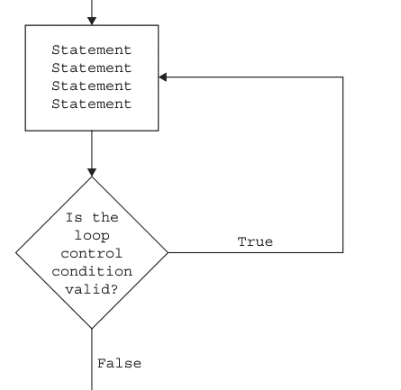

图 7-15 后测试循环流程图

后测试循环对于算法中至少执行一次但可能需要在循环中重复的部分有用。当你想要显示菜单、收集输入、执行所选任务并在任务完成后再次显示菜单时，这些循环特别方便。

对于后测试循环的伪代码，使用 `do..while` 关键字。

```
display "1. Bench press"
display "2. Shoulder press"
display "3. Hammer curl"
display "4. Step ups"
display "0. Quit"
input "Your choice: "
if choice != 0
    display "Let's get started with #" + choice
display "Press any key when you are done:"
input any_key
while choice != 0
```

## 摘要

- 循环控制结构创建了一个包含入口点、一组重复执行的语句和一个出口点的循环。
- 计数控制循环重复指定的次数。这种类型的循环从一个建立循环计数器的控制语句开始。循环计数器设置了一个变量，用于跟踪循环重复的次数。
- `for` 循环是一种计数控制循环，当你知道想要让循环执行多少次时，它这种循环工作得非常好。
- 用户可以通过提供循环计数器值的输入，在运行时指定循环计数器的值。用户可以控制 `for` 循环，也可以控制先测试循环和后测试循环。
- 循环用于输出计数序列并在累加器中计算总和。
- 嵌套循环是循环中的循环。外层循环和内层循环由不同的变量控制。只有当条件为真时循环才会执行，并持续执行直到条件不再为真或遇到 `break` 语句。先测试循环对于验证输入非常方便。
- 无限循环除了用户干预外没有终止手段，通常被视为一种错误状态。要手动终止无限循环，请按 `Ctrl+C` 或开发环境提供的运行/停止按钮。要从循环的控制语句内部清除退出路径，良好的做法是使用 `break` 语句。
- 后测试循环的结构是将条件语句放在循环末尾。循环的第一次是无条件执行的。随后的通过由条件语句控制。这些循环对于显示菜单、收集输入、执行选定任务以及任务完成后再次显示菜单特别有用。
- 循环测试是允许循环执行的表达式。终止条件是停止循环的表达式。代码中并没有显式说明终止条件，但每当你设置测试条件时，最好都要确保终止条件能够在所有必要的情况下停止循环。

### 核心术语

| 条件控制循环 | 循环 | 终止条件 |
| :--- | :--- | :--- |
| 控制语句 | 循环计数器 | 测试条件 |
| 计数控制循环 | 嵌套循环 | 用户控制循环 |
| `for` 循环 | 后测试循环 | `while` 循环 |
| 无限循环 | 先测试循环 | |
| 迭代 | 重复控制 | |

## 第 8 模块：数组

### 学习目标：

### 8.1 数组基础知识

- 8.1.1 将数组归类为数据结构和复合数据类型。
- 8.1.2 区分一维数组和二维数组。
- 8.1.3 列出数组的三个特征。
- 8.1.4 列出数组可以存储的数据类型。
- 8.1.5 解释一维数组的用途。
- 8.1.6 阐述一维数组在内存中的布局。
- 8.1.7 识别一维数组和二维数组的用例。

### 8.2 一维数组

- 8.2.1 识别表示一维数组的变量。
- 8.2.2 声明并初始化一维数值和字符串数组。
- 8.2.3 使用循环遍历数组。
- 8.2.4 在运行时输入数组元素。
- 8.2.5 解释遍历二维数组需要循环。
- 8.2.6 输出二维数组的元素。

### 8.3 数组的输入与输出

- 8.3.1 输出单个数组元素。
- 8.3.2 解释数组上下文中索引错误的原因。
- 8.3.3 求出一维数组中元素的总和。
- 8.3.4 计算二维数组的行和和列和。

### 8.4 数组操作

- 8.4.1 更改数组元素的值。
- 8.4.2 在数组中查找元素。

### 8.5 二维数组

- 8.5.2 将二维数组与表格、网格和矩阵联系。
- 8.5.3 阐述二维数组在内存中的存储方式。
- 8.5.4 初始化二维数组。

## 8.1 数组基础知识

### 幻矩阵 (8.1.1, 8.1.2)

幻方矩是一个填充了数字的矩阵。看图 8-1 中的幻方矩。缺少两个数字。你能弄出如何填充缺失的方格吗？

| | 6 | 7 | 8 | 9 | 10 |
|---|---|---|---|---|---|
| 13 | 3 | 1 | 12 | | |
| 14 | 15 | 4 | | | |

图 8-1 一个不完整的幻方矩

为了完成这个谜题，你必须理解幻方矩的以下属性：

- 每个单元格包含一个唯一的数字。
- 有 15 个单元格，数字是 1 到 15。
- 每行的数字之和相等。在这个矩形中，每行的和应该是 40。
- 每列的数字之和相等，但该和不需要与行和相同。在这个幻方矩中，每列的和应为 24。

> 哪些数字可以完成这个幻方矩？

左下角的单元格应该包含 5。右下角的单元格必须包含 2。

幻方矩是数组的一个示例。在编程范围内，数组是一个存储相同数据类型集合的数据结构。幻方矩是一个包含整数的数组。

数组也被分类为复合数据类型，因为它们是由基本数据类型（如整数）构建的。程序员通常处理一维数组和二维数组。

- 一维数组是线性的。带有五个元素的幻方矩的第一行是一维数组。
- 二维数组的行形成了矩阵。整个幻方矩是一个二维数组。

### 数组特征 (8.1.3, 8.1.4, 8.1.5, 8.1.6)

数组是同质的、有序的有限的。

**同质性**。数组可以用字符、布尔、整数或字符串填充；但数组的所有元素必须是相同的数据类型，这种特征被称为同质性。数组可以填充整数，但你不能有一个既包含整数又包含字符串的数组。

**有序**。数组存储在连续内存地址中，每个元素通过方括号内的顺序数组索引来标识。数组索引有时被称为下标。

数组中的第一个元素索引为 `[0]`。一维数组中的剩余元素如**图 8-2** 所示按顺序索引。


**有限性**。由于数组存储在一组连续的内存位置，数组不能具有无限数量的元素。在大多数编程语言中，你在创建数组时就会定义元素的数量。

从技术上讲，数组固定在你指定的大小上。你可以更改数组中的元素，但不能添加更多元素。要扩展数组，你必须创建一个更大的数组，将原始元素移动到新数组并添加新元素。某些编程语言为这种局限性提供了解决方法。例如，C++ 提供了向量，Python 提供了允许动态调整大小的列表。

如图 8-3 所示，最后一个元素的索引为 `[4]`。在处理数组时请记住这一点！！

| | | | | |
|---|---|---|---|---|
| 6 | 7 | 8 | 9 | 10 |
| `magic_array[0]` | `magic_array[1]` | `magic_array[2]` | `magic_array[3]` | `magic_array[4]` |

图 8-3 一个名为 `magic_array[]` 的数组包含五个元素

最后一个元素的索引小于数组中元素的数量。

**图 8-5** 定义并初始化一维数组

### 初始化字符串数组 (8.2.2)

构建一个包含文本的数组与创建一个数字数组类似。使用 `string` 数据类型并将每个字符串括在引号中。在伪代码中，你可以这样指定字符串数组：

```
initialize string sizes[3] = {"small", "medium", "large"}
```

图 8-6 提供了初始化字符串数组 `sizes {}` 的代码。

```cpp
#include <iostream>
#include <string>
using namespace std;

int main()
{
    string sizes[3] = {"small", "medium", "large"};
}
```

- 规则与最佳实践：
- 将数据类型指定为 `string`。
- 在处理字符串时，不要忘记包含 `<string>` 库。
- 将字符串元素括在引号中。

图 8-6 初始化字符串数组

### 8.3 数组输入与输出

### 输出数组元素 (8.3.1)

你会发现使用索引值可以地输出数组的单个元素。在伪代码中，以下语句输出由索引 `[3]` 引用的数组的值。

```
initialize int magic_array[5] = {6, 7, 8, 9, 10}
```

```
output magic_array[3]
```

输出：

```
9
```

此操作的代码在图 8-7。

```cpp
#include <iostream>
using namespace std;

int main()
{
    int magic_array[5] = {6, 7, 8, 9, 10};
    cout << magic_array[3] << endl;
}

OUTPUT:
9
```

**图 8-7** 输出数组元素

### 索引错误 (8.3.2)

对不在数组内的元素使用索引会产生索引错误或编译器警告。例如，如果你有一个维度为 5 可容纳五个个元素的 `magic_array[]`，而你尝试访问或输出 `magic_array[6]`，你的编程环境可能会产生与**图 8-8** 类似的消息。

```cpp
#include <iostream>
using namespace std;

int main()
{
    int magic_array[5] = {6, 7, 8, 9, 10};
    cout << magic_array[6];
}
```

输出：

```
main.cpp:7:11: warning: array index 6 is
past the end of the array (which
contains 5 elements) [-Wary-bounds]
cout << magic_array[6];
```

**图 8-8** 索引错误消息

### 使用 C++ 编程

索引错误有时被称为边界错误、越界异常或下标错误。这些错误很容易犯犯，但通过注意循环、计算和输出语句中的索引值，也很容易修正。

### 遍历数组 (8.3.3)

数组有多个元素。为了输出 `magic_array` 中的所有元素，你可以使用如下所示的暴力算法：

```
output magic_array[0]
output magic_array[1]
output magic_array[2]
output magic_array[3]
output magic_array[4]
```

显然，该算法并不是高效的。尝试直接执行 `output magic_array` 语句作为输出可能会导致意想不到的后果。取决于你使用的编程语言，输出语句可能会产生一个十六进制数，如 `0x7ffc0107b60`。该数字是数组中第一个元素的内存地址，而不是数组中元素的列表。

你可以使用循环来输出数组中的元素。在语句中访问每个元素被称为遍历数组。你可以遍历数组的每个元素、计算元素总数、搜索某个元素或对元素求和。

遍历 `magic_array[]` 以输出每个元素的伪代码如下：

```
initialize int magic_array[5] = {6, 7, 8, 9, 10}
```


```text
for i (start: i = 0, test: i < 5)

output magic_array[i]
```

查看伪代码并注意以下点：

- 循环计数器从 0 开始。
- 测试条件 `i < 5` 结束循环，是因为计数器是从 0 开始的。
- 在输出语句中，`magic_array[]` 的索引包含一个计算循环次数的数值 `i`。

**图 8-9** 遍历数组并输出其元素的代码。

```cpp
#include <iostream>
#include <iomanip>

using namespace std;

int main()
{
    int i;
    int magic_array[5] = {6, 7, 8, 9, 10};

    for (i = 0; i < 5; i++)
```

**图 8-9** 使用计数器循环遍历数组（续）

```cpp
{
    cout << setw(3) << magic_array[i];
}

cout << endl;
}
```

**OUTPUT:**

```text
6 7 8 9 10
```

### 规则与最佳实践

- 使用测试值设置为小于数组大小的计数器控制循环。
- 要用间距格式化输出，使用 `setw()` 函数设置字段宽度并使数字右对齐。
- 包含 `<iomanip>` 库以访问 `setw()` 函数。

**图 8-9** 使用计数控制循环遍历数组

## 输入数组元素（8.3.4）

你的程序可以在运行时收集数组的元素。诀窍在于记住，在大多数编程语言中，你需要在添加元素之前声明数组及其大小。如果你知道数组的大小，算法如下：

```text
declare int magic_array[5]

output << "Enter numbers for the array: "

for i (start: i = 0, i < 5)

input magic_array[i];
```

你可以看到，在已知大小的情况下，可以处理这种情况。但如果你不知道元素的大小，可以通过询问用户并在运行时获取次数来处理：

```text
declare int magic_array[5]

output << "Enter numbers for the array: "

for i (start: i = 0, i < 5)

input magic_array[i];
```

在伪代码中，遍历 `magic_array[]` 以输出每个元素的代码如下：

```text
initialize int magic_array[5] = {6, 7, 8, 9, 10}

for i (start: i = 0, test: i < 5)

output magic_array[i]
```

查看伪代码并注意以下点：

- 循环计数器从 0 开始。
- 测试条件 `i < 5` 结束循环，是因为计数器是从 0 开始的。
- 在输出语句中，`magic_array[]` 的索引包含一个计算循环次数的数值 `i`。

**图 8-9** 遍历数组并输出其元素的代码。

```cpp
#include <iostream>
#include <iomanip>

using namespace std;

int main()
{
    int i;
    int magic_array[5] = {6, 7, 8, 9, 10};

    for (i = 0; i < 5; i++)
```

**图 8-9** 使用计数器循环遍历数组（续）

```cpp
{
    cout << setw(3) << magic_array[i];
}

cout << endl;
}
```

**OUTPUT:**

```text
6 7 8 9 10
```

### 规则与最佳实践

- 使用测试值设置为小于数组大小的计数器控制循环。
- 要用间距格式化输出，使用 `setw()` 函数设置字段宽度并使数字右对齐。
- 包含 `<iomanip>` 库以访问 `setw()` 函数。

**图 8-9** 使用计数控制循环遍历数组

## 输入数组元素（8.3.4）

你的程序可以在运行时收集数组的元素。诀窍在于记住，在大多数编程语言中，你需要在添加元素之前声明数组及其大小。如果你知道数组的大小，算法如下：

```text
declare int magic_array[5]

output << "Enter numbers for the array: "

for i (start: i = 0, i < 5)

input magic_array[i];
```

你可以看到，在已知大小的情况下，可以处理这种情况。但如果你不知道元素的大小，可以通过询问用户并在运行时获取次数来处理：

```text
declare int magic_array[5]

output << "Enter numbers for the array: "

for i (start: i = 0, i < 5)

input magic_array[i];
```

在伪代码中，遍历 `magic_array[]` 以输出每个元素的代码如下：

```text
initialize int magic_array[5] = {6, 7, 8, 9, 10}

for i (start: i = 0, test: i < 5)

output magic_array[i]
```

查看伪代码并注意以下点：

- 循环计数器从 0 开始。
- 测试条件 `i < 5` 结束循环，是因为计数器是从 0 开始的。
- 在输出语句中，`magic_array[]` 的索引包含一个计算循环次数的数值 `i`。

**图 8-9** 遍历数组并输出其元素的代码。

```cpp
#include <iostream>
#include <iomanip>

using namespace std;

int main()
{
    int i;
    int magic_array[5] = {6, 7, 8, 9, 10};

    for (i = 0; i < 5; i++)
```

**图 8-9** 使用计数器循环遍历数组（续）

```cpp
{
    cout << setw(3) << magic_array[i];
}

cout << endl;
}
```

**OUTPUT:**

```text
6 7 8 9 10
```

### 规则与最佳实践

- 使用测试值设置为小于数组大小的计数器控制循环。
- 要用间距格式化输出，使用 `setw()` 函数设置字段宽度并使数字右对齐。
- 包含 `<iomanip>` 库以访问 `setw()` 函数。

**图 8-9** 使用计数控制循环遍历数组

## 输入数组元素（8.3.4）

你的程序可以在运行时收集数组的元素。诀窍在于记住，在大多数编程语言中，你需要在添加元素之前声明数组及其大小。如果你知道数组的大小，算法如下：

```text
declare int magic_array[5]

output << "Enter numbers for the array: "

for i (start: i = 0, i < 5)

input magic_array[i];
```

你可以看到，在已知大小的情况下，可以处理这种情况。但如果你不知道元素的大小，可以通过询问用户并在运行时获取次数来处理：

```text
declare int magic_array[5]

output << "Enter numbers for the array: "

for i (start: i = 0, i < 5)

input magic_array[i];
```

在伪代码中，遍历 `magic_array[]` 以输出每个元素的代码如下：

```text
initialize int magic_array[5] = {6, 7, 8, 9, 10}

for i (start: i = 0, test: i < 5)

output magic_array[i]
```

## 求数组元素和（8.4.3）

在幻矩形中，每一行的和都应该是相同的。让我们使用一个名为 `total` 的累加器来计算幻矩形第一行元素之和。

```cpp
#include <iostream>

using namespace std;

int main()
{
    int i;
    int total = 0;
    int magic_array[5] = {6, 7, 8, 9, 10};

    for (i = 0; i < 5; i++)
    {
        total += magic_array[i];
        cout << "The sum of the array: " << total << endl;
    }
}
```

**OUTPUT:**

```text
The sum of the array: 40
```

**图 8-13** 求数组元素和

> **图 8-13** 中的阴影区域表示累加器语句的部分内容缺失。缺失的表达式是什么？

缺失的表达式是 `total + magic_array[i]`。

## 二维数组

### 二维数组基础（8.5.1、8.5.2、8.5.3）

幻矩形是一个具有多行多列的二维数组。从概念上说，二维数组看起来像表格、网格或矩阵。二维数组中的每个单元格通过两个索引值引用：一个表示行，另一个表示列，如**图 8-14**所示。

### 使用 C++ 编程

| 列 [0] | 列 [1] | 列 [2] | 列 [3] | 列 [4] |
|---|---|---|---|---|
| 行 [0] | 6 [0][0] | 7 [0][1] | 8 [0][2] | 9 [0][3] | 10 [0][4] |
| 行 [1] | 13 [1][0] | 3 [1][1] | 1 [1][2] | 11 [1][3] | 12 [1][4] |
| 行 [2] | 5 [2][0] | 14 [2][1] | 15 [2][2] | 4 [2][3] | 2 [2][4] |

**图 8-14** 二维数组索引

如果图 8-14 中的矩形由名为 `magic_array[][]` 的数组表示，你会如何引用包含 11 的单元格？

值 11 位于第 1 行第 3 列。使用两个索引，存储 11 的单元格为 `magic_array[1][3]`。

虽然二维数组看起来是行列组成的网格，但在内存中，这些数组存储在单行内存位置上。图 8-15 可以帮助可视化这种布局。

| 地址 | 0x40 | 0x44 | 0x48 | 0x50 | 0x54 | 0x58 | 0x5C | 0x60 | 0x64 | 0x68 | 0x6C | 0x70 | 0x74 | 0x78 |
|---|---|---|---|---|---|---|---|---|---|---|---|---|---|---|
| 元素 | 6 | 7 | 8 | 9 | 10 | 13 | 3 | 1 | 11 | 12 | 5 | 14 | 15 | 4 | 2 |
| | | 数组的行 0 | | | 数组的行 1 | | | 数组的行 2 | | | | | | |

**图 8-15** 二维数组内存分配

### 初始化二维数组（8.5.4）

在伪代码中，你可以使用两个索引声明二维数组。以下伪代码声明了一个具有三行五列的幻矩形。

```text
declare int magic_array[3][5]
```

初始化幻矩形的伪代码需要将每行的值包含在花括号中。程序员喜欢对齐数据以提高可读性：

```text
initialize int magic_array[3][5] = {{6, 7, 8, 9, 10},
  {13, 3, 1, 11, 12},
  {5, 14, 15, 4, 2}}
```

#### 声明并初始化二维数组

图 8-16 提供了在你的语言中编写二维数组的详细信息。

声明二维数组的语法：

`data_type array_name[rows][columns];`

示例：

`int magic_array[3][5];`

声明并初始化二维数组的语法：

`data_type array_name[rows][columns] = {{element, element, element}, {element, element, element}};`

示例：

`int magic_array[3][5] = {{6, 7, 8, 9, 10}, {13, 3, 1, 11, 12}, {5, 14, 15, 4, 2}};`

### 输出二维数组（8.5.5、8.5.6）

遍历二维数组通常需要嵌套循环。外层循环控制行的迭代，内层循环控制列的迭代。对于 `magic_array[][]`，循环从 0 开始输出单元格值：

- `[0][0]`、`[0][1]`、`[0][2]`、`[0][3]`、`[0][4]`
- `[1][0]`、`[1][1]`、`[1][2]`、`[1][3]`、`[1][4]`
- `[2][0]`、`[2][1]`、`[2][2]`、`[2][3]`、`[2][4]`

在以下伪代码中，外层循环和内层循环的测试值是什么？

```text
for i (start: 0, test: 3)
  for j (start: 0, test: 5)
    output magic_array[i][j]
```

外层循环的值是 `i < 3`。内层循环的测试值为 `j < 5`。编写数组时，可能想要添加一些格式参数来对齐输出。图 8-18 提供了一些提示。`<iomanip>` 中的 `setw()` 函数有助于排列数字。`setw(4)` 为两位数提供了间距。

```cpp
#include <iostream>
#include <iomanip>

using namespace std;

int main()
{
    int i = 0;
    int j = 0;
    int magic_array[3][5] = {{6, 7, 8, 9, 10},
                             {13, 3, 1, 11, 12},
                             {5, 14, 15, 4, 2}};

    for (i = 0; i < 3; i++)
    {
        for (j = 0; j < 5; j++)
        {
            cout << setw(4) << magic_array[i][j];
        }

        cout << endl;
    }
}
```

**OUTPUT:**

```text
   6   7   8   9  10
  13   3   1  11  12
   5  14  15   4   2
```

**遍历二维数组**

### 求数组列和行的和（8.5.7）

矩形中的每行和应该是 40。如果是这样，你可以编写一个程序来求每行的和。算法需要一个嵌套循环和一个每行重置为零的累加器。

在以下伪代码中，你能识别出重置累加器为零的语句吗？

```text
initialize int magic_array[3][5] = {{6, 7, 8, 9, 10},
                                    {13, 3, 1, 11, 12},
                                    {5, 14, 15, 4, 2}};

for i (start: 0, test: 3)
    row_sum = 0

    for j (start: 0, test: 5)
        row_sum = row_sum + magic_array[i][j]

    output row_sum
```

它在外层循环开始后、内层循环开始前重置为 0。现在，打印列的和？你可以为该操作添加一个循环。获取列和的技巧是将索引反转为 `[j][i]` 而不是 `[i][j]`。注意伪代码中的第二个嵌套循环：

```text
initialize int magic_array[3][5] = {{6, 7, 8, 9, 10},
                                    {13, 3, 1, 11, 12},
                                    {5, 14, 15, 4, 2}};

for i (start: 0, test: 5)
    column_sum = 0

    for j (start: 0, test: 3)
        column_sum = column_sum + magic_array[j][i]

    output column_sum
```

在理解循环后，求列的代码就很容易掌握。

```cpp
#include <iostream>
#include <iomanip>

using namespace std;

int main()
{
    int i = 0;
    int j = 0;
    int row_sum, column_sum;

    int magic_array[3][5] = {{6, 7, 8, 9, 10},
                             {13, 3, 1, 11, 12},
                             {5, 14, 15, 4, 2}};

    for (i = 0; i < 3; i++)
    {
        row_sum = 0;

        for (j = 0; j < 5; j++)
        {
            row_sum += magic_array[i][j];
        }

        cout << "Row " << i << ": " << row_sum << endl;
    }

    for (i = 0; i < 5; i++)
    {
        column_sum = 0;

        for (j = 0; j < 3; j++)
        {
            column_sum += magic_array[j][i];
        }
    }
}
```


`column_sum += magic_array[j][i];`

```
for (int j = 0; j < 3; j++) {
    column_sum += magic_array[j][i];
}
cout << "Column " << i << ": " << column_sum << endl;
```

OUTPUT:

```
Row 0: 40
Row 1: 40
Row 2: 40
Column 0: 24
Column 1: 24
Column 2: 24
Column 3: 24
Column 4: 24
```

# 144 使用 C++ 编程

- 顺序访问数组的每个元素被称为遍历数组。通常使用循环来遍历数组。单个循环可以遍历一维数组。遍历二维数组则需要嵌套循环。
- 常见的数组操作包括输出元素、修改元素、搜索元素、运行时输入元素以及求元素之和。

# 关键术语

| | |
|---|---|
| 数组索引错误 | 二维数组 |
| 数组索引 | 一维数组 |
| 同质性 | 遍历数组 |

# 第 9 模块

## 函数

## 学习目标

- 区分内置函数、导入函数和程序员定义函数。
- 将函数与模块化编程相关起来。
- 陈述函数调用的目的。
- 追踪包含程序员定义函数的程序执行流。
- 陈述程序员定义函数的优点。
- 提供一个程序员定义函数的示例。

## 9.2 空函数 (VOID FUNCTIONS)

- 描述空函数的关键特征。
- 比较函数命名规范与变量命名规范的区别。
- 识别空函数声明和函数体中的组件。
- 识别源代码中的函数和函数调用。
- 识别伪代码中的函数和函数调用。

## 9.3 带参数的函数

- 解释函数声明中函数参数的目的。
- 解释类型参数的使用。
- 识别函数调用中的参数。
- 区分各种参数。
- 识别函数调用中的参数与函数声明中声明参数之间的对应关系。
- 追踪数据从函数调用到函数的传递过程。

### 9.4 返回值

- 陈述函数返回值的目的。
- 编写一个赋值语句，将返回值捕获到变量中。
- 追踪将值传递给函数并将值返回给主程序的逻辑。
- 解释声明函数返回类型的目的。
- 定义“函数签名”术语并识别其示例。
- 解释与变量相关的作用域概念。
- 解释全局变量和局部变量的区别。
- 声明全局和局部变量。
- 识别代码中的全局和局部变量并陈述它们使用的最佳实践。
- 解释函数背景下“值传递（pass by value）”的含义。
- 解释函数背景下“引用传递（pass by reference）”的含义。
- 解释名称的意义。

### 9.1 函数基础

### 函数分类 (9.1.1)

知识问答之（Trivia night）是披萨店的一种流行活动（图 9-1），玩家可以通过游戏提前复习。知识问答的问答格式为将函数引入程序提供了一个极佳的用例。


图 9-1 披萨之夜知识问答

函数是执行特定任务的命名程序代码块。函数可以分为三类：

- **内置函数（Built-functions）**由编程语言提供，不需要导入模块、库、包或其他组件。大多数编程语言都包含了基础数学函数，例如用于查找数字绝对值的`abs()`。
- **导入函数（Imported functions）**封装在库和模块中。它们由编程环境分发，但需要使用如`include`或`import`等语句显式添加到程序中。随机数生成器就是你可以包含在程序中的导入函数示例。
- **程序员定义函数（Programmer-defined functions）**由你，即程序员创建，用于在程序中执行自定义操作。你可以创建这些函数来使程序模块化并执行重复性任务。

### 程序员定义函数 (9.1.2)

在本模块中，重点是程序员定义函数，你可以通过创建这些函数来执行由你的主程序访问的特定任务、例程、操作或过程。假设你正在创建一个知识问答程序。对于每个问题，都有用户的答案和正确答案。你可以使用线性算法并在每个问题后检查答案，如下：

```cpp
output "查帕拉湖是哪个国家最大的淡水湖？ "
```

```cpp
input answer
if answer == "Mexico" then
    output "Correct!"
    output "You earn 1 point."
    score = score + 1
else
    output "That is not correct."
```

```cpp
output "Mac Gargan 是哪个蜘蛛侠反派的化身？ "
input answer
```

```cpp
if answer == "Scorpion" then
    output "Correct!"
    output "You earn 1 point."
    score = score + 1
else
    output "That is not correct."
```

注意，除了实际答案 "Mexico" 和 "Scorpion" 之外，每个问题检查答案的 if-else 逻辑是相似的。消除重复正是程序员定义函数大放异彩的地方。

### 执行流 (9.1.3, 9.1.4)

你可以创建一个由每个问题激活以检查答案的单一函数。函数可以由程序中多个位置的函数调用触发。执行流跳转到函数，执行其包含的语句，然后返回到之前的执行路径。图 9-2 帮助你视觉化函数如何影响程序的执行流。

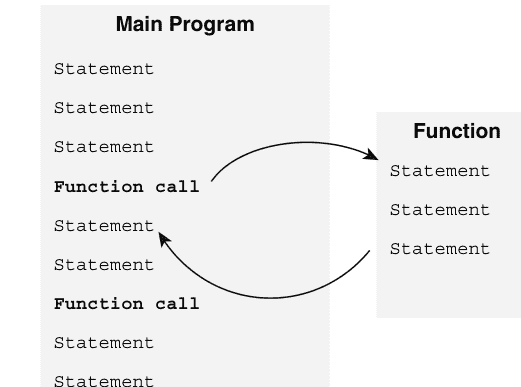

> 图 9-2 函数调用将执行转移到指定的函数；完成后完成后返回到之前的执行路径

### 函数的优点 (9.1.5, 9.1.6)

知识问答问题是程序员定义函数的一个案例。函数帮助你：

- 通过分组执行每个任务的函数来使代码模块化。
- 简化修改，因为它们更有可能只影响一个函数，而不是散落在程序各处的语句。
- 通过创建可以多次复用的函数来减少代码量。

### 9.2 空函数

### 空函数基础 (9.2.1, 9.2.2, 9.2.3, 9.2.4)

空函数是最简单的函数类型，因为它执行一个任务，例如显示消息而不返回任何值。你可以为知识问答程序创建一个空函数，在游戏开始时输出消息。

```cpp
function welcome()
    display "Welcome!"
    display "No online."
```

此函数和其他函数一样，以单行函数声明（或函数头）开始，指定了它的名称和其他描述符。函数名以`()`括号结尾，并使用与变量相同的名称。函数体是定义函数执行操作的语句块。

`welcome()`函数体中的两个语句直接输出消息。这些消息不会返回给主程序。因为函数没有返回内容，所以该函数是 void。图 9-3 展示了源代码中函数的组件。


图 9-3 函数的组件

### 函数伪代码 (9.2.5)

在读取函数的伪代码时，你可能会看到以下规范：

- 关键字`function`开始函数声明。
- 函数体缩进。
- 关键字`call`表示函数调用。
- 函数定义放在主程序之前，无论编程语言或解释器要求的位置如何。

这里是在知识问答游戏中为每个正确答案调用`correct()`函数的伪代码。请确保你识别出三行函数代码和两个函数调用。

```cpp
function correct()
    display "Correct"
    display "You earn 1 point"
```

```cpp
output "查帕拉湖是哪个国家最大的淡水湖？ "
input answer
if answer == "Mexico" then
    call correct()
    score = score + 1
else
    output "That is not correct."
```

```cpp
output "Mac Gargan 是哪个蜘蛛侠反派的化身？ "
input answer
if answer == "Scorpion" then
    call correct()
    score = score + 1
else
    output "That is not correct."
```

> 通过使用`correct()`函数，原始知识问答程序消除了多少代码？

对于每个问题，以下两行被简化为简单的`call correct()`。

```cpp
output "Correct!"
output "You earn 1 point."
```

### 9.3 带参数函数

### 函数参数 (9.3.1, 9.3.2)

如果你想创建一个函数，在答案正确时输出“Correct”，在答案错误时输出“Not correct”，该怎么办？为了输出适当的消息，函数需要知道答案是错是错。你可以向函数发送数据。例如，如果答案正确，可以发送 True；如果答案错误，则发送 False。

函数可以使用它接收到的数据进行计算、处理字符串、控制循环、输出消息并做出决策。带参数的函数使用发送给函数的数据作为参数。让我们来探索参数和参数之间的关系。

函数参数指定了函数可以接受的模板。这些参数作为变量列在函数的末尾。当你指定参数的类型时，它被称为类型化参数。图 9-4 显示如何创建一个带有一个参数的函数，该参数用于判断输出“Correct”还是“Not correct”。

```
correct ( ) 函数的参数是一个布尔变量 answer_is_correct。务确保为每个参数包含数据类型。例如，如果你有多个布尔参数（如 x 和 y），请使用如 my_function(bool x, bool y) 的格式。
由于 answer_is_correct 是布尔变量，它可以值为 true 或 false。追踪程序以便你理解 if 块如何使用 answer_is_correct 的值来输出正确的消息。
void (bool answer_is_correct)
{
 cout << "Correct!" << endl;
cout << "You earn 1 point." << endl;
}
else
 cout << "Not correct." << endl;
}
```

**图 9-4** 函数参数

### 实参数 (9.3.3, 9.3.4)

你如何获取参数的值？它从函数调用中的实参数接收值。函数实参数是传递给函数的数据。例如，你可以向`correct()`函数传递一个布尔值。查看图 9-5 中的函数调用及其实参数。

```cpp
void correct(bool answer_is_correct) {
    if (answer_is_correct) {
        cout << "Correct!" << endl;
        cout << "Each correct answer is worth 1 point." << endl;
    } else {
        cout << "Not correct." << endl;
    }
}
int main() {
    correct(false);
}
```

函数声明包含一个名为`answer_is_correct`的布尔参数，它将从函数调用中接收 false。

函数调用包含括号。在 C++ 中，布尔实参数必须小写。

**图 9-5** 实参数

### 图 9-5 中程序的输出是什么？

函数`correct()`的调用中的实参数包含一个布尔值，该值被传递给变量`answer_is_correct`。**图 9-6** 可以帮助你可视化这一交接过程。

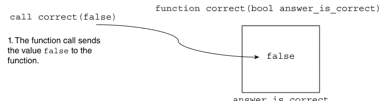

- 1. 函数调用向函数发送了值 false。
- 2. 该值被函数接收，并绑定到函数参数指定的变量上。

**图 9-6** 交接将实参数从函数调用复制到函数声明中指定的变量中

### 交接 (9.3.5, 9.3.6)

实参数与参数之间的交接是一个强大的编程工具。查看图 9-7 中的函数及其参数集合。注意该函数可以传递变量（如`topping`），也可以传递字面量（如 12 和 12.99）。

```cpp
在指定函数的参数时，请确保为每个参数包含数据类型。

#include <iostream>

using namespace std;

void receipt(int x, string y, float z)
{
    cout << "Your order:" << endl;

    cout << x << "-inch " << y << " pizza." << endl;
    cout << "Total $" << z << endl;
    cout << "Enjoy Trivia night!" << endl;
}

int main()
{
    string topping = "Veggie";

    receipt(12, topping, 12.99);
}

OUTPUT:
Your order:
12-inch Veggie pizza.
Total $12.99
Enjoy Trivia night!
```

**图 9-7** 函数可以有多个参数

在图 9-7 所示的程序中，哪个实参数传递给了`y`函数参数？

传递了实参数`topping`。因为变量`topping`包含字符串 "Veggie"，该字符串被传递给`y`函数并打印在屏幕上。

### 9.4 返回值

### 返回值 (9.4.1, 9.4.2, 9.4.3)

除了向函数传递数据外，你还可以使用函数末的`return`语句从函数返回数据。这些数据被称为返回值，可以用于主程序中的计算或其他操作。

让我们增强 Trivia 程序，让函数评估用户的答案以判断其是否正确。如果答案正确，函数输出“Correct!”并向主程序返回 1。如果答案不正确，程序输出“That is not correct.”并向主程序返回值 0。主程序使用该返回值来跟踪总分。

追踪以下伪代码以确保理解算法。

```
function check_answer(guess, correct)
  if guess is correct
    output "Correct!"
    return 1
  else
    output "That is not correct."
    return 0
```

```
output "Lake Chapala is the largest"
output "freshwater lake in which country?"
input answer
points = call check_answer(answer, "Mexico")
score = score + points
```

有很多内容。让我们一步步来看。

- 1. 函数调用向函数发送了值 false。假设用户输入 "Brazil"。
- 2. 该值被函数接收，并绑定到函数参数指定的变量上。
- 3. 传递了实参数`topping`。
- 4. 函数有两个参数：`guess`和`correct`。"Brazil" 被传递`guess`。
- 5. "Brazil" 不等于 "Mexico"，所以函数返回到主程序。
- 6. 0 被存储在`points`中。
- 7. 在主程序中，它被加到`score`中。

语句`points = call check_answer(answer, "Mexico")`中体现的概念是函数的核心优势。图 9-8 详细介绍了 Trivia 问题的代码。

```cpp
#include <iostream>
#include <string>
using namespace std;

int check_answer(string guess, string correct)
{
    if (guess == correct)
    {
        cout << "Correct!" << endl;
        return 1;
    }
    else
    {
        cout << "That is not correct." << endl;
        return 0;
    }
}

int main() {
    string answer;
    int points = 0;
    int score = 0;

    cout << "Lake Chapala is the largest" << endl;
    cout << "freshwater lake in which country? ";
    cin >> answer;
    points = check_answer(answer, "Mexico");
    score = score + points;
    cout << endl;

    cout << "Mac Gargan is the alter ego of" << endl;
    cout << "what Spider-Man villain? ";
    cin >> answer;
    points = check_answer(answer, "Scorpion");
    score = score + points;

    cout << "Your score: " << score << endl;
}
```

**图 9-8** Trivia 代码

OUTPUT:

```
Lake Chapala is the largest freshwater lake in which country? Mexico [Enter]
Correct!
Mac Gargan is the alter ego of what Spider-Man villain? Joker [Enter]
That is not correct.
Your score: 1
```

要在 Trivia 程序中添加另一个问题，可以复制并粘贴当前任一个问题的四行代码。在粘贴的文本中你需要修改什么？


你只需要修改问题的文本和正确答案即可。

## 返回类型 (9.4.4)

`Trivia`程序向主程序返回整数。你可能还会创建返回字符、浮点数或布尔数据的函数。返回类型对应函数返回给主程序的数据类型。**图 9-9** 提供了关于返回类型的信息。

```
语法：

return_type function_name(parameter_type parameter)

示例：

int check_answer(int guess, int correct)

float receipt(int pizza_size, bool trivia_winner)

bool check_id(int age)

string message(int score)
```

- 规则与最佳实践：

- 返回类型不需要与参数的数据类型匹配。

- 返回类型必须与你计划返回给主程序的数据类型匹配。

- 每个非空（`void`）函数都应该以`return`语句结束。

- `main()`函数的`return`语句是可选的。如果不包含它，C++ 编译器将返回 0。

**图 9-9** 指定返回类型

函数末尾的`return`语句将数据传回主程序。数据可以是字面量，例如 `"Mushrooms"` 或 `12.99`，也可以由变量表示，例如`topping`。**图 9-10** 展示了函数如何使用变量传递字符串。

```cpp
#include <iostream>
#include <string>
using namespace std;

string pizza() {
    string x = "Mushrooms";
    return x;
}

int main() {
    string topping = pizza();
    cout << topping << endl;
}
```

`pizza()`函数有一个返回类型。字符串 `"Mushrooms"` 被赋值给名为`x`的变量。`x`中的字符串被返回给主程序。返回值被赋值给名为`topping`的变量。

输出：

```
Mushrooms
```

规则与最佳实践：

- 你只能从函数中返回一个项目。

- 确保函数声明中的返回类型与返回数据的类型匹配。

- 你可以返回字面量，如 `"Cheese"` 或 `1`。

- 你还可以返回存储在变量中的值，例如`x`。


## 函数签名 (9.4.5)

函数签名的返回类型为编译器或解释器唯一地定义了一个函数。函数签名的组件包括以下内容：

- 函数名

- 函数参数

- 函数返回类型

在编程语言中，只要参数不同，就可能存在两个同名的函数。例如，你可以有一个签名名为`check_answer(guess, correct)`的函数，以及另一个签名名为`check_answer(validate)`的函数。

虽然可以存在同名的函数，但在实践中，你会发现为函数使用唯一的名称不容易产生困惑。

### 9.5 作用域

### 作用域基础 (9.5.1, 9.5.2, 9.5.3, 9.5.4)

这里有一个谜。假设你有一个变量`my_number`用作调用`experiment(my_number)`的参数。函数声明`(my_number)`也使用`my_number`作为参数。如果函数给`my_number`加 1，原始变量中的值会改变吗？

追踪以下伪代码。你认为输出是什么？

```
function experiment(my_number)
    output "Value passed to function : " + my_number
    my_number = my_number + 1
    output "Value after adding 1: " + my_number
    return my_number

my_number = 5
call experiment(my_number)
output "Value after returning to main program: " + my_number
```

输出是：

```
Value passed to function: 5

Value after adding 1: 6

Value after returning to main program: 5
```

你对主程序中的变量`my_number`没有被改为 6 感到惊讶吗？这个迷人的结果与作用域有关。

在编程语境中，作用域指的是程序组件（如变量）对程序其他部分的可见性。在`experiment()`函数中，变量`my_number`的作用域仅限于函数内部，程序其他部分无法访问。

通常情况下，限制在程序特定部分的变量被称为具有局部作用域。`experiment()`函数中的变量`my_number`是一个局部变量。

相比之下，全局变量可以在整个程序中访问。你如何知道哪些变量是局部的，哪些是全局的？图 9-1 回答了这个问题。以下程序包含一个全局变量`g_earth`、函数中的局部变量`village`以及主程序中的局部变量`town`。`g_earth`和`town`都可以被`main()`程序访问。在函数定义的局部变量`village`无法被`main()`程序访问并会产生错误。

```cpp
#include <iostream>
using namespace std;

int g_earth = 10;

void location() {
    int village = 2;
    cout << village << endl;
    cout << g_earth << endl;
}

int main() {
    int town = 5;
    cout << g_earth << endl;
    cout << town << endl;
}
```

输出：

```
main.cpp:16: error: use of undeclared identifier 'village'

cout << village << endl;

^

error generated.
```

规则与最佳实践：

- 全局变量定义在程序的开头，函数之前。

- 确保为全局变量指定数据类型。

- 一些程序员会在全局变量前加上`g`以注释它们是全局的。

- 在函数内部声明的变量会自动归类为局部的。不需要额外的代码。

- C++ 最佳实践避免使用全局变量，因为它们会破坏模块化，使程序更难以修改和调试。

只要作用域不同，就可能存在两个同名的变量。一个变量可能是局部的，另一个可能在函数中定义但作用域不同。

### 传值 (9.5.5)

好的，主程序中的`my_number`因为这些作用域不同，在以下伪代码中，函数给`my_number`加 1 对主程序没有影响。

```
function experiment(my_number)
    output "Value passed to function : " + my_number
    my_number = my_number + 1
    output "Value after adding 1: " + my_number
    return my_number

my_number = 5
call experiment(my_number)
output "Value after returning to main program: " + my_number
```

输出：

```
Value passed to function: 5

Value after adding 1: 6

Value after returning to main program: 5
```

传递给函数的参数是数据的副本。传值术语是指向函数传递数据的副本。即使主程序变量和函数变量同名，对局部变量的操作只会影响副本。图 9-12 强化了这一点，即使同名但作用域不同。

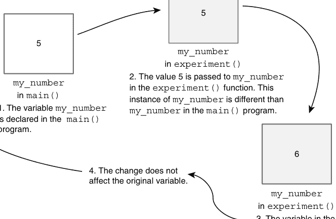

图 9-12 传值向函数发送数据

如果你想改变主程序中的`my_number`，请修改调用语句包含赋值：

```
my_number = experiment (my_number)
```

赋值语句显式地改变了主程序中的`my_number`。为了避免混淆主程序变量和函数变量，最好避免使用相同的标识符。

### 传引用 (9.5.6)

在某些编程语言中，可以创建直接修改非局部变量的函数。这些语言使用引用变量作为实际变量及其内存位置的别名。传引用是指使用引用变量作为函数参数调用。图 9-13 提供了关于引用的笔记。

引用变量以`&`开头。在以下源代码中，查看函数签名中的`&my_number`参数。注意最后一个输出值是 6，这意味着在函数中更改`my_number`改变了主程序中`my_number`使用的内存位置。

```cpp
#include <iostream>
using namespace std;

int experiment(int &my_number)
{
    cout << "Value passed to function: " << my_number << endl;
    my_number = my_number + 1;
    cout << "Value after adding 1: " << my_number << endl;
    return my_number;
}

int main()
{
    int my_number = 5;
    experiment(my_number);
    cout << "Value after returning to main: " << my_number << endl;
}
```

输出：

```
Value passed to function: 5

Value after adding 1: 6

Value after returning to main: 6
```

图 9-13 传引用

引用传递可以节省内存，因为不需要变量的拷贝。这也可以节省一些计算时间。在内存充足且配备了快速处理器的现代计算机中，这些节省与通过调用函数意外更改变量值的风险相比，是微不足道的。引用传递应保留用于具有明确算法的程序中的特殊情况。

## 命名空间 (9.5.7)

命名空间提供了一种管理变量作用域的方法。命名空间本质上是一个存储标识符的容器，以避免与其他同名的标识符发生冲突。

解释命名空间的一种简单方法是使用鞋码。9 码的男鞋和女鞋不同。为了区分两者，鞋类制造商使用“男鞋 9 码”或“女鞋 9 码”。同样，命名空间的作用是区分可能相同的变量。

命名空间可以是隐式的，也可以是显式的。

- **隐式命名空间**。隐式命名空间由你的编程语言处理。例如，一个函数为它包含的变量定义了一个命名空间。主程序的命名空间可能包含一个名为`my_number`的变量，而实验 (1) 函数的命名空间可能包含另一个也叫`my_number`的变量。

- **显式命名空间**。程序员通过声明来创建显式命名空间。一旦声明了命名空间，就可以将变量分配给它。命名空间与变量名的组合为变量提供了唯一标识符，如**图 9-14** 所示。

```
using namespace std; namespace module_1; namespace module_2;

vip module_1::player module_2::player
question_1 module_1::score_board module_2::question_1
my_number module_1::my_number module 2::my_number
```

- 规则和最佳实践：

- 要声明命名空间，以`namespace`关键字开始。

- 以分号结束命名空间语句。

- 使用变量和两个冒号作为命名空间的前缀，例如`module_1::player`。

- 要使用标准命名空间，在程序开头包含`using namespace std;`。

- 当使用标准命名空间时，变量不需要命名空间前缀。

**图 9-14** 命名空间

命名空间对于大型项目以及由编程团队的代码特别为重要。在这些大型项目中，命名空间有助于确保其作用域内的变量和其他标识符不会与程序其他部分使用的相同名称混淆。

# 总结

- 函数是执行特定任务的程序调用代码块，并有名称。

- 内置函数始终可用，不需要导入模块、库、包或其他组件。

- 导入的函数封装在库和模块中。它们通常是分发性的，但需要使用语句（如`include`或`import`）显式地添加到程序中。

- 程序员定义的函数由你（程序员）创建，用于在程序中执行自定义操作。

- 函数通过分组执行特定任务的语句来帮助程序员实现代码模块化。

- 函数通过创建可以在程序中多次重用的代码块来减少开销。

- 函数帮助程序员高效地调试，因为代码被封装在离散组中。

- 函数声明可以包含函数名、返回类型、参数和参数类型。

- 函数体包含定义函数作用的语句，并可能包含一个`return`语句。

- 函数可以由程序中多个位置的函数调用触发。函数调用可以包含传递给函数参数的参数。

- 函数可以通过`return`语句将数据传回调用者。

- 函数中的变量与主程序或其他函数的变量作用域不同。在函数中声明的变量具有局部作用域，使其仅在函数内部可见。具有全局作用域的变量在整个程序可见。

- 在函数的上下文中，传值是指将参数的拷贝传递给函数的调用。

- 引用传递是指将持有参数的变量的指针传递给函数的调用。

- 命名空间是一个命名的容器，存储标识符名称以防止与同名标识符冲突。

# 关键术语

| 函数参数 | 函数签名 | 引用变量 |

|---|---|---|

| 函数体 | 全局变量 | 返回类型 |

| 函数调用 | 局部变量 | 返回值 |

| 函数声明 | 命名空间 | 作用域 |

| 函数名 | 引用传递 | 分类型参数 |

| 函数参数列表 | 传值 | 空函数 |

## 模块 10

## 递归

### 学习目标：

- 10.1 递归的关键组件

- 10.1.1 将递归定义为一种问题解决方法。

- 10.1.2 描述递归的。

- 10.1.3 解释递归函数的组成。

- 10.1.4 列出递归的优缺点。

- 10.2 使用递归解决复杂问题

- 10.2.1 解释递归的应用，

- 10.2.2 区分递归算法与使用重复控制结构的算法。

- 10.2.3 定义解决问题的“分治法”方法。

- 10.2.4 分析如何使用基准情况和递归用例来将递归实现到迭代过程中。

- 10.2.5 使用递归构建一个过程化程序（伪代码）。

- 10.3 在递归过程中管理内存

- 10.3.1 解释内存管理及其在递归中的重要性。

## 10.1 递归的关键组件

总而言之，计算机科学是将问题分解为更小、相同问题的解决方法。相同的步骤被应用于每个更小的问题版本，尽管限制条件不同，就像数字游戏的上限和下界一样。

玩这个游戏最有效的方法是从 50 开始。你的策略如下：

- 猜一个最小和最大值中间的数字。

- 如果被告诉“大”，将最小数字更新为这个猜测值。

- 如果被告诉“小”，将最大数字更新为这个猜测值。

- 重复步骤 1-3 直到你猜对。

你在数字游戏中使用这种策略时，你正在将一个大问题分解为相似的问题。每个部分都可以一直分解，直到问题小到容易解决。最终，猜数字游戏会消除除一个待猜数字以外的所有数字。图 10-1 显示了游戏的示例，从 1 和 10 开始。

递归思维 (10.1.2)

假设你正在玩一个游戏，你的朋友正在心里想一个 1 到 100 之间的数字。你的第一次猜测是中间值，50。如果你的朋友回答“大”，你现在知道范围是 50 到 100。你的下一次猜测是中间值，75。如果你的朋友回答“小”，你现在知道范围是 50 到 75。你的下一次猜测是中间值，62。如果你的朋友回答“小”，你现在知道范围是 50 到 62。你的下一次猜测是中间值，56。如果你的朋友回答“小”，你现在知道范围是 50 到 56。你的下一次猜测是中间值，53。如果你的朋友回答“小”，你现在知道范围是 50 到 53。你的下一次猜测是中间值，51。如果你的朋友回答“小”，你现在知道范围是 50 到 51。你的下一次猜测是中间值，50。如果你的朋友回答“是”，你就找到了这个数字。

图 10-1 数字猜游戏

## 10.1 递归的关键组件 递归 167

### 可能的答案

| 1 | 2 | 3 | 4 | 5 | 6 | 7 | 8 | 9 | 10 |

你问：“数字是 5 吗？”

朋友：“不是，比 5 大。”

| 1 | 2 | 3 | 4 | 5 | 6 | 7 | 8 | 9 | 10 |

你问：“数字是 8 吗？”

朋友：“不是，比 8 小。”

| 1 | 2 | 3 | 4 | 5 | 6 | 7 | 8 | 9 | 10 |

你问：“数字是 6 吗？”

朋友：“是的！”

### 正确答案！

| 1 | 2 | 3 | 4 | 5 | 6 | 7 | 8 | 9 | 10 |

**图 10-2** 猜 1 到 10 之间的数字

### 递归基础 (10.1.3)

递归思维使用函数来解决问题。以下是对函数事实的简要回顾：函数就像任何其他代码块。你在一个代码块中可以做的任何事情在另一个中也可以做。因此，函数可以调用其他函数。这是优雅设计的关键之一。递归函数调用自身。在每次递归调用中，函数使用修改后的参数来缩小问题的规模。对于数字游戏，如果你不在递归调用中修改参数，递归函数就不会停止；这被称为无限递归。

# 无限循环和无限递归有什么区别？

在无限循环中，用于测试停止循环的变量没有被修改，导致条件语句始终保持为假（`False`）。在无限递归中，问题规模从未从影响因素中减少。你需要让问题变得更小，递归才能找到解决方案。

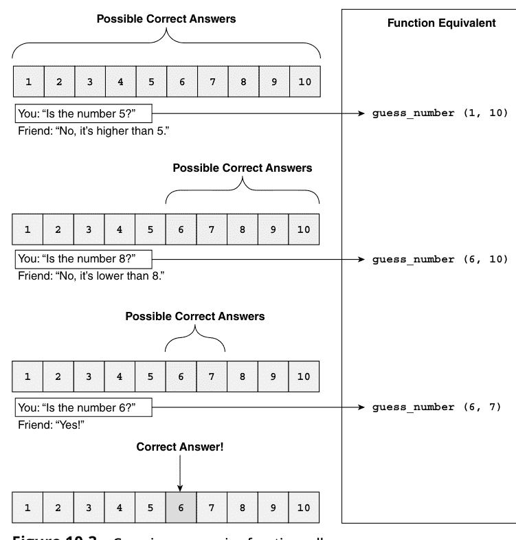

**图 10-3** 显示了图 10-2是如何使用函数调用的。


在游戏中，当你正确猜中数字时就会停止。这是一个基准情况（base case）的示例，即你应该停止尝试解决问题的条件。一类基准情况表示提前退出函数。如果你在猜数字游戏中猜中了正确的数字，你可以停止而无需更新数字范围。

基准情况也可以代表一个小到可以快速解决的问题。例如，如果你没有数字可以猜了，你就知道你的朋友在题目中犯了错误，你需要告诉她。递归函数可以有多个基准情况，例如一个用于提前退出函数，另一个用于在问题较小时解决解决问题。

和普通函数一样，递归函数也可以返回一个值。如果递归函数不需要返回信息，递归是非常简单的。一个使用递归打印 1 到 10 数字的简单程序可以设计如下：

```
function display_numbers(n)
  if n > 10
    return
  else
    display n
    call display_numbers(n + 1)
```

逐行查看此程序以了解它是如何工作的。第一行的函数语句表示你正在创建一个名为 `display_numbers` 的函数。括号中的 `n` 表示此函数接受一个参数。`if-else` 块设置了条件：如果 `n` 大于 10，函数将返回而不执行任何操作。输出显示存储在 `n` 中的值，并调用自身，这次值增加了 1。

如果递归函数需要返回一个值，它就会在链中传递信息。就像玩传声筒游戏，人们围成一圈，只能叫两个人：右边的人和左边的人。如果右边的人必须将信息返回给调用者，他们会告诉左边的人，对方再告诉左边的人，以此此类推，直到信息到达队伍首头的第一个个人（好消息是，计算机在传递过程中不会搞混信息，而这在玩传声筒时通常会发生）。例如，计算 1 到 10 数字之和可以设计如下：

```
function add_numbers(n)
  if n < 1
    return 0
  else
    initialize sum = n + call add_numbers(n - 1)
    return sum
```

此函数只有一个参数，但现在期望获得一个返回值。

如果 `n` 为 0，返回的值是什么？

如果 `n` 为 0，满足了基准情况 `n < 1`，因此返回 0。

如果 `n` 为 1，返回的值是什么？

如果 `n` 为 1，函数会进行递归调用，并在结果上加 1。递归调用将 0 传递给 `add_numbers`，后者返回 0。返回值是 1。

返回值是 1 到 `n` 之间所有值的之和。在这里，每个函数都向递归调用请求其结果，然后将其加到 `sum` 中。

递归可以代表单行的问题解决，就像猜数字游戏的示例一样。这种递归函数调用自己一次，被称为线性递归（linear recursion）。线性递归是最容易编写的；本模块中的大多数示例都是线性递归。其他版本的递归被称为分支递归（branching recursion），它们不限于一次递归调用。图 10-4 和 10-5 显示了这两种递归流是如何工作的。

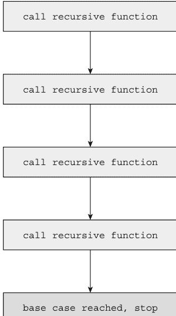

# 图 10-4 线性递归函数调用

如图 10-4 所示的线性递归，每当代码访问函数时，函数最多调用自己一次，或者在到达基准情况时停止。

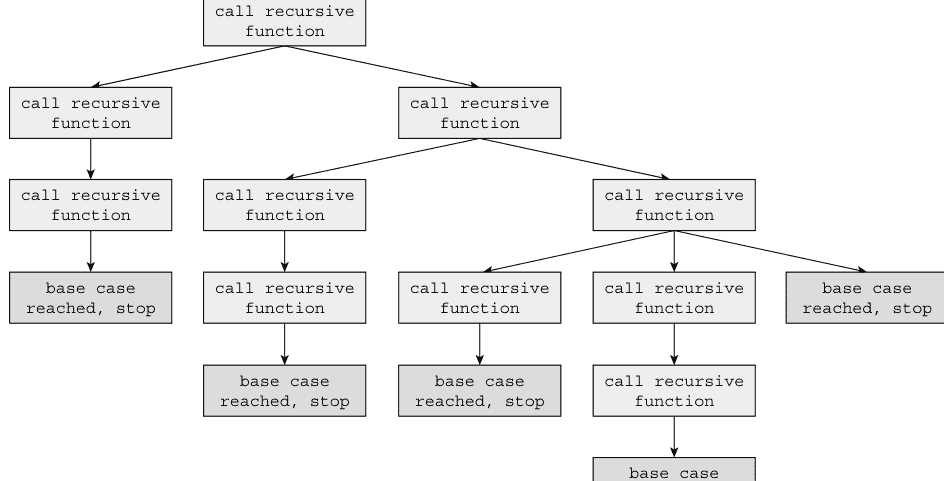

# 图 10-5 分支递归函数调用

如图 10-5 所示的分支递归，每当代码访问函数时，函数会调用自己一次或多次，或者在到达基准情况时停止。

## 何时使用递归 (10.1.4)

在决定是否使用递归解决问题时，问自己以下问题：

- 这个问题可以分解为更小的问题吗？
- 较小的问题与大问题相同吗？
- 是否有方法将问题分解为容易解决的子问题？

递归和循环可能是相似的，通过扫描并在脑中记住何时使用其中一个设计程序更简单。这两者就像锤子和锯子。技术上，你可以用锤子敲断半块木头，但使用适当的工具会容易得多。

> 什么时候应该使用循环？什么时候应该使用递归？

当你需要在不改变现状的情况下执行相同操作时，使用循环。当你需要减少问题规模时，使用递归。

174 C++ 编程

第一个参数

修改

# 迭代

```
for current_number (start: 1; test <= 10; increment: 1)
display current_number
```

基本情况 (base case)

## 递归

```
function display_numbers(current_number)
if current_number > 10
    return
else
    display current_number
    call function display_numbers(current_number + 1)
```

基本情况 (base case)

第一个参数

修改

图 10-7 用于执行相同任务的循环和递归

某些递归可以增量地修改其参数，例如在 `display_numbers` 中加 1。另一种设计递归代码的方法被称为“分治法”。正如其名称所示，你为了解决问题而将其拆分。你在猜数字游戏中就体会到了这一点。每当你猜一次，都会将可能答案的范围缩小一半。最终，你通过猜出正确的数字来解决问题。

# 线性递归 (10.2.4, 10.2.5)

识别递归问题与判断何时应该使用循环相似。你可以在递归中解决一组较小的问题。如果是这样，请使用循环或线性递归。迭代问题的一个例子是累加 1 到 10 的数字。接这个循环采取了迭代方法：

```
initialize count = 0
for number (start: 1; test <= 10; increment: 1)
compute count = count + number
display count
```

你将如何把这段伪代码转换为递归？

使用检查清单。从基本情况开始，基本情况是检查当前数字是否大于 10（而不是小于或等于 10）的测试用例，因为这是停止递归的地方。增量（increment）是你如何修改参数的，起始（start）是你如何进行第一次递归调用的。

以下伪代码使用线性递归来累加 1 到 10 的数字：

```
function add_numbers(count, current_number)
  if current_number > 10
    return count
  else
    initialize next_count = count + current_number
    initialize next_number = current_number + 1
    return call function add_numbers(next_count, next_number)
```

你能对线性递归伪代码应用递归检查清单吗？

基本情况是 `current_number > 10` 的那行。两个 `initialize` 语句修改了参数。递归调用和返回值在最后一行。

要显示结果，显示 `add_numbers` 返回的值，从 `count` 和 `current_number` 参数的 0 和 1 开始：

```
display function add_numbers(0, 1)
```

输出结果是 55，即 1 到 10 数字之和。

# 分支递归 (10.2.5)

某些问题比迭代设计能处理的要复杂。想象一个包含文件和其他文件夹的计算机文件夹。假设你想统计主文件夹中的 `.txt` 文件。假设以下函数已经准备就：

- `get_files`：给定名称，该函数返回文件夹中所有文件的数组。存储结果的变量在其名称旁边需要加上方括号 `[]` 以显示它是一个数组。
- `total_files`：给定名称，该函数返回文件夹中文件的总数。
- `ends_with`：给定一个文件和一个扩展名，如果文件名以该扩展名结尾，该函数返回 True 或 False。

你能用迭代的方法解决吗？你可以使用 `for` 循环测试每个文件，并为每个带有 `.txt` 扩展名的文件计数加 1：

```
input folder
get files[] = call function get_files(folder)
get size = call function total_files(folder)
initialize count = 0
for index (start: 0; test < size; increment: 1)
  if call ends_with(files[index], ".txt")
    count = count + 1
```

回想斐波那契数列从 10 个数字开始：1, 1, 2, 3, 5, 8, 13, 21, 34, 55。代码是如何计算第 11 个斐波那契数的？`fibonacci` 函数接收 11 作为参数。由于数字不是 1 或 2，因此 `fibonacci` 函数以参数 10 (`n - 1`) 和 9 (`n - 2`) 递归调用。第一个 `fibonacci` 函数返回 55，第二个返回 34。将返回的值相加以找到斐波那契数列的下一个数字，即 89。

要编写斐波那契数列，请参见图 10-8。

```cpp
#include <iostream>

using namespace std;

int fibonacci(int n)
{
    // 基础情况
    if (n == 1 || n == 2)
        return 1;

    // 寻找 n - 1 的斐波那契数
    int n1 = fibonacci(n - 1);

    // 寻找 n - 2 的斐波那契数
    int n2 = fibonacci(n - 2);

    // 相加并返回结果
    return n1 + n2;
}

int main()
{
    int n;

    cout << "Enter a number: ";
```

图 10-8 用于编写斐波那契数列的 C++ 代码（续）

```cpp
cin >> n;

int fibonacci_n = fibonacci(n);

cout << "The Fibonacci number is " << fibonacci_n << endl;

return 0;
```

输出：

```
Enter a number: 6

The Fibonacci number is 8
```

图 10-8 用于编写斐波那契数列的 C++ 代码

## 10.3 递归过程中的内存管理

### 内存管理 (110.3.1, 10.3.2)

当函数多次调用自身时，程序运行时可能需要大量内存。计算机会预留一块内存来跟踪程序的状态。该内存块包含了程序中所有变量的名称以及存储在每个变量中的值。

以下代码计算了从 1 到 10 的数字和。

```
function sum(current_number)
  if current_number = 0
    return 0
  else
    initialize sum_total = call sum(current_number) - 1
    return current_number + sum_total
call sum(10)
```

> 代码需要记住多少变量？

`return current_number + sum_total` 这一行紧随 `sum` 函数的递归调用。这意味着程序在递归调用返回后必须记住 `current_number`。每当调用函数时，都会为其生命周期分配另一个内存块，只要不再需要，该函数就会返回。`call(10)` 意味着代码需要记住 11 个变量。

图 10-9 概述了代码在调用 `sum(10)` 时处理变量的内存情况。

```
function sum(current_number)
  if current_number = 0
    return 0
  else
    initialize sum_total = call function sum(current_number - 1)
    return current_number + sum_total
```

| 递归调用 | 内存块 |
|---|---|
| `call function sum(10)` | `current_number = 10` |
| `call function sum(current_number - 1)` | `current_number = 9` |
| `call function sum(current_number - 1)` | `current_number = 7` |
| `call function sum(current_number - 1)` | `current_number = 6` |
| `call function sum(current_number - 1)` | `current_number = 5` |
| `call function sum(current_number - 1)` | `current_number = 4` |
| `call function sum(current_number - 1)` | `current_number = 3` |
| `call function sum(current_number - 1)` | `current_number = 2` |
| `return 0` | `current_number = 1` |

# 图 10-9 调用 `sum(10)` 需要 11 块内存

每当一个递归函数结束时，它都会返回到其直接之前的内存状态。计算机使用称为“栈”（stacks）的数据结构来存储递归调用的内存块。就像煎饼堆一样，你只能将新的煎饼放在顶部，并且只能从顶部取煎饼。每当调用递归函数时，一个新的内存块会被放在栈的顶部，如图 10-10 所示。

# 模块 10 递归 181

call function sum(3)

call function

sum(current_number - 1)

call function

sum(current_number - 1)

call function

| current_number = 0 |

| current_number = 1 |

| current_number = 2 |

| current_number = 3 |

| current_number = 2 |

| current_number = 1 |

| current_number = 2 |

| current_number = 3 |

| current_number = 3 |

| Stack |

每当函数调用自身时，一个新的内存块就会被放在栈的顶部。

**图 10-10** 递归函数调用的内存栈

每当一个函数结束时，栈顶会被移除，如**图 10-11** 所示。

| return 0 |

| return current_number + sum_total |

| return current_number + sum_total |

| return current_number + sum_total |

| current_number = 0 |

| current_number = 1 |

| current_number = 2 |

| current_number = 3 |

| current_number = 2 |

| current_number = 1 |

| current_number = 2 |

| current_number = 3 |

| current_number = 3 |

| Stack |

每当函数调用自身时，一个新的内存块就会被放在栈的顶部。

**图 10-10** 递归函数调用的内存栈

每当一个函数结束时，栈顶会被移除，如**图 10-11** 所示。

# 第 11

## 异常

### 学习目标：

### 11.1 定义异常

- 11.1.1 解释在计算机无法继续运行时抛出异常的使用。
- 11.1.2 将异常定义为一种触发的事件。
- 11.1.3 描述逻辑错误（可以通过阅读代码发现）与运行时错误之间的区别。
- 11.1.4 将异常对象定义为关于发生了什么信息的数据包。
- 11.1.5 对比默认异常与特定异常类型。
- 11.1.6 解释不同类型的异常代表不同的错误。
- 11.1.7 解释某些语言具有预定义的异常类型。

### 11.2 处理异常

- 11.2.1 解释将尝试（try）和错误处理（handling）作为逻辑流控制。
- 11.2.2 解释代码如何尝试实现某个目标。
- 11.2.3 解释当 `try` 块中的代码失败时会发生什么。
- 11.2.4 解释如何使用捕获（catching）进行错误处理。
- 11.2.5 描述全捕（catch-all）与捕获特定异常之间的区别。
- 11.2.6 解释在 `try` 块中包含语句的良好设计。

### 11.3 使用异常

- 11.3.1 讨论异常处理与健壮代码相比优缺点。
- 11.3.2 解释引起异常的语句（raise/throw）。
- 11.3.3 描述在程序中添加异常的最佳实践。
- 11.3.4 追踪通过 `try` 块语句变体执行执行流。

### 11.1 定义异常

### 代码中的错误 (11.1, 11.1.2, 11.1.3)

作为程序员，你面对的一个事实是你必须调试代码来修复错误。逻辑错误可能对你来说最熟悉：代码部分是不正确的，但它仍然运行并产生输出。例如，你可能在想要检查小于零的数字时却在检查大于零的数字。通常，逻辑错误是通过阅读代码发现的。

逻辑错误与语义错误不同，后者是由编译器捕的。如你所知，运行时错误是程序中的缺陷，导致其在执行期间失败。

另一种类型的问题可能会在程序运行时中断它。假设你正在编写一个游戏的一部分，其中有一个名叫 Iceabella 的角色。她可以为你和别人制作冰淇淋，只要你带给她足够的冰和奶油（图 11-1）。如果你在给她任何奶油之前向角色索要冰淇淋，她应该怎么办？她应该还是创建冰淇淋吗？她应该关闭她的冰淇淋机吗？或者，她应该告诉你哪里有问题以便你修复？


**图 11-1** 冰淇淋制作游戏

理想情况下，当程序无法按照指令执行任务时，它应该优雅地通知用户。如果 Iceabella 只有在先给她奶油的情况下才能制作冰淇淋，程序必须在 Iceabella 尝试制作冰之前确保这些条件得到满足。例如，程序可以显示消息提醒你 Iceabella 需要奶油，并将等待你提供。

代码还具有前置条件，即代码工作需要为真的断言（assertions）。如果没有满足前置条件，代码应该以优雅的方式失败，而不是在异常情况下崩溃。

在编程中，异常情况被称为**异常**（exception），它是程序运行期间发生的意外事件，并阻止程序完成执行。这种异常情况被认为“触发”了异常并中断了正常流。

如果说错误是调试应该修复的设计缺陷，那么异常则是防止程序部分无法解决问题。异常提供了一种方法让程序的一个部分向另一部分寻求帮助。图 11-2 显示了两个程序之间的工作流通信。

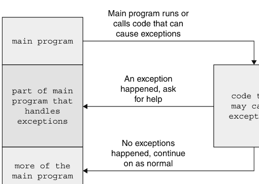

**图 11-2** 正常代码与带有异常代码之间的通信

当主程序遇到可能导致异常的代码时，程序流可以通过两种方式继续。如果没有发生异常，流可以向主程序返回一个值。如果发生异常，代码会寻求帮助并被转移到主程序中处理异常的部分。程序的该部分将解决异常，程序继续运行。

一个健壮的、编写良好的程序会在本可以继续运行的情况下检查异常，并对异常做出适当响应。这意味着程序员必须检查异常并编写处理它们的代码。程序可以检测意外错误并管理它们，而不会让意外情况导致程序停滞。

## 异常类型（11.1.4、11.1.5、11.1.6、11.1.7）

程序员将异常视作事件，但异常也可以是指示哪里出现问题的各种数据包。这些信息可以是简单的数字代码或字符串描述，也可以是更复杂的信息包，包括异常发生的状态和异常类型。

编程语言提供通用异常，可以用于所有情况。使用默认异常更容易获知。特定异常代表特定类型的错误。它们告诉程序员问题的类型。例如，在冰淇淋视频游戏中，Iceabella 声称她无法制作并不能帮助你理解如何修复问题。如果她告诉你需要奶油，你就知道需要给她奶油。特定异常缩小了解决问题的范围，并让程序返回正常流。

许多特定异常（随编程语言不同）供程序员使用。图 11-3 显示了一些你可能需要的常见异常。

| 类型 | 情况 | 示例 |
|---|---|---|
| `bad_alloc` | 分配新内存失败 | 在没有内存存储时尝试分配新内存 |
| `bad_function_call` | 调用函数失败 | 在未定义的情况下调用函数 |
| `invalid_argument` | 向要求特定格式的函数或方法传递参数 | 向二进制计算器传递 "0123" |
| `domain_error` | 给数学函数超出范围的数字 | 向平方根函数传递 -5 |
| `out_of_range` | 访问的线性数据结构大于最大索引 | 数据结构只有五个项目时访问索引 10 |
| `system_error` | 错误源自系统或程序外部 | 操作系统错误 |
| `bad_array_new_length` | 由于提供的尺寸无法创建新数组 | 创建大小小于零的数组 |
| `bad_exception` | 动态异常导致错误 | 本应引起 `bad_alloc` 错误的函数反而导致了溢出错误 |

**图 11-3** 常见异常

编程语言提供参考（通常在网上）来定义它们的异常类型。程序员有责任了解或知道如何查找他们所用语言中可用的异常类型。大多数编程语言还允许你为特殊情况创建自己的异常类型。例如，在 Iceabella 的例子中，你可能会创建一个特定的 `no_cream_error`。

## 你应该使用默认异常来处理一切吗？

不。以相同的方式处理所有事情将类似于只显示通用的计算机消息。“发生了一些错误”没有“你无法打印文档，因为打印机缺墨”那么有用。

## 11.2 处理异常

### 处理他人的异常（11.2.1、11.2.2）

假设你正在编写一个图像编辑器，它需要一个函数库来为你加载和显示图像。程序的正常流程假设该库运行正常：程序将图像加载到屏幕上，然后让用户修改图像并将其保存到存储设备上。

如果你的程序由于某种原因无法加载图像，它会做什么？例如，程序可能找不到图像文件，或者格式不正确。你可以采取几种方法来处理此问题，这取决于你所使用的函数库提供了哪些工具，例如显示错误消息或默认图像。图像库的程序员并没有规定你的方法，而是通过抛出异常（throwing an exception）让你能够控制你的程序。你可以编写代码来检测异常并按你认为最佳的方式进行处理。

检测异常的代码使用的逻辑结构类似于 `if-else` 块。程序的逻辑流根据是否发生异常而改变。通常情况下，在处理异常时，程序会尝试执行某些操作并捕获代码中发生的所有异常。

### Try 和 Catch 块（11.2.3、11.2.4、11.2.5、11.2.6）

你可以使用程序流控制来尝试和捕获异常。这种程序流控制被称为 `try-catch` 块（某些语言包括 Python，将这种程序流控制称为 `try-except` 块）。`try-catch` 块包含两个部分：`try` 块和 `catch` 块。如果条件正常且没有东西中断程序流，`try` 代码将尝试继续执行。如果在 `try` 块中抛出了异常，程序流将移动到 `catch` 块。图 11-4 显示了 `try-catch` 块的流程图。

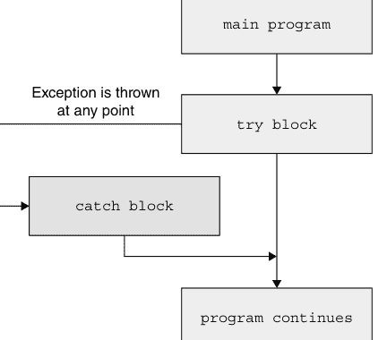

**图 11-4** `Try-catch` 块逻辑流

## 使用 C++ 编程

如果没有抛出异常，程序将通过 `try` 块并正常执行。如果在 `try` 块中抛出了异常，程序将停止执行 `try` 块中的代码，并跳转到 `catch` 块的开头。

与 `if-else` 语句不同，`try` 块在检测到异常时会停止执行代码。`catch` 块可以修复问题，也可以完全停止程序。修复问题可以采取许多形式，例如使用默认值填充缺失的信息、显示错误消息或在文件中记录错误。

图 11-5 显示了调用两个函数的简单示例的伪代码。箭头显示了程序在每个点所采取的路径。

### 图 11-5 伪代码流程示例

在图 11-5 中，`function1` 和 `function2` 分别抛出一个异常。第一个函数可以抛出特定异常，而 `function2` 则由默认异常处理。如果任何一次调用触发了异常事件，逻辑将根据捕获到的异常跳转到相应的 `catch` 块。当代码到达 `try` 块或 `catch` 块的末尾时，它将跳转到 `try-catch` 块之后的行（显示“继续程序。”）以继续程序。

以下代码演示了如何加载和显示图像。该代码使用了名为 `load_image` 的内置函数，代码结构用于处理图像无法加载的情况。

```text
try
  initialize image = call library load_image("cat.png")
catch exception
  display "Could not display the cat picture."
  display image
```

### 考虑上面的示例。语句的顺序有什么问题？

最后一行（`display image`）被放置在 `try-catch` 之外。显示图像只有在图像加载成功时才有效。如果程序尝试显示未正确加载的图像，程序可能会在最后一行崩溃。

在之前的代码中，如果 `load_image` 函数无法显示 `cat.png` 文件，它可能会抛出异常。然而，只有当 `load_image` 能找到并检索图像文件时，`display image` 才能正常工作，因此显示语句属于 `try` 块。你能将所有依赖于可能抛出异常的函数的代码都包含在 `try` 块中吗？以下伪代码通过将 `display image` 包含在 `try` 块中解决了这个问题。

```text
try
  initialize image = call library load_image("cat.png")
  display image
catch exception
  display "Could not display the cat picture."
```

当 `try` 块中的语句失败并抛出异常时，它会信号程序停止执行该块。如果初始化图像失败（程序找不到它）或显示图像失败（未连接屏幕），代码将跳过 `display image` 语句并跳转到 `catch` 块。如果 `try` 块在没有抛出异常的情况下完成，它将跳过 `catch` 块。如果没有发生异常，就没有东西可以捕获。

使用 `catch` 语句捕获通用异常会使 `try` 块中的任何异常跳转到 `catch` 块。通用消息“Could not display the cat picture.”适用于通用异常，但对于试图解决问题的用户来说，更具体的get会更有帮助。或者，你可以编写代码来检测特定异常，如下所示：

```text
try
  initialize image = call library load_image("cat.png")
  display image
catch file_not_found exception
  display "Could not find the cat picture."
```

使用特定的内置异常（如 `file_not_found`），你可以显示适用于该异常的更有帮助的消息，例如“Could not find the cat picture.”用户可以通过存储所需的文件来解决该问题。使用 `catch` 语句捕获异常可以使 `try` 块中的任何异常跳转到 `catch` 块。

```text
try
  initialize image = call library load_image("cat.png")
  display image
catch file_not_found
  display "Could not find the cat picture."
catch format_not_supported
  display "The cat picture is in the wrong format."
```

第二个 `catch` 语句处理了第二个异常——程序找到了指定的文件，但格式错误。

现在思考你如何编写与 Isabella 的交互。假设交互是一系列你可以调用的函数：`make_ice_cream`、`add_cream` 和 `add_ice`。程序的开头如图 11-6 所示。

```cpp
#include <iostream>

using namespace std;

int main()
{
    int choice = -1;
    int amount;

    cout << "Welcome to the Fantasy Ice Cream Shop!";
    cout << "What do you want to do?" << endl;
    while (choice != 0)
    {
        cout << "  1: Make ice cream" << endl;
        cout << "  2: Add cream" << endl;
        cout << "  3: Add ice" << endl;
        cout << "  0: Quit" << endl;

        cout << "> ";

        cin >> choice;

        if (choice == 1)
        {
            make_ice_cream();
        }
        else if (choice == 2)
        {
            cout << "How much?";
            cin >> amount;
            add_cream(amount);
        }
        else if (choice == 3) {
            cout << "How much?";
            cin >> amount;
            add_ice(amount);
        }

        cout << endl;
    }

    return 0;
}
```

### 图 11-6 与 Isabella 交互的程序

为了简单起见，假设可能发生的异常只有：

1. 添加负数量的奶油
2. 添加负数量的冰块
3. 在没有奶油时尝试制作冰淇淋
4. 在没有冰块时尝试制作冰淇淋

图 11-7 显示了处理这些异常的一种方法，尽管这种方法并不是理想的。依赖于 Isabella 函数调用的代码位于 `try` 块中，因此避免了之前伪代码中显示的问题。然而，所有功能（包括不依赖 Isabella 的部分）现在都在 `try` 块中。

```cpp
#include <iostream>
#include <exception>
#include <stdexcept>
using namespace std;

int main() {
{
    try {
        int choice = -1;
        int amount = 0;

        cout << "Welcome to the Fantasy Ice Cream Shop!";
        cout << " What do you want to do?" << endl;
        while (choice != 0) {
            cout << " 1: Make ice cream " << endl;
            cout << " 2: Add cream " << endl;
            cout << " 3: Add ice " << endl;
            cout << " 0: Quit" << endl;
        }

        cout << " > ";

        cin >> choice;

        if (choice == 1) {
            make_ice_cream();
        }
        else if (choice == 2) {
            cout << "How much?";
            cin >> amount;
            add_cream(amount);
        }

    }
```

**图 11-7** 用 `try-catch` 块包含所有代码的程序（续）

```cpp
        else if (choice == 3)
        {
            cout << "How much?";
            cin >> amount;
            add_ice(amount);
        }

        cout << endl;
}
catch (runtime_error e)
{
    cout << "Error happened " << e.what() << endl;
    return 0;
}
}
```

**图 11-7** 用 `try-catch` 块包含所有代码的程序

如果在图 11-7 所示的代码中没有奶油且你要求制作冰淇淋，会发生什么？

如果发生任何错误，与 Isabella 的整个交互将停止。异常将停止 `try` 块中的所有代码并跳转到 `catch` 块。在这种情况下，这意味着程序将完全停止。你仍然希望 Isabella 能继续与你交互，即使你提出了一个无法实现的请求。

考虑**图 11-8** 中的替代方法。这种方法中只有代码的函数调用被 `try` 块包围，而 `catch` 块会显示发生了什么问题。

```cpp
#include <iostream>
#include <exception>
#include <stdexcept>
#include <string.h>

using namespace std;
int main()
```

**图 11-8** 包含抛出异常代码的 `try-catch` 块（续）

```cpp
{
  int choice = -1;
  int amount = 0;

  cout << "Welcome to the Fantasy Ice Cream Shop!";
  cout << " What do you want to do?" << endl;
  while (choice != 0) {
    cout << " 1: Make ice cream" << endl;
    cout << " 2: Add cream" << endl;
    cout << " 3: Add ice" << endl;
    cout << " 0: Quit" << endl;
    cout << " > ";
    cin >> choice;

    try {
      if (choice == 1) {
        make_ice_cream();
      } else if (choice == 2) {
        cout << "*How much?";
        cin >> amount;
        add_cream(amount);
      } else if (choice == 3) {
        cout << "*How much?";
        cin >> amount;
        add_ice(amount);
      }
    }
  }
}
```

**图 11-8** `try` 块包含异常代码的程序（续）


```cpp
}
catch (runtime_error e) //--- catch 块解释发生了什么问题
{
    const char* type = e.what();

    if (strcmp(type, "cream") == 0)
    {
        cout << "I don't have enough cream." << endl;
    }
    else if (strcmp(type, "ice") == 0)
    {
        cout << "I don't have enough ice." << endl;
    }
    else if (strcmp(type, "amount") == 0)
    {
        cout << "You can't add a negative amount." << endl;
    }

    cout << endl;

    return 0;
}
}
```

**图 11-8** 用 `try-catch` 块包含抛出异常代码的程序

图 11-8 所示代码中的变化在没有奶油的情况下会发生什么变化？

Isabella 会告诉你发生了一些错误，但仍会等待你与她交互。

专业的程序设计尝试只将依赖于抛出异常的函数代码行放在 `try` 块中。

**图 11-9** 显示了 `try-catch` 块的通用语法。与 `if-else` 块一样，`catch` 语句的顺序很重要。第一个匹配的语句将被选中，即使随后的 `catch` 语句也匹配的话。

语法：

```cpp
try {
  // 可能会抛出
  // 异常的代码
  ...
}
catch (int param) {
  cout << "int exception";
}
catch (char param) {
  cout << "char exception";
}
catch (invalid_argument e) {
  cout << "invalid argument exception";
}
catch (...) {
  cout << "default exception";
}
```

省略号 `catch` 语句捕获任何尚未被捕获的异常。

图 11-9 `try-catch` 块的通用语法

如果你将通用 `catch` 语句放在特定的 `catch` 语句之前，会发生什么？

因为通用 `catch` 语句适用于所有异常，因此其他任何 `catch` 语句都不会被触发。

## 11.3 使用异常

### 抛出异常（11.3.2, 11.3.4）

与其他其他程序员一样，你可以抛出自己的异常。这些 `throw` 语句就像一种退出机制：程序会立即停止你的代码并返回到调用它的地方并带有异常信息。

记得 Isabella 有三个你可以调用与她交互的函数。图 11-10 显示了 `make_ice_cream`、`add_cream` 和 `add_ice` 看起来像什么异常。

```cpp
#include <iostream>
using namespace std;

int cream_amount = 0;
int ice_amount = 0;

void make_ice_cream() {
    cream_amount -= 1;
    ice_amount -= 1;
    cout << "Ice cream was made!" << endl;
}

void add_cream(int amount) {
    cream_amount += amount;
    cout << "Thanks for the " << amount << " cups cream!" << endl;
}

void add_ice(int amount) {
    ice_amount += amount;
    cout << "Thanks for the " << amount << " cups ice!" << endl;
}
```

**图 11-10** 模拟 Isabella 交互的程序

使用了两个变量 `cream_amount` 和 `ice_amount`。当调用 `add_cream` 或 `add_ice` 时，`cream_amount` 或 `ice_amount` 变量会增加。`make_ice_cream` 减少 `ice_amount` 和 `cream_amount` 变量并指示冰淇淋好了。你可能预期 Isabella 抛出的异常之一是传递负数。图 11 显示了你如何修改 11-10 的代码。

```cpp
#include <iostream>
#include <exception>
#include <stdexcept>
#include <string.h>

int cream_amount = 0;
int ice_amount = 0;

void make_ice_cream() {
    cream_amount -= 1;
    ice_amount -= 1;
    cout << "Ice cream was made!" << endl;
}

void add_cream(int amount) {
    if (amount < 0) { // 检查正值
        throw runtime_error("amount");
    }
    cream_amount += amount;
    cout << "Thanks for the " << amount << " cups cream!" << endl;
}

void add_ice(int amount) {
    if (amount < 0) { // 检查正值
        throw runtime_error("amount");
    }
    ice_amount += amount;
    cout << "Thanks for the " << amount << " cups ice!" << endl;
}
```

**图 11** 检查正数的程序

```cpp
cout << "Thanks for the " << amount << " cups of cream!" <<
  end;
}

void add_ice(int amount)
{
  if (amount < 0)
  {
    throw runtime_error("amount");
  }
  ice_amount += amount;
  cout << "Thanks for the " << amount << " cups of ice!" <<
  end;
}
```

# 图 11-12 函数中带有异常程序

`make_ice_cream` 函数现在在开头有一个 `if` 和 `else` 语句。这些条件在允许 Iceabella 说她已经制作好了冰淇淋之前，会测试冰和奶油的量。你不需要将函数代码的剩余行封装在 `else` 块中，因为一旦抛出异常，函数的其余部分就会停止。事实上，在其他情况下，异常可能出现在函数调用的任何位置。任何异常都由最近的 `try-catch` 块捕获。

## 何时退出（11.3.1, 11.3.3）

能够帮助他人为设计程序时增加了另一个决策。异常允许你“退出”一段无法处理其遭遇情况的代码。退出就像紧急制动，以便停止并找到知道如何解决问题的人。你应该何时处理问题，又何时应该退出？这个决策在编写处理所有可能情况的代码与你选择运行的异常之间取得了平衡。如果你的程序允许进行某种设置，就让其他人来处理它吧。如果 Iceabella 需要自己来处理奶油缺失的情况，她将需要自己寻找某人，这违背了游戏语境内交互的目的。相反，这允许你为她获取奶油。

一个通用的指南是思考函数正在请求什么，例如“冰淇淋”。如果提供的输入使得该请求无法实现，则没有可用原料执行。当这些假设被破坏时，函数应该抛出异常，而不是完成执行。如果你的异常经常被抛出，你可能需要重新思考你的程序设计并更改假设。

异常允许你库的用户控制其程序的行为。通过仅在你的代码无法继续的情况下（例如制作冰淇淋）才抛出异常，你可以让你的代码集中在程序的其他部分（获取奶油）。然而，如果你对每件事都抛出异常，你的库就会变得很乏味。这给他人留了更多责任，可能会降低你库的实用性。

# 模块 11 异常 203

何时使用异常通常取决于程序员。这个问题是你可以自己解决的吗？如果有人要求你制作冰淇淋但没有给你奶油，这会造成多少麻烦？这些问题的答案将帮助你决定异常是否有用。

如果你要求 Iceabella 打扫她的商店，而她的商店已经很整洁了，她应该抛出异常吗？

不，这并不是 Iceabella 无法继续的状态。她应该直接打扫商店，或者意识到商店是干净的并且什么都不做。

如果有人往 Iceabella 的冰桶里装满了愤怒的冰龙而不是冰块，她应该抛出异常吗？

是的，Iceabella 需要外部帮助来从冰桶中移除愤怒的冰龙。

# 总结

- 在编程中，不寻常被称为异常（exception），它是程序运行过程中发生的意外事件，并阻止程序完成执行。这种不寻常被认为触发并中断了正常的程序流，使程序在其他情况下无法继续。

- 一个健壮的、编写良好的程序会在可能无法继续的情况下检查异常，并对异常做出适当响应。

- 编程语言提供了通用异常，这些异常可用于所有程序，但没有提供帮助解决问题的上下文。这些非特定的异常被称为默认异常（default exceptions）。

- 特定异常代表特定类型的错误。它们告诉程序员发生了什么类型的问题，允许他们找到解决方案。程序员可以使用许多随编程语言而异的异常。

- 当代码导致异常时，程序员说“抛出”（throws）一个异常。检测异常的代码使用与 `if-else` 块类似的控制结构。程序的逻辑流根据是否发生异常而改变。通常，为了处理异常，程序会尝试执行某些操作并在 `try-catch` 块中捕获它。你可以使用由 `try-catch`（或 `try-except`）块控制的程序流来尝试和捕获异常。`try` 块按照条件正常的方式进行，没有任何东西中断程序流。如果发生异常，它将移动到 `catch` 块。

- `try` 块在检测到异常时停止编码。`catch` 块可以修复问题或完全停止程序。修复问题可以有许多形式，例如使用默认值填充缺失的信息、显示错误消息或在文件中记录错误。

- 将 `try-catch` 块内部的代码量限制在仅依赖可能失败部分的代码上。

# 关键术语

| catch | 逻辑错误 | try-catch |
| --- | --- | --- |
| 默认异常 | try | |

# 模块 12

## 文件操作

### 学习目标

- **12.1 文件输入与输出**
- 12.1.1 描述目录结构。
- 12.1.2 解释如何在文件路径中使用转义字符。
- 12.1.3 定义绝对文件路径。
- 12.1.4 定义相对文件路径。
- 12.1.5 识别文件的组成部分。
- 12.1.6 识别内存表示的文本文件。
- 12.1.7 定义术语：I/O。
- 12.1.8 列出文件处理的可用操作。
- 12.1.9 描述文本文件和二进制文件的区别。
- 12.1.10 列出打开文件时可能请求的信息。
- **12.2 处理文件**
- 12.2.1 定义顺序访问（适用于文件）。
- 12.2.2 定义随机访问（适用于文件）。
- 12.2.3 定义流（streams）。
- 12.2.4 解释读取器和写入器的工作原理。
- **12.3 从文件中读取**
- 12.3.1 识别读取文件的通用语法和权限。
- 12.3.2 读取文件的默认模式。
- 12.3.3 解释如何验证文件已打开。
- 12.3.4 识别读取文本文件的算法。
- 12.3.5 解释如何从文件中派生数值。
- 12.3.6 解释从表中记录。
- 12.3.7 识别读取文件时常见的异常。
- **12.4 关闭文件**
- 12.4.1 解释为什么在使用后关闭文件的良好做法。
- 12.4.2 包含 `try` 块的关闭语句通用语法。
- **12.5 创建并写入新文件**
- 12.5.1 创建文件的语句通用语法。
- 12.5.2 识别写入文件的通用语法和权限。
- 12.5.3 写入文件的默认模式。
- 12.5.4 解释追加（append）和写入操作之间的区别。
- 12.5.5 描述在写入语句中包含新参数的意义。
- 12.5.6 识别写入文件多行的算法。
- 12.5.7 识别写入文件时常见的异常。

## 12.1 文件输入与输出

### 文件的目的（12.1.1, 12.1.2, 12.1.3, 12.1.4）

程序可以请求用户输入并在屏幕上显示输出。在处理少量数据（如单个字符、单词或句子）时，这种输入输出方式最合理。为了处理大量数据，你的程序可以使用文件。

你也可以使用文件为程序提供数据。例如，你可以使用文件来存储你喜欢的歌曲列表及其评分，如图 12-1 所示。


图 12-1 个人歌曲列表

# 模块 12 文件操作 207

如果你需要输入成千上万的值且未使用文件，你就必须手动输入这些值并尝试避免错误。使用文件输入数据更高效，也更不容易出错。

通常，当程序结束时，它的输出数据就会丢失。你可以使用文件来永久存储代码产生的内容，无论内容有多大。

文件处理是将大量数据读取到你的程序中的（远超你合理预期用户会输入的数据），以及存储你的程序创建的数据的方法。

你使用文件夹（也称为目录），这是一个用于将文件分组组织的存储空间，就像如图 12-2 所示，将纸张整理到物理文件夹中一样。一个文件夹可以包含零或多个文件。事实上，一个文件夹可以包含其他文件夹。

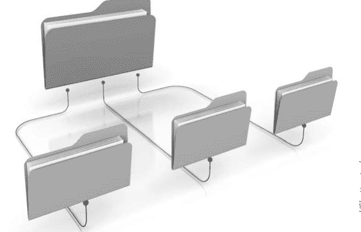

# 图 12-2 物理文件夹组织文件

每个操作系统（OS）都使用文件来存储和访问数据以及程序。操作系统将文件存储在分层级的文件夹中，这被称为文件夹结构或目录结构，这种安排反映了操作系统如何组织文件和文件夹。典型的目录结构类似于树。所有文件在你的计算机上都有特定的位置。例如，在图 12-3 中，`songs.txt` 文件位于 `Playlists` 文件夹，位于硬盘下方两层。

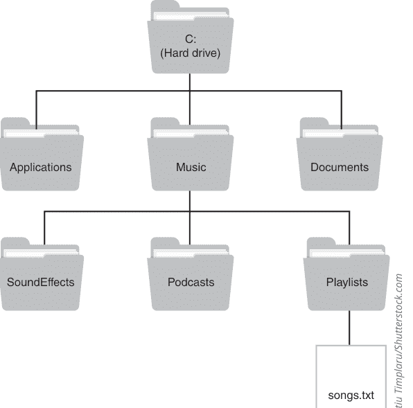

# 图 12-3 硬盘上的文件夹

当你想要在程序中使用文件时：

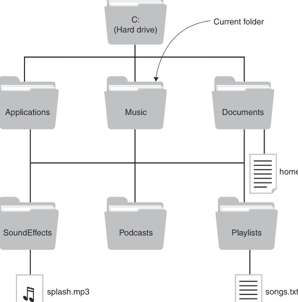

| 相对路径 | 绝对路径 |
| --- | --- |
| `..\` | `C:\` |
| `\Applications` | `C:\Applications` |
| `\SoundEffects` | `C:\Music` |
| `\SoundEffects\splash.mp3` | `C:\Music\SoundEffects\splash.mp3` |
| `\Podcasts` | `C:\Music\Podcasts` |
| `\Playlists` | `C:\Music\Playlists` |
| `\Playlists\songs.txt` | `C:\Music\Playlists\songs.txt` |
| `\Documents` | `C:\Documents` |
| `\Documents\homework.txt` | `C:\Documents\homework.txt` |

**图 12-4** 硬盘上文件的相对和绝对路径

假设你将播放列表导出到一个文件并将其本地存储在 `Music` 文件夹中。你还创建了一个需要访问 `songs.txt` 文件的程序，它存储在 `Playlists` 文件夹中。

```text
C:\Music\Playlists\songs.txt
```

# 使用 C++编程

由于文件夹是 `Music`，程序也可以通过相对路径访问 `songs.txt` 文件。要这样做，使用图 12-4 中的表示法来描述文件相对于当前文件夹的位置：

在相对路径中，单点 (`.`) 表示当前文件夹，两个点 (`..`) 表示当前上方的文件夹，一个点加斜杠 (`\`) 表示当前下方的文件夹。`\Playlists\songs.txt` 意味着“从当前文件夹开始，移动到 `Playlists` 文件夹找到 `songs`”。

你可以将绝对文件路径视为你家的确切地址（123 Main Street, Florida, 23），而将相对路径视为通往家的旅程（在 Orange Street 向左转到 Main Street，然后在 123 处停止）。

使用绝对文件路径可以确保文件在不同的计算机上位于相同的位置。相对路径更加灵活，因为它们不受当前文件夹名称或位置更改的影响。假设用户将 `Music` 文件夹的名称更改为 `Tunes`。如果代码包含 `songs.txt` 的绝对路径，当程序需要访问文件时会发生什么？如果是绝对路径，程序将寻找名为 `Music` 的文件夹，然后。如果是相对路径，程序将寻找当前文件夹下方一层的 `Playlists` 文件夹，然后找到 `songs`。

指定文件名时，可能需要使用转义字符，它们作为具有特殊含义字符的替代解释。由于这些字符对系统有特殊含义，如图 12-5 所示，在处理文件时必须对单引号、双引号、斜杠和问号进行转义。

| 字符 | 名称 | 转义字符 |
| --- | --- | --- |
| `'` | 单引号 | `\'` |
| `"` | 双引号 | `\"` |
| `\` | 斜杠 | `\\` |
| `?` | 问号 | `\?` |

**图 12-5** 转义字符

## 文件的结构（12.1, 12.6）

在计算机中，文件被视为存储在内存中的连续数据集合，如图 12-6 所示。文件中的每条信息都存储为内存中的字节序列。

# 模块 12 文件操作 211


```text
King,Cherish,3
Magnet 7,Saturday Afternoon,5
Chartreuse,Drive to Work,4
Feyonce,Configuration,5
Michelle Johnson,Woman in the Reflecting Glass,1
Greg the Scallion,Cabbage,3
Roar and the Pufferfish,Only Wanna Be with Them,1
Walrus Hug from a Tulip,3
Opprobrious PhD,Get Funding,4
Glare 183,A Few of the Big Things,5
King,Rhinestones and Quartz,5
King,Violet Precipitation,3
Dirt Breeze and Flames,October,5
Kelton James,Spaceship Dude,1
```

`songs.txt`（文本文件）

```text
K i n g C h e r i s h 3 \n M a g e n t a 7 ... \n J a m e s , S p a c e h i p D u d e , 1-
```

**图 12-6** 文本文件和内存表示的`songs.txt`

纯文本文件是用于输出和处理的基本数据文件。它将数据排列成文本行，包括数字和符号。在存储设备上，纯文本文件中的每个字符都需要 1 字节内存。例如，`songs.txt` 有 449 个字符，占用 449 字节内存。当你知道时，计算机以二进制代码存储字符，因此 A 被存储为`01000001`。文本文件的主要优点是创建简单，且当包含大量数据时不需要太大空间。

当你创建一个文件时，操作系统会在存储设备上为文件内容留出一个命名的位置。接下来，你向文件中添加数据，程序通过向文件写入来实现。文件存储在磁盘上，直到被操作系统显式删除。

通常，一个文件包含以下组件：

- **文件名。** 文件名是文件的完整名称，包括扩展名，如`songs.txt`。文件扩展名用于标识文件类型。例如，`.txt` 表示纯文本文件，而`.mp3` 是压缩格式音乐的扩展名。
- **内容。** 内容包括文件中的文本或其他数据。
- **分隔符。** 分隔符是制表符或标点符号（如逗号），用于分隔信息，例如将艺术家与歌曲标题分开。
- **文件结束（EOF）。** 这是一个表示文件中最后一个元素的特殊字符或代码。EOF 标记文件的最后一个字符并表示为`-1`。
- **换行。** 换行是一个表示行结束的特殊字符。
- **访问点。** 访问点跟踪你在文件中的当前位置，类似于光标或插入点。

# 12 使用 C++编程

图 12-7 显示了`songs.txt`文件的组件。与文件名使用的转义字符类似，内容也可以包含转义字符。换行字符表示为`\n`，显示后续将在下一行开始。制表转义代码表示为`\t`。在屏幕上显示时，t 在下一个制表位后开始文本。

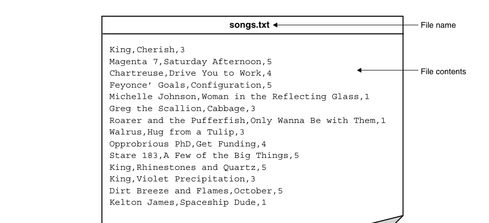

文件名

内容

访问点

换行字符

分隔符

| K | i | n | g | , | C | h | e | r | i | s | h | 3 | `\n` | M | a | g | e | n | t | a | | 7 | ... | `\n` | J | a | m | e | s | , | S | p | a | c | e | h | i | p | D | u | e | , | 1 | -1 | EOF |
|---|---|---|---|---|---|---|---|---|---|---|---|---|---|---|---|---|---|---|---|---|---|---|---|---|---|---|---|

**图 12-7** 文件的元素

# 文件使用（12.1.7、12.1.8、12.1.9、12.1.10）

当代码从文件读取信息时，称为文件输入。当你的代码向文件写入时，称为文件输出。它们合称为文件输入输出，或文件 I/O。一些文件处理操作包括打开文件、读取内容、向文件写入信息以及关闭文件。

两种数据文件包括文本文件和二进制文件。文本文件将其内容存储为 8 位（1 字节）ASCII 字符，例如人们可以阅读的文本和数字。如果你打开`songs.txt`

# 第 12 模块 文件操作 213

在文本编辑器中，例如，你可以读取艺术家名称、标题和评分列表。文本文件通常具有`.txt`扩展名，并使用纯文本编辑器创建。存储程序或标记代码的文件扩展名为`.cpp`、`.java`、`.py`、`.csv`和`.html`。

使用 ASCII 字符存储文件可以确保任何类型的操作系统都能处理该文件。然而，将文本存储为一系列 8 位字符在内存消耗方面，这种方法的效率较低。

相比之下，二进制文件以二进制格式存储其内容，你无法轻松读取。二进制文件的内容不仅限于 ASCII 文本，还可能包含不可打印的字节。例如，可执行程序、音乐文件和图像都是二进制文件。如果你在文本编辑器中打开二进制文件，你将看到符号和其他意外形成的非字符。二进制文件可以有广泛的扩展名，如`.bin`、`.mp3`、`.pdf`和`.doc`。

二进制文件的主要优势是它们的编码比存储单个 8 位 ASCII 字符占空间更小，而且计算机可以快速读取它们。例如，二进制文件可以使用数值格式（如 IEEE 754）而不是文本字符来存储值，占用的内存比 ASCII 少。

**图 12-8** 对比了文本文件和二进制文件。

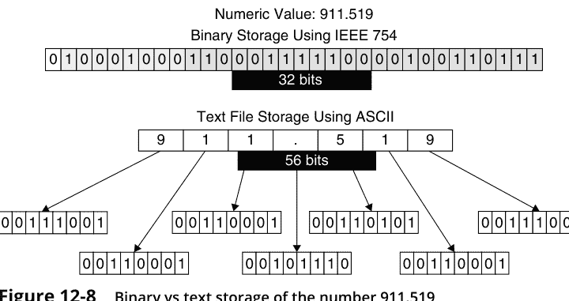

正如你看到的，你的程序需要知道它是文本文件还是二进制文件才能正确处理。二进制文件的编码方式特定于你正在读取的文件类型，因此你的程序必须根据编码对代码解码。由于文本文件将每个字符存储为其 8 位 ASCII 表示，程序必须将每个字符转换为其 8 位二进制代码集。

大多数编程语言都拥有文件句柄（file handler），这是一个允许你与文件交互的内置功能。你可以使用文件来请求有关文件的信息，例如大小、类型、在目录结构中的位置、创建时间以及修改时间。文件句柄还提供了启用 I/O、打开文件和关闭文件的功能。

## 12.2 处理文件

### 访问文件（12.2.1、12.2.2）

由于文件在内存中是连续地逐字节存储的，因此访问通常是线性的。文件访问点就像光标一样——它指示文件中第一个字节的位置，并一直移动文件访问点直到文件末尾。正如你打算从书里阅读一样，计算机按顺序逐个地读取每个字符或代码，以使内容具有意义。这种读取文件的方式被称为线性访问或顺序访问。

相比之下，程序也可以使用随机访问（random access）读取文件，随机访问会直接读取每个字符，而不需要先读取它之前的字符。随机访问通过更改文件访问点的位置来实现，该位置变量的作用类似于光标，指示你在文件中的位置。作为程序员，你可以指定将文件访问点移动多少字节。正值将点向文件末尾移动，负值将点向文件开头移动。在处理文件操作时，你必须跟踪文件访问点的位置，以避免移动到文件内存限制之外。图 12-9 对比了线性和随机文件访问。

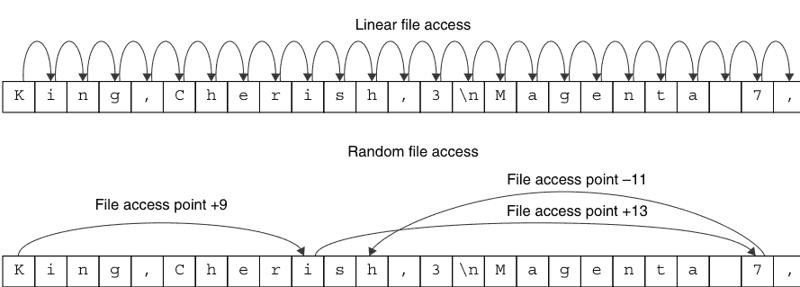

**图 12-9** 线性和随机文件访问

在程序读取了文件的部分内容后，我如何回到文件的开头呢？

每当你打开一个文件时，它都会将文件访问点放在文件的开头，允许你关闭并重新打开文件。或者，编程语言提供了语句将文件访问点重置到开头。

### 流式与缓冲（12.2.3、12.2.4）

当你使用文件 I/O 时，你正在流式传输信息。就像你在手表上流式播放你喜欢的节目一样，你在程序中以固定速率传输信息。本质上，流是一个允许你与存储在计算机或其他驱动器上的文件交互的通道。**图 12-10**。

| 组件 | 作用 | 类型 |
|---|---|---|
| `StreamWriter` | 将数据写入磁盘文件 | 输出文件流 |
| 程序 | 处理数据 |  |
| 磁盘文件 | 存储数据 |  |
| `StreamReader` | 从磁盘文件读取数据 | 输入文件流 |

**图 12-10** 使用文件的输入和输出流

某些编程语言使用`StreamWriter`创建一个向文件写入文本的流。来自文本文件的数据被传输到流中然后写入其中。同样，`StreamReader`创建一个用于从文件读取文本的流。`StreamReader`将数据从文件传输到流中，然后进入你的程序。

想象一下你正在笔记本电脑上流式播放一部三小时的电影。以前，笔记本电脑需要大量空间来存放整部电影。相反，你的计算机使用缓冲（buffering）将数据逐位移动到内存的预留部分（称为缓冲区），你的代码可以访问该部分。

当程序需要读取和写入大量数据时，使用缓冲流还可以提高性能。操作系统不断处理任务。读取文件时，OS 不是一次读取一个字节，而是读取一个数据块然后切换到另一个任务。

## 12.3 从文件读取

### 打开文件（12.3.1、12.3.2）

在大多数编程语言中，不需要转义字符，因为文件名被包含在双引号中。打开文件的语法如下：

```text
declare filevariable as file_handler
filevariable.open("songs.txt", access_mode)
```

伪代码假设`songs.txt`与程序代码在同一个文件夹中。如果文件存储在不同的文件夹中，你必须使用文件的相对路径或绝对路径，以便程序找到它。

你通常对文件使用以下`access_mode`参数：

- **Read（读取）。** 读取模式打开指定文件，以便你可以检索其内容。如果文件失败，将产生 I/O 错误。否则，文件访问点将置于文件开头，以便你开始检索内容。
- **Write（写入）。** 写入模式打开指定文件以便你可以向其中添加数据。如果文件不存在，则创建它。如果文件已存在，访问点将置于文件开头，任何新信息都将被覆盖。
- **Append（追加）。** 追加模式打开指定文件以便你可以向其中添加数据。如果文件不存在，则创建它。如果文件已存在，文件访问点被置于末尾，新信息将在该点之后写入。

如果你没有指定`access_mode`，程序将使用默认模式`r`从文本文件打开文件流。

大多数情况下，之前显示的代码打开了`songs.txt`，你的程序可以同时执行其他任务。如果另一个程序同时访问了`songs.txt`（可能是为了添加新歌曲），或者文件名更改为`my_songs.txt`呢？将会发生错误，因此你想要包含代码来检查文件是否已打开。你可以使用`try`块来捕获异常，如图 12-12 所示。

```cpp
#include <iostream>
#include <fstream>
#include <stdexcept>
#include <string>

using namespace std;

int main ()
{
    ifstream input_file;
    try {
        input_file.open("songs.txt", ios::in);

        if(!input_file.is_open()) {
            throw runtime_error("Could not open the file.");
        }
    } catch (runtime_error error) {
        cout << error.what() << endl;
        return 0;
    }

    return 0;
}
```

**图 12-12** 打开文件读取的异常处理

图 12-12 中的代码打开了`songs.txt`文件并处理了可能发生的异常。正如伪代码所示，声明了一个文件变量。接下来，将打开文件的代码封装在`try`块中。如果发生异常，它将在`catch`块中被捕获。显示消息“无法打开文件”，并且程序退出，因为它无法读取不存在的文件。

## 从文件中读取（12.3.4、12.3.5、12.3.6、12.3.7）

现在你的程序打开了`songs.txt`，就可以从中读取内容了。读取文件意味着操作系统从文件开始（或你当前文件位置所在的地方）开始，并将该信息的副本传递给你的程序。你使用整数、字符和字符串类型的变量来存储从文件中提供的信息。随着程序读取文件的每个部分，文件指针会更新并移动到文件中的下一个项目。

通常，程序通过循环按顺序逐字符读取文件。文件中的数据量通常是未知的，因此循环在到达`EOF`（文件结束符）时停止。

文件在内存中被分配了一定的空间。EOF 字符防止程序访问文件位置之外的内存位置。程序无法读取超过 EOF 的内容，因为这违反了文件完整性并会导致程序崩溃。

当文件变量没有更多可读信息时，EOF 的值变为`true`，表示程序已到达末尾。以下是检查 EOF 的示例：

```text
declare c as character
while file_variable.eof != true
  c = file_variable.txt.nextCharacter
```

`songs.txt`文件的格式为每首歌曲独占一行，艺术家、标题和评分之间用逗号分隔，如图 12-13 所示。

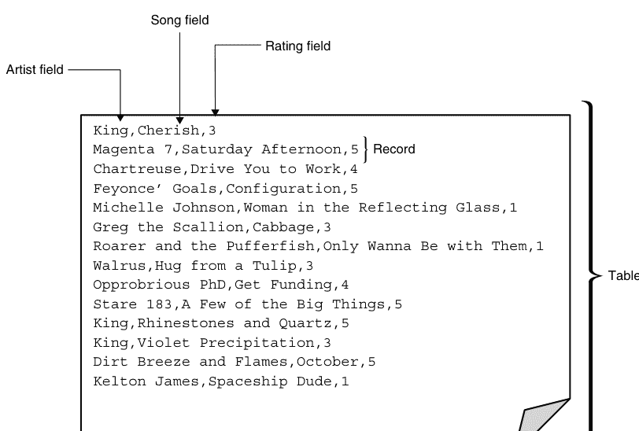

**图 12-13** 逗号分隔文件中的字段和评分

你如何利用关于`songs.txt`的信息来比逐字符更高效地读取文件？

因为你知道文件的每一行都有相同的“艺术家-歌曲-评分”格式，你可以读取文件的每一行，按顺序保存文件中的信息。

如图 12-13 所示，`songs.txt`是一个逗号分隔的文本文件，类似于表格，其中每个数据块都用逗号分隔。程序读取逗号分隔文本文件比逐字符读取更高效。每个到逗号为止的数据块都是一个字段。包含一个艺术家、歌曲和评分的一行是一个记录。由于数据是按字段和记录排列的，它被结构化为表格。

在读取`songs.txt`的程序中，你可以格式化`file_variable`以读取到每个逗号，将文本分配给变量，然后继续读取行的剩余部分，如图 12-14 所示。

```cpp
#include <iostream>
#include <fstream>
#include <stdexcept>
#include <string>
#include <sstream>

using namespace std;

int main ()
{
    ifstream input_file;
    input_file.open("songs.txt", ios::in);
    string line_of_text;
    string artist;
    string song;
    string rating;

    while(!input_file.eof()) {
        getline(input_file, line_of_text);
        stringstream s(line_of_text);

        getline(s, artist, ',');
        getline(s, song, ',');
        getline(s, rating, ',');
    }
    return 0;
}
```

**图 12-14** 读取逗号分隔的文本文件（续）

**图 12-14** 读取逗号分隔的文件

程序的工作原理如下：

- 启动程序时，声明变量来持有每个字段：艺术家、歌曲和评分。
- 同时设置文件变量以识别逗号为分隔符，以分离记录中的每个字段。
- 使用`while`循环遍历文件直到到达末尾。
- 每一行读取艺术家、歌曲和评分。
- 继续读取每行，直到没有更多信息可读。

尽管它的类型是字符串，但你的代码将其作为字符串读取。如果你计划对数据进行某些操作（例如计算平均值），你需要进行转换。

当文件变量不再有更多可读信息时，EOF 的值变为`true`，表示程序已到达文件末尾。以下是检查 EOF 的示例：

```cpp
#include <iostream>
#include <fstream>
#include <stdexcept>
#include <string>
#include <sstream>
// ... (代码部分已在上方翻译中)
```

实际上，原文文本中重复的部分如下：

```cpp
while(!input_file.eof()) {
    getline(input_file, line_of_text);
    stringstream s(line_of_text);

    getline(s, artist, ',');
    getline(s, song, ',');
    getline(s, rating, ',');
}
```

尽管它的类型是字符串，但你的代码将其作为字符串读取。如果你计划对数据进行某些操作（例如计算平均值），你需要进行转换。

```cpp
#include <iostream>
#include <fstream>
using namespace std;
int main() {
    ofstream output_file;
    output_file.open("favorite_songs.txt", ios::out);
    return 0;
}
```

**图 12-16** 创建新文件

要创建一个新文件，你需要声明一个变量作为文件句柄。通过使用文件句柄打开一个不存在的文件进行写入，你的程序将在你所在的相同目录下创建一个新的空文件`favorite_songs.txt`。

某些编程语言（如 Java）提供了创建空文件的特定方法。在这种情况下，你使用以下代码创建一个新文件：

```text
declare file_variable as file_handler
file_variable.create_new("favorite_songs.txt")
```


在声明了一个命名为`file_variable`的文件句柄后，你可以使用点符号法来执行`file_variable.create_new`语句。该语句会创建并打开新文件`favorite_songs.txt`。

## 打开文件进行写入 (12.5.2, 12.5.3, 12.5.4)

在你创建文件后或想要向现有文件添加数据时，你将打开该文件进行写入。例如，你创建了`favorite_songs.txt`来记录你喜欢的歌曲，你给它们打了 4 分或 5 分，现在想将`songs.txt`中的高分歌曲添加到`favorite_songs.txt`中。此外，假设你买了一些音乐，想在`songs.txt`列表中添加更多歌曲。无论在何种情况下，你都可以使用 I/O 写入文件。以下是伪代码：

```
declare file_variable as file_handler
file_variable.open("favorite_songs.txt", access_mode)
```

你声明一个类型为`file_handler`的变量，并使用点操作符向文件写入并指定访问模式，就像你之前所过的那样。使用相同的通用语法向新文件写入内容或向现有文件添加内容。`access_mode`参数控制文件如何被写入。

与读取文件一样，`access_mode`是写入文件时的一个可选参数。其值通常为`write`（写入）或`append`（追加）。`write`模式从文件开头开始写入。如果文件已存在，默认情况下使用`write`模式将覆盖整个文件，因此它不会保留任何之前的内容。如果你不确定文件是否包含信息，请使用`append`模式以避免覆盖无意的信息。

你会使用`write`还是`append`访问模式来向`songs.txt`添加新歌曲呢？

在这种情况下，`append`是最合适的，因为你想保留之前的歌曲并向列表添加内容。

## 向文件写入和追加内容 (12.5.5, 12.5.6)

假设你的朋友也请求你编写代码来管理他们的音乐播放列表。你不能给他们你的`songs.txt`文件，因为文件是被复制的，且在他们的电脑上内容不同。但是，你可以使用程序来写入文件。程序要求你的朋友输入他们的歌曲。它创建一个名为`their_songs.txt`的新文本文件。程序所示如图 12-17。

```cpp
#include <iostream>
#include <fstream>
#include <string>

using namespace std;

int main ()
{
    ofstream output_file;
    output_file.open("their_songs.txt", ios::out);
    int num_songs;
    string artist;
    string song;
    int rating;

    cout << "Hello friend. How many songs would you like to enter? ";
    cin >> num_songs;
    cin.ignore();

    for(int i=0; i < num_songs; i++)
    {
        cout << "Please enter the artist name. ";
        getline(cin, artist);
        cout << "Please enter the song name. ";
        getline(cin, song);
        cout << "Please enter the rating (1-5).";
        cin >> rating;
        cin.ignore();
        output_file << artist << "," << song << "," << rating << endl;
    }
    cout << "Thanks! Your file has been written." << endl;
    output_file.close();
    return 0;
}
```

输出：

```
Hello friend. How many songs would you like to enter? 1 [Enter]
Please enter the artist name. Rizzo [Enter]
Please enter the song name. Lies Hurt [Enter]
Please enter the rating (1-5). 4 [Enter]
Thanks! Your file has been written.
```

**图 12-17** 为歌曲列表写入新文件

程序的工作原理如下：

- 声明一个名为`output_file`的文件变量。
- 通过打开输出文件进行写入来创建一个名为`their_songs.txt`的文件。
- 声明变量来存储你想输入的歌曲数量、歌手名称和评分。
- 提示你的朋友输入要写入文件的歌曲数量，并将响应存储在变量`num_songs`中。
- 在`for`循环中，从 0 迭代到你的朋友输入的歌曲数量。同时提示你的朋友提供每首歌的歌手名称、标题和评分。
- 将响应写入指定的文件。由于文件必须以特定格式格式化，在写入歌手名称后，写入一个逗号，然后是名称和评分。
- 在评分之后，向文件写入换行符，表示下一条信息（即下一首歌）应该从下一行开始。
- 最后，你显示一条说明文件已写入的消息并关闭输出文件。

如果你遍历`songs.txt`中的歌曲并将所有喜好的转移到一个新文件`favorite_songs.txt`，你需要同时读取和写入。在从`songs.txt`读取每首歌时，你检查评分。如果评为 4 或更高，则将歌曲写入`favorite_songs.txt`。

为了每行写入一首歌，你还需要包含一个换行符，它的作用类似于按下`Enter`键，以便后续文本显示在下一行。你可以在写入语句中使用`\n`作为参数来指定换行符，如图 12-18 所示。

```cpp
#include <iostream>
#include <fstream>
#include <string>
#include <sstream>

using namespace std;

int main ()
{
    ifstream input_file;
    ofstream output_file;
    input_file.open("songs.txt", ios::in);
    output_file.open("favorite_songs.txt", ios::out);
    string artist;
    string song;
    string rating;
    int rating_num;

    string line_of_text;

    while(!input_file.eof())
    {
        getline(input_file, line_of_text);
        if(!line_of_text.empty()) {
            stringstream s(line_of_text);
            getline(s, artist, ',');
            getline(s, song, ',');
            getline(s, rating, ',');
            rating_num = stoi(rating);

            if(rating_num >= 4)
            {
                output_file << artist << ",";
                output_file << song << ",";
                output_file << rating << endl;
            }
        }
    }
    return 0;
}
```

图 12-18 将歌曲保存到文件

图 12-19 显示运行程序 12-18 后`songs.txt`和`favorite_songs.txt`文件的内容

| 歌手 | 评分 |
| :--- | :--- |
| Cherish | 3 |
| Saturday Afternoon | 5 |
| Drive You to Work | 4 |
| Beyonce's Goals | 5 |
| Woman in the Reflecting Glass | 1 |
| Kelton Scallion | 3 |
| Roar the Pufferfish Only | 1 |
| Violet James | 3 |
| Dirt Breeze and Flames | 5 |
| Rhinestones Get Funding | 4 |

图 12-20 `songs.txt`和`favorite_songs.txt`的内容

现在你有一份喜好歌曲列表。当你需要向该列表添加更多喜好歌曲时，你可以更新`favorite_songs.txt`文件。但是，如果你以写入模式打开`favorite_songs.txt`，将从文件开头开始并覆盖文件内容。相反，请使用`append`参数，它会保留现有歌曲并在文件末尾添加记录。追加记录请参见图 12-18，你会将打开文件的访问模式从`write`改为`append`，如下代码所示：

```
output_file.open("favorite_songs.txt", "append")
```

## 预期异常 (12.5)

假设文件的某行格式不正确，例如最后一首歌缺少标题和评分。代码尝试读取评分的整数并读取到了文件末尾。这会导致你的程序崩溃。出于如此，请将任何读取文件的代码放在`try`块中。

文件操作可能会以其他方式失败，例如找不到文件、从缓冲区传输数据时出现问题，或者尝试从空文件中读取数据。有必要将处理文件的整个代码块封装在一个`try`块中，而不是使用多个独立的`try`和`catch`块，如下伪代码所示：

```
declare input_file as file_handler
declare output_file as file_handler
```

```
try
input_file.open("new_songs.txt", "read")
output_file.open("favorite_songs.txt", "append")
```

```cpp
while input_file.peek() != EOF
    artist = input_file.nextString()
    song = input_file.nextString()
    rating = input_file.nextString()
    rating_num = stringToNum(rating)
```

```cpp
input_file.close()
output_file.close()
```

```cpp
catch FileNotFoundException
    display "The specified file was not found."
catch EndFileException
    display "End of File reached. Exiting."
    return
catch CloseFileException
    display "Closing an already closed file. Exiting."
    return
```

## 总结

- 文件是存储在内存中的数据命名的容器，例如文档、图片或歌曲。使用文件作为向程序中读取大量数据或从程序中写入大量数据的方法，也称为文件输入/输出（I/O）。
- 文件夹将文件分组并组织。操作系统以一种称为文件夹结构或目录结构的文件夹安排来存储文件。
- 文件在计算机上的位置可以通过相对路径或绝对路径来描述。绝对路径指明文件从主存储设备或驱动器开始在计算机上的确切位置。相对路径提供文件相对于文件夹结构中另一个位置的位置。相对路径比绝对路径更灵活，因为如果上级文件夹更改名称或位置，它们也不会受到影响。
- 程序使用两种类型的文件：文本文件和二进制文件。文件可以顺序读取直到到达文件末尾，这被称为线性扫描或顺序访问。
- 绝对文件路径
- 访问点
- 附加
- 二进制文件
- 缓冲区
- 缓冲流
- 缓冲处理
- 逗号分隔文本文件
- 内容
- 分隔符
- 目录结构
- 点操作符
- 文件结束符 (EOF)
- 转义字符
- 字段
- 文件访问点
- 文件句柄
- 文件处理
- 文件 I/O
- 文件输入
- 文件名
- 文件输出
- 文件夹
- 线性访问
- 换行符
- 随机访问
- 读取
- 记录
- 相对文件路径
- 流
- `StreamReader`
- `StreamWriter`
- 表格
- 文本文件
- 写入
- 13.2.6 解释封装如何增强代码结构。
- 13.2.7 解释信息隐藏的概念。
- 13.3 在类中使用静态元素
- 13.3.1 解释静态变量如何在类实例之间共享。
- 13.3.2 解释在类中设置静态成员的目的。
- 13.3.3 定义静态方法。
- 13.4 面向对象程序中对象的特性
- 13.4.1 定义应用于 OOP 对象的身份。
- 13.4.2 定义应用于 OOP 对象的状态。
- 13.4.3 定义应用于 OOP 对象的行为。

## 13.1 面向对象编程中的类

### 用代码表示现实世界 (13.1)

你的代码可以代表日常生活中的思想和概念。这可以通过对象来实现，对象是特殊的变量类型，对应现实世界中的具体对象。使用对象的编程被恰切地称为面向对象编程 (OOP)。在 OOP 中，你考虑关键组件、它们的数据、它们执行的操作以及它们之间的交互。当你与其他程序员协作时，对象会让你的程序更易理解。

在过程式编程中，代码是逐步编写的，创建一组类似于计算机食谱的指令。当你运行程序时，它会按照你编写的完全相同的顺序执行步骤。过程式编程对于算法步骤有限的简单程序有用，例如计算一个数字的平方根。当你的程序需要模拟具有许多组件、操作和关系的复杂现实世界系统时（例如银行应用程序），面向对象编程更为合适。

过程式编程通常是程序员学习的第一种范式，但它有局限性。例如，假设你正在编写一个过程式程序来管理经销店的数百辆汽车。你需要存储在变量中的关于每辆汽车的信息包括品牌、型号、年份、里程和其他细节，如图 13-1 所示。

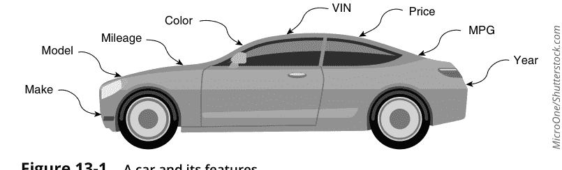

你和程序需要跟踪的信息量将变得难以负担。如果你需要更改信息（例如为每辆车添加车辆识别码 VIN），你必须费力地修改每行代码进行更改。随着更改数量的增加，修改代码的难度也会随之增加。OOP 提供了一种替代方案，允许你在这种情况下轻松修改代码。

### 使用类 (13.1.2, 13.1.3)

类使得面向对象编程成为可能。类是创建对象的蓝图。就像建筑蓝图描述建筑一样，类描述的是对象。你使用类来创建共享共同特征（或属性）的对象以及使用这些对象的程序。建筑蓝图用于在不同的地址创建许多房屋，而类可以创建许多共享相同结构的对象。`Car`类就像一个通用模型，可以创建诸如“2020 年蓝色本田雅阁”和“黄色大众甲虫”这样的对象。

## 模块 13 类与对象 233

使用类的用处是它促进了重用。程序员在创建具有相同特征的对象时可以重用类代码。例如，如果你想在你的经销店应用中存储 500 辆汽车的信息，使用类的用处是它促进了重用。

### 类组件 (13.1)

- 文件在计算机上的位置可以通过相对路径或绝对路径来描述。绝对路径指明文件从主存储设备或驱动器开始在计算机上的确切位置。相对路径提供文件相对于文件夹结构中另一个位置的位置。相对路径比绝对路径更灵活，因为如果上级文件夹更改名称或位置，它们也不会受到影响。
- 使用类的用处是它促进了重用。程序员在创建具有相同特征的对象时可以重用类代码。

（注：此处原文存在大量重复段落，已根据文档工程师规范进行去重处理，保留核心逻辑说明）

- 文件访问点
- 类句柄
- 文件处理
- 文件 I/O
- 文件输入
- 文件名
- 文件输出
- 文件夹
- 线性访问
- 换行符
- 随机访问
- 读取
- 记录
- 相对文件路径
- 流
- `StreamReader`
- `StreamWriter`
- 表格
- 文本文件
- 写入

（重复省略）

类是创建对象的蓝图。就像建筑蓝图描述建筑一样，类描述的是对象。你使用类来创建共享共同特征（或属性）的对象以及使用这些对象的程序。建筑蓝图用于在不同的地址创建许多房屋，而类可以创建许多共享相同结构的对象。`Car`类就像一个通用模型，可以创建诸如“2020 年蓝色本田雅阁”和“黄色大众甲虫”这样的对象。

## 模块 13 类与对象 233

（重复省略）

## 234 使用 C++ 编程

| Car | |
| --- | --- |
| make | string |
| model | string |
| color | string |
| vin | string |
| price | integer |
| mpg | integer |
| year | integer |
| mileage | integer |
| sold | boolean |
| on_lot | boolean |

`give_discount(percentage)`

`increase_mileage(amount)`

`sell_car(final_price)`

`test_drive(license_number)`

图 13-2 类表示的特征


```cpp
class Car
{
public:
    void give_discount(percentage);
    void increase_mileage(amount);
    void sell_car(final_price);
    void test_drive(license_number);
    string get_make();
    void set_make(string);
    string get_model();
    void set_model(string);
    string get_color();
    void set_color(string);
    string get_vin();
    void set_vin(string);
    int get_price();
    void set_price(int);
    int get_mpg();
};
```

图 13-3 类的表示（继续）

```cpp
void set_mpg(mpg);
int get_year();
void set_year(year);
int get_mileage();
void set_mileage(mileage);
bool get_sold();
void set_sold(sold);
bool get_on_lot();
void set_on_lot(on_lot);
```

private:

```cpp
string make;
string model;
string color;
string vin;
int price;
int mpg;
int year;
int mileage;
bool sold;
bool on_lot;
```

# 图 13-3 Car 类的表示

- 代码开始使用 `class` 关键字创建一个名为 `Car` 的类。按照习惯，类名首字母大写，并且通常是一个名词（人、地点或事物）。类名可以是任何名称，保留关键字除外。类名遵循与变量名类似的规则。它不能以数字开头，但可以由字母和下划线组成。

- 访问修饰符 `public` 意味着本部分列出的方法或成员变量可以被程序外部的任何地方或任何部分查看或修改。将访问器（accessors）和设置器（setters）设置为公共是一种常见做法。类的公共部分可以使用点运算符 (.) 指定对象的名称，后跟方法或成员变量来直接访问。

- 方法如 `get_discount(percentage)` 由方法名组成，方法名是一个以动词开头且不包含空格的单单词。方法名后面总是跟着括号。括号中包含发送给方法的数据，例如价格，这是方法完成其操作所必需。对于不需要任何数据（带参数）的方法，使用空括号。

- 代码的方法部分包含了每个成员变量的访问器（accessor）和变异器（mutator）。如 `get_make()` 这样的方法是访问器（getter），而如 `set_make()` 这样的方法是对应的变异器（setter）。执行方法调用的代码必须设置字符串变量的结果。当对象的获取器被调用时（例如 `get_make()`），它会返回特定成员变量的值。设置器允许你控制成员变量在对象中的存储方式及其可访问性。包含代码以确保所执行操作的有效性是一个良好的编程习惯，`set_price()` 方法检查价格是否为正数。

- 访问修饰符 `private` 定义了类本身的方法和变量。在 `public` 部分，`private` 之后列出的任何内容无法通过点运算符 (.) 访问。一种习惯是将所有成员变量设为 `private`，这样外部代码无法直接更改类中对象的特征。如果共享数据和方法会引起问题，则数据和方法应该是 `private` 的。例如，假设价格属性是公共的。`Car` 类可能会更改汽车的价格，导致经销商处陷入混乱。通过将属性设为 `private`，只允许 `Car` 类的方法更改汽车的属性。

- 像如 `make` 这样的属性是 `Car` 的特征。作为成员变量，需要指定其数据类型。汽车制造的品牌，如本田、福特和沃尔沃，`make` 被声明为 `string`。属性可以由任何变量组成，包括其他对象。

属性中的每条数据是否都应该有一个 getter 和 setter？

并不一定。虽然虽然使用 getter 和 setter 控制对数据的访问是常见做法，但你并不需要为每个属性都创建 getter 和 setter。

## 13.2 使用对象

### 创建对象 (13.2.1, 13.2.2, 13.2.3)

面向对象的程序操作对象，而你从类创建对象。每个对象都是其类的实例，是一个实体的物理实体，而类是一个逻辑实体。如果说一个类是蓝图，那么从蓝图上建造的每栋房子就是其中一个。

在程序中，类被定义一次，但可以从该类创建多个对象。就像蓝图不是实际建筑一样，类也不是实际的对象。如图 13-4 所示，`Car` 类代表了汽车的通用概念，而类中的对象指的是代销处的一辆真实的汽车。

假设你有一辆 2020 年的丰田卡罗。在许多编程语言中，你使用关键字 `new` 来创建特定特定类的对象。以下伪代码在 `Car` 类中创建了一个名为 `my_celica` 的对象：

```cpp
my_celica = new Car
```

# 图 13-4 类与对象

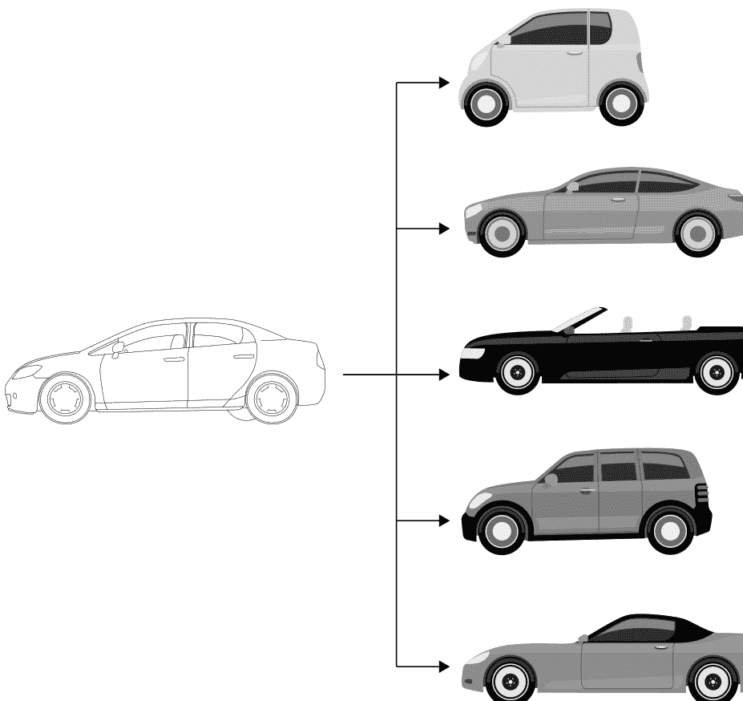

代码实例化（或创建）了一个由类创建的新对象。对象命名为 `my_celica`。引用这辆特定汽车的代码将通过其名称引用该对象。在空格处填入正确的单词：类包含了描述对象可以执行的操作的方法，它还包含了定义类可以存储的数据的属性。类的实例是一个对象。

### 作为变量的对象 (13.2.4, 13.2.5)

当你编写程序时，你会使用简单的变量（称为原始数据类型或内置数据类型），它们持有单个值，如整数、小数或字符。在面向对象编程中，对象被视为变量。它们被认为是复杂数据类型，因为它们可以存储多于一个原始类型。例如，`my_celica` 具有字符串、整数和布尔值数据类型的属性。

在代码中，原始数据类型和对象都通过它们的变量名引用。例如，`my_celica` 指向你从 `Car` 类创建的特定汽车。你可以使用 `Car` 类中的公共变异器来设置对象的成员变量。根据需要创建 `Car` 的实例。图 13-5 显示了创建三个名为 `my_corolla`、`my_beetle` 和 `my_lamborghini` 的 `Car` 对象的代码。

```cpp
int main() {
    Car my_corolla;
    Car my_beetle;
    Car my_lamborghini;

    return 0;
}
```

图 13-5 声明三个 Car 对象

### 面向对象的特性和原则 (13.2.6, 13.2.7)

面向对象编程的目标之一是让代码更易用。将所有数据与其执行的操作封装在一起使得对象更容易使用，这被称为封装（encapsulation）。类将其属性和方法封装（或封闭）在一个对象中；将你的对象的数据和方法视为单一实体。封装通过强调代码的成员增强了编码结构。

（注：此处原文 `private` 定义在类内部，逻辑延续）

如果共享数据和方法会引起问题，则数据和方法应该是 `private` 的。例如，假设价格属性是公共的。`Car` 类可能会更改汽车的价格，导致经销商处陷入混乱。通过将属性设为 `private`，只允许 `Car` 类的方法更改汽车的属性。

- 如 `make` 这样的属性是 `Car` 的特征。作为成员变量，需要指定其数据类型。汽车制造的品牌，如本田、福特和沃尔沃，`make` 被声明为 `string`。属性可以由任何变量组成，包括其他对象。

属性中的每条数据是否都应该有一个 getter 和 setter？

并不一定。虽然使用 getter 和 setter 控制对数据的访问是常见做法，但你并不需要为每个属性都创建 getter 和 setter。

## 13.2 使用对象

### 创建对象 (13.2.1, 13.2.2, 13.2.3)

面向对象的程序操作对象，而你从类创建对象。每个对象都是其类的实例，是一个实体的物理实体，而类是一个逻辑实体。如果说一个类是蓝图，那么从蓝图上建造的每栋房子就是其中一个。

在程序中，类被定义一次，但可以从该类创建多个对象。就像蓝图不是实际建筑一样，类也不是实际的对象。如图 13-4 所示，`Car` 类代表了汽车的通用概念，而类中的对象指的是代销处的一辆真实的汽车。

假设你有一辆 2020 年的丰田卡罗。在许多编程语言中，你使用关键字 `new` 来创建特定特定类的对象。以下伪代码在 `Car` 类中创建了一个名为 `my_celica` 的对象：

```cpp
my_celica = new Car
```

# 图 13-4 类与对象


代码实例化（或创建）了一个由类创建的新对象。对象命名为 `my_celica`。引用这辆特定汽车的代码将通过其名称引用该对象。在空格处填入正确的单词：类包含了描述对象可以执行的操作的方法，它还包含了定义类可以存储的数据的属性。类的实例是一个对象。

### 作为变量的对象 (13.2.4, 13.2.5)

当你编写程序时，你会使用简单的变量（称为原始数据类型或内置数据类型），它们持有单个值，如整数、小数或字符。面向对象编程中，对象被视为变量。它们被认为是复杂数据类型，因为它们可以存储多于一个原始类型。例如，`my_celica` 具有字符串、整数和布尔值数据类型的属性。

在代码中，原始数据类型和对象都通过它们的变量名引用。例如，`my_celica` 指向你从 `Car` 类创建的特定汽车。你可以使用 `Car` 类中的公共变异器来设置对象的成员变量。根据需要创建 `Car` 的实例。图 13-5 显示了创建三个名为 `my_corolla`、`my_beetle` 和 `my_lamborghini` 的 `Car` 对象的代码。

```cpp
int main() {
    Car my_corolla;
    Car my_beetle;
    Car my_lamborghini;

    return 0;
}
```

图 13-5 声明三个 Car 对象

### 面向对象的特性和原则 (13.2.6, 13.2.7)

面向对象编程的目标之一是让代码更易用。将所有数据与其执行的操作封装在一起使得对象更容易使用，这被称为封装（encapsulation）。类将其属性和方法封装（或封闭）在一个对象中；将你的对象的数据和方法视为单一实体。封装通过强调代码的成员增强了编码结构。

（注：此处翻译已根据上下文逻辑对齐，原文存在部分重复，此处已按要求处理）

## 13.3 在类中使用静态元素

### 静态成员变量 (13.3.1, 13.3.2)

假设经销商的所有者要求你在程序中添加一个功能。经销商希望记录店内汽车的数量。为了满足这一请求，你可以在 `Car` 类中添加另一个名为 `car_count` 的属性。每当经销商收到一辆新车，`car_count` 加 1。每当经销商卖出一辆车，`car_count` 减 1。

你会如何修改代码以添加汽车计数功能？每个对象中相同的值（如 `my_celica`、`my_beetle` 和 `my_lamborghini`）占用了不必要的空间，随着 `Car` 对象的数量增加。当汽车交付给经销商或卖出时，你还需要管理每个 `Car` 对象的值以确保其数值正确。相反，你可以使用静态变量来节省资源，并在不需要不断更新的情况下复制相同的内容。简化代码。

静态变量是类的成员变量，并在类的所有实例中包含相同的值。本质上，同一类的所有对象共享同一个静态成员变量，如图 13-6 所示。在 `Car` 类中，`my_celica`、`my_beetle` 和 `my_lamborghini` 可以共享 `car_count` 静态变量的值。内存中只存储一个变量副本。

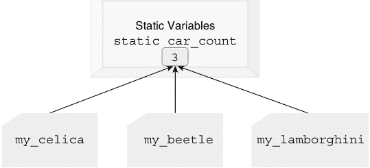

图 13-6 每个 Car 对象共享相同的静态成员变量

要创建一个类的静态成员，在声明成员时包含 `static` 关键字。在 `Car` 类中，为 `car_count` 添加 `get` 和 `set` 方法，例如 `get_car_count()` 和 `set_car_count()`，这样你就可以使用这些方法访问和存储 `car_count` 值，这些值是私有的。然后类类定义的私有部分添加以下声明：

attribute: car_count as static integer

图 13-7 修改了 `Car` 类中的私有成员变量以包含一个静态成员。

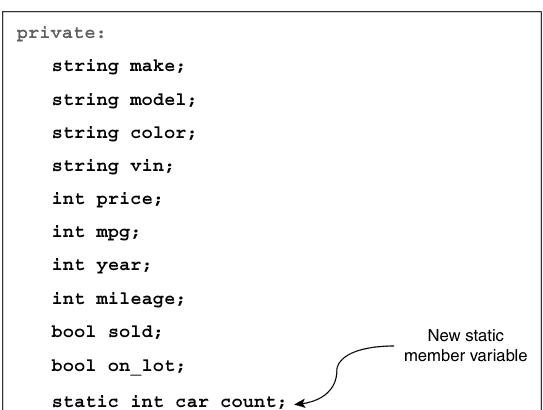

图 13-7 更新后的私有成员变量

在 `Car` 类中，`car_count` 的值只需要更新一次。它适用于 `Car` 类中的对象。显然，使用静态成员可以节省你代码中的内存。通常情况下，在以下情况考虑静态成员变量：

- 变量的值独立于对象

- 某个值需要在所有对象之间共享

### 静态方法 (13.3.3)

假设你现在想知道经销商里有多少辆汽车。因为 `car_count` 指的不是特定的汽车，所以使用静态变量来持有当前汽车的数量。在这种情况下，你不需要创建实例。你在 `Car` 类中将 `get_car_count()` 创建为静态方法。该静态方法独立于类的任何特定对象，并且可以在不创建类实例的情况下调用。代码如下所示：

```
declare current_count as integer

current_count = Car::get_car_count()
```

第一行声明了一个新变量 `current_count` 用来存储后续代码的结果。在第二行中，类使用点运算符（`Car::get_car_count()`）来访问静态的 `get_car_count()` 并返回静态成员变量 `car_count` 的值。此时，`current_count` 持有 `car_count` 中值的拷贝副本。

# 模块 13 类与对象 241

### 我什么时候该使用静态方法？

由于静态方法不是在特定对象上调用的，所以你只使用它们来访问类内部的静态变量和其他静态方法。

### 静态类 (13.3.4)

某些语言包含了静态类。与静态方法类似，静态类只能应用于静态成员变量和静态方法。它们不能用于创建对象的实例。静态类通常组织仅对输入值进行操作且不需要存储信息的方法。

假设你想创建一些代码，让销售人员为客户进行汽车相关的计算，例如计算汽车的月供、总销售税，以及每月支出和产税的估算。你可以创建一个静态类 `CarCalculations` 来完成这一点。向静态方法提供信息以返回所需的结果。该类的定义如下：

```
create class CarCalculations
public
    static method: compute_monthly_payment(car_price, interest_rate, loan_length)
    static method: compute_sales_tax(car_price, tax_rate)
    static method: estimate_monthly_gas(mileage_per_month, car_mpg, current_gas_price)
    static method: estimate_property_tax(car_price, tax_rate)
```

此代码创建了 `CarCalculations` 类。汽车计算类中的每个方法都声明为静态方法：

- `compute_monthly_payment()` 接收汽车价格、利率和贷款期限，并计算每个人应支付多少钱。

- `compute_sales_tax()` 接收汽车价格和州税率，并返回汽车的销售税。

- `estimate_monthly_gas()` 接收司机每月的里程、汽车的百加油里程（MPG）以及当前油价，以确定他们每月花费多少。

- `estimate_property_tax()` 接收汽车价格和当前的州税率以计算产税。

每个计算都独立于任何特定汽车，这就是为什么这些计算可以是静态的。对于带有 5% 销售税的 `my_celica`，你可以编写以下语句：

CarCalculations.compute_sales_tax(my_celica.get_price(), 0.05)

# 13.4 面向对象程序中对象的特征

### 对象标识性 (13.4.1)

在面向对象编程 (OOP) 中，虽然你可以创建许多使用相同底层类的对象，但它们都具有唯一的标识性，这就是你区分使用相同类创建的对象的方法。你通过给对象实例赋予不同的变量名来提供唯一标识性。例如，任何 `Car` 对象的标识都是对象的名称，如**图 13-8**所示。

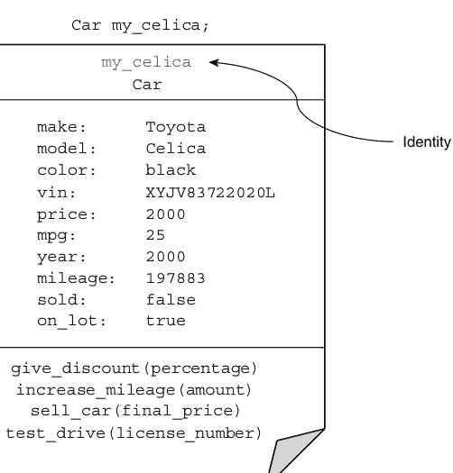

**图 13-8** `my_celica` 对象的标识

在 `instantiate my_celica = new Car` 语句中，`my_celica` 是对象的标识。任何需要此标识的代码都将通过使用其名称来实现。

如果两个对象的所有成员变量值都相同，它们是同一个吗？

两个对象可以包含相同的数据，但这不会影响对象标识性。它们是同一类的不同实例化，具有不同的变量名，代表存储在程序内存不同区域的不同对象。

### 对象状态 (13.4.2)

对象的状态（state）是其成员变量的值。在特定时刻，对象的状态是确定的且允许改变的。（注：此处原文似乎存在部分重复或逻辑断层，翻译时已根据上下文尽量保持逻辑清晰）

每个计算都独立于任何特定汽车，这就是为什么这些计算可以是静态的。对于 `my_celica` 的 5% 销售税，你可以编写以下语句：

CarCalculations.compute_sales_tax(my_celica.get_price(), 0.05)

| 属性 | 描述 |

| :--- | :--- |


| make | Toyota |
| --- | --- |
| model | Celica |
| color | black |
| vin | 12345 |
| price | 20000 |
| year | 2022 |
| mpg | 30 |
| mileage | 15000 |
| sold | false |

### 对象行为 (13.4.3)

行为是对象能够执行的操作。在 OOP 中，虽然你可以创建许多使用相同底层类的对象，但它们都具有唯一的标识性，这就是你区分使用相同类创建的方法。你通过给对象实例赋予不同的变量名来提供唯一标识性。例如，任何`Car`对象的标识都是对象的名称，如**图 13-8**所示。

在`instantiate my_celica = new Car`语句中，`my_celica`是对象的标识。任何需要此标识的代码都将通过使用其名称来实现。

如果两个对象的所有成员变量值都相同，它们是同一个吗？

两个对象可以包含相同的数据，但这不会影响对象标识性。它们是同一类的不同实例化，具有不同的变量名，代表存储在程序内存不同区域的不同对象。

# 总结

- 面向对象编程 (OOP) 允许你使用代码表示日常生活中的思想和概念。

- OOP 促进代码复用并避免复杂的声明。

- 类描述了对象的结构和功能，就像蓝图。

- 类由名称、成员变量、访问器和修改器组成。

- 创建类时，从`class`关键字开始并指定名称。

- 对象是类的实例。类可以有多个实例。创建对象时，通过提供名称并将其赋值为新对象来实例化。

- 在 OOP 中，对象被视为变量并认为是复杂数据类型，因为它们可以存储多种类型的原始数据。例如，一个对象可以拥有字符串、整数和布尔属性。

- OOP 使封装和信息隐藏更容易使用和理解。类将其和方法封装在一个对象中。信息隐藏是指 OOP 如何对外部隐藏对象的数据和方法。

- 类中的静态变量允许你在所有类成员之间共享变量，而不需要多个副本。

- 静态方法允许你访问类中的静态变量，并且不需要使用对象。

- 静态类用于组织一组仅需对输入值操作的相关方法。

- 对象通过其标识（例如对象的名称）、状态（在任何时刻对象成员变量中持有的数据）和行为（对象能够执行的操作）来描述。

# 第 14 方法

### 学习目标：

- 14.1 使用方法
    - 14.1.1 解释修改对象行为的目的。
    - 14.1.2 识别方法的组成部分。
    - 14.1.3 解释如何创建和调用方法。
- 14.2 改变对象的默认值
    - 14.2.1 解释运算符重载。
    - 14.2.2 识别何时需要重载运算符。
    - 14.2.3 演示重载相等运算符。
    - 14.2.4 识别何时需要重载方法。
    - 14.2.5 演示重载赋值运算符。
- 14.3 方法级联与方法链
    - 14.3.1 解释方法链的目的。
    - 14.3.2 解释流式接口的效用。
- 14.4 使用构造函数
    - 14.4.1 解释构造函数如何在面向对象编程 (OOP) 中使用。
    - 14.4.2 定义成员级初始化。
    - 14.4.3 解释拷贝构造如何在 OOP 中使用。
    - 14.4.4 概述使用拷贝构造函数的语法。

## 14.1 使用方法

### 为什么要使用方法？(14.1.1)

在面向对象编程 (OOP) 中，类拥有由程序员定义的特殊函数，称为方法（methods）。方法由一组执行与其对象相关的某些操作的代码块组成。方法是属于对象并执行特定任务、例程、操作或过程的函数。方法帮助我们组织与对象相关的重复任务。

你使用方法来修改对象的行为，因为它们让对象能够工作。没有方法，对象将只是相关数据的集合。

假设你正在编写代码来管理一家名为 "Zoe's Cars" 的汽车经销商的汽车（图 14-1）。

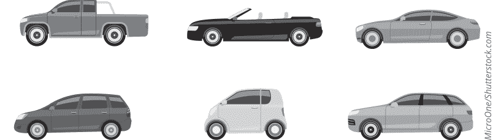

图 14-1 汽车经销商包含多种汽车

正如你可能记得函数一样，函数中的代码是被执行的，它可能返回或不向调用它的代码行返回值。方法也是如此。如果方法返回一个值，你会将该值赋值给方法调用。否则，你只需要调用该方法。对象可以拥有无限数量定义的方法，这些方法决定了它的行为。对象的方法越多，它能做的事情就越多。

在经销商中，例如，一个`Car`对象可能有折扣价格、试驾后增加里程数、售出以及注册试驾的方法。图 14-2。

你可以使用`Dealership`类来持有与运行经销商相关的成员变量和方法。`Dealership`类中的方法（图 14-3）包括经销商执行的操作的操作，例如将新车加入库存、启动试驾以及检查车辆进行维修。

在代码中，`Dealership`类将类似于图 14-4。`Dealership`对象中的成员变量包括以下内容以及其他经销商详细信息：

- `name`：所有者的名称
- `inventory`：经销商库存中的汽车
- `address`：街道地址
- `capacity`：经销商可以容纳的汽车数量
- `num_cars`：经销商中现有的汽车数量

`inventory`变量是一个对象数组，每个对象都是`Car`类的实例。

```cpp
#include <string>
using std::string;
class Car
{
public:
    void give_discount(double percentage);
    void increase_mileage(int miles);
    void sell_car(double final_price);
    void test_drive(string license_number);
    string get_make();
    string get_model();
    string set_color();
    string get_vin();
    int get_price();
    int get_mpg();
    int get_year();
    int get_mileage();
    bool get_sold();
    bool get_on_lot();
    void set_make(string m);
    void set_model(string m);
    void set_color(string c);
    void set_vin(string v);
    void set_price(int p);
    void set_mpg(int m);
    void set_year(int y);
    void set_mileage(int m);
    void set_sold(bool s);
    void set_on_lot(bool o);
private:
    string make;
    string model;
    string color;
    string vin;
    int price;
    int mpg;
    int year;
    int mileage;
    bool sold;
    bool on_lot;
};
```

访问器 (Getters)

方法

变异器 (Setters)

# 图 14-2 C++ 中的类定义

经销商预计本周会收到一些汽车。Zoe 要求你编写代码将汽车加入库存。你写了一个名为`add_car()`的方法来帮助新车。该方法有图 14-5 所示的许多组件。

在图 14-5 伪代码的第一行中，`add car`具有公共可见性（public）。`void`关键字指定该方法不返回值。方法所属的类是`Dealership`，方法名是`add_car()`。该方法接受一个参数`Car`对象，将其加入库存。方法首先检查添加这辆车是否会超过其容量。如果有空间，则将汽车加入库存。最后，方法更新停车场中的汽车数量。等效代码见图 14-6。


图 14-3 包含库存的 Dealership 对象

```cpp
#include <string>

class Dealership {
public:
    Dealership();
    void add_car(Car c);
    string get_owner();
    Car& get_inventory();
    string get_address();
    int get_capacity();
    int get_num_cars();
    void set_owner(string _owner);
    void set_inventory(Car *inventory);
    void set_address(string _address);
    void set_capacity(int capacity);
    void set_num_cars(int num_cars);

private:
    string owner;
    Car *inventory;
    int capacity;
    int num_cars;
};
```

图 14-4 C++ 中的类定义

访问修符 返回类型 类名 参数列表

```cpp
void Dealership::add_car(Car c) throws Out_of_Range_Exception
if (num_cars + 1 <= capacity)
    inventory[num_cars] = c
    num_cars = num_cars + 1
else
    output("The lot is full.")
    throw Out_of_Range_Exception
return
```

图 14-5 方法约定

```cpp
#include <iostream>
#include "Dealership.h"
#include "Car.h"
using namespace std;
// 类以及类使用的其他对象（本例中为 Car）的头位于实现文件的顶部。
// 作用域 返回类型 类名 参数列表
void Dealership::add_car(Car c) {
    if (num_cars + 1 <= capacity) {
        inventory[num_cars] = c;
        num_cars++;
    } else {
        throw runtime_error("lot_full");
        return;
    }
}
```

图 14-6 C++ 中向库存添加汽车的方法

规则和最佳实践：

- 文件名始终是类名，后接`.cpp`
- 在 C++ 中，方法定义不需要修饰符
- 在 C++ 中，使用作用域解析符 (`::`) 在类之外定义方法

## 方法的内部结构 (14.1.2)

方法包含以下组成部分：

- **访问修饰符 (Access modifier)**：与类一样，访问修饰符指定方法是`public`还是`protected`。C++ 方法还可以有`const`修饰符，防止方法修改对象的状态。虽然不是强制的，但许多人认为使用`const`是避免代码错误的好习惯。

- **方法名 (Method name)**：在代码中引用方法时使用的标识符。名称通常跟着一个名词，例如`add_car()`。

- **类名 (Class name)**：方法所属的类名。在`add_car()`方法中，名称是`Dealership`，因为`add_car()`是只有`Dealership`可以执行的行为。

- **参数列表 (Parameter list)**：参数列表指定给方法的输入，以便其执行任务。参数列表可以是空的。例如，`add_car()`方法的列表中只有一个参数，即加入库存的汽车。

- **方法体 (Method body)**：方法体是方法执行其操作的语句或代码列表。

- **返回类型 (Return type)**：返回类型指定方法执行完毕时返回的信息类型，称为返回值。例如，`add_car()`有`void`返回类型，表示它不返回值。返回类型可以是任何类型，包括复杂数据类型。

- **异常列表 (Exception list)**：在某些编程语言中，方法包含异常列表，即方法可以抛出的异常。如果尝试向已满的经销商添加汽车，`add_car()`方法可能会抛出`Out_of_Range_Exception`。

方法必须在使用之前定义。程序员定义方法并根据需要对其更改。例如，你可能会发现执行该方法的更简单的方法。你可以根据语境修改行为。

### 使用方法 (14.1.3)

当你想要执行某操作时，可以通过`方法调用` (method call) 来触发。与函数类似，执行流跳转到方法，执行语句并返回到之前的执行路径。要进行方法调用，如果方法有返回值，使用以下语法：

```
return_value = call object.method(argument_1, argument_2, ...)
```

如果方法不返回值，使用以下语法：

```
call object.method(argument_1, argument_2, ...)
```

让我们逐个拆解这些示例：

- **对象 (object)**：通过你想调用的方法名识别变量和方法名。例如，`add_car()`是`Dealership`类中的方法。使用`inventory.add_car()`表示你正尝试调用向库存添加汽车的方法。

- **参数 argument_1, argument_2**：你可以向对象传递一个或多个参数，这将成为方法的参数列表。例如，`add_car()`有一个参数，类型为汽车。

- **返回值 (return value)**：如果方法有返回值，它将返回给`return_value`中指定的变量。与函数类似，如果方法不返回值，则你不需要从方法返回任何`return_value`。

与函数类似，当方法被调用时，它会开始执行方法体中的第一个语句，并一直持续到方法体结束。如果方法中的某个语句导致了异常，该异常将返回给调用该方法的代码部分。图 14-7 显示了向经销商（Dealership）添加汽车的实际代码。


```cpp
#include <iostream>
#include <string>
#include "Car.h"
#include "Dealership.h"
using namespace std;

int main() {
{
    Dealership zoeZippyCars;
    string owner;
    string address;
    int capacity;
    int num_new_cars;
    cout << "What is your name? ";
    getline(cin, owner);
    cout << "What is your address? ";
    getline(cin, address);
    cout << "What is your lot's capacity? ";
    cin >> capacity;
    cin.ignore();
    cout << "How many cars would you like to enter? ";
    cin >> num_new_cars;
    cin.ignore();

zoeZippyCars.set_owner(owner);
zoeZippyCars.set_address(address);
zoeZippyCars.set_capacity(capacity);

    Car new_car;
    string make;
    string model;
    string color;
    string vin;
    int price;
    int mpg;
    int year;
    for (int i=0; i < num_new_cars; i++) {
        cout << "Please enter the car's make: ";
        getline(cin, make);
        cout << "Please enter the car's model: ";
        getline(cin, model);
        cout << "Please enter the car's color: ";
        getline(cin, color);
        cout << "Please enter the car's vin: ";
        getline(cin, vin);
        cout << "Please enter the car's price: ";
        cin >> price;
        cin.ignore();
        cout << "Please enter the car's mpg: ";
        cin >> mpg;
        cin.ignore();
        cout << "Please enter the car's year: ";
        cin >> year;
        cin.ignore();
        cout << "Please enter the car's mileage: ";
        cin >> mileage;
        cin.ignore();

        new_car.set_make(make);
        new_car.set_model(model);
        new_car.set_color(color);
        new_car.set_vin(vin);
        new_car.set_price(price);
        new_car.set_mpg(mpg);
        new_car.set_year(year);
        new_car.set_mileage(mileage);

        try {
            zoeziippyCars.add_car(new_car);
        } catch (runtime_error e) {
            const char *type = e.what();
            if (strcmp(type, "lotfull") == 0) {
                cout << "There is no more space in the lot." << endl;
                cout << "Sell more cars. Quitting Program." << endl;
                return 0;
            }
        }
    }
    return 0;
}
```


## 图 14-7 使用 `add_car()` 方法向经销商添加汽车（续）

- 使用变变器（mutators）设置 `Car` 成员变量
- 调用 `add_car()` 方法将汽车添加到添加到库存中
- 如果停车场没有足够的空间，则捕获异常

## C++ 编程

```cpp
#include <iostream>

using namespace std;

void Dealership::add_car(Car c)
{
    if (num_cars + 1 <= capacity)
    {
        inventory[num_cars] = c;
        cout << "Added a car to the inventory." << endl;
        cout << "There are now " << num_cars << " cars on the lot ";
        cout << "with a capacity of " << capacity << "." << endl;
    }
    else
    {
        throw runtime_error("lot_full");
    }
}
```

输出：

```
What is your name?: Zoe
What is your address?: 123 Main Street
What is your lot capacity?: 50
How many cars would you like to enter?: 1
Please enter the car's make: Toyota
Please enter the car's model: Camry
Please enter the car's color: Silver
Please enter the car's vin: XYT7392
Please enter the car's price: 16000
Please enter the car's mpg: 33
Please enter the car's year: 2004
Please enter the car's mileage: 23456
Added to the inventory. 1 cars on the lot with a capacity of 50.
```

**图 14-7** 使用 `add_car()` 方法向经销商添加汽车

## 我如何决定我应该使用函数还是方法？

这取决于代码的组织方式。如果你需要对对象执行某种操作，那么你应该将其制为属于该类的方法。否则，如果该操作不需要在对象上执行，那么它应该是一个函数。

语句 `car_1 == car_2` 比较的是内存位置。如果对象是通过唯一的数字（VIN）来标识的，且 VIN 是汽车的属性，你可以使用 `vin` 来测试相等性。`car_1 == car_2` 比较 `car_1` 和 `car_2` 的属性，发现它们是不同的，并返回 `false`。

这就是使用运算符重载（operator overloading）的地方，这种编程技术允许你为特定类的对象自定义内置运算符。程序员通过重载运算符为对对象执行操作提供一种简洁、简单且自然的方法。运算符重载的方式与定义方法相同。你不需要指定方法名称，而是使用你正在重载的运算符名称。重载后的运算符应该具有与实际相同的类型和参数，以便以熟悉的方式使用它们。你可以在方法体中定义运算符，就像定义普通函数一样。

虽然支持运算符重载的语言语法各异，但在伪代码中，运算符的定义类似于下面（以相等运算符为例）：

```cpp
public boolean Car::operator == (Car c) {
    if (vin == c.c_vin())
        return true
    else
        return false
}
```

在伪代码中，第一行 `public boolean Car::operator == (Car c)` 表示你将在 `Car` 类中定义一个新的公共方法（该方法带有一个重载的运算符）。`boolean` 关键字表示该方法将返回一个布尔（`true` 或 `false`）值。`Car c` 是传递给方法的参数。该参数是要与调用该方法的 `Car` 对象比较的 `Car` 对象。考虑以下：

```cpp
car_comparison = car_1 == car_2
```

在这里，`car_2` 是传递给 `car_1` 对象重载的 `==` 方法的参数。比较的布尔结果存储在 `car_comparison` 变量中。

`if-else` 块包含了代码 `vin == c.c_vin()`，它比较了传递的汽车的 `vin`（在访问器中）与调用 `==` 的对象的 `vin`。如果条件为真，则 `==` 返回 `true`；否则返回 `false`。通过创建这个方法，你改变了 `==` 的默认行为。如果在两个 `Car` 变量上调用 `==`，代码将检查内部的 `vin` 值。如果 `vin` 值相同，你可以假设它们返回 `true`。否则，它们不同，代码返回 `false`。这种重载运算符的代码见图 14-9。假设你使用的是之前的 `Dealership` 和 `Car` 类，图 14-9 中的代码比较了两辆汽车。

> 在 `.cpp` 中

```cpp
#include <iostream>
#include "Car.h"
using namespace std;
// 其他方法
bool Car::operator==(Car c) {
    if (vin == c.c_vin())
        return true;
    else
        return false;
}
```

重载的 `==` 方法接收 `Car` 变量作为参数，如果 VIN 与当前对象的 VIN 相同则返回 `true`，否则返回 `false`。

## 图 14-9 重载运算符比较两辆汽车（续）

```cpp
#include <iostream>
#include <string>
using namespace std;

int main() {
    Car car_1;
    Car car_2;

    car_1.set_make("Toyota");
    car_1.set_model("Camry");
    car_1.set_color("gray");
    car_1.set_vin("XYZ20222690752");
    car_1.set_price(150639);
    car_1.set_mpg(30);
    car_1.set_year(2014);
    car_1.set_mileage(18123);

    car_2.set_make("Volkswagen");
    car_2.set_model("Beetle");
    car_2.set_color("red");
    car_2.set_vin("SMLGT34839220");
    car_2.set_price(150000);
    car_2.set_mpg(25);
    car_2.set_year(2015);
    car_2.set_mileage(18123);
}
```

# C++ 编程

```cpp
bool car_comparison = car_1 == car_2;
if (car_comparison == true)
{
    cout << "The two cars are the same." << endl;
}
else
{
    cout << "The two cars are different." << endl;
}
return 0;
```

调用 `operator==` 方法来判断它们是否相同。如果相同，屏幕上将打印“The two cars are the same.”。否则，屏幕上将打印“The two cars are different.”。

输出：

```
The two cars are the same.
```

图 14-9 通过重载相等运算符来比较两个 `Car` 变量

但由于 `vin`（车辆识别号码）能够唯一标识一个 `Car` 对象，你不需要检查任何其他属性来判断对象是否相同。当一个或一组成员变量能够唯一标识一个对象时，你不需要测试每个成员。

你可以重载除相等运算符以外的许多运算符，包括算术、赋值、关系和逻辑运算符。没有必要重载所有运算符。重载运算符由你作为程序员自行决定，以便简化为了特定目的的操作。根据经验法则，重载运算符应该帮助你的代码更容易编写且更易理解。

## 方法重载 (14.2.4)

汽车经销商在销售季节会降低价格。经销商需要灵活性来以不同的方式处理汽车价格。例如，作为一种说服力的销售策略，销售人员可以选取两辆同一年制造的汽车，并将价格折扣到与价格较低的汽车相同。每家汽车制造商都可以按照标价的百分比（0.01 到 0.99 之间）对其汽车进行折扣。经销商经理还可以按特定的美元金额降低汽车价格。处理这三种折扣的一种方法是为每种折扣创建一个不同的方法：

```cpp
public void Car::discount_by_car_price(Car c) { ... }
public void Car::discount_by_percentage(float discount) { ... }
public void Car::discount_by_amount(int discount) { ... }
```

第一个方法允许销售人员获取传入的 `Car` 变量（命名为 `c`）的价格。如果 `c` 的价格低于调用 `discount_by_car_price(Car c)` 的当前 `Car` 变量的价格，则当前 `Car` 的价格保持不变。

第二个方法允许汽车制造商指定一个百分比（小数值 0 到 1 之间），对调用 `discount_by_percentage(float discount)` 的当前 `Car` 变量进行折扣。

第三个方法允许经销商经理指定一个美元金额（由整数表示），对调用 `discount_by_dollar_amount(int discount)` 的当前 `Car` 变量进行折扣。

然而，为每个方法定义新方法是麻烦的，而且记住应该使用哪一个是非常无聊的。任何关心折扣的人都需要记住每个方法的准确名称。相反，你可以应用方法重载，这意味着你可以编写一个同名但参数不同的方法。通常情况下，当你有多个使用不同参数执行相同操作的方法时，你应该重载方法。Java 和 C++ 支持方法重载，而 Python 不支持。代码根据方法调用指定的参数确定要执行的方法。因此，你可以将伪代码更改为：

```cpp
void discount_price(Car c)
void discount_price(float discount)
void discount_price(int discount)
```

伪代码中的所有方法都执行相同的操作。唯一的区别是它们具有相同的方法名。方法重载有两个好处：像 `discount_price()` 这样的单一方法很短，易于解释和记忆。该方法也是可复用的。你可以将其用于任何类型的折扣，即使折扣计算发生变化。你只需创建一次方法但就可以重复使用多次。方法重载的代码如图 14-10 所示。

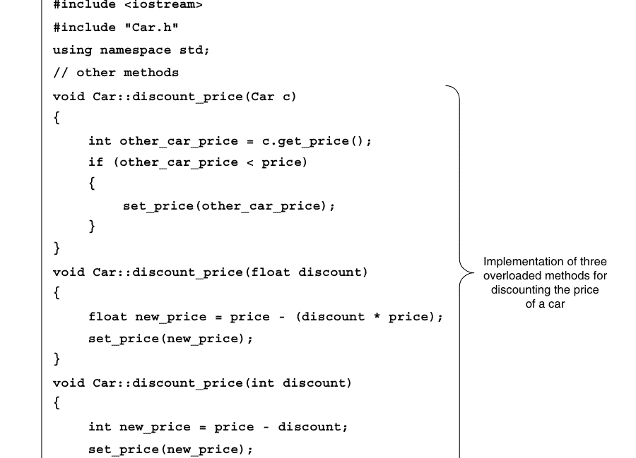

图 14-10 重载方法为汽车应用折扣（续）


```cpp
int main()
{
    Car car_1; // 声明三个 Car 变量
    Car car_2;
    Car car_3;

    car_1.set_make("Toyota");
    car_1.set_model("Camry");
    car_1.set_color("gray");
    car_1.set_vin("XYZ22022690752");
    car_1.set_price(15639);
    car_1.set_mpg(30);
    car_1.set_year(2014);
    car_1.set_mileage(18123);

    car_2.set_make("Volkswagen");
    car_2.set_model("Beetle");
    car_2.set_color("red");
    car_2.set_vin("SMLGTR3838920"); // 带有数据的变量
    car_2.set_price(15000);
    car_2.set_mpg(25);
    car_2.set_year(2015);
    car_2.set_mileage(18123);

    car_3.set_make("Nissan");
    car_3.set_model("Verna");
    car_3.set_color("blue");
    car_3.set_vin("ADKMY20394");
    car_3.set_price(17000);
    car_3.set_mpg(20);
    car_3.set_year(2015);
    car_3.set_mileage(2447);
}
```

图 14-10 重载方法为汽车应用折扣（续）

```cpp
void discount_price(Car c)
void discount_price(float discount)
void discount_price(int discount)
```

伪代码中的所有方法都执行相同的操作。唯一的区别是它们具有相同的方法名。方法重载有两个好处：像`discount_price()`这样的单一方法很短，易于解释和记忆。该方法也是可复用的。你可以将其用于任何类型的折扣，即使折扣计算发生变化。你只需创建一次方法但就可以重复使用多次。方法重载的代码如图 14-10 所示。

```cpp
int main()
{
    Car car_1; // 声明三个 Car 变量
    Car car_2;
    Car car_3;

    car_1.set_make("Toyota");
    car_1.set_model("Camry");
    car_1.set_color("gray");
    car_1.set_vin("XYZ22022690752");
    car_1.set_price(15639);
    car_1.set_mpg(30);
    car_1.set_year(2014);
    car_1.set_mileage(18123);

    car_2.set_make("Volkswagen");
    car_2.set_model("Beetle");
    car_2.set_color("red");
    car_2.set_vin("SMLGTR3838920"); // 带有数据的变量
    car_2.set_price(15000);
    car_2.set_mpg(25);
    car_2.set_year(2015);
    car_2.set_mileage(18123);

    car_3.set_make("Nissan");
    car_3.set_model("Verna");
    car_3.set_color("blue");
    car_3.set_vin("ADKMY20394");
    car_3.set_price(17000);
    car_3.set_mpg(20);
    car_3.set_year(2015);
    car_3.set_mileage(2447);
}
```

## 设置对象等于另一个对象 (14.2.5)

假设某家汽车制造商正在从其他经销商处为 Zoe 签署一些汽车。Cars Plus 经销商会将汽车转移到 Zoe 的经销商处，并将其添加到库存中。

为了在设计中处理这种情况，你可能如下所示将`Car (c)`传递给`add_car`：

```cpp
public void Dealership::add_car(Car c) throws Out_Of_Range_Exception
if (num_cars + 1 <= capacity)
    inventory[num_cars] = c;
    num_cars = num_cars + 1;
else
    throw Out_Of_Range_Exception;
return;
```

能够按照预期工作，将一个传输的汽车添加到库存中。然而，如果`car_2`在内存中被删除或修改（可能是由创建它的代码修改），那么`car_1`也会被删除或修改。

为了避免这个问题，你可以像下面的伪代码所示那样重载赋值运算符：

```cpp
Car operator=(Car car_2)

make = other_car.make
model = other_car.model
color = other_car.color
vin = other_car.vin
price = other_car.price
mpg = other_car.mpg
year = other_car.year
mileage = other_car.mileage
sold = false
lot = true
```

这重载了赋值运算符。假设`operator()`方法已通过`car_1 = car_2`被再次调用。`car_1`对象的`operator()`方法被调用，并将`car_2`作为参数传入。`car_2`的每个成员变量都被拷贝到`car_1`的成员变量中。现在`car_1`和`car_2`具有完全状态，并在调用后是相同的。这段代码将创建两个重复的对象，创建一个深拷贝，如图 14-11 右侧所示。

## 14.3 方法级联与方法链

### 在同一对象上调用多个方法 (14.3.1, 14.3.2)

Zoe's Car 汽车行的经理们对你的工作印象非常深刻，以至于给了你一个月的假。在这个月里，你决定优化你的代码使其更高效。在代码的某些部分，你可以对同一个对象调用多个方法。例如，在将汽车输入库存时，代码如下所示：

```cpp
instantiate new_car = new Car()
new_car.set_make(make)
new_car.set_model(model)
new_car.set_color(color)
new_car.set_vin(vin)
new_car.set_price(price)
new_car.set_mileage(mileage)
new_car.set_mpg(mpg)
new_car.set_year(year)
inventory.add_car(new_car)
```

在代码中，你创建了一个新的`Car`变量，并使用修改器（mutators）单独设置每个成员变量的值。因此，对于每个新的`Car`对象，代码都调用了八个不同的方法：`set_make()`、`set_model()`、`set_color()`、`set_vin()`、`set_price()`、`set_mileage()`、`set_mpg()`和`set_year()`。如何修改这段代码使其更高效？

你可以使用方法级联（有时称为方法链），它可以在单个对象上调用许多方法。方法级联是一种编程语法偏好，消除了重复列出对象的需要。你的代码可以重写为：

```cpp
instantiate new_car = new Car()
new_car.set_make(make).set_model(model).set_color(color).set_vin(vin).set_price(price).set_mileage(mileage).set_mpg(mpg).set_year(year)
inventory.add_car(new_car)
```

在这个伪代码中，你不需要在八行中调用八个方法，而是可以将所有方法连接，并按照它们编写的顺序从左到右执行。流式接口（Fluent interfaces）是一种面向对象的设计方法，编程语言的语法依赖方法级联来使代码更易读。

### 你如何修改上面的伪代码以将`on_lot`属性设置为`sold`？

### 添加

```cpp
new_car.set_make(make).set_model(model).set_color(color).set_vin(vin).set_price(price).set_mileage(mileage).add(new_car).set_on_lot(true)
```

图 14-12 显示了如何更改方法定义以允许方法级联。

```cpp
void Car::set_make(string m)
{
    make = m;
}
void Car::set_model(string m)
{
    model = m;
}
void Car::set_color(string c)
{
    color = c;
}
void Car::set_vin(string v)
{
    vin = v;
}
void Car::set_price(int p)
{
    price = p;
}
void Car::set_mpg(int m)
{
    mpg = m;
}
void Car::set_year(int y)
{
    year = y;
}
void Car::set_mileage(int m)
{
    mileage = m;
}
void Car::set_sold(bool s)
{
    sold = s;
}
void Car::set_on_lot(bool b)
{
    on_lot = b;
}
```

```cpp
Car& set_make(string m)
{
    make = m;
    return *this;
}
Car& set_model(string m)
{
    model = m;
    return *this;
}
Car& set_color(string c)
{
    color = c;
    return *this;
}
Car& set_vin(string v)
{
    vin = v;
    return *this;
}
Car& set_price(int p)
{
    price = p;
    return *this;
}
Car& set_mpg(int m)
{
    mpg = m;
    return *this;
}
Car& set_year(int y)
{
    year = y;
    return *this;
}
```

在 C++ 中，级联要求对象返回自身，以便被下一个级联方法中的调用使用。这通过在每个方法定义中返回`*this`来表示。

由于我们返回的是对对象的访问，修改器的返回类型从`void`变为`Car`，这是对`Car`引用的类型。

## 图 14-12 实现级联的方法定义

## 14.4 使用构造函数

### 指定如何构造对象 (14.4.1, 14.4.2)

到目前为止，你通过输入以下格式的代码来创建了一个新的`Car`：

```cpp
instantiate new_car = new Car()
```

在背后，你的程序调用了一个构造函数，这是一个特殊的方法，用于创建一个名为`new_car`的对象，并分配足够的内存来存储所有信息。

（注：由于原文存在大量重复段落“在背后...用于创建一个名为`new_car`的对象，并分配足够的内存来存储所有信息”，已按要求进行处理。）

### 构造函数在哪里定义？

所有构造函数都定义在与其他方法相同的文件中。它们在类定义中与所有方法并列，并具有公共访问权限。

上述伪代码创建了一个完整的构造函数，在对象创建时初始化所有成员变量。

良好的编程习惯使用默认构造函数来显式设置成员变量，即使它们是未知的。默认构造函数可以重写为：


```cpp
Car() {
    make = ""
    model = ""
    color = ""
    vin = ""
    price = 0
    mileage = 0
    mpg = 0
    on_lot = true
    sold = false
}
```

## 从另一个对象构造对象（14.4.3、14.4.4）

之前，你重载了赋值运算符来将一个对象赋值给另一个对象。你将编写类似的代码来创建一个拷贝构造函数。它的格式与默认构造函数相同，但它接收一个参数，即要复制的对象。

当要复制的对象被传递进来时，它所有的成员变量都会被复制到新对象中。这两个对象具有相同的成员变量，但存在于内存中不同的位置。并不总是需要拷贝构造函数。例如，在一个 `Dealership`（经销商商店）对象中，你永远不会在同一个地址拥有两个完全相同的 `Dealership`。

一个 `Car` 对象的拷贝构造函数如下：

```cpp
Car (Car c)
make = c.make
model = c.model
color = c.color
vin = c.vin
price = c.price
mileage = c.mileage
on_lot = c.on_lot
sold = c.sold
```

> 拷贝构造函数和深拷贝之间有什么区别？

在内存中它们实现了相同的结果，但一个被认为是可以随时调用的方法，而另一个是在对象首次创建时调用的构造函数。

> 你可以在一个对象中定义多个构造函数吗？

可以。你可以指定一个默认构造函数、一个拷贝构造函数，以及根据程序设计所需的任意数量参数化构造函数。这被称为构造函数重载，它遵循与运算符重载相同的规则。构造函数可以有相同的名称，但必须具有不同的参数列表。

## 总结

- 在面向对象编程中，方法是程序员定义的特殊函数，它们属于一个类，并执行与由该类创建的对象相关的动作。
- 方法与函数相似，由访问修饰符、方法名、参数列表、方法体、返回类型和异常列表组成。
- 必须调用（或触发）方法来执行操作。当方法被调用时，它执行方法体中的第一条语句，并继续执行直到方法体的结束。
- 你可以使用方法来定制对象的行为。运算符重载允许你指定内置操作在处理你的对象时应该如何表现。默认行为通常使用垃圾数据，这可能会导致你的程序出现错误。
- 你可以通过方法重载使你的代码更具可用性，这允许你使用不同的参数列表调用同一个方法。方法重载让你的代码更容易解释和重用。
- 当使用赋值运算符（`=`）将一个对象赋值给另一个对象时，默认创建一个浅拷贝，即新对象指向与另一个对象相同的内存位置。重载赋值运算符是一个良好的习惯，可以确保你创建了对象的深拷贝。
- 方法链是一种编程范式，它允许你顺序地在同一个对象上调用多个方法，减少了代码量并提高了效率。使用方法链的编程语言被称为流式接口。
- 每当实例化新对象时，构造函数就会被调用。你可以指定构造函数在对象创建时如何设置成员变量的值。使用构造函数避免垃圾值带来的性能问题是良好的编程实践。
- 每当创建对象时，程序都会调用默认构造函数。如果你定义默认构造函数的行为，编译器将为你完成。
- 你可以创建一个参数化构造函数，在创建对象时传递任意数量的参数设置成员变量的值。
- 拷贝构造函数允许你创建一个另一个对象的完全拷贝的新对象。

## 关键术语

- 访问修饰符（access modifier）
- 构造函数（constructor）
- 拷贝构造函数（copy constructor）
- 深拷贝（deep copy）
- 默认构造函数（default constructor）
- 异常列表（exception list）
- 流式接口（Fluent interfaces）
- 全参数构造函数（full constructor）
- 垃圾值（garbage values）
- 隐式默认构造函数（implicit default constructor）
- 成员级初始化（memberwise initialization）
- 方法体（method body）
- 方法调用（method call）
- 方法链（method cascading）
- 方法名（method name）
- 方法重载（method overloading）
- 方法（methods）
- 运算符重载（operator overloading）
- 参数列表（parameter list）
- 参数化构造函数（parameterized constructor）
- 预运算符（predefined operators）
- 返回类型（return type）
- 浅拷贝（shallow copy）

# 第 15 模块：封装（ENCAPSSULATION）

## 学习目标

### 15.1 类结构的组件

- 15.1.1 解释封装如何增强代码结构。
- 15.1.2 解释信息隐藏的概念。
- 15.1.3 解释类中属性（properties）的作用。
- 15.1.4 解释类中方法的作用。
- 15.1.5 解释属性的作用。
- 15.1.6 解释在 OOP 中如何使用关键字来引用当前实例（`this`）。
- 15.1.7 对比隐式与显式的自引用。

### 15.2 访问器（ACCESSOR）和修改器（MUTATOR）

- 15.2.1 解释访问器的作用。
- 15.2.2 解释修改器的作用。

### 15.3 使用构造结构（CONSTRUCTS）

- 15.3.1 解释参数在 OOP 中的功能。
- 15.3.2 解释实参在 OOP 中的构功能。
- 15.3.3 解释应用于 OOP 的构造函数重载。
- 15.3.4 解释应用于 OOP 的默认构造函数。

### 15.4 使用访问标识符进行封装

- 15.4.1 解释访问修饰符的作用。
- 15.4.2 解释公共变量（public variables）。
- 15.4.3 解释私有变量（private variables）。
- 15.4.4 解释对象私有数据的作用。

### 15.5 接口和头文件

- 15.5.1 解释接口的作用。
- 15.5.2 解释与接口相关的头文件。
- 15.5.3 解释 OOP 中方法签名的功能。
- 15.5.4 解释头文件保护符（header guards）的作用。

## 15.1 类结构的组件

### 数据隐藏（15.1.1、15.1.2）

在开车行驶时，如图 15-1 所示，你理解操作汽车会改变它的行为。按下加速板会让汽车加速，按下刹车会让它减速。如果你对汽车的工作原理一无知，你仍然舒适地使用汽车。无论按下加速板是向内燃机增加汽油，还是向你的电动机增加信号；加速板都会让汽车向前行驶。

272 C++ 编程


图 15-1 开车不需要理解汽车如何工作

你使用电脑的方式也是类似的。你不需要知道计算机是如何编程的就可以使用它。你只需要知道如何使用它。当你使用电脑时，你不需要知道计算机是如何编程的。你只需要知道它期望你提供什么。将信息打包在一起被称为封装。在封装设计中，为了让工作更容易使用。为了在屏幕上显示文本，你不需要了解汽车如何工作。汽车是由引擎、座椅等许多部分组成的，如图 15-2 所示。当你听到“汽车”这个词时，你可能会想象整个汽车。为了游戏中模拟汽车，你需要根据它的属性进行设计。


图 15-2 汽车拥有许多部分

### 设计对象（15.1.3、15.1.4、15.1.5）（OOP）

类是面向对象编程（OOP）的基本部分，它将程序视为对象。橡胶球是一个具有特定描述属性的对象。例如，球有半径、颜色和弹性因子。这些属性被称为对象的*属性*。对象的可能属性存储在类定义中作为成员变量（也称为*实例变量*）。使用“成员变量”一术语是描述属于对象的变量而非独立变量的方法。

在设计 OOP 时，首先识别它的属性。这个对象的定义特征是你（或其他程序员）需要知道的？假设你是公司的一名程序员，你的老板要求你编写一个基础的 `Car` 类。老板告诉你，有人会在没有你帮助的情况下使用这个类。`Car` 类需要有漆颜色、制造年份、里程数、油位和当前速度。（现实中的汽车可能有许多属性。）

你使用这些属性来开始编写类的 `Car` 类，如图 15-4 所示。代码从定义类名称 `Car` 开始。它设置了 `paint_color`、`year`、`mileage`、`oil_level` 和 `current_speed` 属性变量。

```cpp
int main() {
    cout << "Printing to the line!" << endl;
}
```

图 15-3 向命令行打印字符串

### 关于骰子的属性

图 15-5 显示了多面游戏骰子。这些骰子可以是任何数量的面，最小的面数为四面。每个面上都有一个数字。当掷出骰子时，其中一面被视为“朝向上”。你认为这个对象的属性应该是什么？

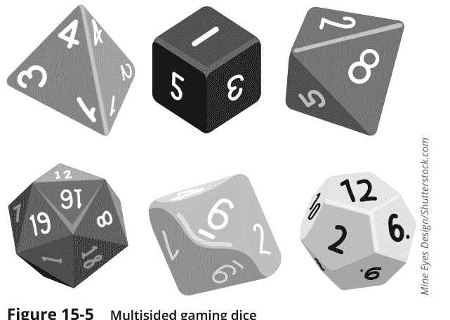

面数应该是一个属性（例如 `num_sides`），这样你只需要一个类来表示所有类型的骰子。朝向上的一面也应该是一个属性（`face_up`），因为它代表了骰子的状态。

对象的某些属性对对象本身很重要，但不需要让其他人知道。这些属性被称为实例字段（instance fields）。对象的实例字段是一个不供外部查看的内部变量。对象可以修改它或保持不变，但任何外部代码都无法访问它。汽车的实例字段的一个示例是油位。仪表盘通常不会显示汽车的油量；当油位过低时，它会显示“更换油”指示灯。图 15-6 显示了使用的代码。

```cpp
class Car {
    // 汽车的其他实现部分已省略 ... //
    instance double oil_level;
    bool should_change_oil() {
        // 其他无法访问它的代码
        return this->oil_level < 0.5;
    }
}
```

图 15-6 油位是汽车的实例字段

图 15-6 中的代码显示了一个与实例交互的方法。为了简洁起见，省略了汽车的其他元素。名为 `should_change_oil()` 的方法将返回一个布尔值 true 或 false，表示是否需要更换油。如果汽车的 `oil_level` 小于 0.5，返回 true，否则返回 false。

### 关于骰子的实例字段

考虑图 15-5 中的骰子。对于 `Die` 对象，什么应该是实例字段？

属性和实例字段描述了汽车的状态。例如，`current_speed` 描述了 `Car` 的状态。动作是对象用来改变其状态的操作。汽车可以增加速度或开启车轮。这些动作在代码中表示为方法。例如，`Car` 对象可以有一个 `accelerate()` 方法。

关于方法的另一种思考方式是将其看作是有用的函数，一个对象应该与该对象的实例一起使用。例如，运行中的汽车可以改变速度，因此所有汽车都应该有一个 `accelerate()` 方法。每当你向函数添加一个参数，你就会增加对对象使用该函数的要求。如果一个函数必须将 `Car` 作为参数传递，另一个程序员就必须传递一辆汽车。将行为变为方法则可以消除另一个程序员忘记包含 `Car` 参数的可能性。

### 关于骰子的动作

回到图 15-5。`Die` 对象应该具有什么动作？

在与骰子交互时，你可以掷出它们来查看哪个值朝向上的。图 15-5 左上角的骰子有四面。像 `roll()` 这样的方法会随机将 `Die` 对象的 `face_up` 值更改为 1 到 4 之间的任何数字。

虽然图 15-7 显示了如何编写一个加速汽车的函数，但图 15-8 显示了如何编写一个加速汽车的方法。请注意，`accelerate()` 方法需要传递的信息较少，因为它有参数。

```cpp
void accelerate(Car car, double amount)
{
    double current_speed = car.get_current_speed();
    car.set_current_speed(amount + current_speed);
}
```

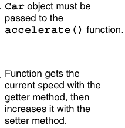

图 15-7 `accelerate()` 的代码

276 使用 C++ 编程

```cpp
class Car
{
    // ... 此处有其他汽车代码 //
    void accelerate(double amount)
    {
        this->current_speed += amount;
    }
}
```

**图 15-8** `accelerate()` 方法的代码

## 自引用范围（15.1.6、15.1.7）

在讨论对象时，上下文很重要。如果你有五辆汽车，“一辆汽车是红色的”并没有意义。但是，“这辆汽车是红色的”告诉了你关于特定汽车的信息。引用当前对象的属性和字段时，使用**自引用关键字**（self-reference keyword）。

```text
calculate.year = 2002
```

在伪代码中，关键字是 `this`，但编程语言可能使用不同的单词来表示自引用。**图 15-9** 显示了几种常用编程语言中的关键字以及其用法。

| 语言 | 自引用关键字 | 使用语法 |
|---|---|---|
| C++ | `this` | `this->identifier` |
| Java | `this` | `this.identifier` |
| Python | `self` | `self.identifier` |

**图 15-9** 常见的自引用关键字

某些语言允许在使用变量标识符时省略自引用关键字；这被称为**隐式自引用**（implicit self-referencing）。隐式自引用需要计算机确定你想使用哪个变量。由于作用域的存在，计算机按照一定的顺序查找变量。第一个匹配你所写的内容的变量，即使另一个变量在不同的作用域中具有相同的标识符。计算机按以下顺序查找变量：

1. 局部（Local）
2. 类（Class）
3. 全局（Global）

## 15.2 访问器和修改器

### 15.2 上下文：从对象查看数据（15.2.1）

某些语言允许在使用变量标识符时省略自引用关键字；这被称为**隐式自引用**。隐式自引用需要计算机确定你想使用哪个变量。由于作用域的存在，计算机按照一定的顺序查找变量。第一个匹配你所写的内容的变量，即使另一个变量在不同的作用域中具有相同的标识符。计算机按以下顺序查找变量：

1. 局部
2. 类
3. 全局

### 15.2.1 访问器和修改器

对象的某些属性对对象本身很重要，但不需要让其他人知道。这些属性被称为实例字段。对象的实例字段是一个不供外部查看的内部变量。对象可以修改它或保持不变，但任何外部代码都无法访问它。汽车的实例字段的一个示例是油位。仪表盘通常不会显示汽车的油量；当油位过低时，它会显示“更换油”指示灯。

```cpp
class Car {
    // ... 此处有其他汽车代码 ...
    int oil_level; // 实例字段
    void should_change_oil() {
        // 其他无法访问它的代码
        return this->oil_level < 0.5;
    }
}
```

**图 15-6** 油位是汽车的实例字段

图 15-6 中的代码显示了一个与实例交互的方法。为了简洁起见，省略了汽车的其他元素。名为 `should_change_oil()` 的方法将返回一个布尔值 true 或 false，表示是否需要更换油。如果汽车的 `oil_level` 小于 0.5，返回 true，否则返回 false。

属性和实例字段描述了汽车的状态。例如，`current_speed` 描述了 `Car` 的状态。动作是对象用来改变其状态的操作。汽车可以增加速度或开启车轮。这些动作在代码中表示为方法。例如，`Car` 对象可以有一个 `accelerate()` 方法。

关于方法的另一种思考方式是将其看作是有用的函数，一个对象应该与该对象的实例一起使用。例如，运行中的汽车可以改变速度，因此所有汽车都应该有一个 `accelerate()` 方法。每当你向函数添加一个参数，你就会增加对对象使用该函数的要求。如果一个函数必须将 `Car` 作为参数传递，另一个程序员就必须传递一辆汽车。将行为变为方法则可以消除另一个程序员忘记包含 `Car` 参数的可能性。

## 补充内容

```cpp
class Car
{
    // 此处有其他汽车代码 //
    void accelerate(double amount)
    {
        this->current_speed += amount;
    }
}
```

图 15-8 `accelerate()` 方法的代码


```cpp
class Car {
    // 汽车的其他实现部分已省略 //
    double oil_level; // 实例字段
    bool should_change_oil() {
        // 其他无法访问它的代码
        return this->oil_level < 0.5;
    }
}
```

## 图 15-6 油位是汽车的实例字段

图 15-6 中的代码显示了一个与实例交互的方法。为了简洁起见，省略了汽车的其他元素。名为`should_change_oil()`的方法将返回一个布尔值 true 或 false，表示是否需要更换油。如果汽车的`oil_level`小于 0.5，返回 true，否则返回 false。

## 考虑图 15-5 中的骰子。对于 Die 对象，什么应该是实例字段？

属性和实例字段描述了汽车的状态。例如，`current_speed`描述了 Car 的状态。动作是对象用来改变其状态的操作。汽车可以增加速度或开启车轮。这些动作在代码中表示为方法。例如，Car 对象可以有一个`accelerate()`方法。

关于方法的另一种思考方式是将其看作是有用的函数，一个对象应该与该对象的实例一起使用。例如，运行中的汽车可以改变速度，因此所有汽车都应该有一个`accelerate()`方法。每当你向函数添加一个参数，你就会增加对对象使用该函数的要求。如果一个函数必须将`Car`作为参数传递，另一个程序员就必须传递一辆汽车。将行为变为方法则可以消除另一个程序员忘记包含`Car`参数的可能性。

## 回到图 15-5。Die 对象应该具有什么动作？

在与骰子交互时，你可以掷出它们来查看哪个值朝向上的。图 15-5 左上角的骰子有四面。像`roll()`这样的方法会随机将 Die 对象的`face_up`值更改为 1 到 4 之间的任何数字。虽然图 15-7 显示了如何编写一个加速汽车的函数，图 15-8 显示了如何编写一个加速汽车的方法。请注意，`accelerate()`方法需要传递的信息较少，因为它有参数。

```cpp
void accelerate(Car car, double amount)
{
    double current_speed = car.get_current_speed();
    car.set_current_speed(amount + current_speed);
}
```

### 图 15-7 accelerate() 的代码

### 图 15-8 accelerate() 方法的代码

## 自引用范围 (15.1.6, 15.1.7)

在论论对象时，上下文很重要。如果你有五辆汽车，"一辆汽车是红色的"并没有意义。但是，"这辆汽车是红色的"告诉了你关于特定汽车的信息。引用当前对象的属性和字段，使用自引用关键字。在伪代码中，关键字是`this`，但编程语言可能使用不同的单词来表示自引用。图 15-9 显示了几种常用编程语言中的关键字以及其用法。

| 语言 | 自引用关键字 | 使用语法 |
|---|---|---|
| C++ | this | this->identifier |
| Java | this | this.identifier |
| Python | self | self.identifier |

## 15.2 上下文：从对象查看数据 (15.2.1)

某些语言允许在使用变量标识符时省略自引用关键字；这被称为隐式自引用。隐式自引用需要计算机确定你想使用哪个变量。由于作用域的存在，计算机按照一定的顺序查找变量。第一个匹配你所写的内容的变量，即使另一个变量在不同的作用域中具有相同的标识符。计算机按以下顺序查找变量：

1. 局部
2. 类
3. 全局

### 15.2.1 访问器和修改器

对象的某些属性对对象本身很重要，但不需要让其他人知道。这些属性被称为实例字段。对象的实例字段是一个不供外部查看的内部变量。对象可以修改它或保持不变，但任何外部代码都无法访问它。汽车的实例字段的一个示例是油位。仪表盘通常不会显示汽车的油量；当油位过低时，它会显示"更换油"指示灯。

```cpp
class Car {
    // 汽车的其他实现部分已省略 //
    double oil_level; // 实例字段
    bool should_change_oil() {
        // 其他无法访问它的代码
        return this->oil_level < 0.5;
    }
}
```

#### 图 15-6 油位是汽车的实例字段

图 15-6 中的代码显示了一个与实例交互的方法。为了简洁起见，省略了汽车的其他元素。名为`should_change_oil()`的方法将返回一个布尔值 true 或 false，表示是否需要更换油。如果汽车的`oil_level`小于 0.5，返回 true，否则返回 false。

### 15.2.2 在对象中更改数据

修改器是用于更改数据的方法。通过封装，你使用修改器来控制其他用户对对象的更改。通过让其他程序员使用修改器而不是直接更改属性，你可以限制属性的改变方式。想象你正在创建一个设置汽车制造年份的方法。最早 1908 年大批量生产的汽车是福特 T（Ford T）。修改器（mutator）不应允许任何人将年份设置为早于 1908 年的年份。漆颜色也应该受到限制，以防止出现如"蜥蜴色"（Lizard）等颜色。图 15-13 显示了 Car 对象的修改器。

```cpp
void set_paint_color(string paint_color) {
    // 检查所有有效的漆颜色。
    for (int i = 0; i < total_colors; i++) {
        if (available_colors[i] == paint_color) {
            this->paint_color = paint_color;
            return;
        }
    }

    // 如果参数不包含有效的颜色，则设置为默认颜色。
    this->paint_color = available_colors[0];
}

void set_year(int year) {
    // 如果年份是有效年份，则设置。
    if (year >= 1908) {
        this->year = year;
    } else {
        // 否则，将年份设置为默认年份。
        this->year = 1908;
    }
}
```

#### 图 15-13 汽车的设置

使用 getter（get）和 setter（set）方法而不是直接修改对象属性，可以确保你可以对对象的状态做出假设。例如，你可以让 Car 的年份早于 1908 年，且漆是有效的颜色。

## 15.3 使用构造函数

### 参数与参数 (15.3.1, 15.3.2)

回想构造函数是一种特殊方法，用于创建对象并分配足够的内存来存储与对象相关的信息。程序通常在创建新对象时调用构造函数来初始化其类类型的对象。你可以使用构造函数通过封装来实现数据隐藏。当你创建一个对象时，你是该对象的专家，并知道设置它的最佳方式。构造函数就像新程序的设置向导。构造函数处理对象的复杂部分，并要求你提供可能不同颜色的部分，但无论颜色如何，漆都是以相同的方式涂的。图 15-14 显示了一个可能的 Car 构造函数。

```cpp
Car(int year, string paint_color) {
  // 使用 setter 来强制执行

  this->set_paint_color(paint_color);
  this->set_year(year);
  this->mileage = 0.0;
  this->oil_level = 1.0;
  this->current_speed = 0.0;

}
```

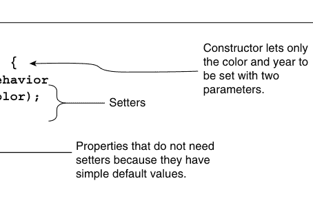

图 15-14 Car 对象的构造函数

构造函数有两个参数，`year`和`paint_color`，它们被传递给两个 setter 方法`set_paint_color()`和`set_year()`。使用 setter 确保了 setter 内部创建的限制在构造函数中仍然被执行。其余的代码行将 Car 的所有属性设置为初始值，例如里程数从 0 开始。

设计你的对象需要你决定哪些参数是重要的。在设置对象的实例时，人们会想要更改对象的哪些方面？哪些部分可以保持不管？将需要更改的方面作为构造函数的参数。每个方面在构造函数中都是一个参数，而该参数反过来可以传递……

> 如果有人正在创建一个新的 Car 对象，他们应该被允许设置哪些部分？哪些部分应该是禁止的？

他们应该能够设置漆颜色和年份，因为这些属性是汽车在制造时可以改变的方面。里程数不应该被更改，因为里程由汽车决定。新创建的汽车可以是红色、蓝色或绿色，但它的里程始终为零。

参数（parameters）是方法签名定义的变量。参数（arguments）是传递给它们的值。你为对象定义的参数数量对应于需要提供的参数数量。

在图 15-14 中，car 类有两个参数：`year`和`paint_color`。稍后可以使用唯一的参数（如 2020 和蓝色）来创建一个 Car 对象。

### 默认参数与构造函数重载 (15.3.3, 15.3.4)

随着对象变得越来越复杂，你可能不想或不需要为对象的构造函数提供所有参数。如果你使用的构造函数省略了某些参数，你可以指定默认参数。

例如，因为每个 Car 对象可能都需要涂漆颜色，`paint_color`可以是一个颜色为黑色的默认参数。在参数列表中参数之后列出默认参数。

图 15-15 显示了你可以如何设计 Car 构造函数，使得使用户不需要提供颜色参数。使用黑色作为默认是随意的。你可以假设其他程序员将为每辆汽车选择颜色。然而，如果颜色对最终程序不重要，在创建汽车时能够编写代码是有帮助的。

```cpp
Car(int year, string paint_color="black") {
    // 使用 setter 来强制执行
    this->set_paint_color(paint_color);
    this->set_year(year);
    this->mileage = 0.0;
    this->oil_level = 1.0;
    this->current_speed = 0.0;
}
```

图 15-15 带有默认参数的构造函数

（注：原文后续部分存在大量重复的错误文本，译文已按要求处理核心逻辑内容）

## 284 C++ 编程

回想方法也可以是公共的。事实上，大多数方法都是公共的。图 15-18 展示了如何将 Car 对象的`get_paint_color()`方法的可见性改为公共。

```cpp
class Car
{
    // ... 省略代码 ...

    // 可见性修饰符冒号后的任何内容
    // 都有可见性。关键字 public 后跟着一个冒号。
    public:
        string get_paint_color()
        {
            return this->paint_color;
        }
    // 后的任何定义也是公共的。
}
```

图 15-18 使对象的变量或方法公共

一个良好的规则是对访问器（accessors）、修改器（mutators）以及对象可以表达的行为分配公共访问权限。

## 私有变量和方法 (15.4.3, 15.4.4)

使用`private`访问修饰符限制限制与对象交互的方式，并控制他们如何更改对象。例如，你可以让`mileage`属性变为`private`并仅允许里程数增加。将变量定义为`private`意味着其他代码必须使用访问器和修改器来访问该变量。

回想方法也可以是私有的。当你在整个对象中使用相似的代码，但外部代码不需要引用它时，私有方法是非常有用的。在某些语言（如 Python）中，所有私有变量都通过命名约定来暗示私有化程度。例如，以下划线开头的变量名表示你应该将该变量视为`private`。

为了良好的面向对象编程设计，你应该将大多数（如果不是所有）变量设为私有，这样你的数据就可以通过你允许的方法以及你能够控制的方式进行更改。

> 回想实例字段是内部变量，不打算从外部可见。`Car`类的实例字段示例是`oil_level`变量。Car 的`oil_level`应该是`public`还是`private`？

> 所有的实例字段由于它们完全不应该在对象外部使用，都应该被设置为`private`。

## 模块 15 封装 285

实例字段不应该有 getter 或 setter，而应该被对象中的其他方法使用。Car 的`oil_level`是私有的，与该属性的唯一交互是通过`check_oil()`方法。

图 15-19 展示了如何将 Car 对象的变量可见性改为私有。

```cpp
class Car
{
  private:
    // 用于封装的私有变量
    string paint_color;
    int year;
    double mileage;
    double oil_level;
    double current_speed;

  public:
    // 之后的任何内容现在都是公共的
    // ... 方法、构造函数放在这里 ...
    string get_paint_color()
    {
      return this->paint_color;
    }
    // ... 等 ...
}
```

图 15-19 使对象的变量或方法私有

与你设计的任何代码一样，你必须对其进行彻底测试以确保它已准备好使用。将对象的部分设为私有会增加测试难度，但你不想为了运行测试而更改可见性。图 15-20 展示了你可以如何为对象的私有部分设计测试。

```cpp
class Car {
  // ... 所有其他 car 代码 .../
public:
    friend void print_speed(Car car);
};

void print_speed(Car car) {
  cout << "Car speed: " << car.current_speed << endl;
}

int main() {
  Car test_car = Car();
  test_car.accelerate(60);
  print_speed(test_car);
}
```

关键字`friend`允许函数访问类的私有属性。

Main 通过创建一辆汽车、将速度增加到 60、调用`print_speed()`来运行测试。

由于`print_speed()`是 Car 的朋友，无论可见性如何它都可以访问一切。

图-15 测试对象的私有属性

## 15.5 接口头文件

### 接口 (15.5.1)

使用他人的代码时，程序员只需要知道预期的输入结果。你可以通过接口提供预期输入和输出的简写，这是与代码交互所需的最小信息。如果接口保持不变而实现发生了变化，外部程序员仍然可以使用该代码。

考虑以下函数，它计算三个数字的最小值。

```text
function min(x, y, z)
  if x <= y and x <= z
    return x
  else y <= x and y <= z
    return y
  else
    return z
```

该函数首先比较 x 与 y 和 z，如果 x 较小，则返回 x。然后它比较 x 和 z，如果 y 较小则返回 y。如果它到达条件块的`else`部分，则返回 z，因为此时 z 必须是最小值。如果你用值 5、10 和 2 运行`min()`函数，函数接口预期三个参数（如`min()`标识所示），并返回传递给它的三个值中的最小值。使用此函数的伪代码可能如下：

```text
input x
input y
input z
display "The smallest number is:"
display call function min(x, y, z)
```

现在考虑`min()`的另一种实现：

```text
function min(x, y, z)
  initialize min_guess = x
  if y < min_guess
    compute min_guess = y
  if z < min_guess
    compute min_guess = z
  return min_guess
```

此版本的`min()`开始通过创建一个名为`min_guess`的变量，将其初始化为 x 的值。接下来，检查 y 是否小于`min_guess`。如果 y 小于`min_guess`，则更新`min_guess`以包含 y 的值。它对 z 重复此操作。如果你用 5、10 和 2 运行此实现中的`min()`函数，函数将返回。

> 回想实例字段是内部变量，不打算从外部可见。`Car`类的实例字段示例是`oil_level`变量。Car 的`oil_level`应该是`public`还是`private`？

> 所有的实例字段由于它们完全不应该在对象外部使用，都应该被设置为`private`。

实例字段不应该有 getter 或 setter，而应该被对象中的其他方法使用。Car 的`oil_level`是私有的，与该属性的唯一交互是通过`check_oil()`方法。

图 15-19 展示了如何将 Car 对象的变量可见性改为私有。


```cpp
class Car
{
  private:
    // 用于封装的私有
    string paint_color;
    int year;
    double mileage;
    double oil_level;
    double current_speed;

  public:
    // 之后的任何内容都是公共的
    // ... 方法、构造函数放在这里 ...
    string get_paint_color()
    {
      return this->paint_color;
    }
    // ... 等 ...
}
```

**图 15-19** 使对象的变量或方法私有

与你设计的任何代码一样，你必须对其进行彻底测试以确保它已准备好使用。将对象的部分设为私有会增加测试难度，但你不想为了运行测试而更改可见性。**图 15-20** 展示了你可以如何为对象的私有部分设计测试。

```cpp
class Car {
  // ... 所有其他 car 代码 .../
public:
    friend void print_speed(Car car);
};

void print_speed(Car car) {
  cout << "Car speed: " << car.current_speed << endl;
}

int main() {
  Car test_car = Car();
  test_car.accelerate(60);
  print_speed(test_car);
}
```

关键字 `friend` 允许函数访问类的私有属性。

Main 通过创建一辆汽车、将速度增加到 60、调用 `print_speed()` 来运行测试。

由于 `print_speed()` 是 `Car` 的朋友，无论可见性如何它都可以访问一切。

图-15 测试对象的私有属性

## 15.5 接口头文件

### 接口 (15.5.1)

使用他人的代码时，程序员只需要知道预期的输入结果。你可以通过接口提供预期输入和输出的简写，这是与代码交互所需的最小信息。如果接口保持不变而实现发生了变化，外部程序员仍然可以使用该代码。

考虑以下函数，它计算三个数字的最小值。

```text
function min(x, y, z)
  if x <= y and x <= z
    return x
  else y <= x and y <= z
    return y
  else
    return z
```

该函数首先比较 `x` 与 `y` 和 `z`，如果 `x` 较小，则返回 `x`。然后它比较 `x` 和 `z`，如果 `y` 较小则返回 `y`。如果它到达条件块的 `else` 部分，则返回 `z`，因为此时 `z` 必须是最小值。如果你用值 5、10 和 2 运行 `min()` 函数，函数接口预期三个参数（如 `min()` 标识所示），并返回传递给它的三个值中的最小值。使用此函数的伪代码可能如下：

```text
input x
input y
input z
display "The smallest number is:"
display call function min(x, y, z)
```

现在考虑 `min()` 的另一种实现：

```text
function min(x, y, z)
  initialize min_guess = x
  if y < min_guess
    compute min_guess = y
  if z < min_guess
    compute min_guess = z
  return min_guess
```

此版本的 `min()` 开始通过创建一个名为 `min_guess` 的变量，将其初始化为 `x` 的值。接下来，检查 `y` 是否小于 `min_guess`。如果 `y` 小于 `min_guess`，则更新 `min_guess` 以包含 `y` 的值。它对 `z` 重复此操作。如果你用 5、10 和 2 运行此实现中的 `min()` 函数，函数将返回。

> 回想实例字段是内部变量，不打算从外部可见。`Car` 类的实例字段示例是 `oil_level` 变量。`Car` 的 `oil_level` 应该是 `public` 还是 `private`？

> 所有的实例字段由于它们完全不应该在对象外部使用，都应该被设置为 `private`。

实例字段不应该有 getter 或 setter，而应该被对象中的其他方法使用。`Car` 的 `oil_level` 是私有的，与该属性的唯一交互是通过 `check_oil()` 方法。

图 15-19 展示了如何将 `Car` 对象的变量可见性改为私有。

```cpp
class Car
{
  private:
    // 用于封装的私有
    string paint_color;
    int year;
    double mileage;
    double oil_level;
    double current_speed;

  public:
    // 之后的任何内容都是公共的
    // ... 方法、构造函数放在这里 ...
    string get_paint_color()
    {
      return this->paint_color;
    }
    // ... 等 ...
}
```

## 第 15 模块封装 289

注意接口（interface）与实现（implementation）之间的区别。接口是方法的签名，而实现是方法内部的代码。接口不提供你可以运行的代码，也不提供你如何实现最终结果。接口仅限于签名，告诉你可以如何与代码交互以及可以预期什么。接口通常存储在单独的文件中，仅定义行为。C++ 要求将接口定义在具有 `.h` 扩展名的头文件中。

实现是实际执行操作的代码部分。实现包括循环、`if` 语句和输入命令等，例如告诉计算机要做什么。当你考虑代码时，你主要是在处理实现。实现存储在与接口不同的文件中。

当实现存储在另一个文件中时，Java 和 C++ 需要指明这些类属于哪一个类。在 Java 中，类使用 `implements` 关键字标识其实现。在 C++ 中，语法是在每个方法名之前使用 `ClassName::`。

图 15-22 显示了如何通过包含图 15 中的接口来改变 `Car` 的实现方式。

```cpp
#include "car.h"
Car:: 表示这是 Car 类的一部分。
Car::Car() {
    this->paint_color = "black";
    this->year = 1908;
    this->mileage = 0.0;
    this->oil_level = 1.0;
    this->current_speed = 0.0;
}
// 在类类特征的方法上发生了其他变化。
Car::Car(string paint_color, int year) {
    // 使用 setter 强制行为
    this->set_paint_color(paint_color);
    this->set_year(year);
    this->mileage = 0.0;
    this->oil_level = 1.0;
    this->current_speed = 0.0;
}
// Getters
string Car::get_paint_color() {
    return this->paint_color;
}
// ... 等 //
```

图 15-22 `Car` 接口的实现

虽然大多数情况下没有实现，但 C++ 允许你将实现放在头文件中，例如单行代码，类似于图 15-12 中的方法。任何更长的内容都不应该放在头文件中。

## 使用 C++ 编程

C++ 还有头文件保护（header guards），这些是防止定义冲突（或两段代码具有相同标识符但定义冲突）的代码行。头文件防止相同函数、类或变量定义的冲突。要使用头文件，你需要包含三个语句。在文件开头包含 `#ifdef` 和 `#define`。在文件末尾包含 `#endif`。

# 总结

- 封装是将信息打包并隐藏在一个对象中的实践。使用封装允许你为其他程序员设计可供使用的代码，同时仍然控制你的程序设计。

- 当你设计一个对象时，你会识别它的属性和动作。属性成为类中的变量，而行为和动作变成方法。实例字段（Instance fields）是类可能会使用但永远不会从类外部访问的变量。

- 要引用当前对象实例，请使用自引用关键字。取决于编程语言，该关键字通常是 `this`。使用显式引用强制编译器只查看类级作用域。使用隐式引用强制计算机先查看局部，然后查看类，最后查看全局。

- 封装通过编写访问访问器（accessors）和变异器（mutators），或 getters 和 setters 来强制执行。这些方法通过允许在某些参数内访问或变异来限制外部代码与你的对象交互的方式，例如不允许里程数减少。

- 构造函数初始化对象供其他代码使用。构造函数的参数可能会控制对你设计的对象的访问。默认参数和构造函数重载为其他程序员提供了一种管理对象的方法，而不是在构造中详细说明所有属性和方法。

- 你使用访问修饰符（access modifiers）来强制执行封装。对象的可见性指示变量是否可以在代码中直接访问。私有变量（private variables）只能在所属的类内部访问，而公共变量（public variables）可以被所有人随地访问。

- 接口是程序员在与代码交互时需要了解的最小指令集。接口为其他程序员提供输入、输出和预期行为。C++ 特有的头文件类似于接口，并有能力使用头文件保护来防止相同类的多次定义。

# 关键术语

- 访问修饰符 (access modifier)

- 访问器 (accessor)

- 参数 (arguments)

- 构造函数重载 (constructor overloading)

- 默认参数 (default parameters)

- 默认可见性 (default visibility)

- 封装 (encapsulation)

- 显式引用 (explicit-referencing)

- getters (getters)

- 头文件 (header files)

- 头文件保护 (header guards)

- 隐式自引用 (implicit self-referencing)

- 实例字段 (instance field)

- 实例变量 (instance variables)

- 变异器 (mutator)

- 私有 (private)

- 属性 (properties)

- 公共 (public)

- 自引用关键字 (self-referencing keyword)

- setters (setters)

- 可见性 (visibility)

## 第 16 模块

### 继承

### 学习目标：

### 16.1 使用继承

- 16.1.1 解释继承在构建类层次结构中的作用。

- 16.1.2 解释继承如何整合到构建类层次结构中。

- 16.1.3 解释面向对象编程中父父（parent）、子（child）和祖先（ancestor）术语。

- 16.1.4 解释层级结构成员之间的访问级别。

- 16.1.5 解释受保护变量（protected variables）。

- 16.2.1 定义父类。

- 16.2.2 定义子类。

### 16.3 从父类创建子类

- 16.3.1 概述创建继承类的语法。

- 16.3.2 概述创建继承类的语法。

- 16.3.3 概述创建继承类的语法。

- 16.3.4 概述创建继承类的语法。

### 16.2 继承的必要组件

#### 16.1 使用继承

继承的概念将帮助你管理库存。在编程中，继承是从现有类创建新类的方法。继承的概念将帮助你管理库存。根据经验法则，如果你有共同特征，继承可能会让你的代码变得更简单。

## 292 使用 C++ 编程

使用继承还可以帮助你避免代码重复。例如，测试车辆的代码无论是汽车、卡车还是面包车都是相同的。见图 16-1。


图 16-1 汽车、卡车、面包车

One/Shutterstock.com, Lvengo/Shutterstock.com, iman fanani/Shutterstock.com

新版本的经销商需要管理汽车、摩托车面包车。它们在逻辑上是相关的，因为它们都是车辆。你可以创建一个新的 `MotorVehicle` 类来涵盖销售的所有库存（见图 16-2）。如果所有将来决定出售其他类型的车辆（例如船），你可以通过极少的代码从 `MotorVehicle` 添加该类型。

| MotorVehicle |

| :--- |

| make : string |

| model : string |

| color : string |

| vin : string |

| price : integer |

| mpg : integer |

| year : integer |

| mileage : integer |

| fuel_level : double |

| tank_capacity : double |

| sold : boolean |

| on_lot : boolean |

图 16-2 `MotorVehicle` 类描述

## OOP 中的家族树 (16.1.3)

在在连接成员的家族树中，子类继承自父类和祖父类。面向对象编程中使用相同的术语。类之间继承关系的设计被称为继承层次结构，或类层次结构。构建继承层次结构从一个类继承另一个类开始。见图 16-3。

# 第 16 节继承 293


### 图 16-3 经销商销售的车辆的继承层次结构

层次结构中的顶端类是父类，也称为基类或超类。它指的是所有其他类赖创建的类。例如，`MotorVehicle` 是 `Car`（汽车）类的父类。各种类型的车辆，如汽车、摩托车、卡车和货车，都是从父类创建（或派生自）的。`Car` 被称为子类，因为它继承了父类的行为和数据成员。

就像每个人都是某个祖先一样，子类也可以是父类。这一特性在 `Car` 类层次结构中非常有用。该经销商售卖三种汽车：汽油动力型、电动和混合动力型。从逻辑上讲，每一种都是 `Car` 的特殊版本。你可以创建这些继承自 `Car` 类的类，形成图 16-4 所示的层次结构。


### 图 16-4 继承自 `Car` 类的类

继承了一个类层次结构，其中顶端类是所有其他类赖创建的类。例如，`Motorcycle`、`Car`、`Truck` 和 `Van` 是汽车类型，它们继承自 `MotorVehicle` 类。`GasCar`、`HybridCar` 和 `ElectricCar` 是特定类型的汽车，因此它们可以继承 `Car` 的属性，而 `Car` 类又继承了 `MotorVehicle` 的属性。

`GasCar`、`HybridCar` 和 `ElectricCar` 拥有方法，例如 `MotorCar` 和 `MotorVehicle` 是 `GasCar`、`ElectricCar` 和 `HybridCar` 的祖先。在层次结构中，任何拥有一个或多个派生类的类都是祖先。任何从父类派生的类被称为后代。

在 C++ 和 Python 中，一个类可以派生自多个父类。这种概念被称为多重继承。如果一个类继承自多个父类，它可以访问所有父类的方法和成员。多重继承的示例见图 16-5。


# 图 16-5  类的多重继承

如图 16-5 所示，`Motorcycle` 同时继承自 `MotorVehicle` 和 `CycleVehicle`。`Motorcycle` 继承了 `Motorcycle` 的所有特征，以及 `CycleVehicle` 特有的特征，如手把刹车杆和脚架。多重继承提供了一种简单的方法，通过结合现有相关对象的特征来创建丰富复杂的对象。

尽管多重继承在创建其他对象的组合复杂对象时可以节省时间，但某些编程语言不支持多重继承，这是由于“菱形问题”，如图 16-6 所示。


# 图 16-6 多重继承中的菱形问题

假设经销商开始销售三轮车，它是汽车和摩托车的结合。创建一个名为 `ThreeWheeler` 的新类并以 `Car` 和 `Motorcycle` 为父类进行继承似乎是自然的。`Car` 和 `Motorcycle` 共享一个共同祖先 `MotorVehicle`。由于 `Car` 和 `Motorcycle` 各自拥有 `MotorVehicle` 中方法和成员变量的副本，现在 `ThreeWheeler` 拥有来自 `MotorVehicle` 的每个成员变量的副本。在 `ThreeWheeler` 中调用方法会导致歧义，因为程序不知道使用哪一个。这就是为什么许多编程语言不支持多重继承的原因。

# 第 16 节 继承 295

如果在代码中无法避免多重继承，你该怎么办？

你必须手动确保不会发生菱形问题。如果一个子类有多个父类，你必须追踪层次结构中的血统，以确保没有父类共享共同祖先。

# 访问级别 (16.1.4, 16.1.5)

在继承层次结构中，当子类派生自父类时，父类可以指定哪些方法和成员变量也被继承。正如你记得的，三种访问修饰符是 `public`、`private` 和 `protected`。你使用这些修饰符来指定哪些方法和成员变量可以继承。它们的功能如下，如图 16-7 所示：

| 继承类型 | 父类访问权限 | 子类访问权限 |

| --- | --- | --- |

| | public | public |

| | protected | protected |

| | private | |


| protected | public | public |
| | protected | protected |
| | private | |
| private | public | public |
| | protected | protected |
| | private | |

**图 16-7** 根据类型和访问修饰符的继承

- `private`：被所有派生类继承
- `private`：不被任何派生类继承
- `protected`：仅被直接派生的类继承

在创建类时，继承关系可以被声明为 `public`、`private` 或 `protected`。子类中可用的方法和属性取决于类声明中指定的访问修饰符。

最常见的继承类型是公共继承。如果继承类型是 `public`，则父类的公共方法和成员变量将成为子类的公共成员，而父类的保护成员将成为子类的保护成员。父类的私有成员对父类仍保持私有。

另一种常见的继承类型是保护继承。如果继承类型是 `protected`，则父类的公共方法和成员变量将成为子类的保护成员，父类的保护成员也将成为子类的保护成员。父类的私有成员对父类仍保持私有。

最常见的继承类型是私有继承。如果继承类型是 `private`，则父类的公共方法和成员变量将成为子类的私有成员，父类的保护成员也将成为子类的私有成员。父类的私有成员对父类仍保持私有。从表面上看，私有继承与继承的目标相背而驰；但当你感兴趣利用某个类的特征时，可以使用私有继承。例如，你想创建一个 `Bicycle`（自行车）。自行车不是车辆，但它可以受益于 `MotorVehicle` 的结构。

过去，你将成员变量设置为 `private` 并将方法设置为 `public`。为了让代码支持继承，应将私有数据移动到 `public` 部分以便子类继承。

继承不是强制性的。如果你创建一个你不希望他人继承的类，可以在类声明中包含 `final` 关键字，声明这是实体的唯一定义。这创建了一个 `final` 类，它不能有任何派生类。如果任何类尝试继承 `final` 类，将会导致编译错误。

# 16.2 继承的必要组件

## 定义父类 (16.2.1)

在设置新代码的继承层次结构后，你可以开始考虑内部结构。根据经验法则，父类应该包含所有预期子类的共同特征（方法和成员变量）。在经销商示例中，你想定义一个通用的 `MotorVehicle` 父类，你必须识别所有的共享特征。

经销商中的所有车辆，无论什么类型，都具有相似的方法和成员变量，如上一节所示。这些特征为创建 `MotorVehicle` 基类提供了基础，如图 16-8 所示。你应该目标为基类创建尽可能多的特征，以避免在父类的类之间重复代码。这不会影响代码的功能，但会增强重用性、可重用性和底层逻辑。

```
create class MotorVehicle
public
  attribute: make as string
  attribute: model as string
  attribute: color as string
  attribute: vin as string
  attribute: price as integer
  attribute: mpg as integer
  attribute: year as integer
  attribute: mileage as integer
  attribute: fuel_level as double
  attribute: tank_capacity as double
  attribute: sold as boolean
  attribute: on_lot as boolean
  method: give_discount(percentage)
  method: increase_mileage(amount)
  method: sell_vehicle(final_price)
  method: test_drive(license_number)
  method: refund(amount)
```


图 16-8 定义父类

由于任何类都可以成为父类，因此定义父类的语法与创建类的普通语法没有区别。为了简洁起见，本模块中的示例省略了所有的访问器、修饰符、构造函数和重载运算符，但你应该在类中包含它们。

## 定义子类 (16.2.2)

如前所述，子类继承自一个或多个父类的特征。你可以将子类类为父类的自定义版本。根据继承的含义，子类不仅继承了父类的方法和成员变量，子类还可以包含其特定于该对象的方法和成员变量。以下伪代码显示了定义此类类的通用语法。

```
create class Child_Class_name : modifier parent_class_1, parent_class_2 ...
public
    method: additional_method_1(parameter_list)
    method: additional_method_2(parameter_list)
    attribute: additional_attribute_1 as type
    attribute: additional_attribute_2 as type
protected
    method: additional_method_3(parameter_list)
    method: additional_method_4(parameter_list)
    attribute: additional_attribute_3 as type
    attribute: additional_attribute_4 as type
private
    method: additional_method_5(parameter_list)
    method: additional_method_6(parameter_list)
    attribute: additional_attribute_5 as type
    attribute: additional_attribute_6 as type
```

如所示，定义子类的伪代码与定义普通类没有太大区别。新增的两个部分是说明继承类型的 `access_modifier`（访问修饰符），以及子类所继承的父类列表。

> 在从父类创建子类时，我必须添加方法和属性吗？

不需要，但通常会添加类特定的变量来进一步自定义该类。虽然创建一个与父类完全相同的子类也是完全可以的，尽管这种做法没有用，因为没有利用自定义的机会。

例如，`Truck`（卡车）类继承自 `MotorVehicle`（机动车辆）类，与通用的 `MotorVehicle` 不同，你还会包含诸如货板宽度和长度等属性。自定义类的伪代码如下：

```
create class Truck : public MotorVehicle
public
    attribute: flatbed_width as float
    attribute: flatbed_length as float
```

编译器处理 `Truck` 类就像它具有以下定义一样：

```
create class Truck
public
  method: give_discount(percentage)
  method: increase_mileage(amount)
  method: sell_vehicle(final_price)
  method: test_drive(license_number)
  method: refund(amount)
  attribute: make as string
  attribute: model as string
  attribute: color as string
  attribute: vin as string
  attribute: price as integer
  attribute: mpg as integer
  attribute: year as integer
  attribute: mileage as integer
  attribute: fuel_level as double
  attribute: tank_capacity as double
  attribute: sold as boolean
  attribute: on_lot as boolean
  attribute: flatbed_width as float
  attribute: flatbed_length as float
```

这段伪代码显示了从 `MotorVehicle` 继承的方法和属性，以及 `Truck` 特有的额外属性。如示例所示，子类可以拥有父类中不包含的额外方法和变量。这就是子类成为父类更具体、更自定义版本的方式。

## 16.3 创建继承自父类的子类

### 继承语法 (16.3.1, 16.3.2, 16.3.3)

现在你已经熟悉了继承的概念及其组成部分，就可以创建一个继承类了。编写继承父类的类的代码语法在不同语言之间存在。例如，图 16-9 显示了为继承自 `MotorVehicle` 类的 `Truck` 类编写的代码。

图 16-9 显示了 `MotorVehicle` 类的定义。在创建 `MotorVehicle` 类之后，`Truck` 类就可以继承它。它继承了 `MotorVehicle` 的所有属性和方法，并添加了自己的

MotorVehicle.cpp

```
#include <iostream>
#include <string>
using namespace std;

class MotorVehicle
{
public:
    void give_discount(double percentage);
    void increase_mileage(int miles);
    void sell_car(double final_price);
    void test_drive(string license_number);
    void refuel(int amount);
    string make;
    string model;
    string color;
    string vin;
    int price;
    int mpg;
    int year;
    double fuel_level;
    double tank_capacity;
    bool sold;
    bool on_lot;
};
```

> 定义一个父类

```
class Truck : public MotorVehicle
{
public:
    double flatbed_length;
    double flatbed_width;
};
```

> 定义一个继承父类公共方法和属性的子类

```cpp
int main()
{
```

**图 16-9** C++ 继承语法（续）

初始化 Truck 对象

```
cout << "Make: " << truck_1.make << endl;
cout << "Model: " << truck_1.model << endl;
cout << "Color: " << truck_1.color << endl;
cout << "VIN: " << truck_1.vin << endl;
cout << "Price: " << truck_1.price << endl;
cout << "MPG: " << truck_1.mpg << endl;
cout << "Year: " << truck_1.year << endl;
cout << "Mileage: " << truck_1.mileage << endl;
cout << "Fuel Level: " << truck_1.fuel_level << endl;
cout << "Tank Capacity: " << truck_1.tank_capacity << endl;
cout << "Sold: " << truck_1.sold << endl;
cout << "On the lot: " << truck_1.on_lot << endl;
cout << "Flatbed length: " << truck_1.flatbed_length << endl;
cout << "Flatbed width: " << truck_1.flatbed_width << endl;
```

输出：

制造了一辆具有以下特征的卡车：

品牌: Nissan

型号: Frontier

颜色: blue

VIN: TGR3740394

价格: 19290

油耗: 25

年份: 2020

里程: 1000

油位: 20

油箱容量: 21.1

已售: 0

在库中: 1

货板长度: 8.1

货板宽度: 5.25

图 16-9 C++ 继承语法（续）

```cpp
return 0;
}
```

```
attribute: model as string
attribute: color as string
attribute: vin as string
attribute: price as integer
attribute: mpg as integer
attribute: year as integer
attribute: mileage as integer
attribute: fuel_level as double
attribute: tank_capacity as double
attribute: sold as boolean
attribute: on_lot as boolean
create class Car : public MotorVehicle
public
  attribute: fuel_type as string
create class ElectricCar : public Car
public
  method: refuel(amount)
  attribute: battery_percentage as integer
```

这段伪代码展示了 `MotorVehicle` 类的定义，紧接着是 `Car` 类的定义，该类添加了 `fuel_type` 属性。接下来是 `ElectricCar` 类的定义，它是 `Car` 类的自定义版本，重定义了 `refuel()` 方法，并增加了一个存储电池电量的额外属性。现在，当调用 `refuel()` 方法时，将使用 `ElectricCar` 版本的方法，而不是从 `MotorVehicle` 继承的定义。图 16-10 显示了演示这一概念的代码。

图 16 展示了方法重写。在定义了 `MotorVehicle` 类后，定义了继承自它的 `Car` 类，并添加了一个类型成员变量。接下来，`ElectricCar` 和 `GasCar` 被创建为 `Car` 类的子类。`Car` 的 `refuel()` 方法的默认行为是将参数列表燃量（加仑）添加到 `Car` 的当前油量中，只要不溢出油箱即可。

`GasCar` 再次使用了 `refuel()` 方法；然而，`ElectricCar` 重写了 `MotorVehicle` 类中提供的 `refuel()` 方法来充电。该方法为电池添加一定数量的电量（不超过 100%）。执行过程在程序的主部分演示，该部分声明了 `GasCar corolla` 和 `ElectricCar tesla`。`refuel()` 方法为 `corolla` 添加了 3 加仑汽油，为 `tesla` 添加了 10% 的电量。方法的结果被打印到屏幕上。

> 如果我在子类中创建了一个与基类中方法同名但返回类型不同或参数不同的方法，这算方法重写吗？

> 不，方法必须具有相同的签名（名称、参数和返回类型）才能被视为重写。如果子类具有相同的名称和返回类型，但参数不同，这被认为是方法重载。

MotorVehicle.cpp

```cpp
#include <iostream>
#include <string>
using namespace std;

class MotorVehicle {
public:
    void give_discount(double percentage);
    void increase_mileage(int miles);
    void sell_car(double final_price);
    void test_drive(string license_number);
    void refuel(int amount);
    string make;
    string model;
    string color;
    string vin;
    int price;
    int mpg;
    int year;
    double fuel_level;
    double tank_capacity;
    bool sold;
    bool on_lot;
};
```

定义父类，`MotorVehicle`

```cpp
class Car : public MotorVehicle {
public:
    string fuel_type;
};
```

定义 `Car` 类，该类继承了 `MotorVehicle` 的公共成员

```cpp
class ElectricCar : public Car {
public:
    void refuel(int amount);
    int battery_percentage;
};
```


从`Car`对象中声明一个`ElectricCar`对象

## 图-16 父类中的方法重写（续）

## 304 使用 C++ 编程

```cpp
class GasCar : public Car
{
public:
    void refuel(int amount);
};
```

从`Car`对象中声明一个`GasCar`对象

```cpp
void MotorVehicle::refuel(int amount)
{
    if(fuel_level + amount <= tank_capacity)
    {
        cout << "Current fuel level: " << fuel_level << " gallons." << endl;
        cout << "Adding " << amount << " gallons of gas to the tank." << endl;
        fuel_level = fuel_level + amount;
        cout << "Current gas level is: " << fuel_level << " out of " <<
        tank_capacity << " gallons." << endl;
    }
    else
    {
        cout << "Cannot add gas. Will overflow." << endl;
    }
}
```

`MotorVehicle`类中`refuel()`的定义

```cpp
void GasCar::refuel(int amount)
{
    if(fuel_level + amount <= tank_capacity)
    {
        cout << "Current fuel level is: " << fuel_level << " gallons." << endl;
        cout << "Adding " << amount << " gallons of gas to the tank." << endl;
        fuel_level = fuel_level + amount;
        cout << "Current gas level is: " << fuel_level << " out of " <<
        tank_capacity << " gallons." << endl;
        cout << "You can drive another " << fuel_level * " mpg " << " " << endl;
    }
}
```

## 图 16 父类中的方法重写（续）

## 模块 16 继承 304

```cpp
void ElectricCar::refuel(int amount)
{
    if(battery_percentage + amount <= 100)
    {
        cout << "Current battery level is: " << battery_percentage << " percent." << endl;
        cout << "Charging the car to raise " << amount << " percent." << endl;
        battery_percentage = battery_percentage + amount;
        cout << "Current charge level is: " << battery_percentage << " percent." << endl;
    }
    else
    {
        cout << "Cannot charge. Will overflow." << endl;
    }
}
```

```cpp
int main()
{
    GasCar corolla;
    ElectricCar tesla;

    corolla.refuel(3);
    tesla.refuel(10);
}
```

## 306 使用 C++ 编程

假设你想创建一个不允许子类修改特定方法的基类。例如，`test_drive()`方法需要驾驶员的有效执照号码参数。这种行为不应该改变，因为法律规定操作机动车辆必须持有有效的执照。你不希望任何子类重写该方法，可以在方法定义中使用`final`关键字来创建一个无法被任何子类重写的方法，如图 16-11 所示。

图 16-11 展示了如何在类中声明最终方法。当`final`关键字添加到`test_drive()`方法时，编译器将阻止任何类重定义该方法。如果派生类尝试提供`test_drive()`方法自己的定义，将会发生错误且代码将无法编译。

```cpp
class MotorVehicle
{
public:
    void give_discount(double percentage);
    void increase_mileage(int miles);
    void sell_car(double final_price);
    virtual void test_drive(string license_number) final
    {
        cout << license_number;
    }
    void refuel(int amount);

    string make;
    string model;
    string color;
    string vin;
    int price;
    int mpg;
    int year;
    int mileage;
    double fuel_level;
    double tank_capacity;
    bool sold;
    bool on_lot;
};
```

## 总结

- 在编程中，继承是一种从另一个现有类创建新类的方法。继承构建了类似于家族族谱的类层次结构，显示了哪个类继承自另一个类。

- 父类（Parent）是被继承的类，子类（Child）是继承的类，祖类（Ancestor）是类层次结构中的任何父类或父类的父类。

- 子类可以继承多个父类，但你必须确保这些父类不共享同一个祖类；否则会发生菱问题。

- 菱问题当一个类从具有共同祖先的父类继承了相似特征的重复副本时发生。

- 当子类继承自父类时，父类可以使用访问修饰符关键字`public`、`private`和`protected`指定哪些方法和成员变量也被继承。

- 如果你创建一个不希望其他类继承自你的类，你可以在声明中包含`final`关键字以防止其被继承。

- 由于任何类都可以成为父类，因此定义父类的语法与创建类的普通语法没有区别。

- 定义子类的代码与定义普通类的伪代码区别不大。新增的两个部分是说明继承类型的`access_modifier`，以及子类应该继承的父类列表。

- 当父类实现的方法不适用于子类并需要更改时，方法重写将非常有用。任何方法都可以被重写以提供定制化行为。

- 如果你不希望子类重写特定方法，你可以在方法定义中使用`final`关键字来创建一个`final`方法。

### 核心术语

| 祖类 | final 类 | 方法重写 |

| --- | --- | --- |

| 子类 | final 方法 | 多重继承 |

| 后代类 | 继承 | 父类 |

| 菱问题 | 继承层次结构 | |

## 第 17 节

## 多态

### 学习目标

- **17.1 多态的用途**

- 17.1.1 解释多态如何在面向对象编程（OOP）中使用。

- 17.1.2 定义应用于 OOP 的动态绑定。

- 17.1.3 解释动态绑定的优点。

- 17.1.4 描述编译器如何使用父类的被重写项。

- **17.2 多态基础**

- 17.2.1 解释父类和子类之间的“是一个a”（is-a）关系。

- 17.2.2 解释类之间的“有一个a”（has-a）关系。

- 17.2.3 编写一条使用类型转换的语句。

- **17.3 虚拟函数**

- 17.3.1 定义纯虚拟方法。

- 17.3.2 区分何时使用纯虚拟方法。

- 17.3.3 编写一条声明纯虚拟方法的语句。

- 17.3.4 定义抽象类。

- 17.3.5 识别何时使用抽象类。

## 17.1 多态的用途

### 编码时的灵活性 (17.1)

作为一个程序员，除了努力编写处理任何可能输入的代码外，你还应该尽量创建处理任何要求的代码。为了提供这种灵活性，编程引入了多态的概念，这个词是由前缀`poly`（意为许多）和`morph`（意为形状或形式）组合而成的。换句话说，多态指的是对象可以采取许多形式。

简单来说，多态意味着父类的对象可以被称为它的后代类。例如，如果你在为一家汽车经销商编写程序，你正在创建一个系统来帮助老板出售多种机动车辆，如类层次结构图 17 所示。

经销商中的所有对象都继承自`MotorVehicle`类。由于多态，如果你定义了一个以`MotorVehicle`为参数的方法，那么该方法就可以接收任何对象作为参数，只要它派生自`MotorVehicle`。`Motorcycle`、`Car`、`Truck`、`GasCar`、`HybridCar`和`ElectricCar`都可以用于任何指定`MotorVehicle`为参数的方法中。

## 310 使用 C++ 编程


图 17 MotorVehicle 继承层次结构

代码中的`add_vehicle()`方法向汽车经销商的库存中添加一辆车辆。如果`add_vehicle()`方法接受`MotorVehicle`作为输入，那么无论添加的是`MotorVehicle`的哪个子类，代码都能正常工作。

```cpp
public void Dealership::add_vehicle(MotorVehicle motor_vehicle) throws Out_of_Range_Exception
```

```cpp
if (num_vehicles + 1 <= capacity)
    inventory[num_vehicles] = motor_vehicle
    num_vehicles = num_vehicles + 1
else
    throw Out_of_Range_Exception
return
```

此代码将任何`MotorVehicle`（或`MotorVehicle`的子类）作为参数传入`add_vehicle()`方法。如果库存中有空间，则添加`MotorVehicle`。如果没有空间，则会抛出`Out_Range_Exception`。通过这样创建`add_vehicle()`方法，代码的其他部分都可以向库存中添加`MotorVehicle`（或`MotorVehicle`的任何子类）。

以下代码声明了三个车辆作为`MotorVehicle`的子类：`HybridCar`、`Truck`和`Motorcycle`。它还使用`add_vehicle()`方法添加了这三辆车辆。

```cpp
declare HybridCar
declare Truck
declare Motorcycle
```

```cpp
zoes zippy_cars.add_vehicle(prius)
zoes zippy_cars.add_vehicle(tundra)
zoes zippy_cars.add_vehicle(harley)
```

它还使用`add_vehicle()`方法将这三辆车辆添加到库存中。

- 我可以从类创建一个对象吗？

- 是，理论上可以。但在这种语境下没有意义。

- 我可以在任何地方使用`GasCar`、`HybridCar`、`ElectricCar`吗？

- 可以，因为`GasCar`、`HybridCar`和`ElectricCar`都是`Car`类型。

- 我可以使用`MotorVehicle`作为数组吗？

- 可以，当经销商扩展到包含其他类型的车辆时，可以使用继承和多态来修改`Dealership`。


图 17-2 使用多态定义 Dealership

## 312 使用 C++ 编程

如果不使用继承和多态，相关对象将包含重复代码。例如，库存将会有六数组（每个类型一个）。你对`Dealership`执行的每个方法也有六份。这些额外的代码增加了开销且是不必要的。定义`Dealership`类的代码如图 17-3 所示。为了简洁起见，代码中省略了构造函数、重载运算符、访问器和修改器。

```cpp
#include <iostream>
#include <string>
using namespace std;
class Dealership
{
public:
    Dealership();
    void add_vehicle(MotorVehicle motor_vehicle);
    void sell_vehicle(MotorVehicle motor_vehicle, double final_price);
    void test_drive(MotorVehicle motor_vehicle, string license_number);
    void check_in_vehicle(MotorVehicle motor_vehicle, string service);
private:
    string owner;
    MotorVehicle inventory[50];
    int capacity;
    int num_vehicles;
};
```

**图 17-3** 定义 Dealership

现在，当方法调用或变量中使用什么类型的车辆时，你可以调用`Dealership`中的任何方法。例如，你可以将各种车辆添加到库存中，而不需要记住你正在处理什么类型的车辆。以下是向`Dealership`类添加车辆的伪代码：

```cpp
declare Scooter
zoes zippy_cars.add_vehicle(wolf)
```

假设经销商老板决定出售`scooters`。你可以创建一个继承自`MotorVehicle`类的`Scooter`。多态的好处是，当你需要向库存添加其他类型的车辆时，你不需要更改大量代码。

## 第 17 节 多态 313

多态允许你以多种方式执行一种操作。例如，你可以通过向库存中添加六种对象，以六种方式执行`add_vehicle()`行为。向库存添加新车辆的代码如图 14 所示。

in MotorVehicle.cpp

```cpp
void Dealership::add_vehicle(MotorVehicle vehicle) {
    if (num_vehicles + 1 <= capacity) // 检查是否有空间
        inventory[num_vehicles] = vehicle; // 如果有则添加车辆并增加车辆数量
        num_vehicles++;
        cout << "Successfully added a new vehicle to the inventory," << endl;
        cout << "There are now " << num_vehicles << " cars on the lot," << endl;
        cout << "with " << capacity - num_vehicles << " spaces left." << endl;
    } else {
        throw runtime_error("lot_full"); // 如果停车场满了，则抛出运行时错误
    }
    return;
}
```

```cpp
#include <iostream>
#include <string>
using namespace std;

int main() {
    Dealership zoesZippyCars; // 创建一个 Dealership 变量
    // 初始化 zoesZippyCars 成员变量的代码

    GasCar corolla; // 创建不同类型的车辆
    Motorcycle yamaha;
    Truck gms;
    ElectricCar tesla;

    // 初始化汽车成员变量的代码
    zoesZippyCars.add_vehicle(corolla);
    zoesZippyCars.add_vehicle(yamaha);
    zoesZippyCars.add_vehicle(gms);
    zoesZippyCars.add_vehicle(tesla);

    return 0;
}
```

输出：

Successfully added a new vehicle to the inventory.

There are now 1 car on the lot with 49 spaces left.

Successfully added a new vehicle to the inventory.

There are now 2 cars on the lot with 48 spaces left.

Successfully added a new vehicle to the inventory.

There are now 3 cars on the lot with 47 spaces left.

Successfully added a new vehicle to the inventory.


There are now 4 cars on the lot with 46 spaces left.

# 图 14 添加车辆的方法

# 314 使用 C++ 编程

通过创建一个名为 `add_vehicle()` 的方法，可以将任何派自 `MotorVehicle`（包括 `MotorVehicle` 本身）的对象添加到库存中，你正在使用多态。代码的 `main()` 部分创建了一个 `Dealership` 变量并创建了继承自 `MotorVehicle` 的车辆。在初始化每个对象的成员变量后，你可以使用 `add_vehicle()` 方法将其添加到 `zeippy_zcars` 的库存中。输出显示该行为执行成功。

# 底层动态绑定 (17.1.2, 17.1.3, 17.1.4)

计算机如何足够智能以执行此类用于多态的函数变量或方法？答案是动态绑定（也称为绑定），它隐藏了继承层次结构中相关类之间的差异，以便它们可以交换使用。

回想方法重写（method overriding）允许类提供其已继承自某个祖类的方法的自定义实现。将方法连接到类体被称为绑定。由于连接是在程序运行时建立的，因此多态具有动态绑定。

在这种情况下，多态意味着变量的方法调用会根据调用方法的变量类型调用不同的方法。在动态绑定中，对象所属的精确类是在代码运行时决定的。这样做的好处是计算机可以尽可能晚地决定执行适当的方法实现，而不需要特定的对象类型，从而增强了代码的灵活性。

# 17.2 多态基础 (17.2.1, 17.2.2)

# 类中的类

类之间可以建立不同的关系来解决问题。继承使得“是一个...”（is-a）关系成为可能。“is-a”关系发生在父类和子类之间，其中一个类是另一个类的子类。在 `Dealership` 中，`MotorVehicle` 类与 `Motorcycle`、`Car`、`GasCar`、`HydroElectricCar`、`Truck` 和 `Van` 类之间存在关系。在“是一个...”关系中，你可以将子类视为一种“是一个...”的关系，尽管它并不是父类。

第二种关系被称为“包含”（has-relationship）关系，其中一个类是另一个类的成员变量。组合（Composition）使得“包含”关系成为可能。仅仅因为一个类包含了另一个类，并不意味着它继承了所包含类的功能。例如，`Dealership` 类包含一个 `MotorVehicles` 数组。这是一个“包含”关系，因为 `Dealership` 拥有 `MotorVehicles`。`Dealership` 不是一个 `MotorVehicle`，也没有继承 `MotorVehicle` 类的功能。“是一个...”关系和“包含”关系的区别如图 15 所示。


图 15 is-a 和 has-a 关系

# 对象作为其他对象 (17.2.3)

有时你需要强制转换一个对象使其表现像另一个类型的对象。例如，你可以将 `Truck` 类型的对象传递给任何接受 `MotorVehicle` 作为参数的方法。继承允许你将一个对象转换为另一个，这被称为类型转换（type casting）。转换有两种：隐式转换和显式转换。以下是隐式转换的示例。

```cpp
// (根据上下文，此处应该是隐式转换的示例)
```

（注：转换部分的 OCR 文本高度破碎/重复；我已根据提供的片段清理了逻辑流。）

# 17.3 虚函数

# 预见自定义 (17.3.1, 17.3.2, 17.3.3)

此价格计算取决于 `Car` 是 `GasCar`、`HybridCar` 还是 `ElectricCar`。`GasCar` 根据汽车的平均 MPG 计算价格，`HybridCar` 使用汽车的 MPG 和预估电池用量计算价格，而 `ElectricCar` 则根据行驶该距离所需的电量确定价格。见图 17-6。


由于 `Car` 不是特定类型的车辆，因此要求每种 `Car` 指明其如何实现 `calculate_fuel_cost()` 方法是有意义。你可以使用纯虚方法（pure virtual method）指定派生类将定义该方法。

纯方法没有在基类中定义，因为任何派自它的类都必须定义自己的实现。`Car` 不定义 `calculate_fuel_cost()` 的行为。相反，任何派自 `Car` 的对象（`GasCar`、`HybridCar` 或 `ElectricCar`）都会创建该方法的自定义实现。

你可以在方法声明中使用 `virtual` 关键字来定义该方法的实现。基类声明中方法的伪代码类似于：

```cpp
public void Car::calculate_fuel_cost() = 0;
```

# 第 17 模块 多态 317

Car 类继承自 Vehicle 类

```cpp
class Car : public Vehicle {
  public:
    virtual double calculate_fuel_cost(int miles) = 0;
    string fuel_type;
}
```

语法 `= 0` 意味着该方法在 `Car` 类中没有定义，该类作为 `GasCar`、`HybridCar` 和 `ElectricCar` 类的基类

```cpp
class GasCar : public Car {
  public:
    double calculate_fuel_cost(int miles);
    int fuel_level;
}
```

`Car` 的每个子类都创建了自己的 `calculate_fuel_cost()` 方法实现

```cpp
class HybridCar : public Car {
  public:
    double calculate_fuel_cost(int miles);
    int fuel_level;
    int battery_percentage;
}
```

```cpp
class ElectricCar : public Car {
  public:
    double calculate_fuel_cost(int miles);
    int battery_percentage;
}
```

**图 17-7** 纯虚拟方法

## 抽象类 (17.3.4, 17.3.5)

当你创建一个虚拟方法时，你同时也创建一个抽象类，抽象类是指任何有一个或多个虚拟方法的类。如果一个类拥有纯虚拟方法，它就无法被实例化，因此你无法创建类型为 `Car` 的变量。经销商中代表的 `Car` 必须是 `GasCar`、`HybridCar` 或 `ElectricCar`。抽象类通常用于表示类层次结构中的通用概念（例如 `Car`），而不是特定的对象（例如 `HybridCar`）。

根据经验法则，如果你有一组相关的类，需要实现同一种方法的多个版本（如不同类型的汽车），那么就应该使用抽象类。如果你想使用继承但不想创建与基类类型相同的对象，那么抽象类是一种很好的编程技术。抽象类代表了一个在程序语文中实例化没有意义的抽象概念。例如，`Car` 是一个抽象概念，它必须被定义为 `GasCar`、`HybridCar` 或 `ElectricCar` 才能在程序中具有意义。通用的汽车不是。

# C++ 编程

`MotorVehicle` 类会是抽象类的良好候选者吗？

从表面上看，`MotorVehicle` 是一个通用概念，你预计不会直接用它来声明对象。然而，经销商有一个 `MotorVehicles` 数组，这被视为对 `MotorVehicle` 类的实例化。将 `MotorVehicle` 变为抽象类会破坏代码的这部分。此外，你会将 `MotorVehicle` 对象传递给许多方法，将 `MotorVehicle` 对象作为参数将引发错误。

# 总结

- 多态是面向对象编程中的一个概念，对象可以具有许多类型。继承是多态的主要驱动力，派自另一个类的类可以被视为基类。

- 多态意味着父类对象可以用来引用它的任何一个后代。继承和多态有助于避免相关对象之间的重复代码。

- 编译器使用动态绑定在程序运行时确定调用哪个对象的方法。编译器无法检查动态绑定错误。

- “是（is）”关系（is-relationship）允许子类对象被视为父类或祖类对象。继承在 OOP 中促进了这种关系。

- “拥有（has）”关系（has-relationship）发生在一个类拥有另一个类的对象作为成员变量时。在这种关系中，该类并不继承它所包含的类的能力。

- OOP 语言允许将一个对象转换为另一个，这被称为类型转换。向上转换（Upcasting）是将对象转换为继承层次结构中高于其自身的类型。向下转换（Downcasting）应该谨慎执行，因为如果类没有相似的成员变量，可能会导致错误。

- 在某些编程场景下，要求基类的子类提供其方法的实现是有合理的，特别是当功能在类之间差异很大时。这被称为纯虚拟方法。

- 任何有一个或多个纯虚拟方法的类都称为抽象类。抽象类不能被实例化，通常用于表示类层次结构中的通用概念，而不是特定的对象。

# 关键术语

| 抽象类 (abstract class) | 显式转换 (explicit conversion) | 多态 (polymorphism) |

| :--- | :--- | :--- |

| 绑定 (binding) | 拥有关系 (has-relationship) | 纯虚拟方法 (pure virtual method) |

| 向下转换 (downcasting) | 隐式转换 (implicit conversion) | 类型转换 (type casting) |

| 动态绑定 (dynamic binding) | 是关系 (is-relationship) | 向上转换 (upcasting) |

# 第 18 模块

### 模板

### 学习目标：

- 18.1 模板基础

- 18.1.1 定义函数模板。

- 18.1.2 定义类模板。

- 18.1.3 解释如何使用模板扩展数据和函数。

- 18.1.4 解释编写函数模板的语法。

- 18.1.5 在需要时识别 `T` 参数的正确用法

- 18.1.6 解释如何使用模板函数或对象。

- 18.1.7 解释如何在 OOP 中结合类使用模板。

- 18.1.8 比较 OOP 模板类型。

- 18.2 复杂的模板技巧

- 18.2.1 解释如何混合模板参数。

- 18.2.2 解释如何在模板中使用多个参数。

- 18.2.3 解释如何将模板传递给函数。

- 18.3 作为解决问题方法的模板

- 18.3.1 解释如何根据给定规范创建模板。

- 18.3.2 讨论使用函数模板的优缺点。

## 18.1 模板基础

数据抽象 (18.1, 18.1.2, 18.1.3, 18.1.4)

你可能熟悉图 18-1 显示的三种磨碎工具：水果或蔬菜搅拌机、香料研磨机和碎木机。在编写的程序中比较这三种不同的对象需要对它们进行单独处理。在本模块中，你将学习如何通过通用处理而非具体处理来节省时间。

考虑一个命名函数 `my_min()`。当给定两个数字时，`my_min()` 返回这对数字中的最小值。`my_min()` 应该对什么类型的数字有效？理想情况下，它应该接受任何数值数据类型，包括整数、双精度浮点数。然而，你需要为每种数值类型准备 `my_min()` 的副本以执行全范围计算。记住，当你想要避免代码中的别名时，你有要求处理特殊情况的问题，如图 18-2 所示。

# C++ 编程


**图 18-1 用于水果、香料和木材的磨碎工具**

- 18-2 中的代码在做什么？数据类型的处理方式相同吗？

`min()` 函数针对 `int`、`double` 和 `float` 类型进行了定义。每个数据类型都遵循相同的条件代码。如果第一个数字小于第二个数字，`min()` 返回第一个数字。否则，`min()` 返回第二个数字。代码在每个函数的结尾带有示例数据、执行计算并显示输出。

图 18-2 包含了你不必编写的重复代码。相反，我们使用模板用占位符替换数据类型。模板在某些语言中被称为泛型（generics），它是告诉编译器尽管数据类型属于某个特定位置，但尚未确定的方法。在模板之前，使用的是泛型标识符。

函数模板是一个在其参数列表、返回值和两者都使用泛型数据类型的类。**图 18-3** 显示了一个用于倍增传入数据的模板。

在建立了泛型数据类型 `T` 后，代码使用 `int` 或 `double` 定义了 `double` 函数。代码将输入乘以 3 并将结果存储在变量 `double` 中，该变量也是 `T` 类型。然后返回。

类模板是一个在其属性之一上使用泛型的类。从类模板创建的对象也被称为模板对象（templ objects）。**图 18-4** 显示了一个可以存储任何类型作为成员变量的新类 `Storage`。

一个更复杂的示例涉及编程 18-1 中的磨碎机。这些磨碎机处理水果（产生汁）、香料（产生香料粉）甚至木材（产生锯末）。下一节将介绍如何使用模板来简化代码。

由于模板允许将参数或属性指定为泛型数据类型，因此你可以通过适应多种数据类型来复用图 18-2 中的代码，这是很有必要的。

```cpp
#include <iostream>
using namespace std;

int my_min(int x, int y) {
    if (x < y) {
        return x;
    }
    return y;
}

double my_min(double x, double y) {
    if (x < y) {
        return x;
    }
    return y;
}

float my_min(float x, float y) {
    if (x < y) {
        return x;
    }
    return y;
}

int main() {
    int ix = 5;
    int iy = 12;
    double dx = 5.0;
    double dy = 12.0;
    float fx = 5.0f;

    cout << "int: " << my_min(ix, iy) << endl;
    cout << "double: " << my_min(dx, dy) << endl;
    cout << "float: " << my_min(fx, fy) << endl;
}
```

OUTPUT:

int: 5

double min: 5

float min: 5

图 18-2 为多种数据类型创建函数

# C++ 编程

```cpp
template <class T>

T triple(T input)

{

    T result = input * 3;

    return result;

}
```

**图 18-3** 函数模板语法

```cpp
template <class T>

class Storage

{

public:

    T stored_value;

};
```

**图 18-4** 类模板语法

# 模板结构与用法 (18.1.5, 18.1.6, 18.1.7, 18.1.8)

**图 18-5** 中的代码展示了如何使用泛型 `T`。这种数据类型可以使用任何标识符，但命名规范建议在模板中使用 `T`。随后的代码可以使用使用变量类型（如 `int` 或 `string`）的地方的泛型标识符。

```cpp
template <class T>

// ... 一个变量、函数或类的代码 ... //

template <class T>

// ... 另一个变量、函数或类的代码 ... //
```

**图 18-5** 开始模板

**图 18-6** 显示了图 18-2 中 `my_min()` 的模板化版本。代码首先定义了一个模板类型 `T`。随后，`my_min()` 函数使用 `int`、`float` 或 `double` 的标识符 `T` 作为数据类型

# 模块 18 模板 323

```cpp
#include <iostream>

using namespace std;

template <class T>

T my_min(T x, T y)

{

    if (x < y)

        return x;

    return y;

}

int main() {

    int ix = 5;

    int iy = 12;

    double dx = 5.0;

    double dy = 12.0;

    float fx = 5.0f;

    float fy = 12.0f;

    cout << "min: " << my_min<int>(ix, iy) << endl;

    cout << "double: " << my_min<double>(dx, dy) << endl;

    cout << "float: " << my_min<float>(fx, fy) << endl;

    return 0;

}
```

OUTPUT:

int: 5

double min: 5

float min: 5

与其分配三种数据类型，不如使用单一泛型数据类型。

使用模板时，只需要一个函数定义。

在使用函数时（例如在计算中），请提供特定的数据类型。

# 图 18-6 创建模板函数

函数的其余部分与图 18-2 所示的代码相同，包括 `if` 语句、测试数据、计算和输出。底部的测试代码使用模板函数 `my_min` 来寻找两个值的最小值。在此处，你为 `my_min()` 函数分配特定的数据类型。当你使用模板函数、类或其他模板化代码时，必须提供数据类型。

当你为 `my_min()` 创建模板时，你将数据类型的分配推迟到使用它们时（例如在计算中）。通过使用模板，你减少了相同代码（例如图 18-2 中的 `if` 语句）。


图 18-7 包含了简单的水果、香料和木材类。这些不是标准类，但你仍然可以在模板中使用它们。泛型类型不需要是基本数据类型（如 `int`），但可以是代码作用范围内的任何类型。其他图中所示的代码需要图 18-7 中的代码。

```cpp
class Fruit {
  public:
    string name;

    Fruit(string name="apple")
    {
      this->name = name;
    }

    void grind()
    {
      cout << this->name << " juice was made!" << endl;
    }

    void chunk()
    {
      cout << "lumpy " << this->name << " juice was made!" << endl;
    }
};

class Spice {
  public:
    string name;

    Spice(string name="coriander")
    {
      this->name = name;
    }

    void grind()
    {
      cout << this->name << " powder was made!" << endl;
    }

    void chunk()
    {
      cout << "coarse " << this->name << " ground was made!" << endl;
    }
};

class Wood
{
    public:
    string name;

    Wood(string name="oak")
    {
        this->name = name;
    }

    void grind()
    {
        cout << this->name << " sawdust was made!" << endl;
    }

    void chunk()
    {
        cout << this->name << " chips were made!" << endl;
    }
};
```

**图 18-7** 磨机示例的基础类（续）

该代码定义了三个类，并为每个类定义了一个 `name` 属性。每个类还有 `grind()` 和 `chunk()`。

图 18-8 显示了一个模板化的 `grind()` 方法，它可以适用于 `Fruit`、`Spice` 或 `Wood`。该参数允许传入一种物质，然后在该物质上调用 `grind()`，但在调用方法之前，该物质的类型尚未被确定。

```cpp
template <class T>
class Grinder {
public:
    T substance;
    int level;
    Grinder(T substance) {
        this->substance = substance;
        this->level = 0;
    }
    void setLevel(int level) {
        this->level = level;
    }
    void fill(T substance) {
        this->substance = substance;
    }
    void process() {
        if (this->level == 0) {
            this->substance->grind();
        } else if (this->level == 1) {
            this->substance->chunk();
        }
    }
};
```

（注：由于原文中存在大量重复的 OCR 错误，以上内容已基于核心逻辑进行整合与翻译。）

使用带有多个泛型类型的模板，需要你为每个参数或属性提供特定的数据类型。例如，如果你创建了一个接受两种不同物质的 `dual_grinder()` 方法，你会有两个参数 `substance_one` 和 `substance_two`。这些物质可能不是同一类型（`substance_one` 是 Spice 香料，`substance_two` 是 Wood 木材），因此你会使用泛型标识符 `substanceOne` 和 `substanceTwo`。图 18-11 显示了两个泛型参数并使用的函数模板示例，以及 `dual_grinder()` 的其他代码。

此代码仅包含图 18-7 所示的 Spice 和 Wood 类的定义。为了简洁起见，此处省略了类：

```cpp
#include <iostream>
using namespace std;
// Code for Spice and Wood classes
template <class TFirst, class TSecond>
void two_templates(TFirst first, TSecond second) {
    cout << "First param is " << first << endl;
    cout << "Second param is " << second << endl;
}

template <class TSubstanceOne, class TSubstanceTwo>
void dual_grinder(TSubstanceOne substance_one, TSubstanceTwo substance_two) {
    substance_one.grind();
    substance_two.grind();
}

int main() {
    // Some substances to grind with dual_grinder()
    Spice coriander = Spice("coriander");
    Wood oak = Wood("oak");
    two_templates<int, double>(5, 10.0);
    two_templates<string, float>(" string", 3.0f);
    dual_grinder<Spice, Wood>(coriander, oak);

    return 0;
}
```

**输出：**

```text
First param is 5

Second param is 10

First param is a string

Second param is 3

coriander powder was made!
```

通过此模板，两种类型被泛型化。

调用时需要两个特定的类型。

# 图 18-11 多类型函数模板

## 模板化对象作为参数（18.2.3）

将对象传递给函数或方法需要函数或方法知道类型；模板化对象可以是任何类型。要编写一个本身不是模板但可以接受模板化参数的函数，你可以采取两种方法之一。

一种方法是将参数列表中的泛型类型限制为特定类型。**图 18-12** 显示了如何强制函数只接受 `Fruit` 类型物质的 `Grinder` 对象。

> 此代码仅在遵循图 18-7 所示的类定义代码之后运行。为了简洁起见，此处省略了类。

```cpp
// Code for Fruit, Spice, and Wood classes

void fruit_grinders(Grinder<Fruit> a)
{
    cout << "Only fruit grinders can be passed to this function." << endl;
}
```

**图 18-12** 将函数限制为水果类型的磨机

处理模板化参数的另一种方法是让函数也模板化。**图 18-13** 显示了如何通过函数模板的模板语法来实现这一点。

> 此代码仅在遵循图 18-7 所示的类定义代码之后运行。为了简洁起见，此处省略了类。

```cpp
// Code for Fruit, Spice, and Wood classes

template <class T>
void any_grinder(Grinder<T> a)
{
    cout << "Any grinder can be passed to this function." << endl;
}
```


**图 18-13** 允许任何磨机作为参数的函数

你想使用一种方法还是另一种方法取决于你的函数试图实现什么。它是在执行仅针对水果磨机的特定任务，还是对任何磨机有效？还要考虑你代码的意图。你是在增强模板，还是使用模板来解决问题？假设你为一个奶昔摊需要某种物质，并且你想添加`add_protein`函数来与磨机模板配合。此函数需要你通过解决磨机来解决问题，将函数添加到模板中并不会让模板对其他人变得更好。添加蛋白质会改善木屑。另一方面，一个`clean_blades`函数将改进所有可能的磨机的模板。所有磨机，无论它们使用何种物质，都能从清洁中获益。

## 18.3 作为问题解决方法的模板

### 设计模板（18.3.1）

模板仅对共享接口的数据类型有效。回想接口是你与对象或数据交互的方式。例如，所有数字都通过数学运算符`+`或`*`与接口交互。如果你以对象为目标创建一个模板，那么模板中使用的所有对象都应该实现相同的接口。例如，图 18-7 显示了用于模板化磨机的物质的简化类定义。

`Fruit`、`Spice`和`Wood`类具有相同的接口吗？

是的，它们都具有相同的方法签名，因此你与其中任何一个类的交互方式都是相同的。然而，虽然类实现了相同的方法，但方法的工作方式及其结果是不同的。实现相同的接口并不意味着它们的行为相同。

### 何时使用模板（18.3.2）

通常，你通过模板实现的行为也可以多态实现。记住，多态是使用面向对象的继承来创建具有相同接口的可交换对象。`Fruit`、`Spice`和`Wood`类可以调用所有相同的接口。

## 19.1 链表结构

### 数据结构选择（19.1.1、19.1.2、19.1.3、19.1.4）

音乐作品是一系列音符。在印度古典音乐中，基本阶的音符为 Sa、Re、Ga、Ma、Pa、Da 和 Ni，如**图 19-1**所示。这些音符可以用许多方式排列形成歌曲。


**图 19-1** 印度古典音乐的基础阶

在作曲时，词词作者会添加、更改或删除音符。如果你正在编写一个歌曲创作应用程序，你将如何在内存中组织歌曲数据，以便在运行时于访问和修改？

计算机科学家已经发明了许多在内存中组织数据的方法。这些方法被称为数据结构。具体来说，数据结构是内存中数据值的特定布局，以及可以应用于这些值的一组操作。

**图 19-2** 展示了程序员常用的数据结构。


**图 19-2** 常用数据结构

数组、链表、栈和队列是线性数据结构的示例。线性数据结构按顺序链排列数据元素。非线性数据结构将数据按层级或网状的形式排列，其中元素之间可以存在多个链接。图 19-2 中的哪些数据结构是非线性的？树和图是非线性数据结构，因为它们连接的是数据元素，而不是元素的线性序列。

你为一组数据选择的数据结构取决于这些数据如何被使用。例如，对于音乐应用，用户创建包含不同数量音符的。。音符需要被添加、删除和更改。然而，最终的作品是顺序播放的。数组是最好的数据结构吗？数组在连续的内存位置存储数据。每个元素都有一个对应的索引，如`[0]`、`[1]`。见图 19-3。

| note[0] | note[1] | note[2] | note[3] | note[4] |
|---|---|---|---|---|
| Sa | Re | Ga | Ma | Pa |

**图 19-3** 数组在连续位置存储数据

可以使用`first_note = note[0]`等语句轻松访问数组中的数据。你也可以通过`note[4] = "Pa"`等语句轻松更改音符。遍历数组可以使用循环完成。在选择数据结构时，你应该考虑以下操作的效率：

- **访问**单个元素。
- 在结构末尾**追加**新元素。
- 在数组内部**插入**元素。
- **删除**元素。
- **修改**元素。
- **遍历**结构以显示每个元素。
- **排序**元素。

数组的大小是固定的。这对操作的效率有什么什么影响？因为数组是固定大小的，因此追加元素、在数组内插入元素或删除元素并不是十分高效的。考虑到这些局限性，数组可能不是音乐应用的最佳数据结构。让我们看看另一种名为链表的备用数据结构，看看它是否适用于这些数据。

### 数据结构的实现（19.1.5）

你的编程语言可能提供若干种方法来实现链表和其他结构。它可能提供内置函数或方法来操作该结构。数据结构可能以模块的形式存在，你可以从库中包含它们。你可以通过对原始数据类型（如整数、字符和布尔值）之间的关系来创建程序员定义的数据结构。你可能还可以利用操作这些原始类型的内置函数。有几种算法可以用于编写数据结构。例如，你可能使用函数或类来编写链表。将链表编写为类是一种常见的实现方法，但首先让我们探索一些关于链表如何工作的基本信息。

### 链表基础（19.1.6、19.1.7）

链表是存储在非连续内存位置的数据集合。在简化的内存布局中，内存位置是存储整数、字符串或任何其他数据块的盒子。在图 19-4 中，Sa 存储在内存的 Box 6 中。这是列表中的第一个元素，有时被称为列表的头（head）。


**图 19-4** 链表内存布局

列表中的第二个元素在哪里？

列表中的第二个元素 Re 并没有存储在 Box 7 或 Box 8 中，这些是下一个连续的内存位置。在链表中，Re 可以存储在内存的任何地方。在这个示例中，它存储在 Box 3 中。为了连接链表中的元素，每个数据元素都关联一个指向下一个地址的链接。这些链接将数据元素连接成一个线性结构，其中每个元素链接到一个前一个元素和一个后继元素。两个元素之间的链接通常被称为指针（pointer），尽管某些编程语言将其称为引用（reference）。从技术上讲，指针是一个存储另一个变量内存地址的变量。引用通过引用变量或其他对象的内存位置来实现类似的目标。指针存储在内存位置中。

回看图 19-4。Box 7 里面是什么？

Box 7 包含 "Box 3"，这是一个指向 Box 3 中 Re 的指针。Sa 和指向 Re 的指针是一个节点（node）的组成。链表中的第一个节点带有一个指向 Box 3 的指针，Box 3 是列表中的第二个元素 Re 的所在位置。链表中的最后一个元素通常指向`NULL`、`null`或`None`，取决于你的编程语言。

## 19.2 链表的类型

### 单链表（19.2.1、19.2.2）

从概念上讲，链表通常被绘制成用箭头连接的节点序列。一个称为`head`的指针引用链表中的第一个节点。每个节点有两个部分：一个用于存储数据，一个用于指向下一个数据元素的指针。当链表中的每个元素都通过一个指向下一个元素的单指针链接时，该结构被称为单链表。图 19-5 展示了单链表的概念图。


**图 19-5** 链表的概念图

链表适用于数据按单方向的算法。对于音符来说，这是一个高效的结构，因为它们总是从头到尾播放。还有哪些活动可以用单链表表示？这里有几个：

- 用于从头到尾播放的视频帧。
- 处理电话队列中的人员，头部的人离开，新来者添加到末尾。
- 存储顺序执行的方向的导航系统。
- 存储游戏角色穿越地下城的路径。

### 双链表（19.2.3、19.2）

但如果你正在编写一个用于歌曲列表的应用程序呢？用户可能想要使用图 19-6 所示的控件向前或向后滚动列表。


**图 19-6** 用于切换下一首或上一首歌曲的列表控件

双链表为每个元素有两个指针。一个指针指向下一个元素，另一个指针指向上一个元素，如图 19-7 所示。

| head | Pointer to NULL | Pointer to Next | Pointer to Previous | Re | Pointer to Next | Pointer to Previous | Ga | Pointer to Next | Pointer to Previous | Pointer to NULL |
|---|---|---|---|---|---|---|---|---|---|---|

**图 19-7** 链表的概念图

双链表简化了需要从头到尾遍历列表的算法。除了歌曲列表应用，你还能想到双链表的其他用例吗？

- 使用浏览器中的后退和前进按钮遍历网页列表。
- 使用文件管理器中的向上和向下按钮遍历文件夹层级。
- 存储 GPS 跟踪器的坐标，以便你可以撤回路径并回家。
- 跟踪文本编辑器中用于撤销和重做操作的按键记录。

### 循环链表（19.2.5、19.2.6）

对于某些算法来说，数据列表没有明确的起点或终点。在循环链表中，最后一个节点指向回第一个节点，如图 19-8 所示。


链表可以是单链的，也可以是双链的。你可以将循环链表用于需要反复循环数据的算法。你可以使用循环链表来存储多人游戏中的玩家列表，并用它来轮换每个玩家的回合。系统程序员可能会使用循环链表来存储计算机在第一轮执行的一系列进程，然后在后续轮中继续执行。

### 链表的特性（19.2.7）

单链表、双链表和循环链表具有以下特性：

- **可扩展。** 元素可以轻松地追加到列表末尾。
- **可修改。** 可以高效地插入和删除元素来移动节点，只需更改指向数据的指针。
- **需要额外的内存空间。** 链接和数据本身都需要内存空间。
- **顺序查找。** 遍历链表从头节点开始，需要逐个跳过每个元素。

在规划程序的数据结构时，链表可能是比数组更好的选择。理解这些差异可以帮助你为程序选择最高效的结构。让我们比较列表和数组。

**访问。** 链表支持顺序访问，而数组支持随机访问。要访问链表中的元素，必须始终从头节点开始并逐个跟随链接，直到到达目标元素。相比之下，只需指定索引号即可访问数组元素。

**图 19-9**

#### 查找`"Ga"`

| 链表 | Sa | Re | Ga | Ma | Pa |
|---|---|---|---|---|---|

要访问 Ga，你必须顺序遍历链表。

#### 查找`note[2]`

| 数组 | Sa | Re | Ga | Ma | Pa |
|---|---|---|---|---|---|
| [0] | [1] | [2] | [3] | [4] |

在数组中，你可以直接使用索引号访问 Ga。

**图 19-9** 访问链表和数组中的元素

**可扩展性。** 链表的扩展性只需通过将列表末尾的`NULL`链到指向新元素的指针来实现。相比之下，数组的大小在声明时就是固定的的。如果数组满了，添加元素需要你在添加新元素之前，将原数组的内容复制到第二个、更大的数组中。

**图 19-10**

| 链表 | Sa | Re | Ga | Ma | Pa |
|---|---|---|---|---|---|

要向链表添加元素，将最后一个指针指向新元素。

| 新数组 | Sa | Re | Ga | Ma | Pa |
|---|---|---|---|---|---|

要向满载的数组添加元素，你必须在添加新元素之前创建一个新的、更大的数组。

**图 19-10** 向链表和数组追加元素

**插入。** 通过更改两个指针，可以在链表的任何位置插入新元素。原始列表中的项保留在它们当前的内存位置中。相比之下，向数组插入元素可能需要移动多个元素到其他内存位置，以为新元素留出空间。见图 19-11。

`head`


要向链表插入元素，你可以调整两个指针。


要向数组插入元素，你必须移动所有后续元素为新元素留出空间。

**图 19-11** 向链表和数组插入元素

**删除。** 通过更改指针可以轻松地从链表中删除元素。与插入一样，元素保留在它们原始内存位置中。数组在删除方面的效率要低得多，因为元素必须在内存中移动以填补删除元素产生的空间。在图 19-12 中有两个 Ga 元素，其中一个要被删除。

`head`


要从链表中删除元素，只需将指针指向后续的元素。


要删除数组元素，移动所有后续元素以填充空隙。

**图 19-12** 删除链表和数组中的元素

## 19.3 编写链表

### `Node`类（19.3.1、19.3.2、19.3.3）

有多种方法可以编写链表数据结构。例如，你可以基于函数或类来创建链表。使用类编写链表的通用算法如下：

- 构建一个`Node`类，定义一个数据元素和指向下一个元素的链接。
- 创建一个`LinkedList`类，包含一个初始指向`NULL`的头指针（head pointer）。
- 创建一个追加节点的方法。

让我们从创建一个`Node`类开始。每个`Node`对象由一个数据元素和一个指针组成，如图 19-13 所示。


`Node`类指定了数据和指针的成员变量。图 19-14 显示了`Node`类的代码。

```cpp
class Node {
public:
    int data;
    Node *next;

    Node(int d) {
        data = d;
        next = NULL;
    }
};
```

`Node`类有两个成员变量：一个整数数据和一个`next`，它是指向链表下一个节点的指针。`Node`类指定了数据和指针的成员变量。图 19-14 显示了`Node`类的代码。

### `LinkedList`类（19.3.4）

`LinkedList`类包含一个初始指向`NULL`的头指针。图 19-15 显示了`LinkedList`类的代码，其中追加节点的方法。

```cpp
class LinkedList {
public:
    Node *head;

    LinkedList() {
        head = NULL;
    }
};
```

### `append_node()`方法（19.3.5）

通过更改两个指针，可以在链表的任何位置插入新元素。原始列表中的项保留在它们当前的内存位置中。相比之下，向数组插入元素可能需要移动多个元素到其他内存位置，以为新元素留出空间。

要向链表添加元素，将最后一个指针指向新元素。

```cpp
void append_node(int d) {
    Node *new_node = new Node(d);

    if (head == NULL)
        head = new_node;
    else {
        Node *temp = head;

        while (temp->next != NULL)
            temp = temp->next;

        temp->next = new_node;
    }
}
```

## 链表遍历（19.3.6、19.3.7）

你希望通过显示列表来查看追加（append）操作的结果。为此，你可以创建一个名为`display()`的方法。该方法从链表的头部开始，并使用 while 循环通过指针从一个元素到下一个元素遍历列表，直到到达列表末尾的`NULL`指针。以下是该算法：

如果`head`指向`NULL`则：

显示“列表为空。”

否则：

创建一个临时指针`temp`，其初始值与`head`指针指向同一个节点。

当`temp`不在列表末尾且不指向`NULL`时：

设置并显示`temp`所指向的数据。

将`temp`指向与`temp->next`相同的节点并继续循环。

追踪图 19-18 中的代码，寻找移动临时指针的语句。如果列表中存在元素，`Node *temp = head`创建了一个名为`temp`的指针，它引用了与`head`指针相同的节点。引用`temp->data`持有第一个节点的数据，`cout`语句将其显示出来。然后`temp = temp->next`将下一个节点的指针加载到`temp`中。

```cpp
void display()
{
    if (head == NULL) {
        cout << "List is empty!" << endl;
    } else {
        Node *temp = head;

        while (temp != NULL) {
            cout << temp->data << endl;
            temp = temp->next;
        }

        cout << endl;
    }
}
```


**图 19-18** 用于遍历列表并输出所有元素的代码

如果列表包含 `Sa`、`Ga`、`Ma`，当驱动程序调用 `display()` 时，输出是什么？

## C++ 编程

输出结果为：

```
Sa
Re
Ga
Ma
```

## Find 方法 (19.3.8)

你可以使用遍历链表的通用算法来查看每个元素，并确定其是否匹配指定的目标值。该算法进入一个名为 `target` 的变量中进行查找：

- 将你想要的值加载到名为 `target` 的变量中。
- 如果 `head` 指向 `NULL` 则：
  显示“列表为空。”
- 否则：
  创建一个指针，其初始值与 `head` 指针指向同一个节点。
  当 `temp` 不在列表末尾且不指向 `NULL` 时：
  比较 `temp` 指向的数据与 `target` 中的数据。
  如果 `temp` 和 `target` 匹配，显示一条消息说明目标在列表中。
  否则，将 `temp` 指向与 `temp->next` 相同的节点并继续循环。

图 19-19 演示了 `find_it()` 方法的代码。

`find_it()` 接受一个作为目标值的参数。如果列表为空，则目标不在列表中。
`Node *temp = head` 将临时指针设置为列表中的第一项。如果 `temp->data` 是目标值，则显示“找到（Found）”消息。否则，将 `temp` 设置为 `temp->next` 指针，循环迭代到下一个元素。

```cpp
void find_it(string target)
{
  if (head == NULL)
    cout << "List is empty!" << endl;
  else
  {
    Node *temp = head;
    while (temp != NULL)
    {
      if (temp->data == target)
        cout << "Found " << target << " in the list. " << endl;
      temp = temp->next;
    }
  }
}
```

**图 19-19** 在链表中查找元素的代码

输出结果为：`Found Ga in the list.`

## Insert 方法 (19.3.9)

在链表中插入元素需要你重新排列指针。请注意图 19-20 中的指针。


图 19-20 在链表 `Re` 和 `Ga` 之间插入新节点的指针重排

### C++ 编程

在插入之前，`temp->next` 指向哪里？插入之后，它又指向哪里？

在插入之前，`temp->next` 指向 `Ga`。插入之后，它指向包含 `Hi` 的节点。

在插入之前，来自 `Hi` 节点的指针指向哪里？插入之后，它又指向哪里？

在插入之前，来自 `Hi` 节点的指针指向 `NULL`。插入之后，它指向 `Ga`。

在链表中插入元素的算法如下：

- 实例化一个包含数据的节点，以及一个指向该节点在内存中位置的 `new_node` 指针。
- 使用变量 `target` 显示插入位置。
- 如果 `head` 指向 `NULL`，显示列表为空的消息。
- 否则：
  在遍历列表时，将每个节点赋值给 `target`，直到找到包含数据的节点。
  在插入点，将 `new_node->next` 设置为指向与 `temp->next` 指针相同的节点。
  将 `temp->next` 指针设置为指向与 `new_node` 相同的节点。
  使用 `break` 结束遍历，因为插入已完成。

追踪图 19-21 中的代码，查看在 `target` 语句之后指针发生了什么变化。

`insert_node` 开始定义插入的目标以及要插入到链表的字符串。创建一个新节点，并与其关联的指针 `new_node`。如果列表为空，则不继续插入。如果列表中存在节点，`Node *temp = head` 创建了一个初始引用与 `head` 指针相同的指针。通过 `while` 循环遍历列表。语句 `if (temp->data == target)` 寻找插入点。`new_node->next = temp->next` 将新节点与下一个节点连接。然后 `temp->next = new_node` 将目标节点与新节点连接。`break` 语句防止在插入完成后循环继续。

```cpp
void insert_node(string target, string d)
{
    cout << "Target:" << target << endl;
    cout << "New data:" << d << endl;
    Node *new_node = new Node;
```

**图 19-21** 在链表中插入节点的代码（接上）

```cpp
    if (head == NULL) {
        cout << "List is empty!" << endl;
    } else
    {
        Node *temp = head;
        while (temp != NULL)
        {
            if (temp->data == target)
            {
                new_node->next = temp->next;
                temp->next = new_node;
                break;
            }
            temp = temp->next;
        }
    }
}
```

**图 19-22** 在链表中插入节点的代码（接上）

在插入之前，定义插入的目标和要插入链表的字符串。创建一个新节点以及其关联指针。

```cpp
#include <iostream>
#include <string>
using namespace std;

int main()
{
    LinkedList my_list;
    my_list.append("Sa");
    my_list.append("Re");
    my_list.append("Ga");
    my_list.display();
    my_list.find_it("Sa");
    my_list.insert_node("Re", "Hi");
    my_list.display();
}
```

输出结果：

```
原始列表：
Sa
Re
Ga

Found Sa in the list.

Target:Re
New data:Hi
插入后的列表：
Sa
Re
Hi
Ga
```

（注：由于原文文本在代码块部分存在逻辑截断和重复描述，翻译时根据高级文档工程师的逻辑，对代码结构和对应的中文描述进行了对齐和补全，以确保技术文档的连贯性。）

## 总结

- 链表是一种线性结构。数据结构是数据在内存中的特定布局，以及应用于这些值的操作集合。其他数据结构包括数组、栈、队列、树和图。数据结构用于程序执行期间存储数据。
- 链表是存储在非连续内存位置的数据集合。链表中的每个元素被称为节点。每个节点包含数据和指向下一个节点的指针。链表的第一个节点被称为头部。
- 当链表中的每个元素只有一个指向下一个元素的指针时，该结构被称为单向链表。双向链表每个元素有两个指针：一个指针指向下一个元素；另一个指针指向上一个元素。在循环链表中，最后一个节点指向第一个节点。
- 链表易于扩展和修改。然而，它们需要额外的内存空间，并且必须从头部开始顺序访问。

## 关键术语

- 循环链表
- 数据结构
- 双向链表
- 头部
- 线性数据结构
- 链表
- 节点
- 非线性数据结构
- 指针
- 引用
- 单向链表

## 第 20 模块

### 栈与队列

学习目标：

- **20.1 栈**
  - 20.1.1 解释为什么栈被认为是受限访问的线性数据结构。
  - 20.1.2 解释栈语境下 LIFO 的含义。
  - 20.1.3 在栈语境下使用“push”（入栈）和“pop”（出栈）术语。
  - 20.1.4 陈述在栈上执行的 `push`、`pop` 和搜索操作的效率。
  - 20.1.5 提供说明在计算机程序中使用栈的示例。
  - 20.1.6 识别内置的栈函数。
  - 20.1.7 识别基于链表实现栈时使用的类。
  - 20.1.8 绘制从链表列表中推入和弹出元素的过程图。
- **20.2 队列**
  - 20.2.1 将队列分类为按 FIFO（先进先出）访问的线性受限访问数据结构。
  - 20.2.2 对比队列的 FIFO 操作与栈的 LIFO 操作。
  - 20.2.3 在队列语境下应用“enqueue”（入队）和“dequeue”（出队）术语。
  - 20.2.4 为队列的元素进行标记。
  - 20.2.5 陈述队列操作（如入队和出队）的效率。
  - 20.2.6 提供说明在计算机程序中使用队列的示例。
  - 20.2.7 描述基于链表编写队列时使用的类。
  - 20.2.8 回忆从链表队列中入队和出队的算法。

## 2.1 栈

### 栈基础 (20.1.1, 20.1.2, 20.1.3, 20.1.4)

食堂的食物。它们并不总是很好吃，但在排队之后，你可以快速地从栈上取一个托盘，让它滑下滑轨，然后堆放上食物。**图 20-1**。这种经历为理解两个重要的数据结构：栈和队列奠定了基础。让我们从栈开始。

### C++ 编程


**图 20-1** 食堂有栈和队列

在编程中，栈是一种受限访问的线性数据结构，其中最后一个添加的元素是第一个移除的。类比一下，一个繁忙的食堂。托盘一个接一个地堆在一起。栈顶部的托盘——即最后添加的那个——是第一个可以被移除的。要到达栈底部的托盘，必须先移除所有其他托盘。

栈中的数据由一种“后进先出”算法控制，称为 LIFO（读音为 "LIE"）。在栈的顶部添加数据元素通过 `push` 操作完成。从栈的顶部删除元素通过 `pop` 操作完成。

栈还可以支持 `peek`（查看）操作，它可以在不从栈中移除元素的情况下获取顶部元素的值。**图 20-2** 显示了栈的示意图及其 `push` 和 `pop` 操作。


**图 20-2** 栈数据结构

2022 Cengage Learning. 版权所有。除非许可，否则不得复制、出售或侵权。在数字电子设备中，某些第三方内容可能会从电子书和/或 eBookReader 中隐藏。编辑审查认为，任何隐藏的内容不会对学习体验产生实质性影响。Cengage。

第 20 模块 栈与队列 355

栈的特征包括：

**线性**。栈中的元素是线性相关的，而不是层次化的。

**同质性**。栈中的元素是相同的。

**高效的添加和移除**。在栈顶部添加或移除元素是高效的。

**可扩展**。栈可以根据需要增长。

**受限访问**。只有栈的顶部元素可以被访问。

### 用例 (20.1.5)

栈也用于反转顺序。**图 20-3** 提供了一个示例。当你将字母推入栈时，它们是反转的。


**撤销和重做**。栈用于撤销和重做操作。例如，文字处理可以使用栈来收集用户的每次按键和命令。假设用户删除了一个单词。文字处理从栈中执行撤销（Undo）操作，这会从栈中弹出被删除的单词。

### 内置栈 (20.1)

大多数编程语言都有内置的栈函数、方法或类。**图 20-4** 提供了一个执行以下操作的示例：

- 将 1 推入栈。
- 将 2 推入栈。
- 输出栈的顶部数字。（在程序的这一步，它是 2。）
- 从栈中弹出顶部数字。
- 输出栈的顶部数字。（弹出 2 之后，它是 1。）

C++ 标准模板库 (STL) 包含一个带有 `push()`、`pop()` 和 `top()` 函数的栈容器。`top()` 函数查看顶部元素而不将其从栈中弹出。语句 `#include <bits/stdc++.h>` 提供了对栈容器及其函数的访问。

语法：

- 声明栈：`stack <data_type> stack_name;`
- 入栈：`stack_name.push(data);`
- 弹出：`stack_name.pop();`
- 查看：`stack_name.top();`

```cpp
#include <bits/stdc++.h>
using namespace std;

stack<int> s;
s.push(1);
s.push(2);
cout << s.top(); // 输出 2
```

图 20-4 内置栈（续）

## 第 20 节 栈与队列

```cpp
int main ()
{
    stack <int> the_stack;
    the_stack.push(1);
    the_stack.push(2);
    cout << "The top of the stack is: " << the_stack.top() << endl;
    the_stack.pop();
    cout << "The top of the stack is: " << the_stack.top() << endl;
}
```

输出：

```
栈顶的元素是: 2
栈顶的元素是: 1
```

**图 20-4** 内置 `stack()` 函数（续）

### 用链表实现栈 (20.1.7, 20.1.8)

你也可以基于链表来实现栈。链表本质上是一种“从零开始”的解决方案，让你能够完全控制栈及其操作的行为。

快速回顾一下，请记住链表是一系列节点的链，每个节点都有一个指向下一个节点的指针。**图 20-5** 展示了一个垂直方向排列的链表，它的形状类似于一个栈。


**图 20-5** 链表可以用于实现栈

#### 链表的哪个部分等同于栈的顶部？

链表的头部（`head`）等同于栈顶（`top`）。当你将链表的头部想象成栈顶时，就能看出这两种结构之间的联系。

实现一个带有 `push` 和 `pop` 数据元素方法的链表是轻而易举的。链表的代码从定义 `Node` 类和 `Stack` 类开始，如图 20-6 所示。`Node` 类定义了一个节点包含数据和一个指向下一个节点的链接。`Stack` 类创建一个名为 `top` 的指针，它初始指向 `NULL`（或 `None`，取决于你的编程语言）。

以下代码段声明了 `Node` 类和 `Stack` 类。`Node` 类有两个属性：名为 `data` 的整数和引用下一个节点的指针 `next`。`Node (int d)` 是 `Node` 对象的构造函数，将 `data` 设置为 `d` 并将 `next` 指针置为 `NULL`。
在栈中，语句 `Node *top` 创建了一个名为 `top` 的指针，而 `top = NULL` 初始化将栈顶设置为 `NULL`，因为栈在首次创建时没有任何节点。

```cpp
#include <iostream>
using namespace std;

class Node
{
public:
    int data;
    Node *next;
    Node(int d)
    {
        data = d;
        next = NULL;
    }
};

class Stack
{
public:
    Node *top;
    Stack()
    {
        top = NULL;
    }
};
```

**图 20-6** `Node` 类和 `Stack` 类的代码

#### 为什么 `top` 初始指向 `NULL`、`null` 或 `None`？

`Stack` 类包含一个 `push()` 方法，它将元素置于栈顶，即链表的头部。`push()` 方法的算法如下：

- 创建一个新节点，并关联一个它的指针 `temp`。
- 将数据加载到 `temp` 所指向的节点中。
- 将 `next` 指针指向与 `top` 指针相同的节点。
- 将 `top` 指针指向与 `temp` 相同的节点，以便 `top` 指向栈中的栈节点。

图 20-7 展示了当元素被推入链表栈顶时发生的情况。


1. 创建一个新节点并关联一个指针 `temp`。为节点加载数据。新节点的 `next` 初始未链接到栈中的任何节点。
2. 修改 `temp->next` 指针，使其指向与 `top` 指针相同的节点。此时 `temp->next` 将链接到之前在栈顶的节点。
3. 修改 `top` 指针，使其指向栈顶的新节点。

**图 20-7** 向链表栈推入元素的概念图

在 `push()` 方法期间，`temp->next` 链接到哪个节点？

`temp->next` 指针初始指向 `NULL`，然后链接到栈顶。

将元素推入栈顶的代码详见图 20-8。

### 使用 C++ 编程

语句 `Node *temp = new Node(d)` 创建了一个由指针 `temp` 引用的新节点，并在节点中填充数据。然后 `temp->next = top` 将新节点的 `next` 指针链接到当前栈的顶。语句 `top = temp` 修改了 `top` 指针，使其指向现在是栈顶的新节点。

```cpp
void push(int d) {
    Node *temp = new Node(d);
    temp->next = top;
    top = temp;
    cout << top->data << " is pushed onto the stack." << endl;
}
```


**图 20-8** `push` 方法的代码

## 20.2 队列

队列是一种受限访问的线性数据结构，元素从头部移除并从尾部添加。食堂排队的人组成了一个队列。排队中的第一个先被服务并离开队伍。新到达的人被队伍末尾。

与排队一样，队列的数据由“先进先出”（FIFO，读音为 fifo）算法控制。通过`enqueue`（入队）操作向队列添加元素，通过`dequeue`（出队）操作从头部移除。队列还可以支持`peek`（查看）操作，在不移除元素的情况下获取头部值。

**图 20-12** 队列的概念图，包括其入队和出队操作。


### 实现队列

你可以使用链表来实现队列。这需要两个指针：一个用于头部，一个用于尾部。头部指针指向队列的第一个元素，而尾部指针指向最后一个元素。

```cpp
class Queue
{
private:
    Node *front;
    Node *rear;
public:
    Queue()
    {
        front = NULL;
        rear = NULL;
    }
    void enqueue(int d);
    int dequeue();
    int peek();
    bool isEmpty();
};
```

`enqueue()`方法向队列尾部添加新元素。如果队列为空，头部和尾部指针都指向新节点。否则，尾部指针移动到新节点。

```cpp
void Queue::enqueue(int d) {
    Node *newNode = new Node(d);
    if (isEmpty()) {
        front = newNode;
        rear = newNode;
    }
    else {
        rear->next = newNode;
        rear = newNode;
    }
}
```

`dequeue()`方法从队列头部移除元素。如果队列为空，它返回一个错误。否则，头部指针移动到下一个节点，并删除旧节点。

```cpp
int Queue::dequeue() {
    if (isEmpty()) {
        cout << "Queue underflow" << endl;
        return -1;
    }
    Node *temp = front;
    int data = temp->data;
    front = front->next;
    delete temp;
    return data;
}
```

`peek()`方法在不移除元素的情况下返回头部的数据。

```cpp
int Queue::peek() {
    if (isEmpty()) {
        cout << "Queue is empty" << endl;
        return -1;
    }
    return front->data;
}
```

`isEmpty()`方法检查队列是否为空。

```cpp
bool Queue::isEmpty() {
    return front == NULL;
}
```

## 队列的应用场景 (20.2.6)

队列的基本特征是它可以存储数据并最终按照顺序释放数据。对于表示必须按发生顺序进行处理的任务序列的算法，队列大显异彩。以下是一些示例：

- **调度。** 操作系统跟踪并调度来自多个程序、需要 CPU 处理时间的进程。
- **异步数据传输。** 数据并不总是能自由流动；它们可能被存储在缓冲区中并释放。键盘包括缓冲区，用于存储按键直到它们被软件应用程序处理为止。打印后台处理程序（Print spoolers）持有字符数据，直到打印机准备好接收它们。
- **填充算法。** 像围棋和数扫机器人这样的游戏使用队列来确定哪些方格被清除。在画图软件中，队列控制着油桶工具，该工具可以将连接的、颜色相同的区域填充指定的特定颜色。参见**图 20-13**。


**图 20-13** 填充算法基于队列

- **先来后服务。** 控制商业电话系统的应用程序将呼叫者置于等待，并按照先来后服务的原则将其连接到代理人员。打印队列持有系列文档并按照接收到的顺序进行打印。
- **遍历。** 队列用于通过称为树的层次结构来遵循路径。
- **最短路径。** 队列是解决映射问题的关键部分，例如经典的国际象棋骑士问题，用于寻找骑士从棋盘上的 A 点移动到 B 点所需的最少步数。参见**图 20-14**。


## 实现队列 (20.2.7, 20.2.8)

大多数编程语言都为队列提供了各种内置功能；如果你创建一个链表并为它提供入队（enqueue）和出队（dequeue）的方法，你就拥有最大的控制权。

从概念上讲，队列可以是一个链表，其中表的头部被指定为队列的头部，数据元素在此处移除。链表的尾部成为队列的尾部，数据元素在此处添加，如图 20-15 所示。


Q 链表的头部等同于队列的头部吗？

A 链表的头部等同于队列的头部。

链表的代码从创建一个`Node`类和`Queue`类开始，如图 20-16 所示。

`Node`类包含一个用于存储数据的变量和一个指向下一个节点的指针。`Node(int d)`是`Node`对象的构造函数，包含存储在`d`中的数据和一个指向 NULL 的`next`指针。

`Queue`类通过这些指针跟踪队列的头部和尾部，这些指针在`Queue`构造函数中最初被设置为 NULL。

```cpp
#include<iostream>
using namespace std;

class Node
{
public:
    int data;
    Node *next;
    Node(int d)
    {
        data = d;
        next = NULL;
    }
};

class Queue
{
public:
    Node *front, *rear;
    Queue()
    {
        front = rear = NULL;
    }
```

**图 20-16** `Node`类和`Queue`类的代码

- 在队列中，哪些指针最初被设置为 NULL，以便头部和尾部指针被设置为 NULL 或 None？
- 头部和尾部节点最初是空的，或 None。

`Enqueue()`方法设计用于将数据元素添加到链表的尾部，如**图 20-17** 所示。

## 使用 C++ 编程


- 1. 创建一个关联指针`temp`的新节点。


- 2. 将尾部的`next`指针指向`temp`。


- 3. 将`temp`改为`rear`。

图 20-17 入队节点

Q 初始时，`rear next`指针的值是什么？

A `rear next`指针初始为 NULL，或 None。

入队算法逻辑如下：
创建一个带有一个指向它的指针`temp`的新节点。
将数据加载到`temp`所引的节点中。
如果队列为空，新节点成为队列的头部和尾部。
否则，将`rear next`指针指向`temp`所引的节点，然后将`temp`改为`rear`。
对于`enqueue()`方法的详细信息见图 20-18。

> 语句`Node *temp = new Node(d)`创建了一个包含数据`d`且关联指针`temp`的新节点。`if`子句在队列为空时使新节点成为队列的头部和尾部。如果队列包含节点，`rear->next = temp`将队列中的最后一个节点指向新节点。语句`rear = temp`将尾部移动到`temp`。

```cpp
void enqueue(int d) {
    Node *temp = new Node(d);
    if (front == NULL) {
        front = rear = temp;
    } else {
        rear->next = temp;
        rear = temp;
    }
}
```


# 第 21 章 树与图

> 注：原文此部分代码描述与描述存在错乱，翻译已根据逻辑进行了对齐处理以保持技术意图。

## 学习目标

### 21.1 非线性数据结构

- 21.1.1 描述线性数据结构与非线性数据结构的区别。
- 21.1.2 解释非线性数据结构的设计。
- 21.1.3 定义非线性数据结构中的“节点”和“边”。

### 21.2 树结构

- 21.2.1 将树分类为非线性抽象数据结构。
- 21.2.2 识别树数据结构的关键元素。
- 21.2.3 将“层次化”一词与树数据结构相关起来。
- 21.2.4 识别树结构的高度和深度。
- 21.2.5 解释为什么树结构可以被描述为递归。

### 21.3 使用树解决问题

- 21.3.1 提供使用树表示层次化数据的示例。
- 21.3.2 阐述二叉树的关键特征。
- 21.3.3 区分二叉树与二叉搜索树。
- 21.3.4 定义与树数据结构相关的“遍历”术语。
- 21.3.5 追踪深度优先遍历的路径。
- 21.3.6 追踪广度优先遍历的路径。

### 21.4 图结构

- 21.4.1 将图分类为非线性抽象数据结构。
- 21.4.2 比较图的图形与树的图形。
- 21.4.3 阐述区分图与树的四个特征。
- 21.4.4 解释有向图与无向图的区别。

### 21.5 使用图解决问题

- 21.5.1 提供使用图数据结构表示数据的示例。
- 21.5.2 将“网络模型”一词与图数据结构相关起来。
- 21.5.3 定义与图相关的“最短路径”术语。
- 21.5.4 提供现实世界中使用最短路径的示例。
- 21.5.5 追踪 Floyd 算法。

## 21.1 非线性数据结构

### 线性结构与非线性结构（21.1.1、21.1.2）

最容易理解的信息是线性数据结构，其中数据元素按顺序排列，每个元素与下一个元素连接，例如派对的宾客名单或视频游戏的得分。


然而，并非所有数据都是线性的，而是以层次结构或网络的形式排列，数据元素之间存在一个或多个链接。非线性数据的元素包括组织架构图、家族树以及显示每个网页如何连接到主页的网站地图。

想象你正处于一个树篱迷宫中，如图 21-1 所示。将穿过迷宫的路径视为一系列选择。在每个交叉路口，你选择一个方向继续穿过迷宫或出口。


**图 21-1** 树篱迷宫

图 21-2 显示了一个更简单的迷宫，每个决策点都用 A 到 G 的字母标记。入口用一个指向迷宫的蓝色箭头表示，出口用一个指向迷宫外的蓝色箭头表示。


**图 21-2** 计算机友好型迷宫

假设你想显示穿过迷宫的所有可能路线，包括通往死胡角的路径。你可以将每条路线表示为指令列表，这是一种线性数据结构。

例如，你会如何描述前往 D 路口的旅行？走通 A 路口的路径，然后向西到 B 路口，然后再次到达 D 路口。你会描述通往 E 的路径吗？向西并向南到达 E。到达 D 和 E 的前两个交叉路口经过了 B。

迷宫是网状结构，最适合用非线性表示。对迷宫进行线性描述是可能的，但既枯燥又重复。

### 非线性构建块（21.1.3）

回想一下，在线性数据结构中，节点存储信息以及指向计算机内存别处另一个节点的指针。非线性结构使用了相同的节点概念，只是连接的数量不限于单条链接。相反，每个节点可以有一个或多个连接。图 21-3 比较了线性结构和非线性结构。


线性数据结构只有一种遍历数据的方法。非线性结构有一种或多种方法。在非线性数据结构中，节点之间的连接被称为**边**。

边可以是有向的，这意味着它像一条单行道。有向边可以从 A 到 B，但不能反向。边也可以是无向的，这意味着可以从任何方向通过：从 A 到 B 或 B 到 A。边如何影响每种结构的设计。

## 21.2 树结构

### 树的基础知识（21.2.1、21.2.2、21.2.3）

**树**是一种层次化的非线性结构。与链表不同，树有一个起点，以及从一个元素到下一个元素的连接。树中的每个节点都可以与其他元素有多个连接。

想象一棵分支向外分叉的树。想象在树分裂的每个点有一条信息。分裂点就是节点。虽然树是向上生长的，但传统上树是倒着画的，使得起点出现在顶部。图 21-4 显示了树中的节点。右侧的图像显示了计算机科学中是如何绘制树的。


起始处和每个分支分裂处的节点。倒置的结构在上方。

**图 21-4** 树结构中的节点

树中的边代表分支，并将一个节点连接到其他节点。图 21-5 显示了树图中的节点和边。


**图 21-5** 基础树中的节点和边

如果两个节点通过边连接，那么它们就是相关的，例如图 21-5 中的节点 A 和节点 C。每个节点可以有一条边连接着它。这意味着树中边的数量等于节点数减一。图 21-5 中的树有六个节点和六个叶子。


## 图 21-9 节点作为子树

每个节点，即使是没有子节点的节点，也是子树。这意味着树有一个递归定义。树或子树是以下情况之一：

- 单个节点，或高度为 1 的树。
- 具有高度较小的子树的节点。

树的属性可以递归定义。图 21-9 中节点 A 的大小是子树 B 和 C 的大小之和加上 1，等于 6。节点 A 的高度是最高子树的高度加上 1，等于 3。

## 图 21-10 修改 `Node` 类并构建树

图 21-10 显示了如何使用 `Node` 类为非线性数据结构构建树结构。该代码用于一种特定类型的非线性 `Node`，即具有两个标记为左和右的子节点的树。

```cpp
#include <iostream>
#include <string>

using namespace std;

class Node {
public:
    int data;

    Node* left;  // left and right are the paths for
    Node* right; // a binary tree.

    Node(int data, Node* left = NULL, Node* right = NULL) {
        this->data = data;
        this->left = left;
        this->right = right;
    }
};
```

## 图 21-10 修改 `Node` 类并打印树（续）

```cpp
void print_tree(Node* tree, int level = 0)
{
    // 将旋转后的树打印到命令行
    // 根节点在左侧。
    string s = "";

    if (tree != NULL) {
        print_tree(tree->right, level + 1);

        for (int i = 0; i < level; i++) {
            s += "|";
        }

        s += to_string(tree->data);
        cout << s << s << endl;

        print_tree(tree->left, level + 1);
    }
}

int main() {
```


```cpp
// Build a tree

Node* tree = new Node(5);

// depth 1

tree->left = new Node(2);

tree->right = new Node(8);

// depth 2

tree->left->left = new Node(1);

tree->left->right = new Node(3);

tree->right->left = new Node(7);

tree->right->right = new Node(10);

print_tree(tree);

return 0;

}
```

**输出：**

| 值 |
| :--- |
| 10 |
| 8 |
| 7 |
| 5 |
| 3 |
| 2 |
| 1 |

**图 21-10** 修改 `Node` 类并打印树（续）

## 21.3 使用树解决问题

### 树的应用（21.3.1、21.3.2）

你可以使用树来解决迷宫之外的许多层次化问题。视频游戏的故事中经常会有玩家可以做出选择的时刻。每个选择都会导致故事走向许多可能路径之一。树是组织这些选择的完美方式，如图 21-11 所示。


**图 21-11** 用于故事驱动型游戏的树

翻译摩斯密码也是使用树的好时机。摩斯密码是一种使用短音和长音表示字母的通信方法。例如，“点点划”表示字母“F”。**图 21-12** 中的树显示了如何将摩斯密码转换为字母。每个节点都有一个代表点（`.`）的左边缘和一个代表划（`-`）的右边缘。对于每个点遵循左路径，对于每个划遵循右路径，以到达翻译后的字母。翻译“点点划点”通过左、左、右到达包含“F”的叶子节点。


**图 21-12** 高亮“F”的摩斯密码树

树通常以二叉格式使用，每个节点最多有两个选项，类似于图 21-12 中的摩斯密码树。**二叉树**每个节点没有超过两个孩子。换句话说，二叉树中的节点可以有零、一个或两个孩子，如**图 21-13** 所示。

| 树 A | 树 B |
| :--- | :--- |
| 每个节点有两个孩子。 | 有一个节点的二叉树状态无效。 |
| 没有孩子的节点是可以的。 | 每个节点有一个孩子，也可以两个。 |

**图 21-13** 二叉树

二叉树中的每一行孩子是上一行的两倍，因为每个节点可以有两个孩子。在完全（或满）二叉树中，除了叶子节点外的每个节点都有孩子。在完全二叉树中，高度是 $\log_2(n)$ 向上取整，或者等于大小除以 2 的次数。你可以计算包含 7 个元素的二叉树高度如下：

- 7 / 2 = 3
- 3 / 2 = 1
- 1 / 2 = 0

### 树中的数据存储（21.3.3、21.3.4、21.3.5、21.3.6）

树中的每个节点可以包含数据或信息。在摩斯密码中，字母“U”翻译为“点点划”。这种翻译遵循摩斯密码中“F”相同的路径，但在存储字母“U”的节点上方停止。见图 21-14。


## 模块 21 树与图


**图 21-14** 高亮“U”的摩斯密码树

一种常用的树是二叉搜索树（BST），一种用于搜索特定值的二叉树。BST 中的每个节点都包含一个可搜索信息。图 21-15 显示了每个节点都有数字的可能 BST 树。


**图 21-15** 二叉搜索树（BST）

要搜索 BST，你从根节点开始并查看每个节点包含的数据。正如迷宫一样，从节点的每个边缘都代表一个方向。BST 中的每个节点有两个边缘，一个代表“左”，另一个代表“右”。左路径引导你进入小于当前数字的值，而右路径引导你进入大于当前数字的值。在图 21-16 中，根节点包含值 50。左侧节点包含小于 50 的值，右侧节点包含大于 50 的值。这种组织简化了搜索。


**图 21-16** 高亮左右选择的 BST

## 使用 C++ 编程

记住树在设计上是递归的。这意味着你可以将递归设计应用于大多数使用树的算法。例如，对 BST 的搜索可以使用算法定义：

- 检查当前节点，如果它等于搜索值，返回一个已找到搜索值的消息。
- 如果值小于当前节点的值且当前节点有左孩子，搜索左孩子并返回结果。
- 如果值大于当前节点的值且当前节点有右孩子，搜索右孩子并返回结果。
- 否则，返回一个无法找到搜索值的消息。

你可以使用此算法在树中查找数字。假设你想在图 21-15 所示的 BST 中查找数字 17。首先查看根节点存储的数据，它包含 50。这不是 17，所以你需要继续查找。因为 17 小于 50，沿着左边缘找到包含 13 的节点。因为 17 大于 13，沿着右边缘找到包含 25 的节点。因为 17 小于 25，沿着左边缘找到包含 17 的节点，即你想找的数字。

尽管 17 在图 21-15 中不是叶子节点，但你寻找的数字可以在任何节点中，包括叶子节点。如果你在定位搜索值之前到达叶子节点，则树不包含该数字。

> 在图 21-15 中，为了找到数字 51，采取哪些左右决策？

寻找 51 的路径从根节点开始。根节点不包含 50，所以继续查找。通过右、左、左路径到达包含 51 的节点。

> 在图 21-15 中，为了找到数字 18，采取哪些左右决策？

虽然你可以一眼看出 18 不在树中，但计算机会搜索该值直到到达叶子节点且无法继续向左或向右。当计算机没有边缘可以跟随时，就知道数字不在树中。计算机将通过左、左、右搜索 BST 并停止。

图 21-17 显示了如何对像图 21-15 所示的 BST 进行二分搜索，其中左侧是小于当前节点的值，右侧是大于当前节点的值。代码使用了之前定义的 `Node` 类。

```cpp
#include <iostream>
#include <string>

using namespace std;

void binary_search(Node* tree, int data) {
    if (tree == NULL) {
        cout << "The item " << data << " IS NOT in the tree!" << endl;
    } else {
        if (tree->data == data) {
            cout << "The item " << data << " IS in the tree!" << endl;
        } else if (tree->data > data) {
            binary_search(tree->left, data);
        } else {
            binary_search(tree->right, data);
        }
    }
}

int main() {
    // Build a tree

    Node* tree = new Node(5);

    // depth 1

    tree->left = new Node(2);

    tree->right = new Node(8);

    // depth 2

    tree->left->left = new Node(1);

    tree->left->right = new Node(3);

    tree->right->left = new Node(7);

    tree->right->right = new Node(10);

    binary_search(tree, 7);

    binary_search(tree, 3);

    binary_search(tree, 12);

    return 0;
}
```

**输出：**

```text
The item 7 IS in the tree!

The item 3 IS in the tree!

The item 12 IS NOT in the tree!
```

> 引用自图 21-10 中的 `Node` 类。

> 如果当前节点的数据与你正在搜索的相等，则找到了该数字。

> 否则，如果搜索值小于当前节点，则向左走，否则则向右走。

**图 21-17** 在二叉搜索树（BST）上编程实现二分查找

## 使用 C++ 编程

在图 21-16 所示的二叉搜索树中寻找数字 16 的路径，以及迷宫从起点到终点的路径，都是树中单路径的实例。相比之下，遍历必须访问每个节点，而不是通过分支走单条路径。遍历需要回溯，因为每个节点都包含多个需要探索的选择，以完成完整的遍历。所有遍历都从根节点开始。

遍历树有两种常用方法。第一种遍历是深度优先（DF）遍历，它从根节点开始，沿着一个分支做出决策，只有在无处可去时才回溯。

图 21-18 显示了一个简单的二叉树，每个节点都有一个颜色和两条边（左边和右边）。


**图 21-18** 带有颜色值的二叉树

DF 遍历探索二叉树的方式：

1. 第一个节点是橙色节点。此时你为决策选择了一个偏好，例如先向左后右。
2. 左侧的下一个节点是黄色。
3. 左侧的下一个节点是紫色。
4. 遍历无处可去，因此回溯到上一个黄色节点。
5. 黄色节点上有一个决策尚未遍历，因此遍历继续向右侧的绿色节点移动。
6. 遍历无处可去，因此回溯到黄色。
7. 黄色节点没有更多选择，因此遍历回溯到橙色。
8. 剩余的决策是继续向右，因此遍历遵循路径到达蓝色。
9. 这种模式继续访问红色节点，然后是洋红色。颜色的最终 DF 遍历顺序为：橙、黄、紫、绿、红和洋红。

与 DF 遍历相反的是广度优先（BF）遍历。BF 遍历不是致力于某条决策路径并在选项耗尽时回溯，而是在移动到下一层之前访问树在该层上的所有节点。

使用图 21-18 中的颜色树进行 BF 遍历，你从橙色开始，然后是黄色。虽然 DF 遍历下一个访问的是紫色节点，但 BF 遍历访问的是蓝色节点，因为蓝色节点与黄色节点处于同一层（或行）。当前层不包含其他节点，因此 BF 继续访问下一行，并访问紫色、绿色、红色和洋红色。最终 BF 遍历顺序是：橙、黄、蓝、紫、绿、红和洋红。

图 21-19 使用早期的 `Node` 类来演示深度优先和广度优先遍历。要编写实现这两种遍历，你需要使用两种结构：队列和栈。

```cpp
#include <iostream>
#include <string>
#include <bits/stdc++.h>
#include <stack>
#include <queue>

using namespace std;

void depth_first_traversal(Node* tree) {
    stack<Node*> node_stack;
    Node* item;

    node_stack.push(tree);

    while (!node_stack.empty()) {
        item = node_stack.top();
        node_stack.pop();

        cout << item->data << " ";

        if (item->right != NULL) {
            node_stack.push(item->right);
        }

        if (item->left != NULL) {
            node_stack.push(item->left);
        }
    }

    cout << endl;
}

void breadth_first_traversal(Node* tree) {
    queue<Node*> node_stack;
    Node* item;

    node_stack.push(tree);

    while (!node_stack.empty()) {
        item = node_stack.front();
        node_stack.pop();

        cout << item->data << " ";

        if (item->left != NULL) {
            node_stack.push(item->left);
        }

        if (item->right != NULL) {
            node_stack.push(item->right);
        }
    }

    cout << endl;
}

int main() {
    // Build a tree

    Node* tree = new Node(5);

    // depth 1

    tree->left = new Node(2);

    tree->right = new Node(8);

    // depth 2

    tree->left->left = new Node(1);

    tree->left->right = new Node(3);

    tree->right->left = new Node(7);

    tree->right->right = new Node(10);

    depth_first_traversal(tree);

    breadth_first_traversal(tree);

    return 0;
}
```

**输出：**

```text
5 2 1 3 8 7 10

5 2 8 1 3 7 10
```

## 图

### 邻接矩阵与图的方向

图 21-23 中的邻接矩阵描述的是有向图还是无向图？如何判断？

该矩阵包含从 A 到 B 的边，但没有从 B 到 A 的边，创建了一条单向路径。因此，该矩阵描述的是有向图。无向图不会有任何单向路径。

## 计算路径（21.5.3、21.5.4、21.5.5）

在开车某处或探索迷宫时，你通常希望找到终点的最短路径。在图中，你通过加节点边的权重来找到最短路径。边的最小和就是最短路径。

图 21-24 显示了一个迷宫及其对应的图。你可以通过观察图很容易找到出口，但计算机不能。计算机必须一个一个地比较节点和路径。


**图 21-24** 迷宫及其图

要解决迷宫并找到出口，你需要将迷宫转换为邻接矩阵。包含字母的正方形大小为 1 个距离单位。例如，START 到 A 的距离为 2，因为到达 A 需要两个方格。图 21-25 显示了图 21-24 中迷宫的邻接矩阵。

|  | START | A | B | C | D | E | EXIT |
| :--- | :--- | :--- | :--- | :--- | :--- | :--- | :--- |
| START | 0 | 2 | 0 | 11 | 7 | 0 | 0 |
| A | 2 | 0 | 3 | 5 | 0 | 0 | 0 |
| B | 0 | 3 | 0 | 0 | 0 | 3 | 0 |
| C | 11 | 5 | 0 | 0 | 0 | 0 | 0 |
| D | 7 | 0 | 0 | 0 | 0 | 0 | 12 |
| E | 0 | 0 | 3 | 0 | 12 | 0 | 8 |
| EXIT | 0 | 0 | 0 | 0 | 0 | 8 | 0 |

**图 21-25** 迷宫的邻接矩阵

## 使用 C++ 编程

图 21-25 中的邻接矩阵描述的是有向图还是无向图？

该矩阵没有指示任何单向路径，因此它描述的是无向图。

要计算从起点到终点的最短路径，你可以使用一种称为 Floyd 算法（Floyd's Algorithm）的算法。它计算两个节点之间的最短距离以及图中所有节点之间的最短距离。对于像图 21-25 这样的邻接矩阵，Floyd 算法会创建一个新矩阵，其中的值是节点之间的最短距离，而不仅仅是边。Floyd 算法的概述如下：

```text
for each node index i
  for each node r
    for each node index c
      A[r][c] = min(A[r][c], A[r][i] + A[i][c])
```

算法查看图中的每个节点，称为 `i`。对于每个节点，它查看所有其他节点，称为 `r`。对于节点 `r`，它检查是否存在另一个节点（称为 `c`）具有更短的路径可以走。如果通过绕道节点 `i` 在 `r` 和 `c` 之间有更短的路径，则路径矩阵更新为更短的距离。

图 21-26 显示了矩阵中的值何时会被更新。


**图 21-26** r 到 c 的路径比通过 i 到 c 长

图 21-27 显示了实现 Floyd 算法的程序。要解释结果，请考虑矩阵中的每个项目现在都是两个节点之间的最短路径。例如，图 21-27 首先显示了邻接矩阵和 Floyd 的结果。如果你查看 START 行并读取 EXIT 列，迷宫的最短路径需要 16 步。

```cpp
#include <iostream>
#include <iomanip> // 允许使用 setw 指定宽度

using namespace std;

void print_matrix(int matrix[7][7], string nodes[7]) {
    // 使用 setw 指定填充输出值的宽度

    // setw(10) 意味着确保这里是 10 个字符长，在其前面留空格
```


```cpp
cout << setw(10) << " |";

for (int r = 0; r < 7; r++) {
    cout << setw(6) << nodes[r] << " ||";
}

cout << endl;

for (int r = 0; r < 70; r++) {
    cout << "-";
}

cout << endl;

for (int r = 0; r < 7; r++) {
    cout << setw(8) << nodes[r] << " ||";

    for (int c = 0; c < 7; c++) {
        cout << setw(6) << matrix[r][c] << " ||";
    }

    cout << endl;
}
}

void floyds(int matrix[7][7]) {
    for (int i = 0; i < 7; i++) {
        for (int r = 0; r < 7; r++) {
            for (int c = 0; c < 7; c++) {
                // 检查 ri, ic 之间是否存在边，且我们没有
                // 将节点与自身比较
                if (r != c && matrix[r][i] != 0 && matrix[i][c] != 0) {
                    // 如果值为 0，无论如何都可以更新
                    if (matrix[r][c] == 0) {
                        matrix[r][c] = matrix[r][i] + matrix[i][c];
                    } else {
                        // 如果存在更短的路径
                        if (matrix[r][i] + matrix[i][c] < matrix[r][c]) {
                            matrix[r][c] = matrix[r][i] + matrix[i][c];
                        }
                    }
                }
            }
        }
    }
}
```

**图 21-27** 应用 Floyd 算法的程序（继续）

# 第 22 模块：算法复杂度与大 O 表示

# 学习目标

## 22.1 大 O 表示

- 22.1.1 解释为什么程序员对算法性能感兴趣。
- 22.1.2 陈述影响算法效率的两个因素。
- 22.1.3 区分运行时间（runtime）与时间复杂度（time complexity）。
- 22.1.4 识别渐近分析是一种随着输入数据规模增长而评估算法性能的方法。
- 22.1.5 识别适用于算法性能的三种渐近符号。

## 22.2 时间复杂度

- 22.2.1 说明大 O 表示法的目的。
- 22.2.2 说明大 O 表示是基于输入规模 `n` 表达的。
- 22.2.3 识别大 O 的通用格式。
- 22.2.4 识别常数时间的大 O 表示和图表，并提供一个具有线性复杂度的算法示例。
- 22.2.5 识别二次时间的大 O 表示和图表，并提供一个以二次时间运行的算法。
- 22.2.6 识别对数时间的大 O 表示和图表，并提供一个以对数时间运行的算法。
- 22.2.7 识别线性时间的大 O 表示和图表。
- 22.2.8 正确识别效率顺序为 `O(C)`, `O(log n)`, `O(n)`, `O(n²)`。

## 22.3 空间复杂度

- 22.3.1 说明空间复杂度是执行算法所需的内存空间量，或两者之和。
- 22.3.2 区分指令空间、数据空间和辅助空间。
- 22.3.3 说明空间复杂度的计算可以基于数据空间、辅助空间或两者。
- 22.3.4 识别具有常数空间复杂度的算法。
- 22.3.5 识别具有 `O(n)` 空间复杂度的算法。
- 22.3.6 将添加元素与需要线性空间复杂度的算法联系。
- 22.3.7 识别一个不具有 `O(1)` 空间复杂度但具有 `O(n)` 时间复杂度的循环示例。

## 22.4 复杂度计算

- 22.4.1 确定程序每行的大 O 复杂度。
- 22.4.2 确定循环的复杂度。
- 22.4.3 合并大 O 项。
- 22.4.5 确定代码表示的整体大 O。

Copyright © 2022 clearly Learning. 版权所有。未经许可，不得全部或部分复制、扫描、概述或分发。除外，根据许可和/或版权法允许此类内容。对任何内容的编辑不影响整体学习体验。Cengage Learning 保留在此包含额外内容的权利。

## 22.1 大 O 表示

算法复杂度（22.1.1、22.1.2、22.1.3）

一个巨无霸（图 22-1）是一个双层汉堡，是一家热门快餐连锁的旗舰产品。但什么是大 O（Big-O）呢？它不是可以吃的东西，而是与计算机编程有关。


许多编程问题可以用多种算法解决。你如何知道哪种算法是最好的？

对于编程问题，最好的解决方案是效率最高的方案。程序员和计算机科学家对如何使程序最高效感兴趣，以便应用程序运行快速并使用最少的系统资源。但究竟是什么让一个算法比另一个更高效呢？让我们来发现。算法效率可以通过时间和空间来衡量。

- **时间复杂度**是指随着数据集的增长，运行算法所需的时间。执行最快的算法在时间上效率最高。随着数据集增长而需要更多时间的算法具有更高的时间复杂度。
- **空间复杂度**是指随着数据集的增长，算法所需的内存量。需要最少内存空间的算法在空间上可能最高。随着数据集增长而需要更多空间的算法具有更高的空间复杂度。

在计算中，时间的概念是模糊的。时间可以指运行时间（runtime）——算法完成执行所需的微秒数。但在什么硬件平台上运行？在什么数据集上运行？运行时间中具体包含什么？文件访问时间？转换速度？

### 为什么运行时间可能不是程序效率的良好指标？

运行时间取决于硬件。它不是效率的良好指标，因为算法在云端硬件平台上的运行可能比在本地硬件平台上运行需要更多时间。

### 渐近分析（22.1.4）

一组指标可以作为算法时间效率或空间效率的客观标准。渐近分析为程序员提供了一种随着数据集规模增长而评估算法性能的方法。

假设你有两个不同的算法来排序数据。一种算法在 10 ms 内排序 10 个项目，但排序 100 个项目需要 100 ms。另一种算法在 20 ms 内排序 10 个项目，但排序 100 个项目仅需 50 ms。


图 22-2 算法的时间复杂度随算法而异

### 渐近符号（22.1.5）

算法的性能可以用渐近符号来表示。其中有三种符号被常用：

- **大 O 表示法**用于表示算法最坏情况的时间或空间复杂度。最坏情况有时被称为上界（upper bounds），因为它衡量的是最大复杂度。
- **大 Omega 表示法**（Big-Ω）用于表示最好情况的时间或空间复杂度。因为算法性能永远不会比它的 Omega 更快或占空间更少，所以它定义了下界（lower bound）。
- **大 Theta 表示法**（Big-Θ）涵盖了算法的上界和下界，这种情况有时被称为紧确界（tight bound）。

在这三种符号中，大 O 表示法被频繁用于衡量算法的效率。

## 常数时间（22.2.4）

假设你有一个快餐店列表，按照它们的成立日期从小到大排序。列表的第一个元素是白色城堡（White Castle），因为它建立于 1921 年。你编写了一个程序来查找列表中的第一个元素。

在列表中查找第一个元素只需要一行代码来指定一个操作：获取索引为 `[0]` 的项。

`first_item = fast_food_list[0]`

数据集中包含多少家快餐店并不重要。可能是 5 个，也可能是百万个。寻找第一个元素的算法运行时间是相同的。在 Big O 表示法中，这种算法执行时间为`常数时间`，因为它不会随着数据集的变大而改变。

以 x 轴为元素数量、y 轴为操作数量的折线图中，常数时间是一条直线，如**图 22-3**所示。


**图 22-3** 常数时间图是一条直线

常数时间的 Big O 表示法是 `O(C)`，其中 `C` 是完成算法所需的操作次数。

> 在列表中查找第一个元素在常数时间内只需要一次操作。该操作的 Big O 表示法是什么？

对于列表中的第一个元素，时间复杂度是单次操作，因此 Big O 表示法为 `O(1)`。

## 线性时间（22.2.5）

查找列表中任何特定快餐店的算法又是怎样的呢？例如快餐店列表中的麦当劳（Jollibee）？为了搜索该列表，你需要遍历列表并检查每一个项。

```text
assign = 0

while not end of list
```

# C++ 语言编程

```text
if fast_food_list[i] = "Jollibee" then

output "Found it!"

break

else
    i = i + 1
```

这种搜索的最坏情况是麦当劳是列表中的最后一项。如果它是包含 10 家快餐店的列表中的最后一项，算法需要 10 次循环。如果列表包含 50 家快餐店，算法需要 50 次循环。随着列表中项数据集的增长，时间复杂度以图 22-4 所示的线性速率增加。


**图 22-4** 循环的复杂度是一个斜率

这种复杂度被称为线性时间。它与集合中项的数量有关。如果项的数量为 `n`，则时间复杂度在 Big O 表示法中表示为 `O(n)`。

> 常数时间和线性时间哪个更高效？

- 线性复杂度算法的效率低于以常数时间运行的算法。随着数据规模的增加，`O(n)` 算法需要更多的时间处理时间。

基于迭代结构的算法（例如在无序列表中查找项）通常具有线性复杂度。插入、删除和搜索数组元素，搜索栈或链表，以及哈希表操作，也都是线性复杂度算法的典型示例。

## 平方时间（22.2.6）

白色城堡是快餐店列表中的第一个项，因为它是最早建立的。按字母顺序排序，你可以在嵌套循环上使用插入排序。在最坏情况下，两个循环都会对列表中的所有项执行。如果列表包含 5 个项，外层循环执行 5 次，每次迭代都执行 5 次。这就是 5²，即 25 次迭代。如果列表包含 50 家快餐店，时间复杂度就是 50²，即 2500 次迭代。哇！列表中项数量的增加显著地增加了插入排序的时间复杂度，如图 22-5 所示。


**图 22-5** 嵌套循环的时间复杂度随着数据集的增长而增加得更剧烈

这种复杂度被称为平方时间。随着数据集的增长，它比线性时间增长得更快。由于迭代次数是 `n²`，平方复杂度在 Big O 表示法中表示为 `O(n²)`。简单的排序算法（如泡排序、选择排序和插入排序）具有平方复杂度。在处理大型数据集时通常会避免这些算法。

> 假设你有一个程序搜索一次数据集，而另一个程序使用插入排序将元素按字母顺序排序。哪一个效率更高？

搜索是 `O(n)`。排序是 `O(n²)`。这意味着搜索是高效的。

## 对数时间（22.2.7、22.2.8）

计算机科学家总是在寻找分治策略的算法。使用二分查找在排序后的列表中查找项是这种分治策略的一个范例。假设你有一个按字母顺序排序的快餐店列表。二分查找识别列表中的中间元素以查看其是否存在。如果不在，则根据索引大于还是小于目标进行搜索。这个过程不断丢弃列表的一半，直到找到目标。

# C++ 语言编程

1. 要检查项是否在列表中，查看列表。如果目标不在，根据索引是否大于或小于目标进行。
2. 当目标不在时，根据索引是否大于或小于目标进行搜索。
3. 这一过程通过不断丢弃列表的一半，直到找到目标。

**图 22-6** 对数时间图是平缓的一半（注：此处原文似乎缺失，根据语境指随着数据集增长，对数时间增长得非常缓慢）


（注：原文提供的文本在最后部分存在逻辑重复和格式断裂，翻译时已根据上下文逻辑进行了最大程度的对齐并保持了术语一致性。）

## 常数空间复杂度（22.3.4）

具有常数空间复杂度的算法无论数据空间的大小如何，都需要相同数量的内存。泡排序就是使用常数空间的算法示例。

编写泡排序时，通过比较前两个元素。如果第一个元素大于第二个元素，将第一个元素移动到一个临时变量中，将第二个元素移动到第一个位置，然后将临时变量中的值移动到第二个位置，如图 22-8 所示。

+ 2. 将较的值移到空的位置。


图 22-8 泡排序无论数据集中包含多少个元素，都只使用一个临时内存，因此空间复杂度为 `O(1)`

泡排序继续比较元素对并对其进行交换。经过几次遍历后，元素就完成了排序。该算法无论排序多少个元素，排序时只需要一个临时变量。由于辅助空间需求不改变数据集，该算法在常数空间 `O(1)` 中运行。

泡排序、堆排序、选择排序和插入排序均在常数空间内运行。这些算法通常被称为“原地排序”，因为它们本质上是覆盖了原始数组中的数据，而不是创建一个新数组来存放排序后的数据。

## 线性空间复杂度（22.3.5、22.3.6、22.3.7）

具有线性空间复杂度的算法所需的空间随数据规模的增长而增加。暴力排序是线性空间复杂度的一个示例。它使用了两个空间：原始无序数组和一个用于存储排序后元素的新数组。

为了执行此操作，你的程序遍历无序数组以找到最小元素，并将其放在新数组的第一个位置。程序然后遍历无序列表找到下一个最小元素，并将其放在新数组的第二个位置。这个过程对无序数组中的每个元素重复。见图 22-9。


图 22-9 暴力排序使用了两个数组，因此随着数据集的增长，空间复杂度为 `O(n)`

由于这段代码生成了与未排序列表大小相同的第二个数组，该算法的空间复杂度为 `O(n)`。复杂度随着数据集大小的增加而增加。

合并排序和树排序在线性空间内运行。它们的效率比原地排序低，因此可能不适用于大型数据集。

算法在时间和空间复杂度上的运行是不尽相同的。例如，泡排序的空间复杂度为 `O(1)`，但时间复杂度为 `O(n)`。

搜索数组的空间复杂时间和时间复杂度是多少？

搜索数组的空间复杂度是 `O(1)`，因为搜索不需要额外的内存空间。搜索的时间复杂度是 `O(n)`，因为它取决于数组中元素的数量。

## 22.4 复杂度计算

### 逐行时间复杂度（22.4.1、22.4.2）

假设你有一个数字列表，例如 1, 2, 3, 4, 5 或 5, 4, 2, 6, 3, 9, 2。列表可以是任意的。你设计了以下算法，通过遍历列表来统计其中包含 3 的个数：

```text
initialize total = 0

for element in the_list:
  if element = 3 then
    total = total + 1
next
```

你认为该算法的时间复杂度是多少？

它是线性时间，`O(n)`。让我们来看看为什么。

程序的第一行是赋值语句。

```text
initialize total = 0

for element in the_list:

  if element = 3 then

    total = total + 1

next
```

第一个 `for` 循环遍历列表中的每个元素，这执行需要常数时间。

```text
initialize total = 0

for element in the_list:

  if element = 3 then

    total = total + 1

next
```

`if` 语句执行需要常数时间。

```text
initialize total = 0

for element in the_list:

  if element = 3 then

    total = total + 1

next
```

`total = total + 1` 赋值需要常数时间。

```text
initialize total = 0

for element in the_list:

  if element = 3 then

    total = total + 1

next
```

`next` 语句也是常数时间。

```text
initialize total = 0

for element in the_list:

  if element = 3 then

    total = total + 1

next
```


因此，循环内部的操作都是常数时间。由于`for`循环执行`n`次，所以总复杂度是`O(n)`。

# 摘要

- 时间复杂度是指随着数据集的增大，执行算法所需的时间。通常，执行速度最快的算法效率最高。随着数据集增大而需要更多时间的算法具有更高的时间复杂度。
- 空间复杂度是指随着数据集的增大，算法所需的内存量。占用最少内存空间的算法可能是空间效率最高的。随着数据集增大而需要更多空间的算法具有更高的空间复杂度。
- 一组指标可以作为算法时间效率或空间效率的客观衡量标准。渐近分析为程序员提供了一种随着数据集规模增长来评估算法性能的方法。
- 渐近表示法包括大 O（Big-O）、大 Omega（Big-Omega）和大 Theta（Big-Theta）。在这三种表示法中，大 O 最常被用于衡量算法的效率。
- 大 O 用于表示算法的最坏情况下的时间复杂度或空间复杂度。最坏情况有时被称为上界，因为它衡量的是算法的最大复杂度。
- 执行常数时间的算法效率不会随着数据集变大而改变。常数时间的大 O 表示法为`O(C)`。
- 随着数据集增大而呈线性增长的算法为线性时间，表示为`O(n)`。线性复杂度算法（例如包含循环的算法）比运行常数时间的算法效率低。
- 算法（例如包含嵌套循环的算法）需要多次遍历数据集，二次时间执行，表示为`O(n²)`。
- 空间复杂度可以衡量数据空间、辅助空间，整体上是`O(C)`或`O(n)`。计算机科学家在评估排序算法的效率时通常使用空间复杂度。
- 为了确定算法的复杂度，你可以通过逐行进行渐近分析，即列出每行代码的复杂度，通过数学方法合并各项，并选择最复杂的项。

# 关键术语

| 渐近分析 | 常数时间 | O(log n) |
| :--- | :--- | :--- |
| 渐近表示法 | 数据空间 | O(n) |
| 辅助空间 | 指令空间 | O(n²) |
| 大 O 表示法 | 线性空间复杂度 | 二次时间 |
| 大 Omega 表示法 | 线性时间 | 空间复杂度 |
| 大 Theta 表示法 | 对数时间 | 时间复杂度 |
| 常数空间复杂度 | O(C) |

# 第 23 模块

## 搜索算法

### 学习目标：

- 23.1 使用搜索算法
  - 23.1.1 陈述搜索算法的目的。
  - 23.1.2 定义“搜索空间”一词。
- 23.2 执行线性搜索
  - 23.2.1 识别线性搜索的算法。
  - 23.2.2 识别可以进行线性搜索的数据结构。
  - 23.2.3 陈述线性搜索的时间复杂度。
  - 23.2.4 解释为什么线性搜索很少使用。
- 23.3 执行二分搜索
  - 23.3.1 将二分搜索与分治策略的计算概念相分类。
  - 23.3.2 识别支持二分搜索的数据结构的特征。
  - 23.3.3 列出具有二分搜索所需特征数据库示例。
  - 23.3.4 区分数组二分搜索的迭代算法和递归算法。
  - 23.3.5 识别二分搜索中的以下内容：最小索引、最大索引、中间索引。
  - 23.3.6 分析如果搜索包含多个目标值会发生什么。
  - 23.3.7 陈述二分搜索的时间和空间复杂度。
- 23.4 在搜索算法中使用正则表达式
  - 23.4.1 将正则表达式定义为定义搜索模式的字符序列。
  - 23.4.2 将 "regex"、"re" 和 "regexp" 与正则表达式一词联系起来。
  - 23.4.3 识别使用正则表达式的算法。
  - 23.4.4 将正则元字符与其操作相匹配。
  - 23.4.5 分析使用`[]`、`*`、`?`、`|`、`!`和`+`的正则表达式。

## 23.1 使用搜索算法

### 搜索基础 (23.1.1, 23.1.2)

计算机可以存储以文本、图像、表格、音乐等许多其他格式表示的大量信息。所有信息都以 0 和 1 的集合保存在你的系统内存中，许多可以存储 TB 级的数据。为了让这些信息对你有用，计算机必须能够搜索并检索你所需的信息。特殊的搜索算法在大大型数据集中尽可能高效地搜索特定信息。搜索算法通常根据它们返回所需结果的速度快慢进行评估。

你可以将在计算机上搜索信息想象成在电话簿中查找联系人。联系人信息按字母顺序排序，以帮助你更快地找到电话号码。例如，想象你的手机按随机顺序列出联系人，如图 23-1 所示。


图 23-1 手机中的联系人

要在随机列表中找到如 Sandra Taylor 这样的特定联系人，你需要遍历联系人姓名列表。如果你手机中的联系人列表很短，搜索 Sandra 是很容易的。然而，当你向列表中添加更多联系人时，任务就变得困难了。

## 23.2 执行线性搜索

### 在大海中捞针 (23.2.1, 23.2.2)

有时，搜索数据就像在大海捞针。搜索空间包含了你需要找到的海量信息。考虑图 23-2 中的无序列表。


图 23-2 无序列表

假设你需要给 Sandra Taylor 打电话，但不知道她在哪里。为了找到她，你必须遍历整个列表。这被称为线性搜索。

为了使线性搜索更高效，你可以使用哨兵值（sentinel value）。哨兵值是一个特殊的值，它不是有效输入，但表示搜索已到达末尾。例如，1 是一个表示列表结束的合适值。通过使用哨兵，你可以避免在循环的每次迭代中检查列表末尾。

## 第 23 节搜索算法

```cpp
Contact contact_list[8];
```

声明一个`Contacts`数组，代表`contact_list`。

```cpp
contact_list[0] = person_1;
contact_list[1] = person_2;
contact_list[2] = person_3;
contact_list[3] = person_4;
contact_list[4] = person_5;
contact_list[5] = person_6;
contact_list[6] = person_7;
```

将`Contacts`放入`contact_list`中。

确定`contact_list`的长度。

```cpp
int length = sizeof(contact_list)/sizeof(contact_list[0]);
```

```cpp
int found = linear_search(contact_list, length, "George", "Castile");
```

调用`linear_search()`方法查找特定的联系人。

```cpp
if(found != -1) {
    cout << "The value was located at index: " << found << endl;
} else {
    cout << "The value was not found in the list" << endl;
}
return 0;
```

如果找到了联系人，则打印索引；否则，打印未找到。

```cpp
int linear_search(Contact list[], int length, string first, string last) {
    for (int i = 0; i < length; i++) {
        if (list[i].get_first_name() == first && list[i].get_last_name() == last) {
            return i;
        }
    }
    return -1;
}
```

遍历`Contacts`列表。

如果名和姓与传入的名和姓匹配，则返回找到该值的索引。

如果到达列表末尾仍未找到该值，则返回 -1。

```text
OUTPUT:
The value was located at index: 1
```

图 23-3 在`Contacts`数组中进行线性搜索的代码

我如何知道我的搜索算法应该返回所搜寻数据的索引、数据本身还是布尔值（true）？

应该返回的值取决于搜索的上下文和目的。如果你只需要知道信息的位置，请返回索引。如果你需要处理数据，请返回数据项。如果你只需要验证所需值是否在搜索空间内，那么返回 true 是恰当。

### 评估搜索时间 (23.2.3, 23.2.4)

线性搜索在列表开头附近很快找到了 Sandra Taylor 联系人。假设你正在寻找的联系人在列表的末尾。线性搜索将花费更长时间，因为它在找到解决方案之前会检查搜索空间内的所有内容。如果你要查找的项不在搜索空间内，线性搜索也会在确定该项无法找到之前检查每一个项目。正如你所想象的，线性搜索是最慢的搜索方法。

在最坏的情况下，线性搜索在找到所需对象之前会遍历整个列表。随着列表大小增加，搜索性能可能会显著下降，因为找到目标数据需要更长时间。出于如此，线性搜索很少被使用。你可以使用其他策略来缩短在列表中查找项所需。

## 23.3 执行二分查找

### 缩小搜索空间 (23.3.1, 23.3.2, 23.3.3)

随着搜索空间大小增大，找到解决方案所需的时间也随增加。例如，一个无序的联系人列表将花费很长时间来逐一搜索。现在，假设列表是有序的。每个联系人按字母顺序列出，如图 23-4 所示。


图 23-4 按名字字母顺序排列的联系人列表

假设你想找到 Breonna Bland 的联系信息。在无序搜索中，你需要遍历每一个联系人，直到在列表末尾找到 Breonna 的联系信息。随着信息量的增加，搜索需要很长时间，你在找到想要的联系人之前浪费了大量时间在查找联系人上。

如果你的数据是有序的，搜索将变得更简单。你可以利用字母（A 到 Z）和数字（0 到 9）固有的排序系统。假设你正在字典中查找单词“dog”。如果你打开字典并由于页码翻到以字母“m”开头的页面，那么你知道 dog 的定义列在之前。你不需要查看任何在字母“m”之后的单词，因为你知道“dog”的第一个字母在“m”之前。从本质上说，你将搜索空间减少了 50%。

当消除部分搜索空间时，搜索变得更简单。为了利用数据的排序，你可以使用二分查找算法，它将搜索空间对半，直到找到目标值。这种方法通常被称为分治法，因为每一步都在通往解决方案的路径上划分搜索空间并消除一部分。

任何使用二分查找的数据结构必须使搜索空间中的数据有序。二分查找算法不适用于无序数据或具有重复值的数据。此类数据结构是有问题的。然而，如果数据是有序的，二分查找是非常高效的。

要实现二分查找，请遵循以下步骤：

1. 将低设置为第一个索引，高设置为最后一个索引。
2. 当低小于高：
   a. 计算 mid 为`(low + high) / 2`。
   b. 如果 mid 元素是目标，返回 mid。
   c. 如果目标大于 mid 元素，将 low 设置为 mid + 1。
   d. 如果目标小于 mid 元素，将 high 设置为 mid - 1。
3. 如果循环结束仍未找到目标，返回 -1。

### 实现二分查找 (23.3.4, 23.3.5, 23.3.6, 23.3.7)

在有序列表中查找 Breonna Bland 的初，min 设置为 0，max 设置为 7，current 设置为 3，如图 23-5 所示。


图 23-5 二分查找阶段1

当前索引指向 Breonna Bland，因此你更新 max 指向左侧（索引 2），并将 current 指向 min 和 max 之间（索引 1）。现在 current 指向索引 1，即目标。见图 23-6。


图 23-6 二分查找阶段2

正如你注意到的，二分查找算法要求搜索空间中的每个值都是唯一的。如果搜索空间包含重复值会发生什么？假设索引 2 持有一个与索引 1 相同的联系人，两个联系人的名字都是 Breonna Bland。算法仍然有效并返回索引 1 作为结果。索引 2 作为可能的解决方案被忽略了。取决于问题的上下文和解决方案的要求，这种行为可能是不可取的。例如，假设需要计算某个值在有序搜索空间中出现的次数。在这种情况下，忽略重复项是一个问题。

二分查找算法可以使用递归或迭代正确实现。通常来说，递归算法代码更简单，但迭代解决方案使用的内存更少。这是因为递归在每次递归调用中都会调用栈添加多次函数调用并复制数据的。无论如何，两种算法都能成功返回解决方案。实现二分查找的代码如图 23-7 所示。

`ContactList.cpp`中显示递归实现二分查找的代码段。

```cpp
bool Contact::operator===(Contact c) {
    if (first_name == c.get_first_name() && last_name == c.get_last_name()) {
        return true;
    }
    return false;
}

bool Contact::operator>(Contact c) {
    if (first_name > c.get_first_name()) {
        if (last_name > c.get_last_name()) {
            return true;
        }
    }
    return false;
}
```

图 23-7 二分查找的递归代码（续）

```cpp
#include <iostream>
#include <string>
using namespace std;
```

```cpp
int main()
{
Contact person_1("Amaudh", "Mcain", "240-243-6532");
Contact person_2("Breonna", "Bland", "352-429-4372");
Contact person_3("Elijah", "Arbery", "313-809-6352");
Contact person_4("Floyd", "Garner", "734-556-6950");
Contact person_5("George", "Castille", "301-753-4543");
Contact person_6("Pamelia", "Sterling", "864-754-3227");
Contact person_7("Riah", "Justice", "202-345-8643");
Contact person_8("Sandra", "Taylor", "443-567-9544");
```

```cpp
list<Contact> contact_list[8];
```

```cpp
contact_list[0] = person_1;
contact_list[1] = person_2;
contact_list[2] = person_3;
contact_list[3] = person_4;
contact_list[4] = person_5;
contact_list[5] = person_6;
contact_list[6] = person_7;
contact_list[7] = person_8;
```

```cpp
int length = sizeof(contact_list)/sizeof(contact_list[0]);
```

```cpp
int found = binary_search(contact_list, 0, length-1, person_2);
```

```cpp
if(found != -1)
{
    cout << "The value was located at index: " << found << endl;
}
else
{
    cout << "The value was not found in the list" << endl;
}
return 0;
```


图 23-7 递归二分查找联系列表（继续）

```cpp
int binary_search(Contact list[], int min, int max, Contact target)
{
    if (max >= min) // 只有当 max 在 min之后或等于 min 时才继续。
    {
        int current = min + (max - min) / 2; // 计算 min 和 max 之间的中间索引。
        cout << "Min: " << min << endl;
        cout << "Max: " << max << endl;
        cout << "Current: " << current << endl; // 输出索引值。
        if (list[current] == target) // 如果目标是 current 指向的元素，
            return current; // 返回索引。
        } else if (list[current] > target) // 如果目标小于当前值，
            return binary_search(list, min, current - 1, target); // 在联系列表数组的左半部分重新进行二分查找。
        else


```cpp
return binary_search(list, current + 1, max, target); // 否则，如果目标大于当前值，在联系列表数组的右半部分重新进行二分查找。
}

return -1; // 如果到达列表末尾且未找到值，则返回 -1。
}
```

输出：

```text
Min is: 0
Max is: 7
Current is: 3
Min is: 0
Max is: 2
Current is: 1
The value was located at index: 1
```

图 23-7 二分查找的递归代码

迭代实现二分查找的代码在图 23-8 中。

```cpp
int binary_search(Contact list[], int min, int max, Contact target)
{
    while (min <= max) {
        int current = min + (max - min) / 2;

        cout << "min: " << min << endl;
        cout << "max: " << max << endl;
        cout << "Current: " << current << endl;

        if (list[current] == target) {
            return current;
        }

        if (list[current] < target) {
            min = current + 1;
        } else {
            max = current - 1;
        }
    }

    return -1;
}
```

输出：

```text
Min: 0
Max: 7
Current: 3
Min: 0
Max: 2
Current: 1
```

**图 23-8** 二分查找的迭代代码

二分查找在每次迭代中将搜索空间减半。然而，这减少了找到目标所需的评估次数。因此，如果搜索空间包含 `n` 个项目，二分查找最多只需要 `log(n)` 次比较就能确定答案。例如，列表有八个联系人。线性查找需要多达八次评估才能找到匹配项。然而，使用二分查找，你只需要进行两次比较（`index[3]` 和 `index[1]`）即可找到目标。表达式 `log(8)` 的结果为 3，因此二分查找执行的评估次数远于线性查找的最大评估次数。

## 23.4 在搜索算法中使用正则表达式

### 指定搜索模式（23.4）

### 正则表达式运算符（23.4）

在搜索时，使用正则表达式（regular expressions）来定义搜索模式。正则表达式通常缩写为 `regex`，或者被称为 `pattern`（模式）。正则表达式允许你在文本中匹配特定的字符序列，如下所示：

`img/6afd24caa2df5197b87439b2feb3fdb5_439_0.png`

### 正则表达式元字符（23.4）

为了创建正则表达式，你可以使用元字符（metacharacters）。元字符是特殊的字符，它们代表某种特定的字符类或规则，如下表所示：

| 元字符 | 描述 |
| :--- | :--- |
| `\d` | 任意数字（0-9） |
| `\w` | 任意字母、数字或下划线 |
| `\s` | 任意空白字符 |
| `[a-z]` | 任意小写字母 |
| `[0-9]` | 任意 0 到 9 之间的数字 |
| `^` | 匹配行首 |
| `$` | 匹配行尾 |
| `.` | 匹配任意单个换行符 |
| `*` | 匹配前面的字符 0 次或多次 |
| `+` | 匹配前面的字符 1 次或多次 |
| `?` | 匹配前面的字符 0 次或 1 次 |

### 限制符（23.4）

正则表达式可以使用限定符（quantifiers）来指定前面的字符或组出现的次数，如下：

| 限定符 | 描述 |
| :--- | :--- |
| `{n}` | 匹配前面的字符或组恰好 `n` 次 |
| `{n,m}` | 匹配前面的字符或组至少 `n` 次，最多 `m` 次 |

**图 23-10** 正则表达式元字符、含义和示例

> 如何搜索任何 10 位电话号码（不带连字符）？
>
> `[0–9]{10}`

> 如何搜索本世纪内的任何年份（2000–2999）？
>
> `20/d/d`

哪个联系人的名字会匹配正则表达式 `Br(e|i)(o|a)nna`？

`Breonna`

## 总结

- 为了让计算机存储的大量信息对你有用，计算机需要高效搜索所需的信息。搜索算法是描述如何查找特定或目标信息的特殊算法。
- 搜索空间（search space）定义了找到目标需要检查的数据量。通常，随着搜索空间的增大，找到目标所需的时间也会增加。
- 线性查找（linear search）是最简单的搜索算法。检查搜索空间中的每个元素，直到找到目标。
- 线性查找可以在任何连续数据结构（如数组或链表）上执行。在最坏的情况下，线性查找需要在找到解决方案之前查看搜索空间中的每一个项目，这就是为什么线性查找很少使用。
- 二分查找算法（binary search）连续将搜索空间减半，直到找到目标值。这种方法通常被称为分治法技术。

## 关键术语

- 二分查找算法
- 分治法技术
- 线性查找
- 元字符
- 正则表达式
- 搜索算法
- 搜索空间
- 哨兵值

# 第 24 模块：排序算法

## 学习目标

### 24.1 排序算法的特性

- 24.1.1 解释为什么排序算法是重要的编程工具。
- 24.1.2 解释为什么程序员应该了解排序算法的最佳情况、平均情况和最坏情况的时间复杂度。
- 24.1.3 追踪原地排序（in-place sort）的路径。
- 24.1.4 解释稳定排序的含义。
- 24.3.3 将快速排序归类为分治算法并归类为原地排序算法。
- 24.3.4 解释为什么快速排序算法是递归的示例。
- 24.3.5 识别快速排序不是一种稳定排序算法。
- 24.3.6 说明快速排序的最坏情况复杂度为 `O(n²)`，但解释为什么这种情况很少发生。
- 24.3.7 说明快速排序的最佳和平均时间复杂度为 `n log n`。

### 24.2 冒泡排序

- 24.2.1 追踪一组样本数据上冒泡排序的路径。
- 24.2.2 识别冒泡排序算法。
- 24.2.3 解释为什么冒泡排序是稳定算法的示例。
- 24.2.4 将冒泡排序归类为原地排序算法。
- 24.2.5 写出冒泡排序的最佳、平均和最坏情况时间复杂度。
- 24.2.6 识别如果数据集已经排序，冒泡排序的最佳情况复杂度为 `O(n)`。
- 24.2.7 识别可能具有冒泡排序实际价值的数据集。

### 24.3 快速排序

- 24.3.1 追踪一组样本数据上快速排序的路径。
- 24.3.2 识别快速排序算法。

### 24.4 合并排序

- 24.4.1 追踪一组样本数据上合并排序的路径。
- 24.4.2 识别合并排序算法。
- 24.4.3 将合并排序归类为分治算法。
- 24.4.4 明确合并排序是稳定排序算法。
- 24.4.5 识别合并排序不是原地算法。
- 24.4.6 说明合并排序的性能始终是 `O(log n)`。
- 24.4.7 说明合并排序对于链表是高效的。

## 24.1 排序算法的特性

### 排序项目（24.1.1）

想象你有一本如图 24-1 所示的通讯录，每页一个联系人。通常，联系页是按字母顺序排列的，但如果页面从活页圈环上掉落了呢？寻找某人的联系信息可能会非常麻烦，因为你必须按照随机顺序查看每一页，直到找到正确的一页。然而，如果联系页是按字母顺序的，你就能更容易地找到信息。与其将所有页面按随机顺序堆在一起，不如在将它们放回通讯录之前对页面进行排序。


排序是计算机科学中的一个重要课题，因为它使数据更容易被找到。因为计算机通常处理大量数据集，所以你应该知道如何对数据排序（以便更容易找到东西），并理解计算机是如何排序的。你可以使用排序算法通过几种方法来完成任务。

为了对数据项目进行排序，计算机需要知道项目之间的关系，例如一个项目是否与另一个项目相同、小于或大于它。计算机的设置使得数值排序和字母排序变得简单，所以当你比较两个数字或字母时，计算机知道如何对它们进行排序。字符 `"a"` 小于字符 `"b"`，依此类推。使用比较运算符（如小于符号 `-`）的能力已内置在大多数编程语言中。

### 排序算法中的时间复杂度（24.1.2）

你会如何重新给通讯录的页面排序？你可以使用许多策略来排序吗？你可以把页面重新摊开寻找规律，或者可以将几页纸按字母顺序排列，然后将每一页插入到其正确的位置。计算机采取的策略取决于所使用的排序算法。每种算法都有优缺点。

第 24 模块 排序算法

拿起一个联系页被视为一个工作单元。将一页与另一页比较也是一个工作单元。排序时必须完成的工作总量取决于你有多少页以及你正在使用的策略。运行时间用变量 `n` 来描述，其中 `n` 代表要排序的项目数（在这种情况下，“变量”指的是一个值）。

假设你的排序方法需要你将每一页与其他所有联系页进行比较，如图 24-2 所示。如果你有一堆 10 个项目要排序，另一堆有 100 个项目……


**图 24-2** 带有工作单元的十个项目

在排序时需要查看每一页的策略运行时间是多少？如果你有 `n` 页联系页，每页都需要 `n` 次比较，那么运行时间就是 `n * n`，即 `n²`。排序 10 页联系页会导致 `10 * 10 = 100` 次比较，而排序 100 页联系页则会导致 `100 * 100 = 10,000` 次比较。

记住，用数学值描述算法的运行时间被称为大 O 表示（Big-O）。`n²` 运行时间是 `O(n²)`。`n² + n + c` 的完整表达式描述了 `n²`。当 `n` 增加时，`n²` 描述了表达式。图 24-3 显示当 `n` 增加时，其他项如何接近 `n²`。


**图 24-3** `n` 项

在排序时需要查看每一页的策略运行时间是多少？如果你有 `n` 页联系页，且每页都需要 `n` 次比较，运行时间就是 `n * n`，即 `n²`。排序 `n` 页增加时，`最坏110000 00 000 n`，`n²` 描述了最坏情况。

然而，了解最坏情况和最佳情况的运行时间有助于你选择算法。通常情况下，平均情况对选择算法是最有用的信息。当项目被洗乱时，平均情况是算法所需的时间。最佳情况运行时间是算法的最快速度。如果数据已经排序，则不需要更多工作。最坏情况运行时间是算法的最慢速度。当你使用算法时，了解这些情况如何发生可以帮助你选择不同的算法。

### 排序属性（24.1.3、24.1.4）

在选择算法时考虑的其他属性包括内存需求和稳定性。某些排序算法需要额外的内存。如果内存稀缺或你正在处理大型数据集，你需要尽可能节省内存。

节省内存的一种方法是使用原地算法。原地算法不需要额外的内存。原地算法的一个示例是冒泡排序，我们稍后会讨论。

算法的另一个属性是是否稳定。稳定算法意味着在排序两个名为 B 的联系人时，它们不会重新排列。稳定排序将两个 B 放在“A”联系人之后、“C”联系人之前，但保持它们的原始顺序。如果 6 月份的排在 8 月份之前，那么排序完成后，6 月份的在前面。

```cpp
void shuffle(int items[], int length)
{
    // A quick function to mix up the numbers randomly
    for (int i = 0; i < length; i++)
    {
        int index = rand() % (length - i) + i;
        int temp = items[index];
        items[index] = items[i];
        items[i] = temp;
    }
}
```

```cpp
void print_items(int items[], int length)
{
    // To display each number in items
    for (int i = 0; i < length; i++)
    {
        cout << items[i] << " ";
    }
    cout << endl;
}
```

**Figure 24-4** Code for `shuffle()` and `print_items()`

## 24.2 冒泡排序

### 定义冒泡排序算法（24.2.1、24.2.2）

Bubble sort is an easy-to-program but inefficient algorithm. Bubble sort has two parts: a pass and a swap. A pass is a loop that traverses all the items to sort. For each item, it checks if a swap is needed when two neighboring items are out of order. The pseudocode for a swap is as follows:

```text
if numbers[index] > numbers[index + 1]
  temp_variable = numbers[index]
  numbers[index] = numbers[index + 1]
  numbers[index + 1] = temp_variable
```

If the number at the current index is greater than the number spot to the right, the numbers are out of order. The current index is stored in a temporary variable, the number to the right is placed in the current index, and then the original value is placed at the right. The pseudocode for one pass in a bubble sort algorithm is as follows:

```text
for (start: 0; index < len - 1; index++)
  if numbers[index] > numbers[index + 1]
    temp_variable = numbers[index]
    numbers[index] = numbers[index + 1]
    numbers[index + 1] = temp_variable
```


第一趟遍历从索引 0 开始。for 循环的测试条件在到达末尾前一个位置时停止。这与普通 for 循环检查当前索引及其右侧索引的方式不同。循环体内部是交换操作的代码。

## 为什么循环比普通 for 循环提前一个索引停止？

- 当访问数组中的元素时，所有索引都是有效的。在循环代码中，`index + 1` 被用作索引。如果索引继续到正常的停止点，那么 `index + 1` 将是一个无效索引。

冒泡排序的一趟遍历会访问数组中的每个元素，并尝试将它们按升序（A-Z）排序。图 24-5 展示了对一个未排序列表进行的一趟遍历。

图 24 中的每个条形代表一个数字，条形的高度与数字对应。对 10 个元素进行冒泡排序的第一趟遍历需要 9 个步骤：

1. 步骤 1 显示整个列表为未排序状态（灰色）。
2. 步骤 2 比较红色高亮的两个数字。这两个数字顺序错误，因此它们被交换。
3. 步骤 3 中的数字顺序正确，因此它们不被交换。
4. 步骤 4 比较两个顺序错误的数字。
5. 步骤 5 交换这两个数字。
6. 步骤 6 不交换数字，因为它们已经按顺序排列。
7. 步骤 7 比较两个顺序错误的数字。
8. 步骤 8 交换这两个数字。
9. 步骤 9 显示最终遍历结果，最右侧的数字以绿色高亮显示。


**图 24-5** 冒泡排序的一趟遍历

> 关于图 24-5 最后一步中的数字，你能得出什么结论？一趟遍历实现了什么？绿色高亮数字的什么性质是确定的？

一趟遍历将一个项目“冒泡”到了最后一个索引。被排序到末尾的项目是整个数字数组中最大的值，因此它必须被放置在最后一个索引处。冒泡排序的一趟遍历恰好将一个数字放到其正确的位置。

如果冒泡排序的一趟遍历能排序一个数字，那么排序所有 `n` 个数字需要多少趟遍历？

冒泡排序最多需要 `n` 趟遍历来排序所有数字。因为每趟遍历将一个数字放到正确的位置，`n` 趟遍历会将 `n` 个数字放到正确的位置。

图 24-6 展示了冒泡排序的第二趟遍历如何排序一个数字。第二趟遍历之后，两个数字被正确排序。因为每一趟后续遍历可以忽略已排序的位置，而不是检查所有位置进行交换。图 24-6 中的最后两个数字不需要被比较。


**图 24-6** 冒泡排序的第二趟遍历

图 24-7 展示了剩余遍历完成后的数组。


**图 24-7** 冒泡排序的所有遍历

尽管项目在步骤 4 中已排序，冒泡排序仍会在步骤 5 中进行最后一次比较。你可以编写一个冒泡排序程序，并在项目排序完成后立即停止。如果在一趟遍历中没有进行任何交换，则数字已按顺序排列，无需再进行更多遍历。**图 24-8** 展示了如何编写冒泡排序代码。

以下代码使用了图 24-4 中的函数来运行。

```cpp
#include <iostream>
#include <stdlib.h>
#include <time.h>
using namespace std;
```

**图 24-8** 冒泡排序代码（续）

# 第 24 模块 排序算法 439


**图 24-9** 使用分治法放置联系人页

快速排序算法选择中间元素作为基准（`pivot`），然后将基准移开位置，如**图 24-10** 所示。


**图 24-10** 快速排序的选择与移动

接下来，为了将值分为两个部分，快速排序算法会维护一个边界索引（`boundary index`）。边界索引表示左侧的元素小于基准，而所有大于基准的元素。边界索引从最左侧索引开始，然后遍历除基准以外的所有值（基准会被不断移出范围）。如果某个索引处的值小于基准，则将其移动到边界索引处，边界索引加 1。如果某个索引处的值大于基准，则该值和边界索引都保持不变。

**图 24-11** 展示了快速排序算法如何配合边界索引工作。边界索引由数字条形下方的黑色箭头指示。

快速排序算法的工作原理如下：

- 在步骤 1 到 4 中，红色的评估值大于蓝色的基准，因此没有发生任何变化。
- 在步骤 5 中，红色的评估值小于基准，因此在步骤 6 中将其与边界索引处的值进行交换。
- 在步骤 7 中，边界索引向右移动一位。
- 在最后一步中，将基准与边界索引处的值进行交换。


**图 24-11** 快速排序的划分

版权所有 2022 Cengage Learning。保留所有权利。未经许可不得全部或复制、扫描或复制。由于电子权限，电子书或章节可能会抑制某些第三方内容。编辑审查已确定，任何被抑制的内容均不会实质性地影响学习体验。Cengage Learning 保留根据后续限制需要随时删除额外内容的权利。

# 第 24 模块 排序算法 441

与冒泡排序一样，在快速排序的一次划分后，有一个元素被排序了。此外，左、右部分具有不同的特征。

对于图 24-11 中步骤 13 之后绿色条左侧的数字你说什么？绿色条左侧的数字呢？

绿色条左侧的数字小于基准。绿色条右侧的数字大于基准。

给定一个存储在变量 `items` 中的数值数组，以及给定的左索引和右索引变量，划分的伪代码如下：

```
middle = (left + right) // 2
boundary = left
pivot = items[middle]
items[middle] = items[right]
items[right] = pivot

for index (start: left; test: right; increment: 1)
    if items[index] < pivot
        temp = items[index]
        items[index] = items[boundary]
        items[boundary] = temp
        boundary = boundary + 1

temp = items[right]
items[right] = items[boundary]
items[boundary] = temp
```

使用快速排序划分 `items` 后，你得到了两个未排序的数字部分。基准左侧的数字永远不会出现在右侧，基准右侧的数字也是如此。你可以独立地对左右部分进行排序并保持顺序。你创建了更小的子问题，这正是递归所需的。

快速排序递归地划分基准左右两侧的元素，直到只剩下一个元素需要排序为止。图 24-12 展示了快速排序如何在左侧递归地工作：通过选择一个基准、将其移开等，这如图 24-11 所示。基准左侧仅剩两个元素，因此左部分被快速排序。


**图 24-12** 左部分的递归划分

图 24-13 显示了对基准右侧数字继续的过程。快速排序一直这样进行，直到所有元素都排序完毕。快速排序递归步骤的伪代码框架如下：

```
function recurse(items[], left, right)
  if left = right
    return
  elseif left < right
    pivot_position = partition(items, left, right)
    recurse(items, left, pivot_position - 1)
    recurse(items, pivot_position + 1, right)
```


**图 24-13** 右部分的递归划分

图 24-14 展示了快速排序的代码。以下是使用快速排序划分的代码：

```cpp
#include <iostream>
#include <stdlib.h>
#include <time.h>
using namespace std;

int partition(int items[], int left, int right)
{
    // 选择一个基准，将其移开等，如图 24-11 所示
    int middle = (left + right) / 2;
    int pivot = items[middle];
    items[middle] = items[right];
    items[right] = pivot;

    // 跟踪边界索引
    int boundary = left;
    for (int index = left; index < right; index++)
    {
        // 如果某个索引处的值小于基准
        if (items[index] < pivot)
        {
            int temp = items[index];
            items[index] = items[boundary];
            items[boundary] = temp;
            boundary++;
        }
    }

    int temp = items[right];
    items[right] = items[boundary];
    items[boundary] = temp;
    return boundary;
}

void recurse(int items[], int left, int right)
{
    // 检查基础情况
    if (left == right) {
        return;
    } else if (left < right) {
        // 找到基准的位置
        int pivot_position = partition(items, left, right);
        // 递归处理基准左右两侧
        recurse(items, left, pivot_position - 1);
        recurse(items, pivot_position + 1, right);
    }
}

int main()
{
    // 设置随机种子以便 shuffle 工作
    srand(time(NULL));

    // 创建 10 个元素
    int items[] = {1, 2, 3, 4, 5, 6, 7, 8, 9, 10};

    // 测试快速排序
    cout << "Quick Sort" << endl;
    shuffle(items, 10);
    print_items(items, 10);
    recurse(items, 0, 9);
    print_items(items, 10);
    cout << endl;

    return 0;
}
```


> 注：由于原文提供的代码部分在文本中较为散乱，且根据上下文和标准快速排序逻辑，我将其整理为了更完整的 C++ 代码示例，以确保可读性，同时保留了原文中的逻辑结构。

## 输出

由于 `rand()` 可能不同：

```text
6 3 2 7 8 5 9 10 4 1
1 2 3 4 5 6 7 8 9 10
```

图 24-14 快速排序代码

## 快速排序属性（24.3.3、24.3.5、24.3.6、24.3.7、24.3.8）

快速排序的运行时间取决于划分如何进行。每次划分需要 `O(n)` 的工作，其中 `n` 是与基准比较的元素数量。在递归步骤中，考虑同一深度的所有划分需要 `O(n)` 工作。见图 24-15。

# 模块 24 排序算法

- 数据集从 `n` 开始，顶层工作量为 `n`
- `n/2 + n/2` 工作量，`n` 工作量
- `n/4 + n/4 + n/4 + n/4` 工作量，`n` 工作量
- `n/8 + n/8 + n/8 + n/8 + n/8 + n/8` 工作量，`n` 工作量

图 24-15 平均平分导致每层产生 `n` 的工作量

快速排序在划分未排序值时会出现问题。考虑基准（pivot）的选择：如果选择最大值作为基准会发生什么？如果递归调用 `partition()` 并选择次大值作为基准又会怎样？

如果快速排序按照从大到小的降序顺序选择每个值作为基准，`partition()` 被调用多少次？

每次 `partition()` 会将一个值排序到正确的位置，但会在左侧留下大部分未排序的元素。每次 `partition()` 执行 `n` 次。

如果快速排序按降序顺序使用每个值作为基准，其运行时间为 `O(n^2)`。尽管这种最坏情况需要的时间是 `O(n log n)`，但快速排序被认为是最好的通用排序算法。这是因为最坏情况不太可能。在每个 `partition()` 中选到最坏基准的概率是 `1/n`，这使得最坏情况发生的概率为 `1/n^n`，这极不可能发生，特别是当 `n` 很大时。在平均情况下，快速排序的运行时间为 `O(n log n)`。

快速排序是一种原地算法（in-place algorithm），因为它不使用额外的内存。然而，快速排序不是稳定的，因为移动基准和划分值可能会交换相同值的位置。通常，快速排序是一种适用于任何情况的快速且节省内存的排序算法。如果你需要保证 `O(n log n)` 的运行时间，可能需要考虑其他算法。

## 24.4 归并排序

### 定义归并排序算法（24.4.1、24.4.2、24.4.4）

归并排序是另一种分治算法。归并的两个部分是划分（partitioning）和合并（merging）。划分是将算法拆分为列表，并对每个列表递归地调用排序函数（如 `merge()`）。见图 24-16。


图 24-16 归并排序总是平分

递归调用的基准情况是列表只包含一个项目，这意味着它已经排序过了。

有趣的部分是递归调用返回两个已排序的列表。递归归并排序的伪代码逻辑如下：

```text
function recurse(items[], left, right)

  if left >= right

    return

  middle = (left + right) / 2

  recurse(items, left, middle)

  recurse(items, middle + 1, right)

merge(items, left, middle, right)
```

假设它运行正常，`recurse()` 函数将两个部分存储在从 `left` 到 `middle` 以及从 `middle + 1` 到 `right` 的索引中，你必须使用 `merge()` 来合并这两个部分。

考虑图 24-17 中的列表。

| left |  |  | right |  |  |  |  |  |
|---|---|---|---|---|---|---|---|---|
| 3 | 7 | 13 | 24 | 4 | 6 | 12 | 15 |
| 0 | 1 | 2 | 3 | 0 | 1 | 2 | 3 |
| storage |  |  |  |  |  |  |  |  |
| ? | ? | ? | ? | ? | ? | ? | ? | ? |
| 0 | 1 | 2 | 3 | 4 | 5 | 6 | 7 |

图 24-17 左右列表可以合并到 `storage` 中

已排序的左右两个列表中的哪个数字应该是存储结果的第一个项目？你是如何找到它的？

你知道这两个数字列表已经是排序的，所以最小的那个（必须在合并结果中首先出现的数字）是 `left` 中的第一个数，或者是 `right` 中的第一个数。你可以将两个列表中的最小数移动到 `storage` 的第一个索引。在图 24-17 中，最小的数是 3。

合并结果的第二个数字也必须被复制，来自 `left` 和 `right` 中的两个。`storage` 索引 1 是 4。将排序列表中的 6、7、12、13、15，然后是 24 合并到 `storage`。这个过程可以重复直到列表用完数字，但每次只需要查看两个值。

### 合并逻辑

```text
function merge(items, left, middle, right)

  initialize storage[right - left]

  left_index = left

  right_index = middle + 1

  storage_index = 0

  while left_index <= right and right_index <= right

    if items[left_index] < items[right_index]

      storage[storage_index] = items[left_index]

      storage_index = storage_index + 1

      left_index = left_index + 1

    else

      storage[storage_index] = items[right_index]

      storage_index = storage_index + 1

      right_index = right_index + 1
```

图 24-18 显示了归并排序的代码。以下代码使用了图 24-4 所示的函数来运行。

```cpp
#include <iostream>
#include <stdlib.h>
#include <time.h>

using namespace std;

void merge(int items[], int left, int middle, int right) {
    // 创建足够的存储空间合并 items 数组的两个部分
    int storage[right - left];

    // 用于跟踪左部分、右部分和合并存储位置的索引
    int left_index = left;
    int right_index = middle + 1;
    int storage_index = 0;

    // 当左部分和右部分都还有内容时
    while (left_index <= middle && right_index <= right) {
        // 如果左部分的数字比右部分小，则将其复制到存储中
        if (items[left_index] <= items[right_index]) {
            storage[storage_index++] = items[left_index++];
        }
        // 否则将右部分的数字复制到存储中
        else {
            storage[storage_index++] = items[right_index++];
        }
    }

    // 检查左部分是否还有剩余
    // （此处原代码逻辑不完整，根据上下文补全应处理剩余部分）

    // 检查右部分是否还有剩余
    // （此处原代码逻辑不完整，根据上下文补全应处理剩余部分）
}
```


> 注：由于提供的原文代码块在 `merge` 函数结束处被截断，翻译仅保留了已给出的注释和结构。

# 摘要

- 排序算法尝试高效地按排序顺序组织项目项目。
- 你用 `$n$` 来表示排序算法的运行时间，其中 `$n$` 是需要排序的项目数量。计算机科学家使用大 O 分析法，它仅包含 `$n$` 的多项式表达式中最大的部分作为整体运行时间。算法分为最好情况、最坏情况和平均运行情况。
- 原地算法（Inplace algorithms）在运行时不需要额外内存。稳定算法（Stable algorithms）不会改变相同项目的顺序，例如两个具有同名的联系人。
- 计算机的一种常用策略是分治法，尝试将问题一分为两半以使时间变为对数级。
- 泡泡排序算法容易编写但运行缓慢。泡泡排序通过交换无序的相邻项目来，将它们一个一个地设置为已排序。经过 `$n$` 轮后，泡泡排序完成。如果某一次没有发生交换，泡泡排序可以提前结束。泡泡排序的运行时间在最坏和平均情况下为 `O(n^2)`，最好情况下为 `O(n)`。
- 快速排序算法依赖概率来获得良好的性能。快速排序使用分区和递归来执行分治。快速排序在移动基准在这组之间之前，将所有小于基准的项目放在左侧，所有大于基准的项目放在右侧。快速排序对左右组分别进行两次快速排序。快速排序的运行时间在最坏情况下为 `O(n^2)`（这种情况很少发生），在平均和最好情况下为 `O(n \log n)`。
- 合并排序算法使用额外内存来保证快速的运行时间。合并排序将未排序列表一分为二排序两个较小的列表，然后合并两个排序结果。合并排序在最好、最坏和平均情况下的运行时间相同：`O(n \log(n))`。

## 关键术语

| 平均情况运行时间 | 原地算法 | 排序算法 |
| :--- | :--- | :--- |
| 最好情况运行时间 | 合并排序 | 稳定算法 |
| 大 O | 快速排序 | 最坏情况运行时间 |
| 泡泡排序 | 运行时间 | |
| 分治技术 | 排序 | |

# 模块 25：处理器架构

## 学习目标

### 25.1 处理器组织

25.1.1 列出集成电路的关键组件。

25.1.2 识别晶体管是集成电路最重要的组件之一。

25.1.3 陈述摩尔定律。

25.1.4 分析摩尔定律的当前相关性。

25.1.5 绘制现被称为冯·诺依曼架构的基础架构图。

25.1.6 说明冯·诺依曼架构如何映射到 CPU 的组件。

25.1.7 解释 CPU 的功能。

25.1.8 将 CPU 与一种集成电路关联。

25.1.9 将微处理器分类为一种集成电路。

### 25.2 低级指令

25.2.1 列出微处理器指令集中最常见的操作。

25.2.2 区分 CISC 和 RISC 架构。

25.2.3 将机器语言与 CPU 指令集关联。

25.2.4 区分操作码（op code）和操作数（operand）。

25.2.5 将机器语言分类为低级编程语言。

25.2.6 列出机器语言的特征。

25.2.7 定义汇编语言为与机器指令具有短对应关系的低级编程指令。

25.2.8 区分机器语言指令和汇编语言指令。

25.2.9 陈述使用低级语言创建软件的优缺点。

### 25.3 微处理器操作

25.3.1 识别寄存器、指令指针、ALU（逻辑单元）和控制单元在处理指令时扮演的角色。

25.3.2 识别指令周期的三个阶段：取指、解码、执行。

25.3.3 追踪将数据加载到寄存器的短汇编程序的执行过程。

### 25.4 高级编程语言

25.4.1 定义“高级编程语言”术语。

25.4.2 提供早期高级编程语言的示例。

25.4.3 提供当前使用的高级编程语言的示例。

25.4.4 列出高级编程语言的关键特征。

25.4.5 列出高级编程语言的缺点。

25.4.6 列出高级编程语言的缺点。

## 25.1 处理器组织

### 集成电路（25.1.1、25.1.2）

你使用的计算设备有各种形状和大小。它们包括微型智能传感器、数字手表和智能手机、便携式平板电脑和桌面工作站，以及房间大小的服务器集群。

无论这些设备的尺寸、形状、功能或成本如何，它们都包含集成电路。集成电路类似于图 25-1 所示，包含蚀刻在平直硅片上的微型电子电路和组件，如晶体管、电容器和电阻。

集成电路是一个包含数百万或数十亿个微型电子电路的小硅片“芯片”。

芯片封装在带有引脚的芯片封装中，引脚连接到电路板。


**图 25-1** 集成电路有时被称为“芯片”或简单的芯片。集成电路是一个包含数百万或数十亿个微型电子电路的小硅片“芯片”。

晶体管是集成电路最重要的组件之一。晶体管充当开关。当晶体管充当开关时，它们允许或阻塞电流的流动。晶体管是现代电子设备的基石。

**充当开关。** 晶体管充当开关。当晶体管充当开关时，它们允许或阻电流的流动。晶体管是现代电子设备的基石。

二进制中没有 2。图 25-3 中的逻辑门在二进制中会产生什么：当该电路接收 `1 + 1` 作为输入时，它将产生 `0`。记住在二进制中没有 2。这个电路只有一个输出，所以它产生 `0`。对于需要进位 `1` 来完成二进制加法 `1 + 1 = 10` 的操作，需要更复杂的电路。

### 摩尔定律（25.1.3、25.1.4）

今天，集成电路包含数十亿个晶体管，过去并非总是如此。20世纪50年代发明的首批集成电路只有几个组件。从那时起，集成电路组件（如晶体管）的数量每两年增加倍。这种现象基于一位名叫戈登·摩尔（Gordon Moore）的工程师的预测，被称为摩尔定律。

摩尔定律很重要，因为组件变得越来越小，它们之间的距离在缩小。信号传输更快，意味着计算机可以以更快的速度运行。

专家质疑摩尔定律在2025年之后是否会继续有效。凭借目前的硅技术，小型化是有限的。随着电子在越来越小的电路中移动得更快，它们会产生越来越多的热量。在某一点，可能无法防止过热。

### CPU（25.1.5、25.1.6、25.1.7、25.1.8、25.1.9）

计算机可以被定义为一种多功能设备，接受输入、根据存储的指令集进行处理并产生输出。抽象电路、硅、集成电路和晶体管的细节，图 25-4 展示了计算机的核心组件。

这种对计算机的抽象视图是由物理学家约翰·冯·诺依曼（John von Neumann）于1945年提出的。它被称为“冯·诺依曼架构”，仍然适用于今天使用的计算机。

- 你的计算机中央处理器（CPU）根据内存中存储程序提供的指令处理输入并产生输出。
- CPU包含单元、算术逻辑单元和寄存器。

**控制单元**（control unit）通过收集指令和数据并将其发送到 ALU 来管理处理活动。

**算术逻辑单元**（ALU）执行算术运算和逻辑操作。

**寄存器**（Registers）是用于存储数据的临时区域。

计算机程序和数据存储在内存中，它们处于相同位置或者可以被 CPU 访问。

你每个数字设备的 CPU 都封装在一个名为微处理器的单一集成电路中。**微处理器**是一个包含数十亿个组件的、用于处理数据的复杂集成电路。在任何数字设备的电路板上，你都可以轻松识别出微处理器，因为它通常是最大的集成电路。参见**图 25-5**。


**图 25-5** 微处理器。

## 25.2 低级指令集

### 微处理器指令集（25.2.1）

计算机每秒执行数十亿次操作以完成相对简单的任务，例如计算你的每日健身活动或在电子邮件消息中插入地址。所有这些处理活动的原因是，处理器执行一组有限的操作来处理数据。

一组预先编写的微处理器操作被称为**指令集**（instruction set）。每个操作都对应一个看似无关紧要的任务，例如比较两个数字以判断它们是否相同，或将一个数字从内存移动到算术逻辑单元。以下是一组非常基本的微处理器操作：

- **LOAD** 加载：将一个值移入 CPU 寄存器。
- **MOVE** 移动：在两个 CPU 寄存器之间复制值。
- **ADD** 加：将一个 CPU 寄存器中的值加上另一个寄存器中的值。
- **MULTIPLY** 乘：将两个 CPU 寄存器中的值相乘。
- **DIVIDE** 除：将一个 CPU 寄存器中的值除以另一个寄存器中的值。
- **STORE** 存储：将一个值从 CPU 寄存器复制到内存。
- **COMPARE** 比较：检查两个寄存器中的值是否相同。
- **JUMP** 跳转：跳到不同的指令。
- **END** 结束：停止执行指令。

假设处理器完成了一个 `ADD` 操作。哪种操作会将结果复制到内存中的某个位置？

`STORE` 操作会将结果从寄存器复制并放入内存中。

### RISC 和 CISC（25.2.2）

尽管所有微处理器执行的操作相似，但手机的指令集与针对游戏优化的台式电脑中的微处理器指令集不同。

某些微处理器拥有由数百个操作组成的指令集。这些处理器被分类为复杂指令集计算机（CISC）。具有小型指令集的微处理器被分类为精简指令集计算机（RISC）。

正如你想象的，RISC 处理器必须比 CISC 处理器执行更多操作才能完成任务，但每条 CISC 指令的执行速度更快。**图 25-6**比较了 CISC 和 RISC。


**图 25-6** RISC 和 CISC。

由于结构简单，RISC 处理器功耗更低且对冷却的需求也小，这使得它们成为设备和高性能服务器的理想选择。你祖母在 1985 年购买的 IBM PC 包含一个 x86 处理器，这些微处理器的后代仍然被用于桌面电脑等通用计算设备。

### 机器语言（25.2.3、25.2.4、25.2.5、25.2.6）

每个操作都执行一条相应的机器语言指令，被分类为 0 和 1 的字符串。每条机器指令都有一个指定该操作的操作码，例如加载、加、移动或比较。

机器语言指令还可以包含一个或多个操作数来处理数据、其在内存中的位置或其在寄存器中的目标地。图 25-7 中的长 0 和 1 字符串包含操作码和操作数，指示处理器将 5 加载到寄存器 1。

| 操作码 | 操作数 | | |
| --- | --- | --- | --- |
| `10000101` | `00000101` | `00000001` | |
| `LOAD` | `5` | `Register 1` | |

**图 25-7** 机器指令中的操作码和操作数。

机器语言被分类为低级编程语言，因为它与计算机电路的二进制位之间的抽象很少。如果你在编写机器语言，你必须理解许多关于微处理器操作的细节以及对应长 0 和 1 序列的操作码。

### 汇编语言（25.2.7、25.2.8、25.2.9）

为了避免处理令人困惑的 0 和 1 字符串，程序员转向汇编语言，汇编语言使用操作码的文本缩写，直接对应机器语言的操作码。机器语言的操作码可能是 `0000 0000`，而汇编语言的等价形式可能是 `ADD`。

> 你猜出 `MOV`、`LDI`、`CMP` 等汇编语言操作码的含义吗？提示：回顾微处理器操作列表。

`MOV` 是值从内存移动到 CPU 寄存器的操作码。`LDI` 是“立即加载”（load immediate）操作码，将特定值（如 5）放入寄存器中。`CMP` 是比较值的操作码。汇编语言指令通常为两个字符。

## 25.3 处理器操作

### 处理指令（25.3.1）

程序的机器语言指令存储在系列内存位置中。为了跟踪正在执行的指令，控制单元使用指令计数器。当程序运行时，指令计数器持有第一条指令的内存位置。在指令周期结束时，指令计数器更新为指向下一个内存位置。

假设程序从将 5 加载到 ALU 寄存器 1 的指令开始。**图 25-11** 展示了执行时发生的情况。

| 内存 | 控制单元 | ALU |
| --- | --- | --- |
| M1 在寄存器 1 中加载 5 | 指令计数器 M1 | REG1 5 |
| M2 在寄存器 2 中加载 4 | | REG2 |
| M3 加 | | |
| M4 将结果放入 M5 | | |
| M5 | 指令寄存器 | |

**图 25-11** 在 ALU 中相加两个寄存器的内容。

### 指令周期（25.3.2、25.3.3）

计算机就像天鹅，在表面上一切似乎都在漂浮，但在表面下有大量的活动。指令周期非常详细，如图 25-10 所示。


**图 25-10** 指令周期。

周期由三个阶段组成：取指、解码和执行。在取指阶段，从内存中检索并放入指令寄存器。在解码阶段，控制单元确定指令的作用。在执行阶段，ALU 执行操作。

## 25.4 高级编程语言

值 9 存储在寄存器 2 和内存位置 M5 处。指令指针指向 M5。指令寄存器包含最后一条指令：“将寄存器 2 移动到 M5。”

### 演变（25.4.1、25.4.2）

如果你是 20 世纪 40 年代与早期原型计算机工作的程序员，你可能一直在与机器语言和汇编语言作斗争。每个程序员学习编写的第一个程序都是“Hello World”，这个程序——正如你猜的那样——会显示或打印出“Hello World!”

在汇编语言中，Hello World 程序看起来相当晦涩：

```text


```
Dosseg
.model small
.stack 100h
.data
hello_message db 'Hello World!',0dh,0ah,'$'
.code
main proc
mov ax,@data
mov ds,ax
mov ah,9
mov dx,offset hello_message
int 21h
mov ax,4C00h
int 21h
main endp
end
```

到了 20 世纪 50 年代，编程通过高级编程语言迈了一步，这些语言提供了如 `PRINT` 和 `INPUT` 等易于记忆的命令，取代了晦涩的汇编代码和长串的机器语言 0 和 1。

`Fortran` 是最早的高级语言之一，专为科学和工程应用开发。`Fortran` 中的 Hello World 程序比汇编语言简单得多。

```
PRINT *, "Hello World!"
```

在 `Fortran` 时代，还有两种高级编程语言被广泛使用。`COBOL` 成为银行和商业机构业务数据处理的语言。`LISP` 在人工智能应用中仍然流行。

## 教学语言 (25.4.2)

如果你想在 20 世纪 80 年代成为自学程序员，每台个人电脑配备了一种名为 `BASIC` 的编程语言。在 `BASIC` 中，每条指令都有编号，通常从行 100 开始。`BASIC` 中的 Hello world 如下：

```
100 PRINT "Hello World!"
```

在大学里，主流的教学语言是 `Pascal`。在小学，学生使用 `Logo` 编程屏幕上的乌龟机器人以创建几何图形，如图 25-13 所示。


图 25-13 Logo 程序

## C 家族 (25.4.2, 25.4.3)

20 世纪 70 年代，`C` 语言是高级语言的一项重要发展。`C` 最初设计用于创建工具和操作系统，后来成为了许多语言的父语言，例如 `C++`、`C#` 和 `Objective-C`。

`C` 及其衍生语言使用大量的标点符号，如括号、大括号和分号，以确保每条指令都清晰且无歧义。

```
#include <iostream>
using namespace std;
int main( )
{
	cout << "Hello World!" << endl;
	return 0;
}
```

## Web 编程语言 (25.4.3)

随着 20 世纪 90 年代 Web 的流行，`JavaScript`、`Java`、`Python`、`Ruby` 和 `PHP` 等语言应运而出。如果你对创建在线应用感兴趣，这些编程语言非常有需求。

在 `Java` 中，Hello World 程序看起来如下：

```java
public class Hello {
    public static void main(String []args) {
        System.out.println("Hello World!");
    }
}
```

### 在 C 和 Java 之间发现了哪些共同点？

`C` 和 `Java` 都大量使用标点符号，如大括号和分号。

`Python` 是由一个程序员团队创建的语言，他们的哲学是“简单胜于复杂”。该语言具有 `BASIC` 的简单性，且标点符号极少：

```
print("Hello World!")
```


新的编程语言仍在开发中。2014 年，Apple 引入了 Swift 语言，用于在 iPhone、iPad、iMac 等 Apple 设备上创建应用程序。

### 特性 (25.4.4)

从 Hello 示例中你可以看到高级编程语言使用熟悉的单词形成类似于句子的指令，例如`print("Hello World!")`。像自然语言一样，这些编程语言也有关于结构和标点的基本语法规则。

对于计算机科学家来说，高级语言的关键特征是将其与机器语言区分开的抽象层次。高级语言中很少有元素与机器指令具有一对一的对应关系。相反，单个高级命令取代了整段详细的汇编或机器语言代码。见图 25-14。


图 25-14 高级编程语言中的单个指令在低级语言中需要多条指令

高级语言的抽象将程序员与物理设备的数字和二进制方面分离。使用高级语言，你很少直接处理微处理器中的寄存器或 RAM 芯片中的地址。在编写打印命令时，你不需要知道将使用哪个设备或打印机。你的编程负责管理显示屏像素的排列或控制打印机的墨水分配。

### 优点与缺点 (25.4.5, 25.4.6)

正如你预期的，高级语言有很多优点，但一些缺点。以下是主要的优点：

- 易于理解：高级语言使用与自然语言类似的单词，易于学习。
- 与机器无关：在计算机上编写的程序可以用于其他计算机。
- 错误检测：自1947年以来，Grace Hopper 在计算机中发现了一只蛾子，代码错误一直被称为 bug（虫）。

缺点：

- 需要翻译：高级语言无法被微处理器直接执行，必须转换为机器语言。
- 抽象代价：由于它们与机器代码分离，可能无法通过利用低级捷径优化任务。

# 总结

- 计算机可以定义为一种接受输入、根据存储的指令处理输入并产生输出的多功能设备。
- 如今计算机的关键组件是集成电路，它包含数百万或数十亿晶体管、电阻、电容器和电路。晶体管很重要是因为它可以放大信号、作为开关并形成逻辑门。
- 摩尔定律指出集成电路中元件的数量每两年翻一倍，产生了更快的计算设备。
- 现代计算机基于诺依曼架构，具有包含控制单元、算术逻辑单元和寄存器的中央处理单元。这些元素集成在微处理器中，执行指令集中的操作。
- 微处理器可以使用低级机器语言、汇编语言以及高级语言进行编程。

## 使用 C++ 编程

- 低级编程语言语句由操作码和操作数组成，直接对应微处理器的指令集。
- 高级编程语言（如 BASIC、C++、Java 和 Python）使用自然语言命令，并提供了一种使程序员与指令集分离的抽象层次。

# 第 26 模块

# 数据表示

### 学习目标：

- 26.1 位（BITS）与字节（BYTES）
- 26.1.1 定义“数字数据”术语并将其与模拟数据术语进行对比。
- 26.1.2 提供区分数字数据与模拟数据的示例。
- 26.1.3 说明“位（bit）”一词代表“二进制（binary）”。
- 26.1.4 确认一个位有两种状态之一，概念上用 0 或 1 表示。
- 26.1.5 将“位”定义为数据表示的最小单位。
- 26.1.6 识别“b”为位的符号。
- 26.1.7 列出位可以物理表示的一些方式。
- 26.1.8 将位与 2 的幂次联系起来。
- 26.1.9 计算一个位可以表示的状态数。
- 26.1.10 将“字节（byte）”和“八字节（octet）”定义为八位的集合。
- 26.1.11 识别“B”为字节的符号。
- 26.1.12 计算 8 位数据可以表示的状态数。
- 26.1.13 将 kilo（千）、mega（兆）、giga（十兆）、tera（太）和 peta（品）定义为 2 的幂。
- 26.1.14 列出以位为单位的技术示例。
- 26.1.15 列出以字节为单位的技术示例。
- 26.2 二进制（BINARY）
- 26.2.1 将“二进制”术语与仅使用两个数字的进制联系起来
- 26.2.2 将二进制数与数字数据表示联系起来。
- 26.2.3 将十进制转换为二进制。
- 26.2.4 将二进制转换为十进制。
- 26.2.5 加二进制数。
- 26.2.6 计算二进制数的反码。
- 26.2.7 计算二进制数的补码。
- 26.2.8 列出表示负数的三种方法。
- 26.3 十进制（HEXADECIMAL）
- 26.3.1 提供使用十六进制的技术应用示例。
- 26.3.2 解释 RGB 颜色系统。
- 26.3.3 将“十六进制”术语与使用符号 0, 1, 2, 3, 4, 5, 6, 7, 8, 9, A, B, C, D, E, F 的 16 进制联系起来。
- 26.3.4 识别 XFF 和其他常见的十六进制表示法。
- 26.3.5 计算两个十六进制位可以用一个字节数据表示。
- 26.3.6 将十六进制转换为二进制。
- 26.3.7 将二进制转换为十进制。
- 26.3.8 将十六进制转换为十进制。
- 26.3.9 将“信息密度”术语定义为使用一组位可以表示的信息量。
- 26.3.10 比较十六进制与二进制的信息密度。
- 26.3.11 识别哪种可读性更好：二进制还是十六进制。

## 26.4 ASCII 和 UNICODE

- 26.4.1 将“ASCII”术语定义为使用 7 位表示非数字数据的标准方法。
- 26.4.2 理解 7 位 ASCII 如何表示 128 个字符。
- 26.4.3 使用 ASCII 表查找字母或符号的二进制或十进制表示。
- 26.4.4 将“控制字符”定义为换行符或退格符等不可打印字符。
- 26.4.5 识别扩展 ASCII 为表示 256 个字符的表示法。
- 26.4.6 将“Unicode”术语定义为使用多个字节表示包含大多数现代语言的字符。
- 26.4.7 将 UTF-8 与 Unicode 联系起来。

## 26.5 内存分配（MEMORY ALLOCATION）

- 26.5.1 解释内存与存储之间的区别。
- 26.5.2 区分在线存储与离线存储。
- 26.5.3 在计算机内存背景下解释“易失性（volatile）”术语。
- 26.5.4 解释只读和读写的区别。
- 26.5.5 根据技术（固态、磁性或光学）对内存和存储设备进行分类。
- 26.5.6 区分位、字节和字（words）。
- 26.5.7 识别 RAM 是用于临时存放操作系统、正在执行的程序以及这些程序所需数据的内存类型。
- 26.5.8 解释内存由多个存储位置组成，每个位置通常存储一个字节的数据。

## 26.1 位（BITS）与字节（BYTES）

### 数字数据 (26.1.1, 26.1.2)

> 这里有一个谜题。图 26-1 中的所有图有什么共同点？


图 26-1 中的所有图都有共同点？

 每一个位可以具有两种状态之一，概念上用 0 或 1 表示。

 图 26-1 中的所有图有什么共同点？

 每一个位可以具有两种状态之一，概念上用 0 或 1 表示。

 图 26-1 中的所有图有什么共同点？

 每一个位可以具有两种状态之一，概念上用 0 或 1 表示。

 图 26-1 中的所有图有什么共同点？

 每一个位可以具有两种状态之一，概念上用 0 或 1 表示。

 图 26-1 中的所有图有什么共同点？

 每一个位可以具有两种状态之一，概念上用 0 或 1 表示。

 图 26-1 中的所有图有什么共同点？

 每一个位可以具有两种状态之一，概念上用 0 或 1 表示。

 图 26-1 中的所有图有什么共同点？

 每一个位可以具有两种状态之一，概念上用 0 或 1 表示。

 图 26-1 中的所有图有什么共同点？

 每一个位可以具有两种状态之一，概念上用 0 或 1 表示。

 图 26-1 中的所有图有什么共同点？

 每一个位可以具有两种状态之一，概念上用 0 或 1 表示。

 图 26-1 中的所有图有什么共同点？

 每一个位可以具有两种状态之一，概念上用 0 或 1 表示。

 图 26-1 中的所有图有什么共同点？

（注：由于原文中存在大量重复，此处已按要求处理核心翻译）

 每一个位可以具有两种状态之一，概念上用 0 或 1 表示。

### 数字数据 (26.1.1, 26.1.2)

> 这里有一个谜题。图 26-1 中的所有图有什么共同点？

 每一个位可以具有两种状态之一，概念上用 0 或 1 表示。

（注：由于示例文本中存在大量逻辑重复，译文已根据逻辑进行清理）

位（Bits）和字节（Bytes）用于衡量数字设备的传输速度和存储容量。位用于速度，字节用于容量。这些测量值可能非常大。例如，互联网连接的速度可能达到每秒 5,000 万位以上。一个闪存驱动可能存储几十亿字节的数据。

大数字通常使用兆字节（megabytes）和千字节（gigabytes）等术语。

这些数字的特殊之处在于，它们通常使用基于 2 的幂的二进制测量法，而不是 10 的幂。

例如，在计算机世界中，“k”（kilo）是 $2^{10}$，即 1,024。但在日常生活中，“k”是 1,000，因为它源自十进制数值 $10^3$。你可以在图 25 中看到区别。


图 26-5 与计算机相关的测量是基于 2 的幂

假设你的 Visa 芯片卡有 2K 内存容量。你的卡片可以存储多少字节的数据？

2K 是 $1,024 \times 2$，等于 2,048 字节。

图 26-6 列出了用于位和字节测量的常用前缀。

| 前缀 | 位的缩写 | 字节的缩写 | 位或字节的数量 |
|---|---|---|---|
| 千 (Kilo) | Kb | KB | $2^{10} = 1,024$ |
| 百 (Mega) | Mb | MB | $2^{20} = 1,048,576$ |
| 吉 (Giga) | Gb | GB | $2^{30} = 1,073,741,824$ |
| 万 (Tera) | Tb | TB | $2^{40} = 1,099,511,627,776$ |
| （ (Peta) | Pb | PB | $2^{50} = 1,125,899,906,824$ |
| 艾 (Ex) | Eb | EB | $2^{60} = 1,152,912,504,606,976$ |
| 西 (Zetta) | ZB | ZB | $2^{70} = 1,180,591,620,717,411,324$ |
| 量 (Yotta) | Yb | YB | $2^{80} = 1,208,925,819,614,629$ |

图 26-1 位和字节的二进制测量

## 26.2 二进制

### 二进制数 (26.2.1, 26.2.2)

计算机最初设计用于处理数值数据，今天仍然在执行许多任务。由于计算机是电子设备，它们操作的是位（bits）——1 和 0。二进制数字系统使用 1 和 0 来表示数字，因此该系统用于大多数数字设备。

在二进制表示法中，数字只用 0 和 1 表示。这个系统使用两个数字。在二进制中计数时，从 0 开始的下一个是 1。但下一个是什么？没有“2”这个数字。要组成一个数字，你需要使用多个一个数字。该数字表示为 10，读作“一零”。1 代表“二”，0 代表“一”。

二进制计数方式如下（**图 26-7**）：


在 1000 之后，下一个二进制数是什么？下一个二进制数是 1001。

在内存中，二进制数存储在称为电容器的微型电路中。电容器的符号看起来像字母 T 及其倒影。带电的电容器代表一个 1 位。未电的电容器代表一个 0 位。图 26-8 展示了一系列表示二进制数 0000101 的电容器。


## 模块 26 数据表示

识别二进制数通常很简单，因为它通常是一长串 1 和 0。然而，像 101 这样的数字在二进制中可能表示五，在十进制中可能表示一百一。为了区分，二进制数可以使用以下任何一种表示法：

- 101b
- 101
- %101
- 0b101
- 101$_{binary}$

判断数字是二进制的另一个线索是左侧位值中的零。二进制数通常写为包含 8 位的字节。像 101 这样的二进制数可以写为 0000101。这些零并不会给数字增加任何值，可以省略。

### 二进制转十进制 (26.2.3)

当计算机在动物园里存储 110 来表示某个数字时，程序员需要理解二进制如何被用来表示价格、工资、数量和其他数字。当该数字转换成我们的十进制系统时，它会更容易理解。

在二进制系统中，每个位值都是 2 的幂。最左边的位值是 $2^3$，下一个位值是 $2^2$，在十进制中等于二。

在二进制系统中，每个位值都是 2 的幂。最左边的位值是 $2^3$，下一个位值是 $2^2$，在十进制中等于二。在图 26-9 中，你可以看到区别。


  26-9 

图 26-9 进制              进制

在图 26-10 所示二进制二进制>。如图 26-10 所示。


图 26-10 二进制转十进制

### 十进制转二进制 (26.2.4)

将十进制数转换为二进制很容易。你可以使用以下方法进行二进制：

1. 写下十进制数字。
2. 除以 2。
3. 如果有余数，写 1。
4. 如果没有余数，写 0。
5. 重复直到得到 0。

图 26-11 显示了这种方法。


图 26-11 十进制转二进制 

### 二进制加法 (26.2.5)

计算机基于二进制数进行算术运算。理解二进制加法可以让你了解负数。

在二进制中计算 1 + 1，没有“2”这个数字。那么会发生什么？二进制加法的算法类似于图 26-13 所示。


图 26-13 二进制加法类似于

图 26-14 展示了几个二进制加法的例子。哪些是正确的，哪些是错误的？

| 1 + 11 = 100 |
| 101 + 10 = 111 |
| 1011 + 10 = 1001 |
| 1111 + 111 = 10110 |

图 26-14 二进制加法的例子

### 负数 (26.2.6, 26.2.7, 26.2.8)

计算机必须处理负数，但没有电子负号符号。计算机以三种方式表示负数：

- 符号位
- 反码
- 补码

符号位使用左侧位来指示数字是正还是负。如果该位是 0，数字为正。如果该位是 1，则数字为负。

# 这些数字中哪是负数？

```
0001100

1001100
```


第一个数字以 `0` 开头，所以它是正 `12`<sub>decimal</sub>。第二个数字是负 `-12`<sub>decimal</sub>。

二进制数的反码是另一个二进制数，与原始数相加时会产生全 1 位。要产生反码，只需如图 26-15 所示翻转比特位即可。

## `12`<sub>binary</sub>

```text
00001100
```

要找到反码，将每个位都翻转为其相反的值。

## `00001100` 原码

```text
11110011 反码
```


```text
11111111
```

反码与原码相加时会产生全 1 位。

**图 26-15** 二进制数的反码可以表示其负数

二进制数的补码是另一个二进制数，它与原码相加会产生全 0 位。生成补码多步骤算法，如图 26-16 所示。

## `12`<sub>binary</sub>

```text
00001100
```

1. 翻转位以找到反码。
2. 加 1。

## `00001100` 原码

```text
+11111010 补码
```


3. 结果就是补码，与原码相加时会产生全 0 位。

**图 26-16** 二进制数的补码可以表示其负数

有了三种表示负数的方法，你可能在想 `10001100`、`11110011` 和 `11110110` 都可以表示 `-2`。你的想法是对的，但大多数现代计算机使用补码来表示负数。

## 26.3 十六进制

### 颜色（26.3.1、26.3.2）

计算机或智能手机上的颜色显示被分为成千上万个名为像素的图像元素。每个像素包含一组三个混合色：一个红色、一个绿色和一个蓝色。这种颜色系统被称为 RGB，代表红、绿、蓝。

每种光都可以具有从 0 到 255 的光照水平。当其值为 0 时，光熄灭且显示为黑色。当你切换到图 26-17 中第一个颜色图的中心时，光最亮，红色光处于 130 级，即一半强度。绿色光在 0 级时熄灭。蓝色光在 255 级时全亮。


图 26-17 RGB 颜色

- 当像素的所有光照水平均为 255 时，像素是什么颜色？
- 当红、绿、蓝电平均为 255 时，像素是白色。

计算机以二进制数存储颜色。在图 26-18 中，十进制值已转换为二进制。


图 26-18 红、绿、蓝的二进制值组合以显示二进制

紫色的 24 位二进制数是 `100000100000001111111`。这非常长。计算机处理这种长数字没有问题，但人类觉得很繁琐。程序员使用十六进制表示法来处理颜色，因为只需要 6 位数字而不是 24 位。

紫色块的十六进制表示法为 `#B200FF`。这比 24 位二进制表示法短。了解为什么十六进制表示法如此短需要简单介绍十六进制。

#### 十进制数（26.3.3、26.3.4）

十六进制系统（或基 16）有 16 个数字：`0 1 2 3 4 5 6 7 8 9 A B C D E F`。该系统用于指定颜色、图标和文本。网页设计师精通使用十六进制来指定颜色和链接。程序员使用 "hex" 而不是 "hexadecimal"。十六进制计数如下：

`0 1 2 3 4 5 6 7 8 9 A B C D E F 10 11 12 13 14 15`

- `0x01`
- `01`
- `10h`
- `01`
- `10h`
- `01b`
- `H101`
- `0101`

为了区分十六进制和二进制，你可能会看到这些表示法：

### 二进制-十六进制转换（26.3.5、26.3.6、26.3.7）

> 有些有趣的事。看看图 26-19 中的数字及其十六进制等效值。你发现规律了吗？

| 十六进制 | 0 | 1 | 2 | 3 | 4 | 5 | 6 | 7 |
|---|---|---|---|---|---|---|---|---|
| 二进制 | 0000 | 0001 | 0010 | 0011 | 0100 | 0101 | 0110 | 0111 |
| 十六进制 | 8 | 9 | A | B | C | D | E | F |
| 二进制 | 1000 | 1001 | 1010 | 1011 | 1100 | 1101 | 1110 | 1111 |

**图 26-19** 你发现十六进制和二进制之间的规律了吗？每四个二进制位对应一个十六进制。例如，四个二进制位 `1011` 和十六进制 `B` 都代表十进制 `11`。

## 使用 C++ 编程

这种对应关系使得从二进制转换为十六进制变得容易。将二进制数转换为十六进制的算法如图 26-20 所示。

```text
10101111110001
```

1. 从原数开始。

```text
1010 1111 1100 01
```

2. 从右侧开始，四一组。

```text
1010 1111 1100 01
```

3. 继续四位一组。

```text
0101 0111 1100 01
```

4. 如果左一组不足四位，用零填充。

```text
57 C9
```


5. 对于每组四个数字，写出相应的十六进制值。
6. 结果就是十六进制值。

**图 26-20** 二进制转十六进制。要从十六进制转换为二进制，只需转换过程。对于每个十六进制位，写出 4 位二进制数。为了确保将十六进制转换为二进制，尝试将 `A1` 转换为二进制。`A` 的二进制是 `1010`。`1` 的二进制是 `0001`。所以 `A1` 的二进制是 `10100001`。

### 十六进制-十进制转换（26.3.8）

十六进制系统的权是 `16` 的幂。十六进制转十进制的算法如图 26-21 所示。

1. 建立一个表格，每个单元格为 `16` 的幂。


2. 将十六进制数的放在每个单元格中。
3. 将每个十六进制位乘以权。记住 `A = 10`、`B = 11`、`C = 12`、`D = 13`、`E = 14`、`F = 15`。

| 权 | 4096 | 256 | 16 | 1 |
|---|---:|---:|---:|---:|
| 十六进制位 | O | E | E | 7 |
|  | x | x | x |  |
|  | +0 | +256 | +224 | +7 |

4. 将所有乘积相加。

**图 26-21** 十六进制转十进制

### 信息密度（26.3.9、26.3.10、26.3.11）

信息密度是单个符号可以表示的信息量。你处理过三个数字：十进制、二进制、十六进制。你认为哪种系统的密度最大？

回 `11_decimal` 或 `F_hex`。在十进制中，该数字代表两个数字。在二进制中，是四位。在十六进制中，只有一位。十六进制提供了比二进制或十进制更高的信息密度，它更有效——至少对人类来说是。

因为表示法高效且相对容易阅读，它不仅用于指定颜色，还用于内存读取、文件读取、IPv6 地址和内存存储。

十六进制，你已经见过屏幕上显示的所有内容。二进制位转换为十六进制。在图 26-22 中，每对是一个十六进制值。


**图 22** 显示二进制数据的十六进制值

## 26-4 ASCII 与 UNICODE

### ASCII（26.4.1、26.4.2、26.4.3、26.4.4）

计算机既处理文本也处理数字，所以有一个用 `0` 和 `1` 位表示文本的编码系统。ASCII 是美国信息交换标准。

ASCII 使用 `7` 位表示文本。例如，大写 `A` 的 ASCII 表示为 `1000001`。当字处理文档中输入字母 `"A"` 时，计算机存储它。

#### 使用 C++ 编程

`7` 位的 ASCII 可以表示 `128` 个不同的元素，包括：

- 字母表的大写和小字母
- 数字 `0` 到 `9`
- 标点符号
- 算术运算符
- 如 `@`、`#`、`&`、`%` 等符号
- 控制字符，包括不可打印数据如空格和换行

字符及其编码表示形式是字符集。图 26-23 中的字符表说明了每个字符的二进制和十进制表示。


> 大写 `M` 的二进制表示及其十进制等效值是多少？

大写 `M` 的二进制是 `1001101`。

### 扩展 ASCII

八位为 ASCII 字符提供了 `256` 个可能的元素。回想位表示的信息量以 `2` 的幂倍增长。

- `2¹ = 2` 单位
- `2² = 4` 单位
- `2³ = 8` 单位
- `2⁴ = 16` 个单位
- `2⁵ = 32` 个单位
- `2⁶ = 64` 个单位
- `2⁷ = 128` 个单位

# 第 26 节 数据表示 485

七位 ASCII 对于英文文本足够，但它缺乏如 `$`（美元）和 `¥`（日元）等国际货币单位的符号。它还缺乏西班牙语、法语等语言带有变音符号的字母，如 `è` 和 `à`。

ASCII 最终扩展到 `8` 位，这允许表示 `256 (2⁸)` 个不同的元素。这些元素包括变音符号、国际符号以及各种小线条和形状。**图 26-24** 展示了扩展 ASCII 字符集中添加的一些符号。


**图 26-24** 扩展 ASCII 字符集中的符号

## Unicode（26.4.6、26.4.7）

随着计算机在全球范围内普及，支持如俄语、普通话、印地语和阿拉伯语等使用非欧洲字符集的语言变得非常重要。Unicode 是一种变长标准，至少为 `16` 位，但可能扩展到 `48` 位。

Unicode 为每个符号分配了一个名为码点（codepoint）的二进制数。码点通常写为十六进制数，如 `U+006F`。`U+` 代表 Unicode。使用十六进制法而不是二进制是因为它更容易阅读。

> 这里有一个挑战。你知道 `8` 位 ASCII 可用于表示 `256` 个字符。十进制数字 `256` 的二进制是 `0100`。这些符号中哪些不在 ASCII 字符集中，但在 Unicode 字符集中？

- `U+20AC`
- `@ U+0040`
- `$ U+0024`

欧元符号（`€`）不在扩展 ASCII 字符集中。它的十六进制赋值为 `20AC`，十进制为 `8,364`——远超 ASCII 字符集的 `256` 限制。`@` 符号是 `0040`，十进制为 `64`。`$` 符号是 `0024`。因为 `64` 和 `36` 在 ASCII 限制范围内，且 `€` 符号是……

Unicode 有多个版本。UTF-8 是一个流行的标准。它是 Web 上最常用的字符集。

通过 ASCII、扩展 ASCII、Unicode 和 UTF-8 等编码方法，程序员和网页设计人员可能需要指定使用哪一种。如果你收到封充斥着 `HD€` 等奇怪符号的电子邮件，或者连接到一个包含乱码文本的网页，你就看到了编码方法不匹配的结果。编程语言和网页设计工具都提供了指定编码系统和字符集的规定。在处理涉及非英语语言的编码项目时，请记住这一点。

# 26.5 内存分配

## 内存与存储（26.5.1）

计算机行业中，“内存”（memory）和“存储”（storage）这两个术语的使用并不统一。技术上，存储指的是永久持有数据的设备，而内存只临时持有数据。但闪存盘等设备被俗地称为“内存棒”（memory sticks），尽管它们是永久存储数据的。驱动器有时被称为“次级内存”，尽管它们也是永久存储。你可以理解为什么会产生混淆。

然而，从程序员的角度来看，内存不同于存储。内存有直接连接处理器的线路。存储与处理器隔了一层。图 26-25 是一个实用的抽象，展示了程序员视角下的内存和存储。


**图 26-25** 程序员视角下的内存与存储

## 存储设备（26.5.2、26.5.3、26.5.4、26.5.5、26.5.6）

位和字节可以存储在各种设备中，如硬盘、闪存盘、SD 卡。

存储设备可以按以下几种方式分类：

- **本地性（Locality）**。在线存储由云服务提供，如 Amazon Web Services、Microsoft Azure 和 Google Cloud Platform。离线存储包括直接连接到数字设备的设备，如硬盘。
- **易失性（Volatility）**。易失性存储需要电源来保持数据。非易失性存储（nonvolatile storage）有时被称为“永久的”，而易失性存储有时被称为“临时性的”。
- **可更改性（Changeability）**。大多数存储设备通过称为“写入”的过程保存数据，通过称为“读取”的过程检索数据。如 CD 等存储设备是只读的。硬盘和闪存盘等其他存储设备具有存储、检索和更改数据的能力。
- **技术（Technology）**。磁性存储通过排列微粒来表示光的存在或无。固态技术通过开启或关闭微门来表示“开”或“关”位（图 26-26）。


**图 26-26** 存储技术

计算机存储分为持有数据的区域。这些位置都有唯一的地址。由 `8` 位组成的字节是存储单个项目的最小空间。多个字节可以组合存储更大的数据，如 Unicode 字符、整数或浮点数。

## 内存（26.5.7、26.5.8、26.5.9）

程序员对 RAM（随机存取存储器）感兴趣，因为它为程序和计算机操作系统提供了本地临时存储。如果列表散落在内存中，访问速度会更快。

#### 使用 C++ 编程

RAM 被归类为内存，因为它直接连接处理器。RAM 包含在主板上的一个或多个电路中（图 26-27）。


**图 26-27** RAM

## 第 27 节：编程范式

### 学习目标

- **27.1** 命令式范式与声明式范式
  - 27.1.1 定义“编程范式”一词。
  - 27.1.2 区分命令式和声明式编程范式。
- **27.2** 过程化范式
  - 27.2.1 将过程化编程与指定计算机如何执行任务的逐步算法关联起来。
  - 27.2.2 将过程化范式与命令式编程关联起来。
  - 27.2.3 列出过程化范式的关键特征。
  - 27.2.4 列出过程化范式的优缺点。
  - 27.2.5 将过程化编程与 Fortran、BASIC、Pascal 和 C 等高级语言关联起来。
- **27.3** 面向对象范式
  - 27.3.1 将面向对象编程与创建问题实体、属性和关系的数据模型关联起来。
  - 27.3.2 解释面向对象范式中类、对象、属性和方法的意义。
  - 27.3.3 列出 OOP（面向对象编程）的关键特征。
  - 27.3.4 列出面向对象范式的优缺点。
  - 27.3.5 识别最适合使用面向对象范式解决的问题。
  - 27.3.6 识别支持面向对象范式的语言。
  - 27.3.7 说明一种编程语言可以支持多种范式。
- **27.4** 声明式范式
  - 27.4.1 识别该范式是表达问题的逻辑而非逐步算法。
  - 27.4.2 列出声明式范式的关键特征。
  - 27.4.3 识别最适合使用声明式范式解决的问题。
  - 27.4.4 声明式范式的逻辑编程、函数式编程和数据库查询示例。
  - 27.4.5 将各种编程语言与每种类型的声明式范式关联起来。
  - 27.4.6 列出声明式范式的优缺点。

## 27.1 命令式范式与声明式范式

### 跳出框（27.1.1、27.1.2）

你能用笔和纸，在不抬离纸面的情况下，复制图 27-1 中的图形吗？


诀窍在于如图 27-2 所示，折叠纸张的一个角。


圆圈谜还有另一个解决方案。使用圆珠笔，你可以在画完三角形后缩回笔尖，移动笔，然后弹出笔尖画出圆。

解决画圆挑战需要创造性思维，并说明解决问题可能有多种方法。

程序员有几种方法来处理编程任务：

- 将任务视为通过指定计算机执行的一系列步骤来解决的问题。
- 可视化计算机为对象、人或地方操纵数据。
- 根据一系列规则创建解决方案。

各种编程方法被称为编程范式。用类比来说，假设你正在计划一次从纽约市到费城的旅行。如**图 27-3** 所示，我们有几种交通“范式”：汽车、飞机、火车或滑板车！


**图 27-3** 交通范式

每种交通范式都有优缺点。你甚至可能通过开车去机场坐飞机来使用多种范式。编程范式也有优缺点。以下是一些重要的要点：

- 编程范式影响你思考程序的方式以及编写代码的风格。
- 每种编程范式都有优缺点。
- 对于某个编程问题，一种范式可能比另一种范式更合适。
- 某些程序可能需要你使用多种范式。
- 实现范式的特征在不同的编程语言之间各异。

编程范式分为两类：命令式或声明式。每个类别都包含一组专门的范式。

- **命令式编程范式**侧重于通过指定执行任务所需的步骤来关注*如何做*（how）。这一类别包括过程化和面向对象范式。
- **声明式编程范式**侧重于通过描述问题或任务来关注*做什么*（what）。这一类别包括逻辑、函数和数据库查询范式。

让我们来看看最流行的命令式和声明式范式，看看它们如何有助于提高你的编程技能。

## 27.2 过程化范式

### 过程化基础（27.2.1、27.2.2）

传统的编程方法使用*过程化范式*，它帮助你将程序可视化为逐步执行的算法。基于过程化范式的程序通常由指令组成，指示计算机应该*如何*执行任务或解决问题。

由于过程化范式关注逐步执行的算法，因此它被归类为命令式编程范式。

### 控制结构

上述控制结构包含多少种可能的分支？

它包含三个可能的分支：

1. `66` 号公路更便宜。
2. 阿拉斯斯加公路更便宜。
3. 两条路线费用相同。

### 循环控制结构的使用

循环控制结构告诉计算机重复一条或多条指令，直到满足特定条件。这是一个过程化结构的示例，它使用循环控制打印三次“家是唯一的湾”。

```text
for count = 1 to 3
    print "There's no place like home."
```


自顶向下分解。复杂的任务可以被分解为更小的任务，这个过程被称为分解。这些较小的任务可以分开，但也可以作为链接的程序存在，或者被包含在一个综合程序中，通过代码段、子程序、过程或函数的形式构建起来。这些函数有时会被赋予数据以便使用，并将结果返回给调用它们的主程序。你可以将这些代码段想象成主程序的分支，如图 27-5 所示。

函数包含可以从主程序调用的代码段

| 函数: `compare_gas_prices` | `cheaper_trip = "Route 66"` |
| :--- | :--- |
| `else if cost_aska_hwy_trip = cost_route_66_trip` | `cheaper_trip = "Alaskan Highway"` |
| `else if cost_aska_hwy_trip = cost_route_66_trip` | `cheaper_trip = "Both trips cost the same."` |

当函数被调用时，计算机执行函数中的代码，然后返回到主程序中的下一条指令。

| 函数: `calculate_total_gas_price` | `(distance / mpg) * gas_price` |
| :--- | :--- |
| 主程序: 主程序在此开始。 | |
| 将数据存储在变量中 | |
| ↓ | |
| 调用函数 `calculate_total_gas_price` 并发送 66 号公路的数据 | |
| 调用函数 `calculate_total_gas_price` 并发送阿拉斯加加公路的数据 | |
| 调用函数 `compare_gas_prices` | |

图 27-5 过程化程序有一个主执行过程，但子程序、过程和函数充当了调用


## 过程化范式应用 (27.2.4, 27.2.5)

作为程序员，你可以将过程化范式应用于任何可以转化为一系列步骤的编程问题。对于诸如**图 27-6** 所示的问题和任务，这是一种特别有效的方法。

- 相同的步骤组可以应用于不同数据数据集的重复性任务
- 可以划分为模块的大型应用程序
- 需要优化性能的系统
- 任何解决方案自然涉及一系列步骤或计算的问题


处理工资单每每周都需要进行相同的计算，但针对的是工作小时

具有库存管理、购物车、支付处理和交付物流模块的在线商店

发射航天器

处理问调查数据

**图 27-6** 过程化范式非常适用于此类应用程序

过程化范式的优点包括：

- 程序结构与 CPU 执行指令的线性顺序紧密相对应，因此运行快速且高效
- 易于学习，是大多数程序员理解的经典方法
- 大多数流行的编程语言都支持过程化方法
- 能够灵活地成功实现各种问题和编码任务
- 模块化允许程序员团队为综合应用程序程序贡献代码段

过程化范式的缺点是它不适用于某些类型的问题。在开发针对以下类型问题的程序时，你可能希望选择不同的范式：

- 没有明确事件顺序、起点或终点的应用程序
- 非结构化问题，例如评估陈年红酒的质量，这可能需要基于客观、不完整或不确定数据的解决方案
- 活动，例如社交媒体，没有明确的算法
- 基于语言的问题，例如语音识别，它们处理文本数据而非数值数据
- 复杂问题，例如阻止黑客和恶意软件，其逻辑异常复杂

早期编程语言（如 Fortran 和 COBOL）是支持过程化风格的著名语言。最近的语言（如 C++、Python 和 Java）支持过程化风格，但也提供了其他编程范式的特性。

## 面向对象的范式

### 对象、类和方法 (27.3.1, 27.3.2)

面向对象的范式基于一种观点：程序可以通过视觉化相互作用的对象来设计。面向对象程序中的对象是现实世界实体的抽象，例如人、地点和物。

对于一次公路旅行，你可能在考虑是开你的野马（Mustang）还是朋友的 Camaro。当我们把 Mustang 和 Camaro 创建为名为“类”的模板的特定实例时，如图 27-7 所示。


| brand | 汽车定义了一个模板，作为程序可以操作的对象的基础。 |
| :--- | :--- |
| model | |
| year | |
| vin | |
| tank_capacity | |
| mpg | |

| brand | model | year | vin | tank_capacity | mpg |
| :--- | :--- | :--- | :--- | :--- | :--- |
| Mustang | | | | | |
| Camaro | | | | | |

汽车定义了一个模板，作为程序可以操作的对象的基础。

面向对象的范式关注对象、属性和方法。


| brand | model | year | vin | capacity | mpg |
| :--- | :--- | :--- | :--- | :--- | :--- |
| Ford | Mustang | 2015 | 0985764783625 | 16 | 25 |
| Chevrolet | Camaro | 2019 | 44536877639DDDS | 19 | 34 |

面向对象的范式关注对象、属性和方法。

### 第 27 节编程范式 499

根据图 27-9 的可视化，你可以通过以下步骤进行编码过程：

- 定义 `Route` 类。
- 定义 `Car` 类。
- 使用 `Route` 类为 Route 66 和阿拉斯加公路创建对象。
- 使用 `Car` 类为 Camaro 和 Mustang 创建对象。
- 使用来自阿拉斯加公路对象和 Camaro 对象的数据，计算阿拉斯加之旅行的燃料成本。

### 面向对象程序的特征 (27.3.3)

面向对象编程 (OOP) 结合了类、对象和方法。面向对象的范式的另一个特点是使用了继承、多态和封装。

**继承** 面向对象程序中的类可以被重用，这提高了编程效率。假设你正在考虑在公路旅行中使用一辆电动汽车。此时燃油里程率将不再适用。

与其为电动汽车创建一个完全不同的类，某些人会使用 `Car` 类来处理适用于所有类型汽车的属性，但为耗油大户创建一个子类，为电动汽车创建另一个子类。

继承是面向对象编程的一个特性，允许子类从父类获取共同属性，如图 27-10 所示。

| Car |
|---|
| brand |
| model |
| year |
| vin |
| `ElectricCar` 和 `GasGuzzler` 子类从 `Car` 类继承了 brand、model、year 和 vin。 |

| GasGuzzler | ElectricCar |
|---|---|
| brand | brand |
| model | model |
| year | year |
| vin | vin |
| mpg | miles_per_charge |
| tank_capacity | |
| 属性 `mpg` 和 `tank_capacity` 是 `GasGuzzler` 特有的。 | 属性 `miles_per_charge` 是 `ElectricCar` 类特有的。 |

图 27-10 继承创建子类

**多态** 类使用 `calculate_range` 方法来查找汽车一满箱油可以行驶的英里数。该方法不适用于电动汽车。对于 `ElectricCar` 子类，你可以修改 `calculate_range` 方法使其使用 `miles_per_charge` 数据。多态让你的程序具有灵活性，可以拥有多个名为 `calculate_range` 的方法，但方法处理对象的方式取决于它们所在的类。见图 27-11。


图 27-11 多态为方法提供了灵活性

**封装** 类是抽象，被可视化为封装了数据属性和方法的黑盒。在定义了一个类之后，可以通过发送消息来触发它的方法。在公路旅行程序中，一条“计算我的 Mustang 的续里程”的消息进入黑盒，触发相应的方法，并产生图 27-12 所示的指定输出。


图 27-12 封装将类视为黑盒

面向对象的范式在实现命令式编程的伞下遵循过程化范式。通过这两种范式，程序都指定了如何完成任务或在类中执行操作。

### 面向对象应用 (27.3.4, 27.3.5, 27.3.6, 27.3.7)

如果你在编程团队获得了一份工作，你很可能参与一个采用面向对象方法的项目。熟悉 OOP 是你从事 IT 和计算机科学职业的强制性要求。

面向对象的方法是各种软件开发项目的选择，但它特别适用于以下类型的应用：

- 仿真和建模系统
- 通信和共享信息的办公自动化系统
- 互联网服务
- Web 应用
- 移动应用

面向对象的范式有几个优点：

- 类反映了现实世界中的对象，使程序结构镜像现实。
- 继承和多态为程序内部提供了灵活性。
- 封装的类和方法可以在其他程序中重用，以加快开发速度。
- 程序相当容易测试、调试和维护，因为方法执行特定的任务。
- 如今，它被广泛用于大多数软件开发。

面向对象的范式并非完美。它的缺点包括：

- 大规模程序。定义类、生成对象和指定方法往往比过程化程序需要更多的代码行。
- 非操作性处理。包含更多代码行的程序需要更长的处理时间。
- 不适用于所有应用。具有复杂规则或需要自然语言处理的程序属于其他范式处理的任务。

20 世纪60 年代开发的 Simula 和 20 世纪70 年代开发的 SmallTalk 是面向对象编程的两个原始编程语言。然而，这种范式直到 90 年代，诸如 Java、Python、Ruby 和 C++ 等语言开始出现时才变得流行。

当今许多流行的编程语言都同时支持过程化和面向对象的方法。这些语言允许程序员创建类、对象和方法，但并不要求将它们作为程序代码的基础。

## 声明式范式

### 声明式基础 (27.4.1)

虽然主导的编程范式是过程化面向对象的，但其他编程范式也值得你关注。声明式方法通过描述程序应该完成什么来编程。这种方法与关注“如何做”的命令式范式非常不同。

声明式任务类似于预订机票：当你想要离开时，你想去哪里，以及你能负担的票价。声明式告诉系统你想要什么，而不是怎么做。

为了掌握声明式方法，让我们深入逻辑编程的世界。

### 502 C++ 编程

在逻辑编程中，使用三种类型的语句：形成数据库的事实、定义逻辑的规则以及触发处理的查询。事实以谓词表达式的形式提供基本信息，指定一种关系。图 27-13 解释了。


使用谓词表达式，你可以创建一个包含关于路线、价格和汽车事实的程序。在不查看事实的情况下，用户与程序交互。在图 27-14 中，你将看到一组事实和一个询问“公路上的汽油价格是多少？”查询的结果。


你认为查询 `?- miles('Alaska Hwy', What)` 会产生什么？

根据事实 `miles('Alaska Hwy', 2000)`，查询产生了 `What = 2000`。

### 第 27 节 编程范式 503

在程序逻辑中添加一条规则来计算任何旅行的成本，如图 27-15 所示。


你会如何更改图 27-15 中的查询，以询问在 Mustang 中乘坐 Route 66 行行的旅行成本？

查询将是 `cost('Route 66', 'Mustang', What)`。

为了自动执行查询，你可以添加一个 `show-costs` 规则。你放置该规则重要吗？声明式范式的关键特征之一是指令的顺序并不重要。这与命令式范式形成对比，在命令式范式中，必须按顺序编写指令才能产生正确的结果。这里是规则：

```
show_costs:

  cost(Trip, Car, Gas_total),

  write(Trip), write(' ')

  write(Car), write(' ')

  write(Gas_total).
```


注意程序在没有重复控制的情况下对两种路线和汽车重复了此查询。支持声明式范式的专业编程语言具有内部机制来处理控制流。

## 声明式范式的特点 (27.4.2)

关于声明式范式的主要要点是，你不需要指定输出的步骤。相反，你只需要指定*什么*（what），而不是*怎么做*（how）：事实是什么、规则是什么、以及查询是什么。

让我们回顾一下逻辑示例中出现的另外两个特征：

- 声明式程序不是基于逐步执行的算法，因此语句的顺序重要性不如命令式程序。
- 编程语言处理控制流，因此不需要循环控制语句。

## 声明式范式的应用 (27.4.3, 27.4.4, 27.4.5, 27.4.6)

声明式方法在涉及复杂关系、关联结果、统计分析和数据库查询的应用中表现优异。每个应用都有其独特的关注点和编程语言，如**图 27-16**所示。


**逻辑编程范式。** 谱系涉及母亲、父亲、孩子、兄弟姐妹和配偶之间复杂的关系。数据是基于文本的，而不是数值。计算涉及到关系，而不是数值计算。**逻辑编程范式**是处理以文本表示的复杂关系、决策和规则集的有效方法。`Prolog` 等编程语言支持这种方式。

**函数式编程范式。** 社交网络服务拥有针对垃圾邮件、恶意软件和其他不当活动的策略。识别滥用行为涉及统计分析和策略规则的处理。**函数式编程范式**是处理具有复杂逻辑或数值规则应用的有效方法。`Haskell`、`OCaml`、`Scala` 和 `Closure` 等编程语言支持处理数学函数的声明式程序方法。

**数据库查询范式。** 数据库可能包含数千或数百万条记录。数据库查询使用 `SQL` 内置的声明式命令，例如 `SELECT`。以下语句使用 `SELECT` 命令查找阿拉斯加公路上的汽油价格：

```
SELECT price FROM DATABASE WHERE Trip = 'Alaska Highway'
```

该语句是声明式范式关注“是什么”而非“怎么做”的另一个例子。与之对比的是，命令式范式需要许多行代码来指定如何查看数据库中的每条条目，直到找到阿拉斯加公路的行程及其相应的汽油价格。

**图 27-16** 声明式范式的变体

除了它们擅长的应用外，声明式范式还有一些需要记住的通用优缺点：

**优点：** 由于支持声明式范式的语言处理程序流，因此程序员不需要编写硬编码的控制结构。

**优点：** 对于涉及复杂且关联规则或条件的任务，需要的程序代码相对简单。

**缺点：** 程序的执行速度不是最优的，因为声明式语言以相同的方式处理每个程序的程序流。

**缺点：** 程序员必须理解命令式范式的基础知识。

# 总结

- 编程范式为设计、开发和实现计算机程序提供了各种方法。
- 编程范式可以分类为命令式或声明式。命令式编程范式通过描述执行任务所需的步骤来关注“如何做”（how）。声明式编程通过描述问题或任务来关注“要做什么”（what）。
- 过程式范式是一种基于逐步算法的命令式方法。它的特点是使用变量、选择控制结构、重复控制结构和自顶向下分解。基于过程式范式的程序通常运行高效，但该方法对于所有类型的应用都不是最优的。
- 对象面向范式是一种基于对象相互作用概念的命令式方法。程序员定义称为“类”的模板，以及执行对象相关任务的方法。继承、多态和封装等特性提供了灵活性和可用性，但可能以牺牲执行速度为代价。
- 声明式范式包括逻辑编程、函数式编程和数据库查询编程。这些范式在涉及复杂关系、关联规则、统计分析和数据查询的应用中表现优异。

# 关键术语

| 属性 | 继承 | 编程范式 |
| --- | --- | --- |
| 类 | 方法 | 重复控制结构 |
| 声明式编程 | 对象面向范式 | 选择控制结构 |
| 范式 | 对象 | |
| 封装 | 多态 | |
| 命令式编程 | 谓词表达式 | |
| 范式 | 过程式范式 | |

## 第 28 模块

## 用户界面

### 学习目标：

## 28.1 用户界面基础

28.1.1 定义“用户界面”一术语。

28.1.2 解释用户界面与用户体验之间的区别。

28.1.3 描述计算机科学学科——人机交互的关注点。

28.1.4 区分物理界面组件和抽象界面组件。

28.1.5 描述程序员如何选择合适的用户界面设计。

28.1.6 解释 `API` 在用户界面背景下的用处。

## 28.2 命令行用户界面

28.2.1 列出命令行用户界面的特点。

28.2.2 识别命令行用户界面的使用场景。

28.2.3 描述具有命令行用户界面程序的通用算法。

28.2.4 识别并应用命令行输入输出的格式规范。

## 28.3 图形用户界面

28.3.1 列出图形用户界面的特点。

28.3.2 解释 `API` 如何与图形用户界面相关。

28.3.3 解释事件驱动程序与图形用户界面的相关性。

28.3.4 回忆事件驱动程序的算法。

## 28.4 语音界面

28.4.1 识别语音用户界面的用例。

28.4.2 概述语音识别的算法。

28.4.3 描述语音合成的过程。

28.4.4 比较语音用户界面与其他类型的用户界面。

## 28.5 虚拟环境界面

28.5.1 区分虚拟现实、增强现实和混合现实。

28.5.2 列出虚拟环境的用户界面组件。

28.5.3 解释矢量图形对虚拟现实的意义。

28.5.4 列出虚拟环境的三种工具。

## 28.6 无障碍性与包容性

28.6.1 定义与软件设计使用相关的“无障碍性”。

28.6.2 将无障碍性问题示例与最佳实践匹配。

28.6.3 定义与软件设计使用相关的“包容性”。

28.6.4 将包容性问题示例与最佳实践匹配。

28.6.5 将可用性问题归类为无障碍性或包容性问题。


## 28.1 用户界面基础

### UI 和 UX (28.1.1, 28.1.2, 28.1.3)

在《星际穿越 IV：终》中，企业号的船员穿越回 1986 年。船员工程师柯提走向一台苹果 `Macintosh` 计算机，如 28-1 所示。当他说“你好，计算机！”时，什么都没有发生，于是他拿起鼠标并试图将其作为麦克风。


**图 28-1** 与数字设备交互的方式对所有人并不易见

### UI 组件 (28.1.4)

用户界面具有物理和抽象组件。物理组件（如图 28-2 所示）包括输入和输出设备。

# 第 28 模块 用户界面 509


图 28-2 用户界面具有物理组件

**智能手机用户的主要物理组件有哪些？**

触摸屏和麦克风是主要的 UI 组件，但手机的扬声器也是 UI 组件。某些手机带有主页按钮，这是一个关键的 UI 组件。

用户界面还具有抽象组件。现代程序包含抽象界面组件，例如图 28-3 所示的基于屏幕的控件，它们代表动作和对象。


图 28-3 用户界面具有抽象组件

### 选择 UI (28.1.5, 28.1.6)

程序的用户界面并非凭空出现。它由操作系统平台约定、编程语言、设计标准以及 Web 协议（包括 `HTTP` 和 `HTML`）定义的上下文。你为程序选择用户界面元素时应当反映这一上下文。

`Microsoft Windows`、`Android`、`macOS` 和 `iOS` 等操作系统各有一个独特的用户界面，这些界面通过菜单、图标和其他屏幕上控件的布局和使用来定义。在进行编程时，你可以访问应用程序编程接口 (`API`)，这些接口包含特定平台的界面元素，例如 `Windows` 工具栏或可滚动的 `iPhone` 手机。

物理和抽象界面组件以各种方式结合，产生四种类型的用户界面。让我们来看每一种，以发现它们的应用场景。

## 28.2 命令行用户界面

### 命令行基础 (28.2.1, 28.2.2)

早期代计算机具有命令行用户界面，需要用户输入命令。某些现代数字设备提供了对命令行界面的访问，你可以利用它来与操作系统交互。在运行 `Windows` 操作系统的计算机上，使用 `Windows` 命令提示符（command prompt）访问命令行。在运行 `macOS` 的 `Apple` 计算机上，则通过终端（`Terminal`）访问。

虽然与操作系统的命令行交互就像与计算机进行对话，但这种对话是基于用户必须记忆的一系列命令和标点规则。错误会产生令人沮丧的错误信息，如图 24 所示。


### 命令行程序设计 (28.2.2, 28.2.3, 28.2.4)

命令行用户界面可以集成到软件应用程序中。审智地使用提示（prompts）并引入人工智能可以减轻记忆命令的负担。

名为 `Eliza` 的聊天程序是一个基于命令行用户界面程序的典型示例。像 `Eliza` 这样的聊天机器人旨在进行对话。最初，聊天机器人使用简单的通用回复，但更复杂的聊天机器人使用人工智能算法来确定用户输入的含义。

**图 28-5** 显示了一次典型的 `Eliza` 对话。


**图 28-5** 与 `Eliza` 聊天软件的对话

具有命令行用户界面程序的总体算法类似于对话，在对话中计算机和用户交替提问和做出回答。

重复直到任务完成：

- 计算机提示用户输入查询或其他输入数据。
- 用户输入数据。
- 计算机对输入数据做出响应。

对于简单的入门级练习程序，你可能会选择使用命令行用户界面。你结合基本的用户界面原理来格式化输入和输出，如**图 28-6** 所示。


**图 28-6** 命令行最佳实践

## 28.3 图形用户界面

### GUI 基础 (28.3.1)

大多数数字设备都配备了图形用户界面 (`GUI`)，它显示基于屏幕的对象，并可以使用鼠标、键盘或触摸手势进行操作。“graphical user interface”的缩写是 `GUI`，有时读作“gooey”。

`GUI` 是一个充满了对象和动作的图形表示的桌面或主屏幕。`GUI` 有时被称为“WIMP”用户界面，因为它们包含工作区、图标、菜单和指针，如图 27 所示。


**图 27-7** 图形用户界面的元素

菜单（如图 28-7 所示）解决了与命令行用户界面相关的记忆问题。在使用 `GUI` 时，用户可以从鼠标中选择命令，而不是输入记忆的命令。

除了图标和菜单之外，`GUI` 还提供了各种图形控件。**图 28-8** 说明了图形控件的常见类型。

- 用于选择列表选项中的一个或多个复选框（Check boxes）。


- 用于关闭标签页或工作区的关闭按钮（Close button）。
- 用于执行操作的命令按钮（Command button）。
- 用于选择一个选项的单选按钮（也称为 radio buttons）。


- 用于切换窗口的标签页（Tabs）。
- 用于增加或减少数值的数字框（Spin box）。
- 用于在范围内调整数值的滑块（Slider bar）。

**图 28-8** 图形控件

你能识别图 28-9 中的控件吗？


图 28-9 你能识别控件吗？

### GUI 程序设计 (28.3.2, 28.3.3, 28.3.4)

图形界面提供了隐藏操作系统细节的抽象层。为 `Windows` 平台开发软件时，可以使用 `Windows API` 设计菜单和其他界面元素。见图 28-10。


图 28-10 `Windows API`

程序的流程由用户动作决定。具有 `GUI` 的程序如图 28-11 所示的开放式流程。


图 28-11 UI 事件

例如，你的手机音乐应用可能有一个访问专辑、随机播放播放列表和播放循环的菜单。你可以按任何顺序选择这些内容。你的选择是一个事件。处理事件的代码被称为事件处理器（event handler）。

- 创建触发事件的图标、菜单和其他界面元素。
- 将这些界面元素组织在窗口中。
- 为每个界面元素定义并编写事件处理函数。
- 初始化等待用户触发事件的无限事件循环。

## 28.4 语音界面

### 语音界面基础 (28.4.1)

今天，你可以拿起任何智能手机并使用语音界面与数字助手对话。想想语音界面的应用场景：

- 驾驶时的免手操作
- 短信听写
- 数字 `Alexa` 等数字助手
- 电话语音响应系统
- 文字处理器听写系统

用户界面基于两种技术：语音识别和语音合成。

### 语音识别 (28.4.2)

为了掌握语音识别算法的复杂性，假设你使用语音命令拨打以“六”开头的号码。麦克风收集声波样本，并尝试从该声波中识别与每个样本对应的语音单位，称为音素（phoneme）。然后这些音素必须被解释以找到正确的含义。图 28-12 突出了这一过程的困难。


图 28-12 语音识别

每个 10 毫秒的声波样本经过分析产生一系列音素。

音素字符串被编译成等效文本。

上下文分析决定了含义。

sicks? six? sexy? seeks?

# 516 使用 C++ 编程

为了高效地将语音转换为文本，计算机科学家应用了复杂的算法，例如时间分类（Temporal Classification）、傅里叶变换和隐藏马尔可夫模型。正如你所想象的，这个过程是计算密集型的。一个典型的句子包含数千个 10 毫秒的语音样本，每个样本都会与海量的可能音素库进行比较。

将语音转换为文本后，需要进一步处理以确定其语境和含义。它是一个数字吗？它是电话号码的一部分吗？它是区号吗？随着语音输入变得日益复杂，提取含义的算法基于称为自然语言处理的人工智能的分支。

### 语音合成 (28.4.3)

第一代语音合成器产生的机器人化声音会扭曲许多单词的读音。现代语音合成产生的语音听起来很自然。最常见的语音合成技术——拼接合成（concatenative synthesis），基于一组预录的音素，这些音素可以组合成单词和句子。

为了获取音素，真人配音演员在一系列富音的脚本中录制单词和句子。专家语言学家将录音解码为语音段，如常用词汇和特定语言的音素。专家对这些语音段进行标记并将其加载到大型数据库中。在图 28-13 所示的语音合成过程中，会从该数据库中检索语音段。

你好，电脑？

- 预处理将书写数字、符号和缩写转换为文本。`computer <symbol>:问号>`
- `Hello <symbol>: 逗号, kuh-pymyoo-tuhr <symbol>:问号>`
- 每个单词都接收一个语音转录。
- `huh-loh <symbol>: 逗号, kuh-pymyoo-tuHR <symbol>:问号>`
- 标点符号决定了抑扬、强调和语调。
- `huh-LOH <pause> kuh-pyYOO-tuHR <升升调>`
- 寻找与每个音素匹配的声音文件。


- 合并音素声音文件进行输出。


图 28-13 语音合成

### 为语音用户界面设计程序 (28.4.4)

程序员可以为现有软件添加音频输入和输出功能。例如，短信应用程序接受输入或口头输入。此类应用程序可以归类为具有语音输入能力的 `GUI`。

纯语音激活的应用没有视觉界面。它的设计需要一种侧重于对话通信而非视觉屏幕交互的编程思维。

要设计一个语音激活的应用，你的第一步是定义上下文语境域。你是在设计一个游戏吗？还是一个数字助手？通过映射典型的交互，你可以设计出一系列音频提示和响应。

- 你是否认为具有语音用户界面的程序逻辑与具有命令行界面或 `GUI` 的程序相似？
- 惊讶的是，具有语音用户界面的程序逻辑与命令行用户界面相似，而不是与 `GUI` 相似。其发生的对话是线性的，而不是事件驱动的。

实现语音用户界面需要语音识别和语音合成 `API`。程序可以从 `Google Cloud` 等云端服务访问全面的语音识别，但需要互联网连接。本地设备内的语音识别较为有限，但语音处理算法的进步持续为独立于运行的程序提供更好的功能。

## 28.5 虚拟环境接口

### 虚拟环境 (28.5.1)

虚拟现实利用计算机技术创建一个模拟的三维世界，用户可以通过头部、手部和身体动作来操纵这个世界。这听起来不像“企业号”飞船上未来的全息室（holodeck）吗？船员可以在那里奇异的模拟地点“度假”？

在等待全息室的时候，你可以体验虚拟现实游戏、飞行模拟器、实地考察和建筑漫游。与虚拟类似的技术包括增强现实和混合现实。见图 28-14。


- 虚拟现实是一个包含用户可以操作的对象的三维世界。
- 增强现实在真实地的图像上添加标签。
- 混合现实在真实世界的图像上添加三维对象。

**图 28-14** 虚拟环境

### 虚拟环境接口组件 (28.5.2, 28.5.3)

虚拟现实的主要输入设备是头戴式显示器，它包含两个屏幕——每个眼睛一个。如**图 28-15** 所示，两幅图像略有偏移，观看时会产生三维感。


两个略微偏移的图像在头戴式显示器中显示时产生三维感。

**图 28-15** 虚拟现实头戴式显示器

触觉技术作为虚拟接口的一部分变得越来越重要。**触觉**设备模拟触感。例如，在虚拟环境中佩戴触觉手套能够“感觉到”模拟对象的表面。

虚拟、增强或混合现实用户界面可能还包括以下一个或多个设备：

- **手持控制器**，如摇杆和数字设备
- 用于选择对象的**手机**显示
- 用于屏幕的头戴式显示器
- 用于触觉反馈的触觉手套
- 用于语音识别的麦克风
- 用于感知动作的追踪服

## 28.6 无障碍与包容性

### 无障碍指南 (28.6.1, 28.6.2)

想象一下闭着眼睛使用数字设备。你看不见屏幕。你无法看到键盘上的标签。数百万残障人士需要盲文键盘、屏幕阅读器和其他适应技术，如图 28-17 所示的无障碍应用。

在软件开发的背景下，无障碍意味着提供所有人（包括残障人士）都可以使用的用户界面。大多数软件开发项目都根据内部指南和倡议组织开发的详细无障碍要求。

`微软`和`苹果`都开发了无障碍软件和应用的详细指南。`W3C` 组织推广其网络内容无障碍指南（`WCAG`）以及针对非网络信息通信技术的变体。

无障碍编程可能需要你为视觉、听觉、运动或认知限制的人提供替代交互模式。具有特定需求的测试人员可以帮助衡量无障碍效果。无障碍的最佳实践包括以下：

**视觉无障碍：** 许多人的视力受损。盲人可能使用特殊的适应设备与数字设备交互。色盲导致人们无法区分颜色。视力低的人可能难以识别背景中的文本。

为了增加视觉无障碍性：

- 提供视觉提示的音频替代方案。例如，为图形、图像或图表提供音频描述。
- 组织屏幕元素，使其在屏幕阅读器解释时具有逻辑。
- 避免仅使用颜色作为区分重要文本和控件的唯一标准。
- 选择一种在前景对象、文本和背景之间呈现高对比度的调色板。

**音频无障碍：** 随着与数字设备的音频交互变得流行，开发者应该采取以下步骤来帮助听力受损的人士：

- 避免将音频作为信号事件和警报的唯一提示。
- 提供查看音频交互转录的选项。
- 为视频流提供闭字幕。

**运动认知无障碍：** 身体残障可能导致使用键盘和鼠标变得困难。由于自适应设备与操作系统交互，当软件遵循操作系统的标准约定时，通常具有更好的无障碍性。请考虑以下因素：

- 确保当用户激活了操作系统提供的无障碍功能时，您的软件能够正常运行。
- 注意响应时间，考虑到运动障碍人士可能会有延迟的响应。
- 避免可能导致某些人发痫的闪闪屏幕对象。
- 提供运动操作的替代方案（例如拖放），这对于运动技能受损的个体可能是困难的。
- 考虑用户如何通过语音命令使用您的软件。

### 包容性设计 (28.6.3, 28.6.4, 28.6.5, 28.6.6)

**包容性设计**确保软件产品供不同能力、背景和设备访问权限的人使用。它包含了无障碍原则，并扩展到性别身份、种族、国籍、技术技能和设备可用性。

包容性设计的最佳实践要求你作为开发者从可能使用不同语言、认同不同性别、拥有各种技能以及可能无法使用尖端设备的用户的视角来看待项目。

**包容性语言：** 你可能不会说印地语或德瓦纳里文字，但你可能能够识别出**图 28-18** 中的搜索链接，因为软件包含了放大镜图标。


**图 28-18** 图标和图像有助于克服语言偏好。

科技产品销向全球，因此在设计软件时要具备全球视野。

- 使用简单的语言和直观的控件来增加不同语言偏好人士的易用性。
- 使用直观的图标增强屏幕控件以显示其用途。
- 在标准位置使用标准按钮和布局，这可能有助于用户从其他软件迁移过来。

# 522 使用 C++ 编程

**包容性身份：** 文化遗产和个人身份会影响人们使用和解释内容的方式。措辞和视觉技术可以帮助确保每位用户都有良好的体验。请参见**图 28-19**。


**图 28-19** 包容性语言是性别中性的

身份包含的指南包括：

- 注意代词的使用。使用复数形式（如“他们的”）有助于避免使用“他”、“她”以及其他针对特定性别的词汇。
- 注意文化敏感性，包括赋予颜色、符号和手势的含义。
- 避免可能被不同文化背景的用户误解的讽刺和内部笑话。

**包容性技能组合：** 初级用户可能需要帮助来克服软件的初始学习曲线，但专家用户不想在开始任务之前翻阅多个帮助屏幕。在**图 28-20** 中，专家用户可以选择跳过介绍性帮助。


**图 28-20** 让用户跳过他们不需要提示和说明

以下是包含不同技能水平用户的指南：

- 假设你的用户技能水平可能从初学者到专家不等。
- 提供全系列的提示来帮助初级用户，但不要让这些提示干扰高级用户所要求的高效交互。

**包容性设备：** 消费者使用许多设备访问软件，并不是每个人都有高速互联网连接。将您的软件设计为包含尽可能多的设备，可能需要为计算机和移动平台提供不同的版本，如**图 28-21**所示。


**图 28-21** 不同平台可能需要软件版本

对于将软件扩展到更大的用户群，还有一些额外建议：

- 在可能没有尖端处理能力、顶级图形能力或高速互联网访问的旧设备上测试您的软件。
- 针对各种屏幕尺寸、方向和分辨率自定义软件版本，以适应使用智能手机、桌面式计算机、平板电脑或笔记本电脑的用户。
- 追求跨平台兼容性，以便您的软件可以在多个操作系统上运行。

> 在《星际迷航》中柯提试图使用语音命令的场景中，你如何归类他的界面？这是无障碍问题还是包容性问题？

> 柯提没有听力、视觉或运动障碍，因此他的问题一定出在包容性设计上。

# 总结

- 用户界面 (`UI`) 是促进人类与数字设备交互的物理、图形和逻辑结构的集合。一个更广泛的概念是用户体验 (`UX`)，它涵盖了用户参与的整个领域。
- 需要输入式交互的命令行用户界面可用于操作操作系统和简单的初级实践。
- 图形用户界面 (`GUI`) 显示可以使用鼠标、键盘或触摸操作的图形对象和菜单。`GUI` 有时被称为“WIMP”界面，因为它们包含窗口、图标、菜单和指针。
- 具有 `GUI` 界面的程序具有开放的、事件驱动流，而不是从开始到结束的线性流。程序的流由用户操作（事件）决定。
- 语音界面的特点是语音通信，基于底层的语音识别和语音合成。具有语音界面程序的逻辑与命令行用户界面有相似之处。
- 虚拟现实利用计算机技术创建一个模拟的三维世界，用户可以通过移动进行导航。增强现实在现实场景中标记计算机生成的数据。混合现实则在现实世界之上叠加三维交互式场景。
- 在开发程序的用户界面时，务必考虑无障碍和包容性设计，以便您的工作能够被最广泛的受众使用。

# 第 29 模块

## 软件开发方法论

### 学习目标：

## 29.1 软件开发

- 29.1.1 列出软件开发过程中发生的关键任务。
- 29.1.2 描述效率、安全和质量在整个软件开发过程中的重要性。

## 29.2 瀑布模型

- 29.2.1 描述瀑布开发模型的通用方法。
- 29.2.2 识别瀑布模型的每个阶段。
- 29.2.3 列出瀑布模型的优缺点。
- 29.2.4 选择适合瀑布模型的软件开发项目。

## 29.3 敏捷模型

- 29.3.1 描述增量、迭代开发方法的通用方法。
- 29.3.2 将 `Scrum`、极端编程（`Extreme Programming`）、功能驱动开发（`Feature-Driven Development`）和快速应用开发（`Rapid Application Development`）分类为敏捷开发方法论。
- 29.3.3 列出敏捷开发的优点和缺点。
- 29.3.4 选择适合敏捷开发方法论的软件项目。

## 29.4 编码原则

- 29.4.1 描述 `DRY` 原则（不要重复自己）。
- 29.4.2 描述单责任原则。
- 29.4.3 解释整洁代码的目的。
- 29.4.4 解释语句块如何在结构化程序中辅助可读性并限制范围。
- 29.4.5 描述安全编码的重要性。
- 29.4.6 列出安全编码的原则。
- 29.4.7 列出创建顶级软件的成功因素。

## 29.5 测试

- 29.5.1 识别软件开发的测试级别。
- 29.5.2 描述单元测试和测试用例的使用。
- 29.5.3 说明集成测试的目的。
- 29.5.4 解释为什么软件测试被分类为“黑盒”方法论。
- 29.5.5 解释验收测试阶段中 `Alpha` 测试和 `Beta` 测试的作用。
- 29.5.6 识别回归测试的目的。

## 29.1 软件开发

### 软件开发生命周期 (29.1.1)

就像植物和动物一样，软件也有生命周期。这种软件开发生命周期始于构思，并通过图 29-1 所示的阶段。


**图 29-1** 软件开发生命周期

作为个人或作为开发团队的一部分，你都会为软件生命周期的一个或多个阶段做出贡献。

**构思与规划。** 信息系统、软件程序或应用程序的最初想法基于业务需求、需要解决的问题、需要填补的空白或具有利润潜力的市场。软件始于一个计划，其中包含了软件预期执行的功能需求。这些需求由各种利益相关者创建，例如用户、业务所有者、顾问和程序员。

**设计。** 在设计阶段，开发人员制定软件算法和数据结构的模型，规定软件应如何完成这些需求列表。

**实现。** 随着程序员生成代码行并填充结构以实现设计，软件得以实体。

**验证。** 测试是一个不可或缺的阶段，通过程序员纠正错误和优化性能，软件获得了耐用性和稳定性。

**维护。** 部署后，软件可以运行数月、几年或十年。它的寿命可能跨越几代硬件，并涵盖影响其功能的创新。在维护阶段，随着程序员提供增量改进以维持性能，软件会不断演进。

**退役。** 最终，由于用户需求的变化和硬件的创新等因素，软件程序的有效寿命将结束。当软件接近其寿命终点时，维护活动将减少，用户支持也将停止。如果需要新的更新软件，利益相关者将重新启动软件开发生命周期，以创建一个最先进的版本。

你能从软件开发生命周期中识别出三个影响你处理编程项目方式的重要要点吗？

软件开发生命周期为你作为程序员强调了以下重要要点：

- 在编码之前进行规划，以确保对软件预期做什么以及你计划组织代码有清晰的想法。
- 测试是强制的。程序可能看起来运行正常，但严谨的测试可以消除在某些数据集上产生错误结果的编码错误。
- 完成并不意味着结束。因为软件往往具有很长的寿命，要准备好并改进你的代码。

### 效率、质量与安全 (29.1.2)

软件开发的重点似乎是功能性；换句话说，就是制作运行良好的软件。功能性很重要，但效率、安全和质量在软件生命周期的所有阶段也是至关重要的。

- **效率。** 高效的程序具有更小的硬件占用，但响应时间更好。
- **安全。** 安全的软件保护自身、其用户、底层硬件和通信系统免受未经授权的访问。
- **质量。** 当软件是正确、可靠、易于使用、灵活、可测试且可维护时，它就处于质量刻尺的顶端。

图 29-2 中的清单提供了最佳实践示例，在软件生命周期的每个阶段整合了效率、安全和质量。

#### 构思
- 确保对软件预期做什么有清晰的想法。
- 包含安全考量。

#### 设计
- 将需求分解为模块。
- 确保设计包含任务。

#### 实现
- 遵循安全实践。
- 编写易于理解的代码。

#### 验证
- 测试软件。
- 识别漏洞。

#### 维护
- 在整个生命范围内监控软件。
- 提供例程。

#### 退役
- 为软件制定计划。

## 29.2 瀑布模型

### 结构化分析与设计 (29.2.1, 29.2.2)

在计算机还是大型主机的时代，开发完全关于将手动业务流程计算机化。见图 29-2。


**图 29-2** 最佳实践效率、质量与安全

从混乱中产生了一种系统化的软件开发方法。这种被称为瀑布模型的方法将软件开发划分为一个级联序列。如图 29-4 所示，每个阶段产生的交付物都是下一个阶段的输入。

假设你是一个开发团队的成员，正在生产一种高级辅助系统（`ADAS`），该系统可以监测盲区、帮助司机保持车道内并自动避免碰撞。你的团队使用瀑布方法。在你开始编写碰撞模块时，你会获得什么文档？


- **分析：** 分析软件应该完成什么。
- **设计：** 开发算法和数据结构，规定如何实现需求。
- **编码：** 创建符合规范的工作模块。
- **测试：** 测试模块以确保它们正常工作。
- **部署：** 交付并发布最终产品。

**图 29-4** 瀑布开发模型的阶段

### 瀑布模型的优缺点 (29.2.3, 29.2.4)

瀑布模型的主要优点是对规划的强调。在分析和设计阶段，开发人员锁定了软件规范。这两个阶段可能占据总开发时间的 40%，一旦开始编码，规范就很少发生更改。其他优点包括：

- 随着规范被锁定，程序员有了明确的任务，无需担心可能对整个代码产生多米骨牌效应的最后变更。
- 在分析和设计阶段创建的文档只需微调，即可改进最终软件产品的文档。

瀑布模型的主要批评意见是缺乏灵活性。在分析和设计阶段，开发人员很少改变用户与软件交互的方式。因为在开发过程中软件规范和法规可能会变化，瀑布模型被限于编码阶段的早期。

# 530 C++ 编程

根据其优缺点，瀑布模型适用于以下情况开发项目：

- 项目范围和大小定义明确。
- 需求在项目开始时是清晰的。
- 底层系统和用例是稳定的。
- 项目有明确的完成日期，在此期间需求不太可能发生变化。

瀑布模型对于开发你 `ADAS` 系统的碰撞规避模块有多合适？

在你开发系统时，瀑布方法可能并不合适；你可能会根据设计阶段未预料到的场景发现额外的需求。

# 29.3 敏捷模型

### 增量式开发 (29.3.1)

为了应对瀑布模型对软件开发的僵化方法，出现了一种增量开发模型，该模型在连续循环中对系统进行设计、编码和测试。每个周期产生一个可以运行并为项目增加价值的模块，但并不一定是功能完整的。在每个周期中，随着软件逐渐形成最终形态，需求可能会发生变化。

你可以将增量开发模型可视化为一系列类似于图 29-5 所示的步骤：

- **计划 (Plan)：** 确定迭代的范围和重点。
- **设计 (Design)：** 为编码实例创建规格说明。
- **编码 (Code)：** 编写模块的代码。
- **测试 (Test)：** 对模块进行测试。
- **发布 (Release)：** 发布模块以获取用户反馈。
- **评审 (Review)：** 分析用户反馈。
- **迭代 (Iterate)：** 启动下一次迭代以改进和增强功能集。

### 敏捷方法论 (29.3.2)

增量、迭代式开发是今天敏捷开发的基础。当你听到团队提到 `Scrum`、敏捷编程（`Agile Programming`）、特征驱动开发（`Feature-Driven Development`）时，他们指的是各种敏捷方法论。这种通用方法是由一组发布了《敏捷宣言》的程序员提出的，如图 29-6 所示。

# 《敏捷宣言》

我们正在通过实践和帮助他人来发现更好的软件开发方法。通过这些工作，我们开始重视：

- 个人和交互优于过程和工具
- 可运行的软件优于详尽文档
- 客户协作优于谈判
- 响应变化优于遵循

通过阅读《敏捷宣言》，敏捷哲学的四个重要原则是什么？敏捷哲学的四个重要原则是：

- 与团队成员交互而非遵循流程
- 专注于编码和测试而非维护文档
- 通过开发过程从用户那里获取反馈
- 允许规格在开发者响应反馈时发生更改

### 敏捷的优点与缺点 (29.3.3, 29.3.4)

对于今天的创新型项目，敏捷开发相比瀑布模型具有以下几个优势：

- 敏捷方法论更加灵活，允许程序员在每次迭代中重新思考需求。
- 每次迭代结束时都会发布功能性软件，而瀑布模型仅在测试阶段结束时才产生功能性产品。
- 每次发布都经过彻底测试以确保质量。
- 部署和评审阶段的用户交互为开发者提供了持续反馈，这些反馈可以整合到最终产品中。
- 因为有了反馈，最终产品能够满足用户。

在敏捷方法论中，用户的参与方式有何不同？在瀑布方法中，用户通常在分析阶段提供一次输入，在测试阶段再次提供一次。在敏捷方法论中，用户参与每一次迭代。对敏捷方法论的主要批评意见包括：

- 难以衡量进度。
- 最终产品所需的迭代次数未知。
- 开发者可能会被添加对功能至关重要的特征请求所分心。
- 缺乏全面的计划往往反映在杂乱的文档。

敏捷方法论的哪种批评最可能影响软件交付日期？因为迭代次数未知，软件交付日期可能难以估计。根据优缺点，敏捷方法论适用于以下情况开发项目：

- 项目开始时需求并不明显。
- 通过原型设计产生设计（emerge）是可以接受的。
- 让用户参与到开发过程中是重要的。

# 29.4 编码原则

### 高效编码 (29.4.1)

`DRY`、`WET`、`DIE`、`SRP`、`Clean`、`KISS`。程序员在比赛中像抛棒球一样到处抛出这些术语。这些是某些原则的缩写，可以在软件开发周期的编码阶段为你提供帮助。

**不要重复自己 (`DRY`)** 是一种编程原则，通过高效地使用和重用函数、类和方法来提高代码效率。**重复是恶魔 (`DIE`)** 是同样的理念。

**处处编写 (`WET`)** 是 `DRY` 的反面。`WET` 代码包含不必要的重复。图 29-7 显示了 `WET` 和 `DRY` 代码之间的区别。`DRY` 原则的要点是检查代码中的冗余。如有必要，重构你的算法、类或方法以消除重复代码。

#### WET 代码

```


```text
if hazard moving from right then

  if speed > 30 mph then

    swerve to the left

  else

    power brake lights

    sound audible alarm

    reduce acceleration

    apply brake
```

这段 WET 代码中停止的逻辑重复了两次。

```text
if hazard moving from left then

  if speed > 30 mph then

    swerve to the right

  else

    power brake lights

    sound audible alarm

    reduce acceleration

    apply brake
```

#### DRY 代码

```text
if hazard moving from right then

  if speed > 30 mph then

    swerve to the left

  else call stop_car function

if hazard moving from left then

  if speed > 30 mph then

    swerve to the right

  else call stop_car function
```

```text
function: stop_car

  power brake lights

  sound audible alarm

  reduce acceleration

  apply brake
```

这段 DRY 代码通过调用函数消除了重复。该函数包含了停止车辆的代码，可以从主程序中的多个位置进行调用。图 27 显示了 WET 和 DRY 代码之间的区别。

### 模块化代码（29.4.2）

单一职责原则（SRP）建议每个函数或类应该只有一个职责。当你有多个理由更改一个函数或类时，它可能承担了太多责任，是重构的候选者。

你的 ADAS 软件规避模块需要处理各种危险，就像图 29-8 所示的类。

| RoadHazard | 属性 |
| :--- | :--- |
| `hazard_size` | |
| `hazard_direction` | |
| `hazard_distance_from_car` | |
| `swerve_to_avoid_hazard` | |
| `slow_down` | |
| `stop` | |
| `accelerate` | |

图 29-8 一个违反 SRP 的类

你能猜为什么 RoadHazard 类违反了 SRP 吗？RoadHazard 类有四个方法；它处理许多危险。该类或方法可能由于许多原因需要更改。在未来，传感器可能能够检测危险的速度，这可能需要更改多个方法。另一个：可能会发现对车辆规避与处理路边随机危险的方式不同。为了确保你的代码遵循 SRP，请考虑每个函数、类和方法的目的。确保这些元素分解良好并专注于一个任务。查看依赖关系并确保它们不会产生多米牌效应。

# 第 29 节 软件开发方法论

- **Spoofing（欺骗）**：假装成他人
- **Tampering（篡改）**：未经授权地更改、添加或删除数据
- **Repudiation（否认）**：隐藏恶意活动以规避检测
- **Information disclosure（信息泄露）**：访问机密的数据破解
- **Denial of service（拒绝服务）**：阻止合法用户访问
- **Escalation of privileges（权限提升）**：修改用户权限以获取数据

## 图 29-9 安全漏洞的 STRIDE 框架

你可能会想这些威胁与你的代码有什么关系。让我们来看一个例子：缓冲区溢出。缓冲区溢出是指数据超过其边界并流到旨在用于其他数据或程序代码的内存中的现象。图 29-10 展示了缓冲区溢出攻击的简化示例。

程序员预期收集一个 2 字节的值作为变量 A 的输入。

变量 B 持有下一条指令的地址。


| 变量 A | 变量 B |
| --- | --- |
| 0 | 1 9 |
| 变量 A | 变量 B |
| M 1 | 9 9 9 |

攻击者发送 M99。这个 5 字节的字符串溢出了变量 A 的缓冲区并溢入变量 B。现在变量 B 持有 999，这不是下一条指令的正确地址。

当程序检查变量 B 以定位下一条指令时，它会跳转到 999，攻击者可能在那里存储病毒、蠕虫或恶意 HTTP 脚本的代码。

## 图 29-10 缓冲区溢出攻击的工作原理

网络犯罪分子通过特殊设计的输入触发执行恶意代码（如计算机病毒）的缓冲区溢出。在 STRIDE 模型中，缓冲区溢出攻击是篡改的示例，可能导致信息泄露。

你可以通过实施以下安全原则来保护代码免受缓冲区溢和其他安全攻击的侵害：

**从开始安全（Security from the start）**：注意应用程序可能被网络犯罪分子利用的方式。

**权限分离（Separation of privilege）**：允许每个用户仅访问执行其警报所需的程序部分。通过这样做，如果账户被破解，可以将风险降至最低。

**机制经济（Economy of mechanism）**：遵循 KISS（保持简单与安全）原则，代码越简单意味着出错的可能性越少。

**防御性编码（Code defensively）**：检查输入是否包含非控制字符，并在数据可以存储的值上设置字符串边界。在使用输入之前验证其有效性。使用防止缓冲区溢出的方法。

# 第 29 节 软件开发方法论

安全地失败（Fail securely）：预测并处理可能导致你的程序失败的异常。记录所有失败或可疑活动。例如，如果用户多次输入错误的密码，这可能是一次入侵尝试。

> 如果你允许开放访问 ADAS 系统，远程用户可能会控制汽车的刹车系统。这违反了安全编码的哪两项原则？
>
> 它违反了“从开始安全”原则和“权限分离”原则。

## 成功因素（29.4.7）

在创建软件时，你最初关注可能是“我希望它能运行！”但那不是成功编程的标准。在生产环境中，你的代码质量取决于几个成功因素。图 29-11 提供了一个成功因素清单，可以提高你创建的软件质量。

| 成功因素 | 自检 |
| --- | --- |
| 效率（Efficiency） | 我已寻找通过使用减少重复的技术紧算法、将代码封装成函数以及重构类来优化性能的方法。 |
| 可用性（Usability） | 我创建了一个直观、吸引且响应迅速的用户界面。 |
| 可访问性（Accessibility） | 我已尽力让残障人士也能使用该软件。 |
| 功能性（Functionality） | 我测试了软件，以确保在所有需要的情况和所有数据集上正常运行。 |
| 安全性（Security） | 我尝试预测并阻止攻击者可能破坏软件的方式。 |
| 可靠性（Reliability） | 我警觉软件可能失败的方式，并结合了恢复程序。 |
| 灵活性（Flexibility） | 我编写了结构化和模块化的代码，以便在特定的代码段中实现必要的修改。 |
| 可维护性（Maintainability） | 我编写了其他可能重写它的程序员可以理解的代码。 |
| 可测试性（Testability） | 我为代码执行并运行了单元测试，这些测试在未来的任何更改后都可以再次运行进行回归测试。 |

图 29-11 编码成功因素

## 29.5 测试

### 测试级别（29.5.1）

开发辅助驾驶员的软件并非易事。驾驶员的生命取决于你所贡献代码的可靠性。测试至关重要。

软件开发涉及四个级别的测试，如图 29-12 所示。

# 第 29 节 软件开发方法论


图 29-12 软件测试级别

### 单元测试（29.5.2）

单元测试确保每个模块在范围内测试用范围内正常工作。测试用例是先条件、步骤和数据的集合，应该产生一个称为“后条件”的特定结果。执行测试用例时，实际结果应与预期的后条件对应。

如果你的 ADAS 模块应该在即将发生碰撞之前停止车辆，你必须考虑车速、停止距离和路况等因素。单元测试可以通过手动输入测试数据进行，也可以使用伴随程序提供测试用例来自动化测试。单元测试的目标是尝试所有数据、语句、分支和条件的组合，以确保它们产生预期的输出。

在设置测试用例时，你应该包含边界情况。边界情况是刚好或超过数据最大/最小限制的数据点。见图 29-13。


图 29-13 车速的边界条件

根据图 29-13，对于碰撞规避模块，你会检查哪些与车速相关的边界情况？

一个边界情况是 160 英里的碰撞规避，因为那是车辆的最高速度。但 165 英里呢？即使汽车行驶得并不快，你也想知道当给定该输入时你的程序会发生什么。另一个边界情况是车辆停止时的 0 英里。

精明的程序员总是会为零或空值设置测试用例。除以 0 会产生导致程序终止的错误和异常。测试零边界条件确保你的程序能够优雅地处理结果。

### 集成测试（29.5.3）

集成测试验证所有单元或模块是否协同工作。大多数软件包含一组模块，这些模块可能由几位程序员创建，或作为库和其他预编程工具提供。组合时，这些模块可能无法按预期协调。

集成测试基于关注模块之间数据流的测试用例。例如，ADAS 软件中，检测对象的模块必须向控制车辆速度的模块发送可操作的数据。当检测模块发送诸如“前方有驼鹿”的数据时，速度模块应该处理这些数据以停止车辆。

> 检测到大型物体。停止车辆。


**图 29-14** 碰撞规避

### 系统测试（29.5.4）

系统测试验证了完全集成的软件应用程序在安装于目标硬件平台时是否按预期运行。在负载下对软件进行测试，以确保其保持良好的响应时间和稳定性。

系统测试被归类为“黑盒测试”，因为它关注输入和输出，而不是底层代码。相比之下，单元测试被归类为“白盒测试”，因为代码的所有细节都处于审查之下。见图 29-15。


**图 29-15** 黑盒测试与白盒测试

### 验收测试（29.5.5）

验收测试通常在用户的帮助下进行，以确保软件满足可用性要求以及创建的目标。验收测试包括 Alpha 测试和 Beta 测试两个阶段。

Alpha 测试由专业测试人员在内部进行。你的 ADAS 系统可能会在封闭赛道上由专业驾驶员进行测试。Beta 测试由选定的“真实用户”进行，他们不是开发团队的成员或专业测试人员。这一阶段的测试有助于识别在各种硬件平台的真实环境以及各种意外场景中可能出现的问题。

> 复杂信息系统的软件需要开发人员编写正式测试计划。对于业余编程项目和课程作业，什么种级别的测试是合适的？
>
> 对于业余编程，单元测试可以验证你的软件在各种数据集上运行正常。你可以通过想象自己是一个典型用户来进行简单的验收测试。

### 回归测试（29.5.6）

在软件开发周期的多个阶段，一种额外的测试类型非常重要。执行回归测试是为了确保最近的代码修改不会产生不利影响。这种测试可以在单元测试、集成测试或验收测试期间进行。它可能在系统生命周期的维护阶段需要。

# 第 29 节 软件开发方法论

每当代码被修改时，无论变化如何，都应该进行适当的测试。通常可以使用可以使用有的测试用例；如果不是整个测试套件，子集也可能识别修改代码的任何副作用。

# 总结

- 软件具有生命周期，始于构思，结束于软件退役。
- 在软件开发过程中，开发团队成员除了功能外，还关注效率、安全和质量。
- 瀑布模型将软件开发分为一系列按顺序执行的级联任务。这种开发方法适用于应用领域定义明确且灵活性和需求变更空间较小的情况。
- 敏捷方法基于增量、迭代的软件开发方法。软件在连续的循环中进行设计、编码和测试。每个循环产生一个为项目增加价值的模块，但不一定完整。在每个循环中，随着软件逐渐形成，需求可以改变。
- 不要重复（DRY）是一种促进高效代码的编程原则。反面是随处编写（WET）代码，包含重复和冗余。
- 单责任原则（SRP）建议每个函数或类应该只有一个责任和一个改变原因。
- 洁洁的代码易于理解；不仅被你，也能被测试或修改你模块的其他程序员理解。
- 安全编码需要对可能破坏代码的漏洞具有意识，并贯穿整个编码过程，包括简化代码、建立输入检查和处理异常。
- 软件质量、安全性、功能性和可用性在四个测试阶段进行评估：单元测试、集成测试、系统测试和验收测试。

# 关键术语

| 验收测试 | 不要重复（DRY） | 软件开发生命周期 |
| --- | --- | --- |
| 敏捷开发方法 | 成功因素 | |
| Alpha 测试 | 增量开发模型 | |
| Beta 测试 | 系统测试 | |
| 边界情况 | 测试用例 | |
| 缓冲区溢出 | 单元测试 | |
| 重复是邪恶（EIE） | 瀑布模型 | |
| 集成测试 | 安全编码 | |
| 回归测试 | 单责任原则（SRP） | 随处编写（WET） |

Copyright ©2022 Cengage Learning. 版权所有。未经许可，全部或部分扫描或复制。在电子形式中，可能会作者/章节中删除第三方内容。编辑审查认为任何被删除的内容都不会影响整体学习体验。如果足够的权利要求，Cengage Learning 保留随时删除额外内容的权利。

# 模块 30

# 伪代码、流程图和决策表

# 学习目标

- **30.1 伪代码**
  - **30.1.1** 定义“伪代码”为一组描述算法的语句。
  - **30.1.2** 解释伪代码。
  - **30.1.3** 将伪代码与编程语言进行对比。
  - **30.1.4** 识别算法与伪代码之间的关系。
  - **30.1.5** 使用常用约定编写伪代码。
  - **30.1.6** 应用结构化方法编写伪代码。
- **30.2 流程图**
  - **30.2.1** 定义“流程图”为图形化表示。
  - **30.2.2** 通过流程图跟踪路径。
  - **30.2.3** 列出用于创建流程图的工具。
  - **30.2.4** 识别流程图中的形状。
  - **30.2.5** 说明流程图可以替代或与伪代码结合。
- **30.3 决策表**
  - **30.3.1** 定义决策表为一种网格。
  - **30.3.2** 识别可以转化为计算机的规则。
  - **30.3.3** 计算规则的数量。
  - **30.3.4** 指明动作。
  - **30.3.5** 解释规则。
  - **30.3.6** 优化集合。
  - **30.3.7** 检查表格。

### 伪代码基础（30.1.3）

伪代码包含了命令和控制结构。命令表示动作。控制结构表示决策或重复。让我们仔细观察一下冒险游戏的伪代码。在图 30-3 中，命令和控制结构用**粗紫色字体**显示，以帮助你识别它们。

```text
begin

display What is your character's name?

input character_name

energy_points = 25

dis Is your character a wizard or warrior?

input character_type

if character_type = warrior then

display weapons list

input selected_weapon

if character_type = wizard then

for count <= 3

    display spell list

    input selected_spell

next

location = 0,0

end
```


**图 30-3** 伪代码描述了命令和控制结构。

在图 30-3 中，你会将`display`和`input`分类为命令还是控制结构？

`display`和`input`是命令，`begin`和`end`也是。

图 30-3 中的两个控制结构是什么？

`If..then`是一个用于决策的控制结构。`For..next`是一个用于重复的控制结构。

伪代码非常详尽且精确，但它并不是程序。通常，伪代码比 Java 或 C++ 代码的标点符号少。此外，编程语言的精确词汇可能与你在伪代码中使用的词不同。

在图 30-4 中，你能区分伪代码和程序代码吗？

| 示例 1 | 示例 2 |
|---|---|
| `{` | `display enter your name` |
| `string user_name;` | `input user_name` |
| `cout << "Please enter your name: " << endl;` | |
| `cin >> user_name;` | |
| `}` | |

**图 30-4** 程序代码与伪代码的区别

示例 1 是 C++ 程序代码。示例 2 是伪代码。C++ 代码需要大量的标点符号和参数。

# 伪代码指南（30.1.5）

伪代码语法、标点或用词没有特定规定，但某些关键字和风格约定源自编程语言。**图 30-5** 总结了伪代码元素的常用命名规范。

| 伪代码元素 | 命名规范 | 示例 |
|---|---|---|
| 变量 | 函数名 方法名 | 使用单个字母（如 `i`、`j` 或 `k`）作为循环计数器。对于其他变量，使用描述性名称。在大小写和下划线的使用上保持一致。 | 变量命名有三种常见风格。选择一种：`dragon_master` 或 `DragonMaster` |
| 常量 | 使用大写字母。 | `MAX SPEED` |
| 类名 | 使用驼峰命名且每个单词大写。 | `MyClass` |
| 命令词 | 与你使用的命令风格保持一致。小写很常见，但大小写混合也是常见风格。 | `display Hello!` 或 `DISPLAY Hello!` 或 `display Hello!` |

**图 30-5** 伪代码命名规范

你会如何指定常量，例如一分钟中的秒数？

常量使用大写字母，如 `SECONDS = 6`。

在伪代码中，你将处理变量和计算。变量存储在程序执行过程中可能会改变的值。计算、函数和方法通常会触发这些变化。图 30-6 中的指南总结了最佳实践。

| 伪代码元素 | 指南 | 示例 |
|---|---|---|
| `initialize` | 用于为变量分配初始值。 | `initialize loop_counter = 1` |
| `declare` | 在初始化之前声明变量。包含变量名及其数据类型。 | `declare loop_counter as integer` |
| `create` | 用于描述一个类，类名使用驼峰命名法。必要时使用“attribute”（属性）和“method”（方法）。 | `create class Wizard attribute: energy_points attribute: spell method: calculate_score` |
| `instantiate` | 实例化对象时使用。使用 `new`（等于 "new"）和类名，后跟属性列表。 | `instantiate gandaf Wizard with 100 energy points and luminous spell` |
| `compute` | 使用 `compute` 一词后跟带有运算符 `+`、`-`、`/`、`%`、`>`、`<=`、`>=` 的数学表达式。 | `compute x = x + 1` |

**图 30-6** 变量和计算的伪代码

# 初始化变量和声明变量之间的区别是什么？

当变量被初始化时，它会接收一个值（例如 `0`）。当变量被声明时，它并不一定接收值，但会被分配一个数据类型（例如整数或字符串）。

伪代码命令指定动作。图 30-7 概述了常用伪代码命令的使用。

| 伪代码元素 | 指南 | 示例 |
|---|---|---|
| `display` | 用于输入提示，或在屏幕上显示文本或图像。 | `display Enter the name for your character:` |
| `input` | 用于从键盘或触摸界面收集外部信息，并识别存储该输入的变量。 | `input character_name` |
| `get` | 用于从源（数组、文件或数据库）收集数据。 | `get array[5]` |
| `read` | | `read "myfile.txt"` |

**图 30-7** 命令的伪代码

最后，图 30-8 中的指南可以帮助你在伪代码中指定控制结构。

# 模块 30 伪代码、流程图和决策表

| 伪代码元素 | 指南 | 示例 |
|---|---|---|
| `if..then` | 用于有多个结果的决策。 | `if score = 50 then display success` |
| `if..then..else` | 用于有多种可能结果的决策。 | `if score = 50 then display success else fail` |
| `for..next` | 用于循环特定次数。 | `for count = 1 to 3 display list` |
| `repeat..until` | 用于持续循环直到达到条件。 | `repeat next until door = open` |
| `while..do` | 用于当条件为真时持续循环。 | `while door = open do` |
| `call` | 用于调用函数、库或方法。 | `call function` |
| `return` | 用于指定返回的变量。 | `return_result` |

**图 30-8** 控制结构的伪代码

# 模块 30 伪代码、流程图和决策表

流程图中的决策控制结构对应于伪代码中的 `if..then` 语句。在流程图中，请使用菱形和分支箭头表示决策，如图 30-11 所示。


图 30-11 决策结构

你可以使用图 30-12 中的形状和流线在图表中表示 `for..next`、`repeat..until` 和 `while..do` 重复控制结构。


图 30-12 重复结构

## 流程图工具（30.2.5）

要创建流程图，可以使用绘图软件或在线绘图应用程序。追踪图 30-13 中的步骤流，了解这些形状如何组合在一起绘制一个为冒险游戏创建角色的算法。


图 30-13 创建新游戏角色的流程图

在图 30-13 中，流程图中描述了多少次重复（或“循环”）？有多少个决策？

有一个循环用于选择三个法术。有一个决策：角色是否是战士？

使用流程图应用时，可以将形状拖入工作区域进行定位。大多数流程图应用都包含一项功能，允许你拖动两个形状之间的连接。形状连接后，移动形状时，箭头会根据需要拉伸、缩小或弯曲。

检查你完成的流程图，确保每个形状（包括开始和结束终止符）都至少有一个输入和一个输出。检查所有箭头是否指向正确的方向，以指示步骤顺序。

## 30.3 决策表

### 决策表基础（30.3.1）

想象开发一款冒险游戏，允许法师和战士在特定条件下施放简单的法术，这取决于角色类型、角色的能量值以及是否有白天。所有可能性可能会变得复杂。

为了确保你的程序包含法术能够成功施放时的所有可能条件，你可以构建一个决策表。决策表使用行和列将一组复杂的决策和动作提炼为一组规则，这些规则可以构成计算机程序中的语句。

**图 30-14** 展示了火焰法术的决策表。快速查看，然后我们将探索如何构建它。

| | | | | | | | | | | | |
|---|---|---|---|---|---|---|---|---|---|---|
| `Wizard` | Y Y Y Y N N N | | | |
| `Daylight` | Y N N Y Y N Y N | | | |
| `Energy level > 50` | N Y N Y N Y Y N | | | |
| `Spell processes flame` | ✓ ✓ | | | | | | | | |
| `Spell processes spark` | | | ✓ ✓ | | | | | | |
| `Spell fails` | | | | | | ✓ ✓ ✓ |

**图 30-14** 火焰法术的决策表

### 列出条件（30.3.2）

要创建决策表，你可以使用电子表格、文字处理器、铅笔和纸或决策表向导。表将有四个象限，如**图 30-15**所示。

| 左上象限： | 右上象限： |
|---|---|
| 条件（Conditions） | 备选项（Alternatives） |
| 左下象限： | 右下象限： |
| 动作（Actions） | 动作输入（Action entries） |

**图 30-15** 决策表象限

首先在**条件象限**中填充影响决策的因素。有三个条件影响火焰法术。这些条件位于左上象限。见**图 30-16**。

| | | | | | | | | | |
|---|---|---|---|---|---|---|---|---|---|
| `Wizard` | | | | | | | | | |
| `Daylight` | | | | | | | | | |
| `Energy level > 50` | | | | | | | | | |

**图 30-16** 条件象限对于这些条件的表述方式有什么发现？

它们都有“是”或“否”的可能性。例如，条件 `Wizard` 对于法师来说是“是”，对于战士来说是“否”。

### 列出所有可能的备选项（30.3.3，30.3.4）

对于每个条件，都有两个备选项：Y 或 N。角色可以是法师（Y）或不是（N）。可以是白天（Y）或不是（N）。角色的能量可以大于 50（Y）或不是（N）。

要识别备选项象限中的所有规则，首先计算所有可能的组合数量。对于该法术，有两个备选项（Y 和 N）和三个条件（法师、白天和能量级）。计算结果为 `$2^3$`，即 `2 × 2 × 2`，等于 8。在备选项象限中会有八列。如**图 30-17**所示填充备选项。

| `Wizard` | Y | Y | Y | Y | N | N | N |
|---|---|---|---|---|---|---|---|
| `Daylight` | Y | Y | N | N | Y | Y | N |
| `Energy level > 50` | Y | N | Y | N | Y | N | Y |
| | | | | | | | | |
| | | | | | | | | |
| | | | | | | | | |

**图 30-17** 备选项象限

注意每一行的模式。在第一行中，一半被 Y 填充，另一半被 N 填充，即四个 Y 和 N。在第二行中，模式是两个 Y 后跟两个 N。最后一行在 Y 和 N 之间交替。

从上到下读，每一列都有一组备选项。

第一组备选项是什么？

第一组是 Y Y Y，表示角色是法师、是白天，且角色的能量级高于 50。

### 指定结果和规则（30.3.5）

你的下一步是在动作象限中指定可能的动作。有三个动作：法术将产生持续的火焰，法术将产生火花，或法术将失败。见**图 30-18**。

| `Wizard` | Y | Y | Y | N | N | N |
|---|---|---|---|---|---|---|
| `Daylight` | Y | Y | N | N | Y | N |
| `Energy level > 50` | Y | N | Y | N | Y | N | Y |
| `Spell processes flame` | | | | | | |
| `Spell processes spark` | | | | | | |
| `Spell fails` | | | | | | |

**图 30-18** 动作象限

有趣的部分是填充动作象限。对于每种条件的组合，放置相应的动作。见**图 30-19**。

| | | | | | | | | |
|---|---|---|---|---|---|---|---|---|
| `Wizard` | Y Y Y Y N N N | |
| `Daylight` | Y N N Y Y N Y N | |
| `Energy level > 50` | N Y N Y N Y Y N |
| `Spell processes flame` | | | | | |
| `Spell processes spark` | | | | | |
| `Spell fails` | | | | | | |

**图 30-19** 决策表结果

### 解释规则（30.3.6）

决策表有八条规则。这八条规则都是必须的，还是可以合并？某些规则可以使用破折号合并，以表示能量级。见**图 30-20**。

| | | | | | | | | | | |
|---|---|---|---|---|---|---|---|---|---|
| `Wizard` | Y Y Y Y N N N | | |
| `Daylight` | Y N N Y Y N Y N | | |
| `Energy level > 50` | N Y N Y N Y Y N | | |
| `Spell processes flame` | | | | | | |
| `Spell processes spark` | | | | | | |
| `Spell fails` | | | | | | |

**图 30-20** 冗余规则

规则 1 和 2 可以用破折号合并，表示能量级。生成的表看起来像图 30-21。

| | | | | | | | | | | |
|---|---|---|---|---|---|---|---|---|---|
| `Wizard` | Y Y Y Y N N N | | |
| `Daylight` | Y N N Y Y N Y N | | |
| `Energy level > 50` | N Y N Y N Y Y N | | |
| `Spell processes flame` | | | | | | |
| `Spell processes spark` | | | | | | |
| `Spell fails` | | | | | | | |

**图 30-21** 破折号表示合并的规则

你可以合并最后两条规则吗？

是的，对于黑暗中的非法师，能量级没有影响。修订后的决策表将像图 30-22。

| | | | | | | | | | | | |
|---|---|---|---|---|---|---|---|---|---|
| `Wizard` | Y Y Y Y N N N | | | |
| `Daylight` | Y N N Y Y N Y N | | | |
| `Energy level > 50` | N Y N Y N Y Y N | | | |
| `Spell processes flame` | | | | | | | |
| `Spell processes spark` | | | | | | | |
| `Spell fails` | | | | | | ✓ ✓ ✓ |

**图 30-22** 最后两条规则合并

## 检查完整性与准确性（30.3.8）

创建决策表的最后一步是确保它是完整且准确的。

**检查完整性。** 优化后的决策表包含六条规则。如果表包含了所有可能的条件和操作，则该表是完整的。假设非巫师用户携带魔法蜡烛就可以施放火焰咒。该条件没有包含在左上象限中，因此决策表是不完整的。为了完成该表，需要将其修订为四条和十六条规则。

**检查准确性。** 有时决策表会产生冗余或不可能的情况。当两条规则具有相同的条件并产生相同的结果时，就存在**冗余规则**。**不可能规则**的条件相互矛盾。

这里有一个略有不同的决策表。你能在**图 30-23**中找到任何冗余或不可能的规则吗？

| | 1 | 2 | 3 | 4 | 5 | 6 | 7 | 8 |
|---|---|---|---|---|---|---|---|---|
| 巫师 | | | | | | | | |
| `能量等级 <= 50` | Y | Y | Y | N | N | N | | |
| `能量等级 > 50` | | Y | N | Y | N | Y | N | |
| 施放火焰 | | | | | | | | |
| 施放火花 | | | | | | | | |
| 施法失败 | | | | | | | | |

**图 30-23** 你能在这个决策表中找到任何冗余或不可能的规则吗？

- 你发现这些问题了吗：
- 规则 1 和 5 是不可能的。一个角色的能量等级不能大于 50 又小于 50。
- 规则 4 是不可能的。它指的是一个能量等级高于、等于或低于 51 的角色！
- 规则 5、6、7 和 8 是冗余的。它们可以合并。

决策表的构建非常有趣，并有助于理清复杂的逻辑。确保在你的程序开发工具箱中随身携带它。

# 总结

- 伪代码是一组用于描述算法步骤的结构化语句，包括控制结构。
- 伪代码的语法、标点符号或用词没有硬性规定，但某些关键字和风格约定与编程语言相似。
- 在编写伪代码时，对命令和变量名使用一致的风格。
- 流程图是表示算法步骤顺序和流程的图。流程图使用一组标准形状，并通过流线箭头连接。
- 控制结构在流程图中描绘时易于视觉化。
- 在绘制流程图时，确保每个形状（终止符除外）都至少有一个输入和一个输出。
- 决策表使用行和列将一组复杂的决策和操作提炼为一组规则，这些规则可以成为程序中的语句。
- 创建决策表时，填充四个象限：条件、备选项和操作项。向下读取每列 Y、N 和勾选标记以制定规则。
- 可以通过合并规则来优化决策表，从而消除冗余规则和不可能的规则。

# 关键术语

- 操作项象限（Action Entries quadrant）
- 操作象限（Action quadrant）
- 备选项象限（Alternatives quadrant）
- 命令（Commands）
- 控制结构（Control structures）
- 决策表（decision table）
- 流程图（flowchart）
- 不可能的规则（Impossible rules）
- 伪代码（Pseudocode）
- 冗余规则（Redundant rules）
- 终止形状（terminator shape）
- 变量（Variables）

# 统一建模语言（UNIFIED MODELING LANGUAGE）

## 学习目标

- 31.1 统一建模语言（UML）的目的
- 31.1.1 将“UML”与“建模语言”联系起来。
- 31.1.2 定义 UML 的目的是帮助程序员视觉化系统设计。
- 31.2 图的部分
- 31.2.1 定义类图。
- 31.2.2 识别类表示法的部分。
- 31.2.3 区分类表示与对象表示。
- 31.2.4 定义用例图。
- 31.2.5 识别用例的部分。
- 31.2.6 使用 UML 演示用例。
- 31.2.7 定义序列图。
- 31.2.8 识别序列图的部分。
- 31.3 使用 UML 结构化
- 31.3.1 将 UML 与面向对象编程的分析和设计联系起来。
- 31.3.2 为真实世界对象构建类图。
- 31.3.3 对比图表的真实世界示例。
- 31.3.4 展示 UML 关联及其代码表示法。
- 31.3.5 演示 UML 到代码的转换。

## 31.1 统一建模语言（UML）的目的

### 与其他程序员交流思想（31.1.1，31.1.2）

你与他人交流的方式取决于你们对术语含义的共识。当你听到“teapot（茶壶）”这个词时，你可能会想到类似于图 31-1 所示的物品。如果“teapot”对你的朋友或同事意味着其他意思，你们可能会为术语含义而争论。交流需要思想的表示。


图 31-1 标准茶壶

计算机科学家在交流思想时也需要对术语达成共识。与其阅读别人的代码（这可能耗时且困难），你可以使用统一建模语言（UML）。UML 帮助程序员视觉化复杂项目的设计，并协调人们处理整体部分的大型项目。这些部分中的每一个都需要与其他部分协作。使用 UML，程序员定义了关系和行为供所有人参考。UML 还可以用于编程以外的任务，例如交流或为程序创建用例图。

## 31.2 UML 图的部分

### 类图基础（31.2.1，31.2.2，31.2.3）

UML 用于定义系统（或场景）的组件，包括一致的名称。UML 包含许多类型的图，包括类图，类图表示系统的结构，显示类、对象、方法和成员变量之间的关系。

例如，假设你需要创建一个 `Teapot` 类，它包含所有与茶壶相关的方法和变量。与其为 `Teapot` 类编写代码，你可以从在 UML 中创建一个类图来描述该类的结构，如图 31-2 所示。

| `Teapot` |
|---|
| `Energy level <= 50` | Y | Y | Y | N | N | N | | | |
| `Energy level > 50` | | Y | N | Y | N | Y | N | | |
| `Spell flame` | | | | | | | | | |
| `Spell sparks` | | | | | | | | | |
| `Spell fails` | | | | | | | | | |

图 31-2 你能在这个决策表中找到任何冗余或不可能的规则吗？

（注：此处原文表格内容与描述不完全对应，按原文格式保留）

Copyright 2022 Manning. 保留权利。本书的任何部分不得以任何形式复制、扫描或分发，除非获得作者许可。作者保留权删除任何内容。图 31-2 茶壶的类图。

### 类图中的符号和表示法

在类图中，类由矩形表示。类图包含以下符号和表示法：

**类名。** 在矩形顶部写入类名，如 `Teapot`。

**属性。** 在第二部分列出属性。属性不加粗，左对齐，小写。每个属性的格式为 `identifier : variable_type`。

**方法。** 在第三部分列出方法。方法不加粗，左对齐，小写。每个方法的格式为 `method_name(argument) : return_type`。例如，`heat(temperature : double)`。

**可见性标记。** 可见性标记指定谁可以访问方法和属性。公共是 `+` 号，保护是 `#` 号，私有是 `-` 号。例如，`-color : string` 表示私有属性。标记是可选的。

由于对象是类的实例，我可以在 UML 中表示对象吗？

大部分情况下可以。唯一的区别在于你在矩形顶部写入对象名称。此外，对象下划线，如 `red_teapot`，以区分对象和类。

### 用例图基础（31.2.4，31.2.5，31.2.6）

在 UML 中，用例图交流用户如何与系统交互以实现目标。通常情况下，用例是动作列表，或显示人与系统之间为了完成任务的交互。用例描述了谁在使用系统以及为了什么。

指定用例有助于组织系统的功能需求。在软件工程中，功能需求是系统必须执行的行为，通常由客户指定。例如，一个要使用的茶壶，必须具有允许人员加水、加热水、换茶和倒出内容的功能需求。

> 功能需求和用例之间有什么区别？

你可以将用例看作识别和定义系统功能需求的方法。

场景是单一用例，或者系统中的单条路径。通常，用例图交流系统组件之间关系的高级概述。制作茶的用例图显示在 31-3 中。

用例由以下组件组成：

- **系统（System）。** 由边界框描述的系统。框之外的都被视为系统之外。在制作茶的示例中，系统是茶壶。
- **参与者（Actors）。** 参与者是使用系统的人。参与者由火人表示。与其他系统交互的其他系统也可以表示参与者。在示例中，通用人员（Generic Person）是参与者。


图 31-3 “制作茶水”系统的用例图

**用例（Cases）。** 用例描述了用户在系统中可以执行的操作。用例用水平椭圆表示。在示例中，用例包括加水、加热、换茶和倒水。

**关联（Association）。** 关联是画在参与者（actor）和用例之间的连线。在包含许多参与者和用例的复杂图中，关联有助于明确哪些参与者与哪些用例相关。

涉及汽车经销商管理系统的更复杂的示例见**图 31-4**。


图 31-4 汽车经销商管理系统的用例图

汽车经销商管理系统中的参与者包括新客户、回头客、支付服务部门、销售人员和技师。支持的用例包括买车、车辆保养、查看可用车辆和试驾。直线表示哪些参与者与哪些用例相关联。

## 序列图（31.2.7，31.2.8）

在 UML 中，序列图显示了代码部分之间的关系以及事件发生的确切顺序。在编写系统代码时，开发者使用序列图来理解操作需要发生的顺序。序列图可以帮助描述系统内部复杂过程的逻辑，而不关注细小的细节。

要创建序列图，你首先需要确定使代码运行所需的所有实体。在茶壶的示例中，制作茶需要人、茶壶、水源（如水槽）和加热设备。通常，每个用例会画一张序列图。图 31-5 显示了如何使用茶壶泡一杯茶。


图 31-5 制作茶水的序列图

序列图由以下组件组成：

- **参与者（Actors）。** 参与者用火人形状表示（类似于用例）。参与者始终位于图的范围之外。
- **对象（Objects）。** 对象用矩形表示。对象不一定是系统中的类，它们代表系统中的实体。它们通常从左到右按顺序排列。在图 31-5 中，对象是茶壶、水槽和加热设备。
- **生命线（Lifelines）。** 生命线表示参与者或对象随时间的存在。生命线用虚线表示。消息显示元素之间离散步骤的交互。消息中常用方法。图中消息以箭头的形式出现并包含描述交互的文本，例如“加水”。通常，消息从左指向右；然而，返回消息（或回复消息）从右指向左，通常表示操作的结果，类似于返回值。如果消息请求信息，则由返回消息指示结果。返回消息用虚线表示。图 31-5 中的序列图没有使用任何返回消息。激活框（Activation boxes）显示了对象如何以及何时执行操作或处于活跃状态。激活框被描述为生命线上的长窄矩形，从对象的第一条消息延伸到最后一条消息。

## 31.3 使用 UML 结构化程序

### UML 关联（31.3.1，31.3.2，31.3.3，31.3.4）

专业的编程团队使用 UML 来设计和分析将采用面向对象编程的系统。团队将 UML 图作为规则书，所有人对程序部分的工作方式达成共识。如果大家对各个部分及其组合方式达成一致，他们就会将项目拆分成更小的任务供他人工作。在 UML 中，这为大型项目中的通信提供了“快捷指南”。

类图可以与关系图中的其他类结合。连接类的线表示类与类之间如何相互关系和交互，也称为它们的关联。

图 31-6 显示了使用继承的汽车 UML 类图。带有空心三角形的箭头表示该类继承自所指向的类。`Car`（汽车）继承自 `MotorVehicle`（车辆），`ElectricCar`（电动汽车）继承自 `Car`，`GasCar`（汽油汽车）继承自 `Car`。

| `MotorVehicle` | `Car` |
|---|---|
| | `fuel_type : string` |
| `model : string` | |
| `color : string` | |
| `vin : string` | |
| `price : int` | |
| `mpg : int` | |
| `year : year` | |
| `mileage : int` | |
| `fuel_level : double` | |
| `tank_capacity : double` | |
| `sold : bool` | `ElectricCar` |
| `on lot : bool` | `battery_percentage : int` |
| `give_discount(percentage : double) : void` | `refuel(amount : int) : void` |
| `increase_mileage(miles : int) : void` | `GasCar` |
| `sell_car(final_price : double) : void` | `refuel(amount : int) : void` |
| `test_drive(license_number : int) : void` | |

图 31-6 UML 中的继承。

有时类会依赖于另一个类。图 31-7 显示了依赖关系（dependency）。

| `WashingMachine` | `Clothing` |
|---|---|
| `manufacturer : string` | `type : string` |
| `cycle : string` | `color : string` |
| `temperature : int` | `article : string` |
| `add_clothing(article : Clothing) : void` | `brand : string` |
| `wash() : void` | |

图 31-7 依赖。

聚合（Aggregation）描述包含一个或多个成员的类。图 31-8 显示了聚合。

| `Deck` | `Card` |
|---|---|
| `card_list : 0..*` | `suit : string` |
| `shuffle() : void` | `face : int` |
| `deal_card() : void` | |
| `add_card(card : Card) : void` | |

图 31-8 聚合。

组合（Composition）类似于聚合，类包含一个或多个成员，但类直接依赖其他类才能存在。图 31-9 显示了组合。

| `Vehicle` |
|---|
| `wheels : list` |
| `windows : list` |
| `engine : Engine` |

| `Window` |
|---|
| `manual : bool` |

| `Wheel` |
|---|
| `type : string` |

| `Engine` |
|---|
| `type : string` |


当接口被类实现时，UML 中使用实现（realization）。实现显示为带有空心三角形的虚线。在图 31-10 中，`VideoPlayer` 和 `AudioPlayer` 实现 `MediaPlayer` 接口。


## <<interface>>

### MediaPlayer

- `play() : void`
- `stop(level) : int : void`
- `pause() : void`
- `rewind() : void`

### VideoPlayer

### AudioPlayer


# 转换代码（31.3.5）

假设你创建了像图 31-2 这样的 `Teapot` 类图，并想将其转换为代码。最好的方法根据 UML 图中的项目列出代码，如图 31-11 所示。

```cpp
class Teapot {
  private:
    string color;
    double temperature;
    double water_amount;
    string tea_type;
}
```


```cpp
public:
    void heat_up(double temperature)
    {
    }

    void add_water(double amount)
    {
    }

    void change_tea(string tea)
    {
    }

    void pour(double amount)
    {
    };
```

**图 31-11** 基于 UML 图的代码大纲

根据编程团队如何确定这些方法的行为方式，你可以像**图 31-12** 一样填充剩余的代码。

```cpp
#include <iostream>

using namespace std;

class Teapot
{
private:
    string color = 0;
    double temperature;
    double water_amount = 0;
    string tea_type;
```

**图 31-12** 实现 `Teapot` 类（续）

```cpp
public:
    Teapot(string color)
    {
        this->color = color;
    }
```

```cpp
void heat_up(double temperature)
{
    this->temperature = temperature;
}
```

```cpp
void add_water(double amount)
{
    this->water_amount += amount;
}
```

```cpp
void change_tea(string tea)
{
    this->tea_type = tea;
}
```

```cpp
void pour(double amount)
{
    this->water_amount -= amount;
}
```

```cpp
string get_color()
{
    return this->color;
}
```

```cpp
int get_temperature()
{
    return this->temperature;
}
```

# 图 31-12 实现 `Teapot` 类（续）

```cpp
string get_tea_type()
{
    return this->tea_type;
}

double get_water_amount()
{
    return this->water_amount;
}

int main()
{
    Teapot t = Teapot("blue");
    t.change_tea("olong");
    t.add_water(25.5);
    t.heat_up(95);
    t.pour(2.75);

    cout << "Teapot status:" << endl;
    cout << "Color: " << t.get_color() << endl;
    cout << "Temperature: " << t.get_temperature() << endl;
    cout << "Tea Type: " << t.get_tea_type() << endl;
    cout << "Water Amount: " << t.get_water_amount() << endl;

    return 0;
}
```


```
Teapot status:
Color: blue
Temperature: 95
Tea Type: oolong
Water Amount: 22.75
```

# 总结

- 统一建模语言（UML）是计算机科学家向其他程序员传达思想的标准方法。使用通用的通信手段有助于确保项目团队中的每个人对程序设计和解决方案有相同的理解。
- 类图是程序所用类的视觉化表示。该图使用矩形表示每个类，类内部的区域显示成员变量和方法。类图中还包含了访问权限修饰符。
- 用例图传达了用户如何与程序化系统交互。用例由组织系统功能性需求的用例、参与者、用例和关联组成。
- 用例图由系统、参与者、用例和关联组成。
- 时序图通过代码显示实体之间的关系以及事件的精确顺序。这些信息帮助开发者理解系统的逻辑和过程。时序图还传达了每个对象在系统中是如何活动的。
- 时序图由对象、参与者、生命线、消息、返回消息和激活框组成。
- 依赖其他类但未将其他类作为其设计部分的类称为依赖。UML 用带有箭头的虚线表示依赖。
- 一个类可以包含其他类并使用其定义作为其的一部分，就像扑牌一样，包含类和成员类之间没有直接连接。这种关系被称为聚合。UML 图用带以空心菱形结尾的实线表示聚合。
- 当一个类由另一个类组成且在没有第二个类的情况下无法存在时，这种关系被称为组合。UML 图用带以实心菱形结尾的实线表示组合。
- 实现接口是类实现（realization）。UML 图用带有空心三角形结尾的虚线表示实现。
- 基于 UML，你可以创建一个类的骨架大纲以便稍后填充。这种策略可以在头脑风暴期间帮助你构建工作结构。

# 关键术语

- 激活框 (activation box)
- 参与者 (actors)
- 聚合 (Aggregation)
- 关联 (association)
- 类图 (class diagram)
- 组合 (Composition)
- 依赖 (dependence)
- 功能需求 (functional requirements)
- 实例 (instance)
- 生命线 (lifeline)
- 消息 (message)
- 实现 (realization)
- 关系图 (relationship diagram)
- 返回消息 (return message)
- 场景 (scenario)
- 时序图 (sequence diagram)
- 统一建模语言 (Unified Modeling Language, UML)
- 用例 (use case)
- 用例图 (use case diagram)
- 可见性标记 (visibility marker)

# 词汇表

## A

- **敏捷开发方法 (agile development methodologies)** 基于《敏捷宣言》的各种增量、迭代方法。
- **绝对文件路径 (absolute file path)** 一种表示法，指示文件在计算机上的精确位置，从硬盘起始点开始。
- **算法 (algorithm)** 解决问题或任务的一系列步骤。
- **抽象类 (abstract class)** 任何具有一个或多个纯虚方法的类。
- **Alpha 测试 (Alpha testing)** 由内部测试人员执行的一种验收测试。
- **抽象 (abstraction)** 隐藏细节或用泛化代替具体事的过程。
- **备选象限 (Alternatives quadrant)** 决策表的右上象限包含 Y 和 N，表示所有可能的条件组合。
- **模拟数据 (analogue data)** 具有连续值的数据。
- **祖先类 (ancestors)** 任何从其派生出一个或多个类的类。
- **验收测试 (Acceptance testing)** 一种以用户为中心的测试过程，旨在确保软件符合可用性需求以及创建它的目标对象。
- **追加 (append)** 一种以写入模式打开文件的方法，以便你可以对其添加内容，而不覆盖任何现有数据。
- **访问权限修饰符 (access modifiers)** 描述谁可以更改成员变量的关键字。它们可以设置为公共（public）、私有（private）或保护（protected）。
- **应用程序接口 (APIs)** 可以包含程序中以增强功能的例集，例如构建特定平台的用户界面。
- **访问点 (access point)** 像光标之类的点，用于跟踪你在文件中的当前位置。
- **参数 (arguments)** 提供的方法或函数的值，放置在参数内部的术语。
- **可访问性 (accessibility)** 残障人士对服务、过程或软件的可用性。
- **算术逻辑单元 (ALU)** 执行算术运算的组件。
- **访问器 (accessors)** 返回私有变量值的方法。
- **算术运算符 (arithmetic operators)** 数学符号，如 +, -, *, /。
- **动作象限 (Action quadrant)** 决策表的左下象限包含备选方案。
- **激活框 (activation box)** 时序图中显示对象活动的区域。
- **参与者 (actors)** 与系统交互的人或系统。
- **聚合 (Aggregation)** 一个类包含其他类但并非严格拥有。
- **关联 (association)** UML 图中的线。
- **类图 (class diagram)** 类的视觉化表示。
- **组合 (Composition)** 一个类由另一个类组成且没有后者就无法存在。
- **依赖 (dependence)** 一个类依赖于其他类。
- **功能需求 (functional requirements)** 系统必须提供的特性。
- **实例 (instance)** 类的对象。
- **生命线 (lifeline)** 时序图中表示对象存在的虚线。
- **消息 (message)** 时序图中表示通信的箭头。
- **实现 (realization)** 对接口的实现。
- **关系图 (relationship diagram)** 显示元素如何交互的图。
- **返回消息 (return message)** 向调用者发送值的消息。
- **场景 (scenario)** 一组特定的用例集。
- **时序图 (sequence diagram)** 显示随时间变化的事件图。
- **统一建模语言 (UML)** 用于建模软件的标准规范。
- **用例 (use case)** 参与者与系统之间的交互集。
- **用例图 (use case diagram)** 显示参与者及其用例的图。
- **可见性标记 (visibility marker)** 如 public、private 或 protected 的符号。

## C++ 编程

- **赋值语句 (assignment statement)** 更改变量值的语句。
- **二进制文件 (binary file)** 以二进制格式存储数据的文件。
- **二进制位 (binary digits)** 0 或 1 的数字。
- **二进制数 (binary number)** 二进制系统的另一种名称。
- **基础情况 (base case)** 递归函数停止解决问题的情况。
- **位 (bit)** 计算机中最小的数据单位，值为 0 或 1。
- **行为 (behavior)** 描述对象做什么。通常以对象可以执行的方法或动作考虑。
- **布尔 (Boolean)** 值为 True 或 False 的字面量。
- **最佳情况 (best-case)** 算法完成所需的最少时间。
- **边界 (boundary)** 处于元素最小限制或之外的数据点。
- **Beta 测试 (Beta)** 在真实环境中由精选用户执行的一种验收测试。
- **分支 (branching)** 一种进行多次递归调用的递归类型。
- **大 O (Big-O)** 运行时间的泛化。Big-O 中多项式的最大增长因子。
- **广度优先 (breadth first, BF)** 按深度访问树中节点的遍历。
- **大 O 表示法 (Big-O notation)** 算法最坏情况时间或空间复杂度的渐近。
- **断点 (breakpoint)** 触发调试器工具停止以供程序员识别错误的程序行。
- **泡泡 (Bubble)** 一种通过交换顺序错误的相邻项来排序的简单算法。
- **大 Omega 表示法 (Big-Omega notation)** 最佳情况时间或空间复杂度的渐近符号。
- **缓冲区 (buffer)** 用于在 I/O 期间在内存之间传输数据信息的常用内存。
- **缓冲区溢出 (buffer overflow)** 数据流入意外位置的情况。
- **二进制 (binary)** 可以具有两种状态之一的数据表示。
- **流 (stream)** 在从文件读取或写入文件时使用内部缓冲器的输入。
- **缓冲 (buffering)** 逐位移动数据，并离开公共内存（缓冲区），该内存由你的代码和外部源（如）访问。
- **类 (classes)** 包含描述对象集合属性和方法的蓝图。
- **构建工具 (build tools)** 作为预处理器、编译器和链接器的工具，将源代码转换为计算机可以执行的程序。
- **分类模式 (classification patterns)** 应用于对象集合的属性方法模式。
- **清洁 (Clean)** 应该是易于理解、优雅、简单且可测试的代码。
- **字节 (byte)** 八个位的组；通常用于存储数字、字母、符号或标点符号。
- **代码 (code)** 执行某些功能的程序语句组，可能通过块与其他语句在视觉上区分。
- **字节码 (bytecode)** 被编译成中间文件的代码，由虚拟机进行编译和执行。
- **编辑器 (editor)** 一种专门为输入设计的文本类型。

## C

- **驼峰命名 (Camel)** 一种小写字母开头但后续单词使用大写字母的文本格式。
- **强制类型 (Coercion)** 将字面量自动转换为不同数据类型的过程。
- **电容器 (capacitors)** 存储电荷的电子电路，通常用于存储表示计算机数据的信号。
- **逗号分隔文件 (comma-defined file)** 以数据块形式存在的文本文件，结果为一个由分隔符分隔的数据列表。
- **大写敏感 (case sensitivity)** 将小写字母与其大写版本区分的特性。
- **命令行界面 (command-line user interfaces)** 一种需要输入命令的与计算机交互的形式。
- **命令 (Commands)** 可以用伪代码或编程语言表示的动作，如显示和输入。
- **捕获 (catch)** 用于解决异常发生问题的补救。
- **注释 (comment)** 程序代码中不被计算机执行的解释性说明。
- **中央处理单元 (CPU)** 计算机执行处理任务的组件。
- **编译器 (compiler)** 将一种编程语言的代码翻译成另一种存储的软件。
- **字符数据类型 (character data type)** 分配给持有一个字符数据的变量的数据类型。
- **完整 (complete)** 图中每个节点都与其他所有节点有一条边的图。
- **字面量 (literal)** 单个字符或符号。
- **复杂类型 (complex types)** 存储多一种原始类型的数据类型。
- **字符集 (character set)** 字母数字及其编码等效值。
- **复杂指令集计算机 (CISC)** 包含许多操作或需要多个周期的指令集计算机。
- **聊天机器人 (Chatbots)** 对用户交互做出智能响应的交互式程序。
- **复合数据类型 (Composite data types)** 通过编程实现、作为函数可用或通过方法提供的数据类型。
- **子节点 (child)** 在树结构中，既是且与另一个连接的节点。
- **组合 (Composition)** 当一个类包含依赖类作为其结构的一部分时。
- **类 (class class)** 使用继承自父类的方法和成员创建的类。
- **复合运算符 (compound operators)** 为赋值操作提供快捷方式的数学运算符。
- **循环链表 (circular linked list)** 每个节点仅链接到另一个节点的链表，且没有指向末尾的指针。
- **计算思维 (computational thinking)** 一组技术，如分解、模式识别和抽象，设计用于制定问题和解决方案。
- **类名 (class name)** 通过特定名称识别类的名称。
- **计算机** 一种接受输入、将其处理为存储的指令并产生输出的多功能设备。
- **类类型 (class type)** 其一个属性之一使用泛型的类。
- **计算机程序 (computer program)** 用 C++、Java 或 Python 等编程语言编写的语句集合，由数字设备执行执行任务。
- **拼接 (concatenation)** 使用连接运算符组合数据。
- **拼接合成 (concatenative synthesis)** 将一系列预先排序的音素组合创建合成语音的过程。
- **条件逻辑运算符 (conditional logical operator)** 类似于 AND 和 OR 的运算符，它们组合两个或多个布尔表达式的结果。
- **条件语句 (conditional statement)** 初始化控制结构的语句，如 if = 1。
- **条件控制循环 (condition-controlled loop)** 在循环开始或结束处由逻辑表达式支配的重复结构。
- **象限 (quadrants quadrant)** 决策表的左上角象限，包含影响决策的因素。
- **连通图 (connected graph)** 图所有节点都通过至少条边与节点组的其余部分连接的图。
- **常量 (constant)** 存储数据的命名内存位置，该数据不会被程序中的语句更改。
- **常数空间复杂度 (constant space complexity)** 对于不随数据集增长而需要额外空间的算法的渐进（或大 O）状态。
- **常数时间 (constant time)** 对于不受数据集大小影响的算法的渐进（或大 O）状态。
- **构造函数 (constructor)** 创建对象并分配足够内存以存储与其关联的信息的特殊方法。构造函数的名称与类名相同。
- **构造函数重载 (constructor overloading)** 为类创建具有不同参数列表的多个构造函数。编译器将根据提供的参数推断使用哪一个（并非所有语言可用）。
- **内容 (contents)** 文件中包含的文本或信息。
- **控制语句 (control statement)** 控制循环继续执行的条件的语句。
- **控制结构 (control structure)** 支配计算机程序顺序执行的一个或多个语句。
- **控制单元 (control unit)** CPU 中解释指令和管理活动的组件。
- **拷贝构造函数 (copy constructor)** 创建一个新对象作为参数列表中传递的对象的副本，并初始化成员变量的构造函数。
- **计数控制循环 (count-controlled loop)** 重复指定次数的重复结构。

## D

- **数据表示 (Data representation)** 数据呈现和抽象的方式。
- **数据空间 (Data space)** 程序访问、输入程序或生成的用于存储数据所需的内存。
- **数据结构 (data structure)** 内存中值的特定布局以及一组可以应用于这些值的一系列操作。
- **数据类型 (data type)** 数据的类别，如整数、浮点或字符。
- **调试 (Debugging)** 发现并纠正计算机程序中错误的过程。
- **调试工具 (debugging utilities)** 可用于查找和纠正程序错误的软件。
- **决策结构 (decision structure)** 根据条件改变顺序执行流的一个或多个语句。
- **决策表 (decision table)** 由行和列组成的网格，提炼一组决策。
- **声明式编程范式 (Declarative programming paradigms)** 一种专注于“做什么”的软件开发方法。
- **声明变量 (declare variable)** 指定一个被赋值、绑定的变量。
- **分解 (decomposition)** 将任务分解为更小部分的技术。
- **深拷贝 (deep copy)** 复制所有成员变量的对象的副本。
- **默认构造函数 (default constructor)** 在未指定时调用的构造函数。
- **默认异常 (default exceptions)** 通用的处理未处理事件。
- **默认参数 (default parameters)** 在没有提供时的参数默认值。
- **分隔符 (delimiter)** 表示分离的标点符号或制表符。
- **依赖关系 (dependence)** 一个类依赖于另一个。
- **深度优先 (depth first DF)** 在树中尽可能向深遍历的遍历方式。
- **出队 (dequeue)** 从队列中移除元素的操作。
- **后代 (descendant)** 派生自类的类。
- **菱形问题 (diamond problem)** 两个类共享共同祖先的多重继承场景。
- **数字数据 (Digital data)** 离散的、不连续的数据。
- **有向图 (directed graph)** 边为单向路径的图。
- **指令 (directive)** 在编程背景下，告诉计算机如何操作的语句。
- **目录结构 (directory structure)** 文件夹和文件的分级结构。
- **分治法 (divide-and-conquer technique)** 一种每一步划分问题的技术。
- **不要重复自己 (Don't Repeat Yourself, DRY)** 程序员应该消除重复代码的概念的缩写。
- **点运算符 (dot operator)** 允许你指定对变量执行的操作的运算符。
- **双精度 (double precision)** 存储在 8 字节内存中的浮点数。
- **双向链表 (doubly linked)** 每个元素有两个指针的列表：一个指向下一个元素。
- **向下转型 (downcasting)** 转换为类中较低对象的类型转换。
- **重复是恶 (Duplication is Evil, DIE)** 程序员应该消除重复代码的概念的缩写。
- **动态绑定 (dynamic binding)** 在运行时将方法连接到方法体。
- **动态类型 (dynamically typed)** 允许变量在程序执行期间变为任何数据类型的编程语言特征。

## E

- **计数法 (E notation)** 一种通过十的幂表示浮点数的方法。
- **边权重 (edge weights)** 边的代价，有时表示物理距离，也可以是表示其他量的值。
- **边 (edges)** 非线性数据结构中节点之间的连接。
- **if-else** 处理多个条件的决策控制结构。
- **封装 (encapsulate)** 面向对象编程中类的特征，变得。
- **封装 (encapsulation)** 通过将相关数据与其可以执行的操作打包来构建对象的面向对象概念。
- **编码系统 (encoding system)** 将数据（如字母表）转换为二进制等格式的方法。
- **文件结束 (end of file, EOF)** 表示文件中最后一个元素的特殊字符。
- **入队 (enqueue)** 将数据元素添加到队列末尾的操作操作。
- **等于运算符 (equal operator)** 比较两个值并在值相等时返回 True 的 == 符号。
- **转义字符 (escape characters)** 具有另一种解释的字符。
- **转义序列 (escape sequence)** 以反斜杠 ( \ ) 开头的用于字符串中插入特殊符号的嵌入字符。
- **事件处理器 (event handler)** 处理程序事件的代码。
- **事件驱动 (event-driven)** 一种由用户事件（如点击）控制的程序范式。
- **异常 (exception)** 由程序无法解决的情况触发的事件。异常也是关于该情况的一个信息包。
- **异常列表 (exception list)** 该方法在执行期间可能抛出的名称。
- **可执行文件 (executable file)** 被编译成机器码并可由计算机直接执行的文件。
- **显式转换 (explicit conversion)** 强类型语言中的类型转换，其中你指定要转换的类。
- **显式自引用 (explicit self-referencing)** 通过自引用关键字显式地告诉编译器使用某个变量。
- **表达式 (expression)** 一种具有值的编程语句，通常包含算术运算符和操作数。

## F

- **流程图 (flowchart)** 表示算法中步骤顺序和流程的图表。
- **Floyd 算法 (Floyd's Algorithm)** 一种简单的算法，使用邻接矩阵计算图中所有节点之间最短路径的长度。
- **流式 (Fluent)** 一种面向对象的设计方法，编程语言的语法依赖链式调用以使代码更易读。
- **文件夹 (folder)** 用于组织文件和其他文件夹的数字空间。也称为目录。
- **for 循环 (for-loop)** 一种由关键字开头的语句中的条件控制的控制循环。
- **格式化参数 (formatting parameters)** 可以改变标记和文本输出外观的元素。
- **全全构造函数 (full constructor)** 在对象创建时初始化对象所有成员变量的构造函数。
- **函数 (function)** 执行特定任务的具名过程。
- **函数参数 (function argument)** 通过函数调用在括号中传递给函数的数据。
- **函数体 (function body)** 函数中定义函数作用的代码块。
- **函数调用 (function call)** 将程序转移到函数的语句。
- **函数声明 (function declaration)** 函数的第一行，提供了函数名和可选的返回类型。
- **函数名 (function name)** 函数的名称，以 `()` 结尾。
- **函数参数列表 (function parameters)** 函数声明中括号括的变量。
- **函数签名 (function signature)** 唯一定义一个函数的函数名和参数。
- **函数模板 (function template)** 在其参数列表、返回类型或两者中使用泛型数据类型的函数。
- **函数解构 (function decomposition)** 将模块划分为较小单元、过程或步骤的技术。
- **功能性需求 (functional requirements)** 系统必须执行的具体行为。
- **贯穿 (Fall through)** 程序执行继续到下一个顺序语句。
- **字段 (field)** 由分隔符（如逗号）分隔的每部分数据。
- **先进先出 (FIFO)** “first in, first out”的缩写。
- **文件 (file)** 存储数据、信息、设置或程序命令的容器。在编程中，文件可以为程序提供输入或存储程序执行的结果。
- **文件访问 (file access)** 一种充当光标的特殊变量，指示你在文件中的位置。
- **文件句柄/句柄 (file handler)** 一种特殊的内置功能，允许你在抽象意义上与文件进行交互。
- **文件读取 (file reading)** 将数据读入程序并存储程序产生的数据。
- **文件 I/O (file i/o)** 文件输入和输出组合行为的通用术语。
- **文件输入 (file input)** 使用代码从文件中读取信息。
- **文件输出 (file output)** 使用代码将信息写入文件。
- **最终类 (final class)** 不能有任何其他类派生的类。
- **最终方法 (final method)** 用 `final` 关键字声明的方法，表示它不能被重写。
- **浮点数据 (floating-point data)** 包含小数和小部分的数字；用十进制或 E 表示。

## G

- **垃圾值 (garbage values)** 在初始化之前保留在内存中的剩余的、不需要的且不可用的值。
- **泛型类型 (generic type)** 通过模板定义，用以指示数据类型待定义。
- **泛型 (generics)** 模板的另一种说法，或者使用占位符标识表示泛型数据类型的代码，该类型在代码的后续部分是未知的。
- **Getter 方法 (getters)** “访问器”（accessors）的另一种术语：它们“获取”数据。
- **全局 (global)** 在整个程序范围内可见的变量。
- **图形用户界面 (GUI)** 一种显示工作区、图标、菜单和指针等对象的用户界面。
- **图 (Graphs)** 一种没有层级结构的非线性数据结构。图没有起点或终点。

## H

- **触觉的 (Haptic)** 用于模拟触觉的设备的术语。
- **包含关系 (has-relationship)** 类包含另一个类的对象作为数据成员的关系。
- **头节点 (head)** 数据结构中的第一个元素。
- **头文件 (header files)** C++ 特有的接口。
- **头文件守卫符 (header guards)** 防止类、方法或函数定义冲突的 C++ 标记。
- **十六进制 (hexadecimal number)** 一使用 16 个数字的计数系统：0 1 2 3 4 5 6 7 8 9 A B C D E F。
- **高级编程语言 (high-level programming languages)** 用于向 CPU 发出指令的抽象系统，允许低级机器语言为程序提供自然语言。
- **同质性 (homogenous)** 数组的特征，其中所有元素具有相同的数据类型。
- **人机交互 (HCI)** 一门专注于改进人类与数字设备交互方式的计算机科学。

## I

- **身份 (identity)** 引用唯一对象的方法，以便将其与从同一类创建的其他对象区分来。身份与变量名同义。
- **如果-那么 (if-then)** 一种基于 True 布尔值的单分支决策控制结构。
- **如果-否则 (if-else)** 一种有两个分支的决策控制结构：一个用于 True，一个用于 False。
- **命令式编程范式 (Imperative programming paradigms)** 任何通过遵循计算机执行所需的步骤、关注于“如何做”的软件开发和编程方法。
- **隐式转换 (implicit conversion)** 需要你为类实现拷贝构造函数或为类重载赋值运算符的类型转换。
- **隐式默认 (implicit default)** 一种在没有任何预定义值的情况下创建对象的构造函数。
- **隐式自引用 (implicit self-referencing)** 在不使用自引用关键字的情况下暗示使用成员（并非所有语言都可用）。
- **不可能的 (impossible)** 决策中的规则。
- **包含性设计 (Inclusive design)** 一种允许所有用户使用的设计方法。
- **增量式开发 (incremental development)** 按顺序排列项的软件开发方法。
- **索引 (index)** 字符串中当前执行指令的位置。
- **索引错误 (index error)** 范围内的故障。
- **无限循环 (infinite loop)** 一个不终止的循环。
- **无限递归 (infinite recursion)** 一种永远的递归。
- **实例字段 (instance field)** 一个对象的数据。
- **实例变量 (instance variables)** 成员变量的另一种说法。
- **指令周期 (instruction cycle)** 正在发生的活动。
- **指令指针 (instruction pointer)** 存储当前执行指令的位置。
- **指令寄存器 (instruction register)** 持有当前指令的 CPU 组件。
- **指令集 (instruction set)** CPU 可以执行的操作集合。
- **指令空间 (instruction space)** 用于存储代码的内存。
- **整数数据类型 (integer data types)** 有符号或无符号的整数。
- **集成电路 (integrated circuit)** 含有电子的硅片。
- **集成开发环境 (IDE)** 包含编码、链接和调试所需工具的软件。
- **集成测试 (integration testing)** 验证所有软件单元协同工作的过程。
- **接口 (interfaces)** 如何与代码交互的指令。
- **解释器 (interpreter)** 在计算机软件范围内，它是预处理并执行代码的软件。
- **是关系 (is-a relationship)** 父类与子类之间的关系。
- **迭代 (iteration)** 循环的一次。

## J

- **Java 虚拟机 (JVM)** 编译并执行 Java 语言产生的字节码的虚拟机。

## L

- **叶子节点 (leaf nodes)** 树数据结构底部的节点，没有孩子。
- **抽象级别 (level of abstraction)** 对象或概念细节隐藏的程度。
- **生命线 (lifeline)** 在序列中，表示参与者随时间的存在。
- **顺序访问 (linear access)** 顺序地、逐字节地读取文件。
- **线性数据结构 (linear data structure)** 数组、链表、栈或队列等按顺序排列元素的数据结构。
- **线性递归 (linear recursion)** 一种代表单行问题解决递归。
- **线性搜索 (linear search)** 一种逐一检查列表或数组中每个项以找到特定值的搜索算法。
- **线性时间 (linear time)** 对于数据集中的每个元素都需要一步的算法，因此随着数据集的增长而呈线性增长。
- **链表 (linked list)** 以非连续内存位置组织数据元素的数据结构。
- **链接器 (linker)** 将一个或多个对象文件转换为可执行文件的工具软件。
- **字面量 (literal)** 程序使用的数据元素。
- **局部变量 (local variable)** 在函数或程序定义的区域内可见的变量。
- **对数时间 (logarithmic time)** 时间复杂度随数据集大小增加而趋于平缓的算法。
- **逻辑错误 (logic errors)** 不阻止程序运行但导致输出结果错误的错误。
- **逻辑门 (logic gate)** 表现电信号以执行逻辑和算术运算的电路。
- **循环 (loop)** 程序中重复代码的结构。
- **关键字 (keywords)** 编程语言中具有特殊含义的单词，例如执行操作的命令。
- **循环计数器** 跟踪计数控制循环执行次数的变量。

## M

- **方法重写** 允许子类对其从任一个祖类继承的方法提供其自己的实现的功能。
- **低级编程** 一种使用机器语言或汇编语言发布指令的系统，这些指令与 CPU 指令集紧密对应。
- **方法** 对象可以执行的操作。
- **微处理器** 一种包含计算机 CPU 功能的复杂集成电路。
- **混合现实** 使用计算机技术在真实或模拟的体验中添加交互式三维对象。
- **机器码** 一系列二进制机器语言指令。
- **机器语言** CPU 可以直接执行的指令集。
- **模块** 算法中的内聚单元。
- **磁性存储技术** 通过极化磁性颗粒来存储数据的设备。
- **摩尔定律** 一种预测，认为制造商能够每两年将集成电路中的组件数量增加一倍。
- **成员变量** 组成类中存储的数据的变量。
- **多继承** 派生自多个父类的类。
- **成员级初始化** 使用构造函数设置对象的数据成员的值的过程。
- **变动器** 类中用于更改类中成员变量值的特殊方法。

## N

- **内存** 临时数据存储区域，通常集成在数字设备的主板上。
- **命名空间** 一个包含标识符变量的命名容器，用于防止同名标识符冲突。
- **内存地址** 内存中具有唯一标识符的位置，通常以十六进制数表示。
- **嵌套if** 在决策内部包含决策的决策控制结构。
- **合并排序** 一种以额外内存为代价保证快速运行的算法。分治法。
- **嵌套循环** 循环内部的循环。
- **消息** 以离散步骤显示组件之间交互的序列。通常，消息是一个方法或函数。
- **换行符** 表示行结束的特殊字符（通常为 \n）。
- **节点** 数据结构中的基本单元，通常包含一个元素并可选地链接到其他节点。
- **元字符** 描述正则表达式中所用模式的字符。
- **非线性数据结构** 形如树或图等的数据结构，表示层级结构或网络中的元素。
- **方法体** 执行其操作的语句列表。
- **非易失性存储** 不需要电源即可保持数据的内存设备。
- **方法调用** 调用方法的方式。
- **空变量** 无值的变量。
- **级联调用** 一种使用一条语句调用单个对象上多个方法的编程偏好。
- **数字字面量** 表示整数或浮点数的一个或多个数字字面量。
- **方法名** 在调用方法时引用该方法的方式。按照惯例，方法名后跟着一个名词。

## O

- **O(c)** 时间复杂度的大 O 常数。
- **O(log n)** 对数时间或空间复杂度的大 O 表示法。
- **O(n)** 线性时间或空间复杂度的大 O 表示法。
- **O(n²)** 平方时间的大 O 表示法。
- **对象代码** 编译器产生的二进制程序代码。
- **父节点** 数据结构中位于另一个节点上方并与之连接的节点。
- **对象分解** 一种将问题或任务划分为计算机程序将操纵的逻辑和物理对象的技术。
- **父类** 通过继承创建其他类的类。
- **面对象范式** 编程类型，其核心思想是程序可以使用相互作用的对象进行视觉化。
- **按引用传递** 传递实际数据指针的函数。
- **按值传递** 将参数的拷贝传递给函数。
- **面向对象编程 (OOP)** 高度依赖对象概念的编程。
- **模式识别** 在过程和任务中寻找模式的技术。
- **对象** 类的实例；例如，Rover 是 Dog 类的一个特定对象。
- **窥视 (peek)** 在不移除的情况下访问栈中第一个元素的操作。
- **离线存储** 连接到计算机或可以方便移除的本地设备。
- **一维数组** 存储在连续内存位置的线性数组，通过索引引用元素。
- **像素** 屏幕上发射红、绿、蓝光的微型图像元素。
- **补码** 当与二进制数相加时产生进位1的二进制数。
- **指针** 持有另一个变量地址的变量。
- **IDE** 运行在浏览器中且无需安装的集成开发环境。也称为 web IDE。
- **多态** 面向对象编程的一种概念，通过重新定义派自继承类的方法来对子类进行处理。
- **在线存储** 由基于云的云服务提供。
- **弹出 (pop)** 从栈中移除顶部元素的操作。
- **操作码** 作为处理指令的机器语言或汇编命令。
- **后置循环** 一种条件控制循环，在循环结束处的测试之前已经执行了第一次循环。
- **操作数** 机器语言或汇编指令中指定要处理的数据、其位置或目标寄存器的部分。
- **预定义** 已经在编程语言中定义的算符。它们通常包括算术、逻辑、关系、赋值、输入和输出的运算符。
- **运算符重载** 一种允许程序员为类对象自定义预定义运算符的技术。
- **谓词** 逻辑和函数式编程中语句的基本格式。
- **光存储** 使用光进行存储和访问的设备。
- **运算顺序** 数学操作执行的顺序。
- **预处理器** 在编译之前执行任务的实用软件。
- **前置循环** 在循环结束处的测试之前已经执行第一次循环的条件控制循环。
- **私有** 表示成员变量仅在类内访问的修饰符。
- **原生数据** 编程语言中内置的数据类型。
- **公共** 表示成员可以在类外部任何地方访问的修饰符。
- **纯虚方法** 要求派生类覆盖实现的方法。
- **推入 (push)** 将数据元素添加到栈顶的操作。
- **平方时间** 复杂度增长超过线性的算法状态。
- **队列** 先进入的数据元素先被移除的有限访问线性结构。
- **快速排序** 一种利用概率和分治法获得良好结果的算法。

## R

- **RAM（随机访问内存）** 提供数据临时存储区域的易失性内存。
- **随机访问** 通过直接访问字符而不是读取之前的字符来读取文件。
- **读取** 打开文件检查内容的模式。
- **读写** 可以创建、访问、修改或删除的文件。
- **实现** 类实现接口时。
- **记录** 表格中的某行字段。
- **递归** 一种将大问题划分为更小相同问题的解决方法。
- **递归函数** 递归自身的函数。
- **精简指令集 (RISC)** 一种具有简单操作列表的精简指令集。
- **冗余** 表格中消除差异后结果相同的两个或多个规则。
- **引用** 以变量形式引用内存中特定位置或其他值的名称。
- **引用变量** 直接指向变量而非 CPU 中数据拷贝的变量。
- **寄存器** 用于存储数据的区域。
- **回归测试** 确保代码修改不会产生意外的副作用。
- **正则表达式** 描述搜索文本模式的字符字符串。
- **关系运算符** 类的 == 或 < 等指定两个对象之间比较的运算符。
- **关系** 显示类之间如何交互的 UML 图。
- **文件路径** 告诉文件的位置，相对于文件系统中的另一个位置。
- **留存** 控制根据条件执行的代码块。
- **保留字** 编程语言用于指定其命令和其他操作的单词。
- **return message** 返回消息的一种类型，类似于返回值。
- **shortest path** 最短路径两个节点之间代价最小的路径，用路径沿线的边之和表示。
- **return type** 返回类型函数传回主程序的数据。
- **signed integer** 有符号整数一个用 + 或 - 号表示的数字。
- **return value** 返回值从函数传回主程序的数据。
- **Signed magnitude** 符号位表示在二进制表示中使用左侧的位来指示负数。
- **RGB** 一种由红、绿、蓝光混合而成的颜色，用于产生色谱。
- **single precision** 单精度存储在 4 字节内存中的浮点数。
- **root** 根在树结构中位于顶部的节点；没有父节点。也是树的“起始点”。
- **single responsibility principle (SRP)** 单一职责原则，每个函数或类应该只有一个职责，且没有理由更改的概念。
- **runtime** 运行时间算法根据项目总数“n”完成任务所需的时间。
- **singly linked** 单向链表一种中通过单个指针指向下一个元素的链表。
- **runtime error** 运行时错误程序在执行过程中导致失败的缺陷。
- **Snake case** 蛇形命名法使用全小写并用下划线分隔单词的文本格式。
- **scenario** 场景单个用例，或通过系统的单个动作。
- **software development kit (SDK)** 软件开发包一套用于开发特定平台软件的工具集。
- **scope** 范围程序组件（如变量）的种类。
- **software development life cycle** 软件开发生命周期软件从构思到退役的过程。
- **search algorithms** 搜索算法在大数据集中尽可能高效查找特定信息的特殊算法。
- **Solid state technology** 固态技术使用非易失性存储数据的设备。
- **search space** 搜索空间你正在搜索的数据量。
- **Sorting** 排序将项目按确定顺序（数字或字母顺序）排列的行为。
- **secure coding** 安全编码包含保护免受安全漏洞的例程的编程。
- **sorting algorithms** 排序算法在计算机内存中对项目排序的编程方法。
- **selection control** 选择控制根据条件或决策引导程序流的可执行语句。
- **source code** 源代码通常用高级编程语言编写的一组语句。
- **self-reference** 自引用在对象方法中引用自身的关键字。
- **Space complexity** 空间复杂度算法作为数据集函数的所需量。
- **semantic error** 语义错误一个或多个语句中的缺陷导致程序产生错误结果。
- **sparse graph** 稀疏图节点之间有边的图。
- **Semantics** 语义在编程中指程序语句的意义和值。
- **speech recognition** 语音识别将口语转换为数字文本的过程。
- **sentinel value** 哨值算法中信号循环或递归结束的特殊值。
- **speech synthesis** 语音合成数字文本转换为音频的过程。
- **sequence diagram** 序图显示代码部分如何执行以及事件顺序的 UML 图。
- **stable algorithm** 稳定算法一种不会混合等元素相对顺序的算法。
- **setters** 设置器“修改器”的另一种术语：设置数据。
- **stacks** 栈一种线性数据结构，其中最后添加的元素是第一个移除的元素。
- **shallow copy** 浅拷贝将新对象的引用变量指向已存在的对象。
- **state** 状态对象成员在某一时刻持有的数据。
- **statement** 语句每用高级编程语言编写的每条指令。
- **static classes** 静态类限制为只包含静态变量和方法。通常用于组织一组只需要操作输入值而不需要存储任何信息的方法。
- **static method** 静态方法一种独立于类的任何特定对象的特殊方法，并可以在不创建对象实例的情况下调用。这种方法被称为类本身。
- **static variable** 静态变量类的一个成员，在类的所有实例中包含相同的值。
- **statically typed** 静态类型一种编程特性，要求变量只能持有声明或初始化时指定的数据类型。
- **Storage** 存储指代可以相对永久地存储数据的设备的术语。
- **stream** 流允许你与存储在一台或另一台计算机上的文件交互的通道。
- **StreamReader** 读取器编程语言设备创建一个用于从文件读取的流。
- **streamwriter** 写入器编程语言设备创建一个用于向文件写入的流。
- **string** 字符串字符序列。
- **string data type** 字符串类型分配给持有字符序列变量的类型。
- **string literal** 字符串字面量包含多个字符的字面量。
- **structural decomposition** 结构化分解识别任务或程序结构单元的过程。
- **success factors** 成功因素可以提高程序员代码质量的最佳实践。
- **switch-case** 分支语句一种包含一系列情况并通过默认值执行事实的决策控制结构。
- **syntax** 语法在编程语言上下文中，由于错误使用或词序错误导致的程序语句。
- **System testing** 系统测试一个随后的验证过程。
