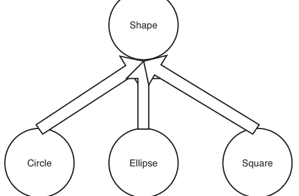
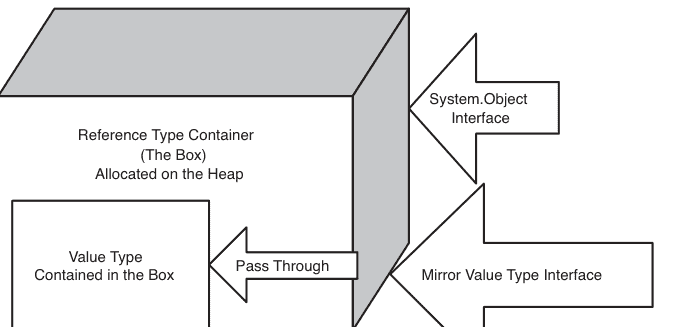

# 高效 C# 第2版：提升 C# 能力的 50 个特定方法


献给我的父母，Bill 和 Alice Wagner。
他们继续展现巨大的力量和灵感。


引言 xiii


# 引言

# 第 1 章 C# 语言惯用法

- 项目 1：使用属性而非可访问的数据成员
- 项目 2：优先使用 `readonly` 而非 `const`
- 项目 3：优先使用 `is` 或 `as` 运算符而非强制类型转换
- 项目 4：使用条件属性 `ToString()` #if
- 项目 5：始终提供 `ToString()`
- 项目 6：理解许多不同等等性概念之间的关系
- 项目 7：理解 `GetHashCode()` 的陷阱
- 项目 8：优先使用查询语法而非循环
- 项目 9：在你的 API 中避免转换运算符
- 项目 10：使用可选参数以尽量减少方法重载
- 项目 11：理解小函数的吸引力

# 第 2 章 .NET 资源管理

- 项目 12：优先使用成员初始化器而非赋值语句
- 项目 13：为静态类成员使用适当的初始化
- 项目 14：最小化重复初始化逻辑
- 项目 15：利用 `using try/finally` 进行资源清理
- 项目 16：避免创建不对象
- 项目 17：实现标准的 `Dispose` 模式
- 项目 18：区分值类型和引用类型
- 项目 19：确保 0 是值类型的有效状态
- 项目 20：优先使用不可变值类型

# 第 3 章在 C# 中表达设计

- 项目 21：限制你的类型的可见性
- 项目 22：优先使用定义和实现接口而非继承
- 项目 23：理解接口与虚拟方法的区别
- 项目 24：使用委托表达回调
- 项目 25：实现用于通知的事件模式
- 项目 26：避免返回内部类对象的引用
- 项目 27：优先让你的类型支持可序列化 157
- 项目 28：创建大粒度服务 166
- 项目 29：支持协变和逆变 171

# 第 4 章与框架工作

- 项目 30：优先使用重写而非事件处理器 179
- 项目 31：实现 `IComparable<T>` 和 `IComparer<T>` 183
- 项目 32：避免 `IClone` 190
- 项目 33：在基类中使用 `new` 饰符 198
- 项目 34：避免重载方法 203
- 项目 35：学习用于并行算法的 LINQ 215
- 项目 36：理解如何使用 LINQ 处理 I/O 密集型任务 220

# 第 5 章 C# 中的动态编程

- 项目 37：用心构建并行算法 227
- 项目 38：理解动态的 227
- 项目 39：使用 `dynamic` 处理参数 236
- 项目 40：使用 `dynamic` 处理匿名类型 239
- 项目 41：使用 `DynamicObject` 或 `IDynamicProvider` 243
- 项目 42：理解如何使用表达式 254
- 项目 43：使用表达式将后期绑定转换为早期绑定 261
- 项目 44：最小化公共 API 中的动态对象 267

# 第 6 章 杂项

- 项目 45：最小化装箱和解箱 275
- 项目 46：创建应用程序特定的异常处理 275
- 项目 47：优先使用强类型 284
- 项目 48：优先使用安全代码 294
- 项目 49：优先使用符合 CLS 的程序 298
- 项目 50：优先使用较小且内聚的程序 303


# 引言

2010 年的 C# 社区与 2004 年《高效 C#》第一版出版时非常不同。有更多开发者在使用 C#。社区中很大一部分现在将 C# 视为第一语言。他们并不是带着使用其他语言形成的习惯来接触 C# 的。社区拥有更广泛的经验。

C# 语言在过去几年也一直在增长。我在第一版中涵盖的语言并没有泛型、Lambda 表达式、LINQ 以及我们现在认为理所当然的许多其他功能。C# 4.0 引入了新功能，再次改变了我们的工具集。尽管语言如此如此许多最初的建议在 C# 1.x 时代依然同样适用。回顾过去，语言的变化似乎是对我们在 C# 1.0 中旧有内容的自然且明显的扩展。《高效 C#》并没有带你回顾语言变化的历史进程，而是提供了关于如何使用当前 C# 语言的建议。第二版中移除的项目在当今的 C# 语言中不再适用。新项目涵盖了新的语言和框架特性，以及社区在使用 C# 构建多个版本的软件产品时总结的实践。总的来说，这些项目是帮助你作为专业开发者更有效地使用 C# 4.0 的建议。


## 谁应该读这本书？

《Effective C#》是为将 C# 作为日常工具包一部分的专业开发者编写的。它假设你熟悉 C# 语法以及该语言的特性。第二版假设你理解 C# 4.0 中新增的语法，以及该语言之前版本中可用的语法。本书不包含关于语言特性的教程说明。相反，本书讨论了你如何将当前版本 C# 语言的所有特性集成到你的日常开发中。

除了语言特性外，我假设你对通用语言运行时 (CLR) 和即时编译 (JIT) 编译器有所了解。

## 关于内容

在 ways编写的几乎每个 C# 程序中，你每天都会用到一些语言结构。第一章“C# 语言惯用法”涵盖了那些你频繁使用的语言惯用法，以至于让你感觉就像手中用顺的工具。这些是你创建的每个类型和实现的每个算法的基石。

在托管环境中工作并不意味着该环境免除了你所有的责任。你仍然必须与环境协作，以修正满足所陈性能要求的程序。这不仅仅关乎性能测试和性能调优。第二章“NET 资源管理”将教你设计惯用法，使你能够在优化之前与环境协作以实现这些目标。

在许多方面，我们编写程序是为了满足人类读者，而不是编译器。编译器只关乎程序是否有效。你的同事想理解你意图要做什么。第三章“在 C# 中表达设计”讨论了如何应用 C# 语言来表达你的设计意图。解决问题总有多种方法。第三章中的建议将帮助你选择能够向其他开发者表达你设计意图的解决方案。

C# 是一门很小的语言，由丰富的框架库支持。第四章“与框架工作”涵盖了 .NET 基类库 (BCL) 中支持你核心算法的部分。此外，我涵盖了你在整个框架工作中会遇到的一些常用惯用法。多核处理器已成为生活的一部分，而并行任务库 (Parallel Task Library) 在 .NET 平台上创建多线程程序方面迈了一步。在本章中，我涵盖了并行任务库最常用的实践。

第五章“C# 中的动态编程”讨论了如何将 C# 作为一种动态语言使用。C# 是一门强类型、静态类型的语言。然而，更多的程序同时包含动态和静态类型。C# 为你提供了利用动态编程惯用法的方法，而不会在整个程序中丢失静态类型的优势。你将学习如何使用动态特性，以及如何避免动态类型泄漏到你的整个程序中。

第六章“杂项”涵盖了那些以某种方式继续难以分类的项目。这些是你经常使用的技术，用于创建更健壮、更易维护和扩展的程序。

## 代码规范

我们不再以单色模式看代码，在书中也不应该这样。虽然在纸上完全复制使用现代 IDE 的体验是不可能的，但我尝试为在书里阅读代码提供更好的体验。在媒介支持的情况下，代码示例使用了 Visual Studio IDE 的代码高亮颜色来表示所有代码元素。当我指向示例中的特定更改时，这些更改会被高亮显示。

在书中展示代码仍然需要在空间和清晰度上做出一些妥协。我尝试精简示例以说明该示例的特定点。这通常意味着省略类或方法的其他部分。有时为了空间，这包括省略恢复代码（recovery code）。公共方法应该验证其参数和其他输入，但这些通常为了空间被省略了。类似的空间考量还删除了方法调用的验证，以及在复杂算法中通常包含的 try/finally 子句。

我假设大多数开发者在示例使用常用命名空间时可以找到相应的命名空间。你可以安全地假设每个示例隐式包含了以下语句：

```csharp
using System;
using System.Collections.Generic;
using System.Linq;
using System.Text;
using System.Dynamic;
using System.Threading;
```

最后，我使用 #region/#endregion 指令标记接口实现。虽然这不是必要的，而且一些人不喜欢代码中的 region 指令，但它让你在静态文本中很容易看出哪些方法实现了接口方法。任何其他选择将是非标准的且占用更多空间。

## 提供反馈

尽管我尽了努力，审阅文本的人也尽了努力，错误可能渗透进或或示例。如果你认为发现了错误，请通过 bill.wagner@srtsolutions.com 与我联系。错误列表将发布在 http://srsolutions.com/blogs/effectivevesharp。书中的许多项目以及《More Effective C#》都是与其他 C# 开发者邮件对话的结果。如果你对这些建议有疑问或评论，请与我联系。有关通用兴趣的讨论将在我的博客 http://srsolutions.com/blogs/billwagner 上进行。

## 致谢

对于许多对本书做出贡献的人，深表感谢。多年来，我有幸成为这个了不起的 C# 社区的一员。C# Insiders 邮件列表上的每个人（无论是在微软内部还是外部）都贡献了想法和对话，使这本书变得更好。

我必须特别提到 C# 社区的几位成员，他们在构思以及将想法转化为具体建议方面直接向我提供了了帮助。与 Charlie Calvert、Eric DeCarufel、Justin Eetheredge、Marc Gravell、Mike Gold 和 Doug Holland 的对话是本版中许多新想法的基础。

我还与 Stephen Toub 和 Michael Wood 就并行任务库及其对 C# 的影响进行了非常棒的邮件交流。

我拥有一支非常棒的技术评审团队。Jason Bock、Claudio Lassala 和 Tom Petricek 审阅了文本和示例，以确保书的质量。


他专注于 C#、.NET 和 Azure 平台。他是微软密歇根州地区主管，也是多次微软 MVP（微软专家）奖获得者。Bill 是一位国际认可的作家，本书的第一版以及《More Effective C#》（Addison-Wesley, 2009）的作者，目前在微软 C# 开发者中心撰写专栏。Bill 毕业于伊利诺伊大学香槟-乌巴纳分校，获得计算机科学学士学位。

## C# 语言惯用法

如果现在的方法运行良好，你为什么要改变它呢？答案是，你可以做得更好。你改变工具或语言是因为你可以提高效率。如果你不改变习惯，就无法意识到预期的收益。当新语言 C# 与你熟悉的语言（如 C++ 或 Java）有许多共同之处时，这种情况会变得更加困难。C# 是另一种使用大括号的语言，这让你很容易掉入你在其他语言家族中使用的惯用法。这会阻碍你充分发挥 C# 的优势。C# 语言自 2001 年首次商业发布以来一直在演进。现在它与 C++ 或 Java 的区别已经比最初发布时大得多。如果你是从另一种语言接触 C# 的，你需要学习 C# 的惯用法，让语言顺应你，而不是违背你。本章将讨论你应该改变的习惯——以及你应该采取的方法。

## 项目 1：使用属性代替可访问的数据成员

属性一直以来都是 C# 语言中的一等公民。从 C# 1.0 版本发布以来的几项增强使得属性更具表现力。你可以对 getter（get）和 setter（set）指定访问限制。隐式属性减少了属性而非数据成员的硬编码类型。如果你仍在你的类型中创建公共变量，请立即停止。如果你仍在通过方法创建 get 和 set 方法，请立即停止。属性允许你将数据成员作为公共接口的一部分暴露出来，同时在面向对象的环境中提供你所需的封装性。属性是语言元素，其访问方式就像数据成员，但它们实际上是以方法形式实现的。

类型中的某些成员最适合用数据表示：如客户名称、点的 x、y 位置或去年的收入。属性允许你创建一个像数据但仍具有方法优势的接口。客户端代码访问属性就像访问公共字段一样。但实际实现使用的是方法，你在方法中定义了属性访问器的行为。

# 第 1 章 C# 语言惯用法

.NET Framework 假设你会使用属性作为公共数据成员。事实上，.NET Framework 中的数据绑定类支持属性而非公共数据成员。对于所有数据绑定库都是如此：WPF、Windows Forms、Web Forms 和 Silverlight。数据绑定将对象的属性绑定到用户界面控件。数据绑定机制使用反射来查找类型中的具名属性：

```csharp
textBoxCity.DataBindings.Add("Text",
address, "City");
```

之前的代码将 `textBoxCity` 控件的 `Text` 属性绑定到 `City` 对象。它无法与公共数据成员 `City` 工作；框架类库的设计人员没有支持那种做法。公共数据成员是一种糟糕的做法，因此没有添加对它们的支持。他们的决定为你提供了另一个理由，让你遵循正确的面向对象技术。

是的，数据绑定仅适用于那些包含在用户界面逻辑中显示的元素的类。但并不意味着属性应仅用于 UI 逻辑。你应该在其他类和结构也使用属性。随着时间的推移，涵盖新的需求或行为，修改属性要容易得多。你可能很快决定你的客户类型永远不应该有空名称。如果你对 `Name` 使用了公共属性，那么在一个处就很容易修复：

```csharp
public class Customer
{
    private string name;
    public string Name
    {
        get { return name; }
        set {
            if (string.IsNullOrEmpty(value))
                throw new ArgumentException("Name cannot be blank", "Name");
            name = value;
        }
    }
    // 省略更多。
}
```

## 项目 1：使用属性代替可访问的数据成员

如果你使用了公共数据成员，你就受受于寻找每一处设置客户名称的代码并对其进行修复。这需要花费更多的时间——多得多的时间。

由于属性是用方法实现的，因此添加多线程支持变得更容易。你可以增强 get 和 set 访问器的实现，以提供对数据的同步访问：

```csharp
public class Customer {
    private object syncHandle = new object();

    private string Name {
        get {
            lock (syncHandle)
                return name;
        }
        set {
            if (string.IsNullOrEmpty(value))
                throw new ArgumentException("Name cannot be blank", "Name");
            lock (syncHandle)
                name = value;
        }
        // 省略更多。
    }
}
```

属性拥有方法的所有语言特性。属性可以是虚的：

```csharp
public class Customer {
    public virtual string Name {
        get;
```

```
你会注意到最后几个示例使用了 C# 3.0 的隐式属性语法。创建一个属性来包装底层存储字段（backing store）是一种常见模式。通常，你不需要在属性 getter 或 setter 中编写验证逻辑。语言支持简化的隐式属性语法，以尽量减少将简单字段暴露为属性的情况。编译器会为你创建一个私有成员字段（通常称为底层存储字段），并为 get 和 set 访问器实现显而易见的逻辑。

你可以扩展属性为抽象并将属性定义为接口定义的一部分，使用与隐式属性类似的语法。下面的示例显示了泛型接口中的属性定义。这种语法与隐式属性一致，定义了实现必须满足的契约。

```csharp
public interface INameValuePair<T>
{
    string Name
    {
        get;
    }
    T Value
    {
        get;
        set;
    }
}
```

属性是完全的一等语言元素，是访问或修改内部数据的扩展方法。对成员函数可以做的都可以对属性做。

属性的访问器是编译到类型中的两个独立方法。你可以为属性的 get 和 set 指定不同的访问修饰符。这让你对暴露为属性的数据元素具有更大的控制力：

```csharp
public class Customer
{
    public virtual string Name
    {
        get;
        protected set;
    }
    // 剩余实现
}
```

属性语法扩展到了简单数据字段。如果你的类型作为接口的一部分包含索引项，可以使用索引器（即参数化属性）。这是创建一个返回序列属性的有用方法：

```csharp
public int this[int index]
{
    get { return theValues[index]; }
    set { theValues[index] = value; }
}
```

// 访问索引器：
int val = someObject[i];

索引器拥有与单项属性相同的语言支持：带数字参数的维度索引器可以参与数据绑定。其他索引器使用整数映射和字典：

```csharp
public Address this[string] name
{
    get { return adressValues[name]; }
    set { adressValues[name] = value; }
}
```

与 C# 中的多维数组一致，你可以创建多维索引器，每个轴上的类型可以是相同或不同的：

```csharp
public int this[int x, int y]
{}
```


# 第 6 章 第1  C# 语言习惯

```csharp
get { return ComputeValue(x, y); }
}
```

```csharp
public int this[int x, string name]
{
    get { return ComputeValue(x, name); }
}
```

注意，所有的索引器都使用 `this` 关键字声明。在 C# 中，你不能为索引器命名。因此，类型中的每个不同索引器必须具有不同的参数列表以避免歧义。属性的几乎所有功能都适用于索引器。索引器可以是虚的或抽象的；索引器可以为 setter 和 getter 分开设置访问限制。你不能像创建属性那样创建多个索引器。

这种属性功能非常好，而且是一个很不错的改进。但你可能仍然倾向于先使用数据成员创建一个初始实现，然后在需要其中某一个时将数据成员替换为属性。这听起来是一个合理的策略——但它是危险的。考虑类中的这部分：

```csharp
// 使用公共数据成员，是一种坏做法：
public class Customer
{
    public string Name;

    // 剩余实现省略
}
```

它描述了一个客户，带有一个名称。你可以使用熟悉的成员表示法来获取或设置名称：

```csharp
string name = customerOne.Name;
customerOne.Name = "This Company";
```

这简单又直接。你认为稍后可以将数据成员替换为属性，而代码在无需任何更改的情况下继续运行。嗯，这在某种程度上是正确的。属性在访问时看起来像数据成员。但属性不是数据。属性生成的微软中间级语言 (MSIL) 指令与数据访问的指令不同。

尽管属性和数据成员在源代码级别上是兼容的，但它们在二进制级别上是不兼容的。在明显的情况下，这意味着当你从公共数据成员更改为等效公共属性时，必须重新编译所有使用该公共数据成员的代码。C# 将二进制程序集视为一等公民。该语言的目标之一是你可以发布单个更新后的程序集，而无需升级整个应用程序。将数据成员更改为属性的简单行为破坏了二进制兼容性。这使得升级已部署的单个程序集变得困难得多。

## 元素 1：使用属性代替可访问的数据成员

在查看属性的 IL 时，你可能会好奇属性和数据成员的相对性能。属性的性能不会比数据成员访问快，但它们可能不会慢。JIT 编译器会内联某些方法调用，包括属性访问器。当 JIT 编译器内联属性访问器时，数据成员和属性的性能是相同的。即使属性访问器没有被内联，实际的性能差异也只是一次函数调用的微不足道的开销。这种差异只在少数情况下是可衡量的。

属性是可以在代码中像数据一样被查看的方法。这在你的用户脑海中产生了一些预期。他们会将属性访问看作是数据访问。毕竟，你的属性访问器应该符合这些预期。Get 访问器不应该有可观察的副作用。Set 访问器修改状态，用户应该能够看到这些更改。

属性访问器对你的用户也有性能预期。属性访问看起来像数据字段访问。它不应该具有与简单数据访问显著不同的性能特征。属性访问器不应执行耗时的计算，或不应进行跨应用程序调用（例如执行数据库查询），或其他可能与你的用户对属性访问器预期不符的其他耗时操作。

每当在你类型的公共或受保护接口中暴露数据时，请使用属性。对于序列或字典，使用索引器。所有数据成员都应该是私有的，无例外。你立即获得对数据绑定的支持，并让未来对方法实现的更改变得更容易。将任何变量封装在属性中所需的额外输入工作相当于你每天的一分钟或几分钟。当你发现以后需要使用属性来正确表达你的设计时，将花费几个小时。现在花一点时间，以后可以为你节省大量时间。

## 元素 2：优先使用 readonly 而非 const

C# 有两种不同版本的常量：编译时常量和运行时常量。它们的行为非常不同，使用错误的一个会让你损失性能或正确性。这两个问题都不是好问题，但如果你必须选择其一个，运行较慢但正确的程序比运行快速但损坏的程序要好。出于这个原因，你应该选择运行时常量而非编译时常量。编译时常量稍微快，但灵活性远不如运行时常量。在性能至关且常量值在发布之间永远不会改变时保留编译时常量。

你使用 `readonly` 关键字声明运行时常量。编译时常量使用 `const` 关键字声明：

```csharp
// 编译时常量：
public const int Millennium = 2000;
```

```csharp
// 运行时常量：
public static readonly int ThisYear = 2004;
```

代码在类或结构体作用域内展示了类常量。编译时常量也可以在方法内部声明。只读常量不能在方法作用域内声明。

编译时和运行时常量行为的差异源于如何访问它们。编译时常量在对象代码中被替换为该常量的值。这种结构：

```csharp
if (myDateTime.Year == Millennium)
```

如果你写成下面的样子，它将编译为相同的 IL：

```csharp
if (myDateTime.Year == 2000)
```

运行时常量在运行时评估。当你引用只读常量时生成的 IL 引用的是 readonly 变量，而不是值。

这种区别对你何时可以使用任一类型的常量增加了几种限制。编译时常量只能用于原始类型（内置整型和浮点型）、枚举或字符串。这些是你可以在初始化器中分配意义值的类型。这些类型是可以在编译器生成的 IL 中替换为字面量的类型。以下结构无法编译。你不能使用 `new` 操作符初始化编译时常量，即使初始化类型是值类型：

```csharp
// 无法编译，请改用 readonly：
private const classCreation = new DateTime(2000, 1, 1, 0, 0, 0);
```

编译时常量限于数字和字符串。只读值也是常量，因为在构造函数执行后无法被修改。但只读值的不同之处在于它们是在运行时赋值的。处理运行时常量时具有更大的灵活性。例如，运行时常量可以是任何类型。你必须在构造函数中初始化它们，或者可以使用初始化器。你可以为 DateTime 结构创建只读值；你不能用 const 创建 DateTime 值。

你可以使用 readonly 用于实例常量，为类的每个实例存储不同的值。编译时常量根据定义是静态常量。

最重要的区别是只读值是在运行时解析的。当你引用只读常量时生成的 IL 引用的是 readonly 变量，而不是值。这种差异对维护产生长期影响。编译时常量生成的 IL 与你在代码中使用数值常量相同，即使跨程序集也是。一个程序集中的常量在另一个程序集中使用时仍会被替换为值。

编译时和运行时常量的评估方式影响运行时兼容性。假设你在名为 Infrastructure 的程序集中定义了类 const 和 readonly 字段：

```csharp
public class UsefulValues\{
    public static readonly int StartValue = 5;
    public const int EndValue = 10;
}
```

在另一个程序集中，你引用这些值：

```csharp
for (int i = UsefulValues.StartValue;
    i < UsefulValues.EndValue; i++)
    Console.WriteLine("value is {0}", i);
```


如果你运行你的小测试程序，你会看到以下明显的输出：

Value is 5
Value is 6
...
Value is 9

时间流逝，你发布了新的 Infrastructure 程序集版本，包含了以下更改：

```csharp
public class UsefulValues
{
    public static readonly int StartValue = 105;
    public const int EndValue = 120;
}
```

你在没有重新编译 Application 程序集的情况下，分发了 Infrastructure 程序集。你原预期得到以下结果：

Value is 105
Value is 106
...
Value is 119

事实上，你没有得到任何输出。循环使用 105 作为起始值，使用 10 作为结束条件。C# 编译器将常量为 10 的 `const` 值解析到了 Application 程序集中，而不是解析为对 `EndValue` 所用存储位置的引用。相比之下，`StartValue` 的值由于被声明为 `readonly`：它在运行时解析。因此，Application 程序集在无需重新编译 Application 程序集的情况下使用了新值；只需安装更新版本的 Infrastructure 程序集，就足以更改所有使用该值的客户端的行为。更新公共常量（public constant）的值应视为接口更改。你必须重新编译所有引用该常量的代码。更新只读常量（readonly）的值是实现更改；它与现有的客户端代码具有二进制兼容性。

另一方面，有时你确实希望某个值在编译时确定。例如，考虑使用一组常量来标记对象在序列化形式中的不同版本（见条目 27）。标记特定版本的值应该是编译时常量；它们永远不会改变。当前版本应该是一个运行时常量，随着每次发布而改变。

## 条目 2：优先使用 readonly 而非 const | 11

```csharp
private const int Version1_0 = 0x0100;
private const int Version1_1 = 0x0101;
private const int Version1_2 = 0x0102;
// 大版本：
private const int Version2_0 = 0x0200;
```

```csharp
// 检查当前版本：
private static readonly int CurrentVersion = Version2_0;
```

你使用运行时版本在每个保存文件中存储当前版本：

```csharp
// 从持久化存储中读取，
// 与编译时常量进行版本对比：
protected MyType(SerializationInfo info, StreamingContext cntxt)
{
    int storedVersion = info.GetInt32("VERSION");
    switch (storedVersion) {
        case Version2_0:
            readVersion2(info, cntxt);
            break;
        case Version1_1:
            readVersion1Dot(info, cntxt);
            break;
        // 等等
    }
}
```

```csharp
// 写入当前版本：
[SecurityPermissionAttribute(SecurityAction.Demand, SerializationFormatter = true)]
void ISerializable.GetObjectData(SerializationInfo inf, StreamingContext cxt)
{
```

```csharp
// 使用运行时常量作为当前版本：
inf.Add("VERSION", CurrentVersion);
// 写入剩余元素...
}
```

# 第 1 章 C# 语言习惯

使用 `readonly` 的第一个优势是性能：已知的常量值生成的代码比 `readonly` 值所需的变量访问要稍微高效一些。然而，任何收益都是微不足道的，并且应该与灵活性的下降进行权衡。在放弃灵活性之前，务必对差异进行分析。

在命名参数和可选参数时，你会遇到常量值的运行时处理与编译时处理之间的权衡。可选参数的默认值被放在调用处，就像编译时常量（使用 `const` 声明的常量）的默认值一样。与处理 `readonly` 和 `const` 一，你需要对可选参数值的更改小心。（参见条目 10。）

当值必须在编译时可用时，必须使用 `const`：属性参数和枚举定义，以及那些极少数你想定义一个不随发布而改变的值的情况。对于其他所有情况，优先选择 `readonly` 常量带来的灵活性。

## 条目 3：优先使用 is 或 as 运算符而非强制转换（Casts）

通过拥抱 C#，你就拥抱了强类型。这几乎是一件好事。强类型意味着你期望编译器在你的代码中找到类型匹配。这意味着你的应用程序不需要在运行时进行大量的类型检查。但有时，运行时类型检查是不可避免的。在 C# 中，你可能需要编写接收 `object` 参数的函数，因为框架已经为你定义了方法签名。你可能需要尝试将这些对象转换为其他类型、类或接口。你有两个选择：使用 `as` 运算符，或者强制编译器使用强制转换来满足你的需求。你还有一种防御性变体：你可以用 `is` 测试转换，然后使用 `as` 进行转换。

只要可能，使用 `as` 运算符是正确的选择，因为它比盲目的强制转换更安全，并且在运行时更高效。`as` 和 `is` 运算符不执行任何用户定义的转换。它们只有在运行时类型匹配目标类型时才会成功；它们永远不会构造一个新对象来满足请求。

来看一个示例。你编写了一段需要将任意 `object` 转换为 `MyType`实例的代码。你可以这样写：

```csharp
object o = Factory.GetObject();
```

```csharp
// 版本一：
MyType t = o as MyType;
```

```csharp
if (t != null)
{
    // 处理 t，它是一个 MyType
}
```

## 条目 3：优先使用 is 或 as 运算符而非强制转换 | 13

```csharp
object o = Factory.GetObject();
MyType t = o as MyType;

if (t != null)
{
    // 处理 t，它是一个 MyType
}
```

```csharp
object o = Factory.GetObject();
// 版本一：
MyType t = o as MyType;

if (t != null)
{
    // 处理 t，它是一个 MyType
}
```

或者，你可以写：

```csharp
object o = Factory.GetObject();

// 版本二：
try {
    MyType t = (MyType)o;
    // 处理 t，它是一个 MyType
} catch (Exception) {
    // 处理异常
}
```

只要可能，使用 `as` 运算符总是比盲目的强制转换更安全，并且在运行时更高效。`as` 和 `is` 运算符不执行任何用户定义的转换。它们只有在运行时类型匹配目标类型时才会成功；它们永远不会构造一个新对象来满足请求。

来看一个示例。你编写了一段需要将任意 `object` 转换为 `MyType` 实例的代码。你可以这样写它：

```csharp
object o = Factory.GetObject();
```

```csharp
// 版本一：
MyType t = o as MyType;
```

```csharp
if (t != null)
{
    // 处理 t，它是一个 MyType
}
```

（注：由于原文文本在条目3部分存在重复和逻辑重叠，译文已根据上下文逻辑进行了对齐处理，以确保通顺且符合技术文档规范。）


# 16 第 1 章 C# 语言惯用法

你不应该编写这种丑陋的代码，但它确实说明了一个常见问题。虽然你永远不会写这种代码，但你可以将对象参数传递给期望正确转换的函数：

```csharp
object o = Factory.GetObject();
DoStuffWithObject(o);
```

```csharp
private static void DoStuffWithObject(object o) {
  try {
    MyType t;
    t = (MyType)o; // 失败。o 不是 MyType
    // 对 T 进行操作，它是一个 MyType。
  } catch (InvalidCastException) {
    // 报告转换失败。
  }
}
```

记住，用户定义的转换操作符只作用于对象的编译时类型，而不作用于运行时。o 的运行时类型与 MyType 之间是否存在转换并不重要。编译器并不知道也不关心。这条语句的行为取决于 st 的声明类型：

```csharp
t = (MyType)st;
```

接下来的语句无论 st 的声明类型是什么，都返回相同的结果。因此，你应该优先使用 `as` 强制转换——因为它更一致。事实上，如果类型之间没有继承关系，但存在用户定义的转换操作符，下述语句将产生编译错误：

```csharp
t = st as MyType;
```

既然你已经知道在什么时候可以使用它了，让我们讨论一下什么时候**不能**使用它。因为该操作符不作用于值类型。这条语句无法编译：

```csharp
object o = Factory.GetValue();
int i = o as int; // 无法编译。
```

# 事项 3：优先使用 is 和 as 运算符而不是强制转换

那是因为 int 是值类型，且永远不会为 null。如果 o 不是整数，应该在 i 中存储什么值的 int 呢？你选择的任何值也可能是一个有效的整数。因此，它无法被使用。你被迫使用强制转换语法。这实际上是一个装箱/拆箱转换（参见第 45 条）：

```csharp
object o = Factory.GetValue();
int i = 0;
try {
    i = (int)o;
} catch (InvalidCastException) {
    i = 0;
}
```

将异常作为流控制机制应该让你认为这是一种极其糟糕的做法。（参见第 47 条。）但你并不受限于强制转换的行为。你可以使用该语句来消除发生异常或转换的可能性：

```csharp
object o = Factory.GetValue();
int i = 0;
if (o is int)
    i = (int)o;
```

如果 o 是其他可以转换为 int 的类型（例如 double），则 `is` 运算符对 null 参数返回 false。

只有在你无法使用 `as` 转换类型时，才应该使用该操作符。否则，它多余的：

```csharp
// 正确，但多余的：
object o = Factory.GetObject();

MyType t = null;
if (o is MyType)
    t = o as MyType;
```

之前的代码与你编写以下代码相同：

```csharp
// 正确，但多余的：
object o = Factory.GetObject();

MyType t = null;
if (o is MyType)
    t = o as MyType;
```

# 18 第 1 章 C# 语言惯用法

那是效率低下且冗余的。如果你正准备使用 `as` 转换类型，那么检查是没必要的。检查 `as` 的返回值是否为 null；这样更简单。

现在你已经知道了 `is`、`as` 和强制转换之间的区别，你认为 `foreach` 循环使用的是哪种运算符？`foreach` 循环作用于非泛型的 IEnumerable 序列，并在迭代中内置了强制。（你应该尽可能使用类型安全的泛型版本。非泛型版本的存在是为了历史原因以及支持某些绑定场景。）

```csharp
public void UseCollection(IEnumerable theCollection)
{
    foreach (MyType t in theCollection)
        t.DoStuff();
}
```

```csharp
public void UseCollectionV2(IEnumerable theCollection)
{
    Enumerator it = theCollection.GetEnumerator();
    while (it.MoveNext())
    {
        MyType t = (MyType)it.Current;
        t.DoStuff();
    }
}
```

`foreach` 需要使用强制转换来同时支持值类型和引用类型。通过选择强制转换操作符，`foreach` 语句无论目标类型是什么都表现出相同的行为。然而，由于使用了强制转换，`foreach` 循环可能会抛出 `InvalidCastException`。

由于 `IEnumerator.Current` 返回 `System.Object`，它没有版本操作符，因此没有一个适用于此测试。`SecondType` 对象的集合无法在之前的 `UseCollection()` 函数中使用，正如你看到的，转换失败了。`foreach` 语句（使用强制转换）不会检查集合对象运行时类型中可用的转换。它只检查 `System.Object` 类（`IEnumerator.Current` 返回的类型）和循环变量声明类型（在此例中为 MyType）中的转换。

最后，有时你想知道对象的精确类型，而不是当前类型是否可以转换为目标类型。`is` 运算符对任何派自目标类型的都返回 true。`GetType()` 方法返回对象的运行时类型。它比 `is` 或 `as` 语句提供的测试更严格。`GetType()` 返回对象的类型并可以与特定类型进行比较。

再次考虑这个函数：

```csharp
public void UseCollectionV3(IEnumerable theCollection)
{
    foreach (MyType t in theCollection)
        t.DoStuff();
}
```

如果你创建了一个派自 `MyType` 的 `NewType`，那么 `NewType` 集合在 `UseCollection` 函数中就可以正常工作：

```csharp
public class NewType : MyType
{
    // 内容省略。
}
```

如果你打算写一个适用于所有 `MyType` 实例对象的函数，那是没问题的。如果你指的是写一个仅适用于精确的 `MyType` 对象的函数，你应该应该使用精确类型进行比较。在这里，你将在 `foreach` 循环内部这样做。当精确运行时类型很重要时，最常见的是进行相等性测试（参见第 6 条）。在其他比较中，由 `as` 和 `is` 提供的 `.isinstance` 在语义上是正确的。

NET 基类库 (BCL) 包含一种方法，可以使用相同类型的操作来转换序列中的元素：`Enumerable.Cast<T>()` 转换支持 `IEnumerable` 接口的序列中的每个元素：

```csharp
IEnumerable collection = new List<int>{1,2,3,4,5,6,7,8,9,10};
```

# 20 第 1 章 C# 语言惯用法

该查询生成的与最后一行代码相同的方法调用。在两种情况下，`Cast<T>` 方法将序列中的每个元素转换为目标类型。`Enumerable.Cast<T>` 方法使用旧式强制转换而不是操作符。

```csharp
var small = from int item in collection
              where item < 5
              select item;
```

```csharp
var small2 = collection.Cast<int>().Where(item => item < 5)
              Select(n => n);
```

## 事项 4：使用条件属性代替 #if

#if/#endif 块一直被用于从同一源代码产生不同的构建，通常是调试和发布变体。但 #if/#endif 块太容易滥用，创建了难以理解且更难调试的代码。


## 第 4 项：使用条件属性代替 #if | 21

设计人员已经通过创建更好的工具来为不同的环境生成不同的机器码，以此做出响应。C# 添加了 `Conditional` 属性，用于指示某个方法是否应该基于环境设置。这是一种无需使用 `#if/#endif` 描述条件编译的更整洁的方法。编译器能够理解 `Conditional` 属性，因此在应用条件属性时，它可以更好地执行代码验证工作。`Conditional` 属性应用于方法级别，因此它强迫你将条件代码分离到不同的方法中。在创建条件代码块时，请使用 `Conditional` 属性代替 `#if/#endif` 块。

大多数资深程序员都使用条件编译来检查对象的先置条件（pre-conditions）和后置条件（post-conditions）。你会编写一个私有方法来检查所有的类和对象不变。该方法会被条件编译，只在你的调试生成（debug builds）中出现。

```csharp
private void CheckStateBad()
{
    // 旧方法：
#if DEBUG
    Trace.WriteLine("Entering CheckState for Person");

    // 获取调用例程的名称：
    string methodName =
        new StackTrace().GetFrame(1).GetMethod().Name;

    Debug.Assert(lastName != null,
        methodName,
        "Last Name cannot be null");

    Debug.Assert(lastName.Length > 0,
        methodName,
        "Last Name cannot be blank");

    Debug.Assert(firstName != null,
        methodName,
        "First Name cannot be null");

    Debug.Assert(firstName.Length > 0,
        methodName,
        "First Name cannot be blank");
#endif
}
```

## 22 第 1 章 C# 语言习惯

```csharp
Trace.WriteLine("Exiting CheckState for Person");
#endif
}
```

使用 `#if` 和 `#endif` 指令，你在发布生成（release builds）中创建了一个空方法。`CheckState()` 方法在所有生成（包括发布和调试）中都会被调用。它在发布生成中什么都不做，但你为这次方法调用支付了代价。你还为加载和 JIT 这个空例程支付了微小的代价。

这种做法虽然可行，但可能导致只在发布生成中出现的微妙 bug。下面的常见错误展示了当你使用指令进行条件编译时会发生什么：

```csharp
public void Func()
{
    string msg = null;

#if DEBUG
    msg = GetDiagnostics();
#endif
    Console.WriteLine(msg);
```

在你的调试生成中一切正常，但你的发布生成会很遗憾地打印出空白消息。这并不是你的意图。你搞砸了，编译器没能帮助你。你在条件块内部包含了对你的逻辑至关重要的代码。在源代码中散布 `#if/#endif` 块会让你难以诊断不同生成之间的行为差异。

C# 有一个更好的替代方案：`Conditional` 属性。你可以仅在特定环境变量被定义或设置为某个值时，才隔离类中的部分函数。该功能最常用的用途是用调试语句对代码进行插桩。.NET Framework 库已经包含了你此类用途所需的基本功能。这个示例展示了如何使用条件属性以及何时将它们添加到你的代码中。

当你构建 `Person` 对象时，你添加了一个方法来验证对象的不变性：

## 第 4 项：使用条件属性代替 #if 23

```csharp
private void CheckState()
{
    // 获取调用例程的名称
    string methodName =
    new StackTrace().GetFrame(1).GetMethod().Name;

    Trace.WriteLine("Entering CheckState for Person:");
    Trace.Write("\called by \\");
    Trace.WriteLine(methodName);

Debug.Assert(lastName != null,
    methodName,
    "Last Name cannot be null");

Debug.Assert(lastName.Length > 0,
    methodName,
    "Last Name cannot be blank");

Debug.Assert(firstName != null,
    methodName,
    "First Name cannot be null");

Debug.Assert(firstName.Length > 0,
    methodName,
    "First Name cannot be blank");

    Trace.WriteLine("Exiting CheckState for Person:");
}
```

你可能在这个方法中没有遇到过很多库函数，让我们简要回顾一下它们。`StackTrace` 使用反射获取调用方法的名称。这相当开销，但由于能生成程序流信息，它大大简化了任务。在这里，它确定了被调用的 `CheckState` 方法名。如果调用方法被内联（inlined），这里存在微小的风险，但另一种方案是让每个调用 `CheckState()` 的方法通过 `Base.GetCurrentMethod()` 传入方法名。稍后你会看到为什么我决定不采用那种策略。

其余的方法是 `System.Diagnostics.Debug` 类或 `System.Diagnostics.Trace` 类的一部分。`Debug.Assert` 方法测试一个条件，如果条件为假则停止程序。其余参数定义了当条件为假时将打印的消息。`Trace.WriteLine` 将诊断消息写入调试控制台。因此，当人员对象无效时，此方法写入消息并停止程序。你会在所有的公共方法和属性中调用此方法，作为先置条件和后置条件：

```csharp
public string LastName
{
  get {
    CheckState();
    return lastName;
  }
  set {
    CheckState();
    lastName = value;
    CheckState();
  }
}
```

当有人第一次尝试将姓设置为空字符串或 `null` 时，`CheckState` 会触发断言。但这时 `Conditional` 属性派上了用场：`DEBUG` 环境变量未定义。

```csharp
[Conditional("DEBUG")]
private void CheckState()
{
  // 同上代码
}
```

如果定义了 `DEBUG` 符号，你会得到：

```csharp
public string LastName
{
  get {
    CheckState();
    return lastName;
  }
  set {
    CheckState();
    lastName = value;
    CheckState();
  }
}
```

如果没有，你会得到：

```csharp
public string LastName
{
  get {
    return lastName;
  }
  set {
    lastName = value;
  }
}
```

无论环境变量状态如何，`CheckState` 的体都是相同的。这说明了为什么你需要区分编译和 JIT 步骤。无论是否定义 DEBUG 环境变量，`CheckState` 方法都会编译并交付到程序集中。这看起来可能效率低下，但代价只是磁盘空间。在被调用之前，`CheckState` 函数不会被加载到内存并进行 JIT。它在程序中的存在并无关。这种策略以极小的代价增加了灵活性。

## 26 第 1 章 C# 语言习惯

变量控制它们在者编译时是否被调用。使用 `Conditional` 指令允许你创建嵌入调试功能的库。这些功能可以在运行时启用或禁用。

你还可以创建依赖于多个环境变量的方法。当你应用多个条件属性时，它们是用“或”（OR）组合的。例如，此版本的 `CheckState` 会在 DEBUG 或 TRACE 为为真时被调用：

要创建一个“与”（AND）结构，你需要在源代码中使用预处理器指令定义预处理器符号：

```csharp
#if ( VAR1 & VAR2 )
#define BOTH
#endif
```

是的，为了创建一个依赖于多个环境变量的条件程序，你必须回到旧的 #ifget。#if 所做的只是为你创建一个新符号。但要避免在该内部放置任何可执行代码。

然后，你可以这样编写 `CheckState` 的旧版本：

```csharp
private void CheckState()
{
    // 旧方法：
#if BOTH
    Trace.WriteLine("Entering CheckState for Person");
    // 获取调用例程的名称：
    string methodName =
        new StackTrace().GetFrame(1).GetMethod().Name;
    Debug.Assert(lastName != null,
        methodName,
        "Last Name cannot be null");
    Debug.Assert(lastName.Length > 0,
        methodName,
        "Last Name cannot be blank");
#endif
}
```


# 项目 4：使用条件属性代替 #if 27

```c
Debug.Assert(firstName != null,
methodName,
"First Name cannot be null");
```

```c
Debug.Assert(firstName.Length > 0,
methodName,
"First Name cannot be blank");
```

```c
Trace.WriteLine("Exiting CheckState for Person");
#endif
}
```

`Conditional` 属性只能应用于方法。此外，任何带有 `Conditional` 属性的方法，其返回类型必须为 `void`。你不能将 `Conditional` 属性用于方法内部的代码块或有返回值的方法。相反，应该创建构造严谨的方法，并将条件行为隔离到函数中。你仍然需要检查这些条件方法是否对对象状态产生了副作用，但 `Conditional` 属性比 `#if/#endif` 更好地局部化了这些点。使用 `#if` 和 `#endif` 块时，你可能会误删方法调用或赋值。

之前的示例使用了预定义的 `DEBUG` 和 `TRACE` 符号。但你可以将这种技术扩展到你自定义符号上。`Conditional` 属性可以通过多种方式定义的符号进行控制。你可以定义通过编译器命令行定义的符号、通过操作系统 shell 环境变量定义的符号，或者通过源代码中的 `pragma` 定义的符号。

你可能已经注意到，每个带有 `Conditional` 属性的方法都有一个返回类型为 `void` 且没有任何参数的方法。这是你应该遵循的实践。编译器强制要求条件方法必须具有 `void` 返回类型。然而，你可以创建一个接受任意数量引用类型参数的方法。这可能导致重要的副作用没有发生。考虑这段代码片段：

```csharp
Queue<string> names = new Queue<string>();
names.Enqueue("one");
names.Enqueue("two");
names.Enqueue("three");
```

string item = string.Empty;
SomeMethod(item = names.Dequeue());
Console.WriteLine(item);

```

`SomeMethod` 在创建时附带了 `Conditional` 属性：

```csharp
[Conditional("DEBUG")]
private static void SomeMethod(string param)
{

}
```

这将导致非常微妙的 bug。对 `SomeMethod()` 的调用只有在定义了 `DEBUG` 符号时发生。如果没有定义，调用就不会发生。`names.Dequeue()` 的调用也是如此。因为结果是不需要的，所以方法没有被调用。任何标记有 `Conditional` 属性的方法都不应该接受任何参数。用户可以使用带有副作用的方法调用来生成这些参数。如果条件不为真，这些方法调用将不会发生。

`Conditional` 属性生成的 IL 比 `#if/#endif` 更高效。它还有一个优势，即只能应用于函数级别，这迫使你更好地组织条件代码。编译器帮助你避免我们所有人都犯过的将 `#if` 或 `#endif` 放置位置错误的错误。与预处理器相比，`Conditional` 属性提供了更好的支持，让你更干净地分离条件代码。

## 项目 5：始终提供 ToString()

`System.Object.ToString()` 是 .NET 环境中最常用的方法之一。你应该为你类中的所有客户端编写一个合理的版本。否则，你迫使该类的每个用户使用你类中的属性，并创建一个合理的、人类可读的表示。你的这种类型的字符串表示可以用于向用户轻松显示对象信息：在 Windows Presentation Foundation (WPF) 控件、Silverlight 控件、Web Forms 或控制台输出中。字符串表示对于调试也很有用。你创建的每个类型都应该对此方法进行合理的重写。当你创建更复杂的类型时，你应该实现更高级的 `IFormat.ToString()`。面对现实吧：如果你不重写此例程，或者写了一个糟糕的版本，你的客户端就被迫为你修复它。

`System.Object` 版本返回类型的完全限定名。这是无用信息：“System.Drawing.Rect”, “MyNamespace.Point”, “Sample.Size” 并不是你想向用户显示的内容。但这就是你在类中重写 `ToString()` 时得到的结果。你只写了一次类，但你的客户端使用了它多次。在编写类时多花一点精力，会在你或其他人使用它时得到回报。

让我们考虑最简单的需求：重写 `System.Object.ToString()`。你创建的每个类型都应该重写 `ToString()` 以提供该类型最常见的文本表示。考虑一个具有三个公共属性的 `Customer` 类：

```csharp
public class Customer
{
    public string Name
    {
        get;
        set;
    }
    public decimal Revenue
    {
        get;
        set;
    }
    public string ContactPhone
    {
        get;
        set;
    }

    public override string ToString()
    {
        return Name;
    }
}
```

`Object.ToString()` 的继承版本返回 "Customer"。这对任何人都是没用的。即使 `ToString()` 将用于调试，它也应该比这更复杂。你对 `Object.ToString()` 的重写应该返回该类客户端最可能使用的文本表示。在 `Customer` 示例中，就是名字：

```csharp
public override string ToString()
{
    return Name;
}
```

如果你没有遵循此项目中的任何其他建议，请对你定义的所有类型遵循该练习。它将立即为所有人节省时间。当你为 `Object.ToString()` 方法提供一个合理的实现时，该类的对象可以更容易地添加到 WPF 控件、Silverlight 控件、Web Forms 或控制台输出中。你的这种类型的字符串表示可以用于向用户轻松显示对象信息：在 Windows Presentation Foundation (WPF) 控件、Silverlight 控件、Web Forms 或控制台输出中。字符串表示对于调试也很有用。你创建的每个类型都应该对此方法进行合理的重写。当你创建更复杂的类型时，你应该实现更高级的 `IFormat.ToString()`。面对现实吧：如果你不重写此例程，或者写了一个糟糕的版本，你的客户端就被迫为你修复它。

`System.Object` 版本返回类型的完全限定名。这是无用信息：“System.Drawing.Rect”, “MyNamespace.Point”, “Sample.Size” 并不是你想向用户显示的内容。但这就是你在类中重写 `ToString()` 时得到的结果。你只写了一次类，但你的客户端使用了它多次。在编写类时多花一点精力，会在你或其他人使用它时得到回报。

让我们考虑最简单的需求：重写 `System.Object.ToString()`。你创建的每个类型都应该重写 `ToString()` 以提供该类型最常见的文本表示。考虑一个具有三个公共属性的 `Customer` 类：

```csharp
public class Customer
{
    public string Name
    {
        get;
        set;
    }
    public decimal Revenue
    {
        get;
        set;
    }
    public string ContactPhone
    {
        get;
        set;
    }

    public override string ToString()
    {
        return Name;
    }
}
```

`Object.ToString()` 的继承版本返回 "Customer"。这对任何人都是没用的。即使 `ToString()` 将用于调试，它也应该比这更复杂。你对 `Object.ToString()` 的重写应该返回该类客户端最可能使用的文本表示。在 `Customer` 示例中，就是名字：

```csharp
public override string ToString()
{
    return Name;
}
```

如果你没有遵循此项目中的任何其他建议，请对你定义的所有类型遵循该练习。它将立即为所有人节省时间。当你为 `Object.ToString()` 方法提供一个合理的实现时，该类的对象可以更容易地添加到 WPF 控件、Silverlight 控件、Web Forms 或控制台输出中。你的这种类型的字符串表示可以用于向用户轻松显示对象信息：在 Windows Presentation Foundation (WPF) 控件、Silverlight 控件、Web Forms 或控制台输出中。字符串表示对于调试也很有用。你创建的每个类型都应该对此方法进行合理的重写。当你创建更复杂的类型时，你应该实现更高级的 `IFormat.ToString()`。面对现实吧：如果你不重写此例程，或者写了一个糟糕的版本，你的客户端就迫使为你修复它。

# 项目 5：始终提供 ToString() | 31

之前的客户类型有三个字段：名字、收入和联系电话。`System.ToString()` 重写使用了所有名称。你可以通过在类型上实现 `IFormatable` 接口来解决差异。`IFormatable` 包含一个重载的 `ToString()` 方法，允许你为类型指定格式信息。当你需要创建不同形式的字符串输出时使用该接口。客户类是一个实例。用户将想要创建一个包含客户和去年收入的表格格式的报告。`IFormatable.ToString()` 方法为你用户格式化字符串输出提供了手段。`IFormatable.ToString()` 方法签名包含一个字符串和一个格式提供程序：

```csharp
string System.IFormatable.ToString(string format,
    IFormatProvider formatProvider)
```

你可以使用字符串为你创建的类型指定自定义格式。你可以为格式字符串指定自定义的键字符。在客户示例中，你可以指定 n 表示名字，r 表示收入，p 表示电话。通过允许用户指定组合，你将会创建这个版本的 `IFormatable.ToString()`：

```text
// 支持的格式：
// 用 n 替换名字。
// 用 r 替换收入。
// 用 p 替换联系电话。
// 支持组合：nr, np, npr 等。
// "G" 是通用格式。
```

```csharp
string System.IFormatable.ToString(string format,
    IFormatProvider formatProvider)
{
    if (formatProvider != null)
    {
        ICustomFormatter fmt = formatProvider.GetFormat(
            this.GetType())
            as ICustomFormatter;
        if (fmt != null)
            return fmt.Format(format, this, formatProvider);
    }
}
```

```csharp
switch (format)
{
```


```csharp
case "r":
    return Revenue.ToString();
```

```csharp
case "p":
    return ContactPhone();
```

```csharp
case "nr":
    return string.Format("{0,20}, {1,10:C}",
    Name, Revenue);
```

```csharp
case "np":
    return string.Format("{0,20}, {1,15}",
    Name, ContactPhone);
```

```csharp
case "pr":
    return string.Format("{0,15}, {1,10:C}",
    ContactPhone, Revenue);
```

```csharp
case "pn":
    return string.Format("{0,15}, {1,20}",
    ContactPhone, Name);
```

```csharp
case "rn":
    return string.Format("{0,10:C}, {1,20}",
    Revenue, Name);
```

```csharp
case "rp":
    return string.Format("{0,10:C}, {1,20}",
    Revenue, ContactPhone);
```

```csharp
case "nrp":
    return string.Format("{0,20}, {1,10:C}, {2,15}",
    Name, Revenue, ContactPhone);
```

```csharp
case "npr":
    return string.Format("{0,20}, {1,15}, {2,10:C}",
    Name, ContactPhone, Revenue);
```

```csharp
case "pnr":
    return string.Format("{0,15}, {1,20}, {2,10:C}",
    ContactPhone, Name, Revenue);
```

```csharp
case "prn":
    return string.Format("{0,15}, {1,10:C}, {2,15}",
    ContactPhone, Revenue, Name);
```

```csharp
case "rpn":
    return string.Format("{0,10:C}, {1,15}, {2,20}",
    Revenue, ContactPhone, Name);
```

```csharp
case "rnp":
    return string.Format("{0,10:C}, {1,20}, {2,15}",
    Revenue, Name, ContactPhone);
```

```csharp
case "n":
case "G":
default:
    return Name;
}
```

添加此函数使客户端能够指定其客户数据的呈现方式：

```csharp
IFormattable c1 = new Customer();
Console.WriteLine("Customer record: {0}");
c1.ToString("npr", null);
```

任何 `IFormattable.ToString()` 的实现都是特定于类型的，但每当你实现 `IFormattable` 接口时，你必须处理某些情况。首先，你必须支持通用格式 "G"。其次，你必须支持两种变体的空格式：`""` 和 `null`。所有格式指定符（format specifiers）必须返回与你覆盖的 `Object.ToString()` 方法相同的字符串。.NET 基类库 (BCL) 会对每个实现 `IFormattable` 的类型在 `Object.ToString()` 内部调用 `IFormattable.ToString()`。.NET 通常会使用 `null` 格式调用 `IFormattable.ToString()`，但在少数位置 "G" 格式字符串表示通用格式。如果你添加了对 `IFormattable` 接口的支持但不支持这些标准格式，你就破坏了 BCL 中的自动字符串转换。你可以看到 `IFormattable` 可能会变得非常难以控制。你无法预测你的类型可能支持的所有格式选项。最多，选择几个最可能的格式即可。客户端代码应该处理所有的边缘情况。

`IFormattable.ToString()` 的第二个参数是一个实现 `IFormatProvider` 接口的对象。该对象允许客户端提供你未预料的格式选项。如果你查看之前 `IFormattable.ToString()` 的实现，你无疑会想出许多你想要但发现缺失的格式选项。这就是提供人类可读输出的本质。无论你支持多少种不同的格式，你的用户总有一天会想要某种你未预料的格式。这就是为什么方法的前几行会寻找实现 `IFormatProvider` 的对象，并将工作委托给它的 `ICustomFormatter`。

现在将你的注意力从类作者转移到消费者类。你发现你想要一种不受支持的格式。例如，你有一些客户的名字超过了 20 个字符，而你想将格式修改为客户名称宽度为 50 个字符。这就是为什么 `IFormatProvider` 接口的存在。你创建一个实现 `FormatProvider` 的类以及一个实现 `ICustomFormatter` 的伴类来创建你的输出格式。`IFormatProvider` 接口定义了一个方法：`GetFormat()`。`GetFormat()` 返回一个实现 `ICustomFormatter` 接口的对象。`ICustomFormatter` 接口指定了执行实际格式化的方法。以下组合创建了使用 50 列客户名称的修改输出：

```csharp
// Example IFormatProvider:
public class CustomFormatter : IFormatProvider
{}
```

```csharp
#region IFormatProvider Members
// IFormatProvider 包含一个方法。
// 该方法返回一个对象，
// 使用请求的接口进行格式化。
// 通常，只实现 ICustomFormatter

public object GetFormat(Type formatType)
{
    if (formatType == typeof(ICustomFormatter))
        return new CustomFormatProvider();
    return null;
}
#endregion
```

```csharp
// Nested class to provide
private class CustomFormatProvider : ICustomFormatter
{}

```

```csharp
#region CustomFormatter
public string Format(object obj, string format, IFormatProvider provider)
{
    Customer c = obj as Customer;
    if (c == null)
        return obj.ToString();
    return string.Format("{0,50}, {1,15}, {2,10:C}",
        c.Name, c.ContactPhone, c.Revenue);
}
#endregion
```


# 项目 6：理解相等性的多种不同概念之间的关系 37

让我们从两个永远不应该更改的函数开始。如果两个变量指向同一个对象，`Object.ReferenceEquals()` 返回 `true`——也就是说无论这两个变量是引用类型还是值类型，此方法始终测试对象的标识性，而不是对象的内容。是的，这意味着当你用它测试值类型时，`ReferenceEquals()` 总是返回 `false`。即使你将一个值类型与其自身比较，`ReferenceEquals()` 也返回 `false`。这是由于装箱引起的，第 45 项目中介绍过。

```
int i = 5;
int j = 5;
if (Object.ReferenceEquals(i, j))
    Console.WriteLine("Never happens.");
else
    Console.WriteLine("Always happens.");

if (Object.ReferenceEquals(i, i))
    Console.WriteLine("Never happens.");
else
    Console.WriteLine("Always happens.");
```

你永远不会重定义 `Object.ReferenceEquals()`，因为它完全做了它应该做的事情：测试两个不同变量的对象标识性。

第二个函数用于在不知道两个参数的运行时类型时，测试两个变量是否相等。记住 `System.Object` 是 C# 中所有内容的终极基类。当你比较两个变量时，它们都是 `System.Object` 的实例。值类型和引用类型都是 `System.Object` 的实例。那么，当相等性的含义取决于类型而改变时，此方法如何在不知道类型的情况下测试两个变量的质量呢？答案很简单：此方法将责任委托给所涉及的类型之一。静态 `Object.Equals()` 方法的实现方式大致如下：

```sharp
public static new bool Equals(object left, object right)
{
    // 检查对象标识性
    if (Object.ReferenceEquals(left, right))
        return true;
    // 始终处理两个空引用
    if (Object.ReferenceEquals(left, null) ||
        Object.ReferenceEquals(right, null))
        return false;
    return left.Equals(right);
}
```

这段示例代码引入了我还没有讨论过的方法：即实例 `Equals()` 方法。我将详细解释，但我还没有准备结束对静态 `Equals()` 的讨论。现在，我想让你理解静态 `Equals()` 使用左侧参数的 `Equals()` 方法来确定两个对象是否相等。

与 `ReferenceEquals()` 一样，你永远不会重载或重定义你版本的静态 `Object.Equals()` 方法，因为恰已经完全做了它需要的事情：在不知道运行时类型时确定两个对象是否相同。静态 `Equals()` 方法委托给左侧参数的实例 `Equals()`，它使用了该类型的规则。

现在你理解了为什么永远不需要重定义静态 `ReferenceEquals()` 和静态 `Equals()` 方法了。是时候讨论你将重写的方法了。但首先，让我们讨论一下相等关系的数学属性。现在要确保你的定义和实现与其他程序员的预期保持一致。这意味着你需要记住相等性的数学属性：相等性具有自反性、对称性和传递性。自反性意味着任何对象都等于它自己。无论是什么类型，`a==b` 始终为 `true`。对称性意味着顺序不重要：如果 `a==b` 为 `true`，那么 `b==a` 也为 `true`。如果 `a==b` 为 `false`，那么 `b==a` 也为 `false`。最后一个属性是，如果 `a==b` 和 `b==c` 均为 `true`，那么 `a==c` 也必须为 `true`。这就是传递性。

现在是时候讨论实例 `Object.Equals()` 函数了，包括在何时以及如何重写它。当默认行为与你的类型不一致时，你会创建自己的实例版本 `Equals()`。`Object.Equals()` 方法使用对象标识性来确定两个变量是否相等。默认的 `Object.Equals()` 函数的行为与 `Object.ReferenceEquals()` 完全相同。但等一下——值类型不同。`System.ValueType` 重写了 `Object.Equals()`。记住 `ValueType` 是你创建的所有值类型（使用 `struct` 关键字）的基类。如果两个值类型的变量具有相同的类型且相同的内容，则它们是相等的。`ValueType.Equals()` 实现了这种行为。遗憾的是，`ValueType.Equals()` 没有高效的 # 项目 6：理解相等性的多种不同概念之间的关系 39

实现。`ValueType.Equals()` 是所有值类型的基类。为了提供正确的行为，它必须比较任何派生类型中的所有成员变量，而无需知道对象的运行时。在 C# 中，反射有许多缺点。正如你在第 43 项目中看到的，反射有很多缺点，特别是当性能是目标时。相等性是程序中频繁调用的基本构造之一，因此性能是一个值得追求的目标。在几乎所有情况下，你都可以为任何值类型编写快得多的 `Equals()` 重写。对于值类型的建议非常简单：每当你创建一个值类型时，始终为 `ValueType.Equals()` 创建一个重写。

只有当你想要更改引用类型的语义时，才应该重写实例 `Equals()` 函数。.NET 框架库中的许多类使用值语义而不是引用语义来处理相等性。如果两个字符串包含相同的内容，则它们是相等的。如果两个 `DataView` 对象指向同一个 `DataRow`，则它们是相等的。等论的要点是，如果你的类型应该遵循值语义（比较内容）而不是引用语义（比较对象标识性），你就应该编写自己的 `Object.Equals()` 重写。

现在你已经可以编写自己的 `Object.Equals()` 重写了，你必须理解如何实现它。值类型的相等关系对装箱有许多影响，并在第 45 项目中讨论。对于引用类型，你的实例方法需要定义，以避免给类的用户带来意外。当你重写 `Equals()` 时，你需要为你的类型实现 `IEquatable<T>`。我将在本项目中进一步解释原因。这里是实现 `System.Object` 的标准模式突出显示了实现 `IEquatable<T>` 的更改。

```sharp
public class Foo : IEquatable<Foo>
{
    public override bool Equals(object right)
    {
        // 检查空：
        // 在 C# 中此指针永远为空
        if (Object.ReferenceEquals(right, null))
            return false;

        if (Object.ReferenceEquals(this, right))
            return true;

        // 在此处比较此类型的内容：
        return this.Equals(right as Foo);
    }

#region IEquatable<Foo> 成员
    public bool Equals(Foo other)
    {
        // 省略
        return true;
    }
#endregion
```


## 第 6 项：理解多种等性概念之间的关系 41

```csharp
if (object.ReferenceEquals(right, null))
    return false;
```

```csharp
// 检查引用相等性：
if (object.ReferenceEquals(this, right))
    return false;
```

```csharp
// 这里有问题，下文将讨论。
B rightAsB = right as B;
if (rightAsB == null)
    return false;
```

```csharp
return this.Equals(rightAsB);
}
```

#region IEquatable<B> 

```csharp
public bool Equals(B other)
{
    // 省略
    return true;
}
```

#endregion
}

```csharp
public class D : B, IEquatable<D>
{
    // 等等
    public override bool Equals(object object)
{
```

```csharp
// 检查空：
if (object.ReferenceEquals(right, null))
    return false;
```

```csharp
if (object.ReferenceEquals(this, right))
    return false;
```

```csharp
// 这里有问题。
D rightAsD = right as D;
```

www.it-ebooks.info

# 42 第 1 章 C# 语言习惯

```csharp
if (rightAsD == null)
    return false;

if (base.Equals(rightAsD) == false)
    return false;
```

```csharp
return this.Equals(rightAsD);
}

#region IEquatable<D> 成员
public bool Equals(D other)
{
    // 省略。
    return true; // 或 false，取决于测试结果
}
#endregion
```

// 测试：
baseObject = new B();
derivedObject = new D();

// 比较 1。

```csharp
if (baseObject.Equals(derivedObject))
    Console.WriteLine("Equals")
else
    Console.WriteLine("Not Equal")
```

// 比较 2。

```csharp
if (derivedObject.Equals(baseObject))
    Console.WriteLine("Equals")
else
    Console.WriteLine("Not Equal")
```

在任何可能的情况下，我们都期望看到打印 Equals 或 Not Equal。由于某些错误，之前的代码并非如此。第二次比较永远不会返回 true。类型为 B 的基对象永远无法转换为 D。然而，第一次比较的求值可能是 true。类型为 D 的派生对象可以隐式转换为类型 B。如果右侧参数的 B 成员与左侧参数的 B 成员匹配，则 `B.Equals()` 就会认为这些对象是相等的。尽管这两个对象是不同的类型，你的方法仍然认为它们是相等的。你破坏了 `Equals` 的对称性。这种构造之所以破坏，是因为在继承层次结构中向上和向下发生了自动转换。

当你写出这段代码时，D 对象被显式转换为了 B：

```csharp
baseObject.Equals(derived)
```

如果 `baseObject.Equals()` 确定其类型中定义的字段相匹配，则两个对象是相等的。相反，当你写这段代码时，B 对象无法转换为 D 对象：

```csharp
derivedObject.Equals(base)
```

`derivedObject.Equals()` 方法始终返回 false。如果你不精确地检查对象类型，很容易就会陷入这种情况，即比较的顺序变得重要。

上面的所有示例都展示了重写 `Equals()` 的另一个重要实践。重写 `Equals()` 意味着你的类型应该实现 `IEquatable<T>`。`IEquatable<T>` 包含一个方法：`Equals(T other)`。实现 `IEquatable<T>` 意味着你的类型支持类型安全的等性比较。如果你认为 `Equals()` 仅在等式右侧与左侧类型相同时才返回 true，那么 `IEquatable<T>` 只是让编译器捕捉到许多两个对象不相等的情况。

在重写 `Equals()` 时，还有另一个实践需要遵循。只有当基类不是由 `System.Object` 或 `System.ValueType` 提供时，你应该调用基类。之前的代码提供了一个示例。类 D 调用了定义在它的基类类 B 中的 `Equals()` 方法。然而，类类 B 并没有调用 `baseObject.Equals()`。在 `System.Object` 中定义的版本仅在两个参数引用同一个对象时才返回 true。这并不是你想要的，否则你从初就不会编写自己的方法了。

规则是，每当你创建一个值类型时，都要重写 `Equals()`；当你不希望你的引用遵循 `System.Object` 定义的引用语义时，则在引用类型上重写 `Equals`。当你编写自己的 `Equals()` 时，遵循上述概述的实现。重写 `Equals()` 意味着你应该为 `GetHashCode()` 写一个重写。详情请参见第 7 项。

我们快要完了。`operator==()` 很简单。每当你创建一个值类型时，都重新定义 `operator==()`。原因与实例 `Equals()` 函数完全相同。默认版本使用反射来比较两个值类型的内容。这比你编写的任何实现都要低得多，所以请编写你自己的。遵循第 46 项中的建议，以在比较值类型时避免装箱（boxing）。

注意，我并没有说你每当重写实例 `Equals()` 时都应该写 `operator==()`。我说的是在创建值类型时要写 `operator==()`。当你创建引用类型时，很少需要重写 `operator==()`。.NET 框架期望 `operator==()` 遵循引用语义。有一天你将创建一个打算用作哈希键的类型，那时你将需要编写自己的 `GetHashCode()`，所以请继续读下去。

## 第 7 项：理解 GetHashCode() 的陷阱 45

如果你定义的类型永远不会被用作键，那么这一点就不重要。代表窗口控件、Web 页面或数据库连接的类型不太可能用作键。在这些情况下不需要。所有的引用类型都将有一个正确的哈码，即使效率很低。值类型应该是不可变的（见第 20 项），在这种情况下默认是有效的，尽管效率也很低。哈希容器使用哈希码来优化搜索。每个对象生成一个整数作为哈希码。对象根据哈希码存储在桶中。要搜索对象，请求其键并搜索单个桶。在 .NET 中，每个对象都有哈希码，由 `System.Object` 决定。`GetHashCode()` 的重载必须遵循以下规则：

- 如果两个对象相等（根据 `operator==` 定义），它们必须生成相同的哈希值。否则，无法在容器找到对象。
- 对于任何对象 A，`A.GetHashCode()` 必须是实例不变的。无论对 A 调用什么方法，`A.GetHashCode()` 必须返回相同的值。这确保了放在桶中的对象始终在正确的桶中。
- 哈希函数对于所有输入应在所有整数中产生随机分布。这就是从哈希容器中获得效率的方法。

编写一个正确且高效的哈希函数需要对类型有深入的了解，以遵循规则 3。`System.Object` 和 `System.Value` 定义的版本没有这种优势。这些版本在几乎不了解你的类型的情况下提供最佳默认。`Object.GetHashCode()` 使用 `System.Object` 类中的内部字段来生成哈希值。每个对象在创建时会被分配一个唯一的键，存储为整数。对象标识字段在 `System.Object` 构造函数中设置并


# 46 第 1 章 C# 语言惯用法

不可修改。Object.GetHashCode() 返回此值作为给定对象的哈希码。

现在根据三条规则检查 Object.GetHashCode()。如果两个对象相等，Object.GetHashCode() 将返回相同的值，除非你重写了 `operator==` 运算符。System.Object 版本的 `operator==` 测试的是对象的标识性。GetHashCode() 返回的是内部标识字段。然而，如果你提供了了自己的 `operator==` 版本，你也必须提供自己的 `GetHashCode()` 版本，以确保遵循第一条规则。等性的详细信息请参见第 6 项。

遵循第二条规则：在对象创建后，它的哈希值永远不会改变。

第三条规则（在所有输入之间进行随机分布）并不成立。除非你创建了大量的对象，否则数值序列并不是所有整数之间的随机分布。Object.GetHashCode() 生成的哈希值集中在整数范围的低端。

这意味着 Object.GetHashCode() 是正确的，但不是高效的。如果你基于你定义的引用类型创建了哈希表（hashtable），System.Object 的默认行为是一个可用但速度缓慢的哈希表。当你创建旨在作为哈希键的类型时，你应该重写 GetHashCode()，以便为你的特定类型在所有整数中获得更好的哈希值分布。

在介绍如何编写重写的 GetHashCode() 之前，本节将根据这三条规则检查 ValueType.GetHashCode()。ValueType 重写了 GetHashCode()，为所有值类型提供了默认行为。它的版本返回该类型中定义的第一个字段的哈希码。考虑这个示例：

```csharp
public struct MyStruct
{
    private string msg;
    private int id;
    private DateTime epoch;
}
```

从 MyStruct 对象返回的哈希码是由 `msg` 字段生成的哈希码。以下代码段始终返回 `true`（假设 `msg` 不为空）：

## 第 7 项：理解 GetHashCode() 的陷阱

```csharp
MyStruct s = new MyStruct();
s.SetMessage("Hello");
return s.GetHashCode() == s.GetMessage().GetHashCode();
```

第一条规则说，两个相等的对象（由 `operator==` 定义）必须具有相同的哈希码。在大多数情况下，值类型遵循这一规则，但你可以像处理引用类型那样打破它。ValueType.operator== 会比较结构体中的第一个字段以及其他所有字段。只要你为 `operator==` 定义的任何重写使用了第一个字段，它就能正常工作。任何第一个字段未参与类型等性的结构体都违反了这条规则，从而破坏了 GetHashCode()。

第二条规则规定，哈希码必须是实例不变的（instance invariant）。只有当结构中的第一个字段是不可变字段时，才会遵循该规则。如果第一个字段的值可以改变，哈希码也会之改变。这违反了规则。是的，对于你创建的在对象生命周期内第一个字段可以修改的任何结构，GetHashCode() 是失效的。这也是为什么不可变值类型是你的最佳选择的另一个原因（参见第 20 项）。

第三条规则取决于第一个字段类型及其使用方式。如果第一个字段在所有整数中生成随机分布，且第一个字段分布在结构体的所有值中，那么结构体也会生成均匀分布。然而，如果第一个字段经常具有相同的值，则违反了这条规则。考虑对前面的结构体进行细微修改：

```csharp
public struct MyStruct
{
    private DateTime epoch;
    private string msg;
    private int id;
}
```

如果 `epoch` 字段被设置为当前日期（不包括时间），则在给定日期创建的所有 MyStruct 对象将具有相同的哈希码。这防止了所有哈希码值之间的均匀分布。

总结默认行为：Object.GetHashCode() 对于引用类型是正确的，尽管它不一定能生成高效的分布。（如果你重写了 Object.operator==()，你就可以破坏 HashCode()）。ValueType.GetHashCode() 仅当结构体中的第一个字段是只读的时才有效。只有当结构体中的第一个字段包含其有意义子集的值时，ValueType.GetHashCode() 才会生成高效的哈希码。

如果你打算构建一个更好的哈希码，你需要对你的类型设置一些约束。理想情况下，你会创建一个不可变值类型。对于不可变值类型，构建有效的 GetHashCode() 的规则比不受控的类型要简单。在构建有效的 GetHashCode() 实现的背景下，再次检查这三条规则。

首先，如果两个对象相等（如 `operator==()` 定义），它们必须返回相同的哈希值。用于生成哈希码的任何属性或数据值也必须参与该类型的等性测试。显然，这意味着用于等性的相同属性也用于哈希码的生成。可能某些属性参与等性但未参与哈希计算。System.ValueType 的默认行为正是如此的，但这通常意味着规则 3 往往会被违反。相同的数据元素应该参与这两项计算。

第二条规则是 GetHashCode() 的返回值必须是实例不变的。假设你定义了一个引用类型 `Customer`：

```csharp
public class Customer
{
    private string name;
    private decimal revenue;

    public Customer(string name)
    {
        this.name = name;
    }

    public string Name
    {
        get { return name; }
        set { name = value; }
    }

    public override int GetHashCode()
    {
        // Implementation
    }
}
```

（注意：Customer 类的 OCR 文本被中断且碎片化了，但根据上下文）

第三条规则取决于第一个字段的类型及其使用方式。如果第一个字段在所有整数中生成随机分布，且第一个字段分布在结构体的所有值中，那么结构体也会生成均匀分布。然而，如果第一个字段经常具有相同的值，则违反了这条规则。考虑对前面的结构体进行细微修改：

```csharp
public struct MyStruct
{
    private DateTime epoch;
    private string msg;
    private int id;
}
```

如果 `epoch` 字段被设置为当前日期（不包括时间），则在给定日期创建的所有 MyStruct 对象将具有相同的哈希码。这防止了所有哈希码值之间的均匀分布。

总结默认行为：Object.GetHashCode() 对于引用类型是正确的，尽管它不一定能生成高效的分布。（如果你重写了 Object.operator==()，你就可以破坏 HashCode()）。ValueType.GetHashCode() 仅当结构体中的第一个字段是只读的时才有效。只有当结构体中的第一个字段包含其有意义子集的值时，ValueType.GetHashCode() 才会生成高效的哈希码。

如果你打算使用查询语法，你需要对你的类型设置一些约束。理想情况下，你会创建一个不可变值类型。对于不可变值类型，构建有效的 GetHashCode() 的规则比不受控的类型要简单。

## 第 8 项：优先使用查询语法而非循环

C# 语言并不缺乏对不同控制结构的支持：`for`、`while`、`do while` 和 `foreach` 都是语言的一部分。很难说语言设计师错过了计算机语言历史上的任何惊人结构。但通常有一种更好的方法：查询语法。

查询语法允许你将程序逻辑从命令式模型移动到声明式模型。查询语法定义了答案是什么，并将创建该答案的决策推给特定的实现。在本项中，每当我提到查询语法时，你可以通过方法调用获得与查询语法相同的益处。关键点在于查询语法，和


推此类推，实现查询表达式模式的方法语法比命令式的循环结构能更清晰地表达你的意图。

这段代码段展示了如何使用命令式方法填充数组并将其内容打印到控制台：

```csharp
int[] foo = new int[100];

for (int num = 0; num < foo.Length; num++)
    foo[num] = num * num;

foreach (int i in foo)
    Console.WriteLine(i.ToString());
```

即使是这个小例子，也过于关注如何执行操作，而不是目标是什么。使用查询语法可以创建更具可读性的代码，并实现不同构建块的复用。

作为第一步，你可以将数组的生成更改为查询结果：

```csharp
int[] foo = (from n in Enumerable.Range(0, 100)
      select n * n).ToArray();
```

然后你可以对第二个循环进行类似的更改，尽管你需要编写一个扩展方法来对所有元素执行某些操作：

```csharp
foo.ForAll(n => Console.WriteLine(n.ToString()));
```

.NETBCL 在 `List<T>` 中提供了 `ForAll`。为 `IEnumerable<T>` 创建一个非常简单：

```csharp
public static class Extensions
{
    public static void ForAll<T>(IEnumerable<T> sequence, Action<T> action)
    {
        foreach (T item in sequence)
            action(item);
    }
}
```

## 第 8 项：优先使用查询语法而非循环

这看起来可能并不显著，但它可以实现更多的复用。每当你处理元素序列时，`ForAll` 都能完成工作。这是一个微小、简单的操作，所以你可能看不到多少益处。事实上，你可能是的。让我们来看一些不同的问题。许多操作需要你处理嵌套循环。假设你需要为从 0 到 99 的所有整数生成 (X, Y) 元组。显而易见，你可以使用嵌套循环来实现：

```csharp
private static IEnumerable<Tuple<int, int>> ProduceIndices()
{
    for (int x = 0; x < 100; x++)
        for (int y = 0; y < 100; y++)
            yield return Tuple.Create(x, y);
}
```

当然，查询语句也可以查询产生相同的对象：

```csharp
private static IEnumerable<Tuple<int, int>> QueryIndices()
{
    return from x in Enumerable.Range(0, 100)
        from y in Enumerable.Range(0, 100)
        select Tuple.Create(x, y);
}
```

它们看起来很相似，但即使问题变得复杂，查询语法仍然保持了简单性。将问题更改为仅生成 X 和 Y 之和小于 100 的对。比较这两种方法：

```csharp
private static IEnumerable<Tuple<int, int>> ProduceIndices2()
{
    for (int x = 0; x < 100; x++)
        for (int y = 0; y < 100; y++)
            if (x + y < 100)
                yield return Tuple.Create(x, y);
}
```

```csharp
private static IEnumerable<Tuple<int, int>> QueryIndices2()
{
    return from x in Enumerable.Range(0, 100)
        from y in Enumerable.Range(0, 100)
        where x + y < 100
        select Tuple.Create(x, y);
}
```

## 第 1 章：C# 语言惯用法

虽然仍然接近，但命令式语法开始在产生结果所需的必要语法下隐藏了它的含义。所以，让我们稍微修改一下问题。现在你必须根据点到原点的距离降序返回这些点。这里有两种可以产生正确结果的不同方法：

```csharp
private static IEnumerable<Tuple<int, int>> ProduceIndices3()
{
    var storage = new List<Tuple<int, int>>();

    for (int x = 0; x < 100; x++)
        for (int y = 0; y < 100; y++)
            storage.Add(Tuple.Create(x, y));

    storage.Sort((point1, point2) =>
        (point2.Item1 * point2.Item1 + point2.Item2 * point2.Item2).CompareTo(
            point1.Item1 * point1.Item1 + point1.Item2 * point1.Item2));
}
```

```csharp
private static IEnumerable<Tuple<int, int>> QueryIndices3()
{
    return from x in Enumerable.Range(0, 100)
        from y in Enumerable.Range(0, 100)
        where x + y < 100
        orderby (x * x + y * y) descending
        select Tuple.Create(x, y);
}
```

现在明显发生了变化。命令式版本要难理解得多。如果你仔细看，几乎没有注意到比较函数中的参数是反转的。这样做是为了确保排序是降序的。在没有注释或其他支持文档的情况下，命令式代码读起来要困难得多。

即使你发现了参数顺序反转的地方，你也会认为这是一个错误吗？命令式模型过度强调操作如何执行，以至于很容易迷失在操作中，并丢失正在完成这些操作的原始意图。

使用查询语法而非循环结构还有另一个理由：查询创建了比循环提供的更具组合性的 API。查询语法自然地引导我们将算法构造为对序列执行单一操作的小代码块。查询的延迟执行模型允许开发人员将这些单一操作组合成多个操作，并可以在对序列的一次枚举中完成。循环结构无法以类似的方式进行组合。你必须为每一步创建中间存储，或者为对序列的每种操作组合创建方法。

最后一个例子展示了它是如何工作的。该操作将过滤（`where` 子句）与排序（`orderby` 子句）以及投影结合在一起。在这种情况下，查询语法更清晰。然而，某些方法没有查询语法。以下是等效的方法调用：


替代目标类型。修改目标类型状态的副作用不会对你的类型产生相同的影响。更糟糕的是，如果你的转换运算符返回一个临时对象，副作用将修改该临时对象，并永久地被垃圾回收器丢。最后，调用转换运算符的规则是基于对象的编译时类型的。你类型的用户可能需要执行多次强制类型转换来调用转换运算符，这种做法会导致代码变得难以维护。

如果你想将另一种类型转换为你的类型，请使用构造函数。这更清晰地反映了创建新对象的动作。转换运算符可能会在你的代码中引入难以发现的问题。假设你继承了图 1.1 所示库的代码。`Circle` 类和 `Ellipse` 类都派生自 `Shape` 类。你决定保留该层次结构，因为你认为虽然 `Circle` 和 `Ellipse` 之间存在关联，但你不希望在层次结构中使用非抽象叶子类，而且当你想要从 `Ellipse` 类派生 `Circle` 类时，会出现一些实现问题。然而，你意识到每个圆都可以椭圆。此外，某些椭圆也可以替代圆。

这导致你增加了两个转换运算符。每个 `Circle` 都是 `Ellipse`，因此你添加了一个隐式转换运算符来从 `Circle` 创建一个新的 `Ellipse`。每当一种类型需要转换为另一种类型时，隐式转换运算符就会被调用。相比之下，显式转换只有在程序员在源代码中使用强制转换运算符时才会被调用。



图 1.1 基础形状层次结构。

# 58 第1章 C# 语言习惯

```sharp
public class Circle : Shape
{
    private PointF center;
    private float radius;

    public Circle() :
        this(PointF.Empty, 0)
    {
    }

    public Circle(PointF c, float r)
    {
        center = c;
        radius = r;
    }

    public override void Draw()
    {
        //...
    }

    static public implicit operator Ellipse(Circle c)
    {
        return new Ellipse(c.center, c.center, c.radius, c.radius);
    }
}
```

现在你已经有了隐式转换运算符，你可以在任何需要 `Ellipse` 的地方使用 `Circle`。此外，转换是自动发生的：

```csharp
public static double ComputeArea(Ellipse e)
{
    // 返回椭圆的面积。
    return e.R1 * e.R2 * Math.PI;
}
```

```csharp
// 调用它：
Circle c1 = new Circle(new PointF(3.0f, 0), 5.0f);
ComputeArea(c1);
```

# 项目 9：在你的 API 中避免转换运算符 59

此示例展示了我所说的可替代性：一个圆被替代了椭圆。`ComputeArea` 函数即使在有替换的情况下也能正常工作。你运气很好。但检查一下这个函数：

```csharp
public static void Flatten(Ellipse e)
{
    e.R1 /= 2;
    e.R2 *= 2;
}
```

```csharp
// 使用圆来调用：

Circle c = new Circle(new PointF(3.0f, 0), 5.0f);
Flatten(c);
```

这行不通。`Flatten()` 方法接受一个椭圆作为参数。编译器必须以某种方式将圆转换为椭圆。你创建了一个恰好做到此点的隐式转换。你的转换被调用了，`Flatten()` 函数接收到了由你的隐式转换创建的椭圆作为参数。这个临时对象被 `Flatten()` 函数修改，并立即变成垃圾。你期望在 `Flatten()` 函数中产生的副作用发生了，但仅发生在临时对象上。最终结果是圆 `c` 没有任何发生任何变化。

将转换从隐式改为显式只是强迫用户在调用时添加强制转换：

```csharp
Circle c = new Circle(new PointF(3.0f, 0), 5.0f);
Flatten((Ellipse)c);
```

原始问题仍然存在。你只是强迫用户添加强制转换来导致问题。你创建了一个临时对象，展平了该临时对象，然后将其丢弃。圆 `c` 完全没有被修改。相反，如果你创建一个构造函数来将 `Circle` 转换为 `Ellipse`，动作会更清晰：

```csharp
Circle c = new Circle(new PointF(3.0f, 0), 5.0f);
Flatten(new Ellipse(c));
```

大多数程序员都会看到之前的代码，并立即意识到传递给 `Flatten()` 的椭圆丢失了。他们会通过跟踪新对象来修复问题：

```csharp
Circle c = new Circle(new PointF(3.0f, 0), 5.0f);
Flatten(c);
```

```csharp
// 对圆进行操作。
// ...

// 转换为椭圆。
Ellipse e = new Ellipse(c);
Flatten(e);
```

变量 `e` 持有展平后的椭圆。通过将转换运算符替换为构造函数，你并没有丢失功能；你只是让创建新对象的过程变得更加清晰。（资深 C++ 程序员应该注意，C# 不会为隐式或显式版本调用构造函数。你只有在显式使用 `new` 运算符时才会创建新对象，在其他任何时候都不会。）

返回你类内部字段的转换运算符不会表现出这种行为。它们在你的封装上刺了一个严重的漏洞。通过将你的类强制转换为其他对象，你类的客户端可以访问内部字段。转换运算符引入了导致代码问题的替代形式。当访问此替换对象时，你修改了临时对象并丢弃了结果。这些微妙的错误很难发现，因为编译器生成了转换这些对象的代码。在你的 API 中避免转换运算符。

## 项目 10：可选参数减少重载

C# 现在在调用处支持命名参数。这意味着形式参数的名称现在是你类型公共接口的一部分。更改形式参数可能会破坏调用代码。这意味着在许多情况下你不应该使用命名参数，而且你不应该更改公共或保护方法的形式参数。

当然，没有任何语言设计者是为了让你的生活变得而添加功能。命名参数的添加是有原因的，它们有积极的用途。75 用

命名参数与可选参数配合可以限制许多 API 的杂乱，特别是 Microsoft Office 的 COM API。这段小代码创建了一个 Word 文档并插入了少量文本，使用了经典的 COM 方法：

```csharp
var wasted = Type.Missing;
var wordApp = new Microsoft.Office.Interop.Word.Application();
wordApp.Visible = true;
Documents docs = wordApp.Documents;
Document doc = docs.Add(ref wasted, ref wasted, ref wasted, ref wasted);
Range range = doc.Range(0, 0);
```

```csharp
range.InsertAfter("Testing, testing, testing. ..");
```

这个小的、显然无用的片段使用了多次 `Type.Missing` 对象。任何 Office Interop 应用程序都会程序中使用大量的 `Type.Missing` 对象。这些实例会干扰你的应用程序并隐藏你正在构建的软件的实际逻辑。

这些额外的噪音是添加可选和命名参数的主要驱动力，意味着这些 Office API 可以为所有原本使用 `Type.Missing` 的位置创建默认值。这简化了这个小片段：

```csharp
var wordApp = new Microsoft.Office.Interop.Word.Application();
wordApp.Visible = true;
Documents docs = wordApp.Documents;
Document doc = docs.Add(0, 0);

Range range = doc.Range(0, 0);
```

```csharp
range.InsertAfter("Testing, testing, testing. ..");
```

即使是微小的变化也增加了片段的可读性。当然，你可能并不总是想使用所有的默认值。你仍然不想在中间添加所有的 `Type.Missing` 参数。假设你


## 62 第 1 章 C# 语言惯用法

想要创建一个 Web 页面而不是新的 Word 文档。那是 `Add()` 方法的第四个参数。使用命名参数，你可以仅指定最后一个参数：

```csharp
var wordApp = new Microsoft.Office.Interop.Word.Application();
wordApp.Visible = true;
Documents docs = wordApp.Documents;

object docType = WdDocumentType.wdNewWebPage;
Document doc = docs.Add(docType : ref docType);

Range range = doc.Range(0, 0);

range.InsertAfter("Testing, testing, testing.. ");
```

命名参数意味着，在任何带有默认参数的 API 中，你只需要指定你想要使用的那些参数。这比多个重载（overloads）要简单。事实上，如果有四个不同的参数，你需要创建 15 种不同的 `Add()` 方法重载，才能达到与命名参数和可选参数同等的灵活性。请记住，Office API 有多达 16 个参数，而可选参数和命名参数非常有帮助。

我在参数列表中保留了 `ref` 装饰符，但 C# 4.0 的另一个变化使其在 COM 场景下变为可选。因为是 COM，通常情况下参数是按引用传递的，所以几乎所有参数都是按引用传递的，即使它们没有被方法修改。事实上，`Range(0,0)` 是按引用传递的。我没有在那里包含 `ref` 修饰符，因为那会产生误导。事实上，在生产代码中，我也不会在调用 `Add()` 时包含 `ref` 修饰符。我在上面添加它是为了让你看到实际的 API 定义。

当然，仅仅因为命名和可选参数的理由是 COM 和 Office API，并不意味着你应该将它们的使用限制在 Office 互操作应用程序中。事实上，你做不到。调用你 API 的开发者无论你是否乐意，都可以使用命名参数来装饰调用位置。

此方法：

```csharp
private void SetName(string lastName, string firstName)
{
    // ... 省略
}
```

### 事项 10：使用可选参数最小化方法重载 63

可以使用命名参数调用，以避免对顺序产生任何混乱：

```csharp
SetName(lastName: "Wagner", firstName: "Bill");
```

为参数名称添加注释可以确保以后阅读这段代码的人不会怀疑参数的顺序是否正确。每当添加名称可以增加人们试图阅读的代码清晰度时，开发者就会使用命名参数。每当你使用包含多个相同类型参数的方法时，在调用处命名参数将使你的代码更具可读性。

更改参数名称会以一种有趣的方式作为破坏性更改（breaking change）表现出来。参数名称仅存储在调用处的 MSIL 中，而不是存储在定义处。你可以更改参数名称并发布组件，而不会破坏任何现场（field）中使用该组件的用户。使用你组件的开发者在针对更新版本进行编译时会看到破坏性更改，但任何早期的客户端程序集将继续正确运行。因此你至少不会破坏现场的现有应用程序。使用你作品的开发者会不高兴，但他们不会因为现场的问题归怪你。例如，假设你通过更改参数名称修改了 `SetName()`：

```csharp
public void SetName(string Last, string First)
```

你可以将其编译并作为补丁发布到现场。任何调用此方法的程序集将继续运行，即使它们包含指定了命名参数的 `SetName` 调用。然而，当客户端开发者想要为他们的程序集构建更新时，任何此类代码将不再能够编译：

```csharp
SetName(lastName: "Wagner", firstName: "Bill");
```

参数名称已经更改。

更改默认值也需要调用者重新编译以获取这些更改。如果你编译程序集并将其作为补丁发布，所有现有调用者将继续使用之前的默认参数。

当然，你也不想让使用你组件的开发者感到。因此，你必须将参数名称视为你组件公共接口的一部分。更改参数名称将在编译时破坏客户端代码。

此外，添加参数（即使它们有默认值）也会在运行时破坏。可选参数的实现方式与命名参数类似。调用处的 MSIL 中将包含反映默认值存在以及这些默认值是什么的注释。调用处将用这些值替换调用者未显式指定的任何可选参数。

因此，添加参数（即使是可选参数）在运行时也是一种破坏性更改。如果它们有默认值，那么在编译时就不是破坏性更改。

现在，在这些解释之后，指导应该更清晰了。对于你的初始版本，使用可选和命名参数来创建用户可能想要使用的任何重载组合。然而，一旦你开始未来的发布，你就必须为额外的参数创建重载。这样，现有的客户端应用程序仍然运行。此外，在任何未来的发布中，避免更改参数名称。它们现在是你的公共接口的一部分。

## 事项 11：理解小函数的吸引力

作为经验丰富的程序员，在我们 C# 之前青好的语言中，我们内化了若干开发更高效代码的实践。有时我们在以前的经验中工作的方法在 .NET 环境中是适得其反的。尝试为 C# 编译器手动优化算法时，情况确实如此。你的行为阻止了 JIT 编译器进行更多优化。你为了性能之名做的额外工作生成了更慢的代码。你最好编写你能创建的最清晰的代码……将逻辑拆分为更小的函数。考虑这个刻意的例子：

```csharp
public string BuildMsg(bool takePath)
{
    StringBuilder msg = new StringBuilder();
    if (takePath)
    {
        msg.Append("A problem occurred.");
        msg.Append("\nThis is a problem.");
        msg.Append("Add more");
    }
    else
    {
        msg.Append("This is only a minor inconvenience.");
        msg.Append("\nThis is registered.");
        msg.Append("Add more diagnostics.");
    }
    return msg.ToString();
}
```

第一次调用 `BuildMsg` 时，两个路径都会 JIT 编译。但如果你这样重写：

```csharp
public string BuildMsg2(bool takePath)
{
    if (takePath)
    {
        return "FirstPath";
    }
    else
    {
        return "SecondPath";
    }
}
```

## 66 第 1 章 C# 语言惯用法

由于每个子句已拆分到自己的函数，该函数可以按需 JIT，而不是在第一次调用 `BuildMsg` 时。是的，这个例子是为了空间而刻意的，不会产生太大影响。但考虑你经常编写更复杂的例子：一个两个分支中都有 20 多个语句的 if 语句。第一次进入函数时，你需要为 JIT 这两个分支。如果其中一个分支是不常见的错误条件，你将承担本可以避免的代价。小函数意味着 JIT 编译器编译所需的逻辑，而不是立即使用的长代码序列。对于长 `switch` 语句，如果每个 `case` 语句体内联而不是在独立函数中，JIT 的节省将倍增。更小更简单的函数让 JIT 编译器更容易支持注册。注册是选择哪些局部变量存储在寄存器而不是栈中的过程。创建的局部变量为 JIT 编译器提供了更好的寻找注册候选机会。控制流的简单性也会影响 JIT 编译器注册变量的效果。如果一个函数有一个循环，循环变量可能会注册。然而，当你创建一个包含多个循环的函数时，JIT 编译器必须对注册循环变量做出艰难的选择。越简单越好。较小的函数可能包含更少的局部变量，并让 JIT 编译器更容易优化寄存器的使用。


## 第 11 条：理解小函数的吸引力

当然，你永远不会那样，因为你很清楚创建公共数据成员是不明智的（参见第 1 条）。JIT 编译器理解你对效率和优雅的需求，因此它会对属性访问器进行内联（inlines）。当函数的大小或收益（或两者兼有）使得将函数调用替换为被调用函数的体更具优势时，JIT 编译器就会内联方法。标准并没有定义内联的规则，任何实现未来都可能发生变化。此外，内联函数并不是你的责任。C# 语言没有提供任何关键字来提示编译器某个方法应该被内联。事实上，C# 编译器没有向 JIT 编译器提供任何关于内联的提示。（你可以使用 `System.Runtime.CompilerServices.MethodImpl` 特性并指定 `NoInlining` 选项来请求方法不内联。这通常是为了在调试场景中在调用栈上保留方法名称。）

```csharp
[MethodImpl(MethodImplOptions.NoInlining)]
```

你所做的就是确保你的代码尽可能清晰，以便 JIT 编译器做出尽可能好的决策。到目前，你应该已经熟悉了这一建议：较小的方法是更好的内联候选者。但请记住，即使是虚拟方法或包含 `try/catch` 块的小函数也无法被内联。

内联修改了“代码在执行时进行 JIT”的原则。再次考虑访问 name 属性：

```csharp
string val = "Default Name";
if (Obj != null)
    val = Obj.Name;
```

如果 JIT 内联了属性访问器，它必须在调用包含该访问器的方法时对该代码进行 JIT 编译。

这种构建更小、更具组合性方法的建议，在 LINQ 查询和函数式编程的世界中变得更加重要。所有的 LINQ 查询方法都相当小。此外，传递给 LINQ 查询的大多数谓词（predicates）、操作（actions）和函数都是小的代码块。这种小型且更具组合性的特性意味着这些方法以及你的操作、谓词和函数都更容易被重用。此外，JIT 编译器有更大的机会优化代码以创建更高效的运行时执行。

# 第 1 章 C# 语言惯用法

确定算法的最佳机器级表示并不是你的责任。C# 编译器和 JIT 编译器共同为你完成工作。C# 编译器为每个方法生成 IL，JIT 编译器在目标机器上将 IL 翻译成机器码。你不必过度担心 JIT 编译器在所有情况下使用的精确规则；这些规则会随着更好算法的开发而改变。相反，你应该关注如何表达你的算法，以便让环境中的工具能够发挥其最佳作用。幸运的是，这些规则与你已经遵循的良好软件开发实践规则是一致的。再次强调：更小、更简单的函数。

记住，将你的 C# 代码翻译为机器执行代码是一个两步过程。C# 编译器生成并在程序集（assemblies）中交付 IL。JIT 编译器根据需要为每个方法（一组方法，当涉及内联时）生成机器码。小函数使得 JIT 编译器更容易分摊这部分成本。小函数也更有可能是内联的候选者。不仅仅是规模小：更简单的控制流同样重要。函数内部更少的控制分支有助于 JIT 编译器注册变量。编写更清晰的代码不仅是良好的习惯，更是让你在运行时创建更高效代码的方式。

## .NET 资源管理

.NET 程序运行在托管环境中这一简单事实，对创建有效 C# 设计类型有巨大影响。利用该环境需要将你的思维从其他环境转变为 .NET 通用运行时（CLR）。这意味着要理解 .NET 垃圾回收器。为了理解本章中的特定问题，必须对 .NET 内存管理环境进行概述，让我们开始。

垃圾回收器（GC）为你管理托管内存。与原生环境不同，你不需要负责内存泄漏、悬挂指针、初始化初始化或许多内存管理问题。但垃圾回收器并不是魔法：你也需要自己清理。你负责管理未托管资源，如文件句柄、数据库连接、GDI+ 对象、COM 对象和其他系统对象。此外，由于事件处理程序或委托之间的链接，你可能会导致对象在内存中停留的时间比你希望更长。查询也可能导致对象的引用持续比你预计的久。查询会在闭包（closures）中捕获绑定变量，这些绑定变量在包含它们的引用离开作用域之前都是可访问的。

这里是好消息：由于 GC 控制内存，某些设计惯用法变得更容易实现。循环引用（无论是简单的关系还是复杂的对象网）要容易得多。GC 的标记和压缩（Mark and Compact）算法能够高效地检测这些关系，并完整地移除不可达的对象网。GC 通过遍历对象树来确定对象是否可访问，而不是强制每个对象都跟踪对它的引用（如 COM 所示）。`EntitySet` 类提供了一个示例，说明该算法如何简化对象所有权的决策。Entity 是从数据库加载的对象集合。每个 Entity 都可能包含指向其他 Entity 对象的引用。任何这些实体都可能包含指向其他实体的链接。就像所表示的关系型数据库实体集一样，这些链接和引用可能是循环的。

在不同 EntitySet 表示的对象网中处处都是引用。释放内存是 GC 的责任。由于 .NET Framework 设计者不需要释放这些对象，因此复杂的对象网并没有成为问题。GC 的设计简化了识别这种对象网。GC 将知道实体是否仍然可访问。无法从应用程序访问的实体就是垃圾。GC 在自己的线程中运行以移除未使用内存。它每次运行时都会压缩堆。压缩堆移动托管堆中的每个活跃对象，使空闲空间位于一个连续块。图 2.1 显示了垃圾回收前后堆的快照。

| F | 括号表示所有引用。 |
|---|
| E (F) | 哈希对象对应用程序可见。 |
| D | F |
| C | E (F) |
| Main Form (C, E) | Main Form (C, E) - (B, D) 已从内存移除。 |
| 堆已压缩。 |

图 2.1 垃圾回收器不仅移除未使用内存，还移动其他对象以压缩内存并最大化空闲空间。

资源必须由开发者管理：你以及你类的用户。两种机制帮助开发者控制资源的生命周期：终器（finalizers）和 `IDisposable` 接口。终器是一种防御机制，确保你的对象有释放未托管资源的方法。终器有很多缺点，因此你还有 `IDisposable` 接口，它提供了一种非侵入的方式来及时返回资源。终器由垃圾回收器调用。它们会在对象变成垃圾一段时间后被调用。你不知道它们何时发生。你只知道它们发生在对象变成垃圾之后。这与 C++ 有有很大变化，对你的设计有重要影响。经验丰富的 C++ 程序员编写了在构造函数中分配关键资源并在析构函数中释放它的类：

```c++
// 良好的 C++, 糟糕的 C
class CriticalSection
{
    // 构造函数获取系统资源。
    public CriticalSection()
    {
        EnterCriticalSection();
    }

    // 析构函数释放系统资源。
    ~CriticalSection()
    {
        ExitCriticalSection();
    }

    private void ExitCriticalSection()
    {
        throw new NotImplementedException();
    }

    private void EnterCriticalSection()
    {
        throw new NotImplementedException();
    }
}
```


```
// usage:
void Func()
{
    // The lifetime of s controls access to
    // the system resource.
    CriticalSection s = new CriticalSection();
    // Do work.

    // ...
    // compiler generates call to destructor.
    // code edits critical section.
}
```

这种常见的 C++ 惯用确保了资源释放是异常安全的。然而，在 C# 中这并不适用——至少不是以这种方式。确定性终结（Deterministic finalization）并不是 .NET 环境或 C# 语言的一部分。将 C++ 确定性终结惯用强制引入 C# 语言效果并不理想。在 C# 中，终结器（finalizer）最终会执行，但它们的执行并不是及时的。在上一个示例中，代码最终执行临界区，但在 C# 中，它在函数退出时并不会执行临界区。它会在之后的某个时间发生。你不知道什么时候发生，你也无法知道。终结器是保证给定类型对象分配的非托管资源最终被释放的唯一方法。终结器的执行是不确定的，因此你的设计和编码实践应该尽量减少创建终结器的需求，也尽量减少执行已存在终结器的需求。在本章中，你将学习何时必须创建终结器，以及如何减少拥有终结器的负面影响。

依赖终结器还会引入性能代价。需要终结的对象会对垃圾回收器（GC）造成性能负担。当 GC 发现一个对象是垃圾但需要终结时，它无法立即将其从内存中移除。首先，它调用终结器。终结器不是由收集垃圾的线程执行的。相反，GC 将每个准备好终结的对象放入队列，并产生另一个线程来执行所有的终结器。它继续自己的工作，从内存中移除垃圾。在下一个 GC 周期中，这些已终结的对象会被从内存中移除。图 2.2 显示了三种不同的 GC 操作以及内存使用的区别。注意，需要终结的对象在内存中停留了额外的周期。

# .Net 资源管理 73

括号中的字母表示拥有的引用。
哈希对象对应用程序可见。
深灰色对象需要终结。

| F | | |
| E (F) | F | |
| D | E (F) | |
| C | C | E (F) |
| B | B | C |
| Main Form (C, E) | Main Form (C, E) | Main Form (C, E) |

D 已被移除。
头部（Head）已压缩。
B 的终结器已被异步调用。

(B) 从内存中移除。
头部（Head）已压缩。

**图 2.2** 该序列显示了终结器对垃圾回收器的影响。
对象在内存中停留的时间延长，并且需要产生额外的线程来运行垃圾回收器。

这可能会让你认为需要终结的对象在内存中生存的时间比需要的多了一个 GC 周期。但我简化了问题。这比另一个 GC 代决策要复杂。.NET 垃圾回收器定义了代（generations）来优化其工作。代有助于 GC 快速识别最可能的垃圾候选对象。自上次垃圾回收操作以来创建任何对象都是第 0 代对象。存活一次 GC 操作的对象都是第 1 代对象。存活两次或以上 GC 操作的对象都是第 2 代对象。代的目的是是将局部变量和在应用程序生命周期内存在的对象隔离开。第 0 代对象大多是局部变量。成员变量和全局变量进入第 1 代并最终进入第 2 代。

GC 通过限制检查第 1 代和第 2 代对象的频率来优化其工作。每个 GC 周期都会检查第 0 代对象。大约每 10 次 GC 有一次检查第 0 代和第 1 代对象。大约每 100 次 GC 有一次检查所有对象。再次考虑终结及其代价：需要终结的对象在内存中停留的可能比不需要终结时多几个 GC 周期。如果它仍然没有被终结，它将移动到第 2 代。在第 2 代中，对象会额外生存 100 个 GC 周期，直到下一次第 2 代收集。

我现在已经花了一些时间解释为什么终结器不是一个好的解决方案。但是，你仍然需要使用 `IDisposable` 接口和标准 dispose 模式来释放这些资源。（参见本章后文第 17 项。）

最后，请记住，由垃圾回收器负责内存管理的托管环境是一个巨大的优势：内存泄漏和一系列与其他指针相关的问题不再是你的问题。非内存资源迫使你创建终结器以确保这些资源的正确清理。终结器对你程序的性能有严重影响，但你必须编写它们以避免资源泄漏。实现和使用 `IDisposable` 接口可以避免终结器给 GC 带来的性能消耗。下一节将介绍帮助你有效使用此环境的具体项目。

## 第 12 项：优先使用成员初始化器而非赋值语句

类通常有多个构造函数。随着时间的推移，成员变量和构造函数很容易变得不同步。确保这种情况不发生的最佳方法是在声明变量时初始化它们，而不是在每个构造函数的体中初始化。你应该对静态和实例变量利用初始化语法。

在声明变量时构造成员变量在 C# 中是自然做法。只需在声明变量的地方初始化变量即可：

```csharp
public class MyClass
{
    // 声明集合，并初始化它。
    private List<string> labels = new List<string>();
}
```

无论你最终为 MyClass 添加多少个构造函数，labels 都会被初始化。同样，如果你添加了一个新的成员变量，不需要在每个构造函数中添加初始化代码；在定义变量的地方初始化即可。每当你没有定义任何构造函数时，C# 编译器都会为你的类型创建一个默认构造函数。

## 第 12 项：优先使用成员初始化器而非赋值语句

初始化器不仅仅是构造函数语句的便利快捷方式。初始化器生成的语句被放在构造函数体之前的对象代码中。初始化器在基类构造函数之前执行，并按照变量在类中的声明顺序执行。

使用初始化器是避免类型中未初始化变量的最简单方法，但它并不完美。在三种情况下，你不应该使用初始化语法。第一个是你将对象初始化为 0 或 null 时。默认系统初始化会在你的代码执行之前将一切设置为 0。系统生成的 0 初始化是在非常底层完成的，使用 CPU 指令将整个内存块设置为 0。你部分的任何额外的 0 初始化都是多余的。C# 编译器会尽职地添加设置内存为 0 的指令。这不是错误——只是效率低。事实上，当涉及值类型时，效率非常低。

```csharp
MyType myVal; // 初始化为 0
MyType myVal2 = new MyType(); // 也是 0
```

这两条语句都将变量初始化为全零。第一个通过将包含 myVal 的内存设置为 0 来实现。第二个使用 IL 指令 `initobj`，这会导致在 myVal2 变量上发生装箱和拆箱操作。这需要一些时间（参见第 45 项）。

第二个低效问题来自于对同一个对象创建了多次初始化。你应该只对在所有构造函数中接收相同初始化的变量使用初始化语法。这个版本的 MyClass 有一条路径在构造过程中创建两个不同的 List：

```csharp
class MyClass2
{
    // 声明集合，并初始化它。
    private List<string> labels = new List<string>();

    MyClass2()
    {}
}
```


```csharp
MyClass2(int size)
{
    labels = new List<string>(size);
}
```

当你创建一个新的 `MyClass2` 并指定集合大小时，你创建了两个数组列表。其中一个立即成为垃圾。变量初始化器会在每个构造函数之前执行。构造函数体创建了第二个数组列表。编译器创建了这个版本的 `MyClass2`，这种代码是你永远不会手手编写的。（有关处理此情况的正确方法，请参见第 14 条。）

```csharp
public class MyClass2{
    // 声明集合，并初始化它。
    private List<string> labels;

    MyClass2(){
        labels = new List<string>();
    }

    MyClass2(int size){
        labels = new List<string>();
        labels = new List<string>(size);
    }

```

每当你使用隐式属性（项目 1）时，你都会遇到相同的情况。你的代码无法访问编译器生成的后台字段，因此你只能使用构造函数在隐式属性中初始化数据。如果你在数据设置器中没有任何验证逻辑，使用隐式属性仍然是一个优势。如果你从隐式属性迁移到带有显式代码属性的命名后台字段，你应该更新初始化代码，使用初始化器而不是构造函数代码来初始化数据成员。对于那些隐式属性是正确选择的数据元素，第 14 条展示了在使用存储在隐式属性中的数据时如何尽量减少重复。

## 第 13 条：为静态类成员使用适当初始化

将初始化移动到构造函数体中的最后一个原因是为了方便异常处理。你不能将初始化器封装在 `try` 块中。在构造成员变量期间可能生成的任何异常都会传播到对象之外。你无法在类内部尝试任何恢复。你应该将初始化代码移动到构造函数体中，以便实现正确的恢复代码来创建你的类型并优雅地处理异常（参见第 47 条）。

成员初始化器是确保无论调用哪个构造函数，类型中的成员变量都已化的简单方法。初始化器会在为你类型创建的每个构造函数之前执行。使用这种语法意味着当你在未来的发布中添加新构造函数时，不会忘记添加适当的初始化。当所有构造函数都以相同的方式创建成员变量时，请使用初始化器；这样更易读，也更易维护。

## 第 13 条：为静态类成员使用适当初始化

你知道在创建该类型的任何实例之前，应该初始化该类型中的静态变量。C# 允许你使用静态初始化器和静态构造函数来实现目的。静态构造函数是一个特殊函数，它在类中定义的任何其他方法、变量或属性被首次访问之前执行。你使用此函数来初始化静态变量、强制单例模式，或在类可用之前执行任何其他工作。你不应该使用实例构造函数、某些特殊的私有函数或任何其他习惯来初始化静态变量。

在实例初始化中，你可以使用初始化器语法作为静态构造函数的替代方案。如果你只需要分配一个静态成员，请使用初始化器语法。当你有更复杂的逻辑来初始化静态成员变量时，请创建一个静态构造函数。

在 C# 中实现单例模式是静态构造函数最常用的用法。将实例构造函数设为私有，并添加一个初始化器：

```csharp
public class MySingleton
{
    private static readonly MySingleton theOneAndOnly =
    new MySingleton();
```

```csharp
public static MySingleton TheOnly
{
    get { return theOneAndOnly; }
}

private MySingleton()
{
}

// 剩余部分省略
```

单例模式也可以同样地这样写，以防你有更复杂的逻辑来初始化单例：

```csharp
public class MySingleton2
{
    private static readonly MySingleton2 theOneAndOnly;
    static MySingleton2()
    {
        theOneAndOnly = new MySingleton2();
    }

    public static MySingleton2 TheOnly
    {
        get { return theOneAndOnly; }
    }

    private MySingleton2()
    {
}

// 剩余部分省略
```

与实例初始化器一样，静态初始化器在任何静态构造函数调用之前调用。而且是的，你的静态初始化将在基类的静态构造函数之前执行。

CLR 在你的类型在应用程序空间（AppDomain）中首次访问之前自动调用你的静态构造函数。你只能定义

## 第 14 条：减少重复初始化逻辑

一个静态构造函数，且它不能接受任何参数。由于静态构造函数是由 CLR 调用的，你必须小心它们中生成的异常。如果你让异常逃出静态构造函数，CLR 将终止你的程序。调用者捕获该异常的情况更为糟糕。尝试创建该类型的代码将失败，直到 AppDomain 卸载为止。CLR 无法通过执行静态构造函数来初始化该类型。它不会再次尝试，该类型没有被正确初始化。创建该类型（或任何派自它的类型）的实例将无法定义。因此，这是不允许的。

异常是使用静态构造函数而不是静态初始化器的最常见原因。如果你使用静态初始化器，你无法自己捕获异常。使用静态构造函数，你可以这样做（参见第 47 条）：

```csharp
static MySingleton2() {
    try {
        theOneAndOnly = new MySingleton2();
    } catch {
        // 在此处尝试恢复。
    }
}
```

静态初始化器和静态构造函数提供了初始化类静态成员的最干净、最清晰的方法。它们易于阅读且易维护。

## 第 14 条：减少重复初始化逻辑

编写构造函数通常是重复性任务。许多开发者将相同的代码复制到构造函数。如果你发现多个构造函数包含相同的逻辑，请将其重构到一个公共构造函数中。你将获得避免代码重复的处，构造函数初始化器识别出更高效的对象。结果是你的最终对象执行了最少的代码。

第 14 条：

默认参数允许调用另一个构造函数。此示例展示了简单的用法：

C# 4.0 增加了默认参数，你可以用它来减少构造函数中的重复代码。你可以用一个指定了所有参数默认值的构造函数来替换 `MyClass` 的所有不同构造函数：

```csharp
public class MyClass
{
    // 数据集合
    private List<ImportantData> coll;
    // 实例名称
    private string name;

    public MyClass()
    {
        this(0, "");
    }

    public MyClass(int initialCount)
    {
        this(0, string.Empty);
    }

    public MyClass(int initialCount, string name)
    {
        coll = (initialCount > 0) ?
            new List<ImportantData>(initialCount) :
            new List<ImportantData>();
        this.name = name;
    }
}
```

## 第 14 条：减少重复初始化逻辑

```csharp
public class MyClass
{
    // 数据集合
    private List<ImportantData> coll;
    // 实例名称
    private string name;

    // 为了满足 new() 约束。
    public MyClass() {
        this(0, string.Empty);
    }

    public MyClass(int initialCount = 0, string name = "")
    {
        coll = (initialCount > 0) ?
            new List<ImportantData>(initialCount) :
            new List<ImportantData>();
        this.name = name;
    }
}
```

在选择默认参数和多个重载之间存在权衡。（参见第 10 条。）默认参数为你的用户提供了更多选项。这个 `MyClass` 版本指定了两个参数的默认值。用户为其中一个或两个参数指定不同的值。使用重载构造函数来产生排列需要四种不同的构造函数负载：无参数构造函数、请求初始计数的、请求名称的、以及请求两个参数的。向你的类中添加更多成员，潜在重载的数量会随着所有参数排列组合的增加而增长。这种复杂性使得默认参数成为一种非常强大的机制，可以减少你需要创建的潜在重载数量。

为你的类型构造函数的所有参数定义默认值，意味着当调用 `new MyClass()` 时用户代码是有效的。当你打算支持这个概念时，你应该在该类型中创建一个显式的无参数构造函数，如示例代码所示。虽然大多数代码会默认所有参数，但使用 `new()` 约束的泛类不会接受所有参数都有默认


# 82 第2章 .Net 资源管理

值。为了满足 `new()` 约束，类必须有一个显式的无参数构造函数。因此，你应该创建一个无参数构造函数，以便客户端可以在强制 `new()` 约束的泛型类或方法中使用你的类型。这并不是说每个类型都需要无参数构造函数。然而，如果你支持了它，请确保添加代码，以便该无参数构造函数在所有情况下都能正常工作，即使是从带有 `new()` 约束的泛型类中调用。

你会注意到，第二个构造函数在 `name` 参数的默认值上指定了 `""`，而不是更常用的 `string.Empty`。这是因为后者是一个编译时常量。它是字符串类中定义的一个静态属性。由于它不是编译时常量，你不能将其作为参数的默认值。

然而，使用默认参数而不是重载会导致你的类与所有使用它的客户端之间产生更紧密的耦合（参见第 10 节）。特别是，形式参数名称变成了公共接口的一部分，当前的默认值也是如此。更改参数值需要重新编译所有客户端代码以采用这些更改。这使得重载构造函数在面对未来变化时更具韧性。你可以添加新构造函数，或者更改那些未指定值的构造函数的默认行为，而不会破坏客户端代码。

C# 第 1 到 3 版本不支持默认参数，而这是解决此问题的首选方案。你必须将支持的每个构造函数写成单独函数。对于构造函数来说，这意味着大量的重复代码。使用构造函数链，让一个构造函数调用类类定义的另一个构造函数，而不是创建一个公共实用程序。这种提取公共构造函数逻辑的替代方法存在一些低效之处：

```csharp
public class MyClass
{
    // 数据集合
    private List<ImportantData> coll;
    // 实例的名称：
    private string name;

    public MyClass()
    {
        commonConstructor(0, "");
    }
}
```

```csharp
public MyClass(int initialCount)
{
    commonConstructor(initialCount, "");
}

public MyClass(int initialCount, string Name)
{
    commonConstructor(initialCount, Name);
}

private void commonConstructor(int count,
    string name)
{
    coll = (count > 0) ?
        new List<ImportantData>(count) :
        new List<ImportantData>();
    this.name = name;
}
```

该版本看起来相同，但生成的对象代码效率要低得多。编译器会在构造函数中添加代码来为你执行多个功能。它会为所有变量初始化器添加语句（参见第 12 节）。它会调用基类的构造函数。当你编写自己的实用函数时，编译器无法提取这些重复的代码。第二个版本的 IL 与你编写以下代码是相同的：

```csharp
public class MyClass
{
    private List<ImportantData> coll;
    private string name;

    public MyClass()
    {
        // 实例初始化器将位于此处。
        object(); // 非法，仅用于说明目的。
        commonConstructor(0, "");
    }

public MyClass(int initialCount)
{
```

# 84 第2章 .Net 资源管理

```csharp
// 实例初始化器将位于此处。
object(); // 非法，仅用于说明目的。
commonConstructor(initialCount, "");

```

```csharp
public MyClass(int initialCount, string Name)
{
    // 实例初始化器将位于此处。
    object(); // 非法，仅用于说明目的。
    commonConstructor(initialCount, Name);
}
```

```csharp
private void commonConstructor(int count,
    string name)
{
    coll = (count > 0) ?
        new List<ImportantData>(count) :
        new List<ImportantData>();
    this.name = name;
}
```

如果你能按照编译器看到的方式来编写第一个版本的构造代码，你将写成这样：

```csharp
// 非法，用于说明生成的 IL：
public class MyClass
{
    private List<ImportantData> coll;
    private string name;

    public MyClass()
    {
        // 此处没有变量初始化器。
        // 调用下所示第三个构造函数。
        this(0, ""); // 非法，仅用于说明目的。
    }
```

```csharp
public MyClass(int initialCount)
{
    // 此处没有变量初始化器。
```

```csharp
// 调用下所示第三个构造函数。
this(initialCount, "");
}
```

```csharp
public MyClass(int initialCount, string Name)
{
    // 实例初始化器将位于此处。
    object(); // 非法，仅用于说明目的
    coll = (initialCount > 0) ?
        new List<ImportantData>(initialCount) :
        new List<ImportantData>();
    name = Name;
}
```

区别在于编译器没有生成多次对基类构造函数的调用，也不会将实例变量拷贝到每个构造函数体中。基类构造函数仅从最后一个构造函数调用的事实意义重大：你不能在构造函数定义中包含多个构造初始化器。你可以使用 `this()` 委托给类中的另一个构造函数，也可以使用 `base()` 调用基类构造函数。你不能两者兼顾。

仍然认同构造初始化器的理由吗？考虑只读常量（readonly-constants）。在这个例子中，对象的名称在其生命周期内不应该改变。这意味着对象的名称在其生命周期内不应该改变。

```csharp
public class MyClass
{
    // 数据集合
    private List<ImportantData> coll;
    // 实例的名称：
    private readonly string name;

    public MyClass()
    {
        commonConstructor(0, "");
    }

    public MyClass(int initialCount)
    {
        commonConstructor(initialCount, "");
    }

    public MyClass(int initialCount, string Name)
    {
        commonConstructor(initialCount, Name);
    }

    private void commonConstructor(int count,
        string name)
    {
        coll = (count > 0) ?
            new List<ImportantData>(count) :
            new List<ImportantData>();
        this.name = name;
    }
}
```


非内存资源会在稍后终结器执行时被释放。所有这些对象在内存中停留的时间更长，你的应用程序会变成一个执行缓慢的资源大户。

幸运的是，C# 语言设计者知道显式释放资源是一项常见任务。他们在语言中添加了关键字来使这变得简单。

假设你写了以下代码：

```csharp
public void ExecuteCommand(string connString,
    string connString)
{
    SqlConnection myConnection = new SqlConnection(
        connString);
    SqlCommand mySqlCommand = new SqlCommand(commandString,
        myConnection);

    myConnection.Open();
    mySqlCommand.ExecuteNonQuery();
}
```

在这个示例中，有两个释放对象没有被正确清理：`SqlConnection` 和 `SqlCommand`。这两个对象在终结器被调用之前一直留在内存中。（这两个对象都继承自 System.ComponentModel.Component 的终结器）。

你在完成命令和连接后调用 `Dispose` 来修复这个问题：

```csharp
public void ExecuteCommand(string connString,
    string commandString)
{
    SqlConnection myConnection = new SqlConnection(
        connString);
    SqlCommand mySqlCommand = new SqlCommand(commandString,
        myConnection);

    myConnection.Open();
    mySqlCommand.ExecuteNonQuery();

    mySqlCommand.Dispose();
    myConnection.Dispose();
}
```

## 项目 15：利用 using 和 try/finally 进行资源清理 89

这样也可以，除非在 SQL 命令执行期间抛出了任何异常。在这种情况下，对 `Dispose()` 的调用永远不会发生。`using` 语句确保 `Dispose()` 被调用。你在 `using` 语句内部分配一个对象，C# 编译器会在每个对象周围生成一个 `try/finally` 块：

```csharp
public void ExecuteCommand(string connString,
    string commandString)
{
    using (SqlConnection myConnection = new
        SqlConnection(connString))
    {
        using (SqlCommand mySqlCommand = new
            SqlCommand(commandString, myConnection))
        {
            myConnection.Open();
            mySqlCommand.ExecuteNonQuery();
        }
    }
}
```

当你在函数中使用一个 `Disposable` 对象时，`using` 子句是确保对象被正确释放的最简单方法。`using` 语句会在分配的对象周围生成一个 `try/finally` 块。这两个块生成的 IL 完全相同：

```csharp
SqlConnection myConnection = null;

// Using 子句示例：

```csharp
using (myConnection = new SqlConnection(connString))
{
    myConnection.Open();
}
```

// Try / Catch 块示例：

```csharp
try
{
    myConnection = new SqlConnection(connString);
    myConnection.Open();
}
```

90 第 2 章 .Net 资源管理

```csharp
finally
{
    myConnection.Dispose();
}
```

如果你对不支持 `IDisposable` 接口类型的变量使用 `using` 语句，C# 编译器会生成错误。例如：

```csharp
// 无法编译：
// String 是密封的，不支持 IDisposable。
using (string msg = "This is a message")
    Console.WriteLine(msg);
```

`using` 语句只有在编译类型支持 `IDisposable` 接口时有效。你不能对任意对象使用它：

```csharp
// 无法编译。
// Object 不支持 IDisposable。
using (object obj = Factory.CreateResource())
    Console.WriteLine(obj.ToString());
```

你只需要一个简单的防御性 `as` 子即可安全地释放可能实现或不支持 `IDisposable` 的对象：

```csharp
// 正确的修复。
// Object 可能实现也可能不支持 IDisposable。
object obj = Factory.CreateResource();
using (obj as IDisposable)
    Console.WriteLine(obj.ToString());
```

如果 `obj` 实现了 `IDisposable`，`using` 语句会生成清理代码。如果 `using` 语句退化为 `using(null)`，它是安全的。但是，如果你不确定应该将对象封装在 `using` 块中，请采取安全策略：假设它实现了，并尽早地将其封装在 `using` 子句中。

这涵盖了简单的情况：每当你在方法中使用一个局部的可释放对象时，将该对象封装在 `using` 语句中。现在你可以查看一些更复杂的用法。在第一个示例中，有两个不同的对象需要释放：连接和命令。我的示例创建了两个不同的 `using` 语句，分别封装了两个需要释放的对象。每个 `using` 语句都会生成一个不同的 `try/finally` 块。实际上，你写了这样的结构：

```csharp
public void ExecuteCommand(string connString,
    string commandString)
{
    SqlConnection myConnection = null;
    SqlCommand mySqlCommand = null;
    try {
        myConnection = new SqlConnection(connString);
        try {
            mySqlCommand = new SqlCommand(commandString,
            myConnection);
        }
        myConnection.Open();
        mySqlCommand.ExecuteNonQuery();
    }
    finally {
        if (mySqlCommand != null)
            mySqlCommand.Dispose();
    }
    finally {
        if (myConnection != null)
            myConnection.Dispose();
    }
}
```

每个 `using` 语句都会创建一个嵌套的 `try/finally` 块。坦率地说，你很少会在一个方法中分配两个都实现了 `IDisposable` 的不同对象。如果是这样，保持原样也可以，因为它可以正常工作。然而，我觉得这是一个丑陋的结构，所以当我分配多个实现 `IDisposable` 的对象时，我更倾向于编写自己的 `try/finally` 块：

```csharp
public void ExecuteCommand(string connString,
    string commandString)
{
    SqlConnection myConnection = null;
    SqlCommand mySqlCommand = null;
    try
    {
        myConnection = new SqlConnection(connString);
        mySqlCommand = new SqlCommand(commandString, myConnection);

        myConnection.Open();
        mySqlCommand.ExecuteNonQuery();
    }
    finally
    {
        if (mySqlCommand != null)
            mySqlCommand.Dispose();
        if (myConnection != null)
            myConnection.Dispose();
    }
}
```

92 第 2 章 .Net 资源管理

```csharp
public void ExecuteCommand(string connString,
    string commandString)
{
    SqlConnection myConnection = null;
    SqlCommand mysql = null;
    try
    {
        myConnection = new SqlConnection(connString);
        mysql = new SqlCommand(commandString, myConnection);

        myConnection.Open();
        mysql.ExecuteNonQuery();
    }
    finally
    {
        if (myConnection != null)
            myConnection.Close();
    }
}
```

保持现状的一个原因是，你可以很容易地耍花筋，将多个 `using` 子句作为语句：

```csharp
public void ExecuteCommand(string connString,
    string commandString)

// 坏主意。潜在资源泄漏！
SqlConnection myConnection =
    new SqlConnection(connString);
mysql = new SqlCommand(commandString, myConnection);
using (myConnection as IDisposable)
using (mysql as IDisposable)
{
    myConnection.Open();
    mysql.ExecuteNonQuery();
}
```

它看起来更整洁，但有一个微妙的 Bug。如果 `SqlCommand` 构造函数抛出异常，`SqlConnection` 对象永远不会被释放。

在执行 SqlCommand 构造函数执行时，myConnection 已经创建，但代码尚未进入 `using` 块。由于构造函数不在 `using` 块内部，`Dispose` 的调用就会被跳过。你必须确保任何实现 `IDisposable` 的对象都在 `using` 块或 `try` 块的作用范围内分配的。否则，会发生资源泄漏。

到为止，你已经处理了两种最明显的情况。每当你在方法中使用一个可释放对象时，`using` 语句是确保你分配的资源被释放的最佳方法。当你在同一个方法中分配多个对象时，创建多个 `using` 块或编写你的单个 `try/finally` 块。

释放可释放对象还有最后一个细微差别。某些类型支持 `Dispose` 方法和 `Close` 方法来释放资源。`SqlConnection` 就是这些类之一。你可以这样关闭 SqlConnection：

这种版本关闭了连接，但并不完全等同于释放它。`Dispose` 方法做的不仅仅是释放资源：它还通知垃圾回收器对象不再需要终结化。`Dispose` 调用了 `GC.SuppressFinalize()`。`Close` 通常不调用。作为


## 第 2 章 .Net 资源管理

结果，对象仍然留在终结队列中，尽管不需要进行终结。如果你有选择，`Dispose()` 比 `Close()` 更好。你将在项目 18 中学习到所有的细节。

`Dispose()` 不会从内存中移除对象。它是一个钩子，让对象释放未托管资源。这意味着如果你释放了正在使用的对象，就会可能会麻烦。上面的示例使用了 `SqlConnection`。`SqlConnection` 的 `Dispose()` 方法会关闭与数据库的连接。在你释放连接后，`SqlConnection` 仍然在内存中，但它不再连接到数据库了。它已经没用了。不要释放程序中其他地方仍被引用的对象。

在某些方面，C# 中的资源管理可能比 C++ 更加困难。你可以依赖确定性终结来清理每种资源。一个垃圾回收环境对你来说确实简单得多。你使用的大多数类型都没有实现 `IDisposable`。.NET 框架中少于 100 个类实现了 `IDisposable`——这在超过 1,500 个类型中。当你使用实现 `IDisposable` 的类型时，记住在所有情况下都要释放它们。你应该将这些对象封装在 `using` 句或 `try/finally` 块中。无论你使用哪一种，都要确保对象始终、每次都能被正确释放。

## 项目 16：避免创建不必要的对象

垃圾回收器在为你管理内存方面工作得非常出色，它以非常高效的方式移除未使用的对象。但无论你如何看待，分配和销毁堆对象所花费的处理器时间都比不分配不销毁堆对象的多。通过创建大量局部于方法的引用对象，你可以给你的程序引入严重的性能损耗。

所以，不要过度使用垃圾回收器。你可以遵循一些简单的技术，以减少垃圾回收器代表程序需要执行的工作量。引用类型（即使是局部变量）也是分配在堆上的。每个引用类型的局部变量在函数退出时就会变成垃圾。一种非常常见的坏做法是在 Windows 绘制处理程序中分配 GDI 对象：

```csharp
// 示例一
protected override void OnPaint(PaintEventArgs e)
{
    // 错误。每个绘制事件中都创建相同的字体。
    using (Font MyFont = new Font("Arial", 10.0f))
    {
        e.Graphics.DrawString(DateTime.Now.ToString(), MyFont, Brushes.Black, new PointF(0, 0));
    }
    base.OnPaint(e);
}
```

`OnPaint()` 被频繁调用。每次被调用时，你都会创建一个包含完全相同设置的对象。垃圾回收器每次都需要清理它们。这简直极其低效。

相反，将 `Font` 对象从局部变量提升为成员变量。每次绘制窗口时都重用同一个字体：

```csharp
private readonly Font MyFont = new Font("Arial", 10.0f);
```

```csharp
protected override void OnPaint(PaintEventArgs e)
{
    e.Graphics.DrawString(DateTime.Now.ToString(), MyFont, Brushes.Black, new PointF(0, 0));
    base.OnPaint(e);
}
```

你的程序不再每个绘制事件都产生更大的垃圾。垃圾回收器的工作减少了。你的程序运行快了一点。当你将实现 `IDisposable` 的局部变量（如字体）提升为成员变量时，你需要在你的类中实现 `IDisposable`。项目 18 解释了如何正确执行。

当局部变量是引用类型时（值类型无所谓），你应该将它们提升为成员变量，并且它们会在频繁调用的例程中使用。绘制程序中的字体就是一个极佳的例子。只有频繁访问的例程中的局部变量才是良好的候选。频繁调用的例程不是。你试图避免重复创建相同的对象，而不是将每个局部变量变为成员变量。

之前使用的静态属性 `Brushes.Black` 说明了你应该使用的另一种技术，以避免为所需引用的常用实例反复分配静态成员变量。以之前使用的黑色画刷作为示例。每当你需要在窗口中使用黑色绘制某些内容时，你需要一个黑色画刷。如果你每次绘制任何内容时都分配一个新的，你会在程序运行期间创建并销毁大量的画刷。第一种将画刷作为你每种类型的成员的方法有帮助，但还不够。程序会创建几十个窗口和控件，并会创建几十个画刷。.NET 框架的设计者预见到了这一点，并创建了一个单一的画刷供你在需要时重用。`Brushes` 类包含多个静态 `Brush` 对象，每个对象都有一种不同的常用颜色。在内部，`Brushes` 类使用懒性评估算法只创建你请求的画刷。简化的实现如下：

```csharp
private static Brush blackBrush;
public static Brush Black
{
    get
    {
        if(blackBrush == null)
            blackBrush = new SolidBrush(Color.Black);
        return blackBrush;
    }
}
```

当你第一次请求画刷时，`Brushes` 类创建它。`Brushes` 类保留对单个黑色画刷的引用，并在你每次请求它时返回同一个句柄。结果是你创建了一个黑色画刷并永远重用它。此外，如果你的应用程序不需要特定的资源——例如，石柠绿——它永远不会被创建。框架提供了一种方法来限制


## 项目 17：实现标准 Dispose 模式

当用户忘记时，资源就会泄露。这是他们没有调用 Dispose 的错，但却由你来承担。保证非托管资源被正确释放的唯一方法是创建一个析构函数（finalizer）。创建一个吧。

当垃圾回收器（Garbage Collector）运行时，它会立即从内存中移除任何没有析构函数的垃圾对象。所有带有析构函数的对象都会留在内存中。这些对象被添加到终化队列，垃圾回收器启动新线程来运行这些对象的析构函数。析构函数完成工作后，垃圾对象就可以从内存中移除。需要终化的对象在内存中停留的时间远于没有析构函数的对象。但你别选择。如果你打算采取防御措施，当你的类型持有非托管资源时，必须编写一个析构函数。先不要担心性能。接下来的步骤将确保客户端更容易避免与终化相关的性能开销。

实现 `IDisposable` 是通知用户和运行时系统你的对象持有必须及时释放资源的标准方法。`IDisposable` 接口包含一个方法：

```csharp
public interface IDisposable
{
    void Dispose();
}
```

你的 `IDisposable.Dispose()` 方法的实现负责四项任务：

- 1. 释放所有非托管资源。
- 2. 释放所有托管资源（包括取消事件挂载）。
- 3. 设置状态标志以指示对象已释放。你需要检查此状态，如果在释放对象后调用了任何公共方法，则应抛出 `ObjectDisposedException` 异常。
- 4. 抑制终化。你可以调用 `GC.SuppressFinalize(this)` 来完成此任务。

通过实现 `IDisposable`，你完成了两件事：为客户端提供了及时释放你所持有的所有托管资源的机制，并为客户端提供了释放所有非托管资源的标准方法。这是一个很大的改进。在你的类型中实现 `IDisposable` 后，客户端就可以避免终化开销。你的类就是 .NET 社区中一个表现良好的成员。

# 第 2 章 .Net 资源管理

但你创建的机制仍然存在漏洞。派生类如何清理其自己的资源并让基类也进行清理？如果派生类重写了 `finalize` 或添加了自己的 `IDisposable` 实现，这些方法必须调用基类；否则，基类将无法正确清理。此外，`finalize` 和 `Dispose` 共享某些职责：你几乎肯定在 `finalize` 方法和 `Dispose` 方法之间重复了代码。正如你在项目 23 中将学的，重写接口函数的作用并不如你预期的那样。标准 Dispose 模式中的第三个方法是一个受保护的虚辅助函数，它提取了这些共同任务并为派生类释放资源留下了钩子。基类包含核心接口的代码。虚函数为派生类在响应 `Dispose()` 或终化时清理资源提供了钩子：

```csharp
protected virtual void Dispose(bool isDisposing)
```

这个重载方法完成了支持 `finalize` 和 `Dispose` 所需的工作，并且由于它是虚的，它为所有派生类提供了一个入口。派生类可以重写此方法，提供清理其资源的正确实现，并调用基类的版本版本。当 `isDisposing` 为 `true` 时，清理托管和非托管资源；当 `isDisposing` 为 `false` 时，仅清理非托管资源。在两种情况下，都调用基类的 `Dispose(bool)` 方法让它清理自身的资源。

这是一个简短的示例，展示了实现此模式时提供的代码框架。`MyResourceHog` 类展示了实现 `IDisposable` 和创建虚 `Dispose` 方法的代码：

```csharp
public class MyResourceHog : IDisposable
{
    // 已释放的标志
    private bool alreadyDisposed = false;
    // IDisposable 的实现。
    // 调用虚方法 Dispose 方法。
    // 抑制终化。
    public void Dispose()
    {
        Dispose(true);
        GC.SuppressFinalize(this);
    }
}
```

```csharp
// 虚 Dispose 方法
protected virtual void Dispose(bool isDisposing)
{
    // 不要多次释放。
    if (alreadyDisposed)
        return;
    if (isDisposing)
    {
        // 省略：在此处释放托管资源。
    }
    // 省略：在此处释放非托管资源。
    // 设置已释放标志：
    alreadyDisposed = true;
}
```

```csharp
public void ExampleMethod()
{
    if (alreadyDisposed)
        throw new ObjectDisposedException(
            "MyResourceHog",
            "在已释放的对象上调用 Example Method")
        ); // 剩余省略。
}
```

如果派生类需要执行额外的清理，它实现了受保护的 `Dispose` 方法：

```csharp
public class DerivedResourceHog : MyResourceHog
{
    // 自己的已释放标志。
    private bool disposed = false;

    protected override void Dispose(bool isDisposing)
    {
        // 不要多次释放。
        if (disposed)
            return;
        if (isDisposing)
        {
            // TODO：在此处释放托管资源。
        }
        // TODO：在此处释放非托管资源。

        // 让基类释放它的资源。
        // 基类负责调用
        // GC.SuppressFinalize(
        base.Dispose(isDisposing);

        // 设置派生类的已释放标志：
        disposed = true;
    }
}
```

注意，基类和派生类都需要一个释放状态标志。这纯粹是防御性的。对象的释放可以在任何顺序发生。你不应该将其视为问题，因为终化函数也有类似的规则。

你会发现 `MyResourceHog` 和 `DerivedResourceHog` 都不包含非托管资源。因此，不需要析构函数。除非你的类型直接包含非托管资源，否则不要添加它。然而，你应该正确实现该模式，如果任何派生类添加了非托管资源，它们可以添加析构函数，并以处理非托管资源的方式实现 `Dispose(bool)`。

## 项目 17：实现标准 Dispose 模式

这引出了任何与释放或清理相关的最重要的建议。你应该只释放资源。不要在 Dispose 方法中执行任何其他处理。在 Dispose 或终化方法中执行其他处理会引入严重的生命周期问题。对象在你构造它们时出生，在垃圾回收器回收它们时死亡。当你的程序无法访问它们时，你可以认为它们处于休眠。如果你无法到达一个对象，就无法调用它的任何方法。从意义上说，它已经死了。但带有析构函数的对象在声明死亡之前最后呼吸。析构函数除了清理非托管资源外什么都不应该做。如果析构函数让一个对象变得可用，它就复活了。它仍然活着且没有丢失，尽管它已经从休眠状态中醒来。这里有一个例子：

```csharp
public class BadClass {
    // 存储对全局对象的引用：
    private static readonly List<BadClass> finalizedList =
        new List<BadClass>();
    private string msg;

    public BadClass(string msg) {
        // 缓存引用：
        msg = (string)msg.Clone();
    }

    ~BadClass() {
        // 将对象添加到列表中。
        // 此对象是可用的，不再是
        // 垃圾。它回来了！
        finalizedList.Add(this);
    }
}
```

当 `BadClass` 对象执行其析构函数时，它将自己的引用放在全局列表中。它刚刚让自己变得可用。它活了！你刚刚引入的问题数量会让任何人感到不所措。该对象已经被终化，所以垃圾回收器现在认为没有需要


## 第 2 章 .Net 资源管理

再次调用它的终析器。如果你实际上需要终结一个“复活”的对象，这是不会发生的。其次，你的某些资源可能不可用。GC（垃圾回收）不会从内存中移除仅由终析队列中的对象到达的对象，但它可能已经对它们执行了终结。如果是这样，它们几乎肯定不再可用。尽管 `BadClass` 拥有的成员仍在内存中，但它们可能已经被销毁或终析化了。在语言中，你没有办法控制终析化的顺序。你无法可靠地完成这种工作。不要尝试。

我从未见过以如此显而易见的方式复活对象的代码，除非作为一种学术练习。但我确实过某些代码，终析器尝试执行一些实际工作，结果当终析器保存了对某个对象的引用时，导致了它自身的复活。这里的教训是：要仔细地检查终析器中的任何代码，并扩展到 `Dispose` 方法。如果这些代码在执行释放资源之外的任何操作，请重新检查。这些操作在未来可能会导致你的程序出现 Bug。移除这些操作，并确保终析器和 `Dispose()` 只释放资源而不做任何其他事情。

在托管环境中，你不需要为你创建的每个类型编写终析器；只有当类型存储了非托管类型，或者你的类型包含实现了 `IDisposable` 接口的成员时，才这样做。即使你只需要 `Disposable` 接口，也要实现整个模式。否则，你将通过复杂派生类对标准 `Dispose` 惯用法的实现来限制它们。遵循我描述的标准 `Dispose` 惯用法。这将让你、你的类的用户以及那些从你的类型创建类的人过得更轻松。

## 第 18 条：区分值类型和引用类型

值类型还是引用类型？结构体（Struct）还是类（Class）？什么情况下用哪种？这不是 C++，在 C++ 中你可以将所有类型定义为值类型并创建指向它们的引用。这不是 Java，在 Java 中一切都是引用类型（除非你是语言设计者之一）。你必须在创建类型时决定该类型的所有实例将如何表现。第一次就做对这个决策是非常重要的。你必须承担该决策的后果，因为以后更改可能会导致部分代码以微妙的方式崩溃。这仅仅是选择结构体的问题：

```c
// 调用方式：
MyData v = Foo();
TotalSum += v.Value;
```

如果 `MyData` 是一个值类型，返回值会被复制到 `v` 的存储空间中。然而，如果 `MyData` 是一个引用类型，你就导出了一个内部变量的引用。你违反了封封装原则（参见第 26 条）。

或者，考虑这个变体：

```c
public MyData Foo2()
{
    return myData.CreateCopy();
}
```

```c
// 调用方式：
MyData v = Foo();
TotalSum += v.Value;
```

现在，`v` 是原始 `MyData` 的副本。作为引用类型，在堆上创建了两个对象。你没有了泄露内部数据的问题。相反，你在堆上创建了一个额外的对象。如果 `v` 是一个局部变量，它会迅速变成垃圾，并且 `Clone` 迫使你使用运行时类型检查。总而言之，这是低效的。

通过公共方法和属性导出数据的类型应该是值类型。但并不是说从公共成员返回的每个类型都必须是值类型。在之前的代码片段中，假设 `MyData` 存储值。它的职责是存储这些值。

但是，考虑这个备用代码片段：

```c
private MyType myType;
public IInterface Foo3()
{
    return myType as IInterface;
}
```

```c
// 调用方式：
IMyInterface iMe = Foo3();
iMe.DoWork();
```

## 第 18 条：区分值类型和引用类型 107

`myType` 变量仍然从 `Foo3` 方法返回。但这次，不再是访问返回值内部的数据，而是通过定义的接口访问对象以调用方法。你访问 `MyType` 对象不是为了它的内容，而是为了它的行为。这种行为通过 `IInterface` ，它可以由不同的类型实现。对于这个例子，`MyType` 应该是一个引用类型，而不是值类型。`MyType` 的责任围绕其行为展开，而不是它的数据成员。

那个简单的代码片段开始向你展示区别：值类型存储值，引用类型定义行为。现在深入了解一下这些类型在内存中的存储方式，以及与存储模型相关的性能考虑。考虑这个类：

```c
public class C {
    private MyType a = new MyType();
    private MyType b = new MyType();

    // 剩余实现已移除
}
```

`C cThing = new C();`
创建了多少对象？它们有多大？这取决于情况。如果 `MyType` 是值类型，你进行了一次分配。分配的大小是 `MyType` 大小的两倍。然而，如果 `MyType` 是引用类型，你进行了三次分配：一个用于 `C` 对象（占用 8 字节，假设指针为 32 位），另外两个用于包含在 `C` 对象中的 `MyType` 对象。产生差异的原因是因为值类型内联存储在对象中，而引用类型不是。每个引用类型的变量都持有一个引用，且存储需要额外的分配。

为了强调这一点，考虑此项分配：
`MyType[] arrayOfTypes = new MyType[100];`

如果 `MyType` 是值类型，分配的大小是 `MyType` 大小的两倍。然而，如果 `MyType` 是引用类型，你进行了三次分配：一个用于 `C` 对象（8 字节，假设指针为 32 位），另外两个用于包含在 `C` 对象中的 `MyType` 对象。产生差异是因为值类型内联存储在对象中，而引用类型不是。每个引用类型的变量都持有一个引用，且存储需要额外的分配。

通过公共方法和属性导出数据的类型应该是值类型。但并不是说从公共成员返回的每个类型都必须是值类型。在之前的代码片段中，假设 `MyData` 存储值。它的职责是存储这些值。


# 第 2 章 .Net 资源管理

堆碎片更少、垃圾更少、间接层更少。更重要的是，值类型在从方法或属性返回时会被复制。这没有暴露内部结构引用的危险。但你需要在功能上付出代价。值类型对常见的面向对象技术支持非常有限。你无法为值创建对象层次结构。你应该将所有值类型视为密封的（sealed）。你可以创建实现接口的值类型，但这需要装箱（boxing），项目 17 显示了这会导致性能下降。将值类型视为存储容器，而不是面向对象意义上的对象。

你创建的引用类型会比值类型多。如果你对所有这些问题的回答都是“是”，那么你应该创建一个值类型。将这些与之前的 `Employee` 示例对比：

- 1. 该类型的主要职责是数据存储吗？
- 2. 它的公共接口是否完全由访问其数据成员的属性定义？
- 3. 我是否有信心该类型永远不会有子类？
- 4. 我是否有信心该类型永远不会被以多态方式处理？

使用值类型构建底层数据存储类型。使用引用类型构建你的应用程序的行为。你获得了从类对象中导出的数据复制的安全性。你获得了基于栈和内联值存储带来的内存优势，并且你可以利用标准的面向对象技术来创建应用程序的逻辑。当你对预期用途有疑问时，请使用引用类型。

## 项目 19：确保 0 是值类型的有效状态

默认的 .NET 系统初始化会将所有对象设置为 0。你无法阻止其他程序员创建初始化为 0 的值类型实例。让 0 成为你类型的默认值。

一个特殊情况是枚举（enums）。永远不要创建一个不包含 0 作为有效选项的枚举。所有枚举都派自 `System.ValueType`。枚举的值从 0 开始，但你可以修改它的行为：

```csharp
public enum Planet
{
  // 显式分配值。
// 否则默认从 0 开始。
  Mercury = 1,
  Venus = 2,
  Earth = 3,
  Mars = 4,
  Jupiter = 5,
  Saturn = 6,
  Neptune = 7,
  Uranus = 8
  // 第一版包含了王星。
}
```

`Planet sphere = new Planet();`
`sphere` 是 0，这并不是一个有效值。任何依赖“受限于定义的枚举值集”这一（正常）事实的代码都将无法工作。当你为枚举创建自己的值时，确保 0 是其中之一。当你在枚举中使用模式匹配时，将 0 定义为所有其他属性的缺失。

就目前而言，现在强制所有用户初始化该值：

`Planet sphere2 = Planet.Mars;`

这使得构建包含该类型的其他值类型变得困难：

```csharp
public struct ObservationData{
    private Planet whichPlanet; //我在看什么？
    private double magnitude; // 感知亮度。
}
```

创建新 `ObservationData` 对象的用户将创建一个无效的 `Planet` 字段：

```csharp
ObservationData d = new ObservationData();
```

新创建的 `ObservationData` 具有 0 亮度，这是合理的。但行星是无效的。你需要让 0 成为一个有效状态。如果可能，选择最好的默认值作为值 0。`Planet` 枚举没有明显的默认值。选择某个用户从未有过的任意行星没有任何意义。如果你遇到那种情况，请使用 0 情况作为未初始化的值，稍后可以更新：

```csharp
public enum Planet2
{
    None = 0,
    Mercury = 1,
    Venus = 2,
    Earth = 3,
    Mars = 4,
    Jupiter = 5,
    Saturn = 6,
    Neptune = 7,
    Uranus = 8
}
```

```csharp
Planet sphere = new Planet();
```

`sphere` 现在包含一个 `None` 的值。在 `Planet` 枚举中添加这个未初始化的默认值会影响到 `ObservationData` 结构。新创建的 `ObservationData` 对象具有 0 亮度且目标为 `None`。添加一个显式构造函数，让你的类型用户显式地初始化所有字段：

```csharp
public struct ObservationData
{
    Planet whichPlanet; //我在看什么？
    double magnitude; // 感知亮度。

    ObservationData(Planet target, double mag)
    {
        whichPlanet = target;
        magnitude = mag;
    }
}
```

但记住，默认构造函数仍然可见并且是结构的一部分。用户仍然可以创建系统初始化的变体，你无法阻止他们。

这有些缺陷，因为“观察虚无”并没有真正的意义。你可以通过将 `ObservationData` 改为类来解决这个特定情况，这意味着无参数构造函数不需要是可见的。但当你创建一个枚举时，你无法强制其他开发者遵守这些规则。你所能做的是创建一个 0 位模式有效的枚举类型，即使它不是一个完美的抽象。

在离开枚举讨论其他值类型之前，你需要了解一些用作标志（flags）的枚举的特殊规则。使用 `[Flags]` 属性的枚举应该始终将 0 设置为所有其他属性的缺失：

```csharp
[Flags]
public enum Styles
{
    None = 0,
    Flat = 1,
    Sunken = 2,
    Raised = 4
}
```

许多开发者使用位与（bitwise AND）配合标志。`Flat` 的值会导致严重问题。如果你使用标志，请确保 0 是所有标志的缺失：

```csharp
if ((value & Styles.Flat) != 0)
{
    // ...
}
```

另一个常见问题涉及包含引用的值类型。你应该使用此属性来本地化空检查：

```csharp
public struct LogMessage
{
    private int ErrLevel;
    private string msg;

    public string Message
    {
        get
        {
            return (msg != null) ? msg : string.Empty;
        }
        set
        {
            msg = value;
        }
    }
}
```

## 项目 20：优先使用不可变值类型

不可变类型非常简单：在创建后，它们是常量。如果你验证了用于构造对象的参数，你就知道从那时刻起它处于有效状态。通过禁止在对象构造后更改状态，你节省了许多不必要的错误检查。不可变类型本质上是线程安全的：多个读取器可以访问相同的内容。如果内部状态无法更改，不同线程就不会看到不一致视图的机会。不可变类型可以安全地从对象中导出。

在实践中，让所有状态都不可变是非常困难的。你需要克隆对象来修改任何程序状态。这就是为什么这个建议适用于原子和不可变值类型。将你的类型分解为自然形成单一实体的结构。`Address` 类型就是如此。地址是一个单一实体，由多个相关字段组成。一个字段的更改可能意味着其他字段的更改。`Customer` 类型不是原子类型。`Customer` 类型可能包含许多信息：地址、姓名和一个或多个电话号码。这些独立信息中的任何都可能改变。客户可以在不移动的情况下更改电话。客户可能会移动，但保留相同的电话号码。客户可以在不移动或更改电话的情况下更改姓名。

```csharp
// 可变的 Address 结构。
public struct Address
{
    private string state;
    private int zipCode;

    // 依赖系统生成的默认
    // 构造函数。

    public string Line1
    {
        get;
        set;
    }
    public string Line2
    {
        get;
        set;
    }
}
```


# 116 第2章 .Net 资源管理

```csharp
get;
}
public string City
{
    get;
    set;
}
public string State
{
    get { return state; }
    set {
        ValidateState(value);
        state = value;
    }
}
public int ZipCode
{
    get { return zipCode; }
    set {
        ValidateZip(value);
        zipCode = value;
    }
    // 其他细节省略。
}
```

```csharp
// 使用示例: Address al = new Address();
al.Line1 = "111 S.Main";
al.City = "Anytown";
al.State = "IL";
al.ZipCode = 61111;
// 修改:
al.City = "Ann Arbor"; // 现在邮政编码、状态无效。
al.ZipCode = 48103; // 现在状态仍然无效。
al.State = "MI"; // 现在正常了。
```

www.it-ebooks.info

# 项目 20：优先使用不可变原子值类型 | 117

内部状态的变化意味着可能会违反对象不变性，至少是暂时的。当你替换了 City 字段后，你将 `al` 置于一个无效状态。城市已经改变，不再与 State 或 ZIPCode 字段匹配。这段代码看起来足够无害，但假设这段代码片段是多线程程序的一部分。在城市改变之后、状态改变之前，任何上下文切换都可能导致另一个线程看到数据的不一致的视图。

好了，你可能认为你没有在写多线程程序。你仍然会遇到麻烦。想象一下 ZIP 编码无效且 `set` 方法抛出了异常。你只执行了预期的部分更改，并让系统处于一种无效状态。要解决这个问题，你需要在地址结构中添加大量的验证代码。这些验证代码会增加大量的体积和复杂性。为了完全实现异常安全，你需要在任何修改了一个以上字段的代码块周围创建防御性拷贝。线程安全性则要求在每个属性访问器（包括 set 和 get）上添加大量的线程同步检查。总而言之，这是一项巨大的工程——而且随着你添加新功能，这项工作可能会随着时间的推移而不断。

相反，如果你需要 Address 是一个结构体（struct），请让它不可变。从将所有字段更改为外部使用的只读开始。

```csharp
public struct Address2
{
    // 剩余细节省略
    public string Line1
    {
        get;
        private set;
    }
    public string Line2
    {
        get;
        private set;
    }
    public string City
    {
        get;
```

```csharp
    private set;
}
public string State
{
    get;
    private set;
}
public int ZipCode
{
    get;
    private set;
}
```

现在你有了一个基于公共接口的不可变类型。为了让它有用，你需要添加所有必要的构造函数来完全初始化 Address 结构体。Address 结构只需要一个额外的构造函数，用于指定每个字段。不需要拷贝构造函数，因为赋值运算符同样高效。记住，默认构造函数仍然是有用的。有一个默认地址，其中所有字符串为 null，邮政编码为 0：

```csharp
public Address2(string line1,
    string line2,
    string city,
    string state,
    int zipCode) : this()
{
    Line1 = line1;
    Line2 = line2;
    City = city;
    ValidateState(state);
    State = state;
    ValidateZip(zipCode);
    ZipCode = zipCode;
}
```

使用不可变类型需要稍微不同的调用序列来修改其状态。你创建了一个新对象，而不是修改现有实例：

www.it-ebooks.info

```csharp
// 创建地址:
Address2 a2 = new Address2("111 S.Main",
  "Anytown", "IL", 61111);
```

```csharp
// 要更改，重新初始化:
a2 = new Address2(a1.Line1,
a1.Line2, "Ann Arbor", "MI", 48103);
```

a2 的值是两个状态之一：它在 Anytown 的原始位置，或者在 Ann Arbor 的更新后的位置。你没有通过修改现有地址来创建上一个示例中的任何无效临时状态。那些中间状态只存在于构造函数的执行期间。一旦新的 Address 对象构造完成，它的值就永远固定了。它是异常安全的：a2 要么拥有原始值，要么拥有它的新值。如果在构造新的 Address 对象期间抛出异常，a2 的原始值保持不变。

这种第二个 Address 类型并不是严格不可变的。带有私有 setter 的隐式属性（Implicit Properties）仍然包含更改内部状态的方法。如果你想要一个真正的不可变类型，你需要进行进一步的更改。你需要将隐式属性更改为显式属性，并将底层字段更改为类型的只读字段：

```csharp
public struct Address3
{
  // 剩余细节省略
  public string Line1
  {
    get { return line1; }
  }
  private readonly string line1;

  public string Line2
  {
    get { return line2; }
  }
  private readonly string line2;

  public string City
```

```csharp
    get { return city; }
}
private readonly string city;

public string State
{
    get { return state; }
}
private readonly string state;

public int ZipCode
{
    get { return zip; }
}
private readonly int zip;

public Address3(string line1,
    string line2,
    string city,
    string state,
    int zipCode) : this()
{
    line1 = line1;
    line2 = line2;
    city = city;
    ValidateState(state);
    state = state;
    ValidateZip(zipCode);
    zip = zipCode;
}
```

为了完全实现异常安全，你需要在任何修改了一个以上字段的代码块周围创建防御性拷贝。线程安全性则要求在每个属性访问器（包括 set 和 get）上添加大量的线程同步检查。总而言之，这是一项巨大的工程——而且随着你添加新功能，这项工作可能会随着时间的推移而不断。

相反，如果你需要 Address 是一个结构体，请让它不可变。从将所有字段更改为外部使用的只读开始。

# 项目 20：优先使用原子值类型 | 121

```csharp
// 几乎不可变：存在允许更改的//漏洞。
public struct PhoneList
{
    private readonly Phone[] phones;

    public PhoneList(Phone[] ph)
    {
        phones = ph;
    }

    public IEnumerable<Phone> Phones
    {
        get
        {
            return phones;
        }
    }
}
```

Phone[] phones = new Phone[10];
// 初始化 phones
PhoneList pl = new PhoneList(phones);

// 修改手机列表：
// 也修改了（假设的）不可变// 对象的内部。
phones[5] = Phone.GeneratePhoneNumber();

数组类是引用类型。PhoneList 指向外部分配的相同存储 (phones)。开发者可以通过指向相同存储的其他变量来修改你的结构。要消除这种可能性，你需要对数组进行防御性拷贝。之前的示例显示了可变集合的陷阱。如果 Phone 类型是可变引用类型，存在更多作剧的可能性。客户端可以修改集合中的值，即使集合本身不受任何修改的保护。当你的不可变类型包含可变引用类型时，在所有构造函数中应进行这种防御性拷贝：

```csharp
// 不可变：构造时进行了拷贝
public struct PhoneList2
{
    private readonly Phone[] phones;

    public PhoneList2(Phone[] ph)
    {
        phones = new Phone[ph.Length];
        // 因为 Phone 是值类型，所以拷贝值。
        ph.CopyTo(phones, 0);
    }

    public IEnumerable<Phone> Phones
    {
        get
        {
            return phones;
        }
    }
}
```

Phone[] phones2 = new Phone[10];
// 初始化 phones2
PhoneList2 p2 = new PhoneList2(phones2);

// 修改手机列表：
// 不修改 p2 中的拷贝。
phones2[5] = Phone.GeneratePhoneNumber();
```


遵循此策略来初始化系统颜色。静态方法 `Color.FromKnownColor()` 和 `Color.FromName()` 返回一个颜色值的副本，代表给定系统颜色的当前值。

第三，对于那些需要通过多步操作才能完全构建不可变类型的实例，你可以为它们创建一个可变的伴类。.NET 的 `string` 类通过 `System.Text.StringBuilder` 类遵循了这一策略。你使用 `StringBuilder` 通过多次操作创建字符串。在执行构建字符串所需的所有操作后，你从 `StringBuilder` 中获取不可变的字符串。

不可变类型代码更简单且更易于维护。不要盲目地为你类型中的每个属性创建 `get` 和 `set` 访问器。对于存储数据的类型，你的首选应该是不可变的、原子的值类型。你可以轻松地从这些实体构建更复杂的结构。

# 在 C# 中表达设计

使用外语（人类语言）的初学者可以进行交流。他们认识词汇，并将它们组合起来以表达自己的观点。当初学者向某种语言的专家转变时，他们开始使用这种外语中正确的习语。这种语言变得不再陌生，人说话也变得更加高效、清晰。编程语言也是如此。你选择的技术向维护、扩展或使用你开发的软件的开发者传达设计意图。C# 类型都存在于 .NET 环境中。该环境对所有类型的能力做出了一些假设。如果你违反了这些假设，就会增加类型无法正常运行的概率。

本章中的项目并不是软件设计技术的汇编——关于软件设计的著作已经有很多卷了。相反，这些项目强调了不同的 C# 语言特征如何表达你软件设计的意图。C# 语言设计者增加了语言特征来清晰地表达现代设计习语。某些语言特征之间的区别是微妙的，你通常有很多备选方案。起初可能多个方案看起来都是“最佳”的；只有当你发现必须增强现有程序时，区别才会显现。确保你很好理解这些项目，并根据你正在构建的系统最可能进行的增强来谨慎地应用它们。

某些语法为你提供了新的词汇，来描述你每天使用的习语。属性、索引器和委托都是例子，类和接口之间的区别也是如此：类定义类型。接口声明行为。基类声明类型并为相关类型集定义共同行为。其他设计习语因为垃圾回收器而发生了变化。另一些变化则主要是因为变量是引用类型。

本章的建议将帮助你为设计选择最自然的表达方式。这将让你能够创建更易维护、更易扩展和更易使用的软件。

## 项目 21：限制你类型的可见性

并不是所有人都需要看到一切。你应该为每个类型提供完成目标所需的最小可见性。这通常比你想象的要少。内部（internal）或私有类可以实现公共接口。所有客户端都可以访问在私有类型中声明的公共接口所定义的功能。

创建公共类型太容易了，而且通常也是权宜之计。许多你应该创建的独立类应该是内部的。你可以通过在原始类内部嵌套受保护（protected）或私有的类来进一步限制可见性。可见性越低，当你更新时整个系统的变化就越少。访问某段代码的地方越少，当你修改它时需要更改的地方就越少。

只暴露需要暴露的内容。尝试用可见性的类来实现公共接口。你会在 .NET Framework 库中到处发现枚举器模式（Enumerator pattern）的示例。`System.Collections.Generic.List<T>` 包含一个私有类 `Enumerator<T>`，它实现了 `IEnumerator<T>` 接口：

```
// 仅用于说明，不完整
public class List<T> : IEnumerable<T>
{
    private class Enumerator<T> : IEnumerator<T>
    {
        // 包含
        // MoveNext(), Reset(), 和 Current 的具体实现。

        public Enumerator(List<T> storage)
        {
            // 省略
        }
    }

    public IEnumerator<T> GetEnumerator()
    {
        return new Enumerator<T>(this);
    }

    // 其他 List 成员。
}
```

你编写的客户端代码永远不需要知道 `Enumerator<T>` 类。你只需要知道，当你在 `List<T>` 对象上调用 `GetEnumerator` 函数时，你会得到一个实现了 `IEnumerator<T>` 接口的对象。特定类型是一个实现细节。.NET Framework 设计者在其他集合类中遵循了这一模式：`Dictionary<T>` 包含 `DictionaryEnumerator<T>`，`Queue<T>` 包含 `QueueEnumerator<T>`，以此此类推。枚举器类具有许多优势。首先，`List<T>` 类可以完全替换实现 `IEnumerator<T>` 的类型，而你不会察觉。没有任何东西损坏。此外，枚举器类不需要符合通用语言规范（CLS）。它不是公共的（参见项目 49）。它的公共接口是合规的。你可以在不了解实现它的类的详细信息的情况下使用枚举器。

创建内部类是限制类型范围的一种经常被忽略的方法。默认情况下，大多数程序员总是不停地创建公共类，而不考虑替代方案。那就是 VS .NET 向导的思维。相反，你不应该盲从地接受默认值，而应该考虑你的新类型将在哪里使用。它对所有客户端都有用吗，还是在程序集内部使用？

使用接口暴露你的功能允许你更容易地创建内部类，而不会限制它们在程序集外的用处（参见项目 26）。该类型需要是公共的，还是接口的聚合是描述其功能的更好方式？内部类允许你用不同的版本替换类，只要它实现了相同的接口。作为一个例子，考虑一个验证电话号码的类：

```
public class PhoneValidator
{
    public bool ValidateNumber(PhoneNumber ph)
    {
        // 执行验证。
        // 检查区号，交换机。
        return true;
    }
}
```

几个月过去了，这个类运行良好。然后你收到了处理国际电话号码的需求。之前的 `PhoneValidator` 失败了。它是为了只处理美国电话号码而编写的。你仍然需要美国验证器，但现在你需要一个国际版本。与其将额外功能堆进这个类中，不如减少不同项目之间的耦合。你创建一个接口来验证任何电话号码：

```csharp
public interface IPhoneValidator
{
    bool ValidateNumber(PhoneNumber ph);
}
```

接下来，修改现有的电话验证器实现该接口，并将其改为内部类：

```csharp
internal class USPhoneValidator : IPhoneValidator
{
    public bool ValidateNumber(PhoneNumber ph)
    {
        // 执行验证。
        // 检查区号，交换机。
        return true;
    }
}
```

最后，你可以为国际电话验证器创建一个类：

```csharp
internal class InternationalPhoneValidator : IPhoneValidator
{
    public bool ValidateNumber(PhoneNumber ph)
    {
        // 执行验证。
        // 检查国际代码。
        // 检查特定的电话号码规则。
        return true;
    }
}
```

为了完成这个实现，你需要根据电话号码的类型创建正确的类。你可以使用工厂模式来实现此目的。在程序集外部，只有接口可见。针对世界不同地区的类在程序集内部可见。你可以添加不同地区的不同验证类，而扰扰系统中的任何其他程序集。通过限制


# 条 22：优先使用定义和实现接口而不是继承 | 129

通过类的范围，你限制了更新整个整个系统时需要更改的代码量。

你也可以为 `PhoneNumber` 创建一个公共抽象基类，其中可以包含常见的实现算法。消费者可以通过可访问的基类访问公共功能。在这个示例中，我更倾向于使用公共接口的实现，因为很少、甚至完全没有共享的功能。其他用例可能更适合公共抽象基类。无论你如何实现，公开可访问的类都变得更少。

此外，更少的公共类型将创建一个更小的公开表面积，这将有助于单元测试覆盖率。如果公开类型更少，那么你需要创建测试的公开访问方法也更少。此外，如果更多的公共 API 通过接口暴露，你就自动创建了一个系统，使得你可以使用某些存根（stubs）来替换这些类型，以实现单元测试的目的。

你向外部世界公开的类和接口就是你的契约：你必须履行它们。接口越杂乱，你未来的方向就受限越大。暴露的公开类型越少，你未来扩展和修改任何实现的选项就越多。

## 条 22：优先使用定义和实现接口而不是继承

抽象类为类层次结构提供了一个共同祖先。接口描述了一个可以由类型实现的原子功能单元。它们各有其用处，但处于不同的位置。接口是一种通过契约设计的方式：实现接口的类型必须为预期的方法提供实现。抽象类为一组相关类型提供共同的抽象。这是一个陈词滥调，但它是行之有效的：继承意味着“是一个”（is a），而接口意味着“表现像”（behaves like）。这些陈词滥调之所以存在如此久，是因为它们提供了一种描述这两种构造之间差异的方法：基类描述了对象是什么；接口描述了它行为的一种方式。

接口描述了一组功能，或一个契约。你可以为接口中的任何内容创建占位符：方法、属性、索引器和事件。任何实现接口的类型都必须为接口中定义的所有元素提供具体的实现。你必须实现所有方法、提供以及所有的属性访问器和索引器，并定义接口中定义的所有元素。你识别并将可用的行为重构到接口中。你将接口作为参数和返回值。你还有更多机会重用代码，因为不相关的类型可以实现接口。此外，对于其他开发者来说，实现一个接口比从你创建的基类派生要简单得多。

你在接口中无法做的是为这些成员提供实现。接口完全不包含任何实现，它们不能包含任何具体的数据成员。你正在声明一个必须由实现接口的所有类型都支持的二进制契约。然而，你可以在这些接口上创建扩展方法，从而产生接口实现的幻象。`System.Linq.Enumerable` 类包含了在 `IEnumerable<T>` 上定义的30多个方法。由于这些是扩展方法，这些方法似乎适用于任何实现 `IEnumerable<T>` 的类型。你在条 8 中见过这个：

```csharp
public static class Extensions{
    public static void ForAll<T>(IEnumerable<T> sequence,
        Action<T> action)
{
        foreach (T item in sequence)
            action(item);
    }
}
// 使用示例
foo.ForAll(n => Console.WriteLine(n.ToString()));
```

抽象类可以在描述共同行为的同时，为派生类型提供某些实现。对于虚方法、属性、事件和索引器的实现。基类可以为某些方法提供实现，从而提供公共实现。任何元素都可以是虚的、抽象的或非虚。抽象基类可以为任何具体行为提供实现；接口则不能。

## 条 22：优先使用定义和实现接口而不是继承 131

这种实现的复用提供了另一个好处：如果你在基类中添加一个方法，所有派生类都将自动且隐式地增强。在这个意义上，基类提供了一种随时间推移高效扩展多个类型行为的方法：通过在基类中添加和实现功能，所有派生类都会立即合并该行为。在接口中添加成员会破坏所有实现该接口的类。它们将不再包含新方法并且无法编译。每个实现者都必须更新该类型以包含新成员。

在抽象类和接口之间进行选择，关于如何随时间推移最好地支持你的抽象的问题。接口是固定的：你发布接口是作为任何类型都可以实现的一组功能的契约。基类可以随时间推移进行扩展。这些扩展将成为每个派生类的一部分。

这两种模型可以混合使用，以在支持多个接口的同时复用实现代码。NET Framework 中一个明显的例子是 `IEnumerable<T>` 接口和 `System.Linq.Enumerable` 类。`System.Linq.Enumerable` 类包含了许多在 `System.Collections.Generic.IEnumerable<T>` 接口上定义的扩展方法。这种分离实现了非常重要的利益。任何实现 `IEnumerable<T>` 的类似乎都包含了所有扩展方法。然而，这些额外的方法并没有在 `IEnumerable<T>` 接口中正式定义。这意味着类开发者不需要为所有方法创建自己的实现。

检查这个实现 `IEnumerable<T>` 以用于天气观测的类。

```csharp
public enum Direction
{
    North,
    NorthEast,
    East,
    SouthEast,
    South,
    SouthWest,
    West,
    NorthWest
}
```

# 132 第 3 章在 C# 中表达设计

```csharp
public class WeatherData
{
    public double Temperature { get; set; }
    public int WindSpeed { get; set; }
    public Direction WindDirection { get; set; }

    public override string ToString()
    {
        return string.Format(
            "Temperature = {0}, Wind is {1} mph from {2}",
            Temperature, WindSpeed, WindDirection
        );
    }
}

public class WeatherStream : IEnumerable<WeatherData>
{
    private Random generator = new Random();

    public WeatherStream(string location)
    {
        // 省略
    }

    public IEnumerator<WeatherData> getElements()
    {
        // 真正的实现将读取气象站。
        for (int i = 0; i < 100; i++)
            yield return new WeatherData()
            {
                Temperature = generator.NextDouble() * 90,
                WindSpeed = generator.Next(70),
                WindDirection = (Direction)generator.Next(7)
            };
    }

    #region IEnumerable<WeatherData> Members
    public IEnumerator<WeatherData> GetEnumerator()
    {
        return getElements();
    }
    #endregion
}

#region IEnumerable Members
System.Collections.IEnumerator
System.Collections.IEnumerator.GetEnumerator()

```csharp
{
  return getElements();
}
```
#endregion

WeatherStream 类模型了一个天气观测序列。它实现了 `IEnumerable<WeatherData>`。这意味着要创建两个方法：泛型的 `GetEnumerator<T>` 和经典的 `GetEnumerator`。后者是显式实现的，以便客户端代码自然地被吸引到类型为 `System.Object` 的版本。

实现这两个方法意味着 WeatherStream 类拥有 `System.Linq.Enumerable` 中定义的所有扩展方法。这意味着 WeatherStream 可以作为 LINQ 查询的源：

```csharp
var warmDays = from item in
new WeatherStream("Ann Arbor")
where item.Temperature > 80
select item;
```

LINQ 查询语法被编译为方法代码。上面的查询翻译为以下调用：

```csharp
var warmDays2 = new WeatherStream("Ann Arbor")
Where(item => item.Temperature > 80).
Select(item => item);
```

在上面的代码中，`Where` 和 `Select` 调用看起来属于 `IEnumerable<WeatherData>`。它们并不属于 `IEnumerable<WeatherData>`，因为它们是扩展方法。它们实际上是 `System.Linq.Enumerable` 中的静态方法。编译器将这些调用翻译为以下静态方法调用：

```csharp
// 不要写这个，仅用于解释目的
var warmDays3 = Enumerable.Select(
enumerable.Where(
new WeatherDataStream("Ann Arbor\nitem => item.Temperature > 80,
item => item);
```


我写上一个版本是为了向你展示接口确实不能包含实现。你可以通过扩展方法来模拟这一点。LINQ 就是通过在 `System.Linq.Enumerable` 类中为 `IEnumerable<T>` 创建多个扩展方法来实现此点的。

这引出了将接口作为参数和返回值的话题。接口可以由任意数量不相关的类型实现。面向接口编码比面向基类类型编码能为其他开发者提供更大的灵活性。这非常重要，因为 .NET 环境强制执行单继承层级结构。

这三个方法执行的是相同的任务：

```csharp
public static void PrintCollection<T>(IEnumerable<T> collection)
{
    foreach (T o in collection)
        Console.WriteLine("Collection contains {0}",
        o.ToString());
}
```

```csharp
public static void PrintCollection(
    System.Collections.IEnumerable collection)
{
    foreach (object o in collection)
        Console.WriteLine("Collection contains {0}",
        o.ToString());
}
```

```csharp
public static void PrintCollection(
    WeatherDataStream collection)
{
    foreach (object o in collection)
        Console.WriteLine("Collection contains {0}",
        o.ToString());
}
```

第一个方法的重用性最高。任何支持 `IEnumerable<T>` 的类型都可以使用该方法。除了 `WeatherDataStream` 之外，你还可以使用 `List<T>`、`SortedList<T>`、任何数组以及任何 LINQ 查询结果。第二个方法也适用于许多类型，但使用了不太理想的泛型 `IEnumerable`。最后一个方法的重用性较低。它可以-

## 事项 22: 优先使用定义和实现接口而不是继承

-未用于数组、`ArrayList`、`DataTables`、`Hashtables`、`ImageLists` 或许多其他集合类。使用接口作为参数类型编写该方法要通用得多，且更容易重用。

使用接口定义类的 API 同样提供了更大的灵活性。`WeatherDataStream` 类可以实现一个返回 `WeatherData` 对象集合的方法。它看起来类似于：

```csharp
public List<WeatherData> DataSequence
{
    get { return sequence; }
private List<WeatherData> sequence = new List<WeatherData>();
}
```

这会让你面临未来的问题。在某个时刻，你可能会从使用 `List<WeatherData>` 变为暴露数组或 `SortedList<T>`。任何此类的更改都会破坏代码。当然，你可以更改参数类型，但将公共接口更改为类会导致你对大型系统进行更多更改；你需要更改所有访问该公共属性的地方。

第二个问题更紧迫且更令人困扰：`List<T>` 类提供了许多方法来更改它包含的数据。对你类的使用可能会删除、修改甚至替换序列中的每个对象。这几乎可以肯定不是你所希望见到的。幸运的是，你可以限制你类的能力。与其返回某些内部对象的引用，你应该返回你希望客户端使用的接口。这意味着返回一个 `IEnumerable<WeatherData>`。

当你将属性作为类类型暴露时，它就暴露了该类所有的完整接口。使用接口，你可以选择只暴露你希望客户端使用的方法和属性。用于实现接口的类是一个实现细节，可以随时间推移而改变（参见事项 26）。

此外，不相关的类型可以实现同一个接口。假设你正在构建一个管理员工、客户和供应商的应用程序。这些类型是不相关的，至少在类层级结构方面是这样。但它们共享一些共同功能。它们都有名称，你可能会在应用程序的控件中显示这些名称。

```csharp
public class Employee
{
    public string FirstName { get; set; }
    public string LastName { get; set; }

    public string Name
    {
        get
        {
            return string.Format("{0}, {1}",
                LastName, FirstName);
        }
    }

    // 其他细节省略
}

public class Customer
{
    public string Name
    {
        get
        {
            return customerName;
        }
    }

    // 其他细节省略
    private string customerName;
}

public class Vendor
{
    public string Name
    {
        get
        {
            return vendorName;
        }
    }
}
```

// 其他细节省略
private string vendorName;

`Employee`、`Customer` 和 `Vendor` 类不应该共享共同的基类。它们确实共享一些属性：名称（如前所示）、地址和联系电话。你可以将这些属性提取到接口中：

```csharp
public interface IContactInfo {
    string Name { get; }
    PhoneNumber PrimaryContact { get; }
    PhoneNumber Fax { get; }
    Address PrimaryAddress { get; }
}
```

```csharp
public class Employee : IContactInfo {
    // 实现省略。
}
```

这个新接口可以通过让你为不相关的类型构建通用例程来简化你的编程任务：

```csharp
public void PrintMailingLabel(IContactInfo ic) {
    // 实现删除。
}
```

这个方法适用于所有实现 `IContactInfo` 接口的实体。`Customer`、`Employee` 和 `Vendor` 都使用相同的例程——但这仅仅是因为你将它们提取到了接口中。

使用接口还意味着你偶尔可以节省结构体的拆装箱开销。当你将结构体放入装箱时，装箱支持该结构体支持的所有接口。当你通过接口访问结构体时，你不需要装箱。为了说明这一点，想象有如下结构体：

```csharp
public struct WeatherDataInfo : IComparable<WeatherDataInfo> {
private string description;

#region IComparable<WeatherDataInfo> Members
public int CompareTo(WeatherDataInfo other)
{
    return URL.CompareTo(other.URL);
}
#endregion

#region IComparable Members
int CompareTo(object obj)
{
    if (obj is WeatherDataInfo)
    {
        WeatherDataInfo other = (WeatherDataInfo)obj;
        return CompareTo(other);
    }
    else
    {
        throw new ArgumentException("object is not WeatherDataInfo");
    }
}
#endregion
}
```你可以轻松创建 `WeatherDataInfo` 的排序列表，因为 `WeatherDataInfo` 实现了 `IComparable<WeatherDataInfo>` 和 `IComparable`。依赖 `IComparable` 的代码在需要装箱时会更少。

## 事项 23: 理解接口方法与虚方法的区别

乍一看，实现接口似乎与覆盖虚函数一样。你为另一个类型声明的成员提供了定义。这种想法非常具有误骗性。实现接口与覆盖虚函数完全不同。接口中声明的成员不是虚的——至少默认情况下不是。派生类不能覆盖基类中实现的接口成员。它们是不同的概念，用途不同。

但你可以以这种方式实现接口，使得派生类可以修改你的实现。你只需要为派生类留出钩子。

为了说明这一点，请观察一个简单的接口及其在类类中的实现：

```csharp
interface IMsg
{
  void Message();
}

public class MyClass : IMsg
{
  public void Message()
  {
    Console.WriteLine("MyClass");
  }
}
```

现在让我们添加一个派生类来完善这种情况：

```csharp
public class MyDerivedClass : MyClass
{
  public void Message()
  {
    Console.WriteLine("MyDerivedClass");
  }
}
```


# 140 第 3 章 在 C# 中表达设计

注意，我必须在之前的 `Message` 方法定义中添加 `new` 关键字（参见项目 33）。`MyClass.Message()` 不是虚方法。派生类无法提供 `Message` 的重写版本。派生类创建了一个新的 `Message` 方法，它没有重写 `MyClass.Message`：而是隐藏了它。此外，`MyClass.Message` 仍然可以通过 `IMsg` 接口可用：

```csharp
MyDerivedClass d = new MyDerivedClass();
d.Message(); // 输出 "MyDerivedClass"
IMsg m = d as IMsg;
m.Message(); // 输出 "MyClass"
```

接口不是虚的。当你实现一个接口时，你是在该类型中声明了特定合约的具体实现。

但你通常希望创建接口，在基类中实现它们，并在派生类中修改行为。你有两个选择。如果你无法访问基类，可以在派生类中重新实现接口：

```csharp
public class MyDerivedClass : MyClass
{
    public new void Message()
    {
        Console.WriteLine("MyDerivedClass");
    }
}
```

添加 `IMsg` 关键字改变了你派生类的行为，使得 `IMsg.Message()` 现在使用派生类的版本：

```csharp
MyDerivedClass d = new MyDerivedClass();
d.Message(); // 输出 "MyDerivedClass"
IMsg m = d as IMsg;
m.Message(); // 输出 "MyDerivedClass"
```

你仍然需要在 `MyDerivedClass.Message()` 方法上使用 `new` 关键字。这提示你仍然存在一些问题（参见项目 33）。基类版本仍然可以通过基类引用来访问：

```csharp
MyDerivedClass d = new MyDerivedClass();
d.Message(); // 输出 "MyDerivedClass"
```

## 项目 23：理解接口方法与虚方法的区别

```csharp
IMsg m = d as IMsg;
m.Message(); // 输出 "MyDerivedClass"
MyClass b = d;
b.Message(); // 输出 "MyClass"
```

解决此问题的方法之一是修改基类，声明接口方法应为虚的：

```csharp
public class MyClass : IMsg {
    public virtual void Message() {
        Console.WriteLine("MyClass");
    }
}
```

```csharp
public class MyDerivedClass : MyClass {
    public override void Message() {
        Console.WriteLine("MyDerivedClass");
    }
}
```

`MyDerivedClass` 以及所有派生自 `MyClass` 的类都可以为 `Message()` 声明自己的方法。重写版本每次都会被调用：通过 `MyClass` 引用、通过 `IMsg` 引用以及通过 `MyClass` 引用。

如果你喜欢非虚虚函数的概念，只需对 `MyClass` 的定义做一个微小的更改：

```csharp
public abstract class MyClass : IMsg {
    public abstract void Message();
}
```

是的，你可以在不实际实现接口中方法的情况下实现接口。通过声明接口中方法的抽象版本，你声明了所有派生自你类型的类型必须实现该接口。`IMsg` 接口是 `MyClass` 定义的一部分，但方法的定义被推迟到了每个派生类。

派生类还可以通过密封（sealed）方法来防止进一步的重写：

```csharp
public class MyDerivedClass2 : MyClass
{
    public sealed override void Message()
    {
        Console.WriteLine("MyDerivedClass");
    }
}
```

另一个解决方案是实现接口，并包含对虚方法的调用，以便派生类能够参与接口合约。你可以这样在 `MyClass` 中实现：

```csharp
public class MyClass2 : IMsg
{
    protected virtual void OnMessage()
    {
    }

    public void Message()
    {
        OnMessage();
        Console.WriteLine("MyClass");
    }
}
```

任何派生类都可以重写 `OnMessage()` 并向 `MyClass2` 中声明的 `Message()` 方法添加自己的工作。这是你在以前实现 `IDisposable` 时见过的模式（参见项目 17）。

显式接口实现（参见项目 31）允许你实现接口，并将其成员从类型的公共接口中隐藏。。它的使用在实现和重写虚函数的关系之间增加了其他复杂性。当有更合适的版本时，使用显式接口实现可以限制客户端代码使用接口方法。项目 31 中的 `IComparable` 惯用法详细展示了这一点。

在处理接口和基类时，最后一个小细节。基类可以为接口中的方法提供默认实现。然后，派生类可以声明它实现了一个某个接口，并从该基类继承实现，如此示例所示。

## 项目 24：使用委托表达回调 | 143

```csharp
public class DefaultMessageGenerator {
    public void Message() {
        Console.WriteLine("This is a default message");
    }
}
```

```csharp
public class AnotherMessageGenerator : DefaultMessageGenerator, IMsg {
    // 不需要显式的 Message() 方法。
}
```

注意，派生类可以将接口声明为其构造函数的一部分，尽管它没有提供 `IMsg` 方法的任何实现。由于它具有具有正确签的公共访问方法，因此满足了接口合约。使用这种方法，你可以使用显式接口实现。

实现接口比为类层次结构创建和重写函数、虚实现或抽象类提供了更多选项。你还可以为类层次结构创建密封的实现或虚实现。

## 项目 24：使用委托表达回调

- "儿子，去修草坪。"
- "我打扫了院子。"
- "我给割草机加了油。"
- "割草机启动不了。"
- "我会让它启动的。"
- "爸爸，我做好了。"

`Find()` 方法接收一个形式为 `Predicate<int>` 的委托，用于对列表中的每个元素进行测试。这是一个简单的回调函数。`Find()` 方法使用回调测试每个项目，并返回元素


# 项目 24：使用委托表示回调 145

通过谓词中所体现的测试。编译器获取 lambda 表达式，将其转换为委托，并使用该委托来表示回调。

`TrueForAll()` 的相似之处在于，它对每个元素应用测试，并判断谓词是否对所有项都为真。`RemoveAll()` 通过删除所有谓词为真的项目来修改列表的计数器。

最后，`List.ForEach()` 方法对列表中的每个元素执行指定的操作。与之前一样，编译器将 lambda 表达式转换为一个方法，并创建一个引用该方法的委托。

你会在 .NET Framework 中发现许多此类概念的范例。LINQ 的所有内容都是基于委托的。回调用于处理 WPF 和 Windows Forms 中的跨线程封送（cross-thread marshalling）。在 .NET Framework 需要单个方法的地方，它将使用由调用者以 lambda 表达式形式表示的委托。当你在任何 API 中需要回调惯用法时，应该遵循相同的示例。

由于历史原因，所有的委托都是多路委托（multicast delegates）。多路委托在单次调用中封装了所有添加到委托中的目标函数。这种结构有两个注意事项：在异常面前它是不安全的，且返回值将是多路委托调用的最后一个目标函数的返回值。

在多路委托的调用内部，每个目标都按顺序被调用。委托不会捕获任何异常。因此，目标抛出的任何异常都会结束委托的调用链。

返回值也存在类似的问题。你可以定义返回类型除 `void` 以外的委托。你可以写一个回调来检查用户是否中止：

```c
public void LengthyOperation(Func<bool> pred)
{
    foreach (ComplicatedClass cl in container)
    {
        cl.DoLengthOperation();
        // 检查用户中止：
        if (false == pred())
            return;
    }
}
```

它作为一个单个委托工作良好，但将其作为多路委托使用时是有问题的：

```c
Func<bool> cp = () => CheckUser();
cp += () => CheckWithSystem();

c.LengthOperation(cp);
```

调用委托返回的值是多路链中最后一个函数的返回值。所有其他返回值都会被忽略。来自 `CheckWithUser()` 谓词的返回会被忽略。

你通过自己调用每个委托来解决这两个问题。你创建的每个委托都包含一个委托列表。要亲自检查链并调用每个委托，请亲自迭代调用列表：

```csharp
public void LengthOperation2(Func<bool> pred)
{
    bool bContinue = true;
    foreach (ComplicatedClass cl in container)
    {
        cl.DoLengthOperation();
        foreach (Func<bool> pr in pred.GetInvocationList())
            bContinue &= pr();

        if (!bContinue)
            return;
    }
}
```

在这种情况下，我定义了语义，使得每个委托必须为真，迭代才能继续。

委托提供了在运行时利用回调的最佳方式，对客户端类的要求更简单。你可以在运行时配置委托目标。你可以支持多个客户端目标。在 .NET 中，客户端回调在使用委托来实现。

# 项目 25：为通知实现事件模式

.NET 事件模式只不过是观察者模式（Observer Pattern）的语法约定。（参见《设计模式》，Gamma, Helm, Johnson, and Vlissides 第 293-303 页。）事件定义了你的类型的通知。事件构建在委托之上，为事件处理程序提供类型安全的函数签名。此外，大多数示例使用委托作为事件，开发者开始认为事件和委托是同一件事。在项目 24 中，我展示了在没有定义事件的情况下使用委托的示例。当你的类型与多个客户端通信时，你应该引发事件以通知它们系统中的操作。事件对象通知观察者的方式。

考虑一个简单的示例。你正在构建一个日志类，作为应用程序中所有消息的调度器。它将接受来自应用程序所有源的消息并将这些调度给任何感兴趣的监听器。这些监听器可能连接到控制台、数据库、系统日志或其他机制。你如下定义该类，以便在消息到达时引发一个事件：

```csharp
public class LoggerEventArgs : EventArgs
{
    public string Message { get; private set; }
    public int Priority { get; private set; }

    public LoggerEventArgs(int p, string m)
    {
        Priority = p;
        Message = m;
    }
}
```

```csharp
public class Logger
{
    static Logger()
    {
        theOnly = new Logger();
    }

    private Logger()
    {
    }

    private static Logger theOnly = null;
    public static Logger Singleton
    {
        get { return theOnly; }
    }
}

// 定义事件：
public event EventHandler<LoggerEventArgs> Log;

// 添加一条消息并记录它。
public void AddMsg(int priority, string msg)
{
    // 下文将讨论这种惯用法。
    EventHandler<LoggerEventArgs> l = Log;
    if (l != null) {
        l(this, new LoggerEventArgs(priority, msg));
    }
}
```

`AddMsg` 方法展示了如何引发事件。引用日志处理器的临时变量是防止多线程程序中竞态条件的重要保护。C# 编译器为你创建了 `add` 和 `remove` 属性。当你类中创建事件时，声明公共事件并让编译器创建 `add`/`remove` 操作。

```csharp
public class Logger
{
    private EventHandler<LoggerEventArgs> log;

    public event EventHandler<LoggerEventArgs> Log
    {
        add { log += value; }
        remove { log -= value; }
    }
}
```

事件通知任意数量感兴趣的客户端。`Logger` 类不需要对感兴趣日志事件的对象有任何先验知识。


## 事项 25：为通知实现事件模式 151

你为每个子系统创建一个事件。客户端注册与其子系统相关的事件。

扩展后的 `Logger` 类拥有一个 `System.ComponentModel.EventHandler` 容器，它存储了为给定子系统触发的所有事件对象。更新后的 `AddMsg()` 方法现在接受一个字符串参数，指定生成日志消息的子系统。如果子系统有任何监听器，就会触发事件。此外，如果事件监听器注册了对所有消息感兴趣，它的事件也会被触发。

```csharp
public sealed class Logger
{
    private static System.ComponentModel.EventHandler Handlers = new EventHandler();

    public static void AddLogger(
        string system, EventHandler<LoggerEventArgs> ev)
    {
        Handlers.Add(system, ev);
    }

    public static void RemoveLogger(string system,
        EventHandler<LoggerEventArgs> ev)
    {
        Handlers.RemoveHandler(system, ev);
    }

    public static void AddMsg(string system,
        int priority, string msg)
    {
        if (!string.IsNullOrEmpty(system))
        {
            EventHandler<LoggerEventArgs> l = Handlers[system] as EventHandler<LoggerEventArgs>;
            LoggerEventArgs args = new LoggerEventArgs(priority, msg);
            if (l != null)
                l(null, args);
        }
    }
}
```

## 152 第 3 章 在 C# 中表示设计

```csharp
// 空字符串意味着接收所有消息：
l = Handlers[""] as
    EventHandler<LoggerEventArgs>
if (l != null)
    l(null, args);
```

新的示例将各个事件处理程序存储在 `EventHandlerList` 集合中。遗憾的是，`EventHandlerList` 没有泛型版本。在那里，你会在这段代码块中看到许多强制转换和类型转换，这些你会在本书的许多示例中都会看到。客户端代码附加到特定的子系统，并创建一个新的事件对象。对相同子系统的后续请求将检索同一个事件对象。如果你开发的类在该接口中包含大量事件，你应该考虑使用这个事件处理程序集合。当客户端附加到它们选择的处理程序时，你会创建成员。在 .NET Framework 内部，`System.Windows.Forms.Control` 类使用了这种实现的更复杂变来隐藏其所有字段的复杂性。每个字段在内部访问一个对象集合以添加和删除特定的处理程序。你可以在 C# 语言规范中找到比此惯用用法更详细的信息。

`EventHandler` 类是尚未更新新泛型版本的类之一。你很容易从 `Dictionary` 类构建你自己的类：

```csharp
public sealed class Logger
{
    private static Dictionary<string, EventHandler<LoggerEventArgs>>
        Handlers = new Dictionary<string, EventHandler<LoggerEventArgs>>();

    static public void AddLogger(
        string system, EventHandler<LoggerEventArgs> ev)
    {
        if (Handlers.ContainsKey(system))
            Handlers[system] += ev;
        else
```

## 事项 25：为通知实现事件模式

```csharp
Handlers.Add(system, ev);

static public void RemoveLogger(string system,
    EventHandler<LoggerEventArgs> ev)
{
    // 如果系统
    // 不包含处理程序，将抛出异常。
    Handlers[system] -= ev;
}
```

```csharp
static public void AddMsg(string system,
    int priority, string msg)
{
    if (string.IsNullOrEmpty(system))
    {
        EventHandler<LoggerEventArgs> l = null;
        Handlers.TryGetValue(system, out l);
    }
```

```csharp
LoggerEventArgs args = new LoggerEventArgs(
    priority, msg);
if (l != null)
    l(null, args);
```

```csharp
// 空字符串 "" 接收所有消息：
l1 = Handlers[""] as
    EventHandler<LoggerEventArgs>;
if (l1 != null)
    l1(null, args);
```

泛型版本通过增加处理事件映射的代码，换取了强制转换和类型转换的减少。我更倾向于泛型版本，但这是一个非常细微的权衡。

事件为通知监听者提供了一种标准语法。.NET 事件模式遵循事件语法来实现观察者模式。任意数量的客户端都可以向事件附加处理程序并对其进行处理。这些客户端不需要在编译时已知。系统正常运行不需要事件订阅者。在 C# 中使用事件可以解耦通知的发送者和可能的接收者。发送者可以完全独立于任何接收者进行开发。事件是广播关于你的类型所采取操作信息的标准方式。

## 事项 26：避免返回内部类对象的引用

你可能希望只读属性是只读的，调用者无法修改它。遗憾的是，运行方式并不总是那样的。如果你创建一个返回引用类型的属性，调用者可以访问该对象的任何公共成员，包括那些可以修改属性状态的成员。例如：

```csharp
public class MyBusinessObject
{
    // 提供对私有
    // 数据成员访问权限的只读属性：
    private BindingList<ImportantData> listOfData =
        new BindingList<ImportantData>();

    public BindingList<ImportantData> Data
    {
        get { return listOfData; }
    }
    // 其他细节省略
}
```

```csharp
// 访问集合：
BindingList<ImportantData> stuff = bizObj.Data;
// 并非本意，但被允许：
stuff.Clear(); // 删除所有数据。
```

`MyBusinessObject` 的任何客户端都可以修改你的内部状态。你提供了方法来隐藏类，但只读属性在你的类中打开了一个巨大的漏洞。

## 事项 26：避免返回内部类对象的引用 155

`BindingList` 有一个奇怪转折会导致某些问题。`IBindingList` 没有泛型版本，因此你可能希望创建两个不同的 API 方法来访问数据：一个通过 `BindingList` 支持数据绑定，另一个通过 `ICollection<T>` 接口支持编程。

显然，你想防止这种行为。你有四种策略来保护你的内部数据结构免受意外修改：值类型、不可变类型、接口和包装器。

- 值类型在客户端通过属性访问它们时会被复制。类客户端检索的副本的任何更改都不会影响你的对象的内部状态。客户端可以根据需要更改副本以实现其目的。这不会影响你的内部状态。
- 不可变类型（例如 `System.String`）也是安全的（参见事项 20）。你可以安全地返回字符串或任何不可变类型，因为你知道类客户端无法修改字符串。你的内部状态是安全的。
- 第三个选择是定义接口，允许客户端访问你内部成员功能的子集（参见事项 22）。当你创建类时，你可以创建支持你的类功能子集的接口集。通过这些接口暴露功能，你可以最大限度地减少你的内部数据以非预意方式更改的可能性。客户端可以通过你提供的接口访问内部对象，该接口不会包含类的完整功能。在 `List<T>` 中暴露 `IEnumerable<T>` 接口指针就是这种策略的一个示例。阴险的程序员可以使用实现接口的对象类型并使用强制转换来击败它。但那些付费大量精力制造 bug 的程序员自得其报。

任何返回引用类型的成员都返回了该对象的句柄，因此调用者不再需要通过你的对象来修改该引用。你构建了类的接口，并希望用户遵循它。你不希望用户在你不知情的情况下访问或修改对象的内部状态。


# 第3章 在 C# 中表示设计

```csharp
private BindingList<ImportantData> listOfData = new
    List<ImportantData>();
public IBindingList BindingData
{
    get { return listOfData; }
}
public ICollection<ImportantData> CollectionOfData
{
    get { return listOfData; }
}
// 其他细节已省略
```

在我们讨论如何创建数据的完全只读视图之前，让我们简要回顾一下，当你允许公共客户端修改数据时，如何响应数据发生的变化。这非常重要，因为你通常需要将 `IBindingList` 导出到 UI 控件中，以便使用户可以编辑数据。你无疑已经使用过 Windows Forms 数据绑定，为用户提供了编辑你对象中私有数据的某种手段。`BindingList<T>` 支持 `IBinding` 接口，因此你可以对显示给用户的集合中任何项的添加、更新或删除做出响应。

每当你想要暴露内部数据元素供公共客户端修改时，你都可以泛化这种技术，但你需要对这些更改进行验证并响应。你的类订阅了由内部数据结构生成的事件。事件处理程序通过更新内部状态来验证更改或响应这些更改。（参见项目 25。）

回到原始问题，你想列出数据但不想进行任何更改。当你的数据存储在 `BindingList<T>` 中时，你可以通过设置 `BindingList` 对象上的各种属性（`AddEdit`、`AllowNext`、`AllowRemove` 等）来强制执行。UI 控件会尊重这些属性的值。UI 控件根据这些属性的值启用或禁用操作。这样你就可以修改集合的行为。但这意味着你不应该将 `BindingList<T>` 对象暴露为公共属性。客户端可能会修改这些属性，并绕过你创建只读绑定集合的意图。再次，通过接口类型而非类类型暴露内部存储，将限制客户端对该对象所做的操作。

# 项目 27：优先让你的类型变为可序列化

最后的选择是提供一个包装对象（wrapper object）并导出该包装对象的实例，这可以最大限度地减少对包含对象的访问。`System.Collections.ObjectModel.ReadOnlyCollection<T>` 类型是封装集合并导出此类数据只读版本的标准方式：

```csharp
public class MyBusinessObject
{
    // 只读属性，提供访问
    // 私有数据成员的：
    private BindingList<ImportantData> listOfData = new
        BindingList<ImportantData>();
    public IBindingList BindingData
    {
        get return listOfData;
    }
    public ReadOnlyCollection<ImportantData> CollectionOfData
    {
        return new ReadOnlyCollection<ImportantData>
            (listOfData);
    }
    // 其他细节已省略
}
```

通过你的公共接口暴露类型允许允许对象的用户修改其内部结构，而无需通过你定义的方法和属性。这似乎是违背直觉的，因此是一个常见的错误。你需要修改类的接口，以考虑到你导出的是引用而非值。如果你简单地返回内部数据，你就提供了对这些包含成员的访问权限。你的客户端可以调用成员中可用的任何方法。你通过使用接口、包装对象或值类型暴露内部数据来限制访问。

# 项目 27：优先让你的类型变为可序列化

持久化是你的类型的核心功能。它是那些在你忽略支持它之前没有人注意到的基本元素之一。如果你的类型没有正确支持序列化，你就会为所有意图将你的类型作为成员或基类的开发者增加额外工作。当你的类型不支持序列化时，他们必须绕过它，添加他们自己对标准功能的实现。在无法访问你类型中的私有细节的情况下，客户端不太可能为你的类型正确地实现序列化。如果你不提供序列化，对于类的用户来说，添加序列化是非常或是不可能的。

相反，优先考虑添加序列化。

（注：原文中后续存在大量重复的“Item 27”及段落，已按要求处理翻译）


```cs
private MyType(SerializationInfo info,
    StreamingContext cntxt)
{
}
```

```cs
private string label;
```

```cs
[NonSerialized]
private int value;
```

```cs
private OtherClass otherThing;
```

```cs
// 在版本 2 中添加
// 当运行时在版本 1.0 文件中
// 找不到此字段时，会抛出异常。
```

```cs
private int value2;
}
```

你通过添加对 ISerializable 的接口支持来解决这种行为。ISerializable 接口定义了一个方法，但你必须实现两个。ISerializable 定义了 `GetData()` 方法，用于将数据写入流中。此外，你必须提供一个序列化构造函数来从流初始化对象：

```cs
private MyType(SerializationInfo info,
    StreamingContext cntxt)
```

以下类中的序列化构造函数展示了如何读取旧版本的类型，并与添加 Serializable 特性后生成的默认实现一致地读取当前版本：

```cs
using global::Runtime.Serialization;
using global::Security.Permissions;
[Serializable]
public sealed class MyType : ISerializable
{
```

```cs
    private string label;
```

```cs
    [NonSerialized]
    private int value;
```

```cs
    private OtherClass otherThing;

private const int DEFAULT_VALUE = 5;
private int value2;
```

// 公共构造函数省略。

// 私有构造函数仅供
// 序列化框架使用。

```cs
private MyType(SerializationInfo info,
    StreamingContext cntxt)
{
    label = info.GetString("label");
    otherThing = (OtherClass)info.GetValue("otherThing");
    try
    {
        value2 = info.GetInt32("value2");
    } catch (SerializationException)
    {
        // 找到版本 1。
        value2 = DEFAULT_VALUE;
    }
}
```

```cs
[SecurityPermissionAttribute(SecurityAction.Demand,
    SerializationFormatter = true)]
void ISerializable.GetObjectData(SerializationInfo inf,
    StreamingContext cntxt)
{
    inf.AddValue("label", label);
    inf.AddValue("otherThing", otherThing);
    inf.AddValue("value2", value2);
}
```

序列化流将每个项目存储为键/值对。从特性生成的代码使用变量名作为每个值的键。当你添加 ISerializable 接口时，你必须匹配键的名称和变量的顺序。该顺序是类类中声明的顺序。（顺便说一下，在类中重新排列变量顺序或重命名变量会破坏与已创建的文件的兼容性。）

此外，我请求了序列化安全权限。如果不妥善保护，`GetObjectData` 可能会成为你类的安全漏洞。恶意代码可以创建一个 `StreamingContext`，使用 `GetObjectData` 从对象获取值，将修改后的版本序列化到另一个 `SerializationInfo` 中，并重新构造一个被修改过的对象。这将允许恶意开发者访问你对象的内部状态，在流中修改它，并将更改保存回。要求 `SerializationFormatter` 权限可以封堵这个潜在的漏洞。它确保了只有经过受信任的代码才能访问此例程以获取对象的内部状态。

但实现 ISerializable 接口也有缺点。你可以看到我之前将 `MyType` 标记为 `sealed`（密封）。这迫使你成为叶子类。在基类中实现 `Serializable` 接口会使所有派生类的序列化复杂化。实现 `Serializable` 意味着每个派生类都必须为反序列化创建保护构造函数。此外，为了支持嵌套类，你需要在 `GetObjectData` 方法中为派生类创建向流添加数据的钩子。编译器不会捕获任何这些错误。缺少适当的构造函数会导致运行时从流中读取派生对象时抛出异常。缺少 `GetObjectData()` 的钩子意味着对象的派生部分数据永远不会保存到文件中。这不会抛出任何错误。我希望建议是“在叶子类中实现 Serializable”。我并没有说这样做不行。为了让派生类可序列化，你的基类必须是可序列化的。要修改 `MyType` 使其成为可序列化的基类，你需要将构造函数更改为 `protected`，并创建一个派生类可以覆盖以存储其数据的虚方法：

```cs
using global::System.Runtime.Serialization;
using global::System.Security.Permissions;
```

```cs
[Serializable]
public class MyType : ISerializable
{
    private string label;
```

```cs
[NonSerialized]
private int value;
```

```cs
private OtherClass otherThing;
```

```cs
private const int DEFAULT_VALUE = 5;
private int value2;
```

// 公共构造函数省略。

// 保护构造函数仅供
// 序列化框架使用。

```cs
protected MyType(SerializationInfo info,
StreamingContext cntxt)
{
    label = info.GetString("label");
    otherThing = (OtherClass)info.GetValue("otherThing");
    try
    {
        value2 = info.GetInt32("value2");
    } catch (SerializationException e)
    {
        // 找到版本 1。
        value2 = DEFAULT_VALUE;
    }
}
```

```cs
[SecurityPermissionAttribute(SecurityAction.Demand),
SerializationFormatter = true]
void ISerializable.GetObjectData(
SerializationInfo inf,
StreamingContext cntxt)
{
    inf.AddValue("label", label);
    inf.AddValue("otherThing", otherThing);
    inf.AddValue("value2", value2);
}
```

写入和从流获取值的顺序必须一致。我选择先读取和写入基类，因为我认为这样更简单。如果你不按照顺序写入整个层次结构，你的代码将无法工作。此项目中的代码示例都没有使用自动属性。每当你向类添加 `Serializable` 特性时，你必须使用自己的存储字段具体实现属性。

```cs
// 在派生类中重写以写入数据：
protected virtual void
GetObjectData(
    SerializationInfo inf,
    StreamingContext cxt)
{
    // 应该是抽象方法，
}
```

派生类提供它自己的序列化构造函数并覆盖 `GetObjectData` 方法：

```cs
public class DerivedType : MyType
{
    private int derivedVal;

    private DerivedType(SerializationInfo info,
        StreamingContext cntxt):
        base(info, cntxt)
    {
        derivedVal = info.GetInt32("_DerivedVal");
    }

    protected override void GetObjectData(
        SerializationInfo inf,
        StreamingContext cxt)
    {
        inf.AddValue("_DerivedVal", derivedVal);
    }
}
```

## 第28 项：创建粗粒度的互联网 API

通信协议的成本和不便决定了你如何使用该介质。使用电话、传真、信件和电子邮件通信的方式是不同的。回想你上一次从目录订购的情况。当你通过电话下单时，你会与销售人员进行问答：

> “请问第一个产品是什么？”
产品编号 123-456。
“想要几个？”
三个。

对话一直持续，直到销售人员拥有你的整个订单、账单地址、信用卡信息、收货地址以及完成交易所需的任何其他信息。在电话中拥有这种往复的讨论令人安心。

相比之下，通过传真下单。填写整个文档并将完成后的文档传给公司。一份文档，一次交易。


## 项目 28：创建粗粒度的网络服务 API 167

你不需要填写一份产品线表格，修复它，添加你的地址，再次传真，添加你的信用卡号，再次传真。

这说明了定义不当的服务接口的常见陷阱。无论你使用 Web 服务、.NET Remoting 还是基于 Azure 的编程，都必须记住，操作中最昂贵的部分发生在远程机器之间传输对象时。你必须停止创建仅仅是对你所使用的本地接口进行重新封装的远程 API。这种做法行得通，但充满了效率低下的臭味。这就像是用电话通话的隐喻来通过传真来处理你的目录请求。每当你进行一次往返以通过管道传递一个新信息时，你的应用程序都要等待网络。API 的粒度越细，你的应用程序花费等待服务器返回数据的时间百分比就越高。

相反，应该创建基于 Web 的接口，用于在客户端和服务器之间对文档或对象集进行序列化。你的远程通信应该像你传真给目录公司的订单单一样：客户端机器应该能够长时间运行而无需联系服务器。然后，当填写了完成交易的所有信息后，客户端可以将整个文档发送给服务器。服务器的响应也是一样：当信息从服务器发送到客户端时，客户端将接收到完成所有当前任务所需的信息。

继续使用客户订单隐喻，我们将设计一个客户订单处理系统，它由一个中心服务器和通过 Web 服务访问信息的桌面客户端组成。系统中的一个类是 `Customer` 类。如果忽略传输问题，`Customer` 类可能如下，它允许客户端代码检索或修改名称、发货地址和账户信息：

```csharp
public class Customer {
    public Customer() {
}

    // 用于访问和修改客户字段的属性：
    public string Name { get; set; }

    public Address ShippingAddr { get; set; }

    public Account CreditCardInfo { get; set; }
}
```

`Customer` 类并不包含应该被远程调用的 API。调用远程 `Customer` 会导致客户端和服务器之间产生大量的流量：

```csharp
// 在服务器上创建客户。
Customer c = Server.NewCustomer();
// 往返设置名称。
c.Name = dlg.Name;
// 往返设置地址。
c.ShippingAddr = dlg.ShippingAddr;
// 往返设置信用卡。
c.CreditCardInfo = dlg.CreditCardInfo;
```

相反，你会创建一个本地 `Customer` 对象，并在设置所有字段后将该 `Customer` 传输到服务器：

```csharp
// 在客户端创建客户 c2。
Customer c2 = new Customer();
// 设置本地副本
c2.Name = dlg.Name;
// 设置本地地址。
c2.ShippingAddr = dlg.ShippingAddr;
// 设置本地信用卡。
c2.CreditCardInfo = dlg.CreditCardInfo;
// 将完成的对象发送到服务器。（一次往返）
Server.AddCustomer(c2);
```

`Customer` 示例说明了一个显而易见的简单例子：在客户端和服务器之间来回对象。为了编写高效的程序，你需要扩展这个简单的示例，包含一组正确的相关对象。对对象的单个属性进行远程调用粒度太小了。但对于客户端和服务器之间的交易来说，一个 `Customer` 也可能不是合适的粒度。

为了将此示例扩展到你在程序中将遇到的现实世界设计问题，我们将对系统做出一些假设。该软件系统支持一个拥有超过 100 万客户的主要在线供应商。想象它是一个大型的目录订购公司，每个客户在过去一年平均有 15 笔订单。每个电话接线员在值期间使用一台机器，并在每次接电话时必须查找或创建客户记录。你的设计任务是确定在客户端机器和服务器之间传输的最有效对象集合。

你可以从消除显而易见的选择开始。检索每个客户和订单显然是不可行的：100 万客户和 1500 万条订单记录的数据量太大，无法带到每个客户端。你只是用一种方案换了另一种方案。与其不断向你的服务器轰炸所有可能的数据更新，不如向服务器发送一个包含 1500 万多个对象的请求。确实，这是一种非常低效的交易。

相反，考虑如何检索一组对象，这些对象可以构成操作员在未来几分钟内必须使用的数据集的近似。接线员会接电话并与一个客户交互。在通话期间，接线员可能会添加或删除订单、更改订单或修改客户的账户信息。显然的选择是检索一个客户以及该客户下的所有订单。服务器方法可能如下：

```csharp
public OrderDataCollection FindOrders(string customerName)
{
    // 按姓名查找客户。
    // 查找该客户的所有订单。
}
```

或者这样对吗？客户已经发货并收到的订单几乎不需要在客户端机器上。更好的答案是检索所请求客户的未结订单（open orders）。服务器方法将变为类似这样：

```csharp
public OrderData FindOpenOrders(string customerName)
{
    // 按姓名查找客户。
    // 查找该客户的所有未结订单。
}
```

是否有方法可以在不增加交易次数或服务延迟的情况下限制每个交易的大小？你可以对数据库中哪些客户会再次下单做出一些假设。你跟踪了一些统计数据，并发现如果客户六个月内没有下单，他们就不可能再次下单。因此你在每天开始时停止重试这些客户及其订单。你还发现任何在下单后不久致电的客户通常查询最后一个订单。因此你修改发送到客户端的订单列表，仅包含最后一个订单。这不会改变服务器方法的签名，但会缩小返回给客户端的数据包。

这次假设性的目的是让你思考远程机器之间的通信：你希望尽量减少机器交易的频率和大小。这些目标是相互冲突的，你需要在它们之间做出权衡。你的结果应该接近两个极端之间的中间值，但倾向于更少、更大的交易。

## 项目 29：支持泛型协变和逆变 171

你可能仍在浪费带宽。你之前的设计在每个客户每天下单的情况下效果最好。这可能不是事实。如果是这样，你的公司面临着超出软件程序范围的服务问题。

类型变异，特别是协变和逆变，定义了一种类型可以替代另一种类型的条件。尽可能，你应该对泛型接口和委托定义进行装饰，以支持泛型协变和逆变。这将使你的 API 能够以多种安全的方式使用。


# 第 3 章 在 C# 中表示设计

期望一个更基础的类型。例如，`Console.WriteLine()` 有一个接受 `System.Object` 参数的重载。你可以传递任何派自 `object` 的类型的实例。当你重写返回 `System.Object` 的实例方法时，你可以返回任何派自 `System.Object` 的内容。

这种行为让许多开发者认为泛型也将遵循相同的规则。你应该能够在一个具有参数 `IEnumerable<Object>` 的方法中使用 `IEnumerable<MyDerivedType>`。你可能预期，如果一个方法返回 `IEnumerable<MyDerivedType>`，你可以将其赋值给类型为 `IEnumerable<object>` 的变量。在 C# 4.0 之前，所有泛型都是不变的（invariant）。在很多时候，你理应会期望泛型具有协变（covariance）或逆变（contravariance），但编译器却告诉你你的代码是无效的。数组是以协变方式处理的。然而，从 C# 4.0 开始，提供了新的关键字，允许你以协变和逆变的方式使用泛型。这使得泛型变得有用得多，特别是如果你记得尽可能在泛型接口和委托中使用 `in` 和 `out` 参数。

让我们从理解数组协变的问题开始。考虑这个简单的类层级结构：

```csharp
abstract public class CelestialBody
{
    public double Mass { get; set; }
    public string Name { get; set; }
    // 省略
}
```

```csharp
public class Planet : CelestialBody
{
    // 省略
}
```

```csharp
public class Moon : CelestialBody
{
    // 省略
}
```

```csharp
public class Asteroid : CelestialBody
{
    // 省略
}
```

此方法以协变方式处理 `CelestialBody` 对象的数组，并且是安全的：

```csharp
public static void CoVariantArray(CelestialBody[] baseItems)
{
    foreach (var thing in baseItems) {
        Console.WriteLine("{0} has a mass of {1} Kg",
            thing.Name, thing.Mass);
    }
}
```

此方法也以协变方式处理 `CelestialBody` 对象的数组，但它安全的。赋值语句将抛出异常。

```csharp
public static void UnsafeVariantArray(CelestialBody[] baseItems)
{
    baseItems[0] = new Asteroid
    { Name = "Hygiea", Mass = 8.85e19 };
}
```

你只需要通过将派生类的数组赋值给基类型数组的变量，就会遇到相同的问题：

```csharp
CelestialBody[] spaceJump = new Asteroid[5];
spaceJump[0] = new Planet();
```

协变地处理集合意味着，当两个类型之间存在相似的继承关系时，你可以想象这两个类型的数组之间也存在相似的继承关系。这不是严格的定义，但它是脑海中非常有用的模型。`Planet` 可以派自 `CelestialBody`。同样，你可以将 `Planet[]` 传递给任何期望 `CelestialBody[]` 的方法。但如上所示，并不总是按照你预期的方式工作。

当泛型首次引入时，这个问题是以相当严酷的方式处理的。泛型总是以不变的方式处理。泛型类型必须完全匹配。然而，在 C# 4.0 中，你现在可以装饰泛型接口，使其能够被以协变或逆变的方式处理。让我们先讨论泛型协变，然后转向逆变。

此方法可以使用 `List<Planet>` 调用：

```csharp
public static void CovariantGeneric(IEnumerable<CelestialBody> baseItems)
{
    foreach (var thing in baseItems)
        Console.WriteLine("{0} has a mass of {1} Kg",
            thing.Name, thing.Mass);
}
```

这是因为 `IEnumerable<T>` 已经过扩展，将其 `T` 限制为仅接口中的输出位置：

```csharp
public interface IEnumerable<out T> : IEnumerable
{
    Enumerator<T> GetEnumerator();
}
public interface IEnumerator<out T> : IDisposable, IEnumerator
{
    T Current { get; }
    // 继承自 IEnumerator 的 MoveNext(), Reset()
}
```

我在这里包含了 `IEnumerable<T>` 和 `IEnumerator<T>` 的定义，因为 `IEnumerator<T>` 使用 `out` 修饰符装饰了参数 `T`。这强制编译器将 `T` 限制在输出位置。输出位置限于函数返回值、属性的 get 访问器以及某些委托位置。

因此，使用 `IEnumerable<out T>`，编译器知道你将查看序列中的每个 `T`，但永远不会修改源序列的内容。在这种情况下，将每个 `Planet` 视为 `CelestialBody`。

`IEnumerable<T>` 之所以可以是协变的，是因为 `IEnumerator<T>` 也是协变的。如果 `IEnumerable<T>` 返回一个未声明为协变的接口，编译器将产生错误。协变类型是

## 项目 29: 支持泛型协变和逆变 175

返回类型参数本身，或者该类型参数上的一个协变接口。

然而，在泛泛型时，替换列表中第一个项的方法将是不变的：

```csharp
public static void InvariantGeneric(IList<CelestialBody> baseItems)
{
    baseItems[0] = new Asteroid
        { Name = "Hygia", Mass = 8.85e19 };
}
```

因为 `IList<T>` 既没有在 `T` 上装饰 `in` 或 `out` 修饰符，你必须使用精确的类型匹配。


## 使用框架工作

我的朋友兼同事 Martin Shoemaker 在 2002 年 .NET 最初发布后不久策划了一场名为“我必须写那些 .NET 代码吗？”的圆桌会议。在当时这是一个非常棒的讨论，而现在看来更具意义。.NET Framework 已经成长，现在包含了比以前得得的新类和功能。重要的一点是你不要创建已经存在的功能。

.NET Framework 是一个丰富的类库。你需要自己编写的代码越少，框架库为你做的工作越多。遗憾的是，基类库（BCL）必须应对与发布版本4相关的问题。有更好的方法可以解决版本1中存在的问题，但框架团队无法删除那些旧的 API 和类。将旧的 API 标记为已弃用（deprecated）可能都没有意义，它们仍然有效，而且重写正在运行的代码并不符合你的利益。但当你编写新代码时，你应该选择目前最好的工具。本章将向你展示如何充分利用当前 4.0 版本的 .NET Framework 的技巧。其他项目将帮助你在框架提供多个候选项时选择最佳方案。还有其他项目解释了如果你想让你的类与框架设计者创建的类良好协作，那么你应该使用的一些技巧。

## 项目 30：优先使用重写（Overrides）而非事件处理器（Event Handlers）

许多 .NET 类提供了两种处理系统事件的不同方式。你可以附加一个事件处理器，也可以重写基类中的一个虚函数。为什么要提供两种方法来实现同一件事？因为不同的场景需要不同的方法。在派生类内部，你应该始终重写虚函数。将你对事件处理器的使用限制在响应无关对象的事件上。

你编写了一个巧妙的 Windows Presentation Foundation (WPF) 应用程序，需要响应鼠标事件。在你的表单类中，你可以选择重写 `OnMouseDown()` 方法：

```csharp
public partial class Window1 : Window
{
    // other code elided

    public Window1()
    {
        InitializeComponent();
    }

    protected override void OnMouseDown(
        EventArgs e)
    {
        DoMouseThings(e);
        base.OnMouseDown(e);
    }
}
```

或者，你也可以附加一个事件处理器（这同时需要 C# 和 XAML）：

```xml
<!-- XAML File -->
<Window x:Class="Item36_OverridesAndroidResource.Window1"
       xmlns="http://schemas.microsoft.com/winfx/2006/xaml/presentation"
       xmlns:x="http://schemas.microsoft.com/winfx/2006/xaml"
       Title="Window1" Height="300" Width="300">
    <Grid>
    </Grid>
</Window>
```

// C Sharp file:

```csharp
public partial class Window1 : Window
{
    // other code elided

    public Window1()
    {
        InitializeComponent();
    }

    private void OnMouseDown(object sender, MouseButtonEventArgs e)
    {
        DoMouseThings(e);
    }

    private void DoMouseThings(MouseButtonEventArgs e)
    {
        throw new NotImplementedException();
    }
}
```

首选方案是优的。考虑到 WPF 应用程序对声明式代码的强调，这可能令人感到惊讶。即使逻辑必须在代码中实现，你也应该使用虚方法。事件处理器会抛出异常，该事件链中的其他其他处理器将不再被调用（参见项目 24 和 25）。某些其他不规范的代码会阻止系统调用你的事件处理器。通过重写虚函数，你的处理器会被首先调用。虚函数的基类版本负责调用任何附加到特定事件的事件处理器。这意味着如果你（而且你几乎总是这么做的），就必须调用基类。在某些情况下，你可能希望替换默认行为而不是调用基类版本，这样任何事件处理器都不会被调用，因为某些不规范的事件处理器可能会抛出异常，但你可以保证你的派生类的行为是正确的。

使用重写比附加事件处理器更高效。你从项目 25 记得，事件是构建在多路委托（multicast delegates）之上的。这使得任何事件源都有多个观察者。事件处理机制为处理器带来了更多工作，因为它必须检查事件以查看是否附加了事件处理器。如果是，它必须遍历整个调用列表，该列表可能包含任何数量的目标方法。调用列表中的每个方法都必须被调用。在运行时确定是否存在事件处理器并遍历每个处理器比调用一个虚函数消耗了更多的执行时间。

如果这还不能让你满意，请再次查看此项目中的第一个列表。哪一个更清晰？如果你需要维护表单，重写虚函数只需要检查和修改一个函数。而事件机制有两个点需要维护：事件处理器函数和连接事件的代码。其中任何一个点都可能成为故障点。前者更简单。

好了，我已经给出了所有使用重写而不是使用事件处理器的理由。.NET Framework 设计者添加事件一定是有原因的，对吧？他们当然了。就像我们其他人一样，他们太忙了，没时间写没人使用的代码。重写是给派生类的。所有其他类都必须使用事件机制。这意味着在 XAML 文件中定义的声明式操作将通过处理器进行访问。

## 项目 31：使用 IComparable<T> 和 IComparer<T> 实现排序关系

你的类型需要排序关系来描述集合应该如何排序和搜索。.NET Framework 定义了两个描述你类型中排序关系的接口：`IComparable<T>` 和 `IComparer<T>`。`IComparable` 定义了类型的自然顺序。类型通过实现 `IComparer` 来描述替代排序。使用关系运算符（`<`、`=`）来提供特定类型的比较，以避免接口实现中的运行时低效。本项目讨论了如何实现排序关系，以便 .NET Framework 通过定义的接口对你的类型进行排序，并让其他用户从这些操作中获得最佳性能。

`IComparable` 接口包含一个方法：`CompareTo()`。该方法遵循自 C 库函数 `strcmp` 开始的长期传统：如果当前对象小于比较对象，其返回值小于 0；如果相等，则 0；如果当前对象大于比较对象，则大于 0。`IComparable<T>` 将被 .NET 领域大多数新的 API 使用。然而，一些旧的 API 使用经典的 `IComparable` 接口。因此，当你实现 `IComparable<T>` 时，也应该实现接受 `System.Object` 参数的 `IComparable`。你需要对该参数进行运行时类型检查。每次执行比较时，你必须重新解释参数的类型：

```csharp
public struct Customer : IComparable<Customer>, IComparable {
    private readonly string name;
```


## 第 4 章 使用框架工作

```csharp
public Customer(string name)
{
    this.name = name;
}
```

```csharp
#region IComparable<Customer> Members
public int CompareTo(Customer other)
{
    return name.CompareTo(other.name);
}
#endregion
```

```csharp
#region IComparable.CompareTo(object obj)
int IComparable.CompareTo(object obj)
{
    if (!obj is Customer)
        throw new ArgumentException("Argument is not a Customer", "obj");
    Customer otherCustomer = ((Customer)obj);
    return this.CompareTo(otherCustomer);
}
#endregion
```

在此结构体中显式实现了 `IComparable`。这确保了只有调用 `CompareTo()` 对象类型版本的代码（即为之前的接口编写）才能访问它。传统的 `IComparable` 版本有太多令人反感的地方了。你必须检查参数的运行时类型。错误代码可能会合法地使用任何内容作为 `CompareTo` 方法的参数来调用此方法。此外，正确的参数必须经过装箱（boxing）和拆箱（unboxing）才能提供实际比较。排序集合平均使用 `IComparable.Compare` 方法对你的对象进行 `n lg(n)` 次比较。其中每次比较都会导致装箱和拆箱操作。对于一个包含 1,000 个点的数组，平均将产生超过20,000次装箱和拆箱操作（`n lg(n)` 几乎是 7,000，而每次比较有 3 次装箱操作）。

你可能会奇奇为什么要实现非泛型的 `IComparable` 接口。有两个原因。首先是为了简单的向后兼容。你的类型将与 .NET 2.0 之前创建的代码交互。这意味着要支持非泛型接口。其次，即使是现代的代码在基于反射时也会避免泛型。使用泛型的反射是可能的，但比使用非泛型类型定义的反射困难得多。支持非泛型的 `IComparable` 接口可以让你的类型更容易被使用反射的算法所使用。

由于经典的 `IComparable.CompareTo()` 现在是显式实现，它只能通过 `IComparable` 引用调用。你的 `Customer` 结构体用户将获得类型安全的比较，而不安全的比较是不可访问的。下面的无意错误将不再通过编译：

```csharp
Customer c1;
Employee e1;
if (c1.CompareTo(e1) > 0)
    Console.WriteLine("Customer one is greater");
```

它无法编译，是因为参数对于公共的 `Customer.CompareTo(Customer right)` 方法来说是不正确的。`IComparable.CompareTo(object right)` 方法不可访问。你可以通过显式强制转换引用来访问 `IComparable` 方法：

```csharp
Customer c1 = new Customer();
Employee e1 = new Employee();
if ((c1 as IComparable).CompareTo(e1) > 0)
    Console.WriteLine("Customer one is greater");
```

当你实现 `IComparable` 时，请使用显式接口实现并提供一个强类型的公共重载。强类型重载可以提高性能并减少他人使用 `CompareTo` 方法的概率。你不会在 .NET 框架使用的 `Sort` 中看到所有收益，因为它仍然通过接口指针访问 `CompareTo()`（参见第 22 项），但知道两个待比较对象类型的代码将获得更好的性能。

我们将对 `Customer` 结构体做一个小改。C# 语言允许你重载标准的关系运算符。这些应该使用类型安全的 `CompareTo()` 方法：

```csharp
public struct Customer : IComparable<Customer>, IComparable
{
    private readonly string name;

    public Customer(string name)
    {
        this.name = name;
    }

    #region IComparable<Customer> Members
    public int CompareTo(Customer other)
    {
        return name.CompareTo(other.name);
    }
    #endregion

    #region IComparable Members
    int IComparable.CompareTo(object obj)
    {
        if (!obj is Customer)
            throw new ArgumentException("Argument is not a Customer", "obj");
        Customer otherCustomer = (Customer)obj;
        return this.CompareTo(otherCustomer);
    }
    #endregion

    // 关系运算符。

    public static bool operator <(Customer left, Customer right)
    {
        return left.CompareTo(right) < 0;
    }

    public static bool operator <=(Customer left, Customer right)
    {
        return left.CompareTo(right) <= 0;
    }

    public static bool operator >(Customer left, Customer right)
    {
        return left.CompareTo(right) > 0;
    }

    public static bool operator >=(Customer left, Customer right)
    {
        return left.CompareTo(right) >= 0;
    }
}
```

## 第 31 项：使用 IComparable<T> 和 IComparer<T> 实现排序关系

按名称对客户的标准排序就这些。稍后，你必须在 `Customer` 类型中创建静态属性以提供替代排序。例如，此委托比较两个客户所产生的收入：

```csharp
public static Comparison<Customer> CompareByRevenue
{
    return (left, right) => left.revenue.CompareTo(right.revenue);
}
```

旧库会通过使用 `IComparer` 接口请求这种功能。`IComparer` 提供了在不使用泛型的情况下提供替代排序的标准方法。NET FCL 中针对 `IComparable` 类型的任何方法都提供了通过 `IComparer` 排序对象的重载。因为你编写了 `Customer` 结构体，你可以创建这个新类（`RevenueComparer`）作为私有嵌套类：

```csharp
public struct Customer : IComparable<Customer>, IComparable
{
    private readonly string name;

    public Customer(string name)
    {
        this.name = name;
    }

    #region IComparable<Customer> Members
    public int CompareTo(Customer other)
    {
        return name.CompareTo(other.name);
    }
    #endregion

    #region IComparable Members
    int IComparable.CompareTo(object obj)
    {
        if (!obj is Customer)
            throw new ArgumentException("Argument is not a Customer", "obj");
        Customer otherCustomer = (Customer)obj;
        return this.CompareTo(otherCustomer);
    }
    #endregion

    // 关系运算符。

    public static bool operator <(Customer left, Customer right)
    {
        return left.CompareTo(right) < 0;
    }

    public static bool operator <=(Customer left, Customer right)
    {
        return left.CompareTo(right) <= 0;
    }

    public static bool operator >(Customer left, Customer right)
    {
        return left.CompareTo(right) > 0;
    }

    public static bool operator >=(Customer left, Customer right)
    {
        return left.CompareTo(right) >= 0;
    }
}

    private static RevenueComparer revComp = null;

    // 非泛型 IComparable 接口在结构体内部暴露。
    // 使用延迟加载来创建一个。
    public static IComparer<Customer> RevenueCompare
    {
        get {
            if (revComp == null)
                revComp = new RevenueComparer();
            return revComp;
        }
    }

    public static Comparison<Customer> CompareByRevenue
    {
        get {
            return (left, right) => left.revenue.CompareTo(right.revenue);
        }
    }

    // 通过收入比较客户的类。
    // 它通过接口指针使用，
    // 所以提供接口实现。
    private class RevenueComparer : IComparer<Customer>
    {
        #region IComparer<Customer> Members
        int IComparer<Customer>.Compare(Customer left, Customer right)
        {
            return left.revenue.CompareTo(right.revenue);
        }
        #endregion
    }
}
```

## 第 4 章 使用框架工作

最后版本的 `Customer` 结构体带有嵌入的 `RevenueComparer`，允许你按名称对客户进行排序（自然顺序），并通过暴露一个实现 `IComparer` 接口的类来提供替代排序。如果你没有类的源码，仍然可以使用其公共属性提供的 `IComparator` 来排序客户。在本文任何地方我都没有实现 `Equals()` 或 `==` 运算符（参见第 6 项）。排序关系和相等性是不同的操作。你不需要实现相等性来拥有排序关系。事实上，引用类型通常根据内容实现排序，但根据对象标识实现相等性。`CompareTo()` 返回 0，即使 `Equals()` 返回 false。这是完全合法的。相等性和排序关系并不一定相同。

`IComparable` 和 `IComparer` 是为类型提供排序关系的标准机制。`IComparable` 应用于自然顺序。当你根据 `IComparable` 排序重载比较运算符（<、>、<=、>=）一致时，`IComparable.CompareTo()` 使用 `System.Object` 参数，因此你还应该提供特定类型的重载。`IComparer` 可用于提供替代排序，或者当你需要为没有提供排序的类型提供排序时。

# 项 32：避免 ICloneable

`ICloneable` 看起来是一个好主意：为支持复制的类型实现 `IClone` 方法。如果你不想支持复制，就不要实现。但你的类型并不是孤立存在的。你支持 `ICloneable` 的决定会影响派生类型。一旦类型支持 `ICloneable`，所有的派生类型都必须这样做。所有的成员类型也必须支持 `ICloneable` 或通过其他机制创建副本。最后，当你创建包含对象网络的设计时，支持深拷贝是非常困难的。`ICloneable` 在其官方定义中解释了这个问题：它支持深拷贝或浅拷贝。浅拷贝创建一个包含所有成员变量拷贝的新对象。如果这些成员变量是引用类型，则新对象将引用


与原始对象相同的对象。深拷贝会创建一个新对象，并复制所有成员变量。所有引用类型在拷贝时都会被递归地克隆。在内置类型（如整数）中，深拷贝和浅拷贝产生的结果相同。应该使用哪种来支持？这取决于类型。但在同一个对象中混合使用浅拷贝和深拷贝会导致一些不一致之处。当你涉足 `ICloneable` 的水域时，可能很难抽身。绝大多数情况下，完全避免使用 `ICloneable` 可以让类变得更简单。它更易用，也更容易实现。

任何仅包含内置类型作为成员的值类型都不支持 `ICloneable`；简单的赋值比 `Clone()` 更高效地复制结构体的所有值。`Clone()` 必须对其返回值进行装箱（box），以便它可以被强制转换为 `System.Object` 引用。调用者必须执行另一次类型转换才能从箱中提取值。你的工作已经够多了了。不要写一个只是复制赋值操作的自定义 `Clone()` 函数。

包含引用类型的值类型怎么办？最常见的情况是一个包含字符串的值类型：

```csharp
public struct ErrorMessage
{
    private int errCode;
    private int details;
    private string msg;

    // details 省略
}
```

`string` 是一个特殊情况，因为该类是不可变的。如果你赋值一个错误消息对象，两个错误对象将指向同一个字符串。这不会导致普通引用类型中可能发生的任何问题。如果你通过任何一个引用更改 `msg` 变量，就会创建一个新的字符串对象（参见第 16 条）。

创建一个包含任意引用变量的结构体的通用情况要复杂得多。这种情况也罕见。结构体的内置赋值会创建浅拷贝，两个结构体都指向同一个对象。要创建深拷贝，你需要克隆所包含的引用类型，并且你需要知道该引用类型通过其 `Clone()` 方法支持深拷贝。即便如此，只有当包含的引用类型也支持 `ICloneable` 且其 `Clone()` 方法创建深拷贝时，这种方法才会生效。

# 第 4 章 使用框架工作

现在让我们转向引用类型。引用类型可以支持 `ICloneable` 接口来表示它们支持浅拷贝或深拷贝。你可以谨慎地添加对 `ICloneable` 的支持，因为这样做强制所有派自你类型的类都必须支持 `ICloneable`。考虑这个简单的层次结构：

```csharp
class BaseType : ICloneable {
    private string label = "class name";
    private int[] values = new int[10];

    public object Clone() {
        BaseType rVal = new BaseType();
        rVal.label = label;
        for (int i = 0; i < values.Length; i++) {
            rVal.values[i] = values[i];
        }
        return rVal;
    }
}
```

```csharp
class Derived : BaseType {
    private double[] dValues = new double[10];
    static void Main(string[] args) {
        Derived d1 = new Derived();
        Derived d2 = d1.Clone() as Derived;
        if (d2 == null) {
            Console.WriteLine("null");
        }
    }
}
```

如果你运行这个程序，你会发现 `d2` 的值为 `null`。`Derived` 类确实继承了 `BaseType` 的 `ICloneable.Clone()`，但该实现对于派生类型来说是不正确的：它只克隆了基类型。`BaseType.Clone()` 创建的是一个 `BaseType` 对象，而不是 `Derived` 对象。这就是为什么在测试程序中 `d2` 是 `null`——它不是一个 `Derived` 对象。然而，即使你能够解决这个问题，`BaseType.Clone()` 也无法正确地拷贝在 `Derived` 中定义的 `dValues` 数组。

## 第 32 条：避免 ICloneable

当你实现 `ICloneable` 时，你强制要求所有派生类也必须实现它。事实上，你应该提供一个钩子函数（hook function），让所有派生类使用你的实现（参见第 23 条）。为了支持克隆，派生类只能添加作为值类型的成员变量，或者实现了 `IClone` 的引用类型。这对所有派生类来说都是非常严苛的限制。在基类中添加 `ICloneable` 支持会给派生类型带来巨大的负担，以至于你不应该在非密封（unsealed）类中实现 `ICloneable`。

当整个层次结构都必须实现 `ICloneable` 时，你可以创建一个抽象的 `Clone()` 方法并强制所有派生类实现它。在这些情况下，你需要定义一种让派生类创建基类成员拷贝的方法。这可以通过定义一个受保护的拷贝构造函数来实现：

```csharp
class BaseType {
    private string label;
    private int[] values;

    protected BaseType() {
        label = "class name";
        values = new int[10];
    }

    // 派生值用于克隆
    protected BaseType(BaseType right) {
        label = right.label;
        values = right.values.Clone() as int[];
    }
}
sealed class Derived : BaseType, ICloneable {
    private double[] dValues = new double[10];

    public Derived() {
        dValues = new double[10];
    }
}
```

```csharp
// 使用基类拷贝构造函数构造一个拷贝
private Derived(Derived right) :
    base(right)
{
    dValues = right.dValues.Clone()
    as double[];
}

public object Clone()
{
    Derived rVal = new Derived(this);
    return rVal;
}
```

基类不实现 `ICloneable`；它们提供一个受保护的构造函数，允许派生类拷贝基类部分。叶子类（应当是密封的）在必要时实现 `ICloneable`。基类并不强制派生类实现 `ICloneable`，但它为想要 `ICloneable` 支持的派生类提供了必要的方法。

`ICloneable` 有其用途，但它是例外。NET 框架在引入泛型支持时并没有添加 `ICloneable<T>`。你不应该为值类型添加 `ICloneable` 支持；改为使用赋值操作即可。当类型确实需要拷贝操作时，应为叶子类添加 `ICloneable` 支持。可能用于克隆的基类创建一个受保护的拷贝构造函数。在所有其他情况下，请避免使用 `ICloneable`。

## 第 33 条：使用 new 关键字响应基类更新

你在类成员上使用 `new` 关键字来重新定义继承自基类的非虚成员。然而，尽管你可以这样做，并不意味着你应该这样做。重定义方法会产生歧义。大多数开发者在看到这两个代码块时，如果这两个类存在继承关系，会立即认为它们执行的是相同的操作：

```csharp
object c = MakeObject();

// 通过 MyClass 引用调用：
MyClass cl = c as MyClass;
cl.MagicMethod();

// 通过 MyOtherClass 引用调用：
OtherClass cl2 = c as MyOtherClass;
cl2.MagicMethod();
```

当调用 `new` 关键字时，情况并非如此：

```csharp
public class MyClass
{
    public void MagicMethod()
    {
        // details 省略
    }
}
```

```csharp
public class MyOtherClass : MyClass
{
    // 为此类重新定义 MagicMethod
    public new void MagicMethod()
    {
        // details 省略
    }
}
```

非虚方法是静态绑定的。任何地方引用 `MyClass.MagicMethod()` 的源代码调用的都是该函数。运行时不会查找任何派生类中定义的不同版本。相反，虚函数是动态绑定的。运行时根据对象的运行时类型调用相应的函数。


# 196 第 4 章 使用框架工作

避免使用 `new` 修饰符来重新定义虚函数的建议，不应被解释为在定义基类时将所有内容都设为虚函数。库设计者在创建虚函数时是在建立一种约。你表明任何派生类都预期更改虚函数的实现。虚函数集合定义了派生类预期更改的所有行为。“默认虚拟”的设计意味着派生类可以修改你类的所有行为。这意味着你没有透彻考虑派生类可能修改的所有行为所产生的影响。相反，应该花时间思考哪些方法和属性是意图用于多态的。让这些（且仅让这些）成为虚函数。不要将其看作是对你类使用者的限制。相反，要将其看作为你提供的自定义类型行为的入口点提供指导。

在一种情况下，且只有一种情况下，你想要使用 `new` 修饰符。你添加 `new` 修饰符是为了包含一个基类的新版本，该版本包含一个你已经使用的方法名。你已经有了依赖于你类中该方法名的代码。你可能已经在领域内的其他程序集中使用了该方法。你在库中创建了以下类，使用了在另一个库中定义的 `BaseWidget`：

```csharp
public class MyWidget {
    public void NormalizeValues() {
        // details elided
    }
}
```

你完成了组件，客户正在使用它。然后你发现 BaseWidget 公司发布了一个新版本。由于新功能，你立即购买了它并尝试构建你的 `MyWidget` 类。它失败了，因为 BaseWidget 的人员添加了他们自己的 `Normalize` 方法：

```csharp
public class BaseWidget {
    public void NormalizeValues() {
}
```

## Item 33: 仅使用 new 修饰符来响应基类更新 197

```csharp
// details elided.
```

这是一个问题。你的基类在你的类命名空间下溜入了一个方法。修复这个问题有两种方法。你可以更改你的 `NormalizeValues` 方法的名字。注意，我暗示 `BaseWidget.NormalizeValues()` 在语义上与 `MyWidget.NormalizeAllValues()` 是相同的操作。如果不是，你不应该调用基类的实现。

```csharp
public class MyWidget : BaseWidget
{
    public void NormalizeAllValues()
    {
        // details elided.
        // 仅当（运气好）新方法执行相同操作时
        // 才调用基类。
        base.NormalizeValues();
    }
}
```

或者，你可以使用 `new` 修饰符：

```csharp
public class MyWidget : BaseWidget
{
    public new void NormalizeValues()
    {
        // details elided.
        // 仅当（运气好）新方法执行相同操作时
        // 才调用基类。
        base.NormalizeValues();
    }
}
```

如果你可以访问 `MyWidget` 类所有客户端的源码，你应该更改方法名，因为从长远来看这样更容易。然而，如果你已经向世界发布了你的 `MyWidget` 类，这将迫使你的所有用户进行大量更改。这就是 `new` 修饰符派上用场的地方。你的客户端将继续使用你的 `NormalizeValues()` 而无需更改。他们中没有人会调用 `BaseWidget.NormalizeValues()`，因为之前它不存在。`new` 修饰符处理了基类升级与你之前在类中声明的成员冲突的情况。

当然，随着时间的推移，你的用户可能会开始想要使用 `BaseWidget.NormalizeValues()` 方法。那么你又回到了原始问题：两个看起来相同但实际上不同的方法。透彻考虑 `new` 修饰符的所有长期影响。有时，更改方法带来的短期不便仍然更好。

`new` 修饰符必须谨慎使用。如果你不加区分地应用它，就会在你的对象中创建歧义的方法调用。它是为了当基类升级导致你的类中发生冲突的特殊情况。即使在那种情况下，在使用之前也要深思熟虑。

## Item 34: 避免在基类中重载方法

基类选择成员的名字。


## 202 第 4 章 使用框架

```csharp
public void Foo2(IEnumerable<D2> parm)
{
    Console.WriteLine("In B.Foo2");
}
```

然后，在派生类中提供一个不同的重载：

```csharp
public class D : B
{
    public void Foo2(B2 parm)
    {
        Console.WriteLine("In D.Foo");
    }

    public void Bar(B2 parm1, B2 parm2 = null)
    {
        Console.WriteLine("In D.Bar");
    }

    public void Foo2(IEnumerable<B2> parm)
    {
        Console.WriteLine("In D.Foo2");
    }
}
```

以类似的方式调用 Foo2：

```csharp
var sequence = new List<D2>{ new D2(), new D2() };
var obj2 = new D();
```

obj2.Foo2(sequence);

你认为会打印什么？如果你一直关注的话，你会发现打印的是“In D.Foo2”。这个答案能让你得到部分分。但在 C# 4.0 中又是怎样的呢？从那时开始，泛型接口支持协变和逆变，这意味着当形式参数类型为 `IEnumerable<B2>` 时，D.Foo2 是 `IEnumerable<D2>` 的候选方法。然而，较早版本的 C# 不支持泛型型变性。泛型参数是不变变的。在那些版本中，当参数为 `IEnumerable<D2>` 时，D.Foo2 并不是候选方法。唯一的候选方法是 B.Foo2，这在那些版本中正确答案。

## 项目 35：学习 PLINQ 如何实现并行算法

上面的代码示例显示，在非常复杂的情况下，你有时需要通过强制转换来帮助编译器选择你想要的方法。在现实世界中，你无疑会遇到需要强制转换的情况，因为类层次结构、实现的接口和扩展方法会“合谋”导致你想要的方法不是编译器所选的“最佳”方法。但现实世界的情况偶尔很糟糕，这并不意味着你应该通过自己创建更多重载来加剧问题。

现在，你已经通过对 C# 重载解析更深入的知识，在程序员的鸡尾派对上让你的朋友大为惊色了。拥有这些信息是有用的，你对所选语言了解得越多，你作为开发者就越优秀。但不要期望你的用户具有相同水平的知识。更重要的是，不要依赖每个人都拥有重载解析工作原理的详细知识来使用你的 API。相反，不要重载在基类中声明的方法。这没有提供任何价值，只会导致你的用户产生困惑。

## 项目 35：学习 PLINQ 如何实现并行算法

在这个项目中，我希望可以说并行编程现在就像给你的所有循环都添加 `AsParallel()` 一样简单。事实并非如此，但 PLINQ 确实让在程序中利用多个核心并保持程序正确变得比以前容易得多。创建使用多个核心的程序绝非易事，但 PLINQ 使其变得更容易了。

你仍然需要理解何时必须同步数据访问。你仍然需要衡量在 `ParallelEnumerable` 中声明方法的并行版本和顺序版本的影响。LINQ 查询中涉及的一些方法可以非常容易地并行执行。另一些方法则强制对元素序列进行更多的顺序访问——或者至少需要完整的序列（如 `Sort`）。让我们通过几个使用 PLINQ 的示例来学习哪些是有效的，以及哪里仍然存在陷阱。此项目的所有示例和讨论都是关于 LINQ to Objects 的。标题提到“Enumerable”，而不是“Queryable”。PLINQ 实际上无法帮助你将 LINQ to SQL 或 Entity Framework 算法并行化。这并不真的是一个局限性特征，因为这些实现利用了并行数据库引擎来并行执行查询。

这里是一个使用方法调用语法的简单查询，用于计算前 150 个数的 n!：

```csharp
var nums = data.Where(m => m < 150).
    Select(n => Factorial(n));
```

你只需通过在查询的第一个方法上添加 `AsParallel()` 即可将其变为并行查询：

```csharp
var numsParallel = data.AsParallel().
    Where(m => m < 150).Select(n => Factorial(n));
```

当然，你也可以用查询语法完成相同的工作。

```csharp
var nums = from n in data
where n < 150
select Factorial(n);
```

并行关系依赖于对数据序列使用 `AsParallel()`：

```csharp
var numsParallel = from n in data.AsParallel()
where n < 150
select Factorial(n);
```

结果与方法调用相同。

这第一个示例非常简单，但它说明了贯穿 LINQ 的几个重要概念。`AsParallel()` 是你调用的用于选择任何查询表达式的并行执行的方法。一旦你调用了 `AsParallel()`，后续操作将在多个核心上使用多个线程进行。`AsParallel()` 返回的是一个 `IParallelEnumerable` 而不是 `IEnumerable`。LINQ 是被实现为针对 `IParallelEnumerable` 的一组扩展方法。它们的签名与扩展 `IEnumerable` 的 `Enumerable` 类中找到的方法几乎完全相同。只需在参数和返回值中将 `IEnumerable` 替换为 `IParallelEnumerable` 即可。这种选择的优势是 LINQ 遵循了所有 LINQ 提供程序都遵循的模式。这使得 LINQ 变得非常容易学习。当然，它并不简单。这个初始查询非常简单，结果的顺序并不重要。这就是为什么可以根据运行机器的核心数成比例地获得加速。

## PLINQ 如何实现并行算法

为了帮助你从 PLINQ 中获得最佳性能，有几种方法可以控制并行任务，这些函数可以通过 `IParallelEnumerable` 访问。

每个并行查询都从分区开始。PLINQ 需要划分输入元素并将其分配到任务上。分区是 LINQ 最重要的方面之一，因此了解不同的方法、PLINQ 如何决定它们以及它们如何工作是非常重要的。首先，分区不能花费太多时间。否则会导致 PLINQ 库在分区上花费大量时间，而处理数据的时间太少。PLINQ 根据输入源和你创建的查询类型使用四种算法。最简单的算法是范围分区。范围分区将输入序列除以任务数，并给每个任务一组。例如，在四核机器上运行的1000个元素的输入序列将创建四个每个250个元素的范围。范围分区仅在查询源支持索引并报告序列数量时使用。

分区的第二个选择是块分区。该算法在任务每次请求更多工作时给它一个“块”输入项。块算法的内部实现将随时间继续变化，因此我不会深入介绍当前的实现。你可以预计块的大小从很小开始，因为输入序列可能很小。这防止了一个任务必须处理整个序列的情况。你也可以预计随着工作的进行，块的大小可能会增大。这最小化了线程开销并有助于最大化吞吐量。块的大小取决于查询中委托的时间成本以及被 `where` 子句拒绝的元素数量。目标是让所有任务尽可能同时完成以最大化整体吞吐量。

另外两种分区方案针对某些查询操作。首先是条纹分区。条纹分区是范围分区的一种特例，优化了对序列开头元素的处理。每个工作线程通过跳过 N 个元素并处理下一个 M 个元素来处理项目。在处理 M 个元素后，工作线程将


再次跳过下 N 个项目。如果想象一个包含 1 个元素的条纹，条纹算法是最容易理解的。在有四个工作任务的情况下，一个任务获取索引为 0, 4, 8, 12 等的项目。第二个任务获取索引为 1, 5, 9, 13 等的项目。条纹化分区（Striped partitions）避免了任何线程间的同步即可为整个查询实现 `TakeWhile()` 和 `SkipWhile()`；此外，它允许每个线程使用简单的算术移动到它应该处理的下一个项目。

最终算法是哈希分区（Hash Partitioning）。哈希分区是一种为带有 Join、GroupJoin、GroupBy、Distinct、Except、Union 和 Intersect 操作查询设计的特殊算法。这些都是代价的操作，特定的分区算法可以为这些查询实现更高的并行性。哈希分区确保所有生成哈希代码的项目都由同一个任务处理。这最大限度地减少了这些操作的任务间通信。

无论分区算法如何，PLINQ 使用了三种不同的算法来并行化代码中的任务：流水线（Pipelining）、停止与继续（Stop & Go）和反转枚举（Inverted Enumeration）。流水线是默认的，我先解释那一个。在流水线中，由一个线程处理枚举（foreach 或查询序列）。使用多个线程来处理序列中每个元素上的查询。当请求序列中的每个新项目时，它将由不同的线程处理。PLINQ 在流水线模式下使用的线程数通常是核心数数（对于大多数 CPU 密集型查询）。在我的阶乘示例中，它在我的双核机器上可以使用两个线程运行。第一个项目将从序列中检索并由第二个线程处理。紧接着第二个项目会被请求并由第二个线程处理，当其中一个项目完成时，将请求第三个项目，查询表达式将由该线程处理。在整个序列的查询执行过程中，两个线程都忙于查询项目。在具有更多核心的机器上，会有更多项目被并行处理。

例如，在 16 核的机器上，前 16 个项目将立即由 16 个不同的线程处理（假设运行在 16 个不同的核心上）。有一个线程处理枚举，这通常意味着流水线创建了（核心数 + 1）个线程。在许多情况下，枚举线程在大多数时间都在等待，因此额外创建一个是合理的。

停止与继续意味着启动枚举的线程将等待（join）所有运行查询表达式的线程。当你使用 `ToList()` 或 `ToArray()` 请求立即执行查询时，或者任何 PLINQ 在继续之前需要完整的结果集（例如排序和排序），就会使用该方法。以下两个查询都使用了停止与继续：

```cs
var stopAndGoArray = (from n in data.AsParallel()
                    where n < 150
                    select Factorial(n)).ToArray();
```

```cs
var stopAndGoList = (from n in data.AsParallel()
                    where n < 150
                    select Factorial(n)).ToList();
```

使用停止与继续处理可以获得稍微更好的性能，代价是更高的内存占用。然而，注意我在执行任何查询表达式之前已经构建了整个查询。你仍然需要组合整个查询，而不是使用停止与继续处理每个部分，然后使用另一个查询组合最终结果。这通常会导致线程开销超过性能收益。将整个查询表达式作为一个原子操作处理总是更优的。

并行任务库使用的最后一种算法是反转枚举。反转枚举不产生结果。相反，它对每个查询表达式的结果执行某些操作。在我早的示例中，我将阶乘计算的结果打印到控制台：

```cs
var numsParallel = (from n in data.AsParallel()
                    where n < 150
                    select Factorial(n));
```

```cs
foreach (var item in numsParallel)
    Console.WriteLine(item);
```

LINQ to Objects（非并行）查询是惰性求值的。这意味着每个值只在被请求时产生。在处理查询结果时，你可以选择执行模型（这略有不同）。这就是请求反转枚举模型的方法：

```cs
var nums2 = (from n in data.AsParallel()
                    where n < 150
                    select Factorial(n);
```

```cs
nums2.ForEach(item => Console.WriteLine(item));
```

## 第 4 章 使用框架工作

反转枚举比停止与继续方法消耗更少的内存。
此外，它允许对你的结果执行并行操作。注意，你仍然需要在查询中使用 `AsParallel()` 才能使用 `ForAll()`。`ForAll()` 的内存占用比停止与继续模型低。在某些情况下，取决于对查询表达式结果的操作所执行的工作量，反转枚举可能是最快的枚举方法。

所有的 LINQ 查询都是惰性执行的。你创建查询，这些查询只有在你请求查询产生的项目时才会执行。LINQ to Objects 更进了一步。当你请求每个项目时，LINQ to Objects 会在每个项目上执行查询。PLINQ 的工作方式不同。它的模型更接近 LINQ to SQL 或 Entity Framework。在这些模型中，当你请求第一个项目时，整个结果都会生成。PLINQ 更接近该模型，但并不完全正确。如果你误解了 PLINQ 如何执行查询，那么很容易写出低效的代码。

## 项目 35：学习 PLINQ 如何实现并行

再次跳过下 N 个项目。如果想象一个包含 1 个元素的条纹，条纹算法是最容易理解的。在有四个工作任务的情况下，一个任务获取索引为 0, 4, 8, 12 等的项目。第二个任务获取索引为 1, 5, 9, 13 等的项目。条纹化分区避免了任何线程间的同步即可为整个查询实现 `TakeWhile()` 和 `SkipWhile()`；此外，它允许每个线程使用简单的算术移动到它应该处理的下一个项目。

最终算法是哈希分区。哈希分区是一种为带有 Join、GroupJoin、GroupBy、Distinct、Except、Union 和 Intersect 操作查询设计的特殊算法。这些都是代价的操作，特定的分区算法可以为这些查询实现更高的并行性。哈希分区确保所有生成哈希代码的项目都由同一个任务处理。这最大限地减少了这些操作的任务间通信。

无论分区算法如何，PLINQ 使用了三种不同的算法来并行化代码中的任务：流水线（Pipelining）、停止与继续（Stop & Go）和反转枚举（Inverted Enumeration）。流水线是默认的，我先解释那一个。流水线中，由一个线程处理枚举（foreach 或查询序列）。使用多个线程来处理序列中每个元素上的查询。当请求序列中的每个新项目时，它将由不同的线程处理。PLINQ 在流水线模式下使用的线程数通常是核心数（对于大多数 CPU 密集型查询）。在我的阶乘示例中，它在我的双核机器上可以使用两个线程运行。第一个项目将从序列中检索并由第二个线程处理。紧接着第二个项目会被请求并由第二个线程处理，当其中一个项目完成时，将请求第三个项目，查询表达式将由该线程处理。在整个序列的查询执行过程中，两个线程都忙于查询项目。在具有更多核心的机器上，会有更多项目被并行处理。

例如，在 16 核的机器上，前 16 个项目将立即由 16 个不同的线程处理（假设运行在 16 个不同的核心上）。有一个线程处理枚举，这通常意味着流水线创建了（核心数 + 1）个线程。在许多情况下，枚举线程在大多数时间都在等待，因此额外创建一个是合理的。

停止与继续意味着启动枚举的线程将等待（join）所有运行查询表达式的线程。当你使用 `ToList()` 或 `ToArray()` 请求立即执行查询时，或者任何 PLINQ 在继续之前需要完整的结果集（例如排序和排序），就会使用该方法。以下两个查询都使用了停止与继续：

```cs
var stopAndGoArray = (from n in data.AsParallel()
                    where n < 150
                    select Factorial(n)).ToArray();
```

```cs
var stopAndGoList = (from n in data.AsParallel()
                    where n < 150
                    select Factorial(n)).ToList();
```

使用停止与继续处理可以获得稍微更好的性能，代价是更高的内存占用。然而，注意我在执行任何查询表达式之前已经构建了整个查询。你仍然需要组合整个查询，而不是使用停止与继续处理每个部分，然后使用另一个查询组合最终结果。这通常会导致线程开销超过性能收益。将整个查询表达式作为一个原子操作处理总是更优的。

并行任务库使用的最后一种算法是反转枚举。反转枚举不产生结果。相反，它对每个查询表达式的结果执行某些操作。在我早的示例中，我将阶乘计算的结果打印到控制台：

```cs
var numsParallel = (from n in data.AsParallel()
                    where n < 150
                    select Factorial(n));
```

```cs
foreach (var item in numsParallel)
    Console.WriteLine(item);
```

LINQ to Objects（非并行）查询是惰性求值的。这意味着每个值只在被请求时产生。在处理查询结果时，你可以选择执行模型（这略有不同）。这就是请求反转枚举的方法：

```cs
var nums2 = (from n in data.AsParallel()
                    where n < 150
                    select Factorial(n);
```

```cs
nums2.ForEach(item => Console.WriteLine(item));
```

反转枚举比停止与继续方法消耗更少的内存。
此外，它允许对你的结果执行并行操作。注意，你仍然需要在查询中使用 `AsParallel()` 才能使用 `ForAll()`。`ForAll()` 的内存占用比停止与继续模型低。在某些情况下，取决于对查询表达式结果的操作所执行的工作量，反转枚举可能是最快的枚举方法。

所有的 LINQ 查询都是惰性执行的。你创建查询，这些查询只有在你请求查询产生的项目时才会执行。LINQ to Objects 更进了一步。当你请求每个项目时，LINQ to Objects 会在每个项目上执行查询。PLINQ 的工作方式不同。它的模型更接近 LINQ to SQL 或 Entity Framework。在这些模型中，当你请求第一个项目时，整个结果都会生成。PLINQ 更接近该模型，但并不完全正确。如果你误解了 PLINQ 如何执行查询，那么很容易写出低效的代码。

查询在对枚举器上第一次调用 `MoveNext()` 之前不会执行。第一次调用 `MoveNext()` 在足够的元素上执行查询，以检索结果序列上的第一个元素（对于该查询来说，恰好是一个元素）。此 `MoveNext()` 调用处理输入序列中的元素，直到输出序列中的下一个项目被产生。使用 LINQ to Objects，每次调用 `MoveNext()` 会根据产生下一个元素所需的元素数量执行查询。

一旦你将查询改为并行查询，规则就改变了：

```cs
var answers = from n in ParallelEnumerable.Range(0, 300)
  where n.SomeTest()
  select n.SomeProjection();
```

此查询的输出将非常不同。以下是一次运行的示例（每次运行都会所不同）：


# 目 35：学习 PLINQ 如何实现并行算法 | 211

准备开始迭代

- 测试元素: 150
- 投影元素: 150
- 测试元素: 0
- 测试元素: 151
- 投影元素: 0
- 测试元素: 1
- 测试元素: 2
- 测试元素: 3
- 测试元素: 4
- 测试元素: 5
- 测试元素: 6
- 测试元素: 7
- 测试元素: 8
- 测试元素: 9
- 测试元素: 10
- 投影元素: 10
- 测试元素: 11
- 测试元素: 12
- 测试元素: 13
- 测试元素: 14
- 测试元素: 15
- 测试元素: 16
- 测试元素: 17
- 测试元素: 18
- 测试元素: 19
- 测试元素: 152
- 测试元素: 153
- 测试元素: 154
- 测试元素: 155
- 测试元素: 156
- 测试元素: 157
- 测试元素: 20
- ... 更多已省略 ...
- 测试元素: 286
- 测试元素: 287
- 测试元素: 288
- 测试元素: 289
- 测试元素: 290

# 212 | 第 4 章 使用框架操作

调用 MoveNext
- 投影元素: 290
- 测试元素: 291
- 测试元素: 292
- 测试元素: 293
- 测试元素: 294
- 测试元素: 295
- 测试元素: 296
- 测试元素: 297
- 测试元素: 298
- 测试元素: 299
- 调用 MoveNext
- 调用 MoveNext
- 调用 MoveNext
- 调用 MoveNext
- 调用 MoveNext
- 调用 MoveNext
- 调用 MoveNext
- 调用 MoveNext
- 调用 MoveNext
- 调用 MoveNext
- 调用 MoveNext
- 调用 MoveNext
- 调用 MoveNext
- 调用 MoveNext
- 调用 MoveNext
- 调用 MoveNext
- 调用 MoveNext
- 调用 MoveNext

# 目 35：学习 PLINQ 如何实现并行算法 | 213

调用 MoveNext

注意它变化有多大。第一次调用 `MoveNext()` 就会导致 PLINQ 启动所有参与生成结果的线程。这导致产生了相当多（在这种情况下几乎是所有）结果对象。随后的每次 `MoveNext()` 调用都将从已经生成的项中获取项目。一旦你请求查询的第一个元素，你就无法预测特定的输入元素会在何时（在不同的线程上）被处理。

PLINQ 支持查询语法的方法理解这种行为如何影响查询性能。假设你修改了查询，使用 `Skip()` 和 `Take()` 来选择第二页结果：

```csharp
var answers = (from n in ParallelEnumerable.Range(0, 300)
              where n.SomeTest()
              select n.SomeProjection())
             Skip(20).Take(20);
```

执行此查询产生的输出与 LINQ to Objects 产生的输出相同。这是因为 PLINQ 知道只产生元素比产生 300 个元素要快。（我在简化处理，但 PLINQ 对 `Skip()` 和 `Take()` 的实现确实比其他算法更倾向于顺序算法。）

你可以修改查询以获取更多内容并让 PLINQ 使用并行执行模型生成所有元素。你可以添加一个 `orderby` 子句：

```csharp
var answers = (from n in ParallelEnumerable.Range(0, 300)
              where n.SomeTest()
              orderby n.ToString().Length
              select n.SomeProjection())
             Skip(20).Take(20);
```

`orderby` 的 lambda 表达式不能是编译器可以优化的（这就是为什么我使用 `n.ToString().Length` 而不是上面那样）。现在，查询引擎必须在排序之前生成输出序列的所有所有元素。只有当元素被正确排序后，`Skip()` 和 `Take()` 方法才能知道应该返回哪些元素。当然，在多核机器上，使用多个线程生成所有输出比按顺序生成序列快。PLINQ 知此。

# 214 | 第 4 章 使用框架操作

注意它变化有多大。第一次调用 `MoveNext()` 就会导致 PLINQ 启动所有参与生成结果的线程。这导致产生了相当多（在这种情况下几乎是所有）结果对象。随后的每次 `MoveNext()` 调用都将从已经生成的项中获取项目。一旦你请求查询的第一个元素，你就无法预测特定的输入元素会在何时（在不同的线程上）被处理。

PLINQ 支持查询语法的方法理解这种行为如何影响查询性能。假设你修改了查询，使用 `Skip()` 和 `Take()` 来选择第二页结果：

执行此查询产生的输出与 LINQ to Objects 产生的输出相同。这是因为 PLINQ 知道只产生元素比产生 300 个元素要快。（我在简化处理，但 PLINQ 对 `Skip()` 和 `Take()` 的实现确实比其他算法更倾向于顺序算法。）

你可以修改查询以获取更多内容并让 PLINQ 使用并行执行模型生成所有元素。你可以添加一个 `orderby` 子句：

`orderby` 的 lambda 表达式不能是编译器可以优化的（这就是为什么我使用 `n.ToString().Length` 而不是上面那样）。现在，查询引擎必须在排序之前生成输出序列的所有元素。只有当元素被正确排序后，`Skip()` 和 `Take()` 方法才能知道应该返回哪些元素。当然，在多核机器上，使用多个线程生成所有输出比按顺序生成序列快。PLINQ 知此。


## 216 第 4 章 使用框架工作

这段代码片段从一系列网站执行 Web 下载：

```csharp
foreach (var url in urls)
{
    var result = new Web().DownloadData(url);
    UseResult(result);
}
```

`DownloadData()` 调用了一个 Web 同步请求，并等待直到所有数据检索完毕。该算法将花费大量时间在等待。你可以使用并行 for 快速切换到并行模型：

```csharp
Parallel.ForEach(urls, url =>
{
    var result = new WebClient().DownloadData(url);
    UseResult(result);
});
```

`Parallel.ForEach()` 加入了并行处理模型。这个版本比串行版本要快得多。事实上，在你的双核机器上，速度提升与 `urls` 集合中的元素数量大致成比例。线程花费了大量时间在等待，因此并行任务库（Parallel Task Library）会创建更多线程。

你可以使用 PLINQ 和查询语法来产生相同的结果：

```csharp
var results = from url in urls.AsParallel()
    select new WebClient().DownloadData(url)
results.All(result => UseResult(result));
```

PLINQ 的运行机制与并行任务库的 `Parallel.ForEach()` 支持略有不同。PLINQ 使用固定数量的线程，而 `AsParallel()` 则会增加或减少线程数来提高吞吐量。你可以使用 `ParallelEnumerable.WithDegreeOfParallelism()`（参见项目 35）控制 PLINQ 中的线程数，而 `Parallel.ForEach()` 会为你管理。`Parallel.ForEach()` 在负载是 I/O 密集型和 CPU 操作混合的情况下效果最好。`Parallel.ForEach()` 根据当前负载管理活跃线程的数量。当线程因等待 I/O 操作而被阻塞时，它会增加吞吐量。当线程正在工作时，它会允许活跃线程数减少以最小化上下文切换。

## 项目 36：理解如何使用 PLINQ 进行 I/O 密集型操作 217

上述代码并非真正的异步。它利用多个线程来并行执行某些工作，但周围程序会在等待所有 Web 请求完成后才继续其他工作。并行任务库提供了其他原语来实现异步模式（async）。一种常见模式是启动若干 I/O 任务并对这些结果执行某些操作。理想情况下，我想写出这样的代码：

```csharp
urls.RunAsync(
    url => start(url),
    task => finishDownload(task.AsyncTask.ToString(),
    task.Result));
```

这将使用 `Download()` 方法开始下载每个 URL。每当下载完成时，就会调用 `finishDownload()`。一旦所有下载完成，`RunAsync()` 就会结束。使用并行任务库完成这一点有相当量的工作，因此让我们仔细检查。最好的开始点是 `RunAsync` 方法本身：

```csharp
public static void RunAsync<T, TResult>(IEnumerable<T> taskParams,
    Func<T, Task<TResult>> taskStarter,
    Action<Task<TResult>> taskFinisher
{
    taskParams.Select(param => taskStarter(param));
    AsParallel().
    ForAll(t => t.ContinueWith(t2 => taskFinisher(t2)));
}
```

该方法为每个输入参数创建一个任务，并返回任务集。接下来，你需要通过 `AsParallel()` 加入结果的并行处理。对于每一个任务，你都希望为每个任务调用后处理方法。`Task<T>` 类代表一个（可能是并行的）任务，并包含报告任务输入和输出值的属性。`Task<T>` 的方法之一是 `ContinueWith()`。它将在任务完成后被调用。在 `RunAsync` 方法中，它调用 `taskFinisher`并将任务作为参数传递。这允许调用者在任务完成时执行任何处理。`ForAll()` 执行反向枚举，因此它会阻塞直到所有任务完成。

让我们深入研究一下这种模式，以检查用于启动和报告每个下载完成的方法。`finishDownload` 方法相当简单，我为了完整性仅展示它：

```csharp
private static void finishDownload(string url, byte[] bytes) {
    Console.WriteLine("Read {0} bytes from {1}", bytes.Length, url);
}
```

`StartDownload` 展示了更多并行任务库提供的接口。支持 `Task` 接口的特定类型。我想将其抽象化，但对于你想要完成的每个特定任务，处理这些类型会有所不同。事实上，并行任务库在在此版本之前的 .NET BCL 中存在的许多不同模式之上放置了一个通用接口。

```csharp
private static Task<byte[]> startDownload(string url) {
    var tcs = new TaskCompletionSource<byte[]>(url);
    var wc = new WebClient();
    wc.DownloadDataCompleted += (sender, e) => {
        if (e.UserState == tcs) {
            if (e.Cancelled) {
                tcs.TrySetCanceled();
            } else if (e.Error != null) {
                tcs.TrySetException(e.Error);
            } else {
                tcs.TrySetResult(e.Result);
            }
        }
    };
    wc.DownloadDataAsync(new Uri(url), tcs);
    return tcs.Task;
}
```

该方法为每个输入参数创建一个任务，返回任务集。接下来，你需要通过 `AsParallel()` 加入结果的并行处理。对于每一个任务，你都希望为每个任务调用后处理方法。`Task<T>` 类代表一个（可能是并行的）任务，并包含报告任务输入和输出值的属性。`Task<T>` 的方法之一是 `ContinueWith()`。它将在任务完成后被调用。在 `RunAsync` 方法中，它调用 `taskFinisher`并将任务作为参数传递。这允许调用者在任务完成时执行任何处理。`ForAll()` 执行反向枚举，因此它会阻塞直到所有任务完成。

项目 36：理解如何使用 PLINQ 进行 I/O 密集型操作 219

上述代码并非真正的异步。它利用多个线程并行某些工作，但周围程序会在等待所有 Web 请求完成后才继续其他工作。并行任务库提供了其他原语来实现异步模式。一种常见模式是启动若干 I/O 任务并对这些结果执行某些操作。理想情况下，我想写出这样的代码：

```csharp
urls.RunAsync(
    url => start(url),
    task => finishDownload(task.AsyncTask.ToString(),
    task.Result));
```

这将使用 `Download()` 方法开始下载每个 URL。每当下载完成时，就会调用 `finishDownload()`。一旦所有下载完成，`RunAsync()` 就会结束。使用并行任务库完成这一点有相当量的工作，因此让我们仔细检查。最好的开始点是 `RunAsync` 方法本身：

```csharp
public static void RunAsync<T, TResult>(IEnumerable<T> taskParams,
    Func<T, Task<TResult>> taskStarter,
    Action<Task<TResult>> taskFinisher
{
    taskParams.Select(param => taskStarter(param));
    AsParallel().
    ForAll(t => t.ContinueWith(t2 => taskFinisher(t2)));
}
```

该方法为每个输入参数创建一个任务，返回任务集。接下来，你需要通过 `AsParallel()` 加入结果的并行处理。对于每一个任务，你都希望为每个任务调用后处理方法。`Task<T>` 类代表一个（可能是并行的）任务，并包含报告任务输入和输出值的属性。`Task<T>` 的方法之一是 `ContinueWith()`。它将在任务完成后被调用。在 `RunAsync` 方法中，它调用 `taskFinisher`并将任务作为参数传递。这允许调用者在任务完成时执行任何处理。`ForAll()` 执行反向枚举，因此它会阻塞直到所有任务完成。

让我们深入研究一下这种模式，以检查用于启动和报告每个下载完成的方法。`finishDownload` 方法相当简单，我为了完整性仅展示它：

```csharp
private static void finishDownload(string url, byte[] bytes) {
    Console.WriteLine("Read {0} bytes from {1}", bytes.Length, url);
}
```

`StartDownload` 展示了更多并行任务库提供的接口。支持 `Task` 接口的特定类型。我想将其抽象化，但对于你想要完成的每个特定任务，处理这些类型会有所不同。事实上，并行任务库在在此版本之前的 .NET BCL 中存在的许多不同模式之上放置了一个通用接口。

```csharp
private static Task<byte[]> startDownload(string url) {
    var tcs = new TaskCompletionSource<byte[]>(url);
    var wc = new WebClient();
    wc.DownloadDataCompleted += (sender, e) => {
        if (e.UserState == tcs) {
            if (e.Cancelled) {
                tcs.TrySetCanceled();
            } else if (e.Error != null) {
                tcs.TrySetException(e.Error);
            } else {
                tcs.TrySetResult(e.Result);
            }
        }
    };
    wc.DownloadDataAsync(new Uri(url), tcs);
    return tcs.Task;
}
```

该方法为每个输入参数创建一个任务，返回任务集。接下来，你需要通过 `AsParallel()` 加入结果的并行处理。对于每一个任务，你都希望为每个任务调用后处理方法。`Task<T>` 类代表一个（可能是并行的）任务，并包含报告任务输入和输出值的属性。`Task<T>` 的方法之一是 `ContinueWith()`。它将在任务完成后被调用。在 `RunAsync` 方法中，它调用 `taskFinisher`并将任务作为参数传递。这允许调用者在任务完成时执行任何处理。`ForAll()` 执行反向枚举，因此它会阻塞直到所有任务完成。

上述代码并非真正的异步。它利用多个线程并行执行某些工作，但周围程序会在等待所有 Web 请求完成后才继续其他工作。并行任务库提供了其他原语来实现异步模式。一种常见模式是启动若干 I/O 任务并对这些结果执行某些操作。理想情况下，我想写出这样的代码：

```csharp
urls.RunAsync(
    url => start(url),
    task => finishDownload(task.AsyncTask.ToString(),
    task.Result));
```

这将使用 `Download()` 方法开始下载每个 URL。每当下载完成时，就会调用 `finishDownload()`。一旦所有下载完成，`RunAsync()` 就会结束。使用并行任务库完成这一点有相当量的工作，因此让我们仔细检查。最好的开始点是 `RunAsync` 方法本身：

```csharp
public static void RunAsync<T, TResult>(IEnumerable<T> taskParams,
    Func<T, Task<TResult>> taskStarter,
    Action<Task<TResult>> taskFinisher
{
    taskParams.Select(param => taskStarter(param));
    AsParallel().
    ForAll(t => t.ContinueWith(t2 => taskFinisher(t2)));
}
```

该方法为每个输入参数创建一个任务，返回任务集。接下来，你需要通过 `AsParallel()` 加入结果的并行处理。对于每一个任务，你都希望为每个任务调用后处理方法。`Task<T>` 类代表一个（可能是并行的）任务，并包含报告任务输入和输出值的属性。`Task<T>` 的方法之一是 `ContinueWith()`。它将在任务完成后被调用。在 `RunAsync` 方法中，它调用 `taskFinisher`并将任务作为参数传递。这允许调用者在任务完成时执行任何处理。

这里很重要，因为你正在使用 WebClient 的异步方法。Task-Source 的类型参数是任务返回的类型。

WebClient 类使用了基于事件的异步模式（EAP）。这意味着你注册了一个处理器，该处理器会在操作完成时被触发。startDownload 在事件被触发时将任务完成信息存储在 TaskCompletionSource 中。TaskScheduler 拾该任务，然后开始下载。事件处理器将设置 TaskCompletionSource 的完成状态。信号嵌入在 TaskCompletionSource 中的任务已完成。

并行任务库提供了一系列方法，能够处理 I/O 密集型操作以及 CPU 密集型分区。使用 Task 类，你可以支持多种 I/O 密集型操作或 I/O 与 CPU 密集型混合的异步模式。并行任务仍然不容易，但并行任务库和 PLINQ 比比之前的库提供了更好的语言支持。它将继续到

www.it-ebooks.info


更为重要，因为我们的越来越多的程序必须访问不同机器上的数据，并且有更多的线程在等待远程机器的响应。

## 第 37 条：在构建并行算法时考虑到异常

之前的两个项目完全忽略了任何子线程在执行工作时可能发生任何错误的可能性。这显然不是真实世界的运行方式。你的子线程会发生异常，而你不得不以某种方式来收拾残局。当然，后台线程中的异常在多个方面增加了复杂性。异常无法直接跨越线程边界继续向上调用栈传递。相反，如果异常到达了 `start` 方法，该线程就会终止。调用线程无法检索该错误，也无法对其进行任何处理。此外，如果你的并行算法在出现问题时必须回滚，那么你必须花费更多工作来理解已经发生的任何副作用，以及你应该做什么来从这些错误中恢复。每个算法都有不同的需求，因此在并行环境中处理异常没有通用的答案。我在这里提供的指南仅仅是：你可以使用这些指南来确定适用于你特定应用程序的最佳策略。

让我们从上一个项目中的异步下载方法开始。它有一个非常简单的策略：没有副作用，并且从所有其他 Web 主机下载将继续进行，而不必担心那个失败的下载。并行操作使用新的 `AggregateException` 来处理并行操作中的异常。`AggregateException` 是一个容器，它将从任何并行操作产生的所有异常存储在 `InnerExceptions` 属性中。在这个过程中有几种不同的处理异常的方法。首先，我将向你展示更通用的情况，如何在外部处理中处理子任务生成的任何错误。

上一个项目中的 `RunAsync()` 方法使用了多个并行操作。这意味着在你实际捕到的 `AggregateException` 的 `InnerExceptions` 集合中，可能包含另一个 `AggregateException`。拥有的并行操作越多，这种嵌套就越深。由于并行操作相互组合的方式，你可能会在最终的异常集合中得到多个原始异常的副本。我修改了对 `RunAsync()` 的调用以处理错误：

```csharp
try
{
  urls.RunAsync(
    url => startDownload(url),
    task => finishDownload(
      task.AsyncTask.ToString(), task.Result));
  );
} catch (AggregateException problems)
{
  ReportAggregateError(problems);
}
```

```csharp
private static void ReportAggregateError(
  AggregateException aggregate)
{
  foreach (var exception in aggregate.InnerExceptions)
    if (exception is AggregateException)
      ReportAggregateError(
        exception as AggregateException);
    else
      Console.WriteLine(exception.Message);
}
```

`Aggregate` 打印了所有本身不是 `AggregateException` 的异常的消息。当然，这产生了一个糟糕的副作用，即吞掉所有异常，无论你是否已经预料到了它们。这相当危险。相反，你想要做的是只处理那些你可以恢复的异常，并重新抛出所有其他异常。

这里的递归调用足够多，使用一个实用方法是有意义的。泛型方法必须知道你想处理哪些异常类型，哪些是不预期的，以及你将如何处理你正在处理的异常。你需要向此方法发送一组异常类型和 `Action<T>` Lambda 表达式。而且，如果处理器没有处理 `InnerExceptions` 集合中的所有内容，显然出了其他问题。这意味着是时候重新抛出原始异常了。这里是调用 `RunAsync` 的更新代码。

```csharp
try
{
  urls.RunAsync(
    url => startDownload(url),
    task => finishDownload(task.AsyncState.ToString()),
    task.Result);
}
catch (AggregateException problems)
{}
```

```csharp
var handlers = new Dictionary<Type, Action<Exception>>();
handlers.Add(typeof(WebException), ex => Console.WriteLine(ex.Message));

if (!HandleAggregateError(problems, handlers))
    throw;
```

`HandleAggregateError` 方法会在每个异常处进行递归锁定。如果异常被处理，则调用该处理器。否则，`HandleAggregateError` 返回 `false`，表示这组聚合异常无法被正确处理。

```csharp
private static bool HandleAggregateError(
	AggregateException aggregate, Dictionary<Type, Action<Exception>> exceptionHandlers)
{
	foreach (var exception in aggregate.InnerExceptions)
	{
		if (exception is AggregateException)
			return HandleAggregateError(
				exception as AggregateException,
				exceptionHandlers);
		else if (exceptionHandlers.ContainsKey(exception.GetType()))
		{
			exceptionHandlers[exception.GetType()](exception);
		}
		else
			return false;
	}
	return true;
}
```

这段代码看起来有点密集，但并没有那么难。当它遇到 `AggregateException` 时，它会递归地评估该子列表。当它遇到任何类型的异常时，它会查找字典。如果注册了 `handler<>`，它就会调用该处理器。如果没有，它会立即返回 `false`，因为它发现了一个不应该被处理的异常。

你可能会奇怪为什么抛出的是原始的 `AggregateException`，而不是没有处理器的单个异常。问题在于，从集合中抛出一个异常可能会丢失重要信息。`InnerExceptions` 可能包含任意数量的异常。可能有多个异常是不预期的类型。你必须返回整个集合，否则将面临丢失大量信息的风险。在许多情况下，`AggregateException` 中只有一个异常。

www.it-ebooks.info


## 事项 37：构建并行算法时考虑到异常

```cs
try {
  foreach (var item in nums) {
    Console.WriteLine(item);
  }
} catch (InvalidOperationException inv) {
  // elided
}
```

一旦涉及 PLINQ，你必须将查询的定义也包含在 try/catch 块中。当然，请记住，一旦使用 PLINQ，你必须捕获 `AggregateException`，而不是你最初预期的任何异常。无论你使用的是的是管道化（Pipelining）、停止并继续（Stop and Go）还是反向枚举（Inverted Enumeration），都是如此。

在任何算法中，异常都是复杂的。并行任务库（Parallel Task Library）使用 `AggregateException` 类来持有并行算法深处抛出的任何异常。一旦任何后台线程抛出异常，其他后台操作也将停止。你最好的计划是确保在并行任务中执行的代码不会抛出任何异常。尽管如此，其他地方仍可能抛出意料之外的异常。这意味着你必须在启动所有后台工作的控制线程中处理任何 `AggregateException`。

## C# 中的动态编程

静态类型和动态类型各有优劣。动态类型可以实现更快的开发速度，并更容易与不同的系统进行互操作。静态类型允许编译器发现某类错误。由于编译器可以进行这些检查，运行时检查可以精简化，从而获得更好的性能。C# 是一门静态类型语言，并将一直保持下去。然而，对于动态语言提供更高效解决方案的时刻，C# 现在包含了动态功能。这些功能允许你在需要时在静态类型和动态类型之间切换。静态类型中丰富的特性意味着你的大多数 C# 代码将是静态类型的。本章将向你展示为动态编程解决的问题，以及你将使用哪些技术来高效地解决这些问题。

## 事项 38：理解 dynamic 的优

C# 对动态类型的支持旨在提供通往其他位置的桥梁。它并不是为了鼓励通用的动态语言编程，而是为了在 C# 相关的强静态类型模型与使用动态类型模型的环境之间提供更平滑的过渡。

然而，这并不意味着你应该将 `dynamic` 的使用限制在与其他环境互操作上。C# 类型可以转换为动态对象并作为动态对象处理。像这个世界上其他任何事情一样，将 C# 对象视为动态对象也有好坏之分。让我们来看一个示例并回顾发生的优坏情况。

C# 泛型的局限性之一是，为了访问 `System.Object` 定义之外的方法，你需要指定约束（constraints）。此外，约束必须以基类、一组接口的形式，或者针对引用类型、值类型以及存在公共无参构造函数的特殊约束的形式出现。你无法指定某个已知方法是可。当你想要创建一个依赖于某些运算符（如 `+`）的通用方法时，这可能是特别的局限性。动态调用可以解决这个问题。只要成员在运行时可用，就可以被使用。这里有一个添加两个动态对象的方法，只要运行时有可用的 `+` 运算符即可：

```cs
public static dynamic Add(dynamic left,
    dynamic right)
{
    return left + right;
}
```

这是我第一次对 `dynamic` 进行讨论，所以让我们来看看它在做什么。`dynamic` 可以被看作是带有运行时绑定的 System.Object”。在编译时，`dynamic` 变量仅具有在 `System.Object` 中定义的方法。然而，编译器会添加代码，使得每次访问都实现为动态调用点。在运行时，代码执行该对象并确定请求的方法是否可用。（参见实现动态对象的事项 41。）这通常被称为“鸭子类型”：如果它走起来像鸭子，叫起来也像鸭子，它很可能就是鸭子。你不需要声明特定的接口，或提供任何编译时的类型操作。只要成员在运行时可用，它就能工作。

对于上面的方法，动态调用将确定列出的两个对象的实际运行时类型是否存在可用的 `+` 运算符。所有这些调用将提供正确的答案：

```cs
dynamic answer = Add(5, S);
answer = Add(5.5, 7.3);
answer = Add(5, 12.3);
```

注意，答案必须声明为 `dynamic` 对象。由于调用是动态的，编译器无法知道返回值的类型。在运行时解析返回代码类型的唯一方法使其变为动态对象。返回值的静态类型是 `dynamic`。它的运行时类型在运行时解析。

当然，动态 `Add` 不局限于数值类型。你可以相加字符串，因为字符串确实定义了 `+` 运算符：

```cs
dynamic label = Add("Here is ", "a label");
```

你可以将一个 `TimeSpan` 添加到日期：

```cs
dynamic tomorrow = Add(DateTime.Now, TimeSpan.FromDays(1));
```

只要有可用的 `+` 运算符，动态版本的 `Add` 就能工作。

这种对 `dynamic` 的开篇解释可能会导致你过度使用动态编程。我只讨论了动态编程的优点。是时候考虑缺点了。你放弃了类型系统的安全性，并随之，你限制了编译器。


# 第 38 项：理解动态的优缺点 | 231

```c
body, leftOperand, rightOperand;
Func<T, T, T> theDelegate = adder.Compile();
return theDelegate(left, right);
}
```

大部分有趣的工作都涉及类型信息，因此，我没有像生产代码中为了清晰而使用 `var`，而是特意地命名了所有类型。

前两行创建了名为 "left" 和 "right" 变量的参数表达式，它们的类型均为 T。下一行使用这些参数创建了一个 `Add` 表达式。`Add` 表达式派自 `BinaryExpression`。你应该应该能够为其他二元运算符创建类似的表达式。

接下来，你需要从表达式体和两个参数构建一个 lambda 表达式。最后，你通过编译表达式来创建 `Func<T,T,T,T>` 委托。编译完成后，你就可以执行它并返回结果。当然，你可以像调用其他泛型方法一样调用它：

```c
int sum = AddExpression(S, 7);
```

我在上一个示例中添加了注释，说明这是一个简陋的实现。**不要**将此代码复制到你的应用程序中。它有两个问题。首先，在很多情况下它不起作用，但 `Add()` 应该有效。有几个有效的 `Add()` 方法接受不同的参数：`int` 和 `double`、`DateTime` 和 `TimeSpan` 等。这些在此方法中无法工作。让我们修复它。你必须向方法中添加另外两个泛型参数。这样你就可以在操作的左侧和右侧指定不同的操作数。顺便，我将一些局部变量替换为了 `var` 声明。这模糊了类型信息，但确实有助于让方法的逻辑变得稍微清晰。

```csharp
// 好了一点。
public static TResult AddExpression<T1, T2, TResult>
    (T1 left, T2 right)
{
    var leftOperand = Expression.Parameter(typeof(T1),
        "left");
    var rightOperand = Expression.Parameter(typeof(T2),
        "right");
    var body = Expression.Add(leftOperand, rightOperand);
```

```csharp
var adder = Expression.Lambda<Func<T1, T2, TResult>>(
    body, leftOperand, rightOperand);
return adder.Compile()(left, right);
```

这个方法看起来与之前的版本非常相似它它允许你使用不同类型的左、右操作数来调用它。唯一的缺点是，每当你调用这个版本时，都需要指定所有的三个参数类型：

```csharp
int sum2 = AddExpression<int, int, int>(5, 7);
```

然而，由于你指定了三个参数，具有不同参数的表达式可以工作了：

```csharp
DateTime nextWeek = AddExpression<DateTime, TimeSpan>(
    DateTime.Now, TimeSpan.FromDays(7));
```

是时候解决另一个棘手的问题了。正如我为止展示的，代码每当调用 `AddExpression()` 方法时，都会将表达式编译成委托。如果你最终反复执行相同的表达式，这将是非常低效的。编译表达式是有开销的，因此你应该缓存编译后的委托以供以后调用。以下是该初步尝试：

```csharp
// 危险但有效的版本
public static class BinaryOperator<T1, T2, TResult>
{
    static Func<T1, T2, TResult> compiledExpression;

    public static TResult Add(T1 left, T2 right)
    {
        if (compiledExpression == null)
            createFunc();

        return compiledExpression(left, right);
    }

    private static void createFunc()
    {
        var leftOperand = Expression.Parameter(typeof(T1),
            "left");
```

```csharp
var rightOperand = Expression.Parameter(typeof(T2),
    "right");
var body = Expression.Add(leftOperand, rightOperand);
var adder = Expression.Lambda<Func<T1, T2, TResult>>(
    body, leftOperand, rightOperand);
    compiledExpression = adder.Compile();
```

此时，你可能在考虑应该使用哪种技术：动态（dynamic）还是表达式（Expressions）。这个决定取决于情况。表达式版本使用了一组稍微简单的运行时计算。这在许多情况下可能会让它更快。然而，表达式比动态调用动态性低。记住，在动态调用中，你可以成功地添加许多类型：`int` 和 `double`、`short` 和 `float` 等等等。只要在 C# 中是合法的，在编译版本中就是合法的。你甚至可以加字符串和数字。而其中任何一个动态版本都会抛出 `InvalidOperationException`。尽管存在有效的转换操作，但你构建的表达式并没有将这些转换构建到 lambda 表达式。动态调用做了更多工作，因此支持更多类型的操作。例如，假设你想更新表达式以添加不同类型并执行正确的转换。你只需要自己更新构建表达式的代码，以包含从参数类型到结果类型的转换。它看起来是这样：

```csharp
// 修复一个问题导致另一个问题
public static TResult AddExpressionWithConversion
<T1, T2, TResult>(T1 left, T2 right)
{
    var leftOperand = Expression.Parameter(typeof(T1),
        "left");
    Expression convertedLeft = leftOperand;
    if (typeof(T1) != typeof(TResult))
    {
        convertedLeft = Expression.Convert(leftOperand,
            typeof(TResult));
    }
    var rightOperand = Expression.Parameter(typeof(T2),
        "right");
```

```csharp
Expression convertedRight = rightOperand;
if (typeof(T2) != typeof(TResult))
{
    convertedRight = Expression.Convert(rightOperand,
    typeof(TResult));
}
var body = Expression.Add(convertedLeft, convertedRight);
var adder = Expression.Lambda<Func<T1, T2, TResult>>(
    body, leftOperand, rightOperand);
return adder.Compile()(left, right);
```

这将修复所有需要转换的加法问题，例如将 `double` 和 `int` 相加，或者将 `double` 加到字符串得到字符串。然而，它破坏了参数不应与结果相同的有效用法。具体而言，这无法无法将 `TimeSpan` 加到 `DateTime`。


当你使用 `dynamic` 时，底层的动态基础设施将工作以确保任何可能的合法构造生效，无论运行时的开销有多昂贵。

然而，对于我在本文开头处演示的 `Add()` 方法，这是是不可能的。`Add()` 应该能够在 .NET 类库中已经定义的多种类型上工作。你无法回溯并为这些类型添加一个 `IAdd` 接口。你无法保证你想要运行的所有第三方库都会符合新的接口。基于特定成员的存在来构建方法的最佳方法是编写一个动态方法，将该选择推迟到运行时。动态实现将找到合适的实现、使用它，并对其进行缓存以提高性能。它比纯粹的静态类型方案要贵，但比解析表达式树要简单得多。

## 条目 39：使用 Dynamic 利用泛型类型参数的运行时类型

`System.Linq.Enumerable.Cast<T>` 将序列中的每个对象转换为目标类型 `T`。它是框架的一部分，使得 LINQ 查询可以用于 `IEnumerable` 序列（而不是 `IEnumerable<T>`）。`Cast<T>` 是一个泛型方法，对 `T` 没有没有任何限制。这限制了它可用的转换类型。如果你在不理解其局限性的情况下使用 `Cast<T>`，你会发现自己认为它不起作用。实际上，它的运行方式完全符合预期，只是不像你预期的。让我们检查它的内部工作机制和局限性。然后，就可以创建一个你预期的不同版本。

问题的根源在于 `Cast<T>` 被编译为 MSIL 时，对 `T` 的了解仅限于“T 必须是一个派自 `System.Object` 的托管类型”。因此，它仅使用 `System.Object` 中定义的功能来工作。检查这个类：

```csharp
public class MyType
{
    public String StringMember { get; set; }

    public static implicit operator String(MyType aString)
    {
        return aString.StringMember;
    }
}
```

```csharp
public static implicit operator MyType(String aString)
{
    return new MyType { StringMember = aString };
}
```

参见第 28 了解为什么转换运算符是糟糕的；然而，用户定义的转换运算符是此问题的关键。考虑这段代码（假设 `GetSomeStrings()` 返回一个如下序列）：

```csharp
var answer1 = GetSomeStrings().Cast<MyType>();
try {
    foreach (var v in answer1) {
        Console.WriteLine(v);
    }
} catch (InvalidCastException) {
    Console.WriteLine("Cast Failed!");
}
```

在开始此条目之前，你可能期望 `GetSomeStrings().Cast<MyType>()` 会使用 `MyType` 中定义的隐式转换运算符将每个字符串转换为 `MyType`。现在你知道它并不会；它抛出了 `InvalidCastException`。

上面的代码等同于以下代码，使用了查询表达式：

```csharp
var answer2 = from MyType v in GetSomeStrings() select v;
try {
    foreach (var v in answer2) {
        Console.WriteLine(v);
    }
} catch (InvalidCastException) {
    Console.WriteLine("Cast failed again!");
}
```

范围变量上的类型声明被编译器转换为对 `Cast<MyType>` 的调用。同样，它抛出了 `InvalidCastException`。这里是重构代码使其运行的一种方法：

## 238 第 5 章 C# 中的动态编程

```csharp
var answer3 = from v in GetSomeStrings()
      select (MyType)v;
foreach (var v in answer3)
    Console.WriteLine(v);
```

有什么区别？两个不起作用的版本使用了 `Cast<T>()`，而包含 lambda 中情况并作为 `Select().Cast<T>()` 参数的版本无法在运行时访问任何用户定义的转换，它只进行引用转换和装箱转换。当 `is` 运算符成功时，引用转换也成功（参见条目 3）。装箱转换将值类型转换为引用类型，反之亦然（参见条目 45）。`Cast<T>` 无法访问任何用户定义的转换，因为它只能假设 `T` 包含确定在 `System.Object` 中定义的成员。`System.Object` 不包含任何用户定义的转换，因此那些转换不适用。使用 `Select<T>` 的版本成功了，因为 `Select()` 使用的 lambda 接收一个 `string` 类型的输入参数。这意味着在 `MyType` 上定义的转换操作。

正如我之前提到的，我将转换运算符视为一种代码异味（code smell）。偶尔，它们是有用的，但通常它们引起的问题比其价值要多。在这里，如果没有转换运算符，哪个开发者会想要编写那些不起作用的示例代码。

当然，如果我建议不要使用转换运算符，我应该提供一种替代方案。`MyType` 已经包含一个读写属性来存储字符串属性，所以你只需要删除转换运算符并编写以下任意一种：

```csharp
var answer4 = GetSomeStrings()
Select(n) => new MyType { StringMember = n });
var answer5 = from v in GetSomeStrings()
      select new MyType { StringMember = v };
```

此外，如果需要，你可以为 `MyType` 创建一个不同的构造函数。当然，这只是对 `Cast<T>` 局限性的回避。现在你理解了为什么存在这些局限性，是时候编写一个不同的方法，以这种方式使用泛型方法，利用运行时信息来执行任何转换。

你可以写好几页

## 253 C# 中的动态编程

泛型方法只能假设 `System.Object`。`dynamic` 启用了静态类型，因此会在运行时正确识别。`dynamic` 启用了

## 254 C# 中的动态编程

更轻级的解决方案是使用 `dynamic` 来：

```csharp
public static void WritePricingInformation(dynamic product)
    Console.WriteLine("The price of {0} is {1}",
        product.Name, product.Price);
```

## 255 条目 40：对接收匿名类型的参数使用 Dynamic | 241

```csharp
var price = from n in Inventory
    where n.Cost > 20
    select new { n.Name, Price = n.Cost * 1.15 };
```

动态调用意味着


## 242 第 5 章 C# 中的动态规划

这意味着你正在支付一些额外的开销。这种开销在需要时是值得的，但当可以避免时，你应该应该避免。

你必须在动态调用和静态调用之间做出选择。你可以为 `WritePricingInformation()` 方法创建重载，并专门针对你对象模型中的 `Product` 类：

```csharp
public class Product
{
    public decimal Cost { get; set; }
    public string Name { get; set; }

    public decimal Price
    {
        get { return Cost * 1.15M; }
    }
}
```

```csharp
// 派生的 Product 类:
public class SpecialProduct : Product
{
    public string ReasonOnSpecial { get; set; }

    // 省略其他方法
}
```

```csharp
// 其他地方
public static void WritePricingInformation(dynamic product)
{
    Console.WriteLine("The price of one {0} is {1}", product.Name, product.Price);
}
```

```csharp
public static void WritePricingInformation(Product product)
{
    Console.WriteLine("In type safe version");
    Console.WriteLine("The price of one {0} is {1}", product.Name, product.Price);
}
```

第 41 条：为数据驱动动态类型使用 DynamicObject 或 IDynamicMetaObjectProvider 243

编译器将对任何 `Product` 或 `SpecialProduct` 类型（或你对象模型中的任何其他派生自 product 的类）使用特定版本。对于其他任何内容，编译器将把静态类型视为 `dynamic`。这包括匿名类型。在内部，动态绑定器会缓存它使用的每个方法的信息。这将最大限度地减少你可能对同一个匿名类型反复调用 `WritePricingInformation()` 的开销。一旦在第一次调用时完成绑定，它将在随后的调用中重用。这是一种非零成本，但动态实现尽可能地做了工作以减少使用动态的开销。

你可能会奇怪，为什么这些方法中没有这些是扩展方法，这样它们看起来就像是匿名类型的成员。嗯，那样就太好了，但这在 C# 中是不合法的。你不允许创建扩展动态对象的扩展方法。

你可以利用 `dynamic` 创建旨在用于匿名类型的方法。这是一种要谨慎使用的技术，就像香料一样。如果你发现自己正在创建旨在用于匿名类型且带有动态调用的方法，这强烈表明你应该创建一个具体的类型来表示这些内容。随着时间的推移，它将更容易维护，而且你将获得编译器和类型系统的更好支持。然而，当你需要一或两个使用匿名类型的实用方法时，动态调用是创建该行为的一种简单方法。

## 第 41 条：为数据驱动动态类型使用 DynamicObject 或 IDynamicMetaObjectProvider

动态编程的一个巨大优势是能够根据使用类型的方式构建其公共接口在运行时变化的类型。C# 通过 `dynamic`、`System.Dynamic.DynamicObject` 基类和 `System.Dynamic.IDynamicMetaObjectProvider` 接口提供了这种能力。使用这些工具，你可以创建具有动态能力的自定义类型。

创建具有动态能力类型的简单方法是派自 `System.Dynamic.DynamicObject`。该类型使用一个私有嵌套类实现了 `IDynamicMetaObjectProvider` 接口。这个私有嵌套类负责了解析表达式并将其转发到 `DynamicObject` 类中多个虚拟方法之一的脏工作。

## 第 5 章 C# 中的动态规划

如果你可以派自 `DynamicObject`，那么创建一个动态类就变成了一个相对简单的练习。

例如，考虑一个实现了动态属性包的类。当你第一次创建 `DynamicPropertyBag` 时，它没有任何项，因此它没有任何属性。当你尝试检索一个属性时，它将抛出异常。你可以通过调用该属性的设置器向包中添加任何属性。添加属性后，你可以调用get访问器并访问任何属性。

```csharp
dynamic dynamicProperties = new DynamicPropertyBag();

try
{
    Console.WriteLine(dynamicProperties.Marker);
}
catch (Microsoft.CSharp.RuntimeBinder.RuntimeException)
{
    Console.WriteLine("There are no properties");
}

dynamicProperties.Date = DateTime.Now;
dynamicProperties.Name = "Bill Wagner";
dynamicProperties.Title = "Effective C#";
dynamicProperties.Content = "Building a dynamic dictionary";
```

动态属性包的实现需要重写 `DynamicObject` 基类中的 `SetMember` 和 `TryGetMember` 方法。

```csharp
class DynamicPropertyBag : DynamicObject
{
    private Dictionary<string, object> storage =
        new Dictionary<string, object>();

    public override bool TryGetMember(GetMemberBinder binder,
        out object result)
    {
        if (storage.ContainsKey(binder.Name))
        {
            result = storage[binder.Name];
            return true;
        }
        result = null;
        return false;
    }
```

```csharp
public override bool TrySetMember(SetMemberBinder binder, object value)
{
    string key = binder.Name;
    if (storage.ContainsKey(key))
        storage[key] = value;
    else
        storage.Add(key, value);
    return true;
}
```

```csharp
public override string ToString()
{
    StringBuilder message = new StringBuilder();
    foreach (var item in storage)
        message.AppendLine("{0}:\t{1}", item.Key, item.Value);
    return message.ToString();
}
```

动态属性包包含一个存储属性名及其值的字典。工作由 `TryGetMember` 和 `TrySetMember` 完成。

`TryGetMember` 检查请求的属性（binder.Name），如果该属性已存储在字典中，将返回其值并返回 `true`。如果值未存储，则动态调用将失败。

`TrySetMember` 以类似的方式完成工作。它检查请求的名称（binder.Name），并在字典中更新或创建一个项。由于你可以创建任何属性，`TrySetMember` 方法始终返回 `true`，表示动态调用成功。


## 248 第 5 章 C# 中的动态编程

获取第三个行星只需使用索引器：

```csharp
// 获取第三个行星（地球）
dynamic test3 = dynamicXML["Planet", 2];
```

通过链式索引器访问月球：

```csharp
dynamic earthMoon = dynamicXML["Planet", 2]["Moons", 0].Moon;
```

由于它是动态的，你可以定义其语义，以使得任何缺失的节点都返回一个空元素。所有这些操作都将返回空的动态 `XElement` 节点：

```csharp
dynamic test6 = dynamicXML["Planet", 2]["Moons", 3].Moon; // 地球没有4个月球
dynamic fail = dynamicXML.NotAppearingInThisFile;
dynamic fail2 = dynamicXML.Not.Appearing.In.This.File;
```

由于缺失的元素会返回一个缺失的元素，你可以继续对其进行解引用，并知道如果组合的 XML 导航中的任何元素缺失，结果将是一个缺失的元素。通过构建另一个派自 `DynamicObject` 的类来实现这一点。你必须重写 `TryGetMember` 和 `TryGetIndex`，返回带有适当节点的动态元素。

```csharp
public class DynamicXElement : DynamicObject
{
    private readonly XElement xmlSource;

    public DynamicXElement(XElement source)
    {
        xmlSource = source;
    }

    public override bool TryGetMember(GetMemberBinder binder,
        out object result)
    {
        result = new DynamicXElement(null);
        if (binder.Name == "Value")
        {
            result = (xmlSource != null) ?
                xmlSource.Value : "";
            return true;
        }
    }
```

## 项目 41：使用 DynamicObject 或 IDynamicMetaObjectProvider 用于数据的动态类型 249

```csharp
if (xmlSource != null)
    result = new DynamicElement(
        xmlSource.Element(XName.Get(binder.Name)));
    return true;
```

```csharp
public override bool TryGetIndex(GetBinder binder,
    object[] indexes, out object result)
{
    result = null;
    // 这仅支持 [string, int] 索引器
    if (indexes.Length != 2)
        return false;
    if (!indexes[0] is string)
        return false;
    if (!indexes[1] is int)
        return false;
```

```csharp
var allNodes = xmlSource.Elements(indexes[0]).
    ToString();
int index = (int)indexes[1];
if (index < allNodes.Count())
    result = new DynamicElement(allNodes.ElementAt(
        index));
else
    result = new DynamicElement(null);
    return true;
```

```csharp
public override string ToString()
{
    if (xmlSource != null)
        return xmlSource.ToString();
    else
        return string.Empty;
}
```

大部分代码使用的概念与你在此项中之前看到的代码类似。`TryGetIndex` 方法是新的，它必须在客户端代码调用索引器来获取 `XElement` 时实现动态行为。

## 250 第 5 章 C# 中的动态编程

使用 `DynamicObject` 使实现具有动态行为的类型变得容易得多。`DynamicObject` 隐藏了创建动态类型的大部分复杂性。它有一些实现来为你处理动态分发。此外，有时你想要创建一个动态类型，但由于你需要不同的基类，无法使用 `DynamicObject`。出于这个原因，我将向你展示如何通过实现 `IDynamicMetaObjectProvider` 来创建动态字典，而不是依赖 `DynamicObject` 来为你完成大部分工作。

实现 `IDynamicMetaObjectProvider` 意味着实现一个方法：`GetMetaObject`。这是 `DynamicDictionary` 的第二个版本，它实现了 `IDynamicMetaObjectProvider`而不是派自 `DynamicObject`：

```csharp
class DynamicDictionary2 : IDynamicMetaObjectProvider

#region IDynamicMetaObjectProvider Members
DynamicMetaObject IDynamicMetaObjectProvider.
GetMetaObject(
    System.Linq.Expressions.Expression parameter)
{
    return new DynamicDictionaryMetaObject(parameter,
    );
}
#endregion
```

```csharp
private Dictionary<string, object> storage = new
    Dictionary<string, object>();

public object SetDictionaryEntry(string key,
    object value)
{
    if (storage.ContainsKey(key))
        storage[key] = value;
    else
        storage.Add(key, value);
    return value;
}

public object GetDictionaryEntry(string key)
{
```

## 项目 41：使用 DynamicObject 或 IDynamicMetaProvider 用于数据的动态类型 251

```csharp
object result = null;
if (storage.ContainsKey(key))
{
    result = storage[key];
    return result;
}
```

```csharp
public override string ToString()
{
    StringWriter message = new StringWriter();
    foreach (var item in storage)
        message.WriteLine("{{0}:\t{1}", item.Key, item.Value);
    return message.ToString();
}
```

`GetMetaObject()` 每当被调用时都会返回一个新的 `DynamicDictionaryMetaObject`。这就是第一个复杂性出现的地方。当调用 `DynamicDictionary` 的任何成员时，都会调用一次 `GetMetaObject()`。如果你调用该成员十次，`GetMetaObject()` 就会被调用十次。`GetMetaObject()` 被调用并可以拦截这些以调用可能的动态行为。记住，动态对象在静态上被类型为 `dynamic`，因此没有定义编译时的行为。每次成员访问都是动态的。

`DynamicMetaObject` 负责构建执行动态调用的表达式树。它的构造函数接收表达式和动态对象作为参数。每个成员访问都是动态分发的。

让我们通过 `DynamicDictionary` 的 `BindSetMember` 和 `BindGetMember` 来研究：`BindSetMember` 构建一个可以调用 `DynamicDictionary.SetDictionaryEntry` 的表达式。

```csharp
public override DynamicMetaObject BindSetMember(
    SetMeta binder,
    DynamicDynamic value)
{
    // 类类中的方法：
    string methodName = "SetDictionaryEntry";

    // 设置绑定限制
    BindingRestrictions = = Get..(Expression,
        LimitType);

    // 设置参数：
    Expression[] args = new Expression[2];
    // 第一个参数是设置的属性名称
    args[0] = =.Constant(binder.Name);
    // 第二个参数是值
    args[1] = Expression.Convert(value,
        
        object));

    // 设置 'this'this引用
    ExpressionExpression = =..((,

        Limit);

    //////调用         method method = = Expression.Call(self,
        typeof(DynamicDictionary)).GetMethod(methodName),
        args);

    // 创建用于设置的元对象：
    DynamicMetaObject dictionaryEntry = new
    DynamicMetaObject(
        methodCall,
        restrictions);
    // 返回那个动态对象
    return dictionaryEntry;}
```

元编程很快就会变得混乱，所以让我们缓慢地过一遍。第一行设置了在 `DynamicDictionary` 中调用的方法名，

## 项目 41：使用 DynamicObject 或 IDynamicMetaObjectProvider 用于数据的动态类型 253

“SetDictionaryEntry”。注意 `SetDictionary` 返回属性赋值的右侧值。这很重要，因为这种构造必须有效：

```csharp
DateTime current = propertyBag2.Date = DateTime.Now;
```

如果没有正确设置返回值，该构造将无法工作。

接下来，该方法初始化一组 `BindingRestrictions`。大多数情况下，你会使用像这样的限制，源表达式中的限制以及作为动态调用目标类型的限制。

该方法的其余部分构建了方法调用表达式，该表达式将使用属性名称和值调用 `SetDictionaryEntry()`。属性名称是一个常量表达式，但值是一个延迟求值的转换表达式。记住，设置器的右侧可能是一个带有副作用的方法调用或表达式。这些必须在适当的时间进行求值。否则，使用返回值设置属性将无法工作。

```csharp
propertyBag2.MagicNumber = GetMagicNumber();
```

```csharp
public override DynamicMetaObject BindGetMember(
    GetMemberBinder binder)
{
    // 类类中的方法调用：
    string methodName = "SetDictionaryEntry";

    // 一个参数
    Expression[] parameters = new Expression[]
    {
        Expression.Constant(binder.Name)
    }

    DynamicMetaObject getDictionaryEntry = new
    DynamicMetaObject(
        Expression.Call(
            Expression.Convert(Expression, LimitType),
```


```cs
typeof(DynamicDictionary).GetMethod(methodName,
parameters),
BindingRestrictions.GetTypeRestriction(Expression,
LimitType));
return DynamicEntry;
}
```

在你打算离开并认为这并不难之前，让我给你分享一些编写这段代码的感悟。这已经是动态对象能达到的最简单了。你只有两个 API：属性获取（get）和属性设置（set）。语义实现非常容易。即使是这种简单的行为，要做到正确也相当困难。表达式树（Expression trees）很难调试。它们也很难写对。更复杂的动态类型将包含更多的代码，这意味着在编写正确的表达式时会面临更大的困难。

此外，请记住我在这一节开头提到的开场白之一：对你的动态对象进行的每次调用都会创建一个新的 `DynamicMetaToObject` 并调用 `Bind` 成员之一。你需要在编写这些方法时，充分考虑效率和性能。它们会被频繁调用，并且要承担大量工作。

实现动态行为也可以是解决你某些编程挑战的极佳方法。当你考虑创建动态类型时，首选应该是派自 `System.Dynamic.DynamicObject`。在某些情况下，你必须使用不同的基类，此时你可以自己实现 `IDynamicMetaObjectProvider`，但记住，这是一个复杂的问题。此外，任何动态类型都涉及某些性能开销，而实现本身可能会让这些成本更高。

## 项目 42：理解如何使用表达式 API

.NET 一直拥有允许对类型进行反射或在运行时创建强大代码的 API。许多不同的问题通过检查代码或动态生成代码可以得到最佳解决。这些 API 的问题在于它们非常底层且难以使用。作为开发者，我们渴望一种更简单的方法来动态解决问题。

现在 C# 已经增加了 LINQ 和动态支持，你有了比经典反射 API 更好的方法：表达式（expressions）和表达式树。表达式看起来像代码。在很多情况下，表达式会被编译为委托（delegates）。然而，你可以请求表达式格式的表达式。当你这样做时，你就拥有了一个代表你想要执行的代码的对象。你可以检查该表达式，就像使用反射 API 检查类一样。反之，你可以构建一个表达式在运行时创建代码。一旦你创建了表达式树，就可以编译并执行该表达式。这种可能性是无限的。毕竟，你正在运行时创建代码。我将描述两个表达式可以让你的生活变得许多的常见任务。

第一个解决了通信框架中的常见问题。使用 WCF 远程或 Web 服务的典型工作流是使用某些代码生成工具为特定服务生成客户端代理。这是一种相当沉重的解决方案。你将生成数百行代码。每当服务器提供新方法或更改参数列表时，你就需要更新代理。假设你可以编写类似这样的代码：

```cs
var client = new ClientProxy<IService>();
var result = client.CallInterface<string>(server => srver.DoWork(172));
```

在这里，`ClientProxy<T>` 知道如何将每个参数和方法调用发送到网络上。它对你实际访问的服务一无所知。与其依赖某些胶带代码生成器，它将使用表达式和泛型来确定你调用了哪个方法以及使用了哪些参数。

`CallInterface` 方法接收一个参数，即 `Expression<Func<T, TResult>>`。输入参数（类型为 `T`）代表一个实现 `IService` 的对象。`TResult` 当然是具体的返回返回类型。该参数是一个表达式，你甚至不需要实现 `IService` 的对象实例就能编写这段代码。核心算法在 `CallInterface()` 方法中。

```cs
public TResult CallInterface<T, TResult>(Expression<Func<T, TResult>> op) where T : IService
{
  var exp = op.Body as MethodCallExpression;
  var methodName = exp.Method.Name;
  var methodInfo = exp.Method;

  var allParameters = from element in exp.Arguments
    select processArgument(element);
  Console.WriteLine("Calling {0}", methodName);

  foreach (var parm in allParameters)
    Console.WriteLine(
        "\tParameter type = {0}, Value = {1}",
        parm.Item1, parm.Item2);

  return default(TResult);
}

private Tuple<Type, object> processArgument(Expression element)
{
    object argument = default(object);
    LambdaExpression l = Expression.Lambda(
        Expression.Convert(element, element.Type));
    Type paramType = l.ReturnType;
    argument = l.Compile().DynamicInvoke();
    return Tuple.Create(paramType, argument);
}
```

从 `CallInterface` 开始，这段代码做的第一件事是查看表达式树的体（body）。那是 lambda 操作符右侧的部分。回看我使用 `CallInterface()` 的示例。该示例使用 `server.DoWork(172)` 调用了它。这是一个 `MethodCallExpression`，该 `MethodCallExpression` 包含了理解所有参数和被调用方法名所需的所有信息。方法名很简单：它存储在 `Method` 属性的 `Name` 属性中。在这个示例中，就是‘DoWork’。LINQ 查询处理该属性的 `Argument` 的所有参数。`processArgument` 评估每个参数。在上面的示例中，只有一个参数，它恰好是一个常量，值为 172。然而，这并不健壮，因为任何参数都可能是方法调用、属性或索引器访问，甚至是字段访问。与其尝试解析所有内容，该方法通过利用 `LambdaExpression` 类型并评估每个参数表达式来完成工作。每个参数表达式，甚至是 `ConstantExpression`，都可以表示为 lambda 表达式的返回值。`ProcessArgument()` 将参数转换为 Lambda 表达式。在常量表达式的情况下，它创建一个返回常量值 172 的委托。更复杂的表达式将创建复杂的表达式。一旦创建了 lambda 表达式，你就可以从它获取参数的类型。注意，此方法没有对参数进行任何处理。当 lambda 表达式被调用时，评估参数的代码将会在执行。这种技术的精妙之处在于，你可以使用表达式将代码（或至少定义代码的表达式）转换为实现运行时算法的数据元素。第二个示例展示了相反的方向：有时你需要在运行时生成代码。大型系统中的一个问题是从某些相关的源创建某些目标类型的对象。例如，你的大型企业可能包含来自不同供应商的系统，每个系统对联系人（以及其他类型）定义了不同的类型。当然，你可以手动编写方法，但那很枯燥。最好是创建某种能够推导出相反实现的类型。你可能只想写这样的代码：

```cs
var converter = new Converter<SourceContact, DestinationContact>();
DestinationContact dest2 = converter.ConvertFrom(source);
```


你可能认为转换器会将源对象中的每个属性复制到目标对象，前提是属性名称相同、源对象具有公共的 get 访问器，且目标类型具有公共的 set 访问器。这种运行时代码生成可以通过最好的处理方式是创建一个表达式（expression），然后对其进行编译并执行。你想要生成类似下面的代码：

```csharp
// 这不是合法的 C# 代码，仅用于解释
TDest ConvertFromImaginary(TSource source)
{
    TDest destination = new TDest();
    foreach (var prop in sharedProperties)
        destination.prop = source.prop;
    return destination;
}
```

你需要创建一个表达式，该表达式生成的代码执行上述伪代码。这里是创建该表达式并将其编译为函数的完整方法。在紧接着的代码列表之后，我将详细解释该方法的每一个部分。你会发现起初它有点棘手，但并不是什么你无法处理的。

```csharp
private void createConverterIfNeeded()
{
    if (converter == null)
    {
        var source = Expression.Parameter(typeof(TSource), "source");
        var dest = Expression.Variable(typeof(TDest), "dest");
    }

    var assignments = from srcProp in
        typeof(TSource).GetProperties(
            BindingFlags.Public |
            BindingFlags.Instance)
        where srcProp.CanRead
        let destProp = typeof(TDest).
        GetProperty(
            srcProp.Name,
            BindingFlags.Public |
            BindingFlags.Instance)
        where (destProp != null) &&
            (destProp.CanWrite)
        select Expression.Assign(
            Expression.Property(dest, destProp),
            Expression.Property(source, srcProp));

    // 组装主体：
    var body = new List<Expression>();
    body.Add(Expression.Assign(dest, Expression.New(typeof(TDest))));
    body.AddRange(assignments);
    body.Add(dest);

    var expr =
        Expression.Lambda<Func<TSource, TDest>>(
            Expression.Block(
                new[] { dest }, // 表达式参数
                body.ToArray() // 主体
            ),
            source // lambda 表达式
        );

    var func = expr.Compile();
    converter = func;
}
```

此方法创建了模仿前文所示伪代码的代码。首先，你声明参数：

```csharp
var source = Expression.Parameter(typeof(TSource), "source");
```

然后，你必须声明一个局部变量来存放目标：

```csharp
var dest = Expression.Variable(typeof(TDest), "dest");
```

该方法的核心是将属性从源对象赋值到目标对象的代码。我将这段代码写成了 LINQ 查询。LINQ 查询的源序列是源对象中所有具有 get 访问器的实例属性集合：

```csharp
from srcProp in typeof(TSource).GetProperties(
    BindingFlags.Public | BindingFlags.Instance)
where srcProp.CanRead
```

`let` 声明了一个局部变量，用于持有目标类型中同名的属性。如果目标类型没有正确类型的属性，则它可能为 null：

```csharp
let destProp = typeof(TDest).GetProperty(
    srcProp.Name,
    BindingFlags.Public | BindingFlags.Instance)
where (destProp != null) && destProp.CanWrite)
```

查询的投影是一系列赋值语句，它将目标对象的属性赋值为源对象中同名属性的值：

```csharp
select Assign(
    Expression.Property(dest, destProp),
    Expression.Property(source, srcProp));
```

方法的其余部分构建了 lambda 表达式的所有主体。`Expression` 类的 `Block()` 方法将语句添加到 `Expression` 数组中。下一步是创建一个 `List<Expression>`，其中包含了所有构建的语句：

```csharp
var body = new List<Expression>();
body.Add(Expression.Assign(dest, Expression.New(typeof(TDest))));
body.AddRange(assignments);
body.Add(dest);
```

最后，构建 lambda 表达式并编译它：

```csharp
var expr =
    Expression.Lambda<Func<TSource, TDest>>(
        Expression.Block(
            new[] { dest }, // 表达式参数
            body.ToArray() // 主体
        ),
            source // lambda 表达式
        );
```

## 第43 项：使用表达式将后期绑定转换为早期绑定

你可能预期转换器会将源对象中的每个属性复制到目标对象，前提是属性名称相同、源对象具有公共的 get 访问器，且目标类型具有公共的 set 访问器。这种运行时代码生成可以通过最好的处理方式是创建一个表达式，然后对其进行编译并执行。你想要生成类似下面的代码：

```csharp
// 这不是合法的 C# 代码，仅用于解释
TDest ConvertFromImaginary(TSource source)
{
    TDest destination = new TDest();
    foreach (var prop in sharedProperties)
        destination.prop = source.prop;
    return destination;
}
```

你需要创建一个表达式，该表达式生成的代码执行上述伪代码。这里是创建该表达式并将其编译为函数的完整方法。在紧接着的代码列表之后，我将详细解释该方法的每一个部分。你会发现起初它有点棘手，但并不是什么你无法处理的。

此方法创建了模仿前文所示伪代码的代码。首先，你声明参数：

```csharp
var source = Expression.Parameter(typeof(TSource), "source");
```

然后，你必须声明一个局部变量来存放目标：

```csharp
var dest = Expression.Variable(typeof(TDest), "dest");
```

该方法的核心是将属性从源对象赋值到目标对象的代码。我将这段代码写成了 LINQ 查询。LINQ 查询的源序列是源对象中所有具有 get 访问器的实例属性集合：

```csharp
from srcProp in typeof(TSource).GetProperties(
    BindingFlags.Public | BindingFlags.Instance)
where srcProp.CanRead
```

`let` 声明了一个局部变量，用于持有目标类型中同名的属性。如果目标类型没有正确类型的属性，则它可能为 null：

```csharp
let destProp = typeof(TDest).GetProperty(
    srcProp.Name,
    BindingFlags.Public | BindingFlags.Instance)
where (destProp != null) && destProp.CanWrite)
```

查询的投影是一系列赋值语句，它将目标对象的属性赋值为源对象中同名属性的值：

```csharp
select Assign(
    Expression.Property(dest, destProp),
    Expression.Property(source, srcProp));
```

方法的其余部分构建了 lambda 表达式的所有主体。`Expression` 类的 `Block()` 方法将语句添加到 `Expression` 数组中。下一步是创建一个 `List<Expression>`，其中包含了所有构建的语句：

```csharp
var body = new List<Expression>();
body.Add(Expression.Assign(dest, Expression.New(typeof(TDest))));
body.AddRange(assignments);
body.Add(dest);
```

最后，构建 lambda 表达式并编译它：

```csharp
var expr =
    Expression.Lambda<Func<TSource, TDest>>(
        Expression.Block(
            new[] { dest }, // 表达式参数
            body.ToArray() // 主体
        ),
            source // lambda 表达式
        );
```

后期绑定（Late Binding）在运行时使用符号。编译后的绑定（Compiled Binding）不需要这些信息，因为编译器已经解析了它们。Expression API 允许你桥接这两个世界。Expression 对象包含表示要执行算法的抽象符号树。你可以使用 Expression API 执行这些代码。你还可以检查所有符号，包括变量、方法和属性。

后期绑定 API 最常见的例子是 Silverlight 和 WPF 使用的属性通知接口。银light 和 WPF 设计之初是为了在数据元素变化时用户界面元素能够做出响应。当然，这里没有魔法，只有你编写的代码。在这种情况下，你需要实现两个接口：`INotifyPropertyChanged` 和 `INotifyPropertyChanging`。这两个接口都很简单，每个支持一个事件。这两个事件的事件参数仅包含被更新属性的名称。你可以使用 Expression API 创建扩展来消除对属性名称的依赖。这些扩展将使用 Expression API 解析属性名称并执行表达式算法来更改属性值。这些属性的后期绑定实现非常简单。你的属性数据类需要声明对这两个接口的支持。每个可以更改的属性都需要额外的代码来触发这些事件。这里有一个显示当前程序使用内存的类。它每秒自动更新一次。通过支持 `INotifyPropertyChanged` 和 `INotifyPropertyChanging` 接口，这种类型的对象可以添加到你的窗口类中，你可以看到运行时内存使用情况。

```csharp
public class MemoryMonitor : INotifyPropertyChanged, INotifyPropertyChanging
{
    System.Threading.Timer updater;

    public MemoryMonitor()
    {
        updater = new System.Threading.Timer((_) =>
            timerCallback(_),
            null, 0, 5000);
    }

    private void timerCallback(object unused)
    {
        UsedMemory = GC.GetTotalMemory(false);
    }

    public long UsedMemory
    {
        get { return mem; }
        private set
        {
    }
}
```
*注：原文示例代码中 `mem` 变量未定义且 `set` 块不完整，此处根据要求保留原代码样貌。*


## 事项 43：使用表达式将后期绑定转换为早期绑定 263

```csharp
if (value != mem)
{
    if (PropertyChanging != null)
        PropertyChanging(this,
            new PropertyChangeEvent("UsedMemory"));

    mem = value;
    if (PropertyChanged != null)
        PropertyChanged(this,
            new PropertyChangedEventArgs("UsedMemory"));
}
} private long mem;

#region INotifyPropertyChanged Members
public event PropertyChangedEventHandler PropertyChanged;
#endregion

#region INotifyPropertyChaining Members
public event PropertyChangedEventHandler PropertyChanged;
#endregion
```

全部就是这些了。每当你实现这两个接口中的任何一个时，你都会问自己是否有更简单的方法来实现。每个属性设置器（setter）都需要触发一个事件。没有好的办法可以绕过这一点。但你可以看到，每个设置器都需要触发两个事件：一个在更改属性之前，一个在更改之后。更糟糕的是，事件参数的参数使用了字符串来表示属性名。这非常脆弱。这种重构会破坏这段小代码。所以，让我们让它变得简单，并修复它。

显然的选择是在扩展方法中实现一些。你会想要为任何实现了 `INotifyPropertyChanged` 和 `INotifyPropertyChaining` 的类添加这些方法。

# 第 5 章 C# 中的动态编程

像很多事情一样，让它变得简单是困难的。但困难的代码只需要编写一次，所以它是值得的。需要的工作是样板代码：

- 检查新值和旧值是否不同。
- 触发 `INotifyPropertyChanged` 事件。
- 更改值。
- 触发 `INotifyPropertyChangedChanged`。

困难的部分是确定为属性名使用哪个字符串。记住，这个练习的重点是让代码足够健壮，使得不需要使用字符串就能让代码正常运行。我想创建一个对用户来说尽可能简单的 API，但允许该简单 API 底层的代码执行完成所有工作所需的任何魔法操作。

我最初的目标是让扩展方法实现实现 `INotifyPropertyChanged` 或 `INotifyPropertyChanged`，但这让 API 变得更糟糕了，因为这让触发事件变得更加困难。相反，该方法实际上扩展了 `INotifyPropertyChanged` 成员的 `PropertyChanged` 事件。以下是你在 `MemoryMonitor` 中使用它的方式：

```csharp
// MemoryMonitor, 使用扩展方法
private void timerCallback(object unused)
{
    long updatedValue = GC.GetTotalMemory(false);
    PropertyChanged.NotifyPropertyChanged(updatedValue,
        () => UsedMemory);
}

public long UsedMemory
{
    get;
    private set;
}
```

这实现了让 `MemoryMonitor` 的实现变得简单得的目标。没有魔法字符串。`UsedMemory` 现在是一个自动属性。代码内部没有魔法字符串。实现此代码是一段使用反射和表达式树的复杂代码，所以让我们仔细检查它。这里是完整的扩展方法：

## 事项 43：使用表达式将后期绑定转换为早期绑定 265

```csharp
public static class PropertyNotifyExtensions
{
    public static T SetNotifyProperty<T>(this
        PropertyChangedEventHandler handler,
        T newValue, Func<T> oldValueExpression,
        Action<T> setter)
    {
        return SetNotifyProperty(handler, null, newValue,
            oldValueExpression, setter);
    }

    public static T SetNotifyProperty<T>(this
        PropertyChangedEventHandler postHandler,
        PropertyChangingEventHandler preHandler,
        T newValue, Func<T> oldValueExpression,
        Action<T> setter)
    {
        Func<T> getter = oldValueExpression.Compile();
        T oldValue = getter();
        if (!oldValue.Equals(newValue))
        {
            var body = oldValueExpression.Body as
                System.Linq.Expressions.MemberExpression;
            var propInfo = body.Member as PropertyInfo;
            string propName = body.Member.Name;

            // 获取目标对象
            var targetExpression = body.Expression as
            ConstantExpression;
            object target = targetExpression.Value;

            if (preHandler != null)
                preHandler(target, new
                    PropertyChangingEventArgs(propName));
        }

        // 使用反射进行设置：
        // propInfo.SetValue(target, newValue, null);
        //var compiledSetter = setter.Compile();
        setter(newValue);

        if (postHandler != null)
            postHandler(target, new
                PropertyChangedEventArgs(propName));

        return newValue;
    }
}
```

在我过过所有代码之前，让我先从一个简单的免责声明开始。为了节省空间删除了错误处理。在生产环境代码中，你需要检查转换是否成功，以及是否找到了属性设置器。你还需要处理 Silverlight 沙箱中可能的安全异常。

首要行动是编译并执行属性表达式，并将该值与新值进行比较。如果新旧值相同，没有理由做任何工作。只需编译并执行表达式即可。

下部分更为复杂。这段代码解析表达式以找到设置值以及触发 `INotifyChanging` 和 `INotifyPropertyChanged` 事件所需的重要组件。这意味着找到属性名、目标对象的类型，并访问。

```csharp
() => UsedMemory
```

动态对象在静态类型系统中表现并不良好。类型系统将它们看作是类似于 `System.Object` 的实例。但它们是特殊的实例。你可以要求它们执行 `System.Object` 定义之外的操作。编译器生成代码来尝试查找并执行你访问的任何成员。


渗透到你程序的其余部分，或者到使用你对象的开发者所编写的所有代码中。

你可能会使用动态类型与在 IronPython 等动态环境中创建的对象进行交互的场景。当你的设计使用了使用动态语言创建的动态对象时，你应该将它们封装在 C# 对象中，这样 C# 世界的其他部分就可以放心地忽略正在发生动态类型化这一事实。

在那些使用 `dynamic` 来产生鸭子类型（duck typing）的情况下，你可能想要选择不同的解决方案。查看条目 38 中鸭子类型的用法。在每种情况下，计算结果都是动态的。这看起来可能并不糟糕。但编译器为了实现这一功能做了大量大量工作。这几行代码（参见条目 38）：

```csharp
dynamic answer = Add(5, 5);
Console.WriteLine(answer);
```

将此转换为处理动态对象：

```csharp
// 编译器生成，不是法的法的 C# 代码
object answer = Add(5, 5);
if (<Main>o__SiteContainer0.<>p_Site1 == null)
{
  <Main>o__SiteContainer0.<>p_Site1 = 
    CallSite<Action, Type, object>>.Create(
      new CSharpInvokeMemberBinderFlags.None, "WriteLine",
      typeof(Program), null, new CSharpArgumentInfo[]
      {
        new CSharpArgumentInfo(
          CSharpArgumentInfoFlags.IsStaticType |
          CSharpArgumentInfoFlags.UseCompileTimeType,
          null),
        new CSharpArgumentInfo(
          CSharpArgumentInfoFlags.None,
          null)
      })
    ));
}
<Main>o__SiteContainer0.<>p_Site1.Target.Invoke(
  <Main>o__SiteContainer0.<>p_Site1,
  typeof(Console), answer);
```

# 条目 44：在公共 API 中最小化动态对象 | 269

`dynamic` 并不是免费的。编译器生成了大量的代码以便在 C# 中实现动态调用。糟糕的是，这些代码会在你调用动态 `Add()` 方法的地方重复出现。这将对你的应用程序产生尺寸和性能影响。你可以将条目 38 所示的 `Add()` 方法用一些泛型语法进行封装，创建一个将动态类型保留在受限位置的版本。这样会在更少的地方生成相同的代码：

```csharp
private static dynamic DynamicAdd(dynamic left,
dynamic right)
{
  return left + right;
}
```

```csharp
// 封装它：
public static T1 Add<T1, T2>(T1 left, T2 right)
{
  dynamic result = DynamicAdd(left, right);
  return (T1)result;
}
```

编译器在泛型 `Add()` 方法中生成了所有的动态调用点代码。它将其隔离在一个位置中。此外，调用点变得简单得多。在此之前，每个结果都经过静态类型化，以匹配第一个参数的类型。当然，你可以创建一个重载来控制结果类型：

```csharp
public static TResult Add<T1, T2, TResult>
{
  dynamic result = DynamicAdd(left, right);
  return (TResult)result;
}
```

在任何情况下，调用点完全位于强类型世界中：

```csharp
int answer = Add(5, 5);
Console.WriteLine(answer);

double answer2 = Add(5.5, 7.3);
Console.WriteLine(answer2);
```

# 270 第 5 章 C# 中的动态编程

```csharp
// 需要类型参数是因为
// 它们不是同种类型
answer2 = Add<int, double, double>(5, 12.3);
Console.WriteLine(answer);
```

```csharp
string stringLabel = System.Convert.ToString(answer);
```

```csharp
string label = Add("Here is ",a label");
Console.WriteLine(label);
```

```csharp
DateTime tomorrow = Add(DateTime.Now, TimeSpan.FromDays(1));
Console.WriteLine(tomorrow);
```

```csharp
label = "something" + 3;
Console.WriteLine(label);
label = Add("something", 3);
Console.WriteLine(label);
```

上述代码是条目 38 的相同示例。注意，这个版本具有静态类型，而返回值不是动态的。调用者不需要处理动态类型对象。调用者处理的是静态类型，安全地忽略了你为执行操作而需要执行的复杂手段。事实上，他们不需要知道你的算法是否离开过类型系统的保护。

在在本章的示例中，你看到动态类型被隔离在尽可能小的作用范围内。当代码需要使用动态功能时，示例显示了一个 `dynamic` 类型的局部变量。方法会将动态对象转换为强类型对象，并且动态对象从未离开过方法的作用范围。当你使用动态对象实现算法时，你可以避免让该动态对象成为接口的一部分。在其他情况下，问题的本质要求该动态对象成为接口的一部分。这并不是将一切都变为动态的借口。只有依赖动态行为的成员才应该使用动态对象。你可以在同一个 API 中混合动态和静态类型。在可能的情况下，你应该创建静态类型的代码。只有在必须时才使用 `dynamic`。

我们都必须处理不同形式的 CSV 数据。读取和解析 CSV 数据是一个相对简单的练习，但通用的解决方案是动态的。从数据中返回的行包含：


# #6 杂项

某些项目并不适合方便的分类。但这并不限制它们具有重要性。理解异常处理策略对每个人来说都很重要。其他建议在不断变化，因为 C# 是一门充满活力的语言，拥有活跃的社区和不断演进的标准。另一些建议可能看起来过时，但在今天仍能引起共。本章包含了那些无法简单归入类别的项目。

## ## 项目 45：最小化装箱和拆箱（Boxing and Unboxing）

值类型是数据的容器。它们不是多态类型。另一方面，.NET Framework 在设计时将单一的引用类型 `System.Object` 作为整个对象层次结构的根节点。装箱（Boxing）将值类型类型置于一个无类型的引用对象中，以便在需要引用类型的地方使用值类型。拆箱（Unboxing）则从箱中提取该值类型的副本。在期望 `System.Object` 类型的地方使用值类型时，装箱和拆箱是必要的。但装箱和拆箱总是损耗性能的操作。有时，当装箱和拆箱还会创建对象的临时副本时，可能会导致程序中出现细微的错误。尽可能避免装箱和拆箱。

装箱将值类型转换为引用类型。在堆上分配一个新的引用对象（即“箱”），并将值类型的副本存储在所述引用对象内部。参见图 6.1，了解装箱对象是如何存储和访问的。箱中包含值类型的副本，并复制了装箱值类型所实现的接口。当你需要从箱中检索任何内容时，都会创建并返回一个值类型的副本。这就是装箱和拆箱的核心概念：值的副本进入箱中，每当你访问箱中的内容时，就会创建另一个副本。



**图 6.1** 箱中的值类型。为了将值类型转换为 `System.Object` 引用，会创建一个无名的引用类型。值类型被内联存储在无名引用类型内部。所有访问值类型的方法都会通过箱传递到存储的值类型上。

在许多方面，.NET 2.0 中引入的泛型意味着你可以通过泛型类和泛型方法来避免装箱和拆箱。这无疑是创建使用无额外装箱操作的值类型代码的最强大方法。然而，.NET Framework 中有许多地方的方法参数被处理为 `System.Object`。这些 API 仍然产生装箱和拆箱操作。它们是自动发生的。每当你将值类型作为引用类型（即 `System.Object`）期望使用时，编译器就会生成装箱和拆箱指令。此外，当你通过接口指针使用值类型时，也会发生装箱和拆箱操作。你不会收到任何警告——装箱就这样发生了。即使是这样简单的语句也会执行以下操作：

```
Console.WriteLine("A few numbers:{0}, {1}, {2}", 25, 32, 50);
```

所引用的 `Console.WriteLine` 重载接受一个 `System.Object` 引用数组。`int` 是值类型，必须装箱才能传递给 `WriteLine` 方法的此重载。将这三个整数参数强制转换为 `System.Object` 的唯一方法就是对它们装箱。此外，在 `WriteLine` 内部，代码会访问箱以调用箱中对象的 `ToString` 方法。在某种意义上，你生成了这种结构：

```
int i = 25;
object o = i; // box
Console.WriteLine(o.ToString());
```

在 `WriteLine` 内部，执行以下代码：

```
private static void SampleThree()
{
    object firstParm = 5;

    object o = firstParm;
    int i = (int)o; // unbox
    string output = i.ToString();
}
```

你永远不会自己写这种代码。但是，通过让编译器自动从特定的值类型转换为 `System.Object`，让它发生吧。编译器只是在帮助你。它希望成功。它乐意地生成将任何值类型转换为 `System.Object` 实例所需的装箱和拆箱语句。为了避免这种特定的开销，你应该在将字符串发送到 `WriteLine` 之前将它们转换为实例：

```
Console.WriteLine("A few numbers:{0}, {1}, {2}",
25.ToString(), 32.ToString());
```

这段代码使用了已知类型，且值类型（整数）永远不会隐式转换为 `System.Object`。这个常见的例子说明了避免装箱的第一条规则：注意向 `System.Object` 的隐式转换。如果可能，不应用值类型替换 `System.Object`。

你可能会无意用值类型替换 `System.Object` 的另一个常见情况是 .NET 1.x 集合。你应该使用 .NET 基础类库 (BCL) 2.0 版本添加的泛型集合，而不是基于 1.x 的集合。然而，NET BCL 中的某些组件仍然使用 1.x 风格的集合。你应该理解这些问题以及如何避免它们。

.NET Framework 集合最初存储 `System.Object` 实例的引用。每当你向集合添加值类型时，它就会装箱。每当你从集合中删除对象时，它就会从箱中复制。从箱中取出对象总是产生副本。

这为你的应用程序引入了一些错误。编译器不会帮助你发现它们。从一个简单的结构开始，你修改集合中的一个字段：

```c
public struct Person
{
    public string Name { get; set; }

    public override string ToString()
    {
        return Name;
    }
}
```

```
var attendees = new List<Person>();
Person p = new Person { Name = "Old Name" };
attendees.Add(p);
```

```
// 使用属性进行修改：
Person p2 = attendees[0];
p2.Name = "New Name";
```

```
// 输出 "Old Name":
Console.WriteLine(attendees[0].ToString());
```

Person 是一个值。JIT 编译器为 `List<Person>` 创建了特定的泛型类型，使得 Person 对象没有装箱，因为它们存储在 `attendees` 中。当你删除对象时会产生另一个副本。事实上，通过 `attendees[0]` 调用 `ToString()` 时产生了第三个副本。由于许多原因，你应该创建不可变值类型（参见项目 20）。

是的，转换是隐式发生的，增加了发现它们的任务。这些是环境和语言的规则。装箱和拆箱操作在意想不到的地方产生了副本。多态处理值类型也有性能成本。留意任何将值类型转换为 `System.Object` 或接口类型的结构：将值放入集合、调用在 `System.Object` 中定义的方法以及转换为 `System.Object`。尽可能避免这些操作。

## 项目 46：创建完整的应用程序特定类

异常是报告错误的机制，这些错误可能在距离发生地远的地方处理。有关错误原因的所有信息必须包含在异常对象中。在此过程中，你可能希望将低级错误翻译为更具体的应用程序错误，同时不丢失原始错误的任何信息。在 C# 中创建自己的特定异常类时，你需要非常仔细。

第一步是理解何时以及为何创建新的异常类，以及如何构建丰富的异常层次结构。使用你库的开发者编写 catch 句时，他们根据异常的特定运行时类型来区分操作。每个不同的异常类都可以采取不同的措施：

```
try
{
    Foo();
    Bar();
}catch (MyFirstApplicationException e1)
{
    FixProblem(e1);
}
catch (AnotherApplicationException e2)
{
    ReportErrorAndContinue(e2);
}
catch (YetAnotherApplicationException e3)
{
    ReportErrorAndShutdown(e3);
}
catch (Exception e)
{
}
```


```cs
ReportGenericError(e);
throw;

finally {
  CleanupResources();
}
```

对于不同的运行时类型异常，可以存在不同的 `catch` 句。作为应用程序作者，当 `catch` 句可能采取不同的操作时，必须创建或使用不同的异常类。请注意，上述每个不同的异常都以不同的方式处理。开发者只有在处理方式不同时，才希望为不同的异常类提供不同的 `catch` 句。否则，这只是额外的工作。因此，只有当你认为开发者将针对导致异常的问题采取不同的操作时，才应该考虑创建不同的异常类。如果这样做，你的用户将只剩下一些乏味的选择。你可以在抛出异常时随时推卸责任并终止应用程序。这固然不那么好，但不会赢得用户的赞誉。或者，他们可以检查异常以判断错误是否可以修正：

```cs
private static void SampleTwo() {
  try {
    Foo();
    Bar();
  } catch (Exception e) {
    switch (e.TargetSite) {
      case "Foo":
        FixProblem(e);
        break;
      case "Bar":
        ReportErrorAndContinue(e);
        break;
        // 由 Foo 或 Bar 调用的例
      default:
        ReportErrorAndShutdown(e);
    }
  }
}
```

# 第 46 项：创建完整的应用程序特定异常类 281

```cs
throw;
}
finally
{
  CleanupResources();
}
```

这种做法比使用多个 `catch` 句要乏力得多。它非常脆弱：如果你更改了例的名称，它就失效了；如果你将产生错误的调用移动到共享实用函数中，它就失效了。异常在调用栈中生成得越深，这种构造就变得越脆弱。

在深入探讨这个话题之前，让我先添加两点免责声明。首先，异常并不是为了你遇到的每种错误情况准备的。没有指南，但如果某些错误情况如果不立即处理或报告就会导致持久性问题，我倾向于对它们抛出异常。例如，数据库中的完整性错误应该生成异常。如果忽略它，问题只会变得更大。未能修正用户的窗口位置偏好可能产生深远的影响。一个指示失败的返回代码就足够了。

其次，编写 `throw` 语句并不意味着是时候创建一个新的异常类了。关于创建更多还是更少异常类，我的建议基于正常的人性：人们似乎在抛出任何异常时都喜欢对 `System.Exception` 进行迭代。这为调用代码提供的有用信息最少。相反，要深思熟虑并创建必要的异常，以便调用代码能够理解原因并提供最佳恢复机会。

我再说一遍：使用不同异常类的原因——事实上，也是唯一的理由——是为了让用户在捕获处理程序时能够更容易采取不同的操作。寻找那些可能作为某种恢复操作候选的错误情况，并创建特定的异常类来处理这些操作。你的你的应用程序可以从丢失的文件和目录中恢复吗？它能从安全权限不足中恢复吗？丢失的网络资源又如何？当你遇到可能导致不同操作和恢复机制的错误时，创建新的异常类。

现在你正在创建你自己的异常类了。当你创建一个新异常类时，你确实有非常具体的责任。你的异常


# 第 6 章 杂项

类必须以“Exception”结尾。你应该始终让你的异常类派自 `System.Exception` 类或其他适当类。你很少会为此基类添加功能。不同异常类的目的是在 `catch` 句中区分错误原因的能力。

但不要剥夺你创建的异常类的功能。`Exception` 类包含四个构造函数：

```cs
// 默认构造函数
public Exception();
```

```cs
// 使用消息创建。
public Exception(string message);
```

```cs
// 使用消息和内部异常创建。
public Exception(string message, Exception inner);
```

```cs
// 从输入流创建
protected Exception(SerializationInfo info, StreamingContext context);
```

当你创建一个新的异常类时，请创建这四个构造函数中的所有。注意，最后一个构造函数意味着你的异常类必须是可序列化的（`Serializable`）。不同的情况可能需要构造异常的不同方法。（如果你选择派生自不同的异常类，则应该包含该特定基类中所有适当的构造函数。）将工作委托给基类的实现：

```cs
[Serializable]
public class MyAssemblyException : Exception
{
    public MyAssemblyException()
        : base()
{
}

    public MyAssemblyException(string s)
        : base(s)
{
}
}
```

# 第 46 项：创建完整的应用程序特定异常类 283

```cs
public MyAssemblyException(string s, Exception e) 
    : base(s, e)
{
}
```

```cs
protected MyAssemblyException(SerializationInfo info, StreamingContext cxt)
    : base(info, cxt)
{
}
```

带有异常参数的构造函数值得进一步讨论。有时，你使用的某个库会生成一个异常。调用你库的代码将获得关于可能的正确操作的极少信息，而你只是简单地传递了所用实用程序中的异常。

```cs
public double DoSomeWork()
{
    // 这可能会抛出一个定义
    // 在第三方库中的异常：
    return ThirdPartyLibrary.ImportantRoutine();
}
```

你应该在生成异常时提供你自己的库的信息。抛出你的特定异常并将原始异常作为 `InnerException` 包含起来。你可以提供尽可能多的额外信息：

```cs
public double DoSomeWork()
{
    try {
        // 这可能会抛出一个定义
        // 在第三方库中的异常：
        return ThirdPartyLibrary.ImportantRoutine();
    } catch (ThirdPartyException e)
    {
        string msg = string.Format("Problem with {0} using", ToString());
        throw new DoingWorkException(msg, e);
    }
}
```

新版本在问题产生的地方创建更多信息。只要你创建了适当的 `ToString()` 方法（第 5 项），你就创建了一个描述生成问题的完整状态的异常。不仅如此，内部异常显示了问题的根源：你所使用的第三方。

这种技术被称为异常翻译，将低级异常翻译为提供更多错误上下文的高级异常。当错误发生时，你生成的信息越多，用户诊断并可能修正错误就越容易。通过创建你自己的异常类型，你可以将低级的通用问题翻译为特定的异常，这些异常包含了完全诊断并可能修正问题所需的所有应用程序特定信息。

你的应用程序会抛出异常——希望不要经常发生，但它会发生。如果你不进行任何特殊处理，每当你调用核心框架的方法出现问题时，你的应用程序将生成默认的 .NET Framework 异常。提供更详细的信息对于使你和用户能够现场诊断并可能修正错误非常有帮助。只有当可以采取不同的纠正措施时，你才创建不同的异常类。通过提供基类支持的所有构造函数，你创建了功能全异常类。使用 `InnerException` 属性携带低级错误条件产生的所有错误信息。

## 第 47 项：优先选择强异常保证

当你抛出异常时，你向应用程序中引入了一个破坏性事件。控制流受到了破坏。预期的操作没有发生。糟糕的是，你将清理工作留给了编写最终捕异常代码的程序员。捕捉异常时可用的操作直接取决于异常抛出时你如何管理程序状态。谢天，C#


## 第 47 条：优先使用强异常保证

社区不需要为异常安全创建属于自己的策略；C++ 社区已经为我们完成了所有艰苦的工作。从 Tom Cargill 的文章《异常处理：虚假的安全感》开始，延续 Dave Abrahams、Herb Sutter、Scott Meyers、Matt Austern 和 Greg Colvin 的著作，C++ 社区开发了一系列我们可以借鉴到 C# 中的最佳实践。关于异常处理的讨论发生在 1994 年到 2000 年的六年时间里。他们讨论、辩论并检查了这一这一难题的许多变体。我们应该在 C# 中利用这些成果。

Dave Abrahams 定义了三种异常安全保证：基本保证（basic guarantee）、强保证（strong guarantee）和不抛保证（no-throw guarantee）。Herb Sutter 在他的书 *Exceptional C++* (Addison-Wesley, 2000) 中讨论了这些保证。基本保证规定，在异常抛出函数后，没有资源泄漏，且所有对象都处于有效状态。这意味着抛出异常的方法中的任何 `finally` 句都会执行。强异常保证确保如果发生异常，程序状态不会发生改变。不抛保证规定操作永远不会失败，由此推导出方法不会抛出异常。

你从 .NET CLR 获得了部分基本保证。环境处理了内存管理。你由于异常导致资源泄漏的唯一方法是在拥有实现 `IDisposable` 的资源时抛出异常。第 15 条解释了如何在面对异常时避免资源泄漏。你仍然负责确保你的对象状态是有效的。假设你的类型缓存集合时缓存了集合的大小。你需要确保在 `Add()` 操作抛出异常后，大小与实际存储相匹配。有许多应用程序如果只完成部分，就会让你的应用程序处于无效状态。这些情况更难处理，因为自动支持的惯用法（idioms）较少。这些中的许多问题可以通过遵守强保证来解决。

强保证规定，如果操作因为异常而终止，程序状态保持不变。要么操作完成，要么不修改程序状态；没有中间地带。强保证的优势在于，当遵循强保证时，你在捕获异常后可以更容易地继续执行。每当你捕获到异常时，无论尝试了什么操作都没有发生。它没有开始，也没有做任何更改。程序的状态就像你从未开始过该操作一样。

我之前提出的许多建议将有助于确保你满足强保证。你使用的数据元素应该存储在不可变值中（参见第 18 和第 20 条）。你也可以使用函数式编程风格，例如 LINQ 查询。那种编程风格自动遵循强异常保证。

有时你无法使用函数式编程风格。如果你结合两个项，在执行任何可能抛出异常的操作后，对程序状态的任何修改很容易发生。通用指南是以以下方式执行任何数据修改：

1. 对将修改的数据创建防御拷贝（defensive copies）。
2. 对这些数据的防御拷贝进行任何修改。包括任何可能抛出异常的操作。
3. 将临时拷贝交换回。此操作不能抛出异常。

例如，以下代码使用防御拷贝更新员工的职称和薪水：

```csharp
public void PhysicalMove(string title, decimal newPay)
{
    // 薪资数据是一个结构体：
    // 如果字段无效，构造函数将抛出异常。
    PayrollData d = new PayrollData(title, newPay);
    this.payrollData.DateOfHire;

    // 如果 d 构造成功，则交换：
    this.payrollData = d;
}
```

有时，强保证由于效率太低而无法支持，有时你无法在不引入微妙 bug 的情况下支持强保证。第一个且最简单的情况是循环结构。当循环内部的代码修改了程序状态并可能抛出异常时，你面临着一个艰难的抉：你可以为循环中使用的所有对象创建防御拷贝，也可以降低你的基本异常保证。这没有硬性规定；在托管环境中，拷贝堆上分配对象的开销并不像在原生环境中那样昂贵。.NET 在内存管理上花费了大量时间。我更倾向于尽可能支持异常保证，即使这意味着要拷贝一个大型容器：从错误中恢复的能力超过了避免错误所带来的微小性能提升。在特殊情况下，创建拷贝是没有意义的。如果任何异常最终都会导致程序终止，那么担心强异常保证就没有意义了。更担心的问题是交换引用类型可能会导致程序错误。考虑这个示例：

```csharp
private BindingList<PayrollData> data;
public IBindingList MyCollection
{
    get { return; }
}
public void UpdateData()
{
    // 不可靠的操作可能会失败；
    var temp = UnreliableOperation();

    // 此操作只会在
    // 不可靠的操作没有抛出
    // 异常的情况下发生
    data = temp;
}
```

这看起来是防御拷贝机制的绝用法。你创建了数据的副本。然后你从某处获取新数据来填充临时数据。最后，将临时存储交换回来。这看起来很好。如果在检索数据时出现任何问题，你都没有做出任何更改。只有一个问题：该类的客户端持有原始数据的引用。`Collection` 属性返回数据的引用（参见第 26 条）。这对于引用类型无效——它只对值类型有效。要修复这个问题，你需要以一种永远不会抛出异常的方式替换对象中的数据。这是的，因为涉及到两个不同的操作：移除集合中的对象和添加新项。

```csharp
public void UpdateData()
{
    // 不可靠的操作可能会失败：
    var temp = UnreliableOperation();

    // 这些操作只会在
    // 不可靠的操作没有抛出异常的情况下发生
    data.Clear();
    foreach (var item in temp)
        data.Add(item);
}
```

这是一个合理但不完美的解决方案。我提到它是因为“合理”通常是你需要的标准。然而，当你需要“完美”时，你需要做更多工作。信封-字母模式（envelope-letter pattern）将实现（字母）隐藏在与代码客户端共享的封装（信封）中。在这个示例中，你创建一个封装集合并实现 `IBindingList<PayrollData>` 的类。该类包含 `BindingList<PayrollData>` 并向客户端暴露所有方法。

你的类现在与信封类协作处理内部数据。

```csharp
private Envelope data;
public IBindingList MyCollection
{
    get
    return data;
}
```

```csharp
public void UpdateData()
{
    data.SafeUpdate(UnreliableOperation());
}
```

Envelope 类通过将所有请求转发给请求 `BindingList<PayrollData>` 来实现 `IBindingList`：

```csharp
public class Envelope : IBindingList
{
    private BindingList<PayrollData> data = new BindingList<PayrollData>();

    #region IBindingList Members
    public void AddIndex(PropertyDescriptor property)
        {(data as IBindingList).AddIndex(property); }

    public object AddNew() { return data.AddNew(); }

    public bool AllowEdit() { get { return data.AllowEdit; } }

    public bool AllowNew() { get { return data.AllowNew(); } }

    public bool AllowRemove { get { return data.AllowRemove; } }

    public void ApplySort(PropertyDescriptor property, ListSortDirection direction)
        {(data as IBindingList).ApplySort(property, direction); }
    #endregion
}
```


# 290 第6章 杂记

```cs
public int Find(PropertyDescriptor property, object key)
  { return (data as IBindingList).Find(property, key); }
```

```cs
public bool IsSorted
  { get return (data as IBindingList).IsSorted; } }
```

```cs
private ListChangedEventHandler listChangedHandler;
```

```cs
public event ListChangedEventHandler ListChanged
  {
    add { listChangedHandler += value; }
    remove { listChangedHandler -= value; }
}
```

```cs
public void RemoveIndex(PropertyDescriptor property)
  { (data as IBindingList).RemoveIndex(property); }
```

```cs
public void RemoveSort()
  { (data as IBindingList).RemoveSort(); }
```

```cs
public ListSortDirection SortDirection
  { get return (data as IBindingList).SortDirection; } }
```

```cs
public PropertyDescriptor SortProperty
  {get return (data as IBindingList).SortProperty;}} }
```

```cs
public bool SupportsChangeNotification
  { get return (data as IBindingList).SupportsChangeNotification; } }
```

```cs
public bool SupportsSearching
  { get return (data as IBindingList).SupportsSearching; } }
```

```cs
public bool SupportsSorting
  {get return (data as IBindingList).SupportsSorting;}} }
#endregion

#region IList 
public int Add(object value)
  {
    if (value is PayrollData)
      data.Add((PayrollData)value);
    return data.Count;
}
```

```cs
public void Clear() { data.Clear(); }
```

```cs
public bool Contains(object value)
{
  if (value is PayrollData)
    return data.Contains((PayrollData)value);
  else
    // 如果参数不是正确的类型，
    // 那么它一定不在这里。
    return false;
}
```

```cs
public int IndexOf(object value)
{
  if (value is PayrollData)
    return data.IndexOf((PayrollData)value);
  else
    return -1;
}
```

```cs
public void Insert(int index, object value)
{
  if (value is PayrollData)
    data.Insert(index, (PayrollData)value);
}
```

```cs
public bool IsFixedSize
{ get { return (data as IBindingList).IsFixedSize; } }
```

```cs
public bool IsReadOnly
{ get { return (data as IBindingList).IsReadOnly; } }
```

```cs
public void Remove(object value)
{
  if (value is PayrollData)
    data.Remove((PayrollData)value);
}
```

```cs
public void RemoveAt(int index)
    { data.RemoveAt(index); }
```

```cs
public object this[int index]
{
    get return return data[index];
    set {
        if (value is PayrollData)
            data[index] = (PayrollData)value;
    }
}
```
#endregion

#region ICollection 成员
public void CopyTo(Array array, int index)
    { (data as System.Collections.ICollection).CopyTo(array, index); }
```

```cs
public int Count { get { return data.Count; } }
```

```cs
public bool IsSynchronized
    { get { return (data as System.Collections.ICollection).IsSynchronized; } }
```

```cs
public object SyncRoot
    { get { return (data as System.Collections.ICollection).SyncRoot; } }
```
#endregion

#region IEnumerable 成员
public System.Collections.IEnumerator GetEnumerator()
    { return data.GetEnumerator(); }
```
#endregion

public void SafeUpdate(IEnumerable<PayrollData> bindingList)
{
    // 制作副本：
    BindingList<PayrollData> updates = new BindingList<PayrollData>(bindingList.ToList());
    // 交换：
    System.Threading.Interlocked.Exchange<BindingList<PayrollData>>(ref data, updates);
}
```

有很多样板代码需要检查，其中大部分非常直观。然而，有几个重要部分需要你更仔细地检查。首先，注意 IindingList 接口的许多成员是在 `BindingList<T>` 类中显式实现的。这是为了处理许多方法中包含的类型转换。此外，我编写这段代码是基于 `PayrollData` 类型是引用类型的假设，那样会简单一些。我将 `PayrollData` 设置为值类型是为了演示这些差异。类型检查是基于 `PayrollData` 是值类型（参见条目 20）。最后，注意 `ListChangedEventHandler` 必须显式实现，以便你能够将事件处理器转发给包含的对象。

当然，这个练习的目的是创建并实现 `SafeUpdate` 方法。注意，它执行的工作与你之前做的基本相同。唯一的区别是，现在的交换是通过调用 `Interlocked.Exchange` 完成的。这保证了这段代码即使在多线程应用程序中也是安全的。交换操作不会被中断。

通常情况下，你无法在确保所有客户端都拥有对象当前副本的情况下，解决引用类型的交换问题。交换仅对值类型有效。如果你遵循了，这就足够了。


访问托管堆或非托管堆的指针。无论你是否知道，你创建的 C# 代码几乎都是安全的。除非你开启了 `/unsafe` C# 编译器选项，否则你创建的是经过验证的安全代码。`/unsafe` 允许使用指针，而 CLR 无法对其进行验证。

使用 unsafe 代码的原因很少，最常见的是性能。指向原始内存的指针比安全的引用检查要快。在典型的数组中，它们的速度可以快达十倍。当你使用 unsafe 结构时，请理解程序集中的 unsafe 代码会影响整个程序集。当你创建 unsafe 代码块时，请考虑将它们隔离在单独的程序集中（参见第 50 节）。这限制了 unsafe 代码对你整个应用程序的影响。如果进行了隔离，则只有知道特定功能的调用者会受到影响。你可能仍然在更严格的限制环境中使用剩余的安全功能。你可能还需要 unsafe 代码来处理需要原始指针的 P/Invoke 或 COM 接口。建议依然适用：将其隔离。unsafe 代码应该只影响它自己的小程序集，而不影响其他任何部分。

关于内存访问的建议很简单：尽可能避免非托管内存。当你需要访问非托管内存时，应该将其隔离在单独的程序集中。

下一个常见的关注点是文件系统。程序数据存储在文件中。从互联网下载的代码无法访问文件系统上的所有位置——那是一个巨大的安全漏洞。然而，完全不访问文件系统将使创建实用的程序变得困难得多。这个问题通过使用“隔离存储”（isolated storage）来解决。隔离存储可以被视为一种在程序集、应用程序域和当前用户级别隔离的虚拟目录。可选的是，你可以使用基于程序集和当前用户的更通用的隔离虚拟目录。

部分信任的程序集可以访问它们自己的隔离存储区域，但无法访问文件系统的其他地方。隔离存储目录对其他程序集和其他用户隐藏的。你通过 `System.IO.IsolatedStorage` 命名空间中的类使用隔离存储。`IsolatedStorageFile` 类包含了与 `System.IO.File` 类非常的方法。事实上，它派生于 `System.IO.FileSystem`。向隔离存储写入的代码与写入任何文件几乎相同：

```
IsolatedStorageFile iso = 
IsolatedStorageFile.GetUserStoreForDomain();
```

## 第 48 项：优先使用安全代码 297

```
IsolatedFileStream myStream = new
IsolatedFileStream("SavedStuff.txt",
FileMode.Create, iso);
StreamWriter wr = new StreamWriter(myStream);
// 删除了几个 wr.Write 语句
wr.Close();
```

对于任何用过 I/O 的人来说，这种写法非常熟悉：

```
IsolatedStorageFile isoStore =
IsolatedStorageFile.GetUserStoreForDomain();
```

```
StreamReader reader = new StreamReader(new
IsolatedFileStream("SavedStuff.txt",
FileMode.Open, isoStore);
```

```
// 删除了几次 reader.ReadLine() 调用。

reader.Close();
```

你可以使用隔离存储来持久相当大小的数据元素，使部分信任的代码能够从本地磁盘上经过划分的位置保存和加载信息。.NET 环境限制了每个应用程序隔离存储的大小。这防止了恶意代码消耗过多的磁盘空间导致系统无法使用。隔离存储对其他程序和其他用户是隐藏的。因此，它不应被用于管理员可能需要操作的部署或配置设置。然而，尽管它是隐藏的，但隔离存储并不受非托管代码或信任用户的保护。除非应用了额外的加密，否则不要将隔离存储用于高价值的秘密。

要创建一个可以在文件系统可能的安全限制内运行的程序集，请隔离存储流的创建。当你的程序集可能从 Web 运行或被从 Web 运行的代码访问时，请考虑隔离存储。

你可能还需要其他受保护的资源。通常，对这些资源的访问表明你的程序需要完全信任。唯一的替代方案是完全避免使用受保护资源。例如考虑 Windows 注册表。如果你的程序需要访问注册表，你必须将程序安装到终端用户的计算机上，以便它拥有访问注册表所需的权限。你无法安全地创建一个从 Web 运行的注册表编辑器。事实本应该是这样的。

.NET 安全模型意味着你的程序的行为会与其策略进行对比。注意你的程序所需的权利，并尝试将这些权利最小化。不要请求你不需要权利。你的程序集需要的资源越少，产生安全异常的概率就越低。避免使用安全资源，并尽可能考虑替代方案。当你对某些算法需要更高的安全权限时，请将该代码隔离在它所属的程序集中。

## 第 49 项：优先使用符合 CLS 的程序集

.NET 环境是语言无关的：开发者可以无限制地包含用不同 .NET 语言编写的组件。实践中，这几乎是真的。你必须创建符合通用语言子系统（CLS）的程序集，以保证用其他语言编写的程序可以使用你的组件。

C# 的优势之一是它设计为运行在 CLR 上，你几乎所有的 C# 程序集都符合 CLS 标准。但对于许多其他语言来说，并非如此。许多 F# 结构不会编译为符合 CLS 标准的类型。DLR 语言（如 IronPython 和 IronRuby）在此版本中没有创建符合 CLS 标准的程序集。这就是 C# 是 .NET 组件开发极佳选择之一的原因。C 组件可以被所有运行在 CLR 上的语言消费。这是因为创建符合 CLS 标准的 C# 组件并不困难。

CLS 合规是对互操作性中这种“公约数”方法的一种新花样。CLS 规范是所有语言必须支持的操作子集。你必须创建一个接口限制在这些功能的 CLS 标准程序集。然而，这并不意味着你必须将整个编程限制在 CLS 子集中。

## 第 49 项：优先使用符合 CLS 的程序集

要创建一个符合 CLS 的程序集，你必须遵循两条规则。首先，所有公共和保护成员的参数和返回值类型必须符合 CLS。其次，任何不符合 CLS 的公共或保护成员必须有一个符合 CLS 的别名。

第一条规则很容易遵循：你可以让编译器强制执行。在你的程序集上添加 `CLSiant` 特性：

```
[assembly: System.CLSiant(true)]
```

编译器会对整个程序集进行 CLS 合规检查。如果你编写了一个使用非 CLS 构造公共方法或属性，将是一个错误。这很好，因为让 CLS 合规变成了一个容易的目标。开启 CLS 合规后，以下两个定义将无法编译，因为无符号整数符合 CLS：

```
// 不符合 CLS，返回无符号整数：
public UInt32 Foo()
{
    return foo;
}

// 不符合 CLS，参数为无符号整数。
public void Foo2(UInt32 parm)
{
}
```

记住，创建符合 CLS 程序集只影响外部可见的项目。Foo 和 Foo2 在声明为公共或保护时会产生 CLS 合规错误。然而，如果 Foo 和 Foo2 是内部（internal）或私有（private）的，它们可以包含在符合 CLS 的程序集中；CLS 标准接口仅要求暴露在程序集之外的项目。

那么这个属性呢？它符合 CLS 标准吗？

```
public MyClass TheProperty { get; set; }
```

这取决于情况。如果 MyClass 符合 CLS 并且表明它符合 CLS，那么该属性就符合 CLS 标准。反之，如果 MyClass 没有标记为符合 CLS，那么该属性就不符合 CLS 标准。这意味着前面的 TheProperty 只有在 MyClass 位于一个符合 CLS 的程序集中时才符合 CLS 标准。


# 第6 章 杂项

如果你在公共或保护接口中使用了不符合 CLS 标准的类型，你就无法构建符合 CLS 的程序集。作为组件设计人员，如果你没有标记为符合 CLS 标准的程序集，这将使组件用户创建符合 CLS 的程序集变得困难。你必须隐藏你的类型并在符合 CLS 标准的包装器中镜像这些功能。是的，这是可以实现的。但是，不，这不是对待想要使用你组件的程序员的良好方法。更好的做法是在所有工作中都争取符合 CLS 标准的程序集：这是客户端将你的工作整合到他们的符合 CLS 的程序集中最简单的方法。

第二条规则由你决定：你需要确保提供一种与无关的方式来执行所有公共和保护操作。你需要确保你不会通过多态在你的接口中溜入不合规的对象。

运算符重载是一个有些人喜欢而有些人讨厌的特性。因为并不是每种语言都支持运算符重载。CLS 标准没有对运算符重载的概念持赞成或反对意见。相反，它为每个运算符定义了一个函数名称：`op_equals` 是当你编写运算符 `=` 时创建的函数名；`op_add` 是重载加法运算符的名称。当你编写重载运算符时，支持运算符重载的语言可以使用该运算符语法。使用不支持运算符重载的语言的开发者将使用 `op_function` 名称。如果你期望这些程序员使用你符合 CLS 标准的程序集，你应该提供一种更方便的语法。这引出了这个简单的建议：每当你重载一个运算符时，都创建一个语义等价的函数：

```csharp
// 重载的加法运算符，优的 C# 语法：
public static Foo operator +(Foo left, Foo right)
{
    // 使用与 Add 方法相同的实现：
    return Foo.Add(left, right);
}
```

```csharp
// 静态函数，对某些语言是理想的：
public static Foo Add(Foo left, Foo right)
{
    return new Foo(left.Bar + right.Bar);
}
```

最后，在使用多态参数时，要小心非 CLS 类型溜入接口。在处理事件参数时很容易做到。你可以创建一个不符合 CLS 标准的类型，并在期望符合 CLS 标准的基类型的地方使用它。

假设你创建了如下派生自 `EventArgs` 的类：

```csharp
public class BadEventArgs : EventArgs
{
    public UInt32 ErrorCode;
}
```

`BadEventArgs` 类型不是符合 CLS 标准的；你不应该在用其他语言编写的事件处理程序中使用它。但多态使得这变得很容易。你可以声明事件类型使用基类 `EventArgs`：

```csharp
// 隐藏不合规的事件参数
public delegate void MyEventHandler(
    object sender, EventArgs args );
```

```csharp
public event MyEventHandler OnStuffHappens;
```

```csharp
// 触发事件的代码：
BadEventArgs arg = new BadEventArgs();
arg.ErrorCode = 24;
```

```csharp
// 接口是合法的，但运行时类型不合法：
OnStuffHappens(this, arg);
```

使用 `EventArgs` 参数的接口声明是符合 CLS 的。然而，你在事件参数中替换的实际类型并不是合规的。最终结果是一个某些语言无法使用的类型。尝试使用这些类型的开发者将无法调用你程序集中的方法。他们的语言可能会隐藏这些 API 的可见性。或者，它们可能会显示 API 存在，但不提供访问它们的方法。

关于 CLS 合规性的讨论到符合 CLS 标准的类如何实现不合规接口结束。这可能会变得复杂，但我们将进行简化。理解接口的 CLS 合规性也将帮助你完全理解符合 CLS 标准的含义，以及环境如何看待合规性。

如果一个接口在符合 CLS 标准的程序集中声明，则它是符合 CLS 的。

```csharp
[assembly: CLSCompliant(true)]
public interface IFoo
{
    void DoStuff(Int32 arg1, string arg2);
}
```

你可以在任何符合 CLS 标准的类实现此接口。然而，如果你在一个没有标记为符合 CLS 标准的程序集中声明此接口，则 `IFoo` 接口就不符合 CLS 标准。换句话之，接口只有在定义在符合 CLS 标准的程序集中才符合 CLS 标准；符合 CLS 规范是不够的。其原因是编译器性能。编译器只有在正在编译的程序集被标记为符合 CLS 标准时，才会检查类型的 CLS 合规性。同样，编译器假设在不符合 CLS 标准的程序集中声明的类型实际上是不符合 CLS 标准的。然而，此接口的成员具有符合 CLS 标准的签名。即使 `IFoo` 没有被标记为符合 CLS 标准，你可以在符合 CLS 标准的类中实现 `IFoo`。该类的客户端可以通过类引用访问 `DoStuff`，但不能通过 `IFoo` 引用。

考虑这个微小的变体：

```csharp
public interface IFoo
{
    // 不符合 CLS 标准的无符号整数
    void DoStuff(UInt32 arg1, string arg2);
}
```

公共实现 `IFoo2` 的类是不符合 CLS 标准的。要创建一个实现 `IFoo2` 的符合 CLS 标准的类，你必须使用显式接口实现：

```csharp
public class MyClass : IFoo2
{
    // 显式接口实现。
    // DoStuff() 不是 MyClass 公共接口的一部分
    void IFoo2.DoStuff(UInt32 arg1, string arg2)
    {
        // 内容省略。
    }
}
```

# 第 50 条：优先使用更小、内内聚的程序集

`MyClass` 有一个符合 CLS 标准的公共接口。期望 `IFoo2` 的客户端必须通过不符合 CLS 标准的接口来访问它。

复杂吗？并不真正。创建一个符合 CLS 标准的类型要求你的公共接口包含符合 CLS 标准的类型。这意味着你的基类必须符合 CLS 标准。你公共实现的所有接口必须符合 CLS 标准。如果你实现不符合 CLS 标准的接口，你必须通过显式接口实现来隐藏它。

CLS 合规性并没有强制你采用最小公约数方法进行设计和实现。这意味着要仔细观察程序集的公共可访问接口。对于任何公共或保护类，这些构造结构中提到的任何类型都必须符合 CLS 标准：

- 基类
- 公共和保护方法的返回值
- 公共和保护方法的参数
- 运行时事件
- 声明或实现的公共接口

编译器尝试强制合规程序集。这使得你能够容易地提供某种程度的 CLS 支持。通过额外的关注，你可以创建一个任何人都可以使用的程序集。CLS 规范试图确保在不牺牲构造结构的情况下，语言互操作性是可能的。你只需要考虑接口。CLS 合规性要求你花费一点时间。语言操作的回报值得这些时间。

# 第 50 条：优先使用更小、内聚的程序集

这一项实际上应该命名为“构建大小合适且包含少量公共类型的程序集。”但这个标题太啰嗦了，所以我我看到最常见的错误是：将所有内容都放在一个程序集中。这使得将功能拆分到程序集中意味着比你拥更多的代码，像是一个有效的项目。而不是写


# 第 50 项：优先使用更小、更内聚的程序集 | 305

整个全新的应用程序，我将讨论对第 44 项中动态 CSV 类的各种增强。你需要确定这些新功能是属于你已经交付的核心能力，还是只有一小部分用户才会青睐的选项。我创建的版本将 CSV 文件中的所有数据都作为字符串返回。你可以创建适配器，在列支持数值时将字符串转换为数值。这很可能是大多数用户都需要的。另一个添加可能是支持多于一个级的表头（headers）。这将启用嵌套表头、Excel 透视表等。这感觉像是一个你应该放在另一个程序集中的东西。只有你的一小部分用户会使用该功能。最常见的用法是包含单表头的版本。这意味着，将多级表头功能放在不同的程序集中是最合逻辑的。它可能依赖于核心程序集，但不应该位于同一个位置。

关于国际化？这个问题没有简单的答案。你可能正在为跨国企业创建应用程序，此时对多语言支持对所有人来说至关重要。或者，你预期的受众可能分布在任何地方。如果你的大多数用户将使用一种语言（无论是什么语言），那么将语言分离到单独的程序集（甚至每种语言一个程序集）可能是有意义的。另一方面，如果你的用户群需要使用各种语言的 CSV 文件，那么多种语言应该是核心功能的一部分。你需要决定这项新功能对于你的核心功能来说是否对绝大多数用户有用。如果是，那么你应该将新功能添加到同一个程序集中。反之，如果预计它只在某些较复杂的示例中使用，那么你应该将该功能分离到单独的交付单元。

其次，使用多个程序集可以使许多不同的部署选项变得更容易。考虑一个三层应用程序，其中应用程序的部分作为智能客户端运行，另一部分运行在服务器上。你在客户端提供了一些验证规则，以便使用户在输入或编辑数据时获得反馈。你在服务器上复制这些规则，并将它们与其他规则结合起来，以提供更稳健的验证。整套业务规则在服务器端实现，每个客户端只维护一个子集。

当然，你可以重用源代码并为客户端和服务器端业务规则创建不同的程序集，但这会使你的交付机制复杂化。这导致你在更新规则时需要执行两次构建和两次安装。相反，通过将客户端验证与最稳健的服务器端验证放在不同的程序集中，将它们分离开。你重用的是封装在程序集中的二进制对象，而不是通过将对象编译成多个程序集来重用对象代码或源代码。

程序集应该包含一个组织良好的相关功能库。这在实践中很容易实现。现实情况是，你可能预先不知道哪些类会被分发到分布式应用程序的服务器和客户端部分。更有可能的是，服务器端和客户端的功能集将是某种流动的；你会在这两个位置之间移动功能。通过保持程序集较小，你更有可能在客户端和服务器上轻松重新部署。程序集是应用程序的二进制构建块。这使得在运行的应用程序中插上新组件变得更容易。如果你犯了错，宁要多个较小的程序集，而不是太大的。

我经常用乐高来类比程序集和二进制组件。你可以轻松地拔出一个乐高并替换它；它是一个小积木。同样，你应该能够拔出一个程序集并用另一个具有相同接口的程序集替换它。应用程序的其他部分应该继续运行，仿佛什么都没有发生过。进一步通过乐高类比：如果你所有的参数和返回值都是接口，那么任何程序集都可以被实现相同接口的另一个程序集替换（第 22 项）。

较小的程序集还可以让你分摊应用程序启动的成本。程序集越大，CPU 加载程序集并将必要的 IL 转换为机器指令时所做的工作就越多。只有启动时调用的路由会被 JIT 编译，但整个程序集会被加载，CLR 为程序集中的每个方法创建存根（stubs）。

是时候休息一下，确保我们没有走向极端。这一项是关于确保你不要创建单体程序，而是构建二进制、可重用组件的系统。你可以把这个建议记在心里。某些成本与大型程序有关，但也与过小的程序集有关。当程序流跨越边界时，你会产生性能开销。CLR 加载器需要更多工作来加载许多程序集并将 IL 转换为机器指令，特别是在解析函数地址时。

额外的安全检查也会跨程序集边界进行。来自同一程序集的所有代码具有相同的信任级别（不一定具有相同的访问权限，但相同的信任级别）。每当流跨越程序集边界时，CLR 都会执行安全检查。程序流跨越程序集边界的次数越少，效率就越高。

所有这些性能考虑都不应阻碍你拆分过大的程序集。性能损失是微小的。C# 和 .NET 在设计时考虑了组件，更大的灵活性是值得的代价。

那么，你如何决定一个程序集里包含多少代码或多少个类？更重要的是，你如何决定哪些代码进入程序集？这在很大程度上取决于具体的应用程序，因此没有统一的答案。我的建议是：从查看你所有的公共类开始。将公共类与公共基类合并成程序集。然后在该程序集中添加必要的实用类，以提供与该公共类相关的所有功能。将相关的接口封装到它们自己的程序集中。最后一步，寻找在整个应用程序中横向使用的类。这些是通用实用程序集的候选者，包含了你应用程序的实用库。

最终结果是，你创建了一个包含一组相关的公共类以及支持它的所有实用类的组件。你创建的程序集足够小，可以获得更新和重用的优势，同时最大限度地减少与多个程序集相关的成本。设计良好的、内聚的组件可以用一个简单的句子描述。例如，“Common.Storage.dll 管理离线数据缓存和所有用户设置”描述了一个内聚性的组件。相反，制作两个组件：“Common.Data.dll 管理离线数据缓存。Common.Settings.dll 管理用户设置。”当你拆分它们时，可能需要第三个组件：“Common.EncryptedStorage.dll 管理加密存储的文件系统 IO。”

“小”是一个相对术语。mscorlib.dll 大约有 2MB；System.Web.RegularExpressions.dll 仅有 56KB。但它们都满足了小型可重用程序集的核心设计目标：它们包含一组相关的类和接口。绝对尺寸的取决于功能的差异：mscorlib.dll 包含了每个应用程序都需要的所有底层类。System.Web.RegularExpressions.dll 非常具体；它只包含支持 Web 控件正则表达式所需的类。你将创建这两种组件：针对特定功能的小型聚焦程序集，以及包含通用功能的较大的通用程序集。无论哪种情况，让它们在合理范围内尽可能小，但不要更小。


# 目录

# 符号与数字

- +（加法）运算符，在动态编程中，228–229
- =()() 运算符定义，44 哈希值相等，45–46
- 0 (null) 确保值类型的有效状态，110–114 不可序列化成员的初始化，159–160 将对象初始化，75
- Add() 动态编程的局限性，228–236 在公共 API 中减少动态对象最小化，268–270
- AggregateExceptions（聚合异常），220–225 算法，考虑到异常的并行构造，203–215 PLINQ 的实现，203–215
- Allocations（分配）区分值类型和引用类型，最小化，94–98
- 阿姆达尔法则，214

## A

- Abrahams, Dave，285 抽象基类，129–131
- Access（访问）编译时 vs 运行时的常量，安全性，294–298
- 命名参数的注解标记，63 匿名类型，239–243
- APIs（应用程序编程接口）在其中避免转换运算符，56–60
- Accessible（可访问）数据成员，1–7 Accessors（访问器）事件，149 倾向于属性，66–67 属性，4–5, 7
- CAS（比较并交换），295 粗粒度互联网服务，166–171 利用表达式，254–261 在公共 API 中减少动态对象最小化，267–273
- Action<>，144 适配器模式，240 使用表达式将后期绑定转换为早期绑定，262–269
- APIs（继续）使用接口定义，135 使用可选参数最小化方法重载，61–62
- APM（异步编程模型），219
- 应用程序编程接口 (APIs)。参见 APIs (application programming interfaces)
- 应用程序特定异常类，279–284
- Arrays（数组）创建不可变值类型，121–122 使用查询语法生成，52 对协变的支持，172–173 倾向于使用强制转换，12–20 配合 IDisposable()，90
- AsParallel，203–209, 216
- Assembles（程序集）构建小型高内聚的，303–308 符合 CLS 的，298–303 编译时 vs 运行时的，9–10 安全性，296–297
- Asserts（断言），23–24
- 赋值语句 vs 成员初始化器，74–77
- 异步下载处理异常，220–222 配合 PLINQ，217
- 异步编程模型 (APM)，219
- 原子值类型，114–123
- Attributes（属性）CLSCompliant，299 可序列化与不可序列化，158–166 使用 Conditional 代替 #if，20–28
- Austern, Matt，285 自动属性和序列化，164–265

## B

- Backing stores（底层存储），4
- Bandwidth（带宽），171
- Base Class Library (BCL)。参见 BCL (Base Class Library)
- Base classes（基类）避免重载已定义的方法，198–203 CLS 兼容性，303 定义和实现接口 vs 继承，129–138 释放派生类，100–102 实现 Cloneable，193–194 接口方法 vs 虚方法方法，139–143 重写 Equals()，43 序列化，163–165 使用 DynamicObject 作为，246 仅使用以响应更新，194–198 使用 overrides 代替事件处理器，179–183
- BCL (Base Class Library) 强制转换，19–20 ForAll 实现，52–53 IFormatable.ToString()，33 .NET Framework, 并且 179
- Behavior（行为）使用引用类型定义，104–110 通过接口描述，129
- 异常处理的最佳实践，284–294
- 属性和可访问数据成员的二进制兼容性，6–7 只读常量的，10
- Binary operators（二进制运算符），245–246
- Binary serialization（二进制序列化），159, 166
- BindGetMember。参见 数据绑定 (Data binding)
- BindList，155–156
- BindSetMember，251–252
- Blocks（块）考虑到异常构造并行算法，224–225 使用 Conditional 属性代替替 #if#/endif，20–28 使用 try/finally 进行资源清理，87–94
- Boxing operations（装箱操作），275–279
- Brushes 类（画笔类），96
- PLINQ 中的缓冲选项，214–253

## C

- C++,105
- C# 动态编程。参见 C# 中的动态编程。在 APIs 中避免转换运算符，56–60 使用 Conditional 属性代替 #if，20–28 方法重载的最优参数，60–64
- C# 语言惯用法，164–265
- C# 语言惯用法，164–265
- Callback（回调）委托，143–146
- CAS（比较并交换）代码访问，295
- Chaining构造（链式构造函数），82–83 CheckState()，22–26
- CLS (规范)，127
- CLS 兼容的程序集，298–303
- CLS 兼容的程序集，298–303
- Collections（集合）哈希的，44–51
- Colvin, Greg，285
 COM 方法，61–62
- Communication（通信）通过表达式改进，255–257 粗粒度互联网服务，166–171
- Close 避免 ICloneable，190–194 Dispose()，93–94
- CLR（公共运行时）构建程序集，306–307
- Compacting garbage（压缩垃圾），77
- CompareTo()，183–190
- Comparisons（比较）实现 IComparable<T> 和 IComparer<T>，183–190
- Compatibility（兼容性）属性 vs 可访问数据成员，6–7
- Compilation（编译）编译时 vs 运行时的常量，8–12 条件的，20–28
- const vs readonly，8–12

- Constants（常量）不可变原子值类型，114–123 倾向于强制转换，8–12

- Constraints（约束）用于 new 的构造函数，81–82 HashCode()，48–51 动态调用中的绕过，227–228

- Constructors（构造函数）定义拷贝，193–194 动态调用，245–246 异常类，282–283 最小化重复初始化，79–87 序列化，161–162 静态，77 与成员变量同步，74–79 使用代替转换运算符，57

- Containers（容器）哈希的，44–51
- 最小化装箱，275–279

- ContinueWith()，217, 219

- Contracts（契约）接口方法中的，140–143

- Contravariance（逆变）重载解析和，202
- 对泛型的支持，171–177

- Controls（控制），GC，69–74

- Conversion operators（转换运算符）在 APIs 中避免，56–60 动态编程，229 利用泛型参数的运行时，236–239 最小化装箱，275–279 倾向于使用 is 或 as 进行转换，12–20

- Convert<T>，239

- Copying（拷贝）避免 ICloneable，190–194 防御性，286–287 最小化装箱，275–279

- Cost avoidance（成本规避）小型函数，66

- Covariance（协变）重载解析和，202
- 对泛型的支持，171–177

- CSV 数据

- 在高内集程序集中，305
- 在公共 API 中减少动态对象最小化，270–273


## D

## 数据绑定
- 使用属性而非数据成员，2
- 支持，7
- 使用表达式将晚期绑定转换为早期绑定，261–267

## 数据驱动类型，243–254

## 数据字段，5, 7

## 数据成员
- 接口实现，130–131
- 使用属性代替数据成员，1–7
- 序列化，157–166

## 数据存储
- 隔离的，296–297
- 结合值类型使用，104–110

## 调试生成，20–28

## DEBUG 环境变量，24–28

## Debug.Assert，23–24

## 声明式语法，51–56

## 深拷贝，190–191

## 默认构造函数，74–75

## 默认初始化，87

## 默认参数
- 用于最小化重复初始化逻辑，80–82
- 命名参数，63–64
- 与重写（overrides）对比，86

## 委托
- 协变与逆协变，175–177
- 使用委托表示回调，143–146
- 实现用于通知的事件模式，146–154
- 不抛保证，294

## 衍生类
- 避免实现 ICloneable，190–194
- 避免重载基类中定义的方法，198–203
- 释放（disposal），100–102
- 接口实现，130–131
- 接口方法与虚拟方法对比，139–163
- 序列化，164–165
- 使用重写代替事件处理器，179–182

## 反序列化，160

 设计 设计表达式
- 避免引用内部类对象，154–157
- 使用委托表示回调，143–146
- 泛型协变与逆协变支持，171–177
- 实现用于通知的事件模式，146–154
- 接口方法与虚拟方法对比，139–163
- 接口与继承对比，129–138
- 大粒度互联网服务 API，166–171
- 限制类型的可见性，126–129
- 使类型变为可序列化，157–166
- 回顾，125

## 设计模式 (Gamma, 等人)，146, 240

## 诊断消息，24

## Dictionary 类，152–153

## 动态字典（dynamic），250–254

## Dispose()
- 实现标准释放模式，98–104
- 不抛保证，293–294
- 使用其释放资源，87–94

## 信封字母模式，288–293

## 环境变量，24–28

## DownloadData(),216

## 下载，215–220

## 等等性
- 排序关系，190
- GetHashCode() 的要求，45–46
- 理解其关系，34–44

## 鸭类型（Duck typing），228

## 重复的初始化逻辑，79–87

## C# 中的动态编程
- 用于数据驱动动态类型的 DynamicObject 或 IDynamicMetaObjectProvider，243–254
- Equals(),36–44

## 错误
- 结合转换运算符，56–57
- 创建异常类，79–284
- 恢复代码，xv
- 利用泛型类型参数的运行时特性，236–239
- 使用表达式 API，254–261
- 在公共 API 中最小化动态对象，267–273
- 用于接收匿名类型的参数，239–243
- 优缺点，227–236
- 使用表达式将晚期绑定转换为早期绑定，261–267

## 事件参数，301

## 基于事件的异步模式 (EAP)，219

## EventHandlerList，152–153

## 事件
- 使用委托表示回调，144–146
- 处理器与重写对比，179–183
- 实现用于通知的模式，146–154

## 动态字典（DynamicDictionary），250–254

## 动态对象（DynamicObject），243–254

## 异常翻译，284

## Exceptional C++ (Sutter)，285

 E

## 异常
- 数组协变，173
- 使用静态构造函数捕获，79
- 使用这些构造并行算法，220–225
- 创建特定应用程序类，279–284

## EAP (基于事件的异步模式)，219

## 早期绑定，261–267

## 注册（Enregistration），66

## EntitySet 类，69–70

## Enumerable.Cast<T>(),19–20

## Enumerator<T>,126–127

## 枚举（enums），110–114

## Equals() 与，40
- 在初始化时处理，77
- 委托调用问题，190

## InvalidCastException，237

## InvalidOperationException，233

## 异常（继续）
- 强保证，284–294
- 使用 is 移除，17

## 显式转换运算符，57, 59–60

## 显式属性，119–120

## 表达式树
- 动态编程，230–231
- 处理动态调用，251–254
- 使用，251–261
- 使用表达式将行绑定转换为早期绑定，261–267
- 与动态对比，230

## 扩展（Extensions）
- 匿名类型，243
- 接口实现，130
- 属性，4
- 使用表达式创建，262–267

## Find(),144–145

## Finish(),217–218

## 标志枚举（Flags enumerations），113–114
- 运行时常量，4

## 灵活性，143–278

## 使用异常进行流控制，175
- ForAll，52–53
- foreach，18–19

## Func<>,144

## 函数。另请
- GetHashCode() 的陷阱，44
- 理解等等性，36–44
- 理解小型，64–68

 F ## 文件系统安全，296–297

## 终结器（Finalizers）
- 释放非内存资源，98–104
- 在 GC 中，71–74
- finally，285

 H ## 哈希分区（Hash Partitioning），206

## 哈希值（Hash values），44–51

## 堆对象（Heap objects），94

## Helm, Richard，146, 240

## 层次结构（Hierarchies）
- API 中避免转换运算符，56–60
- 创建异常，279
- 通过继承定义接口，129–138
- 实现 ICloneable，193–194

## 人类读输出，28–36

## IEnumerable，18–20

## IEnumerable<T> 扩展方法，131–134

## IEquatable<T>,36, 39–44

## IFormatProvider，33–35

## IFormatable.ToString(),28, 33–85

## 不变类型
- 避免不创建，97–98
- 原子值类型，防止修改，155
- 与 GetHashCode() 使用，48–51

## 命令式语法。声明式语法，51–56

 I ## I/O 绑定操作
- 隔离存储，296–297

## IBindingList，155–156

## ICloneable，190–194

## IComparable<T>,183–190

## IComparer<T>,183–190

## ICustomFormatter，33–35

## 序列化回调，160

## 惯用法（Idioms）。见 C# 语言惯用法

## IDisposable
- 释放非内存资源，99–104
- 使用其进行资源管理，71,74
- 强异常保证，285
- 使用 using 和 try/finally清理资源，87–94

## IDynamicMetaObjectProvider，243–254

## 实现
- 接口与抽象基类，129–138
- 接口与虚拟方法，139–143

## 隐式转换
- 运算符，57–60

## 隐式属性
- 创建不变值类型，119–120
- 在，175–177

## 索引器
- 动态调用，245–246
- 作为属性，5–6

## 继承
- 数组协变，173
- 与 new 修饰符，194–198
- 与定义和实现接口对比，129–138

## 初始化
- 确保值类型的 0 是有效的的，110–114

 G ## Gamma, Erich，146, 240

## GC（垃圾回收）
- 定义，69–74
- 对象的代，73
- 访问器，4–5
- GetFormat(),35
- GetHashCode(),44–51
- GetMetaObject(),250–254
- GetObjectData(),161–166
- GetType(),19

## 泛型协变与逆协变，171–178

 J ## Java，105

## LINQ
- JIT（即时编译）编译器
- 小型函数，64–68
- 构建构建小型函数，67
- 接口扩展方法，133–134
- 使用 Conditional 属性，25

 K ## 键/值对，162–163
## 键，44–51
## 关键字，55–56

 L ## 标记，74
## Lambda 表达式
- 与动态编程，229–231
- 使用委托表示回调，144–145
- 使用表达式 API，256–261

## List.ForEach(),144–145

## List<T>,52–53

## 本地变量，95–98

## 日志事件处理器，148
## 记录事件，147–152


# 320 索引

成员，数据。见数据成员
使用 GC 进行内存管理, 69–74 安全性, 295–296

理解等性和关系, 36–44 使用 PLINQ 进行 I/O 绑定操作, 215–220

Meyers, Scott, 285

MemoryMonitor, 264
元编程, 250–254 += 方法, 97

微软中间语言 (MSIL), 6
MoveNext(), 209–213

方法调用语法, 51–52
避免在基类中定义重载的方法, 198–203

MSIL (微软中间语言), 6
多维索引器, 5–66
多路委托程序, 145–146

- Clone(), 191–194
- CompareTo(), 183–190
- 条件条件编译, 22–28
- 在考虑异常的情况下构建并行算法, 220–225
- 在内部声明实例, 8
- 定义和实现接口对比继承, 129–138
- Dispose(), 87–94
- Enumerable.Cast<T>(), 19–20
- GetType(), 19
- 内联, 66
- 接口对比 虚方法, 139–143
- 用于最小化溢出的可选参数, 60–64
- GetHashCode() 的陷阱, 44–51
- PLINQ 的并行算法实现, 203–215
- 属性对比 可访问数据成员, 1–7
- 动态编程的优缺点, 227–236
- 提供 ToString(), 28–36
- 序列化, 160–166
- 标准 dispose 模式, 99
- 强异常保证, 284–298
- 使用回调的, 144–146

多线程
不可变原子值类型, 117
对于属性, 3
抛出事件安全性, 148
使用 PLINQ 进行 I/O 绑定操作, 215–220

# N

- 命名参数, 60–64
命名
避免在基类中重载方法, 198–203
声明索引器, 6
异常类, 281–282 参数, 63–64
嵌套循环对比查询语法, 75
.NET 事件模式, 146–154
.NET Framework
避免实现 ICloneable, 190–194
避免在基类中定义重载的方法, 198–203

# 索引 | 321

CLS 兼容的程序集, 298–303
在考虑异常的情况下构建并行算法, 220–225
扩展方法, 130
使用 IComparable<T> 和 IComparer<T> 实现排序关系, 183–190
最小化装箱和拆箱, 275–279

静态类成员的适当初始化, 77–79
使用 try/finally 进行资源清理, 87–94

.NET 序列化框架, 158–166

new 创建式无参数构造函数, 81–82
仅使用 using 来响应基类更新, 194–198
使用 with 编译时常量, 294–294

重写对比事件处理器, 179–188
PLINQ 的并行算法实现, 203–215
属性和, 2 安全, 294–298
理解小型函数, 64–68

NonSerializable 特性, 159–160

使用 new 来响应基类更新, 194–198
使用 PLINQ 进行 I/O 绑定操作, 215–220

通知，事件模式, 146–154

.NET Framework 库的调试能力, 22–28
委托形式, 144

值类型中的引用, 113–188

带有私有类的公共接口, 126–127

null (0) 确保值类型的有效状态, 110–114
不可序列化成员的初始化, 159–160
初始化对象为, 75

.NET 资源管理避免不必要的对象, 94–98
区分值类型和引用类型, 104–110
确保 0 是值类型的有效状态, 110–144

数字类型, 8–9

不可变原子值类型, 114–123
实现标准 dispose 模式, 98–104
成员初始化器对比赋值语句, 74–77
最小化重复初始化逻辑, 79–87

# O

Object.Equals(), 37–39
Object.GetHashCode(), 45–46, 47
Object.ReferenceEquals(), 37

对象避免返回指向内部类的引用, 154–157
避免不必要的, 94–98
创建事件, 150–152

概览, 69–74

# 对象（续）

使用 using 和 try/finally 进行释放, 87–94
使用委托表示回调, 144–146

GetType(), 19
在公共 API 中最小化动态, 267–273

动态的优缺点, 227–236
标准 dispose 模式, 98–104
在客户端和服务器之间传输, 166–171

使用 DynamicObject 用于数据驱动动态, 243–254

# 观察者模式, 146,153

# Office APIs, 61–62

# 反序列化, 160

# 运算符

==(), 44
避免在 API 中转换, 56–60
CLS 类, 300
转换哈希值, 45–46
偏好使用 is 或 casts, 12–20

# 可选参数

重载解析, 201
使用 method 最小化重载, 60–64

# 操作顺序, 87

# 排序关系, 183–190

out, 175–177

# 重载

避免在基类中定义重载, 198–203
CLS 类, 300
用于最小化的可选参数, 60–64
对比 default 参数, 81–82
Equals(), 38–44
GetHashCode(), 48
ToString(), 28–36
虚方法对比 接口, 139–143
对比事件处理器, 179–183
对比 叠的, 199

# P

# 并行算法

在考虑异常的情况下构建并行算法, 203–215
PLINQ 实现, 203–215

# 并行任务

在考虑异常的情况下构建并行算法, 220–225
使用 PLINQ 进行 I/O 绑定操作, 215–220

# ParallelEnumerable, 214–215

# Parallel.ForEach(), 216

# 参数

CLS 兼容性, 299
协变与逆协变, 171–172
声明索引器, 5–6
异常, 283
dynamic 用于接收, 239–243
动态到运行时类型, 236
as 表达式, 255–256

# 索引 | 323

接口 as, 134–135
初始化逻辑, 80–82
用于最小化重载, 60–64
重载解析, 以及 199
无 Conditional 特性, 27–28
用于 I/O 绑定操作使用, 215–220

Predicate<T>, 144
原始类型, 8–9
私有数据成员, 7
私有类型, 126–29
在释放时处理, 103
编程，设计。见 Dynamic
分区, 205–206
避免不必要的对象创建, 94–98
构建内聚程序集, 306–307
动态编程的代价, 235
终结器和, 72–73
使用 IComparable<T> 和 IComparer<T> 实现排序关系, 183–190
最小化装箱和拆箱, 275–279
属性对比 可访问数据成员, 7
查询语法对比 循环, 56
理解小型函数, 64–68

 属性

匿名类型, 241
避免返回内部类, 154–157
事件, 149
重构为接口, 137
实现动态属性, 244–245
代替可访问数据成员, 1–7
通过接口限制暴露, 135
序列化, 164–165
晚绑定转换为早期绑定, 261–268

权限，安全性, 163
通过类型序列化持久化, 157–176

流水线处理, 206

属性访问器定义, 4–5, 7
内联, 66–67
受保护接口, 299–303
保护, 294–298

PLINQ
在考虑异常的情况下构建并行算法, 224–225
并行算法实现, 203–215
公共接口
CLS 兼容性, 299–303
在内部限制可见性, 126–129

# 公共接口（续）

在公共 API 中最小化动态对象, 267–273
在定义 API 时, 135

公共类型, 126–129

## Q

# 查询

构建小型函数, 67
接口扩展方法, 133–134
PLINQ 的并行算法实现, 203–215
偏好于循环的语法, 51–56

## R

范围分区, 205
只读常量, 85–86
只读属性, 154–157

使用查询语法的可读性, 51–56
readonly 对比 const, 8–12

使用特定异常类进行恢复, 281–284

引用类型
避免实现 ICloneable, 190–193
创建可变值类型, 121–122
区分值类型和, 104–110

表达等性, 36–44
foreach 使用 casts, 18
最小化装箱和拆箱, 275–279
GetHashCode() 的陷阱, 44–51
提升为成员变量, 95–96

使用 Conditional 特性, 27–28

# 引用

避免返回指向内部类的对象, 154–157
安全地抛出事件, 148
在值类型中, 113

# 反射, 23

等的反射属性, 38
区域指令, xvi

# 关系

使用 IComparable<T> 和 IComparer<T> 实现排序关系, 183–190
理解等性和关系, 36–44

# 发布版本, 20–28

释放资源, 87–94
远程通信, 166–187

动态编程中的重复, 229–233
ReportAggregateError, 221

GetHashCode() 的要求, 45–51

资源清理, 87–94
资源管理, 见 .NET
资源管理

职责, 105–110
复活对象, 103–104

# 返回值

[content]
# 返回值
CLS 兼容性, 299
在动态编程中, 228
委托调用的问题, 145–146
使用接口, as 133–135
使用 void 与 Conditional 特性
属性, 27


可重复代码，130–135

权利，安全，294–298

基于角色的安全，295

RunAsync

异步下载，217
处理异常常量，220–222

运行时常量 vs. 编译时常量，8–12

运行时类型检查，12

## S

SafeUpdate 方法，293

作用域，127–129

搜索容器，45

安全

构建内聚程序集，307
视图，294–298
权限，163

序列元素转换，19–20

Serializable 特性，158–166

序列化

基于此创建 API，167
异常类，282–283
类型，157–166

SerializationFormatter，166

服务器

构建内聚程序集，305–306
创建互联网服务 API，166–171

Set 访问器，4–5

形状转换，56–60

Shoemaker, Martin，179

单维索引器，35

单例模式，77–38

尺寸，类型，109

Skip(),213–214

对象切片化，105

小函数，64–68

SOAP 序列化，159

软件设计。见 Design expression

SomeMethod(),28

源兼容性，6–7

StackTrace，23

标准分发模式，98–104

StartDownload(),217

状态

确保值类型的 0 是效的，110–114
不可变原子值类型，114–123
保护只读属性免受影响，154–157
强异常保证，285–286

资源清理的语句，87–94
静态成员初始化，77–79

静态构造函数，77–79

静态成员变量，96

静态编程，227

停止与继续，207–208

存储数据
隔离存储，296–297
使用值类型，104–110

字符串序列化，158

字符串类型

动态编程，228–229
确保 0 是有效状态，113–114
提供 ToString(),28–36
使用编译时常量使用，8–9

# 326 索引

StringBuilder 类，97–98
String.Format(),97
分带分区，205–206
强异常保证，284–294

强类型，12

+ 结构
接口实现，137–138
GetHashCode() 的陷阱，47
理解相等性和关系，36–44

+ 结构 vs. 类，104–110
可替换性
使用转换运算符，56–60
协变与逆协变，171–177

+ 子系统添加，150–152

+ 对泛型协变与逆协变的支持，171–177
ICloneable，194
IComparable，184–185
IFormatable.ToString(),33
序列化类型，157–166

+ Sutter, Herb，285
等等的对称性，38
语法，查询对比循环，51–56
System.Array，44

+ System.Collections.Object.ReadOnlyCollection<T>,157
System.Diagnostics.Debug,23
System.Diagnostics.Trace,23
System.Exception，281–282
System.Linq.Enumerable.class，131–143
System.Linq.Enumerable.Cast<T>,236–239

System.Linq.Expression 类，230
System.Object，275–279
System.Object.ToString(),28–36

## T

+ Take(),213–214
Task 类，217–219
测试，129
文本表示，28–36
This，6

+ this(),85
抛出异常
创建异常类，281
强异常保证，284–294

+ ToString(),28–36
TRACE 环境变量，26–28
Trace.WriteLine,24
事务优化，166–187
等等的传递性，38
翻译，异常，284

+ TrueForAll(),144–145
try/catch，222–225
try/finally，87–94
TryGetIndex,248–249
TryGetMember,244–248
TrySetMember,244–245

+ Tuple<> 类，44
类型
在 API 中避免转换运算符，56
检查，12
定义并实现接口，129
继承，138

# 341 索引

区分值类型和引用类型，100
使 ICloneable 化，191
限制可见性，129
使其可序列化，157–166
GetHashCode() 的陷阱，44
优先使用不可变原子，114–123
优先使用 is 或 强制转换，13–15
优先使用 is 或 强制转换，14–15
在 API 中避免转换运算符，56
为... 创建终结器，99–100
创建不创建，94–98
区分值类型和引用类型，104–110
动态的优缺点，227–236
显示为文本，28–36
确保 0 是有效状态，113–114
确保值类型的 0 是效的，110–114
表达质量，36–64
带强制转换的 foreach 支持，183
用于释放，100
用于资源清理，87–94
接口方法与... 的不同，139–143
通过表达式 API 改进，255–257
实现，138
接口 vs. 类，104
不可变原子值类型，114–123
隐式，xv–xvi
继承，138
接口，129
ICloneable，194
IComparable，184–185
IFormatable.ToString(),33
IComparer<T>,183
IDynamicObject，243
IDynamicProvider，243
接口实现，137–138
接口，129
接口 vs. 类，104
ICloneable，194
IComparable，184–185
IFormatable.ToString(),33
变异支持，171–177
协变与逆协变，171–177
new 修饰符和，195–196
new 修饰符到，196–198
覆盖，179–182
覆盖事件处理程序，179–182
GetHashCode() 的陷阱，44
GetHashCode() 的陷阱，47
保护只读属性免受影响，154–157
对只读属性进行修改，157
提供 ToString(),28–36
提供 ToString(),28–36
运行时类型检查，12
运行时常量 vs. 编译时常量，8–12
可序列化，157–166
序列化，157–166
SerializationFormatter，166
使用编译时常量存储，10–11
结构体，137–138
结构体 vs. 类，104–110
子系统添加，150–152
等等的对称性，38
对泛型协变与逆协变的支持，171–177
语法，查询对比循环，51–56
可替换性
使用转换运算符，56–60
类型序列化，157–166
类型序列化，157–166
类型，157–166
类型，104–110
值类型，104–110
ValueType.Equals(),38–39
ValueType.GetHashCode(),46–48
变异支持，171–177
变量初始化，74–77
视图，294–298
Void 类型，27
Vlissides, John M.,146, 240
Wagner, Bill，vii–xviii
Web 服务
创建大型互联网服务 API，166–171
通过表达式 API 改进，255–257
DegreeOfParallelism(),214
WithExecutionContext(),,214
Wrappers
动态对象，268–269
封包模式，288–293
对只读属性进行修改，157
XAML 声明，182
XML, LINQ to，244–245
