# Effective C（第2版）：专业 C 编程入门指南

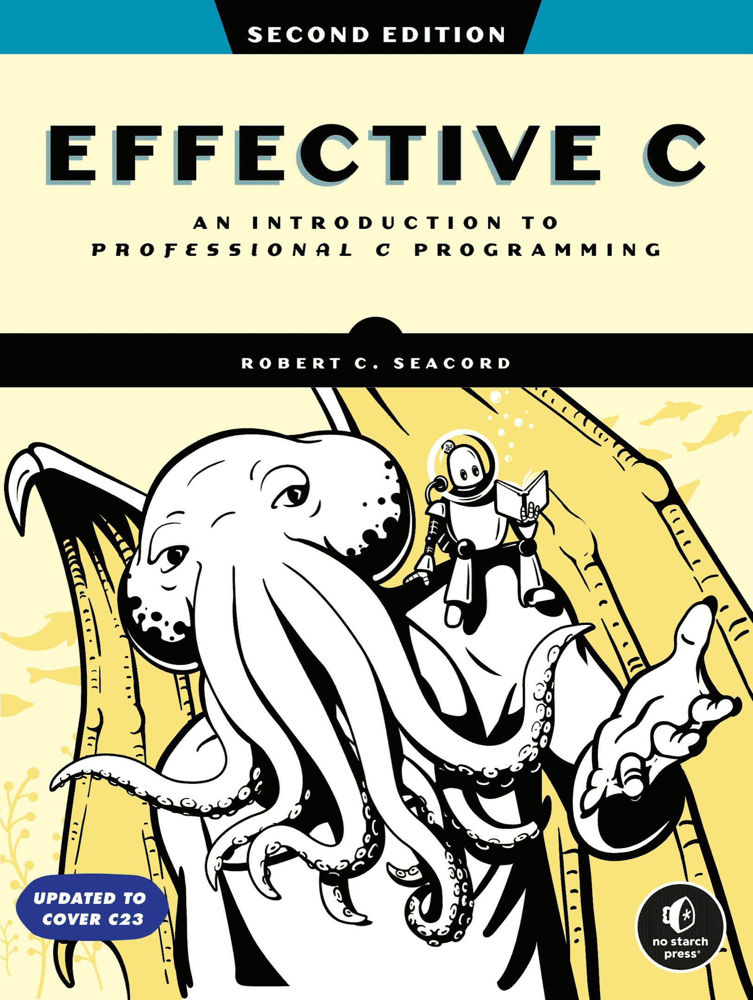

# 赞誉

## 效能 C

`Effective C` 将教你如何进行现代 C 语言编程……此本书对 C 语言编程安全性方面的强调是无与伦比的。我个人的建议是，在阅读此书后，利用书中提供的所有可用工具，以避免在你编写的 C 程序中出现未定义行为。

—PASCAL CUOQ，TRUSTINSOFT 首席科学家

一本关于现代 C 语言的优秀介绍。

—FRANCIS GLASSBOROW，ACCU

一本关于现代 C 语言的良好介绍，包含了动态内存分配、程序结构以及调试、测试和分析等章节。

—STACK OVERFLOW，权威 C 语言书单

C 程序员书架上值得增添的读物。

—IAN BRUNTLETT，ACCU

这就是为什么你应该用 C 语言编程的原因。因为其他语言不会开启通往地狱的大。

—MICHAŁ ZALEWSKI，SNAP INC. 前首席安全官

第一次印刷

28 27 26 25 24 1 2 3 4 5

ISBN-13: 978-1-7185-0412-7 (纸质版)

ISBN-13: 978-1-7185-0413-4 (电子版)


No Starch Press®, Inc. 出版

245 8th Street, San Francisco, CA 94103

电话：+1.415.863.9900

[www.nostarch.com](http://www.nostarch.com); info@nostarch.com

出版者：William Pollock

执行编辑：Jill Franklin

制作经理：Sabrina Plomit-González

制作编辑：Jennifer Kepler

开发编辑：Jill Franklin

封面插图：Gina Redman

内页设计：Octopod Studios

技术评审员：Vincent Mailhol 和 Martin Sebor

文字编辑：Lisa McCoy

校对：Dan Foster

索引编制：Michael Goldstein

*美国国会图书馆对第一版的登记如下：*

姓名：Seacord, Robert C., 作者。

书名：Effective C : an introduction to professional C programming / Robert C. Seacord.

描述：San Francisco : No Starch Press, Inc., 2020. | 包含参考文献和索引。

标识符：LCCN 2020017146 (纸质版) | LCCN 2020017147 (电子版) | ISBN 9781718501041 (平装本) | ISBN 1718501048 (平装本) | ISBN 9781718501058 (电子版)

主题：LCSH: C (计算机语言)

分类：LCC QA76.73.C15 S417 2020 (纸质版) | LCC QA76.73.C15 (电子版) | DDC 005.13/3--dc23

LC 记录可见：[`lccn.loc.gov/2020017146`](https://lccn.loc.gov/2020017146)

# 关于作者

Robert C. Seacord (`rcs@robertseacord.com`) 是 Woven by Toyota 的标准化负责人，在那里致力于软件工艺工作。Robert 曾是 NCC Group 的技术总监、卡内基·梅隆大学软件工程学院安全编码倡议的经理，以及计算机科学学院兼兼教授。Robert 是 ISO/IEC JTC1/SC22/WG14 的召集人，该小组是 C 语言的国际标准小组。他还是其他书籍的作者，包括`CERT® C Coding Standard` 第二版（Addison-Wesley, 2014）；`Secure Coding in C and C++` 第二版（Addison-Wesley, 2013）；以及`Java Coding Guidelines: 75 Recommendations for Reliable and Secure Programs`（Addison-Wesley, 2014）。他还发表了 50 多篇关于软件安全、基于组件的软件工程、基于 Web 的系统设计、遗留系统现代化、组件库和搜索引擎以及用户界面设计的论文。

Aaron Ballman (`aaron@aballman.com`) 是 Clang 的首席维护者，Clang 是一种流行的 C、C++ 及其他语言开源编译器。Aaron 是 JTC1/SC22/WG14 C 编程语言和 JTC1/SC22/WG21 C++ 编程语言标准委员会的专家。他的主要专业重心一直是通过更好的语言设计、诊断和工具，帮助程序员识别代码中的错误。在不思考编程时，他喜欢与家人在缅因州农村的森林里享受宁静的时光。

# 关于第一版评审员

Martin Sebor 是 Red Hat GNU 工具链团队的主任软件工程师。他的重点是 GCC 编译器，以及检测、诊断和预防 C 和 C++ 程序中安全相关问题的领域，以及基于字符串的算法优化。在 2015 年加入 Red Hat 之前，他曾在 Cisco 担任编译器工具链工程师。Martin 自 1999 年起担任 C++ 标准委员会成员，自 2010 年起担任 C 语言委员会成员。他与妻子住在科罗拉多州小镇 Lyons 附近。

# 关于第二版评审员

Vincent Mailhol 是 Woven by Toyota 的高级产品安全工程师，在该公司负责为汽车电子控制单元的可信执行环境设计并开发 C 语言软件。他是公司密码委员会的成员，并与 Robert 一起制定了公司的安全与可靠编码指南。在 2020 年加入 Woven 之前，他曾在博世集团（Bosch Group）旗下子公司 ESCRYPT Japan 渗透测试团队负责人，该公司专注于汽车安全领域。在空闲时间，Vincent 是 Linux 内核 CAN 子系统的活跃贡献者和维护者，该子系统也也被称为 `SocketCAN`。

# 第二版序言

当我 27 多年前开始进入网络安全领域时，我主要通过通过发现和利用 `C` 程序中不安全的内存处理方式来学习技艺的——这类漏洞在当时已经有 20 多年的历史了。在黑莓（BlackBerry）的职业生涯中，当我穿梭于如流般的代码审查时，我亲眼目睹了不当启动的 `C` 语言有多么危险。现在，作为英国国家网络安全中心（NCSC）的技术官，我每天都能在国家层面看到编写糟糕的 `C` 代码对我们互联社会带来的后果。

今天，我们在编写安全且专业的 `C` 语言方面仍面临许多挑战。编译器和操作系统层面防御措施的许多创新可以被且确实经常被破坏。尽管我们看到了其他现代语言和硬件中先进的创新，但对 `C` 的需求仍在增长，特别是在物联网（IoT）或其他高度资源受限的环境中，同时它也维持着我们的基础。专业的 `C` 语言结合 `CHERI` 等硬件级架构，是保护那些永远不会迁移到其他语言环境的关键。

Robert 是如何在 `C` 中进行专业且安全编程的权威。十多年来，我一直向客户和内部团队推荐他的材料。没有比他更适合教人如何以专业以及包括安全在内的的方式编写 `C` 代码了。

在今天编写专业的 `C` 意味着编写高性能、安全且可靠的代码。通过这样做，你将为我们的互联社会做出贡献，而不会增加其技术债。

本书将帮助那些几乎或没有 `C` 经验的人快速掌握知识和技能，成为专业的 `C` 程序员，并为开发高性能、安全且可靠的系统提供坚实的基础。

Ollie Whitehouse

英国国家网络安全中心 CTO 官

# 第一版序言

我第一次看到 Robert Seacord 的名字是在 2008 年。Robert 在 `C` 编程界已经因他对 `The CERT^®` `C Coding Standard` 和 `C` 标准附录 `Annex K` 的工作而闻名。但在 2008 年，距离我——年轻且鲁莽地——启动 `Frama-C` 项目以保证 `C` 程序中不存在未定义行为才仅过了几年。在某一个时刻，一篇关于 `C` 编译器（特别是 `GCC`）如何移除某些指针算术溢出检查的 CERT 漏洞说明引起了我的兴趣。编译器有理由消除这些检查；由于编写得过于简单，当溢出发生时它们会触发未定义行为。

`C` 编译器还被允许不对程序员说明他们做错了什么，即使在最高警告级别下也是如此。`C` 语言中的未定义行为可能是致命的。我当时的目标正是为了解决这个问题。Robert 是该说明的作者之一。

`Effective C` 将教你现代时代的 `C` 语言编程。它将帮助你建立良好的习惯，防止你无论是自愿还是由于疏忽而使用未定义行为。在此警告读者：在大型 `C` 程序中，仅避免普通的编程错误可能不足以规避由任意输入引起的未定义行为！

本书对 `C` 语言编程安全方面的关注是无与伦比的。我个人的建议是，在阅读完本书后，使用它提供的所有可用工具来避免在你所编写的 `C` 程序中出现未定义行为。

Pascal Cuoq

TrustInSoft 首席科学家

# 致谢

我想感谢所有让这一切成为可能的人的贡献。我首先从 No Starch Press 的 Bill Pollock 说起，他坚持不懈地催促我写一本关于 `C` 语言的书。

我要感谢 Ollie Whitehouse 和 Pascal Cuoq，他们为我撰写了精彩的序言。

Aaron Ballman 在整个创作过程中都是我非常极具价值的合伙人。除了贡献了两个章节外，他还审查了所有内容（通常是多次），并帮助我解决了从深奥到琐碎的问题。

Douglas Gwyn 是美国陆军研究实验室荣誉教授以及 `C` 标准委员会荣誉成员，帮助审查了所有章节。当我的写作未达到他的标准时，他会引导我走向正确的方向。

Martin Sebor 担任本书第一版的官方技术评审员，Vincent Mailhol 担任第二版的评审员。

除了 Aaron、Doug 和 Martin，其他几位杰出的 `C` 和 `C++` 标准委员会成员也审查了章节，包括 Jim Thomas、Thomas Köppe、Niall Douglas、Tom Honermann 和 JeanHeyd Meneide。我在 Woven by Toyota 的同事技术评审员包括 J.F. Bastien、Carlos Ramirez 和 Jørgen Kvalsvik。我在 NCC Group 的前同事技术评审员包括 Nick Dunn、Jonathan Lindsay、Tomasz Kramkowski、Alex Donisthorpe、Joshua Dow、Catalin Visinescu、Aaron Adams 和 Simon Harraghy。这些组织之外的技术评审员包括 Geoff Clare、David LeBlanc、David Goldblatt、Nicholas Winter、John McFarlane 和 Scott Aloisio。

我还要感谢 Noarch 的以下专业人士，他们确保了产品的质量：Jill Franklin, Jennifer Kepler, Elizabeth Chadwick, Frances Saux, Zach Lebowski, Annie Choi, Barbara Yien, Katrina Taylor, Laurel Gleason, Derek Yee, Laurel Chun, Gina Redman, Sharon Wilkey, Emelie Battaglia, Dapinder Dosanjh, Lisa McCoy, Morgan Vega Gomez 以及 Sabrina Plomitallo-González。最后，我要感谢 Michael Goldstein 准备索引。

# 引言


`C` 语言是 20 世纪 70 年作为一种系统编程语言开发的，时后的今天它依然非常受欢迎。系统语言的设计是为了性能和易于访问底层硬件，同时提供高级编程特性。尽管其他语言可能提供新的语言特性，但它们的编译器和库通常是用 C 语言编写的。

卡尔·萨根曾说过：“如果你想从零开始制作苹果派，你必须先发明宇宙。” `C` 的发明者并没有发明宇宙；他们设计 `C` 是为了适应各种计算硬件和架构，而这些架构又受到物理学和数学的限制。`C` 直接构建在计算硬件之上，因此它对不断发展的硬件特征（如向量化指令）比那些通常依赖 `C` 实现效率的高级语言更敏感。

*   信任程序员。C 语言假设你清楚自己在做什么，并允许你这么做。这并不总是一件好事（例如，当你不知道自己在做什么时）。

*   不要阻止程序员执行需要执行的操作。因为 C 是一种系统编程语言，它需要处理各种低级任务。

*   保持语言的精简和简单。该语言的设计初衷是接近硬件且占用内存小。

*   为每种操作仅提供一种实现。这被称为“机制守恒”（`conservation of mechanism`），C 语言试图限制重复机制的引入。

*   让它运行快速，即使不保证具有移植性。允许你编写出最高效的代码是首要任务。确保代码可移植、安全且可靠的责任交给了你——程序员。

C 语言被用作编译器的目标语言用于构建操作系统、教授计算基础，以及嵌入式和通用编程。

存在大量的用 C 编写的遗留代码。C 标准委员会非常小心地破坏现有代码，为这些代码的现代化提供了平畅的通道，以利用现代语言特性。

C 经常用于嵌入式系统，因为它是一种精简且高效的语言。嵌入式系统是嵌入在其他设备中的小型计算机，如汽车、家电器和医疗设备。

你喜欢的编程语言和库都是用 C 编写的（或曾经是）。C 语言有许多可用库。这使得很容易找到可以执行常用任务的库。

总的来说，C 是一种强大且多用途的语言，今天仍被广泛使用。对于需要快速、高效且可移植语言的程序员来说，这是一个很好的选择。

# C 简史

C 语言语言于 20 世纪 70 年代初在贝尔实验室开发，作为初生的 Unix 操作系统的系统实现语言，并且至今仍然极受欢迎欢迎（Ritchie 1993）。系统语言的设计是为了兼顾性能和底层硬件的访问，同时提供高级编程特性。虽然其他语言可能提供新的语言特性，但它们的编译器和库通常是用 C 语言编写的。它是不同系统和语言之间翻译的通用语言（lingua franca）。

Kernighan 和 Ritchie 在 1978 年的著作《C 语言程序》（*The C Programming Language*）（Kernighan and Ritchie 1988）中首次描述了 C 语言。它现在由 ISO/IEC 9899 标准修订版（ISO/IEC 2024）和其他技术规范定义。C 标准委员会是 C 编程语言的管理员，与更广泛的社区合作维护和演进 C 语言。1983 年，美国国家标准协会（ANSI）成立了 X3J11 委员会以建立标准的 C 规范， 1989 年，C 标准被批准为 ANSI X3.159-1989，“编程语言 C”。这个 1989 年的语言版本被称为 `ANSI C` 或 `C89`。

1990 年，ANSI C 标准被国际标准化组织（ISO）和国际电工委员会（IEC）的联合技术委员会采纳（未更改），并作为 C 标准的第一版 C90（ISO/IEC 9899:1990）发布。C 标准的第二版 C99 于 1999 年发布（ISO/IEC 9899:1999），第三版 C11 于 2011 年发布（ISO/IEC 9899:2011）。第四版于 2018 年作为 C17 发布（ISO/IEC 9899:2018），修复了 C11 中的缺陷。C 标准的最新版本（截至本文写作）是第五版，于 2024 年作为 C23 发布（ISO/IEC 9899:2024）。截至 2023 年 9 月，我是 ISO/IEC JTC1/SC22/WG14 的召集人，这是 C 编程语言的国际标准化小组。

在 TIOBE 编程社区指数追踪编程语言流行程度的 20 年里，C 一直位列第一或第二（TIOBE Index 2022）。

# C 标准

C 标准（ISO/IEC 9899:2024）定义了该语言，是语言行为的最终权威。虽然标准可能晦涩得令人难以逾越，但如果你打算编写可移植、安全且可靠的代码，你就需要理解它。C 标准为实现提供了相当大的自由度，允许它们在各种硬件平台上实现最高效的。`Implementations`（实现）是 C 标准用于指代编译器的术语，定义如下：

在特定的控制选项下，在特定的翻译环境中运行的一组特定软件，用于对特定执行环境中的程序进行翻译，并支持执行该环境中的函数。

该定义表明，每个具有特定一组命令行标志的编译器加上 C 标准库，被视为一个独立的实现，不同的实现可能具有显著不同的 `implementation-defined behavior`（实现定义行为）。这在 GNU 编译器集合（GCC）中非常明显，它使用 `-std=` 标志来确定语言标准。该选项的可能值包括 `c89`、`c90`、`c99`、`c11`、`c17` 和 `c23`。默认值取决于编译器版本。如果没有给出 C 变言选项，GCC 13 的默认值为 `gnu17`，它为 C 语言提供了扩展。为了移植性，请指定你正在使用的标准。为了使用新特性，请指定较新的标准。C23 特性从 GCC 11 起已可用。要启用 C23 支持，添加编译器选项 `-std=c23`（可能是 `-std=c2x`）。由于实现的行为范围很大，且其中某些行为是未定义的，你无法仅通过编写简单的程序检查行为来理解 C 语言。（如果你想尝试，Compiler Explorer 是一个极好的工具；参见 *https://godbolt.org*。）代码的行为在由不同平台的不同实现编译，或者在同一实现使用不同标志或不同标准库实现时，可能会不同。代码行为甚至可以在不同编译器版本之间变化。C 标准规定了哪些行为是所有实现保证的，以及在哪些地方你需要考虑变异。这在开发可移植代码时是一个主要考虑，但也可能影响代码的安全。

# CERT C 编码标准


《The CERT C Coding Standard: 98 Rules for Developing Safe, Reliable, and Secure Systems》，第二版（Addison-Wesley Professional, 2014）是我在卡内基隆大学软件工程研究所管理安全编码团队期间编写的一本参考书。书中包含了常见 C 编程错误及其纠正方法的示例。在本书中，我们引用了其中一些规则作为有关特定 C 语言编程主题详细信息的来源。

# 常见弱点枚举

MITRE 的常见弱性枚举（CWE）是一份常见的硬件和软件弱性列表，用于识别源代码和运行系统中的漏洞。CWE 列表由一个社区项目维护，其目标是理解软件和硬件的缺陷，并创建可用于识别、修复和防止这些缺陷的自动化工具。在本书讨论可能导致安全漏洞的缺陷分类时，我们偶尔会引用特定的 CWE。有关 CWE 的更多信息，请参阅 `[https://cwe.mitre.org]`。

## 本书目标读者

本书是 C 语言的入门教程。它的编写目标是让任何想学习 C 编程的人都能尽可能易于理解，同时不会降低其深度。换句话说，我们没有像许多其他入门书籍和课程那样过度简化 C 编程。那些过度简化的参考资料会教你如何编译和运行代码，但代码本身可能是错误的。从此类资源学习 C 语言编程的开发者通常会编写出不标准、有缺陷且不安全的代码，这些代码最终需要重写（而且往往得很快）。希望这些开发者最终能从组织内高级开发者的帮助中受益，他们将帮助消除这些关于 C 语言编程的有害误观念，并帮助他们开始开发专业级的 C 代码。另一方面，本书将快速教你如何开发正确、可移植、专业级的代码；为开发安全关键和安全关键系统奠基础；并可能教你一些甚至你组织中的高级开发者不知道的知识。

*Effective C: An Introduction to Professional C Programming*，第 2 版，是对核心 C 语言编程的简明介绍，它将让你很快开始编写程序、解决问题并构建运行的系统。代码示例是符合惯用法且直观的。你还将学习用于开发正确、安全的 C 代码的良好软件工程实践。

在本书中，你将学习 C 语言中的核心编程概念，并通过每个主题的练习题练习编写高质量代码。书中的代码列表和额外材料可以在 GitHub 的 `[https://github.com/rcseacord/effective-c]` 上找到。访问本书的页面 `[https://nostarch.com/effective-c-2nd-edition]` 或访问 `[http://www.robertseacord.com]` 以检查更新和额外材料，或者如果你有其他问题或对培训感兴趣，请与我联系。

# 1 开始 C 语言

在本章中，你将开发你的首个 C 程序：传统的“Hello, world!”程序。我们将检查这个简单 C 程序的各个方面，编译它并运行它。然后，我将回顾一些编辑器和编译器的选项，并概述你在编写 C 语言时会熟悉的常见的移植性问题。

## 你的第一个 C 程序

学习 C 语言编程最有效的方法是开始编写 C 程序，而传统的入门程序是“Hello, world！”打开你最喜欢的文本编辑器，并输入列表 1-1 中的程序。

文件名为`hello.c`：

```c
#include <stdio.h>
#include <stdlib.h>

int main() {
  puts("Hello, world!");
  return EXIT_SUCCESS;
}
```

列表 1-1：“Hello, world!” 程序

前两行使用了 `#include` 预处理指令，其行为等同于在相同位置将其替换为指定文件的内容。在程序程序中，`stdio.h` 和 `stdlib.h` 都是头文件。*头文件*（header）是一种源文件，按照惯，它包含了相应源文件的用户所需的定义、函数声明和常量定义。正如文件名所示，`stdio.h` 定义了 C 标准输入/输出（I/O）函数的接口，而 `stdlib.h` 声明了若干通用工具类型和函数，并定义了若干宏。你需要对于在程序中使用的任何库函数包含其适当的声明。（你将在第 9 章中学习到更多关于头文件的正确用法。）

在这里，我们包含了 `stdio.h` 以访问 `main` 函数调用的 `puts` 函数的声明。我们包含了 `stdlib.h` 以访问 `EXIT_SUCCESS` 宏的定义，它被用于 `return` 语句。

这一行定义了程序启动时调用的 `main` 函数：

```c
int main() {
```

`main` 函数定义了程序的入口点，当程序从命令行或其他程序被调用时，该程序在托管环境中执行。C 定义了两种可能的执行环境：自立式（freestanding）和托管（hosted）。*自立式*环境可能不提供操作系统，通常用于嵌入式编程。这些实现提供了一组极简的库函数，且程序启动时调用的函数名称和类型由实现定义。本书中的大多数示例都假设 `main` 函数是且唯一的入口点。

和其他过程化语言一样，C 程序包含了可以接受参数并返回结果的*函数*（functions）。每个函数都是一个可重用的工作单元，你可以根据需要频繁在程序中调用它。`puts` 函数在 `main` 函数中被调用，以打印出 `Hello, world!` 这一行：

```c
puts("Hello, world!");
```

`puts` 函数是一个 C 标准库函数，它将字符串参数写入 `stdout` 流并在输出末尾附加换行符。`stdout` 流通常代表控制台或终端窗口。`"Hello, world!"` 是一个类似于只读字符串的字符串字面量。该函数调用向终端输出 `Hello, world!`。

程序完成后，`return` 语句将退出 `main` 并将整数值返回给托管环境或调用脚本：

```c
return EXIT_SUCCESS;
```

`EXIT_SUCCESS` 是一个类对象的宏，其定义如下：

```c
#define EXIT_SUCCESS 0
```

`EXIT_SUCCESS` 的每次出现都会被替换为 0，然后通过对 `main` 的调用返回给托管环境。

## 编译并运行程序

接下来，你需要编译并运行程序，这涉及两个步骤。编译程序的命令取决于你正在使用的编译器。在 Linux 和其他 Unix 类系统上，在命令行输入 `cc`，后跟上你想要编译的文件名：

```bash
$ cc hello.c
```

如果你正确输入了程序，编译命令将在源文件所在的目录下创建一个名为 *a.out* 的新文件。

使用以下命令检查你的目录：

```bash
$ ls
a.out  hello.c
```

`a.out` 文件是可执行程序，你现在可以在命令行上运行它了：

```bash
$ ./a.out
Hello, world!
```

`cc` 命令接受大量的编译器选项。例如，`-o file` 编译器选项允许为可执行文件指定一个好记的名字，而不是 `a.out`。下面的编译器调用将可执行文件命名为 `hello`：

```bash
$ cc -o hello hello.c
$ ./hello
Hello, world!
```

函数通常会返回一个值，该值是计算的结果，或者表示函数是否成功完成了其任务。例如，我们在“Hello, world!”程序中使用的 `puts` 函数接受一个用于打印的字符串，并返回一个类型为 `int` 的值。如果发生写入错误，`puts` 函数将返回宏 `EOF` 的值（一个负整数）；否则，它将返回一个非负整数值。

尽管对于我们的简单程序来说，`puts` 函数不太可能失败并返回 `EOF`，但这种情况是有可能发生的。由于对 `puts` 的调用可能会失败并返回 `EOF`，这意味着你的第一个 C 程序存在漏洞，或者至少可以如下所示进行改进：

```c
#include <stdio.h>
#include <stdlib.h>

int main() {
  if (puts("Hello, world!") == EOF) {
    return EXIT_FAILURE;
    // 代码这里永远不会执行
  }
  return EXIT_SUCCESS;
  // 代码这里永远不会执行
}
```

这个修订后的“Hello, world!”程序检查了 `puts` 调用是否返回了值 `EOF`，这表示发生了写入错误。如果函数返回 `EOF`，程序将返回 `EXIT_FAILURE` 宏的值（其评估值为非零值）。否则，函数成功，程序返回 `EXIT_SUCCESS`。调用该程序的脚本可以检查其状态以判断是否执行成功。`return` 语句之后的代码是永远不会执行的 `dead code`。这在修订后的程序中通过单行注释指出了。`//` 之后的所有内容都会被编译器忽略。

### 格式化输出

`puts` 函数向 `stdout` 写入字符串的一种简单方法，但要打印字符串以外的参数，你需要使用 `printf` 函数。`printf` 函数接受一个格式字符串，用于定义输出的格式，后面跟着数量数量的参数，这些参数是你想要打印的实际值。例如，如果你想使用 `printf` 函数来打印 `Hello, world!`，你可以这样写：

```c
printf("%s\n", "Hello, world!");
```

第一个参数是格式字符串 `"%s\n"`。`%s` 是一个转换规范，指示 `printf` 函数读取第二个参数（字符串字面量）并将其打印到 `stdout`。`\n` 是一个用于表示非图形字符的字母转义序列，并函数在字符串后包含一个新行。如果没有换行序列，下一个打印的字符（很可能是命令提示符）将出现在同一行。此函数调用输出如下：

```text
Hello, world!
```

注意不要将用户提供的数据作为 `printf` 函数第一个参数的一部分，因为这样做会导致格式化输出安全漏洞（Seacord 2013）。

输出字符串最简单的方法是使用之前所示的 `puts` 函数。如果你使用 `printf` 代替 `puts`，它会返回打印的字符数。

### 编辑器和集成开发环境

可用的具体工具取决于你使用的系统。你可以使用各种编辑器和集成开发环境（IDE）来开发 C 程序。根据 2023 年的一项调查，图 1 显示了常用的工具。

对于 Microsoft Windows，微软的 Visual Studio IDE 是显而易见的选择。Visual Studio 有三个版本：社区版（Community）、专业版（Professional）和企业版（Enterprise）。社区版的优点是免费，而其他版本付费。对于本书，你只需要社区版。

对于 Linux，选择就不那么明显，因为有多种选择。一个流行的选择是 Visual Studio Code（VS Code）。VS Code 是一个精简的代码编辑器，支持调试、任务运行和版本控制等开发操作（第 11 章介绍）。它提供了开发者进行快速“代码-构建-调试”循环所需的工具。VS Code 运行在 macOS、Linux 和 Windows 上，并免费用于私人或商业用途。

图 1-2 显示了在 Ubuntu 上使用 VS Code 开发“Hello, world!”程序。调试控制显示程序按预期以状态 0 退出。

Vim 是许多开发者和高级用户的首选编辑器。它是一个基于 Bill Joy 在 20 世纪 70 年代为 Unix 版本编写的 vi 编辑器的文本编辑器。它继承了 vi 的键绑定，但也增加了原始 vi 缺失的功能和扩展性。你可以选择性安装 Vim 插件，例如 YouCompleteMe 或 deoplete，它们为 C 语言编程提供原生的语义代码补全。

GNU Emacs 是一个可扩展、自定义且免费的文本编辑器。它的核心是一个 Emacs Lisp 解释器，Lisp 编程语言的一种方言，带有支持文本编辑的扩展。坦白说：我开发的几乎所有的生产 C 代码都是在 Emacs 中编辑的。

# 编译器

有许多 C 编译器可用，因此我不会在这里讨论所有的它们。不同的编译器实现了 C 标准的不同版本。许多用于嵌入式系统的编译器仅支持 C89/C90。Linux 和 Windows 上流行的编译器则更努力支持现代版本的 C 标准，最高支持并包含 C23。

## GNU 编译器集（GNU Compiler Collection）

GNU 编译器集（GCC）包含了针对 C、C++ 和 Objective-C 的前端，以及其他语言（`https://gcc.gnu.org`）。GCC 在 GCC 指导委员会的指导下，遵循定义良好的开发计划。

GCC 已被采用 Linux 系统的标准编译器，尽管也提供了 Microsoft Windows、macOS 和其他平台的版本。在 Linux 上安装 GCC 非常简单。例如，以下命令应该在 Ubuntu 上安装 GCC：

```bash
$ sudo apt-get install gcc
```

你可以使用以下命令测试你正在使用的 GCC 版本：

```bash
$ gcc --version
```

输出将显示已安装 GCC 版本的信息和版权信息。

## Clang

另一个流行的编译器是 Clang（`https://clang.llvm.org`）。在 Linux 上安装 Clang 也很简单。你可以使用以下命令在 Ubuntu 上安装 Clang：

```bash
$ sudo apt-get install clang
```

你可以使用以下命令测试你正在使用的 Clang 版本：

```bash
$ clang --version
```

这显示了安装的 Clang 版本。

## Microsoft Visual Studio

如前所述，Windows 上流行的开发环境是 Microsoft Visual Studio，它包含了 IDE 和编译器。Visual Studio（`https://visualstudio.microsoft.com/downloads/`）与 Visual C++ 2022 绑定，其中包含了 C 和 C++ 编译器。

你可以在项目属性（Project Property）页面上设置 Visual Studio 的选项。在 C/C++ 下的 Advanced 选项卡上，确保通过使用“作为 C 代码编译”（`/TC`）选项而不是“作为 C++ 代码编译”（`/TP`）选项来编译为 C 代码。默认情况下，当你使用 `*.c` 扩展名命名文件时，它会使用 `/TC` 编译。如果文件名为 `*.cpp`、`*.cxx` 或其他扩展名，则会使用 `/TP` 编译。

# 可移植性

每个 C 编译器的实现都略有不同。编译器不断演进——例如，像 GCC 这样的编译器可能提供对 C17 的完全支持，但正努力支持 C23，在这种情况下，它可能实现了某些 C23 特性但未实现其他特性。因此，编译器支持整个 C 标准范围（包括中间版本）。C 实现的整体演进非常缓慢，许多编译器明显落后于 C 标准。

如果为 C 编写的程序只使用标准中指定的语言和库特性，则可以被视为严格符合标准。这些程序旨在具有最大的可移植性。然而，由于实现行为的范围很大，没有任何现实世界中的 C 程序是严格符合标准的，将来永远不会是（而且可能不应该）。相反，C 标准允许你编写可能依赖于不可移植语言和库特性的合规程序。

针对单一参考实现（有时是针对多个实现）编写代码是常见做法，这取决于你计划部署代码的平台。C 标准确保了这些实现之间的差异不会太大，并允许你同时针对多个实现，而无需每次都学习一种新语言。

C 标准文档附录 J 列举了五类可移植性问题：

- 实现定义行为（Implementation-defined behavior）
- 未指定行为（Unspecified behavior）
- 未定义行为（Undefined behavior）
- 特定区域的行为（Locale-specific behavior）
- 通用扩展（Common extensions）

当你学习 C 语言时，你会遇到所有五种行为的示例，因此准确理解它们是什么是非常重要的。

## 实现定义行为（Implementation-Defined Behavior）

实现定义行为是 C 标准未指定的程序行为，在不同实现之间可能会产生不同的结果，但在实现内部具有一致且有文档记录。实现定义行为的一个示例是字节中的位数。

实现定义行为大多是无害的，但在移植到不同实现时可能会导致缺陷。尽可能避免编写依赖于你计划编译代码的 C 实现之间存在差异的实现定义行为的代码。实现定义行为的完整列表列在 C 标准的附录 J.3 中。你可以使用 `static_assert` 声明记录你对实现定义行为的依赖。

## 未指定行为（Unspecified Behavior）

未指定行为是指标准为程序行为提供了两个或更多选项，但没有规定在任何情况下选择哪种选项。给定表达式的每次执行都可能产生不同的结果，或产生与之前执行不同的值。未指定行为的一个示例是函数存储布局，它可以在函数调用之间发生变化。未指定行为列在 C 标准的附录 J.1 中。

## 未定义行为（Undefined Behavior）

未定义行为是指 C 标准未定义的行为，或者通俗地说，“当在使用不可移植或错误的程序结构或错误数据时产生的行为，标准对其未施加任何要求”（ISO/IEC 9899:2024）。未定义行为的示例包括符号整数溢出和解引用无效指针值。具有未定义行为的代码通常是错误的，但并非总是如此。未定义行为在标准中的标识如下：

- 当违反了“应当”（shall）或“不应”（shall not）的要求且该要求出现在约束范围之外时，行为是未定义的。
- 当通过“未定义行为”一词明确指定行为时。
- 通过省略对行为的任何显式定义。

前两种未定义行为通常被称为显式未定义行为，而第三种被称为隐式未定义行为。这三者之间没有重点上的区别；它们描述的都是未定义的行为。C 标准附录 J.2 “未定义行为”列出了 C 中的显式未定义行为。

- 识别可能符合规范的语言扩展区域，实现者可以通过提供对官方未定义行为的定义来增强语言。

这三个原因截然不同，但它们都被视为可移植性问题。我们将在本书的后续，根据出现的情况检查这三种情况的示例。当遇到未定义行为时，编译器有权执行以下操作：

- 完全忽略未定义行为，导致不可预测的结果。
- 以具有环境特征的文档化方式运行（可能或不发出诊断信息）。


终止编译或执行（并发出诊断信息）

这些选项都不是理想的（特别是第一种），因此最好避免未定义行为，除非编译器指定这些行为是定义的，以允许你调用语言扩展。编译器有时具有`pedantic`（严格）模式，可以帮助程序员注意这些可移植性问题。

## 特定于区域的行为与常见扩展

`特定区域的行为`取决于每个实现所记录的国籍、文化和语言的本地惯例。`常见扩展`在许多系统中被广泛使用，但不能移植到所有实现。

## 总结

在本章中，你学习了如何编写一个简单的 C 语言程序、编译它并运行它。我们查看了几个编辑器和集成开发环境，以及你可以用于在 Windows、Linux 和 macOS 系统上开发 C 程序的编译器。你应该使用较新版本的编译器和其他工具，因为它们倾向于支持 C 编程语言的新特性，并提供更好的诊断和优化。然而，你可能不想使用较新版本的编译器，如果这些版本破坏了你现有的代码，或者你正准备部署代码以避免在已测试的应用程序中引入不必要的更改。我们通过对 C 语言程序可移植性的讨论结束了章。

后续章节将检查 C 语言和库的特定特性，从下一章的对象、函数和类型开始。

# 2 对象、函数和类型


在本章中，你将学习对象、函数和类型。我们将研究如何声明变量（带有命名标识符的对象）和函数、获取对象的地址，并解引用这些对象指针。每个对象或函数实例都有一个类型。你已经见过 C 语言程序员可以使用的一些类型。你在本章中学的第一个知识是我学到的最后知识之一：C 中的每种类型要么是对象类型，要么是函数类型。

## 实体

`对象`是可以表示值的存储区域。准确来说，C 标准 (ISO/IEC 9899:2024) 将对象定义为“执行环境中数据存储区域，其内容可以表示值”，并附注：“当被引用时，对象可以解释为具有特定类型”。`变量`是对象的一个示例。

`变量`具有声明的`类型`，它告诉你是该变量的值所代表的对象种类。例如，类型为`int`的对象包含一个整数值。类型很重要，因为表示某类类型对象的位集合如果被解释为另一种类型的对象，可能会有不同的值。例如，数字 1 在 IEEE 浮点运算标准中通过位模式`0x3f800000`表示（IEEE 754-2019）。但如果你将此相同的位模式解释为整数，你得到的将是 1,065,353,216 而不是 1。

`函数`不是对象，但它们有类型。函数句的特征同时取决于于其返回类型以及其参数的数量和类型。

C 语言还拥有`指针`，它们可以被看作是一个`地址`——即存储对象或函数的内存位置。

与对象和函数一样，对象指针和函数指针是不同的事物，不能互换。在下一节中，你将编写一个简单的程序，尝试交换两个变量的值，以帮助更好地理解对象、函数、指针和类型。

## 声明变量

当你声明变量时，你为它分配一个类型并为其提供一个名称（或`标识符`），通过该名称引用变量。可选情况下，你还可以对变量进行`初始化`。

列表 2-1 声明了两个带有初始值的整数对象。这个简单的程序还声明但未定义一个`swap`函数来交换这些值。

```c
#include <stdio.h>
#include <stdlib.h>

❶ void swap(int, int); // 定义在列表 2-2 中

int main() {
  int a = 21;
  int b = 17;
❷ swap(a, b);
  printf("main: a = %d, b = %d\n", a, b);
  return EXIT_SUCCESS;
}
```

列表 2-1：用于交换两个整数的程序

此示例程序显示了一个带有单个`复合语句`的`main`函数，该语句包含了`{}`字符以及它们之间的所有语句（也称为`块`）。我们在`main`函数内部定义了两个变量`a`和`b`。我们声明这些变量的类型为`int`并分别将它们初始化为`21`和`17`。每个变量都必须有声明。然后`main`函数调用`swap`函数 ❷ 来尝试交换整数的值。`swap`函数在程序中被声明了 ❶ 但未定义。我们稍后将查看该函数可能的实现方式。

### 交换值，第一次尝试

每个对象都有一个存储期，决定了它的`生命周期`，即对象在程序执行期间存在、拥有存储空间、具有常量地址并保留其最后存储值的时间。对象不应在生命周期之外被引用。

来自列表 2-1 的局部变量（如`a`和`b`）具有`自动存储期`，这意味着它们一直存在到执行离开它们所在的块为止。我们将尝试交换存储在这两个变量中的值。列表 2-2 显示了我们实现`swap`函数的第一次尝试。

```c
void swap(int a, int b) {
  int t = a;
  a = b;
  b = t;
  printf("swap: a = %d, b = %d\n", a, b);
}
```

列表 2-2：实现交换函数的第一次尝试

`swap`函数带有两个参数`a`和`b`，我们使用它们向该函数传递参数。C 语言区分了“参数”（parameters）和“实”（arguments）：参数是作为函数声明的一部分声明的对象，它们在进入函数时获取值；而实是指我们在函数调用表达式中包含的用逗号分隔的表达式。我们还在`swap`函数中声明了一个类型为`int`的临时变量`t`，并将其初始化为`a`的值。该变量用于临时存储在`a`中的值，以防在交换过程中该值丢失。

现在我们可以运行生成的可执行文件来测试程序了：

```
% ./a.out
swap: a = 17, b = 21
main: a = 21, b = 17
```

这个结果可能会让你感到意外。变量`a`和`b`分别初始化为`21`和`17`。`swap`函数内部第一次调用`printf`显示这两个值已经交换了，但`main`函数中的第二次调用`printf`的显示原始值没有变化。让我们来看看发生了什么。

C 语言是一种“按值调用”（call-by-value，也称为`pass-by-value`）语言，这意味着当你向函数提供参数时，该参数的值会被拷贝到一个独立的变量中供函数内部使用。`swap`函数将你传递作为参数的对象的值赋值给相应的参数。当函数内部的参数值发生变化时，调用者处的参数值不会受影响，因为它们是不同的对象。因此，在`main`中第二次调用`printf`时，变量`a`和`b`保留了它们的原始值。程序的目标是交换这两个对象的值。通过测试程序，我们发现它存在一个错误或缺陷。

### 交换值的第二次尝试

为了修复这个错误，我们可以使用指针来重写`swap`函数。我们使用间接操作符（`*`）来声明指针并对其进行解引用，如列表 2-3 所示：

```c
void swap(int* pa, int* pb) {
  int t = *pa;
  *pa = *pb;
  *pb = t;
}
```

列表 2-3：使用指针修改后的`swap`函数

在函数声明或定义中使用时，`*`作为指针声明符的一部分，表示该参数是指向特定类型对象或函数的指针。在重写的`swap`函数中，我们声明了两个参数`pa`和`pb`，它们的类型都是指向`int`的指针。一元操作符`*`表示间接。如果其操作数的类型为指向`int`的指针，则操作结果的类型为`int`。例如，考虑以下内容：

```c
pa = pb;
```

这用指针`pb`的值替换指针`pa`的值。现在考虑`swap`函数中的赋值语句：

```c
*pa = *pb;
```

一元操作`*`读取`pb`所引用的值，而`*`操作读取`pa`所引用的位置。然后将`pb`所引用的值写入`pa`引用的位置。当你在`main`中调用`swap`函数时，必须同样在每个变量名之前放置一个取地址符（`&`）：

```c
swap(&a, &b);
```

一元操作符`&`（*取地址符*）生成其操作数的指针。这种变化是必要的，因为`swap`函数现在接受类型为指向`int`指针的参数，而不是`int`类型参数。列表 2-4 展示了完整的程序：

```c
void swap(int* pa, int* pb) {   // pa → a: 21 pb → b: 17
  int t = *pa;                  // t: 21
  *pa = *pb;                    // pa → a: 17 pb → b: 17
  *pb = t;                      // pa → a: 17 pb → b: 21
}

int main() {
  int a = 21;                   // a: 21
  int b = 17;                   // b: 17
  swap(&a, &b);
  printf("a = %d, b = %d\n", a, b);    // a: 17 b: 21
  return EXIT_SUCCESS;
}
```

列表 2-4：模拟引用传递调用

在`swap`函数中，参数`pa`和`pb`现在都被声明为指向`int`的指针类型，并包含了从调用函数（在本例中为`main`）传递给`swap`的参数副本。这些地址副本仍然指向相同的对象，因此当在`swap`函数中交换它们引用对象的值时，在`main`中定义的原始对象的内容也会被交换。这种方法通过生成对象地址、按值传递这些地址，然后对复制的地址进行解引用以访问原始对象，模拟了*引用传递*（也称为*按引用传递*）。

# 对象类型

本节介绍了 C 语言中的对象类型。具体而言，我们将涵盖布尔类型、字符类型和算术类型（包括整数和浮点类型）。

## 布尔

布尔数据类型有两个可能的值（`true`或`false`），它们代表了逻辑学和布尔代数中的两个真值。声明为`bool`的对象只能存储`true`和`false`值。

下面的示例声明了一个名为`arm_detonator`的函数，它接受一个`int`参数并返回一个`bool`类型的值：

```c
bool arm_detonator(int);

void arm_missile(void) {
  bool armed = arm_detonator(3);
  if (armed) puts("missile armed");
  else puts("missile disarmed");
}
```

`arm_missile`函数调用`arm_detonator`函数并将返回值赋值给布尔变量`armed`。然后可以对该值进行测试，以确定导弹是否就绪。

从历史上来说，布尔值由整数表示，并且仍然像整数一样运行。它们可以存储在整数变量中，并用于任何整数有效的地方，包括索引、算术、解析和格式化。C 语言保证任何两个真值比较的结果将是相等的（这在引入`bool`类型之前是不可能实现的）。您应该使用`bool`类型来表示布尔值。

## 字符

C 语言定义了以下字符类型：`char`、`signed char`和`unsigned char`。每个编译实现都定义`char`的对齐方式、大小、范围、表示和行为与`signed char`或`unsigned char`相同。无论选择哪种，`char`都是与其他两个不同的独立类型，并且与两者都不兼容。

`char`类型通常用于表示 C 语言程序中的字符数据。`char`类型的对象可以表示*基础执行字符集*——即执行环境中所需的最小字符集——包括大写字母和小写字母、数字、空格、标点符号和控制字符。`char`类型不适用于整数数据；请使用`signed char`表示有符号值，并使用`unsigned char`表示无符号值。`char`的大小始终为一个字节，其宽度为`CHAR_BIT`位。来自`limits.h`的`CHAR_BIT`宏定义了每个字节的位数，在大多数平台上它是 8 位。基础执行字符集满足了许多应用程序的需求，但由于缺乏非英语字母，这成为了其被广泛接受的障碍。为了满足这一需求，C 标准规定了一种新的宽类型以允许大型字符集。您可以使用`wchar_t`类型将大型字符集中的字符表示为*宽字符*，该类型通常比比基础字符占用更多空间。通常，实现会选择 16 位或 32 位来表示一个宽字符。C 标准库提供了同时支持窄字符和宽字符的函数。`wchar_t`类型的设计并不是为了支持 Unicode，因此在大多数实现中已不再青睐，微软 Visual Studio 是一个显著的例外。

## 算术

C 提供了几种*算术类型*，用于表示整数、枚举和浮点值。第 3 章将更详细地介绍其中类型，这里是简要介绍。

### 整数

*有符号整数类型*可以表示负数、正数和零。标准的有符号整数类型包括`signed char`、`short int`、`int`、`long int`和`long long int`。

对于每个有符号整数类型，都有对应的*无符号整数类型*，它们使用相同的空间：`unsigned char`、`unsigned short int`、`unsigned int`、`unsigned long int`和`unsigned long long int`。无符号类型可以表示正数和零。这些无符号整数类型与`bool`类型共同成了标准的无符号整数类型。

除了`int`本身外，在这些类型的声明中，可以省略关键字`int`，因此，例如，你可能会使用`long long`代替`long long int`来声明一个类型。

有符号和无符号整数类型用于表示不同宽度的整数。每个平台根据某些约束决定其中每种类型的宽度。每种类型都有一个最小可表示范围。这些类型按宽度排序，保证较宽的类型至少与较窄的类型一样。这意味着`long long int`类型的对象可以表示`long int`类型的对象可以表示的所有值，`long int`类型的对象可以表示`int`类型的对象可以表示的所有值，依此类推。整数类型中由实现定义的最小和最大可表示值在`<limits.h>`头文件中指定。

除了标准整数类型，还可能提供`扩展整数类型`。它们是由实现定义的，这意味着它们的宽度、精度和行为取决于编译器。扩展整数类型通常比标准整数类型大（例如，`__int128`）。

除了标准和扩展整数类型外，C23 增加了`位精确整数类型`。这些类型接受一个指定整数宽度的操作数，因此`_BitInt(32)`是有符号 32 位整数，而`unsigned _BitInt(32)`是无符号 32 位整数。位精确整数类型不需要其宽度为 2 的幂；支持的最大宽度由`BITINT_MAXWIDTH`指定（必须至少与`unsigned long long`的宽度相同）。

`int`类型通常被赋予执行环境架构建议的自然宽度（例如，在 16 位架构上为 16 位，在 32 位或 64 位架构上为 32 位）。你可以使用来自`<stdint.h>`或`<inttypes.h>`头文件的类型定义指定实际宽度整数，如`uint32_t`。这些头文件提供了最大宽度整数类型的定义：`uintmax_t`和`intmax_t`。例如，`intmax_t`类型可以表示任何有符号整数类型的任何值，有符号位精确整数类型和有符号扩展整数类型除外。

第 3 章详细介绍了整数类型。

### 枚举

`枚举`（或`enum`）允许你在常量值集合枚举的情况下定义一种类型，为整数值分配名称`枚举举符`。以下是枚举的示例：

```c
enum day {sun, mon, tue, wed, thu, fri, sat};
enum cardinal_points {north = 0, east = 90, south = 180, west = 270};
enum months {jan = 1, feb, mar, apr, may, jun, jul, aug, sep, oct, nov, dec};
```

如果你不使用`=`运算符为第一个枚举举符指定值，则该枚举常量的值为 0，随后的每个没有`=`的枚举举符都会会在前一个枚举常量值的基础上加 1。因此，`day`枚举中`sun`的值为 0，`mon`为 1，依此类推。你也可以为每个枚举举符分配特定的值，如`cardinal_points`枚举所示：`north = 0`、`east = 90`、`south = 180`和`west = 270`。从 C23 开始，为了可移植性，最好始终指定底层类型。在下面的示例中，枚举`a`可以被赋值为`0xFFFFFFULL`：

```c
enum a : unsigned long long {
  a0 = 0xFFFFFFULL
};
```

### 浮点

浮点运算与 IEEE 754 浮点标准相似并常作为其模型。ISO/IEC 60559:2011 的内容与 IEEE 754-2019 相同，因为它们由同一个标准组织发布。浮点表示的选择是由实现定义的。第 3 章详细介绍了浮点类型。

C 语言支持三种标准类型：`float`、`double`和`long double`。`float`类型的值集是`double`类型值集的子集；`double`类型的值集是`long double`类型值集的子集。

C23 增加了三种*十进制浮点类型*（ISO/IEC TS 18661-2:2015），分别命名为`_Decimal32`、`_Decimal64`和`_Decimal128`。它们分别具有 decimal32、decimal64 和 decimal128 IEC 60559 格式。

标准浮点类型和十进制浮点类型统称为*实浮点类型*。

还有三种*复数类型*，命名为`float complex`、`double complex`和`long double complex`。

真正的浮点类型和复杂类型统称为`floating types`（浮点类型）。图 2-1 展示了浮点类型的层次结构。

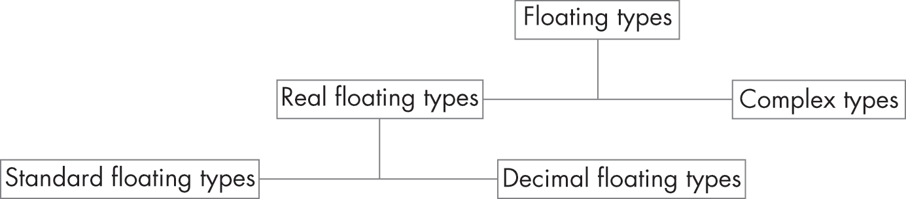

<samp class="SANS_Futura_Std_Book_Oblique_I_11">图 2-1：浮点类型的层次结构</samp>

本书未详细介绍复杂类型和进制浮点类型。

## `void`


`void` 类型是一种相当奇特的类型。关键字`void`（单独使用）意味着“不能包含任何值”。例如，你可以用它来表示函数没有返回值，或者作为函数的唯一参数来表示该函数不接受参数。另一方面，派生类型`void *`意味着该指针可以引用*任何*对象。

## Derived Types

`derived types`（派生类型）由其他类型构造。这些包括函数类型、指针类型、数组类型、类型定义、结构体类型和联合体类型——本文涵盖了所有这些内容。

### Function

`function type`（函数类型）根据返回值以及参数的数量和类型派生得出。函数可以返回任何完整的对象类型，数组类型除外。

当你声明一个函数时，使用`function declarator`（函数声明符）来指定函数的名称和返回值。如果声明符包含参数类型列表和定义，则每个参数的声明必须包含一个标识符，但对于类型为`void`的单个参数列表，不需要标识符。

以下是几个函数类型声明：

```
int f(void);
int fprime();
int *fip();
void g(int i, int j);
void h(int, int);
```

首先，我们声明了两个函数`f`和`fprime`，它们不带参数且返回`int`。接下来，我们声明了一个不带参数的函数`fip`，它返回一个指向`int`的指针。最后，我们声明了两个函数`g`和`h`，它们都返回`void`并接受两个`int`类型的参数。

在使用标识符指定参数（如此处对`g`的处理）时，如果标识符是一个宏，可能会出现问题。然而，提供参数名称是代码自文档化的良好实践，因此通常不建议省略标识符（如对`h`的处理）。

在函数声明中，指定参数是可选的。然而，不这样做可能会带来问题。在 C23 之前，`fip`声明了一个接受任意数量、任意类型参数并返回`int *`的函数。在 C++ 中，相同的`fip`函数声明则声明了一个不接受任何参数并返回`int *`的函数。从 C23 开始，带有空参数列表的函数声明符声明的是一个不接受参数的函数原型（就像它在 C++ 中做的那样）。

函数类型也被称为`function prototype`（函数原型）。函数原型告知编译器函数接受的参数数量和类型。编译器使用这些信息来验证在函数定义以及任何对函数的调用中是否使用了正确数量和类型的参数。

`function definition`（函数定义）提供了函数的实际实现。考虑以下函数定义：

```
int max(int a, int b)
{return a > b ? a : b;}
```

返回类型说明符是`int`；函数函数声明符是`max(int a, int b)`；返回值是`int`，函数体是`a > b ? a : b`。函数的规范不得包含任何限定符（参见 Type Qualifiers）。函数体使用了条件运算符（`? :`），这在第 4 章中进行了解释。该表达式表示如果`a`大于`b`，则返回`a`；否则返回`b`。

### Pointer

`pointer type`（指针类型）从被称为`referenced type`（被引用类型）的函数或对象派生。从被引用类型`T`派生的指针被称为`pointer to T`。指针提供对引用类型实体的引用。

以下三个声明定义了指向`int`的指针、指向`char`的指针和指向`void`的指针：

```
int *ip = 0;
char *cp = NULL;
void *vp = nullptr;
```

每个都初始化为空指针常量。空指针常量可以指定为值为`0`的整数表达式、`(void *)`或预定义的常量`nullptr`。`NULL`宏定义在`stddef.h`中。如果将空指针常量转换为指针类型，生成的空指针保证与指向对象的指针不相等。

`nullptr`常量在 C23 中引入，与使用`NULL`具有优势（Gustedt 2022）。表 2-1 显示了`NULL`的常见值及其关联类型。

表 2-1: NULL 的常见值及其关联类型

| 值 | 类型 |
| --- | --- |
| 0 | int |
| 0L | long |
| (void *)0 | void * |

当使用`NULL`参数调用类型泛型宏时，这些不同类型可能会产生意料之外的结果。条件表达式`(true ? 0 : NULL)`总是被定义的，无论`NULL`的类型为何。然而，如果`NULL`的类型为`void *`，则条件表达式`(true ? 1 : NULL)`将违反约束。

将`NULL`作为哨兵值传递给变参函数（例如期望指针的可移植操作系统接口 (POSIX) `execl`函数），这种`NULL`参数可能会产生意想不到的结果。在大多数现代架构上，`int`和`void *`类型的大小不同。如果在这样的架构上`NULL`被定义为 0，那么传递给变参泛的参数大小就是错误的。

在本章较早之前，我介绍了取地址运算符（`&`）和间接引用运算符（`*`）。你使用`&`运算符来获取对象或函数的地址。例如，获取一个`int`对象的地址将得到一个类型为指向`int`指针的地址：

```
int i = 17;
int *ip = &i;
```

第二个声明将变量`ip`声明为指向`int`的指针，并初始化为`i`的地址。你也可以对`*`运算符的结果使用`&`运算符：

```
ip = &*ip;
```

使用`*`运算符对`ip`进行解引用将解析实际对象`i`。使用`&`运算符对`*ip`取地址将获取指针，因此这两个操作相互抵消了。

一元运算符`*`将类型为`T`的指针转换为类型`T`的值。它表示*间接*且仅作用于指针。如果操作数指向一个函数，使用`*`运算符的结果是函数指示符；如果它指向一个对象，结果是指定对象的值。例如，如果操作数是指向`int`的指针，则间接运算符的结果类型为`int`。如果指针没有指向有效对象或函数，则行为是未定义的。

### 数组

*数组*是一组连续分配的对象的序列，所有对象具有相同的元素类型。数组类型的特征是它们的元素类型和数组中的元素数量。在这里，我们声明了一个由`ia`标识的 11 个`int`类型元素的数组，以及一个由`af`标识的 17 个`float`类型元素的数组：

```
int ia[11];
float af[17];
```

你可以使用方括号（`[]`）来标识数组中的元素。例如，以下代码段创建字符串`"0123456789"`，以演示如何给数组赋值：

```
char str[11];
for (unsigned int i = 0; i < 10; ++i) {
  str[i] = '0' + i;
}
str[10] = '\0';
```

第一行`char str[11]`为 11 个字符加上一个空字符分配了存储空间。`for`循环迭代 10 次，`i`的范围从 0 到 9，将`'0' + i`的结果赋值给`str[i]`。循环结束后，将空字符复制到最后一个元素`str[10]`，此时`str`包含了字符串`"0123456789"`。

在表达式`str[i]`中，`str`自动转换为指向第一个成员的指针（指向字符的指针），而`i`是一个无符号整数。下标运算符（`[]`）和加运算符（`+`）的定义使得`str[i]`等同于`*(str + i)`。当`str`是数组对象时（在此处正是如此），`str[i]`指定数组的第`i`个元素（从 0 开始）。因为数组从 0 开始索引，数组`str[11]`的索引范围从 0 到 10，10 是最后一个元素，正如示例的最后一行所示。

如果一元运算符`&`的操作数是`[]`运算符的结果，其结果就像去除了`&`运算符并将`[]`运算符更改为`+`运算符一样。例如，`&str[10]`与`str + 10`：

```
&str[10] → &*(str + 10) → str + 10
```

你也可以声明多维数组。Listing 2-5 在函数`main`中将`arr`声明为`int`类型的 3×5 二维数组，也被称为*矩阵*。

```c
#include <stdlib.h>
void func(int arr[5]);
int main() {
  unsigned int i = 0;
  unsigned int j = 0;
  int arr[3][5];
❶ func(arr[i]);
❷ int x = arr[i][j];
  return EXIT_SUCCESS;
}
```

*Listing 2-5: 矩阵操作*

更确切地说，`arr`是一个包含三个元素的数组，其中每个元素都是一个包含 5 个`int`类型元素的数组。当你使用表达式`arr[i]`❶（等同于`*(arr+i)`）时，会发生以下情况：

1. `arr`被转换为指向从`arr[i]`开始的包含 5 个`int`类型元素的初始数组的指针。

2. `i`通过乘以一个包含 5 个`int`对象的数组的大小来缩放为`arr`的类型。

3. 将步骤 1 和 2 的结果相加。

4. 对和进行间接引用，以产生一个包含 5 个`int`类型元素的数组。

当在表达式`arr[i][j]`❷中时，该数组被转换为指向第一个`int`类型元素的指针，因此`arr[i][j]`产生一个`int`类型的对象。

### 结构体

*结构体类型*（也称为`struct`）包含顺序分配的成员。每个成员都有自己的名称，并可能具有不同的类型——与数组元素不同，数组元素必须是相同类型。结构体类似于其他编程语言中的记录类型。

结构体用于声明相关对象的集合，可以用于表示日期、客户或人员记录等内容。它们对于将经常作为参数传递给函数的对象分组特别有用，这样你就不需要重复地单独传递每个对象。

Listing 2-6 声明了一个名为`sigline`的`struct`，类型为`struct sigrecord`，以及一个名为`sigline_p`的指向`struct sigrecord`的指针。

```c
struct sigrecord {
  int signum;
  char signame[20];
  char sigdesc[100];
} sigline, *sigline_p;
```

*Listing 2-6: 一个 struct sigrecord*

该结构体有三个成员对象：`signum`是`int`类型的对象，`signame`是一个包含 20 个元素的`char`类型数组，`sigdesc`是一个包含 100 个元素的`char`类型数组。

一旦你定义了结构体，你很可能想要引用它的成员。你使用结构体成员运算符（`.`）引用结构体对象的成员。如果你有一个指向结构体的指针，可以使用结构体指针运算符（`->`）引用其成员。[Listing 2-7]展示了每个操作符的使用。

```c
sigline.signum = 5;
strcpy(sigline.signame, "SIGINT");
strcpy(sigline.sigdesc, "Interrupt from keyboard");

❶ sigline_p = &sigline;

sigline_p->signum = 5;
strcpy(sigline_p->signame, "SIGINT");
strcpy(sigline_p->sigdesc, "Interrupt from keyboard");
```

*Listing 2-7: 引用结构体*

[Listing 2-7]的前三行使用点（`.`）直接访问`sigline`对象的成员。我们将`sigline`对象的地址赋值给`sigline_p`指针。在最后三行中，我们通过`sigline_p`指针使用`->`运算符间接访问`sigline`对象的成员。

### 联合体

*联合体类型*类似于结构体，不同之处在于成员使用的内存是重叠的。联合体提供了查看同一块内存的不同方式。

[Listing 2-8]显示了一个包含一个单一`float`类型成员`f`以及一个包含三个`uint32_t`类型位域的`struct`的联合体：`significand`、`exponent`和`sign`。

```c
static_assert(
  (__STDC_IEC_60559_BFP__ >= 202311L || __STDC_IEC_559__ == 1)
  && __STDC_ENDIAN_LITTLE__
);

union {
  float f;
  struct {
    uint32_t significand : 23;
    uint32_t exponent : 8;
    uint32_t sign : 1;
  };
} float_encoding;
```

*Listing 2-8: 使用联合体分解浮点数*

这使得（底层）C 程序员可以使用整个浮点值，并检查（并可能修改）它的组成部分。该联合体不是可移植的，因为实现可能会使用不同的浮点表示或字节序。`static_assert`测试用于确保此联合体与实现匹配。

[Listing 2-9]显示了一个`struct n`，它包含一个成员`type`和一个联合体`u`，后者本身包含四个成员：`inode`、`fnode`、`dnode`和`ldnode`。

```c
enum node_type {
  integer_type,
  float_type,
  double_float_type,
  long_double_type
};

struct node {
  enum node_type type;
  union {
    int inode;
    float fnode;
    double dnode;
    long double ldnode;
  } u;
} n;

n.type = double_type;
n.u.dnode = 3.14;
```

列表 2-9：使用联合体节省内存

该结构可能用于树、图或其他包含不同类型节点的数据结构。`type`成员可能包含一个 0 到 3 之间的值，用于表示存储在结构中的值的类型。它直接声明在`struct n`中，因为它是所有节点共有的。

与结构体一样，你可以通过`.`运算符访问联合体成员。使用联合体的指针，你可以通过`->`运算符引用其成员。在[列表 2-9]中，`dnode`成员被引用为`n.u.dnode`。使用此联合体的代码通常会通过检查存储在`n.type`中的值来检查节点类型，然后根据`n.type`存储的值使用`n.u.inode`、`n.u.fnode`、`n.u.dnode`或`n.u.ldnode`来访问值。如果没有联合体，每个节点将为所有种数据类型单独存储。使用联合体允许所有联合体成员共用相同的存储。在 x86-64 GCC 13.2 版本编译器上，使用联合体每个节点节省了 16 字节。

联合体通常用于描述网络或设备协议，特别是在你事先不知道将使用哪种协议的情况下。

## 标签 (Tags)

标签是结构、联合体和枚举的特殊命名机制。例如，以下结构中的标识符`s`就是一个标签：

```c
struct s {
  // --snip--
};
```

标签本身不是类型名，不能用于声明变量（Saks 2002）。相反，你必须如下声明该类型的变量：

```c
struct s v;   // struct s 的实例
struct s *p;  // 指向 struct s 的指针
```

联合体和枚举的名称也是标签而非类型，这意味着它们不能单独用于声明变量。例如：

```c
enum day {sun, mon, tue, wed, thu, fri, sat};
day today;  // 错误
enum day tomorrow;  // OK
```

结构、联合体和枚举的标签定义在与普通标识符不同的命名空间中。这允许 C 程序在同一作用域内拥有拼写相同的标签和另一个标识符：

```c
enum status {ok, fail};    // 枚举
enum status status(void);  // 函数
```

你甚至可以声明一个类型为`struct s`的对象`s`：

```c
struct s s;
```

这可能不是良好的做法，但它是有效的 C 代码。你可以将`struct`标签视为类型名，并通过`typedef`为标签定义别名。这是一个示例：


```c
typedef struct s {int x;} t;
```

这现在允许你声明类型为`t`的变量而不是`struct s`。`struct`、`union`和`enum`中的标签名是可选的，所以你可以直接省略它：

```c
typedef struct {int x;} t;
```

这在包含自身的自引用结构情况下不起作用：

```c
typedef struct {
  int x;
  struct t *next;
} t;
```

使用`const`修饰符声明的对象（`const`-修饰类型）是不可赋值的，但可以具有常量初始化器。这意味着编译器可以将具有`const`-修饰类型的对象放置在只读内存中，任何对它们的写入尝试都将导致运行时错误：

```c
const int i = 1; // const-qualified int
i = 2; // error: i is const-qualified
```

你可能会无意中让编译器为了你修改一个`const`-修饰的对象。在下面的示例中，我们获取了`const`-修饰对象`i`的地址，并告诉编译器它实际上上是一个指向`int`的指针：

```c
const int i = 1;  // object of const-qualified type
int *ip = (int *)&i;
*ip = 2;  // undefined behavior
```

如果原始对象被声明为`const`-修饰对象，C语言不允许你去掉`const`属性。这段代码看起来可能有效，但它是有缺陷的，并且可能在之后失败。例如，编译器可能会将`const`-修饰的对象放置在只读内存中，导致在运行时尝试向对象存储值时发生内存故障。

只要原始对象没有声明为`const`，C语言允许你通过去掉`const`来修改被`const`-修饰指针引用的对象：

```c
int i = 12;
const int j = 12;
const int *ip = &i;
const int *jp = &j;
*(int *)ip = 42; // OK
*(int *)jp = 42; // undefined behavior
```

小心不要将`const`-修饰的指针传递给会修改对象的函数。

### volatile

对象被赋予`volatile`-修饰类型是为了允许编译器外部的进程进行操作。这些对象中存储的值可能会在编译器不知情的情况下改变，或者写入可能会在外部进行同步。例如，每当从实时时钟读取值时，它都可能变化，即使C程序没有写入过该值。使用`volatile`-修饰类型可以让编译器知道值可能会变化，并确保每次访问都会发生。否则，对值的访问可能会被优化掉或被缓存值替换。

`volatile`-修饰类型可以用于访问内存映射寄存器，这些寄存器的访问方式与任何其他内存一样。输入/输出（I/O）设备通常具有内存映射寄存器，你可以对其进行写入或读取。将对象声明为`volatile`确保了每次读取和写入的次数与源代码所示的次数相同。例如，如果`port`被定义为`volatile int`，编译器将不会消除：

```c
port;
```

即使编译器认为`volatile`操作是无用的，它也无法消除该操作。`volatile`-修饰类型用于线程之间的同步。与其他语言不同，`volatile`不应被用于同步。

### restrict

`restrict`-修饰的指针用于促进优化。由于潜在的别名（`aliasing`），通过指针访问的对象经常无法被完全优化，别名发生在当多个指针指向同一个对象时。别名会抑制优化，因为编译器无法判断当另一个不相关的对象被修改时，某个对象是否会发生变化。

下面的函数从`q`引用的存储器中拷贝`n`字节到`p`引用的存储器中。函数参数`p`和`q`都是`restrict`-修饰的指针：

```c
void f(unsigned int n, int * restrict p, int * restrict q) {
  while (n-- > 0) {
    *p++ = *q++;
  }
}
```

由于`p`和`q`都是`restrict`-修饰的指针，编译器可以假设通过其中一个指针参数访问的对象不会通过另一个指针进行访问。编译器可以仅根据参数声明做出此项评估，而无需分析函数体。

虽然使用`restrict`限定的指针可以产生更高效的代码，但你必须确保指针不指向重叠内存，以防止未定义行为。

## 作用域

对象、函数、宏和其他C语言标识符具有`scope`，它限制了它们可以被访问的连续区域。C语言有四种类型的作用域：文件、块、函数原型和函数。

对象或函数标识符的作用域取决于其声明的位置。如果声明在任何块或参数列表之外，该标识符具有`文件作用域`（`file scope`），意味着其作用域是其所在的整个文本文件以及任何包含的文件。

如果声明出现在块内部或参数列表中，它具有`块作用域`（`block scope`），这意味着该标识符只能在块内部访问。列表2-4中的`a`和`b`标识符具有块作用域，且只能在定义它们的`main`函数代码块内部被引用。

如果声明出现在函数原型（不是函数定义的一部分）的参数声明列表中，该标识符具有`函数原型作用域`（`function prototype scope`），该作用域在函数声明符的结束处终止。`函数作用域`（`function scope`）是函数定义起始括号`{`和结束括号`}`之间的区域。标签名是唯一具有函数作用域的标识符类型。`标签`（`Labels`）是带有冒号的标识符，用于标识同一函数中可以转移控制权的语句。（第5章介绍了标签和控制转移。）

作用域也可以是`嵌套`的，分为内部和外部作用域。例如，你可以在一个块作用域内部定义另一个块作用域，并且每个块作用域都定义文件作用域内。内部作用域可以访问外部作用域，但反之则不然。正如名称所示，任何内部作用域必须完全包含在包含它的任何外部作用域内。

如果你在内部作用域和外部作用域中声明了相同的标识符，则外部作用域声明的标识符会被内部作用域声明的标识符`隐藏`（`hidden`，也称为遮蔽）。引用内部作用域的标识符将引用内部作用域中的对象；外部作用域的对象被隐藏，无法通过其名称引用。防止这种现象变成问题的最简单方法是使用不同的名称。列表2-10展示了不同的作用域以及内部作用域中声明的标识符如何隐藏外部作用域中声明的标识符。

```c
int j;  // j 的文件作用域开始

void f(int i) {         // i 的块作用域开始
  int j = 1;            // j 的块作用域开始；隐藏了文件作用域的 j
  i++;                  // i 指向函数参数
  for (int i = 0; i < 2; i++) {  // 循环局部 i 的块作用域开始
    int j = 2;          // 内部 j 的块作用域开始；隐藏了外部 j
    printf("%d\n", j);  //  j 在作用域内，打印 2
  }                     // 内部 i 和 j 的块作用域结束
  printf("%d\n", j);    // 外部 j 在作用域内，打印 1
}  // i 和 j 的块作用域结束

void g(int j);          // j 函数原型作用域；隐藏了文件作用域的 j
```

列表2-10：内部作用域中声明的标识符隐藏了外部作用域中声明的标识符

只要注释准确描述了你的意图，这段代码没有问题。然而，为不同的标识符使用不同的名称会更好，以避免引起混淆导致错误。对于小作用域的标识符，使用如`i`和`j`这样的短名称是可以的。大作用域中的标识符应该具有较长的描述性名称，不容易在嵌套作用域中被隐藏。某些编译器会对隐藏的标识符发出警告。

## 存储生存期

对象具有决定其生存期的存储生存期。有四种存储生存期：自动、静态、线程和分配。你已经看到在块内或作为函数参数声明的对象具有自动存储生存期。这些对象的生命周期从声明它们的块开始执行开始在块执行完成时结束。如果递归进入块，每次进入块时都会创建一个新对象，每个对象都有自己的存储。

> 注意

> 作用域和生命周期是完全不同的概念。作用域适用于标识符，而生命周期适用于对象。标识符的作用域是可以通过名称访问该标识符所指对象的代码区域。对象的生命周期是对象存在期间。

在文件作用域中声明的对象具有`static`存储。这些对象的生命周期是整个执行过程，并在程序启动前初始化。`Thread`存储生存期用于并发编程，本书未涵盖此。`Allocated`存储生存期涉及动态内存，将在第6章中讨论。正如下一节所述，存储类说明符可以影响存储生存期。

## 存储类

你可以使用存储类说明符指定对象的存储类。对于C23，这些包括`auto`、`constexpr`、`extern`、`register`、`static`、`thread_`和`typedef`。`constexpr`存储类说明符是C23新引入的，而`auto`存储类说明符发生了变化。

存储类说明符指定标识符的各种属性和声明特性：

* 存储生存期：块作用域内的`static`，`thread_local`、`auto`和`register`

* 链接：文件作用域内的`extern`、`static`和`constexpr`

* 值：`constexpr`

* 类型：`typedef`

除少数例外外，每个声明只允许一个存储类说明符。例如，`auto`可以与除`typedef`以外的所有说明符一起出现。

### static

`static`存储类说明符用于指定存储生存期和链接。

指定为`static`或`constexpr`的文件作用域标识符，或者指定为静态的函数，具有`internal`链接。

你也可以使用存储类限定符`static`声明具有块作用域的变量具有静态存储生存期，如Listing 2-11中的计数示例所示。这些对象在函数退出后依然存在。

```c
#include <stdio.h>
#include <stdlib.h>

void increment(void) {
  static unsigned int counter = 0;
  counter++;
  printf("%d ", counter);
}

int main() {
  for (int i = 0; i < 5; i++) {
    increment();
  }
  return EXIT_SUCCESS;
}
```

Listing 2-11：一个计数示例

该程序输出`1 2 3 4 5`。静态变量`counter`在程序启动时初始化为0，并在每次调用`increment`函数时加1。`counter`的生命周期是整个程序的执行过程，它在整个生命周期内将保留其最后存储的值。你可以通过在文件作用域声明`counter`来实现相同的行为。然而，尽可能限制对象的作用域是一项良好的软件工程实践。

### extern

`extern`限定符指定了静态存储生存期和外部链接。它可以用于文件作用域和块作用域中的函数和对象声明（但不能用于函数参数列表）。如果在对一个已经声明为内部链接的标识符进行重新声明时指定`extern`，则链接仍保持内部链接。否则（如果之前的声明是外部链接、无链接、或不在作用域内），则链接为外部链接。

### thread_local

使用`thread_local`存储类限定符声明标识符的对象具有`thread storage duration`。它的初始化器在程序执行之前进行求值，其生命周期是创建它的线程的整个执行过程，其存储值在线程启动时使用之前确定的值进行初始化。每个线程都有一个独立的对象，在表达式中使用声明的名称是指与评估表达式的线程相关的对象。（线程主题超出了本书的范围。）

### constexpr

使用`constexpr`存储类限定符声明的标量对象是一个常量，其值在翻译时永久固定。`constexpr`存储类限定符可以与`auto`、`register`或`static`一起出现。如果尚未存在，则对象的类型会隐式添加`const`限定。结果对象在运行时无法以任何方式修改。编译器可以在任何其他常量表达式中使用此值。

此外，用于此类常量初始化器的常量表达式会在编译时检查。在C23引入`constexpr`之前，可以这样声明一个很大的对象常量：

```c
static size_t const BFO = 0x100000000;
```

初始化器可能可能不放入`size_t`；不需要诊断信息。在C23中，可以使用`constexpr`如下声明相同的对象：

```c
constexpr size_t BFO = 0x100000000;
```

现在，对于宽度为32或更小的实现，需要诊断信息。

静态对象必须用常量值初始化而不能使用变量：

```c
int *func(int i) {
  const int j = i; // ok
  static int k = j; // error
  return &k;
}
```

初始化器中允许算术常量表达式。常量值是字面量常量（例如`1`、`'a'`或`0xFF`）、`enum`成员、使用`constexpr`存储类限定符声明的标量对象，以及运算符`alignof`或`sizeof`的结果（前提操作数没有变长数组）。遗憾的是，`const`限定的对象不是常量值。从C23开始，实现可能会接受其他形式的常量表达式；它们是否为整数常量取决于实现定义。

### register

`register`存储类限定符建议对对象的访问尽可能快。此类建议的有效程度取决于实现定义。通常，编译器可以对寄存器分配做出更好的决策并忽略这些程序员的建议。`register`存储类只能用于从不获取其地址的对象。编译器可以将任何`register`声明简单地视为`auto`声明。然而，无论是否使用了可寻址存储，对于使用存储类限定符`register`声明的对象的任何部分的地址都无法计算，无论是通过使用一元运算符`&`显式计算，还是通过将数组名转换为指针隐式计算。

### typedef

`typedef`存储类限定符将一个标识符定义为`typedef`名称，该名称表示为标识符指定的类型。`typedef`存储类限定符在之前的“类型定义”框中讨论过。

### auto

在C23之前，`auto`限定符仅允许用于在块作用域的对象（函数参数列表除外）。它表示自动存储生存期且无链接，这是此类声明的默认值。

C23通过扩展现有`auto`存储类限定符的定义，为C语言引入了类型推导。在C23之前，在C中声明变量需要用户指定类型。然而，当声明包含初始化器时，类型可以直接从用于初始化变量的表达式类型中推导出。这自2011年以来一直是C++的特性。

`auto`存储持续类限定符的行为与C++类似，它允许从赋值值的类型中推导出类型。例如，以下文件作用域定义：

```c
static auto a = 3;
auto p = &a;
```

由于整数字面量`3`具有隐式类型`int`，这些声明被解释为如下写法：

```c
static int a = 3;
int * p = &a;
```

实际上，`a`是一个`int`，而`p`是一个`int *`。在实现或调用类型泛型宏时，类型推导非常有用，正如我们在第9章中所所示。

## typeof 运算符

C23引入了`typeof`运算符`typeof`和`typeof_unqual`。`typeof`运算符可以作用于表达式或类型名，并产生操作数的类型。如果操作数的类型是可变修改类型，则会对操作数求值；否则不会。

`typeof`运算符和`auto`存储持续类限定符都执行自动类型推导。它们都可以用于确定表达式的类型。

`auto`限定符通常用于声明已初始化的变量，其类型可以从初始值推导出。然而，为了形成派生类型，你必须使用`typeof`运算符：

```c
_Atomic(typeof(x)*) apx = &x;
```

`auto`存储持续类限定符不能与`_Generic`（在第9章）和`typedef`（在本章稍后描述）一起使用。

`typeof_unqual`运算符的结果是`typeof`运算符类型的非原子、无限定符版本。`typeof`运算符保留了所有限定符。

`typeof`运算符类似于`sizeof`运算符，它在非求值环境中执行表达式以理解最终类型。你可以在任何可以使用类型名的地方使用`typeof`运算符。以下示例说明了两个`typeof`运算符的使用：

```c
#include <stdlib.h>
const _Atomic int asi = 0;
const int si = 1;
const char* const beatles[] = {
    "John",
    "Paul",
    "George",
    "Ringo"
};

typeof_unqual(si) main() {
  typeof_unqual(asi) plain_si;
  typeof(_Atomic typeof(si)) atomic_si;
  typeof(beatles) beatles_array;
  typeof_unqual(beatles) beatles2_array;
    return EXIT_SUCCESS;
}
```

在第一次使用`typeof_unqual`运算符时，操作数是`si`，其类型为`const int`。`typeof_unqual`运算符剥除了`const`限定符，结果为`int`。这种用法具有说明性。

在`typeof_unqual(asi)`Case中，操作数是`asi`，其类型为`const _Atomic int`。`typeof_unqual`运算符剥除了`const`限定符，结果为`_Atomic int`。


在`typeof(_Atomic typeof(si))` Case 中，`typeof` 运算符对`si`进行求值，其结果为`const int`。然后`_Atomic` 限定符将其变为`_Atomic int`。

在`typeof(beatles)` Case 中，操作数是`beatles`，它是一个`const char* const[]`。`typeof` 限定符返回`const char* const[]`。

在`typeof_unqual(beatles)` Case 中，`typeof_unqual` 运算符剥除了`const` 限定符并返回一个`const char*` 数组。在这种情况下，限定符仅从数组中移除，而不从数组包含的元素类型中移除。

以下`main` 函数等效，但没有使用`typeof` 运算符：

```c
int main() {
  int plain_si;
  const _Atomic int atomic_si;
  const char* const beatles_array[4];
  const char* beatles2_array[4];
  return EXIT_SUCCESS;
}
```

你可以使用`typeof` 运算符引用宏参数，以便构建具有所需类型的对象，而无需在宏参数中显式指定类型名。

## 对齐

对象类型具有对齐要求，这限制了该类型对象可以分配的地址。*对齐*（alignment）表示分配给定对象时连续地址之间的字节数。中央处理器（CPU）在访问对齐数据（例如，数据地址是数据大小的倍数）与未对齐数据时，可能有不同的行为。

某些机器指令可以在非字边界上执行多字节访问，但会产生性能开销。`word`（字）是指令集或处理器硬件处理的天然的、固定大小的数据单元。某些平台无法访问未对齐的内存。对齐要求可能取决于 CPU 的字大小（通常为 16、32 或 64 位）。

通常情况下，C 程序员不需要担心对齐要求，因为编译器会为各种类型选择适当的对齐方式。然而，在少数情况下，你可能需要覆盖编译器的默认选择——例如，为了将数据对齐到内存缓存行的边界上（这些边界必须从 2 的幂地址边界开始），或者为了满足其他特定的系统要求。传统上，这些要求是通过链接器命令或涉及其他非标准设施的操作来实现。

C11 引入了一种简单的、向前兼容的机制来指定对齐。对齐表示为`size_t`类型的值。每个有效的对齐值都是非负整数 2 的幂次。对象类型会对该类型的每个对象施加默认对齐要求：可以使用对齐说明符（`alignas`）请求更严格的对齐（更大的 2 的幂次）。你可以在声明中包含对齐说明符。列表 2-12 使用对齐说明符确保`good_buff` 被正确对齐（`bad_buff` 在成员访问表达式中可能有不正确的对齐）。

```
struct S {
  double d; int i; char c;
};

int main() {
  unsigned char bad_buff[sizeof(struct S)];
  alignas(struct S) unsigned char good_buff[sizeof(struct S)];
  struct S *bad_s_ptr = (struct S *)bad_buff;
  struct S *good_s_ptr = (struct S *)good_buff; // 正确对齐
  good_s_ptr->i = 12;
  return good_s_ptr->i;
}
```

列表 2-12：使用`alignas` 关键字

尽管`good_buff` 通过`struct S` 类型的左值访问具有正确的对齐，但此程序仍然存在未定义行为。这种未定义行为源于底层对象`good_buff` 被声明为`unsigned char` 类型对象的数组，但通过一个不同类型的左值进行访问。转换为`(struct S *)` 像任何指针转换一样，并没有改变为每个数组分配存储的有效类型。由于使用字符类型区域进行底层存储管理是一项惯例，我与他人合写了一篇论文，使此类代码在未来的 C 标准修订中符合规范（Seacord et al. 2024）。

对齐按从弱到强（也称为*更严格*）的顺序进行排序。更严格的对齐具有更大的对齐值。满足对齐要求的地址也满足任何有效的、较弱的对齐要求。

动态分配内存的对齐请见第 6 章。

## 可变修改类型

可变修改类型（VMTs）定义了一个基类型和一个范围（元素数量），该范围在运行时确定。VMT 是 C23 的一项强制性特性。

VMT 可以用作函数参数。记得本章前面的内容，当数组在表达式中使用时，它会转换为指向数组第一个元素的指针。这意味着我们必须添加一个显式参数来指定数组的大小——例如`memset` 签名中的`n` 参数：

```
void *memset(void *s, int c, size_t n);
```

当你调用此类函数时，`n` 应该准确表示`s` 所引用数组的大小。如果此大小大于数组，则会导致未定义行为。

在声明一个带有指定大小数组参数的函数时，我们必须在数组声明中引用大小之前先声明数组的大小。例如，我们可以如下修改`memset` 函数的签名，以接收元素数量`n` 和一个至少包含`n` 个元素的数组：

```
void *memset_vmt(size_t n, char s[n], int c);
```

对于字符类型数组，元素数量等于其大小。在这个函数签名中，`s[n]` 是一个可变修改类型，因为`s[n]` 取决于`n` 的运行时值。

我们更改了参数的顺序，使得大小参数`n` 在我们在数组声明中使用之前已经声明。数组参数`s` 被调整为指针，并且由于该声明没有分配存储（指针本身除外）。调用此函数时，你必须为`s` 引用的数组声明实际存储，并确保`n` 是其有效大小。与非 VMT 参数一样，实际数组可以是固定大小数组、变长数组（在第 6 章 中介绍）或动态分配的存储。

VMT 可以泛化你的函数，使其更有用。例如，`matrix_sum` 函数求二维数组中的所有值。该函数的以下版本接受一个固定列宽的矩阵：

```
int matrix_sum(size_t rows, int m[][4]);
```

当将多维数组传递给函数时，数组初始维度（行）的元素数量会丢失，需要作为参数传递。在本示例中，`rows` 参数提供了这一信息。你可以调用此函数来求任何恰好有四列矩阵的值，如列表 2-13 所示。

```
int main(void) {
  int m1[5][4];
  int m2[100][4];
  int m3[2][4];
  printf("%d.\n", matrix_sum(5, m1));
  printf("%d.\n", matrix_sum(100, m2));
  printf("%d.\n", matrix_sum(2, m3));
}
```

列表 2-13：求四列矩阵的和

在需要求一个不是四列的矩阵的值之前，这都是没问题的。例如，将`m3` 改为五列将产生如下警告：

```
warning: 将 'int [2][5]' 传递给类型为 'int (*)[4]' 的参数类型不兼容
```

为了接受此参数，你必须编写一个签名匹配多维数组新维度的新函数。那么，这种方法的问题在于它无法进行充分的泛化。

与其这样做，我们可以重写`matrix_sum` 函数以使用 VMT，如列表 2-14 所示。这一更改允许我们对任何维度的矩阵调用`matrix_sum`。

```
int matrix_sum(size_t rows, size_t cols, int m[rows][cols]) {
  int total = 0;

  for (size_t r = 0; r < rows; r++)
    for (size_t c = 0; c < cols; c++)
      total += ❶ m[r][c];
  return total;
}
```

列表 2-14：将 VMT 作为函数参数*

编译器执行矩阵索引 ❶。如果没有 VMT，这需要手动索引或双重间接访问，而这两者都容易出错。

同样，函数声明或函数定义均未分配存储空间。与非 VMT 参数一样，你需要单独为矩阵分配存储空间，且它的维度必须与传递给函数的`rows` 和`cols` 参数的维度相匹配。未能这样做可能会导致未定义行为。

## 属性

从 C23 开始，你可以使用属性将额外信息与声明、语句或类型关联。这些信息可以被实现用于改进诊断、提高性能或以其他方式修改程序的行为。在双方括号内指定一个由零个或多个属性组成的逗号分隔列表，例如，`[[foo]]` 或`[[foo, bar]]`。

声明属性有两种指定方式。如果属性限定符位于声明的开头，则属性将应用于该声明组中的所有声明。否则，属性将应用于属性限定符左侧的声明。例如，在接的声明组中，`foo` 属性被应用于`x`、`y` 和`z`：

```
[[foo]] int x, y, *z;
```

而在第二个声明组中，`foo` 和`bar` 属性仅应用于`b`：

```
int a, b [[foo, bar]], *c;
```

C23 定义了多种适用于声明的属性，例如`nodiscard` 和`deprecated`。`nodiscard` 属性用于函数声明，表示期望函数的返回值应该在表达式或初始化器中使用。`deprecated` 属性用于函数或类型的声明，表示对该函数或类型的使用应被诊断为不建议。

除了标准属性，实现还可以提供不可移植的属性。此类属性同样位于双方括号内，但它们包含了厂商前缀，以区分不同厂商的属性。例如，`[[clang::overloadable]]` 属性用于函数声明，指定可以在 C 中使用 C++ 风格的函数重载；而`[[gnu::packed]]` 属性用于结构体声明，指定结构体的成员声明应尽可能避免使用填充，以实现更节省空间的布局。厂商通常使用自己的前缀，并且他们可以使用他们选择的任何前缀。例如，Clang 使用`gnu` 前缀实现了许多属性，以提高与 GCC 的兼容性。你的编译器应该忽略未知属性，尽管它们可能仍会被诊断，以便让你知道该属性没有影响。请参阅你的编译器文档获取支持属性的完整列表。

### 总结

在本章中，你学习了两种算术类型：整数和浮点数。你学习了对象和函数以及它们的区别。我们将在后面的章节中回到这些类型，探索如何最好使用它们。

`representable value`（可表示值）是指可以使用特定类型对象所提供的位数来表示的值。无法表示的值将由编译器诊断，或转换为一个可表示但不同（且错误）的值。`limits.h` 头文件定义了类对象的宏，这些宏会展开为标准整数类型的各种限制和参数。为了编写可移植性代码，你应该使用这些宏，而不是使用整数字面量（例如`2147483647`，可作为 32 位整数表示的最大值），因为这些字面量表示特定的限制，并且在迁移到不同的实现时可能会发生变化。

C 标准对整数大小仅施加了三个限制。首先，*每个*数据类型的存储空间都占用相邻`unsigned char` 对象的整数倍数（可能包含填充位）。其次，每个整数类型必须支持最小值范围，以便你能够依赖于跨任何实现的可移植值范围。第三，较小类型的宽度不能大于较大类型的宽度。例如，`short` 的宽度不能大于`int`，但这两种类型的宽度可能相同。

### 整数声明

除非声明为`unsigned`，否则整数类型被假设是有符号的（`char` 除外，实现可以将其定义为有符号或无符号整数类型）。以下是无符号整数的有效声明：

```
unsigned int ui; // 必须 unsigned
unsigned u; // 可以省略 int
unsigned long long ull2; // 可以省略 int
unsigned char uc; // 必须 unsigned
```

在声明有符号整数类型时，你可以省略`signed` 关键字——`signed char` 除外，它需要该关键字来区分`signed char` 和普通`char`。

在声明类型为`short`、`long` 或`long long` 的变量时，你也可以省略`int`。例如：

```
int i; // 可以省略 signed
long long int sll; // 可以省略 signed
long long sll2; // signed 和 int 都可以省略
signed char sc; // 必须使用 signed
```

这些都是有效的有符号整数声明。

### 无符号整数

`Unsigned integers`（无符号整数）的范围从 0 开始，其上限大于对应的有符号整数类型。无符号整数经常用于计数可能具有大量非负数量的项目。

#### 表示

无符号整数类型比有符号整数类型更容易理解和使用。它们使用不带偏移的纯二进制系统来表示值：最低有效位的权重为 2⁰，下一个有效位的权重为 2¹，依此类推。二进制数的值是所有置位位权重之和。[表 3-1] 显示了某些使用未填充的 8 位表示法的无符号值示例。

**表 3-1: 8 位无符号值**

| 十进制 | 二进制 | 十六进制 |
| --- | --- | --- |
| `0` | `0b00000000` | `0x00` |
| `1` | `0b00000001` | `0x01` |
| `42` | `0b00101010` | `0x2A` |
| `255` | `0b11111111` | `0xFF` |

无符号整数类型没有符号位，允许其精度比有符号整数类型高出 1 字节。无符号整数值的范围从 0 到取决于类型宽度的最大值。该最大值为 2^N – 1，其中`N` 是宽度。例如，大多数 x86 架构使用无填充的 32 位整数，因此类型为`unsigned int` 的对象范围是 0 到 2³² – 1 (4294967295)。来自 limits.h` 中的常量表达式`UINT_MAX` 规定了该类型由实现定义的上限。[表 3-2] 显示了`limits.h` 中每个无符号类型的常量表达式以及标准要求的最小幅值。

**表 3-2: 无符号整数幅度**

| 常量表达式 | 最小幅度 | 类型对象的最大值 |
| --- | --- | --- |
| `UCHAR_MAX` | `255 // 8` – 1 | `unsigned char` |
| `USHRT_MAX` | `65535 // 16` – 1 | `unsigned short int` |
| `UINT_MAX` | `65535 // 16` – 1 | `unsigned int` |
| `ULONG_MAX` | `4294967295 // 32` – 1 | `unsigned long int` |
| `ULLONG_MAX` | `18446744073709551615 // 64` – 1 | `unsigned long long int` |

你的编译器会将这些值替换为实现定义的幅度。

#### 回绕 (Wraparound)

C23 将`wraparound`（回绕）定义为“值对`2*^N*` 取模的过程，其中`N` 是结果类型的宽度”。当你执行的算术运算导致得出的值太小（小于 0）或太大（大于`2*^N* – 1`），而无法用特定的无符号整数类型表示时，就会发生回绕。在这种情况下，该值将对结果类型可表示的最大值加 1 的数值取模。回绕是 C 语言中一种定义良好的行为。它是否是你代码中的缺陷取决于上下文。如果你正在计算某些计数且值发生了回绕，这可能是一个错误。然而，在某些算法中使用回绕是有刻意的。

列表 3-1 中的代码通过将无符号整数值`ui` 初始化为其最大值并递增来说明了回绕。

```
unsigned int ui = UINT_MAX;  // x86 上为 4,294,967,295
ui++;
printf("ui = %u\n", ui); // ui is 0
ui--;
printf("ui = %u\n", ui); // ui is 4,294,967,295
```

列表 3-1：无符号整数回绕

结果值无法表示为`unsigned int`，因此它回绕到 0。如果结果值被减小，它将再次超出范围，并回绕回`UINT_MAX`。

由于回绕的存在，无符号整数表达式的评估永远不会小于 0。人们很容易忘记这一点，并实现始终为真或始终为假的比较。例如，以下`for` 循环中的`i` 永远不会取负值，因此该循环永远不会结束：

```
for (unsigned int i = n; i >= 0; --i)
```

这种行为导致了一些臭名目的现实世界漏洞。例如，波音 787 上的所有六个发电系统都由相应的发电机控制单元管理。波音的实验室测试发现，发电机控制单元中的内部软件计数器在连续运行 248 天后会发生回绕（参见联邦航空管理局的规则：`https://www.federalregister.gov/documents/2015/05/01/2015-10066/airworthiness-directives-the-boeing-company-airplanes`）。该缺陷导致安装在发电机上的所有六个发电机控制单元同时进入故障模式。

为了避免意外行为（例如让你的飞机从天上掉下来），使用`limits.h` 中的限制来检查回绕非常重要。在实现这些检查时要小心，因为很容易出错。例如，以下代码包含一个缺陷，因为`sum + ui` 永远不会大于`UINT_MAX`：

```
extern unsigned int ui, sum;
// 给 ui 和 sum 赋值
if (sum + ui > UINT_MAX)
  too_big();
else
  sum = sum + ui;
```

如果`sum` 和`ui` 相加的结果大于`UINT_MAX`，它将对`UINT_MAX + 1` 取模。因此，该测试是用的，生成的代码将无条件地执行加法。高质量的编译器可能会对此发出警告，但并非所有编译器都这样做。为了解决这个问题，你可以从不等式的两边减去`sum`，形成以下有效的测试：


```
extern unsigned int ui, sum;
// 给 ui 和 sum 赋值
if (sum > UINT_MAX - sum)
  too_big();
else
  sum = sum + ui;
```

`UINT_MAX` 宏是可表示的最大 `unsigned int`，其范围在 0 到 `UINT_MAX` 之间。由于无符号值永远不会为负数，当在检查算术运算结果与 0 的比较时，会出现同样的问题：

```
extern unsigned int i, j;
// 给 i 和 j 赋值
if (i - j < 0)  // 不可能
  negative();
else
  i - j;
```

与其使用这种无用的测试，不如通过测试 `j` 是否大于 `i` 来检查回绕：

```
if (j > i)  // 正确
  negative();
else
  i - j;
```

如果 `j > i`，差值将回绕，从而防止了回绕的可能性。通过从测试中消除减法，回绕的可能性也被消除了。

## 有符号整数

每个无符号整数类型（`bool` 除外）都有一个占据相同存储空间的有符号整数类型。使用有符号整数来表示负、零和正值，其范围取决于分配给该类型的位数和表示法。

### 表示法

表示有符号整数类型比表示无符号整数类型复杂。从历史上看，C 语言支持过三种表示负数的方案：符号位值法、反码和补码。

从 C23 开始，仅支持补码表示。本书的其余部分假设使用补码表示。

宽度为 `N` 的带符号补码整数类型可以表示 –2^(N–1) 到 2^(N–1)–1 范围内的任何整数值。这意味着，例如，类型 `signed char` 的 8 位值范围是 –128 到 127。与其他带符号整数表示法相比，补码可以多表示一个*最负*的值。8 位 `signed char` 的最负值为 –128，而其绝对值 |–128| 无法用该类型表示。这导致了某些有趣的边界情况，我们很快将对其进行详细检查。

表 3-3 显示了每个带符号类型来自 `limits.h` 的常量表达式，以及标准要求的最小幅值。你的编译器将用这些值替换为实现定义的幅值。

### 表 3-3：带符号整数最小幅值

| 常量表达式 | 最小幅值 | 类型 |
| --- | --- | --- |
| `SCHAR_MIN` | –128 // –2⁷ | `signed char` |
| `SCHAR_MAX` | +127 // 2⁷ – 1 | `signed char` |
| `SHRT_MIN` | –32,768 // –2¹⁵ | `short int` |
| `SHRT_MAX` | +32,767 // 2¹⁵ – 1 | `short int` |
| `INT_MIN` | –32,768 // –2¹⁵ | `int` |
| `INT_MAX` | +32,767 // 2¹⁵ – 1 | `int` |
| `LONG_MIN` | –2,147,483,648 // –2³¹ | `long int` |
| `LONG_MAX` | +2,147,483,647 // 2³¹ – 1 | `long int` |
| `LLONG_MIN` | –9,223,372,036,854,775,808 // –2⁶³ | `long long int` |
| `LLONG_MAX` | +9,223,372,036,854,775,807 // 2⁶³ – 1 | `long long int` |

要对补码表示中的值取反，只需翻转每个填充位并加 1（根据需要处理进位），如图 3-1 所示。

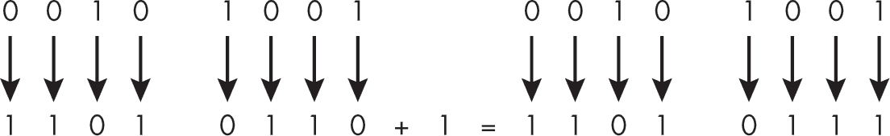

表 3-4 显示了无填充（即 `N = 8`）的 8 位带符号补码整数类型的二进制和十进制表示。

### 表 3-4：8 位补码值

| 二进制 | 十进制 | 权重 | 常量 |
| --- | --- | --- | --- |
| 00000000 | 0 | 0 |  |
| 00000001 | 1 | 2⁰ |  |
| 01111110 | 126 | 2⁶ + 2⁵ + 2⁴ + 2³ + 2² + 2¹ |  |
| 01111111 | 127 | 2⁷ + 2⁶ + 2⁵ + 2⁴ + 2³ + 2² + 2¹ + 2⁰ | `SCHAR_MAX` |
| 10000000 | –128 | –2⁷ | `SCHAR_MIN` |
| 10000001 | –127 | –2⁷ + 2⁰ |  |
| 11111110 | –2 | –2⁷ + 2⁶ + 2⁵ + 2⁴ + 2³ + 2² + 2¹ |  |
| 11111111 | −1 | −(28 − 1) + 127 |  |

虽然不需要知道数字的二进制表示，但作为一名 C 程序员，你可能会发现它很有用。

### 整数溢出

当符号整数操作产生的结果在结果类型中无法表示时，就会发生`Integer overflow`。符号整数溢出和无符号整数回绕（wraparound）经常被混淆。主要的区别在于，符号整数溢出是未定义行为（undefined behavior），而无符号整数回绕是有定义的。无符号整数不会溢出。

考虑下面这个类函数宏，它返回算术操作数的绝对值：

```c
// 对于最小负值是未定义的或错误的
#define ABS(i) ((i) < 0 ? –(i) : (i))
```

我们将在第 9 章中详细检查宏。目前，请将类函数宏视为对泛型操作的函数。从表面上看，这个宏通过在不考虑 `i` 符号的情况下返回其非负值，正确地实现了绝对值函数。我们使用条件（`? :`）运算符（我将在下一章中详细介绍）来测试 `i` 的值是否为负。如果是，则对 `i` 取反为 `-(i)`；否则，它求值为未经修改的值 `(i)`。

由于我们将 `ABS` 实现为类函数宏，因此它可以接受任何类型的参数。当传递类型为 `int` 或更大符号整数类型的符号整数参数时，此宏可能会发生溢出。当然，使用无符号整数调用此宏是毫无意义的，因为无符号整数永远不会为负，所以宏的输出仅仅是复制参数。让我们探索传递符号整数参数时 `ABS` 宏的行为：

```c
signed int si = -25;
signed int abs_si = ABS(si);
printf("%d\n", abs_si);  // 打印 25
```

在这个示例中，我们将一个值为 `-25` 的类型为 `signed int` 的对象作为参数传递给 `ABS` 宏。这次调用展开为以下内容：

```c
signed int si = -25;
signed int abs_si = ((si) < 0 ? –(si) : (si));
printf("%d\n", abs_si);  // 打印 25
```

宏正确地返回了 `25` 的绝对值。到目前为止一切正常。问题是，对于给定类型，补码的最小负值的负数无法在该类型中表示，因此这种对 `ABS` 宏的使用是有缺陷的，并且可能发生任何情况，包括意外地返回一个负值：

```c
signed int si = INT_MIN;
signed int abs_si = ABS(si);  // 未定义行为
printf("%d\n", abs_si);
```

为了修复这种行为，`ABS(INT_MIN)` 应该返回什么？符号整数溢出是 C 中的未定义行为，允许实现静默回绕（最常见行为）、陷阱（trap）或两者兼之（例如，某些操作回绕而其他操作触发陷阱）。`Traps` 会中断程序的执行，以便不执行后续操作。像 x86 常见的架构结合了两者。由于行为是未定义的，该问题没有通用的正确解决方案，但我们至少可以测试未定义行为。为了让绝对值适用于各种类型，我们将添加一个依赖于类型的 `flag` 参数。`flag` 代表 `*_MIN`，它匹配第一个参数的类型。该值在如下返回：

```c
#define ABSM(i, flag) ((i) >= 0 ? (i) : ((i)==flag) ? (flag) : -(i)))
signed int si = -25;  // 测试 INT_MIN
signed int abs_si = ABSM(si, INT_MIN);
if (abs_si == INT_MIN)  // 处理特殊情况
  overflow();  // 触发未定义行为
else
```

`ABSM` 宏测试最小负值，如果找到则直接返回它。在某些系统中，C 标准库实现了以下仅限 `int` 的绝对值函数，以避免在函数传递 `INT_MIN` 作为参数时发生溢出：

```c
int abs(int i) {
  return (i >= 0) ? i : -(unsigned)i;  // 避免溢出
}
```

在这种情况下，`i` 被转换为 `unsigned int` 并取反。（我稍后详细讨论转换。）

也许令人惊讶的是，无符号整数类型也定义了一元负（`-`）运算符。得到的无符号整数值将对该类型能表示的最大值加一进行取模。最后，`i` 根据 `return` 语句的要求被隐式转换回 `signed int`。由于 `-INT_MIN` 无法表示为 `signed int`，其结果由实现定义，这就是为什么这种实现仅用于某些系统，而且即使在这些系统上，`abs` 函数也会返回一个错误的值。

`ABS` 和 `ABSM` 类函数宏会对其参数进行多次求值，当它们的参数改变程序状态时，可能会导致意外。这些被称为*副作用*（side effects，在第 4 章中详细介绍）。另一方面，函数调用对每个参数只求值一次。

无符号整数具有定义的回绕行为。符号整数溢出或其可能性应始终被视为一种缺陷。

### 位精确整数类型

如第 2 章所示，位精确整数类型接受指定整数宽度的操作数，因此 `_BitInt(32)` 是一个有符号 32 位整数，而 `unsigned _BitInt(32)` 是一个无符号 32 位整数。位精确整数类型可以具有高达 `BITINT_MAXWIDTH` 的任意宽度。位精确整数类型在应用领域中非常有用，例如在高级加密标准 (AES) 等对称密码算法中使用 256 位整数值、计算安全哈希算法 (SHA)-256) 哈希值、表示 24 位颜色空间，或描述网络或串行协议的布局。

位精确整数类型在编程现场可编程门阵列（FPGAs）时也非常有用。`FPGAs` 是通常现货出售的集成电路，允许客户在制造过程之后重新配置硬件以满足特定的用例需求。在 FPGA 硬件情况下，对于未使用完整位宽的较小值范围使用普通整数类型是极其浪费的，并且会产生严重的性能和空间问题。另一方面，FPGA 可以支持宽整数，本质上提供了任意精度，且现有的 FPGA 应用使用了大整数——例如高达 2,031 位。在 C23 之前，程序员必须选择下一个大一级的整数数据类型并手动执行掩码和移位操作。然而，这是容易出错的，因为整数宽度是由实现定义的。

位精确有符号整数类型被指定为 `_BitInt(N)`，其中 `N` 是指定类型宽度的整数常量表达式。由于位精确整数类型在指定时包含了符号位，因此有符号的 `_BitInt(1)` 是无效的，因为它包含一个符号位而没有数值位。无符号位精确整数类型不包含符号位，因此指定 1 位整数正确的方法是 `unsigned _BitInt(1)`。

`_BitInt` 类型遵循通常的 C 标准整数转换秩，详见第 65 页上的“整数转换秩”部分。通常的算术转换也同样工作，即将秩较低的整数转换为较大的整数。然而，`_BitInt` 类型被排除在整数提升（integer promotions）之外。

当值超过给定数据类型的允许范围时，就会发生溢出。例如，`(_BitInt(3))7 + (_BitInt(3))2` 会溢出，其结果与其他有符号整数类型一样是未定义的。为了避免溢出，可以通过将一个操作数强制转换为 `_BitInt(4)` 将操作类型扩展为 4 位。无符号 `_BitInt` 的回绕是有定义的，其值根据补码语义进行回绕。

为了避免溢出，你可以将一个操作数强制转换为足以表示所有可能值的宽度。例如，以下函数将一个操作数转换为 32 位：

```
_BitInt(32) multiply(_BitInt(8) a8, _BitInt(24) a24) {
  _BitInt(32) a32 = a8 * (_BitInt(32))a24;
  return a32;
}
```

这保证了结果可以被表示。

### 整数常量

`整数常量`（或`整数字面量`）向程序引入整数值。例如，你可能在声明中使用它们将计数器初始化为 0。C 有四种使用不同数字系统的整数常量：十进制常量、二进制常量、八进制常量和十六进制常量。

`十进制常量`始终以非零数字开头。例如，以下代码使用了两个十进制常量：

```
unsigned int ui = 71;
int si;
si = -12;
```

在例示例代码中，我们将 `ui` 初始化为十进制常量 `71`，并为 `si` 赋值十进制常量值 `-12`。

```
unsigned int ui = 71U;
signed long int sli = 9223372036854775807L;
unsigned long long int ui = 18446744073709551615ULL;
```

这些后缀可以是大写也可以是小写。为了可读性，通常首选大写，因为小写字母 l 可能会被误认为是数字 1。

`位精确常量` 在 C23 中引入，用于指定 `_BitInt` 字面量。后缀 `wb` 和 `uwb` 分别指定类型为 `_BitInt(N)` 和 `unsigned _BitInt(N)` 的常量。宽度 `N` 是大于 1 且能够容纳该值和符号位（如果存在）的最小 `N`。

`wb` 后缀会产生一个 `_BitInt`，其中包含了符号位的空间，即使常量的值为正数或以二进制、八进制或十六进制法指定：

- `-3wb` 产生一个 `_BitInt(3)` 然后对其取反；两个数值位，一个符号位

- `-0x3wb` 产生一个 `_BitInt(3)` 然后对其取反；两个数值位，一个符号位

- `3wb` 产生一个 `_BitInt(3)`；两个数值位，一个符号位

- `3ub` 产生一个无符号的 `_BitInt(2)`

- `-3uwb` 产生一个无符号的 `_BitInt(2)` 然后对其取反，导致回绕

如果我们不使用后缀且整数常量不是所需的类型，则可能会发生隐式转换。（我们将在第 64 页的“算术转换”部分中讨论隐式转换。）这可能导致意料之外的转换或编译器诊断，因此最好指定适当类型的整数常量。C 标准第 6.4.4.1 节包含了关于整数常量的更多信息（ISO/IEC 2024）。

## 浮点表示

`浮点表示`是实数最常用的数字表示法。浮点表示是一种使用科学计数法、通过给定基数的数的尾数和指数来表示数字的技术。例如，十进制数 `123.456` 可以表示为 1.23456 × 10²，而二进制数 `0b10100.11` 可以表示为 1.010011 × 2⁴。

C 标准为浮点数定义了一个通用的浮点模型。然而，它并不要求所有实现都使用相同的表示方案或格式，并允许实现提供不在 C 模型中的值。为了保持简单，我们假设其符合附录 F（Annex F）。附录 F 包含了 IEC 60559 中指定的、常用的浮点格式。你可以测试 `__DC_IEC_559__` 宏的值，或者在较新的编译器中使用 `__DC_IEC_6059_FP__` 宏的值，来确定该实现是否符合附录 F。

本节将解释浮点类型、值和常量，这样你就会知道如何以及何时使用它们来模拟实数上的数学运算，以及何时应该避免它们。

### 浮点类型与编码

C 有三种标准的浮点类型：`float`、`double` 和 `long double`。

`float` 类型可用于浮点数据和结果，这些结果可以用该类型的精度和指数范围充分表示。使用 `float` 算术运算从 `float` 数据计算 `float` 结果特别容易产生舍入误差。常见的 IEC 60559 `float` 类型使用 1 位符号位、8 位指数位和 23 位尾数位来编码值。该值具有 24 位尾数，但被编码为 23 位（借助指数字段来确定隐含位）。

`double` 类型提供了更高的精度和指数范围，但需要额外的存储。使用 `double` 类型进行算术运算大大提高了从 `float` 数据计算 `float` 结果的可靠性。IEC 60559 `double` 类型使用 1 位符号位、11 位指数位和 52 位尾数位来编码值。该值具有 53 位尾数，被编码为 52 位（借助指数字段来确定隐含位）。

这些 `float` 和 `double` 的编码见图 3-2。

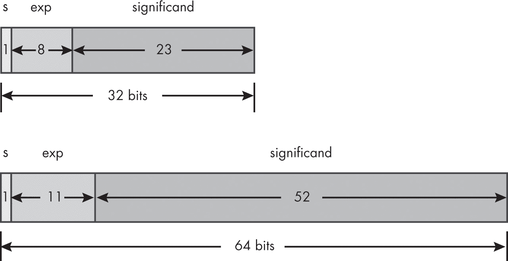

图 3-2：`float` 和 `double` 类型

让我们用 `float` 类型中的一个编码示例来说明：

| 1 | 1000 0001 | 011 0000 0000 0000 0000 0000 |
| --- | --- | --- |

符号位为 `1`，指数字段为 `1000 0001`，尾数字段为 `011 0000 0000 0000 0000 0000`。符号位编码数字的符号，其中 0 用于正号，1 用于负号。因此，此示例中表示的数字具有负号。

由于指数字段既全为 0 也全为 1，尾数字段中的位被解释为二进制点右侧的位，而一个隐含的 1 位位于二进制点左侧。在这个示例中，编码数的尾数是 `1.011 0000 0000 0000 0000 0000` = 1 + 2^(–2) + 2^(–3) = 1.375。

将所有这些结合起来产生以下实数：–2²(1 + 2^(–2) + 2^(–3)) = –5。

### C 浮点模型

以下公式表示使用 C 模型表示的 `float` 类型数字：


`s` 是符号位，可能为 1 或 –1。`e` 是指数，`f[1]` 到 `f[24]` 是尾数位。注意，C 模型表示中的指数比我们从编码中确定的指数大 1，因为 C 模型将（显式的）首位置在二进制点的右侧，而编码则将（隐式的）首位置在二进制点的左侧。

以下公式表示 `double` 类型的数字：


一般而言，C 模型通过参数 `b`、`p`、`e[min]` 和 `e[max]` 定义了每种浮点类型中的浮点数。参数 `b` 是基数（指数和尾数位数字的底数）。所有标准浮点类型的基数 `b` 由 `<float.h>` 中定义的 `FLT_RADIX` 宏表示。对于附录 F，`FLT_RADIX` 的值为 2。参数 `p` 是浮点尾数中基 `b` 数字的个数。`e[min]` 参数是最小负整数，使得 `b` 的该幂次减 1 是一个归一化浮点数。最后，`e[max]` 参数是最大整数，使得 `b` 的该幂次减 1 是一个可的有限浮点数，前提是该可表示有限浮点数是归一化的（对于所有 IEC 60559 类型都是如此）。表 3-5 显示了实际的宏名称。

**表 3-5：`<float.h>` 中的标准类型表征宏**

| 参数 | `float` | `double` | `long double` |
| --- | --- | --- | --- |
| `p` | `FLT_MANT_DIG` | `DBL_MANT_DIG` | `LDBL_MANT_DIG` |
| `emin` | `FLT_MIN_EXP` | `DBL_MIN_EXP` | `LDBL_MIN_EXP` |
| `emax` | `FLT_MAX_EXP` | `DBL_MAX_EXP` | `LDBL_MAX_EXP` |

每个实现为 `long double` 类型分配了以下格式之一：

* IEC 60559 双精度格式（或 binary128 格式，IEC 60559 在 2011 年修订中在其基础格式增加了 binary128）
* IEC 60559 binary64 格式
* IEC 60559 扩展格式

实现者的建议做法是 `long double` 匹配 60559 binary128 格式。C23 可能会指定定义 `long double` 特性的额外浮点类型。头文件 `<float.h>` 定义了几个宏。C 的附录 H 规定了额外的浮点类型。

## 浮点运算

浮点运算与实数运算相似，并用于模拟实数运算。然而，存在需要考虑的区别。与实数运算不同，浮点数的大小是有界的，且具有有限精度。加法和乘法运算*不是*结合律的；分配律*并不*成立，实数的许多属性同样如此。

浮点类型无法精确表示所有实数，即使这些数字可以用较少的小位数表示。例如，常见的十进制常数 0.1 无法精确表示为二进制小数。浮点类型可能缺乏各种应用（如循环计数器或执行财务计算）所需的精度。更多信息请参见 CERT C 规则 FLP30-C（不要使用浮点变量作为循环计数器）。

## 浮点值

尾数为 0（所有 `f[k]` = 0）的浮点表示代表浮点零。零根据符号 (`s`) 带有符号，有两个浮点零值：+0 和 –0。它们相等，但在少数操作中的行为不同。一个显著的例子是 `1.0/0.0` 产生正无穷，而 `1.0/(-0.0)` 产生负无穷。

*归一化*浮点数的尾数中没有前导零（`f[1]` = 1）；前导零通过调整指数来移除。这些是*规格*数字，它们使用了尾数的全部精度。因此，`float` 具有 24 位有效精度，`double` 具有 53 位有效精度，而 `long double` 具有 113 位有效精度（假设采用 IEC 60559 binary128 格式）。

`Subnormal`（次规化）数是值极小的正数和负数（但不为 0），其归一化表示得到的指数小于该类型的最小指数。它们的表示指数 `e` = `e[min]`，且有效位前导位 `f[1]` = 0。图 3-3 是一条显示 0 附近次规化值范围的数线。次规化数的精度小于正规数。

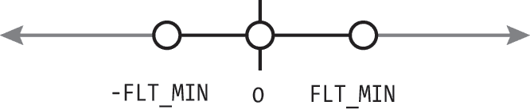

<samp class="SANS_Futura_Std_Book_Oblique_I_11">图 3-3：次规化数的定义域</samp>

浮点类型还可以表示非浮点数的值，例如负无穷大、正大和非数字（NaN）。`NaNs` 是不表示数字的值。

将无穷大作为特定值可用，允许操作在溢出和除以零的情况下继续进行，并产生有用的结果，而不需要特殊处理。将任何非零数除以（正或负）零会得到无穷大。IEEE 浮点标准对无限值的操作有明确的定义。

`quiet NaN`（静默 NaN）可以在几乎每个算术操作中传播，而不会引发浮点异常，通常在选定的系列操作后进行测试。带有 `signaling NaN`（信号 NaN）操作数的算术操作通常会立即抛出浮点异常。浮点异常是此处未涵盖的高级主题。更多信息请参考 C 标准附录 F。

在 C23 中，`<float.h>` 中的 `NAN` 和 `INFINITY` 宏以及 `<math.h>` 中的 `nan` 函数提供了 IEC 60559 静默 NaN 和无穷大的标识。`<float.h>` 中的 `FLT_SNAN`、`DBL_SNAN` 和 `LDBL_SNAN` 宏提供了 IEC 60559 信号 NaN 的标识。C 附录 F 不需要对信号 NaN 完全支持。

你可以使用类似函数的宏 `fpclassify` 来识别浮点值的类别，它将参数值分类为 NaN、无穷大、正规、次规化或零：

```c
#include <math.h>
int fpclassify(real-floating x);
```

在 Listing 3-2 中，我们在 `show_classification` 函数中使用 `fpclassify` 宏来确定 `double` 类型浮点值是正规值、次规化值、零、无穷还是 NaN。

```c
const char *show_classification(double x) {
  switch(fpclassify(x)) {
    case FP_INFINITE:  return "Inf";
    case FP_NAN:       return "NaN";
    case FP_NORMAL:    return "normal";
    case FP_SUBNORMAL: return "subnormal";
    case FP_ZERO:      return "zero";
    default:           return "unknown";
  }
}
```

<samp class="SANS_Futura_Std_Book_Oblique_I_11">Listing 3-2：`fpclassify` 宏</samp>

函数参数 `x`（在本例中为 `double`）被传递给 `fpclassify` 宏，该宏根据返回值进行分支。`show_classification` 函数返回与 `x` 中存储的值类别对应的字符串。

还有许多其他分类宏，包括 `isinf`、`isnan`、`isnormal`、`isnormal`、`iszero` 等。

## 浮点常量

`浮点常量` 是十进制或十六进制数字。如果没有后缀，类型为 `double`；如果后缀字母 `f` 或 `F`，类型为 `float`；如果后缀字母 `l` 或 `L`，类型为 `long double`，如下所示：

```c
10.0F  /* float */
10.0   /* double */
10.0L  /* long double */
```

在这些示例中，小数点是强制的，但结尾零不是。

## 算术转换

通常，用一种类型（例如 `float`）表示的值必须转换为另一种类型（例如 `int`）。当你有一个 `float` 类型的对象并需要将其参数传递给接受 `int` 类型对象的函数时，可能会发生。当需要此类转换时，应始终确保该值在新类型中可以充分表示。我将在第 70 页的“安全转换”中进一步讨论。

值可以隐式或显式地从一种算术类型转换为另一种。你可以使用*强制转换*（*cast*）操作符来执行*显式*转换。Listing 3-3 展示了强制转换的示例。

```c
int si = 5;
short ss = 8;
long sl = (long)si;
unsigned short us = (unsigned short)(ss + sl);
```

<samp class="SANS_Futura_Std_Book_Oblique_I_11">Listing 3-3：强制转换操作符</samp>

要执行类型转换，请在表达式之前用括号括起一个类型名称。类型转换将表达式转换为括号中类型名的未限定版本。在这里，我们将 `si` 的值转换为 `long` 类型。由于 `si` 的类型为 `int`，因此这种类型转换被保证是安全的，因为该值始终可以用相同符号的更大整数类型来表示。

此示例中的第二个类型转换将表达式 `(ss + sl)` 的结果转换为 `unsigned short` 类型。由于值被转换为精度较低的无符号类型（`unsigned short`），转换结果可能与原始值不相等。（某些编译器可能会对此发出警告，而另一些则不会。）在此示例中，表达式 `(13)` 的结果可以正确地表示在目标类型中。

*隐式转换*（Implicit conversion）也称为*强制类型*（coercion），根据需要自动发生在表达式中。例如，当在混合类型上执行操作时，值会发生强制转换。在列表 3-3 中，使用隐式转换将 `ss` 转换为 `sl` 的类型，以便在公共类型上执行加法运算 `ss + sl`。关于哪些值隐式转换为何种类型的规则相当复杂，涉及三个概念：整数转换等级、整数提升以及常规的算术转换。

## 整数转换等级

*整数转换等级*（Integer conversion rank）是整数类型的一种标准等级排序，用于确定计算的公共类型。每个整数类型都有一个整数转换等级，它决定了何时以及如何执行隐式转换。

C 标准第 6.3.1.1 节第 1 段（ISO/IEC 9899:2024）规定，每个整数类型都有一个整数转换等级，适用以下规则：

* 没有两个符号整数类型具有相同的等级，即使它们具有相同的表示形式。
* 符号整数类型的等级大于任何精度较低的符号整数类型的等级。
* `long long int` 的等级大于 `long int` 的等级，后者大于 `int` 的等级，后者再大于 `short int` 的等级，后者再大于 `signed char` 的等级。
* 位精确（bit-precise）符号整数类型的等级大于任何宽度较窄的标准整数类型，或任何宽度较窄的位精确整数类型的等级。
* 任何无符号整数类型的等级等于其对应的符号整数类型的等级（如果存在）。
* 任何标准整数类型的等级大于任何相同宽度的扩展整数类型或相同宽度的位精确整数类型的等级。
* 任何位精确整数类型相对于相同宽度的扩展整数类型的等级由实现具体定义（implementation defined）。
* `char` 的等级等于 `signed char` 的等级也等于 `unsigned char` 的等级。
* `bool` 的等级小于所有其他标准整数类型的等级。
* 任何枚举类型的等级等于与其兼容的整数类型的等级。每个枚举类型都与 `char`、符号整数类型或无符号整数类型兼容。

任何扩展符号整数类型相对于另一个相同精度的扩展符号整数类型的等级由实现具体定义，但仍需遵循用于确定整数转换等级的的规则。

## 整数提升

*小类型*（small type）是指等级低于 `int` 或 `unsigned int` 的整数。*整数提升*（Integer promotion）是将小类型的值转换为 `int` 或 `unsigned int` 的过程。整数提升允许你可以在可能使用 `int` 或 `unsigned int` 的地方使用小类型的表达式。例如，你可以在赋值的右侧或作为函数的参数使用等级较低的类型——通常是 `char` 或 `short`。

整数提升主要有两个目的。首先，它们鼓励在体系架构的自然尺寸（`int`）下执行操作，这可以提高性能。其次，它们有助于避免中间值溢出导致的算术错误，例如：

```c
signed char cresult, c1, c3;
c1 = 100; c2 = 3; c3 = 4;
cresult = c1 * c2 / c3;
```

如果没有整数提升，在 `signed char` 用 8 位补码值表示的平台上，`c1 * c2` 将导致 `signed char` 类型溢出。这是因为 300 超出了该类型对象可以表示的值范围（–128 到 127）。然而，由于整数提升，`c1`、`c2` 和 `c3` 被隐式转换为 `signed int` 类型的对象，且乘法和除法操作在该尺寸下进行。在执行这些操作时不存在溢出的可能性，因为结果值可以使用这种更宽的类型来表示。在这个特定示例中，整个表达式的结果是 75，它在 `signed char` 类型的范围内，因此当存储在 `cresult` 中时值得以保留。

在第一个 C 标准出现之前，编译器对整数提升采用两种方法中的一种：保留无符号的方法（unsigned-preserving approach）或保留值的方法（value-preserving approach）。在`unsigned-preserving approach`中，编译器将较小的无符号类型提升为 `unsigned int`。在`value-preserving approach`中，如果原始类型的所有值都能被表示为 `int`，则原始较小类型的值会被转换为 `int`。否则，它将被转换为 `unsigned int`。在开发标准的原始版本（C89）时，C 标准委员会决定采用保留值的规则，因为它们产生错误结果的频率比保留无符号的方法低。如有必要，你可以通过显式类型转换来覆盖此行为，如列表 3-3 所示。

提升小型无符号类型的结果取决于整数类型的精度，这是由实现定义的。例如，x86-32 和 x86-64 架构具有 8 位的 `char` 类型、16 位的 `short` 类型和 32 位的 `int` 类型。对于针对这些架构之一的实现，`unsigned char` 和 `unsigned short` 的值都被提升为 `signed int`，因为这些较小类型中可以表示的所有值都可以被表示为 `signed int`。然而，16 位架构（如 Intel 8086/8088 和 IBM Series/1）具有 8 位的 `char` 类型、16 位的 `short` 类型和 16 位的 `int` 类型。对于针对这些架构的实现，`unsigned char` 类型的值被提升为 `signed int`，而 `unsigned short` 类型的值被提升为 `unsigned int`。这是因为所有 8 位 `unsigned char` 类型可以表示的值都可以表示为 16 位 `signed int`，但某些 16 位 `unsigned short` 类型可以表示的值无法表示为 16 位 `signed int`。

`_BitInt` 类型免于整数提升的限制。整数提升可能会在某些平台上增加所需硬件的，因此 `_BitInt` 类型不受整数提升规则的约束。例如，在一个涉及 `_BitInt(12)` 和 `unsigned _BitInt(3)` 的二进制表达式中，常规算术转换在确定公共类型之前不会将任何一个操作数提升为 `int`。由于一个类型是有符号的而另一个是无符号的，且由于位宽导致符号类型的等级高于无符号类型，无符号的 `_BitInt(3)` 将转换为公共类型 `_BitInt(12)`。

## 常规算术转换

`usual arithmetic conversions` 是为算术操作的操作数和结果产生 `common real type`（公共实数类型）的规则。在忽略复数或虚类型的情况下，每个操作数都被转换为公共类型。许多接受整数操作数的运算符（包括 `*`, `/`, `%`, `+`, `-`, `<`, `>=`, `<=`, `=`, `==`, `!=`, `&`, `^`, `|`, `? :`）使用应用于提升后操作数的常规算术转换。

常规算术转换首先检查一个操作数是否为浮点类型。如果是，则应用以下规则：

1. 如果其中一个操作数是 `long double`，则另一个操作数转换为 `long double`。
2. 否则，如果其中一个操作数是 `double`，则另一个操作数转换为 `double`。
3. 否则，如果其中一个操作数的类型是 `float`，则另一个操作数转换为 `float`。
4. 否则，执行整数提升。

例如，如果一个操作数的类型为 `double` 而另一个操作数的类型为 `int`，则 `int` 类型的操作数被转换为 `double` 对象。如果一个操作数的类型为 `float` 而另一个操作数的类型为 `double`，则 `float` 类型的操作数被转换为 `double` 对象。特别注意的是 `int` 和 `float` 的情况，它将 `int` 操作数转换为 `float`，尽管 `int` 的精度通常比 `float` 高。

如果两个操作数都不是浮点类型，则对提升后的整数操作数应用以下常规算术转换规则：

1. 如果两个操作数具有相同类型，则不需要进一步的转换。
2. 否则，如果两个操作数都具有符号整数类型或都具有无符号整数类型，则整数转换秩较低的操作数类型被转换为秩较高的操作数类型。例如，如果一个操作数的类型为 `int`，而另一个操作数的类型为 `long`，则类型为 `int` 的操作数被转换为类型为 `long`的对象。
3. 否则，如果具有无符号整数类型的操作数的秩大于或等于另一个操作数类型的秩，则符号整数类型的操作数被转换为无符号整数类型操作数的类型。例如，如果一个操作数的类型为 `signed int`，而另一个操作数的类型为 `unsigned int`，则类型为 `signed int`的操作数被转换为类型为 `unsigned int`的对象。


4. 否则，如果符号整数类型的操作数类型可以表示无符号整数类型操作数类型的所有值，则无符号整数类型的操作数被转换为符号整数类型操作数的类型。例如，如果一个操作数的类型为`unsigned int`，而另一个操作数的类型为`signed long long`，且`signed long long`类型可以表示`unsigned int`类型的所有值，则类型为`unsigned int`的操作数被转换为类型为`signed long long`的对象。这适用于具有 32 位`int`类型和 64 位`long long`类型的实现，例如 x86-32 和 x86-64。

5. 否则，两个操作数都被转换为与符号整数类型操作数类型对应的无符号整数类型。

`_BitInt`免于整数提升规则的一个结果是，二元运算符的`_BitInt`操作数并不总是作为常规算术转换的一部分提升为`int`或`unsigned int`。相反，低秩的操作数转换为高秩的操作数类型，操作结果为该高秩类型。例如，给定如下声明：

```c
_BitInt(2) a2 = 1;
_BitInt(3) a3 = 2;
_BitInt(33) a33 = 1;
signed char c = 3;
```

在以下表达式中，`a2`操作数作为乘法的一部分被转换为`_BitInt(3)`，结果类型为`_BitInt(3)`：

```c
a2 * a3;
```

在以下乘法中，`c`被提升为`int`，`a2`被转换为`int`，结果类型为`int`：

```c
a2 * c;
```

最后，在以下乘法中，`c`被提升为`int`。那么，只要`int`的宽度大于 32，它就会转换为`_BitInt(33)`：

```c
a3 * c;
```

这些规则随着新类型的添加而演变，需要一些时间来适应。这些模式中的不规则源于体系属性。如果不确定，请使用强制转换显式强制你想要的转换。尽管如此，请尝试。

### 隐式转换示例

下面的示例说明了整数秩、整数提升和常规转换的使用。假设这段代码是为 x86 架构编译的：

```c
unsigned int ui = UINT_MAX;
signed char c = -1;
if (c == ui) {
  printf("%d equals %u\n", c, ui);
}
```

变量`c`的类型为`signed char`。由于`signed char`的转换秩低于`int`或`unsigned int`，当用于比较时，存储在`c`中的值被提升为类型为`int`的对象。这是通过将原始值`0xFF`符号扩展为`0xFFFFFFFF`实现的。符号扩展用于将符号值转换为更宽的对象。当将值从较小的符号整数类型转换为较大的符号整数类型时，该操作保留了符号和数值。

接下来，应用常规算术转换。由于等号（`==`）运算符的操作数具有不同的符号且秩相同，符号整数类型的操作数被转换为无符号整数类型操作数的类型。然后作为 32 位无符号操作进行比较。由于`UINT_MAX`与`c`的值相同，比较结果为`1`，代码段输出如下：

```text
-1 equals 4294967295
```

这个结果不应该再令人意外了。

隐式和显式转换（强制类型转换操作的结果）都可能产生无法在结果类型表示的值。最好在相同类型的对象上进行操作，以避免转换。然而，当函数返回或接受不同类型的对象时，转换是不可避免的。在这些情况下，我们必须确保转换正确执行。

## 整数转换

当整数类型的值被转换为不同的整数类型时，就会发生`整数转换`。向相同符号位的更大类型的转换总是安全的，且不需要检查。对于大多数其他转换，如果结果值无法在结果类型中表示，可能会产生意想不到的结果。要正确执行这些转换，你必须测试存储在原始整数类型中的值是否在结果整数类型可以表示的范围内。例如，列表 3-4 所示的`do_stuff`函数接受一个`signed long`参数`value`，该参数需要在一个仅适用于`signed char`的语境中使用。

```c
#include <errno.h>
#include <limits.h>

errno_t do_stuff(signed long value) {
  if ((value < SCHAR_MIN) || (value > SCHAR_MAX)) {
    return ERANGE;
  }

  signed char sc = (signed char)value; // cast quiets warning

  // --snip--
}
```

**列表 3-4：安全转换**

为了安全地执行此转换，函数检查`value`能否在`[SCHAR_MIN, SCHAR_MAX]`范围内表示为`signed char`，如果不能，则返回错误。

特定的范围测试随转换而异。更多信息请参见 CERT C 规则`INT31-C`（“确保整数转换不会导致数据丢失或误读”）。

## 整数类型到浮点类型的转换

符合附录 F 的浮点类型支持正、负无穷大，因此所有整数值都在范围内。适用于标准的 IEC`60559`转换规则。更多信息请参见 CERT C 规则`FLP36-C`（“将积分值转换为浮点类型时保持精度”）。

## 浮点类型到整数类型的转换

当浮点类型的有限值被转换为整数类型（`bool`除外）时，小数部分将被舍弃。如果整数部分的值无法由整数类型表示，附录 F 指定将引发“无效”浮点异常，且结果是不确定的。

## 浮点类型降级

将浮点值转换为更大的浮点类型总是安全的。浮点值的降级（即转换为更小的浮点类型）类似于将整数值转换为浮点类型。符合附录 F 的浮点类型支持正、负无穷大。对于这些实现，对浮点类型值的降级将始终成功，因为任何超出范围的值都会转换为无穷大。有关浮点转换的更多信息请参见 CERT C 规则`FLP34-C`（“确保浮点转换在新类型的范围内”）。

### 总结

在本章中，你学习了整数和浮点类型。你还学习了隐式和显式转换、整数转换等级、整数提升以及通常的算术转换。

这些基本类型特别是整数，在 C 编程中使用是不可避免且无处不在的。即使是“Hello, world!”程序也会返回一个`int`并打印字符串——`char`类型的数组——这显然是一种整数类型。因为整数类型使用非常频繁，你不能在每次需要使用它们时简单地重读这一章。你必须理解它们的行为，以便有效地进行编程。

在下一章中，你将学习运算符以及如何编写简单的表达式来对这些算术类型以及其他对象类型执行操作。

# 4 表达式与运算符

在本章中，你将学习运算符以及如何编写简单的表达式来对这些算术类型以及其他对象类型执行操作。运算符是用于执行操作的关键字或一个或多个标点字符。当运算符应用于一个或多个操作数时，它就变成了一个计算值并可能产生副作用的表达式。表达式是运算符和操作数的序列，用于计算一个值或完成另一个目的。

在本章中，我们先讨论简单的赋值，然后回过头检查表达式的机制（运算符和操作数、值的计算、副作用、优先级和求值顺序）。然后我们考虑了特定的运算符，包括`sizeof`、算术、位运算、强制、条件、对齐、关系、复合赋值和逗号运算符。我们在之前的章节中已经介绍了许多此类运算符和表达式；在这里，我们详细说明它们的行为以及如何使用它们。最后，我们通过讨论指针算术结束本章。

## 简单赋值

简单赋值将左操作数所指定的对象中存储的值替换为右操作数。右操作数的值被转换为赋值的类型。简单赋值包含三个部分：左操作数、赋值运算符（`=`）和右操作数，如下例所示：

```c
int i = 21; // 带有初始化器的声明
int j = 7;  // 带有初始化器的声明
i = j;      // 简单赋值
```

简单赋值中的左侧操作数始终是一个表达式（类型为`void`以外的对象类型），称为`lvalue`。`lvalue`中的`l`最初源于它是左侧（left）操作数，但将其理解为定位值（locator value）可能更准确，因为它必须指定一个对象。右侧操作数也是一个表达式，但它可以仅仅是一个值，而不需要标识对象。我们将此值称为`rvalue`（右侧（right）操作数）或表达式值（expression value）。在示例中，对象`i`和`j`的标识符都是`lvalues`。`lvalue`也可以是一个表达式，例如`*(p + 4)`，只要它引用了内存中的一个对象。

在简单赋值中，`rvalue`被转换为`lvalue`的类型，然后存储在由`lvalue`指定的对象中。在赋值语句`i = j`中，值从`j`读取并写入`i`。由于`i`和`j`都是相同类型（`int`），因此不需要进行转换。赋值表达式的值为赋值结果的值，类型为`lvalue`的类型。

`rvalue`不需要引用对象，如下语句所示，该语句使用了前一个示例中的类型和值：

```c
j = i + 12; // j 现在的值为 19
```

表达式`i + 12`不是一个`lvalue`，因为没有底层对象来存储结果。相反，`i`本身是一个`lvalue`，它会被自动转换为`rvalue`，用作加法操作的操作数。加法操作产生的值（没有关联的内存位置）也是一个`rvalue`。C 语言限制了`lvalues`和`rvalues`出现的位置。以下语句说明了`lvalues`和`rvalues`的正确和错误用法：

```c
int i;

i = 5;     // i 是一个 lvalue，5 是一个 rvalue

int j = i; // lvalues 可以出现在赋值的右侧

7 = i;     // 错误：rvalues 不能出现在赋值的左侧
```

赋值`7 = i`无法编译，因为`rvalue`必须始终出现在运算符的右侧。

在接下来的示例中，右侧操作数的类型与赋值表达式的类型不同，因此`i`的值首先被转换为`signed char`类型。括号内表达式的值随后转换为`long int`类型并赋值给`k`：

```c
signed char c;
int i = INT_MAX;
long k;

k = (c = i);
```

赋值必须处理现实世界的限制。具体来说，如果将值转换为更窄的类型，简单赋值可能会导致截断。如第 3 章所述，每个对象都需要固定字节数的存储空间。`i`的值始终可以用`k`（相同符号位的更宽类型）来表示。然而，在这个示例中，`i`的值被转换为`signed char`（赋值表达式`c = i`的类型）。括号内表达式的值随后被转换为`long int`类型并赋值给`k`。如果`signed char`宽度不足以表示存储在`i`中的值，则值会被截断。为了防止值被截断，请确保选择足够宽的类型。

## 求值

现在我们已经看了简单赋值，让我们稍微退一步，看看表达式是如何求值的。求值（Evaluation）主要意味着将表达式简化为单一值。表达式的求值可以包括值计算和副作用。

值计算（value computation）是对求值产生的结果进行计算。计算最终值可能涉及确定对象的标识性或读取之前赋值的值。例如，以下表达式包含多个值计算，以确定`a[i]`的标识性：

```c
a[i] + f() + 9
```

由于`f()`是一个函数而不是对象，表达式`f()`不涉及确定`f`的标识性。操作数的值计算必须在运算符结果的值计算之前发生。在这个示例中，通过单独的值计算读取了`a[i]`的值并确定了调用函数`f`时返回的值。然后通过第三次计算将这些值相加，以获得整个表达式返回的值。如果`a[i]`是`int`数组且`f()`返回`int`，则表达式的结果将具有`int`类型。

副作用（side effects）是对执行环境状态的更改。副作用包括写入对象、访问（读取或写入）带有`volatile`修饰符的对象、输入/输出（I/O）、赋值或调用执行上述任一操作的函数。我们可以稍作修改之前的示例以添加一个赋值。更新`j`的存储值是赋值的副作用：

```c
int j;

j = a[i] + f() + 9;
```

对`j`的赋值是一个副作用，会改变执行环境的状态。根据函数`f`的定义，调用`f`也可能产生副作用。

## 函数调用

函数指示符（function designator）是一个具有函数类型并被用于调用函数的表达式。在下面的函数调用中，`max`就是函数指示符：

```c
int x = 11;
int y = 21;
int max_of_x_and_y = max(x, y);
```

`max`函数返回其两个参数中较大的一个。在表达式中，函数指示符在编译时会被转换为返回特定类型的函数指针（pointer-to-function returning type）。每个参数的值必须能够赋值给与其对应参数类型（不限定版本）相同的对象。每个参数的数量和类型必须与函数接受的每个参数的数量和类型一致。在这里，这意味着有两个整数参数。C 还支持变参函数（variadic functions），例如`printf`，它可以接受任意数量的参数。

我们还可以将一个函数传递给另一个函数，如列表 4-1 所示。

```c
int f() {
  // --snip--
  return 0;
}

void g(int (*func)()) {
  // --snip--
  if (func() != 0)
    printf("g failed\n");
  // --snip--
}

// --snip--

g(f); // 使用函数指针参数调用 g

// --snip--
```

列表 4-1：将一个函数传递给另一个函数

此代码将由`f`指定的地址传递给另一个函数`g`。函数`g`接受一个不接受参数并返回`int`的函数指针。作为参数传递的函数会被隐式转换为函数指针。`g`的定义使得这一点显式化；等效声明为`void g(int func(void))`。

## 增和减运算符

增运算符（`++`）和减运算符（`--`）分别对可修改的左值进行增或减操作。由于它们只接受一个操作数，因此都是一元运算符。

这些运算符可以作为前缀运算符（出现在操作数之前）或后置运算符（出现在操作数之后）使用。前缀和后置运算符的行为不同，这意味着它们通常用作测试和面试中的陷阱题。前缀增在返回值之前执行增操作，而后置增先返回值，然后执行增操作。列表 4-2 通过执行前缀或后置的增减操作并将结果赋值给`e`，说明了这些行为。

```c
int i = 5;
int e;    // 表达式结果

e = i++;  // 后置增: e ← 5, i ← 6
e = i--;  // 后置减: e ← 6, i ← 5
e = ++i;  // 前缀增: e ← 6, i ← 6
e = --i;  // 前缀减: e ← 5, i ← 5
```


# 列表 4-2：前缀和后置增减运算符

示例中的`i++`操作返回未改变的值`5`，然后将其赋值给`e`。随后，`i`的值作为该操作的副作用而增加。*前缀*增增加操作数的值，并且表达式返回操作数在增加后的新值。因此，表达式`i++`等同于`i`。示例中的`i++`操作返回未改变的值`5`，然后将其赋值给`e`。（注：原文在此处包含重复的片段）。

## 运算符优先级和结合性

在数学和计算机编程中，*运算顺序*（或*运算符优先级*）是一组规则，规定了在求值过程中执行运算的顺序。例如，乘法的优先级高于加法。因此，表达式`2 + 3 * 4`会被这样解释。

*结合性*（Associativity）决定了在不使用括号时，相同优先级的运算符如何分组。C的结合性与数学不同。例如，虽然浮点数的加法和乘法都满足交换律（*a* + *b* = *b* + *a* 且 *a* × *b* = *b* × *a*），但它们并不一定满足结合律。如果相邻运算符具有相同的优先级，则执行哪种操作由结合性决定。*左结合*运算符导致操作从左向右分组，而*右结合*运算符导致操作从右向左分组。你可以将分组理解为隐式地引入括号。例如，加法运算符（`+`）具有左结合性，因此表达式`a + b + c`被解释为`((a + b) + c)`。赋值运算符是右结合的，因此表达式`a = b = c`被解释为`(a = (b = c))`。

表 4-1 (#chapter4.xhtml_tab4-1) 源自 C++ References 网站上的 C 运算符优先级表（https://en.cppreference.com/w/c/language/operator_precedence），列出了语言语法规定的 C 运算符的优先级和结合性。运算符按优先级从高到低的顺序列出（即上面的行优先级越高）。

**表 4-1：运算符优先级和结合性**

| 优先级 | 运算符 | 描述 | 结合性 |
| :--- | :--- | :--- | :--- |
| 0 | `(...)` | 强制分组 | 左 |
| 1 | `++` `--` | 后置递增/减 | 左 |
| | `()` | 函数调用 | | |
| | `[]` | 数组下标 | | |
| | `.` | 结构体和联合体成员访问 | | |
| | `->` | 通过指针访问结构体和联合体成员 | | |
| | `(type){list}` | 复合字面量 | | |
| 2 | `++` `--` | 前置递增/减 | 右 |
| | `+` `-` | 一元加/减 | | |
| | `! ~` | 逻辑非和按位取反 | | |
| | `(type)` | 类型转换 | | |
| | `*` | 间接（解引用） | | |
| | `&` | 取地址符 | | |
| | `sizeof` | 大小 | | |
| | `Alignof` | 对齐要求 | | |
| 3 | `*` `/` `%` | 乘法、除法和取余 | 左 |
| 4 | `+` `-` | 加法和减法 | | |
| 5 | `<<` `>>` | 按位左移和右移 | | |
| 6 | `<=` | 关系运算符 < ≤ | | |
| | `>=` | 关系运算符 > ≥ | | |
| 7 | `==` `!=` | 等于、不等于 | | |
| 8 | `&` | 按位与 | | |
| 9 | `^` | 按位异或 | | |
| 10 | `|` | 按位或 | | |
| 11 | `&&` | 逻辑与 | | |
| 12 | `||` | 逻辑或 | | |
| 13 | `? :` | 条件运算符 | 右 |
| 14 | `=` | 简单赋值 | | |
| | `+=` `-=` | 求和/差赋值 | | |
| | `*=` `/=` `%=` | 乘积、商数和余数赋值 | | |
| | `<<=` `>>=` | 按位左移和右移赋值 | | |
| | `&=` `^=` `|=` | 按位与、异或、或赋值 | | |
| 15 | `,` | 表达式序列 | 左 |

有时候运算符的优先级是直观的，而有时又具有误导性。例如，后置`++`和`--`运算符的优先级高于前置`++`和`--`运算符，而后者的优先级又与单元运算符`*`运算符相同。例如，如果`p`是一个指针，那么`*p++`等于`*(p++)`，而`++*p`等于`++(*p)`，因为前置`++`运算符和单元运算符`*`运算符都是从右结合的。如果两个运算符具有相同的优先级和结合性，它们将从左到右进行求值。列表 4-3 展示了这些运算符之间的优先级规则。

```
char cba[] = "cba";

char *p = cba;

printf("%c", ++*p);

char xyz[] = "xyz";

char *q = xyz;

printf("%c", *q++);
```

*列表 4-3: 运算符优先级规则*

表达式`++*p`中的指针首先被解引用，产生字符`c`。该值随后被递增，导致字符`d`。在这种情况下，前置`++`运算符作用于`p`所指向的`char`类型对象，而不是指针本身。另一方面，表达式`*q++`中的指针先被增加，因此它指向字符`y`。然而，后置递增运算符的结果是操作数的值，因此原始指针值被解引用，产生字符`x`。因此，这段代码打印出字符`dx`。你可以使用括号来改变或明确操作顺序。

## 求值顺序

任何 C 运算符操作数的*求值顺序*（包括任何子表达式的求值顺序）通常是未指定的。编译器将以任何顺序对它们进行求值，并在再次评估相同表达式时选择不同的顺序。这种灵活性允许编译器通过选择最高效的顺序来生成更的代码。求值顺序受运算符优先级和结合性的限制。列表 4-4 展示了函数参数的求值顺序。

```
int glob;  // 静态存储初始化为 0

int f(void) {

  return glob + 10;

}

int g(void) {

  glob = 42;

  return glob;

}

int main(void) {

  int max_value = max(f(), g());

  // --snip--

}
```

*列表 4-4: 函数参数的求值顺序*

函数`f`和`g`都访问了全局变量`glob`，这意味着它们依赖于共享状态。由于函数`f`和`g`的求值顺序是不指定的，传递给`f`和`g`的参数可能不同。如果先调用`f`，它将返回 10；但如果最后调用，它将返回 52。函数`g`无论求值顺序如何始终返回 42。因此，`max`函数（返回两者中的较大者）可能会返回 42 或 52，取决于此代码提供的序列。我们可以如下重写这段代码以确保它始终以可预测、可移植的方式运行：

```
int f_val = f();

int g_val = g();

int max_value = max(f_val, g_val);
```

在这一修订后的程序中，调用`f`来初始化变量`f_val`。这保证了它在执行`g`之前排序（`g`在后续声明中被调用以初始化`g_val`）。如果一个评估*排序于*另一个评估，则第一个评估必须在第二个评估开始之前完成。你可以使用序列点（在后续章节中讨论）来确保对象在被读取之前被写入。`f`的执行保证在`g`的执行之前排序，因为在一个完整表达式的评估与下一个完整表达式的评估之间存在序列点。

### 未排序和不确定顺序的求值

未排序的求值的执行可以*交替进行*，这意味着指令可以以任何顺序执行，只要读写操作是按照程序指定的顺序执行的。按照程序指定的顺序执行读写操作的程序是*顺序一致的* (Lamport 1979)。

某些求值是*不确定顺序的*，这意味着它们不能交替进行，但仍可以任何顺序执行。例如，以下语句包含了多个值计算和副作用：

```
printf("%d\n", ++i + ++j * --k);
```

`i`、`j`和`k`的值在被递增或递减之前必须先读取。这意味着例如，`i`的读取必须在递增副作用之前进行排序。同样地，乘法操作的操作数的所有副作用都需要在乘法发生之前完成。由于操作符优先级规则，乘法必须在加法之前完成。最后，加法操作的操作数的所有副作用必须在加法发生之前完成。这些约束条件在这些操作之间产生了偏序，因为它们并不要求在递减`k`之前必须递增`j`。该表达式中未排序的求值可以按任何顺序进行，这允许编译器重新排序操作并将值缓存在寄存器中，从而实现更快的整体执行。另一方面，函数的执行是不确定顺序的，且彼此之间不会交替。

### 序列点 (Sequence Points)

*序列点*是所有副作用都完成的交汇点。这些点是由语言隐式定义的，但你可以通过编写代码的方式来控制它们的发生时间。

C 标准的附录 C 列举了序列点。一个序列点发生在一个*完整表达式*（不是其他表达式或声明符部分的表达式）与下一个要求值的完整表达式之间。在进入或退出被调用的函数时也会发生序列点。

如果某个副作用相对于同一标量的另一个副作用，或者相对于使用同一标量对象对象的值计算是未排序的，则该代码具有未定义行为。*标量类型*可以是算术类型或指针类型。如下代码段所示，表达式`i++ * i++`对`i`执行了两次未排序的操作：

```
int i = 5;

printf("Result = %d\n", i++ * i++);
```

你可能认为这段代码会产生值 30，但因为它具有未定义行为，所以该结果并不是保证的。

保守起见，我们可以通过将每个产生副作用的操作放在它自己的完整表达式中，来确保副作用在读取值之前已经完成。我们可以如下重写该代码以消除未定义行为：

```
int i = 5;

int j = i++;

int k = i++;

printf("Result = %d\n", j * k);
```

这个示例现在每个副作用操作之间都包含一个序列点。然而，无法判断重写后的代码是否代表了程序员的原始意图，因为原始代码并没有定义的含义。如果你选择省略序列点，你必须确保完全理解副作用的排序情况。我们也可以以如下方式编写相同的代码而不改变行为：

```
int i = 5;

int j = i++;

printf("Result = %d\n", j * i++);
```

现在我们已经描述了表达式的机制，我们将返回并讨论特定的操作符。

## sizeof 操作符

我们可以使用`sizeof`操作符来找到其操作数字节字节的大小；具体而言，它返回一个`size_t`类型的无符号整数，表示该大小。知道操作数的正确大小对于大多数内存操作（包括分配和拷贝存储）都是必要的。`size_t`类型定义在`<stddef.h>`以及其他头文件中。我们需要包含这些头文件之一来编译任何引用了`size_t`类型的代码。

我们可以向`sizeof`操作符传递一个完整对象类型的未求值表达式，或者此类类型的带括号的名称：

```
int i;

size_t i_size = sizeof i;      // 对象 i 的大小

size_t int_size = sizeof(int); // 类型 int 的大小
```

对`sizeof`的操作数加括号始终是安全的，因为对表达式加括号不会改变操作数大小的计算方式。调用`sizeof`操作符的结果是一个常量，除非操作数是变长数组。如果你需要确定可用的位数，可以将对象的大小乘以`CHAR_BIT`，这给出了一个字节中的位数。例如，表达式`CHAR_BIT * sizeof(int)`将产生`int`类型对象的位数。

## 算术操作符

对算术类型执行算术运算的操作符在接下来的节中进行了详细介绍。我们也可以在非算术操作数上使用这些操作符的一部分。

### 一元 + 和 –

一元`+`和`–`操作符作用于算术类型的单一操作数。一元`–`操作符返回其操作数的负值（即它的行为就像操作数乘以 –1）。一元`+`操作符仅返回该值。这些操作符的存在主要是为了表示正数和负数。

如果操作数具有小型整数类型，它会被提升（参见第 3 章），并且操作的结果具有提升后类型的结果。作为一个冷知识，C 没有负整数字面量。诸如`–25`的值实际上是一个类型为`int`的右值，其值为`25`，前面带有一元`–`操作符。然而，表达式`-25`保证是一个常量整数表达式。

### 逻辑取反

一元逻辑取反操作符 (`!`) 的结果如下：

*   如果其操作数的求值不是`0`，则结果为`0`
*   如果其操作数的求值为`0`，则结果为`1`

操作数是一个标量类型。由于历史原因，结果的类型为`int`。表达式`!E`等于`(0 == E)`。逻辑取反运算符经常用于检查空指针；例如，`!p`等于`(nullptr == p)`。空指针可能不持有值零，但保证求值结果为假（false）。

### 加法

二元加法运算符包括加法（`+`）和减法（−`）。我们可以对两个算术类型的操作数应用加法和减法，也可以使用它们来执行缩放指针算术。我将在本章末尾讨论指针算术。

二元`+`运算符将其两个操作数和。二元`-`运算符从左操作数中减去右操作数。对于这两种操作，都会对算术类型的操作数执行通常算术转换。

### 乘法

二元乘法运算符包括乘法（`*`）、除法（`/`）和取模（`%`）。乘法操作数隐式执行通常算术转换以找到公共类型。你可以对浮点数和整数操作数进行乘法和除法，但取模操作仅适用于整数操作数。

各种编程语言实现了不同类型的整数除法，包括欧几里得除法、地板除和截断除。在*欧几里得除法*中，余数始终非负（Boute 1992）。在*地板除*中，商向负无穷方向取整（Knuth 1997）。在*截断除*中，商的小数部分被直接舍弃，这通常被称为*向零截断*。

C 编程语言实现了截断除法，这意味着余数的符号始终与被除数相同，如表 4-2 所示。

**表 4-2：截断除法**

| / | 结果 | % | 余数 |
| --- | --- | --- | --- |
| 10 / 3 | 3 | 10 % 3 | 1 |
| 10 / –3 | –3 | 10 % –3 | 1 |
| –10 / 3 | –3 | –10 % 3 | –1 |
| –10 / –3 | 3 | –10 % –3 | –1 |

泛而言之，如果商`a / b`可表示的，那么`a % b`等于`a - b`。否则，如果除数等于`0`或`a / b`溢出，则行为是未定义的。

花点时间理解`%`运算符的行为以避免意外。例如，以下代码定义了一个错误的函数`is_odd`，它尝试测试一个整数是否为奇数：

```
bool is_odd(int n) {

  return n % 2 == 1;

}
```

由于余数的符号始终与被除数相同，当`n`为负且为奇数时，`n % 2`返回`-1`，函数返回`false`。

一个正确的替代方案是测试余数不等于`0`（因为无论被除数的符号如何，余数为`0`都是相同的）：

```
bool is_odd(int n) {

  return n % 2 != 0;

}
```

许多中央处理器（CPU）将取模作为除法操作的一部分来实现，如果被除数是有符号整数类型的负最小值且除数等于`-1`，则可能会溢出。尽管这种取模操作的数学结果为`0`。

C 标准库提供了浮点数取模、截断和舍入函数，包括`fmod`等。

## 位运算符

我们使用*位运算符*来操作对象或任何整数表达式的位。位运算符（`|`、`&`、`^`、`~`）将位视为纯的二进制模型，而不考虑这些位所表示的值。通常情况下，它们被用于表示*掩码*或*位图*的对象，其中每个位表示某个状态“开启”或“关闭”、“启用”或“禁用”，或其他二元配对。使用掩码，可以在单次位运算中设置、取消或反转多个位。掩码和位图最好表示为无符号整数类型，因为符号位可以被用地用作值，且无符号操作较少产生未定义行为。

### 补码

一元取反运算符`~`作用于单个整数类型的操作数，并返回其操作数的按位取反——即原始值中的每个位都发生翻转的值。取反运算符常用于 POSIX 的`umask`，例如。`umask`用于掩码或减去权限。例如，`umask`为`077`会关闭组和其他和其他的读、写、执行权限。文件的权限模式是掩码取反与进程请求的权限模式设置之间逻辑与（AND）操作的结果。

取反运算符的操作数会进行整数提升，结果的类型为提升后的类型。例如，以下代码段将`~`运算符应用于一个`unsigned char`类型的值：

```
unsigned char uc = UCHAR_MAX; // 0xFF

int i = ~uc;
```

在具有 8 位`char`类型和 32 位`int`类型的架构上，`uc`被赋值为`0xFF`。当`uc`被用作`~`运算符的操作数时，`uc`通过通过零扩展到 32 位提升为`signed int`，即`0x000000FF`。该值的取反是`0xFFFFFF00`。因此，在该平台上，对`unsigned char`类型取反始终得到一个`signed int`类型的负值。作为一种通用策略并为了避免此类意外，按位操作应仅对足够宽的无符号整数类型的值进行。

### 移

移位操作将整数类型操作数的每个位按指定的位数进行移动。移位通常用于系统编程，其中位掩码（bitmasks）非常常见。移位操作也可能用于管理网络协议或文件格式的代码，以便对数据进行打包或解包。它们包括如下形式的左移操作：

```
shift expression << additive expression
```

以及如下形式的右移操作：

```
shift expression >> additive expression
```


移位表达式是要移动的值，而加法表达式是值移动的位数。[图 4-1] 展示了 1 位的逻辑左移。

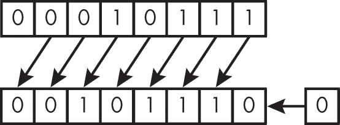

图 4-1：1 位的逻辑左移

加法表达式决定了值移动的位数。例如，`E1 << E2` 的结果是 `E1` 左移 `E2` 位后的值；空出的位用零填充。如果 `E1` 是无符号类型，则结果的值为 `E1 × 2^E2`。无法在结果类型中表示的值将回绕（wrap around）。如果 `E1` 是符号类型且值为非负，且 `E1 × 2^E2` 可以在结果中表示，则该值为结果；否则，则为未定义行为。

同样，`E1 >> E2` 的结果是 `E1` 右移 `E2` 位后的值。如果 `E1` 是无符号类型，或者 `E1` 是符号类型且值为非负，则结果的值为商 `E1/2^E2` 的整数部分。如果 `E1` 是符号类型且值为负值，则结果的结果由实现定义，可能是算术（符号扩展）移位，也可能是逻辑（无符号）移位，如图 4-2 所示。

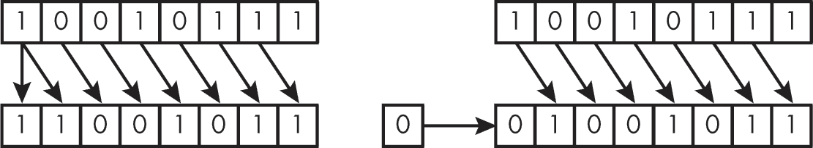

图 4-2：1 位的算术（符号）右移和逻辑（无符号）右移

在两种移位操作中，整数提升都在操作数上进行，每个操作数都是整数类型。结果的类型是提升后操作数的类型。不执行常规算术转换。[列表 4-5] 显示了如何对符号和无符号整数进行无未定义行为的右移操作。

```c
extern int si1, si2, sresult;

extern unsigned int ui1, ui2, uresult;

// --snip

❶ if ((si2 < 0) || (si2 >= sizeof(si1)*CHAR_BIT)) {
  /* error */
}
else {
  sresult = si1 >> si2;
}

❷ if (ui2 >= sizeof(unsigned int)*CHAR_BIT) {
  /* error */
}
else {
  uresult = ui1 >> ui2;
}
```

列表 4-5：正确的右移操作

对于符号整数 ❶，你必须确保移位的位数不是负数、大于或等于提升后操作数的宽度。对于无符号整数 ❷，你省略了对负值的测试，因为无符号整数永远不会为负。你可以以类似的方式执行安全的左移操作。

### 按位与

二进制按位与运算符 `&` 返回两个整数类型操作数的按位与结果。在两个操作数上都会执行常规算术转换。结果中的每个位被设置为，当且仅当转换后操作数中的对应位都被设置为时，如表 4-3 所示。

表 4-3：按位与真值表

| x | y | x & y |
| --- | --- | --- |
| 0 | 0 | 0 |
| 0 | 1 | 0 |
| 1 | 0 | 0 |
| 1 | 1 | 1 |

### 按位异或

按位异或运算符（`^`）返回整数类型操作数的按位异或结果。操作数必须是整数，并对两个操作数执行常规的算术转换。结果中的每个位当且仅当转换后的操作数对应位中恰好有一个为 1 时，该位被设置，如表 4-4 所示。你也可以将此操作视为“两者择一，但不可兼得”。

表 4-4：按位异或真值表

| x | y | x ^ y |
| --- | --- | --- |
| 0 | 0 | 0 |
| 0 | 1 | 1 |
| 1 | 0 | 1 |
| 1 | 1 | 0 |

异或等同于整数模 2 的加法运算——也就是说，由于溢回机制，`1 + 1 mod 2 = 0`（Lewin 2012）。

初学者经常将异或运算符误认为是指数运算符，错误地认为表达式 `2 ^ 7` 将计算 2 的 7 次方。在 C 中将数字提升特定幂的正确方法是使用 `<math.h>` 中定义的 `pow` 函数，如列表 4-6 所示。`pow` 函数作用于浮点参数并返回浮点结果，因此请注意这些函数可能会因为截断或其他错误而无法产生预期结果。

```c
#include <math.h>
#include <stdio.h>

int main(void) {
  int i = 128;

  if (i == pow(2, 7)) {
    puts("equal");
  }
}
```

列表 4-6：使用 `pow` 函数

此代码调用 `pow` 函数计算 2 的 7 次方。因为 2⁷ 等于 128，此程序将打印 `equal`。

### 按位或

按位或运算符（`|`）返回两个操作数的按位或结果。结果中的每个位当且仅当转换后的操作数对应位中至少有一个为 1 时，该位被设置，如表 4-5 所示。

表 4-5：按位或真值表

| x | y | x \| y |
| --- | --- | --- |
| 0 | 0 | 0 |
| 0 | 1 | 1 |
| 1 | 0 | 1 |
| 1 | 1 | 1 |

操作数必须是整数，并对两个操作数执行常规的算术转换。

## 逻辑运算符

逻辑与（`&&`）和逻辑或（`||`）运算符主要用于逻辑上连接两个或多个标量类型的表达式。它们通常用于条件测试以组合多个比较，例如条件运算符第一个操作数、`if` 语句的控制表达式，或 `for` 循环的控制表达式。你不应该对位图操作数使用逻辑运算符，因为它们主要用于布尔逻辑。

`&&` 运算符在两个操作数都不等于 0 时返回 1，否则返回 0。从逻辑上讲，这意味着 `a && b` 仅当 `a` 为真且 `b` 为真时才为真。

`||` 运算符在任一操作数不等于 0 时返回 1，否则返回 0。从逻辑上讲，这意味着如果 `a` 为真、`b` 为真或 `a` 和 `b` 皆真，则 `a || b` 为真。

C 标准通过“不等于零”来定义这两个操作，因为操作数可能有除 0 和 1 以外的值。两个运算符接受标量类型的操作数（整数、浮点数和指针），运算结果类型为 `int`。

与相应的按位二进制运算符不同，逻辑与运算符和逻辑或运算符保证从左到右求值。两个运算符都具有短路特性：如果仅通过计算第一个操作数就能推导出结果，则不计算第二个操作数。如果计算了第二个操作数，则在第一个和第二个操作数的计算之间存在序列点。

例如，表达式 `0 && unevaluated` 无论 `unevaluated` 的值如何都会返回 0，因为 `unevaluated` 没有可能值可以产生不同的结果。因此，`unevaluated` 不会被计算以确定其值。`1 || unevaluated` 也是如此，因为该表达式始终返回 1。

短路求值在指针操作中常用：

```c
bool isN(int* ptr, int n) {
  return ptr && *ptr == n; // 避免空指针解引用
}
```

这段代码测试 `ptr` 的值。如果 `ptr` 为空，则第二个 `&&` 操作数不会求值，从而防止空指针解引用。

短路逻辑也可避免不必要的计算。在以下表达式中，如果文件已就绪，`is_file_ready` 谓词函数返回 `true`：

```c
is_file_ready() || prepare_file()
```

当 `is_file_ready` 函数返回 `true` 时，第二个 `||` 操作数不会求值，因为不需要准备文件。这避免了潜在的错误，或者在 `prepare_file` 是等等的情况下，避免了不必要的计算（前提是判断文件是否就绪的代价小于准备文件的代价）。

如果第二个操作数包含副作用，程序员应该格外谨慎，因为可能无法明显看出这些副作用是否会发生。例如，在以下代码中，`i` 的值仅在 `i >= 0` 时才会增加：

```c
enum { max = 15 };

int i = 17;

if ((i >= 0) && ((i++) <= max)) {
  // --snip--
}
```

这段代码可能是正确的，但很可能是一个程序员错误。

## 强制转换运算符

强制转换（也称为类型转换）显式地将一种类型的值转换为另一种类型的值。要执行强制转换，我们在表达式前面加上一个带括号的类型名，这会将表达式的值转换为该命名类型的未限定版本。以下代码说明了 `x` 从 `double` 类型到 `int` 类型的显式转换（或强制转换）：

```c
double x = 1.2;
int sum = (int)x + 1;  // 从 double 到 int 的显式转换
```

除非类型名指定了 `void` 类型，否则类型名必须是限定的或未限定的标量类型。操作数也必须是标量类型；指针类型不能转换为任何浮点数类型，反之亦然。

强制转换非常强大，必须谨慎使用。其一，强制转换可以在不改变位的情况下，将现有位重新解释为指定类型的值：

```c
intptr_t i = (intptr_t)a_pointer; // 将位重新解释为整数
```

强制转换也可以更改这些位，以生成在结果类型中表示原始值所需的任何位：

```c
int i = (int)a_float; // 将位更改为整数表示
```

强制转换还可以禁用诊断信息。例如：

```c
char c;

// --snip--

while ((c = fgetc(in)) != EOF) {
  // --snip--
}
```

当使用 Visual C++ 2022 配合警告级别 `/W4` 编译时，会生成以下诊断：

```text
Severity  Code   Description

Warning   C4244  '=': conversion from 'int' to 'char', possible loss of data
```

为 `char` 添加强制转换可以在不解决问题的情况下禁用诊断：

```c
char c;

while ((c = (char)fgetc(in)) != EOF) {
  // --snip--
}
```

为了降低这些风险，C++ 定义了它自己的强制转换，这些转换的功能性较弱。

## 条件运算符

条件运算符（`? :`）是唯一接受三个操作数的 C 运算符。它根据条件返回结果。你可以这样使用条件运算符：

```c
result = condition ? valueReturnedIfTrue : valueReturnedIfFalse;
```

条件运算符求值第一个操作数，称为 `condition`。如果条件为真，则求值第二个操作数（`valueReturnedIfTrue`）；如果条件为假，则求值第三个操作数（`valueReturnedIfFalse`）。结果是第二个或第三个操作数（取决于被求值的哪一个）的值。

在第一个操作数的求值与第二个或第三个操作数的求值之间存在序列点，确保求值条件产生的所有副作用已完成。条件运算符类似于 `if...else` 块，但它像函数一样返回值。你可以使用条件运算符来初始化 `const` 对象：

```c
const int x = (a < b) ? b : a;
```

## `alignof` 运算符

`alignof` 运算符产生一个整数常量，表示其声明的完整类型的对齐要求。它不对操作数进行求值。当应用于数组类型时，它返回元素类型的对齐要求。该运算符还有另一种拼写方式 `_Alignof`。在 C23 之前，`alignof` 拼写可以通过头文件 `<stdalign.h>` 提供的便利性来实现。

`alignof` 运算符在静态断言中非常有用，用于验证对程序的假设（在第 11 节进一步讨论）。这些断言的目的是诊断假设无效的情况。列表 4-7 演示了 `alignof` 运算符的使用：

```c
#include <stdio.h>
#include <stddef.h>
#include <stdalign.h>
#include <assert.h>

int main(void) {
  int arr[4];

  static_assert(alignof(arr) == 4, "unexpected alignment");
  static_assert(alignof(max_align_t) == 16, "unexpected alignment");

  printf("Alignment of arr = %zu\n", alignof(arr));
  printf("Alignment of max_align_t = %zu\n", alignof(max_align_t));
}
```

列表 4-7：`alignof` 运算符

这个简单的程序并没有完成任何特别有用的工作。它声明了一个包含四个整数的数组 `arr`，随后是一个关于数组对齐的静态断言（static assertion），以及一个关于 `max_align_t`（一种对齐方式为最大基本对齐的对象类型）的运行时断言。然后它打印出这些值。如果任何一个静态断言失败，该程序将无法编译，否则将输出以下内容：

```text
Alignment of arr = 4
Alignment of max_align_t = 16
```

这些对齐方式是 x86-64 架构的特征。

## 关系运算符

关系运算符包括等于（`==`）、不等（`!=`）、小于（`<`）、大于（`>`）、小于等于（`<=`）和大于等于（`>=`）。如果指定的关系为真，则返回 1；如果为假，则返回 0。由于历史原因，结果的类型为 `int`。

注意，C 语言并不像普通数学那样将表达式 `a < b < c` 解释为 `b` 大于 `a` 但小于 `c`。相反，该表达式被解释为 `(a < b) < c`。在英语中，如果 `a` 小于 `b`，编译器将把 `1` 与 `c` 进行比较；否则，将 `0` 与 `c` 进行比较。如果这是你的意图，请加上括号以向任何潜在的代码审查人员明确这一点。GCC 和 Clang 等编译器提供了 `-Wparentheses` 标志来诊断这些问题。

要确定 `b` 是否大于 `a` 但小于 `c`，你可以编写此测试：`(a < b) && (b < c)`。

等于运算符和不等运算符的优先级低于关系运算符——假设它们优先级更高是一个常见的错误。这意味着表达式 `a < b == c < d` 的求值与 `(a < b) == (c < d)` 相同。在两种情况下，`a < b` 和 `c < d` 都会先求值，然后对得到的值（`0` 或 `1`）进行等值比较。

我们可以使用这些运算符来比较算术类型或指针。当我们比较两个指针时，结果取决于所指向对象在地址空间中的相对位置。如果两个指针指向同一个对象，则它们是相等的。

等于运算符和不等运算符与其他关系运算符不同。例如，你不能在无关的对象上使用其他关系运算符，因为这样做没有意义且属于未定义行为：

```c
int i, j;

bool b1 = i < j;  // 未定义行为
bool b2 = i == j; // OK
```

## 复合赋值

复合赋值见表 4，它通过对对象执行操作来修改对象的值。

| 运算符 | 赋值方式 |
| :--- | :--- |
| `+=` | 和 |
| `-=` | 差 |
| `*=` | 积 |
| `/=` | 商 |
| `%=` | 余数 |
| `<<=` | 位左移 |
| `>>=` | 位右移 |
| `&=` | 位与 |
| `^=` | 位异或 |
| `|=` | 位或 |

形如 `E1 op E2` 的复合赋值等同于简单赋值 `E1 = E1 op E2`，不同之处在于 `E1` 只被求值一次。复合赋值主要用作简写符号。逻辑运算符没有复合赋值。

## 逗号运算符

在 C 语言中，逗号有两种截然不同的用法：作为运算符，以及分隔列表中的项（例如函数参数或声明列表）。逗号（`,`）运算符是在评估一个表达式之前评估另一个表达式的方法。

首先，逗号运算符的左操作数被求值为 `void` 表达式。在左操作数求值和右操作数求值之间存在序列点（sequence point）。然后，右操作数被求值。逗号操作的类型和值取决于右操作数——主要是因为它是最后一个被求值的表达式。

你不能在逗号可能分隔列表项的上下文中使用逗号运算符。相反，你可以在括号括起来的表达式内或在条件运算符的第二个表达式中包含逗号。例如，假设在以下调用 `f` 时，`a`、`t` 和 `c` 的类型均为 `int`：

```c
f(a, (t = 3, t + 2), c)
```

第一个逗号分隔了函数的第一个和第二个参数。第二个逗号是一个逗号运算符。首先求值赋值，然后执行加法。由于序列点（sequence point），赋值保证在加法发生之前完成。逗号操作的结果类型为 `int`，值为 `5`。第三个逗号分隔了函数的第二个和第三个参数。

## 指针算术

在本章前面的部分，我们提到加法运算符（加法和减法）可以用于算术操作数或对象指针。在本节中，我们将讨论指针与整数相加、两个指针相减，以及从指针中减去一个整数。

对指针加上或减去一个整数类型的表达式，将返回一个类型与指针操作数相同的值。如果指针操作数指向数组的某个元素，则结果指向相对于原始元素偏移后的某个元素。如果结果指针超出了数组边界，则会发生未定义行为。结果元素与原始数组元素的下标之差等于该整数表达式：

```c
int arr[100];

int *arrp1 = &arr[40];

int *arrp2 = arrp1 + 20; // arrp2 指向 arr[60]

printf("%td\n", arrp2 - arrp1); // 输出 20
```


指针算术会自动根据数组元素的大小进行`scaled`（缩放），而不是单个字节。C 允许为数组的每个元素形成指针，包括指向数组对象最后一个元素之后的指针（也称为`too-far`越界指针）。虽然这看起来可能不寻常或没必要，但许多早期 C 程序会不断增加指针直到它等于越界指针，C 标准委员会不想破坏所有这些代码，这在 C++ 迭代器中也是惯用写法。图 4-3 展示了`too-far`指针的形成。


图 4-3：指向数组对象最后一个元素之后

如果指针操作数和结果都指向同一个数组对象的元素或越界指针，则求值没有溢出；否则，行为是未定义的。为了满足越界指针的要求，实现只需要在对象末尾之后额外提供一个字节（该字节可以与程序中的另一个对象重叠）。

C 还允许将对象视为仅包含单个元素的数组，从而允许你从标量获取越界指针。

越界指针的特殊情况允许我们不断移动指针直到它等于越界指针，如下函数所示：

```c
int m[2] = {1, 2};

int sum_m_elems(void) {
  int *pi;
  int j = 0;

  for (pi = &m[0]; pi < &m[2]; ++pi)
    j += *pi;

  return j;
}
```

在这里，`sum_m_elems`函数中的`for`语句（将在本章详细介绍）在`pi`小于数组`m`的越界指针地址时循环。指针`pi`在循环的每次迭代结束时都会增加，直到形成越界指针，导致循环条件在进行测试时求值结果为 0。

当我们从一个指针中减去另一个指针时，两者必须指向同一个数组对象的元素或越界元素。此操作返回两个数组元素下标之差。结果的类型为`ptrdiff_t`（有符号整数类型）。在减去指针时需要小心，因为`ptrdiff_t`的范围可能不足以表示指向非常大的字符数组元素的指针之差。

## 总结

在本章中，你学习了如何使用运算符编写简单的表达式来对各种对象类型执行操作。在此过程中，你学习了一些核心的 C 概念，例如左值（lvalues）、右值（rvalues）、值计算和副作用（side effects），这些概念决定了表达式如何求值。你还学习了运算符优先级、结合性、求值顺序、序列化和交错执行如何影响程序执行的总顺序。在下一章中，你将学习更多关于如何使用选择、迭代和跳转语句来控制程序的执行。

# 5 控制流


在本章中，你将学习如何控制语句求值的顺序。我们将首先概述定义任务的表达式语句和复合语句。然后我们将涵盖三类决定执行哪些块以及按什么顺序执行的语句：选择、迭代和跳转语句。

## 表达式语句

*表达式语句*（expression statement）是以分号结束的可选表达式。它是最常见的语句之一，也是基本的工作单元。以下示例展示了不同的表达式语句。

给`a`赋值：

```c
a = 6;
```

将`a`和`b`的和赋给`c`：

```c
c = a + b;
```

空语句：

```c
; // 空语句，什么都不做
```

当语言语法需要一个语句但不需要求值任何表达式时，可以使用空语句。空语句通常在迭代语句中用作占位符。

以下表达式语句增加了`count`的值：

```c
++count;
```

在每个完整表达式完成求值后，其值（如果有的话）会被丢弃（包括赋值表达式，其中赋值本身是操作的副作用），因此任何有用的结果都是副作用的结果（如在第 4 章中讨论的）。此示例中的四个表达式语句中有三个具有副作用（空语句什么都不做）。一旦所有副作用完成，执行将继续到分号后面的语句。

## 复合语句

*复合语句*（compound statement）或*块*（block）是一个由花括号包围的零或多个语句的列表。块中的语句可以是本章中描述的任何种类的语句。其中某些语句可以是声明。（在 C 的早期版本中，块内的声明必须在所有非声明语句之前，但该限制已不再适用。）除非被控制语句修改，否则块中的每个语句按顺序执行。在最后一个语句完成求值后，执行将继续到右花括号之后：

```c
{
  static int count = 0;

  c += a;
  ++count;
}
```

此示例声明了一个类型为`int`、名为`count`的静态变量。第二行通过`a`中存储的值增加了在外部作用域中声明的变量`c`。最后，`count`会加 1，以跟踪该代码块执行的次数。

复合语句可以嵌套，使得一个复合语句完全包含另一个复合语句。你也可以拥有没有任何语句的块（仅空大括号）。

## 选择语句

选择语句允许你根据控制表达式的值有条件地执行一个子语句。`控制表达式`根据条件决定执行哪些语句。选择语句包括`if`语句和`switch`语句。

### `if`

`if`语句允许程序员根据标量类型控制表达式的值有条件地执行子语句。

`if`语句有两种类型。第一种有条件地决定是否执行子语句：

```c
if (expression)
  substatement
```

在这种情况下，如果`expression`不等于 0，则执行`substatement`。只有`if`语句的单个`substatement`会根据条件执行，尽管它可以是一个复合语句。

列表 5-1 显示了一个使用`if`语句的除法函数。它将指定的被除数除以指定的除数，并将结果返回到`quotient`指向的对象。该函数测试了除以零和有符号整数溢出，并在任何一种情况下都返回`false`。

```c
bool safediv(int dividend, int divisor, int *quotient) {
  ❶ if (!quotient)
    return false;

  ❷ if ((divisor == 0) ||
      ((dividend == INT_MIN) && (divisor == -1)))
    ❸ return false;

  ❹ *quotient = dividend / divisor;

  return true;
}
```

列表 5-1：安全的除法函数

该函数的第一行 ❶ 测试`quotient`以确保它不为空。如果为空，函数返回`false`表示无法返回数值。（我们将在本章后面的部分介绍`return`语句。）

函数的第二行 ❷ 包含一个更复杂的`if`语句。它的控制表达式测试除数是否为 0，或者在不检查的情况下除法是否会导致有符号整数溢出。如果该表达式的结果不等于 0，函数返回`false` ❸ 表示无法产生商。如果`if`语句的控制表达式求值为 0，函数不返回，并执行剩余语句 ❹ 来计算商并返回`true`。

第二种`if`语句包含一个`else`子句，当初始子语句未被选中时选择另一个备选子语句执行：

```c
if (expression)
  substatement1
else
  substatement2
```

在这种形式下，如果`expression`不等于 0，则执行`substatement1`；如果`expression`等于 0，则执行`substatement2`。

对于任何形式的`if`语句，有条件执行的子语句都可以是一个`if`语句。常见的用法是`if...else`阶梯，如列表 5-2 所示。

```c
if (expr1)
  substatement1
else if (expr2)
  substatement2
else if (expr3)
  substatement3
else
  substatement4
```

列表 5-2：`if...else`阶梯

`if...else`阶梯中的四个语句有一个（且仅有一个）将执行：

- 如果`expr1`不等于 0，则执行`substatement1`。
- 如果`expr1`等于 0 且`expr2`不等于 0，则执行`substatement2`。
- 如果`expr1`和`expr2`等于 0 且`expr3`不等于 0，则执行`substatement3`。
- 只有当前面的条件都等于 0 时，才执行`substatement4`。

列表 5-3 所示的示例使用`if...else`阶梯来打印成绩。

```c
void printgrade(unsigned int marks) {
  if (marks >= 90) {
    puts("YOUR GRADE : A");
  } else if (marks >= 80) {
    puts("YOUR GRADE : B");
  } else if (marks >= 70) {
    puts("YOUR GRADE : C");
  } else {
    puts("YOUR GRADE : Failed");
  }
}
```

列表 5-3：使用`if...else`阶梯打印成绩

在这个`if...else`链结构中，`printgrade`函数测试`unsigned int`参数`marks`的值，以判断它是否大于或等于`90`。如果是，该函数将打印`YOUR GRADE : A`。否则，它将测试`marks`是否大于或等于`80`，并以此类沿着`if...else`链向下测试。如果`marks`不大于或等于`70`，函数将打印`YOUR GRADE : Failed`。此示例使用了一种编码风格，即右括号后面跟着`else`子句位于同一行。

`if`语句后面只执行单条语句。例如，在下面的代码段中，`conditionally_executed`只有在`condition`不等于 0 时才会执行，但`unconditionally_executed`总是会被执行：

```c
if (condition)
  conditionally_executed();

unconditionally_executed(); // always executed
```

尝试添加另一个条件执行的函数是常见的错误来源：

```c
if (condition)
  conditionally_executed();

also_conditionally_executed(); // ????

unconditionally_executed(); // always executed
```

在这个代码段中，`also_conditionally_executed`是**无条件**执行的。其名称和缩进格式具有误骗性，因为空白（通常而言）和缩进（特别是）对语法是没有意义的。可以通过添加大括号来限定单个复合语句或块来修复此代码。该块将被作为单条条件执行语句执行：

```c
if (condition) {
  conditionally_executed();
  also_conditionally_executed(); // fixed it
}

unconditionally_executed(); // always executed
```

虽然原始代码段没有错误，但许多编码准则建议始终包含大括号以避免此类错误：

```c
if (condition) {
  conditionally_executed();
}

unconditionally_executed(); // always executed
```

我的个人风格是，只有当我可以将条件执行的语句与`if`语句放在同一行时，才省略大括号：

```c
if (!quotient)
  return false;
```

当你让集成开发环境（IDE）为你格式化代码时，这个问题就没那么严重了，因为它在格式化代码时不会被代码缩进所欺骗。GCC 和 Clang 编译器提供了`-Wmisleading-indentation`编译器标记，它可以检查代码缩进，并在其与控制流不匹配时发出警告。

### `switch`

`switch`语句的工作原理与`if...else`链相同，但控制表达式必须是整数类型。例如，列表 5-4 中的`switch`语句执行与列表 5-3 中的`if...else`链相同的功能，前提是`marks`是 0 到 109 之间的整数。如果`marks`大于 109，将导致不及格，因为结果的商将大于 10，因此会被`default`分支捕获。

```c
switch (marks / 10) {
  case 10:
  case 9:
    puts("YOUR GRADE : A");
    break;

  case 8:
    puts("YOUR GRADE : B");
    break;

  case 7:
    puts("YOUR GRADE : C");
    break;

  default:
    puts("YOUR GRADE : Failed");
}
```

列表 5-4：使用`switch`语句打印成绩

`switch`语句导致控制跳转到其中一个子语句，取决于控制表达式的值以及每个`case`标签中的常量表达式。跳转后，代码将按顺序执行，直到遇到下一个控制流。在我们的示例中，跳转到`case 10`（它是空的）会贯穿并执行`case 9`中的后续语句。这在逻辑上是必要的，以便让 100 分的满分成绩得到 A 而不是 F。

你可以通过插入`break`语句来终止`switch`的执行，导致控制跳转到整个`switch`语句之后语句的执行。（我们将在本章稍后的部分详细讨论`break`语句。）请确保你记住在下一个`case`标签之前包含一个`break`语句。如果遗漏，控制流将贯穿到`switch`语句中的下一个`case`——这是一个常见的错误来源。因为`break`语句并非强制，遗漏它通常不会产生编译器诊断信息。如果你使用`-Wimplicit-fallthrough`标记，GCC 会对贯穿（fall-through）发出警告。C23 标准引入了`[[fallthrough]]`属性，作为程序员指定贯穿行为是符合预期的方法，其前提是静默贯穿是无意遗漏了`break`语句。

整数提升会在控制表达式上进行。每个`case`标签中的常量表达式会被转换为控制表达式的提升类型。如果转换后的值与提升后的控制表达式的值匹配，控制将跳转到匹配的`case`标签之后的语句。否则，如果没有匹配但存在`default`标签，控制将跳转到该标签语句。如果没有匹配的转换后`case`常量表达式且没有`default`标签，则`switch`体的任何部分都不会执行。当`switch`语句嵌套时，`case`或`default`标签仅在最近的内层`switch`语句中可访问。

关于`switch`语句的使用有一些最佳实践。列表 5-5 显示了一个不理想的`switch`语句实现，它根据账户类型为账户分配利率。`AccountType`枚举代表银行提供的固定数量账户类型。

```c
typedef enum {Savings, Checking, MoneyMarket} AccountType;

void assignInterestRate(AccountType account) {
  double interest_rate;

  switch (account) {
    case Savings:
      interest_rate = 3.0;
      break;

    case Checking:
      interest_rate = 1.0;
      break;

    case MoneyMarket:
      interest_rate = 4.5;
      break;
  }

  printf("Interest rate = %g.\n", interest_rate);
}
```

列表 5-5：没有`default`标签的`switch`语句

`assignInterestRate`函数定义了一个枚举类型`AccountType`的单一参数，并对其进行切换，以分配与每个账户类型相关的适当利率。

这段代码本身没有问题，但如果程序员想要进行任何更改，他们必须在至少两个独立的地方更新代码。假设银行引入了一种新的账户类型：定期存款（CD）。程序员如下所示更新了`AccountType`枚举：

```c
typedef enum {Savings, Checking, MoneyMarket, CD} AccountType;
```

然而，如果程序员忘记修改`assignInterestRate`函数中的`switch`语句，`interest_rate`将不会被赋值，导致在函数尝试打印该值时发生未初始化读取。这个问题很常见，因为枚举的声明可能离`switch`语句很远，且程序可能包含许多类似的`switch`语句，它们在控制表达式中都引用了`AccountType`类型对象。

当使用`-Wswitch-enum`标志时，Clang 和 GCC 都能在编译时诊断这些问题。或者，你可以通过向`switch`语句中添加此`default`情况来防止此类错误并提高代码的可测试性，如列表 5-6 所示。

```c
typedef enum {Savings, Checking, MoneyMarket, CD} AccountType;

void assignInterestRate(AccountType account) {
  double interest_rate;

  switch (account) {
    case Savings:
      interest_rate = 3.0;
      break;

    case Checking:
      interest_rate = 1.0;
      break;

    case MoneyMarket:
```


```c
      interest_rate = 4.5;

      break;

    case CD:

      interest_rate = 7.5;

      break;

    default: abort();

  }

  printf("Interest rate = %g.\n", interest_rate);

  return;

}
```

列表 5-6：带有`default`标签的`switch`语句

`switch`语句现在包含一个`CD`情况，且`default`子句未被使用。然而，保留`default`子句是一个良好的习惯，以防添加其他账户。包含`default`子句会有抑制编译器警告的缺点。

## 迭代语句

*迭代语句*（Iteration statements）根据终止标准导致子语句（或复合语句）执行零次或多次。英文单词*iteration*的意思是“过程的重复”。迭代语句在非正式和通常情况下被称为循环。*循环*（loop）是“一个终点连接到起始的过程”。

### `while`

`while`语句导致循环体反复执行，直到控制表达式等于 0 为止。控制表达式的评估发生在每次循环体执行之前。考虑以下示例：

```c
void f(unsigned int x) {
  while (x > 0) {
    printf("%d\n", x);
    --x;
  }

  return;
}
```

如果`x`初始不大于 0，`while`循环将在不执行循环体的情况下退出。如果`x`大于 0，则输出其值然后递减。一旦到达循环结束，将再次测试控制表达式。这种模式重复，直到表达式评估为 0。总体来说，这个循环将从`x`计数到 1。

`while`循环是一种入口控制循环，一直执行到其控制表达式评估为 0。列表 5-7 显示了 C 标准库`memset`函数的实现。该函数将`val`的值（转换为`unsigned char`）复制到`dest`指向的对象的前`n`个字符中的。

```c
void *memset(void *dest, int val, size_t n) {
  unsigned char *ptr = (unsigned char*)dest;

  while (n-- > 0)
    *ptr++ = (unsigned char)val;

  return dest;
}
```

列表 5-7：C 标准库函数`memset`

`memset`函数的第一行将`dest`转换为指向`unsigned char`的指针，并将结果的值赋值给`unsigned char`指针`ptr`。这使得我们能够保留`dest`的值，以便在函数的最后一行返回。该函数的其余两行构成了一个`while`循环，该循环将`val`的值（转换为`unsigned char`）拷贝到`dest`所指向的对象的前`n`个字符的每一个中。`while`循环的控制表达式测试`n-- > 0`。

参数`n`是一个循环计数器，在循环的每次迭代中，作为控制表达式求值的副作用，它会递减 1。在这种情况下，循环计数器单调递减，直到达到最小值（0）。循环执行`n`次，其中`n`小于或等于`ptr`所引用内存的边界。

`ptr`指针指定了从`ptr`到`ptr + n - 1`的类型为`unsigned char`的对象序列。`val`的值被转换为`unsigned char`并依次写入每个对象。如果`n`大于`ptr`所引用对象的边界，`while`循环将写入该对象边界之外的内存。这是未定义行为，也是一种常见的安全漏洞，被称为*缓冲区溢出*或*越界*。只要`ptr`引用的对象至少有`n`个字节，`while`循环就会终止而不产生未定义行为。在循环的最后一次迭代中，控制表达式`n-- > 0`的求值为 0，导致循环终止。

编写*无限循环*——永远不会停止的循环是可能的。为了避免编写无意中永久运行的`while`循环，确保在`while`循环开始之前初始化控制表达式引用的任何对象。此外，确保控制表达式在`while`循环执行期间发生变化，导致循环在迭代适当次数后终止。

### `do...while`

`do...while`语句与`while`语句相似，不同之处在于控制表达式的求值每次循环执行之后。因此，循环体保证执行一次。`do...while`语句的语法如下：

```c
do
  statement
while (expression);
```

在`do...while`迭代中，`statement`执行一次，之后求值`expression`。如果`expression`不等于 0，控制权返回循环并再次执行`statement`。否则，执行将到循环后的语句。`do...while`迭代通常用于输入/输出（I/O），在这些情况下，在测试流的状态之前从流中读取是有意义的，如列表 5-8 所示。

```c
#include <stdio.h>

int count;
float quant;
char units[21], item[21];

do {
  count = fscanf(stdin, "%f%s", &quant, item);
  fscanf(stdin, "%^\n]");
} while (!feof(stdin) && !ferror(stdin));
```

列表 5-8：输入循环

这段代码从标准输入`stdin`输入一个浮点数、一个测量单位（字符串）和一个项目名称（字符串），直到设置了文件结束指示符或发生读取错误为止。我们将在第 8 章详细讨论 I/O。

### `for`

`for`语句可能是 C 语言中最具 C 语言特征的地方。`for`语句重复执行一条语句，通常用于进入循环前已知迭代次数的情况。它的语法如下：

```c
for (clause1; expression2; expression3)
  statement
```

控制表达式（`expression2`）在每次循环执行前求值，而`expression3`在每次循环体执行后求值。如果`clause1`是一个声明，它所声明的任何标识符的作用域是声明的剩余部分以及整个循环，包括其他表达式。

将`for`语句转换为等价的`while`循环时，`clause1`、`expression2`和`expression3`的目的显而易见了，如图 5-1 所示。

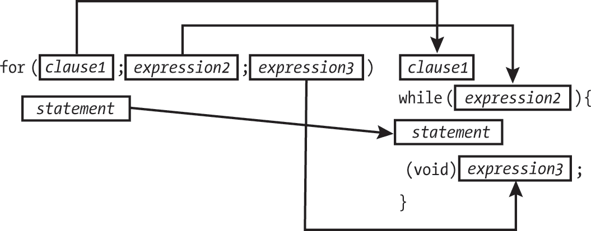

图 5-1：将`for`循环转换为`while`循环

列表 5-9 显示了列表 5-7 中`memset`实现的修改版本；我们将`while`循环替换为了`for`循环。

```c
void *memset(void *dest, int val, size_t n) {
  unsigned char *ptr = (unsigned char *)dest;

  for (❶ size_t i = 0; ❷ i < n; ❸ ++i) {
    *(ptr + i) = (unsigned char)val;
  }

  return dest;
}
```

列表 5-9：使用`for`循环填充字符数组

`for`循环在 C 语言程序员中非常受欢迎，因为它提供了一个方便的位置，让你可以在同一行内完成声明和或初始化循环计数器 ❶、指定循环的控制表达式 ❷ 以及增加循环计数器 ❸。`*(ptr + i)`左值表达式可以使用索引运算符等价地写为`ptr[i]`。

`for`循环也可能具有误导性。让我们以 C 语言中的单链表为例，它声明了一个`node`结构体，包含一个`data`元素和一个指向列表中`next`节点的指针。我们还定义了一个指向`node`结构体的指针`p`：

```c
struct node {
  int data;
  struct node *next;
};

struct node *p;
```

使用`p`的定义，以下示例（用于释放链表的存储空间）在释放`p`后错误地读取了它的值：

```c
for (p = head; p != nullptr; p = p->next) {
  free(p);
}
```

在释放后读取`p`是未定义行为。

如果将此循环重写为`while`循环，就能很明显看出代码在释放`p`后读取了它：

```c
p = head;

while (p != nullptr) {
  free(p);
  p = p->next;
}
```

`for`循环可能会让人困惑，因为它在循环主体之后求值`expression3`，尽管在词法上它出现在循环体体之前。

执行此操作的正确方法是在释放指针之前保存它，如下所示：

```c
for (p = head; p != nullptr; p = q) {
  q = p->next;
  free(p);
}
```

你可以在第 6 章中阅读更多关于动态内存管理的知识。

## 跳转语句（Jump Statements）

跳转语句在遇到时无条件地将控制权转移到同一函数的另一个部分。这些是最低级别的控制流语句，通常与底层的汇编代码紧密对应。

### `goto`

任何语句之前都可以跟一个标签，标签是一个后面跟着冒号的标识符。C23 还允许你将标签放在声明之前以及复合语句的末尾，这在之前的 C 版本中是不允许的。`goto`语句会导致跳转到该标签。

```c
label:
  /* statements */

goto label;
```

像这样使用时，`goto`语句可以让代码更易读。一个现实世界的例子是 Linux 内核 v6.7 中`kernel/fork.c`的`copy_process`函数（<https://elixir.bootlin.com/linux/v6.7/source/kernel/fork.c#L2245>），它使用了 20 个`goto`标签在内部函数失败时执行清理代码。

### `continue`

你可以在循环内部使用`continue`语句跳转到循环体的末尾，跳过当前迭代中循环体内剩余语句的执行。例如，在列表 5-11 中：

```c
while (/* _ */) {
  // --snip--
  continue;
  // --snip--
END_LOOP_BODY: ;
}
```

```c
do {
  // --snip--
  continue;
  // --snip--
END_LOOP_BODY: ;
} while (/* _ */);
```

```c
for (/* _ */) {
  // --snip--
  continue;
  // --snip--
END_LOOP_BODY: ;
}
```

列表 5-11：使用`continue`语句

`continue`语句与条件语句结合使用，以便在当前循环迭代的目标实现后，继续处理下一次循环迭代。

### `break`

`break`语句终止`switch`或迭代语句的执行。我们在列表 5-4 中：

```c
{
  char c;

  for (;;) {
    puts("Press any key, Q to quit: ");

    c = toupper(getchar());

    if (c == 'Q')
      break;

    // --snip--
  }
} // loop exits when either q or Q is pressed
```

我们通常使用`break`语句在完成执行的工作时停止循环的执行。例如，列表 5-12 中的`break`语句在数组中找到指定的键后退出循环。假设`key`在`arr`中是唯一的，`find_element`函数即使没有`break`语句行为也是相同，但取决于数组的长度和发现`key`的位置，其运行速度可能会慢得多。

```c
size_t find_element(size_t len, int arr[], int key) {
  size_t pos = (size_t)-1;

  for (size_t i = 0; i < len; ++i) {
    if (arr[i] == key) {
      pos = i;
      break;
    }
  }

  return pos;
}
```

### 跳出循环

由于`continue`和`break`会跳出循环，请谨慎地使用这些语句：`break`终止最内层的循环，而`continue`跳到下一次迭代。

### `return`

`return`语句终止函数的执行并将控制权返回给调用者。如果函数声明返回一个值，则`return`语句必须求出一个该返回类型的表达式。如果函数是`void`，则`return`语句可以单独使用或跟一个空表达式一起。

```c
int sum(int x, int y) {
  return x + y;
}
```

这个简单的函数对参数求和并返回和。返回表达式产生一个`int`，与函数的返回类型匹配。

请注意，如果控制权到达非`void`函数（声明返回一个值的函数）的右括号处而没有求出一个带有表达式的`return`语句，那么使用调用的返回值是未定义行为。例如，以下函数在`a`非负时未能返回值：

```c
int absolute_value(int a) {
  if (a < 0) {
    return -a;
  }
}
```

我们可以通过在`a`非负时提供一个返回值来轻松地修复这个缺陷，如列表 5-13 所示。

```c
int absolute_value(int a) {
  if (a < 0) {
    return -a;
  }

  return a;
}
```


**列表 5-13：`absolute_value` 函数在所有路径上都返回值。**

然而，这段代码仍然有一个 bug（参见第 3 章）。识别这个 bug 留给你练习。

### 总结

在本章中，你学习了控制流语句。控制流语句允许你创建灵活的程序，这些程序可以重复任务并根据程序输入更改执行：

- 选择语句（如 `if` 和 `switch`）允许你根据控制表达式的值从一组语句中进行选择。
- 迭代语句重复执行循环体，直到控制表达式等于 `0` 为止。
- 跳转语句无条件地将控制转移到新位置。

在下一章中，你将学习动态分配内存。与控制流语句类似，你可以使用动态内存来创建灵活的程序，根据程序的输入来分配内存。

# 6 动态分配内存


在第 2 章中，你学习了每个对象都有一个存储周期，该周期决定了它的生命周期，并且 C 定义了四种存储周期：静态（`static`）、线程（`thread`）、自动（`automatic`）和分配（`allocated`）。在本章中，你将学习动态分配内存，它是在运行时从堆（`heap`）分配的。当在运行时之前不知道程序的确切存储需求时，动态分配内存非常有用。

我们将首先描述分配、静态和自动存储周期之间的区别。我们将跳过线程存储分配，因为这涉及并行执行，而我们在这里不介绍。然后，我们将探索用于分配和释放动态内存的函数、常见的内存分配错误以及避免这些错误的策略。在本章中，`memory` 和 `storage` 术语是通用的，与它们在实践中的用法类似。

## 存储周期

对象占用 `storage`，这可能是读写内存、只读内存或中央处理器（CPU）寄存器。分配周期的存储与自动或静态存储周期的存储具有显著不同的属性。首先，我们将回顾自动和静态存储周期。

自动存储周期的对象在块（`block`）内部或作为函数参数声明。这些对象的生命周期开始于声明它们的块开始执行，结束于该块的执行结束。如果递归进入该块，每次都会创建一个新对象，每个对象都有自己的存储空间。

在文件作用范围内声明的对象具有静态存储周期。这些对象的生命周期是整个程序的执行期间，它们的存储值在程序启动之前已初始化。你也可以通过 `static` 存储类说明符在块内声明一个具有静态存储周期的变量。

### 堆和内存管理器

动态分配内存具有分配存储周期。分配对象的生命周期从分配持续到释放。动态分配内存从 `heap` 分配，堆简单来说是由内存管理器管理的一个或多个大的、可细分的内存块。

`Memory managers` 是库，它们通过提供在本章中描述的标准内存管理函数的实现来为你管理堆。内存管理器作为客户端进程的一部分运行。内存管理器从操作系统（OS）请求一个或多个内存块，并在调用内存分配函数时将这些内存分配给客户端进程。分配请求不会直接发送到操作系统，因为操作系统的速度较慢且只能处理大块内存，而分配器（`allocators`）会将这些大块拆分成小块，且运行速度更快。

内存管理器只管理未分配和已释放的内存。一旦内存被分配，调用者就会管理该内存直到其被返回。确保内存被释放是调用者的责任，尽管大多数实现会在程序终止时回收动态分配的内存。

### 何时使用动态分配内存

如前所述，在运行时之前不知道程序的确切存储需求时，就会动态分配内存。动态分配内存的效率低于静态分配内存，因为内存管理器需要在运行时堆中寻找适当大小的内存块，并且调用者在不再需要时必须显式释放这些块，所有这些都需要额外的处理。动态分配内存还需要用于管理操作的额外处理，例如 `defragmentation`（碎片整理，即相邻空闲块的合并），内存管理器经常使用额外的存储用于控制结构以方便这些过程。

`Memory leaks`（内存泄漏）发生在不再需要的动态分配内存未返回给内存管理器时。如果这些内存泄漏非常严重，内存管理器最终将无法满足新的存储请求。

默认情况下，对于在编译时已知大小的对象，你应该声明为具有自动或静态存储周期的对象。在运行时之前未知存储大小或对象数量时，使用动态分配内存。例如，你可能使用动态分配内存在运行时从文件中读取表格，特别是当你从编译时不知道表格的行数时。同样，你可能使用动态分配内存来创建链表、哈希表、二叉树或其他数据结构，这些数据结构中每个容器持有的数据元素数量在编译时是未知的。

## 内存管理

C 标准库定义了分配（例如 `malloc`、`calloc` 和 `realloc`）和释放（`free`）动态内存的内存管理函数。OpenBSD 的 `reallocarray` 函数未由 C 标准定义，但对内存分配有用。C23 增加了两个额外的释放函数：`free_sized` 和 `free_aligned_sized`。

动态分配的内存需要对直到请求大小的对象（包括数组和结构体）进行适当对齐。C11 为具有比内存对齐要求更高的硬件引入了 `aligned_alloc` 函数。

### `malloc`

`malloc` 函数为指定大小的对象分配空间。返回的存储区域的表示是不确定的。在列表 6-1 中，我们调用 `malloc` 函数为大小为 `struct widget` 的对象动态分配存储。

```c
#include <stdlib.h>

typedef struct {
  double d;
  int i;
  char c[10];
} widget;

❶ widget *p = malloc(sizeof *p);

❷ if (p == nullptr) {
  // handle allocation error
}

// continue processing
```

**列表 6-1：使用 `malloc` 函数为 `widget` 分配存储**

所有内存分配函数都接受一个类型为 `size_t` 的参数，指定要分配的内存字节数❶。为了可移植性，我们在计算对象大小时使用 `sizeof` 运算符，因为不同类型（如 `int` 和 `long`）的对象在不同实现中的大小可能不同。

`malloc` 函数返回一个空指针表示错误，或者返回一个指向分配空间的指针。因此，我们需要检查 `malloc` 是否返回了空指针❷，并适当处理错误。

在函数成功返回分配的存储空间后，我们可以通过指针 `p` 引用 `widget` 结构体的成员。例如，`p->i` 访问 `widget` 的 `int` 成员，而 `p->d` 访问 `double` 成员。

### 在不声明类型的情况下分配内存

你可以将 `malloc` 的返回值存储为 `void` 指针，以避免为引用的对象声明类型：

```c
void *p = malloc(size);
```

或者，可以使用 `char` 指针，这在 `void` 类型引入 C 语言之前是一种约定：

```c
char *p = malloc(size);
```

在任何一种情况下，`p` 指向的对象在将对象拷贝到该存储空间之前都没有类型。一旦发生这种情况，该对象就具有最后拷贝到该存储空间的对象的*有效类型*（effective type），这会将类型烙印在分配的对象上。

在接下来的示例中，`p` 引用的存储空间有效类型为 `widget`：

```c
widget w = {3.2, 9, "abc",};

memcpy(p, &w, sizeof(w));
```

调用 `memcpy` 之后，有效类型的改变会影响优化，不再有其他影响。

由于分配的内存可以存储任何足够小的对象类型，因此由分配函数（包括 `malloc`）返回的指针必须足够对齐。例如，如果某个实现拥有具有 1、2、4、8 和 16 字节对齐的对象，并且分配了 16 字节或更多存储，则返回指针的对齐方式是 16 的倍数。

### 读取未初始化的内存

`malloc` 返回的内存内容是*未初始化的*，这意味着它具有不确定的表示。读取未初始化的内存永远不是好主意；可以将其视为未定义行为。如果你想了解更多，我写过一篇关于未初始化读取的深度文章（Seacord 2017）。`malloc` 函数不初始化返回的内存，因为预计你最终会覆盖这些内存。

尽管如此，初学者经常犯一个错误，即假设 `malloc` 返回的内存包含零。列表 6-2 中的程序就恰恰犯了这个错误。

```c
#include <stdio.h>
#include <stdlib.h>
#include <string.h>

int main() {
  char *str = (char *)malloc(16);

  if (str) {
    strncpy(str, "123456789abcdef", 15);
    printf("str = %s.\n", str);
    free(str);
  }
}
```

**列表 6-2：一个初始化错误**

该程序调用 `malloc` 分配 16 字节，然后使用 `strncpy` 将前 15 字节拷贝到内存。然而，程序员假设存储空间已经包含一个空字节，在这种情况下，`printf` 调用将导致未定义行为。

常见的解决方案向分配的存储空间写入一个空字符，如下：

```c
strncpy(str, "123456789abcdef", 15);

str[15] = '\0';
```

如果源（此示例中的字符串字面量 `"123456789abcdef"`）小于 15 字节，则该赋值是不必要的。如果源有 15 字节或更多，此赋值确保了字符串正确终止。

### `aligned_alloc`

`aligned_alloc` 函数类似于 `malloc` 函数，不同之处在于它要求你提供对齐方式以及大小。它具有以下签名：

```c
void *aligned_alloc(size_t alignment, size_t size);
```

虽然 C 语言要求 `malloc` 动态分配的内存对于所有标准类型（包括数组和结构体）足够对齐，但你可能有时覆盖编译器的默认选择。你可以使用 `aligned_alloc` 函数请求比默认更严格的对齐（换句话说，更大的 2 的幂）。如果 `alignment` 的值不是实现支持的有效对齐值，函数将通过返回空指针失败。更多关于对齐的信息请参见第 2 章。

### `calloc`

`calloc` 函数为 `nmemb` 个对象的数组分配存储空间，每个对象的大小为 `size` 字节。它具有以下签名：

```c
void *calloc(size_t nmemb, size_t size);
```

该函数将存储空间初始化为全零。这些零值可能与表示浮点零或空指针常量使用的值不同。你也可以使用 `calloc` 函数为单个对象分配存储空间，这可以看作只有一个元素的数组。

在内部，`calloc` 函数通过将 `nmemb` 乘以 `size` 来确定所需的分配字节数。在历史上，某些 `calloc` 实现未能验证这些值在相乘时是否会发生溢出。C23 要求进行此类测试，而现代 `calloc` 实现在如果无法分配空间或乘积 `nmemb * size` 会发生溢出，将返回空指针。

### `realloc`

`realloc` 函数用于增加或减小之前分配的存储空间。它接收一个指向早先通过 `aligned_alloc`、`malloc`、`calloc` 或 `realloc` 分配的内存的指针（或空指针）以及一个大小，其签名如下：

```c
void *realloc(void *ptr, size_t size);
```

你可以使用 `realloc` 函数来增大或（较少地）减小数组的大小。

#### 避免内存泄漏

为了避免在使用 `realloc` 时引入 Bug，你应该了解该函数的规范说明。如果新分配的存储空间比旧内容大，`realloc` 会让额外的存储处于未初始化状态。如果 `realloc` 成功分配了新对象，它会调用 `free` 来释放旧对象。新对象的指针值可能与旧对象的指针值相同。如果分配失败，`realloc` 函数将保留原地址处的旧对象数据并返回空指针。`realloc` 的调用可能会失败，例如当没有足够的内存来分配请求的字节数时。以下对 `realloc` 的用法可能是错误的：

```c
size += 50;

if ((p = realloc(p, size)) == nullptr) return nullptr;
```

在此示例中，`size` 在调用 `realloc` 之前增加了 50，以增大 `p` 所引用的存储空间的大小。如果 `realloc` 调用失败，`p` 将被赋值空指针值，但 `realloc` 并没有释放 `p` 所引用的存储空间，导致该部分内存发生泄漏。

**列表 6-3** 展示了 `realloc` 函数的正确用法。

```c
void *p = malloc(100);

void *p2;

// --snip--

if ((nsize == 0) || (p2 = realloc(p, nsize)) == nullptr) {
  free(p);
  return nullptr;
}

p = p2;
```

**列表 6-3：正确使用 `realloc` 函数的示例**

`列表 6-3` 声明了两个变量 `p` 和 `p2`。`malloc` 返回 `p` 指向的内存，而 `p2` 未初始化。最终，这段内存被调整了大小，我们通过带有 `nsize` 的 `realloc` 函数来实现。`realloc` 的返回值赋值给 `p2` 以避免覆盖存储在 `p` 中的指针。如果 `realloc` 返回空指针，则释放 `p` 引用的内存。如果它返回指向 `nsize` 分配的指针，则更新 `p`。

任何引用 `p` 之前指向的内存的指针必须更新为引用 `p2` 指向的内存，无论 `realloc` 是否为该存储保留了相同的地址。

解决此问题的一种方法是使用间接层，有时称为*句柄*（handle）。如果对重新分配指针的所有使用都是间接的，那么当该指针被重新赋值时，它们都将得到更新。

正如我们在前面的章节中所看到的，有符号整数溢出和无符号整数回绕都是严重的问题，会导致缓冲区溢出和其他安全漏洞。例如，在下面的代码段中，`num * size` 表达式在被作为大小参数传递给 `realloc` 调用之前可能会发生回绕：

```c
if ((newp = realloc(p, num * size)) == nullptr) {
  // --snip--
```

OpenBSD 的 `reallocarray` 函数可以为数组重新分配存储空间，但像 `calloc` 一样，它在计算数组大小时会检查回绕，这让你无需手动执行这些检查。`reallocarray` 函数具有以下签名：

```c
void *reallocarray(void *ptr, size_t nmemb, size_t size);
```

`reallocarray` 函数为大小为 `size` 的 `nmemb` 个成员分配存储，并在 `nmemb * size` 计算中检查回绕。包括 GNU C Library（`libc`）在内的其他平台已采纳该函数，并已提议将其纳入 POSIX 标准的下一个修订版本中。`reallocarray` 函数不会清零所分配的存储空间。

当通过两个值相乘来确定分配大小时，`reallocarray` 函数非常有用：

```c
if ((newp = reallocarray(p, num, size)) == nullptr) {
  // --snip--
```

如果 `num * size` 会发生回绕，则对 `reallocarray` 函数的调用将失败并返回空指针。

### `free`

当内存不再需要时，可以使用 `free` 函数释放内存。释放内存允许该内存被重用，从而减少耗尽可用内存的概率并通常能提供更高效的堆使用。

我们可以通过将指向内存的指针传递给 `free` 函数来释放内存，该函数具有以下签名：

```c
void free(void *ptr);
```

`ptr` 值必须是由之前的 `malloc`、`aligned_alloc`、`calloc` 或 `realloc` 调用返回的。CERT C 规则 `MEM34-C`“仅释放动态分配的内存”讨论了当值未返回时会发生什么。内存是有限的资源，因此必须回收。

如果我们使用空指针参数调用 `free`，则什么都不会发生，`free` 函数直接返回：

```c
char *ptr = nullptr;

free(ptr);
```

另一方面，两次释放同一个指针是一个严重错误。

### `free_sized`

C23 引入了两个新的内存释放函数。`free_sized` 函数具有以下签名：

```c
void free_sized(void *ptr, size_t size);
```

如果 `ptr` 是空指针或者从 `malloc`、`realloc` 或 `calloc` 调用获得的结果（且 `size` 等于请求的分配大小），则该函数的行为与 `free` 相同。否则，行为未定义。

### `free_aligned_sized`

C23 引入的两个新内存释放函数中的第二个是 `free_aligned_sized` 函数（注：原文此处标题误写为 `free_sized`）。`free_aligned_sized` 函数具有以下签名：

```c
void free_aligned_sized(void *ptr, size_t alignment, size_t size);
```


如果`ptr`是空指针，或者是从`aligned_alloc`调用获得的结果（且`alignment`等于请求的分配对齐方式，`size`等于请求的分配大小），则该函数等同于`free(ptr)`。否则，行为未定义。换句话说，此函数仅用于释放显式对齐的内存。

### 处理悬指针

如果你对同一个指针多次调用`free`函数之一，就会发生未定义行为。这些缺陷可能导致被称为“双释放”（double-free）漏洞的安全缺陷。其后果之一是它们可能被利用以以漏洞进程的权限执行任意代码。双释放漏洞的完整影响超出了本书的范围，但我在 *Secure Coding in C and C++* (Seacord 2013) 中详细讨论了它们。双释放漏洞在错误处理代码中特别常见，因为程序员尝试释放已分配的资源。

另一个常见的错误是访问已经释放的内存。这类错误通常无法被检测，因为代码可能运行正常，但随后在实际错误发生的地方以意之外的方式失败。在来自实际应用程序的`Listing 6-4`中，`close`的参数是无效的，因为第二次调用`free`已经回收了`dirp`原指向的存储空间。

```c
#include <dirent.h>
#include <stdlib.h>
#include <unistd.h>

int closedir(DIR *dirp) {
  free(dirp->d_buf);
  free(dirp);
  return close(dirp->d_fd);  // dirp 已经被释放
}
```

*Listing 6-4: 访问已释放的内存*

我们将指向已释放内存的指针称为*悬空指针*（dangling pointers）。悬空指针是错误的潜在来源（就像地板上的香蕉皮）。对悬空指针的任何使用（而不仅仅是解引用）都是未定义行为。当用于访问已经释放的内存时，悬空指针可能导致释放后使用漏洞（CWE 416）。当传递给`free`函数时，悬空指针可能导致双释放漏洞（CWE 415）。有关这些主题的更多信息，请参见 CERT C 规则 MEM30-C，“不要访问已释放的内存”。

### 将指针置

为了限制涉及悬空指针的缺陷机会，在完成`free`调用后将指针设置为`nullptr`：

```c
char *ptr = malloc(16);
// --snip--
free(ptr);
ptr = nullptr;
```

任何未来对该指针的解引用尝试通常会导致崩溃，从而增加了在实现和测试期间检测到错误的概率。如果指针被设置为`nullptr`，则内存可以被释放多次而没有后果。遗憾的是，`free`函数本身无法将指针设置为`nullptr`，因为它接收的是指针的拷贝而不是实际指针本身。

## 内存状态

动态分配的内存可以处于`Figure 6-1`所示的三状态之一：在内存管理器中未分配且未初始化、已分配但未初始化、以及已分配并初始化。对`malloc`和`free`函数的调用以及写入内存会导致内会在状态之间转换。

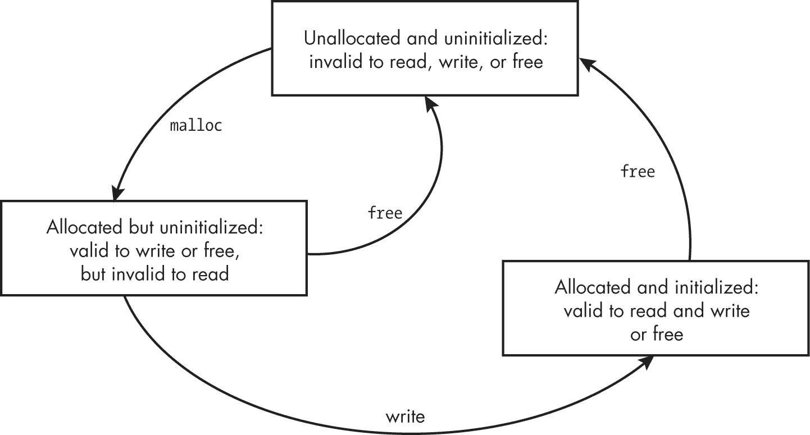
*Figure 6-1: 内存状态*

根据内存的状态，不同的操作是有效的。避免对未显示为有效或显式列为无效的内存进行操作。在执行此代码段中的`memset`函数后

```c
char *p = malloc(100);
memset(p, 0, 50);
```

前 50 个字节已分配并初始化，而最后 50 个字节已分配但未初始化。可以读取已初始化字节，但不能读取未初始字节。

## 灵活数组成员

在 C 中为包含数组的结构体分配存储总是有点棘。如果数组具有固定数量的元素，没有问题，因为结构体的大小很容易确定。然而，开发者经常需要声明一个大小在运行时未知的数组，最初 C 并没有提供直接的方法来实现。

灵活数组成员允许你为具有任意数量固定成员的结构体声明并分配存储，其中最后一个成员是一个未知大小的数组。从 C99 开始，具有多个成员的`struct`的最后一个成员可以具有*不完全数组类型*（incomplete array type），这意味着数组具有未知大小，你可以在运行时指定它。灵活数组成员允许你访问变长度对象。

例如，`Listing 6-5`展示了灵活数组成员`data`的用法。

```c
#include <stdlib.h>

constexpr size_t max_elem = 100;

typedef struct {
  size_t num;
  int data[];
} widget;

widget *alloc_widget(size_t num) {
  if (num > max_elem) return nullptr;
  widget *p = (widget *)malloc(sizeof(widget) + sizeof(int) * num);
  if (p == nullptr) return nullptr;
  p->num = num;
  for (size_t i = 0; i < p->num; ++i) {
    p->data[i] = 0;
  }
  return p;
}
```

*Listing 6-5: 灵活数组成员*

我们首先声明了一个`struct`，其最后一个成员`data`数组是一个不完全类型（没有指定大小）。然后我们通过调用`malloc`为整个`struct`分配存储。为了实现这一点，我们将数组中的元素数量（`num_elem`）乘以每个元素的大小（`sizeof(int)`）。该程序假设`num_elem`的值在乘以`sizeof(int)`时不会发生回绕（wraparound）。

我们可以通过使用`.`或`->`运算符访问此存储，就像该存储是作为`data[num_elem]`分配的一样。有关分配和拷贝包含灵活数组成员的结构的更多信息，请参见 CERT C 规则 MEM33-C，“分配并拷贝包含灵活数组成员的结构”。

在 C99 之前，多个编译器支持类似的“`struct` hack”。CERT C 规则 DCL38-C，“在声明灵活数组成员时使用正确的语法”是提醒使用 C99 及后续版本 C 标准中指定的语法。

## 其他动态分配存储

除了内存管理函数外，C 还有其他支持动态分配存储的语言和库功能。这种存储通常分配在调用者的栈帧中（C 标准没有定义栈，但它是常见的实现特性）。*栈*（stack）是一种后进先出（LIFO）数据结构，支持函数的嵌套调用。每次函数调用都会创建一个*栈帧*（stack frame），其中可以存储局部变量（自动存储生存期）以及特定该函数调用的其他数据。

### `alloca`

出于性能考虑，`alloca`（某些实现支持的非标准函数）允许在运行时从栈内存而非堆内存中进行动态分配。这部分内会在调用`alloca`的函数返回时自动释放。`alloca`函数是一个`intrinsic`（内联的或内置的）函数，它由编译器进行特殊处理。这允许编译器用一组自动生成的指令替换原始的函数调用。例如，在 x86 架构上，编译器会将对`alloca`的调用替换为单条指令，通过调整栈指针来容纳额外的存储空间。

`alloca`函数源于贝尔实验室早期版本的 Unix 操作系统，但它并未被 C 标准库或 POSIX 标准定义。列表 6-6 显示了一个名为`printerr`的示例函数，该函数使用`alloca`函数在将错误字符串打印到`stderr`之前为该字符串分配存储空间。

```c
void printerr(errno_t errnum) {
   rsize_t size = strerrorlen_s(errnum) + 1;
   char *msg = (char *)alloca(size);
  if ( strerror_s(msg, size, errnum) != 0) {
     fputs(msg, stderr);
  }
  else {
     fputs("unknown error", stderr);
  }
}
```

列表 6-6: `printerr`函数

`printerr`函数接受一个`errno_t`类型的参数`errnum`。我们调用`strerrorlen_s`函数 ❶ 来确定与此错误码关联的错误字符串的长度。一旦我们知道了需要分配的容纳错误字符串的数组大小，就可以调用`alloca`函数 ❷ 来高效地为该数组分配存储空间。然后，我们通过调用`strerror_s`函数 ❸ 获取错误字符串，并将结果存储在新分配的存储空间`msg`引用中。假设`strerror_s`函数执行成功，我们就输出错误消息 ❹；否则，我们输出`unknown error` ❺。这个`printerr`函数的编写是为了演示`alloca`的用法，它的复杂程度比实际需要的要高。

使用`alloca`函数可能会比较棘手。首先，对`alloca`的调用可能会导致分配超出栈边界。然而，`alloca`函数不会返回空指针，因此没有办法检查错误。出于此原因，避免对`alloca`进行大内存或无边界分配至关重要。此示例中对`strerrorlen_s`的调用应该返回一个合理的分配大小。

`alloca`函数的另一个问题是，程序员可能会因为必须释放由`malloc`分配而非`alloca`分配的内存而感到困惑。对未通过`malloc`、`calloc`、`realloc`或`strdup`获取的指针调用`free`是严重错误。GCC 和 Clang 都提供了`-Wall`编译器标志来诊断所有对`alloca`的调用。GCC 还提供了`-Wstack-usage`标志，用于诊断请求的内存是否超过`size`的。

### 变长数组

变长数组（VLAs）是在 C99 中引入的。VLA 是一种变体类型对象（见第 2 章）。VLA 的存储空间在运行时分配，其大小等于基础类型的大小乘以运行时范围。

在创建数组后，无法修改其大小。所有 VLA 声明必须在*块作用域*（block scope）内。以下示例在函数`func`中将大小为`size`的 VLA`vla`声明为自动变量：

```c
void func(size_t size) {
  int vla[size];
  // --snip--
}
```

当你在运行时不知道数组中元素的个数时，VLAs 非常有用。与`alloca`函数不同，VLAs 在相应的块结束时会被释放，就像其他自动变量一样。列表 6-7 用 VLA 替换了列表 6-6 中`printerr`函数中对`alloca`的调用。这一更改仅修改了一行代码（加粗显示）。

```c
void print_error(int errnum) {
  size_t size = strerrorlen_s(errnum) + 1;
  char msg[size];
  if (strerror_s(msg, size, errnum) != 0) {
    fputs(msg, stderr);
  }
  else {
    fputs("unknown error", stderr);
  }
}
```

使用 VLAs 代替`alloca`函数的主要优势是，其语法符合程序员对自动存储生存期数组工作方式的模型。VLAs 的工作方式与自动变量一样（因为它们确实如此）。另一个优势是，内存在迭代过程中不会累积（这在使用`alloca`时可能会意外发生，因为内会在函数结束时才释放）。

VLA（变长数组）与`alloca`函数存在一些共同问题，它们都会尝试进行超出栈边界的分配。遗憾的是，没有可移植的方法来确定剩余栈空间以检测此类错误。此外，当您提供的长度乘以每个元素的大小时，数组大小的计算可能会发生溢出。由于这些原因，在声明数组之前对其大小进行验证至关重要，以避免分配过大或大小不正确的内存。这对于那些带有不可信输入或被递归调用的函数来说尤为重要，因为每次递归都会为函数（包括这些数组）创建一组全新的自动变量。在将不可信输入用于任何分配（包括来自堆的分配）之前，必须对其进行验证。

你应该确定在最坏情况下（最大尺寸的分配配合深层递归）你是否有足够的栈空间。在某些实现中，还可能向 VLA 传递负数大小，因此请确保您的大小表示为`size_t`或其他无符号类型。更多信息，请参阅 CERT C 规则`ARR32-C`，“确保变长数组的尺寸参数在有效范围内”。与使用最坏情况下的固定大小数组相比，VLA 减少了栈的使用。

以下文件范围内的声明展示了 VLA 的另一个令人困惑的方面：

```c
static const unsigned int num_elem = 12;
double array[num_elem];
```

这段代码有效吗？如果`array`是 VLA，那么该代码是无效的，因为声明位于文件作用范围内。如果`array`是常量大小数组，则该代码是有效的。GCC 目前拒绝这个示例，因为`array`是 VLA。然而，C23 允许实现扩展整数常量表达式的定义，Clang 通过将`array`变为常量大小数组来实现这一点。

我们可以在所有符合 C23 的实现中使用`constexpr`来重写这些声明，以实现可移植性：

```c
constexpr unsigned int num_elem = 12;
double array[num_elem];
```

最后，在对 VLA 调用`sizeof`时，会发生另一种有趣且意料之外的行为。编译器通常在编译时执行`sizeof`操作。然而，如果表达式改变了数组的大小，它将在运行时评估，包括任何副作用。`typedef`的情况也是如此，如列表 6-8 所示。

```c
#include <stdio.h>
#include <stdlib.h>

int main() {
  size_t size = 12;
  (void)(sizeof(size++));
  printf("%zu\n", size); // prints 12
  (void)sizeof(int[size++]);
  printf("%zu\n", size); // prints 13
  typedef int foo[size++];
  printf("%zu\n", size); // prints 14
  typeof(int[size++]) f;
  printf("%zu\n", size); // prints 15
  return EXIT_SUCCESS;
}
```

列表 6-8：意料之外的副作用

在这个简单的测试程序中，我们声明了一个类型为`size_t`的变量`size`并将其初始化为`12`。`sizeof(size++)`中的操作数没有被求值，因为操作数的类型不是 VLA。因此，`size`的值没有改变。然后，我们使用`int[size++]`作为参数调用`sizeof`运算符。因为这个表达式改变了数组的大小，`size`递增了，现在等于`13`。`typedef`同样地增加了`size`的值。最后，我们声明了`typeof(int[size++]) f`，这进一步增加了`size`。

列表 6-9：使用`dmalloc`捕获内存漏洞

最近版本的 glibc 会检测出此程序中的至少一个漏洞：

```text
Sorry (null),
Usage: caesar secret_file keys_file [output_file]
free(): double free detected in tcache 2
Program terminated with signal: SIGSEGV
```

修复此错误后，请包含**粗体字体**所示行，以便允许`dmalloc`报告导致问题的调用文件和行号。

我稍后会展示输出，但我们首先需要讨论几点。`dmalloc`分发还带有一个命令行工具。你可以运行以下命令获取有关如何使用该工具的进一步信息：

```text
% dmalloc --usage
```

在用`dmalloc`调试程序之前，在命令行输入以下内容：

```text
% dmalloc -l logfile -i 100 low
```

此命令将日志文件名称设置为`logfile`，并按照`-i`参数指定的，指示库在执行`100`次调用后进行检查。如果你为`-i`参数指定更大的数字，`dmalloc`检查堆的频率会降低，你的代码运行得更快；较小的数字更有可能捕捉内存问题。第三个参数启用了`low`数量的调试功能。其他选项包括用于最小检查的`runtime`，用于更广泛堆验证的`medium`或`high`。

执行此命令后，我们可以使用 GCC 如下编译程序：

```text
% gcc -DDMALLOC caesar.c -ocaesar -ldmalloc
```

当你运行程序时，你应该会看到以下错误：

```text
% ./caesar
Sorry student,
Usage: caesar secret_file keys_file [output_file]
debug-malloc library: dumping program, fatal error
  Error: tried to free previously freed pointer (err 61)
Aborted (core dumped)
```

如果你检查日志文件，你将发现以下信息：

```text
% more logfile
1571549757: 3: Dmalloc version '5.5.2' from 'https://dmalloc.com/'
1571549757: 3: flags = 0x4e48503, logfile 'logfile'
1571549757: 3: interval = 100, addr = 0, seen # = 0, limit = 0
1571549757: 3: starting time = 1571549757
```


1571549757: 3: process pid = 29531

1571549757: 3:   error details: finding address in heap

1571549757: 3:   pointer `'0x7ff010812f88'` from `'caesar.c:29'` prev access `'unknown'`

1571549757: 3: ERROR: free: tried to free previously freed pointer (err 61)

```
这些消息表明我们尝试两次释放 `errmsg` 引用的存储空间，第一次是在 `usage` 函数中，第二次是在 `main` 中，这构成了一个双释放（double-free）漏洞。当然，这只是 `dmalloc` 可以检测的缺陷类型的一个示例，在我们测试的简单程序中还存在其他缺陷。

### 安全关键型系统

具有高安全要求的系统经常禁止使用动态内存，因为内存管理器可能会产生不可预测的行为，显著影响性能。强制所有应用程序运行在固定的、预分配的内存区域可以消除这些问题并更容易验证内存使用。前提是没有递归、`alloca` 和 VLAs（这些在安全关键系统中也是禁止的）。

### 总结

在本章中，你学习了如何处理动态内存。我们描述了堆和内存管理器，并识别了一些常见的错误原因（例如泄漏和双释放），并引入了一些缓解措施。我们还涵盖了更专门的内存主题，如灵活数组成员、`alloca` 函数和 VLAs。我们通过讨论使用 `dmalloc` 库进行调试结束了本章。

在下一章中，你将学习字符和字符串。

## 字符与字符串

字符串是一种如此重要且实用的数据类型，几乎每种编程语言都以某种形式实现了它们。字符串通常用于表示文本，构成了用户与程序之间交换的数据的大部分。

在 C 语言中，字符串数据类型基于形式字符串的概念构建的：

假设 Σ 是一个非空有限字符集，称为字母表。Σ 之上的字符串是 Σ 中字符的任何有限序列。例如，如果 Σ = {0, 1}，那么 01011 就是 Σ 之上的字符串。

在本章中，我们将讨论可用于组合字符串的各种字符集，包括 ASCII 和 Unicode（即形式定义中的*字母表*）。我们将涵盖如何使用 C 标准库中的旧留函数、边界检查接口，以及 POSIX 和 Windows 应用程序编程接口（APIs）来表示和操作字符串。

### 字符

人们用于通信的字符并不是数字系统自然理解的，数字系统基于位操作的。为了处理字符，数字系统使用*字符编码*，分配唯一的整数值（称为*代码点*）来指定特定字符。正如你所看到的，在程序中有多种方法可以编码同一个概念字符。C 实现用于编码字符的常用标准包括 Unicode、ASCII、扩展 ASCII、ISO 8859-1 (Latin-1)、Shift-JIS 和 EBCDIC。

#### ASCII

7 位美国信息交换标准代码，通称为 7 位 ASCII，它规定了一组 128 个字符及其编码表示（ANSI X3.4-1986）。从 `0x00` 到 `0x1f` 的字符以及字符 `0x7f` 是控制字符，例如空字符、退格符、水平制表符和删除键（DEL）。从 `0x20` 到 `0x7e` 的字符均为可打印字符，如字母、数字和符号。

我们通常使用更新后的名称 `US-ASCII` 来称为此标准，以明确该系统开发于美国，并侧重于在该主要使用的排版符号。大多数现代字符编码方案都基于 US-ASCII，尽管它们支持许多额外的字符。

`0x80` 到 `0xFF` 范围内的字符并未由 US-ASCII 定义，但它们被称为 `Extended ASCII` 的 8 位字符编码的一部分。这些范围存在多种编码方式，实际映射取决于代码页（`code page`）。`code page` 是将可打印字符和控制字符映射到唯一数字的字符编码。

#### Unicode

`Unicode` 已成为计算机处理表示文本的通用字符编码标准。它支持比 ASCII 广多的字符范围；当前的 Unicode 标准（Unicode 2023）对范围从 `U+0000` 到 `U+10FFFF` 的字符进行编码，相当于一个 21 位代码空间。单个 Unicode 值在打印文本中表示为 `U+` 后跟四个或更多十六进制数字。Unicode 字符 `U+0000` 到 `U+007F` 与 US-ASCII 中的字符相同，而范围 `U+0000` 到 `U+00FF` 与 ISO 8859-1 相同，由贯穿美洲、西欧、大洋洲和非洲大部分地区的拉丁字母字符组成。

Unicode 将代码点组织成 `planes`（平面），这些是每组包含 65,536 个代码点的连续组。共有 17 个平面，由数字 0 到 16 标识。最常用的字符（包括在主要的旧编码标准中找到字符）被放置在第一个平面（`0x0000` 到 `0xFFFF`），该平面被称为 `basic multilingual plane (BMP)`（基本多语言平面），或平面 0。

Unicode 还规定了若干 `Unicode transformation formats (UTFs)`（Unicode 转换格式），这些是将 Unicode 标量值分配给唯一代码单元序列的字符编码格式。`Unicode scalar value` 是除高低代理代码点以外的任何 Unicode 代码点。（代理对在本节的后部分进行解释。）`code unit`（代码单元）是用于处理或交换的编码文本的最小位组合。Unicode 标准定义了三种 UTF 以允许使用不同大小的代码单元：

- **UTF-8**: 将每个字符表示为由一个到四个 8 位代码单元组成的序列
- **UTF-16**: 将每个字符表示为由一个或两个 16 位代码单元组成的序列
- **UTF-32**: 将每个字符表示为单个 32 位代码单元

`UTF-8` 编码是 POSIX 系统的主导地位的编码。它具有以下良好的特性：

- 它将 US-ASCII 字符（`U+0000` 到 `U+007F`）编码为 `0x00` 到 `0x7F` 范围内的单字节。这意味着仅包含 7 位 ASCII 字符的文件和字符串在 ASCII 和 UTF-8 下具有相同的编码。
- 使用空字节来终止字符串（我们稍后将讨论的话题）的工作方式与 ASCII 相同。
- 所有定义的 Unicode 代码点都可以在 1 到 4 字节之间编码。
- Unicode 允许轻松识别字符边界。在 Windows 上，你可以使用 `/utf8` 标志编译并链接程序以设置源字符和执行字符集。

UTF-16 目前是 Windows 的主导编码。与 UTF-8 一样，它是一种变长编码。代码点大于 `U+FFFF` 的字符被称为 `supplementary characters`（补充字符）。补充字符由一对被称为 `surrogates`（代理）的代码单元定义。第一个代码单元来自高代理范围（`D800` 到 `DBFF`），第二个代码单元来自低代理范围（`DC00` 到 `DFFF`）。

与变长度的 UTs 不同，`UTF-32` 是一种固定长度的编码。`UTF-32` 的主要优势是 Unicode 代码点可以直接索引，这意味着你可以在常数时间内找到序列中的第 n 个代码点。相比之下，变长度编码需要访问每个代码点才能找到第 n 个代码点。

#### 源字符集和执行字符集

在 C 语言最初标准化时，并不存在通用的字符编码，因此它被设计用于处理各种字符表示。C 没有像 Java 那样指定字符编码，而是每个 C 实现都定义了用于源文件的 `source character set`（源字符集）以及用于编译时字符和字符串字面量的 `execution character set`（执行字符集）。

源字符集和执行字符集都包含拉丁字母的大写和小写；10 个十进制数字；29 个图形字符以及空格、水平制表符、垂直制表符、分页符和换行符。执行字符集还包括警示符、退格符、回车和空字符。

字符转换和分类函数（如 `isdigit()`）在运行时根据调用时有效的区域（locale）决定的编码进行评估。程序的 `locale` 定义了它的字符集、日期和时间格式规范、货币规范、小数格式规范和排序顺序。

#### 数据类型

C 定义了多种数据类型来表示字符数据，其中一些我们已经见过。C 提供了未修饰的 `char` 类型来表示*窄字符*（可以用最少 8 位表示的字符）以及 `wchar_t` 类型来表示*宽字符*（可能需要超过 8 位的字符）。

##### `char`

正如我已经提到的，`char` 是一种整数类型，但每个实现都定义它是有符号还是无符号的。在可移植代码中，你可以假设它既不是有符号的也不是无符号的。

使用 `char` 类型处理字符数据（符号位没有意义），而不是处理整数数据（符号位非常重要）。你可以安全地使用 `char` 类型来表示 7 位字符编码，例如 US-ASCII。对于这些编码，高位位始终为 0，因此当类型为 `char` 的值转换为 `int` 并被定义为有符号类型时，你不需要担心符号扩展问题。

你也可以使用 `char` 类型来表示 8 位字符编码，例如扩展 ASCII、ISO/IEC 8859、EBCDIC 和 UTF-8。在将 `char` 定义为 8 位有符号类型的实现中，这些 8 位字符编码可能会出现问题。例如，以下代码在检测到 `EOF` 时会打印字符串 `end of file`：

```
char c = 'ÿ';  // extended character

if (c == EOF) puts("end of file");
```

假设实现定义的执行字符集为 ISO/IEC 8859-1，带变音符号的拉丁小字母 y (ÿ) 定义为 255 (0xFF)。对于将 `char` 定义为有符号类型的实现，`c` 将符号扩展到 `signed int` 的宽度，导致 ÿ 字符与 `EOF` 无法区分，因为它们具有相同的表示法。

在使用 `ctype.h` 中定义的字符分类函数时，也会发生类似的问题。这些库函数接受 `int` 类型的字符参数或宏 `EOF` 的值。如果该字符属于函数描述中定义的字符集，它们返回非零值；如果值不属于，则返回零。例如，`isdigit` 函数测试该字符是否为当前区域（locale）中的十进制数字。任何不是有效字符或 `EOF` 的参数值都会导致未定义行为。

为了避免在调用这些函数时出现未定义行为，请在整数提升之前将 `c` 强制转换为 `unsigned char`，如下：

```
char c = 'ÿ';

if (isdigit((unsigned char)c)) {
  puts("c is a digit");
}
```

存储在 `c` 中的值被零扩展到 `signed int` 的宽度，通过确保结果值可以被表示为 `unsigned char`，消除了未定义行为。请注意，将 `c` 初始化为 `'ÿ'` 可能会导致警告或错误。

##### `int`

对于可能是 `EOF`（一个负值）或被解释为 `unsigned char` 的字符数据，请使用 `int` 类型。从流读取字符数据的函数（如 `fgetc`、`getchar`）返回 `int` 类型。正如我们所看到的，来自 `ctype.h` 的字符处理函数也接受这种类型，因为它们可能会传递 `EOF`。

##### `wchar_t`

`wchar_t` 类型是一种用于处理宽字符集的整数类型。取决于实现的不同，它可以是有有符号类型，也可以是无符号类型，并且它具有由实现定义的范围，从 `WCHAR_MIN` 到 `WCHAR_MAX`。大多数实现将 `wchar_t` 定义为 16 位或 32 位的无符号类型，但不支持本地化的实现可能会定义 `wchar_t` 的宽度与 `char` 相同。C 语言不允许对宽字符串使用变长编码（尽管 UTF-16 在 Windows 上是这样使用的）。实现可以条件条件将宏 `__STDC_ISO_1046` 定义为形式如 `yyymmL` 的整数常量（例如 199712L），表示使用 `wchar_t` 类型来表示对应于标准版本的 Unicode。选择 16 位类型作为 `wchar_t` 的实现无法满足比 Unicode 3.1 更新的 ISO/IEC 1046 版本定义 `__STDC_ISO_1046` 的要求。因此，定义 `__STDC_ISO_1046` 的要求是一个大于 20 位的 `wchar_t` 类型，或者是一个 16 位 `wchar_t` 配合早于 `200103L` 的 `__STDC_ISO_1046` 值。`wchar_t` 类型可用于 Unicode 外的编码，例如宽 EBCDIC。由于实现定义的行为范围，使用 `wchar_t` 编写可移植代码可能是困难的。例如，Windows 使用 16 位无符号整数类型，而 Linux 通常使用 32 位无符号整数类型。计算宽字符字符串长度和大小的代码容易出错，必须谨慎执行。

##### `char16_t` 和 `char32_t`

其他语言（包括 Ada95, Java, TCL, Perl, Python 和 C#）都拥有 Unicode 字符的数据类型。C11 引入了 16 位和 32 位字符数据类型 `char16_t` 和 `char32_t`，它们声明在 `<uchar.h>` 中，分别为 UTF-16 和 UTF-32 编码提供数据类型。C 并没有为这些新类型提供标准库函数，除了一组字符转换函数之外。如果没有库函数，这些类型的用处有限。

C 定义了两个环境宏，用于指示这些类型中字符的编码方式。如果环境宏 `__STDC_UTF_16__` 的值为 `1`，则类型为 `char16_t` 的值为 UTF-16 编码。如果环境宏 `__STDC_UTF_32__` 的值为 `1`，则类型为 `char32_t` 的值为 UTF-32 编码。如果没有定义该宏，则使用另一种实现定义的编码。Visual C++ 没有定义这些宏，这表明你无法在 Windows 上使用 `char16_t` 处理 UTF-16。

#### 字符常量

C 允许你指定字符常量，也称为字符字面量，它们是用单引号括起来的单个或多个字符的序列，例如 `'ÿ'`。字符常量允许你在程序的源代码中指定字符值。表 7-1 显示了 C 中可以指定的字符常量的类型。

**表 7-1: 字符常量的类型**

| 前缀 | 类型 |
| --- | --- |
| 无 | `unsigned char` |
| `u8'a'` | `char8_t` |
| `L'a'` | 对应 `wchar_t` 的无符号类型 |
| `u'a'` | `char16_t` |
| `U'a'` | `char32_t` |

包含多个字符的字符常量（例如 `'ab'`）的值是由实现定义的。无法在执行字符集中表示为单个代码单元的源字符的值也是由实现定义的。之前提到的 `'ÿ'` 示例就是其中一种情况。如果执行字符集是 UTF-8，该值可能是 `0xC3BF`，以反映表示 `U+00FF` 代码点所需的两个代码单元的 UTF-8 编码。C23 为字符字面量增加了 `u8` 前缀以表示 UTF-8 编码。UTF-8、UTF-16 或 UTF-32 常量不能包含多个字符。该值必须可以用单个 UTF-8、UTF-16 或 UTF-32 代码单元表示。由于 UTF-8 将 US-ASCII 字符（`U+0000` 到 `U+007F`）编码为 `0x00` 到 `0x7F` 范围内的单字节，因此可以使用 `u8` 前缀创建 ASCII 字符，即使在区域相关编码为其他编码（如 EBCDIC）的实现上也是如此。

#### 转义序列

单引号 `'` 和反斜杠 `\` 有特殊含义，因此不能直接作为字符表示。为了表示单引号，我们使用转义序列 `\'`；为了表示反斜杠，我们使用 `\\`。我们可以使用表 7-2 所示的转义序列表示其他字符（如问号 `?`）和任意整数值。

**表 7-2: 转义序列**

| 字符 | 转义序列 |
| --- | --- |
| 单引号 | `\'` |
| 双引号 | `\"` |
| 问号 | `\?` |
| 反斜杠 | `\\` |
| 警报 | `\a` |
| 退格 | `\b` |
| 换页 | `\f` |
| 换行 | `\n` |
| 回车 | `\r` |
| 水平制表 | `\t` |
| 垂直制表 | `\v` |
| 八进制字符 | `\<三个八进制数字>` |
| 十进制字符 | `\<x 十进制数字>` |

以下非图形字符由反斜杠后跟小字母的转义序列表示：`\a`（警报）、`\b`（退格）、`\f`（分页）、`\n`（换行）、`\r`（回车）、`\t`（水平制表符）和 `\v`（垂直制表符）。

八进制数字可以包含在八进制转义序列中，以构造用于字符常量的单个字符或宽宽宽常量。八进制整数的数值指定了目标字符或宽字符的值。*反斜杠后跟数字始终被解释为八进制值。*例如，你可以将退格字符（十进制 8）表示为八进制值 `\10`，或等价的 `\010`。

你也可以包含 `\x` 之后的十六进制数字，以构造用于字符常量的单个字符或宽字符。十六进制整数的数值构成了目标字符或宽字符的值。例如，你可以将退格字符表示为十六进制值 `\x8`，或等价的 `\x08`。

### Linux

字符编码在不同的操作系统上演变方式不同。在 UTF-8 出现之前，Linux 通常依赖于各种特定语言的 ASCII 扩展。其中最流行的是欧洲的 ISO 8859-1 和 ISO 8859-2、希腊的 ISO 8859-7、俄罗斯的 KOI-8/ISO 8859-5/CP1251、日本的 EUC 和 Shift-JIS 以及台湾的 BIG5。Linux 发行版和应用开发者正在逐步淘汰这些旧编码，采用 UTF-8 来表示本地化文本字符串（Kuhn 1999）。

GCC 有几个允许你配置字符集的标志。以下是你可能认为有用的标志：

```
-fexec-charset=charset
```


`-fexec-charset`标志设置解释字符串和字符常量的执行字符集。默认是UTF-8。`charset`可以是本章稍后描述的系统`iconv`库支持的任何编码。例如，设置`-fexec-charset=IBM1047`会指示GCC根据EBCDIC代码页1,047解释源代码中硬编码的字符串常量（如`printf`格式化字符串）。

要选择用于宽字符串和字符常量的宽执行字符集，请使用`-fwide-exec-charset`标志：

```
-fwide-exec-charset=charset
```

默认是UTF-32或UTF-16，对应`wchar_t`的宽度。

输入字符集默认为系统区域语言（如果未配置系统区域语言，则为UTF-8）。要覆盖用于将输入文件的字符集转换为GCC使用的源字符集的输入字符集，请使用`-finput-charset`标志：

```
-finput-charset=charset
```

Clang有`-fexec-charset`和`-finput-charset`但没有`-fwide-exec-charset`。Clang只允许将`charset`设置为UTF-8，并拒绝将其设置为其他值。

## Windows

Windows对字符编码的支持一直在演进。为Windows开发程序可以使用Unicode或依赖于区域编码的接口来处理字符编码。对于大多数现代应用程序，你应该默认选择Unicode接口，以确保应用程序在处理文本时行为符合预期。通常，此类代码具有更好的性能，因为传递给Windows函数的窄字符串经常被转换为Unicode字符串。

### main和wmain入口

Visual C++支持程序的两个入口：`main`允许你传递窄字符参数，`wmain`允许你传递宽字符参数。你使用类似于`main`的格式为`wmain`声明形式参数，如表7-3所示。

#### 表3：Windows入口声明

| 窄字符参数 | 宽字符参数 |
| :--- | :--- |
| `int main();` | `int wmain();` |
| `int main(int argc, char *argv[]);` | `int wmain(int argc, wchar_t *argv[]);` |
| `int main(int argc, char *argv[], char *envp[]);` | `int wmain(int argc, wchar_t *argv[], wchar_t *envp[]);` |

对于入口，字符编码最终取决于调用进程。然而，按照惯例，`main`函数接收当前Windows（也称为ANSI）代码页编码的指针作为可选参数和环境，而`wmain`函数接收UTF-16编码的文本。

当你从如命令提示符之类的shell运行一个程序时，shell的命令解释器会将参数转换为适用于该入口点的正确编码。Windows进程以UTF-16编码的命令行启动。由编译器/链接器生成的启动代码会调用`CommandLineToArgvW`函数将命令行转换为调用`main`所需的`argv`格式，或直接将命令行传递调用`wmain`所需的`argv`格式。在调用`main`时，结果会被转码为当前的Windows代码页，该代码页可能随系统而异。对于当前Windows代码页中缺少表示的字符，将替换ASCII字符`?`。

Windows控制台在向控制台写入数据时使用原始设备制造商(OEM)代码页。实际使用的编码随系统而异，但通常与Windows代码页不同。例如，在美国英语版Windows上，Windows代码页可能是Windows Latin 1，而OEM代码页可能是DOS Latin US。通常情况下，向`stdout`或`stderr`写入文本数据需要先将文本转换为OEM代码页，或者需要设置控制台的输出代码页以匹配写入文本的编码。未这样做可能会导致控制台打印出意外的输出。然而，即使你仔细匹配了程序与控制台之间的字符编码，控制台仍可能由于其他因素无法按预期显示字符，例如控制台当前选择的字体不包含表示这些字符所需的字形。此外，Windows控制台历史上无法显示Unicode BMP之外的字符，因为它为每个单元格的字符数据仅存储16位的值。

## 窄字符与宽字符

Win32软件开发工具包(SDK)中的所有系统API都有两个版本：带有`A`后缀的窄Windows(ANSI)版本和带有`W`后缀的宽字符版本：

```c
int SomeFuncA(LPSTR SomeString);

int SomeFuncW(LPWSTR SomeString);
```

确定你的应用程序将要使用宽字符(UTF-16)还是窄字符，然后据此编写代码。最佳实践是显式地调用每个函数的窄字符串或宽字符串版本，并传递相应类型的字符串：

```c
SomeFuncW(L"String");

SomeFuncA("String");
```

Win32 SDK中实际函数的示例包括`MessageBoxA`/`MessageBoxW`和`CreateWindowExA`/`CreateWindowExW`函数。

## 字符转换

尽管国际文本越来越多地采用Unicode编码，但它们仍然取决于语言或国家的字符编码，因此有必要在这些编码之间进行转换。Windows仍然在具有传统的限制字符编码的区域运行，例如IBM EBCDIC和ISO 8859-1。程序在执行输入/输出(I/O)时，经常需要在Unicode和传统编码方案之间进行转换。

并不是所有的字符串都能转换为每种语言或国家的字符编码。当编码为US-ASCII时这一点显而易见，因为它无法表示需要超过7位存储的字符。Latin-1永远无法正确编码字符`愛`，且许多非日语字母和单词无法在不丢失信息的情况下转换为Shift-JIS。

## C标准库

C标准库提供了几个函数，用于在窄代码单元(`char`)和宽代码单元(`wchar_t`)之间进行转换。`mbtowc`（多字节到宽字符）、`wctomb`（宽字符到多字节）、`mbrtowc`（可重入的多字节到宽字符）和`wcrtomb`（可重入的宽字符到多字节）函数一次转换一个代码单元，并将结果写入输出。`mbstowcs`（多字节字符串到宽字符）、`wcstombs`（宽字符字符串到多字节）、`mbsrtowcs`（可重入的多字节字符串到宽字符）和`wcsrtombs`（可重入的宽字符字符串到多字节）函数转换一组代码单元。

转换函数需要指定状态。*非可重入*（nonrestartable）形式在内部存储状态，因此不适用于多线程处理。*可重入*（restartable）版本有一个额外的参数，该参数是一个指向`mbstate_t`类型对象的指针，用于描述关联多字节序列的当前状态。该对象持有状态，使得在再次调用函数后，能够从上次中断的地方重新转换。*字符串*（string）版本用于一次性对多个代码单元进行批量转换。

这些函数有一些局限性。如前所述，Windows使用16位代码单元用于`wchar_t`。这可能会导致问题，因为C标准要求`wchar_t`类型的对象能够表示当前区域中的任何字符，而16位代码单元可能太小无法做到这一点。C在技术上不允许你使用多个`wchar_t`类型的对象来表示单个字符。因此，标准转换函数可能会导致数据丢失。相反，大多数POSIX实现使用32位代码单元用于`wchar_t`，允许使用UTF-32。因为单个UTF-32代码单元可以表示整个代码点，使用标准函数的转换不会丢失或截断数据。

C标准委员会在C11中添加了以下函数，以解决使用标准转换函数可能的数据丢失问题：

- `mbrtoc16`, `c16rtomb`: 在窄代码单元序列和一个或多个`char16_t`代码单元之间进行转换
- `mbrtoc32`, `c32rtomb`: 将窄代码单元序列转换为一个或多个`char32_t`代码单元

前两个函数用于在依赖区域的字符编码（表示为`char`数组）与存储在`char16_t`数组中的UTF-16数据之间进行转换（假设`__STDC_UTF_16__`的值为`1`）。后两个函数用于在依赖区域的编码与存储在`char32_t`数组中的UTF-32数据之间进行转换（假设`__STDC_UTF_32__`的值为`1`）。列表7-1所示的程序使用`mbrtoc16`函数将UTF-8输入字符串转换为UTF-16编码字符串。

```c
#include <locale.h>
#include <uchar.h>
#include <stdio.h>
#include <wchar.h>

static_assert(__STDC_UTF_16__ == 1, "UTF-16 is not supported"); ❶

size_t utf8_to_utf16(size_t utf8_size, const char utf8[utf8_size], char16_t *utf16) {
  size_t code, utf8_idx = 0, utf16_idx = 0;
  mbstate_t state = {0};

  while ((code = ❷ mbrtoc16(&utf16[utf16_idx],
    &utf8[utf8_idx], utf8_size - utf8_idx, &state))) {

    switch(code) {
    case (size_t)-1: // detected invalid code unit sequence
    case (size_t)-2: // code unit sequence missing elements
      return 0;
    case (size_t)-3: // high surrogate from a surrogate pair
      utf16_idx++;
      break;
    default:         // one value written
      utf16_idx++;
      utf8_idx += code;
    }
  }
  return utf16_idx + 1;
}

int main() {
  setlocale(LC_ALL, "es_MX.utf8"); ❸
  char utf8[] = u8"I ♥ 🌮 s!";
  char16_t utf16[sizeof(utf8)]; // UTF-16 requires less code units than UTF-8
  size_t output_size = utf8_to_utf16(sizeof(utf8), utf8, utf16);
  printf("%s\nConverted to %zu UTF-16 code units: [", utf8, output_size);
  for (size_t x = 0; x < output_size; ++x) {
    printf("%#x ", utf16[x]);
  }
  puts("]");
}
```

列表7-1: 使用`mbrtoc16`函数将UTF-8字符串转换为`char16_t`字符串

我们调用`setlocale`函数❸，通过传递一个实现定义的字符串来将多字节字符编码设置为UTF-8。静态断言❶确保了宏`__STDC_UTF_16__`的值为`1`。（有关静态断言的更多信息，请参阅第11章）。因此，每次调用`mbrtoc16`函数都会将一个单个代码点从UTF-8表示转换为UTF-16表示。如果生成的UTF-16代码单元是高代理项（来自代理对），则会更新`state`对象，以指示下一次调用`mbrtoc16`在不考虑输入字符串的情况下输出低代理项。

`mbrtoc16`函数没有字符串版本，因此我们迭代地遍历UTF-8输入字符串，调用`mbrtoc16`函数❷将其转换为UTF-16字符串。在发生编码错误时，`mbrtoc16`函数返回`(size_t)-1`；如果代码单元序列缺少元素，它返回`(size_t)-2`。如果发生上述任何情况，循环将终止，转换结束。

返回值为`(size_t)-3`表示函数已输出了代理对中的高代理项，并在`state`参数中存储了一个指示器。该指示将在下次调用`mbrtoc16`函数时使用，以便它可以输出代理对中的低代理项，从而形成一个表示单个代码点的完整`char16_t`序列。C标准中所有可重启的编码转换函数在处理`state`参数时的行为都类似。

如果函数返回除`(size_t)-1`、`(size_t)-2`或`(size_t)-3`以外的任何值，`utf16_idx`索引将增加，`utf8_idx`索引按函数读取的代码单元数量增加，字符串转换继续。

### libiconv

GNU`libiconv`是一个常用的用于字符串编码转换的跨平台开源库。它包含了`iconv_open`函数，该函数分配一个转换描述符，你可以用它将字节序列从一种字符编码转换为另一种。该函数的文档（https://www.gnu.org/software/libiconv/）定义了你可以用于识别特定`charset`的字符串，例如`ASCII`、`ISO-8859-1`、`SHIFT_JIS`或`UTF-8`，用于表示依赖区域的字符编码。

### Win32转换API

Win32 SDK提供了两个用于宽字符和窄字符字符串之间转换的函数：`MultiByteWideChar`和`WideCharToByte`。

`MultiByteWideChar`函数将任意字符页编码的字符串数据映射到UTF-16字符串。同样，`WideCharToByte`函数将编码为UTF-16的字符串数据映射到任意字符页。由于UTF-16数据无法用所有字符页表示，该函数可以指定一个默认字符来替换无法转换的UTF-16字符。

## 字符串

C不支持原生字符串类型，未来可能也不会。相反，它将字符串实现为字符数组。C有两种字符串：窄字符串和宽字符串。

窄字符串的类型为`char array`。它由一个连续字符序列组成，包含一个终止空字符。字符串指针指向其初始字符。字符串的大小是分配给底层数组存储的字节数。字符串的长度是第一个空字符之前的代码单元（字节）数。在图7-1中，字符串的大小为7，长度为5。不得访问底层数组中超出元素范围的元素。不得读取未初始化的数组元素。

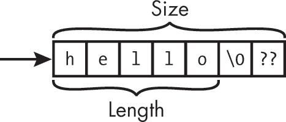

图7-1：窄字符串示例

`wide string`的类型为`wchar_t`数组。它是一个连续的宽字符序列，包含一个终止的空宽字符。指向宽字符串的`pointer`引用其初始宽字符。宽字符串的`length`是第一个空宽字符之前的代码单元数量。图7-2展示了UTF-16BE（大端序）和UTF-16LE（小端序）表示的`hello`。数组的大小由实现定义。该数组为14字节，假设实现了一个具有8位字节和16位`wchar_t`类型的系统。此字符串的长度为5，因为字符数量没有变化。

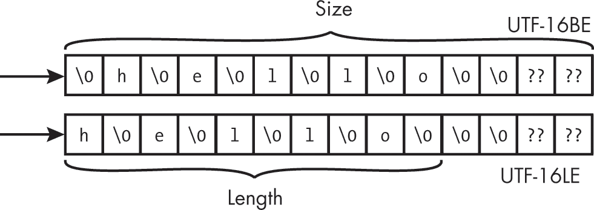

图7-2：UTF-16BE和UTF-16LE宽字符串示例

不得访问底层数组最后一个元素之后的元素。不能读取未初始化的数组元素。

## 字符串字面量

`character string literal`是由双引号括的零或多个多字节字符序列的字符串常量——例如`"ABC"`。你可以使用各种前缀来声明不同字符类型的字符串字面量：

* `char`字符串字面量类型，例如`"ABC"`
* 带有`L`前缀的`wchar_t`字符串字面量类型，例如`L"ABC"`
* 带有`u8`前缀的UTF-8字符串字面量类型，例如`u8"ABC"`
* 带有`u`前缀的`char16_t`字符串字面量类型，例如`u"ABC"`
* 带有`U`前缀的`char32_t`字符串字面量类型，例如`U"ABC"`

C标准并没有强制实现使用ASCII作为字符串字面量。但是，你可以使用`u8`前缀强制字符串字面量使用UTF-8编码，如果字面量中的所有字符都是ASCII字符，编译器将产生ASCII字符串字面量，即使实现通常使用另一种编码字符串字面量（例如EBCDIC）。

字符串字面量具有非`const`数组类型。修改字符串字面量是未定义行为，并被CERT C规则STR30-C禁止，“不要尝试修改字符串字面量。”这是因为这些字符串字面量可能存储在只读内存中，或者多个字符串字面量可能共享相同的内存，如果修改了一个字符串，会导致多个字符串被更改。

字符串字面量通常初始化数组变量，你可以使用显式边界声明数组，该边界与字符串字面量中的字符数量匹配。考虑以下声明：

```c
#define S_INIT "abc"
// --snip--
const char s[4] = S_INIT;
```

数组`s`的大小为四，这是初始化数组为该字符串字面量所需的精确大小，包括末尾空字节的空间。

然而，如果你向初始化数组的字符串字面量中添加另一个字符，代码的含义会发生巨大变化：

```c
#define S_INIT "abcd"
// --snip--
const char s[4] = S_INIT;
```


数组 `s` 的大小仍为四，尽管字符串字面量的大小现在变成了五。结果是数组 `s` 的大小保持为四。

## 字符串处理函数

可以使用多种方法在 C 中管理字符串，其中一种是 C 标准库。窄字符串处理函数定义在 `string.h` 头文件中，宽字符串处理函数定义在 `wchar.h` 中。近年来，这些旧的字符串处理函数与各种安全漏洞相关联。这是因为它们不检查数组的大小（通常缺乏执行此类检查所需的信息），并信任你会提供足够大的字符数组来存放输出。虽然使用这些函数可以编写安全、健壮且无错误的代码，但它们促进的编程风格在结果过大时可能会导致缓冲区溢出。

因此，C11 引入了规范性的（但可选的）附录 K（Annex K）边界检查接口。该附录提供了替代库函数，旨在通过促进更安全、更可靠的编程，因为它要求你提供输出缓冲区长度（例如），并验证这些缓冲区的大小足够包含这些函数的输出。例如，Annex K 将 `strcpy_s`、`strcat_s`、`strncpy_s` 和 `strncat_s` 函数定义为 C 标准库 `strcpy`、`strcat`、`strncpy` 和 `strncat` 函数的近似替代品。

### `<string.h>` 和 `<wchar.h>`

C 标准库包含了许多著名的函数，如 `strcpy`、`strncpy`、`strcat`、`strncat`、`strlen` 等，以及 `memcpy` 和 `memmove` 函数，你可以分别使用它们来复制和移动字符串。C 标准还提供了宽字符接口，该接口操作类型为 `wchar_t` 的对象而非 `char`。（这些函数名称与窄字符串函数名称相似，区别在于将 `str` 替换为 `wcs`，并在内存函数名称前添加了 `w`。）表 7-4 给出了一些窄字符串函数和宽字符串字符串的示例。有关如何使用这些函数的更多信息，请参考 C 标准（ISO/IEC 9899:2024）或帮助页（man pages）。

### 表 7-4：窄字符串与宽字符串函数

| 窄 (char) | 宽 (wchar_t) | 描述 |
| --- | --- | --- |
| `strcpy` | `wcscpy` | 字符串拷贝 |
| `strncpy` | `wcsncpy` | 截断并填充零的拷贝 |
| `memcpy` | `wmemcpy` | 拷贝指定数量的非重叠代码单元 |
| `memmove` | `wmemmove` | 拷贝指定数量（可能重叠）的代码单元 |
| `strcat` | `wcscat` | 拼接字符串 |
| `strncat` | `wcsncat` | 截断拼接字符串 |
| `strcmp` | `wcscmp` | 比较字符串 |
| `strncmp` | `wcsncmp` | 比较截断的字符串 |
| `strchr` | `wcschr` | 在字符串中定位字符 |
| `strcsp` | `wcspn` | 计算字符串段的长度 |
| `strdup` | `wcsdup` | 将字符串拷贝到分配的存储区 |
| `strndup` | N/A | 截断拷贝到分配的存储区 |
| `strbrk` | `wcspbrk` | 在字符串中查找一组字符的首次出现 |
| `strrchr` | `wcsrchr` | 在字符串中查找某个字符的首次出现 |
| `strspn` | `wcsspn` | 计算字符串段的长度 |
| `strstr` | `wcsstr` | 查找子字符串 |
| `strtok` | `wcstok` | 字符串分词器（会修改被分的字符串） |
| `memchr` | `wmemchr` | 在内存中查找代码单元 |
| `strlen` | `wcslen` | 计算字符串长度 |
| `memset` | `wmemset` | 用指定的代码单元填充内存 |
| `memset_explicit` | N/A | `memset` 但总是执行 |

这些字符串处理函数被认为是高效的，因为它们将内存管理交给了调用者，并且可以用于静态和动态分配的存储区。在接下来的章节中，我将详细介绍一些更常用的函数。

> **注意**：表 7-4 列出的 `wcsdup` 函数不是 C 标准库函数，而是由 POSIX 定义的。

#### 大小与长度

在本章早期提到，字符串既有大小（分配给底层数组存储的字节数），又有长度。你可以通过 `sizeof` 运算符在编译时确定静态分配底层数组的大小：

```c
char str[100] = "Here comes the sun";

size_t str_size = sizeof(str); // str_size is 100
```

你可以使用 `strlen` 函数计算字符串的长度：

```c
char str[100] = "Here comes the sun";

size_t str_len = strlen(str); // str_len is 18
```

`wcslen` 函数计算宽字符串的长度，其衡量标准是终止空宽字符字符之前的代码单元数量：

```c
wchar_t str[100] = L"Here comes the sun";

size_t str_len = wcslen(str); // str_len is 18
```

长度是对某些事物的计数，但具体计数的是什么可能并不清楚。在获取字符串长度时，某些*可能*被计数的内容包括：

- **字节 (Bytes)**：在分配存储空间时非常有用。
- **代码单元 (Code units)**：用于表示字符串的单个代码单元的数量。此长度取决于编码方式，并可用于分配内存。
- **代码点 (Code points)**：代码点（字符）可能占用多个代码单元。该值在分配存储空间时并不可用。
- **扩展字形簇 (Extended grapheme cluster)**：一组由一个或多个 Unicode 标量值组成，它近似于单个用户感知的字符。许多单独字符，例如 `é`、`김` 和 `` 可能由多个 Unicode 标量值组成。Unicode 的边界算法将这些代码点组合成扩展字形簇。

`strlen` 和 `wcslen` 函数计算的是代码单元。对于 `strlen` 函数，这对应于字节数。使用 `wcslen` 函数确定所需的存储空间要复杂得多，因为 `wchar_t` 类型的大小是由实现定义的。列表 7-2 包含了为窄字符串和宽字符串动态分配存储空间的示例。

```c
// narrow strings

char *str1 = "Here comes the sun";

char *str2 = malloc(strlen(str1) + 1);

// wide strings

wchar_t *wstr1 = L"Here comes the sun";

wchar_t *wstr2 = malloc((wcslen(wstr1) + 1) * sizeof(*wstr1));
```

`Listing 7-2: 为窄字符串和宽字符串函数动态分配存储`

对于窄字符串，我们可以通过在 `strlen` 函数的返回值上加 `1` 来确定字符串的大小，以包含终止零字符。对于宽字符串，我们可以通过在 `wcslen` 函数的返回值上加 `1` 来确定字符串的大小，以包含终止零宽字符，然后将该和乘以 `wchar_t` 类型的大小。由于 `str1` 和 `wstr1` 被声明为指针（而不是数组），因此无法使用 `sizeof` 操作符获取它们的大小。

代码点计数或扩展字形簇计数不能用于存储分配，因为它们由不可预测数量的代码单元组成。（关于字符串长度的有趣阐述，请参见“`""(images/manpalm.jpg).length == 7` 在 `https://hsivonen.fi/string-length/`）。扩展字形簇用于确定截断字符串的位置，例如是因为存储不足。在扩展字形簇边界处截断可以避免切割用户感知的字符。

调用 `strlen` 函数可能是一个开销的操作，因为它需要遍历数组长度以寻找零字符。以下是 `strlen` 函数的一个简单实现：

```c
size_t strlen(const char *str) {
  const char *s;

  for (s = str; *s; ++s) {}

  return s - str;
}
```

`strlen` 函数无法知晓 `str` 所引用对象的大小。如果你用一个缺少零字符的字符串调用 `strlen`，它将读取到末之外。向 `strlen` 传递空指针也会导致未定义行为。你应该避免创建此类对象。

#### `strcpy`

计算动态分配内存的大小并不总是容易的。一种方法是在分配时存储大小。`Listing 7-3` 中的代码段使用 `strlen` 通过确定长度并加 1 以容纳终止零字符，来创建 `str` 的副本。

```c
char str[100] = "Here comes the sun";

size_t str_size = strlen(str) + 1;

char *dest = (char *)malloc(str_size);

if (dest) {
  strcpy(dest, str);
}
else {
  /* handle error */
}
```

`Listing 7-3: 复制字符串`

我们可以使用存储在 `str_size` 中的值来为副本动态分配存储空间。`strcpy` 函数将字符串从源字符串（`str`）复制到目标字符串（`dest`），包括终止零字符。`strcpy` 函数返回目标字符串起始的地址，这在示例中被忽略了。

以下是 `strcpy` 函数的一个简单实现：

```c
char *strcpy(char *dest, const char *src) {
  char *save = dest;

  while ((*dest++ = *src++));

  return save;
}
```

#### `Argument Checking`

参数检查可以通过调用者函数或被调用者函数执行。调用者和被调用者都进行冗余参数测试是一种很大不受认可的防御性编程风格。通常的规范是仅在每个接口的一侧要求验证。

最节省时间的方法是由调用者进行检查，因为调用者应该对程序状态有更好的了解。在 `Listing 7-3` 中，我们可以看到 `strcpy` 的参数在不引入额外冗余测试的情况下是有效的：变量 `str` 引用一个在声明时已正确初始化的静态分配数组，而 `dest` 参数是一个有效的非空指针，指向足够大小的动态分配存储空间，以容纳 `str` 的副本（包括空字符）。因此，对 `strcpy` 的调用是安全的，并且可以以一种高效的方式进行复制。这种参数检查方法被 C 标准库函数广泛使用，因为它遵循“C 语言的精神”，即具有最优的效率并且信任程序员（会传递有效参数）。

更安全、更稳固的方法是由被调用者来检查参数。这种方法更不容易出错，因为库函数的实现者会验证参数，因此我们不再需要信任程序员会传递有效参数。函数实现者通常更适合理解哪些参数需要验证。如果输入验证代码有缺陷，则只需要在一个地方进行修复。由于所有验证参数的代码都集中在一个地方，因此这种方法在空间上可能更高效。然而，由于这些测试即使在不需要时也会运行，它们在时间效率上可能较低。通常，这些函数的调用者会在怀疑的调用之前放置检查，而这些调用可能已经或尚未执行过类似的检查。这种方法还会对目前不返回错误指示的被调用者实施额外的错误处理，但如果它们需要验证参数，推测将需要这样做。对于字符串，被调用函数不能总是确定参数是否是有效的空终止字符串，或者是否指向足够的空间来复制。

这里的教训是，不要假设 C 标准库函数会验证参数，除非标准显式要求它们这样做。

### `memcpy`

`memcpy` 函数从 `src` 引用的对象复制 `size` 个字符到 `dest` 引用的对象中：

```c
void *memcpy(void *restrict dest, const void *restrict src, size_t size);
```

当目标数组的大小大于或等于传递给 `memcpy` 的 `size` 参数，且源数组在边界之前包含一个空字符，且字符串长度小于 `size - 1` 时（这样生成的字符串将能够正确空终止），你可以使用 `memcpy` 函数代替 `strcpy` 来复制字符串。最佳建议是在复制字符串时使用 `strcpy`，而在仅复制原始、未类型的内存时使用 `memcpy`。还请记住，在许多情况下，赋值运算符（`=`）可以高效地复制对象。

### `memccpy`

C 标准库的大多数字符串处理函数都返回作为参数传递的字符串开头的指针，这样你就可以嵌套调用字符串函数。例如，接接嵌套函数调用序列通过复制、然后拼接组成部分，按照西方命名顺序构造了一个全名：

```c
strcat(strcat(strcat(strcat(strcpy(name, first), " "), middle), " "), last);
```

然而，从它的子字符串拼接到数组 `name` 需要对 `name` 进行比需要多得多的扫描；如果字符串处理函数能返回指向修改后字符串*末尾*的指针以消除这种重新扫描的需求，将会更有用。C23 引入了具有更好接口设计的 `memccpy` 函数。POSIX 环境应该已经提供了此函数，但你可能需要如下所示启用它的声明：

```c
#define _XOPEN_SOURCE 700

#include <string.h>
```

`memccpy` 函数具有以下签名：

```c
void *memccpy(void *restrict s1, const void *restrict s2, int c, size_t n);
```

与 `memchr` 函数一样，`memccpy` 在源中扫描由其参数之一指定的字符的首次出现。该字符可以是任何值，包括零。它从源复制（最多）指定数量的字符到目标，而不会写入目标末尾之外。最后，如果指定的字符存在，它返回一个紧邻该指定字符副本的指针。`Listing 7-4` 使用 `memccpy` 函数重新实现了之前的字符串处理调用序列。这种实现更具性能且更安全。

```c
#include <stdarg.h>
#include <string.h>
#include <stdio.h>
#include <stdint.h>

constexpr size_t name_size = 18;

char *vstrcat(char *buff, size_t buff_length, ...) {
  char *ret = buff;
  va_list list;

  va_start(list, buff_length);

  const char *part = nullptr;
  size_t offset = 0;

  while ((part = va_arg(list, const char *))) {
    buff = (char *)memccpy(buff, part, '\0', buff_length - offset);

    if (buff == nullptr) {
      ret[0] = '\0';
      break;
    }

    offset = --buff - ret;
  }

  va_end(list);

  return ret;
}

int main() {
  char name[name_size] = "";
  char first[] = "Robert";
  char middle[] = "C.";
  char last[] = "Seacord";

  puts(vstrcat(
    name, sizeof(name), first, " ",
    middle, " ", last, nullptr
  ));
}
```

**Listing 7-4: 使用 `memccpy` 进行字符串拼接**

`[Listing 7-4]` 定义了变参函数 `vstrcat`，它接收缓冲区（`buff`）和缓冲区长度（`buff_length`）作为固定参数，以及一组变长度的字符串参数。使用空指针作为哨兵值来指示变长参数列表的结束。调用 `memccpy` 函数 ❶ 将每个字符串拼接到缓冲区中。

与其使用嵌套调用，不如为传递给 `vstrcat` 的每个字符串参数都调用 `memccpy`，并将返回值存储在 `buff` 中。这允许你直接连接到字符串的末尾，而不需要每次都寻找空终止字符，从而使该解决方案更具性能。

如果 `buff` 是空指针，则我们无法复制整个字符串。在这种情况下，我们不返回部分名称，而是返回一个空字符串。这个空字符串可以被打印，也可以被视为错误条件。

由于 `memccpy` 函数返回的是空字节拷贝*之后*的字符指针，我们使用前置递减运算符对 `buff` 进行递减，然后减去存储在 `ret` 中的值以获得新的 `offset` ❷。`memccpy` 函数的尺寸参数（它用它防止缓冲区溢出）是通过从 `buff_length` 中减去 `offset` 计算出的。这种方法比嵌套函数调用更安全，因为嵌套调用总是可疑的，因为它们没有方法检查错误。

## `memset`、`memset_s` 和 `memset_explicit`

`memset` 函数将 `(unsigned char)c` 的值复制到由 `s` 指向的对象的前 `n` 个字符每一个中：

```c
void *memset(void *s, int c, size_t n);
```

`memset` 函数被频繁用于清除内存——例如，将 `malloc` 分配的内存初始化为零。然而，在下面的示例中，它的用法是不正确的：

```c
void check_password() {
  char pwd[64];

  if (get_password(pwd, sizeof(pwd))) {
    /* check password */
  }
```


`memset(pwd, 0, sizeof(pwd));`

`get_password` 函数的一个问题是它使用`memset`函数在最后一次读取后清除一个自动变量。这样做是为了安全考虑，以确保存储在此处的敏感信息无法访问。然而，编译器并不知道这一点，可能会执行“死存储”（dead store）优化。当编译器注意到某个写入操作后没有后续读取操作时，就像这本书一样，如果没有人读取，写入它就没有意义。因此，`get_password` 函数中对`memset`的调用可能会被编译器移除。

这个问题本意打算在 C11 中通过附件 K 边界检查接口中的`memset_s`函数来解决（将在下一节中讨论）。遗憾的是，书中提到的任何编译器都没有实现该函数。

为了再次解决这个问题，C23 引入了`memset_explicit`函数来使敏感信息无法访问。与`memset`函数相比，其意图是无论如何优化，都始终执行内存存储（即永远不会被省略）。

## gets

`gets`函数是一个有缺陷的输入函数，它接受输入但不提供任何指定目标数组大小的方法。因此，它无法防止缓冲区溢出。结果是`gets`函数在 C99 中被弃用，并在 C11 中被删除。然而，它已经存在多年，大多数库仍然提供它，所以你可能会看到它。你*永远不要*使用这个函数，并且你应该替换你正在维护的任何对`gets`函数的使用。

由于`gets`函数如此糟糕，我们将花时间研究它为什么这么差。7-5 所示的函数提示用户输入`y`或`n`来表示他们是否想继续。

```c
#include <stdio.h>
#include <stdlib.h>
#include <ctype.h>

void get_y_or_n(void) {
  char response[8];
  puts("Continue? [y] n: ");
  gets(response);
  if (tolower(response[0]) == 'n')
    exit(EXIT_SUCCESS);
}
```

### 过时`gets`函数的误用

如果在提示处输入超过八个字符，该函数将产生未定义行为。这种未定义行为发生是因为`gets`函数无法知道目标数组有多大，并将写入到数组边界之外。

7-6 显示了`gets`函数的简化实现。如你所示，该函数的调用者没有办法限制读取的字符数。

```c
char *gets(char *dest) {
  int c;
  char *p = dest;

  while ((c = getchar()) != EOF && c != '\n') {
    *p++ = c;
  }
  *p = '\0';
  return dest;
}
```

### 一个 gets 函数实现

`gets`函数每次迭代一个字符。如果读到`EOF`或换行符`'\n'`，循环将终止。否则，函数将继续写入`dest`数组，而不考虑对象的边界。

7-7 显示了内联了`gets`函数的 7-5 中的`get_y_or_n`函数。

```c
#include <stdio.h>
#include <stdlib.h>

void get_y_or_n(void) {
  char response[8];
  puts("Continue? [y] n: ");
  int c;
  char *p = response; ❶
  while ((c = getchar()) != EOF && c != '\n') {
    *p++ = c;
  }
  *p = '\0';
  if (response[0] == 'n')
    exit(0);
}
```

### 一个写得糟糕的 while 循环

目标数组的大小现在可用了，但`while`循环 ❶并没有使用这些信息。在像这样的循环中对数组进行读取或写入时，你应该确保到达数组边界是循环终止的条件。

# 附件 K 边界检查接口

C11 引入了附件 K 边界检查接口，提供了替代函数来验证输出缓冲区是否足够容纳预期结果，如果不足则返回失败指示。这些函数旨在防止数据写入数组末尾之外，并对所有字符串结果进行空字符终止。这些字符串处理函数将内存管理留给调用者，可以在调用函数之前静态或动态地分配内存。

微软创建 C11 附件 K 函数是为了为了响应 20 世纪 90 年代大量广为人知的安全事件，对其遗留代码库进行改造。这些函数随后提交给 C 标准委员会进行标准化，以`ISO/IEC TR 24731-1`（`ISO/IEC TR 24731-1:2007`）的形式发布，并在之后纳入 C11 的可选附件中。尽管这些函数提高了可用性和安全性，但在本书写作时，它们尚未被广泛实现。

## gets_s

附件 K 边界检查接口包含一个`gets_s`函数，我们可以用它消除在列表 7-5 中调用`gets`导致的未定义行为，如列表 7-8 所示。

```c
#define __STDC_WANT_LIB_EXT1__ 1
#include <stdio.h>
#include <stdlib.h>
#include <ctype.h>

void get_y_or_n(void) {
  char response[8];
  puts("Continue? [y] n: ");
  gets_s(response, sizeof(response));
  if (tolower(response[0]) == 'n') {
    exit(EXIT_SUCCESS);
  }
}
```

列表 7-8：`gets_s`函数的使用

这两个函数非常相似，不同在于`gets_s`函数会检查数组边界。当输入超过最大字符数时，默认行为由实现定义，但通常会调用`abort`函数。你可以通过`set_constraint_handler_s`函数来更改这种行为，我将在第 163 页的“运行时约束”中进一步解释。

你需要在包含定义边界检查接口的头文件之前，将`__STDC_WANT_LIB_EXT1__`定义为展开为整数常量`1`的宏，以便在你的程序中使用它们。与`gets`函数不同，`gets_s`函数接受一个大小参数。因此，修后的函数通过使用`sizeof`运算符计算目标数组的大小，并将此值作为参数传递给`gets_s`函数。实现定义的行为是运行时约束违反的结果。

## strcpy_s

`strcpy_s`函数是`<string.h>`中定义的`strcpy`函数的紧密替代品。`strcpy_s`函数从源字符串复制字符到目标字符数组，包括终止的空字符。以下是`strcpy_s`的函数签名：

```c
errno_t strcpy_s(
  char * restrict s1, rsize_t s1max, const char * restrict s2
);
```

`strcpy_s`函数有一个类型为`rsize_t`的额外参数，用于指定目标的最大长度。`rsize_t`类型类似于`size_t`类型，不同在于接受该类型参数的函数会确保该值不大于`RSIZE_MAX`。只有当`strcpy_s`能够将字符串完整复制到目标位置时才会成功。`strcpy_s`函数会验证以下运行时约束未违反：

- `s1`和`s2`均不是空指针。
- `s1max`不大于`RSIZE_MAX`。
- `s1max`不等于零。
- `s1max`大于`strnlen(s2, s1)`。
- 拷贝未在重叠对象之间进行。

## 运行时约束

*运行时约束*是指函数运行时要求的违反，函数将通过调用处理程序来检测并诊断这些违反。如果该处理程序返回，函数将向调用者返回一个失败指示。

边界检查接口通过调用运行时约束处理器来强制执行约束，该处理器可能简单返回。或者，运行时约束处理器可能会向`stderr`打印消息并/或终止程序。你可以通过`set_constraint_handler_s`函数控制调用哪个处理程序函数，并如下所示使处理程序直接返回：

```c
int main(void) {
  constraint_handler_t oconstraint =
    set_constraint_handler_s(ignore_handler_s);
  get_y_or_n();
}
```

如果处理程序返回，识别运行时约束违反并调用处理器的函数将通过其返回值向调用者指示失败。

边界检查接口函数通常在进入时立即，或在执行任务并收集足够信息以判断是否违反了运行时约束时检查条件。边界检查接口的运行时约束是那些对于 C 标准库函数而言属于未定义行为的条件。

实现包含一个默认的约束处理器，如果在未调用过`set_constraint_handler_s`函数的情况下，将调用该处理器。默认处理器的行为可能会导致程序退出或终止，但鼓励实现提供合理的默认行为。这允许例如通常用于实现安全关键系统的编译器在默认情况下不会终止。你必须检查可以返回函数的调用的返回值，而不能简单地假设其结果是有效的。通过在调用任何边界检查接口或使用任何会触发运行时约束处理器的机制之前，调用`set_constraint_handler_s`函数，可以消除实现定义的行为。

附录 K（Annex K）提供了`abort_handler_s`和`ignore_handler_s`函数，它们代表了处理错误的两种常见策略。C 语言实现的默认处理器不需要是这两个处理器中的任何。

### POSIX

POSIX 还定义了几个字符串处理函数，例如`strdup`和`strndup` (IEEE Std 1003.1:2018)，它们为 GNU/Linux 和 Unix 等符合 POSIX 的平台（IEEE Std 1003.1:2018）提供了另一组字符串相关的 API。这两个函数都已在 C23 中被采用纳 C 标准库。

这些替换函数使用动态分配的内存来确保发生缓冲区溢出，并且它们实现了*调用者分配，调用者释放*的模型。每个函数都确保有足够的内存可用（调用`malloc`失败除外）。例如，`strdup`函数返回指向新字符串的指针，该字符串包含参数的副本。返回的指针应该传递给 C 标准的`free`函数，以便在不再需要时回收存储。

列表 7-9 包含一个使用`strdup`函数对`getenv`函数返回的字符串进行拷贝的代码片段。

```c
const char *temp = getenv("TMP");

if (temp != nullptr) {
  char *tmpvar = strdup(temp);
  if (tmpvar != nullptr) {
    printf("TMP = %s.\n", tmpvar);
    free(tmpvar);
  }
}
```

列表 7-9：使用`strdup`函数复制字符串

C 标准库函数`getenv`在主机环境提供的环境变量列表中搜索与指定名称（本例中为`TMP`）引用的字符串匹配的字符串。该列表中的字符串被称为*环境变量*，并为向进程通信字符串提供了一种额外的机制。这些字符串没有定义良好的编码，但通常与用于命令行参数、`stdin`和`stdout`的系统编码匹配。

返回的字符串（变量的值）可能会被后续对`getenv`函数的调用覆盖，因此在创建任何线程之前检索任何所需的环境变量是一个好主意，以消除竞态条件的可能。如果预计后续使用，你应该复制字符串，以便在需要时安全地引用副本，如列表 7-9 所示的惯用示例。

`strndup`函数与`strdup`等效，不同之处`strndup`最多向新分配的内存拷贝`n` `+` 1 个字节（而`strdup`拷贝整个字符串），并确保新创建的字符串被正确终止。这些 POSIX 函数通过自动为结果字符串分配存储来帮助防止缓冲区溢出，但这在存储不再需要时需要额外调用`free`。这意味着每个对`strdup`或`strndup`的调用都要匹配一个`free`调用，这对于更熟悉`string.h`行为的程序员来说可能会引起困惑。

### Microsoft

Visual C++ 提供了 C 标准直到 C99 定义的所有字符串处理函数，但没有实现完整的 POSIX 规范。然而，有时微软对这些 API 的实现与给定标准的要求不同，或者其函数名与其他标准中的保留标识符发生冲突。在这种情况下，微软通常会在函数名前加上下划线前缀。例如，POSIX 函数`strdup`在 Windows 上不可用，但函数`_strdup`是可用的且行为相同。

有关微软 POSIX 支持的更多信息，请参见 docs.microsoft.com/en-us/cpp/c-runtime-library/compatibility

Visual C++ 还支持附录 K 中的许多安全字符串处理函数，除非在包含声明该函数的头文件之前定义了`_CRT_SECURE_NO_WARNINGS`，否则会诊断使用不安全的变体。遗憾的是，Visual C++ 并不符合 C 标准的附录 K，因为微软选择不根据标准化过程中 API 的变化来更新其实现。例如，Visual C++ 未提供`set_constraint_handler_s`函数，而是保留了一个具有相似行为但签名不兼容的旧函数：

```c
_invalid_parameter_handler _set_invalid_parameter_handler(_invalid_parameter_handler)
```


微软也没有定义`abort_handler_s`和`ignore_handler_s`函数、`memset_s`函数（该函数未由ISO/IEC TR 24731-1定义）或`RSIZE_MAX`宏。Visual C++同样不会将重叠的源和目标序列视为运行时约束违反，而是在此类情况下表现为未定义行为。"Bounds-Checking Interfaces: Field Experience and Future Directions"（Seacord, 2019）提供了关于边界检查接口所有层面的额外信息，包括微软的实现。

### 总结

在本章中，你学习了字符编码，例如ASCII和Unicode。你还学习了C语言程序中用于表示字符的各种数据类型，例如`char`、`int`、`wchar_t`等。随后，我们涵盖了字符转换库，包括C标准库函数、`libiconv`和Windows应用程序编程接口（Windows APIs）。

除了字符之外，你还学习了字符串以及C标准库中定义的用于处理字符串的遗留函数和边界检查接口，以及一些POSIX和微软特有的函数。

处理字符和字符串数据是C语言中常见的编程任务，也是错误频发的来源。我们概述了处理这些数据类型的各种方法；你应该确定哪种方法最适合你的应用程序，并一致地应用该方法。

在下一章中，你将学习I/O，其中可以用于读写字符和字符串等。

# 8 输入/输出


本章将教你如何执行输入/输出（I/O）操作，以从终端和文件系统读取或写入数据。信息可以通过命令行参数或环境变量进入程序，并通过返回状态退出程序。然而，大多数信息通常通过I/O操作进入或退出程序。我们将介绍使用C标准流和POSIX文件描述符的技术。我们将首先讨论C标准文本流和二进制流。然后，我们将涵盖使用标准函数和POSIX函数打开和关闭文件的不同方法。

接下来，我们将讨论读取和写入字符及行、读取和写入格式化文本，以及从二进制流中读取和写入。我们还将涵盖流缓冲、流定向和文件定位。

许多其他设备和I/O接口（如`ioctl`）虽然可用，但超出了本书的范围。

## 标准I/O流

C提供了流来与存储在支持的结构化存储设备和终端上的文件进行通信。*流*是一种与消耗或产生顺序数据的文件和设备（如套接字、键盘、通用串总线端口和打印机）通信的统一抽象。

C使用不透明的`FILE`数据类型来表示流。`FILE`对象持有与关联文件连接的内部状态信息，包括文件位置指示器、缓冲信息、错误指示器和文件结束指示器。你不应该自己分配`FILE`对象。C标准库函数对类型为`FILE *`（即指向`FILE`类型的指针）的对象操作。因此，流经常被称为*文件指针*。

C提供了一个广泛的应用程序编程接口（API），位于`stdio.h`中，用于对流进行操作；我们将在本章稍后部分探索此API。然而，由于这些I/O函数需要跨许多平台与各种设备和文件系统工作，它们是高度抽象的，这使得它们不适用于简单应用程序之外的任何场景。

例如，C标准没有目录的概念，因为它必须能够处理非层次结构的文件系统。C标准对文件系统特定的细节（如文件权限或锁定）很少提及。然而，函数规范经常规定某些行为的发生"在底层系统支持的范围内"，这意味着它们只有在你的实现支持它们时才会发生。因此，你通常需要使用由POSIX、Windows和其他平台提供的API来执行I/O操作。

## 错误和文件结束指示器

正如前面提到的，`FILE`对象持有与关联文件连接的内部状态信息，包括一个记录是否发生读写错误的错误指示器，以及一个记录是否已到达文件末尾的文件结束指示器。当打开文件时，流的错误指示器和文件结束指示器会被清除。以下C库函数在发生错误时均会设置流的错误指示器：字节输入函数（`getc`、`fgetc`和`getchar`）、字节输出函数（`putc`、`fputc`和`putchar`）、`fflush`、`fseek`和`fsetpos`。如果流处于文件末尾，像`fgetc`和`getchar`等输入函数也会设置流的文件结束指示器。某些函数如`rewind`、`freopen`、`ungetc`、`fseek`和`fsetpos`会清除流的文件结束指示器。宽字符I/O函数的行为也类似。

这些指示器可以显式地测试和清除：

* `ferror`函数测试指定流的错误指示器，当且仅当指定流的错误指示器被设置时返回非零值。
* `feof`函数检查指定流的结束文件指示位，当且仅当指定流设置了结束文件指示位时，返回非零值。
* `clearerr`函数清除指定流的结束文件指示位和错误指示位。

下面的短程序说明了这些函数与这两个指示位之间的交互：

```c
#include <stdio.h>
#include <assert.h>

int main() {
  FILE* tmp = tmpfile();
  fputs("Effective C\n", tmp);
  rewind(tmp);
  for (int c; (c = fgetc(tmp)) != EOF; putchar(c)) {}
  printf("%s", "End-of-file indicator ");
  puts(feof(tmp) ? "set" : "clear");
  printf("%s", "Error indicator ");
  puts(ferror(tmp) ? "set" : "clear");
  clearerr(tmp); // clear both indicators
  printf("%s", "End-of-file indicator ");
  puts(feof(tmp) ? "set" : "clear");
}
```

该程序在`stdout`上产生以下输出：

```
Effective C
End-of-file indicator set
Error indicator clear
End-of-file indicator clear
```

循环通过结束文件终止，随后设置了结束文件指示位。通过调用`clearerr`函数可以清除这两个指示位。

### 流缓冲

`Buffering`（缓冲）是指在内存中临时存储存储在进程与设备或文件之间传输的数据的过程。缓冲提高了I/O操作的吞吐量，而与系统的单个I/O操作相比通常具有高延迟。同样，当程序请求向磁盘等块设备写入数据时，驱动程序可以将数据缓存在内存中，直到积累了足够的一个或多个设备块的数据，此时它会将数据一次性写入磁盘，从而提高吞吐量。这种策略被称为`flushing`（刷新）输出缓冲区。

流可以处于三种状态之一：

* **无缓冲（Unbuffered）**：字符旨在尽快从源出现或到达目的地。多个程序可能并发访问数据的流通常最好是无缓冲的。用于错误报告或日志的流可能是无缓冲的。
* **全缓冲（Fully buffered）**：字符旨在当缓冲区填满时作为块传输到或从主机环境。用于文件I/O的流通常是全缓冲的，以优化吞吐量。
* **行缓冲（Line buffered）**：字符旨在遇到换行符时作为块传输到或从主机环境。连接到终端等交互式设备的流在打开它们时是行缓冲的。

在下一节中，我们将介绍预定义流并描述它们是如何缓冲的。

### 预定义流

C程序在启动时有三个预定义的文本流打开并可用。这些预定义流在`stdio.h`中声明：

```c
extern FILE * stdin;  // 标准输入流
extern FILE * stdout; // 标准输出流
extern FILE * stderr; // 标准错误流
```

标准输出流（`stdout`）是程序的常规输出目标。该流通常与启动程序的终端相关，但可以重定向到文件或其他流。你可以在Linux或Unix shell中输入以下命令：

```
$ echo fred
fred
$ echo fred > tempfile
$ cat tempfile
fred
```

在这里，`echo`命令的输出被重定向到`tempfile`。

标准输入流（`stdin`）是程序的常规输入源。默认情况下，`stdin`与键盘关联，但可以重定向到来自文件的输入，例如使用以下命令：

```
$ echo "one two three four five six seventh" > tempfile
$ wc < tempfile
1 7 34
```

文件`tempfile`的内容被重定向到`wc`命令的`stdin`，该命令输出`tempfile`的换行（1）、单词（7）和字节（34）计数。当且仅当流指向交互式设备时，`stdin`和`stdout`是无缓冲的。

标准错误流（`stderr`）用于写入诊断输出。`stderr`流不是全缓冲的，因此错误消息可以尽快查看。

图8-1显示了连接到用户终端键盘和显示器的预定义流`stdin`、`stdout`和`stderr`。

### 流的方向

每个流都有一个方向，指示该流包含窄字符还是宽字符。在流与外部文件关联之后，但在对其执行任何操作之前，流没有方向。一旦对没有方向的流应用了宽字符I/O函数，该流就会变成宽方向流。同样，一旦对没有方向的流应用了字节I/O函数，该流就会变成字节方向流。可以表示为`char`类型对象（C标准要求其为1字节）的多字节字符序列或窄字符可以写入字节方向流中。

你可以使用`fwide`函数或通过关闭文件然后重新打开文件来重置流的方向。在宽方向流上应用字节I/O函数或在字节方向流上应用宽字符I/O函数会导致未定义行为。永远不要在同一个文件中混合窄字符数据、宽字符数据和二进制数据。

所有三个预定义流（`stderr`、`stdin`和`stdout`）在程序启动时都是无方向的。

C标准同时支持文本流和二进制流。`text stream`是由行组成的有序字符序列，每行由零个或多个字符加上一个终止的换行符序列组成。在类Unix系统上，你可以使用换行符（`\n`）来表示单行换行。大多数Microsoft Windows程序使用回车符（`\r`）跟随换行符（`\n`）。

不同的换行约定可能会导致在具有不同约定的系统之间传输的文本文件显示或解析错误，尽管在现在能够理解异地换行约定的现代系统中，这种现象已变得越来越少见。

`binary stream`是任意二进制数据的有序序列。在相同的实现下，从二进制流中读取的数据将与之前写入该流的数据相同。在非POSIX系统上，流的末尾可能会附加数量由实现定义的数量的空字节。

二进制流总是比文本流更强大且更具可预测性。然而，读取或写入可以与其他文本导向程序配合的普通文本文件最简单的方法是通过文本流。

# 打开和创建文件

当你打开或创建一个文件时，它会与一个流关联。`fopen`和POSIX `open`函数用于打开或创建文件。

## fopen

`fopen`函数打开以字符串给出并由`filename`指向的文件，然后将其与一个流关联：

```c
FILE *fopen(
  const char * restrict filename,
  const char * restrict mode
);
```

`mode`参数指向表8-1所示的字符串之一，以决定如何打开文件。

表8-1: 有效的文件模式字符串

| 模式字符串 | 描述 |
| --- | --- |
| `r` | 打开现有文本文件进行读取 |
| `w` | 截零为零或创建文本文件进行写入 |
| `a` | 追加、打开或在文件末尾创建文本文件进行写入 |
| `rb` | 打开现有的二进制文件进行读取 |
| `wb` | 将文件截零为零或创建二进制文件进行写入 |
| `ab` | 追加、打开或在文件末尾创建二进制文件进行写入 |
| `r+` | 打开现有的文本文件进行读写 |
| `w+` | 截零为零或创建文本文件进行读写 |
| `a+` | 追加、打开或创建文本文件进行更新，在当前文件末尾写入 |
| `r+b` 或 `rb+` | 打开现有的二进制文件进行读写 |
| `w+b` 或 `wb+` | 截零为零或创建二进制文件进行读写 |
| `a+b` 或 `ab+` | 追加、打开或创建二进制文件进行更新，在当前文件末尾写入 |

通过将`mode`参数的第一个字符传递`r`来以只读模式打开文件，如果文件不存在则会失败。

通过将`mode`参数的第一个字符传递`a`来以追加模式打开文件，会导致所有对文件的后续写入操作都发生在文件末尾，无论其间是否调用了`fseek`、`fsetpos`或`rewind`。根据写入的数据量递增当前文件末尾的操作对于写入同一文件的其他线程来说是原子的。如果实现无法原子性地增加当前文件末尾，则操作会失败。以追加模式打开二进制文件（通过将`mode`参数的第二个字符传递`b`）可能会初始将流的指示器设置为最后写入位置之后。

你可以通过将`mode`参数的第二个或第三字符传递`+`来以更新模式打开文件，允许在关联的流上执行读和写操作。在某些实现中，以更新模式打开（或创建）文本文件可能会改为打开（或创建）二进制流。在POSIX系统上，文本流和二进制流的行为完全相同。

C11标准为读写二进制和文本文件增加了**独占模式**，如表8-2所示。

表8-2: C11添加的有效文件模式字符串

| 模式字符串 | 描述 |
| --- | --- |
| `wx` | 创建独占的文本文件进行写入 |
| `wbx` | 创建独占的二进制文件进行写入 |
| `w+x` | 创建独占的文本文件进行读写 |
| `w+bx` 或 `wb+x` | 创建独占的二进制文件进行读写 |

使用独占模式（通过将`x`作为`mode`参数的最后一个字符）打开文件，如果文件已存在或无法创建，则会失败。检查文件是否存在以及在文件不存在时创建文件的操作对于其他线程和并发程序执行是原子的。如果实现无法原子性地执行文件存在检查和创建，它将失败，而不是执行非原子的检查和创建。

最后说明，请确保永远不要复制`FILE`对象。例如，下面的程序可能会失败，因为在调用`fputs`时使用了对`stdout`的按值拷贝：

```c
#include <stdio.h>
#include <stdlib.h>

int main() {
  FILE my_stdout = *stdout;
  if (fputs("Hello, World!\n", &my_stdout) == EOF) {
    return EXIT_FAILURE;
  }
  return EXIT_SUCCESS;
}
```

该程序具有未定义行为，并在运行时通常会崩溃。

### open

在POSIX系统上，`open`函数（IEEE Std 1003.1:2018）建立了由`path`标识的文件与称为`文件描述符`（file descriptor）的值之间的连接：

```c
int open(const char *path, int oflag, ...);
```

`file descriptor`是一个非负整数，指向表示文件的结构（称为`打开文件描述`）。`open`函数返回的文件描述符是编号最小的未使用文件描述符，且对于调用进程是唯一的。其他I/O函数使用文件描述符来引用该文件。`open`函数将用于标记文件当前位置的文件偏移量设置为文件开头。对于底层流的文件描述符，此文件偏移量与流的文件位置指示是一致的。

`oflag`参数的值设置了打开文件描述的`文件访问模式`（file access modes），指定了是以读取、写入还是同时打开文件。`oflag`的值通过文件访问模式和任何访问标志组合的按位包含或（inclusive OR）构造。应用程序必须在`oflag`的值中精确指定以下文件访问模式中的一种：

- `O_EXEC`: 仅以执行模式打开（非目录文件）
- `O_RDONLY`: 仅读打开
- `O_RDWR`: 读写均打开
- `O_SEARCH`: 仅以搜索模式打开目录
- `O_WRONLY`: 仅写打开

`oflag`参数的值还设置了`文件状态标志`（file status flags），这些标志控制`open`函数的行为并影响文件操作的执行。这些标志包括：

- `O_APPEND`: 在每次写入之前将文件偏移量设置为文件末尾
- `O_TRUNC`: 将长度截断为0
- `O_CREAT`: 创建文件
- `O_EXCL`: 如果设置了`O_CREAT`则导致打开失败

`open`函数接受可数量的参数。`oflag`参数的值指定了`mode`（创建文件时的权限），类型为`mode_t`。列表8-1显示了使用`open`函数打开文件的示例。

```c
#include <err.h>
#include <fcntl.h>
#include <sys/stat.h>
#include <stdio.h>
#include <stdlib.h>

int main() {
  int fd;
  int flags = O_WRONLY | O_CREAT | O_TRUNC;
  mode_t mode = S_IRUSR | S_IWUSR | S_IRGRP | S_IROTH;
  const char *pathname = "/tmp/file";
  if ((fd = open(pathname, flags, mode)) == -1) {
    err(EXIT_FAILURE, "Can't open %s", pathname);
  }
}
```


#### 列表 8-1: 以仅写方式打开文件

`open` 的调用接受多个参数，包括文件的路径名和 `flags`。我们创建了一个模式标志，它是以下访问模式位的按位包含或组合：

- `S_IRUSR`: 所有者的读位
- `S_IWUSR`: 所有者的写位
- `S_IRGRP`: 组所有者的读位
- `S_IROTH`: 其他用户的读位

`open` 函数仅在它创建文件时才会设置这些权限。如果文件已存在，则保留其当前权限。文件访问模式为 `O_WRONLY`，意味着文件仅以写模式打开。`O_CREAT` 文件状态标志通知 `open` 创建文件；`O_TRUNC` 文件状态标志通知 `open`，如果文件存在且成功打开，则应该丢弃文件的原有内容。

如果文件成功打开，`open` 函数返回表示文件描述符的非负整数。否则，`open` 返回 -1 并设置 `errno` 以指示错误。列表 8-1 检查值是否为 -1，如果发生错误，则向预定义的 `stderr` 流写入诊断信息，然后退出。

除了 `open` 之外，POSIX 还有其他处理文件描述符的有用函数，例如 `fileno` 函数用于获取与现有文件指针关联的文件描述符，以及 `fdopen` 函数用于从现有文件描述符创建一个新的流文件指针。通过文件描述符提供的 POSIX API 允许访问 POSIX 文件系统的某些特性，这些特性通常不会通过指针接口暴露，例如目录（`posix_getdents`、`fdopendir`、`readdir`）、文件权限（`fchmod`）和文件锁（`fcntl`）。

## 关闭文件

打开文件会分配资源。如果你持续打开文件而不关闭，最终将耗尽进程可用的文件描述符或句柄，并且尝试打开更多文件将失败。因此，在使用完文件后关闭它是非常重要的。

### fclose

C 标准库函数 `fclose` 用于关闭文件：

```c
int fclose(FILE *stream);
```

该流中任何未写入的缓冲数据将交付给主机环境以写入文件。任何未读取的缓冲数据将被丢弃。

`fclose` 函数可能会失败。例如，当 `fclose` 写入剩余缓冲输出时，可能会因为磁盘已满而返回错误。即使你知道缓冲区是空的，如果你在使用网络文件系统 (NFS) 协议，关闭文件时仍可能发生错误。尽管存在失败的可能性，但通常无法恢复，因此程序员通常会忽略 `fclose` 返回的错误。当关闭文件失败时，常见的做法是终止进程或截断文件，以便在下次读取时内容具有意义。

为了确保你的代码具有健壮性，请确保你检查了错误。文件 I/O 可能会因为任何原因失败。如果检测到任何错误，`fclose` 函数将返回 `EOF`：

```c
if (fclose(fp) == EOF) {
  err(EXIT_FAILURE, "Failed to close file\n");
}
```

你需要对程序写入过的任何缓冲流显式地调用 `fflush` 或 `fclose`，而不是让 `exit`（或从 `main` 返回）来刷新执行错误检查。

在关联的文件关闭后，指向 `FILE` 对象指针的值是不确定的。是否存在长度为零的文件（即输出流未写入任何数据）取决于实现。

你可以在同一个程序或另一个程序中重新打开一个已关闭的文件，其内容可以被回收或修改。如果对 `main` 函数的初始调用返回或调用了 `exit` 函数，所有打开的文件将在程序终止前关闭（所有输出流都会刷新）。

其他程序终止路径（例如调用 `abort` 函数）可能无法正常关闭文件，这意味着尚未写入磁盘的缓冲数据可能会丢失。

### close

在 POSIX 系统上，你可以使用 `close` 函数来释放由 `fd` 指定的文件描述符：

```c
int close(int fd);
```

如果在 `close` 执行期间从文件系统读取或写入发生了 I/O 错误，它可能会返回 -1 并将 `errno` 设置为错误原因。如果返回了错误，`fd` 的状态是未指定的，这意味着你不能再对其进行读写。增加了 `posix_close` 函数。一旦文件被成功关闭，文件描述符就不再存在。除了少数情况外，使用 `fopen` 打开文件的应用程序将使用 `fclose` 关闭它；使用 `open` 打开文件的应用程序除非使用了 `fdopen`，否则将使用 `close`。

## 读取和读写字符

C 标准定义了读写字符或行的函数。大多数字节流函数都有对应的函数，它们分别接收宽字符 (`wchar_t`) 或宽字符字符串，而不是窄字符 (`char`) 或字符串（见表 8-3）。字节流函数声明在头文件 `stdio.h` 中，宽流函数声明在 `wchar.h` 中。宽字符函数作用于相同的流（如 `stdout`）。

### 表 8-3: 窄字符串和宽字符串 I/O 函数

| char | wchar_t | 描述 |
| :--- | :--- | :--- |
| `fgetc` | `fgetwc` | 从流中读取一个字符。 |
| `getc` | `getwc` | 从流中读取一个字符。 |
| `getchar` | `getwchar` | 从 `stdin` 读取一个字符。 |
| `fgets` | `fgetws` | 从流中读取一行。 |
| 函数 | 变体 | 说明 |
| :--- | :--- | :--- |
| `fputc` | `fputwc` | 向流写入一个字符。 |
| `putc` | `putwc` | 向流写入一个字符。 |
| `fputs` | `fputws` | 向流写入一个字符串。 |
| `putchar` | `putwchar` | 向 `stdout` 写入一个字符。 |
| `puts` | 无 | 向 `stdout` 写入一个字符串。 |
| `ungetc` | `ungetwc` | 将一个字符返回流。 |
| `scanf` | `wscanf` | 从 `stdin` 读取格式化字符输入。 |
| `fscanf` | `fwscanf` | 从流读取格式化字符输入。 |
| `sscanf` | `swscanf` | 从缓冲区读取格式化字符输入。 |
| `printf` | `wprintf` | 向 `stdout` 打印格式化字符输出。 |
| `fprintf` | `fwprintf` | 向流打印格式化字符输出。 |
| `sprintf` | `swprintf` | 向缓冲区打印格式化字符输出。 |
| `snprintf` | 无 | 这相当于带截断的 `sprintf`。`swprintf` 函数也接受一个长度参数，但在解释该参数的方式与 `snprintf` 不同。 |

在本章中，我们将只讨论字节流函数。如果可能，你可能希望完全避免宽字符函数变体并专门使用 UTF-8 字符编码，因为这些函数更不容易产生程序员错误和安全漏洞。

`fputc` 函数将字符 `c` 转换为类型 `unsigned char` 并将其写入 `stream`：

```c
int fputc(int c, FILE *stream);
```

如果发生了写入，它返回 `EOF`；否则，它返回写入的字符。

`putc` 函数与 `fputc` 相似，不同之处许多库将其实现为：

```c
int putc(int c, FILE *stream);
```

如果 `putc` 被实现为宏，它可能会多次求值其 `stream` 参数。使用 `fputc` 通常更安全。详情请参阅“不要带有副作用地调用 `getc()`、`putc()`、`getwc()` 或 `putwc()`”。

`putchar` 函数等同于 `putc`，不同之处在于它使用 `stdout` 作为流参数。

`fputs` 函数将字符串 `s` 写入 `stream`：

```c
int fputs(const char *s, FILE *stream);
```

该函数不会写入 `s` 中的空字符——也不会写入换行符——仅输出字符串中的字符。如果发生了写入，`fputs` 返回 `EOF`。否则，它返回一个非负值。例如，以下语句将输出文本 `I am Groot`，紧接着是一个换行符：

```c
fputs("I ", stdout);
fputs("am ", stdout);
fputs("Groot\n", stdout);
```

`puts` 函数将字符串 `s` 写入流 `stdout` 并在后面加上换行符：

```c
int puts(const char *s);
```

`puts` 函数是打印简单消息最方便的函数，因为它只接受一个参数。示例：

```c
puts("This is a message.");
```

`fgetc` 函数从流中读取下一个字符作为 `unsigned char` 并返回其转换为 `int` 的值：

```c
int fgetc(FILE *stream);
```

如果发生文件结束条件或读取错误，该函数返回 `EOF`。

`getc` 函数等同于 `fgetc`，不同之处在于如果它被实现为宏，它可能会多次求值其流参数。因此，该参数绝不应该是带有副作用的表达式。与 `fputc` 函数类似，使用 `fgetc` 通常更安全，且应该优于 `getc`。

`getchar` 函数等于 `getc` 函数，区别在于它使用 `stdout` 作为流参数的值。

你可能还记得 `gets` 函数从 `stdin` 读取字符并将其写入字符数组中，直到遇到换行符或 `EOF` 为止。`gets` 函数从本质上是不安全的。它在 C99 中被弃用，并在 C11 中删除，且**绝不应使用**。如果你需要从 `stdin` 读取一个字符串，请考虑使用 `fgets` 函数。`fgets` 函数从流中最多读取 `n-1` 个字符并写入由 `s` 指向的字符数组中：

```c
char *fgets(char * restrict s, int n, FILE * restrict stream);
```

在读取到（保留的）换行符或 `EOF` 之后，不会再读取额外的字符。在写入数组的最后一个字符之后，会紧接着写入一个空字符。

## 刷新流 (Stream Flushing)

正如本章前面描述的，流可以是完全缓冲或部分缓冲，这意味着你认为已写入的数据可能尚未交付到主机环境。当程序异常终止时，这可能会成为问题。`fflush` 函数会将指定流的任何未写入的数据交付到主机环境以写入文件：

```c
int fflush(FILE *stream);
```

如果流的最后一次操作是输入，则其行为是未定义的。如果流是一个空指针，`fflush` 函数将对所有流执行此刷新操作。如果这不是你的意图，请在调用 `fflush` 之前确保你的文件指针为空。

## 设置文件位置 (Setting the Position in a File)

随机访问文件（例如磁盘文件，但不包括终端）维护着一个与流关联的文件位置指示器。文件位置指示器描述了流当前在文件的哪个位置读取或写入。

当你打开一个文件时，指示器位于文件的开头（除非你以追加模式打开）。你可以将指示器置于你想要读取或写入文件的任何部分。`ftell` 函数获取文件位置指示器的当前值，而 `fseek` 函数设置文件位置指示器。这些函数使用 `long int` 类型来表示文件中的偏移量（位置），因此受限于可以表示为 `long int` 的偏移量。代码列表 8-2 展示了 `ftell` 和 `fseek` 函数的使用。

```c
#include <err.h>
#include <stdio.h>
#include <stdlib.h>

long int get_file_size(FILE *fp) {
  if (fseek(fp, 0, SEEK_END) != 0) {
    err(EXIT_FAILURE, "Seek to end-of-file failed");
  }
  long int fpi = ftell(fp);
  if (fpi == -1L) {
    err(EXIT_FAILURE, "ftell failed");
  }
  return fpi;
}

int main() {
  FILE *fp = fopen("fred.txt", "rb");
  if (fp == nullptr) {
    err(EXIT_FAILURE, "Cannot open fred.txt file");
  }
  printf("file size: %ld\n", get_file_size(fp));
  if (fclose(fp) == EOF) {
    err(EXIT_FAILURE, "Failed to close file");
  }
  return EXIT_SUCCESS;
}
```

### 代码列表 8-2: 使用 `ftell` 和 `fseek` 函数

此程序打开一个名为 `fred.txt` 的文件并调用 `get_file_size` 函数查找大小。`get_file_size` 函数调用 `fseek` 将文件位置指示器设置为文件末尾（由 `SEEK_END` 表示），并调用 `ftell` 函数获取流的文件位置指示器的当前值并转为 `long int`。该值由 `get_file_size` 函数返回，并在 `main` 函数中打印。最后，我们关闭由 `fp` 指针引用的文件。

`fseek` 函数对于文本文件和二进制文件有不同的限制。对于文本文件，偏移量必须是 0 或之前由 `ftell` 返回的值，而对于二进制文件，可以使用计算出的偏移量。

为了确保代码的健壮性，请确保你检查了错误。文件 I/O 可能由于任何原因失败。`fopen` 函数在失败时返回空指针。`fseek` 函数仅在请求无法满足时返回非零值。失败时，`ftell` 函数返回 `−1L` 并在 `errno` 中存储一个实现定义的值。如果 `ftell` 的返回值等于 `−1L`，我们使用 `err` 函数打印程序名称的最后部分、一个冒号、一个空格，以及与 `errno` 中存储的值对应的相应错误消息，最后是一个换行符。如果检测到任何错误，`fclose` 函数返回 `EOF`。

`fgetpos` 和 `fsetpos` 函数使用 `fpos_t` 类型来表示偏移量。该类型可以表示任意大的偏移量，这意味着你可以使用 `fgetpos` 和 `fsetpos` 处理任意大小的文件。宽字符流有一个关联的 `mbstate_t` 对象，用于存储流的当前解析状态。成功调用 `fgetpos` 将此多字节状态信息作为 `fpos_t` 对象值的一部分存储起来。稍后使用相同的存储 `fpos_t` 值成功调用 `fsetpos`，则会恢复解析状态以及在受控流中的位置。你无法直接将 `fpos_t` 对象转换为流内的整数字节或字符偏移量，除非间接通过调用 `fsetpos` 随后调用 `ftell` 来实现。代码列表 8-3展示了这些概念：

```c
#include <err.h>
#include <stdio.h>
#include <stdlib.h>

int main() {
  FILE *fp = fopen("fred.txt", "w+");
  if (fp == nullptr) {
    err(EXIT_FAILURE, "Cannot open fred.txt file");
  }
  fpos_t pos;
  if (fgetpos(fp, &pos) != 0) {
    err(EXIT_FAILURE, "get position");
  }
  if (fputs("abcdefghijklmnopqrstuvwxyz", fp) == EOF) {
      fputs("Cannot write to fred.txt file\n", stderr);
  }
  if (fsetpos(fp, &pos) != 0) {
    err(EXIT_FAILURE, "set position");
  }
  long int fpi = ftell(fp);
  if (fpi == -1L) {
    err(EXIT_FAILURE, "ftell");
  }
  printf("file position = %ld\n", fpi);
  if (fputs("0123456789", fp) == EOF) {
    fputs("Cannot write to fred.txt file\n", stderr);
  }
  if (fclose(fp) == EOF) {
    err(EXIT_FAILURE, "Failed to close file\n");
  }
  return EXIT_SUCCESS;
}
```

### 列表 8-3：使用 `fgetpos` 和 `fsetpos` 函数

该程序打开 `fred.txt` 文件进行写入，然后调用 `fgetpos` 获取文件内的当前文件位置，并将该位置存储在 `pos` 中。随后我们在调用 `fsetpos` 之前向文件写入了一些文本，然后该函数将文件位置指示恢复到 `pos` 中存储的位置。此时，我们可以使用 `ftell` 函数检索并打印文件位置，该位置应为 0。运行此程序后，`fred.txt` 包含以下文本：

```text
0123456789klmnopqrstuvwxyz
```

你不能向流写入数据后再次从从中读取，除非中途调用了 `fflush` 函数来写入任何未写入的数据，或者调用文件定位函数（`fseek`、`fsetpos` 或 `rewind`）。同样，你不能在从流中读取后后向其写入数据，除非中途调用了文件定位函数。

`rewind` 函数将文件位置指示设置为文件的开头：

```c
void rewind(FILE *stream);
```

`rewind` 函数等同于调用 `fseek` 随后调用 `clearerr` 来清除流的错误指示：

```c
fseek(stream, 0L, SEEK_SET);
clearerr(stream);
```


由于没有方法判断`rewind`是否失败，因此你应该使用`fseek`以便进行检查。你不应该尝试在追加模式下使用文件位置，因为许多系统不会修改文件位置。对于那些使用文件位置的系统，位置指示会被维护。POSIX 定义了`lseek`，其行为与`fseek`相似，但作用于已打开的文件描述。

## 删除和重命名文件

C 标准库提供了一个`remove`函数来删除文件，以及一个`rename`函数来移动或重命名文件：

```c
int remove(const char *filename);
int rename(const char *old, const char *new);
```

在 POSIX 中，文件删除函数是`unlink`，目录删除函数是`rmdir`：

```c
int unlink(const char *path);
int rmdir(const char *path);
```

POSIX 也使用`rename`进行重命名。C 标准与 POSIX 之间一个明显的区别是，C 并没有目录的概念，而 POSIX 有。因此，C 标准中没有定义用于处理目录的特定语义。

`unlink`函数的语义比`remove`函数更明确，因为它它是专门针对 POSIX 文件系统的。在 POSIX 和 Windows 中，我们可以对一个文件拥有任意数量的链接，包括硬链接和打开的文件描述符。`unlink`函数始终会移除指向该文件的目录条目，但只有当没有更多链接或打开的文件描述符引用它时才会删除文件。即使在删除后，文件的内容可能仍留存在永久性存储器中。

文件系统与你同时运行的其他程序共享。当你的程序运行时，这些其他程序会修改文件系统。这意味着文件条目可能会消失，或者被不同的文件条目替换，这可能是安全漏洞和意外数据丢失的源头。POSIX 提供了函数，允许你对打开的文件描述符或句柄进行取消链接（`unlink`）和重命名。这些函数可以防止共享公共文件系统中的安全漏洞和可能的意外数据丢失。

## 使用临时文件

我们经常使用`temporary files`作为进程间通信机制，或将信息临时存储到磁盘以释放随机访问内存（RAM）。例如，一个进程可能会向临时文件写入，另一个进程则从中读取。这些文件通常使用 C 标准库的`tmpfile`和`tmpnam`函数或 POSIX 的`mkstemp`在临时目录中创建。

临时目录可以是全局的或用户特定的。在 Unix 和 Linux 中，使用`TMPDIR`环境变量来指定全局临时目录的位置，它们通常是`/tmp`和`/var/tmp/`。运行 Wayland 或 X11 窗口系统的系统通常通过环境变量`$XDG_RUNTIME_DIR`定义用户特定的临时目录，该变量通常设置为`/run/user/$uid/`。在 Windows 中，你可以在用户配置文件的`AppData`部分找到用户特定的临时目录，通常为`C:\Users\User Name\AppData\Local\Temp`（`%USERPROFILE%\AppData\Local\Temp`）。在 Windows 上，全局临时目录由`TMP`或`TEMP`环境变量指定。`C:\Windows\Temp`目录是 Windows 用于存储临时文件的系统文件夹。

出于安全考虑，每个用户最好拥有自己的临时目录，因为频繁使用全局临时目录会导致安全漏洞。创建临时文件最安全的函数是 POSIX 的`mkstemp`函数。然而，由于访问共享目录中的文件可能难以或无法安全地实现，我们建议你不要使用任何可用函数，而是通过套接字（sockets）、共享内存或其他为此目的设计的机制来执行进程间通信。

## 读取格式化文本流

在本节中，我们将演示如何使用`fscanf`函数读取格式化输入。`fscanf`函数是我们在第 1 节中介绍过的`fprintf`函数对应的输入版本，其签名如下：

```c
int fscanf(FILE * restrict stream, const char * restrict format, ...);
```

`fscanf`函数从`stream`指向的流中读取输入，受`format`字符串的控制，该字符串告诉函数期望多少参数、它们的类型以及如何将它们转换并赋值。后续参数是接收转换后输入的对象的指针。如果提供的参数不足以匹配`format`字符串，结果未定义。如果你提供的参数多于转换说明符，多余的参数会被求值但被忽略。`fscanf`函数有许多功能，我们在这里仅将要提及。更多信息请参阅 C 标准。

为了演示`fscanf`以及其他一些 I/O 函数的使用，我们将实现一个程序，读取列表 8-4 所示的`signals.txt`文件并打印每一行。

```text
1 HUP Hangup
2 INT Interrupt
3 QUIT Quit
4 ILL Illegal instruction
5 TRAP Trace trap
6 ABRT Abort
7 EMT EMT trap
8 FPE Floating-point exception
```

列表 8-4：signals.txt 文件

该文件的每行包含以下内容：信号编号（一个小的正整数）、信号 ID（一个最多六个字母数字的短字符串）以及一个描述信号的短字符串。除了描述字段外，字段均由空白字符分隔，描述字段由开头的一个或多个空格或制表符分隔，并以换行符结束。

列表 8-5 显示`signals`程序，它读取该文件并打印每一行。

```c
#include <err.h>
#include <stdio.h>
#include <string.h>
#include <stdlib.h>

#define TO_STR_HELPER(x) #x
#define TO_STR(x) TO_STR_HELPER(x)

#define DESC_MAX_LEN 99

int main() {
  int status = EXIT_SUCCESS;
  FILE *in;

  struct sigrecord {
    int signum;
    char signame[10];
    char sigdesc[DESC_MAX_LEN + 1];
} rec;

  if ((in = fopen("signals.txt", "r")) == nullptr) {
    err(EXIT_FAILURE, "Cannot open signals.txt");
  } while (true) {
  int n = fscanf(in, "%d%9s%"DESC_MAX_LEN[^\n]", &rec.signum, rec.signame, rec.sigdesc);
    if (n == 3) {
      printf("Signal\n  number = %d\n  name = %s\n  description = %s\n", rec.signum, rec.signame, rec.sigdesc);
    }
    else if (ferror(in)) {
      perror("Error indicated");
      status = EXIT_FAILURE;
      break;
    }
    else if (n == EOF) {
      // 正常结束结束
      break;
    }
    else if (feof(in)) {
      fputs("Premature end-of-file detected\n", stderr);
      status = EXIT_FAILURE;
      break;
    }
    else {
      fputs("Failed to match signum, signame, or sigdesc\n", stderr);
      int c;
      while ((c = getc(in)) != '\n' && c != EOF);
      status = EXIT_FAILURE;
    }
  }

  if (fclose(in) == EOF) {
    err(EXIT_FAILURE, "Failed to close file\n");
  }

  return status;
}
```

列表 8-5：`signals`程序

我们在`main`函数中定义了几个变量，包括`rec`结构❶，我们用它来存储文件中每行找到的信号信息。`rec`结构包含三个成员：类型为`int`的`signum`成员，用于存储信号编号；`char`数组`signame`成员，用于存储信号 ID；以及`char`数组`sigdesc`成员，用于存储信号的描述。这两个数组都有固定大小，我们认为这些大小足以容纳从文件中读取的字符串。如果从文件中读取的字符串太长而无法放入这些数组，程序将将其视为错误。

对`fscanf`的调用❸会从文件中读取每一行输入。它位于一个无限的`while (true)`循环❷中，我们必须跳出该循环程序才能终止。我们将`fscanf`函数的返回值赋值给局部变量`n`。如果在第一次转换完成之前发生输入错误，`fscanf`函数将返回`EOF`。否则，该函数返回赋值的输入项数量，在发生早期匹配失败的情况下，该数量可能少于提供的数量，甚至为零。由于`fscanf`的调用分配了三个输入项，因此我们仅在`n`等于 3 时才打印信号描述。接下来，我们调用`ferror(in)`来确定`fscanf`的调用是否设置了错误指示器。如果是，我们通过调用`perror`函数打印`errno`，然后将状态设置为`EXIT_FAILURE`。接着，如果`n`等于`EOF`，我们就会跳出循环，因为我们已经成功处理了所有输入。最后一种可能性是`fscanf`返回的值既不是预期的输入项数量，也不是表示早期匹配失败的`EOF`。在这种情况下，我们将该条件视为非致命错误：

```c
fputs("Failed to match signum, signame, or sigdesc\n\n", stderr);
int c;
while ((c = getc(in)) != '\n' && c != EOF);
status = EXIT_FAILURE;
```

我们向`stderr`打印一条消息，告知用户文件中某个信号描述存在问题，但我们继续处理剩余条目。循环会丢弃错误行，并将`status`赋值为`EXIT_FAILURE`，以指示调用程序发生了错误。你会发现，此程序中适当的错误处理占据了代码的大部分。

`fscanf`函数使用一个*格式字符串*（format string），它决定了如何将输入文本分配给每个参数。在这种情况下，`"%d%9s%*[\t]%99[^\n]"`格式字符串包含四个*转换说明符*（conversion specifiers），它们指定了如何将从流中读取的输入转换为存储在格式字符串参数所引的对象中的值。我们用百分号字符（`%`）引入每个转换说明。在`%`之后，可能会顺序出现以下内容：

- 可选的字符`*`，它丢弃输入而不将其赋值给参数
- 可选的大于零的整数，指定最大字段宽度（以字符为单位）
- 可选的长度修饰符，指定对象的大小
- 一个转换说明符字符，指定要应用的转换类型

格式字符串中的第一个转换说明符是`%d`。该转换说明符匹配第一个可选的有符号十进制整数，该整数应该对应于文件中的信号编号，并将值存储在`rec.signum`引用的第三个参数中。在没有可选长度修饰符的情况下，输入的长度取决于转换说明符的默认类型。对于`d`转换说明符，参数必须指向一个`signed int`。

格式字符串中的第二个转换说明符是`%9s`。该转换说明符匹配接下来的非空白字符序列——信号名称——并将这些字符存储在`rec.signame`引用的第四个参数中。长度修饰符防止了输入内容超过九个字符，并在`rec.signame`中写入一个空字符。在本例中，使用`%10s`转换说明符会导致缓冲区溢出。当我们像现在这样读取到固定大小的缓冲区时，应该测试与固定长度完全匹配或略超过固定长度的输入，以确保不会发生缓冲区溢出并确保字符串被正确终止。

我们将暂时跳过第三个转换说明符，谈谈第四个：`%99[^\n]`。该转换说明符将匹配文件中的信号描述字段。括号（`[]`）包含一个扫描集（scanset），类似于正则表达式。该扫描集使用脱字符（`^`）来排除`\n`字符。组合在一起，`%99[^\n]`读取直到遇到`\n`（或`EOF`）的所有字符，并将它们存储在`rec.sigdesc`引用的第五个参数中。C 语言程序员通常使用这种语法来读取整行内容。该转换说明符还包含了 99 的最大字符串长度以避免溢出。

我们现在可以重新审视第三个转换说明符：`%*[\t]`。正如我们看到的，第四个转换说明符从信号 ID 的结束处读取所有字符。遗憾的是，这包含了信号 ID 和描述开始之间的任何空白字符。`%*[\t]`转换说明符的目的是消耗这两个字段之间的任何空格或水平制表符，并通过赋值抑制说明符`*`对它们进行抑制。也可以在该转换说明符的扫描集中包含其他空白字符。

最后，我们调用`fclose`函数❹关闭文件。

## 从二进制流中读取和写入

C 标准库的`fread`和`fwrite`函数可以在文本流和二进制流上操作。`fwrite`函数的签名如下：

### `fwrite`

```c
size_t fwrite(const void * restrict ptr, size_t size, size_t nmemb,
  FILE * restrict stream);
```

该函数将由`ptr`指向的数组中的最多`nmemb`个大小为`size`字节的元素写入`stream`。`fwrite`函数的行为类似于：先将每个对象转换为`unsigned char`数组（每个对象都可以转换为该类型的数组），然后依次调用`fputc`函数按顺序写入数组中每个字符的值。`stream`的文件位置指示器将根据成功写入的字符数向前移动。

POSIX 定义了类似的`read`和`write`函数，它们作用于文件描述符而不是流（IEEE Std 1003.1:2018）。

代码列表 8-6 演示了如何使用`fwrite`函数将信号记录写入`signals.bin`文件。

```c
#include <stdio.h>
#include <stdlib.h>
#include <string.h>

typedef struct sigrecord {
  int signum;
  char signame[10];
  char sigdesc[100];
} rec;

int main() {
  int status = EXIT_SUCCESS;
  FILE *fp;
  ❶ if ((fp = fopen("signals.bin", "wb")) == nullptr) {
    fputs("Cannot open signals.bin file\n", stderr);
    return EXIT_FAILURE;
  }

  ❷ rec sigrec30 = {30, "USR1", "user-defined signal 1"};
  rec sigrec31 = {
    .signum = 31, .signame = "USR2", .sigdesc = "user-defined signal 2"
  };

  size_t size = sizeof(rec);

  ❸ if (fwrite(&sigrec30, size, 1, fp) != 1) {
    fputs("Cannot write sigrec30 to signals.bin file\n", stderr);
    status = EXIT_FAILURE;
    goto close_files;
  }

  if (fwrite(&sigrec31, size, 1, fp) != 1) {
    fputs("Cannot write sigrec31 to signals.bin file\n", stderr);
    status = EXIT_FAILURE;
  }

close_files:
  if (fclose(fp) == EOF) {
    fputs("Failed to close file\n", stderr);
    status = EXIT_FAILURE;
  }

  return status;
}
```

**代码列表 8-6：使用直接 I/O 写入二进制文件**

我们以`wb`模式❶打开`signals.bin`文件，创建一个用于写入的二进制文件。我们声明了两个`rec`结构❷，并用我们想要写入文件的信号值对其进行初始化。作为对比，`sigrec30`结构使用位置初始化器，而`sigrec31`使用指定初始化器初始化。这两种初始化方式的行为相同；指定初始化器使声明看起来不再那么简练，但更加清晰。实际写入操作从❸开始。我们检查每次调用`fwrite`函数返回的返回值，以确保它写入了正确数量的元素。

代码列表 8-7 使用`fread`函数从`signals.bin`文件读取我们刚刚写入的数据。


```c
#include <stdio.h>
#include <stdlib.h>
#include <string.h>

typedef struct rec {
  int signum;
  char signame[10];
  char sigdesc[100];
} rec;

int main() {
  int status = EXIT_SUCCESS;
  FILE *fp;
  rec sigrec;
  ❶ if ((fp = fopen("signals.bin", "rb")) == nullptr) {
    fputs("Cannot open signals.bin file\n", stderr);
    return EXIT_FAILURE;
  }

  // 读取数据
  ❷ if (fseek(fp, sizeof(rec), SEEK_SET) != 0) {
    fputs("fseek in signals.bin failed\n", stderr);
    status = EXIT_FAILURE;
    goto close_files;
  }
  ❸ if (fread(&sigrec, sizeof(rec), 1, fp) != 1) {
    fputs("Cannot read from signals.bin file\n", stderr);
    status = EXIT_FAILURE;
    goto close_files;
  }

  printf("Signal\n  number = %d\n  name = %s\n  description = %s\n",
    sigrec.signum, sigrec.signame, sigrec.sigdesc);

close_files:
  if (fclose(fp) == EOF) {
    fputs("Failed to close file\n", stderr);
    status = EXIT_FAILURE;
  }

  return status;
}
```

**代码列表 8-7：使用直接 I/O 从二进制文件读取**

我们以`rb`模式 ❶ 打开二进制文件进行读取。接下来，为了让这个示例更有趣，程序读取并打印特定信号的信息，而不是读取整个文件。我们可以通过程序参数来指定要读取哪个信号，但在此示例中，我们将其硬编码为第二个信号。为了实现这一点，程序调用了`fseek`函数 ❷ 来设置流`fp`的文件位置指示器。正如本章前面提到的，文件位置指示器决定了文件位置。对于二进制流，我们通过将偏移量（以字节为单位）添加到`SEEK_SET`（文件开头）指定的位置来设置新位置。第一个信号位于文件的位置 0，随后的每个信号都位于结构体大小整数倍处。

### Endian（字节序）

字符类型以外的对象类型可能包含填充以及值的表示位。不同的目标平台以不同的方式将字节封装进多字节字中，这种方式被称为“字节序”。

> **注意**
> 
> *Endianness 一词源自乔纳森·斯威特（Jonathan Swift）1726 年的讽刺小说《格列斐游记》，在书中，人们为了煮熟鸡蛋的大端还是小端才是正确的破开端而爆发了内战。*

`大端序（big-endian ordering)`将最高字节放在最，最低字节放在最后，而`小端序（little-endian ordering）`则相反。例如，考虑无符号十六进制数`0x1234`，它至少需要两个字节来表示。在大端序中，这两个字节为`0x12`, `0x34`；而在小端序中，字节的排列顺序为`0x34`, `0x12`。Intel 和 AMD 处理器使用小端格式，而 ARM 和 POWER 系列处理器可以在小端和大端格式之间切换。然而，大端序是如网际协议（IP）、传输控制协议（TCP）和用户数据报协议（UDP）等网络协议中的主流字节序。当二进制文件在一台计算机上创建并在另一台字节序不同的计算机上读取时，字节端序可能会导致问题。

C23 增加了一种机制，可以使用三个展开为整数常量表达式的宏在运行时确定你实现中的字节序。`__STDC_ENDIAN_LITTLE__`宏表示一种字节存储顺序，其中最低字节放在最，其余字节按升序排列。`__STDC_ENDIAN_BIG__`宏表示一种字节存储顺序，其中最高字节放在最，其余字节按降序排列。

`__STDC_ENDIAN_NATIVE__`宏描述了执行环境相对于位精确整数类型、标准整数类型以及大多数扩展整数类型的字节端序。列表 8-8 中的短程序通过测试`__STDC_ENDIAN_NATIVE__`宏的值来确定执行环境的字节序。如果执行环境既不是小端序也不是大端序，而是具有某种其他实现定义的字节序，则宏`__STDC_ENDIAN_NATIVE__`将具有不同的值。

```c
#include <stdbit.h>
#include <stdio.h>

int main (int argc, char* argv[]) {
  if (__STDC_ENDIAN_NATIVE__ == __STDC_ENDIAN_LITTLE__) {
    puts("little endian");
  }
  else if (__STDC_ENDIAN_NATIVE__ == __STDC_ENDIAN_BIG__) {
    puts("big endian");
  }
  else {
    puts("other byte ordering");
  }
  return 0;
}
```

列表 8-8：确定字节序

平台之间的所有这些变化意味着，对于主机间的通信，你应该为外部格式采用一种标准，并使用格式转换函数将外部数据数组`封化（marshal）`到多个多字节原生对象（使用精确宽度类型）。POSIX 有一些适用于此目的函数，包括`htonl`、`htons`、`ntohl`和`ntohs`，它们可以在主机字节序和网络字节序之间转换值。

二进制数据格式的端序独立性可以通过始终以一种固定端序存储数据，或者在二进制文件中包含一个字段来指示数据的端序来实现。

### 总结

在本章中，你学习了流，包括流缓冲、预定义流、流方向以及文本流与二进制流之间的区别。

然后，你学习了如何使用 C 标准库和 POSIX API 来创建、打开和关闭文件。你还学习了如何读取和写入字符和行、读取和写入格式化文本，以及从二进制流中读写。你查看了如何刷新流、设置文件位置、删除文件以及重命名文件。如果没有 I/O，与用户的通信将局限于程序的返回值。最后，你学习了临时文件以及如何避免使用它们。

在下一章中，你将学习编译过程和预处理器，包括文件包含、条件包含和宏。

# 9 预处理器

预处理器是编译器的一部分，它在早期阶段运行，并在翻译之前对源代码进行转换，例如将一个文件的代码插入到另一个文件中。在本章中，你将学习如何使用预处理器来包含文件、定义类对象的宏以及嵌入二进制资源。

## 编译过程

从概念上讲，编译过程由八个阶段的流水线组成，如图 9-1 所示。我们称这些为*翻译阶段（translation phases）*，因为每个阶段都为下一个阶段翻译代码。

预处理器在翻译器翻译源代码之前运行，这允许预处理器修改用户编写的源代码。因此，预处理器关于程序的语义信息有限。它不理解函数、变量或类型。只有基本元素，如头文件名、标识符、字面量以及`+`、`-`和`!`等标点字符对预处理器是有意义的。这些基本元素被称为*令牌（tokens）*，是计算机程序中对编译器有意义的最小元素。

预处理器对包含在源代码中的*预处理指令（preprocessing directives）*进行操作，以编程预处理器的行为。你通过领先的`#`令牌跟随指令名称编写预处理指令，例如`#include`、`#define`、`#embed`或`#if`。每个预处理指令都以换行符结束。你可以在行首和`#`之间包含空格对指令进行缩进：

```c
#define THIS_IS_FINE 1
```

或者在`#`和指令之间包含空格：

```c
#  define SO_IS_THIS 1
```

预处理指令指示预处理器更改生成的翻译单元。如果你的程序包含预处理指令，翻译器消耗的代码与你编写的代码不相同。编译器通常提供一种查看预处理器输出的方法，输出称为*翻译单元（translation unit）*，该输出是传递给翻译器的。查看预处理器输出是没有必要的，但你可能会发现查看传递给翻译器的实际代码很有帮助。表 9-1 列出了常用编译器用于输出翻译单元的标志。

**表 9-1: 输出编译单元**

| 编译器 | 示例命令行 |
| --- | --- |
| Clang | `clang other-options -E -o tu.i tu.c` |
| GCC | `gcc other-options -E -o tu.i tu.c` |
| Visual C++ | `cl other-options /P /Fi tu.i tu.c` |

预处理后的输出文件通常赋予`.i`文件扩展名。

## 文件包含

预处理器的一个强大功能是可以使用`#include`预处理指令将一个源文件的内容插入到另一个源文件中。被包含的文件被称为`headers`（头文件），以便与其他源文件区分来。头文件通常包含供其他程序使用的声明。这是与程序其他部分共享函数、对象和数据类型外部声明的最常见方式。

在本书的示例中，你已经看到过许多包含 C 标准库函数头文件的例子了。例如，表 9-2 中的程序被分为一个名为`bar.h`的头文件和一个名为`foo.c`的源文件。源文件`foo.c`并不包含`func`的声明，但在`main`中通过名称成功引用了该函数。在预处理期间，`#include`指令会将`bar.h`的内容插入到`foo.c`中`#include`指令所在的位置。

**表 9-2: 头文件包含**

| 源文件 | 生成的编译单元 |
| --- | --- |
| `bar.h` `int func(void);` | `int func(void);int main(void) {return func(); }` |
| `foo.c` `#include "bar.h" int main(void) { return func(); }` | |

预处理器会在遇到`#include`指令时就会执行。因此，包含具有传递性：如果一个源文件包含一个包含另一个文件的头文件，输出将包含这两个头文件。例如，给定`baz.h`和`bar.h`头文件以及`foo.c`源文件，在`foo.c`上运行预处理器后的输出如表 9-3 所示。

**表 9-3: 传递性包含**

| 源文件 | 生成的编译单元 |
| --- | --- |
| `baz.h` `int func(void);` | `int func(void);int main(void) {return func(); }` |
| `foo.c` `#include "bar.h" int main(void) { return func(); }` | |

编译`foo.c`源文件会导致预处理器包含`bar.h`头文件。然后预处理器找到`baz.h`头文件并将其包含，从而将`func`的声明引入到生成的编译单元中。

最佳实践是避免依赖传递性包含，因为它们会让你的代码变得脆弱。考虑使用如 include-what-use (*https://include-what-use.org*) 等工具来自动移除对传递性包含的依赖。

从 C23 开始，你可以在执行`#include`指令之前使用`__has_include`预处理器运算符测试包含是否存在。它以头文件名称作为唯一操作数。如果找到指定的文件，该运算符返回真，否则返回假。你可以将其配合条件包含使用，在无法包含文件时提供替代方案。例如，你可以如下使用`__has_include`预处理器运算符测试 C 标准库线程或 POSIX 线程支持：

```c
#if __has_include(<threads.h>)
#  include <threads.h>
   typedef thrd_t thread_handle;
#elif __has_include(<pthread.h>)
   typedef pthread_t thread_handle;
#endif
```

你可以使用带引号的包含字符串（例如`#include "foo.h"`）或尖括号的包含字符串（例如`#include <foo.h>`）来指定要包含的文件。这些语法之间的差异由实现定义，但它们通常会影响用于查找包含文件的搜索路径。例如，Clang 和 GCC 都会尝试通过以下方式查找文件：

*   在*系统包含路径*上的尖括号，使用`-isystem`标志
*   在*引号包含路径*上的引号字符串，使用`-iquote`和`-isystem`标志

请参阅你的编译器文档以了解这两种语法之间的具体差异。通常，标准库或系统库的头文件位于默认系统包含路径中，而你自己的项目头文件位于引号包含的路径中。

传递给`__has_include`预处理器运算符的头文件操作可以通过引号或角括号指定。该运算符使用与`#include`指令相同的搜索路径启发式方法。因此，你应该对`#include`指令和相应的`__has_include`运算符使用相同的格式，以确保结果的一性。

## 条件包含

通常，你可能需要编写不同的代码来支持不同的实现。例如，你可能想为不同的目标架构提供函数的替代实现。解决此问题的一种方案是维护两个略有差异的文件，并为特定的实现编译适当的文件。更好的解决方案是根据预处理器定义来翻译或避免翻译特定于平台的代码。

你可以使用带有谓词条件的预处理指令（如`#if`、`#elif`或`#else`）条件地包含源代码。`谓词条件`（predicate condition）是控制常量表达式，通过其求值来确定预处理器应该采取程序的哪个分支。它们通常与预处理器运算符`defined`配合使用，该运算符用于确定给定标识符是否为已定义的宏名称。

条件包含指令与`if`和`else`语句相似。当谓词条件的求值为非零预处理器值时，将处理`#if`分支，而不处理所有其他分支。当谓词条件的求值为零时，如果存在下一个`#elif`分支，则会测试其谓词以决定包含。如果没有一个谓词条件的求值为非零，则处理`#else`分支（如果存在）。`#endif`预处理指令指示条件包含代码的结束。

如果给定的标识符被定义为宏，则`defined`运算符求值为`1`，否则为`0`。例如，[Listing 9-1]所示的预处理指令条件地决定在生成的翻译单元中包含哪些头文件内容。预处理输出取决于`_WIN32`或`__ANDROID__`是否为定义的宏。如果两者都不是定义的宏，预处理器的输出将为空。

```c
#if defined(_WIN32)
#  include <Windows.h>
#elif defined(__ANDROID__)
#  include <android/log.h>
#endif
```

Listing 9-1: 条件包含的示例

与`if`和`else`关键字不同，预处理器条件包含不能使用大括号来表示由谓词控制的语句块。相反，预处理器条件包含将包含从`#if`、`#elif`或`#else`指令（谓词之后）到下一个平衡的`#elif`、`#else`或`#endif`标记之间的所有标记，同时跳过未选用的条件包含分支中的任何标记。条件包含指令可以嵌套。你可以将

`#ifdef`

写为以下简写：

`#if defined`

同样，你可以将

`#ifndef`

写为以下简写：

`#if !defined`

从 C23 开始，你可以将

`#elifdef`

写为以下简写：

`#elif defined`

并且你可以将

`#elifif`

写为以下简写：

`#elif !defined`

identifier 周围的括号是可选的。

### 生成诊断信息

如果预处理器无法采取任何分支，条件包含指令可能需要生成一个错误。考虑 [Listing 9-2] 中的示例，它使用条件包含在包含 C 标准库头文件`threads.h`或 POSIX 线程库头文件`pthread.h`之间进行选择。如果这两个选项都不可用，你应该提醒正在移植系统的程序员代码必须进行修复。

```c
#if __STDC__ && __STDC_NO_THREADS__ != 1
#  include <threads.h>
#elif POSIX_THREADS == 200809L
#  include <pthread.h>
#else
  int compile_error[-1]; // 引起错误
#endif
```

Listing 9-2: 引起编译错误

在这里，代码生成了诊断信息但没有描述实际问题。由于由于原因，C 有`#error`预处理指令，它会导致实现产生编译时诊断消息。你可以选择在该指令后跟随一个或多个预处理器标记，将其包含在生成的诊断消息中。通过这些标记，我们可以将 [Listing 9-2] 中的错误数组声明替换为如 [Listing 9-3] 所示的`#error`指令。

```c
#if __STDC__ && __STDC_NO_THREADS__ != 1
#  include <threads.h>
#elif POSIX_THREADS == 200809L
#  include <pthread.h>
#else
#  error "Neither <threads.h> nor <pthread.h> is available"
#endif
```

Listing 9-3: 一个 #error 指令

如果两个线程库头文件都不可用，此代码将生成以下错误消息：

```
Neither <threads.h> nor <pthread.h> is available
```


除了 `#error` 指令外，C23 还增加了 `#warning` 指令。该指令与 `#error` 指令类似，它们都会导致实现产生一个诊断信息。然而，它不会终止编译，而是生成诊断信息并按正常方式继续编译（除非其他命令行选项禁用了警告或将其升级为错误）。`#error` 指令应用于*致命性*问题，例如缺少没有回备实现的的库；而 `#warning` 指令应用于*非致命性*问题，例如缺少具有低质量回备实现的库。

## 使用头文件保护（Header Guards）

在编写头文件时会遇到的一个问题是防止程序员在同一个翻译单元中多次包含同一个文件。由于你可以传递地包含头文件，你很容易意外多次包含同一个头文件（甚至可能导致头文件之间的无限递归）。

*头文件保护*确保头文件在每个翻译单元中只包含一次。头文件保护是一种设计模式，根据特定头文件的宏是否定义来条件地包含头文件的内容。如果该宏尚未定义，则定义它，这样后续对头文件保护的测试就不会条件地包含该代码。在表 9-4 所示的程序中，`bar.h` 使用头文件保护（加粗显示）来防止其从 `foo.c` 中（意外）重复包含。

### 表 9-4：头文件保护

| 原始源代码 | 生成的翻译单元 |
| --- | --- |
| `bar.h`<br>`#ifndef BAR_H`<br>`#define BAR_H`<br>`inline int func() { return 1; }`<br>`#endif /* BAR_H */` | `inline int func() { return 1; }`<br>`extern inline int func();`<br>`int main() { return func(); }` |
| `foo.c`<br>`#include "bar.h"`<br>`#include "bar.h" // 重复包含通常不如此明显`<br>`extern inline int func();`<br>`int main() { return func(); }` | |

第一次包含 `"bar.h"` 时，`#ifndef` 测试检查 `BAR_H` 是否未定义，结果将返回 `true`。然后我们用一个空替换列表定义 `BAR_H`，这对于 `func` 来说足够了。第二次包含 `"bar.h"` 时，`#ifndef` 测试检查 `BAR_H` 是否未定义，结果将返回 `false`，因此 `func` 不会被重新定义。

选择用作头文件保护的标识符时，通常的做法是使用文件名的一部分，用下划线分隔并大大写字母。例如，如果你有一个头文件 `foo.h`，你可能会选择 `FOO_H`。使用保留标识符可能会与其他定义的宏发生冲突。

## 宏定义

`#define` 预处理指令定义一个宏。你可以使用*宏*来定义常量值或带有泛型参数的函数型结构。宏包含一个（可能是空的）*替换列表*——当预处理器展开宏时，注入到翻译单元中的代码模式。

`#define` 预处理指令以换行符结束。在下面的示例中，`ARRAY_SIZE` 的替换列表为 `100`：

```c
#define ARRAY_SIZE 100
int array[ARRAY_SIZE];
```

在这里，`ARRAY_SIZE` 标识符被替换为 `100`。如果没有指定替换列表，预处理器将简单移除宏名。你通常可以在编译器的命令行上指定宏定义——例如在 Clang 和 GCC 中使用 `-D` 标志，或在 Visual C++ 中使用 `/D` 标志。对于 Clang 和 GCC，命令行选项 `-DARRAY_SIZE=100` 指定宏标识符 `ARRAY_SIZE` 被替换为 `100`，产生与上示例中 `#define` 指令相同的结果。如果你不在命令行上指定宏替换列表，编译器通常会提供一个替换列表。例如，`-DFOO` 通常等同于 `#define FOO 1`。

宏的作用域持续到预处理器遇到指定该宏的 `#undef` 预处理指令或翻译单元的结束。与变量或函数声明不同，宏的作用域独立于任何块结构。

你可以使用 `#define` 指令来定义对象类宏或函数类宏。函数类宏是参数化的，在调用它时需要传递一组（可能为空的）参数，类似于调用函数的方式。与函数不同，宏允许你使用程序的符号来执行操作，这意味着你可以创建一个新的变量名，或者引用调用宏时的源文件和行号。对象类宏是一个简单的标识符，它会被替换为一段代码片段。

表 9-5 展示了函数类宏和对象类宏之间的区别。`FOO` 是一个对象类宏，它在宏展开时会被标记为 `(1+1)` 并替换；而 `BAR` 是一个函数类宏，它会被标记为 `(1+(x))` 并替换，其中 `x` 是调用 `BAR` 时指定的任何参数。

#### 表 9-5: 宏定义

| 原始源代码 | 结果的翻译单元 |
| --- | --- |
| `#define FOO (1+1)`<br>`#define BAR(x) (1+(x))`<br>`int i = FOO;`<br>`int j = BAR(10);`<br>`int k = BAR(2+2);` | `int i = (1+1);`<br>`int j = (1+(10));`<br>`int k = (1+(2));` |

函数类宏的左括号必须紧跟在宏名后面，不能有任何空格。如果宏名和左括号之间出现空格，则左括号将成为替换列表的一部分，就像对象类宏 `FOO` 的情况一样。宏替换列表以宏定义中的第一个换行符结束。然而，你可以使用反斜杠 `\` 配合换行符连接多行，以便使宏定义更易理解。例如，考虑以下 `cbrt` 类型泛型宏的定义，它计算其浮点数参数的立方根：

```c
#define cbrt(X) _Generic((X), \
  long double: cbrtl(X), \
  default: cbrt(X), \
  float: cbrtf(X) \
)
```

该定义与以下代码等效，但更具读性：

```c
#define cbrt(X) _Generic((X), long double: cbrtl(X), default: cbrt(X), float: cbrtf(X))
```

定义宏时的一个危险是，你无法在程序的其余部分使用该宏的标识符，否则会触发宏替换。例如，由于宏展开，以下程序将无法编译：

```c
#define foo (1+1)
void foo(int i);
```

这是因为预处理器从翻译器接收到的标记导致了以下无效代码：

```c
void (1+1)(int i);
```

你可以通过在整个程序中一致地遵循某种惯用法来解决这个问题，例如使用大写字母定义宏名，或者在所有宏名前加上助记符（正如你会在某些匈牙利命名法中发现的那样）。

**注意**：匈牙利命名法是一种标识符命名规范，变量或函数的名称表示其意图，或者在某些方言中表示其类型。在定义宏之后，重新定义它的唯一方法是对该宏调用 `#undef` 指令。一旦取消了定义，该命名的标识符就不再代表宏。例如，表 9-6 所示的程序定义了一个函数类宏，包含一个使用该宏的头文件，然后取消了该宏的定义以便以后重新定义。

#### 表 9-6: 取消宏定义

| 原始源代码 | 结果的翻译单元 |
| --- | --- |
| `header.h`<br>`NAME(first)`<br>`NAME(second)`<br>`NAME(third)` | `enum Names { first, second, third };`<br>`void func(enum Names Name) { switch (Name){ case first: case second: case third: } }` |

```c
file.c
enum Names {
#define NAME(X) X,
#include "header.h"
#undef NAME
};
void func(enum Names Name) {
    switch (Name) {
#define NAME(X) case X:
#include "header.h"
#undef NAME
    }
}
```

`NAME` 宏的首次使用声明了 `Names` 枚举中枚举成员的名称。随后，`NAME` 宏被取消定义并重新定义，用于生成 `switch` 语句中的 `case` 标签。

即使命名的标识符不是宏的名称，取消宏的定义也是安全的。这种宏定义无论 `NAME` 是否已经定义都能正常工作。为了保持示例简洁，我们通常在书中不遵循这种做法。

### 宏替换

类函数宏看起来像函数，但行为却不相同。当预处理器遇到宏标识符时，它会调用该宏，展开该标识符并用宏定义中指定的替换列表（如果有）中的标记来替换它。

对于类函数宏，预处理器会在展开参数后，将替换列表中的所有参数替换为宏调用中相应的参数。替换列表中任何位于 `#` 标记之前的参数将被替换为字符串字面量预处理标记，该标记包含参数预处理标记的文本（这一过程有时被称为*字符串化*）。[表 9-7] 中的 `STRINGIZE` 宏会将 `x` 的值字符串化。

**表 9-7：字符串化**

| 原始源代码 | 生成的翻译单元 |
| --- | --- |
| `#define STRINGIZE(x) #x`<br>`const char *str = STRINGIZE(12);` | `const char *str = "12";` |

预处理器还会删除替换列表中的所有 `##` 预处理标记实例，将前面的预处理标记与后面的标记拼接，这被称为*标记粘贴*。[表 9-8] 中的 `PASTE` 宏用于通过拼接 `foo`、下划线字符（`_`）和 `bar` 来创建一个新的标识符。

**表 9-8：标记粘贴**

| 原始源代码 | 生成的翻译单元 |
| --- | --- |
| `#define PASTE(x, y) x ## y`<br>`int PASTE(foo, bar);` | `int foo_bar = 12;` |

展开宏后，预处理器会重新扫描替换列表，以展开其中的额外宏。如果预处理器在重新扫描期间发现了正在展开的宏的名称（包括对替换列表中嵌套宏展开的重新扫描），它将不会再次展开该名称。此外，如果宏展开导致程序文本片段与预处理指令完全相同，则该片段将不会被视为预处理指令。

在宏展开期间，替换列表中的重复名称将被根据宏调用时给出的参数替换多次。如果宏的参数涉及副作用，可能会产生意料之外的影响，如 [表 9-9] 所示。这个问题在 CERT C 规则 `PRE31-C` “避免在不安全宏的参数中使用副作用”中进行了详细解释。

**表 9-9：不安全的宏展开**

| 原始源代码 | 生成的翻译单元 |
| --- | --- |
| `#define bad_abs(x) (x >= 0 ? x : -x)`<br>`int func(int i) { return bad_abs(i++); }` | `int func(int i) { return (i++ >= 0 ? i++ : -i++); }` |

在 [表 9-9] 的宏定义中，宏参数 `x` 的每个实例都被替换为宏调用参数 `i++`，导致 `i` 被递增了两次，程序员或阅读原始代码的审查人员很容易忽略这一点。替换列表中的如 `x` 等参数以及替换列表本身通常应该像 `((x) >= 0 ? (x) : -(x))` 那样完全加括号，以防止参数 `x` 的部分以意想不到的方式与替换列表中的其他元素关联。

GNU *语句表达式*允许你在表达式中使用循环、`switch` 语句和局部变量。语句表达式是 GCC、Clang 等其他编译器支持的非标准编译器扩展。使用语句表达式，你可以将 `bad_abs(x)` 重写如下：

```c
#define abs(x) ({               \
  auto x_tmp = x;               \
  x_tmp >= 0 ? x_tmp : x_tmp;   \
})
```

你可以安全地对带有副作用的操作数调用 `abs(x)` 宏。

另一个潜在的意外情况是，函数类宏调用中的逗号始终被解释为宏参数的分隔符。C 标准中的 `ATOMIC_VAR_INIT` 宏（已在 C23 中移除）演示了这种危险（参见表 9-10）。

**表 9-10：ATOMIC_VAR_INIT 宏**

| 原始源代码 | 结果的翻译单元 |
| --- | --- |
| `stdatomic.h`<br>`#define ATOMIC_VAR_INIT(value) (value)` | `<error>` |
| `foo.c`<br>`#include <stdatomic.h>`<br>`struct S {int x, y;};`<br>`Atomic struct S val = ATOMIC_VAR_INIT({1, 2});` | |

这段代码翻译失败，是因为 `ATOMIC_VAR_INIT({1, 2})` 中的逗号被视为函数类宏的参数分隔符，导致预处理器将该宏解释为具有两个语法上无效的参数 `{1` 和 `2}`，而不是一个有效参数 `{1, 2}`。这个易用性问题是 `ATOMIC_VAR_INIT` 宏在 C17 中被弃用并在 C23 中移除的原因之一。

### 类型泛型宏

C 语言不允许你根据传递给函数的参数类型来重载函数，就像你在 Java 和 C++ 等其他语言中可以做的那样。但是，你可能需要根据参数类型更改算法的行为。例如 `math.h` 有三个 `sin` 函数（`sin`、`sinf` 和 `sinl`），因为这三种浮点类型（分别为 `double`、`float` 和 `long double`）具有不同的精度。使用泛型选择表达式，你可以定义一个单一的函数类标识符，在调用时根据参数类型委托给正确的底层实现。

*泛型选择表达式*将其未求值的操作数表达式的类型映射到关联的表达式。如果没有关联的类型匹配，它可以可选地映射到一个默认表达式。你可以使用*类型泛型宏*（包含泛型选择表达式的宏）来提高代码的可读性。在表 9-11 中，我们定义了一个类型泛型宏，来从 `math.h` 中选择 `sin` 函数的正确变体。

**表 9-11：作为宏的泛型表达式**

| 原始源代码 | 结果 `_Generic` 解析 |
| --- | --- |
| ```c<br>#define singen(X) _Generic((X), \<br>float: sinf,                  \<br>double: sin                   \<br>long double: sinl             \<br>)(X)<br><br>int main() {<br>  printf("%f, %Lf\n",<br>  singen(3.14159),<br>  singen(1.5708L)<br>}<br>``` | ```c<br>int main() {<br>  printf("%f, %Lf\n",<br>  sin(3.14159),<br>  sinl(1.5708L)<br>}<br>``` |

泛型选择表达式的控制表达式 `(X)` 是未求值的；该表达式的类型从 `type : expr` 映射列表中选择一个函数。泛型选择表达式选取这些标识符之一（`sinf`、`sin` 或 `sinl`）然后执行它。在示例中，第一次调用 `singen` 的参数类型是 `double`，因此泛型选择解析为 `sin`；第二次调用 `singen` 的参数类型是 `long double`，因此解析为 `sinl`。由于此泛型选择表达式没有 `default` 关联，如果 `(X)` 的类型不匹配任何关联的类型，就会发生错误。如果你为泛型选择表达式包含默认关联，它将匹配每个未被用作关联的类型，包括你可能意想不到的类型，例如指针或结构体类型。

当结果值类型取决于宏参数的类型时，类型泛型宏的展开可能变得难以使用，就像表 9-11 中的 `singen` 示例所示。例如，调用 `singen` 宏并将结果赋值给特定类型的对象，或将其结果作为 `printf` 的参数传递可能是错误的，因为必要的对象类型或格式指定符将取决于调用的是 `sin`、`sinf` 还是 `sinl`。你可以在 C 标准库 `tgmath.h` 头文件中找到数学函数类型泛型宏的示例。

C23 通过引入使用 `auto` 类型说明符的自动类型推断部分地解决了这个问题，详请参见第 2 章。在用类型泛型宏初始化对象时，考虑使用自动类型推断，以避免初始化时的意外转换。例如，以下文件作用域定义：

```c
static auto a = sin(3.5f);
static auto p = &a;
```

被解释为如下所示：

```c
static float a = sinf(3.5f);
static float *p = &a;
```

实际上，`a` 是浮点型，而 `p` 是浮点型`*`。

在表 9-12 中，我们将表 9-11 中`main`中声明的两个变量的类型替换为 `auto` 类型说明符。这使得调用类型通用宏变得更加容易，尽管这并非严格必须，因为程序员也可以推断出类型。在调用类型通用的函数宏时，如果结果值的类型取决于宏参数，则 `auto` 类型说明符非常有用，因为它可以避免初始化时意外的类型转换。

**表 9-12：具有自动类型推断的类型通用宏**

| 原始源代码 | 结果的 `_Generic` 解析 |
| --- | --- |
| ```c<br>#define singen(X) _Generic((X), \<br>  float: sinf,                  \<br>  double: sin,                  \<br>  long double: sinl             \<br>)(X)<br><br>int main(void) {<br>auto f = singen(1.5708f);<br>auto d = singen(3.14159);<br>}<br>``` | ```c<br>int main(void) {<br>  auto f = sinf(1.5708f);<br>  auto d = sin(3.14159);<br>}<br>``` |


你也可以在类型通用宏中使用`auto`类型说明符来声明变量，当你不知道参数的类型时。

### 嵌入二进制资源

你可能会发现自己需要在运行时动态加载数字资源，例如图像、声音、视频、文本文件或其他二进制数据。此时，在编译时加载这些资源可能更有利，这样它们就可以作为可执行文件的一部分存储，而不是动态加载。

在 C23 之前，将二进制资源嵌入到程序中有两种常用方法。对于少量的二进制数据，可以将数据指定为固定大小数组的初始化器。然而，对于较大的二进制资源，这种方法可能会引入巨大的编译时开销，因此需要使用链接脚本或其他后处理来保持合理的编译时间。

C23 添加了`#embed`预处理器指令，可以将数字资源直接嵌入到源代码中，就像一个用逗号分隔的整数常量列表一样。新指令允许实现在使用嵌入常量数据作为数组初始化器时进行优化以获得更好的编译效率。使用`#embed`，实现不需要单独解析每个整数常量和逗号标记；它可以直接检查字节并使用更高效的资源映射。

表 9-13 展示了将二进制资源`file.txt`作为`buffer`数组声明的初始化器的示例。在此示例中，`file.txt`包含 ASCII 文本`meow`以保持代码列表简短。通常嵌入的是规模较大的二进制资源。

**表 9-13：嵌入二进制资源**

| 原始源代码 | 结果的编译单元 |
| --- | --- |
| `unsigned char buffer[] = { #embed file.txt };` | `unsigned char buffer[] = {...};` |

与`#include`类似，`#embed`指令指定的文件名可以位于尖括号或双引号内。与`#include`不同，没有`系统`或`用户`嵌入资源的概念，因此两种形式之间的唯一区别是双引号形式将从与文件相同的目录开始搜索资源。编译器有一个命令行选项用于指定嵌入资源的搜索路径；更多信息请参阅您的编译器。

该实现定义了一些宏，而不需要你包含头文件。这些宏被称为`predefined macros`，因为它们是由预处理器隐式定义的，而不是由程序员显式定义的。例如，C 标准定义了各种宏，你可以使用它们来查询编译环境或提供基本功能。实现的其他一些方面（例如编译器或编译目标操作系统）也会自动定义宏。表 9-14 列出了 C 标准定义的一些常用宏。你可以通过向 Clang 或 GCC 编译器传递`-E -dM`标志来获取预定义宏的完整列表。请检查你的编译器文档以获取更多信息。

**表 9-14：预定义宏**

| 宏名称 | 替换内容与用途 |
| --- | --- |
| `__DATE__` | 预处理译源单元编译日期的字符串字面量，格式为`Mmm dd yyyy`。 |
| `__TIME__` | 预处理译源单元编译时间的字符串字面量，格式为`hh:mm:ss`。 |
| `__FILE__` | 表示当前源文件假定文件名的字符串字面量。 |
| `__LINE__` | 表示当前源行假定行数的整数常量。 |
| `__STDC__` | 如果实现符合 C 标准，则为整数常量 1。 |
| `__STDC_HOSTED__` | 如果实现是托管型实现，则为整数常量 1；如果是独立型实现，则为整数常量 0。此宏由实现条件定义。 |
| `__STDC_VERSION__` | 表示编译器针对的 C 标准版本的整数常量，例如 C23 标准为`202311L`。 |
| `__STDC_UTF_16__` | 如果`char16_t`类型的值采用 UTF-16 编码，则为整数常量 1。此宏由实现条件定义。 |
| `__STDC_UTF_32__` | 如果`char32_t`类型的值采用 UTF-32 编码，则为整数常量 1。此宏由实现条件定义。 |
| `__STDC_ATOMICS` | 如果实现不支持原子类型（包括`Atomic`类型限定符和`stdatomic.h`头文件），则为整数常量 1。 |
| `__STDC_COMPLEX` | 如果实现不支持复数类型或`complex.h`头文件，则为整数常量 1。 |
| `__STDC_THREADS` | 如果实现不支持`threads.h`头文件，则为整数常量 1。 |
| `__STDC_VLA` | 如果实现不支持变长数组，则为整数常量 1。 |

该实现定义了一些宏，而不需要你包含头文件。这些宏被称为`predefined macros`，因为它们是由预处理器隐式定义的，而不是由程序员显式定义的。例如，C 标准定义了各种宏，你可以使用它们来查询编译环境或提供基本功能。实现的其他一些方面（例如编译器或编译目标操作系统）也会自动定义宏。表 9-14 列出了 C 标准定义的一些常用宏。你可以通过向 Clang 或 GCC 编译器传递`-E -dM`标志来获取预定义宏的完整列表。请检查你的编译器文档以获取更多信息。

# 10 程序结构

任何现实系统都由多个组件组成，例如源文件、头文件和库。许多组件包含图像、声音和配置文件等资源。将较小的逻辑组件组合成程序是良好的软件工程实践，因为这些组件比单个大文件更容易管理。

在本章中，你将学习如何将你的程序结构化为由源文件和包含文件组成的多个单元。你还将学习如何将多个对象文件链接在一起，以创建库和可执行文件。

## 组件化原则

没有什么可以阻止你在单个源文件的`main`函数中编写整个程序。然而，随着函数的不断增长，那种方法将很快变得不可管理。因此，将你的程序分解为一组在共享边界（或接口）上交换信息的组件是有意义的。理解如何最好分解程序通常需要经验。程序员做出的许多决策是由性能驱动的。例如，你可能需要尽量减少跨高延迟接口的通信。糟糕的硬件影响是有限的；你需要一个糟糕的软件才能真正搞砸性能。

性能只是软件质量属性之一（ISO/IEC 25000:2014），必须与可维护性、代码可读性、理解性、安全性和安全性平衡。例如，你可能会设计一个客户端应用程序来处理用户界面的输入字段验证，以避免与服务器的往返。这有助于性能，但如果不对发送服务器的输入进行验证，则可能会损害安全性。简单的解决方案是在两个位置都对输入进行验证。

开发者经常为了幻目的收益而做奇怪的事情。其中最奇怪的是调用符号整数溢出的未定义行为来提高性能。通常，这些局部代码优化对整个系统的性能没有影响，并且被认为是`过早优化`。《计算机程序设计艺术》（Addison-Wesley, 1997）作者唐纳德·高纳将过早优化描述为“一切恶的根源”。

在本节中，我们将涵盖一些基于组件的软件工程原则。

### 耦合与内聚

除了性能，结构良好的程序的目标是实现理想的属性，如低耦合和高内聚。`内聚`是衡量编程接口元素之间共同性的标准。假设一个头文件暴露了用于计算字符串长度、计算给定输入值的正切值以及创建线程的函数。该头文件的内聚性较低，因为暴露的函数彼此是不相关的。相反，一个暴露了计算字符串长度、拼接两个字符串以及在字符串中搜索子字符串的函数的头文件具有高内聚性，因为所有功能都是相关的。这样，如果你需要处理字符串，只需要包含字符串头文件即可。同样，形成公共接口的相关函数和类型定义应该由同一个头文件暴露，以提供功能受限的高内聚接口。我们将在第 215 页的“数据抽象”章节中进一步讨论公共接口。

`耦合`是衡量编程接口之间相互依赖性的标准。例如，紧耦合的头文件无法单独包含程序中；相反，它必须按照特定顺序与其他头文件一起。你可能出于各种原因耦合接口，例如对数据结构的相互依赖、函数之间的相互依赖或对共享全局状态的使用。但当接口紧密耦合时，修改程序行为将变得困难，因为更改会对整个系统产生涟漪效应。你应该始终努力保持接口组件之间的松散耦合，无论它们是公共接口的成员还是程序的实现细节。

通过将程序逻辑分离到不同的、高内聚的组件中，你可以更容易对组件进行推理并测试程序（因为你可以独立验证每个组件的正确性）。结果是一个更具维护性的、Bug 更少的系统。

### 代码复用

`代码复用`是一种实现功能一次，然后在程序的各个部分复用它而不重复代码的实践。代码重复会导致微妙的意料之外的行为、执行文件过大且臃肿以及维护成本的增加。而且无论，为什么要编写多次相同的代码呢？

`函数`是最低层次的可复用功能单元。任何你可能重复一次以上的逻辑都是封装在函数中的候选对象。如果功能之间只有微小差异，你可能创建一个服务于多种用途的参数化函数。每个函数应该执行不被任何其他函数重复的工作。然后你可以组合单个函数来解决日益复杂的问题。

将可复用的逻辑封装到函数中可以提高可维护性并消除缺陷。例如，尽管你可以通过编写简单的`for`循环来确定空终止字符串的长度，但使用 C 标准库中的`strlen`函数更具可维护性。因为其他程序员已经熟悉`strlen`函数，他们理解该函数在做什么将比理解`for`循环在做什么容易得多。此外，如果你复用现有功能，就就不可能在临时实现中引入行为差异，并且让你更容易在全球范围内将该功能替换为性能更好的算法或更安全的实现（例如）。

在设计功能性接口时，必须在`通用性`和`特殊性`之间取得平衡。针对当前需求的接口可能精简且有效，但在需求变化时难以修改。通用的接口可能允许未来的需求，但对于可预见的需求可能很繁琐。

### 数据抽象

`数据抽象`是任何可复用的软件组件，它强制在抽象的公共接口与实现细节之间建立清晰的分离。每个数据抽象的`公共接口`包含了数据抽象用户所需的数据类型定义、函数声明和常量定义，并放置在头文件中。数据抽象如何编码的实现细节以及任何私有工具函数都隐藏在源文件中或位于与公共接口头文件分开位置的头文件中。这种公共接口与私有实现的分离允许你更改实现细节而不破坏依赖于你组件的代码。

`头文件`通常包含组件的函数声明和类型定义。例如，C 标准库的`string.h`头文件提供了字符串相关功能的公共接口，而`threads.h`提供了线程的工具函数。这种逻辑分离具有低耦合和高内聚，使得更容易访问你所需的特定组件，并缩短编译时间以及命名冲突的可能性。例如，如果你只需要`strlen`函数，你不需要了解任何关于线程应用程序接口（API）。

另一个考虑因素是你是否应该显式包含你的头文件所需的头文件，还是要求头文件的用户先包含它们。让数据抽象自包含并包含它们使用的头文件是一个好主意。这样做会增加抽象用户的负担，并泄露关于数据抽象的实现细节。书中的示例并不总是遵循做法，以保持这些文件列表简洁。

`源文件`实现给定头文件声明的功能，或用于执行给定程序所需操作的应用程序特定程序逻辑。例如，如果你有一个描述网络通信公共接口的`network.h`头文件，你可能有一个`network.c`源文件（或仅限 Windows 的`network_win32.c`以及仅限 Linux 的`network_linux.c`）来实现网络通信逻辑。

可以使用头文件在两个源文件之间共享实现细节，但头文件应放置在与公共接口不同的位置，以防止意外暴露实现细节。

`collection`（集合）是数据抽象的一个良好示例，它将基本功能与实现或底层数据结构分离。集合将数据元素分组，并支持如向集合中添加元素、从集合中移除数据元素以及检查集合是否包含特定的数据元素。

实现集合有很多方法。例如，数据元素集合可以表示为平铺数组、二叉树、有向图（可能是无环图）或其他不同的结构。数据结构的选择会影响算法的性能，取决于你表示的数据类型以及数据量的大小。例如，对于需要良好查找性能的大量数据，二叉树可能是更好的抽象；而对于固定大小的小量数据，平铺数组可能是更好的抽象。将集合数据抽象的接口与底层数据结构的实现分离，可以允许实现部分进行更改，而无需修改依赖于集合接口的代码。

### 不透明类型（Opaque Types）

当数据抽象与隐藏信息的不透明数据类型配合使用时最为有效。在 C 中，`opaque`（或`private`）数据类型是那些使用不完全类型（incomplete type）表示的类型，例如前向声明的结构类型。`incomplete type`是一种描述标识符但缺少确定该类型对象大小或布局所需信息的类型。隐藏内部内部的数据结构可以防止使用该数据抽象的程序员编写依赖于实现细节的代码，因为这些细节可能会发生。不完全类型暴露给数据抽象的用户，而完全定义的类型仅对实现部分可访问。

假设我们要实现一个支持有限数量操作的集合，例如添加元素、移除元素和搜索元素。下面的示例将`collection_type`实现为一种不透明类型，向库的用户隐藏数据类型的实现细节。为了实现这一点，我们创建了两个头文件：一个由数据类型用户包含的外部`collection.h`头文件，另一个仅在实现数据类型功能的文件中包含的内部头文件。

#### `collection.h`

```
typedef struct collection * collection_type;

// function declarations

extern errno_t create_collection(collection_type *result);

extern void destroy_collection(collection_type col);

extern errno_t add_to_collection(
  collection_type col, const void *data, size_t byteCount
);

extern errno_t remove_from_collection(
  collection_type col, const void *data, size_t byteCount
);

extern errno_t find_in_collection(
  const collection_type col, const void *data, size_t byteCount
);

// --snip--
```

`collection_type`标识符被别名为`struct collection_type`（一个不完全类型）。因此，由于 C 语言对不完全类型的限制，公共接口中的函数必须接受该类型的指针，而不是实际的值类型。

在内部头文件中，`struct collection_type`被完全定义，但对数据抽象的用户不可见：

#### `collection_priv.h`

```
struct node_type {
  void *data;
  size_t size;
  struct node_type *next;
};

struct collection_type {
  size_t num_elements;
  struct node_type *head;
};
```


数据抽象的用户仅包含外部的 `collection.h` 文件，而实现抽象数据类型的模块也会包含内部定义 `collection_priv.h` 文件。这使得 `collection_type` 数据类型的实现保持私有。

## 可执行文件（Executables）

在第 9 章中，我们学习了编译器是翻译阶段的流水线，编译器的最终输出是目标代码。翻译的最后一个阶段称为`链接阶段`，获取程序中所有编译单元的目标代码并将其链接在一起形成最终的可执行文件。这可以是用户可以运行的可执行文件（如 `a.out` 或 `foo.exe`）、库，或更特殊的程序，如设备驱动程序或固件镜像（要刻入只读存储器 [ROM] 的机器码）。链接允许你将代码分成可以独立编译的不同源文件，这有助于构建可重用的组件。

`Libraries`（库）不能独立执行的可执行组件。相反，你将库整合到可执行程序。你可以通过在源代码中包含库的头文件并调用声明的函数来调用库的功能。C 标准库是库的一个示例——你包含库的头文件，但并不直接编译实现库的源代码。相反，实现是与预编译版本的库代码一起提供的。

库允许你基于他人完成程序通用组件工作，以便专注于开发你的程序特有的逻辑。例如，在编写视频游戏时，复用现有的库可以让你专注于开发游戏逻辑，而无需担心获取用户输入、网络通信或图形渲染的细节。用一个编译器编译的库通常可以被用另一个编译器构建的程序使用。

库被链接到你的应用程序中，可以是静态的或动态的。`static library`（静态库），也称为归档（archive），将其机器码或目标代码直接整合到生成的可执行文件中，这意味着静态库通常与程序的特定发布版本绑定。由于静态库是在链接时整合的，静态库的内容可以针对你的程序对库的使用进行进一步优化。程序使用的库代码可以用于链接时优化（例如，使用 `-flto` 标志），而未使用的库代码可以从最终的可执行文件中剔除。

`dynamic library`（动态库），也被称为 `shared library`（共享库）或动态共享对象，是不带启动例程的可执行文件。它可以与可执行文件一起打包，也可以单独安装，但在可执行文件调用动态库提供的函数时必须可用。许多现代操作系统会将动态库代码加载到内存中一次，并在所有需要它的应用程序之间共享。在应用程序部署后，你可以根据需要用不同版本的动态库替换它。

让库独立于程序进行演进会有其自身的优势和风险。例如，开发者可以在应用程序发布后修复库中的错误，而无需重新编译应用程序。然而，动态库为恶意攻击者提供了潜在机会，他们可以将库替换为有害库，或者让终端不小心使用错误版本的库。此外，在新版本的库发布中进行 `breaking change`（破坏性更改）可能会导致使用该库的现有应用程序不兼容。静态库的执行速度可能会快一些，因为对象代码（二进制文件）被包含在可执行文件中，从而能够进一步优化。使用动态库的优点通常大于其缺点。

每个库都有一个或多个头文件，其中包含库的公共接口，以及一个或多个实现库逻辑的源文件。即使组件没有转换为实际库，你也可以通过将代码结构为库的集合从中受益。使用实际库会更难无意设计出紧耦合的接口（即一个组件了解另一个组件的内部细节）。

## 链接（Linkage）

`Linkage` 是一个控制接口是公共还是私有的过程，并决定任何两个标识符是否引用同一个实体。忽略掉在翻译阶段早期替换的宏和宏参数，`identifier`（标识符）可以表示标准属性、属性前缀或属性名称；对象；函数；标签或结构、联合体或枚举的成员；`typedef` 名称；或标签名称。

C 语言提供了三种链接类型：外部、内部或无链接。任何具有 `external linkage`（外部链接）的标识符声明在程序中的任何地方都引用同一个函数或对象。引用具有 `internal linkage`（内部链接）声明的标识符仅在包含该声明的翻译单元内引用同一个实体。如果两个翻译单元都引用同一个内部链接标识符，它们引用的是该实体的不同实例。如果一个声明为 `no linkage`（无链接），则它是每个翻译单元中唯一的实体。

声明的链接要么是显式声明，要么是隐式的。如果你在文件作用域上声明一个实体而没有显式指定 `extern` 或 `static`，该实体会被隐式赋予外部链接。没有链接的标识符包括函数参数、未使用 `extern` 存储类说明符声明的块作用域标识符，或枚举常量。

Listing 10-1 显示了每种链接类型的声明示例。

```c
static int i; // i 有显式的内部链接

extern void foo(int j) {
  // foo 有显式的外部链接
  // j 没有链接，因为它是一个参数
}
```

Listing 10-1: 内部、外部和无链接的示例

如果你在文件作用域上显式使用 `static` 存储类说明符声明标识符，它就具有内部链接。`static` 关键字仅为文件作用域实体提供内部链接。在块作用域上将变量声明为 `static` 会创建一个没有链接的标识符，但它确实赋予了变量静态存储期。提醒一下，静态存储期意味着其生命周期是整个程序的执行过程，其存储的值只在程序启动前初始化一次。`static` 在不同语境下的不同含义显然是令人惑的，因此这也是一个常见的面试题。

你可以通过使用 `extern` 存储类说明符声明标识符来创建一个外部链接的标识符。这只有在你之前没有声明过该标识符的链接时才有效。如果之前的声明已经赋予了该标识符链接，则 `extern` 存储类说明符将不起作用。

具有冲突链接的声明可能导致未定义行为；更多信息请参阅 CERT C 规则 DCL36-C，“不要声明具有冲突链接分类的标识符”。

Listing 10-2 显示了带有隐式链接的示例声明。

`foo.c`

```c
void func(int i) { // 隐式外部链接
  // i 没有链接
}

static void bar(); // 内部链接，与 bar.c 中的 bar 不同

extern void bar() {
  // bar 具有内部链接，因为初始声明
  // 被声明为 static；这个 extern 指定符不起作用
}
```

Listing 10-2: 隐式链接的示例

Listing 10-3 显示了带有显式链接的示例声明。

`bar.c`

```c
extern void func(int i); // 显式外部链接

static void bar() { // 内部链接；与 bar.c 中的 bar 不同
  func(12); // 调用 foo.c 中的 func
}

int i; // 外部链接；不与 foo.c 或 bar.c 冲突

void baz(int k) { // 隐式外部链接
  bar(); // 调用 bar.c 中的 bar
}
```

Listing 10-3: 显式链接的示例

## 简单程序的结构

为了学习如何构建一个复杂的真实世界程序，让我们开发一个简单的程序来判断一个数字是否为素数。`prime number`（或 `prime`，素数）是一个不能通过两个较小的自然数相乘得到的自然数。我们将编写两个独立的组件：一个包含测试功能的静态库，以及一个为该库提供用户界面的命令行应用程序。

`primetest` 程序接受一个由空白字符分隔的整数值列表作为输入，然后输出每个值是否为质数。如果任何输入无效，程序将输出一条有帮助的信息，解释说明如何使用该接口。

在探索如何结构化程序之前，让我们先查看用户界面。首先，我们打印命令行程序的帮助文本，如列表 10-4 所示。

```c
// print command line help text

static void print_help() {
  puts("primetest num1 [num2 num3 ...numN]\n");
  puts("Tests positive integers for primality.");
  printf("Tests numbers in the range [2-%llu].\n", ULLONG_MAX);
}
```

<samp class="SANS_Futura_Std_Book_Oblique_I_11">列表 10-4: 打印帮助文本</samp>

`print_help` 函数向标准输出打印有关如何使用该命令的使用信息。

接下来，由于命令行参数是以文本输入传递给程序的，我们定义了一个实用函数将它们转换为整数值，如列表 10-5 所示。

```c
// converts a string argument arg to an unsigned long long value referenced by val
// returns true if the argument conversion succeeds and false if it fails

static bool convert_arg(const char *arg, unsigned long long *val) {
  char *end;

  // strtoull returns an in-band error indicator; clear errno before the call
  errno = 0;
  *val = strtoull(arg, &end, 10);

  // check for failures where the call returns a sentinel value and sets errno
  if (*val == ULLONG_MAX) && errno) return false;
  if (*val == 0 && errno) return false;
  if (end == arg) return false;

  // 如果我们到了这里，参数转换成功了。
  // 然而，我们只允许大于 1 的值，
  // 所以我们拒绝 <= 1 的值。
  if (*val <= 1) return false;

  return true;
}
```

<samp class="SANS_Futura_Std_Book_Oblique_I_11">列表 10-5: 转换单个命令行参数</samp>

`convert_arg` 函数接受一个字符串参数作为输入，并使用输出参数来报告转换后的参数。`输出参数`通过指针将函数结果返回给调用者，从而允许在函数返回值之外额外返回多个值。如果参数转换成功，函数返回 `true`；如果失败则返回 `false`。`convert_arg` 函数使用 `strtoull` 函数将字符串转换为 `unsigned long long` 整数值，并妥善地处理转换错误。此外，由于质数的定义排除了 0、1 和负值，`convert_arg` 函数将这些视为无效输入。

我们在 `convert_cmd_line_args` 函数中使用 `convert_arg` 实用函数，该函数如列表 10-6 所示，它循环遍历所有提供的命令行参数，并尝试将每个参数从字符串转换为整数。

```c
static unsigned long long *convert_cmd_line_args(int argc,
                                                 const char *argv[],
                                                 size_t *num_args) {
  *num_args = 0;

  if (argc <= 1) {
    // 没有给出命令行参数（第一个参数是
    // 执行执行的程序名称）
    print_help();
    return nullptr;
  }

  // 我们知道用户可能传递的最大参数数量，
  // 因此分配一个足够大的数组来存放所有元素。减去
  // 程序名称本身。如果分配失败，则将其视为
  // 转换失败（调用 free(nullptr) 是安全的）。
  unsigned long long *args =
      (unsigned long long *)malloc(sizeof(unsigned long long) * (argc - 1));

  bool failed_conversion = (args == nullptr);

  for (int i = 1; i < argc && !failed_conversion; ++i) {
    // 尝试将参数转换为整数。如果我们
    // 无法转换它，将 failed_conversion 设为 true。
    unsigned long long one_arg;
    failed_conversion |= !convert_arg(argv[i], &one_arg);
    args[i] = one_arg;
  }

  if (failed_conversion) {
    free(args);
    print_help();
    return nullptr;
  }

  *num_args = argc - 1;
  return args;
}
```

<samp class="SANS_Futura_Std_Book_Oblique_I_11">列表 10-6: 处理所有命令行参数</samp>

确定一个数是否为质数有多种方法。朴素的方法是通过测试 `N` 来确定它是否能被 `2..N` 整除。相反，我们将使用一种专门为快速测试 `N` 设计的算法。请参考论文以了解 Miller-Rabin 测试。

```c
static unsigned long long power(unsigned long long x,
                                unsigned long long y,
                                unsigned long long p) {
  unsigned long long result = 1;
  x %= p;

  while (y) {
    if (y & 1) result = (result * x) % p;
    y >>= 1;
    x = (x * x) % p;
  }

  return result;
}

static bool miller_rabin_test(unsigned long long d,
                              unsigned long long n) {
  unsigned long long a = 2 + rand() % (n - 4);
  unsigned long long x = power(a, d, n);

  if (x == 1 || x == n - 1) return true;

  while (d != n - 1) {
    x = (x * x) % n;
    d *= 2;

    if (x == 1) return false;
    if (x == n - 1) return true;
  }

  return false;
}
```

<samp class="SANS_Futura_Std_Book_Oblique_I_11">列表 10-7: Miller-Rabin 测试算法</samp>

Miller-Rabin 质数测试的接口是如列表 10-8 所示的 `is_prime` 函数。该函数接受两个参数：要测试的 `n` 和测试次数 `k`。较大的 `k` 值能提供更准确的结果，但会降低性能。我们将列表 10-6 中的算法放在静态库中，连同 `is_prime` 函数，后者将提供库的公开接口。

```c
bool is_prime(unsigned long long n, unsigned int k) {
  if (n <= 1 || n == 4) return false;
  if (n <= 3) return true;

  unsigned long long d = n - 1;
  while (d % 2 == 0) d /= 2;

  for (; k != 0; --k) {
    if (!miller_rabin_test(d, n)) return false;
  }

  return true;
}
```

# 列表 10-8：Miller-Rabin 质性测试算法的接口

最后，我们需要将这些实用函数组合成一个程序。列表 10-9 显示了 `main` 函数的实现。它使用固定次数的 Miller-Rabin 测试，并报告输入值是否可能是素数或确定不是素数。它还处理了由 `convert_cmd_line_args` 分配的内存释放。

```c
int main(int argc, char *argv[]) {
  size_t num_args;
  unsigned long long *vals =
      convert_cmd_line_args(argc, argv, &num_args);

  if (!vals) return EXIT_FAILURE;

  for (size_t i = 0; i < num_args; ++i) {
    printf("%llu is %s.\n", vals[i],
           is_prime(vals[i], 100) ? "probably prime" : "not prime");
  }

  free(vals);
  return EXIT_SUCCESS;
}
```


## 列表 10-9：`main` 函数

`main` 函数调用 `convert_cmd_line_args` 函数，将命令行参数转换为 `unsigned long long` 整数数组。对于该数组中的每个参数，程序都会循环调用 `is_prime`，使用 `is_prime` 函数实现的 Miller-Rabin 质性测试来确定每个值是否可能是素数或不是素数。

现在我们已经实现了程序逻辑，并将生成所需的构建产物。我们的目标是生成一个包含 Miller-Rabin 实现的静态库和一个命令行应用程序驱动。

## 构建代码

创建一个名为 `isprime.c` 的新文件，并将列表 10-8 和 10-9 中的代码（按顺序）放入其中，在文件顶部添加 `"isprime.h"` 和 `<stdlib.h>` 的 `#include` 指令。头文件周围的引号和角括号非常重要，它们用于告诉预处理器去哪里搜索这些文件，正如第 9 章中讨论。接下来，创建一个名为 `isprime.h` 的头文件，包含来自列表 10-10 的代码，以为静态库提供公共接口，并带有头文件保护。

```c
#ifndef PRIMETEST_IS_PRIME_H

#define PRIMETEST_IS_PRIME_H

bool is_prime(unsigned long long n, unsigned k);

#endif // PRIMETEST_IS_PRIME_H
```

### 列表 10-10：静态库的公共接口

创建一个名为 `driver.c` 的新文件，并将列表 10-5、10-6、10-7 和 10-10 中的代码（按顺序）放入其中，在文件顶部添加以下内容的 `#include` 指令：`"isprime.h"`、`<assert.h>`、`<errno.h>`、`<limits.h>`、`<stdio.h>` 和 `<stdlib.h>`。在我们的示例中三个文件都在同一个目录下，但在实际项目中，你可能会根据构建系统的约定将文件放在不同的目录中。创建一个名为 `bin` 的本地目录，本示例的构建产物将在此创建。

我们使用 Clang 来创建静态库和可执行文件，但 GCC 和 Clang 都支持命令行，因此任何一个编译器都可以。首先，将两个源文件编译为 `bin` 目录下的对象文件：

```bash
% cc -c -std=23 -Wall -pedantic isprime.c -o isprime.o

% cc -c -std=23 -Wall -pedantic driver.c -o driver.o
```

如果你执行该命令并得到如下错误：

```text
unable to open file 'bin/isprime.o': No such file or directory
```

则创建 `bin` 目录并重试。`-c` 标志指示编译器将源代码编译为对象文件。`-o` 标志指定输出路径。

执行命令后，`bin` 目录应该包含两个对象文件：`isprime.o` 和 `driver.o`。这些文件包含每个编译单元的对象代码。你可以将它们链接在一起创建可执行文件。然而，在这种情况下，我们将创建一个静态库。要实现这一点，请执行 `ar` 命令生成 `libPrimalityUtilities.a`：

```bash
% ar rcs bin/libPrimalityUtilities.a isprime.o
```

`r` 选项指示 `ar` 替换归档中的任何现有文件，`c` 选项创建归档，`s` 选项将对象文件索引写入归档（等同于运行 `ranlib` 命令）。这创建了一个单一归档文件。按照惯例，Unix 系统上的静态库以 `lib` 开头并具有 `.a` 扩展名。

你现在可以将驱动对象文件链接到 `libPrimalityUtilities.a` 静态库以生成名为 `primetest` 的可执行文件。这可以通过调用不带 `-c` 标志的编译器来实现（这将调用带有适当参数的默认链接器），也可以直接调用链接器。调用编译器使用默认链接器的方法：

```bash
% cc bin/driver.o -Lbin -lPrimalityUtilities -o bin/primetest
```

`-L` 标志指示链接器在本地 `bin` 目录查找要链接的库，`-l` 标志指示链接器将 `libPrimalityUtilities.a` 库链接到输出。命令行参数中省略 `lib` 前缀和 `.a` 后缀，因为链接器会隐式添加它们。例如，要链接 `libm` 数学库，请指定 `-lm` 为链接目标。

你现在可以测试程序以查看值是否可能是素数或确定不是素数。请确保尝试如列表 10-11 所示的情况，如负数、已知素数和非素数以及错误的输入。

```bash
% ./bin/primetest 899180

899180 is not prime

% ./bin/primetest 8675309

8675309 is probably prime

% ./bin/primetest 0

primetest num1 [num2 num3 ... numN]

测试正整数的素数性。

测试在 [2-18446744073709551615] 范围内的数字。
```

### 列表 10-11：使用示例输入运行 `primetest` 程序

数字 8,675,309 是素数。

## 总结

在本章中，你学习了松耦合、高内聚、数据抽象和代码复用的用处。此外，你还学习了相关的语言结构，如不透明数据类型和链接。你还了解了关于如何组织项目代码的一些最佳实践，并看到了一个使用不同类型可执行组件构建简单程序的示例。当你开始从编写练习程序过渡到开发和部署真实系统时，这些技能至关重要。

在下一章中，我们将学习如何使用各种工具和技术来创建高质量系统，包括断言、调试、测试以及静态和动态分析。这些技能对于开发安全、可靠且高效的现代系统都是不可的。

# 11 调试、测试与分析


本终章节描述了产生正确、有效、安全、可靠且健壮程序的工具和技术，包括静态（编译时）和运行时断言、调试、测试、静态分析和动态分析。本章还讨论了在软件开发过程的不同阶段推荐使用的编译器标志。

本章标志着从学习 C 语言编程向专业 C 编程的转折点。C 编程相对容易，但精通 C 编程是一项终身事业。现代 C 编程需要通过严谨的方法来开发和部署安全、可靠且高效的系统。

## 断言

`assertion`（断言）是一个带有布尔值的函数，称为 `predicate`（谓词），它表示关于程序的逻辑命题。你使用断言来验证在实现程序期间提出的某个特定假设仍然有效。C 支持使用 `static_assert` 在编译时检查的静态断言，以及使用 `assert` 在程序执行期间检查的运行时断言。`assert` 宏定义在 `assert.h` 头文件中。在 C23 中，`static_assert` 是一个关键字。在 C11 中，`static_assert` 作为宏在 `assert.h` 中提供。在此之前，C 语言没有静态断言。

### 静态断言

可以使用 `static_assert` 关键字按如下方式表示 `static assertions`：

```c
static_assert(integer-constant-expression, string-literal);
```

从 C23 开始，`static_assert` 还可以接受单参数形式：

```c
static_assert(integer-constant-expression);
```

如果整数常量表达式的值不等于 0，则 `static_assert` 声明不起作用。如果整数常量表达式等于 0，编译器将生成一条诊断信息，内容为字符串字面量的文本（如果存在）。

你可以使用静态断言在编译时验证假设，例如特定的实现定义行为。任何实现定义行为的更改都将在编译时被诊断。

让我们来看使用静态断言的三个示例。首先，在列表 11-1 中，我们使用 `static_assert` 来验证 `struct packed` 没有填充字节。

```c
struct packed {
  int i;
  char *p;
};

static_assert(
  sizeof(struct packed) == sizeof(int) + sizeof(char *),
  "struct packed must not have padding"
);
```

列表 11-1：断言不存在填充

此示例中静态断言的谓词测试结构的大小是否与其 `int` 和 `char *` 成员的大小之和相等。例如在 x86-32 上，`int` 和 `char *` 都是 4 字节，结构没有填充；但在 x86-64 上，`int` 是 4 字节，`char *` 是 8 字节，编译器在两个字段之间添加了 4 个填充字节。

使用静态断言的良好方法是记录你对实现定义行为的所有假设。这可以防止代码在移植到另一个这些假设无效的实现上时无法编译。

由于静态断言是一种声明，它可以出现在文件作用域中，紧跟在其所断言属性的 `struct` 定义之后。

对于第二个示例，列表 11-2 所示的 `clear_stdin` 函数调用 `getchar` 函数从 `stdin` 读取字符，直到到达文件尾。

```c
#include <stdio.h>
#include <limits.h>

void clear_stdin() {
  int c;

  do {
    c = getchar();

    static_assert(
      sizeof(unsigned char) < sizeof(int),
      "FIO34-C violation"
    );
  } while (c != EOF);
}
```

列表 11-2：使用 `static_assert` 验证整数大小

每个字符都是通过将 `unsigned char` 转换为 `int` 获取的。通常做法是将 `getchar` 函数返回的字符与 `EOF` 进行比较（通常在 `do...while` 循环中），以确定何时已读取了所有可用字符。为了让该函数的循环正常工作，终止条件必须能够区分字符和 `EOF`。然而，C 标准允许 `unsigned char` 和 `int` 具有相同的范围，这意味着在某些实现中，这种对 `EOF` 的测试可能会出现假正例，在这种情况下，`do...while` 循环可能会提前终止。由于这是一种不常见的情况，你可以使用 `static_assert` 来验证 `do...while` 循环能够正确区分有效字符和 `EOF`。

在例例中，静态断言验证了 `sizeof(unsigned char) < sizeof(int)`。静态断言被放置在依赖于该假设的代码附近，这样当假设被违反时，你就可以轻松地找到需要修复的代码。由于静态断言是在编译时评估的，因此将它们放置在可执行代码中不会影响程序的运行效率。关于此主题的更多信息，请参阅 CERT C 规则 FIO34-C，“区分从文件读取的字符与 `EOF` 或 `WEOF`”。

最后，在列表 11-3 中，我们使用 `static_assert` 执行编译时边界检查。

```c
static const char prefix[] = "Error No: ";

constexpr int size = 14;

char str[size];

//  str 有足够的空间存储
// 至少一个额外的错误代码字符

static_assert(
  sizeof(str) > sizeof(prefix),
  "str must be larger than prefix"
);

strcpy(str, prefix);
```

列表 11-3：使用 `static_assert` 执行边界检查

此代码段使用 `strcpy` 将常量字符串 `prefix` 复制到静态分配的数组 `str` 中。静态断言确保在调用 `strcpy` 后，`str` 有足够的空间存储至少一个额外的错误代码字符。

如果开发者在维护期间期间减小了 `size` 或将前缀字符串改为 `"Error Number: "`，该假设可能会失效。添加了静态断言后，维护人员现在会收到该问题的警告。

记住，字符串字面量是给开发者或维护人员的消息，而不是系统的终端用户。它的目的是提供对调试有用的信息。

### 运行时断言

`assert` 宏向程序中注入运行时诊断测试。它定义在 `<assert.h>` 头文件中，并接受一个标量表达式作为单个参数：

```c
#define assert(scalar-expression) /* 实现定义 */
```

`assert` 宏是由实现定义的。如果标量表达式等于 0，宏展开通常会向标准错误流 `stderr` 写入有关失败调用的信息（包括参数文本、文件名 `__FILE__`、源行号 `__LINE__` 以及包含它的函数名称 `__func__`）。在向 `stderr` 写入这些信息后，`assert` 宏会调用 `abort` 函数。

在列表 11-4 中所示 `dup_string` 函数使用运行时断言来检查 `size` 参数小于或等于 `LIMIT`，并且 `str` 不是空指针。

```c
void *dup_string(size_t size, char *str) {
  assert(size <= LIMIT);
  assert(str != nullptr);

  // --snip--
}
```

列表 11-4：使用 `assert` 验证程序条件

这些断言产生的消息可能采取以下形式：

```text
Assertion failed: size <= LIMIT, function dup_string, file foo.c, line 122

Assertion failed: str != nullptr, function dup_string, file foo.c, line 123
```

隐含的假设是调用者在调用 `dup_string` 之前验证了参数，这样函数永远不会用无效参数调用。运行时断言随后用于在开发和测试阶段验证这一假设。

断言的谓词表达式通常会在失败的断言消息中报告，这允许你在带有断言谓词的字符串字面量使用 `&&`，在断言失败时生成额外的调试信息。这样做总是安全的，因为 C 语言中的字符串字面量永远不会空指针值。例如，我们可以重写列表 11-4 中的断言，使其具有相同的功能，但在断言失败时提供额外的上下文，如列表 11-5 所示。

```c
void *dup_string(size_t size, char *str) {
  assert(size <= LIMIT && "size is larger than the expected limit");
  assert(str != nullptr && "the caller must ensure str is not null");

  // --snip--
}
```

列表 11-5：带有额外的上下文信息使用 `assert`

你应该在代码部署之前通过定义 `NDEBUG` 宏（通常作为传递给编译器的标志）来禁用断言。如果 `NDEBUG` 在源文件包含 `<assert.h>` 的点被定义为宏名，则 `assert` 宏定义如下：

```c
#define assert(ignore) ((void)0)
```

宏之所以不展开为空，是因为如果这样做，像下面这样的代码：

```c
assert(thing1) // 缺少分号

assert(thing2);
```


将在发布模式（release mode）下编译，但在调试模式下无法编译。将其展开为`((void) 0)`而不是简单的`0`是为了防止关于无作用语句的警告。`assert`宏在每次包含`<assert.h>`时都会根据`NDEBUG`的当前状态重新定义。

使用静态断言（static assertions）检查可以在编译时检查的假设，并使用运行时断言（runtime assertions）在测试期间检测无效假设。由于运行时断言通常在部署之前被禁用，请避免使用它们检查正常运行期间可能出现的情况，例如：

*   无效输入
*   打开、读取或写入流时的错误
*   动态分配函数导致的内存溢出情况
*   系统调用错误
*   无效权限

你应该将这些检查实现为正常的错误检查代码，这些代码始终包含在可执行文件中。断言仅应用于验证代码设计的预置条件、后置条件和不变性（即编程错误）。

## 编译器设置与标志

编译器默认通常不会启用优化或安全加固。相反，你可以使用构建标志（build flags）启用优化、错误检测和安全加固（Weimer 2018）。我将在下一节中针对`GCC`、`Clang`和`Visual C++`推荐特定的标志，在此之前先描述你可能想要使用它们如何以及为什么。

根据你尝试实现的目标选择构建标志。软件开发的不同阶段需要不同的编译器和链接器配置。某些标志（如警告）在所有阶段都是通用的。其他标志（如调试或优化级别）则是针对特定阶段的。

**构建（Build）** 构建阶段的目标是充分利用编译器分析，在调试之前消除缺陷。在此阶段处理大量的诊断信息可能看起来很麻烦，但远比通过调试和测试来发现这些问题，或者在代码发布后才发现它们要好得多。在构建阶段，你应该使用最大化诊断信息的编译器选项，以帮助你尽可能消除缺陷。

**调试（Debug）** 在调试期间，你通常在尝试确定代码为什么不起作用。为了最好地实现这一点，请使用一组编译器标志，包含调试信息、允许断言发挥作用，并为不可避免的“编辑-编译-调试”循环提供快速转换的时间。

**测试（Test）** 你可能希望在测试期间保留调试信息并开启断言，以协助识别发现的任何问题的根源。可以注入运行时监测（runtime instrumentation）来帮助检测错误。

**概要引导优化（Profile-Guided Optimization）** 此配置定义了编译器和链接器标志，控制编译器如何向通常生成的代码添加运行时监测。插桩的一个目的是收集分析统计数据，这些数据可以用于为概要引导优化寻找程序热点。

**发布（Release）** 最后一个阶段是构建用于部署到运行环境的代码。在部署系统之前，确保彻底测试你的发布配置，因为使用不同的编译标志可能会触发新的缺陷，例如来自潜在的未定义行为或优化引起的时序效应。

现在我将介绍你针对编译器和软件开发阶段可能需要的某些特定编译器和链接器标志。

### GCC 和 Clang 标志

表 11-1 列出了`GCC`和`Clang`推荐的编译器和链接器选项（即标志）。你可以在`GCC`手册（`https://gcc.gnu.org/onlinedocs/gcc/Invoking-GCC.html`）和`Clang`编译器用户手册（`https://clang.llvm.org/docs/UsersManual.html#command-line-options`）中找到编译器和链接器选项的文档。

表 11-1：`GCC`和`Clang`推荐的编译器和链接器标志

| 标志 | 用途 |
| :--- | :--- |
| `-D_FORTIFY_SOURCE=2` | 检测缓冲区溢出 |
| `-fpie -Wl,-pie` | 地址布局随机（ASLR）所需 |
| `-fpic -shared` | 禁用共享库重定位 |
| `-g3` | 生成丰富的调试信息 |
| `-O2` | 为速度/空间优化代码 |
| `-Wall` | 开启推荐的编译器警告 |
| `-Wextra` | 开启更多推荐的编译器警告 |
| `-Werror` | 将警告转换为错误 |
| `-std=c23` | 指定语言标准 |
| `-pedantic` | 产生严格遵守标准要求的警告 |
| `-Wconversion` | 对可能改变值的隐式转换警告 |
| `-Wl,-z,noexecstack` | 将栈段标记为不可执行 |
| `-fstack-protector-strong` | 为函数添加栈保护 |

#### -O

大写字母`-O`标志控制*编译器优化*。大多数优化在优化级别 0 (`-O0`）下被完全禁用。当命令行选项没有设置优化级别时，这是默认设置。同样，`-Og`标志会抑制可能会干扰调试体验的优化遍历。

许多诊断信息仅在较高的优化级别（如`-O2`或`-Os`）由`GCC`发布。为了确保在开发期间识别问题，请在编译和分析阶段使用与你计划在生产环境中采用的（较高的）优化级别。相反，`Clang`并不要求优化器发布诊断信息。因此，可以在编译/分析和调试阶段禁用优化的情况下运行`Clang`。

`-Os`编译器选项针对大小进行优化，启用所有`-O2`优化，但那些经常增加代码大小的优化除外。`-Oz`编译器选项针对大小进行激优化，如果某些指令所需的编码字节较少，则可能会增加执行的指令数量。`-Oz`选项的行为类似于`-Os`，它可以在`Clang`中使用，但必须配合`-mno-outline`使用。在`GCC` 12.1或更高版本中，可以使用`-Oz`编译器选项。

### -glevel

`-glevel`标志以操作系统的原生格式生成调试信息。你可以通过设置调试`level`来指定生成多少信息。默认级别为`-g2`。级别 3 (`-g3`) 包含额外信息，例如程序中存在的所有宏定义。级别 3 还允许你在支持该特性的调试器中展开宏。

不同的设置适用于不同的调试。优化级别应该是低或禁用的，以便机器指令与源代码紧密对应。还应该包含符号以辅助调试。`-O0 -g3`编译器标志是一个很好的默认选择，尽管其他选项也是可以接受的。

考虑以下程序：

```c
#include <stdio.h>
#include <stdlib.h>

#define HELLO "hello world!"

int main()
{
  puts(HELLO);
  return EXIT_SUCCESS;
}
```

`-Og`编译器选项仅影响优化级别，而不启用调试符号：

```bash
$ gcc -Og hello.c -o hello
$ gdb hello
(...)
(No debugging symbols found in hello)
(gdb)
```

使用`-Og -g`编译会提供一些符号：

```bash
$ gcc -Og -g hello.c -o hello
$ gdb hello
(...)
Reading symbols from hello...
(gdb) break main
Breakpoint 1 at 0x1149: file hello.c, line 6.
(gdb) start
Temporary breakpoint 2 at 0x1149: file hello.c, line 6.
Starting program: /home/test/Documents/test/hello
Breakpoint 1, main () at hello.c:6
6      int main()
(gdb) print HELLO
No symbol "HELLO" in current context.
(gdb)
```

使用`-Og -g3`编译会添加更多符号：

```bash
$ gcc -Og -g3 hello.c -o hello
$ gdb hello
(...)
Reading symbols from hello...
(gdb) break main
Breakpoint 1 at 0x1149: file hello.c, line 6.
(gdb) start
Temporary breakpoint 2 at 0x1149: file hello.c, line 6.
Starting program: /home/test/Documents/test/hello
Breakpoint 1, main () at hello.c:6
6      int main()
(gdb) print HELLO
$1 = "hello world!"
(gdb)
```

`-g3`选项导致以操作系统的原生格式生成调试信息，但`-ggdb3`选项告诉`GCC`使用`GNU`项目调试器 (`GDB`) 可用的最具表现力的格式。因此，如果你只使用`GDB`进行调试，`-ggdb3`也是一个很好的选择。标准推荐使用`-O0 -g3`选项。

### -Wall -Wextra

编译器通常只启用最保守的诊断消息。可以启用额外的诊断以更激进地检查源代码。在用`GCC`和`Clang`编译时，使用以下标志启用额外的诊断：`-Wall`和`-Wextra`。

`-Wall`和`-Wextra`编译器标志启用预定义的警告集。`-Wall`集合中的警告通常很容易避免或消除。`-Wextra`集合中的警告可能是特定情况，或者指示了较难避免的问题结构。

尽管名称如此，`-Wall`和`-Wextra`选项并没有启用所有可能的诊断；它们仅启用预定义的子集。要查看`-Wall`和`-Wextra`编译器标志启用的特定警告完整列表，可以在`GCC`上运行：

```bash
$ gcc -Wall -Wextra -Q --help=warning
```

或者，你可以查阅`GCC`警告选项和`Clang`诊断标志的文档。

### -Wconversion

数据类型转换可能会以意想不到的方式更改数据值。从指针中加或减这些值可能会导致内存安全违规`-Wconversion`编译器选项会对以下情况发出警告：

*   可能会更改值的隐式转换，包括浮点数和整数值之间的转换
*   有符号和无符号整数之间的转换，例如：

```c
unsigned ui = -1;
```

*   向较小类型的转换

有符号和无符号整数之间的转换警告可以使用`-Wno-sign-conversion`禁用，但它们对于发现某些类的缺陷和安全漏洞非常有用。`-Wconversion`命令行选项应保持启用。

### -Werror

`-Werror`标志将所有警告转换为错误，要求你在开始调试之前处理它们。该标志仅仅是为了鼓励良好的编程规范。

### -std=

`-std=`标志用于指定语言标准为`c89`、`c90`、`c99`、`c11`、`c17`或`c23`（在使用旧版本的编译器时，你可能需要指定`-std=c2x`）。如果没有给出 C 语言方言选项，`GCC` 13 的默认值为`-std=gnu17`，它提供了对 C 语言的扩展，这些扩展在少数情况下可能会与 C 标准冲突。为了移植性，请指定你正在使用的标准。为了使用新语言特性，请指定较新的标准。如果你正在阅读*Effective C*第二版，`-std=c23`是一个很好的选择。

### -pedantic

`-pedantic`标志在代码偏离严格标准时发出警告。该标志通常与`-std=`标志配合使用，以提高代码的移植性。

### -D_FORTIFY_SOURCE=2

`FORTIFY_SOURCE`宏为执行内存和字符串的操作提供了轻量级的缓冲区溢出检测支持。该宏无法检测所有类型的缓冲区溢出，但使用`-D_FORTIFY_SOURCE=2`编译源文件可以为拷贝内存的潜在缓冲区溢出源的函数（如`memcpy`、`memset`、`strcpy`、`strcat`和`sprintf`）提供额外的验证。某些检查可以在编译时完成并产生诊断信息；另一些在运行时发生并可能导致运行时错误。

`_FORTIFY_SOURCE`宏需要启用优化。因此，在未优化的调试构建中必须禁用它。

若要覆盖预定义的`_FORTIFY_SOURCE`值，请使用`-U_FORTIFY_SOURCE`将其关闭，然后用`-D_FORTIFY_SOURCE=2`重新开启。这将消除宏被重定义的警告。

`_FORTIFY_SOURCE=3`宏自`GCC` 12版本和`GNU` C 库 (`glibc`) 2.34版本以来，改进了针对缓冲区溢出的编译器检查。`glibc`的`-D_FORTIFY_SOURCE={1,2,3}`宏严重依赖于`GCC`特有的实现细节。`Clang`则实现了它自己的加固函数调用风格。

对于使用`Clang`和 12.0 之前的`GCC`版本进行分析、测试和生产环境构建，请指定`-D_FORTIFY_SOURCE=2`（推荐）或`-D_FORTIFY_SOURCE=1`；对于`GCC` 12.0及更高版本，请使用`_FORTIFY_SOURCE=3`。

### -fpie -Wl, -pie, and -fpic -shared

地址空间布局随机化（ASLR）是一种安全机制，通过随机化进程内存空间来防止攻击者预测其尝试执行的代码位置。你可以在*Secure Coding*中了解更多关于 ASLR 和其他措施。

你必须指定`-fpie -Wl,-pie`标志来创建位置无关的可执行文件。然而，虽然主程序是位置无关的，但对于共享库，使用`-fpic`和`-shared`来支持 ASLR。

### -Wl,-z,noexec

包括 OpenBSD、Linux 和 macOS 在内的多个操作系统强制防止任何内存部分既可写又可执行。`-Wl,-z,noexec`链接选项告诉链接器将栈标记为不可执行，这种策略被称为 W^X。

### -fstack-protector

`-fstack-protector-strong`选项通过添加金丝雀（canary）保护应用程序免受最常见的栈溢出形式。`-fstack-protector`选项通常被认为不足，而`-fstack-protector-all`选项被认为过度。`-fstack-protector-strong`选项作为两者之间的折中方案被引入。

### Visual C++ Options

`Visual C++`提供了大量的编译器选项，其中许多与`GCC`的选项相似。一个明显的区别是，`Visual C++`通常使用斜杠（`/`）而不是连字符（`-`）来指示标志。表 11-2 列出了`Visual C++`推荐的编译器标志。（有关`Visual C++`选项的更多信息，请参见 [*https://docs.microsoft.com/en-us/cpp/build/reference/compiler-options-listed-by-category](https://docs.microsoft.com/en-us/cpp/build/reference/compiler-options-listed-by-category)*。）

表 11-2：`Visual C++`推荐编译器标志

| 标志 | 目的 |
| --- | --- |
| `/guard:cf` | 添加控制流保护安全检查 |
| `/analyze` | 启用静态分析 |
| `/sdl` | 启用安全特性 |
| `/permissive-` | 向编译器指定标准符合模式 |
| `/O2` | 将优化级别设置为 2 |
| `/W4` | 将编译器警告级别设置为 4 |
| `/WX` | 将警告转换为错误 |
| `/std:clatest` | 选择最新最新/最大的语言版本 |

这些选项中的许多项与`GCC`和`Clang`编译器提供的选项相似。`/O2`优化级别适用于已部署的代码，而`/Od`则禁用优化以加速编译并简化调试。`/W4`警告级别适用于新代码，因为它大致等同于`GCC`和`Clang`中的`-Wall`。`Visual C++`中的`/Wall`选项并不被推荐，因为它会产生大量的虚假警告。`/WX`选项将警告转换为错误，等同于`GCC`和`Clang`中的`-Werror`标志。我将在后续章节中详细介绍剩余的标志。

### /guard:cf

当您指定`control flow guard (CFG)`选项时，编译器和链接器会插入额外的运行时安全检查，以检测试图破坏代码的行为。`/guard:cf`选项必须传递给编译器和链接器。

### /analyze

`/analyze`标志启用静态分析，该分析提供有关代码中可能缺陷的信息。我将在第 251 页的“静态分析”部分更详细讨论静态分析。

### /sdl

`/sdl`标志启用额外的安全功能，包括将与安全相关的额外警告视为错误，以及额外的安全代码生成功能。它还启用了微软`Security Development Lifecycle (SDL)`中的其他安全功能。在所有考虑安全性的生产环境构建中，都应该使用`/sdl`标志。

### /permissive-

你可以使用`/permissive-`来帮助识别并修复代码中的符合性问题，从而提高代码的正确性和可移植性。此选项禁用了宽松行为，并设置`/Zc`编译器选项以实现严格符合标准。在集成开发环境（IDE）中，此选项还会为不符合的代码标记下划线。

### /std:clatest

`/std:clatest`选项启用所有目前已为 C23 实现的编译器和标准库功能。在编写时还没有`/std:c23`，但一旦可用，你就可以用它构建 C23 代码。

## 调试

我已经专业地编程了 42 年。在那段时间里，只有一次或两次我写过一个第一次尝试就能编译并正确运行的程序。在所有其他时候，都需要调试。

让我们调试一个有错误的程序。列表 11-6 中所示程序是`vstrcat`函数的早期版本。我们在第 7 章中复习过该程序的完成版本，但这个版本尚未准备好。

```c
#include <stdarg.h>
#include <string.h>
#include <stdio.h>
#include <stddef.h>

#define name_size 20
```


`char *vstrcat(char *buf, size_t length, ...)` {

  `char *ret = buf;`

  `va_list list;`

  `va_start(list, length);`

  `const char *part;`

  `size_t offset = 0;`

  `while ((part = va_arg(list, const char *)))` {

    `if (part == nullptr)` {

     `ret[offset] = '\0';`

     `break;`

    }

    `offset = part;`

  }

  `va_end(list);`

  `return ret;`

}

`int main()` {

  `char name[name_size] = "";`

  `char first[] = "Robert";`

  `char last[] = "C.";`

  `puts(`

    `vstrcat(name, sizeof(name), first,`

    `" ", last`

  `);`

}

当我们按所示运行此程序时，它的输出符合预期：

```text
Robert C.
```

然而，我们还希望确保这个使用固定大小 `name` 的程序能够正确处理全名大于 `name` 数组的情况。为了测试这一点，我们可以将数组的大小改为一个小值：

```c
#define name 10
```

现在，当我们运行程序时，我们发现：

```text
$ ./bug
Segmentation fault
```

我们不再添加打印语句，而是放手一搏，使用 Visual Code 调试这个程序。只需在调试器中运行此程序（如图 11-1）。

我们可以从 CALL STACK（调用栈）面板看到我们在 `libc` 的 `__memmove_avx_erms` 函数中崩溃。

```text
libc.so.6!__memmove_avx_erms()
vstrcat(char *, size_t length) (bug.c:17)
main() (bug.c:32)
```

我们还可以看到段错误发生在调用 `memccpy` 的那一行。这一行没有没有其他操作，因此可以合理推断该函数是一个 `memccpy` 辅助函数。错误极少出现在库实现中，所以我们暂假设是传递了一组无效的参数。

在查看参数之前，让我们回顾一下 C23 标准对 `memccpy` 函数的描述：

```c
#include <string.h>
void *memccpy(void * restrict s1, const void * restrict s2, int c, size_t n);
```

`memccpy` 函数从 `s2` 指向的对象复制字符到 `s1` 指向的对象，直到复制第一个出现的字符 `c`（转换为 `unsigned char`）或复制了 `n` 个字符为止，以先者为准。如果复制发生在重叠的对象之间，则行为是未定义的。

从调试器的变量（Variables）窗格中，我们可以看到正在添加的 `part` 看起来是正确的：

```text
part: 0x7fffffffdcd6 "Seacord"
```

指向 `ret` 开头的别名 `ret` 也具有预期值：

```text
ret: 0x7fffffffdcde "Robert C. "
```

然而，存储在 `buff` 中的值看起来很奇怪，因为它与 `EOF`（–1）的值相同：

```text
buff: 0xffffffffffffffff <error: Cannot access memory at address 0xffffffffffffffff>
```

`buff` 参数是一个字符指针，被赋值为 `memccpy` 的返回值。让我们再次检查一下标准，看看该函数返回什么：

`memccpy` 函数返回一个指向 `s1` 中拷贝的 `c` 之后的字符的指针；或者如果在 `s2` 的前 `n` 个字符中未找到 `c`，则返回空指针。

根据 C 标准，该函数只能返回空指针或指向 `s1` 中某个字符的指针（在本程序中为 `buff`）。`buff` 的存储空间从 `0x7fffffffdcde` 开始，仅延伸 10 字节，因此这两者都无法解释 `0xffffffffffffffff` 值，谜团进一步加深了。

现在是时候仔细地检查 `vstrcat` 函数的行为了。我们在函数开始附近的第 12 行设置一个断点并开始调试。标题栏左侧的按钮允许你继续（continue）、单步（step over）、单入（step into）、单出（step out）、重启（restart）和停止调试。从第 12 行开始，我们可以点击“单步”按钮单步执行程序。`vstrcat` 函数会循环多次，因此你必须逐步执行几次循环，并观察变量（VARIABLES）窗格中的值。如果你操作得仔细，最终会看到在第 18 行调用 `memccpy` 函数后，`buff` 被设置为 `0xffffffffffffffff`，如图 11-2 所示。这不会被空指针测试检测到，段错误会在下次迭代中发生。

正在这里，我有了灵光一现的时刻。`memccpy` 函数返回空指针表示在 `part` 的前 `buff_length - offset` 个字符中没有找到 `'\0'`。然而，我们从 `memccpy` 返回的值上减了 1，以便 `buff` 指向 `'\0'` 第一次出现的位置而不是紧随之后。当找到字符时这种方法是有效的，但当未找到时，我们对空指针减 1，这在 C 语言中技术上是未定义行为。在该实现中，空指针由值 0 表示。从 0 减 1 会发生回绕，并在我们测试之前为 `buff` 产生 `0xffffffffffffffff` 值。因此，错误条件没有被检测到，随后的 `memccpy` 调用导致了段错误。

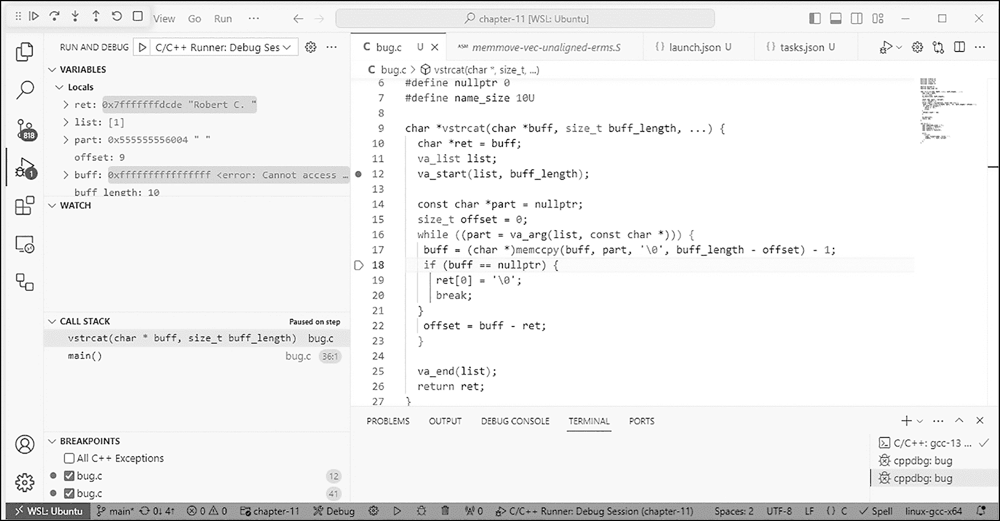

*图 11-2：一个有趣的程序状态*

现在我们已经发现了根源，可以通过将减 1 的操作移动到空指针检查之后来修复错误，这将产生第 7 章中所示的程序最终版本。

## 单元测试

测试增加了你对代码无缺陷的信心。*单元测试*（Unit tests）是运行你代码的小程序。*单元测试*（Unit testing）是一个验证每个单元的过程。*单元*（unit）是最小的可测试部分；在 C 中，这通常是一个函数或数据。

你可以编写类似于普通代码的简单测试（例如列表 11-7）检查其中最流行的：Google Test。

Google Test 适用于 Linux、Windows 和 macOS。测试是用 C++ 编写的，因此你可以学习另一种（相关的）语言。如果你想将测试限制在纯 C 语言，CUnit 和 Unity 是很好的替代方案。

在 Google Test 中，你编写断言（assertions）来验证被测试的代码。Google Test 断言类似于函数，是测试的真实语言。如果测试崩溃或断言失败，测试就会失败；否则，它成功。断言的结果可以是成功、非致命失败（nonfatal failure）或致命失败（fatal failure）。如果发生致命失败，当前函数将终止；否则程序继续。

我们将在 Ubuntu Linux 上使用 Google Test。要安装它，请遵循 Google Test 页面上的说明：[`github.com/google/googletest/tree/main/googletest`](https://github.com/google/googletest/tree/main/googletest)。

一旦安装了 Google Test，我们将为列表 11-7 所示的 `get_error` 函数设置单元测试。该函数返回一个与参数传递的错误码对应的错误消息。你需要包含声明 `errno_t` 类型以及 `strerrorlen_s` 和 `strerror_s` 函数的头文件。将其保存到名为 *error.c* 的文件中，以便本节稍后描述的构建说明能够正常工作。

此函数调用了规范中但可选的附录 K“边界检查接口”（在第 7 章中描述）中定义的 `strerrorlen_s` 和 `strerror_s` 函数。

遗憾的是，GCC 和 Clang 都没有实现附录 K，因此我们将使用由 Reini Urban 开发的 Safeclib 实现，该实现可以在 GitHub 上获取到（[`github.com/rurban/safeclib`](https://github.com/rurban/safeclib)）。

你可以通过以下命令在 Ubuntu 上安装 `libsafec-dev`：

```bash
% sudo apt install libsafec-dev
```

Listing 11-8 包含一个名为 `GetErrorTest` 的 `get_error` 函数的单元测试套件。*测试套件*是在特定测试周期中执行的测试用例集。`GetErrorTest` 套件由两个测试用例组成：`KnownError` 和 `UnknownError`。*测试用例*是根据测试条件（[`glossary.istqb.org`](https://glossary.istqb.org)）开发的一组先决条件、输入、动作（适用）、预期结果和后置条件。将此代码保存到名为 *tests.cc* 的文件中。

`tests.cc`

```cpp
#include <gtest/gtest.h>
#include <errno.h>
#define errno_t int

// implemented in a C source file
❶ extern "C" char* get_error(errno_t errnum);

namespace {
❷ TEST(GetErrorTest, KnownError) {
    EXPECT_STREQ(get_error(ENOMEM), "Cannot allocate memory");
    EXPECT_STREQ(get_error(ENOTSOCK), "Socket operation on non-socket");
    EXPECT_STREQ(get_error(EPIPE), "Broken pipe");
  }

  TEST(GetErrorTest, UnknownError) {
    EXPECT_STREQ(get_error(-1), "Unknown error -1");
  }
} // namespace

int main(int argc, char** argv) {
  ::testing::InitGoogleTest(&argc, argv);
  return RUN_ALL_TESTS();
}
```

`Listing 11-8:` `get_error` `function` 的单元测试

大部分 C++ 代码都是模版代码，可以不经修改直接复制，例如 `main` 函数，它调用了函数类宏 `RUN_ALL_TESTS` 来执行你的测试。两个不是模版代码的部分是 `extern "C"` 声明 ❶ 和测试 ❷。`extern "C"` 声明更改了链接要求，使得 C++ 编译器链接器不会像往常那样对函数名进行修饰。你需要为每个被测试的函数添加类似的声明，或者也可以简单地在 `extern "C"` 块中包含 C 头文件，如下：

```cpp
extern "C" {
  #include "api_to_test.h"
}
```

只有在用 C 编译但用 C++ 链接时，才需要 `extern "C"` 声明。

两个测试用例都使用 `TEST` 宏指定，它接受两个参数。第一个参数是测试套件名称，第二个参数是测试用例名称。

在函数体中插入 Google Test 断言以及你想要包含的任何额外 C++ 语句。在 Listing 11-8 中，我们使用了 `EXPECT_STREQ` 断言，它验证两个字符串的内容是否相同。`strerror_s` 函数返回与区域相关的字符串，这在不同实现之间可能会有所不同。`EXPECT_STREQ` 断言是非致命的，因为它在失败时允许你继续继续执行。如果在初始失败后无法继续测试（因为后续操作依赖于之前的结果），你可以使用 `ASSERT_STREQ` 断言。

`Listing 11-9:` `CMakeLists.txt` 文件

```cmake
cmake_minimum_required(VERSION 3.21)
cmake_policy(SET CMP035 NEW)
project(chapter-1)
set(CMAKE_CXX_STANDARD 14)
set(CMAKE_CXX_REQUIRED ON)
set(CMAKE_C_STANDARD 23)
include(FetchContent)
FetchContent_Declare(
  googest
  URL https://github.com/google/googest/archive/0397a0ed33e9d64b249b3799d4255f65f6.zip
)
FetchContent_MakeAvailable(googest)
include(ExternalProject)
ExternalProject_Add(
  libsec
  BUILD_IN_SOURCE 1
  URL https://github.com/rurban/safeclib/releases/v3.7/safeclib-3.7.tar.gz
  CONFIGURE_COMMAND autoreconf --install
  COMMAND ./configure --prefix=${CMAKE_BINARY_DIR}/libsec
)
ExternalProject_Get_Property(libsec install_dir)
include_directories(${install_dir}/src/libsec/include)
link_directories(${install_dir}/src/libsec/)
enable_testing()
add_library(error error.c)
add_dependencies(error libsafec)
add_executable(tests tests.cc)
target_link_libraries(
  tests
  error
  safec
  GTest::gtest_main
)
include(GoogleTest)
gtest_discover_tests(tests)
```

如果你更倾向于使用 `apt install` 命令安装 `libsafec-dev`，请删除专门安装 `libsec` 的行。

使用以下命令序列构建并运行测试：

```bash
$ cmake -S . -B build
$ cmake --build build
$ ./build/tests
```

该测试用例对 `errno.h` 中的几个错误码进行了测试。应该测试其中的多少个取决于你想要实现的目标。理想情况下，测试应该是全面的，这意味着要为 `errno.h` 中的每一个错误码添加断言。然而，这可能会变得非常乏味；一旦你确定了你的代码运行正常，你大部分时间只是在测试你所使用的 C 标准库函数是否实现正确。相反，我们可以测试我们可能获取的错误码，但这样做再次可能变得很乏味，因为我们需要识别程序中调用的所有函数以及它们可能返回哪些错误代码。我们选择从列表从不同位置随机选择几个错误码进行几次抽样检查。

Listing 11-10 显示了运行此测试的结果。

```text
$ ./build/tests
[==========] Running 2 tests from 1 test suite.
[----------] Global test environment set-up.
[----------] 2 tests from GetErrorTest
[RUN       ] GetErrorTest.KnownError
[        OK] GetErrorTest.KnownError (0 ms)
[RUN       ] GetErrorTest.UnknownError
/home/rcs/tests.cc:19: Failure
Expected equality of these values:
  get_error(-1)
    Which is: "Unknown error -1"
  "unknown error"
[  FAILED  ] GetErrorTest.UnknownError (0 ms)
[----------] 2 tests from GetErrorTest (0 ms total)
[----------] Global test environment tear-down
[==========] 2 tests from 1 test suite ran. (0 ms total)
[  PASSED  ] 1 test.
[  FAILED  ] 1 test, listed below:
[  FAILED  ] GetErrorTest.UnknownError
1 FAILED TEST
```

列表 11-10：一次失败的测试运行

从测试输出中，你可以看到从一个测试套件执行了两个测试。`KnownError` 测试用例通过了，而 `UnknownError` 测试用例失败了。`UnknownError` 测试用例失败是因为以下断言返回了假：

```text
EXPECT_STREQ(get_error(-1), "unknown error");
```


测试假设`get_error`函数中的错误路径将执行并返回字符串`"unknown error"`。然而`strerror_s`函数返回了字符串`"Unknown error -1"`。检查`strerror_s`函数的源代码（位于[`github.com/rurban/safeclib/blob/master/src/str/strerror_s.c`](https://github.com/rurban/safeclib/blob/master/src/str/strerror_s.c)），我们可以看到该函数确实返回了错误代码。因此，很明显，该函数没有将未知的错误代码视为错误。检查 C 语言标准，我们看到`strerror_s`应该将任何`int`类型的值映射到消息，因此`strerror_s`函数的实现是正确的，但我们对其行为的假设是错误的。

`get_error`函数的实现存在缺陷，即当`strerror_s`函数失败时，它指示了"unknown error"，但根据标准：

如果目标字符串的长度小于`maxsize`且没有发生运行时约束违反，则`strerror_s`函数返回零。否则，`strerror_s`函数返回非零值。

因此，如果`strerror_s`函数返回非零值，说明发生了严重错误，足以需要重新考虑该函数的设计。该函数不应该在错误条件下返回字符串，而可能应该返回一个空指针，或者以与你的系统整体错误处理策略一致的方式处理错误。列表 11-11 更新了该函数以返回空指针值。

```
char *get_error(errno_t errnum) {

  rsize_t size = strerrorlen_s(errnum) + 1;

  char* msg = malloc(size);

  if (msg != nullptr) {

    errno_t status = strerror_s(msg, size, errnum);

    if (status != 0) return nullptr;

  }

  return msg;

}
```

列表 11-11：`get_error`函数删除了`EXPECT_STREQ(get_error(-1), "unknown error");`

```
if (condVar > someVal) {console.log("xxx")}
```

列表 11-12：一次成功的测试运行

在进行此更改、重新构建并重新运行测试后，我们可以看到：

```
$ ./build/tests
[==========] Running 2 tests from 1 test suite.
[----------] Global test environment set-up.
[----------] 2 tests from GetErrorTest
[RUN       ] GetErrorTest.KnownError
[        OK] GetErrorTest.KnownError (0 ms)
[RUN       ] GetErrorTest.UnknownError
[        OK] GetErrorTest.UnknownError (0 ms)
[----------] 2 tests from GetErrorTest (0 ms total)
[----------] Global test environment tear-down
[==========] 2 tests from 1 test suite ran. (0 ms total)
[  PASSED  ] 2 tests.
```

## 静态分析

*静态分析*包括任何在不执行的情况下评估代码的过程（ISO/IEC TS 17961:2013），以提供有关可能软件缺陷的信息。

静态分析具有局限性，因为软件的正确性是不可判定的。例如，计算机科学中的停止问题指出，某些程序的精确控制流无法确定。因此，任何依赖于控制流的属性（如停止）可能是不可判定的。因此，静态分析可能无法报告缺陷，或者在没有缺陷的地方报告缺陷。

未能报告代码中的真实缺陷被称为*假阴性*（false negative）。假阴性是严重的分析错误，因为它们可能会让你产生虚假的安全感。大多数工具都倾向于保守做法，结果就是生成了*假阳性*（false positives）。*假阳性*是错误指示存在缺陷的测试结果。当代码复杂到无法完全分析时，也会出现假阳性。

编译器通常提供高质量的诊断信息，你不应该忽视它们。务始终尝试理解警告的原因并重写代码以消除错误，而不是简单地通过添加类型转换或进行任意更改来消除警告，直到警告消失。关于此主题的更多信息，请参阅 CERT C 规则`MSC00-C`，"在高警告级别下保持编译清洁"。

一旦你处理了代码中的编译器警告，就可以使用独立的静态分析工具来识别额外的缺陷。静态分析工具会通过评估程序中的表达式、执行深度的控制和数据流分析，以及对可能的取值范围和所过的控制流路径进行推理，从而诊断更复杂的缺陷。

让工具定位并识别程序中的特定错误，比数小时的测试和调试要容易得多，而且比部署缺陷代码的成本低得多。目前有许多免费和商业静态分析工具可用。例如，Visual C++ 集成了一个静态分析器，你可以通过`/analyze`标志调用它。Visual C++ 分析允许你指定想要运行的规则集（如推荐、安全或国际化），或者是否运行所有规则集。有关 Visual C++ 静态代码分析的更多信息，请参阅微软网站：`https://learn.microsoft.com/en-us/visualstudio/code-quality`。同样，Clang 也集成了一个静态分析器，可以作为独立工具或在 Xcode 中运行（`https://clang-analyzer.llvm.org`）。从第 10 版本开始，GCC 引入了通过`-fanalyzer`选项启静态分析。也存在商业工具，例如 GitHub 的 CodeQL、TrustInSoft Analyzer、SonarSource 的 SonarQube、Synopsys 的 Coverity、LDRA Testbed、Perforce 的 Helix QAC 等。

许多静态分析工具的功能并不重叠，因此使用多个工具可能是有意义的。

## 动态分析

`动态分析`是在程序运行执行期间评估系统或组件的过程。它也被称为`运行时分析`（runtime analysis）或其他类似的名称。

动态分析的一种常用方法是对代码进行`插桩`（instrument）——例如通过启用编译标志向可执行文件注入额外的指令，然后运行插桩的可执行文件。第 6 章中描述的调试内存分配库`dmalloc`采用了类似的方法。`dmalloc`库提供了具有运行时配置调试设施的替代内存管理例程。你可以使用命令行工具（也称为`dmalloc`）来控制这些例程的行为，以检测内存泄漏并发现和报告缺陷，例如写入对象边界之外以及在释放后使用指针。

动态分析的优势是它的假报率很低，因此如果这些工具之一标记了问题，请修复它！

动态分析的缺点是它需要足够的代码覆盖率。如果在测试过程中没有执行缺陷代码路径，将无法发现该缺陷。另一个缺点是插桩可能会以不可希望的方式改变程序的其他方面，例如增加性能开销或增大二进制文件大小。与其他动态分析工具不同，本章前面提到的`FORTIFY_SOURCE`宏为检测缓冲区溢出提供了轻量级支持，因此可以在生产构建中启用，而不会对性能产生明显影响。

## AddressSanitizer

AddressSanitizer (ASan, `https://github.com/google/sanitizers/wiki/AddressSanitizer`) 是一个适用于多种编译器（免费）的有效动态分析工具示例。存在多个相关的清理器，包括 ThreadSanitizer、MemorySanitizer、硬件辅助 AddressSanitizer 和 UndefinedBehaviorSanitizer。还有许多其他商业和免费的动态分析工具可用。关于清理器的更多信息，请参阅`https://github.com/google/sanitizers`。我通过详细讨论 AddressSanitizer 来演示这些工具的价值。

ASan 是用于 C 和 C++ 程序的动态内存错误检测器。它已集成到 LLVM 3.1 和 GCC 4.8 版本以及这些编译器的更高版本中。ASan 也从 Visual Studio 2019 开始可用。

此动态分析工具可以发现各种内存错误，包括：

* 释放后使用（悬空指针解引用）
* 堆、栈和全局缓冲区溢出
* 使用后使用
* 初始化顺序
* 内存泄漏

为了演示 ASan 的用处，我们将首先将列表 11-7 中的`get_error`函数替换为[列表 11-13]所示的`print_error`函数。

```c
errno_t print_error(errno_t errnum) {

  size_t size = strerror(errnum) + 1;

  char* msg = malloc(size);

  if (msg == nullptr) return ENOMEM;

  errno_t status = strerror_s(msg, size, errnum);

  if (status != 0) return EINVAL;

  fputs(msg, stderr);

  return EOK;

}
```

我们还将`get_error`的单元测试套件替换为列表 11-14 所示的`print_error`函数的单元测试套件。

```cc
TEST(PrintTests, ZeroReturn) {

  EXPECT_EQ(print_error(ENOMEM), 0);

  EXPECT_EQ(print_error(ENOTSOCK), 0);

  EXPECT_EQ(print_error(EPIPE), 0);

}
```

运行来自[列表 11-14](#chapter11.xhtml_14)的修改后的测试将产生[列表 11-15]所示的积极结果。

```
$ ./build/tests
[==========] Running 1 test from 1 test suite.
[----------] Global test environment set-up.
[----------] 1 test from PrintTests
[RUN       ] PrintTests.ZeroReturn
[        OK] PrintTests.ZeroReturn (0 ms)
[----------] 1 test from PrintTests (0 ms total)
[----------] Global test environment tear-down
[==========] 1 test from 1 test suite ran. (0 ms total)
[  PASSED  ] 1 test.
```

列表 11-15：`PrintTests`测试套件的测试运行。

一个缺乏经验的测试人员可能会查看这些结果并误地认为："嘿，这段代码运行正常！"然而，你应该采取额外的步骤来增加对代码无缺陷的信心。既然我们已经有了一个可以工作的测试执行框架，现在是时候对代码进行插桩了。

## 为代码插桩

你可以通过使用 ASan 使用`-fsanitize=address`标志编译并链接你的程序来对代码进行插桩。表 11-3 显示了一些与 ASan 配合使用的编译器标志。

### 表 11-3：AddressSanitizer 常用编译器和链接器标志

| 标志 | 目的 |
| --- | --- |
| `-fsanitize=address` | 启用 AddressSanitizer（必须同时传递给编译器和链接器） |
| `-g3` | 获取符号调试信息 |
| `-fno-omit-frame-pointer` | 保留帧指针，以便在错误消息中获取更详细堆栈跟踪 |
| `-fsanitize-blacklist=path` | 传递黑名单文件 |
| `-fno-common` | 不将全局变量视为公共变量（允许 ASan 对它们进行插桩） |

从表 11-3 中选择你想使用的编译器和链接器标志，并使用`add_compile_options`和`add_link_options`命令将其添加到你的`CMakeLists.txt`文件中：

```
add_compile_options(-g3 -fno-omit-frame-pointer -fno-common -fsanitize=address)
add_link_options(-fsanitize=address)
```

不要在构建阶段启用插桩，因为插入的运行时插桩可能会导致误报。

如前所述，AddressSanitizer 兼容 Clang、GCC 和 Visual C++。（有关 ASan 支持的更多信息，请参阅 *https://devblogs.microsoft.com/cppblog/addresssanitizer-asan-for-windows-with-msvc*。）

取决于你使用的编译器版本，你可能还需要定义以下环境变量：

```
ASAN_OPTIONS=symbolize=1
ASAN_SYMBOLIZER_PATH=/path/to/llvm_build/bin/llvm-symbolizer
```

尝试在设置这些环境变量后重新构建并重新运行测试。

## 运行插桩后的测试

你使用 Google Test 编写的单元测试套件应该继续通过，但它还会执行你的代码，允许 AddressSanitizer 检测到额外问题。现在你应该能在运行`./build/tests`后看到列表 11-16 中的额外的输出。

```
==2248==ERROR: LeakSanitizer: direct leak of 31 bytes in 1 object(s) allocated from:
    #0 0x7f2b9f58ff in __interceptor_malloc ../../../sanitizer/asan_malloc.cpp:69
    #1 0x557d3105fda in print_error /home/rcs/error.c:21
    #2 0x557d314555 in TestBody /home/rcs/test.cc:28
```

列表 11-16：`PrintTests`的插桩测试运行。

```
errno_t print_error(errno_t errnum) {

  size_t size = strerrorlen(errnum) + 1;

  char* msg = malloc(size);

  // ...

}
```

这是一个显而易见的错误；`malloc`的返回值赋值了一个定义在`print_error`函数范围内的自动变量，且从没有释放。我们在函数返回后失去了释放这块内存的机会，而持有分配内存的对象生命周期也结束了。要修复这个问题，请在分配的存储不再需要但在函数返回之前添加对`free(msg)`的调用。重新运行测试并修复任何额外的缺陷，直到你对程序的质量满意为止。

C 委员会已经批准了一项新章程来记录我们的原则（Seacord et al. 2024）。虽然委员会致力于维护 C 的传统精神，但将重新关注安全性和可靠性。对于 C2Y，我们可能会改进自动类型推导，扩展`constexpr`的支持，并可能采用 C++ 的 lambda 及其他特性。我们还在开发一种用于错误处理和资源管理的新颖`defer`特性。C 浮点组将继续其工作更新到`IEEE 754:2019`。一项关于 C 的溯源感知内存对象模型的技术规范（ISO/IEC CD TS 6010:2024）即将将发布，并有望纳入 C2Y。

# 附录：C 标准的第五版 (C23)

*由 Aaron Ballman 编写*


最新的（第五版）C 标准（ISO/IEC 9899:2024）被称为 C23。C23 在保持 C 精神的同时，增加了新特性和功能，以提高语言的安全性、安全能力。

## 特性 (Attributes)

C23 添加了`[[attributes]]`语法用于为各种源码构造（如类型、对象、标识符或块）指定附加信息（Ballman 2019）。在 C23 之前，类似的功能是以实现定义（非移植）的方式提供的：

```
__declspec(deprecated)
__attribute__((warn_unused_result))
int func(const char *str)__attribute__((nonnull(1)));
```

从 C23 开始，可以如下所示指定属性：

```
[[deprecated, nodiscard]]
int func(
  const char *str [[gnu::nonnull]]
);
```


像 C++ 一样，语法位置决定了分配。属性包括 `deprecated`、`fallthrough`、`maybe_unused`、`nodiscard`、`unsequenced` 和 `reproducible`。属性语法支持标准属性和厂商特定属性。可以使用 `__has_c_attribute` 条件包含运算符进行特性的测试。

## 关键字 (Keywords)

C 语言经常因其难看的关键字而受到嘲笑。C 通常使用以下划线字符（`_`）开头后跟大写字母的保留标识符来定义新关键字。

C23 为这些关键字引入了更自然的拼写（Gustedt 2022）。在表 A-1 中，左侧显示使用此惯的 C11 关键字，右侧显示 C23 引入的更自然的拼写。

### 表 A-1：关键字拼写

| 值 | 类型 |
| --- | --- |
| `_Bool` | `bool` |
| `_Static_assert` | `static_assert` |
| `_Thread_local` | `thread_local` |
| `_Alignof` | `alignof` |
| `_Alignas` | `alignas` |

另一个更新是引入了 `nullptr` 常量。常用的 `NULL` 宏具有指针类型或可能是整数。它会隐式转换为任何标量类型，因此并不安全。`nullptr` 常量的类型为 `nullptr_t`，只会隐式转换为指针类型、`void` 或 `bool`。

## 整数常量表达式 (Integer Constant Expressions)

整数常量表达式不是可移植的；厂商可以扩展它们。例如，`func()` 中的 `array` 可能也可能不是变长数组（VLA）：

```c
void func() {
  static const size = 12;
  int array[size]; // 可能是一个 VLA
}
```

当你真正想要某个内容是常量时，C23 添加了 `constexpr` 变量（它隐含了 `const` 修符）（Gilding and Gustedt 2022）：

```c
void func() {
  static constexpr int Size = 12;
  int Array[Size];
}
```

C23 不支持 `constexpr` 函数，只支持对象。结构体成员不能是 `constexpr`。

## 枚举类型 (Enumeration Types)

C 枚举类型在 C17 之前看起来很正常，但具有一些奇怪的行为。例如，底层整数类型是由实现定义的，可以是符号或无符号整数类型。C23 现在允许程序员为枚举指定底层类型（Meneide and Pygott 2022）：

```c
enum E : unsigned short {
  Valid = 0, // 具有 unsigned short 类型
  NotValid = 0x1FFFF // 错误，太大
};

// 可以用固定类型前向
enum F : int;
```

你也可以声明比 `int` 大的枚举常量：

```c
// 具有底层类型 long
enum G {
  BiggerThanInt = 0xFFFF'FFFF'0000L,
};
```

## 类型推导 (Type Inference)

C23 增强了用于单个对象定义的 `auto` 类型说明符的类型推导（Gilding and Gustedt 2022b）。这基本上与 C++ 中的思路相同，但 `auto` 不能出现在函数签名中：

```c
const auto l = 0L; // l 是 const long
auto huh = "test"; // huh 是 char *，不是 char[5] 或 const char *
void func();
auto f = func; // f 是 void (*)()
auto x = (struct S){  // x 是 struct S
  1, 2, 3.0
};

#define swap(a, b) \
  do {auto t = (a); (a) = (b); (b) = t;} \
  while (0)
```

## typeof 运算符 (typeof Operators)

C23 增加了对 `typeof` 和 `typeof_unqual` 运算符的支持。类似于 C++ 中的 `decltype`，用于根据另一个类型或表达式的类型指定类型。`typeof` 运算符保留限定符，而 `typeof_unqual` 则去除限定符，包括 `_Atomic`。

### K&R C 函数

K&R C 允许在没有原型的情况下声明函数：

```c
int f();
int f(a, b) int a, b; {return 0;}
```

K&R C 函数在 35 年前就被废弃了，现在终于被从标准中移除。所有函数现在都具有原型。空参数列表以前意味着“接受任意数量的参数”，而现在意味着“接受零参数”，与 C++ 相同。现在可以通过变变函数签名来模拟“接受零或多个参数”：`int f(...);`，这现在是可行的，因为 `va_start` 不再需要在调用时在 `...` 之前传递参数。

### 预处理器

C23 添加了新功能以改进预处理能力。`#elifdef` 指令补充了 `#ifdef`，并且也有 `#elifndef` 形式。`#warning` 指令补充了 `#error`，但不会停止编译。`__has_include` 算符测试头文件是否存在，`__has_c_attribute` 算符测试标准或厂商属性是否存在。

`#embed` 指令通过预处理器将外部数据直接嵌入到源代码中：

```c
unsigned char buffer[] = {
#embed "/dev/urandom" limit(32) // 从 /dev/urandom 嵌入 32 个字符
};

struct FileObject {
  unsigned int MagicNumber;
  unsigned _BitInt(8) RGBA[4];
  struct Point {
    unsigned int x, y;
  } UpperLeft, LowerRight;
} Obj = {
#if __has_embed(SomeFile.bin) == __STDC_EMBED_FOUND__
// 将文件内容作为结构体嵌入
// 初始化元素
#embed "SomeFile.bin"
#endif
};
```

### 整数类型与表示

从 C23 开始，补码是唯一允许的整数表示（Bastien and Gustedt 2019）。符号整数溢出仍是未定义行为。`int8_t`、`int16_t`、`int32_t` 和 `int64_t` 类型现在随处可移植地可用。`[u]intmax_t` 类型不再是最大值，它们仅要求表示 `long long` 值，而不是扩展的或位精度的整数值。

C23 还引入了位精度的整数类型（Blower et al. 2020）。这些是允许指定位宽的符号和无符号类型。这些整数不会发生整数提升，因此它们保持你所请求的大小。位宽包含符号位，因此 `_BitInt(2)` 是最小的符号位精度整数。`BITINT_MAXWIDTH` 指定了位精度整数的最大宽度。它必须至少是 `ULLONG_WIDTH`，但可以大得多（Clang 支持大于 200 万位）。

在 C17 中，两个两个半字节（nibbles）需要进行一些位操作：

```c
unsigned int add(
  unsigned int L, unsigned int R)
{
  unsigned int LC = L & 0xF;
  unsigned int RC = R & 0xF;
  unsigned int Res = LC + RC;
  return Res & 0xF;
}
```

使用 `_BitInt` 则要简单得多：

```c
unsigned _BitInt(4) add(
  unsigned _BitInt(4) L,
  unsigned _BitInt(4) R)
{
  return L + R;
}
```

C23 还添加了二进制字面量。整数字面量 `0b00101010101`、`0x155`、`341` 和 `052` 都表示相同的值。你现在还可以使用数字分隔符来提高可读性，例如：`0b0000'1111'0000'100`、`0xF'0C`、`3'852` 和 `07'414`。

C23 终于拥有了检查整数运算，它可以检测加、减、乘法中的溢出和回绕（Svoboda 2021）：

```c
#include <stdint.h>

bool ckd_add(Type1 *Result, Type2 L, Type3 R);
bool ckd_sub(Type1 *Result, Type2 L, Type3 R);
bool ckd_mul(Type1 *Result, Type2 L, Type3 R);
```

不支持除法，且它仅适用于 `char`、`bool` 或位精度整数以外的整数类型。`Type1`、`Type2` 和 `Type3` 可以是不同的类型。如果操作的数学结果可以用 `Type1` 表示，这些函数返回 `false`；否则返回 `true`。这些函数使得遵循 CERT C 标准和 MISRA 指南变得更容易，但组合起来仍然很别扭。

### 不可到达函数类宏

`stddef.h` 中提供了 `unreachable` 函数类宏。它展开为 void 表达式；在执行期间到达该表达式是未定义行为。这允许你向优化器提供无法到达的流控制提示（Gustedt 2021）。

正如你告诉优化器假设的任何内容一样，使用它时要谨慎，因为如果你错了，优化器会相信你。以下是 `unreachable()` 在实践中可能使用的典型示例：

```c
#include <stdlib.h>

enum Color {Red, Green, Blue};

int func(enum Color C) {
  switch (C) {
    case Red: return do_red();
    case Green: return do_green();
    case Blue: return do_blue();
  }
  unreachable(); // 未处理的值
}
```

### 位与字节工具

C23 在 `stdbit.h` 头文件中引入了一系列位和字节工具（Meneide 2023）。这些包括用于函数：

* 计算位模式中 1 或 0 的数量
* 计算领先或尾随 1 或 0 的数量
* 找到第一个领先或尾随 1 或 0
* 测试单个位是否设置
* 确定一个值所需的最小位数
* 根据一个值确定下一个最小或最大的幂次

例如，以下代码可以用于从最高位开始计算值中连续的 0 位数量：

```c
#include <stdbit.h>

void func(uint32_t V) {
  int N = stdc_leading_zeros(V);
  // 使用领先计数 N
}
```

在 C23 之前，此操作要复杂得多：

```c
void func(uint32_t V) {
  int N = 32;
  unsigned R;
  R = V >> 16;
  if (R != 0) {N --= 16; V = R;}
  R = V >> 8;
  if (R != 0) {N --= 8; V = R;}
  R = V >> 4;
  if (R != 0) {N --= 4; V = R;}
  R = V >> 2;
  if (R != 0) {N --= 2; V = R;}
  R = V >> 1;
  if (R != 0) N -= 2;
  else        N -= V;
  // 使用领先计数 N
}
```


### IEEE 浮点支持

C23 通过集成 TS 18661-1、2 和 3（ISO/IEC TS 18661-1 2014、ISO/IEC TS 18661-2 2015、ISO/IEC TS 18661-3 2015）更新了 IEEE 浮点支持。附录 F 现在与 IEEE 浮点算术标准（IEEE 754-2019）保持一致。附录 F 也适用于十进制浮点数：`_Decimal32`、`_Decimal64` 和 `_Decimal128`。然而，你不能将小数操作与二进制、复数或虚浮点数混合。附录 H（此前为语言无关算术附录）支持交换、扩展浮点类型和非算术交换格式。它允许二进制 16、图形处理器（GPU）数据、二进制或小数表示。

数学库的更改支持了对 `_DecimalN`、`_FloatN` 和 `_FloatNx` 类型的 `math.h` 操作。增加了指数、对数、幂和基于 π 的三角函数的特殊变体；改进了最小/最大、全排序以及数值属性测试的函数；以及允许对浮点值与整数或字符串之间的转换进行细粒度控制的函数。

增加了 `memset_explicit` 函数，用于你确实需要清空内存的情况。它与 `memset` 相同，但优化器无法移除对其调用。`strdup` 和 `strndup` 函数已采用自 POSIX。

# 参考文献

- 美国国家标准协会（ANSI）。1986。“信息系统—编码字符集—7 位美国国家信息交换代码（7-Bit ASCII）。” ANSI X3.4-1986。
- Ballman, Aaron。2019。“C 中的属性。” ISO/IEC, WG14 N2335（C 国际标准化工作组）。[http://www.open-std.org/jtc1/sc22/wg14/www/docs/n2335.pdf]
- Bastien, J.F., and Jens Gustedt。2019。“C2x 的补码符号表示。” ISO/IEC JTC1/SC22/WG14（C 国际标准化工作组）。[https://www.open-std.org/jtc1/sc22/wg14/www/docs/n2412.pdf]
- Blower, Melanie, Tommy Hoffner, and Erich Keane。2020。“为 N 位整数添加基本类型。” 文档号 N2534。[http://www.open-std.org/jtc1/sc22/wg14/www/docs/n2534.pdf]
- Boute, Raymond T。1992。“函数 `div` 和 `mod` 的欧几里得定义。” *ACM Transactions on Programming Language and Systems* 14, no. 2（4 月）：127–144。[http://dx.doi.org/10.1145/128861.128862]
- Dijkstra, Edsger。1968。“被认为有害的 Go To 语句。” *Communications of the ACM* 11, no. 3。[https://homepages.cwi.nl/storm/reader/Dijkstra68.pdf]
- Gilding, Alex, and Jens Gustedt。2022a。“对象定义的 `constexpr` 指定符。” ISO/IEC JTC1/SC22/WG14（C 国际标准化工作组）。[https://www.open-std.org/jtc1/sc22/wg14/www/docs/n3018.htm]
- ——。2022b。“对象定义的类型推断。” ISO/IEC JTC1/SC22/WG14（C 国际标准化工作组）。[https://www.open-std.org/jtc1/sc22/wg14/www/docs/n3007.htm]
- Gustedt, Jens。2021。“不可达流的注解。” ISO/IEC JTC1/SC22/WG14（C 国际标准化工作组）。[https://www.open-std.org/jtc1/sc22/wg14/www/docs/n2826.pdf]
- ——。2022。“引入 `nullptr` 常量。” ISO/IEC JTC1/SC22/WG14（C 国际标准化工作组）。[https://www.open-std.org/jtc1/sc22/wg14/www/docs/n3042.htm]
- Hopcroft, John E., and Jeffrey D. Ullman。1979。*自动机理论、语言与计算导论*。Reading, MA: Addison-Wesley。
- IEEE。2019。“IEEE 浮点算术标准。” IEEE Std 754-2008。[https://ieeexplore.ieee.org/document/461035]
- IEEE and The Open Group。2018。“信息技术—可移植操作系统接口（POSIX）基础规范，”第 7 版。IEEE Std 1003.1。
- 国际标准化组织和国际电工委员会。2014。*系统和软件质量要求和评价（SQuaRE）*。ISO/IEC 25000:2014。日内瓦，国际标准化组织。
- ISO/IEC。1990。“编程语言—C，”第一版。ISO/IEC 9899:1990。
- ——。1999。“编程语言—C，”第二版。ISO/IEC 9899:1999。
- ——。2007。“信息技术—编程语言、环境和系统接口—C 边界检查接口。” ISO/IEC TR 24731-1:2007。
- ——。2011。“编程语言—C，”第三版。ISO/IEC 9899:2011。
- ——。2013。“信息技术—编程语言、环境和系统接口—C 安全编码规范。” ISO/IEC TS 17961:2013。
- ——。2014。“C 的浮点扩展—第一部分：二进制浮点算术。” ISO/IEC TS 18661-1:2014。
- ——。2015。“C 的浮点扩展—第二部分：十进制浮点算术。” ISO/IEC TS 18661-2:2015。
- ——。2015。“C 的浮点扩展—第三部分：交换和扩展类型。” ISO/IEC TS 18661-3:2015。
- ——。2018。“编程语言—C，”第四版。ISO/IEC 9899:2018。
- ——。2024。“编程语言—C，”第五版。ISO/IEC 9899:2024。
- ——。2024。“信息技术—编程语言—C—一种感知来源的内存对象模型。” 草案技术规范。ISO/IEC CD TS 6010:2024。
- Kuhn, Markus。1999。“UTF-8 and Unicode FAQ for Unix/Linux。” June 4, 1999。[https://www.cl.cam.ac.uk/~mgk25/unicode.html]
- Lamport, Leslie。1979。“How to Make a Multiprocessor Computer That Correctly Executes Multiprocess Programs。” *IEEE Transactions on Computers C-28* 9（September）：690–691。
- Lewin, Michael。2012。“All About XOR。” *Overload Journal* 109（June）。[https://accu.org/index.php/journals/1915]
- Meneide, JeanHeyd。2023。“More Modern Bit Utilities。” ISO/IEC JTC1/SC22/WG14（C International Standardization Working Group）。Last updated February 7, 2023。[https://www.open-std.org/jtc1/sc22/wg14/www/docs/n3104.htm]
- Meneide, JeanHeyd, and Clive Pygott。2022。“Enhancements to Enumerations。” ISO/IEC JTC1/SC22/WG14（C International Standardization Working Group）。Last updated July 19, 2022。[https://www.open-std.org/jtc1/sc22/wg14/www/docs/n3030.htm]
- Ritchie, Dennis。1993。“The Development of the C Language。” In *The Second ACM SIGPLAN History of Programming Languages Conference (HOPL-II), April 20–23, 1993, Cambridge, Massachusetts*, 201–208。New York: Association for Computing Machinery。
- Saks, Dan。2002。“Tag vs. Type Names。” October 1, 2002。[https://www.embedded.com/tag-vs-type-names/]
- Schoof, René。2008。“Four Primality Testing Algorithms。” Submitted January 24, 2008。arXiv preprint arXiv:0801.3840。[https://doi.org/10.48550/arXiv.0801.3840]
- Seacord, Robert C。2013。*Secure Coding in C and C++*，2nd ed。Boston: Addison-Wesley Professional。
- ——。2014。*The CERT® C Coding Standard: 98 Rules for Developing Safe, Reliable, and Secure Systems*，2nd ed。Boston: Addison-Wesley Professional。
- ——。2017。“Uninitialized Reads。” *Communications of the ACM* 60, no. 4（March）：40–44。[https://doi.org/10.1145/3024920]
- ——。2019。“Bounds-Checking Interfaces: Field Experience and Future Directions。” February 3, 2019。[https://www.open-std.org/jtc1/sc22/wg14/www/docs/n2336.pdf]
- Seacord, Robert C., et al。2024。*The C Standard Charter*。Last updated June 12, 2024。[https://www.open-std.org/jtc1/sc22/wg14/www/docs/n3280.htm]
- Seacord, Robert C., Martin Uecker, Jens Gustedt, and Philipp Krause。2024。“Accessing Byte Arrays, v4。”[https://www.open-std.org/jtc1/sc22/wg14/www/docs/n3254.pdf]
- Svoboda, David。2021。“Checked N-Bit Integers?” WG2867。Last updated November 28, 2021。[https://open-std.org/JTC1/SC22/WG14/www/docs/n2867.pdf]
- TIOBE。2024。TIOBE Index。[https://www.tiobe.com/tiobe-index/]
- The Unicode Consortium。2023。*The Unicode Standard*，version 15.1.0。Mountain View, CA: The Unicode Consortium。[https://www.unicode.org/versions/Unicode15.1.0/]
- Weimer, Florian。2018。“Recommended Compiler and Linker Flags for GCC。” *Red Hat Developer*，March 21, 2018。[https://developers.redhat.com/blog/2018/03/21/compiler-and-linker-flags-gcc]

# 索引

## A

- `abort` 函数，162，177，232
- `abort_handler_s` 函数，164–165
- `ABS` 宏，54–56
- 加法（`+`）运算符，25
- 加法算符，83–84
- 地址，14
- AddressSanitizer，132，253–257
- 配合使用的编译器标志，255
- 地址空间随机化（ASLR），239
- 高级加密标准（AES），56
- `aligned_alloc` 函数，120
- 对齐要求，41–42
- `alignof` 运算符，92
- `alloca` 函数，128–129
- 分配的存储期，35，116
- `/analyze` 标志，241
- 附录 K 边界接口
  - `gets_s` 函数，161
  - 运行时，163
  - `strcpy_s` 函数，162
- 应用程序接口（API），168，216
  - 参数检查，156–157
- 算术类型，19–22
  - 类型转换，64–72
  - 枚举，21
  - 浮点数，21，59–64
  - 整数，48–59
  - 运算符，83–85
  - 指针，94–96
- `arm_missile` 函数，19
- `ARRAY_SIZE` 标识符，203
- 数组类型，25–27
- ASCII，138
- 断言
  - 运行时，232–234
  - 静态，230–232
- `assert` 宏，232
- `assignInterestRate` 函数，103–104
- 赋值（`=`）运算符，74
  - 结合性，78–80
- `ATOMIC_VAR_INIT` 宏，207
- 属性，44–45，259–260
- 自动存储期，15
- `auto` 存储类说明符，38–39

## B

- `backslash`（`\`），143
- 基础执行字符集，19
- 基础语言平面（BMP），139，146
- 大端序排序，191
- 二进制常量，58
- 二进制资源，嵌入，209–210
- 二进制流，172
  - 读取与写入，188–191
- `bin` 目录，225–227
- 位与字节工具程序，264–265
- `_BitInt` 类型，56–57
- 位精确常量，58
- 位精确整数，20，56–59
- 位运算符
  - 位与（`&`），87
  - 位异或（`^`），88
  - 位包含或（`|`），88–89
  - 补码，85–86
  - 移位，86–87
- 块，14。另见复合语句
- 块作用域，34
- 波音 787，51
- 布尔类型，18–19
- `break` 语句，111–112
- 缓冲，169–170
- 缓冲区溢出，106，123，152，159，160，164–165，188，239，240
- 字节型流，171
- 字节，154
- `C`
  - C，xxv–xxvi
  - 历史与发展，xxiii–xxv
  - 入门，1–11
  - 值传递语言，16
- `calloc` 函数，120–121
- `cardinal_points` 枚举，21
- 强制转换运算符，90–91
- `cc` 命令，4
- 中央处理器（CPUs），41，85
- 字符
  - ASCII，138
  - 代码点，138
  - 常量，142–143
  - 转换，146–149
  - 数据类型，140–142
  - 转义序列，143–144
  - 执行字符集，140
  - Linux，144–145
  - 字面量，142–143
  - 窄，140–142，146
  - 读取与写入，177–180
  - 源字符集，140
  - Unicode，138–140
  - 宽，19，140–142，146
- 字符字面量，150–152
- `char` 类型，19，140–142
- `Clang`，44–45，93，102，104，129，131，145，196，203，206，226，252，255
  - 编译器的标志，235–240
  - 安装，8
  - 预定义宏，210
- `clear` 函数，169
- `clear_stdin` 函数，231
- `close` 函数，177
- 编译，225–227
- 复数，213–218
  - 代码，215
  - 内聚性，214–215
  - 耦合，214–215
  - 数据抽象，215–216
  - 不透明类型，217–218
- 复合赋值运算符，93–94
- 复合语句，14，98–99
- 条件包含，198–202
  - 生成诊断信息，200–201
  - 头文件保护，201–202
- 条件运算符（`? :`），91–92
- 考虑的行为，10
- 常量
  - 字符，142–143
  - 浮点，64
  - 整数，57–59
  - 二进制，58
  - 十进制，57
  - 进制，57
- `constexpr` 存储类说明符，37–38
- `const` 限定符，32
- `continue` 语句，111

## D

- 悬空指针，处理，125–126
- 数据抽象，215–216
- 调试，241–245
- 十进制常量，57
- 十进制浮点类型，22
- 声明，74
- 整数声明，49
- 递减（`--`）运算符，77
- `defined` 运算符，199
- `#define` 预处理指令，202–203
- 碎片整理，117
- 派生类型
  - 数组，25–27
  - 函数，22–23
  - 指针，23–25
  - 结构，27–28
  - 联合体，28–29
- 诊断信息，生成，200–201
- `dmalloc`（调试内存分配），132–134
- 库，252
- `double` 类型，59–62
- `do...while` 循环，231
- `do...while` 语句，106–107
- `dup_string` 函数，233
- 动态分配内存，15
- 动态分析，252–253
- 动态库，218–219
- 调试，132–135
- 灵活数组成员，127–128
- 内存管理，117–126
- 关键安全系统，134–135
- 存储生存期，116–117
  - 使用，117

## E

- 编辑器，6–7
- 8 位表示，51
- `else` 语句，199
- `#embed` 预处理指令，209
- 字节序，28，191–193
- `#endif` 预处理指令，199
- 枚举，21，261
- 环境变量，164
- 等于（`==`）运算符，70
- `#error` 预处理指令，201
- 转义序列，143–144
- 欧几里德除法，84
- 求值，75–76
  - 不确定顺序的，81
  - 顺序，80–82
  - 未排序的，81
- 可执行文件，218–219
- 执行字符集，140
- `EXIT_SUCCESS` 宏，2–3
- `EXPECT_STREQ` 断言，247
- 显式未定义行为，10
- 表达式，73
  - 求值，75–76
  - 函数调用，76–77
  - 简单赋值，74–75
- 语句，97–98
- 扩展 ASCII，138
- 扩展字形簇，154–155
- 扩展整数类型，20
- `extern "C"` 声明，247
- `extern` 标识符，37
- `extern` 存储分类符，220

## F

- `fclose` 函数，176–177，181，188
- `feof` 函数，169
- `ferror` 函数，169
- `fgetc` 函数，178
- `fgetpos` 函数，181
- 现场可编程门阵列（FPGAs），56
- 文件访问模式，174
- 文件描述符，174
- 文件包含，预处理器，197–198
- `FILE` 对象，168，174，177
- 文件指针，168
- 文件作用域，34
- 文件 I/O
  - 关闭，176–177
  - 创建，172–176
  - 打开，172–176
- 文件状态标记，175
- `flag` 参数，55
- 标记，235–240
- 浮点
  - 算术，21–22，62
  - C 模型，60–62
  - 常量，64
  - 编码，59–60
  - 类型，59–60
  - 值，62–64
- `float` 类型，59–60
- `flooring division`，84
- `flushing`，170，180
- `fopen` 函数，172–174，181
- `format` 字符串，185
- `formatted output`，5
- 格式化文本流，读取，184–188
- `for` 语句，107–108
- `_FORTIFY_SOURCE` 宏，239
- `fpclassify` 宏，63–64
- `-fpic` 标记，239
- `-fpie` 标记，239
- `fread` 函数，188–191
- `free_aligned_sized` 函数，124–126
- `free` 函数，123–224
- `free_sized` 函数，124
- `freestanding environment`，2
- `fseek` 函数，173，180–181
- `fsetpos` 函数，173，181
- `-fstack-protector-strong`，240
- `functions`，2，14
  - `code reuse`，215
  - `declarator`，22
  - `definition`，23
  - `designator`，76–77
  - `invocation`，76–77
  - `objects and`，14
  - `prototype`，23
  - `return values`，4–5
  - `scope`，34
  - `type`，22–23
  - `variadic`，76
- `fwrite` 函数，188–191

## G

- `GCC`。见 GNU Compiler Collection
- `generic selection expression`，207
- `getc` 函数，178
- `getchar` 函数，178
- `get_error` 函数，246
- `get_file_size` 函数，181
- `get_password` 函数，159
- `gets` 函数，160–161
- `gets_s` 函数，161–162
- `-g` 标记，236
- GNU Compiler Collection（GCC），xxv–vi，8，21，93，102–104，129，131，133，144，196，198，203，206，210，226，252–253
  - `compiler and linker flags`，235–240
- `Google Test`，245–246
- `goto` 语句，109–110
- `/guard:cf` 标记，240–241

## H

- `__has_c_attribute` 运算符，262
- `__has_include` 运算符，262
- `__has_include` 预处理器运算符，198
- `header files`，2，216
- `header guards`，201–202
- `heap manager`，16–17
- `hexadecimal constants`，57–58
- `hidden scope`，34

## I

- `identifier`，14
- `integrated development environments (IDEs)`，6–7
- IEEE floating-point support，265
- `if...else` 链结构，102
- `if` 语句，99–102，199
- `ignore_handler_s` 函数，164–165
- `implementation-defined behaviors`，9
- `implicit conversion`，65，69–70
- `implicit undefined behavior`，10
- `#include` 预处理器指令，2
- `incomplete array type`，127
- `increment (++)` 运算符，77
- `indeterminately sequenced evaluation`，81
- `indirection (*)` 运算符，16–17，24–25
- `infinite loop`，106
- `initializer`，74
- `inner scope`，34
- 输入/输出（I/O），2，33，146，167–168
- 整数
  - 位精确，20，56–57
  - 常量表达式，260–261
  - 常量，57–59
  - 转换等级，65–66
  - 转换，70–71
  - 声明，49
  - 溢出，54–56
  - 填充，48
  - 精度，48
  - 提升，66–67
  - 范围，48
  - 有符号，52–56
  - 无符号，49–52
  - 宽度，48
- 有意行为，10
- Internet Protocol（IP），191

- `int` 类型，141
- I/O。参见输入/输出
- `is_prime` 函数，224

## J

- 跳转语句
  - `break`，111–112
  - `continue`，111
  - `goto`，109–110
  - `return`，112–113

## K

- K&R C 函数，262
- 关键字，260
- `KnownError` 测试用例，249
- Knuth, Donald，116，214

## L

- 标签，34
- `libiconv` 函数，149
- 库，218
- 生命周期，确定，15
- 行，读取与写入，177–180
- 链接，219–221
- 链接阶段，218
- Linux，144–145
- 字面量
  - 字符，142–143
  - 字符串，150–152
- 小端序，191
- 区域设置（locale），140
- 特定于区域的行为，11
- 定位值，74
- 逻辑与（`&&`）运算符，89–90
- 逻辑非（`!`）运算符，83
- 逻辑或（`||`）运算符，89
- `long double` 类型，59–62

## M

- 宏
  - 定义，202–211
  - 嵌入二进制资源，209–210
  - 泛型选择表达式作为，208
  - 预定义的，210–211
  - 替换，205–207
  - 类型泛型，207–209
  - 带自动类型推断，209
  - 取消，204–205
  - 不安全展开，206
- `main` 入口，145–146
- `main` 函数，2，17，40，225
- `malloc` 函数，118–120
- 矩阵，26
- `max` 函数，76
- `mbrtoc6` 函数，148
- `mbsrtowcs` 函数，147
- `mbstowcs` 函数，147
- `mbtowc` 函数，147
- `memccpy` 函数，157–159，243
- `memcpy` 函数，157
- `__memmove_unaligned` 函数，243
- 内存
  - 分配类型，118–120
  - 泄漏，117
  - 避免，121–122
  - 管理，116–117
  - 读取未初始化内存，119–120
  - 状态，126–127
- `memset_explicit` 函数，159–160
- `memset` 函数，159–160
- `memset_s` 函数，159–160
- 米勒–拉宾素性测试，224
- `MultiByteToWide` 函数，149–150
- 运算符，84

## N

- `NAME` 宏，205
- 命名空间，30
- 窄字符，140–142，146
- 窄字符串，150–152
- `NDEBUG` 宏，233
- 嵌套，34
- 非数字（NaN），63
- `NULL` 宏，24
- 调用 `realloc`，122
- `nullptr` 指针，126
- `num_args` 参数，223

## O

- 对象，13–14。参见类型
- 存储
  - 类，36–39
  - 持续时间，35–36
- 进制常量，57
- `-O` 标志，235–236
- 不透明类型，217–218
- 打开文件描述，174–176
- `open` 函数，174–176
- 操作系统（OS），116
- 运算符
  - `alignof`，92
  - 算术，83–85
  - 结合性，78–80
  - 位运算，85–89
  - 转换，90–91
  - 逗号（`,`），94
  - 复合赋值，93–94
  - 条件（`? :`），91–92
  - 递减（`--`），77
  - 递增（`++`），77
  - 逻辑，89–90
  - 求值顺序，80–82
  - 后缀，77
  - 优先级，78–80
  - 前缀，77
  - 关系，93
  - `sizeof`，82–83
  - 运算顺序，78
- 原始设备制造商（OEM），145–146
- 外部作用域，34
- 整数溢出，54–56

## P

- 填充，48
- 参数，16
- 值传递语言，16
- `-pedantic` 标志，238
- 严谨模式，11
- `/permissive-` 标志，241
- `-pie` 标志，239
- 平面，138–139
- `++1` 操作，77
- 指针算术，94–96
- 指针，14，23–25
- 可移植性，9–11
  - 常见扩展，11
  - 实现定义行为，9
  - 区域特定行为，11
  - 未定义行为，10–11
  - 未指定行为，10
- 可移植操作系统接口（POSIX），24，164–165，183–184，189
- 后置运算符，77
- 运算符优先级，78–80
- 精度，48
- 预定义宏，210–211
- 预定义流，170–171
- 谓词。参见断言
- 前置运算符，77
- 预处理指令，196
- 预处理器，195
  - 编译过程，196
  - 条件包含，198–202
  - 文件包含，197–198
  - 宏定义，202–211
  - 翻译阶段，196
- 质数，221
- `printerr` 函数，129，130
- `print_error` 函数，130，253–254
- `printf` 函数，5
- `print_help` 函数，221
- 程序结构
  - 构建代码，225–227
  - 组件化，213–218
  - 可执行文件，218–219
  - 链接，219–221
  - 简单程序，221–225
- 整数提升，66–67
- `pthread.h` 头文件，200
- `public` 接口，215–216
- `putc` 函数，178
- `puts` 函数，2，5，178

## Q

- 限定类型，31–34

## R

- 随机访问内存（RAM），184
- 实数浮点类型，22
- `reallocarray` 函数，117–118，123
- `realloc` 函数，121–122
- `rec.signame`，186，188，190
- 类型，23
- `register` 存储类限定符，38
- 关系运算符，93
- 可表示值，48
- `restrict` 限定指针，33–34
- `return` 语句，112–113
- 返回值，4–5
- `rewind` 函数，173，182–183
- `rmdir` 函数，184
- `RUN_ALL_TESTS` 宏，247
- 运行时分析，252–253
- 运行时断言，232–234
- 运行时约束，163–164
- `rvalue`（右操作数），74

## S

- 安全转换，70–71
- 安全关键系统，134–135
- 作用域，34–35
  - 块，34
  - 文件，34
  - 函数，34
  - 函数原型，34
- `/sdl` 标志，241
- 安全哈希算法（SHA），56
- 选择语句
  - `if`，99–102
  - `switch`，102–104
- 序列点，81–82
- `set_constraint_handler_s` 函数，163
- `setlocale` 函数，148
- 7 位 ASCII，138
- 影子作用域，34
- `-shared` 标志，239
- 移位操作，86–87
- `show_classification` 函数，63
- 副影响，55，76
- `signed char` 类型，19
- 有符号整数，20
  - 符号扩展，70
  - 整数溢出，54–56
  - 表示法，52–54
- 简单赋值，74–75
- 简单程序结构化，221–225
- `sin` 函数，207
- 单引号（`'`），143
- `sizeof` 运算符，82–83，131，154
- `sizeof(size++)` 操作数，131
- 小数据类型，66–67
- 软件开发包（SDK），146
- 源字符集，140
- 源文件，216
- 意大利面代码（spaghetti code），109
- 标准错误流（`stderr`），171
- 标准输入流（`stdin`），170
- 标准输出流（`stdout`），170
- 内存状态，126–127
- static
  - 分析，251–252
  - 断言（assertion），230–232
  - 关键字，220
  - 库，218
- `static` 存储类限定符，36–37
- `__STDC_ENDIAN_BIG__` 宏，192
- `__STDC_ENDIAN_LITTLE__` 宏，191
- `__STDC_ENDIAN_NATIVE__` 宏，192
- `/std:clatest` 标志，241
- `-std=` 标志，238
- 存储
  - 类，36–39
  - 持续时间，35–36
  - 堆管理器，116–117
  - 内存管理器，116–117
  - 使用动态分配的内存，117
  - 其他形式，128–132
- `strcpy` 函数，155–156
- `strcpy_s` 函数，162–163
- 流 I/O
  - 二进制，172
  - 缓冲，169–170
  - 错误和文件结束指示符，168–169
  - 方向，171
  - 预定义的，170–171
  - 文本，172
- `strerrorlen_s` 函数，246
- `strerror_s` 函数，246，249
- 严格符合标准的程序，9
- 字符串处理函数，152–165
- 字符串化，205
- 字符串，137–138，149
- `strlen` 函数，154–155
- `strndup` 函数，164
- 结构成员 `.` 运算符，27
- 结构指针 `->` 运算符，27
- 结构类型 `struct`，27–28
- 非规格数（subnormal numbers），62
- 下标 `[]` 运算符，25
- 复合语句（substatement），99–102
- 补充字符，139
- 替换字符（surrogates），139
- `swap` 函数，16–17
- `switch` 语句，102–104

## T

- 标签，29–31
- `temp`，170–171
- 临时文件，184
- 测试套件，246
- 文本流，172
- `thread_local` 存储类限定符，36–37
- `threads.h` 头文件，200
- 线程持续时间，35
- 检查到使用之间的时间差问题（TOCTOU），33
- 标记粘贴（token pasting），206
- 翻译阶段，196
- 翻译单元，196
- TCP 协议，191
- 截断除，84
- 类型，14
- `typedef` 存储类限定符，38
- 类型泛型宏，207–209
- 类型推断，261
- `typeof` 运算符，39–40，262–264
  - 整数类型及其表示，263–264
  - K&R 函数，262
  - 预处理器，262
- `typeof_qual` 运算符，39–40
- 算术，19–22
- 布尔型，18–19
- 字符，19
- `void`，22
- 定义，26–27
- 派生类型，22–25
  - 数组，25–27
  - 函数，22–23
  - 指针，23–25
  - 结构，27–28
  - 联合体，28–29
- 限定符，31–34
  - `const`，32
  - `restrict`，33–34
  - `volatile`，32–33
- 可变长度类型，42–44

## U

- Ubuntu Linux，246
- `UINT_MAX` 表达式，50–52
- `&`（取地址）运算符，17
- `+` 和 `–` 运算符，83
- 未定义行为及其可移植性，10–11
- Unicode 标量值，139
- Unicode 标准（Unicode），138–140
- Unicode 转换格式（UTFs），139
- 未初始化内存，119–120
- 联合体类型，28–29
- 单元测试，245–251
- 通用串行总线（USB）端口，168
- `unreachable` 函数类宏，264
- 无序求值，81
- `unsigned char` 类型，19
- 无符号整数，20
  - 表示，49–50
  - 溢出，50–52
  - 保留无符号的方法，67
- 未定义行为，10
- Urban, Reini，246
- 用户数据报协议（UDP），191
- 常用算术转换，67–69

## V

- 值计算，75–76
- `value-preserving` 方法，67
- `valueReturnedIfTrue` 操作数，91–92
- 值交换，15–18
- 变长数组（VLAs），129–132，260
- 变量，14
  - 声明，14–18
- 可变修改类型（VMTs），42–44
- Visual C++，21，91，139，142，145，165，196，203，240–241，252，255
- Visual Studio Code（VS Code），6–7，242
- Visual Studio IDE，Microsoft，6，8
- `void` 类型，22
- `volatile` 修饰类型，32–33
- `vstrcat` 函数，241

## W

- `-Wall` 标志，237–238
- `wchar_t` 类型，141–142
- `-Wconversion` 标志，238
- `wcslen` 函数，154
- `wcsrtombs` 函数，147
- `wcstombs` 函数，147
- `-Werror` 标志，238
- `-Wextra` 标志，237–238
- `while` 语句，105–106
- 宽字符，19，140–142，146
- 宽字符流，171
- 宽字符串，150
- 整数宽度，48
- `-WI` 标志，239
- Win32 转换 API，149
- Windows，145–146
- `-Wl,-z,noexecstack` 链接器选项，239–240
- `wmain` 入口，145–146
- 字，41
- 溢出，50–52
