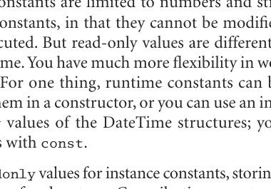
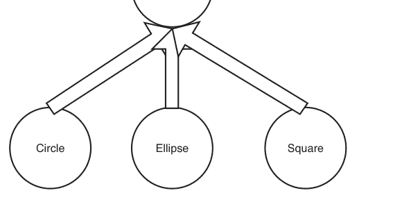
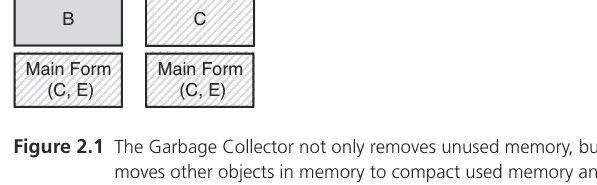
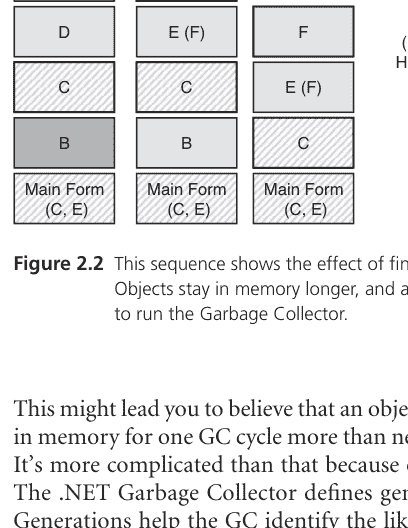
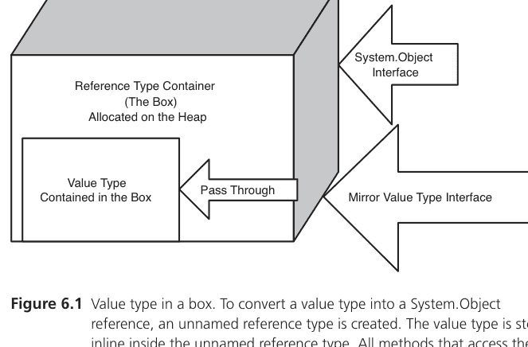

# Effective C# 50 种改进 C# 的具体方法 第二版 (涵盖 C# 4.0)


To my parents, Bill and Alice Wagner.
They continue to demonstrate great strength and inspiration.


## Introduction

The C# community is very different in 2010 than it was in 2004 when the first edition of *Effective C#* was published. There are many more developers using C#. A large contingent of the C# community is now seeing C# as their first professional language. They aren’t approaching C# with a set of ingrained habits formed using a different language. The community has a much broader range of experience. New graduates all the way to professionals with decades of experience are using C#.

The C# language has also grown in the last five years. The language I covered in the first edition did not have generics, lambda expressions, LINQ, and many of the other features we now take for granted. C# 4.0 adds new features that change our toolset again. And yet, even with all the growth in the C# language, much of the original advice is as relevant now as it was in the C# 1.x days. Viewed in hindsight, the changes to the C# language appear to be natural and obvious extensions to what we had in C# 1.0. New editions give us new ways of solving problems, without invalidating previous idioms.

I organized this second edition of *Effective C#* by taking into account both the changes in the language and the changes in the C# community. *Effective C#* does not take you on a historical journey through the changes in the language. Rather, I provide advice on how to use the current C# language. The items that have been removed from this second edition are those that aren’t as relevant in today’s C# language. The new items cover the new language and framework features, and those practices the community has learned from building several versions of software products using C#. Overall, these items are a set of recommendations that will help you use C# 4.0 more effectively as a professional developer.

This book covers C# 4.0, but it is not an exhaustive treatment of the new language features. Like all books in the Effective Software Development Series, this book offers practical advice on how to use these features to solve problems you’re likely to encounter every day. Many of the items are equally valid in the 3.0 and even earlier versions of the language.


## 谁应该阅读本书？

《Effective C#》是为将 C# 作为日常工具集一部分的专业开发者而写的。它假定你熟悉 C# 语法和语言特性。第二版假定你理解 C# 4.0 中新增的语法，以及语言早期版本中可用的语法。本书不包含语言特性的教程式指导。相反，本书讨论的是如何将当前版本 C# 语言的所有特性整合到你的日常开发中。

除了语言特性之外，我假定你对通用语言运行时（CLR）和即时（JIT）编译器有一定的了解。

## 关于内容

你会在几乎每天编写的每个 C# 程序中每天使用到的语言结构。第一章“ C# 语言惯用法 ”涵盖了你会如此频繁使用的那些语言惯用法，以至于它们应该感觉像你手中磨旧的工具。这些是创建每个类型和实现每个算法的构建块。

在托管环境中工作并不意味着环境会免除你所有的责任。你仍然必须与环境协同工作，创建满足既定性能要求的正确程序。这不仅仅是性能测试和性能调优。第二章“.NET 资源管理”教你设计惯用法，使你能够在详细优化开始之前与环境协同工作以实现这些目标。

在许多方面，我们编写程序是为了满足人类阅读者而不是编译器。编译器只关心程序是否有效。我们的同事也希望理解我们的意图。第三章“在 C# 中表达设计”讨论了如何将 C# 语言应用于表达你的设计意图。解决一个问题总是有几种方法。第三章中的建议将帮助你选择最能向 fellow 开发者表达你的设计意图的解决方案。

C# 是一种小语言，由丰富的框架库支持。第四章“使用框架”涵盖了支持你的核心算法的 .NET 基类库（BCL）部分。此外，我还涵盖了你在整个框架中会遇到的一些常见惯用法。多核处理器已成为生活方式，而并行任务库为在 .NET 平台上创建多线程程序提供了向前一步。我在本章中涵盖了并行任务库最常见的做法。

第五章“C# 中的动态编程”讨论了如何将 C# 用作动态语言。C# 是一种强类型、静态类型语言。然而，越来越多的程序同时包含动态和静态类型。C# 为你提供了利用动态编程惯用法的方法，而不会在整个程序中失去静态类型的优势。你将学习如何使用动态特性以及如何避免动态类型在整个程序中泄漏。

第六章“杂项”涵盖了那些始终难以分类的项目。这些是你经常使用的技术，用于创建更易于维护和扩展的健壮程序。

## 代码约定

我们不再以单色查看代码，书籍中也不应如此。虽然在纸上复制使用现代 IDE 的体验是不可能的，但我已尝试提供阅读本书代码的更好体验。在媒介支持的情况下，代码示例使用标准 Visual Studio IDE 颜色为所有代码元素着色。当我指出示例中的特定更改时，这些更改会突出显示。

在书中展示代码仍然需要在空间和清晰度上做出一些妥协。我已尝试将示例提炼以说明示例的特定要点。通常这意味着省略类或方法中的其他部分。有时这将包括为节省空间而省略错误恢复代码。公共方法应验证其参数和其他输入，但该代码通常为节省空间而省略。类似的空间考虑因素去除了方法调用的验证，以及在复杂算法中通常会包含的 `try/finally` 子句。

我通常也假定大多数开发者可以在示例使用常见命名空间时找到适当的命名空间。你可以安全地假定每个示例都隐式包含以下 using 语句：

```
using System;
using System.Collections.Generic;
```

```
using System.Linq;
using System.Text;
using System.Dynamic;
using System.Threading;
```

最后，我使用 #region/#endregion 指令来表示接口实现。虽然这不是必要的，而且有些人不喜欢代码中的 region 指令，但它确实使在静态文本中轻松看出哪些方法实现了接口方法。任何其他选项都是非标准的并且占用更多空间。

## 提供反馈

尽管我尽了最大努力，并且文本审阅者也尽了最大努力，错误仍可能渗入文本或示例中。如果你认为你发现了错误，请通过 bill.wagner@srtsolutions.com 联系我。勘误表将发布在 http://srtsolutions.com/blogs/effectivecsharp 。本书中的许多内容，以及《More Effective C#》，都是与其他 C# 开发者电子邮件对话的结果。如果你对建议有疑问或评论，请联系我。具有普遍兴趣的讨论将在我的博客 http://srtsolutions.com/blogs/billwagner 上进行。

## 致谢

有许多人我需要感谢他们对本书的贡献。多年来，我很荣幸成为一个惊人的 C# 社区的一部分。C# Insiders 邮件列表上的每个人（无论是否在微软内部）都贡献了想法和对话，使本书变得更好。

我必须特别指出 C# 社区的几位成员，他们直接帮助我提供了想法，并将想法转化为具体的建议。与 Charlie Calvert、Eric DeCarufel、Justin Etheredge、Marc Gravell、Mike Gold 和 Doug Holland 的对话是本版许多新想法的基础。

我还与 Stephen Toub 和 Michael Wood 就并行任务库及其对 C# 惯用法的意义进行了精彩的电子邮件对话。

本版我有一支优秀的技术审阅团队。Jason Bock、Claudio Lassala 和 Tomas Petricek 仔细研究了文本和示例，以

专门从事 C#、.NET 和 Azure 平台。他担任微软密歇根地区总监，并多年获得微软 MVP 奖项。Bill 是一位国际公认的作家，是本书第一版和《More Effective C#》（Addison-Wesley，2009）的作者，目前在微软 C# 开发者中心撰写专栏。Bill 在伊利诺伊大学香槟分校获得计算机科学学士学位。

## 1 | C# 语言惯用法

如果它有效，为什么要改变你今天的做法？答案是你可以做得更好。你改变工具或语言是因为你可以提高生产力。如果你不改变习惯，就无法实现预期的收益。当新语言 C# 与熟悉的语言，如 C++ 或 Java 有很多共同点时，这更难。C# 是另一种使用大括号的语言，很容易陷入在同一家族的其他语言中使用的相同惯用法。这将阻止你充分利用 C#。C# 语言自 2001 年首次商业发布以来已经发展。它现在与 C++ 或 Java 的距离比最初发布时远得多。如果你是从另一种语言转向 C#，你需要学习 C# 惯用法，以便语言与你合作，而不是与你对抗。本章讨论你应该改变的习惯——以及应该改用什么。

### 条目 1：使用属性而不是可访问的数据成员

属性一直是 C# 语言中的一等公民。自 C# 语言 1.0 发布以来进行的几项增强使属性更具表达力。你可以为 getter 和 setter 指定不同的访问限制。隐式属性最大限度地减少了为属性而不是数据成员手动输入的工作。如果你仍在手工创建 get 和 set 公共方法，现在就停止吧。属性让你能够将数据成员作为公共接口的一部分公开，同时仍在面向对象的环境中提供你想要的封装。属性是作为数据成员访问的语言元素，但它们作为方法实现。

某些类型的成员确实最好表示为数据：客户的名称、点的 x,y 位置，或去年的收入。属性使你能够创建像数据访问一样工作的接口，但仍具有方法的所有好处。客户端代码访问属性就像访问公共字段一样。但实际实现使用方法，在其中你定义属性访问器的行为。


.NET Framework 假定你会为公共数据成员使用属性。事实上，.NET Framework 中的数据绑定类支持属性，而不是公共数据成员。这适用于所有数据绑定库：WPF、Windows Forms、Web Forms 和 Silverlight。数据绑定将对象的属性绑定到用户界面控件。数据绑定机制使用反射在类型中查找命名属性：

```
textBoxCity.DataBindings.Add("Text",
    address, "City");
```

之前的代码将 textBoxCity 控件的 Text 属性绑定到 address 对象的 City 属性。它将无法与名为 City 的公共数据成员一起工作；框架类库设计者并未支持这种做法。公共数据成员是不良做法，因此未为其添加支持。他们的决定只是给你另一个遵循正确面向对象技术的理由。

是的，数据绑定仅适用于包含在你的用户界面逻辑中显示的元素的那类类。但这并不意味着属性应仅在 UI 逻辑中使用。你应该为其他类和结构使用属性。随着时间的推移，随着你发现新的需求或行为，属性更容易更改。你可能很快就会决定你的客户类型永远不应有空白名称。如果你为 Name 使用了公共属性，这很容易在一处修复：

```
public class Customer
{
    private string name;
    public string Name
    {
        get { return name; }
        set
        {
            if (string.IsNullOrEmpty(value))
                throw new ArgumentException(
                    "Name cannot be blank",
                    "Name");
            name = value;
        }
    }
    // More Elided.
}
```

如果你使用了公共数据成员，你就被困在寻找设置客户名称的每一行代码并在那里修复它。这需要更多时间——多得多。

因为属性是用方法实现的，所以添加多线程支持更容易。你可以增强 get 和 set 访问器的实现以提供对数据的同步访问：

```
public class Customer
{
    private object syncHandle = new object();

    private string name;
    public string Name
    {
        get
        {
            lock (syncHandle)
                return name;
        }
        set
        {
            if (string.IsNullOrEmpty(value))
                throw new ArgumentException(
                    "Name cannot be blank",
                    "Name");
            lock (syncHandle)
                name = value;
        }
    }
    // More Elided.
}
```

属性具有方法的全部语言特性。属性可以是 virtual：

```
public class Customer
{
    public virtual string Name
    {
        get;
        set;
    }
}
```

你会注意到，最后的示例使用了 C# 3.0 隐式属性语法。创建属性来包装支持存储是一个常见模式。通常，你不需要在属性的 getter 或 setter 中进行验证逻辑。语言支持简化的隐式属性语法，以最大程度地减少将简单字段公开为属性所需的输入。编译器会为你创建一个私有成员字段（通常称为支持存储）并为 get 和 set 访问器实现明显的逻辑。

你可以将属性扩展为抽象，并在接口定义中使用与隐式属性类似的语法定义属性。下面示例展示了在泛型接口中的属性定义。请注意，虽然语法与隐式属性一致，但下面的接口定义不包含任何实现。它定义了一个契约，必须由实现此接口的任何类型来满足。

```
public interface INameValuePair<T>
{
    string Name
    {
        get;
    }

    T Value
    {
        get;
        set;
    }
}
```

属性是功能齐全的、一流的语言元素，是访问或修改内部数据的方法的扩展。你可以用成员函数做的任何事情，都可以用属性来做。

属性的访问器是编译到你的类型中的两个独立方法。你可以在 C# 中为属性的 get 和 set 访问器指定不同的可访问性修饰符。这使你对作为属性公开的那些数据元素的可见性有更大的控制：

```
get { return ComputeValue(x, y); }
}
```

```
public int this[int x, string name]
{
    get { return ComputeValue(x, name); }
}
```

请注意，所有索引器都使用 this 关键字声明。你不能在 C# 中命名索引器。因此，类型中的每个不同索引器必须具有不同的参数列表以避免歧义。属性的几乎所有功能都适用于索引器。索引器可以是 virtual 或 abstract；索引器可以对 setter 和 getter 有单独的访问限制。你不能像属性那样创建隐式索引器。

这种属性功能很好，而且是一个不错的改进。但你可能仍会想先使用数据成员创建初始实现，然后在需要其中一个好处时再将数据成员替换为属性。这听起来像是一个合理的策略——但它是错误的。考虑类定义的一部分：

```
// using public data members, bad practice:
public class Customer
{
    public string Name;
    // remaining implementation omitted
}
```

它描述了一个客户，有一个名称。你可以使用熟悉的成员表示法获取或设置名称：

```
string name = customerOne.Name;
customerOne.Name = "This Company, Inc.";
```

这很简单直接。你在想，你可以稍后将 Name 数据成员替换为属性，代码无需任何更改就能继续工作。嗯，这有点正确。属性在访问时旨在看起来像数据成员。这就是语法背后的目的。但属性不是数据。属性访问会生成与数据访问不同的 Microsoft Intermediate Language（MSIL）指令。

尽管属性和数据成员在源代码层面兼容，但它们在二进制层面不兼容。显而易见的是，这意味着当你从公共数据成员更改为等效的公共属性时，必须重新编译使用该公共数据成员的所有代码。C# 将二进制程序集视为一等公民。语言的一个目标是，你可以发布单个更新的程序集而无需升级整个应用程序。简单地将数据成员更改为属性就会破坏二进制兼容性。它使升级已部署的单个程序集变得更加困难。

在查看属性的 IL 时，你可能会想知道属性和数据成员的相对性能。属性不会比数据成员访问更快，但它们可能也不会更慢。JIT 编译器会内联一些方法调用，包括属性访问器。当 JIT 编译器内联属性访问器时，数据成员和属性的性能是相同的。即使属性访问器未被内联，实际的性能差异也是一个函数调用的可忽略成本。只有在少数情况下才可测量。

属性是方法，可以从调用代码中像数据一样查看。这会给你的用户带来一些期望。他们会将属性访问视为数据访问。毕竟，它看起来就是这样。你的属性访问器应满足这些期望。Get 访问器不应有可观察的副作用。Set 访问器确实会修改状态，用户应该能够看到这些更改。

属性访问器对你的用户也有性能期望。属性访问看起来像数据字段访问。它不应具有与简单数据访问显著不同的性能特征。属性访问器不应执行冗长的计算，或进行跨应用程序调用（例如执行数据库查询），或执行其他冗长操作，这些操作与用户对属性访问器的期望不一致。

每当你在类型的公共或受保护接口中公开数据时，请使用属性。对于序列或字典使用索引器。所有数据成员都应为 private，没有例外。你立即获得数据绑定的支持，并且使将来对方法实现的任何更改变得容易得多。将任何变量封装在属性中的额外输入量相当于你一天中的一两分钟。后来发现你需要使用属性来正确表达你的设计将花费数小时。现在花一点时间，稍后节省大量时间。


### Item 2: Prefer readonly to const

C# 有两种不同版本的常量：编译时常量和运行时常量。它们的行为非常不同，使用错误的类型会让你付出性能或正确性的代价。两者都不是好事，但如果你必须选择其一，更慢但正确的程序总比更快但损坏的程序好。因此，你应该优先使用运行时常量而不是编译时常量。编译时常量比运行时常量稍快，但灵活性远不及运行时常量。仅在性能至关重要且常量的值在版本之间永远不会改变时，才保留编译时常量。

你使用 readonly 关键字声明运行时常量。编译时常量使用 const 关键字声明：

```
// Compile time constant:
public const int Millenium = 2000;
```

```
// Runtime constant:
public static readonly int ThisYear = 2004;
```

上面的代码展示了在类或结构体作用域中两种常量的使用。编译时常量也可以在方法内部声明。只读常量不能使用方法作用域声明。

编译时常量和运行时常量行为上的差异源于它们被访问的方式。编译时常量会在你的目标代码中被该常量的值所替换。以下结果：

```
if (myDateTime.Year == Millenium)
```

编译后的 IL 与你写成这样时相同：

```
if (myDateTime.Year == 2000)
```

运行时常量在运行时求值。引用只读常量时生成的 IL 引用的是 readonly 变量，而不是值。

这种区别对你允许使用哪种类型的常量施加了若干限制。编译时常量只能用于原始类型（内置的整数和浮点类型）、枚举或字符串。这些是唯一能在初始化器中赋予有意义的常量值的类型。这些原始类型是唯一可以

## Apple 发布 iPhone 16e：全新设计、A18 芯片、Apple Intelligence 与 599 美元起售价

苹果今日正式发布 iPhone 16e，这是 iPhone 16 系列的新成员，以全新的黑色外观和 6.1 英寸超视网膜 XDR 显示屏亮相。新机搭载 A18 芯片和 Apple Intelligence，支持 Face ID，并配备 4800 万像素 Fusion 相机系统。



## 主要功能与规格

- A18 芯片：支持 Apple Intelligence，性能较上一代提升 40%
- 4800 万像素 Fusion 相机：支持 2 倍光学变焦和 4K 视频录制
- 电池续航：视频播放最长可达 26 小时
- 支持卫星通信：可发送 SOS 和请求道路救援
- 起售价：599 美元，2 月 21 日开放预购，2 月 28 日发售

> > “iPhone 16e 将 iPhone 16 系列的核心体验带给了更多用户，包括最新的 A18 芯片和业界领先的电池续航。” —— 苹果全球营销高级副总裁 Greg Joswiak

If you run your little test, you see the following obvious output:

- Value is 5
- Value is 6
- ...
- Value is 9

Time passes, and you release a new version of the Infrastructure assembly with the following changes:

```
public class UsefulValues
{
	public static readonly int StartValue = 105;
	public const int EndValue = 120;
}
```

You distribute the Infrastructure assembly without rebuilding your Application assembly. You expect to get this:

- Value is 105
- Value is 106
- ...
- Value is 119

In fact, you get no output at all. The loop now uses the value 105 for its start and 10 for its end condition. The C# compiler placed the const value of 10 into the Application assembly instead of a reference to the storage used by EndValue. Contrast that with the StartValue value. It was declared as readonly: It gets resolved at runtime. Therefore, the Application assembly makes use of the new value without even recompiling the Application assembly; simply installing an updated version of the Infrastructure assembly is enough to change the behavior of all clients using that value. Updating the value of a public constant should be viewed as an interface change. You must recompile all code that references that constant. Updating the value of a read-only constant is an implementation change; it is binary compatible with existing client code.

On the other hand, sometimes you really mean for a value to be determined at compile time. For example, consider a set of constants to mark different versions of an object in its serialized form (see Item 27). Persistent values that mark specific versions should be compile-time constants; they never change. The current version should be a runtime constant, changing with each release.

### Item 2: Prefer readonly to const

```
private const int Version1_0 = 0x0100;
private const int Version1_1 = 0x0101;
private const int Version1_2 = 0x0102;
// major release:
private const int Version2_0 = 0x0200;
// check for the current version:
private static readonly int CurrentVersion = Version2_0;
```

You use the runtime version to store the current version in each saved file:

```
// Read from persistent storage, check
// stored version against compile-time constant:
protected MyType(SerializationInfo info, StreamingContext ctxt)
{
	int storedVersion = info.GetInt32("VERSION");
	switch (storedVersion)
	{
	case Version2_0:
		readVersion2(info, ctxt);
		break;
	case Version1Dot1:
		readVersion1Dot1(info, ctxt);
		break;
	// etc.
	}
}
```

```
// Write the current version:
[SecurityPermissionAttribute(SecurityAction.Demand, PermissionAttribute(SerializationFormatter = true)]
void ISerializable.GetObjectData(SerializationInfo inf, StreamingContext ctxt)
{
	// use runtime constant for current version:
	inf.AddValue("VERSION", CurrentVersion);
	// write remaining elements...
}
```

The final advantage of using const over readonly is performance: Known constant values can generate slightly more efficient code than the variable accesses necessary for readonly values. However, any gains are slight and should be weighed against the decreased flexibility. Be sure to profile performance differences before giving up the flexibility.

You’ll encounter similar tradeoffs between runtime and compile-time processing of constant values when you use named and optional parameters. The default values for optional parameters are placed in the call site just like the default value for compile-time constants (those declared with const). Like working with readonly and const values, you’ll want to be careful with changes to the values of optional parameters. (See Item 10.)

const must be used when the value must be available at compile time: attribute parameters and enum definitions, and those rare times when you mean to define a value that does not change from release to release. For everything else, prefer the increased flexibility of readonly constants.

### Item 3: Prefer the is or as Operators to Casts

By embracing C#, you’ve embraced strong typing. That is almost always a good thing. Strong typing means you expect the compiler to find type mismatches in your code. That also means your applications do not need to perform as much type checking at runtime. But sometimes, runtime type checking is unavoidable. There will be times in C# when you write functions that take object parameters because the framework defines the method signature for you. You likely need to attempt to cast those objects to other types, either classes or interfaces. You’ve got two choices: Use the as operator or force the compiler to bend to your will using a cast. You also have a defensive variant: You can test a conversion with is and then use as or casts to convert it.

The correct choice is to use the as operator whenever you can because it is safer than blindly casting and is more efficient at runtime. The as and is operators do not perform any user-defined conversions. They succeed only if the runtime type matches the sought type; they never construct a new object to satisfy a request.

Take a look at an example. You write a piece of code that needs to convert an arbitrary object into an instance of MyType. You could write it this way:

derived from the requested type, they fail. Casts, on the other hand, can use conversion operators to convert an object to the requested type. This includes any built-in numeric conversions. Casting a long to a short can lose information.

The same problems are lurking when you cast user-defined types. Consider this type:

```
public class SecondType
{
    private MyType _value;

    // other details elided

    // Conversion operator.
    // This converts a SecondType to
    // a MyType, see item 9.
    public static implicit operator
    MyType(SecondType t)
    {
        return t._value;
    }
}
```

Suppose an object of SecondType is returned by the Factory.GetObject() function in the first code snippet:

```
object o = Factory.GetObject();
// o is a SecondType:
MyType t = o as MyType; // Fails. o is not MyType
```

```
if (t != null)
{
    // work with t, it's a MyType.
}
else
{
    // report the failure.
}
```


// 版本二：
try
{
    MyType t1;
    t1 = (MyType)o; // Fails. o is not MyType
    // work with t1, it's a MyType.
}
catch (InvalidCastException)
{
    // report the conversion failure.
}

两种版本都会失败。但我告诉过你，转换会执行用户自定义转换。你会认为转换会成功。你是对的——如果你那样想的话，它应该会成功。但它失败了，因为你的编译器是基于对象 o 的编译时类型生成代码的。编译器对 o 的运行时类型一无所知；它把 o 视为 object 的实例。编译器看到 object 到 MyType 没有用户自定义转换。它检查 object 和 MyType 的定义。缺乏任何用户自定义转换，编译器会生成代码来检查 o 的运行时类型，并检查该类型是否为 MyType。因为 o 是一个 SecondType 对象，所以失败了。编译器不会检查 o 的实际运行时类型是否可以转换为 MyType 对象。

如果你像这样编写代码片段，可以使 SecondType 到 MyType 的转换成功：

```
object o = Factory.GetObject();
```

```
// 版本三：
SecondType st = o as SecondType;
try
{
    MyType t;
    t = (MyType)st;
    // work with T, it's a MyType.
}
catch (InvalidCastException)
{
    // report the failure.
}
```

你永远不应该写这种丑陋的代码，但它确实说明了一个常见问题。虽然你永远不会这样写，但你可以使用对象参数传递给期望正确转换的函数：

```
```csharp
object o = Factory.GetObject();
DoStuffWithObject(o);
```
```

```
```csharp
private static void DoStuffWithObject(object o)
{
    try
    {
        MyType t;
        t = (MyType)o; // Fails. o is not MyType
        // work with T, it's a MyType.
    }
    catch (InvalidCastException)
    {
        // report the conversion failure.
    }
}
```
```

记住，用户自定义转换运算符只作用于对象的编译时类型，而不是运行时类型。即使 o 的运行时类型与 MyType 之间存在转换，也无关紧要。编译器根本不知道也不关心。以下语句的行为取决于 st 的声明类型：

```
```csharp
t = (MyType)st;
```
```

下一个语句无论 st 的声明类型如何都返回相同的结果。因此，你应该更喜欢 as 而不是强制转换——它更一致。事实上，如果类型之间没有继承关系，但存在用户自定义转换运算符，则以下语句会生成编译器错误：

```
```csharp
t = st as MyType;
```
```

现在你知道了尽可能使用 as，让我们讨论什么时候不能使用它。as 运算符不适用于值类型。以下语句无法编译：

```
```csharp
object o = Factory.GetValue();
int i = o as int; // Does not compile.
```
```

这是因为 int 是值类型，永远不能为 null。如果 o 不是整数，应该在 i 中存储什么 int 值？你选择的任何值都可能是一个有效的整数。因此，不能使用 as。你只能使用强制转换语法。这实际上是一个装箱/拆箱转换（参见第 45 条）：

```
object o = Factory.GetValue();
int i = 0;
try
{
    i = (int)o;
}
catch (InvalidCastException)
{
    i = 0;
}
```

使用异常作为流程控制机制应该让你觉得这是一种糟糕的做法。（参见第 47 条。）但你并非只能使用强制转换的行为。你可以使用 is 语句来消除异常或转换的可能性：

```
object o = Factory.GetValue();
int i = 0;
if (o is int)
    i = (int)o;
```

如果 o 是可以转换为 int 的其他类型，例如 double，is 运算符返回 false。is 运算符对 null 参数始终返回 false。

is 运算符只有在你无法使用 as 转换类型时才应使用。否则，它只是多余的：

// 正确，但多余：
object o = Factory.GetObject();

MyType t = null;
if (o is MyType)
    t = o as MyType;
```

前面的代码与你编写以下代码相同：

// 正确，但多余：
object o = Factory.GetObject();
```

```
MyType t = null;
if (o is MyType)
    t = o as MyType;
```

这效率低下且多余。如果你即将使用 as 转换类型，is 检查根本没有必要。检查 as 的返回结果是否为空；更简单。

现在你知道了 is、as 和强制转换之间的区别，你认为 foreach 循环使用哪个运算符？foreach 循环可以操作非泛型的 IEnumerable 序列，并且迭代中内置了类型强制转换。（你应该在可能时始终优先使用类型安全的泛型版本。非泛型版本是为了历史原因而存在，并支持某些后期绑定场景。）

```
public void UseCollection(IEnumerable theCollection)
{
    foreach (MyType t in theCollection)
        t.DoStuff();
}
```

foreach 使用强制转换操作来将对象转换为循环中使用的类型。foreach 语句生成的代码大致等同于以下手工编写的版本：

```
public void UseCollectionV2(IEnumerable theCollection)
{
    IEnumerator it = theCollection.GetEnumerator();
    while (it.MoveNext())
    {
        MyType t = (MyType)it.Current;
        t.DoStuff();
    }
}
```

foreach 需要使用强制转换来同时支持值类型和引用类型。通过选择强制转换运算符，foreach 语句表现出相同的行为，无论目标类型是什么。然而，由于使用了强制转换，foreach 循环可能会抛出 InvalidCastException。

因为 IEnumerator.Current 返回 System.Object，而 System.Object 没有转换运算符，因此没有一个符合此测试。SecondType 对象的集合不能在之前的 UseCollection() 函数中使用，因为

转换失败，就像你已经看到的那样。foreach 语句（使用强制转换）不会检查集合中对象的运行时类型中可用的转换。它只检查 System.Object 类（由 IEnumerator.Current 返回的类型）中可用的转换以及循环变量的声明类型（在本例中为 MyType）。

最后，有时你想知道对象的确切类型，而不仅仅是当前类型是否可以转换为目标类型。is 运算符对目标类型的任何派生类型都返回 true。GetType() 方法获取对象的运行时类型。它比 is 或 as 语句提供的测试更严格。GetType() 返回对象的类型，可以与特定类型进行比较。

再次考虑这个函数：

```
public void UseCollectionV3(IEnumerable theCollection)
{
    foreach (MyType t in theCollection)
        t.DoStuff();
}
```

如果你创建了一个派生自 MyType 的 NewType 类，NewType 对象的集合在 UseCollection 函数中会正常工作：

```
public class NewType : MyType
{
    // contents elided.
}
```

如果你打算编写一个函数来处理所有 MyType 实例的对象，那很好。如果你打算编写一个函数只处理确切的 MyType 对象，你应该使用确切的类型进行比较。在这里，你会在 foreach 循环内部执行。确切运行时类型最常见的重要时间是在进行相等性测试时（参见第 6 条）。在大多数其他比较中，as 和 is 提供的 .isinst 比较在语义上是正确的。

.NET 基类库（BCL）包含一个用于使用相同类型的操作转换序列中元素的方法：Enumerable.Cast<T>() 将支持经典 IEnumerable 接口的序列中的每个元素转换为目标类型：

```
IEnumerable collection = new List<int>()
    {1,2,3,4,5,6,7,8,9,10};
```

```
var small = from int item in collection
    where item < 5
    select item;
```

```
var small2 = collection.Cast<int>().Where(item => item < 5).
    Select(n => n);
```

查询生成的与上面最后一行代码相同的函数调用。在这两种情况下，Cast<T> 方法将序列中的每个项转换为目标类型。Enumerable.Cast<T> 方法使用旧式强制转换而不是 as 运算符。使用旧式强制转换意味着 Cast<T> 不需要类约束。使用 as 运算符会有限制，并且与其实现不同的 Cast<T> 方法，BCL 团队选择创建一个使用旧式强制转换运算符的单个方法。这是一个你应该在代码中考虑的权衡。在那些需要转换对象为其中一个泛型类型参数之一的情况下，你需要权衡类约束的必要性与使用强制转换运算符的不同行为。

在 C# 4.0 中，类型系统甚至可以通过使用 dynamic 和运行时类型检查来被规避。这就是第 5 章“在 C# 中进行动态编程”的主题。有很多方法可以根据对已知行为的期望来处理对象，而无需了解特定类型或接口的任何信息。你将学习何时使用这些技术以及何时避免它们。

良好的面向对象实践表明，你应该避免转换类型，但有时没有替代方案。如果无法避免转换，请使用语言的 as 和 is 运算符更清晰地表达你的意图。不同类型的强制方式有不同的规则。is 和 as 运算符几乎总是正确的语义，并且只有在被测试的对象是正确类型时才成功。优先使用这些语句而不是强制转换运算符，后者可能产生意想不到的副作用，并且在你最不期望的时候成功或失败。

### 第 4 条：使用条件属性代替 #if

#if/#endif 块已被用于从同一源代码生成不同的构建，最常见的是调试和发布变体。但我们从来没有对使用它们感到满意。#if/#endif 块很容易被滥用，创建难以理解且更难调试的代码。语言


设计师们通过创建更好的工具来为不同环境生成不同的机器代码做出回应。C# 添加了 Conditional 属性来指示是否应根据环境设置调用方法。这比 #if/#endif 更清晰地描述条件编译的方式。编译器理解 Conditional 属性，因此在应用条件属性时可以更好地验证代码。条件属性应用于方法级别，因此它迫使你将条件代码分离到不同的方法中。在创建条件代码块时，使用 Conditional 属性而不是 #if/#endif 块。

大多数资深程序员都使用条件编译来检查对象中的前置条件和后置条件。你会编写一个私有方法来检查所有类和对象的不变量。该方法会被条件编译，因此它只出现在你的调试构建中。

```csharp
private void CheckStateBad()
{
    // The Old way:
#if DEBUG
    Trace.WriteLine("Entering CheckState for Person");

    // Grab the name of the calling routine:
    string methodName =
        new StackTrace().GetFrame(1).GetMethod().Name;

    Debug.Assert(lastName != null,
        methodName,
        "Last Name cannot be null");

    Debug.Assert(lastName.Length > 0,
        methodName,
        "Last Name cannot be blank");

    Debug.Assert(firstName != null,
        methodName,
        "First Name cannot be null");

    Debug.Assert(firstName.Length > 0,
        methodName,
        "First Name cannot be blank");

    Trace.WriteLine("Exiting CheckState for Person");
#endif
}
```

使用 #if 和 #endif 指令，你在发布构建中创建了一个空方法。CheckState() 方法在所有构建中都会被调用，发布版和调试版。发布版中它什么也不做，但你为方法调用付出了代价。你还需为加载和 JIT 空例程付出少量成本。

这种做法效果不错，但可能导致仅在发布构建中出现的微妙错误。以下常见错误展示了使用指令进行条件编译时可能发生的情况：

```csharp
public void Func()
{
    string msg = null;

#if DEBUG
    msg = GetDiagnostics();
#endif

    Console.WriteLine(msg);
}
```

在调试构建中一切正常，但你的发布构建会愉快地打印空白消息。这不是你的本意。你犯了错误，但编译器无法帮你。你在条件块内放置了对逻辑至关重要的代码。用 #if/#endif 块撒满源代码会使诊断不同构建之间的行为差异变得困难。

C# 有更好的替代方案：Conditional 属性。使用 Conditional 属性，你可以隔离仅在定义或设置为特定值时才应成为类一部分的函数。这种功能最常见的用途是用调试语句为代码做仪器化。 .NET Framework 库已经具有此用途所需的基本功能。此示例展示了如何使用 .NET Framework 库中的调试功能，以展示条件属性的工作方式以及何时将其添加到你的代码中。

当你构建 Person 对象时，你添加一个方法来验证对象不变量：

```csharp
private void CheckState()
{
    // Grab the name of the calling routine:
    string methodName =
        new StackTrace().GetFrame(1).GetMethod().Name;

    Trace.WriteLine("Entering CheckState for Person:");
    Trace.Write("\tcalled by ");
    Trace.WriteLine(methodName);

    Debug.Assert(lastName != null,
        methodName,
        "Last Name cannot be null");

    Debug.Assert(lastName.Length > 0,
        methodName,
        "Last Name cannot be blank");

    Debug.Assert(firstName != null,
        methodName,
        "First Name cannot be null");

    Debug.Assert(firstName.Length > 0,
        methodName,
        "First Name cannot be blank");

    Trace.WriteLine("Exiting CheckState for Person");
}
```

你可能没有遇到过此方法中的许多库函数，因此让我们简要回顾一下。StackTrace 类使用反射获取调用方法的名字。它相当昂贵，但大大简化了生成程序流程信息等任务。在这里，它确定调用 CheckState 的方法的名字。如果调用方法被内联，这里存在轻微风险，但替代方案是让每个调用 CheckState() 的方法都使用 MethodBase.GetCurrentMethod() 传入方法名。你很快就会看到我为何不采用该策略。

其余方法属于 System.Diagnostics.Debug 类或 System.Diagnostics.Trace 类。Debug.Assert 方法测试一个条件，如果条件为假则停止程序。其余参数定义了条件为假时将打印的消息。Trace.WriteLine 将诊断消息写入调试控制台。因此，此方法在人员对象无效时写入消息并停止程序。你会在所有公共方法和属性中作为前置条件和后置条件调用此方法：

```csharp
public string LastName
{
    get
    {
        CheckState();
        return lastName;
    }
    set
    {
        CheckState();
        lastName = value;
        CheckState();
    }
}
```

CheckState 在有人第一次尝试将姓氏设置为空字符串或 null 时触发断言。然后你修复 set 访问器以检查用于 LastName 的参数。它正做你想要的事情。

但每个公共例程中的额外检查需要时间。你只希望在创建调试构建时包含此额外检查。这就是 Conditional 属性发挥作用的地方：

```csharp
[Conditional("DEBUG")]
private void CheckState()
{
    // same code as above
}
```

Conditional 属性告诉 C# 编译器，此方法只有在编译器检测到 DEBUG 环境变量时才应被调用。Conditional 属性不影响为 CheckState() 函数生成的代码；它修改对该函数的调用。如果定义了 DEBUG 符号，你会得到以下内容：

```csharp
public string LastName
{
    get
    {
        CheckState();
        return lastName;
    }
    set
    {
        CheckState();
        lastName = value;
        CheckState();
    }
}
```

如果没有，你会得到以下内容：

```csharp
public string LastName
{
    get
    {
        return lastName;
    }
    set
    {
        lastName = value;
    }
}
```

CheckState() 函数的主体无论环境变量的状态如何都相同。这就是为什么你需要理解 .NET 中编译和 JIT 步骤之间区别的一个例子。无论是否定义 DEBUG 环境变量，CheckState() 方法都会被编译并随程序集交付。这看起来可能效率低下，但唯一的成本是磁盘空间。CheckState() 函数只有在被调用时才会被加载到内存并 JIT。程序集文件中的存在无关紧要。这种策略提高了灵活性，且性能成本极小。你可以通过查看 .NET Framework 中的 Debug 类获得更深入的理解。在安装了 .NET Framework 的任何机器上，System.dll 程序集确实包含 Debug 类中所有方法的全部代码。环境变量控制它们在调用方编译时是否被调用。使用 Conditional 指令，你可以创建嵌入调试功能的库。这些功能可以在运行时启用或禁用。

你还可以创建依赖于多个环境变量的方法。当你应用多个条件属性时，它们会以 OR 组合。例如，此版本的 CheckState 在 DEBUG 或 TRACE 为 true 时会被调用：

```csharp
[Conditional("DEBUG"),
 Conditional("TRACE")]
private void CheckState()
```

要创建使用 AND 的构造，你需要使用源代码中的预处理器指令自行定义预处理器符号：

```csharp
#if ( VAR1 && VAR2 )
#define BOTH
#endif
```

是的，要创建依赖于多个环境变量存在的条件例程，你必须退回到旧的 #if 做法。所有 #if 所做的只是为你创建一个新符号。但避免在该指令内放置任何可执行代码。

然后，你可以这样编写旧版本的 CheckState：

```csharp
private void CheckStateBad()
{
    // The Old way:
#if BOTH
    Trace.WriteLine("Entering CheckState for Person");

    // Grab the name of the calling routine:
    string methodName =
        new StackTrace().GetFrame(1).GetMethod().Name;

    Debug.Assert(lastName != null,
        methodName,
        "Last Name cannot be null");

    Debug.Assert(lastName.Length > 0,
        methodName,
        "Last Name cannot be blank");
```


## 条目4：使用条件特性代替#if

```
Debug.Assert(firstName != null,
methodName,
"First Name cannot be null");

Debug.Assert(firstName.Length > 0,
methodName,
"First Name cannot be blank");

Trace.WriteLine("Exiting CheckState for Person");

#endif
```

条件特性只能应用于整个方法。此外，任何带有条件特性的方法都必须具有void返回类型。不能对方法内部的代码块或带有返回值的方法使用条件特性。相反，应精心构造条件方法，并将条件行为隔离到这些函数中。仍然需要检查这些条件方法对对象状态产生的副作用，但条件特性比#if/#endif能更好地将这些点局部化。使用#if和#endif块时，可能会错误地删除重要的方法调用或赋值。

前面的示例使用了预定义的DEBUG或TRACE符号。但你可以将这种技术扩展到任何你定义的符号。条件特性可以由多种方式定义的符号控制。你可以从编译器命令行、操作系统外壳的环境变量或源代码中的编译指令定义符号。

你可能已经注意到，每个带有条件特性的方法都是返回void且不带参数的方法。这是你应该遵循的做法。编译器强制要求条件方法必须具有void返回类型。但是，你可以创建一个接受任意数量引用类型参数的方法。这可能导致重要的副作用不会发生的情况。考虑这段代码：

```
Queue<string> names = new Queue<string>();
names.Enqueue("one");
names.Enqueue("two");
names.Enqueue("three");
```

```
string item = string.Empty;
SomeMethod(item = names.Dequeue());
Console.WriteLine(item);
```

SomeMethod已附加了一个条件特性：

```
[Conditional("DEBUG")]
private static void SomeMethod(string param)
{

}
```

这会导致非常隐蔽的bug。对SomeMethod()的调用只在定义了DEBUG符号时才发生。如果没有定义，该调用不会发生。对names.Dequeue()的调用也不会发生。因为结果不需要，该方法不会被调用。任何带有条件特性的方法都不应该接受任何参数。用户可能会使用带有副作用的方法调用来生成这些参数。如果条件不为真，这些方法调用将不会发生。

条件特性生成比#if/#endif更高效的IL。它还具有仅适用于函数级别的优点，这迫使你更好地组织条件代码。编译器利用条件特性帮助你避免我们常见错误——将#if或#endif放在错误的位置。与预处理器相比，条件特性为干净地分离条件代码提供了更好的支持。

### 条目5：始终提供ToString()

System.Object.ToString()是.NET环境中使用最多的方法之一。你应该为你的类的所有客户端编写一个合理的版本。否则，你会迫使你的类的每个用户使用类中的属性并创建一个合理的人类可读表示。这种类型的字符串表示可用于轻松地向用户显示对象的信息：在Windows Presentation Foundation（WPF）控件、Silverlight控件、Web窗体或控制台输出中。字符串表示也可用于调试。你创建的每个类型都应该提供这个方法的合理重写。当你创建更复杂的类型时，应该实现更复杂的IFormattable.ToString()。面对现实：如果你不重写这个方法，或者写得很糟糕，你的客户端将被迫为你修复它。

System.Object版本返回类型的完全限定名。这是无用的信息：“System.Drawing.Rect”、“MyNamespace.Point”、“SomeSample.Size”不是你想显示给用户的内容。但当你不在类中重写ToString()时，你得到的就是这些。你只编写一次类，但你的客户端会多次使用它。编写类时的少量额外工作会在你或其他人每次使用它时得到回报。

让我们考虑最简单的需求：重写System.Object.ToString()。你创建的每个类型都应该重写ToString()以提供该类型最常见的文本表示。考虑一个具有三个公共属性的Customer类：

```
public class Customer
{
    public string Name
    {
        get;
        set;
    }
    public decimal Revenue
    {
        get;
        set;
    }
    public string ContactPhone
    {
        get;
        set;
    }
    public override string ToString()
    {
        return Name;
    }
}
```

Object.ToString()的继承版本返回“Customer”。这对任何人都没有用。即使ToString()仅用于调试目的，它也应该比这更复杂。你对Object.ToString()的重写应该返回该类客户端最有可能使用的文本表示。在Customer示例中，那是名称：

```
public override string ToString()
{
    return Name;
}
```

如果你不遵循这一项中的任何其他建议，请为你定义的所有类型执行该练习。它将立即为每个人节省时间。当你为Object.ToString()方法提供合理的实现时，此类的对象可以更容易地添加到WPF控件、Silverlight控件、Web窗体控件或打印输出中。.NET BCL使用Object.ToString()的重写在任何控件中显示对象：组合框、列表框、文本框和其他控件。如果你在Windows窗体或Web窗体中创建客户对象列表，你会看到名称显示为文本。System.Console.WriteLine()和System.String.Format()在内部也使用ToString()。每当.NET BCL想要获取客户的字符串表示时，你的客户类型就会提供该客户的名称。一个简单的三行方法就能满足所有这些基本要求。

在C# 3.0中，编译器为所有匿名类型创建默认的ToString()。生成的ToString()方法显示每个标量属性的值。表示序列的属性是LINQ查询结果，将显示其类型信息而不是每个值。这段代码：

```
int[] list = new int[] { 1, 2, 3, 4, 5, 6, 7, 8, 9, 10 };
var test = new { Name = "Me",
    Numbers = from l in list select l };
Console.WriteLine(test);
```

将显示：

```
{ Name = Me, Numbers =
    System.Linq.Enumerable+WhereSelectArrayIterator`2
    [System.Int32,System.Int32] }
```

即使编译器创建的匿名类型显示的输出也比你的用户定义类型更好，除非你重写ToString()。你应该比编译器为临时类型（作用域仅限一个方法）做得更好，从而更好地支持你的用户。

这个简单的方法ToString()满足了许多将用户定义类型显示为文本的要求。但有时，你需要更多。

前面的客户类型有三个字段：名称、收入和联系电话。System.ToString()的重写只使用了名称。你可以通过在类型上实现IFormattable接口来解决这个缺陷。IFormattable包含一个重载的ToString()方法，让你可以为类型指定格式信息。当你需要创建不同形式的字符串输出时，可以使用这个接口。客户类就是这样的一个实例。用户希望创建一个包含客户名称和去年收入的表格格式报告。IFormattable.ToString()方法为你提供了让用户对类型进行字符串输出格式化的手段。IFormattable.ToString()方法签名包含一个格式字符串和一个格式提供程序：

```
string System.IFormattable.ToString(string format,
    IFormatProvider formatProvider)
```

你可以使用格式字符串为你创建的类型指定自己的格式。你可以为格式字符串指定自己的关键字符。在客户示例中，你可以指定n表示名称，r表示收入，p表示电话。通过允许用户也指定组合，你将创建这个版本的IFormattable.ToString()：

```
// supported formats:
// substitute n for name.
// substitute r for revenue
// substitute p for contact phone.
// Combos are supported:  nr, np, npr, etc
// "G" is general.
string System.IFormattable.ToString(string format,
    IFormatProvider formatProvider)
{
    if (formatProvider != null)
    {
        ICustomFormatter fmt = formatProvider.GetFormat(
            this.GetType())
            as ICustomFormatter;
        if (fmt != null)
            return fmt.Format(format, this, formatProvider);
    }

    switch (format)
    {
```


```csharp
case "r":
    return Revenue.ToString();
case "p":
    return ContactPhone;
case "nr":
    return string.Format("{0,20}, {1,10:C}", Name, Revenue);
case "np":
    return string.Format("{0,20}, {1,15}", Name, ContactPhone);
case "pr":
    return string.Format("{0,15}, {1,10:C}", ContactPhone, Revenue);
case "pn":
    return string.Format("{0,15}, {1,20}", ContactPhone, Name);
case "rn":
    return string.Format("{0,10:C}, {1,20}", Revenue, Name);
case "rp":
    return string.Format("{0,10:C}, {1,20}", Revenue, ContactPhone);
case "nrp":
    return string.Format("{0,20}, {1,10:C}, {2,15}", Name, Revenue, ContactPhone);
case "npr":
    return string.Format("{0,20}, {1,15}, {2,10:C}", Name, ContactPhone, Revenue);
case "pnr":
    return string.Format("{0,15}, {1,20}, {2,10:C}", ContactPhone, Name, Revenue);
case "prn":
    return string.Format("{0,15}, {1,10:C}, {2,15}", ContactPhone, Revenue, Name);
case "rpn":
    return string.Format("{0,10:C}, {1,15}, {2,20}", Revenue, ContactPhone, Name);
case "rnp":
    return string.Format("{0,10:C}, {1,20}, {2,15}", Revenue, Name, ContactPhone);
case "n":
case "G":
default:
    return Name;
}
```

添加此函数后，你的客户端即可指定其客户数据的呈现方式：

```csharp
IFormattable c1 = new Customer();
Console.WriteLine("Customer record: {0}",
c1.ToString("nrp", null));
```

任何 IFormattable.ToString() 的实现都是特定于类型的，但每当你实现 IFormattable 接口时，你必须处理某些情况。首先，你必须支持通用格式 “G”。其次，你必须同时支持空格式的两种变体："" 和 null。所有三种格式说明符必须返回与你重写的 Object.ToString() 方法相同的字符串。.NET 基类库 BCL 对实现 IFormattable 的每个类型都会调用 IFormattable.ToString() 而不是 Object.ToString()。.NET BCL 通常使用 null 格式字符串调用 IFormattable.ToString()，但少数位置会使用 “G” 格式字符串来表示通用格式。如果你添加了对 IFormattable 接口的支持却未支持这些标准格式，你就破坏了 BCL 中的自动字符串转换。你可以看到支持 IFormattable 很快就会失控。你无法预见到你的类型可能支持的所有格式选项。最多，选择几种最可能的格式。客户端代码应处理所有边缘情况。

IFormattable.ToString() 的第二个参数是一个实现 IFormatProvider 接口的对象。该对象允许客户端提供你未预见到的格式选项。如果你查看之前的 IFormattable.ToString() 实现，你无疑会想到许多你想要但觉得不足的格式选项。这就是提供人类可读输出的本质。无论你支持多少种不同的格式，你的用户总有一天会想要一种你未预见的格式。这就是为什么该方法的前几行会查找实现 IFormatProvider 的对象并将工作委托给其 ICustomerFormatter 的原因。

现在将焦点从类作者转移到类使用者。你会发现你想要的格式未得到支持。例如，你有客户名称超过 20 个字符的客户，你希望修改格式以提供 50 个字符宽度的客户名称。这就是 IFormatProvider 接口存在的意义。你创建一个实现 IFormatProvider 的类以及一个伴随类实现 ICustomFormatter 来创建你的自定义输出格式。IFormatProvider 接口定义了一个方法：GetFormat()。GetFormat() 返回一个实现 ICustomFormatter 接口的对象。ICustomFormatter 接口指定执行实际格式化的<|message|> 方法。以下配对创建了使用 50 列显示客户名称的修改后输出：

```csharp
// Example IFormatProvider:
public class CustomFormatter : IFormatProvider
{
    #region IFormatProvider Members
    // IFormatProvider contains one method.
    // This method returns an object that
    // formats using the requested interface.
    // Typically, only the ICustomFormatter
    // is implemented
    public object GetFormat(Type formatType)
    {
        if (formatType == typeof(ICustomFormatter))
            return new CustomerFormatProvider();
        return null;
    }
    #endregion

    // Nested class to provide the
    // custom formatting for the Customer class.
    private class CustomerFormatProvider : ICustomFormatter
    {
        #region ICustomFormatter Members
        public string Format(string format, object arg, IFormatProvider formatProvider)
        {
            Customer c = arg as Customer;
            if (c == null)
                return arg.ToString();
            return string.Format("{0,50}, {1,15}, {2,10:C}", c.Name, c.ContactPhone, c.Revenue);
        }
        #endregion
    }
}
```

GetFormat() 方法创建实现 ICustomFormatter 接口的对象。ICustomFormatter.Format() 方法实际执行按请求方式格式化输出的工作。该方法将对象转换为字符串格式。你可以为 ICustomFormatter.Format() 定义格式字符串，以便在一个例程中指定多种格式。FormatProvider 将是来自 GetFormat() 方法的 IFormatProvider 对象。

要指定你的自定义格式，你需要显式调用 string.Format() 并传入 IFormatProvider 对象：

```csharp
Console.WriteLine(string.Format(new CustomFormatter(),
    "", c1));
```

你可以为类创建 IFormatProvider 和 ICustomFormatter 实现，无论该类是否实现了 IFormattable 接口。因此，即使类作者未提供合理的 ToString() 行为，你也可以自行创建。当然，从类外部，你只能访问公共属性和数据成员来构造字符串。编写两个类 IFormatProvider 和 ICustomFormatter 只是为了获取文本输出，工作量很大。但使用此形式实现你的特定文本输出意味着它在整个 .NET Framework 中都得到支持。

所以现在再次回到类作者的角色。重写 Object.ToString() 是为你的类提供字符串表示的最简单方式。你在创建类型时应始终提供它。它应该是你类型最明显、最常见的表示。它必须不过于冗长。它可能会出现在控件、HTML 页面或其他人类可读的位置。在那些极少数情况下，你的类型预期提供更复杂的输出时，你应该利用实现 IFormattable 接口。它为你的类的使用者提供了标准化方式来自定义你类型的文本输出。如果你省略这些，你的用户就只能实现自定义格式化程序。这些解决方案需要更多代码，而且由于用户在类之外，他们无法检查对象的内部状态。但当然，发布者无法预见所有潜在格式。

最终，人们会消费你类型中的信息。人们理解文本输出，因此你希望以尽可能简单的方式提供它：在所有类型中重写 ToString()。使 ToString() 输出简短合理。

### 第 6 条：理解众多不同相等概念之间的关系

当你创建自己的类型（类或结构体）时，你定义了该类型的相等含义。C# 提供了四种不同的函数来确定两个不同对象是否“相等”：

```csharp
public static bool ReferenceEquals
    (object left, object right);
public static bool Equals
    (object left, object right);
public virtual bool Equals(object right);
public static bool operator ==(MyClass left, object right);
```

语言使你能够为这四种方法创建自己的版本。但仅仅因为你可以并不意味着你应该。你永远不应重新定义前两种静态函数。你经常会为定义类型的语义而创建自己的实例 Equals() 方法，并且偶尔会重写 operator==()，通常是为了值类型的性能原因。此外，这四种函数之间存在关系，因此当你更改其中一个时，可能会影响其他函数的行为。是的，需要四个函数来测试相等是复杂的。但别担心——你可以简化它。

当然，这四种方法并不是相等性的唯一选项。重写 Equals() 的类型应实现 IEquatable<T>。实现值语义的类型应实现 IStructuralEquatable 接口。这意味着有六种不同的相等表达方式。

像 C# 中许多复杂元素一样，这一点源于 C# 允许你创建值类型和引用类型。引用类型的两个变量如果引用同一对象则相等，称为对象标识。值类型的两个变量如果类型相同且内容相同则相等。这就是为什么相等测试需要如此多不同方法的原因。


```
if (Object.ReferenceEquals(left, null) ||
Object.ReferenceEquals(right, null))
return false;
return left.Equals(right);
```

此示例代码引入了一种我尚未讨论过的方法：即实例 Equals() 方法。我会详细解释它，但我还不想就静态 Equals() 的讨论结束。现在，我希望你明白静态 Equals() 使用左侧参数的实例 Equals() 方法来确定两个对象是否相等。

与 ReferenceEquals() 一样，你永远不会重载或重新定义自己的静态 Object.Equals() 方法版本，因为它已经完全做到了它需要做的事情：在不知道运行时类型的情况下确定两个对象是否相同。因为静态 Equals() 方法委托给左侧参数的实例 Equals()，所以它使用该类型的规则。

现在你明白为什么永远不需要重新定义静态 ReferenceEquals() 和静态 Equals() 方法了。是时候讨论你将要重写的方法了。但首先，让我们简要讨论相等关系的数学属性。你需要确保你的定义和实现与程序员的预期一致。这意味着你需要牢记相等的数学属性：相等是自反的、对称的和传递的。自反属性意味着任何对象都等于自身。不管涉及什么类型，a == a 总是为真。对称属性意味着顺序无关紧要：如果 a == b 为真，则 b == a 也为真。如果 a == b 为假，则 b == a 也为假。最后一个属性是如果 a == b 和 b == c 都为真，则 a == c 也必须为真。这就是传递属性。

现在是时候讨论实例 Object.Equals() 函数，包括何时以及如何重写它。你在默认行为与你的类型不一致时创建自己的实例版本 Equals()。Object.Equals() 方法使用对象标识来确定两个变量是否相等。默认的 Object.Equals() 函数的行为与 Object.ReferenceEquals() 完全相同。但等等——值类型是不同的。System.ValueType 确实重写了 Object.Equals()。请记住，ValueType 是你创建的所有值类型的基类（使用 struct 关键字）。两个值类型变量相等，如果它们是同一类型并且内容相同。ValueType.Equals() 实现了这种行为。不幸的是，ValueType.Equals() 没有高效的实现

ValueType.Equals() 是所有值类型的基类。为了提供正确行为，它必须比较任何派生类型中的所有成员变量，而不知道对象的运行时类型。在 C# 中，这意味着使用反射。正如你在第 43 条中会看到的那样，反射有很多缺点，尤其是在性能是目标时。相等是程序中经常调用的基本构造之一，因此性能是一个值得追求的目标。在几乎所有情况下，你都可以为任何值类型编写一个比 ValueType.Equals() 快得多的 Equals() 重写。对于值类型的建议很简单：只要你创建了一个值类型，就始终创建 ValueType.Equals() 的重写。

你应该仅在你想为引用类型更改定义的语义时重写实例 Equals() 函数。.NET Framework 类库中的许多类对相等使用值语义而不是引用语义。两个字符串对象相等，如果它们包含相同的内容。两个 DataRowView 对象相等，如果它们引用同一个 DataRow。重点是，如果你的类型应该遵循值语义（比较内容）而不是引用语义（比较对象标识），你应该编写自己的实例 Object.Equals() 重写。

现在你知道了何时编写自己的 Object.Equals() 重写，你必须了解应该如何实现它。对于值类型，相等关系对装箱有许多影响，并在第 45 条中讨论。对于引用类型，你的实例方法需要遵循预定义的行为，以避免给你的类用户带来奇怪的惊喜。每当你重写 Equals() 时，你都希望为该类型实现 IEquatable<T>。我会在本条稍后解释原因。以下是重写 System.Object.Equals 的标准模式。突出显示了实现 IEquatable<T> 的更改。

```
public class Foo : IEquatable<Foo>
{
    public override bool Equals(object right)
    {
        // check null:
        // this pointer is never null in C# methods.
        if (object.ReferenceEquals(right, null))
            return false;

        if (object.ReferenceEquals(this, right))
            return true;

        // Discussed below.
        if (this.GetType() != right.GetType())
            return false;

        // Compare this type's contents here:
        return this.Equals(right as Foo);
    }

    #region IEquatable<Foo> Members
    public bool Equals(Foo other)
    {
        // elided.
        return true;
    }
    #endregion
}
```

首先，Equals() 不应抛出异常——这没什么意义。两个变量相等或不相等；没有太多其他失败的余地。对于所有失败条件，例如空引用或错误的参数类型，只需返回 false。现在，让我们详细分析这个方法，以便你理解每个检查存在的原因以及为什么可以省略某些检查。第一个检查确定右侧对象是否为 null。对 this 引用的检查不存在。在 C# 中，this 永远不为 null。CLR 在通过空引用调用任何实例方法之前抛出异常。下一个检查确定两个对象引用是否相同，测试对象标识。这是一个非常高效的测试，并且相等的对象标识保证内容相等。

下一个检查确定正在比较的两个对象是否为同一类型。确切的形式很重要。首先，注意它没有假设 this 是 Foo 类型；它调用 this.GetType()。实际类型可能是派生自 Foo 的类。其次，代码检查正在比较的对象的确切类型。仅确保可以将右侧参数转换为当前类型是不够的。该测试可能导致两个微妙的错误。考虑以下涉及小型继承层次结构的示例：

```
public class B : IEquatable<B>
{
    public override bool Equals(object right)
    {
        // check null:
```
```csharp
if (object.ReferenceEquals(right, null))
    return false;

// Check reference equality:
if (object.ReferenceEquals(this, right))
    return true;

// Problems here, discussed below.
B rightAsB = right as B;
if (rightAsB == null)
    return false;

return this.Equals(rightAsB);
}

#region IEquatable<B> Members

public bool Equals(B other)
{
    // elided
    return true;
}

#endregion
}

public class D : B, IEquatable<D>
{
    // etc.
    public override bool Equals(object right)
    {
        // check null:
        if (object.ReferenceEquals(right, null))
            return false;

        if (object.ReferenceEquals(this, right))
            return true;

        // Problems here.
        D rightAsD = right as D;
```

```
if (rightAsD == null)
    return false;

if (base.Equals(rightAsD) == false)
    return false;

return this.Equals(rightAsD);
}

#region IEquatable<D> Members
public bool Equals(D other)
{
    // elided.
    return true; // or false, based on test
}
#endregion
}

//Test:
B baseObject = new B();
D derivedObject = new D();

// Comparison 1.
if (baseObject.Equals(derivedObject))
    Console.WriteLine("Equals");
else
    Console.WriteLine("Not Equal");

// Comparison 2.
if (derivedObject.Equals(baseObject))
    Console.WriteLine("Equals")
else
    Console.WriteLine("Not Equal");
```

在任何可能的情况下，你都期望看到 Equals 或 Not Equal 打印两次。因为存在一些错误，使用之前的代码并非如此。第二次比较永远不会返回 true。类型为 B 的基对象永远无法转换为 D。然而，第一次比较可能评估为 true。类型为 D 的派生对象可以隐式转换为类型 B。如果右侧参数的 B 成员


如果派生类型中的字段与左侧参数的 B 成员匹配，B.Equals() 就会认为这两个对象相等。即使这两个对象属于不同类型，你的方法也已将它们视为相等。你破坏了 Equals 的对称性。这种构造之所以被破坏，是因为继承层次结构中向上和向下发生的自动转换。

```
baseObject.Equals(derived)
```

如果 baseObject.Equals() 判断其类型中定义的字段匹配，那么这两个对象相等。另一方面，当你编写如下代码时，B 对象无法转换为 D 对象：

```
derivedObject.Equals(baseObject)
```

derivedObject.Equals() 方法总是返回 false。如果你不精确检查对象类型，就很容易陷入这种比较顺序至关重要的局面。

上面所有的示例还展示了重写 Equals() 时的另一个重要实践。重写 Equals() 意味着你的类型应该实现 IEquatable\<T\>。IEquatable\<T\> 包含一个方法：Equals(T other)。实现 IEquatable\<T\> 意味着你的类型还支持类型安全的相等比较。如果你认为只有在等式的右侧与左侧类型相同时 Equals() 才应返回 true，那么 IEquatable\<T\> 只是让编译器捕捉到大量两个对象不相等的情况。

重写 Equals() 时还有另一个实践要遵循：只有当基类版本不是由 System.Object 或 System.ValueType 提供时，你才应该调用基类。前面的代码就是一个例子。类 D 调用其基类 B 中定义的 Equals() 方法。然而，类 B 并不调用 base.Equals()。它调用的是 System.Object 中定义的版本，只有当两个参数引用同一个对象时才返回 true。这可不是你想要的结果，否则你一开始就不会编写自己的方法。

规则是：每当你创建值类型时都要重写 Equals()；当你不希望引用类型遵循 System.Object 所定义的引用语义时，也要在引用类型上重写 Equals()。编写自己的 Equals() 时，请遵循刚才概述的实现。重写 Equals() 意味着你还应该编写 GetHashCode() 的重写。详见第 7 项。

我们快讲完了。operator==() 很简单。每当你创建值类型时，都要重新定义 operator==()。原因与实例 Equals() 函数完全相同。默认版本使用反射来比较两个值类型的内容，这比你编写的任何实现都要低效得多，所以请编写自己的实现。在比较值类型时，请遵循第 46 项的建议以避免装箱。

请注意，我并没有说每当你重写实例 Equals() 时都应该编写 operator==()。我说的是在创建值类型时编写 operator==()。在创建引用类型时，你应该很少重写 operator==()。.NET Framework 类期望 operator==() 对所有引用类型都遵循引用语义。

最后，我们来谈谈 IStructuralEquatable，它实现在 System.Array 和 Tuple<> 泛型类上。它使这些类型能够实现值语义，而无需对每次比较都强制执行值语义。你不太可能会创建实现 IStructuralEquatable 的类型。它只对那些轻量级类型是必需的。实现 IStructuralEquatable 表示一个类型可以被组合到实现基于值的语义的更大对象中。

C# 为你提供了多种测试相等性的方式，但你只需要考虑为其中两种提供自己的定义，并支持相应的接口。你永远不需要重写静态的 Object.ReferenceEquals() 和静态的 Object.Equals()，因为它们无论运行时类型如何都能提供正确的测试。对于值类型，你总是重写实例 Equals() 和 operator==() 以获得更好的性能。当你希望相等性表示对象标识以外的含义时，你在引用类型上重写实例 Equals()。每当你重写 Equals() 时，都要实现 IEquatable\<T\>。很简单，对吧？

### 第 7 项：理解 GetHashCode() 的陷阱

这是本书中唯一专门讨论某个你应该避免编写的函数的条目。GetHashCode() 只在一个地方使用：为基于哈希的集合中的键定义哈希值，通常是 HashSet\<T\> 或 Dictionary\<K,V\> 容器。这很好，因为基类的 GetHashCode() 实现存在许多问题。对于引用类型，它能用但效率低下。对于值类型，基类版本常常是不正确的。但情况会更糟。你完全有可能无法编写出既高效又正确的 GetHashCode()。没有哪个函数比 GetHashCode() 引发更多的讨论和困惑。继续读下去，以消除所有这些困惑。

如果你定义的类型永远不会用作容器中的键，那就无关紧要。表示窗口控件、Web 页面控件或数据库连接的类型不太可能用作集合中的键。在这些情况下，什么都不用做。所有引用类型都会有一个正确的哈希码，即使它非常低效。值类型应该是不可变的（见第 20 项），在这种情况下，默认实现始终有效，尽管它同样低效。对于你创建的大多数类型，最好的方法是完全避免重写 GetHashCode()。

总有一天，你会创建一个用作哈希键的类型，并且需要编写自己的 GetHashCode() 实现，所以请继续读下去。基于哈希的容器使用哈希码来优化搜索。每个对象都会生成一个称为哈希码的整数值。对象根据该哈希码的值存储在桶中。要搜索某个对象，你只需请求其键，然后只搜索那一个桶。在 .NET 中，每个对象都有一个由 System.Object.GetHashCode() 确定的哈希码。任何 GetHashCode() 的重写都必须遵循以下三条规则：

- 1. 如果两个对象相等（由 operator== 定义），它们必须生成相同的哈希值。否则，哈希码就无法用于在容器中查找对象。
- 2. 对于任何对象 A，A.GetHashCode() 必须是实例不变量。无论对 A 调用什么方法，A.GetHashCode() 必须始终返回相同的值。这可以确保放入桶中的对象始终位于正确的桶中。
- 3. 哈希函数应针对所有输入在所有整数之间生成随机分布。这正是基于哈希的容器高效的原因。

编写正确且高效的哈希函数需要对该类型有深入的了解，才能确保遵循规则 3。System.Object 和 System.ValueType 中定义的版本不具备这一优势。这些版本几乎不了解你的特定类型，却必须提供最佳的默认行为。Object.GetHashCode() 使用 System.Object 类中的内部字段来生成哈希值。每个对象在创建时都会被分配一个唯一的对象键，并以整数形式存储。这些键从 1 开始，每次创建任何类型的新对象时都会递增。对象标识字段在 System.Object 构造函数中设置，之后无法修改。Object.GetHashCode() 返回该值作为给定对象的哈希码。

现在根据这三条规则来审视 Object.GetHashCode()。如果两个对象相等，Object.GetHashCode() 会返回相同的哈希值，除非你重写了 operator==。System.Object 的 operator==() 版本测试的是对象标识。GetHashCode() 返回内部对象标识字段。这行得通。但是，如果你提供了自己的 operator== 版本，则还必须提供自己的 GetHashCode() 版本，以确保遵循第一条规则。关于相等性的详细信息，请参见第 6 项。

第二条规则得到了遵循：对象创建后，其哈希码永远不会改变。

第三条规则——对所有输入在所有整数之间进行随机分布——并不成立。数字序列并不是所有整数之间的随机分布，除非你创建了极其大量的对象。Object.GetHashCode() 生成的哈希码集中在整数范围的低端。

这意味着 Object.GetHashCode() 是正确的，但效率不高。如果你基于自己定义的引用类型创建哈希表，System.Object 的默认行为产生的是一个能用但缓慢的哈希表。当你创建用作哈希键的引用类型时，应该重写 GetHashCode()，以便针对你的特定类型在所有整数之间获得更好的哈希值分布。

在介绍如何编写自己的 GetHashCode() 重写之前，本节将针对同样这三条规则来考察 ValueType.GetHashCode()。System.ValueType 重写了 GetHashCode()，为所有值类型提供默认行为。它的版本返回类型中定义的第一个字段的哈希码。请看这个例子：

```
public struct MyStruct
{
    private string msg;
    private int id;
    private DateTime epoch;
}
```

从 MyStruct 对象返回的哈希码就是由 msg 字段生成的哈希码。假设 msg 不为 null，以下代码片段始终返回 true：


## 第7条：理解 GetHashCode() 的陷阱

```
MyStruct s = new MyStruct();
s.SetMessage("Hello");
return s.GetHashCode() == s.GetMessage().GetHashCode();
```

第一条规则规定，两个相等的对象（由 operator==() 定义）必须具有相同的哈希码。在大多数情况下，值类型都遵循这条规则，但你可以打破它，就像对引用类型那样。ValueType.operator==() 会比较结构体中的第一个字段以及其他所有字段。这满足第一条规则。只要你为 operator== 定义的任何重写都使用第一个字段，它就能正常工作。任何其第一个字段不参与类型相等性判断的结构体都会违反这条规则，从而破坏 GetHashCode()。

第二条规则规定，哈希码必须是实例不变量。这条规则只有在结构体中的第一个字段是不可变字段时才被遵循。如果第一个字段的值可以改变，那么哈希码也可以改变。这违反了规则。是的，对于你创建的任何结构体，如果其第一个字段在对象生命周期内可以被修改，那么 GetHashCode() 就是有缺陷的。这也是为什么不可变值类型是你最佳选择的另一个原因（见第20条）。

第三条规则取决于第一个字段的类型及其使用方式。如果第一个字段在所有整数上生成随机分布，并且第一个字段分布在结构体的所有值上，那么该结构体也会生成均匀分布。然而，如果第一个字段经常具有相同的值，这条规则就会被违反。考虑对前面的结构体做一个小改动：

```
public struct MyStruct
{
    private DateTime epoch;
    private string msg;
    private int id;
}
```

如果 epoch 字段设置为当前日期（不包括时间），那么在给定日期创建的所有 MyStruct 对象将具有相同的哈希码。这会阻止在所有哈希码值之间形成均匀分布。

总结默认行为，Object.GetHashCode() 对引用类型能正常工作，尽管它不一定能生成高效的分布。（如果你重写了 Object.operator==()，你可能会破坏 GetHashCode()。）ValueType.GetHashCode() 仅当结构体中的第一个字段是只读时才有效。ValueType.GetHashCode() 仅当结构体中的第一个字段包含其输入的有意义子集中的值时，才能生成高效的哈希码。

如果你要构建更好的哈希码，就需要对你的类型施加一些约束。理想情况下，你应该创建一个不可变值类型。对于不可变值类型来说，使 GetHashCode() 正常工作的规则比未受约束的类型更简单。再次审视这三条规则，这次是在构建 GetHashCode() 有效实现的背景下。

首先，如果两个对象相等（由 operator==() 定义），它们必须返回相同的哈希值。任何用于生成哈希码的属性或数据值也必须参与该类型的相等性测试。显然，这意味着用于相等性的相同属性也用于哈希码生成。有可能让某些属性参与相等性测试但不用于哈希码计算。System.ValueType 的默认行为正是如此，但这通常意味着第三条规则常被违反。相同的数据元素应同时参与两种计算。

第二条规则是 GetHashCode() 的返回值必须是实例不变量。假设你定义了一个引用类型 Customer：

```
public class Customer
{
    private string name;
    private decimal revenue;

    public Customer(string name)
    {
        this.name = name;
    }

    public string Name
    {
        get { return name; }
        set { name = value; }
    }

    public override int GetHashCode()
{
```

```
return name.GetHashCode();
}
```

假设你执行以下代码片段：

```
Customer c1 = new Customer("Acme Products");
myHashMap.Add(c1, orders);
// Oops, the name is wrong:
c1.Name = "Acme Software";
```

c1 在哈希映射中丢失了。当你将 c1 放入映射时，哈希码是由字符串 "Acme Products" 生成的。当你将客户名称改为 "Acme Software" 后，哈希码值发生了变化。它现在是从新名称 "Acme Software" 生成的。c1 被存储在由 "Acme Products" 定义的桶中，但它应该位于为 "Acme Software" 定义的桶中。你在自己的集合中丢失了该客户。它丢失是因为哈希码不是对象不变量。你在存储对象之后改变了正确的桶。

之前的情况只有在 Customer 是引用类型时才会发生。值类型的行为方式不同，但它们仍然会导致问题。如果 customer 是值类型，c1 的副本会被存储在哈希映射中。最后一行更改 name 的值对存储在哈希映射中的副本没有影响。因为装箱和拆箱也会产生副本，所以在对象被添加到集合后，你不太可能更改值类型的成员。

解决第二条规则的唯一方法是定义哈希码函数，使其基于对象的一个或多个不变属性返回值。System.Object 使用对象标识（不会改变）来遵守此规则。System.ValueType 希望你的类型中的第一个字段不会改变。除非让你的类型不可变，否则你无法做得更好。当你定义一个值类型，并打算将其用作哈希容器中的键类型时，它必须是不可变类型。如果你违反此建议，那么你的类型用户将找到一种方法来破坏使用你的类型作为键的哈希表。重新审视 Customer 类，你可以修改它，使客户名称不可变。高亮部分显示了使客户名称不可变的更改：

```
public class Customer
{
```

```csharp
private string name;
private decimal revenue;
public Customer(string name)
{
	this.name = name;
}

public string Name
{
	get { return name; }
	// Name is readonly
}

public decimal Revenue
{
	get { return revenue; }
	set { revenue = value; }
}

public override int GetHashCode()
{
	return name.GetHashCode();
}

public Customer ChangeName(string newName)
{
	return new Customer(newName) { Revenue = revenue };
}
```

ChangeName() 创建一个新的 Customer 对象，使用构造函数和对象初始化语法来设置当前的 revenue。使名称不可变改变了你在修改名称时必须与 customer 对象交互的方式：

```
```csharp
Customer c1 = new Customer("Acme Products");
myDictionary.Add(c1, orders);
// Oops, the name is wrong:
Customer c2 = c1.ChangeName("Acme Software");
Order o = myDictionary[c1];
```

由此推广开来，实现查询表达式模式的方法语法，比命令式循环结构更能清晰地表达你的意图。

下面的代码片段展示了一种命令式方法，它先填充数组，然后将其内容打印到控制台：

```
int[] foo = new int[100];

for (int num = 0; num < foo.Length; num++)
    foo[num] = num * num;

foreach (int i in foo)
    Console.WriteLine(i.ToString());
```

即使是这个小示例，也过多地关注动作如何执行，而不是执行了什么动作。将这个示例改用查询语法，会使代码更具可读性，并能够复用不同的构建块。

作为第一步，你可以将数组的生成改为查询结果：

```
int[] foo = (from n in Enumerable.Range(0, 100)
    select n * n).ToArray();
```

然后可以对第二个循环进行类似的更改，不过你还需要编写一个扩展方法，对所有元素执行某种操作：

```
foo.ForAll((n) => Console.WriteLine(n.ToString()));
```

.NET BCL 在 List<T> 中提供了一个 ForAll 实现。为 IEnumerable<T> 创建一个同样简单：

```
public static class Extensions
{
    public static void ForAll<T>(
        this IEnumerable<T> sequence,
        Action<T> action)
    {
        foreach (T item in sequence)
            action(item);
    }
}
```


它可能看起来并不那么重要，但它可以实现更多的重用。只要你对一系列元素执行工作，ForAll 就可以完成这项工作。

这是一个很小、简单的操作，所以你可能看不到太多好处。事实上，你可能说得对。让我们看看一些不同的问题。

许多操作要求你通过嵌套循环进行工作。假设你需要为 0 到 99 的所有整数生成 (X,Y) 对。用嵌套循环来做是显而易见的：

```
private static IEnumerable<Tuple<int, int>> ProduceIndices()
{
    for (int x = 0; x < 100; x++)
        for (int y = 0; y < 100; y++)
            yield return Tuple.Create(x, y);
}
```

当然，你也可以用查询生成相同的对象：

```
private static IEnumerable<Tuple<int, int>> QueryIndices()
{
    return from x in Enumerable.Range(0, 100)
           from y in Enumerable.Range(0, 100)
           select Tuple.Create(x, y);
}
```

它们看起来相似，但即使问题描述变得更困难，查询语法也能保持其简洁性。将问题改为仅生成 X 和 Y 之和小于 100 的那些对。比较这两种方法：

```
private static IEnumerable<Tuple<int, int>> ProduceIndices2()
{
    for (int x = 0; x < 100; x++)
        for (int y = 0; y < 100; y++)
            if (x + y < 100)
                yield return Tuple.Create(x, y);
}
```

```
private static IEnumerable<Tuple<int, int>> QueryIndices2()
{
    return from x in Enumerable.Range(0, 100)
           from y in Enumerable.Range(0, 100)
```
```

即使你发现参数顺序被反转了，你是否认为这是一个错误？命令式模型对如何执行操作 placed so much more emphasis that it’s easy to get lost in those actions and lose the original intent for what actions are being accomplished.

使用查询语法而非循环结构还有一个理由：查询创建了一个比循环结构可以提供的更可组合的 API。查询语法自然地引导构建算法为执行序列上的一个操作的小代码块。查询的延迟执行模型使开发人员能够将这些单一操作组合成可在序列的一次枚举中完成的多个操作。循环结构无法以同样的方式组合。你必须为每个步骤创建临时存储，或者为序列上的每种操作组合创建方法。

上一个示例展示了其工作原理。该操作结合了过滤器（where 子句）、排序（orderby 子句）和投影（select 子句）。所有这些都在一次枚举操作中完成。命令式版本创建了一个临时存储模型并将排序分离为不同的操作。

我将其讨论为查询语法，不过你应该记住每个查询都有对应的方法调用语法。有时查询更自然，有时方法调用语法更自然。在上面的示例中，查询语法可读性更高。以下是等效的方法调用语法：

```
private static IEnumerable<Tuple<int, int>> MethodIndices3()
{
    return Enumerable.Range(0, 100).
        SelectMany(x => Enumerable.Range(0, 100),
        (x, y) => Tuple.Create(x, y)).
        Where(pt => pt.Item1 + pt.Item2 < 100).
        OrderByDescending(pt =>
            pt.Item1 * pt.Item1 + pt.Item2 * pt.Item2);
}
```

查询或方法调用语法是否更易读，取决于风格。在这种情况下，我确信查询语法更清晰。然而，其他示例可能不同。此外，一些方法没有等效的查询语法。诸如 Take、TakeWhile、Skip、SkipWhile、Min 和 Max 等方法要求你在使用方法语法时

substitute for the target type. Side effects that modify the state of the target type won’t have the same effect on your type. Worse, if your conversion operator returns a temporary object, the side effects will modify the temporary object and be lost forever to the garbage collector. Finally, the rules for invoking conversion operators are based on the compile-time type of an object, not the runtime type of an object. Users of your type might need to perform multiple casts to invoke the conversion operators, a practice that leads to unmaintainable code.

如果你想将另一种类型转换为你的类型，请使用构造函数。这更清晰地反映了创建新对象的操作。转换运算符会在你的代码中引入难以发现的问题。假设你继承了图 1.1 所示的库代码。Circle 类和 Ellipse 类都派生自 Shape 类。你决定保留该层次结构，因为你认为尽管 Circle 和 Ellipse 相关，但你不想在层次结构中拥有非抽象叶子类，并且在尝试让 Circle 类派生自 Ellipse 类时出现了几个实现问题。然而，你意识到每个圆都可以是一个椭圆。此外，一些椭圆可以替代圆。

这导致你添加了两个转换运算符。每个 Circle 都是一个 Ellipse，所以你添加了一个隐式转换以从 Circle 创建新的 Ellipse。隐式转换运算符将在一种类型需要转换为另一种类型时被调用。相比之下，显式转换只有在程序员在源代码中放置强制转换运算符时才会被调用。



图 1.1 基本形状层次结构。

此示例展示了我所说的可替代性：一个圆已被替换为一个椭圆。ComputeArea 函数即使在替换后也能工作。你很幸运。但检查一下这个函数：

```
public static void Flatten(Ellipse e)
{
    e.R1 /= 2;
    e.R2 *= 2;
}
```

```
// call it using a circle:
Circle c = new Circle(new PointF(3.0f, 0), 5.0f);
Flatten(c);
```

这不会工作。Flatten() 方法以椭圆作为参数。编译器必须以某种方式将圆转换为椭圆。你创建了一个隐式转换，正好执行了该操作。你的转换被调用，Flatten() 函数将其参数接收为由你的隐式转换创建的椭圆。此临时对象被 Flatten() 函数修改并立即成为垃圾。Flatten() 函数预期的副作用发生了，但仅作用于临时对象。最终结果是圆 c 没有任何变化。

将转换从隐式改为显式只会强制用户在调用时添加强制转换：

```
Circle c = new Circle(new PointF(3.0f, 0), 5.0f);
Flatten((Ellipse)c);
```

原始问题仍然存在。你只是强迫用户添加强制转换来引发问题。你仍然创建临时对象，压平临时对象，然后丢弃它。圆 c 根本没有被修改。相反，如果你创建构造函数将 Circle 转换为 Ellipse，操作会更清晰：

```
Circle c = new Circle(new PointF(3.0f, 0), 5.0f);
Flatten(new Ellipse(c));
```

大多数程序员看到前两行会立即意识到传递给 Flatten() 的椭圆的任何修改都会丢失。他们会通过跟踪新对象来修复问题：

```
// Work with the circle.
// ...

// Convert to an ellipse.
Ellipse e = new Ellipse(c);
Flatten(e);
```

变量 e 持有被压平的椭圆。通过用构造函数替换转换运算符，你没有失去任何功能；你只是让何时创建新对象更清晰了。（经验丰富的 C++ 程序员应注意，C# 不会在隐式或显式转换时调用构造函数。你仅在使用 new 运算符时显式创建新对象，且不会在其他时间创建。C# 中构造函数不需要 explicit 关键字。）

返回对象内部字段的转换运算符不会表现出这种行为。它们有其他问题。你在类封装上戳了一个严重的漏洞。通过将你的类型强制转换为其他对象，客户端可以访问内部变量。这最好避免，原因与第 26 条所述相同。

转换运算符引入了一种可替代性，会在你的代码中引起问题。你表明在所有情况下，用户都可以合理地期望另一个类可以替代你创建的类。当访问此被替代对象时，你导致客户端使用临时对象或内部字段代替你创建的类。然后你修改临时对象并丢弃结果。这些微妙的错误很难找到，因为编译器生成代码来转换这些对象。避免在你的 API 中使用转换运算符。

### Item 10: 使用可选参数以最小化方法重载

C# 现在支持在调用站点使用命名参数。这意味着形式参数的名称现在是你的类型的公共接口的一部分。更改公共参数的名称可能会破坏调用代码。这意味着你应该避免在许多情况下使用命名参数，并且还应避免更改公共或受保护方法的形式参数名称。

当然，没有语言设计者会仅仅为了让你生活困难而添加特性。命名参数是出于某种原因添加的，并且它们具有积极


# 条款 10：使用可选参数以最小化方法重载

用途。命名参数与可选参数配合使用，可减少许多 API 周围的噪音，尤其是在 Microsoft Office 的 COM API 中。这段小代码片段创建了一个 Word 文档并插入少量文本，使用经典的 COM 方法：

```
var wasted = Type.Missing;
var wordApp = new Microsoft.Office.Interop.Word.Application();
wordApp.Visible = true;
Documents docs = wordApp.Documents;

Document doc = docs.Add(ref wasted, ref wasted, ref wasted, ref wasted);

Range range = doc.Range(0, 0);

range.InsertAfter("Testing, testing, testing. . .");
```

这段小而可以说无用的片段使用了四次 Type.Missing 对象。任何 Office Interop 应用程序在应用程序中都会使用更多数量的 Type.Missing 对象。这些实例会 clutter 你的应用程序并隐藏你正在构建的软件的实际逻辑。

这种额外的噪音是 C# 语言中添加可选和命名参数的主要驱动因素。可选参数意味着这些 Office API 可以为所有使用 Type.Missing 的位置创建默认值。这简化了甚至这段小片段：

```
var wordApp = new Microsoft.Office.Interop.Word.Application();
wordApp.Visible = true;
Documents docs = wordApp.Documents;

Document doc = docs.Add();

Range range = doc.Range(0, 0);

range.InsertAfter("Testing, testing, testing. . .");
```

即使是这种小的改动也提高了这段片段的可读性。当然，你可能并不总是想使用所有默认值。而且，你仍然不想在中间添加所有 Type.Missing 参数。假设你想创建一个新的网页而不是新的 Word 文档。那是 Add() 方法中四个参数中的最后一个。使用命名参数，你可以只指定最后一个参数：

```
var wordApp = new
    Microsoft.Office.Interop.Word.Application();
wordApp.Visible = true;
Documents docs = wordApp.Documents;

object docType = WdNewDocumentType.wdNewWebPage;
Document doc = docs.Add(DocumentType : ref docType);

Range range = doc.Range(0, 0);

range.InsertAfter("Testing, testing, testing. . .");
```

命名参数意味着在任何具有默认参数的 API 中，你只需要指定你打算使用的那些参数。它比多个重载更简单。事实上，对于四个不同的参数，你需要创建 15 个不同的 Add() 方法重载才能达到命名和可选参数提供的同等灵活性。请记住，其中一些 Office API 拥有多达 16 个参数，可选和命名参数是很大的帮助。

我在参数列表中保留了 ref 装饰器，但在 COM 场景中，C# 4.0 中的另一个更改使它成为可选的。这是因为 COM 通常按引用传递对象，因此几乎所有参数都按引用传递，即使它们没有被调用的方法修改。事实上，Range() 调用按引用传递值 (0,0)。我没有在那里包含 ref 修饰符，因为那样会明显具有误导性。事实上，在大多数生产代码中，我也不会在对 Add() 的调用上包含 ref 修饰符。我在上面这样做是为了让你可以看到实际的 API 签名。

当然，仅仅因为命名和可选参数的理由是 COM 和 Office API，并不意味着你应该将它们的使用限制在 Office 互操作应用程序中。事实上，你不能。调用你 API 的开发人员可以使用命名参数装饰调用位置，无论你是否希望他们这样做。

这个方法：

```
private void SetName(string lastName, string firstName)
{
```

// elided
}
```

可以使用命名参数调用以避免对顺序的任何混淆：

```
SetName(lastName: "Wagner", firstName: "Bill");
```

注释参数名称可确保以后阅读此代码的人不会怀疑参数是否按正确顺序排列。开发人员在添加名称会提高某人试图阅读的代码的清晰度时，就会使用命名参数。只要你使用包含多个相同类型参数的方法，在调用站点命名参数就会使你的代码更具可读性。

更改参数名称以一种有趣的方式表现为破坏性更改。参数名称仅在调用站点存储在 MSIL 中，而不在调用站点存储。你可以更改参数名称并发布组件，而不会破坏现场的任何组件用户。在客户端程序集将继续正确运行。参数名称已更改。

更改默认值也需要调用者重新编译以获取这些更改。如果你编译你的程序集并将其作为补丁发布，所有现有调用者将继续使用之前的默认参数。

当然，你也不想惹使用你组件的开发人员生气。为此原因，你必须将参数名称视为组件公共接口的一部分。更改参数名称将在编译时破坏客户端代码。

此外，添加参数（即使它们具有默认值）将在运行时破坏。 可选参数以与命名参数类似的方式实现。调用站点将包含 MSIL 中的注释，反映默认值的存在，以及这些默认值是什么。调用站点将这些值替换为调用者未明确指定的任何可选参数。

因此，添加参数，即使它们是可选参数，也是运行时破坏性更改。如果它们具有默认值，则不是编译时破坏性更改。

现在，经过那番解释，指导应该更清晰了。对于你的初始发布，使用可选和命名参数来创建用户可能想要使用的任何组合重载。然而，一旦你开始创建未来版本，你必须为额外参数创建重载。这样，现有客户端应用程序仍将正常运行。此外，在任何未来版本中，避免更改参数名称。它们现在是你的公共接口的一部分。

### 条款 11：理解小函数的吸引力

作为经验丰富的程序员，无论我们在 C# 之前偏爱哪种语言，我们都内化了几种用于开发更高效代码的实践。有时在我们之前的环境中有效的做法在 .NET 环境中会适得其反。当你尝试为 C# 编译器手工优化算法时，这一点非常正确。你的操作通常会阻止 JIT 编译器进行更有效的优化。你以性能为名所做的额外工作实际上会生成更慢的代码。你最好编写你能创建的最清晰的代码。让 JIT 编译器做其余的工作。过早优化导致问题的最常见例子之一是当你创建更长、更复杂的函数以期避免函数调用时。诸如将函数逻辑提升到循环体中之类的实践实际上会损害你的 .NET 应用程序的性能。这违反直觉，所以让我们回顾所有细节。

.NET 运行时调用 JIT 编译器将 C# 编译器生成的 IL 翻译成机器代码。此任务在你的程序执行生命周期中摊销。不是 JIT 编译你的整个应用-


当它启动时，CLR 会按函数为单位调用 JIT 编译器。这样可以将启动成本降至合理水平，同时避免在后续需要 JIT 编译更多代码时应用程序变得无响应。永远不会被调用的函数不会被 JIT 编译。你可以通过将代码拆分为更多、更小的函数而不是更少更大的函数，来最大程度地减少被 JIT 编译的冗余代码。考虑以下这个有点刻意的示例：

```
public string BuildMsg(bool takeFirstPath)
{
    StringBuilder msg = new StringBuilder();
    if (takeFirstPath)
    {
        msg.Append("A problem occurred.");
        msg.Append("\nThis is a problem.");
        msg.Append("imagine much more text");
    }
    else
    {
        msg.Append("This path is not so bad.");
        msg.Append("\nIt is only a minor inconvenience.");
        msg.Append("Add more detailed diagnostics here.");
    }
    return msg.ToString();
}
```

BuildMsg 第一次被调用时，两个分支都会被 JIT 编译。但实际上只需要一个。假设你将函数改写成这样：

```
public string BuildMsg2(bool takeFirstPath)
{
    if (takeFirstPath)
    {
        return FirstPath();
    }
    else
    {
        return SecondPath();
    }
}
```

由于每个分支的主体都被提取到自己的函数中，该函数就可以在需要时才被 JIT 编译，而不是在 BuildMsg 第一次被调用时。没错，这个示例为了篇幅而显得刻意，而且影响不大。但请考虑你编写更 extensive 示例的频率：一个 if 语句在两个分支中各有 20 条或更多语句。第一次进入函数时，你需要为两个分支都支付 JIT 编译成本。如果其中一个分支是不太可能出现的错误条件，你就会产生本可以轻松避免的成本。更小的函数意味着 JIT 编译器只编译所需的逻辑，而不是不会立即使用的冗长代码序列。对于长 switch 语句，JIT 成本的节省会成倍增加，如果每个 case 语句的主体是内联定义而不是在单独的函数中定义的话。

更小、更简单的函数使 JIT 编译器更容易支持寄存器分配。寄存器分配是选择哪些局部变量可以存储在寄存器中而不是存储在栈上的过程。创建更少的局部变量会给 JIT 编译器带来更好的机会来找到寄存器分配的最佳候选者。控制流的简单性也会影响 JIT 编译器寄存器分配变量的能力。如果一个函数有一个循环，该循环变量很可能会被分配到寄存器中。然而，当你创建一个包含多个循环的函数时，JIT 编译器必须在寄存器分配循环变量时做出一些艰难的选择。简单更好。更小的函数更可能包含更少的局部变量，并使 JIT 编译器更容易优化寄存器的使用。

JIT 编译器还会对方法内联做出决策。内联意味着用被调用函数的函数体替换函数调用。考虑以下示例：

```
// readonly name property:
public string Name { get; private set; }
```

```
// access:
string val = Obj.Name;
```

属性访问器的函数体包含的指令比调用函数所需的代码更少：保存寄存器状态、执行方法序言和尾声代码，以及存储函数返回值。如果还需要将参数压入栈，工作量会更大。如果使用公共字段，机器指令会更少。

当然，你永远不会那样做，因为你知道不应该创建公共数据成员（参见第 1 条）。JIT 编译器理解你对效率和优雅的双重需求，因此它会内联属性访问器。JIT 编译器会在用被调用函数的函数体替换函数调用带来速度或大小上的好处（或两者兼有）时内联方法。标准并未定义内联的确切规则，任何实现都可能在未来发生变化。而且，内联函数并不是你的责任。C# 语言甚至没有提供一个关键字来提示编译器某个方法应该被内联。事实上，C# 编译器不会向 JIT 编译器提供任何关于内联的提示。 （你可以使用 System.Runtime.CompilerServices.MethodImpl 属性请求方法不被内联，指定 NoInlining 选项。通常是为了在调试场景中保留调用栈上的方法名。）

```
[MethodImpl(MethodImplOptions.NoInlining)]
```

你能做的就是确保你的代码尽可能清晰，以便 JIT 编译器更容易做出最佳决策。建议应该到现在已经很熟悉了：更小的方法更适合内联。但请记住，即使是小的函数，如果是虚函数或包含 try/catch 块，也无法被内联。

内联修改了“代码在执行时才会被 JIT 编译”的原则。再次考虑访问 name 属性：

```
string val = "Default Name";
if (Obj != null)
    val = Obj.Name;
```

如果 JIT 编译器内联了属性访问器，它必须在包含该方法被调用时 JIT 编译该代码。

在 LINQ 查询和函数式编程的世界中，构建更小且可组合的方法这一建议变得更加重要。所有 LINQ 查询方法都相当小。此外，大多数传递给 LINQ 查询的谓词、操作和函数也都是小块代码。这种更小、更可组合的特性意味着这些方法，以及你的操作、谓词和函数，都更容易被重用。此外，JIT 编译器更有机会优化该代码以创建更高效的运行时执行。

你不需要确定算法的最佳机器级表示。C# 编译器和 JIT 编译器会为你一起完成。C# 编译器为每个方法生成 IL，而 JIT 编译器将该 IL 翻译成目标机器上的机器代码。你不应该过于担心 JIT 编译器在所有情况下使用的确切规则；随着更好算法的开发，这些规则会随着时间而变化。相反，你应该关注以最容易让环境中的工具发挥最佳作用的方式表达你的算法。幸运的是，这些规则与你为良好的软件开发实践所遵循的规则一致。再说一次：更小、更简单的函数。

请记住，将你的 C# 代码翻译成可执行机器代码是一个两步过程。C# 编译器生成在程序集中交付的 IL。JIT 编译器根据需要为每个方法（或在涉及内联时为一组方法）生成机器代码。小的函数使 JIT 编译器更容易摊销该成本。小的函数也更有可能成为内联的候选。不仅仅是小：更简单的控制流同样重要。函数内部更少的控制分支使 JIT 编译器更容易为变量分配寄存器。编写更清晰的代码不仅仅是良好的实践；这是你在运行时创建更高效代码的方式。

## 2 | .NET 资源管理

.NET 程序运行在托管环境中的简单事实，对创建有效的 C# 的设计类型产生了巨大影响。利用该环境需要你从其他环境改变思维方式，转向 .NET 公共语言运行时（CLR）。这意味着要理解 .NET 垃圾回收器。为了理解本章中的具体建议，有必要对 .NET 内存管理环境进行概述，所以让我们开始概述。

垃圾回收器（GC）为你控制托管内存。与原生环境不同，你不需要负责大多数内存泄漏、悬空指针、未初始化指针或许多其他内存管理问题。但垃圾回收器并不是魔法：你也需要清理自己的东西。你有责任管理非托管资源，例如文件句柄、数据库连接、GDI+ 对象、COM 对象和其他系统对象。此外，你还可以通过使用事件处理程序或委托在对象之间创建链接，导致对象在内存中停留的时间比你希望的更长。查询在结果被请求时执行，也可能导致对象比你预期的更长时间保持被引用。查询在闭包中捕获绑定变量，而这些绑定变量在包含结果超出作用域之前都是可达的。

这里的好消息是：由于 GC 控制内存，某些设计惯用法更容易实现。循环引用，无论是简单的关系还是复杂的对象网络，都更容易。GC 的标记和压缩算法有效地检测这些关系并完整地移除不可达的对象网络。GC 通过从应用程序的根对象开始遍历对象树来确定对象是否可达，而不是像 COM 那样强制每个对象跟踪对它的引用。EntitySet 类提供了一个示例，说明该算法如何简化对象所有权决策。Entity 是一个从数据库加载的对象集合。每个 Entity 可能包含对其他 Entity 对象的引用。这些实体中的任何一个也可能包含链接


to other entities. 就像关系型数据库实体集模型一样，这些链接和引用可能是循环的。

整个对象网络中到处都是由不同 EntitySet 表示的对象引用。释放内存是 GC 的职责。因为 .NET Framework 设计者不需要释放这些对象，所以复杂的对象引用网络并没有构成问题。关于何时以何种顺序释放这个对象网络，无需做出决定；这是 GC 的工作。GC 的设计简化了将这种对象网络识别为垃圾的问题。应用程序在完成使用后可以停止引用任何实体。垃圾收集器会知道该实体是否仍可从应用程序中的活动对象访问。任何无法从应用程序访问的对象都是垃圾。

垃圾收集器在自己的线程中运行，以从程序中移除未使用的内存。它每次运行时也会压缩托管堆。压缩堆会移动托管堆中的每个活动对象，以便空闲空间位于一块连续的内存块中。图 2.1 显示了垃圾收集前后堆的两个快照。每次 GC 操作后，所有空闲内存都放在一块连续的块中。

正如你刚刚学到的，内存管理（对于托管堆）完全由垃圾收集器负责。其他系统



图 2.1 垃圾收集器不仅移除未使用的内存，还会移动内存中的其他对象以压缩已用内存并最大化空闲空间。

资源必须由开发者管理：你和你的类的使用者。两种机制可以帮助开发者控制非托管资源的生命周期：终结器和 IDisposable 接口。终结器是一种防御性机制，确保你的对象始终有一种方式释放非托管资源。终结器有许多缺点，因此你还拥有 IDisposable 接口，它提供了一种侵入性较小的方式及时地将资源归还给系统。

终结器由垃圾收集器调用。它们会在对象变为垃圾后某个时间被调用。你不知道何时发生。你所知道的是，它发生在你的对象无法被访问之后。这与 C++ 有很大不同，并且对你的设计有重要影响。经验丰富的 C++ 程序员编写的类在构造函数中分配关键资源，并在析构函数中释放它：

```
// Good C++, bad C#:
class CriticalSection
{
    // Constructor acquires the system resource.
    public CriticalSection()
    {
        EnterCriticalSection();
    }

    // Destructor releases system resource.
    ~CriticalSection()
    {
        ExitCriticalSection();
    }

    private void ExitCriticalSection()
    {
        throw new NotImplementedException();
    }
    private void EnterCriticalSection()
    {
        throw new NotImplementedException();
    }
}
```

```
// usage:
void Func()
{
    // The lifetime of s controls access to
    // the system resource.
    CriticalSection s = new CriticalSection();
    // Do work.

    //...

    // compiler generates call to destructor.
    // code exits critical section.
}
```

这种常见的 C++ 习惯用法确保资源释放不会因异常而失败。然而，这在 C# 中不起作用——至少不是以同样的方式。确定性终结不是 .NET 环境或 C# 语言的一部分。试图将 C++ 的确定性终结习惯用法强行套用到 C# 语言中效果不佳。在 C# 中，终结器最终会执行，但不会及时执行。在前面的示例中，代码最终会退出临界区，但在 C# 中，它并不会在函数退出时退出临界区。那会在某个未知的时间之后发生。你不知道何时。你无法知道何时。终结器是保证由给定类型对象分配的非托管资源最终被释放的唯一方法。但终结器在非确定性的时间执行，因此你的设计和编码实践应尽量减少创建终结器的需求，并尽量减少现有终结器执行的需要。在本章中，你将学习何时必须创建终结器，以及如何最大限度地减少拥有终结器的负面影响。

依赖终结器还会带来性能惩罚。需要终结的对象会给垃圾收集器带来性能负担。当 GC 发现一个对象是垃圾但也需要终结时，它不能立即将其从内存中移除。首先，它会调用终结器。终结器不是由收集垃圾的同一线程执行的。相反，GC 将每个准备好终结的对象放入队列并启动另一个线程来执行所有终结器。它继续进行自己的工作，从内存中移除其他垃圾。在下一次 GC 周期中，那些已被终结的对象将被从内存中移除。图 2.2 显示了三次不同的 GC 操作以及内存使用量的差异。请注意，需要终结器的对象会在内存中停留额外的周期。

括号中的字母表示拥有的引用。
哈希对象可从应用程序访问。
深灰色对象需要终结。

D 已被移除。
堆已被压缩。
B 的终结器已异步调用。

(B) 已从内存中移除。
堆已被压缩。



## 图 2.2 此序列显示了终结器对垃圾收集器的影响。

对象在内存中停留更长时间，并且需要额外启动一个线程来运行垃圾收集器。

这可能会让你认为需要终结的对象在内存中比必要时多停留一个 GC 周期。但我简化了事情。情况比这更复杂，因为另一个 GC 设计决策。 .NET 垃圾收集器定义了代以优化其工作。代有助于 GC 更快地识别最可能的垃圾候选对象。自上次垃圾收集操作以来创建的任何对象都是第 0 代对象。任何在一次 GC 操作中存活的对象都是第 1 代对象。任何在两次或更多 GC 操作中存活的对象都是第 2 代对象。代的目的在于区分局部变量和在应用程序生命周期内保留的对象。第 0 代对象大多是局部变量。成员变量和全局变量很快进入第 1 代，最终进入第 2 代。

GC 通过限制检查第一代和第二代对象的频率来优化其工作。每个 GC 周期都会检查第 0 代对象。大约每 10 次 GC 中有 1 次会检查第 0 代和第 1 代对象。大约每 100 次 GC 周期中有 1 次会检查所有对象。再次思考终结及其成本：一个需要终结的对象可能比不需要终结时多在内存中停留九个 GC 周期。如果它仍未被终结，它会移动到第 2 代。在第 2 代中，一个对象会在下一次第 2 代收集之前多存活 100 个 GC 周期。

我花了一些时间解释为什么终结器不是一个好的解决方案。但尽管如此，你仍然需要释放资源。你使用 IDisposable 接口和标准的 dispose 模式来解决这些问题。 （参见本章后面的第 17 条。）

最后，记住托管环境是一个很大的优势，在此环境中垃圾收集器承担内存管理的责任：内存泄漏和许多其他指针相关问题不再是你的问题。非内存资源迫使你创建终结器以确保这些非内存资源得到正确清理。终结器会对程序的性能产生严重影响，但你必须编写它们以避免资源泄漏。实现和使用 IDisposable 接口避免了终结器引入的对垃圾收集器的性能损耗。下一节将介绍具体的条目，帮助你更有效地创建使用此环境的程序。

### 第 12 条：优先使用成员初始化器而不是赋值语句

类通常有多个构造函数。随着时间的推移，很容易使成员变量和构造函数不同步。确保这种情况不会发生的最好方法是声明变量时就初始化它们，而不是在每个构造函数的正文中初始化。你应该对静态和实例变量都使用初始化器语法。

在 C# 中声明变量时构造成员变量是自然的。声明时就初始化变量：

```
public class MyClass
{
    // declare the collection, and initialize it.
    private List<string> labels = new List<string>();
}
```

无论你最终向 MyClass 类型添加多少个构造函数，labels 都会被正确初始化。编译器会在每个构造函数的开头生成代码，以执行你为实例成员变量定义的所有初始化器。当你添加新构造函数时，labels 会被初始化。同样，如果你添加新的成员变量，你不需要向每个构造函数添加初始化代码；只要在定义变量时初始化它就足够了。同样重要的是，初始化器会被添加到编译器生成的默认构造函数中。


C# 编译器会在你没有显式定义任何构造函数时，为你的类型创建一个默认构造函数。

初始化器不仅仅是构造函数体中语句的便捷快捷方式。初始化器生成的语句会放置在构造函数体的对象代码之前。初始化器在你的类型的基类构造函数执行之前执行，并且按照变量在类中声明的顺序执行。

使用初始化器是避免类型中出现未初始化变量的最简单方法，但它并不完美。在三种情况下，你不应该使用初始化器语法。第一种情况是当你将对象初始化为 0 或 null 时。默认的系统初始化会在你的任何代码执行之前将所有内容设置为 0。系统生成的 0 初始化是在非常低的级别使用 CPU 指令将整个内存块设置为 0 来完成的。你额外进行的任何 0 初始化都是多余的。C# 编译器会忠实地添加额外的指令再次将内存设置为 0。它并非错误——只是效率低下。事实上，当涉及值类型时，效率非常低下。

```
MyValType myVal1;  // initialized to 0
MyValType myVal2 = new MyValType(); // also 0
```

两个语句都将变量初始化为全 0。第一个通过将包含 myVal1 的内存设置为 0 来实现。第二个使用 IL 指令 initobj，这会导致对 myVal2 变量进行装箱和拆箱操作。这需要相当多的额外时间（参见第 45 条）。

第二个效率低下之处在于为同一对象创建多个初始化。你应仅对在所有构造函数中都接收相同初始化的变量使用初始化器语法。这个版本的 MyClass 在其构造过程中创建了两个不同的 List 对象：

```
public class MyClass2
{
    // declare the collection, and initialize it.
    private List<string> labels = new List<string>();

    MyClass2()
    {
    }
```

```
MyClass2(int size)
{
    labels = new List<string>(size);
}
}
```

当你创建新的 MyClass2 并指定集合的大小时，你会创建两个数组列表。其中一个立即成为垃圾。变量初始化器在每个构造函数之前执行。构造函数体创建第二个数组列表。编译器会创建这个版本的 MyClass2，而你永远不会手工编写。（有关正确处理此情况的方法，请参见第 14 条。）

```
public class MyClass2
{
    // declare the collection, and initialize it.
    private List<string> labels;

    MyClass2()
    {
        labels = new List<string>();
    }

    MyClass2(int size)
    {
        labels = new List<string>();
        labels = new List<string>(size);
    }
}
```

每当你使用隐式属性时，也会遇到相同的情况（参见第 1 条）。你的代码无法访问编译器生成的支持字段，因此你不能为隐式属性使用初始化器。你别无选择，只能使用构造函数来初始化隐式属性中的数据。使用隐式属性仍然是有利的，当你的数据 setter 中没有验证逻辑时。如果将隐式属性迁移到具有显式编码属性的命名支持字段，你应更新初始化代码，使用初始化器而不是构造函数代码来初始化数据成员。对于隐式属性是正确选择的数据元素，第 14 条展示了如何在初始化隐式属性中的数据时最大限度地减少重复。

将初始化移入构造函数体的最后一个原因是便于异常处理。你无法将初始化器包装在 try 块中。在构造成员变量期间可能产生的任何异常都会在对象外部传播。你无法在类内部尝试任何恢复。你应将该初始化代码移入构造函数的体中，以便实现适当的恢复代码来创建你的类型并优雅地处理异常（参见第 47 条）。

成员初始化器是确保无论调用哪个构造函数，你的类型中的成员变量都已初始化的最简单方法。初始化器在为你的类型创建的每个构造函数之前执行。使用此语法意味着当你为未来版本添加新构造函数时，不会忘记添加适当的初始化。当所有构造函数都以相同方式创建成员变量时，使用初始化器；它更易读，也更易维护。

### 第 13 条：为静态类成员使用适当的初始化

你知道应该在创建该类型的任何实例之前初始化类型中的静态成员变量。C# 允许你为此目的使用静态初始化器和静态构造函数。静态构造函数是一个特殊函数，在首次访问该类中定义的任何其他方法、变量或属性之前执行。你使用此函数来初始化静态变量、强制执行单例模式，或在类可用之前执行任何其他必要工作。你不应使用实例构造函数、某些特殊私有函数或任何其他习惯用法来初始化静态变量。

与实例初始化一样，你可以使用初始化器语法作为静态构造函数的替代方案。如果只需分配静态成员，请使用初始化器语法。当你有更复杂的逻辑来初始化静态成员变量时，请创建静态构造函数。

在 C# 中实现单例模式是使用静态构造函数最频繁的情况。将实例构造函数设为私有，并添加初始化器：

```
public class MySingleton
{
    private static readonly MySingleton theOneAndOnly =
        new MySingleton();
```

```
public static MySingleton TheOnly
{
	get { return theOneAndOnly; }
}

private MySingleton()
{
}

// remainder elided
}
```

单例模式也可以这样编写，以防你有更复杂的逻辑来初始化单例：

```
public class MySingleton2
{
	private static readonly MySingleton2 theOneAndOnly;
	
	static MySingleton2()
	{
		theOneAndOnly = new MySingleton2();
	}
	
	public static MySingleton2 TheOnly
	{
		get { return theOneAndOnly; }
	}
	
	private MySingleton2()
	{
	}
	
	// remainder elided
}
```

与实例初始化器一样，静态初始化器在任何静态构造函数被调用之前被调用。是的，你的静态初始化器在基类的静态构造函数之前执行。

CLR 会在应用程序域（AppDomain）中首次访问你的类型之前自动调用你的静态构造函数。你只能定义一个静态构造函数，并且它不能接受任何参数。由于静态构造函数由 CLR 调用，因此你必须小心其中产生的异常。如果你让异常从静态构造函数中逃逸，CLR 将终止你的程序。调用方捕获异常的情况甚至更隐蔽。尝试创建该类型的代码将一直失败，直到该 AppDomain 被卸载。CLR 无法通过执行静态构造函数来初始化该类型。它不会再尝试，而类型却未正确初始化。创建该类型（或其派生类型）的对象将是未定义的。因此，这是被禁止的。

异常是最常见的原因，使用静态构造函数而不是静态初始化器。如果你使用静态初始化器，你无法自行捕获异常。有了静态构造函数，你就可以（参见第 47 条）：

```
static MySingleton2()
{
    try
    {
        theOneAndOnly = new MySingleton2();
    }
    catch
    {
        // Attempt recovery here.
    }
}
```

静态初始化器和静态构造函数为初始化类的静态成员提供了最清晰、最干净的方式。它们易于阅读，也易于正确实现。它们被添加到语言中，专门解决在其他语言中初始化静态成员所涉及的困难。

### 第 14 条：最小化重复的初始化逻辑

编写构造函数通常是一项重复性任务。许多开发人员编写第一个构造函数，然后将其复制粘贴到其他构造函数中，以满足类接口中定义的多个重写。希望你不是其中之一。如果你是，停止吧。经验丰富的 C++ 程序员会将通用算法提取到私有辅助方法中。停止那个做法吧。当你发现多个构造函数包含相同逻辑时，将该逻辑提取到公共构造函数中。你将获得


避免代码重复，并且构造函数初始化器会生成更高效的对象代码。C# 编译器将构造函数初始化器识别为特殊语法，并删除重复的变量初始化器和重复的基类构造函数调用。结果是你的最终对象执行最少量的代码来正确初始化对象。你也可以通过将职责委托给一个公共构造函数来编写最少的代码。

构造函数初始化器允许一个构造函数调用另一个构造函数。以下示例展示了简单的用法：

```
public class MyClass
{
    // collection of data
    private List<ImportantData> coll;
    // Name of the instance:
    private string name;

    public MyClass() :
        this(0, "")
    {
    }

    public MyClass(int initialCount) :
        this(initialCount, string.Empty)
    {
    }

    public MyClass(int initialCount, string name)
    {
        coll = (initialCount > 0) ?
            new List<ImportantData>(initialCount) :
            new List<ImportantData>();
        this.name = name;
    }
}
```

C# 4.0 添加了默认参数，你可以使用它来最小化构造函数中的重复代码。你可以用一个指定所有或许多值默认值 的构造函数替换 MyClass 的所有不同构造函数：

```
public class MyClass
{
    // collection of data
    private List<ImportantData> coll;
    // Name of the instance:
    private string name;

    // Needed to satisfy the new() constraint.
    public MyClass() :
        this(0, string.Empty)
    {
    }

    public MyClass(int initialCount = 0, string name = "")
    {
        coll = (initialCount > 0) ?
            new List<ImportantData>(initialCount) :
            new List<ImportantData>();
        this.name = name;
    }
}
```

在选择默认参数而不是使用多个重载时存在权衡。 （参见第 10 条。）默认参数为你的用户提供了更多选项。MyClass 的这个版本为两个参数都指定了默认值。用户可以为一个或两个参数指定不同的值。使用重载构造函数生成所有排列将需要四个不同的构造函数重载：一个无参数构造函数、一个要求初始计数的构造函数、一个要求名称的构造函数，以及一个要求两个参数的构造函数。向你的类添加更多成员时，潜在的重载数量会随着所有参数的排列数量的增加而增长。这种复杂性使得默认参数成为最小化你需要创建的潜在重载数量的非常强大的机制。

为你的类型的构造函数的所有参数定义默认值意味着当你调用 new MyClass() 时用户代码将有效。当你打算支持此概念时，你应该在该类型中创建一个显式的无参数构造函数，如上面的示例代码所示。虽然大多数代码会为所有参数设置默认值，但使用 new() 约束的泛型类不会接受所有参数都有默认值的构造函数。为了满足 new() 约束，一个类必须有一个显式的无参数构造函数。因此，你应该创建一个，以便客户端可以在强制执行 new() 约束的泛型类或方法中使用你的类型。这并不意味着每种类型都需要一个无参数构造函数。然而，如果你支持它，请确保添加代码以使无参数构造函数在所有情况下都能工作，即使是从具有 new() 约束的泛型类调用。

你会注意到第二个构造函数为 name 参数指定了 "" 作为默认值，而不是更常见的 string.Empty。这是因为 string.Empty 不是编译时常量。它是在 string 类中定义的静态属性。由于它不是编译时常量，因此你不能将其用于参数的默认值。

然而，使用默认参数而不是重载会使你的类与使用它的所有客户端之间产生更紧密的耦合（参见第 10 条）。特别是，形式参数名称成为公共接口的一部分，当前默认值也是如此。更改参数值需要重新编译所有客户端代码以获取这些更改。这使得重载构造函数在面对潜在的未来更改时更具弹性。你可以添加新的构造函数，或更改不指定值的那些构造函数的默认行为，而不会破坏客户端代码。

C# 1 到 3 版本不支持默认参数，这是解决此问题的首选方案。你必须将支持的每个构造函数作为单独的函数编写。对于构造函数来说，这可能意味着大量重复的代码。使用构造函数链，通过让一个构造函数调用同一类中声明的另一个构造函数，而不是创建公共实用例程。 在这种分解公共构造函数逻辑的替代方法中存在几种低效率：

```
public class MyClass
{
    // collection of data
    private List<ImportantData> coll;
    // Name of the instance:
    private string name;

    public MyClass()
    {
        commonConstructor(0, "");
    }

    public MyClass(int initialCount)
    {
        commonConstructor(initialCount, "");
    }

    public MyClass(int initialCount, string Name)
    {
        commonConstructor(initialCount, Name);
    }

    private void commonConstructor(int count,
        string name)
    {
        coll = (count > 0) ?
            new List<ImportantData>(count) :
            new List<ImportantData>();
        this.name = name;
    }
}
```

该版本看起来相同，但生成的对象代码效率远低于前者。编译器会在构造函数中代表你添加代码来执行多个功能。它为所有变量初始化器添加语句（参见第 12 条）。它调用基类构造函数。当你编写自己的公共实用函数时，编译器无法分解这种重复代码。第二个版本的 IL 与你编写以下内容相同：

```
// Instance Initializers would go here.
object(); // Not legal, illustrative only.
commonConstructor(initialCount, "");
}
```

```
public MyClass(int initialCount)
{
    // Call the third constructor, shown below.
    this(initialCount, "");
}

public MyClass(int initialCount, string Name)
{
    // Instance Initializers would go here.
    object(); // Not legal, illustrative only.
    coll = (initialCount > 0) ?
        new List<ImportantData>(initialCount) :
        new List<ImportantData>();
    name = Name;
}
```

区别在于编译器不会生成对基类构造函数的多次调用，也不会将实例变量初始化器复制到每个构造函数体中。基类构造函数仅从最后一个构造函数调用这一事实也很重要：你不能在一个构造函数定义中包含多个构造函数初始化器。你可以使用 this() 委托给此类中的另一个构造函数，或使用 base() 调用基类构造函数。你不能同时做两者。

仍然不相信构造函数初始化器的案例？那么想想只读常量。在此示例中，对象的名称在其生命周期内不应更改。这意味着你应该使其为只读。这会导致公共实用函数生成编译器错误：

```
public class MyClass
{
    // collection of data
    private List<ImportantData> coll;
    // Number for this instance
    private int counter;
    // Name of the instance:
    private readonly string name;

    public MyClass()
    {
        commonConstructor(0, string.Empty);
    }
}
```


```
public MyClass(int initialCount)
{
    commonConstructor(initialCount, string.Empty);
}

public MyClass(int initialCount, string Name)
{
    commonConstructor(initialCount, Name);
}

private void commonConstructor(int count,
    string name)
{
    coll = (count > 0) ?
        new List<ImportantData>(count) :
        new List<ImportantData>();
    // ERROR changing the name outside of a constructor.
    this.name = name;
}
}
```

C++ 程序员只是接受这种情况，并在所有构造函数中初始化 Name，或者在实用程序例程中去掉 const 属性。C# 的构造函数初始化器提供了一个更好的替代方案。除了最微不足道的类之外，所有类都包含多个构造函数。它们的工作是初始化对象的全部成员。它们本质上具有相似或理想情况下共享的逻辑。使用 C# 构造函数初始化器提取这些通用算法，以便你只编写一次，它们也只执行一次。

默认值和重载各有其用途。一般来说，你应该优先使用默认值而不是重载的构造函数。毕竟，如果你允许客户端开发者指定参数值，那么你的构造函数必须能够处理用户指定的任何值。你的原始默认值始终应该是合理的，并且不应引发异常。因此，即使更改默认值在技术上是破坏性更改，也不应被客户端感知。他们的代码仍将使用原始值，而这些原始值仍应产生合理行为。这最大限度地降低了使用默认值的潜在风险。

这是关于 C# 中对象初始化的最后一项。这是一个回顾构造类型实例的整个事件序列的好时机。你应该了解操作的顺序以及对象的默认初始化。你应该努力在构造期间恰好初始化每个成员变量一次。你实现这一目标的最佳方式是尽可能早地初始化值。构造类型的第一个实例的操作顺序如下：

+   1. 静态变量存储被设为 0。
+   2. 静态变量初始化器执行。
+   3. 基类的静态构造函数执行。
+   4. 静态构造函数执行。
+   5. 实例变量存储被设为 0。
+   6. 实例变量初始化器执行。
+   7. 适当的基类实例构造函数执行。
+   8. 实例构造函数执行。

同一类型的后续实例从步骤 5 开始，因为类初始化器只执行一次。此外，步骤 6 和 7 被优化，以便构造函数初始化器导致编译器删除重复指令。

C# 语言编译器保证在对象创建时以某种方式初始化所有内容。至少，你可以保证当实例创建时，你的对象使用的所有内存都已设为 0。这对静态成员和实例成员都适用。你的目标是确保你按想要的方式初始化所有值，并且只执行一次该初始化代码。使用初始化器初始化简单资源。使用构造函数初始化需要更复杂逻辑的成员。还要对其他构造函数的调用进行分解，以最大限度地减少重复。

### 条目 15：利用 using 和 try/finally 进行资源清理

使用非托管系统资源的类型的显式释放应使用 IDisposable 接口的 Dispose() 方法进行。 .NET 环境的规则使这成为使用该类型的代码的责任，而不是类型或系统的责任。因此，只要你使用具有 Dispose() 方法的类型，释放这些资源并调用 Dispose() 就是你的责任。确保始终调用 Dispose() 的最佳方法是利用 using 语句或 try/finally 块。

所有拥有非托管资源的类型都实现 IDisposable 接口。此外，它们还会为那些你忘记正确释放的时候防御性地创建一个终结器。如果你忘记释放这些项目，这些非内存资源将在终结器有机会执行时稍后被释放。所有这些对象随后会留在内存中更长时间，你的应用程序会变成一个缓慢执行的资源占用大户。

幸运的是，C# 语言设计者知道显式释放资源将是一项常见任务。他们向语言中添加了关键字，使其变得容易。

假设你编写了以下代码：

```
public void ExecuteCommand(string connString,
    string commandString)
{
    SqlConnection myConnection = new SqlConnection(
        connString);
    SqlCommand mySqlCommand = new SqlCommand(commandString,
        myConnection);

    myConnection.Open();
    mySqlCommand.ExecuteNonQuery();
}
```

在此示例中，两个可释放对象未得到正确清理：SqlConnection 和 SqlCommand。这两个对象在它们的终结器被调用之前一直保留在内存中。 （这两个类都从 System.ComponentModel.Component 继承其终结器。）

你通过在完成命令和连接后调用 Dispose 来修复此问题：

```
public void ExecuteCommand(string connString,
    string commandString)
{
    SqlConnection myConnection = new SqlConnection(
        connString);
    SqlCommand mySqlCommand = new SqlCommand(commandString,
        myConnection);

    myConnection.Open();
    mySqlCommand.ExecuteNonQuery();

    mySqlCommand.Dispose();
    myConnection.Dispose();
}
```

这没问题，除非在 SQL 命令执行期间抛出任何异常。在这种情况下，你对 Dispose() 的调用永远不会发生。using 语句确保调用 Dispose()。你在 using 语句内部分配一个对象，C# 编译器会在每个对象周围生成一个 try/finally 块：

```
public void ExecuteCommand(string connString,
    string commandString)
{
    using (SqlConnection myConnection = new
        SqlConnection(connString))
    {
        using (SqlCommand mySqlCommand = new
            SqlCommand(commandString,
            myConnection))
        {
            myConnection.Open();
            mySqlCommand.ExecuteNonQuery();
        }
    }
}
```

每当你在函数中使用一个 Disposable 对象时，using 子句就是确保对象得到正确释放的最简单方法。using 语句会在被分配的对象周围生成一个 try/finally 块。这两个块生成完全相同的 IL：

```
SqlConnection myConnection = null;

// Example Using clause:
using (myConnection = new SqlConnection(connString))
{
    myConnection.Open();
}

// example Try / Catch block:
try
{
    myConnection = new SqlConnection(connString);
    myConnection.Open();
}
finally
{
    myConnection.Dispose();
}
```

如果你使用 using 语句而变量的类型不支持 IDisposable 接口，C# 编译器会生成错误。例如：

```
// Does not compile:
// String is sealed, and does not support IDisposable.
using (string msg = "This is a message")
    Console.WriteLine(msg);
```

using 语句仅在编译时类型支持 IDisposable 接口时才有效。你不能将其用于任意对象：

```
// Does not compile.
// Object does not support IDisposable.
using (object obj = Factory.CreateResource())
    Console.WriteLine(obj.ToString());
```

一个快速的防御性 as 子句就是安全释放可能实现也可能不实现 IDisposable 的对象所需的一切：

```
// The correct fix.
// Object may or may not support IDisposable.
object obj = Factory.CreateResource();
using (obj as IDisposable)
    Console.WriteLine(obj.ToString());
```

如果 obj 实现 IDisposable，using 语句会生成清理代码。如果没有，using 语句会退化为 using(null)，这是安全的，但什么也不做。如果你不确定是否应该将对象包装在 using 块中，请偏向安全：假设它实现了并将其包装在前面显示的 using 子句中。

这涵盖了简单的情况：每当你使用一个局部于方法的可释放对象时，就将该对象包装在 using 语句中。现在你可以查看一些更复杂的用法。第一个示例中需要释放两个不同的对象：连接和命令。我的示例创建了两个不同的 using 语句，一个包装需要释放的两个对象中的每一个。每个 using 语句都生成-


ates a different try/finally block. In effect, you have written this construct:

```
public void ExecuteCommand(string connString,
    string commandString)
{
    SqlConnection myConnection = null;
    SqlCommand mySqlCommand = null;
    try
    {
        myConnection = new SqlConnection(connString);
        try
        {
            mySqlCommand = new SqlCommand(commandString,
            myConnection);

            myConnection.Open();
            mySqlCommand.ExecuteNonQuery();
        }
        finally
        {
            if (mySqlCommand != null)
                mySqlCommand.Dispose();
        }
    }
    finally
    {
        if (myConnection != null)
            myConnection.Dispose();
    }
}
```

每个 using 语句都会创建一个新的嵌套 try/finally 块。值得庆幸的是，很少会在一个方法中分配两个都实现 IDisposable 的不同对象。既然如此，保留原样是可以的，因为它确实能工作。然而，我认为这是一种丑陋的结构，所以当我分配多个实现 IDisposable 的对象时，我更喜欢自己编写 try/finally 块：

```
public void ExecuteCommand(string connString,
    string commandString)
{
    SqlConnection myConnection = null;
    SqlCommand mySqlCommand = null;
    try
    {
        myConnection = new SqlConnection(connString);
        mySqlCommand = new SqlCommand(commandString, myConnection);

        myConnection.Open();
        mySqlCommand.ExecuteNonQuery();
    }
    finally
    {
        if (mySqlCommand != null)
            mySqlCommand.Dispose();
        if (myConnection != null)
            myConnection.Dispose();
    }
}
```

一个原因就是最好不要过度修饰，你可能会尝试用 as 语句构建一个 using 子句：

```
public void ExecuteCommand(string connString, string commandString)
{
    // Bad idea. Potential resource leak lurks!
    SqlConnection myConnection =
        new SqlConnection(connString);
    SqlCommand mySqlCommand = new SqlCommand(commandString, myConnection);
    using (myConnection as IDisposable)
    using (mySqlCommand as IDisposable)
    {
        myConnection.Open();
        mySqlCommand.ExecuteNonQuery();
    }
}
```

看起来更简洁，但它有一个微妙的 bug。如果 SqlCommand() 构造函数抛出异常，SqlConnection 对象永远不会被释放。

myConnection 已经创建，但代码在 SqlCommand 构造函数执行时尚未进入 using 块。构造函数不在 using 块内部，Dispose 的调用就会被跳过。你必须确保所有实现 IDisposable 的对象都在 using 块或 try 块的作用域内进行分配。否则，可能会发生资源泄漏。

到目前为止，你已经处理了最明显的两种情况。每当你在方法中分配一个可释放对象时，using 语句是确保在所有情况下释放已分配资源的最佳方式。当你在同一方法中分配多个对象时，创建多个 using 块或编写自己的单个 try/finally 块。

释放可释放对象还有一个细微差别。某些类型同时支持 Dispose 方法和 Close 方法来释放资源。SqlConnection 就是其中之一。你可以这样关闭 SqlConnection：

```
public void ExecuteCommand(string connString,
    string commandString)
{
    SqlConnection myConnection = null;
    try
    {
        myConnection = new SqlConnection(connString);
        SqlCommand mySqlCommand = new SqlCommand
            (commandString, myConnection);

        myConnection.Open();
        mySqlCommand.ExecuteNonQuery();
    }
    finally
    {
        if (myConnection != null)
            myConnection.Close();
    }
}
```

这个版本确实关闭了连接，但这并不完全等同于释放它。Dispose 方法不仅仅是释放资源：它还会通知垃圾回收器该对象不再需要被终结。Dispose 会调用 GC.SuppressFinalize()。Close 通常不会。因此，即使不需要终结，对象仍会保留在终结队列中。如果有选择，Dispose() 比 Close() 更好。你将在第 18 条中了解所有血腥细节。

Dispose() 并不会从内存中移除对象。它是一个钩子，让对象释放非托管资源。这意味着你可能会因释放仍在使用的对象而陷入麻烦。上面的示例使用了 SQLConnection。SQLConnection 的 Dispose() 方法会关闭与数据库的连接。释放连接后，SQLConnection 对象仍在内存中，但它已不再连接到数据库。它在内存中，但已无用。不要释放程序中其他地方仍在引用的对象。

在某些方面，C# 中的资源管理比 C++ 中更困难。你不能依赖确定性终结来清理你使用的每个资源。但垃圾回收环境对你来说确实简单得多。你使用的绝大多数类型都不实现 IDisposable。.NET Framework 中实现 IDisposable 的类不到 100 个——而类型总数超过 1,500 个。当你使用那些确实实现 IDisposable 的类型时，请记住在所有情况下都要释放它们。你应该将这些对象包装在 using 子句或 try/finally 块中。无论你使用哪种方式，都要确保对象始终、每次都被正确释放。

### Item 16: Avoid Creating Unnecessary Objects

垃圾回收器在为你管理内存方面做得非常出色，并且以非常高效的方式移除未使用的对象。但无论怎么看，分配和销毁一个基于堆的对象所花费的处理器时间，都比不分配和不销毁一个基于堆的对象要多。你可以通过创建过多的、局限于方法的引用对象，给你的程序带来严重的性能损耗。

所以不要过度使用垃圾回收器。你可以遵循一些简单的技术，以最小化垃圾回收器为你的程序所做的工作量。所有引用类型，即使是局部变量，也都在堆上分配。每个引用类型的局部变量在该函数退出后立即成为垃圾。一个非常常见的坏做法是在 Windows 绘制处理程序中分配 GDI 对象：

```
// Sample one
protected override void OnPaint(PaintEventArgs e)
{
    // Bad. Created the same font every paint event.
    using (Font MyFont = new Font("Arial", 10.0f))
    {
        e.Graphics.DrawString(DateTime.Now.ToString(),
            MyFont, Brushes.Black, new PointF(0, 0));
    }
    base.OnPaint(e);
}
```

OnPaint() 被频繁调用。每次调用时，你都会创建一个具有完全相同设置的新 Font 对象。垃圾回收器每次都需要为你清理这些对象。这极其低效。

相反，将 Font 对象从局部变量提升为成员变量。每次绘制窗口时重用同一个字体：

```
private readonly Font myFont =
    new Font("Arial", 10.0f);
```

```
protected override void OnPaint(PaintEventArgs e)
{
    e.Graphics.DrawString(DateTime.Now.ToString(),
        myFont, Brushes.Black, new PointF(0, 0));
    base.OnPaint(e);
}
```

你的程序不再在每次绘制事件中产生垃圾。垃圾回收器的工作量减少了。你的程序运行得稍微快一些。当你将一个实现 IDisposable 的局部变量，例如字体，提升为成员变量时，你需要在你的类中实现 IDisposable。第 18 条解释了如何正确地做到这一点。

当它们是引用类型时，并且会在被频繁调用的例程中使用时，你应该将局部变量提升为成员变量。值类型无关紧要。绘制例程中的字体就是一个很好的例子。只有在频繁访问的例程中的局部变量才是合适的候选。很少调用的例程则不是。你试图避免重复创建相同的对象，而不是把每个局部变量都变成成员变量。


前面用到的静态属性 `Brushes.Black` 还演示了另一种技巧，你应该采用这种技巧来避免重复分配类似对象。为你需要的常用引用类型实例创建静态成员变量。以之前使用的黑色画笔为例。每次你需要用黑色在窗口中绘制内容时，都需要一把黑色画笔。如果每次绘制时都分配一把新画笔，那么在程序运行期间就会创建和销毁大量黑色画笔。第一种方法——将黑色画笔创建为每种类型的成员——有一定帮助，但还不够。程序可能会创建几十个窗口和控件，并创建几十把黑色画笔。.NET Framework 的设计者预料到了这一点，于是创建了一把单一的黑色画笔供你在需要时重复使用。`Brushes` 类包含许多静态 `Brush` 对象，每个对象对应一种常见颜色。在内部，`Brushes` 类使用惰性求值算法，只创建你请求的那些画笔。简化实现如下：

```
private static Brush blackBrush;
public static Brush Black
{
    get
    {
        if (blackBrush == null)
            blackBrush = new SolidBrush(Color.Black);
        return blackBrush;
    }
}
```

第一次请求黑色画笔时，`Brushes` 类会创建它。`Brushes` 类保留对该单一黑色画笔的引用，并在你再次请求时返回同一个句柄。最终结果是，你创建一把黑色画笔并永远重复使用。此外，如果你的应用程序不需要某个特定资源——比如青柠绿色画笔——它就不会被创建。框架提供了一种方法，将创建的对象限制为完成目标所需的最小集合。在你的程序中复制这种技巧。

你已经学到了两种技巧，用来最小化程序运行过程中执行的分配数量。你可以将常用局部变量提升为成员变量。你可以提供一个类来存储表示给定类型常见实例的单例对象。最后一个技巧涉及为不可变类型构建最终值。`System.String` 类是不可变的：构造字符串后，该字符串的内容无法修改。每当你编写看似修改字符串内容的代码时，实际上是在创建一个新的字符串对象，并把旧字符串对象留作垃圾。这个看似无害的实践：

```
string msg = "Hello, ";
msg += thisUser.Name;
msg += " . Today is ";
msg += System.DateTime.Now.ToString();
```

其低效程度等同于你写下了这样的代码：

```
string msg = "Hello, ";
// Not legal, for illustration only:
string tmp1 = new String(msg + thisUser.Name);
msg = tmp1; // "Hello " is garbage.
string tmp2 = new String(msg + " . Today is ");
msg = tmp2; // "Hello <user>" is garbage.
string tmp3 = new String(msg + DateTime.Now.ToString());
msg = tmp3; // "Hello <user> . Today is " is garbage.
```

字符串 `tmp1`、`tmp2`、`tmp3` 以及最初构造的 `msg`（“Hello”）全都是垃圾。`string` 类上的 `+=` 方法会创建一个新的字符串对象并返回该字符串。它不会通过将字符连接到原始存储来修改现有字符串。对于像前面这样的简单构造，你应该使用 `string.Format()` 方法：

```
string msg = string.Format("Hello, {0} . Today is {1}",
    thisUser.Name, DateTime.Now.ToString());
```

对于更复杂的字符串操作，可以使用 `StringBuilder` 类：

```
StringBuilder msg = new StringBuilder("Hello, ");
msg.Append(thisUser.Name);
msg.Append(" . Today is ");
msg.Append(DateTime.Now.ToString());
string finalMsg = msg.ToString();
```

`StringBuilder` 是用于构建不可变字符串对象的可变字符串类。它提供了可变字符串的设施，让你在构造不可变字符串对象之前创建和修改文本数据。使用 `StringBuilder` 创建字符串对象的最终版本。更重要的是，从这种设计模式中学习。当你的设计需要不可变类型（参见第 20 条）时，考虑创建构建器对象以促进最终对象的多阶段构造。这为你的类使用者提供了一种分步构造对象的方法，同时保持你的类型不可变。

垃圾回收器在管理应用程序使用的内存方面效率很高。但请记住，创建和销毁堆对象仍然需要时间。避免创建过多对象；不要创建不需要的东西。还要避免在局部函数中创建多个引用类型对象。相反，考虑将局部变量提升为成员变量，或者为你的类型最常见的实例创建静态对象。最后，考虑为不可变类型创建可变的构建器类。

### 第 17 条：实现标准的 Dispose 模式

我们已经讨论了释放持有非托管资源的对象的重要性。现在该讨论如何在你创建包含内存以外资源的类型时编写自己的资源管理代码了。.NET Framework 中贯穿使用一种标准模式来处理非托管资源的释放。你的类型的使用者会期望你遵循这种标准模式。标准 dispose 惯用法在客户端记得时，通过 `IDisposable` 接口释放非托管资源；在客户端忘记时，则防御性地使用终结器。它与垃圾回收器配合，确保你的对象只在必要时才承担与终结器相关的性能代价。这是处理非托管资源的正确方式，因此彻底理解它是值得的。

类层次结构中的根基类应实现 `IDisposable` 接口来释放资源。该类型还应添加终结器作为防御机制。这两者都将释放资源的工作委托给一个虚方法，派生类可以覆盖该方法以满足自身的资源管理需求。只有当派生类必须释放自身资源时，才需要覆盖该虚方法，并且必须记住调用基类版本的函数。

首先，如果你的类使用非托管资源，它必须有一个终结器。你不应依赖客户端总是调用 `Dispose()` 方法。当他们忘记调用时，你会泄漏资源。这是他们不调用 `Dispose` 的错，但你会受到指责。你能保证非托管资源被正确释放的唯一方法是创建终结器。所以创建一个。

当垃圾回收器运行时，它会立即从内存中移除那些没有终结器的垃圾对象。所有具有终结器的对象仍留在内存中。这些对象被添加到终结队列中，垃圾回收器会生成一个新线程来运行这些对象上的终结器。终结器线程完成工作后，垃圾对象才能从内存中移除。需要终结的对象在内存中停留的时间比没有终结器的对象长得多。但你别无选择。如果你要采取防御措施，当你的类型持有非托管资源时，你必须编写终结器。不过先别担心性能。接下来的步骤确保客户端更容易避免与终结相关的性能代价。

实现 `IDisposable` 是告知用户和运行时系统你的对象持有必须及时释放的资源的标准方式。`IDisposable` 接口只包含一个方法：

```
public interface IDisposable
{
    void Dispose();
}
```

你的 `IDisposable.Dispose()` 方法的实现负责四项任务：

+   1. 释放所有非托管资源。
+   2. 释放所有托管资源（这包括解除事件挂钩）。
+   3. 设置一个状态标志以指示对象已被释放。你需要检查此状态，并在你的公共方法中，如果对象被释放后仍有任何调用，则抛出 `ObjectDisposed` 异常。
+   4. 抑制终结。你需要调用 `GC.SuppressFinalize(this)` 来完成此任务。

通过实现 `IDisposable`，你完成两件事：你为客户端提供了一种及时释放你所持有的所有托管资源的机制，并且你为客户端提供了一种释放所有非托管资源的标准方式。这是相当大的改进。在你的类型中实现 `IDisposable` 之后，客户端可以避免终结成本。你的类是 .NET 社区中表现相当良好的成员。


但你创建的机制中仍存在漏洞。派生类如何清理自己的资源，同时仍让基类进行清理？如果派生类重写 finalize 或添加自己的 IDisposable 实现，这些方法必须调用基类；否则，基类无法正确清理。此外，finalize 和 Dispose 共享部分职责：你在 finalize 方法和 Dispose 方法之间几乎肯定重复了代码。正如你在第 23 条中将要学到的那样，重写接口函数的工作方式并非你所期望的那样。标准 Dispose 模式中的第三个方法，一个受保护的虚辅助函数，提取了这些共同任务，并为派生类释放它们分配的资源提供了一个钩子。基类包含核心接口的代码。虚函数为派生类提供了在响应 Dispose() 或终结时清理资源的钩子：

```
protected virtual void Dispose(bool isDisposing)
```

此重载方法完成了支持 finalize 和 Dispose 所需的工作，并且由于它是虚的，它为所有派生类提供了一个入口点。派生类可以重写此方法，提供清理其资源的适当实现，并调用基类版本。当 isDisposing 为 true 时，你清理托管和非托管资源；当 isDisposing 为 false 时，你只清理非托管资源。在这两种情况下，都调用基类的 Dispose(bool) 方法，让它清理自己的资源。

下面是一个简短的示例，展示了实现此模式时你提供的代码框架。MyResourceHog 类展示了实现 IDisposable 并创建虚 Dispose 方法的代码：

```
public class MyResourceHog : IDisposable
{
    // Flag for already disposed
    private bool alreadyDisposed = false;

    // Implementation of IDisposable.
    // Call the virtual Dispose method.
    // Suppress Finalization.
    public void Dispose()
    {
        Dispose(true);
        GC.SuppressFinalize(this);
    }
```

```
// Virtual Dispose method
protected virtual void Dispose(bool isDisposing)
{
    // Don't dispose more than once.
    if (alreadyDisposed)
        return;
    if (isDisposing)
    {
        // elided: free managed resources here.
    }
    // elided: free unmanaged resources here.
    // Set disposed flag:
    alreadyDisposed = true;
}

public void ExampleMethod()
{
    if (alreadyDisposed)
        throw new ObjectDisposedException(
            "MyResourceHog",
            "Called Example Method on Disposed object");
    // remainder elided.
}
```

如果派生类需要执行额外的清理，它实现受保护的 Dispose 方法：

```
public class DerivedResourceHog : MyResourceHog
{
    // Have its own disposed flag.
    private bool disposed = false;

    protected override void Dispose(bool isDisposing)
    {
        // Don't dispose more than once.
        if (disposed)
            return;
        if (isDisposing)
        {
            // TODO: free managed resources here.
```

这就引出了与释放或清理相关的方法最重要的建议：你应该只释放资源。在 dispose 方法期间不要执行任何其他处理。在你的 Dispose 或 finalize 方法中执行其他处理会给对象生命周期带来严重并发症。对象在构造时诞生，在垃圾回收器回收它们时死亡。你可以认为它们在你的程序无法再访问它们时处于昏迷状态。如果你无法访问一个对象，就无法调用它的任何方法。就其目的而言，它已经死了。但具有终结器的对象在被宣布死亡之前还能喘最后一口气。终结器应该只做清理非托管资源的事情。如果终结器以某种方式使对象再次可达，它就被复活了。它还活着但状态不佳，即使它已从昏迷状态苏醒。以下是一个明显的例子：

```
public class BadClass
{
    // Store a reference to a global object:
    private static readonly List<BadClass> finalizedList =
        new List<BadClass>();
    private string msg;

    public BadClass(string msg)
    {
        // cache the reference:
        msg = (string)msg.Clone();
    }

    ~BadClass()
    {
        // Add this object to the list.
        // This object is reachable, no
        // longer garbage. It’s Back!
        finalizedList.Add(this);
    }
}
```

当一个 BadClass 对象执行其终结器时，它将对自身的引用放在一个全局列表上。它刚刚使自己变得可达。它又活了！你刚刚引入的问题数量足以让任何人皱眉。对象已被终结，因此垃圾回收器现在认为无需再次调用其终结器。如果你确实需要终结一个被复活的对象，就不会发生。 其次，你的一些资源可能不再可用。GC 不会从内存中移除仅由终结器队列中的对象可达的对象，但它可能已经终结了它们。如果是这样，它们几乎肯定不再可用。虽然 BadClass 拥有的成员仍在内存中，但它们很可能已被释放或终结。在语言中，你无法控制终结的顺序。你无法让这种构造可靠地工作。不要尝试。

我从未见过以如此明显的方式复活对象的代码，除了作为学术练习。但我确实见过终结器试图做一些实际工作并在终结器调用的某个函数保存了对象引用时使自身复活的代码。寓意是仔细查看终结器中的任何代码，并通过扩展查看两个 Dispose 方法。如果该代码除了释放资源之外还在做其他事情，请再看一次。那些操作很可能会在未来导致你的程序出现错误。删除那些操作，并确保终结器和 Dispose() 方法只释放资源且不做其他事情。

在托管环境中，你不需要为创建的每个类型编写终结器；你只为存储非托管类型或你的类型包含实现 IDisposable 的成员的类型编写。即使你只需要 Disposable 接口，而不需要终结器，也要实现整个模式。否则，你会通过使标准 Dispose 习惯用法的实现复杂化来限制你的派生类。遵循我所描述的标准 Dispose 习惯用法。这将使你、你的类的使用者以及从你的类型创建派生类的开发者生活更轻松。

### Item 18: Distinguish Between Value Types and Reference Types

值类型还是引用类型？结构体还是类？何时使用每一种？这不是 C++，在 C++ 中你将所有类型定义为值类型并且可以为它们创建引用。这也不是 Java，在 Java 中一切都是引用类型，除非你是语言设计者之一。你必须在创建类型时决定其所有实例的行为。这是第一次就做对的重要决定。你必须承担决定的后果，因为之后更改可能会导致大量代码以微妙的方式损坏。这只是在创建类型时选择 struct 或 class 关键字的问题，但如果你之后更改它，更新使用你的类型的所有客户端的工作量要大得多。

这并不像偏爱其中一种那么简单。正确的选择取决于你期望如何使用新类型。值类型不是多态的。它们更适合存储应用程序操作的数据。引用类型可以是多态的，应该用于定义应用程序的行为。考虑你新类型的预期职责，并据此决定创建哪种类型。结构体存储数据。类定义行为。

值类型和引用类型之间的区别被添加到 .NET 和 C# 中，是因为在 C++ 和 Java 中出现的常见问题。在 C++ 中，所有参数和返回值都是按值传递的。按值传递非常高效，但它存在一个问题：部分复制 有时称为对象切片。如果你在期望基对象的地方使用派生对象，只有对象的基部分会被复制。你实际上失去了派生对象曾经存在的全部知识。甚至对虚函数的调用也会发送到基类版本。

Java 语言通过或多或少地从语言中移除值类型来做出回应。所有用户定义的类型都是引用类型。在 Java 语言中，所有参数和返回值都是按引用传递的。这种策略的优点是保持一致，但对性能是种消耗。说实话，有些类型并不是多态的——它们并非为此设计。Java 程序员为每个变量支付一次堆分配和一次最终的垃圾回收。他们还为每个变量的额外解引用时间成本买单。所有变量都是引用。在 C# 中，你使用 struct 或 class 关键字声明新类型应为值类型还是引用类型。值类型应该是小而轻量的类型。引用类型构成你的类层次结构。本节检查类型的不同用途，以便你理解值类型和引用类型之间所有的区别。

首先，此类型用作方法的返回值：

```
private MyData myData;
public MyData Foo()
{
    return myData;
}
```


## 第2章 .NET 资源管理

```csharp
// call it:
MyData v = Foo();
TotalSum += v.Value;
```

如果 MyData 是值类型，返回值会被复制到 v 的存储中。然而，如果 MyData 是引用类型，你就导出了对内部变量的引用。这违反了封装原则（参见第26条）。

```csharp
public MyData Foo2()
{
	return myData.CreateCopy();
}

// call it:
MyData v = Foo();
TotalSum += v.Value;
```

现在，v 是原始 myData 的一个副本。由于 MyData 是引用类型，堆上创建了两个对象。你不再有暴露内部数据的问题，但代价是在堆上额外创建了一个对象。如果 v 是局部变量，它很快会成为垃圾，而且 Clone 强制你使用运行时类型检查。总而言之，这样效率并不高。

通过公共方法和属性导出数据的类型应为值类型。但这并不意味着公共成员返回的每个类型都应是值类型。在之前的代码片段中，我们假设 MyData 存储值。它的职责就是存储这些值。

```csharp
private MyType myType;
public IMyInterface Foo3()
{
	return myType as IMyInterface;
}

// call it:
IMyInterface iMe = Foo3();
iMe.DoWork();
```

myType 变量仍从 Foo3 方法返回。但这一次，我们不是通过返回的值来访问内部数据，而是通过定义的接口来调用对象的方法。访问 MyType 对象不是为了它的数据内容，而是为了它的行为。这种行为通过 IMyInterface 表达，而该接口可以由多种不同类型实现。就此例而言，MyType 应为引用类型，而非值类型。MyType 的职责围绕其行为，而非其数据成员。

这个简单的代码片段开始让你看到区别：值类型存储值，引用类型定义行为。现在，让我们更深入地了解这些类型在内存中的存储方式，以及与存储模型相关的性能考虑。考虑这样一个类：

```csharp
public class C
{
    private MyType a = new MyType();
    private MyType b = new MyType();

    // Remaining implementation removed.
}
```

    C cThing = new C();

创建了多少个对象？它们有多大？这取决于情况。如果 MyType 是值类型，那么只分配一次。该分配的大小是 MyType 大小的两倍。然而，如果 MyType 是引用类型，则进行了三次分配：一次用于 C 对象（假设 32 位指针，大小为 8 字节），另外两次用于 C 对象中包含的每个 MyType 对象。这种差异是因为值类型内联存储在对象中，而引用类型则不是。引用类型的每个变量保存一个引用，其存储需要额外分配。

为了让你更深刻地理解这一点，请看下面的分配：

    MyType[] arrayOfTypes = new MyType[100];

如果 MyType 是值类型，只需一次分配，大小为 MyType 对象的 100 倍。然而，如果 MyType 是引用类型，则刚刚只进行了一次分配。数组的每个元素都是 null。当你初始化数组中的每个元素时，你将执行 101 次分配——101 次分配比 1 次分配花费更多时间。分配大量引用类型会使堆碎片化并拖慢程序。如果你创建的类型的目的是存储数据值，那么值类型是合适的选择。

决定使用值类型还是引用类型是一个重要的决定。将值类型改为类类型会产生深远的影响。考虑这个类型：

```csharp
public struct Employee
{
    // Properties elided
    public string Position
    {
        get;
        set;
    }

    public decimal CurrentPayAmount
    {
        get;
        set;
    }

    public void Pay(BankAccount b)
    {
        b.Balance += CurrentPayAmount;
    }
}
```

这个相当简单的类型包含一个方法，用于给员工支付工资。时间流逝，系统运行得相当好。然后你决定员工有不同的类别：销售员有提成，经理有奖金。于是你决定将 Employee 类型改为一个类：

```csharp
public class Employee2
{
    // Properties elided
    public string Position
    {
        get;
        set;
    }

public decimal CurrentPayAmount
{
    get;
    set;
}

public virtual void Pay(BankAccount b)
{
    b.Balance += CurrentPayAmount;
}
}
```

这会破坏许多使用你的自定义结构体的现有代码。按值返回变成了按引用返回。按值传递的参数现在变成了按引用传递。这个小片段的行为发生了巨大变化：

    Employee e1 = Employees.Find(e => e.Position == "CEO");
    BankAccount CEOBankAccount = new BankAccount();
    decimal Bonus = 10000;
    e1.CurrentPayAmount += Bonus; // Add one time bonus.
    e1.Pay(CEOBankAccount);

原本一次性加薪以添加奖金的操作，现在变成了永久性加薪。原本使用按值复制的地方，现在变成了引用。编译器会愉快地为你做出这些更改。CEO 可能也很高兴。另一方面，CFO 会报告这个 bug。你不能在事后再改变关于值类型和引用类型的决定：这会改变行为。

这个问题的出现是因为 Employee 类型不再遵循值类型的指导原则。除了存储定义员工的数据元素之外，你还添加了职责——在这个例子中，就是支付员工工资。职责是类类型的领域。类可以轻松地定义常见职责的多态实现；结构体不能，并且应仅限于存储值。

.NET 文档建议将类型的大小作为值类型与引用类型之间的决定性因素。实际上，一个更好的因素是类型的用途。那些结构简单或作为数据载体的类型非常适合作为值类型。确实，值类型在内存管理方面更高效：

堆碎片更少、垃圾更少、间接引用更少。更重要的是，值类型从方法或属性返回时会被复制。这样就不会有暴露内部结构引用的危险。但你需要付出功能上的代价。值类型对常见面向对象技术的支持非常有限。你无法创建值类型的对象层次结构。你应当将所有值类型视为密封类型。你可以创建实现接口的值类型，但这需要装箱，第17条将说明这会导致性能下降。将值类型视为存储容器，而不是面向对象意义上的对象。

你创建的引用类型会多于值类型。如果你对以下所有问题都回答“是”，那么你应该创建值类型。请将这些与之前的 Employee 示例进行对比：
- 1. 该类型的主要职责是数据存储吗？
- 2. 它的公共接口是否完全由访问其数据成员的属性定义？
- 3. 我确信这个类型永远不会拥有子类吗？
- 4. 我确信这个类型永远不会被多态地对待吗？

将底层的数据存储类型构建为值类型。使用引用类型构建应用程序的行为。你可以获得从类对象导出的数据被复制时带来的安全性。你可以获得基于栈和内联值存储带来的内存使用优势，并且你可以利用标准的面向对象技术来创建应用程序的逻辑。如果对预期用途有疑问，请使用引用类型。

### 第19条：确保 0 是值类型的有效状态

默认的 .NET 系统初始化会将所有对象设置为全 0。你无法阻止其他程序员创建初始化为全 0 的值类型实例。请将 0 作为你类型的默认值。

一个特例是枚举。永远不要创建不将 0 作为有效选项的枚举。所有枚举都派生自 System.ValueType。枚举的值从 0 开始，但你可以修改这一行为：

```csharp
public enum Planet
{
    // Explicitly assign values.
```


// 默认从 0 开始。
Mercury = 1,
Venus = 2,
Earth = 3,
Mars = 4,
Jupiter = 5,
Saturn = 6,
Neptune = 7,
Uranus = 8
// 第一版包含冥王星。
}

```
Planet sphere = new Planet();
```

sphere 为 0，这不是一个有效的值。任何依赖于枚举值被限制在已定义枚举值集合内的（正常）事实的代码都不会工作。当你为枚举创建自己的值时，确保 0 是其中之一。如果你在使用枚举中的位模式，请将 0 定义为所有其他属性的缺失。

目前，你强制所有用户显式初始化该值：

```
Planet sphere2 = Planet.Mars;
```

这使得构建包含此类型的其他值类型变得更困难：

```
public struct ObservationData
{
    private Planet whichPlanet; //what am I looking at?
    private double magnitude; // perceived brightness.
}
```

创建新的 ObservationData 对象的用户会创建一个无效的 Planet 字段：

```
ObservationData d = new ObservationData();
```

新创建的 ObservationData 的 magnitude 为 0，这很合理。但行星是无效的。你需要使 0 成为一个有效状态。如果可能，选择最佳默认值作为值 0。Planet 枚举没有明显的默认值。在用户未指定时选择某个任意行星没有任何意义。如果你遇到这种情况，请使用 0 情况作为稍后可以更新的未初始化值：

```
public enum Planet2
{
    None = 0,
    Mercury = 1,
    Venus = 2,
    Earth = 3,
    Mars = 4,
    Jupiter = 5,
    Saturn = 6,
    Neptune = 7,
    Uranus = 8
}
```

```
Planet sphere = new Planet();
```

sphere 现在包含 None 的值。将此未初始化的默认值添加到 Planet 枚举会向上波及到 ObservationData 结构。新创建的 ObservationData 对象具有 0 的 magnitude 和 None 的目标。添加一个显式构造函数，让你的类型使用者显式初始化所有字段：

```
public struct ObservationData
{
    Planet whichPlanet; //what am I looking at?
    double magnitude; // perceived brightness.

    ObservationData(Planet target,
        double mag)
    {
        whichPlanet = target;
        magnitude = mag;
    }
}
```

但请记住，默认构造函数仍然可见并且是结构的一部分。用户仍然可以创建系统初始化的变体，你无法阻止他们。

这仍然有些有缺陷，因为观察 nothing 实际上没有意义。你可以通过将 ObservationData 改为类来解决此特定情况，这意味着无参数构造函数不需要可访问。但，当你创建枚举时，你无法强制其他开发者遵守这些规则。你能做的最好的事情就是创建枚举类型，其中 0 位模式是有效的，即使这不是完美的抽象。

在离开枚举讨论其他值类型之前，你需要了解枚举用作标志时的几个特殊规则。使用 Flags 属性的枚举应始终将 None 值设为 0：

```
[Flags]
public enum Styles
{
    None = 0,
    Flat = 1,
    Sunken = 2,
    Raised = 4,
}
```

许多开发者使用标志枚举与按位 AND 运算符。0 值会导致位标志出现严重问题。如果 Flat 的值为 0，以下测试永远不会工作：

```
if ((flag & Styles.Flat) != 0) // Never true if Flat == 0.
    DoFlatThings();
```

如果你使用 Flags，请确保 0 是有效的，并且它表示“所有标志的缺失”。

另一个常见的初始化问题涉及包含引用的值类型。字符串是常见示例：

```
public struct LogMessage
{
    private int ErrLevel;
    private string msg;
}
```

```
LogMessage MyMessage = new LogMessage();
```

MyMessage 的 msg 字段包含空引用。没有办法强制不同的初始化，但你可以使用属性来局部化问题。你创建了一个属性将 msg 的值导出给所有客户端。在该属性中添加逻辑以返回空字符串而不是 null：

```
public struct LogMessage2
{
    private int ErrLevel;
    private string msg;

    public string Message
    {
        get
        {
            return (msg != null) ?
                msg : string.Empty;
        }
        set
        {
            msg = value;
        }
    }
}
```

你应该在自己的类型内部使用此属性。这样可以将空引用检查局部化到一个位置。Message 访问器在从你的程序集内部调用时几乎肯定会被内联。你将获得高效的代码并最大限度地减少错误。

系统将所有值类型的实例初始化为 0。没有办法阻止用户创建全为 0 的值类型实例。如果可能，使全 0 情况成为自然默认值。作为特例，使用作标志的枚举应确保 0 是所有标志的缺失。

### 条目 20：优先使用不可变原子值类型

不可变类型很简单：在创建后，它们是恒定的。如果你验证用于构造对象的参数，你就知道它从那时起处于有效状态。你无法更改对象的内部状态使其无效。通过禁止在对象构造后进行任何状态更改，你节省了大量否则必要的错误检查。不可变类型本质上是线程安全的：多个读取器可以访问相同的内容。如果内部状态不能更改，就不会有不同线程看到数据不一致视图的可能。不可变类型可以安全地从你的对象中导出。调用方无法修改你的对象的内部状态。不可变类型在基于哈希的集合中工作得更好。Object.GetHashCode() 返回的值必须是实例不变的（参见条目 7）；对于不可变类型，这始终为真。

实际上，要使每种类型都不可变是非常困难的。你需要克隆对象来修改任何程序状态。这就是为什么此建议同时针对原子和不可变值类型。将你的类型分解为自然形成单一实体的结构。Address 类型就是这样。地址是一个单一事物，由多个相关字段组成。一个字段的更改可能意味着其他字段的更改。客户类型不是原子类型。客户类型可能包含许多信息：地址、姓名和一个或多个电话号码。这些独立信息中的任何一个都可能更改。客户可能更换电话号码而不搬家。客户可能搬家，但仍保留相同的电话号码。客户可能更改姓名而不搬家或更改电话号码。客户对象不是原子的；它由多个不同的不可变类型通过组合构建：地址、姓名或电话号码/类型对的集合。原子类型是单一实体：你会自然地替换原子类型的整个内容。例外情况是更改其组件字段之一。

以下是可变地址的典型实现：

// Mutable Address structure.
public struct Address
{
    private string state;
    private int zipCode;

    // Rely on the default system-generated
    // constructor.

    public string Line1
    {
        get;
        set;
    }
    public string Line2
    {
        get;
        set;
    }
    public string City
    {
        get;
        set;
    }
    public string State
    {
        get { return state; }
        set
        {
            ValidateState(value);
            state = value;
        }
    }

    public int ZipCode
    {
        get { return zipCode; }
        set
        {
            ValidateZip(value);
            zipCode = value;
        }
    }
    // other details omitted.
}

// Example usage:
Address a1 = new Address();
a1.Line1 = "111 S. Main";
a1.City = "Anytown";
a1.State = "IL";
a1.ZipCode = 61111;
// Modify:
a1.City = "Ann Arbor"; // Zip, State invalid now.
a1.ZipCode = 48103; // State still invalid now.
a1.State = "MI"; // Now fine.


内部状态变更意味着有可能破坏对象的不变性，至少在暂时情况下如此。在你替换了 City 字段之后，你已将 a1 置于无效状态。城市已更改，并且不再与州或邮政编码字段匹配。代码看起来无害，但假设这段片段是多线程程序的一部分。在城市更改之后、州更改之前发生的任何上下文切换都可能导致另一个线程看到数据的不一致视图。

好吧，你可能认为自己没有编写多线程程序。你仍然会遇到麻烦。想象一下邮政编码无效并且 set 抛出了异常。你只完成了部分打算进行的更改，并且使系统处于无效状态。要修复这个问题，你需要在地址结构中添加大量的内部验证代码。这种验证代码会增加相当大的体积和复杂性。要完全实现异常安全，你需要在更改多个字段的任何代码块周围创建防御性副本。线程安全则需要在每个属性访问器上添加重要的线程同步检查，包括 set 和 get。总体而言，这将是一项重要的工作——并且随着你添加新功能，它很可能会随着时间推移而扩展。

相反，如果你需要 Address 是一个结构体，就让它不可变。首先将所有实例字段改为对外部使用只读。

```
public struct Address2
{
    // remaining details elided
    public string Line1
    {
        get;
        private set;
    }
    public string Line2
    {
        get;
        private set;
    }
    public string City
    {
        get;
        private set;
    }
    public string State
    {
        get;
        private set;
    }
    public int ZipCode
    {
        get;
        private set;
    }
}
```

现在你拥有了一个基于公共接口的不可变类型。为了使其有用，你需要添加所有必要的构造函数来完全初始化 Address 结构。Address 结构只需要一个额外的构造函数，指定每个字段。复制构造函数不需要，因为赋值运算符同样高效。请记住，默认构造函数仍然可访问。存在一个默认地址，其中所有字符串都为 null，邮政编码为 0：

```
public Address2(string line1,
    string line2,
    string city,
    string state,
    int zipCode) :
    this()
{
    Line1 = line1;
    Line2 = line2;
    City = city;
    ValidateState(state);
    State = state;
    ValidateZip(zipCode);
    ZipCode = zipCode;
}
```

使用不可变类型需要稍微不同的调用序列来修改其状态。你创建新对象而不是修改现有实例：

```
// Create an address:
Address2 a2 = new Address2("111 S. Main",
    "", "Anytown", "IL", 61111);
```

```
// To change, re-initialize:
a2 = new Address2(a1.Line1,
    a1.Line2, "Ann Arbor", "MI", 48103);
```

a1 的值处于两种状态之一：其原始位置在 Anytown，或其更新后的位置在 Ann Arbor。你不会修改现有地址来创建前例中的任何无效临时状态。这些中间状态仅在 Address 构造函数的执行期间存在，并且在该构造函数之外不可见。一旦新的 Address 对象被构造，其值将永久固定。它是异常安全的：a1 要么具有其原始值，要么具有其新值。如果在构造新 Address 对象期间抛出异常，a1 的原始值保持不变。

这种第二种 Address 类型并非严格不可变。具有私有 setter 的隐式属性仍然可以包含更改内部状态的方法。如果你想要一个真正不可变的类型，你需要做进一步的更改。你需要将隐式属性改为显式属性，并将 backing field 更改为该类型的只读字段：

```
public struct Address3
{
    // remaining details elided
    public string Line1
    {
        get { return Line1; }
    }
    private readonly string line1;

    public string Line2
    {
        get { return line2; }
    }
    private readonly string line2;

    public string City
    {
        get { return city; }
    }
    private readonly string city;
    
    public string State
    {
        get { return state; }
    }
    private readonly string state;
    
    public int ZipCode
    {
        get { return zip; }
    }
    private readonly int zip;
    
    public Address3(string line1,
        string line2,
        string city,
        string state,
        int zipCode) :
    {
        this.line1 = line1;
        this.line2 = line2;
        this.city = city;
        ValidateState(state);
        this.state = state;
        ValidateZip(zipCode);
        this.zip = zipCode;
    }
}
```

要创建不可变类型，你需要确保没有漏洞允许客户端更改你的内部状态。值类型不支持派生类型，因此你无需防范派生类型修改字段。但你需要留意不可变类型中任何可变引用类型的字段。当你为这些类型实现构造函数时，你需要对该可变类型进行防御性复制。所有这些示例都假设 Phone 是一个不可变值类型，因为我们只关注值类型中的不可变性：

```
// Almost immutable: there are holes that would
// allow state changes.
public struct PhoneList
{
    private readonly Phone[] phones;

    public PhoneList(Phone[] ph)
    {
        phones = ph;
    }

    public IEnumerable<Phone> Phones
    {
        get
        {
            return phones;
        }
    }
}

Phone[] phones = new Phone[10];
// initialize phones
PhoneList pl = new PhoneList(phones);

// Modify the phone list:
// also modifies the internals of the (supposedly)
// immutable object.
phones[5] = Phone.GeneratePhoneNumber();
```

数组类是一个引用类型。PhoneList 结构内部引用的数组引用的是对象外部分配的同一数组存储区 phones。开发者可以通过另一个引用同一存储区的变量来修改你的不可变结构。为了消除这种可能性，你需要在构造时对数组进行防御性复制。前一个示例展示了可变集合的陷阱。如果 Phone 类型是可变引用类型，则存在更多捣乱的可能性。客户端可以修改集合中的值，即使集合本身受保护不被修改。这种防御性复制应在你的不可变类型包含可变引用类型时在所有构造函数中进行：

```
// Immutable: A copy is made at construction.
public struct PhoneList2
{
    private readonly Phone[] phones;

    public PhoneList2(Phone[] ph)
    {
        phones = new Phone[ph.Length];
        // Copies values because Phone is a value type.
        ph.CopyTo(phones, 0);
    }

    public IEnumerable<Phone> Phones
    {
        get
        {
            return phones;
        }
    }
}

Phone[] phones2 = new Phone[10];
// initialize phones
PhoneList p2 = new PhoneList(phones);

// Modify the phone list:
// Does not modify the copy in pl.
phones2[5] = Phone.GeneratePhoneNumber();
```

当你返回可变引用类型时，你需要遵循相同的规则。如果你在 PhoneList 结构体中添加一个属性来检索整个数组，该访问器也需要创建防御性副本。有关更多细节，请参阅第 27 条。

类型的复杂性决定了你将使用哪三种策略之一来初始化你的不可变类型。Address 结构定义了一个构造函数，允许客户端初始化地址。定义合理的构造函数集合通常是最简单的方法。

你也可以创建工厂方法来初始化结构。工厂使创建常用值变得更容易。.NET Framework 的 Color 类型遵循此策略来初始化系统颜色。静态方法 `Color.FromKnownColor()` 和 `Color.FromName()` 返回一个颜色值的副本，表示给定系统颜色的当前值。

第三，对于需要多步操作才能完全构造不可变类型的实例，你可以创建一个可变伴随类。.NET 的 string 类使用 System.Text.StringBuilder 类遵循此策略。你使用 StringBuilder 类通过多个操作创建字符串。执行构建字符串所需的所有操作后，你从 StringBuilder 中检索不可变的字符串。

不可变类型更简单易写，也更容易维护。不要盲目地为类型中的每个属性创建 get 和 set 访问器。你对存储数据的类型应首先选择不可变、原子的值类型。你可以轻松地从这些实体构建更复杂的结构。


## 3 | 用 C# 表达设计

使用外语的初学者也能设法交流。他们认识单词，并且能够拼凑起来表达自己的意思。随着初学者逐渐成为语言专家，他们开始使用这门外语中恰当的习语。语言不再那么生疏，说话也变得更为高效、更加清晰。编程语言也是如此。你所选择的技术会向维护、扩展或使用你所开发软件的开发者传达你的设计意图。C# 类型都位于 .NET 环境中。该环境同样对所有类型的能力做出了一些假设。如果你违背了这些假设，就很可能导致你的类型无法正确运作。

本章中的条目并非软件设计技术的汇编——关于软件设计的著作已经卷帙浩繁。相反，这些条目着重说明不同的 C# 语言特性如何最好地表达你软件设计的意图。C# 语言设计者添加了这些语言特性，以便更清晰地表达现代设计习语。某些语言特性之间的区别很微妙，而你常常有许多可供选择的方案。在最初，可能不止一种方案看起来“最好”；区别要到后来才显现出来——当你发现自己必须增强一个既有程序的时候。请务必透彻理解这些条目，并仔细应用它们，同时着眼于你正在构建的系统最可能需要的增强。

一些语法变化为你提供了新的词汇，用以描述你日常使用的习语。属性、索引器、事件和委托就是例子，类和接口之间的区别也是如此：类定义类型。接口声明行为。基类声明类型并为相关的一组类型定义公共行为。其他设计习语则因垃圾回收器而发生了变化。还有一些是因为大多数变量都是引用类型而改变的。

本章中的建议将帮助你为自己的设计选择最自然的表达方式。这将使你能够创建更易于维护、更易于扩展且更易于使用的软件。

### 第 21 条：限制类型的可见性

不是每个人都需要看到一切。你所创建的每个类型并非都需要是公开的。你应该为每个类型赋予实现其目的所需的最小可见性。这通常比你想象的还要小。内部类或私有类可以实现公共接口。所有客户端都可以访问在私有类型中声明的公共接口所提供的功能。

创建公共类型实在太容易了。而且，这样做往往也是权宜之计。你创建的许多独立类都应该是内部的。你还可以通过在自己的原始类中嵌套受保护或私有的类来进一步限制可见性。可见性越低，将来进行更新时整个系统发生的变化就越少。能访问一段代码的地方越少，你在修改它时需要改动的地方就越少。

只暴露需要暴露的内容。尝试用可见性较低的类去实现公共接口。在整个 .NET Framework 类库中，你都能找到使用 Enumerator 模式的示例。`System.Collections.Generic.List<T>` 包含一个私有类 `Enumerator<T>`，该类实现了 `IEnumerator<T>` 接口：

```csharp
// 仅为演示，并非完整源码
public class List<T> : IEnumerable<T>
{
    private class Enumerator<T> : IEnumerator<T>
    {
        // 包含 MoveNext()、Reset() 和 Current 的具体实现。
        public Enumerator(List<T> storage)
        {
            // 省略
        }
    }

    public IEnumerator<T> GetEnumerator()
    {
        return new Enumerator<T>(this);
    }

    // List 的其他成员。
}
```

你编写的客户端代码永远无需知道 `Enumerator<T>` 类。你只需要知道，当你在 `List<T>` 对象上调用 `GetEnumerator` 函数时，会得到一个实现 `IEnumerator<T>` 接口的对象。具体的类型属于实现细节。.NET Framework 的设计者在其他集合类中也遵循了同样的模式：`Dictionary<T>` 包含一个 `DictionaryEnumerator<T>`，`Queue<T>` 包含一个 `QueueEnumerator<T>`，等等。枚举器类设置为私有的带来了许多好处。首先，`List<T>` 类可以在完全不影响使用者的情况下，用其他类型替换实现 `IEnumerator<T>` 接口的类型。什么都不会破坏。其次，枚举器类不必符合公共语言规范（CLS）。它不是公开的（参见第 49 条）。它的公共接口是符合规范的。你可以在不了解实现该接口的类的情况下使用枚举器。

创建内部类是一种常被忽视的类型作用域限制方法。默认情况下，大多数程序员会一直创建公共类，而不会去考虑其他替代方案。这就是 VS .NET 向导带来的问题。不要不假思索地接受默认设置，你应该仔细考虑新类型将在何处被使用。它是适用于所有客户端，还是主要在此程序集内部使用？

使用接口暴露你的功能，可以让你更容易地创建内部类，同时不会限制它们在程序集之外的使用（参见第 26 条）。这个类型是否需要是公共的，还是用接口的聚合能更好地描述其功能？内部类允许你用一个不同的版本来替换该类，只要它实现了相同的接口。举个例子，考虑一个验证电话号码的类：

```csharp
public class PhoneValidator
{
    public bool ValidateNumber(PhoneNumber ph)
    {
        // 执行验证。
        // 检查有效的区号、交换码。
        return true;
    }
}
```

几个月过去了，这个类工作得很好。然后你收到了处理国际电话号码的请求。之前的 `PhoneValidator` 失败了。它在编码时就只处理美国电话号码。你仍然需要美国的 Phone Validator，但现在你需要在某个安装环境中使用国际版本。与其把额外的功能硬塞进这一个类，不如减少不同项目之间的耦合。你创建一个接口来验证任何电话号码：

```csharp
public interface IPhoneValidator
{
    bool ValidateNumber(PhoneNumber ph);
}
```

接下来，让现有的电话号码验证器实现该接口，并将其设置为内部类：

```csharp
internal class USPhoneValidator : IPhoneValidator
{
    public bool ValidateNumber(PhoneNumber ph)
    {
        // 执行验证。
        // 检查有效的区号、交换码。
        return true;
    }
}
```

最后，你可以为国际电话号码验证器创建一个类：

```csharp
internal class InternationalPhoneValidator : IPhoneValidator
{
    public bool ValidateNumber(PhoneNumber ph)
    {
        // 执行验证。
        // 检查国际代码。
        // 检查特定的电话号码规则。
        return true;
    }
}
```

要完成这个实现，你需要根据电话号码的类型创建相应的类。为此，你可以使用工厂模式。在程序集外部，只有接口是可见的。针对世界上不同地区而特定化的类只在程序集内部可见。你可以为不同地区添加不同的验证类，而不会干扰系统中的任何其他程序集。通过限制类的作用域，你也就限制了你为更新和扩展整个系统而需要修改的代码。

你也可以为 PhoneValidator 创建一个公共抽象基类，其中可以包含通用的实现算法。使用者可以通过可访问的基类访问公共功能。在这个示例中，我更喜欢使用公共接口的实现方式，因为几乎没有什么共享功能。其他用途则更适合使用公共抽象基类。无论你采用哪种方式，可公开访问的类都会更少。

此外，较少的公共类型将产生更小的公共表面积，这将有利于单元测试覆盖。如果公共类型较少，那么需要为其创建测试的公共可访问方法也就更少。而且，如果更多的公共 API 是通过接口暴露的，你就自动创建了一个系统，在其中你可以使用某种桩来替换这些类型以进行单元测试。

你向外部世界公开的那些类和接口，就是你的契约：你必须遵守它们。那个接口越杂乱，你未来的方向就越受限。你暴露的公共类型越少，将来扩展和修改任何实现时，你拥有的选择就越多。

### 第 22 条：优先定义和实现接口，而非继承


接口中定义的所有元素的实现。你必须实现所有方法，提供所有属性访问器和索引器，并定义接口中定义的所有事件。你识别并将可复用行为抽象到接口中。你将接口用作参数和返回值。你也有更多机会重用代码，因为不相关的类型可以实现接口。更重要的是，对于其他开发者来说，实现一个接口比从你创建的基类派生更容易。

你在接口中不能做的是为这些成员提供实现。接口完全不包含实现，并且不能包含任何具体的数据成员。你是在声明必须由实现接口的所有类型支持的二进制契约。然而，你可以在这些接口上创建扩展方法，以给人一种接口实现存在的错觉。System.Linq.Enumerable 类包含在 IEnumerable<T> 上声明的 30 多个扩展方法。这些方法由于是扩展方法，看起来像是实现 IEnumerable<T> 的任何类型的组成部分。你在第 8 条中看到了这一点：

```
public static class Extensions
{
    public static void ForAll<T>(
        this IEnumerable<T> sequence,
        Action<T> action)
    {
        foreach (T item in sequence)
            action(item);
    }
}
// usage
foo.ForAll((n) => Console.WriteLine(n.ToString()));
```

抽象基类可以为派生类型提供一些实现，除此之外还描述了通用行为。你可以指定数据成员、具体方法、对虚方法的实现、属性、事件和索引器。基类可以为某些方法提供实现，从而提供通用的实现复用。任何元素都可以是虚的、抽象的或非虚的。抽象基类可以为任何具体行为提供实现；接口不能。

这种实现复用提供了另一个好处：如果你在基类中添加一个方法，所有派生类都会自动且隐式地得到增强。在这种意义上，基类提供了一种随着时间高效扩展多种类型行为的方式：通过在基类中添加并实现功能，所有派生类立即包含该行为。向接口添加成员会破坏实现该接口的所有类。它们将不包含新方法并且不再编译。每个实现者都必须更新该类型以包含新成员。

在抽象基类和接口之间进行选择，是关于如何随着时间最好地支持你的抽象的问题。接口是固定的：你将接口作为一组功能的契约发布，任何类型都可以实现它。基类可以随着时间扩展。这些扩展成为每个派生类的一部分。

这两种模型可以混合以重用实现代码同时支持多个接口。.NET Framework 中一个明显的例子是 IEnumerable<T> 接口和 System.Linq.Enumerable 类。System.Linq.Enumerable 类包含大量在 System.Collections.Generic.IEnumerable<T> 接口上定义 的扩展方法。这种分离实现了非常重要的好处。任何实现 IEnumerable<T> 的类看起来都包含所有这些扩展方法。然而，这些附加方法并未正式定义在 IEnumerable<T> 接口中。这意味着类开发者无需为所有这些方法创建自己的实现。

检查这个实现 IEnumerable<T> 的天气观测类。

```
public enum Direction
{
    North,
    NorthEast,
    East,
    SouthEast,
    South,
    SouthWest,
    West,
    NorthWest
}
```

## Chapter 3 Expressing Designs in C#

```
```csharp
public class WeatherData
{
	public double Temperature { get; set; }
	public int WindSpeed { get; set; }
	public Direction WindDirection { get; set; }
	public override string ToString()
	{
		return string.Format(
			"Temperature = {0}, Wind is {1} mph from the {2}",
			Temperature, WindSpeed, WindDirection);
	}
}

public class WeatherDataStream : IEnumerable<WeatherData>
{
	private Random generator = new Random();

	public WeatherDataStream(string location)
	{
		// elided
	}

	private IEnumerator<WeatherData> getElements()
	{
		// Real implementation would read from
		// a weather station.
		for (int i = 0; i < 100; i++)
			yield return new WeatherData
			{
				Temperature = generator.NextDouble() * 90,
				WindSpeed = generator.Next(70),
				WindDirection = (Direction)generator.Next(7)
			};
	}

	#region IEnumerable<WeatherData> Members
	public IEnumerator<WeatherData> GetEnumerator()
	{
		return getElements();
	}
	#endregion
```
```

```
#region IEnumerable Members
System.Collections.IEnumerator
    System.Collections.IEnumerable.GetEnumerator()
{
    return getElements();
}
#endregion
}
```

WeatherStream 类对天气观测序列进行建模。为此它实现了 IEnumerable<WeatherData>。这意味着创建两个方法：GetEnumerator<T> 方法和经典的 GetEnumerator 方法。后者接口是显式实现的，以便客户端代码自然倾向于使用泛型接口而不是类型为 System.Object 的版本。

实现这两个方法意味着 WeatherStream 类支持 System.Linq.Enumerable 中定义的所有扩展方法。这意味着 WeatherStream 可以作为 LINQ 查询的源：

```
var warmDays = from item in
    new WeatherDataStream("Ann Arbor")
    where item.Temperature > 80
    select item;
```

LINQ 查询语法编译为方法调用。上面的查询被转换为以下调用：

```
var warmDays2 = new WeatherDataStream("Ann Arbor").
    Where(item => item.Temperature > 80).
    Select(item => item);
```

在上面的代码中，Where 和 Select 调用看起来属于 IEnumerable<WeatherData>。它们不属于。那些方法看起来属于 IEnumerable<WeatherData> 是因为它们是扩展方法。它们实际上是 System.Linq.Enumerable 中的静态方法。编译器将这些调用转换为以下静态调用：

```
// Don't write this, for explanatory purposes
var warmDays3 = Enumerable.Select(
    Enumerable.Where(
    new WeatherDataStream("Ann Arbor"),
    item => item.Temperature > 80),
    item => item);
```

我写了最后一个版本来向你展示接口真的不能包含实现。你可以通过使用扩展方法来模拟这一点。LINQ 通过在 System.Linq.Enumerable 类中创建 IEnumerable<T> 的几个扩展方法来实现这一点。

这就引出了使用接口作为参数和返回值的主题。接口可以被任意数量的不相关类型实现。面向接口编程比面向基类类型编程为其他开发者提供了更大的灵活性。这很重要，因为 .NET 环境强制执行的单继承层次结构。

这三个方法执行相同的任务：

```
public static void PrintCollection<T>(
    IEnumerable<T> collection)
{
    foreach (T o in collection)
        Console.WriteLine("Collection contains {0}",
            o.ToString());
}
```

```
public static void PrintCollection(
    System.Collections.IEnumerable collection)
{
    foreach (object o in collection)
        Console.WriteLine("Collection contains {0}",
            o.ToString());
}
```

```
public static void PrintCollection(
    WeatherDataStream collection)
{
    foreach (object o in collection)
        Console.WriteLine("Collection contains {0}",
            o.ToString());
}
```

第一个方法最具可重用性。任何支持 IEnumerable<T> 的类型都可以使用该方法。除了 WeatherDataStream，你还可以使用 List<T>、SortedList<T>、任何 Array，以及任何 LINQ 查询的结果。第二个方法也适用于许多类型，但使用了不太理想的非泛型 IEnumerable。最后一种方法可重用性远不如前者。它可以-


不能与 Arrays、ArrayLists、DataTables、Hashtables、ImageLists 或许多其他集合类一起使用。使用接口作为其参数类型来编码该方法要通用得多，也更容易重用。

使用接口来定义类的 API 也能提供更大的灵活性。WeatherDataStream 类可以实现一个返回 WeatherData 对象集合的方法。看起来会像这样：

```
public List<WeatherData> DataSequence
{
    get { return sequence; }
}
private List<WeatherData> sequence = new List<WeatherData>();
```

这会让你容易受到未来问题的困扰。某个时候，你可能会从使用 List<WeatherData> 改为公开数组、SortedList<T>。任何这些更改都会破坏代码。当然，你可以更改参数类型，但那是在更改类的公共接口。更改类的公共接口会导致你在大型系统中做更多更改；你需要更改所有访问该公共属性的位置。

第二个问题更紧迫，也更令人担忧：List<T> 类提供了许多更改其所包含数据的操作方法。你的类的使用者可以删除、修改，甚至替换序列中的每个对象。这几乎肯定不是你的本意。幸运的是，你可以限制使用者对你的类的能力。与其返回对某个内部对象的引用，你应该返回你打算让客户端使用的接口。这意味着返回一个 IEnumerable<WeatherData>。

当你的类型以类类型公开属性时，它就公开了该类的整个接口。使用接口，你可以选择只公开你希望客户端使用的那些方法和属性。用于实现接口的类是一个实现细节，可以随着时间的推移而改变（参见第 26 条）。

此外，不相关的类型可以实现相同的接口。假设你正在构建一个管理员工、客户和供应商的应用程序。它们是不相关的，至少在类层次结构方面是如此。但它们共享一些通用功能。它们都有名字，而且你很可能会在应用程序的控件中显示这些名字。

```
```csharp
public class Employee
{
	public string FirstName { get; set; }
	public string LastName { get; set; }
	public string Name
	{
		get
		{
			return string.Format("{0}, {1}",
			LastName, FirstName);
		}
	}
	// other details elided.
}
```
```

```
```csharp
public class Customer
{
	public string Name
	{
		get
		{
			return customerName;
		}
	}
	// other details elided
	private string customerName;
}
```
```

```
```csharp
public class Vendor
{
	public string Name
	{
		get
		{
			return vendorName;
		}
	}
}
```
```

```
// other details elided
private string vendorName;
}
```

Employee、Customer 和 Vendor 类不应共享一个公共基类。但它们确实共享一些属性：名字（如前所示）、地址和联系电话。你可以将这些属性提取到一个接口中：

```
public interface IContactInfo
{
    string Name { get; }
    PhoneNumber PrimaryContact { get; }
    PhoneNumber Fax { get; }
    Address PrimaryAddress { get; }
}
```

```
public class Employee : IContactInfo
{
    // implementation elided.
}
```

这个新接口可以通过让你为不相关的类型构建通用例程来简化你的编程任务：

```
public void PrintMailingLabel(IContactInfo ic)
{
    // implementation deleted.
}
```

这个例程适用于实现 IContactInfo 接口的所有实体。Customer、Employee 和 Vendor 都使用相同的例程——但只有因为你将它们分解为接口。

使用接口还意味着你偶尔可以节省结构体的拆箱开销。当你将结构体装箱时，该装箱体支持结构体所支持的所有接口。当你通过接口指针访问结构体时，就不需要拆箱该结构体来访问该对象。为了说明，想象一下定义链接和描述的这个结构体：

```
public struct URLInfo : IComparable<URLInfo>, IComparable
{
```

```
private string URL;
private string description;

#region IComparable<URLInfo> Members
public int CompareTo(URLInfo other)
{
    return URL.CompareTo(other.URL);
}
#endregion

#region IComparable Members
int IComparable.CompareTo(object obj)
{
    if (obj is URLInfo)
    {
        URLInfo other = (URLInfo)obj;
        return CompareTo(other);
    }
    else
        throw new ArgumentException(
            "Compared object is not URLInfo");
}
#endregion
}
```

你很容易创建一个 URLInfo 对象的排序列表，因为 URLInfo 实现了 IComparable<T> 和 IComparable。即使依赖经典 IComparable 的代码，装箱和拆箱的次数也会更少，因为客户端可以调用 IComparable.CompareTo() 而无需拆箱对象。

基类描述并实现相关具体类型之间的通用行为。接口描述不相关的具体类型可以实现的功能的原子片段。两者各有其位置。类定义你创建的类型。接口描述这些类型作为功能片段的行为。如果你理解了差异，你将创建在面对变化时更具表现力、更具韧性的设计。使用类层次结构来定义相关类型。使用在这些类型中实现的接口来公开功能。

### 第 23 条：理解接口方法与虚方法的区别

乍一看，实现接口似乎与重写虚函数相同。你为在另一个类型中声明的成员提供定义。这种第一印象非常具有误导性。实现接口与重写虚函数非常不同。接口中声明的成员不是虚的——至少默认不是。派生类不能重写基类中实现的接口成员。接口可以显式实现，这会将其隐藏在类的公共接口之外。它们是不同的概念，具有不同的用途。

但你可以以派生类能够修改你的实现的方式来实现接口。你只需要为派生类创建挂钩。

为了说明差异，检查一个简单的接口及其在一个类中的实现：

```
interface IMsg
{
    void Message();
}
```

```
public class MyClass : IMsg
{
    public void Message()
    {
        Console.WriteLine("MyClass");
    }
}
```

Message() 方法是 MyClass 公共接口的一部分。Message 也可以通过 MyClass 类型的一部分 IMsg 指针访问。现在让我们通过添加一个派生类使情况复杂一点：

```
public class MyDerivedClass : MyClass
{
    public void Message()
    {
        Console.WriteLine("MyDerivedClass");
    }
}
```

请注意，我必须在之前 Message 方法的定义中添加 new 关键字（参见第 33 条）。MyClass.Message() 不是虚的。派生类不能提供 Message 的重写版本。MyDerived 类创建了一个新的 Message 方法，但该方法并未重写 MyClass.Message：它隐藏了它。此外，通过 IMsg 引用仍然可以访问 MyClass.Message：

```
MyDerivedClass d = new MyDerivedClass();
d.Message(); // prints "MyDerivedClass".
IMsg m = d as IMsg;
m.Message(); // prints "MyClass"
```

接口方法不是虚的。当你实现接口时，你是在该类型中声明该特定契约的具体实现。

但你经常想要创建接口，在基类中实现它们，并在派生类中修改行为。你可以。你有两个选择。如果无法访问基类，你可以在派生类中重新实现接口：

```
public class MyDerivedClass : MyClass
{
    public new void Message()
    {
        Console.WriteLine("MyDerivedClass");
    }
}
```

添加 IMsg 关键字会改变派生类的行为，使得 IMsg.Message() 现在使用派生类版本：

```
MyDerivedClass d = new MyDerivedClass();
d.Message(); // prints "MyDerivedClass".
IMsg m = d as IMsg;
m.Message(); // prints " MyDerivedClass "
```

你仍然需要在 MyDerivedClass.Message() 方法上使用 new 关键字。那是你仍然存在问题的线索（参见第 33 条）。通过对基类的引用仍然可以访问基类版本：

```
MyDerivedClass d = new MyDerivedClass();
d.Message(); // prints "MyDerivedClass".
```


# 条款 23：理解接口方法与虚方法的区别

```csharp
IMsg m = d as IMsg;
m.Message(); // prints "MyDerivedClass"
MyClass b = d;
b.Message(); // prints "MyClass"
```

一种修复此问题的方法是修改基类，声明接口方法应为虚方法：

```csharp
public class MyClass : IMsg
{
	public virtual void Message()
	{
		Console.WriteLine("MyClass");
	}
}
```

```csharp
public class MyDerivedClass : MyClass
{
	public override void Message()
	{
		Console.WriteLine("MyDerivedClass");
	}
}
```

MyDerivedClass——以及从 MyClass 派生的所有类——可以为 Message() 声明自己的方法。重写版本将在每次调用时被调用：通过 MyDerivedClass 引用、通过 IMsg 引用，以及通过 MyClass 引用。

如果你不喜欢不纯虚函数的概念，只需对 MyClass 的定义做一个小的改动：

```csharp
public abstract class MyClass : IMsg
{
	public abstract void Message();
}
```

是的，你可以在不实际实现接口中方法的情况下实现接口。通过在接口中声明方法的抽象版本，你声明了从你的类型派生的所有类型必须实现该接口。IMsg 接口是 MyClass 声明的一部分，但方法的定义被推迟到每个派生类。

派生类还可以通过密封方法来防止进一步的重写：

```csharp
public class MyDerivedClass2 : MyClass
{
    public sealed override void Message()
    {
        Console.WriteLine("MyDerivedClass");
    }
}
```

另一种解决方案是实现接口，并包含对虚方法的调用以使派生类能够参与接口契约。你可以在 MyClass 中这样做：

```csharp
public class MyClass2 : IMsg
{
    protected virtual void OnMessage()
    {
    }

    public void Message()
    {
        OnMessage();
        Console.WriteLine("MyClass");
    }
}
```

任何派生类都可以重写 OnMessage() 并在 MyClass2 中声明的 Message() 方法中添加自己的工作。这是一种你以前见过的模式，当类实现 IDisposable 时（参见条款 17）。

显式接口实现（参见条款 31）使你能够实现接口，同时隐藏其成员，使其不属于你的类型的公共接口。它的使用在实现接口与重写虚函数的关系中引入了一些其他的复杂性。你使用显式接口实现来限制客户端代码在有更合适的版本可用时使用接口方法。条款 31 中的 IComparable 惯用法详细展示了这一点。

在处理接口和基类时，还有一个最后的复杂情况需要补充。基类可以为接口中的方法提供默认实现。然后，派生类可以声明它实现了一个接口并从该基类继承实现，如以下示例所示。

### 条款 24：使用委托表达回调

```csharp
public class DefaultMessageGenerator
{
	public void Message()
	{
		Console.WriteLine("This is a default message");
	}
}
```

请注意，派生类可以将其声明为契约的一部分的接口，即使它没有提供 IMsg 方法的任何实现。只要它有一个具有正确签名的公开可访问方法，接口契约就得到满足。使用此方法，你无法不使用显式接口实现。

```csharp
public class AnotherMessageGenerator : 
DefaultMessageGenerator, IMsg
{
	// No explicit Message() method needed.
}
```

实现接口比创建和重写虚函数提供了更多选项。你可以为类层次结构创建密封实现、虚实现或抽象契约。你还可以创建密封实现并在实现接口的方法中提供虚方法调用。你可以决定派生类何时以及如何修改类实现的任何接口成员的默认行为。接口方法不是虚方法，而是一个独立的契约。

### 条款 24：使用委托表达回调

> 我：“儿子，去割草。我要读一会儿书。”
> Scott：“爸，我清理了院子。”
> Scott：“爸，我给割草机加油了。”
> Scott：“爸，割草机启动不了。”
> 我：“我来启动。”
> Scott：“爸，我弄完了。”

这次简短的交流说明了回调。我给儿子一个任务，他（反复）用状态打断我。我在等待他完成任务的每个部分时，并没有阻塞我自己的进度。他能够

在需要报告重要（甚至不重要）的状态或需要我协助时，定期打断我。回调用于从服务器向客户端异步提供反馈。它们可能涉及多线程，也可能只是为同步更新提供入口点。回调在 C# 语言中用委托表达。

委托提供类型安全的回调定义。虽然委托最常见的用途是事件，但这不应是唯一使用此语言特性的时间。只要你需要配置类之间的通信，并且希望比接口提供的耦合更少，委托就是正确的选择。委托允许你在运行时配置目标并通知多个客户端。委托是一个包含对方法的引用的对象。该方法可以是静态方法或实例方法。使用委托，你可以与一个或多个在运行时配置的客户端对象进行通信。

回调和委托是一种如此常见的惯用法，以至于 C# 语言提供了紧凑的语法形式，即 lambda 表达式来表达委托。此外，.NET Framework 库使用 Predicate<T>、Action<> 和 Func<> 定义了许多常见的委托形式。谓词是一个测试条件的布尔函数。Func<> 接受若干参数并产生单个结果。是的，这意味着 Func<T, bool> 与 Predicate<T> 具有相同的形式。尽管如此，编译器不会将 Predicate<T> 和 Func<T, bool> 视为相同。最后，Action<> 接受任意数量的参数并具有 void 返回类型。

LINQ 就是基于这些概念构建的。List<T> 类还包含许多使用回调的方法。检查以下代码片段：

```
List<int> numbers = Enumerable.Range(1, 200).ToList();

var oddNumbers = numbers.Find(n => n % 2 == 1);
var test = numbers.TrueForAll(n => n < 50);

numbers.RemoveAll(n => n % 2 == 0);

numbers.ForEach(item => Console.WriteLine(item));
```

Find() 方法接受一个委托，以 Predicate<int> 的形式对列表中的每个元素执行测试。这是一个简单的回调。Find() 方法使用回调测试每个项目，并返回

通过谓词体现的测试的元素。编译器将 lambda 表达式转换为委托，并使用委托来表达回调。

TrueForAll() 在这方面类似，它将测试应用于每个元素，并确定谓词是否对所有项目都为真。RemoveAll() 通过删除谓词为真的所有项目来修改列表容器。

最后，List.ForEach() 方法对列表中的每个元素执行指定的操作。如前所述，编译器将 lambda 表达式转换为方法并创建引用该方法的委托。

你会在 .NET Framework 中找到大量此概念的示例。所有 LINQ 都是基于委托构建的。回调用于在 WPF 和 Windows Forms 中处理跨线程封送。每当 .NET Framework 需要一个单一方法时，它都会使用委托，调用者可以用 lambda 表达式的形式表达。你应该在任何 API 中需要回调惯用法时遵循相同的示例。

出于历史原因，所有委托都是多播委托。多播委托将已添加到委托中的所有目标函数包装在一次调用中。此构造有两个警告：它在面对异常时不安全，并且返回值将是多播委托调用的最后一个目标函数的返回值。

在多播委托调用内部，每个目标会依次被调用。委托不会捕获任何异常。因此，目标抛出的任何异常都会结束委托调用链。

返回值存在类似的问题。你可以定义返回类型不是 void 的委托。你可以编写一个回调来检查用户是否中止：

```csharp
public void LengthyOperation(Func<bool> pred)
{
    foreach (ComplicatedClass cl in container)
    {
        cl.DoLengthyOperation();
        // Check for user abort:
        if (false == pred())
            return;
    }
}
```


它们建立在委托之上，为事件处理程序提供类型安全的函数签名。再加上大多数使用委托的示例都是事件，于是开发人员开始认为事件和委托是一回事。在条目 24 中，我展示了一些无需定义事件即可使用委托的示例。当你的类型需要与多个客户端通信，以告知它们系统中的操作时，你应该引发事件。事件就是对象通知观察者的方式。

考虑一个简单的示例。你正在构建一个日志类，它充当应用程序中所有消息的调度器。它会接受应用程序中各个来源的所有消息，并将这些消息分发给任何感兴趣的监听者。这些监听者可能连接到控制台、数据库、系统日志或其他机制。你按如下方式定义该类，每当有消息到达时引发一个事件：

```
public class LoggerEventArgs : EventArgs
{
    public string Message { get; private set; }
    public int Priority { get; private set; }

    public LoggerEventArgs(int p, string m)
    {
        Priority = p;
        Message = m;
    }
}
```

```
public class Logger
{
    static Logger()
    {
        theOnly = new Logger();
    }

    private Logger()
    {
    }

    private static Logger theOnly = null;
    public static Logger Singleton
{
```

```
get { return theOnly; }
}
```

```
// Define the event:
public event EventHandler<LoggerEventArgs> Log;
```

```
// add a message, and log it.
public void AddMsg(int priority, string msg)
{
    // This idiom discussed below.
    EventHandler<LoggerEventArgs> l = Log;
    if (l != null)
        l(this, new LoggerEventArgs(priority, msg));
}
```

AddMsg 方法展示了引发事件的正确方式。使用临时变量来引用日志事件处理程序，是在多线程程序中防范竞争条件的重要保障。如果没有这份引用副本，客户端可能会在 if 语句检查与事件处理程序执行之间移除事件处理程序。通过复制引用，这种情况就不会发生。

我定义了 LoggerEventArgs 来保存事件的优先级和消息。委托定义了事件处理程序的签名。在 Logger 类内部，event 字段定义了事件处理程序。编译器看到公共 event 字段定义后，会为你创建 Add 和 Remove 访问器。生成的代码与你编写以下代码完全相同：

```
public class Logger
{
    private EventHandler<LoggerEventArgs> log;

    public event EventHandler<LoggerEventArgs> Log
    {
        add { log = log + value; }
        remove { log = log - value; }
    }
}
```

```
public void AddMsg(int priority, string msg)
{
    EventHandler<LoggerEventArgs> l = log;
    if (l != null)
        l(null, new LoggerEventArgs(priority, msg));
}
```

C# 编译器会为事件创建 add 和 remove 访问器。我觉得公共事件声明语法比 add/remove 语法更简洁，更易于阅读和维护。当你在类中创建事件时，声明公共事件，让编译器为你创建 add 和 remove 访问器。编写自己的 add 和 remove 处理程序，可以让你在 add 和 remove 处理程序中做更多工作。

事件不需要了解潜在的监听者。下面的类自动将所有消息路由到标准错误控制台：

```
class ConsoleLogger
{
    static ConsoleLogger()
    {
        Logger.Singleton.Log += (sender, msg) =>
        {
            Console.Error.WriteLine("{0}:\t{1}",
                msg.Priority.ToString(),
                msg.Message);
        };
    }
}
```

另一个类可以将输出定向到系统事件日志：

```
class EventLogger
{
    private static Logger logger = Logger.Singleton;
    private static string eventSource;
    private static EventLog logDest;

    static EventLogger()
    {
```

```
logger.Log += (sender, msg) =>
{
    if (logDest != null)
        logDest.WriteEntry(msg.Message,
            EventLogEntryType.Information,
            msg.Priority);
};
}

public static string EventSource
{
    get { return eventSource; }

    set
    {
        eventSource = value;
        if (!EventLog.SourceExists(eventSource))
            EventLog.CreateEventSource(eventSource,
                "ApplicationEventLogger");

        if (logDest != null)
            logDest.Dispose();
        logDest = new EventLog();
        logDest.Source = eventSource;
    }
}
```

事件会通知任意数量的感兴趣客户端某件事已发生。Logger 类不需要事先知道哪些对象对记录日志事件感兴趣。

Logger 类只包含一个事件。有些类（主要是 Windows 控件）包含非常大量的事件。在这种情况下，为每个事件使用一个字段的想法可能不可接受。在某些情况下，任何一个应用程序实际只会使用已定义事件中的一小部分。如果你遇到这种情况，可以修改设计，仅在运行时需要时才创建事件对象。

核心框架在 Windows 控件子系统中包含了如何做到这一点的示例。为了演示，我们为 Logger 类添加子系统。

你为每个子系统创建一个事件。客户端会注册与其子系统相关的事件。

扩展后的 Logger 类有一个 System.ComponentModel.EventHandlerList 容器，其中存储着应为给定系统引发的所有事件对象。更新后的 AddMsg() 方法现在接受一个字符串参数，用于指定生成日志消息的子系统。如果该子系统有任何监听者，就会引发事件。此外，如果某个事件监听者注册了对所有消息的兴趣，它的事件也会被引发：

```
public sealed class Logger
{
    private static System.ComponentModel.EventHandlerList
        Handlers = new EventHandlerList();

    static public void AddLogger(
        string system, EventHandler<LoggerEventArgs> ev)
    {
        Handlers.AddHandler(system, ev);
    }

    static public void RemoveLogger(string system,
        EventHandler<LoggerEventArgs> ev)
    {
        Handlers.RemoveHandler(system, ev);
    }

    static public void AddMsg(string system,
        int priority, string msg)
    {
        if (!string.IsNullOrEmpty(system))
        {
            EventHandler<LoggerEventArgs> l =
                Handlers[system] as
                EventHandler<LoggerEventArgs>;

            LoggerEventArgs args = new LoggerEventArgs(
                priority, msg);
            if (l != null)
                l(null, args);
        }
    }
}
```

```
// The empty string means receive all messages:
l = Handlers[""] as
    EventHandler<LoggerEventArgs>;
if (l != null)
    l(null, args);
}
```

这个新示例将各个事件处理程序存储在 EventHandlerList 集合中。遗憾的是，EventHandlerList 没有泛型版本。因此，你会在这段代码中看到比本书许多示例中多得多的强制转换和转换。客户端代码附加到特定子系统后，会创建新的事件对象。随后对同一子系统的请求会检索到同一个事件对象。如果你开发的类在其接口中包含大量事件，则应考虑使用这个事件处理程序集合。当客户端选择附加到某个事件处理程序时，你才创建事件成员。在 .NET Framework 内部，System.Windows.Forms.Control 类使用了此实现的一种更复杂的变体，以隐藏其所有事件字段的复杂性。每个事件字段在内部访问一个对象集合，以添加和移除特定的处理程序。你可以在 C# 语言规范中找到更多展示这种惯用法的信息。

EventHandlerList 类是没有更新为新的泛型版本的类之一。基于 Dictionary 类构建自己的版本并不困难：

```
public sealed class Logger
{
    private static Dictionary<string,
        EventHandler<LoggerEventArgs>>
        Handlers = new Dictionary<string,
            EventHandler<LoggerEventArgs>>();

    static public void AddLogger(
        string system, EventHandler<LoggerEventArgs> ev)
    {
        if (Handlers.ContainsKey(system))
            Handlers[system] += ev;
        else
```


```
Handlers.Add(system, ev);
}

static public void RemoveLogger(string system,
    EventHandler<LoggerEventArgs> ev)
{
    // will throw exception if system
    // does not contain a handler.
    Handlers[system] -= ev;
}

static public void AddMsg(string system,
    int priority, string msg)
{
    if (string.IsNullOrEmpty(system))
    {
        EventHandler<LoggerEventArgs> l = null;
        Handlers.TryGetValue(system, out l);

        LoggerEventArgs args = new LoggerEventArgs(
            priority, msg);
        if (l != null)
            l(null, args);

        // The empty string means receive all messages:
        l = Handlers[""] as
            EventHandler<LoggerEventArgs>;
        if (l != null)
            l(null, args);
    }
}
```

泛型版本用更多的代码来处理事件映射来换取类型转换。 我更喜欢泛型版本，但这是一个很接近的权衡。

事件为通知监听者提供了一种标准语法。 .NET 事件模式遵循事件语法来实现观察者模式。 任意数量的客户端都可以将处理程序附加到事件并处理它们。 这些客户端在编译时不必已知。 事件不需要订阅者系统就能正常运行。 在 C# 中使用事件可以解耦发送者和通知的可能接收者。 发送者可以完全独立于任何接收者进行开发。 事件是广播有关你的类型已采取的操作信息的标准方式。

### 条目 26：避免返回对内部类对象的引用

你希望只读属性是只读的，并且调用者无法修改它。 不幸的是，这并不总是如此。 如果你创建一个返回引用类型的属性，调用者可以访问该对象的任何公共成员，包括修改属性状态的那些成员。 例如：

```
public class MyBusinessObject
{
    // Read Only property providing access to a
    // private data member:
    private BindingList<ImportantData> listOfData =
        new BindingList<ImportantData>();

    public BindingList<ImportantData> Data
    {
        get { return listOfData; }
    }
    // other details elided
}
```

```
// Access the collection:
BindingList<ImportantData> stuff = bizObj.Data;
// Not intended, but allowed:
stuff.Clear(); // Deletes all data.
```

MyBusinessObject 的任何公共客户端都可以修改你的内部数据集。 你创建属性来隐藏你的内部数据结构。 你提供方法让客户端只能通过已知方法操作数据，这样你的类就可以管理对内部状态的任何更改。 然后一个只读属性在你的类封装中打开了一个巨大的漏洞。 它不是读写属性，在那里你会考虑这些问题，而是一个只读属性。

欢迎来到基于引用的系统的奇妙世界。 任何返回引用类型的成员都返回对该对象的句柄。 你给了

```
private BindingList<ImportantData> listOfData = new BindingList<ImportantData>();
public IBindingList BindingData
{
    get { return listOfData; }
}
public ICollection<ImportantData> CollectionOfData
{
    get { return listOfData; }
}
// other details elided
}
```

在我们讨论如何创建数据的完全只读视图之前，让我们简要看看当你允许公共客户端修改它时，你如何响应数据的更改。 这很重要，因为你经常想要将 IBindingList 导出到 UI 控件，以便用户可以编辑数据。 你无疑已经使用过 Windows 窗体数据绑定来为用户提供编辑对象中私有数据的手段。 BindingList<T> 类支持 IBindingList 接口，以便你能够响应集合中项目的任何添加、更新或删除，这些项目显示给用户。

每当你想要公开内部数据元素供公共客户端修改时，你都可以推广这种技术，但你需要验证并响应这些更改。 你的类订阅由内部数据结构生成的事件。 事件处理程序验证更改或通过更新其他内部状态来响应这些更改。 （参见条目 25。）

回到原始问题，你希望让客户端查看你的数据但不做任何更改。 当你的数据存储在 BindingList<T> 中时，你可以通过设置 BindingList 对象上的各种属性来强制执行这一点（AddEdit、AllowNew、AllowRemove 等）。 UI 控件会遵守这些属性的值。 UI 控件根据这些属性的值启用和禁用不同的操作。 这些是公共属性，因此你可以修改集合的行为。 但这也意味着你不应将 BindingList<T> 对象公开为公共属性。 客户端可以修改这些属性并规避你使只读绑定集合的意图。 再次，通过接口类型而不是类类型公开内部存储将限制客户端代码可以对该对象执行的操作。

最后的选择是提供一个包装对象并导出包装器的实例，这最大限度地减少了对包含对象的访问。 System.Collections.ObjectModel.ReadOnlyCollection<T> 类型是包装集合并导出该数据只读版本的标准方法：

```
public class MyBusinessObject
{
    // Read Only property providing access to a
    // private data member:
    private BindingList<ImportantData> listOfData = new BindingList<ImportantData>();
    public IBindingList BindingData
    {
        get { return listOfData; }
    }
    public ReadOnlyCollection<ImportantData> CollectionOfData
    {
        get
        {
            return new ReadOnlyCollection<ImportantData>(listOfData);
        }
    }
    // other details elided
}
```

通过公共接口公开引用类型允许你的对象用户在不经过你定义的方法和属性的情况下修改其内部结构。 这似乎违反直觉，这使得它成为一个常见的错误。 你需要修改你的类的接口，以考虑到你正在导出引用而不是值。 如果你只是返回内部数据，你就给了对这些包含成员的访问权限。 你的客户端可以调用你的成员中可用的任何方法。 你通过使用接口、包装对象或值类型公开私有内部数据来限制该访问。

### 条目 27：优先使你的类型可序列化

持久性是类型的核心功能。 它是那些基本元素之一，直到你忽视支持它时才会被注意到。 如果你的类型不支持正确的序列化，你就为所有打算将你的类型用作成员或基类的开发人员增加了更多工作。 当你的类型不支持序列化时，他们必须绕过它，添加他们自己的标准功能的实现。 如果你不提供序列化，类的用户不太可能在没有访问你的类型中私有细节的情况下正确实现你的类型的序列化。 如果你不提供序列化，用户向你的类添加它就很困难或不可能。

相反，只要可行，就优先为你的类型添加序列化。 对于不代表 UI 小部件、窗口或窗体的所有类型来说，这应该是可行的。 额外的 perceived 工作不是借口。 .NET 序列化支持非常简单，以至于你没有任何合理的理由不支持它。 在许多情况下，添加 Serializable 属性就足够了：

```
```csharp
[Serializable]
public class MyType
{
    private string label;
    private int value;
}
```
```

添加 Serializable 属性有效，因为该类型的所有成员都是可序列化的：string 和 int 都支持 .NET 序列化。 当你添加另一个自定义类型的字段时，它的重要性变得很明显：

```
```csharp
[Serializable]
public class MyType
{
    private string label;
    private int value;
    private OtherClass otherThing;
}
```
```

Serializable 属性在这里仅在 OtherClass 类型支持 .NET 序列化时才有效。 如果 OtherClass 不可序列化，你会得到运行时错误，并且必须编写自己的代码来序列化 MyType 和其中的 OtherClass 对象。 如果没有对 OtherClass 中定义的内部的广泛了解，这是不可能的。

.NET 序列化将对象中的所有成员变量保存到输出流中。 此外，.NET 序列化代码支持任意对象


对象图：即使你的对象中存在循环引用，serialize 和 deserialize 方法也只会保存和还原每个实际对象一次。.NET 序列化框架在对象网络被反序列化时也会重新创建引用网络。你创建的任何相关对象网络都会在对象图被反序列化时被正确还原。最后一项重要说明是，Serializable 特性同时支持二进制序列化和 SOAP 序列化。本条目中的所有技术都支持这两种序列化格式。但请记住，只有当对象图中的所有类型都支持序列化时，这才能生效。这就是为什么让所有类型都支持序列化非常重要。只要你遗漏一个类，就会在对象图中留下一个缺口，使任何使用你的类型的人都更难轻松地支持序列化。过不了多久，每个人都会再次编写自己的序列化代码。

添加 Serializable 特性是支持可序列化对象最简单的技术。但最简单的解决方案并不总是正确的解决方案。有时，你并不想序列化对象的所有成员：有些成员可能仅用于缓存耗时操作的结果；另一些成员可能持有仅内存操作所需的运行时资源。你也可以使用特性来管理这些情况。将 [NonSerialized] 特性附加到任何不应作为对象状态一部分保存的数据成员上。这会将它们标记为不可序列化的成员：

```csharp
[Serializable]
public class MyType
{
    private string label;

    [NonSerialized]
    private int cachedValue;

    private OtherClass otherThing;
}
```

未序列化的成员会给作为类设计者的你增加一点额外工作量。在反序列化过程中，序列化 API 不会为你初始化未序列化的成员。你的任何类型的构造函数都不会被调用，因此成员初始化器也不会执行。当你使用序列化特性时，未序列化的成员会得到系统默认初始化值：0 或 null。当默认的 0 初始化不合适时，你需要实现 IDeserializationCallback 接口来初始化这些未序列化的成员。IDeserializationCallback 只包含一个方法：OnDeserialization。框架会在整个对象图反序列化完成后调用此方法。你可以用此方法来初始化对象中任何未序列化的成员。由于整个对象图已经读取完毕，你可以确定，自己想要对对象或其任何已序列化成员调用的任何函数都是安全的。不幸的是，这并非万无一失。整个对象图读取完毕后，框架会对图中每个支持 IDeserializationCallback 接口的对象调用 OnDeserialization。对象图中的任何其他对象在处理 OnDeserialization 时都可能调用你的对象的公共成员。如果它们先调用，你的对象的未序列化成员就仍然是 null 或 0。顺序无法得到保证，因此你必须确保所有公共方法都能处理未序列化成员尚未初始化的情况。

到目前为止，你已经了解了为什么应该为所有类型添加序列化：不可序列化的类型在用于应当可序列化的类型时会造成更多工作量。你也已经了解了使用特性的最简单序列化方法，包括如何初始化未序列化的成员。

序列化数据往往会跨越程序的多个版本持续存在。为你的类型添加序列化意味着有一天你将需要读取旧版本的数据。由 Serializable 特性生成的代码在发现对象图中增加或删除了字段时会抛出异常。当你准备好支持多个版本，并且需要对序列化过程有更多控制时，请使用 ISerializable 接口。该接口定义了供你自定义类型序列化的钩子。ISerializable 接口使用的方法和存储与默认序列化方法使用的方法和存储是一致的。这意味着你在创建类时可以使用序列化特性。如果将来有必要提供自己的扩展，再添加对 ISerializable 接口的支持。

举个例子，考虑当你向类型中添加另一个字段后，如何支持 MyType 版本 2。仅仅添加一个新字段就会产生一种新格式，它与之前存储在磁盘上的版本不兼容：

```csharp
[Serializable]
public class MyType
{
    private MyType(SerializationInfo info,
        StreamingContext cntxt)
    {
    }

    private string label;

    [NonSerialized]
    private int value;

    private OtherClass otherThing;

    // Added in version 2
    // The runtime throws Exceptions
    // when it finds this field missing in version 1.0
    // files.
    private int value2;
}
```

你添加对 ISerializable 的支持来解决这一行为。ISerializable 接口只定义了一个方法，但你必须实现两个方法。ISerializable 定义了 GetObjectData() 方法，用于将数据写入流。此外，你还必须提供一个序列化构造函数，以便从流中初始化对象：

```csharp
private MyType(SerializationInfo info,
    StreamingContext cntxt)
```

下面类中的序列化构造函数展示了如何读取该类型的旧版本，并与添加 Serializable 特性所生成的默认实现一致地读取当前版本：

```csharp
using global::System.Runtime.Serialization;
using global::System.Security.Permissions;

[Serializable]
public sealed class MyType : ISerializable
{
    private string label;
    private OtherClass otherThing;

    private const int DEFAULT_VALUE = 5;
    private int value2;

    // public constructors elided.

    // Private constructor used only
    // by the Serialization framework.
    private MyType(SerializationInfo info,
        StreamingContext cnxt)
    {
        label = info.GetString("label");
        otherThing = (OtherClass)info.GetValue("otherThing",
            typeof(OtherClass));
        try
        {
            value2 = info.GetInt32("value2");
        }
        catch (SerializationException)
        {
            // Found version 1.
            value2 = DEFAULT_VALUE;
        }
    }

    [SecurityPermissionAttribute(SecurityAction.Demand,
        SerializationFormatter = true)]
    void ISerializable.GetObjectData(SerializationInfo inf,
        StreamingContext cxt)
    {
        inf.AddValue("label", label);
        inf.AddValue("otherThing", otherThing);
        inf.AddValue("value2", value2);
    }
}
```

序列化流将每一项存储为键/值对。由特性生成的代码使用变量名作为每个值的键。当你添加 ISerializable 接口时，必须匹配键名和变量的顺序。这个顺序就是类中声明的顺序。（顺便说一句，这一事实意味着，在类中重新调整变量顺序或重命名变量会破坏与已创建文件的兼容性。）

另外，我还要求了 SerializationFormatter 安全权限。如果保护不当，GetObjectData 可能成为你类中的安全漏洞。恶意代码可以创建一个 StreamingContext，使用 GetObjectData 获取对象中的值，将修改后的版本序列化到另一个 SerializationInfo 中，并重新构造一个被修改过的对象。这会让恶意开发者能够访问你对象的内部状态，在流中修改它，然后将更改发回给你。要求 SerializationFormatter 权限封堵了这一潜在漏洞。它确保只有受到适当信任的代码才能访问此例程以获取对象的内部状态。

但实现 ISerializable 接口也有一个缺点。你可以看到我前面将 MyType 设为 sealed。这迫使它成为叶类。在基类中实现 ISerializable 接口会让所有派生类的序列化变得复杂。实现 ISerializable 意味着每个派生类都必须创建用于反序列化的受保护构造函数。此外，为了支持非密封类，你需要在 GetObjectData 方法中为派生类创建钩子，以便它们将自己的数据添加到流中。编译器不会捕获这两种错误中的任何一种。缺少适当的构造函数会导致运行时在从流中读取派生对象时抛出异常。缺少 GetObjectData() 的钩子则意味着对象派生部分的数据永远不会保存到文件中，而且不会抛出任何错误。我本希望给出的建议是“在叶类中实现 Serializable”。我没有这么说，因为那样行不通。要让派生类可序列化，你的基类必须可序列化。要将 MyType 修改为可序列化的基类，你需要将序列化构造函数改为 protected，并创建一个虚方法，让派生类可以重写它来存储自己的数据：

```csharp
using global::System.Runtime.Serialization;
using global::System.Security.Permissions;
```

```csharp
[Serializable]
public class MyType : ISerializable
{
    private string label;
```


```csharp
[NonSerialized]
private int value;

private OtherClass otherThing;

private const int DEFAULT_VALUE = 5;
private int value2;

// public constructors elided.

// Protected constructor used only by the
// Serialization framework.
protected MyType(SerializationInfo info,
    StreamingContext cntxt)
{
    label = info.GetString("label");
    otherThing = (OtherClass)info.GetValue("otherThing",
        typeof(OtherClass));
    try
    {
        value2 = info.GetInt32("value2");
    }
    catch (SerializationException e)
    {
        // Found version 1.
        value2 = DEFAULT_VALUE;
    }
}

[SecurityPermissionAttribute(SecurityAction.Demand,
    SerializationFormatter = true)]
void ISerializable.GetObjectData(
    SerializationInfo inf,
    StreamingContext cxt)
{
    inf.AddValue("label", label);
    inf.AddValue("otherThing", otherThing);
    inf.AddValue("value2", value2);

    WriteObjectData(inf, cxt);
}
```

```csharp
// Overridden in derived classes to write
// derived class data:
protected virtual void
    WriteObjectData(
        SerializationInfo inf,
        StreamingContext cxt)
{
    // Should be an abstract method,
    // If MyType should be an abstract class.
}
```

一个派生类将提供自己的序列化构造函数并重写 WriteObjectData 方法：

```csharp
public class DerivedType : MyType
{
    private int derivedVal;

    private DerivedType(SerializationInfo info,
        StreamingContext cxt) :
        base(info, cxt)
    {
        derivedVal = info.GetInt32("_DerivedVal");
    }

    protected override void WriteObjectData(
        SerializationInfo inf,
        StreamingContext cxt)
    {
        inf.AddValue("_DerivedVal", derivedVal);
    }
}
```

从序列化流中写入和检索值的顺序必须保持一致。我选择先读取和写入基类值，因为我认为这样更简单。如果你的读写代码没有以完全相同的顺序序列化整个层次结构，你的序列化代码将无法工作。

本条目中的代码示例均未使用自动属性。这是出于设计考虑。自动属性使用编译器生成的 backing field 来存储数据。你无法访问该 backing field，因为字段名是一个无效的 C# 标记（它是一个有效的 CLR 符号）。这使得对于使用自动属性的类型，二进制序列化变得非常脆弱。你无法编写自己的序列化构造函数或 GetObjectData 方法来访问这些 backing field。序列化对于最简单的类型可能有效，但任何派生类或未来新增的字段都会破坏代码。而且，等你发现问题时，你已经将原始版本持久化到字段中了，届时无法修复该问题。只要你将 Serializable 属性添加到类中，你就必须用自己的 backing store 具体实现属性。

.NET Framework 为序列化对象提供了一种简单、标准的算法。如果你的类型需要被持久化，你应该遵循标准实现。如果你不为类型支持序列化，使用该类型的其他类也无法支持序列化。让你的类客户端尽可能容易使用。在可以时使用默认方法，并在默认属性不足时实现 ISerializable 接口。

### 条目 28：创建大粒度的 Internet 服务 API

通信协议的成本和不便决定了你应该如何使用该媒介。你使用电话、传真、信件和电子邮件的方式各不相同。回想一下你上次通过目录订购时的情景。当你通过电话订购时，你会与销售人员进行问答式的交流：

> "我可以要你的第一件商品吗？"
> "商品编号 123-456。"
> "您需要多少件？"
> "三件。"

这种对话会一直持续下去，直到销售人员获得你的全部订单、账单地址、信用卡信息、收货地址以及完成交易所需的任何其他信息。通过电话进行这种问答讨论让人感到安心。你永远不会发表冗长的独白而得不到反馈。你也不会长时间沉默而怀疑销售人员是否还在。

与通过传真订购形成对比。你填写完整的文档，然后将完成的文档传真给公司。一份文档，一笔交易。你不会填写一条产品信息，传真过去，再添加地址，再传真，再添加信用卡号码，再传真。

这说明了服务接口定义不当的常见陷阱。无论你使用 Web 服务、.NET Remoting 还是基于 Azure 的编程，你都必须记住，操作中最昂贵的部分是在远距离机器之间传输对象。你必须停止创建远程 API，这些 API 只是你使用的本地接口的重新包装。它能工作，但效率低下。它是用电话通话的隐喻来通过传真处理你的目录请求。你的应用程序每次往返网络传递新信息时都要等待。API 越细粒度，你的应用程序花费在等待服务器返回数据上的时间比例就越高。

相反，应基于在客户端和服务器之间序列化文档或对象集合来创建基于 Web 的接口。你的远程通信应像你传真给目录公司的订单表一样：客户端机器应能够在长时间内无需联系服务器的情况下工作。然后，当完成交易所需的所有信息都填好后，客户端可以将整个文档发送给服务器。服务器的响应方式也一样：当信息从服务器发送到客户端时，客户端会收到完成当前所有任务所需的所有信息。

沿用客户订单的比喻，我们将设计一个客户订单处理系统，该系统由中央服务器和通过 Web 服务访问信息的桌面客户端组成。系统中的一个类是客户类。如果忽略传输问题，客户类可能看起来像这样，允许客户端代码检索或修改姓名、收货地址和账户信息：

```csharp
public class Customer
{
    public Customer()
    {
    }

    // Properties to access and modify customer fields:
    public string Name { get; set; }

    public Address ShippingAddr { get; set; }
```

操作员在班次中使用一台机器，并且在接电话时必须查找或创建客户记录。你的设计任务是确定在客户端机器和服务器之间传输的最有效对象集合。

你可以先排除一些明显的选择。检索每个客户和每个订单显然是不可行的：100 万客户和 1500 万订单记录的数据量对于每个客户端来说都太多了。你只是用一个瓶颈换了另一个瓶颈。不是不断地用每一次可能的数据更新轰炸服务器，你向服务器发送一个请求获取超过 1500 万个对象。是的，这只是一次交易，但这是一次非常低效的交易。

相反，考虑如何最好地检索一组对象，这组对象可以构成操作员在接下来的几分钟内必须使用的数据集的良好近似。操作员会接电话并与一位客户互动。在电话过程中，该操作员可能会添加或删除订单、更改订单或修改客户的账户信息。显而易见的选择是检索一个客户，以及该客户下过的所有订单。服务器方法可能如下所示：

```csharp
public OrderDataCollection FindOrders(string customerName)
{
    // Search for the customer by name.
    // Find all orders by that customer.
}
```

还是不对吗？已经发货并被客户收到的订单几乎肯定不需要在客户端机器上。更好的做法是只检索所请求客户的未完成订单。服务器方法将改为如下所示：

```csharp
public OrderData FindOpenOrders(string customerName)
{
    // Search for the customer by name.
    // Find all orders by that customer.
    // Filter out those that have already
    // been received.
}
```

你仍然让客户端机器在每次客户电话开始时请求数据。这种通信还有优化的空间吗


我们是否还能在客户下载中做得更多？我们将对业务流程做一些额外的假设，为你提供更多思路。假设呼叫中心被划分成若干工作组，每个工作组只接收来自一个区号的电话。现在你可以修改设计，在通信方面做更大幅度的优化。

每个操作员会在班次开始时为该区号检索更新后的客户和订单信息。每次通话后，客户端应用程序会将修改后的数据推送回服务器，服务器则会响应自上次该客户端机器请求数据以来发生的所有更改。最终结果是，每次电话结束后，操作员都会发送所做的任何更改，并检索同一工作组内其他操作员所做的所有更改。这种设计意味着每次电话对应一个事务，并且每个操作员在接听电话时都应始终拥有正确的数据集。它节省了每次通话一次往返。现在服务器包含两个方法，大致如下：

```csharp
public CustomerSet RetrieveCustomerData(
    AreaCode theAreaCode)
{
    // Find all customers for a given area code.
    // foreach customer in that area code:
    // Find all orders by that customer.
    // Filter out those that have already
    // been received.
    // Return the result.
}
```

```csharp
public CustomerSet UpdateCustomer(CustomerData updates, DateTime lastUpdate, AreaCode theAreaCode)
{
    // First, save any updates.
    // Next, get the updates:
    // Find all customers for a given area code.
    // foreach customer in that area code:
    // Find all orders by that customer that have been
    // updated since the last time. Add those to the result.
    // Return the result.
}
```

但你可能仍然在浪费一些带宽。你上一个设计在每个已知客户每天都打电话时效果最好。这可能不成立。如果是这样，你的公司就有超出软件程序范围的客户服务问题。

如何在不增加事务数量或服务代表响应客户的延迟的情况下，进一步限制每个事务的大小？你可以对数据库中哪些客户会打电话做出一些假设。你跟踪一些统计数据，发现如果客户六个月内没有下单，他们再次下单的可能性非常低。因此，你在一天开始时停止检索这些客户及其订单。这缩小了初始事务的大小。你还发现，任何在下单后不久就打电话的客户通常都在询问最近的订单。因此，你修改发送给客户端的订单列表，只包含最近的订单而不是所有订单。这不会改变服务器方法的签名，但会缩小发送回客户端的数据包大小。

这次假设性的讨论旨在让你思考远程机器之间的通信：你希望最小化机器之间发送的事务的频率和大小。这两个目标是矛盾的，你需要在两者之间做出权衡。你应该最终接近两个极端之间的中心，但倾向于更少、更大的事务。

### Item 29: Support Generic Covariance and Contravariance

类型方差，特别是协变和逆变，定义了在何种条件下一种类型可以被另一种类型替代。只要有可能，你就应该为泛型接口和委托定义添加装饰以支持泛型协变和逆变。这样做将使你的 API 能够以更多不同的方式被使用，并且是安全的。如果不能将一种类型替换为另一种类型，则称为不变。

类型方差是许多开发人员遇到过但并未真正理解的主题之一。协变和逆变是两种不同的类型替换形式。如果可以替换为比声明类型更派生的类型，则返回类型是协变的。如果可以替换为比声明类型更基的形参类型，则形参类型是逆变的。面向对象的语言通常支持形参类型的协变。你可以将派生类型的对象传递给期望更基类型的任何方法。例如，`Console.WriteLine()` 有一个接受 `System.Object` 参数的重载。你可以传递派生自 object 的任何类型的实例。当你重写返回 `System.Object` 的实例方法时，你可以返回派生自 `System.Object` 的任何内容。

这种常见行为导致许多开发人员认为泛型也会遵循相同的规则。你应该能够使用 `IEnumerable<MyDerivedType>` 与具有 `IEnumerable<Object>` 参数的方法。你会期望如果一个方法返回 `IEnumerable<MyDerivedType>`，你可以将它赋给 `IEnumerable<object>` 类型的变量。并非如此。在 C# 4.0 之前，所有泛型类型都是不变的。这意味着在你合理期望泛型具有协变或逆变时，编译器会告诉你代码无效。数组被视为协变的。然而，数组并不支持安全的协变。自 C# 4.0 起，新的关键字可用，使你能够协变和逆变地使用泛型。这使得泛型更有用，尤其是如果你记得在可能的情况下在泛型接口和委托上包含 `in` 和 `out` 参数。

让我们先从理解数组协变的问题开始。考虑这个小的类层次结构：

```csharp
abstract public class CelestialBody
{
    public double Mass { get; set; }
    public string Name { get; set; }
    // elided
}

public class Planet : CelestialBody
{
    // elided
}

public class Moon : CelestialBody
{
    // elided
}

public class Asteroid : CelestialBody
{
    // elided
}
```

此方法将 `CelestialBody` 对象的数组视为协变，并且是安全的：

```csharp
public static void CoVariantArray(CelestialBody[] baseItems)
{
    foreach (var thing in baseItems)
        Console.WriteLine("{0} has a mass of {1} Kg", thing.Name, thing.Mass);
}
```

此方法也将 `CelestialBody` 对象的数组视为协变，但不安全。赋值语句将抛出异常。

```csharp
public static void UnsafeVariantArray(
    CelestialBody[] baseItems)
{
    baseItems[0] = new Asteroid
        { Name = "Hygiea", Mass = 8.85e19 };
}
```

你可以通过简单地将派生类的数组赋给基类型的数组变量来产生相同的问题：

```csharp
CelestialBody[] spaceJunk = new Asteroid[5];
spaceJunk[0] = new Planet();
```

将集合视为协变意味着当两种类型之间存在继承关系时，你可以想象这两种类型的数组之间存在类似的继承关系。这不是严格的定义，但它是一个有用的思维模型。`Planet` 可以传递给期望 `CelestialBody` 的任何方法。这是因为 `Planet` 派生自 `CelestialBody`。同样，你可以将 `Planet[]` 传递给期望 `CelestialBody[]` 的任何方法。但是，正如上面的示例所示，这并不总是按预期工作。

当泛型首次引入时，这个问题以相当严厉的方式处理。泛型始终被视为不变。泛型类型必须完全匹配。然而，在 C# 4.0 中，你现在可以装饰泛型接口，使其可以被视为协变或逆变。让我们先讨论泛型协变，然后再讨论逆变。

此方法可以用 `List<Planet>` 调用：

```csharp
public static void CoVariantGeneric(
    IEnumerable<CelestialBody> baseItems)
{
    foreach (var thing in baseItems)
        Console.WriteLine("{0} has a mass of {1} Kg", thing.Name, thing.Mass);
}
```

这是因为 `IEnumerable<T>` 已被增强，仅将 T 限制在其接口的输出位置：

```csharp
public interface IEnumerable<out T> : IEnumerable
{
    IEnumerator<T> GetEnumerator();
}
```

```csharp
public interface IEnumerator<out T> :
    IDisposable, IEnumerator
{
    T Current { get; }
    // MoveNext(), Reset() inherited from IEnumerator
}
```

我在这里包含了 `IEnumerable<T>` 和 `IEnumerator<T>` 的定义，因为 `IEnumerator<T>` 有重要的限制。请注意 `IEnumerator<T>` 现在用 `out` 修饰符装饰类型参数 T。这迫使编译器将 T 限制在输出位置。输出位置仅限于函数返回值、属性 get 访问器以及某些委托位置。

因此，使用 `IEnumerable<out T>`，编译器知道你将查看序列中的每个 T，但永远不会修改源序列的内容。在这种情况下，将每个 Planet 视为 `CelestialBody` 是可行的。

`IEnumerable<T>` 仅因 `IEnumerator<T>` 也被声明为协变才可以是协变的。如果 `IEnumerable<T>` 返回的接口未声明为协变，编译器将生成错误。协变类型必须


返回类型参数本身，或返回对类型参数的接口，该接口也是协变的。

然而，使用泛型时，替换列表中第一个项目的 方法将是不变的：

```
public static void InvariantGeneric(
    IList<CelestialBody> baseItems)
{
    baseItems[0] = new Asteroid
        { Name = "Hygiea", Mass = 8.85e19 };
}
```

因为 IList<T> 在 T 上既没有装饰 in 也没有 out 修饰符，所以你必须使用完全匹配的类型。

当然，你也可以创建反变泛型接口和委托。 将 in 修饰符替换为 out 修饰符。 这指示编译器类型参数只能出现在输入位置。 .NET Framework 已将 in 修饰符添加到 IComparable<T> 接口：

```
public interface IComparable<in T>
{
    int CompareTo(T other);
}
```

这意味着你可以让 CelestialBody 实现 IComparable<T>，使用对象的质量进行比较。 它可以比较两个 Planets、一个 Planet 和一个 Moon、一个 Moon 和一个 Asteroid，或任何其他组合。 通过比较对象的质量，这是一种有效的比较。

你会注意到 IEquatable<T> 是不变的。 根据定义，Planet 不能等于 Moon。 它们是不同的类型，所以没有意义。 如果两个对象相等，则它们必须是同一类型是必要的，但不充分的条件（参见第 6 条）。

反变的类型参数只能作为方法参数出现，以及委托参数中的某些位置。

到目前为止，你可能已经注意到我两次使用了“委托参数中的某些位置”这个短语。 委托定义也可以是协变或反变的。 通常很简单：方法参数是反变的（in），方法返回类型是协变的（out）。 BCL 更新了许多其委托定义以包含方差：

```
public delegate TResult Func<out TResult>();
public delegate TResult Func<in T, out TResult>(T arg);
public delegate TResult Func<in T1, T2, out TResult>(T1 arg1,
    T2 arg2);
public delegate void Action<in T>(T arg);
public delegate void Action<in T1, in T2>(T1 arg1, T2 arg2);
public delegate void Action<in T1, in T2, T3>(T1 arg1,
    T2 arg2, T3 arg3);
```

再次，这可能并不太难。 但是，当你混合使用它们时，事情开始变得令人困惑。 你已经看到你不能从协变接口返回不变接口。 你也不能使用委托来绕过协变和反变的限制。

如果不小心，委托有一种倾向会“翻转”接口中的协变和反变。 这里有几个例子：

```
public interface ICovariantDelegates<out T>
{
    T GetAnItem();
    Func<T> GetAnItemLater();
    void GiveAnItemLater(Action<T> whatToDo);
}
```

```
public interface IContravariantDelegates<in T>
{
    void ActOnAnItem(T item);
    void GetAnItemLater(Func<T> item);
    Action<T> ActOnAnItemLater();
}
```

我特意为这些接口命名方法以显示其工作原理。仔细查看 ICovariantDelegate 接口定义。 GetAnItemLater() 只是一种延迟检索项目的方式。 调用者可以稍后调用方法返回的 Func<T> 来检索值。 T 仍然存在于输出位置。 这可能仍然有意义。 GetAnItemLater() 方法可能有点更令人困惑。 这里，你的方法接受一个委托，该委托将在你调用它时接受一个 T 对象。 所以，即使 Action<in T> 是协变的，其在 ICovariantDelegate 接口中的位置意味着它实际上是通过 ICovariantDelegate<T> 实现对象返回 T 对象的手段。 它看起来应该像反变一样，但相对于接口它是协变的。

IContravariantDelegate<T> 类似，但显示了如何在反变接口中使用委托。 再次，ActOnAnItem 方法应该很明显。 ActOnAnItemLater() 方法只是有点更复杂。 你正在返回一个方法，该方法将在稍后接受一个 T 对象。 最后一个方法，再次可能会引起一些混淆。 这与其他接口的概念相同。 GetAnItemLater() 方法接受一个方法，该方法将在稍后返回一个 T 对象。 即使 Func<out T> 被声明为协变，其用途是将输入带到实现 IContravariantDelegate 的对象。 相对于 IContravariantDelegate 来说，其用途是反变的。

描述协变和反变的工作原理的确切方式确实可能变得复杂。 值得庆幸的是，现在语言支持用 in（反变）和 out（协变）修饰符装饰泛型接口和委托。 你应该用 in 或 out 修饰符装饰你定义的任何接口和委托，只要可能。 然后，编译器可以纠正你定义的方差的任何可能误用。 编译器将在你的接口和委托定义中捕获它，并且它将检测你创建的类型的不当使用。

## 4 与框架一起工作

我的朋友和同事 Martin Shoemaker 在 .NET 于 2002 年首次发布后不久创建了一个名为“Do I Have to Write That .NET Code?” 的圆桌会议。 当时这是一个很棒的圆桌会议，现在它更相关了。 .NET Framework 已经发展，现在包含的类和功能比当时多得多。 很重要的一点是你不要创建已经存在的特性。

.NET Framework 是一个丰富的类库。 你对框架了解得越多，自己需要编写的代码就越少。 框架库将为你完成更多的工作。 不幸的是，基类库现在必须应对发布 4 相关的各种问题。 与发布 1 相比，解决问题的更好方法已经存在。 但框架团队不能只是删除那些旧的 API 和类。 甚至可能没有意义将那些旧的 API 标记为已弃用。 它们仍然有效，而且重写正在工作的代码不符合你的最佳利益。 但是当你创建新代码时，你应该使用现在存在的最佳工具。 本章向你展示了如何充分利用 .NET Framework 4.0 的技术。 其他项目帮助你在框架中存在多个选择时选择最佳选项。 还有其他项目解释了如果你希望你的类与框架设计者创建的类良好协作时应使用的一些技术。

### Item 30: Prefer Overrides to Event Handlers

许多 .NET 类提供两种处理系统事件的方式。 你可以附加事件处理程序，或覆盖基类中的虚函数。 为什么提供两种做相同事情的方式？ 因为不同的情况需要不同的方法。 在派生类内部，你应该始终覆盖虚函数。 将事件处理程序的使用限制为响应无关对象中的事件。

你编写了一个需要响应鼠标按下事件的 Windows Presentation Foundation (WPF) 应用程序。 在你的窗体类中，你可以选择覆盖 OnMouseDown() 方法：

```
```csharp
public partial class Window1 : Window
{
	// other code elided

	public Window1()
	{
		InitializeComponent();
	}

	protected override void OnMouseDown(
		MouseButtonEventArgs e)
	{
		DoMouseThings(e);
		base.OnMouseDown(e);
	}
}
```
```

或者，你可以附加事件处理程序（这需要 C# 和 XAML）：

```
```xml
<!-- XAML File -->
<Window x:Class="Item36_OverridesAndEvent.Window1"
	xmlns=
	"http://schemas.microsoft.com/winfx/2006/xaml/presentation"
	xmlns:x="http://schemas.microsoft.com/winfx/2006/xaml"
	Title="Window1" Height="300" Width="300"
	MouseDown="OnMouseDown">
	<Grid>
	</Grid>
</Window>
```
```

```
```csharp
// C Sharp file:
public partial class Window1 : Window
{
	// other code elided
}
```
```

```
```csharp
public Window1()
{
	InitializeComponent();
}

private void OnMouseDown(object sender,
	MouseButtonEventArgs e)
{
	DoMouseThings(e);
}

private void DoMouseThings(MouseButtonEventArgs e)
{
	throw new NotImplementedException();
}
```
```

第一个解决方案是首选的。 考虑到 WPF 应用程序中对声明性代码的强调，这可能令人惊讶。 即使如此，如果逻辑必须在代码中实现，你应该使用虚方法。 如果事件处理程序抛出异常，则该事件链中不会调用其他处理程序（参见第 24 条和第 25 条）。 一些其他格式不良的代码阻止系统调用你的事件处理程序。 通过覆盖受保护的虚函数，你的处理程序最先被调用。 虚函数的基类版本负责调用附加到特定事件的任何事件处理程序。 这意味着如果你希望调用事件处理程序（你几乎总是这样做），你必须调用基类。 在某些罕见的情况下，你希望替换默认行为而不是调用基类版本，以便不调用任何事件处理程序。 你不能保证所有事件处理程序都会被调用，因为某些格式不良的事件处理程序可能会抛出异常，但你可以保证派生类的行为是正确的。

使用覆盖比附加事件处理程序更高效。 你将从第 25 条中记得事件是建立在多播委托之上的。 这使得任何事件源都可以有多个观察者。 事件处理机制需要处理器做更多的工作，因为它必须检查事件是否已附加任何事件处理程序。 如果有，它必须遍历整个调用列表，该列表可能包含任意数量的目标方法。 事件调用列表中的每个方法都必须


被调用。在运行时确定是否存在事件处理器并逐一迭代，比调用一个虚函数花费更多的执行时间。

如果你觉得这还不够，请再看一下本条目中的第一个代码清单。哪个更清晰？重写虚函数时，如果需要维护窗体，只需检查并修改一个函数。而事件机制有两个维护点：事件处理函数和连接事件的代码。这两者都可能成为故障点。一个函数更简单。

好，我给出所有这些理由来主张使用重写而不是事件处理器。.NET Framework的设计者添加事件肯定有原因，对吧？他们当然有原因。和我们一样，他们也没有闲工夫编写没人用的代码。重写是供派生类使用的。其他所有类都必须使用事件机制。这也意味着在XAML文件中声明的操作将通过事件处理器来访问。在这个例子中，你的设计者可能定义了应在MouseDown事件发生时执行的操作。设计者会为这些行为创建XAML声明。这些行为将通过窗体上的事件来访问。你当然可以把所有这些行为重写到自己的代码里，但为了处理一个事件而做这么多工作实在得不偿失。这只不过把问题从设计者手中转移到了你手中。你显然希望设计者去做设计工作，而不是由你代劳。处理这个问题的明显方式是创建一个事件，并访问设计工具创建的XAML声明。所以最终，你创建了一个新类来向窗体类发送事件。与其如此，不如一开始就把窗体的事件处理器直接附加到窗体上，这样更简单。毕竟，这正是.NET Framework的设计者在窗体中放置这些事件的原因。

事件机制的另一个原因是事件在运行时进行连接。使用事件会有更大的灵活性。你可以根据程序的不同情况连接不同的事件处理器。假设你编写一个绘图程序。根据程序的状态，鼠标按下可能开始画线，也可能选中一个对象。当用户切换模式时，你可以切换事件处理器。不同的类，带有不同的事件处理器，根据应用程序的状态来处理事件。

最后，使用事件时，你可以将多个事件处理器挂接到同一个事件上。再想象一下同样的绘图程序。你可能会在MouseDown事件上挂接多个事件处理器。第一个处理器执行特定操作，第二个可能更新状态栏或更新不同命令的可用性。同一个事件可以触发多个动作。

当你在派生类中用一个函数处理一个事件时，重写是更好的方法。它更易于维护、随着时间的推移更有可能保持正确，而且效率更高。把事件处理器留给其他用途吧。优先选择重写基类实现，而不是附加事件处理器。

### 第31条：使用IComparable<T>和IComparer<T>实现排序关系

你的类型需要排序关系来描述集合应如何排序和搜索。.NET Framework定义了两个接口来描述你类型中的排序关系：IComparable<T>和IComparer<T>。IComparable定义了类型的自然顺序。类型实现IComparer来描述备选的排序方式。你可以定义自己的关系运算符（<、>、<=、>=）实现，以提供类型特定的比较，从而避免接口实现中的一些运行时低效问题。本条讨论如何实现排序关系，以便核心.NET Framework能通过所定义的接口对你的类型进行排序，并让其他用户从这些操作中获得最佳性能。

IComparable接口包含一个方法：CompareTo()。这个方法沿袭了自C库函数strcmp以来的悠久传统：如果当前对象小于比较对象，返回值小于0；如果相等，返回0；如果当前对象大于比较对象，返回值大于0。在.NET领域，大多数较新的API将使用IComparable<T>。然而，一些较旧的API将使用经典的IComparable接口。因此，当你实现IComparable<T>时，也应该实现IComparable。IComparable接受System.Object类型的参数。你需要对这个函数的参数执行运行时类型检查。每次执行比较时，都必须重新解释参数的类型：

```
public struct Customer : IComparable<Customer>, IComparable
{
    private readonly string name;

    public Customer(string name)
    {
        this.name = name;
    }

    #region IComparable<Customer> Members
    public int CompareTo(Customer other)
    {
        return name.CompareTo(other.name);
    }
    #endregion

    #region IComparable Members
    int IComparable.CompareTo(object obj)
    {
        if (!(obj is Customer))
            throw new ArgumentException(
                "Argument is not a Customer", "obj");
        Customer otherCustomer = (Customer)obj;
        return this.CompareTo(otherCustomer);
    }
    #endregion
}
```

请注意，IComparable在这个结构中是显式实现的。这确保了只有为旧接口编写的代码才会调用对象类型版本的CompareTo()。经典版本的IComparable有太多令人不满意的地方。你必须检查参数的运行时类型。不正确的代码甚至可以把任何东西作为参数合法地传给CompareTo方法。而且，正确的参数也必须进行装箱和拆箱才能完成实际比较。每次比较都会增加额外的运行时开销。对一个集合进行排序，平均会进行n lg(n)次使用IComparable.CompareTo方法的对象比较。其中每次比较都会引发三次装箱和拆箱操作。对于包含1,000个元素的数组，平均会进行超过20,000次装箱和拆箱操作：n lg(n)约为7,000，而每次比较有3次装箱和拆箱操作。

你可能想知道为什么还要实现非泛型IComparable接口。有两个原因。第一，简单的向后兼容性。你的类型会与.NET 2.0之前创建的代码交互。这意味着要支持泛型之前的接口。第二，即使是更现代的代码，如果基于反射，也会避免使用泛型。使用泛型的反射是可能的，但比使用非泛型类型定义的反射要困难得多。支持非泛型版本的IComparable接口，让你的类型更容易被那些使用反射的算法使用。

由于经典的IComparable.CompareTo()现在是显式接口实现，它只能通过IComparable引用调用。你的Customer结构体的用户将获得类型安全的比较，而不安全的比较则无法访问。下面这个无害的错误将无法编译：

```
Customer c1;
Employee e1;
if (c1.CompareTo(e1) > 0)
    Console.WriteLine("Customer one is greater");
```

它无法编译，因为对于公共的Customer.CompareTo(Customer right)方法，参数是错误的。IComparable.CompareTo(object right)方法不可访问。你只能通过显式强制转换引用来访问IComparable方法：

```
Customer c1 = new Customer();
Employee e1 = new Employee();
if ((c1 as IComparable).CompareTo(e1) > 0)
    Console.WriteLine("Customer one is greater");
```

当你实现IComparable时，应使用显式接口实现，并提供一个强类型的公共重载。强类型重载提高了性能，降低了有人误用CompareTo方法的可能性。在.NET Framework使用的Sort函数中，你不会看到所有这些好处，因为它仍然会通过接口指针访问CompareTo()（参见第22条），但对于知道所比较的两个对象类型的代码，会获得更好的性能。

我们最后对Customer结构体做一个小改动。C#语言允许你重载标准关系运算符。这些运算符应该使用类型安全的CompareTo()方法：

```
public struct Customer : IComparable<Customer>, IComparable
{
    private readonly string name;
```


```csharp
public Customer(string name)
{
    this.name = name;
}

#region IComparable<Customer> Members
public int CompareTo(Customer other)
{
    return name.CompareTo(other.name);
}
#endregion

#region IComparable Members
int IComparable.CompareTo(object obj)
{
    if (!(obj is Customer))
        throw new ArgumentException(
            "Argument is not a Customer", "obj");
    Customer otherCustomer = (Customer)obj;
    return this.CompareTo(otherCustomer);
}
#endregion

// Relational Operators.
public static bool operator <(Customer left,
    Customer right)
{
    return left.CompareTo(right) < 0;
}
public static bool operator <=(Customer left,
    Customer right)
{
    return left.CompareTo(right) <= 0;
}
public static bool operator >(Customer left,
    Customer right)
{
    return left.CompareTo(right) > 0;
}

public static bool operator >=(Customer left,
    Customer right)
{
    return left.CompareTo(right) >= 0;
}
```

以上就是按名称对客户进行标准排序的全部内容。稍后，您必须创建一份按收入对所有客户排序的报表。您仍然需要 Customer 结构体定义的常规比较功能，即按名称排序。在泛型成为 .NET Framework 一部分之后开发的大多数 API 都会要求使用 `Comparison<T>` 委托来执行其他排序。在 Customer 类型中创建提供其他比较顺序的静态属性很简单。例如，以下委托比较两个客户产生的收入：

```csharp
public static Comparison<Customer> CompareByReview
{
    get
    {
        return (left,right) =>
            left.revenue.CompareTo(right.revenue);
    }
}
```

较旧的库会通过 IComparer 接口来要求这种功能。IComparer 提供了一种无需使用泛型即可为类型提供替代顺序的标准方式。在 1.x .NET FCL 中提供的、作用于 IComparable 类型的任何方法，都提供了通过 IComparer 对对象进行排序的重载。由于 Customer 结构体是您编写的，您可以将这个新类（RevenueComparer）创建为 Customer 结构体内的私有嵌套类。它通过 Customer 结构体中的静态属性暴露出来：

```csharp
public struct Customer : IComparable<Customer>, IComparable
{
    private readonly string name;
    private double revenue;

    public Customer(string name, double revenue)
    {
        this.name = name;
        this.revenue = revenue;
    }

#region IComparable<Customer> Members
public int CompareTo(Customer other)
{
    return name.CompareTo(other.name);
}
#endregion

#region IComparable Members
int IComparable.CompareTo(object obj)
{
    if (!(obj is Customer))
        throw new ArgumentException(
            "Argument is not a Customer", "obj");
    Customer otherCustomer = (Customer)obj;
    return this.CompareTo(otherCustomer);
}
#endregion

// Relational Operators.
public static bool operator <(Customer left,
    Customer right)
{
    return left.CompareTo(right) < 0;
}
public static bool operator <=(Customer left,
    Customer right)
{
    return left.CompareTo(right) <= 0;
}
public static bool operator >(Customer left,
    Customer right)
{
    return left.CompareTo(right) > 0;
}
public static bool operator >=(Customer left,
    Customer right)
{
    return left.CompareTo(right) >= 0;
}

private static RevenueComparer revComp = null;

// return an object that implements IComparer
// use lazy evaluation to create just one.
public static IComparer<Customer> RevenueCompare
{
    get
    {
        if (revComp == null)
            revComp = new RevenueComparer();
        return revComp;
    }
}

public static Comparison<Customer> CompareByReview
{
    get
    {
        return (left,right) =>
            left.revenue.CompareTo(right.revenue);
    }
}

// Class to compare customers by revenue.
// This is always used via the interface pointer,
// so only provide the interface override.
private class RevenueComparer : IComparer<Customer>
{
    #region IComparer<Customer> Members
    int IComparer<Customer>.Compare(Customer left,
                                    Customer right)
    {
        return left.revenue.CompareTo(
            right.revenue);
    }
    #endregion
}
}
```

Customer 结构体的最后一个版本内嵌了 RevenueComparer，使您可以按名称（客户的自然顺序）对一组客户排序，并通过暴露一个实现 IComparer 接口的类来按收入对客户排序，从而提供另一种顺序。如果您无法访问 Customer 类的源代码，您仍然可以提供一种 IComparer，利用其任何公共属性对客户排序。只有当您无法访问类的源代码时，才应使用这种惯用法，比如当您需要对 .NET Framework 中的某个类进行不同排序时。

在本条目中，我从未提及 Equals() 或 == 运算符（参见第6条）。排序关系和相等性是截然不同的操作。您不需要实现相等比较来拥有排序关系。事实上，引用类型通常基于对象内容实现排序，但基于对象标识实现相等性。CompareTo() 返回 0，即使 Equals() 返回 false。这完全合法。相等性和排序关系不一定相同。

IComparable 和 IComparer 是为您的类型提供排序关系的标准机制。IComparable 应用于最自然的排序。当您实现 IComparable 时，您应该重载比较运算符（<、>、<=、>=），使其与我们的 IComparable 排序保持一致。IComparable.CompareTo() 使用 System.Object 参数，因此您还应该提供 CompareTo() 方法的类型特定重载。IComparer 可用于提供替代排序，或当您需要为某个未提供排序的类型提供排序时使用。

### 第32条：避免使用ICloneable

ICloneable 听起来是个好主意：您为支持副本的类型实现 ICloneable 接口。如果您不想支持副本，就不要实现它。但您的类型并非生活在真空中。您支持 ICloneable 的决定也会影响派生类型。一旦某个类型支持 ICloneable，其所有派生类型也必须这样做。其所有成员类型也必须支持 ICloneable，或者具有其他创建副本的机制。最后，当您设计包含对象网络的设计时，支持深拷贝是非常有问题的。ICloneable 在其官方定义中回避了这个问题：它既支持深拷贝，也支持浅拷贝。浅拷贝创建一个新对象，其中包含所有成员变量的副本。如果这些成员变量是引用类型，新对象引用的对象与原始对象相同。深拷贝创建一个新对象，也复制所有成员变量。所有引用类型都在副本中被递归克隆。在内置类型（如整数）中，深拷贝和浅拷贝产生相同的结果。类型支持哪一种？这取决于类型。但在同一个对象中混合浅拷贝和深拷贝会导致相当多的不一致性。当您涉足 ICloneable 的水域时，可能很难脱身。很多时候，完全避免 ICloneable 可以使类更简单。它更易于使用，也更容易实现。

任何仅包含内置类型成员的值类型都不需要支持 ICloneable；简单赋值比 Clone() 更高效地复制结构体的所有值。Clone() 必须对其返回值进行装箱，以便强制转换为 System.Object 引用。调用方必须再次执行强制转换，才能从装箱中提取值。您已有足够多的事情要做。不要编写一个复制赋值的 Clone() 函数。

那么，包含引用类型的值类型呢？最明显的例子是包含 `string` 的值类型：

```csharp
public struct ErrorMessage
{
    private int errCode;
    private int details;
    private string msg;

    // details elided
}
```

`string` 是一个特例，因为这个类是不可变的。如果您赋值一个错误消息对象，两个错误消息对象会引用同一个字符串。这不会导致通用引用类型可能出现的任何问题。如果您通过任一引用更改 msg 变量，您都会创建一个新的字符串对象（参见第16条）。

创建包含任意引用变量的结构体的一般情况更为复杂。这种情况也少见得多。结构体的内置赋值会创建浅拷贝，两个结构体引用同一个对象。要创建深拷贝，您需要克隆包含的引用类型，并且需要知道该引用类型通过其 Clone() 方法支持深拷贝。即便如此，只有当包含的引用类型也支持 ICloneable，并且其 Clone() 方法创建深拷贝时，这种方式才有效。


现在让我们继续讨论引用类型。引用类型可以支持 ICloneable 接口来表明它们支持浅拷贝或深拷贝。你可以谨慎地添加对 ICloneable 的支持，因为这样做要求从你的类型派生的所有类也必须支持 ICloneable。考虑下面这个小型继承层次结构：

```
class BaseType : ICloneable
{
    private string label = "class name";
    private int[] values = new int[10];

    public object Clone()
    {
        BaseType rVal = new BaseType();
        rVal.label = label;
        for (int i = 0; i < values.Length; i++)
            rVal.values[i] = values[i];
        return rVal;
    }
}

class Derived : BaseType
{
    private double[] dValues = new double[10];

    static void Main(string[] args)
    {
        Derived d = new Derived();
        Derived d2 = d.Clone() as Derived;

        if (d2 == null)
            Console.WriteLine("null");
    }
}
```

如果运行此程序，你会发现 d2 的值为 null。Derived 类确实从 BaseType 继承了 ICloneable.Clone()，但该实现对于 Derived 类型是不正确的：它只克隆基类型。BaseType.Clone() 创建的是 BaseType 对象，而不是 Derived 对象。这就是测试程序中 d2 为 null 的原因——它不是一个 Derived 对象。然而，即使你能克服这个问题，BaseType.Clone() 也无法正确复制在 Derived 中定义的 dValues 数组。当你实现 ICloneable 时，你强制所有派生类也必须实现它。事实上，你应该提供一个钩子函数，让所有派生类都能使用你的实现（参见第 23 条）。为了支持克隆，派生类只能添加值类型成员或实现了 ICloneable 的引用类型成员。这对所有派生类来说是一个非常严格的限制。将 ICloneable 支持添加到基类通常会给派生类型带来如此大的负担，以至于你应该避免在非密封类中实现 ICloneable。

当整个层次结构必须实现 ICloneable 时，你可以创建一个抽象的 Clone() 方法并强制所有派生类实现它。在这些情况下，你需要定义一种让派生类复制基类成员的方式。这是通过定义受保护的拷贝构造函数来完成的：

```
class BaseType
{
    private string label;
    private int[] values;

    protected BaseType()
    {
        label = "class name";
        values = new int[10];
    }

    // Used by derived values to clone
    protected BaseType(BaseType right)
    {
        label = right.label;
        values = right.values.Clone() as int[];
    }
}

sealed class Derived : BaseType, ICloneable
{
    private double[] dValues = new double[10];

    public Derived()
    {
        dValues = new double[10];
    }

    // Construct a copy
    // using the base class copy ctor
    private Derived(Derived right) :
        base(right)
    {
        dValues = right.dValues.Clone()
            as double[];
    }

    public object Clone()
    {
        Derived rVal = new Derived(this);
        return rVal;
    }
}
```

基类不实现 ICloneable；它们提供受保护的拷贝构造函数，使派生类能够复制基类部分。叶类，即应全部密封的类，在必要时实现 ICloneable。基类不会强制所有派生类实现 ICloneable，但它为任何想要 ICloneable 支持的派生类提供了必要的方法。

ICloneable 确实有其用途，但它是例外而非规则。值得注意的是，.NET Framework 在增加泛型支持时并未添加 ICloneable<T>。你永远不应为值类型添加 ICloneable 支持；改用赋值操作。你应在复制操作对类型真正必要时，为叶类添加 ICloneable 支持。可能在需要支持 ICloneable 的地方使用的基类应创建受保护的拷贝构造函数。在所有其他情况下，避免使用 ICloneable。

### 第 33 条：仅在对基类更新做出反应时才使用 new 修饰符

你使用 new 修饰符在类成员上重新定义从基类继承的非虚成员。仅仅因为你能做某事并不意味着你应该这么做。重新定义非虚方法会产生模棱两可的行为。大多数开发者看到下面这两段代码会立刻认为，如果这两个类之间存在继承关系，它们做了完全相同的事情：

```
object c = MakeObject();

// Call through MyClass reference:
MyClass cl = c as MyClass;
cl.MagicMethod();

// Call through MyOtherClass reference:
MyOtherClass cl2 = c as MyOtherClass;
cl2.MagicMethod();
```

当涉及 new 修饰符时，情况就不是这样了：

```
public class MyClass
{
    public void MagicMethod()
    {
        // details elided.
    }
}

public class MyOtherClass : MyClass
{
    // Redefine MagicMethod for this class.
    public new void MagicMethod()
    {
        // details elided
    }
}
```

这种做法会导致大量开发者的困惑。如果你对同一个对象调用同一个函数，你期望执行相同的代码。仅仅因为改变了引用，即你用来调用函数的标签，就改变了行为，这感觉非常错误。它是不一致的。MyOtherClass 对象根据你如何引用它而表现出不同的行为。new 修饰符并不会事后将非虚方法变成虚方法。相反，它允许你在你类的命名范围内添加一个不同的方法。

非虚方法是静态绑定的。任何地方的任何源代码，只要引用 MyClass.MagicMethod()，就调用完全是那个函数。运行时不会寻找在任何派生类中定义的不同版本。另一方面，虚函数是动态绑定的。运行时根据对象的运行时类型调用适当函数。

避免使用 new 修饰符重新定义非虚函数的建议不应被解释为在定义基类时让一切都变为虚的建议。库设计者在使函数变为虚时做出契约。你表明任何派生类都期望改变虚函数的实现。虚函数的集合定义了所有派生类期望改变的行为。“默认虚”设计说派生类可以修改你类的所有行为。它实际上说的是你没有思考清楚哪些行为派生类可能想要修改。相反，花时间思考哪些方法和属性 intended 作为多态的。使这些——且仅这些——变为虚的。不要把它看作限制你类的使用者。相反，把它看作为自定义你的类型的行为提供的入口点提供指导。

只有一个时间、唯一一个时间你想要使用 new 修饰符。你添加 new 修饰符是为了合并一个包含你已使用的名称的新版本的基类。你已经有依赖于你类中该方法名称的代码。你可能已经有在现场使用的其他程序集使用此方法。你在库中使用了在另一个库中定义的 BaseWidget，创建了以下类：

```
public class MyWidget : BaseWidget
{
    public void NormalizeValues()
    {
        // details elided.
    }
}
```

你完成了你的 widget，并且客户正在使用它。然后你发现 BaseWidget 公司发布了新版本。渴望新功能，你立即购买并尝试构建你的 MyWidget 类。它失败了，因为 BaseWidget 的人添加了他们自己的 NormalizeValues 方法：

```
public class BaseWidget
{
    public void NormalizeValues()
    {
        // details elided.
    }
}
```

这是一个问题。你的基类在你的类的命名范围下偷偷加入了一个方法。有两种方法可以修复它。你可以更改你的 NormalizeValues 方法的名称。注意我暗示 BaseWidget.NormalizeValues() 在语义上与 MyWidget.NormalizeAllValues 相同。如果不是，你不应该调用基类实现。

```
public class MyWidget : BaseWidget
{
    public void NormalizeAllValues()
    {
        // details elided.
        // Call the base class only if (by luck)
        // the new method does the same operation.
        base.NormalizeValues();
    }
}
```

或者，你可以使用 new 修饰符：

```
public class MyWidget : BaseWidget
{
    public new void NormalizeValues()
    {
        // details elided.
        // Call the base class only if (by luck)
        // the new method does the same operation.
        base.NormalizeValues();
    }
}
```

如果你可以访问 MyWidget 类所有客户端的源代码，你应该更改方法名称，因为从长远来看更容易。然而，如果你已经将 MyWidget 类发布到世界，这将迫使所有用户做出大量更改。这就是 new 修饰符派上用场的地方。你的客户端将继续使用你的 NormalizeValues() 方法而无需更改。没有人会调用 BaseWidget.NormalizeValues()，因为它原本不存在。new 修饰符处理了


在某种情况下，对基类的升级现在会与你之前在类中声明的某个成员发生冲突。

当然，随着时间的推移，你的用户可能开始想要使用 `BaseWidget.NormalizeValues()` 方法。然后你又回到了最初的问题：两个看起来相同但实际不同的方法。请仔细思考 new 修饰符的所有长期影响。有时候，改变你的方法所带来的短期不便仍然是更好的选择。

必须谨慎使用 new 修饰符。如果你不加区分地使用它，会在对象中造成有歧义的方法调用。它是为基类升级导致你的类中发生冲突这种特殊情况准备的。即使在那种情况下，使用前也要深思熟虑。最重要的是，不要在任何其他情况下使用它。

### 第34条：避免重载基类中定义的方法

当基类选择了一个成员名称时，它同时为该名称赋予了语义。在任何情况下，派生类都不得将相同名称用于不同目的。然而，派生类可能出于许多其他原因希望使用相同名称。它可能希望以不同方式实现相同的语义，或者使用不同的参数。有时这是语言天然支持的：类设计者声明虚函数，以便派生类能够以不同方式实现语义。第33条讨论了为什么使用 new 修饰符可能导致你的代码中出现难以发现的 bug。在这一条中，你将了解为什么创建基类中定义的方法的重载会导致类似问题。你不应该重载在基类中声明的方法。

C# 语言中的重载决议规则必然是复杂的。可能的候选方法可能声明在目标类、其任何基类、任何使用该类的扩展方法以及它实现的接口中。再加上泛型方法和泛型扩展方法，情况会变得非常复杂。再加上可选参数，我不确定有谁能确切知道结果会是什么。你真的想给这种情况增加更多复杂性吗？为基类中声明的方法创建重载，会给最佳重载匹配增加更多可能性。这增加了歧义的机会。也增加了你对规范的解释与编译器不同的机会，而且肯定会让你的用户感到困惑。解决方案很简单：另选一个方法名。这是你的类，你当然有足够的聪明才智为方法想出不同的名字，尤其如果替代方案是让所有使用你类型的人都感到困惑的话。

这里的指导原则很简单，但人们总是质疑是否真的应该如此严格。也许这是因为重载听起来很像重写。重写虚方法是面向对象语言的核心原则；这显然不是我的意思。重载意味着创建多个同名但参数列表不同的方法。重载基类方法真的会对重载决议产生那么大的影响吗？让我们看看在基类中重载方法可能引起问题的不同情况。

这个问题有很多种排列组合。我们先从简单开始。基类中重载之间的相互影响与用于参数的基类和派生类有很大关系。在以下所有示例中，任何以“B”开头的类都是基类，任何以“D”开头的类都是派生类。示例使用这个类层次结构作为参数：

```csharp
public class B2 { }
public class D2 : B2 {}
```

下面是一个只有一个方法的类，使用派生参数（D2）：

```csharp
public class B
{
    public void Foo(D2 parm)
    {
        Console.WriteLine("In B.Foo");
    }
}
```

显然，这段代码会输出“In B.Foo”：

```csharp
var obj1 = new D();
obj1.Foo(new D2());
```

现在，让我们添加一个带有重载方法的新派生类：

```csharp
public class D : B
{
    public void Foo(B2 parm)
    {
        Console.WriteLine("In D.Foo");
    }
}
```

现在，当你执行这段代码时会发生什么？

```csharp
var obj2 = new D();
obj2.Foo(new D2());
obj2.Foo(new B2());
```

两行都会打印“In D.Foo”。你总是调用派生类中的方法。很多开发者会认为第一次调用会打印“In B.Foo”。然而，即使是简单的重载规则也可能出人意料。两次调用都解析到 D.Foo 的原因是，当最派生的编译时类型中存在候选方法时，该方法就是更好的方法。即使基类中有更好的匹配，也仍然如此。当然，这非常脆弱。你猜下面这段代码会做什么：

```csharp
B obj3 = new D();
obj3.Foo(new D2());
```

我上面措辞非常谨慎，因为 obj3 的编译时类型是 B（你的基类），尽管运行时类型是 D（你的派生类）。Foo 不是虚方法；因此，obj3.Foo() 必须解析为 B.Foo。

如果你可怜的用户真的想要得到他们可能期望的解析规则，他们需要使用强制转换：

```csharp
var obj4 = new D();
((B)obj4).Foo(new D2());
obj4.Foo(new B2());
```

如果你的 API 强迫用户使用这种构造，你就失败了。你很容易再增加一点混乱。在你的基类 B 中添加一个方法：

```csharp
public class B
{
    public void Foo(D2 parm)
    {
        Console.WriteLine("In B.Foo");
    }

    public void Bar(B2 parm)
    {
        Console.WriteLine("In B.Bar");
    }
}
```

显然，以下代码打印“In B.Bar”：

```csharp
var obj1 = new D();
obj1.Bar(new D2());
```

现在，添加一个不同的重载，并包含一个可选参数：

```csharp
public class D : B
{
    public void Foo(B2 parm)
    {
        Console.WriteLine("In D.Foo");
    }

    public void Bar(B2 parm1, B2 parm2 = null)
    {
        Console.WriteLine("In D.Bar");
    }
}
```

希望你已经看到了这里会发生什么。同样的代码片段现在打印“In D.Bar”（你再次调用派生类）：

```csharp
var obj1 = new D();
obj1.Bar(new D2());
```

要（再次）调用基类中的方法，唯一的方法是在调用代码中提供强制转换。

这些示例展示了使用单参数方法时可能遇到的问题。随着你添加基于泛型的参数，问题会变得越来越令人困惑。假设你添加了这个方法：

```csharp
public class B
{
    public void Foo(D2 parm)
    {
        Console.WriteLine("In B.Foo");
    }

    public void Bar(B2 parm)
    {
        Console.WriteLine("In B.Bar");
    }
}
```

```csharp
public void Foo2(IEnumerable<D2> parm)
{
    Console.WriteLine("In B.Foo2");
}
```

然后，在派生类中提供一个不同的重载：

```csharp
public class D : B
{
    public void Foo(B2 parm)
    {
        Console.WriteLine("In D.Foo");
    }

    public void Bar(B2 parm1, B2 parm2 = null)
    {
        Console.WriteLine("In D.Bar");
    }

    public void Foo2(IEnumerable<B2> parm)
    {
        Console.WriteLine("In D.Foo2");
    }
}
```

以类似以前的方式调用 Foo2：

```csharp
var sequence = new List<D2> { new D2(), new D2() };
var obj2 = new D();

obj2.Foo2(sequence);
```

你认为这次会打印什么？如果你一直在注意，你会认为会打印“In D.Foo2”。这个回答只能得到部分分数。这正是 C# 4.0 中的情况。从 C# 4.0 开始，泛型接口支持协变和逆变，这意味着当其形参类型是 IEnumerable<B2> 时，D.Foo2 是 IEnumerable<D2> 的一个候选方法。然而，早期版本的 C# 不支持泛型变体。泛型参数是不变的。在这些版本中，当参数是 IEnumerable<D2> 时，D.Foo2 不是候选方法。唯一的候选方法是 B.Foo2，这才是这些版本中的正确答案。

上面的代码示例表明，在许多复杂情况下，你有时需要强制转换来帮助编译器选择你想要的方法。在现实世界中，你无疑会遇到需要使用强制转换的情况，因为类层次结构、实现的接口和扩展方法共同导致你想要的不是编译器选择的“最佳”方法。但现实中这些情况偶尔会很糟糕，这并不意味着你应该通过自己创建更多重载来加剧问题。

现在，你可以凭借对 C# 重载决议更深入的了解，在程序员鸡尾酒会上让你的朋友们惊叹不已。这是一项有用的信息，你对自己选择的语言了解得越多，你作为开发者就会越好。但不要指望你的用户具有同样的知识水平。更重要的是，不要依赖每个人都具备关于重载决议如何工作的详细知识来使用你的 API。相反，不要重载基类中声明的方法。它不会提供任何价值，只会让你的用户感到困惑。

### 第35条：学习 PLINQ 如何实现并行算法

在这一条中，我希望我可以说并行编程现在就像在你的所有循环中添加 `AsParallel()` 一样简单。事实并非如此，但 PLINQ 确实使在程序中利用多个内核并仍然保持程序正确变得比以前容易得多。创建使用多个内核的程序绝非易事，但 PLINQ 使其变得更容易。

你仍然需要理解何时必须同步数据访问。你仍然需要衡量 ParallelEnumerable 中声明的方法的并行版本和顺序版本的效果。LINQ 查询中涉及的一些方法可以很容易地并行执行。另一些则强制对元素序列进行更顺序的访问——或者至少需要整个序列（如 Sort）。让我们通过几个使用 PLINQ 的示例来了解哪些方法效果良好，以及哪些陷阱仍然存在。本条目中的所有示例和讨论都使用 LINQ to Objects。标题甚至点名“Enumerable”，而不是“Queryable”。PLINQ 实际上并不能帮你并行化 LINQ to SQL 或 Entity Framework 算法。这其实不是一个限制性功能，因为这些实现利用并行数据库引擎来并行执行查询。


这里有一个使用方法调用语法的简单查询，它计算前 150 个数字的 n!：

```
var nums = data.Where(m => m < 150).
    Select(n => Factorial(n));
```

只需在查询上添加 AsParallel() 作为第一个方法，即可将此查询变为并行查询：

```
var numsParallel = data.AsParallel().
    Where(m => m < 150).Select(n => Factorial(n));
```

当然，你也可以使用查询语法完成同样的工作。

```
var nums = from n in data
    where n < 150
    select Factorial(n);
```

并行版本依赖于在数据序列上调用 AsParallel()：

```
var numsParallel = from n in data.AsParallel()
    where n < 150
    select Factorial(n);
```

结果与方法调用版本相同。

这第一个示例非常简单，但它确实说明了 PLINQ 中贯穿始终的几个重要概念。AsParallel() 是你调用的方法，用于为任何查询表达式选择并行执行。一旦调用 AsParallel()，后续操作将会在多个核心上使用多个线程执行。AsParallel() 返回 IParallelEnumerable() 而不是 IEnumerable()。PLINQ 是作为 IParallelEnumerable 上的一组扩展方法实现的。它们与 Enumerable 类中扩展 IEnumerable 的方法几乎具有完全相同的签名。只需在参数和返回值中把 IEnumerable 替换为 IParallelEnumerable 即可。这种选择的好处是，PLINQ 遵循所有 LINQ 提供程序遵循的模式。这使得 PLINQ 非常容易学习。你对 LINQ 了解的一切，大体上都适用于 PLINQ。

当然，事情并没有这么简单。这个初始查询很容易与 PLINQ 一起使用。它没有任何共享数据。结果的顺序并不重要。这就是为什么可以获得与运行此代码的机器上核心数量成正比的加速比。为了帮助你从 PLINQ 中获得最佳性能，有几种方法可以通过 IParallelEnumerable 来控制并行任务库功能的访问方式。

每个并行查询都从分区步骤开始。PLINQ 需要将输入元素分区，并将它们分配给为执行查询而创建的各个任务。分区是 PLINQ 最重要的方面之一，因此理解不同的方法、PLINQ 如何决定使用哪种方法以及每种方法的工作原理非常重要。首先，分区不能花费太多时间。否则，PLINQ 库会花太多时间进行分区，而实际处理你的数据的时间则太少。PLINQ 根据输入源和你创建的查询类型使用四种不同的分区算法。最简单的算法是范围分区。范围分区按任务数划分输入序列，并为每个任务分配一组项。例如，在四核机器上运行包含 1,000 个项的输入序列，会创建四个范围，每个范围 250 个项。范围分区仅在查询源支持对序列进行索引并报告序列中项数时使用。这意味着范围分区仅限于像 List<T>、数组以及其他支持 IList<T> 接口的序列这样的查询源。当查询源支持这些操作时，通常会使用范围分区。

第二种分区选择是块分区。该算法在每次任务请求更多工作时，为每个任务分配一个“块”的输入项。分块算法的内部实现会随着时间的推移不断变化，因此我不会深入介绍当前的实现。你可以预期，块的大小会从较小开始，因为输入序列可能很小。这可以避免一个任务必须处理整个小型序列的情况。你还可以预期，随着工作的继续，块的大小可能会增大。这最大限度地减少了线程开销，并有助于最大化吞吐量。块的大小也可能根据查询中委托的时间成本以及被 where 子句拒绝的元素数量而变化。目标是让所有任务几乎同时完成，以最大化整体吞吐量。

另外两种分区方案针对某些查询操作进行了优化。第一种是条带分区。条带分区是范围分区的一种特殊情况，它优化了序列开头元素的处理。每个工作线程通过跳过 N 个项，然后处理接下来的 M 个项来处理项。在处理 M 个项之后，工作线程将再次跳过接下来的 N 个项。如果你想象一个包含 1 个项的条带，那么条带算法最容易理解。在有四个工作任务的情况下，第一个任务获取索引为 0、4、8、12 等的项。第二个任务获取索引为 1、5、9、13 等的项。条带分区避免了为实现整个查询的 TakeWhile() 和 SkipWhile() 而进行任何线程间同步。此外，它让每个工作线程使用简单的算术移动到它应该处理的下一个项。

最后一种算法是哈希分区。哈希分区是一种专用算法，专为包含 Join、GroupJoin、GroupBy、Distinct、Except、Union 和 Intersect 操作的查询而设计。这些操作代价更高，而特定的分区算法可以在这些查询上实现更高的并行度。哈希分区确保所有生成相同哈希码的项由同一个任务处理。这最大限度地减少了这些操作的任务间通信。

独立于分区算法，PLINQ 使用三种不同的算法来并行化你的代码中的任务：流水线（Pipelining）、停止与继续（Stop & Go）和反向枚举（Inverted Enumeration）。流水线是默认方式，所以我先解释它。在流水线中，一个线程负责枚举（foreach 或查询序列）。多个线程用于处理序列中每个元素上的查询。每当请求序列中的一个新项时，它将被不同的线程处理。在流水线模式下，PLINQ 使用的线程数通常等于核心数（对于大多数 CPU 密集型查询）。在我的阶乘示例中，在我的双核机器上它将使用两个线程。第一个项会从序列中取出并由一个线程处理。紧接着请求第二个项，并由第二个线程处理。然后，当其中一项完成时，会请求第三个项，该查询表达式将由该线程处理。在整个序列的查询执行过程中，两个线程都会忙于处理查询项。在具有更多核心的机器上，将并行处理更多的项。

例如，在 16 核机器上，前 16 个项将立即由 16 个不同的线程处理（大概运行在 16 个不同的核心上）。我做了一点简化。有一个线程负责枚举，这通常意味着流水线会创建（核心数 + 1）个线程。在大多数场景中，枚举线程大部分时间都在等待，因此多创建一个线程是有意义的。

停止与继续（Stop & Go）意味着启动枚举的线程将等待（join）所有运行查询表达式的线程。当你通过使用 ToList() 或 ToArray() 请求立即执行查询时，或者每当 PLINQ 在继续之前需要完整结果集时（例如排序），会使用该方法。以下两个查询都使用停止与继续：

```
var stopAndGoArray = (from n in data.AsParallel()
    where n < 150
    select Factorial(n)).ToArray();
```

```
var stopAndGoList = (from n in data.AsParallel()
    where n < 150
    select Factorial(n)).ToList();
```

使用停止与继续处理，你通常会获得略好的性能，但代价是更高的内存占用。然而，请注意，我仍然是在执行任何查询表达式之前构造整个查询。你仍然应该组合整个查询，而不是使用停止与继续处理每个部分，然后再使用另一个查询组合最终结果。这往往会导致线程开销压倒性能提升。将整个查询表达式作为一个组合操作进行处理几乎总是更可取的。

并行任务库使用的最后一种算法是反向枚举（Inverted Enumeration）。反向枚举不产生结果，而是对每个查询表达式的结果执行某种操作。在我之前的示例中，我将阶乘计算的结果打印到控制台：

```
var numsParallel = from n in data.AsParallel()
    where n < 150
    select Factorial(n);

foreach (var item in numsParallel)
    Console.WriteLine(item);
```

LINQ to Objects（非并行）查询是延迟计算的。这意味着每个值只有在被请求时才会生成。在处理查询结果时，你可以选择并行执行模型（这有点不同）。这就是你请求反向枚举模型的方式：

```
var nums2 = from n in data.AsParallel()
    where n < 150
    select Factorial(n);

nums2.ForAll(item => Console.WriteLine(item));
```


反向枚举比 Stop and Go 方法使用更少的内存。此外，它还能在你的结果上并行执行操作。请注意，你仍需要在查询中使用 AsParallel() 才能使用 ForAll()。ForAll() 比 Stop and Go 模型占用更少的内存。在某些情况下，取决于查询表达式结果上的操作所做的工作量，反向枚举通常可能是最快的枚举方法。

所有 LINQ 查询都是延迟执行的。你创建查询，而这些查询只有在你请求查询产生项时才会被执行。LINQ to Objects 更进一步。LINQ to Objects 在你请求该项时对每个项执行查询。PLINQ 的工作方式不同。它的模型更接近 LINQ to SQL 或 Entity Framework。在这些模型中，当你请求第一个项时，整个结果序列就会生成。PLINQ 更接近该模型，但并不完全正确。如果你误解了 PLINQ 如何执行查询，那么你会使用不必要的资源，并且实际上会使并行查询在多核机器上运行得比 LINQ to Objects 查询更慢。

为了演示一些差异，我将逐步介绍一个相当简单的查询。我将向你展示添加 AsParallel() 如何改变执行模型。两种模型都是有效的。LINQ 的规则关注结果是什么，而不是如何生成。你会看到两种模型都会生成完全相同的结果。差异在如何方面只会在你的算法在查询子句中有副作用时才会显现。

这是我用来演示差异的查询：

```
var answers = from n in Enumerable.Range(0, 300)
    where n.SomeTest()
    select n.SomeProjection();
```

我对 SomeTest() 和 SomeProjection() 方法进行了[content]

反向枚举比 Stop and Go 方法使用更少的内存。此外，它还能在你的结果上并行执行操作。请注意，你仍需要在查询中使用 AsParallel() 才能使用 ForAll()。ForAll() 比 Stop and Go 模型占用更少的内存。在某些情况下，取决于查询表达式结果上的操作所做的工作量，反向枚举通常可能是最快的枚举方法。

所有 LINQ 查询都是延迟执行的。你创建查询，而这些查询只有在你请求查询产生项时才会被执行。LINQ to Objects 更进一步。LINQ to Objects 在你请求该项时对每个项执行查询。PLINQ 的工作方式不同。它的模型更接近 LINQ to SQL，或 Entity Framework。在这些模型中，当你请求第一个项时，整个结果序列就会生成。PLINQ 更接近该模型，但并不完全正确。如果你误解了 PLINQ 如何执行查询，那么你会使用不必要的资源，并且实际上会使并行查询在多核机器上运行得比 LINQ to Objects 查询更慢。

为了演示一些差异，我将逐步介绍一个相当简单的查询。我将向你展示添加 AsParallel() 如何改变执行模型。两种模型都是有效的。LINQ 的规则关注结果是什么，而不是如何生成。你会看到两种模型都会生成完全相同的结果。差异在如何方面只会在你的算法在查询子句中有副作用时才会显现。

这是我用来演示差异的查询：

```
var answers = from n in Enumerable.Range(0, 300)
    where n.SomeTest()
    select n.SomeProjection();
```

我对 SomeTest() 和 SomeProjection() 方法进行了仪器化以显示何时调用每个方法：

```
public static bool SomeTest(this int inputValue)
{
    Console.WriteLine("testing element: {0}", inputValue);
    return inputValue % 10 == 0;
}
```

```
public static string SomeProjection(this int input)
{
    Console.WriteLine("projecting an element: {0}", input);
    return string.Format("Delivered {0} at {1}",
        input.ToString(),
        DateTime.Now.ToLongTimeString());
}
```

最后，我没有使用简单的 foreach 循环，而是使用 IEnumerator<string> 成员迭代结果，以便你可以看到何时发生不同的操作。这样我可以更清晰地展示序列是如何生成的（并行）以及如何枚举（在此枚举循环中）。在生产代码中，我更喜欢不同的实现。

```
var iter = answers.GetEnumerator();

Console.WriteLine("About to start iterating");
while (iter.MoveNext())
{
    Console.WriteLine("called MoveNext");
    Console.WriteLine(iter.Current);
}
```

使用标准的 LINQ to Objects 实现，你会看到类似这样的输出：

```
About to start iterating
testing element: 0
projecting an element: 0
called MoveNext
Delivered 0 at 1:46:08 PM
testing element: 1
testing element: 2
testing element: 3
testing element: 4
testing element: 5
testing element: 6
testing element: 7
testing element: 8
testing element: 9
testing element: 10
projecting an element: 10
called MoveNext
Delivered 10 at 1:46:08 PM
testing element: 11
testing element: 12
testing element: 13
testing element: 14
testing element: 15
testing element: 16
testing element: 17
testing element: 18
testing element: 19
testing element: 20
projecting an element: 20
called MoveNext
Delivered 20 at 1:46:08 PM
testing element: 21
testing element: 22
testing element: 23
testing element: 24
testing element: 25
testing element: 26
testing element: 27
testing element: 28
testing element: 29
testing element: 30
projecting an element: 30
```

查询不会在对枚举器第一次调用 MoveNext() 之前开始执行。第一次调用 MoveNext() 会在结果序列上执行查询以检索第一个元素（对于此查询恰好是一个元素）。下一次调用 MoveNext() 会在输入序列中处理元素，直到在输出序列中产生下一个项。使用 LINQ to Objects，每次调用 MoveNext() 都会在产生下一个输出元素所需的尽可能多的元素上执行查询。

一旦你将查询更改为并行查询，规则就会改变：

```
var answers = from n in ParallelEnumerable.Range(0, 300)
    where n.SomeTest()
    select n.SomeProjection();
```

此查询的输出会大不相同。以下是一次运行的示例（每次运行会有所不同）：

```
About to start iterating
testing element: 150
projecting an element: 150
testing element: 0
testing element: 151
projecting an element: 0
testing element: 1
testing element: 2
testing element: 3
testing element: 4
testing element: 5
testing element: 6
testing element: 7
testing element: 8
testing element: 9
testing element: 10
projecting an element: 10
testing element: 11
testing element: 12
testing element: 13
testing element: 14
testing element: 15
testing element: 16
testing element: 17
testing element: 18
testing element: 19
testing element: 152
testing element: 153
testing element: 154
testing element: 155
testing element: 156
testing element: 157
testing element: 20
... Lots more here elided ...
testing element: 286
testing element: 287
testing element: 288
testing element: 289
testing element: 290
Delivered 130 at 1:50:39 PM
called MoveNext
Delivered 140 at 1:50:39 PM
projecting an element: 290
testing element: 291
testing element: 292
testing element: 293
testing element: 294
testing element: 295
testing element: 296
testing element: 297
testing element: 298
testing element: 299
called MoveNext
Delivered 150 at 1:50:39 PM
called MoveNext
Delivered 160 at 1:50:39 PM
called MoveNext
Delivered 170 at 1:50:39 PM
called MoveNext
Delivered 180 at 1:50:39 PM
called MoveNext
Delivered 190 at 1:50:39 PM
called MoveNext
Delivered 200 at 1:50:39 PM
called MoveNext
Delivered 210 at 1:50:39 PM
called MoveNext
Delivered 220 at 1:50:39 PM
called MoveNext
Delivered 230 at 1:50:39 PM
called MoveNext
Delivered 240 at 1:50:39 PM
called MoveNext
Delivered 250 at 1:50:39 PM
called MoveNext
Delivered 260 at 1:50:39 PM
called MoveNext
Delivered 270 at 1:50:39 PM
called MoveNext
Delivered 280 at 1:50:39 PM
called MoveNext
Delivered 290 at 1:50:39 PM
```

请注意变化有多大。对 MoveNext() 的第一次调用就会导致 PLINQ 启动生成结果所涉及的所有线程。这会导致相当多的（在此情况下，几乎全部）结果对象被产生。每次后续调用 MoveNext() 都会从已产生的结果中获取下一个项。你无法预测特定输入元素何时会被处理。你所知道的是，只要你请求查询的第一个元素，查询就会开始执行（在多个线程上）。

PLINQ 支持查询语法的方法理解这种行为如何影响查询性能。假设你修改查询以使用 Skip() 和 Take() 选择结果的第二页：

```
var answers = (from n in ParallelEnumerable.Range(0, 300)
    where n.SomeTest()
    select n.SomeProjection()).
    Skip(20).Take(20);
```

执行此查询产生的输出与 LINQ to Objects 产生的一致。这是因为 PLINQ 知道产生 20 个元素比产生 300 个元素更快。（我在简化，但 PLINQ 的 Skip() 和 Take() 实现确实倾向于比其他算法更偏向顺序算法。）

你可以再稍微修改查询，并让 PLINQ 使用并行执行模型生成所有元素。只需添加一个 orderby 子句：

```
var answers = (from n in ParallelEnumerable.Range(0, 300)
    where n.SomeTest()
    orderby n.ToString().Length
    select n.SomeProjection()).
    Skip(20).Take(20);
```

orderby 的 lambda 参数必须不是编译器可以优化掉的东西（这就是我使用 n.ToString().Length 而不是仅使用 n 的原因）。现在，查询引擎必须在能够正确排序它们之前生成输出序列的所有元素。只有在元素被正确排序后，Skip() 和 Take() 方法才能知道应返回哪些元素。当然，在多核机器上使用多个线程生成所有输出比顺序生成序列更快。PLINQ 也知道这一点，因此它启动多个线程来创建输出。


PLINQ 试图为你编写的查询创建最佳实现，以便以最少的工作量和最少的时间生成所需的结果。有时这意味着 PLINQ 查询的执行方式与你预期的不同。有时它更像 LINQ to Objects，即请求输出序列中的下一项会执行生成它的代码。有时它更像 LINQ to SQL 或 Entity Framework，即请求第一项会产生全部内容。有时它会表现得像两者的混合。你应确保不要在 LINQ 查询中引入任何副作用。在 PLINQ 执行模型中，这些将不可靠。你应谨慎构建查询，以确保充分利用底层技术。为此，你需要了解它们的工作方式有何不同。

并行算法受 Amdahl 定律限制：使用多个处理器时程序的加速受限于程序的顺序部分。ParallelEnumerable 中的扩展方法也不例外。其中许多方法可以并行运行，但其中一些方法由于其本质会影响并行度。显然 OrderBy 和 ThenBy 需要任务之间进行协调。Skip、SkipWhile、Take 和 TakeWhile 会影响并行度。在不同核心上运行的并行任务可能以不同的顺序完成。你可以使用 AsOrdered() 和 AsUnordered() 方法指示 PLINQ 结果序列是否需要保持顺序。

有时你自己的算法依赖于副作用且无法并行化。你可以使用 ParallelEnumerable.AsSequential() 扩展方法强制顺序执行，以将并行序列解释为 IEnumerable 并强制顺序执行。

最后，ParallelEnumerable 包含允许你控制 PLINQ 如何执行并行查询的方法。你可以使用 WithExecutionMode() 来建议并行执行，即使这意味着选择高开销的算法。默认情况下，PLINQ 会并行化那些预期并行有助于的构造。你可以使用 WithDegreeOfParallelism() 来建议算法中可能使用的线程数。通常，PLINQ 会根据当前机器的处理器数量分配线程。你还可以使用 WithMergeOptions() 请求更改 PLINQ 在查询期间控制结果缓冲的方式。通常，PLINQ 会在将结果提供给消费者线程之前先缓冲每个线程的一些结果。你可以请求不缓冲，以便立即提供结果。你可以请求完全缓冲，这会以更高的延迟为代价提高性能。自动缓冲是默认值，在延迟和性能之间提供平衡。缓冲是一个提示，而不是强制要求。PLINQ 可能会忽略你的请求。

我没有提供关于哪种设置最适合你的具体指导，因为它们将高度依赖于你的算法。然而，你有可以更改的设置，你应该在各种目标机器上进行实验，看看这些设置是否会帮助你的算法。如果你没有几台不同的目标机器可供实验，我建议使用默认值。

PLINQ 使并行计算比以前容易得多。这是这些新增功能的重要时刻；随着越来越多的核心成为台式机和笔记本电脑的常见配置，并行计算将继续变得更加重要。它仍然不容易。设计不良的算法可能不会从并行化中获得性能提升。你的任务是寻找可以并行化的循环和其他任务。采用这些算法并尝试其并行版本。测量结果。对算法进行改进以获得更好的性能。认识到有些算法不容易并行化，并保持其串行。

### 条目 36：了解如何使用 PLINQ 进行 I/O 绑定操作

并行任务库看起来像是为 CPU 绑定操作优化的。虽然这是该库的核心使命，但它对 I/O 绑定操作也同样适用。事实上，并行任务库的设计默认情况下对 I/O 绑定操作处理得相当好。它会根据线程的繁忙程度更新分配给你的算法的线程数。更多被阻塞的线程（等待 I/O 操作）会导致线程池为当前任务分配更多线程。

与其他并行扩展一样，你可以使用方法调用或 LINQ 查询语法来选择并行执行模型。I/O 绑定操作的并行执行与 CPU 绑定操作略有不同。你通常希望线程数多于核心数，因为 I/O 绑定线程花费更多时间等待某个外部事件。PLINQ 也为这些惯用法提供了框架。

以下代码片段从一系列网站执行 Web 下载：

```
foreach (var url in urls)
{
    var result = new WebClient().DownloadData(url);
    UseResult(result);
}
```

DownloadData() 调用会发出同步 Web 请求并等待所有数据检索完成。此算法将花费大量时间等待。你可以通过使用并行 for 循环快速更改为并行模型：

```
Parallel.ForEach(urls, url =>
{
    var result = new WebClient().DownloadData(url);
    UseResult(result);
});
```

Parallel.ForEach() 选择了并行处理模型。此版本比串行版本花费的时间少得多。事实上，在我的双核机器上，加速大致与 urls 集合中的元素数量成比例。线程花费大量时间等待，因此并行任务库会创建更多线程。

你可以使用 PLINQ 和查询语法产生相同的结果：

```
var results = from url in urls.AsParallel()
    select new WebClient().DownloadData(url);
results.ForAll(result => UseResult(result));
```

PLINQ 的操作方式与并行任务库的 Parallel.ForEach() 支持略有不同。PLINQ 将使用固定数量的线程，而 AsParallel() 会根据需要增加或减少线程数以提高吞吐量。你可以使用 ParallelEnumerable.WithDegreeOfParallelism() 控制 PLINQ 中的线程数（参见条目 35），但 Parallel.ForEach() 会为你管理它。Parallel.ForEach() 在负载为 I/O 绑定和 CPU 绑定操作的混合时效果最佳。Parallel.ForEach() 会根据当前负载管理活动线程数。当更多线程被阻塞等待 I/O 操作时，它会创建更多线程以提高吞吐量。当更多线程正在工作时，它会允许活动线程数下降以最小化上下文切换。

上面显示的代码并不是真正异步的。它利用多个线程并行执行一些工作，但周围的程序会在所有 Web 请求完成之前等待，然后再继续其他工作。并行任务库提供了实现 async 模式的其他原语。一个非常常见的模式是开始多个 I/O 绑定任务并对这些结果执行某些操作。理想情况下，我希望写成如下形式：

```
urls.RunAsync(
    url => startDownload(url),
    task => finishDownload(task.AsyncState.ToString(),
    task.Result));
```

这将使用 startDownload() 方法开始下载每个 URL。随着每个下载完成，finishDownload() 将被调用。一旦所有下载完成，RunAsync() 将结束。使用并行任务库实现这一点需要合理的工作量，因此让我们仔细研究一下。最好的开始位置是 RunAsync 方法本身：

```
public static void RunAsync<T, TResult>(
    this IEnumerable<T> taskParms,
    Func<T, Task<TResult>> taskStarter,
    Action<Task<TResult>> taskFinisher)
{
    taskParms.Select(parm => taskStarter(parm)).
        AsParallel().
        ForAll(t => t.ContinueWith(t2 => taskFinisher(t2)));
}
```

此方法为每个输入参数创建一个任务。Select() 方法返回任务序列。接下来，你需要通过使用 AsParallel() 选择结果的并行处理。对于每个任务，你都希望为每个任务调用后处理方法。Task<T> 类表示一个（可能并行的）任务，并包含属性来报告任务的输入和输出值。Task<T> 的方法之一是 ContinueWith()。它将在任务完成时被调用，允许你在任务运行完成后执行任何处理。在 RunAsync 方法中，它调用 taskFinisher，并将 Task 对象作为参数传递。这使调用方能够在任务完成时执行任何处理。ForAll() 执行反向枚举，因此会阻塞直到所有任务完成。


让我们更深入地探讨这个模式，检查用于启动和报告每次下载完成的方法。finishDownload 方法相当简单，我展示它只是为了完整性：

```
private static void finishDownload(string url, byte[] bytes)
{
    Console.WriteLine("Read {0} bytes from {1}",
        bytes.Length, url);
}
```

StartDownload 展示了任务并行库（Task Parallel Library）提供的更多接口。所用的特定类型有助于支持 Task 接口。我想将其抽象化，但处理这些类型会因你要完成的每个具体任务而略有不同。实际上，任务并行库为 .NET BCL 此版本之前存在的许多不同异步模式提供了一种公共接口。

```
private static Task<byte[]> startDownload(string url)
{
    var tcs = new TaskCompletionSource<byte[]>(url);
    var wc = new WebClient();
    wc.DownloadDataCompleted += (sender, e) =>
    {
        if (e.UserState == tcs)
        {
            if (e.Cancelled)
                tcs.TrySetCanceled();
            else if (e.Error != null)
                tcs.TrySetException(e.Error);
            else
                tcs.TrySetResult(e.Result);
        }
    };
    wc.DownloadDataAsync(new Uri(url), tcs);
    return tcs.Task;
}
```

这个方法混合了通用 Task 代码和特定于从 URL 下载数据的代码，所以让我们非常仔细地分析它。首先，它为这个任务创建了一个 TaskCompletionSource 对象。TaskCompletionSource 对象使你可以将任务的创建与完成分离。

这一点很重要，因为你是使用 WebClient 类的异步方法来创建任务。TaskCompletionSource 的类型参数就是任务返回的结果类型。

WebClient 类使用基于事件的异步模式（EAP）。这意味着你需要为某个事件注册一个处理程序，该事件在异步操作完成时触发。当该事件触发时，startDownload() 将任务完成信息存储在 TaskCompletionSource 中。TaskScheduler 会获取该任务，然后开始下载。该方法返回嵌入在 TaskCompletionSource 中的 Task 对象，以便在任务完成后可以处理事件结果。

完成这部分工作后，Web 下载会在另一个线程上异步进行。当下载完成时，会触发 DownloadDataCompleted 事件。事件处理程序将设置 TaskCompletionSource 的完成状态。这会向嵌入在 TaskCompletionSource 中的 Task 发出信号，表示该任务已经完成。

现在，该任务将调用 ContinueWith()，它会报告该下载的结果。这需要一些逐层解析，但一旦你解析过一次，这个模式就不难理解了。

上面的示例是在底层源使用基于事件的异步模式时的正确写法。.NET 库的其他部分会使用异步编程模型（APM）模式。在该模式中，对于某个操作 Foo，你会调用 BeginFoo()，它返回一个 IAsyncResult。一旦操作完成，你会调用 EndFoo() 并传入 IAsyncResult。你可以使用 `Task<TResult>.Factory.FromAsync()` 方法，通过任务并行库来实现该模式。其底层写法与我展示的下载 Web 数据的版本类似。不同之处在于，创建任务时你需要提供一组不同的委托来匹配所使用的异步方法。

任务并行库提供了一系列方法，使你能处理 I/O 密集型操作以及 CPU 密集型的工作分区。使用 Task 类，你可以支持各种适用于 I/O 密集型操作的异步模式，或适用于 I/O 与 CPU 混合型操作的异步模式。并行任务仍然不容易编写，但任务并行库和 PLINQ 比之前的库提供了更好的语言级异步编程支持。随着越来越多的程序需要访问不同机器上的数据，并且有更多的线程在等待远程机器的响应，这一点将变得越来越重要。

### 条目37：构建并行算法时要考虑异常

前两个条目完全没有考虑子线程在执行工作时可能出错的任何可能性。这显然不符合现实世界的情况。异常会出现在你的子线程中，而你总得想办法收拾残局。当然，后台线程中的异常会从多个方面增加复杂性。异常不能简单地跨线程边界继续沿着调用堆栈传播。相反，如果异常到达线程启动方法，该线程就会被终止。调用线程无法检索错误，也无法对此采取任何措施。此外，如果你的并行算法在出现问题时必须支持回滚，你就需要做更多工作来了解已经发生的任何副作用，以及应该采取什么措施从这些错误中恢复。每个算法都有不同的需求，因此在并行环境中处理异常没有通用答案。我这里提供的指导方针仅仅是指导方针：你可以用来确定特定应用程序最佳策略的指导方针。

让我们从上一个条目中的异步下载方法开始。该方法的策略非常简单，因为没有副作用，而且其他所有 Web 主机的下载都可以继续进行，无需担心那个失败的下载。并行操作使用新的 AggregateException 类型来处理并行操作中的异常。AggregateException 是一个容器，其 InnerExceptions 属性中保存了所有并行操作生成的异常。在此过程中有几种不同的方式来处理异常。首先，我将展示更一般的场景：如何在外部处理过程中处理子任务生成的任何错误。

上一个条目中展示的 RunAsync() 方法使用了多个并行操作。这意味着在你实际捕获的 AggregateException 所包含的 InnerExceptions 集合中，可能还有 AggregateException。并行操作越多，这种嵌套就越深。由于并行操作相互组合的方式，最终异常集合中可能会出现原始异常的多个副本。我修改了对 RunAsync() 的调用，以处理可能的错误：

```
try
{
    urls.RunAsync(
        url => startDownload(url),
        task => finishDownload(
            task.AsyncState.ToString(), task.Result));
}
catch (AggregateException problems)
{
    ReportAggregateError(problems);
}
```

```
private static void ReportAggregateError(
    AggregateException aggregate)
{
    foreach (var exception in aggregate.InnerExceptions)
        if (exception is AggregateException)
            ReportAggregateError(
                exception as AggregateException);
        else
            Console.WriteLine(exception.Message);
}
```

ReportAggregateError 会打印出所有本身不是 AggregateException 的异常的消息。当然，这会带来一个糟糕的副作用：无论你是否预料到，它都会吞掉所有异常。这相当危险。相反，你应该只处理那些能够恢复的异常，并重新抛出其他任何异常。

这里有足够多的递归集合，因此使用一个实用方法是合理的。这个泛型方法必须知道：你要处理哪些异常类型、哪些类型不在预期之内，以及如何处理这些要处理的异常。你需要向该方法传入一组异常类型以及处理异常的代码。这不过是一个类型与 `Action<T>` lambda 表达式的字典。而且，如果处理程序没有处理完 InnerExceptions 集合中的所有内容，显然还有其他地方出了问题。这意味着是时候重新抛出原始异常了。下面是调用 RunAsync() 的更新代码：

```
try
{
    urls.RunAsync(
```


```
url => startDownload(url),
    task => finishDownload(task.AsyncState.ToString(),
    task.Result));
}
catch (AggregateException problems)
{
    var handlers = new Dictionary<Type, Action<Exception>>();
    handlers.Add(typeof(WebException),
        ex => Console.WriteLine(ex.Message));

    if (!HandleAggregateError(problems, handlers))
        throw;
}
```

The HandleAggregateError method recursively looks at every exception. If the exception is expected, the handler is called. Otherwise, HandleAggregateError returns false, indicating that this set of aggregate exceptions cannot be processed correctly.

```
private static bool HandleAggregateError(
    AggregateException aggregate,
    Dictionary<Type, Action<Exception>> exceptionHandlers)
{
    foreach (var exception in aggregate.InnerExceptions)
        if (exception is AggregateException)
            return HandleAggregateError(
                exception as AggregateException,
                exceptionHandlers);
        else if (exceptionHandlers.ContainsKey(
            exception.GetType()))
        {
            exceptionHandlers[exception.GetType()]
                (exception);
        }
        else
            return false;
    return true;
}
```

This code does look a bit dense, but it’s not that hard. When it encounters an AggregateException, it evaluates that child list recursively. When it
encounters any other kind of exception, it looks into the dictionary. If a handler Action<> has been registered, it calls that handler. If not, then it returns false immediately, having found an exception that it should not be handled.

You may be wondering why the original AggregateException gets thrown rather than the single exception for which there was no handler. The problem is that throwing one exception out of the collection could lose important information. The InnerExceptions may contain any number of exceptions. More than one may be of a type that is not expected. You must return the entire collection or risk losing much of that information. In many cases, there will be only one exception in the AggregateException’s InnerExceptions collection. However, you should not code that way because when you do need that extra information, it won’t be there.

Of course, this feels a bit ugly. Wouldn’t it be better to prevent the exception from leaving the task doing the background work? In almost all cases, that is better. That requires changing the code that runs the background task to ensure that no exceptions can exit the background task. Whenever you use the TaskCompletionSource<> class, that means never calling TrySetException(), but rather ensuring that every task somehow calls TrySetResult() to indicate completeness. That would mean the following changes to startDownload. But, just like I said earlier, you should not be catching every single exception. You should catch only those exceptions from which you can recover. In this example, you can reasonably recover from a WebException, indicating that the remote host isn’t available. Other exception types would indicate more serious problems. Those should continue to generate exceptions and stop all processing. That causes the following changes to the startDownload method:

```
private static Task<byte[]> startDownload(string url)
{
    var tcs = new TaskCompletionSource<byte[]>(url);
    var wc = new WebClient();
    wc.DownloadDataCompleted += (sender, e) =>
    {
        if (e.UserState == tcs)
        {
            if (e.Cancelled)
                tcs.TrySetCanceled();
            else if (e.Error != null)
```
```
{
    if (e.Error is WebException)
        tcs.TrySetResult(new byte[0]);
    else
        tcs.TrySetException(e.Error);
}
else
    tcs.TrySetResult(e.Result);
}
};
wc.DownloadDataAsync(new Uri(url), tcs);
return tcs.Task;
}
```

A WebException causes a return indicating 0 bytes read, and all other exceptions are thrown through the normal channels. Yes, this does mean that you still need to handle what happens when AggregateExceptions are thrown. It’s possible that you merely need to treat those as fatal errors, and your background tasks can handle all other errors. But you do need to understand that it’s a different kind of exception.

Of course, errors in background tasks create other issues when you use LINQ syntax. Remember from Item 35 that I described three different parallel algorithms. In all cases, using PLINQ makes some changes to the normal lazy evaluation, and these changes are important for how you must handle exceptions in your PLINQ algorithms. Remember that usually, a query executes only as other code requests the items produced by the query. That isn’t quite how it works with PLINQ. Background threads generate results as they run, and another task constructs the final result sequence. It’s not exactly an eager evaluation. The query results are not produced immediately. However, the background threads that produce the results will start as soon as the scheduler allows. Not immediately, but very soon. Processing any of those items may throw an exception. Now, that means you must change your exception handling code. In a typical LINQ query, you can put try/catch blocks around the code that uses the query results. It’s not needed around the code that defines the LINQ query expression:

```
var nums = from n in data
    where n < 150
    select Factorial(n);
```

```
try
{
    foreach (var item in nums)
        Console.WriteLine(item);
}
catch (InvalidOperationException inv)
{
    // elided
}
```

Once PLINQ is involved, you must enclose the definition of the query in the try/catch block as well. And, of course, remember that once you use PLINQ, you must catch AggregateException instead of whatever exception you had been originally expecting. This is true whether you use Pipelining, Stop and Go, or Inverted Enumeration.

Exceptions are complicated in any algorithm. Parallel tasks create more complications. The Parallel Task Library uses the AggregateException class to hold any and all exceptions thrown somewhere in the depths of your parallel algorithms. Once any of the background threads throws an exception, any other background operations are also stopped. Your best plan is to try to ensure that no exceptions can be thrown from the code executing in your parallel tasks. Even so, other exceptions that you don’t expect may be thrown elsewhere. That means you must handle any AggregateException in the controlling thread that initiated all the background work.

This page intentionally left blank

## 5 Dynamic Programming in C#

There are advantages to both static typing and dynamic typing. Dynamic typing can enable quicker development times and easier interoperability with dissimilar systems. Static typing enables the compiler to find classes of errors. Because the compiler can make those checks, runtime checks can be streamlined, which results in better performance. C# is a statically typed language and will remain one. However, for those times when dynamic languages provide more efficient solutions, C# now contains dynamic features. Those features enable you to switch between static typing and dynamic typing when the needs arise. The wealth of features that you have in static typing means that most of your C# code will be statically typed. This chapter shows you the problems suited for dynamic programming and the techniques you will use to solve those problems most efficiently.

### Item 38: Understand the Pros and Cons of Dynamic

C#’s support for dynamic typing is meant to provide a bridge to other locations. It’s not meant to encourage general dynamic language programming, but rather to provide a smoother transition between the strong, static typing associated with C# and those environments that use a dynamic typing model.

However, that doesn’t mean you should restrict your use of dynamic to interoperating with other environments. C# types can be coerced into dynamic objects and treated as dynamic objects. Like everything else in this world, there’s good and bad in treating C# objects as dynamic objects. Let’s look at one example and go over what happens, both good and bad.

One of the limitations of C# generics is that in order to access methods beyond those defined in System.Object, you need to specify constraints. Furthermore, constraints must be in the form of a base class, a set of interfaces, or the special constraints for reference type, value type, and the existence of a public parameterless constructor. You can’t specify that some


已知的方法是可用的。这在你想要创建一个依赖于某个运算符（如 +）的通用方法时尤其受限。动态调用可以解决这个问题。只要成员在运行时可用，就可以使用它。下面是一个方法，它可以对两个动态对象进行加法，只要在运行时有可用的 + 运算符：

```
public static dynamic Add(dynamic left,
    dynamic right)
{
    return left + right;
}
```

这是我第一次讨论 dynamic，所以让我们看看它在做什么。Dynamic 可以被认为是“带有运行时绑定的 System.Object”。在编译时，dynamic 变量只有 System.Object 中定义的方法。然而，编译器会添加代码，使得每次成员访问都被实现为一个动态调用站点。在运行时，代码会执行以检查对象并确定请求的成员是否可用。（参见第 41 条关于实现动态对象。）这通常被称为“鸭子类型”：如果它走起来像鸭子，说起来像鸭子，那它也就可以被当作鸭子。你不需要声明特定的接口，或提供任何编译时类型操作。只要在运行时需要的成员可用，它就会工作。

对于上面的这个方法，动态调用站点将确定对于两个对象实际的运行时类型是否存在可访问的 + 运算符。所有这些调用都会提供一个正确的答案：

```
dynamic answer = Add(5, 5);
answer = Add(5.5, 7.3);
answer = Add(5, 12.3);
```

请注意，answer 必须声明为 dynamic 对象。因为调用是动态的，编译器无法知道返回值的类型。那必须在运行时解析。唯一在运行时解析返回代码类型的方法就是将其设为 dynamic 对象。返回值的静态类型是 dynamic。它的运行时类型在运行时解析。

当然，这个动态 Add 方法并不局限于数值类型。你可以对字符串进行加法（因为 string 确实定义了 + 运算符）：

```
dynamic label = Add("Here is ", "a label");
```

你可以将一个时间跨度加到一个日期上：

```
dynamic tomorrow = Add(DateTime.Now, TimeSpan.FromDays(1));
```

只要有可访问的 + 运算符，动态版本的 Add 就会工作。

这种对 dynamic 的开篇解释可能会让你过度使用动态编程。我只讨论了动态编程的优点。现在是考虑缺点的时候了。你已经离开了类型系统的安全保障，并且因此限制了编译器可以帮助你的方式。任何对类型的解释错误都只能在运行时被发现。

任何操作中其中一个操作数（包括可能的 this 引用）为 dynamic 的结果本身也是 dynamic。在某个时刻，你会希望将这些动态对象带回 C# 代码中使用的静态类型系统。那将需要一个强制转换或转换操作：

```
answer = Add(5, 12.3);
int value = (int)answer;
string stringLabel = System.Convert.ToString(answer);
```

强制转换操作在动态对象的实际类型是目标类型，或可以强制转换为目标类型时有效。你需要知道任何动态操作的正确结果类型才能为其赋予强类型。否则，转换将在运行时失败，抛出异常。

使用 dynamic 类型是在你必须在不知道所涉及类型的情况下在运行时解析方法时正确的工具。当你有编译时知识时，你应该使用 lambda 表达式和函数式编程结构来创建你需要的解决方案。你可以用 lambda 重写 Add 方法，如下所示：

```
public static TResult Add<T1, T2, TResult>(T1 left, T2 right,
    Func<T1, T2, TResult> AddMethod)
{
    return AddMethod(left, right);
}
```

每个调用者都必须提供特定方法。所有之前的示例都可以用这种策略实现：

```
var lambdaAnswer = Add(5, 5, (a, b) => a + b);
var lambdaAnswer2 = Add(5.5, 7.3, (a, b) => a + b);
```

```
var lambdaAnswer3 = Add(5, 12.3, (a, b) => a + b);
var lambdaLabel = Add("Here is ", "a label",
    (a, b) => a + b);
dynamic tomorrow = Add(DateTime.Now, TimeSpan.FromDays(1));
var finalLabel = Add("something", 3,
    (a,b) => a + b.ToString());
```

你可以看到最后一个方法要求你指定从 int 到 string 的转换。它也有一种有点丑的感觉，因为所有那些 lambda 看起来都可以被合并成一个通用方法。不幸的是，这就是这个解决方案的工作方式。你必须在类型可以被推断的位置提供 lambda。这意味着看起来对人类来说相同的大量代码必须被重复，因为对编译器来说代码并不相同。当然，将 Add 方法定义为实现 Add 似乎很愚蠢。实际上，你会将这种技术用于使用 lambda 但不只是执行它的那些方法。它是在 .NET 库 Enumerable.Aggregate() 中使用的技术。Aggregate() 枚举整个序列并通过加法（或执行其他操作）生成单个结果：

```
var accumulatedTotal = Enumerable.Aggregate(sequence,
    (a, b) => a + b);
```

它仍然感觉像你在重复代码。避免这种重复代码的一种方法是使用表达式树。这是在运行时构建代码的另一种方式。System.Linq.Expression 类及其派生类为你提供了构建表达式树的 API。一旦你构建了表达式树，你将其转换为 lambda 表达式并将生成的 lambda 表达式编译成委托。例如，这段代码构建并在三个相同类型的值上执行 Add：

```
// Naive Implementation. Read on for a better version
public static T AddExpression<T>(T left, T right)
{
    ParameterExpression leftOperand = Expression.Parameter(
        typeof(T), "left");
    ParameterExpression rightOperand = Expression.Parameter(
        typeof(T), "right");
    BinaryExpression body = Expression.Add(
        leftOperand, rightOperand);
    Expression<Func<T, T, T>> adder =
        Expression.Lambda<Func<T, T, T>>(
```

```
body, leftOperand, rightOperand);
Func<T, T, T> theDelegate = adder.Compile();
return theDelegate(left, right);
}
```

大部分有趣的工作涉及类型信息，所以与其像我在生产代码中为了清晰会使用 var，我特意为所有类型命名。

前两行为名为“left”和“right”的变量创建参数表达式，两者都是类型 T。下一行使用这两个参数创建 Add 表达式。Add 表达式派生自 BinaryExpression。你应该能够为其他二元运算符创建类似的表达式。

接下来，你需要从表达式体和两个参数构建 lambda 表达式。最后，你通过编译表达式创建 Func<T,T,T> 委托。一旦编译，你可以执行它并返回结果。当然，你可以像调用任何其他泛型方法一样调用它：

```
int sum = AddExpression(5, 7);
```

我在最后一个示例上方添加了注释，指出这是一个天真的实现。不要将此代码复制到你的工作应用程序中。此版本有两个问题。首先，有很多情况它不起作用但 Add() 应该起作用。有几个有效的 Add() 方法的示例接受不相似的参数：int 和 double，DateTime 和 TimeSpan 等。这些方法在此方法中不起作用。让我们修复它。你必须在方法中再添加两个泛型参数。然后，你可以为操作左侧和右侧指定不同的操作数。顺便说一下，我用 var 声明替换了一些局部变量名。这模糊了类型信息，但确实有助于使方法逻辑更清晰。

```
// A little better.
public static TResult AddExpression<T1, T2, TResult>
    (T1 left, T2 right)
{
    var leftOperand = Expression.Parameter(typeof(T1), "left");
    var rightOperand = Expression.Parameter(typeof(T2), "right");
    var body = Expression.Add(leftOperand, rightOperand);


```
var adder = Expression.Lambda<Func<T1, T2, TResult>>(
    body, leftOperand, rightOperand);
return adder.Compile()(left, right);
}
```

此方法看起来与之前的版本非常相似；它只是让你可以用左右操作数的不同类型来调用它。唯一的缺点是，每次调用此版本时，你都需要指定全部三个参数类型：

```
```csharp
int sum2 = AddExpression<int, int, int>(5, 7);
```
```

然而，由于你指定了全部三个参数，具有不相似参数的表达式也能工作：

```
```csharp
DateTime nextWeek= AddExpression<DateTime, TimeSpan,
    DateTime>(
    DateTime.Now, TimeSpan.FromDays(7));
```
```

是时候解决另一个令人困扰的问题了。到目前为止我展示的代码，每次调用 AddExpression() 方法时都会将表达式编译成委托。这相当低效，尤其是如果你反复执行同一个表达式时。编译表达式代价很高，因此你应该为后续调用缓存已编译的委托。下面是该类的第一次尝试：

```
```csharp
// dangerous but working version
public static class BinaryOperator<T1, T2, TResult>
{
    static Func<T1, T2, TResult> compiledExpression;

    public static TResult Add(T1 left, T2 right)
    {
        if (compiledExpression == null)
            createFunc();

        return compiledExpression(left, right);
    }

    private static void createFunc()
    {
        var leftOperand = Expression.Parameter(typeof(T1),
            "left");
```

```
var rightOperand = Expression.Parameter(typeof(T2), "right");
var body = Expression.Add(leftOperand, rightOperand);
var adder = Expression.Lambda<Func<T1, T2, TResult>>(
    body, leftOperand, rightOperand);
compiledExpression = adder.Compile();
}
```

此时，你可能在想该使用哪种技术：dynamic 还是 Expressions。这个决定取决于具体情况。Expression 版本使用了一组稍简单的运行时计算。在许多情况下，这可能会使其更快。然而，表达式比动态调用要少一些动态性。记住，使用动态调用时，你可以成功添加许多不同类型：int 和 double，short 和 float，等等。只要在 C# 代码中合法，在编译版本中就合法。你甚至可以添加字符串和数字。如果你尝试使用表达式版本实现同样的场景，任何这些合法的动态版本都会抛出 InvalidOperationException。即使存在可用的转换操作，你构建的 Expressions 也不会将这些转换构建到 lambda 表达式中。动态调用做了更多工作，因此支持更多不同类型的操作。例如，假设你想更新 AddExpression 以添加不同类型并执行适当的转换。好吧，你只需要更新构建表达式的代码，自己加入从参数类型到结果类型的转换即可。它的样子如下：

```
// A fix for one problem causes another
public static TResult AddExpressionWithConversion<T1, T2, TResult>(T1 left, T2 right)
{
    var leftOperand = Expression.Parameter(typeof(T1), "left");
    Expression convertedLeft = leftOperand;
    if (typeof(T1) != typeof(TResult))
    {
        convertedLeft = Expression.Convert(leftOperand, typeof(TResult));
    }
    var rightOperand = Expression.Parameter(typeof(T2), "right");
```

```
```csharp
Expression convertedRight = rightOperand;
if (typeof(T2) != typeof(TResult))
{
    convertedRight = Expression.Convert(rightOperand,
        typeof(TResult));
}
var body = Expression.Add(convertedLeft, convertedRight);
var adder = Expression.Lambda<Func<T1, T2, TResult>>(
    body, leftOperand, rightOperand);
return adder.Compile()(left, right);
}
```
```

这将修复所有需要转换的加法问题，例如添加 double 和 int，或将 double 加到字符串并结果为字符串。然而，它破坏了参数不应与结果相同时的有效用法。特别是，此版本无法使用上面添加 TimeSpan 到 DateTime 的示例。通过更多代码，你可以解决这个问题。然而，到那时，你基本上已经重新实现了 C# 处理动态分派的代码（参见第 41 条）。与其做所有这些工作，直接使用 dynamic 即可。

你应该在操作数和结果相同时使用表达式版本。这能让你获得泛型类型参数推断，并且在运行时代码失败时排列组合更少。以下是如果使用 Expression 实现运行时分派我会推荐的版本：

```
```csharp
public static class BinaryOperators<T>
{
    static Func<T, T, T> compiledExpression;

    public static T Add(T left, T right)
    {
        if (compiledExpression == null)
            createFunc();

        return compiledExpression(left, right);
    }

    private static void createFunc()
    {
        var leftOperand = Expression.Parameter(typeof(T),
            "left");
```

```
```csharp
var rightOperand = Expression.Parameter(typeof(T),
    "right");
var body = Expression.Add(leftOperand, rightOperand);
var adder = Expression.Lambda<Func<T, T, T>>(
    body, leftOperand, rightOperand);
compiledExpression = adder.Compile();
}
}
```
```

你仍然需要在调用 Add 时指定一个类型参数。这样做的好处是，你可以利用编译器在调用点创建任何转换。编译器可以把 int 提升为 double 等等。

使用 dynamic 和在运行时构建表达式也存在性能成本。就像任何动态类型系统一样，你的程序在运行时需要做更多工作，因为编译器没有执行任何通常的类型检查。编译器必须生成指令在运行时执行所有这些检查。我不想夸大其词，因为 C# 编译器确实为执行运行时检查生成了高效的代码。在大多数情况下，使用 dynamic 会比自己编写代码使用反射并生成自己的后期绑定版本更快。然而，运行时工作量并非为零；所需时间也并非为零。如果你能用静态类型解决一个问题，它无疑会比使用动态类型更高效。

当你控制所有涉及的类型，并且可以用接口代替动态编程时，那是更好的解决方案。你可以定义接口、针对接口编程，并在所有应表现出接口定义行为的类型中实现该接口。C# 类型系统会使在代码中引入类型错误变得更困难，并且编译器会生成更高效的代码，因为它可以假设某些类别的错误是不可能发生的。

在许多情况下，你可以使用 lambda 创建泛型 API，并强制调用者定义你在动态算法中会执行的代码。

下一个选择是使用表达式。如果不同类型的排列组合相对较少，并且可能发生的转换也很少，这是正确的选择。你可以控制创建哪些表达式，因此可以控制运行时发生的多少工作。

当你使用 dynamic 时，底层的动态基础设施会努力让任何可能的合法构造都能工作，无论运行时工作多么昂贵。

然而，对于本文开头我演示的 Add() 方法来说，这是不可能的。Add() 应该在 .NET 类库中已定义的许多类型上工作。你无法回头为这些类型添加 IAdd 接口。你也不能保证你想要工作的所有第三方库都会符合某个新接口。基于特定成员存在来构建方法的最佳方式是编写一个动态方法，将该选择推迟到运行时。动态实现会找到合适的实现，使用它，并为更好的性能进行缓存。它比纯静态类型解决方案更昂贵，但比解析表达式树要简单得多。

### 第 39 条：使用 Dynamic 利用泛型类型参数的运行时类型

System.Linq.Enumerable.Cast<T> 将序列中的每个对象强制转换为目标类型 T。它是框架的一部分，以便 LINQ 查询可以用在 IEnumerable 序列上（而不是 IEnumerable<T>）。Cast<T> 是一个泛型方法，对 T 没有约束。这限制了它可用的转换类型。如果你在使用 Cast<T> 时不了解其限制，你会发现它似乎不起作用。实际上，它正按预期工作，只是与你期望的不同。让我们检查其内部工作原理和限制。然后，很容易创建一个符合你期望的不同版本。

问题的根源在于 Cast<T> 是在没有任何关于 T 的知识的情况下编译成 MSIL 的，除了 T 必须是派生自 System.Object 的托管类型这一事实。因此，它的工作仅使用 System.Object 中定义的功能。检查这个类：

```
public class MyType
{
    public String StringMember { get; set; }

    public static implicit operator String(MyType aString)
    {
        return aString.StringMember;
    }
}
```


## 第39条：使用 dynamic 利用泛型类型参数的运行时类型

```
public static implicit operator MyType(String aString)
{
	return new MyType { StringMember = aString };
}
```

关于转换运算符为什么不好，请参阅第28条；然而，用户自定义的转换运算符正是这个问题的关键。考虑以下代码（假设 `GetSomeStrings()` 返回一个字符串序列）：

```
var answer1 = GetSomeStrings().Cast<MyType>();
try
{
	foreach (var v in answer1)
		Console.WriteLine(v);
}
catch (InvalidCastException)
{
	Console.WriteLine("Cast Failed!");
}
```

在开始本条之前，你可能预期 `GetSomeStrings().Cast<MyType>()` 会使用 `MyType` 中定义的隐式转换运算符，将每个字符串正确转换为 `MyType`。现在你知道它不会；它会抛出 `InvalidCastException`。

上述代码等同于下面使用查询表达式的结构：

```
var answer2 = from MyType v in GetSomeStrings()
	select v;
try
{
	foreach (var v in answer2)
		Console.WriteLine(v);
}
catch (InvalidCastException)
{
	Console.WriteLine("Cast failed again");
}
```

编译器将范围变量上的类型声明转换为对 `Cast<MyType>` 的调用。同样，它会抛出 `InvalidCastException`。下面是一种重构代码使其工作的方法：

```
```csharp
var answer3 = from v in GetSomeStrings()
              select (MyType)v;
foreach (var v in answer3)
    Console.WriteLine(v);
```
```

区别是什么？两个无法工作的版本使用了 `Cast<T>()`，而能工作的版本则将转换操作包含在作为 `Select()` 参数的 lambda 中。`Cast<T>` 无法访问其参数的运行时类型上的任何用户自定义转换。它能进行的转换只有引用转换和装箱转换。当 `is` 运算符成功时，引用转换成功（见第3条）。装箱转换将值类型转换为引用类型，反之亦然（见第45条）。`Cast<T>` 无法访问任何用户自定义转换，因为它只能假定 `T` 包含在 `System.Object` 中定义的成员。`System.Object` 不包含任何用户自定义转换，因此这些转换不可用。使用 `Select<T>` 的版本之所以成功，是因为 `Select()` 使用的 lambda 接受一个 `string` 类型的输入参数。这意味着可以使用在 `MyType` 上定义的转换操作。

正如我之前指出的，我通常将转换运算符视为一种代码坏味道。它们有时是有用的，但往往带来的问题比价值更多。在这里，如果没有转换运算符，没有开发者会想要编写那段无法工作的示例代码。

当然，如果我建议不使用转换运算符，我应该提供一个替代方案。`MyType` 已经包含一个可读写的属性来存储字符串属性，因此你可以直接移除转换运算符，并编写以下任一结构：

```
```csharp
var answer4 = GetSomeStrings().
    Select(n => new MyType { StringMember = n });
var answer5 = from v in GetSomeStrings()
              select new MyType { StringMember = v };
```
```

另外，如果需要，你可以为 `MyType` 创建不同的构造函数。当然，那只是绕过了 `Cast<T>()` 中的限制。既然你明白了这些限制存在的原因，现在是时候编写一个绕过这些限制的不同方法了。诀窍在于以一种利用运行时信息来执行任意转换的方式编写泛型方法。

你可以编写整页整页基于反射的代码来查看有哪些转换可用，执行这些转换，并返回正确的类型。你可以这么做，但那是浪费。相反，C# 4.0 的 `dynamic` 可以完成所有繁重的工作。你只需留下一个简单的 `Convert<T>`，它能按你预期工作：

```
public static IEnumerable<TResult> Convert<TResult>(
    this System.Collections.IEnumerable sequence)
{
    foreach (object item in sequence)
    {
        dynamic coercion = (dynamic)item;
        yield return (TResult)coercion;
    }
}
```

现在，只要存在从源类型到目标类型的转换（无论是隐式还是显式），该转换就能工作。其中仍然涉及强制转换，因此存在运行时失败的可能性。在强制转换类型系统时，这只是游戏的一部分。`Convert<T>` 在更多情况下确实能工作，比 `Cast<T>()` 适用性更广，但它的开销也更大。作为开发者，我们更应该关注用户需要创建什么样的代码，而不是我们自己的代码。`Convert<T>` 通过了这个测试：

```
var convertedSequence = GetSomeStrings().Convert<MyType>();
```

### 第40条：为接收匿名类型的参数使用 dynamic

匿名类型的缺点之一是，你无法轻松地使用它们作为参数或返回类型来编写方法。因为匿名类型是由编译器生成的，你不能将它们用作方法的参数或返回值。这个问题的任何解决方案都必然受到限制。你可以将匿名类型用作泛型类型参数，或者将它们用于任何以 `System.Object` 作为参数的方法。但这些方法都不太令人满意。

泛型方法只能假定 `System.Object` 中定义的功能。`System.Object` 具有相同的限制。当然，在某个时刻，你会发现自己确实需要一个具有实际行为的命名类。本条讨论的是，当你想要处理不同的匿名类型时该怎么做，这些匿名类型可能具有相同名称的属性，但它们不属于你的核心应用，也不值得为它们创建一个新的命名类型。

`dynamic` 的静态类型使你能够克服这一限制。Dynamic 启用运行时绑定，并指示编译器生成所有必要的代码，以处理任何可能的运行时类型。

假设你需要打印价格表的信息。进一步假设你的价格表可能由多个数据源生成。你可能有一个数据库存储库存物品，另一个存储特殊订购的物品，还有一个存储通过第三方供应商销售的物品。由于这些是完全不同的系统，它们对产品可能都有不同的抽象。这些不同的抽象可能没有相同名称的属性，当然也不会有相同的基类或实现相同的接口。经典的解决方案是为每个产品抽象实现适配器模式（参见《设计模式》，Gamma、Helm、Johnson 和 Vlissides，第139-142页），并将每个对象转换为单一类型。这是相当多的工作，而且每次添加新的产品抽象时，你都需要做更多的工作。然而，适配器模式停留在静态类型系统中，并且会有更好的性能。

另一种更轻量级的解决方案是使用 `dynamic` 创建一个方法，该方法适用于任何包含你所需定价信息的类型：

```
public static void WritePricingInformation(dynamic product)
{
    Console.WriteLine("The price of one {0} is {1}",
        product.Name, product.Price);
}
```

你可以在代码中任何从数据源获取信息的位置，创建一个与你为定价方法选择的属性匹配的匿名类型：

```
var price = from n in Inventory
    where n.Cost > 20
    select new { n.Name, Price = n.Cost * 1.15M };
```

你可以使用任何所需的投影来创建包含动态方法所有必需属性的匿名类型。只要你有名为“Price”和“Name”的属性，`WritePricingInformation` 方法就能完成工作。

当然，你也可以使用具有其他属性的匿名类型。只要你的属性包含定价信息，就没问题：

```
var orderInfo = from n in Ordered select new {
    n.Name,
    Price = n.Cost * 1.15M,
    ShippingCost = n.Cost / 10M
};
```

普通的旧式 C# 对象也可以用于需要 `dynamic` 的地方。这意味着你的定价信息方法可以用于这个恰好使用了正确属性名的具体类型：

```
public class DiscountProduct
{
    public static int NumberInInventory { get; set; }
    public double Price { get; set; }
    public string Name { get; set; }
    public string ReasonForDiscount { get; set; }

    // other methods elided
}
```

你可能注意到，`DiscountProduct` 中 `Price` 属性的类型是 `double`，而之前匿名类型中 `Price` 属性的类型是 `decimal`。这也很好。`WritePricingInformation` 使用 `dynamic` 静态类型，因此它会在运行时正确识别。当然，如果 `DiscountProduct` 派生自基类 `Product`，并且 `Product` 类包含 `Name` 和 `Price` 属性，那也可以工作。

上面编写的代码很容易让你认为我在比实际更频繁地提倡使用 `dynamic`。动态调用是解决这个问题的一个好方法，但不要过度使用。动态调用意味着


你会付出一些额外的开销。那种开销在需要时是值得的，但当你能避免时，就应该避免。

对于动态调用和静态调用，你必须做出二选一的选择。你可以为对象模型中的 Product 类创建 WritePricingInformation() 方法的重载：

```
public class Product
{
    public decimal Cost { get; set; }
    public string Name { get; set; }

    public decimal Price
    {
        get { return Cost * 1.15M; }
    }
}
```

```
// Derived Product class:
public class SpecialProduct : Product
{
    public string ReasonOnSpecial { get; set; }

    // other methods elided
}
```

```
// elsewhere
public static void WritePricingInformation(dynamic product)
{
    Console.WriteLine("The price of one {0} is {1}",
        product.Name, product.Price);
}
```

```
public static void WritePricingInformation(Product product)
{
    Console.WriteLine("In type safe version");
    Console.WriteLine("The price of one {0} is {1}",
        product.Name, product.Price);
}
```

编译器将为 Product 或 SpecialProduct 类型的任何对象（或对象模型中任何其他派生的 product 类）使用特定的版本。对于其他任何内容，编译器将使用静态类型为 dynamic 的版本。这包括匿名类型。内部，dynamic binder 会为其使用的每个方法缓存方法信息。这将最大限度地减少开销，因为很可能你会一遍又一遍地对同一个匿名类型调用 WritePricingInformation()。一旦在第一次调用时执行了方法绑定，它将在每次后续调用中重用。这是一种非零成本，但 dynamic 实现尽可能多地工作以最小化使用 dynamic 的成本。

你可能想知道为什么这些方法都不是扩展方法，这样它们就会表现为匿名类型的成员。嗯，那会很棒，但这不是合法的 C#。你不允许创建扩展 dynamic 对象的扩展方法。

你可以利用 dynamic 创建旨在与匿名类型一起使用的方法。这是一种应谨慎使用的技术，就像浓烈的香料一样。如果你发现自己创建了许多使用 dynamic 调用且旨在与匿名类型一起使用的 方法，这是一个强烈的迹象，表明你应该创建一个具体的类型来表示该概念。从长远来看，它将更容易维护，并且你将获得编译器和类型系统的更好支持。然而，当你需要一两个使用匿名类型的实用方法时，dynamic 调用是创建这种行为的一种简单方法。

### Item 41: Use DynamicObject or IDynamicMetaObjectProvider for Data-Driven Dynamic Types

动态编程的一个巨大优势是能够构建其公共接口在运行时根据你的使用方式而改变的类型。C# 通过 dynamic、System.Dynamic.DynamicObject 基类和 System.Dynamic.IDynamicMetaObjectProvider 接口提供了这种能力。使用这些工具，你可以创建具有动态功能自己的类型。

创建具有动态功能的类型最简单的方法是派生自 System.Dynamic.DynamicObject。该类型使用私有嵌套类实现 IDynamicMetaObjectProvider 接口。此私有嵌套类执行解析表达式并将它们转发到 DynamicObject 类中的多个虚方法之一的繁重工作。这

使得创建动态类成为一个相对简单的练习，如果你可以从 DynamicObject 派生的话。

例如，考虑一个实现了动态属性包的类。当你第一次创建 DynamicPropertyBag 时，它没有任何项目，因此没有任何属性。当你尝试检索任何属性时，它会抛出异常。你可以通过在该属性上调用 setter 来向包中添加任何属性。添加属性后，你可以调用 getter 并访问任何属性。

```
```csharp
dynamic dynamicProperties = new DynamicPropertyBag();
```
```

```
```csharp
try
{
	Console.WriteLine(dynamicProperties.Marker);
}
catch (Microsoft.CSharp.RuntimeBinder.RuntimeBinderException)
{
	Console.WriteLine("There are no properties");
}
```
```

```
```csharp
dynamicProperties.Date = DateTime.Now;
dynamicProperties.Name = "Bill Wagner";
dynamicProperties.Title = "Effective C#";
dynamicProperties.Content = "Building a dynamic dictionary";
```
```

动态属性包的实现需要重写 DynamicObject 基类中的 TrySetMember 和 TryGetMember 方法。

```
```csharp
class DynamicPropertyBag : DynamicObject
{
	private Dictionary<string, object> storage = new Dictionary<string, object>();

	public override bool TryGetMember(GetMemberBinder binder, out object result)
	{
		if (storage.ContainsKey(binder.Name))
		{
			result = storage[binder.Name];
			return true;
		}
	}
}
```

### Item 41: Use DynamicObject or IDynamicMetaObjectProvider for Data-Driven Dynamic Types

```
public override bool TryGetMember(GetMemberBinder binder, out object result)
{
    string key = binder.Name;
    if (storage.ContainsKey(key))
    {
        result = storage[key];
        return true;
    }
    else
    {
        result = null;
        return false;
    }
}

public override bool TrySetMember(SetMemberBinder binder, object value)
{
    string key = binder.Name;
    if (storage.ContainsKey(key))
        storage[key] = value;
    else
        storage.Add(key, value);
    return true;
}

public override string ToString()
{
    StringWriter message = new StringWriter();
    foreach (var item in storage)
    {
        message.WriteLine("{0}:\t{1}", item.Key, item.Value);
    }
    return message.ToString();
}
```

动态属性包包含一个存储属性名称及其值的字典。工作在 TryGetMember 和 TrySetMember 中完成。

TryGetMember 检查请求的名称（binder.Name），如果该属性已存储在 Dictionary 中，TryGetMember 将返回其值。如果未存储该值，动态调用将失败。

TrySetMember 以类似的方式完成其工作。它检查请求的名称（binder.Name）并在内部 Dictionary 中更新或创建该项目的条目。因为你可以创建任何属性，所以 TrySetMember 方法始终返回 true，表示动态调用成功。

DynamicObject 包含处理动态调用索引器、方法、构造函数以及一元和二元运算符的类似方法。你可以重写这些成员中的任何一个来创建自己的动态成员。

在所有情况下，你必须检查 Binder 对象以查看请求了哪个成员并执行所需的任何操作。在有返回值的地方，你需要设置这些值（在指定的 out 参数中）并返回你的重载是否处理了该成员。

如果你要创建一个启用动态行为的类型，使用 DynamicObject 作为基类是最简单的方法。当然，动态属性包是可以的，但让我们再看一个示例，说明动态类型更有用的情况。

LINQ to XML 对处理 XML 做了一些很好的改进，但仍然有些不足。考虑包含有关我们太阳系的一些信息的以下 XML 片段：

```
<Planets>
    <Planet>
        <Name>Mercury</Name>
    </Planet>
    <Planet>
        <Name>Venus</Name>
    </Planet>
    <Planet>
        <Name>Earth</Name>
        <Moons>
            <Moon>Moon</Moon>
        </Moons>
    </Planet>
    <Planet>
        <Name>Mars</Name>
        <Moons>
            <Moon>Phobos</Moon>
            <Moon>Deimos</Moon>
        </Moons>
    </Planet>
    <!-- other data elided -->
</Planets>
```

要获取第一个行星，你会写类似这样的代码：

```
// Create an XElement document containing
// solar system data:
```


获取第三个行星只需使用一个索引器：

```
// gets the third planet (Earth)
dynamic test3 = dynamicXML["Planet", 2];
```

访问卫星则变成两个链式索引器：

```
dynamic earthMoon = dynamicXML["Planet", 2]["Moons", 0].Moon;
```

最后，由于它是动态的，你可以定义这样的语义：任何缺失的节点都返回一个空元素。这意味着以下所有这些代码都会返回空的动态 XElement 节点：

```
dynamic test6 = dynamicXML["Planet", 2]
    ["Moons", 3].Moon; // earth doesn't have 4 moons
dynamic fail = dynamicXML.NotAppearingInThisFile;
dynamic fail2 = dynamicXML.Not.Appearing.In.This.File;
```

因为缺失元素会返回一个缺失的动态元素，你可以继续对它进行解引用，并且知道，只要组合的 XML 导航中的任何一个元素缺失，最终结果就是一个缺失元素。实现这一点的另一个类是派生自 DynamicObject 的。你必须重写 TryGetMember 和 TryGetIndex，以返回带有所需节点的动态元素。

```
public class DynamicXElement : DynamicObject
{
    private readonly XElement xmlSource;

    public DynamicXElement(XElement source)
    {
        xmlSource = source;
    }

    public override bool TryGetMember(GetMemberBinder binder,
        out object result)
    {
        result = new DynamicXElement(null);
        if (binder.Name == "Value")
        {
            result = (xmlSource != null) ?
                xmlSource.Value : "";
            return true;
        }
```

```
if (xmlSource != null)
    result = new DynamicXElement(
        xmlSource.Element(XName.Get(binder.Name)));
return true;
}

public override bool TryGetIndex(GetIndexBinder binder,
    object[] indexes, out object result)
{
    result = null;
    // This only supports [string, int] indexers
    if (indexes.Length != 2)
        return false;
    if (!(indexes[0] is string))
        return false;
    if (!(indexes[1] is int))
        return false;

    var allNodes = xmlSource.Elements(indexes[0].
        ToString());
    int index = (int)indexes[1];
    if (index < allNodes.Count())
        result = new DynamicXElement(allNodes.ElementAt(
            index));
    else
        result = new DynamicXElement(null);
    return true;
}

public override string ToString()
{
    if (xmlSource != null)
        return xmlSource.ToString();
    else
        return string.Empty;
}
}
```

这段代码大部分使用了你之前在本条目中见过的类似概念。TryGetIndex 方法是新出现的。它必须实现客户端代码在调用索引器获取 XElement 时的动态行为。

使用 DynamicObject 可以更容易地实现具有动态行为的类型。DynamicObject 隐藏了创建动态类型的大部分复杂性，它为你处理了大量动态分派的实现。此外，有时你想要创建动态类型，却无法使用 DynamicObject，因为你需要不同的基类。因此，我将向你展示如何通过自己实现 IDynamicMetaObjectProvider 来创建动态字典，而不是依赖 DynamicObject 来为你处理繁重的工作。

实现 IDynamicMetaObjectProvider 意味着实现一个方法：GetMetaObject。下面是 DynamicDictionary 的第二个版本，它实现了 IDynamicMetaObjectProvider，而不是从 DynamicObject 派生：

```
class DynamicDictionary2 : IDynamicMetaObjectProvider
{
    #region IDynamicMetaObjectProvider Members
    DynamicMetaObject IDynamicMetaObjectProvider.GetMetaObject(
        System.Linq.Expressions.Expression parameter)
    {
        return new DynamicDictionaryMetaObject(parameter, this);
    }
    #endregion

    private Dictionary<string, object> storage = new Dictionary<string, object>();

    public object SetDictionaryEntry(string key, object value)
    {
        if (storage.ContainsKey(key))
            storage[key] = value;
        else
            storage.Add(key, value);
        return value;
    }

    public object GetDictionaryEntry(string key)
    {
```

```
object result = null;
if (storage.ContainsKey(key))
{
    result = storage[key];
}
return result;
}

public override string ToString()
{
    StringWriter message = new StringWriter();
    foreach (var item in storage)
        message.WriteLine("{0}:\t{1}", item.Key,
            item.Value);
    return message.ToString();
}
```

每当调用 GetMetaObject() 时，它都会返回一个新的 DynamicDictionaryMetaObject。这里开始出现第一个复杂之处。每次调用 DynamicDictionary 的任何成员时，都会调用 GetMetaObject()。如果你对同一个成员调用十次，GetMetaObject() 就会被调用十次。即使在 DynamicDictionary2 中静态定义了方法，GetMetaObject() 也会被调用，并可能拦截这些方法以调用可能的动态行为。请记住，动态对象在静态类型上属于 dynamic，因此没有定义编译时行为。每一次成员访问都是动态分派的。

DynamicMetaObject 负责构建一个表达式树，该表达式树会执行处理动态调用所需的任何代码。其构造函数接受表达式和动态对象作为参数。构造完成后，会调用其中一个 Bind 方法。它的职责是构造一个 DynamicMetaObject，其中包含用于执行动态调用的表达式。让我们逐步了解实现 DynamicDictionary 所需的两个 Bind 方法：BindSetMember 和 BindGetMember。

BindSetMember 构建一个表达式树，该表达式树将调用 DynamicDictionary2.SetDictionaryEntry() 在字典中设置值。其实现如下：

```
public override DynamicMetaObject BindSetMember(
    SetMemberBinder binder,
    DynamicMetaObject value)
{
    // Method to call in the containing class:
    string methodName = "SetDictionaryEntry";

    // setup the binding restrictions.
    BindingRestrictions restrictions =
        BindingRestrictions.GetTypeRestriction(Expression,
        LimitType);

    // setup the parameters:
    Expression[] args = new Expression[2];
    // First parameter is the name of the property to Set
    args[0] = Expression.Constant(binder.Name);
    // Second parameter is the value
    args[1] = Expression.Convert(value.Expression,
        typeof(object));

    // Setup the 'this' reference
    Expression self = Expression.Convert(Expression,
        LimitType);

    // Setup the method call expression
    Expression methodCall = Expression.Call(self,
        typeof(DynamicDictionary2).GetMethod(methodName),
        args);

    // Create a meta object to invoke Set later:
    DynamicMetaObject setDictionaryEntry = new
        DynamicMetaObject(
        methodCall,
        restrictions);
    // return that dynamic object
    return setDictionaryEntry;
}
```

元编程很快就会让人感到困惑，所以我们慢慢来看。第一行设置了在 DynamicDictionary 中被调用的方法的名称“SetDictionaryEntry”。请注意，SetDictionary 返回属性赋值的右侧部分。这一点很重要，因为下面这种构造必须能工作：

```
DateTime current = propertyBag2.Date = DateTime.Now;
```

如果没有正确设置返回值，这种构造将无法工作。

接下来，此方法初始化一组 BindingRestrictions。大多数情况下，你会使用与此类似的一组限制，这些限制既来自源表达式，又针对用作动态调用目标的类型。

该方法的其余部分构建一个方法调用表达式，它将使用属性名和所用值来调用 SetDictionaryEntry()。属性名是一个常量表达式，而值是一个将被延迟求值的转换表达式。请记住，setter 的右侧可能是一个方法调用，也可能是带有副作用的表达式。这些必须在适当的时候求值。否则，使用方法的返回值来设置属性将无法工作：

```
propertyBag2.MagicNumber = GetMagicNumber();
```

当然，要实现字典，你还必须实现 BindGetMember。BindGetMember 的工作方式几乎完全相同。它构建一个表达式，用于从字典中检索属性的值。

```
public override DynamicMetaObject BindGetMember(
    GetMemberBinder binder)
{
    // Method call in the containing class:
    string methodName = "GetDictionaryEntry";

    // One parameter
    Expression[] parameters = new Expression[]
    {
        Expression.Constant(binder.Name)
    };

    DynamicMetaObject getDictionaryEntry = new
        DynamicMetaObject(
        Expression.Call(
            Expression.Convert(Expression, LimitType),
```


```csharp
typeof(DynamicDictionary2).GetMethod(methodName),
parameters),
BindingRestrictions.GetTypeRestriction(Expression,
    LimitType));
return getDictionaryEntry;
}
```

别急着以为这并不难，让我根据编写这段代码的经验，分享一些想法。这差不多是一个动态对象能达到的最简单程度了。你只有两个 API：属性获取、属性设置。这些语义实现起来非常容易。但即便行为如此简单，想要把它做对也相当困难。表达式树很难调试，也很难写对。更复杂的动态类型会有多得多的代码，这意味着要把表达式写对会困难得多。

此外，请记住我在本节开头所说的一点：每次对你的动态对象进行调用，都会创建一个新的 DynamicMetaObject，并调用其中一个 Bind 成员。你需要带着对效率和性能的关注来编写这些方法。它们会被频繁调用，而且有很多工作要做。

实现动态行为可以成为解决某些编程挑战的好方法。当你考虑创建动态类型时，首选应该是从 System.Dynamic.DynamicObject 派生。在那些必须使用不同基类的场合，你可以自己实现 IDynamicMetaObjectProvider，但请记住，这是一个非常复杂的问题。此外，任何动态类型都会带来一些性能开销，而自己实现可能会让这些开销变得更大。

### 第 42 条：理解如何使用表达式 API

.NET 一直提供一些 API，使你能够对类型进行反射，或者在运行时创建代码。在运行时检查代码或创建代码的能力非常强大。许多不同的问题最适合通过检查代码或动态生成代码来解决。这些 API 的问题在于它们非常底层，很难使用。作为开发者，我们渴望一种更简单的方式来动态解决问题。

既然 C# 已经加入了 LINQ 和动态支持，你就拥有了比经典反射 API 更好的方式：表达式和表达式树。表达式看起来就像代码。而且在很多用途中，表达式确实会编译成委托。不过，你可以要求以 Expression 格式获取表达式。当你这样做时，你会得到一个表示想要执行代码的对象。你可以检查该表达式，就像使用反射 API 检查类一样。反过来，你也可以构建一个表达式来在运行时创建代码。一旦创建了表达式树，你就可以编译并执行该表达式。可能性是无限的。毕竟，你是在运行时创建代码。我将描述两个常见任务，在这些任务中，表达式可以让你的工作轻松得多。

第一个任务解决了通信框架中的一个常见问题。使用 WCF、远程处理或 Web 服务的典型工作流是使用某种代码生成工具为特定服务生成客户端代理。它确实可行，但这是一个有些重量级的方案。你会生成数百行代码。每当服务器新增方法或更改参数列表时，你都需要更新代理。相反，假设你可以这样写：

```csharp
var client = new ClientProxy<IService>();
var result = client.CallInterface<string>(
    server => server.DoWork(172));
```

在这里，`ClientProxy<T>` 知道如何将每个参数和方法调用放到网络上进行传输。然而，它对你实际访问的服务一无所知。它不会依赖某种外部代码生成器，而是会使用表达式树和泛型来查明你调用了哪个方法，以及你使用了哪些参数。

`CallInterface()` 方法接受一个参数，即 `Expression<Func<T, TResult>>`。输入参数（类型为 T）表示一个实现 IService 的对象。TResult 当然就是特定方法返回的类型。该参数是一个表达式，而且编写这段代码时，你甚至不需要一个实现 IService 的对象实例。核心算法就在 `CallInterface()` 方法中。

```csharp
public TResult CallInterface<TResult>(Expression<Func<T, TResult>> op)
{
    var exp = op.Body as MethodCallExpression;
    var methodName = exp.Method.Name;
    var methodInfo = exp.Method;

    var allParameters = from element in exp.Arguments
                        select processArgument(element);
    Console.WriteLine("Calling {0}", methodName);

    foreach (var parm in allParameters)
        Console.WriteLine(
            "\tParameter type = {0}, Value = {1}",
            parm.Item1, parm.Item2);

    return default(TResult);
}

private Tuple<Type, object> processArgument(Expression element)
{
    object argument = default(object);
    LambdaExpression l = Expression.Lambda(
        Expression.Convert(element, element.Type));
    Type parmType = l.ReturnType;
    argument = l.Compile().DynamicInvoke();
    return Tuple.Create(parmType, argument);
}
```

从 `CallInterface` 的开头开始，这段代码做的第一件事就是查看表达式树的主体。也就是 lambda 运算符右侧的部分。回顾一下我之前使用 `CallInterface()` 的例子。那个例子用 `server.DoWork(172)` 来调用它。它是一个 MethodCallExpression，而这个 MethodCallExpression 包含了你理解所有参数和被调用方法名所需的全部信息。方法名非常简单：它存储在 Method 属性的 Name 属性中。在这个例子中，就是 ‘DoWork’。LINQ 查询会处理传给该方法的所有参数。有趣的工作在 processArgument 中。

processArgument 会计算每个参数表达式。在上面的例子中，只有一个参数，而且它恰好是一个常量，值为 172。然而，这种方法并不是很健壮，所以这段代码采用了不同的策略。它不健壮，是因为任何参数都可能是方法调用、属性或索引器访问器，甚至是字段访问器。任何方法调用本身也可能包含上述任意类型的参数。与其试图解析所有内容，这个方法借助 LambdaExpression 类型，通过计算每个参数表达式来完成这项艰巨的工作。每个参数表达式，即使是 ConstantExpression，也都可以表示为某个 lambda 表达式的返回值。processArgument() 将参数转换为 LambdaExpression。对于常量表达式，它会转换成一个等价于 `() => 172` 的 lambda。这个方法将每个参数转换为 lambda 表达式，是因为 lambda 表达式可以编译成委托，而该委托可以被调用。对于参数表达式，它会创建一个返回常量值 172 的委托。更复杂的表达式会创建更复杂的 lambda 表达式。

一旦创建了 lambda 表达式，你就可以从该 lambda 中获取参数的类型。请注意，这个方法并不会对参数本身做任何处理。用于计算 lambda 表达式中参数的那些代码，会在 lambda 表达式被调用时执行。这样做的好处在于，它甚至可以包含对 `CallInterface()` 的其他调用。像下面这样的构造可以直接正常工作：

```csharp
client.CallInterface(server => server.DoWork(
    client.CallInterface(srv => srv.GetANumber())));
```

这个技巧展示了如何利用表达式树在运行时确定用户希望执行的代码。在书中很难展示这一点，但因为 `ClientProxy<T>` 是一个以服务接口作为类型参数的泛型类，所以 `CallInterface` 方法是强类型的。lambda 表达式中的方法调用必须是服务器上定义的成员方法。

第一个例子展示了如何解析表达式，将代码（至少是定义代码的表达式）转换为可用于实现运行时算法的数据元素。第二个例子则展示了相反的方向：有时你希望在运行时生成代码。大型系统中的一个常见问题是从某个相关的源类型创建目标类型的对象。例如，你的大型企业可能包含来自不同供应商的系统，每个系统都为联系人（以及其他类型）定义了不同的类型。当然，你可以手工编写方法，但那样很繁琐。更好的做法是创建某种能够“推断出”明显实现的类型。你会希望只需编写这样的代码：

```csharp
var converter = new Converter<SourceContact,
DestinationContact>();
DestinationContact dest2 = converter.ConvertFrom(source);
```


## 第5章 C# 中的动态编程

你可能会期望转换器将每一个同名属性从源对象复制到目标对象，只要源对象具有公共 get 访问器，并且目标类型具有公共 set 访问器。这种运行时代码生成最适合通过创建表达式，然后编译并执行它来处理。你想要生成类似下面这样的代码：

```csharp
// Not legal C#, explanation only
TDest ConvertFromImaginary(TSource source)
{
    TDest destination = new TDest();
    foreach (var prop in sharedProperties)
    {
        destination.prop = source.prop;
    }
    return destination;
}
```

你需要创建一个表达式，以生成执行上述伪代码的代码。下面是创建该表达式并将其编译为函数的完整方法。紧随代码清单之后，我将详细解释该方法的各个部分。你会发现，尽管一开始有点棘手，但这些并非你无法应对的。

```csharp
private void createConverterIfNeeded()
{
    if (converter == null)
    {
        var source = Expression.Parameter(typeof(TSource), "source");
        var dest = Expression.Variable(typeof(TDest), "dest");
        var assignments = from srcProp in typeof(TSource).GetProperties(
            BindingFlags.Public |
            BindingFlags.Instance)
            where srcProp.CanRead
            let destProp = typeof(TDest).GetProperty(
                srcProp.Name,
                BindingFlags.Public |
                BindingFlags.Instance)
            where (destProp != null) &&
                (destProp.CanWrite)
            select Expression.Assign(
                Expression.Property(dest,
                    destProp),
                Expression.Property(source,
                    srcProp));

        // put together the body:
        var body = new List<Expression>();
        body.Add(Expression.Assign(dest,
            Expression.New(typeof(TDest))));
        body.AddRange(assignments);
        body.Add(dest);

        var expr =
            Expression.Lambda<Func<TSource, TDest>>(
                Expression.Block(
                    new[] { dest }, // expression parameters
                    body.ToArray() // body
                ),
                source  // lambda expression
            );

        var func = expr.Compile();
        converter = func;
    }
}
```

该方法生成的代码模仿了之前展示的伪代码。首先，你声明参数：

```csharp
var source = Expression.Parameter(typeof(TSource), "source");
```

然后，你必须声明一个局部变量来保存目标对象：

```csharp
var dest = Expression.Variable(typeof(TDest), "dest");
```

该方法的主体是将属性从源对象赋值到目标对象的代码。我将这段代码写成了 LINQ 查询。该 LINQ 查询的源序列是源对象中所有具有 get 访问器的公共实例属性：

```csharp
from srcProp in typeof(TSource).GetProperties(
    BindingFlags.Public | BindingFlags.Instance)
    where srcProp.CanRead
```

let 声明了一个局部变量，用于保存目标类型中同名的属性。如果目标类型没有正确类型的属性，它可能为 null：

```csharp
let destProp = typeof(TDest).GetProperty(
    srcProp.Name,
    BindingFlags.Public | BindingFlags.Instance)
    where (destProp != null) &&
        (destProp.CanWrite)
```

该查询的投影是一系列赋值语句，目标对象的属性会被赋值为源对象中同名属性的值：

```csharp
select Expression.Assign(
    Expression.Property(dest, destProp),
    Expression.Property(source, srcProp));
```

方法的其余部分构建 lambda 表达式的主体。Expression 类的 Block() 方法需要将所有语句放在一个 Expression 数组中。下一步是创建一个 List<Expression>，你可以在其中添加所有语句。该列表可以轻松转换为数组。

```csharp
var body = new List<Expression>();
body.Add(Expression.Assign(dest,
    Expression.New(typeof(TDest))));
body.AddRange(assignments);
body.Add(dest);
```

最后，需要构建一个 lambda，让它返回目标对象，并包含目前构建的所有语句：

```csharp
var expr =
    Expression.Lambda<Func<TSource, TDest>>(
        Expression.Block(
            new[] { dest }, // expression parameters
            body.ToArray() // body
        ),
        source  // lambda expression
    );
```

这就是你所需的全部代码。现在编译它，把它变成一个可以调用的委托：

```csharp
var func = expr.Compile();
converter = func;
```

这很复杂，也不是最容易编写的代码。在正确构造表达式之前，你经常会在运行时遇到类似编译器的错误。显然，这也不是解决简单问题的最佳方式。但即便如此，表达式 API 也比反射 API 中的前身简单得多。这正是你应该使用表达式 API 的时候：当你认为需要使用反射时，请尝试改用表达式 API 来解决这个问题。

表达式 API 可以用两种截然不同的方式使用：你可以创建以表达式为参数的方法，从而解析这些表达式，并根据被调用表达式背后的概念来生成代码。此外，表达式 API 还允许你在运行时生成代码。你可以创建一些类，由它们编写代码，然后执行它们所编写的代码。这是解决你将遇到的一些更困难的通用问题的一种非常强大的方式。

### 条款43：使用表达式将后期绑定转换为早期绑定

后期绑定 API 使用符号文本来完成其工作。编译后的 API 不需要这些信息，因为编译器已经解析了符号引用。表达式 API 使你能够在这两个世界之间架起桥梁。表达式对象包含一种抽象符号树，它表示你想要执行的算法。你可以使用表达式 API 来执行该代码。你还可以检查所有符号，包括变量、方法和属性的名称。你可以使用表达式 API 创建强类型的编译方法，与系统中依赖后期绑定的部分进行交互，并使用属性或其他符号的名称。

后期绑定 API 最常见的示例之一是 Silverlight 和 WPF 使用的属性通知接口。Silverlight 和 WPF 的设计目标都是响应绑定属性的变化，以便当用户界面之下的数据元素发生变化时，用户界面元素能够做出响应。当然，这里没有魔法；只有你必须实现的代码。在这种情况下，你必须实现两个接口：INotifyPropertyChanged 和 INotifyPropertyChanging。这两个接口都非常简单；每个接口只支持一个事件。这两个事件的事件参数都只包含正在更新的属性的名称。你可以使用表达式 API 创建扩展，以消除对属性名称的依赖。这些扩展将使用表达式 API 解析属性名称，并执行表达式算法来更改属性值。

这些属性的后期绑定实现非常简单。你的数据类需要声明对这两个接口的支持。每个可以被更改的属性都需要一些额外的代码来触发这些事件。下面这个类显示当前程序使用的内存量。它每 3 秒自动更新一次。通过支持 INotifyPropertyChanged 和 INotifyPropertyChanging 接口，可以将这种类型的对象添加到你的窗口类中，然后你就能看到运行时内存使用情况。

```csharp
public class MemoryMonitor : INotifyPropertyChanged,
    INotifyPropertyChanging
{
    System.Threading.Timer updater;

    public MemoryMonitor()
    {
        updater = new System.Threading.Timer((_) =>
            timerCallback(_),
            null, 0, 5000);
    }

    private void timerCallback(object unused)
    {
        UsedMemory = GC.GetTotalMemory(false);
    }

    public long UsedMemory
    {
        get { return mem; }
        private set
        {

```

```csharp
if (value != mem)
{
    if (PropertyChanging != null)
        PropertyChanging(this,
            new PropertyChangingEventArgs(
            "UsedMemory"));

    mem = value;
    if (PropertyChanged != null)
        PropertyChanged(this,
            new PropertyChangedEventArgs(
            "UsedMemory"));
}
}
private long mem;

#region INotifyPropertyChanged Members
public event PropertyChangedEventHandler
    PropertyChanged;
#endregion

#region INotifyPropertyChanging Members
public event PropertyChangingEventHandler
    PropertyChanging;
#endregion
}
```

这就是全部内容。但是，每次你为这两个接口中的任意一个创建实现时，你都会问自己是否有更简单的方法。每个属性设置器都需要触发一个事件。确实没有好的办法绕过这一点。但你可以看到，每个设置器都需要触发两个事件：一个在更改属性之前，一个在之后。更糟糕的是，事件参数的参数使用字符串来表示属性名。这非常脆弱。任何重构都会破坏这些代码。任何输入错误都会产生损坏的代码。所以，让我们让它更简单，并修复它。

显而易见的选择是在扩展方法中实现一些功能。你会希望将这些方法添加到任何实现了 INotifyPropertyChanged 和 INotifyPropertyChanging 的类中。

像许多事情一样，让这件事变得简单是困难的。但困难的代码只写一次，所以值得去做。要做的工作是样板代码：

1. 检查新值和旧值是否不同。
2. 触发 INotifyPropertyChanging 事件。
3. 更改值。
4. 触发 INotifyPropertyChanged 事件。

困难的部分是确定使用什么字符串作为属性名。请记住，这个练习的目的是让代码足够持久，从而不再需要字符串来使代码正常工作。我想让 API 对用户尽可能简单，同时允许这个简单 API 背后的代码执行必要的魔法来完成所有工作。

我最初的目标是让扩展方法扩展 INotifyPropertyChanged 或 INotifyPropertyChanging，但这使 API 变得更差，主要是因为它让触发事件变得更困难。相反，该方法实际扩展了作为 INotifyPropertyChanged 成员的 PropertyChanged 事件。以下是你如何在 MemoryMonitor 中使用它：

```csharp
// MemoryMonitor, using the extension methods
private void timerCallback(object unused)
{
    long updatedValue = GC.GetTotalMemory(false);
    PropertyChanged.SetNotifyProperty(updatedValue,
        () => UsedMemory);
}

public long UsedMemory
{
    get;
    private set;
}
```

这有助于实现让 MemoryMonitor 的实现更加简单的目标。没有魔法字符串。UsedMemory 现在是一个自动属性。代码中没有魔法字符串。实现这一点的代码是一段使用反射和表达式树的复杂代码，所以让我们仔细地过一遍。以下是完整的扩展方法：

```csharp
public static class PropertyNotifyExtensions
{
    public static T SetNotifyProperty<T>(this PropertyChangedEventHandler handler,
        T newValue, Expression<Func<T>> oldValueExpression,
        Action<T> setter)
    {
        return SetNotifyProperty(handler, null, newValue,
            oldValueExpression, setter);
    }

    public static T SetNotifyProperty<T>(this PropertyChangedEventHandler postHandler,
        PropertyChangingEventHandler preHandler,
        T newValue, Expression<Func<T>> oldValueExpression,
        Action<T> setter)
    {
        Func<T> getter = oldValueExpression.Compile();
        T oldValue = getter();
        if (!oldValue.Equals(newValue))
        {
            var body = oldValueExpression.Body as System.Linq.Expressions.MemberExpression;
            var propInfo = body.Member as PropertyInfo;
            string propName = body.Member.Name;

            // Get the target object
            var targetExpression = body.Expression as ConstantExpression;
            object target = targetExpression.Value;

            if (preHandler != null)
                preHandler(target, new PropertyChangingEventArgs(propName));

            // Use Reflection to do the set:
            // propInfo.SetValue(target, newValue, null);
            //var compiledSetter = setter.Compile();
            setter(newValue);

            if (postHandler != null)
                postHandler(target, new
                    PropertyChangedEventArgs(propName));
        }
        return newValue;
    }
}
```

在我浏览所有代码之前，先做一个简单的声明。为了篇幅，我删除了一些错误处理。在生产代码中，你需要检查类型转换是否成功，以及是否找到了属性设置器。你还需要处理 Silverlight 沙箱中可能的安全异常。

第一步是编译并执行属性 getter 表达式，并将该值与新值进行比较。如果旧值和新值相同，就没有理由做任何工作。只需编译表达式并执行它。

下一部分更复杂。这段代码解析表达式，以找到设置值和触发 INotifyPropertyChanging 和 INotifyPropertyChanged 事件所需的重要组件。这意味着要找到属性的名称、目标对象的类型，并访问属性设置器。回想一下这个方法是如何被调用的。以下是映射到 oldValueExpression 的表达式：

```csharp
() => UsedMemory
```

这是一个成员访问表达式。成员表达式包含 Member 属性，即正在更改的属性的 PropertyInfo。其一个成员是属性的 Name，你可以从中获得字符串“UsedMemory”，触发事件时需要用到它。PropertyInfo 对象对你有另一个用途：你将使用 PropertyInfo 对象上的 Reflection API 来更改属性的值。

这里的技术也可以应用于其他框架需要在方法或属性上提供字符串信息的问题。实际上，LINQ to SQL 和 Entity Framework 就是基于 System.Linq.Expression API 构建的。这些 API 允许你将代码视为数据。你可以使用 Expression API 检查代码。你可以更改算法、创建新代码并执行代码。这是构建动态系统的好方法。

数据绑定就其本质而言，要求你使用属性的字符串表示。INotifyPropertyChanged 和 INotifyPropertyChanging 也不例外。但是，这是一个足够重要的特性，你应该优先在应用程序中可能成为数据绑定对象的任何类中支持这些接口。这很常见，值得额外努力创建一个通用解决方案。

### 第44条：最小化公共 API 中的动态对象

动态对象在静态类型系统中表现并不好。类型系统将它们视为 System.Object 的实例。但它们是特殊的实例。你可以要求它们完成超出 System.Object 定义的工作。编译器会生成代码，尝试查找并执行你试图访问的任何成员。

但动态对象很有“侵略性”。它们接触到的一切都变得动态。如果执行一个操作，其中任何一个参数是动态的，那么结果就是动态的。从方法中返回动态对象，那么使用该动态对象的每一处都变成动态对象。这就像看着面包霉菌在培养皿中生长。很快，一切都是动态的，到处都不再有类型安全。

生物学家在培养皿中培养菌落，限制其生长范围。你需要对动态做同样的事情：在隔离的环境中用动态对象完成工作，并返回静态类型为非动态的对象。否则，动态会变成坏影响，慢慢地，你的应用程序中涉及的一切都会变成动态的。

这并不是说动态在任何情况下都是不好的。本章中的其他条目已经展示了动态编程是极佳解决方案的一些技巧。然而，动态类型和静态类型是非常不同的，它们有不同的实践、不同的习语和不同的策略。不加考虑地将两者混合会导致大量错误和低效。C# 是一种静态类型语言，在某些领域启用了动态类型。因此，如果你使用 C#，你应该大部分时间使用静态类型，并尽量减少动态特性的使用范围。如果你想要编写彻头彻尾动态的程序，你应该考虑一种动态语言，而不是静态类型语言。

如果你打算在程序中使用动态特性，请尽量让它们远离你类型的公共接口。这样，你就可以在单个对象（或类型）的培养皿中使用动态类型，而不会让它们逃逸。


进入你程序的其余部分，或进入使用你的对象的开发人员编写的所有代码中。

你将使用动态类型的一种场景是与在动态环境中创建的对象进行交互，例如 IronPython。当你的设计使用动态语言创建的动态对象时，你应该用 C# 对象将它们包装起来，使其余的 C# 世界可以 blissfully 忽略动态类型甚至发生的事实。

对于那些使用 dynamic 来实现鸭子类型的情况，你可能想要选择不同的解决方案。查看第 38 条中鸭子类型示例的使用情况。在每一种情况下，计算结果都是 dynamic。这可能看起来不太糟糕。但是，编译器做了相当多的工作来使其工作。这两行代码（参见第 38 条）：

```
dynamic answer = Add(5, 5);
Console.WriteLine(answer);
```

在处理动态对象时会被转换为：

```
// Compiler generated, not legal user C# code
object answer = Add(5, 5);
if (<Main>o__SiteContainer0.<>p__Site1 == null)
{
    <Main>o__SiteContainer0.<>p__Site1 =
        CallSite<Action<CallSite, Type, object>>.Create(
        new CSharpInvokeMemberBinder(
        CSharpCallFlags.None, "WriteLine",
        typeof(Program), null, new CSharpArgumentInfo[]
        {
            new CSharpArgumentInfo(
            CSharpArgumentInfoFlags.IsStaticType |
            CSharpArgumentInfoFlags.UseCompileTimeType,
            null),
            new CSharpArgumentInfo(
                CSharpArgumentInfoFlags.None,
                null)
        }));
}
<Main>o__SiteContainer0.<>p__Site1.Target.Invoke(
    <Main>o__SiteContainer0.<>p__Site1,
    typeof(Console), answer);
```

Dynamic 并不是免费的。编译器生成了相当多的代码来使 dynamic 调用在 C# 中工作。更糟糕的是，这段代码会在你每次调用 dynamic Add() 方法的地方重复出现。这会对你的应用程序产生大小和性能影响。你可以用一些泛型语法将第 38 条中显示的 Add() 方法包装起来，创建一个将动态类型保持在受限位置的版本。相同的代码会被生成，但位置更少：

```
private static dynamic DynamicAdd(dynamic left,
    dynamic right)
{
    return left + right;
}

// Wrap it:
public static T1 Add<T1, T2>(T1 left, T2 right)
{
    dynamic result = DynamicAdd(left, right);
    return (T1)result;
}
```

编译器在泛型 Add() 方法中生成所有动态调用站点代码。这将其隔离到一个位置。此外，调用站点变得简单得多。以前每个结果都是 dynamic，现在结果是静态类型的，与第一个参数的类型相匹配。当然，你可以创建重载来控制结果类型：

```
public static TResult Add<T1, T2, TResult>
    (T1 left, T2 right)
{
    dynamic result = DynamicAdd(left, right);
    return (TResult)result;
}
```

在任何一种情况下，调用站点都完全生活在强类型世界中：

```
int answer = Add(5, 5);
Console.WriteLine(answer);

double answer2 = Add(5.5, 7.3);
Console.WriteLine(answer2);
```

```
// Type arguments needed because
// args are not the same type
answer2 = Add<int, double, double>(5, 12.3);
Console.WriteLine(answer);

string stringLabel = System.Convert.ToString(answer);

string label = Add("Here is ", "a label");
Console.WriteLine(label);

DateTime tomorrow = Add(DateTime.Now, TimeSpan.FromDays(1));
Console.WriteLine(tomorrow);

label = "something" + 3;
Console.WriteLine(label);
label = Add("something", 3);
Console.WriteLine(label);
```

上面的代码是第 38 条中的相同示例。请注意，这个版本具有静态类型而不是 dynamic 作为返回值。这意味着调用者不需要处理动态类型对象。调用者使用静态类型工作，可以安全地忽略你为使操作工作而需要执行的各种操作。事实上，他们甚至不需要知道你的算法是否曾经离开过类型系统的安全范围。

在本章的示例中，你看到动态类型被隔离到尽可能小的范围内。当代码需要使用动态特性时，示例会显示一个动态的局部变量。这些方法会将该动态对象转换为强类型对象，并且动态对象永远不会离开方法的作用域。当你使用动态对象来实现算法时，你可以避免让该动态对象成为你的接口的一部分。其他时候，问题的本质要求动态对象成为接口的一部分。那仍然不是让一切都变为 dynamic 的借口。只有依赖于动态行为的成员才应使用动态对象。你可以在同一个 API 中混合使用动态和静态类型。你希望在可能的情况下创建静态类型代码。只有在必须时才使用 dynamic。

我们都必须以不同的形式处理 CSV 数据。读取和解析 CSV 数据相对简单，但通用解决方案几乎总是缺乏。这段代码读取两个具有不同标题的 CSV 文件并显示每一行中的项目：

```
```csharp
var data = new CSVDataContainer(
new System.IO.StringReader(myCSV));
foreach (var item in data.Rows)
Console.WriteLine("{0}, {1}, {2}",
item.Name, item.PhoneNumber, item.Label);
```
```

```
```csharp
data = new CSVDataContainer(
new System.IO.StringReader(myCSV));
foreach (var item in data.Rows)
Console.WriteLine("{0}, {1}, {2}",
item.Date, item.high, item.low);
```
```

这就是我想要的通用 CSV 读取器类的 API 风格。从枚举数据返回的行包含每个行标题名称的属性。显然，行标题名称在编译时是未知的。这些属性必须是动态的。但 CSVDataContainer 中的其他任何内容都不需要是动态的。CSVDataContainer 不支持动态类型。然而，CSVDataContainer 确实包含返回表示行的动态对象的 API：

```
```csharp
public class CSVDataContainer
{
private class CSVRow : DynamicObject
{
private List<Tuple<string, string>> values = new List<Tuple<string, string>>();
public CSVRow(IEnumerable<string> headers,
IEnumerable<string> items)
{
values.AddRange(headers.Zip(items,
(header, value) => Tuple.Create(header, value)));
}
public override bool TryGetMember(
GetMemberBinder binder,
out object result)
{
var answer = values.FirstOrDefault(n =>
n.Item1 == binder.Name);
result = answer.Item2;
}
}
}
```
```

```
```csharp
return result != null;
}
private List<string> columnNames = new List<string>();
private List<CSVRow> data = new List<CSVRow>();
public CSVDataContainer(System.IO.TextReader stream)
{
	// read headers:
	var headers = stream.ReadLine();
	columnNames = (from header in headers.Split(',')
	select header.Trim()).ToList();
	var line = stream.ReadLine();
	while (line != null)
	{
		var items = line.Split(',');
		data.Add(new CSVRow(columnNames, items));
		line = stream.ReadLine();
	}
}
public dynamic this[int index]
{
	get { return data[index]; }
}
public IEnumerable<dynamic> Rows
{
	get { return data; }
}
```
```

即使你需要在接口的一部分中公开动态类型，它也仅在需要动态性的地方。那些 API 是动态的。它们必须是。你无法在没有动态支持列名的情况下支持任何可能的 CSV 格式。你本可以选择使用 dynamic 公开所有内容。相反，dynamic 仅在功能要求动态时才出现在接口中。

出于篇幅考虑，我省略了 CSVDataContainer 中的其他特性。思考一下你将如何实现 RowCount、ColumnCount、GetAt(row, column) 和其他 API。你脑海中的实现不会在 API 中，甚至在实现中使用动态对象。你可以用静态类型满足这些要求。你应该这样做。你只应在公共接口中在需要时使用 dynamic。

动态类型是一个有用的特性，即使在像 C# 这样的静态类型语言中也是如此。然而，C# 仍然是一种静态类型语言。大多数 C# 程序应充分利用语言提供的类型系统。动态编程仍然有用，但在 C# 中，它在将它限制在需要的位置并立即将动态对象转换为不同的静态类型时最有用。当你的代码依赖于在另一个环境中创建的动态类型时，包装这些动态对象并提供使用不同静态类型的公共接口。


This page intentionally left blank

## 6 杂项

有些条目并不适合方便的分类。但这并不限制其重要性。理解异常处理策略对每个人都很重要。其他建议不断变化，因为 C# 是一种活的语言，拥有活跃的社区和不断演进的标准。还有一些可能感觉过时了，但至今仍有共鸣。本章包含那些无法归入简单分类的条目。

### Item 45: Minimize Boxing and Unboxing

值类型是数据的容器。它们不是多态类型。另一方面，.NET Framework 的设计以单一引用类型 System.Object 作为整个对象层次结构的根。这两个目标存在冲突。.NET Framework 使用装箱和拆箱来弥合这两个目标之间的差距。装箱将值类型放入无类型的引用对象中，以便在期望引用类型的地方使用值类型。拆箱从盒子中提取该值类型的副本。装箱和拆箱对于你在期望 System.Object 类型的地方使用值类型是必要的。但装箱和拆箱始终是消耗性能的操作。有时，当装箱和拆箱还创建对象的临时副本时，它可能导致程序中出现微妙的错误。尽可能避免装箱和拆箱。

装箱将值类型转换为引用类型。堆上分配一个新的引用对象，即盒子，并将值类型的副本存储在该引用对象内部。参见图 6.1，了解装箱对象如何存储和访问的说明。盒子包含值类型对象的副本并复制了装箱值类型实现的接口。当你需要从盒子中检索任何内容时，会创建一个值类型的副本并返回。这就是装箱和拆箱的核心概念：一个值的副本进入盒子，每当你访问盒子中的内容时就会再创建一个副本。



图 6.1 盒子中的值类型。为了将值类型转换为 System.Object 引用，会创建一个无名的引用类型。值类型内联存储在无名的引用类型内部。访问值类型的所有方法都通过盒子传递给存储的值类型。

在许多方面，.NET 2.0 中泛型的加入意味着你只需使用泛型类和泛型方法即可避免装箱和拆箱。这无疑是创建使用值类型而无需不必要的装箱操作的代码的最强大的方式。然而，.NET Framework 中仍有许多位置的方法参数类型为 System.Object。那些 API 仍会产生装箱和拆箱操作。它是自动发生的。编译器在你使用值类型而期望引用类型（如 System.Object）时，会生成装箱和拆箱指令。此外，当你通过接口指针使用值类型时，也会发生装箱和拆箱操作。你不会收到任何警告——装箱只是发生了。即使是这样简单的语句也会执行装箱：

```
Console.WriteLine("A few numbers:{0}, {1}, {2}",
    25, 32, 50);
```

引用的 Console.WriteLine 重载接受 System.Object 引用的数组。int 是值类型，必须被装箱才能传递给 WriteLine 方法的此重载。唯一能将三个整数参数强制转换为 System.Object 的方法就是装箱它们。此外，在 WriteLine 内部，代码会进入盒子调用盒中对象的 ToString() 方法。从某种意义上说，你生成了以下结构：

```
int i = 25;
object o = i; // box
Console.WriteLine(o.ToString());
```

在 WriteLine 内部，以下代码执行：

```
private static void SampleThree()
{
    object firstParm = 5;
    object o = firstParm;
    int i = (int)o; // unbox
    string output = i.ToString();
}
```

你永远不会自己编写这样的代码。然而，通过让编译器自动从特定值类型转换为 System.Object，你就让它发生了。编译器只是想帮你。它希望你成功。它很乐意生成将任何值类型转换为 System.Object 实例所需的装箱和拆箱语句。为了避免这种特定的惩罚，你应该在将它们发送到 WriteLine 之前自己将类型转换为字符串实例：

```
Console.WriteLine("A few numbers:{0}, {1}, {2}",
25.ToString(), 32.ToString(), 50.ToString());
```

此代码使用整数的已知类型，而值类型（整数）永远不会隐式转换为 System.Object。这一常见示例说明了避免装箱的第一条规则：注意隐式转换为 System.Object。只要能避免，就不要用 System.Object 替代值类型。

另一个你可能无意中用 System.Object 替代值类型的常见情况是当你将值类型放入 .NET 1.x 集合时。你应该使用在 .NET 基类库（BCL）2.0 版本中添加的泛型集合，而不是基于 1.x 对象的集合。然而，.NET BCL 中的一些组件仍使用 1.x 风格的集合。你应该理解这些问题以及如何避免它们。

.NET Framework 集合的第一个版本存储对 System.Object 实例的引用。只要你向集合中添加一个值类型，它就会被装箱。只要你从集合中移除一个对象，它就会从盒子中复制出来。从盒子中取出对象总是会制作一个副本。

这会在你的应用程序中引入一些微妙的错误。编译器不会帮助你找到这些错误。这都是因为装箱。从一个允许你修改其字段的简单结构开始，并将其中一些对象放入集合中：

```
public struct Person
{
    public string Name { get; set; }

    public override string ToString()
    {
        return Name;
    }
}

// Using the Person in a collection:
var attendees = new List<Person>();
Person p = new Person { Name = "Old Name" };
attendees.Add(p);

// Try to change the name:
// Would work if Person was a reference type.
Person p2 = attendees[0];
p2.Name = "New Name";

// Writes "Old Name":
Console.WriteLine(attendees[0].ToString());
```

Person 是一个值类型。JIT 编译器为 List<Person> 创建一个特定的闭合泛型类型，因此 Person 对象不会被装箱，因为它们存储在 attendees 集合中。当你移除 Person 对象以访问 Name 属性进行更改时，又会制作一个副本。你所做的只是更改了副本。事实上，调用 attendees[0] 对象上的 ToString() 函数时又制作了第三个副本。出于这些和其他许多原因，你应该创建不可变的值类型（参见 Item 20）。

是的，值类型可以转换为 System.Object 或任何接口引用。这种转换是隐式的，使得找到它们变得复杂。这些是环境和语言的规则。装箱和拆箱操作会在你可能不期望的地方创建副本。这会导致错误。还有将值类型多态处理的性能成本。注意任何将值类型转换为 System.Object 或接口类型的构造：放置值到集合中、调用 System.Object 中定义的方法、以及转换为 System.Object。只要能避免，就避免这些。

### Item 46: Create Complete Application-Specific Exception Classes

异常是报告错误并可能在远离错误发生位置的地方处理的机制。关于错误原因的所有信息必须包含在异常对象中。一路上，你可能希望将低级错误转换为更具应用特异性的错误，而不丢失有关原始错误的任何信息。你需要非常慎重地考虑在 C# 应用程序中何时创建自己的特定异常类。

第一步是了解何时以及为何创建新的异常类，以及如何构建信息丰富的异常层次结构。当使用你的库的开发人员编写 catch 子句时，他们会根据异常的具体运行时类型区分操作。每个不同的异常类都可以有不同的操作：

```
try
{
    Foo();
    Bar();
}
catch (MyFirstApplicationException e1)
{
    FixProblem(e1);
}
catch (AnotherApplicationException e2)
{
    ReportErrorAndContinue(e2);
}
catch (YetAnotherApplicationException e3)
{
    ReportErrorAndShutdown(e3);
}
catch (Exception e)
{
```


```csharp
ReportGenericError(e);
throw;
}
finally
{
    CleanupResources();
}
```

对于不同类型的运行时异常，可以存在不同的 `catch` 子句。作为应用程序的作者，当不同的 `catch` 子句可能采取不同操作时，你必须创建或使用不同的异常类。请注意，上面每一种不同的异常都以不同的方式处理。只有处理方式不同时，开发人员才希望为不同的异常类提供不同的 `catch` 子句。否则，这只是额外的工作。因此，只有在您认为开发人员会针对导致异常的各类问题采取不同操作时，才应考虑创建不同的异常类。否则，您的用户将只剩下一些毫无吸引力的选择。您可以在抛出异常时直接放弃并终止应用程序。这当然省力，但不会赢得用户的好评。或者，他们可以深入检查异常，试图判断错误是否能够修正：

```csharp
private static void SampleTwo()
{
    try
    {
        Foo();
        Bar();
    }
    catch (Exception e)
    {
        switch (e.TargetSite.Name)
        {
            case "Foo":
                FixProblem(e);
                break;
            case "Bar":
                ReportErrorAndContinue(e);
                break;
            // 由 Foo 或 Bar 调用的某个例程：
            default:
                ReportErrorAndShutdown(e);
```

```csharp
public MyAssemblyException(string s,
    Exception e) :
        base(s, e)
{
}
```

```csharp
protected MyAssemblyException(
    SerializationInfo info, StreamingContext cxt) :
        base(info, cxt)
{
}
```

带异常参数的构造函数值得进一步讨论。有时，您使用的某个库会生成一个异常。当您只是简单地将所用实用程序中的异常传递出去时，调用您库的代码将很难获得有关可能纠正措施的 Minimal 信息：

```csharp
public double DoSomeWork()
{
    // 这可能会抛出第三方库中定义的异常：
    return ThirdPartyLibrary.ImportantRoutine();
}
```

在生成异常时，您应提供自己库的信息。抛出您自己的特定异常，并将原始异常作为其 `InnerException` 属性包含在内。您能提供多少额外信息，就可以提供多少：

```csharp
public double DoSomeWork()
{
    try {
        // 这可能会抛出第三方库中定义的异常：
        return ThirdPartyLibrary.ImportantRoutine();
    } catch(ThirdPartyException e)
    {
        string msg =
            string.Format("Problem with {0} using library",
                ToString());
```

社区无需自行创建异常安全策略；C++ 社区已经为我们完成了所有艰苦的工作。从 Tom Cargill 的文章《Exception Handling: A False Sense of Security》开始，再到 Dave Abrahams、Herb Sutter、Scott Meyers、Matt Austern 和 Greg Colvin 的著作，C++ 社区发展出一系列最佳实践，我们可以将其改编为 C# 应用程序。关于异常处理的讨论历时六年，从 1994 年到 2000 年。他们针对这一难题讨论、辩论并检验了许多曲折变体。我们应当充分利用 C# 中所有这些辛勤努力的成果。

Dave Abrahams 定义了三种异常安全保证：基本保证、强保证和无抛出保证。Herb Sutter 在他的著作 *Exceptional C++*（Addison-Wesley, 2000）中讨论了这些保证。基本保证指出，当异常离开抛出它的函数后，不会泄漏任何资源，并且所有对象都处于有效状态。这意味在抛出异常的方法中所有 `finally` 子句执行完毕之后，也应当如此。强异常保证建立在基本保证之上，并额外要求：如果发生异常，程序状态不得改变。无抛出保证指出，操作永远不会失败，由此可推出方法也永远不会抛出异常。强异常保证在从异常中恢复与简化异常处理之间提供了最佳权衡。

.NET CLR 在基本保证方面为您提供了一些帮助。环境会处理内存管理。由于异常而泄漏资源的唯一方式是：在您拥有一个实现了 `IDisposable` 的资源时抛出异常。第 15 条解释了如何在面对异常时避免泄漏资源。但这只是问题的一部分。您仍需负责确保对象状态有效。假设您的类型缓存了集合的大小以及集合本身。您需要确保在 `Add()` 操作抛出异常后，大小与实际存储仍然匹配。您的应用程序中可能有无数操作，如果只部分完成，就会使应用程序处于无效状态。这些情况更难处理，因为用于自动支持的标准习惯用法较少。许多此类问题最好通过遵循强保证来解决。

强保证指出：如果某个操作因异常而终止，则程序状态保持不变。要么操作完成，要么它不修改程序状态；没有中间状态。强保证的优势在于，当遵循强保证时，您在捕获异常后可以更容易地继续执行。每当你捕获一个异常时，所尝试的操作都没有发生。它没有开始，也没有做出任何更改。程序的状态就好像您没有启动该操作一样。

我之前提出的许多建议将有助于确保您满足强异常保证。程序使用的数据元素应存储在不可变的值类型中（参见第 18 条和第 20 条）。您还可以使用函数式编程风格，例如使用 LINQ 查询。这种编程风格会自动遵循强异常保证。

有时，您无法对所有类型都使用函数式编程。如果您将这两条建议结合起来，对程序状态的任何修改都可以轻松地在执行任何可能抛出异常的操作之后进行。一般指导原则是以以下方式执行任何数据修改：

- 对将要修改的数据进行防御性复制。
- 对这些数据副本执行任何修改。这包括任何可能抛出异常的操作。
- 将临时副本交换回原始数据。此操作不能抛出异常。

例如，以下代码使用防御性复制来更新员工的职位和薪酬：

```csharp
public void PhysicalMove(string title, decimal newPay)
{
    // PayrollData 是一个结构体：
    // 如果字段无效，构造函数将抛出异常。
    PayrollData d = new PayrollData(title, newPay,
        this.payrollData.DateOfHire);

    // 如果 d 构造正确，则进行交换：
    this.payrollData = d;
}
```

有时，强保证过于低效而难以支持；有时，支持强保证又会引入细微的 bug。第一种且最简单的情况是循环结构。当循环内的代码修改程序状态且可能抛出异常时，您将面临艰难的选择：要么为循环中使用的所有对象创建防御性副本，要么降低期望，只支持基本异常保证。这里没有硬性规定，但在托管环境中复制堆上分配的对象并不像在原生环境中那样昂贵。.NET 在优化内存管理上投入了大量时间。我倾向于尽可能支持强异常保证，即使这意味着要复制一个大型容器：从错误中恢复的能力胜过避免复制所带来的微小性能提升。在特殊情况下，创建副本并无意义。如果任何异常无论如何都会导致程序终止，那么担心强异常保证就没有意义了。更大的问题在于，交换引用类型可能导致程序错误。考虑以下示例：

```csharp
private BindingList<PayrollData> data;
public BindingList<PayrollData> MyCollection
{
    get { return data; }
}

public void UpdateData()
{
    // 不可靠的操作可能失败：
    var temp = UnreliableOperation();

    // 仅当 UnreliableOperation 不抛出
    // 异常时，此操作才会发生。
    data = temp;
}
```

这看起来是防御性复制机制的一个很好用法。您创建了数据的副本。然后从某处获取新数据来填充临时数据。最后，再将临时存储交换回去。看起来很棒。如果在获取数据的过程中出现任何问题，您也不会做任何更改。

只有一个问题：这并不奏效。`MyCollection` 属性返回对 `data` 对象的引用（参见第 26 条）。在您调用 `UpdateData` 之后，该类的所有客户端都持有对原始 `BindingList<>` 的引用。他们看到的是数据的旧视图。交换技巧


对引用类型不起作用——它仅适用于值类型。要修复这个问题，你需要替换当前引用对象中的数据，并且要确保这样做的方式永远不会抛出异常。这很困难，因为这是两个不同的原子操作：删除集合中所有现有对象并添加所有新对象。你可能会认为删除和添加新项目的风险很小：

```
private BindingList<PayrollData> data;
public IBindingList MyCollection
{
    get
    {
        return data;
    }
}
```

```
public void UpdateData()
{
    // Unreliable operation might fail:
    var temp = UnreliableOperation();

    // These operations will only happen if
    // UnreliableOperation does not throw an
    // exception.
    data.Clear();
    foreach (var item in temp)
        data.Add(item);
}
```

这是一个合理但并非万无一失的解决方案。我提到它是因为“合理”通常是你需要的标准。然而，当你需要万无一失时，你需要做更多的工作。信封-信件模式将内部交换隐藏在一个对象中，该对象使你能够安全地进行交换。

信封-信件模式将实现（信件）隐藏在与代码的公共客户端共享的包装器（信封）中。在此示例中，你将创建一个包装集合并实现 IBindingList<PayrollData> 的类。该类包含 BindingList<PayrollData> 并向类客户端公开其所有方法。

你的类现在与信封类一起工作以处理其内部数据。

```
private Envelope data;
public IBindingList MyCollection
{
    get
    {
        return data;
    }
}

public void UpdateData()
{
    data.SafeUpdate(UnreliableOperation());
}
```

Envelope 类通过将每个请求转发到包含的 BindingList<PayrollData> 来实现 IBindingList：

```
public class Envelope : IBindingList
{
    private BindingList<PayrollData> data =
        new BindingList<PayrollData>();

    #region IBindingList Members
    public void AddIndex(PropertyDescriptor property)
    { (data as IBindingList).AddIndex(property); }

    public object AddNew() { return data.AddNew(); }

    public bool AllowEdit { get { return data.AllowEdit; } }

    public bool AllowNew { get { return data.AllowNew; } }

    public bool AllowRemove
    { get { return data.AllowRemove; } }

    public void ApplySort(PropertyDescriptor property,
        ListSortDirection direction)
    { (data as IBindingList).
        ApplySort(property, direction); }
```

```
public int Find(PropertyDescriptor property, object key)
{ return (data as IBindingList).Find(property, key); }

public bool IsSorted
{ get { return (data as IBindingList).IsSorted; } }

private ListChangedEventHandler listChangedHandler;

public event ListChangedEventHandler ListChanged
{
    add { listChangedHandler += value; }
    remove { listChangedHandler -= value; }
}

public void RemoveIndex(PropertyDescriptor property)
{ (data as IBindingList).RemoveIndex(property); }

public void RemoveSort()
{ (data as IBindingList).RemoveSort(); }

public ListSortDirection SortDirection
{ get { return (data as IBindingList).SortDirection; } }

public PropertyDescriptor SortProperty
{get { return (data as IBindingList).SortProperty;}}

public bool SupportsChangeNotification
{ get { return (data as IBindingList).SupportsChangeNotification; } }

public bool SupportsSearching
{get {return (data as IBindingList).SupportsSearching;}}

public bool SupportsSorting
{get {return (data as IBindingList).SupportsSorting;}}
#endregion

#region IList Members
public int Add(object value)
{
```

```
if (value is PayrollData)
    data.Add((PayrollData)value);
return data.Count;
}

public void Clear() { data.Clear(); }

public bool Contains(object value)
{
    if (value is PayrollData)
        return data.Contains((PayrollData)value);
    else
        // If the argument isn't the right type,
        // it must not be here.
        return false;
}

public int IndexOf(object value)
{
    if (value is PayrollData)
        return data.IndexOf((PayrollData)value);
    else
        return -1;
}

public void Insert(int index, object value)
{ if (value is PayrollData)
    data.Insert(index, (PayrollData)value); }

public bool IsFixedSize
{ get { return (data as IBindingList).IsFixedSize; } }

public bool IsReadOnly
{ get { return (data as IBindingList).IsReadOnly; } }

public void Remove(object value)
{
    if (value is PayrollData)
        data.Remove((PayrollData)value);
}
```

```
// swap:
System.Threading.Interlocked.Exchange
    <BindingList<PayrollData>>(ref data, updates);
}
}
```

有很多样板代码需要检查，其中大部分很直接。然而，有几个重要部分你应该更仔细地检查。首先，注意 IBindingList 接口的许多成员是由 BindingList<T> 类显式实现的。这就是为什么在许多方法中都包含强制转换的原因。此外，我是基于 PayrollData 类型是值类型来编写此代码的。如果 PayrollData 是引用类型，此代码会更简单一些。我将 PayrollData 设为值类型是为了演示这些差异。类型检查基于 PayrollData 是值类型（参见第 20 条）。最后，注意 ListChangedEventHandler 必须显式实现，以便你可以将事件处理程序转发到包含的信件对象。

当然，这项练习的目的是创建并实现 SafeUpdate 方法。请注意，它基本上做了你之前就地完成的工作。唯一的区别是交换现在是通过对 Interlocked.Exchange 的调用完成的。这保证了此代码是安全的，即使在多线程应用程序中也是如此。交换不会被中断。

在一般情况下，你无法修复交换引用类型的问题，同时仍确保所有客户端都有对象的当前副本。交换仅适用于值类型。如果你在遵循第 18 条的建议，这应该足够了。

最后，也是最严格的，是不抛出异常的保证。不抛出异常的保证基本上就是字面意思：一个方法满足不抛出异常的保证，如果它保证始终运行到完成并且永远不会让异常离开方法。这对于大型程序中的所有例程来说并不实用。然而，在少数位置，方法必须强制执行不抛出异常的保证。终结器和 Dispose 方法不得抛出异常。在这两种情况下，抛出异常可能比任何其他替代方案造成更多问题。在终结器的情况下，抛出异常会在没有进一步清理的情况下终止程序。将一个大型方法包装在 try/catch 块中并吞掉所有异常就是实现此不抛出异常保证的方法。必须满足不抛出异常保证的大多数方法，例如 Dispose() 和 Finalize()，职责有限。

因此，你应该能够通过编写防御性代码来编写这些方法以满足不抛出异常的保证。

在 Dispose 方法抛出异常的情况下，系统现在可能有两个异常在系统中运行。.NET 环境会丢失第一个异常并抛出新的异常。你无法在程序中的任何地方捕获初始异常；它被系统吞掉了。这极大地复杂化了你的错误处理。你如何从看不到的错误中恢复？

不抛出异常保证的最后一个位置是在委托目标中。当委托目标抛出异常时，来自同一多播委托的任何其他委托目标都不会被调用。唯一的解决办法是确保你不会从委托目标抛出任何异常。让我们再说一遍：委托目标（包括事件处理程序）不应抛出异常。否则，引发事件的代码就无法参与强异常保证。但在这里，我要修改这一建议。第 24 条展示了如何调用委托以便从异常中恢复。并非每个人都这样做，因此你应避免在委托处理程序中抛出异常。仅仅因为你不在委托中抛出异常并不意味着其他人遵循这一建议；不要依赖于你自己的委托调用的不抛出异常保证。这就是防御性编程：你应该尽力而为，因为其他程序员可能会尽其所能地做最坏的事情。

异常会给应用程序的控制流带来严重变化。在最坏的情况下，任何事情都可能发生——或未发生。当抛出异常时，唯一知道发生了什么变化以及什么未发生变化的方法是强制执行强异常保证。然后操作要么完成，要么不做任何更改。终结器、Dispose() 和委托目标是特殊情况，应在任何情况下都完成，而不允许异常逃逸。最后一点，仔细注意交换引用类型；它可能引入许多微妙的错误。

### 第 48 条：优先使用安全代码

.NET 运行时设计为恶意代码无法渗透并在远程机器上执行。然而一些分布式系统依赖于从远程机器下载和执行代码。如果你可能通过 Internet 或内联网交付你的软件，或直接从 Web 运行它，你需要了解限制

CLR 会对你的程序集施加限制。如果 CLR 不完全信任某个程序集，它会限制允许的操作。这称为代码访问安全（CAS）。在另一个维度上，CLR 强制执行基于角色的安全性，即代码是否执行取决于特定用户帐户的权限。你在创建在浏览器中运行的 Silverlight 应用程序时也会看到这些效果。浏览器模型对该环境中运行的任何代码都施加了安全限制。

安全违规是运行时条件；编译器无法强制执行它们。此外，它们在你的开发机器上出现的可能性要小得多；你编译的代码是从硬盘加载的，因此具有更高的信任级别。讨论 .NET 安全模型的所有影响需要大量篇幅，但你可以采取一些合理的措施，使你的程序集更容易与 .NET 安全模型交互。这些建议仅适用于你正在创建库组件，或可能通过 Web 交付的组件和程序。

在整个讨论中，请记住 .NET 是一个受管理的环境。该环境保证了一定程度的安全性。.NET Framework 库的大部分在安装时通过 .NET 配置策略被授予完全信任。它是可验证安全的，这意味着 CLR 可以检查 IL 并确保它不会执行任何潜在的危险操作，例如访问原始内存。它不会断言访问本地资源所需的任何特定安全权限。你应该尝试遵循同样的示例。如果你的代码不需要任何特定安全权限，请避免使用任何 CAS API 来确定你的访问权限；你所做的只是降低性能。

你将使用 CAS API 来访问一组需要更高权限受保护的资源。最常见的受保护资源是未托管内存和文件系统。其他受保护资源包括数据库、网络端口、Windows 注册表和打印子系统。在每种情况下，尝试访问这些资源时，如果调用代码没有适当的权限，就会引发异常。此外，访问这些资源可能会导致运行时执行安全堆栈遍历，以确保当前调用堆栈中的所有程序集都具有适当的权限。让我们来看一下内存和文件系统，讨论安全且可靠程序的最佳实践。

你可以通过尽可能创建可验证安全的程序集来避免未托管内存访问。安全程序集是指不使用任何指针来访问托管或未托管堆的程序集。无论你是否知道，几乎你创建的所有 C# 代码都是安全的。除非你打开 /unsafe C# 编译器选项，否则你创建的就是可验证安全的代码。/unsafe 允许使用指针，而 CLR 无法验证这些指针。

使用不安全代码的原因很少，最常见的是性能。指向原始内存的指针比安全的引用检查更快。在典型的数组中，它们的速度可快十倍。但当你使用不安全构造时，请理解程序集中的任何不安全代码都会影响整个程序集。当你创建不安全代码块时，请考虑将这些算法隔离在其自己的程序集中（参见第 50 条）。这限制了不安全代码对整个应用程序的影响。如果它被隔离，只有需要特定功能的调用者才会受到影响。你仍然可以在更受限制的环境中使用剩余的安全功能。你可能还需要不安全代码来处理需要原始指针的 P/Invoke 或 COM 接口。相同的建议适用：将其隔离。不安全代码应仅影响其自身的小型程序集，而不影响其他任何东西。

有关内存访问的建议很简单：尽可能避免访问未托管内存。当你确实需要访问未托管内存时，应将该访问隔离在单独的程序集中。

下一个最常见的安全问题是文件系统。程序存储数据，通常存储在文件中。从 Internet 下载的代码无法访问文件系统上的大多数位置——那将是一个巨大的安全漏洞。然而，完全不访问文件系统会使创建可用程序变得更加困难。这个问题通过使用隔离存储来解决。隔离存储可以被视为一个虚拟目录，该目录基于程序集、应用程序域和当前用户进行隔离。可选地，你可以使用基于程序集和当前用户的更通用的隔离存储虚拟目录。

部分受信任的程序集可以访问其自己的特定隔离存储区域，但文件系统上的其他位置则不能。隔离存储目录对其他程序集和其他用户是隐藏的。你通过 System.IO.IsolatedStorage 命名空间中的类使用隔离存储。IsolatedStorageFile 类包含的方法与 System.IO.File 类非常相似。IsolatedStorageFileStream 类派生自 System.IO.FileStream 类。写入隔离存储的代码几乎与写入任何文件相同：

```
IsolatedStorageFile iso =
    IsolatedStorageFile.GetUserStoreForDomain();

IsolatedStorageFileStream myStream =
    new IsolatedStorageFileStream("SavedStuff.txt",
    FileMode.Create, iso);
StreamWriter wr = new StreamWriter(myStream);
// several wr.Write statements elided
wr.Close();
```

读取对于使用过文件 I/O 的任何人来说同样熟悉：

```
IsolatedStorageFile isoStore =
    IsolatedStorageFile.GetUserStoreForDomain();

string[] files = isoStore.GetFileNames("SavedStuff.txt");
if (files.Length > 0)
{
    StreamReader reader = new StreamReader(new
        IsolatedStorageFileStream("SavedStuff.txt",
        FileMode.Open, isoStore));

    // Several reader.ReadLine() calls elided.

    reader.Close();
}
```

你可以使用隔离存储来持久化合理大小的数据元素，使部分受信任的代码能够从本地磁盘上精心划分的位置保存和加载信息。.NET 环境为每个应用程序定义了隔离存储的大小限制。这可以防止恶意代码消耗过多的磁盘空间，使系统无法使用。隔离存储对其他程序和其他用户是隐藏的。因此，不应将其用于管理员可能需要操作的部署或配置设置。尽管它是隐藏的，但隔离存储并不能防止未托管代码或受信任用户访问。不要在未应用额外加密的情况下使用隔离存储来存储高价值的机密信息。

要创建可以在文件系统上可能存在的安全限制下运行的程序集，请隔离存储流的创建。当你的程序集可能从 Web 运行或可能被从 Web 运行的代码访问时，请考虑使用隔离存储。

你可能还需要其他受保护的资源。一般来说，对这些资源的访问表明你的程序需要完全信任。唯一的替代方案是完全避免受保护的资源。例如，考虑 Windows 注册表。如果你的程序需要访问注册表，你必须将程序安装到最终用户的计算机上，以便它具有访问注册表的必要权限。你根本无法安全地创建从 Web 运行的注册表编辑器。这就是它应该的方式。

.NET 安全模型意味着你的程序的操作会与其权限进行检查。请注意你的程序需要的权限并尽量减少它们。不要请求你不需要的权限。你的程序集需要的受保护资源越少，生成安全异常的可能性就越小。避免使用安全资源，并在可能的情况下考虑替代方案。当你确实需要为某些算法提供更高的安全权限时，请将该代码隔离在其自己的程序集中。

### 第 49 条：优先使用 CLS 兼容的程序集

.NET 环境是语言无关的：开发人员可以在没有限制的情况下集成用不同 .NET 语言编写的组件。实际上，几乎是这样。你必须创建符合通用语言规范（CLS）的程序集，以保证用其他语言编写程序的开发人员能够使用你的组件。

C# 的优势之一是由于它设计为在 CLR 上运行，因此几乎你所有的 C# 程序集都将是 CLS 兼容的。这对许多其他语言来说并非如此。许多 F# 构造不会编译为 CLS 兼容的类型。DLR 语言，如 IronPython 和 IronRuby，在本版本中不会创建 CLS 兼容的程序集。这也是 C# 是 .NET 中组件开发的优秀选择的原因之一。C# 组件可以被在 CLR 上运行的所有语言使用。这是因为创建 CLS 兼容的 C# 组件并不困难。

CLS 兼容性是对互操作性采用最小公分母方法的全新演绎。CLS 规范是一组每个语言都必须支持的操作。要创建 CLS 兼容的程序集，你必须创建其公共接口仅限于 CLS 规范中功能的程序集。然后任何支持 CLS 规范的语言都必须能够使用该组件。这并不意味着你必须将整个编程调色板限制为 C# 语言中 CLS 兼容的子集。


要创建符合 CLS 的程序集，你必须遵循两条规则。第一，公共和受保护成员的所有参数和返回值的类型必须是 CLS 兼容的。第二，任何不符合 CLS 的公共或受保护成员必须有一个 CLS 兼容的同义词。

第一条规则很容易遵循：可以由编译器强制执行。在程序集上添加 CLSCompliant 属性：

```csharp
[assembly: System.CLSCompliant(true)]
```

编译器会强制整个程序集的 CLS 兼容性。如果你编写的公共方法或属性使用了不符合 CLS 的构造，就会报错。这很好，因为它使 CLS 兼容性成为一个容易实现的目标。开启 CLS 兼容性后，这两个定义将无法编译，因为无符号整数不符合 CLS：

```csharp
// Not CLS Compliant, returns unsigned int:
public UInt32 Foo()
{
    return foo;
}
```

```csharp
// Not CLS compliant, parameter is an unsigned int.
public void Foo2(UInt32 parm)
{
}
```

请记住，创建符合 CLS 的程序集仅影响可在当前程序集外部看到的项。Foo 和 Foo2 在声明为 public 或 protected 时会产生 CLS 兼容性错误。但是，如果 Foo 和 Foo2 是 internal 或 private，则可以包含在符合 CLS 的程序集中；只有暴露在程序集外部的项才需要 CLS 兼容性。

那这个属性呢？它是 CLS 兼容的吗？

```csharp
public MyClass TheProperty { get; set; }
```

取决于情况。如果 MyClass 是 CLS 兼容的并且表明它是 CLS 兼容的，则此属性是 CLS 兼容的。另一方面，如果 MyClass 未标记为 CLS 兼容，则此属性不是 CLS 兼容的。这意味着之前的 TheProperty 只有在 MyClass 位于符合 CLS 的程序集中时才是 CLS 兼容的。

如果你在公共或受保护接口中有不符合 CLS 的类型，就无法构建符合 CLS 的程序集。如果作为组件设计者，你没有将程序集标记为符合 CLS，就会让使用你组件的用户更难创建符合 CLS 的程序集。他们必须隐藏你的类型，并在符合 CLS 的包装器中镜像功能。是的，这可以做到。但不，这不是对待想要使用你组件的程序员的好方法。最好在你的所有工作中都努力实现符合 CLS 的程序集：这是客户端将其工作纳入其符合 CLS 的程序集的最简单方式。

第二条规则由你决定：你需要确保提供一种语言无关的方式来执行所有公共和受保护操作。你还需要确保不会通过多态性将不符合规范的对象偷偷带入你的接口。

运算符重载是一些人喜欢、另一些人讨厌的功能。因此，并非每种语言都支持或允许运算符重载。CLS 标准对运算符重载的概念不持赞成或反对态度。相反，它为每个运算符定义了一个函数名：op_Equality 是编写 operator == 函数时创建的函数名。op_Addition 是重载加法运算符的名称。当你编写重载运算符时，运算符语法可以在支持重载运算符的语言中使用。使用不支持运算符重载的语言的开发人员必须使用 op_ 函数名。如果你希望这些程序员使用你的符合 CLS 的程序集，你应该提供更方便的语法。这就导致了这个简单的建议：每当你重载运算符时，创建一个语义等价的函数：

```csharp
// Overloaded Addition operator, preferred C# syntax:
public static Foo operator +(Foo left, Foo right)
{
    // Use the same implementation as the Add method:
    return Foo.Add(left, right);
}
```

```csharp
// Static function, desirable for some languages:
public static Foo Add(Foo left, Foo right)
{
    return new Foo(left.Bar + right.Bar);
}
```

最后，注意非 CLS 类型在使用多态参数时偷偷进入接口的情况。使用事件参数时很容易发生这种情况。你可以创建一个不符合 CLS 的类型，并在期望 CLS 兼容基类型的地方使用它。

假设你创建了从 EventArgs 派生的这个类：

```csharp
public class BadEventArgs : EventArgs
{
    public UInt32 ErrorCode;
}
```

BadEventArgs 类型不符合 CLS；你不应该在其他语言编写的事件处理程序中使用它。但多态性使这很容易做到。你可以声明事件类型以使用基类 EventArgs：

```csharp
// Hiding the non-compliant event argument:
public delegate void MyEventHandler(
    object sender, EventArgs args );

public event MyEventHandler OnStuffHappens;
```

```csharp
// Code to raise Event:
BadEventArgs arg = new BadEventArgs();
arg.ErrorCode = 24;
```

```csharp
// Interface is legal, runtime type is not:
OnStuffHappens(this, arg);
```

接口声明使用 EventArgs 参数，是 CLS 兼容的。然而，你在事件参数中实际替换的类型并不是兼容的。最终结果是一种某些语言无法使用的类型。尝试使用这些类型的开发人员将无法调用你程序集中的方法。他们的语言甚至可能隐藏这些 API 的可见性。或者，他们可能显示 API 存在但不提供访问它们的方式。

关于 CLS 兼容性的讨论以 CLS 兼容类如何实现兼容或不兼容接口结束。这可能会变得复杂，但我们将其简化。理解 CLS 兼容性与接口的关系也有助于你充分理解什么是 CLS 兼容性以及环境如何看待兼容性。

如果它声明在符合 CLS 的程序集中，此接口就是 CLS 兼容的：

```csharp
[assembly: CLSCompliant(true)]
public interface IFoo
{
    void DoStuff(Int32 arg1, string arg2);
}
```

你可以在任何符合 CLS 的类中实现该接口。但是，如果你在此接口声明在未标记为符合 CLS 的程序集中，则 IFoo 接口不是 CLS 兼容的。换句话说，接口只有在定义在符合 CLS 的程序集中时才是 CLS 兼容的；符合 CLS 规范是不够的。原因在于编译器性能。编译器仅在正在编译的程序集标记为符合 CLS 时才检查类型的 CLS 兼容性。同样，编译器假设声明在未标记为符合 CLS 的程序集中的类型实际上不符合 CLS。但是，此接口的成员具有 CLS 兼容的签名。即使 IFoo 未标记为符合 CLS，你也可以在符合 CLS 的类中实现 IFoo。客户端可以通过类引用访问 DoStuff，但不能通过 IFoo 引用访问。

考虑这个小的变化：

```csharp
public interface IFoo2
{
    // Non-CLS compliant, Unsigned int
    void DoStuff(UInt32 arg1, string arg2);
}
```

公开实现 IFoo2 的类不符合 CLS。要使实现 IFoo2 的类符合 CLS，你必须使用显式接口实现：

```csharp
public class MyClass2 : IFoo2
{
    // explicit interface implementation.
    // DoStuff() is not part of MyClass2's public interface
    void IFoo2.DoStuff(UInt32 arg1, string arg2)
    {
        // content elided.
    }
}
```

MyClass2 具有符合 CLS 的公共接口。期望 IFoo2 接口的客户端必须通过非 CLS 兼容的 IFoo2 指针访问它。

复杂吗？不，真的不复杂。创建符合 CLS 的类型要求你的公共接口只包含符合 CLS 的类型。这意味着你的基类必须是 CLS 兼容的。你公开实现的所有接口都必须是 CLS 兼容的。如果你实现了一个非 CLS 兼容接口，你必须使用显式接口实现将其从公共接口中隐藏。

CLS 兼容性并不强迫你采用最低公分母的方法来设计和实现。它意味着仔细关注程序集的公共可访问接口。对于任何公共或受保护的类，这些构造中提到的任何类型都必须是 CLS 兼容的：

- Base classes
- Return values for public and protected methods and properties
- Parameters for public and protected methods and indexers
- Runtime event arguments
- Public interfaces, declared or implemented

编译器试图强制执行兼容的程序集。这使你很容易提供最低限度的 CLS 支持。通过多加一点小心，你可以创建一个任何使用任何语言的人都可以使用的程序集。CLS 规范试图确保语言互操作性是可能的，而不会牺牲你喜爱的语言中的构造。你只需要在接口中提供替代方案即可。

CLS 兼容性要求你花一点时间从其他语言的角度思考公共接口。你不需要将所有代码限制为 CLS 兼容构造；只需在接口中避免使用不兼容的构造即可。跨语言可操作性的回报值得花费额外的时间。

### Item 50: Prefer Smaller, Cohesive Assemblies

此条目本应标题为“构建大小合适且包含少量公共类型的程序集”。但那样太啰嗦了，所以我根据我看到的最常见的错误来命名它：开发人员把除了厨房水槽以外的所有东西都放在一个程序集中。这使得很难


复用组件会让系统的部分更新变得更加困难。而将代码拆分成许多更小的程序集，则能让你更方便地把类作为二进制组件来使用。

标题还强调了内聚的重要性。内聚是指单个组件的职责构成一个有意义的单元的程度。高内聚的组件可以用一句简单的话来描述。这一点在许多 .NET FCL 程序集中都有体现。例如：System.Core 程序集提供了支持 LINQ 的类型和算法，而 System.Windows.Forms 程序集提供了模拟 Windows 控件的类。Web Forms 和 Windows Forms 被放在不同的程序集中，因为它们之间没有关联。你也应该能够用一句简单的话来描述自己的程序集。别偷懒：“MyApplication 程序集提供了你所需的一切。”是的，这确实是一个句子，但也太敷衍了，而且你的 My2ndApplication 很可能并不需要所有这些功能。（尽管你可能想复用其中的一部分功能。而那“一部分功能”应该被封装在它自己的程序集中。）

你不应该创建只包含一个公共类的程序集。你需要找到中间地带。如果你走得太远，创建了太多程序集，你就会失去封装的一些好处：由于没有把相关的公共类打包在同一个程序集中，你会失去内部类型的好处。JIT 编译器在程序集内部的内联优化要比跨程序集边界更高效。这意味着将相关类型打包在同一个程序集中对你有好处。你的目标是为组件所交付的功能创建大小最合适的包。要实现这个目标，内聚的组件更容易做到：每个组件应该只有一个职责。

从某种意义上说，程序集是类的二进制等价物。我们用类来封装算法和数据存储。只有公共类、结构体和接口才属于正式契约的一部分，因此只有公共类型对用户可见。（请记住，接口不能声明为 protected。）同样地，程序集为一组相关的类提供了二进制包。只有公共类和受保护类在程序集外部可见。工具类可以是程序集的内部类。是的，它们比私有嵌套类更可见，但你有了一个机制，可以在程序集内部共享公共实现，而不必将该实现暴露给所有使用你的类的用户。将应用程序划分为多个程序集，就是把相关类型封装到单个包中。

将功能拆分成程序集意味着代码量会比一篇像 Effective Item 这样的短文多得多。与其编写一个全新的应用程序，我将讨论对 Item 44 中的动态 CSV 类进行多种增强。你需要判断新功能是属于已经交付的核心能力，还是只是少数用户会欣赏的可选功能。我创建的版本会将 CSV 文件中的所有数据作为字符串返回。你可以创建适配器，在列支持数值转换时将这些字符串转换为数值。这可能是大多数用户都想要的功能。这些适配器应该放在同一个程序集中。另一个增强可能是支持多级标题。这将支持嵌套标题，比如 Excel 数据透视表。这感觉像是应该放到不同程序集中的东西。只有部分用户会使用该功能。最常见的使用场景是包含单级标题的版本。这意味着将多级标题功能放到不同程序集中是最合理的。它可以依赖于核心程序集，但不应放在同一个位置。

国际化呢？这个问题没有简单的答案。你可能正在为跨国企业创建应用程序，那么多语言支持对每个人来说都至关重要。或者，你可能只是在为本地足球联赛编写一个简单工具。又或者，你的预期受众可能介于两者之间。如果你的大多数用户都只使用一种语言，那么将多语言支持拆分成一个单独的程序集（甚至每种语言一个程序集）或许是有意义的。另一方面，如果你的用户群经常需要用多种语言处理 CSV 文件，那么多语言支持就应该成为核心功能的一部分。你需要判断这个新功能对绝大多数使用你核心功能的用户是否有用。如果是，就应该将新功能添加到同一个程序集中。相反，如果这个新功能预计只会在某些更复杂的示例中使用，那么就应该将该功能拆分成独立的交付单元。

其次，使用多个程序集让多种部署选项变得更容易。考虑一个三层应用程序，其中一部分以智能客户端运行，一部分在服务器上运行。你在客户端提供一些验证规则，以便用户在输入或编辑数据时获得反馈。你在服务器端复制这些规则，并将其与其他规则结合起来，以提供更强大的验证。完整的业务规则集在服务器端实现，而每个客户端只维护其中的一部分子集。

程序流跨越程序集边界时，CLR 加载器需要做更多的工作来加载多个程序集并将 IL 转换为机器指令，尤其是解析函数地址。

跨程序集边界还会执行额外的安全检查。来自同一程序集的所有代码都具有相同的信任级别（不一定具有相同的访问权限，但信任级别相同）。每当代码流跨越程序集边界时，CLR 都会执行一些安全检查。你的程序流跨越程序集边界的次数越少，效率就越高。

这些性能方面的顾虑都不应阻止你拆分过大的程序集。性能损失很小。C# 和 .NET 在设计时就考虑到了组件，而更大的灵活性通常值得付出这些代价。

那么，你如何决定一个程序集中应该包含多少代码或多少个类？更重要的是，你如何决定哪些代码应该放入一个程序集？这在很大程度上取决于具体的应用程序，因此没有唯一答案。我的建议是：首先查看你所有的公共类。将具有公共基类的公共类组合到程序集中。然后，添加必要的工具类，以便在同一程序集中提供与这些公共类相关的所有功能。将相关的公共接口打包到它们自己的程序集中。最后一步，寻找在应用程序中横向使用的类。这些类是创建包含应用程序工具库的基础程序集的候选者。

最终的结果是，你创建了一个包含一组相关公共类以及支持这些类所必需的工具类的组件。你创建的程序集足够小，能够获得易于更新和复用的好处，同时仍然最小化与多个程序集相关的成本。设计良好的、内聚的组件可以用一句简单的话来描述。例如，“Common.Storage.dll 管理离线数据缓存和所有用户设置”描述的是一个低内聚的组件。相反，应该创建两个组件：“Common.Data.dll 管理离线数据缓存。Common.Settings.dll 管理用户设置。”当你拆分这些之后，可能还需要第三个组件：“Common.EncryptedStorage.dll 管理加密本地存储的文件系统 IO。”你可以独立更新这三个组件中的任何一个。

“小”是一个相对的概念。mscorlib.dll 大约 2MB；System.Web.RegularExpressions.dll 只有 56KB。但两者都满足小而可复用的程序集的核心设计目标：它们包含一组相关的类和接口。绝对大小的差异与功能的差异有关：mscorlib.dll 包含每个应用程序都需要的一些低级类。System.Web.RegularExpressions.dll 非常具体；它只包含支持 Web 控件中正则表达式所需的类。你将会创建这两种组件：专注于某个特定功能的小型聚焦程序集，以及包含通用功能的更大型基础程序集。无论哪种情况，都要让它们尽可能小，但要合理，不能再小了。


## 索引

### 符号和数字

- + (addition) operator, in dynamic programming, 228–229
- ==() operator
  - defined, 44
  - hash value equality, 45–46
- 0 (null)
  - ensuring valid state for value types, 110–114
  - initialization of nonserializable members, 159–160
  - initializing object to, 75

### A

- Abrahams, Dave, 285
- Abstract base classes, 129–131
- Access
  - compile-time vs. runtime constants, 8
  - security, 294–298
- Accessible data members, 1–7
- Accessors
  - event, 149
  - inclining property, 66–67
  - property, 4–5, 7
- Action<>, 144
- Adapter patterns, 240
- Add()
  - limitations of dynamic programming, 228–236
  - minimizing dynamic objects in public APIs, 268–270
- AggregateExceptions, 220–225
- Algorithms, parallel
  - constructing with exceptions in mind, 203–215
  - PLINQ implementation of, 203–215
- Allocations
  - distinguishing between value types and reference types, 107–108
  - minimizing, 94–98
- Amdahl’s law, 214
- Annotation of named parameters, 63
- Anonymous types, 239–243
- APIs (application programming interfaces)
  - avoiding conversion operators in, 56–60
  - CAS, 295
  - large-grain internet service, 166–171
  - making use of expression, 254–261
  - minimizing dynamic objects in public, 267–273
  - transforming late binding to early binding with expressions, 262–267
APIs (continued)
using interfaces to define, 135
using optional parameters to minimize method overloads, 61–62

APM (Asynchronous Programming Model), 219

Application programming interfaces (APIs). See APIs (application programming interfaces)

Application-specific exception classes, 279–284

Arrays
creating immutable value types, 121–122
generating with query syntax, 52
support for covariance, 172–173

as
preferring to casts, 12–20
using with IDisposable, 90

AsParallel(), 203–209, 216

Assemblies
building small cohesive, 303–308
CLS-compliant, 298–303
compile-time vs. runtime constants in, 9–10
security, 296–297

Asserts, 23–24

Assignment statements vs. member initializers, 74–77

Asynchronous downloading
handling exceptions, 220–222
with PLINQ, 217

Serializable and Nonserializable, 158–166
using Conditional instead of #if, 20–28

Austern, Matt, 285

Automatic properties and serialization, 164–165

### B

Backing stores, 4

Bandwidth, 171

base(), 85

Base Class Library (BCL). See BCL (Base Class Library)

Base classes
avoiding overloading methods defined in, 198–203
CLS-compliance, 303
defining and implementing interfaces vs. inheritance, 129–138
disposing of derived classes, 100–102
implementing ICloneable, 193–194
interface methods vs. virtual methods, 139–143
overriding Equals(), 43
serialization, 163–165
using DynamicObject as, 246
using new only to react to updates, 194–198
using overrides instead of event handlers, 179–183

BCL (Base Class Library)
casts, 19–20
ForAll implementation, 52–53
IFormattable.ToString(), 33
.NET Framework and, 179
overriding ToString(), 30

Behavior
defining with reference types, 104–110
described through interfaces, 129
Best practices for exception handling, 284–294
Binary compatibility
of properties and accessible data members, 6–7
of read-only constant, 10
Binary operators, 245–246
Binary serialization, 159, 166
BindGetMember, 253–254
Binding data. See Data binding
BindingList, 155–156
BindSetMember, 251–252
Blocks
constructing parallel algorithms with exceptions in mind, 224–225
using Conditional attribute instead of #if/#endif, 20–28
using try/finally for resource cleanup, 87–94
Boxing operations, 275–279
Brushes class, 96
Buffering options in PLINQ, 214–215

### C

C++, 105
C# dynamic programming. See Dynamic programming in C#
C# language idioms
avoiding conversion operators in APIs, 56–60
Conditional attribute instead of #if, 20–28
design expression. See design expression
optional parameters for minimizing method overloads, 60–64
pitfalls of GetHashCode(), 44–51
preferring is or as operators to casts, 12–20
providing ToString(), 28–36
query syntax vs. loops, 51–56
readonly vs. const, 8–12
understanding equality and relationships, 36–44
understanding small functions, 64–68
using properties instead of accessible data members, 1–7
Callback expression with delegates, 143–146
CallInterface(), 255–257
Cargill, Tom,285
CAS (code access security), 295
Casts
conversion operations and, 59–60
in dynamic programming, 229
overload resolution and, 201–203
preferring is or as operators to, 12–20
Cast<T>()
converting elements in sequence with, 19–20
in dynamic programming, 236–239
Catching exceptions
with casts, 13
creating exception classes, 279–283
strong exception guarantee, 284–294

Chaining constructors, 82–83

CheckState(), 22–26

Chunk partitioning, 205

Circular references, 69

Classes
assemblies and, 304
avoiding returning references to internal objects, 154–157
base. See Base classes
creating application-specific exception, 279–284
derived. See Derived classes
initialization for static members, 77–79
limiting visibility of types, 126–129
providing ToString(), 28–36
substitutability, 56–60
understanding equality and relationships, 36–44
vs. structs, 104–110

Cleaning up resources, 87–94

Clients
building cohesive assemblies for, 305–306
creating internet service APIs, 166–171
notifying with Event Pattern, 146–154

Close()
avoiding ICloneable, 191–194
vs. Dispose(), 93–94

CLR (Common Language Runtime)
building cohesive assemblies, 306–307
calling static constructors, 78–79
CLS-compliant assemblies, 298

security restrictions, 295–296
strong exception guarantee, 285

CLS (Common Language Specification), 127

CLS-compliant assemblies, 298–303

Code
conventions, xv–xvi
idioms. See C# language idioms
safety, 294–298

Code access security (CAS), 295

Cohesion, 304

Collections
event handler, 152–153
hash-based, 115
limiting visibility of types, 126–127
pitfalls of GetHashCode(), 44–51
support for covariance, 173
wrapping, 157

Colvin, Greg, 285

COM methods, 61–62

Common Language Specification (CLS), 127

Communication
improving with expression API, 255–257
with large-grain internet service APIs, 166–171

Compacting garbage, 70

CompareTo(), 183–190

Comparisons
implementing ordering relations with IComparable<T> and IComparer<T>, 183–190
understanding equality and relationships, 36–44

Compatibility of properties vs. accessible data members, 6–7
Compilations
compile-time constants vs. runtime constants, 8–12
conditional, 20–28
default ToString(), 30
minimizing boxing and unboxing, 275–279
preferring is or as operators to casts, 15
pros and cons of dynamic programming, 227–236
understanding small functions, 64–68
Conditional attributes, 20–28
const vs. readonly, 8–12
Constants
immutable atomic value types, 114–123
preferring readonly to const, 8–12
using constructor initializers, 85–86
Constraints
constructors for new(), 81–82
GetHashCode(), 48–51
getting around with dynamic invocation, 227–228
Constructors
defining copy, 193–194
dynamic invocation, 245–246
exception class, 282–283
minimizing duplicate initialization logic, 79–87
serialization, 161–162
static, 77
syncing with member variables, 74–77
using instead of conversion operators, 57
Containers
hash-based, 44–51
minimizing boxing and unboxing, 275–279
ContinueWith(), 217, 219
Contracts in interface methods, 140–143
Contravariance
overload resolution and, 202
supporting generic, 171–177
CSV data
in cohesive assemblies, 305
minimizing dynamic objects in public APIs, 270–273
Custom formatting of human-readable output, 33–35


no-throw 保证，293–294
使用时的资源释放，87–94
DownloadData()，216
下载，215–220
鸭子类型，228
重复初始化逻辑，79–87
C# 中的动态规划
用于数据驱动动态类型的数据驱动动态类型，243–254
利用泛型类型参数的运行时类型，236–239
利用表达式 API，254–261
在公共 API 中最小化动态对象，267–273
对于接收匿名类型的参数，239–243
利弊，227–236
使用表达式将后期绑定转换为早期绑定，261–267
DynamicDictionary，250–254
DynamicObject，243–254

E
EAP（基于事件的异步模式），219
早期绑定，261–267
#endif，20–28
Enregistration，66
EntitySet 类，69–70
Enumerable.Cast<T>()，19–20
Enumerator<T>，126–127
枚举，110–114
信封-信件模式，288–293
环境变量，24–28
相等性
与排序关系，190
GetHashCode() 的要求，45–46
理解关系，36–44
Equals()，36–44
错误
使用转换运算符时，56–57
创建异常类，279–284
恢复代码，xv
事件参数，301
基于事件的异步模式（EAP），219
EventHandlerList，152–153
事件
使用委托表达回调，144–146
处理程序 vs. 覆盖，179–183
实现通知模式，146–154
异常转换，284
Exceptional C++（Sutter），285
异常
数组协变，173
使用静态构造函数捕获，79
构建并行算法时需考虑这些，220–225
创建应用程序特定类，279–284
Equals() 和，40
使用初始化处理，77
InvalidCastException，237
InvalidOperationException，233
委托调用的问题，145
异常（续）
强保证，284–294
使用是为了移除，17
显式转换运算符，57，59–60
显式属性，119–120
在 C# 中表达设计。参见设计表达
表达式树
在动态编程中，230–231
处理动态调用，251–254
使用，254–261
表达式
使用 API，254–261
使用表达式将后期绑定转换为早期绑定，261–267
与动态对比，230–235
扩展
匿名类型的，243
接口的成员实现，130
ParallelEnumerable，214
属性，4
使用表达式创建，262–267
F
反馈，143–146
字段，数据，5，7
文件系统安全，296–297
终结器
用于释放非内存资源，98–104
在 GC 中，71–74
no-throw 保证，293–294
finally，285
Find()，144–145
FinishDownload()，217–218
标志枚举，113–114
灵活性
事件处理，182
运行时常量的，8
使用异常的流程控制，17
ForAll，52–53
foreach，18–19
格式化人类可读输出，31–33
Func<>，144
函数。另见 方法
GetHashCode() 的陷阱，44–51
理解相等性和关系，36–44
理解小型，64–68
G
Gamma，Erich，146，240
GC（垃圾收集器）
避免不必要的对象创建，94
定义，69–74
终结与，99
对象代，73
泛型协变和逆变，171–177
Get 访问器，4–5
GetFormat()，35
GetHashCode()，44–51
GetMetaObject()，250–254
GetObjectData()，161–163，166
GetType()，19

### H

**哈希分区**，206  
**哈希值**，44–51  
**堆对象**，94  
**Helm，Richard**，146，240  
**层次结构**  
&nbsp;&nbsp;&nbsp;&nbsp;避免在 API 中使用转换运算符，56–60  
&nbsp;&nbsp;&nbsp;&nbsp;创建异常，279  
&nbsp;&nbsp;&nbsp;&nbsp;定义和实现接口 vs. 继承，129–138  
&nbsp;&nbsp;&nbsp;&nbsp;实现 ICloneable，193–194  
**人类可读输出**，28–36

### I

**I/O 绑定操作**  
&nbsp;&nbsp;&nbsp;&nbsp;隔离存储，296–297  
&nbsp;&nbsp;&nbsp;&nbsp;使用 PLINQ，215–220  
**IBindingList**，155–156  
**ICloneable**，190–194  
**IComparable<T>**，183–190  
**IComparer<T>**，183–190  
**ICustomFormatter**，33–35  
**IDeserializationCallback**，160  
**惯用法。** *参见* **C# 语言惯用法**  
**IDisposable**  
&nbsp;&nbsp;&nbsp;&nbsp;释放非内存资源，99–104  
&nbsp;&nbsp;&nbsp;&nbsp;使用进行资源管理，71，74  
&nbsp;&nbsp;&nbsp;&nbsp;强异常保证，285  
&nbsp;&nbsp;&nbsp;&nbsp;使用和 try/finally 进行资源清理，87–94  
**IDynamicMetaObjectProvider**，243–254

**IEnumerable**，18–20  
**IEnumerable<T>**  
&nbsp;&nbsp;&nbsp;&nbsp;扩展方法，131–134  
&nbsp;&nbsp;&nbsp;&nbsp;ForAll 实现，52–53  
&nbsp;&nbsp;&nbsp;&nbsp;限制类型的可见性，126–127  
**IEquatable<T>**，36，39–44  
**#if**，20–28  
**IFormatProvider**，33–35  
**IFormattable.ToString()**，28，31–35  
**不可变类型**  
&nbsp;&nbsp;&nbsp;&nbsp;避免不必要的对象创建，97–98  
&nbsp;&nbsp;&nbsp;&nbsp;不可变原子值类型，114–123  
&nbsp;&nbsp;&nbsp;&nbsp;防止修改，155  
&nbsp;&nbsp;&nbsp;&nbsp;使用 GetHashCode()，48–51  
**命令式语法 vs. 声明式语法**，51–56  
**实现**  
&nbsp;&nbsp;&nbsp;&nbsp;接口 vs. 抽象基类，129–138  
&nbsp;&nbsp;&nbsp;&nbsp;接口 vs. 虚方法，139–143  
&nbsp;&nbsp;&nbsp;&nbsp;使用 IComparable<T> 和 IComparer<T> 实现排序关系，183–190  
&nbsp;&nbsp;&nbsp;&nbsp;PLINQ 的并行算法实现，203–215  
**隐式转换**  
&nbsp;&nbsp;&nbsp;&nbsp;最小化装箱和拆箱，277  
&nbsp;&nbsp;&nbsp;&nbsp;运算符，57–60  
**隐式属性**  
&nbsp;&nbsp;&nbsp;&nbsp;创建不可变值类型，119–120  
&nbsp;&nbsp;&nbsp;&nbsp;初始化，76  
&nbsp;&nbsp;&nbsp;&nbsp;语法，4  
**in**，175–177

### 索引器

- 动态调用，245–246
- 属性作为，5–6

### 继承

- 数组协变和，173
- 接口方法 vs. 虚方法，139–143
- new 修饰符和，194–198
- vs. 定义和实现接口，129–138

### 初始化

- 确保 0 是值类型的有效状态，110–114
- 不可变原子值类型，114–123
- 成员初始化器 vs. 赋值语句，74–77
- 最小化重复逻辑，79–87
- 非序列化成员的，159–160
- 静态类成员的，77–79

### 内联，66

### InnerException，220–223，283–284

### INotifyPropertyChanged，262–267

### INotifyPropertyChanging，262–267

### 实例

- 构造，87
- 区分值类型和引用类型，104–110
- 不变式，45，48–51

### int，158

### 接口。另见 APIs（应用程序编程接口）

- 避免 ICloneable，190–194
- CLS 合规性，298–303
- 创建大粒度互联网服务 API，166–171

- 定义和实现 vs. 继承，129–138
- 方法与虚方法的区别，139–143
- IDynamicMetaObjectProvider，243–254
- 使用 IComparable<T> 和 IComparer<T> 实现排序关系，183–190
- 使用接口限制类型的可见性，126–129
- 在公共 API 中最小化动态对象，267–273
- 保护只读属性免于修改，155–156
- 支持泛型协变和逆变，171–177
- 使用表达式将后期绑定转换为早期绑定，262–267
- vs. 动态编程，235–236

### 内部类

- 避免返回对象引用，154–157
- 创建以限制可见性，126–129

### 内部状态，114–123

### 国际化，305

### 互联网服务，166–171

### InvalidCastException，18，237

### InvalidOperationException，233

### 不变式

- GetHashCode() 的要求，48–51
- 支持泛型协变和逆变，172

### 反向枚举，207–208

### IParallelEnumerable，204–205

### ISerializable，160–166

隔离存储，296–297

IStructuralEquality，36，44

### J

Java，105

JIT（即时）编译器
  小函数，64–68
  使用 Conditional 属性，25

Johnson，Ralph，146，240

### K

键/值对，162–163

键，44–51

关键字，55–56

### L

标记，74

Lambda 表达式
  动态编程和，229–231
  使用委托表达回调，144–145
  使用表达式 API，256–261

语言惯用法。参见 C# 语言惯用法

大粒度互联网服务 API，166–171

后期绑定，261–267

库函数，22–28

LINQ
  构建并行算法时考虑异常，224–225
  使用委托表达回调，144–145
  to XML，244–245

LINQ 查询
  构建小函数，67
  接口扩展方法，133–134
  PLINQ 实现并行算法，203–215

LINQ to Objects，208–214

监听器通知，147–154

List.ForEach()，144–145

List<T>，52–53

局部变量，95–98

日志事件处理程序，148

日志事件，147–152

循环
  优先使用查询语法而非，51–56
  强异常保证，286–287
  使用强制转换与 foreach，18–19

### M

管理资源。参见 .NET 资源管理

相等性的数学属性，38

成员初始化器，74–77

成员变量
  静态成员初始化，77–79
  将局部变量提升为成员变量，95–98
  与构造函数同步，74–77


- CLS 兼容的程序集，298–303
- 构造时考虑异常的并行算法，220–225
- 扩展方法，130
- 使用 IComparable<T> 和 IComparer<T> 实现排序关系，183–190
- 最小化装箱和拆箱，275–279
- 重写 vs. 事件处理程序，179–183
- PLINQ 实现的并行算法，203–215
- 属性和，2
- 安全，294–298
- 理解小函数，64–68
- 仅在响应基类更新时使用 new，194–198
- 使用 PLINQ 进行 I/O 绑定操作，215–220
- .NET Framework 库
  - 调试功能，22–28
  - 委托形式，144
  - 私有类中的公共接口，126–127
- .NET 资源管理
  - 避免不必要的对象，94–98
  - 区分值类型和引用类型，104–110
  - 确保 0 是值类型的有效状态，110–114
  - 不可变原子值类型，114–123
  - 实现标准 Dispose 模式，98–104
  - 成员初始化器 vs. 赋值语句，74–77
  - 最小化重复初始化逻辑，79–87
  - 概述，69–74
  - 静态类成员的正确初始化，77–79
  - 使用 using 和 try/finally 进行资源清理，87–94
- .NET 序列化框架，158–166
- new
  - 创建显式的无参数构造函数，81–82
  - 仅在响应基类更新时使用，194–198
  - 与编译时常量一起使用，9
- 不抛出保证，293–294
- NonSerializable 属性，159–160
- 通知，事件模式，146–154
- null
  - 使用强制转换检查，13
  - 值类型中的引用，113–114
- null (0)
  - 确保值类型的有效状态，110–114
  - 非序列化成员的初始化，159–160
  - 将对象初始化为，75
- 数字类型，8–9

### O

- Object.Equals()，37–39
- Object.GetHashCode()，45–46, 47
- Object.ReferenceEquals()，37
- 对象
  - 避免返回对内部类的引用，154–157
  - 避免不必要的，94–98
  - 创建事件，150–152
  - 使用 using 和 try/finally 进行释放，87–94
  - 使用委托表达回调，144–146
  - GetType()，19
  - 在公共 API 中最小化 dynamic，267–273
  - dynamic 的优缺点，227–236
  - 标准 Dispose 模式，98–104
  - 在客户端和服务器之间传输，166–171
  - 使用 DynamicObject 或 IDynamicMetaObjectProvider 用于数据驱动的动态类型，243–254
- 观察者模式，146, 153
- Office API，61–62
- OnDeserialization，160
- 运算符
  - ==()，44
  - 避免在 API 中进行转换，56–60
  - CLS 兼容性，300
  - 转换。参见转换运算符
  - 哈希值相等，45–46
  - 优先使用 is 或 as 而非强制转换，12–20
- 可选参数
  - 重载解析和，201
  - 用于最小化方法重载，60–64
- 操作顺序，87
- 排序关系，183–190
- out，175–177
- 重载
  - vs. 默认参数，81–82, 86
  - 实现 IComparable 时，185
- 重写
  - Equals()，38–44
  - GetHashCode()，48–51
  - ToString()，28–36
  - 虚函数 vs. 接口方法，139–143
  - vs. 事件处理程序，179–183
  - vs. 重载，199

### P

- 并行算法
  - 构造时考虑异常，203–215
  - PLINQ 实现，203–215
- 并行任务库
  - 构造时考虑异常的并行算法，220–225
  - 使用 PLINQ 进行 I/O 绑定操作，215–220
- ParallelEnumerable，214–215
- Parallel.ForEach()，216
- 参数
  - CLS 兼容性，299
  - 动态编程的缺点，231–232
  - 协变和逆变，171–172, 175–176
  - 声明索引器，5–6
  - 接收匿名类型的动态，239–243
  - 利用泛型类型的运行时类型的动态，236–239
  - 异常，283
  - 作为表达式，255–256
  - IFormattable.ToString()，33
  - 接口作为参数，134–135
  - 用于最小化重复初始化逻辑，80–82
  - 可选参数用于最小化方法重载，60–64
  - 重载解析和，199–202
  - 使用 Conditional 属性时不使用，27–28
- 分区
  - 程序集，304
  - 并行查询，205–206
- 性能
  - 避免不必要的对象创建，94–98
  - 构建内聚的程序集，306–307
  - 编译时 vs. 运行时常量，8, 12
  - 动态编程的成本，235
  - 析构函数和，72–73
  - 使用 IComparable<T> 和 IComparer<T> 实现排序关系，183–190
  - 最小化装箱和拆箱，275–279
  - 属性 vs. 可访问的数据成员，7
  - 查询语法 vs. 循环，56
  - 理解小函数，64–68
- 权限，安全，163
- 通过类型序列化实现持久化，157–166
- 管道，206
- PLINQ
  - 构造时考虑异常的并行算法，224–225
  - 并行算法的实现，203–215
  - 用于 I/O 绑定操作，215–220
- Predicate<T>，144
- 预处理器，20–28
- 原始类型，8–9
- 私有数据成员，7
- 私有类型，126–129
- ProcessArgument()，256–257
- 处理释放，103
- 专业发展，xiv
- 动态编程。参见 C# 中的动态编程
- 属性
  - 在匿名类型中，241
  - 避免返回对内部类对象的引用，154–157
  - 事件，149
  - 提取到接口，137
  - 实现动态属性包，244–245
  - 代替可访问的数据成员，1–7
  - 使用接口限制暴露，135
  - 序列化，164–165
  - 使用表达式将后期绑定转换为早期绑定，261–267
- 属性访问器
  - 定义，4–5, 7
  - 内联，66–67
- 受保护接口，299–300
- 保护，294–298
- 公共接口
  - CLS 兼容性，299–303
  - 限制其中类型的可见性，126–129
  - 在公共 API 中最小化动态对象，267–273
  - 在定义 API 时，135
- 公共类型，126–129

### Q

- 查询
  - 构建小函数，67
  - 接口扩展方法，133–134
  - PLINQ 实现的并行算法，203–215
  - 语法优于循环，51–56

### R

- 范围分区，205
- 只读常量，85–86
- 只读属性，154–157
- 查询语法可读性，51–56
- readonly vs. const，8–12
- 使用应用程序特定异常类进行恢复，281–284
- 引用类型
  - 使用 Conditional 属性，27–28
- 引用
  - 避免返回对内部类对象的引用，154–157
  - 安全地引发事件，148
  - 在值类型中，113
- 反射，23
- 相等性的自反属性，38
- Region 指令，xvi
- 关系
  - 使用 IComparable<T> 和 IComparer<T> 实现排序关系，183–190
  - 理解相等性和，36–44
- 发布构建，20–28
- 释放资源，87–94
- 远程通信，166–171
- 动态编程的重复，229–231
- ReportAggregateError，221
- GetHashCode() 的要求，45–51
- 可重用代码，130, 134–135
- 权利，安全，294–298
- 基于角色的安全，295
- RunAsync
  - 异步下载，217
  - 处理其中的异常，220–222
- 运行时常量 vs. 编译时常量，8–12
- 运行时类型检查，12

### S

- SafeUpdate 方法，293
- 作用域，127–129
- 搜索容器，45
- 安全
  - 构建内聚的程序集，307
  - 概述，294–298
  - 权限，163
- 序列元素转换，19–20
- Serializable 属性，158–166
- 序列化
  - 基于序列化的 API 创建，167
  - 异常类，282–283
  - 类型，157–166
- SerializationFormatter，163
- 服务器
  - 构建内聚的程序集，305–306
  - 创建互联网服务 API，166–171
- Set 访问器，4–5
- 形状转换，56–60
- Shoemaker, Martin，179
- 单维索引器，5
- 单例模式，77–78
- 大小，类型，109
- Skip()，213–214
- 对象切片，105
- 小函数，64–68
- SOAP 序列化，159
- 软件设计。参见设计表达式
- SomeMethod()，28
- Source 兼容性，6–7
- StackTrace 类，23
- 标准 Dispose 模式，98–104
- StartDownload()，217
- 状态
  - 确保 0 对值类型有效，110–114
  - 不可变原子值类型，114–123
  - 保护只读属性免受，154–157
  - 强异常保证，285–286
- 用于资源清理的语句，87–94
- 静态类成员初始化，77–79
- 静态构造函数，77–79
- 静态成员变量，96
- 静态编程，227
- Stop and Go，207–208
- 存储数据
  - 隔离存储，296–297
  - 使用值类型，104–110
- string 序列化，158
- String 类型
  - 动态编程，228–229
  - 确保 0 是有效状态，113–114
  - 提供 ToString()，28–36
  - 使用编译时常量，8–9


StringBuilder 类, 97–98
String.Format(), 97
条纹分区, 205–206
强异常保证, 284–294
强类型, 12
结构体
  接口实现, 137–138
  GetHashCode() 的陷阱, 47
  理解相等性和关系, 36–44
结构体与类, 104–110
可替代性
  与转换运算符, 56–60
  协变和逆变, 171–177
子系统添加, 150–152
支持
  泛型协变和逆变, 171–177
  ICloneable, 194
  IComparable, 184–185
  IFormattable.ToString(), 33
  用于序列化的类型, 157–166
Sutter, Herb, 285
相等性的对称性, 38
语法，查询与循环, 51–56
System.Array, 44
System.Collections.ObjectModel.ReadOnlyCollection<T>, 157
System.Diagnostics.Debug, 23
System.Diagnostics.Trace, 23
System.Exception, 281–282
System.Linq.Enumerable 类, 131–134
System.Linq.Enumerable.Cast<T>, 236–239
System.Linq.Expression 类, 230
System.Object, 275–279
System.Object.ToString(), 28–36
T
Take(), 213–214
Task 类, 217–219
测试, 129
文本表示, 28–36
This, 6
this(), 85
抛出异常
  创建异常类, 281
  强异常保证, 284–294
ToString(), 28–36
TRACE 环境变量, 26–28
Trace.WriteLine, 24
事务优化, 166–171
相等性的传递性, 38
翻译，异常, 284
TrueForAll(), 144–145
try/catch, 224–225
try/finally, 87–94
TryGetIndex, 248–249
TryGetMember, 244–245, 248
TrySetMember, 244–245
Tuple<> 类, 44
类型
  避免在 API 中使用转换运算符, 56–60
  检查, 12
  定义和实现接口与继承, 129–138
  区分值类型和引用类型, 104–110
  使用 IComparable<T> 和 IComparer<T> 实现排序关系, 183–190
  限制可见性, 126–129
  使其可序列化, 157–166
  GetHashCode() 的陷阱, 44–51
  优先使用 is 或 as 运算符而不是强制转换, 12–20
  dynamic 的优缺点, 227–236
  提供 ToString(), 28–36
  引用类型。参见 引用类型
  支持泛型协变和逆变, 171–177
  理解相等关系, 36–44
  使用编译时与运行时常量, 8–9
  使用 dynamic 处理接收匿名类型的参数, 239–243
  使用 DynamicObject 或 IDynamicMetaObjectProvider 实现数据驱动的动态, 243–254
  值类型。参见 值类型

U
一元运算符, 245–246
拆箱操作
  最小化, 275–279
  结构体, 137–138
单元测试, 129
非托管资源
  避免不必要的对象创建, 94–98
  为其创建终结器, 99–100, 104
  释放, 87–94

无关类型, 135–137
更新
  编译时与运行时常量, 10
  仅在对基类做出反应时使用 new, 194–198
UsedMemory, 264–266
用户定义转换
  利用泛型类型参数的运行时类型, 237–238
  优先使用 is 或 as 而不是强制转换, 13–15
用户定义类型
  以文本形式显示, 28–36
  优先使用 is 或 as 而不是强制转换, 14–15
  使用
    隐式, xv–xvi
    用于资源清理, 87–94

V
值类型
  避免 ICloneable, 191
  区分引用类型和值类型, 104–110
  确保 0 是有效状态, 110–114
  表达相等性, 36–44
  foreach 支持与强制转换, 18
  最小化装箱和拆箱, 275–279
  GetHashCode() 的陷阱, 44–51
  优先使用不可变原子类型, 114–123
  防止被修改, 155
  与编译时常量一起使用, 8–9
ValueType.Equals(), 38–39
ValueType.GetHashCode(), 46–48

变量初始化, 74–77

方差支持, 171–177

版本
  使用编译时常量存储, 10–11
  类型序列化, 157–166
  何时使用 new 修饰符, 196–198

虚函数
  用于释放, 100
  new 修饰符与, 195–196

虚方法
  接口方法与之有何不同, 139–143
  重写, 179–182
  使用重写代替事件处理程序, 179–182

虚属性, 3–4

可见性，限制类型, 126–129

Vlissides, John M., 146, 240

Void 返回类型, 27

### W

Wagner, Bill, xvii–xviii

Web 服务
  创建大粒度互联网服务 API, 166–171
  使用表达式 API 改进, 255–257

WithDegreeOfParallelism(), 214

WithExecutionMode(), 214

WithMergeOptions(), 214

包装器
  动态对象, 268–269
  信封-信件模式, 288–293
  防止只读属性被修改, 157

### X

XAML 声明, 182

XML，LINQ to XML, 244–245
