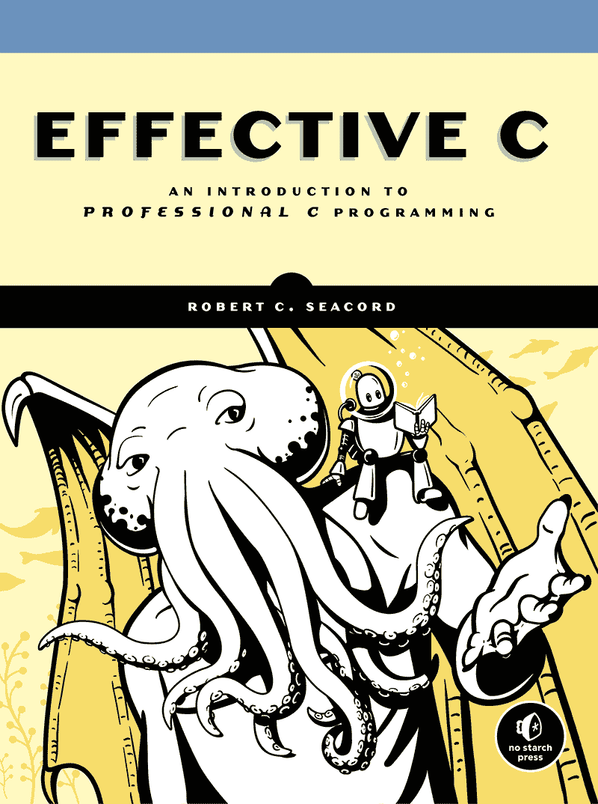
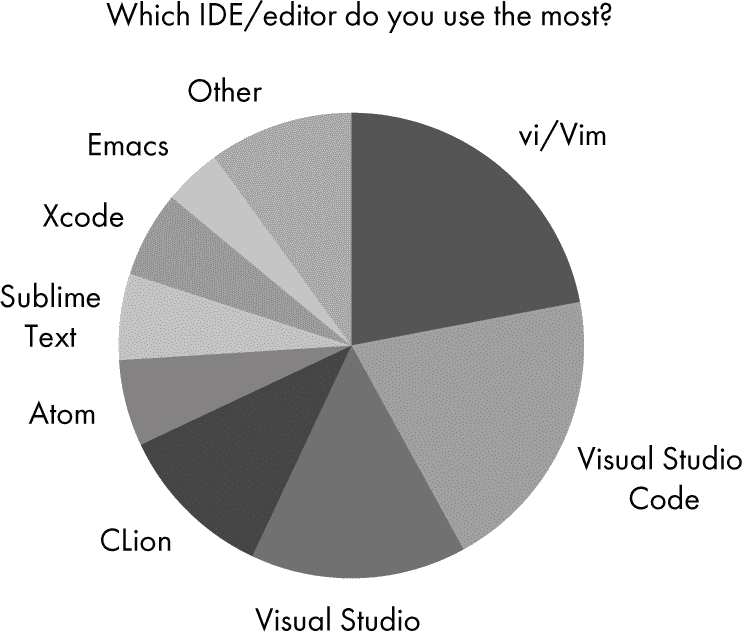
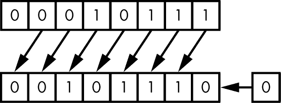
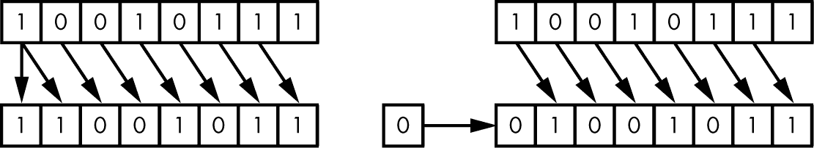
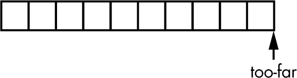
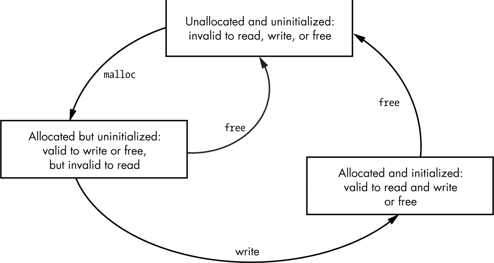
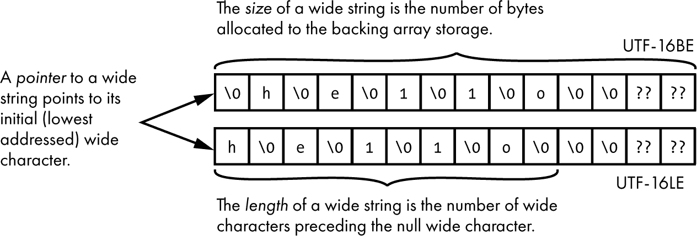
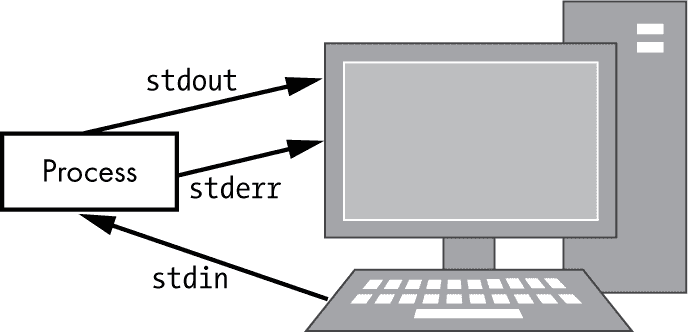

# 高效 C：专业 C 编程入门指南




## 总结

# 3 算术类型

## 填充与精度

## 声明整数

## 有符号整数

## 浮点

### 浮点运算

## 浮点常量

## 整数转换等级

## 常规算术转换

## 安全转换

## 简单赋值

## 函数调用

## 运算符优先级与结合性

## 无序与不确定顺序求值

## `sizeof` 运算符

## 一元 `+` 和 `–` 运算符

### 乘法运算符

### 位运算符

### 移位运算符

### 按位异或运算符

### 逻辑运算符

### 条件运算符

### 关系运算符

### 逗号运算符

## 总结

# 5 控制流

## 复合语句

## `if` 语句

## 迭代语句

## `do...while` 语句

## 跳语句

## `continue` 语句

## `return` 语句

## 总结

# 6 动态分配内存

## 堆与内存管理器

## 内存管理函数

## `aligned_alloc` 函数

## `realloc` 函数

## `free` 函数

## 灵活数组成员

## `alloca` 函数

## 调试分配的存储

## 安全关键系统

## 总结

# 7 字符与字符串

### ASCII

### 源与执行字符集

### 字符常量

### Linux

### 字符转换

### 字符串字面量

### `<string.h>` 和 `<wchar.h>`

### POSIX

## 总结

# 8 输入/输出

## 流缓冲

## 流方向

## 打开与创建文件

### `open` 函数

### `fclose` 函数

### 读写字符

### 设置文件位置

### 使用临时文件

### 从二进制流读取与向二进制流写入

### 编译过程

## 引号与角括号包含

### 生成错误

### 宏定义

### 类型泛宏

## 总结

# 10 程序结构

## 耦合与内聚

## 数据抽象

## 可执行文件

## 结构化简单程序

## 总结

# 11 调试、测试与分析

## 静态断言

## 编译器设置与标志

## Visual C++

## 测试

- 动态分析
- 练习
- 参考文献

TrustInSoft 首席科学家

## 前言

作者：OLLIE WHITEHOUSE

当我 25 多年前开始进入网络安全领域时，我主要是通过发现和利用 C 程序中不安全的内存处理来学习本领的——这类漏洞在当时就已经有 20 多年的历史了。在 BlackBerry 的职业期间，当我审阅如山般的代码时，我亲眼见证了 C 语言对于处理不当的人来说是多么危险。现在，作为一家跨国网络安全专业和托管服务公司的 CTO，我每天都能看到编写糟糕的 C 代码对我们互联社会带来的后果。

今天，我们在编写安全且专业的 C 语言方面仍然面临许多挑战。编译器和操作系统层面防御措施的许多创新可以被且经常被破坏。尽管我们看到其他现代语言中先进的创新，但对 C 的需求仍在增长，特别是在 IoT 或其他高度资源受限的环境中。

Robert 是如何用 C 语言进行专业且安全编程的权威。十多年来，我一直向客户和内部团队推荐他的教材。没有比他更合适的人来教如何以专业的方式（以及其他安全的方式）编写 C 代码了。

在今天编写专业的 C 代码意味着编写高性能、安全且稳固的代码。通过这种方式，你将为我们的互联社会做出贡献，而不会增加其技术债。

本书将帮助那些几乎或完全没有 C 经验的人快速掌握知识和技能，成为专业的 C 程序员，并为开发高性能、安全且稳固的系统提供坚实的基础。

Ollie Whitehouse

- 不要阻止程序员做需要做的事。因为 C 是一种系统编程语言，它必须能够处理各种低级任务。
- 为一种操作只提供一种方法。这被称为机制守恒，C 语言试图限制重复机制的引入。

你将学习如何控制单个语句求值的顺序。我们将首先回顾定义执行任务的表达式语句和复合语句。然后，我们将涵盖三种决定哪些代码块执行以及执行顺序的语句：选择语句、迭代语句和跳转语句。

# 第 6 章：动态分配内存

你将学习用于组成字符串的各种字符集，包括 ASCII 和 Unicode。你将学习如何使用 C 标准库中的遗留函数、边界检查接口以及 POSIX 和 Windows API 来表示和操作字符串。

# 第 8 章：输入/输出

你将学习如何使用预处理器来包含文件、定义对象类和函数类宏，并根据特定实现的特征条件包含代码。

# 第 10 章：程序结构

本章描述了生成正确程序的工具和技术，包括编译时和运行时断言、调试、测试、静态分析和动态分析。本章还讨论了在软件开发过程的不同阶段推荐使用的编译器标志。

你即将开启一段旅程，这段旅程结束后，你将成为一名崭新的但专业的 C 开发者。

# 1. 开启 C 语言之旅


在本章中，你将开发你的第一个 C 程序：传统的“Hello, world!”程序。我将带你了解这个简单程序的各个方面，以及如何编译和运行 C 程序。然后，我将讨论一些编辑器和编译器选项，并列出你在编写 C 语言时会迅速熟悉的常见移植性问题。

## 开发你的第一个 C 程序

```c
#include <stdio.h>

int main(void) {
    return EXIT_SUCCESS;
}
```

如果你购买了电子书，请将程序剪切粘贴到编辑器中。尽可能使用剪切粘贴，因为可以减少转录错误。

## 编译并运行你的程序

```bash
% cc hello.c
```

这些命令特定于 Linux（以及其他类 Unix 操作系统）。其他操作系统上的其他编译器需要以不同的方式调用。请参阅你特定编译器的文档。

如果你正确输入了程序，编译命令将在源代码所在的相同目录下创建一个名为 `a.out` 的新文件。使用 `ls` 命令检查目录，你应该能看到以下内容：

```text
a.out  hello.c
```

```bash
% ./a.out
```

如果一切顺利，程序应该在终端窗口中打印出 Hello, world!。如果没有打印，请将你的程序文本与列表 1-1 中的程序文本进行对比，以确保它们一致。

`cc` 命令有许多标志和编译器选项。例如，`-o` 标志允许为可执行文件赋予一个好记的名字而不是 `a.out`。以下编译器调用将可执行文件命名为 `hello`：

```bash
% cc hello.c -o hello
% ./hello
```

现在我们将逐行检查 `hello.c` 程序。

## 预处理器指令

程序的主部分（之前在列表 1-1 中所示）如下：

```c
int main(void) {
    return EXIT_SUCCESS;
}
```

该行定义了启动时调用的 `main` 函数。`main` 函数定义了程序从命令行或其他程序被调用时，在托管环境中执行的主入口。C 定义了两种可能的执行环境：*独立*（freestanding）和*托管*（hosted）。独立环境可能没有操作系统，通常用于嵌入式编程。这些实现提供了最小的库函数，且启动时调用的函数名称和类型由实现定义。我们主要定义 `main` 返回一个 `int` 类型的值，并在括号内放置 `void` 表示该函数不接受参数。`int` 类型是一种有符号整数类型，可以表示正负整数值以及零。与其他过程化语言类似，C 程序由过程（称为函数）组成，这些可以接受参数并返回值。每个函数都是可重用的工作单元，你可以根据需要频繁调用它们。在本例中，`main` 函数的返回值表示程序是否成功终止。

```c
return EXIT_SUCCESS;
```

```c
#define EXIT_SUCCESS 0
```

```c
int main(void) {
}
```

```c
int main(void)
  // ---snip---
```

这个决定纯粹是风格上的选择，因为空白字符（包括换行符）在语法上通常没有意义。在本书中，我通常将左大括号放在与函数声明的同一行，因为这样在风格上更紧凑。

## 检查函数返回值

函数通常会返回一个值，该值是计算的结果，或者表示该函数是否成功完成了其任务。例如，我们在“Hello, world!”程序中使用的 `puts` 函数接收一个要打印的字符串，并返回一个 `int` 类型的值。如果发生写入错误，`puts` 函数将返回宏 `EOF` 的值（一个负整数）；否则，它返回一个非负整数值。尽管对于我们的简单的程序来说，`puts` 函数失败并返回 `EOF` 的可能性很小，但这是完全可能的。因为调用 `puts` 可能会失败并返回 `EOF`，这意味着你的第一个 C 程序存在 bug，或者至少可以改进如下：

```c
#include <stdlib.h>

int main(void) {
    return EXIT_FAILURE;
}

// 这里的代码永远不会执行
```

这个修改后的“Hello, world!”程序检查了 `puts` 调用是否返回了值 `EOF`，这表示写入错误。如果函数返回 `EOF`，程序将返回 `EXIT_FAILURE` 宏的值（其评估结果为非零值）。否则，函数成功，程序返回 `EXIT_SUCCESS`（要求为 0）。调用程序的脚本随后可以检查其状态以判断是否执行成功。跟在 `return` 语句之后的代码是死代码，永远不会执行。在修改后的程序中通过单行注释指出了这一点。`//` 之后的所有内容会被编译器忽略。

## 格式化输出

`puts` 函数是向 `stdout` 写入字符串的一种很好、简单的方法，但最终你将需要使用 `printf` 函数打印格式化输出——例如，打印字符串以外的参数。`printf` 函数接收一个定义输出格式的格式字符串，后面跟着任意数量的参数，这些参数是你想要打印的实际值。例如，如果你想使用 `printf` 函数来打印 Hello, world!，你可以这样写：

```c
#include <stdio.h>

int main(void) {
    printf("%s\n", "Hello, world!");
}
```

第一个参数是格式字符串 `"%s\n"`。`%s` 是一个转换规范，指示 `printf` 函数读取第二个参数（字符串字面量）并将其打印到 `stdout`。`\n` 是一个用于表示非图形字符的字母转义序列，它告诉函数在字符串后包含一个新行。如果没有这个换行序列，下一个打印的字符（很可能是命令提示符）将出现在同一行。此函数调用输出以下内容：

```text
Hello, world!
```

注意不要将用户提供的数据作为 `printf` 函数第一个参数的一部分，因为这样做可能会导致格式化输出安全漏洞 (Seacord 2013)。

输出字符串最简单的方法是如之前所示使用 `puts` 函数。如果你在修改后的“Hello, world!”程序中使用 `printf` 代替 `puts`，你会发现它不再能够工作了，因为 `printf` 函数返回状态的方式与 `puts` 函数不同。`printf` 函数在成功时返回打印的字符数，如果发生输出或编码错误，则返回负值。你可以尝试修改“Hello, world!”程序来使用 `printf` 函数作为练习。

## 编辑器与集成开发环境

可以使用各种编辑器和 IDE 来开发你的 C 程序。图 1-1 显示了根据 2018 年 JetBrains 调查结果最常用的编辑器。



*图 1-1: IDE/编辑器使用*

可用的具体工具取决于你使用的系统。本书关注 Linux、Windows 和 macOS，因为这些是最常见的开发平台。

对于 Microsoft Windows，微软的 Visual Studio IDE（[`visualstudio.microsoft.com/`](https://visualstudio.microsoft.com/)）是一个显而易见的选择。Visual Studio 有三个版本：社区版、专业版和企业版。社区版的优势是免费，而其他版本则需要付费。对于本书，你需要社区版。

对于 Linux，选择并不那么明显。Vim、Emacs、Visual Studio Code 和 Eclipse 都是选项。Vim 是许多开发者和高级用户的首选编辑器。它是基于 Bill Joy 在 70 年代为 Unix 版本编写的 vi 编辑器。它继承了 vi 的按键绑定，但增加了原始 vi 缺失的功能和扩展性。你可以选择安装 Vim 插件，如 `YouCompleteMe`（[`github.com/Valloric/YouCompleteMe/`](https://github.com/Valloric/YouCompleteMe/)）或 `deoplete`（[`github.com/nvim-deoplete/`](https://github.com/nvim-deoplete/)）来为 C 编程提供原生的语义补全。

GNU Emacs 是一个可扩展、可定制且免费的文本编辑器。它的核心是一个 Emacs Lisp 解释器，它是 Lisp 编程语言的一种，带有文本编辑的扩展——尽管我从未发现这有什么问题。如实说明：我开发过的所有 C 代码都是在 Emacs 中编辑的。

*Visual Studio Code (VS Code)* 是一个精简的代码编辑器，支持调试、任务运行和版本控制等开发操作（在第 11 章中介绍）。它为开发者提供了代码-构建-调试循环所需的工具。VS Code 运行在 macOS、Linux 和 Windows 上，并且个人或商业用途均免费。Linux 和其他平台都有安装说明；在 Windows 上，你最可能会使用微软的 Visual Studio。图 1-2 显示了在 Ubuntu 上使用 Visual Studio Code 开发列表 1-1 中的“Hello, world!”程序。你可以从调试控制看到程序意外以状态代码 0 退出。

## 编译器

有很多 C 编译器可供选择，因此我在这里不再逐一介绍。不同的编译器实现了不同版本的 C 标准。许多嵌入式系统的编译器仅支持 C89/C90。用于 Linux 和 Windows 的流行编译器则更加努力支持现代版本的 C 标准，最高支持并包含 C2x。

## GNU 编译器集合

`GNU Compiler Collection (GNU Compiler Collection)` 包含了针对 C、C++ 和 Objective-C 的前端，以及其他语言（[`gcc.gnu.org/`](https://gcc.gnu.org/)）。`GCC` 的开发在 GCC 引导委员会的指导下遵循定义良好的开发计划。

`GCC` 已被采用为 Linux 系统的标准编译器，尽管适用于 Microsoft Windows、macOS 和其他平台的版本也存在。在 Linux 上安装 `GCC` 非常简单。例如，以下命令应该在 Ubuntu 上安装 `GCC` 8：

```bash
sudo apt update
sudo apt install gcc-8
```

你可以通过以下命令测试你正在使用的 `GCC` 版本：

```bash
gcc --version
```


```bash
gcc (Ubuntu 8.3.0-6ubuntu1~18.04) 8.3.0
```

```bash
sudo dnf install gcc
```

```bash
sudo apt-get install clang
```

```bash
clang --version
Target: x86_64-pc-linux-gnu
InstalledDir: /usr/bin
```

*   未指定的行为 (Unspecified behavior)
*   特定区域语言的行为 (Locale-specific behavior)

*   当行为被明确指定为“未定义行为”时
*   避免定义偏于某种特定实现策略的模糊边缘情况

这三个原因确实非常不同，但都被视为可移植性问题。我们将在本书的后续内容检查这三种情况的示例。编译器（实现）有权执行以下操作：

*   完全忽略未定义行为，导致不可预测的结果
*   终止编译或执行（并发出诊断信息）

这些选项都不理想（特别是第一种），因此最好的做法是避免未定义行为，除非实现规定这些行为是已定义的，以便允许你调用语言扩展。

### 区域特定行为与常见扩展

`区域特定行为`（Locale-specific behavior）取决于每个实现所记录的国、文化和语言的局部惯例。常见扩展在许多系统中被广泛使用，但它们并不移植到所有实现中。

## 总结

在本章中，你学习了如何编写一个简单的 C 语言程序、编译它并运行它。我们还查看了几个编辑器和交互式开发环境，以及你可以用于在 Windows、Linux 和 macOS 系统上开发 C 程序的编译器。通常情况下，你应该使用较新版本的编译器和其他工具，因为它们往往支持 C 编程语言的新特性，并提供更好的诊断和优化。如果新版本的编译器会破坏你的现有代码，或者你正准备部署代码，你可能就不想使用新版本的编译器，以避免向已经测试过的应用程序中引入不必要的更改。我们通过对 C 语言程序可移植性的讨论结束了本章。

后续章节将检查 C 语言和库的特定特性，从下一章的对象、函数和类型开始。

# 2 对象、函数和类型


在本章中，你将学习对象、函数和类型。我们将研究如何声明变量（带有标识符的对象）和函数、获取对象的地址，以及对这些对象指针进行解引用。你已经看到了一些 C 程序员可以使用的类型。在本章中学到的第一件事是我学到的最后事情之一：C 语言中的每个类型类型是`对象`类型或`函数`类型。

### 对象、函数、类型和指针

`对象`（object）是可以表示值的存储区域。准确来说，C 标准（ISO/IEC 9899:2018）将对象定义为“执行环境中的数据存储区域，其内容可以表示值”，并补充说明：“当引用时，对象可以被解释为具有特定的类型”。变量是对象的一个示例。

`变量`（Variables）具有声明的`类型`（type），它告诉该值所表示的是什么种的对象。例如，类型为 `int` 的对象包含一个整数值。类型非常重要，因为表示一种类型对象的位集合如果被解释为另一种类型的对象，可能会产生不同的值。例如，数字 1 在 IEEE 754（IEEE 浮点数算术标准）中通过位模式 `0x3f800000`（IEEE 754–2008）表示。但如果你将相同的位模式解释为整数，你将得到值 1,065,353,216 而不是 1。

`函数`（Functions）不是对象，但它们有类型。函数类型的特征由其返回类型以及参数的数量和类型共同决定。

C 语言还有`指针`（pointers），它们可以被认为是一个`地址`（address）——内存中存储对象或函数的位置。指针类型派生自一个函数类型或对象类型，称为`引用类型`（referenced type）。派自引用类型 `T` 的指针类型称为指向 `T` 的指针（pointer to T）。

由于对象和函数是不同的实体，对象指针和函数指针也是不同的实体，不应互换使用。在接下来的节中，你将编写一个简单的程序尝试交换两个变量的值，以帮助更好地理解对象、函数、指针和类型。

### 声明变量

当你声明变量时，你为它分配一个类型并提供一个名称（或`标识符` identifier）以引用该变量。

`Listing 2-1` 声明了两个带有初始值的整数对象。这个简单的程序还声明但没有定义一个用于交换这些值的 `swap` 函数。

```c
int a = 21;
swap(a, b);
return 0;
```

```c
char *src, c;
int m[12], n[15][3], o[21];
```

```c
char *src; // src 类型为 char *
int x;     // x 类型为 int
int m[12]; // m 是一个 12 个元素的 int 数组
int o[21]; // o 是一个 21 个元素的 int 数组
```

```c
void swap(int a, int b) {
    a = b;
    printf("swap: a = %d, b = %d\n", a, b);
}
```

```bash
./a.out
main: a = 21, b = 17
```

```c
int t = *pa;
*pb = t;
```

*列表 2-3：使用指针修改后的 swap 函数*

当在函数声明或定义中使用时，`*` 作为指针声明符的一部分，表示该参数是指向特定类型对象或函数的指针。在重写的 `swap` 函数中，我们指定了两个参数 `pa` 和 `pb`，并将它们都声明为指向 `int` 类型的指针。

当函数内部的表达式中使用一元运算符 `*` 时，该一元运算符 `*` 会对指向对象的指针进行解引用。例如，考虑以下赋值：

```c
*pa = *pb;
```

这会将指针 `pa` 的值替换为指针 `pb` 的值。现在考虑 `swap` 函数中的实际赋值：

```c
*pa = *pb;
```

这会解引用指针 `pb`，读取其引用的值，解引用指针 `pa`，然后用 `pb` 所引用的值覆盖 `pa` 所引用位置处的值。

当在 `main` 中调用 `swap` 函数时，你必须在每个变量名之前放置一个取地址符 `&` 字符：

```c
swap(&a, &b);
```

一元运算符 `&` 是`取地址`（address-of）运算符，它生成指向其操作数的指针。这种变化是必要的，因为 `swap` 函数现在接受指向 `int` 类型对象的指针作为参数，而不再仅仅是 `int` 类型的值。

```c
void swap(int *pa, int *pb) {  // pa -> a: 21     pb -> b: 17
  *pa = *pb;                  // pa -> a: 17     pb -> b: 17
}

int main(void) {
  int a = 21;                // a: 21
  int b = 17;                // b: 17

  swap(&a, &b);
  printf("a = %d, b = %d\n", a, b);     // a: 17     b: 21
}
```

*列表 2-4：模拟按引用调用*

进入 `main` 块后，变量 `a` 和 `b` 分别被初始化为 21 和 17。然后代码获取这些对象的地址并将它们作为参数传递给 `swap` 函数。

在 `swap` 函数内部，参数 `pa` 和 `pb` 现在都已声明为指向 `int` 的指针类型，并包含了从调用函数（在此例中为 `main`）传递 `swap` 的参数的副本。这些地址副本仍然指向完全相同的对象，因此当在 `swap` 函数中交换它们引用的对象的值时，`main` 中声明的原始对象的内容也被访问并交换了。这种方法通过生成对象地址、按值传递地址以及解引用地址来访问原始对象，模拟了`按引用调用`（call-by-reference，也称为 `pass-by-reference`）。

### 作用域

对象、函数、宏和其他 C 语言标识符具有`作用域`（scope），它限制了它们可以被访问的连续区域。C 语言有四种作用域：文件、块、函数原型和函数。

对象或函数标识符的作用域由其声明的位置决定。如果声明在任何块或参数列表之外，则标识符具有文件作用域。如果声明在块或参数列表内部，则标识符具有块作用域。如果声明在函数原型内部，则标识符具有函数原型作用域。

```c
int j = 1; // 文件作用域 j
int main(void) {
  int j = 1; // j 的块作用域开始；隐藏了文件作用域 j
  for (int i = 0; i < 2; i++) { // 循环局部 i 的块作用域开始
    printf("%d\n", j); // 内部 j 在范围内，打印 2
  }
  printf("%d\n", j); // 外部 j 在范围内，打印 1
}
```

只要注释准确地描述了你的意图，这段代码没有问题。最佳实践是对不同的标识符使用不同的名称，以避免导致混淆从而产生错误。对于作用域较小的标识符，使用像 `i` 和 `j` 这样的短名称是可以的在大作用域内的标识符应该具有较长的、描述性的名称，这些名称不太可能在嵌套作用域中被隐藏。某些编译器会对隐藏的标识符发出警告。

## 存储生存期

对象具有存储生存期，这决定了它们的寿命。总共有四种存储生存期：自动（automatic）、静态（static）、线程（thread）和分配（allocated）。你已经看到，自动存储生存期的对象是在块内或作为函数参数声明的。这些对象的生命周期从它们所在的块开始执行开始，到该块执行结束结束。如果递归进入该块，每次都会创建一个新对象，每个对象都有自己的存储空间。

**注意**

作用域（Scope）和生命周期（lifetime）是完全不同的概念。作用域适用于标识符，而生命周期适用于对象。标识符的作用域可以通过其名称访问该标识符所指对象的代码区域。对象的生命周期是对象存在的时间段。

在文件作用域内声明的对象具有静态存储生存期。这些对象的生命周期是整个程序的执行过程，它们的存储值在程序启动之前初始化。你也可以通过存储类限定符 `static` 在块作用域内声明一个具有静态存储生存期的变量，如列表 2-6 中的计数示例所示。这些对象在函数退出后依然存在。

```c
void counter() {
  static unsigned int counter = 0;
  counter++;
  printf("%d ", counter);
}

int main() {
  for (int i = 0; i < 5; i++) {
    counter();
  }
}
```

```c
int j;
int *func(int i) {
  static int k = j; // 错误
  return &k;
}
```

```c
struct S {
  int x;
};
int main(void) {
  _Alignas(struct S) unsigned char good_buff[sizeof(struct S)];
  struct S *good_s_ptr = (struct S *)good_buff; // 正确的指针对齐
}
```

*列表 2-7：使用 _Alignas 关键字*

对齐从弱到强（也称为严格）排序。严格的对齐具有更大的对齐值。满足对齐要求的地址也满足任何有效的弱对齐要求。

## 对象类型

本节介绍 C 中的对象类型。具体来说，我们将涵盖布尔类型、字符类型以及数值类型（包括整数和浮点类型）。

### 布尔类型

声明为 `_Bool` 的对象只能存储 0 和 1。这种布尔类型是 C99 引入的，并以下划线开头以区分已经声明了 `bool` 或 `boolean` 标识符程序。以下划线和大写字母或另一个下划线开头的标识符总是保留的。如果你包含头文件 `<stdbool.h>`，你可以将此类型命名为 `bool` 并赋值 `true`（扩展为整数常量 1）和 `false`（扩展为整数常量 0）。这里我们使用类型的两种拼写声明了两个布尔变量：

```c
#include <stdbool.h>
_Bool flag1 = 0;
bool flag2 = false;
```

两种拼写都有效，但使用 `bool` 更好，因为这是语言长期方向。

### 字符类型

C 语言定义了三种字符类型：`char`、`signed char` 和 `unsigned char`。每个编译器实现会将 `char` 定义为与 `signed char` 或 `unsigned char` 相同的对齐、大小、范围、表示和行为。无论选择哪一个，`char` 都是与其他两个不同的独立类型，并且与两者都不兼容。

```c
enum day { sun, mon, tue, wed, thu, fri, sat };

enum cardinal_points { north = 0, east = 90, south = 180, west = 270 };

enum months { jan = 1, feb, mar, apr, may, jun, jul, aug, sep, oct, nov, dec };
```

```c
int f(void);

int *fip();

void g(int, int);

void h(int, int);
```

```c
int max(int a, int b) {
  return a > b ? a : b;
}
```

返回类型说明符为 `int`；函数声明符为 `max(int a, int b)`；函数体为 `{ return a > b ? a : b; }`。函数类型的规范不能包含任何类型限定符（参见第 32 页上的`类型限定符`）。函数体本身使用了条件运算符（`? :`），该运算符将在第 4 章中进一步阐释。该表达式表示，如果 `a` 大于 `b`，则返回 `a`；否则返回 `b`。

## 生类型

`派生类型`是由其他类型构造的类型。这些包括指针、数组、类型定义、结构和联合，我们将在这里介绍这些内容。

### 指针类型

`指针类型`派自它所指向的函数或对象类型，该类型被称为`引用`类型。指针提供对被引用类型实体的引用。

以下三个声明定义了一个指向 `int` 的指针、一个指向 `char` 的指针以及一个指向 `void` 的指针：

```c
int *ip;
char *cp;
void *vp;
```

在本章前面的部分，我介绍了取地址运算符（`&`）和间接引用运算符（`*`）。你使用 `&` 运算符获取对象或函数的地址。例如，如果该对象是 `int`，那么该运算符的结果类型为指向 `int` 的指针：

```c
int i = 42;
int *ip = &i;
```

```c
ip = &*ip;
```

```c
int ia[11];
```

你使用方括号（`[]`）来标识数组的元素。例如，下面的代码片段创建了字符串“0123456789”，演示如何给数组元素赋值：

```c
char str[11] = "0123456789";
str[10] = '\0';
```

第一行声明了一个边界为 11 的 `char` 数组。这分配了足够的存储空间创建一个包含 10 个字符加一个空字符的字符串。`for` 循环迭代 10 次，`i` 的值从 0 到 9。每次迭代将表达式 `'0' + i` 的结果赋值给 `str[i]`。循环结束后，将空字符复制到数组的最后一个元素 `str[10]` 中。

在表达式中，`str` 自动转换为指向数组第一个成员（一个 `char` 类型的对象）的指针，`i` 是无符号整数类型。下标运算符（`[]`）和加法运算符（`+`）的定义使得 `str[i]` 等同于 `*(str + i)`。当 `str` 是一个数组对象时（在此处如此），表达式 `str[i]` 指定数组的第 `i` 个元素（从 0 开始计数）。因为数组从 0 开始索引，所以数组 `char str[11]` 的索引从 0 到 10，其中 10 是最后一个元素，如此示例最后一行所示。

如果单元运算符 `&` 的操作数是 `[]` 运算符的结果，则结果等于删除了 `&` 运算符并将 `[]` 运算符更改为 `+` 运算符。例如，`&str[10]` 等于 `str + 10`。

你还可以声明多维数组。列表 2-8 在函数 `main` 中将 `arr` 声明为一个 `int` 类型的 5 × 3 二维数组，也称为`矩阵`。

```c
int main(void) {
    int arr[5][3];
    unsigned int i = 0;
    unsigned int j = 0;

    func(arr[i]);

    return 0;
}
```

1. `arr` 是一个包含 3 个元素的数组，每个元素都是一个包含 5 个 `int` 类型元素的数组。当你使用表达式 `arr[i][j]` 时，发生以下情况：
2. `arr` 是一个包含 3 个元素的数组，每个元素都是一个包含 5 个 `int` 类型元素的数组。当你使用表达式 `arr[i][j]` 时，发生以下情况：
3. `arr` 是一个包含 3 个元素的数组，每个元素都是一个包含 5 个 `int` 类型元素的数组。当你使用表达式 `arr[i][j]` 时，发生以下情况：
4. `arr` 是一个包含 3 个元素的数组，每个元素都是一个包含 5 个 `int` 类型元素的数组。当你使用表达式 `arr[i][j]` 时，发生以下情况：
5. `arr` 是一个包含 3 个元素的数组，每个元素都是一个包含 5 个 `int` 类型元素的数组。当你使用表达式 `arr[i][j]` 时，发生以下情况：

### 类型定义

你使用 `typedef` 为现有类型声明别名；它永远不会创建新类型。例如，以下每项都创建了一个新类型：

```c
typedef unsigned int uint_type;
typedef signed char schar_type, *schar_p, (*fp)(void);
```

在第一行，我们将 `uint_type` 声明为类型 `unsigned int` 的别名。在第二行，我们将 `schar_type` 声明为 `signed char` 的别名，`schar_p` 声明为 `signed char` 指针，而 `fp` 声明为 `(*void)`。标准头文件中以 `_t` 结尾的标识符是类型定义（现有类型的别名）。通常情况下，你不应该在代码中遵循这种约定，因为 C 标准保留了所有以 `_t` 结尾的标识符。

### 结构

`结构类型`（也称为 `struct`）包含顺序分配的对象。每个对象都有自己的名称并可能具有不同的类型——而数组必须具有相同的类型。列表 2-9 演示了每个运算符的使用。


```c
strcpy(sigline.signame, "SIGINT");
strcpy(sigline.sigdesc, "Interrupt from keyboard");
sigline_p = &sigline;
sigline_p->signum = 5;
strcpy(sigline_p->signame, "SIGINT");
strcpy(sigline_p->sigdesc, "Interrupt from keyboard");
```

```c
union {
    int type;
    struct {
        int intnode;
    };
    struct {
        double doublenode;
    };
} u;
u.nf.type = 1;
u.nf.doublenode = 3.14;
```

```c
struct s {
};
struct s v;   // `struct s` 的实例
```

联合体和枚举的名字也是标签而非类型，这意味着它们不能单独用于声明变量。例如：

```c
enum day tomorrow; // 正确
enum status { ok, fail };  // 枚举
```

你甚至可以声明类型为 `struct s` 的对象 `s`：

```c
```

这可能不是良好的实践，但在 C 中是有效的。你可以将结构体标签视为类型名，并使用 `typedef` 为标签定义别名。这里有一个示例：

```c
```

现在允许你声明类型为 `t` 的变量，而不是 `struct s`。`struct`、union 和 enum 中的标签名是可选的，所以你完全可以舍弃它：

```c
```

这在包含指向自身指针的自引用结构体情况下行不通：

```c
struct tnode {
    int count;
    struct tnode *right;
};
```

如果你省略了第一行的标签，编译器可能会报错，因为第 3 行和第 4 行引用的结构尚未声明，或者因为整个结构没有在任何地方使用。因此，你不得不为结构声明一个标签，但你也可以定义一个 `typedef`：

```c
typedef struct tnode {
    int count;
    struct tnode *right;
} tnode;
```

大多数 C 程序员为标签和 `typedef` 使用不同的名称，但使用相同的名称也完全可以。你也可以在结构之前定义这种类型，以便使用它来声明指向其他 `tnode` 类型对象的左、右成员：

```c
typedef struct tnode tnode;
struct tnode {
    int count;
    tnode *right;
};
```

类型定义可以提高代码的可读性。类型限定符改变访问对象的行为。

*Listing 2-10: 引用结构体成员*

`Listing 2-10` 的前三行通过 `.` 运算符直接访问 `sigline` 对象的成员。在 ➊ 处，我们将 `sigline_p` 对象的地址赋值给 `sigline` 指针。在程序的最后三行中，我们通过 `sigline_p` 指针使用 `->` 运算符间接访问 `sigline` 对象的成员。

## 联合体 (Unions)

*联合体类型（Union types）*与结构体相似，不同在于成员对象所使用的内存是重叠的。联合体一次只能包含一种类型的对象，在另一个时间包含不同类型的对象，但绝不会同时包含两个对象，它们主要用于节省内存。`Listing 2-11` 显示了包含三个结构体的联合体 `u`：`n`、`ni` 和 `nf`。该联合体可能用于树、图或其他数据结构，其中某些节点包含整数值（`ni`），而其他节点包含浮点值（`nf`）。

```c
union {
    struct {
        int type;
    } n;
    struct {
        int type;
        int intnode;
    } ni;
    struct {
        int type;
        double doublenode;
    } nf;
} u;
```

*Listing 2-11: 联合体*

与结构体一样，你可以通过 `.` 运算符访问联合体成员。使用指向联合体的指针，可以通过 `->` 运算符引用其成员。在 `Listing 2-11` 中，联合体 `nf` 结构体中的 `type` 成员通过 `u.nf.type` 被引用，`doublenode` 成员通过 `u.nf.doublenode` 被引用。使用该联合体的代码通常会通过检查 `u.n.type` 中存储的值来检查节点类型，然后根据类型访问 `intnode` 或 `doublenode` 结构体。如果这被实现为结构体，每个节点都将包含用于 `intnode` 和 `doublenode` 成员的存储空间。使用联合体允许这两个成员共用同一个存储空间。

## 标签 (Tags)

*标签（Tags）*是用于结构体、联合体和枚举的特殊命名机制。例如，出现在以下结构体中的标识符 `s` 就是一个标签：

```c
struct s {
    //---snip---
};
```

标签本身并不是类型名，不能用于声明变量（Saks 2002）。相反，你必须按照如下方式声明该类型的变量：

```c
struct s *p; // 指向 struct s 的指针

enum day { sun, mon, tue, wed, thu, fri, sat };
day today;  // 错误
```

结构体、联合体和枚举的标签定义在与普通标识符不同的*命名空间*中。这允许 C 程序在同一个作用域内同时拥有标签和另一个拼写相同的标识符：

```c
enum status status(void);  // 函数
struct s s;

typedef struct s { int x; } t;
typedef struct { int x; } t;

struct tnode {
    struct tnode *left;
};

typedef struct tnode {
    struct tnode *left;
} tnode;

typedef struct tnode tnode;
struct tnode {
    tnode *left;
} tnode;
```


```c
void f(unsigned int n, int *restrict p, int *restrict q) {
    *p++ = *q++;
}
```

## 2. 声明一个指针数组并根据传入的索引值

## 总结

在本章中，你学习了对象和函数以及它们的区别。你学习了如何声明变量和函数、获取对象的地址以及解引用指针。你还学习了 C 语言中大多数对象类型以及派生类型。我们将在后面的章节中返回这些类型，以详细探索如何使用它们来实现你的设计。在下一章中，我们将提供两种算术类型的详细信息：整数和浮点。

# 3 算术类型


在本章中你将学习两种算术类型：整数类型和浮点类型。由于 C 中的大多数运算符作用于算术类型，且 C 是一门系统级语言，正确执行算术操作可能是困难的——因为在限制范围和精度的系统中，结果并不总是与数学结果相同。在 C 中正确执行基本算术操作是成为专业程序员的基础。

我们将深入研究 C 语言中算术运算的工作原理，让你牢固掌握这些基础概念。我们还将如何将一种算术类型转换为另一种，这对于执行混合类型的操作是必要的。

## 整数

正如[第 2 章]所示，每个整数类型表示一个有限的整数范围。符号整数类型可以表示负、零或正；无符号整数只能表示零或正。每个整数类型可以表示的范围取决于实现。整数对象的*值*是存储在对象中的数学值。整数对象的*表示*是对象分配存储中的特定编码。稍后我们将详细查看表示。

### 填充与精度

除了 `char`、`signed char` 和 `unsigned char` 外的所有整数类型可能包含未使用的位，称为*填充*（padding），这允许实现适应硬件特性（例如在多字节表示中间跳过符号位）或与目标架构进行优化对齐。用于表示给定类型值（排除填充但包含符号）的位数被称为*宽度*（width），通常用 `N` 表示。*精度*（precision）是用于表示值的排除符号和填充位。

### `<limits.h>` 头文件

`<limits.h>` 头文件提供了各种整数类型的最小和最大可表示值。可表示值是在特定类型对象可用位数内可以表示。无法表示的值将由编译器诊断或转换为一个可表示但不同的（错误的）值。编译器编写者为他们的实现提供了正确的最小、最大和宽度。为了编写可移植的代码，你应该使用这些常量，而不是像 `2147483647` 这样的字面量，后者在移植到不同的实现时可能会变化。

C 标准对整数大小仅施加三个限制：首先，每种数据类型的存储空间占据整数个相邻 `unsigned char` 对象（可能包括填充）。其次，每个整数类型必须支持最小范围，允许你依赖任何实现中可移植的值范围。第三，较小类型的宽度不能大于较大类型。例如，`USHRT_MAX` 不能大于 `UINT_MAX`，但它们的宽度可以相同。

### 声明整数

除非显式声明为 `unsigned`，否则整数类型被假设是有符号的（`char` 除外，实现可以将其定义为符号或无符号整数类型）。以下是无符号整数的有效声明：

```c
unsigned u; // 可以省略 int

unsigned char uc; // 必须使用 unsigned

int i; // 可以省略 signed

long long sll2; // 可以省略 signed 和 int
```

## 无符号整数

无符号整数的范围从 0 开始，其上限大于符号整数类型。无符号整数经常用于计数可能具有大量非负数量的项目。

### 表示

无符号整数类型比符号整数类型更容易理解和使用。它们使用纯二进制系统表示值，没有偏移量：最低位权重为 `2⁰`，次低位权重为 `2¹`，依此类推。二进制数的值是所有置位位权重之和。表 3-1 显示了某些使用无填充 8 位表示的无符号值示例。

**表 3-1：8 位无符号值**

| 十进制 | 二进制 | 十六进制 |
| --- | --- | --- |
| 0 | 0000 0000 | 0x00 |
| 17 | 0001 0001 | 0x11 |

无符号整数类型不需要表示符号位，因此通常比对应的有符号整数类型多出 1 位的精度。无符号整数值的范围是从 0 到一个取决于类型宽度的最大值。这个最大值为 `2^(N) – 1`，其中 `N` 是宽度。例如，大多数 x86 架构使用 32 位整数且没有填充位，因此类型为 `unsigned int` 的对象的范围是从 0 到 `2³² – 1` (4,294,967,295)。来自 `<limits.h>` 的常量表达式 `UINT_MAX` 规定了该类型实现定义的上范围。表 3-2 显示了每个无符号类型在 `<limits.h>` 中的常量表达式、标准要求的最小范围，以及在在现代 x86 实现上的实际范围。

### 表 3-2：无符号整数范围

| 常量表达式 | 最小幅度 | x86 | 该类型对象的最大值 |
| --- | --- | --- | --- |
| `UCHAR_MAX` | 255 // 2⁸ – 1 | 相同 | `unsigned char` |
| `UINT_MAX` | 65,535 // 2¹⁶ – 1 | 4,294,967,295 | `unsigned int` |
| `ULLONG_MAX` | 18,446,744,073,709,551,615 // 2⁶⁴ – 1 | 相同 | `unsigned long long int` |

### 溢回（Wraparound）

当你执行的算术运算产生的值太小（小于 0）或太大（大于 `2^(N) – 1`）而无法用特定的无符号整数类型表示时，就会发生溢回。在这种情况下，该值将对结果类型中可以表示的最大值加 1 的数字取模（modulo）。溢回在 C 语言中是定义良好的行为。它是否是你的代码中的缺陷取决于上下文。如果你正在计数某些东西而值发生了溢回，这可能是一个错误。然而，在某些加密算法中使用溢回是有意为之的。

例如，列表 3-1 中的代码将 `ui` 初始化为其最大值然后对其进行递增。结果无法用 `unsigned int` 表示，因此它溢回到了 0。如果此时对该值进行减 1 操作，它将再次超出范围，因此会再次溢回到 `UINT_MAX`。

```c
for (unsigned int i = n; i >= 0; --i)

extern unsigned int ui, sum;
// 为 ui 和 sum 赋值值
if (sum + ui > UINT_MAX)
else
```

如果 `sum + ui` 的结果大于 `UINT_MAX`，它将对 `UINT_MAX + 1` 取模。因此，整个测试都是徒用的，生成的代码将无条件地执行加法运算。高质量的编译器可能会发布警告以指出这一点，但并非所有编译器都这样做。为了纠正这个问题，我们可以从不等式的两边都减去 `sum`，形成以下有效的测试：

```c
too_big();
sum = sum + ui;

for (unsigned int i = n; i >= 0; --i)
```

## 符号整数

### 反码

符号位权重为 `–2^(N–1)`，符号位与表示符号相反，其余位权重与无符号相同。

|  |  |  |  |
| --- | --- | --- | --- |

|  |  |  |  |
| :--- | :--- | :--- | :--- |
| `SHRT_MIN` | –32,767 // –(2¹⁵ – 1) | –32,768 | `short int` |
| `INT_MIN` | –32,767 // –(2¹⁵ – 1) | –2,147,483,648 | `int` |
| `LONG_MIN` | –2,147,483,647 // –(2³¹ – 1) | –2,147,483,648 | `long int` |
| `LLONG_MIN` | –9,223,372,036,854,775,807 // – (2⁶³ – 1) | -9,223,372,036,854,775,808 | `long long int` |

|  |  |  |  |
| --- | --- | --- | --- |
| 00000001 | 1 | 2⁰ | |
| 01111111 | 127 | 2^(N – 1) – 1 | `SCHAR_MAX` |
| 10000001 | –127 | –(2^(N – 1) ) + 1 | |
| 11111111 | –1 | –(2^(N – 1) ) + 127 | |

### 溢出

*溢出*发生在一个运算的结果超出了该类型能表示的范围时。例如，以下代码展示了溢出情况：

```c
c = c + 1; // c 变为 -128

unsigned int ui = 71;

si = -12;

int agent = 007;
```

示例中，八进制 `007` 等于十进制 7，八进制常量 `0777` 等于 511。在处理 3 位字段时，八进制常量非常方便。

你还可以通过在十进制数字和字母 a（或 A）到 f（或 F）之前加上 `0x` 或 `0X` 来创建*十六进制常量*。例如：

```c
unsigned int ui = 71U;
unsigned long long int ui = 18446744073709551615ULL;
```

## 浮点类型

- IEC 60559 binary64 扩展格式
- IEC 60559 双精度（或 binary64）格式

编译器实现者的建议做法是将 `long double` 类型与 IEC 60559 binary128 格式或 IEC 60559 binary64 扩展格式匹配。IEC 60559 binary64 扩展格式包括常见的 80 位 IEC 60559 格式。

较大的类型具有更高的精度，但需要更多的存储。任何可以表示为 `float` 的值也可以表示为 `double`，任何可以表示为 `double` 的值也可以表示为 `long double`。标准的未来版本可能会包含额外的浮点类型，包括范围、精度或两者都比 `long double` 更大的，或者范围和精度更小的，例如 16 位浮点类型。

### 符号、指数和尾数

与整数一样，*符号位*表示数字是正是负：0 表示正数，1 表示负数。

*指数字段*需要同时表示正指数和负指数。为了避免将指数存储为符号数，会在实际指数上隐式地加上一个偏移量以得到*存储的*指数。对于 `float` 类型，偏移量为 `127`。因此，为了表示指数为 0，我们会在指数字段中存储 `127`。存储值 `200` 表示指数为 `200 – 127`，即 `73`。指数 –127（所有指数位均为 0）和 +128（所有指数位均为 1）被留给特殊值使用。

*符号位*表示数字是正是负：0 表示正数，1 表示负数。*指数字段*需要同时表示正指数和负指数。为了避免将指数存储为符号数，会在实际指数上隐式地加上一个偏移量以得到*存储的*指数。对于 `float` 类型，偏移量为 `127`。因此，为了表示指数为 0，我们会在指数字段中存储 `127`。存储值 `200` 表示指数为 `200 – 127`，即 `73`。指数 –127（所有指数位均为 0）和 +128（所有指数位均为 1）被留给特殊值使用。

*符号位*表示数字是正是负：0 表示正数，1 表示负数。*指数字段*需要同时表示正指数和负指数。为了避免将指数存储为符号数，会在实际指数上隐式地加上一个偏移量以得到*存储的*指数。对于 `float` 类型，偏移量为 `127`。因此，为了表示指数为 0，我们会在指数字段中存储 `127`。存储值 `200` 表示指数为 `200 – 127`，即 `73`。指数 –127（所有指数位均为 0）和 +128（所有指数位均为 1）被留给特殊值使用。

*符号位*表示数字是正是负：0 表示正数，1 表示负数。*指数字段*需要同时表示正指数和负指数。为了避免将指数存储为符号数，会在实际指数上隐式地加上一个偏移量以得到*存储的*指数。对于 `float` 类型，偏移量为 `127`。因此，为了表示指数为 0，我们会在指数字段中存储 `127`。存储值 `200` 表示指数为 `200 – 127`，即 `73`。指数 –127（所有指数位均为 0）和 +128（所有指数位均为 1）被留给特殊值使用。

*符号位*表示数字是正是负：0 表示正数，1 表示负数。*指数字段*需要同时表示正指数和负指数。为了避免将指数存储为符号数，会在实际指数上隐式地加上一个偏移量以得到*存储的*指数。对于 `float` 类型，偏移量为 `127`。因此，为了表示指数为 0，我们会在指数字段中存储 `127`。存储值 `200` 表示指数为 `200 – 127`，即 `73`。指数 –127（所有指数位均为 0）和 +128（所有指数位均为 1）被留给特殊值使用。

*符号位*表示数字是正是负：0 表示正数，1 表示负数。*指数字段*需要同时表示正指数和负指数。为了避免将指数存储为符号数，会在实际指数上隐式地加上一个偏移量以得到*存储的*指数。对于 `float` 类型，偏移量为 `127`。因此，为了表示指数为 0，我们会在指数字段中存储 `127`。存储值 `200` 表示指数为 `200 – 127`，即 `73`。指数 –127（所有指数位均为 0）和 +128（所有指数位均为 1）被留给特殊值使用。

*符号位*表示数字是正是负：0 表示正数，1 表示负数。*指数字段*需要同时表示正指数和负指数。为了避免将指数存储为符号数，会在实际指数上隐式地加上一个偏移量以得到*存储的*指数。对于 `float` 类型，偏移量为 `127`。因此，为了表示指数为 0，我们会在指数字段中存储 `127`。存储值 `200` 表示指数为 `200 – 127`，即 `73`。指数 –127（所有指数位均为 0）和 +128（所有指数位均为 1）被留给特殊值使用。

*符号位*表示数字是正是负：0 表示正数，1 表示负数。*指数字段*需要同时表示正指数和负指数。为了避免将指数存储为符号数，会在实际指数上隐式地加上一个偏移量以得到*存储的*指数。对于 `float` 类型，偏移量为 `127`。因此，为了表示指数为 0，我们会在指数字段中存储 `127`。存储值 `200` 表示指数为 `200 – 127`，即 `73`。指数 –127（所有指数位均为 0）和 +128（所有指数位均为 1）被留给特殊值使用。

*符号位*表示数字是正是负：0 表示正数，1 表示负数。*指数字段*需要同时表示正指数和负指数。为了避免将指数存储为符号数，会在实际指数上隐式地加上一个偏移量以得到*存储的*指数。对于 `float` 类型，偏移量为 `127`。因此，为了表示指数为 0，我们会在指数字段中存储 `127`。存储值 `200` 表示指数为 `200 – 127`，即 `73`。指数 –127（所有指数位均为 0）和 +128（所有指数位均为 1）被留给特殊值使用。

*符号位*表示数字是正是负：0 表示正数，1 表示负数。*指数字段*需要同时表示正指数和负指数。为了避免将指数存储为符号数，会在实际指数上隐式地加上一个偏移量以得到*存储的*指数。对于 `float` 类型，偏移量为 `127`。因此，为了表示指数为 0，我们会在指数字段中存储 `127`。存储值 `200` 表示指数为 `200 – 127`，即 `73`。指数 –127（所有指数位均为 0）和 +128（所有指数位均为 1）被留给特殊值使用。

*符号位*表示数字是正是负：0 表示正数，1 表示负数。*指数字段*需要同时表示正指数和负指数。为了避免将指数存储为符号数，会在实际指数上隐式地加上一个偏移量以得到*存储的*指数。对于 `float` 类型，偏移量为 `127`。因此，为了表示指数为 0，我们会在指数字段中存储 `127`。存储值 `200` 表示指数为 `200 – 127`，即 `73`。指数 –127（所有指数位均为 0）和 +128（所有指数位均为 1）被留给特殊值使用。

## 浮点运算

浮点运算是计算机中表示实数最常用的表示方式。浮点表示是一种使用科学计数法通过基数和指数对数字编码的技术。例如，十进制 `123.456` 可以表示为 `1.23456 × 10²`，而二进制数 `0b10100.110` 可以表示为 `1.0100110 × 2⁴`。

浮点运算与实数运算相似并用于模拟它。然而，存在一些差异。特别是与实数相比，浮点数是有界的的且具有有限精度。

浮点类型无法精确表示所有实数，即使这些数可以用少数位数精确表示。例如，常见的十进制常量如 `0.1` 无法用二进制浮点精确表示。请参考 CERT 规则 FLP30-C（不要将浮点变量作为计数器）获取更多信息。

## 浮点值

通常情况下，浮点类型的所有尾数都表示有效数字，外还有一个隐含的 1，它是被省略的但仍是值的一部分。作为一个特殊情况，为了表示值 0，指数和尾数都必须为 0；零根据符号位有符号（+0 和 –0），因此有两个浮点零值：正和一个负。

普通浮点值的尾数中没有领先零；领先零通过调整指数来移除。因此，`float` 具有 24 位精度，`double` 具有 53 位精度，而 `long double` 具有 113 位精度（假设使用四倍精度 128 位 IEC 60559 格式）。这些是归一化数，它们保持了尾数的完整精度。

非归一化（或规格化）数是非常小的正负数（但不是 0），其表示方式会导致指数小于最小可表示值。`图 3-3` 是一条显示 0 周围规格化范围的数轴。以最小指数表示（即隐含的 1 位被视为 0）的非零数字就是规格化数。

```c
#include <math.h>

int fpclassify(real-floating x);

const char *show_classification(double x) {
    case FP_INFINITE:  return "Inf";
    case FP_NORMAL:    return "normal";
    case FP_ZERO:      return "zero";
  }
}
```


`1.575E1  /* 15.75 */`

`-2.5e-3  /* -0.0025 */`

`10.0F  /* type float */`

```c
int si = 5;
long sl = (long)si;
```

- 有符号整数类型的等级大于任何精度较低的有符号整数类型的等级。
- 任何无符号整数类型的等级与其对应的有符号整数类型相等（如果存在）。
- `_Bool` 的等级小于所有其他整数类型。
- 扩展有符号整数类型相对于相同精度的另一个扩展有符号整数类型的等级由实现决定，但受其他规则限制。

#### 整数提升

`小类型`是指转换等级低于 `int` 或 `unsigned int` 的整数。`整数提升`是将小类型的值转换为 `int` 或 `unsigned int` 的过程。整数提升允许你在任何可以使用 `int` 或 `unsigned int` 的地方使用小类型类型的表达式。例如，你可以在赋值的右侧或作为函数参数使用低等级的整数类型——通常是 `char` 或 `short`。

整数提升有两个主要目的。首先，它促使操作在体系的自然尺寸（`int`）中进行，从而提高性能。其次，它有助于避免中间值溢出导致的算术错误，如下代码所示：

```c
c1 = 100;
c2 = 3;
c3 = 4;
```

否则，如果其中一个操作数的类型为 `double`，则另一个操作数转换为 `double`。

否则，对两个操作数执行整数提升。

例如，如果一个操作数的类型为 `double` 而另一个操作数的类型为 `int`，则 `int` 类型的操作数被转换为 `double` 类型的对象。如果一个操作数的类型为 `float` 而另一个操作数的类型为 `double`，则 `float` 类型的操作数被转换为 `double` 类型的对象。

如果两个操作数都不是浮点类型，则将以下常规算术转换规则应用于提升后的整数操作数：

1. 如果两个操作数具有相同类型，则不再需要进一步转换。
2. 否则，如果无符号整数类型操作数的等级大于或等于另一个操作数类型的等级，则有符号整数类型的操作数被转换为无符号整数类型操作数的类型。例如，如果一个操作数的类型为 `signed int`，而另一个操作数的类型为 `unsigned int`，则 `signed int` 类型的操作数被转换为 `unsigned int` 类型的对象。
3. 否则，两个操作数都被转换为对应于有符号类型的整数类型。

这些转换规则随着 C 早期类型的添加而演变，需要一些适应。这些模式中的不规则源于架构属性的差异（特别是 PDP-11 将 `char` 自动提升为 `int`），结合了避免更改现有程序行为的意愿（以及对一致性的追求）。在不确定时，使用类型转换来强制执行你期望的转换。尽管如此，尽量不要过度使用显式转换，因为转换会禁用重要的诊断。

### 隐式转换示例

下面的示例说明了整数转换等级、整数提升和常规算术转换的使用。此代码比较 `signed char` 值 `c` 与 `unsigned int` 值 `ui` 是否相等。我们假设这段代码是针对 x86 架构编译的：

```c
signed char c = -1;

puts("-1 equals 4294967295");
```

变量 `c` 的类型为 `signed char`。由于 `signed char` 的整数转换等级低于 `int` 或 `unsigned int`，在比较时，存储在 `c` 中的值被提升为 `signed int` 类型。这是通过将原始值 `0xFF` 符号扩展为 `0xFFFFFFFF` 实现的。

*符号扩展（sign extension）用于将有符号值转换为更宽的对象。符号位被复制到扩展对象的每个位中。当将值从较小的有符号整数类型转换为较大的有符号整数类型时，此操作保留了符号和数值。*

接下来，应用常规算术转换。由于相等 `==` 运算符的两个操作数符号不同但等级相同，有符号整数类型的操作数被转换为无符号整数类型操作数的类型。然后作为 32 位无符号操作进行比较。由于 `UINT_MAX` 与提升并转换后 `c` 的值相同，比较结果为 1，代码段将输出：

```text
-1 equals 4294967295
```

## 安全转换

隐式和显式转换（强制转换操作的结果）都可能产生在结果类型无法表示的值。最好在相同类型的对象上进行操作，以避免转换。然而，当函数返回或接受不同类型的对象时，转换是不可避免的。在这些情况下，必须确保转换被正确执行。

### 整数转换

当整数类型的值被转换为不同的整数类型时，就会发生`整数转换`。向相同符号位但更大类型的转换总是安全的，且不需要检查。对于大多数其他转换，如果结果值无法在结果类型中表示，可能会产生意料之外的结果。

为了正确地执行这些转换，你必须测试存储在原始整数类型中的值是否在结果整数类型可以表示的范围内。例如，列表 3-4 所示的 `do_stuff` 函数接受一个 `signed long` 参数值，该值需要在一个仅适用于 `signed char` 的语境中使用。为了安全地执行此转换，函数会检查该值是否可以在 `[SCHAR_MIN, SCHAR_MAX]` 范围内被表示为 `signed char`，如果不是则返回错误。

```c
#include <limits.h>

errno_t do_stuff(signed long value) {
    return ERANGE;

    signed char sc = (signed char)value; // 转换消除警告
}

int i = 21; // 带有初始化器的声明

i = j;      // 简单赋值

j = i + 12; // j 现在值为 19

int i;

int j = i; // 左值可以出现在赋值的右侧
```

```c
signed char c;
long k;
```

赋值必须处理现实世界的限制。具体来说，如果一个值被转换为更窄的类型，简单的赋值可能会导致截断。如第 3 章所述，每个对象都需要固定字节数的存储进行空间。`i` 的值始终可以用 `k`（一个相同符号位的更大类型）来表示。然而，在这个示例中，`i` 的值被转换为 `signed char`（赋值表达式 `c = i` 的类型）。然后，括号内表达式的值被转换为外部赋值表达式的类型——即 `long int` 类型。

假设 `c` 可表示存储在 `i` 中的值的位数较少，则大于 `SCHAR_MAX` 的值会被截断，因此最终存储在 `k` 中的值（–1）会被截断。为了防止值被截断，请确保选择一个足够宽的类型来表示可能出现的任何值，或者检查溢出。

## 求值

现在我们已经查看了简单赋值，让我们退一步，看看表达式实际上是如何被求值的。*求值*（Evaluation）主要意味着将表达式简化为单一值。然而，表达式的求值可以包括值的计算和副作用（side effects）的产生。

*值计算*（value computation）是指对表达式求值得到的结果计算。计算最终值可能涉及确定对象的标识，或读取之前赋值给对象的值。例如，以下表达式包含多个值计算，以确定 `i`、`a` 和 `a[i]` 的标识：

```c
```

由于 `f` 是一个函数而不是对象，表达式 `f()` 不涉及确定 `f` 的标识。操作数的值计算必须在运算符结果的值计算之前发生。在这个示例中，各个值计算读取了 `a[i]` 的值，并确定了调用函数 `f` 返回的值。然后，第三次计算将这些值相加，得到整个表达式返回的值。如果 `a[i]` 是 `int` 数组，且 `f()` 返回一个 `int`，则表达式的结果类型将为 `int`。

*副作用*（Side effects）是对执行环境状态的改变。副作用包括写入对象、访问带有 `volatile` 限定符的对象（读取或写入）、I/O、赋值，或调用执行其中任何一项操作的函数。上一个示例可以稍微修改以添加一个赋值。更新 `j` 的存储值是赋值的一个副作用：

```c
j = a[i] + f() + 9;
```

```c
int x = 11;
int max_of_x_and_y = max(x, y);
```

```c
int f(void) {
    return 0;

    // ---snip---
    printf("g failed\n");
}

g(f); // 使用函数指针参数调用 g
```

*列表 4-1：将一个函数传递给另一个函数*

此代码将由 `f` 指定的函数地址传递给另一个函数 `g`。函数 `g` 接受一个不接受参数并返回 `int` 的函数指针。作为参数传递的函数被隐式转换为函数指针。`g` 的定义使这显式化；等效的声明是 `void g(int func(void))`。

## 递增和递减运算符

*递增*（`++`）和*递减*（`--`）运算符分别增减可修改的左值。它们都是*一元运算符*，因为它们接受单个操作数。

这些运算符可以用作*前缀运算符*（prefix operators），位于操作数之前，也可以用作*后置运算符*（postfix operators），位于操作数之后。前缀和后置运算符的行为不同，这意味着它们经常出现在测试题中。前缀运算符在返回值之前执行增加，而后置运算符先返回值再执行增加。列表 4-2 说明了这些行为：

```c
int e;

e = ++i; // 前置递增：i 为 7，e 为 7
e = --i; // 前置递减：i 为 5，e 为 6
```

| 优先级 | 运算符 | 描述 | 结合性 |
| --- | --- | --- | --- |
| 1 | `++ --` | 后置增/减 | 左结合 |
|  | `[]` | 数组下标访问 |  |
|  | `->` | 通过指针访问结构体和联合体成员 |  |
| 2 | `++ --` | 前置增/减 | 右结合 |
|  | `! ~` | 逻辑非和按位非 |  |
|  | `*` | 间接（解引用） |  |
|  | `sizeof` | 大小 |  |
| 3 | `* / %` | 乘、除、取余 | 左结合 |
|  | `<< >>` | 按位左移和右移 |  |
|  | `>= >=` | 关系运算符 > 和 ≥ |  |
|  | `&` | 按位与 |  |
|  | `|` | 按位或（包含性或） |  |
|  | `||` | 逻辑或 |  |
|  | `=` | 简单赋值 |  |
|  | `*= /= %=` | 乘、除、取余赋值 |  |
|  | `&= ^= |==` | 按位与、异或、或赋值 |  |

```c
char abc[] = "abc";
char *p = abc;
p = xyz;
```

```c
int glob;  // 静态存储初始化为 0

int f(void) {
}

int g(void) {
    return glob;
}

int max_value = max(f(), g());
```

*列表 4-4：函数参数的求值顺序*

全局变量 `glob` 被函数 `f` 和 `g` 同时访问，这意味着它们依赖共享状态。在计算返回值时，传递给 `max` 的参数值在不同编译之间可能不同。如果先调用 `f`，它将返回 10；但如果最后调用，它将返回 52。函数 `g` 无论求值顺序如何总是返回 42。因此，`max` 函数（返回两个值中较大者）可能返回 42 或 52，取决于求值顺序。这段代码可以重写以确保其始终以可预测的方式运行：

```c
int g_val = g();
```

#### 无序和不确定顺序求值

无序求值的执行可以交错，这意味着指令可以按任何顺序执行。例如，以下语句包含了多个值计算和副作用：

```c
```

#### 序列点

*序列点*是所有副作用已完成的节点。这些点由语言隐含定义，但你可以通过指定程序逻辑的方式来控制它们发生的位置。

如果一个副作用相对于同一标量对象的另一个副作用，或者相对于使用该标量对象值的取值计算是非顺序序的（unsequenced），则该代码具有未定义行为。`scalar type`（标量类型）可以是算术类型或指针类型。以下代码段中的表达式 `i++ * i++` 对 `i` 执行了两次无序操作：

```c
printf("Result = %d\n", i++ * i++);
```

```c
int i = 5;
int k = i++;
```

这段代码现在在每个副作用操作之间包含一个序列点（sequence point）。然而，无法判断这段重写的代码是否代表了程序员的原始意图，因为原始代码没有定义的含义。如果你选择省略序列点，你必须确保自己完全理解副作用的顺序。这段相同的代码也可以写如下所示，而不改变行为：

```c
int j = i++;
```

既然我们已经描述了表达式的机制，我们将返回继续讨论特定的运算符，从 `sizeof` 运算符开始。

## sizeof 运算符

你可以使用 `sizeof` 运算符来找到其操作数以字节为单位的大小；具体而言，它返回一个 `size_t` 类型的无符号整数，表示该大小。知道操作数的正确大小对于大多数内存操作都是必要的，包括分配和拷贝存储空间。`size_t` 类型在 `<stddef.h>` 以及其他头文件中被定义。你需要包含其中一个头文件来编译任何引用了 `size_t` 的代码。

你可以向 `sizeof` 运算符传递一个完整对象类型的未求值表达式，或者是一个此类类型带括号的名称：

```c
size_t i_size = sizeof i;      // 对象 i 的大小
```

对 `sizeof` 的操作数加括号总是安全的，因为对表达式加括号不会改变计算操作数大小的方式。调用 `sizeof` 运算符的结果是一个常量表达式，除非操作数是变长数组（variable-length array）。`sizeof` 的操作数不会求值。

如果你需要确定可用存储的位数（bits），你可以将对象的大小乘以 `CHAR_BIT`，这给出了字节所包含的位数。例如，表达式 `CHAR_BIT * sizeof(int)` 将产生 `int` 类型对象的位数。

除字符类型以外的对象类型可能包括填充位（padding）以及值表示位。不同的目标平台可以以不同的方式将字节打包成多个字节的字（words），这被称为`字节序`（endianness）。所有这些变化意味着，对于主机间的通信，你应该为外部格式采用一种标准，并使用格式转换函数将外部数据数组 `marshal`（序列化）到与多个字节原生对象之间进行转换。

## 算术运算符

接下来的章节将详细介绍几种在算术类型上执行算术操作的运算符。其中一些运算符也可以用于非算术类型的操作数。

### 一元 + 和 – 运算符

`unary` `+` 和 `–` 运算符作用于单个算术类型的类型操作数。`–` 运算符返回其操作数的负值（即它的行为就像操作数乘以了 –1）。一元 `+` 运算符仅返回该值。这些运算符的存在主要是为了表示正数和负数。

如果操作数具有较小的整数类型，它会被提升（参见[第 3 章]），操作的结果将具有提升后类型的结果。作为一个冷知识，C 语言没有负整数常量；诸如 –25 这样的值实际上是一个类型为 `int` 的 `rvalue`（右值），其前面带有一个一元 `–` 运算符。

### 逻辑取反运算符

一元`逻辑取反` `!` `运算符`的结果如下：

- 如果操作数的值不为 0，则为 0。
- 如果操作数的值为 0，则为 1。

操作数为标量类型。由于历史原因，结果类型为 `int`。表达式 `!E` 等价于 `(0 == E)`。逻辑取反运算符经常用于检查空指针；例如，`!p` 等价于 `(NULL == p)`。

### 乘法运算符

二元`乘法运算符`包括乘法（`*`）、除法（`/`）和取模（`%`）。通常的算术转换隐式地在乘法操作数上找到公共类型。你可以对浮点和整数操作数进行乘法和除法，但取模仅适用于整数操作数。

不同的编程语言实现了不同的整数除法操作，包括欧几里得除法、地板除（flooring）和截断除（truncating）。在`欧几里得除法`中，余数始终是非负的（Boute 1992）。在`地板除法`中，商数向负无穷方向舍入（Knuth 1997）。在`截断除法`中，`/` 运算符的结果是舍弃了任何小数部分的代数商数（algebraic quotient）。这通常被称为`向零截断`（truncation toward zero）。

C 编程语言实现了截断除法，这意味着余数始终与被除数的符号相同，如表 4-2 所示。

**表 4-2：截断除法**

| `/` | **商** | `%` | **余数** |
| --- | --- | --- | --- |
| `10 / 3` | 3 | `10 % 3` | 1 |
| `10 / –3` | –3 | `10 % –3` | 1 |
| `–10 / 3` | –3 | `–10 % 3` | –1 |
| `–10 / –3` | 3 | `–10 % –3` | –1 |

泛泛来说，如果商 `a / b` 可表示，那么表达式 `(a / b) * b + a % b` 等于 `a`。否则，如果除数为 0 或 `a / b` 溢出，`a / b` 和 `a % b` 都会导致未定义行为。

值得花时间理解运算符的行为以避免意外。例如，以下代码定义了一个错误的函数 `is_odd` 来测试整数是否为奇数：

```c
bool is_odd(int n) {
    return n % 2 == 1;
}
```

由于取模操作的结果始终与被除数 `n` 的符号相同，当 `n` 是负奇数时，`n % 2` 返回 –1，导致函数返回假。

一个正确的替代方案是测试余数是否为 0（因为无论除数符号如何，余数为 0 是相同的）：

```c
bool is_odd(int n) {
    return n % 2 != 0;
}
```

许多 CPU 将取模作为除法的一部分，如果被除数为有符号整数类型的最小值且除数为 –1，则可能会发生溢出。尽管这种取模操作的数学结果是 0。

C 标准库提供了浮点取模、截断和舍入函数，包括 `fmod`。

### 加法运算符

二元`加法运算符`包括加法（`+`）和减法（`-`）。加减法适用于两个算术类型的操作数，但你也可以使用它们来执行缩放指针运算。我将在本章末尾讨论指针运算；这里的讨论限于对算术类型的操作。

### 位运算符


我们使用*位运算符*来操作对象或任何整数表达式的位。通常，它们被用于表示`位图`（bitmaps）的对象：每个位表示某些事物是“开启”或“关闭”、“启用”或“禁用”，或者另一种二对关系。

位运算（`| & ^ ~`）运算符将位视为纯粹的二进制模型，而不考虑这些位所表示的值：

```
1 1 0 1 = 13
^ 0 1 1 0 = 6
= 1 0 1 1 = 11
```

位图（Bitmaps）最好表示为无符号整数类型，因为符号位可以更好地用作位图中的值，且对这些值的操作较少导致未定义行为。

### 补码运算符

`一元取反`（`~`）`运算符`作用于单个整数类型的操作数，并返回其操作数的`按位取反`结果；即原始值中的每个位都经过了翻转后的值。补码运算符用于应用 POSIX 的`umask`，例如。文件的权限模式是掩码的补码与进程请求的权限模式设置之间进行逻辑与（AND）操作的结果。对操作数会进行整数提升，结果具有提升后的类型。例如，以下代码段对类型为`unsigned char`的值应用了`~`运算符：

```c
unsigned char uc = UCHAR_MAX; // 0xFF
int i = ~uc;
```

在具有 8 位`char`类型和 32 位`int`类型的架构上，`uc`被赋值为`0xFF`。当`uc`用作`~`运算符的操作数时，`uc`通过符号零扩展到 32 位被提升为`signed int`，即`0x000000FF`。该值的补码为`0xFFFFFF00`。因此，在该平台上，对`unsigned short`类型取反始终得到`signed int`类型的负值。作为通用策略并为了避免此类意外，所有的位操作都应该涉及单个足够宽的无符号整数类型。

### 移位运算符

`移位操作`将整数类型操作数的每个位按指定的位数进行移动。移位通常用于系统编程，位掩码在这些领域非常常见。它们也可以用于管理网络协议或文件格式的代码，以打包或解包数据。它们包括如下形式的左移操作：

`shift-expression << additive-expression`

以及如下形式的右移操作：

`shift expression >> additive expression`

`shift expression`是要移动的值，而`additive expression`是值移动的位数。图 4-1 展示了逻辑左移 1 位的示例。



*图 4-1：1 位的逻辑左移*

加法表达式决定了值移动的位数。例如，`E1 << E2`的结果是`E1`左移`E2`位后的值；空出的位用 0 填充。如果`E1`是无符号类型，则结果的值为`E1 × 2^(E2)`。如果该值无法在结果类型中表示，则将对最大可表示值加 1 取模。如果`E1`是符号类型且值为非负，且如果`E1 × 2^(E2)`在结果类型中可表示，那么该值即为结果；否则，它为未定义行为。同样，`E1 >> E2`的结果是`E1`右移`E2`位后的值。如果`E1`是无符号类型，或者`E1`是符号类型且值为非负，则结果的值是`E1/2^(E2)`商的整数部分。如果`E1`是符号类型且值为负，则结果的值由实现定义，可能是算术（符号扩展）移位，也可能是逻辑（无符号）移位，如图 4-2 所示。



*图 4-2：1 位的算术（符号）右移和逻辑（无符号）右移*

在这两种移位中，会对操作数进行整数提升，每个操作数都是整数类型。结果的类型是提升后的左操作数的类型。*不会*执行通常的算术转换。

尽管你可以使用左右移来乘除 2 的幂，但为此目的使用移位操作并不是好主意。最好使用乘法和除法操作，让编译器决定何时通过将这些操作替换为移位操作来优化处理。你自己这种替换是过早优化的示例。《计算机程序设计》（1997）的作者 Donald Knuth 将过早优化描述为“万恶之源”。移位的位数不应为负数、大于或等于提升后左操作数的宽度，因为这样做会导致未定义行为。列表 4-5 展示了如何对符号和无符号整数进行避免了这些错误的右移操作。

```c
extern int si1, si2, sresult;
extern unsigned int ui1, ui2, uresult;
// ---snip---
➊ if ( (si2 < 0) || (si2 >= sizeof(int)*CHAR_BIT) ) {
    /* error */
}
else {
    sresult = si1 >> si2;
}
➋ if (ui2 >= sizeof(unsigned int)) {
    /* error */
}
else {
uresult = ui1 >> ui2;
}
```

*列表 4-5：右移*

### 按位与运算符

按位与（`&`）运算符返回两个整数类型操作数的按位与结果。会对两个操作数执行通常的算术转换。结果中的每个位仅当转换后的两个操作数都为 1 时才为 1，如表 4-3 所示。

**表 4-3：按位与真值表**

| **x** | **y** | **x & y** |
| --- | --- | --- |
| 0 | 0 | 0 |
| 0 | 1 | 0 |
| 1 | 0 | 0 |
| 1 | 1 | 1 |

### 按位异或运算符

按位异或（`^`）运算符返回两个整数类型操作数的按位异或结果。也就是说，结果中的每个位仅当转换后的操作数恰好有一个为 1 时才为 1，如表 4-4 所示。这有时被认为是“其中一个而不是两者”（Lewin 2012）。

**表 4-4：按位异或真值表**

| **x** | **y** | **x ^ y** |
| --- | --- | --- |
| 0 | 0 | 0 |
| 0 | 1 | 1 |
| 1 | 0 | 1 |
| 1 | 1 | 0 |

初学者常将异或运算符误认为是幂运算符，错误地认为`2 ^ 7`会计算 2 的 7 次方。在 C 语言中将数字幂数的正确方法是使用`<math.h>`中定义的`pow`函数，如列表 4-6 所示。`pow`函数作用于浮点参数并返回浮点结果，因此要注意这些函数由于截断或其他错误无法产生预期结果。

```c
#include <math.h>
#include <stdio.h>

int main(void) {
    int i = 128;
    if (i == pow(2, 7)) {
        puts("equal");
    }
}
```

*列表 4-6：使用 pow 函数*

### 按位或运算符

按位或（`|`）运算符返回整数类型操作数的按位或结果。操作数必须是整数，并会对两个操作数执行通常的算术转换。结果中的每个位仅当转换后的操作数中至少有一个为 1 时才为 1，如表 4-5 所示。

**表 4-5：按位或真值表**

| **x** | **y** | **x | y** |
| --- | --- | --- |
| 0 | 0 | 0 |
| 0 | 1 | 1 |
| 1 | 0 | 1 |
| 1 | 1 | 1 |
| 1 | 0 | 1 |
| 1 | 1 | 1 |

### 逻辑运算符

`逻辑与` (`&&`) 运算符和`逻辑或` (`||`) 运算符主要用于在逻辑上连接两个或多个标量类型的表达式。它们通常用于条件测试，例如在条件运算符的第一个操作数中、`if`语句的控制表达式中或`for`循环的控制表达式中，以便将多个比较组合在一起。你不应该对位图操作数使用逻辑运算符，因为它们主要用于布尔逻辑。

`&&`运算符在其两个操作数均不等于 0 时返回 1，否则返回 0。从逻辑上讲，这意味着`a && b`仅当`a`为真且`b`也为真时结果才为真。

`||`运算符在其中任一个操作数不等于 0 时返回 1，否则返回 0。从逻辑上讲，这意味着`a || b`在`a`为真、`b`为真或`a`和`b`均为真时结果为真。

C 标准通过“不等于零”来定义这两种操作，因为操作数可能具有 0 和 1 以外的值。这两个运算符都接受标量类型（整数、浮点数和指针），操作结果类型为`int`。

与相应的位二进制运算符不同，逻辑与运算符和逻辑或运算符保证从左到右求值；如果评估了第二个操作数，则在第一个和第二个操作数的求值之间存在一个序列点。

逻辑运算符具有“短路”特性：如果仅通过评估第一个操作数就能推导出结果，则不评估第二个操作数。例如，表达式`0 && unevaluated`无论`unevaluated`的值如何都返回 0，因为`unevaluated`的任何值都不会产生不同的结果。因此，不会为了确定`unevaluated`的值而对其求。`1 || unevaluated`也是如此，因为该表达式始终返回 1。

短路机制通常用于涉及指针的操作：

```c
bool isN(int* ptr, int n){
  return ptr && *ptr == n; // 不要对空指针进行解引用
}
```

这段代码测试了`ptr`的值。如果`ptr`为`NULL`，则不评估第二个`&&`操作数，从而防止空指针解引用。

这种行为是避免不必要的计算的有效方法。在这里，谓词函数`is_file_ready`在文件就绪时返回真：

```c
is_file_ready() || prepare_file()
```

在这种情况下，当`is_file_ready`函数返回真时，不会评估第二个`||`操作数，因为没有必要准备文件。这避免了不必要的计算，前提是判断文件是否就绪的成本小于准备文件的成本（而且文件可能已经准备好了）。

如果第二个操作数包含副作用，程序员应该格外小心，因为可能无法明显看出副作用是否真的发生了。例如，在以下代码段中，`i`的值仅在`i >= 0`时才会增加：

```c
enum { max = 15 };
int i = 17;

if ( (i >= 0) && ( (i++) <= max) ) {
  // ---省略部分---
}
```

这段代码可能是正确的，但它更有可能是一个错误。

### 强制转换运算符

`强制转换`（也称为`类型转换`）显式地将一种类型的值转换为另一种类型的值。要执行强制转换，我们在表达式前面加上一个带圆括号的类型名，这会将表达式的值转换为该命名类型的无限定版本。以下代码说明了将`x`从`double`类型到`int`类型的显式转换或强制转换：

```c
double x = 1.2;
int sum = (int)x + 1;  // 从 double 到 int 的显式转换
```

除非类型名指定了`void`类型，否则类型名必须是限定的或未限定的标量类型。操作数也必须是标量类型；指针类型不能转换为任何浮点数类型，反之亦然。

强制转换非常强大，必须谨慎使用。首先，强制转换可能会在不改变位的情况下，将现有的位重新解释为指定类型的值：

```c
intptr_t i = (intptr_t)some_pointer; // 将位重新解释为整数
```

强制转换还可能将这些位更改为在结果类型中表示原始值所需的任何位：

```c
int i = (int)some_float; // 将位更改为整数表示
```

强制转换还可以禁用诊断信息。例如，考虑以下代码段：

```c
char c;
// ---省略部分---
while ((c = fgetc(in)) != EOF) {
  // ---省略部分---
}
```

使用 Visual C++ 2019 配合警告级别`/W4`编译时，会生成以下诊断：

严重性 代码 描述

警告 C4244 '='：从'int'转换为'char'，可能会丢失数据

对`char`加上强制转换可以在不修复问题的情况下禁用诊断：

```c
char c;
while ((c = (char)fgetc(in)) != EOF) {
  // ---省略部分---
}
```

为了降低这些风险，C++ 定义了自身的强制转换，其功能较弱。

### 条件运算符

`条件` (`?:`) 运算符是唯一一个一个接受三个操作数的 C 运算符。它根据条件返回结果。你可以这样使用条件运算符：

```c
result = condition ? valueIfTrue : valueIfFalse;
```

条件运算符评估第一个操作数（称为`condition`）。如果条件为真，则评估第二个操作数 (`valueIfTrue`)；如果条件为假，则评估第三操作数 (`valueIfFalse`)）。结果是第二个或第三操作数的值（取决于哪一个被评估）。

第一个操作数的评估与第二个或第三操作数的评估之间存在一个序列点，以便编译器在评估第二个或第三操作数之前确保所有副作用已完成。

条件运算符类似于`if-else`控制块，但像函数一样返回值。与`if-else`控制块不同，你可以使用条件运算符初始化`const`限定对象：

```c
const int x = (a < b) ? b : a;
```

条件运算符第一个操作数必须是标量类型。第二个和第三操作数的类型必须兼容（粗而言）。有关该运算符的约束以及确定返回类型的详细信息，请参考 C 标准（ISO/IEC 9899:2018）第 6.5.15 节。

### _Alignof 运算符

`_Alignof`运算符产生一个整数常量，代表操作数声明对象类型的对齐要求。它不评估操作数。应用于数组类型时，它返回元素类型的对齐要求。该运算符通常通过便利宏`alignof`使用，该宏在头文件`<stdalign.h>`中提供。`_Alignof`运算符用于静态和运行时断言，以验证程序的假设（在第 11 节中进一步讨论）。这些断言的目的是诊断假设无效的情况。以下代码段演示了`_Alignof`运算符和`alignof`宏的使用。

```c
#include <stdio.h>
#include <stddef.h>
#include <stdalign.h>
#include <assert.h>

int main(void) {
  int arr[4];
  static_assert(_Alignof(arr) == 4, "对齐方式异常"); // 静态断言
  assert(alignof(max_align_t) == 16); // 运行时断言

  printf("Alignment of arr = %zu\n", _Alignof(arr));
  printf("Alignment of max_align_t = %zu\n", alignof(max_align_t));
}
```

这个简单的程序并没有实现任何特别有功能。它声明了一个包含四个整数的数组`arr`，随后是一个关于数组对齐的静态断言，以及一个关于`max_align_t`对齐的运行时断言（一种对齐方式为最大基础的对象类型）。然后它打印了这些值。如果启用了运行时断言，此程序可能会因为`static_assert`而无法编译，可能会失败运行时断言且什么都不输出，或者输出以下内容：

```
Alignment of arr = 4
Alignment of max_align_t = 16
```

### 关系运算符

关系运算符包括`==`（等于）、`!=`（不等于）、`<`（小于）、`>`（大于）、`<=`（小于等于）和`>=`（大于等于）。如果指定的关系为真，则返回 1，为假则返回 0。由于历史原因，结果的类型为`int`。

注意，C 不会像普通数学那样将表达式`a < b < c`解释为`b`大于`a`且小于`c`。相反，该表达式被解释为`(a < b) < c`。在英语中，如果`a`小于`b`，编译器应该将 1 与`c`进行比较；否则，它将 0 与`c`进行比较。如果这是你的意图，你应该加上括号以向任何潜在的代码审查人员明确这一点。像`GCC`和`Clang`这样的编译器提供了`-Wparentheses`标志来诊断这些问题。一个判断`b`是否大于`a`且小于`c`的测试可以写为`(a < b) && (b < c)`。

相等运算符和不相等运算符的优先级低于关系运算符——假设它们优先级更高是一个常见的错误。这意味着表达式`a < b == c < d`的计算方式与`(a < b) == (c < d)`相同。在两种情况下，比较`a < b`和`c < d`先被求值，然后对得到的值（0 或 1）进行相等性比较。

我们可以使用这些运算符来比较算术类型或指针。当我们比较两个指针时，结果取决于所指向对象在地址空间中的相对位置。如果两个指针指向同一个对象，则它们是相等的。

相等运算符和不相等运算符与其他关系运算符不同。例如，你不能对两个不相关对象的指针使用其他关系运算符，因为这样做没有意义：

```c
int i, j;
bool b1 = &i < &j;  // 未定义行为
bool b2 = &i == &j; // 没问题，但在逻辑上恒为假
```

### 复合赋值运算符

复合赋值运算符通过对对象执行操作来修改对象的当前值。复合赋值运算符见表 4-6。

**表 4-6:** 复合赋值运算符

| 运算符 | 描述 |
| --- | --- |
| `+=` `-=` | 和与差赋值 |
| `*=` `/=` `%=` | 乘积、商数和余数赋值 |
| `<<=` `>>=` | 按位左移和右移赋值 |
| `&=` `^=` `|=` | 按位与、异或和或赋值 |

形式为`E1 op *== E2`的复合赋值等同于简单赋值表达式`E1 = E1 op (E2)`，但`E1`只被求值一次。复合赋值主要用作简写符号。逻辑运算符没有复合赋值运算符。

### 逗号运算符


在 C 中，我们以两种不同的方式使用逗号：作为运算符以及作为分隔列表项的方式（例如函数参数或声明列表）。逗号（`,`）运算符是在求值另一个表达式之前求值表达式的方法。首先，逗号运算符的左操作数被求值为 void 表达式。在左操作数的求值和右操作数的求值之间存在序列点（sequence point）。然后，右操作数在左侧求值。逗号操作的结果类型和值为右操作数——主要是因为它是最后一个被求值的表达式。

你不能在逗号可能分隔列表项的上下文中使用逗号运算符。相反，你应该在括号表达式内包含逗号，或者在条件运算符的第二个表达式中包含它。例如，以下函数调用有三个参数：

```c
f(a, (t=3, t+2), c)
```

第一个逗号 ➊ 分隔函数的第一个和第二个参数。第二个逗号 ➋ 是逗号运算符。赋值首先被求值，然后是加法。由于序列点的存在，赋值保证在加法之前完成。操作的结果具有右侧操作数的类型 `(int)` 和值 `(5)`。第三个逗号 ➌ 分隔函数的第二个和三个参数。

### 指针算术

在本章前面的部分，我们提到可以在算术值或对象指针上使用加法运算符（加法和减法）。在本节中，我们将讨论给指针加上一个整数、减去两个指针以及从指针减去一个整数。

对指针加上或减去整数类型的表达式会返回一个类型与指针操作数相同的值。如果指针操作数指向数组的元素，则结果指向相对于原始元素偏移的元素。如果结果指针在数组边界之外，会发生未定义行为。结果元素和原始数组元素的下标之差等于整数表达式：

```c
int arr[100];
int *arrp1 = &arr[40];
int *arrp2 = arrp1 + 20; // arrp2 指向 arr[60]
printf("%td\n", arrp2-arrp1); // 输出 20
```

C 允许形成数组每个元素的指针，包括最后一个元素之后的元素（称为越界指针 too-far pointer）。虽然这看起来很奇怪或没必要，但许多 C 程序增加指针直到它等于越界指针，图 4-3](#ch04.xhtml_fig4_3）展示了这一点。



*图 4-3：数组的最后一个元素之后*

如果指针操作数和结果指向同一个数组对象或越界元素，求值将溢出；否则行为是未定义的。为了满足越界要求，实现只需要在对象末尾提供额外的字节（可以与其他对象重叠）。

C 还允许将对象视为仅包含单个元素的数组，从而从标量获取越界指针。

越界特殊情况允许我们移动指针直到它等于越界指针，如下函数所示：

```c
int m[2] = {1, 2};
int sum_m_elems(void) {
    int *pi; int j = 0;
    for (pi = &m[0]; pi < &m[2]; ++pi) j += *pi;
    return j;
}
```

在这里，`sum_m_elems` 函数中的 `for` 语句（将在下一章详细介绍）在 `pi` 小于数组 `m` 的越界指针地址时循环，导致循环条件随后求值为 0。

当我们从一个指针减去另一个指针时，两者必须指向同一个数组对象或越界元素。此操作返回两个数组元素下标之差。结果的类型是 `ptrdiff_t`（一种有符号整数类型）。减去指针时应小心，因为 `ptrdiff_t` 的范围可能不足以表示非常大的 `char` 数组元素指针之间的差。指针算术会自动根据数组元素的大小进行缩放，而不是针对单个字节。

在本章中，你学习了如何使用运算符来编写简单的表达式，以对各种对象类型执行操作。在此过程中，你学习了一些核心 C 语言概念，例如 `lvalues`（左值）、`rvalues`（右值）、值计算和副作用，这些概念决定了表达式如何被求值。你还学习了运算符优先级、结合性、求值顺序、序列化和交叉执行如何影响程序执行的总顺序。在下一章中，你将学习如何使用选择语句、迭代语句和跳转语句来控制程序的执行。

# 5 控制流


在本章中，你将学习如何控制单个语句的求值顺序。我们将从介绍表达式语句和定义要执行工作的复合语句开始。我们将介绍三类决定哪些代码块以及以什么顺序执行的语句：选择、迭代和跳转语句。

## 表达式语句

表达式语句（`expression statement`）是以分号结尾的可选表达式。它是最常见的语句类型之一，也是工作的基本单元。示例 5-1 展示了表达式语句的示例。

```c
a = 6;
c = a + b;
// 空语句，什么都不做
++count;
```

*示例 5-1：典型的表达式语句*

第一个语句是一个给 `a` 赋值的表达式。第二个语句是将 `a` 和 `b` 的和赋值给 `c`。第三语句是空语句，当语言要求一个语句但不需要求值表达式时使用。空语句通常用迭代语句或复合语句结尾的占位符。第四个语句是增加 `count` 值的表达式。每个完整表达式结束后，其值（如果有的话）会被丢弃（赋值表达式本身就是副作用，如第 4 章所示）。示例中的四个表达式语句中有三个具有副作用（空语句什么都不做）。一旦所有副作用完成，执行将进入分号后的语句。

## 复合语句

复合语句（`compound statement`）或块（`block`）是由括号括的零或多个语句列表。块中的语句可以是本章描述的任何类型的语句。（在 C 的早期版本中，块内的声明必须位于非声明语句之前，但这一限制不再适用。）块中的每个语句按顺序执行，除非被控制语句修改。在最后一个语句求值后，执行将进入大括号之后：

```c
{
  static int count = 0;
  c += a;
  ++count;
}
```

此示例声明了一个类型为 `int` 的静态变量 `count`。第二行通过存储在 `a` 中的值增加作用外变量 `c`。最后，增加 `count` 以记录执行的次数。复合语句可以嵌套，使得一个复合语句完全包含另一个。你也可能拥有不包含任何语句的块（只有空括号）。

### 代码风格

不同的编码风格对于何时以及何处放置大括号存在争议。如果你正在修改现有代码，最好遵循项目已经使用的风格。否则，请查看经验 C 程序员编写的代码风格，并选择一个清晰的。例如，有些程序员将起始结束括号对齐以便找到配对；另一些人则遵循 Brian Kernighan 和 Dennis Ritchie (1988) 所著的《C 语言》中的风格，即起始括号放在上一行的末尾，而结束括号单独占一行。一旦选择了某种风格，请保持一致。

## 选择语句

选择语句（`selection statements`）允许你根据控制表达式的值条件执行子语句。控制表达式根据条件决定哪些语句执行。这允许你根据不同的输入产生不同的输出。选择语句包括 `if` 语句和 `switch` 语句。

### `if` 语句

`if` 语句允许程序员根据标量类型控制表达式的值执行子语句。

有两种 `if` 语句。第一种条件地决定是否执行子语句：

```c
if (expression)
  substatement
```

在这种情况下，如果 `expression` 不等于 0，则执行 `substatement`。`if` 语句的单个子语句是条件执行的，尽管它可以是一个复合语句。

示例 5-2](#ch05.xhtml_ch05ex2) 显示了一个使用 `if` 语句的除法函数。它将指定的被数除以指定的除数，并将结果返回给 `quotient` 指的对象。函数测试了除以零和符号整数溢出，并在两种情况下都返回 `false`。

```c
bool safediv(int dividend, int divisor, int *quotient) {
  if (!quotient) return false;
  if ((divisor == 0) || ((dividend == INT_MIN) && (divisor == -1)))
    return false;
  *quotient = dividend / divisor;
  return true;
}
```

*示例 5-2：安全除法函数*

该函数的第一行 ➊ 测试 `quotient` 以确保它不为空。如果为空，函数返回 `false` 表示无法返回。我们稍后会介绍返回语句。第二行 ➋ 包含一个更复杂的 `if` 语句。它的控制表达式测试 `divisor` 是否为 0，或者除法是否会导致符号整数溢出。如果该表达式的结果不等于 0，函数返回 `false` ➌ 表示无法产生商数。如果 `if` 语句的控制表达式求值为 0，则执行剩余语句 ➍。

第二种 `if` 语句包含 `else` 子句，当初始子语句不执行时选择另一个备用子语句执行：

```c
if (expression)
  substatement1
else
  substatement2
```

在这种形式下，如果 `expression` 不等于 0，则执行 `substatement1`；如果 `expression` 等于 0，则执行 `substatement2`。这两个子语句中总是执行一个，但绝不会都执行。对于 `if` 语句的任意形式，条件执行的子语句也可以是 `if` 语句。这种常见的用法是 `if...else` 链，如示例 5-3](#ch05.xhtml_ch05ex3）所示。

```c
if (expr1)
  substatement1
else if (expr2)
  substatement2
else if (expr3)
  substatement3
else
  substatement4
```

*示例 5-3：`if...else` 链*

`if...else` 链中的四个语句有一个（且仅有一个）会执行：

- 如果 `expr1` 不等于 0，执行 `substatement1`。
- 如果 `expr1` 等于 0 且 `expr2` 不等于 0，则执行 `substatement2`。
- 如果 `expr1` 和 `expr2` 都等于 0 且 `expr3` 不等于 0，则执行 `substatement3`。
- 只有在前面的条件都等于 0 时，才会执行 `substatement4`。

示例 5-4](#ch05.xhtml_ch05ex4) 使用 `if...else` 链来打印成绩。

```c
void printgrade(unsigned int marks) {
  if (marks >= 90) {
    puts("YOUR GRADE : A");
  } else if (marks >= 80) {
    puts("YOUR GRADE : B");
  } else if (marks >= 70) {
    puts("YOUR GRADE : C");
  } else {
    puts("YOUR GRADE : Failed");
  }
}
```

*示例 5-4：使用 `if...else` 链打印成绩*

在这个 `if...else` 阶梯结构中，`printgrade` 函数测试 `unsigned int` 参数 `marks` 的值，以确定其是否大于或等于 90。如果是，函数将打印 `YOUR GRADE : A`。否则，它将测试 `marks` 是否大于或等于 80，并顺着 `if...else` 阶梯结构继续向下测试。如果 `marks` 不大于或等于 70，函数将打印 `YOUR GRADE : Failed`。此示例使用了一种编码风格，其中右括号之后紧跟同一行的 `else` 子句。

`if` 语句之后只有一个语句会被执行。例如，在接下来的代码段中，只有当 `condition` 不等于 0 时，才会执行 `conditionally_executed_function`，但 `unconditionally_executed_function` 总是会被执行：

```c
if (condition)
    conditionally_executed_function();

unconditionally_executed_function(); // always executed
```

尝试添加另一个条件执行的函数是错误的常见来源：

```c
if (condition)
    conditionally_executed_function();
    second_conditionally_executed_function();  // ????

unconditionally_executed_function(); // always executed
```

在这个代码段中，`second_conditionally_executed_function` 是无条件执行的。其名称和缩进格式具有误导性，因为空白（通常而言）和缩进（特别是）对语法来说是没有意义的。可以通过添加大括号来修复此代码，从而界定单个复合语句或块，然后将其作为单一的条件执行语句来执行：

```c
if (condition) {
    conditionally_executed_function();
    second_conditionally_executed_function(); // fixed it
}

unconditionally_executed_function(); // always executed
```

虽然原始代码段并没有错误，但许多编码规范建议始终包含大括号以避免此类错误：

```c
if (condition) {
    conditionally_executed_function();
}

unconditionally_executed_function(); // always executed
```

我的个人风格是，只有当我可以将条件执行的语句与 `if` 语句放在同一行时，才省略大括号：

```c
if (!quotient) return false;
```

当你让你的 IDE 为你格式化代码时，这个问题就不那么严重了，因为它在格式化代码时不会被大括号的存在或与否所欺骗。某些编译器（例如 `GCC` 的 `-Wmisleading-indentation`）还会检查代码缩进，并在缩进与控制流不匹配时发出警告。

## `switch` 语句

`switch` 语句的工作原理与 `if...else` 阶梯相似，不同在于控制表达式必须是整数类型。例如，列表 5-5 中的 `switch` 语句执行与列表 5-4 中的 `if...else` 阶梯相同的功能，只要 `marks` 是 0 到 100 之间的整数。如果 `marks` 大于 109，将导致不及格，因为生成的 `quotient` 将大于 10，并因此被 `default` 情况捕获。

```c
switch (marks/10) {
  case 10:
  case 9:
    puts("YOUR GRADE : A");
    break;
  case 8:
    puts("YOUR GRADE : B");
    break;
  case 7:
    puts("YOUR GRADE : C");
    break;
  default:
    puts("YOUR GRADE : Failed");
}
```

*列表 5-5：使用 `switch` 语句打印成绩*

`switch` 语句将根据控制表达式的值以及每个 `case` 标签中的常量表达式，导致控制跳转到三个子语句之一。在跳转之后，代码将按顺序执行，直到遇到下一个控制流语句。在我们的示例中，跳转到 `case 10`（它是空的）将流过并执行 `case 9` 中随后的语句。这在逻辑上是必要的，这样 100 分的满分就会得到 A 而不是 F。

你可以终止 `switch` 的执行，导致控制跳转到整个 `switch` 语句之后的语句的执行。我们将在本章的后半部分详细讨论 `break` 语句。确保你记住在下一个 `case` 标签之前包含 `break` 语句。如果省略了，控制流将贯穿（fall through）到 `switch` 语句中的下一个 `case`——这是一个错误的常见来源。因为 `break` 语句不是强制要求的，省略它通常不会产生编译诊断信息。如果你使用 `-Wimplicit-fallthrough` 标志，`GCC` 将对贯穿发出警告。C2x 标准将引入 `[[fallthrough]]` 属性，作为程序员指定贯穿行为是预期的某种方式，假设无声贯穿是无意遗漏了 `break` 语句。

控制表达式上会进行整数提升（Integer promotions）。每个 `case` 标签中的常量表达式被转换为控制表达式的提升类型。如果转换后的值与提升后的控制表达式的值匹配，控制跳转到匹配的 `case` 标签之后的语句。否则，如果存在 `default` 标签，控制跳转到该语句。如果没有转换后的值匹配，且没有 `default`，则 `switch` 的任何部分都不会执行。当 `switch` 语句嵌套时，`case` 仅在最近的闭包 `switch` 内部是可用的。

关于使用 `switch` 语句有一些最佳实践。列表 5-6 显示了一个错误的 `switch` 实现，它根据账户类型分配利率。账户类型是由该银行提供的，因此由 `enumeration`。

```c
typedef enum { Savings, Checking, MoneyMarket } AccountType;

void assignInterestRate(AccountType account) {
  double interest_rate;
  switch (account) {
    case Savings:
      interest_rate = 3.0;
      break;
    case Checking:
      interest_rate = 1.0;
      break;
    case MoneyMarket:
      interest_rate = 4.5;
      break;
  }
  printf("Interest rate = %g.\n", interest_rate);
}
```

*列表 5-6：没有默认标签的 `switch`*


`assignInterestRate`函数定义了一个枚举类型的参数，并对其进行切换以分配与账户相关的利率。代码本身没有问题，但它要求程序员在两个不同的地方进行任何更改。假设银行引入了一种新的账户类型：定期存款。他们更新了`AccountType`枚举如下：

```c
typedef enum { Savings, Checking, MoneyMarket, CD } AccountType;
```

然而，他们忽略了修改`assignInterestRate`函数中的`switch`语句。因此，`interest_rate`没有赋值，导致函数尝试打印此值时导致未初始化读取。这是一个常见问题，因为枚举的定义可能远离`switch`语句，且程序可能包含许多引用`AccountType`类型对象的`switch`语句。`Clang`和`GCC`在你使用`-Wswitch-enum`标志时会在编译时帮助诊断这些问题。或者，你可以通过在`switch`中包含`default`标签来防止此类错误：

```c
default: abort();
```

`abort`函数（声明在`<stdlib.h>`头文件中）会导致程序异常终止，从而于检测错误。你可以通过向`switch`语句添加此`default`情况来提高代码的可测试性，如列表 5-7 所示：

```c
typedef enum { Savings, Checking, MoneyMarket, CD } AccountType;

void assignInterestRate(AccountType account) {
  double interest_rate;
  switch (account) {
    case Savings:
      interest_rate = 3.0;
      break;
    case Checking:
      interest_rate = 1.0;
      break;
    case MoneyMarket:
      interest_rate = 4.5;
      break;
    case CD:
      interest_rate = 7.5;
      break;
    default:
      abort();
  }
  printf("Interest rate = %g.\n", interest_rate);
}
```

```c
      break;

    default: abort();

  }

  printf("Interest rate = %g.\n", interest_rate);

  return;
}
```

*Listing 5-7:带有默认标签的switch语句*

现在`switch`语句包含包含一个针对`CD`的`case`，且`default`子句未被使用。然而，保留`default`子句是一个良好的习惯，以防未来添加其他账户类型。

包含`default`子句的缺点是会抑制编译器警告，并且在运行时之前无法诊断问题。因此，编译器警告（如果你的编译器支持的话）是更好的方法。

## 迭代语句

`Iteration statements`迭代语句会导致子语句（或复合语句）执行零次或多次，取决于终止条件。`Iteration`是一个英文单词，意思是“过程的重复”。迭代语句在非正式场合更常见的名称是循环（loops）。`Loop`也是一个英文单词，意思是“一个末尾连接到起始的过程”。

### while 语句

`while`语句导致循环体重复执行，直到控制表达式等于 0 为止。控制表达式的评估发生在每次执行循环体之前。考虑以下示例：

```c
void f(unsigned int x) {
  while (x > 0) {
    printf("%d\n," x);
    --x;
  }
  return;
}
```

如果`x`初始不大于 0，`while`循环将在不执行循环体的情况下退出。如果`x`大于 0，则输出它的值并递减。一旦到达循环结束，就会再次测试控制表达式。这种模式不断重复，直到表达式评估为 0。总的来说，这个循环将从`x`递减到 1。

`while`循环是一种简单的入口控制循环，只要其入口条件满足就会执行。`[Listing 5-8]`展示了 C 标准库`memset`函数的实现。该函数将`val`的值（转换为`unsigned char`）复制到`dest`指针指向的对象的前`n`个字符的每一个中。

```c
void *memset(void *dest, int val, size_t n) {
  unsigned char *ptr = (unsigned char*)dest;
  while (n-- > 0)
    *ptr++ = (unsigned char)val;
  return dest;
}
```

*Listing 5-8: C 标准库 memset 函数*

`memset`函数的第一行将`dest`转换为指向`unsigned char`的指针，并将结果的值赋值给`unsigned char`指针`ptr`。这使得我们能够保留`dest`的值，以便在函数的最后一行返回它。函数的其余两行构成了一个`while`循环，将`val`的值（转换为`unsigned char`）复制到`dest`指针指向的对象的前`n`个字符的每一个中。`while`循环的控制表达式测试`n-- > 0`。

参数`n`是一个`loop counter`循环计数器，在循环的每次迭代中，作为控制表达式评估的副作用，它都会递减。在这种情况下，循环计数器单调递减，直到达到最小值（0）。循环执行`n`次重复，其中`n`小于或等于`ptr`所引用内存的`bound`（边界）。

指针`ptr`指定了一个类型为`unsigned char`的对象序列，从`ptr`到`ptr + n - 1`。`val`的值被转换为`unsigned char`并依次写入每个对象中。如果`n`大于`ptr`所引用对象的边界，`while`循环将写入该对象边界之外的内存。这是未定义行为，也是一种常见的安全漏洞，被称为`buffer overflow`缓冲区溢出或`overrun`。在满足这些前提的情况下，`while`循环将在不产生未定义行为的情况下终止。在循环的最后一次迭代中，控制表达式`n-- > 0`评估为 0，导致循环终止。

可以编写`infinite loop`无限循环——即永远运行的循环。为了避免编写意外永远运行的`while`循环，请确保在`while`循环之前初始化控制表达式引用的任何对象。此外，确保控制表达式在`while`循环执行期间会发生变化，导致循环在迭代适当次数后终止。

### do...while 语句

`do...while`语句与`while`语句类似，不同之处控制表达式的评估发生在每次执行循环体之后，而不是之前。因此，循环体保证在测试条件之前执行一次。`do...while`迭代语句具有以下语法：

```c
do
  statement
while ( expression );
```

在`do...while`迭代中，`statement`总是会被执行，之后会评估`expression`。如果`expression`不等于 0，控制权返回循环顶部并再次执行`statement`。否则，执行将到循环后的语句。

`do...while`迭代语句常用于 I/O，在这些情况下，在测试流的状态之前从流中读取数据是有意义，如`[Listing 5-9]`所示。

```c
#include <stdio.h>
//---snip---
int count; float quant; char units[21], item[21];

do {
  count = fscanf(stdin, "%f%20s of %20s", &quant, units, item);
  fscanf(stdin,"%*[^\n]");
} while (!feof(stdin) && !ferror(stdin));
```

*Listing 5-9: 从标准读取数量、单位和项目*

```c
while (p != NULL) {
  free(p);
  p = p->next;
}
```

`for`循环可能会让人困惑，因为它在循环主体执行之后才求值`expression3`，尽管在词法上，它出现在循环体之前。

执行此操作的正确方法是在释放指针之前保存所需的指针，如下所示：

```c
for (p = head; p != NULL; p = q) {
  q = p->next;
  free(p);
}
```

你可以在第 6 章中阅读更多关于动态内存管理的知识。

## 跳转语句

`跳转语句`（jump statement）在遇到时无条件地将控制权转移到同一函数的另一个部分。这些是最低级别的控制流语句，通常与底层的汇语言代码密切对应。

### goto 语句

任何语句之前都可以跟一个`标签,`（label），这是一个后面跟着冒号的标识符。`goto`语句会导致跳转到包围函数中带有命名`label`前缀的语句。跳转是无条件的，这意味着每次执行`goto`语句时都会发生。这里是一个`goto`语句的示例：

```c
/* 执行的语句 */
goto location;
/* 跳过的语句 */
location:
  /* 执行的语句 */
```

执行将持续进行直到遇到`goto`语句，此时控制权将跳转到标签`location`之后的语句，并从那里继续执行。`goto`语句和标签之间的语句会被跳过。

自从 Edsger Dijkstra 在 1968 年写了一篇名为《Go To 语句被认为是有害的》（Go To Statement Considered Harmful）的论文以来，`goto`语句声誉不佳。他的批评是，如果使用不当，`goto`语句会导致`意大利面代码`（spaghetti code）——即具有复杂且纠缠的控制结构的代码，导致程序流在概念上像意大利面条一样扭曲和纠缠。然而，如果以清晰、一致的方式使用，`goto`语句也可以让代码更容易读。

使用`goto`语句的一种有效方法是将它们链在一起，以便在发生错误且你必须离开函数时释放已分配的资源（例如动态分配的内存或打开的文件）。这种情况发生在程序分配了多个资源，每个分配都可能失败，并且必须释放资源以防止泄漏。如果第一个资源分配失败，则不需要清理，因为没有分配任何资源。然而，如果第二个资源无法分配，则需要释放第一个资源。同样，如果第三个资源无法分配，则需要释放第二个和第一个分配的资源，依此类推。这种模式会导致重复的清理代码，由于重复和额外的复杂性，它可能会出错。

解决方案之一是使用嵌套的`if`语句，如果嵌套太深，它们也会变得难以阅读。相反，我们可以使用列表 5-11 所示的`goto`链来释放资源。

```c
int do_something(void) {
  FILE *file1, *file2;
  object_t *obj;
  int ret_val = 0; // 初始假设返回值为成功
  file1 = fopen("a_file", "w");
  if (file1 == NULL) {
    ret_val = -1;
    goto FAIL_FILE1;
  }
  file2 = fopen("another_file", "w");
  if (file2 == NULL) {
    ret_val = -1;
    goto FAIL_FILE2;
  }
  obj = malloc(sizeof(object_t));
  if (obj == NULL) {
    ret_val = -1;
    goto FAIL_OBJ;
  }
  // 对分配的资源进行操作
  // 清理所有内容
  free(obj);
FAIL_OBJ:  // 或者，只关闭我们打开的资源
  fclose(file2);
FAIL_FILE2:
  fclose(file1);
FAIL_FILE1:
  return ret_val;
}
```

*列表 5-11： 使用 goto 链释放资源*

代码遵循一个简单的模式：按照特定顺序分配资源，进行操作，然后按反序（后进先出）顺序释放。如果在分配资源时发生错误，代码将使用`goto`跳到清理代码中适当的位置，并仅释放已分配的资源。

像这样以结构化的方式使用`goto`语句可以使代码更易读。一个真实世界的例子是 Linux 内核`kernel/fork.c`中的`copy_process`函数，它使用了 17 个`goto`标签在内部函数失败时执行清理代码。

### continue 语句

你可以在循环内部使用`continue`语句跳转到循环体的末尾，跳过当前迭代中循环体内剩余语句的执行。例如，在列表 5-12 所示的每个循环中，`continue`语句等同于`goto END_LOOP_BODY;`。

```c
while (/* … */) {
  //---snip---
  continue;
  //---snip---
}
END_LOOP_BODY: ;
```

```c
while (/* … */) {
  //---snip---
  continue;
  //---snip---
}
END_LOOP_BODY: ;

do {
  //---snip---
  continue;
  //---snip---
} while (/* … */);

for (/* … */) {
  //---snip---
  continue;
  //---snip---
}
```

*列表 5-12：使用 continue 语句*

`continue`语句经常与条件语句结合使用，以便继续执行循环。

### break 语句

`break`语句终止循环或`switch`。我们之前在`switch`中已经见过许多`break`语句。在循环中，`break`会导致循环终止，程序执行从循环之后的语句恢复。例如，下面的`for`循环只有在按下 'Q' 时才会退出：

```c
#include <stdio.h>
int main(void) {
  char c;
  for(;;) {
    puts("按 Q 退出: ");
    c = toupper(getchar());
    if (c == 'Q') break;
  }
}
```

`break`语句在列表 5-13 中发现键后退出循环。如果没有`break`语句，`find_element`函数将根据数组长度影响性能。

```c
size_t find_element(size_t len, int arr[len], int key) {
  size_t pos = (size_t)-1;
  // 遍历数组并查找键
  for (size_t i = 0; i < len; ++i) {
    if (arr[i] == key) {
      pos = i;
      break; // 终止循环
    }
  }
  return pos;
}
```

*列表 5-13：跳出循环*

由于`continue`和`break`跳过了循环体的一部分，你应该小心地使用这些语句：这些语句之后的代码不会执行。

### return 语句

`return`语句终止函数的执行并将控制权返回给其调用者。你已经在书中见过许多`return`语句的示例。一个函数可以有零或多个`return`语句。

`return`语句可以简单的返回，也可以返回一个表达式。在`void`函数（不返回值的函数）中，`return`语句应该简单的`return`。当函数返回值时，`return`语句应该返回产生返回类型的表达式。如果执行带有表达式的`return`语句，表达式的值将作为函数调用表达式的值返回给调用者：

```c
int sum(int x, int y, int z) {
  return x + y + z;
}
```

这个简单的函数求参数之和并返回和。返回表达式`x + y + z`产生`int`类型的值，与函数的返回类型匹配。如果此表达式产生了不同的类型，它将被隐式转换为具有返回类型的对象。返回表达式也可以是简单的返回`0`或`1`。函数结果随后可以用于表达式或赋值给变量。

请注意，如果控制流到达非空函数（声明返回返回值的函数）的右大括号处，而没有执行带有表达式的`return`语句，那么使用函数调用的返回值将是未定义行为。例如，以下函数在`a`为非负时未能返回数值，因为条件`a < 0`为假：

```c
int absolute_value(int a) {
  if (a < 0) {
    return -a;
  }
}
```

我们可以通过在`a`为非负时提供一个返回值来轻松修复此缺陷，如列表 5-14 所示。

```c
int absolute_value(int a) {
  if (a < 0) {
    return -a;
  }
  return a;
}
```

列表 5-14：`absolute_value`函数在所有路径上都返回值。

然而，如果使用了补码表示，这段代码仍然存在 bug（参见第 3 章）。识别这个 bug 留给你的练习。

### 练习

尝试自己完成这些编码练习：

1. 修改列表 5-11 中的函数，让调用者明确知道哪个文件无法打开。

2. 修复列表 5-14 中`absolute_value`函数中剩余的 bug。

## 总结

在本章中，你学习了控制流语句：

*   选择语句（如`if`和`switch`）允许你根据控制表达式的值从一组语句中进行选择。

*   迭代语句重复执行循环体，直到控制表达式等于 0 为止。

*   跳转语句无条件地将控制转移到新位置。

在下一章中，你将学习字符和字符串。

# 6 动态分配内存


在第 2 章中，你学习了每个对象都有一个决定其生命周期的存储持续时间，并且 C 定义了四种存储持续时间：静态、线程、自动和分配。在本章中，你将学习动态分配内存，它是在运行时从堆上分配的。当程序在运行之前不确定确切的存储需求时，动态分配内存是非常有用的。

我们将首先描述分配、静态和自动存储持续时间之间的区别。我们将跳过线程存储分配，因为涉及并行执行，我们在这里不涵盖。然后，我们将探索你可以用于分配和释放动态内存的函数、常见的内存分配错误以及避免这些错误的策略。在本章中，`memory` 和 `storage` 术语是互用的，这与实际工作中的用法类似。

## 存储持续时间

对象占用 `storage`，这可能是随机访问存储（RAM）、只读存储（ROM）或寄存器。分配持续时间的存储与自动或静态存储持续时间的存储具有显著不同的属性。首先，我们将回顾自动和静态存储持续时间——它们最初在第 2 章中描述。

自动存储持续时间的对象声明在块内或作为函数参数。这些对象的生命周期始于它们所在的块开始执行，结束于块执行的结束。如果递归进入该块，每次都会创建一个新对象，每个对象都有自己的存储。

在文件作用域声明的对象具有静态存储持续时间。这些对象的生命周期是整个程序的执行过程，它们的存储值在程序启动之前已初始化。你也可以在块作用域内使用存储类说明符 `static` 声明一个具有静态存储持续时间的变量。

### 堆和内存管理器

动态分配内存具有分配存储持续时间。分配对象的生命周期从分配持续到释放。动态分配内存从 `heap` 分配，堆只是由内存管理器管理的的一个或多个大型的、可细分的内存块。

内存管理器是库，它们通过提供后续节节描述的标准内存管理函数的实现来为你管理堆。内存管理器作为客户端进程的一部分运行。内存管理器将从操作系统请求一个或多个内存块，并在调用内存分配函数时将这些内存分配给客户端进程。

内存管理器只管理未分配和已释放的内存。一旦内存被分配，调用者将负责管理内存直到其被返回。确保内存被释放是调用者的责任，尽管大多数实现会在程序终止时回收动态分配的内存。

#### 内存管理器的实现

内存管理器通常实现由 Donald Knuth (1997) 描述的动态存储分配算法的变体。该算法使用边界标记（boundary tags）——出现在返回给程序员的内存块之前和之后的大小字段。这些大小信息允许从任何已知块向任何方向遍历所有内存块，允许内存管理器将两个相邻的未用块合并成一个更大的块以最小化碎片化。

碎片化发生在内存分配和释放时，导致产生许多小内存块但没有剩余的大块。结果是，即使空内存的总量足够分配，较大的分配也会失败。为客户端进程分配的内存和为内存管理器内部使用的内存都在客户端进程的可寻址内存空间内。

#### 何时使用动态分配内存

当程序运行之前不知道确切的存储需求时使用动态分配内存。动态分配内存的效率低于静态分配内存，因为内存管理器需要在运行时堆中找到适当大小的块，然后调用者在不再需要时必须显式释放这些块，所有这些都需要额外的处理。默认情况下，对于编译时已知大小的对象，应使用自动或静态存储持续时间进行声明。

内存泄漏发生在不再需要的动态分配内存未返回给内存管理器。如果这些内存泄漏严重，内存管理器最终无法满足新的存储请求。动态分配内存还需要维护操作的额外处理，例如碎片整理（相邻空块的合并），内存管理器通常使用额外的存储用于控制结构来方便这些过程。

当在编译时不知道存储的大小或在运行时才知道对象的数量时，通常会使用动态分配内存。例如，你可能在运行时使用动态分配内存来读取表格，特别是当编译时不知道表格的行数时。同样，你可能使用动态分配内存来创建链表、哈希表、二叉树或其他数据结构，这些结构中每个容器包含的数据元素数量在编译时是未知的。

## 内存管理函数

C 标准库定义了分配和释放动态内存的内存管理函数。这些函数包括 `malloc`、`aligned_alloc`、`calloc` 和 `realloc`。你可以调用 `free` 函数来释放内存。OpenBSD 的 `reallocarray` 函数未由 C 标准库定义但对于内存分配可能有用。

### malloc 函数

`malloc` 函数为指定大小的对象分配空间，该对象的初始值是不确定的。在列表 6-1 中，我们调用 `malloc` 函数为一个大小为 `struct widget` 的对象动态分配存储空间。

```c
#include <stdlib.h>

typedef struct {
  char c[10];
  int i;
  double d;
} widget;

widget *p = malloc(sizeof(widget));
if (p == NULL) {
    // 处理分配错误
}
// 继续处理
```

*列表 6-1：使用 `malloc` 函数为 `widget*` 分配存储*

所有内存分配函数都接受一个 `size_t` 类型的参数，该参数指定要分配的内存字节数 ➊。为了移植性，我们在计算对象大小时使用 `sizeof` 运算符，因为不同类型（如 `int` 和 `long`）的对象的大小在不同实现中可能有所不同。

`malloc` 函数返回一个空指针以表示错误，或者返回指向已分配空间的指针。因此，我们检查 `malloc` 是否返回了空指针 ➋ 并恰当地处理错误。

在函数成功返回分配的存储空间后，我们可以通过指针 `p` 为 `widget` 结构体的成员赋值。例如，`p->i` 将访问 `widget` 的 `int` 成员，而 `p->d` 将访问 `double` 成员。

### 在不声明类型分配内存

你可以将 `malloc` 的返回值存储为 `void` 指针，以避免为引用对象声明类型：

```c
void *p = malloc(size);
```

或者，你可以使用 `char` 指针，这是在 C 引入 `void` 类型之前的惯用法：

```c
char *p = malloc(size);
```

在这两种情况下，`p` 引用的对象在将对象拷贝到该存储区之前都是没有类型的。一旦发生这种情况，该对象就具有最后拷贝到该存储区的对象的*有效类型*，这会将该类型烙印在分配的对象上。在接下来的示例中，在调用 `memcpy` 之后，`p` 引用的存储区的有效类型为 `widget`。

```c
widget w = {"abc", 9, 3.2};
memcpy(p, &w, sizeof(widget));     // 强制转换为 void * 指针
printf("p.i = %d.\n", p->i);
```

由于任何类型的对象都可以存储在分配内存中，我们可以将所有分配函数（包括 `malloc`）返回的指针指向任何类型的对象。例如，如果某个实现中的对象具有 1、2、4、8 和 16 字节的对齐，并且分配了 16 字节或更多的存储空间，则将返回一个对齐方式为 16 倍倍的指针。

### 将指针强制转换为声明对象的类型

即使是资深 C 程序员，对于是否将 `malloc` 返回的指针强制转换为指向声明对象类型的指针也存在分歧。下面的赋值语句将该指针转换为指向 `widget` 的指针：

```c
widget *p = (widget *)malloc(sizeof(widget));
```

严格来说，这种强制转换是不必要的。C 允许你将指向 `void` 的指针（`malloc` 返回的类型）隐式转换为指向任何类型对象的指针，只要生成的指针是正确对齐的。（否则，行为是未定义的）。将 `malloc` 的结果转换为目标指针类型可以使编译器检测到无意的指针转换，以及强制转换表达式中分配大小与指向类型大小之间的差异。

书中的示例通常使用强制转换，但两种风格都是可以接受的。关于此主题的更多信息，请参见 CERT C 规则 MEM02-C（立即将内存分配函数调用的结果强制转换为指向分配类型的指针）。

### 读取未初始化的内存

从 `malloc` 返回的内存内容是*未初始化的*，这意味着它包含不确定的值。读取未初始化的内存永远不是一个好主意，你应该将其视为未定义行为——如果你想了解更多信息，我写了一篇关于*未初始化读取*的深度文章（Seacord 2017）。`malloc` 函数不会初始化返回的内存，因为预期是你最终会覆盖这些内存。

尽管如此，初学者经常会犯一个错误，假设 `malloc` 返回的内存包含零。列表 6-2 显示的程序就犯了这种错误。

```c
#include <stdio.h>
#include <stdlib.h>
#include <string.h>

int main(void) {
  char *str = (char *)malloc(16);
  if (str) {
    strncpy(str, "123456789abcdef", 15);
    printf("str = %s.\n", str);
    free(str);
    return EXIT_SUCCESS;
  }
  return EXIT_FAILURE;
}
```

*列表 6-2：初始化错误*

该程序通过调用 `malloc` 分配 16 字节内存，然后使用 `strncpy` 将字符串的前 15 字节拷贝到分配的内存中。程序员试图通过拷贝比分配内存大小少一个字节来创建一个正确的空终止字符串。这样做时，程序员假设分配的存储区已经包含一个 0 值作为空字节。然而，分配的存储区可能包含非零值，在这种情况下，调用 `printf` 将导致未定义行为。一种常见的解决方案是写入一个空字符：

```c
strncpy(str, "123456789abcdef", 15);
str[15] = '\0';
```

如果源字符串小于 15 字节，则 15 处的赋值是不必要的。如果源字符串是 15 字节或更多，该赋值将确保字符串被空终止。

### aligned_alloc 函数

`aligned_alloc` 函数与 `malloc` 函数类似，但它还要求定义对齐方式。该函数的签名如下，其中 `size` 指定对象的大小，`alignment` 指定对齐方式：

```c
void *aligned_alloc(size_t alignment, size_t size);
```

C11 引入了 `aligned_alloc` 函数是因为某些硬件对内存对齐有更严格的要求。虽然 C 要求动态分配的内存对于所有标准类型（包括数组和结构体）都是充分对齐的，但有时你需要覆盖默认设置。如果 `alignment` 值不是实现支持的对齐，函数将失败并返回空指针。有关对齐的更多信息，请参见第 2 章。

### calloc 函数

`calloc` 函数为 `nmemb` 个大小为 `size` 字节的对象数组分配存储。它的签名如下：

```c
void *calloc(size_t nmemb, size_t size);
```

该函数将存储区初始化为全零字节。这个零值可能与表示浮点零或空指针常量不同。你也可以使用 `calloc` 函数为单个对象分配存储。

内部，`calloc` 函数通过相乘 `nmemb` 和 `size` 来确定所需的分配字节数。历史上，某些 `calloc` 实现未能验证这些值在相乘时会溢出。现代 `calloc` 实现会执行此溢出检查，如果结果无法在 `size_t` 中表示，则返回空指针。

### realloc 函数

`realloc` 函数增加或减少先前分配的存储空间。它接受指向早先调用 `aligned_alloc`、`malloc`、`calloc` 或 `realloc` 分配的内存的指针（或空指针）以及 `size`：

```c
void *realloc(void *ptr, size_t size);
```

你可以使用 `realloc` 函数增长或（较少）缩小数组的大小。

### 避免内存泄漏

为了避免在使用 `realloc` 时引入 Bug，你应该了解该函数（概念上）是如何实现的。`realloc` 函数通常会调用 `malloc` 函数来分配新的存储空间，然后将旧存储空间的内容复制到新存储空间，复制长度取决于旧大小和大小之间的最小值。如果新分配的存储空间比旧内容大，`realloc` 会让额外的存储处于未初始化状态。如果 `realloc` 成功分配了新对象，它会调用 `free` 来释放旧对象。如果分配失败，`realloc` 函数将保留原地址处的旧对象数据并返回空指针。`realloc` 的调用可能会失败，例如当没有足够的可用内存来分配请求的字节数时。以下 `realloc` 的用法包含错误：

```c
size += 50;

if ((p = realloc(p, size)) == NULL) return NULL;
```

在此示例中，在调用 `realloc` 之前，`size` 增加了 50，以增加 `p` 所引用的存储空间的大小。如果调用 `realloc` 失败，`p` 被赋值为 `NULL`，但 `realloc` 没有释放 `p` 所引用的存储空间，导致该内存泄漏。

列表 6-3 展示了 `realloc` 函数的正确用法。

```c
void *p2;

void *p = malloc(100);

//---snip---

if ((nsize == 0) || (p2 = realloc(p, nsize)) == NULL) {
  free(p);
  return NULL;
}

p = p2;
```

*列表 6-3: realloc 函数的正确用法*

此代码段声明了两个变量 `p` 和 `p2`。变量 `p` 指向 `malloc` 返回的动态分配内存，而 `p2` 初始未初始化。最终，这块内存被调整了大小，我们通过调用 `realloc` 函数并传入指针 `p` 和新大小 `nsize` 来实现。`realloc` 的返回值被赋值给 `p2`，以避免覆盖 `p` 中存储的指针。如果 `realloc` 返回空指针，则 `p` 所引用的内存被释放，函数返回空指针。如果 `realloc` 成功并返回指向 `nsize` 分配的指针，则 `p` 被赋值指向新重新分配的存储指针，并继续执行。

此代码还包含一个对零字节分配的测试。你应该避免向 `realloc` 函数传递 `0` 作为大小参数，因为这在本质上是未定义行为（而且在 C2x 中实际上也是未定义行为）。

如果后续对 `realloc` 函数的调用没有返回空指针，则存储在 `p` 中的地址是无效的且无法读取：

```c
newp = realloc(p, ...);
```

特别是，以下测试是不允许的：

```c
if (newp != p) {
  // 更新指向重新分配内存的指针
}
```

无论 `realloc` 是否为存储保留了相同的地址，任何引用之前由 `p` 指向内存的指针在调用 `realloc` 后都必须更新为指向 `newp` 指向的内存。

解决此问题的一种方法是通过额外的间接层，这有时被称为*句柄*（*handle*）。如果所有对重新分配指针的使用都是间接的，那么当该指针被重新赋值时，它们都将被更新。

### 使用空指针调用 realloc

使用空指针调用 `realloc` 等同于调用 `malloc`。只要 `newsize` 不等于 `0`，以下代码：

```c
if (p == NULL)
  newp = malloc(newsize);
else
  newp = realloc(p, newsize);
```

可以替换为：

```c
newp = realloc(p, newsize);
```

这段代码的第一个版本在第一次分配存储时调用 `malloc`，并在以后根据需要调用 `realloc` 来调整大小。由于使用空指针调用 `realloc` 等同于调用 `malloc`，第二个版本简洁地实现了相同的功能。

### reallocarray 函数

OpenBSD 的 `reallocarray` 函数可以为数组重新分配存储空间，同时为数组大小计算提供了溢出检查。这使你无需手动执行这些检查。`reallocarray` 函数的签名如下：

```c
void *reallocarray(void *ptr, size_t nmemb, size_t size);
```

`reallocarray` 函数为大小为 `size` 的 `nmemb` 个成员分配存储空间，并检查计算 `nmemb * size` 是否发生整数溢出。包括 GNU C Library (`libc`) 在其他平台也采用了该函数，并提议纳入 POSIX 标准的下一个修订版本。`reallocarray` 函数不会清零分配的存储空间。

正如我们在前面的章节中看到的，整数溢出是一个严重的问题，可能导致缓冲区溢出和其他安全漏洞。在下面的代码中，例如表达式 `num * size` 在作为后续 `realloc` 调用的大小参数传递之前可能会溢出：

```c
if ((newp = realloc(p, num * size)) == NULL) {
  //---snip---
}
```

当通过两个值相乘来确定分配大一时，`reallocarray` 函数非常有用：

```c
if ((newp = reallocarray(p, num, size)) == NULL) {
  //---snip---
}
```

如果 `num * size` 会发生溢出，则此调用 `reallocarray` 函数将失败并返回空指针。

### free 函数

当动态分配的内存不再需要时，你应该通过调用 `free` 函数来释放它。释放内存很重要，因为允许该内存被重用，减少耗尽可用内存的概率，并通常提供更高效的堆使用。

我们通过将内存的指针传递给 `free` 函数来释放内存，其签名如下：

```c
void free(void *ptr);
```

`ptr` 值必须是由之前的调用 `aligned_alloc`、`malloc`、`calloc` 或 `realloc` 返回的。如果我们带有空指针参数调用 `free`，什么都不会发生，`free` 函数直接返回：

```c
char *ptr = NULL;
free(ptr);
```

### 避免双重释放漏洞（Double-Free Vulnerabilities）


如果你对同一个指针多次调用`free`函数，就会发生未定义行为。这些缺陷可能导致被称为`双重释放漏洞`（`double-free vulnerability`）的安全缺陷。可能的可能是它可以被用来以漏洞进程的权限执行任意代码。双重释放漏洞的影响超出了本书的范围，但我在《Secure Coding in C and C++》（Seacord 2013）中对其进行了详细讨论。双重释放漏洞在错误处理代码中特别常见，因为程序员尝试释放已分配的资源。

另一个常见的错误是访问已经释放的内存。这种错误通常无法检测，因为代码可能运行正常，但在实际错误的地方以意想不到的方式失败。在列表 6-4 中（取自一个真实的应用程序），`close` 的参数是无效的，因为由`dirp`指向的存储已被第二次调用`free`释放：

```c
#include <dirent.h>
#include <stdlib.h>
#include <unistd.h>

int closedir(DIR *dirp) {
  free(dirp->d_buf);
  free(dirp);
  return close(dirp->d_fd); // dirp 已经被释放
}
```

*列表 6-4: 访问已释放的内存*

我们将指向已释放内存的指针称为`悬空指针`（`dangling pointers`）。悬空指针是一个错误的来源（就像地上的香蕉皮），因为它们可以用于写入已经释放或传递给`free`函数的内存，导致双重释放漏洞。有关这些主题的更多信息，请参阅 CERT 规则 MEM30-C（不要访问已释放的内存）。

任何后续对指针的解引用尝试通常会导致崩溃（这增加了在实现和测试期间检测到错误的概率）。如果指针被设置为`NULL`，则可以多次释放内存而不会产生后果。遗憾的是，`free`函数本身无法将指针设置为`NULL`，因为传递给它的指针的拷贝，而不是指针本身。

### 内存状态

动态分配的内存可以存在于图 6-1 所示的三种状态之一：在内存管理器中未分配且未初始化、已分配但未初始化、以及已分配并初始化。对`malloc`和`free`函数的调用以及对内存的写入会导致内存从一个状态转换到另一个状态。



*图 6-1：内存状态*

取决于内存的状态，不同的操作是有效的。请避免对任何未显示为有效或显式列为无效的内存进行操作。这适用于内存的每个字节，因为已初始化的字节可以被读取，但未初始化的字节则不能读取。

### 灵活数组成员

在 C 语言中，为包含数组的结构体分配存储空间一直有点棘手。如果数组具有固定数量的元素，则没有问题，因为结构体的大小很容易确定。然而，开发者经常需要声明具有灵活大小的数组，而以前 C 语言没有提供简单的方法来实现这一点。

灵活数组成员允许你为具有任意数量固定成员的结构体声明并分配存储空间，其中最后一个成员是一个未知大小的数组。从 C99 开始，具有多个成员的`struct`的最后一个成员可以具有`不完全数组类型`（incomplete array type），这意味着该数组的大小是未知的。这使你能够等到运行时再指定数组大小。灵活数组成员允许你访问变长度对象。

例如，列表 6-5 显示了`widget`中灵活数组成员`data`的用法。我们通过调用`malloc`函数动态地为对象分配存储空间。

```c
#include <stdlib.h>

typedef struct {
  size_t num;
  int data[];
} widget;

void *func(size_t array_size) {
  widget *p = (widget *)malloc(sizeof(widget) + sizeof(int) * array_size);
  if (p == NULL) {
    return NULL;
  }
  p->num = array_size;
  for (size_t i = 0; i < p->num; ++i) {
    p->data[i] = 17;
  }
}
```

*列表 6-5：灵活数组成员*

我们首先声明一个`struct`，其最后一个成员`data`数组 ➊ 是不完全类型（没有指定大小）。然后我们为整个`struct` ➋ 分配存储空间。当使用`sizeof`运算符计算包含灵活数组成员的`struct`大小时，灵活数组成员会被忽略。因此，在分配存储空间时，必须显式地为灵活数组成员包含适当的大小。为了实现这一点，我们通过数组元素数量（`array_size`）乘以每个元素的大小（`sizeof(int)`）为数组分配额外的字节。该程序假设`array_size`的值在乘以`sizeof(int)`时不会发生溢出。

我们可以通过`.`或`->`运算符 ➌ 访问此存储空间，就像该存储空间是按`data[array_size]`分配的一样。参见 CERT C 规则 MEM33-C（动态分配和拷贝包含灵活数组成员的结构体）获取有关分配和拷贝包含灵活数组成员结构体的更多信息。

在 C99 之前，多个编译器使用各种语法支持类似的“结构体黑科技”（struct hack）。CERT C 规则 DCL38-C（在声明灵活数组成员时使用正确的语法）提醒要使用 C99 及后续版本 C 标准指定的语法。

### 其他动态分配的存储空间

除了允许从堆分配内存的内存管理函数外，C 语言的语言和库功能允许动态分配存储空间。这种存储空间通常分配在调用者的栈帧中（C 标准没有定义栈，但它是一种常见的实现特性）。`stack`（栈）是一种后进先出（LIFO）数据结构，支持运行时函数的嵌套调用。每次函数调用都会创建一个`stack frame`（栈帧），其中可以存储局部变量（具有自动存储期）和其他特定于该函数调用的其他数据。

#### `alloca`函数

出于性能考虑，某些实现支持的`alloca`函数允许在运行时从栈而非堆进行动态分配。当调用`alloca`的函数返回时，该内存会自动释放。`alloca`函数是一个`intrinsic`（内联/内置）函数，这意味着它的实现由编译器特殊处理。这允许编译器用一组自动生成的指令替换原始的函数调用。例如，在 x86 架构上，编译器会将对`alloca`的调用替换为调整栈指针的单条指令，以适应额外的存储空间。

`alloca`函数源于贝尔实验室早期 Unix 操作系统，但未由 C 标准库或 POSIX 定义。列表 6-6 显示了一个名为`printerr`的示例函数，它使用`alloca`函数在将错误字符串打印到`stderr`之前为其分配存储空间。

```c
void printerr(errno_t errnum) {
  size_t size = strerrorlen_s(errnum);
  char *msg = (char *)alloca(size);
  if (strerror_s(msg, size, errnum) != 0) {
    fputs(msg, stderr);
  } else {
    fputs("unknown error", stderr);
  }
}
```

*列表 6-6：`printerr`函数*

`printerr`函数接收一个`errno_t`类型的参数。在函数的第一行中，我们调用`strerrorlen_s`获取与该错误相关的字符串长度。一旦知道了用于存储错误字符串的数组的大小，就可以调用`alloca`函数高效地分配存储空间。然后我们通过调用`strerror_s`获取错误字符串，并将其存储在分配的存储空间中。假设`strerror_s`函数执行成功，我们输出错误信息；否则，输出未知错误。这个`printerr`函数是为了演示`alloca`的用法，它比实际需要的要复杂。

`alloca`函数使用起来比较棘手。首先，调用`alloca`可能会分配超出栈边界的内存。然而，`alloca`函数不返回空指针，因此无法检查错误。由于，避免使用`alloca`进行大型或无边界分配至关重要。示例中`strerrorlen_s`的调用应该返回一个合理的分配大小。

`alloca`函数的另一个问题是，程序员可能会困惑，因为他们需要释放`malloc`的调用，却不需要释放`alloca`的调用。对未通过`aligned_alloc`、`calloc`、`realloc`或`malloc`获取的指针调用`free`是严重错误。编译器也倾向于避免内联调用`alloca`的函数。由于这些原因，不建议使用`alloca`。

GCC 编译器提供了`-Walloca`标志来诊断所有对`alloca`的调用，并提供了`-Walloca-larger-than=size`在请求内存大于`size`时诊断对`alloca`的任何调用。

`变长度数组`（`VLAs`）是 C99 引入的，它们允许你通过使用变量来指定数组维度，从而在运行时指定其大小。在创建数组后，数组的大小不能被修改。当你在运行时还不知道数组中元素的个数时，VLAs 就非常有用。所有的 VLA 声明必须位于块作用域（block scope）或函数原型作用域（function prototype scope）。接下来的章节将展示它们的示例。

### 块作用域

以下函数`func`将大小为`size`的变长度数组`vla`声明为具有块作用域的自动变量。

```c
void func(size_t size) {
  int vla[size];
  //---snip---
}
```

该数组分配在栈帧中，并在当前帧退出时释放——类似于`alloca`函数。Listing 6-7 用 VLA 替换了 Listing 6-6 中`printerr`函数对`alloca`的调用。这一更改仅修改了单行代码（加粗显示）。

```c
void print_error(int errnum) {
  size_t size = strerrorlen_s(errnum) + 1;
  char msg[size];
  if (strerror_s(msg, size, errnum) != 0) {
    fputs(msg, stderr);
  }
  else {
    fputs("unknown error", stderr);
  }
}
```

*Listing 6-7: 使用 VLA 重写的`print_error`函数*

使用 VLA 代替`alloca`函数的主要优势是，其语法符合程序员对具有自动存储周期的数组工作原理的模型——也就是说，不需要显式地释放存储。

VLAs 与`alloca`函数共享一些问题，因为它们可能会尝试进行超出栈边界的分配。遗憾的是，目前没有可移植的方法来确定剩余的栈空间以检测此类错误。此外，当你提供的尺寸乘以每个元素的大小时，数组大小的计算可能会发生溢出。由于这些原因，在声明数组之前验证其大小至关重要，以避免过大或尺寸错误的分配。这在被递归调用的函数中尤为重要，因为每次递归都会为函数创建一套全新的自动变量（包括这些数组）。

你应该确定在最坏情况下（具有深度递归的最大尺寸分配）你是否拥有足够的栈空间。在某些实现中，也可能向 VLA 传递负数尺寸，因此请确保你的`size`表示为`size_t`或其他无符号类型。更多信息请参见 CERT C 规则`ARR32-C`（确保变长度数组的尺寸参数在有效范围内）。对于 GCC，你可以使用`-Wvla-larger-than=size`标志来诊断超出指定尺寸或边界未受到足够限制的 VLA 定义。

最后，在 VLA 上调用`sizeof`时，会发生另一种有趣且可能意料之外的行为。编译器通常在编译时执行`sizeof`操作。然而，如果表达式改变了数组的大小，它将在运行时求值，包括任何副作用。`typedef`也是如此，如 Listing 6-8 中的程序所示。

```c
#include <stdio.h>
#include <stdlib.h>

int main(void) {
  size_t size = 12;
  printf("%zu\n", size); // prints 12
  (void)sizeof(int[size++]);
  printf("%zu\n", size); // prints 13
  typedef int foo[size++];
  printf("%zu\n", size); // prints 14
}
```

*Listing 6-8: 意外之外的副作用*

在这个简单的测试程序中，我们声明了一个类型为`size_t`的变量`size`并将其初始化为 12。然后我们使用`int[size++]`作为参数调用`sizeof`运算符。由于该表达式改变了数组的大小，`size`增加并现在等于 13。`typedef`同样将`size`的值增加到 14。

### 函数原型作用域

你也可以将 VLA 声明为函数参数。记得第 2 章，当数组在表达式中使用时，它会被转换为指向数组第一个元素的指针。这意味着我们必须添加一个显式参数来指定数组的大小——例如`memset`签名中的`n`参数：

```c
void *memset(void *s, int c, size_t n);
```

当你调用此类函数时，`n`应该准确表示`s`所引用数组的大小。如果此尺寸大于数组，会导致未定义行为。

在声明一个接受指定尺寸的 VLA 作为参数的函数时，我们必须在数组声明中引用该尺寸之前声明数组的大小。例如，我们可以如下所示修改`memset`函数的签名以接受 VLA：

```c
void *memset_vla(size_t n, char s[n], int c);
```

在这里，我们更改了参数的顺序，使得类型为`size_t`的变量`n`在我们在数组声明中使用它之前被声明。VLAs 可以泛化你的函数，使其更加有用。以下版本的函数接受具有固定尺寸的多维数组：

```c
int sum(size_t rows, int m[][4]);
```

信息由`rows`参数提供。如 Listing 6-9 所示。

```c
int main(void) {
  int m1[5][4];
  int m2[100][4];
  int m3[2][4];
  printf("%d.\n", sum(5, m1));
  printf("%d.\n", sum(100, m2));
  printf("%d.\n", sum(2, m3));
}
```

*Listing 6-9: 对四列矩阵求和*

这一切很好，直到你需要对一个不具有四列的矩阵求和。例如，将`m3`更改为五列会导致如下警告：

`warning: incompatible pointer types passing 'int [2][5]' to parameter of 'int (*)[4]'`

为了处理这种情况，你必须编写一个与多维数组维度匹配的新函数。这种方法的问题在于它无法进行足够的泛化。

与其这样做，我们可以重写`matrix_sum`函数以使用 VLA，如 Listing 6-10 所示。

```c
int matrix_sum(size_t rows, size_t cols, int m[rows][cols]) {
  int total = 0;
  for (size_t r = 0; r < rows; r++) {
    for (size_t c = 0; c < cols; c++) {
      total += m[r][c];
    }
  }
  return total;
}
```

*Listing 6-10: 使用 VLA 作为函数参数*

再次，没有存储由函数声明或函数定义分配。你需要单独为矩阵分配存储，并且其维度必须与作为`rows`和`cols`参数传递的维度匹配。未这样做会导致未定义行为。

第三种选择是使用`动态分析工具`，它们可以检测并报告内存错误。这些工具以及调试、测试和分析的通用方法将在第 11 章中进行讨论。在本节中，我们将介绍这些工具之一：`dmalloc`。

### `Dmalloc`

由 Gray Watson 创建的`调试内存分配`（`dmalloc`）库将`malloc`、`realloc`、`calloc`、`free`以及其他内存管理功能替换为提供调试设施的程序，你可以在运行时配置这些设施。该库已经在多种平台上进行了测试。

请遵循[`dmalloc.com/`](https://dmalloc.com/)提供的安装说明来配置、编译和安装该库。列表 6-11 向你展示了如何启用`dmalloc`来报告产生问题的调用所在的文件和行号。该列表包含一个短程序，用于打印一些用法信息并退出（它通常是更长程序的一部分）。请包含加粗字体所示行，以便允许`dmalloc`报告导致问题的调用的文件和行号。


```c
#include <stdio.h>
#include <string.h>
#include <stdlib.h>

#ifdef DMALLOC
#include "dmalloc.h"
#endif

void usage(char *msg) {
  fprintf(stderr, "%s", msg);
  free(msg);
  return;
}

int main(int argc, char *argv[]) {
  if (argc != 3 && argc != 4) {
    /*错误信息不会超过 80 个字符 */
    char *errmsg = (char *)malloc(80);
    sprintf(
      errmsg,
      "Sorry %s,\nUsage: caesar secret_file keys_file [output_file]\n",
      getenv("USER")
    );
    usage(errmsg);
    free(errmsg);
    exit(EXIT_FAILURE);
  }
  //---snip---
  exit(EXIT_SUCCESS);
}
```

*列表 6-11：使用 `dmalloc` 捕获内存 bug*

我稍后会展示输出结果，但我们首先需要讨论几件事。`dmalloc` 分发版还带有一个命令行工具。你可以通过运行以下命令获取有关如何使用该工具的信息：

```
% dmalloc --usage
```

在用 `dmalloc` 调试你的程序之前，在命令行中输入以下内容：

```
% dmalloc -l logfile -i 100 low
```

此命令将日志文件名称设为 `logfile`，并指令库每调用 100 次执行一次检查（通过 `-i` 参数指定）。如果你在 `-i` 参数中指定更大的数字，`dmalloc` 检查堆的频率就会降低，你的代码运行得更快；数字越小越容易捕捉内存问题。第三个命令行参数启用低级别的调试功能。其他选项包括用于最小检查的运行时，或者中、高模式以进行更广泛的堆验证。

执行此命令后，我们可以使用 `GCC` 如下所示编译程序：

```bash
% gcc -DDMALLOC caesar.c -ocaesar -ldmalloc
```

当你运行程序时，你应该会看到以下错误：

```
% ./caesar
Sorry student,
Usage: caesar secret_file keys_file [output_file]
debug-malloc library: dumping program, fatal error
  Error: tried to free previously freed pointer (err 61)
Aborted (core dumped)
```

如果你检查日志文件，你将发现以下信息：

```
% more logfile
1571549757: 3: Dmalloc version '5.5.2' from 'https://dmalloc.com/'
1571549757: 3: flags = 0x4e48503, logfile 'logfile'
1571549757: 3: interval = 100, addr = 0, seen # = 0, limit = 0
1571549757: 3: starting time = 1571549757
1571549757: 3: process pid = 29531
1571549757: 3:  error details: finding address in heap
1571549757: 3:  pointer '0x7ff010812f88' from 'caesar.c:29' prev access 'unknown'
1571549757: 3: ERROR: free: tried to free previously freed pointer (err 61)
```

这些信息表明我们尝试两次释放 `errmsg` 指向的存储空间，第一次是在 `usage` 函数中，第二次是在 `main` 中，这构成了双重释放（double-free）漏洞。当然，这只是 `dmalloc` 能检测的错误类型的一个示例，在我们测试的简单程序还存在其他缺陷。我们将讨论其他工具。

## 安全关键系统

具有高要求的系统经常禁止动态内存，因为内存管理器具有不可预测的行为。在安全关键系统中，使用静态存储存储期使得证明性能变得更加容易。

### 练习

尝试独立完成这些代码练习：

1. 修复列表 6-4 中的释放后使用（use-after-free）问题。

2. 使用 `dmalloc` 对列表 6-11 进行额外的测试。

## 总结

在本章中，你学习了处理具有存储期的内存，以及它与自动或静态存储期的区别。我们描述了堆和内存管理器，并识别了使用动态内存常见的错误原因，如泄漏、双重释放。我们还涵盖了一些特殊的内存分配主题，如灵活数组成员、`alloca` 函数和变长数组。我们通过讨论使用 `dmalloc` 库调试存储问题结束了本章。

在下一章中，你将学习字符和字符串。

# 7 字符与字符串


*字符串*是一种如此重要且实用的数据类型，以几乎每种编程语言都以某种形式实现它。字符串通常用于表示文本，它是用户与程序之间交换大部分数据，包括文本输入字段、命令行参数、环境变量和控制台输入。

### 字符

人们通信使用的字符并不被数字系统理解，数字系统是基于位工作的。为了处理字符，数字系统使用*字符编码*，为特定的字符分配唯一的整数值，称为*代码点*。正如你所看到的，有多种方法可以在你的程序中编码同一个字符。C 实现用于编码字符的常用标准包括 Unicode、ASCII、扩展 ASCII、ISO 8859-1、Shift-JIS 和 EBCDIC。(9)

7 位美国信息交换标准，通称为 `7-bit ASCII`，规定了一组 128 个字符及其编码表示（ANSI X3.4-1986）。直到 `0x1f` 的字符字符都是控制字符，例如空字符、退格和水平制表符。从 `0x20` 到 `0x7e` 的字符都是可打印字符，如字母、数字和符号。

我们经常用更新后的名称 `US-ASCII` 来指代这一标准，以明确该系统是在美国开发的，并侧重于该国主要使用的排版符号。大多数现代字符编码方案都基于 `US-ASCII`，尽管它们支持许多额外的字符。

`0x80-0xFF` 范围内的字符未由 `US-ASCII` 定义，但是被称为 `Extended ASCII` 的 8 位字符编码的一部分。这些范围存在许多编码方式，实际的映射关系取决于代码页（`code page`）。`code page` 是一种将一组可打印字符和控制字符映射到唯一数字的字符编码。

### Unicode

`Unicode` 已经成为计算机处理中表示文本的通用字符编码标准。它支持比 ASCII 广得多的字符；当前的 Unicode 标准（Unicode 2020）编码了从 `U+0000` 到 `U+10FFFF` 范围的字符，这相当于 21 位代码空间。在打印文本中，单个 Unicode 值表示为 `U+` 后跟四个或更多十六进制数字。Unicode 字符 `U+0000` 到 `U+007F` 与 `US-ASCII` 中的字符相同，而 `U+0000` 到 `U+00FF` 范围与 `ISO 8859-1`（Latin-1）相同，由整个美洲、西欧、洋洋和非洲大部分地区使用的拉丁字母组成。

`Unicode` 将代码点组织成平面（`planes`），即每组 65,536 个代码点的连续组。共有 17 个平面，由数字 0 到 16 标识。最常用的字符，包括在主要的旧编码标准中找到的字符被放置在第一个平面（`0x0000` 到 `0xFFFF`），这被称为基本多语言平面（`BMP`）或平面 0。

`Unicode` 还规定了若干 `Unicode 转换格式 (UTFs)`。UTF 是一种将每个 Unicode 标量值分配给唯一代码单元序列的字符编码格式。`Unicode 标量值` 是高代理代码点和低代理代码点以外的任何 Unicode 代码点。代码单元（`code unit`）是用于处理或交换的表示编码文本的最小比特位组合。Unicode 标准定义了三种 UTF，以允许不同大小的代码单元：

- **UTF-8**: 将每个字符表示为由一个到四个 8 位代码单元组成的序列。

- **UTF-16**: 将每个字符表示为由一个或两个 16 位代码单元组成的序列。

- **UTF-32**: 将每个字符表示为单个 32 位代码单元。

`UTF-8` 编码是 POSIX 操作系统的主导编码。它具有以下理想的属性：

- 它将 `US-ASCII` 字符（`U+0000` 到 `U+007F`）编码为 `0x00` 到 `0x7F` 范围内的单字节。这意味着仅包含 7 位 ASCII 字符的文件和字符串在 `ASCII` 和 `UTF-8` 下具有相同的编码。

- 使用空字节终止字符串（一个我们将在稍后讨论的话题）的工作方式与 `ASCII` 字符串相同。

- 所有当前定义的 Unicode 代码点都可以使用 1 到 4 个字节进行编码。

- `Unicode` 的设计使得通过向两个方向扫描定义良好的比特模式来轻松识别字符边界。

在 Windows 上，你可以使用 `Visual C++ /utf8` 标志编译并链接程序，以将源字符集和执行字符集设置为 `UTF-8`。除非未来发生变化，否则你还需要配置 Windows 使用 `Unicode UTF-8` 来提供全球语言支持。

`UTF-16` 目前是 Windows 操作系统的主导编码。与 `UTF-8` 一样，`UTF-16` 是一种变长编码。正如刚才提到的，BMP 包含从 `U+0000` 到 `0xFFFF` 的字符。代码点大于 `U+FFFF` 的字符被称为`补充字符`（`supplementary characters`）。补充字符由一对称为代理（`surrogates`）的代码单元定义。第一个代码单元来自高代理范围（`U+D800-U+DBFF`），第二个代码单元来自低代理范围（`U+DC00-U+DFFF`）。

`UTF-32` 是一种固定长度编码，与其他变长编码的 Unicode 转换格式不同。`UTF-32` 的主要优势是 Unicode 代码点是直接索引的，这意味着你可以在常数 `O(1)` 时间内找到序列中的第 `n` 个代码点。相比之下，变长编码需要顺序访问每个代码点以找到序列中的第 `n` 个代码点。

### 源和执行字符集

在 C 最初标准化时，还没有通用的字符编码，因此它被设计为可以与各种字符表示形式工作。C 并没有像 Java 那样指定字符编码，而是每个 C 实现都定义了用于编写源文件的`源字符集`（`source character set`）以及在编译时用于字符和字符串字量的`执行字符集`（`execution character set`）。

源字符集和执行字符集都包含拉丁字母的大写和小写；10 个十进制数字；29 个图形字符；以及、制表符、垂直制表符、分页符和换行符。执行字符集还包括警戒、退格、回车和空字符。

字符转换和分类函数（如 `isdigit`）在运行时根据区域设置进行评估。区域（`Locales`）定义了本地的国家、文化和语言。

### 数据类型

C 定义了多种表示字符数据的数据类型，我们已经看到了一些。特别是，C 提供了无装饰的 `char` 类型来表示窄字符（`narrow characters`，可以用最少 8 位表示的字符），以及 `wchar_t` 类型来表示宽字符（`wide characters`，可能需要更多 8 位的字符）。

#### char

正如我们所见，`char` 是一种整数类型，但每个实现定义了它是符号的还是无符号的——这意味着在可移植代码中你无法假设其中一种。将 `char` 类型用于字符数据（符号性没有意义），而不用于整数数据（符号性非常重要）。`char` 类型可以安全地用于 7 位字符编码，例如 `US-ASCII`。对于这些编码，高位始终为 0，因此当类型为 `char` 的值转换为定义为符号类型的 `int` 时，你不必担心符号扩展。

`char` 类型也可以被用于表示 8 位字符编码，如 `Extended ASCII`、`ISO/IEC 8859`、`EBCDIC` 和 `UTF-8`。这些 8 位字符编码在将 `char` 定义为 8 位符号类型的实现上可能会出现问题。例如，以下代码在检测到 EOF 时会打印字符串 end of file：

```c
char c = 'ÿ';
if (c == EOF) puts("end of file");
```

假设实现定义的执行字符集是 `ISO/IEC 8859-1`，拉丁小写带变音 y（ÿ）被定义为表示 255（`0xFF`）。在将 `char` 定义为符号类型的实现中，`c` 将被符号扩展到符号 `int` 的宽度，使得 ÿ 字符与 `EOF` 无法区分，因为它们现在具有相同的表示。

在使用`<ctype.h>` 中定义的字符分类函数时，也会出现类似的问题。这些库函数接受 `int` 类型的字符参数或宏 `EOF` 的值，并如果该值属于函数描述中定义的一组字符集，则返回真。例如，`isdigit` 函数测试该字符是否为当前区域（locale）中的十进制数字字符。任何不是有效字符或 `EOF` 的参数值都将导致未定义行为。

为了在调用这些函数时避免未定义行为，应在整数提升之前将 `c` 强制转换为 `unsigned char`，如下：

```c
char c = 'ÿ';

if (isdigit((unsigned char)c)) {
  puts("c is a digit");
}
```

存储在 `c` 中的值会被零扩展到 `signed int` 的宽度，从而消除了未定义行为，因为结果值仍然可以被表示为 `unsigned char`。

### int

使用 `int` 类型处理可能可能是 `EOF`（一个负值）或被解释为 `unsigned char` 然后转换为 `int` 的字符数据。该类型由从流中读取字符数据的函数返回，例如 `fgetc`、`getc`、`getchar` 和 `ungetc`。正如我们所看到的，该类型也被`<ctype.h>` 中的字符处理函数接受，因为它们可能会接收来自 `fgetc` 或相关函数的结果。

### wchar_t

`wchar_t` 类型是 C 中新增的用于处理大型字符集字符的整数类型。它可以是有符号或无符号整数类型，取决于实现，并具有由实现定义的闭区间范围 `WCHAR_MIN` 到 `WCHAR_MAX`。大多数实现将 `wchar_t` 定义为 16 位或 32 位无符号整数类型，但不支持本地化的实现可能会将 `wchar_t` 定义为与 `char` 相同的宽度。C 不允许宽字符串使用变长编码（尽管在 Windows 上实际上使用了 UTF-16）。实现可以有条件地定义宏 `__STDC_ISO_10646__` 为形式如 `yyymymmL` 的整数常量（例如，`199712L`），意表示 `wchar_t` 类型用于表示对应于标准版本的 Unicode 字符。对于 `wchar_t` 选择了 16 位类型的实现，无法满足为比 Unicode 3.1 更新的 ISO/IEC 10646 版本定义 `__STDC_ISO_10646__`（ISO/IEC 10646-1:2000 和 ISO/IEC 10646-2:2001）。因此，定义 `__STDC_ISO_10646__` 的要求要么是一个大于 20 位的 `wchar_t` 类型，要么是 16 位 `wchar_t` 以及早于 `200103L` 的 `__STDC_ISO_10646__` 值。`wchar_t` 类型可用于 Unicode 以外的编码，例如宽 EBCDIC。

使用 `wchar_t` 编写可移植代码可能是困难的，因为存在实现定义的范围。例如，Windows 使用 16 位无符号整数类型，而 Linux 通常使用 32 位无符号整数类型。计算宽字符长度和大小的代码容易出错，必须小心执行。

### char16_t and char32_t

较新的语言（包括 Ada95、Java、TCL、Perl、Python 和 C#）拥有用于 Unicode 字符的数据类型。C11 引入了 16 位和 32 位字符数据类型 `char16_t` 和 `char32_t`，声明在 `<uchar.h>` 中，分别为 UTF-16 和 UTF-32 编码提供数据类型。C11 没有包含这些新数据类型的库函数，除了一组字符转换函数，以允许库开发者实现它们。如果没有库函数，这些类型的用处有限。

C 定义了两个环境宏，指示这些类型中表示的字符如何编码。如果环境宏 `__STDC_UTF_16__` 的值为 1，则类型 `char16_t` 的值为 UTF-16 编码。如果环境宏 `__STDC_UTF_32__` 的值为 1，则类型 `char32_t` 的值为 UTF-32 编码。如果未定义宏，则使用另一种实现定义的编码。Visual C++ 没有定义这些宏。

### 字符常量

C 允许你指定*字符常量*（character constants），也称为*字符字面量*（character literals），它们是用单引号括起来的一个或多个字符的序列，例如 `'ÿ'`。字符常量允许你在程序的源代码中指定字符值。[表 7-1] 显示了 C 中可以指定的字符常量类型。

**表 7-1：字符常量的类型**

| 前缀 | 类型 |
| --- | --- |
| 无 | int |
| L'a' | 与 `wchar_t` 对应的无符号类型 |
| u'a' | `char16_t` |
| U'a' | `char32_t` |

表 7-1 中奇怪的是，没有前缀的字符常量（如 `'a'`）的类型是 `int` 而不是 `char` 类型。在 C 中，由于历史原因，如果字符常量只包含单个字符或转义序列，其类型为 `int`。

#### 转义序列


单引号（`'`）和反斜杠（`\`）具有特殊含义，因此不能直接作为字符。相反，为了表示单引号，我们使用转义序列 `\'`，为了表示反斜杠，我们使用 `\\`。我们可以使用表 7-2 所示的转义序列表示其他字符，例如问号（`?`）。

**表 7-2：转义序列**

| 字符 | 转义序列 |
| --- | --- |
| 单引号 | `\'` |
| 双引号 | `\"` |
| 问号 | `\?` |
| 反斜杠 | `\\` |
| 警报 | `\a` |
| 退格 | `\b` |
| 分页符 | `\f` |
| 换行 | `\n` |
| 回车 | `\r` |
| 水平制表 | `\t` |
| 垂直制表 | `\v` |
| 八进制字符 | `\`最多 3 位八进制数字 |
| 十进制字符 | `\x` 十进制数字 |

以下非打印字符由反斜杠后跟小写字母的转义序列表示：`\a`（警报）、`\b`（退格）、`\f`（分页）、`\n`（换行）、`\r`（回车）、`\t`（水平制表）和 `\v`（垂直制表）。

八进制数字可以包含在八进制转义序列中，以构建字符常中的单个字符，或宽字符常量中的单个宽字符。八进制整数的数值指定了所需字符或宽字符的值。*反斜杠后跟数字总是被解释为八进制值。*例如，你可以将退格字符（十进制 8）表示为八进制值 `\10` 或等价的 `\010`。

我们还可以将 `\x` 之后的十六进制数字包含在转义序列中，以构建字符常量中的单个字符或宽字符常量中的单个宽字符。十六进制整数的数值形成了所需字符或宽字符的值。例如，你可以将退格字符表示为十六进制值 `\x8` 或等价的 `\x08`。

字符编码在不同操作系统上的演变方式各异。在 UTF-8 出现之前，Linux 通常依赖于 ASCII 的各种特定语言的扩展。其中最流行的是欧洲的 `ISO 8859-1` 和 `ISO 8859-2`、希腊的 `ISO 8859-7`、俄罗斯的 `KOI-8/ISO 8859-5/CP1251`、日本的 `EUC` 和 `Shift-JIS`以及台湾的 `BIG5`。Linux 发行版和应用程序开发者正在淘汰这些旧遗留编码，转而使用 UTF-8 来表示本地化文本字符串（Kuhn 1999）。

GCC 有几个允许配置字符集的标志。这里有几个你可能觉得有用的标志：

- `-fexec-charset=charset`

`-fexec-charset` 标志设置解释字符串和字符常量的执行字符集。默认值是 UTF-8。`charset` 可以是本章后面描述的系统 `iconv` 库程序支持的任何编码。例如，设置 `-fexec-charset=IBM1047` 会指示 GCC 根据 EBCDIC 代码页 1047 解释源代码中硬编码的字符串常量（如 `printf` 格式字符串）。

要选择用于宽字符串和字符常量的宽执行字符集，请使用 `-fwide-exec-charset` 标志：

- `-fwide-exec-charset=charset`

默认值为 UTF-32 或 UTF-16，对应于 `wchar_t` 的宽度。

要设置输入字符集（用于从输入文件的字符集转换为 GCC 使用的源字符集），请使用 `-finput-charset` 标志：

- `-finput-charset=charset`

Clang  `-fexec-charset` 和 `-finput-charset`，但没有 `-fwide-exec-charset`。Clang 只允许将 `charset` 设置为 UTF-8，并拒绝任何将其设置为其他尝试。

## Windows

Windows 对字符编码的支持演变是不规律的。为 Windows 开发的程序可以使用 Unicode 接口或隐式依赖区域字符编码的接口来处理字符编码。对于大多数现代应用程序，你应该默认选择 Unicode 接口，以确保应用程序在处理文本时行为符合预期。通常，这种代码的性能会更好，因为传递给 Windows 库函数的窄字符串经常被转换为 Unicode 字符串。

### main 和 wmain 入口点

Visual C++ 支持程序的两个入口点：`main` 允许你传递窄字符参数，`wmain` 允许你传递宽字符参数。你通过类似于 `main` 的格式为 `wmain` 声明形式参数，如表 7-3 所示。

表 7-3：Windows 程序入口点声明

| 窄字符参数 | 宽字符参数 |
| --- | --- |
| `int main(void);` | `int wmain(void);` |
| `int main(int argc, char *argv[]);` | `int wmain(int argc, wchar_t *argv[]);` |
| `int main(int argc, char *argv[], char *envp[]);` | `int wmain(int argc, wchar_t *argv[], wchar_t *envp[]);` |

对于任何入口点，字符编码最终取决于调用进程。然而，根据惯例，`main` 函数通常接收的可选参数和环境是指向当前 Windows（也称为 ANSI）代码页编码文本的指针，而 `wmain` 函数通常接收 UTF-16 编码的文本。

当你从命令行提示符等 shell 运行程序时，shell 命令解释器会将参数转换为适用于该入口点的编码。Windows 进程从 UTF-16 编码的命令行启动。编译器/链接器生成的启动代码调用 `CommandLineToArgvW` 函数将命令行转换为调用 `main` 需要的 `argv` 形式，或直接将命令行参数传递给调用 `wmain` 需要的 `argv` 形式。在调用 `main` 时，结果会被转码为当前的 Windows 代码页，这随系统异。ASCII 字符 `?` 用于替换当前 Windows 代码页中缺少表示的字符。

Windows 控制台向控制台写入数据时使用原始设备制造商 (OEM) 代码页。实际使用的编码随系统而异，但通常与 Windows 代码页不同。例如，在美国英语版 Windows 上，Windows 代码页可能是 Windows Latin 1，而 OEM 代码页可能是 DOS Latin US。通常，向 `stdout` 或 `stderr` 写入文本数据需要先将文本转换为 OEM 代码页，或者需要设置控制台的输出代码页以匹配正在写入的文本编码。不这样做可能会导致控制台打印出意外的输出。然而，即使你仔细地匹配了程序与控制台之间的字符编码，控制台仍可能由于其他因素无法按预期显示字符，例如控制台当前选择的字体没有表示这些字符所需的字形（glyphs）。此外，Windows 控制台历史上一直无法显示 Unicode BMP 之外的字符，因为它每个单元格的字符数据只存储一个 16 位的值。

### 窄字符与宽字符

Win32 SDK 中的所有系统 API 两个版本：带有 `A` 后缀的窄 Windows (ANSI) 版本，以及带有 `W` 后缀的宽字符版本：

```cpp
int SomeFuncA(LPSTR SomeString);
int SomeFuncW(LPWSTR SomeString);
```

你应该确定应用程序是使用宽（UTF-16）还是窄字符，并此编写代码。最佳实践是显式调用每个函数的窄或宽版本，并传递相应类型的字符串：

```cpp
SomeFuncW(L"String");
SomeFuncA("String");
```

Win32 SDK 中的实际函数示例包括 `MessageBoxA/MessageBoxW` 和 `CreateWindowExA/CreateWindowExW` 函数。

### 字符转换

尽管国际文本越来越多使用 Unicode 编码，但它仍然使用语言或区域相关的编码，使得这些编码之间的转换变得必要。特别是 Windows 仍然在具有传统限制编码的区域运行，例如 IBM EBCDIC 和 ISO 8859-1。无法将所有字符串转换为每个语言或国家相关的字符编码。当编码为 US-ASCII 时是明显的，因为它无法表示任何存储超过七位的字符。Latin-1 永远无法正确编码字符晥，许多非日语字母和单词无法转换为 Shift-JIS 而不丢失信息。

以下章节描述了字符编码转换的各种方法。

#### C 标准库

C 标准库提供了少量转换窄单元 (`char`) 和宽单元 (`wchar_t`) 的函数。`mbtowc`（多字节到宽字符）、`wctomb`（宽字符到多字节）、`mbrtowc`（可重启多字节到宽字符）和 `wcrtomb`（可重启宽字符到多字节）函数每次转换一个单元，并将结果写入输出对象或缓冲区。`mbstowcs`（多字节字符串到宽字符字符串）、`wcstombs`（宽字符字符串到多字节字符串）、`mbsrtowcs`（可重启多字节字符串到宽字符字符串）和 `wcsrtombs`（可重启宽字符字符串到多字节字符串）函数每次转换字符串单元，并将结果写入输出缓冲区。

转换函数

转换函数需要存储数据，以便正确处理函数调用之间的一系列转换。`nonrestartable`（不可重启）形式在内部存储状态。`restartable`（可重启）版本包含一个额外的参数，该参数是一个指向 `mbstate_t` 类型对象的指针，用于描述关联的多字节字符序列的当前转换状态。该对象持有状态数据，使得在调用该函数执行另一个无关的转换后，能够从上次中断的地方继续转换。`string` 版本用于一次性对多个代码单元进行批量转换。

这些函数存在一些局限性。如前所述，Windows 为 `wchar_t` 使用 16 位的代码单元。这可能会导致问题，因为 C 标准要求 `wchar_t` 类型的对象能够表示当前区域设置中的任何字符，而 16 位的代码单元可能太小，无法做到这一点。在技术上，C 语言不允许你使用多个 `wchar_t` 类型的对象来表示单个字符。因此，标准转换函数可能会导致数据丢失。另一方面，大多数 POSIX 实现为 `wchar_t` 使用 32 位的代码单元，允许使用 `UTF-32`。由于单个 UTF-32 代码单元可以表示整个代码点，使用标准函数的转换不会丢失或截断数据。

C 标准委员会在 C11 中添加了以下函数，以解决使用标准转换函数可能导致的数据丢失：

* `mbrtoc16`, `c16rtomb`: 在窄代码单元序列与一个或多个 `char16_t` 代码单元之间进行转换。
* `mbrtoc32`, `c32rtomb`: 将窄代码单元序列转换为一个或多个 `char32_t` 代码单元。

前两个函数在依赖于区域设置的字符编码（用 `char` 数组表示）与存储在 `char16_t` 数组中的 UTF-16 数据之间进行转换（假设 `__STDC_UTF_16__` 的值为 1）。后两个函数在依赖于区域设置的编码与存储在 `char32_t` 编码数组中的 UTF-32 数据之间进行转换（假设 `__STDC_UTF_32__` 的值为 1）。示例 7-1 所示程序使用 `mbrtoc16` 函数将 UTF-8 输入字符串转换为 UTF-16 编码字符串。

```c
#include <locale.h>
#include <uchar.h>
#include <stdio.h>
#include <stdlib.h>
#include <wchar.h>

➊ #if __STDC_UTF_16__ != 1
  #error "__STDC_UTF_16__ not defined" 
#endif

int main(void) {
➋ setlocale(LC_ALL, "en_US.utf8");
    char input[] = u8"I ♥ s!";
    const size_t input_size = sizeof(input);
    char16_t output[input_size]; // UTF-16 requires less code units than UTF-8
    char *p_input = input;
    char *p_end = input + input_size;
    char16_t *p_output = output;
    size_t code;
    mbstate_t state = {0};
    puts(input);
➌ while ((code = mbrtoc16(p_output, p_input, p_end-p_input, &state))){
      if (code == (size_t)-1)
        break; // -1 – 检测到无效代码单元序列
      else if (code == (size_t)-2)
        break; // -2 – 代码单元序列缺少元素
      else if (code == (size_t)-3)
        p_output++; // -3 – 来自代理对的高位代理元
      else {
        p_output++;  // 写入了一个值
        p_input += code;  // code 是函数读取的代码单元数
      }
  }
  size_t output_size = p_output - output + 1;
  printf("Converted to %zu UTF-16 code units: [ ", output_size);
  for(size_t x = 0; x < output_size; ++x) printf("%#x ", output[x]);
  puts("]");
}
```

*列表 7-1: 使用 `mbrtoc16` 函数将 UTF-8 字符串转换为 `char16_t` 字符串*

我们调用 `setlocale` 函数 ➋，通过传递一个实现定义的字符串将多字节字符编码设置为 UTF-8。预处理指令 ➊ 确保宏 `__STDC_UTF_16__` 的值为 1。

`wide string`（宽字符串）的类型为`array of wchar_t`（字符数组）。它是一个连续的宽字符序列，包含一个终止的空宽字符。指向宽字符串的 `pointer`（指针）指向其初始宽字符。宽字符串的 `length`（长度）是第一个空宽字符之前的代码单元数量。图 7-2 展示了 `hello` 的 UTF-16BE（大端序）和 UTF-16LE（小端序）表示。数组的大小由实现定义。此数组为 14 字节，假设实现了一个具有 8 位字节和 16 位 `wchar_t` 类型的系统。此字符串的长度为 5，因为字符数量没有变化。不能访问最后一个元素之后的底层数组元素。不能读取未初始化的数组元素。



*图 7-2：示例 UTF-16LE 宽字符串*

### 字符串字面量

`character string literal`（字符字符串字面量）是由双引号括起来的零或多个多字节字符组成的字符串常量；例如 "ABC"。你可以使用各种前缀来声明不同字符类型的字符串字面量：

* `char string literal type`，例如 "ABC"
* 带有 `L` 前缀的 `wchar_t string literal type`，例如 `L"ABC"`
* 带有 `u8` 前缀的 `UTF-8 string literal type`，例如 `u8"ABC"`
* 带有 `u` 前缀的 `char16_t string literal type`，例如 `u"ABC"`
* 带有 `U` 前缀的 `char32_t string literal type`，例如 `U"ABC"`

C 标准并没有强制实现在字符串字面量上使用 ASCII 编码。然而，你可以使用 `u8` 前缀来强制字符串字面量使用 UTF-8 编码；如果字面量中的所有字符都是 ASCII 字符，编译器将产生 ASCII 字符串字面量，即使该实现通常会将字符串字面量编码为另一种编码（例如 EBCDIC）。

字符串字面量具有非常数数组类型。修改字符串字面量是未定义行为，并被 CERT C 规则 `STR30-C`（不要尝试修改字符串字面量）禁止。这是因为这些字符串字面量可能存储在只读内存中，或者多个字符串字面量共享相同的内存，如果修改其中一个字符串，会导致多个字符串被更改。

字符串字面量通常用于数组变量，你可以使用显式边界声明数组，该边界与字符串字面量中的字符数量匹配。考虑以下声明：

```c
#define S_INIT "abc"

// ---snip---

const char s[4] = S_INIT;
```

数组 `s` 的大小为四，这是初始化数组为该字符串字面量所需的精确大小，包含了末尾空字节的空间。

然而，如果你向用于初始化数组的字符串字面量添加另一个字符，代码的含义会发生巨大变化：

```c
#define S_INIT "abcd"

// ---snip---

const char s[4] = S_INIT;
```

数组 `s` 的大小仍为四，尽管字符串字面量的大小现在变成了五。结果是数组 `s` 被初始化为字符数组 "abcd"，且省略了末尾的空字节。这种语法是设计如此的，允许你初始化字符数组而非字符串。因此，你的编译器不太会将此声明诊断为错误。当此类数组被作为字符串函数的参数传递时，GCC 会发出警告。

存在某种风险，即如果字符串字面量在维护期间发生变化，字符串可能会在无意中变成一个没有终止空字符的字符数组，特别是当字符串字面量与声明分开定义时（如本例所示）。如果你的意图是始终将 `s` 初始化为字符串，你应该省略数组边界。如果不指定数组边界，编译器将为整个字符串字面量分配足够的空间，包括终止的空字符：

```c
const char s[] = S_INIT;
```

这种方法简化了维护，因为即使字符串字面量的大小发生变化，数组的大小始终可以确定。

使用此语法声明的数组的大小可以通过 `sizeof` 运算符在编译时确定：

```c
size_t size = sizeof s;
```

相反，如果我们按照如下方式声明此字符串：

```c
const char *foo = S_INIT;
```

我们需要调用 `strlen` 函数来获取以下长度


```c
size_t size = strlen(foo) + 1U;
```

这可能会产生运行时开销。

## 字符串处理函数

在 C 中可以使用多种方法管理字符串，首先是 C 标准库函数。窄字符串处理函数定义在`<string.h>`头文件中，宽字符串处理函数定义在`<wchar.h>`中。多年来，这些传统的字符串处理函数与各种安全漏洞相关联。这是因为它们不检查数组的大小（通常缺乏执行此类检查所需的信息），并且信任你会提供足够大的字符数组来存储输出结果。虽然可以使用这些函数编写安全、健壮且无错误的代码，但该库推崇的编程风格在结果对于提供的数组来说过大时可能会导致缓冲区溢出。这些函数本身并不安全，但容易被误用，需要谨慎使用（或干脆不使用）。

因此，C11 引入了规范性的（但可选的）附录 K 边界检查。该附录提供了替代函数，通过要求提供输出缓冲区长度来促进更安全的编程，例如，附录定义了`strcpy_s`、`strcat_s`、`strncpy_s`和`strncat_s`函数作为标准函数的替代方案。POSIX 还定义了若干字符串处理函数，如`strdup`和`strndup`，提供了另一组 API。Visual C++ 将许多运行时库函数以下划线开头；例如用`_strdup`代替`strdup`。Visual C++ 还支持附录 K 中的许多安全字符串函数，除非你在包含头文件之前定义了`_CRT_SECURE_NO_WARNINGS`。

我们将在后续章节中讨论这些处理库。

### `<string.h>`和`<wchar.h>`

C 标准库包含了许多常用函数，如`strcpy`、`strncpy`、`strcat`、`strncat`、`strlen`等以及用于复制和移动字符串的`memcpy`和`memmove`函数。C 标准还提供了操作`wchar_t`对象而非`char`对象的宽字符接口。（这些函数名称与窄字符串函数相似，只是将`str`替换为`wcs`，并在内存函数名前加上了`w`）。表 7-4 给出了窄和宽字符函数的一些示例。不要混淆它们。

**表 7-4：窄和宽字符串函数**

| **窄 (char)** | **宽 (wchar_t)** | **描述** |
| --- | --- | --- |
| `strcpy` | `wcscpy` | 字符串拷贝 |
| `strncpy` | `wcsncpy` | 截断并填充零拷贝 |
| `memcpy` | `wmemcpy` | 拷贝指定的代码单元 |
| `memmove` | `wmemmove` | 拷贝指定的（可能重叠的）单元 |
| `strcat` | `wcscat` | 拼接字符串 |
| `strncat` | `wcsncat` | 带截断的字符串拼接 |
| `strcmp` | `wcscmp` | 比较字符串 |
| `strncmp` | `wcsncmp` | 比较指定范围的字符串 |
| `strchr` | `wcschr` | 在字符串中定位字符 |
| `strcspn` | `wcscspn` | 计算补集字符串段的长度 |
| `strpbrk` | `wcspbrk` | 在字符串中查找字符集首次出现的位置 |
| `strrchr` | `wcsrchr` | 在字符串中查找字符首次出现的位置 |
| `strspn` | `wcsspn` | 计算字符串段的长度 |
| `strstr` | `wcsstr` | 查找子字符串 |
| `strtok` | `wcstok` | 字符串分词（会修改被分词的字符串） |
| `memchr` | `wmemchr` | 在内存中查找代码单元 |
| `strlen` | `wcslen` | 计算字符串长度 |
| `memset` | `wmemset` | 用指定的代码单元填充内存 |

这些字符串处理函数被认为是高效的，因为它们将内存管理留给了调用者，并且可以同时用于静态分配和动态分配的存储。在接下来的几个章节中，我将详细介绍这些函数中最常用的几个。

### 大小与长度

正如本章前面提到的，字符串既有`size`（分配给底层数组存储的字节数），也有`length`。你可以通过`sizeof`运算符在编译时确定静态分配的底层数组的大小：

```c
char str[100] = "Here comes the sun";
size_t str_size = sizeof(str); // str_size 为 100
```

你可以使用`strlen`函数来计算字符串的长度：

```c
char str[100] = "Here comes the sun";
size_t str_len = strlen(str); // str_len 为 18
```

`wcslen`函数计算宽字符串的长度，该长度是以终止空宽字符之前的代码单元数来衡量的：

```c
wchar_t str[100] = L"Here comes the sun";
size_t str_len = wcslen(str); // str_len 为 18
```

长度是对某些事物的计数，但具体在数什么可能并不明确。以下是取字符串长度时，*可能*被计数的某些内容：

- **字节 (Bytes)**：在分配存储空间时有用。
- **代码单元 (Code units)**：用于表示字符串的单个代码单元的数量。此长度取决于编码，也可以用于分配内存。
- **代码点 (Code points)**：代码点（字符）可能占用多个代码单元。该值在分配存储空间时并不可用。
- **扩展意符聚簇 (Extended grapheme cluster)**：一组一个或多个 Unicode 标量值，它们近似于单个用户感知的字符。许多单个字符，例如“é”、“김”和“IN”，可能由多个 Unicode 标量值组成。Unicode 的边界算法会将这些代码点合并为扩展意符聚簇。

`strlen`和`wcslen`函数计算的是代码单元。对于`strlen`函数，这对应于字节数。使用`wcslen`函数确定所需的存储空间要复杂得多，因为`wchar_t`类型的大小是由实现定义的。列表 7-2 包含了为窄字节字符串和宽字符串动态分配存储的示例。

```c
// 窄字节字符串
char str1[] = "Here comes the sun";
char *str2 = malloc(strlen(str1) + 1));

// 宽字符串
wchar_t wstr1[] = L"Here comes the sun";
wchar_t *wstr2 = malloc((wcslen(wstr1) + 1) * sizeof(wchar_t));
```

*列表 7-2: 为窄字节字符串和宽字符串函数动态分配存储*

对于窄字节字符串，我们可以通过`strlen`函数确定字符串的大小，然后在分配前加 1 以包含终止空字符。对于宽字符串，我们可以通过使用`wcslen`函数确定字符串的大小，加 1 以容纳终止空宽字符，然后将此操作的结果乘以`wchar_t`类型的大小。

代码点或扩展意符聚簇的计数不能用于存储分配，因为它们包含不可预测的代码单元数量。扩展意符聚簇用于确定何处截断字符串，例如由于缺少存储空间。在扩展意符聚簇边界处截断可以避免切分用户感知的字符。

调用`strlen`函数可能是一个开销操作，因为它需要遍历数组长度以寻找空字符。以下是`strlen`函数的一个简单实现：

```c
size_t strlen(const char * str) {
  const char *s;
  for (s = str; *s; ++s) {}
  return s - str;
}
```

`strlen`函数无法感知`str`所引用对象的大小。如果你对一个在边界前缺少空字符的无效字符串调用`strlen`，该函数将访问数组末尾之后的内容，导致未定义行为。向`strlen`传递空指针也会导致未定义行为（空指针解引用）。此`strlen`函数的实现对于大于`PTRDIFF_MAX`的字符串也具有未定义行为。你应该避免创建此类对象（在这种情况下，此实现是没问题的）。

### `strcpy`函数

计算动态分配内存的大小并不容易。一种方法是在分配时存储大小，并在稍后重用此值。列表 7-3 中的代码段使用`strcpy`函数来复制`str`，通过确定长度并加 1 来包含空字符：

```c
char str[100] = "Here comes the sun";
size_t str_size = strlen(str) + 1;
char *dest = (char *)malloc(str_size);
if (dest) {
  strcpy(dest, str);
} else {
  /* 处理错误 */
}
```

*列表 7-3: 复制字符串*

然后可以使用`str_size`为复制动态分配存储。`strcpy`函数将字符串从源字符串复制到目标字符串，包括空字符。`strcpy`函数返回目标字符串起始位置的地址。

`strcpy`函数的一个常见实现如下：

```c
char *strcpy(char *dest, const char *src) {
  char *save = dest;
  while (*dest++ = *src++);
  return save;
}
```

这段代码在复制从源到目标数组的所有字节之前，将目标字符串的指针保存在`save`中（作为返回值）。`while`循环在复制第一个空字节时终止。由于`strcpy`不知道源字符串的长度或目标数组的大小，它假设所有参数已由调用者验证，允许实现简单地将每个字节从源字符串复制到目标数组。

### 参数检查

参数检查可以由调用函数或被调用函数执行。调用者和被调用者都进行冗余的参数测试是一种被认为过时的防御性编程风格。通常的原则是在每个接口的一侧进行验证。

最时间有效率的方法是由调用者执行检查，因为调用者应该对程序状态有更好的了解。

更安全、更可靠且节省空间的方法是由调用者来检查参数。这种方法的错误发生率较低，因为库函数的实现者会对参数进行验证，因此我们不再需要信任程序员会传递有效参数。函数实现者通常处于更好地理解哪些参数需要验证的位置。如果输入验证代码存在缺陷，只需要在某处进行修复。所有验证参数的代码都集中在一个地方，因此这种方法通常更节省空间。然而，由于这些测试即使在不需要时也会运行，它们的执行效率也可能较低。通常，这些函数的调用者会在可疑的系统调用之前放置检查，而这些系统调用可能已经执行（也可能没有执行）了类似的检查。这种方法还会给目前不返回错误指示的调用者增加额外的错误处理负担，但如果它们验证了参数，按理说就需要这样做。对于字符串，被调用函数并不总是能确定参数是否是有效的空终止字符串，或者是否指向了足够的空间以进行拷贝。

这里的教训是：除非标准显式要求，否则不要假设 C 标准库函数会验证参数。

## `memcpy`函数

`memcpy`函数将指定数量（由`size`指定）的字符从`src`指向的对象拷贝到`dest`指向的对象：

```c
void *memcpy(void * restrict dest, const void * restrict src, size_t size);
```

当目标数组的大小大于或等于传递给`memcpy`的`size`参数、源数组在边界之前包含一个空字符，且字符串长度小于`size - 1`（这样结果字符串将能够正确地空终止）时，你可以使用`memcpy`函数代替`strcpy`来拷贝字符串。最佳建议是在拷贝字符串时使用`strcpy`，而在仅拷贝原始、未类型化的内存时使用`memcpy`。此外还要记住，在许多情况下，赋值运算符`=`可以高效地拷贝对象。

大多数 C 标准库函数返回指向作为参数传递的字符串起始位置的指针，这样你就可以嵌套调用字符串函数。例如，以下嵌套函数调用序列通过拷贝、然后拼接组成部分来构造一个人的完整法名：

```c
strcat(strcat(strcat(strcat(strcpy(full, first), " "), middle), " "), last);
```

然而，从其子字符串拼接到数组`full`需要对该字符串进行比需要多得多的扫描；如果函数返回指向修改后字符串*末尾*的指针，将更有用，从而消除这种重新扫描的需要。C2x 将引入一个具有更好接口设计的字符串拷贝函数`memccpy`。POSIX 环境应该已经提供了该函数，但你可能需要按照如下方式启用其声明：

```c
#define _XOPEN_SOURCE 700
#include <string.h>
```

## `gets`函数

`gets`函数是一个有缺陷的输入函数，它接受输入但不提供任何指定目标数组大小的方法。因此，它无法防止缓冲区溢出。结果是`gets`函数在 C99 中被弃用并在 C11 中被删除。然而，它已经存在多年，大多数库为了向后兼容仍然提供其实现，因此你可能在现实中看到它。你*永远不要*使用这个函数，并且你应该在你维护的任何代码中发现的对`gets`函数的使用都替换掉。

由于`gets`函数太糟糕了，我们将花一些时间研究它为什么如此恶劣。代码列表 7-4 所示的函数提示用户输入`y`或`n`以表示他们是否想继续。如果在提示处输入了超过八个字符，该函数将产生未定义行为。然而，`gets`函数无法知道目标数组有多大，它将直接写入数组对象之外。

```c
#include <stdio.h>
#include <stdlib.h>

void get_y_or_n(void) {
  char response[8];
  puts("Continue? [y] n: ");
  gets(response);
  if (response[0] == 'n')
    exit(0);
  return;
}
```

*代码列表 7-4：误用过时的`gets`函数*

代码列表 7-5 显示了`gets`函数的简化实现。如你所示，该函数的调用者没有办法限制读取的字符数。

```c
char *gets(char *dest) {
  int c;
  char *p = dest;
  while ((c = getchar()) != EOF && c != '\n') {
    *p++ = c;
  }
  *p = '\0';
  return dest;
}
```

*代码列表 7-5：`gets`函数实现*

`gets`函数每次读取一个字符进行迭代。如果读到 EOF 或换行符`'\n'`，循环将终止。否则，函数将继续向`dest`数组写入，而不考虑对象的边界。

代码列表 7-6 显示了代码列表 7-4 中的`get_y_or_n`函数，并将`gets`函数内联其中。

```c
#include <stdio.h>
#include <stdlib.h>

void get_y_or_n(void) {
  char response[8];
  puts("Continue? [y] n: ");
  int c;
  char *p = response;
  while ((c = getchar()) != EOF && c != '\n') {
    *p++ = c;
  }
  *p = '\0';
  if (response[0] == 'n')
    exit(0);
}
```

*代码列表 7-6：编写不当的`while`循环*

目标数组的大小现在可用，但`while`循环并没有使用这些信息。在写入此类数组时，你应该确保将目标数组的大小作为循环终止条件。

### 附件 K 边界检查接口

C11 引入了附件 K 边界检查接口，带有替代函数，这些函数会验证输出缓冲区是否足够，如果不足返回失败指示。这些函数的设计是为了防止数据写入数组之外，并对所有字符串结果进行空终止。这些字符串处理函数将内存管理交给调用者，可以在调用函数之前静态或动态分配内存。

微软创建 C11 附件 K 函数是为了应对 20 世纪 90 年代许多著名的安全事件，帮助其遗留基础进行改造。这些函数随后被提交给 C 标准委员会进行标准化……并后来作为一组可选扩展被纳入 C11。尽管这些函数提供了改进的易用性和安全性，但在编写时它们尚未广泛实现。

## `gets_s`函数

附件 K 边界检查接口有一个`gets_s`函数，我们可以用它消除代码列表 7-4 中`gets`函数引起的未定义行为，如代码列表 7-7 所示。这两个函数相似，区别在于`gets_s`函数检查数组边界。当超过最大字符数时发生的默认行为是由实现定义的，但通常会调用`abort`函数。你可以通过`set_constraint_handler_s`函数更改这种行为。

```c
#define __STDC_WANT_LIB_EXT1__ 1
#include <stdio.h>
#include <stdlib.h>

void get_y_or_n(void) {
  char response[8];
  size_t len = sizeof(response);
  puts("Continue? [y] n: ");
  gets_s(response, len);
  if (response[0] == 'n') exit(0);
}
```

*代码列表 7-7：使用`gets_s`函数。*

代码列表 7-7 中的第一行定义了`STDC_WANT_LIB_EXT1__`宏，将其展开为值 1。然后，我们包含了定义边界检查接口的头文件，以便在程序中使用它们。与`gets`函数不同，`gets_s`函数接受一个大小参数。因此，修改后的函数通过`sizeof`运算符计算目标数组的大小，并将此值作为参数传递给`gets_s`函数。实现定义的行为是运行时约束违反的结果。

### `strcpy_s`函数


`strcpy_s` 函数是 `<string.h>` 中定义的 `strcpy` 函数的紧密替代品。`strcpy_s` 函数将字符从源字符串拷贝到目标字符数组，包括终止的空字符。以下是 `strcpy_s` 的函数签名：

```
errno_t strcpy_s(
  char * restrict s1, rsize_t s1max, const char * restrict s2
);
```

`strcpy_s` 函数有一个类型为 `rsize_t` 的额外参数，用于指定目标缓冲区的最大长度。只有当 `strcpy_s` 能够将源字符串完整拷贝到目标缓冲区而不导致缓冲区溢出时，它才成功。`strcpy_s` 函数会验证没有违反以下运行时约束：

- `s1` 和 `s2` 都不是空指针。
- `s1max` 不大于 `RSIZE_MAX`。
- `s1max` 不等于零。
- `s1max` 大于 `strnlen_s(s2, s1max)`。
- 拷贝未在重叠的对象之间进行。

为了在单次中执行字符串拷贝，典型的 `strcpy_s` 函数实现是从源字符串中获取一个字符并将其拷贝到目标数组，直到拷贝完整个字符串或目标数组已满。如果无法拷贝整个字符串且 `s1max` 为正，则 `strcpy_s` 函数会将目标数组的第一个字节设置为空字符，从而创建一个空字符串。

### 运行时约束

`runtime constraints`（运行时约束）是指函数运行时要求的违反，函数将通过调用处理程序来检测并诊断这些违反。如果该处理程序返回，函数将向调用者返回失败指示。

边界检查接口通过调用运行时约束处理程序来强制运行时约束，该处理程序可能简单返回。或者，运行时约束处理程序可能会向 `stderr` 打印消息并/或终止程序。你可以通过 `set_constraint_handler_s` 函数控制调用哪个处理程序函数，并可以如下所示让处理程序简单返回：

```
int main(void) {
  constraint_handler_t oconstraint = 
    set_constraint_handler_s(ignore_handler_s);
  get_y_or_n();
}
```

如果处理程序返回，识别出运行时约束违反并调用处理程序的函数将通过其返回值向调用者指示失败。

边界检查接口函数通常在进入时立即检查条件，或者在执行任务并收集足够信息以判断是否违反运行时约束时进行检查。边界检查接口的运行时约束是那些如果不满足对于 C 标准库函数将是未定义行为的条件。

实现有一个默认的约束处理程序，如果没有调用 `set_constraint_handler_s` 函数，它们将调用该处理程序。默认处理程序的行为可能会导致程序退出或终止，但鼓励实现默认提供合理的行为。这允许例如通常用于实现安全关键系统的编译器默认情况下不会终止。你必须检查可返回函数的调用返回值，而不能简单地假设其结果是有效的。通过在调用任何边界检查接口之前调用 `set_constraint_handler_s` 函数，或使用任何调用运行时约束处理程序的机制，可以消除实现定义的行为。

附录 K 提供了 `abort_handler_s` 和 `ignore_handler_s` 函数，它们代表了处理错误的两种常用策略。C 实现的默认处理程序不需要是这两个处理程序之一。

### POSIX

POSIX 还定义了几个字符串处理函数，例如 `strdup` 和 `strndup` (IEEE Std 1003.1:2018)，它们为符合 POSIX 的平台提供了另一组字符串相关的 API。C 标准委员会发布了这些接口作为技术报告 24731-2 (ISO/IEC TR 24731-2:2010)，尽管这些接口尚未被包含在 C 标准中。

这些替换函数使用动态分配的内存来确保不会发生缓冲区溢出，并且它们实现了*调用者分配，被调用者释放*的模型。每个函数都确保有足够的可用内存（调用 `malloc` 失败除外）。例如，`strdup` 函数返回指向新字符串的指针，该字符串包含参数的副本。返回的指针应该传递给 C 标准的 `free` 函数以便在不再需要时回收存储。

Listing 7-8 包含一个使用 `strdup` 函数拷贝 `getenv` 函数返回的字符串的代码片段。

```
const char *temp = getenv("TMP");
if (temp != NULL) {
  char *tmpvar = strdup(temp);
  if (tmpvar != NULL) {
    printf("TMP = %s.\n", tmpvar);
    free(tmpvar);
  }
}
```

*Listing 7-8：使用 strdup 函数拷贝字符串*

C 标准库 `getenv` 函数在主机环境提供的环境中搜索匹配指定名称的字符串（例中为 "TMP"）。环境中的字符串被称为*环境变量*，并为进程提供了额外的通信机制。这些字符串没有定义的编码，但通常与命令行参数、`stdin` 和 `stdout` 使用的系统编码匹配。

返回的字符串（变量的值）可能会被后续的 `getenv` 调用覆盖，因此在创建任何线程之前获取任何需要的环境变量是一个好主意。如果预计后续会使用，则应该拷贝字符串以便在需要时安全引用，如 Listing 7-8 所示的惯用示例。

`strndup` 函数与 `strdup` 等效，但 `strndup` 最多向新分配的内存拷贝 `n+1` 字节（`strdup` 拷贝整个字符串），并确保新创建的字符串始终正确终止。

这些 POSIX 函数通过自动为结果字符串分配存储来帮助防止缓冲区溢出，但这在存储不再需要时引入了额外的 `free` 调用。这意味着需要为每次 `strdup` 或 `strndup` 调用匹配一次 `free` 调用，例如，对于更熟悉 `<string.h>` 中定义的字符串函数行为的程序员来说，这可能会引起困惑。

#### Microsoft

Microsoft 实现了大部分 C 标准库函数以及 POSIX 标准的部分。然而，Microsoft 对这些 API 的实现有时与给定标准的要求不符，或者函数名称与其他标准中的保留标识符发生冲突。在这种情况下，Microsoft 通常会在函数名称前加一个下划线。例如，POSIX 函数 `strdup` 在 Windows 上不可用，但 `_strdup` 函数是用的且行为相同。

Visual C++ 库包含了边界检查接口的原型实现。遗憾的是，Visual C++ 并不符合 C11 或 TR 24731-1，因为微软选择不根据标准化过程中 API 的变化来更新其实现。例如，Visual C++ 并没有提供 `set_constraint_handler_s` 函数，而是保留了一个具有相似行为但签名不兼容的旧函数：

```c
invalid_parameter_handler _set_invalid_parameter_handler(_invalid_parameter_handler)
```

微软也没有定义 `abort_handler_s` 和 `ignore_handler_s` 函数、`memset_s` 函数（后者未在 TR 24731-1 中定义）或 `RSIZE_MAX` 宏。此外，Visual C++ 不将重叠的源序列和目标序列视为运行时约束违例，而在这些情况下其表现为未定义行为。我所在的 NCC Group 的白皮书《边界检查接口：领域经验与未来方向》提供了关于边界检查接口各个层面的额外信息，包括微软的实现 (Seacord 2019)。

## 总结

在本章中，你学习了字符编码，例如 ASCII 和 Unicode。你还学习了 C 语言程序中表示字符的各种数据类型，如 `char`、`int`、`wchar_t` 等。随后，我们涵盖了字符转换库，包括 C 标准库函数、`libiconv` 以及 Windows API。

除了字符，你还学习了字符串以及 C 标准库中用于处理字符串的旧函数和边界检查接口，以及一些 POSIX 和微软特有的函数。

在下一章中，你将学习输入/输出。

# 8 输入/输出


本章将教你如何执行输入/输出 (I/O) 操作，以便从终端和文件系统读取数据或向其写入数据。I/O 涉及信息进入或退出程序的所有方式，没有它，你的程序将无用武之处。我们将介绍使用 C 标准流和 POSIX 文件描述符的技术。我们将从讨论 C 标准文本流和二进制流开始。然后我们将涵盖使用 C 标准库和 POSIX 函数打开和关闭文件的不同方法。接下来，我们将讨论读取和写入字符及行、读取和写入格式化文本，以及在二进制流之间的读写。我们还将涵盖流缓冲、流定向和文件定位。

许多其他设备和 I/O 接口（如 `ioctl`）虽然可用，但本章未进行讨论。

## 标准 I/O 流

C 标准规定使用流与终端以及存储在支持的结构化存储设备上的文件进行通信。`stream`（流）是与消耗或产生顺序数据的设备（如套接字、键盘、USB 端口和打印机）通信的统一抽象。

C 使用不透明的 `FILE` 数据类型表示流。一个 `FILE` 对象持有关联连接的内部状态信息，包括文件位置指示器、缓冲信息、错误指示器和文件结束指示器。你不应该自己分配 `FILE` 对象。C 标准库函数作用于类型为 `FILE *` 的对象（即指向 `FILE` 类型的指针）。因此，流经常被称为 `file pointers`（文件指针）。

C 标准在 `<stdio.h>` 中提供了了丰富的 API 来操作流；我们将在本章稍后部分详细探索这一 API。然而，由于这些 I/O 函数需要处理许多平台上的各种设备和文件系统，它们高度抽象化，这使得它们不适用于最简单应用程序之外的任何场景。

例如，C 标准中没有目录的概念，因为它必须能够处理非层次结构的文件系统。C 标准很少引用文件系统特定的细节，如文件权限或锁定。然而，函数规范中经常说明某些行为的发生"在底层系统支持的范围内"的，这意味着这些行为只有在当你的实现支持它们时才会发生。

因此，在实际应用中，你通常需要使用由 POSIX、Windows 和其他平台提供的移植性较差的 API 来执行 I/O。应用程序经常定义自己的 API，这些 API 反过来依赖平台特定的 API 来跨平台提供安全可靠的 I/O 操作。

## 流缓冲

`buffering`（缓冲）是在主内存中临时存储在进程与设备或文件之间传输的数据的过程。缓冲提高了 I/O 操作的吞吐量，而这些操作通常具有高延迟。同样，当程序请求向磁盘等块状设备写入数据时，驱动程序可以将数据缓存在内存中，直到积累了足够的一个或多个设备块的数据，此时它一次性写入磁盘，从而提高吞吐量。这种策略被称为 `flushing`（刷新）输出缓冲区。

与设备驱动程序一样，流通常会维护自己的 I/O 缓冲区。通常，一个流对于程序想要读取的每个文件使用一个输入缓冲区，对于想要写入的每个文件使用一个输出缓冲区。

流可以处于三种状态之一：

- **Unbuffered（无缓冲）**：字符旨在尽快从源出现或出现在目的地。用于错误报告或日志的流可能是无缓冲的。
- **Fully buffered（全缓冲）**：字符旨在在缓冲区填满时以块的形式传输到或从主机环境。用于文件 I/O 的流通常是全缓冲的。
- **Line buffered（行缓冲）**：字符旨在在遇到换行符时以块的形式传输到或从主机环境。连接到终端等交互设备的流在打开时是行缓冲的。

在下一节，我们将介绍预定义流并描述它们是如何缓冲的。

### 预定义流

你的程序启动时有三个 `predefined text streams`（预定义文本流）打开并可用。这些预定义流声明在 `<stdio.h>` 中：

```c
extern FILE * stdin;  // 标准输入流
extern FILE * stdout; // 标准输出流
extern FILE * stderr; // 标准错误流
```

`standard output stream` (`stdout`，标准输出流）是程序的常规输出目标。该流通常与启动程序的终端相关联，但可以重定向输出到文件或其他流，如下：

```bash
$ echo fred
fred
$ echo fred > tempfile
$ cat tempfile
fred
```

在这里，`echo` 命令的输出被重定向到 `tempfile`。

`standard input stream` (`stdin`，标准输入流）是程序的常规输入源。默认情况下，`stdin` 与键盘关联，但可以重定向从文件输入，例如使用以下命令：

```bash
$ echo "one two three four five six seven" > fred
$ wc < fred
1 7 34
```

文件 `fred` 的内容被重定向到 `wc` 命令的 `stdin`，它输出 `fred` 的行 (1)、字 (7) 和字节 (34)。

`standard error stream` (`stderr`，标准错误流）用于写入诊断输出。初始打开时，`stderr` 不是全缓冲的；`stdin` 和 `stdout` 仅当流不引用交互式设备时才是全缓冲的。`stderr` 流不是全缓冲的，以便尽快查看错误消息。

图 8-1 显示连接到用户终端键盘和显示器的预定义流 `stdin`、`stdout` 和 `stderr`。



*图 8-1：连接到 I/O 通信通道的标准流*

使用 POSIX 管道，可以将一个程序的输出流重定向到另一个程序的输入流。在许多操作系统中，你可以通过用竖线字符 (`|`) 分隔命令来将应用程序链联在一起：

```
$ echo "Hello Robert" | sed "s/Hello/Hi/" | sed "s/Robert/robot/"
```

Hi robot

## 流的方向性 (Stream Orientation)

每个流都有一个 `orientation`（方向性），指示该流包含的是窄字符还是宽字符。在流与外部文件关联之后、对其执行任何操作之前，该流没有方向性。一旦对一个没有方向性的流应用了宽字符 I/O 函数，该流就会变成 `wide-oriented stream`（宽字符定向型流）。同样，一旦对一个没有方向性的流应用了字节 I/O 函数，该流就会变成 `byte-oriented stream`（字节定向型流）。可以表示为类型 `char` 对象的多字节字符序列或窄字符 (C 标准要求其为 1 字节) 可以写入 `byte-oriented stream` 中。

你可以通过使用 `fwide` 函数或通过关闭并重新打开文件来重置流的方向性。对宽字符定向型流应用字节 I/O 函数，或对字节定向型流应用宽字符 I/O 函数，会导致未定义行为。你不应该永远在同一个文件中混合窄字符数据、宽字符数据和二进制数据。

所有三个预定义流 (`stderr`、`stdin` 和 `stdout`) 在程序启动时都是无方向。

## 文本流与二进制流

C 标准同时支持文本流和二进制流。`text stream`（文本流）是由行组成的字符有序序列，每行都由零个或多个字符加上一个终止换行符序列组成。在类 Unix 系统上，你可以使用换行符 (`\n`) 表示单行换行。大多数 Microsoft Windows 程序使用回车 (`\r`) 后跟换行符 (`\n`)。

不同的换行约定会导致在具有不同约定的系统之间传输的文本文件显示错误。类 Unix 操作系统常用的程序创建的文件中的文本，在旧的 Microsoft Windows 程序中会显示为单行长文本，因为这些程序不会将单个换行符或单个回车显示为换行。

`binary stream`（二进制流）是任意二进制数据的有序序列。在相同的实现下，从二进制流中读取的数据将与写入该流的数据相同。然而，这些流可能会在末尾附加数量由实现定义的空字节数。

二进制流总是比文本流更强大且更具预测性。然而，读取或写入可以与其他文本定向程序兼容的普通文本文件的简单方法是通过文本流。

## 打开和创建文件 (Opening and Creating Files)

当你打开或创建一个文件时，它会与一个流关联。以下函数用于打开或创建文件。

### fopen 函数

`fopen` 函数打开以字符串形式给出并由 `filename` 指向的文件，然后将其与一个流关联。如果文件不存在，`fopen` 将创建它：

```c
FILE *fopen(
  const char * restrict filename,
  const char * restrict mode
);
```

`mode` 参数指向表 8-1 所示的字符串之一，以确定如何打开文件。

**表 8-1:** 有效的文件模式字符串

| **模式字符串** | **描述** |
| --- | --- |
| `r` | 打开现有的文本文件进行读取 |
| `w` | 截断为零长度或创建文本文件进行写入 |
| `a` | 追加、打开或在文件末尾创建文本文件进行写入 |
| `rb` | 打开现有的二进制文件进行读取 |
| `wb` | 将文件截断为零长度或创建二进制文件进行写入 |
| `ab` | 追加、打开或在文件末尾创建二进制文件进行写入 |
| `r+` | 打开现有的文本文件进行读写 |
| `w+` | 截断为零长度或创建文本文件进行读写 |
| `a+` | 追加；打开或创建文本文件进行更新，在当前文件末尾写入 |
| `r+b` 或 `rb+` | 打开现有的二进制文件进行更新 (读取和写入) |
| `w+b` 或 `wb+` | 截断为零长度或创建二进制文件进行读写 |
| `a+b` 或 `ab+` | 追加；打开或创建二进制文件进行更新，在当前文件末尾写入 |

用只读模式打开文件（通过在 `mode` 参数的第一个字符传递 `r`），如果文件不存在或不可读，则打开将失败。用追加模式打开文件（通过在 `mode` 参数的第一个字符传递 `a`），会导致对文件的所有后续写入都发生在文件的当前末尾。在某些实现中，用追加模式打开二进制文件（通过在 `mode` 参数的第二个或第三个字符传递 `b`）可能会由于空字节填充，初始将流的位置指示器设置为最后写入数据之后。


你可以通过在`mode`参数的第二个或第三个字符传递`+`来以更新模式打开文件，允许在关联的流上执行读和写操作。在某些实现中，用更新模式打开（或创建）文本文件可能会打开（或创建）二进制流。

C11 标准为读写二进制和文本文件增加了“独占模式”（exclusive mode），如表 8-2 所示。

```
FILE my_stdout = *stdout;
if (fputs("Hello, World!\n", &my_stdout) == EOF) {
  return EXIT_FAILURE;
}
return EXIT_SUCCESS;
```

该程序具有未定义行为，执行时会导致崩溃。

### POSIX open 函数

在 POSIX 系统上，`open`函数（IEEE Std 1003.1:2018）在由路径标识的文件与称为*文件描述符*的值之间建立连接：

```c
int open(const char *path, int oflag, ...);
```

*文件描述符*是一个非负整数，引用表示文件的结构（称为*打开文件描述*）。`open`函数返回的文件描述符是先前的`open`调用未返回或传递给`close`的最小整数，且对于调用进程是唯一的。文件描述符用于其他 I/O 函数引用该文件。`open`函数将用于标记文件内当前位置的文件偏移设置为文件开头。

`oflag`参数的值设置了打开文件描述的`文件访问模式`，这些模式指定了是为了读取、写入还是两者都打开文件。`oflag`的值是通过一个文件访问模式和任何组合的访问标志的位包含或运算构造的。应用程序必须在`oflag`的值中恰好指定以下文件访问模式之一：

- `O_EXEC`：仅用于执行（对于非目录文件）
- `O_RDONLY`：仅用于读取
- `O_RDWR`：用于读取和写入
- `O_SEARCH`：仅用于目录搜索
- `O_WRONLY`：仅用于写入

`oflag`参数的值还设置了`文件状态标志`（file status flags），这些标志控制着`open`函数的行为并影响文件操作的执行。这些标志包括：

- `O_APPEND`：在每次写入之前，将文件偏移量设置到文件末尾
- `O_TRUNC`：将长度截断为 0
- `O_CREAT`：创建文件
- `O_EXCL`：如果也设置了`O_CREAT`且文件存在，则导致`open`失败

`open`函数接受变数量的参数。紧跟在`oflag`参数之后的参数指定文件模式位（当你创建新文件时的文件权限），其类型为`mode_t`。

Listing 8-1 展示了使用`open`函数以所有者身份以只写模式打开一个文件的示例。

```c
#include <fcntl.h>
#include <sys/stat.h>
#include <stdio.h>
#include <stdlib.h>

//---snip---
int fd;
mode_t mode = S_IRUSR | S_IWUSR | S_IRGRP | S_IROTH;
const char *pathname = "/tmp/file";
//---snip---
if ((fd = open(pathname, O_WRONLY | O_CREAT | O_TRUNC, mode)) == -1)
{
    fprintf(stderr, "Can’t open %s.\n", pathname);
    exit(1);
}
//---snip---
```

*Listing 8-1: 以所有者身份以只写方式打开文件*

我们创建了一个模式标志 ➊，它是以下访问权限模式位的按位包含或运算（bitwise-inclusive OR）：

- `S_IRUSR`：文件所有者的读权限位
- `S_IWUSR`：文件所有者的写权限位
- `S_IRGRP`：文件组所有者的读权限位
- `S_IROTH`：其他用户的读权限位

`open`的调用 ➋ 接受多个参数，包括文件的`pathname`、`oflag`和`mode`。文件访问模式为`O_WRONLY`，这意味着文件仅以只写模式打开。`O_CREAT`文件状态标志通知`open`创建文件；`O_TRUNC`文件状态标志通知`open`，如果文件存在并成功打开，则应该丢弃文件的原有内容但保留标识符。

如果文件成功打开，`open`函数返回一个表示文件描述符的非负整数。否则，`open`返回 –1 并设置`errno`以指示错误。Listing 8-1 检查值是否为 –1，如果发生错误，则向预定义的`stderr`流写入诊断消息，然后退出。

除了`open`之外，POSIX 还有其他用于文件描述符的有用函数，例如用于获取与现有文件指针关联的文件描述符的`fileno`函数，以及用于从现有文件描述符创建新流文件指针的`fdopen`函数。通过文件描述符提供的 POSIX 允许访问 POSIX 文件系统的某些特性，这些特性通常不通过文件指针接口暴露，例如目录、文件权限以及符号链接和硬链接。

### 关闭文件

打开文件会分配资源。如果你不断打开文件而不关闭，最终将耗尽进程可用的文件描述符或句柄，尝试打开更多文件将失败。因此，在使用完成文件后关闭它们是非常重要的。

#### The fclose 函数

C 标准库的`fclose`函数关闭文件：

```c
int fclose(FILE *stream);
```

该流中任何未写入的缓冲数据都将交付给主机环境以写入文件。任何未读取的缓冲数据将被丢弃。

`fclose`函数可能会失败。当`fclose`写入剩余的缓冲区输出时（例如），它可能会因为磁盘满是而返回错误。即使你知道缓冲区是空的，如果你在使用网络文件系统 (NFS) 协议，关闭文件时仍可能发生错误。尽管可能失败，但通常无法进行恢复，因此程序员通常会忽略`fclose`返回的错误。当关闭文件失败时，常见的做法是终止进程或截断文件，以便其内容在下次读取时具有意义。

在关联的文件关闭后，指向`FILE`对象的指针的值是不确定的。长度为零的文件（即输出流未写入任何数据）实际上是否存在取决于具体实现。

你可以在同一个程序或另一个程序中重新打开一个已关闭的文件，并且其内容可以被收回或修改。如果`main`函数返回，或者调用了`exit`函数，所有打开的文件在程序终止前都会关闭（并且所有输出流都会被刷新）。

程序终止的其他路径（例如调用`abort`函数）可能无法妥善关闭所有文件，这意味着尚未写入磁盘的缓冲数据可能会丢失。

#### POSIX close 函数

在 POSIX 系统上，你可以使用`close`函数来释放由`fildes`指定的文件描述符：

```c
int close(int fildes);
```

如果在`close`期间从文件系统读取或写入时发生了 I/O 错误，它可能会返回 -1 并将`errno`设置为`EIO`；如果返回了此错误，`fildes`的状态是未指定的，意味着你不能再读取或写入它。

如果`putc`被实现为宏，它可能会多次求值参数，因此参数绝不应该是带有副作用的表达式。使用`fputc`通常更安全。更多信息请参阅 CERT C 规则`FIO41-C`（不要对带有副作用的流参数调用`getc()`、`putc()`、`getwc()`或`putwc()`）。

`putchar`函数等同于`putc`函数，不同之处在于它使用`stdout`作为流参数的值。

`fputs`函数将字符串`s`写入流`stream`：

```c
int fputs(const char * restrict s, FILE * restrict stream);
```

该函数不会写入字符串`s`中的空字符——也不会写入换行符——而是只输出字符串中的字符。如果发生写入错误，`fputs`返回`EOF`。否则，它将返回一个非负值。例如，以下语句将输出文本`I am Groot`，随后是一个换行符：

```c
fputs("I ", stdout);
fputs("am ", stdout);
fputs("Groot\n", stdout);
```

`puts`函数将字符串`s`写入流`stdout`，并紧跟一个换行符：

```c
int puts(const char *s);
```

`puts`函数是打印简单消息最方便的函数，因为它只需要一个参数。这是一个示例：

```c
puts("This is a message.");
```

`fgetc`函数从流中读取下一个字符作为`unsigned char`，并返回其转换成`int`后的值：

```c
int fgetc(FILE *stream);
```

如果发生文件结束（EOF）条件或读取错误，该函数返回`EOF`。

你可能还记得`gets`函数从`stdin`读取字符并将其写入字符数组，直到遇到换行符或 EOF 为止。`gets`函数从本质上是不安全的。它在 C99 中被标记为已用用（deprecated），并从 C11 中移除，*绝不应该被使用*。如果你需要从`stdin`读取字符串，请考虑使用`fgets`函数。`fgets`函数从流中读取最多指定字符数减一的字符（为空字符留出空间）并存入字符数组中。

### 刷新流 (Stream Flushing)

如本章前面所述，流可以是完全缓冲或部分缓冲的，这意味着你认为已写入的数据可能尚未交付给主机环境。特别是当程序突然终止时，这可能会成为问题。`fflush`函数将指定流的任何未写数据交付给主机环境以写入文件：

```c
int fflush(FILE *stream);
```

如果流的最后一次操作是输入，则行为是未定义的。如果流是一个空指针，`fflush`函数将对所有流执行此刷新操作。如果这不是你的意图，你应该在调用`fflush`之前确保你的文件指针不为空。如果发生写入错误，`fflush`函数设置流的错误指示器并返回`EOF`；否则，返回零。

### 设置文件位置 (Setting the Position in a File)

随机访问文件（包括磁盘文件，但不包括终端）维护一个与流关联的文件位置指示器。*文件位置指示器*描述了流当前在文件的何处读取或写入。

当你打开文件时，指示器位于文件的起始。你可以在任何需要读取或写入文件任何部分时对指示器进行定位。`ftell`函数获取文件位置指示器的当前值，而`fseek`函数设置文件位置指示器。这些函数使用`long int`类型表示文件中的偏移量（位置），因此受限于可以用`long int`表示的偏移量范围。列表 8-2 展示了`ftell`和`fseek`函数的使用。

```c
#include <stdio.h>
#include <stdlib.h>

int main(void) {
  FILE *fp = fopen("fred.txt", "r");
  if (fp == NULL) {
    fputs("Cannot open fred.txt file\n", stderr);
    return EXIT_FAILURE;
  }
  if (fseek(fp, 0, SEEK_END) != 0) {
    fputs("Seek to end of file failed\n", stderr);
    return EXIT_FAILURE;
  }
  long int fpi = ftell(fp);
  if (fpi == -1L) {
    perror("Tell");
    return EXIT_FAILURE;
  }
  printf("file position = %ld\n", fpi);
  if (fclose(fp) == EOF) {
    fputs("Failed to close file\n", stderr);
    return EXIT_FAILURE;
  }
  return EXIT_SUCCESS;
}
```

*列表 8-2: 使用 ftell 和 fseek 函数*

此程序打开一个名为 `fred.txt` 的文件并调用`fseek`将文件位置指示器设置为文件末尾（由`SEEK_END`指定）。`ftell`函数返回流的文件位置指示器的当前值，类型为`long int`。程序打印出此值并退出。最后，我们关闭由`fp`文件指针引的文件。为了确保你的代码具有健壮性，请确保检查了错误。特别是文件 I/O 可能由于任何原因失败。`fopen`函数在失败时返回空指针。`fseek`函数仅在请求无法满足时返回非零。

```c
#include <stdio.h>
#include <stdlib.h>

int main(void) {
  FILE *fp = fopen("fred.txt", "w+");
  if (fp == NULL) {
    fputs("Cannot open fred.txt file\n", stderr);
    return EXIT_FAILURE;
  }
  fpos_t pos;
  if (fgetpos(fp, &pos) != 0) {
    perror("get position");
    return EXIT_FAILURE;
  }
  if (fputs("abcdefghijklmnopqrstuvwxyz", fp) == EOF) {
    fputs("Cannot write to fred.txt file\n", stderr);
  }
  if (fsetpos(fp, &pos) != 0) {
    perror("set position");
    return EXIT_FAILURE;
  }
  long int fpi = ftell(fp);
  if (fpi == -1L) {
    perror("seek");
    return EXIT_FAILURE;
  }
  printf("file position = %ld\n", fpi);
  if (fputs("0123456789", fp) == EOF) {
    fputs("Cannot write to fred.txt file\n", stderr);
  }
  if (fclose(fp) == EOF) {
    fputs("Failed to close file\n", stderr);
    return EXIT_FAILURE;
  }
  return EXIT_SUCCESS;
}
```

*列表 8-3: 使用 fgetpos 和 fsetpos 函数*

此程序以读写模式打开 `fred.txt` 文件，然后调用`fgetpos`获取当前的文件位置并将其存储在`pos`中。我们向文件中写入一些文本，然后调用`fsetpos`将文件位置指示器恢复到`pos`所在存储的位置。此时，我们可以使用`ftell`函数检索并打印文件位置，该位置应该是 0。

你不能对流进行写入操作后再次从其读取——除非中间调用了`fflush`函数来写入任何未写入的数据，或者调用了文件定位函数（`fseek`、`fsetpos`或`rewind`）。你同样无法从流中读取内容后对其进行写入，除非中间调用了文件定位函数。

`rewind`函数将文件位置指示器设置为文件的开头：

```c
void rewind(FILE *stream);
```

`rewind`函数等同于调用`fseek`接着调用`clearerr`来清除流的错误指示器：

```c
fseek(stream, 0L, SEEK_SET);
clearerr(stream);
```

你不应该尝试在以追加模式打开的文件中使用文件位置，因为许多系统不会为追加操作修改当前的文件位置指示器，或者会在写入时强制将其重置到文件末尾。如果使用位置文件的 API，文件位置指示器将由后续的读取、写入和定位请求维护。POSIX 和 Windows 都有不使用文件位置指示器的 API；对于这些 API，你始终需要指定执行 I/O 操作时的文件偏移量。

## 删除和重命名文件

C 标准库提供了`remove`函数来删除文件，以及`rename`函数来移动或重命名文件：

```c
int remove(const char *filename);
int rename(const char *old, const char *new);
```

在 POSIX 中，文件删除函数命名为`unlink`：

```c
int unlink(const char *path);
```


`unlink` 函数具有更好的定义的语义，因为它专门针对 POSIX 文件系统。POSIX 也使用 `rename` 进行重命名。在 POSIX 和 Windows 中，我们可以对文件拥有任意数量的链接，包括硬链接和打开的文件描述符。`unlink` 函数始终删除文件的目录项，但只有在没有更多链接时才会删除实际文件。即使在此，文件的实际内容可能仍留在永久存储器中。

`remove` 函数在 POSIX 系统上的行为与 `unlink` 函数相同，但在其他操作系统上可能会有不同的行为。

## 使用临时文件

我们经常使用临时文件作为进程间通信机制，或将信息临时存储到磁盘以释放内存。例如，一个进程可以向临时文件写入，另一个进程从从中读取。这些文件通常通过使用 C 标准库的 `tmpfile` 和 `tmpnam` 函数或 POSIX 的 `mkstemp` 在临时目录中创建。

临时目录可以是全局的也可以是用户特定的。在 Unix 和 Linux 中，使用 `TMPDIR` 环境变量来指定全局临时目录的位置，通常为 `/tmp` 和 `/var/tmp`。Linux 通常有由 `$XDG_RUNTIME_DIR` 环境变量定义的用户特定临时目录，该变量通常设置为 `/run/user/$uid`。在 Windows 中，你可以在用户配置文件（User Profile）的 `AppData` 部分找到用户特定的临时目录，通常为 `C:\Users\User Name\AppData\Local\Temp`（`%USERPROFILE%\AppData\Local\Temp`）。在 Windows 上，全局临时目录由 `TMP`、`TEMP` 或 `USERPROFILE` 环境变量指定。`C:\Windows\Temp` 目录是 Windows 用于存储临时文件的系统文件夹。

出于安全考虑，每个用户拥有自己的临时目录是最好的，因为使用全局临时目录经常会导致安全漏洞。创建临时文件最安全的函数是 POSIX 的 `mkstemp` 函数。然而，由于访问共享目录中的文件可能难以或无法安全地实现，我们建议不要使用任何现有的函数，而是通过套接、共享内存或其他为此目的设计的机制来执行进程间通信。

## 读取格式化文本流

在本节中，我们将演示如何使用 `fscanf` 函数读取格式化输入。`fscanf` 函数是我们在第 1 章中很早时候就介绍的 `fprintf` 函数相对应的输入版本，其函数签名如下：

```c
int fscanf(FILE * restrict stream, const char * restrict format, ...);
```

`fscanf` 函数从 `stream` 指向的流读取输入，受格式字符串的控制，该字符串告诉函数期望多少个参数、它们的类型以及如何将它们转换以进行赋值。后续参数是用于接收转换后输入的对象的指针。如果你提供的参数少于转换说明符，则行为是未定义的。如果你提供的参数多于转换说明符，则多余的参数会被求值但会被忽略。`fscanf` 函数具有大量功能，我们在这里仅会简要涉及。更多信息，请参阅 C 标准。

为了演示 `fscanf` 以及其他一些 I/O 函数的使用，我们将实现一个程序，读取列表 8-4 所示的 `signals.txt` 文件并打印每一行。该文件的每行包含以下内容：

*   信号编号（一个小的正整数值）
*   信号 ID（一个多达六个字母数字的小字符串）
*   一个带有信号描述的短字符串

除描述外，字段由空白字符分隔，描述可以包含空格并由换行符分隔：

```
1 HUP   Hangup
2 INT   Interrupt
3 QUIT Quit
4 ILL Illegal instruction
5 TRAP Trace trap
6 ABRT Abort
7 EMT EMT trap
8 FPE Floating-point exception
```

*列表 8-4: signals.txt 文件*

列表 8-5 显示了 `signals` 程序，它读取该文件并打印每一行。

```c
#include <stdio.h>
#include <string.h>
#include <stdlib.h>

int main(void) {
  int status = EXIT_SUCCESS;
  FILE *in;
  struct sigrecord {
      int signum;
      char signame[10];
      char sigdesc[100];
  } sigrec;

  if ((in = fopen("signals.txt", "r")) == NULL) {
    fputs("Cannot open signals.txt file\n", stderr);
    return EXIT_FAILURE;
  }

  do {
    int n = fscanf(in, "%d%9s%*[t]%99[^\n]",
        &sigrec.signum, sigrec.signame, sigrec.sigdesc
    );
    if (n == 3) {
      printf(
        "Signal\nnumber = %d\nname = %s\ndescription = %s\n\n",
        sigrec.signum, sigrec.signame, sigrec.sigdesc
      );
    }
    else if (n != EOF) {
      fputs("Failed to match signum, signame or sigdesc\n", stderr);
      status = EXIT_FAILURE;
      break;
    }
    else {
      break;
    }
  } while (1);

  if (fclose(in) == EOF) {
    fputs("Failed to close file\n", stderr);
    status = EXIT_FAILURE;
  }
  return status;
}
```

*列表 8-5: signals 程序*

我们在 `main` 函数中定义了几个变量，包括 `sigrec` 结构体➊，用于存储文件中每行的信号信息。`sigrec` 结构体包含三个成员：一个类型为 `int` 的 `signum` 成员用于存储信号编号；一个 `char` 数组 `signame` 成员用于存储信号 ID；以及 `sigdesc` 成员，这是一个 `char` 数组，用于存储描述。这两个数组都有固定大小，我们确定它们的大小足以容纳从文件中读取的字符串。如果从文件中读取的字符串长到无法放入这些数组，程序将将其视为错误。

对 `fscanf` 的调用会从文件中读取每一行输入。它位于一个无限的 `do...while (1)` 循环内部，我们必须跳出该循环才能终止程序。我们将 `fscanf` 函数的返回值赋值给局部变量 `n`。如果在首次转换完成之前发生输入错误，`fscanf` 函数将返回 `EOF`。否则，该函数返回赋值的输入项数量，在发生早期匹配失败的情况下，该数量可能少于提供的数量，甚至为零。`fscanf` 的调用分配了三个输入项，因此只有当 `n` 等于 `3` 时，我们才打印信号描述。否则，如果 `n` 不等于 `EOF`，则发生了匹配失败，因此我们向 `stderr` 输出适当的诊断信息，将状态设置为 `EXIT_FAILURE` 并跳出循环。最后一种可能性是 `fscanf` 返回 `EOF`，表示到达文件末尾，在这种情况下，我们直接跳出循环而不改变状态。

`fscanf` 函数使用格式字符串来告知如何将输入文本分配给每个参数。在这种情况下，格式字符串 `"%d%9s%*[ \t]%99[^\n]"` 包含四个转换说明符，它们指定了如何将从流读取的输入转换为存储在格式字符串参数引用的对象中的。我们用字符 `%` 引入每个转换规范。在 `%` 之后，可能会顺序出现以下内容：

*   可选的字符 `*`，用于丢弃输入而不将其分配给参数
*   可选的大于零的整数，指定最大字段宽度（以字符为单位）
*   可选的长度修饰符，用于指定对象的大小
*   转换规范字符，用于指定要应用的转换类型

格式字符串中的第一个转换说明符是 `%d`。该转换说明符匹配第一个可选的有符号十进制整数——这应该对应文件中的信号编号——并将值存储在 `sigrec.signum` 引用的第三个参数中。在没有可选长度修饰符的情况下，输入的长度取决于转换说明符的默认类型。对于 `d` 转换说明符，参数必须指向一个有符号 `int`。

该格式字符串中的第二个转换说明符是 `%9s`，它匹配输入流中的下一个非空白字符序列——对应于信号名称——并将这些字符作为字符串存储在 `sigrec.signame` 引用的第四个参数中。长度修饰符防止输入超过九个字符，并在匹配的字符之后向 `sigrec.signame` 写入一个空字符。在此示例中，转换说明符 `%10s` 可能会导致缓冲区溢出。正如我们所做的，将数据读取到固定大小的缓冲区时，测试精确匹配或略超过固定缓冲区长度的输入是一个好主意，以确保不会发生缓冲区溢出并确保字符串被正确地空终止。

我们将暂时跳过第三个转换说明符，谈谈第四个：`%99[^\n]`。这个复杂的转换说明符将匹配文件中的信号描述字段。括号 `[]` 包含一个扫描集，类似于正则表达式。该扫描集使用脱字符 `^` 来排除 `\n` 字符。组合在一起，`%99[^\n]` 读取所有字符直到遇到 `\n`（或 `EOF`），并将它们存储在 `sigrec.sigdesc` 引用的第五个参数中。C 语言程序员通常使用这种语法来读取整行内容。该转换说明符还包括 99 个字符的最大字符串长度，以避免缓冲区溢出。

最后，我们回到第三个转换说明符：`%*[ \t]`。正如我们刚刚看到的，第四个转换说明符从信号 ID 结束处读取所有字符。遗憾的是，这包含了信号 ID 和描述开始之间的任何空白字符。`%*[ \t]` 转换说明符的目的是消耗这两个字段之间的任何空格或水平制表符，并使用抑制赋值的说明符 `*` 将其抑制。也可以在该转换说明符的扫描集中包含其他空白字符。

最后，我们通过调用 `fclose` 函数关闭文件。

## 从二进制流读取和写入内容

C 标准库的 `fread` 和 `fwrite` 函数在二进制流上操作。`fwrite` 函数具有如下签名：

```c
size_t fwrite(const void * restrict ptr, size_t size, size_t nmemb, FILE * restrict stream);
```

该函数将 `ptr` 指向的数组中的最多 `nmemb` 个大小为 `size` 字节的元素写入 `stream`。它通过将每个对象转换为 `unsigned char` 数组（每个对象都可以转换为此类型的数组），然后调用 `fputc` 函数按顺序写入数组中每个字符的值来实现。流的文件位置指示器根据成功写入的字符数推进。

列表 8-6 展示了如何使用 `fwrite` 函数将信号记录写入 `signals.txt` 文件。

```c
#include <stdio.h>
#include <stdlib.h>
#include <string.h>

typedef struct sigrecord {
  int signum;
  char signame[10];
  char sigdesc[100];
} sigrecord;

int main(void) {
  int status = EXIT_SUCCESS;
  FILE *fp;
  sigrecord sigrec;

  if ((fp = fopen("signals.txt", "wb")) == NULL) {
    fputs("Cannot open signals.txt file\n", stderr);
    return EXIT_FAILURE;
  }

  sigrecord sigrec30 = { 30, "USR1", "user-defined signal 1" };
  sigrecord sigrec31 = {
    .signum = 31, .signame = "USR2", .sigdesc = "user-defined signal 2"
  };

  size_t size = sizeof(sigrecord);

  if (fwrite(&sigrec30, size, 1, fp) != 1) {
    fputs("Cannot write sigrec30 to signals.txt file\n", stderr);
    status = EXIT_FAILURE;
    goto close_files;
  }

  if (fwrite(&sigrec31, size, 1, fp) != 1) {
    fputs("Cannot write sigrec31 to signals.txt file\n", stderr);
    status = EXIT_FAILURE;
  }

close_files:
  if (fclose(fp) == EOF) {
    fputs("Failed to close file\n", stderr);
    status = EXIT_FAILURE;
  }
  return status;
}
```

*列表 8-6: 写入二进制文件*

我们以 `wb` 模式打开 `signals.txt` 文件以创建一个用于写入的二进制文件。我们声明了两个 `sigrecord` 结构，并用想要写入文件的信号值对其进行初始化。第二个结构 `sigrec31` 使用了指定初始化。两种风格的行为相同，指定初始化使声明更简洁但更清晰。实际写入开始。我们检查每次 `fwrite` 用的返回值以确保写入了正确数量的元素。

列表 8-7 使用 `fread` 函数从我们写入的 `signals.txt` 文件读取数据。

```c
#include <stdio.h>
#include <stdlib.h>
#include <string.h>

typedef struct sigrecord {
  int signum;
  char signame[10];
  char sigdesc[100];
} sigrecord;

int main(void) {
  int status = EXIT_SUCCESS;
  FILE *fp;
  sigrecord sigrec;
  size_t size = sizeof(sigrecord);

  if ((fp = fopen("signals.txt", "rb")) == NULL) {
    fputs("Cannot open signals.txt file\n", stderr);
    return EXIT_FAILURE;
  }

  // 读取第二个信号
  if (fseek(fp, size, SEEK_SET) != 0) {
    fputs("fseek in signals.txt failed\n", stderr);
    status = EXIT_FAILURE;
    goto close_files;
  }

  if (fread(&sigrec, size, 1, fp) != 1) {
    fputs("Cannot read from signals.txt file\n", stderr);
    status = EXIT_FAILURE;
    goto close_files;
  }

  printf(
    "Signal\n  number = %d\n  name = %s\n  description = %s\n\n",
    sigrec.signum, sigrec.signame, sigrec.sigdesc
  );

close_files:
  if (fclose(fp) == EOF) {
    fputs("Failed to close file\n", stderr);
    status = EXIT_FAILURE;
  }
  return status;
}
```


### Listing 8-7：使用直接 I/O 从二进制文件中读取

我们使用 `rb` 模式 ➊ 打开二进制文件进行读取。接下来，为了让这个示例更有趣，程序读取并打印特定信号的信息，而不是读取整个文件。我们可以通过向程序传递参数来指定读取哪个信号，但在本示例中，我们将其硬编码为第二个信号。为了实现这一点，程序调用了 `fseek` 函数 ➋ 来设置由 `fp` 引用流的文件位置指示器。正如你在本章的早些部分所学到的那样，文件位置指示器决定了后续 I/O 操作的文件位置。对于二进制流，我们通过将偏移量（以字节为单位）添加到最后一个参数指定的位置（由 `SEEK_SET` 指示的，开头）来设置新位置。第一个信号位于文件的位置 0 处，每个随后的信号位于从文件开始的该结构体大小的整数倍处。

在文件位置指示器定位到第二个信号的开头后，我们调用 `fread` 函数 ➌ 将数据从二进制文件读取到由 `&sigrec` 引用的结构体中。与 `fwrite` 类似，`fread` 函数从 `fp` 指向的流中最多读取一个元素，其大小由 `size` 指定。在大多数情况下，该对象的的大小和类型与相应的 `fwrite` 调用相同。流的位置指示器会根据成功读取的字符数向前移动。我们检查 `fread` 函数的返回值以确保读取了正确数量的元素。

二进制文件可以有不同的格式。特别是数字二进制表示中的字节顺序，或称为大端序（endianness），在不同系统之间可能会不同。*大端序（big-endian ordering）*将最高有效字节放在第一个，最低有效字节放在最后一个，而*小端序（little-endian ordering）*则相反。例如，考虑无符号十六进制数 `0x1234`，它至少需要两个字节来表示。在大端序中，这两个字节是 `0x12`、`0x34`，而在小端序中，字节排列为 `0x34`、`0x12`。Intel 和 AMD 处理器使用小端格式，而 ARM 和 POWER 系列处理器可以在小端或大端格式之间切换。然而，大端序是 IP、TCP 和 UDP 等网络协议中的主流排序。当二进制文件在一个台计算机上创建并在另一台具有不同端序的计算机上读取时，端序就是一个问题。二进制数据格式的端序独立可以通过始终将数据存储为一种固定的端序，或者在二进制文件中包含一个字段来指示数据的端序来实现。

## 总结

在本章中，你学习了 I/O 以及 C 标准流，包括流缓冲、预定义流、流方向以及文本流与二进制流之间的区别。

随后，你学习了如何使用 C 标准库和 POSIX API 创建、打开和关闭文件。你还学习了如何读取和写入字符及行、读取和写入格式化文本，以及从二进制流中读取和写入。你查看了如何刷新流、设置文件位置、删除和重命名文件。最后，你学习了临时文件以及如何避免使用它们。

在下一章中，你将学习编译过程和预处理器，包括文件包含、条件包含和宏。

# 9 预处理器

*与 Aaron Ballma 合作*

*预处理器（preprocessor）*是 C 编译器的一部分，它在编译的早期阶段运行，并在源代码被翻译之前对其转换，例如将一个文件（通常是头文件）中的代码插入到另一个文件（通常是源文件）中。预处理器还允许你指定在宏展开期间，某个标识符应自动替换为一段代码段。在本章中，你将学习如何使用预处理器包含文件、定义对象宏和函数宏，并根据特定实现的特性条件地包含代码。

### 编译过程

让我们先看看预处理器位于编译过程的什么。概念上，编译过程由八个阶段的流水线组成，如图 9-1 所示。我们将这些称为*翻译阶段（translation phases）*，因为每个阶段都会将代码翻译供下一个阶段处理。

*图 9-1：翻译阶段*

预处理器在翻译器将源代码转换为目标代码之前运行。这允许预处理器在翻译器处理用户编写的源代码*之前*对其修改。因此，预处理器对于正在编译的程序只有有限的语义信息。它不知道函数、变量或类型。相反，只有基本元素，如头文件名称、标识符、字面量以及 `+`、`-` 和 `!` 等标点字符对预处理器是有意义的。这些基本元素被称为*标记（tokens）*，是计算机程序中编译器有意义的最小元素。

预处理器对你包含在源代码中的*预处理指令（preprocessing directives）*进行操作，以设定预处理器的行为。你通过领先 `#` 标记跟随指令名称来编写预处理指令，例如 `#include`、`#define` 或 `#if`。你可以在行首与 `#` 之间或 `#` 与指令之间包含空白符以便对指令进行缩进。用换行符结束每个预处理指令。

预处理指令会导致预处理器采取一个可能会更改生成的翻译单元的动作，这意味着你编写的代码通常与翻译器消耗的代码并不相同。编译器实现通常提供一种查看预处理器输出的方法，称为*翻译单元（translation unit）*，它是传递给翻译器的。查看预处理器输出不是必要的，但你可能会发现传递给翻译器的实际代码有用。

### 文件包含

预处理器的一个强大功能是使用 `#include` 预处理指令将一个文件的内容插入到另一个文件的内容。被包含的文件称为*头文件（header files）*，以与*源文件*区分。头文件通常包含其他程序使用的声明。这是与程序的其他部分共享函数外部声明的最常见方法。你已经在书中的示例见过许多包含 C 标准库头文件的例子。例如，表 9-2 中的程序分为名为 `bar.h` 的头文件和名为 `foo.c` 的源文件。源文件 `foo.c` 未直接包含 `func` 的声明，但在 `main` 中成功引用了该函数。在预处理期间，`#include` 指令将 `bar.h` 的内容插入到 `#include` 指令所在。

**表 9-1：输出翻译单元**

| **编译器** | **示例命令行** |
| --- | --- |
| Clang | `clang -E -o output_file.i source.c` |
| GCC | `gcc -E -o output_file.i source.c` |
| Visual C++ | `cl /P /Fioutput_file.i source.c` |

预处理输出文件通常赋予 `.i` 扩展名。

**表 9-2：头文件包含**

| **原始源** | **生成的翻译单元** |
| --- | --- |
| `bar.h` <br> `int func(void);` | `int func(void);` <br><br> `int main(void) {` <br>  `return func();`<br> `}` |
| `foo.c` `#include "bar.h"` <br> `int main(void) {` <br>  `return func();`<br> `}` |

预处理器在遇到 `#include` 指令时会执行它们。因此，包含具有传递性：如果一个源文件包含了一个头文件，而该头文件本身又包含了另一个头文件，那么预处理后的输出将包含这两个头文件的内容。例如，给定头文件 `baz.h` 和 `bar.h` 以及源文件 `foo.c`，在 `foo.c` 源代码上运行预处理器后的输出如 表 9-3 所示。

**表 9-3：** 传递性头文件包含

| **原始源** | **生成的翻译单元** |
| --- | --- |
| `baz.h` `int other_func(void);` | `int other_func(void);` <br> `int func(void);` <br> `int main(void) {` <br>  `return func();` <br> `}` |
| `bar.h` `#include "baz.h"` <br> `int func(void);` | |
| `foo.c` `#include "bar.h"` <br> `int main(void) {` <br>  `return func();` <br> `}` | |

编译 `foo.c` 源文件会导致预处理器包含 `"bar.h"` 头文件。随后，预处理器找到包含 `"baz.h"` 头文件的包含指令并将其包含，从而将 `other_func` 的声明引入生成的翻译单元中。

### 引号字符串和尖括号包含字符串

你可以使用带引号的包含字符串（例如 `#include "foo.h"`）或尖括号包含字符串（例如 `#include <foo.h>`）来指定要包含的文件。这些语法之间的差异由实现定义，但通常会影响用于查找被包含文件的搜索路径。例如，Clang 和 GCC 都会尝试通过以下方式查找包含的文件：

* *系统包含路径*（`system include path`）上的尖括号，使用 `-isystem` 标志指定。
* *引号包含路径*（`quoted include path`）上的引号字符串，使用 `-iquote` 标志指定。

关于这两种语法之间的具体差异，请参考你编译器的文档。通常，标准库或系统库的头文件在默认系统包含路径中，而你自己的项目头文件在引号包含路径中。

### 条件包含

通常，你可能需要编写不同的代码来支持不同的实现。例如，你可能想为不同的目标架构提供函数的替代实现。解决此问题的一种方案是维护两个略有差异的文件，并为特定实现编译适当的文件。更好的解决方案是根据预处理器定义来翻译或避免翻译特定于目标的代码。

你可以通过使用预处理指令 `#if`、`#elif` 和 `#else` 包含谓词条件来条件地包含源代码。*谓词条件*（`predicate condition`）是控制性常量表达式，它通过求值来决定预处理器应该采取程序的哪个分支。它们通常与预处理器定义的运算符一起使用，该运算符用于判断给定的标识符是否为已定义宏的。

条件包含指令与 `if` 和 `else` 语句相似。当谓词条件求值为非零预处理器值时，`#if` 分支会被处理，而所有其他分支都不会被处理。当谓词条件求值为零时，下一个 `#elif` 分支（如果有）将测试其谓词是否包含。如果没有谓词条件求值为非零，则 `#else` 分支（如果有）会被处理。`#endif` 预处理指令指示条件包含代码的结束。

如果给定的标识符被定义为宏，则定义运算符求值为 1，否则为 0。例如，列表 9-1 所示的预处理指令条件地决定将哪些头文件内容包含生成的翻译单元。`foo.c` 的预处理输出取决于 `_WIN32` 或 `__ANDROID__` 是否为定义的宏。如果两者都不是定义的宏，预处理器的输出将为空。

```c
/* foo.c */

#if defined(_WIN32)

#include <Windows.h>

#elif defined(__ANDROID__)

#include <android/log.h>

#endif
```

列表 9-1：条件包含

与 `if` 和 `else` 关键字不同，预处理器条件包含不能使用大括号来表示由谓词控制的语句块。相反，预处理器条件包含将包含从 `#if`、`#elif` 或 `#else` 指令（谓词之后）的所有标记，直到找到下一个平衡的 `#elif`、`#else` 或 `#endif` 标记，同时跳过任何未被选中的条件包含分支中的标记。条件包含指令可以嵌套。

你可以将 `#ifdef identifier` 写为 `#if defined identifier` 的简写，或者等价于 `#if defined(identifier)`。标识符周围的括号是可选的。同样，你可以将 `#ifndef identifier` 写为 `#if !defined identifier` 的简写。`#elif defined identifier` 没有简写形式。

### 生成错误

如果预处理器无法采取任何条件分支（因为没有合理的备选行为），则条件包含指令可能需要生成错误。考虑 列表 9-2 中的示例，它使用条件包含在包含 C 标准库头文件 `<threads.h>` 或 POSIX 线程库头文件 `<pthread.h>` 之间进行选择。如果这两个选项都不可用，你应该提醒移植该系统的程序员代码必须进行修复。

```c
#if __STDC__ && __STDC_NO_THREADS__ != 1

#include <threads.h>

//---snip---

#elif POSIX_THREADS == 200809L

#include <pthread.h>

//---snip---

#else

int compile_error[-1]; // 引起编译错误

#endif
```

列表 9-2：引起编译错误

与 `if` 和 `else` 关键字不同，预处理器条件包含不能使用大括号来表示由谓词控制的语句块。相反，我们可以将 列表 9-2 中的数组声明替换为 `#error` 指令，如 列表 9-3 所示。

```c
#if __STDC__ && __STDC_NO_THREADS__ != 1

#include <threads.h>

//---snip---

#elif POSIX_THREADS == 200809L

#include <pthread.h>

//---snip---

#else

#error Neither <threads.h> nor <pthread.h> is available

#endif
```

列表 9-3：`#error` 指令

如果线程头都不可用，该代码将生成以下错误信息：

```text
Neither <threads.h> nor <pthread.h> is available
```

### 使用头文件

编写头文件时面临的问题之一是防止程序员在翻译单元中多次包含同一个文件。由于你可以传递地包含头文件，你很容易意外地多次包含同一个头文件（可能导致头文件之间的无限递归）。

*头文件保护*（`header guards`）确保头文件在每个翻译单元中只包含一次。头文件保护是一种设计模式，根据特定头文件的宏是否定义来条件地包含头文件的内容。如果宏尚未定义，则定义它，这样后续对头文件保护的测试就不会条件地包含该代码。在 表 9-4 所示的程序，`bar.h` 使用头文件保护（以粗体显示）来防止来自 `foo.c` 的意外重复包含。

第一次包含 `bar.h` 时，检查 `BAR_H` 是否未定义的测试将返回真。然后我们用一个空替换列表定义宏 `BAR_H`，这足以定义 `BAR_H`，并且包含了 `func` 的函数定义。第二次包含 `bar.h` 时，预处理器将不会生成任何标记，因为条件包含测试将返回假。因此，`func` 在生成的翻译单元中仅定义了一次。

**表 9-4：头文件保护**

| **源文件** | **生成的翻译单元** |
| --- | --- |
| `bar.h`
```c
#ifndef BAR_H

#define BAR_H

int func(void) { return 1; }

#endif /* BAR_H */
``` |
```c
int func(void) { return 1; }

int main(void) {

  return func();

}
``` |
| `foo.c`
```c
#include "bar.h"

#include "bar.h"  // 重复包含

// 通常不会这么明显。

int main(void) {

  return func();

}
``` |

在选择作为头文件保护（`header file guard`）的标识符时，常见的做法是文件路径、文件名和扩展名的显著部分，用划线分隔并全大写写。例如，如果你有一个通过 `#include "foo/bar/baz.h"` 包含的头文件，你可以选择 `FOO_BAR_BAZ_H` 作为头文件保护标识符。

某些 IDE 会自动为你生成头文件保护。避免使用保留标识符作为你的头文件保护标识符，这可能会引入未定义行为。以下划线加大写字母的标识符是被保留的。例如，`_FOO_H` 是一个保留标识符，也是用户选择头文件保护标识符的坏选择，即使你包含了一个名为 `*_foo.h` 的文件。使用保留标识符可能会与实现中定义的宏发生冲突，导致编译错误或错误的代码。

### 宏定义

`#define` 预处理指令定义一个宏。宏可以用于定义常量值或带有泛型参数的类函数结构。宏定义包含一个（可能为空的）替换列表——当预处理器展开宏时，注入到翻译单元中的代码模式：

```c
#define identifier replacement-list
```

`#define` 预处理指令以换行符结束。在接下来的示例中，`ARRAY_SIZE` 的替换列表为 100。

```c
#define ARRAY_SIZE 100

int array[ARRAY_SIZE];
```

在这个示例中，`ARRAY_SIZE` 标识符被替换为 100。如果没有指定替换列表，预处理器将简单地删除宏名。你通常可以在编译器的命令行上指定宏定义，例如在 Clang 和 GCC 中使用 `-D` 标志，或在 Visual C++ 中使用 `/D` 标志。对于 Clang 和 GCC，命令行选项 `-DARRAY_SIZE=100` 指定宏标识符 `ARRAY_SIZE` 替换为 100，产生与之前示例中 `#define` 指相同的结果。如果你没有在命令行上指定宏替换列表，编译器通常会提供一个替换列表。例如，`-DFOO` 通常等同于 `#define FOO 1`。

宏的作用域持续到预处理器遇到指定该宏的 `#undef` 预处理指令，或者翻译单元的结束为止。与变量或函数声明不同，宏的作用域独立于任何块结构。

你可以使用 `#define` 指令定义对象类宏（`object-like macro`）或类函数宏（`function-like macro`）。类函数宏是带参数的，并且在调用它时需要传递一组（可能为空的）参数，类似于调用函数的方式。与函数不同，宏允许你使用源文件中的符号执行操作。这意味着你可以创建一个新的变量名，或者引用宏所在的源文件和行号。对象类宏是一个简单的标识符，将被替换为代码片段。

表 9-5 阐释了类函数宏和对象类宏的区别。`FOO` 是一个对象类宏，在宏展开期间被替换为标记 `(1 + 1)`，而 `BAR` 是一个类函数宏，被替换为标记 `(1 + (x))`，其中 `x` 是调用 `BAR` 时指定的参数。

**表 9-5: 宏定义**

| **源文件** | **生成的翻译单元** |
| --- | --- |
```c


`#define FOO (1 + 1)`

`#define BAR(x) (1 + (x))`

`int i = FOO;`

`int j = BAR(10);`

`int k = BAR(2 + 2);`

```c
int i = (1 + 1);
int j = (1 + (10));
int k = (1 + (2 + 2));
```

对于类函数宏，预处理器在展开宏后，将替换列表中的所有参数替换为宏调用中相应的参数。替换列表中任何由 `#` 标记之前的前的参数都会被替换为一个字符串字面量预处理标记，该标记包含参数预处理标记所包含的文本内容（这一过程有时被称为*字符串化*，*stringizing*）。表 9-7 中的 `STRINGIZE` 宏会将 `x` 的值字符串化。

**表 9-7: 字符串化**

| **原始源代码** | **生成的翻译单元** |
| --- | --- |
| `#define STRINGIZE(x) #x const char *str = STRINGIZE(12);` | `const char *str = "12";` |

预处理器还会删除替换列表中的所有 `##` 预处理标记实例，将前面的预处理标记与后面的标记连接在一起，这被称为*标记粘合*（*token pasting*）。表 9-8 中的 `PASTE` 宏用于通过连接 `foo`、下划线字符（`_`）和 `bar` 来创建一个新的标识符。

**表 9-8: 标记粘合**

| **原始源代码** | **生成的翻译单元** |
| --- | --- |
| `#define PASTE(x, y) x ## _ ## y int PASTE(foo, bar) = 12;` | `int foo_bar = 12;` |

展开宏后，预处理器会重新扫描替换列表以展开其中的额外宏。如果预处理器在重新扫描时发现了正在展开的宏的名称（包括对替换列表内部嵌套宏展开的重新扫描），它将不会再次展开该名称。此外，如果宏展开产生的程序文本片段与预处理指令完全相同，则该片段不会被视为预处理指令。

在宏展开期间，替换列表中重复的参数名将根据调用时提供的参数替换多次。如果宏调用的参数涉及副作用，可能会产生出人意料的影响，如表 9-9 所示。这一问题在 CERT C 规则 `PRE31-C`（避免在不安全宏的参数中使用副作用）中有详细的解释。

**表 9-9: 不安全的宏展开**

| **原始源代码** | **生成的翻译单元** |
| --- | --- |
| `#define bad_abs(x) (x >= 0 ? x : -x)` `int func(int i) { return bad_abs(i++); }` | `int func(int i) { return (i++ >= 0 ? i++ : -i++); }` |

在表 9-9 的宏定义中，宏参数 `x` 的每个实例都会被宏调用参数 `i++` 替换，导致 `i` 增加了两次，这种方式对于阅读原始源代码的程序员或审查人员来说很容易忽略。替换列表中的如 `x` 等参数以及替换列表本身，通常应该用括号括起来，例如 `((x) >= 0 ? (x) : -(x))`，以防止参数 `x` 的部分以意想不到的方式与替换列表中的其他元素关联。

另一个潜在的意外是，类函数宏调用中的逗号始终被解释为宏参数分隔符。C 标准中的 `ATOMIC_VAR_INIT` 宏允许你初始化任意原子变量，它展示了这种危险（表 9-10）。这段代码无法通过，是因为 `ATOMIC_VAR_INIT({1, 2})` 中的逗号被视为类函数宏的参数分隔符，导致预处理器将宏解释为具有两个语法无效的参数 `{1` 和 `2}`，而不是一个单一有效的参数 `{1, 2}`。

**表 9-10: ATOMIC_VAR_INIT 宏**

| 原始源代码 | 生成的翻译单元 |
| --- | --- |
| `stdatomic.h #define ATOMIC_VAR_INIT(value) (value)` | `<error>` |
| `foo.c #include <stdatomic.h> struct S { int x, y; }; _Atomic struct S val = ATOMIC_VAR_INIT({1, 2});` | |

#### 类型泛型宏

C 编程语言不允许你根据传递给函数的参数类型来重载函数，就像你在 Java 和 C++ 等其他语言中可以做的那样。然而，你有时可能需要根据涉及的参数类型更改算法的行为。例如，`<math.h>` 有三个 `sin` 函数（`sin`、`sinf` 和 `sinl`），因为这三种浮点类型（分别是 `double`、`float` 和 `long double`）具有不同的精度。使用泛型选择表达式（generic selection expressions），你可以定义一个单一的类函数标识符，调用时根据参数类型委托给正确的底层实现。

*泛型选择表达式*（*generic selection expression*）将其未求值的操作表达式的类型映射到关联的表达式。如果没有匹配的关联类型，它可以可选地映射到默认表达式。你可以使用*类型泛型宏*（包含泛型选择表达式的宏）使你的代码更具可读性。在表 9-11 中，我们定义了一个类型泛型宏来从 `<math.h>` 中选择 `sin` 函数的正确变体。

**表 9-11: 作为宏的泛型选择**

| **原始源代码** | **结果** |
| --- | --- |
| `#define sin(X) _Generic((X), float: sinf, double: sin, long double: sinl)(X)` `int main(void) { float f = sin(1.5708f); double d = sin(3.14159); }` | `int main(void) { float f = sinf(1.5708f); double d = sin(3.14159); }` |

泛型选择表达式的控制表达式 `(X)` 是未求值的；泛型选择从列表中选取一个函数（`sinf`、`sin` 或 `sinl`）并执行它。在此示例中，第一次调用的类型为 `float`，因此泛型选择为 `sinf`；第二次调用的类型为 `double`，因此为 `sin`。由于该泛型选择表达式没有默认，如果 `(X)` 不匹配任何关联类型，则会报错。如果你为泛型选择表达式提供了默认关联，它将匹配所有类型，包括你意想不到的类型，例如指针或结构体类型。

类型泛型宏展开在结果类型取决于类型时可能难以使用，如表 9-11 中的 `sin` 示例所示。例如，将 `sin` 宏的结果赋值给特定类型的对象或将其作为 `printf` 的参数是错误的，因为必要的对象类型或格式说明符将取决于调用 `sin`、`sinf` 还是 `sinl`。数学函数的类型泛型宏示例可以在 C 标准库 `<tgmath.h>` 头文件中找到。

#### 预定义宏

某些宏是在实现中自动定义的，不需要你包含头文件。这些宏被称为*预定义宏*，因为它们是由预处理器隐式定义的，而不是由程序员显式定义的。例如，C 标准定义了许多宏，你可以用它们查询编译环境或提供基本功能。实现的其他方面（例如编译器或编译目标操作系统）也会自动定义宏。表 9-12 列出了 C 标准定义的一些常用宏。你可以通过向 Clang 或 GCC 传递 `-E -dM` 标志来获取预定义宏的完整列表。你应该检查你的实现文档以获取更多信息。

**表 9-12: 预定义宏**

| **宏名称** | **替换与目的** |
| --- | --- |
| `__DATE__` | 预处理翻译单元翻译时间的字符串字面量，格式为 `Mmm dd yyyy`。 |
| `__TIME__` | 预处理翻译单元翻译时间的字符串字面量，格式为 `hh:mm:ss`。 |
| `__FILE__` | 一个表示当前源文件假设文件名的字符串字面量。 |
| `__LINE__` | 一个表示当前源行假设行号的整数常量。 |
| `__STDC__` | 如果实现符合 C 标准，则为整数常量 1。 |
| `__STDC_HOSTED__` | 如果实现是托管型的（hosted），则为整数常量 1；如果是独立的（stand-alone），则为整数常量 0。此宏由实现条件定义。 |
| `__STDC_VERSION__` | 表示编译器目标的 C 标准版本的整数常量，例如针对 C17 标准的 `201710L`。 |
| `__STDC_ISO_10646__` | 格式为 `yyyymmL` 的整数常量。此宏由实现条件定义。如果此符号被定义，则 Unicode 需求集中的每个字符在存储于 `wchar_t` 类型的对象时，其值与该字符的短标识符相同。 |
| `__STDC_UTF_16__` | 如果 `char16_t` 类型的值采用 UTF-16 编码，则为整数常量 1。此宏由实现条件定义。 |
| `__STDC_UTF_32__` | 如果 `char32_t` 类型的值采用 UTF-32 编码，则为整数常量 1。此宏由实现条件定义。 |
| `__STDC_NO_ATOMICS__` | 如果实现不支持原子类型（包括 `_Atomic` 类型限定符）以及 `<stdatomic.h>` 头文件，则为整数常量 1。此宏由实现条件定义。 |
| `__STDC_NO_COMPLEX__` | 如果实现不支持复数类型或 `<complex.h>` 头文件，则为整数常量 1。此宏由实现条件定义。 |
| `__STDC_NO_THREADS__` | 如果实现不支持 `<threads.h>` 头文件，则为整数常量 1。此宏由实现条件定义。 |
| `__STDC_NO_VLA__` | 如果实现不支持变长数组或变修改类型，则为整数常量 1。此宏由实现条件定义。 |

## 总结

在本章中，你学习了处理器的一些功能。你学习了如何将程序文本片段包含在编译单元中、如何条件编译代码以及按需生成诊断信息。然后，你学习了如何定义和取消定义宏、宏是如何被调用的，以及由实现预定义的宏。

在下一章中，你将学习如何将程序结构化为多个编译单元，以创建更具可维护性的程序。

# 程序结构

任何现实世界的系统都是由多个组件组成的，例如源文件、头文件和库。许多系统还包含资源，包括图像、声音和配置文件。从较小的逻辑组件组合成程序是一项良好的软件工程实践，因为这些组件比单个大文件更容易管理。在本章中，你将学习如何将程序结构化为由源文件和包含文件组成的多个单元。你还将学到如何将多个目标文件链接在一起以创建库和可执行文件。

## 组件化原则

没有什么可以阻止你将整个程序写在单个源文件的 `main` 函数中。然而，随着函数规模的增大，这种方法将迅速变得难以管理。因此，将程序分解为一组组件，并在它们通过共享边界（或接口 `interface`）交换信息是非常有意义的。将源代码组织成组件使其更易理解，并允许你在程序的其他部分甚至其他程序中重用这些代码。

理解如何最好分解程序通常需要经验。程序员做出的许多决策是由性能驱动的。例如，你可能需要尽量减少高延迟接口上的通信。或者，客户端可能会处理来自用户界面的输入字段验证，而无需与服务器进行往返。在本节中，我们将介绍一些基于组件的软件工程原则。

## 耦合与内聚

除了性能之外，结构良好的程序目标是实现低耦合（low coupling）和高内聚（high cohesion）等理想属性。`内聚` 是编程接口元素之间共同性的衡量。例如，假设一个头文件暴露了用于计算字符串长度、计算给定输入值的正切以及创建线程的函数。该头文件的内聚性较低，因为暴露的函数之间相互无关。相反，一个暴露了计算字符串长度、拼接两个字符串以及在字符串中搜索子字符串的函数的头文件具有高内聚性，因为所有功能都是相关的。通过这样，如果你需要处理字符串，只需要包含字符串头文件即可。同样，形成公共接口的相关函数和类型定义应该由同一个头文件暴露，以提供一个功能有限但高度内聚的接口。我们将在第 187 页的“数据抽象”中进一步讨论公共接口。

`耦合` 是编程接口相互依赖性的衡量。例如，一个紧耦合的头文件不能单独包含在程序中；相反，它必须按顺序与其他头文件一起包含。你可能出于各种原因耦合接口，例如对数据结构的相互依赖、函数之间的相互依赖或对共享全局状态的使用。但当接口紧耦合时，修改程序行为将变得困难，因为变化会产生连锁效应。你应该始终努力在组件之间保持松散耦合，无论它们是公共接口的成员还是实现细节。

通过将程序逻辑分离为不同的、高内聚的组件，你可以更容易推理组件并测试程序（因为你可以独立地验证每个组件的正确性）。最终结果是一个更具维护性、更健壮的系统。

### 代码重用

`代码重用` 是仅实现一次功能然后在程序的各个部分重用它而不重复代码的实践。代码重复会导致微妙的意外行为、可执行文件过大且臃肿以及维护成本的增加。而且，为什么要写多次相同的代码呢？

`函数` 是功能的最低级重用单元。任何你可能重复一次以上的逻辑都是封装在函数中的候选。如果功能只有细微差异，你可以经常对函数进行参数化以满足多个用途。每个函数应该执行未被任何其他函数重复的工作。然后，你可以组合单个函数来解决日益复杂的问题。

将重用逻辑封装到函数中可以提高可维护性并消除缺陷。例如，虽然你可以通过编写一个简单的 `for` 循环来确定空终止字符串的长度，但使用 C 标准库中的 `strlen` 函数更具可维护性。因为其他程序员已经熟悉 `strlen` 函数，他们理解该函数在做什么比理解该 `for` 循环在做什么要容易。此外，如果你重用现有功能，就不可能引入与临时实现相比的行为差异，并且让你更容易在全球范围内用性能更好的算法或更安全的实现来替换该功能。

在设计功能接口时，必须在`通用性`（generality）和`特定性`（specificity）之间取得平衡。针对当前需求的特定接口可能精简高效，但在需求变化时难以修改。通用的接口可能允许满足未来的需求，但对于可预知的需求来说可能过于繁琐。

## 数据抽象

`数据抽象`（data abstraction）是任何可重用的软件组件，它强制要求抽象的公共接口与实现细节之间保持清晰的分离。每个数据抽象的`公共接口`（public interface）包括数据抽象用户所需的数据类型定义、函数声明和常量定义，并被放置在头文件中。数据抽象代码实现的`实现细节`（implementation details）以及任何私有工具函数都隐藏在源文件中，或者位于与公共接口头文件分离的头文件中。这种公共接口与私有实现的分离允许你更改实现细节，而不破坏依赖于你组件的代码。

`头文件`（Header files）通常包含组件的函数声明和类型定义。例如，C 标准库 `<string.h>` 提供了字符串相关功能的公共接口，而 `<threads.h>` 提供了线程的工具函数。这种逻辑分离具有低耦合和高内聚的特点。这种方法更容易访问所需的特定组件，并缩短编译时间，减少了命名冲突的可能性。例如，如果你只需要 `strlen` 函数，就不需要了解任何线程 API 的知识。

另一个考虑是，你应该显式地包含你的头文件所需的头文件，还是要求头文件的用户先包含它们。在生成数据抽象方面，让头文件保持自包含并包含它们所使用的头文件是一个好主意。不这样做会增加抽象使用者的负担，还会泄露关于数据抽象的实现细节。书中的示例并不总是遵循这一做法，以保持这些文件列表的简洁。

`源文件`（Source files）实现了由给定头文件声明的功能，或者用于执行给定程序所需的任何操作的特定程序逻辑。例如，如果你有一个描述网络通信公共接口的 `network.h` 头文件，你可能有一个 `network.c` 源文件（或仅用于 Windows 的 `network_win32.c` 以及仅用于 Linux 的 `network_linux.c`）来实现网络通信逻辑。

可以通过头文件在两个源文件之间共享实现细节，但头文件应该放置在与公共接口不同的位置，以免意外暴露实现细节。

`集合`（collection）是数据抽象的一个很好的示例，它将基本功能与实现或底层数据结构分离。`集合`代表一组数据元素，并支持诸如向集合中添加元素、从集合中删除数据元素以及检查集合是否包含特定数据元素的操作。实现集合有许多方法。例如，数据元素集合可以表示为数组、二叉树、有向（可能无环）图或不同的结构。数据结构的选择会影响算法的性能，取决于你表示什么类型的数据以及需要表示的数据量。例如，对于需要良好查找性能的大量数据，二叉树可能是更好的抽象；而对于固定大小的小量数据，平数组可能是更好的抽象。将集合数据抽象的接口与底层数据结构的实现分离，允许实现发生更改，而无需更改依赖于集合接口的代码。

### 不透明类型

数据抽象与隐藏信息的不透明数据类型（opaque data types）结合使用时最有效。在 C 语言中，`opaque`（或 `private`）数据类型是那些使用不完全类型（incomplete type）表示的类型，例如前向声明的结构体类型。`不完全类型`描述了一个标识符但缺少确定该类型对象大小或布局所需的信息。隐藏内部数据结构可以阻碍使用数据抽象的程序员编写依赖于可能发生变化的实现细节的代码。不完全类型暴露给数据抽象的用户，而完全定义的类型仅供实现层访问。

假设我们想要实现一个支持有限数量操作的集合，例如添加元素、删除元素和搜索元素。以下示例将 `collection_type` 实现为一种不透明类型，向库用户隐藏数据类型的实现细节。为了实现这一点，我们创建了两个头文件：数据类型用户包含的外部 `collection.h` 头文件，以及仅在实现数据类型功能的文件中包含的内部文件。

在外部 `collection.h` 头文件中，`collection_type` 数据类型被定义为 `struct collection_type` 的实例，这是一个不完全类型：

```c
typedef struct collection_type collection_type;

// Function declarations

extern errno_t create_collection(collection_type **result);

extern void destroy_collection(collection_type *col);
```


`extern errno_t add_to_collection(collection_type *col, const void *data, size_t byteCount);`

`extern errno_t remove_from_collection(collection_type *col, const void *data, size_t byteCount);`

`extern errno_t find_in_collection(const collection_type *col, const void *data, size_t byteCount);`

`collection_type` 标识符被别名为`struct collection_type`（一个不完全类型）。因此，由于 C 语言对不完全类型使用的限制，公共接口中的函数必须接受该类型的指针，而不是实际的值类型。

在内部头文件中，`struct collection_type` 被完全定义，但对数据抽象的用户不可见：

```c
struct node_type {
  void *data;
  size_t size;
  struct node_type *next;
};

struct collection_type {
  size_t num_elements;
  struct node_type *head;
};
```

实现抽象数据类型的模块包含外部和内部定义，而数据抽象的用户仅包含外部`collection.h`文件。这允许`collection_type`数据类型的实现保持私有。

## 可执行文件

在第 9 章中，你学习了编译器是一个翻译阶段的流水线，并且编译器的最终输出是目标代码。翻译的最后一个阶段称为`链接阶段`（link phase），它获取程序中所有翻译单元的目标代码并将其链接在一起形成最终的可执行文件。这可以是一个用户运行的可执行文件（例如`a.out`或`foo.exe`）、一个库，或者更特殊的程序，如设备驱动程序或固件镜像（刻录到 ROM 的机器码）。链接允许你将代码分离到不同的源文件中进行独立编译，这有助于你构建可重用的组件。

`Libraries` 是不能独立执行的可执行组件。相反，你可以将库整合到可执行程序中。通过在源代码中包含库的头文件并调用声明的函数，你可以调用库的功能。C 标准库就是库的一个示例——你包含了库的头文件，但并不直接编译实现库功能的源代码。相反，实现部分是随预编译的库代码版本一起分发的。库允许你基于他人的工作来构建程序中的通用组件，这样你就可以专注于开发你程序特有的逻辑。例如，在编写视频游戏时，重用现有库可以让你专注于开发游戏逻辑，而不必担心获取用户输入、网络通信或图形渲染的细节。库通常还可以允许用一个编译器编写的程序使用由另一个编译器构建的代码。

库被链接到你的应用程序中，可以是静态的或动态的。`static library`（静态库），也称为归档（archive），将其机器码或对象代码直接整合到生成的可执行文件中，这意味着`static library`通常与程序的特定版本绑定。由于`library`是在链接阶段整合的，因此静态库的内容可以针对你的程序对库的使用进行进一步优化。程序使用的库代码可以进行链接时优化，而未使用的库代码可以从最终的可执行文件中剔除。

`dynamic library`（动态库），也称为共享库或动态共享对象，是不带启动例程的可执行文件。它可以与可执行文件打包在一起，也可以单独安装，但在可执行文件调用动态库提供的函数时，它必须可用。许多现代操作系统会将动态库代码加载到内存一次，并在所有需要它的应用程序之间共享。应用程序部署后，你可以根据需要将动态库替换为不同的版本。让库独立于程序演变也有自身的优势和风险。例如，开发者可以在应用程序发布后修复库中的错误，而无需重新编译应用程序。然而，动态库也为恶意攻击者提供了潜在的机会，可以将库替换为恶意的库，或者让终端用户意外使用错误版本的库。在新库的发布中进行`breaking change`（破坏性更改）可能会导致与使用该库的现有应用程序兼容。静态库的执行速度可能会快一些，因为它的对象代码（二进制文件）已经包含在可执行文件中。总的来说，使用动态库的优点大于缺点。

每个库都有一个或多个包含库的公共接口的头文件，以及一个或多个实现库逻辑的源文件。即使组件没有转换为实际库，你也可以从将代码结构化为库集合中受益。使用实际库会更难意外设计出紧耦合的接口，即一个组件对另一个组件的内部细节特殊了解。

## Linkage

`Linkage`（链接）是一个控制接口是公有的还是私有的过程，并决定任何两个标识符是否指向同一个实体。C 提供了三种类型的链接：外部（external）、内部（internal）或无（none）。当一个声明具有`external linkage`（外部链接）时，引用该声明的标识符在程序的任何地方都指向同一个实体（例如函数或对象）。当一个声明具有`internal linkage`（内部链接）时，引用该声明的标识符仅在包含该声明的编译单元（translation unit）内指向同一个实体。如果两个编译单元引用同一个内部链接标识符，它们引用的是实体的不同实例。如果一个声明具有`no linkage`（无链接），在每个编译单元中都是唯一的实体。

声明的链接要么是显式声明，要么是隐式暗示。如果你在文件范围内声明一个实体而没有显式指定`extern`或`static`，则该实体被隐式地赋予了外部链接。没有链接的标识符包括函数参数、未使用`extern`存储类限定符声明的块范围标识符或枚举常量。

Listing 10-1 显示了每种链接声明的示例。

```c
static int i; // i 使用显式内部链接声明。

extern void foo(int j) {
  // foo 使用显式外部链接声明。
  // j 没有链接，因为它是一个参数。
}
```

Listing 10-1：外部、内部和无链接的示例。

如果你在文件范围内显式地使用`static`存储类限定符声明标识符，它具有内部链接。`static`关键字仅为文件范围内的实体赋予内部链接。在块范围内将变量声明为`static`会创建一个无链接的标识符，但它确实赋予了变量静态存储期。提醒一下的是，静态存储期意味着它的生命周期是整个程序的执行过程，且其存储的值在程序启动之前初始化一次。在不同语文中使用`static`的不同含义显然令人困惑，因此也是一个常见的面试题。

你可以通过使用`extern`存储类限定符声明标识符来创建一个外部链接的标识符。这只有在你之前没有声明过该标识符的链接时才有效。如果之前的声明已经赋予了标识符链接，则`extern`存储类限定符不起作用。

链接冲突的声明可能导致未定义行为；更多信息请参见 CERT C 规则 D36-C（不要声明具有冲突链接分类的标识符）。

Table 10-1 显示了隐式和显式链接的示例。

**Table 10-1:** 隐式和显式链接的示例

```c
// foo.c
void func(int i) { // 隐式外部链接
    // i 没有链接
}

static void bar(void); // 内部链接，与 bar.c 中的 bar 不同

extern void bar(void) {
  // bar 仍然具有内部链接，因为初始声明
  // 被声明为 static；在这种情况下 extern 限定符不起作用。
}
```

```c
// bar.c
extern void func(int i); // 显式外部链接

static void bar(void) { // 内部链接；与 foo.c 中的 bar 不同
    func(12); // 调用 foo.c 中的 func
}

int i; // 外部链接；与 foo.c 或 bar.c 中的 i 不冲突

void baz(int k) { // 隐式外部链接
    bar(); // 调用 bar.c 中的 bar，而不是 foo.c 的
}
```

然而，在源文件中，所有实现细节的声明都应该显式声明为`static`以保持其私有性，仅该源文件可见。你可以通过`#include`预处理器指令包含头文件中声明的公共接口，以便从另一个文件中访问其接口。一个好的经验法是：不需要在文件外可见的文件作用域实体应该被声明为`static`。这种做法限制了全局命名空间的污染，并减少了编译单元之间发生意外交互的概率。

### 构建简单程序的结构

为了学习如何构建一个复杂的真实世界程序，让我们编写一个简单的程序来判断一个数字是否为质数。`prime number`（或`prime`）是指大于 1 且不能通过两个较小的自然数相乘得到的自然数。我们将编写两个独立的组件：一个包含测试运行功能的静态库，以及一个为该库提供用户界面的命令行应用程序。

`primetest`程序接受由空格分隔的整数值列表作为输入，并输出每个值是否为质数。如果任何输入无效，程序将输出一条有用的信息，解释如何使用该接口。

在探索如何构建程序之前，让我们先查看用户界面。首先，我们打印命令行程序的帮助文本，如 Listing 10-2 所示。

```c
// Print command line help text.
static void print_help(void) {
  printf("%s", "primetest num1 [num2 num3 ... numN]\n\n");
  printf("%s", "Tests positive integers for primality. Supports testing ");
  printf("%s [2-%llu].\n", "numbers in the range", ULLONG_MAX);
}
```

*Listing 10-2: 打印帮助文本*

`print_help`函数由三个独立的`printf`函数调用组成，向标准输出打印关于如何使用命令的帮助文本。

接下来，由于命令行参数是以文本输入传递给程序的，我们定义了一个实用函数将它们转换为整数值，如 Listing 10-3 所示。

```c
// 将字符串参数 arg 转换为 val 所引用的 unsigned long long 值。
// 如果参数转换成功返回 true，失败则返回 false。
static bool convert_arg(const char *arg, unsigned long long *val) {
  char *end;
  // strtoll 返回一个带内错误指示；在调用前清除 errno。
  errno = 0;
  *val = strtoull(arg, &end, 10);
  // 检查调用返回哨兵值并设置 errno 的失败情况。
  if (*val == ULLONG_MAX) && errno) return false;
  if (*val == 0 && errno) return false;
  if (end == arg) return false;
  // 如果到达这里，说明我们能够转换参数。但是，我们只允许
  // 大于 1 的值，因此我们拒绝 <= 1 的值。
  if (*val <= 1) return false;
  return true;
}
```

*Listing 10-3: 转换单个命令行参数*

`convert_arg`函数接受字符串参数作为输入，并使用输出参数报告转换后的参数。（`output parameter`通过参数而不是返回值向调用者返回函数结果，允许返回多个值。）如果参数转换成功，函数返回 true，失败则返回 false。`convert_arg`函数使用`strtoull`函数将字符串转换为 unsigned long long 整数值，并妥善地处理转换错误。此外，由于质数的定义排除了 0、1 和负值，`convert_arg`函数将这些视为无效输入。

我们在`convert_command_line_args`函数中使用`convert_arg`实用函数，该函数如 Listing 10-4 所示，它遍历所有提供的命令行参数，并尝试将每个参数从字符串转换为整数。

```c
static unsigned long long *convert_command_line_args(int argc, const char *argv[], size_t *num_args) {
  *num_args = 0;
  if (argc <= 1) {
    // 未提供命令行参数（第一个参数是执行的程序名称）。
    print_help();
    return NULL;
  }
  // 我们知道用户可能传递的最大参数数量，
  // 因此分配一个足够大的数组来容纳所有元素。减去
  // 程序名。如果分配失败，将其视为
  // 转换失败（调用 free(NULL) 是安全的）。
  unsigned long long *args = (unsigned long long *)malloc(sizeof(unsigned long long) * (argc - 1));
  bool failed_conversion = (args == NULL);
  for (int i = 1; i < argc && !failed_conversion; ++i) {
    // 尝试将参数转换为整数。如果
    // 无法转换，将 failed_conversion 设置为 true。
    unsigned long long one_arg;
    failed_conversion |= !convert_arg(argv[i], &one_arg);
    args[i - 1] = one_arg;
  }
  if (failed_conversion) {
    // 释放数组，打印帮助，并退出。
    free(args);
    print_help();
    return NULL;
  }
  *num_args = argc - 1;
  return args;
}
```

*Listing 10-4: 处理所有命令行参数*

然而，在源文件中，所有实现细节的声明都应该显式声明为`static`以保持其私有性，仅该源文件可见。你可以通过`#include`预处理器指令包含头文件中声明的公共接口，以便从另一个文件中访问其接口。一个好的经验法是：不需要在文件外可见的文件作用域实体应该被声明为`static`。这种做法限制了全局命名空间的污染，并减少了编译单元之间发生意外交互的概率。

### 构建简单程序的结构

为了学习如何构建一个复杂的真实世界程序，让我们编写一个简单的程序来判断一个数字是否为质数。`prime number`（或`prime`）是指大于 1 且不能通过两个较小的自然数相乘得到的自然数。我们将编写两个独立的组件：一个包含测试运行功能的静态库，以及一个为该库提供用户界面的命令行应用程序。

`primetest`程序接受由空格分隔的整数值列表作为输入，并输出每个值是否为质数。如果任何输入无效，程序将输出一条有用的信息，解释如何使用该接口。

在探索如何构建程序之前，让我们先查看用户界面。首先，我们打印命令行程序的帮助文本，如 Listing 10-2 所示。

```c
// Print command line help text.
static void print_help(void) {
  printf("%s", "primetest num1 [num2 num3 ... numN]\n\n");
  printf("%s", "Tests positive integers for primality. Supports testing ");
  printf("%s [2-%llu].\n", "numbers in the range", ULLONG_MAX);
}
```

*Listing 10-2: 打印帮助文本*

`print_help`函数由三个独立的`printf`函数调用组成，向标准输出打印关于如何使用命令的帮助文本。

接下来，由于命令行参数是以文本输入传递给程序的，我们定义了一个实用函数将它们转换为整数值，如 Listing 10-3 所示。

```c
// 将字符串参数 arg 转换为 val 所引用的 unsigned long long 值。
// 如果参数转换成功返回 true，失败则返回 false。
static bool convert_arg(const char *arg, unsigned long long *val) {
  char *end;
  // strtoll 返回一个带内错误指示；在调用前清除 errno。
  errno = 0;
  *val = strtoull(arg, &end, 10);
  // 检查调用返回哨兵值并设置 errno 的失败情况。
  if (*val == ULLONG_MAX) && errno) return false;
  if (*val == 0 && errno) return false;
  if (end == arg) return false;
  // 如果到达这里，说明我们能够转换参数。但是，我们只允许
  // 大于 1 的值，因此我们拒绝 <= 1 的值。
  if (*val <= 1) return false;
  return true;
}
```

*Listing 10-3: 转换单个命令行参数*


## 构建简单程序的结构

### 转换命令行参数

*Listing 10-3: 转换单个命令行参数*

`convert_arg` 函数接受字符串参数作为输入，并使用输出参数报告转换后的参数。（`output parameter` 通过参数而不是返回值向调用者返回函数结果，允许返回多个值。）如果参数转换成功，函数返回 `true`，失败则返回 `false`。`convert_arg` 函数使用 `strtoull` 函数将字符串转换为 `unsigned long long` 整数值，并妥善地处理转换错误。此外，由于质数的定义排除了 `0`、`1` 和负值，`convert_arg` 函数将这些视为无效输入。

我们在 `convert_command_line_args` 函数中使用 `convert_arg` 实用函数，该函数如 Listing 10-4 所示。它遍历所有提供的命令行参数，并尝试将每个参数从字符串转换为整数。

```c
static unsigned long long *convert_command_line_args(int argc, const char *argv[], size_t *num_args) {
  *num_args = 0;

  if (argc <= 1) {
    // 未提供命令行参数（第一个参数是执行的程序名称）。
    print_help();
    return NULL;
  }

  // 我们知道用户可能传递的最大参数数量，
  // 因此分配一个足够大的数组来容纳所有元素。减去
  // 程序名。如果分配失败，将其视为
  // 转换失败（调用 free(NULL) 是安全的）。
  unsigned long long *args = (unsigned long long *)malloc(sizeof(unsigned long long) * (argc - 1));

  bool failed_conversion = (args == NULL);

  for (int i = 1; i < argc && !failed_conversion; ++i) {
    // 尝试将参数转换为整数。如果
    // 无法转换，将 failed_conversion 设置为 true。
    unsigned long long one_arg;

    failed_conversion |= !convert_arg(argv[i], &one_arg);
    args[i - 1] = one_arg;
  }

  if (failed_conversion) {
    // 释放数组，打印帮助，并退出。
    free(args);
    print_help();
    return NULL;
  }

  *num_args = argc - 1;
  return args;
}
```

*Listing 10-4: 处理所有命令行参数*

在探索如何构建程序之前，让我们先查看用户界面。首先，我们打印命令行程序的帮助文本，如 Listing 10-2 所示。

然而，在源文件中，所有实现细节的声明都应该显式声明为 `static` 以保持其私有性，仅该源文件可见。你可以通过 `#include` 预处理器指令包含头文件中声明的公共接口，以便从另一个文件中访问其接口。一个好的经验法则是：不需要在文件外可见的文件作用域实体应该被声明为 `static`。这种做法限制了全局命名空间的污染，并减少了编译单元之间发生意外交互的概率。

`prime number`（或 `prime`）是指大于 `1` 且不能通过两个较小的自然数相乘得到的自然数。我们将编写两个独立的组件：一个包含测试运行功能的静态库，以及一个为该库提供用户界面的命令行应用程序。

`primetest` 程序接受由空格分隔的整数值列表作为输入，并输出每个值是否为质数。如果任何输入无效，程序将输出一条有用的信息，解释如何使用该接口。

在探索如何构建程序之前，让我们先查看用户界面。首先，我们打印命令行程序的帮助文本，如 Listing 10-2 所示。

```c
// Print command line help text.

static void print_help(void) {
  printf("%s", "primetest num1 [num2 num3 ... numN]\n\n");
  printf("%s", "Tests positive integers for primality. Supports testing ");
  printf("%s [2-%llu].\n", "numbers in the range", ULLONG_MAX);
}
```

*Listing 10-2: 打印帮助文本*

`print_help` 函数由三个独立的 `printf` 函数调用组成，向标准输出打印关于如何使用命令的帮助文本。

接下来，由于命令行参数是以文本输入传递给程序的，我们定义了一个实用函数将它们转换为整数值，如 Listing 10-3 所示。

```c
// 将字符串参数 arg 转换为 val 所引用的 unsigned long long 值。
// 如果参数转换成功返回 true，失败则返回 false。

static bool convert_arg(const char *arg, unsigned long long *val) {
  char *end;

  // strtoll 返回一个带内错误指示；在调用前清除 errno。
  errno = 0;
  *val = strtoull(arg, &end, 10);

  // 检查调用返回哨兵值并设置 errno 的失败情况。
  if (*val == ULLONG_MAX) && errno) return false;
  if (*val == 0 && errno) return false;
  if (end == arg) return false;

  // 如果到达这里，说明我们能够转换参数。但是，我们只允许
  // 大于 1 的值，因此我们拒绝 <= 1 的值。
  if (*val <= 1) return false;

  return true;
}
```

*Listing 10-3: 转换单个命令行参数*

`convert_arg` 函数接受字符串参数作为输入，并使用输出参数报告转换后的参数。（`output parameter` 通过参数而不是返回值向调用者返回函数结果，允许返回多个值。）如果参数转换成功，函数返回 `true`，失败则返回 `false`。`convert_arg` 函数使用 `strtoull` 函数将字符串转换为 `unsigned long long` 整数值，并妥善地处理转换错误。此外，由于质数的定义排除了 `0`、`1` 和负值，`convert_arg` 函数将这些视为无效输入。

我们在 `convert_command_line_args` 函数中使用 `convert_arg` 实用函数，该函数如 Listing 10-4 所示。它遍历所有提供的命令行参数，并尝试将每个参数从字符串转换为整数。

```c
static unsigned long long *convert_command_line_args(int argc, const char *argv[], size_t *num_args) {
  *num_args = 0;

  if (argc <= 1) {
    // 未提供命令行参数（第一个参数是执行的程序名称）。
    print_help();
    return NULL;
  }

  // 我们知道用户可能传递的最大参数数量，
  // 因此分配一个足够大的数组来容纳所有元素。减去
  // 程序名。如果分配失败，将其视为
  // 转换失败（调用 free(NULL) 是安全的）。
  unsigned long long *args = (unsigned long long *)malloc(sizeof(unsigned long long) * (argc - 1));

  bool failed_conversion = (args == NULL);

  for (int i = 1; i < argc && !failed_conversion; ++i) {
    // 尝试将参数转换为整数。如果
    // 无法转换，将 failed_conversion 设置为 true。
    unsigned long long one_arg;

    failed_conversion |= !convert_arg(argv[i], &one_arg);
    args[i - 1] = one_arg;
  }

  if (failed_conversion) {
    // 释放数组，打印帮助，并退出。
    free(args);
    print_help();
    return NULL;
  }

  *num_args = argc - 1;
  return args;
}
```

*Listing 10-4: 处理所有命令行参数*

### 测试质数

有几种方法判断一个数字是否为质数。朴素的方法是测试 `N` 是否被 `2..N-1` 整除。这种方法随着 `N` 变大而性能很差。相反，我们使用许多为测试质数设计的算法。Listing 10-5（`#ch10.xhtml_ch10ex05`）显示了一种非确定性实现，适用于快速测试质数（参见 Schoof 2008 论文了解 Miller-Rabin 测试背后的数学原理）。

```c
static unsigned long long power(unsigned long long x, unsigned long long y, unsigned long long p) {
  unsigned long long result = 1;

  x %= p;

  while (y) {
    if (y & 1) result = (result * x) % p;

    y >>= 1;
    x = (x * x) % p;
  }

  return result;
}

static bool miller_rabin_test(unsigned long long d, unsigned long long n) {
  unsigned long long a = 2 + rand() % (n - 4);
  unsigned long long x = power(a, d, n);

  if (x == 1 || x == n - 1) return true;

  while (d != n - 1) {
    x = (x * x) % n;
    d *= 2;

    if (x == 1) return false;
    if (x == n - 1) return true;
  }

  return false;
}
```

*Listing 10-5: Miller-Rabin 质数测试算法*

Miller-Rabin 质数测试的接口是 Listing 10-6（`#ch10.xhtml_ch10ex06`）所示的 `is_prime` 函数。该函数接受两个参数：测试数字（`n`）和测试次数（`k`）。较大的 `k` 值提供更准确的结果，但是以性能下降为代价的。

```c
bool is_prime(unsigned long long n, unsigned int k) {
  if (n <= 1 || n == 4) return false;
  if (n <= 3) return true;

  unsigned long long d = n - 1;

  while (d % 2 == 0) d /= 2;

  for (; k != 0; --k) {
    if (!miller_rabin_test(d, n)) return false;
  }

  return true;
}
```

列表 10-6：Miller-Rabin 质性测试算法的接口

最后，我们需要将这些工具函数组合成一个程序。列表 10-7 显示了 `main` 函数的实现。它使用固定次数的 Miller-Rabin 测试，并报告输入值是可能是质数还是确定不是质数。它还处理了由 `convert_command_line_args` 分配的内存释放。

```c
int main(int argc, char *argv[]) {
  size_t num_args;
  unsigned long long *vals = convert_command_line_args(argc, argv, &num_args);

  if (!vals) return EXIT_FAILURE;

  for (size_t i = 0; i < num_args; ++i) {
    printf("%llu is %s.\n", vals[i],
           is_prime(vals[i], 100) ? "probably prime" : "not prime");
  }

  free(vals);
  return EXIT_SUCCESS;
}
```

列表 10-7：`main` 函数

`main` 函数调用 `convert_command_line_args` 函数将命令行参数转换为 `unsigned long long` 整数数组。对于该数组中的每个参数，程序都会循环，并调用 `is_prime`，使用 `is_prime` 函数实现的 Miller-Rabin 质性测试来确定每个值是可能是质数还是不是质数。

现在我们已经实现了程序逻辑，并将生成所需的构建产物。我们的目标是生成一个包含 Miller-Rabin 实现的静态库和一个命令行应用程序驱动程序。

## 编译代码

创建一个名为 `isprime.c` 的新文件，并包含来自列表 10-5 和 10-6 的代码（按此顺序），在文件顶部添加针对 `"isprime.h"` 和 `<stdlib.h>` 的 `#include` 指令。头文件周围的引号和角括号非常重要，因为它们告诉预处理器去哪里搜索这些文件，正如第 9 章中讨论的那样。接下来，创建一个名为 `isprime.h` 的头文件，包含来自列表 10-8 的代码以为静态库提供公共接口，并带有头文件保护。

```c
#ifndef PRIMETEST_IS_PRIME_H
#define PRIMETEST_IS_PRIME_H

#include <stdbool.h>

bool is_prime(unsigned long long n, unsigned long k);

#endif // PRIMETEST_IS_PRIME_H
```

列表 10-8：静态库的公共接口

创建一个名为 `driver.c` 的新文件，并按顺序包含来自列表 10-2、10-3、10-4 和 10-7 的代码，在文件顶部添加以下内容的 `#include` 指令：`"isprime.h"`、`<assert.h>`、`<errno.h>`、`<limits.h>`、`<stdbool.h>`、`<stdio.h>` 和 `<stdlib.h>`。在示例中三个文件都在同一个目录下，但在实际项目中，你可能会根据特定构建系统的约定将文件放在不同的目录中。创建一个名为 `bin` 的本地目录，这是本示例创建构建产物的地方。

我们使用 `Clang` 来创建静态库和可执行程序，但 `GCC` 和 `Clang` 都支持示例中的命令行参数，因此任何一个编译器都可以工作。首先，将两个 C 源文件编译为放在 `bin` 目录中的目标文件：

```bash
% clang -c -std=c17 -Wall -Wextra -pedantic -Werror isprime.c -o bin/isprime.o
% clang -c -std=c17 -Wall -Wextra -pedantic -Werror driver.c -o bin/driver.o
```

如果你执行该命令并得到如下错误：

`unable to open output file 'bin/isprime.o': 'No such file or directory'`

则创建本地的 `bin` 目录并重试命令。`-c` 标志指示编译器将源代码编译为目标文件，而不调用链接器生成可执行输出。我们需要目标文件来创建库。`-o` 标志指定输出文件的路径。

执行命令后，`bin` 目录应该包含两个目标文件：`isprime.o` 和 `driver.o`。这些文件包含每个翻译单元的目标代码。你可以直接将它们链接在一起创建可执行程序。然而，在这种情况下，我们将创建一个静态库（由于历史原因也称为 *archive*）。要做到这一点，执行 `ar` 命令在 `bin` 目录中生成名为 `libPrimalityUtilities.a` 的静态库：

```bash
% ar rcs bin/libPrimalityUtilities.a bin/isprime.o
```

`r` 选项指示 `ar` 命令替换存档中的现有文件，`c` 选项创建存档，`s` 选项向存档中写入索引（等同于运行 `ranlib` 命令）。

现在你可以将 `driver.o` 与 `libPrimalityUtilities.a` 静态库链接，以生成名为 `primetest` 的可执行程序。这可以通过不带 `-c` 标志调用编译器来实现，也可以通过直接调用链接器来实现：

```bash
% clang driver.o -Lbin -lPrimalityUtilities -o primetest
```


`-L` 标志指示链接器在本地 `bin` 目录查找库，`-l` 标志指示链接 `libPrimalityUtilities.a`。例如，链接 `libm` 数学库，你需要指定 `-lm`。

现在你可以测试程序以查看值是否可能是质数或不是质数。请确保尝试负数、已知的质数和非质数以及错误输入，如列表 10-9 所示。

```bash
% ./bin/primetest 899180

899180 is not prime

% ./bin/primetest 867509

867509 is probably prime

% ./bin/primetest 0

primetest num1 num2 ... numN

测试正整数的质性。支持范围为 [2-18446744073709551615]。
```

列表 10-9：使用示例输入运行 `primetest` 程序

8,675,309 是质数。

## 总结

在本章中，你学习了低耦合和高内聚、数据抽象以及代码重用。此外，你还学习了相关的语言结构，如不透明数据类型和链接。你还学习了组织代码的最佳实践，并看到了一个使用不同可执行组件构建程序的示例。

### 静态断言（Static Assertions）

`static assertions` 可以使用 `static_assert` 宏如下所示：

```c
static_assert(integer-constant-expression, string-literal);
```

如果整数常量表达式的值不等于 0，则 `static_assert` 声明不起作用。如果整数常量表达式等于 0，编译器将生成一条包含你指定的字符串字面量文本的诊断信息。

你可以使用静态断言在编译时验证假设，例如特定的实现定义行为。一旦实现定义行为发生任何变化，都将在编译时被诊断出来。

让我们来看使用静态断言的三个示例。首先，在列表 11-1 中，我们使用 `static_assert` 来验证 `struct packed` 缺少填充字节。

```c
#include <assert.h>

struct packed {
  unsigned int i;
  char *p;
};

static_assert(
  sizeof(struct packed) == sizeof(unsigned int) + sizeof(char *),
  "struct packed must not have any padding"
);
```

列表 11-1：使用 `static_assert` 验证结构体缺少填充字节

此示例中静态断言的谓词验证了 `packed` 结构体的大小与其 `unsigned int` 和 `char *` 成员的大小之相等。由于静态断言是一种声明，它可以出现在文件作用域中，紧随在其后断言属性的 `struct` 定义之后。

接下来，在列表 11-2 所示的 `clear_stdin` 函数调用了 `getchar` 函数从 `stdin` 读取字符，直到到达文件结束。每个字符都作为 `unsigned char` 获取并转换为 `int`。通常的习惯是将 `getchar` 函数返回的字符与 `EOF` 比较（通常在 `do...while` 循环中进行），以确定何时读取了所有可用字符。为了让该函数的循环正常工作，终止条件必须能够区分字符和 `EOF`。然而，C 标准允许 `unsigned char` 和 `int` 具有相同的范围，这意味着在某些实现上，此对 `EOF` 的测试可能会返回假阳性，在这种情况下，`do...while` 循环可能会提前终止。由于这是一种异常情况，你可以使用 `static_assert` 来验证 `do...while` 循环能够正确区分有效字符和 `EOF`。

```c
#include <assert.h>
#include <stdio.h>
#include <limits.h>

void clear_stdin(void) {
  int c;

  do {
    c = getchar();
    static_assert(UCHAR_MAX < UINT_MAX, "FIO34-C violation");
  } while (c != EOF);
}
```

列表 11-2：使用 `static_assert` 验证整数大小

在此示例中，静态断言验证了最大的 `unsigned char` 值 `UCHAR_MAX` 小于最大的 `unsigned int` 值 `UINT_MAX`。静态断言放置于依赖该假设的代码附近，这样如果假设被违反，你就能轻松找到需要修复的代码。由于静态断言是在编译时评估的，因此将它们放在执行代码中对程序的运行时效率没有影响。有关此主题的更多信息，请参见 CERT C 规则 FIO34-C（区分从文件中读取的字符与 EOF 或 WEOF）。

最后，在列表 11-3 中，我们使用 `static_assert` 在编译时执行边界检查。此代码段使用 `strcpy` 将常量字符串前缀拷贝到静态分配的数组 `str` 中。静态断言确保 `str` 将有足够的空间在调用 `strcpy` 之后存储至少一个用于错误码的额外字符。

```c
static const char prefix[] = "Error No: ";

#define ARRAYSIZE 14

char str[ARRAYSIZE];

// 确保 str 有足够的空间存储至少一个额外的
// 用于错误码的字符

static_assert(
  sizeof(str) > sizeof(prefix),
  "str must be larger than prefix"
);

strcpy(str, prefix);
```

列表 11-3：使用 `static_assert` 执行边界检查

如果开发者在维护期间例如减少了 `ARRAYSIZE`，或者将前缀字符串更改为 `"Error Number: "`，此假设可能会失效。由于添加了静态断言，维护者现在会收到关于该问题的警告。记住，字符串字面量是给开发者或维护者的信息，而不是给系统的终端用户。它的目的是提供对调试有用的信息。

### 运行时断言（Runtime Assertions）

`assert` 宏向程序中注入运行时诊断测试。它定义在 `<assert.h>` 头文件中，并接受一个标量表达式作为单一参数：

```c
#define assert(scalar-expression) /* implementation defined */
```

`assert` 宏是由实现定义的。如果 `scalar expression` 等于 0，宏展开通常会将有关失败调用的信息（包括参数文本、源文件名 `__FILE__`、源行号 `__LINE__` 以及闭包函数名称 `__func__`）写入到标准错误流 `stderr`。在向 `stderr` 写入这些信息后，`assert` 宏会调用 `abort` 函数。

在列表 11-4 所示的 `dup_string` 函数通过 `getchar` 函数从 `stdin` 读取字符，直到到达文件结束。每个字符都作为 `unsigned char` 获取并转换为 `int`。通常的习惯是将 `getchar` 函数返回的字符与 `EOF` 比较（通常在 `do...while` 循环中进行），以确定何时读取了所有可用字符。为了让该函数的循环正常工作，终止条件必须能够区分字符和 `EOF`。然而，C 标准允许 `unsigned char` 和 `int` 具有相同的范围，这意味着在某些实现上，此对 `EOF` 的测试可能会返回假阳性，在这种情况下，`do...while` 循环可能会提前终止。由于这是一种异常情况，你可以使用 `static_assert` 来验证 `do...while` 循环能够正确区分有效字符和 `EOF`。

```c
#include <assert.h>
#include <stdio.h>
#include <limits.h>

void clear_stdin(void) {
  int c;

  do {
    c = getchar();
    static_assert(UCHAR_MAX < UINT_MAX, "FIO34-C violation");
  } while (c != EOF);
}
```

列表 11-2：使用 `static_assert` 验证整数大小

在此示例中，静态断言验证了最大的 `unsigned char` 值 `UCHAR_MAX` 小于最大的 `unsigned int` 值 `UINT_MAX`。静态断言放置于依赖该假设的代码附近，这样如果假设被违反，你就能轻松找到需要修复的代码。由于静态断言是在编译时评估的，因此将它们放在执行代码中对程序的运行时效率没有影响。有关此主题的更多信息，请参见 CERT C 规则 FIO34-C（区分从文件中读取的字符与 EOF 或 WEOF）。

最后，在列表 11-3 中，我们使用 `static_assert` 在编译时执行边界检查。此代码段使用 `strcpy` 将常量字符串前缀拷贝到静态分配的数组 `str` 中。静态断言确保 `str` 将有足够的空间在调用 `strcpy` 之后存储至少一个用于错误码的额外字符。

```c
static const char prefix[] = "Error No: ";

#define ARRAYSIZE 14

char str[ARRAYSIZE];

// 确保 str 有足够的空间存储至少一个额外的
// 用于错误码的字符

static_assert(
  sizeof(str) > sizeof(prefix),
  "str must be larger than prefix"
);

strcpy(str, prefix);
```

列表 11-3：使用 `static_assert` 执行边界检查

如果开发者在维护期间例如减少了 `ARRAYSIZE`，或者将前缀字符串更改为 `"Error Number: "`，此假设可能会失效。由于添加了静态断言，维护者现在会收到关于该问题的警告。记住，字符串字面量是给开发者或维护者的信息，而不是给系统的终端用户。它的目的是提供对调试有用的信息。

### 运行时断言（Runtime Assertions）

`assert` 宏向程序中注入运行时诊断测试。它定义在 `<assert.h>` 头文件中，并接受一个标量表达式作为单一参数：

```c
#define assert(scalar-expression) /* implementation defined */
```

`assert` 宏是由实现定义的。如果 `scalar expression` 等于 0，宏展开通常会将有关失败调用的信息（包括参数文本、源文件名 `__FILE__`、源行号 `__LINE__` 以及闭包函数名称 `__func__`）写入到标准错误流 `stderr`。在向 `stderr` 写入这些信息后，`assert` 宏会调用 `abort` 函数。

在列表 11-4 所示的 `dup_string` 函数通过 `getchar` 函数从 `stdin` 读取字符，直到到达文件结束。每个字符都作为 `unsigned char` 获取并转换为 `int`。通常的习惯是将 `getchar` 函数返回的字符与 `EOF` 比较（通常在 `do...while` 循环中进行），以确定何时读取了所有可用字符。为了让该函数的循环正常工作，终止条件必须能够区分字符和 `EOF`。然而，C 标准允许 `unsigned char` 和 `int` 具有相同的范围，这意味着在某些实现上，此对 `EOF` 的测试可能会返回假阳性，在这种情况下，`do...while` 循环可能会提前终止。由于这是一种异常情况，你可以使用 `static_assert` 来验证 `do...while` 循环能够正确区分有效字符和 `EOF`。

```c
#include <assert.h>
#include <stdio.h>
#include <limits.h>

void clear_stdin(void) {
  int c;

  do {
    c = getchar();
    static_assert(UCHAR_MAX < UINT_MAX, "FIO34-C violation");
  } while (c != EOF);
}
```

列表 11-2：使用 `static_assert` 验证整数大小

在此示例中，静态断言验证了最大的 `unsigned char` 值 `UCHAR_MAX` 小于最大的 `unsigned int` 值 `UINT_MAX`。静态断言放置于依赖该假设的代码附近，这样如果假设被违反，你就能轻松找到需要修复的代码。由于静态断言是在编译时评估的，因此将它们放在执行代码中对程序的运行时效率没有影响。有关此主题的更多信息，请参见 CERT C 规则 FIO34-C（区分从文件中读取的字符与 EOF 或 WEOF）。

最后，在列表 11-3 中，我们使用 `static_assert` 在编译时执行边界检查。此代码段使用 `strcpy` 将常量字符串前缀拷贝到静态分配的数组 `str` 中。静态断言确保 `str` 将有足够的空间在调用 `strcpy` 之后存储至少一个用于错误码的额外字符。

如果开发者在维护期间例如减少了 `ARRAYSIZE`，或者将前缀字符串更改为 `"Error Number: "`，此假设可能会失效。由于添加了静态断言，维护者现在会收到关于该问题的警告。记住，字符串字面量是给开发者或维护者的信息，而不是给系统的终端用户。它的目的是提供对调试有用的信息。

### 运行时断言（Runtime Assertions）

`assert` 宏向程序中注入运行时诊断测试。它定义在 `<assert.h>` 头文件中，并接受一个标量表达式作为单一参数：

```c
#define assert(scalar-expression) /* implementation defined */
```

`assert` 宏是由实现定义的。如果 `scalar expression` 等于 0，宏展开通常会将有关失败调用的信息（包括参数文本、源文件名 `__FILE__`、源行号 `__LINE__` 以及闭包函数名称 `__func__`）写入到标准错误流 `stderr`。在向 `stderr` 写入这些信息后，`assert` 宏会调用 `abort` 函数。

在列表 11-4 所示的 `dup_string` 函数通过 `getchar` 函数从 `stdin` 读取字符，直到到达文件结束。每个字符都作为 `unsigned char` 获取并转换为 `int`。通常的习惯是将 `getchar` 函数返回的字符与 `EOF` 比较（通常在 `do...while` 循环中进行），以确定何时读取了所有可用字符。为了让该函数的循环正常工作，终止条件必须能够区分字符和 `EOF`。然而，C 标准允许 `unsigned char` 和 `int` 具有相同的范围，这意味着在某些实现上，此对 `EOF` 的测试可能会返回假阳性，在这种情况下，`do...while` 循环可能会提前终止。由于这是一种异常情况，你可以使用 `static_assert` 来验证 `do...while` 循环能够正确区分有效字符和 `EOF`。

```c
#include <assert.h>
#include <stdio.h>
#include <limits.h>

void clear_stdin(void) {
  int c;

  do {
    c = getchar();
    static_assert(UCHAR_MAX < UINT_MAX, "FIO34-C violation");
  } while (c != EOF);
}
```


*列表 11-2: 使用 `static_assert` 验证整数大小*

（注：由于提供的原文中存在大量内容重复，译文已根据要求“不要重复输出原文”进行了去重处理）

你应该将这些检查实现为始终包含在可执行文件中的普通错误检查代码。断言（Assertions）应仅用于验证代码中设计的先置条件、后置条件和不变性（编程错误）。

## 编译器设置与标志

编译器默认不会启用优化或安全加固。相反，你可以使用构建标志（Weimer 2018）启用优化、错误检测和安全加固。在下一节中，我将为`GCC`、`Clang`和`Visual C++`推荐特定的标志，在此之前先描述你可能想要使用它们的方法以及原因。

你应该根据尝试实现的目标来选择构建标志。软件开发的不同阶段需要不同的构建标志：

**分析（Analysis）**：在分析期间，你的目标是让代码通过编译。在此阶段处理大量的诊断信息可能看起来很麻烦，但比通过调试和测试来发现这些问题，或者在代码发布后才发现它们要好得多。在分析阶段，你应该使用能够最大化诊断信息的编译器选项，以帮助你尽可能消除缺陷。

**调试（Debugging）**：在调试期间，你通常在试图弄清楚代码为什么无法工作，因此你应该使用一组编译器标志，其中应包含调试信息、允许断言生效、注入运行时插桩以检测错误，并为不可避免的“编辑-编译-调试”循环提供快速周转时间。

**测试（Testing）**：在测试期间，你可能希望禁用符号名称以外的调试信息，以便为崩溃获取良好的堆栈跟踪，并保持断言开启。你可能还想开始测试优化后的构建。这些设置也可能用于产品的 Beta 版本，以帮助隔离 Beta 测试期间发现的任何缺陷。

**验收测试/部署（Acceptance testing/deployment）**：最后阶段是为部署到运行环境构建代码。在部署系统之前，确保你已充分测试了构建配置，因为使用不同的编译标志集可能会触发新的缺陷——例如，运行优化代码时产生的定时效应的结果。

现在我将针对你的编译器和软件开发阶段推荐一些可能需要的特定标志。

### GCC 和 Clang

[表 11-1] 列出了适用于`GCC`和`Clang`的推荐编译器标志和链接器标志，以及这两个编译器之间的差异。你可以在`GCC`手册（`https://gcc.gnu.org/onlinedocs/gcc/Invoking-GCC.html`）和`Clang`编译器用户手册（`https://clang.llvm.org/docs/UsersManual.html#command-line-options`）中找到编译器标志的文档。

**表 11-1:** GCC 和 Clang 的推荐编译器和链接器标志

| 标志 | 用途 |
| --- | --- |
| `-D_FORTIFY_SOURCE=2` | 检测运行时缓冲区溢出 |
| `-fpie -Wl,-pie` | 为可执行文件启用完全 ASLR 所需 |
| `-fpic -shared` | 禁用共享库的重定位 |
| `-g3` | 生成丰富的调试信息 |
| `-O2` | 为了速度/空间效率优化你的代码 |
| `-Wall` | 开启推荐的编译器警告 |
| `-Werror` | 将警告转换为错误 |
| `-std=c17` | 指定语言标准 |
| `-pedantic` | 针对严格符合标准的要求发出警告 |

#### -O 优化

大写字母`-O`标志控制编译器优化。大多数优化在`-O0`或命令行上未设置`-O`级别时禁用。如果禁用了优化，编译器将尝试加速编译并简化调试。`-Og`级别为调试优化代码，抑制了许多优化阶段，对于生成可调试代码来说，它是比`-O0`更好的选择。

当你准备好部署应用程序或提交进行验收测试时，你将希望优化代码。开启优化会指示编译器以编译时间和你调试程序的能力为代价，提高性能或缩小代码大小。`-O2`级别执行几乎所有不涉及空间-速度权衡的优化，通常建议用于生产级代码。`FORTIFY_SOURCE`也要求使用`-O2`或更高级别。还有一个`-O3`优化级别，它可能会增加生成的可执行文件的速度，但也会增加其大小。

在初始编译代码时（例如，在分析阶段），你可能希望使用`-O2`标志，以启用仅在用`GCC`构建优化版本时执行的诊断信息。在分析期间不要启用净化化（sanitization，见第 217 页“AddressSanitizer”讨论），因为插入的运行时插桩会导致假误报。

`-O1`级别执行快速优化，不会显著增加构建时间，这对于测试可能很有用。

#### -glevel 调试

`-g`标志以操作系统的原生格式产生调试信息。你可以通过设置调试级别来指定产生多少信息。默认级别是`-g2`。级别 3（`-g3`）包含额外信息，例如程序中存在的所有宏定义。级别 3 还允许你在支持该功能的调试器中展开宏。

#### -Wall 警告

`-Wall`标志启用了一组有用的警告标志，但不是所有标志。你还可以指定`-Wextra`来启用`-Wall`未启用的额外警告。

#### -Werror 错误

`-Werror`标志将所有警告转换为错误，要求你在开始调试之前处理它们。此标志仅仅是鼓励良好的编程纪律。

#### -std= flag 语言标准

`-std=`标志可以用于指定语言标准，如`c89`、`c90`、`c99`、`c11`、`c17`或`c2x`。对于`GCC`，如果没有给出 C 语言变体，默认值为`-std=gnu17`，它提供了某些 C 语言扩展，这些扩展在少数情况下会与 C 标准冲突。对于`Clang`，默认值为`-std=gnu11`。为了可移植性，请指定你使用的标准。为了使用新语言特性，请指定最近的标准。一个很好的选择（2020 年）是`-std=c17`。

#### -pedantic 警告

`-pedantic`标志在代码偏离严格符合标准时发出警告。此标志通常与`-std=`标志配合使用，以提高代码的可移植性。

#### -D_FORTIFY_SOURCE=2 缓冲区溢出检测

`FORTIFY_SOURCE`宏为检测内存和字符串操作函数的缓冲区溢出提供辅助支持。并不是所有的缓冲区溢出都能通过此宏检测，但使用`-D_FORTIFY_SOURCE=2`编译源码可以对执行内存拷贝且可能导致缓冲区溢出的函数（如`memcpy`、`memset`、`strcpy`、`strcat`和`sprintf`）提供额外的验证。某些检查可以在编译时进行并产生诊断信息；另一些在运行时进行并可能导致运行时错误。

#### -fpie -Wl, -pie 和 -fpic -shared 位置独立

*地址空间布局随机化 (ASLR)* 是一种安全机制，通过随机化进程的内存空间来防止攻击者定位试图执行的代码。你可以在《C 和 C++ 安全编码》（Seacord 2013）中了解更多关于 ASLR 和其他安全缓解措施的信息。

你必须指定`-fpie`、`-Wl,`和`-pie`标志来创建位置无关的可执行程序，并使你的主程序（可执行文件）能够启用 ASLR。然而，虽然使用这些选项为主程序生成的代码是位置无关的，但它使用了一些无法在共享库（动态共享对象）中重定位的代码。对于共享库，请使用`-fpic`并使用`-shared`进行链接，以避免在支持位置相关共享库的架构上产生文本重定位。动态共享对象总是位置无关的，因此支持 ASLR。

## Visual C++

Visual C++ 提供了丰富的编译器选项，其中许多选项与 GCC 和 Clang 提供的选项相似。一个明显的区别是 Visual C++ 通常使用正斜杠（`/`）而不是连字符（`-`）来指示标志。表 11-2 列出了 Visual C++ 推荐的编译器和链接器标志。

**表 11-2：Visual C++ 推荐的编译器标志**

| **标志** | **目的** |
| --- | --- |
| `/guard:cf` | 添加控制流保护安全检查 |
| `/analyze` | 启用静态分析 |
| `/sdl` | 启用安全功能 |
| `/permissive-` | 向编译器指定标准一致性模式 |
| `/O2` | 将优化级别设置为 2 |
| `/W4` | 将编译器警告级别设置为 4 |
| `/WX` | 将警告转换为错误 |

这些选项中的几个与 GCC 和 Clang 编译器提供的选项相似。`/O2`是部署代码的良好优化级别，而`/Od`则禁用优化，以加快编译并简化调试。`/W4`是一个很好的警告级别，特别是对于新代码，它大致等同于 GCC 和 Clang 中的`-Wall`。不建议在 Visual C++ 中使用`/Wall`，因为它产生大量的误报。`/WX`将警告转换为错误，等同于 GCC 和 Clang 中的`-Werror`标志。我将在接下来的章节中详细介绍其余的标志。

### /guard:cf 安全检查

当你指定`control flow guard (CFG)`选项时，编译器和链接器会插入额外的运行时安全检查，以检测尝试破坏你代码的行为。必须向编译器和链接器都传递`/guard:cf`选项。

### /analyze 静态分析

`/analyze`标志启用静态分析，它可以提供有关代码中可能缺陷的信息。我将在第 214 页的“静态分析”中详细讨论静态分析。

### /sdl 安全功能

`/sdl`标志启用额外的安全功能，包括将额外的安全警告视为错误，以及微软`Security Development Lifecycle (SDL)`中的其他安全功能。在所有考虑安全的生产构建中，都应该使用`/sdl`标志。

### /permissive- 标准一致性

你可以使用`/permissive-`来帮助识别并修复代码中的一致性问题，从而提高代码的正确性和移植性。此选项禁用了宽松行为，并设置`/Zc`编译器选项以实现严格一致。在 IDE 中，此选项还会为不符合标准的代码标记下划线。

### 调试

我职业化编程 37 年了。在这段时间里，只有一次或两次我写的程序在第一次尝试就能正确编译并运行。在所有其他时候，都需要调试。

让我们来调试一个有错误的程序。列表 11-6 所示的程序测试了`print_error`函数，但没有产生预期的结果。

```c
#define __STDC_WANT_LIB_EXT1__ 1

#include <stdio.h>
#include <string.h>
#include <stdlib.h>
#include <errno.h>
#include <malloc.h>

errno_t print_error(errno_t errnum) {
  rsize_t size = strerrorlen_s(errnum);
  char* msg = malloc(size);
  if ((msg != NULL) && (strerror_s(msg, size, errnum) != 0)) {
    fputs(msg, stderr);
    return 0;
  }
  else {
    fputs("unknown error", stderr);
    return ENOMEM;
  }
}

int main(void) {
  print_error(ENOMEM);
  exit(1);
}
```
*列表 11-6：打印错误*

当从 Visual C++ 运行此程序时，它输出以下内容：

`unknown error`

这不是该测试的预期结果。`ENOMEM`宏应该生成类似于 "out of memory" 的字符串。输出 "unknown error" 字符串可能意味着`else`子句中的`fputs`调用被执行了，如果调用`malloc`或`strerror_s`任何一个失败就会这种情况。还有一种微小的可能是 "unknown error" 是`strerror_s`调用返回的实际字符串。我们可以通过将➋处的字符串输出更改其他内容（例如 "bananarama"）并重新运行测试来测试这种可能性。当我们重新编译并重新运行测试时，我们将看到以下输出：

`bananarama`

我们可以以此作为`else`语句正在执行的确定证据。这表明测试结果为假，导致了`else`语句的执行。我们需要测试这一点。初学者往往倾向于通过在整个代码中插入打印语句来调试一切，但使用调试器通常更有效。在 Visual C++ 中，你可以通过选择“调试”来开始调试。在此之前，你应该设置一个断点——例如在`if`语句之前。在 Visual C++ 中，通过点击要断行的行号左侧设置断点。在这种情况下，我们将选择“逐步执行”来查看将执行哪条语句。控制继续执行`else`语句中的`fputs`调用➊，但仍然不清楚原因。一种可能的假设是`strerror_s`调用以某种方式失败了，因此接下来我们将尝试捕获错误。

在 Visual C++ 中检查函数的返回值可能是可能的，但相反，我们将临时重写`print_error`函数，将`strerror_s`的返回值存储在自动变量中，如列表 11-7 所示。现在我们可以轻松地检查此变量的值。

```c
char* msg = malloc(size);
if (msg != NULL) {
  errno_t status = strerror_s(msg, size, errnum);
  if (status != 0) {
    fputs(msg, stderr);
    return ENOMEM;
  }
}
else {
  fputs("unknown error", stderr);
  return ENOMEM;
}
}
```
*列表 11-7: 重写后的`print_error`函数*

在`status != 0`的测试处设置断点，并在调试器中检查自动变量`status`的值，以确定发生了何种错误。你应该能看到`status`的值为`0`，这意味着没有发生错误，因此我们可以排除`strerror_s`失败导致问题的原因。

既然我们看到`status`的值为`0`，那么你应该很容易地发现这个测试写反了——我们希望在调用`strerror_s`成功时打印错误信息，而不是在失败时打印。你可以通过测试`status`是否等于`0`来修复这个缺陷，如下所示：

```c
if (status == 0) {
```

现在我们极可能修复了一个 bug 并恢复了我们的过度自信，我们将重新运行这个程序：

Not enough spac

我们现在似乎选择了正确的分支并获取了正确的错误信息，但错误信息似乎被截断了。这仍然是一种进展（某种意义上的）。在这种情况下，我通常会绝望到去查阅文档。C 标准第 K.3.7.4.2 节（`strerror_s`函数）规定：

如果目标字符串的长度小于`maxsize`，则将字符串复制到`s`指向的数组中。否则，如果`maxsize`大于 0，则从字符串中复制`maxsize-1`个字符到`s`指向的数组中，然后将`s[maxsize-1]`设为空字符。接着，如果`maxsize`大于 3，则将`s[maxsize-2]`、`s[maxsize-3]`和`s[maxsize-4]`设置为句号（.）。

我们现在可以看到，情况比最初想象的要糟糕得多（通常都是如此）。因为边界检查接口如果没有完全复制字符串通常就会失败，所以`print_error`函数假设如果`strerror_s`无法将字符串完全复制到可用存储空间，它就会失败，但显然事实并非如此。然而，我们也没有看到标准要求的将字符串末尾设置为“...”的文档行为。这本会导致以下输出：

Not enough s...

检查`strerrorlen_s`函数的规范，我们可以看到它返回完整消息字符串中的字符数（不包括空字符）。这个解释是合理的，并且与`strlen`函数的行为保持一致。因此，也许我们可以通过为`size`增加一个字节来解决问题，如下：

```c
rsize_t size = strerrorlen_s(errnum) + 1;
```


再次，让我们过度自信并运行程序：

```text
Not enough space
```

显然，我们的自信是有根据的，因为完整的错误信息现在已经成功输出了。然而，在这个版本的 `print_error` 函数中仍然存在一个缺陷。我稍后会来看它，但你可以先尝试找到它。

一旦成功调试了 `print_error` 函数，你可以将其恢复为修正后更紧凑的表示形式，或者保持原样。如果你再次修改代码，请确保重新测试程序以确保它仍在运行。你还应该花时间向开发者报告实现中的任何缺陷。

### 单元测试

现在我们有了一个“可以工作”的 `print_error` 函数实现，是时候进行一些单元测试了，以确认我们关于函数正在运行的假设。

*单元测试*是运行代码的小型程序。*单元测试*是一个验证软件每个单元都按照设计要求运行的过程。*单元*是任何软件中最小的可测试部分；在 C 中，这通常是一个独立的函数或数据抽象。

你可以编写类似于普通应用程序代码的简单测试（例如参见列表 11-7），但使用*单元测试框架*通常是有益的。目前有多种单元测试框架，包括 Google Test、CUnit、Unity、DejaGnu 和 CppUnit。我们将检查其中最流行的一个（根据 JetBrains 对 C 开发生态系统的最新调查）：Google Test。

Google Test 支持 Linux、Windows 或 macOS。测试是用 C++ 编写的，因此你为了测试之目的学习了另一种（相关的）编程语言。在 Google Test 中，你编写断言来验证被测代码的行为。Google Test 断言是类函数的宏，它们是测试的真实语言。如果测试崩溃或断言失败，则测试为失败；否则，测试为成功。断言的结果可以是成功、非致命失败或致命失败。如果发生致命失败，当前函数将终止；否则，程序将正常继续。

Google Test 已集成到 Visual Studio 2017 及更高版本的 IDE 中，作为“使用 C++ 的桌面开发”工作负载的默认组件。这使得设置和使用变得非常简单。

我们将使用 Google Test 来测试列表 11-9 所示的 `get_error` 函数。大部分 C++ 代码都是样板代码，可以在不修改的情况下复制，例如 `main` 函数，它调用类函数宏 `RUN_ALL_TESTS` 来运行你定义的测试。

```c
char *get_error(errno_t errnum) {
  rsize_t size = strerrorlen_s(errnum) + 1;

  char* msg = malloc(size);

  if (msg != NULL) {
    errno_t status = strerror_s(msg, size, errnum);

    if (status != 0) {
      fputs(msg, stderr);
      return ENOMEM;
    }
  } else {
    fputs("unknown error", stderr);
    return ENOMEM;
  }

  return msg;
}
```

*列表 11-8：`get_error` 函数*

```cpp
#include "pch.h"

extern "C" char* get_error(errno_t errnum); // 在 C 源实现

namespace {
  TEST(MyTestSuite, MsgTestCase) {
    EXPECT_STREQ(get_error(ENOMEM), "Not enough space");
    EXPECT_STREQ(get_error(ENOTSOCK), "Not a socket");
    EXPECT_STREQ(get_error(EPIPE), "Broken pipe");
  }
} // namespace

int main(int argc, char** argv) {
  ::testing::InitGoogleTest(&argc, argv);
  return RUN_ALL_TESTS();
}
```

*列表 11-9：`get_error` 函数的单元测试*

在函数体中插入任何 Google Test 断言，以及你想要包含的任何额外 C++ 语句。在列表 11-9 中，我们使用了 `EXPECT_STREQ` 断言，它用于验证两个字符串的内容是否相同。我们对几个错误代码使用了该断言，以验证函数是否为每个错误代码返回了正确的字符串。`EXPECT_STREQ` 断言是非致命性断言，因为即使此特定断言失败，测试也可以继续。这通常比致命性断言要好，因为它允许你能够在单次“运行-编辑-编译”循环中检测并修复多个 bug。如果在发生初始失败后无法继续测试（例如，后续操作依赖于之前的结果），你可以使用致命性的 `ASSERT_STREQ` 断言。

该测试用例测试了来自 `<errno.h>` 的几个错误代码。应该测试其中的多少个，取决于你想要实现的目标。理想情况下，测试应该是全面的，这意味着要为 `<errno.h>` 中的每一个错误代码添加断言。然而，这可能会变得非常乏味；一旦你确认了代码运行正常，你大部分时候只是在测试你使用的底层 C 标准库函数是否实现正确。相反，我们可以测试我们可能会获取的错误代码，但这再次可能变得乏味，因为我们必须识别程序中调用的所有函数以及它们可能返回的错误代码。

在列表 11-9 中，我们选择实现一个抽点检查，检查列表中不同位置随机选择的几个错误代码。运行此测试的结果如列表 11-10 所示。

```text
.\crash-test.exe

[==========] Running 1 test from 1 test case.
[----------] Global test environment setup.
[----------] 1 test from MyTestSuite
[ RUN      ] MyTestSuite.MsgTestCase

crash-test\TestMain.cpp(39): error: Expected equality of these values:

  get_error(128)

➊ Which is: "Unknown error"

➋ "Not a socket"

[  FAILED  ] MyTestSuite.MsgTestCase (5 ms)
[----------] 1 test from MyTestSuite (10 ms total)
[----------] Global test environment tear-down
[==========] 1 test from 1 test case ran. (31 ms total)
[  PASSED  ] 0 tests.
[  FAILED  ] 1 test, listed below:
[  FAILED  ] MyTestSuite.MsgTestCase

1 FAILED TEST
```

*列表 11-10：`MyTestSuite.MsgTestCase` 的测试运行*

令人有些惊讶的是（至少，我很很惊讶），有两个断言通过了，但对 `get_error(ENOTSOCK)` 的调用失败了，因为 `strerror_s` 返回的是 "Unknown error" ➊ 而不是 "Not a socket" ➋。

在提交强制性的缺陷报告后，我们面临着如何解决这个问题的难题。第一个解决方案就是接受它。这意味着如果以后返回了该 `errno`，用户可能会看到一条模糊的 "Unknown error" 消息，而不是更有用的内容。如果你能接受这一点，可以将预期结果更改为 "Unknown error"，或者保持测试用例不变，并知道你最终可能需要在带有失败测试用例的情况下部署你的应用程序。无论哪种情况，你都应该能够判断库实现者最终是否修复了所报告的缺陷。

如果你无法接受模糊的错误消息，可以为 `strerror_s` 函数提供一个包装方法，以提供缺失的错误消息。如果你计划这样做，那么现在可能值得你对 `get_error` 和 `strerror_s` 函数进行全面的测试，以识别所有需要修复的用例。

### 静态分析

静态分析包括任何在不执行代码的情况下评估代码的过程（ISO/IEC TS 17961:2013），其目标是提供有关可能的软件缺陷的信息。这些分析可以手动进行，尽管随着程序复杂性的增加，手动分析会迅速变得不可行。相反，我们可以使用静态分析工具。

静态分析具有实际操作的局限性，因为软件的正确性在计算上是不可判定的。例如，计算机科学中的停机问题指出，某些程序的精确控制流是无法静态确定的。因此，任何依赖于控制流的属性（如停止）对于某些程序可能是不可判定的。结果是静态分析可能无法报告缺陷，或者在不存在缺陷的地方报告缺陷。

未能报告代码中的真实缺陷被称为假性阴性（false negative）。假性阴性是严重的分析错误，因为它们可能会带给你一种虚假的安全感。大多数工具倾向于采取谨慎态度，因此会产生假性阳性（false positive）。假性阳性是一个错误地指示存在缺陷的测试结果。工具可能会报告某些高风险缺陷，并漏掉其他缺陷，这是试图不让假性阳性淹没用户的非意图后果。当代码过于复杂而无法完整分析时，也可能发生假性阳性。使用函数指针和库会增加假性阳性的可能性。

理想情况下，工具在分析中既是完备的（complete）的又是可靠的（sound）。如果一个分析器不会给出假性阴性结果，则它被认为是`可靠的`。如果一个分析器不会发布假性阳性，则它被认为是`完备的`。给定规则的各种概述在图 11-1 中。


*图 11-1：完备性与可靠性*

编译过程执行了有限的静态分析，提供了不需要太多推理的局部问题诊断。例如，当符号值与无符号值比较时，编译器可能会发出类型不匹配的诊断。我们之前讨论的标志如 Visual C++ 的 `/W4` 和 GCC 的 `-Wall` 控制了编译器的输出。编译器通常提供高质量的诊断，你不应该忽略它们。始终尝试理解警告的原因并重写代码以消除错误，而不是通过随意修改来消除警告。有关此主题的更多信息，请参见 CERT C 规则 `MSC00-C`（清洁编译）。

一旦你解决了代码中的编译器警告，可以使用独立的静态分析器来识别额外的缺陷。静态分析器通过评估程序中的表达式、执行深度流分析以及对可能的数值范围和控制路径进行推理，诊断更复杂的缺陷。

让工具定位并识别程序中的特定错误比反复测试和调试容易得多，比部署缺陷代码成本低得多。有很多免费和商业静态分析工具。例如，Visual C++ 有可以通过 `/analyze` 标志启用的静态分析功能。Visual++ 分析允许指定想要运行的规则集（如推荐、安全或国际化），或运行所有规则。有关 Visual C++ 代码分析的更多信息，请访问微软网站：[`docs.microsoft.com/en-us/visualstudio/code-quality/code-analysis-for-c-cpp-overview/`](https://docs.microsoft.com/en-us/visualstudio/code-quality/code-analysis-for-c-cpp-overview/)。同样，Clang 有一个静态分析器，可以作为独立工具或在 Xcode 中运行（[`clang-analyzer.llvm.org/`](https://clang-analyzer.llvm.org/)）。GCC 10 也会有一个简单的静态分析器。还存在商业工具，例如 GrammaTech 的 CodeSonar、TrustInSoft Analyzer、SonarSource 的 SonarQube、Synopsys 的 Coverity、LDRA Testbed、Perforce 的 Helix QAC 等。

许多静态分析工具的功能互不重叠，因此使用多个工具可能是合理的。

# 动态分析

动态分析是在执行过程中对系统或组件进行评估的过程，也被称为运行时分析（runtime analysis）。

动态分析的一种常用方法是对代码进行插桩（instrument）——例如，通过启用编译标志向可执行文件注入额外的指令，然后运行插桩后的可执行文件。第 6 章中描述的调试内存分配库 `dmalloc` 也采用了类似的方法。`dmalloc` 库提供了替换的内存管理程序，并带有运行时可配置的调试功能。你可以使用命令行工具（也称为 `dmalloc`）来控制这些程序的行为，以检测内存泄漏，并发现和报告如写入对象边界之外以及在释放后使用指针等缺陷。

动态分析的优点是其误报率较低，因此，如果这些工具之一标记了问题，请修复它！

动态分析的缺点是它需要足够的代码覆盖率。如果在测试过程中没有执行缺陷代码路径，则缺陷将无法被发现。另一个缺点是插桩可能会以不受意的方式改变程序的其他方面，例如增加性能开销或增大二进制文件的大小。

`AddressSanitizer` 是一个有效的动态分析工具示例，已针对多个编译器（免费）提供。存在几个相关的清理工具，包括 `ThreadSanitizer`、`MemorySanitizer`、`Hardware-Assisted AddressSanitizer` 和 `UndefinedBehaviorSanitizer`。(16) 许多其他商业和免费的动态分析工具可用。通过详细讨论 `AddressSanitizer` 来演示这些工具的价值。

## AddressSanitizer

`AddressSanitizer (ASan)` 是一个用于 C 和 C++ 语言程序的动态内存错误检测器；参见 [`github.com/google/sanitizers/wiki/AddressSanitizer`](https://github.com/google/sanitizers/wiki/AddressSanitizer)。它已集成到 LLVM 3.1 版本和 GCC 4.8 以及这些编译器的更高版本中。ASan 也从 Visual Studio 2019 开始可用。这个动态分析工具可以发现多种内存错误，包括：

- 释放后使用（悬指针解引用）
- 堆、栈和全局缓冲区溢出
- 返回后使用
- 作用域后使用
- 初始化顺序缺陷
- 内存泄漏

为了演示 ASan 的用处，我们将使用 ASan 对列表 11-7 中重写的 `print_error` 函数以及列表 11-8 中的 `get_error` 函数进行插桩，然后在 Ubuntu Linux 上分析代码。我们已经为列表 11-9 中的 `get_error` 函数开发了单元测试，我们将为该目的扩展这些测试。

列表 11-11 中的 Google Test 代码测试了两个打印错误的实用函数。除了确保 `get_error` 函数返回正确字符串的测试用例外，我们还添加了非致命的 `EXPECT_EQ` 断言，用于测试调用 `print_error` 的返回值是否为 0。

```cpp
TEST(PrintTests, MsgTestCase) {
  ASSERT_STREQ(get_error(ENOMEM), "Not enough space");
  ASSERT_STREQ(get_error(ENOTSOCK), "Not a socket");
  ASSERT_STREQ(get_error(EPIPE), "Broken pipe");

  EXPECT_EQ(print_error(ENOMEM), 0);
  EXPECT_EQ(print_error(ENOTSOCK), 0);
  EXPECT_EQ(print_error(EPIPE), 0);
}
```

*列表 11-11：错误打印测试*

接下来，我们需要在 Ubuntu Linux 上构建并运行这些代码。

### 在 Ubuntu Linux 上构建代码

如果你成功编译并测试了列表 11-8 中的 `get_error` 函数，那么在你的 Ubuntu Linux 机器上应该有一个工作良好的边界检查接口实现。接下来，你可能需要使用 Ubuntu 上的 `apt-get` 命令安装 Google Test 开发包：

```bash
sudo apt-get install libgtest-dev
```

该包仅安装源文件，因此你需要编译代码以创建必要的库文件。切换到存放这些源文件的 `/usr/src/gtest` 文件夹，并使用 `cmake` 编译库，使用以下命令：

```bash
sudo apt-get install cmake # 安装 cmake

cd /usr/src/gtest

sudo cmake CMakeLists.txt

sudo make

# 将 libgtest.a 和 libgtest_main.a 拷贝或链接到你的 /usr/lib 文件夹

sudo cp *.a /usr/lib
```

现在你应该可以在 Ubuntu 机器上继续构建并运行列表 11-11 中的 `PrintTests`。这可能需要对源代码和构建文件进行修改。

### 运行测试

`get_error` 和 `print_error` 函数使用的 `strerror_s` 函数返回特定于区域环境的消息字符串。运行列表 11-11 中的测试，你可能会发现某些不对劲——即 `get_error` 函数的测试全部失败了。

```cpp
TEST(PrintTests, MsgTestCase) {
  ASSERT_STREQ(get_error(ENOMEM), "Not enough space");
  ASSERT_STREQ(get_error(ENOTSOCK), "Not a socket");
  ASSERT_STREQ(get_error(EPIPE), "Broken pipe");

  EXPECT_EQ(print_error(ENOMEM), 0);
  EXPECT_EQ(print_error(ENOTSOCK), 0);
  EXPECT_EQ(print_error(EPIPE), 0);
}
```


*列表 11-12：错误打印测试*

运行修改后的列表 11-12 测试现在应该产生预期的结果。没有经验的测试人员可能会查看这些结果并错误地认为：“嘿，代码运行正常！”然而，你应该采取额外步骤来提高对代码没有缺陷的信心。

```bash
student@scode:asan$ ./runTests

[==========] Running 1 test case.

[----------] Global test environment set-up.

[----------] 1 test from PrintTests

[ RUN      ] PrintTests.MsgTestCase

Cannot allocate memory

Socket operation non-socket

Broken pipe

[       OK ] PrintTests.MsgTestCase (0 ms)

[----------] 1 test from PrintTests (0 ms total)

[----------] Global test environment tear-down

[==========] 1 test ran. (0 ms total)

[  PASSED  ] 1 test.
```

*列表 11-13：`PrintTests` 的运行*

现在我们已经有了工作良好的测试框架，是时候对代码进行插桩了。

### 代码插桩

你可以通过在使用 AddressSanitizer 编译和链接程序时使用 `-fsanitize=address` 标志来插桩代码。为了获得更有信息的栈跟踪，添加 `-fno-omit-frame-pointer` 标志；为了获取符号调试信息，添加 `-g3` 标志。使用 `cmake`，你可以通过在 `CMakeLists.txt` 文件中包含以下行来添加这些标志：

```cmake
set (CMAKE_C_FLAGS "${CMAKE_C_FLAGS} -g3 -fno-omit-frame-pointer -fsanitize=address")
```

如前所述，AddressSanitizer 支持 Clang、GCC 和 Visual C++(17)。根据你使用的编译器版本，可能还需要定义以下环境变量：

```bash
ASAN_OPTIONS=symbolize=1

ASAN_SYMBOLIZER_PATH=/path/to/llvm_build/bin/llvm-symbolizer
```

设置好这些后，尝试重新构建并运行你的测试。

### 运行测试

你使用 Google Test 编写的单元测试应该通过，但也会通过允许 AddressSanitizer 检测额外问题来执行你的代码。你现在应该能在运行 `PrintTests` 时看到列表 11-14 中的额外输出。

```text
# ==16447==ERROR: LeakSanitizer: 检测到内存泄漏

在以下位置分配的 1 个对象存在 31 字节直接泄漏：

#0 0x7fd8e3a1db50 in __interceptor_malloc
    (/usr/lib/x86_64-linux-gnu/libasan.so.4+0xdeb50)

#1 0x564622aa0b39 in print_error ~/asan/PrintUtils/print_utils.c:12

#2 0x564622a65839 in TestBody ~/asan/TestMain.cpp:49

#3 0x564622a91754 in void
    testing::internal::HandleSehExceptionsInMethodIfSupported
    <testing::Test, void>(testing::Test*, void (testing::Test::*)(),
    char const*) (~/asan/runTests+0x35754)

#4 0x564622a8b75c in void
    testing::internal::HandleExceptionsInMethodIfSupported
    <testing::Test, void>(testing::Test*, void (testing::Test::*)(),
    char const*) (~/asan/runTests+0x2f75c)

#5 0x564622a6f139 in testing::Test::Run() (~/asan/runTests+0x13139)

#6 0x564622a6fa6f in testing::TestInfo::Run() (~/asan/runTests+0x13a6f)

#7 0x564622a700f9 in testing::TestCase::Run() (~/asan/runTests+0x140f9)

#8 0x564622a76fc5 in testing::internal::UnitTestImpl::RunAllTests()
    (~/asan/runTests+0x1afc5)

#9 0x564622a9291a in bool
    testing::internal::HandleSehExceptionsInMethodIfSupported
    <testing::internal::UnitTestImpl, bool>(testing::internal::UnitTest
    Impl*, bool (testing::internal::UnitTestImpl::*)(), char const*)
    (~/asan/runTests+0x3691a)

#10 0x564622a8c598 in bool
    testing::internal::HandleExceptionsInMethodIfSupported
    <testing::internal::UnitTestImpl, bool>(testing::internal::UnitTest
    Impl*, bool (testing::internal::UnitTestImpl::*)(), char const*)
    (~/asan/runTests+0x30598)

#11 0x564622a75b89 in testing::UnitTest::Run() (~/asan/runTests+0x19b89)

#12 0x564622a66715 in RUN_ALL_TESTS() /usr/include/gtest/gtest.h:2233

#13 0x564622a65fd7 in main ~/asan/TestMain.cpp:57

#14 0x7fd8e2b13b96 in __libc_start_main
    (/lib/x86_64-linux-gnu/libc.so.6+0x21b96)
```

列表 11-14：`PrintTests` 的插桩测试运行

`列表 11-14` 仅显示了产生的多个结果中的第一个。此堆栈跟踪的大部分来自测试框架本身，没有任何意义，因为它们无法帮助定位缺陷。所有有用的信息都在列表顶部。首先，我们被告知 `AddressSanitizer` 的组件 `LeakSanitizer` 已经“检测到内存泄漏”，并且这是来自一个对象的 31 字节直接泄漏。堆栈跟踪将我们指向了以下行：`0x564622aa0b39 in print_error ~/asan/PrintUtils/print_utils.c:12`。

这行代码包含了 `print_error` 函数中对 `malloc` 的调用：

```c
errno_t print_error(errno_t errnum) {
    size_t size = strerror(errnum);

    char* msg = malloc(size); //---snip---
}
```


这是一个相当明显的错误；`malloc` 的返回值被赋值给 `print_error` 作用域内的一个自动变量，且从未被释放。在函数返回且持有指针的对象的生命周期结束后，我们失去了释放该内存的机会。要修复这个问题，在分配的存储空间不再需要之后添加对 `free(msg)` 的调用。重新运行测试，直到你对程序的质量感到满意。如果你觉得自己特别有虐待倾向，就在周五部署你的代码并挂掉电话。

### 练习题

自己尝试这些代码：

- 使用 C++ 内置的静态分析器来评估`列表 11`中的缺陷代码。静态分析提供了任何发现结果吗？
- 评估使用`AddressSanitizer`插桩的`PrintTests`的剩余结果。消除剩余的真阳性错误。
- 尝试使用`AddressSanitizer`插桩`PrintTests`。

## 总结

在本章中，你学习了`AddressSanitizer`的组件`LeakSanitizer`如何“检测到内存泄漏”，并且这是来自一个对象的 31 字节直接泄漏。堆栈跟踪将我们指向了以下行`0x564622aa0b39 in print_error ~/asan/PrintUtils/print_utils.c:12`。

这行代码包含了`print_error`函数中对`malloc`的调用：

这是一个相当明显的错误；`malloc`的返回值被赋值给`print_error`作用域内的一个自动变量，且从未被释放。在函数返回且持有指针的对象的生命周期结束后，我们失去了释放该内存的机会。要修复这个问题，在分配的存储空间不再需要之后添加对`free(msg)`的调用。重新运行测试，直到你对程序的质量感到满意。如果你觉得自己特别有虐待倾向，就在周五部署你的代码并挂掉电话。

你学习了`AddressSanitizer`的许多功能，并学会了如何调试你的代码。

Lamport, Leslie. 1979\. “如何制造一台能够正确执行多进程程序的多处理器计算机。” *IEEE Transactions on Computers C-28* 9 (9 月): 690–691.

Lewin, Michael. 2012\. “关于 XOR 的一切。” *Overload Journal* 109 (6 月). [`accu.org/index.php/journals/1915`](https://accu.org/index.php/journals/1915)

Saks, Dan. 2002\. “标签与类型名。” 2002 年 10 月 1 日. [`www.embedded.com/electronics-blogs/programming-pointers/4024450/Tag-vs-Type-Names`](https://www.embedded.com/electronics-blogs/programming-pointers/4024450/Tag-vs-Type-Names).

Schoof, René. 2008\. “四种素性测试算法。” *arXiv 预本 arXiv:0801.3840*。

Seacord, Robert C. 2013\. *C 和 C++ 安全编码*，第 2 版。波士顿: Addison-Wesley Professional。

Seacord, Robert C. 2014\. *Cert C 编码标准：开发安全、可靠且安全的系统的 98 条规则*，第 2 版。波士顿: Addison-Wesley Professional。

Seacord, Robert C. 2017\. “未初始化读取。” *ACM 通报* 60, 第 4 期 (3 月): 40–44\. [`doi.org/10.1145/3024920`](https://doi.org/10.1145/3024920).

Seacord, Robert C. 2019\. “边界检查接口：领域经验与未来方向。” NCC Group 白皮书。2019 年 6 月。 [`www.nccgroup.trust/us/our-research/bounds-checking-interfaces-field-experience-and-future-directions/`](https://www.nccgroup.trust/us/our-research/bounds-checking-interfaces-field-experience-and-future-directions/).

Unicode 联盟。2020\. *Unicode 标准：版本 13.0—核心规范*。加利福尼亚州山景：Unicode 联盟。 [`www.unicode.org/versions/Unicode13.0.0/`](http://www.unicode.org/versions/Unicode13.0.0/)

Weimer, Florian. 2018\. “GCC 推荐的编译器和链接器标记。” Red Hat 开发者网站。2018 年 3 月 21 日. [`developers.redhat.com/blog/2018/03/21/compiler-and-linker-flags-gcc/`](https://developers.redhat.com/blog/2018/03/21/compiler-and-linker-flags-gcc/).

## 索引

定义的页码以**粗体**显示。

### 符号

- `+=`（加赋值运算符），**78**
- `+`（加运算符），**69**
- `&`（地址运算符），**26**
- `&=`（按位与赋值运算符），**78**
- `&`（按位与运算符），**72**
- `~`（按位取反运算符），**70**
- `^=`（按位异或赋值运算符），**78**
- `^`（按位异或运算符），**72**
- `|=`（按位或赋值运算符），**78**
- `|`（按位或运算符），**73**
- `,`（逗号运算符），**78**
- `?`（条件运算符），42, **76**
- `/=`（除法赋值运算符），**78**
- `/`（除法运算符），**68**
- `==`（等 Equality 运算符），**77**
- `>`（大于运算符），**77**
- `>=`（大于等于运算符），**77**
- `##`（双哈希标点符），**179**
- `*`（间接运算符），**26**
- `!=`（不等于运算符），**77**
- `<<=`（左移赋值运算符），**78**
- `<<`（左移运算符），**70**
- `<`（小于运算符），**77**
- `<=`（小于等于运算符），**77**
- `&&`（逻辑与运算符），**73–74**
- `!`（逻辑非运算符），**68**
- `||`（逻辑或运算符），**73, 74**
- `*=`（乘法赋值运算符），**78**
- `*`（乘法运算符），**68**
- `--`（后置递减运算符），**61**
- `++`（后置递增运算符），**61**
- `--`（前置递减运算符），**61, 65**
- `++`（前置递增运算符），**61–62, 65**
- `%=`（取模赋值运算符），**78**
- `%`（取模运算符），**68**
- `>>=`（右移赋值运算符），**78**
- `>>`（右移运算符），**70**
- `=`（赋值运算符），**139**
- `.`（成员运算符），**29–30, 111**
- `->`（成员指针运算符），**111**
- `->`（指针运算符），**29, 30**
- `-=`（减法赋值运算符），**78**
- `-`（减法运算符），**69**
- `-`（一元负运算符），**44, 67**
- `+`（一元正运算符），**67**

### A

- `abort`（函数），**88, 142, 155, 202**
- `abort_handler_s`（函数），**143**
- `Abs`（宏），**42–43**
- `AbsM`（宏），**43**
- absolute value（绝对值），**42**
- abstract data type（抽象数据类型），**189**
- `Ada`（语言），**124**
- additive operators（加法运算符），**69, 79**
- address（地址），**14**
- address-of operator（取地址运算符），**17**
- AddressSanitizer（ASan），**216–219**
- aliasing（别名），**33**
- `_Alignas`，**21**
- `aligned_alloc`（函数），**104**
- alignment（对齐），**20, 104**
- `alignof`（宏），**76**
- `_Alignof`（运算符），**76**
- `alloca`（函数），**111, 113, 118**
- allocated storage（分配存储），**99, 101**
- alphabet（字母表），**119**
- AMD processor（AMD 处理器），**168**
- analysis（分析），**215**
- control flow（控制流），**215**
- data flow（数据流），**215**
- sound（健全），**215**
- `/analyze` flag（分析标记），**207, 216**

ASCII, 120–121, 132

7-bit, 120

ASLR, 206

`<assert.h>`, 197, 200, 202–203

assertion, 199

runtime, 77

static, 77

assert 宏, 202–203

`ASSERT_STREQ` 断言, 213

赋值, 59, 60

simple, 58

赋值表达式, 82

结合性, 62

`Atomic` 类型限定符, 32, 182

`ATOMIC_VAR_INIT` 宏, 180

自动变量, 209, 220

### B

平衡转换, 52

基本多语言平面, 121

贝尔实验室, 111

BIG5, 126

二进制, 37, 40, 42

二进制文件, 152, 168

二进制流, 151, 165, 168

二叉树, 188

位图, 69

位, 10, 67

位按与赋值运算符（`&=`）, 78

位按与运算符（`&`）, 72

位取反, 70

位取反运算符（`~`）, 70

位按异或赋值运算符（`^=`）, 78

位按异或运算符（`^`）, 72

位按或赋值运算符（`|=`）, 78

位按或运算符（`|`）, 73

位运算符, 69

块, 85, 173, 176. *另见* 复合语句

块作用域, 18

波音 787, 39

布尔型, 211, 22

`bool` 宏, 22

`Bool` 类型, 21, 40

边界, 90

边界标记, 100

边界检查, 141–143, 211

分支, 172–173, 210

破坏性变更, 190

断点, 209, 210

Visual C++ 中的设置, 209

`break` 语句, 87, 95

缓冲, 148

缓冲区溢出, 90, 107, 134, 140, 165, 206, 217

构建产物, 197

构建标记, 203

字节, 10, 67

字节型流, 150

C#, 124

C++, 8, 76, 125, 180, 212

C23, 8, 41, 125

引用传递, 18

按值传递, 16

`call` 函数, 105

回车返回, 150

`case` 标签, 86–87

强制转换, 50, 54, 75, 103

`cbrt` 通用宏, 177

`cc` 命令, 2

`-c` 标记, 197–198

`char`, 22, 67, 102, 122, 155

`char16_t` 类型, 124, 182

`char32_t` 类型, 124, 182

字符分类函数, 123

常量, 124

控制, 120

编码, 120

字面量。*见* 字符常量

换行, 159, 170, 177

图形, 5

图形化, 125

可打印, 120

标点符号, 170

类型, 22, 67, 102, 122, 155

字符字符串字面量, 132

`CHAR_BIT` 宏, 67

Clang, 8, 126, 197, 204, 207

`clear` 函数, 160

`close` 函数, 108, 153, 155

cmake, 219

`CMakeLists.txt` 文件, 219

代码覆盖率, 216

重复, 93, 187

复用, 187

样式, 83

代码页, 120

代码, 120–121, 137

代码单元, 121–137

编码指南, 83

类型转换, 50, 103

内聚性, 186

高, 186

低, 186

集合, 188

逗号运算符（`,`）, 78

编译, 170

编译系统, 2

警告, 215

编译标记：

- GCC 和 Clang, 204
- Visual C++, 206

编译优化, 205

`<complex.h>`, 182

复数类型, 182

复合赋值运算符, 78

复合语句, 15, 82, 85, 89

计算不可判定的, 215

并发, 32

条件包含指令, 173

条件运算符（`?:`）, 42, 76

符合（严格）, 9

机制保护, xxiv

`const`, 32

常量, 187

十进制, 44

十六进制, 45

整数, 44

八进制, 44

常量表达式, 86–87

常量时间, 122

`const` 限定的类型, 32

`continue` 语句, 94

控制流, 81

语句, 86

控制流保护, 207

控制表达式, 83–84, 86–92, 172, 181

控制语句, 82

转换：

- 均衡, 52
- 显式, 49
- 隐式, 50, 103

转换说明符, 5, 162, 164

耦合, 186

松耦合, 186

紧耦合, 186

CP1251, 126

CppUnit, 212

`_CRT_SECURE_NO_WARNINGS` 宏, 134

C 标准, xxv, 50, 148, 150, 162, 181, 182

附录 C, 66

附录 F, 45, 48, 55

附录 J, 9, 10, 11

附录 K, 134, 141, 143

C11, xxiv, 104, 124, 134, 140, 141, 145, 152, 157

C17, xxiv

C89, xxiv, 8, 51

C90, xxiv, 8

C99, xxiv, 110, 111, 112, 134, 140, 157

C 标准库, 4, 101, 128–131, 134, 135, 148, 154, 159, 161

`<ctype.h>`, 23

CUnit, 212

### D

悬空指针, 109

数据抽象, 187–189

数据结构, 188

数据类型, 122, 187, 189

不透明, 188

`__DATE__` 宏, 182

死代码, 5

内存释放, 99, 101, 108

调试, 208–209, 219

十进制常量, 44

声明, 58, 91, 200

`extern`, 213

有符号整数, 37

分解, 186

默认关联, 181

默认标签, 86–89

定义运算符, 172–173

`#define` 预处理指令, 175–176

碎片化, 101

DejaGnu, 212

降 otions

浮点, 55

耗尽, 7

派生类型, 25

指定初始化器, 166

设计模式, 174

开发阶段, 204

分析, 204–205

调试, 204

部署, 204

测试, 204

设备：

- 面向块的, 148

`-D` 标志, 176

`/D` 标志, 176

诊断消息, 200

Dijkstra, Edgar, 93

除法：

- 欧几里得除法, 68
- 取整除法, 68
- 截断除法, 68

除法赋值运算符（`/=`）, 78

除法运算符（`/`）, 68

dmalloc, 116–117

库, 216

`-M` 标志, 181

双释放, 108, 118

`double` 类型, 46, 47

`do...while` 语句, 90, 200

动态分配内存, 99

动态分析, 116, 216

动态内存管理, 92

### E

E, 120, 122, 126

`echo` 指令, 149

Eclipse, 7

编辑器, 7

Emacs, 7

Vim, 7

Visual Studio, 7

有效类型, 102

`-E` 标志, 181

`#elif` 预处理指令, 172

`#else` 预处理指令, 172

`else` 语句, 209

固定长度, 121

变长度, 121

字节序, 67

大端, 168

小端, 168

`#endif` 预处理指令, 172

文件结束, 157

文件结束指示器, 91, 148

`ENOMEM` 宏, 208

`ENOTSOCK` 宏, 214

入口点, 3, 127

`enum`, 23, 30

枚举, 178

枚举类型, 88

环境：

- 无限制, 3
- 托管, 3

环境宏, 124

环境变量, 144

`EOF` 宏, 5, 156, 200

相等运算符（`==`）, 54, 77

`<errno.h>`, 197, 213

`errno` 标识符, 154, 155, 214

`errno_t` 类型, 112

错误指示器, 148

`#error` 预处理指令, 174

转义序列, 5, 125

八进制, 125

EUC, 126

求值, 59

排他模式, 152

执行字符集, 122, 126

`EXIT_FAILURE` 宏, 5

`exit` 函数, 4, 155

`EXIT_SUCCESS` 宏, 3, 4

`EXPECT_EQ` 断言, 217

`EXPECT_STREQ` 断言, 213

指数, 47

指数运算符, 72

表达式, 10, 57

标量, 202

`void`, 78

表达式语句, 81

表达式值, 58

扩展 ASCII, 120, 122

扩展字形簇, 136, 137

`extern` 存储类限定符, 191, 192

### F

贯穿（fall-through）, 87

`[[fallthrough]]` 属性, 87

假阴性, 215

假阳性, 205, 207, 215

`fclose` 函数, 154, 155, 159, 165

`fdopen` 函数, 154, 155

Fedora, 8

`-f-charset` 标记, 126

`fflush` 函数, 158, 160

`fgetc` 函数, 123, 157

`fgetpos` 函数, 159

`fgets` 函数, 157

文件访问模式, 153

头文件, 171, 174, 185, 187, 190

偏移量, 153

随机访问, 158

作用域, 200

源文件, 171, 178, 185, 187, 190, 192

临时, 161

`__FILE__`, 202

文件描述符, 153, 155

`fileno` 函数, 154

文件指针, 148, 159

文件位置指示符, 158, 160, 167, 168

文件作用域, 18

`FILE` 类型, 148

`-finput-charset` 标记, 126

灵活数组, 110

浮点, 24, 45

算术, 47

结合律, 47

偏置, 47

二进制数, 47

常量, 49

分配律, 47

异常, 48

指数, 47

指数位, 46

无穷大, 48

尾数位, 46

负, 47

规范化数, 48

非数字, 48

正零, 47

符号位, 46, 47

类型, 47, 48, 180

值, 47

`float` 类型, 46, 47

刷新, 148

`-f-no-omit-frame-pointer` 标记, 219

`fopen` 函数, 151, 155, 159

形式字符串, 119

格式字符串, 162

`for` 语句, 80, 91, 95, 187

`FORTIFY_SOURCE` 宏, 206

`fpclassify` 宏, 48, 49

`-f-pic` 标记, 206

`-f-pie` 标记, 206

`FP_INFINITE` 宏, 49

`FP_NAN` 宏, 49

`FP_NORMAL` 宏, 49

`fpos_t` 类型, 159

`fprintf` 函数, 162

`FP_SUBNORMAL` 宏, 49

`fputc` 函数, 156, 165

`fputs` 函数, 208, 209

`FP_ZERO` 宏, 49

`fread` 函数, 165, 166, 168

`free` 函数, 108, 109, 116, 144, 221

`-f-sanitize` 标记, 219

`fscanf` 函数, 162

`fseek` 函数, 158, 159, 160, 167

`fsetpos` 函数, 159, 160

`ftell` 函数, 158, 159

全表达式, 65, 66, 82

`__func__`, 202

函数, 3, 60

body, 34

字节流, 155

字符分类, 122, 124, 128

声明, 115

定义, 115

设计符, 181

inline, 112

重载, 180

参数, 100

参数化, 187

递归, 113

工具, 187, 193, 196

变变, 61

宽字符, 156

宽流, 156

函数设计符, 60

### G

GCC, xxv, 8, 204–206

通用选择表达式, 180

`getc` 函数, 123

`getchar` 函数, 123, 200

`getenv` 函数, 144

`gets` 函数, 140, 157

`gets_s` 函数, 141–142

`-g` 标志, 205

GNU C 库, 107

Google Test, 212, 213, 217

断言, 212

`goto` 链, 93

`goto` 语句, 93, 94

图, 188

大于运算符（`>`）, 77

大于等于运算符（`>=`）, 77

`/guard:cf` 标志, 207

### H

停机问题, 215

哈希-哈希标记（`##`）, 179

头文件, 171, 189

头文件保护, 174, 175

堆, 99–101, 117

十六进制常量, 45

主机环境, 4, 144, 149, 155, 157

匈牙利表示法, 177

### I

IBM Series/1, 52

iconv 库, 126

IDE。*参见* 集成开发环境（IDE）

标识符, 14, 170, 177, 179, 180, 191

IEC, xxiv

IEC 60559, 46, 48

128-位, 48

binary64, 46

binary128, 46

`if...else` 阶梯, 84–86

`#if` 预处理指令, 172

`if` 语句, 83–84, 93, 209

`ignore_handler_s` 函数, 143

实现, xxv

实现定义行为, xxv, 10

实现细节, 187

隐式转换, 53

`#include` 预处理指令, 171, 192, 196

不完全数组, 110

不完全类型, 110, 188–189

不确定值, 103

间接运算符（`*`）, 26

不等运算符（`!=`）, 77

无限循环, 90

无限, 48

`INFINITY` 宏, 48

初始化, 100

输入验证, 139

插桩, 205, 216

整数, 23

常量, 44

常量表达式, 200

转换, 54

转换等级, 50, 53, 54

字面量, 44

最负值, 41

溢出, 10, 42–44, 51, 59, 69, 105, 107

精度, 52

提升, 51, 53, 123

范围, 36, 38, 41

符号扩展, 54, 123

小类型, 51

无符号, 37

回绕, 38, 39

类型, 36, 86

零扩展, 70, 123

集成开发环境（IDE）, 1, 6

- Eclipse, 7
- Visual Studio, 6

Intel 处理器, 52, 168

接口, 186

公共, 186, 187

交织, 65

国际标准化组织（ISO）, xxiv

国际软件委员会, 213

进程间通信, 161

面试, 61, 191

`INT_MAX` 宏, 41

`INT_MIN` 宏, 41

`int` 类型, 53

`<int.h>`, 26

I/O（输出）, 90

`ioctl` 函数, 147

`ISO` 标志, 168

`isdigit` 函数, 122

ISO 标准, xxiv

ISO 委员会, 213

`do...while`, 90

`for`, 91, 82

`while`, 89

### J

Java, 122, 124, 180

JetBrains, xxv, 6, 212

Joy, 7

`break`, 95

`continue`, 94

`goto`, 93

概述, 93

`return`, 96

### K

Kernighan, xxiv, 83

关键字, 37, 57

Knuth, Donald, 71, 100

KOI-8, 126

### L

`label`, 18, 93

Latin-1, 120, 126

左结合性, 62

左操作数, 58

左移赋值运算符（`<<=`）, 78

左移运算符（`<<`）, 70

长度修饰, 164

小于运算符（`<`）, 77

小于等于运算符（`<=`）, 77

`-l` 标志, 198

`-L` 标志, 198

库, 185, 189

动态, 190

静态, 190

生命周期, 15, 19, 99–100, 191, 221

`<limits.h>`, 36, 38, 39, 41, 197

`__LINE__`, 202

换行, 150

`__LINE__` 宏, 182

链接：

- 外部, 191–192
- 内部, 191–192
- 无, 191–192

链接阶段, 189

Linux, 2, 6, 7, 8, 124, 126, 134, 161, 212

Linux 内核, 94

Lisp, 7

字面量, 170

字面量常量, 20

`LLONG_MAX` 宏, 41

`LLONG_MIN` 宏, 41

LLVM, 217

区域设置, 122

依赖区域设置的行为, 123, 127

特定于区域设置的行为, 11, 122, 218

定位值, 58

逻辑与运算符（`&&`）, 73–74

逻辑非运算符（`!`）, 68

逻辑或运算符（`||`）, 73, 74

`long double` 类型, 46, 48

`long int` 类型, 159

`LONG_MAX` 宏, 41

`LONG_MIN` 宏, 41

循环, 89

循环计数器, 90

左值, 58, 59, 61

### M

机器码, 197

macOS, 6, 7, 8, 212

宏, 174, 175

定义, 175, 177, 179

展开, 176, 179

函数形式, 42, 44, 48, 176, 178, 180, 212

标识符, 178

调用, 179

对象形式, 45, 176

`main` 函数, 3, 127, 155, 163, 186

可维护性, 187

维护, 133

`malloc` 函数, 102, 105, 110, 144, 210, 220

封化数据, 67

`<math.h>`, 48, 72, 180

矩阵, 115

`max_align_t` 类型, 77

`mbstate_t` 类型, 159

`memcpy` 函数, 139

内存：

- 未分配, 100
- 碎片化, 100
- 泄漏, 101, 105–106, 15, 216, 217
- 管理器, 100
- 随机访问, 100
- 只读, 100
- 状态, 109
- 释放后, 217

`memset` 函数, 89, 114

`memset_s` 函数, 145

Miller-Rabin 性检验, 195, 196

`mkstemp` 函数, 161, 162

mode 参数, 151, 152

mode 标志, 154

`mode_t` 类型, 153

取模, 38–39, 44, 71

单调递减, 90

乘法赋值（`*=`）, 78

乘法运算符（`*`）, 68

### N

名字修饰, 213

命名空间, 30

全局, 192

`NaN`, 48

静默, 48

信号, 48

`NAN` 宏, 48

窄字符, 122

`NDEBUG` 宏, 203

网络文件系统, 155

非归一化数字, 48

非共享访问, 152

无操作, 33

归一化数字, 48

不是数字。见 NaN

空字节, 121

`NULL` 宏, 106, 109, 116

空指针, 107, 194

空指针解引用, 137

空语句, 82

数值类型, 22

### O

`O_APPEND` 宏, 153

对象, 13

Objective-C, 8

`O_CREAT` 宏, 153, 154

八进制常量, 44

`O_EXCL` 宏, 153

`O_EXEC` 宏, 153

`-o` 标志, 3, 197

`-O` 标志, 205

`/O` 标志, 207

oflag 参数, 153

单补码, 40

OpenBSD, 101, 107

open 文件描述, 153

`open` 函数, 153, 154, 155

操作数, 57

操作系统, 100

运算符, 57, 58

优先级规则, 65

运算符优先级, 62

优化, 203

过早, 71

求值顺序, 64

运算顺序, 62

`O_RDONLY` 宏, 153

`O_RDWR` 宏, 153

方向, 150

`O_SEARCH` 宏, 153

`O_TRUNC` 宏, 153, 154

溢出。见缓冲区溢出

`O_WRONLY` 宏, 153, 154

### P

填充, 36, 41, 200

并行执行, 99

参数, 16

输出, 193

引用传递, 18

按值传递, 16

PDP-11, 53

`-pedantic` 标记, 206

Perl, 124

`/permissive` 标记, 208

`perror` 函数, 159

`-pie` 标记, 206

管道, 150

平面, 121

指针, 79

算术, 80

减法, 80

超出范围, 79, 80

指针算术, 79

指针类型, 25

可移植性, 9

可移植代码, xxiv, 40

POSIX, 134, 139, 144–145, 153–155, 161

### 后置

递减运算符（`--`）, 61

递增运算符（`++`）, 61

POWER 处理器, 168

`pow` 函数, 72, 73

精度, 36

预定义宏, 181

预定义流, 150

预定义文本流, 149

谓词, 199, 202

谓词条件, 172

### 前置

递减运算符（`--`）, 61, 65

递增运算符（`++`）, 61–62, 65

过早优化, 71

预处理指令, 170, 179

预处理标记符, 178

预处理器, 169, 170, 177

质, 192, 196, 198

`printf` 函数, 193

私有实现, 187

`<pthreads.h>`, 173

`PTRDIFF_MAX` 宏, 137

`ptrdiff_t` 类型, 80

公共接口, 189, 192

`putc` 函数, 156

`putchar` 函数, 157

`puts` 函数, 4, 5

Python, 124

### Q

限定类型, 32

### R

竞态条件, 144

RAM, 161

范围符号整数, 40

`ranlib` 命令, 198

只读内存, 133

`reallocarray` 函数, 107

`realloc` 函数, 105, 107

实数, 45, 47

实时时钟, 33

Red Hat Linux, 8

引用类型, 25

寄存器, 100

关系运算符, 77

取模赋值运算符（`%=`）, 78

取模运算符（`%`）, 68

`remove` 函数, 161

`rename` 函数, 161

重排序, 65

替换列表, 174–175, 177–180

可表示值, 36

有符号整数, 40

预留标识符, 175

`restrict`, 32, 33

限定类型, 33

返回表达式, 96

返回语句, 84, 96

`rewind` 函数, 160

右结合的, 62

右操作数, 58

### 右移

算术, 71

赋值运算符（`>>=`）, 78

逻辑, 71

运算符（`>>`）, 70

Ritchie, Dennis, xxiv, 83

`RSIZE_MAX` 宏, 142, 145

`rsize_t` 类型, 142

`RUN_ALL_TESTS` 宏, 212

运行时分析, 116, 216

运行时断言, 202, 203

运行时约束, 143

运行时约束处理程序, 143

运行时约束违背, 142–143

运行时诊断, 202

右值, 58

### S

安全代码, xxiv

安全转换, 49

安全性, 118

安全关键, 118

清洗, 205

标量类型, 83

扫描, 165

`SCHAR_MAX`, 42

`SCHAR_MAX` 宏, 41

`SCHAR_MIN`, 42

`SCHAR_MIN` 宏, 41

范围, 18, 100

文件, 12, 191, 192

函数, 18

原型, 18

私有, 18

内部, 18

宏, 176

外部, 18

`/sdl` 标记, 207

安全代码, xxiv

固化, 203

安全漏洞, 90

安全漏洞, 6, 107, 134

`SEEK_SET` 宏, 168

## 选择语句

- `if`, 83
- 概览, 83
- `switch`, 86

### 排序

之前, 65

不确定地, 65

序点, 65–66, 78

排序：

- 保证, 65
- 顺序一致性, 65

`set_constraint_handler_s` 函数, 142, 143, 145

共享标记, 206

Shift-JIS, 120, 126

移位操作, 70

短路, 74

`SHRT_MAX` 宏, 41

`SHRT_MIN` 宏, 41

旁效应, 60, 61, 65–66, 82, 113

信号, 33

符号位码, 40

符号位, 36, 38, 40, 41, 46, 47, 54

有符号 `char`。*参见* 字符类型

有符号 `char` 类型, 54

有符号整数, 23, 40–44, 50–54

尾数, 46–48

简单赋值运算符（`=`）, 139

`sinf` 函数, 180

`sin` 函数, 180

`sinl` 函数, 180

`S_IRGRP` 宏, 154

`S_IROTH` 宏, 154

`S_IRUSR` 宏, 154

`S_IWUSR` 宏, 154

`sizeof` 运算符, 66, 102, 110, 113, 136, 142

`size_t` 类型, 66, 102, 105, 114

`SNANF` 宏, 48

`SNANL` 宏, 48

`SNAN` 宏, 48

### 软件工程

- 基于组件, 186

源字符集, 122

源代码, 124

源文件, 122

面条代码, 93

C 语言精神, xxiv

### 栈

边界, 111

帧, 111

### 语句

- 复合, 82
- 表达式, 81
- 迭代, 89
- 跳转, 93
- 选择, 83

静态分析, 214

`static_assert` 声明, 10

静态断言, 200

`static_assert` 宏, 77, 200–201

静态存储分类器, 100, 191

`<datomic.h>`, 182

`<stdbool.h>`, 22, 197

`__STDC_HOSTED` 宏, 182

`__STDC_IEC_59`, 45

`__STDC_IEC_6059_FP`, 45

`__STDC_ISO_1064` 宏, 123, 182

`__STDC` 宏, 182

`__STDC_NO_ATOMICS` 宏, 182

`__STDC_NO_COMPLEX` 宏, 182

`__STDC_NO_THREADS` 宏, 182

`__STDC_NO_VLA` 宏, 182

`__STDC_UTF_16` 宏, 124, 182

`__STDC_UTF_32` 宏, 124, 182

`__STDC_VERSION` 宏, 182

`__STDC_WANT_LIB_EXT` 宏, 142

`<stddef.h>`, 67

`stderr` 流, 111, 143, 149, 154, 164, 202

`-std=` 参数, xxv, 206

`stdin` 流, 91, 144, 149, 200

`<stdint.h>`, 23

`<stdio.h>`, 3, 148, 149, 156, 197

`<stdlib.h>`, 3, 88, 196–197

`stdout` 流, 4–5, 144, 149, 152, 157

### 存储

storage, 36, 100

存储期, 19, 99

分配, 20, 100

automatic, 15, 100, 111

static, 19, 100

thread, 20

### 字符串

`strcat` 函数, 134

`strcat_s` 函数, 134

`strcpy` 函数, 134–135, 137–142

`strcpy_s` 函数, 134, 142

`strdup` 函数, 134, 144

stream, 90, 148

binary, 151

byte-oriented, 150

text, 150

wide-oriented, 159

`strerror_len` 函数, 112

`strerror_s` 函数, 112, 208–209, 211, 218

length, 136

literal, 4, 5

size, 136

string constant, 132

`<string.h>`, 134–135, 142, 145, 187

stringizing, 179

string literal, 122, 132, 178, 182, 202

ASCII, 133

`strlen` 函数, 134, 136–137, 187, 211

`strncat` 函数, 134

`strncat_s` 函数, 134

`strncpy` 函数, 104, 134

`strncpy_s` 函数, 134

`strndup` 函数, 134, 144

`strtoull` 函数, 193

减法赋值运算符（`-=`）, 78

减法运算符（`-`）, 69

### 后缀

- 浮点数常量, 49
- 整数常量, 45

补充字符, 121

代理：

- 高代理, 121
- 低代理, 121
- 代理对, 121

swap, 15–18

`switch` 语句, 86–89, 95, 178

符号, 176, 178

符号名, 204

### T

标签, 30

`/TC` 标志, 9

TCL, 124

TCP, 168

测试, 211

测试用例, 213

TEST 宏, 213

文本编辑器, 1

文本流, 150

`<tgmath.h>`, 181

Thompson, Ken, xxiv

`<threads.h>`, 173, 182, 187

`__TIME__` 宏, 182

TIOBE 指数, xxiv

TMPDIR, 161

`tmpfile` 函数, 161

`tmpnam`, 161

标记, 170, 176, 178

标记合并, 179

远端指针, 79

工具：

- 静态分析, 214

`/TP` 标志, 9

TR 24731-1, 145

翻译阶段, 170, 189

编译单元, 170–172, 174, 190, 192, 197

翻译器, 170, 177

陷, 43

补码表示, 40

### 类型

- 算术类型, 35, 66
- 布尔型, 21
- 字符型, 21, 36
- 派生型, 25
- `double` 类型, 46
- 枚举型, 23
- `float` 类型, 46
- 浮点型, 46, 52
- 函数型, 14, 60
- 整数型, 79
- `long double`, 46
- 数值型, 21, 22
- 对象型, 20
- 指针型, 14, 25, 66
- 限定型, 32
- 引用型, 14, 25
- 标量型, 66, 75
- 有符号整数, 23, 37, 40, 53
- 联合体, 29
- 无符号字符, 36
- 无符号整数, 23, 38, 53
- `void` 类型, 24, 75

类型转换, 50, 54, 75, 103

`typedef`, 28

`typedef` 声明, 113

类型定义, 28

泛类型宏, 180

### U

`u8` 前缀, 132

Ubuntu, 7, 8, 217

Ubuntu Linux：

- using Google Test, 217

`<uchar.h>`, 124

`UCHAR_MAX` 宏, 38, 201

UDP, 168

`UINT_MAX` 宏, 38–39, 54, 201

`ULLONG_MAX` 宏, 38

`ULONG_MAX` 宏, 38

umask, 70

一元 `&` 运算符, 17

一元 `*` 运算符, 17

一元减法运算符（`-`）, 44, 67

一元加法运算符（`+`）, 67

一元运算符, 61

未定义行为, 10, 11, 43, 66

显式的, 10

隐式的, 11

未定义行为列表, xxv

`#undef` 预处理指令, 176–177

`ungetc` 函数, 123

Unicode, 120, 127

Unicode 值, 121, 136

Unicode 格式, 121

未初始化内存, 103–104

联合体, 29, 30

单元, 214

Unity, 212

Unix, 1, 7, 8, 111

`unlink` 函数, 161

序列化的, 65

无符号字符, 36

无符号整数, 23, 38, 53

无符号 `long` 类型, 194

未定义行为, 10, 64

更新模式, 152

US-ASCII, 120, 121, 122

`USHRT_MAX` 宏, 38

通常转换, 52, 53, 71

UTF-8, 121–122, 132, 156

`/utf8` 标志, 121

UTF-16, 121, 124, 126, 182

UTF-32, 121, 124, 126, 182

### V

值计算, 60, 65

值范围, 215

变量：

- 全局, 64
- 变量长度数组（VLA）, 67, 112, 114, 115, 118
- 变量, 14
- 声明, 15

变宽编码, 121

可变函数, 60

vi, 7

Vim, 7

Visual C++, 9, 127, 134, 145, 206–210, 216

调试, 209

Visual Studio, 6, 9, 212, 217

Visual Studio Code, 7

`void`, 24

`void *`, 24

`void function`, 96

`volatile`, 32, 33

`volatile-qualified type`, 33

### W

`/W4` flag, 215

`-Wall` flag, 205, 215

`/Wall` flag, 207

`-Walloca` flag, 112

`-Walloca-larger-than` flag, 112

Watson, Gray, 116

`wc` 命令, 149

`<wchar.h>`, 134–135, 156

`WCHAR_MAX` 宏, 123

`WCHAR_MIN` 宏, 123

`wchar_t` 类型, 22, 122, 123, 135, 155

`wcslen` 函数, 136

`-Werror` flag, 205, 207

`while` 语句, 89, 91, 92, 138

空白字符, 176

宽字符, 22, 122

宽字符流, 150

宽度, 36

`-Wimplicit-fallthrough` flag, 87

Windows, 9, 121, 126–128, 161, 212

`-Wl` flag, 206

`wmain` 函数, 127

`-Wmisleading-indentation` flag, 86

`-Wparentheses` flag, 77

回回, 38–40

`-Wswitch-enum` flag, 88

`-Wvla` flag, 118

`-Wvla-larger-than` flag, 113, 118

### X

`X3J11`, xx

`x86`, 38, 43, 52, 111

`x86-32`, 53

`x86-64`, 53

`Xcode`, 216

### Y

CompleteMe, 7

## 资源

访问 [`https://nostarch.com/effective_c/`](https://nostarch.com/effective_c/) 获取勘误和更多信息。

更多来自 NOSTARCH 的非虚构书籍：


NOSTARCH PRESS

**C++ 快速教程**

快速入门

JOSHUA LOSPINOSO

2019 年 9 月，792 页，$59.95

ISBN 978-1-59327-8

**Rust 编程语言**

STEVE KLABNIK 和 CAROL NICHOLS

2019 年 8 月，560 页，$39.95

ISBN 978-1-7185-0

**Python 快速教程，第 2 版**

实用的、基于项目的编程入门

ERIC MATES

2019 年 5 月，544 页，$39.95

ISBN 978-1-59327-9

**程序的的秘密生活**

理解计算机——编写更好的代码

JONATHAN E. STEINHART

2019 年 8 月，504 页，$44.95

ISBN 978-1-59327-7

**Python 一行代码**

像专业人士一样编写简洁、流利的 Python

CHRISTIAN MAYER

2020 年 4 月，216 页，$39.95

ISBN 978-1-7185-0

**编写优秀代码，第 1 卷，第 2 版**

理解机器

RANDALL HYDE

2020 年春季，470 页，$49.95

ISBN 978-1-7185-0

**电话：**

800.420.7240 或 415.863.9900

**邮箱：** SALES@NOSTARCH.COM

**网站：**

[WWW.NOSTARCH.COM](http://WWW.NOSTARCH.COM)


## 涵盖 C17 和 C2x


“现代时代的 C 编程”  
— PASCAL CUOQ

世界运行在 C 语言编写的代码之上，但大多数学校从 Python 或 Java 开始课程。《Effective C》弥补了这一空白，并将 C 引入现代时代——涵盖现代 C17 标准以及潜在的 C2x 特性。在经典经典的帮助下，你很快就能编写专业、可移植且安全的 C 程序来驱动强大的系统并解决现实问题。

Robert C. Seacord 介绍了 C 和 C 标准库，同时解决了最佳实践、常见错误以及 C 社区中的公开辩论。《Effective C》与其他 C 标准委员会专家共同开发，教你如何调试、测试和分析 C 程序。你将从 Seacord 对 C 语言结构和行为的简洁解释，以及他 40 年的编程经验中受益。

你将学习：

- 如何识别和处理 C 程序中的未定义行为
- 整数和浮点值的范围和表示
- 动态内存分配的工作原理以及使用非标准函数
- 如何使用字符编码和类型
- 如何使用 C 标准流和 POSIX 文件描述符与终端及文件系统进行 I/O 操作
- 如何理解 C 编译器的翻译阶段以及预处理器的作用
- 如何测试、调试和分析 C 程序

### 关于作者

Robert C. Seacord 是 NCC Group 的技术总监，在那里他开发并提供 C、C++ 以及其他语言的安全编码培训。Seacord 是标准委员会的专家。他之前的书籍包括《CERT 编码标准与 C++ 安全编码》。


***极客娱乐之极品***

[www.nostarch.com](http://www.nostarch.com)

## 脚注

### 引言

1. TIOBE 编程社区指数是编程语言流行程度的指标，可以在 *https://www.tiobe.com/tiobe-index/* 找到。评分是对每种语言熟练工程师、课程和第三方供应商数量的衡量。该索引可以帮助你在构建新系统时决定学习或采用哪些编程语言。
2. 有关调查的更多信息请访问 [`nostarch.com/effective_c/`](https://nostarch.com/effective_c/)。
3. 如果你想尝试这个，Compiler Explorer 是一个非常好的工具；参见 [`godbolt.org/`](https://godbolt.org/)。

### 第一章

4. 请查看 [`code.visualstudio.com/docs/setup/linux/`](https://code.visualstudio.com/docs/setup/linux/) 中的“Linux 上的 Visual Code”。
5. 编译器有时具有严谨模式，可以帮助程序员注意这些移植性问题。

### 第三章

6. 参见 *航空适性指令；波音公司飞机*，[`https://www.federalregister.gov/d/2015-1066/`](https://www.federalregister.gov/d/2015-1066/)。
7. IEC 60559 在 2011 年修订中加入了二进制 128 基础格式。
8. 不同的值 –0 和 +0 比较结果相等。

### 第 4 章

7. 该表来源于 C++ Reference 网站上的 C 运算符优先级表，[`en.cppreference.com/w/c/language/operator_precedence`](https://en.cppreference.com/w/c/language/operator_precedence)。
8. 这个术语源自乔纳森·斯威特 1726 年的讽刺小说《格列佛游记》，书中关于煮熟鸡蛋的大一端还是小一端才是正确的剥壳端而爆发了内战。

### 第 7 章

9. C 标准明确引用了 Unicode 和 ASCII。
10. 有关微软对 POSIX 支持的更多信息，请参阅 [`docs.microsoft.com/en-us/cpp/c-runtime-library/compatibility?view=vs-2019/`](https://docs.microsoft.com/en-us/cpp/c-runtime-library/compatibility?view=vs-2019/) 中的兼容性部分。
11. 关于字符串长度的有趣解释，请参阅 [`hsivonen.fi/string-length/`](https://hsivonen.fi/string-length/) 中的“'It’s Not Wrong that '.length == 7”。

### 第 9 章

12. *匈牙利命名法*是一种标识符命名规范，变量或函数的名称表示其意图或种类，在某些方言中还表示其类型。
13. 这个易用性问题是 `ATOMIC_VAR_INIT` 宏在 C17 中被弃用的原因之一。

### 第 11 章

14. 有关编译器选项的更多信息，请参阅 [`docs.microsoft.com/en-us/cpp/build/reference/compiler-options-listed-by-category/`](https://docs.microsoft.com/en-us/cpp/build/reference/compiler-options-listed-by-category/)。
15. 要学习如何在 Visual C++ 中添加和配置 Google Test 项目，请参阅 [`docs.microsoft.com/en-us/visualstudio/test/how-to-use-google-test-for-cpp/`](https://docs.microsoft.com/en-us/visualstudio/test/how-to-use-google-test-for-cpp/)。
16. 有关消毒器（sanitizers）的更多信息，请参阅 [`github.com/google/sanitizers/`](https://github.com/google/sanitizers/)。
17. 请参阅 Microsoft C++ Team 博客上的“Windows 版 MSVC 的 AddressSanitizer (ASan)”，[`devblogs.microsoft.com/cppblog/addresssanitizer-asan-for-windows-with-msvc/`](https://devblogs.microsoft.com/cppblog/addresssanitizer-asan-for-windows-with-msvc/)。
