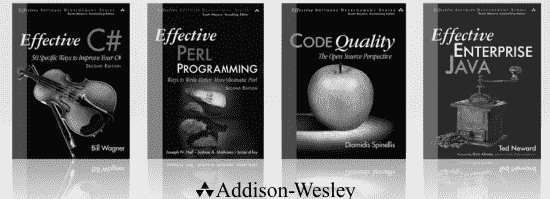
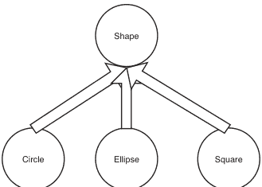
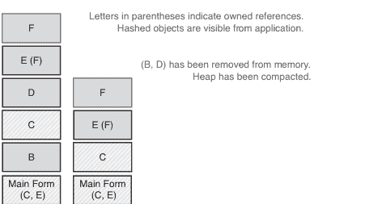
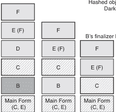
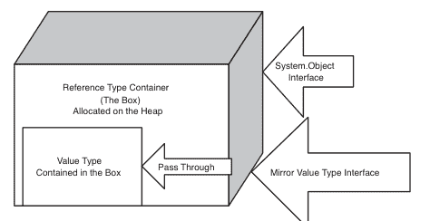
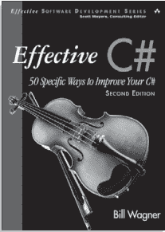

# C# 高效指南（涵盖 C# 4.0）：50 个改善你 C# 的具体方法（第2版）（高效软件开发系列）


## 对《高效 C#》第二版的赞誉

> "要成为一名高效的 .NET 开发人员，必须深入理解所选语言。Wagner 的这本书通过严谨的论证和深刻的见解，为读者提供了该知识。无论你是 C# 新手还是多年使用者，阅读本书都会有所收获。"
>
> —Jason Bock，首席顾问，Magenic

> "如果你和我一样，可能已经收集了一些 C# 语言精粹，它们立刻改变了你作为专业开发人员的能力。你手中拿着的这本书，很可能是迄今为止汇集这些技巧的最佳集合。Bill 在其最新版本的杰出 _高效 C#_ 中，超越了我最狂野的期望。"
>
> —Bill Craun，首席顾问，Ambassador Solutions

> "_高效 C#，第二版_，是任何构建高性能和/或高度可扩展应用程序的人必读之作。Bill 拥有那种罕见而出色的能力，能够将极其复杂的问题分解为人类可消化、易于理解的模块。"
>
> —Josh Holmes，架构布道师，Microsoft

> "Bill 又做到了。本书是任何 C# 开发人员不可或缺的技巧简明集合。每天学习一个技巧，五十天后你将成为一名更出色的 C# 开发人员！"
>
> —Claudio Lassala，首席开发人员，EPS Software/CODE Magazine

> "C# 语言知识与理解的宝库。Bill 根据你在代码中编写的内容，深入剖析 .NET 运行时内部发生的情况，并教授能够产生更清晰、更易编写、更易理解代码的实用做法。这是技巧、窍门与深刻理解的绝佳结合——涵盖了从 C# 1.0 起就适用的内容，直至 C# 4.0 的新功能——是每位 C# 开发人员都应阅读的书籍。"
>
> —Brian Noyes，首席架构师，IDesign Inc. (www.idesign.net)

> "_高效 C#_ 是每位 C# 开发人员的必备之书。毫无疑问。其关于代码设计的实用建议无价之宝。"
>
> —Shawn Wildermuth，Microsoft MVP (C#)，作者、培训师和演讲者

> "在这本书中，Wagner 提供了关于如何使用 C# 语言中最重要功能的实用解释。他深厚的知识和娴熟的沟通技巧阐明了 C# 的新功能，使你能够使用它们编写更简洁、更易维护的程序。"
>
> —Charlie Calvert，Microsoft C# 社区计划经理





献给我的父母，Bill 和 Alice Wagner。
他们始终展现出巨大的力量与灵感。


## 引言

C# 社区在 2010 年与 2004 年 *Effective C#* 第一版出版时已大不相同。使用 C# 的开发者更多了。C# 社区中有大部分人现在将 C# 视为他们的第一门专业语言。他们并非基于使用其他语言所形成的根深蒂固的习惯来学习 C#。社区的经验范围更加广泛。从应届毕业生到拥有数十年经验的专业人士，都在使用 C#。

在过去五年中，C# 语言也得到了发展。第一版中涵盖的语言不包含泛型、lambda 表达式、LINQ 以及许多我们现在视为理所当然的其他功能。C# 4.0 添加了新功能，再次改变了我们的工具集。然而，尽管 C# 语言有了所有这些发展，最初的许多建议如今与在 C# 1.x 时代一样具有现实意义。回顾过去，对 C# 语言的更改看起来是对 C# 1.0 中所拥有内容的自然且显而易见的扩展。新版本为我们提供了解决问题的新方法，而不会使之前的惯例失效。

我在编写这本 *Effective C#* 第二版时，同时考虑了语言的变化和 C# 社区的变化。*Effective C#* 不会带你经历语言变化的历史之旅。相反，我提供关于如何使用当前 C# 语言的建议。从第二版中删除的条目是那些在当今 C# 语言中不再那么相关的内容。新条目涵盖了新的语言和框架功能，以及社区在使用 C# 构建多个版本的软件产品过程中所学到的实践。总体而言，这些条目是一组建议，将帮助你作为专业开发人员更有效地使用 C# 4.0。

本书涵盖 C# 4.0，但并非对新语言特性的详尽论述。如同 Effective Software Development 系列中的所有书籍一样，本书提供了关于如何使用这些功能来解决你每天可能遇到的问题的实用建议。许多条目在 3.0 甚至更早版本的语言中同样适用。

### 谁应该阅读本书？

*Effective C#* 是为将 C# 作为日常工具集一部分的专业开发人员编写的。它假设你熟悉 C# 语法和语言特性。第二版假设你理解 C# 4.0 中添加的新语法，以及语言早期版本中可用的语法。本书不包含语言特性的教程说明。相反，本书讨论了如何将当前版本 C# 语言的所有功能集成到你的日常开发中。

除了语言特性之外，我假设你对公共语言运行时 (CLR) 和即时 (JIT) 编译器有一定了解。

### 关于内容

有几种语言结构，你在编写的几乎每个 C# 程序中都会每天使用。第 1 章“C# 语言惯例”涵盖了你将如此频繁使用的语言惯例，以至于它们应该感觉像手中磨合良好的工具。这些是你创建的每个类型和实现的每个算法的基础。

在托管环境中工作并不意味着环境会免除你的所有责任。你仍然必须与环境协作，创建满足既定性能要求的正确程序。这不仅仅关乎性能测试和性能调优。第 2 章“.NET 资源管理”教授了使你能够在详细优化开始之前与环境协作以实现这些目标的设计惯例。

从许多方面来看，我们编写程序是为了满足人类读者而非编译器的需求。编译器只关心程序是否有效。我们的同事也希望理解我们的意图。第 3 章“在 C# 中表达设计”讨论了如何应用 C# 语言来表达你的设计意图。解决问题的方法总有多种。第 3 章中的建议将帮助你选择最能向同行开发人员表达你设计意图的方案。

C# 是一门小语言，由丰富的框架库支持。第 4 章“使用框架”涵盖了支持你核心算法的 .NET 基类库 (BCL) 部分。此外，我还涵盖了你在整个框架中会遇到的一些常见惯例。多核处理器已成为常态，并行任务库为在 .NET 平台上创建多线程程序迈出了一步。本章介绍了并行任务库的最常见实践。

第 5 章“C# 中的动态编程”讨论了如何将 C# 用作动态语言。C# 是一种强类型、静态类型语言。然而，越来越多的程序同时包含动态和静态类型。C# 提供了方法，让你在不失去整个程序中静态类型优势的前提下利用动态编程惯例。你将学习如何使用动态功能，以及如何避免动态类型泄漏到整个程序中。

第 6 章“杂项”涵盖了那些不知为何始终难以分类的条目。这些是你经常用来创建健壮、更易于维护和扩展的程序的技术。

## 代码约定

我们不再以单色查看代码，在书中也不应该这样做。虽然在纸上无法复现使用现代 IDE 的体验，但我已努力提供更好的图书代码阅读体验。在媒介支持的情况下，代码示例对所有代码元素使用标准 Visual Studio IDE 颜色。当我指向示例中的特定更改时，这些更改会被高亮显示。

在书中展示代码仍然需要为空间和清晰度做出一些妥协。我已努力将示例精简，以说明示例的特定要点。这通常意味着省略类或方法的其他部分。有时这会包括为节省空间而省略错误恢复代码。公共方法应验证其参数和其他输入，但该代码通常为节省空间而被省略。类似的空间考量移除了对方法调用的验证，以及在复杂算法中常会包含的 try/finally 子句。

我还通常假设大多数开发人员在示例使用常见命名空间时能够找到相应的命名空间。你可以安全地假设每个示例都隐式包含以下 using 语句：

```
using System;
using System.Collections.Generic;
```


using System.Linq;
using System.Text;
using System.Dynamic;
using System.Threading;

最后，我使用 #region/#endregion 指令来表示接口实现。虽然这并非必要，而且有些人不喜欢代码中的 region 指令，但它确实让在代码文本中轻松查看哪些方法实现了接口方法。其他任何选项都不符合标准且会占用更多空间。

## 提供反馈

尽管我尽了最大努力，审阅文本的人员也尽了最大努力，但文本或示例中仍可能存在错误。如果您认为发现了错误，请联系 bill.wagner@srtsolutions.com。勘误表将发布在 http://srtsolutions.com/blogs/effectivecsharp。本书中的许多条目，以及 More Effective C#，都是与其他 C# 开发者电子邮件交流的结果。如果您对建议有任何疑问或意见，请联系我。普遍感兴趣的讨论将在我的博客 http://srtsolutions.com/blogs/billwagner 上进行报道。

## 致谢

有许多人为本书的编写作出了贡献，我向他们表示感谢。多年来，我很荣幸能成为出色的 C# 社区的一员。C# Insiders 邮件列表上的每个人（无论是否在微软内部）都贡献了想法和对话，使本书更加出色。

我必须特别感谢 C# 社区中的几位成员，他们直接帮助我提出想法，并将想法转化为具体的建议。与 Charlie Calvert、Eric DeCarufel、Justin Etheredge、Marc Gravell、Mike Gold 和 Doug Holland 的交谈是本版中许多新想法的基础。

我还与 Stephen Toub 和 Michael Wood 就并行任务库及其对 C# 惯用法的影响进行了精彩的电子邮件交流。

本版拥有一支出色的技术评审团队。Jason Bock、Claudio Lassala 和 Tomas Petricek 仔细审阅了文本和示例，以确保您手中这本书的质量。他们的评审非常彻底和完整，这是任何人所能期望的最好的。除此之外，他们还提出了建议，帮助我更好地解释许多主题。

Addison-Wesley 的团队是梦寐以求的合作伙伴。Joan Murray 是一位出色的编辑、严格的监督者，也是推动一切完成的原动力。她大量依赖 Olivia Basgio，我也是如此。他们的贡献创造了从封面到封底、以及中间所有内容的完稿质量。Curt Johnson 和 Brandon Prebynski 继续在技术内容营销方面做得出色。无论您选择什么格式，Curt 和 Brandon 都与本书的存在有关。Genieil Breeze 通读了整个手稿，改进了解释，并在几个地方澄清了措辞。

再次能成为 Scott Meyers 系列的一部分，是我的荣幸。他会审阅每一份手稿，并提供改进建议和意见。他非常彻底，他在软件方面的经验（虽然不是 C#）意味着他能找到我没有清晰解释某个条目或充分证明某项建议的任何领域。他的反馈，一如既往，非常宝贵。

我还有幸与 SRT Solutions 的其他顾问交换想法。从最资深到最年轻，他们是一群非常聪明、洞察力强的人。他们也不害怕表达自己的观点。与 Ben Barefield、Dennis Burton、Marina Fedner、Alex Gheith、Darrell Hawley、Chris Marinos、Dennis Matveyev、Anne Marsan、Dianne Marsh、Charlie Sears、Patrick Steele、Mike Woelmer 和 Jay Wren 的无数次交谈激发了想法和示例。后来的交谈有助于澄清如何解释和证明不同的建议。

一如既往，我的家人放弃了与我在一起的时间，以便我能完成这份手稿。我的孩子 Lara、Sarah 和 Scott 忍受了我躲在家里办公室、不参加其他活动的时光。我的妻子 Marlene 在我外出写作或创建示例时，放弃了无数小时。没有他们的支持，我永远无法完成这本书或任何其他书。完成这本书也不会那么令人满意。

## 关于作者

拥有二十多年经验的 Bill Wagner 是 SRT Solutions 的联合创始人，是软件设计和工程领域的公认专家，专注于 C#、.NET 和 Azure 平台。他担任微软密歇根州区域总监，并多次获得微软 MVP 奖。作为一位国际公认的作家，Bill 是本书第一版和 More Effective C#（Addison-Wesley，2009）的作者，目前在微软 C# 开发者中心撰写专栏。Bill 获得了伊利诺伊大学香槟-厄巴纳分校的计算机科学学士学位。

# C# 语言惯用法

如果当前的做法有效，为什么要改变今天所做的事情？答案是你可以做得更好。你更换工具或语言是因为你可以更高效。如果不改变习惯，你就无法实现预期的收益。当新语言 C# 与熟悉的语言（例如 C++ 或 Java）有太多共同点时，这会更加困难。C# 是另一种使用花括号的语言，这使得你容易陷入使用同一语言家族中其他语言时的相同惯用法。这将阻止你充分利用 C#。C# 语言自 2001 年首次商业发布以来不断发展。它现在比最初发布时更远离 C++ 或 Java。如果你是从其他语言转向 C#，你需要学习 C# 惯用法，以便语言与你协同工作，而不是与你对抗。本章讨论你应该改变的习惯——以及你应该采取的替代做法。

## 条目 1：使用属性而非可访问的数据成员

属性在 C# 语言中始终是一等公民。自 C# 语言 1.0 版发布以来的多项增强使属性更具表现力。你可以为 getter 和 setter 指定不同的访问限制。隐式属性最大限度地减少了为属性（而非数据成员）手动输入代码的工作量。如果你仍在类型中创建公共变量，请立即停止。如果你仍在手动创建 get 和 set 方法，请立即停止。属性允许你将数据成员作为公共接口的一部分公开，同时仍提供面向对象环境中所需的封装。属性是语言元素，访问时就像访问数据成员一样，但其实现是方法。

类型的某些成员最好表示为数据：客户的名称、点的 x,y 坐标，或去年的收入。属性使你能够创建一个表现得像数据访问但仍具备方法所有优点的接口。客户端代码访问属性就像访问公共字段一样。但实际实现使用方法，你在其中定义属性访问器的行为。

.NET Framework 假设你将为公共数据成员使用属性。事实上，.NET Framework 中的数据绑定类支持属性，而不支持公共数据成员。这适用于所有数据绑定库：WPF、Windows Forms、Web Forms 和 Silverlight。数据绑定将对象的属性与用户界面控件关联。数据绑定机制使用反射在类型中查找命名属性：

```
textBoxCity.DataBindings.Add("Text",
 address, "City");
```

前面的代码将 textBoxCity 控件的 Text 属性绑定到 address 对象的 City 属性。它无法与名为 City 的公共数据成员一起使用；Framework 类库设计者不支持这种做法。公共数据成员是不良做法，因此未为其添加支持。他们的决定只是给你又一个遵循正确面向对象技术的理由。

是的，数据绑定仅适用于用户界面逻辑中显示的那些类。但这并不意味着属性应仅在 UI 逻辑中使用。你应该为其他类和结构使用属性。随着时间的推移，当你发现新需求或新行为时，属性要容易修改得多。你可能很快就会决定，客户类型不应有空白名称。如果你为 Name 使用了公共属性，那么在一个位置轻松修复：

```
public class Customer
{
    private string name;
    public string Name
    {
        get { return name; }
        set
        {
            if (string.IsNullOrEmpty(value))
                throw new ArgumentException(
                    "Name cannot be blank.",
                    "Name");
            name = value;
        }
    }
    // More Elided.
}
```


如果你使用了公共数据成员，你将不得不查找每一处设置客户名称的代码并在那里进行修复。这需要更多时间——多得多的时间。

因为属性是用方法实现的，所以添加多线程支持更容易。你可以增强 get 和 set 访问器的实现，以提供对数据的同步访问：

```
public class Customer
{
    private object syncHandle = new object();

    private string name;
    public string Name
    {
        get
        {
            lock (syncHandle)
            return name;
        }

        set
        {
            if (string.IsNullOrEmpty(value))
                throw new ArgumentException(
                    "Name cannot be blank",
                    "Name");
            lock (syncHandle)
            name = value;
        }
    }
    // More Elided.
}
```

属性具有方法的所有语言特性。属性可以是虚拟的：

```
public class Customer
{
    public virtual string Name
    {
        get;
        set;
    }
}
```

你会注意到，最后几个示例使用了 C# 3.0 隐式属性语法。创建属性来包装后备存储是一种常见模式。通常，你不需要在属性的 getter 或 setter 中包含验证逻辑。语言支持简化的隐式属性语法，以最大限度地减少将简单字段公开为属性所需的输入量。编译器会为你创建一个私有成员字段（通常称为后备存储），并为 get 和 set 访问器实现明显的逻辑。

你可以将属性扩展为抽象属性，并将属性定义为接口定义的一部分，使用与隐式属性类似的语法。下面的示例显示了泛型接口中的属性定义。请注意，虽然语法与隐式属性一致，但下面的接口定义不包含任何实现。它定义了任何实现此接口的类型都必须满足的契约。

```
public interface INameValuePair<T>
{
 string Name
 {
 get;
 }

 T Value
 {
 get;
 set;
 }
}
```

属性是功能完备的一等语言元素，是访问或修改内部数据的方法的扩展。你可以用成员函数做的任何事情，都可以用属性来做。

属性的访问器是编译到你的类型中的两个独立方法。在 C# 中，你可以为属性的 get 和 set 访问器指定不同的可访问性修饰符。这使你对公开为属性的那些数据元素的可见性拥有更大的控制权：

```
public class Customer
{
    public virtual string Name
    {
        get;
        protected set;
    }
    // remaining implementation omitted
}
```

属性语法不仅限于简单的数据字段。如果你的类型应将索引项作为其接口的一部分，可以使用索引器（即参数化属性）。这是一种有用的方法，可创建返回序列中项的属性：

```
public int this[int index]
{
    get { return theValues[index]; }
    set { theValues[index] = value; }
}
```

```
// Accessing an indexer:
int val = someObject[i];
```

索引器与单项属性拥有相同的语言支持：它们作为你编写的方法实现，因此你可以在索引器内应用任何验证或计算。索引器可以是虚拟的或抽象的，可以在接口中声明，可以是只读或读写的。带数值参数的单维索引器可以参与数据绑定。其他索引器可以使用非整数参数来定义映射和字典：

```
public Address this[string name]
{
    get { return addressValues[name]; }
    set { addressValues[name] = value; }
}
```

与 C# 中的多维数组保持一致，你可以创建多维索引器，每个轴上可以使用相同或不同的类型：

```
public int this[int x, int y]
{
    get { return ComputeValue(x, y); }
}
public int this[int x, string name]
{
    get { return ComputeValue(x, name); }
}
```

请注意，所有索引器都使用 this 关键字声明。在 C# 中，你不能为索引器命名。因此，类型中的每个不同索引器都必须具有不同的参数列表，以避免歧义。属性的几乎所有功能都适用于索引器。索引器可以是虚拟的或抽象的；索引器可以对 setter 和 getter 有单独的访问限制。你不能像创建属性那样创建隐式索引器。

属性功能本身很好，是一项不错的改进。但你可能仍然会想先使用数据成员创建初始实现，然后在需要这些优势时再将数据成员替换为属性。这听起来是一个合理的策略——但这是错误的。请考虑类定义的这一部分：

```
// using public data members, bad practice:
public class Customer
{
    public string Name;

    // remaining implementation omitted
}
```

它描述了一个带有名称的客户。你可以使用熟悉的成员表示法来获取或设置名称：

```
string name = customerOne.Name;
customerOne.Name = "This Company, Inc.";
```

这很简单直接。你可能认为以后可以将 Name 数据成员替换为属性，而代码无需任何更改就能继续工作。嗯，这在某种程度上是正确的。属性在访问时旨在看起来像数据成员。这就是语法背后的目的。但属性不是数据。属性访问生成的 Microsoft 中间语言 (MSIL) 指令与数据访问不同。

虽然属性和数据成员在源代码级别兼容，但它们在二进制级别不兼容。在明显的情况下，这意味着当你将公共数据成员更改为等效的公共属性时，必须重新编译所有使用该公共数据成员的代码。C# 将二进制程序集视为一等公民。该语言的一个目标是，你可以发布单个更新的程序集，而无需升级整个应用程序。将数据成员更改为属性这一简单操作会破坏二进制兼容性。这使得升级已部署的单个程序集变得困难得多。

在查看属性的 IL 时，你可能会想知道属性和数据成员的相对性能。属性不会比数据成员访问更快，但可能也不会更慢。JIT 编译器确实会内联某些方法调用，包括属性访问器。当 JIT 编译器内联属性访问器时，数据成员和属性的性能相同。即使属性访问器未被内联，实际的性能差异也只是一次函数调用的微不足道的开销。只有在少数情况下才能测量到这一点。

属性是方法，从调用代码来看可以像数据一样。这在用户心中设定了一些期望。他们会将属性访问视为数据访问。毕竟，它看起来就是这样。你的属性访问器应该满足这些期望。Get 访问器不应有可观察的副作用。Set 访问器确实会修改状态，用户应该能够看到这些更改。

属性访问器对用户也有性能期望。属性访问看起来像数据字段访问。它不应具有与简单数据访问显著不同的性能特征。属性访问器不应执行耗时的计算，或进行跨应用程序调用（例如执行数据库查询），或执行其他与用户对属性访问器的期望不一致的耗时操作。

每当在类型的公共或受保护接口中公开数据时，请使用属性。对序列或字典使用索引器。所有数据成员都应为私有，没有例外。你立即就能获得数据绑定支持，并且未来更改方法实现会容易得多。将任何变量封装在属性中所需的额外输入量，每天也就一两分钟的事。以后发现需要使用属性来正确表达你的设计，将耗时数小时。现在花一点时间，以后能为你节省大量时间。


## 项目 2：优先使用 readonly 而非 const

C# 有两种不同的常量：编译时常量和运行时常量。它们的行为差异很大，使用错误的一种会导致性能或正确性问题。这两种问题都不是好事，但如果必须二选一，运行缓慢但正确的程序优于运行快速但有问题的程序。因此，你应该优先使用运行时常量而非编译时常量。编译时常量比运行时常量稍快，但远不如运行时常量灵活。仅在性能至关重要且常量值在不同版本间永不变化时，才保留使用编译时常量。

使用 readonly 关键字声明运行时常量。使用 const 关键字声明编译时常量：

```
// Compile time constant:
public const int Millennium = 2000;
```

```
// Runtime constant:
public static readonly int ThisYear = 2004;
```

上述代码在类或结构体作用域中展示了这两种常量。编译时常量也可以在方法内部声明。只读常量不能以方法作用域声明。

编译时常量和运行时常量行为差异源于它们的访问方式。编译时常量会在目标代码中被替换为该常量的值。以下结构：

```
if (myDateTime.Year == Millennium)
```

编译后的 IL 与你编写以下代码相同：

```
if (myDateTime.Year == 2000)
```

运行时常量在运行时求值。引用只读常量时生成的 IL 引用的是 readonly 变量，而非其值。

这一差异对何时可以使用哪种常量施加了多项限制。编译时常量仅可用于原始类型（内置整型和浮点型）、枚举或字符串。这些是初始化器中能够赋予有意义常量值的唯一类型。这些原始类型是编译器生成的 IL 中能够被替换为字面量值的唯一类型。以下结构无法编译。你不能使用 new 运算符初始化编译时常量，即使被初始化的类型是值类型：

```
// Does not compile; use readonly instead:
private const DateTime classCreation = new
    DateTime(2000, 1, 1, 0, 0, 0);
```

编译时常量仅限于数字和字符串。只读值也是常量，因为它们在构造函数执行后无法被修改。但只读值的不同之处在于它们在运行时赋值。使用运行时常量时你拥有更大的灵活性。首先，运行时常量可以是任何类型。你必须在构造函数中初始化它们，或者可以使用初始化器。你可以创建 DateTime 结构体的只读值；你不能使用 const 创建 DateTime 值。

你可以使用只读值作为实例常量，为类类型的每个实例存储不同的值。编译时常量本质上是静态常量。

最重要的区别是，只读值在运行时解析。引用只读常量时生成的 IL 引用的是 IL 变量，而非其值。这一区别对长期维护有深远影响：编译时常量生成的 IL 就好像你在代码中直接使用了数字常量，即使跨程序集也是如此：一个程序集中的常量在另一个程序集中使用时，仍会被替换为该值。

编译时常量和运行时常量的求值方式影响运行时兼容性。假设你在名为 Infrastructure 的程序集中定义了 const 和 readonly 字段：

```
public class UsefulValues
{
    public static readonly int StartValue = 5;
    public const int EndValue = 10;
}
```

在另一个程序集中，你引用这些值：

```
for (int i = UsefulValues.StartValue;
     i < UsefulValues.EndValue; i++)
    Console.WriteLine("value is {0}", i);
```

如果你运行这个小测试，会看到以下明显输出：

```
Value is 5
Value is 6
...
Value is 9
```

时间流逝，你发布了 Infrastructure 程序集的新版本，做出了以下更改：

```
public class UsefulValues
{
    public static readonly int StartValue = 105;
    public const int EndValue = 120;
}
```

你分发 Infrastructure 程序集而不重新生成 Application 程序集。你期望得到以下结果：

```
Value is 105
Value is 106
...
Value is 119
```

实际上，你根本得不到任何输出。循环现在将 105 用作起始值，将 10 用作结束条件。C# 编译器将 const 值 10 放入了 Application 程序集，而不是引用 EndValue 所使用的存储。与 StartValue 值形成对比。它被声明为 readonly：它在运行时解析。因此，Application 程序集无需重新编译即可使用新值；只需安装更新版本的 Infrastructure 程序集，就足以改变所有使用该值的客户端的行为。更新公共常量的值应被视为接口更改。你必须重新编译所有引用该常量的代码。更新只读常量的值是实现更改；它与现有客户端代码二进制兼容。

另一方面，有时你确实希望值在编译时确定。例如，考虑一组用于在序列化形式中标记对象不同版本的常量（参见项目 27）。标记特定版本的持久值应为编译时常量；它们永不改变。当前版本应为运行时常量，随每个版本更改。

```
private const int Version1_0 = 0x0100;
private const int Version1_1 = 0x0101;
private const int Version1_2 = 0x0102;
// major release:
private const int Version2_0 = 0x0200;
```

```
// check for the current version:
private static readonly int CurrentVersion = Version2_0;
```

你使用运行时版本在每个保存的文件中存储当前版本：

// 写入当前版本：

```
[SecurityPermissionAttribute(SecurityAction.Demand,
    SerializationFormatter = true)]
void ISerializable.GetObjectData(SerializationInfo inf,
    StreamingContext ctx)
{
    // use runtime constant for current version:
    inf.AddValue("VERSION", CurrentVersion);
    // write remaining elements...
}
```

使用 const 而非 readonly 的最终优势是性能：已知的常量值可以生成比只读值所需的变量访问略高效的代码。然而，任何收益都很小，应与灵活性降低进行权衡。在放弃灵活性之前，请务必分析性能差异。

当你使用命名参数和可选参数时，会在常量值的运行时和编译时处理之间遇到类似的权衡。可选参数的默认值会放置在调用点，就像编译时常量（使用 const 声明的常量）的默认值一样。与使用 readonly 和 const 值一样，你需要小心更改可选参数的值。（参见项目 10。）

当值必须在编译时可用时，必须使用 const：特性参数和枚举定义，以及那些罕见的、你希望定义一个跨版本不变的值的情况。对于其他所有情况，都应优先使用只读常量的更高灵活性。

## 项目 3：优先使用 is 或 as 运算符而非强制转换

拥抱 C# 意味着拥抱强类型。这几乎总是一件好事。强类型意味着你期望编译器发现代码中的类型不匹配。这也意味着你的应用程序不需要在运行时执行那么多类型检查。但有时，运行时类型检查是不可避免的。在 C# 中，有时你会编写接受 object 参数的函数，因为框架为你定义了方法签名。你可能需要尝试将这些对象转换为其他类型，无论是类还是接口。你有两种选择：使用 as 运算符，或使用强制转换强迫编译器顺从你的意愿。你还有一种防御性变体：可以使用 is 测试转换，然后使用 as 或强制转换将其转换。

正确的选择是尽可能使用 as 运算符，因为它比盲目强制转换更安全，且在运行时更高效。as 和 is 运算符不执行任何用户定义的转换。只有在运行时类型与所求类型匹配时才会成功；它们永远不会构造新对象来满足请求。

看一个示例。你编写一段需要将任意对象转换为 MyType 实例的代码。你可以这样写：


```csharp
object o = Factory.GetObject();

// Version one:
MyType t = o as MyType;

if (t != null)
{
    // work with t, it's a MyType.
}
else
{
    // report the failure.
}
```

或者，你可以这样写：

```csharp
object o = Factory.GetObject();

// Version two:
try
{
    MyType t;
    t = (MyType)o;
    // work with t, it's a MyType.
}
catch (InvalidCastException)
{
    // report the conversion failure.
}
```

你会同意第一个版本更简单、更易读。它没有 try/catch 子句，因此你既避免了开销，也避免了代码。请注意，强制转换版本除了捕获异常外，还必须检查 null。null 可以使用强制转换转换为任何引用类型，但 as 运算符在用于 null 引用时返回 null。因此，使用强制转换时，你需要检查 null 并捕获异常。使用 as，你只需将返回的引用与 null 进行比较。

as 运算符与强制转换运算符之间最大的区别在于如何处理用户定义的转换。as 和 is 运算符检查被转换对象的运行时类型；它们不执行任何其他操作。如果特定对象不是请求的类型或不是请求的类型的派生类型，它们将失败。而强制转换则可以使用转换运算符将对象转换为请求的类型。这包括任何内置的数值转换。将 long 强制转换为 short 可能会丢失信息。

当你强制转换用户定义类型时，同样的问题也潜伏其中。考虑此类型：

```csharp
public class SecondType
{
    private MyType _value;

    // other details elided

    // Conversion operator.
    // This converts a SecondType to
    // a MyType, see item 9.
    public static implicit operator MyType(SecondType t)
    {
        return t._value;
    }
}
```

假设 SecondType 对象由第一个代码片段中的 Factory.GetObject() 函数返回：

```csharp
object o = Factory.GetObject();

// o is a SecondType:
MyType t = o as MyType; // Fails. o is not MyType

if (t != null)
{
    // work with t, it's a MyType.
}
else
{
    // report the failure.
}
```

```csharp
// Version two:
try
{
    MyType t1;
    t1 = (MyType)o; // Fails. o is not MyType
    // work with t1, it's a MyType.
}
catch (InvalidCastException)
{
    // report the conversion failure.
}
```

两个版本都会失败。但我告诉过你，强制转换会执行用户定义的转换。你可能会认为强制转换会成功。你说得对——如果你这么想，它应该成功。但它失败了，因为你的编译器是根据对象 o 的编译时类型生成代码的。编译器对 o 的运行时类型一无所知；它将 o 视为 object 的实例。编译器发现不存在从 object 到 MyType 的用户定义转换。它检查 object 和 MyType 的定义。由于没有用户定义的转换，编译器生成代码来检查 o 的运行时类型，并检查该类型是否为 MyType。因为 o 是 SecondType 对象，所以这会失败。编译器不会检查 o 的实际运行时类型是否可以转换为 MyType 对象。

如果你像这样编写代码片段，可以使 SecondType 到 MyType 的转换成功：

```csharp
object o = Factory.GetObject();

// Version three:
SecondType st = o as SecondType;
try
{
    MyType t;
    t = (MyType)st;
    // work with t, it's a MyType.
}
catch (InvalidCastException)
{
    // report the failure.
}
```

你永远不应该写这种丑陋的代码，但它确实说明了一个常见问题。虽然你永远不会这样写，但你可以使用 object 参数传递给期望正确转换的函数：

```csharp
object o = Factory.GetObject();
DoStuffWithObject(o);
```

```csharp
private static void DoStuffWithObject(object o)
{
    try
    {
        MyType t;
        t = (MyType)o; // Fails. o is not MyType
        // work with t, it's a MyType.
    }
    catch (InvalidCastException)
    {
        // report the conversion failure.
    }
}
```

请记住，用户定义的转换运算符仅作用于对象的编译时类型，而非运行时类型。o 的运行时类型与 MyType 之间是否存在转换并不重要。编译器根本不知道或不在意。此语句的行为取决于 st 的声明类型：

```csharp
t = (MyType)st;
```

下一条语句无论 st 的声明类型是什么都会返回相同的结果。因此，你应该优先使用 as 而不是强制转换——它更一致。事实上，如果类型不通过继承相关，但存在用户定义的转换运算符，则以下语句会生成编译器错误：

```csharp
t = st as MyType;
```

既然你知道在可能时应使用 as，让我们讨论何时不能使用它。as 运算符不适用于值类型。以下语句无法编译：

```csharp
object o = Factory.GetValue();
int i = o as int; // Does not compile.
```

这是因为 int 是值类型，永远不能为 null。如果 o 不是整数，i 中应存储什么 int 值？你选择的任何值也可能是一个有效的整数。因此，无法使用 as。你只能使用强制转换语法。这实际上是装箱/拆箱转换（参见第 45 项）：

```csharp
object o = Factory.GetValue();
int i = 0;
try
{
    i = (int)o;
}
catch (InvalidCastException)
{
    i = 0;
}
```

将异常用作流程控制机制应该让你觉得是一种糟糕的做法。（参见第 47 项。）但你并不被迫接受强制转换的行为。你可以使用 is 语句来消除异常或转换的可能性：

```csharp
object o = Factory.GetValue();
int i = 0;
if (o is int)
{
    i = (int)o;
}
```

如果 o 是其他可以转换为 int 的类型，例如 double，则 is 运算符返回 false。is 运算符对 null 参数始终返回 false。

is 运算符应仅在无法使用 as 进行类型转换时使用。否则，它只是多余的：

```csharp
// correct, but redundant:
object o = Factory.GetObject();

MyType t = null;
if (o is MyType)
    t = o as MyType;
```

前面的代码与你编写以下代码相同：

```csharp
// correct, but redundant:
object o = Factory.GetObject();

MyType t = null;
if (o is MyType)
{
    t = o as MyType;
}
```

这既低效又冗余。如果你即将使用 as 进行类型转换，那么 is 检查根本没有必要。检查 as 的返回值是否为 null；这样更简单。

既然你知道 is、as 和强制转换之间的区别，你认为 foreach 循环使用哪个运算符？foreach 循环可以作用于非泛型 IEnumerable 序列，并且在迭代中内置了类型强制转换。（只要可能，你应该优先使用类型安全的泛型版本。非泛型版本存在是出于历史原因，并支持某些后期绑定场景。）

```csharp
public void UseCollection(IEnumerable theCollection)
{
    foreach (MyType t in theCollection)
    {
        t.DoStuff();
    }
}
```

foreach 使用强制转换操作来执行从对象到循环中使用的类型的转换。foreach 语句生成的代码大致相当于这个手写版本：

```csharp
public void UseCollectionV2(IEnumerable theCollection)
{
    IEnumerator it = theCollection.GetEnumerator();
    while (it.MoveNext())
    {
        MyType t = (MyType)it.Current;
        t.DoStuff();
    }
}
```

foreach 需要使用强制转换来支持值类型和引用类型。通过选择强制转换运算符，foreach 语句无论目标类型是什么都表现出相同的行为。但是，由于使用了强制转换，foreach 循环可能会抛出 InvalidCastException。

因为 IEnumerator.Current 返回 System.Object，而 System.Object 没有转换运算符，因此没有符合条件的转换。SecondType 对象的集合不能用于前面的 UseCollection() 函数，因为转换会失败，正如你已经看到的那样。foreach 语句（使用强制转换）不会检查集合中对象运行时类型可用的强制转换。它只检查 System.Object 类（IEnumerator.Current 返回的类型）和循环变量的声明类型（在此例中为 MyType）中可用的转换。

最后，有时你想知道对象的精确类型，而不仅仅是当前类型是否可以转换为目标类型。is 运算符对目标类型的任何派生类型都返回 true。GetType() 方法获取对象的运行时类型。它比 is 或 as 语句提供的测试更严格。GetType() 返回对象的类型，并可以与特定类型进行比较。

再考虑这个函数：

```csharp
public void UseCollectionV3(IEnumerable theCollection)
{
    foreach (MyType t in theCollection)
        t.DoStuff();
}
```

如果你创建一个从 MyType 派生的 NewType 类，NewType 对象的集合在 UseCollection 函数中也能正常工作：

```csharp
public class NewType : MyType
{
    // contents elided.
}
```

如果你打算编写一个适用于所有 MyType 实例对象的函数，那没问题。如果你打算编写一个仅适用于 MyType 对象本身的函数，则应使用精确类型进行比较。在此，你应在 foreach 循环内执行此操作。精确运行时类型最常见的重要场景是执行相等性测试（参见第 6 项）。在大多数其他比较中，as 和 is 提供的 .isinst 比较在语义上是正确的。

.NET 基类库 (BCL) 包含一种使用相同类型操作转换序列中元素的方法：Enumerable.Cast<T>() 将支持经典 IEnumerable 接口的序列中的每个元素进行转换：

```csharp
IEnumerable collection = new List<int>()
{1, 2, 3, 4, 5, 6, 7, 8, 9, 10};
```


var small = from int item in collection
where item < 5
select item;

```
var small2 = collection.Cast<int>().Where(item => item < 5).
Select(n => n);
```

该查询生成与上面最后一行代码相同的方法调用。在这两种情况下，Cast<T> 方法都会将序列中的每个项转换为目标类型。Enumerable.Cast<T> 方法使用旧式强制转换，而不是 as 运算符。使用旧式强制转换意味着 Cast<T> 不需要类约束。使用 as 运算符会有所限制，与其实现不同的 Cast<T> 方法，BCL 团队选择创建一个使用旧式强制转换运算符的单一方法。这是你在代码中也应该考虑的一种权衡。在那些需要将对象转换为泛型类型参数之一的场合，你需要权衡类约束的必要性与使用强制转换运算符的不同行为。

在 C# 4.0 中，通过使用 dynamic 和运行时类型检查，可以进一步绕过类型系统。这是第 5 章“C# 中的动态编程”的主题。有相当多的方法可以基于对已知行为的预期来处理对象，而无需了解特定类型或接口的任何信息。你将学习何时使用这些技术以及何时避免使用它们。

良好的面向对象实践表明，你应该避免转换类型，但有时没有其他选择。如果无法避免转换，请使用语言的 as 和 is 运算符来更清晰地表达你的意图。不同的强制类型转换方式有不同的规则。is 和 as 运算符几乎总是正确的语义，并且仅在被测试的对象是正确类型时才会成功。优先使用这些语句，而不是强制转换运算符，因为后者可能会产生意外的副作用，并在你最意想不到的时候成功或失败。

## 条目 4：使用条件特性而非 #if

#if/#endif 块已被用于从同一源代码生成不同的生成版本，最常见的是调试和发布变体。但这些从来都不是我们乐于使用的工具。#if/#endif 块太容易被滥用，导致代码难以理解且更难以调试。语言设计师通过为不同环境生成不同机器代码的更好工具来回应这一问题。C# 添加了 Conditional 特性，以指示方法是否应根据环境设置进行调用。与 #if/#endif 相比，这是一种更清晰的描述条件编译的方式。编译器理解 Conditional 特性，因此在应用条件特性时，它可以更好地验证代码。条件特性在方法级别应用，因此它迫使你将条件代码分离到不同的方法中。在创建条件代码块时，请使用 Conditional 特性而不是 #if/#endif 块。

大多数资深程序员都使用过条件编译来检查对象中的前置条件和后置条件。你会编写一个私有方法来检查所有类和对象不变量。该方法会被条件编译，因此仅出现在调试生成中。

```
private void CheckStateBad()
{
    // The Old way:
    #if DEBUG
    Trace.WriteLine("Entering CheckState for Person");

    // Grab the name of the calling routine:
    string methodName =
        new StackTrace().GetFrame(1).GetMethod().Name;

    Debug.Assert(LastName != null,
        methodName,
        "Last Name cannot be null");

    Debug.Assert(LastName.Length > 0,
        methodName,
        "Last Name cannot be blank");

    Debug.Assert(FirstName != null,
        methodName,
        "First Name cannot be null");

    Debug.Assert(FirstName.Length > 0,
        methodName,
        "First Name cannot be blank");

    Trace.WriteLine("Exiting CheckState for Person");
#endif
}
```

使用 #if 和 #endif 预处理指令，你在发布生成中创建了一个空方法。CheckState() 方法在所有生成版本（发布和调试）中都会被调用。它在发布生成中不执行任何操作，但你需要为方法调用付出代价。你还需要为加载和 JIT 空例程付出少量代价。

这种做法虽然可行，但可能导致仅在发布生成中出现的微妙错误。以下常见错误展示了使用预处理指令进行条件编译时可能发生的情况：

```
public void Func()
{
    string msg = null;

#if DEBUG
    msg = GetDiagnostics();
#endif
    Console.WriteLine(msg);
}
```

在调试生成中一切正常，但发布生成会愉快地打印一条空白消息。这不是你的意图。你出错了，但编译器无法帮助你。你在条件块中放置了对逻辑至关重要的代码。在源代码中到处撒上 #if/#endif 块，会使得诊断不同生成版本之间的行为差异变得困难。

C# 有一个更好的替代方案：条件特性。使用条件特性，你可以隔离那些仅在特定环境变量定义或设置为某个值时才应成为类一部分的函数。此功能最常见的用途是使用调试语句对代码进行插装。.NET Framework 库已经具备你为此目的所需的基本功能。此示例展示了如何使用 .NET Framework 库中的调试功能，向你展示条件特性的工作原理以及何时将它们添加到代码中。

在生成 Person 对象时，你添加一个方法来验证对象不变量：

```
private void CheckState()
{
    // Grab the name of the calling routine:
    string methodName =
        new StackTrace().GetFrame(1).GetMethod().Name;

    Trace.WriteLine("Entering CheckState for Person:");
    Trace.WriteLine("\tcalled by ");
    Trace.WriteLine(methodName);

    Debug.Assert(LastName != null,
        methodName,
        "Last Name cannot be null");

    Debug.Assert(LastName.Length > 0,
        methodName,
        "Last Name cannot be blank");

    Debug.Assert(FirstName != null,
        methodName,
        "First Name cannot be null");

    Debug.Assert(FirstName.Length > 0,
        methodName,
        "First Name cannot be blank");

    Trace.WriteLine("Exiting CheckState for Person");
}
```

你在这个方法中可能没有遇到过多库函数，因此让我们简要地过一遍。StackTrace 类使用反射获取调用方法的名称。它相当昂贵，但大大简化了诸如收集程序流信息等任务。在这里，它确定了名为 CheckState 的方法。如果调用方法被内联，这里存在微小风险，但替代方案是让每个调用 CheckState() 的方法使用 MethodBase.GetCurrentMethod() 传入方法名称。你很快就会明白我为何决定不采用该策略。

其余方法属于 System.Diagnostics.Debug 类或 System.Diagnostics.Trace 类。Debug.Assert 方法测试一个条件，如果该条件为 false，则停止程序。其余参数定义了在条件为 false 时将打印的消息。Trace.WriteLine 将诊断消息写入调试控制台。因此，如果 person 对象无效，此方法会写入消息并停止程序。你会在所有公共方法和属性中作为前置条件和后置条件调用此方法：

```
public string LastName
{
    get
    {
        CheckState();
        return lastName;
    }
    set
    {
        CheckState();
        LastName = value;
        CheckState();
    }
}
```

当有人第一次尝试将姓氏设置为空字符串或 null 时，CheckState 会触发断言。然后你修复 set 访问器以检查用于 LastName 的参数。它正在做你想要的事情。但是，每个公共例程中的这种额外检查需要时间。你只希望在创建调试生成时包含这种额外检查。这就是条件特性派上用场的地方：

```
[Conditional("DEBUG")]
private void CheckState()
{
    // same code as above
}
```

条件特性告诉 C# 编译器，仅当编译器检测到 DEBUG 环境变量时才应调用此方法。条件特性不影响 CheckState() 函数生成的代码；它修改对该函数的调用。如果定义了 DEBUG 符号，你会得到这个：


```
public string LastName
{
    get
    {
        CheckState();
        return lastName;
    }
    set
    {
        CheckState();
        lastName = value;
        CheckState();
    }
}
```

否则，你会得到这个：

```
public string LastName
{
    get
    {
        return lastName;
    }
    set
    {
        lastName = value;
    }
}
```

CheckState() 函数的主体是相同的，无论环境变量的状态如何。这是你需要了解 .NET 中编译步骤和 JIT 步骤之间区别的一个示例。无论是否定义了 DEBUG 环境变量，CheckState() 方法都会与程序集一起编译和交付。这可能看起来效率低下，但唯一的代价是磁盘空间。除非被调用，否则 CheckState() 函数不会被加载到内存并进行 JIT 编译。它在程序集文件中的存在无关紧要。这种策略提高了灵活性，并且性能开销很小。你可以通过查看 .NET Framework 中的 Debug 类来获得更深入的理解。在任何安装了 .NET Framework 的机器上，System.dll 程序集确实包含 Debug 类中所有方法的所有代码。环境变量控制在调用者编译时是否调用它们。使用 Conditional 指令使你能够创建嵌入调试功能的库。这些功能可以在运行时启用或禁用。

你还可以创建依赖于多个环境变量的方法。当你应用多个条件特性时，它们会以 OR 方式组合。例如，当 DEBUG 或 TRACE 为 true 时，会调用此版本的 CheckState：

```
[Conditional("DEBUG"),
Conditional("TRACE")]
private void CheckState()
```

若要创建使用 AND 的结构，你需要在源代码中使用预处理器指令自己定义预处理器符号：

```
#if ( VAR1 && VAR2 )
#define BOTH
#endif
```

是的，要创建依赖于多个环境变量存在的条件例程，你必须回归到旧的 #if 做法。#if 所做的只是为你创建一个新符号。但避免在该 pragma 内放置任何可执行代码。

然后，你可以这样编写 CheckState 的旧版本：

```
private void CheckStateBad()
{
    // The Old way:
    #if BOTH
    Trace.WriteLine("Entering CheckState for Person");
    // Grab the name of the calling routine:
    string methodName =
    new StackTrace().GetFrame(1).GetMethod().Name;
    Debug.Assert(LastName != null,
    methodName,
    "Last Name cannot be null");
    Debug.Assert(LastName.Length > 0,
    methodName,
    "Last Name cannot be blank");
    Debug.Assert(firstName != null,
    methodName,
    "First Name cannot be null");
    Debug.Assert(firstName.Length > 0,
    methodName,
    "First Name cannot be blank");
    Trace.WriteLine("Exiting CheckState for Person");
    #endif
}
```

Conditional 特性只能应用于整个方法。此外，任何带有 Conditional 特性的方法必须具有 void 返回类型。你不能在方法内部的代码块或带有返回值的方法上使用 Conditional 特性。相反，应创建精心构建的条件方法，并将条件行为隔离到这些函数中。你仍然需要审查这些条件方法对对象状态的副作用，但 Conditional 特性比 #if/#endif 更好地定位了这些点。使用 #if/#endif 块时，你可能会错误地删除重要的方法调用或赋值。

之前的示例使用了预定义的 DEBUG 或 TRACE 符号。但你可以将此技术扩展到任何你定义的符号。Conditional 特性可以由以多种方式定义的符号控制。你可以从编译器命令行、操作系统 shell 中的环境变量或源代码中的 pragma 定义符号。

你可能已经注意到，所有带有 Conditional 特性的方法都是返回类型为 void 且不带参数的方法。这是你应该遵循的做法。编译器强制要求条件方法必须具有 void 返回类型。但是，你可以创建接受任意数量引用类型参数的方法。这可能导致重要副作用不发生的情况。考虑这段代码：

```
Queue<string> names = new Queue<string>();
names.Enqueue("one");
names.Enqueue("two");
names.Enqueue("three");
string item = string.Empty;
SomeMethod(item = names.Dequeue());
Console.WriteLine(item);
```

SomeMethod 已附加 Conditional 特性创建：

```
[Conditional("DEBUG")]
private static void SomeMethod(string param)
{
}
```

这将导致非常隐蔽的错误。只有在定义了 DEBUG 符号时，SomeMethod() 的调用才会发生。否则，该调用不会发生。names.Dequeue() 的调用也不会发生。因为不需要结果，所以该方法不会被调用。任何标记了 Conditional 特性的方法都不应该接受任何参数。用户可能会使用带有副作用的方法调用来生成这些参数。如果条件不为真，这些方法调用将不会发生。

Conditional 特性生成的 IL 比 #if/#endif 更高效。它还具有仅在函数级别适用的优势，这迫使你更好地构建条件代码。编译器使用 Conditional 特性来帮助你避免我们都曾犯过的将 #if 或 #endif 放置在错误位置的常见错误。Conditional 特性比预处理器更好地支持你干净地分离条件代码。

## 第 5 条：始终提供 ToString()

System.Object.ToString() 是 .NET 环境中最常用的方法之一。你应该为类的所有客户端编写一个合理的版本。否则，你会强制类的每个用户使用你类中的属性并创建一个合理的人类可读表示。你的类型的这种字符串表示可以用于轻松向用户显示关于对象的信息：在 Windows Presentation Foundation (WPF) 控件、Silverlight 控件、Web 窗体或控制台输出中。这种字符串表示对于调试也很有用。你创建的每个类型都应该为此方法提供一个合理的重写。当你创建更复杂的类型时，你应该实现更复杂的 IFormattable.ToString()。直面现实：如果你不重写此例程，或者写了一个糟糕的版本，你的客户端将被迫为你修复它。

System.Object 版本返回类型的完全限定名称。这是无用的信息："System.Drawing.Rect"、"MyNamespace.Point"、"SomeSample.Size" 不是你想要向用户显示的内容。但如果你在类中不重写 ToString()，得到的就是这个。你只编写一次类，但你的客户端会使用它多次。在编写类时多花一点工作，每次你或其他人使用它时都会有回报。

让我们考虑最简单的要求：重写 System.Object.ToString()。你创建的每个类型都应该重写 ToString() 以提供类型最常见的文本表示。考虑一个带有三个公共属性的 Customer 类：

```
public class Customer
{
    public string Name
    {
        get;
        set;
    }
    public decimal Revenue
    {
        get;
        set;
    }
    public string ContactPhone
    {
        get;
        set;
    }

    public override string ToString()
    {
        return Name;
    }
}
```

继承的 Object.ToString() 版本返回 "Customer"。这对任何人都永远没有用。即使 ToString() 仅用于调试目的，它也应该比这更复杂。你对 Object.ToString() 的重写应该返回该类客户端最可能使用的文本表示。在 Customer 示例中，这就是名称：

```
public override string ToString()
{
    return Name;
}
```

如果你不遵循本条中的任何其他建议，请为你定义的所有类型执行该练习。这将立即为每个人节省时间。当你为 Object.ToString() 方法提供合理的实现时，此类的对象可以更轻松地添加到 WPF、Silverlight 控件、Web 窗体控件或打印输出中。.NET BCL 使用 Object.ToString() 的重写在任何控件中显示对象：组合框、列表框、文本框和其他控件。如果你在 Windows 窗体或 Web 窗体中创建客户对象列表，你会得到名称显示为文本，System.Console.WriteLine() 和 System.String.Format() 以及内部的 ToString() 也是如此。每当 .NET BCL 想要获取客户的字符串表示时，你的客户类型都会提供该客户的名称。一个简单的三行方法处理所有这些基本要求。

在 C# 3.0 中，编译器为所有匿名类型创建一个默认的 ToString()。生成的 ToString() 方法显示每个标量属性的值。表示序列的属性是 LINQ 查询结果，将显示其类型信息而不是每个值。这段代码：

```
int[] list = new int[] { 1, 2, 3, 4, 5, 6, 7, 8, 9, 10 };
var test = new { Name = "Me",
    Numbers = from i in list select i };
Console.WriteLine(test);
```

将显示：

```
{ Name = Me , Numbers =
    System.Linq.Enumerable+WhereSelectArrayIterator`2
    [System.Int32,System.Int32] }
```

即使是编译器创建的匿名类型，除非你重写 ToString()，否则其输出也比你定义的用户类型更好。你应该为用户提供比编译器为作用域仅为一个方法的临时类型所做的更好的支持。

这一个简单的方法 ToString() 满足了将用户定义的类型显示为文本的许多要求。但有时，你需要更多。


之前的客户类型包含三个字段：姓名、收入和联系电话。Object.ToString() 重写仅使用姓名。你可以通过在类型上实现 IFormattable 接口来弥补这一不足。IFormattable 包含一个重载的 ToString() 方法，允许你为类型指定格式信息。当你需要创建不同形式的字符串输出时，这就是要使用的接口。客户类就是其中一个示例。用户希望创建一份报告，以表格形式包含客户姓名和去年的收入。IFormattable.ToString() 方法为你提供了手段，让用户格式化来自你类型的字符串输出。IFormattable.ToString() 方法签名包含一个格式字符串和一个格式提供程序：

```
string System.IFormattable.ToString(string format,
IFormatProvider formatProvider)
```

你可以使用格式字符串为所创建的类型指定自定义格式。你可以为格式字符串指定自己的关键字符。在客户示例中，你可以指定 n 表示姓名，r 表示收入，p 表示电话。通过允许用户指定组合，你将创建 IFormattable.ToString() 的这个版本：

```
// supported formats:
// substitute n for name.
// substitute r for revenue.
// substitute p for contact phone.
// Combos are supported: nr, np, npr, etc
// "G" is general.
```

```
string System.IFormattable.ToString(string format,
IFormatProvider formatProvider)
{
if (formatProvider != null)
{
ICustomFormatter fmt = formatProvider.GetFormat(
this.GetType())
as ICustomFormatter;
if (fmt != null)
return fmt.Format(format, this, formatProvider);
}

switch (format)
{
case "r":
    return Revenue.ToString();
case "p":
    return ContactPhone;
case "nr":
    return string.Format("{0,20}, {1,10:C}",
        Name, Revenue);
case "np":
    return string.Format("{0,20}, {1,15}",
        Name, ContactPhone);
case "pr":
    return string.Format("{0,15}, {1,10:C}",
        ContactPhone, Revenue);
case "pn":
    return string.Format("{0,15}, {1,20}",
        ContactPhone, Name);
case "rn":
    return string.Format("{0,10:C}, {1,20}",
        Revenue, Name);
case "rp":
    return string.Format("{0,10:C}, {1,20}",
        Revenue, ContactPhone);
case "nrp":
    return string.Format("{0,20}, {1,10:C}, {2,15}",
        Name, Revenue, ContactPhone);
case "npr":
    return string.Format("{0,20}, {1,15}, {2,10:C}",
        Name, ContactPhone, Revenue);
case "pnm":
    return string.Format("{0,15}, {1,20}, {2,10:C}",
        ContactPhone, Name, Revenue);
case "prn":
    return string.Format("{0,15}, {1,10:C}, {2,15}",
        ContactPhone, Revenue, Name);
case "rpm":
    return string.Format("{0,10:C}, {1,15}, {2,20}",
        Revenue, ContactPhone, Name);
case "rpn":
    return string.Format("{0,10:C}, {1,20}, {2,15}",
        Revenue, Name, ContactPhone);
case "n":
case "G":
default:
return Name;
}
}
```

添加此函数可让你的客户指定其客户数据的呈现方式：

```
IFormattable c1 = new Customer();
Console.WriteLine("Customer record: {0}",
c1.ToString("nrp", null));
```

任何 IFormattable.ToString() 的实现都特定于类型，但每当你实现 IFormattable 接口时，都必须处理某些情况。首先，你必须支持常规格式 "G"。其次，你必须支持两种变体的空格式："" 和 null。所有三个格式说明符都必须返回与 Object.ToString() 重写相同的字符串。.NET 基类库 (BCL) 对每个实现 IFormattable 的类型调用 IFormattable.ToString() 而不是 Object.ToString()。.NET BCL 通常使用 null 格式字符串调用 IFormattable.ToString()，但少数位置使用 "G" 格式字符串来指示常规格式。如果你添加对 IFormattable 接口的支持但不支持这些标准格式，就会破坏 BCL 中的自动字符串转换。你可以看到，支持 IFormattable 可能会迅速变得难以控制。你无法预料类型可能支持的所有格式选项。最多，选择几个最可能的格式。客户端代码应处理所有边缘情况。

IFormattable.ToString() 的第二个参数是实现 IFormatProvider 接口的对象。这个对象允许客户提供你未预料的格式选项。如果你查看 IFormattable.ToString() 的前一个实现，你无疑会想出许多你希望但又觉得缺失的格式选项。这就是提供人类可读输出的本质。无论你支持多少种不同的格式，用户总有一天会想要你未预料的某种格式。这就是为什么方法的前几行会查找实现 IFormatProvider 的对象，并将工作委托给其 ICustomFormatter。

现在将你的关注点从类作者转移到类消费者。你会发现想要一种不受支持的格式。例如，你有姓名超过 20 个字符的客户，并希望修改格式以便为客户姓名提供 50 个字符的宽度。这就是 IFormatProvider 接口存在的原因。你创建一个实现 IFormatProvider 的类和一个实现 ICustomFormatter 的配套类，以创建自定义输出格式。IFormatProvider 接口定义一个方法：GetFormat()。GetFormat() 返回一个实现 ICustomFormatter 接口的对象。ICustomFormatter 接口指定执行实际格式化的方法。以下类对使用 50 列显示客户姓名的输出进行了修改：

```
```csharp
// Example IFormatProvider:
public class CustomFormatter : IFormatProvider
{
    #region IFormatProvider Members
    // IFormatProvider contains one method.
    // This method returns an object that
    // formats using the requested interface.
    // Typically, only the ICustomFormatter
    // is implemented.
    public object GetFormat(Type formatType)
    {
        if (formatType == typeof(ICustomFormatter))
            return new CustomerFormatProvider();
        return null;
    }
    #endregion

    // Nested class to provide the
    // custom formatting for the Customer class.
    private class CustomerFormatProvider : ICustomFormatter
    {
        #region ICustomFormatter Members
        public string Format(string format, object arg,
            IFormatProvider formatProvider)
        {
            Customer c = arg as Customer;
            if (c == null)
                return arg.ToString();
            return string.Format("{0,50}, {1,15}, {2,10:C}",
                c.Name, c.ContactPhone, c.Revenue);
        }
        #endregion
    }
}
#endregion
}
```
```

GetFormat() 方法创建实现 ICustomFormatter 接口的对象。ICustomFormatter.Format() 方法以请求的方式执行格式化输出的实际工作。这个方法将对象转换为字符串格式。你可以为 ICustomFormatter.Format() 定义格式字符串，以便在一个例程中指定多种格式。FormatProvider 将是来自 GetFormat() 方法的 IFormatProvider 对象。

要指定自定义格式，你需要使用 IFormatProvider 对象显式调用 string.Format()：

```
Console.WriteLine(string.Format(new CustomFormatter(), "", c));
```

无论类是否实现了 IFormattable 接口，你都可以为类创建 IFormatProvider 和 ICustomFormatter 实现。因此，即使类作者没有提供合理的 ToString() 行为，你也可以自己实现。当然，从类外部，你只能访问公共属性和数据成员来构建字符串。编写 IFormatProvider 和 ICustomFormatter 两个类仅为了获得文本输出需要大量工作。但使用这种格式实现特定的文本输出意味着它在 .NET Framework 中到处都受到支持。

现在再次回到类作者的角色。重写 Object.ToString() 是为类提供字符串表示的最简单方法。每次创建类型时都应该提供它。它应该是类型最明显、最常见的表示形式。它不应过于冗长。它可能最终出现在控件、HTML 页面或其他人类可读的位置。在那些罕见的、你的类型需要提供更复杂输出的场合，你应该利用实现 IFormattable 接口。它为你的类用户提供了一种标准方式来自定义你类型的文本输出。如果你省略这些，用户将不得不实现自定义格式化程序。这些解决方案需要更多代码，而且因为用户在类之外，他们无法检查对象的内部状态。但当然，发布者无法预料所有潜在格式。


最终，人们会使用你类型中的信息。人们能理解文本输出，因此你希望以最简单的方式提供它：在所有类型中重写 ToString()。使 ToString() 的输出简短且合理。

## 第 6 条：理解众多不同相等概念之间的关系

当你创建自己的类型（无论是类还是结构体）时，你定义该类型中相等的含义。C# 提供了四个不同的函数来确定两个不同的对象是否“相等”：

```
public static bool ReferenceEquals
    (object left, object right);
public static bool Equals
    (object left, object right);
public virtual bool Equals(object right);
public static bool operator ==(MyClass left, MyClass right);
```

该语言允许你创建所有这四个方法的自定义版本。但仅仅因为你可以，并不意味着你应该这样做。你永远不应该重新定义前两个静态函数。你通常会创建自己的实例 Equals() 方法来定义你自己类型的语义，并且你偶尔会重写 operator==()，通常出于值类型的性能考虑。此外，这四个函数之间存在关系，因此当你更改其中一个时，可能会影响其他函数的行为。是的，需要四个函数来测试相等性是复杂的。但不用担心——你可以简化它。

当然，这四个方法并不是相等性的唯一选项。重写 Equals() 的类型应实现 IEquatable<T>。实现值语义的类型应实现 IStructuralEquality 接口。这意味着有六种不同的方式来表达相等性。

就像 C# 中许多复杂的元素一样，这一点源于 C# 允许你创建值类型和引用类型。引用类型的两个变量如果引用同一个对象，则相等，这被称为对象标识。值类型的两个变量如果类型相同且包含相同内容，则相等。这就是为什么相等性测试需要这么多不同的方法。

让我们从你永远不应该更改的两个函数开始。Object.ReferenceEquals() 如果两个变量引用同一个对象，则返回 true——也就是说，这两个变量具有相同的对象标识。无论被比较的类型是引用类型还是值类型，此方法始终测试对象标识，而不是对象内容。是的，这意味着当你使用它来测试值类型的相等性时，ReferenceEquals() 始终返回 false。即使你将值类型与其自身进行比较，ReferenceEquals() 也返回 false。这是由于装箱造成的，将在第 45 条中介绍。

```
int i = 5;
int j = 5;
if (Object.ReferenceEquals(i, j))
    Console.WriteLine("Never happens.");
else
    Console.WriteLine("Always happens.");

if (Object.ReferenceEquals(i, i))
    Console.WriteLine("Never happens.");
else
    Console.WriteLine("Always happens.");
```

你永远不会重新定义 Object.ReferenceEquals()，因为它正好做了它应该做的事情：测试两个不同变量的对象标识。

你永远不会重新定义的第二个函数是 static Object.Equals()。当你不知道两个参数的运行时类型时，此方法测试两个变量是否相等。请记住，System.Object 是 C# 中一切事物的最终基类。每当你比较两个变量时，它们都是 System.Object 的实例。值类型和引用类型都是 System.Object 的实例。那么，当相等性的含义取决于类型时，此方法如何在不知道类型的情况下测试两个变量的相等性呢？答案很简单：此方法将该责任委托给涉及的类型之一。静态 Object.Equals() 方法的实现大致如下：

```
public static new bool Equals(object left, object right)
{
    // Check object identity
    if (Object.ReferenceEquals(left, right) )
        return true;
    // both null references handled above
    if (Object.ReferenceEquals(left, null) ||
        Object.ReferenceEquals(right, null))
        return false;

    return left.Equals(right);
}
```

此示例代码介绍了一种我尚未讨论的方法：即实例 Equals() 方法。我将稍后详细解释，但我还没有准备好结束对静态 Equals() 的讨论。目前，我希望你理解静态 Equals() 使用左参数的实例 Equals() 方法来确定两个对象是否相等。

与 ReferenceEquals() 一样，你永远不会重载或重新定义你自己的静态 Object.Equals() 版本，因为它已经正好做了它需要做的事情：在不知道运行时类型时确定两个对象是否相同。因为静态 Equals() 方法委托给左参数的实例 Equals()，所以它使用该类型的规则。

现在你明白为什么永远不需要重新定义静态 ReferenceEquals() 和 static Equals() 方法了。是时候讨论你将要重写的方法了。但是首先，让我们简要讨论一下相等关系的数学属性。你需要确保你的定义和实现与其他程序员的期望一致。这意味着你需要牢记相等性的数学属性：相等性是自反的、对称的和传递的。自反属性意味着任何对象都等于其自身。无论涉及什么类型，a == a 始终为 true。对称属性意味着顺序无关紧要：如果 a == b 为 true，则 b == a 也为 true。如果 a == b 为 false，则 b == a 也为 false。最后一个属性是，如果 a == b 和 b == c 都为 true，则 a == c 也必须为 true。这就是传递属性。

现在是时候讨论实例 Object.Equals() 函数了，包括何时以及如何重写它。当默认行为与你的类型不一致时，你会创建自己的 Equals() 实例版本。Object.Equals() 方法使用对象标识来确定两个变量是否相等。默认的 Object.Equals() 函数的行为与 Object.ReferenceEquals() 完全相同。但是等等——值类型不同。System.ValueType 确实重写了 Object.Equals()。请记住，ValueType 是你创建的所有值类型（使用 struct 关键字）的基类。值类型的两个变量如果类型相同且内容相同，则相等。ValueType.Equals() 实现了该行为。不幸的是，ValueType.Equals() 没有高效的实现。ValueType.Equals() 是所有值类型的基类。为了提供正确的行为，它必须在不知道对象运行时类型的情况下，比较任何派生类型中的所有成员变量。在 C# 中，这意味着使用反射。如你将在第 43 条中看到，反射有许多缺点，尤其是在性能是目标时。相等性是程序中频繁调用的基本构造之一，因此性能是一个值得追求的目标。在几乎所有情况下，你都可以为任何值类型编写一个更快的 Equals() 重写。值类型的建议很简单：每当你创建一个值类型时，始终创建 ValueType.Equals() 的重写。

你应该仅在想要更改引用类型的定义语义时才重写实例 Equals() 函数。.NET Framework 类库中的许多类在相等性方面使用值语义而不是引用语义。两个字符串对象如果包含相同内容，则相等。两个 DataRowView 对象如果引用同一个 DataRow，则相等。关键是，如果你的类型应该遵循值语义（比较内容）而不是引用语义（比较对象标识），你应该编写自己的 instance Object.Equals() 重写。

既然你知道何时编写 Object.Equals() 的自定义重写，你就必须了解如何实现它。值类型的相等关系对装箱有许多影响，将在第 45 条中讨论。对于引用类型，你的实例方法需要遵循预定义的行为，以避免给你的类的用户带来奇怪的惊喜。每当你重写 Equals() 时，你都希望为该类型实现 IEquatable<T>。我将在本条目稍后解释原因。以下是重写 System.Object.Equals 的标准模式。高亮显示了实现 IEquatable<T> 的更改。

```
public class Foo : IEquatable<Foo>
{
    public override bool Equals(object right)
    {
        // check null:
        // this pointer is never null in C# methods.
        if (object.ReferenceEquals(right, null))
            return false;

        if (object.ReferenceEquals(this, right))
            return true;
    }
}
```


```csharp
// Discussed below.
if (this.GetType() != right.GetType())
    return false;
```

```csharp
// Compare this type's contents here:
} return this.Equals(right as Foo);
```

```csharp
#region IEquatable<Foo> Members
public bool Equals(Foo other)
{
    // elided.
    return true;
}
#endregion
```

首先，Equals() 永远不应该抛出异常——这说不通。两个变量要么相等，要么不相等；其他失败的余地不大。对于所有失败条件（如 null 引用或错误的参数类型），只需返回 false。现在，让我们详细了解这个方法，以便你明白每个检查存在的原因，以及为什么某些检查可以省略。第一个检查确定右侧对象是否为 null。对 this 引用没有检查。在 C# 中，this 永远不会为 null。CLR 在通过 null 引用调用任何实例方法之前会抛出异常。下一个检查确定两个对象引用是否相同，测试对象标识。这是一个非常高效的测试，相等的对象标识保证相等的内容。

下一个检查确定正在比较的两个对象是否为同一类型。确切的形式很重要。首先，请注意，它不假设 this 是 Foo 类型；它调用 this.GetType()。实际类型可能是从 Foo 派生的类。其次，代码检查正在比较的对象的确切类型。仅确保可以将右侧参数转换为当前类型是不够的。该测试可能导致两个微妙的错误。请考虑涉及小型继承层次结构的以下示例：

```csharp
public class B : IEquatable<B>
{
    public override bool Equals(object right)
    {
        // check null:
        if (object.ReferenceEquals(right, null))
            return false;

        // Check reference equality:
        if (object.ReferenceEquals(this, right))
            return true;

        // Problems here, discussed below.
        B rightAsB = right as B;
        if (rightAsB == null)
            return false;

        return this.Equals(rightAsB);
    }

    #region IEquatable<B> Members

    public bool Equals(B other)
    {
        // elided
        return true;
    }
    #endregion
}
```

```csharp
public class D : B, IEquatable<D>
{
    // etc.
    public override bool Equals(object right)
    {
        // check null:
        if (object.ReferenceEquals(right, null))
            return false;

        if (object.ReferenceEquals(this, right))
            return true;

        // Problems here.
        D rightAsD = right as D;
        if (rightAsD == null)
            return false;

        if (base.Equals(rightAsD) == false)
            return false;

        return this.Equals(rightAsD);
    }

    #region IEquatable<D> Members
    public bool Equals(D other)
    {
        // elided.
        return true; // or false, based on test
    }
    #endregion
}
```

```csharp
// Test:
B baseObject = new B();
D derivedObject = new D();
```

```csharp
// Comparison 1.
if (baseObject.Equals(derivedObject))
    Console.WriteLine("Equals");
else
    Console.WriteLine("Not Equal");
```

```csharp
// Comparison 2.
if (derivedObject.Equals(baseObject))
    Console.WriteLine("Equals");
else
    Console.WriteLine("Not Equal");
```

在任何可能的情况下，你都期望看到 Equals 或 Not Equal 打印两次。由于某些错误，之前的代码并非如此。第二个比较永远不会返回 true。类型为 B 的基对象永远无法转换为 D。但是，第一个比较可能会计算为 true。类型为 D 的派生对象可以隐式转换为类型 B。如果右侧参数的 B 成员与左侧参数的 B 成员匹配，B.Equals() 会认为对象相等。尽管两个对象是不同的类型，但你的方法已将它们视为相等。你打破了 Equals 的对称属性。这个结构之所以失效，是因为继承层次结构上下发生的自动转换。

当你这样写时，D 对象会被显式转换为 B：

```csharp
baseObject.Equals(derivedObject)
```

如果 baseObject.Equals() 确定其类型中定义的字段匹配，则两个对象相等。另一方面，当你这样写时，B 对象无法转换为 D 对象：

```csharp
derivedObject.Equals(baseObject)
```

derivedObject.Equals() 方法始终返回 false。如果你不精确检查对象类型，很容易陷入这种情况，即比较的顺序很重要。

上面的所有示例还展示了重写 Equals() 时的另一个重要做法。重写 Equals() 意味着你的类型应该实现 IEquatable<T>。IEquatable<T> 包含一个方法：Equals(T other)。实现 IEquatable<T> 意味着你的类型还支持类型安全的相等比较。如果你认为 Equals() 只有在等式右侧的类型与左侧相同时才应返回 true，那么 IEquatable<T> 只是让编译器捕获两个对象不相等的众多情况。

重写 Equals() 时还有一个需要遵循的做法。只有当基类版本不是由 System.Object 或 System.ValueType 提供时，才应该调用基类型。之前的代码提供了一个示例。类 D 调用其基类（类 B）中定义的 Equals() 方法。但是，类 B 不会调用 base.Equals()。它调用 System.Object 中定义的版本，该版本仅在两个参数引用同一对象时才返回 true。这不是你想要的，否则你一开始就不会编写自己的方法了。

规则是：每当创建值类型时都要重写 Equals()，并且在不希望引用类型遵循 System.Object 定义的引用语义时，对引用类型重写 Equals()。当你编写自己的 Equals() 时，请遵循刚才概述的实现。重写 Equals() 意味着你应该为 GetHashCode() 编写一个重写。有关详细信息，请参见第 7 项。

我们快完成了。operator==() 很简单。每当创建值类型时，都要重新定义 operator==()。原因与实例 Equals() 函数完全相同。默认版本使用反射来比较两个值类型的内容。这比你自己编写的任何实现都要低效得多，所以请编写自己的实现。比较值类型时，请遵循第 46 项中的建议以避免装箱。

请注意，我并没有说每当重写实例 Equals() 时就应该编写 operator==()。我说的是在创建值类型时编写 operator==()。创建引用类型时，你很少应该重写 operator==()。.NET Framework 类期望 operator==() 对所有引用类型都遵循引用语义。

最后，你来到了 IStructuralEquality，它在 System.Array 和 Tuple<> 泛型类上实现。它使这些类型能够实现值语义，而无需对每个比较都强制执行值语义。你不太可能创建实现 IStructuralEquality 的类型。它仅适用于那些轻量级类型。实现 IStructuralEquality 声明一个类型可以组合成一个实现基于值的语义的更大对象。

C# 为你提供了许多测试相等性的方法，但你只需要考虑为其中两种提供自己的定义，并支持类似的接口。你永远不会重写静态 Object.ReferenceEquals() 和静态 Object.Equals()，因为无论运行时类型如何，它们都提供正确的测试。你始终会为值类型重写实例 Equals() 和 operator==() 以提供更好的性能。当你希望相等性意味着除对象标识之外的其他内容时，会为引用类型重写实例 Equals()。每当你重写 Equals() 时，你都会实现 IEquatable<T>。很简单，对吧？

## 第 7 项：了解 GetHashCode() 的陷阱

这是本书中唯一专门介绍你应避免编写的一个函数的章节。GetHashCode() 仅用于一个地方：为基于哈希的集合（通常是 HashSet<T> 或 Dictionary<K,V> 容器）中的键定义哈希值。这很好，因为 GetHashCode() 的基类实现存在许多问题。对于引用类型，它可以工作但效率低下。对于值类型，基类版本通常是不正确的。但情况更糟。你完全有可能无法编写出既高效又正确的 GetHashCode()。不


没有任何一个函数比 GetHashCode() 引发更多的讨论和更多的困惑。继续阅读以消除所有这些困惑。

如果你定义的类型永远不会用作容器中的键，那么这无关紧要。表示窗口控件、Web 页面控件或数据库连接的类型不太可能用作集合中的键。在这些情况下，什么都不要做。所有引用类型都会有一个正确的哈希码，即使它非常低效。值类型应该是不可变的（参见第 20 条），在这种情况下，默认实现始终有效，尽管它也很低效。在你创建的大多数类型中，最好的方法是完全避免 GetHashCode() 的存在。

总有一天，你会创建一个旨在用作哈希键的类型，并且你需要编写自己的 GetHashCode() 实现，所以请继续阅读。基于哈希的容器使用哈希码来优化搜索。每个对象生成一个称为哈希码的整数值。对象根据该哈希码的值存储在桶中。要搜索对象，你请求其键并仅搜索该桶。在 .NET 中，每个对象都有一个哈希码，由 System.Object.GetHashCode() 确定。GetHashCode() 的任何重载都必须遵循以下三条规则：

- 1. 如果两个对象相等（由 operator== 定义），它们必须生成相同的哈希值。否则，哈希码无法用于在容器中查找对象。
- 2. 对于任何对象 A，A.GetHashCode() 必须是实例不变量。无论对 A 调用什么方法，A.GetHashCode() 始终必须返回相同的值。这确保了放入桶中的对象始终在正确的桶中。
- 3. 哈希函数应针对所有输入在所有整数中生成随机分布。这才是从基于哈希的容器中获得效率的方式。

编写正确且高效的哈希函数需要对类型有深入了解，以确保遵循规则 3。System.Object 和 System.ValueType 中定义的版本不具备这一优势。这些版本必须在几乎不了解你特定类型的情况下提供最佳默认行为。Object.GetHashCode() 使用 System.Object 类中的内部字段来生成哈希值。创建每个对象时，都会分配一个唯一的对象键，作为整数存储。这些键从 1 开始，每次创建任何类型的新对象时都会递增。对象标识字段在 System.Object 构造函数中设置，之后无法修改。Object.GetHashCode() 将此值作为给定对象的哈希码返回。

现在根据这三条规则来审视 Object.GetHashCode()。如果两个对象相等，Object.GetHashCode() 返回相同的哈希值，除非你重写了 operator==。System.Object 的 operator==() 版本测试对象标识。GetHashCode() 返回内部对象标识字段。这行得通。但是，如果你提供了自己的 operator== 版本，也必须提供自己的 GetHashCode() 版本，以确保遵循第一条规则。有关相等性的详细信息，请参见第 6 条。

第二条规则得到了遵循：对象创建后，其哈希码永远不会更改。

第三条规则，即针对所有输入在所有整数中生成随机分布，并不成立。除非你创建大量对象，否则数字序列并非所有整数中的随机分布。Object.GetHashCode() 生成的哈希码集中在整数范围的低端。

这意味着 Object.GetHashCode() 正确但不高效。如果你基于自己定义的引用类型创建哈希表，System.Object 的默认行为是一个可用但缓慢的哈希表。当你创建旨在用作哈希键的引用类型时，应该重写 GetHashCode() 以针对你的特定类型在所有整数中获得更好的哈希值分布。

在介绍如何编写自己的 GetHashCode() 重写之前，本节将针对相同的三条规则审视 ValueType.GetHashCode()。System.ValueType 重写了 GetHashCode()，为所有值类型提供默认行为。其版本返回类型中定义的第一个字段的哈希码。请参考此示例：

```
public struct MyStruct
{
    private string msg;
    private int id;
    private DateTime epoch;
}
```

MyStruct 对象返回的哈希码是由 msg 字段生成的哈希码。以下代码片段始终返回 true，前提是 msg 不为 null：

```
MyStruct s = new MyStruct();
s.SetMessage("Hello");
return s.GetHashCode() == s.GetHashCode();
```

第一条规则规定，两个相等的对象（由 operator==() 定义）必须具有相同的哈希码。在大多数情况下，值类型遵循此规则，但你可以打破它，就像引用类型一样。ValueType.operator==() 比较结构体中的第一个字段以及其他每个字段。这满足规则 1。只要你为 operator== 定义的任何重写都使用第一个字段，它就会起作用。任何第一个字段不参与类型相等性的结构体都违反此规则，从而破坏 GetHashCode()。

第二条规则规定，哈希码必须是实例不变量。只有当结构体中的第一个字段是不可变字段时，才遵循该规则。如果第一个字段的值可以更改，哈希码也可能更改。这违反了规则。是的，如果在对象生命周期内可以修改第一个字段，那么你创建的任何结构体的 GetHashCode() 都会失效。这是不可变值类型是你最佳选择的又一个原因（参见第 20 条）。

第三条规则取决于第一个字段的类型及其使用方式。如果第一个字段在所有整数中生成随机分布，并且第一个字段分布在结构体的所有值中，那么结构体也会生成均匀分布。但是，如果第一个字段通常具有相同的值，则违反此规则。请考虑对前面结构体的小更改：

```
public struct MyStruct
{
    private DateTime epoch;
    private string msg;
    private int id;
}
```

如果 epoch 字段设置为当前日期（不包括时间），则在给定日期创建的所有 MyStruct 对象都将具有相同的哈希码。这阻止了所有哈希码值之间的均匀分布。

总结默认行为，Object.GetHashCode() 对引用类型工作正确，尽管它不一定生成高效的分布。（如果你重写了 Object.operator==()，则可能会破坏 GetHashCode()。）ValueType.GetHashCode() 只有在结构体的第一个字段是只读字段时才有效。ValueType.GetHashCode() 只有在结构体的第一个字段包含其输入中有意义子集的值时，才会生成高效的哈希码。

如果你打算构建更好的哈希码，需要对类型施加一些约束。理想情况下，你应该创建一个不可变值类型。对于不可变值类型，可工作的 GetHashCode() 规则比对不受约束的类型更简单。请再次审视这三条规则，这次是在构建可工作的 GetHashCode() 实现的上下文中。

首先，如果两个对象相等（由 operator==() 定义），它们必须返回相同的哈希值。用于生成哈希码的任何属性或数据值也必须参与类型的相等性测试。显然，这意味着用于相等性的相同属性也用于哈希码生成。有可能让属性参与相等性但不用于哈希码计算。System.ValueType 的默认行为正是如此，但这通常意味着规则 3 经常被违反。相同的数据元素应同时参与两项计算。

第二条规则是 GetHashCode() 的返回值必须是实例不变量。假设你定义了一个引用类型 Customer：

```
public class Customer
{
    private string name;
    private decimal revenue;

    public Customer(string name)
    {
        this.name = name;
    }

    public string Name
    {
        get { return name; }
        set { name = value; }
    }

    public override int GetHashCode()
    {


return name.GetHashCode();
}

假设你执行以下代码片段：

```csharp
Customer c1 = new Customer("Acme Products");
myHashMap.Add(c1, orders);
// Oops, the name is wrong:
c1.Name = "Acme Software";
```

c1 在哈希映射中某处丢失。当你将 c1 放入映射时，哈希码是根据字符串 "Acme Products" 生成的。在将客户名称更改为 "Acme Software" 后，哈希码值发生了变化。它现在是根据新名称 "Acme Software" 生成的。c1 存储在由 "Acme Products" 定义的桶中，但它应该存储在由 "Acme Software" 定义的桶中。你在自己的集合中丢失了客户。它丢失是因为哈希码不是对象不变量。你在存储对象后更改了正确的桶。

之前的情况只有在 Customer 是引用类型时才会发生。值类型表现不同，但仍会引起问题。如果 customer 是值类型，c1 的副本会被存储在哈希映射中。最后一行更改名称值的操作对存储在哈希映射中的副本没有影响。因为装箱和取消装箱也会创建副本，因此在对象添加到集合后，更改值类型的成员的可能性非常小。

解决规则 2 的唯一方法是定义哈希码函数，使其基于对象的某个不变属性或属性返回值。System.Object 使用对象标识（该标识不会更改）来遵守此规则。System.ValueType 希望你的类型中的第一个字段不更改。你无法通过使类型不可变来做得更好。当你定义一个旨在用作哈希容器中键的值类型时，它必须是不可变类型。如果你违反此建议，那么你的类型的用户将找到一种方法来破坏使用你的类型作为键的哈希表。重新审视 Customer 类，你可以修改它，使客户的名称不可变。高亮显示了使客户名称不可变的更改：

```csharp
public class Customer
{
    private string name;
    private decimal revenue;

    public Customer(string name)
    {
        this.name = name;
    }

    public string Name
    {
        get { return name; }
        // Name is readonly
    }

    public decimal Revenue
    {
        get { return revenue; }
        set { revenue = value; }
    }

    public override int GetHashCode()
    {
        return name.GetHashCode();
    }

    public Customer ChangeName(string newName)
    {
        return new Customer(newName) { Revenue = revenue };
    }
}
```

ChangeName() 创建一个新的 Customer 对象，使用构造函数和对象初始化语法来设置当前收入。使名称不可变会改变你修改客户对象名称的方式：

```csharp
Customer c1 = new Customer("Acme Products");
myDictionary.Add(c1, orders);
// Oops, the name is wrong:
Customer c2 = c1.ChangeName("Acme Software");
Order o = myDictionary[c1];
```

```csharp
myDictionary.Remove(c1);
myDictionary.Add(c2, 0);
```

你必须删除原始客户，更改名称，并将新的 Customer 对象添加到字典中。它看起来比第一个版本更麻烦，但它有效。之前的版本允许程序员编写错误的代码。通过强制执行用于计算哈希码的属性的不可变性，你强制执行正确的行为。你的类型的用户不会出错。是的，这个版本工作量更大。你迫使开发人员编写更多代码，但这只是因为这是编写正确代码的唯一方法。确保用于计算哈希值的任何数据成员都是不可变的。

第三条规则指出，GetHashCode() 应该为所有输入在所有整数中生成随机分布。满足此要求取决于你创建的类型的具体细节。如果存在一个神奇的公式，它将在 System.Object 中实现，并且此条目将不存在。一个常见且成功的算法是对类型中所有字段的 GetHashCode() 返回值进行 XOR 运算。如果你的类型包含一些可变字段，请从计算中排除这些字段。

GetHashCode() 有非常具体的要求：相等对象必须生成相等的哈希码，哈希码必须是对象不变量，并且必须生成均匀分布才能高效。只有不可变类型才能同时满足所有三个要求。对于其他类型，依赖默认行为，但要了解陷阱。

## 项目 8：优先使用查询语法而非循环

C# 语言对不同控制结构的支持并不缺乏：for、while、do / while 和 foreach 都是语言的一部分。语言设计师不太可能遗漏计算机语言设计历史中任何出色的循环结构。但通常有一种更好的方法：查询语法。

查询语法使你能够将程序逻辑从更命令式的模型转移到声明式模型。查询语法定义答案是什么，并将如何创建该答案的决定推迟到特定实现。在本条目中，当我提到查询语法时，你可以通过方法调用语法获得与查询语法相同的好处。重要的是，查询语法（以及扩展实现查询表达式模式的方法语法）比命令式循环结构提供了更清晰的意图表达。

此代码片段展示了一种命令式方法来填充数组，然后将其内容打印到控制台：

```csharp
int[] foo = new int[100];

for (int num = 0; num < foo.Length; num++)
    foo[num] = num * num;

foreach (int i in foo)
    Console.WriteLine(i.ToString());
```

即使是这个小示例，也过于关注如何执行操作，而不是执行什么操作。重新使用查询语法来编写这个小示例，可以创建更易读的代码，并支持不同构建块的重用。

作为第一步，你可以将数组的生成更改为查询结果：

```csharp
int[] foo = (From n in Enumerable.Range(0, 100)
select n * n).ToArray();
```

然后你可以对第二个循环做类似的更改，尽管你还需要编写一个扩展方法来对所有元素执行某些操作：

```csharp
foo.ForAll(n => Console.WriteLine(n.ToString()));
```

.NET BCL 在 List<T> 中有一个 ForAll 实现。为 IEnumerable<T> 创建一个同样简单：

```csharp
public static class Extensions
{
    public static void ForAll<T>(
        this IEnumerable<T> sequence,
        Action<T> action)
    {
        foreach (T item in sequence)
            action(item);
    }
}
```

这可能看起来不那么重要，但它可以支持更多重用。任何时候你正在对一系列元素执行工作，ForAll 都可以完成工作。

这是一个小而简单的操作，因此你可能看不出多少好处。事实上，你可能是对的。让我们看看一些不同的问题。

许多操作要求你处理嵌套循环。假设你需要为 0 到 99 之间的所有整数生成 (X,Y) 对。使用嵌套循环的方法显而易见：

```csharp
private static IEnumerable<Tuple<int, int>> ProduceIndices()
{
    for (int x = 0; x < 100; x++)
        for (int y = 0; y < 100; y++)
            yield return Tuple.Create(x, y);
}
```

当然，你可以使用查询生成相同的对象：

```csharp
private static IEnumerable<Tuple<int, int>> QueryIndices()
{
    return from x in Enumerable.Range(0, 100)
           from y in Enumerable.Range(0, 100)
           select Tuple.Create(x, y);
}
```

它们看起来相似，但随着问题描述变得更加困难，查询语法仍然保持简单。将问题更改为仅生成 X 和 Y 的和小于 100 的那些对。比较这两个方法：

```csharp
private static IEnumerable<Tuple<int, int>> ProduceIndices2()
{
    for (int x = 0; x < 100; x++)
        for (int y = 0; y < 100; y++)
            if (x + y < 100)
                yield return Tuple.Create(x, y);
}
```

```csharp
private static IEnumerable<Tuple<int, int>> QueryIndices2()
{
    return from x in Enumerable.Range(0, 100)
           from y in Enumerable.Range(0, 100)
```


```
where x + y < 100
select Tuple.Create(x, y);
}
```

它仍然很接近，但命令式语法开始将其含义隐藏在生成结果所需的语法之下。所以让我们再稍微改变一下问题。现在，添加一个要求：必须根据点到原点的距离以降序返回这些点。

以下是两种可以产生正确结果的不同方法：

```
private static IEnumerable<Tuple<int, int>> ProduceIndices3()
{
    var storage = new List<Tuple<int, int>>();

    for (int x = 0; x < 100; x++)
        for (int y = 0; y < 100; y++)
            if (x + y < 100)
                storage.Add(Tuple.Create(x, y));

    storage.Sort((point1, point2) =>
        (point2.Item1*point2.Item1 +
        point2.Item2 * point2.Item2).CompareTo(
        point1.Item1 * point1.Item1 +
        point1.Item2 * point1.Item2));

    return storage;
}
```

```
private static IEnumerable<Tuple<int, int>> QueryIndices3()
{
    return from x in Enumerable.Range(0, 100)
           from y in Enumerable.Range(0, 100)
           where x + y < 100
           orderby (x*x + y*y) descending
           select Tuple.Create(x, y);
}
```

显然，情况已经发生了变化。命令式版本要难以理解得多。如果你快速浏览，几乎肯定没有注意到比较函数的参数顺序被颠倒了。这样做是为了确保排序是降序。如果没有注释或其他支持文档，命令式代码要难以阅读得多。

即使你发现了参数顺序被颠倒的地方，你是否认为那是一个错误？命令式模型过分强调如何执行操作，以至于很容易在这些操作中迷失方向，从而丢失了要完成的操作的原始意图。

使用查询语法而非循环结构的另一个理由是：查询创建的API比循环结构提供的更具可组合性。查询语法自然会引导你将算法构建为小代码块，每个代码块对序列执行一个操作。查询的延迟执行模型使开发人员能够将这些单一操作组合成多个操作，这些操作可以在对序列的一次枚举中完成。循环结构无法以同样的方式组合。你必须为每个步骤创建临时存储，或者为序列上的每种操作组合创建方法。

最后一个示例展示了这是如何工作的。该操作将筛选（where子句）与排序（orderby子句）和投影（select子句）结合在一起。所有这些都在一次枚举操作中完成。命令式版本创建一个临时存储模型，并将排序分离为一个独立的操作。

我将其作为查询语法进行了讨论，不过你应该记住，每个查询都有对应的方法调用语法。有时查询更自然，有时方法调用语法更自然。在上面的示例中，查询语法要易读得多。以下是等效的方法调用语法：

```
private static IEnumerable<Tuple<int, int>> MethodIndices3()
{
    return Enumerable.Range(0, 100).
        SelectMany(x => Enumerable.Range(0, 100),
            (x, y) => Tuple.Create(x, y)).
        Where(pt => pt.Item1 + pt.Item2 < 100).
        OrderByDescending(pt =>
            pt.Item1 * pt.Item1 + pt.Item2 * pt.Item2);
}
```

查询语法还是方法调用语法更易读，是风格问题。就本例而言，我确信查询语法更清晰。然而，其他示例可能有所不同。此外，有些方法没有等效的查询语法。Take、TakeWhile、Skip、SkipWhile、Min和Max等方法要求你在某种程度上使用方法语法。其他语言，特别是VB.NET，为其中许多关键字定义了查询语法。

在任何讨论中，通常都会有人断言查询的性能不如其他循环。虽然你当然可以创建一些示例，其中手写循环的性能优于查询，但这并非普遍规则。你确实需要测量性能，以确定是否存在查询结构性能不足的特定情况。然而，在完全重写算法之前，请考虑LINQ的并行扩展。使用查询语法的另一个优势是，你可以使用.AsParallel()方法并行执行这些查询。（参见第35条。）

C#最初是一种命令式语言。它继续包含该传统的所有功能。伸手去拿最熟悉的工具是很自然的。然而，这些工具可能不是最好的工具。当你发现自己在编写任何形式的循环结构时，问问自己是否可以将代码编写为查询。如果查询语法不起作用，请考虑改用方法调用语法。在几乎所有情况下，你都会发现，与使用命令式循环结构相比，你编写的代码更加整洁。

## 第9条：在API中避免使用转换运算符

转换运算符在类之间引入了一种可替换性。可替换性意味着一个类可以替换另一个类。这可能是一种好处：派生类的对象可以替换其基类的对象，就像形状层次结构的经典示例一样。你创建一个Shape基类，并派生出各种自定义类：Rectangle、Ellipse、Circle等等。你可以在任何期望Shape的地方替换Circle。这是使用多态性实现可替换性。之所以有效，是因为圆是一种特定类型的形状。当你创建一个类时，某些转换会自动允许。任何对象都可以替换为System.Object的实例，即.NET类层次结构的根。同样，你创建的任何类的对象都会隐式替换为它实现的接口、其任何基接口或其任何基类。该语言还支持多种数值转换。

当你为自己的类型定义转换运算符时，你就在告诉编译器，你的类型可以替换为目标类型。这些替换往往会导致微妙的错误，因为你的类型可能不是目标类型的完美替代品。修改目标类型状态的副作用对你的类型不会产生相同的效果。更糟的是，如果你的转换运算符返回一个临时对象，副作用将修改临时对象，并永久丢失给垃圾回收器。最后，调用转换运算符的规则基于对象的编译时类型，而不是运行时类型。你的类型的用户可能需要执行多次强制转换来调用转换运算符，这种做法会导致难以维护的代码。

如果你想将另一种类型转换为你的类型，请使用构造函数。这更清楚地反映了创建新对象的操作。转换运算符可能在你的代码中引入难以发现的问题。假设你继承了图1.1所示库的代码。Circle类和Ellipse类都派生自Shape类。你决定保留该层次结构，因为你认为，尽管Circle和Ellipse有关联，但你不希望在层次结构中拥有非抽象的叶子类，并且当你尝试从Ellipse类派生Circle类时会出现几个实现问题。然而，你意识到每个圆都可以是一个椭圆。此外，某些椭圆可以替换为圆。

这促使你添加两个转换运算符。每个Circle都是一个Ellipse，因此你添加一个隐式转换，以从Circle创建一个新的Ellipse。每当一种类型需要转换为另一种类型时，都会调用隐式转换运算符。相比之下，只有在程序员在源代码中放置强制转换运算符时，才会调用显式转换。



图1.1 基本形状层次结构。


```
public class Circle : Shape
{
    private PointF center;
    private float radius;

    public Circle() :
        this(PointF.Empty, 0)
    {
    }

    public Circle(PointF c, float r)
    {
        center = c;
        radius = r;
    }

    public override void Draw()
    {
        //...
    }

    static public implicit operator Ellipse(Circle c)
    {
        return new Ellipse(c.center, c.center,
            c.radius, c.radius);
    }
}
```

有了隐式转换运算符后，你可以在任何需要 Ellipse 的地方使用 Circle。此外，转换会自动发生：

```
public static double ComputeArea(Ellipse e)
{
    // return the area of the ellipse.
    return e.R1 * e.R2 * Math.PI;
}
```

```
// call it:
Circle c1 = new Circle(new PointF(3.0f, 0), 5.0f);
ComputeArea(c1);
```

这个示例说明了我所说的可替换性：一个圆被替换为椭圆。即使进行了替换，ComputeArea 函数也能正常工作。你运气不错。但请看这个函数：

```
```
```csharp
public static void Flatten(Ellipse e)
{
    e.R1 /= 2;
    e.R2 *= 2;
}
```
```
```

// 使用圆调用：

```
```
```csharp
Circle c = new Circle(new PointF(3.0f, 0), 5.0f);
Flatten(c);
```
```
```

这行不通。Flatten() 方法将椭圆作为参数。编译器必须以某种方式将圆转换为椭圆。你创建了一个正好做到这一点的隐式转换。你的转换会被调用，Flatten() 函数将其参数设置为由你的隐式转换创建的椭圆。这个临时对象会被 Flatten() 函数修改，并立即变成垃圾。你期望的 Flatten() 函数的副作用会发生，但只发生在临时对象上。最终结果是圆 c 没有任何变化。

将转换从隐式改为显式，只会强制用户在调用时添加强制转换：

```
```
```csharp
Circle c = new Circle(new PointF(3.0f, 0), 5.0f);
Flatten((Ellipse)c);
```
```
```

原始问题依然存在。你只是强迫用户添加强制转换来引发问题。你仍然创建一个临时对象，将其展平，然后丢弃。圆 c 根本没有被修改。相反，如果你创建一个构造函数来将 Circle 转换为 Ellipse，操作会更清晰：

```
```
```csharp
Circle c = new Circle(new PointF(3.0f, 0), 5.0f);
Flatten(new Ellipse(c));
```
```
```

大多数程序员看到前两行代码会立即意识到，传递给 Flatten() 的椭圆的任何修改都会丢失。他们会通过跟踪新对象来修复这个问题：

```
```
```csharp
Circle c = new Circle(new PointF(3.0f, 0), 5.0f);
Flatten(c);
```
```
```

// 使用圆。
// ...
// 转换为椭圆。
Ellipse e = new Ellipse(c);
Flatten(e);

变量 e 保存了展平后的椭圆。通过用构造函数替换转换运算符，你并没有丢失任何功能；你只是让创建新对象的时机更加清晰。（资深 C++ 程序员应注意，C# 不会为隐式或显式转换调用构造函数。只有在显式使用 new 运算符时才会创建新对象，其他任何时候都不会。C# 中构造函数不需要 explicit 关键字。）

返回对象内部字段的转换运算符不会出现这种行为。它们有其他问题。你在类的封装上开了一个严重的漏洞。通过将你的类型转换为其他对象，你的类的客户端可以访问内部变量。出于 Item 26 中讨论的所有原因，最好避免这样做。

转换运算符引入了一种会在你的代码中引起问题的可替换性。你在暗示，在所有情况下，用户都可以合理地期望另一个类可以替代你创建的类。当访问这个替代对象时，你会导致客户端使用临时对象或内部字段，而不是你创建的类。然后你修改临时对象并丢弃结果。这些微妙的 bug 难以发现，因为编译器会生成代码来转换这些对象。在你的 API 中避免使用转换运算符。

## Item 10: 使用可选参数来最小化方法重载

C# 现在支持调用位置的命名参数。这意味着形式参数的名称现在是你类型公共接口的一部分。更改公共参数的名称可能会破坏调用代码。这意味着你在许多情况下应避免使用命名参数，并且还应避免更改公共或受保护方法上的形式参数名称。

当然，没有语言设计师会添加功能只是为了让你的生活变得困难。命名参数是出于某种原因而添加的，并且有积极的用途。命名参数与可选参数配合使用，可以限制许多 API 周围的冗余，尤其是 Microsoft Office 的 COM API。这段小代码使用经典 COM 方法创建 Word 文档并插入少量文本：

```
var wasted = Type.Missing;
var wordApp = new
    Microsoft.Office.Interop.Word.Application();
wordApp.Visible = true;
Documents docs = wordApp.Documents;

Document doc = docs.Add(ref wasted,
    ref wasted, ref wasted, ref wasted);

Range range = doc.Range(0, 0);

range.InsertAfter("Testing, testing, testing. . .");
```

这段小代码（可以说是无用的）使用了四次 Type.Missing 对象。任何 Office Interop 应用程序都会在应用程序中使用大量的 Type.Missing 对象。这些实例会使你的应用程序变得混乱，并隐藏你正在构建的软件的实际逻辑。

这种额外的噪音是向 C# 语言添加可选参数和命名参数的主要驱动力。可选参数意味着这些 Office API 可以为所有原本会使用 Type.Missing 的位置创建默认值。这甚至简化了这段小代码：

```
var wordApp = new
    Microsoft.Office.Interop.Word.Application();
wordApp.Visible = true;
Documents docs = wordApp.Documents;

Document doc = docs.Add();

Range range = doc.Range(0, 0);

range.InsertAfter("Testing, testing, testing. . .");
```

即使是这个小改动也提高了这段代码的可读性。当然，你可能并不总是想使用所有默认值。然而，你仍然不想在中间添加所有 Type.Missing 参数。假设你想创建一个新网页而不是新 Word 文档。这是 Add() 方法中四个参数的最后一个。使用命名参数，你可以只指定最后一个参数：

```
var wordApp = new
    Microsoft.Office.Interop.Word.Application();
wordApp.Visible = true;
Documents docs = wordApp.Documents;
object docType = WdNewDocumentType.wdNewWebPage;
Document doc = docs.Add(DocumentType: ref docType);
Range range = doc.Range(0, 0);
range.InsertAfter("Testing, testing, testing . . . ");
```

命名参数意味着，在任何带有默认参数的 API 中，你只需要指定你打算使用的参数。这比多个重载更简单。事实上，有四个不同的参数时，你需要为 Add() 方法创建 15 个不同的重载，才能达到命名参数和可选参数提供的同样灵活性。请记住，某些 Office API 最多有 16 个参数，可选参数和命名参数非常有帮助。

我在参数列表中保留了 ref 修饰符，但 C# 4.0 的另一个变化使其在 COM 场景中成为可选。这是因为 COM 通常按引用传递对象，因此几乎所有参数都是按引用传递的，即使被调用的方法没有修改它们。事实上，Range() 调用按引用传递值 (0,0)。我在那里没有包含 ref 修饰符，因为那会明显具有误导性。事实上，在大多数生产代码中，我也不会在 Add() 调用中包含 ref 修饰符。我上面这样做是为了让你能看到实际的 API 签名。

当然，仅仅因为命名参数和可选参数的理由是 COM 和 Office API，并不意味着你应该将它们的使用限制在 Office 互操作应用程序中。事实上，你不能。调用你 API 的开发人员可以使用命名参数来装饰调用位置，无论你是否希望他们这样做。

这个方法：

```
private void SetName(string lastName, string firstName)
{
```


// elided
}

可以使用命名参数调用，以避免对参数顺序的任何混淆：

```
SetName(lastName: "Wagner", firstName: "Bill");
```

为参数添加名称注释，可以确保后来阅读这段代码的人不会怀疑参数顺序是否正确。开发者会在每当添加参数名称能提高代码可读性时使用命名参数。每当你使用包含多个相同类型参数的方法时，在调用点（callsite）命名参数会使你的代码更易读。

更改参数名称以一种有趣的方式表现为重大变更。参数名称仅在调用点（callsite）存储在 MSIL 中，而不是在调用站点（calling site）。你可以更改参数名称并发布组件，而不会破坏现场中任何使用你组件的用户。使用你组件的开发者在针对更新版本进行编译时会看到重大变更，但任何早期的客户端程序集都将继续正确运行。因此，至少你不会破坏现场中的现有应用程序。使用你工作的开发者仍然会不高兴，但他们不会因现场中的问题而责怪你。例如，假设你通过更改参数名称来修改 SetName()：

```
public void SetName(string Last, string First)
```

你可以将此程序集编译并作为补丁发布到现场。任何调用过此方法的程序集都将继续运行，即使它们包含指定命名参数的 SetName 调用。但是，当客户端开发者构建其程序集的更新时，任何类似这样的代码都将不再编译：

```
SetName(lastName: "Wagner", firstName: "Bill");
```

参数名称已更改。

更改默认值也要求调用者重新编译以获取这些更改。如果你编译程序集并将其作为补丁发布，所有现有调用者都将继续使用之前的默认参数。

当然，你也不想让使用你组件的开发者不高兴。出于这个原因，你必须将参数名称视为组件公共接口的一部分。更改参数名称将在编译时破坏客户端代码。

此外，添加参数（即使它们有默认值）在运行时会造成破坏。可选参数的实现方式与命名参数类似。调用点（callsite）将包含反映默认值存在及其具体值的 MSIL 注释。调用站点（calling site）会将这些值替换为调用者未显式指定的任何可选参数。

因此，添加参数（即使是可选参数）在运行时是一个重大变更。如果它们有默认值，则在编译时不是重大变更。

现在，经过上述解释，指导原则应该更加清晰。对于初始版本，请使用可选参数和命名参数来创建用户可能想要使用的任何重载组合。但是，一旦开始创建未来版本，就必须为额外参数创建重载。这样，现有客户端应用程序仍将正常工作。此外，在任何未来版本中，避免更改参数名称。它们现在是你公共接口的一部分。

## 第 11 条：理解小函数的吸引力

作为经验丰富的程序员，无论我们在 C# 之前偏好何种语言，都内化了几种开发更高效代码的实践。有时，在之前环境中有效的方法在 .NET 环境中反而适得其反。当你试图为 C# 编译器手动优化算法时，这一点尤其正确。你的行为往往会阻止 JIT 编译器进行更有效的优化。你出于性能考虑的额外工作，实际上会生成更慢的代码。你最好编写尽可能清晰的代码。让 JIT 编译器处理其余部分。过早优化导致问题的最常见示例之一是，当你创建更长、更复杂的函数，希望避免函数调用时。将函数逻辑提升到循环体中等做法实际上会损害 .NET 应用程序的性能。这违反直觉，因此让我们详细了解所有细节。

.NET 运行时调用 JIT 编译器将 C# 编译器生成的 IL 转换为机器代码。这项任务在程序执行期间分摊。CLR 不会在应用程序启动时对整个应用程序进行 JIT 编译，而是按函数逐个调用 JITer。这将启动成本降至合理水平，同时在以后需要对更多代码进行 JIT 编译时，防止应用程序无响应。永远不会被调用的函数不会被 JIT 编译。你可以通过将代码拆分为更多更小的函数，而不是更少更大的函数，来最大限度地减少被 JIT 编译的冗余代码量。考虑这个略显牵强的示例：

```
public string BuildMsg(bool takeFirstPath)
{
    StringBuilder msg = new StringBuilder();
    if (takeFirstPath)
    {
        msg.Append("A problem occurred.");
        msg.Append("\nThis is a problem.");
        msg.Append("imagine much more text");
    }
    else
    {
        msg.Append("This path is not so bad.");
        msg.Append("\nIt is only a minor inconvenience.");
        msg.Append("Add more detailed diagnostics here.");
    }
    return msg.ToString();
}
```

第一次调用 BuildMsg 时，两条路径都会被 JIT 编译。只需要其中一条。但是，假设你以这种方式重写了函数：

```
public string BuildMsg2(bool takeFirstPath)
{
    if (takeFirstPath)
    {
        return FirstPath();
    }
    else
    {
        return SecondPath();
    }
}
```

因为每个子句的主体已被拆分为各自的函数，该函数可以按需 JIT 编译，而不是在首次调用 BuildMsg 时编译。是的，这个示例为了节省空间而略显牵强，不会产生太大差别。但请考虑你编写更复杂示例的频率：一个 if 语句，其两个分支中都有 20 条或更多语句。你将在首次进入函数时为两个子句付出 JIT 编译的代价。如果一个子句是不太可能的错误条件，你将承担本可轻易避免的成本。更小的函数意味着 JIT 编译器编译的是所需的逻辑，而不是不会立即使用的冗长代码序列。对于长 switch 语句，JIT 成本节约会成倍增加，每个 case 语句的主体是内联定义的，而不是在单独的函数中。

更小、更简单的函数使 JIT 编译器更容易支持寄存器化。寄存器化是选择哪些局部变量可以存储在寄存器中而不是堆栈上的过程。创建更少的局部变量会让 JIT 编译器更有机会找到寄存器化的最佳候选者。控制流的简单性也会影响 JIT 编译器对变量进行寄存器化的效果。如果一个函数只有一个循环，该循环变量很可能会被寄存器化。但是，当你创建包含多个循环的函数时，JIT 编译器必须对循环变量的寄存器化做出一些艰难的抉择。越简单越好。更小的函数更可能包含更少的局部变量，并使 JIT 编译器更容易优化寄存器的使用。

JIT 编译器还会对内联方法做出决策。内联是指用函数主体替换函数调用。考虑这个示例：

```
// readonly name property:
public string Name { get; private set; }
```

```
// access:
string val = Obj.Name;
```

属性访问器的主体包含的指令比调用函数所需的代码更少：保存寄存器状态、执行方法序言和尾声代码以及存储函数返回值。如果还需要将参数压入堆栈，工作量会更大。如果使用公共字段，机器指令将少得多。


当然，你绝不会那样做，因为你比谁都清楚不应该创建公共数据成员（参见条目 1）。JIT 编译器理解你对效率和优雅的双重需求，因此它会内联属性访问器。当速度或体积带来的收益（或两者兼有）使得用被调用函数的函数体替换函数调用变得有利时，JIT 编译器就会内联方法。标准并未定义内联的确切规则，任何实现未来都可能发生变化。此外，内联函数并非你的职责。C# 语言甚至不提供关键字来向编译器暗示某个方法应当被内联。事实上，C# 编译器不会就内联向 JIT 编译器提供任何提示。（你可以使用 System.Runtime.CompilerServices.MethodImpl 特性并指定 NoInlining 选项来请求不内联某个方法。这通常是为了在调试场景中保留调用堆栈上的方法名称。）

```
[MethodImpl(MethodImplOptions.NoInlining)]
```

你所能做的就是确保代码尽可能清晰，以便 JIT 编译器能够做出最佳决策。这一建议现在应该已经很熟悉了：较小的方法更适合内联。但请记住，即使是很小的函数，如果是虚函数或包含 try/catch 块，也无法被内联。

内联修改了“代码在即将执行时才进行 JIT 编译”这一原则。再考虑访问 name 属性的情况：

```
string val = "Default Name";
if (Obj1 == null)
    val = Obj.Name;
```

如果 JIT 编译器内联了属性访问器，则必须在包含该方法被调用时对这段代码进行 JIT 编译。

构建更小且可组合的方法这一建议，在 LINQ 查询和函数式编程的世界中显得更加重要。所有 LINQ 查询方法都相当小。此外，传递给 LINQ 查询的大多数谓词、操作和函数也都将是小块代码。这种小巧且更具可组合性的特性意味着，这些方法以及你的操作、谓词和函数，都能更轻松地被复用。此外，JIT 编译器更有机会优化这段代码，从而创建更高效的运行时执行。

确定算法的最佳机器级表示并非你的职责。C# 编译器和 JIT 编译器共同为你完成这项工作。C# 编译器为每个方法生成 IL，而 JIT 编译器在目标机器上将该 IL 转换为机器代码。你不必过分关注 JIT 编译器在所有情况下使用的确切规则；随着更好的算法被开发出来，这些规则会随时间而变化。相反，你应该关注以一种方式表达你的算法，使环境中的工具能够最轻松地完成最佳工作。幸运的是，这些规则与你已经遵循的良好软件开发实践规则是一致的。再说一遍：更小、更简单的函数。

请记住，将 C# 代码转换为可机器执行的代码是一个两步过程。C# 编译器生成 IL，并将其交付在程序集中。JIT 编译器按需为每个方法（或方法组，当涉及内联时）生成机器代码。较小的函数使 JIT 编译器更容易分摊该成本。较小的函数也更有可能成为内联候选者。这不仅仅关乎大小：更简单的控制流同样重要。函数内更少的控制分支使 JIT 编译器更容易将变量放入寄存器。编写更清晰的代码不仅是良好实践，更是你在运行时创建更高效代码的方式。

# 2 .NET 资源管理

.NET 程序在托管环境中运行这一简单事实，对创建高效 C# 所需的设计类型有重大影响。利用该环境需要将你的思维从其他环境转变为 .NET 公共语言运行时 (CLR)。这意味着要理解 .NET 垃圾回收器。有必要概览 .NET 内存管理环境，以便理解本章中的具体建议，那么让我们开始概览吧。

垃圾回收器 (GC) 为你管理托管内存。与原生环境不同，你不需要对大多数内存泄漏、悬空指针、未初始化指针或其他一系列内存管理问题负责。但垃圾回收器并非魔法：你也需要自己清理。你需要负责非托管资源，例如文件句柄、数据库连接、GDI+ 对象、COM 对象和其他系统对象。此外，你可能会导致对象在内存中停留的时间比你希望的更长，因为你使用事件处理程序或委托在对象之间创建了链接。在请求结果时执行的查询，也可能导致对象被引用的时间比你预期的更长。查询会在闭包中捕获绑定变量，这些绑定变量在包含结果超出作用域之前始终可达。

好消息是：因为 GC 控制内存，某些设计惯用法更容易实现。循环引用，无论是简单关系还是复杂的对象网络，都更容易处理。GC 的标记和压缩算法能高效检测这些关系，并完整移除不可达的对象网络。GC 通过从应用程序的根对象遍历对象树来判断对象是否可达，而不是像 COM 那样强制每个对象跟踪对它的引用。EntitySet 类提供了一个示例，说明该算法如何简化对象所有权决策。Entity 是从数据库加载的一组对象。每个 Entity 可能包含对其他 Entity 对象的引用。这些实体中的任何一个也可能包含指向其他实体的链接。就像关系数据库实体集模型一样，这些链接和引用可能是循环的。

由不同 EntitySet 表示的对象网络中到处都是引用。释放内存是 GC 的职责。因为 .NET Framework 设计师不需要释放这些对象，所以复杂的对象引用网络并未构成问题。无需就释放此对象网络的适当顺序做出任何决定；那是 GC 的工作。GC 的设计简化了将此类对象网络识别为垃圾的问题。应用程序在使用完任何实体后可以停止引用它。垃圾回收器将知道该实体是否仍可从应用程序中的活动对象到达。任何无法从应用程序到达的对象都是垃圾。

垃圾回收器在其自己的线程中运行，以从程序中移除未使用的内存。它在每次运行时也会压缩托管堆。压缩堆会移动托管堆中的每个活动对象，使得空闲空间位于一个连续的内存块中。图 2.1 显示了垃圾回收前后堆的两个快照。每次 GC 操作后，所有空闲内存都放置在一个连续块中。



图 2.1 垃圾回收器不仅移除未使用的内存，还会在内存中移动其他对象以压缩已用内存并最大化空闲空间。

正如你刚才了解到的，内存管理（针对托管堆）完全是垃圾回收器的职责。其他系统资源必须由开发者（你和你的类的用户）来管理。有两种机制帮助开发者控制非托管资源的生命周期：终结器和 IDisposable 接口。终结器是一种防御性机制，确保你的对象始终有办法释放非托管资源。终结器有许多缺点，因此你也拥有 IDisposable 接口，它提供了一种不那么侵入的方式，以便及时将资源归还给系统。

终结器由垃圾回收器调用。它们会在对象成为垃圾后的某个时间被调用。你不知道那会发生在何时。你所知道的只是，这会在你的对象无法被到达之后的某个时间发生。这与 C++ 有很大不同，并且对你的设计有重要影响。有经验的 C++ 程序员编写的类会在构造函数中分配关键资源，并在析构函数中释放它：

```
// Good C++, bad C#:
class CriticalSection
{
    // Constructor acquires the system resource.
    public CriticalSection()
    {
        EnterCriticalSection();
    }

    // Destructor releases system resource.
    ~CriticalSection()
    {
        ExitCriticalSection();
    }

    private void ExitCriticalSection()
    {
        throw new NotImplementedException();
    }
    private void EnterCriticalSection()
    {
        throw new NotImplementedException();
    }
}


```
// usage:
void Func()
{
    // The lifetime of s controls access to
    // the system resource.
    CriticalSection s = new CriticalSection();
    // Do work.
    //...
    // compiler generates call to destructor.
    // code exits critical section.
}
```

这是常见的 C++ 惯用法，可确保资源释放具有异常安全性。不过在 C# 中行不通——至少不是以同样的方式。确定性终结不是 .NET 环境或 C# 语言的一部分。试图将 C++ 的确定性终结惯用法强行引入 C# 语言效果不会太好。在 C# 中，终结器最终会执行，但不会及时执行。在前面的示例中，代码最终会退出临界区，但在 C# 中，它不会在函数退出时退出临界区。那会在某个未知的稍后时间发生。你不知道何时。你无法知道何时。终结器是保证由给定类型的对象分配的非托管资源最终被释放的唯一方式。但终结器在非确定性时间执行，因此你的设计和编码实践应尽量减少创建终结器的需求，也尽量减少执行现有终结器的需求。在本章中，你将学习何时必须创建终结器，以及如何最大限度地降低拥有终结器的负面影响。

依赖终结器还会引入性能开销。需要终结的对象会给垃圾回收器带来性能拖累。当 GC 发现某个对象是垃圾但也需要终结时，它暂时无法将该对象从内存中移除。首先，它会调用终结器。终结器不是由收集垃圾的同一线程执行的。相反，GC 会将每个准备好终结的对象放入队列，并生成另一个线程来执行所有终结器。它继续处理自己的事务，从内存中移除其他垃圾。在下一个 GC 周期中，已终结的对象将从内存中移除。图 2.2 展示了三种不同的 GC 操作及内存使用量的差异。请注意，需要终结器的对象会在内存中多停留几个周期。

括号中的字母表示拥有的引用。带哈希的对象对应用程序可见。深灰色对象需要终结。

D 已被移除。堆已被压缩。B 的终结器已被异步调用。

(B) 已从内存中移除。堆已被压缩。



图 2.2 此序列展示了终结器对垃圾回收器的影响。对象在内存中停留的时间更长，并且需要生成额外的线程来运行垃圾回收器。

这可能会让你相信，需要终结的对象在内存中多存活一个 GC 周期。但我简化了事情。情况比这更复杂，因为还有另一个 GC 设计决策。.NET 垃圾回收器定义了代（generations）来优化其工作。代帮助 GC 更快地识别最可能的垃圾候选对象。自上次垃圾回收操作以来创建的任何对象都是第 0 代对象。存活一次 GC 操作的任何对象都是第 1 代对象。存活两次或更多次 GC 操作的任何对象都是第 2 代对象。代的目的是将局部变量和贯穿应用程序生命周期的对象分开。第 0 代对象大多是局部变量。成员变量和全局变量会快速进入第 1 代，并最终进入第 2 代。

GC 通过限制检查第一代和第二代对象的频率来优化其工作。每个 GC 周期都会检查第 0 代对象。大约每 10 次 GC 中有 1 次会检查第 0 代和第 1 代对象。大约每 100 个 GC 周期中有 1 个会检查所有对象。再次思考终结及其代价：需要终结的对象可能比不需要终结的对象多在内存中停留九个 GC 周期。如果它仍未被终结，它会移动到第 2 代。在第 2 代中，对象会多存活 100 个 GC 周期，直到下一次第 2 代回收。

我花了一些时间解释为什么终结器不是一个好的解决方案。但即便如此，你仍然需要释放资源。你可以使用 IDisposable 接口和标准的释放模式来解决这些问题。（参见本章后面的“项目 17”）。

最后，请记住，托管环境（由垃圾回收器负责内存管理）是一大优点：内存泄漏和大量其他与指针相关的问题不再是你的问题。非内存资源迫使你创建终结器，以确保正确清理这些非内存资源。终结器可能会对程序性能产生严重影响，但你必须编写它们以避免资源泄漏。实现和使用 IDisposable 接口可以避免终结器对垃圾回收器造成的性能拖累。下一节将介绍具体项目，帮助你创建更有效地使用此环境的程序。

## 项目 12：优先使用成员初始化器而非赋值语句

类通常有多个构造函数。随着时间的推移，成员变量和构造函数很容易不同步。避免这种情况的最佳方法是在声明变量的位置初始化变量，而不是在每个构造函数的函数体中。你应该对静态变量和实例变量都使用初始化器语法。

在 C# 中，在声明变量时构造成员变量是很自然的。只需在声明变量时对其进行初始化：

```
public class MyClass
{
    // declare the collection, and initialize it.
    private List<string> labels = new List<string>();
}
```

无论你最终向 MyClass 类型添加多少个构造函数，labels 都会被正确初始化。编译器会在每个构造函数开头生成代码，以执行你为实例成员变量定义的所有初始化器。当你添加新构造函数时，labels 会被初始化。同样，如果你添加新成员变量，则不需要向每个构造函数添加初始化代码；在定义变量的位置对其初始化就足够了。同样重要的是，初始化器会被添加到编译器生成的默认构造函数中。

只要你没有显式定义任何构造函数，C# 编译器就会为你的类型创建默认构造函数。

初始化器不仅仅是构造函数体中语句的便捷简写。初始化器生成的语句会放置在构造函数体之前的目标代码中。初始化器在你的类型的基类构造函数执行之前执行，并且按照变量在类中声明的顺序执行。

使用初始化器是避免类型中未初始化变量的最简单方法，但并不完美。有三种情况不应使用初始化器语法：第一种是当你将对象初始化为 0 或 null 时。默认系统初始化会在你的任何代码执行之前将所有内容设置为 0。系统生成的 0 初始化是在非常低的级别完成的，使用 CPU 指令将整个内存块设置为 0。你额外的 0 初始化是多余的。C# 编译器会乖乖添加额外指令，再次将内存设置为 0。这并不错误——只是效率低下。事实上，当涉及值类型时，效率非常低。

```csharp
MyValType myVal1; // initialized to 0
MyValType myVal2 = new MyValType(); // also 0
```

两条语句都将变量初始化为全 0。第一条通过将包含 myVal1 的内存设置为 0 来实现。第二条使用 IL 指令 initobj，这会导致对 myVal2 变量进行装箱和拆箱操作。这会花费相当多的额外时间（参见项目 45）。

第二种低效情况发生在你为同一对象创建多个初始化时。你应该只对在所有构造函数中都接收相同初始化的变量使用初始化器语法。MyClass 的这个版本有一个构造路径，会创建两个不同的 List 对象：

```csharp
public class MyClass2
{
    // declare the collection, and initialize it.
    private List<string> labels = new List<string>();
}
MyClass2()
{
}
```


MyClass2(int size)
{
    labels = new List<string>(size);
}
}

当你创建一个新的 MyClass2 并指定集合的大小时，你会创建两个数组列表。其中一个立即成为垃圾。变量初始化器在每个构造函数之前执行。构造函数体创建第二个数组列表。编译器创建这个版本的 MyClass2，你绝不会手动编写它。（有关正确处理此情况的方法，请参见第 14 条。）

```csharp
public class MyClass2
{
    // declare the collection, and initialize it.
    private List<string> labels;

    MyClass2()
    {
        labels = new List<string>();
    }

    MyClass2(int size)
    {
        labels = new List<string>();
        labels = new List<string>(size);
    }
}
```

每当你使用隐式属性（参见第 1 条）时，都可能遇到同样的情况。你的代码无法访问编译器生成的支持字段，因此无法为隐式属性使用初始化器。你别无选择，只能使用构造函数来初始化隐式属性中编码的数据。当你的数据设置器中没有任何验证逻辑时，使用隐式属性仍然是一种优势。如果你从隐式属性迁移到带有显式编码属性的命名支持字段，你应该更新初始化代码，使用初始化器而不是构造函数代码来初始化数据成员。对于隐式属性是正确选择的那些数据元素，第 14 条展示了如何在初始化存储在隐式属性中的数据时最大限度地减少重复。

将初始化移到构造函数体中的最终原因是为了便于异常处理。你无法将初始化器包装在 try 块中。在构造成员变量期间可能生成的任何异常都会传播到你的对象之外。你无法在类内部尝试任何恢复。你应该将该初始化代码移到构造函数体中，以便你实现适当的恢复代码来创建你的类型并优雅地处理异常（参见第 47 条）。

成员初始化器是确保你的类型中的成员变量在调用哪个构造函数时都能被初始化的最简单方法。初始化器在你为类型创建的每个构造函数之前执行。使用此语法意味着当你为未来版本添加新构造函数时，不会忘记添加适当的初始化。当所有构造函数以相同方式创建成员变量时，请使用初始化器；这样更易于阅读且更易于维护。

## 第 13 条：为静态类成员使用适当的初始化

你知道应该在创建类型的任何实例之前初始化该类型中的静态成员变量。C# 允许你使用静态初始化器和静态构造函数来实现此目的。静态构造函数是一种特殊函数，在该类中定义的任何其他方法、变量或属性第一次被访问之前执行。你使用此函数来初始化静态变量、强制实施单例模式，或在类可用之前执行任何其他必要工作。你不应该使用实例构造函数、某个特殊的私有函数或任何其他惯用法来初始化静态变量。

与实例初始化一样，你可以使用初始化器语法作为静态构造函数的替代方案。如果你只需要分配静态成员，请使用初始化器语法。当你有更复杂的逻辑来初始化静态成员变量时，请创建一个静态构造函数。

在 C# 中实现单例模式是静态构造函数最常见的用途。将你的实例构造函数设为私有，并添加一个初始化器：

```csharp
public class MySingleton
{
    private static readonly MySingleton theOneAndOnly =
        new MySingleton();
}
```

```csharp
public static MySingleton TheOnly
{
    get { return theOneAndOnly; }
}

private MySingleton()
{
}

// remainder elided
}
```

单例模式也可以这样编写，以防你有更复杂的逻辑来初始化单例：

```csharp
public class MySingleton2
{
    private static readonly MySingleton2 theOneAndOnly;

    static MySingleton2()
    {
        theOneAndOnly = new MySingleton2();
    }

    public static MySingleton2 TheOnly
    {
        get { return theOneAndOnly; }
    }

    private MySingleton2()
    {
    }

    // remainder elided
}
```

与实例初始化器一样，静态初始化器在任何静态构造函数被调用之前被调用。是的，你的静态初始化器在基类的静态构造函数之前执行。

CLR 会在你的类型首次在应用程序域（AppDomain）中被访问之前自动调用你的静态构造函数。你只能定义一个静态构造函数，并且它不能接受任何参数。因为静态构造函数由 CLR 调用，你必须小心其中生成的异常。如果你让异常从静态构造函数中逃逸，CLR 将终止你的程序。调用方捕获异常的情况更为危险。尝试创建该类型的代码将失败，直到该 AppDomain 被卸载。CLR 无法通过执行静态构造函数来初始化该类型。它不会再次尝试，然而该类型并未被正确初始化。创建该类型（或任何从它派生的类型）的对象将未定义。因此，这是不允许的。

异常是使用静态构造函数而非静态初始化器的最常见原因。如果你使用静态初始化器，你无法自己捕获异常。使用静态构造函数，你可以（参见第 47 条）：

```csharp
static MySingleton2()
{
    try
    {
        theOneAndOnly = new MySingleton2();
    }
    catch
    {
        // Attempt recovery here.
    }
}
```

静态初始化器和静态构造函数提供了初始化类中静态成员的最清晰、最明确的方式。它们易于阅读且易于正确编写。它们被添加到语言中，专门用于解决其他语言中初始化静态成员所涉及的困难。

## 第 14 条：最大限度地减少重复的初始化逻辑

编写构造函数通常是一项重复性的任务。许多开发人员编写第一个构造函数，然后将代码复制粘贴到其他构造函数中，以满足类接口中定义的多个重载。希望你不是这样做的人。如果你是，请停止。资深 C++ 程序员会将常见算法提取到私有辅助方法中。也请停止这种做法。当你发现多个构造函数包含相同的逻辑时，请将该逻辑提取到一个公共构造函数中。你将获得避免代码重复的好处，并且构造函数初始化器生成的目标代码更高效。C# 编译器将构造函数初始化器视为特殊语法，并删除重复的变量初始化器和重复的基类构造函数调用。结果是，你的最终对象执行最少量的代码来正确初始化对象。你还通过将职责委托给公共构造函数来编写最少的代码。

构造函数初始化器允许一个构造函数调用另一个构造函数。此示例展示了简单用法：

```csharp
public class MyClass
{
    // collection of data
    private List<ImportantData> coll;
    // Name of the instance:
    private string name;

    public MyClass() :
        this(0, "")
    {
    }

    public MyClass(int initialCount) :
        this(initialCount, string.Empty)
    {
    }

    public MyClass(int initialCount, string name)
    {
        coll = (initialCount > 0) ?
            new List<ImportantData>(initialCount) :
            new List<ImportantData>();
        this.name = name;
    }
}
```

C# 4.0 添加了默认参数，你可以使用它来最大限度地减少构造函数中的重复代码。你可以用一个为所有或许多值指定默认值的构造函数来替换 MyClass 的所有不同构造函数：


```csharp
public class MyClass
{
    // collection of data
    private List<ImportantData> coll;
    // Name of the instance:
    private string name;

    // Needed to satisfy the new() constraint.
    public MyClass() :
        this(0, string.Empty)
    {
    }

    public MyClass(int initialCount = 0, string name = "")
    {
        coll = (initialCount > 0) ?
            new List<ImportantData>(initialCount) :
            new List<ImportantData>();
        this.name = name;
    }
}
```

在选择默认参数而非使用多个重载时存在权衡。（参见第 10 条。）默认参数为用户提供了更多选项。此版本的 MyClass 为两个参数都指定了默认值。用户可以为其中一个或两个参数指定不同的值。如果使用重载构造函数来生成所有排列组合，则需要四个不同的构造函数重载：一个无参数构造函数、一个要求初始计数的构造函数、一个要求名称的构造函数，以及一个要求两个参数的构造函数。为类添加更多成员后，潜在重载的数量将随所有参数的排列组合数量而增长。这种复杂性使得默认参数成为一种非常强大的机制，可最大限度地减少需要创建的潜在重载数量。

为类型构造函数的所有参数定义默认值意味着调用 `new MyClass()` 时用户代码是有效的。当你打算支持此概念时，应在该类型中创建一个显式的无参数构造函数，如上述示例代码所示。虽然大多数代码都会为所有参数使用默认值，但使用 `new()` 约束的泛型类不会接受所有参数都具有默认值的构造函数。为了满足 `new()` 约束，类必须具有显式的无参数构造函数。因此，你应该创建一个，以便客户端可以在强制执行 `new()` 约束的泛型类或方法中使用你的类型。这并不是说每个类型都需要无参数构造函数。但是，如果你支持一个，请确保添加代码，使无参数构造函数在所有情况下都能正常工作，即使是从带有 `new()` 约束的泛型类中调用时也是如此。

你会注意到，第二个构造函数为 `name` 参数指定了 `""` 作为默认值，而不是更常见的 `string.Empty`。这是因为 `string.Empty` 不是编译时常量。它是 `string` 类中定义的静态属性。由于它不是编译时常量，因此不能将其用作参数的默认值。

然而，使用默认参数而非重载会在你的类与所有使用它的客户端之间创建更紧密的耦合（参见第 10 条）。特别是，形式参数名成为公共接口的一部分，当前默认值也是如此。更改参数值需要重新编译所有客户端代码才能获取这些更改。这使得重载构造函数在面对潜在的未来更改时更具弹性。你可以添加新构造函数，或更改未指定值的那些构造函数的默认行为，而不会破坏客户端代码。

C# 1 到 3 版本不支持默认参数，而默认参数是解决此问题的首选方案。你必须将支持的每个构造函数编写为单独的函数。对于构造函数，这可能意味着大量重复代码。使用构造函数链，即让一个构造函数调用同一类中声明的另一个构造函数，而不是创建一个通用实用程序例程。这种替代的提取公共构造函数逻辑的方法存在多种低效问题：

```csharp
public class MyClass
{
    // collection of data
    private List<ImportantData> coll;
    // Name of the instance:
    private string name;

    public MyClass()
    {
        commonConstructor(0, "");
    }
}
```

```csharp
public MyClass(int initialCount)
{
    commonConstructor(initialCount, "");
}
```

```csharp
public MyClass(int initialCount, string Name)
{
    commonConstructor(initialCount, Name);
}
```

```csharp
private void commonConstructor(int count,
string name)
{
    coll = (count > 0) ?
        new List<ImportantData>(count) :
        new List<ImportantData>();
    this.name = name;
}
```

该版本看起来相同，但它生成的目标代码效率低得多。编译器会在构造函数中为你添加代码来执行多个函数。它会为所有变量初始化器添加语句（参见第 12 条）。它会调用基类构造函数。当你编写自己的通用实用程序函数时，编译器无法提取这段重复代码。第二个版本的 IL 与你编写以下代码相同：

```csharp
public class MyClass
{
    private List<ImportantData> coll;
    private string name;

    public MyClass()
    {
        // Instance Initializers would go here.
        object(); // Not legal, illustrative only.
        commonConstructor(0, "");
    }

    public MyClass(int initialCount)
    {
        // Instance Initializers would go here.
        object(); // Not legal, illustrative only.
        commonConstructor(initialCount, "");
    }

    public MyClass(int initialCount, string Name)
    {
        // Instance Initializers would go here.
        object(); // Not legal, illustrative only.
        commonConstructor(initialCount, Name);
    }

    private void commonConstructor(int count,
    string name)
    {
    coll = (count > 0) ?
        new List<ImportantData>(count) :
        new List<ImportantData>();
    this.name = name;
    }
}
```

如果你能以编译器看到的方式编写第一个版本的构造代码，你会这样写：

```csharp
// Not legal, illustrates IL generated:
public class MyClass
{
    private List<ImportantData> coll;
    private string name;

    public MyClass()
    {
        // No variable initializers here.
        // Call the third constructor, shown below.
        this(0, ""); // Not legal, illustrative only.
    }

    public MyClass(int initialCount)
    {
        // No variable initializers here.
        // Call the third constructor, shown below.
        this(initialCount, "");
    }

    public MyClass(int initialCount, string Name)
    {
        // Instance Initializers would go here.
        object(); // Not legal, illustrative only.
        coll = (initialCount > 0) ?
            new List<ImportantData>(initialCount) :
            new List<ImportantData>();
        name = Name;
    }
}
```

区别在于，编译器不会生成多次对基类构造函数的调用，也不会将实例变量初始化器复制到每个构造函数体中。基类构造函数仅从最后一个构造函数调用这一事实也很重要。在构造函数定义中不能包含多个构造函数初始化器。你可以使用 `this()` 委托给同一类中的另一个构造函数，也可以使用 `base()` 调用基类构造函数。两者不能同时使用。

仍然不认同构造函数初始化器的论点？那么考虑一下只读常量。在此示例中，对象的名称在其生命周期内不应更改。这意味着你应该将其设为只读。这会导致通用实用程序函数生成编译器错误：

```csharp
public class MyClass
{
    // collection of data
    private List<ImportantData> coll;
    // Number for this instance
    private int counter;
    // Name of the instance:
    private readonly string name;

    public MyClass()
    {
        commonConstructor(0, string.Empty);
    }

    public MyClass(int initialCount)
    {
        commonConstructor(initialCount, string.Empty);
    }

    public MyClass(int initialCount, string Name)
    {
        commonConstructor(initialCount, Name);
    }

    private void commonConstructor(int count,
        string name)
    {
        coll = (count > 0) ?
            new List<ImportantData>(count) :
            new List<ImportantData>();
        // ERROR changing the name outside of a constructor.
        this.name = name;
    }
}
```

C++ 程序员只是接受这种情况并在所有构造函数中初始化 Name，或者在实用程序例程中强制转换掉 const 属性。C# 的构造函数初始化器提供了更好的替代方案。除了最简单的类之外，所有类都包含多个构造函数。它们的工作是初始化对象的所有成员。从其本质上讲，这些函数具有相似的或理想情况下共享的逻辑。使用 C# 构造函数初始化器来提取这些常见算法，以便你只编写一次且它们只执行一次。

默认参数和重载各有其用途。一般而言，你应该优先使用默认值而非重载构造函数。毕竟，如果你允许客户端开发者指定参数值，那么你的构造函数必须能够处理用户指定的任何值。你的原始默认值应始终合理且不应生成异常。因此，尽管更改默认参数值在技术上属于重大更改，但对客户端来说不应是可观察的。他们的代码仍将使用原始值，而这些原始值仍应产生合理的行为。这最大限度地减少了使用默认值的潜在风险。

这是关于 C# 中对象初始化的最后一条。这是回顾构造实例的整个事件序列的好时机


作为一种类型。你应该理解操作顺序和对象的默认初始化。你应当努力在构造期间恰好初始化每个成员变量一次。实现这一点的最佳方式是尽早初始化值。以下是构造类型首个实例的操作顺序：

- 1. 静态变量存储被设置为 0。
- 2. 静态变量初始化器执行。
- 3. 基类的静态构造函数执行。
- 4. 静态构造函数执行。
- 5. 实例变量存储被设置为 0。
- 6. 实例变量初始化器执行。
- 7. 适当的基类实例构造函数执行。
- 8. 实例构造函数执行。

同一类型的后续实例从步骤 5 开始，因为类初始化器只执行一次。此外，步骤 6 和 7 经过优化，以便构造函数初始化器允许编译器删除重复指令。

C# 语言编译器保证在创建对象时，一切都会以某种方式被初始化。至少，可以保证在创建实例时，对象使用的所有内存都已设置为 0。这对静态成员和实例成员都适用。你的目标是确保按你想要的方式初始化所有值，并且只执行一次该初始化代码。使用初始化器来初始化简单资源。使用构造函数来初始化需要更复杂逻辑的成员。还应提取对其他构造函数的调用，以尽量减少重复。

## 第 15 条：利用 using 和 try/finally 进行资源清理

使用非托管系统资源的类型应使用 IDisposable 接口的 Dispose() 方法显式释放。.NET 环境的规则使得这是使用该类型的代码的责任，而不是类型或系统的责任。因此，每当你使用带有 Dispose() 方法的类型时，通过调用 Dispose() 释放这些资源是你的责任。确保 Dispose() 始终被调用的最佳方式是使用 using 语句或 try/finally 块。

所有拥有非托管资源的类型都实现 IDisposable 接口。此外，它们会防御性地创建终结器，以防你忘记正确释放。如果你忘记释放这些项目，那些非内存资源将在终结器有机会执行时稍后被释放。所有这些对象随后会在内存中停留更长时间，你的应用程序将变成缓慢运行的资源独占者。

幸运的是，C# 语言设计师知道显式释放资源将是一项常见任务。他们向语言中添加了关键字，使其变得容易。

假设你写了这段代码：

```
public void ExecuteCommand(string connString,
    string commandString)
{
    SqlConnection myConnection = new SqlConnection(
        connString);
    SqlCommand mySqlCommand = new SqlCommand(commandString,
        myConnection);

    myConnection.Open();
    mySqlCommand.ExecuteNonQuery();
}
```

此示例中，两个可释放对象未被正确清理：SqlConnection 和 SqlCommand。这两个对象都会留在内存中，直到它们的终结器被调用。（这两个类都从 System.ComponentModel.Component 继承其终结器。）

你可以通过在使用完命令和连接后调用 Dispose 来修复此问题：

```
public void ExecuteCommand(string connString,
    string commandString)
{
    SqlConnection myConnection = new SqlConnection(
        connString);
    SqlCommand mySqlCommand = new SqlCommand(commandString,
        myConnection);

    myConnection.Open();
    mySqlCommand.ExecuteNonQuery();

    mySqlCommand.Dispose();
    myConnection.Dispose();
}
```

这没问题，除非在执行 SQL 命令时抛出任何异常。在这种情况下，你对 Dispose() 的调用永远不会发生。using 语句确保调用 Dispose()。你在 using 语句内分配对象，C# 编译器会在每个对象周围生成 try/finally 块：

```
public void ExecuteCommand(string connString,
    string commandString)
{
    using (SqlConnection myConnection = new
        SqlConnection(connString))
    {
        using (SqlCommand mySqlCommand = new
            SqlCommand(commandString,
                myConnection))
        {
            myConnection.Open();
            mySqlCommand.ExecuteNonQuery();
        }
    }
}
```

无论何时在函数中使用一个可释放对象，using 子句都是确保对象被正确释放的最简单方法。using 语句在被分配的对象周围生成 try/finally 块。这两个块生成完全相同的 IL：

```
SqlConnection myConnection = null;

// Example Using clause:
using (myConnection = new SqlConnection(connString))
{
    myConnection.Open();
}

// example try / finally block:
try
{
    myConnection = new SqlConnection(connString);
    myConnection.Open();
}
finally
{
    myConnection.Dispose();
}
```

如果你对不支持 IDisposable 接口的类型的变量使用 using 语句，C# 编译器会生成错误。例如：

```
// Does not compile:
// String is sealed, and does not support IDisposable.
using (string msg = "This is a message")
    Console.WriteLine(msg);
```

using 语句仅在编译时类型支持 IDisposable 接口时才有效。你不能将其用于任意对象：

```
// Does not compile.
// Object does not support IDisposable.
using (object obj = Factory.CreateResource())
    Console.WriteLine(obj.ToString());
```

一个快速的防御性 as 子句足以安全地释放可能实现也可能不实现 IDisposable 的对象：

```
// The correct fix:
// Object may or may not support IDisposable.
object obj = Factory.CreateResource();
using (obj as IDisposable)
    Console.WriteLine(obj.ToString());
```

如果 obj 实现 IDisposable，using 语句会生成清理代码。否则，using 语句会退化为 using(null)，这很安全但不执行任何操作。如果你不确定是否应该将对象包装在 using 块中，请采取更安全的做法：假设它确实实现了 IDisposable，并像前面所示的那样将其包装在 using 子句中。

这涵盖了简单情况：无论何时使用局部于方法的一个可释放对象，都将该对象包装在 using 语句中。现在你可以看看几个更复杂的用法。在第一个示例中，需要释放两个不同的对象：连接和命令。我的示例创建两个不同的 using 语句，每个包装一个需要释放的对象。每个 using 语句生成一个不同的 try/finally 块。实际上，你写了这个结构：

```
public void ExecuteCommand(string connString,
    string commandString)
{
    SqlConnection myConnection = null;
    SqlCommand mySqlCommand = null;
    try
    {
        myConnection = new SqlConnection(connString);
        try
        {
            mySqlCommand = new SqlCommand(commandString,
                myConnection);
            myConnection.Open();
            mySqlCommand.ExecuteNonQuery();
        }
        finally
        {
            if (mySqlCommand != null)
                mySqlCommand.Dispose();
        }
    }
    finally
    {
        if (myConnection != null)
            myConnection.Dispose();
    }
}
```

每个 using 语句都会创建一个新的嵌套 try/finally 块。幸运的是，在一个方法中分配两个都实现 IDisposable 的不同对象很少见。既然如此，保持原样也没问题，因为它确实有效。不过，我认为这是一个丑陋的结构，因此当我分配多个实现 IDisposable 的对象时，我更喜欢编写自己的 try/finally 块：

```
public void ExecuteCommand(string connString,
    string commandString)
{
    SqlConnection myConnection = null;
    SqlCommand mySqlCommand = null;
    try
    {
        myConnection = new SqlConnection(connString);
        mySqlCommand = new SqlCommand(commandString,
            myConnection);

        myConnection.Open();
        mySqlCommand.ExecuteNonQuery();
    }
    finally
    {
        if (mySqlCommand != null)
            mySqlCommand.Dispose();
        if (myConnection != null)
            myConnection.Dispose();
    }
}
```

保持现状的一个原因是，你很容易变得过于聪明，试图用 as 语句构建一个 using 子句：

```
public void ExecuteCommand(string connString,
    string commandString)
{
    // Bad idea. Potential resource leak lurks!
    SqlConnection myConnection =
        new SqlConnection(connString);
    SqlCommand mySqlCommand = new SqlCommand(commandString,
        myConnection);

    using (myConnection as IDisposable)
    using (mySqlCommand as IDisposable)
    {
        myConnection.Open();
        mySqlCommand.ExecuteNonQuery();
    }
}
```

它看起来更整洁，但有一个微妙的 bug。如果 SqlCommand 构造函数抛出异常，SqlConnection 对象永远不会被释放。


myConnection 已经被创建，但当 SqlCommand 构造函数执行时，代码尚未进入 using 块。如果构造函数不在 using 块内，则会跳过对 Dispose 的调用。你必须确保任何实现 IDisposable 的对象都在 using 块或 try 块的作用域内分配。否则，可能会发生资源泄漏。

到目前为止，你已经处理了两种最明显的情况。每当在方法中分配一个可释放对象时，using 语句是确保在所有情况下都释放已分配资源的最佳方式。当在同一方法中分配多个对象时，创建多个 using 块或编写你自己的单个 try/finally 块。

释放可释放对象还有一个细微差别。某些类型同时支持 Dispose 方法和 Close 方法来释放资源。SqlConnection 就是其中之一。你可以这样关闭 SqlConnection：

```
public void ExecuteCommand(string connString,
    string commandString)
{
    SqlConnection myConnection = null;
    try
    {
        myConnection = new SqlConnection(connString);
        SqlCommand mySqlCommand = new SqlCommand
            (commandString, myConnection);

        myConnection.Open();
        mySqlCommand.ExecuteNonQuery();
    }
    finally
    {
        if (myConnection != null)
            myConnection.Close();
    }
}
```

此版本确实关闭了连接，但这与释放它并不完全相同。Dispose 方法不仅释放资源：它还通知垃圾回收器该对象不再需要终结。Dispose 调用 GC.SuppressFinalize()。Close 通常不这样做。结果是，即使不需要终结，对象仍留在终结队列中。如果有选择，Dispose() 优于 Close()。你将在第 18 条中了解所有血淋淋的细节。

Dispose() 不会从内存中移除对象。它是一个钩子，用于让对象释放非托管资源。这意味着，释放仍在使用的对象可能会给你带来麻烦。上面的示例使用了 SqlConnection。SqlConnection 的 Dispose() 方法关闭到数据库的连接。释放连接后，SqlConnection 对象仍在内存中，但不再连接到数据库。它在内存中，但已无用。不要释放程序中其他位置仍在引用的对象。

从某些方面来说，C# 中的资源管理比 C++ 中更加困难。你不能依赖确定性终结来清理使用的每个资源。但是，垃圾回收环境确实对你来说简单得多。你使用的绝大多数类型都不实现 IDisposable。.NET Framework 中实现 IDisposable 的类不足 100 个——这在 1,500 多个类型中。当你使用那些实现 IDisposable 的类型时，请记住在所有情况下都释放它们。你应该将这些对象包装在 using 子句或 try/finally 块中。无论你使用哪种，都要确保对象始终、每次都能正确释放。

## 第 16 条：避免创建不必要的对象

垃圾回收器在为你管理内存方面做得非常出色，并且以非常高效的方式移除未使用的对象。但无论如何，分配和销毁基于堆的对象所占用的处理器时间，比不分配和不销毁基于堆的对象更多。通过创建过多局限于方法的引用对象，你可能会给程序带来严重的性能拖累。

所以，不要让垃圾回收器不堪重负。你可以遵循一些简单的技术，以最小化垃圾回收器为你的程序所需做的工作。所有引用类型，甚至局部变量，都分配在堆上。每个引用类型的局部变量在函数退出时立即变成垃圾。一种非常常见的不良做法是在 Windows 绘图处理程序中分配 GDI 对象：

```
// Sample one
protected override void OnPaint(PaintEventArgs e)
{
    // Bad. Created the same font every paint event.
    using (Font MyFont = new Font("Arial", 10.0F))
    {
        e.Graphics.DrawString(DateTime.Now.ToString(),
            MyFont, Brushes.Black, new PointF(0, 0));
    }
    base.OnPaint(e);
}
```

OnPaint() 被频繁调用。每次调用时，你都会创建另一个包含完全相同设置的 Font 对象。垃圾回收器需要每次都为你清理它们。这非常低效。

相反，将 Font 对象从局部变量提升为成员变量。每次绘制窗口时都重复使用同一个字体：

```
private readonly Font myFont =
    new Font("Arial", 10.0F);
```

```
protected override void OnPaint(PaintEventArgs e)
{
    e.Graphics.DrawString(DateTime.Now.ToString(),
        myFont, Brushes.Black, new PointF(0, 0));
    base.OnPaint(e);
}
```

你的程序不再在每次绘图事件时创建垃圾。垃圾回收器的工作量减少了。你的程序运行速度会快一点点。当你将实现 IDisposable 的局部变量（如字体）提升为成员变量时，你需要在类中实现 IDisposable。第 18 条解释了如何正确地做到这一点。

当局部变量是引用类型（值类型无关紧要），并且将在被非常频繁调用的例程中使用时，你应该将局部变量提升为成员变量。绘图例程中的字体就是一个绝佳的例子。只有在被频繁访问的例程中的局部变量才是好的候选对象。不常被调用的例程则不是。你的目标是避免反复创建相同的对象，而不是将每个局部变量都变成成员变量。

前面使用的静态属性 Brushes.Black 说明了另一种你应该使用的技术，以避免反复分配相似的对象。为你需要的引用类型的常用实例创建静态成员变量。以前面使用的黑色画笔为例。每次你需要在窗口中使用黑色绘制某物时，你都需要一个黑色画笔。如果你每次绘制任何东西时都分配一个新的，那么在程序运行过程中你会创建和销毁大量的黑色画笔。将黑色画笔作为每个类型的成员来创建的第一种方法有所帮助，但还不够。程序可能会创建几十个窗口和控件，并创建几十个黑色画笔。.NET Framework 的设计者预料到了这一点，并为你创建了一个单一的黑色画笔，以便你在需要时重复使用。Brushes 类包含许多静态 Brush 对象，每个对象都有不同的常见颜色。在内部，Brushes 类使用延迟求值算法仅创建你请求的画笔。简化的实现如下所示：

```
private static Brush blackBrush;
public static Brush Black
{
    get
    {
        if (blackBrush == null)
            blackBrush = new SolidBrush(Color.Black);
        return blackBrush;
    }
}
```

第一次请求黑色画笔时，Brushes 类会创建它。Brushes 类保留对该单一黑色画笔的引用，并在你再次请求时返回相同的句柄。最终结果是，你创建一个黑色画笔并永远重复使用它。此外，如果你的应用程序不需要某个特定资源——比如说，亮绿色画笔——那么它永远不会被创建。框架提供了一种方法，将创建的对象限制在你实现目标所需的最小集合中。在你的程序中复制这种技术。

你已经学习了两种技术，以最小化程序在运行过程中执行的分配次数。你可以将经常使用的局部变量提升为成员变量。你可以创建一个存储表示给定类型常见实例的单例对象的类。最后一种技术涉及为不可变类型构建最终值。System.String 类是不可变的：构造字符串后，该字符串的内容无法修改。每当你编写看似修改字符串内容的代码时，你实际上是在创建一个新的字符串对象，并将旧的字符串对象留作垃圾。这种看似无害的做法：

```
string msg = "Hello, ";
msg += thisUser.Name;
msg += " . Today is ";
msg += System.DateTime.Now.ToString();
```

与你编写以下代码一样低效：

```
string msg = "Hello, ";
// Not legal, for illustration only:
string tmp1 = new String(msg + thisUser.Name);
msg = tmp1; // "Hello " is garbage.
string tmp2 = new String(msg + " . Today is ");
msg = tmp2; // Hello <user> is garbage.
string tmp3 = new String(msg + DateTime.Now.ToString());
msg = tmp3; // Hello <user>. Today is garbage.
```

字符串 tmp1、tmp2 和 tmp3，以及最初构造的 msg ("Hello")，全都是垃圾。字符串类上的 += 方法创建一个新的字符串对象并返回该字符串。它不会通过将字符连接到原始存储来修改现有字符串。对于像前面那样的简单结构，你应该使用 string.Format() 方法：

```
string msg = string.Format("Hello, {0}. Today is {1}",
    thisUser.Name, DateTime.Now.ToString());
```

对于更复杂的字符串操作，你可以使用 StringBuilder 类：

```
StringBuilder msg = new StringBuilder("Hello, ");
msg.Append(thisUser.Name);
msg.Append(" . Today is ");
msg.Append(DateTime.Now.ToString());
string finalMsg = msg.ToString();
```

StringBuilder 是用于构建不可变字符串对象的可变字符串类。它提供可变字符串的设施，让你创建和


在构建不可变字符串对象之前修改文本数据。使用 StringBuilder 来创建字符串对象的最终版本。更重要的是，学习该设计惯用法。当您的设计需要不可变类型时（参见项目 20），考虑创建生成器对象以便于最终对象的多阶段构建。这为您的类的用户提供了一种分步构建对象的方式，同时保持类型的不可变性。

垃圾回收器能高效地管理应用程序使用的内存。但请记住，创建和销毁堆对象仍然需要时间。避免创建过多对象；不需要的就不要创建。另外，避免在局部函数中创建多个引用类型的对象。相反，考虑将局部变量提升为成员变量，或为类型的最常见实例创建静态对象。最后，考虑为不可变类型创建可变的生成器类。

## 项目 17：实现标准 Dispose 模式

我们已经讨论了释放持有非托管资源的对象的重要性。现在是时候介绍当您创建包含内存以外资源的类型时如何编写自己的资源管理代码了。.NET Framework 中用于释放非托管资源的标准模式贯穿始终。您的类型的用户会期望您遵循此标准模式。标准释放惯用法在客户端记得时使用 IDisposable 接口释放非托管资源，在客户端忘记时确定使用终结器。它与垃圾回收器协作，以确保您的对象仅在必要时才支付与终结器相关的性能开销。这是处理非托管资源的正确方法，因此彻底理解它很有价值。

类层次结构中的根基类应实现 IDisposable 接口以释放资源。该类型还应添加终结器作为防御机制。这两个例程都将释放资源的工作委托给虚方法，派生类可以重写该方法以满足其自身的资源管理需求。只有当派生类必须释放其自身资源并且必须记住调用基类版本的函数时，派生类才需要重写虚方法。

首先，如果您的类使用非托管资源，则必须具有终结器。您不应该依赖客户端始终调用 Dispose() 方法。当他们忘记时，您会泄漏资源。这是他们不调用 Dispose 的错，但您会承担责任。保证非托管资源得到正确释放的唯一方法是创建终结器。所以创建一个。

当垃圾回收器运行时，它会立即从内存中移除任何没有终结器的垃圾对象。所有具有终结器的对象都将保留在内存中。这些对象被添加到终结化队列，垃圾回收器会生成一个新线程来运行这些对象上的终结器。在终结器线程完成工作后，垃圾对象可以从内存中移除。需要终结化的对象在内存中停留的时间远长于没有终结器的对象。但您别无选择。如果您打算采取防御措施，当您的类型持有非托管资源时，必须编写终结器。但暂时不要担心性能。下一步将确保客户端更容易避免与终结化相关的性能开销。

实现 IDisposable 是通知用户和运行时系统您的对象持有必须及时释放的资源的标准方式。IDisposable 接口只包含一个方法：

```csharp
public interface IDisposable
{
    void Dispose();
}
```

您的 IDisposable.Dispose() 方法实现负责四项任务：

- 1. 释放所有非托管资源。
- 2. 释放所有托管资源（这包括取消事件挂钩）。
- 3. 设置状态标志以指示对象已被释放。您需要检查此状态，并在对象被释放后如果有公共方法被调用时抛出 ObjectDisposed 异常。
- 4. 抑制终结化。您调用 GC.SuppressFinalize(this) 来完成此任务。

通过实现 IDisposable，您完成了两项任务：为客户端提供及时释放您持有的所有托管资源的机制，并为客户端提供释放所有非托管资源的标准方式。这有了很大改进。在您的类型中实现 IDisposable 后，客户端可以避免终结化开销。您的类是 .NET 社区中行为良好的成员。

但您创建的机制中仍有漏洞。派生类如何清理其资源，同时仍让基类清理？如果派生类重写 finalize 或添加其自身的 IDisposable 实现，这些方法将调用基类；否则，基类无法正确清理。此外，finalize 和 Dispose 共享一些相同的责任：您几乎肯定在 finalize 方法和 Dispose 方法之间重复了代码。如您将在项目 23 中了解到的，重写接口函数的工作方式与您预期的不同。标准 Dispose 模式中的第三个方法，一个受保护的虚拟辅助函数，提取了这些常见任务，并为派生类添加了一个钩子，以释放它们分配的资源。基类包含核心接口的代码。虚函数为派生类提供了一个钩子，以便在响应 Dispose() 或终结化时清理资源：

```csharp
protected virtual void Dispose(bool isDisposing)
```

这个重载方法完成了支持 finalize 和 Dispose 所需的工作，并且因为它是虚拟的，它为所有派生类提供了一个入口点。派生类可以重写此方法，提供适当的实现来清理其资源，并调用基类版本。当 isDisposing 为 true 时，您清理托管和非托管资源；当 isDisposing 为 false 时，您仅清理非托管资源。在这两种情况下，都要调用基类的 Dispose(bool) 方法，以便它清理自己的资源。

下面是一个简短示例，展示了实现此模式时您提供的代码框架。MyResourceHog 类展示了实现 IDisposable 和创建虚拟 Dispose 方法的代码：

```csharp
public class MyResourceHog : IDisposable
{
    // Flag for already disposed
    private bool alreadyDisposed = false;

    // Implementation of IDisposable.
    // Call the virtual Dispose method.
    // Suppress Finalization.
    public void Dispose()
    {
        Dispose(true);
        GC.SuppressFinalize(this);
    }
}
```

```csharp
// Virtual Dispose method
protected virtual void Dispose(bool isDisposing)
{
    // Don't dispose more than once.
    if (alreadyDisposed)
        return;
    if (isDisposing)
    {
        // elided: free managed resources here.
    }
    // elided: free unmanaged resources here.
    // Set disposed flag:
    alreadyDisposed = true;
}
```

```csharp
public void ExampleMethod()
{
    if (alreadyDisposed)
        throw new ObjectDisposedException(
            "MyResourceHog",
            "Called Example Method on Disposed object");
    // remainder elided.
}
```

如果派生类需要执行额外的清理，它实现受保护的 Dispose 方法：

```csharp
public class DerivedResourceHog : MyResourceHog
{
    // Have its own disposed flag.
    private bool disposed = false;

    protected override void Dispose(bool isDisposing)
    {
        // Don't dispose more than once.
        if (disposed)
            return;
        if (isDisposing)
        {
            // TODO: free managed resources here.
        }
        // TODO: free unmanaged resources here.

        // Let the base class free its resources.
        // Base class is responsible for calling
        // GC.SuppressFinalize()
        base.Dispose(isDisposing);

        // Set derived class disposed flag:
        disposed = true;
    }
}
```

请注意，基类和派生类都包含一个用于对象已释放状态的标志。这纯粹是防御性的。复制标志将对象释放过程中可能出现的任何错误封装到仅一个类型中，而不是构成对象的所有类型。

您需要以防御性的方式编写 Dispose 和 finalize。对象的释放可以按任何顺序进行。您会遇到这样的情况：在调用您的 Dispose() 方法之前，类型中的某个成员对象已经被释放。您不应将其视为问题，因为 Dispose() 方法可以被多次调用。如果在已经被释放的对象上调用它，则什么也不做。终结器也有类似的规则。您引用的任何对象仍然在内存中，因此您不需要检查 null 引用。但是，您引用的任何对象可能已被释放。它也可能已经被终结。

您会注意到，MyResourceHog 和 DerivedResourceHog 都不包含终结器。我编写的示例代码不直接包含任何非托管资源。因此，不需要终结器。这意味着示例代码从不调用 Dispose(false)。这是正确的模式。除非您的类直接包含非托管资源，否则不应实现终结器。只有直接包含非托管资源的类才应实现终结器并添加该开销。即使它从未被调用，终结器的存在也会为您的类型引入相当大的性能惩罚。除非您的类型需要终结器，否则不要添加它。但是，您仍应正确实现该模式，以便如果任何派生类添加非托管资源，它们可以添加终结器，并以正确处理非托管资源的方式实现 Dispose(bool)。


这让我想到与释放或清理相关的任何方法的最重要建议：你应该只释放资源。不要在 dispose 方法中执行任何其他处理。如果你在 Dispose 或 finalize 方法中执行其他处理，可能会给对象生命周期带来严重的复杂问题。对象在构造时诞生，在垃圾回收器回收它们时死亡。当你的程序无法再访问它们时，可以认为它们处于昏迷状态。如果你无法访问一个对象，就无法调用它的任何方法。就一切实际目的而言，它已经死了。但带有终结器的对象在被宣告死前还能喘最后一口气。终结器除了清理非托管资源外，不应该做任何其他事情。如果终结器以某种方式使对象再次可访问，它就被复活了。它活了过来，却状况不佳，尽管它已从昏迷状态中苏醒。下面是一个明显的例子：

```
public class BadClass
{
    // Store a reference to a global object:
    private static readonly List<BadClass> finalizedList =
        new List<BadClass>();
    private string msg;

    public BadClass(string msg)
    {
        // cache the reference:
        msg = (string)msg.Clone();
    }

    ~BadClass()
    {
        // Add this object to the list.
        // This object is reachable, no
        // longer garbage. It's Back!
        finalizedList.Add(this);
    }
}
```

当 BadClass 对象执行其终结器时，它会将自身的引用放入全局列表。它刚刚使自身变得可访问。它又活了过来！你刚刚引入的问题数量足以让任何人感到不安。该对象已被终结，因此垃圾回收器现在认为没有必要再次调用其终结器。如果你确实需要终结一个复活的对象，这不会发生。其次，你的一些资源可能不可用。GC 不会从内存中移除仅由终结器队列中的对象可访问的任何对象，但它可能已经终结了它们。如果是这样，它们几乎肯定已无法使用。虽然 BadClass 拥有的成员仍在内存中，但它们很可能已被释放或终结。语言中没有任何方式可以控制终结顺序。你无法使这种结构可靠地工作。不要尝试。

我从未见过以如此明显方式复活对象的代码，除非是作为学术练习。但我见过终结器试图做一些实际工作，结果当终结器调用的某个函数保存了对对象的引用时，它又让自己复活的代码。教训是要非常仔细地检查终结器中的任何代码，并由此延伸，检查 Dispose 方法。如果该代码除了释放资源外还在做其他事情，请再检查一遍。这些操作很可能会在未来导致程序出错。删除这些操作，并确保终结器和 Dispose() 方法只释放资源，不做其他任何事情。

在托管环境中，你不需要为创建的每个类型编写终结器；你只需为存储非托管类型的类型，或当你的类型包含实现 IDisposable 的成员时才这样做。即使你只需要 Disposable 接口而不需要终结器，也要实现整个模式。否则，你会通过使标准 Dispose 惯用法的实现变得复杂来限制派生类。遵循我描述的标准 Dispose 惯用法。这将使你、你的类用户以及从你的类型创建派生类的人的生活更轻松。

## 第 18 条：区分值类型和引用类型

值类型还是引用类型？结构体还是类？你应该何时使用每种？这不是 C++，在 C++ 中你将所有类型定义为值类型并可以创建对它们的引用。这不是 Java，在 Java 中一切都是引用类型（除非你是语言设计师之一）。你必须在创建类型时决定该类型的所有实例如何行为。这是一个第一次就要做对的重要决定。你必须承受决定的后果，因为以后更改可能会以微妙的方式导致大量代码中断。创建类型时选择 struct 或 class 关键字很简单，但如果以后更改，更新所有使用你的类型的客户端将要费力得多。

这并非简单地偏爱其中一种。正确的选择取决于你预期如何使用新类型。值类型不是多态的。它们更适合存储应用程序操作的数据。引用类型可以是多态的，并应用于定义应用程序的行为。考虑新类型的预期职责，并根据这些职责决定创建哪种类型。结构体存储数据。类定义行为。

值类型和引用类型之间的区别被添加到 .NET 和 C# 中，是因为 C++ 和 Java 中出现的常见问题。在 C++ 中，所有参数和返回值都按值传递。按值传递非常高效，但存在一个问题：部分复制（有时称为对象切片）。如果在期望基对象的地方使用派生对象，则只会复制对象的基础部分。你实际上已经失去了派生对象曾经存在的所有知识。即使对虚函数的调用也会发送到基类版本。

Java 语言通过或多或少从语言中移除值类型来回应这一问题。所有用户定义的类型都是引用类型。在 Java 语言中，所有参数和返回值都按引用传递。这种策略的优点是一致性，但会拖累性能。说实话，有些类型不是多态的——它们本意也不是如此。Java 程序员为每个变量支付堆分配和最终垃圾回收的代价。他们还为解引用每个变量支付额外的时间成本。所有变量都是引用。在 C# 中，你使用 `struct` 或 `class` 关键字声明新类型应该是值类型还是引用类型。值类型应该是小型、轻量级的类型。引用类型构成你的类层次结构。本节将探讨引用类型的不同用途，以便你理解值类型和引用类型之间的所有区别。

首先，此类型用作方法的返回值：

```
private MyData myData;
public MyData Foo()
{
    return myData;
}
```

```
// call it:
MyData v = Foo();
TotalSum += v.Value;
```

如果 MyData 是值类型，返回值会被复制到 v 的存储中。但是，如果 MyData 是引用类型，你就导出了对内部变量的引用。你违反了封装原则（参见第 26 条）。

或者，考虑这个变体：

```
public MyData Foo2()
{
    return myData.CreateCopy();
}
```

```
// call it:
MyData v = Foo();
TotalSum += v.Value;
```

现在，v 是原始 myData 的副本。作为引用类型，堆上创建了两个对象。你没有暴露内部数据的问题。相反，你在堆上创建了一个额外的对象。如果 v 是局部变量，它很快就会变成垃圾，而 Clone 迫使你使用运行时类型检查。总的来说，这很低效。

通过公共方法和属性导出数据的类型应该是值类型。但这并不意味着从公共成员返回的每个类型都应该是值类型。之前的代码片段中有一个假设，即 MyData 存储值。它的职责是存储这些值。

但是，考虑这个替代代码片段：

```
private MyType myType;
public IMyInterface Foo3()
{
    return myType as IMyInterface;
}
```

```
// call it:
IMyInterface iMe = Foo3();
iMe.DoWork();
```

myType 变量仍然从 Foo3 方法返回。但这一次，不是访问返回值内部的数据，而是访问对象以通过定义的接口调用方法。你访问 MyType 对象不是为了其数据内容，而是为了其行为。该行为通过 IMyInterface 表达，可以由多个不同的类型实现。在这个示例中，MyType 应该是引用类型，而不是值类型。MyType 的职责围绕其行为，而不是其数据成员。

那个简单的代码片段开始向你展示区别：值类型存储值，引用类型定义行为。现在深入了解这些类型在内存中的存储方式以及与存储模型相关的性能考虑。考虑这个类：

```
public class C
{
    private MyType a = new MyType();
    private MyType b = new MyType();

    // Remaining implementation removed.
}
```

```
C cThing = new C();
```

创建了多少个对象？它们有多大？这取决于情况。如果 MyType 是值类型，你进行了一次分配。该分配的大小是 MyType 大小的两倍。但是，如果 MyType 是引用类型，你进行了三次分配：一次用于 C 对象（8 字节，假设 32 位指针），另外两次用于包含在 C 对象中的每个 MyType 对象。之所以有所不同，是因为值类型在对象中内联存储，而引用类型不是。引用类型的每个变量都持有一个引用，存储需要额外分配。

为了加深这一观点，考虑这个分配：

```
MyType[] arrayOfTypes = new MyType[100];
```

如果 MyType 是值类型，会发生一次分配，大小为 100 个 MyType 对象的大小。但是，如果 MyType 是引用类型，只发生了一次分配。数组的每个元素都是 null。当你初始化数组中的每个元素时，将执行 101 次分配——101 次分配比 1 次分配花费更多时间。分配大量


引用类型会碎片化堆并拖慢你的速度。如果你创建的类型旨在存储数据值，值类型是首选。

决定将类型设为值类型还是引用类型是一个重要的决定。将值类型转换为类类型是一项深远的变更。考虑这个类型：

```
public struct Employee
{
    // Properties elided
    public string Position
    {
        get;
        set;
    }

    public decimal CurrentPayAmount
    {
        get;
        set;
    }

    public void Pay(BankAccount b)
    {
        b.Balance += CurrentPayAmount;
    }
}
```

这个相当简单的类型包含一个方法，用于让你支付员工工资。时间流逝，系统运行良好。然后你决定员工有不同类别：销售人员获得佣金，经理获得奖金。你决定将 Employee 类型改为类：

```
public class Employee
{
    // Properties elided
    public string Position
    {
        get;
        set;
    }

    public decimal CurrentPayAmount
    {
        get;
        set;
    }

    public virtual void Pay(BankAccount b)
    {
        b.Balance += CurrentPayAmount;
    }
}
```

这会破坏使用你的 Employee 结构体的大量现有代码。按值返回变为按引用返回。之前按值传递的参数现在按引用传递。这段小代码的行为发生了剧烈变化：

```
Employee e1 = Employees.Find(e => e.Position == "CEO");
BankAccount CEOBankAccount = new BankAccount();
decimal Bonus = 10000;
e1.CurrentPayAmount += Bonus; // Add one time bonus.
e1.Pay(CEOBankAccount);
```

曾经只是一次性加薪以添加奖金，现在变成了永久性加薪。原本使用按值复制的地方，现在放置了引用。编译器会很高兴地为你做出这些更改。CEO 可能也很高兴。但另一方面，CFO 会报告这个错误。你事后无法改变对值类型和引用类型的看法：这会改变行为。

这个问题发生的原因是 Employee 类型不再遵循值类型的准则。除了存储定义员工的数据元素外，你还添加了责任——在此示例中，即支付员工工资。责任是类类型的领域。类可以轻松定义常见责任的多态实现；结构体不能，并且应限于存储值。

.NET 文档建议你将类型的大小作为值类型和引用类型之间的决定性因素。实际上，更好的因素是类型的用途。简单结构或数据载体类型是值类型的绝佳候选。确实，值类型在内存管理方面更高效：

堆碎片化更少，垃圾更少，间接引用更少。更重要的是，值类型在从方法或属性返回时会被复制。没有暴露内部结构引用的危险。但你在功能方面付出了代价。值类型对常见面向对象技术的支持非常有限。你不能创建值类型的对象层次结构。你应该将所有值类型视为密封的。你可以创建实现接口的值类型，但需要装箱，而 Item 17 显示这会导致性能下降。将值类型视为存储容器，而不是面向对象意义上的对象。

你会创建比值类型更多的引用类型。如果对所有这些问题都回答“是”，则应该创建值类型。将这些与之前的 Employee 示例进行比较：

- 1. 此类型的主要职责是数据存储吗？
- 2. 其公共接口是否完全由访问其数据成员的属性定义？
- 3. 我确定此类型永远不会有子类吗？
- 4. 我确定此类型永远不会被多态处理吗？

将低级数据存储类型构建为值类型。使用引用类型构建应用程序的行为。你可以获得从类对象导出的数据复制的安全性。你可以获得基于栈和内联值存储带来的内存使用优势，并且可以利用标准面向对象技术来创建应用程序的逻辑。当对预期用途存疑时，使用引用类型。

## Item 19: 确保 0 是值类型的有效状态

默认的 .NET 系统初始化将所有对象设置为全 0。你无法阻止其他程序员创建初始化为全 0 的值类型实例。将其作为你的类型的默认值。

一个特殊情况是枚举。永远不要创建不包含 0 作为有效选项的枚举。所有枚举都派生自 System.ValueType。枚举的值从 0 开始，但你可以修改该行为：

```
public enum Planet
{
    // Explicitly assign values.
    // Default starts at 0 otherwise.
    Mercury = 1,
    Venus = 2,
    Earth = 3,
    Mars = 4,
    Jupiter = 5,
    Saturn = 6,
    Neptune = 7,
    Uranus = 8
    // First edition included Pluto.
}
```

```
Planet sphere = new Planet();
```

sphere 是 0，这不是一个有效值。任何依赖于（正常）事实的代码，即枚举被限制在定义的枚举值集合中，都将无法工作。当你为枚举创建自己的值时，请确保 0 是其中之一。如果你在枚举中使用位模式，请将 0 定义为所有其他属性的缺失。

目前，你迫使所有用户显式初始化该值：

```
Planet sphere2 = Planet.Mars;
```

这使得构建包含此类型的其他值类型变得更加困难：

```
public struct ObservationData
{
    private Planet whichPlanet; //what am I looking at?
    private double magnitude; // perceived brightness.
}
```

创建新 ObservationData 对象的用户将创建一个无效的 Planet 字段：

```
ObservationData d = new ObservationData();
```

新创建的 ObservationData 具有 0 的 magnitude，这是合理的。但行星无效。你需要使 0 成为有效状态。如果可能，选择最佳默认值作为值 0。Planet 枚举没有明显的默认值。当用户不选择时，选择某个任意行星没有任何意义。如果你遇到这种情况，请使用 0 情况作为稍后可以更新的未初始化值：

```
public enum Planet2
{
    None = 0,
    Mercury = 1,
    Venus = 2,
    Earth = 3,
    Mars = 4,
    Jupiter = 5,
    Saturn = 6,
    Neptune = 7,
    Uranus = 8
}
```

```
Planet2 sphere = new Planet2();
```

sphere 现在包含 None 的值。将此未初始化默认值添加到 Planet 枚举会向上传播到 ObservationData 结构。新创建的 ObservationData 对象具有 0 的 magnitude 和 None 的目标。添加显式构造函数，以允许你的类型的用户显式初始化所有字段：

```
public struct ObservationData
{
    Planet2 whichPlanet; //what am I looking at?
    double magnitude; // perceived brightness.
    ObservationData(Planet2 target,
    double mag)
    {
    whichPlanet = target;
    magnitude = mag;
    }
}
```

但请记住，默认构造函数仍然可见且是结构的一部分。用户仍然可以创建系统初始化的变体，你无法阻止他们。

这仍然有些缺陷，因为观察无物并不真正合理。你可以通过将 ObservationData 更改为类来解决此特定情况，这意味着无参数构造函数不需要可访问。但是，当你创建枚举时，你无法强迫其他开发者遵守这些规则。你所能做的最好的就是创建 0 位模式有效的枚举类型，即使这不是一个完美的抽象。

在离开枚举去讨论其他值类型之前，你需要了解一些用作标志的枚举的特殊规则。使用 Flags 特性的枚举应始终将 None 值设置为 0：

```
[Flags]
public enum Styles
{
    None = 0,
    Flat = 1,
    Sunken = 2,
    Raised = 4,
}
```

许多开发者将按位 AND 运算符与标志枚举一起使用。0 值会导致位标志出现严重问题。如果 Flat 的值为 0，则以下测试永远不会起作用：

```
if ((flag & Styles.Flat) != 0) // Never true if Flat == 0.
    DoFlatThings();
```

如果你使用 Flags，请确保 0 是有效的，并且它表示“所有标志的缺失。”

另一个常见的初始化问题涉及包含引用的值类型。字符串是常见示例：

```
public struct LogMessage
{
    private int ErrLevel;
    private string msg;
}
```

```
LogMessage MyMessage = new LogMessage();
```

MyMessage 在其 msg 字段中包含一个 null 引用。无法强制执行不同的初始化，但你可以使用属性来本地化问题。你创建了一个属性，将 msg 的值导出给所有客户端。向该属性添加逻辑，以返回空字符串而不是 null：


```csharp
public struct LogMessage2
{
    private int ErrorLevel;
    private string msg;

    public string Message
    {
        get
        {
            return (msg != null) ?
                msg : string.Empty;
        }
        set
        {
            msg = value;
        }
    }
}
```

你应该在自己的类型中使用此属性。这样做将 null 引用检查定位到一个位置。当从程序集内部调用时，Message 访问器几乎肯定也会被内联。你将获得高效的代码并最大限度地减少错误。

系统将所有值类型的实例初始化为 0。无法阻止用户创建全为 0 的值类型实例。如果可能，请将全 0 情况设为自然默认值。作为特例，用作标志的枚举应确保 0 表示没有任何标志。

## 条目 20：优先使用不可变原子值类型

不可变类型很简单：创建后，它们就是常量。如果你验证用于构造对象的参数，那么从那时起就知道它处于有效状态。你无法更改对象的内部状态使其无效。通过禁止对象构造后的任何状态更改，你可以省去大量原本必要的错误检查。不可变类型本质上是线程安全的：多个读取器可以访问相同的内容。如果内部状态不能更改，不同线程就不可能看到数据的不一致视图。不可变类型可以安全地从你的对象导出。调用者无法修改你对象的内部状态。不可变类型在基于哈希的集合中效果更好。Object.GetHashCode() 返回的值必须是实例不变量（参见条目 7）；对于不可变类型，这始终成立。

在实践中，使每个类型都不可变非常困难。你需要克隆对象才能修改任何程序状态。这就是为什么此建议既适用于原子类型，也适用于不可变值类型。将你的类型分解为自然形成单一实体的结构。Address 类型就是这样。地址是一个单一事物，由多个相关字段组成。一个字段的更改可能意味着其他字段也要更改。Customer 类型不是原子类型。Customer 类型可能包含许多信息：地址、姓名和一个或多个电话号码。这些独立信息中的任何一个都可能更改。客户可能更改电话号码而不搬家。客户可能搬家，但仍保留相同的电话号码。客户可能更改姓名而不搬家或更改电话号码。客户对象不是原子的；它是通过组合从许多不同的不可变类型构建的：地址、姓名或电话号码/类型对的集合。原子类型是单一实体：你自然会替换原子类型的整个内容。例外情况是更改其一个组件字段。

以下是可变地址的典型实现：

```csharp
// Mutable Address structure.
public struct Address
{
    private string state;
    private int zipCode;

    // Rely on the default system-generated
    // constructor.

    public string Line1
    {
        get;
        set;
    }
    public string Line2
    {
        get;
        set;
    }
    public string City
    {
        get;
        set;
    }
    public string State
    {
        get { return state; }
        set
        {
            ValidateState(value);
            state = value;
        }
    }

    public int ZipCode
    {
        get { return zipCode; }
        set
        {
            ValidateZip(value);
            zipCode = value;
        }
    }
    // other details omitted.
}
```

```csharp
// Example usage:
Address a1 = new Address();
a1.Line1 = "111 S. Main";
a1.City = "Anytown";
a1.State = "IL";
a1.ZipCode = 61111;

// Modify:
a1.City = "Ann Arbor"; // Zip, State invalid now.
a1.ZipCode = 48103; // State still invalid now.
a1.State = "MI"; // Now fine.
```

内部状态更改意味着可能会暂时违反对象不变量。在替换 City 字段后，你已将 a1 置于无效状态。城市已更改，不再与州或邮政编码字段匹配。代码看起来足够无害，但假设此片段是多线程程序的一部分。在城市更改后、州更改前的任何上下文切换都可能导致另一个线程看到数据的不一致视图。

好吧，所以你认为自己没有编写多线程程序。你仍然可能遇到麻烦。假设邮政编码无效且 set 抛出异常。你只进行了部分打算中的更改，并让系统处于无效状态。要修复此问题，你需要向地址结构添加大量内部验证代码。该验证代码会增加相当大的大小和复杂性。要完全实现异常安全，你需要在更改多个字段的任何代码块周围创建防御性副本。线程安全需要在每个属性访问器（无论是 set 还是 get）上添加大量线程同步检查。总的来说，这是一项重大工作——而且随着你添加新功能，这项工作可能会随时间扩展。

相反，如果你需要 Address 是一个结构体，请使其不可变。首先将所有实例字段更改为对外部只读。

```csharp
public struct Address2
{
    // remaining details elided
    public string Line1
    {
        get;
        private set;
    }
    public string Line2
    {
        get;
        private set;
    }
    public string City
    {
        get;
        private set;
    }
    public string State
    {
        get;
        private set;
    }
    public int ZipCode
    {
        get;
        private set;
    }
}
```

现在你有了一个基于公共接口的不可变类型。为了使其有用，你需要添加所有必要的构造函数来完全初始化 Address 结构。Address 结构只需要一个额外的构造函数，指定每个字段。不需要复制构造函数，因为赋值运算符同样高效。请记住，默认构造函数仍然可访问。存在一个默认地址，其中所有字符串均为 null，邮政编码为 0：

```csharp
public Address2(string line1,
    string line2,
    string city,
    string state,
    int zipCode) :
    this()
{
    Line1 = line1;
    Line2 = line2;
    City = city;
    ValidateState(state);
    State = state;
    ValidateZip(zipCode);
    ZipCode = zipCode;
}
```

使用不可变类型来修改其状态需要略有不同的调用序列。你创建一个新对象，而不是修改现有实例：

```csharp
// Create an address:
Address2 a2 = new Address2("111 S. Main",
"", "Anytown", "IL", 61111);
```

```csharp
// To change, re-initialize:
a2 = new Address2(a1.Line1,
a1.Line2, "Ann Arbor", "MI", 48103);
```

a1 的值处于两种状态之一：其在 Anytown 的原始位置，或其在 Ann Arbor 的更新位置。你不会修改现有地址来创建前一示例中的任何无效临时状态。这些中间状态仅在 Address 构造函数执行期间存在，并且在该构造函数外不可见。一旦构造了新的 Address 对象，其值就永久固定。它是异常安全的：a1 要么保持其原始值，要么采用其新值。如果在构造新 Address 对象期间抛出异常，a1 的原始值保持不变。

第二个 Address 类型并非严格不可变。带有私有 set 的隐式属性仍然可以包含更改内部状态的方法。如果你想要真正不可变的类型，需要进行进一步更改。你需要将隐式属性更改为显式属性，并将支持字段更改为该类型的 readonly 字段：

```csharp
public struct Address3
{
    // remaining details elided
    public string Line1
    {
        get { return line1; }
    }
    private readonly string line1;
    public string Line2
    {
        get { return line2; }
    }
    private readonly string line2;
    public string City
    {
```


```
get { return city; }
}
private readonly string city;

public string State
{
    get { return state; }
}
private readonly string state;

public int ZipCode
{
    get { return zip; }
}
private readonly int zip;

public Address3(string line1,
    string line2,
    string city,
    string state,
    int zipCode) :
    this()
{
    this.line1 = line1;
    this.line2 = line2;
    this.city = city;
    ValidateState(state);
    this.state = state;
    ValidateZip(zipCode);
    this.zip = zipCode;
}
}
```

要创建不可变类型，需要确保没有任何漏洞会让客户端更改内部状态。值类型不支持派生类型，因此无需防范派生类型修改字段。但需要留意不可变类型中任何可变引用类型的字段。在为这些类型实现构造函数时，需要对该可变类型进行防御性拷贝。所有这些示例都假设 Phone 是不可变值类型，因为我们只关注值类型的不可变性：

```csharp
// Almost immutable: there are holes that would
// allow state changes.
public struct PhoneList
{
    private readonly Phone[] phones;

    public PhoneList(Phone[] ph)
    {
        phones = ph;
    }

    public IEnumerable<Phone> Phones
    {
        get
        {
            return phones;
        }
    }
}

Phone[] phones = new Phone[10];
// initialize phones
PhoneList pl = new PhoneList(phones);

// Modify the phone list:
// also modifies the internals of the (supposedly)
// immutable object.
phones[5] = Phone.GeneratePhoneNumber();
```

数组类是引用类型。PhoneList 结构体内部引用的数组指向在对象外部分配的同一数组存储（phones）。开发者可以通过另一个指向同一存储的变量来修改你的不可变结构体。为消除这种可能性，需要对数组进行防御性拷贝。前一个示例展示了可变集合的陷阱。如果 Phone 类型是可变引用类型，则存在更多恶意修改的可能性。即使集合受到修改保护，客户端仍可能修改集合中的值。只要不可变类型包含可变引用类型，就应在所有构造函数中进行这种防御性拷贝：

```
// Immutable: A copy is made at construction.
public struct PhoneList2
{
    private readonly Phone[] phones;

    public PhoneList2(Phone[] ph)
    {
        phones = new Phone[ph.Length];
        // Copies values because Phone is a value type.
        ph.CopyTo(phones, 0);
    }

    public IEnumerable<Phone> Phones
    {
        get
        {
            return phones;
        }
    }
}
```

```
Phone[] phones2 = new Phone[10];
// initialize phones
PhoneList2 p2 = new PhoneList(phones);

// Modify the phone list:
// Does not modify the copy in pl.
phones2[5] = Phone.GeneratePhoneNumber();
```

返回可变引用类型时，也需遵循相同规则。如果为 PhoneList 结构体添加一个用于获取整个数组的属性，该访问器也需要创建防御性拷贝。更多详情请参见 Item 27。

类型的复杂度决定了初始化不可变类型时采用哪种策略。Address 结构体定义了一个构造函数，以便客户端初始化地址。定义合理的构造函数集通常是最简单的方法。

也可以创建工厂方法来初始化结构体。工厂方法能更轻松地创建常见值。.NET Framework 的 Color 类型采用此策略来初始化系统颜色。静态方法 Color.FromKnownColor() 和 Color.FromName() 返回表示给定系统颜色当前值的颜色值副本。

第三种方法是，为需要多步操作才能完全构造不可变类型的情况创建可变的伴随类。.NET 的 string 类通过 System.Text.StringBuilder 类采用此策略。你可以使用 StringBuilder 类通过多个操作来创建字符串。执行构建字符串所需的所有操作后，即可从 StringBuilder 中检索不可变字符串。

不可变类型更易于编写和维护。不要为类型中的每个属性盲目地创建 get 和 set 访问器。存储数据的类型的首选应当是不可变的原子值类型。你可以轻松地从这些实体构建更复杂的结构。

本页故意留空

# 3 | 在 C# 中表达设计

使用外语（人类语言）的初学者仍能进行交流。他们知道单词，并能将单词拼凑起来表达观点。随着初学者在某门语言中从新手过渡到专家，他们开始使用该外语中的地道表达。这门语言变得不再陌生，说话者也开始更高效、更清晰地表达。编程语言亦然。你选择的技术会向维护、扩展或使用你开发软件的开发者传达你的设计意图。C# 类型全部位于 .NET 环境中。该环境也对所有类型的能力做出了一些假设。如果你违反这些假设，就会增加类型无法正常工作的可能性。

本章的条目并非软件设计技术的全集——关于软件设计已有整卷著作。相反，这些条目重点说明不同 C# 语言特性如何最好地表达你的软件设计意图。C# 语言设计师添加语言特性，以便更清晰地表达现代设计惯用法。某些语言特性之间的区别很微妙，你通常有多种替代方案可供选择。起初可能有多个方案看似“最佳”，但区别只会在稍后显现，即当你需要增强现有程序时。请确保充分理解这些条目，并谨慎应用，同时着眼于你构建系统中最可能的增强需求。

某些语法变化为你描述日常使用的惯用法提供了新词汇。属性、索引器、事件和委托就是示例，类与接口的区别也是如此：类定义类型。接口声明行为。基类声明类型并为相关类型集定义通用行为。其他设计惯用法因垃圾回收器而发生了变化。还有些则因大多数变量是引用类型而发生了变化。

本章的建议将帮助你为设计选择最自然的表达方式。这将使你能够创建更易于维护、更易于扩展、更易于使用的软件。

## Item 21：限制类型的可见性

并非所有人都需要看到一切。你创建的每个类型都不需要是 public 的。你应当为每个类型赋予完成其目的所需的最小可见性。这通常比你想象的要低。内部或私有类可以实现公共接口。所有客户端都可以访问私有类型中声明的公共接口所定义的功能。

创建 public 类型太容易了，而且这样做往往很方便。你创建的许多独立类都应当是 internal 的。你可以通过在原始类中嵌套 protected 或 private 类来进一步限制可见性。可见性越低，以后更新时整个系统受到的影响就越小。能访问某段代码的地方越少，修改它时需要更改的地方就越少。

仅暴露需要暴露的内容。尝试使用可见性较低的类型来实现公共接口。你会在 .NET Framework 库中找到使用 Enumerator 模式的示例。System.Collections.Generic.List<T> 包含一个私有类 Enumerator<T>，它实现了 IEnumerable<T> 接口：

```
// For illustration, not complete source
public class List<T> : IEnumerable<T>
{
    private class Enumerator<T> : IEnumerator<T>
    {
        // Contains specific implementation of
        // MoveNext(), Reset(), and Current.

        public Enumerator(List<T> storage)
        {
            // elided
        }
    }

    public IEnumerator<T> GetEnumerator()
    {
        return new Enumerator<T>(this);
    }

    // other List members.
}
```


由你编写的客户端代码，永远不需要知道类 Enumerator<T>。你只需要知道，当你在 List<T> 对象上调用 GetEnumerator 函数时，你会得到一个实现了 IEnumerable<T> 接口的对象。具体类型是实现细节。.NET Framework 设计人员在其他集合类中也遵循了同样的模式：Dictionary<T> 包含一个私有的 DictionaryEnumerator<T>，Queue<T> 包含一个 QueueEnumerator<T>，等等。枚举器类是私有的，这带来了许多优势。首先，List<T> 类可以完全替换实现 IEnumerable<T> 的类型，而你浑然不觉。不会出现任何问题。另外，枚举器类不需要符合公共语言规范（CLS）。它不是公共的（参见 Item 49）。它的公共接口是符合规范的。你可以在不了解实现它的类的详细知识的情况下使用枚举器。

创建内部类是限制类型作用域的一种常被忽视的方法。默认情况下，大多数程序员一直在创建公共类，而不考虑替代方案。这就是 VS .NET 向导的问题。与其盲目接受默认设置，不如仔细考虑新类型将在哪里使用。它对所有客户端都有用，还是主要在该程序集内部使用？

使用接口公开功能，使你能够更轻松地创建内部类，而不会限制它们在程序集外部的实用性（参见 Item 26）。该类型需要是公共的，还是接口的聚合是描述其功能的更好方式？内部类允许你用不同的版本替换该类，只要它实现了相同的接口。例如，考虑一个验证电话号码的类：

```
public class PhoneValidator
{
    public bool ValidateNumber(PhoneNumber ph)
    {
        // perform validation.
        // Check for valid area code, exchange.
        return true;
    }
}
```

几个月过去了，这个类工作正常。然后你收到一个处理国际电话号码的请求。之前的 PhoneValidator 失败了。它是专门为处理美国电话号码而编写的。你仍然需要美国电话号码验证器，但现在你需要在一个安装中使用国际版本。与其将额外功能塞进这个类中，不如减少不同项目之间的耦合。你创建一个用于验证任何电话号码的接口：

```
public interface IPhoneValidator
{
    bool ValidateNumber(PhoneNumber ph);
}
```

接下来，修改现有的电话号码验证器以实现该接口，并将其设为内部类：

```
internal class USPhoneValidator : IPhoneValidator
{
    public bool ValidateNumber(PhoneNumber ph)
    {
        // perform validation.
        // Check for valid area code, exchange.
        return true;
    }
}
```

最后，你可以创建一个用于国际电话号码验证器的类：

```
internal class InternationalPhoneValidator : IPhoneValidator
{
    public bool ValidateNumber(PhoneNumber ph)
    {
        // perform validation.
        // Check international code.
        // Check specific phone number rules.
        return true;
    }
}
```

要完成此实现，你需要根据电话号码的类型创建相应的类。你可以为此使用工厂模式。在程序集外部，只有接口是可见的。针对世界不同地区的特定类，仅在程序集内部可见。你可以为不同地区添加不同的验证类，而不会干扰系统中的任何其他程序集。通过限制类的作用域，你限制了需要更改以更新和扩展整个系统的代码。

你也可以为 PhoneValidator 创建一个公共抽象基类，其中可以包含常见的实现算法。使用者可以通过可访问的基类访问公共功能。在此示例中，我更喜欢使用公共接口的实现，因为几乎没有（或根本没有）共享功能。其他用途更适合使用公共抽象基类。无论以何种方式实现，公开可访问的类都会更少。

此外，更少的公共类型将创建更小的公共表面区域，从而有助于单元测试覆盖。如果公共类型更少，则需要为其创建测试的公共可访问方法也更少。另外，如果更多的公共 API 通过接口公开，你就自动创建了一个系统，可以使用某种存根为单元测试目的替换这些类型。

你公开给外部世界的那些类和接口就是你的契约：你必须遵守它们。接口越杂乱，你未来的方向就越受限。你公开的公共类型越少，你未来扩展和修改任何实现的选择就越多。

## Item 22: 优先定义和实现接口而非继承

抽象基类为类层次结构提供一个共同的祖先。接口描述了类型可以实现的一个原子功能片段。各有其用途，但用途不同。接口是一种按契约设计的方式：实现接口的类型必须为预期的方法提供实现。抽象基类为一组相关类型提供共同的抽象。这是一句老生常谈，但却行之有效：继承意味着“是一种”，而接口意味着“表现得像”。这些老生常谈之所以流传这么久，是因为它们提供了一种描述两种构造之间差异的方式：基类描述对象是什么；接口描述其行为的一种方式。

接口描述了一组功能：或者说是一个契约。你可以在接口中为任何内容创建占位符：方法、属性、索引器和事件。任何实现接口的类型都必须为接口中定义的所有元素提供具体实现。你必须实现所有方法，提供所有属性访问器和索引器，并定义接口中定义的所有事件。你将可重用的行为识别并提取到接口中。你将接口用作参数和返回值。你也有更多机会重用代码，因为不相关的类型可以实现接口。更重要的是，其他开发人员实现接口比从你创建的基类派生更容易。

在接口中你无法做到的是为这些成员中的任何一个提供实现。接口不包含任何实现，并且不能包含任何具体数据成员。你正在声明所有实现接口的类型都必须支持的二进制契约。但是，你可以在这些接口上创建扩展方法，以给接口提供实现的假象。System.Linq.Enumerable 类包含在 IEnumerable<T> 上声明的 30 多个扩展方法。这些方法之所以看起来是任何实现 IEnumerable<T> 的类型的一部分，是因为它们是扩展方法。你在 Item 8 中见过这一点：

```csharp
public static class Extensions
{
    public static void ForAll<T>(
        this IEnumerable<T> sequence,
        Action<T> action)
    {
        foreach (T item in sequence)
            action(item);
    }
}

// usage
foo.ForAll(n => Console.WriteLine(n.ToString())));
```

抽象基类除了描述常见行为外，还可以为派生类型提供一些实现。你可以指定数据成员、具体方法、虚方法的实现、属性、事件和索引器。基类可以为某些方法提供实现，从而提供常见实现的重用。任何元素都可以是虚拟的、抽象的或非虚拟的。抽象基类可以为任何具体行为提供实现；接口不能。


这种实现复用提供了另一个好处：如果你向基类添加一个方法，所有派生类都会自动且隐含地得到增强。从这个意义上说，基类提供了一种随时间高效扩展多种类型行为的方式：通过在基类中添加和实现功能，所有派生类都会立即包含该行为。向接口添加成员会破坏所有实现该接口的类。它们将不包含新方法，并且不再能编译。每个实现者都必须更新该类型以包含新成员。

在抽象基类和接口之间进行选择，关乎如何最好地随时间支持你的抽象。接口是固定的：你发布一个接口作为任何类型都可以实现的一组功能的契约。基类可以随时间扩展。这些扩展会成为每个派生类的一部分。

这两种模型可以混合使用，以在支持多个接口的同时重用实现代码。.NET Framework 中一个明显的例子是 `IEnumerable<T>` 接口和 `System.Linq.Enumerable` 类。`System.Linq.Enumerable` 类包含大量定义在 `System.Collections.Generic.IEnumerable<T>` 接口上的扩展方法。这种分离带来了非常重要的好处。任何实现 `IEnumerable<T>` 的类看起来都包含所有这些扩展方法。然而，这些额外的方法并未在 `IEnumerable<T>` 接口中正式定义。这意味着类开发者不需要为所有这些方法创建自己的实现。

检查这个为天气观测实现 `IEnumerable<T>` 的类。

```csharp
public enum Direction
{
    North,
    NorthEast,
    East,
    SouthEast,
    South,
    SouthWest,
    West,
    NorthWest
}
```

```csharp
public class WeatherData
{
    public double Temperature { get; set; }
    public int WindSpeed { get; set; }
    public Direction WindDirection { get; set; }
    public override string ToString()
    {
        return string.Format(
            "Temperature = {0}, Wind is {1} mph from the {2}",
            Temperature, WindSpeed, WindDirection);
    }
}
```

```csharp
public class WeatherDataStream : IEnumerable<WeatherData>
{
    private Random generator = new Random();

    public WeatherDataStream(string location)
    {
        // elided
    }

    private IEnumerator<WeatherData> GetElements()
    {
        // Real implementation would read from
        // a weather station.
        for (int i = 0; i < 100; i++)
            yield return new WeatherData
            {
                Temperature = generator.NextDouble() * 90,
                WindSpeed = generator.Next(70),
                WindDirection = (Direction)generator.Next(7)
            };
    }

    #region IEnumerable<WeatherData> Members
    public IEnumerator<WeatherData> GetEnumerator()
    {
        return GetElements();
    }
    #endregion

    #region IEnumerable Members
    System.Collections.IEnumerator System.Collections.IEnumerable.GetEnumerator()
    {
        return GetElements();
    }
    #endregion
}
```

`WeatherDataStream` 类模拟了一系列天气观测。为此，它实现了 `IEnumerable<WeatherData>`。这意味着创建两个方法：`GetEnumerator<T>()` 方法和经典的 GetEnumerator 方法。后者接口是显式实现的，因此客户端代码会自然倾向于使用泛型接口，而不是类型为 `System.Object` 的版本。

实现这两个方法意味着 `WeatherDataStream` 类支持 `System.Linq.Enumerable` 中定义的所有扩展方法。这意味着 `WeatherDataStream` 可以作为 LINQ 查询的数据源：

```csharp
var warmDays = from item in
    new WeatherDataStream("Ann Arbor")
    where item.Temperature > 80
    select item;
```

LINQ 查询语法会编译为方法调用。上述查询转换为以下调用：

```csharp
var warmDays2 = new WeatherDataStream("Ann Arbor").
    Where(item => item.Temperature > 80).
    Select(item => item);
```

在上面的代码中，Where 和 Select 调用看起来像是属于 `IEnumerable<WeatherData>`。它们不是。这些方法看起来属于 `IEnumerable<WeatherData>`，因为它们是扩展方法。它们实际上是 `System.Linq.Enumerable` 中的静态方法。编译器将这些调用转换为以下静态调用：

```csharp
// Don't write this, for explanatory purposes
var warmDays3 = Enumerable.Select(
    Enumerable.Where(
        new WeatherDataStream("Ann Arbor"),
        item => item.Temperature > 80),
        item => item);
```

我写了最后那个版本是为了向你展示，接口确实不能包含实现。你可以通过使用扩展方法来模拟这一点。LINQ 通过在 `System.Linq.Enumerable` 类中为 `IEnumerable<T>` 创建多个扩展方法来做到这一点。

这引出了使用接口作为参数和返回值的话题。一个接口可以由任意数量的不相关类型实现。面向接口编程比面向基类类型编程为其他开发者提供了更大的灵活性。这一点很重要，因为 .NET 环境强制执行单继承层次结构。

这三个方法执行相同的任务：

```csharp
public static void PrintCollection<T>(
    IEnumerable<T> collection)
{
    foreach (T o in collection)
        Console.WriteLine("Collection contains {0}",
            o.ToString());
}
```

```csharp
public static void PrintCollection(
    System.Collections.IEnumerable collection)
{
    foreach (object o in collection)
        Console.WriteLine("Collection contains {0}",
            o.ToString());
}
```

```csharp
public static void PrintCollection(
    WeatherDataStream collection)
{
    foreach (object o in collection)
        Console.WriteLine("Collection contains {0}",
            o.ToString());
}
```

第一个方法最具可重用性。任何支持 `IEnumerable<T>` 的类型都可以使用该方法。除了 `WeatherDataStream`，你还可以使用 `List<T>`、`SortedList<T>`、任何数组以及任何 LINQ 查询的结果。第二个方法也适用于许多类型，但使用的是不太理想的非泛型 `IEnumerable`。最后一个方法可重用性远低于前两者。它不能与数组、ArrayLists、DataTables、Hashtables、ImageLists 或许多其他集合类一起使用。使用接口作为参数类型来编写方法，其通用性更强，也更易于重用。

使用接口来定义类的 API 也能提供更大的灵活性。WeatherDataStream 类可以实现一个返回 WeatherData 对象集合的方法。这看起来大致如下：

```csharp
public List<WeatherData> DataSequence
{
    get { return sequence; }
}

private List<WeatherData> sequence = new List<WeatherData>();
```

这会让你面临未来问题的风险。某个时候，你可能会从使用 `List<WeatherData>` 改为公开数组、`SortedList<T>`。任何此类更改都会破坏代码。当然，你可以更改参数类型，但这相当于更改类的公共接口。更改类的公共接口会导致你需要对大型系统进行更多更改；你需要更改所有访问公共属性的位置。

第二个问题更为迫切且更令人担忧：`List<T>` 类提供了许多用于更改其包含数据的方法。你的类的用户可以删除、修改，甚至替换序列中的每个对象。这几乎肯定不是你的本意。幸运的是，你可以限制类用户的功能。不要返回对某个内部对象的引用，而应该返回你打算让客户端使用的接口。这意味着返回 `IEnumerable<WeatherData>`。

当你的类型以类类型公开属性时，它会公开该类的整个接口。使用接口，你可以选择只公开希望客户端使用的方法和属性。用于实现接口的类是一个实现细节，可以随时间更改（参见第 26 条）。

此外，不相关的类型可以实现相同的接口。假设你正在构建一个管理员工、客户和供应商的应用程序。就类层次结构而言，它们是不相关的。但它们共享一些共同功能。它们都有名称，并且你很可能会在应用程序的控件中显示这些名称。


```csharp
public class Employee
{
    public string FirstName { get; set; }
    public string LastName { get; set; }

    public string Name
    {
        get
        {
            return string.Format("{0}, {1}",
                LastName, FirstName);
        }
    }

    // other details elided.
}
```

```csharp
public class Customer
{
    public string Name
    {
        get
        {
            return customerName;
        }
    }

    // other details elided
    private string customerName;
}
```

```csharp
public class Vendor
{
    public string Name
    {
        get
        {
            return vendorName;
        }
    }

    // other details elided
    private string vendorName;
}
```

Employee、Customer 和 Vendor 类不应共享一个公共基类。但它们确实共享一些属性：名称（如前所示）、地址和联系电话。你可以将这些属性提取到一个接口中：

```csharp
public interface IContactInfo
{
    string Name { get; }
    PhoneNumber PrimaryContact { get; }
    PhoneNumber Fax { get; }
    Address PrimaryAddress { get; }
}
```

```csharp
public class Employee : IContactInfo
{
    // implementation elided.
}
```

这个新接口可以简化你的编程任务，让你为不相关的类型构建通用例程：

```csharp
public void PrintMailingLabel(IContactInfo ic)
{
    // implementation deleted.
}
```

这一个例程适用于所有实现 IContactInfo 接口的实体。Customer、Employee 和 Vendor 都使用同一个例程——但这只是因为你将它们提取到了接口中。

使用接口还意味着你有时可以为结构体节省装箱开销。当你将结构体放入装箱时，装箱支持结构体支持的所有接口。当你通过接口引用访问结构体时，不需要对结构体进行拆箱即可访问该对象。为了说明这一点，想象一下这个定义链接和描述的结构体：

```csharp
public struct URLInfo : IComparable<URLInfo>, IComparable
{
    private string URL;
    private string description;

    #region IComparable<URLInfo> Members
    public int CompareTo(URLInfo other)
    {
        return URL.CompareTo(other.URL);
    }
    #endregion

    #region IComparable Members
    int IComparable.CompareTo(object obj)
    {
        if (obj is URLInfo)
        {
            URLInfo other = (URLInfo)obj;
            return CompareTo(other);
        }
        else
        {
            throw new ArgumentException(
                "Compared object is not URLInfo");
        }
    }
    #endregion
}
```

你可以轻松创建 URLInfo 对象的排序列表，因为 URLInfo 实现了 IComparable<T> 和 IComparable。即使依赖经典 IComparable 的代码，也会减少需要装箱和拆箱的次数，因为客户端可以在不拆箱对象的情况下调用 IComparable.CompareTo()。

基类描述并实现相关具体类型之间的通用行为。接口描述不相关具体类型可以实现的原子功能片段。两者各有其用途。类定义你创建的类型。接口将这些类型的行为描述为功能片段。如果你理解这些差异，你将创建更具表现力的设计，这些设计在面对变化时更具韧性。使用类层次结构来定义相关类型。使用跨这些类型实现的接口来公开功能。

## 第 23 条：了解接口方法与虚方法的区别

乍一看，实现接口似乎与重写虚函数相同。你为在另一个类型中声明的成员提供定义。这种第一印象非常具有欺骗性。实现接口与重写虚函数非常不同。接口中声明的成员不是虚成员——至少默认情况下不是。派生类不能重写在基类中实现的接口成员。接口可以显式实现，这会将它们从类的公共接口中隐藏。它们是具有不同用途的不同概念。

但你可以以这样的方式实现接口，使派生类能够修改你的实现。你只需要为派生类创建挂钩。

为了说明差异，请查看一个简单的接口及其在一个类中的实现：

```csharp
interface IMsg
{
    void Message();
}
```

```csharp
public class MyClass : IMsg
{
    public void Message()
    {
        Console.WriteLine("MyClass");
    }
}
```

Message() 方法是 MyClass 公共接口的一部分。Message 也可以通过 MyClass 类型的一部分 IMsg 引用访问。现在让我们通过添加一个派生类来稍微复杂化一下情况：

```csharp
public class MyDerivedClass : MyClass
{
    public void Message()
    {
        Console.WriteLine("MyDerivedClass");
    }
}
```

请注意，我不得不在之前的 Message 方法定义中添加 new 关键字（参见第 33 条）。MyClass.Message() 不是虚方法。派生类无法提供 Message 的重写版本。MyDerivedClass 创建了一个新的 Message 方法，但该方法并不重写 MyClass.Message。它隐藏了它。此外，MyClass.Message 仍然可以通过 IMsg 引用访问：

```csharp
MyDerivedClass d = new MyDerivedClass();
d.Message(); // prints "MyDerivedClass".
IMsg m = d as IMsg;
m.Message(); // prints "MyClass"
```

接口方法不是虚方法。当你实现接口时，你是在该类型中声明特定契约的具体实现。

但你通常希望创建接口，在基类中实现它们，并在派生类中修改行为。你可以。你有两个选择。如果你无法访问基类，可以在派生类中重新实现接口：

```csharp
public class MyDerivedClass : MyClass
{
    public new void Message()
    {
        Console.WriteLine("MyDerivedClass");
    }
}
```

添加 IMsg 接口会更改派生类的行为，使得 IMsg.Message() 现在使用派生类版本：

```csharp
MyDerivedClass d = new MyDerivedClass();
d.Message(); // prints "MyDerivedClass".
IMsg m = d as IMsg;
m.Message(); // prints "MyDerivedClass"
```

你仍然需要在 MyDerivedClass.Message() 方法上使用 new 关键字。这表明仍然存在问题（参见第 33 条）。基类版本仍然可以通过对基类的引用访问：

```csharp
MyDerivedClass d = new MyDerivedClass();
d.Message(); // prints "MyDerivedClass".
IMsg m = d as IMsg;
m.Message(); // prints "MyDerivedClass"
MyClass b = d;
b.Message(); // prints "MyClass"
```

修复此问题的一种方法是修改基类，声明接口方法应为虚方法：

```csharp
public class MyClass : IMsg
{
    public virtual void Message()
    {
        Console.WriteLine("MyClass");
    }
}
```

```csharp
public class MyDerivedClass : MyClass
{
    public override void Message()
    {
        Console.WriteLine("MyDerivedClass");
    }
}
```

MyDerivedClass——以及所有从 MyClass 派生的类——都可以为 Message() 声明自己的方法。每次都会调用重写版本：通过 MyDerivedClass 引用、通过 IMsg 引用和通过 MyClass 引用。

如果你不喜欢不纯虚函数的概念，只需对 MyClass 的定义做一个小更改：

```csharp
public abstract class MyClass : IMsg
{
    public abstract void Message();
}
```

是的，你可以实现接口而不实际实现该接口中的方法。通过声明接口中方法的抽象版本，你声明所有从你的类型派生的类型都必须实现该接口。IMsg 接口是 MyClass 声明的一部分，但方法的定义被推迟到每个派生类。

派生类还可以通过密封方法来防止进一步重写：

```csharp
public class MyDerivedClass2 : MyClass
{
    public sealed override void Message()
    {
        Console.WriteLine("MyDerivedClass");
    }
}
```

另一个解决方案是实现接口，并包含对虚方法的调用，该虚方法使派生类能够参与接口契约。你可以在 MyClass 中这样做：

```csharp
public class MyClass2 : IMsg
{
    protected virtual void OnMessage()
    {
    }

    public void Message()
    {
        OnMessage();
        Console.WriteLine("MyClass");
    }
}
```

任何派生类都可以重写 OnMessage() 并将自己的工作添加到 MyClass2 中声明的 Message() 方法。当类实现 IDisposable 时，你以前见过这种模式（参见第 17 条）。

显式接口实现（参见第 31 条）使你能够实现接口，同时将其成员从类型的公共接口中隐藏。它的使用在实现接口和重写虚函数之间的关系中引入了一些其他变化。当有更合适的版本可用时，你使用显式接口实现来限制客户端代码使用接口方法。第 31 条中的 IComparable 惯用法详细说明了这一点。

使用接口和基类时，还有一个最后的细节需要添加。基类可以为接口中的方法提供默认实现。然后，派生类可以声明它实现一个接口，并从该基类继承实现，如本示例所示。


public class DefaultMessageGenerator
{
    public void Message()
    {
        Console.WriteLine("This is a default message");
    }
}

public class AnotherMessageGenerator :
    DefaultMessageGenerator, IMsg
{
    // No explicit Message() method needed.
}

请注意，派生类可以将接口声明为其契约的一部分，即使它没有提供 IMsg 方法的任何实现。只要它有一个具有正确签名的公共可访问方法，接口契约即被满足。使用此方法，您不能使用显式接口实现。

实现接口比创建和重写虚函数提供了更多选项。您可以为类层次结构创建密封实现、虚拟实现或抽象契约。您还可以创建密封实现，并在实现接口的方法中提供虚拟方法调用。您可以决定派生类如何以及何时修改类所实现的任何接口成员的默认行为。接口方法不是虚拟方法，而是一个独立的契约。

## 第 24 条：使用委托表达回调

> 我："儿子，去割草。我要去读一会儿书。"
> 斯科特："爸爸，我把院子清理干净了。"
> 斯科特："爸爸，我给割草机加了油。"
> 斯科特："爸爸，割草机启动不了。"
> 我："我来启动它。"
> 斯科特："爸爸，我做完了。"

这次简短的对话说明了回调。我给儿子布置了一项任务，他（反复）用进度打断了我。在等待他完成任务的每个部分时，我并没有阻塞自己的进度。当他有重要（甚至不重要）的状态要报告或需要我的帮助时，他可以定期打断我。回调用于从服务器向客户端异步提供反馈。它们可能涉及多线程，也可能只是为同步更新提供一个入口。在 C# 语言中，回调是使用委托表达的。

委托提供类型安全的回调定义。尽管委托最常见的用途是事件，但这不应该是您使用此语言特性的唯一时机。每当您需要配置类之间的通信，并且希望比接口提供的耦合度更低时，委托都是正确的选择。委托允许您在运行时配置目标并通知多个客户端。委托是一个包含对方法引用的对象。该方法可以是静态方法，也可以是实例方法。使用委托，您可以与一个或多个客户端对象进行通信，并在运行时进行配置。

回调和委托是如此常见的惯用法，以至于 C# 语言提供了以 lambda 表达式形式的紧凑语法来表达委托。此外，.NET Framework 库使用 Predicate<T>、Action<> 和 Func<> 定义了许多常见的委托形式。谓词是一个测试条件的布尔函数。Func<> 接受若干参数并生成单个结果。是的，这意味着 Func<T, bool> 与 Predicate<T> 具有相同的形式。不过，编译器不会将 Predicate<T> 和 Func<T, bool> 视为相同。最后，Action<> 接受任意数量的参数并具有 void 返回类型。

LINQ 是使用这些概念构建的。List<T> 类也包含许多使用回调的方法。请查看此代码片段：

```
List<int> numbers = Enumerable.Range(1, 200).ToList();

var oddNumbers = numbers.Find(n => n % 2 == 1);
var test = numbers.TrueForAll(n => n < 50);

numbers.RemoveAll(n => n % 2 == 0);

numbers.ForEach(item => Console.WriteLine(item));
```

Find() 方法接受一个委托，形式为 Predicate<int>，用于对列表中的每个元素执行测试。这是一个简单的回调。Find() 方法使用回调测试每个项目，并返回通过谓词所体现的测试的元素。编译器获取 lambda 表达式，将其转换为委托，并使用委托来表达回调。

TrueForAll() 类似，它将测试应用于每个元素，并确定谓词对所有项目是否为真。RemoveAll() 通过移除所有谓词为真的项目来修改列表容器。

最后，List.ForEach() 方法在列表中的每个元素上执行指定的操作。与之前一样，编译器将 lambda 表达式转换为方法，并创建指向该方法的委托。

您将在 .NET Framework 中找到此概念的众多示例。所有 LINQ 都建立在委托之上。回调用于处理 WPF 和 Windows Forms 中的跨线程封送。在 .NET Framework 需要单个方法的任何地方，它都将使用调用者可以以 lambda 表达式形式表达的委托。当您在任何 API 中需要回调惯用法时，应遵循相同的示例。

出于历史原因，所有委托都是多播委托。多播委托将添加到委托中的所有目标函数包装在单个调用中。此构造有两个注意事项：在异常情况下不安全，并且返回值将是多播委托调用的最后一个目标函数的返回值。

在多播委托调用中，每个目标按顺序调用。委托不会捕获任何异常。因此，目标抛出的任何异常都会结束委托调用链。

返回值也存在类似问题。您可以定义具有非 void 返回类型的委托。您可以编写一个回调来检查用户中止：

```
public void LengthyOperation(Func<bool> pred)
{
    foreach (ComplicatedClass cl in container)
    {
        cl.DoLengthyOperation();
        // Check for user abort:
        if (false == pred())
            return;
    }
}
```

作为单个委托它可以工作，但将其用作多播会有问题：

```
Func<bool> cp = () => CheckWithUser();
cp += () => CheckWithSystem();
```

c.LengthyOperation(cp);

调用委托返回的值是多播链中最后一个函数的返回值。所有其他返回值都被忽略。CheckWithUser() 谓词的返回值被忽略。

您可以通过自己调用每个委托目标来解决这两个问题。您创建的每个委托都包含一个委托列表。要自己检查链并逐个调用，请自行遍历调用列表：

```
public void LengthyOperation2(Func<bool> pred)
{
    bool bContinue = true;
    foreach (ComplicatedClass cl in container)
    {
        cl.DoLengthyOperation();
        foreach (Func<bool> pr in pred.GetInvocationList())
            bContinue &= pr();
        if (!bContinue)
            return;
    }
}
```

在此示例中，我定义的语义是每个委托都必须为 true，迭代才能继续。

委托是在运行时利用回调的最佳方式，对客户端类的要求更简单。您可以在运行时配置委托目标。您可以支持多个客户端目标。客户端回调应在 .NET 中使用委托实现。

## 第 25 条：为通知实现事件模式

.NET 事件模式只不过是对观察者模式的语法约定。（参见《设计模式》，Gamma、Helm、Johnson 和 Vlissides，第 293-303 页。）事件定义了您类型的通知。事件建立在委托之上，为事件处理程序提供类型安全的函数签名。再加上大多数使用委托的示例都是事件，开发人员开始认为事件和委托是同一回事。在第 24 条中，我展示了可以在不定义事件的情况下使用委托的示例。当您的类型必须与多个客户端通信以告知他们系统中的操作时，应引发事件。事件是对象通知观察者的方式。

考虑一个简单的示例。您正在构建一个日志类，它充当应用程序中所有消息的分发器。它将接受应用程序中任何来源的所有消息，并将这些消息分发给任何感兴趣的侦听器。这些侦听器可能连接到控制台、数据库、系统日志或其他机制。您定义如下类，以便在每条消息到达时引发一个事件：

```
public class LoggerEventArgs : EventArgs
{
    public string Message { get; private set; }
    public int Priority { get; private set; }

    public LoggerEventArgs(int p, string m)
    {
        Priority = p;
        Message = m;
    }
}
```

```
public class Logger
{
    static Logger()
    {
        theOnly = new Logger();
    }

    private Logger()
    {
    }

    private static Logger theOnly = null;
    public static Logger Singleton
    {
```


```csharp
get { return theOnly; }
}

// Define the event:
public event EventHandler<LoggerEventArgs> Log;

// add a message, and log it.
public void AddMsg(int priority, string msg)
{
    // This idiom discussed below.
    EventHandler<LoggerEventArgs> l = Log;
    if (l != null)
        l(this, new LoggerEventArgs(priority, msg));
}
}
```

AddMsg 方法展示了引发事件的正确方式。用于引用日志事件处理程序的临时变量是防止多线程程序中竞态条件的重要保障。如果没有引用的副本，客户端可能会在 `if` 语句检查和事件处理程序执行之间移除事件处理程序。通过复制引用，这种情况就不会发生。

我定义了 `LoggerEventArgs` 来保存事件的优先级和消息。委托定义了事件处理程序的签名。在 Logger 类中，事件字段定义了事件处理程序。编译器看到公共事件字段定义后，会为你生成 Add 和 Remove 运算符。生成的代码与你编写以下代码完全相同：

```csharp
public class Logger
{
    private EventHandler<LoggerEventArgs> log;

    public event EventHandler<LoggerEventArgs> Log
    {
        add { log = log + value; }
        remove { log = log - value; }
    }
}
```

```csharp
public void AddMsg(int priority, string msg)
{
    EventHandler<LoggerEventArgs> l = log;
    if (l != null)
        l(null, new LoggerEventArgs(priority, msg));
}
```

C# 编译器为事件创建 add 和 remove 访问器。我认为公共事件声明语言比 add/remove 语法更简洁，也更易于阅读和维护。在你的类中创建事件时，声明公共事件，并让编译器为你创建 add 和 remove 属性。编写自己的 add 和 remove 处理程序可以让你在 add 和 remove 处理程序中完成更多工作。

事件不需要知道任何关于潜在监听器的信息。以下类会自动将所有消息路由到标准错误控制台：

```csharp
class ConsoleLogger
{
    static ConsoleLogger()
    {
        Logger.Singleton.Log += (sender, msg) =>
        {
            Console.Error.WriteLine("{0}:\t{1}",
                msg.Priority.ToString(),
                msg.Message);
        };
    }
}
```

另一个类可以将输出定向到系统事件日志：

```csharp
class EventLogger
{
    private static Logger logger = Logger.Singleton;
    private static string eventSource;
    private static EventLog logDest;

    static EventLogger()
    {
        logger.Log += (sender, msg) =>
        {
            if (logDest != null)
                logDest.WriteEntry(msg.Message,
                    EventLogEntryType.Information,
                    msg.Priority);
        };
    }

    public static string EventSource
    {
        get { return eventSource; }
        set
        {
            eventSource = value;
            if (!EventLog.SourceExists(eventSource))
                EventLog.CreateEventSource(eventSource,
                    "ApplicationEventLogger");
            if (logDest != null)
                logDest.Dispose();
            logDest = new EventLog();
            logDest.Source = eventSource;
        }
    }
}
```

事件会通知任意数量的感兴趣的客户端某事已发生。Logger 类不需要事先知道哪些对象对记录日志事件感兴趣。

Logger 类只包含一个事件。有些类（主要是 Windows 控件）拥有非常大量的事件。在这种情况下，为每个事件使用一个字段的想法可能是不可接受的。在某些情况下，定义的事件中只有少数在单个应用程序中实际被使用。如果你遇到这种情况，可以修改设计，仅在运行时需要时才创建事件对象。

核心框架中包含了如何在 Windows 控件子系统中实现此功能的示例。为了向你展示如何操作，请向 Logger 类添加子系统。

你为每个子系统创建一个事件。客户端会注册到与其子系统相关的事件上。

扩展后的 Logger 类具有一个 System.ComponentModel.EventHandlerList 容器，用于存储给定系统应引发的所有事件对象。更新后的 AddMsg() 方法现在接受一个字符串参数，用于指定生成日志消息的子系统。如果子系统有任何监听器，则会引发该事件。此外，如果某个事件监听器已注册对所有消息的兴趣，则其事件也会被引发：

```csharp
public sealed class Logger
{
    private static System.ComponentModel.EventHandlerList
    Handlers = new EventHandlerList();

    static public void AddLogger(
    string system, EventHandler<LoggerEventArgs> ev)
    {
    Handlers.AddHandler(system, ev);
    }

    static public void RemoveLogger(string system,
    EventHandler<LoggerEventArgs> ev)
    {
    Handlers.RemoveHandler(system, ev);
    }

    static public void AddMsg(string system,
    int priority, string msg)
    {
    if (!string.IsNullOrEmpty(system))
    {
    EventHandler<LoggerEventArgs> l =
    Handlers[system] as
    EventHandler<LoggerEventArgs>;

    LoggerEventArgs args = new LoggerEventArgs(
    priority, msg);
    if (l != null)
    l(null, args);
    }

    // The empty string means receive all messages:
    l = Handlers[""] as
    EventHandler<LoggerEventArgs>;
    if (l != null)
    l(null, args);
    }
}
```

此新示例将各个事件处理程序存储在 EventHandlerList 集合中。遗憾的是，EventHandlerList 没有泛型版本。因此，在这段代码中，你会看到比本书中许多示例多得多的强制转换和类型转换。客户端代码会附加到特定的子系统，并创建一个新的事件对象。对同一子系统的后续请求会检索到同一个事件对象。如果你开发的类在其接口中包含大量事件，则应考虑使用此事件处理程序集合。当客户端附加到他们选择的事件处理程序时，你会创建事件成员。在 .NET Framework 中，System.Windows.Forms.Control 类使用此实现的更复杂变体来隐藏其所有事件字段的复杂性。每个事件字段在内部访问一个对象集合，以添加和移除特定的处理程序。你可以在 C# 语言规范中找到展示此惯用法的更多信息。

EventHandlerList 类是尚未更新为新泛型版本的类之一。从 Dictionary 类构建自己的版本并不困难：

```csharp
public sealed class Logger
{
private static Dictionary<string,
EventHandler<LoggerEventArgs>>
Handlers = new Dictionary<string,
EventHandler<LoggerEventArgs>>();

static public void AddLogger(
string system, EventHandler<LoggerEventArgs> ev)
{
if (Handlers.ContainsKey(system))
Handlers[system] += ev;
else
Handlers.Add(system, ev);
}

static public void RemoveLogger(string system,
    EventHandler<LoggerEventArgs> ev)
{
    // will throw exception if system
    // does not contain a handler.
    Handlers[system] -= ev;
}

static public void AddMsg(string system,
    int priority, string msg)
{
    if (string.IsNullOrEmpty(system))
    {
        EventHandler<LoggerEventArgs> l = null;
        Handlers.TryGetValue(system, out l);

    LoggerEventArgs args = new LoggerEventArgs(
        priority, msg);
    if (l != null)
        l(null, args);

    // The empty string means receive all messages:
    l = Handlers[""] as
        EventHandler<LoggerEventArgs>;
    if (l != null)
    l(null, args);
    }
}
```

泛型版本用于处理事件映射的代码量增加，以换取减少强制转换和类型转换。我更倾向于使用泛型版本，但这只是权衡之利弊。

事件提供了一种通知监听器的标准语法。.NET 事件模式遵循事件语法来实现观察者模式。任意数量的客户端可以将处理程序附加到事件并对其进行处理。这些客户端在编译时不需要被知晓。事件不需要订阅者，系统也能正常运行。在 C# 中使用事件可以解耦


通知的发送方和可能的接收方。发送方可以完全独立于任何接收方进行开发。事件是广播你的类型所执行操作信息的标准方式。

## 第 26 条：避免返回内部类对象的引用

你可能希望认为只读属性是只读的，调用者无法修改它。不幸的是，事情并不总是这样。如果你创建一个返回引用类型的属性，调用者可以访问该对象的任何公共成员，包括那些修改属性状态的成员。例如：

```
public class MyBusinessObject
{
    // Read Only property providing access to a
    // private data member:
    private BindingList<ImportantData> listOfData =
        new BindingList<ImportantData>();

    public BindingList<ImportantData> Data
    {
        get { return listOfData; }
    }
    // other details elided
}
```

```
// Access the collection:
BindingList<ImportantData> stuff = bizObj.Data;
// Not intended, but allowed:
stuff.Clear(); // Deletes all data.
```

任何 MyBusinessObject 的公共客户端都可以修改你的内部数据集。你创建属性是为了隐藏内部数据结构。你提供方法让客户端仅通过已知方法操作数据，以便你的类可以管理内部状态的任何变化。然后，一个只读属性在你的类封装中打开了一个巨大的漏洞。它不是读写属性，你会在那种情况下考虑这些问题，而是一个只读属性。

欢迎来到基于引用的系统的奇妙世界。任何返回引用类型的成员都会返回指向该对象的句柄。你给了调用者一个指向你内部结构的句柄，因此调用者不再需要通过你的对象来修改该包含的引用。

显然，你希望防止这种行为。你构建了类的接口，并希望用户遵循它。你不希望用户在你不知情的情况下访问或修改对象的内部状态。你有四种不同的策略来保护内部数据结构免受意外修改：值类型、不可变类型、接口和包装器。

当客户端通过属性访问值类型时，会对其进行副本。客户端对返回的副本所做的任何更改都不会影响你对象的内部状态。客户端可以根据需要随意更改副本以实现其目的。这不会影响你的内部状态。

不可变类型，例如 System.String，也是安全的（参见第 20 条）。你可以安全地返回字符串或任何不可变类型，因为你知道你的类的任何客户端都无法修改该字符串。你的内部状态是安全的。

第三种选择是定义接口，允许客户端访问内部成员功能的子集（参见第 22 条）。当你创建自己的类时，可以创建支持类功能子集的接口集。通过这些接口暴露功能，可以最大限度地减少内部数据以你未意图的方式更改的可能性。客户端可以通过你提供的接口访问内部对象，该接口不会包含类的完整功能。在 List<T> 中暴露 IEnumerable<T> 接口指针是这种策略的一个示例。那些心机深沉的程序员可以通过猜测实现接口的对象类型并使用强制转换来绕过这一点。但那些费这么大劲来制造错误的程序员，活该。

BindingList 类中有一个奇怪的特性可能会引起一些问题。IBindingList 没有泛型版本，因此你可能希望创建两个不同的 API 方法来访问数据：一个通过 IBindingList 接口支持数据绑定，另一个通过 ICollection<T> 或类似接口支持编程。

```
public class MyBusinessObject
{
    // Read Only property providing access to a
    // private data member:
    private BindingList<ImportantData> listOfData = new BindingList<ImportantData>();
    public IBindingList BindingData
    {
        get { return listOfData; }
    }
    public ICollection<ImportantData> CollectionOfData
    {
        get { return listOfData; }
    }
    // other details elided
}
```

在讨论如何创建数据的完全只读视图之前，让我们简要了解一下当你允许公共客户端修改数据时，如何响应数据中的更改。这一点很重要，因为你通常希望将 IBindingList 导出到 UI 控件，以便用户可以编辑数据。你无疑已经使用过 Windows 窗体数据绑定来为用户提供编辑对象中私有数据的手段。BindingList<T> 类支持 IBindingList 接口，以便你可以响应显示给用户的集合中项目的任何添加、更新或删除。

每当你希望公共客户端修改内部数据元素，但需要验证并响应这些更改时，都可以概括这种技术。你的类订阅由内部数据结构生成的事件。事件处理程序验证更改或通过更新其他内部状态来响应这些更改。（参见第 25 条。）

回到原始问题，你希望让客户端查看数据但不做任何更改。当你的数据存储在 BindingList<T> 中时，可以通过设置 BindingList 对象上的各种属性（AllowEdit、AllowNew、AllowRemove 等）来强制执行这一点。UI 控件会遵循这些属性的值。UI 控件会根据这些属性的值启用和禁用不同的操作。这些是公共属性，因此你可以修改集合的行为。但这也意味着你不应将 BindingList<T> 对象作为公共属性暴露。客户端可能会修改这些属性并绕过你创建只读绑定集合的意图。再次强调，通过接口类型而不是类类型暴露内部存储将限制客户端代码可以对该对象执行的操作。

最后一种选择是提供一个包装器对象并导出包装器的实例，从而最大限度地减少对包含对象的访问。System.Collections.ObjectModel.ReadOnlyCollection<T> 类型是包装集合并导出该数据只读版本的标准方式：

```
public class MyBusinessObject
{
    // Read Only property providing access to a
    // private data member:
    private BindingList<ImportantData> listOfData = new
        BindingList<ImportantData>();
    public IBindingList BindingData
    {
        get { return listOfData; }
    }
    public ReadOnlyCollection<ImportantData> CollectionOfData
    {
        get
        {
            return new ReadOnlyCollection<ImportantData>
                (listOfData);
        }
    }
    // other details elided
}
```

通过公共接口暴露引用类型允许你的对象的用户在不经过你定义的方法和属性的情况下修改其内部。这似乎违反直觉，因此成为常见错误。你需要修改类的接口，以考虑到你导出的是引用而不是值。如果你只是返回内部数据，你就授予了对这些包含成员的访问权限。你的客户端可以调用成员中可用的任何方法。你可以通过使用接口、包装器对象或值类型来暴露私有内部数据，从而限制这种访问。

## 第 27 条：优先使你的类型支持序列化

持久性是类型的核心功能。它是那些在你忽略支持之前无人注意到的基本元素之一。如果你的类型不正确地支持序列化，你就会为所有打算将你的类型用作成员或基类的开发人员制造更多工作。当你的类型不支持序列化时，他们必须绕过它，为标准功能添加自己的实现。如果没有访问你类型中私有细节的权限，客户端不太可能为你的类型正确实现序列化。如果你不支持序列化，你的类用户很难或不可能添加它。

相反，在实际可行时，优先为你的类型添加序列化支持。对于所有不表示 UI 小部件、窗口或窗体的类型来说，这都应该是可行的。额外的感知工作不是借口。.NET 序列化支持非常简单，你没有任何合理的借口不支持它。在许多情况下，添加 Serializable 特性就足够了：

```
[Serializable]
public class MyType
{
    private string label;
    private int value;
}
```

添加 Serializable 特性之所以有效，是因为该类型的所有成员都是可序列化的：string 和 int 都支持 .NET 序列化。当你添加另一个自定义类型的字段时，你尽可能在所有地方支持序列化的重要性就变得显而易见了：

```
[Serializable]
public class MyType
{
    private string label;
    private int value;
    private OtherClass otherThing;
}
```

Serializable 特性在这里只有在 OtherClass 类型支持 .NET 序列化时才有效。如果 OtherClass 不可序列化，你会得到运行时错误，并且必须编写自己的代码来序列化 MyType 及其内部的 OtherClass 对象。如果没有对 OtherClass 中定义的内部结构有广泛了解，这根本不可能。

.NET 序列化将对象中的所有成员变量保存到输出流中。此外，.NET 序列化代码支持任意对象


图形：即使您的对象中存在循环引用，序列化和反序列化方法也只会保存和还原每个实际对象一次。.NET 序列化框架在反序列化对象网络时也会重新创建引用网络。当对象图被反序列化时，您创建的任何相关对象网络都会被正确还原。最后一个重要说明是，Serializable 特性同时支持二进制和 SOAP 序列化。本条目中的所有技术都将支持这两种序列化格式。但请记住，这只有在对象图中的所有类型都支持序列化时才有效。这就是为什么在所有类型中都支持序列化很重要的原因。只要您遗漏一个类，就会在对象图中制造一个漏洞，这会使任何使用您的类型的人更难轻松地支持序列化。不久之后，每个人都会重新编写自己的序列化代码。

添加 Serializable 特性是支持可序列化对象的最简单技术。但最简单的解决方案并不总是正确的解决方案。有时，您不想序列化对象的所有成员：有些成员可能仅用于缓冲长时间操作的结果。其他成员可能持有仅用于内存操作所需的运行时资源。您也可以使用特性来管理这些可能性。将 [NonSerialized] 特性附加到任何不应作为对象状态一部分保存的数据成员。这将它们标记为不可序列化的特性：

```csharp
[Serializable]
public class MyType
{
    private string label;
    [NonSerialized]
    private int cachedValue;
    private OtherClass otherThing;
}
```

不可序列化的成员会给您（作为类设计师）增加一些工作。在反序列化过程中，序列化 API 不会为您初始化不可序列化的成员。您的类型的任何构造函数都不会被调用，因此成员初始化器也不会执行。当您使用可序列化特性时，不可序列化的成员将获得默认的系统初始化值：0 或 null。当默认的 0 初始化不正确时，您需要实现 IDeserializationCallback 接口来初始化这些不可序列化的成员。IDeserializationCallback 包含一个方法：OnDeserialization。框架在整个对象图被反序列化后调用此方法。您使用此方法来初始化对象中任何不可序列化的成员。因为整个对象图已被读取，所以您知道您可能想要在对象或其任何可序列化成员上调用的任何函数都是安全的。不幸的是，这并非万无一失。在整个对象图被读取后，框架会在图中支持 IDeserializationCallback 接口的每个对象上调用 OnDeserialization。对象图中的任何其他对象在处理 OnDeserialization 时都可以调用您对象的公共成员。如果它们先执行，您对象的不可序列化成员将为 null 或 0。顺序不保证，因此您必须确保所有公共方法都能处理不可序列化成员尚未初始化的情况。

到目前为止，您已经了解了为什么应该为所有类型添加序列化。不可序列化的类型在用于应该序列化的类型时会造成更多工作。您已经了解了使用特性的最简单序列化方法，包括如何初始化不可序列化的成员。

序列化数据在程序的不同版本之间具有一定的持久性。为您的类型添加序列化意味着总有一天您需要读取旧版本。Serializable 特性生成的代码在发现对象图中已添加或删除的字段时会抛出异常。当您准备好支持多个版本并且需要对序列化过程有更多控制时，请使用 ISerializable 接口。此接口定义了用于自定义类型序列化的挂钩。ISerializable 接口使用的方法和存储与默认序列化方法使用的方法和存储一致。这意味着您在创建类时可以使用序列化特性。如果有必要提供自己的扩展，则添加对 ISerializable 接口的支持。

例如，考虑当您向类型添加另一个字段时，如何支持 MyType 版本 2。仅添加一个新字段会生成一种新格式，该格式与磁盘上先前存储的版本不兼容：

```csharp
[Serializable]
public class MyType
{
    private MyType(SerializationInfo info,
        StreamingContext cntxt)
    {
    }

    private string label;

    [NonSerialized]
    private int value;

    private OtherClass otherThing;

    // Added in version 2
    // The runtime throws Exceptions
    // when it finds this field missing in version 1.0
    // files.
    private int value2;
}
```

您添加对 ISerializable 的支持来解决此行为。ISerializable 接口定义一个方法，但您必须实现两个。ISerializable 定义用于将数据写入流的 GetObjectData() 方法。此外，您必须提供一个序列化构造函数，以便从流初始化对象：

```csharp
private MyType(SerializationInfo info,
    StreamingContext cntxt)
```

以下类中的序列化构造函数展示了如何读取类型的先前版本，并以与添加 Serializable 特性生成的默认实现一致的方式读取当前版本：

```csharp
using global::System.Runtime.Serialization;
using global::System.Security.Permissions;

[Serializable]
public sealed class MyType : ISerializable
{
    private string label;

    [NonSerialized]
    private int value;

    private OtherClass otherThing;

    private const int DEFAULT_VALUE = 5;
    private int value2;

    // public constructors elided.

    // Private constructor used only
    // by the Serialization framework.
    private MyType(SerializationInfo info,
        StreamingContext cntxt)
    {
        label = info.GetString("label");
        otherThing = (OtherClass)info.GetValue("otherThing",
            typeof(OtherClass));
        try
        {
            value2 = info.GetInt32("value2");
        }
        catch (SerializationException)
        {
            // Found version 1.
            value2 = DEFAULT_VALUE;
        }
    }

    [SecurityPermissionAttribute(SecurityAction.Demand,
        SerializationFormatter = true)]
    void ISerializable.GetObjectData(SerializationInfo inf,
        StreamingContext ctx)
    {
        inf.AddValue("label", label);
        inf.AddValue("otherThing", otherThing);
        inf.AddValue("value2", value2);
    }
}
```

序列化流将每个项存储为键/值对。从特性生成的代码使用变量名作为每个值的键。当您添加 ISerializable 接口时，必须匹配键名和变量的顺序。顺序是类中声明的顺序。（顺便说一句，这意味着重新排列类中变量的顺序或重命名变量会破坏与已创建文件的兼容性。）

此外，我已要求 SerializationFormatter 安全权限。如果 GetObjectData 没有得到适当保护，它可能成为您类中的安全漏洞。恶意代码可以创建一个 StreamingContext，使用 GetObjectData 从对象获取值，将修改后的版本序列化到另一个 SerializationInfo，并重新构建一个修改后的对象。这将允许恶意开发人员访问对象的内部状态，在流中对其进行修改，并将更改发送回给您。要求 SerializationFormatter 权限可以封堵这个潜在漏洞。它确保只有经过适当信任的代码才能访问此例程以获取对象的内部状态。

但是，实现 ISerializable 接口有一个缺点。您可以看到，我之前将 MyType 设置为 sealed。这迫使它成为一个叶类。在基类中实现 ISerializable 接口会使所有派生类的序列化变得复杂。实现 ISerializable 意味着每个派生类都必须为反序列化创建受保护的构造函数。此外，为了支持非密封类，您需要在 GetObjectData 方法中创建挂钩，以便派生类可以将自己的数据添加到流中。编译器不会捕获这两种错误中的任何一种。缺少适当的构造函数会导致运行时在从流中读取派生对象时抛出异常。缺少 GetObjectData() 的挂钩意味着对象派生部分的数据永远不会保存到文件中。不会抛出任何错误。我希望建议是“在叶类中实现 Serializable”。我没有这么说，因为那行不通。您的基类必须可序列化，派生类才能可序列化。要修改 MyType 使其可以作为可序列化的基类，您将序列化构造函数更改为 protected，并创建一个虚方法，派生类可以重写该方法来存储其数据：

```csharp
using global::System.Runtime.Serialization;
using global::System.Security.Permissions;

[Serializable]
public class MyType : ISerializable
{
    private string label;
```


```csharp
[NonSerialized]
private int value;

private OtherClass otherThing;

private const int DEFAULT_VALUE = 5;
private int value2;

// public constructors elided.

// Protected constructor used only by the
// Serialization framework.
protected MyType(SerializationInfo info,
    StreamingContext ctxt)
{
    label = info.GetString("label");
    otherThing = (OtherClass)info.GetValue("otherThing",
        typeof(OtherClass));
    try
    {
        value2 = info.GetInt32("value2");
    }
    catch (SerializationException e)
    {
        // Found version 1.
        value2 = DEFAULT_VALUE;
    }
}

[SecurityPermissionAttribute(SecurityAction.Demand,
    SerializationFormatter = true)]
void ISerializable.GetObjectData(
    SerializationInfo info,
    StreamingContext ctxt)
{
    info.AddValue("label", label);
    info.AddValue("otherThing", otherThing);
    info.AddValue("value2", value2);

    WriteObjectData(info, ctxt);
}
```

派生类将提供其自身的序列化构造函数并重写 WriteObjectData 方法：

```csharp
// Overridden in derived classes to write
// derived class data:
protected virtual void
WriteObjectData(
    SerializationInfo info,
    StreamingContext ctxt)
{
    // Should be an abstract method,
    // if MyType should be an abstract class.
}
```

从序列化流中写入和检索值的顺序必须保持一致。我选择先读写基类值，因为我认为这样更简单。如果你的读写代码没有以完全相同的顺序序列化整个层次结构，你的序列化代码将无法工作。

```csharp
public class DerivedType : MyType
{
    private int derivedVal;

    private DerivedType(SerializationInfo info,
        StreamingContext ctxt) :
        base(info, ctxt)
    {
        derivedVal = info.GetInt32("_DerivedVal");
    }

    protected override void WriteObjectData(
        SerializationInfo info,
        StreamingContext ctxt)
    {
        info.AddValue("_DerivedVal", derivedVal);
    }
}
```

本条目中的代码示例均未使用自动属性。这是出于设计考虑。自动属性使用编译器生成的后备字段进行存储。你无法访问该后备字段，因为字段名是一个无效的 C# 标记（它是一个有效的 CLR 符号）。这使得使用自动属性的类型的二进制序列化非常脆弱。你无法编写自己的序列化构造函数或 GetObjectData 方法来访问这些后备字段。序列化对最简单的类型有效，但任何派生类或未来添加的字段都会导致代码中断。而且，等你发现问题时，你已经在字段中持久化了原始版本，将无法修复该问题。每当你向类添加 Serializable 特性时，都必须使用自己的后备存储具体实现属性。

.NET Framework 为序列化对象提供了一种简单、标准的算法。如果你的类型需要持久化，应遵循标准实现。如果你的类型不支持序列化，使用该类型的其他类也无法支持序列化。尽量让你的类的客户端使用更加简便。尽可能使用默认方法，当默认特性不足以满足需求时，实现 ISerializable 接口。

## 第 28 条：创建大粒度 Internet 服务 API

通信协议的成本和不便性决定了你应如何使用该媒介。使用电话、传真、信件和电子邮件时，沟通方式各不相同。回想一下你上次从目录订购商品时的情形。通过电话订购时，你会与销售人员进行问答环节：

> "我可以要你的第一件商品吗？"
> "商品编号 123-456。"
> "你需要多少件？"
> "三件。"

这场对话会持续进行，直到销售人员掌握你的完整订单、账单地址、信用卡信息、送货地址以及完成交易所需的任何其他信息。在电话中进行这种来回讨论令人感到安心。你永远不会在没有反馈的情况下进行长篇独白。你也绝不会长时间沉默，怀疑销售人员是否还在。

与通过传真订购形成对比。你填写整份文件，并将填写完毕的文件传真给公司。一份文件，一笔交易。你不会填写一行产品，传真它，添加地址，再次传真，添加信用卡号，再次传真。

这说明了定义不良的服务接口的常见陷阱。无论你使用 Web 服务、.NET Remoting 还是基于 API 的编程，都必须记住，操作中最昂贵的部分发生在在远程机器之间传输对象时。你必须停止创建那些只是对你所使用的相同本地接口进行重新包装的远程 API。它能工作，但充斥着低效率。这就像用电话比喻的方式通过传真处理你的目录请求。每次你通过管道传递新信息进行往返时，你的应用程序都要等待网络。API 越细粒度，你的应用程序等待服务器返回数据的时间比例就越高。

相反，应基于在客户端和服务器之间序列化文档或对象集来创建基于 Web 的接口。你的远程通信应像你传真给目录公司的订单表格一样工作：客户端机器应能够在较长时间内无需联系服务器即可工作。然后，当填写完完成交易所需的所有信息后，客户端可以将整份文件发送到服务器。服务器的响应也是同样的方式：当信息从服务器发送到客户端时，客户端会接收到完成手头所有任务所需的所有信息。

沿用客户订单比喻，我们将设计一个客户订单处理系统，该系统由中央服务器和通过 Web 服务访问信息的桌面客户端组成。系统中的一个类是客户类。如果忽略传输问题，客户类可能如下所示，它允许客户端代码检索或修改姓名、送货地址和账户信息：

```csharp
public class Customer
{
    public Customer()
    {
    }

    // Properties to access and modify customer fields:
    public string Name { get; set; }

    public Address ShippingAddr { get; set; }

    public Account CreditCardInfo { get; set; }
}
```

客户类不包含应远程调用的那种 API。调用远程客户端会导致客户端和服务器之间产生过多的流量：

```csharp
// create customer on the server.
Customer c = Server.NewCustomer();
// round trip to set the name.
c.Name = dlg.Name;
// round trip to set the addr.
c.ShippingAddr = dlg.ShippingAddr;
// round trip to set the cc card.
c.CreditCardInfo = dlg.CreditCardInfo;
```

相反，你会创建一个本地 Customer 对象，并在所有字段设置完毕后将 Customer 传输到服务器：

```csharp
// create customer on the client.
Customer c2 = new Customer();
// Set local copy
c2.Name = dlg.Name;
// Set the local addr.
c2.ShippingAddr = dlg.ShippingAddr;
// Set the local cc card.
c2.CreditCardInfo = dlg.CreditCardInfo;
// send the finished object to the server. (one trip)
Server.AddCustomer(c2);
```

客户示例说明了一个显而易见且简单的示例：在客户端和服务器之间来回传输整个对象。但为了编写高效的程序，你需要将这个简单的示例扩展到包含正确的相关对象集。远程调用以设置对象的单个属性，粒度太小。但是，一个客户可能也不是客户端和服务器之间事务的正确粒度。

为了将此示例扩展到你在程序中会遇到的实际设计问题，我们对系统做出一些假设。这个软件系统支持一家拥有超过 100 万客户的主要在线供应商。想象一下，它是一家主要的目录订购公司，每位客户在过去一年中平均有 15 个订单。每个电话操作员-


操作员在班次期间使用一台机器，并且每当接听电话时都必须查找或创建客户记录。您的设计任务是确定在客户端机器和服务器之间传输的最高效对象集。

您可以先排除一些明显的选择。检索每个客户和每个订单显然是不可行的：100 万个客户和 1500 万条订单记录带到每个客户端的数据量实在太大。您只是用一个瓶颈换取了另一个瓶颈。与其不断用每个可能的数据更新轰炸您的服务器，不如向服务器发送一个请求超过 1500 万个对象。当然，这只是一个事务，但这是一个非常低效的事务。

相反，请考虑如何最好地检索一组对象，该组对象可以很好地近似操作员在接下来几分钟内必须使用的数据集。操作员将接听电话并与一位客户交互。在通话过程中，该操作员可能会添加或删除订单、更改订单或修改客户的帐户信息。明显的选择是检索一个客户，以及该客户下的所有订单。服务器方法大致如下：

```csharp
public OrderDataCollection FindOrders(string customerName)
{
    // Search for the customer by name.
    // Find all orders by that customer.
}
```

这正确吗？客户已发货并收到的订单几乎肯定不需要在客户端机器上。更好的答案是仅检索请求客户的未完成订单。服务器方法将更改为类似于此：

```csharp
public OrderData FindOpenOrders(string customerName)
{
    // Search for the customer by name.
    // Find all orders by that customer.
    // Filter out those that have already
    // been received.
}
```

您仍然让客户端机器在每次客户电话开始时请求数据。除了在客户下载中包含订单之外，还有没有更多优化此通信渠道的方法？我们将对业务流程添加一些更多假设，以给您更多想法。假设呼叫中心被划分，每个工作团队只接收来自一个区号的呼叫。现在您可以修改设计，以大幅优化通信。

每个操作员将在班次开始时检索该区号的更新客户和订单信息。每次通话后，客户端应用程序会将修改后的数据推送回服务器，服务器将响应自该客户端机器上次请求数据以来的所有更改。最终结果是，每次通话后，操作员发送所做的任何更改，并检索同一工作组中任何其他操作员所做的所有更改。此设计意味着每次通话有一个事务，并且每个操作员在接听电话时都应始终有正确的数据集可用。它每次通话节省了一次往返。现在服务器包含两个方法，大致如下：

```csharp
public CustomerSet RetrieveCustomerData(
    AreaCode theAreaCode)
{
    // Find all customers for a given area code.
    // foreach customer in that area code:
    //   Find all orders by that customer.
    // Filter out those that have already
    // been received.
    // Return the result.
}
```

```csharp
public CustomerSet UpdateCustomer(CustomerData
    updates, DateTime lastUpdate, AreaCode theAreaCode)
{
    // First, save any updates.

    // Next, get the updates:
    // Find all customers for a given area code.
    // foreach customer in that area code:
    //   Find all orders by that customer that have been
    // updated since the last time. Add those to the result.
    // Return the result.
}
```

但您可能仍在浪费一些带宽。您的最后一种设计在每个已知客户每天都打电话时效果最好。这可能不真实。如果真是这样，您的公司有远远超出软件程序范围的客户服务问题。

我们如何在不增加事务数量或客服代表响应客户延迟的情况下，进一步限制每个事务的大小？您可以对数据库中哪些客户将要打电话做一些假设。您跟踪一些统计数据并发现，如果客户六个月没有下单，他们不太可能再次下单。因此，您停止在一天开始时检索这些客户及其订单。这缩小了初始事务的大小。您还发现，任何在下单后不久打电话的客户通常是在询问上一笔订单。因此，您修改发送到客户端的订单列表，仅包含最后一笔订单，而不是所有订单。这不会更改服务器方法的签名，但会缩小发送回客户端的数据包大小。

这个假设性讨论旨在让您思考远程机器之间的通信：您希望尽量减少机器之间发送的事务的频率和大小。这两个目标是相互冲突的，您需要在它们之间做出权衡。您最终会接近两个极端的中心，但倾向于较少、较大的事务这一侧。

## 项目 29：支持泛型协变和逆变

类型协变，具体来说，协变和逆变定义了一个类型可以替换另一个类型的条件。只要可能，您就应该修饰泛型接口和委托定义以支持泛型协变和逆变。这样做将使您的 API 能够以更多不同的方式安全地使用。如果不能将一个类型替换为另一个类型，则称为不变。

类型协变是许多开发人员遇到但并未真正理解的主题之一。协变和逆变是两种不同的类型替换形式。如果可以用比声明类型更派生的类型替换，则返回类型是协变的。如果可以用比声明类型更基础的参数类型替换，则参数类型是逆变的。面向对象语言通常支持参数类型的协变。您可以将派生类型的对象传递给任何期望更基础类型的方法。例如，Console.WriteLine() 有一个接受 System.Object 参数的重载。您可以传递任何从 object 派生的类型的实例。当您重写一个返回 System.Object 的方法时，可以返回任何从 System.Object 派生的内容。

这种常见行为导致许多开发人员相信泛型将遵循相同的规则。您应该能够将 IEnumerable<MyDerivedType> 用于具有 IEnumerable<Object> 参数的方法。您会期望，如果方法返回 IEnumerable<MyDerivedType>，则可以将其赋值给类型为 IEnumerable<object> 的变量。事实并非如此。在 C# 4.0 之前，所有泛型类型都是不变的。这意味着，在许多您合理地期望泛型具有协变或逆变的情况下，编译器会告诉您代码无效。数组被视为协变的。但是，数组不支持安全的协变。从 C# 4.0 开始，提供了新关键字，使您能够以协变和逆变方式使用泛型。这使得泛型更加有用，尤其是如果您记得在可能的情况下在泛型接口和委托上包含 in 和 out 参数。

让我们先了解数组协变的问题。请考虑这个小类层次结构：

```csharp
abstract public class CelestialBody
{
    public double Mass { get; set; }
    public string Name { get; set; }
    // elided
}

public class Planet : CelestialBody
{
    // elided
}

public class Moon : CelestialBody
{
    // elided
}

public class Asteroid : CelestialBody
{
    // elided
}
```

此方法以协变方式处理 CelestialBody 对象数组，并且是安全的：

```csharp
public static void CoVariantArray(CelestialBody[] baseItems)
{
    foreach (var thing in baseItems)
    {
        Console.WriteLine("{0} has a mass of {1} Kg",
        thing.Name, thing.Mass);
    }
}
```

此方法也以协变方式处理 CelestialBody 对象数组，但不安全。赋值语句将抛出异常。

```csharp
public static void UnsafeVariantArray(
    CelestialBody[] baseItems)
{
    baseItems[0] = new Asteroid
    { Name = "Hygiea", Mass = 8.85e19 };
}
```

您可以通过将派生类的数组赋给基类型的数组变量，轻松遇到相同的问题：

```csharp
CelestialBody[] spaceJunk = new Asteroid[5];
spaceJunk[0] = new Planet();
```

将集合视为协变意味着，当两种类型之间存在继承关系时，您可以想象这两种类型的数组之间也存在类似的继承关系。这不是严格的定义，但这是一个值得牢记的有用图景。Planet 可以传递给任何期望 CelestialBody 的方法。这是因为 Planet 派生自 CelestialBody。同样，您可以将 Planet[] 传递给任何期望 CelestialBody[] 的方法。但是，如上例所示，这并不总是按预期工作。

首次引入泛型时，此问题以相当严苛的方式处理。泛型始终被视为不变。泛型类型必须完全匹配。但是，在 C# 4.0 中，您现在可以修饰


泛型接口，使其可以被当作协变或逆变来处理。先讨论泛型协变，然后再讨论逆变。

This method can be called with a List<Planet>:

```
public static void CovariantGeneric(
    IEnumerable<CelestialBody> baseItems)
{
    foreach (var thing in baseItems)
        Console.WriteLine("{0} has a mass of {1} Kg",
            thing.Name, thing.Mass);
}
```

这是因为 IEnumerable<T> 已经被增强，将 T 限制在其接口中仅出现在输出位置：

```
public interface IEnumerable<out T> : IEnumerable
{
    IEnumerator<T> GetEnumerator();
}
```

```
public interface IEnumerator<out T> :
    IDisposable, IEnumerator
{
    T Current { get; }
    // MoveNext(), Reset() inherited from IEnumerator
}
```

我在此同时包含了 IEnumerable<T> 和 IEnumerator<T> 的定义，因为 IEnumerable<T> 有重要的限制。请注意，IEnumerable<T> 现在使用 out 修饰符修饰类型参数 T。这迫使编译器将 T 限制在输出位置。输出位置仅限于函数返回值、属性 get 访问器以及某些委托位置。

因此，使用 IEnumerable<out T>，编译器知道你会查看序列中的每个 T，但永远不会修改源序列的内容。在这种情况下，将每个 Planet 视为 CelestialBody 是可行的。

IEnumerable<T> 能够协变，仅仅是因为 IEnumerator<T> 也是协变的。如果 IEnumerable<T> 返回一个未声明为协变的接口，编译器会生成错误。协变类型必须返回类型参数本身，或返回基于该类型参数且也是协变的接口。

但是，使用泛型时，替换列表中第一个项目的方法将是不变的：

```csharp
public static void InvariantGeneric(
    IList<CelestialBody> baseItems)
{
    baseItems[0] = new Asteroid
    { Name = "Hygiea", Mass = 8.85e19 };
}
```

因为 IList<T> 的 T 既没有装饰 in 修饰符也没有装饰 out 修饰符，你必须使用精确的类型匹配。

当然，你也可以创建逆变的泛型接口和委托。将 in 修饰符替换为 out 修饰符。这指示编译器，类型参数只能出现在输入位置。.NET Framework 已将 in 修饰符添加到 IComparable<T> 接口：

```csharp
public interface IComparable<in T>
{
    int CompareTo(T other);
}
```

这意味着你可以让 CelestialBody 实现 IComparable<T>，使用对象的质量。它可以比较两个 Planet、一个 Planet 和一个 Moon、一个 Moon 和一个 Asteroid，或任何其他组合。通过比较对象的质量，这是一个有效的比较。

你会注意到 IEquatable<T> 是不变的。按定义，一个 Planet 不能等于一个 Moon。它们是不同的类型，所以这样做没有意义。如果两个对象相等，它们必须是相同的类型（这是必要条件，但不是充分条件，参见第 6 项）。

逆变的类型参数只能出现作为方法参数，以及委托参数中的某些位置。

到现在，你可能已经注意到我两次使用了“委托参数中的某些位置”这个短语。委托定义也可以是协变或逆变的。通常很简单：方法参数是逆变的（in），方法返回类型是协变的（out）。BCL 更新了许多委托定义以包含变性：

```
public delegate TResult Func<out TResult>();
public delegate TResult Func<in T, out TResult>(T arg);
public delegate TResult Func<in T1, T2, out TResult>(T1 arg1,
    T2 arg2);
public delegate void Action<in T>(T arg);
public delegate void Action<in T1, in T2>(T1 arg1, T2 arg2);
public delegate void Action<in T1, in T2, T3>(T1 arg1,
    T2 arg2, T3 arg3);
```

再次，这可能不算太难。但是，当你混合使用它们时，事情就开始变得令人困惑了。你已经看到，不能从协变接口返回不变接口。你也不能使用委托来绕过协变和逆变限制。

如果不小心，委托倾向于“翻转”接口中的协变和逆变。这里有几个例子：

```
public interface ICovariantDelegates<out T>
{
    T GetAnItem();
    Func<T> GetAnItemLater();
    void GiveAnItemLater(Action<T> whatToDo);
}
```

```
public interface IContravariantDelegates<in T>
{
    void ActOnAnItem(T item);
    void GetAnItemLater(Func<T> item);
    Action<T> ActOnAnItemLater();
}
```

我特意命名了这些接口中的方法，以展示它为什么这样工作。仔细查看 ICovariantDelegates 接口定义。GetAnItemLater() 只是一种延迟检索项目的方式。调用者可以稍后调用该方法返回的 Func<T> 来检索值。T 仍然存在于输出位置。这可能仍然说得通。GetAnItemLater() 方法可能有点令人困惑。在这里，你的方法接受一个委托，该委托在每次调用时都会接受一个 T 对象。因此，尽管 Action<in T> 是协变的，但它在 ICovariantDelegates 接口中的位置意味着它实际上是从实现 ICovariantDelegates<T> 的对象返回 T 对象的一种方式。它看起来应该是逆变的，但相对于接口来说它是协变的。

IContravariantDelegates<T> 类似，但展示了如何在逆变接口中使用委托。同样，ActOnAnItem 方法应该很明显。ActOnAnItemLater() 方法稍微复杂一点。你返回一个方法，该方法将在稍后接受一个 T 对象。最后那个方法，再次，可能会造成一些混淆。它与另一个接口的概念相同。GetAnItemLater() 方法接受一个将在稍后返回 T 对象的方法。尽管 Func<out T> 被声明为协变，但它的用途是将输入带到实现 IContravariantDelegates 的对象。它相对于 IContravariantDelegates 是逆变的。

描述协变和逆变究竟如何工作当然可能会变得复杂。幸运的是，现在语言支持使用 `in`（逆变）和 `out`（协变）修饰符来装饰泛型接口和委托。你应该尽可能为定义的任何接口和委托添加 `in` 或 `out` 修饰符。然后，编译器可以纠正你定义的变性可能被滥用的情况。编译器会在你的接口和委托定义中捕获它，并检测你创建的类型的任何滥用。

此页故意留空

# 4 | 使用框架

我的朋友兼同事 Martin Shoemaker 在 .NET 于 2002 年首次发布后不久，创建了一个名为“Do I Have to Write That .NET Code？”的圆桌会议。当时这是一个很棒的圆桌会议，而现在它更加相关。.NET Framework 已经发展壮大，现在包含的新类和新功能比当时多得多。重要的是，你不要创建已经存在的功能。

.NET Framework 是一个丰富的类库。你对框架了解得越多，就需要自己编写的代码就越少。框架库将为你完成更多工作。遗憾的是，基类库现在必须应对与版本 4 相关的问题。比版本 1 存在时更好的解决问题的方法已经出现。但框架团队不能简单地删除那些旧的 API 和类。将那些旧 API 标记为弃用可能也没有意义。它们仍然可以工作，重写可用的代码并不符合你的最佳利益。但是，在编写新代码时，你应该使用当前存在的最佳工具。本章展示了如何在当前版本 4.0 中充分利用 .NET Framework 的技术。其他条目帮助你在框架中有多种选择时选择最佳选项。还有其他条目解释了一些技术，如果你希望你的类与框架设计者创建的类协同工作，你应该使用这些技术。

## 第 30 条：优先使用重写而非事件处理程序

许多 .NET 类提供两种不同的方式来处理系统事件。你可以附加一个事件处理程序，也可以重写基类中的虚函数。为什么要提供两种做同一件事的方式？因为不同的情况需要不同的方法。在派生类中，你应该始终重写虚函数。将事件处理程序的使用限制在响应不相关对象中的事件。


你编写了一个精巧的 Windows Presentation Foundation (WPF) 应用程序，需要响应鼠标按下事件。在窗体类中，你可以选择重写 OnMouseDown() 方法：

```
public partial class Window1 : Window
{
    // other code elided

    public Window1()
    {
        InitializeComponent();
    }

    protected override void OnMouseDown(
        MouseButtonEventArgs e)
    {
        DoMouseThings(e);
        base.OnMouseDown(e);
    }
}
```

或者，你可以附加一个事件处理程序（这需要同时使用 C# 和 XAML）：

```
<!-- XAML File -->
<Window x:Class="Item36_OverridesAndEvent.Window1"
    xmlns=
    "http://schemas.microsoft.com/winfx/2006/xaml/presentation"
    xmlns:x="http://schemas.microsoft.com/winfx/2006/xaml"
    Title="Window" Height="300" Width="300"
    MouseDown="OnMouseDown">
    <Grid>
    </Grid>
</Window>
```

// C# 文件：

```
public partial class Window1 : Window
{
    // other code elided

    public Window1()
    {
        InitializeComponent();
    }

    private void OnMouseDown(object sender,
        MouseButtonEventArgs e)
    {
        DoMouseThings(e);
    }

    private void DoMouseThings(MouseButtonEventArgs e)
    {
        throw new NotImplementedException();
    }
}
```

首选第一种方案。考虑到 WPF 应用程序对声明式代码的强调，这可能看起来令人惊讶。即便如此，如果逻辑必须在代码中实现，你应该使用虚方法。如果事件处理程序引发异常，该事件链中的其他处理程序将不会被调用（参见项目 24 和 25）。一些格式不正确的代码会阻止系统调用你的事件处理程序。通过重写受保护的虚函数，你的处理程序将首先被调用。虚函数的基类版本负责调用附加到特定事件的任何事件处理程序。这意味着，如果你希望调用事件处理程序（几乎总是如此），你必须调用基类。在某些罕见情况下，你可能希望替换默认行为而不是调用基类版本，这样就不会调用任何事件处理程序。你无法保证所有事件处理程序都会被调用，因为某个格式不正确的事件处理程序可能会引发异常，但你可以保证你的派生类的行为是正确。

使用重写比附加事件处理程序更高效。你会从项目 25 中记得，事件是建立在多播委托之上的。这使得任何事件源都可以有多个观察者。事件处理机制对处理器来说工作量更大，因为它必须检查事件以查看是否附加了任何事件处理程序。如果是，它必须遍历整个调用列表，该列表可能包含任意数量的目标方法。事件调用列表中的每个方法都必须被调用。在运行时确定是否有事件处理程序并遍历每个处理程序，比调用一个虚函数花费更多的执行时间。

如果这还不够，请再检查一下本项目中的第一个代码清单。哪个更清晰？重写虚函数只有一个函数需要检查和修改，如果你需要维护窗体。事件机制有两个维护点：事件处理程序函数和连接事件的代码。其中任何一个都可能是故障点。一个函数更简单。

好吧，我一直在给出所有这些理由来使用重写而不使用事件处理程序。.NET Framework 设计师添加事件肯定是有原因的，对吧？当然他们是这样做的。和我们其他人一样，他们太忙了，不会编写没人使用的代码。重写是用于派生类的。其他每个类都必须使用事件机制。这也意味着在 XAML 文件中定义的声明式操作将通过事件处理程序访问。在这个示例中，你的设计师可能有应该在 MouseDown 事件上发生的操作。设计师将为这些行为创建 XAML 声明。这些行为将使用窗体上的事件来访问。你可以在代码中重新定义所有这些行为，但处理一个事件的工作量太大了。这只是将问题从设计师手中转移到你手中。你显然希望设计师做设计工作，而不是你。处理这种情况的明显方法是创建一个事件并访问设计工具创建的 XAML 声明。因此，最终，你创建了一个新类来向窗体类发送事件。一开始就将窗体的事件处理程序附加到窗体上会更简单。毕竟，这就是 .NET Framework 设计师将这些事件放在窗体中的原因。

事件机制的另一个原因是事件是在运行时连接的。使用事件具有更大的灵活性。你可以根据程序的情况连接不同的事件处理程序。假设你编写一个绘图程序。根据程序的状态，鼠标按下可能会开始绘制一条线，或者可能会选择一个对象。当用户切换模式时，你可以切换事件处理程序。不同的类，带有不同的事件处理程序，根据应用程序的状态来处理该事件。

最后，使用事件，你可以将多个事件处理程序连接到同一个事件上。再次想象同一个绘图程序。你可能在 MouseDown 事件上连接了多个事件处理程序。第一个将执行特定操作。第二个可能会更新状态栏或更新不同命令的可访问性。多个操作可以响应同一个事件发生。

当你在派生类中有一个处理单个事件的函数时，重写是更好的方法。它更易于维护，随着时间的推移更有可能正确，而且更高效。将事件处理程序留作其他用途。优先重写基类实现，而不是附加事件处理程序。

## 项目 31：使用 IComparable<T> 和 IComparer<T> 实现排序关系

你的类型需要排序关系来描述集合应如何排序和搜索。.NET Framework 定义了两个接口来描述类型中的排序关系：IComparable<T> 和 IComparer<T>。IComparable 为你的类型定义自然顺序。一个类型实现 IComparer 来描述替代排序。你可以定义关系运算符（<、>、<=、>=）的自己的实现，以提供类型特定的比较，避免接口实现中的一些运行时低效率。本项目讨论如何实现排序关系，以便核心 .NET Framework 通过定义的接口对你的类型进行排序，并且其他用户可以从这些操作中获得最佳性能。

IComparable 接口包含一个方法：CompareTo()。该方法遵循从 C 库函数 strcmp 开始的悠久传统：如果当前对象小于比较对象，其返回值小于 0；如果相等，则为 0；如果当前对象大于比较对象，则大于 0。IComparable<T> 将被 .NET 环境中大多数较新的 API 使用。但是，一些较旧的 API 将使用经典的 IComparable 接口。因此，当你实现 IComparable<T> 时，也应该实现 IComparable。IComparable 采用 System.Object 类型的参数。你需要对该函数的参数执行运行时类型检查。每次执行比较时，都必须重新解释参数的类型：

```
public struct Customer : IComparable<Customer>, IComparable
{
    private readonly string name;

    public Customer(string name)
    {
        this.name = name;
    }
}
```

```
#region IComparable<Customer> Members
public int CompareTo(Customer other)
{
    return name.CompareTo(other.name);
}
#endregion
```

```
#region IComparable Members
int IComparable.CompareTo(object obj)
{
    if (!(obj is Customer))
    throw new ArgumentException(
    "Argument is not a Customer", "obj");
    Customer otherCustomer = (Customer)obj;
    return this.CompareTo(otherCustomer);
}
#endregion
```

请注意，IComparable 在此结构中是显式实现的。这确保只有为之前的接口编写的代码才会调用 CompareTo() 的 object 类型版本。经典版本的 IComparable 有太多不足之处。你必须检查参数的运行时类型。错误的代码可以合法地用任何内容作为 CompareTo 方法的参数来调用此方法。更糟的是，适当的参数必须装箱和取消装箱以提供实际比较。这对每次比较都是额外的运行时开销。对集合进行排序将使用 IComparable.Compare 方法平均对你的对象进行 n lg(n) 次比较。每次比较都会导致三次装箱和取消装箱操作。对于包含 1,000 个点的数组，平均将有超过 20,000 次装箱和取消装箱操作：n lg(n) 近乎 7,000，每次比较有 3 次装箱和取消装箱操作。

你可能会问，为什么要实现非泛型 IComparable 接口。有两个原因。首先，有简单的向后兼容性。你的类型将与在之前创建的代码进行交互。


.NET 2.0。这意味着要支持非泛型接口。其次，即使是更现代的代码，在基于反射时也会避免使用泛型。使用泛型进行反射是可能的，但比使用非泛型类型定义进行反射要困难得多。支持 IComparable 接口的非泛型版本，可以使你的类型更易于被使用反射的算法调用。

因为经典的 IComparable.CompareTo() 现在是显式接口实现，只能通过 IComparable 引用来调用。使用你的 Customer 结构体的用户将获得类型安全的比较，而不安全的比较将不可访问。下面这个看似无害的错误将不再编译通过：

```csharp
Customer c1;
Employee el;
if (c1.CompareTo(el) > 0)
    Console.WriteLine("Customer one is greater");
```

它无法编译，因为参数不适用于公共 Customer.CompareTo(Customer right) 方法。IComparable.CompareTo(object right) 方法不可访问。你只能通过显式转换引用来访问 IComparable 方法：

```csharp
Customer c1 = new Customer();
Employee el = new Employee();
if ((c1 as IComparable).CompareTo(el) > 0)
    Console.WriteLine("Customer one is greater");
```

当你实现 IComparable 时，应使用显式接口实现并提供强类型的公共重载。强类型的公共重载可以提高性能，并降低有人误用 CompareTo 方法的可能性。你在 .NET Framework 使用的 Sort 函数中看不到所有好处，因为它仍将通过接口指针访问 CompareTo()（参见第 22 条），但知道正在比较的两个对象类型的代码将获得更好的性能。

我们将对 Customer 结构体做最后一个小更改。C# 语言允许你重载标准关系运算符。这些运算符应使用类型安全的 CompareTo() 方法：

```csharp
public struct Customer : IComparable<Customer>, IComparable
{
    private readonly string name;

    public Customer(string name)
    {
        this.name = name;
    }

#region IComparable<Customer> Members
public int CompareTo(Customer other)
{
    return name.CompareTo(other.name);
}
#endregion

#region IComparable Members
int IComparable.CompareTo(object obj)
{
    if (!(obj is Customer))
        throw new ArgumentException(
            "Argument is not a Customer", "obj");
    Customer otherCustomer = (Customer)obj;
    return this.CompareTo(otherCustomer);
}
#endregion

// Relational Operators.
public static bool operator <(Customer left,
    Customer right)
{
    return left.CompareTo(right) < 0;
}
public static bool operator <=(Customer left,
    Customer right)
{
    return left.CompareTo(right) <= 0;
}
public static bool operator >(Customer left,
    Customer right)
{
    return left.CompareTo(right) > 0;
}
public static bool operator >=(Customer left,
    Customer right)
{
    return left.CompareTo(right) >= 0;
}
```

这就是客户的标准顺序：按名称。稍后，你必须创建一个按收入对所有客户进行排序的报告。你仍然需要 Customer 结构体定义的正常比较功能，按名称对它们进行排序。在泛型成为 .NET Framework 一部分之后开发的大多数 API 都会要求使用 Comparison<T> 委托来执行其他排序。在 Customer 类型中创建提供其他比较顺序的静态属性很简单。例如，这个委托比较两个客户生成的收入：

```csharp
public static Comparison<Customer> CompareByReview
{
    get
    {
        return (left, right) =>
            left.revenue.CompareTo(right.revenue);
    }
}
```

旧库会使用 IComparer 接口来请求这种功能。IComparer 提供了在不使用泛型的情况下为类型提供替代顺序的标准方式。任何在 1.x .NET FCL 中用于处理 IComparable 类型的方法都提供通过 IComparer 对对象进行排序的重载。因为你编写了 Customer 结构体，你可以将这个新类（RevenueComparer）作为 Customer 结构体内部的私有嵌套类创建。它通过 Customer 结构体中的静态属性公开：

```csharp
public struct Customer : IComparable<Customer>, IComparable
{
    private readonly string name;
    private double revenue;

    public Customer(string name, double revenue)
    {
        this.name = name;
        this.revenue = revenue;
    }

#region IComparable<Customer> Members
public int CompareTo(Customer other)
{
    return name.CompareTo(other.name);
}
#endregion

#region IComparable Members
int IComparable.CompareTo(object obj)
{
    if (!(obj is Customer))
        throw new ArgumentException(
            "Argument is not a Customer", "obj");
    Customer otherCustomer = (Customer)obj;
    return this.CompareTo(otherCustomer);
}
#endregion

// Relational Operators.
public static bool operator <(Customer left,
    Customer right)
{
    return left.CompareTo(right) < 0;
}
public static bool operator <=(Customer left,
    Customer right)
{
    return left.CompareTo(right) <= 0;
}
public static bool operator >(Customer left,
    Customer right)
{
    return left.CompareTo(right) > 0;
}
public static bool operator >=(Customer left,
    Customer right)
{
    return left.CompareTo(right) >= 0;
}

private static RevenueComparer revComp = null;

// return an object that implements IComparer
// use lazy evaluation to create just one.
public static IComparer<Customer> RevenueCompare
{
    get
    {
        if (revComp == null)
            revComp = new RevenueComparer();
        return revComp;
    }
}

public static Comparison<Customer> CompareByReview
{
    get
    {
        return (left, right) =>
            left.revenue.CompareTo(right.revenue);
    }
}

// Class to compare customers by revenue.
// This is always used via the interface pointer,
// so only provide the interface override.
private class RevenueComparer : IComparer<Customer>
{
    #region IComparer<Customer> Members
    int IComparer<Customer>.Compare(Customer left,
        Customer right)
    {
        return left.revenue.CompareTo(
            right.revenue);
    }
    #endregion
}
```

带有嵌入 RevenueComparer 的 Customer 结构体的最后一个版本，让你可以按名称对客户集合进行排序，这是客户的自然顺序，并通过公开实现 IComparer 接口的类来按收入对客户进行排序，从而提供替代顺序。如果你无法访问 Customer 类的源代码，你仍然可以提供一个 IComparer，它使用 Customer 类的任何公共属性对客户进行排序。你应该只在无法访问类的源代码时才使用这种惯用法，例如当你需要为 .NET Framework 中的某个类提供不同的排序顺序时。

本条中我未提及 Equals() 或 == 运算符（参见第 6 条）。排序关系和相等性是不同的操作。你不需要实现相等性比较就可以拥有排序关系。事实上，引用类型通常根据对象内容实现排序，但根据对象标识实现相等性。CompareTo() 返回 0，即使 Equals() 返回 false。这完全合法。相等性和排序关系不一定相同。

IComparable 和 IComparer 是为你的类型提供排序关系的标准机制。IComparable 应用于最自然的排序。当你实现 IComparable 时，应使比较运算符（<、>、<=、>=）与 IComparable 排序保持一致地重载。IComparable.CompareTo() 使用 System.Object 参数，因此你还应为 CompareTo() 方法提供类型特定的重载。IComparer 可用于提供替代排序，或在你需要为不提供排序的类型提供排序时使用。

## Item 32: Avoid ICloneable

ICloneable 听起来是个好主意：你为支持副本的类型实现 ICloneable 接口。如果你不想支持副本，就不要实现它。但你的类型并非孤立存在。你决定支持 ICloneable 也会影响派生类型。一旦某个类型支持 ICloneable，其所有派生类型也必须这样做。其所有成员类型也必须支持 ICloneable 或具有创建副本的其他机制。最后，当你创建包含对象网络的设计时，支持深拷贝非常成问题。ICloneable 在其官方定义中巧妙地回避了这个问题：它支持深拷贝或浅拷贝。浅拷贝创建一个包含所有成员变量副本的新对象。如果这些成员变量是引用类型，新对象引用的


与原始对象相同的对象。深拷贝会创建一个新对象，同时复制所有成员变量。在拷贝中，所有引用类型都会被递归克隆。对于整数等内置类型，深拷贝和浅拷贝产生相同的结果。一种类型支持哪一种？这取决于该类型。但在同一个对象中混合使用浅拷贝和深拷贝会造成不少不一致性。当你涉足ICloneable领域时，很难抽身。通常，完全避免使用ICloneable会让类更简单。它更易于使用，也更容易实现。

任何仅包含内置类型作为成员的值类型都不需要支持ICloneable；简单的赋值比Clone()更高效地复制结构的所有值。Clone()必须对其返回值进行装箱，以便将其强制转换为System.Object引用。调用者必须执行另一次强制转换才能从装箱中提取值。你已经有足够多的事情要做了。不要编写一个仅仅复制赋值操作的Clone()函数。

包含引用类型的值类型呢？最明显的情况是包含字符串的值类型：

```
public struct ErrorMessage
{
    private int errCode;
    private int details;
    private string msg;

    // details elided
}
```

string是一个特殊情况，因为这个类是不可变的。如果你赋值一个错误消息对象，两个错误消息对象都引用同一个字符串。这不会引起与一般引用类型可能发生的任何问题。如果你通过任一引用更改msg变量，你会创建一个新的字符串对象（参见第16条）。

创建包含任意引用变量的结构的一般情况更加复杂，而且也少得多。结构的内置赋值创建一个浅拷贝，两个结构都引用同一个对象。要创建深拷贝，你需要克隆包含的引用类型，并且需要知道该引用类型通过其Clone()方法支持深拷贝。即便如此，只有当包含的引用类型也支持ICloneable，并且其Clone()方法创建深拷贝时，这才有效。

现在让我们继续讨论引用类型。引用类型可以支持ICloneable接口，以指示它们支持浅拷贝或深拷贝。你可以谨慎地添加对ICloneable的支持，因为这样做要求所有从你的类型派生的类也必须支持ICloneable。考虑这个小层次结构：

```
class BaseType : ICloneable
{
    private string label = "class name";
    private int[] values = new int[10];

    public object Clone()
    {
        BaseType rVal = new BaseType();
        rVal.Label = label;
        for (int i = 0; i < values.Length; i++)
            rVal.values[i] = values[i];
        return rVal;
    }
}
```

```
class Derived : BaseType
{
    private double[] dValues = new double[10];

    static void Main(string[] args)
    {
        Derived d = new Derived();
        Derived d2 = d.Clone() as Derived;

        if (d2 == null)
            Console.WriteLine("null");
    }
}
```

如果你运行这个程序，会发现d2的值为null。Derived类没有从BaseType继承ICloneable.Clone()，但该实现对于Derived类型不正确：它只克隆基类型。BaseType.Clone()创建一个BaseType对象，而不是Derived对象。这就是为什么在测试程序中d2为null——它不是Derived对象。但是，即使你能克服这个问题，BaseType.Clone()也无法正确复制在Derived中定义的dValues数组。当你实现ICloneable时，你强制所有派生类也实现它。事实上，你应该提供一个钩子函数，让所有派生类使用你的实现（参见第23条）。为了支持克隆，派生类只能添加值类型或实现ICloneable的引用类型作为成员变量。这是对所有派生类非常严格的限制。向基类添加ICloneable支持通常会给派生类型带来如此沉重的负担，以至于你应该避免在非sealed类中实现ICloneable。

当整个层次结构都必须实现ICloneable时，你可以创建一个抽象的Clone()方法，并强制所有派生类实现它。在这些情况下，你需要定义一种方法，让派生类能够创建基类成员的副本。这是通过定义一个受保护的拷贝构造函数来完成的：

```csharp
class BaseType
{
    private string label;
    private int[] values;

    protected BaseType()
    {
        label = "class name";
        values = new int[10];
    }

    // Used by derived values to clone
    protected BaseType(BaseType right)
    {
        label = right.label;
        values = right.values.Clone() as int[];
    }
}
```

```csharp
sealed class Derived : BaseType, ICloneable
{
    private double[] dValues = new double[10];

    public Derived()
    {
        dValues = new double[10];
    }

    // Construct a copy
    // using the base class copy ctor
    private Derived(Derived right) :
        base(right)
    {
        dValues = right.dValues.Clone()
            as double[];
    }

    public object Clone()
    {
        Derived rVal = new Derived(this);
        return rVal;
    }
}
```

基类不实现ICloneable；它们提供一个受保护的拷贝构造函数，使派生类能够复制基类部分。叶子类（都应该是sealed的）在必要时实现ICloneable。基类不强制所有派生类实现ICloneable，但它为任何想要ICloneable支持的派生类提供了必要的方法。

ICloneable确实有其用途，但它是例外而非常规。值得注意的是，当.NET Framework添加泛型支持时，并没有添加ICloneable<T>。你绝不应该为值类型添加对ICloneable的支持；改用赋值操作。当类型确实需要复制操作时，你应该为叶子类添加对ICloneable的支持。可能在需要ICloneable支持的场景中使用的基类应该创建一个受保护的拷贝构造函数。在所有其他情况下，避免使用ICloneable。

## 第33条：仅在响应基类更新时使用new修饰符

你在类成员上使用new修饰符，以重新定义从基类继承的非虚拟成员。不过，仅仅因为你能做某事，并不意味着你应该这样做。重新定义非虚拟方法会产生歧义行为。大多数开发者会看到这两段代码，并立即认为它们做的完全是同一件事，如果这两个类通过继承相关联：

```
object c = MakeObject();

// Call through MyClass reference:
MyClass c1 = c as MyClass;
c1.MagicMethod();

// Call through MyOtherClass reference:
MyOtherClass c2 = c as MyOtherClass;
c2.MagicMethod();
```

当涉及new修饰符时，情况并非如此：

```
public class MyClass
{
    public void MagicMethod()
    {
        // details elided.
    }
}
```

```
public class MyOtherClass : MyClass
{
    // Redefine MagicMethod for this class.
    public new void MagicMethod()
    {
        // details elided
    }
}
```

这种做法会导致大量开发者困惑。如果你在同一个对象上调用同一个函数，你期望执行相同的代码。更改用于调用函数的引用（标签）会改变行为，这感觉非常不对。这是不一致的。MyOtherClass对象会根据你引用它的方式表现出不同的行为。new修饰符并不会事后将非虚拟方法变成虚拟方法。相反，它允许你在类的命名空间中添加一个不同的方法。

非虚拟方法是静态绑定的。任何引用MyClass.MagicMethod()的源代码都会调用该函数。运行时不会查找在任何派生类中定义的不同版本。另一方面，虚拟函数是动态绑定的。运行时根据对象的运行时类型调用适当的函数。


建议避免使用 new 修饰符来重新定义非虚函数，这不应被理解为在定义基类时应该让所有内容都变成虚函数的建议。库设计师在将函数设为虚函数时，就订立了一份契约。你表明，任何派生类都应更改虚函数的实现。虚函数集定义了派生类预期要更改的所有行为。“默认虚拟”设计表示派生类可以修改你类的所有行为。它实际上表明你没有想清楚派生类可能想要修改的所有行为的后果。相反，花时间思考哪些方法和属性旨在实现多态。只将那些——且仅那些——设为虚函数。不要将其视为限制你类的用户。相反，将其视为为你提供的用于自定义类型行为的入口点提供指导。

只有一种情况，且只有一种情况，你需要使用 new 修饰符。当基类的新版本包含你已经使用的方法名时，你会添加 new 修饰符来引入该新版本。你已经有依赖于你类中方法名的代码。你可能已经有其他正在使用此方法的程序集。你在库中创建了以下类，它使用在另一个库中定义的 BaseWidget：

```csharp
public class MyWidget : BaseWidget
{
    public void NormalizeValues()
    {
        // details elided.
    }
}
```

你完成小部件，客户正在使用它。然后你发现 BaseWidget 公司发布了新版本。你急切地期待新功能，立即购买并尝试构建 MyWidget 类。构建失败，因为 BaseWidget 团队添加了他们自己的 NormalizeValues 方法：

```csharp
public class BaseWidget
{
    public void NormalizeValues()
    {
        // details elided.
    }
}
```

这是一个问题。你的基类在你的类的命名作用域下偷偷添加了一个方法。修复这个问题有两种方法。你可以更改 NormalizeValues 方法的名称。请注意，我已暗示 BaseWidget.NormalizeValues() 在语义上与 MyWidget.NormalizeAllValues 是相同的操作。如果不是，则不应调用基类实现。

```csharp
public class MyWidget : BaseWidget
{
    public void NormalizeAllValues()
    {
        // details elided.

        // Call the base class only if (by luck)
        // the new method does the same operation.
        base.NormalizeValues();
    }
}
```

或者，你可以使用 new 修饰符：

```csharp
public class MyWidget : BaseWidget
{
    public new void NormalizeValues()
    {
        // details elided.

        // Call the base class only if (by luck)
        // the new method does the same operation.
        base.NormalizeValues();
    }
}
```

如果你可以访问 MyWidget 类所有客户端的源代码，则应该更改方法名，因为从长远来看这样更容易。但是，如果你已将 MyWidget 类发布到公众，那将强制所有用户进行大量更改。这时 new 修饰符就派上用场了。你的客户将继续使用你的 NormalizeValues() 方法而无需更改。他们中没有人会调用 BaseWidget.NormalizeValues()，因为它当时不存在。new 修饰符处理的是基类升级现在与你之前在类中声明的成员发生冲突的情况。

当然，随着时间的推移，你的用户可能会开始想要使用 BaseWidget.NormalizeValues() 方法。那么你就回到了原问题：两个看起来相同但实际上不同的方法。要想清楚 new 修饰符的所有长期后果。有时，更改方法的短期不便仍然是更好的选择。

必须谨慎使用 new 修饰符。如果你滥用它，会在对象中创建歧义的方法调用。它仅用于基类升级导致你的类中发生冲突的特殊情况。即使在这种情况下，使用前也要仔细考虑。最重要的是，不要在任何其他情况下使用它。

## 条目 34: 避免重载基类中定义的方法

当基类为成员选择名称时，它就为该名称指定了语义。在任何情况下，派生类都不得使用相同的名称用于不同目的。然而，派生类可能想要使用相同名称的原因有很多。它可能希望以不同的方式或使用不同的参数来实现相同的语义。有时，语言本身就支持这一点：类设计师声明虚函数，以便派生类可以以不同方式实现语义。条目 33 介绍了使用 new 修饰符为何可能导致代码中难以查找的 bug。在本条目中，你将了解为什么为基类中定义的方法创建重载会导致类似问题。你不应重载在基类中声明的方法。

C# 语言中重载解析的规则必然很复杂。可能的候选方法可能声明在目标类、其任何基类、使用该类的任何扩展方法以及它实现的接口中。再加上泛型方法和泛型扩展方法，情况就变得非常复杂。再加上可选参数，我不能确定是否有人能确切知道结果会是什么。你真的想为这种情况增加更多复杂性吗？为基类中声明的方法创建重载会增加最佳重载匹配的可能性。这会增加歧义的可能性。这会增加你对规范的解释与编译器不同的可能性，并且肯定会让你的用户感到困惑。解决方案很简单：选择一个不同的方法名。这是你的类，你肯定有足够的才智为方法想出一个不同的名称，尤其是如果替代方案是让所有使用你类型的人都感到困惑的话。

这里的指导很简单直接，但人们总是质疑是否真的应该如此严格。也许这是因为重载听起来非常像重写。重写虚方法是面向对象语言的核心原则；那显然不是我的意思。重载意味着创建同名但参数列表不同的多个方法。重载基类方法真的对重载解析有那么大的影响吗？让我们看看基类中重载方法可能导致问题的不同方式。

这个问题有很多变体。让我们从简单的开始。基类中重载之间的相互作用与用作参数的基类和派生类有很大关系。对于以下所有示例，任何以 "B" 开头的类都是基类，任何以 "D" 开头的类都是派生类。示例对参数使用了以下类层次结构：

```csharp
public class B2 { }
public class D2 : B2 { }
```

下面是一个带有一个方法的类，它使用派生参数（D2）：

```csharp
public class B
{
    public void Foo(D2 parm)
    {
        Console.WriteLine("In B.Foo");
    }
}
```

显然，这段代码会输出 "In B.Foo"：

```csharp
var obj1 = new D();
obj1.Bar(new D2());
```

现在，让我们添加一个带有重载方法的新派生类：

```csharp
public class D : B
{
    public void Foo(B2 parm)
    {
        Console.WriteLine("In D.Foo");
    }
}
```

现在，执行这段代码会发生什么？

```csharp
var obj2 = new D();
obj2.Foo(new D());
obj2.Foo(new B());
```

两行都会打印 “in D.Foo”。你始终调用派生类中的方法。任何数量的开发人员都会认为第一次调用会打印 “in B.Foo”。但是，即使是简单的重载规则也可能令人惊讶。两次调用都解析为 D.Foo 的原因是，当在最派生的编译时类型中存在候选方法时，该方法是更好的方法。即使在基类中有更好的匹配，这仍然成立。当然，这非常脆弱。你认为下面这段代码会做什么：

```csharp
B obj3 = new D();
obj3.Foo(new D());
```

我上面选择措辞非常谨慎，因为 obj3 的编译时类型是 B（你的基类），尽管运行时类型是 D（你的派生类）。Foo 不是虚方法；因此，obj3.Foo() 必须解析为 B.Foo。

如果你可怜的用户确实想要得到他们可能期望的解析规则，他们需要使用强制转换：

```csharp
var obj4 = new D();
((B)obj4).Foo(new D());
obj4.Foo(new B());
```

如果你的 API 强迫用户使用这种结构，那你就失败了。你很容易再增加一些混淆。向你的基类 B 添加一个方法：

```csharp
public class B
{
    public void Foo(D2 parm)
    {
        Console.WriteLine("In B.Foo");
    }

    public void Bar(B2 parm)
    {
        Console.WriteLine("In B.Bar");
    }
}
```


显然，以下代码打印“In B.Bar”：

```csharp
var obj1 = new D();
obj1.Bar(new D());
```

现在，添加一个不同的重载，并包含一个可选参数：

```csharp
public class D : B
{
    public void Foo(B2 parm)
    {
        Console.WriteLine("In D.Foo");
    }

    public void Bar(B2 parm1, B2 parm2 = null)
    {
        Console.WriteLine("In D.Bar");
    }
}
```

希望你已经看到这里会发生什么。这段相同的代码现在打印“In D.Bar”（你又在调用派生类）：

```csharp
var obj1 = new D();
obj1.Bar(new D());
```

访问基类中方法（再次）的唯一方法是在调用代码中提供强制转换。

这些示例展示了使用单参数方法时可能遇到的问题类型。随着你添加基于泛型的参数，问题会变得越来越令人困惑。假设你添加这个方法：

```csharp
public class B
{
    public void Foo(D2 parm)
    {
        Console.WriteLine("In B.Foo");
    }

    public void Bar(B2 parm)
    {
        Console.WriteLine("In B.Bar");
    }
}

public void Foo2(IEnumerable<D2> parm)
{
    Console.WriteLine("In B.Foo2");
}
```

然后，在派生类中提供一个不同的重载：

```csharp
public class D : B
{
    public void Foo(B2 parm)
    {
        Console.WriteLine("In D.Foo");
    }

    public void Bar(B2 parm1, B2 parm2 = null)
    {
        Console.WriteLine("In D.Bar");
    }

    public void Foo2(IEnumerable<B2> parm)
    {
        Console.WriteLine("In D.Foo2");
    }
}
```

以类似之前的方式调用 Foo2：

```csharp
var sequence = new List<D2> { new D2(), new D2() };
var obj2 = new D();

obj2.Foo2(sequence);
```

你猜这次会打印什么？如果你一直在注意，你会发现会打印“In D.Foo2”。这个答案只能得部分分。这就是 C# 4.0 中发生的情况。从 C# 4.0 开始，泛型接口支持协变和逆变，这意味着当其形式参数类型为 IEnumerable<B2> 时，D.Foo2 是 IEnumerable<D2> 的候选方法。但是，早期版本的 C# 不支持泛型变体。泛型参数是不变的。在这些版本中，当参数为 IEnumerable<D2> 时，D.Foo2 不是候选方法。唯一的候选方法是 B.Foo2，这是这些版本中的正确答案。

上面的代码示例表明，在许多复杂情况下，你有时需要强制转换来帮助编译器选择你想要的方法。在现实世界中，你无疑会遇到需要使用强制转换的情况，因为类层次结构、实现的接口和扩展方法共同作用，使得你想要的方法不是编译器选择的“最佳”方法。但是，现实世界的情况偶尔很糟糕这一事实并不意味着你应该通过自己创建更多重载来增加问题。

现在你可以在程序员鸡尾酒会上，凭借对 C# 重载解析的更深入了解来让朋友们惊叹。拥有这些信息很有用，你对所选语言了解得越多，作为开发人员就会越好。但是，不要指望你的用户拥有同样的知识水平。更重要的是，不要依赖每个人都拥有那种关于重载解析工作原理的详细知识才能使用你的 API。相反，不要重载在基类中声明的方法。这没有任何价值，只会导致用户困惑。

## 第 35 项：了解 PLINQ 如何实现并行算法

在这一项中，我希望能说并行编程现在只需在所有循环中添加 AsParallel() 就足够简单。事实并非如此，但 PLINQ 确实使利用多核并在程序中保持正确性变得比以前容易得多。创建利用多核的程序绝非易事，但 PLINQ 使其变得更容易。

你仍然需要了解何时必须同步数据访问。你仍然需要测量 ParallelEnumerable 中声明的方法的并行版本和顺序版本的效果。LINQ 查询中涉及的一些方法可以非常容易地并行执行。其他方法则强制对元素序列进行更多顺序访问——或者，至少，需要完整的序列（例如 Sort）。让我们通过几个 PLINQ 示例来了解哪些效果良好，以及哪些陷阱仍然存在。本章节的所有示例和讨论都使用 LINQ to Objects。标题甚至特别指出是“Enumerable”，而不是“Queryable。”PLINQ 实际上无法帮助你并行化 LINQ to SQL 或 Entity Framework 算法。这并非真正的限制功能，因为这些实现利用并行数据库引擎来并行执行查询。

以下是使用方法调用语法的简单查询，用于计算前 150 个数的阶乘：

```csharp
var nums = data.Where(m => m < 150).
Select(n => Factorial(n));
```

你可以通过在查询上简单地将 AsParallel() 作为第一个方法添加，将其变为并行查询：

```csharp
var numsParallel = data.AsParallel().
Where(m => m < 150).Select(n => Factorial(n));
```

当然，你可以使用查询语法完成同样的工作：

```csharp
var nums = from n in data
where n < 150
select Factorial(n);
```

并行版本依赖于将 AsParallel() 放在数据序列上：

```csharp
var numsParallel = from n in data.AsParallel()
where n < 150
select Factorial(n);
```

结果与方法调用版本相同。

第一个示例非常简单，但它确实说明了 PLINQ 中使用的几个重要概念。AsParallel() 是你调用以选择任何查询表达式并行执行的方法。一旦调用 AsParallel()，后续操作将使用多个线程在多个核心上发生。AsParallel() 返回 IParallelEnumerable 而不是 IEnumerable。PLINQ 实现为 IParallelEnumerable 上的一组扩展方法。它们与扩展 IEnumerable 的 Enumerable 类中查找的方法具有几乎完全相同的签名。只需在参数和返回值中将 IParallelEnumerable 替换为 IEnumerable。这种选择的优势在于 PLINQ 遵循所有 LINQ 提供程序遵循的相同模式。这使得 PLINQ 非常容易学习。你通常了解的关于 LINQ 的一切都将适用于 PLINQ。

当然，事情并没有那么简单。这个初始查询与 PLINQ 一起使用非常容易。它没有任何共享数据。结果的顺序无关紧要。这就是为什么可以获得与运行此代码的机器上的核心数量成正比的加速比。为了帮助你从 PLINQ 中获得最佳性能，有几种方法控制如何使用 IParallelEnumerable 访问并行任务库函数。

每个并行查询都从分区步骤开始。PLINQ 需要对输入元素进行分区，并将它们分布在为执行查询而创建的任务数量上。分区是 PLINQ 最重要的方面之一，因此了解不同的方法、PLINQ 如何决定使用哪种方法以及每种方法如何工作非常重要。首先，分区不能花费太多时间。这会导致 PLINQ 库花费太多时间进行分区，而实际处理数据的时间太少。PLINQ 根据输入源和你正在创建的查询类型使用四种不同的分区算法。最简单的算法是范围分区。范围分区按任务数量划分输入序列，并为每个任务提供一组项目。例如，在四核机器上运行包含 1,000 个项目的输入序列将创建四个范围，每个范围 250 个项目。仅当查询源支持对序列进行索引并报告序列中有多少个项目时，才使用范围分区。这意味着范围分区仅限于类似于 List<T>、数组以及支持 IList<T> 接口的其他序列的查询源。通常，当查询源支持这些操作时，会使用范围分区。

分区的第二种选择是分块分区。每当任务请求更多工作时，此算法会给每个任务提供一“块”输入项目。分块算法的内部实现会随着时间的推移而不断变化，因此我不会深入介绍当前实现。你可以预期块的大小一开始会很小，因为输入序列可能很小。这可以防止一个任务必须处理整个小序列的情况。你也可以预期，随着工作的继续，块的大小可能会增长。这可以最小化线程开销并有助于最大化吞吐量。块的大小也可能取决于查询中委托的时间成本以及 where 子句拒绝的元素数量。目标是让所有任务在接近相同的时间完成，以最大化整体吞吐量。

其他两种分区方案针对特定查询操作进行了优化。第一种是条带分区。条带分区是范围分区的一种特例，优化了处理序列开头元素的操作。每个工作线程通过跳过 N 个项目然后处理接下来的 M 个项目来处理项目。在处理 M 个项目后，工作线程将


再次跳过接下来的 N 个项目。条纹算法最容易理解，只要你想象一个包含 1 个项目的条纹。在有四个工作任务的情况下，一个任务获取索引为 0、4、8、12 等等的项目。第二个任务获取索引为 1、5、9、13 等等的项目。条纹分区避免了任何线程间同步来为整个查询实现 TakeWhile() 和 SkipWhile()。此外，它让每个工作线程使用简单的算术移动到它应该处理的下一个项目。

最终算法是哈希分区。哈希分区是一种专用算法，专为使用 Join、GroupJoin、GroupBy、Distinct、Except、Union 和 Intersect 操作的查询而设计。这些是更昂贵的操作，特定的分区算法可以在这些查询上实现更大的并行性。哈希分区确保生成相同哈希代码的所有项目都由同一任务处理。这将最大限度地减少这些操作的任务间通信。

无论使用哪种分区算法，PLINQ 用于在代码中并行化任务的三种不同算法是：流水线（Pipelining）、停止与前进（Stop & Go）、反向枚举（Inverted Enumeration）。流水线是默认算法，因此我将首先解释该算法。在流水线中，一个线程处理枚举（foreach 或查询序列）。多个线程用于处理序列中每个元素上的查询。每当请求序列中的新项目时，它将由不同的线程处理。PLINQ 在流水线模式下使用的线程数通常等于核心数（对于大多数 CPU 密集型查询）。在我的阶乘示例中，它将在我的双核机器上使用两个线程工作。第一个项目将从序列中检索并由一个线程处理。紧接着，第二个项目将被请求并由第二个线程处理。然后，当其中一个项目完成时，将请求第三个项目，查询表达式将由该线程处理。在整个序列的查询执行期间，两个线程都将忙于处理查询项目。在拥有更多核心的机器上，更多项目将并行处理。

例如，在 16 核机器上，前 16 个项目将立即由 16 个不同的线程处理（大概运行在 16 个不同的核心上）。我稍微简化了一下。有一个线程处理枚举，这通常意味着流水线创建（核心数 + 1）个线程。在大多数场景中，枚举线程大部分时间都在等待，因此创建一个额外线程是合理的。

停止与前进意味着启动枚举的线程将等待运行查询表达式的所有线程。当你使用 ToList() 或 ToArray() 请求立即执行结果，或者 PLINQ 在继续之前需要完整的结果集（例如排序）时，会使用该方法。以下两个查询都使用停止与前进：

```
var stopAndGoArray = (from n in data.AsParallel()
                      where n < 150
                      select Factorial(n)).ToArray();
```

```
var stopAndGoList = (from n in data.AsParallel()
                     where n < 150
                     select Factorial(n)).ToList();
```

使用停止与前进处理通常会以更高的内存占用为代价获得略微更好的性能。但是，请注意，我在执行任何查询表达式之前仍然构建了整个查询。你仍然希望组合整个查询，而不是使用停止与前进处理每个部分，然后使用另一个查询组合最终结果。这通常会导致线程开销压倒性能收益。将整个查询表达式作为一个组合操作进行处理几乎总是更可取。

并行任务库使用的最终算法是反向枚举。反向枚举不会产生结果。相反，它对每个查询表达式的结果执行某些操作。在我的早期示例中，我将阶乘计算的结果打印到控制台：

```
var numsParallel = from n in data.AsParallel()
                   where n < 150
                   select Factorial(n);

foreach (var item in numsParallel)
    Console.WriteLine(item);
```

LINQ to Objects（非并行）查询是惰性求值的。这意味着每个值仅在请求时才生成。你可以在处理查询结果时选择加入并行执行模式（这有点不同）。这就是如何请求反向枚举模型：

```
var nums2 = from n in data.AsParallel()
            where n < 150
            select Factorial(n);

nums2.ForAll(item => Console.WriteLine(item));
```

反向枚举比停止与前进方法使用更少的内存。此外，它使你能够对结果执行并行操作。请注意，你仍然需要在查询中使用 AsParallel() 才能使用 ForAll()。ForAll() 的内存占用比停止与前进模型更低。在某些情况下，取决于查询表达式结果上的操作所做的工作量，反向枚举通常可能是最快的枚举方法。

所有 LINQ 查询都是惰性执行的。你创建查询，这些查询仅在你请求查询生成的项目时才执行。LINQ to Objects 更进一步。LINQ to Objects 在你请求每个项目时对该项目执行查询。PLINQ 的工作方式不同。它的模型更接近 LINQ to SQL 或 Entity Framework。在这些模型中，当你请求第一个项目时，将生成整个结果序列。PLINQ 更接近该模型，但并不完全正确。如果你误解了 PLINQ 执行查询的方式，那么你将使用比必要更多的资源，并且实际上可能会使并行查询在多核机器上运行得比 LINQ to Objects 查询更慢。

为了演示一些差异，我将逐步讲解一个相当简单的查询。我将向你展示添加 AsParallel() 如何更改执行模型。两种模型都是有效的。LINQ 的规则关注结果是什么，而不是它们是如何生成的。你会发现两种模型将生成完全相同的结果。如何生成的差异只有在你的算法在查询子句中具有副作用时才会显现出来。

这是我用来演示差异的查询：

```
var answers = from n in Enumerable.Range(0, 300)
    where n.SomeTest()
    select n.SomeProjection();
```

我对 SomeTest() 和 SomeProjection() 方法进行了插桩，以显示每个方法何时被调用：

```
public static bool SomeTest(this int inputValue)
{
    Console.WriteLine("testing element: {0}", inputValue);
    return inputValue % 10 == 0;
}
```

```
public static string SomeProjection(this int input)
{
    Console.WriteLine("projecting an element: {0}", input);
    return string.Format("Delivered {0} at {1}",
        input.ToString(),
        DateTime.Now.ToLongTimeString());
}
```

最后，我没有使用简单的 foreach 循环，而是使用 IEnumerable<string> 成员迭代了结果，以便你可以看到不同操作发生的时间。这样我可以更清晰地显示序列是如何生成（并行）和枚举（在此枚举循环中）的。在生产代码中，我更喜欢不同的实现。

```
var iter = answers.GetEnumerator();

Console.WriteLine("About to start iterating");
while (iter.MoveNext())
{
    Console.WriteLine("called MoveNext");
    Console.WriteLine(iter.Current);
}
```

使用标准 LINQ to Objects 实现，你将看到类似这样的输出：

```
About to start iterating
testing element: 0
projecting an element: 0
called MoveNext
Delivered 0 at 1:46:08 PM
testing element: 1
testing element: 2
testing element: 3
testing element: 4
testing element: 5
testing element: 6
testing element: 7
testing element: 8
testing element: 9
testing element: 10
projecting an element: 10
called MoveNext
Delivered 10 at 1:46:08 PM
```


```
testing element: 11
testing element: 12
testing element: 13
testing element: 14
testing element: 15
testing element: 16
testing element: 17
testing element: 18
testing element: 19
testing element: 20
projecting an element: 20
called MoveNext
Delivered 20 at 1:46:08 PM
testing element: 21
testing element: 22
testing element: 23
testing element: 24
testing element: 25
testing element: 26
testing element: 27
testing element: 28
testing element: 29
testing element: 30
projecting an element: 30
```

查询直到对枚举器首次调用 MoveNext() 时才开始执行。首次调用 MoveNext() 会在足够多的元素上执行查询，以检索结果序列中的第一个元素（对于此查询来说恰好是一个元素）。下一次调用 MoveNext() 会处理输入序列中的元素，直到输出序列中生成下一个项目。使用 LINQ to Objects 时，每次调用 MoveNext() 都会在必要的元素上执行查询，以生成下一个输出元素。

一旦将查询更改为并行查询，规则就会改变：

```
var answers = from n in ParallelEnumerable.Range(0, 300)
where n.SomeTest()
select n.SomeProjection();
```

此查询的输出将大不相同。以下是一次运行的示例（每次运行都会有些许变化）：

即将开始迭代
测试元素: 150
投影元素: 150
测试元素: 0
投影元素: 0
测试元素: 1
测试元素: 2
测试元素: 3
测试元素: 4
测试元素: 5
测试元素: 6
测试元素: 7
测试元素: 8
测试元素: 9
测试元素: 10
投影元素: 10
测试元素: 11
测试元素: 12
测试元素: 13
测试元素: 14
测试元素: 15
测试元素: 16
测试元素: 17
测试元素: 18
测试元素: 19
测试元素: 152
测试元素: 153
测试元素: 154
测试元素: 155
测试元素: 156
测试元素: 157
测试元素: 20
... 此处省略了大量内容 ...
... 测试元素: 286
测试元素: 287
测试元素: 288
测试元素: 289
测试元素: 290
已在 1:50:39 PM 交付 130

```
called MoveNext
Delivered 140 at 1:50:39 PM
projecting an element: 290
testing element: 291
testing element: 292
testing element: 293
testing element: 294
testing element: 295
testing element: 296
testing element: 297
testing element: 298
testing element: 299
called MoveNext
Delivered 150 at 1:50:39 PM
called MoveNext
Delivered 160 at 1:50:39 PM
called MoveNext
Delivered 170 at 1:50:39 PM
called MoveNext
Delivered 180 at 1:50:39 PM
called MoveNext
Delivered 190 at 1:50:39 PM
called MoveNext
Delivered 200 at 1:50:39 PM
called MoveNext
Delivered 210 at 1:50:39 PM
called MoveNext
Delivered 220 at 1:50:39 PM
called MoveNext
Delivered 230 at 1:50:39 PM
called MoveNext
Delivered 240 at 1:50:39 PM
called MoveNext
Delivered 250 at 1:50:39 PM
called MoveNext
Delivered 260 at 1:50:39 PM
called MoveNext
Delivered 270 at 1:50:39 PM
called MoveNext
Delivered 280 at 1:50:39 PM
```

已调用 MoveNext

已在 1:50:39 PM 交付 290

注意它变化了多少。对 MoveNext() 的首次调用会导致 PLINQ 启动生成结果所涉及的所有线程。这会导致生成相当多的（在此示例中，几乎全部）结果对象。随后的每次 MoveNext() 调用都会从已生成的项目中获取下一项。你无法预测特定输入元素何时会被处理。你所知道的只是，查询将在请求查询的第一个元素时立即开始执行（在多个线程上）。

支持查询语法的 PLINQ 方法了解这种行为如何影响查询性能。假设你使用 Skip() 和 Take() 修改查询以选择第二页结果：

```
var answers = (from n in ParallelEnumerable.Range(0, 300)
               where n.SomeTest()
               select n.SomeProjection()).
               Skip(20).Take(20);
```

执行此查询生成的输出与 LINQ to Objects 生成的输出相同。这是因为 PLINQ 知道生成 20 个元素比生成 300 个元素更快。（我有所简化，但 PLINQ 对 Skip() 和 Take() 的实现确实比其他算法更倾向于使用顺序算法。）

你可以稍微修改查询，让 PLINQ 使用并行执行模型生成所有元素。只需添加一个 orderby 子句：

```
var answers = (from n in ParallelEnumerable.Range(0, 300)
               where n.SomeTest()
               orderby n.ToString().Length
               select n.SomeProjection()).
               Skip(20).Take(20);
```

orderby 的 lambda 参数不能是编译器可以优化掉的东西（这就是为什么我上面使用 n.ToString().Length 而不是仅使用 n）。现在，查询引擎必须在能够正确对元素排序之前生成输出序列的所有元素。只有在元素正确排序后，Skip() 和 Take() 方法才知道应该返回哪些元素。当然，在多核机器上，使用多个线程生成所有输出比顺序生成序列更快。PLINQ 也知道这一点，因此它会启动多个线程来创建输出。

PLINQ 会尝试为你编写的查询创建最佳实现，以便以最少的工作量和最短的时间生成所需的结果。有时这意味着 PLINQ 查询的执行方式与你预期的不同。有时它的行为更像 LINQ to Objects，即请求输出序列中的下一项会执行生成它的代码。有时它的行为更像 LINQ to SQL 或 Entity Framework，即请求第一项会生成所有项。有时它的行为会像两者的混合。你应该确保在 LINQ 查询中不引入任何副作用。在 PLINQ 执行模型中，这些副作用是不可靠的。你应该小心构建查询，以确保充分利用底层技术。这要求你了解它们工作原理的不同之处。

并行算法受阿姆达尔定律限制：使用多处理器的程序的加速比受程序中顺序部分的限制。ParallelEnumerable 中的扩展方法也不例外。其中许多方法可以并行运行，但由于其性质，有些方法会影响并行度。显然，OrderBy 和 ThenBy 要求任务之间进行一些协调。Skip、SkipWhile、Take 和 TakeWhile 会影响并行度。在不同内核上运行的并行任务可能以不同顺序完成。你可以使用 AsOrdered() 和 AsUnordered() 方法指示 PLINQ 结果序列中是否重要顺序。

有时你自己的算法依赖于副作用且无法并行化。你可以使用 ParallelEnumerable.AsSequential() 扩展方法强制顺序执行，将并行序列解释为 IEnumerable 并强制顺序执行。

最后，ParallelEnumerable 包含允许你控制 PLINQ 如何执行并行查询的方法。你可以使用 WithExecutionMode() 建议并行执行，即使这意味着选择高开销算法。默认情况下，PLINQ 会并行化那些它预期并行性有帮助的构造。你可以使用 WithDegreeOfParallelism() 建议算法中可能使用的线程数量。通常，PLINQ 会根据当前机器上的处理器数量分配线程。你还可以使用 WithMergeOptions() 请求更改 PLINQ 在查询期间控制结果缓冲的方式。通常，PLINQ 会在将结果提供给使用者线程之前先缓冲每个线程的一些结果。你可以请求不缓冲以立即提供结果。你可以请求完全缓冲，这会以更高的延迟为代价提高性能。自动缓冲（默认）在延迟和性能之间提供平衡。缓冲是一种提示，而非要求。PLINQ 可能会忽略你的请求。

我没有提供关于哪些设置对你最好的具体指导，因为它们高度依赖于你的算法。但是，你可以更改这些设置，并且应该在各种目标机器上进行实验，看看这些设置是否有助于你的算法。如果你没有多台不同的目标机器可供实验，我建议使用默认设置。

PLINQ 使并行计算比以前容易得多。这些新增功能是一个重要的时刻；随着越来越多的内核成为台式机和笔记本电脑的常见配置，并行计算将继续变得更加重要。但这仍然不容易。设计不良的算法可能无法从并行化中获得性能改进。你的任务是寻找可以并行化的循环和其他任务。采用这些算法并尝试并行版本。测量结果。优化算法以获得更好的性能结果。意识到有些算法不容易并行化，并保持这些算法串行。

## 第 36 项：了解如何对 I/O 密集型操作使用 PLINQ

并行任务库看起来是针对 CPU 密集型操作优化的。虽然这是该库的核心使命，但它也能很好地处理 I/O 密集型操作。事实上，并行任务库的默认设计就能相当好地处理 I/O 密集型操作。它会根据线程的繁忙程度更新分配给算法的线程数量。更多被阻塞的线程（等待 I/O 操作）会导致线程池为手头的任务分配更多线程。

与其他并行扩展一样，你可以使用方法调用或 LINQ 查询语法来选择并行执行模型。I/O 密集型操作的并行执行与 CPU 密集型操作的行为略有不同。你通常希望线程数量多于内核数量，因为 I/O 密集型线程花费更多时间等待外部事件。PLINQ 也为这些模式提供了框架。


这段代码从一系列网站执行 Web 下载：

```
foreach (var url in urls)
{
    var result = new WebClient().DownloadData(url);
    UseResult(result);
}
```

DownloadData() 调用会发出 Web 同步请求，并等待直到检索到所有数据。此算法会花费大量时间等待。你可以通过使用并行 for 循环快速切换到并行模型：

```
Parallel.ForEach(urls, url =>
{
    var result = new WebClient().DownloadData(url);
    UseResult(result);
});
```

Parallel.ForEach() 选择加入并行处理模型。此版本比串行版本快得多。事实上，在我的双核机器上，加速比大致与 urls 集合中的元素数量成正比。线程花费大量时间等待，因此并行任务库会创建更多线程。

你可以使用 PLINQ 和查询语法产生相同类型的结果：

```
var results = from url in urls.AsParallel()
                select new WebClient().DownloadData(url);
results.ForAll(result => UseResult(result));
```

PLINQ 的运作方式与并行任务库的 Parallel.ForEach() 支持略有不同。PLINQ 会使用固定数量的线程，而 AsParallel() 会根据需要上下调整线程数量以提高吞吐量。你可以使用 ParallelEnumerable.WithDegreeOfParallelism() 控制 PLINQ 中的线程数量（参见第 35 项），但 Parallel.ForEach() 会为你管理。当负载是 I/O 绑定和 CPU 绑定操作的混合时，Parallel.ForEach() 效果最佳。Parallel.ForEach() 会根据当前负载管理活动线程的数量。当更多线程因等待 I/O 操作而阻塞时，它会创建更多线程以提高吞吐量。当更多线程在工作时，它会允许活动线程数量下降，以尽量减少上下文切换。

上面显示的代码并非真正的异步。它利用多个线程并行执行一些工作，但周围的程序会等待所有 Web 请求完成后才继续其他工作。并行任务库提供了其他原语来实现异步模式。一种非常常见的模式是启动多个 I/O 绑定任务，并对这些结果执行某些操作。理想情况下，我想写这样的代码：

```
urls.RunAsync(
    url => startDownload(url),
    task => finishDownload(task.AsyncState.ToString(),
        task.Result));
```

这将使用 startDownload() 方法开始下载每个 URL。每个下载完成后，就会调用 finishDownload()。一旦所有下载都完成，RunAsync() 就会结束。使用并行任务库完成此工作需要相当多的代码，因此让我们仔细研究一下。最佳起点是 RunAsync 方法本身：

```
public static void RunAsync<T, TResult>(
    this IEnumerable<T> taskParams,
    Func<T, Task<TResult>> taskStarter,
    Action<Task<TResult>> taskFinisher)
{
    taskParams.Select(param => taskStarter(param)).
        AsParallel().
        ForAll(t => t.ContinueWith(t2 => taskFinisher(t2)));
}
```

此方法为每个输入参数创建一个任务。Select() 方法返回任务序列。接下来，你需要使用 AsParallel() 选择加入对结果的并行处理。对于每个任务，你都希望调用每个任务的后处理方法。Task<T> 类表示一个（可能是并行的）任务，并包含用于报告任务输入和输出值的属性。Task<T> 的方法之一是 ContinueWith()。它会在任务完成时被调用，允许你在任务运行完成后执行任何处理。在 RunAsync 方法中，它会调用 taskFinisher，并将 Task 对象作为参数传递。这使得调用者可以在任务完成时执行任何处理。ForAll() 执行反向枚举，因此会阻塞直到所有任务都完成。

让我们深入研究一下这个模式，以检查用于启动和报告每个下载完成的方法。finishDownload 方法相当简单，我仅为了完整性展示它：

```
private static void finishDownload(string url, byte[] bytes)
{
    Console.WriteLine("Read {0} bytes from {1}",
        bytes.Length, url);
}
```

startDownload 展示了并行任务库提供的接口的更多内容。所使用的特定类型有助于支持 Task 接口。我希望将其抽象化，但对于你想要完成的每个特定任务，处理这些类型会略有不同。事实上，并行任务库在 .NET BCL 此版本之前存在的许多不同异步模式之上提供了一个通用接口。

```
private static Task<byte[]> startDownload(string url)
{
    var tcs = new TaskCompletionSource<byte[]>(url);
    var wc = new WebClient();
    wc.DownloadDataCompleted += (sender, e) =>
    {
        if (e.UserState == tcs)
        {
            if (e.Cancelled)
                tcs.TrySetCanceled();
            else if (e.Error != null)
                tcs.TrySetException(e.Error);
            else
                tcs.TrySetResult(e.Result);
        }
    };
    wc.DownloadDataAsync(new Uri(url), tcs);
    return tcs.Task;
}
```

此方法混合了通用 Task 代码和特定于从 URL 下载数据的代码，因此让我们非常仔细地逐行查看。首先，它为该任务创建一个 TaskCompletionSource 对象。TaskCompletionSource 对象使你能够将任务的创建与其完成分开。

这里很重要，因为你正在使用 WebClient 类的异步方法来创建任务。TaskCompletionSource 的类型参数是任务返回的结果类型。

WebClient 类使用基于事件的异步模式（EAP）。这意味着你需要为异步操作完成时引发的事件注册处理程序。startDownload() 在引发该事件时将任务完成信息存储在 TaskCompletionSource 中。TaskScheduler 会获取任务，然后开始下载。该方法返回嵌入在 TaskCompletionSource 内部的 Task 对象，以便在任务完成后处理事件结果。

完成这部分工作后，Web 下载会在另一个线程上异步发生。当下载完成时，会引发 DownloadDataCompleted 事件。事件处理程序会为 TaskCompletionSource 设置完成状态。这会向 TaskCompletionSource 中嵌入的 Task 发出信号，表明它已完成。

现在，该任务将调用 ContinueWith()，它将报告该下载的结果。这需要一点理清思路，但一旦你理清一次，这个模式就不难理解了。

上面所示的示例是当底层源使用基于事件的异步模式时应使用的正确惯用法。.NET 库的其他区域将使用异步编程模型（APM）模式。在该模式中，对于某个操作 Foo，你会调用 BeginFoo()，它将返回一个 IAsyncResult。操作完成后，你会调用 EndFoo()，并传入 IAsyncResult。你可以使用 Task<TResult>.Factory.FromAsync() 方法使用并行任务库实现此模式。底层惯用法将与我为下载 Web 数据展示的版本相似。区别在于创建任务时，你会提供一组不同的委托以匹配正在使用的异步方法。

并行任务库提供了一系列方法，用于处理 I/O 绑定操作以及 CPU 绑定的工作分区。使用 Task 类，你可以支持多种异步模式，这些模式适用于 I/O 绑定操作，或 I/O 和 CPU 绑定操作的混合。并行任务仍然不容易，但并行任务库和 PLINQ 为异步编程提供了比以前库更好的语言级支持。它将继续


随着我们的程序需要访问不同机器上的数据，且更多线程在等待来自远程机器的响应，这一点变得更加重要。

## 第37条：构建并发算法时需考虑异常

前两个条目天真地忽略了子线程在执行工作时可能出错的可能性。这显然不是现实世界的运作方式。异常会在你的子线程中发生，而你只能想办法收拾残局。当然，后台线程中的异常会以多种方式增加复杂性。异常不能简单地跨越线程边界继续沿调用栈向上传播。相反，如果异常到达线程启动方法，该线程将被终止。调用线程无法检索错误，也无法对此做任何事情。此外，如果你的并发算法在出现问题时必须支持回滚，你就需要做更多工作来了解已发生的任何副作用，以及应该如何从这些错误中恢复。每个算法都有不同的要求，因此在并发环境中处理异常没有通用答案。我在这里提供的准则，就是准则：你可以用来为特定应用程序确定最佳策略的准则。

让我们从上一条中的异步下载方法开始。它的策略非常简单：没有副作用，所有其他Web主机的下载都可以继续，而无需关心那个失败的下载。并发操作使用新的AggregateException类型来处理并发操作中的异常。AggregateException是一个容器，它在InnerExceptions属性中保存来自任何并发操作生成的所有异常。在这个过程中，有几种不同的方式来处理异常。首先，我将展示更一般的情况：如何处理外部处理中子任务生成的任何错误。

前一条中显示的RunAsync()方法使用了多个并发操作。这意味着你可能在实际捕获的AggregateException的InnerExceptions集合中拥有AggregateExceptions。并发操作越多，这种嵌套可能就越深。由于并发操作之间的组合方式，你最终可能在异常的最终集合中得到多个原始异常的副本。我修改了对RunAsync()的调用以处理可能的错误：

```
try
{
    urls.RunAsync(
        url => startDownload(url),
        task => finishDownload(
            task.AsyncState.ToString(), task.Result));
}
catch (AggregateException problems)
{
    ReportAggregateError(problems);
}
```

```
private static void ReportAggregateError(
    AggregateException aggregate)
{
    foreach (var exception in aggregate.InnerExceptions)
        if (exception is AggregateException)
            ReportAggregateError(
                exception as AggregateException);
        else
            Console.WriteLine(exception.Message);
}
```

ReportAggregateError会打印出所有不是AggregateException本身的异常的消息。当然，这有一个讨厌的副作用：无论你是否预料到，都会吞掉所有异常。这相当危险。相反，你想要做的是只处理可以从中恢复的异常，并重新抛出任何其他异常。

这里有足够多的递归集合，因此一个实用方法是有意义的。泛型方法必须知道你想要处理哪些异常类型，哪些是不预期的，以及你将如何处理正在处理的异常。你需要向此方法发送一组异常类型和处理异常的代码。这只是类型和Action<T> lambda表达式的字典。而且，如果处理程序没有处理InnerExceptions集合中的所有内容，显然还有其他问题出错了。这意味着是时候重新抛出原始异常了。以下是调用RunAsync的更新代码：

```
try
{
    urls.RunAsync(
        url => startDownload(url),
        task => finishDownload(task.AsyncState.ToString()),
        task.Result);
}
catch (AggregateException problems)
{
    var handlers = new Dictionary<Type, Action<Exception>>();
    handlers.Add(typeof(WebException),
    ex => Console.WriteLine(ex.Message));

    if (!HandleAggregateError(problems, handlers))
        throw;
}
```

HandleAggregateError方法递归地检查每个异常。如果异常是预期的，则调用处理程序。否则，HandleAggregateError返回false，指示这组聚合异常无法正确处理。

```
private static bool HandleAggregateError(
    AggregateException aggregate,
    Dictionary<Type, Action<Exception>> exceptionHandlers)
{
    foreach (var exception in aggregate.InnerExceptions)
        if (exception is AggregateException)
            return HandleAggregateError(
                exception as AggregateException,
                exceptionHandlers);
        else if (exceptionHandlers.ContainsKey(
            exception.GetType()))
            exceptionHandlers[exception.GetType()](
                exception);
        else
            return false;
    return true;
}
```

这段代码看起来有点密集，但并不难。当它遇到AggregateException时，会递归地评估该子列表。当它遇到任何其他类型的异常时，会查看字典。如果已注册处理程序Action<>，则调用该处理程序。如果没有，则立即返回false，因为它找到了不应该处理的异常。

你可能会好奇，为什么要抛出原始的AggregateException，而不是抛出没有处理程序的那个单个异常。问题是，从集合中抛出一个异常可能会丢失重要信息。InnerExceptions可能包含任意数量的异常。不止一个可能属于不预期的类型。你必须返回整个集合，否则可能会丢失大部分信息。在许多情况下，AggregateException的InnerExceptions集合中只有一个异常。但是，你不应该那样编码，因为当你需要那些额外信息时，它们不会在那里。

当然，这感觉有点丑陋。阻止异常离开执行后台工作的任务不是更好吗？在几乎所有情况下，这都更好。这需要更改运行后台任务的代码，以确保没有异常可以退出后台任务。每当你使用TaskCompletionSource<>类时，这意味着永远不要调用TrySetException()，而是确保每个任务以某种方式调用TrySetResult()以指示完成。这将意味着对startDownload进行以下更改。但是，就像我之前说的，你不应该捕获每个异常。你应该只捕获可以从中恢复的异常。在这个示例中，你可以合理地从WebException中恢复，这表明远程主机不可用。其他异常类型将表明更严重的问题。那些应该继续生成异常并停止所有处理。这导致startDownload方法进行以下更改：

```
private static Task<byte[]> startDownload(string url)
{
    var tcs = new TaskCompletionSource<byte[]>(url);
    var wc = new WebClient();
    wc.DownloadDataCompleted += (sender, e) =>
    {
        if (e.UserState == tcs)
        {
            if (e.Cancelled)
            {
                tcs.TrySetCanceled();
            }
            else if (e.Error != null)
            {
                if (e.Error is WebException)
                {
                    tcs.TrySetResult(new byte[0]);
                }
                else
                {
                    tcs.TrySetException(e.Error);
                }
            }
            else
            {
                tcs.TrySetResult(e.Result);
            }
        }
    };
    wc.DownloadDataAsync(new Uri(url), tcs);
    return tcs.Task;
}
```

WebException会导致返回表示读取了0字节，所有其他异常都通过正常渠道抛出。是的，这确实意味着当抛出AggregateExceptions时，你仍然需要处理会发生什么。你可能只需要将这些视为致命错误，而你的后台任务可以处理所有其他错误。但你确实需要理解这是一种不同类型的异常。

当然，当你使用LINQ语法时，后台任务中的错误会带来其他问题。还记得第35条中我描述了三种不同的并发算法吗。在所有情况下，使用PLINQ会对正常的惰性求值做出一些更改，这些更改对于你如何在PLINQ算法中处理异常非常重要。请记住，通常情况下，查询仅在其他代码请求查询生成的项目时才执行。PLINQ的工作方式并不完全如此。后台线程在运行时生成结果，另一个任务构建最终结果序列。这不完全是急切求值。查询结果不会立即生成。但是，生成结果的后台线程将在调度器允许时尽快启动。不是立即，而是很快。处理这些项目中的任何一个都可能抛出异常。现在，这意味着你必须更改异常处理代码。在典型的LINQ查询中，你可以在使用查询结果的代码周围放置try/catch块。不需要在定义LINQ查询表达式的代码周围放置：

```
var nums = from n in data
           where n < 150
           select Factorial(n);
```


```
try
{
    foreach (var item in nums)
        Console.WriteLine(item);
}
catch (InvalidOperationException inv)
{
    // elided
}
```

Once PLINQ is involved, you must enclose the definition of the query in the try/catch block as well. And, of course, remember that once you use PLINQ, you must catch AggregateException instead of whatever exception you had been originally expecting. This is true whether you use Pipelining, Stop and Go, or Inverted Enumeration.

Exceptions are complicated in any algorithm. Parallel tasks create more complications. The Parallel Task Library uses the AggregateException class to hold any and all exceptions thrown somewhere in the depths of your parallel algorithms. Once any of the background threads throws an exception, any other background operations are also stopped. Your best plan is to try to ensure that no exceptions can be thrown from the code executing in your parallel tasks. Even so, other exceptions that you don't expect may be thrown elsewhere. That means you must handle any AggregateException in the controlling thread that initiated all the background work.

This page intentionally left blank

There are advantages to both static typing and dynamic typing. Dynamic typing can enable quicker development times and easier interoperability with dissimilar systems. Static typing enables the compiler to find classes of errors. Because the compiler can make those checks, runtime checks can be streamlined, which results in better performance. C# is a statically typed language and will remain one. However, for those times when dynamic languages will provide more efficient solutions, C# now contains dynamic features. Those features enable you to switch between static typing and dynamic typing when the needs arise. The wealth of features that you have in static typing means that most of your C# code will be statically typed. This chapter shows you the problems suited for dynamic programming and the techniques you will use to solve those problems most efficiently.

## Item 38: Understand the Pros and Cons of Dynamic

C#'s support for dynamic typing is meant to provide a bridge to other locations. It's not meant to encourage general dynamic language programming, but rather to provide a smoother transition between the strong, static typing associated with C# and those environments that use a dynamic typing model.

However, that doesn't mean you should restrict your use of dynamic to interoperating with other environments. C# types can be coerced into dynamic objects and treated as dynamic objects. Like everything else in this world, there's good and bad in treating C# objects as dynamic objects. Let's look at one example and go over what happens, both good and bad.

One of the limitations of C# generics is that in order to access methods beyond those defined in System.Object, you need to specify constraints. Furthermore, constraints must be in the form of a base class, a set of interfaces, or the special constraints for reference type, value type, and the existence of a public parameterless constructor. You can't specify that some known method is available. This can be especially limiting when you want to create a general method that relies on some operator, like +. Dynamic invocation can fix that. As long as a member is available at runtime, it can be used. Here's a method that adds two dynamic objects, as long as there is an available operator + at runtime:

```
public static dynamic Add(dynamic left,
    dynamic right)
{
    return left + right;
}
```

This is my first discussion of dynamic, so let's look into what it's doing. Dynamic can be thought of as "System.Object with runtime binding." At compile time, dynamic variables have only those methods defined in System.Object. However, the compiler adds code so that every member access is implemented as a dynamic call site. At runtime, code executes to examine the object and determine if the requested method is available. (See Item 41 on implementing dynamic objects.) This is often referred to as "duck typing": If it walks like a duck and talks like a duck, it may as well be a duck. You don't need to declare a particular interface, or provide any compile-time type operations. As long as the members needed are available at runtime, it will work.

For this method above, the dynamic call site will determine if there is an accessible + operator for the actual runtime types of the two objects listed. All of these calls will provide a correct answer:

```
dynamic answer = Add(5, 5);
answer = Add(5.5, 7.3);
answer = Add(5, 12.3);
```

Notice that the answer must be declared as a dynamic object. Because the call is dynamic, the compiler can't know the type of the return value. That must be resolved at runtime. The only way to resolve the type of the return code at runtime is to make it a dynamic object. The static type of the return value is dynamic. Its runtime type is resolved at runtime.

Of course, this dynamic Add method is not limited to numeric type. You can add strings (because string does have an operator + defined):

```
dynamic label = Add("Here is ", "a label");
```

You can add a timespan to a date:

```
dynamic tomorrow = Add(DateTime.Now, TimeSpan.FromDays(1));
```

As long as there is an accessible operator +, the dynamic version of Add will work.

This opening explanation of dynamic might lead you to overuse dynamic programming. I've only discussed the pros of dynamic programming. It's time to consider the cons as well. You've left the safety of the type system behind, and with that, you've limited how the compiler can help you. Any mistakes in interpreting the type will only be discovered at runtime.

The result of any operation where one of the operands (including a possible this reference) is dynamic is itself dynamic. At some point, you'll want to bring these dynamic objects back into the static type system used by most of your C# code. That's going to require either a cast or a conversion operation:

```
answer = Add(5, 12.3);
int value = (int)answer;
string stringLabel = System.Convert.ToString(answer);
```

The cast operation will work when the actual type of the dynamic object is the target type, or can be cast to the target type. You'll need to know the correct type of the result of any dynamic operation to give it a strong type. Otherwise, the conversion will fail at runtime, throwing an exception.

Using dynamic typing is the right tool when you have to resolve methods at runtime without knowledge of the types involved. When you do have compile-time knowledge, you should use lambda expressions and functional programming constructs to create the solution you need. You could rewrite the Add method using lambdas like this:

```
public static Result Add<T1, T2, TResult>(T1 left, T2 right,
    Func<T1, T2, TResult> AddMethod)
{
    return AddMethod(left, right);
}
```

Every caller would be required to supply the specific method. All the previous examples could be implemented using this strategy:

```
var lambdaAnswer = Add(5, (a, b) => a + b);
var lambdaAnswer2 = Add(5.5, 7.3, (a, b) => a + b);
var lambdaAnswer3 = Add(5, 12.3, (a, b) => a + b);
var lambdaLabel = Add("Here is ", "a label",
(a, b) => a + b);
dynamic tomorrow = Add(DateTime.Now, TimeSpan.FromDays(1));
var finalLabel = Add("something", 3,
(a, b) => a + b.ToString());
```

You can see that the last method requires you to specify the conversion from `int` to string. It also has a slightly ugly feel in that all those lambdas look like they could be turned into a common method. Unfortunately, that's just how this solution works. You have to supply the lambda at a location where the types can be inferred. That means a fair amount of code that looks the same to humans must be repeated because the code isn't the same to the compiler. Of course, defining the Add method to implement Add seems silly. In practice, you'd use this technique for methods that used the lambda but weren't simply executing it. It's the technique used in the .NET library Enumerable.Aggregate(). Aggregate() enumerates an entire sequence and produces a single result by adding (or performing some other operation):

```
var accumulatedTotal = Enumerable.Aggregate(sequence,
(a, b) => a + b);
```

It still feels like you are repeating code. One way to avoid this repeated code is to use Expression Trees. It's another way to build code at runtime. The System.Linq.Expressions class and its derived classes provide APIs for you to build expression trees. Once you've built the expression tree, you convert it to a lambda expression and compile the resulting lambda expression into a delegate. For example, this code builds and executes Add on three values of the same type:

```
// Naive Implementation. Read on for a better version
public static T AddExpression<T>(T left, T right)
{
    ParameterExpression leftOperand = Expression.Parameter(
        typeof(T), "left");
    ParameterExpression rightOperand = Expression.Parameter(
        typeof(T), "right");
    BinaryExpression body = Expression.Add(
        leftOperand, rightOperand);
    Expression<Func<T, T, T>> adder =
        Expression.Lambda<Func<T, T, T>>(
```


body, leftOperand, rightOperand);
Func<T, T, T> theDelegate = adder.Compile();
return theDelegate(left, right);
}

大部分有趣的工作都涉及类型信息，因此为了清晰起见，我没有在生产代码中像平时那样使用 var，而是明确指定了所有类型。

前两行分别为名为“left”和“right”的变量创建参数表达式，两者类型均为 T。下一行使用这两个参数创建一个 Add 表达式。Add 表达式派生自 BinaryExpression。你应该能够为其他二元运算符创建类似的表达式。

接下来，你需要从表达式体和两个参数构建 lambda 表达式。最后，通过编译表达式创建 Func<T,T,T> 委托。编译后，你可以执行它并返回结果。当然，你可以像调用其他任何泛型方法一样调用它：

```
int sum = AddExpression(5, 7);
```

我在最后一个示例上方添加了注释，表明这是一个简单的实现。请勿将此代码复制到你的工作应用程序中。此版本有两个问题。首先，有很多情况下它不起作用，但 Add() 应该可以工作。有几个有效的 Add() 方法示例接受不同类型的参数：int 和 double、DateTime 和 TimeSpan 等。这些都无法与此方法一起使用。让我们修复它。你必须向方法添加两个额外的泛型参数。然后，你可以在操作的左侧和右侧指定不同的操作数。顺便说一句，我将一些局部变量名替换为 var 声明。这会模糊类型信息，但确实有助于使方法的逻辑更加清晰。

```
// A little better.
public static TResult AddExpression<T1, T2, TResult>
    (T1 left, T2 right)
{
    var leftOperand = Expression.Parameter(typeof(T1),
        "left");
    var rightOperand = Expression.Parameter(typeof(T2),
        "right");
    var body = Expression.Add(leftOperand, rightOperand);
    var adder = Expression.Lambda<Func<T1, T2, TResult>>(
        body, leftOperand, rightOperand);
    return adder.Compile()(left, right);
}
```

此方法与前一个版本非常相似；它只是允许你为左操作数和右操作数使用不同的类型进行调用。唯一的缺点是，每次调用此版本时都需要指定所有三个参数类型：

```
int sum2 = AddExpression<int, int, int>(5, 7);
```

但是，因为你指定了所有三个参数，所以参数类型不同的表达式可以工作：

```
DateTime nextWeek = AddExpression<DateTime, TimeSpan,
DateTime>(
    DateTime.Now, TimeSpan.FromDays(7));
```

是时候解决另一个令人烦恼的问题了。迄今为止我展示的代码，每次调用 AddExpression() 方法时都会将表达式编译为委托。这非常低效，尤其是如果你反复执行同一个表达式。编译表达式代价高昂，因此你应该缓存编译后的委托以供将来调用。以下是该类的初步版本：

```
// dangerous but working version
public static class BinaryOperator<T1, T2, TResult>
{
    static Func<T1, T2, TResult> compiledExpression;

    public static TResult Add(T1 left, T2 right)
    {
        if (compiledExpression == null)
            createFunc();

        return compiledExpression(left, right);
    }

    private static void createFunc()
    {
        var leftOperand = Expression.Parameter(typeof(T1),
            "left");
        var rightOperand = Expression.Parameter(typeof(T2),
            "right");
        var body = Expression.Add(leftOperand, rightOperand);
        var adder = Expression.Lambda<Func<T1, T2, TResult>>(
            body, leftOperand, rightOperand);
        compiledExpression = adder.Compile();
    }
}
```

到此，你可能在想该使用哪种技术：dynamic 还是 Expressions。这个决定取决于具体情况。Expression 版本使用了一组稍简单的运行时计算。这在许多情况下可能使其更快。然而，表达式不如 dynamic 调用那么动态。请记住，使用 dynamic 调用时，你可以成功添加许多不同的类型：int 和 double、short 和 float，随便什么。只要在 C# 代码中是合法的，在编译后的版本中也是合法的。你甚至可以添加字符串和数字。如果使用表达式版本尝试相同的场景，任何这些合法的 dynamic 版本都会抛出 InvalidOperationException。尽管存在可行的转换操作，但你构建的 Expressions 并未将这些转换构建到 lambda 表达式中。Dynamic 调用会做更多工作，因此支持更多不同类型的操作。例如，假设你想更新 AddExpression 以添加不同类型并执行适当的转换。好吧，你只需更新构建表达式的代码，以包含从参数类型到结果类型的转换。它看起来如下：

```
// A fix for one problem causes another
public static TResult AddExpressionWithConversion
    <T1, T2, TResult>(T1 left, T2 right)
{
    var leftOperand = Expression.Parameter(typeof(T1),
        "left");
    Expression convertedLeft = leftOperand;
    if (typeof(T1) != typeof(TResult))
    {
        convertedLeft = Expression.Convert(leftOperand,
            typeof(TResult));
    }

    var rightOperand = Expression.Parameter(typeof(T2),
        "right");
    Expression convertedRight = rightOperand;
    if (typeof(T2) != typeof(TResult))
    {
        convertedRight = Expression.Convert(rightOperand,
            typeof(TResult));
    }
    var body = Expression.Add(convertedLeft, convertedRight);
    var adder = Expression.Lambda<Func<T1, T2, TResult>>(
        body, leftOperand, rightOperand);
    return adder.Compile()(left, right);
}
```

这将修复所有需要转换的加法问题，例如添加 double 和 int，或者将 double 添加到字符串且结果为字符串。然而，它会破坏参数不应与结果相同的有效用法。特别是，此版本无法用于上面将 TimeSpan 添加到 DateTime 的示例。通过编写大量更多代码，你可以解决这个问题。然而，到那时，你基本上已经重新实现了处理 C# dynamic 分发的代码（参见第 41 条）。与其做所有这些工作，不如直接使用 dynamic。

当操作数和结果相同时，你应该使用表达式版本。这能为你提供泛型类型参数推断，并在代码在运行时失败时减少排列组合。以下是我推荐用于使用 Expression 实现运行时分发的版本：

```
public static class BinaryOperators<T>
{
    static Func<T, T, T> compiledExpression;

    public static T Add(T left, T right)
    {
        if (compiledExpression == null)
            createFunc();

        return compiledExpression(left, right);
    }

    private static void createFunc()
    {
        var leftOperand = Expression.Parameter(typeof(T),
            "left");
        var rightOperand = Expression.Parameter(typeof(T),
            "right");
        var body = Expression.Add(leftOperand, rightOperand);
        var adder = Expression.Lambda<Func<T, T, T>>(
            body, leftOperand, rightOperand);
        compiledExpression = adder.Compile();
    }
}
```

调用 Add 时，你仍然需要指定唯一的类型参数。这样做确实能让你利用编译器在调用点创建任何转换。编译器可以将 int 提升为 double，依此类推。

使用 dynamic 和在运行时构建表达式也存在性能开销。就像任何动态类型系统一样，你的程序在运行时有更多工作要做，因为编译器没有执行其常规的类型检查。编译器必须生成指令来在运行时执行所有这些检查。我不想夸大其词，因为 C# 编译器确实会为运行时检查生成高效的代码。在大多数情况下，使用 dynamic 比编写自己的代码来使用反射并生成自己的后期绑定版本要快。然而，运行时工作量不是零；所花费的时间也不是零。如果你可以使用静态类型来解决问题，它无疑将比使用动态类型更高效。

当你控制所有涉及的类型，并且可以创建接口而不是使用动态编程时，那是更好的解决方案。你可以定义接口，针对接口进行编程，并在所有应表现出接口定义行为的类型中实现该接口。C# 类型系统将使在代码中引入类型错误变得更加困难，编译器会生成更高效的代码，因为它可以假设某些类别的错误是不可能的。

在许多情况下，你可以使用 lambda 创建泛型 API，并强制调用者定义你在动态算法中会执行的代码。

下一个选择是使用表达式。如果你针对不同类型的排列组合数量相对较少，且可能的转换数量也较少，那么这是正确的选择。你可以控制创建哪些表达式，从而控制运行时发生多少工作。


当你使用 dynamic 时，底层的动态基础设施将努力使任何合法的结构都能工作，无论运行时的工作开销有多大。

然而，对于我在本条目开头演示的 Add() 方法，这不可能实现。Add() 应该能够在 .NET 类库中已定义的多种类型上工作。你无法回头为这些类型添加 IAdd 接口。你也无法保证你想要协作的所有第三方库都会遵循某个新接口。基于特定成员的存在来构建方法的最佳方式是编写一个动态方法，将该选择推迟到运行时。动态实现将找到合适的实现，使用它，并缓存以获得更好的性能。它比纯静态类型解决方案更昂贵，但比解析表达式树简单得多。

## 条目 39：使用 Dynamic 利用泛型类型参数的运行时类型

System.Linq.Enumerable.Cast<T> 将序列中的每个对象强制转换为目标类型 T。它是框架的一部分，以便 LINQ 查询可以与 IEnumerable 序列（而不是 IEnumerable<T>）一起使用。Cast<T> 是一个泛型方法，对 T 没有约束。这限制了它可用的转换类型。如果你在不了解其局限性的情况下使用 Cast<T>，你会发现自己认为它不起作用。实际上，它的工作方式完全符合预期，只是不是你期望的那种方式。让我们来看看它的内部工作原理和局限性。然后，创建一个符合你预期的不同版本就会很容易。

问题的根源在于 Cast<T> 编译为 MSIL 时，除了 T 必须是从 System.Object 派生的托管类型之外，对 T 一无所知。因此，它仅使用 System.Object 中定义的功能来完成工作。请查看此类：

```csharp
public class MyType
{
    public String StringMember { get; set; }

    public static implicit operator String(MyType aString)
    {
        return aString.StringMember;
    }

    public static implicit operator MyType(String aString)
    {
        return new MyType { StringMember = aString };
    }
}
```

有关转换运算符为何不佳，请参见条目 28；然而，用户定义的转换运算符是此问题的关键。请考虑此代码（假设 GetSomeStrings() 返回一个字符串序列）：

```csharp
var answer1 = GetSomeStrings().Cast<MyType>();
try
{
    foreach (var v in answer1)
        Console.WriteLine(v);
}
catch (InvalidCastException)
{
    Console.WriteLine("Cast Failed!");
}
```

在开始本条目之前，你可能期望 GetSomeStrings().Cast<MyType>() 会使用 MyType 中定义的隐式转换运算符正确地将每个字符串转换为 MyType。现在你知道它不会；它会抛出 InvalidCastException。

上述代码等效于使用查询表达式的以下结构：

```csharp
var answer2 = from MyType v in GetSomeStrings()
              select v;
try
{
    foreach (var v in answer2)
        Console.WriteLine(v);
}
catch (InvalidCastException)
{
    Console.WriteLine("Cast failed again");
}
```

范围变量上的类型声明会被编译器转换为对 Cast<MyType> 的调用。同样，它会抛出 InvalidCastException。以下是重构代码以使其工作的一种方法：

```csharp
var answer3 = from v in GetSomeStrings()
                  select (MyType)v;

foreach (var v in answer3)
    Console.WriteLine(v);
```

区别是什么？不起作用的两个版本使用 Cast<T>()，而起作用的版本将强制转换包含在作为 Select() 参数使用的 lambda 表达式中。Cast<T> 无法访问其参数运行时类型上的任何用户定义的转换。它只能进行引用转换和装箱转换。当 is 运算符成功时，引用转换会成功（参见条目 3）。装箱转换将值类型转换为引用类型，反之亦然（参见条目 45）。Cast<T> 无法访问任何用户定义的转换，因为它只能假设 T 包含 System.Object 中定义的成员。System.Object 不包含任何用户定义的转换，因此这些转换不符合条件。使用 Select<T>() 的版本成功是因为 Select() 使用的 lambda 表达式将 string 作为输入参数。这意味着转换操作是在 MyType 上执行的。

如前所述，我通常将转换运算符视为代码异味。偶尔它们很有用，但往往会带来的问题多于其价值。在这里，如果没有转换运算符，没有开发者会想要编写那个不起作用的示例代码。

当然，如果我建议不使用转换运算符，我应该提供一个替代方案。MyType 已经包含一个读写属性来存储字符串属性，因此你可以直接删除转换运算符，并编写以下任一结构：

```csharp
var answer4 = GetSomeStrings().
    Select(n => new MyType { StringMember = n });
var answer5 = from v in GetSomeStrings()
              select new MyType { StringMember = v };
```

此外，如果需要，你可以为 MyType 创建一个不同的构造函数。当然，这只是在绕过 Cast<T>() 的局限性。既然你了解这些局限性存在的原因，是时候编写一个绕过这些局限性的不同方法了。诀窍是以一种利用运行时信息来执行任何转换的方式编写泛型方法。

你可以编写大量基于反射的代码来查看可用的转换，执行这些转换中的任何一种，并返回正确的类型。你可以这样做，但这是一种浪费。相反，C# 4.0 dynamic 可以完成所有繁重的工作。你只需一个简单的 Convert<T>，它就能按你的预期工作：

```csharp
public static IEnumerable<TResult> Convert<TResult>(
    this System.Collections.IEnumerable sequence)
{
    foreach (object item in sequence)
    {
        dynamic coercion = (dynamic)item;
        yield return (TResult)coercion;
    }
}
```

现在，只要源类型到目标类型之间存在转换（无论是隐式还是显式），转换就能工作。仍然涉及强制转换，因此存在运行时失败的可能性。当你强制类型系统时，这只是游戏的一部分。Convert<T> 在比 Cast<T>() 更多的情况下有效，但它也做了更多的工作。作为开发者，我们应该更关心用户需要创建什么代码，而不是我们自己的代码。Convert<T> 通过了这个测试：

```csharp
var convertedSequence = GetSomeStrings().Convert<MyType>();
```

Cast<T>() 像所有泛型方法一样，对其类型参数的了解有限，因此编译时知识有限。这可能导致泛型方法的工作方式与你预期的不符。根本原因几乎总是泛型方法无法得知表示类型参数的类型中的特定功能。当这种情况发生时，稍微应用一下 dynamic 就可以启用运行时反射来纠正问题。

## 条目 40：为接收匿名类型的参数使用 Dynamic

匿名类型的一个缺点是，你无法轻松编写将其作为参数或返回类型的方法。由于编译器生成了匿名类型，你无法将其用作方法的参数或方法的返回值。问题的任何解决方案必然是有限的。你可以将匿名类型用作泛型类型参数，或者将其与任何将 System.Object 用作参数的方法一起使用。这些方案都不太令人满意。

泛型方法只能假设 System.Object 中定义的功能。System.Object 存在相同的局限性。当然，到了某个时候，你会发现自己确实需要一个具有实际行为的命名类。本条目讨论了当你想要处理不同的匿名类型（它们可能具有同名属性，但不属于你的核心应用程序，也不值得为此创建新的命名类型）时该怎么办。

dynamic 的静态类型使你能够克服这一局限性。Dynamic 启用运行时绑定，并指示编译器生成所有必要的代码，以便处理无论运行时类型是什么。

假设你需要打印价目表的信息。进一步假设你的价目表可能从多个数据源生成。你可能有一个用于库存项目的数据库，另一个用于特殊订单项目，还有一个用于通过第三方供应商销售的项目。由于这些是完全不同的系统，它们可能都有不同的产品抽象。这些不同的抽象可能没有相同的属性名称，当然也不会有相同的基类或实现相同的接口。经典的答案是为每个产品抽象实现适配器模式（参见《设计模式》，Gamma、Helm、Johnson、& Vlissides，第 139–142 页），并将每个对象转换为单一类型。这需要做相当多的工作，每次添加新的产品抽象时，你都有更多工作要做。然而，适配器模式保留在静态类型系统中，性能会更好。

另一种更轻量的解决方案是使用 dynamic 创建一个与任何具有你所寻求的定价信息的类型一起工作的方法：

```csharp
public static void WritePricingInformation(dynamic product)
{
    Console.WriteLine("The price of one {0} is {1}",
        product.Name, product.Price);
}
```

你可以在从任何一个数据源提取信息的代码中，创建一个与你为定价方法选择的属性匹配的匿名类型：

```csharp
var price = from n in Inventory
    where n.Cost > 20
    select new { n.Name, Price = n.Cost * 1.15M };
```


你可以使用任何需要的投影来创建一个匿名类型，该类型包含你的动态方法所需的所有属性。只要你拥有名为 "Price" 和 "Name" 的属性，WritePricingInformation 方法就能完成任务。

当然，你也可以使用带有其他属性的匿名类型。只要你拥有的属性包括定价信息，就没问题：

```csharp
var orderInfo = from n in Ordered
    select new {
        n.Name,
        Price = n.Cost * 1.15M,
        ShippingCost = n.Cost / 10M
    };
```

在预期使用 dynamic 的地方，可以使用普通旧式 C# 对象。这意味着你的定价信息方法可以与这个恰好使用正确属性名的具体类型一起使用：

```csharp
public class DiscountProduct
{
    public static int NumberInInventory { get; set; }

    public double Price { get; set; }
    public string Name { get; set; }

    public string ReasonForDiscount { get; set; }

    // other methods elided
}
```

你可能已经注意到，DiscountProduct 中 Price 属性的类型是 double，而之前匿名类型中 Price 属性的类型是 decimal。这也没问题。WritePricingInformation 使用 dynamic 静态类型，因此会在运行时正确推断。当然，如果 DiscountProduct 派生自基类 Product，且 Product 类包含 Name 和 Price 属性，那也是可行的。

上面写的代码很容易让你误以为我比实际更频繁地主张使用 dynamic。动态调用是解决这个问题的好方法，但不要滥用它。动态调用意味着你需要支付一些额外的开销。在需要时，这种开销是值得的，但当你可以避免时，应该避免。

你必须在 dynamic 和静态调用之间做出二选一的决定。你可以为对象模型中的 Product 类创建 WritePricingInformation() 方法的特定重载：

```csharp
public class Product
{
    public decimal Cost { get; set; }
    public string Name { get; set; }

    public decimal Price
    {
        get { return Cost * 1.15M; }
    }
}
```

```csharp
// Derived Product class:
public class SpecialProduct : Product
{
    public string ReasonOnSpecial { get; set; }
}
// other methods elided
```

```csharp
// elsewhere
public static void WritePricingInformation(dynamic product)
{
    Console.WriteLine("The price of one {0} is {1}",
        product.Name, product.Price);
}
```

```csharp
public static void WritePricingInformation(Product product)
{
    Console.WriteLine("In type safe version");
    Console.WriteLine("The price of one {0} is {1}",
        product.Name, product.Price);
}
```

编译器会针对 Product 或 SpecialProduct 类型（或对象模型中任何其他产品派生类）的任何对象使用特定版本。对于其他任何内容，编译器都会使用静态类型为 dynamic 的版本。这包括匿名类型。在内部，dynamic 绑定器会为其使用的每个方法缓存方法信息。这将最大限度地减少开销，针对的可能情况是你会反复为同一匿名类型多次调用 WritePricingInformation()。一旦在第一次调用上执行了方法绑定，它将在每次后续调用中重复使用。这是一项非零成本，但 dynamic 实现会尽可能多地工作，以最大限度地降低使用 dynamic 的成本。

你可能在想，为什么这些方法都不是扩展方法，以便它们看起来像是匿名类型的成员。嗯，那固然很好，但这在 C# 中是不合法的。你不允许创建扩展 dynamic 对象的扩展方法。

你可以利用 dynamic 创建旨在与匿名类型一起使用的方法。这是一种应谨慎使用的技术，就像使用浓烈的香料一样。如果你发现自己正在创建许多使用动态调用且旨在与匿名类型一起使用的方法，这强烈表明你应该创建一个具体类型来表示该概念。随着时间的推移，它将更易于维护，并且你将获得编译器和类型系统更好的支持。但是，当你需要一两个使用匿名类型的实用方法时，动态调用是创建该行为的一种简单方式。

## 项目 41：对数据驱动的动态类型使用 DynamicObject 或 IDynamicMetaObjectProvider

动态编程的一大优势是能够构建公共接口在运行时根据使用方式而变化的类型。C# 通过 dynamic、System.Dynamic.DynamicObject 基类和 System.Dynamic.IDynamicMetaObjectProvider 接口提供了这种能力。使用这些工具，你可以创建具有动态功能的自定义类型。

创建具有动态功能的类型的最简单方法是继承自 System.Dynamic.DynamicObject。该类型使用一个私有嵌套类实现 IDynamicMetaObjectProvider 接口。这个私有嵌套类负责解析表达式并将其转发给 DynamicObject 类中的多个虚方法之一。因此，如果你可以继承自 DynamicObject，创建动态类就是一项相对简单的练习。

例如，考虑一个实现动态属性包的类。当你首次创建 DynamicPropertyBag 时，它没有任何项，因此也没有任何属性。当你尝试检索任何属性时，它会抛出异常。你可以通过调用该属性的 setter 将任何属性添加到包中。添加属性后，你可以调用 getter 并访问任何属性。

```csharp
dynamic dynamicProperties = new DynamicPropertyBag();
```

```csharp
try
{
    Console.WriteLine(dynamicProperties.Marker);
}
catch (Microsoft.CSharp.RuntimeBinder.RuntimeBinderException)
{
    Console.WriteLine("There are no properties");
}
```

```csharp
dynamicProperties.Date = DateTime.Now;
dynamicProperties.Name = "Bill Wagner";
dynamicProperties.Title = "Effective C#";
dynamicProperties.Content = "Building a dynamic dictionary";
```

动态属性包的实现需要重写 DynamicObject 基类中的 TrySetMember 和 TryGetMember 方法。

```csharp
class DynamicPropertyBag : DynamicObject
{
    private Dictionary<string, object> storage =
        new Dictionary<string, object>();

    public override bool TryGetMember(GetMemberBinder binder,
        out object result)
    {
        if (storage.ContainsKey(binder.Name))
        {
            result = storage[binder.Name];
            return true;
        }

        result = null;
        return false;
    }

    public override bool TrySetMember(SetMemberBinder binder,
        object value)
    {
        string key = binder.Name;
        if (storage.ContainsKey(key))
            storage[key] = value;
        else
            storage.Add(key, value);
        return true;
    }

    public override string ToString()
    {
        StringWriter message = new StringWriter();
        foreach (var item in storage)
            message.WriteLine("{0}:\t{1}", item.Key,
                item.Value);
        return message.ToString();
    }
}
```

动态属性包包含一个存储属性名及其值的字典。工作在 TryGetMember 和 TrySetMember 中完成。

TryGetMember 检查请求的名称（binder.Name），如果该属性已存储在 Dictionary 中，TryGetMember 将返回其值。如果该值未存储，动态调用将失败。

TrySetMember 以类似的方式完成其工作。它检查请求的名称（binder.Name），并在内部 Dictionary 中为该项更新或创建一个条目。因为你可以创建任何属性，TrySetMember 方法始终返回 true，表示动态调用成功。

DynamicObject 包含类似的方法，用于处理索引器、方法、构造函数以及一元和二元运算符的动态调用。你可以重写其中任何成员来创建自己的动态成员。


在所有情况下，你都必须检查 Binder 对象，查看请求了哪个成员，并执行所需的任何操作。如果有返回值，你需要设置这些值（在指定的 out 参数中），并返回你的重载是否处理了该成员。

如果你打算创建一个支持动态行为的类型，使用 DynamicObject 作为基类是最简单的方法。当然，动态属性包也可以，但让我们再看一个示例，展示动态类型在什么情况下更有用。

LINQ to XML 对处理 XML 进行了一些重大改进，但仍有不足之处。请考虑下面包含太阳系一些信息的 XML 片段：

```
<Planets>
  <Planet>
    <Name>Mercury</Name>
  </Planet>
  <Planet>
    <Name>Venus</Name>
  </Planet>
  <Planet>
    <Name>Earth</Name>
    <Moons>
      <Moon>Moon</Moon>
    </Moons>
  </Planet>
  <Planet>
    <Name>Mars</Name>
    <Moons>
      <Moon>Phobos</Moon>
      <Moon>Deimos</Moon>
    </Moons>
  </Planet>
  <!-- other data elided -->
</Planets>
```

要获取第一个行星，你需要编写类似下面的代码：

```
// Create an XElement document containing
// solar system data:
var xml = createXML();

var firstPlanet = xml.Element("Planet");
```

这还不算太糟，但你深入文档越深，代码就越复杂。获取地球（第三个行星）的代码如下：

```
var earth = xml.Elements("Planet").Skip(2).First();
```

获取第三个行星的名称需要更多代码：

```
var earthName = xml.Elements("Planet").Skip(2).First().Element("Name");
```

当你获取卫星时，代码就非常冗长了：

```
var moon = xml.Elements("Planet").Skip(2).First().Elements("Moons").First().Element("Moon");
```

此外，上述代码只有在 XML 文件包含你要查找的节点时才有效。如果 XML 文件出现问题，某些节点缺失，上述代码将抛出异常。添加处理缺失节点的代码会增加大量代码，仅为了处理潜在错误。到那时，就更难辨别原始意图了。

相反，假设你有一个数据驱动的类型，可以使用元素名称在 XML 元素上提供点号表示法。查找第一个行星可以简单到：

```
// Create an XElement document containing
// solar system data:
var xml = createXML();

Console.WriteLine(xml);

dynamic dynamicXML = new DynamicXElement(xml);

// old way:

var firstPlanet = xml.Element("Planet");

Console.WriteLine(firstPlanet);

// new way:

// returns the first planet.

dynamic test2 = dynamicXML.Planet;
```

获取第三个行星只需使用索引器：

```
// gets the third planet (Earth)
dynamic test3 = dynamicXML["Planet", 2];
```

访问卫星变成了两个链式索引器：

```
dynamic earthMoon = dynamicXML["Planet", 2]["Moons", 0].Moon;
```

最后，因为它是动态的，你可以定义语义，使任何缺失的节点都返回一个空元素。这意味着以下所有内容都将返回空的动态 XElement 节点：

```
dynamic test6 = dynamicXML["Planet", 2]
    ["Moons", 3]; // Earth doesn't have 4 moons
dynamic fail = dynamicXML.NotAppearingInThisFile;
dynamic fail2 = dynamicXML.Not.Appearing.In.This.File;
```

因为缺失的元素将返回缺失的动态元素，你可以继续对其进行解引用，并且知道如果组合的 XML 导航中任何元素缺失，最终结果将是一个缺失的元素。构建这个是另一个派生自 DynamicObject 的类。你必须重写 TryGetMember 和 TryGetIndex，以返回带有相应节点的动态元素。

```
public class DynamicXElement : DynamicObject
{
    private readonly XElement xmlSource;

    public DynamicXElement(XElement source)
    {
        xmlSource = source;
    }

    public override bool TryGetMember(GetMemberBinder binder,
        out object result)
    {
        result = new DynamicXElement(null);
        if (binder.Name == "Value")
        {
            result = (xmlSource != null) ?
                xmlSource.Value : "";
            return true;
        }

        if (xmlSource != null)
            result = new DynamicXElement(
                xmlSource.Element(XName.Get(binder.Name)));
        return true;
    }

    public override bool TryGetIndex(GetIndexBinder binder,
        object[] indexes, out object result)
    {
        result = null;
        // This only supports [string, int] indexers
        if (indexes.Length != 2)
            return false;
        if (!(indexes[0] is string))
            return false;
        if (!(indexes[1] is int))
            return false;

        var allNodes = xmlSource.Elements(indexes[0].ToString());
        int index = (int)indexes[1];
        if (index < allNodes.Count())
            result = new DynamicXElement(allNodes.ElementAt(index));
        else
            result = new DynamicXElement(null);
        return true;
    }

    public override string ToString()
    {
        if (xmlSource != null)
            return xmlSource.ToString();
        else
            return string.Empty;
    }
}
```

大部分代码使用了你在本节前面看到的代码中类似的概念。TryGetIndex 方法是新的。它必须在客户端代码调用索引器以检索 XElement 时实现动态行为。

使用 DynamicObject 可以更轻松地实现具有动态行为的类型。DynamicObject 隐藏了创建动态类型的大部分复杂性。它包含大量实现，用于为你处理动态分派。此外，有时你想要创建动态类型，但无法使用 DynamicObject，因为你需要不同的基类。出于这个原因，我将向你展示如何通过自己实现 IDynamicMetaObjectProvider 来创建动态字典，而不是依赖 DynamicObject 来完成繁重的工作。

```
class DynamicDictionary2 : IDynamicMetaObjectProvider
{
    #region IDynamicMetaObjectProvider Members
    DynamicMetaObject IDynamicMetaObjectProvider.GetMetaObject(
        System.Linq.Expressions.Expression parameter)
    {
        return new DynamicDictionaryMetaObject(parameter,
            this);
    }
    #endregion

    private Dictionary<string, object> storage = new Dictionary<string, object>();

    public object SetDictionaryEntry(string key, object value)
    {
        if (storage.ContainsKey(key))
            storage[key] = value;
        else
            storage.Add(key, value);
        return value;
    }

    public object GetDictionaryEntry(string key)
    {
        object result = null;
        if (storage.ContainsKey(key))
        {
            result = storage[key];
        }
        return result;
    }

    public override string ToString()
    {
        StringWriter message = new StringWriter();
        foreach (var item in storage)
            message.WriteLine("{0}:{1}", item.Key, item.Value);
        return message.ToString();
    }
}
```

每次调用 GetMetaObject() 时，它都会返回一个新的 DynamicDictionaryMetaObject。复杂性就在这里开始。每次调用 DynamicDictionary 的任何成员时，都会调用 GetMetaObject()。如果你调用同一个成员十次，GetMetaObject() 就会被调用十次。即使 DynamicDictionary2 中的方法是静态定义的，GetMetaObject() 也会被调用，并可以拦截这些方法以调用可能的动态行为。请记住，动态对象被静态类型化为 dynamic，因此没有定义编译时行为。每个成员访问都会动态分派。

DynamicMetaObject 负责构建表达式树，以执行处理动态调用所需的任何代码。其构造函数将表达式和动态对象作为参数。构造完成后，将调用其中一个 Bind 方法。其职责是构建一个包含执行动态调用所需表达式的 DynamicMetaObject。让我们逐一介绍实现 DynamicDictionary 所需的两个 Bind 方法：BindSetMember 和 BindGetMember。

BindSetMember 构建一个表达式树，该树将调用 DynamicDictionary2.SetDictionaryEntry() 以在字典中设置值。以下是其实现：


```csharp
public override DynamicMetaObject BindSetMember(
    SetMemberBinder binder,
    DynamicMetaObject value)
{
    // Method to call in the containing class:
    string methodName = "SetDictionaryEntry";

    // setup the binding restrictions.
    BindingRestrictions restrictions =
        BindingRestrictions.GetTypeRestriction(Expression,
            LimitType);

    // Setup the parameters:
    Expression[] args = new Expression[2];
    // First parameter is the name of the property to Set
    args[0] = Expression.Constant(binder.Name);
    // Second parameter is the value
    args[1] = Expression.Convert(value.Expression,
        typeof(object));

    // Setup the 'this' reference
    Expression self = Expression.Convert(Expression,
        LimitType);

    // Setup the method call expression
    Expression methodCall = Expression.Call(self,
        typeof(DynamicDictionary).GetMethod(methodName),
        args);

    // Create a meta object to invoke Set later:
    DynamicMetaObject setDictionaryEntry = new
        DynamicMetaObject(
            methodCall,
            restrictions);

    // return that dynamic object
    return setDictionaryEntry;
}
```

元编程很快就会变得令人困惑，所以让我们慢慢来：第一行设置在 DynamicDictionary 中调用的方法名，"SetDictionaryEntry"。请注意，SetDictionary 返回属性赋值的右侧。这一点很重要，因为这个结构必须能正常工作：

```
DateTime current = propertyBag2.Date = DateTime.Now;
```

如果没有正确设置返回值，该结构将无法工作。

接下来，此方法初始化一组 BindingRestrictions。大多数时候，你会使用像这样的限制，即源表达式中给出的限制，以及用作动态调用目标的类型的限制。

方法的其余部分构造方法调用表达式，该表达式将使用属性名和所用值调用 SetDictionaryEntry()。属性名是常量表达式，但值是一个将被惰性求值的 Conversion 表达式。请记住，setter 的右侧可能是方法调用或带有副作用的表达式。这些必须在适当的时间求值。否则，使用方法返回值设置属性将无法工作。

```
propertyBag2.MagicNumber = GetMagicNumber();
```

当然，要实现字典，你还必须实现 BindGetMember。BindGetMember 的工作方式几乎完全相同。它构造一个表达式，用于从字典中检索属性的值。

```
public override DynamicMetaObject BindGetMember(
    GetMemberBinder binder)
{
    // Method call in the containing class:
    string methodName = "GetDictionaryEntry";

    // One parameter
    Expression[] parameters = new Expression[]
    {
        Expression.Constant(binder.Name)
    };

    DynamicMetaObject getDictionaryEntry = new
        DynamicMetaObject(
        Expression.Call(
        Expression.Convert(Expression, LimitType),
        typeof(DynamicDictionary2).GetMethod(methodName),
        parameters),
        BindingRestrictions.GetTypeRestriction(Expression,
        LimitType));
    return getDictionaryEntry;
}
```

在你离开并觉得这并不难之前，让我根据编写这段代码的经验，给你一些想法。动态对象能做到的最简单的情况大概就是这样。你有两个 API：属性获取、属性设置。语义非常容易实现。即使是这种非常简单的行为，要做对也相当困难。表达式树难以调试。它们很难做对。更复杂的动态类型会有更多代码。那将意味着更多让表达式正确的困难。

此外，请记住我在这一节开头提到的一点：对你的动态对象的每次调用都会创建一个新的 DynamicMetaObject 并调用其中一个 Bind 成员。你需要以效率和性能为目标来编写这些方法。它们会被频繁调用，并且有大量工作要做。

实现动态行为是应对某些编程挑战的好方法。当你考虑创建动态类型时，你的首选应该是从 System.Dynamic.DynamicObject 派生。在那些必须使用不同基类的场合，你可以自己实现 IDynamicMetaObjectProvider，但请记住这是一个复杂的问题。此外，任何动态类型都涉及一些性能开销，自己实现可能会使这些开销更大。

## 第 42 条：了解如何使用 Expression API

.NET 一直拥有允许你反射类型或在运行时创建代码的 API。在运行时检查代码或创建代码的能力非常强大。有许多不同的问题最好通过检查代码或动态生成代码来解决。这些 API 的问题是它们非常底层，而且相当难以使用。作为开发人员，我们渴望一种更简单的方式来动态解决问题。

既然 C# 已经添加了 LINQ 和动态支持，你就有了比经典 Reflection API 更好的方式：表达式和表达式树。表达式看起来像代码。而且，在许多用途中，表达式确实会编译为委托。但是，你可以以 Expression 格式请求表达式。当你这样做时，你会得到一个表示你想要执行的代码的对象。你可以检查该表达式，就像你可以使用 Reflection API 检查类一样。在另一个方向上，你可以构建一个表达式来在运行时创建代码。一旦你创建了表达式树，就可以编译并执行该表达式。可能性是无限的。毕竟，你是在运行时创建代码。我将描述两个常见任务，表达式可以让你的生活变得轻松得多。

第一个解决了通信框架中的一个常见问题。使用 WCF、远程处理或 Web 服务的典型工作流是使用某些代码生成工具为特定服务生成客户端代理。它有效，但这是一个有些笨重的解决方案。你会生成数百行代码。每当服务器获得新方法或更改参数列表时，你都需要更新代理。相反，假设你可以写这样的代码：

```
var client = new ClientProxy<IService>();
var result = client.CallInterface<string>(
    srvr => srvr.DoWork(172));
```

在这里，ClientProxy<T> 知道如何将每个参数和方法调用放在线路上。但是，它不知道你实际访问的服务的任何信息。它不依赖于带外代码生成器，而是会使用表达式树和泛型来弄清楚你调用了什么方法，以及使用了什么参数。

CallInterface() 方法接受一个参数，它是一个 Expression<Func<T, TResult>>。输入参数（类型为 T）表示实现 IService 的对象。TResult 当然是特定方法返回的任何内容。参数是一个表达式，你甚至不需要一个实现 IService 的对象的实例来编写此代码。核心算法在 CallInterface() 方法中。

```
public TResult CallInterface<TResult>(Expression<
    Func<T, TResult>> op)
{
    var exp = op.Body as MethodCallExpression;
    var methodName = exp.Method.Name;
    var methodInfo = exp.Method;

    var allParameters = from element in exp.Arguments
    select processArgument(element);
    Console.WriteLine("Calling {0}", methodName);
    foreach (var parm in allParameters)
    Console.WriteLine(
    "\tParameter type = {0}, Value = {1}",
    parm.Item1, parm.Item2);
    return default(TResult);
}
```

```
private Tuple<Type, object> processArgument(Expression
element)
{
object argument = default(object);
LambdaExpression l = Expression.Lambda(
Expression.Convert(element, element.Type));
Type parmType = l.ReturnType;
argument = l.Compile().DynamicInvoke();
return Tuple.Create(parmType, argument);
}
```

从 CallInterface 的开头开始，这段代码首先要做的是查看表达式树的主体。这是 lambda 运算符右侧的部分。回顾一下我使用 CallInterface() 的示例。该示例使用 server.DoWork(172) 调用它。它是一个 MethodCallExpression，该 MethodCallExpression 包含你需要了解的所有参数和调用的方法名的所有信息。方法名很简单：它存储在 Method 属性的 Name 属性中。在这个示例中，它将是 'DoWork'。LINQ 查询处理此方法的任何和所有参数。有趣的工作在 processArgument 中。

processArgument 评估每个参数表达式。在上面的示例中，只有一个参数，并且它碰巧是一个常量，值为 172。但是，这不够健壮，所以这段代码采用了不同的策略。它不够健壮，因为任何参数都可能是方法调用、属性或索引器访问器，甚至是字段访问器。任何方法调用也可能包含任何这些类型的参数。与其试图解析一切，不如这个方法通过利用


LambdaExpression 类型并对每个参数表达式求值。每个参数表达式，即使是 ConstantExpression，也可以表示为 lambda 表达式的返回值。ProcessArgument() 将参数转换为 LambdaExpression。对于常量表达式，它会转换为等效于 () => 172 的 lambda。此方法将每个参数转换为 lambda 表达式，因为 lambda 表达式可以编译为委托，而该委托可以被调用。对于参数表达式，它创建一个返回常量值 172 的委托。更复杂的表达式将创建更复杂的 lambda 表达式。

创建 lambda 表达式后，可以从 lambda 中检索参数的类型。请注意，此方法不对参数执行任何处理。lambda 表达式中用于求值参数的代码将在调用 lambda 表达式时执行。这的妙处在于，它甚至可以包含对 CallInterface() 的其他调用。这样的结构可以直接使用：

```
client.CallInterface(srv => srv.DoWork(
    client.Call(srv => srv.GetNumber())));
```

此技术展示了如何使用表达式树在运行时确定用户希望执行的代码。在书中很难展示这一点，但由于 ClientProxy<T> 是一个使用服务接口作为类型参数的泛型类，因此 CallInterface 方法是强类型的。lambda 表达式中的方法调用必须是服务器上定义的成员方法。

第一个示例向你展示了如何解析表达式，将代码（或至少定义代码的表达式）转换为可用于实现运行时算法的数据元素。第二个示例展示了相反的方向：有时你希望在运行时生成代码。大型系统中一个常见的问题是，从某个相关的源类型创建某种目标类型的对象。例如，你的大型企业可能包含来自不同供应商的系统，每个系统都为联系人（以及其他类型）定义了不同的类型。当然，你可以手动编写方法，但这很乏味。最好是创建某种能够“自行推断”明显实现的类型。你希望只需编写这样的代码：

```
var converter = new Converter<SourceContact, DestinationContact>();
DestinationContact dest2 = converter.ConvertFrom(source);
```

你期望转换器将源中的每个属性复制到目标中，前提是这些属性名称相同，且源对象具有公共 get 访问器，目标类型具有公共 set 访问器。这种运行时代码生成最好的处理方式是创建一个表达式，然后对其进行编译和执行。你希望生成类似于以下内容的代码：

```
// Not legal C#, explanation only
TDest ConvertFromImaginary(TSource source)
{
    TDest destination = new TDest();
    foreach (var prop in sharedProperties)
        destination.prop = source.prop;
    return destination;
}
```

你需要创建一个表达式，该表达式生成执行上面所写伪代码的代码。下面是创建该表达式并将其编译为函数的完整方法。紧接着清单之后，我将详细解释此方法的所有部分。你会发现，虽然一开始有点棘手，但这并非你无法处理的事情。

```
private void createConverterIfNeeded()
{
    if (converter == null)
    {
        var source = Expression.Parameter(typeof(TSource),
            "source");
        var dest = Expression.Variable(typeof(TDest),
            "dest");

        var assignments = from srcProp in
            typeof(TSource).GetProperties(
                BindingFlags.Public |
                BindingFlags.Instance)
            where srcProp.CanRead
            let destProp = typeof(TDest).
                GetProperty(
                    srcProp.Name,
                    BindingFlags.Public |
                    BindingFlags.Instance)
        where (destProp != null) &&
            (destProp.CanWrite)
        select Expression.Assign(
            Expression.Property(dest,
                destProp),
            Expression.Property(source,
                srcProp));
    }
}
```

```
// put together the body:
var body = new List<Expression>();
body.Add(Expression.Assign(dest,
    Expression.New(typeof(TDest))));
body.AddRange(assignments);
body.Add(dest);
```

```
var expr =
    Expression.Lambda<Func<TSource, TDest>>(
        Expression.Block(
            new[] { dest }, // expression parameters
            body.ToArray() // body
        ),
        source // lambda expression
    );
```

```
var func = expr.Compile();
converter = func;
}
}
```

此方法创建模仿前面所示伪代码的代码。首先，你声明参数：

```
var source = Expression.Parameter(typeof(TSource), "source");
```

然后，你必须声明一个局部变量来保存目标：

```
var dest = Expression.Variable(typeof(TDest), "dest");
```

此方法的主体是将源对象的属性分配给目标对象的代码。我将此代码编写为 LINQ 查询。LINQ 查询的源序列是源对象中所有具有 get 访问器的公共实例属性的集合：

```
from srcProp in typeof(TSource).GetProperties(
    BindingFlags.Public | BindingFlags.Instance)
    where srcProp.CanRead
```

let 声明一个局部变量，用于保存目标类型中同名的属性。如果目标类型没有正确类型的属性，则可能为 null：

```
let destProp = typeof(TDest).GetProperty(
    srcProp.Name,
    BindingFlags.Public | BindingFlags.Instance)
    where (destProp != null) &&
    (destProp.CanWrite)
```

查询的投影是一系列赋值语句，用于将目标对象的属性赋值为源对象中同名属性的值：

```
select Expression.Assign(
    Expression.Property(dest, destProp),
    Expression.Property(source, srcProp));
```

方法的其余部分构建 lambda 表达式的主体。Expression 类的 Block() 方法需要将所有语句放在一个 Expression 数组中。下一步是创建一个 List<Expression>，你可以在其中添加所有语句。该列表可以轻松转换为数组。

```
var body = new List<Expression>();
body.Add(Expression.Assign(dest,
    Expression.New(typeof(TDest))));
body.AddRange(assignments);
body.Add(dest);
```

最后，是时候构建一个返回目标对象并包含迄今构建的所有语句的 lambda 了：

```
var expr =
    Expression.Lambda<Func<TSource, TDest>>(
        Expression.Block(
            new[] { dest }, // expression parameters
            body.ToArray() // body
        ),
        source // lambda expression
    );
```

这就是你需要的所有代码。是时候对其进行编译并将其转换为可调用的委托了：

```
var func = expr.Compile();
converter = func;
```

这很复杂，也不是最容易编写的。在正确构建表达式之前，你经常会在运行时遇到类似编译器的错误。这也显然不是处理简单问题的最佳方式。但即便如此，Expression API 也比其在反射 API 中的前身简单得多。这就是你应该使用 Expression API 的时候：当你想使用反射时，尝试改用 Expression API 来解决问题。

Expression API 可以以两种非常不同的方式使用：你可以创建将表达式作为参数的方法，这使你能够解析这些表达式，并根据所调用表达式背后的概念创建代码。此外，Expression API 使你能够在运行时创建代码。你可以创建编写代码的类，然后执行它们编写的代码。这是解决你将遇到的一些更困难的通用问题的一种非常强大的方法。

## 第 43 条：使用表达式将后期绑定转换为早期绑定

后期绑定 API 使用符号文本来完成其工作。编译后的 API 不需要该信息，因为编译器已经解析了符号引用。Expression API 使你能够连接两个世界。表达式对象包含一种抽象符号树形式，表示你想要执行的算法。你可以使用 Expression API 来执行该代码。你还可以检查所有符号，包括变量、方法和属性的名称。你可以使用 Expression API 创建强类型编译方法，这些方法与依赖后期绑定的系统部分进行交互，并使用属性或其他符号的名称。

后期绑定 API 最常见的示例之一是 Silverlight 和 WPF 使用的属性通知接口。Silverlight 和 WPF 都是为响应绑定属性的变化而设计的，以便当用户界面下方的数据元素发生变化时，用户界面元素可以做出响应。当然，没有魔法；只有你编写的代码


不得不实现。在这种情况下，你需要实现两个接口：INotifyPropertyChanged 和 INotifyPropertyChanging。这两个接口都非常简单；每个接口都支持一个事件。这两个事件的事件参数仅包含正在更新的属性名称。你可以使用 Expression API 创建扩展，以消除对属性名称的依赖。这些扩展将使用 Expression API 解析属性名称，并执行表达式算法来更改属性值。

这些属性的后期绑定实现非常简单。你的数据类需要声明支持这两个接口。每个可更改的属性都需要一些额外代码来触发这些事件。下面是一个显示当前程序所用内存量的类。它每 3 秒自动更新一次。通过支持 INotifyPropertyChanged 和 INotifyPropertyChanging 接口，此类型的对象可以添加到你的窗口类中，你可以查看运行时内存使用情况。

```
public class MemoryMonitor : INotifyPropertyChanged,
    INotifyPropertyChanging
{
    System.Threading.Timer updater;

    public MemoryMonitor()
    {
        updater = new System.Threading.Timer(() =>
            timerCallback(),
            null, 0, 5000);
    }

    private void timerCallback(object unused)
    {
        UsedMemory = GC.GetTotalMemory(false);
    }

    public long UsedMemory
    {
        get { return mem; }
        private set
        {
            if (value != mem)
            {
                if (PropertyChanging != null)
                    PropertyChanging(this,
                        new PropertyChangingEventArgs(
                            "UsedMemory"));

                mem = value;
                if (PropertyChanged != null)
                    PropertyChanged(this,
                        new PropertyChangedEventArgs(
                            "UsedMemory"));
            }
        }
    }
    private long mem;
    #region INotifyPropertyChanged Members
    public event PropertyChangedEventHandler
        PropertyChanged;
    #endregion
    #region INotifyPropertyChanging Members
    public event PropertyChangingEventHandler
        PropertyChanging;
    #endregion
}
```

事情就是这样。但是，每次你实现其中任何一个接口时，都会问自己是否有更简单的方法。每个属性设置器都需要触发一个事件。这确实没有很好的绕过方法。但是，你可以看到每个设置器都需要触发两个事件：一个在更改属性之前，一个在更改属性之后。更糟糕的是，事件参数使用字符串来表示属性名称。这非常脆弱。任何重构都会破坏这段代码。任何输入错误都会导致代码出错。所以，让我们让这变得更简单，并修复它。

明显的选择是在扩展方法中实现某些东西。你希望为任何实现 INotifyPropertyChanged 和 INotifyPropertyChanging 的类添加这些方法。

和许多事情一样，让这变得容易很难。但困难的代码只需编写一次，所以这项工作是值得的。要完成的工作是样板代码：

- 1. 检查新值和旧值是否不同。
- 2. 触发 INotifyPropertyChanging 事件。
- 3. 更改值。
- 4. 触发 INotifyPropertyChanged 事件。

困难的部分是确定用于属性名称的字符串。请记住，这个练习的目的是让代码足够耐用，以至于不需要字符串来使代码正常工作。我想为用户创建一个尽可能简单的 API，但允许该简单 API 下的底层代码执行完成所有工作所需的任何“魔法”。

我最初的目标是让扩展方法扩展 INotifyPropertyChanged 或 INotifyPropertyChanging，但这使 API 变得更糟，主要是因为这使得触发事件变得更困难。相反，该方法实际上扩展了 INotifyPropertyChanged 的成员 PropertyChanged 事件。以下是如何在 MemoryMonitor 中使用它：

```
// MemoryMonitor, using the extension methods
private void timerCallback(object unused)
{
    long updatedValue = GC.GetTotalMemory(false);
    PropertyChanged.SetNotifyProperty(updatedValue,
        () => UsedMemory);
}

public long UsedMemory
{
    get;
    private set;
}
```

这实现了让 MemoryMonitor 的实现变得更容易的目标。没有魔法字符串。UsedMemory 现在是一个自动属性。代码中没有魔法字符串。实现此功能的代码是一段使用反射和表达式树的复杂代码，所以让我们仔细地逐步讲解。以下是完整的扩展方法：

```csharp
public static class PropertyNotifyExtensions
{
    public static T SetNotifyProperty<T>(this
        PropertyChangedEventHandler handler,
        T newValue, Expression<Func<T>> oldValueExpression,
        Action<T> setter)
    {
        return SetNotifyProperty(handler, null, newValue,
            oldValueExpression, setter);
    }

    public static T SetNotifyProperty<T>(this
        PropertyChangedEventHandler postHandler,
        PropertyChangedEventHandler preHandler,
        T newValue, Expression<Func<T>> oldValueExpression,
        Action<T> setter)
    {
        Func<T> getter = oldValueExpression.Compile();
        T oldValue = getter();
        if (!oldValue.Equals(newValue))
        {
            var body = oldValueExpression.Body as
                System.Linq.Expressions.MemberExpression;
            var propInfo = body.Member as PropertyInfo;
            string propName = body.Member.Name;

            // Get the target object
            var targetExpression = body.Expression as
                ConstantExpression;
            object target = targetExpression.Value;

            if (preHandler != null)
            {
                preHandler(target, new
                    PropertyChangingEventArgs(propName));
            }

            // Use Reflection to do the set:
            // propInfo.SetValue(target, newValue, null);
            //var compiledSetter = setter.Compile();
            setter(newValue);

            if (postHandler != null)
                postHandler(target, new
                    PropertyChangedEventArgs(propName));
        }
        return newValue;
    }
}
```

在讲解所有代码之前，让我先做一个简单的免责声明。为了节省空间，我删除了部分错误处理。在生产代码中，你需要检查强制转换是否成功，以及是否找到了属性设置器。你还需要处理 Silverlight 沙箱中可能出现的安全异常。

第一步是编译并执行属性获取表达式，并将该值与新值进行比较。如果旧值和新值相同，就没有理由做任何工作。只需编译表达式并执行它。

下一部分更复杂。这段代码解析表达式，以找到设置值和触发 INotifyPropertyChanging 和 INotifyPropertyChanged 事件所需的重要组件。这意味着查找属性名称、目标对象的类型以及访问属性设置器。请记住此方法是如何被调用的。以下是映射到 oldValueExpression 的表达式：

```csharp
() => UsedMemory
```

这是一个成员访问表达式。成员表达式包含 Member 属性，它是正在更改的属性的 PropertyInfo。它的一个成员是属性的 Name，你可以从中获取字符串“UsedMemory”，你需要它来触发事件。PropertyInfo 对象对你还有另一个用途：你将在 PropertyInfo 对象上使用反射 API 来更改属性的值。

这里的技术也可以应用于其他问题，其中框架要求对方法或属性提供字符串信息。事实上，LINQ to SQL 和 Entity Framework 都是基于 System.Linq.Expression API 构建的。这些 API 允许你将代码视为数据。你可以使用 Expression API 检查代码。你可以更改算法、创建新代码并执行代码。这是构建动态系统的好方法。

数据绑定的本质要求你使用属性的字符串表示形式。INotifyPropertyChanged 和 INotify-


PropertyChanging 也不例外。但是，这是一个足够重要的功能，以至于你应该在应用程序中任何可能成为数据绑定对象的类中优先支持这些接口。这种情况足够常见，值得为此额外工作来创建一个通用解决方案。

## 第 44 条：尽量减少公共 API 中的动态对象

动态对象在静态类型系统中的表现并不理想。类型系统将它们视为 System.Object 的实例。但它们是特殊的实例。你可以要求它们执行超出 System.Object 定义范围的工作。编译器会生成代码，尝试查找并执行你试图访问的任何成员。

但是动态对象很“霸道”。它们接触的一切都会变成动态。执行一个操作，只要其中任何一个参数是动态的，结果就是动态的。从方法中返回一个动态对象，那么使用该动态对象的每个地方都会变成动态对象。这就像在培养皿里看着面包霉菌生长。很快，一切都会变成动态，到处都不再有类型安全。

生物学家在培养皿中培养菌落，限制其生长范围。你需要对动态对象做同样的事情：在隔离环境中使用动态对象完成工作，并返回静态类型为非 dynamic 的对象。否则，dynamic 会成为不良影响，慢慢地，你的应用程序中涉及的一切都会变成动态。

这并不是要暗示 dynamic 一无是处。本章中的其他条目已经向你展示了一些动态编程是绝佳解决方案的技术。然而，动态类型和静态类型有很大不同，有不同的实践、不同的惯用法和不同的策略。不加区分地混合两者会导致大量错误和低效率。C# 是一种静态类型语言，在某些领域支持动态类型。因此，如果你使用 C#，应该大部分时间使用静态类型，并尽量缩小动态功能的范围。如果你想编写从头到尾都是动态的程序，应该考虑使用动态语言，而不是静态类型语言。

如果你打算在程序中使用动态功能，请尽量将它们放在类型的公共接口之外。这样，你就可以在单个对象（或类型）的培养皿中使用动态类型，而不会让它们逃逸到程序的其他部分，或者逃逸到使用你对象的开发人员编写的所有代码中。

使用动态类型的一个场景是与在动态环境中创建的对象进行交互，例如 IronPython。当你的设计使用动态语言创建的动态对象时，你应该将它们包装在 C# 对象中，使 C# 世界的其余部分能够浑然不觉地忽略动态类型的存在。

对于使用 dynamic 来实现鸭子类型的情况，你可能需要选择不同的解决方案。查看第 38 条中鸭子类型示例的用法。在每种情况下，计算结果都是动态的。这看起来可能不算太糟糕。但是，编译器为了实现这一点做了大量工作。这两行代码（参见第 38 条）：

```csharp
dynamic answer = Add(5, 5);
Console.WriteLine(answer);
```

会变成这样来处理动态对象：

```csharp
// Compiler generated, not legal user C# code
object answer = Add(5, 5);
if (<Main>o__SiteContainer0.<>p__Site1 == null)
{
    <Main>o__SiteContainer0.<>p__Site1 =
        CallSite<Action<CallSite, Type, object>>.Create(
            new CSharpInvokeMemberBinder(
                CSharpCallFlags.None, "WriteLine",
                typeof(Program), null, new CSharpArgumentInfo[]
                {
                    new CSharpArgumentInfo(
                        CSharpArgumentInfoFlags.IsStaticType |
                        CSharpArgumentInfoFlags.UseCompileTimeType,
                        null),
                    new CSharpArgumentInfo(
                        CSharpArgumentInfoFlags.None,
                        null)
                }))
}
<Main>o__SiteContainer0.<>p__Site1.Target.Invoke(
    <Main>o__SiteContainer0.<>p__Site1,
    typeof(Console), answer);
```

Dynamic 并非免费。编译器生成了大量代码来使 C# 中的动态调用正常工作。更糟的是，每次调用动态 Add() 方法时，这段代码都会重复。这会对你的应用程序的大小和性能产生影响。你可以使用一些泛型语法包装第 38 条中显示的 Add() 方法，创建一个将动态类型限制在特定位置的版本。会生成相同的代码，但位置更少：

```csharp
private static dynamic DynamicAdd(dynamic left,
    dynamic right)
{
    return left + right;
}
```

// 包装它：

```csharp
public static T1 Add<T1, T2>(T1 left, T2 right)
{
    dynamic result = DynamicAdd(left, right);
    return (T1)result;
}
```

编译器在泛型 Add() 方法中生成所有动态调用点代码。这将其隔离到一个位置。此外，调用点变得简单得多。以前每个结果都是动态的，现在结果是静态类型，与第一个参数的类型匹配。当然，你可以创建一个重载来控制结果类型：

```csharp
public static TResult Add<T1, T2, TResult>
    (T1 left, T2 right)
{
    dynamic result = DynamicAdd(left, right);
    return (TResult)result;
}
```

无论哪种情况，调用点都完全生活在强类型世界中：

```csharp
int answer = Add(5, 5);
Console.WriteLine(answer);

double answer2 = Add(5.5, 7.3);
Console.WriteLine(answer2);
```

```csharp
// Type arguments needed because
// args are not the same type
answer2 = Add<int, double, double>(5, 12.3);
Console.WriteLine(answer);
```

```csharp
string stringLabel = System.Convert.ToString(answer);
string label = Add("Here is ", "a label");
Console.WriteLine(label);
```

```csharp
DateTime tomorrow = Add(DateTime.Now, TimeSpan.FromDays(1));
Console.WriteLine(tomorrow);
```

```csharp
label = "something" + 3;
Console.WriteLine(label);
label = Add("something", 3);
Console.WriteLine(label);
```

上面的代码与第 38 条中的示例相同。请注意，这个版本的返回值是非动态的静态类型。这意味着调用者不需要处理动态类型的对象。调用者使用静态类型，可以安全地忽略你为了使操作正常工作而需要执行的各种操作。事实上，他们不需要知道你的算法是否曾经离开过类型系统的安全范围。

在本章的示例中，你可以看到动态类型被保持在尽可能小的范围内。当代码需要使用动态功能时，示例会显示一个动态的局部变量。方法会将该动态对象转换为强类型对象，动态对象永远不会离开方法的范围。当你使用动态对象来实现算法时，可以避免将该动态对象作为接口的一部分。其他时候，问题的本质要求动态对象成为接口的一部分。这仍然不是让一切都变成动态的借口。只有依赖动态行为的成员才应该使用动态对象。你可以在同一个 API 中混合动态类型和静态类型。你希望在可能的情况下创建静态类型的代码。只有在必须时才使用 dynamic。

我们都需要以不同的形式处理 CSV 数据。读取和解析 CSV 数据是一项相对简单的练习，但通用解决方案几乎总是缺失的。这段代码读取两个带有不同标题的不同 CSV 文件，并显示每一行中的项目：

```csharp
var data = new CSVDataContainer(
    new System.IO.StringReader(myCSV));
foreach (var item in data.Rows)
{
    Console.WriteLine("{0}, {1}, {2}",
        item.Name, item.PhoneNumber, item.Label);
}
```

```csharp
data = new CSVDataContainer(
    new System.IO.StringReader(myCSV2));
foreach (var item in data.Rows)
{
    Console.WriteLine("{0}, {1}, {2}",
        item.Date, item.high, item.low);
}
```

这是我希望为通用 CSV 读取器类采用的 API 风格。枚举数据返回的行包含每个行标题名称的属性。显然，行标题名称在编译时是未知的。这些属性必须是动态的。但是 CSVDataContainer 中的其他任何东西都不需要是动态的。CSVDataContainer 不支持动态类型。但是，CSVDataContainer 确实包含返回表示行的动态对象的 API：

```csharp
public class CSVDataContainer
{
    private class CSVRow : DynamicObject
    {
        private List<Tuple<string, string>> values =
            new List<Tuple<string, string>>();
        public CSVRow(IEnumerable<string> headers,
            IEnumerable<string> values)
        {
            values.AddRange(headers.Zip(values,
                (header, value) => Tuple.Create(header,
                value)));
        }

        public override bool TryGetMember(
            GetMemberBinder binder,
            out object result)
        {
            var answer = values.FirstOrDefault(n =>
                n.Item1 == binder.Name);
            result = answer.Item2;
        }
    }
}
```


```csharp
return result != null;
    }

    private List<string> columnNames = new List<string>();
    private List<CSVRow> data = new List<CSVRow>();

    public CSVDataContainer(System.IO.TextReader stream)
    {
        // read headers:
        var headers = stream.ReadLine();
        columnNames =
            (from header in headers.Split(',')
             select header.Trim()).ToList();

        var line = stream.ReadLine();
        while (line != null)
        {
            var items = line.Split(',');
            data.Add(new CSVRow(columnNames, items));
            line = stream.ReadLine();
        }
    }

    public dynamic this[int index]
    {
        get { return data[index]; }
    }

    public IEnumerable<dynamic> Rows
    {
        get { return data; }
    }
}
```

即使你需要在接口中公开动态类型，也仅在需要动态性的地方才这样做。这些 API 是动态的。它们必须如此。如果没有对列名的动态支持，你就无法支持任何可能的 CSV 格式。你本可以选择使用 dynamic 来公开所有内容。相反，dynamic 仅在功能需要动态性时才出现在接口中。

出于篇幅考虑，我在 CSVDataContainer 中省略了其他功能。想想你会如何实现 RowCount、ColumnCount、GetAt(row, column) 和其他 API。你脑海中的实现不会在 API 中，甚至在实现中使用动态对象。你可以使用静态类型来满足这些要求。你应该这样做。只有在需要时才在公共接口中使用 dynamic。

动态类型是一个有用的特性，即使在像 C# 这样的静态类型语言中也是如此。然而，C# 仍然是一种静态类型语言。大多数 C# 程序应该充分利用语言提供的类型系统。动态编程仍然有用，但在 C# 中，它最有用的方式是将其限制在需要的位置，并立即将动态对象转换为不同的静态类型。当你的代码依赖于在其他环境中创建的动态类型时，请封装这些动态对象，并使用不同的静态类型提供公共接口。

本页故意留空

# 6 杂项

有些条目不适合归入便利的类别。但这并不限制它们的重要性。理解异常处理策略对每个人都很重要。其他建议在不断变化，因为 C# 是一门活的语言，拥有活跃的社区和不断发展的标准。还有些可能显得过时，但至今仍然引起共鸣。本章包含那些不适合轻易归类的条目。

## 条目 45：尽量减少装箱和拆箱

值类型是数据的容器。它们不是多态类型。另一方面，.NET Framework 的设计以单一引用类型 System.Object 作为整个对象层次结构的根。这两个目标是相悖的。.NET Framework 使用装箱和拆箱来弥合这两个目标之间的差距。装箱将值类型放入未类型化的引用中，以便在期望引用类型的地方使用值类型。拆箱从装箱中提取该值类型的副本。当在期望 System.Object 类型的地方使用值类型时，装箱和拆箱是必要的。但装箱和拆箱总是会损耗性能的操作。有时，当装箱和拆箱也会创建对象的临时副本时，可能会导致程序中出现微妙的错误。尽可能避免装箱和拆箱。

装箱将值类型转换为引用类型。一个新的引用对象（即装箱）在堆上分配，值类型的副本存储在该引用对象内部。请参见图 6.1，了解装箱对象的存储和访问示意图。装箱包含值类型对象的副本，并复制装箱值类型实现的接口。当你需要从装箱中检索任何内容时，会创建并返回值类型的副本。这就是装箱和拆箱的关键概念：值的副本放入装箱中，每次访问装箱中的内容时都会创建另一个副本。



图 6.1 装箱中的值类型。要将值类型转换为 System.Object 引用，会创建一个未命名的引用类型。值类型内联存储在未命名的引用类型内部。所有访问值类型的方法都通过装箱传递到存储的值类型。

从很多方面来说，.NET 2.0 中泛型的加入意味着你可以通过使用泛型类和泛型方法来简单地避免装箱和拆箱。这无疑是创建使用值类型而无需不必要的装箱操作的代码的最强大方式。然而，.NET Framework 中有许多位置的方法参数类型为 System.Object。这些 API 仍然会产生装箱和拆箱操作。这会自动发生。每当你在期望引用类型（例如 System.Object）的地方使用值类型时，编译器都会生成装箱和拆箱指令。此外，当你通过接口指针使用值类型时，也会发生装箱和拆箱操作。你不会收到任何警告——装箱就发生了。即使是像下面这样简单的语句也会执行装箱：

```
Console.WriteLine("A few numbers:{0}, {1}, {2}",
 25, 32, 50);
```

被引用的 Console.WriteLine 重载接受 System.Object 引用的数组。int 是值类型，必须装箱才能传递到 WriteLine 方法的这个重载。将三个整数参数强制转换为 System.Object 的唯一方法是将它们装箱。此外，在 WriteLine 内部，代码会进入装箱以调用装箱中对象的 ToString() 方法。从某种意义上说，你生成了这样的结构：

```
int i = 25;
object o = i; // box
Console.WriteLine(o.ToString());
```

在 WriteLine 内部，会执行以下代码：

```
private static void SampleThree()
{
    object firstParm = 5;

    object o = firstParm;
    int i = (int)o; // unbox
    string output = i.ToString();
}
```

你自己永远不会写这样的代码。然而，通过允许编译器自动将特定值类型转换为 System.Object，你确实让它发生了。编译器只是想帮助你。它希望你成功。它会欣然生成将任何值类型转换为 System.Object 实例所需的装箱和拆箱语句。为了避免这种特定的性能损耗，你应该在将类型发送到 WriteLine 之前，自行将它们转换为字符串实例：

```
Console.WriteLine("A few numbers:{0}, {1}, {2}",
    25.ToString(), 32.ToString(), 50.ToString());
```

这段代码使用了已知的整数类型，值类型（整数）永远不会隐式转换为 System.Object。这个常见示例说明了避免装箱的第一条规则：注意对 System.Object 的隐式转换。如果可以避免，值类型不应替代 System.Object。

另一种你可能会无意中用值类型替代 System.Object 的常见情况是，当你将值类型放入 .NET 1.x 集合时。你应该使用 .NET 基类库（BCL）2.0 版本中添加的泛型集合，而不是 1.x 的基于对象的集合。然而，.NET BCL 中的一些组件仍然使用 1.x 风格的集合。你应该了解这些问题以及如何避免它们。

.NET Framework 集合的第一个版本存储对 System.Object 实例的引用。每当你将值类型添加到集合时，它会进入装箱。每当你从集合中移除对象时，它会从装箱中复制出来。从装箱中取出对象总是会创建副本。

这会在你的应用程序中引入一些微妙的错误。编译器不会帮助你找到这些错误。这全都是因为装箱。从一个允许修改其字段之一的简单结构开始，并将一些这样的对象放入集合中：

```csharp
public struct Person
{
    public string Name { get; set; }

    public override string ToString()
    {
        return Name;
    }
}
```

```csharp
// Using the Person in a collection:
var attendees = new List<Person>();
Person p = new Person { Name = "Old Name" };
attendees.Add(p);
```

```csharp
// Try to change the name:
// Would work if Person was a reference type.
Person p2 = attendees[0];
p2.Name = "New Name";
```

```csharp
// Writes "Old Name":
Console.WriteLine(attendees[0].ToString());
```

Person 是值类型。JIT 编译器为 List<Person> 创建特定的封闭泛型类型，因此 Person 对象不会被装箱，因为它们存储在 attendees 集合中。当你移除 Person 对象以访问 Name 属性进行更改时，会创建另一个副本。你所做的只是更改副本。事实上，通过 attendees[0] 对象调用 ToString() 函数时，还创建了第三个副本。出于这个和许多其他原因，你应该创建不可变的值类型（参见条目 20）。

是的，值类型可以转换为 System.Object 或任何接口引用。该转换是隐式发生的，这使得查找它们变得复杂。这些是环境和语言的规则。装箱和拆箱操作会在你意想不到的地方创建副本。这会导致错误。将值类型视为引用类型也有性能开销。


多态地。注意任何将值类型转换为 System.Object 或接口类型的结构：将值放入集合、调用在 System.Object 中定义的方法，以及转换为 System.Object。尽可能避免这些。

## 项目 46：创建完整的应用程序特定异常类

异常是报告错误的机制，这些错误可能在远离错误发生位置的位置进行处理。关于错误原因的所有信息都必须包含在异常对象中。在此过程中，你可能希望将低级错误转换为更应用程序特定的错误，而不会丢失任何关于原始错误的信息。你需要非常谨慎地考虑在 C# 应用程序中何时创建自己的特定异常类。

第一步是了解何时以及为何创建新的异常类，以及如何构建信息丰富的异常层次结构。当使用你库的开发人员编写 catch 子句时，他们会根据异常的特定运行时类型来区分操作。每个不同的异常类可以采用一组不同的操作：

```
try
{
    Foo();
    Bar();
}
catch (MyFirstApplicationException e1)
{
    FixProblem(e1);
}
catch (AnotherApplicationException e2)
{
    ReportErrorAndContinue(e2);
}
catch (YetAnotherApplicationException e3)
{
    ReportErrorAndShutdown(e3);
}
catch (Exception e)
{
ReportGenericError(e);
throw;
}
finally
{
CleanupResources();
}
```

不同的运行时异常类型可以存在不同的 catch 子句。作为应用程序作者，当 catch 子句可能采取不同操作时，你必须创建或使用不同的异常类。请注意，上面的每个不同异常都以不同的方式处理。开发人员只希望在处理方式不同时才为不同的异常类提供不同的 catch 子句。否则，这只是额外的工作。因此，只有当你认为开发人员会为导致异常的问题采取不同操作时，才应考虑创建不同的异常类。如果你不这样做，你的用户就只能选择一些不太理想的选项。你不能在每次抛出异常时就推脱并终止应用程序。这当然工作量较少，但不会赢得用户的赞赏。或者，他们可以深入异常内部，尝试确定错误是否可以纠正：

```
private static void SampleTwo()
{
try
{
Foo();
Bar();
}
catch (Exception e)
{
switch (e.TargetSite.Name)
{
case "Foo":
FixProblem(e);
break;
case "Bar":
ReportErrorAndContinue(e);
break;
// some routine called by Foo or Bar:
default:
ReportErrorAndShutdown(e);
        throw;
    }
    finally
    {
        CleanupResources();
    }
}
```

这比使用多个 catch 子句要不吸引人得多。这是非常脆弱的代码：如果你更改例程的名称，它就会出错。如果你将生成错误的调用移动到共享实用函数中，它就会出错。异常在调用栈中越深，这种结构就越脆弱。

在深入探讨这个话题之前，让我补充两点免责声明。首先，异常并非适用于你遇到的每种错误情况。没有严格的准则，但我倾向于对那些如果不立即处理或报告就会导致持久性问题的错误情况抛出异常。例如，数据库中的数据完整性错误应该生成异常。如果被忽略，问题只会变得更严重。无法正确写入用户的窗口位置偏好设置不太可能产生深远的后果。返回一个指示失败的返回码就足够了。

其次，编写 throw 语句并不意味着是时候创建新的异常类了。我关于创建异常类的建议源于正常的人性：人们似乎在抛出异常时总是倾向于过度使用 System.Exception。这为调用代码提供了最少的有用信息。相反，应仔细考虑并创建必要的异常类，以使调用代码能够理解原因并提供最佳的恢复机会。

我再说一遍：不同异常类的原因——事实上，唯一的原因——是为了让你的用户在编写 catch 处理程序时更容易采取不同的操作。寻找那些可能成为某种恢复操作候选项的错误情况，并创建特定的异常类来处理这些操作。你的应用程序能否从丢失的文件和目录中恢复？能否从不足的安全权限中恢复？缺少网络资源呢？当你遇到可能导致不同操作和恢复机制的错误时，创建新的异常类。

现在你正在创建自己的异常类。当你创建新的异常类时，你确实有非常具体的责任。你的异常类必须以“Exception”结尾。你应该始终从 System.Exception 类或其他适当的异常类派生你的异常类。你很少会向这个基类添加功能。不同异常类的目的是在 catch 子句中具有区分错误原因的能力。

但也不要从你创建的异常类中移除任何内容。

Exception 类包含四个构造函数：

```
// Default constructor
public Exception();
```

```
// Create with a message.
public Exception(string);
```

```
// Create with a message and an inner exception.
public Exception(string, Exception);
```

```
// Create from an input stream.
protected Exception(
SerializationInfo, StreamingContext);
```

当你创建新的异常类时，请创建所有这四个构造函数。请注意，最后一个构造函数意味着你的异常类必须是可序列化的。不同的情况需要不同的构造异常的方法。（如果你选择从其他异常类派生，你应该包含该特定基类的所有适当构造函数。）你将工作委托给基类实现：

```
[Serializable]

public class MyAssemblyException :
Exception
{
public MyAssemblyException() :
base()
{
}

public MyAssemblyException(string s) :
base(s)
{
}
```

```
public MyAssemblyException(string s, Exception e) :
base(s, e)
{
}
```

```
protected MyAssemblyException(
SerializationInfo info, StreamingContext cxt) :
base(info, cxt)
{
}
```

接受异常参数的构造函数值得进一步讨论。有时，你使用的某个库会生成异常。当你只是传递所使用实用程序的异常时，调用你库的代码将获得关于可能纠正操作的最少信息：

```
public double DoSomeWork()
{
// This might throw an exception defined
// in the third party library:
return ThirdPartyLibrary.ImportantRoutine();
}
```

生成异常时，你应该提供你自己库的信息。抛出你自己的特定异常，并将原始异常作为其 InnerException 属性包含在内。你可以提供尽可能多的额外信息：

```
public double DoSomeWork()
{
try {
// This might throw an exception defined
// in the third party library:
return ThirdPartyLibrary.ImportantRoutine();
} catch(ThirdPartyException e)
{
string msg =
string.Format("Problem with {0} using library",
ToString());
throw new DoingSomeWorkException(msg, e);
}
}
```

这个新版本在问题生成的位置创建了更多信息。只要你创建了适当的 ToString() 方法（参见项目 5），你就创建了一个描述生成问题的对象的完整状态的异常。不仅如此，内部异常还显示了问题的根本原因：你使用的第三方库中的某个东西。

这种技术称为异常转换，即将低级异常转换为提供更多错误上下文的更高级异常。当发生错误时，你生成的信息越多，用户就越容易诊断并可能纠正错误。通过创建自己的异常类型，你可以将低级通用问题转换为包含所有应用程序特定信息的特定异常，这些信息足以完全诊断并可能纠正问题。

你的应用程序会抛出异常——希望不经常，但会发生。如果你不做任何特定的操作，当你在核心框架上调用的方法出错时，你的应用程序将生成默认的 .NET Framework 异常。提供更详细的信息将大大有助于你和你的用户在现场诊断并可能纠正错误。当可能采取不同的纠正操作时，才创建不同的异常类，并且只有在可能采取不同操作时才创建。通过提供基础异常类支持的所有构造函数，创建功能齐全的异常类。你使用 InnerException 属性来携带由较低级别错误条件生成的所有错误信息。

## 项目 47：优先使用强异常保证

当你抛出异常时，你向应用程序中引入了一个破坏性事件。控制流已被破坏。预期的操作没有发生。更糟的是，你将清理操作留给了最终编写捕获异常代码的程序员。捕获异常时可用的操作与你在抛出异常时管理程序状态的程度直接相关。幸运的是，C#


社区不需要为异常安全创建自己的策略；C++ 社区已经为我们完成了所有艰苦的工作。从 Tom Cargill 的文章“异常处理：一种虚假的安全感”开始，并延续 Dave Abrahams、Herb Sutter、Scott Meyers、Matt Austurn 和 Greg Colvin 的著作，C++ 社区开发了一系列我们可以调整到 C# 应用程序中的最佳实践。关于异常处理的讨论持续了六年，从 1994 年到 2000 年。他们讨论、辩论并审视了这个难题的许多变体。我们应该在 C# 中利用所有这些艰苦的工作。

Dave Abrahams 定义了三种异常安全保证：基本保证、强保证和不抛出保证。Herb Sutter 在他的书 *异常 C++* (Addison-Wesley, 2000) 中讨论了这些保证。基本保证指出，在异常离开抛出异常的函数后，不会泄漏资源且所有对象都处于有效状态。这意味着在抛出异常的方法中运行了任何 `finally` 子句之后。强异常保证在基本保证的基础上增加，如果发生异常，程序状态未改变。不抛出保证指出操作永远不会失败，由此可得出方法永远不会抛出异常。强异常保证在从异常中恢复和简化异常处理之间提供了最佳权衡。

你可以从 .NET CLR 获得一些关于基本保证的帮助。环境处理内存管理。由于异常而泄漏资源的唯一方式是，在拥有实现 IDisposable 的资源时抛出异常。Item 15 解释了如何在面对异常时避免泄漏资源。但这只是故事的一部分。你仍有责任确保对象的状态有效。假设你的类型缓存了集合的大小，以及集合本身。你需要确保在 Add() 操作抛出异常后，大小与实际存储匹配。你的应用程序可能有无数个操作，如果仅部分完成就会使应用程序处于无效状态。这些情况更难处理，因为用于自动支持的标准惯例较少。许多这些问题可以通过遵循强保证来最好地解决。

强保证指出，如果操作因为异常而终止，程序状态保持不变。要么操作完成，要么它不修改程序状态；没有中间地带。强保证的优势在于，当遵循强保证时，你可以在捕获异常后更轻松地继续执行。每当你捕获异常时，无论尝试了什么操作都没有发生，也没有做出任何更改。程序的状态就好像你没有启动该操作一样。

我之前提出的许多建议将有助于确保你满足强异常保证。你的程序使用的数据元素应存储在不可变值类型中（参见 Items 18 和 20）。你也可以使用函数式编程风格，例如 LINQ 查询。该编程风格自动遵循强异常保证。

有时，你无法使用函数式编程风格。如果你结合这两种方式，在执行可能抛出异常的任何操作后，对程序状态的任何修改都很容易发生。一般准则是以以下方式执行任何数据修改：

- 1. 对将被修改的数据制作防御性副本。
- 2. 对这些数据的防御性副本执行任何修改。这包括任何可能抛出异常的操作。
- 3. 将临时副本交换回原始数据。此操作不能抛出异常。

例如，以下代码使用防御性副本更新员工的职称和薪资：

```csharp
public void PhysicalMove(string title, decimal newPay)
{
    // Payroll data is a struct:
    // ctor will throw an exception if fields aren't valid.
    PayrollData d = new PayrollData(title, newPay,
        this.payrollData.DateOfHire);

    // if d was constructed properly, swap:
    this.payrollData = d;
}
```

有时，支持强保证效率实在太低，有时你在不引入微妙错误的情况下无法支持强保证。第一个也是最简单的情况是循环结构。当循环内部的代码修改程序状态并可能抛出异常时，你面临一个艰难的选择：你可以创建循环中使用的所有对象的防御性副本，或者降低期望，仅支持基本异常保证。没有硬性规定，但在托管环境中复制堆分配对象并不像在原生环境中那样昂贵。在 .NET 中花费了大量时间优化内存管理。我倾向于在可能的情况下支持强异常保证，即使这意味着复制一个大容器：从错误中恢复的能力超过了避免复制带来的微小性能提升。在特殊情况下，创建副本没有意义。如果任何异常都会导致程序终止，那么担心强异常保证就没有意义了。更大的担忧是，交换引用类型可能导致程序错误。考虑这个示例：

```
private BindingList<PayrollData> data;
public IBindingList MyCollection
{
    get { return data; }
}
```

```
public void UpdateData()
{
    // Unreliable operation might fail:
    var temp = UnreliableOperation();

    // This operation will only happen if
    // UnreliableOperation does not throw an
    // exception.
    data = temp;
}
```

这看起来是防御性副本机制的一个绝佳用法。你创建了数据的副本。然后从某处获取新数据来填充临时数据。最后，你将临时存储交换回来。看起来很棒。如果在尝试检索数据时出错，你没有做出任何更改。

只有一个问题：它不起作用。MyCollection 属性返回对 data 对象的引用（参见 Item 26）。在调用 UpdateData 后，此类的所有客户端都持有对原始 BindingList<> 的引用。他们查看的是数据的旧视图。交换技巧不适用于引用类型——它仅适用于值类型。要修复此问题，你需要替换当前引用对象中的数据，并确保以永远不会抛出异常的方式执行。这很困难，因为这是两个不同的原子操作：移除集合中所有现有对象并添加所有新对象。你可能会认为移除和添加新项目的风险很小：

```
private BindingList<PayrollData> data;
public IBindingList MyCollection
{
    get
    {
        return data;
    }
}
```

```
public void UpdateData()
{
    // Unreliable operation might fail:
    // var temp = UnreliableOperation();

    // These operations will only happen if
    // UnreliableOperation does not throw an
    // exception.
    data.Clear();
    foreach (var item in temp)
        data.Add(item);
}
```

这是一个合理的，但不是万无一失的解决方案。我提到它是因为“合理”通常是你需要的标准。但是，当你需要万无一失时，你需要做更多工作。信封-信模式将对象内部的交换隐藏起来，使你能够安全地进行交换。

信封-信模式将实现（信）隐藏在你与代码的公共客户端共享的包装器（信封）中。在此示例中，你将创建一个包装集合并实现 IBindingList<PayrollData> 的类。该类包含 BindingList<PayrollData> 并将其所有方法暴露给类客户端。


你的类现在与信封类协作来处理其内部数据。

```csharp
private Envelope data;
public IBindingList MyCollection
{
    get
    {
        return data;
    }
}
```

```csharp
public void UpdateData()
{
    data.SafeUpdate(UnreliableOperation());
}
```

```csharp
public class Envelope : IBindingList
{
    private BindingList<PayrollData> data =
        new BindingList<PayrollData>();

    #region IBindingList Members
    public void AddIndex(PropertyDescriptor property)
    {
        (data as IBindingList).AddIndex(property);
    }

    public object AddNew()
    {
        return data.AddNew();
    }

    public bool AllowEdit
    {
        get { return data.AllowEdit; }
    }

    public bool AllowNew
    {
        get { return data.AllowNew; }
    }

    public bool AllowRemove
    {
        get { return data.AllowRemove; }
    }

    public void ApplySort(PropertyDescriptor property,
        ListSortDirection direction)
    {
        (data as IBindingList).ApplySort(property, direction);
    }
```

```csharp
public int Find(PropertyDescriptor property, object key)
{
    return (data as IBindingList).Find(property, key);
}
```

```csharp
public bool IsSorted
{
    get { return (data as IBindingList).IsSorted; }
}
```

```csharp
private ListChangedEventHandler listChangedHandler;
```

```csharp
public event ListChangedEventHandler ListChanged
{
    add { listChangedHandler += value; }
    remove { listChangedHandler -= value; }
}
```

```csharp
public void RemoveIndex(PropertyDescriptor property)
{
    (data as IBindingList).RemoveIndex(property);
}
```

```csharp
public void RemoveSort()
{
    (data as IBindingList).RemoveSort();
}
```

```csharp
public ListSortDirection SortDirection
{
    get { return (data as IBindingList).SortDirection; }
}
```

```csharp
public PropertyDescriptor SortProperty
{
    get { return (data as IBindingList).SortProperty; }
}
```

```csharp
public bool SupportsChangeNotification
{
    get { return (data as IBindingList).SupportsChangeNotification; }
}
```

```csharp
public bool SupportsSearching
{
    get { return (data as IBindingList).SupportsSearching; }
}
```

```csharp
public bool SupportsSorting
{
    get { return (data as IBindingList).SupportsSorting; }
}
```

```csharp
#endregion
```

```csharp
#region IList Members
```

```csharp
public int Add(object value)
{
    if (value is PayrollData)
        data.Add((PayrollData)value);
    return data.Count;
}
```

```csharp
public void Clear()
{
    data.Clear();
}
```

```csharp
public bool Contains(object value)
{
    if (value is PayrollData)
        return data.Contains((PayrollData)value);
    else
    // If the argument isn't the right type,
    // it must not be here.
        return false;
}
```

```csharp
public int IndexOf(object value)
{
    if (value is PayrollData)
        return data.IndexOf((PayrollData)value);
    else
        return -1;
}
```

```csharp
public void Insert(int index, object value)
{
    if (value is PayrollData)
        data.Insert(index, (PayrollData)value);
}
```

```csharp
public bool IsFixedSize
{
    get { return (data as IBindingList).IsFixedSize; }
}
```

```csharp
public bool IsReadOnly
{
    get { return (data as IBindingList).IsReadOnly; }
}
```

```csharp
public void Remove(object value)
{
    if (value is PayrollData)
        data.Remove((PayrollData)value);
}
```

```csharp
public void RemoveAt(int index)
{
    data.RemoveAt(index);
}
```

```csharp
public object this[int index]
{
    get { return data[index]; }
    set
    {
        if (value is PayrollData)
            data[index] = (PayrollData)value;
    }
}
```

```csharp
#endregion
```

```csharp
#region ICollection Members
```

```csharp
public void CopyTo(Array array, int index)
{
    (data as System.Collections.ICollection).CopyTo(array, index);
}
```

```csharp
public int Count
{
    get { return data.Count; }
}
```

```csharp
public bool IsSynchronized
{
    get { return (data as System.Collections.ICollection).IsSynchronized; }
}
```

```csharp
public object SyncRoot
{
    get { return (data as System.Collections.ICollection).SyncRoot; }
}
```

```csharp
#endregion
```

```csharp
#region IEnumerable Members
```

```csharp
public System.Collections.IEnumerator GetEnumerator()
{
    return data.GetEnumerator();
}
```

```csharp
#endregion
```

```csharp
public void SafeUpdate(IEnumerable<PayrollData> bindingList)
{
    // make the copy:
    BindingList<PayrollData> updates =
        new BindingList<PayrollData>(bindingList.ToList());

    // swap:
    System.Threading.Interlocked.Exchange<BindingList<PayrollData>>(ref data, updates);
}
}
```

有大量样板代码需要检查，其中大部分都很简单。但是，有几个重要部分需要你更仔细地检查。首先，请注意，IBindingList 接口的许多成员由 BindingList<T> 类显式实现。这就是许多方法中包含强制转换的原因。另外，我是基于 PayrollData 类型为值类型来编写此代码的。如果 PayrollData 是引用类型，这段代码会简单一些。我将 PayrollData 设为值类型是为了演示这些差异。类型检查基于 PayrollData 是值类型（参见第 20 项）。最后，请注意，ListChangedEventHandler 必须显式实现，以便你可以将事件处理程序转发给包含的信封对象。

当然，此练习的重点是创建并实现 SafeUpdate 方法。请注意，它基本上完成与你之前原地所做的相同工作。唯一的区别是，交换现在通过调用 Interlocked.Exchange 来完成。这保证了该代码即使在多线程应用程序中也是安全的。交换不会被中断。

在一般情况下，你无法在确保所有客户端都拥有对象当前副本的同时，修复交换引用类型的问题。交换仅适用于值类型。如果你遵循第 18 项的建议，这应该就足够了。

最后，也是最严格的是不抛出异常保证。不抛出异常保证基本上就是字面意思：如果一个方法保证始终运行完成且绝不让异常离开方法，则该方法满足不抛出异常保证。这在大型程序的所有例程中都不切实际。但是，在少数位置，方法必须强制执行不抛出异常保证。终结器和 Dispose 方法不得抛出异常。在这两种情况下，抛出异常造成的问题比任何其他替代方案都要多。在终结器的情况下，抛出异常会在没有进一步清理的情况下终止程序。将大型方法包装在 try/catch 块中并吞掉所有异常，就是实现此不抛出异常保证的方式。大多数必须满足不抛出异常保证的方法，例如 Dispose() 和 Finalize()，职责都有限。

因此，你应该能够通过编写防御性代码来编写这些方法，使其满足不抛出异常保证。

如果 Dispose 方法抛出异常，系统中可能会有两个异常在运行。.NET 环境会丢失第一个异常并抛出新异常。你无法在程序的任何地方捕获初始异常；它已被系统吞掉。这大大复杂化了你的错误处理。你如何从看不见的错误中恢复？

不抛出异常保证的最后一个位置是在委托目标中。当委托目标抛出异常时，同一多播委托的其他委托目标都不会被调用。绕过此问题的唯一方法是确保不从委托目标抛出任何异常。让我们再强调一遍：委托目标（包括事件处理程序）不应抛出异常。这样做意味着引发事件的代码无法参与强异常保证。但是，在这里，我将修改该建议。第 24 项展示了如何调用委托以便你可以从异常中恢复。不过，并非所有人都这样做，因此你应该避免在委托处理程序中抛出异常。仅仅因为你不在委托中抛出异常，并不意味着其他人也遵循该建议；不要为自己的委托调用依赖不抛出异常保证。这就是防御性编程：你应该尽力而为，因为其他程序员可能会做出最坏的行为。

异常会对应用程序的控制流引入严重变化。在最坏的情况下，任何事情都可能发生——或者没有发生。了解抛出异常时哪些内容已更改、哪些未更改的唯一方法是强制执行强异常保证。然后，操作要么完成，要么不做任何更改。终结器、Dispose() 和委托目标是特殊情况，应在任何情况下都完成且不允许异常逃逸。最后，交换引用类型时要仔细注意；它可能会引入许多微妙的错误。

## 第 48 项：优先使用安全代码

.NET 运行时的设计目的是防止恶意代码渗透并在远程计算机上执行。然而，一些分布式系统依赖于从远程计算机下载和执行代码。如果你可能通过 Internet 或内联网交付软件，或直接从 Web 运行它，则需要了解...的限制


CLR 会对你的程序集施加限制。如果 CLR 不完全信任某个程序集，它会限制允许的操作。这称为代码访问安全性 (CAS)。在另一个维度上，CLR 强制实施基于角色的安全性，代码是否执行取决于特定用户帐户的权限。当你创建在浏览器中运行的 Silverlight 应用程序时，也会看到这些效果。浏览器模型会对在该环境中运行的任何代码施加安全限制。

安全违规是运行时条件；编译器无法强制执行它们。此外，它们在你的开发机器上出现的可能性要小得多；你编译的代码是从硬盘加载的，因此具有更高的信任级别。讨论 .NET 安全模型的所有影响需要大量篇幅，但你可以采取一小组合理的措施，使你的程序集更容易与 .NET 安全模型交互。这些建议仅适用于你创建库组件，或可能通过 Web 交付的组件和程序的情况。

在整个讨论过程中，请记住 .NET 是一个托管环境。该环境保证一定程度的安全性。.NET Framework 库的大部分在安装时通过 .NET 配置策略被授予完全信任。它是可验证安全的，这意味着 CLR 可以检查 IL 并确保它不会执行任何潜在的危险操作，例如访问原始内存。它不会断言访问本地资源所需的任何特定安全权限。你应该尝试遵循同样的示例。如果你的代码不需要任何特定的安全权限，请避免使用任何 CAS API 来确定你的访问权限；你所做的只是降低性能。

你将使用 CAS API 来访问一小组需要提升权限的受保护资源。最常见的受保护资源是非托管内存和文件系统。其他受保护资源包括数据库、网络端口、Windows 注册表和打印子系统。在每种情况下，当调用代码没有适当权限时，尝试访问这些资源会引发异常。此外，访问这些资源可能会导致运行时执行安全堆栈遍历，以确保当前调用堆栈中的所有程序集都具有适当的权限。让我们来看看内存和文件系统，讨论安全可靠程序的最佳实践。

你可以通过尽可能创建可验证安全的程序集来避免非托管内存访问。安全程序集是指不使用任何指针来访问托管或非托管堆的程序集。无论你是否知道，你创建的几乎所有 C# 代码都是安全的。除非你打开 /unsafe C# 编译器选项，否则你创建的是可验证安全的代码。/unsafe 允许使用指针，CLR 可以对其进行验证。

使用非安全代码的原因很少，最常见的是性能。指向原始内存的指针比安全引用检查更快。在典型的数组中，它们可以快多达十倍。但是，当你使用非安全结构时，请理解程序集中任何位置的非安全代码都会影响整个程序集。当你创建非安全代码块时，考虑将这些算法隔离在它们自己的程序集中（参见第 50 项）。这限制了非安全代码对整个应用程序的影响。如果隔离了，只有需要该特定功能的调用者会受到影响。你仍然可以在更严格的环境中使用其余的安全功能。你可能还需要非安全代码来处理需要原始指针的 P/Invoke 或 COM 接口。同样的建议适用：将其隔离。非安全代码应该只影响其自己的小程序集，而不影响其他内容。

内存访问的建议很简单：尽可能避免访问非托管内存。当你确实需要访问非托管内存时，应该将该访问隔离在单独的程序集中。

下一个最常见的安全问题是文件系统。程序存储数据，通常存储在文件中。从 Internet 下载的代码无法访问文件系统上的大多数位置——那将是一个巨大的安全漏洞。然而，根本不访问文件系统会使创建可用程序变得困难得多。这个问题通过使用隔离存储来解决。隔离存储可以被视为一个虚拟目录，它基于程序集、应用程序域和当前用户进行隔离。可选地，你可以使用一个更通用的隔离存储虚拟目录，它基于程序集和当前用户。

部分信任的程序集可以访问其自己的特定隔离存储区域，但不能访问文件系统上的其他位置。隔离存储目录对其他程序集和其他用户是隐藏的。你通过 System.IO.IsolatedStorage 命名空间中的类使用隔离存储。IsolatedStorageFile 类包含与 System.IO.File 类非常相似的方法。事实上，它派生自 System.IO.FileStream 类。写入隔离存储的代码几乎与写入任何文件相同：

```
IsolatedStorageFile iso =
    IsolatedStorageFile.GetUserStoreForDomain();

IsolatedStorageFileStream myStream = new
IsolatedStorageFileStream("SavedStuff.txt",
FileMode.Create, iso);
StreamWriter wr = new StreamWriter(myStream);
// Several wr.Write statements elided
wr.Close();
```

对于任何使用过文件 I/O 的人来说，读取也同样熟悉：

```
IsolatedStorageFile isoStore =
IsolatedStorageFile.GetUserStoreForDomain();

string[] files = isoStore.GetFileNames("SavedStuff.txt");
if (files.Length > 0)
{
    StreamReader reader = new
    IsolatedStorageFileStream("SavedStuff.txt",
    FileMode.Open, isoStore);

    // Several reader.ReadLines() calls elided.

    reader.Close();
}
```

你可以使用隔离存储来持久化合理大小的数据元素，使部分信任代码能够从本地磁盘上经过仔细划分的位置保存和加载信息。.NET 环境为每个应用程序定义了隔离存储的大小限制。这防止恶意代码消耗过多磁盘空间，使系统无法使用。隔离存储对其他程序和其他用户是隐藏的。因此，它不应用于管理员可能需要操作的部署或配置设置。然而，尽管它是隐藏的，但隔离存储不受非托管代码或受信任用户的保护。除非你应用额外的加密，否则不要将隔离存储用于高价值机密。

为了创建能够在文件系统可能的安全限制下运行的程序集，请隔离你的存储流的创建。当你的程序集可能从 Web 运行或可能被从 Web 运行的代码访问时，请考虑使用隔离存储。

你可能还需要其他受保护资源。一般来说，访问这些资源表明你的程序需要完全信任。唯一的替代方案是完全避免使用受保护资源。例如，考虑 Windows 注册表。如果你的程序需要访问注册表，你必须将程序安装到最终用户的计算机上，以便它具有访问注册表所需的权限。你根本无法安全地创建一个从 Web 运行的注册表编辑器。事情本应如此。

.NET 安全模型意味着你的程序的操作会根据其权限进行检查。注意你的程序需要的权限，并尽量将其最小化。不要请求你不需要的权限。你的程序集需要的受保护资源越少，就越不太可能生成安全异常。避免使用安全资源，并尽可能考虑替代方案。当你确实需要为某些算法获得更高的安全权限时，将该代码隔离在其自己的程序集中。

## 第 49 项：优先使用 CLS 兼容的程序集

.NET 环境是与语言无关的：开发人员可以无限制地引入用不同 .NET 语言编写的组件。在实践中，这几乎是正确的。你必须创建符合公共语言规范 (CLS) 的程序集，以保证用其他语言编写程序的开发人员可以使用你的组件。

C# 的一个优势是，由于它是为在 CLR 上运行而设计的，因此你的几乎所有 C# 程序集都将是 CLS 兼容的。对于许多其他语言，情况并非如此。许多 F# 构造不会编译为 CLS 兼容的类型。DLR 语言，例如 IronPython 和 IronRuby，在此版本中不会创建 CLS 兼容的程序集。这就是 C# 成为 .NET 中组件开发的绝佳选择的原因之一。C# 组件可以被所有在 CLR 上运行的语言使用。这是因为创建 CLS 兼容的 C# 组件并不那么困难。

CLS 兼容性是对互操作性中最小公约数方法的一种新变体。CLS 规范是每种语言都必须支持的操作子集。要创建 CLS 兼容的程序集，你必须创建一个公共接口仅限于 CLS 规范中功能的程序集。然后，任何支持 CLS 规范的语言都必须能够使用该组件。然而，这并不意味着你必须将整个编程范围限制在 C# 语言的 CLS 兼容子集中。


要创建 CLS 合规的程序集，必须遵循两条规则。首先，公共和受保护成员的所有参数和返回值的类型必须是 CLS 合规的。其次，任何非 CLS 合规的公共或受保护成员都必须有一个 CLS 合规的同义成员。

第一条规则很简单：你可以让编译器强制执行。将 CLSCompliant 特性添加到你的程序集：

```
[assembly: System.CLSCompliant(true)]
```

编译器会对整个程序集强制执行 CLS 合规性。如果你编写的公共方法或属性使用了不符合 CLS 的构造，则会报错。这很好，因为它使 CLS 合规性成为一个容易实现的目标。启用 CLS 合规性后，以下两个定义将无法编译，因为无符号整数不符合 CLS 规范：

```
// Not CLS Compliant, returns unsigned int:
public UInt32 Foo()
{
    return foo;
}
```

```
// Not CLS compliant, parameter is an unsigned int.
public void Foo2(UInt32 parm)
{
}
```

请记住，创建 CLS 合规的程序集仅影响当前程序集外部可见的项。当 Foo 和 Foo2 声明为 public 或 protected 时，会生成 CLS 合规性错误。但是，如果 Foo 和 Foo2 是 internal 或 private，则可以将其包含在 CLS 合规的程序集中；仅对公开到程序集外部的项才需要 CLS 合规的接口。

这个属性呢？它是 CLS 合规的吗？

```
public MyClass TheProperty { get; set; }
```

这取决于具体情况。如果 MyClass 是 CLS 合规的，并且表明它是 CLS 合规的，那么此属性是 CLS 合规的。另一方面，如果 MyClass 未标记为 CLS 合规，则此属性不是 CLS 合规的。这意味着，前面的 TheProperty 只有在 MyClass 位于 CLS 合规的程序集中时才是 CLS 合规的。

如果你的公共或受保护接口中包含不符合 CLS 规范的类型，则无法构建 CLS 合规的程序集。如果作为组件设计师，你没有将程序集标记为 CLS 合规，就会增加你的组件用户创建 CLS 合规程序集的难度。他们必须隐藏你的类型，并在 CLS 合规的包装器中镜像功能。是的，这可以做到。但是，不，这不是对待想要使用你组件的程序员的好方式。最好在所有工作中都努力实现 CLS 合规的程序集：这是客户将你的工作纳入其 CLS 合规程序集的最简单方式。

第二条规则由你决定：你需要确保为所有公共和受保护操作提供一种与语言无关的方式。你还需要确保不会通过多态性将不合规的对象偷偷放入接口中。

运算符重载是一些人喜欢、另一些人讨厌的功能。因此，并非每种语言都支持或允许运算符重载。CLS 标准对运算符重载的概念不持赞成或反对立场。相反，它为每个运算符定义了一个函数名：op_equals 是编写 operator = 函数时创建的函数名。op_add 是重载加法运算符的名称。当你编写重载运算符时，运算符语法可以在支持重载运算符的语言中使用。使用不支持运算符重载的语言的开发人员必须使用 op_ 函数名。如果你期望这些程序员使用你的 CLS 合规程序集，则应该提供更方便的语法。这引出了这个简单的建议：每当你重载运算符时，创建一个语义等效的函数。

```csharp
// Overloaded Addition operator, preferred C# syntax:
public static Foo operator +(Foo left, Foo right)
{
    // Use the same implementation as the Add method:
    return Foo.Add(left, right);
}
```

```csharp
// Static function, desirable for some languages:
public static Foo Add(Foo left, Foo right)
{
    return new Foo(left.Bar + right.Bar);
}
```

最后，当使用多态参数时，要注意非 CLS 类型偷偷进入接口。使用事件参数时很容易发生这种情况。你可以创建一个不符合 CLS 规范的类型，并在预期使用 CLS 合规基类型的地方使用它。

假设你创建了从 EventArgs 派生的这个类：

```
public class BadEventArgs : EventArgs
{
    public UInt32 ErrorCode;
}
```

BadEventArgs 类型不是 CLS 合规的；你不应该将其与用其他语言编写的事件处理程序一起使用。但是多态性使这变得容易。你可以声明事件类型以使用基类 EventArgs：

```
// Hiding the non-compliant event argument:
public delegate void MyEventHandler(
    object sender, EventArgs args );
public event MyEventHandler OnStuffHappens;
```

```
// Code to raise Event:
BadEventArgs arg = new BadEventArgs();
arg.ErrorCode = 24;
```

```
// Interface is legal, runtime type is not:
OnStuffHappens(this, arg);
```

使用 EventArgs 参数的接口声明是 CLS 合规的。但是，你在事件参数中替换的实际类型不是。最终结果是某些语言无法使用的类型。试图使用这些类型的开发人员将无法调用你程序集中的方法。他们的语言甚至可能隐藏这些 API 的可见性。或者，它们可能显示 API 存在，但不提供访问方式。

关于 CLS 合规性的讨论以 CLS 合规类如何实现合规或不合规接口结束。这可能会变得复杂，但我们会简化它。理解接口的 CLS 合规性也将帮助你充分理解什么是 CLS 合规，以及环境如何看待合规性。

如果在 CLS 合规的程序集中声明，此接口是 CLS 合规的：

```
[assembly: CLSCompliant(true)]
public interface IFoo
{
    Void DoStuff(Int32 arg1, string arg2);
}
```

你可以在任何 CLS 合规的类中实现该接口。但是，如果在未标记为 CLS 合规的程序集中声明此接口，则 IFoo 接口不是 CLS 合规的。换句话说，接口只有在定义在 CLS 合规的程序集中时才是 CLS 合规的；仅符合 CLS 规范是不够的。原因是编译器性能。编译器仅在正在编译的程序集标记为 CLS 合规时才检查类型的 CLS 合规性。同样，编译器假设在非 CLS 合规程序集中声明的类型实际上不是 CLS 合规的。但是，此接口的成员具有 CLS 合规的签名。即使 IFoo 未标记为 CLS 合规，你也可以在 CLS 合规的类中实现 IFoo。此类的客户端可以通过类引用访问 DoStuff，但不能通过 IFoo 引用访问。

考虑这个小变体：

```
public interface IFoo2
{
    // Non-CLS compliant, Unsigned int
    void DoStuff(UInt32 arg1, string arg2);
}
```

公开实现 IFoo2 的类不是 CLS 合规的。要创建实现 IFoo2 的 CLS 合规类，必须使用显式接口实现：

```
public class MyClass2 : IFoo2
{
    // explicit interface implementation.
    // DoStuff() is not part of MyClass's public interface
    void IFoo2.DoStuff(UInt32 arg1, string arg2)
    {
        // content elided.
    }
}
```

MyClass 具有 CLS 合规的公共接口。期望 IFoo2 接口的客户端必须通过非 CLS 合规的 IFoo2 引用访问它。

复杂吗？不，真的不复杂。创建 CLS 合规类型要求你的公共接口仅包含 CLS 合规类型。这意味着你的基类必须是 CLS 合规的。你公开实现的所有接口都必须是 CLS 合规的。如果你实现了非 CLS 合规的接口，则必须使用显式接口实现将其从公共接口中隐藏。

CLS 合规性并不强迫你在设计和实现中采用最小公约数方法。这意味着要仔细关注程序集的公共可访问接口。对于任何公共或受保护的类，这些构造中提到的任何类型都必须是 CLS 合规的：

- 基类
- 公共和受保护方法及属性的返回值
- 公共和受保护方法及索引器的参数
- 运行时事件参数
- 公共接口，声明或实现的

编译器会尝试强制执行合规的程序集。这使你能够轻松提供一定程度的 CLS 支持。稍加注意，你就可以创建任何使用任何语言的人都可以使用的程序集。CLS 规范试图确保在不牺牲你最喜欢的语言中的构造的情况下，可以实现语言互操作性。你只需要在接口中提供替代方案。

CLS 合规性要求你花一点时间从其他语言的角度思考公共接口。你不需要将所有代码限制为 CLS 合规的构造；只需避免接口中的不合规构造即可。跨语言互操作性的回报值得花费额外的时间。

## 第 50 条：优先使用更小、更内聚的程序集

本条实际上应该标题为“构建大小合适且包含少量公共类型的程序集”。但这太啰嗦了，因此我根据我看到的最常见错误为其命名：开发人员将所有东西都塞进一个程序集。这使得


重用组件和更新系统部分的难度更大。许多较小的程序集使得将你的类作为二进制组件使用变得更容易。

标题也强调了内聚性的重要性。内聚性是指单个组件的职责构成有意义单元的程度。内聚的组件可以用一个简单的句子来描述。你可以在许多 .NET FCL 程序集中看到这一点。两个例子是：System.Core 程序集提供支持 LINQ 的类型和算法，而 System.Windows.Forms 程序集提供模拟 Windows 控件的类。Web Forms 和 Windows Forms 位于不同的程序集中，因为它们不相关。你应该能够用同样的方式用一个简单的句子来描述你自己的程序集。不要作弊：MyApplication 程序集提供你需要的一切。是的，这是一个单句。但这也是偷懒，而且你可能不需要在 My2ndApplication 中包含所有这些功能。（不过你可能希望重用其中的一部分。那“其中的一部分”应该被打包到它自己的程序集中。）

你不应该创建只包含一个公共类的程序集。你确实需要找到中间地带。如果你走得太远，创建太多程序集，你就会失去一些封装的好处：你将失去内部类型的好处，因为没有将相关的公共类打包在同一个程序集中。JIT 编译器在程序集内部可以比跨程序集边界执行更高效的内联。这意味着将相关类型打包在同一个程序集中对你有利。你的目标是为你在组件中交付的功能创建最佳大小的包。使用内聚组件更容易实现这一目标：每个组件应该只有一个职责。

在某种意义上，程序集是类的二进制等价物。我们使用类来封装算法和数据存储。只有公共类、结构和接口是官方合同的一部分，因此只有公共类型对用户可见。（请记住，接口不能声明为 protected。）同样，程序集为一组相关的类提供二进制包。只有公共和受保护的类在程序集外部可见。实用程序类可以是程序集内部的。是的，它们比私有嵌套类更可见，但你有一种机制可以在该程序集内部共享常见实现，而不向你的类的所有用户暴露该实现。将你的应用程序划分为多个程序集将相关类型封装在单个包中。

将功能拆分到程序集中意味着你会比在像 Effective Item 这样的短文中拥有更多代码。与其编写一个全新的应用程序，不如我来讨论 Item 44 中动态 CSV 类的各种增强功能。你需要确定新功能是属于你已经交付的核心功能，还是只有较小一部分用户会欣赏的选项。我创建的版本将 CSV 文件中的所有数据作为字符串返回。你可以创建适配器，在列支持时将字符串转换为数值。这可能是大多数用户想要的。那些适配器应该在同一个程序集中。另一个可能的增强是支持多个级别的标题。这将启用嵌套标题，类似于 Excel 透视表。这感觉像是你会放入另一个程序集的东西。只有部分用户会使用该功能。最常见的用法是包含单个标题的版本。这意味着将多个标题功能放在不同的程序集中是最合理的。它可能依赖于核心程序集，但不应该在同一位置。

国际化呢？这个问题没有简单的答案。你可能正在为跨国企业创建应用程序，多语言支持对每个人都至关重要。或者，你可能正在为当地足球联赛编写一个简单的实用程序。或者，你的预期受众可能介于两者之间。如果你的大多数用户都会使用一种语言，无论那是什么语言，将多种语言分离到单独的程序集中（甚至每种语言一个程序集）可能是有意义的。另一方面，如果你的用户群经常需要使用多种语言的 CSV 文件，那么多语言应该是核心功能的一部分。你需要决定这个新功能是否会对你的核心功能的绝大多数用户有用。如果是，那么你应该将新功能添加到同一个程序集中。另一方面，如果这个新功能预计只会在一些更复杂的示例中使用，那么你应该将该功能分离到单独的交付单元中。

其次，使用多个程序集使得多种不同的部署选项变得更容易。考虑一个三层应用程序，其中一部分应用程序作为智能客户端运行，另一部分应用程序在服务器上运行。你在客户端提供一些验证规则，以便用户在输入或编辑数据时获得反馈。你在服务器上复制这些规则，并将它们与其他规则结合起来以提供更强大的验证。完整的业务规则集在服务器上实现，每个客户端只维护其中的一个子集。

当然，你可以重用源代码并为客户端和服务器端业务规则创建不同的程序集，但这会使你的交付机制变得复杂。当你更新规则时，你将不得不执行两次构建和两次安装。相反，通过将它们放在不同的程序集中，将客户端验证与更强大的服务器端验证分开。你正在重用打包在程序集中的二进制对象，而不是通过将这些对象编译到多个程序集中来重用目标代码或源代码。

程序集应该包含一个有组织的相关功能库。这是一句轻松的陈词滥调，但在实践中实施要困难得多。现实是，你可能事先不知道哪些类将分布在分布式应用程序的服务器和客户端部分。更有可能的是，服务器端和客户端功能的集合会有些流动；你会在两个位置之间移动功能。通过保持程序集较小，你更有可能在客户端和服务器上更轻松地重新部署。程序集是应用程序的二进制构建块。这使得将新组件插入正在运行的应用程序中变得更容易。如果你犯了错误，宁可创建太多较小的程序集，也不要创建太少的大程序集。

我经常用乐高作为程序集和二进制组件的类比。你可以抽出一个乐高积木并轻松替换它；它是一个小块。同样，你应该能够抽出一个程序集，并用另一个具有相同接口的程序集替换它。应用程序的其余部分应该继续运行，仿佛什么都没发生一样。再进一步遵循乐高类比。如果你的所有参数和返回值都是接口，那么任何程序集都可以被另一个实现相同接口的程序集替换（参见 Item 22）。

较小的程序集还允许你分摊应用程序启动的成本。程序集越大，CPU 加载程序集并将必要的 IL 转换为机器指令所做的工作就越多。只有启动时调用的例程会被 JIT 编译，但整个程序集都会被加载，CLR 为程序集中的每个方法创建存根。

是时候休息一下，确保我们不会走极端。本条目是关于确保你不会创建单体程序，而是构建二进制可重用组件的系统。你可能会把这个建议走得太远。构建在太多小程序集之上的大型程序会带来一些成本。当程序流程跨越程序集边界时，你将承受性能损失。CLR 加载器需要做更多工作来加载许多程序集并将 IL 转换为机器指令，特别是解析函数地址。

跨程序集边界还会进行额外的安全检查。来自同一程序集的所有代码具有相同的信任级别（不一定具有相同的访问权限，但具有相同的信任级别）。每当代码流程跨越程序集边界时，CLR 都会执行一些安全检查。你的程序流程跨越程序集边界的次数越少，效率就越高。

这些性能问题都不应该阻止你拆分过大的程序集。性能损失是微乎其微的。C# 和 .NET 是以组件为设计目标的，更大的灵活性通常是值得的。

那么，你如何决定将多少代码或多少类放入一个程序集中呢？更重要的是，你如何决定哪些代码放入一个程序集？这很大程度上取决于具体的应用程序，因此没有唯一的答案。以下是我的建议：首先查看所有公共类。将具有共同基类的公共类组合到程序集中。然后添加在同一个程序集中提供与该程序集中公共类相关的所有功能所需的实用程序类。将相关的公共接口打包到它们自己的程序集中。作为最后一步，查找在应用程序中水平使用的类。那些是包含应用程序实用程序库的广泛实用程序程序集的候选者。

最终结果是，你创建了一个带有单个相关公共类集以及支持所需实用程序类的组件。你创建了一个足够小的程序集，以便获得易于更新和更轻松重用的好处，同时仍然将多个程序集相关的成本降至最低。设计良好、内聚的组件可以用一个简单的句子来描述。例如，“Common.Storage.dll 管理离线数据缓存和所有用户设置”描述了一个内聚性低的组件。相反，创建两个组件“Common.Data.dll 管理离线数据缓存。Common.Settings.dll 管理用户设置。”当你将它们分开后，你可能需要第三个组件：“Common.EncryptedStorage.dll 管理加密本地存储的文件系统 IO。”你可以独立更新这三个组件中的任何一个。


Small 是一个相对的术语。mscorlib.dll 大约 2MB；System.Web.RegularExpressions.dll 仅 56KB。但两者都满足小型、可重用程序集的核心设计目标：它们包含一组相关的类和接口。绝对大小的差异与功能的差异有关：mscorlib.dll 包含每个应用程序所需的所有低级类。System.Web.RegularExpressions.dll 非常具体；它仅包含支持 Web 控件中正则表达式所需的那些类。你将创建这两种组件：针对单一特定功能的小型、专注的程序集，以及包含常见功能的较大、广泛的程序集。无论哪种情况，都要使它们在合理范围内尽可能小，但不要更小。

## Symbols and Numbers
- + (加法) 运算符，在动态编程中，228–229
- ==() 运算符
  - 已定义，44
  - 哈希值相等，45–46
- 0 (null)
  - 确保值类型处于有效状态，110–114
  - 不可序列化成员的初始化，159–160
  - 将对象初始化为，75

## A
- 戴夫·艾布拉姆斯，285
- 抽象基类，129–131
- 访问
  - 编译时常量与运行时常量，8
  - 安全性，294–298
- 可访问的数据成员，1–7
- 访问器
  - 事件，149
  - 倾斜属性，66–67
  - 属性，4–5，7
- Action<>, 144
- 适配器模式，240
- Add()
  - 动态编程的局限性，228–236
  - 最小化公共 API 中的动态对象，268–270
- AggregateExceptions，220–225
- 并行算法
  - 带异常考虑构建，203–215
  - PLINQ 实现，203–215
- 分配
  - 区分值类型和引用类型，107–108
  - 最小化，94–98
- 阿姆达尔定律，214
- 命名参数的注释，63
- 匿名类型，239–243
- API（应用程序编程接口）
  - 避免在其中使用转换运算符，56–60
  - CAS，295
  - 粗粒度互联网服务，166–171
  - 使用表达式，254–261
  - 最小化公共 API 中的动态对象，267–273
  - 使用表达式将晚期绑定转换为早期绑定，262–267
  - 使用接口定义，135
  - 使用可选参数最小化方法重载，61–62
- APM（异步编程模型），219
- 应用程序编程接口（API）。另见 API（应用程序编程接口）
- 应用程序特定的异常类，279–284
- 数组
  - 创建不可变值类型，121–122
  - 使用查询语法生成，52
  - 对协变的支持，172–173
- as
  - 优先于强制转换，12–20
  - 与 IDisposable 一起使用，90
- AsParallel()，203–209，216
- 程序集
  - 构建小型内聚的程序集，303–308
  - CLS 合规，298–303
  - 编译时常量与运行时常量，9–10
  - 安全性，296–297
- 断言，23–24
- 赋值语句与成员初始化器，74–77
- 异步下载处理异常，220–222，使用 PLINQ，217
- 异步编程模型 (APM)，219
- 原子值类型，114–123
- 特性
  - CLSCompliant，299
  - Serializable 和 Nonserializable，158–166
  - 使用 Conditional 而非 #if，20–28
- 马特·奥斯特恩，285
- 自动属性和序列化，164–165

## B
- 后备存储，4
- 带宽，171
- base()，85
- 基类库 (BCL)。另见 BCL（基类库）
- 基类
  - 避免重载其中定义的方法，198–203
  - CLS 合规性，303
  - 定义和实现接口与继承，129–138
  - 处理派生类，100–102
  - 实现 ICloneable，193–194
  - 接口方法与虚方法，139–143
  - 重写 Equals()，43
  - 序列化，163–165
  - 将 DynamicObject 用作基类，246
  - 仅使用 new 来响应更新，194–198
  - 使用重写而非事件处理程序，179–183
- BCL（基类库）
  - 强制转换，19–20
  - ForAll 实现，52–53
  - IFormattable.ToString()，33
  - .NET Framework 与基类库，179
  - 重写 ToString()，30
- 行为
  - 使用引用类型定义，104–110
  - 通过接口描述，129
- 异常处理的最佳实践，284–294
- 二进制兼容性
  - 属性和可访问数据成员的二进制兼容性，6–7
  - 只读常量的二进制兼容性，10
- 二元运算符，245–246
- 二进制序列化，159，166
- BindGetMember，253–254
- 数据绑定。另见 数据绑定
- BindingList，155–156
- BindSetMember，251–252
- 块
  - 带异常考虑构建并行算法，224–225
  - 使用 Conditional 特性而非 #if/#endif，20–28
  - 使用 try/finally 进行资源清理，87–94
- 装箱操作，275–279
- Brushes 类，96
- PLINQ 中的缓冲选项，214–215

## C
- C++，105
- C# 动态编程。另见 C# 中的动态编程
- C# 语言惯用法
  - 避免在 API 中使用转换运算符，56–60
  - 使用 Conditional 特性而非 #if，20–28
  - 设计表达式。另见 设计表达式
  - 使用可选参数最小化方法重载，60–64
  - GetHashCode() 的陷阱，44–51
  - 优先使用 is 或 as 运算符而非强制转换，12–20
  - 提供 ToString()，28–36
  - 查询语法与循环，51–56
  - readonly 与 const，8–12
  - 理解相等性和关系，36–44
  - 理解小函数，64–68
  - 使用属性而非可访问数据成员，1–7
- 使用委托的回调表达式，143–146
- CallInterface()，255–257
- 汤姆·卡吉尔，285
- CAS（代码访问安全性），295
- 强制转换
  - 转换操作与强制转换，59–60
  - 在动态编程中，229
  - 重载解析与强制转换，201–203
  - 优先使用 is 或 as 运算符而非强制转换，12–20
- Cast<T>()
  - 使用它转换序列中的元素，19–20
  - 在动态编程中，236–239
- 捕获异常
  - 使用强制转换，13
  - 创建异常类，279–283
  - 强异常保证，284–294
- 构造函数链，82–83
- CheckState()，22–26
- 分块分区，205
- 循环引用，69
- 类
  - 程序集与类，304
  - 避免返回对内部对象的引用，154–157
  - 基类。另见 基类
  - 创建应用程序特定的异常，279–284
  - 派生类。另见 派生类
  - 静态成员的初始化，77–79
  - 限制类型可见性，126–129
  - 提供 ToString()，28–36
  - 可替换性，56–60
  - 理解相等性和关系，36–44
  - 与结构体相比，104–110
- 清理资源，87–94
- 客户端
  - 为客户端构建内聚的程序集，305–306
  - 创建互联网服务 API，166–171
  - 使用事件模式通知，146–154
- Close()
  - 避免 ICloneable，191–194
  - 与 Dispose() 相比，93–94
- CLR（公共语言运行时）
  - 构建内聚的程序集，306–307
  - 调用静态构造函数，78–79
  - CLS 合规的程序集，298
  - 安全限制，295–296
  - 强异常保证，285
- CLS（公共语言规范），127
- CLS 合规的程序集，298–303
- 代码
  - 约定，xvi–xvi
  - 惯用法。另见 C# 语言惯用法
  - 安全性，294–298
- 代码访问安全性 (CAS)，295
- 内聚性，304
- 集合
  - 事件处理程序，152–153
  - 基于哈希的，115
  - 限制类型可见性，126–127
  - GetHashCode() 的陷阱，44–51
  - 对协变的支持，173
  - 包装，157
- 格雷格·科尔文，285
- COM 方法，61–62
- 公共语言规范 (CLS)，127
- 通信
  - 使用表达式 API 改进，255–257
  - 与粗粒度互联网服务 API 通信，166–171
- 垃圾回收整理，70
- CompareTo()，183–190
- 比较
  - 使用 IComparable<T> 和 IComparer<T> 实现排序关系，183–190
  - 理解相等性和关系，36–44
- 属性与可访问数据成员的兼容性，6–7
- 编译
  - 编译时常量与运行时常量，8–12
  - 条件编译，20–28
  - 默认 ToString()，30
  - 最小化装箱和拆箱，275–279
  - 优先使用 `is` 或 as 运算符而非强制转换，15
  - 动态编程的优缺点，227–236
  - 理解小函数，64–68
- Conditional 特性，20–28
- const 与 readonly，8–12
- 常量
  - 不可变原子值类型，114–123
  - 优先使用 readonly 而非 const，8–12
  - 使用构造函数初始化器，85–86
- 约束
  - `new()` 的构造函数约束，81–82
  - GetHashCode()，48–51
  - 使用动态调用绕过，227–228
- 构造函数
  - 定义复制构造函数，193–194
  - 动态调用，245–246
  - 异常类构造函数，282–283
  - 最小化重复的初始化逻辑，79–87
  - 序列化，161–162
  - 静态构造函数，77
  - 与成员变量同步，74–77
  - 使用构造函数而非转换运算符，57
- 容器
  - 基于哈希的，44–51
  - 最小化装箱和拆箱，275–279
- ContinueWith()，217，219
- 接口方法中的契约，140–143
- 逆变
  - 重载解析与逆变，202
  - 支持泛型逆变，171–177
- 控件，GC，69–74
- 转换运算符
  - 避免在 API 中使用，56–60
  - 在动态编程中，229
  - 利用泛型类型参数的运行时类型，236–239
  - 最小化装箱和拆箱，275–279
  - 优先使用 `is` 或 as 而非强制转换，12–20
- Convert<T>，239
- 复制
  - 避免 ICloneable，190–194
  - 防御性复制，286–287
  - 最小化装箱和拆箱，275–279
- 使用小函数避免成本，66
- 协变
  - 重载解析与协变，202
  - 支持泛型协变，171–177
- CSV 数据
  - 在内聚的程序集中，305
  - 最小化公共 API 中的动态对象，270–273
- 人类可读输出的自定义格式化，33–35


## D

- 数据绑定
  - 使用属性而非数据成员，2
  - 支持，7
  - 使用表达式将晚期绑定转换为早期绑定，261–267
- 数据驱动类型，243–254
- 数据字段，5, 7
- 数据成员
  - 接口的实现，130–131
  - 使用属性代替，1–7
  - 序列化，157–166
- 数据存储
  - 隔离存储，296–297
  - 使用值类型，104–110
- 调试版本，20–28
- DEBUG_ENVIRONMENT_VARIABLE, 24–28
- Debug.Assert, 23–24
- 声明性语法，51–56
- 深拷贝，190–191
- 默认构造函数，74–75
- 默认初始化，87
- 默认参数
  - 用于最小化重复初始化逻辑，80–82
  - 命名参数，63–64
  - 与重载相比，86
- 委托
  - 协变和逆变，175–177
  - 使用委托表达回调，143–146
  - 为通知实现事件模式，146–154
  - 不抛异常保证，294
- 派生类
  - 避免使用 ICloneable，190–194
  - 避免重载基类中定义的方法，198–203
  - 释放，100–102
  - 接口的实现，130–131
  - 接口方法与虚方法，139–143
  - 序列化，164–165
  - 使用重写而非事件处理程序，179–182
- 反序列化，160
- 设计表达式
  - 避免返回内部类对象的引用，154–157
  - 使用委托表达回调，143–146
  - 泛型协变和逆变支持，171–177
  - 为通知实现事件模式，146–154
  - 接口方法与虚方法，139–143
  - 接口与继承，129–138
  - 粗粒度互联网服务 API，166–171
  - 限制类型可见性，126–129
  - 使类型可序列化，157–166
  - 概述，125
- 设计模式（Gamma 等），146, 240
- 诊断消息，24
- Dictionary 类，152–153
- 动态 Dictionary，250–254
- Dispose()
  - 实现标准释放模式，98–104
  - 不抛异常保证，293–294
  - 使用它释放资源，87–94
- DownloadData(), 216
- 下载，215–220
- 鸭子类型，228
- 重复初始化逻辑，79–87
- C# 中的动态编程
  - 用于数据驱动动态类型的 DynamicObject 或 IDynamicMetaObjectProvider，243–254
  - 利用泛型类型参数的运行时类型，236–239
  - 使用表达式 API，254–261
  - 在公共 API 中最小化动态对象，267–273
  - 用于接收匿名类型的参数，239–243
  - 优缺点，227–236
  - 使用表达式将晚期绑定转换为早期绑定，261–267
- DynamicDictionary, 250–254
- DynamicObject, 243–254

## E

- EAP（基于事件的异步模式），219
- 早期绑定，261–267
- #endif, 20–28
- Enregistrement, 66
- EntitySet 类，69–70
- Enumerable.Cast<T>(), 19–20
- Enumerator<T>, 126–127
- 枚举，110–114
- 信封-信模式，288–293
- 环境变量，24–28
- 相等性
  - 排序关系与，190
  - GetHashCode() 的要求，45–46
  - 理解关系与，36–44
- Equals(), 36–44
- 错误
  - 与转换运算符，56–57
  - 创建异常类，279–284
  - 恢复代码，xv
- 事件参数，301
- 基于事件的异步模式 (EAP), 219
- EventHandlerList, 152–153
- 事件
  - 使用委托表达回调，144–146
  - 处理程序与重写，179–183
  - 为通知实现模式，146–154
- 异常翻译，284
- Exceptional C++ (Sutter), 285
- 异常
  - 数组协变，173
  - 使用静态构造函数捕获，79
  - 牢记这些构建并行算法，220–225
  - 创建应用程序特定类，279–284
  - Equals() 与，40
  - 使用初始化处理，77
  - InvalidCastException, 237
  - InvalidOperationException, 233
  - 委托调用的问题，145
  - 强保证，284–294
  - 使用 is 移除，17

## F

- 反馈，143–146
- 数据字段，5, 7
- 文件系统安全，296–297
- 终结器
  - 用于释放非内存资源，98–104
  - 在 GC 中，71–74
  - 不抛异常保证，293–294
- finally, 285
- Find(), 144–145
- FinishDownload(), 217–218
- 标志枚举，113–114
- 灵活性
  - 与事件处理，182
  - 运行时常量的，8
- 使用异常进行流程控制，17
- ForAll, 52–53
- foreach, 18–19
- 格式化人类可读输出，31–33
- Func<>, 144
- 函数。另请参阅 方法
  - GetHashCode() 的陷阱，44–51
  - 理解相等性和关系，36–44
  - 理解小函数，64–68

## G

- Gamma, Erich, 146, 240
- GC（垃圾回收器）
  - 避免不必要的对象创建，94
  - 定义，69–74
  - 终结与，99
- 对象的生成，73
- 泛型协变和逆变，171–177
- Get 访问器，4–5
- GetFormat(), 35
- GetHashCode(), 44–51
- GetMetaObject(), 250–254
- GetObjectData(), 161–163, 166
- GetType(), 19

## H

- 哈希分区，206
- 哈希值，44–51
- 堆对象，94
- Helm, Richard, 146, 240
- 层次结构
  - 在 API 中避免转换运算符，56–60
  - 创建异常，279
  - 定义和实现接口与继承，129–138
  - 实现 ICloneable，193–194
- 人类可读输出，28–36

## I

- I/O 绑定操作
  - 隔离存储，296–297
  - 使用 PLINQ 进行，215–220
- IBindingList, 155–156
- ICloneable, 190–194
- IComparable<T>, 183–190
- IComparer<T>, 183–190
- ICustomFormatter, 33–35
- IDeserializationCallback, 160
- 惯用法。另请参阅 C# 语言惯用法
- IDisposable
  - 释放非内存资源，99–104
  - 使用它进行资源管理，71, 74
  - 强异常保证，285
  - 使用 using 和 try/finally 进行资源清理，87–94
- IDynamicMetaObjectProvider, 243–254
- IEnumerable, 18–20
- IEnumerable<T>
  - 扩展方法，131–134
  - ForAll 实现，52–53
  - 限制类型可见性，126–127
- IEquatable<T>, 36, 39–44
- #if, 20–28
- IFormatProvider, 33–35
- IFormattable.ToString(), 28, 31–35
- 不可变类型
  - 避免不必要的对象创建，97–98
  - 不可变原子值类型，114–123
  - 保护免受修改，155
  - 与 GetHashCode() 一起使用，48–51
- 命令式语法与声明式语法，51–56
- 实现
  - 接口与抽象基类，129–138
  - 接口与虚方法，139–143
  - 使用 IComparable<T> 和 IComparer<T> 实现排序关系，183–190
  - PLINQ 的并行算法，203–215
- 隐式转换
  - 最小化装箱和拆箱，277
  - 运算符，57–60
- 隐式属性
  - 创建不可变值类型，119–120
  - 初始化，76
  - 语法，4
  - in, 175–177
- 索引器
  - 动态调用，245–246
  - 作为属性，5–6
- 继承
  - 数组协变与，173
  - 接口方法与虚方法，139–143
  - new 修饰符与，194–198
  - 与定义和实现接口相比，129–138
- 初始化
  - 确保 0 对值类型是有效状态，110–114
  - 不可变原子值类型，114–123
  - 成员初始化器与赋值语句，74–77
  - 最小化重复逻辑，79–87
  - 非可序列化成员的，159–160
  - 静态类成员的，77–79
- 内联，66
- InnerException, 220–223, 283–284
- INotifyPropertyChanged, 262–267
- INotifyPropertyChanging, 262–267
- 实例
  - 构造，87
  - 区分值类型和引用类型，104–110
  - 不变量，45, 48–51
- int, 158
- 接口。另请参阅 API（应用程序编程接口）
  - 避免 ICloneable，190–194
  - CLS 合规，298–303
  - 创建粗粒度互联网服务 API，166–171
  - 定义和实现与继承，129–138
  - 方法与虚方法的区别，139–143
  - IDynamicMetaObjectProvider, 243–254
  - 使用 IComparable<T> 和 IComparer<T> 实现排序关系，183–190
  - 使用接口限制类型可见性，126–129
  - 在公共 API 中最小化动态对象，267–273
  - 保护只读属性免受修改，155–156
  - 支持泛型协变和逆变，171–177
  - 使用表达式将晚期绑定转换为早期绑定，262–267
  - 与动态编程相比，235–236
- 内部类
  - 避免返回对象的引用，154–157
  - 创建以限制可见性，126–129
- 内部状态，114–123
- 国际化，305
- 互联网服务，166–171
- InvalidCastException, 18, 237
- InvalidOperationException, 233
- 不变量
  - GetHashCode() 的要求，48–51
  - 支持泛型协变和逆变，172
- 倒置枚举，207–208
- IParallelEnumerable, 204–205
- is, 12–20


ISerializable, 160–166
独立存储, 296–297
IStructuralEquality, 36, 44

## J

- Java, 105
- JIT (Just-In-Time) 编译器
  - 小型函数, 64–68
  - 使用 Conditional 特性, 25
- Johnson, Ralph, 146, 240

## K

- 键/值对, 162–163
- 键, 44–51
- 关键字, 55–56

## L

- 标记, 74
- Lambda 表达式
  - 动态编程与, 229–231
  - 使用委托表达回调, 144–145
  - 使用表达式 API, 256–261
- 语言惯用法。参见 C# 语言惯用法
- 粗粒度 Internet 服务 API, 166–171
- 后期绑定, 261–267
- 库函数, 22–28
- LINQ
  - 构建带异常考虑的并行算法, 224–225
  - 使用委托表达回调, 144–145
  - 到 XML, 244–245
- LINQ 查询
  - 构建小型函数, 67
  - 接口扩展方法, 133–134
  - PLINQ 并行算法实现, 203–215
- LINQ to Objects, 208–214
- 侦听器通知, 147–154
- List.ForEach(), 144–145
- List<T>, 52–53
- 局部变量, 95–98
- 日志事件处理程序, 148
- 记录事件, 147–152
- 循环
  - 优先使用查询语法而非循环, 51–56
  - 强异常保证, 286–287
  - 将强制转换与 foreach 配合使用, 18–19

## M

- 管理资源。参见 .NET 资源管理
- 相等的数学属性, 38
- 成员初始化器, 74–77
- 成员变量
  - 静态初始化, 77–79
  - 将局部变量提升为, 95–98
  - 与构造函数同步, 74–77
- 成员，数据。参见 数据成员
- 内存
  - 使用 GC 进行管理, 69–74
  - 安全性, 295–296
- MemoryMonitor, 264
- 元编程, 250–254
- += 方法, 97
- 方法调用语法, 51–52
- 方法
  - 避免重载基类中定义的方法, 198–203
  - Clone(), 191–194
  - CompareTo(), 183–190
  - 条件编译, 22–28
  - 构建带异常考虑的并行算法, 220–225
  - 在内部声明常量, 8
  - 定义和实现接口与继承, 129–138
  - Dispose(), 87–94
  - Enumerable.Cast<T>(), 19–20
  - GetType(), 19
  - 内联, 66
  - 接口与虚方法, 139–143
  - 使用可选参数以尽量减少重载, 60–64
  - GetHashCode() 的陷阱, 44–51
  - PLINQ 并行算法实现, 203–215
  - 属性与可访问数据成员, 1–7
  - 动态编程的优缺点, 227–236
  - 提供 ToString(), 28–36
  - 序列化, 160–166
  - 标准释放模式, 99
  - 强异常保证, 284–294
  - 使用回调的方法, 144–146
  - 理解相等性和关系, 36–44
  - 将 PLINQ 用于 I/O 绑定操作, 215–220
- Meyers, Scott, 285
- Microsoft Intermediate Language (MSIL), 6
- MoveNext(), 209–213
- MSIL (Microsoft Intermediate Language), 6
- 多维索引器, 5–6
- 多播委托, 145–146
- 多线程
  - 不可变原子值类型与, 117
  - 用于属性, 3
  - 安全引发事件, 148
  - 将 PLINQ 用于 I/O 绑定操作, 215–220

## N

- 具名参数, 60–64
- 命名
  - 避免重载基类中定义的方法, 198–203
  - 声明索引器, 6
  - 异常类, 281–282
  - 参数, 63–64
- 嵌套循环与查询语法, 53
- .NET 事件模式, 146–154
- .NET Framework
  - 避免 ICloneable, 190–194
  - 避免重载基类中定义的方法, 198–203
  - CLS 合规程序集, 298–303
  - 构建带异常考虑的并行算法, 220–225
  - 扩展方法, 130
  - 使用 IComparable<T> 和 IComparer<T> 实现排序关系, 183–190
  - 尽量减少装箱和拆箱, 275–279
  - 重写与事件处理程序, 179–183
  - PLINQ 并行算法实现, 203–215
  - 属性与, 2
  - 安全性, 294–298
  - 理解小型函数, 64–68
  - 仅使用 new 来响应基类更新, 194–198
  - 将 PLINQ 用于 I/O 绑定操作, 215–220
- .NET Framework 库
  - 调试功能, 22–28
  - 委托形式, 144
  - 带私有类的公共接口, 126–127
- .NET 资源管理
  - 避免不必要的对象, 94–98
  - 区分值类型和引用类型, 104–110
  - 确保 0 对值类型是有效状态, 110–114
  - 不可变原子值类型, 114–123
  - 实现标准释放模式, 98–104
  - 成员初始化器与赋值语句, 74–77
  - 尽量减少重复初始化逻辑, 79–87
  - 概述, 69–74
  - 静态类成员的正确初始化, 77–79
  - 使用 using 和 try/finally 进行资源清理, 87–94
- .NET 序列化框架, 158–166
- new
  - 创建显式无参构造函数, 81–82
  - 仅使用以响应基类更新, 194–198
  - 与编译时常量一起使用, 9
- 不抛出保证, 293–294
- NonSerializable 特性, 159–160
- 通知，事件模式用于, 146–154
- null
  - 使用强制转换进行检查, 13
  - 值类型中的引用, 113–114
- null (0)
  - 确保值类型的有效状态, 110–114
  - 不可序列化成员的初始化, 159–160
  - 将对象初始化为, 75
- 数值类型, 8–9

## O

- Object.Equals(), 37–39
- Object.GetHashCode(), 45–46, 47
- Object.ReferenceEquals(), 37
- 对象
  - 避免返回对内部类的引用, 154–157
  - 避免不必要的, 94–98
  - 创建事件, 150–152

## 对象（续）

- 使用 using 和 try/finally 进行释放, 87–94
- 使用委托表达回调, 144–146
- GetType(), 19
- 在公共 API 中尽量减少 dynamic, 267–273
- dynamic 的优缺点, 227–236
- 标准释放模式, 98–104
- 在客户端和服务器之间传输, 166–171
- 使用 DynamicObject 或 IDynamicMetaObjectProvider 实现数据驱动的动态类型, 243–254
- 观察者模式, 146, 153
- Office API, 61–62
- OnDeserialization, 160
- 运算符
  - ==(), 44
  - 避免在 API 中进行转换, 56–60
  - CLS 合规性, 300
  - 转换。参见 转换运算符
  - 哈希值相等, 45–46
  - 优先使用 is 或 as 而非强制转换, 12–20
- 可选参数
  - 重载解析与, 201
  - 使用以尽量减少方法重载, 60–64
- 运算顺序, 87
- 排序关系, 183–190
- out, 175–177
- 重载
  - 避免重载基类中定义的方法, 198–203
  - CLS 合规性, 300
  - 使用可选参数以尽量减少, 60–64
  - 与默认参数, 81–82, 86
  - 在实现 IComparable 时, 185
- 重写
  - Equals(), 38–44
  - GetHashCode(), 48–51
  - ToString(), 28–36
  - 虚函数与接口方法, 139–143
  - 与事件处理程序, 179–183
  - 与重载, 199

## P

- 并行算法
  - 构建带异常考虑的, 203–215
  - PLINQ 实现, 203–215
- 并行任务库
  - 构建带异常考虑的并行算法, 220–225
  - 将 PLINQ 用于 I/O 绑定操作, 215–220
- ParallelEnumerable, 214–215
- Parallel.ForEach(), 216
- 参数
  - CLS 合规性, 299
  - 动态编程的缺点, 231–232
  - 协变和逆变, 171–172, 175–176
  - 声明索引器, 5–6
  - 用于接收匿名类型的 dynamic, 239–243
  - 利用泛型类型运行时类型的 dynamic, 236–239
  - 异常, 283
  - 作为表达式, 255–256
  - IFormattable.ToString(), 33
  - 作为接口, 134–135
  - 用于尽量减少重复初始化逻辑, 80–82
  - 用于尽量减少方法重载的可选参数, 60–64
  - 重载解析与, 199–202
  - 与 Conditional 特性一起不使用参数, 27–28
- 分区
  - 程序集, 304
  - 并行查询, 205–206
- 性能
  - 避免不必要的对象创建, 94–98
  - 构建内聚程序集, 306–307
  - 编译时与运行时常量, 8, 12
  - 动态编程的开销, 235
  - 终结器与, 72–73
  - 使用 IComparable<T> 和 IComparer<T> 实现排序关系, 183–190
  - 尽量减少装箱和拆箱, 275–279
  - 属性与可访问数据成员, 7
  - 查询语法与循环, 56
  - 理解小型函数, 64–68
- 权限，安全性, 163
- 通过类型序列化实现持久性, 157–166
- 流水线, 206
- PLINQ
  - 构建带异常考虑的并行算法, 224–225
  - 并行算法实现, 203–215
  - 用于 I/O 绑定操作, 215–220
- Predicate<T>, 144
- 预处理器, 20–28
- 基元类型, 8–9
- 私有数据成员, 7
- 私有类型, 126–129
- ProcessArgument(), 256–257
- 释放期间处理, 103
- 专业发展, xiv
- 编程，动态。参见 C# 中的动态编程
- 属性
  - 在匿名类型中, 241
  - 避免返回对内部类对象的引用, 154–157
  - 事件, 149
  - 重构为接口, 137
  - 实现动态属性包, 244–245
  - 而非可访问数据成员, 1–7
  - 使用接口限制公开, 135
  - 序列化, 164–165
  - 使用表达式将后期绑定转换为早期绑定, 261–267
- 属性访问器
  - 定义, 4–5, 7
  - 内联, 66–67
- 受保护接口, 299–300
- 保护, 294–298
- 公共接口
  - CLS 合规性, 299–303
  - 限制其中类型的可见性, 126–129


## 公共接口（续）
- 最小化公共 API 中的动态对象，267–273 定义 API 时，135

## 公共类型，126–129

## Q

## 查询
- 构建小型函数，67
- 接口扩展方法，133–134
- PLINQ 实现的并行算法，203–215
- 优先于循环的语法，51–56

## R

## 范围分区，205

## 只读常量，85–86

## 只读属性，154–157

## 使用查询语法的可读性，51–56

## readonly 与 const，8–12

## 使用特定于应用程序的异常类进行恢复，281–284

## 引用类型
- 避免 ICloneable，190–193
- 创建不可变值类型，121–122
- 区分值类型和引用类型，104–110
- 表达相等性，36–44
- 带强制转换的 foreach 支持，18
- 最小化装箱和拆箱，275–279
- GetHashCode() 的陷阱，44–51
- 提升为成员变量，95–96

## 与 Conditional 特性一起使用 using，27–28

## 引用
- 避免返回内部类对象，154–157
- 安全引发事件，148
- 在值类型中，113

## 反射，23

## 相等的自反性，38

## 区域指令，xvi

## 关系
- 使用 IComparable<T> 和 IComparer<T> 实现排序关系，183–190
- 理解相等性和关系，36–44

## 发布版本，20–28

## 释放资源，87–94

## 远程通信，166–171

## 使用动态编程的重复，229–231

## ReportAggregateError，221

## GetHashCode() 的要求，45–51

## 资源清理，87–94

## 资源管理。另请参阅 .NET 资源管理

## 职责，105–110

## 复活对象，103–104

## 返回值
- CLS 合规性，299
- 在动态编程中，228
- 委托调用的问题，145–146
- 将接口用作返回值，134–135
- 与 Conditional 特性一起使用 void，27

## 可重用代码，130，134–135

## 权限，安全性，294–298

## 基于角色的安全性，295

## RunAsync
- 异步下载，217
- 在其中处理异常，220–222

## 运行时常量与编译时常量，8–12

## 运行时类型检查，12

## S

## SafeUpdate 方法，293

## 作用域，127–129

## 搜索容器，45

## 安全性
- 构建内聚程序集，307
- 概述，294–298
- 权限，163

## 序列元素转换，19–20

## Serializable 特性，158–166

## 序列化
- 基于序列化创建 API，167
- 异常类，282–283
- 类型，157–166

## SerializationFormatter，163

## 服务器
- 构建内聚程序集，305–306
- 创建 Internet 服务 API，166–171

## set 访问器，4–5

## 形状转换，56–60

## Shoemaker, Martin，179

## 单例模式，77–78

## 大小，类型，109

## Skip()，213–214

## 对象切片，105

## 小型函数，64–68

## SOAP 序列化，159

## 软件设计。另请参阅 设计表达

## SomeMethod()，28

## 源代码兼容性，6–7

## StackTrace 类，23

## 标准释放模式，98–104

## StartDownload()，217

## 状态
- 确保 0 对值类型有效，110–114
- 不可变原子值类型，114–123
- 保护只读属性免受状态影响，154–157
- 强异常保证，285–286

## 用于资源清理的语句，87–94

## 静态类成员初始化，77–79

## 静态构造函数，77–79

## 静态成员变量，96

## 静态编程，227

## 停止和继续，207–208

## 存储数据
- 隔离存储，296–297
- 与值类型一起使用，104–110

## string 序列化，158

## 字符串类型
- 动态编程，228–229
- 确保 0 是有效状态，113–114
- 提供 ToString()，28–36
- 与编译时常量一起使用，8–9
- StringBuilder 类，97–98
- String.Format()，97

## 条带分区，205–206

## 强异常保证，284–294

## 强类型，12

## 结构体
- 接口实现，137–138
- GetHashCode() 的陷阱，47
- 理解相等性和关系，36–44

## 结构体与类，104–110

## 可替换性
- 带转换运算符，56–60
- 协变和逆变，171–177

## 子系统添加，150–152

## 支持
- 对泛型协变和逆变的支持，171–177
- ICloneable，194
- IComparable，184–185
- IFormattable.ToString()，33
- 用于序列化的类型，157–166

## Sutter, Herb，285

## 相等的对称性，38

## 语法，查询与循环，51–56

## System.Array，44

## System.Collections.ObjectModel.ReadOnlyCollection<T>，157

## System.Diagnostics.Debug，23

## System.Diagnostics.Trace，23

## System.Exception，281–282

## System.Linq.Enumerable 类，131–134

## System.Linq.Enumerable.Cast<T>，236–239

## System.Linq.Expression 类，230

## System.Object，275–279

## System.Object.ToString()，28–36

## T
- Take()，213–214
- Task 类，217–219
- 测试，129
- 文本表示，28–36
- This，6
- this()，85
- 抛出异常
  - 创建异常类，281
  - 强异常保证，284–294
- ToString()，28–36
- TRACE 环境变量，26–28
- Trace.WriteLine，24
- 事务优化，166–171
- 相等的传递性，38
- 翻译，异常，284
- TrueForAll()，144–145
- try/catch，224–225
- try/finally，87–94
- TryGetIndex，248–249
- TryGetMember，244–245，248
- TrySetMember，244–245
- Tuple<> 类，44
- 类型
  - 在 API 中避免转换运算符，56–60
  - 检查，12
  - 定义和实现接口与继承，129–138
  - 区分值类型和引用类型，104–110
  - 使用 IComparable<T> 和 IComparer<T> 实现排序关系，183–190
  - 限制可见性，126–129
  - 使可序列化，157–166
  - GetHashCode() 的陷阱，44–51
  - 优先使用 is 或 as 运算符而非强制转换，12–20
  - dynamic 的优缺点，227–236
  - 提供 ToString()，28–36
  - 引用类型。另请参阅 引用类型
  - 支持泛型协变和逆变，171–177
  - 理解相等关系，36–44
  - 与编译时常量和运行时常量一起使用，8–9
  - 为接收匿名类型的参数使用 dynamic，239–243
  - 使用 DynamicObject 或 IDynamicMetaObjectProvider 进行数据驱动的动态类型，243–254
  - 值类型。另请参阅 值类型

## U

## 一元运算符，245–246

## 拆箱操作
- 最小化，275–279
- 结构体，137–138

## 单元测试，129

## 非托管资源
- 避免不必要的对象创建，94–98
- 为其创建终结器，99–100，104
- 释放，87–94

## 不相关的类型，135–137

## 更新编译时常量与运行时常量，10

## 仅使用 new 来响应基类，194–198

## UsedMemory，264–266

## 用户定义的转换
- 利用泛型类型参数的运行时类型，237–238
- 优先使用 is 或 as 而非强制转换，13–15

## 用户定义的类型
- 显示为文本，28–36
- 优先使用 is 或 as 而非强制转换，14–15

## 使用 implicit，xv–xvi
- 用于资源清理，87–94

## V

## 值类型
- 避免 ICloneable，191
- 区分引用类型和值类型，104–110
- 确保 0 是有效状态，110–114
- 表达相等性，36–44
- 带强制转换的 foreach 支持，18
- 最小化装箱和拆箱，275–279
- GetHashCode() 的陷阱，44–51
- 优先使用不可变原子类型，114–123
- 保护免受修改，155
- 与编译时常量一起使用，8–9

## ValueType.Equals()，38–39

## ValueType.GetHashCode()，46–48

## 变量初始化，74–77

## 协变支持，171–177

## 版本
- 与编译时常量一起存储，10–11
- 类型序列化，157–166
- 何时使用 new 修饰符，196–198

## 虚函数
- 用于释放，100
- new 修饰符与虚函数，195–196

## 虚方法
- 接口方法与虚方法的区别，139–143
- 重写，179–182
- 使用重写而非事件处理程序，179–182

## 虚属性，3–4

## 可见性，限制类型，126–129

## Vlissides, John M.，146，240

## Void 返回类型，27

## W

## Wagner, Bill，xvii–xviii

## Web 服务
- 创建大粒度 Internet 服务 API，166–171
- 使用表达式 API 改进，255–257
- WithDegreeOfParallelism()，214
- WithExecutionMode()，214
- WithMergeOptions()，214

## 包装器
- 动态对象，268–269
- 信封-信模式，288–293
- 保护只读属性免受修改，157

## X

## XAML 声明，182

## XML，LINQ to XML，244–245


本页故意留空

在 SRT Solutions，我们的使命很简单：

## 编写更少代码，交付更多软件 ...

因为，归根结底，每个企业都依赖于优秀的软件。

SRT Solutions 的服务可以为您的业务带来竞争优势：

- 技术路线图，用于查找并修复当前软件中的弱点。
- 满足您精确业务需求的软件开发。
- 软件团队开发，让我们的专家与您的团队在当前项目上协作。

许多优秀公司都能交付优质软件，但没有其他公司能提供 SRT Solutions 的技术专长，并拥有足够的工作深度来证明这一点。

## 注册此产品

informit.com/register

注册您拥有的 Addison-Wesley、Exam Cram、Prentice Hall、Que 和 Sams 产品，以解锁极佳权益。

注册您的产品可以解锁以下权益：

- 访问补充内容，包括附加章节、源代码或项目文件。
- 可用于下次购买的优惠券。

要开始注册流程，只需访问 informit.com/register 登录或创建帐户。然后，系统将提示您输入产品封底上出现的 10 位或 13 位 ISBN。

注册权益因产品而异。权益将列在您的帐户页面的“已注册产品”下。

## 关于 InformIT — 可信赖的技术学习来源

InformIT 是领先技术出版品牌 Addison-Wesley Professional、Cisco Press、Exam Cram、IBM Press、Prentice Hall Professional、Que 和 Sams 的家园。在这里，您将获得来自技术作者、创作者、创新者和领导者的优质可信内容和资源。无论您是在寻找关于新技术的书籍、有用的文章、及时的新闻通讯，还是 Safari Books Online 数字图书馆的访问权限，InformIT 都能为您提供解决方案。

InformIT 是 Pearson 的品牌，也是全球领先技术出版商的在线平台。它是您获取可靠合格内容和知识的来源，提供来自技术社区的顶级品牌、作者和贡献者的访问权限。


## 在 InformIT 上学习

在寻找关于新技术的书籍、电子书或培训视频吗？寻求及时相关的信息和教程吗？在寻找专家意见、建议和技巧吗？InformIT 都能为您提供解决方案。

- 通过订阅各种新闻通讯，了解新版本和特别促销。访问 informit.com/newsletters。
- 在 informit.com/podcasts 获取专家的免费播客。
- 在 informit.com/articles 阅读最新的作者文章和样章。
- 在 safari.informit.com 访问 Safari Books Online 数字图书馆中的数千本书籍和视频。
- 在 informit.com/blogs 获取专家博客的技巧。

访问 informit.com/learn，发现所有可以获取最热门技术内容的方式。

## 您是 IT 人群的一员吗？

通过 RSS 源、Facebook、Twitter、YouTube 等方式与 Pearson 作者和编辑联系！访问 informit.com/socialconnect。


## 免费试用 Safari Books Online

### 在线访问 5,000+ 本书和视频


## 免费试用—立即开始！www.informit.com/safaritrial

- **快速查找可信答案**  
  只有 Safari 允许您搜索来自顶级技术出版商（包括 Addison-Wesley Professional、Cisco Press、O'Reilly、Prentice Hall、Que 和 Sams）的数千本畅销书。

- **掌握最新工具和技术**  
  除了可以访问令人难以置信的技术书籍库存外，Safari 丰富的视频教程集合还能让您向领先的视频培训专家学习。

## 等等，还有更多！

- **保持竞争优势**  
  通过 Rough Cuts，您可以访问正在开发的手稿，并成为最早了解最新技术的人之一。

- **紧跟新兴技术**  
  Short Cuts 和 Quick Reference Sheets 是简短、简洁、专注的内容，旨在帮助您快速掌握新技术和前沿技术。




## 免费在线版

您购买的 **Effective C#, 第二版** 包含通过 Safari Books Online 订阅服务访问 45 天免费在线版的权限。几乎每本 Addison-Wesley Professional 图书都可以通过 Safari Books Online 在线阅读，此外还有来自 Cisco Press、Exam Cram、IBM Press、O'Reilly、Prentice Hall、Que 和 Sams 等出版商的 5,000 多本其他技术书籍和视频。

**SAFARI BOOKS ONLINE** 允许您搜索特定答案、剪切和粘贴代码、下载章节，并紧跟新兴技术。

## 在 www.informit.com/safarifree 激活您的免费在线版

- 步骤 1：输入优惠券代码：ZVNZYBI。
- 步骤 2：新 Safari 用户，完成简短的注册表单。Safari 订阅者，只需登录。

如果在 Safari 上注册或访问在线版时遇到困难，请发送电子邮件至 customer-service@safaribooksonline.com


