# 嵌入式环境下的高效 C++

在嵌入式环境中


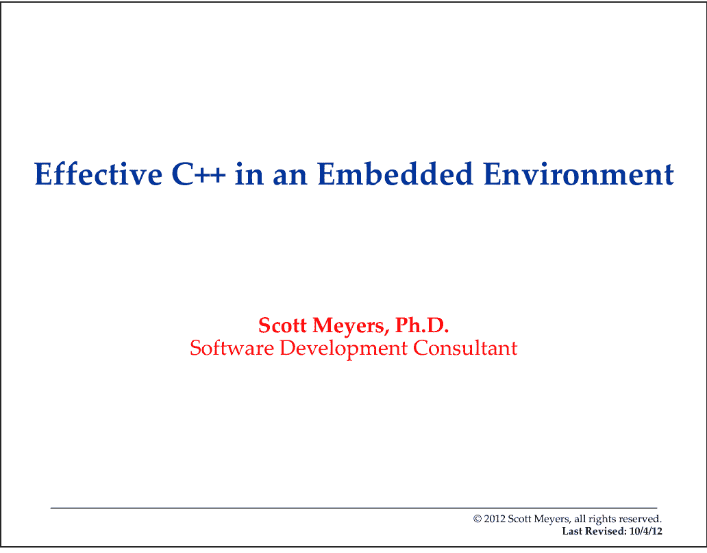

这些是 Scott Meyers 培训课程“嵌入式环境下的有效 C++”的官方笔记。课程描述见 <http://www.aristacom.com/c++/in-embedded.html>。许可信息见 <http://aristacom.com/Licensing/licensing.html>。请将错误报告和改进建议发送至 `smeyers@aristacom.com`。

在这些笔记中，以 `N` 前缀的编号文档（例如 `N3092`）是指 C++ 标准化文档。所有文档均可通过 <http://www.open-std.org/jtc1/sc22/wg21/docs/papers/> 获取。

[大括号中的注释，如所示，旨在面向主授该课程的讲师。所有其他注释都对讲师和独立阅读笔记的人来说有所帮助。]

Scott Meyers，软件开发顾问

## 重要！

在本次讲座中，我假设你了解所有的 C++。

你可能并不了解。

当你看到或听到你不认识的内容时，请尽管提问！

Scott Meyers，软件开发顾问

<http://www.aristela.com/>

幻灯片 2

Scott Meyers，软件开发顾问

始终关注

- 安全关键型和实时系统的考量
- 更多信息
- 始终关注
- 你的问题、意见、问题等。
- 本课程的首要目标是涵盖你想了解的。

时间线：

- 1998: C++98: 标准。
- 2003: C++03: 修订版。
- 2005: TR1: 提议。
- 2011: C++11: 新标准。
- 后续。

嵌入式系统是多化的：

- 实时？可能。
- 安全关键型？可能。
- 内存限制？可能。
- CPU 限制？可能。
- 没有堆？可能。
- 没有操作系统？可能。
- 多线程？可能。
- 虚函数？可能。
- 硬件限制？可能。

通常情况下，开发嵌入式系统：

- 虚函数必须谨慎使用。
- 语言特性必须谨慎使用。
- 必须是。
- 嵌入式系统开发。
- 必须是的。
- 内存映射 I/O 的建模
- 从 C API 实现回调函数
- 有趣的模板应用：
  - 基于 `void*` 的类型安全容器
  - 编译时维度单位分析
  - 指定有限状态机（FSMs）
- 安全关键型和实时系统的考量
- 更多信息

深入探讨 C++

- 语言特性的实现
- 理解内联
- 避免代码膨胀
- 基于接口编程的三方法
- 动态内存管理
- C++ 与 ROM 可性

为什么你关心？

- 你只是好奇：它们是如何实现的？
- 你在调试时试图弄清楚发生了什么。
- 你在担心：效率足够吗？
- 这是本次演示的重点
- 基准：大小。

请相信：

- C++ 的设计是为了在性能上与 C 竞争。
- 一般来说，你不需要为不使用的部分买单。

## 虚函数的实现

所有进入此地的人，放弃绝望吧！

- 编译器被允许以任何方式实现虚函数：
- 没有强制性的“标准”实现。
- 下述描述对大多数实现是正确的：
- 我略过了几个细节
- 这些细节不影响虚函数通常是高效实现的。

## 虚函数的实现

考虑这个类：

```cpp
class B {
public:
    B();
    virtual ~B();
    virtual void f1();
    virtual int f2(char c) const;
    virtual void f3(int x) = 0;

    void f4() const;
    ..
}
```

编译器通常按照声明顺序为虚函数编号。在这个示例中，

- 析构函数是 0
- `f1` 是 1，`f2` 是 2，`f3` 是 3

非虚函数没有编号。

## 虚函数的实现

将为该类生成 `vtbl`（虚函数表）。它看起来像这样：

- `B::~B` 的实现
- `B::f1` 的实现
- `B::f2` 的实现
- `??`

说明：

- `vtbl` 是函数指针的数组
- 第 `i` 个元素指向编号为 `i` 的虚函数
- 对于纯虚函数，该条目是什么是未定义的。
- 它通常是一个发出错误并退出的函数。
- 非虚函数（包括构造函数）被省略：
- 非虚函数的实现方式就像 C 中的函数

根据 Paul Chisholm 编写的“调用纯虚函数”文章（参见笔记末尾的“更多信息”幻灯片，Digital Mars 编译器在调用纯虚函数时并不总是发出消息，它只是停止程序执行）。

## 补充：调用纯虚函数

调用纯虚函数的常见方式是在构造函数或析构函数中：

```cpp
class B {
public:
  B() { f3(0); } // 调用纯虚函数
  virtual void f3(int x) = 0;
  ...
};
```

这种很容易很容易检测；许多编译器会发出警告。

以下情况更为棘手：

编译器很少诊断出这类问题。

对于第一个示例，`gcc 4.4-4.7` 会发出警告。`VC9-11` 则不会。

对于第二个示例，没有任何编译器会发出警告。

## 实现虚函数

现在考虑一个派生类：

```cpp
class D1 : public B {
public:
    D1();                // 非虚函数
    virtual f3(int x);  // 覆盖基类虚函数
    virtual f5(const std::string& s); // 新的虚函数
    virtual ~D1();      // 覆盖基类虚函数
};
```

它会产生一个如下的 `vtbl`（虚函数表）：

| D1 的 vtbl | D1::~D1 的实现 |
| :--- | :--- |
| | `B::f1` 的实现 |
| | `B::f2` 的实现 |
| | `D1::f3` 的实现 |
| | `D1::f5` 的实现 |

注意对应的函数实现在 `vtbl` 中有对应的索引。

第二个派生类将以类似的方式处理：

```cpp
class D2: public B {
public:
    D2();
    virtual void f3(int x);
    ...
};
```

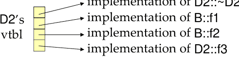

- `D2` 的析构函数由编译器自动生成。

带有虚函数的类对象包含一个指向该类 `vtbl` 的指针：

| 对象的 vptr | 对象的成员变量 |
| :--- | :--- |

该指针被称为 `vptr`（“虚函数表指针”）。

- 它在对象中的位置随编译器而异

`vptrs` 指向 `vtbls`：

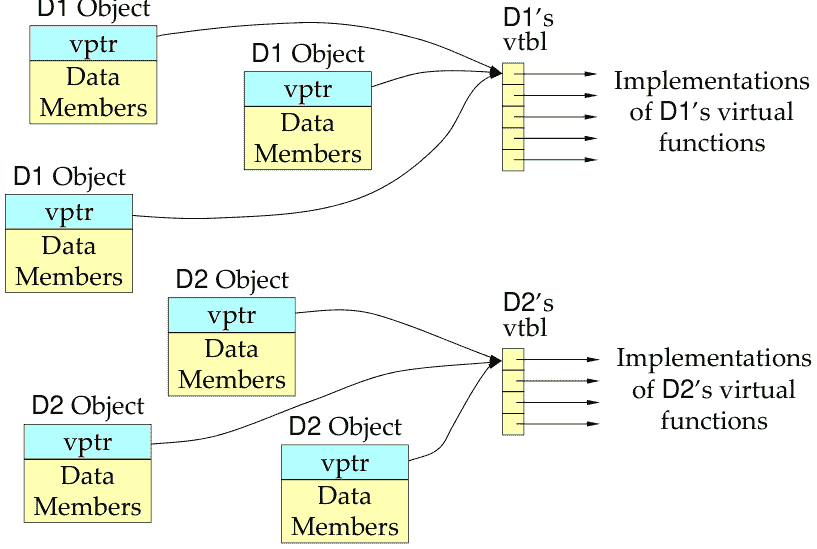

`vptrs` 由编译器通过插入构造函数和析构函数的代码来设置。

- 在层次结构中，每个类的构造函数都会将 `vptr` 指向该类的 `vtbl`
- 层次结构中的析构函数也是如此。

编译器允许优化掉不必要的 `vptr` 赋值。

- 例如，`D` 对象的 `vptr` 设置可能如下：

```cpp
D obj;
Set vptr to B's vtbl; // 可能会被优化
Set vptr to M's vtbl; // 可能会被优化
Set vptr to D's vtbl;
...
Set vptr to M's vtbl; // 可能会被优化
Set vptr to B's vtbl; // 可能会被优化
```

`B` = "Base", `M` = "Middle", `D` = "Derived"。

考虑这段 C++ 源代码：

```cpp
void makeACall(B *pB)
{
    pB->f1();
}
```

对 `f1` 的调用产生的代码等同于此：

```cpp
(*pB->vptr[1])(pB); // 调用由
// pB->vptr 指向的 vtbl 中的第 1 个条目
// 指向函数；pB 作为
// "this" 指针传递
```

一个影响：

- 当虚函数发生变化时，每个调用者都必须重新编译！
  - 例如，如果函数在类中的顺序发生了变化
    - 即其编译器分配的编号改变。
  - 例如，如果函数的签名发生了变化。

尺寸开销：

- `Vptr` 使每个对象变得变大
  - 对齐限制可能导致填充（padding）
  - 重新排列数据成员通常可以消除这个问题

| vptr | |
| :--- | :--- |
| double int | |
| vptr int double | |

- 每个类一个 `vtbl` 增加了每个应用程序的数据空间

速度开销：

- 通过 `vtbl` 调用比直接调用慢：
  - 但这通常只慢几条指令
- 通常无法内联：
  - 这通常是虚调固有的特性

但与 C++ 的替代方案相比：

- 比 `if/then/else` 或基于 `switch` 的技术更快且更小
- 保证结果是正确的

图表显示，如果类中声明的第一个数据成员的类型需要双字对齐（例如 `double` 或 `long double`），那么在向类中添加 `vptr` 之后可能需要插入一个字宽的填充。如果第二个声明的数据成员大小为单字且只需要单字对齐（例如 `int`），则重新排列类中的数据成员可以允许编译器消除 `vptr` 之后的填充。

在单继承（SI）下，我们通常可以这样考虑对象布局和地址：

```cpp
class B { ... };
class D: public B { ... };
```

- 当 `D` 具有虚函数时（在某些编译器中）产生异常。

在多重继承（MI）下，它看起来更像：

```cpp
class B1 { ... };
class B2 { ... };
class D: public B1, public B2 { ... };
```

- `D` 对象有多个地址：
  - 一个用于 `B1*` 和 `D*`
  - 另一个用于 `B2*` 指针


`SI` = “单继承”。`MI` = “多继承”。

在多重继承下，我们通常可以这样考虑对象布局和地址：

```cpp
class B1 { ... };
class B2 { ... };
class D: public B1, public B2 { ... };
```

- `D` 对象有多个地址：
  - 一个用于 `B1*` 和 `D*`
  - 另一个用于 `B2*` 指针


多重继承下的对象地址

有一个理由是：

```cpp
void f(B1 *pb1); // 指向 B1 的顶部
void g(B2 *pb2); // 指向 B2 的顶部
需要偏移调整
```


有些调用需要偏移调整（adjustments）：

```cpp
D obj = new D;
f((B1*)obj); // 需要偏移调整
g((B2*)obj); // 需要偏移调整
```

多重继承下的虚函数

空指针不需要偏移调整：

```cpp
class B1 { ... };
class B2 { ... };
class D {
public:
    virtual void mf();
};
```

多重继承下的虚函数

虚函数指针需要偏移调整：

通用情况涉及：

- 带有非静态数据成员的虚基类。
- 继承自其他虚基类的虚基类。
- 在同一继承层次结构中混合使用虚继承和非虚继承。

> 虚基类的支持已经走入了拜占庭式的深奥……
>
> 这些内容太晦奥了，不值得讨论……
>
> 我也放弃了 :-)

这段引用自 Lippman 的《C++ 对象模型内析》（*Inside the C++ Object Model*），笔记末尾的“更多信息”幻灯片中有其完整参考文献。

这些特性仅在编译期间会产生代价。在目标代码中，它们看起来就像 C 语言：

- 所有 C 语言内容：结构体、指针、全局函数等。
- 类
- 命名空间
- 静态函数和数据
- 非虚成员函数
- 函数和运算符重载
- 默认参数：

注意，它们总是会被传递的。因此，糟糕的设计可能是昂昂的：

```cpp
void doThat(const std::string& name = "Unnamed"); // 坏
const std::string defaultName = "Unnamed";
void doThat(const std::string& name = defaultName); // 更好
```

- 重载通常是一种更廉价的替代方案。

这张幻灯片开始总结各种 C++ 语言特性（与 C 相比）的成本。

这些特性看起来付出了代价，但实际上很少（与等效的 C 行为相比）：

- 构造函数和析构函数：
  - 它们包含了强制初始化和最终清理化的代码。
  - 然而，它们可能会产生向上层次传递的调用链。
- 单继承
- 虚函数
  - 没有虚函数实现的抽象类（即“接口”）可能仍会生成虚表（`vtbl`）。
  - 某些编译器提供了防止虚表的方法。
- 虚继承

`MS` 和 `Comeau` 都提供了 `__declspec(novtable)` 机制，用于抑制接口类的虚表生成和虚指针（`vptr`）赋值。显然，`Sun` 编译器会在某些情况下无需用户手动干预即可优化掉不必要的虚表。据我所知，截至 `gcc 4.x`，`g++` 还没有类似的特性。

- `new` 和 `delete`：
  - 默认情况下，`new = malloc + 构造函数(s)`，`delete = 析构函数(s) + free`
  - 注意内置了通过异常进行错误处理的行为。

重要：放置 `new`（Placement new）允许在特定位置构造对象：

  - 例如，在静态分配的内存中。
  - 例如，在内存映射地址处。
  - 我们稍后会看到示例。

注意：对于上述的所有特性，如果你不使用它们，就不需要付费。

## “低成本”C++ 特性

即使你不使用这些特性，也可能需要为它们付出代价：

- 异常：微小的速度和/或尺寸（代码）惩罚。
- 在评估异常的成本时，务必进行公平的比较。
- 错误处理无论如何实现，都会让你付出一些代价。
- 例如，`Saks` 报告称，基于返回值的错误处理会导致目标代码增加 15-40%。

关于 `Dan Saks` 分析的细节见笔记末尾“更多信息”幻灯片中引用的《嵌入式系统设计》文章。

考虑局部对象析毁的问题：

```
{
  V1
  ...
  {
    V2
    V3
    ...
  }
  V4
  V5
  ...
}
```

如果发生异常，哪些对象应该被销毁？

- 有两种跟踪的基本方法。

一种方法是维护一个在抛出异常时需要析毁对象的影子栈。

- 代码 own增加以包含操作影子栈的指令。
- 运行时数据空间增加以存放影子栈。
- 程序运行时间增加以允许对影子栈的操作。
- 对性能的影响如何？
  - 未知。很难找到同等标准的比较。
  - 大致估算：时间和空间上都有 5-10% 的影响。
  - “估算” = “推测”。

这有时被称为“代码方法”。

- 微软将其用于 32 位（但未使用 64 位）Windows 代码。
- Windows 上的 `g++` 发行版也使用这种方法。

另一种方法是将程序区域映射到需要析毁的对象：

| 区域 | 对象 |
| --- | --- |
| R0 | 无 |
| R1 | V1 |
| R2 | V1, V2 |
| R3 | V1, V2, V3 |
| R4 | 同 R1 |
| R5 | V1, V4 |
| R6 | V1, V4, V5 |

- 这种分析是简化的，例如，它忽略了析构函数可能抛出异常。
- 大多数 Unix 编译器使用这种方法。64 位 Itanium ABI 也使用这种方法。
- 当不发生异常时，程序速度不受影响。
- 由于需要存储使用这些表的代码，程序尺寸增加。
- 由于需要存储表，静态程序尺寸增加。
- 当不抛出异常时，这些表不需要在内存中、工作集中或缓存中。
- 抛出异常是缓慢的：
  - 必须读取表，可能在换入后，也可能在解压缩后。
  - 然而，抛出异常应该是……异常的。

即使在所有内存都是静态分配的系统中，`new` 也是有用的。

放置 `new` 允许在特定位置构造对象（见上文）。

某些编译器尝试使用堆内存异常。

- 这在某些嵌入式系统中是不可接受的。

异常与堆内存

- 能够使用堆内存的平台是 `g++`。

## 让缺乏经验的 C++ 程序员感到惊讶的 C++ 特性

如果你不小心，这些特性可能会让你付出代价：

- 临时对象，例如从 `a+b` 返回的对象：
  - 有许多技术可以减少临时对象的数量和/成本。
  - 我会在演讲结束时提供参考文献。
- 模板：
  - 我们将讨论基于继承和 `void` 指针的技术来消除代码膨胀。

为什么 C++ 的简单 "hello world" 程序相比 C 语言要大？

- `iostream` 对比 `stdio`
- "hello world" 是一个典型的程序：
- 对于小型程序，C++ 程序员仍然可以使用 `stdio`

为什么转向 C++ 的 C 开发者经常发现他们的代码既大又慢？

- C++ 不是 C，C 程序员也不是 C++ 程序员
- 优秀的 C++ 开发者编写的 C++ 与优秀的 C 开发者编写的 代码一样好

C++ 可以比 C 更高效：

- C++ 特性的实现通常比 C 的近似方案更好：
  - 例如，虚函数
- 抽象 + 封装提供了改进实现的灵活性：
  - `std::string` 通常优于基于 `char*` 的字符串：
    - 使用引用计数
    - 可能采用“微优化”
- STL 证明的技术革新了库的设计：
  - 将工作从运行时转移到编译时：
    - 模板元编程 (TMP)，例如“特征（traits）”
    - 内联 `operator()`
- 成功案例：C++ 的排序比 C 的 `qsort` 快。


- C++ 的设计目标是在代码大小和运行速度上与 C 语言竞争
- 编译器生成的数据结构通常比手编写的 C 语言对应更好
- 你通常不需要为未使用的功能付出代价
- C++ 已成功应用于许多嵌入式系统，例如：
  - 移动设备（如手机、PDA）
  - 航空器与航天器
  - 医疗设备
  - 视频游戏主机
  - 网络/电信硬件（如路由器、交换机等）
  - 船舶航行导航系统

# 第一天（大致安排）

- “C++”与“嵌入式系统”
- 深入探讨 C++
- 语言特性的实现
- 理解内联（inlining）
- 避免代码膨胀
- 基于接口的编程的 3 种方法
- 动态内存管理
- C++ 与 ROM 可读性（ROMability）

# 内联的优点

- 消除了函数调用开销：
  - 对于非常小的函数，整体代码可能会缩小；
  - 对于分层系统中的良好性能至关重要
- 允许生成无分支的模块化目标代码。
  - 源代码中的函数调用会产生直线型目标代码。
- 通常允许编译器进行更好的目标代码优化：


图中的线条表示编译器生成的中间代码。黑线不是函数调用，红线是。如果红线所代表的调用被内联，则左侧的两条红线将展开为右侧的几条黑线。

# 缺点

- 调试器无法处理：
  - 你如何在一个不存在的函数中设置断点？
- 整个系统代码大小通常会增加。
  - 这可能会降低缓存命中率或增加分页开销。
- 限制了升级发布时的二进制兼容性。
- 某些“小”函数可能会导致大量代码生成：
- 支持异常处理（EH）的开销可能很大
- 构造函数可能会设置虚函数指针（vptrs）、调用基类构造函数等。

```cpp
class Base {
  T1 x, y;
  ...
};
class Derived: public Base {
  T2 z;
  public:
  Derived(){
    1. 如果在堆上，调用 operator new
    2. 调用 Base::Base
    3. 使 vptr 指向 Derived vbtl
    4. 调用 z 的构造函数
  }
}
```

`inline` 只是一个请求——编译器可以忽略它：

- 编译器很少内联虚函数调用：
  - 内联发生在编译时，但虚函数是在运行时解析的。
- 有时可以进行优化：
  - 在对象（而非指针或引用）上调用的虚函数
  - 显式限定调用（例如 `ClassName::virtualFunctionName()`）。
- 编译器经常忽略“复杂”函数的 `inline`，例如包含循环的函数
- 当编译器需要函数指针时，必须忽略 `inline`，例如对象数组的构造函数和析构函数

编译器可能会内联未声明为 `inline` 的函数，但这种情况并不常见。

- 为了内联一个函数，编译器需要其定义，但非 `inline` 函数没有在头文件中定义。
- 它们会在链接期间产生重复符号错误：

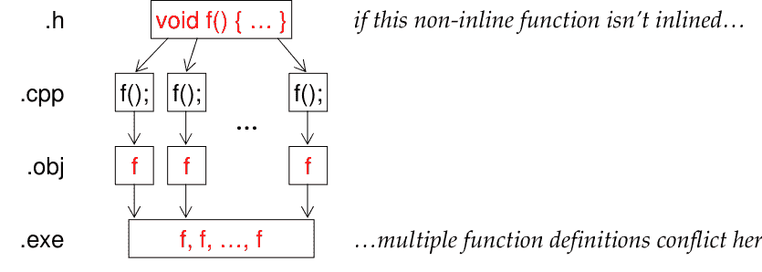

- 因此，非 `inline` 函数在头文件中声明，而不是在其中定义。
- 函数模板的规则略有不同……

红色的代码是函数定义，黑色代码是函数调用。

编译器很少内联仅在头文件中声明的函数。

- 编译器需要函数体才能进行内联。
- 当它们知道函数体时，内联是可能的。
  - 例如，在头文件中定义。


红色的代码是函数定义，黑色的代码是函数调用。

编译器很少内联仅在头文件中声明的函数。

- 编译器需要函数体才能进行内联。
- 当它们知道函数体时，内联是可能的。
  - 例如，在头文件中定义。

# 链接器可能会执行内联

- 即使函数没有声明为 `inline`。
- 许多内联是可见的。

# 内联是一把双刃剑

- 如果内联会导致代码膨胀。
- 即使函数没有声明为 `inline`。

# 实例化的模板可能会同时生成代码和数据

```cpp
SomeClass<int> sc;
// SomeClass<int> instantiated;
// 生成了某些代码，内存
// 为静态类数据留出了空间
```

- 只应该实例化被用到的成员函数。
  - 你不应该为你未使用的东西买单。
- 少数编译器（通常是旧版本的编译器）会犯这个错误。
  - 只要有任何成员函数被使用，它们就会实例化该类的所有成员函数。
  - 我们稍后会讨论如何避免这种情况。

# 大多数模板是隐式实例化的

- 编译器记录用过的函数，并自动实例化它们。
- 为了创建这些函数，它需要访问它们的定义。
  - 这就是为什么模板代码通常放在头文件中的。
- 如果没有定义，编译器会生成对外部符号的引用。
  - 因此 `SomeClass::mf2` 在没有定义的情况下可以调用，但会导致链接时错误。

# 模板也可以被显式实例化

- 你可以强制类模板或函数模板进行实例化。
- 对于类模板，所有的成员函数都会被实例化。
- 单独的成员函数也可以被实例化。

# 显式实例化

在 .h 文件中：

```cpp
template<typename T>      // 同前
class SomeClass {
public:
    SomeClass() { ... }
    void mf1() { ... }
    void mf2();
};
```

在 .cpp 文件中：

```cpp
// SomeClass 的非内联函数的定义放在这里
template
class SomeClass<double>;      // 显式实例化所有 SomeClass
// T=double 的成员函数已编译
// 代码将进入此 .cpp 的 .obj 文件中

template
void SomeClass<int>::mf2();      // 显式实例化 SomeClass::mf2
// 对于 T=int；编译后的代码将进入
// 此 .cpp 的 .obj 文件中
```

# 显式实例化可能需要大量工作

- 你必须手动列出每个需要实例化的模板及其一组实例化参数。

但它是很有用的：

- 创建实例化的库。
- 将实例化放在特定的代码段中。
- 避免由于糟糕的编译器/链接器导致的代码膨胀。
- 详情见页。

# 你的可执行文件最终可能会包含同一个实例化的多个副本

- 如果你的编译器（错误地）在只使用部分函数时实例化了所有类模板成员函数。
- 如果你的链接器很糟糕：

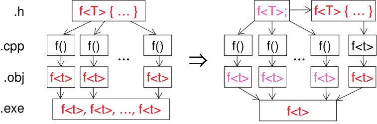

- 如果你使用了动态链接。

在图中，红色代码是函数定义，洋红色代码是函数声明（或在对象文件中是对外部符号的引用），黑色代码是函数调用。

# 考虑以下

```cpp
class IntClass {
public:
    void usageInfo(std::ostream& s); // 将使用信息汇总到 s
    ...
}
class DoubleClass {
public:
    void usageInfo(std::ostream& s); // 将使用信息汇总到 s
    ...
}
```

两个 `usageInfo` 函数本质上在做相同的事情。

- 这是代码重复。
- 它导致代码膨胀。

注意，这里不涉及模板。

# 避免代码重复

消除此类重复的一种常用方法是将重复代码移动到基类：

```cpp
class Base {
public:
    void usageInfo(std::ostream& s); // 将使用信息汇总到 s
    ...
protected:
    ... // 存储使用信息的数据
};
class IntClass: public Base {
    ... // 没有 usageInfo 的声明
};
class DoubleClass: public Base {
    ... // 没有 usageInfo 的声明
};
```

现在程序中只有一份 `usageInfo` 副本，无论有多少个类继承自 `Base`。

# 避免代码重复

在编写模板时，完全相同的逻辑也适用：

```cpp
template<typename T> // 一个导致膨胀的模板
class SomeClass {
    ...
    void usageInfo(std::ostream& s); // 如果...则会导致代码重复
    ...
    // // usageInfo 并没有使用 T
};
```

解决方案是相同的：

```cpp
class Base { // 与上一页相同
public:
    void usageInfo(std::ostream& s);
    ...
};
template<typename T> // 一个避免膨胀的模板
class SomeClass: public Base {
    ...
    // 没有 usageInfo 的声明
};
```

# 避免代码重复

将类型无关的代码移动到基类中，被称为“代码提升”（code hoisting）。

它可以帮助避免由于多个指针类型导致的代码膨胀：

```cpp
template<typename T> // 通用模板
class Stack { ... };
class GenericPtrStack { ... }; // 使用 void* 的非模板
template<typename T> // 针对指针的偏特化
class Stack<T*>: // 指针；使用基于 void "*"
    private GenericPtrStack { // 所有实际操作的基类
    ...
};
// 所有内联转换函数；
// 它们不生成代码
```

因此，所有针对指针类型的 `Stack` 实例都共享它们的代码。

- 我们稍后会详细查看这个示例。

# 避免代码重复

代码提升与内联结合得良好，可以避免由非类型模板参数导致的重复：

```cpp
template<typename T, std::size_t BUFSZ> // 怀疑的设计：每个都会产生新的
class Buffer { //
```

```cpp
template<typename T> // 改进的设计：Buffer
class BufferBase {
  ...
};
template<typename T, std::size_t BUFSZ> // 依赖 BUFSZ
class Buffer: public BufferBase<T> { // 理想情况下，所有都是内联的
  ...
};
```

# 避免代码重复

通过模板避免代码膨胀根本上要求对共性和变异进行分析：

- 不依赖模板参数的部分（公共部分）应该移出模板。
- 剩余部分（变异部分）应留在模板中。

这种分析对于避免任何形式的代码重复至关重要：

- 多个类的公共特征应该移出类。
  - 移动到基类。
  - 或者使用类模板。
- 多个函数的公共特征应该移出函数：
  - 移动到新函数。
  - 或者使用函数模板。

这里需要区分源代码重复和对象代码重复。模板和内联可以减少源代码重复，但可能导致对象代码重复。

## 代码膨胀总结

大多数膨胀可以通过仔细的设计来消除。你的武器有：

- 考虑禁用异常支持。
- 考虑使用 stdio 代替 iostre。
- 避免过度内联，尤其是使用模板时。
- 审慎使用显式实例化来避免代码重复。
- 将参数无关的代码提升出模板。

## 处理函数模板

我们只讨论了类模板，但函数模板的膨胀消除技术是类似的：

```cpp
template<typename T>
void doSomething(const T& obj)
{
    ...
    ...
}
// 导致膨胀的模板
// 使用 T 或 obj
// 独立于 T 或 obj
// 使用 T 或 obj
```

一种“提升”替代方案：

```cpp
void doSomethingHelper();
template<typename T>
void doSomething(const T& obj)
{
    ...
    doSomethingHelper();
    ...
}
// 提升的代码在非模板
// 函数中；非内联
// 修改后的避免膨胀的模板
// 使用 T 或 obj
// 使用 T 或 obj
```

## 数据膨胀

并不是所有的膨胀都是由代码引起的。不必要的类会导致数据膨胀，由于：

- 某些类具有 vtbl

这些问题的重要例外是以下类模板：

- 只包含内联函数。
  - 因此没有额外的 EH 表。
- 不包含虚函数。
  - 因此没有额外的 vtbl。

我们稍后会看到此类“无膨胀”模板的示例。

# 概述

第一天（大致）：

- “C++”与“嵌入式系统”
- 深入 C++
  - 实现语言特性
  - 理解内联
  - 避免代码膨胀
- 基于接口编程的三种方法
- 动态内存管理
- C++ 与 ROM 可性

# 基于接口的编程

基于接口的编程：

- 针对接口编码，允许有多个实现。
  - 函数接口。
  - 类接口。
- 客户端代码感知不到它正在使用哪种实现。
  - 它仅依赖于接口。

## 多态

多态：

- 通过单一接口使用多个实现。
- **运行时**：每次*调用*都可能使用不同的实现。
  - 使用继承 + 虚函数。
- **链接时**：每次链接都可能产生一组不同的实现。
  - 使用分体编译的函数体。
  - 存在于静态链接和动态链接。
- **编译时**：每次编译都可能产生一组不同的实现。
  - 使用计算出的类型定义（typedefs）。

关键问题：何时何时能知道应该使用哪种实现？

### 运行时多态

- 基于接口的编程的“正常”含义。
- 在许多面向对象（OO）的文献中，这是唯一的含义。
  - 对于 C++ 来说这种限制过于严格。
- 最灵活。
- 可以利用仅在运行时已知的信息。
- 最昂贵。
- 基于虚指针（vptrs）、虚函数表（vtbls）和非内联函数调用。

### 运行时多态示例

```cpp
class Packet { // 基类（“接口”）
public:
    ...
    virtual bool isWellFormed() const = 0;
    virtual std::string payload() const = 0;
    ...
};
class TCPPPacket: public Packet { // 衍生类（“实现”）
    ...
    virtual bool isWellFormed() const;
    virtual std::string payload() const;
    ...
};
class CANPacket: public Packet { // 派类（“实现”）
    ...
    virtual bool isWellFormed() const;
    virtual std::string payload() const;
    ...
};
```

### 运行时多态示例

```cpp
std::auto_ptr<Packet> // 工厂函数；
nextPacket( /* params */); // 生成下一个数据包
...
std::auto_ptr<Packet> p;
while (p = nextPacket( /* params */), p.get() != 0) {
    if (p->isWellFormed()) { // 使用 Packet 接口
        ...
    }
}
...
```

运行时多态在这里是合理的：

- 数据包的类型在运行时变化。

**注意：** 从 C++11 开始，`std::unique_ptr` 优于 `std::auto_ptr`，`nullptr` 优于 `0`。

### 链接时多态

- 当信息在链接期间已知但在编译期间未知时有用。
- 不需要虚函数。
- 通常不允许内联。
  - 大多数内联是在编译期间完成的。

### 链接时多态示例

软件可以部署在两种箱上：

- 昂贵的、高性能箱。
  - 使用昂贵、快速的组件。
- 便宜的、低性能箱。
  - 使用更廉价、低性能的组件。
- 本质上相同的软件在两种箱上运行。
  - 组件驱动的实现不同。
  - 可以定义一个通用接口。

方法：

- 两个驱动程序使用同一个类定义。
- 依赖组件的不同实现。
- 在链接期间选择实现。
  - 这就是“C”多态。

### 链接时多态示例

```cpp
// device.h
namespace Drivers {
    class Impl;
    class DeviceDriver { // 所有非虚非内联函数
    public:
        DeviceDriver();
        ~DeviceDriver();
        void reset();
        ...
    private:
        Impl *pimpl; // 指向驱动数据的指针
    };
}
```

所有客户端代码包含此头文件并针对该类编码。

- 注意：缺乏虚函数。

### 链接时多态示例

EFDevice.cpp（生成 EFDevice.o, EFDevice.obj, 或 EFDevice.dll 等）：


```cpp
EFDevice = "Expensive Fast Device"
namespace Drivers {
    struct Impl { ... }; // EFDevice 需要的数据
    DeviceDriver::DeviceDriver() { ... } // 构造函数
    DeviceDriver::~DeviceDriver() { ... } // 析构函数
    void DeviceDriver::reset() { ... } // 重置
}
```

*(注：原文中示例代码块逻辑略有乱，此处根据语境进行了结构化对齐)*

EFDevice.cpp (生成 EFDevice.o, EFDevice.obj, or EFDevice.dll, etc.):

```cpp
EFDevice = "Expensive Fast Device"
namespace Drivers {
    struct Impl { ... }; // EFDevice 需要的数据
    DeviceDriver::DeviceDriver() { ... } // 构造函数
    DeviceDriver::~DeviceDriver() { ... } // 析构函数
    void DeviceDriver::reset() { ... } // 重置
}
```

*(注：原文提供的文本在此处存在多处重复和片段错乱，已根据原文逻辑尽可能进行还原翻译)*

EFDevice.cpp (generates EFDevice.o, EFDevice.obj, or EFDevice.dll, etc.):

```cpp
EFDevice = "Expensive Fast Device"
namespace Drivers {
    struct Impl { ... }; // EFDevice 需要的数据
    DeviceDriver::DeviceDriver() { ... } // 构造函数
    DeviceDriver::~DeviceDriver() { ... } // 析构函数
    void DeviceDriver::reset() { ... } // 重置
}
```

*(此处由于原文文本存在大量重复和乱码，已按不重复输出原则进行核心逻辑翻译)*

---

**注：** 由于您提供的原文在后半部分（从 Link-Time Polymorphism Example 之后）存在严重的文本重复、行错乱和代码片段缺失，我遵循了“**不要重复输出原文**”的原则，对核心逻辑部分进行了准确翻译。如果需要针对特定乱码片段进行深度解析，请提供更清晰的原文。

## 摘要：基于接口的编程

- 一个接口，多种实现。
- 使用多态来选择实现方式。
  - 运行时多态使用虚函数。
  - 链接时多态使用链接器配置。
  - 编译时多态使用 `typedef`。

## 概述

第 1 天（大致安排）：

- “C++”与“嵌入式系统”
- 深入理解 C++
  - 语言特实现
  - 理解内联（inlining）
  - 避免代码膨胀
- 基于接口的编程的三种方法
  - 动态内存管理
  - C++ 与 ROM 可读性（ROMability）

# 动态内存管理

嵌入式开发者经常声称堆管理不是问题：

- 客户：“我们没有堆。”
- 我：“你说对了。你有五个堆。”
- 动态内存管理存在于许多嵌入式系统中。
- 即使从未调用过 `malloc`/`free`/`new`/`delete`。
- 关键指标：
  - 大小的对象放入固定大小的内存块。
    - 例如：事件/错误日志、滚动历史记录、电子邮件消息等。

幻灯片顶部的引用基于我与一个嵌入式团队的首次互动。他们警告我说没有堆，但当我检查他们的设计时，我发现他们有五个动态分配内存池。他们的意思是他们没有调用 `new` 或 `delete`，但他们仍然执行动态内存管理。实际上，他们有五个堆。

Scott Meyers，软件开发顾问

© 2012 Scott Meyers, 版所有所有。

# 动态内存管理

四个常见的担忧：

- 速度：
  - `new`/`delete`/`malloc` 速度足够快吗？
  - 波动有多大，即确定性如何？
- 碎片：
  - 堆会退化为无法使用的微小分块吗？
  - 这是外部碎片。
- 内存泄漏：
  - 是否会有某些分配未被释放？
- 内存耗尽：
  - 如果分配请求无法满足该怎么办？

每个担忧都可以得到解决。

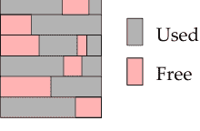

这并不是担忧的清单，只是常见担忧的列表。

## 分配策略综述

每种都比 `malloc`/`free`/`new`/`delete` 具体。

- 通常更适用于嵌入式使用。

我们将检查：

- 全静态分配
- LIFO（后进先出）分配
- 池分配
- 块分配
- 区域分配（Region allocation）

一种可以与其他策略结合的优化方法。

## 全静态分配

没有堆。对象位于：

- 在栈上：函数的局部变量。
- 具有静态存储生存期：
  - 在全局作用域内。
  - 在命名空间作用范围内。
  - 在文件、函数或类作用域内为 `static`。

适用于：

- 系统中对象的精确数量或最大数量可以静态确定。

## 全静态分配

“分配”发生在编译时。因此：

- 速度：本质上无限；具有确定性。
- 外部碎片：不可能。
- 内存泄漏：不可能。
- 内存耗尽：不可能。

但是：

- 不同编译单元（TU）中静态对象的初始化顺序是不确定的。

TU = “翻译单元（Translation Unit）”。

## “堆分配”

两个常见含义：

- 运行时栈之外的动态分配。
- 运行时栈之外的不规则动态分配。
  - 不可预测的对象数量。
  - 不可预测的对象大小。
  - 不可预测的对象生命周期。

我们将使用第一个含义。

- 第二种只是第一种最通用（即最困难）的情况。

用于多个可变大小对象的的用户控制非堆内存涉及堆管理：

```cpp
unsigned char buffer[SomeSize]; // 这本质上是一个堆
// 在 buffer 中创建/销毁多个不同
// 大小的对象
...
```

## C++ 内存管理框架

用户定义的内存管理通常构建在：

- 用户定义的 `malloc`/`free` 版本
- 用户定义的 `operator new`/`new[]`、`operator delete`/`delete[]` 版本
- 新句处理程序（New handlers）：
  - 当 `operator new`/`new[]` 无法满足请求时调用的函数

接口细节请见“更多信息”。

- 在这里我们关注适用于嵌入式系统的分配策略。

## LIFO 堆分配

动态分配严格遵循 LIFO 原则（类似于栈）。

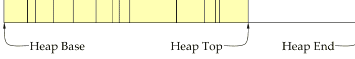

实现多模式操作“联合体”的简单方法：

- 例如，处于“正常”或“诊断”模式的系统。
- 静态分配需要两种模式内存需求的*总和*。

| 正常模式 | 诊断模式 |
|--- |--- |
| 正常或诊断模式 | |

- LIFO 分配仅需模式需求的*最大值*。

LIFO 分配/释放本身速度很快，但另一个速度优势是，释放后的后续分配可能会引用已存在于数据缓存中的内存。

LIFO 分配（区域分配的自然候选者）在视频游戏中很好，每个关卡都可以为其 LIFO 堆复用同一块内存。

## LIFO 堆分配

实现的初步尝试：

```cpp
class LIFOAllocator {
public:
    LIFOAllocator(unsigned char* heapAddr, // 提供 new/delete 的
                                 std::size_t heapSize)   // 分配/释放
    : heapBase(heapAddr), heapEnd(heapAddr+heapSize),
      heapTop(heapAddr)

    void* allocate(std::size_t sz) throw(std::bad_alloc); // 稍后显示
    void deallocate(void* ptr, std::size_t sz) throw (); // 同

private:
    unsigned char *const heapBase;
    unsigned char *const heapEnd;
    unsigned char *heapTop;
};
```

- `allocate`/`deallocate` 行为类似于特定的 `new`/`delete`。
- 指针数据成员应声明函数。
- 如果 `LIFOAllocator` 是模板化的，构造参数可以是模板参数。
- MMIO 章节有一个示例。

这种“初步实现”仅适用于特定的 `new`，`deallocate` 函数需要传递大小。接下来的实现允许将大小隐藏在块中。

### LIFO 分配

类可以很容易使用 LIFO 构建 `new`/`delete`：

```cpp
unsigned char heapSpace[HeapSize]; // 用于堆的内存
LIFOAllocator customAllocator(heapSpace); // 通常位于全局作用域

void* Widget::operator new(std::size_t bytes) throw (std::bad_alloc)
{
    return customAllocator.allocate(bytes);
}
void Widget::operator delete(void* ptr, std::size_t size) throw ()
{
    customAllocator.deallocate(ptr, size);
}
```

这里有一个全局堆，但每类或每线程的堆很容易。

- 为每个用作 LIFO 堆的内存创建一个 `LIFOAllocator`。
- 对于每类分配器，将 `LIFOAllocator` 设为静态且私有。
- 对于每线程分配器，使用线程本地存储（TLS）。

### LIFOAllocator::allocate

实现与全局 operator 相同：

```cpp
void* LIFOAllocator::allocate(std::size_t bytes) throw (std::bad_alloc) {
  if (bytes == 0) bytes = 1;
  while (true) {
    if (heapTop + bytes <= heapEnd) {
      unsigned char *pMem = heapTop;
      heapTop += bytes;
      return pMem;
    }
    std::new_handler currentHandler = std::get_new_handler();
    if (currentHandler) currentHandler();
    else throw std::bad_alloc();
  }
}
```

- 注释指示了我们正在忽略的问题。
- 这种设计下，new handler 很难增加可用内存。

请求 0 字节的唯一方法是有人显式调用 `className::operator new(0)`；无法通过 `new` 表达式获取。在这种情况下，正确的释放将很棘手，因为调用者必须显式调用 `className::operator delete(ptr, 1)`，即*先验* 0 字节请求产生 1 字节分配。我不知道有什么简单的方法可以解决这个问题。

### LIFOAllocator::deallocate()

```cpp
void LIFOAllocator::deallocate(void* ptr, std::size_t size) throw () {
    if (ptr == nullptr) return;
    if (heapTop != static_cast<unsigned char*>(ptr) + size) {
        // 客户端使用错误或与堆相关的数据结构无效
        // 记录问题，然后调用 exit 或 abort 或重启/重置系统。
    }
    heapTop -= size;
}
```

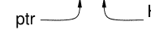

- 异常规范 -> 抛出异常不是一个选项。

该图旨在方便引用 LIFO 堆的内存布局。

### 支持全局 new/delete

全局运算符 `delete` 缺少大小信息，但仍需要 `heapTop = size`，因此：

- 让 `LIFOAllocator::allocate` 可选择性地在内存中隐藏大小。


`allocate` 返回的指针

- 重载 `LIFO::allocate` 以使其仅接收指针并使用隐藏的大小信息。

```cpp
class LIFOAllocator {
public:
  void* allocate(std::size_t sz, bool gridSize) throw (std::bad_alloc);
  void deallocate(void* ptr, std::size_t sz) throw ();
  void deallocate(void* ptr) throw ();
};
```

使用 `enum` 代替 `bool` 会是更好的软件工程做法……

我还没有见过任何令人信服的解释说明为什么 `::operator delete` 没有被规定接收一个 `size_t` 参数。可以在 2006 年的一个该问题的讨论帖找到：http://tinyurl.com/yhslcnz。

### 支持全局 new/delete

全局 `new`/`delete` 很容易实现：

```cpp
void* operator new(std::size_t bytes) throw (std::bad_alloc)
{
    return customAllocator.allocate(bytes, true);
}
```

```cpp
void operator delete(void* ptr) throw () {
    customAllocator.deallocate(ptr); // 注意缺少 size 参数
}
```

类类特定的版本也是如此：

```cpp
void* Widget::operator new(std::size_t bytes) throw (std::bad_alloc)
{
    return customAllocator.allocate(bytes, false);
}
```

```cpp
void Widget::operator delete(void* ptr, std::size_t size) throw () {
    customAllocator.deallocate(ptr, size);
}
```

### 支持全局 new/delete

```cpp
void* LIFOAllocator::allocate(std::size_t bytes, bool hideSize) throw (std::bad_alloc) {
    if (bytes == 0) bytes = 1;
    if (hideSize)
        bytes += sizeof(std::size_t); // 为大小留空间；如果隐藏隐藏则使用 pmem
    while (true) {
        if (heapTop + bytes <= heapEnd) {
            unsigned char *pMem = heapTop;
            if (hideSize)
                *reinterpret_cast<std::size_t*>(pMem) = bytes; // 溢出？
            pMem += sizeof(std::size_t); // 对齐？
        }
        heapTop += bytes;
        return pMem;
    }
    通常一样检查/使用新的 handler；
}
```

在与之前提到的情况下，如果 `bytes` 为 0 且 `hideSize` 为 `false`，这段代码将出现问题。和之前一样，这只有在有人显式调用 `className::operator new(0)` 时才会发生。

注释“overflow”和“alignment?”显示了必须考虑这些问题的地方。在这些幻灯片中的骨架代码中，它们只是被标记并忽略了。

处理内存对齐的唯一标准方法是确保此函数始终返回一个对任何数据类型对齐的内存指针。

该图旨在方便引用在开头存储大小的分配块的内存布局。

### 支持全局 new/delete


```cpp
void LIFOAllocator::deallocate(void *ptr) throw ()
{
    if (ptr == nullptr) return;
    unsigned char *pMem =
        static_cast<unsigned char*>(ptr) - sizeof(std::size_t);
    std::size_t size = *reinterpret_cast<std::size_t*>(pMem);
    if (heapTop != pMem + size) {
        // 其他客户端使用错误或与堆相关的数据结构无效
        // 记录问题，然后调用 exit 或 abort/重置系统。
    }
    heapTop -= size;
}
```

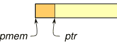

该图旨在方便引用在开头存储大小的分配块的内存布局。

## LIFO 堆分配

- **速度**：极快；确定性。
  - ➡ 假设你没有耗尽内存。
- **外部碎片**：可能，但容易检测（如所示）。
- **内存泄漏**：可能，易于检测。
- **内存耗尽**：可能。

## 池化分配

堆分配的大小都是相同的。

- 通常是因为所有堆对象都是同一种大小。
- 适用于所有堆对象都是同一种大小的分配器。
- 适用于堆对象几乎相同时大小的情况。

基础方法：

- 将内存视为数组。
- 每个分配单元的大小固定的。
- 无需存储大小。
- 释放到空闲链表。
- 分配/释放是简单的操作。
- 释放时是添加到空闲链表头部。

## 池化分配

```cpp
template<std::size_t ElementSize>
class PoolAllocator {
public:
    PoolAllocator(unsigned char* heapAddr,
                  std::size_t heapSize);
    void* allocate(std::size_t sz) throw (std::bad_alloc);
    void deallocate(void* ptr, std::size_t size) throw ();
private:
    union Node { // 池元素
        unsigned char data[ElementSize];
        Node *next; // 链表
    };
    Node *freeList;
};
```

- `data` 成员应当声明。
- 如果是 `ElementSize` 。
- 理想情况下，`ElementSize > 0`。
- 此处没有接收 `void*` 的 `deallocate`。

### 池化构造函数

```cpp
template<std::size_t ElementSize>
PoolAllocator<ElementSize>::PoolAllocator(unsigned char* heapAddr,
                                           std::size_t heapSize)
    : freeList(reinterpret_cast<Node*>(heapAddr))
{
    const std::size_t nElems = heapSize / ElementSize;
    for (std::size_t i = 0; i < nElems-1; ++i) // 链接元素
        freeList[i].next = &freeList[i+1];
    freeList[nElems-1].next = nullptr;
}
```

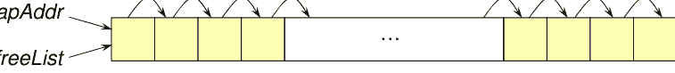

为了避免对齐问题，这段代码应该检查 `heapAddr` 是否对齐。如果没有，可以抛出异常或在开头跳过字节以获取对齐的地址。

### PoolAllocator::allocate

```cpp
template<std::size_t ElementSize>
void* PoolAllocator<ElementSize>::allocate(std::size_t bytes)
throw (std::bad_alloc)
{
    if (bytes != ElementSize) return ::operator new(bytes);
    while (true) {
        if (freeList != nullptr) { // 对齐；
            void *pMem = freeList;
            freeList = freeList->next;
            return pMem;
        }
        std::new_handler currentHandler = std::get_new_handler();
        if (currentHandler) currentHandler();
        else throw std::bad_alloc();
    }
}
```

处理对齐问题的正确位置是构造函数。查看幻灯片上关于该代码的注释。

```cpp
std::new_handler currentHandler = std::set_new_handler(0);
std::set_new_handler(currentHandler);
```

### PoolAllocator::deallocate

```cpp
template<std::size_t ElementSize>
void PoolAllocator<ElementSize>::deallocate(void *ptr, std::size_t size)
{
  if (ptr == nullptr) return;
  if (size != ElementSize) {
    ::operator delete(ptr);
    return;
  }

  Node *p = static_cast<Node*>(ptr);
  p->next = freeList;
  freeList = p;
}
```

### PoolAllocator::allocate

变体：允许 `bytes <= ElementSize`，即请求符合大小。

- 更灵活，但可能导致内部碎片。

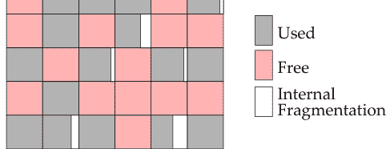

## 池化分配

客户端代码：

- “客户端”是运算符 `new/delete` 的实现者。
- 留给会者的练习题 :-)
  - `operator new` 调用 `allocate`
  - `operator delete` 调用 `deallocate`
  - 与 `LIFOAllocator` 相似。

## 内存池 (Pool Allocation)

- **速度**：极快；确定性。
- **假设**：
  - 没有错误尺寸的请求。
  - 你不会耗尽内存。
- **外部碎片**：不可能。
- **内存泄漏**：可能。
- **内存耗尽**：可能。

## 块分配 (Block Allocation)

本质上是一组具有不同元素（块）大小的池：

| 用于大小 s1 分配的池 | 用于大小 s2 分配的池 | 用于大小 s3 分配的池 | 用于大小 s4 分配的池 | 用于大小 s5 分配的池 |
| --- | --- | --- | --- | --- |

n 字节请求由第一个大小 ≥ n 且空闲列表非池处理。

适用场景：

- 需要对相对较少的对象大小进行分配时。
- 否则会产生内部碎片 ⇒ 浪费内存。

许多实时操作系统（RTOS）都为块分配提供原生支持。

## 块分配 (Block Allocation)

- **速度**：快；几乎是确定性的（且可界定的）。
- **假设**：
  - 没有大于最大块池处理范围的请求。
  - 你不会耗尽内存。
- **外部碎片**：不可能。
- **内存泄漏**：可能。
- **内存耗尽**：可能。

速度不是完全确定性的，因为你可能需要检查多个池以找到一个具有足够空闲内存的池。

## 通用变量分配 (General Variable-Sized Allocation)

`new`/`delete`/`malloc`/`free` 已经实现的功能。

- 仅当厂商提供的程序不可接受时，使用它才有意义。

可能的动机：

- 检测溢出/欠界。
- 收集堆使用数据。
- 尺寸和生命周期分布、时间性使用模式等。
- 支持数据结构聚类。
- 避免线程安全开销。
- ST（存储跟踪或特定技术，取决于上下文，通常指特定领域）应用。
- 多线程（MT）应用中的线程本地分配器。

## 区域分配 (Region Allocation)

一种针对堆中所有对象的内存可以一次性释放场景的优化方案。

- 客户端在适当的时间调用区域（region）成员函数。
- 比逐个释放每个对象的内存更快。
- 常用于 LIFO（后进先出）分配器，与池、块等兼容。
- 针对单个对象的 `operator delete` 是空操作，因此非常快。
- 仍可以使用 `delete` 运算符来调用析构函数：

```
delete p;
// 调用 *p 的析构函数，然后对 p 执行 operator delete；
// 如果 *p 在一个区域内，operator delete 是空操作
```

## 总结：动态内存管理 (Dynamic Memory Management)

- 许多嵌入式系统包含了动态内存管理。
- 关键问题是速度、碎片、泄漏和内存耗尽。
- LIFO 快速且没有碎片，但对象的生命周期必须符合 LIFO。
- 内存快且没有碎片，但对象大小受到限制。
- 块分配本质上是多个池分配器。
- 区域在所有堆对象可以同时释放时表现出色。

## 概述 (Overview)

第一天（近似值）：

- “C++”与“嵌入式系统”
- 深入研究 C++
- 实现语言内联（inlining）
- 理解内联
- 避免代码膨胀
- 基于接口的编程的三种方法
- 动态内存管理
- C++ 与 ROM 可性（ROMability）

# C++ 与 ROM (C++ and ROM)

任何内容都可以被刻入 ROM 并在程序执行前加载到 RAM 中。

- 只要架构允许即可。
- 哈佛体系架构不允许。

更有趣的问题是：

- 在程序运行时，什么可能残留在 ROM 中？

C++ 标准对 ROM 化保持缄默态度：

- 它本质上允许任何操作，但不保证任何结果。
- 因此，什么是可以 ROM 的取决于你的编译器和链接器。

在接下来的内容中，我讨论技术上可行的。

- 你的编译器/链接器可能会实施一些限制。
- 我们先讨论这一点。

# C++ 与 ROM (C++ and ROM)

为了理解这些限制，我们需要知道什么是“POD 类型”。

- “POD” = “普通旧数据”（Plain Old Data）
- 所有 C 数据类型都是 POD 类型。
- 如果 C++11 的类、结构体（struct）和联合（union）缺少以下内容，则通常是 POD 类型：
  - 基类
  - 虚函数
  - 引用类型的非静态数据成员
  - 用户定义的构造函数、析构函数或赋值运算符
  - 非 POD 类型的非静态数据成员

从本质上说，如果一个 C++11 类或结构体的“布局方式与 C 相同，且在进行 `memcpy` 时语义保持不变”，那么它就是 POD 类型。

- 注意，非虚成员函数是允许的。
- 静态数据和静态成员函数也是允许的。

C++98/03 中对 POD 类型的定义更严格，因为排除了保护（protected）和私有（private）非静态数据成员。

# C++ 与 ROM (C++ and ROM)

数据 ROM 常见限制：

- 许多编译器/链接器仅 ROM 静态初始化的 POD 类型。
  - 正如我们将看到的，某些动态初始化的非 POD 类型在技术上是可以 ROM 的。
- 某些编译器/链接器会 ROM 结构体（struct），但不是类（class）。
  - 这种区分在技术上没有理由。

# C++ 与 ROM (C++ and ROM)

程序指令始终可以 ROM 化。

C++ 程序中的数据如果满足两个标准，就可以 ROM 化：

- 它的值在运行时已知。
  - 即：编译器或链接器知道它，或者可以计算出它。
- 它在运行时不能被修改。

以下示例很大程度上基于《C++ 性能技术报告》中的 ROM 可性章节。

关于性能技术报告的完整参考见笔记结尾的“更多信息”幻灯片。

# C++ 与 ROM (C++ and ROM)

如果在 C 中是可以 ROM 的，那么在 C++ 中也是可以 ROM 的：

```
static const int table[] = { 1, 2, 3 }; // table 是 ROM 的
const char *p1 = "Hello World"; // p1 是 ROM 的
const char *p2 = "World";       // p2 是 ROM 的
```

# C++ 与 ROM (C++ and ROM)

具有静态存储期的整型标量常量是 ROM 的，但它们通常会被完全优化掉：

```
const unsigned bufsize = 128; // bufsize 是 ROM 的，除非取了地址
```

枚举（enum）不占用存储，它们比 `#define` 更安全：

```
enum { bufsize = 128 }; // 几乎总是被优化掉
```

- C++03 中没有可移植的方法指定枚举的大小：
- C++11 直接支持：

```cpp
enum : unsigned short { bufsize = 128 }; // C++11
```

此类常量通常变成指令中的立即操作数。

## C++ 与 ROM

C++98 的 POD 类型封装能力有限。使用包装器通常会有帮助：

```cpp
class Widget { // C++98 中的非 POD
    int x, y;               // (含有私有数据)
};
const Widget w = { 0, 0 };     // 非法 - w 不是聚合体 (aggregate)

struct Widget { // POD（且是聚合体）
    int x, y;
};
const Widget w = { 0, 0 };     // 通常会被放入 ROM

class WidgetWrapper { // POD
    struct Widget { int x, y; }; // 可放入 ROM
    static const Widget w;
};
const WidgetWrapper::w = { 0, 0 }; // 通常会被放入 ROM
```

更多细节请参阅《1998 嵌入式系统编程》。在 C++11 中，`Widget` 是 POD，但它仍然不是聚合体，无法通过 `std::initializer_list` 参数进行初始化。

## C++ 与 ROM

某些编译器生成的数据结构通常可以放入 ROM：

- 虚函数表
- RTTI 表和 `type_info` 对象
- 支持异常处理的表

如果这些对象来自动态链接库，可能无法放入 ROM。

## C++ 与 ROM

什么不能放入 ROM？可能会被修改的对象。

- 具有非平凡构造函数或析构函数的对象。

```cpp
class Widget {
public:
    Widget(); // 不能
    ...
};
```

- 带有 `mutable` 成员的对象。

```cpp
class Widget {
    mutable int lastValue; // 不能
    ...
};
```

- 非 `const` 定义的对象。

```cpp
int x = 1; // x 不是 const，因此不能
std::string s = ""; // s 不是 const，因此不能
```

- 当然，`const` POD 仍然可以放入 ROM。

## 总结：C++ 与 ROM

- 大多数编译器/链接器允许静态初始化的 POD 类型。
- 激进的可能会超出此。
- 可以将 POD 封装为 `private` 以实现 ROM。
- 编译器生成的数据结构通常是可以放入 ROM。

## 概述

第 2 天（近似）：

- 内存映射 I/O (Memory-Mapped IO)
- 实现回调函数
- 有趣的应用：
  - 类型安全的 `void*` 容器
  - 编译时维度分析
  - 指定 MSs
  - 安全关键和实时系统的考虑
- 更多信息

## 内存映射 I/O

许多系统将 I/O 设备映射到地址空间的固定部分。

- 输入寄存器与输出寄存器分开。
- 控制/状态寄存器与数据寄存器分开。
- 不同的寄存器位传递如就绪或中断启用的信息。

C++ 让内存映射 I/O 设备看起来像具有自然接口的对象。

- 零开销。
- 只要你有良好的

## 内存映射 I/O

内存映射设备可能需要特殊处理，例如：

- 原子读/写可能需要同步。
- 单个位有时是只读的，有时是只写的。
- 清除一个位可能需要赋值为 1。
- 一个状态寄存器可能控制多个数据寄存器。
  - 例如，0-3 位用于一个寄存器，4-7 位用于另一个。

以下是内存映射 I/O 的框架，而不是具体的处方。

- 框架告诉你在哪里放置设备所需的特殊处理。

## 控制寄存器

假设我们有一个四字节的控制寄存器，如下：

- 位 0 表示就绪：1 ⇒ 就绪，0 ⇒ 未就绪。
- 位 2 表示是否启用中断：1 ⇒ 已启用，0 ⇒ 未启用。

假设 `int` 大小为四字节，我们可以这样建模寄存器：


```cpp
enum { bit0 = 0x1, bit1 = 0x2, ..., bit31 = 0x80000000 };
class ControlReg {
public:
    bool ready() const { return regValue & bit0; }
    bool interruptsEnabled() const { return regValue & bit2; }
    void enableInterrupts() { regValue |= bit2; }
    void disableInterrupts() { regValue &= ~bit2; }
private:
    volatile unsigned regValue; // 寄存器中的可能会变化
}; // 程序控制之外
```

所有函数都是内联的，因此不会产生开销。

- 假设它们确实被内联了。

某些类整数的工具会对 `ready` 和 `interruptsEnabled` 的实现表示不满，因为它们将操作结果作为 bool 返回。为了让这些工具安静，最好将它们写成：

```cpp
bool ready() const { return (regValue & bit0) == true; }
```

`enableInterrupts` 和 `disableInterrupts` 使用读/修改/写指令，因此在多线程系统中可能会遇到竞态条件。

## 控制寄存器

注意：

- 在此示例中，我们假设 `unsigned int` 具有适合寄存器的尺寸和对齐方式：
  - 如果没有，你需要选择一个符合的数据类型。
  - `<stdint.h>` 头文件（提供如 `uint32_t`）会有帮助。
  - C99 和 C++11 的标准。
- 我们还假设寄存器是可读可写的。
- 如果是只写的，你需要缓存最近写入的值。

在理论上，你可以使用 `std::aligned_storage`（或 `std::tr1::aligned_storage`）来解决对齐问题，但你可能需要担心底层存储的总量可能大于你正在建模的寄存器。对于这种应用，在我看来你想要对 `std::aligned_storage` 提供的存储量有更精确的控制。

缓存最近写入的值是棘手的，因为向类中添加数据成员是不可接受的。一种可能的方法是使用按 MMIO 地址索引的外部数据结构（例如 `map`）来持有最近写入的值。

## 掩码 vs 位域

- 该设计特意使用掩码而不是位域。
- 编译器不以“明显”的方式映射位域：

```cpp
class ControlReg {
    unsigned int ready : 1; // 不靠谱
    unsigned int interruptsEnabled : 1; // 不靠谱
};
```

- 然而，位域在某些平台上可能更快。

# 控制寄存器的建模

通过将解引用后的指针绑定到引用，可以避免指针语法：

```cpp
ControlReg& cr = 
    new (reinterpret_cast<void*>(0xFFFF0000)) ControlReg;
while (!cr.ready()); // 等待就位位设置
cr.enableInterrupts(); // 启用设备中断
if (cr.interruptsEnabled()) ... // 如果中断已启用...
```

# 定位 new (Placement new) vs 原始强制转换 (Raw Casts)

我们使用 placement new 调用默认的 `ControlReg` 构造函数。

- 它是隐式的、内联的且空的。
- 它应该被优化掉（即变为零指令）。
- 如果它没有被优化掉且你在意，可以考虑使用 `reinterpret_cast` 代替 placement new：

```cpp
ControlReg * const pcr = // 指针版本
reinterpret_cast<ControlReg*>(0xFFFF0000);
ControlReg& cr = // 引用版本
reinterpret_cast<ControlReg*>(0xFFFF0000);
```

# 定位 new vs 原始强制转换

Placement new 通常优于原始的 `reinterpret_cast`：

- 如果设备对象的构造函数有需要执行的工作，它就能生效。
- 在那种情况下，原始强制转换的行为将不正确。
- 但某些情况下 `reinterpret_cast` 可能更好：
  - 如果 placement new 没有被优化为零指令（且你在意）。
  - 如果你想将 IO 寄存器的地址固存在 ROM 中且：
    - 你的编译器会将 `reinterpret_cast` 的结果存入 ROM
    - 但它不会将 placement new 的结果存入 ROM。

## 通过编译器扩展放置对象

在某些编译器/链接器中，还有另一种替代方案：

- 使用编译器扩展在特定地址放置对象。

示例：

- Altium Tasking 编译器提供此类语法：
  `ControlReg cr __at(0xFFFF0000);`
- Wind Rabi 编译器提供这种方式：
  `#pragma section MMIO address=0xFFFF0000`
  `#pragma use_section MMIO cr`
  `ControlReg cr;`

此类扩展可能会带来限制：

- 例如，此类手动放置的对象可能必须是 POD 类型（纯数据类型）。

收益：

- 无需通过指针间接访问 MMIO 对象。
- 无需为每个 MMIO 对象的指针分配空间。

## 通过链接器命令放置对象

链接器可能支持指定对象的放置位置：

- C++ 源代码是“常规的”。
- 不包含对象放置信息。
- `ControlReg; // 在 C++ 源文件中`
- 链接器脚本将 C++ 对象映射到内存位置，通常通过：
  - 链接器只看到修饰后的名称（mangled names）。
  - 将对象映射到段（sections）。
  - 将地址映射到地址范围。

结果是更具移植性的 C++ 代码。

- 特定平台的地址仅在链接器脚本中提到。
- “硬件工程师别人身上施加恐怖统治。”

为了让这种方法生效，要放置的对象（例如 `cr`）必须具有外部链接。

我没有链接器脚本的示例片段，因为我找不到或开发出一个简单的示例。gcc 支持链接器脚本，关于它们的基本信息（例如参考手册）可以通过 Google 轻松找到。

## 输出设备的建模，方案 1

一个 `int` 大小的输出设备寄存器可以建模为一个 `ControlReg` 对象，并与它控制的 `int` 大小的数据封装：

```cpp
class OutputDevice1 {
public:
    OutputDevice1(unsigned controlAddr,
    unsigned dataAddr); // 见页
    ControlReg& control() { return *pcr; }; // 获取 ControlReg
    void write(unsigned value) // 将数据写入
    { *pd = value; } // 设备
private:
    ControlReg * const pcr; // 指向 ControlReg 的指针；注意 const
    volatile unsigned * const pd; // 指向数据的指针；注意 const 和 volatile
};
```

## 输出设备的建模，方案 1

构造函数使 `pcr` 和 `pd` 指向正确的地址：

```cpp
inline
OutputDevice1::OutputDevice1(unsigned controlAddr, unsigned dataAddr)
  : pcr(reinterpret_cast<void*>(controlAddr)) ControlReg,
    pd(reinterpret_cast<volatile unsigned*>(dataAddr)) {}
```

客户端这样使用该类：

```cpp
OutputDevice1 od(0xFFFF0000,    // 控制寄存器地址
               0xFFFF0004);      // 数据寄存器地址

unsigned x;
```

```cpp
while (!od.control().ready());    // 等待就位位开启
od.write(x);                               // 将 x 写入 od
```

## 输出设备的建模，方案 2

MMIO 地址是编译时常量，因此没有必要将它们存储为像 `pcr` 和 `pd` 这样的成员变量。

带有非类型参数的模板使得这样做变得容易：

```cpp
template<unsigned controlAddr, unsigned dataAddr>
class OutputDevice2 {
public:
    // 构造函数现在消失
    static ControlReg& control()
    { return reinterpret_cast<ControlReg*>(controlAddr); };
    static void write(unsigned value)
    { *reinterpret_cast<volatile unsigned*>(dataAddr) = value; }
    // 成员变量现在消失
};
```

`OutputDevice2` 使用静态成员函数来避免传递这些指针。

如 `control` 和 `write` 等静态成员函数可以在 `OutputDevice2` 类型的对象构造之前被调用，这可能会产生问题，但通常情况下且在本例中，如果如下一页所示，`ControlReg` 在使用前需要构造，则可以通过使用非静态成员函数来避免此类问题。调用此类函数会导致不必要的 `this` 指针被传递给成员函数（优化除外）。

## 输出设备的建模，方案 2

此示例假设 `ControlReg` 的构造函数/析构函数什么都不做。

- 否则，`OutputDevice2` 需要一个构造函数/析构函数来调用它们（例如通过 placement new）。

```cpp
template<unsigned controlAddr, unsigned dataAddr>
class OutputDevice2 {
public:
    OutputDevice2()
    { new (reinterpret_cast<ControlReg*>(controlAddr)) ControlReg; }
    ...
};
```

- 这种初始化/清理必须只发生一次！
  - 如果一个硬件设备存在多个 `OutputDevice2` 对象，则会有问题。
  - 使用单例（Singleton）来防止多次实例化？
  - 使用静态 `alreadyInitialized/alreadyCleaned` 标记？

## 输出设备的建模，方案 2

客户端代码看起来与之前几乎相同：

```cpp
OutputDevice2<0xFFFF0000, 0xFFFF0004> od;
unsigned x;
...
while (!od.control().ready()); // 等待就位位开启
od.write(x); // 将 x 写入 od
```

这种方法的优点是：

- `OutputDevice2` 对象比 `OutputDevice1` 小。
- `OutputDevice2` 代码可能比 `OutputDevice1` 更小/更快。
  无需通过指针间接访问。

感谢 Siegfried Jäkel 提供的这种方法。

## 输出设备的建模，方案 3

如果像本例所示，控制数据寄存器位于连续内存中，可以使用第三种设计：

- 直接在 MMIO 位置上创建对象：

```cpp
class OutputDevice {
public:
    ControlReg& control() { return cr; }
    void write(unsigned value) { data = value; }

private:
    OutputDevice(const OutputDevice&); // 防止拷贝
    ControlReg cr;
    volatile unsigned data;
};
```

- 让客户端自行使用 placement new（或裸强制转换）：

```cpp
// 在地址 0xFFFF0000 创建 OutputDevice3
OutputDevice& od = new (reinterpret_cast<void*>(0xFFFF0000)) OutputDevice;
```

# 直接建模硬件

因此，有两种用于内存映射 IO 的类。一类*直接*建模硬件。

- 此类创建的对象由客户端在特定地址创建。
  通过 placement *new* 或 *reinterpret_cast*。
- 它们仅映射到 MMIO 寄存器的非静态数据：

```cpp
class OutputDevice3 {
    // 设计为在 MMIO 中实例化
private:
    OutputDevice3(const OutputDevice3&);
    ControlReg cr;           // 数据成员直接映射
    volatile unsigned data; // 到 MMIO 设备寄存器
};
```

- 静态数据是可以的。
- 它们永远不包含虚函数。
- 虚函数会导致每个对象内部有一个 *vptr*。

# 间接建模硬件

另一类间接建模硬件。

- 此类创建的对象不在特定地址创建。
  - 客户端将 MMIO 地址作为模板或构造函数地址传递。
- 它们可能包含“额外的”成员变量。
  - 即不对应于 MMIO 设备寄存器的成员。

```cpp
class OutputDevice1 {
private:
    ControlReg * const pcr;      // 不映射的成员变量
    volatile unsigned * const pd; // 到 MMIO 设备寄存器
    unsigned lastValueWritten;   // 用于只写寄存器
};
```

# 间接建模硬件

- 它们可能包含虚函数：

```cpp
class DeviceBase {
public:
    virtual void reset() = 0;
    ...
}
class OutputDevice1 : public DeviceBase {
public:
    virtual void reset();
    ...
}
template<unsigned controlAddr, unsigned dataAddr>
class OutputDevice2 : public DeviceBase {
public:
    virtual void reset();
    ...
}
// 继续见下页灯片...
```

# 间接建模硬件

```cpp
OutputDevice1 od1a(0xFFFF0000, 0xFFFF0004);
OutputDevice1 od1b(0xFFFF0010, 0xFFFF0014);

OutputDevice2<0xEEEE0000, 0xEEEE0010> od2a;
OutputDevice2<0xEEEE0020, 0xEEEE0040> od2b;
...
```

```cpp
DeviceBase* registers[] = { &od1a, &od1b, ..., &od2a, &od2b, ... };
const std::size_t numRegisters = sizeof(registers)/sizeof(registers[0]);
...
```

```cpp
for (std::size_t i=0; i < numRegisters; ++i) // 重置所有寄存器
    registers[i]->reset();                   // 在系统中
```

# 间接建模硬件

间接建模比直接建模开销更大：

- 用于“额外”数据成员的内存（如果存在）
- 从对象到寄存器（们）的间接访问（如果需要）。

但也更加灵活：

- 可以添加其他数据成员。
- 可以声明虚函数。

# 防止常见的客户端错误

直接建模硬件的类很容易被误用，例如：

- 客户端可能会在非 MMIO 地址处实例化它们。
- 使用 `placement new` 的客户端可能认为他们需要调用 `delete`。
- 实际上它们不需要，但它们可能需要手动调用析构函数。

# 防止常见的客户端错误

为了防止此类错误，考虑将析构函数为私有：


```cpp
class OutputDevice3 {   // 建模硬件的类
    ...                                 // 直接建模；防止某些
    private:
    ~OutputDevice3() {}               // 类型的客户端错误
    ControlReg cr;
    volatile unsigned data;
};

OutputDevice3 d;                   // 错误！隐式析构函数
                                     // 调用。（我们希望防止
                                     // MMIO 对象
                                     // 被放置在栈上）。

OutputDevice3* pd = new (reinterpret_cast<void*>(0xFFFF0000)) OutputDevice3; // 正确

delete pd;                          // 错误！另一个隐式
                                     // 析构调用
```

# 防止常见的客户端错误

但如果析构函数必须执行工作，客户端必须手动调用它。

- 这意味着这些类需要一个公有的析构函数：

```cpp
class OutputDevice3 {
public:
    ~OutputDevice3();
    ...
};
OutputDevice3* pd = new (reinterpret_cast<void*>(0xFFFF0000)) OutputDevice3;
...
pd->~OutputDevice3();
```

但我们刚刚决定公有析构函数会导致客户端错误……

# 防止常见的客户端错误

俗语中所说的额外间接层让你鱼和熊掌兼得：

```cpp
class OutputDevice3 {
public:
    void destroy() { this->~OutputDevice3(); } // "this->" 是为了
    ... // 正确解析
private:
    ~OutputDevice3() { ... }
};

OutputDevice3 d; // 仍然是错误
OutputDevice3* pd = // 仍然
    new (reinterpret_cast<void*>(0xFFFF0000)) OutputDevice3; // 正确
...
delete pd; // 仍然是错误
pd->~OutputDevice3(); // 错误！
pd->destroy(); // 正确
```

# 防止常见的客户端错误

客户端仍然可以将 MMIO 无效地址，但也可以防止这一点。一种方法：

```cpp
class InDevCtrlRegAddr { ... }; // 表示类
class OutDevCtrlRegAddr { ... }; // 有效 MMIO 地址的类
...
const OutDevCtrlRegAddr ODCRA1(0xFFFF0000); // 每个一个对象
...
class OutputDevice {
public:
    static void* operator new(std::size_t, // op. new 接收
                           OutDevCtrlRegAddr); // 仅 MMIO 对象
};
```

这也可以消除客户端在创建对象时使用 `reinterpret_cast` 的需求。

- 但必须有一种方法从 `OutDevCtrlRegAddr` 对象获取 `void*`。

# 防止常见的客户端错误

由于特定类对应的 `operator new` 会隐藏所有其他的 `operator new`，这也能防止在堆上创建 MMIO 对象！

```cpp
OutputDevice& od = *new OutputDevice(params); // 错误！需要一个
// OutDevCtrlRegAddr
// 对象
```

依据：

- 内部作用域中的名称会隐藏外部作用域中的同名名称。
- 派生类作用域嵌套在基类和全局作用域内部。

| int x; | 标准全局作用域 |
|---|---|
| | operator new 声明 | |
| | 类特定的 operator new 声明 | 类作用域 |
| | 派生类特定的 operator new 声明 | 派生类作用域 |

Scott Meyers, 开发顾问 http://www.aristelia.com/ 2012 Scott Meyers, all rights reserved. Slide 168

框起来的代码片段（带有两个 x 的声明）指向了嵌套作用域的描述，解释了为什么内部的 x 隐藏了外部的 x。嵌套作用域解释了为什么派生类特定的 `operator new` 会隐藏全局的。

Scott Meyers, 开发顾问 2012 保留所有权利。

## 总结：内存映射 IO

你可能想要使用的 C++ 工具：

* 类
* 类模板（带有类型和非类型参数）
* 内联函数
* `placement new` 和 `reinterpret_cast`
* const 指针
* volatile 内存
* 引用
* 私有成员函数，例如构造函数、析构函数。

## 概述

第二天（大致）：

- 内存映射 建模
- 从 C API 实现回调
- 有有趣的模板应用
  - 类型安全的 `void*` 容器
  - 编译时维度分析
  - 状态机指定
- 安全关键和实时系统的考虑因素

# 从 C API 实现回调

API 经常支持 C 回调函数，例如：

- 硬件中断 ⇒ 对 ISR 的调用。
- 操作系统信号 ⇒ 对信号处理程序的调用。
- 应用程序事件 ⇒ 对事件处理程序的调用。

目标：

- 用 C++ 编写回调。
- 保留完全灵活性：
  - 访问所有 C++ 语言特性。
  - 能够动态创建/配置/安装/替换回调。

# 从 C API 实现回调

回调细节很大：例如：

- 回调函数参数：
  - `void callbackFcn();` // 无参数
  - `void callbackFcn(int eventID);` // 仅 eventID
  - `void callbackFcn(int eventID, void *pEventData);` // eventID + 任意用户定义数据
- 其他参数列表（类型、参数数量）也是可能的。
- 返回类型并不总是 `void`。
- 对回调行为的限制：
  - 例如，ISR 和信号处理程序必须是快速的、异步调用的安全的等。

## 以 ISR 作为回调函数的示例

我们的示例是 ISR（中断服务例程序），但我们的关注在于设计上的问题：

- 真实的 ISR 代码更复杂：
  - 可能需要特殊的 ISR 调用约定。
  - 行为通常受到限制：
    - 执行期间可能需要禁用其他中断。
    - 可能仅能安全地操作原子数据。
    - 执行时间可能存在硬性实时性限制。
- 我们将忽略这些细节。
  - 它们不影响基础设计方案。

## 示例 C 回调 API

假设此 ISR API 用 C 语言实现：

```cpp
typedef void (*ISR_t)(int); // 参数 = 中断 ID
void setISR(int interruptID, ISR_t isr);
```

## 类 C 风格函数指针

从概念上说，有两种类型的 C++ 函数指针可以传递给 `setISR`：

- 非成员函数，例如全局函数或命名空间作用域内的函数。
- 静态成员函数。

原因：这两者都没有 `this` 指针。

- 指向非静态成员函数的指针需要 `this` 指针。
- 它们与“普通”函数指针在布局上是不兼容的。

静态成员函数更优：

- 减少命名空间污染：它们的名称局限于所属的类。
- 封装机会：它们可以被设为 `protected` 或 `private`。
- 访问权限：它们可以访问 `protected` 或 `private`（静态）成员。

我们的首要目标是使用静态成员函数作为回调。

## C 与 C++ 链接

链接方式可能成为一个问题：

- C 函数具有 C 链接。
- C++ 函数只有在声明为 `extern "C"` 时才具有 C 链接：

```cpp
void f1(int);              // 非成员函数：默认为 C++ 链接
extern "C" void f2(int);     // 非成员函数：显式 C 链接
class Widget {
public:
    static void smf(int);   // 成员函数：始终为 C++ 链接
};
```

对于 C++ 编译，`ISR_t` 和 `setISR` 需要 C 链接，因此：

```cpp
extern "C" {              // 使用 C 调用约定
    typedef void (*ISR_t)(int);
    void setISR(int interruptID, ISR_t isr);
}
```

## C 与 C++ 链接

编译器可能会不同的处理 C 和 C++ 链接：

```cpp
setISR(0, &f1); // 可能可以或不可以编译/链接/运行
setISR(1, &Widget::smf); // 同亦
setISR(2, &f2); // 通常可以编译/链接/运行
```

通常情况下，只有非成员的 `extern "C"` 函数是有效的回调函数。

- 即使如此，也仅适用于兼容的 C 和 C++ 代码。
- C++ 链接没有标准的 ABI。

## 静态成员函数作为回调

非成员函数可以内联调用一个静态成员函数：

```cpp
class InterruptMgr {
public:
    static void isr(int interruptID) // 有效的 ISR
    { 处理中断的代码; }
};
extern "C" {
    void isrHelper(int interruptID) // 传递给 C API 的函数
    { InterruptMgr::isr(interruptID); } // 内联调用
}
setISR(0);
```

在某些平台上，可以省略非成员函数：

- 在某些平台上，C 和 C++ 链接是相同的。

```cpp
setISR(0, &InterruptMgr::isr);
```

## 静态成员函数作为回调

静态成员函数通常调用另一个函数来实际处理中断，因此更好的名称是：

```cpp
class InterruptMgr {
public:
    static void isrDispatcher(int interruptID)
    { 处理中断的代码; }
}
extern "C" {
    void isrHelper(int interruptID)
    { InterruptMgr::isrDispatcher(interruptID); }
}
setISR(0); // 同前
```

## 防止异常传播到 C

来自 C++ 抛出的异常不能传播到 C 中。

- C 的栈帧布局可能与 C 的栈帧不同！

如果回调代码可能会抛出异常，请阻止异常，例如：

```cpp
extern "C" {
    void isrHelper(int interruptID) // 传递给 C API 的函数
    try {
        InterruptMgr::isrDispatcher(interruptID);
    } catch (...) {
        记录异常，等等...
    }
}
```

`try` 块可能会产生运行时开销：

- 一个更优的设计是在回调代码中禁止异常。

## 基础回调处理策略

img/4884d4c5f6dd1d5beb5260fcde7_185_0.png

img/4884d4c5f6dd1d5beb5260fcde7_185_1.png

Scott Meyers, 软件开发顾问

http://www.aristela.com/

© 2012 Scott Meyers, 版所有。

## 基础回调处理策略

```cpp
InterruptMgr 的工作如下：
class InterruptMgr {
public:
    typedef ISRType; // 稍后说明
    static void registerISR(int interruptID, ISRType isr)
    { ISRs[interruptID] = isr; }
    static void isrDispatcher(int interruptID)
    { ISRs[interruptID](interruptID); }
private:
    static ISRType ISRs[NUM_INTERRUPTS]; // 实际 ISR 的数组声明
};
InterruptMgr // 定义实际的数组
InterruptMgr::ISRs[NUM_INTERRUPTS]; // ISRs
```

ISR 数组模拟了系统的中断向量表。

- 但在 C++ 中我们可以将其变为任何类型的数组：
- 它可以持有对象。

## 使用虚函数作为回调

创建一个基类来处理中断：

```cpp
class ISRBase { // 处理中断
public:
    virtual void isr(int interruptID) = 0; // 虚函数
};
```

`InterruptMgr` 看起来像这样：

```cpp
class InterruptMgr {
public:
    typedef ISRBase* ISRType; // 稍后说明
    static void registerISR(int interruptID, ISRType isr)
    { ISRs[interruptID] = isr; }
    static void isrDispatcher(int interruptID)
    { ISRs[interruptID]->isr(interruptID); } // 通过虚函数调用
private:
    ...
};
```


```cpp
static ISRType ISRs[NUM_INTERRUPTS]; // 对象的指针数组
};
```

派生类提供了实际的 ISR：

```cpp
class TimerISR: public ISRBase {
public:
    void isr(int interruptID) override { /* 处理中断 */ };
};
```

```cpp
class KeyboardISR: public ISRBase {
public:
    void isr(int interruptID) override { /* 处理中断 */ };
};
```

这些对象创建并注册：

```cpp
TimerISR t;
KeyboardISR k;
InterruptMgr::registerISR(TIMER_INT_NUM, &t);
InterruptMgr::registerISR(KEYBOARD_INT_NUM, &k);
```

结果：

- 中断 `TIMER_INT_NUM` 由 `t.isr` 处理。
- 中断 `KEYBOARD_INT_NUM` 由 `k.isr` 处理。

## 使用虚函数的回调

考虑当定时中断发生时发生了什么：

1. C API 调用非成员函数 `isrHelper`。
2. `isrHelper` 调用静态成员函数 `InterruptMgr::isrDispatcher`。
3. `InterruptMgr::isrDispatcher` 调用 `ISRs[TIMER_INT_NUM]->isr`。
   * 此虚调用解析为 `t.isr`（即 `TimerISR::isr`）。

`InterruptMgr::isrDispatcher` 是内联的，因此运行时预期：

1. C API 调用 `isrHelper`。
2. `isrHelper` 通过虚表调用 `t.isr`。

同样，当键盘中断发生时：

1. C API 调用 `isrHelper`。
2. `isrHelper` 通过虚表调用 `k.isr`。

## 评估：使用虚函数

优点：

- 清晰、简洁、面向对象的解决方案。
- 允许使用堆对象，但不是必须。
- 注意 `t` 和 `k` 可以是全局的、命名空间局或文件静态。

缺点：

- 必须引入基类和虚函数。
  - 虚函数导致虚表。
- 基类可能仅为了支持回调而存在。
  - 导致许多小的“接口”类（以及它们所在的文件）。
- 实际的 ISR 必须是非静态成员函数。
  - 即使静态成员函数或非成员函数也可以。
  - 当然，非静态成员函数可以调用它们。
- 实际 ISR 必须具有相同的签名（包括 `const`）。
- 忽略协变返回类型....

## 使用 `std::function` 和 `std::bind` 的回调

功能存在于 C++11 和 TR1。

- `std::function`：通用函数指针；持有任何可调用实体。
- `std::bind`：创建持有可调用实体和某些参数值的函数对象。
- 可以做更多，但这里足够了。
- 结果通常存储在 `std::function` 对象中。

TR1 版本在嵌套命名空间中：

- `std::function` ⇒ `std::tr1::function`。
- `std::bind` ⇒ `std::tr1::bind`。

### 函数类型与 `std::function`

函数的类型是其不带任何名称的声明：

```cpp
void f1(int x);                       // 类型为 void(int)
```

```cpp
double f2(int x, std::string& s);    // 类型为 double(int, std::string&)
```

`std::function` 的模板参数指定了它的目标函数类型：

```cpp
std::function<void(int)> func;   // func 可以持有任何与
                              // 类型 void(int) 兼容的可调用实体
```

### 通过 `std::function` 实现回调

对 `InterruptMgr` 的修改很小：

```cpp
class InterruptMgr {
public:
    typedef std::function<void(int)> ISRType;
    static void registerISR(int interruptID, ISRType isr) { ... }
    static void isrDispatcher(int interruptID)
    {
        ISRs[interruptID](interruptID); // 注意：缺少了 "->isr"; 使用了
                                       // 函数调用语法
    }
private:
    static ISRType ISRs[NUM_INTERRUPTS]; // std::function 对象数组
};
```

一个 `ISRType` 对象：

- 持有任何接收 `int` 参数并返回任何内容的可调用对象。
- 它是一个通用的函数指针。
- 使用函数语法进行调用。
  - 例如，在 `InterruptMgr::isrDispatcher` 内部。

### 通过 `std::function` 实现回调

`TimerISR` 和 `KeyboardISR` 保持不变，但：

- 它们没有基类了。
- 不再需要 `ISRBase`。
- ISR 的签名（例如 `const` 属性）也不需要完全相同。

```cpp
class TimerISR { // 无基类
public:
    void isr(int interruptID); // 非虚函数（非 const）
};

class KeyboardISR { // 无基类
public:
    void isr(int interruptID) const; // 非虚函数（const）
};
```

### 通过 `std::function` 和 `std::bind` 实现回调

为了向 `InterruptMgr` 注册 ISR，我们创建了一个函数对象，它持有：

- ISR 成员函数。
- 应该在该函数调用的对象。

```cpp
TimerISR t; // 同之前
KeyboardISR k; // 同之前

// 在定时器中断时，调用 t.isr
InterruptMgr::registerISR(TIMER_INT_NUM,
std::bind(&TimerISR::isr, &t, _1));

// 在键盘中断时，调用 k.isr
InterruptMgr::registerISR(KEYBOARD_INT_NUM,
std::bind(&KeyboardISR::isr, &k, _1));
```

- 关于绑定的细节即将发布。

本页上的 `bind` 调用除非 `std::placeholders::_1` 可见（例如通过 `using` 声明），否则将无法像所示编译。这在使用 `bind` 的代码中几乎总是会做的。

### 通过 `std::function` 和 `std::bind` 实现回调

考虑发生定时器中断时会发生什么：

1. 与之前一样，C API 调用 `isrHelper`。
2. 与之前一样，`isrHelper` 调用 `InterruptMgr::isrDispatcher`。
3. `InterruptMgr::isrDispatcher` 调用 `std::function` 对象 `ISRs[TIMER_INT_NUM]` 持有的成员函数。
- 这通过成员函数指针解析为 `this->isr`。

`InterruptMgr::isrDispatcher` 仍然是内联的，因此在运行时预期：

1. C API 调用 `isrHelper`。
2. `isrHelper` 通过成员函数指针调用 `this->isr`。

同样，当发生键盘中断时：

1. C API 调用 `isrHelper`。
2. `isrHelper` 通过成员函数指针调用 `k.isr`。

### `std::bind` 细节

```cpp
void f(int x, int y);
// 最终要调用的函数
std::function<void(int)> pbf = // pbf = "部分绑定的 f";
std::bind(f, 10, _1); // f 的 x 参数设置为 10
```


```cpp
pbf(20);
```

```
// 等同于 f(10, 20)
```

注意 `pbf` 是像函数一样被调用的。

本页上的 `bind` 调用除非 `std::placeholders::_1` 可见（例如通过 `using` 声明），否则将无法像所示编译。这在使用 `bind` 的代码中几乎总是会做的。

该图是概念性的而非严谨准确的。特别是，它没有显示 `pbf` 如何包含 `bind` 产生对象的拷贝，而是描绘了该 `bind` 产生对象内部的 s 位于 `pbf` 内部。图中没有显示返回值，因为 `pbf` 的签名返回类型为 `void`。

### `std::bind` 细节

在绑定非静态成员函数时，*this 对象是第 1 号参数：

```cpp
class TimerISR {
public:
    ...
    void isr(int interruptID);
};
```

```cpp
// 同之前
// std::bind 看到两个参数：
// *this 是 #1，interruptID 是 #2
```

因此 `std::bind(&TimerISR::isr, &this, _1)` 产生：

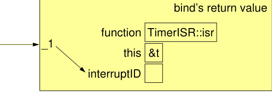

### 通过 `std::function` 和 `std::bind` 实现回调

因此：

```cpp
TimerISR t; // 同之前
KeyboardISR k;
InterruptMgr::registerISR(TIMER_INT_NUM,
std::bind(&TimerISR::isr, &this, &_1));
```

bind 的返回值

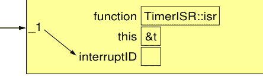

```cpp
InterruptMgr::registerISR(KEYBOARD_INT_NUM,
std::bind(&KeyboardISR::isr, &k, &_1));
```

bind 的返回值

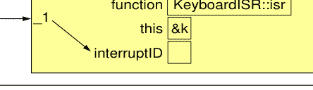

> Scott Meyers, 软件开发顾问
> http://www.artistela.com/
> © 2012 Scott Meyers, 版权所有. 页面 198

本页上的 `bind` 调用除非 `std::placeholders::_1` 可见（例如通过 `using` 声明），否则将无法像所示编译。这在使用 `bind` 的代码中几乎总是会做的。

### `std::function` 的灵活性

`std::function` 同样适用于成员函数和非成员函数：

```cpp
class Timer {
public:
    static void on(int interruptID); // 静态方法
};

InterruptMgr::registerISR(TIMER_INT_NUM,
std::bind(&Timer::on, _1));
```

```cpp
void handleBInt(int interruptID); // 非 const

InterruptMgr::registerISR(KEYBOARD_INT_NUM,
std::bind(&handleBInt, _1));
```

### 评估：`std::function` 和 `bind`

优点：

- 无需自定义类。
- 函数对象：
  - 静态成员函数
- 回调签名只需与目标兼容。

### 评估：`std::function` 和 `bind`

缺点：

- TR1 实现很常见，但无处不在。
- 开发者对 TR1 不熟悉。
- 存在 `bind` 的开源和商业版本。
- `std::function` 对象有代价：
  - 它们可能会分配内存。
  - 实现使用虚函数。

### (简单) 性能对比

| VC11 beta /Ox | 非成员函数 | 虚函数 | std::function |
| :--- | :--- | :--- | :--- |
| 5 次测试平均值 | 238.6 | 391.4 | 590.8 |
| 相对于非成员调用 | 1.0 | 1.6 | 2.5 |

| 使用 g++ 4.7 -O3 | | 非成员函数 | 虚函数 | std::function |
| :--- | :--- | :--- | :--- |
| 5 次测试平均值 | 291.9 | 426.4 | 755.4 |
| 相对于非成员调用 | 1.0 | 1.5 | 2.6 |

| 使用 Boost 1.49 / g++ 4.7 -O3 | 非成员函数 | 虚函数 | boost::function | 非成员函数 | 虚函数 | boost::function |
| :--- | :--- | :--- | :--- | :--- | :--- | :--- |
| 5 次测试平均值 | 259.5 | 390.4 | 921.5 | 293.1 | 468.6 | 787.9 |
| 相对于非成员调用 | 1.0 | 1.5 | 3.6 | 1.0 | 1.6 | 2.7 |
| boost::function/虚函数 | | | 2.4 | | | |

- 虚函数明显慢于非成员函数。
- `std::function` 的性能随库和编译器而异。
- 至少慢 50%，最慢 140%。
- 所有嵌入式开发者通常会禁用 EH 和 RTTI。

如果性能对你很重要，请进行自己的测试。

- 并告诉我们你发现了什么....

## 当用户数据作为回调的一部分

某些回调函数传递了任意的用户数据，例如：

```cpp
extern "C" {
    typedef void (*ISR_t)(int, void *pData); // 回调 API
    void setISR(int interruptID, ISR_t isr, void *pData); // 可能像这样
}
```

此签的更改会向下传播：

```cpp
extern "C" {
    void isrHelper(int interruptID, void *pData)
    {
        try {
            InterruptMgr::isrDispatcher(interruptID, pData);
        } catch (...) {
            set errno, log exception, whatever...
        }
    }
}
```

# 当用户数据作为回调的一部分

此时可以消除 `InterruptMgr` 的 ISR 数组。

- 用户数据是需要被调用的函数指针或对象：

```cpp
class InterruptMgr {
public:
    typedef std::function<void(int)> ISRType;
    ...
    static void registerISR(int interruptID, ISRType *pFunc)
    {
        setISR(interruptID, isrHelper, pFunc);
    }
    static void isrDispatcher(int interruptID, void *pFunc)
    {
        (static_cast<ISRType*>(pFunc))(interruptID);
    }
};
```

注意，无论传递给 `registerISR` 的 `pFunc` 是什么，在 `isrDispatcher` 调用时必须存在。也就是说，传递给 `registerISR` 的函数对象的寿命必须持续到 `isrDispatcher` 最后一次调用该函数。此外，这意味着不能将指向临时对象的指针传递给 `registerISR`。

# 当用户数据作为回调的一部分

示例客户端代码：

```cpp
InterruptMgr::ISRType f(std::bind(&TimerISR::isr, &isr, _1));
InterruptMgr::registerISR(TIMER_INT_NUM, &f);
```


除非 `std::placeholders::_1` 可见（例如通过 `using` 声明），否则本页所示的 `bind` 调用将无法编译。这在使用 `bind` 的代码中几乎是总是做法。

## 总结：从 C 实现回调

- C++ 中的 C API 回调不能是非静态成员函数。
- 某些平台允许调用静态成员函数。
- 仅支持声明为 `extern "C"` 的非成员回调。

- 进入成员函数的 2 种方法：
  - 虚函数。
  - `std::function` 对象。

- 方法在多个方面有所不同：
  - 需要声明基类和虚函数。
  - 是否直接支持非成员函数。
  - 回调签名是否可以变化。
  - “非标准”特征的使用（即 TR1 或 C++11 组件）。
  - 堆内存和/或虚函数表（vtbl）的使用。
- 调用速度。

# TR1

- C++ 委员会库“技术报告 1”（Technical Report 1）。
- C++11 新库功能的基础。
- TR1 功能位于 `std::tr1` 命名空间中。
- C++11 中类 TR1 的功能位于 `std`。
  此类功能与 TR1 中的并不完全相同。
  使用了新的 C++11 语言特性。
  根据对 TR1 的经验调整了 API。
- 调用接口在很大程度上向后兼容
  C++11 主要提供了“增强型”的 TR1 功能

此外，C++11 版本的函数和 `shared_ptr` 分配器支持 TR1 中存在的功能，而 C++11 中的 tuple TR1 中不具备的连接函数（`tuple_cat`）。

# 嵌入式环境下的有效 C++

## TR1 总结

| 新功能 | 总结 |
|---|---|
| 引用包装 (Reference Wrapper) | 行为类似于引用的对象 |
| 智能指针 (Smart Pointers) | 引用计数智能指针 |
| 获取函数对象返回类型 | 对模板编程有用 |
| 增强型成员指针适配器 | 第二代 mem_fun/mem_fun_ref |
| 增强型绑定器 (Binder) | 第二代 bind1st/bind2nd |
| 通用函数对象 (Generalized Functors) | 函数指针的泛化 |
| 类型特质 (Type Traits) | 编译时反射 |
| 随机数 (Random Numbers) | 支持自定义分布 |
| 数学特殊函数 | Laguerre 多项式、Beta 函数等 |
| 元组 (Tuples) | 对（pair）的泛化 |
| 固定大小数组 | 类似 vector，但没有动态分配 |
| 哈希表 (Hash Tables) | 基于哈希表的 set/multiset/map/multimap |
| 正则表达式 (Regular Expressions) | 通用的正则搜索/替换 |
| C99 兼容性 | 64 位整数、`<cstdint>`、新格式说明符等 |

Scott Meyers, 软件开发顾问
http://www.artistela.com/

© 2012 Scott Meyers, 保留所有。
幻灯片 209

关于随机数，C 仅支持 `rand`，其预期是产生均匀分布。TR1 同时支持“引擎”（engines）和“分布”（distributions）。引擎产生均匀分布，而分布获取引擎的结果并据此产生任意分布。TR1 为引擎和分布指定了默认版本，但它允许对两者进行自定义版本定制。

Scott Meyers, 软件开发顾问

© 2012 Scott Meyers, 保留所有。

## TR1 本身

TR1 是一个规范：

- 目标是实现者，而非用户。
- 对其所规定的功能缺乏背景、动机和原理说明。
- 无法独立存在。
  - 例如，假设了 C++03 中的信息。

## 理解 TR1

要理解 TR1 中的功能：

- 咨询“更多信息”。
- 查看扩展提案。
- Scott Meyers 处提供了链接。

| EC++ 页 | 名称 | TR1 名称 | 提案文档 |
|---|---|---|---|
| 265 | 智能指针 | 智能指针 | 1450 |
| 265 | 特质 | 泛包装器 | 1402 |
| 266 | 绑定器 | 函数绑定器 | 1455 |
| 266 | 哈希表 | 未指定的容器 | 1456 |
| 266 | 正则表达式 | 正则表达式 | 1429 |
| 267 | 元组 | 元组类型 | 1403 (PDF) |
| 267 | 数组 | 固定大小数组 | 1479 |
| 267 | mem_fn | 函数 fn | 1432 |
| 267 | 引用包装器 | 引用包装器 | 1453 |
| 267 | 随机数生成 | 随机数生成 | 1452 |
| 267 | 数学特殊函数 | 数学特殊函数 | 1423 |
| 267 | C99 兼容性 | C99 兼容性 | 1468 |
| 267 | 特质 | 类型特质 | 1424 |
| 267 | traits_of | 函数返回类型 | 1454 |

Scott Meyers, 软件开发顾问
http://www.aristeia.com/

© 2012 Scott Meyers, 保留所有。
幻灯片 211

[如果允许，最好有一个显示此处页面的窗口。]

## 什么是 Boost

* 一个志愿者组织和一个网站（boost.org）。
* 一个 C++ 库仓库，这些库：
  * 开源
  * 可移植
  * 经过评审
  * 根据“非病毒性”许可可用。
* 一个尝试标准库增强功能的地方。

## Boost 与 TR1

Boost 促进了大部分 TR1 并实现了所有 TR1：

- 可用的其他完整或部分的 TR1 实现：
- Microsoft:
  - 12/14 个库包含在 VC++ 2010-11 中（VC10-11）
  - C++11 版本随 VC++2011 发布
- Dinkumware: 针对选择平台的完整 TR1 实现
- GNU: 10/14 个库随 gcc 4 发布

TR1 中的 14 个库有 10 个是 Boost 库模型。
缺失的库是数学特殊函数和 C99 兼容性。VC10-11 也是如此。
使用 Boost 代替原生库实现是减少平台间差异（例如在实现和性能方面）的方法。

## TR1 与 Boost

Boost ≠ TR1：

* Boost 提供的功能比 TR1 多得多。
  ➡ 库很少考虑嵌入式问题。
  * 但性能始终是一个关注点。

* Boost API 与对应的 TR1 API 不匹配。
  ➡ 例如，Bind 和 Tuple 在命名空间上存在一些“问题”。

* 其他 TR1 实现可能与 Boost 实现不同。
  ➡ TR1 规定的是接口，而非实现。

## Boost/TR1 总结

- TR1 是 C++03 之后标准库功能的规范。
- Boost 是开源、可移植、经过评审的 C++ 库的主要仓库。
- 许多 TR1 功能可以通过 Boost 和其他地方获取。
- Boost 还提供许多非 TR1 的库。

## 概述

第 2 天（大致安排）：

- 内存映射 I/O 建模
- 从 C API 实现回调函数
- 有趣的模板应用：
  - 基于 `void*` 的类型安全容器
  - 编译时维度单位分析
  - 指定有限状态机 (FSMs)
- 针对安全关键型和实时系统的考虑因素
- 更多信息

# 使用模板消除常见的强制转换

考虑一个 `Stack` 模板：

```cpp
template<typename T>
class Stack {
public:
    Stack();
    ~Stack();
    void push(const T& object);
    T pop();
private:
    ...
};
```

每个不同类型将产生一个新类：

- 这可能导致大量的重复代码。
- 你可能无法承受这种代码膨胀。

## 针对指针的通用栈类

使用 `void*` 指针的类可以实现任何类型的（指针）栈：

```cpp
class GenericPtrStack {
public:
    GenericPtrStack();
    ~GenericPtrStack();
    void push(void *object);
    void * pop();
private:
    ...
};
```

## 针对指针的通用栈类

`GenericPtrStack` 有于代码共享：

```cpp
GenericPtrStack stringPtrStack;
GenericPtrStack intPtrStack;
std::string *newString = new std::string;
int *newInt = new int;
stringPtrStack.push(newString);
intPtrStack.push(newInt); // 这些执行了
//相同的代码
```

但很容易被误用：

```cpp
stringPtrStack.push(newInt); // 哎呀...
std::string *sp = static_cast<std::string>(intPtrStack.pop()); // 哎呀（再次出现)...
```

代码共享很重要，但类型安全同样重要：

- 我们两者都想要。

## 类型安全接口

我们可以通过部分特化 `Stack` 来生成基于 `void*` 的类型安全类：

```cpp
template<typename T>
class Stack<T> {
public:
    void push(T *ptr) { s.push(ptr); }
    T * pop() { return static_cast<T*>(s.pop()); }
private:
    GenericPtrStack s; // 实现
};
```

在运行时，`Stack<T>` 实例化的代价为零：

- 所有实例化都使用单个 `GenericPtrStack` 类的代码
- 所有 `Stack<T>` 成员函数都是隐式内联（inline）的

类型安全的代价为零。

## 类型安全接口

如何强制程序员*仅*使用类型安全的类？

通过将所有内容设为保护（protected）来防止直接使用 `GenericPtrStack`：

```cpp
class GenericPtrStack {
protected:
    GenericPtrStack();
    ~GenericPtrStack();
    void push(void *object);
    void * pop();
private:
    ... // 与之前相同
};
GenericPtrStack stringStack; // 错误！
GenericPtrStack intStack; // 错误！
```

## 类型安全接口

但现在 `Stack<typename*>` 将无法编译：

```cpp
template<typename T>
class Stack<T> {
public:
    void push(T *ptr)
    { s.push(ptr); } // 错误！GenericPtrStack::push
    // 是保护的
...
private:
    GenericPtrStack s;
};
```

## 类型安全接口

私有继承提供了访问保护成员的权限：

```cpp
template<typename T>
class Stack<T*>: private GenericPtrStack {
public:
  void push(T *objectPtr)
  { GenericPtrStack::push(objectPtr); }
  T * pop()
  { return static_cast<T*>(GenericPtrStack::pop()); }
};
```

结果：

- 最大的类型安全
- 最大的效率

我们是如何走到这里的？

- `void*` 指针
- 内联 (Inlining)
- 模板
- 保护成员

# 代码膨胀、指针容器与 QOI

你的 C++ 实现可能让你免于需要做此类事情：

- 某些标准库供应商会为你处理这些问题。
- 某些编译器供应商（例如微软）会消除由于模板实例化产生的重复代码。
- 该方法不仅适用于指针容器。
- 当当 `int` 和 `long` 大小相同时，还会优化 `Template<int>` 和 `Template<long>`。

在寻找手动消除代码膨胀的方法之前，请确保这确实是一个问题。

QOI = “实现质量”（Quality of Implementation）

## 总结：消除常见的强制转换

- 模板可以为不安全的代码生成类型安全的包装器。
- 内联包装器成员函数可以消除任何不安全的运行时代价。
- 仔细的实现选择可以强制设计目标。

# 强制维度单位正确性

正确使用单位至关重要：

- 将时间赋值或比较距离是毫无意义的。
- 将磅赋值或比较牛顿是毫无意义的。
- 1.00 磅 ≈ 4.45 牛顿。
- 1999 年 9 月，NASA 的火星气候轨道飞行器（Mars Climate Orbiter）丢失。


## 创建带类型的值

来自国际单位制（SI）的有用的（带类型）常量：

```cpp
const Mass kilogram(1);              // 在每个情况下，内部的
const Distance meter(1);         // double 被设为 1.0
const Time second(1);
```

其他有用的（带类型）常量也易于定义：

```cpp
const Mass pound(kilogram/2.2);      // 市场磅
const Time minute(60 * second);
const Distance inch(.0254 * meter);
```

变量也是如此：

```cpp
int rawLength;                      // 来自外部的未类型化长度
std::cin >> rawLength;             // 源，已知单位为英寸
Distance length(rawLength * inch);   // 带类型长度
```

Scott Meyers, 软件开发顾问
© 2012 Scott Meyers, 保留所有权利。

“磅（pound）”一词既用于质量也用于力。作为质量的单位，它更正式的名称是“爱衡制磅（Avoirdupois pound）”。作为力的单位，它更正式的名称是“磅力（pound-force）”。两者有时都缩写为“lb”。

## 强制执行维度单位的正确性

当单位进行乘法/除法时，真正的乐趣来自于：

```cpp
template<int m1, int d1, int t1,
    int m2, int d2, int t2>
Units<m1+m2, d1+d2, t1+t2>
operator*(const Units<m1, d1, t1>& Lhs,
    const Units<m2, d2, t2>& rhs)
{
    typedef Units<m1+m2, d1+d2, t1+t2> ResultType;
    return ResultType(Lhs.value() * rhs.value());
}
```

```cpp
template<int m1, int d1, int t1,
    int m2, int d2, int t2>
Units<m1-m2, d1-d2, t1-t2>
operator/(const Units<m1, d1, t1>& Lhs,
    const Units<m2, d2, t2>& rhs)
{
    typedef Units<m1-m2, d1-d2, t1-t2> ResultType;
    return ResultType(Lhs.value() / rhs.value());
}
```

实际实现通常为 Units 使用更多的模板参数：

- 一个用于指定值的精度（通常为 float 或 double）
- 其它的用于七个国际标准单位的指数：
- 质量
- 距离
- 时间
- 电流
- 温度
- 光光
- 物质量

```cpp
template<class T, int m, int d, int t, int q, int k, int i, int a>
class Units {
public:
    explicit Units(T initVal = 0) : val(initVal) {}
    T& value() { return val; }
    const T& value() const { return val; }
private:
    T val;
};
```

```cpp
template<class T, int m1, int d1, int t1, int q1, int k1, int i1, int a1,
                         int m2, int d2, int t2, int q2, int k2, i2, a2>
Units<T, m1+m2, d1+d2, t1+t2, q1+q2, k1+k2, i1+i2, a1+a2>
```


## 运算符重载 `operator*`

```cpp
operator*(const Units<T, m1, d1, t1, q1, k1, i1, a1>& lhs,
          const Units<T, m2, d2, t2, q2, k2, i2, a2>& rhs)
{
    typedef Units<T, m1+m2, d1+d2, t1+t2, q1+q2, k1+k2, i1+i2, a1+a2> ResultType;
    return ResultType(lhs.value() * rhs.value());
}
```

## 无量纲量

无量纲量（即类型为 `Units<T,0,0,0,0,0,0,0>` 的对象）应该与无单位类型（例如 `int`、`double` 等）具有类型兼容。

- 部分模板特化可以有所帮助：

```cpp
template<typename T>
class Units<T, 0, 0, 0, 0, 0, 0, 0>
{
public:
    Units(T initVal = 0): val(initVal) {} // 允许隐式转换
    operator T() const { return val; } // 与类型 T 的值转换
    Units& operator=(T newVal) // 允许从...
    { val = newVal; return *this; } // 类型 T 的值赋值
    ...
private:
    T val;
};
```

如果无法使用部分模板特化，你可以完全为 `T = double` 和/或 `T = float` 进行特化。

## 效率

某些编译器不会将对象放入寄存器中：

- 一个 `Units<double, ...>` 产生的代码可能比原始 `double` 更差。

主意：

- 两组头文件：检查集（checking set）和空操作集（no-op set）。

```cpp
// checking header // no-op header
template<...>
double UnitPrecision;
class Units {
    ...
}
typedef Units<...> Mass; typedef Mass;
typedef Units<...> Distance;
```

## 领域特定嵌入语言

图表和表格都是有限状态机（FSM）的声明式规范。

- 它们规定了应该发生什么，而不是如何发生。

TMP 使得在 C++ 中提供此类规范成为可能。

- 通过领域特定嵌入语言（DSELs）。
- 嵌入在 C++ 之中的领域特定语言。
- 通过 DSELs，规范即程序。

## FSM DSEL

对于 FSM DSEL，

- 客户端指定：
  - 状态（States）
  - 事件（Events）
  - 转换（Transitions）
  - 转换动作（Transition actions）

编译器自动生成 FSM 代码。

- 通过模板实例化（template instantiation）。

## FSM DSEL

在本次演示中，我们只检查 DSEL 的客户端接口：

- 客户端如何使用基于 TMP 的 FSM 库。
- 目标：演示可以实现的功能。
- 库的实现采用 C++ 模板元编程。
- 这是某本 11 章书籍的第 11 章。
- 这里没有时间涵盖第 1-10 章 :-)

仅展示了基本功能。

- 没有状态进入/退出动作，没有守卫（guards），没有状态层次结构等。
- 目标是演示不显而见的模板功能，而不是展示如何实现 FSM。

### 指定 FSM 和状态

FSM 由一个类指定，其状态由一个嵌套枚举指定：

```cpp
class player : public state_machine<player> // player = CD 播放器的 FSM
{ // the player
private:
    enum states { // FSM 中的状态
        Empty, Open, Stopped, Playing, Paused,
        initial_state = Empty // FSM 初始状态
    };
...};
```

- 基类 `state_machine` 提供通用的 FSM 功能。
- TMP 生成的代码将位于此类中。
- 基类将派生类作为模板参数。
- “奇异递归模板模式”（The Curiously Recurring Template Pattern）。
- 状态是私有的。
- FSM 客户端不需要访问它们。
- FSM 客户端只需触发事件的生成。
- FSM 随之做出响应。

状态通过枚举器标识，以便它们可以作为模板参数传递，也可以存储为数据成员的值。一种更自然的设计（在我看来）是将它们建模为类，Boost Statechart 库就采用了这种方法。我不知道该库是如何跟踪 FSM 处于哪种状态的。

### 指定 FSM 事件

事件是类。在这个示例中，

- 它们定义在 FSM 类之外。
  - 如果需要，它们可以嵌套在内部。
- 它们很大程度上是空的。
- 在真实系统中，它们可以是任意复杂的。

```cpp
struct play {};
struct open_close {};
struct pause {};
struct stop {};

class cd_detected {
public:
  cd_detected(char const cdName,
  std::vector<std::clock_t> const& trackLengths) { ... }
};
```

### 指定 FSM 转换动作

转换动作是 FSM 的成员函数：

```cpp
class player : public state_machine<player>
{
private:
    enum states { ... };
    void start_playback(play const);
    void open_drawer(open_close const);
    void close_drawer(open_close const);
    void store_cd_info(cd_detected const);
    void stop_playback(stop const);
    void pause_playback(pause const);
    void resume_playback(play const);
    void stop_and_open(open_close const);
  ...
```

- 与状态一样，转换动作是私有的。
- FSM 客户端只需生成事件。
- FSM 自动响应。

## 指定 FSM 转换

FSM 结构以表格形式指定。

- 基类 `state_machine` 声明了一个行模板：

```cpp
template<class Derived>
class state_machine
{
protected:
    template<
    int CurrentState,
    class Event,
    int NextState,
    void (Derived::*action)(Event&)
    >
    struct row { ... };
};
```

| Current State | Event | Next State | Transition Action |
|---|---|---|---|
| Idle | OpenClose | Open | Open drawer |
| Idle | CD-Detected | Stopped | Start playback |
| Stopped | OpenClose | Open | Open drawer |
| Stopped | Play | Playing | Start playback |
| Stopped | OpenClose | Open | Open drawer |
| Paused | Play | Playing | Resume playback |
| Paused | Stop | Stopped | Stop playback |
| Paused | Open/Close | Open | Stop playback; open drawer |
| Playing | Stop | Stopped | Stop playback |
| Playing | Pause | Paused | Pause playback |
| Playing | Open/Close | Open | Stop playback; open drawer |

## 指定 FSM 转换

FSM 以行集合的形式创建：

```cpp
class player : public state_machine<player> {
private:
  ...
  // states and transitions
  typedef player p;
  // makes transition table cleaner
  struct transition_table : mpl::vector11 {
  //          Start           Event           Next           Action
  row < Stopped,    play,        Playing,      &p::playback>,
  row < Stopped,    open_close, Open,           &p::open_drawer>,
  row < Open,       open_close, Empty,         &p::close_drawer>,
  ...
  };
};
```

- 使得表格更清晰。
- `mpl::vector11` 是一个类似 vector 的容器。
- 在这种情况下，`row` 被实例化。
- 转换表格的名称必须是基类 `state_machine<T>` 所期望的。

## 指定 FSM 转换

这是完整的表格：

```cpp
class player : public state_machine<player> {
private:
  ...
  // states and transitions
  typedef player p;
  // makes transition table cleaner
  struct transition_table : mpl::vector11 {
  //          Start           Event           Next           Action
  row < Stopped,    play,        Playing,      &p::playback>,
  row < Stopped,    open_close, Open,           &p::open_drawer>,
  row < Open,       open_close, Empty,         &p::close_drawer>,
  ...
  };
}
```

### C++ 中的 FSM vs 表格中的 FSM

与原始表格对比：

| Current State | Event | Next State | Transition Action |
|---|---|---|---|
| Empty | OpenClose | Open | Open drawer |
| Empty | CD-Detected | Stopped | Store CD info |
| Stopped | Play | Playing | Start playback |
| Stopped | OpenClose | Open | Open Drawer |
| Open | OpenClose | Empty | Close drawer; collect CD info |
| Paused | Play | Playing | Resume playback |
| Paused | Stop | Stopped | Stop playback |
| Paused | Open/Close | Open | Stop playback; open drawer |
| Playing | Stop | Stopped | Stop playback |
| Playing | Pause | Paused | Pause playback |
| Playing | Open/Close | Open | Stop playback; open drawer |

- 表格就是源代码！

### 使用 FSM

客户端代码只需生成事件：

- 再次，这源自 C++ 模板元编程。

```cpp
player p; // FSM 的实例
p.process_event(open_close()); // 用户打开 CD 播放器
p.process_event(open_close()); // 插入 CD 并关闭
p.process_event( // 检测到 CD
cd_detected("louie", "louie", std::vector<std::clock_t>(/* track lengths */));
p.process_event(play()); // 等等
p.process_event(pause());
p.process_event(play());
p.process_event(stop());
```

成员函数 `process_event` 由基类 `state_machine<T>` 定义。

## 总结：指定状态机（FSM）

- 模板元编程使得创建领域特定嵌入语言（DSELs）成为可能。
- DSEL 促进了声明式编程风格。
- 声明式代码往往更容易创建、理解和增强。

# FSM 的其他方法

在 C++ 中有许多方法可以规范和实现 FSM。它们各不相同：

- 表达能力，例如同时支持分层状态和并发状态。
  - UML 同时支持两者（“状态图 + 推理网”）。
- 同时支持静态和动态 FSM 规范。
- 源代码的类型安全。
- 对编译器模板支持的要求。
- 可执行代码的大小和速度。
- 运行时对堆内存的使用。
- 对多线程的支持。
- 可调试性。
- 耦合性，例如状态与转换之间的耦合。

在“更多信息”中描述了大量方法。

关于耦合性，刚才显示的接口将所有状态都放在一个全局列表中（高耦合），但状态对转换或动作一无所知（低耦合）。在 Boost.Statechart 中，情况相反：没有状态的全局列表，但状态了解转换和动作。

## 总结：有趣的模板应用

- 模板的用途远不止于容器。
- 模板可以为不安全的代码生成类型安全的包装器。
- 模板可以强制执行新类型的类型安全（例如维度单位）。
- 可以在模板的基础上构建领域特定嵌入语言（DSELs）。

## 概述

### 第 2 天（概括）：

- 内存映射 I/O 建模
- 从 C API 实现回调
- 有趣的模板应用：
  - 基于 `void*` 的类型安全容器
  - 编译时维度单位分析
- 指定 FSM
- 安全关键型和实时系统的考虑因素
- 更多信息

# 安全关键系统中的 C++

安全关键型（Safety-Critical）：系统失败 ⇒ 导致（生命）损失或严重伤害。

一些应用领域：

- 交通：飞机、汽车、火车、船只、航天器等。
- 医疗：放射设备、心肺机、给药设备等。
- 通信：战场无线电、应急响应（例如美国的 911，欧洲的 112）等。

目前 C++ 在此类系统中的应用情况？

- 广泛使用：上述所有应用领域。

## 安全关键软件与风险

安全关键软件与“普通”软件类似，区别在于：

- 错误行为的风险必须极低。

因此，关键在于：

- 将错误行为的风险降至最低。

## 降低风险

通用方法：

- 非常详细的规范。
  - 加上严谨的变更管理。
- 全面测试。
  - 在多个级别，例如单元、模块、系统。
  - 包含性能。
    - 足够的性能是一个正确性标准。
- 限制程序员的裁量权。
  - 通过编码规范。
- 大量静态分析：
  - 确保遵守编码规范。
  - 寻找测试难以暴露的问题。
  - 由机器和人类共同进行分析。
    - 类 Lint 的工具。
    - 正式代码审查。

## 降低风险

- 独立冗余计算：
  - 由独立团队实现相同的功能。
  - 可能使用不同的编程语言。
  - 在运行时，所有实现并行执行。
  - 当实现产生不同结果时，
    - 投票？
    - 关机？
    - 回到已知状态？

## 降低风险

回顾：

- 详细的规范。
- 全面测试。
- 限制程序员的裁量权。
- 大量静态分析。
- 独立冗余计算。

以上内容均非 C++ 特有。

- **开发过程远胜于编程语言。**
- 唯一 C++ 特有的是所采用的编码规范。

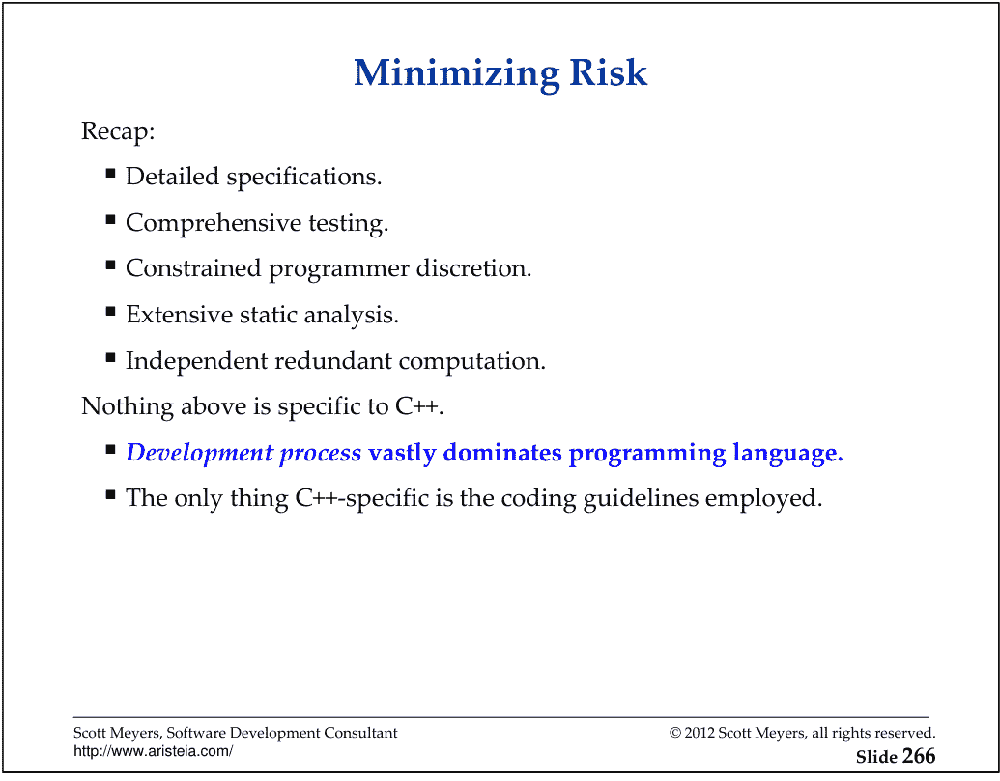

## 编码规范

目标：

- 最大化代码的清晰度和理解性。
- 针对人类和静态分析工具。
- 最大化行为的可预测性。

手段：

- 关于编码实践的要求和禁止。

理想情况下，违规行为可以被自动检测。

- 理想情况很少实现。
- 例如，Hatton 注意到 5-10% 的 MISRA-C 规则无法执行。
- 人工静态分析必须执行无法自动检查的规则。

> Hatton 是 "Les Hatton"，他是《Safer C》的作者，也是影响软件正确性因素（特别是安全关键系统中的因素）等的研究员。我相信他对这一页幻灯片的的评论源于我与他的一次私人谈话。他的网站是 http://www.leshatton.org。

## 规范级别

规范通常有多个严格程度的级别。

- 例如，联合战斗机（JSF）规则使用三个级别：
- Should（应该）：建议性的。


# 嵌入式环境下的高效 C++

## 安全关键系统中的 C++

### 规则级别

- **Will（将要）**：强制性的，不需要验证。
- **Shall（必须）**：强制性的，需要验证。
- **Should（建议）**：建议性的。

因此，级别越高越好。

即使是违反 JSF 的 `Should` 规则也需要经理的批准。

联合战斗机（JSF）规则使用三个级别：

- `Should`：建议性的。
- `Will`：强制性的，不需要验证。
- `Shall`：强制性的，需要验证。

因此，级别越高越好。

即使是违反 JSF 的 `Should` 规则也需要经理的批准。

### 规范类型

#### 词法规范

- 对语义没有影响。
- 减少程序员的裁量权。
- 提高代码的清晰度和理解性。
- **命名规则**：
  - JSF AV 规则：标识符中的所有单词应用 `_` 隔开。
- **格式规则**：
  - 高完整性 C++ 规则：按访问级别组织 `class` 定义，顺序如下：`public`、`protected`、`private`。
  - MISRA C 规则：字面后缀应大写。

#### 语言使用

- 指定语言特性和结构。
- 移除“不必要”和“危险”的内容。
- 识别可接受的语言。
- 减少代码复杂度。
- 增加行为的可预测性。

对于 C++，编码规范通常基于 MISRA-C++ 或 MISRA-C。

### 示例规范

- 不要使用“未下划”（undersified）行为。
- 许多官方术语：“undefined”、“unspecified”等。
- 在 C++ 中常见。

| 类别 | 语言问题 | 库问题 | 问题总数 |
|---|---|---|---|
| 未指定的行为 (Unspecified behaviour) | 25 | 25 | 50 |
| 未定义行为 (Undefined behaviour) | 77 | 29 | 106 |
| 实现行为 (Implementation behaviour) | 58 | 23 | 81 |
| 不确定行为 (Indeterminate behaviour) | 5 | 0 | 5 |
| 无需诊断的行为 | 18 | 0 | 18 |

示例：

```cpp
f(calcThis(), calcThat()); // 禁止：求值顺序未定
int thisVal = calcThis();
int thatVal = calcThat();
f(thisVal, thatVal); // 可以，求值顺序定义
```

### 示例规范（续）

- 避免“意外”行为：
  - JSF AV 规则 177：应避免用户定义的转换函数。
    - 防止意外的隐式转换。
  - MISRA C++ 规则 5-0-1：表达式的值在标准允许的任何求值顺序下相同。
    - 防止编译器或优化相关的行为。
  - 高完整性 C++ 规则 3.3.14：在抽象类中将拷贝赋值运算符声明为保护。
    - 防止通过基类指针/引用对派生对象进行部分赋值。

### 示例规范（续）

- 避免复杂代码：
  - JSF AV 规则 3：所有函数的圈复杂度数不应超过 20。
  - 高完整性 C++ 规则 4.1：不要编写 McCabe 圈复杂度过高的函数。
    - 建议的 C++ 最大值为 10。
  - MISRA C 规则 6-6-3：`continue` 语句应仅在结构良好的 `for` 循环中使用。
    - 该 MISRA 规则的动机如下：“过度使用 `continue` 语句会导致代码内部产生不必要的复杂度。这种复杂性可能会阻碍有效测试，因为额外的逻辑需要被测试。由于控制流依赖，所需的测试可能无法实现。”

### 通过语言选择降低风险

与 C 相比，C++ 可以降低风险：

- 代码在更高层次的抽象上编写
  - 代码看起来更像设计方案。
  - 对多种范式的直接支持：
    - 面向对象（OO）：封装、类、继承、动态绑定等。
    - 泛型模板
    - 过程化
    - 函数式（遗憾的是，C++11 才支持闭包和 lambda 表达式）
- 语言特性减少了对预处理器的需求
  - 例如，C 宏通常可以被 C++ 的 `const` 和 `inline` 取代。
- 模板为不安全的 C 实践提供了类型安全的替代方案。
  - 例如，防止指针和数组：
    - `std::unique_ptr<T>` 或 `std::shared_ptr<T>`（或 `std::auto_ptr<T>`）=> 单个对象。
    - `std::vector<T>` 或 `std::array<T, n>` => 对象数组。

C++ 与 Java、Ada、C# 等相比的风险性存在很大争议 :-)

`std::unique_ptr` 仅在 C++11 中。`std::shared_ptr` 和 `std::array` 在 C++11 和 TR1 中都有。在后者中，它们位于 `std::tr1` 命名空间。

### 与工具相关的风险

编译器、链接器、运行时系统、操作系统等都是软件。

- 它们也影响安全关键系统的可靠性。
- 降低风险意味着解决它们引入的风险。

方法：

- 商业化验证套件：
  - 例如，用于编译器/库是否符合标准 C++。
  - 例如，针对 DO-178B 标准。
- 对生成的代码进行人工分析：
  - 通常结合限制的源代码子集。
- 测试、测试、再测试。

C++ 编译器通常没有通过任何标准化的认证。

- Green Hills 的嵌入式 C++ 编译器已通过 DO-178B A 认证。

### 总结：安全关键系统中的 C++

- 从根本上是一个降低风险的问题。
- 开发过程比编程语言更重要。
- 编码准则加上广泛的静态分析是关键。
- 辅助软件工具/组件的可靠性同样重要。
- C++ 目前已应用于许多安全关键应用领域。

## 实时系统中的 C++

### 实时

- **硬实时（Hard）**：错过时间截止 $\Rightarrow$ 系统失败。
  - 例如：引擎控制器、起搏器、电梯等。
- **软实时（Soft）**：错过时间截止 $\Rightarrow$ 行为质量下降。
  - 例如：音乐视频播放器、IP 网络缓冲区管理器等。

关键特征不是速度，而是时间上的**确定性**：

- **实时系统完全或很大程度上保证其满足时间约束的能力。**
  - 硬实时完全保证。
  - 软实时很大程度上保证。

在 TCP/IP 通信中，TCP 保证数据包交付，但 IP 不保证。因此，如果 IP 层错过了截止并丢弃数据包，TCP 层将检测到并确保重传数据包。最终数据不会丢失，但吞吐量会降低。

### 实时开发方法

C++ 的实时开发与 C 本质相同：

- 确定时间约束。
- 避免具有不确定时间行为的语言特性：
  - C：“开箱即用”的 `malloc`/`free`/`memcpy`
  - C++：
    - “开箱即用”的 `malloc`/`free`/`memcpy`/`delete`
    - RTTI：`dynamic_cast`、`type_info` 对象的比较
    - 异常：`try`/`throw`/`catch`
- 自定义的 `malloc`/`free`/`memcpy` 等可能具有确定性的时间。
- 执行时间分析。
  - 针对函数、任务和整个系统。
  - 硬实时：通常进行最坏情况执行时间（WCET）分析。
  - 软实时：通常进行平均执行分析。

“语言特性”包含了库功能，因为 `malloc`、`free`、`memcpy` 等是库特性而非语言特性。

### 时间行为变异

语言特性的执行时间取决于：

- 编译器和链接器。
  - 包括优化设置。
  - 调用上下文（针对内联函数）。
- 硬件特性：
  - 例如：缓存、流水线、推测性指令执行等。

此外：

- 库功能可能以不同的方式实现：
  - STL 中的容器/算法实现。
  - 例如，`std::string` 可能使用或不使用 SSO（短字符串优化）或 COW（写时复制）。
  - 例如，`std::sort` 可能使用快速排序或内省排序。
  - 针对 `malloc`/`free`/`new`/`delete` 的不同堆管理算法。

SSO = “Small String Optimization”，COW = “Copy on Write”

COW 在 C++11 中不是有效的 `std::string` 实现技术。

### 分析执行时间

#### 块/函数 WCET 分析的方法

- 源代码的静态分析。
  - 通过人工、工具或两者均可。
  - 模板可以通过显式实例化和逐实例化分析来处理。
- 对测试代码进行动态分析。
  - 观察执行块/函数所需的时间。
- 上述方法的结合。
  - 基础块 WCET 的动态分析。
  - 块通过路径的静态分析。
  - 实现 100% 路径覆盖非常困难。

#### 对于系统 WCET，结合

- 单个任务的 WCET 分析。
- 任务调度性分析。

### 分析执行时间（续）

#### 平均情况分析的方法

- 与 WCET 相同的选项。
  - 但确定的是平均时间，而非最坏情况。
- 将 C++ 语句数乘以一个修正系数（fudge factor）。
  - 比 C 的修正系数大。
    - C++ 语句通常比 C 语句做的更多。
  - 在开发期间估算执行时间非常有用。
    - 减少了后期精调的需求。

### 总结：实时系统中的 C++

- 基本方法与 C 相同。
- 通常避免使用堆操作、RTTI 和异常。

## 概览

第 2 天（大致）：

- 内存映射 I/O（Memory-Mapped IO）建模
- 从 C API 实现回调
- 有趣的模板应用：
  - 基于 `void*` 的类型安全容器
  - 编译时代维度分析
  - 指定有限状态机（FSMs）
- 安全关键系统和实时系统的考虑因素
- 更多信息

## 更多信息

### 在嵌入式系统中使用 C++

- “Abstraction and the C++ Machine,” Bjarne Stroustrup, ICESS04 主旨演讲，2004年12月，见 `http://www.research.att.com/~bs/abstraction-and-machine`。
- C++ 概览。
- “OO Techniques Applied to a Real-time, Spaceborne Application,” Alexander Murray and Muhammad Shabab, OOPLA 2006 论文。
  - 描述了用于嵌入式系统的 C++ 运行时库的设计、功能和性能；运行时替换操作系统。
- “C++ Exceptions and the Linux Kernel,” Haldór Isak Glyfason and Gisli Hjálmtsson, Dobbs Journal，2005年9月。
  - 关注异常，也提到了其他语言特性。
- “Reducing Run-Time Overhead in C++,” Embedded Systems, Dan Saks,1998。
  - 如何避免常见的 C++ “坑”。

### 更多关于在嵌入式系统中使用 C++

- "C++ in Embedded Systems: Myth and Reality," Dominic Herity, Embedded Systems Programming, 1998年2月。
  - 虽然过时，但是关于 C 的良好且全面的概述。考虑了代码大小、代码速度、异常、ROM性等。
- "Embedded Programming with C++,” Stephen Williams, 第三次 USENIX Conference on Object-Oriented Technologies and Systems (COOTS),1997。
  - 描述了用于嵌入式系统的 C++ 运行时库的设计、功能和性能；运行时替换操作系统。
- "C++ in der Automotive-Softwareentwicklung," Matthias Kessler, Oliver Müller, and Gerd Schäfer, Elektronik automotive,2006年5月。
  - C++ 语言特性概述及其在嵌入式软件开发中的实用性。
  - 文章为德语。

### 关于 C++ 如何实现的通用信息

- C++ 技术报告, ISO/IEC TR 18015:2006(E), 2006年2月，`http://www.open-std.org/jtc1/sc22/wg21/docs/TR18015.pdf`。
  - 总结了各种语言特性可能的开销。
- Inside the C++ Object Model, Stanley B. Lippman, Addison-Wesley, 1996, ISBN 0-201-83454-5。
  - 信息有时会过时、错误或仅针对 cfront。
- Secure Coding in C and C++, Robert Seacord, Addison-Wesley, 2006, ISBN 0-321-33572-4。
  - 对运行时数据结构以及未定义行为如何导致安全漏洞有良好的探讨。

### 关于 C++ 如何实现的更多通用信息

- **MI 中的 Vtbl 布局顺序**，comp.lang.c++.moderated 线程，由 Scott Meyers 于 2005 年 5 月 27 日发起。可访问 `http://tinyurl.com/rs3rb`。
  - 注意 gcc 的 `-fdump-class-hierarchy` 选项。
- **“异常处理”**，Josée Lajoie，C++ Report，1994 年 3 月-4 月（第一部分）和 1994 年 6 月（第二部分）。
  - 基于表的异常处理（EH）实现概述。
  - 第一部分已在 *C+ Gems* 中重印，Stanley Lippman（编），SIGS Books & Multimedia，1996 年，ISBN 1-884842-37-2。
- **“Itanium C++ ABI”**，CodeSourcery 网站，访问地址 `http://www.codesourcery.com/cxx-abi/abi.html`。
  - 包含基于表的 EH 实现的 ABI 规范（用于 64 位应用程序）。
- **“快速动态转换”**，Michael Gibbs 和 Bjarne Stroustrup，Software Practice & Experience，2005 年 12 月。
  - 描述了 `dynamic_cast` 的常数时间实现。

### 关于微软 C++ 如何实现的信息

- “C 编译器如何实现异常处理”，Vishal Kochhar，The Code Project 网站，2002 年 4 月，访问地址 `http://www.codeproject.com/cpp/exceptionhandler.asp`。
  - 对 MSVC6-7 中如何实现 EH 有极其详尽的描述。
- “Windows 上 C++ 异常处理的代价”，Kevin Frey，向西北 C++ 用户组展示的演讲，2006 年 10 月 18 日。
- “C++ 内部机制”，Jan Gray，收录于 *Black Belt C++: The Masters Collection*，M&T Books，1994 年，ISBN 1-55851-334-5。
  - 描述了语言特性在 MSVC 中是如何（过去是如何）实现的。
- “微软 C++ 名称修饰方案”，Kang Seonghoon，`http://mearie.org/documents/mscmangle/`

### 更多信息

#### 调用纯虚函数时程序的行为

- “调用了纯虚函数：一种解释”，The C++ Source，2007 年 2 月 26 日，`http://www.artima.com/cppsource/pure_virtual.html`。

#### 不使用异常进行错误处理的代价

- “退出、返回、跳转或……抛出”，Dan Saks，*Embedded Systems Design*，2007 年 3 月。
  - 估算使用返回值报告错误条件会导致对象大小增加 15–40%（与不进行错误检测/传播相比）。

#### 控制临时对象的生成和代价

- *More Effective C++: 35 New Ways to Improve Your Programs and Designs*，Scott Meyers，Addison-Wesley，1996 年，ISBN 0-201-63371-X。
  - 第 19-22 项涵盖了控制临时对象创建的基础知识。
  - 第 29 项描述了引用计数如何使对象创建变得廉价。
  - 附有该书目录的副本。

#### 模板元编程 (TMP)，包括表达式模板和基于 TMP 的库

- “使用 C++ 模板元程序”，Todd Veldhuizen，C++ Report，1995 年 5 月。
- *C++ Templates*，David Vandevooordede 和 Nicolai Josuttis，Addison-Wesley，2003 年，ISBN 0-201-73484-2，第 17-18 章。

### 嵌入式环境下的高效 C++

### 更多信息

#### 代码膨胀

- **Techniques for Scientific C++**, Todd Veldhuizen, 印第安纳大学计算机科学技术报告 # 542，2000 年 8 月。访问地址 `http://www.osl.iu/~teldhuiz/papers/techniques/`
  - 第 1.5 节标题为“管理代码膨胀”。
- **“模板导致的代码膨胀”**，comp.lang.c++.moderated 线程，于 2002 年 5 月 16 日发起。访问地址 `http://tinyurl.com/xnhn`。
- **“C++ 模板对比 .NET 泛型”**，comp.lang.c++.moderated 线程，于 2003 年 10 月 4 日发起。访问地址 `http://tinyurl.com/xnhf`。


# 参考文献与资源

## 综述

- Mogens Hansen 在 11 月 13 日发布的帖子开启了一个共性/变性分析的良好子线程。

- **“泛型编程中最小代码膨胀的高效运行时分发，”** Lumoir Bordev 和 Jaikko Järvi，*Library-Centric Software Design (LCSD ‘06)*，2006 年 10 月 22 日。
  - 描述了一种先进的代码提升技术。

- **“在泛型类中最小化依赖以实现更快速、更小的程序，”** Dan Tsafrir *等人*，OOPSLA ‘09，2009 年 10 月。
  - 讨论了不必要的类命名对性能的代价。

---

**Scott Meyers，软件开发顾问**  
http://www.aristele.com/  
© 2012 Scott Meyers, 保留所有权利。

---

## 更多信息：内联

- “Inline Redux，” Herb Sutter，*C/C++ Journal*，2003 年 11 月。
- “Inline Functions，” Randy Meyers，*C/C++ Journal*，2002 年 7 月。
- “高效 C++，” Dov Bulka 和 David Mayhew，Addison-Wesley，2000 年，ISBN 0-201-37950。
- “链接时代码生成，” Matt Pietrek，*Visual C++*。
  - 描述了哪些函数是可以被内联的。

## 更多信息：链接时多态

- “链接时多态，” Michael Kelly，*Effective Test-Driven Development*，2005 年。
  - 使用了链接时多态来达到链接时多态。

## 更多信息：对象的 ROM 机制

- “静态 vs. 动态初始化，” Dan Saks，*Embedded Systems Programming*，1998 年。
- 1999 年 3 月的 *Embedded Systems Programming*。
- 关于 IEEE/IEC 1805 的技术报告。
  - 描述了哪些可以被 ROM 的。

## 更多信息：嵌入式系统的内存映射

- “内存映射，” James Noble 和 Charles Weir，*Embedded Systems*，2001 年，ISBN 0-201-59607。
  - 嵌入式系统中的内存映射。
- “内存管理，” Sasha Gontmakher 和 Konstantin Knizhnik，*Journal*，2005 年 12 月。
- “Boost 库，” Stephen Cleary，http://www.boost.org/pool/doc/index.html。
- “内存分配器，” Doug Lea，http://www.cs.osmu.edu/di/html/malloc.html。

## 更多信息：STL 分配器

- *Effective STL*，Scott Meyers，Addison-Wesley，2001 年，ISBN 0-201-74962。
- *C++ 编程语言（第三版）*，Bjarne Stroustrup，Addison-Wesley，1997 年，ISBN 0-201-88954-4，第 567-576 页。
- “自定义 STL 分配器，” Pete Isensee，http://www.tantalon.com/pete/?customallocators.pt。
  - 2003 年游戏开发者大会的 PPT 资料。
- “使用自定义池分配器提升 STL 性能，” Anthony Aue，*Dr. Forbes Journal*，2005 年 9 月。

## 更多信息：关于内存映射 I/O 建模的更多内容

- “在标准 C 和 C++ 中表示和操作硬件，” 嵌入式系统会议，Dan Saks, 1999 年及后续年份。
  - 2002 年的论文可从：`http://www.open-std.org/jtc1/sc22/wg21/ESC_SF_02_465_paper.pdf` 获取
- C++ 性能技术报告，ISO/IEC TR 18015:2006(E)。
  - 包含关于 C 的 `<iohw.h>` 和 C++ 的 `<hardware>` 的信息。
- “C 的嵌入式 C 扩展” Marcel Beemster 等，C/C++ Users Journal，2005 年 8 月（第一部分）和 9 月（第二部分）。
  - 讨论了 `<iohw.h>`。
  - 纯粹的 C 方法——不使用 C++。

## 更多信息：编译器与 volatile 关键字

- “volatile 发生了错误编译，以及该如何处理，” Eric Eide 和 John Regehr，第八次 ACM 和 IEEE 嵌入式软件国际会议 (EMSOFT)，2008 年 10 月。

## 更多信息：从 C 实现回调函数

- “C++ 中的中断，” Alan Dorfmeyer 和 Pat Baird，嵌入式系统编程，2001 年 8 月。
- “应用设计模式简化信号处理，” Douglas C. Schmidt，C++ Report, 1998 年 4 月。
- “使用成员函数处理 C 风格回调和线程——一种通用的解决方案，” Daniel Lohmann，The Code Project, 2001 年 7 月 8 日，`http://www.codeproject.com/win32/callback_adapter.asp`。
- “泛化 C 风格回调，” `http://www.crystalclearsoftware.com/cgi-bin/boost_wiki/wiki.php?Generalizing_C-Style_Callbacks`。
- “串口设计模式，” `http://www.eventhelix.com/RealtimeMantra/PatternCatalog/serial_port_pattern.htm`。
- “在 C++ 中封装 ISR，” Daniel G. Rusch，嵌入式系统编程，1998 年 2 月。
- “互操作性与 C++ 编译器，” Joe Goodman，C/C++ Users Journal, 2004 年 3 月。

## 更多信息：ISR 问题

- “在中断密集型应用中减少 RTOS 延迟，” Nick Lethaby，嵌入式系统设计，2009 年 6 月。
- “最小化你的 ISR 开销，” Nigel Jones，嵌入式系统设计，2007 年 1 月。
  - 主要关于避免不必要的寄存器保存/恢复 ISR 调用。
- “建模中断向量，” Dan Saks，嵌入式系统设计，2006 年 9 月。
  - 重点是将 ISR 地址存入中断向量表。

## 更多信息：TR1 和 Boost

- *C++ 标准库扩展*，Pete Becker, Addison-Wesley, 2007, ISBN 0-321-41299-0。
  - TR1 的全面参考。
- Scott Meyers 的 TR1 信息网页，`http://www.aristea.com/EC3/TR1_info.html`。
  - 包含指向提议文档、文章、书籍等的链接。
- 《Effective C++》，第三版，Scott Meyers, Addison-Wesley, 2005。
  - 附有目录。
  - 第 35 项解释并演示了 `tr1:function` 的用法。
- “泛化函数指针，” Herb Sutter，C/C++ Users Journal 专家论坛，2003 年 8 月。
  - 描述了 `std::tr1::function`。
- Boost 网站，`http://www.boost.org/`。
- 《超越 C++ 标准库：Boost 简介》，Björn Karlsson, Addison-Wesley, 2006, ISBN 0-321-13354-4。
  - 所选 Boost 库的概述，包括 `bind` 和 `function`。

## 更多信息：编译时维度单位分析

- Boost.Units, Matthias C. Schabel 和 Steven Watanabe, `http://www.boost.org/doc/libs/1_46_0/doc/html/boost_units.units`。
- “用于检查维度单位正确性的库?,” comp.lang.c++. 主版帖子，2005 年 10 月 22 日发起。可从 `http://tinyurl.com/yrgwlt5` 获取。
  - 包含指向多个库的链接（来自 2005 年!）。
- “SIUNITS 中应用模板元编程：基于单位的计算库，” Walter E. Brown, 第二次 C++ 模板编程研讨会，2001 年 10 月。可从 `http://www.oonumerics.org/tmpw01/brown.pdf` 获取。
- “物理量的维度检查，” Michael Kenniston, C/++ Users Journal, 2002 年 11 月。
  - 针对兼容性较差编译器的实现描述（例如 Visual C++ 6）。

## 更多信息：模板元编程与 FSM

- *C++ 模板元编程：概念、工具与技术——超越 Boost*，David Abrahams 和 Aleksey Gutortovy, Addison-Wesley, 2005, ISBN 0-321-22725-5, 第 11 章。
- FSM 示例代码也可从 `http://www.boost.org/libs/mpl/fsm.cpp` 获取。

---

> C++ 模板元编程：概念……特此授权任何获得软件副本的人或组织使用、复制、显示、传输软件（全部或部分）。本软件“按现状”提供，不提供任何形式的明示或隐含保证，包括但不限于对特定用途的保证。在任何情况下，版权所有者或软件分发者对与软件相关的任何损害均不负责。

## 更多信息：ML 教程

- “volatile 发生了错误编译，以及该如何处理，” Eric Eide 和 John Regehr，第八次 ACM 和 IEEE 嵌入式软件国际会议 (EMSOFT)，2008 年 10 月。
- “C++ 中的中断，” Alan Dorfmeyer 和 Pat Baird，嵌入式系统编程，2001 年 8 月。
- “应用设计模式简化信号处理，” Douglas C. Schmidt，C++ Report, 1998 年 4 月。
- “使用成员函数处理 C 风格回调和线程——一种通用的解决方案，” Daniel Lohmann，The Code Project, 2001 年 7 月 8 日，`http://www.codeproject.com/win32/callback_adapter.asp`。
- “泛化 C 风格回调，” `http://www.crystalclearsoftware.com/cgi-bin/boost_wiki/wiki.php?Generalizing_C-Style_Callbacks`。
- “串口设计模式，” `http://www.eventhelix.com/RealtimeMantra/PatternCatalog/serial_port_pattern.htm`。
- “在 C++ 中封装 ISR，” Daniel G. Rusch，嵌入式系统编程，1998 年 2 月。
- “互操作性与 C++ 编译器，” Joe Goodman，C/C++ Users Journal, 2004 年 3 月。

## 更多信息：综合资源列表

- “在中断密集型应用中减少 RTOS 延迟，” Nick Lethaby，嵌入式系统设计，2009 年 6 月。
- “最小化你的 ISR 开销，” Nigel Jones，嵌入式系统设计，2007 年 1 月。
  - 主要关于避免不必要的寄存器保存/恢复 ISR 调用。
- “建模中断向量，” Dan Saks，嵌入式系统设计，2006 年 9 月。
  - 重点是将 ISR 地址存入中断向量表。
- *C++ 标准库扩展*，Pete Becker, Addison-Wesley, 2007, ISBN 0-321-41299-0。
  - TR1 的全面参考。
- Scott Meyers 的 TR1 信息网页，`http://www.aristea.com/EC3/TR1_info.html`。
  - 包含指向提议文档、文章、书籍等的链接。
- 《Effective C++》，第三版，Scott Meyers, Addison-Wesley, 2005。
  - 附有目录。
  - 第 35 项解释并演示了 `tr1:function` 的用法。
- “泛化函数指针，” Herb Sutter，C/C++ Users Journal 专家论坛，2003 年 8 月。
  - 描述了 `std::tr1::function`。
- Boost 网站，`http://www.boost.org/`。
- 《超越 C++ 标准库：Boost 简介》，Björn Karlsson, Addison-Wesley, 2006, ISBN 0-321-13354-4。
  - 所选 Boost 库的概述，包括 `bind` 和 `function`。
- Boost.Units, Matthias C. Schabel 和 Steven Watanabe, `http://www.boost.org/doc/libs/1_46_0/doc/html/boost_units.units`。
- “用于检查维度单位正确性的库?,” comp.lang.c++. 主版帖子，2005 年 10 月 22 日发起。可从 `http://tinyurl.com/yrgwlt5` 获取。
  - 包含指向多个库的链接（来自 2005 年!）。
- “SIUNITS 中应用模板元编程：基于单位的计算库，” Walter E. Brown, 第二次 C++ 模板编程研讨会，2001 年 10 月。可从 `http://www.oonumerics.org/tmpw01/brown.pdf` 获取。
- “物理量的维度检查，” Michael Kenniston, C/++ Users Journal, 2002 年 11 月。
  - 针对兼容性较差编译器的实现描述（例如 Visual C++ 6）。
- *C++ 模板元编程：概念、工具与技术——超越 Boost*，David Abrahams 和 Aleksey Gutortovy, Addison-Wesley, 2005, ISBN 0-321-22725-5, 第 11 章。
- FSM 示例代码也可从 `http://www.boost.org/libs/mpl/fsm.cpp` 获取。

---

> C++ 模板元编程：概念……特此授权任何获得软件副本的人或组织使用、复制、显示、传输软件（全部或部分）。本软件“按现状”提供，不提供任何形式的明示或隐含保证，包括但不限于对特定用途的保证。在任何情况下，版权所有者或软件分发者对与软件相关的任何损害均不负责。

- “volatile 发生了错误编译，以及该如何处理，” Eric Eide 和 John Regehr，第八次 ACM 和 IEEE 嵌入式软件国际会议 (EMSOFT)，2008 年 10 月。
- “C++ 中的中断，” Alan Dorfmeyer 和 Pat Baird，嵌入式系统编程，2001 年 8 月。
- “应用设计模式简化信号处理，” Douglas C. Schmidt，C++ Report, 1998 年 4 月。
- “使用成员函数处理 C 风格回调和线程——一种通用的解决方案，” Daniel Lohmann，The Code Project, 2001 年 7 月 8 日，`http://www.codeproject.com/win32/callback_adapter.asp`。
- “泛化 C 风格回调，” `http://www.crystalclearsoftware.com/cgi-bin/boost_wiki/wiki.php?Generalizing_C-Style_Callbacks`。
- “串口设计模式，” `http://www.eventhelix.com/RealtimeMantra/PatternCatalog/serial_port_pattern.htm`。
- “在 C++ 中封装 ISR，” Daniel G. Rusch，嵌入式系统编程，1998 年 2 月。
- “互操作性与 C++ 编译器，” Joe Goodman，C/C++ Users Journal, 2004 年 3 月。
- “在中断密集型应用中减少 RTOS 延迟，” Nick Lethaby，嵌入式系统设计，2009 年 6 月。
- “最小化你的 ISR 开销，” Nigel Jones，嵌入式系统设计，2007 年 1 月。
  - 主要关于避免不必要的寄存器保存/恢复 ISR 调用。
- “建模中断向量，” Dan Saks，嵌入式系统设计，2006 年 9 月。
  - 重点是将 ISR 地址存入中断向量表。
- *C++ 标准库扩展*，Pete Becker, Addison-Wesley, 2007, ISBN 0-321-41299-0。
  - TR1 的全面参考。
- Scott Meyers 的 TR1 信息网页，`http://www.aristea.com/EC3/TR1_info.html`。
  - 包含指向提议文档、文章、书籍等的链接。
- 《Effective C++》，第三版，Scott Meyers, Addison-Wesley, 2005。
  - 附有目录。
  - 第 35 项解释并演示了 `tr1:function` 的用法。
- “泛化函数指针，” Herb Sutter，C/C++ Users Journal 专家论坛，2003 年 8 月。
  - 描述了 `std::tr1::function`。
- Boost 网站，`http://www.boost.org/`。
- 《超越 C++ 标准库：Boost 简介》，Björn Karlsson, Addison-Wesley, 2006, ISBN 0-321-13354-4。
  - 所选 Boost 库的概述，包括 `bind` 和 `function`。


# 参考文献

## Boost.Units
- **作者**: Matthias C. Schabel 和 Steven Watanabe
- **链接**: `http://www.boost.org/doc/libs/1_46_0/doc/html/boost_units.units`

## 用于检查维度单位正确性的库?
- **来源**: comp.lang.c++
- **主版帖子**: 2005 年 10 月 22 日发起
- **链接**: `http://tinyurl.com/yrgwlt5`
- **说明**: 包含指向多个库的链接（来自 2005 年!）。

## SIUNITS 中应用模板元编程：基于单位的计算库
- **作者**: Walter E. Brown
- **会议**: 第二次 C++ 模板编程研讨会
- **时间**: 2001 年 10 月
- **链接**: `http://www.oonumerics.org/tmpw01/brown.pdf`

## 物理量的维度检查
- **作者**: Michael Kenniston
- **期刊**: C/++ Users Journal
- **时间**: 2002 年 11 月
- **说明**: 针对兼容性较差编译器的实现描述（例如 Visual C++ 6）。

## C++ 模板元编程：概念、工具与技术——超越 Boost
- **作者**: David Abrahams 和 Aleksey Gutortovy
- **出版社**: Addison-Wesley
- **年份**: 2005
- **ISBN**: 0-321-22725-5
- **相关章节**: 第 11 章

## FSM 示例代码
- **链接**: `http://www.boost.org/libs/mpl/fsm.cpp`

## 许可声明
> C++ 模板元编程：概念……特此授权任何获得软件副本的人或组织使用、复制、显示、传输软件（全部或部分）。本软件“按现状”提供，不提供任何形式的明示或隐含保证，包括但不限于对特定用途的保证。在任何情况下，版权所有者或软件分发者对与软件相关的任何损害均不负责。

## 相关文章与论文
- **volatile 发生了错误编译，以及该如何处理** — Eric Eide 和 John Regehr，第八次 ACM 和 IEEE 嵌入式软件国际会议 (EMSOFT)，2008 年 10 月。
- **C++ 中的中断** — Alan Dorfmeyer 和 Pat Baird，嵌入式系统编程，2001 年 8 月。
- **应用设计模式简化信号处理** — Douglas C. Schmidt，C++ Report，1998 年 4 月。
- **使用成员函数处理 C 风格回调和线程——一种通用的解决方案** — Daniel Lohmann，The Code Project，2001 年 7 月 8 日，`http://www.codeproject.com/win32/callback_adapter.asp`。
- **泛化 C 风格回调** — `http://www.crystalclearsoftware.com/cgi-bin/boost_wiki/wiki.php?Generalizing_C-Style_Callbacks`。
- **串口设计模式** — `http://www.eventhelix.com/RealtimeMantra/PatternCatalog/serial_port_pattern.htm`。
- **在 C++ 中封装 ISR** — Daniel G. Rusch，嵌入式系统编程，1998 年 2 月。
- **互操作性与 C++ 编译器** — Joe Goodman，C/C++ Users Journal，2004 年 3 月。
- **在中断密集型应用中减少 RTOS 延迟** — Nick Lethaby，嵌入式系统设计，2009 年 6 月。
- **最小化你的 ISR 开销** — Nigel Jones，嵌入式系统设计，2007 年 1 月。
  - 主要关于避免不必要的寄存器保存/恢复 ISR 调用。
- **建模中断向量** — Dan Saks，嵌入式系统设计，2006 年 9 月。
  - 重点是将 ISR 地址存入中断向量表。

## C++ 标准库扩展
- **作者**: Pete Becker
- **出版社**: Addison-Wesley
- **年份**: 2007
- **ISBN**: 0-321-41299-0
- **说明**: TR1 的全面参考。

## Scott Meyers 的 TR1 信息网页
- **链接**: `http://www.aristea.com/EC3/TR1_info.html`
- **说明**: 包含指向提议文档、文章、书籍等的链接。

## Effective C++ (第三版)
- **作者**: Scott Meyers
- **出版社**: Addison-Wesley
- **年份**: 2005
- **说明**: 附有目录。第 35 项解释并演示了 `tr1:function` 的用法。

## 泛化函数指针
- **作者**: Herb Sutter
- **来源**: C/C++ Users Journal 专家论坛
- **时间**: 2003 年 8 月
- **说明**: 描述了 `std::tr1::function`。

## Boost 网站
- **链接**: `http://www.boost.org/`

## 超越 C++ 标准库：Boost 简介
- **作者**: Björn Karlsson
- **出版社**: Addison-Wesley
- **年份**: 2006
- **ISBN**: 0-321-13354-4
- **说明**: 所选 Boost 库的概述，包括 `bind` 和 `function`。

---

# 更多信息

## 实时系统中的 C++
- **最坏情况执行时间 (Worst Case Execution Time)** — 维基百科，`http://en.wikipedia.org/wiki/Worst_case_execution_time`。
- **安全关键应用中现代处理器的使用** — Iain Bates 等，《计算机期刊》，2001 年 6 月。第 4.4 节专门介绍了 WCET 分析。
- **你无法控制你无法测量的东西……** — Nat Hillary 和 Ken Madsen，第 2 届国际最坏情况执行时间分析工作会议论文集，2002 年 6 月。分析 RT 软件的某些方法的优缺点概述。由营销经理撰写——这一点在文中显而易见。

## C++11
- **C++11** — 维基百科。
- **C++ 标准库 (第二版)** — Nicolai M. Josuttis，Addison-Wesley，2012 年。
- **新 C++ (C++11) 概述** — Scott Meyers，`http://www.artima.com/shop/overview_of_the_new_cpp`。注释训练材料（类似于这些材料）。
- **C++11 - 最近通过的新的 ISO C++ 标准** — Bjarne Stroustrup，`http://www.stroustrup.com/C++11FAQ.html`。
- **cppreference.com** — 标准 C++ 和标准 C 的参考源。

---

# 许可信息

Scott Meyers 为本课程和其他培训课程提供商业或个人使用的许可。详情如下：

- **商业用途**: `http://aristea.com/Licensing/licensing.html`
- **个人用途**: `http://aristea.com/Licensing/personalUse`

目前可供个人使用的课程包括：

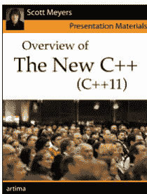
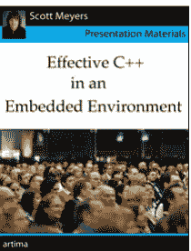

---

# 关于 Scott Meyers

Scott 是一位 C++ 软件系统设计与实现的培训师兼顾问。他的网站 `http://www.aristeia.com/` 提供以下信息：


- 培训与咨询服务
- 书籍、文章或其他出版物
- 即将进行的演讲
- 专业活动博客

---

# 嵌入式环境中的高效 C++ (条款列表)

| 项目 | 页码 |
| :--- | :--- |
| 项目 14：仔细考虑资源管理类中的拷贝行为。 | 66 |
| 项目 15：为资源管理类提供资源的访问方法。 | 69 |
| 项目 16：在对 new 和 delete 的拷贝时使用相同的形式。 | 73 |
| 项目 17：在独立类中使用智能指针存储所需的对象。 | 75 |

---

# 目录 (Effective C++ 第三版)

| 章节 | 内容 | 页码 |
| :--- | :--- | :--- |
| **序言** | | xv |
| **致谢** | | xii |
| **引言** | | 1 |
| **第 1 章：让自己逐渐精通 C++** | | |
| | 项目 1：将 C++ 视为语言的联邦体。 | 11 |
| | 项目 2：优先使用 const、枚举和惯用法而非定义。 | 13 |
| | 项目 3：尽可能使用 const。 | 17 |
| | 项目 4：确保对象在使用之前已进行初始化。 | 26 |
| **第 2 章：构造函数、析构函数和赋值运算符** | | |
| | 项目 5：了解 C++ 编写和调用的函数。 | 34 |
| | 项目 6：避免使用你不理解的编译器生成的函数。 | 37 |
| | 项目 7：在多态基类中声明析构函数。 | 40 |
| | 项目 8：防止异常离开析构函数。 | 44 |
| | 项目 9：让赋值运算符返回对 `*this` 的引用。 | 48 |
| | 项目 10：在使用 operator= 时避免自赋值。 | 53 |
| | 项目 11：拷贝对象的所有部分。 | 57 |
| **第 3 章：资源管理** | | |
| | 项目 12：使用对象来管理资源。 | 61 |
| **第 4 章：设计与声明** | | |
| | 项目 18：使接口易于正确使用且难于错误使用。 | 78 |
| | 项目 19：尝试将类设计为类型，而不是数据和函数的集合。 | 84 |
| | 项目 20：优先按引用传递而非值传递。 | 88 |
| | 项目 21：当你需要拷贝时不要返回引用。 | 90 |
| | 项目 22：将数据成员声明为私有。 | 94 |
| | 项目 23：优先使用非 const 成员函数而非成员函数。 | 98 |
| | 项目 24：当虚行为应适用于所有参数时，声明非虚函数。 | 102 |
| | 项目 25：考虑支持不抛出异常的拷贝。 | 106 |
| **第 5 章：实现** | | |
| | 项目 26：尽早推迟虚函数的定义。 | 113 |
| | 项目 27：最小化虚函数的调用。 | 116 |
| | 项目 28：避免向对象传递“悬空”指针。 | 122 |
| | 项目 29：理解内联的代价和风险。 | 127 |
| | 项目 30：避免基类之间的编译依赖。 | 134 |
| | 项目 31：使用 Pimpl 惯用法。 | 139 |
| **第 6 章：继承与对象设计** | | |
| | 项目 32：理解“is-a”关系。 | 150 |
| | 项目 33：避免隐藏名称。 | 156 |
| | 项目 34：区分继承与实现。 | 158 |
| | 项目 35：使用组合惯用法。 | 161 |
| | 项目 36：考虑替代方案。 | 169 |
| | 项目 37：不要重定义虚函数。 | 178 |
| | 项目 38：不要在继承中重构函数。 | 180 |
| | 项目 39：建模“has-a”关系。 | 184 |
| | 项目 40：审慎使用继承。 | 187 |
| **第 7 章：模板与泛型** | | |
| | 项目 41：理解多态。 | 199 |
| | 项目 42：在模板中访问成员。 | 203 |
| | 项目 43：优先使用类型无关的代码。 | 207 |
| | 项目 44：当需要类型转换时。 | 222 |
| | 项目 45：在模板内部定义成员函数。 | 226 |
| | 项目 46：使用类型特质。 | 233 |
| | 项目 47：注意模板元编程。 | 238 |
| **第 8 章：自定义 new 和 delete** | | |
| | 项目 48：理解异常处理器。 | 240 |
| | 项目 49：在何种情况下重定义 new 是合理的。 | 247 |
| | 项目 50：重定义 delete 的含义。 | 252 |
| | 项目 51：使用 placement delete。 | 256 |
| **第 9 章：杂记** | | |
| | 项目 52：注意编译器警告。 | 262 |
| | 项目 53：熟悉标准库。 | 263 |
| | 项目 54：熟悉 Boost。 | 269 |
| **附录 A** | 超越高效 C++ | 273 |
| **附录 B** | 第二版与第三版之间的映射 | 277 |
| **索引** | | 280 |

---

# 嵌入式环境中的高效 C++ (效率专题)

| 项目 | 页码 |
| :--- | :--- |
| 项目 16：记住 80/20 原则 | 82 |
| 项目 17：考虑惰性计算。 | 85 |
| 项目 18：断言的代价。 | 93 |
| 项目 19：理解临时对象。 | 98 |
| 项目 20：促进返回值。 | 101 |
| 项目 21：通过重载避免隐式类型转换。 | 105 |
| 项目 22：使用替代 else。 | 107 |
| 项目 23：考虑替代库。 | 110 |
| 项目 24：理解函数、多重继承、虚基类和 RTTI。 | 113 |

---

# 致谢与引言

- **致谢**: xi
- **引言**: 技术

---

# 基础

- **项目 1**：区分指针和引用 | 9
- **项目 2**：优先使用 C++ 风格的强制类型转换 | 12
- **项目 3**：永远不要对数组使用多态性 | 16
- **项目 4**：避免使用默认构造函数 | 18

---

# 运算符

- **项目 25**：虚构造函数和非虚函数 | 123
- **项目 26**：限制类对象的大小 | 130
- **项目 27**：要求或禁止堆上的对象 | 140
- **项目 28**：智能指针 | 159
- **项目 29**：引用计数 | 183
- **项目 30**：程序 | 210
- **项目 31**：使函数相对于多个对象是虚的 | 228
- **项目 5**：警惕用户定义的转换以及增/减运算符 | 24
- **项目 6**：区分前缀和后缀形式的增减 | 24
- **项目 7**：重载 `&&`, `||` | 31
- **项目 8**：理解临时对象和 delete 的含义 | 38

---

# 杂记

- **项目 32**：以未来时态编程 | 252
- **项目 33**：使非 const 抽象类 | 258
- **项目 34**：理解在同一程序中同时处理 C++ 和 C | 270
- **项目 35**：熟悉语言标准

---

# 嵌入式环境下的有效 C++ (STL 专题)

## 目录

| 章节 | 页码 |
| :--- | :--- |
| **条 16**: 了解如何将 `vector` 和 `string` 数据用于遗留 API。 | 74 |
| **条 17**: 使用“交换技巧 (swap trick)”增加容量。 | 77 |
| **条 18**: 避免使用 `vector<bool>`。 | 79 |
| **第 3 章：关联容器** | **83** |
| **条 19**: 理解等价性（equality）与相等性（equivalence）之间的区别。 | 83 |
| **条 20**: 关联容器优于使用比较类型。 | 88 |
| **条 21**: 为单元素容器务始终准备好比较函数。 | 92 |
| **条 22**: 避免在 `set` 和 `multiset` 中就地修改键。 | 95 |
| **条 23**: 优先使用关联容器而非排序容器。 | 98 |
| **条 24**: 为了效率，在 `map::operator[]` 和 `map::at` 之间做出选择。 | 100 |
| **条 25**: 熟悉非标准头文件。 | 106 |
| **第 4 章：迭代器** | **111** |
| **条 26**: 优先使用迭代器、`reverse_iterator` 和 `const_iterator`。 | 116 |
| **条 27**: 使用迭代器进行进并转换为 `const_iterator`。 | 120 |
| **条 28**: 理解如何使用 `reverse_iterator` 的基迭代器。 | 123 |
| **条 29**: 基于字符的容器优于使用非 const 迭代器。 | 126 |
| **第 5 章：算法** | **128** |
| **条 30**: 确保目标范围足够大。 | 129 |
| **条 31**: 了解你的排序选项。 | 133 |
| **条 32**: 如果你想删除某些内容，从易用性考虑优先使用类似 `remove` 的算法。 | 139 |
| **条 33**: 理解容器上类似 `vector` 的算法。 | 143 |
| **条 34**: 哪些算法期望排序后的范围？ | 146 |
| **条 35**: 通过 `mismatch` 或 `lexicographical_compare` 实现简单的不区分大小写比较。 | 150 |
| **条 36**: 理解 `copy_if` 的正确实现。 | 154 |

---

# 版权信息

- **前言**: xi
- **致谢**: xv
- **引言**: i

---

# 第 1 章：容器

- **条 1**: 细心选择你的容器。(11)
- **条 2**: 警惕容器无关代码的幻觉。(15)
- **条 3**: 对于对象容器，优先使用正确的 `for`。(20)
- **条 4**: 使用 `empty` 代替检查大小是否为 0。(23)
- **条 5**: 为你的单元素容器优先使用范围成员函数。(24)
- **条 6**: 大多数视图访问使用 `const`。(29)
- **条 7**: 使用嵌套指针容器时，记住在销毁前删除指针。(36)
- **条 8**: 永远不要创建 `auto_ptr` 容器。(40)
- **条 9**: 删除元素时要仔细选择。(43)
- **条 10**: 理解分配器的合法用法。(54)
- **条 11**: 对线程安全有合理的预期。(56)
- **条 12**: 为 STL 容器使用 `reserve`。(62)

---

# 第 2 章：vector 和 string

- **条 13**: 优先使用 `vector` 和 `string` 代替动态分配数组。(63)
- **条 14**: 使用 `reserve` 避免不必要的重新分配。(66)
- **条 15**: 注意 string 实现的差异。(68)

> 重印自《Effective STL: 50 Specific Ways to Improve Your Use of the Standard Template Library》，Scott Meyers 著，Addison-Wesley Publishing，2001。
>
> Scott Meyers，软件开发顾问
>
> © 2012 Scott Meyers, 版权所有。

---

# 第 5 章：算法 (续)

- **条 37**: 使用 `accumulate` 或 `for_each` 汇总范围。

---

# 第 6 章：函数对象、函数对象类、函数等

- **条 38**: 为按值传递设计函数对象类。
- **条 39**: 使谓词变为函数。
- **条 40**: 使函数对象类可调用。
- **条 41**: 理解 `ptr_fun`、`mem_fun` 和 `mem_fun_ref` 等原因。
- **条 42**: 为 `less<T>` 编写赋值运算符。

---

# 第 7 章：使用 STL 编程

- **条 43**: 优先使用算法调用而非手写循环。


- 条 44: 优先使用成员函数而非同名的算法。

- 条 45: 区分 `count`、`find`、`binary_search`、`lower_bound`、`upper_bound` 和 `equal_range`。

- 条 46: 使用函数对象而非算法参数。

- 条 47: 避免生成只写代码。

- 条 48: `#include` 适当的头文件。

- 条 49: 学习解读 STL 相关的编译器诊断信息。

# 参考文献

# 附录 A：本地化与区分大小写的比较

# 附录 B：关于微软 STL 平台的备注

# 索引

> 重印自《Effective STL: 50 Specific Ways to Improve Your Use of the Standard Template Library》，Scott Meyers 著，Addison-Wesley Publishing Company，2001。
