# Effective JavaScript：利用 JavaScript 的 68 种特定方法（高效软件开发系列）

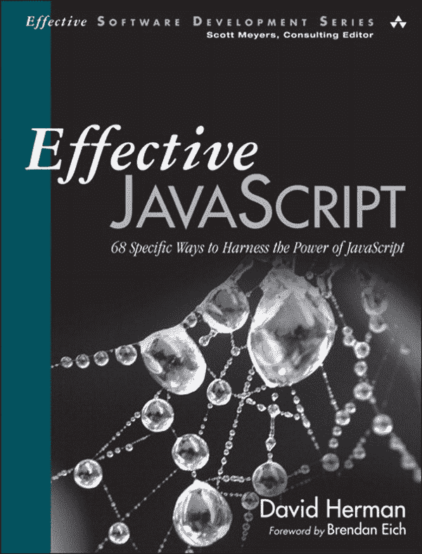


制造商和销售商用于区分产品的许多名称自称为商标。这些标记出现在书中且出版商已知，已以首字母大写或全大写的形式打印。

作者和出版商在编写本书时付出了努力，但不提供任何形式的明示或暗示保证，并对错误或遗漏不承担责任。对于使用本文包含的信息或程序而引起或与之相关的附带或后果性损害，不承担任何责任。

对于批量购买或特殊销售，出版商对本书提供优惠的折扣，这可能包括电子版本和/或针对您的业务、培训目标、营销重点和品牌兴趣的定制封面和内容。更多信息请联系：

美国企业和政府销售部

(800) 382-3419

corpsales@pearsontechgroup.com

美国以外销售请联系：

国际销售

international@pearsoned.com

访问我们的网站：[`informit.com/aw.com`](http://informit.com/aw.com)

*美国国会图书馆出版分类数据*

Herman, David.

Effective JavaScript: 68 specific ways to harness the power of JavaScript / David Herman.

页码 cm

包含索引。

## 对《Effective JavaScript》的赞誉

“符合《高效软件开发系列》编程书籍的预期，Dave Herman 编写的《Effective JavaScript》是任何想要进行严肃 JavaScript 编程的人的必读。这本书详细解释了 JavaScript 的内部工作原理，帮助读者更好地利用这种语言。”

—Erik Arvidsson，高级软件工程师

“能有一个像 David 这样用如此轻松、友好的语言交流的编程语言专家是不常的。他对 JavaScript 语法和语义的讲解既富有魅力又见见地；对陷阱的提醒与真实的用例相得益彰，节奏掌握得很好。当你读完这本书时，你会发现自己获得了一种强大且全面的掌握感。”

—Paul Irish，Google Chrome 开发者倡议师

“在读《Effective JavaScript》之前，我以为这只是另一本关于如何写更好 JavaScript 的书。但这本书不仅做到了这一点，还更多——它让你对语言有了深入的理解。这至关重要。没有那种理解，你对语言本身将一无所知。你只知道其他程序员是如何写代码的。

如果你想成为一名真正优秀的 JavaScript 开发者，请读读这本书。我个人就希望在我第一次开始写 JavaScript 时能有它。”

—Anton Kovalyov，JSHint 开发人员

“如果你正在寻找一本能提供关于 JavaScript 语言正式但极具可读性见解的书，不用再找了。中级 JavaScript 开发者会在书中发现知识宝库，即使是高水平的 JavaScript 高手也几乎能学到一两个东西。对于想要跳投入 JavaScript 的其他语言资深从业者来说，这本书是快速上手的必读之。无论你的背景如何，作者 Dave Herman 在探索 JavaScript——它的优美之处和它的缺点——方面做得非常出色。

—Rebecca Murhey，高级开发者

“《Effective JavaScript》是任何理解 JavaScript 并非小玩具的人的必读之物。”

—Alex Russell，软件工程师

“很少有人有机会与大师一起学习。《Effective JavaScript》带你进入到,,,,,,`

`Effective JavaScript` 不是一个世纪世纪的作品。”

—Rick Waldron，JavaScript 宣教士


*送给我亲爱的 Lisa*

1. 了解你正在使用哪种 JavaScript (`ch01-s1`)
2. 理解浮点数 (`ch01-s2`)
3. 避免类型转换 (`ch01-s3`)
4. 优先使用原始类型而非对象包装器 (`ch01-s4`)
5. 避免使用 `==` (`ch01-s5`)
6. 学习分号插入的局限性 (`ch01-s6`)
7. 将字符串视为 16 位代码序列 (`ch01-s7`)

1. 尽量减少全局对象的使用 (`ch02-s1`)
2. 始终声明局部变量 (`ch02-s2`)
3. 避免使用 `with` (`ch02-s3`)
4. 熟悉闭包 (`ch02-s4`)
5. 理解变量提升 (`ch02-s5`)
6. 使用立即调用函数表达式创建局部作用域 (`ch02-s6`)
7. 注意具命名函数表达式的不可移植作用域 (`ch02-s7`)
8. 注意块块级局部函数声明的不可移植作用域 (`ch02-s8`)
9. 避免使用 `eval` 创建局部变量 (`ch02-s9`)
10. 优先使用间接 `eval` 而非直接 `eval` (`ch02-s10`)

1. 理解函数、方法和构造函数调用的区别 (`ch03-s1`)
2. 熟悉使用高阶函数 (`ch03-s2`)
3. 使用 `call` 带自定义接收者调用方法 (`ch03-s3`)
4. 使用 `apply` 调用不同数量参数的函数 (`ch03-s4`)
5. 使用 `arguments` 创建变长函数 (`ch03-s5`)

## 条目 23：永远不要修改 `arguments` 对象

## 条目 24：使用变量保存 `arguments` 的引用

## 条目 25：使用 `bind` 固定接收者的方法

## 条目 26：使用 `bind` 对函数进行柯化

## 条目 27：优先使用闭包而非字符串来封装代码

## 条目 28：避免依赖函数的 `toString` 方法

## 条目 29：避免非标准的堆栈检查属性

## 条目 30：理解 `prototype`、`getPrototypeOf` 和 `__proto__` 的区别

## 条目 31：优先使用 `Object.getPrototypeOf` 而非 `__proto__`

## 条目 38：从子类构造函数调用父类构造函数

## 条目 39：永远不要复用父类的属性名

## 条目 40：避免继承标准类

## 条目 41：将原型视为实现细节

## 条目 42：避免鲁莽的猴补（Monkey-Patching）

## 条目 43：通过 `Object` 的直接实例构建轻级字典

## 条目 44：使用 `null` 原型防止原型污染

## 条目 45：使用 `hasOwnProperty` 防止原型污染

## 条目 46：对于有序集合，优先使用数组而非字典

## 条目 47：永远不要在 `Object.prototype` 上添加可枚举属性

## 条目 49：数组迭代时优先使用 `for` 循环而非 `for`...`in` 循环

## 条目 51：在类数组对象上复用通用的 `Array` 方法

## 条目 52：优先使用数组字面量而非 `Array` 构造函数

# 第 6 章：库与 API 设计

## 条目 53：保持一致的规范

## 条目 54：将 `undefined` 视为“无值”

## 条目 55：接受选项对象作为关键字参数

## 条目 56：避免不必要的状态

## 条目 59：避免过度的类型转换

## 条目 60：支持方法链调用

## 条目 61：避免非标准的堆栈检查属性

## 条目 62：数组迭代时优先使用 `for` 循环而非 `for`...`in` 循环

## 条目 63：避免非标准的堆栈检查属性

## 条目 65：避免不必要的状态

## 条目 66：在类数组对象上复用通用的 `Array` 方法

## 条目 67：优先使用闭包而非字符串来封装代码

## 条目 68：优先使用迭代方法而非循环

# 前言

众所周知，JavaScript 是 1995 年 5 月在几天内创建的。在这一演变过程中，JavaScript 保持了向后兼容（“向前兼容”），并且默认是可变的，即使最新的 ECMAScript 标准已经添加了防止对象扩展和密封属性被覆盖的方法。

除了这些基础用途外，JavaScript 的可塑性鼓励了用户沿着几种创意路径形成并成长。用户基于其他语言创建了工具包或框架：基于 Ruby 的 Prototype、基于 Python 的 MochiKit、基于 Java 的 Dojo。然后是 jQuery 库（新浪 JavaScript），当我 2007 年第一次看到它时它似乎是一个后者，但它通过抛弃其他语言的先例并从旧库中学习，遵循浏览器的“查询并执行”模型席卷了 JavaScript 世界。

没有任何语言是没有缺陷的，也没有限制到可以规定通用最佳实践，JavaScript 远非没有缺陷，也不是限制性的（甚至恰恰相反）。因此，为了编写高效，与大多数其他语言一样，JavaScript 开发者必须学习并追求良好的风格、正确的用法以及最佳实践。

这本书采取了基于具体证据和经验的平衡方法，没有陷入僵化或过度规定。我认为，对于许多寻求在编写高效 JavaScript 的同时不牺牲表达以及追求新想法和范式的自由的人来说，它将是一个关键的辅助和可靠的指南。

—*Brendan Eich*

学习一种编程语言需要熟悉它的`语法`（syntax），即构成合法程序的格式和结构集合；以及`语义`（semantics），即这些形式的含义或行为。但在此之外，掌握一种语言还需要理解它的`语用`（pragmatics），即利用语言特性来构建有效程序的方法。后一类可能尤为微妙，特别是在像 JavaScript 这样灵活且富有表现力的语言中。

## JavaScript 与 ECMAScript

在深入学习本书的内容之前，澄清一些术语是有帮助的。本书介绍的是一种几乎被通俗称为 JavaScript 的语言。然而，定义规范的官方标准描述的是一种它称为 `ECMAScript` 的语言。其历史错综，但归结底是一个商标问题：出于法律原因，标准组织 `Ecma International` 无法在其标准中使用“JavaScript”这一名称。（更上添添花的是，标准组织将其名称从最初的 `ECMA`——欧洲计算机制造商协会的缩写——更改为不区分大小写的 `Ecma International`。在更改发生时，大写的名称 `ECMAScript` 已经铁定成章了。）

正式地，当人们提到 `ECMAScript` 时，通常是指 `Ecma` 标准所规范的“理想”语言。同时，`JavaScript` 的名称可以指实际操作中存在的语言，也可以指某个厂商特定的 JavaScript 引擎。在日常用法中，人们经常交替使用这两个术语。为了清晰和一致，在本书中我将只使用 `ECMAScript` 来讨论官方标准；否则，我将该语言称为 `JavaScript`。我还会使用常用缩写 `ES5` 来指代 `ECMAScript` 标准的第五版。

## 关于 Web

谈论 JavaScript 而不谈论 Web 是困难的。迄为止，JavaScript 是唯一在所有主流网页浏览器中都内置客户端应用脚本支持的编程语言。此外，随着 `Node.js` 平台的出现，JavaScript 近年来已成为实现服务端应用的流行语言。

### 关于并发的说明

JavaScript 的一个奇特之处是，它在并发环境下的行为完全没有规定。直到（并包括）第五版在内，`ECMAScript` 标准对 JavaScript 程序在交互或并发环境中的行为字字未提。第 7 章处理并发问题，因此从技术上讲描述了 JavaScript 的非官方特性。但在实践中，所有主要的 JavaScript 引擎都共享一个并发模型。而且处理并发和交互式程序是 JavaScript 编程的核心统一概念，尽管它未包含在标准中。事实上，`ECMAScript` 标准的未来版本可能会正式规范化 JavaScript 并发模型中的这些共享方面。

## 谢谢

本书中的大部分材料都受到了优秀的博客文章和在线文章的启发。我从 Ben “cowboy” Alman、Erik Arvidsson、Mathias Bynens、Tim “creationix” Caswell、Michaeljohn “inimino” Clement、Angus Croll、Andrew Dupont、Ariya Hidayat、Steven Levithan、Pan Thomakos、Jeff Walden 以及 Juriy “kangax” Zaytsev 的帖子中学受益良多。当然，本书的最终资源是 `ECMAScript` 规范，自第五版以来，Allen Wirfs-Brock 一直在不懈编辑和更新。Mozilla Developer Network（MDN）仍然是 JavaScript API 和特性最令人印象且高质量的在线资源之一。

在计划和编写本书的过程中，我有许多顾问。John Resig 在我开始之前就作者身份方面给了我实用的建议。Blake Kaplan 和 Patrick Walton 在早期阶段帮助我理清了思绪，并规划了书的组织结构。在写作过程中，我从 Brian Anderson、Norbert Lindenberg、Sam Tobin-Hochstadt、Rick Waldron 和 Patrick Walton 那里获得了极好的建议。

与 Pearson 的员工合作是一件愉快的事。Olivia Basegio、Audrey Doyle、Trina MacDonald、Scott Meyers 和 Chris Zahn 对我的问题非常关注，对我的延误非常耐心，并配合了我的请求。我无法想象有更愉快的首次写作体验了。我非常荣幸能为这个精彩的系列之一贡献力量。在我怀疑自己可能有幸写一本《Effective》系列书籍很久以前，我就是《Effective C++》的粉丝了。

我简直无法相信自己如此幸运，能找到这样一支技术编辑组成的梦之团队。Erik Arvidsson、Rebecca Murphey、Rick Waldron 和 Richard Worth 同意编辑这本书，我深感荣幸，他们为我提供了宝贵的批评和建议。他们多次救我免受了一些真正尴尬的错误。

JavaScript 的设计初衷是让人们感到亲切。它的语法让人想起 Java，并包含了许多脚本语言中常见的结构（如函数、数组、字典和正则表达式），对于任何具有一定编程经验的人来说，JavaScript 似乎都是很容易学会的。对于初学者来说，得益于该语言核心概念较少，他们只需要经过训练就能开始编写程序。

尽管 JavaScript 易于上手，但精通门语言需要更多的时间，并且要求对其语义、特殊之处以及最有效的惯用法有更深入的理解。本书的每一章都涵盖了高效 JavaScript 的不同主题。第一章将从最基础的话题开始。

### 事项 1：明确你在使用哪种 JavaScript

与大多数成功的技术一样，JavaScript 随着时间的推移而演变。它最初作为 Java 的补充，用于编写交互式网页，但最终取代了 Java 成为 Web 主流编程语言。JavaScript 的流行使其在 1997 年被正式化为国际标准，官方名称为 `ECMAScript`。今天，有许多竞争性的 JavaScript 实现提供了对不同版本 `ECMA-Script` 标准的支持。

`ECMAScript` 标准的第三版（通常称为 `ES3`）于 1999 年定稿，仍然是采用最广泛的 JavaScript 版本。标准的下一次重大进展是第五版，即 `ES5`，它于 2009 年发布。`ES5` 引入了许多新特性，并对一些广泛支持但此前未定义的特性进行了标准化。由于 `ES5` 的支持尚未无处不在，我将在书中每当某个事项或建议特定于 `ES5` 时都予以指出。


除了标准的多个版本外，还有一些某些实现支持但另一些实现不支持的非标准特性。例如，许多 JavaScript 引擎支持使用`const`关键字来定义变量，但`ECMAScript`标准并未对`const`的语法或行为提供任何定义。此外，`const`的行为在不同实现之间存在差异。某些情况下，`const`变量被禁止更新：

点击此处查看代码图片

```
PI = "modified!";
PI; // 3.141592653589793
```

其他实现简单地将`const`视为`var`的同义词：

点击此处查看代码图片

```
PI = "modified!";
PI; // "modified!"
```

考虑到 JavaScript 久的历史和实现的多样性，要跟踪哪些特性在哪个平台上可用可能会困难。加剧这个问题的是，JavaScript 的主要生态系统——Web 浏览器——并没有让程序员控制使用哪个版本的 JavaScript 来执行代码。由于终端用户可能使用不同版本的不同浏览器，因此 Web 程序必须仔细编写，以确保在所有浏览器中都能一致运行。

另一方面，JavaScript 并不仅用于客户端 Web 编程。其他用途包括服务器端程序、浏览器扩展以及移动和桌面应用程序的脚本编写。在这些某些情况下，你可能可以使用更特定的 JavaScript 版本。对于这些情况，利用特定平台特定 JavaScript 实现的额外特性是有意义的。

本书主要关注 JavaScript 的标准特性。但讨论某些广泛支持的非标准特性也是重要的。在处理新标准或非标准特性时，了解你的应用程序将运行在支持这些特性的环境中至关重要。否则，你可能会发现某些情况：你的应用程序在你自己的电脑或测试设施上按预期运行，但在部署到运行不同环境的用户手中时却失败了。例如，`const`在支持该非标准特性的引擎上测试时可能运行良好，但在部署到不识别该关键字的 Web 浏览器时可能会因语法错误而失败。

`ES5`通过其**严格模式**（strict mode）引入了另一个版本考量。该特性允许你选择一个受限的 JavaScript 版本，该版本禁止完整语言中一些更有问题或容易出错的特性。该语法的设计是向后兼容的，以便未实现严格模式检查的环境仍然可以执行严格代码。通过在程序的最开头添加特殊的字符串常量，可以在程序中启用严格模式：

```
"use strict";
```

同样，你可以通过在函数体开头放置该指令在函数中启用严格模式：

```javascript
"use strict";
// ...
}
```

使用字符串字面量作为指令语法看起来有点奇怪，但它具有向后兼容的优点：评估字符串字面量没有副作用，因此`ES3`引擎会将该指令作为一条无害语句执行——它评估字符串然后立即丢弃其值。这使得在严格模式下编写可以在旧版 JavaScript 引擎中运行的代码成为可能，但有一个关键限制：旧引擎将不会执行严格模式的任何检查。如果你不在`ES5`环境中进行测试，就很容易写出在`ES5`环境中运行时会被拒绝的代码：

点击此处查看代码图片

```
function f(x) {
    "use strict";
    var arguments = []; // error: redefinition of arguments
    // ...
}
```

严格模式的一个陷阱是，`"use strict"`指令仅在脚本或函数顶部有效，这使得它对脚本合并（script concatenation）敏感，即大型应用程序在独立文件中开发，然后合并成单个文件进行部署。考虑一个期望处于严格模式的文件：

```javascript
// file1.js
"use strict";
function f() {
    // ...
}
```

另一个期望不处于严格模式的文件：

点击此处查看代码图片

```javascript
// file2.js
// no strict-mode directive
function g() {
    var arguments = [];
    // ...
}
```

我们如何正确合并这些文件？如果我们从`file1.js`开始，那么整个合并文件都处于严格模式：

点击此处查看代码图片

```javascript
// file1.js
"use strict";
function f() {
    // ...
// ...
// file2.js
// no strict-mode directive
function f() {
    var arguments = []; // error: redefinition of arguments
    // ...
}
// ...
```

如果我们从`file2.js`开始，那么合并文件中没有任何部分处于严格模式：

点击此处查看代码图片

```javascript
// file2.js
// no strict-mode directive
function g() {
    var arguments = [];
}
// ...
// file1.js
"use strict";
function f() { // no longer strict
    // ...
}
// ...
```

重新定义`arguments`变量在严格模式下是不允许的，但未实现严格模式检查的环境接受此代码。将此代码部署到实现`ES5`的环境中会导致失败。因此，你应该始终在完全符合标准的环境中测试严格代码。

在你自己的项目中，你可以坚持“仅严格模式”或“仅非严格模式”的策略，但如果你想编写可以与各种代码合并的健壮代码，你有几种替代方案。

`永远不要将严格模式的文件和非严格模式的文件合并。`这可能是最简单的解决方案，但它无疑限制了你对应用程序或库的文件结构的控制能力。在最好的情况下，你必须部署两个独立的文件，一个包含所有严格模式文件，另一个包含非严格模式文件。

`通过将正体封装在立即调用函数表达式中来合并文件。`第 13 项对立即调用函数表达式（IIFE）提供了深入的解释，但简而言之，通过将每个文件的内容封装在函数中，它们可以在不同的模式下被独立解析。上述示例的合并版本如下：

点击此处查看代码图片

```javascript
// no strict-mode directive
(function() {
    // file1.js
    "use strict";
    function f() {
        // ...
    }
    // ...
})();

(function() {
    // no strict-mode directive
    function f() {
        var arguments = [];
        // ...
    }
    // ...
})();
```

由于每个文件的内容都放置在独立的作用域中，严格模式指令（或缺失）只会影响该文件的内容。然而，为了这种方法生效，文件内容不能假设它们是在全局作用域下解析的。例如，`var`和`function`声明不会作为全局变量持续（参见第 8 项获取更多关于全局的内容）。流行的`模块系统`正是这种情况，它们通过自动将每个模块的内容放在单独的函数中管理文件和依赖。由于所有文件都位于本地作用域中，每个文件都可以自行决定是否使用严格模式。

`编写你的文件，使其在两种模式下行为一致。`要编写一个尽可能适用于许多上下文的库，你不能假设它会被脚本合并工具放在函数内部，也不能假设代码库是严格还是非严格。最简单的方法是编写严格模式，但显式地将所有代码封装在函数中。这与之前的解决方案相似，即将每个文件的内容封装在 IIFE 中，但在这种情况下，你手动通过合并工具或模块系统编写 IIFE，并显式开启严格模式：

```javascript
(function() {
    function f() {
        // ...
    }
    // ...
})();
```

注意，无论在严格还是非严格环境下合并，此代码都会被视为严格的。相比之下，未开启严格模式的函数在严格代码合并后仍会被视为严格的。因此，更通用的选项是在严格模式。

### 注意事项

* 决定你的应用程序支持哪些 JavaScript 版本。
* 确保你使用的任何 JavaScript 特性在应用程序运行的所有环境中都可用。
* 注意对严格模式预期不同的脚本。

### 项目 2：理解 JavaScript 的浮点数

大多数编程语言有多种数值类型，但 JavaScript 只用一种。你可以从`typeof`运算符的行为反映这一点，它将整数和浮点数统一归类为`number`：

```javascript
typeof 17;   // "number"
typeof 98.6; // "number"
typeof -2.1; // "number"
```

事实上，JavaScript 中的所有数字都是`双精度浮点数`，即 IEEE 754 标准指定的 64 位数字编码——通常被称为“doubles”。如果这个事实让你对整数产生了疑问，请记住双精度数可以完美表示高达 53 位精度的整数。从 –9,007,199,254,740,992 (–2⁵³) 到 9,007,199,254,740,992 (2⁵³) 的整数都是有效的双精度数。因此，尽管缺乏专门的整数类型，在 JavaScript 中进行整数运算也是完全可能的。

大多数算术运算符适用于整数、实数或两者的结合：

```javascript
0.1 * 1.9  // 0.19
-99 + 100; // 1
21 - 12.3; // 8.7
2.5 / 5;    // 0.5
21 % 8;    // 5
```

浮点数在精度和性能之间提供了权衡。当精度至关重要时，意识到它们的局限性非常关键。一个实用的替代方案是尽可能使用整数值进行操作，因为它们可以在不进行舍入的情况下被表示。在进行货币计算时，程序员通常会将数字放大，以货币的最小单位为基进行操作，以便可以使用整数进行计算。例如，如果上述计算是以美元为单位的，我们可以改用整数分的操作：

```javascript
(10 + 20) + 30; // 60
10 + (20 + 30); // 60
```

使用整数时，你仍然需要确保所有计算都落在`-2⁵³`到`2⁵³`之间的范围内，但你不需要再担心舍入误差了。

### 注意事项

* JavaScript 数字是双精度浮点数。
* JavaScript 中的整数只是双精度数字的子集，而不是独立的数据类型。
* 位操作符将数字视为 32 位符号整数。

### 项目 3：警惕隐式类型转换

JavaScript 在处理类型错误方面异常奇地宽容。许多语言认为像这样的表达式

```javascript
3 + true; // 4
```

是一个错误，因为布尔表达式（如`true`）与算术运算是不兼容的。在静态类型语言中，带有此类表达式的程序甚至不允许运行。在某些动态类型语言中，虽然程序可以运行，但此类表达式会抛出异常。JavaScript 不仅允许程序运行，还乐此输出了结果 4！

在 JavaScript 中，有少数情况下提供错误的类型会产生立即错误，例如调用非函数或尝试选择`null`的属性：

点击此处查看代码图像

```javascript
"hello"(1); // error: not a function
null.x;      // error: cannot read property 'x' of null
```

但在许多其他情况下，JavaScript 并不是抛出错误，而是通过各种自动转换协议将值转换为预期类型。例如，算术运算符`-`、`*`、`/`和`%`在进行计算之前都会尝试将它们的参数转换为数字。`+`运算符更为微妙，因为它被重载用于执行数值加法或字符串拼接，取决于其参数的类型：

点击此处查看代码图像

```javascript
2 + 3;             // 5
```

现在，当将数字和字符串结合时会发生什么？JavaScript 倾向于选择字符串，将数字转换为字符串：

```javascript
"2" + 3; // "23"
2 + "3"; // "23"
```

像这样混合类型有时会令人困惑，特别是因为它对操作顺序非常敏感。考虑以下表达式：

```
1 + 2 + "3";   // "33"
```

由于加法从左侧分组（即具有左结合性），这等同于：

```javascript
(1 + 2) + "3";  // "33"
```

相比之下，表达式

```javascript
1 + "2" + 3;   // "123"
```

求值结果字符串`"123"`——再次，左结合性决定了表达式等同于将左侧的加法括在括号：

```javascript
(1 + "2") + 3;  // "123"
```

位操作不仅转换为数字，还转换为可以表示为 32 位整数的数字集，正如项目 2 所述。这些包括位算术运算符（`~`、`&`、`^`和`|`）和位移运算符（`<<`、`>>`和`>>>`）。这些转换可能非常方便——例如自动转换来自用户输入、文本文件或网络流的字符串：

```javascript
"17" * 3;  // 51
"8" | "1"; // 9
```

但转换也会隐藏错误。一个结果为`null`的变量在算术计算中不会失败，而是静地转换为 0；一个`undefined`变量将转换为特殊的浮点值`NaN`（这个命名自相矛盾的“不是数字”的数字——怪只能 IEEE 浮点标准吧！）。这些转换并没有立即抛出异常，而是导致计算继续，并产生通常令人困惑且不可预测的结果。令人沮丧的是，即使是测试`NaN`值也非常困难，原因有两个。首先，JavaScript 遵循 IEEE 浮点标准中一个令人头疼的要求，即`NaN`不等于自身。因此，测试一个值是否等于`NaN`完全不起作用：

```javascript
var x = NaN;
x === NaN;  // false
```

此外，标准的`isNaN`库函数并不非常可靠，因为它带有自己的隐式转换，在测试值之前会将其参数转换为数字。（`isNaN`一个更准确的名称可能是`coercesToNaN`）。如果你已经知道一个值是`NaN`，你可以用`isNaN`来测试它：

```javascript
isNaN(NaN); // true
```

但那些不是`NaN`却可以转换为`NaN`的值在`isNaN`中是无法区分的：

```javascript
isNaN("foo"); // true
isNaN(undefined); // true
isNaN({}); // true
```

幸运的是，测试一个值不等自身既是可靠的又是直觉反的——对于`NaN`。由于`NaN`是 JavaScript 中唯一不等于自己的值，你也可以将这种模式抽象成一个命名良好的工具函数：

```javascript
function isReallyNaN(x) {
  return x !== x;
}
```

但测试一个值不等自身的方法非常简洁，以至于通常不使用辅助函数，因此识别它非常重要。对象也可以转换为原始值。这最常用于转换为字符串：

点击此处查看代码图像

```javascript
"the Math object: " + Math; // "the Math object: [object Math]"
"the JSON object: " + JSON; // "the JSON object: [object JSON]"
```

对象通过隐式调用它们的`toString`方法转换为字符串。你可以亲自调用它来测试：

点击此处查看代码图像

```javascript
Math.toString(); // "[object Math]"
JSON.toString(); // "[object JSON]"
```

同样，对象可以通过它们的`valueOf`方法转换为数字。你可以通过定义这些方法来控制对象的类型转换：

点击此处查看代码图像

```javascript
"J" + { toString: function() { return "S"; } }; // "JS"
2 * { valueOf: function() { return 3; } }; // 6
```

再次，当你考虑到`+`被重载以同时执行字符串拼接和加法运算时，情况变得变得复杂了。具体来说，当一个对象同时包含`toString`和`valueOf`方法时，并不清楚`+`应该调用哪一个方法：它本上应该根据类型在拼接和加法之间进行选择，但由于隐式转换，类型实际上是未给定的！JavaScript 通过盲目选择`valueOf`而非`toString`来解决这种歧义。但这意味着如果有人意图对对象进行字符串拼接，它的行为可能会出乎意料：

点击此处查看代码图片

```javascript
var obj = {
    toString: function() {
        return "[object MyObject]";
    },
    valueOf: function() {
        return 17;
    }
};
"object: " + obj; // "object: 17"
```


最后一种转换有时被称为“真值性（truthiness）”。诸如`if`、`||`和`&&`等运算符在逻辑上与布尔值一起工作，但实际上接受任何值。JavaScript 的值根据一种简单的隐式转换被解释为布尔值。大多数 JavaScript 值都是“真值（truthy）”，即被隐式转换为`true`。这包括所有对象——与字符串和数字转换不同，真值性不涉及隐式调用任何转换方法。恰好有七个假值：`false`、`0`、`-0`、`""`、`NaN`、`null`和`undefined`。所有其他值都是真值。由于数字和字符串可能是假的，因此使用真值性来检查函数参数或对象属性是否定义并不总是安全的。考虑一个带有带有默认值的可选参数的函数：

```javascript
function point(x, y) {
    if (!x) {
        x = 320;
    }
    if (!y) {
        y = 240;
    }
    return { x: x, y: y };
}
```

此函数忽略任何假值参数，包括 0：

`point(0, 0); // { x: 320, y: 240 }`

检查`undefined`的更精确的方法是使用`typeof`：

```javascript
function point(x, y) {
    if (typeof x === "undefined") {
    }
    if (typeof y === "undefined") {
        y = 240;
    }
    return { x: x, y: y };
}
```

这个版本的`point`正确地区分了 0 和`undefined`：

`point();     // { x: 320, y: 240 }`
`point(0, 0); // { x: 0, y: 0 }`

`if (x === undefined) { ... }`

项目 54 讨论了真值性测试对库和 API 设计的影响。

#### 需要记忆的项

- 类型错误可能会被隐式转换静地隐藏。
- `+`运算符被重载，根据其参数类型来执行加法或字符串拼接。
- 对象通过`valueOf`转换为数字，通过`toString`转换为字符串。
- 具有`valueOf`方法的对象应该实现`toString`方法，以提供`valueOf`产生的数值的字符串表示。
- 使用`typeof`或与`undefined`比较，而不是真值性来测试未定义值。

除了对象之外，JavaScript 还有五种原始值类型：布尔值、数字、字符串、`null`和`undefined`。（令人混淆的是，`typeof`运算符报告`null`的类型为`"object"`，但 ECMA-Script 标准将其描述为一种特殊的类型。）同时，标准库提供了将布尔值、数字和字符串封装为对象的构造函数。你可以创建一个封装了字符串值的`String`对象：

```javascript
var s = new String("hello");
```

在某些方面，`String`对象的行为与它封装的值相似。你可以将其与其他值拼接：

`s + " world"; // "hello world"`

你可以提取它的子字符串：

`s[4]; // "o"`

与原始字符串不同，`String`对象是一个对象：

`typeof s; // "object"`

这是一个重要的区别，因为你不能使用严格相等来比较不同的`String`对象：

```javascript
var s1 = new String("hello");
var s2 = new String("hello");
s1 === s2; // false
```

由于`String`对象是独立的，它们在等等相等时是相等的：
`s1 == s2; // true`

它们存在的主要理由是它们的方法。JavaScript 让这些方法通过隐式转换变得易用。例如，`String`原型有一个`toUpperCase`方法，可以将字符串转换为大写：

`"hello".toUpperCase(); // "HELLO"`

隐式封装的一个奇怪后果是，你可以在原始值上设置属性而没有任何效果：

```javascript
"hello".someProperty = 17;
"hello".someProperty; // undefined
```

由于隐式封装每次都会产生一个新的`String`对象，更新没有持久影响。事实是 JavaScript 隐藏错误的另一个实例：如果你错误地在预期的对象上使用了原始值，程序将简单地忽略更新并继续运行。

#### 需要记忆的项

- 原始类型的对象包装器在比较时的行为与其值不同。
- 在原始值上获取和设置属性会隐式创建包装器。

### 项目 5：你认为这个表达式的值是多少？

`"1.0e0" == { valueOf: function() { return true; } };`

这两个看似无关的值实际上被`==`运算符认为是等价，因为正如项目 3 中描述的隐式转换一样，它们都被转换为数字。字符串`"1.0e0"`解析为数字 1，对象通过调用其`valueOf`方法并将结果（`true`）转换为数字，这也产生了 1。

人们很容易使用这些转换来处理诸如从 Web 表单读取字段并与数字进行比较的任务：

```javascript
var today = new Date();
if (form.month.value == (today.getMonth() + 1) &&
    form.day.value == today.getDate()) {
    // 生日快乐！
    // ...
}
```

```javascript
var today = new Date();
if (+form.month.value == (today.getMonth() + 1) &&
    +form.day.value == today.getDate()) {
    // 生日快乐！
    // ...
}
```

这样更加清晰，因为它向代码阅读者准确地传达了应用了何种转换，而不需要他们去记忆转换规则。一个更好的替代方案是使用`strict equality`（严格相等）运算符：

```javascript
var today = new Date();
if (+form.month.value === (today.getMonth() + 1) && // 严格
    +form.day.value === today.getDate()) {             // 严格
    // 生日快乐！
    // ...
}
```

当两个参数具有相同类型时，`==`和`===`的行为没有区别。因此，如果你知道参数是相同类型，它们是可以互换的。但使用严格相等是向阅读者清晰地表示比较中不涉及任何转换的好方法。否则，你需要读者回回精确的类型转换规则来理解你代码的行为。

事实证明，这些类型转换规则并不直观。表格 1.1 包含了当`==`运算符的参数类型不同时的转换规则。这些规则是对称的：例如，第一条规则适用于`null == undefined`和`undefined == null`。大多数情况下，转换会尝试产生数字。但当处理对象时，规则就变得微妙了。该操作尝试通过调用对象的`valueOf`和`toString`方法将对象转换为原始值，并使用获得的第一个原始值。更微妙的是，`Date`对象以相反的顺序尝试这两种方法。

表格 1.1. == 运算符的类型转换规则

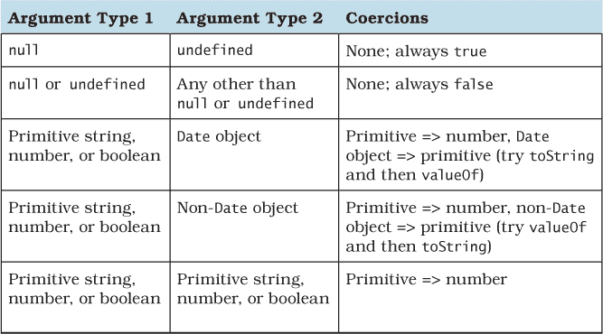

`==`运算符表面上似乎在掩盖数据不同表示表示差异。这种错误纠正有时被称为*“按我的意图执行”语义。*。但计算机并不能真正读懂你的心思。世界上的数据表示太多了，JavaScript 无法知道你正在使用哪一个。例如，你可能希望能够比较一个包含日期的字符串与一个`Date`对象：

```javascript
var date = new Date("1999/12/31");
date == "1999/12/31"; // false
```

这个特定的示例失败了，是因为将`Date`对象转换为字符串产生的格式与示例中使用的格式不同：

```javascript
date.toString(); // "Fri Dec 31 1999 00:00:00 GMT-0800 (PST)"
```

但这个错误是对类型转换更通用的误解的症状。`==`运算符并推断并统一任意的数据格式。它要求你和读者都理解其微妙的转换规则。更好的策略是使用自定义应用程序逻辑使转换显式化，并使用严格相等运算符：

```javascript
function toYMD(date) {
    var m = date.getMonth() + 1, // 月从 0 开始
    var d = date.getDate();
    return y + "/" + (m < 10 ? "0" + m : m) + "/" + (d < 10 ? "0" + d : d);
}
toYMD(date) === "1999/12/31"; // true
```

将转换显式化可以确保你不会混淆`==`的转换规则，而且——更好的是——减轻了读者查阅这些规则的麻烦。

### 需要记忆的事

- 当参数类型不同时，`==`运算符会应用一组令人混乱的隐式转换。
- 使用`===`向你的阅读者明确表示你的比较不涉及任何类型转换。
- 在比较不同类型的值时，使用你自己的显式转换来使你的程序更清晰。

JavaScript 的便利性之一是可以省略语句结束处的分号。省掉分号带来了一种令人愉悦的轻量级美感：

```javascript
function Point(x, y) {
    this.x = x || 0
    this.y = y || 0
}

Point.prototype.isOrigin = function() {
    return this.x === 0 && this.y === 0
}
```

这之所以可行，归功于*自动分号插入 (automatic semicolon insertion)*，这是一种程序解析技术，在特定上下文中推断省略的分号，有效地为你在程序中“插入”分号。ECMAScript 标准精确地规定了分号插入机制，因此可选的分号在不同的 JavaScript 引擎之间是可以移植的。

但与事项 3 和 5 中的隐式转换类似，分号插入也有它的陷阱，你根本无法避免学习它的规则。即使你从不省略分号，JavaScript 语法中还有由于分号插入而导致的额外限制。好消息是，一旦你学会了分号插入的规则，你可能会发现省掉不必要的分号是一种解脱。

分号插入的第一条规则是：`分号只会被插入 } 标记之前、一个或多个换行符之后，或者在程序输入的末尾。`换句话说，你只能在行尾、块尾或程序省略分号。因此以下是合法的函数：

```javascript
function square(x) {
    var n = +x
    return n * n
}

function add1(x) { return x + 1 }
```

但这种不是的：

```javascript
function area(r) { r = +r return Math.PI * r * r } // 
```

分号插入的第二条规则是：`只有当下一个输入标记无法解析时，才会插入分号。`换句话说，分号插入是一种`错误纠正`机制。作为一个简单的例子，这段代码：

```javascript
a = b(f());
```

可以正常解析为单个语句，等同于`a = b(f());`。这意味着没有插入分号。相比之下，这段代码：

```javascript
a = b

f();
```

被解析为两个独立的语句，因为`a = b f();`是解析错误。

这条规则有一个不利的影响：你必须关注下一个语句的开头，以判断是否可以合法省略分号。如果下一行的初始标记可以解释为前一个语句的延续，你就不能省略分号。

恰有五个需要注意的危险字符：`(`、`[`、`+`、`-`和`/`。这些每一个根据上下文既可以作为表达式运算符，也可以作为语句的前缀。所以要留意以表达式结尾的语句，例如上面的赋值语句。如果下一行以这些危险字符之一开头，就不会插入分号。到目前为止，这种情况最常见的场景是语句以括号开头，如上面的示例。另一个常见场景是数组字面量：

```javascript
a = b

["r", "g", "b"].forEach(function(key) {
    background[key] = foreground[key] / 2;
});
```

看起来像两个语句：一个赋值，加上对字符串`"r"`、`"g"`和`"b"`调用函数的语句。但因为语句以`[`开头，它解析为单个语句，等同于：

```javascript
a = b["r", "g", "b"].forEach(function(key) {
    background[key] = foreground[key] / 2;
});
```

如果那个括号表达式看起来很奇怪，请记住 JavaScript 允许逗号分隔的表达式，它们从左到右求值并返回最后一个子表达式的值：在这种情况下，是字符串`"b"`。`+`、`-`和`/`标记在语句开头较不常见，但并非未见过。`/`的情况尤为微妙：在语句开头，它实际上并不是一个完整的标记，而是正则表达式标记的开头：

```javascript
/Error/i.test(str) && fail();
```

此语句使用不区分大小写的正则表达式`/Error/i`对字符串进行测试。如果找到匹配项，语句将调用`fail`函数。但如果这段代码紧跟在一个未终止的赋值之后：

```javascript
a = b

/Error/i.test(str) && fail();
```

那么代码会被解析为单个语句，等同于：

```javascript
a = b / Error / i.test(str) && fail();
```

换句话说，初始的`/`标记被解析为了除法运算符！

丰富的 JavaScript 程序员已经学会，每当想要省略分号时，都要查看语句的下一行，以确保语句不会被错误解析。他们在重构代码时也十分小心。例如，一个具有三个推断分号的完全正确的程序：

```javascript
a = b    // 推断分号
var x    // 推断分号
(f())    // 推断分号
```

可能会在乎意之外的情况下变成另一个只有两个推断分号的程序：

```javascript
a = b    // 没有推断分号
(f())    // 推断分号
```

尽管将`var`语句向上移动一行应该是等价的（变量作用域详情参见 Item 12），但`b`后面跟着括号这一事实意味着程序被误解析为：

```javascript
var x;
a = b(f());
```

结果是，你始终需要意识到省略的分号，并检查下一开头是否存在禁用分号插入的标记。或者，你也可以遵循一条规则：始终在以`(`、`[`、`+`、`-`或`/`开头的语句前加上一个额外的分号。例如，之前的示例可以修改为保护带括号的函数调用：

```javascript
a = b    // 推断分号

var x    // 下一行有分号

;(f())   // 推断分号
```

现在可以安全地将`var`声明移动到顶部，而不用担心改变程序：

```javascript
var x    // 推断分号

a = b    // 下一行有分号

;(f())   // 推断分号
```

```javascript
// file1.js
(function() {
    // ...
})()

// file2.js
(function() {
    // ...
})()
```

```javascript
(function() {
    // ...
})()

(function() {
    // ...
})()
```

结果被视为一个单一语句，等同于：

```javascript
(function() {
    // ...
})()(function() {
    // ...
})();
```

结论：在语句中省略分号要求你不仅意识到当前文件中下一个标记，还要意识到在脚本合并后*可能*跟在语句之后的任何标记。与上述方法类似，你可以通过防御性在每个文件开头添加一个额外的分号来保护脚本免于粗率的合并，至少当它的第一个语句以五个脆弱字符`(`、`[`、`+`、`-`或`/`之一开头时：

```javascript
// file1.js
;(function() {
    // ...
})()

// file2.js
;(function() {
    // ...
})()
```

这确保即使前面的文件省略了最后的分号，合并后的结果仍被视为独立的语句：

```javascript
;(function() {
    // ...
})()

;(function() {
    // ...
})()
```

当然，如果脚本合并过程自动在文件之间添加额外的分号更好。但并不是所有的合并工具都编写良好，所以最安全的办法是防御性地添加分号。

到此时，你可能会想：“这些太不用担心。我只要从不省略分号就没事了。”事实如此：在某些情况下，JavaScript 会强制插入分号，尽管看起来似乎没有解析错误。这些是 JavaScript 语法中所谓的*限制产生*（restricted productions），在两个标记之间不允许出现换行符。最危险的情况是`return`语句，它在`return`关键字及其可选参数之间不能包含换行符。因此，语句：


`return { };`

返回一个新对象，而代码段：

```
return
{ };
```

被解析为三个独立的语句，等同于：

```
return;
{ }
```

换句话说，`return` 关键字后的换行符强制了自动分号插入，这解析为不带参数的 `return`，后面跟着一个空块和一个空语句。其他的限制产生还有：

- `throw` 语句
- 带有显式标签的 `break` 或 `continue` 语句
- `++` 或 `--` 运算符

第三也是最后一条规则是：*分号永远不会作为 `for` 循环头部的分隔符或空语句插入。* 这意味着你必须始终在 `for` 循环的头部显式地包含分号。否则，输入如下内容：

```javascript
for (var i = 0, total = 1; i < n;i++) {
    total *= i
```

会导致解析错误。同样，具有空体的循环需要一个显式的分号。否则，省略分号会导致解析错误：

```javascript
function infiniteLoop() { while (true) } // 解析错误
```

所以这是一个分号是必须的案例：

```javascript
function infiniteLoop() { while (true); }
```

情况更加复杂的是，Unicode 的设计者在历史上低估了他们对代码点（code points）的预算。他们最初认为 Unicode 不需要超过 `2¹⁶` 个代码点。这使得 `UCS-2`（原始的 16 位编码标准）成为一个极具吸引力的选择。由于每个代码点都能放入一个 16 位数字中，因此代码点与其编码元素之间存在一种简单的一一映射关系，这些元素被称为 `code units`（代码单元）。也就是说，`UCS-2` 由单独的 16 位代码单元组成，每个代码单元对应一个单一 Unicode 代码点。这种编码的主要优点是，对字符串进行索引是一个廉价的常数时间操作：访问字符串的第 `n` 个代码点只需从数组的第 `n` 个 16 位元素中选择。图 1.1 显示了一个仅包含原始 16 位范围内代码点的示例字符串。如你所示，编码元素与 Unicode 字符串中的代码点之间的索引是完美匹配的。

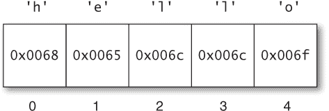

图 1.1。包含基本多语言平面代码点的 JavaScript 字符串

结果，当时的许多平台都承诺使用 16 位字符串编码。Java 是其中一个平台，JavaScript 也随之潮流：JavaScript 字符串的每个元素都是一个 16 位的值。现在，如果 Unicode 保持 20 世纪 90 年代初，JavaScript 字符串的每个元素仍然对应一个单一的代码点。

这个 16 位范围非常大，涵盖的世界文本系统比 ASCII 或其任何无数历史继任者都要多得多。尽管如此，随着时间的推移，人们逐渐发现 Unicode 将超出其初始范围，标准也扩展到目前超过 `2²⁰` 个代码点的范围。新扩展的范围被组织成 17 个子范围，每个范围包含 `2¹⁶` 个代码点。其中第一个被称为“基本多语言平面”（Basic Multilingual Plane，或简称 `BMP`），由原始的 `2¹⁶` 个代码点组成。另外 16 个范围被称为“补充平面”（supplementary planes）。

一旦代码点范围扩大，`UCS-2` 就过时了：它需要扩展以表示额外的代码点。它的继任者 `UTF-16` 与其大部分相同，但增加了所谓的“代理对”（surrogate pairs）：即成对 16 位代码单元，它们共同编码一个大于 `2¹⁶` 的单一代码点。例如，音乐高音谱号符号（“`”）被分配了代码点 `U+1D11E`——这是代码点编号 119,070 的传统十六进制写法——在 `UTF-16` 中通过代码单元对 `0xd834` 和 `0xdd1e` 表示。可以通过组合从两个代码单元中选定的位来解码该代码点。（巧妙的是，这种编码确保了这两个“代理”中的任何一个都不会被误认为是有效的 `BMP` 代码点，因此即使你从字符串的中间开始搜索，也能始终判断出你看到的是否代理对。）你可以在图 1.2 中看到带有代理对的字符串示例。字符串的第一个代码点需要一个代理对，导致代码单元的索引与代码点的索引不同。

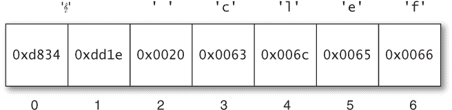

图 1.2。包含补充平面代码点的 JavaScript 字符串

由于 `UTF-16` 编码中的每个代码点可能需要一个或两个 16 位代码单元，因此 `UTF-16` 是一种变长（variable-length）编码：长度为 `n` 的字符串在内存中的大小取决于字符串中特定的代码点。此外，寻找字符串的第 `n` 个代码点不再是常数时间操作：它通常需要从字符串开始搜索。

但在 Unicode 扩大规模之前，JavaScript 已经提交了 16 位字符串元素。字符串属性和方法如 `length`、`charAt` 和 `charCodeAt` 都在代码 `units` 级别工作，而不是代码 `points`。因此，每当字符串包含来自补充平面的代码点时，JavaScript 将每个代码点表示为两个元素——代码点的 `UTF-16` 代理对——而不是一个。简单来说：

*JavaScript 字符串的元素是一个 16 位代码单元。*

在内部，JavaScript 引擎可能会优化字符串内容的存储。但从它们的属性和方法来说，字符串的行为类似于 `UTF-16` 代码单元序列。考虑来自图 1.2 的字符串。尽管字符串包含六个代码点，JavaScript 报告的长度为 7：

```javascript
"G clef".length; // 6
```

提取字符串的单个元素产生的是代码单元而不是代码点：

```javascript
" clef".charCodeAt(0);      // 55348 (0xd834)
" clef".charCodeAt(1);      // 56606 (0dd1e)
" clef".charAt(0);           // ""
" clef".charAt(1);           // "𝄞"
```

这种情况意味着处理全范围 Unicode 的应用程序必须更加努力：它们不能依赖字符串方法、长度值、索引查找以及许多正则表达式模式。如果你在 `BMP` 之外工作，寻找感知代码点的帮助是一个好主意。虽然 JavaScript 的内置字符串类型操作在代码单元级别，但这并没有阻止 API 感知代码点。事实上，一些标准库可以正确处理代理对，例如 URI 函数 `encodeURI`、`decodeURI`、`encodeURIComponent` 和 `decodeURIComponent`。

#### 要记住

- JavaScript 字符串由 16 位代码单元组成。
- `2¹⁶` 及以上的代码点在 JavaScript 中由两个代码单元表示。
- 代理对会干扰元素计数，影响 `length`、`charAt`、`charCodeAt` 以及如 ```` 的正则表达式模式。
- 使用第三方库编写感知代码点的字符串操作。
- 每当你使用处理字符串的库时，应查阅文档以查看其如何处理全范围代码点。

## 2. 变量作用域

作用域就像程序员的氧气。它无处不在。你通常甚至意识不到。但当它被污染时 . . 你就会窒息。
好消息是 JavaScript 的核心作用域规则简单、设计良好且极其强大。但也有例外。有效地使用 JavaScript 需要掌握变量作用域的基础概念，并理解那些可能导致微妙但棘手问题的边缘情况。

### 项目 8：减少对全局对象的使用

JavaScript 使得人们可以轻松地在全局命名空间中创建变量。全局变量的创建成本很低，因为不需要任何类型的声明，并且程序中的所有代码都可以自动访问。这种便利性使其对初学者来说是一个容易拒绝的诱惑。但经验丰富的程序员知道避免全局变量。定义全局变量会污染所有人共享的公共命名空间，引入意外名称冲突的可能性。全局变量违背了模块化的初衷：它们会导致程序不同独立组件之间产生不必要的耦合。虽然“先写代码、后组织”可能很方便，但顶级的程序员会不断关注程序的结构，在编程过程中持续对相关功能进行分组，并分离不相关的组件。

由于全局命名空间是 JavaScript 程序中独立组件相互交互的唯一真实途径，全局命名空间的一些用途是不可避免的。一个组件或库必须定义一个全局名称，以便程序的其他部分可以使用它。否则，最好的办法是让变量尽可能保持局部化。编写一个完全由全局变量组成的程序无疑是`possible`的，但这无异于自找麻烦。即使是那些在全局范围内定义临时变量的简单函数，也必须担心是否有其他代码可能会使用相同的变量名：

```javascript
var i, n, sum; // 全局

function averageScore(players) {
    sum = 0;
    for (i = 0, n = players.length; i < n; i++) {
        sum += score(players[i]);
    }
    return sum / n;
}
```

如果 `averageScore` 依赖的 `score` 函数为了自己的目的使用了相同的全局变量，那么这个 `averageScore` 的定义将无法工作：

```javascript
var i, n, sum; // 与 averageScore 相同的全局变量！

function score(player) {
    sum = 0;
    for (i = 0, n = player.levels.length; i < n; i++) {
        sum += player.levels[i].score;
    }
    return sum;
}
```

```javascript
function averageScore(players) {
    var i, n, sum;
    sum = 0;
    for (i = 0, n = players.length; i < n; i++) {
        sum += score(players[i]);
    }
    return sum / n;
}

    var i, n, sum;
    sum = 0;
    for (i = 0, n = player.levels.length; i < n; i++) {
        sum += player.levels[i].score;
    }
    return sum;
}
```

JavaScript 的全局命名空间还暴露为一个 `global object`（全局对象），它可以在程序的顶部作为 `this` 关键字的初始值被访问。在浏览器中，全局对象还绑定到全局变量 `window`。添加或修改全局变量会自动更新全局对象：

```javascript
this.foo; // undefined
this.foo; // "global foo"
```

同样，更新全局对象会自动更新全局命名空间：

```javascript
var foo = "global foo";
this.foo = "changed";
foo; // "changed"
```

这意味着你有两种机制可以选择来创建全局变量：你可以在全局作用域用 `var` 声明它，也可以将其添加到全局对象中。两种方法都可行，但 `var` 声明的优点在于能更清晰地传达对程序作用域的影响。鉴于对未绑定变量的引用会导致运行时错误，使作用域清晰简单会让代码的用户更容易理解它声明了哪些全局变量。

```javascript
if (!this.JSON) {
    this.JSON = {
        parse: ...,
        stringify: ...
    };
}
```

如果你已经提供了 `JSON`，你可以直接使用你自己的。但内置实现几乎总是优的。特性检测在浏览器中尤为重要，因为特性可能存在于某些版本。

#### 注意事项

- 尽可能局部声明变量。
- 避免向全局对象添加内容。
- 使用全局对象进行特性检测。

### 第 9 项：始终声明变量

如果说有某种比全局变量更麻烦的事情，那就是 `unintentional`（意外的）全局变量。遗憾的是，JavaScript 的赋值规则创建全局变量变得太容易了。程序在给未绑定变量赋值时不会报错，而是创建一个全局变量。这意味着忘记声明局部变量会将其变成全局变量：

```javascript
function swap(a, i, j) {
    temp = a[i]; // 全局
    a[i] = a[j];
    a[j] = temp;
```

这个程序能够在无错误的情况下执行，尽管由于 `temp` 缺少 `var` 导致了全局变量的意外创建。正确的实现使用 `var` 声明 `temp`：

```javascript
function swap(a, i, j) {
    var temp = a[i];
    a[i] = a[j];
    a[j] = temp;
}
```

刻意创建全局变量是糟糕的风格，但意外创建全局变量可能是毁灭性的灾难。因此，许多程序员使用 `lint` 工具，这些工具会检查程序源代码以发现糟糕风格或潜在的 bug，并且通常具有报告未绑定变量使用的功能。通常，检查未声明变量的 `lint` 工具会获取一组用户提供的已知全局变量（例如预期在主机环境中存在的全局变量，或在单独文件中定义的全局变量），然后报告对任何既不在列表中也未在程序中声明的变量的引用或赋值。值得花时间探索 JavaScript 可用的开发工具。在开发过程中集成对意外全局变量等常见错误的自动检查将是极有益的。

#### 注意事项

- 始终用 `var` 声明新变量。
- 考虑使用 `lint` 工具帮助检查未绑定变量。

### 第 10 项：避免 `with`

糟糕的 `with`。在 JavaScript 中可能没有哪一个特征比它更受诟病。然而，`with` 的声誉其实其实名归：无论它提供什么便利性，都会在不可靠性和低效率上带来双倍代价。

`with` 的动机是可以理解的。程序经常需要对单个对象顺序调用多个方法，避免重复引用该对象是方便的：

```javascript
    var widget = new Widget();
    with (widget) {
        setBackground("blue");
        setForeground("white");
        setText("Status: " + info); // 歧义引用
        show();
    }
}
```

使用 `with` 来从作为模块的对象的“导入”变量也是很有诱惑力的：

```javascript
function f(x, y) {
    with (Math) {
        return min(round(x), sqrt(y)); // 歧义引用
    }
}
```

在这两种情况下，`with` 都能让你非常轻而地提取对象的属性并将它们绑定为代码块中的局部变量。

这些示例看起来很有吸引力。但它们无无一个真正实现了预期的功能。注意这两个示例都包含了两种不同类型的变量：一类我们认为它们指向 `with` 对象的属性，例如 `setBackground`、`round` 和 `sqrt`；另一类我们认为它们指向外部的变量绑定，例如 `info`、`x` 和 `y`。但在语法上，没有任何东西能区分这两种类型的变量——它们看起来都只是变量。

事实上，JavaScript 对所有变量的处理方式都是同的：它在作用域中查找变量，从最内层作用域开始向外查找。`with` 语句将对象视为代表一个变量作用域，因此在 `with` 块内部，变量查找首先从搜索给定变量名的属性开始。如果在对象中没有找到该属性，则继续在外部作用域中搜索。

图 2.1 显示了 JavaScript 引擎在执行其 `with` 语句体时，对 `status` 函数作用域的内部表示。这在 ES5 规范中被称为`词法环境`（在旧版标准中称为`作用域链`）。环境的最内层作用域由 `widget` 对象提供。下一层作用域拥有函数局部变量 `info` 和 `widget` 的绑定。再下一层是 `status` 函数的绑定。注意，在正常的作用域中，存储在环境该层级的绑定数量与该局部作用域中的变量数量完全一致。但对于 `with` 作用域，绑定集合取决于在给定时刻对象中存在的任何内容。

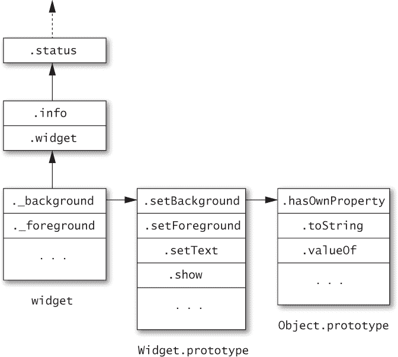

图 2.1. `status` 函数的词法环境（或“作用域链”）

我们有多有信心确定在提供给 `with` 的对象上会找到或不会找到哪些属性？`with` 块中对外部变量的任何引用都隐含地假设在 `with` 对象中（或其任何原型对象中）没有同名的属性。创建或修改 `with` 对象及其原型的程序其他部分可能并不共享这些假设。它们确实不应该读取你的本地代码来寻找你恰好在使用哪些局部变量。

变量作用域与对象命名空间之间的冲突使得 `with` 块变得极其脆弱。例如，如果上述示例中的 `widget` 对象获得了一个 `info` 属性，那么 `status` 函数的行为会突然使用该属性，而不是 `status` 函数的 `info` 参数。这可能会源代码演进过程中发生，例如，如果程序员决定所有组件都应该有一个 `info` 属性。糟糕糟糕，某些东西在运行时向 `Widget` 原型对象添加了 `info` 属性，导致 `status` 函数在不可预测的节点开始崩溃：

```javascript
status("connecting"); // Status: connecting

status("connected");  // Status: [[widget info]]
```


同样，如果有人向`Math`对象添加了`x`或`y`属性，上面的函数`f`可能会崩溃：

```javascript
Math.x = 0;
Math.y = 0;

f(2, 9); // 0
```

没有单一的 JavaScript 特性可以直接取代`with`作为更好的替代方案。在某些情况下，最佳替代方案仅仅是将对象绑定到一个短变量名上：

点击此处查看图像

```javascript
function status(info) {
    var w = new Widget();
    w.setBackground("blue");
    w.setForeground("white");
    w.addText("Status: " + info);
    w.show();
}
```

这个版本的行为要容易预测得多。没有任何变量引用对对象`w`的内容敏感。因此，即使某些代码修改了`Widget`原型，`status`依然按照预期运行：

```javascript
status("connecting"); // Status: connecting

Widget.prototype.info = "[[widget info]]";

status("connected");  // Status: connected
```

在其他情况下，最佳方法是显式绑定局部变量：

点击此处查看图像

```javascript
function f(x, y) {
    var min = Math.min, round = Math.round, sqrt = Math.sqrt;
    return min(round(x), sqrt(y));
}
```

同样，一旦我们消除了`with`，函数的行为就变得可预测了。

#### 需要记住的事

- 避免使用`with`语句。
- 使用短变量名对对象进行重复访问。
- 显式绑定局部变量，而不是通过`with`语句绑定它们。

### 第 11 条：熟悉闭包

对于来自不支持闭包语言的程序员来说，闭包可能是一个陌生的概念。初看起来可能令人敬畏。但请放心，努力掌握闭包将带来数倍的回。理解闭包只需要学习三个事实。第一个事实是 JavaScript 允许你引用在当前函数之外定义的变量：

点击此处查看图像

```javascript
function makeSandwich() {
    var magicIngredient = "peanut butter";

    function make(filling) {
        return magicIngredient + " and " + filling;
    }

    return make("jelly");
}

makeSandwich(); // "peanut butter and jelly"
```

注意内部函数`make`如何引用外部定义的变量`magicIngredient`。

第二个事实是，函数可以在外部函数返回*后*引用在外部函数定义的变量！如果这听起来不可思议，请记住 JavaScript 函数是一等对象（参见第 19 条）。这意味着你可以返回一个内部函数供以后调用：

点击此处查看图像

```javascript
function sandwichMaker() {
    var magicIngredient = "peanut butter";

    function make(filling) {
        return magicIngredient + " and " + filling;
    }

    return make;
}

var f = sandwichMaker();

f("jelly");          // "peanut butter and jelly"
f("bananas");        // "peanut butter and bananas"
f("marshmallows");   // "peanut butter and marshmallows"
```

这与第一个示例几乎相同，不同在于不是在外部函数内部立即调用`make("jelly")`，而是`sandwichMaker`返回`make`函数本身。所以`f`的值是内部函数`make`，调用`f`实际上就是调用`make`。但不知为何，尽管`sandwichMaker`已经返回，`make`仍然记得`magicIngredient`的值。

它是如何运作的？答案是，JavaScript 函数的值包含的信息比调用时执行所需的代码要多。它们在内部还存储了可能引用的、任何在其闭包作用域中定义的变量。能够跟踪其所在作用域中变量的函数被称为`closures`（闭包）。`make`函数就是一个闭包，它的代码引用了两个外部变量：`magicIngredient`和`filling`。每当`make`函数被调用时，它的代码都能引用这两个变量，因为它们被存储在闭包中。

函数可以引用其作用域内的任何变量，包括外部函数的参数和变量。我们可以利用此来创建一个更具通用性的`sandwichMaker`：

点击此处查看代码图片

```javascript
function sandwichMaker(magicIngredient) {
    function make(filling) {
        return magicIngredient + " and " + filling;
    }

    return make;
}

var hamAnd = sandwichMaker("ham");

hamAnd("cheese");     // "ham and cheese"
hamAnd("mustard");    // "ham and mustard"

var turkeyAnd = sandwichMaker("turkey");

turkeyAnd("Swiss");       // "turkey and Swiss"
turkeyAnd("Provolone");   // "turkey and Provolone"
```

这个示例创建了两个不同的函数，`hamAnd`和`turkeyAnd`。尽管它们来自同一个`make`定义，但它们是两个不同的对象：第一个函数将`"ham"`作为`magicIngredient`的值存储，而第二个存储的是`"turkey"`。

点击此处查看代码图片

```javascript
function sandwichMaker(magicIngredient) {
    return function(filling) {
        return magicIngredient + " and " + filling;
    };
}
```

注意这个函数表达式是匿名的：我们甚至不需要为函数命名，因为我们只需要求值以产生一个新的函数值，而不打算在本地调用它。函数表达式也可以有名称（参见 Item 14）。

点击此处查看代码图片

```javascript
function box() {
    var val = undefined;

    return {
        set: function(newVal) { val = newVal; },
        get: function() { return val; },
        type: function() { return typeof val; }
    };
}

b.type(); // "undefined"
b.set(98.6);
b.get();  // 98.6
b.type(); // "number"
```

这个示例产生了一个包含三个闭包的对象：它的`set`、`get`和`type`属性。这些闭包共享对`val`变量的访问权限。`set`闭包更新`val`的值，随后调用`get`和`type`就能看到更新的结果。

#### 注意事项

- 函数可以引用定义在外部作用域中的变量。
- 闭包的寿命可以超过创建它的函数。

### Item 12：理解变量提升（Variable Hoisting）

JavaScript 支持词法作用域（`lexical scoping`）：除少数例外外，对变量`foo`的引用被绑定到声明`foo`的最近的作用域。然而，JavaScript 不支持块作用域（`block scoping`）：变量定义并不局限于其最近的包含语句或块，而是局限于其所在的函数。

未能理解 JavaScript 的这种特性可能会导致微妙的 bug，例如所示：

点击此处查看代码图片

```javascript
function isWinner(player, others) {
    var highest = 0;

    for (var i = 0, n = others.length; i < n; i++) {
        if (player.score > highest) {
            highest = player.score;
        }
    }

    return player.score > highest;
}
```

这个程序似乎在`for`循环体内声明了一个局部变量`player`。但由于 JavaScript 变量是函数作用域而非块作用域的，内部对`player`的声明只是重新声明了一个已经处于作用域中的变量——即`player`参数。循环的每次迭代都会覆盖同一个变量。结果是，`return`语句看到的`player`是`others`的最后一个元素。

理解 JavaScript 变量声明行为的一种良好方法是将它们理解为由两部分组成：声明和赋值。JavaScript 隐式地将声明部分“提升”到函数顶部，并将赋值留在原处。换句话说，变量在整个函数范围内都是可见的，但只在`var`出现的地方被赋值。图 2

```javascript
{
    var x = "var", result = [];
    result.push(x);
    throw "exception";
} catch (x) {
    x = "catch";
}
result.push(x);
return result;
}

test(); // ["var", "var"]
```

#### 注意事项

- 重新声明同一个变量被视为同一个变量。
- 考虑手动提升局部变量声明以避免混淆。

### Item 13：使用立即调用函数表达式（IIFE）创建局部作用域

这个（有 bug 的！）程序计算了什么？

点击此处查看代码图片

```javascript
function wrapElements(a) {
    var result = [], i, n;

    for (i = 0, n = a.length; i < n; i++) {
        result[i] = function() { return a[i]; };
    }

    return result;
}

var wrapped = wrapElements([10, 20, 30, 40, 50]);
var f = wrapped[0];

f(); // ?
```

理解这个示例的关键在于理解绑定（binding）与赋值（assignment）之间的区别。在运行时进入作用域会为该作用域内的每个变量绑定在内存中分配一个“槽”（slot）。`wrapElements`函数绑定了三个局部变量：`result`、`i`和`n`。因此，当调用它时，`wrapElements`为这三个变量分配了槽位。在循环的每次迭代中，循环体都会为嵌套函数分配一个闭包。程序中的错误源于：程序员显然期望函数在嵌套函数创建时存储`i`的值。但实际上，它包含的是对`i`的*引用*。由于`i`的值在每个函数创建后都会改变，内部函数最终看到的是`i`的最终值。这就是闭包的关键点：

*闭包通过引用存储其外部变量，而不是通过值。*

因此，由`wrapElements`创建的所有闭包都引用在循环之前创建的用于`i`的单一共享槽位。由于循环的每次迭代都会增加`i`的值，直到它超出数组末尾，当我们实际上调用其中一个闭包时，它查找数组的索引 5 并返回了`undefined`。

请注意，即使我们将`var`声明放在`for`循环的头部，`wrapElements`的行为也完全相同：

点击此处查看代码图片

```javascript
function wrapElements(a) {
    for (var i = 0, n = a.length; i < n; i++) {
        result[i] = function() { return a[i]; };
    }

    return result;
}

var wrapped = wrapElements([10, 20, 30, 40, 50]);
var f = wrapped[0];

f(); // undefined
```

这个版本看起来甚至更具迷惑性，因为`var`声明似乎在循环内部。但像既往常一样，变量声明被提升到了循环的顶部。因此，变量`i`只分配了一个单一的槽位。

点击此处查看代码图片

```javascript
function wrapElements(a) {
    var result = [];

    for (var i = 0, n = a.length; i < n; i++) {
        (function() {
            var j = i;
            result[i] = function() { return a[j]; };
        })();
    }

    return result;
}
```

这种技术被称为*立即调用函数表达式*（immediately invoked function expression），或 IIFE（读作“iffy”），它是 JavaScript 缺乏块作用域时的一种不可或缺的替代方案。另一种变体是将局部变量绑定为 IIFE 的参数，并将其值作为参数传递：

点击此处查看代码图片

```javascript
function wrapElements(a) {
    var result = [];

    (function(j) {
        result[i] = function() { return a[j]; };
    })(i);

    return result;
}
```

然而，在使用 IIFE 创建局部作用域时要小心，因为将块封装在函数中可能会给块引入一些细微的变化。首先，块不能包含任何跳到块之外的`break`或`continue`语句，因为在函数外部使用`break`或`continue`是非法的。其次，如果块引用了`this`或特殊的`arguments`变量，IIFE 会改变它们的含义。第 3 章讨论了处理`this`和`arguments`的技术。

#### 注意事项

- 理解绑定与赋值的区别。
- 闭包通过引用捕获外部变量，而不是通过值。
- 注意在 IIFE 中封装块可能会改变其行为的情况。

### 第 14 节：注意命名函数表达式的作用域

JavaScript 函数在无论出现在何处看起来都可能是一样的，但它们的含义随上下文而改变。考虑如下这样的代码段：

```javascript
function double(x) { return x * 2; }
```

取决于它出现的位置，这可能是*函数声明*（function declaration），也可能是*命名函数表达式*（named function expression）。声明是大家熟悉的：它定义一个函数并将其绑定到当前作用域中的变量。例如，在程序的顶层，上述声明将创建一个名为`double`的全局函数。但同一个函数可以被当作表达式使用，此时它具有完全不同的含义。例如：

```javascript
var f = function double(x) { return x * 2; };
```

根据 ECMAScript 规范，这将函数绑定到`f`而不是`double`。当然，我们不需要给匿名函数表达式命名。我们可以使用匿名函数表达式：

```javascript
var f = function(x) { return x * 2; };
```

匿名函数表达式与命名函数表达式的区别在于，后者在函数内部将其名称绑定为局部变量。这可以用于编写递归：

点击此处查看代码图片

```javascript
var f = function find(tree, key) {
    if (!tree) {
        return null;
    }

    if (tree.key === key) {
        return tree.value;
    }

    return find(tree.left, key) || find(tree.right, key);
};
```

注意`find`只在函数作用内有效。与函数声明不同，命名函数表达式无法从外部通过其名称引用：

```javascript
find(tree, key); // ReferenceError
```

使用命名函数表达式递归似乎并不特别有用，因为可以使用外部作用域的名称进行函数调用：

点击此处查看代码图片

```javascript
var f = function find(tree, key) {
    if (!tree) {
        return null;
    }

    if (tree.key === key) {
        return tree.value;
    }

    return f(tree.left, key) || f(tree.right, key);
};
```

或者我们可以直接使用声明：

点击此处查看代码图片

```javascript
function find(tree, key) {
```


### 项目 15：警惕块局部函数声明的不可移植作用域

上下文敏感性的故事在嵌套函数声明中继续。你可能会惊讶地发现，并没有标准的方法可以在局部块（block）内部声明函数。现在，在另一个函数的顶部嵌套函数声明是完全合法且符合惯例的：

```
function f() { return "global"; }

function test(x) {
    function f() { return "local"; }
    var result = [];
    if (x) {
        result.push(f());
    }
    result.push(f());
    return result;
}
test(true);  // ["local", "local"]
test(false); // ["local"]
```

但如果我们把`f`移动到局部块，情况完全是另一了：

```
function f() { return "global"; }

function test(x) {
    var result = [];
    if (x) {
        function f() { return "local"; } // 块局部
        result.push(f());
    }
    return result;
}

test(true);  // ?
test(false); // ?
```

你可能期望第一次调用`test`产生数组`["local", "global"]`，第二次产生`["global"]`，因为内部的`f`似乎是`if`块局部的。但请记住`JavaScript`不是块作用域的，所以内部的`f`在整个`test`函数体的作用域范围内。

（这不仅让代码更难理解，而且导致性能缓慢，与`with`不同）。

`ECMAScript`标准对这种状态有什么看法？令人惊讶的是，什么都没有。在`ES5`之前，标准并不承认块局部声明的存在；流行的`JavaScript`实现将其报告为错误——带有函数声明的严格模式程序将报告错误。

```
function f() { return "global"; }

function test(x) {
    var g = f, result = [];
    if (x) {
        g = function() { return "local"; }
        result.push(g());
    }
    result.push(g());
}
```

这消除了内部变量（此处重命名为`g`）作用域的谜：它是无条件绑定为局部变量，只有赋值是有条件的。结果是明确且完全可移植的。

#### 注意事项

- 始终将函数声明放在程序或包含函数的最外层，以避免不可移植的行为。
- 使用`var`声明条件赋值代替条件函数声明。

### 项目 16：避免使用 eval 创建局部变量

`JavaScript`的`eval`函数是一个极其强大且灵活的工具。强大的工具很容易滥用，因此值得理解。滥用`eval`的简单方法之一就是允许它干扰作用域。

调用`eval`会将其参数解释为`JavaScript`程序，但该程序在调用者的局部作用域中运行。嵌入程序的全局变量会被创建为调用程序的局部变量：

```
function test(x) {
    eval("var y = x;"); // 动态绑定
    return y;
}

test("hello"); // "hello"
```

这个例子看起来很清晰，但它的行为与`var`声明直接包含在`test`体中时的行为有细微不同。`var`声明只有在调用`eval`函数时才会执行。在条件上下文中放置`eval`，只有在条件被执行时，它的变量才会引入作用域：

```
var y = "global";

function test(x) {
    if (x) {
        eval("var y = 'local';"); // 动态绑定
    }
    return y;
}

test(true);  // "local"
```

基于程序的动态行为来做作用域决策几乎总是一个坏主意。结果是，仅仅为了理解变量引用哪个绑定，就需要追踪程序执行的细节。当传递给`eval`的源代码甚至没有在本地定义时，这变得尤为棘手：

```
var y = "global";

function test(src) {
    eval(src); // 可能动态绑定
    return y;
}

test("var y = 'local';"); // "local"
test("var z = 'local';"); // "global"
```

这段代码是脆弱且不安全的：它赋予了外部调用者改变`test`函数内部作用域的权力。期望`eval`修改其包含的作用域对于与`ES5`严格模式的兼容也是不安全的，因为严格模式在嵌套作用域中运行`eval`以防止这种污染。一种确保`eval`不影响外部作用域的简单方法是让它在显式的嵌套作用域中运行：

```
var y = "global";

function test(src) {
    (function() { eval(src); })();
    return y;
}

test("var y = 'local';"); // "global"
```

#### 注意事项

- 避免使用`eval`创建会污染调用者作用域的变量。
- 如果`eval`代码可能会创建全局变量，请将调用封装在嵌套函数环境中防止作用域污染。

### 事项 17：优先使用间接 eval 而非直接 eval

`eval`函数有一个秘密武器：它不仅仅是一个函数。

大多数函数可以访问其定义所在的作用域，外无法访问其他地方。但`eval`可以访问*被调用点处的完整作用域*。这种力量是如此巨大，以至于编译器编写者首次尝试优化`JavaScript`时，他们发现`eval`让任何函数调用的高效化变得困难，因为每个函数调用都需要在运行时使其作用域可用，以防该函数被证明是`eval`。

作为一种折中，语言标准演进并区分了调用`eval`的两种不同方式。涉及标识符`eval`的函数调用被视为对`eval`的“直接”调用：

```
var x = "global";

function test() {
    var x = "local";
    return eval("x"); // 直接 eval
}

test(); // "local"
```

在这种情况下，编译器被要求确保执行的程序对调用者的本地作用域具有完全访问权限。另一种`eval`调用被认为是“间接”的，并且在全局作用域中评估其参数。例如，将`eval`函数绑定到不同的变量名并通过备用名称调用它，会导致代码失去对任何本地作用域的访问：

```
var x = "global";

function test() {
    var x = "local";
    var f = eval;
    return f("x"); // 间接 eval
}

test(); // "global"
```

直接`eval`的准确定义取决于`ECMAScript`标准中相当奇特的规范语言。在实践中，唯一能产生直接`eval`的语法是名为`eval`的变量，该变量可能被（任意数量的）括号包围。编写间接调用`eval`的一种简洁方法是使用表达式序列运算符（`,`）并配合一个看似无意义的数字字面量：

```
(0,eval)(src);
```

这个看起来奇特的函数调用是如何运作的？数字字面量`0`被求值但其值被忽略了，括号内的序列表达式产生了`eval`函数。因此，`(0,eval)`的行为几乎与普通标识符`eval`完全相同，唯一的重大区别是整个调用表达式被视为间接`eval`。

直接`eval`的力量可以很容易被滥用。例如，评估来自网络的源字符串可能会将内部实现暴露给不可信任的第三方。事项 16 讨论了`eval`动态创建本地变量的危险；这些危险只有在使用直接`eval`时才可能。此外，直接`eval`的性能代价很大。通常情况下，你应该假设直接`eval`会导致包含它的函数以及*直到程序最外层的所有包含函数*变得慢得多。

偶尔会有使用直接`eval`的理由。但除非有明确需要检查本地作用域的额外权力，否则请使用较不易被滥用且成本的间接`eval`。

#### 注意事项

- 使用序列表达式强制`eval`是间接调用的。
- 尽可能使用间接`eval`而非直接`eval`。

## 3. 使用函数

### 事项 18：理解函数、方法和构造调用的区别

如果你熟悉面向对象的编程，可能习惯于将函数、方法和类构造视为三个不同的实体。在`JavaScript`中，这些只是函数的几种用法模式：

最简单的用法是函数调用：

```
function hello(username) {
    return "hello, " + username;
}

hello("Keyser Sze"); // "hello, Keyser Sze"
```

这看起来完全一样：它调用了`hello`函数并将`username`参数绑定到给定的值。

`JavaScript`中的方法只不过恰好是函数的对象属性：

```
var obj = {
    hello: function() {
        return "hello, " + this.username;
    },
    username: "Hans Gruber"
};
```

注意`hello`如何引用`this`来访问`obj`的属性。你可能倾向于假设`this`被绑定到了`obj`，因为`hello`方法是在`obj`上定义的。但我们可以将同一个函数的引用复制到另一个对象并得到不同的答案：

```
var obj2 = {
    hello: obj.hello,
    username: "Boo Radley"
};

obj2.hello(); // "hello, Boo Radley"
```

方法调用中真正发生的是调用表达式本身决定了`this`的绑定，这也称为调用的*接收者*（receiver）。表达式`obj.hello()`查找`obj`的`hello`属性并以`obj`为接收者调用它。表达式`obj2.hello()`查找`obj2`的`hello`属性——它恰好是`obj.hello`相同的函数——但以`obj2`为接收者调用。通常情况下，在对象上调用方法是查找该方法，并将该对象作为方法的接收者。

由于方法仅仅是在特定对象上调用的函数，因此没有理由普通函数不能引用`this`：

```
function hello() {
    return "hello, " + this.username;
}

var obj1 = {
    hello: hello,
    username: "Gordon Gekko"
};
obj1.hello(); // "hello, Gordon Gekko"

var obj2 = {
    hello: hello,
    username: "Biff Tannen"
};
obj2.hello(); // "hello, Biff Tannen"
```

然而，使用`this`的函数在作为函数而非方法调用时，并不特别有用：

```
hello(); // "hello, undefined"
```

令人遗憾的是，非方法的函数调用会将全局对象作为接收者，在在这种情况下，全局对象没有名为`username`的属性，因此会产生`undefined`。如果一个方法依赖于`this`，那么将其作为函数调用很少能产生任何有用结果，因为没有理由预期全局对象能符合该方法对被调用对象的特定要求。事实上，绑定到全局对象本身就是一个足够成问题的默认行为，因此`ES5`的严格模式将`this`的默认绑定更改为了`undefined`：

```
function hello() {
    "use strict";
    return "hello, " + this.username;
}

hello(); // error: cannot read property "username" of undefined
```

这有助于通过更早失败来捕获误将方法当作普通函数调用的行为，因为尝试访问`undefined`的属性会立即抛出错误。

函数的第三种用法是作为构造函数。就像方法和普通函数一样，构造函数也是用`function`定义的：

```
function User(name, passwordHash) {
    this.name = name;
```


`this.passwordHash = passwordHash;`

使用 `new` 运算符调用 `User` 会将其视为构造函数：

点击此处查看代码图片

```javascript
var u = new User("sfalken", "0ef33ae791068ec64b502d6cb0191387");

u.name; // "sfalken"
```

与函数调用和方法调用不同，构造函数调用会将一个全新的对象作为 `this` 的值，并隐式地返回该新对象作为结果。构造函数的主要作用是初始化对象。

- 方法调用将查找方法属性的对象作为其接收者。
- 函数调用将全局对象（严格模式下为 `undefined`）作为其接收者。使用函数调用语法调用方法很少用处。
- 构造函数通过 `new` 调用，并接收一个新对象作为其接收者。

### 事项 19：习惯使用高阶函数

高阶函数曾是函数式编程僧侣们的一种行话，是用来描述看起来像高级编程技术的晦涩术语。事实远非如此。利用函数的简洁优雅性通常可以产生更简单、更简洁的代码。多年来，脚本语言采纳了这些技术，并在过程中消除了某些函数式编程最佳范式中的神秘感。

高阶函数无非就是将其他函数作为参数或将函数作为结果返回的函数。将函数作为参数（通常称为回调函数，因为它们被高阶函数“回调调用”）是一种特别强大且极具表现力的范式，JavaScript 程序大量使用这种范式。

考虑数组上的标准 `sort` 方法。为了处理所有可能的数组，`sort` 方法依赖调用者来决定如何比较数组中的任何两个元素：

```javascript
function compareNumbers(x, y) {
    if (x < y) {
        return -1;
    }

    if (x > y) {
        return 1;
    }

    return 0;
}

[3, 1, 4, 1, 5, 9].sort(compareNumbers); // [1, 1, 3, 4, 5, 9]
```

标准库本可以要求调用者传递带有 `compare` 方法的对象，但由于只需要一个方法，直接传入一个函数更为简单、更简洁。事实上，上面的示例可以使用匿名函数进一步简化：

点击此处查看代码图片

```javascript
[3, 1, 4, 1, 5, 9].sort(function(x, y) {
    if (x < y) {
        return -1;
    }

    if (x > y) {
        return 1;
    }

    return 0;
}); // [1, 1, 3, 4, 5, 9]
```

学习使用高阶函数通常可以简化你的代码并消除样板代码。数组上的许多常见操作都有极佳的高阶抽象，值得熟悉。考虑转换字符串数组的简单操作。使用循环，我们会写成：

点击此处查看代码图片

```javascript
var names = ["Fred", "Wilma", "Pebbles"];
var upper = [];

for (var i = 0, n = names.length; i < n; i++) {
    upper[i] = names[i].toUpperCase();
}

upper; // ["FRED", "WILMA", "PEBBLES"]
```

利用数组方便的 `map` 方法（ES5 引入），我们可以完全消除循环，通过局部函数实现逐个元素的转换：

```javascript
var names = ["Fred", "Wilma", "Pebbles"];

var upper = names.map(function(name) {
    return name.toUpperCase();
});

upper; // ["FRED", "WILMA", "PEBBLES"]
```

一旦掌握了高阶函数的使用，你通常可以简化代码并消除样板代码。数组上的许多常见操作都有极佳的高阶抽象，值得熟悉。一旦习惯了使用高阶函数，就可以开始识别可以抽象的机会。例如，想象我们正在构建一个包含字母表的字符串：

点击此处查看代码图片

```javascript
var aIndex = "a".charCodeAt(0);
var alphabet = "";

for (var i = 0; i < 26; i++) {
}

alphabet; // "abcdefghijklmnopqrstuvwxyz"
```

与此同时，程序的另一个部分生成包含数字的字符串：

点击此处查看代码图片

```javascript
var digits = "";

for (var i = 0; i < 10; i++) {
    digits += i;
}
```

在其他地方，程序的另一部分创建一个随机字符串：

点击此处查看代码图片

```javascript
var random = "";

for (var i = 0; i < 8; i++) {
    random += String.fromCharCode(Math.floor(Math.random() * 26) + aIndex);
}

random; // 8 位随机字符（每次不同）
```

每个示例都创建一个不同的字符串，但它们共享相同的逻辑。每个循环都通过拼接创建每个段的结果来生成字符串。我们可以将这些共同部分提取并移动到单个工具函数中：

点击此处查看代码图片

```javascript
function buildString(n, callback) {
    var result = "";

    for (var i = 0; i < n; i++) {
        result += callback(i);
    }

    return result;
}
```

注意 `buildString` 的实现包含了循环的所有共同部分，但使用参数代替了变化的部分：循环次数变成了变量 `n`，而每个字符串段的构建变成了对 `callback` 函数的调用。现在我们可以简化上述三个示例以使用 `buildString`：

点击此处查看代码图片

```javascript
var alphabet = buildString(26, function(i) {
    return String.fromCharCode(aIndex + i);
});

alphabet; // "abcdefghijklmnopqrstuvwxyz"

var digits = buildString(10, function(i) {
    return i;
});

digits; // "0123456789"

var random = buildString(8, function() {
    return String.fromCharCode(Math.floor(Math.random() * 26) + aIndex);
});

random; // 8 位随机字符（每次不同）
```

创建高阶抽象有很多益处。如果实现中存在棘手的部分（例如正确处理循环边界条件），它们会被局限在高阶函数的实现中。这允许你只需修复一次逻辑中的任何 bug，而就不需要在整个程序中搜寻该编码模式的每一个实例。如果你发现需要优化操作的效率，你再次在一个地方进行更改即可。最后，给抽象起一个如 `buildString` 这样清晰的名称，可以让阅读代码的人更清楚地理解代码的作用，而无需去解析实现的细节。

当你发现自己自己在反复编写相同的模式时，学会尝试使用高阶函数，可以写出更简洁的代码、提高生产力并提升可读性。关注常见模式并将它们移动到高阶工具函数中是一个需要培养的重要良好习惯。

### 注意事项

- 高阶函数是接受其他函数作为参数、或将函数作为结果返回的函数。
- 熟悉现有库中的高阶函数。
- 学习检测可以被高阶函数替换的常见编码模式。

### 事项 20：使用 `call` 调用带有自定义接收者的方法

通常情况下，函数或方法的接收者（即绑定到特殊关键字 `this` 的值）是由调用者的语法确定的。特别地，方法调用语法会将查找该方法的对象绑定到 `this`。然而，有时有必要使用自定义接收者调用函数，而该函数可能并不已经是目标接收者对象的属性。当然，将该方法作为新属性添加到对象中也是可行的：

点击此处查看代码图片

```javascript
obj.temporary = f;    // 如果 obj.temporary 已经存在了怎么办？

var result = obj.temporary(arg1, arg2, arg3);

delete obj.temporary; // 如果 obj.temporary 已经存在了怎么办？
```

但这种方法并不愉快，甚至是危险的。修改 `obj` 往往是不符合意愿的，有时甚至是不可能的。具体来说，无论你为 `temporary` 属性选择什么名称，都存在与 `obj` 的现有属性冲突的风险。此外，某些对象可能是冻结或密封的，防止添加任何新属性。更通地说，随意向对象添加属性是一种坏习惯，特别是对于那些你没有创建的对象（参见事项 42）。

幸运的是，函数带有内置的 `call` 方法来提供自定义接收者。通过其 `call` 方法调用函数：

```javascript
f.call(obj, arg1, arg2, arg3);
```

其行为与直接调用它相似：

```javascript
f(arg1, arg2, arg3);
```

除了第一个参数提供了一个显式的接收者对象。

`call` 方法在调用可能已被移除、修改或覆盖的方法时非常有用。事项 45 展示了一个实用的示例，可以在任意对象上调用 `hasOwnProperty` 方法，即使该对象是一个字典（dictionary）。在字典对象中，查找 `hasOwnProperty` 会产生字典中的一个条目，而不是继承的方法：

点击此处查看代码图片

```javascript
dict.hasOwnProperty = 1;

dict.hasOwnProperty("foo"); // 错误：1 不是一个函数
```

使用 `hasOwnProperty` 方法的 `call` 方法，使得即使该方法没有存储在对象的任何地方，也可以在字典上调用该方法：

点击此处查看代码图片

```javascript
var hasOwnProperty = {}.hasOwnProperty;

dict.foo = 1;

hasOwnProperty.call(dict, "foo");             // true
hasOwnProperty.call(dict, "hasOwnProperty"); // false
```

`call` 方法在定义高阶函数时也很有用。高阶函数的一种常见惯用法是接受一个可选参数作为调用函数时的接收者。例如，一个表示键值绑定表的对象可能会提供一个 `forEach` 方法：

点击此处查看代码图片

```javascript
var table = {
    entries: [],
    addEntry: function(key, value) {
    },
    forEach: function(f, thisArg) {
        var entries = this.entries;

        for (var i = 0, n = entries.length; i < n; i++) {
            var entry = entries[i];
            f.call(thisArg, entry.key, entry.value, i);
        }
    }
};
```

这允许 `table` 的消费者使用 `forEach` 来传递一个回调函数和一个 `this` 上下文。

`average` 函数是所谓的变参数（variadic）或可变元数（variable-arity）函数的示例（函数的元数是指它期望的参数数量）：它可以接受任意数量的参数。相比之下，`average` 的固定元数版本可能会接受一个包含值数组的单一参数。

变参数版本更简洁，可以说更优雅。变参数函数具有方便的语法，至少当调用者预先知道要提供多少个参数时（如上面的示例所示）。但假设我们有一个值数组：

```javascript
var scores = getAllScores();
```

我们如何使用 `average` 函数来计算它们的平均值呢？

```javascript
average(/* ? */);
```

幸运的是，函数带有内置的 `apply` 方法，它与 `call` 方法相似，但专门为此目的设计。`apply` 方法接收一个参数数组并调用函数，就像数组中的每个元素都是调用的独立参数一样。除了参数数组外，`apply` 方法还接收第一个参数，用于指定被调用函数的 `this` 绑定。由于 `average` 函数没有引用 `this`，我们可以简单地传递 `null`：

```javascript
average.apply(null, scores);
```

`apply` 方法也可以用于变参方法（variadic methods）。例如，一个 `buffer` 对象可能包含一个变参的 `append` 方法，用于向其内部状态添加条目（参见 Item 22 以了解 `append` 的实现）：

点击此处查看代码图片

```javascript
var buffer = {
    state: [],
    append: function() {
        this.state.push(arguments[i]);
    }
};
```

`append` 方法可以用任意数量的参数调用：

点击此处查看代码图片

```javascript
buffer.append("Hello, ");
buffer.append(firstName, " ", lastName, "!");
buffer.append(newline);
```

通过 `apply` 的 `this` 参数，我们还可以使用一个计算出的数组来调用 `append`：

```javascript
buffer.append.apply(buffer, getInputStrings());
```

注意 `buffer` 参数的重要性：如果我们传递了一个不同的对象，`append` 方法将尝试修改错误对象的 `state` 属性。

### 需要记住的物品

- 使用 `apply` 方法通过计算出的参数数组来调用变参函数。
- 使用 `apply` 的第一个参数为变参方法提供接收者（receiver）。

### Item 22：使用 `arguments` 创建变参函数

点击此处查看代码图片

```javascript
function averageOfArray(a) {
    for (var i = 0, sum = 0, n = a.length; i < n; i++) {
        sum += a[i];
    }

    return sum / n;
}

averageOfArray([2, 7, 1, 8, 2, 8, 1, 8]); // 4.625
```

`averageOfArray` 的定义定义了一个单一的形式参数，即参数列表中的变量 `a`。当消费者调用 `averageOfArray` 时，他们提供了一个实际参数（有时称为 actual argument，以与形式参数明确区分），即一个值值的数组。

变参版本几乎完全相同，但它没有定义任何显式的形式参数。相反，它利用了 JavaScript 为每个函数都提供了一个名为 `arguments` 的隐式局部变量这一事实。`arguments` 对象为实际参数提供了一个类数组的接口：它包含了每个实际参数的索引属性以及一个指示提供了多少个参数的 `length` 属性。这使得变参数个数的 `average` 函数可以通过遍历 `arguments` 对象的每个元素来表达：

点击此处查看代码图片

```javascript
function average() {
    for (var i = 0, sum = 0, n = arguments.length;
         i < n;
         i++) {
        sum += arguments[i];
    }

    return sum / n;
}
```

点击此处查看代码图片

```javascript
function average() {
    return averageOfArray(arguments);
}
```

这样一来，你函数的消费者就不需要求助于 `apply` 方法了，该方法的可读性可能较低，并且通常会带来性能开销。

### 需要记住的物品

- 考虑为你提供的变参函数提供额外的固定参数个数版本，以便你的消费者不需要使用 `apply` 方法。

### Item 23：使用 `arguments` 创建变参函数

`arguments` 对象看起来像一个数组，但遗憾的是它并不是。熟悉 Perl 的程序员习惯于从 `arguments` 中“移出”（shifting）元素。这个故事的教训是，`arguments` 对象与函数命名参数之间的关系是非常脆弱的。修改 `arguments` 有将命名参数变成乱码的风险。ES5 的严格模式使情况变得更加复杂。严格模式下的函数参数不会与它们的 `arguments` 对象建立别名。我们可以通过编写一个更新 `arguments` 元素的函数来演示这种差异：

点击此处查看代码图片

```javascript
function strict(x) {
    "use strict";

    arguments[0] = "modified";

    return x === arguments[0];

function nonstrict(x) {
```


```javascript
arguments[0] = "modified";

return x === arguments[0];

}

strict("unmodified"); // false

nonstrict("unmodified"); // true
```

结果是，永远不要修改 `arguments` 对象要安全得多。通过先将其元素复制到真实的数组可以很容易避免这一点。实现拷贝的简单惯用法是：

```javascript
```

数组的 `slice` 方法在不带额外参数调用时创建数组的副本，其结果是标准 `Array` 类型的真实实例。结果保证不会引用任何内容，并且可以直接使用所有标准的 `Array` 方法。

我们可以通过复制 `arguments` 来修复 `callMethod` 的实现，由于我们只需要 `obj` 和 `method` 之后的元素，我们可以向 `slice` 传递一个起始索引 `2`：

点击此处查看代码图片

```javascript
function callMethod(obj, method) {

    var args = [].slice.call(arguments, 2);

    return obj[method].apply(obj, args);

}
```

点击此处查看图片

```javascript
var obj = {

    add: function(x, y) { return x + y; }

};

callMethod(obj, "add", 17, 25); // 42
```

#### 注意事项

- 在修改 `arguments` 对象之前，使用 `[].slice.call(arguments)` 将其拷贝到真正的数组中。

### 第 24 项：使用变量保存 `arguments` 的引用

`iterator`（迭代器）是一个提供对数据集合进行顺序访问的对象。典型的 API 会提供一个 `next` 方法，用于提供序列中的下一个值。假设我们想要一个便利函数，它接收任意数量的参数并为这些值构建一个迭代器：

点击此处查看图片

```javascript
var it = values(1, 4, 1, 4, 2, 1, 3, 5, 6);

it.next(); // 1

it.next(); // 4

it.next(); // 1
```

`values` 函数必须接受任意数量的参数，因此我们构建迭代器对象来遍历 `arguments` 对象的元素：

点击此处查看图片

```javascript
function values() {

    var i = 0, n = arguments.length;

    return {

        hasNext: function() {

            return i < n;

        },

        next: function() {

            if (i >= n) {

                throw new Error("end of iteration");

            }

        }

    };

}
```

但这段代码是坏的，当我们尝试使用迭代器对象时，这一点变得显而易见：

点击此处查看图片

```javascript
var it = values(1, 4, 1, 4, 2, 1, 3, 5, 6);

it.next(); // undefined

it.next(); // undefined
```

问题在于，在每个函数的体内都隐式地绑定了一个新的 `arguments` 变量。我们感兴趣的 `arguments` 对象是与 `values` 函数关联的，但迭代器的 `next` 方法包含了它自己的 `arguments` 变量。因此，当我们返回 `arguments[i++]` 时，我们访问的是 `it.next` 的参数，而不是 `values` 的参数之一。

解决方案是直观的：只需在我们感兴趣的 `arguments` 对象的作用域内绑定一个新的局部变量，并确保嵌套函数只引用该显式命名的变量即可：

点击此处查看图片

```javascript
function values() {

    var i = 0, n = arguments.length, a = arguments;

    return {

        hasNext: function() {

            return i < n;

        },

        next: function() {

            if (i >= n) {

                throw new Error("end of iteration");

            }

            return a[i++];

        }

    };

}

var it = values(1, 4, 1, 4, 2, 1, 3, 5, 6);

it.next(); // 1

it.next(); // 4

it.next(); // 1
```

- 在引用 `arguments` 时，注意函数的嵌套。
- 绑定一个显式作用域的 `arguments` 引用，以便于引用它。

### 第 25 项：使用 `bind` 提取具有固定接收者（Receiver）的方法

由于方法和其值为函数的属性之间没有区别，很容易从对象中提取一个方法，并将提取出的函数作为回调传递给高阶函数。但也很容易忘记被提取的函数的接收者并没有绑定到它被提取时的那个对象。假设有一个小小的 `buffer` 对象，它在数组中存储字符串，并且这些字符串可以被拼接：

点击此处查看图片

```javascript
var buffer = {

    entries: [],

    add: function(s) {

        this.entries.push(s);

    },

    concat: function() {

        return this.entries.join("");

    }

};
```

似乎可以通过提取其 `add` 方法并使用 ES5 的 `forEach` 方法在源的每个元素上反复调用它，将一个字符串数组拷贝到 `buffer` 中：

点击此处查看图片

```javascript
var source = [];

source.forEach(buffer.add); // error: entries is undefined
```

点击此处查看图片

```javascript
var source = [];

source.forEach(buffer.add, buffer); // 假设 forEach 接收接收者

buffer.concat(); // works
```

并不是所有高阶函数都为调用者提供接收者的便利。如果 `forEach` 不接受接收者呢？一个很好的解决方法是使用匿名函数并在接收者上调用方法：

点击此处查看图片

```javascript
var source = [];

source.forEach(function(s) {

    buffer.add(s);

});

buffer.concat(); // works
```

这种方法创建了一个包装函数，它本身并不引用 `this`。无论该包装函数如何被调用（作为函数、作为其他对象的方法或通过 `call`），它总是以 `buffer` 为接收者来调用 `add`。

创建一个将其绑定到特定接收者的函数版本是非常常见的，以至于 ES5 为函数对象增加了这种模式的支持。使用 `bind`，我们可以简化上面的示例：

点击此处查看图片

```javascript
var source = [];

source.forEach(buffer.add.bind(buffer));

buffer.concat(); // works
```

请记住，`buffer.add.bind(buffer)` 创建的是一个新函数，而不是修改 `buffer.add` 函数。新函数与旧函数一样，但其接收者绑定到了 `buffer`，而旧函数保持不变。也就是说：

```javascript
buffer.add === buffer.add.bind(buffer); // false
```

这是一个微妙但至关重要的点：这意味着对于程序其他部分共享的函数，调用 `bind` 是安全的。这对于原型对象共享的方法尤为重要：该方法在任何原型的后代上调用时仍能正常工作。（有关对象和原型的更多信息，请参见第 4 章。）

#### 注意事项

- 注意提取方法不会将其接收者绑定到其对象。
- 将对象的方法传递给高阶函数时，使用匿名函数在相应的接收者上调用该方法，或者为接收者使用 `bind`。

### 第 26 项：使用 `bind` 进行函数柯化（Currying）

函数的 `bind` 方法不仅用于绑定方法到接收者。假设有一个从组件构建 URL 字符串的简单函数：

```javascript
function simpleURL(protocol, domain, path) {

    return protocol + "://" + domain + "/" + path;

}
```

经常，程序可能需要从站点特定的路径字符串构建绝对 URL。实现此点的自然方法是使用数组的 ES5 `map` 方法：

```javascript
var urls = paths.map(function(path) {

    return simpleURL("http", siteDomain, path);

});
```

注意匿名函数在 `map` 的每次迭代中都使用了相同的协议字符串和站点域名字符串；`simpleURL` 的前两个参数在每次迭代中都是固定的，只需要第三个参数。我们可以使用 `simpleURL` 的 `bind` 方法来自动构造此函数：

```javascript
var urls = paths.map(simpleURL.bind(null, "http", siteDomain));
```

对 `simpleURL.bind` 的调用产生了一个委托给 `simpleURL` 的新函数。一如既往，`bind` 的第一个参数提供了接收者值（receiver value）（由于 `simpleURL` 不引用 `this`，我们可以使用任何值；`null` 和 `undefined` 是惯例）。传递给 `simpleURL` 的参数是通过将 `simpleURL.bind` 的剩余参数与传递给新函数的任何参数拼接而成的。换句话说，当对 `simpleURL.bind` 的结果使用单个参数 `path` 调用时，该函数将委托给 `simpleURL("http", siteDomain, path)`。

将函数绑定到其参数子集的技术称为 `currying`（柯里化），以逻辑学家哈斯尔·柯里（Haskell Curry）命名，他在数学中普及了这种技术。柯里化是一种实现函数委托的简洁方式，比显式的包装函数具有更少的模板代码。

#### 注意事项

- 将 `null` 或 `undefined` 作为接收者参数传递，以对忽略其接收者的函数进行柯里化。

### 第 27 项：优先使用闭包而非字符串来封装代码

函数是将代码作为数据结构存储并在稍后执行的方便方式。这使得诸如 `map` 和 `forEach` 等表达的高阶抽象成为可能，并且它是 JavaScript 异步 I/O 处理方法的核心（参见第 7 章）。同时，也可以将代码表示为字符串传递给 `eval`。程序员随后面临着一个决策：代码应该被表示为函数还是字符串？

如果不确定，请使用函数。由于一个非常重要的原因，字符串对代码的表示灵活性要低得多：它们不是闭包。

考虑一个简单的函数，用于多次执行用户提供的操作：

```javascript
function repeat(n, action) {

    for (var i = 0; i < n; i++) {

        eval(action);

    }

}
```

在全局作用范围内，使用此函数运行得相当良好，因为字符串内部发生的任何变量引用都会被 `eval` 解释为全局变量。例如，一个基测试函数速度的脚本可能只是使用全局 `start` 和 `end` 变量来存储计时：

点击此处查看代码图片

```javascript
var start = [], end = [], timings = [];

repeat(1000,

       "start.push(Date.now()); f(); end.push(Date.now())");

for (var i = 0, n = start.length; i < n; i++) {

    timings[i] = end[i] - start[i];

}
```

但这个脚本是脆弱的。如果我们简单地将代码移动到函数，那么 `start` 和 `end` 就不再全局变量了：

点击此处查看代码图片

```javascript
function benchmark() {

    var start = [], end = [], timings = [];

    repeat(1000,

          "start.push(Date.now()); f(); end.push(Date.now())");

    for (var i = 0, n = start.length; i < n; i++) {

        timings[i] = end[i] - start[i];

    }

    return timings;

}
```

此函数导致 `repeat` 评估对全局变量 `start` 和 `end` 的引用。在最好的情况下，其中一个全局变量将缺失，调用 `benchmark` 将抛出 `ReferenceError`。如果我们运气非常不好，代码实际上会在某些碰巧绑定到 `start` 和 `end` 的全局对象上调用 `push`，程序的行为将是不可预测的。

一个更健壮的 API 接受函数而不是字符串：

点击此处查看代码图片

```javascript
function repeat(n, action) {

    for (var i = 0; i < n; i++) {

        action();

    }

}
```

通过这种方式，`benchmark` 脚本可以安全地引用它作为重复回调传递的闭包内部的局部变量：

点击此处查看代码图片

```javascript
function benchmark() {

    var start = [], end = [], timings = [];

    repeat(1000,

          "start.push(Date.now()); f(); end.push(Date.now())");

    for (var i = 0, n = start.length; i < n; i++) {

        timings[i] = end[i] - start[i];

    }

    return timings;

}
```

- `toString` 的结果不会暴露存储在闭包中的局部变量值。
- 通常情况下，避免在函数上使用 `toString`。

### 第 29 项：避免非标准的堆栈检查属性

许多 JavaScript 环境在历史上提供了一些功能来检查调用堆栈 `call stack`，即当前正在执行的活动函数链（有关调用堆栈的更多信息，请参阅项目 64）。在某些较旧的宿主环境中，每个 `arguments` 对象都带有两个额外的属性：`arguments.callee` 指向通过 `arguments` 调用的函数，`arguments.caller` 指向调用它的函数。前者在许多环境中仍然被支持，但除了允许匿名函数递归地引用自身外，它并没有多大用处：

点击此处查看代码图片

```javascript
var factorial = (function(n) {

    return (n <= 1) ? 1 : (n * arguments.callee(n - 1));

});
```

但这并没有特别有用，因为函数直接通过名称引用自身要更直接：

点击此处查看代码图片

```javascript
function factorial(n) {

    return (n <= 1) ? 1 : (n * factorial(n - 1));

}
```

`arguments.caller` 属性要强大得多：它指向使用给定 `arguments` 对象进行调用的函数。由于安全考虑，该功能已从大多数环境中移除，因此它是不可靠的。许多 JavaScript 环境还为函数对象提供了一个类似的属性——非标准但广泛使用的 `caller` 属性，它指向函数的最近一次调用者：

点击此处查看代码图片

```javascript
function revealCaller() {

}

function start() {

    return revealCaller();

}

start() === start; // true
```

人们很想尝试使用这个属性来提取堆栈轨迹 `stack trace`，这是一个提供当前调用堆栈快照的数据结构。构建堆栈轨迹看起来似乎非常简单：

点击此处查看代码图片

```javascript
function getCallStack() {

    var stack = [];

    for (var f = getCallStack.caller; f; f = f.caller) {

        stack.push(f);

    }

    return stack;

}
```

对于简单的调用堆栈，`getCallStack` 看起来工作良好：

点击此处查看代码图片

```javascript
function f1() {

    return getCallStack();

}

function f2() {

    return f1();

}

var trace = f2();

trace; // [f1, f2]
```


但`getCallStack`很容易被破坏：如果一个函数在堆栈中出现一次以上，堆栈检查逻辑就会陷入循环！

点击此处查看代码图片

```javascript
    return n === 0 ? getCallStack() : f(n - 1);
}

var trace = f(1); // 无限循环
```

哪里出问题了？由于函数`f`调用了自身，它的`caller`属性会自动更新为指向`f`。因此，`getCallStack`中的循环会卡在查找`f`的地方。即使我们尝试检测循环，也没有关于之前是谁调用了`f`的任何信息——关于堆栈其余部分的信息丢失了。

这些堆栈检查设施都是非标准的，且可移植性有限。此外，它们在ES5函数中都是被禁止的；尝试访问严格模式函数或`arguments`对象的`caller`或`callee`将抛出错误：

点击此处查看代码图片

```javascript
    "use strict";
    return f.caller;
}

f(); // error: caller may not be accessed on strict functions
```

最佳策略是避免堆栈检查。如果你检查堆栈的原因仅仅是为了调试，那么使用交互式调试器要可靠得多。

## 需要记住的事项

- 避免非标准的`arguments.caller`和`arguments.callee`，因为它们不具有移植性。
- 避免函数的非标准`caller`属性，因为它不能可靠地包含有关堆栈的信息。

# 4. 对象与原型

对象是JavaScript的基础数据结构。直观上，一个对象代表一个将字符串与值关联的表格。但当你深入研究时，对象中包含了大量的机制。

与许多面向对象的语言一样，JavaScript提供了对实现继承（`implementation inheritance`）的支持，通过动态委托重用代码或数据。但与许多传统语言不同，JavaScript的继承机制是基于原型而非类（`class`）。对于许多程序员来说，JavaScript是他们遇到的第一个没有类的面向对象的语言。

在许多语言中，每个对象都是其关联类的实例，该类为所有实例提供了共享代码。相比之下，JavaScript没有内置的类的概念。相反，对象从其他对象继承。每个对象都关联另一个对象，被称为其原型。与原型工作与类不同，但许多面向对象语言的概念仍然保留了下来。

## 事项30：理解`prototype`、`getPrototypeOf`和`__proto__`之间的区别

原型涉及到三个独立但相关的访问器，它们的名称都是`prototype`。这种不幸的重叠导致了很大困惑。让我们直奔主题。

- `C.prototype`用于建立`C()`创建的对象的原型。
- `Object.getPrototypeOf(obj)`是获取`obj`原型的标准ES5方法。
- `obj.__proto__`是获取`obj`原型的非标准机制。

为了理解每一个，请考虑一个典型的JavaScript类型定义。`User`构造函数通过`new`操作符调用，并接收名称和密码哈希字符串并将它们存储在创建的对象上。

点击此处查看代码图片

```javascript
function User(name, passwordHash) {
    this.name = name;
    this.passwordHash = passwordHash;
}

User.prototype.toString = function() {
    return "[User " + this.name + "]";
};

User.prototype.checkPassword = function(password) {
    return hash(password) === this.passwordHash;
};

var u = new User("sfalken", "0ef33ae791068ec64b502d6cb0191387");
```

`User`函数带有一个默认的`prototype`属性。在这个例子中，我们为`User.prototype`对象添加了两个方法：`toString`和`checkPassword`。当我们使用`new`操作符创建`User`的实例时，结果对象`u`会自动获得存储在`User.prototype`的对象作为其原型对象。图4.1显示了这些对象的图。

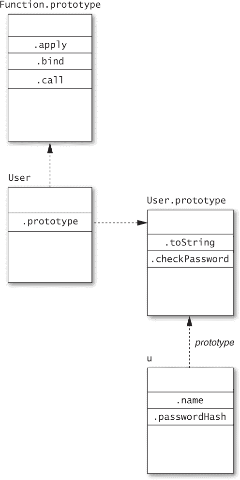

图4.1 `User`构造函数和实例的原型关系

注意连接实例对象`u`与原型对象`User.prototype`的箭头。该链接描述了继承关系。属性查找从对象的自身的属性开始；例如`u.name`和`u.passwordHash`返回`u`直接属性的当前值。在`u`上未的属性将在`u`的原型中查找。例如访问`u.checkPassword`将检索存储在`User.prototype`中的方法。

这引导我们进入列表中的下一项。构造函数的`prototype`属性被用于设置新实例的原型关系，而ES5函数`Object.getPrototypeOf()`则可用于获取现有对象的原型。例如，在上面的示例中创建了对象`u`之后，我们可以进行测试：

```
Object.getPrototypeOf(u) === User.prototype; // true
```

某些环境提供了一种特殊的`__proto__`属性，通过该属性来获取对象的原型，这是一种非标准的机制。对于不支持ES5的`Object.getPrototypeOf`的环境，这可以作为一种权宜之。在这些环境中，我们可以类似地进行测试：

```
u.__proto__ === User.prototype; // true
```

关于原型关系的最后一点说明：JavaScript程序员通常会将`User`描述为一个类，尽管它本质上仅仅只是一个函数。JavaScript中的类本质上是构造函数（`User`）和用于在类实例之间共享方法的原型对象（`User.prototype`）的结合。

图4.2为从概念上理解`User`类提供了一个很好的方法。`User`函数为该类提供了一个公共构造函数，而`User.prototype`是实例间共享方法的内部实现。通常使用`User`和`u`不需要直接访问原型对象。

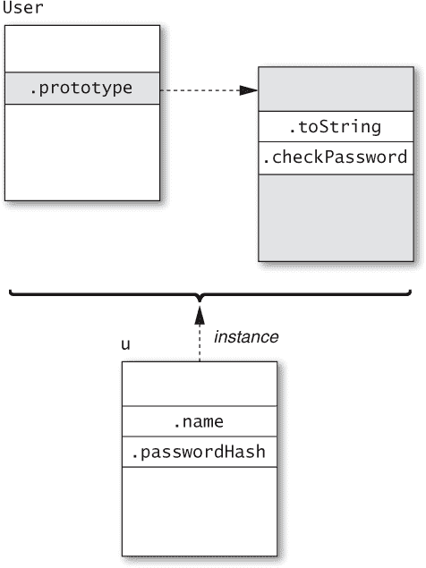

图4.2. `User` “类”的概念视图

## 需要记住的

- `C.prototype`决定了通过`new C()`创建的对象的原型。
- `Object.getPrototypeOf(obj)`是获取对象原型的标准ES5函数。
- `obj.__proto__`是获取对象原型的非标准机制。
- 类是一种设计模式，由一个构造函数和一个相关的原型组成。

## 第31节：优先使用`Object.getPrototypeOf`而非`__proto__`

ES5引入了`Object.getPrototypeOf`作为获取对象原型的标准API，但在那之前，已经有很多JavaScript引擎长期提供了相同用途的特殊`__proto__`属性。然而，并不是所有的JavaScript环境都支持这一扩展，而且支持它的环境之间并不完全兼容。例如，不同环境在处理具有`null`原型的对象时存在差异。在某些环境中，`__proto__`继承自`Object.prototype`，因此具有`null`原型的对象没有特殊的`__proto__`属性：

点击此处查看代码图片

```
var empty = Object.create(null); // 没有原型的对象

"__proto__" in empty; // false（在某些环境中）
```

在其他环境中，无论对象的状态如何，`__proto__`总是被特殊处理的：

点击此处查看代码图片

```
var empty = Object.create(null); // 没有原型的对象

"__proto__" in empty; // true（在某些环境中）
```

只要有`Object.getPrototypeOf`的地方，它都是提取原型更标准、更具移植性的方法。此外，由于`__proto__`属性污染了所有对象，会导致许多bug（参见第45节）。目前支持该扩展的JavaScript引擎可能会在未来选择允许程序禁用它以避免这些bug。优先使用`Object.getPrototypeOf`可以确保即使在`__proto__`被禁用，代码也能继续工作。

对于不提供ES5 API的JavaScript环境，可以通过`__proto__`轻松实现：

点击此处查看代码图片

```
if (typeof Object.getPrototypeOf === "undefined") {
    Object.getPrototypeOf = function(obj) {
        var t = typeof obj;
        if (!obj || (t !== "object" && t !== "function")) {
            throw new TypeError("not an object");
        }
        return obj.__proto__;
    };
}
```

这种实现包含在ES5环境中是安全的，因为在`Object.getPrototypeOf`已经存在的情况下避免了重复安装。

## 需要记住的

- 优先使用符合标准的`Object.getPrototypeOf`而非非标准的`__proto__`属性。
- 在支持`__proto__`的非ES5环境中实现`Object.getPrototypeOf`。

## 第32节：永远不要修改`__proto__`

特殊的`__proto__`属性提供了`Object.getPrototypeOf`不具备的额外能力：修改对象原型链接的能力。虽然这种能力看起来可能无害（毕竟，它只是另一个属性，对吧？），但它实际上有严重的影响且应该被避免。避免修改`__proto__`最显而易见的原因是移植性：由于并非所有平台都支持更改对象原型的能力，你无法编写执行该操作的可移植代码。

避免修改`__proto__`的另一个原因是性能。所有现代JavaScript引擎都深度优化了获取和设置对象属性的操作，因为这些是JavaScript执行的常用操作。当你更改对象的内部结构时（例如通过向其原型添加或删除属性），其中一些优化就会失效。修改`__proto__` 

但避免`__proto__`的最大原因是为了保持行为的可预测性。对象的原型链通过其属性值集定义了行为。修改对象的原型链接就像给它进行移植：它交换了对象的整个继承结构。可以想象在特殊情况下这样做会有帮助，但从基本稳定性来说，继承结构应该是稳定的。

对于创建带有链接的新对象，可以使用ES5的`Object.create`。对于没有实现ES5的环境

## 需要记住的

- 永远不要修改对象的`__proto__`属性。
- 使用`Object.create`提供自定义原型。

## 第33节：让你的构造函数与`new`无关

当你创建一个如第30节中的`User`函数这样的构造函数时，你依赖调用者记得使用`new`操作。注意函数假设接收者是一个全新的对象：

点击此处查看代码图片

```
function User(name, passwordHash) {
    this.name = name;
    this.passwordHash = passwordHash;
}
```

如果调用者忘记了`new`关键字，那么函数的接收者将变成全局对象：

点击此处查看代码图片

```
var u = User("baravelli", "d8b74df393528d51cd1998ae0aa028e");
u; // undefined
this.name; // "baravelli"
this.passwordHash; // "d8b74df393528d51cd1998ae0aa028e"
```

函数不仅无用地返回了`undefined`，还灾性地创建了（如果已经存在则修改了）全局变量`name`和`passwordHash`。

如果`User`函数被定义为ES5严格代码，那么接收者默认为`undefined`：

点击此处查看代码图片

```
function User(name, passwordHash) {
    "use strict";
    this.name = name;
    this.passwordHash = passwordHash;
}

var u = User("baravelli", "d8b74df393528d51cd1998ae0aa028e");
// error: this is undefined
```

在这种情况下，错误的调用会导致立即错误：`User`的第一行尝试给`this.name`赋值，这抛出了一个`TypeError`。因此，至少在使用严格构造函数时，调用者可以快速发现并修复错误。

尽管如此，无论哪情况下，`User`函数都是脆弱的。当配合`new`使用时它可以运行正常，但当作为普通函数使用时就会失败。更健壮的方法是提供一个无论如何调用都能作为构造函数的函数。实现这一点的简单方法是检查接收者值是否是`User`的适当实例：

点击此处查看代码图片

```javascript
function User(name, passwordHash) {
    if (!(this instanceof User)) {
        return new User(name, passwordHash);
    }
    this.name = name;
    this.passwordHash = passwordHash;
}
```

这样，调用`User`的结果是一个继承自`User.prototype`的对象，无论它是作为函数还是作为构造函数调用的：

点击此处查看代码图片

```javascript
var x = User("baravelli", "d8b74df393528d51cd19980ae0aa028e");
var y = new User("baravelli", "d8b74df393528d51cd19980ae0aa028e");

x instanceof User; // true
y instanceof User; // true
```

这种模式的缺点是它需要额外的函数调用，因此开销稍大。它对于变长函数也很难（参见项目21和项目22），因为没有直接的类似于`apply`方法用于将变长函数作为构造函数调用。一种稍微奇的方法使用了ES5的`Object.create`：

点击此处查看代码图片

```javascript
function User(name, passwordHash) {
    var self = this instanceof User
              ? this
              : Object.create(User.prototype);
    self.name = name;
    self.passwordHash = passwordHash;
    return self;
}
```

`Object.create`接收一个原型对象并返回一个继承自它的新对象。因此当这个版本的`User`作为函数调用时，结果是一个继承自`User.prototype`的新对象，并初始化了`name`和`passwordHash`属性。

虽然`Object.create`只在ES5中可用，但在旧环境中可以通过创建一个本地构造函数并用`new`实例化它来模拟：

点击此处查看代码图片

```javascript
if (typeof Object.create === "undefined") {
    Object.create = function(prototype) {
        function C() { }
        C.prototype = prototype;
        return new C();
    };
}
```

（注意，这只实现了`Object.create`的单参数版本。真正的版本接受一个可选的第二个参数，用于描述在新对象上定义的一组属性描述符。）

如果有人用`new`调用这个新版本的`User`会发生什么？得益于*构造函数覆盖*模式，它的行为与作为函数调用一样。这是因为JavaScript允许`new`表达式的结果被构造函数中的显式`return`结果覆盖。当`User`返回`self`时，`new`表达式的结果就变成了`self`，这可能与绑定到`this`的对象不同。

保护构造函数防止被误用并不总是值得费的，特别是当你只在本地使用构造函数时。尽管如此，理解如果以错误的方式调用构造函数，情况会变得多么糟糕是非常重要的。至少，记录构造函数何时期望用`new`调用是非常重要的，特别是在大型代码库中共享或从共享库中导出时。

## 需要记忆的事

- 通过使用`new`或`Object.create`重新调用自身，使构造函数对其调用者的语法保持无关。
- 明确记录函数何时期望用`new`调用。

## 项目34：将方法存储在原型上

对于这些情况，JavaScript确实提供了一种非常可靠的信息隐藏机制：闭包。

闭包是一种简练的数据结构。它们将数据存储在闭包的变量中，而不提供对这些变量的直接访问。获取闭包内部内容的唯一方法是让函数显式地提供访问。换句话说，对象和闭包具有相反的策略：对象的属性是自动暴露的，而闭包中的变量是自动隐藏的。


我们可以利用这一点在对象中存储真正的私有数据。与其将数据存储为对象的属性，不如将其存储在构造函数的变量中，并将对象的方法转换为引用这些变量的闭包。让我们再次回顾 Item 30 中的`User`类：

```javascript
function User(name, passwordHash) {
    this.toString = function() {
        return "[User " + name + "]";
    };
    this.checkPassword = function(password) {
        return hash(password) === passwordHash;
    };
}
```

注意到，与其他实现不同，`toString`和`checkPassword`方法是将`name`和`passwordHash`视为变量，而不是`this`的属性。`User`的实例现在完全不包含实例属性，因此外部代码无法直接访问`User`实例的`name`和密码哈希。

这种模式的缺点是，为了让构造函数的变量在使用它们的方法的作用域内，这些方法必须放置在实例对象上。正如 Item 34 所讨论的，这可能导致方法副本的激增。尽管如此，在保证信息隐藏至关重要的情况下，这种额外的成本可能是值得的。

### 需要记忆的

* 闭包变量是私有的，只有本地引用可以访问。
* 使用局部变量作为私有数据，以在方法内部强制执行信息隐藏。

### Item 36: 仅在实例对象上存储实例状态

理解原型对象及其实例之间的一对多关系对于实现行为正确的对象至关重要。这种关系出错的方式之一是不经意将每个实例的数据存储在原型上。例如，一个实现树数据结构的类可能包含每个节点的子节点数组。将子节点数组放在原型对象上会导致完全崩溃的实现：

```javascript
function Tree(x) {
    this.value = x;
}

Tree.prototype = {
    children: [], // 应该是实例状态！
    addChild: function(x) {
        this.children.push(x);
    }
};
```

考虑当我们尝试用这个类构造树时会发生什么：

```javascript
var left = new Tree(2);
left.addChild(1);
left.addChild(3);

var right = new Tree(6);
right.addChild(5);
right.addChild(7);

var top = new Tree(4);
top.addChild(left);
top.addChild(right);

top.children; // [1, 3, 5, 7, left, right]
```

每当我们调用`addChild`时，我们都会向`Tree.prototype.children`添加一个值，而它包含了任何地方调用`addChild`时的顺序排列的节点！这导致`Tree`对象处于图 4.5 所示所示的不一致状态。

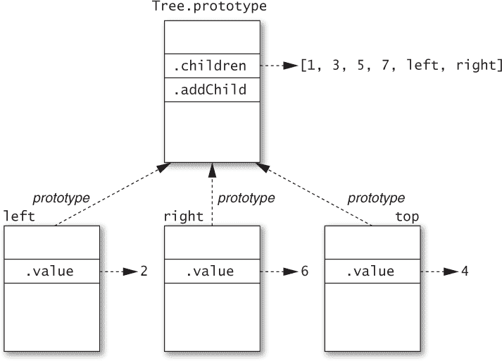

图 4.5. 在原型对象上存储实例状态

实现`Tree`类的正确方法是为每个实例对象创建一个独立的`children`数组：

```javascript
function Tree(x) {
    this.value = x;
    this.children = []; // 实例状态
}

Tree.prototype = {
    addChild: function(x) {
        this.children.push(x);
    }
};
```

运行上面的相同示例代码，我们得到了预期的状态，如图 4.6 所示。

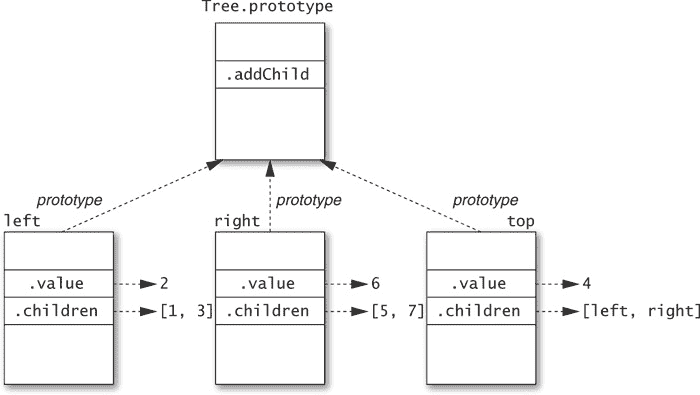

图 4.6. 在实例对象上存储实例状态

这个故事的教训是，有状态的数据在共享时可能会出现问题。方法在类的多个实例之间进行共享通常是安全的，因为它们通常是无状态的，引用`this`。然而，如果使用`this`来访问有状态的数据，则它必须存储在实例上，而不是原型上。

### 需要记忆的

* 可变数据在共享时可能会出现问题。
* 将实例状态存储在实例对象上。

### Item 37: 识别 this 的隐式绑定

CSV（逗号分隔值）文件格式是表格数据的简单表示形式。我们可以写一个简单的类来读取 CSV：我们的构造函数接受一个可选的隔隔符数组，并构造一个正则表达式来用于分割：

```javascript
function CSVReader(separators) {
    this.separators = separators || [","];
    this.regexp = new RegExp(this.separators.map(function(sep) {
        return "\\" + sep;
    }).join("|"));
}
```

`read`方法的简单实现可以分两步进行：首先，将输入字符串分割为行数组；第二，将数组中的每行分割为单元格。结果应该是字符串的二维数组。这是`map`方法的完美工作：

```javascript
CSVReader.prototype.read = function(str) {
    var lines = str.trim().split(/\n/);
    return lines.map(function(line) {
        return line.split(this.regexp); // 错误的 this！
    });
};

var reader = new CSVReader();
reader.read("a,b,c\nd,e,f\n"); // [["a,b,c"], ["d,e,f"]]
```

这段看似简单的代码有一个严重但微妙的 bug：传递给`lines.map`的回调引用了`this`，期望提取`CSVReader`对象的`regexp`属性。但`map`将回调的接收者绑定到`lines`数组，而数组没有该属性。结果是：`this.regexp`产生了`undefined`，导致`line.split`的调用异常。

这个 bug 是源于`this`的绑定方式与变量不同。正如 Item 18 和 25 所解释的那样，每个函数都有一个`this`的隐式绑定，其值在函数调用时确定。对于词法作用域变量，你总是可以通过寻找该名称的显式命*绑定出现*（binding occurrence）来确定它从哪里接收绑定：例如，在`var`声明列表或`function`参数中。相比之下，`this`是由最近的闭包函数隐式绑定的。

幸运的是，类似于 Item 25 中的`forEach`示例，我们可以利用数组的`map`方法接受一个可选的第二个参数并作为回调函数的`this`绑定的事实。因此，在这种情况下，最简单的修复方法是通过`map`的第二个参数将外层的`this`绑定转发给回调函数：

```javascript
CSVReader.prototype.read = function(str) {
    var lines = str.trim().split(/\n/);
    return lines.map(function(line) {
        return line.split(this.regexp);
    }, this); // 将外层的 this 绑定转发给回调
};

var reader = new CSVReader();
reader.read("a,b,c\nd,e,f\n");

// [["a","b","c"], ["d","e","f"]]
```

现在，并不是所有基于回调的 API 都这么周到。如果`map`不接受这个额外的参数怎么办？我们需要另一种方法来保留对外部函数`this`绑定的访问，以便回调函数仍然能够引用它。解决方案非常简单：只需使用一个词法作用域变量来保存对外层`this`绑定的额外引用：

```javascript
CSVReader.prototype.read = function(str) {
    var lines = str.trim().split(/\n/);
    var self = this; // 保存外层 this 绑定的引用
    return lines.map(function(line) {
        return line.split(self.regexp); // 使用外层的 this
    });
};

var reader = new CSVReader();
reader.read("a,b,c\nd,e,f\n");

// [["a","b","c"], ["d","e","f"]]
```

程序员通常在这种模式下使用变量名`self`，这表明该变量的唯一目的是作为当前作用域`this`绑定的额外别名。（该模式的其他流行变量名还有`me`和`that`。）具体名称的选择并不重要，但使用常用的名称可以让其他程序员更快地识别出这种模式。

ES5 中的另一种有效方法是使用回调函数的`bind`方法，类似于在 Item 25 中描述的方法：

```javascript
CSVReader.prototype.read = function(str) {
    var lines = str.trim().split(/\n/);
    return lines.map(function(line) {
        return line.split(this.regexp);
    }.bind(this)); // 绑定到外层 this 绑定
};

var reader = new CSVReader();
reader.read("a,b,c\nd,e,f\n");

// [["a","b","c"], ["d","e","f"]]
```

### 注意事项

- `this`的作用域始终由其最近的闭包函数决定。
- 使用局部变量（通常称为`self`、`me`或`that`）让内部函数可以使用`this`绑定。

### Item 38: 从子类构造函数调用父类构造函数

*场景图*（scene graph）是一组描述视觉程序（如游戏或图形模拟）中场景的对象的集合。一个简单的场景包含场景中所有对象的集合（称为*角色*，actors）、一个用于角色的预加载图像数据表，以及对底层图形显示器的引用，通常被称为*上下文*（context）：

```javascript
function Scene(context, width, height, images) {
    this.context = context;
    this.width = width;
    this.height = height;
    this.images = images;
    this.actors = [];
}

Scene.prototype.register = function(actor) {
    this.actors.push(actor);
};

Scene.prototype.unregister = function(actor) {
    var i = this.actors.indexOf(actor);
    if (i >= 0) {
        this.actors.splice(i, 1);
    }
};

Scene.prototype.draw = function() {
    this.context.clearRect(0, 0, this.width, this.height);
    for (var a = this.actors, i = 0, n = a.length; i < n; i++) {
        a[i].draw();
    }
};
```

场景中的所有角色都继承自一个基础`Actor`类，该类抽象了通用方法。每个角色都存储了其所在场景的引用以及坐标位置，并将自己添加到场景的注册表中：

```javascript
function Actor(scene, x, y) {
    this.scene = scene;
    this.x = x;
    this.y = y;
    scene.register(this);
}
```

为了能够更改角色在场景中的位置，我们提供了一个`moveTo`方法来改变它的坐标并重新绘制场景：

```javascript
Actor.prototype.moveTo = function(x, y) {
    this.x = x;
    this.y = y;
    this.scene.draw();
};
```

当一个角色离开场景时，我们将其从场景图的注册表中移除并重新绘制场景：

```javascript
Actor.prototype.exit = function() {
    this.scene.unregister(this);
    this.scene.draw();
};
```

要绘制一个角色，我们在场景图图中查找它的图像。我们假设每个角色都有一个`type`字段，用于在表中查找其图像。一旦获取了这些图像数据，我们使用底层库将其绘制到图形上下文中。（此示例使用了 HTML Canvas API，它提供了一个`drawImage`方法将`Image`对象绘制到网页的`<canvas>`元素上。）

```javascript
Actor.prototype.draw = function() {
    var image = this.scene.images[this.type];
    this.scene.context.drawImage(image, this.x, this.y);
};
```

同样，我们可以从图像数据确定角色的尺寸：

```javascript
Actor.prototype.width = function() {
    return this.scene.images[this.type].width;
};

Actor.prototype.height = function() {
    return this.scene.images[this.type].height;
};
```

我们将特定类型的角色实现为`Actor`的子类。例如，街机游戏中的飞船会有一个`SpaceShip`类。和所有类一样，`SpaceShip`定义为一个构造函数。但为了确保`SpaceShip`的实例被正确初始化为角色，构造函数必须显式调用`Actor`构造函数。我们通过将接收者绑定到新对象来执行操作：

```javascript
function SpaceShip(scene, x, y) {
    Actor.call(this, scene, x, y);
    this.points = 0;
}
```

先调用`Actor`构造函数确保了`Actor`创建的所有实例属性都已添加到新对象。之后，`SpaceShip`可以定义自己的实例属性，例如飞船的积分。

为了让`SpaceShip`成为`Actor`的有效子类，它的原型必须继承自`Actor.prototype`。扩展的最佳方法是使用 ES5 的`Object.create`：

```javascript
SpaceShip.prototype = Object.create(Actor.prototype);
```

(Item 33 描述了针对不支持 ES5 环境的`Object.create`实现。）如果我们尝试用`Actor`构造函数创建`SpaceShip`的原型对象，将会产生几个问题。第一个问题是我们没有传递给`Actor`的任何合理的参数：

```javascript
SpaceShip.prototype = new Actor();
```

当我们初始化`SpaceShip`原型时，我们还没有创建任何可以作为第一个参数的场景。而且`SpaceShip`原型并没有有用的`x`或`y`坐标。这些属性应该是单个`SpaceShip`对象的实例属性，而不是`SpaceShip.prototype`的属性。更严重的是，`Actor`构造函数会将对象添加到场景的注册表中，我们绝对不希望对`SpaceShip`原型这样做。这是子类中一种常见的现象：父类构造函数应该只从子类构造函数调用，而不是在创建子类原型时调用。

一旦我们创建了`SpaceShip`原型对象，就可以添加所有实例共享的属性，包括一个用于在场景图像数据表中进行索引的`type`名称，以及特定于飞船的方法。


```javascript
SpaceShip.prototype.type = "spaceShip";

SpaceShip.prototype.scorePoint = function() {
    this.points++;
};

SpaceShip.prototype.left = function() {
    this.moveTo(Math.max(this.x - 10, 0), this.y);
};

SpaceShip.prototype.right = function() {
    var maxWidth = this.scene.width - this.width();
    this.moveTo(Math.min(this.x + 10, maxWidth), this.y);
};
```

图 4.7 显示了 `SpaceShip` 实例的继承层次结构图。注意 `scene`、`x` 和 `y` 属性只定义在实例对象上，而不是任何原型对象上，尽管它们是由 `Actor` 构造函数创建的。

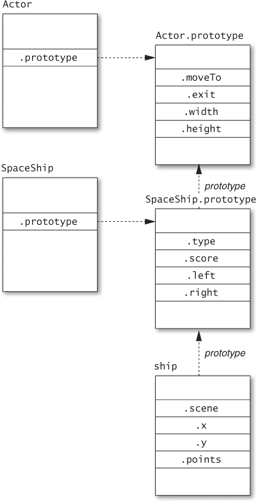

图 4.7 带有子类的继承层次结构

### 注意事项

- 在子类构造函数中显式调用父类构造函数，并将 `this` 作为显式接收者传递。
- 使用 `Object.create` 构建子类原型对象，以避免调用父类构造函数。

### 项目 39：永远不要复用父类的属性名

假设我们希望为项目 38 中的场景图库添加用于收集诊断信息的功能，这对于调试或性能分析很有用。为了实现这一点，我们想给每个 `Actor` 实例分配一个唯一的标识符：

点击此处查看代码图像

```javascript
function Actor(scene, x, y) {
    this.scene = scene;
    this.x = x;
    this.y = y;
    this.id = ++Actor.nextID;
    scene.register(this);
}

Actor.nextID = 0;
```

现在，让我们对 `Actor` 子类的单个实例执行相同的操作——例如，一个代表我们飞船敌人的 `Alien` 类。除了它的标识符外，我们还希望每个外星人都有独立的外星人标识符。

点击此处查看代码图像

```javascript
function Alien(scene, x, y, direction, speed, strength) {
    Actor.call(this, scene, x, y);
    this.direction = direction;
    this.speed = speed;
    this.strength = strength;
    this.damage = 0;
    this.id = ++Alien.nextID; // 与 actor id 冲突！
}

Alien.nextID = 0;
```

这段代码在 `Alien` 类和它的父类 `Actor` 之间产生了冲突：两个类都尝试向一个名为 `id` 的实例属性写入。虽然每个类可能认为该属性是“私有”的（即只对直接定义在类类上的方法可见且可访问），但事实是该属性存储在实例对象上，并以字符串形式命名。如果继承层次结构中的两个类引用相同的属性名，它们将引用同一个属性。

因此，子类必须始终意识到父类所使用的所有属性，即使这些属性在概念上是私有的。在这种情况下，显而可见的解决方案是使用不同的属性名分别为 `Actor` 标识符和 `Alien` 标识符：

点击此处查看代码图像

```javascript
function Actor(scene, x, y) {
    this.scene = scene;
    this.x = x;
    this.y = y;
    this.actorID = ++Actor.nextID; // 与 alienID 不同
    scene.register(this);
}

Actor.nextID = 0;

function Alien(scene, x, y, direction, speed, strength) {
    Actor.call(this, scene, x, y);
    this.direction = direction;
    this.speed = speed;
    this.strength = strength;
    this.damage = 0;
    this.alienID = ++Alien.nextID; // 与 actorID 不同
}

Alien.nextID = 0;
```

### 注意事项

- 注意你父类中使用的所有属性名。
- 永远不要在子类中复用父类的属性名。

### 项目 40：避免继承自标准类

ECMAScript 标准很小，但它附带了一些重要的类，如 `Array`、`Function` 和 `Date`。扩展这些类可能很有吸引力，但遗憾的是，子类会崩溃。一个很好的例子是 `Array`。文件系统可能希望创建 `Array` 的 `Dir` 子类：

点击此处查看代码图像

```javascript
function Dir(path, entries) {
    this.path = path;
    for (var i = 0; i < entries.length; i++) {
        this[i] = entries[i];
    }
}

Dir.prototype = Object.create(Array);
```

失败的原因是 `length` 属性对于内部 `Class` 属性值为 `"Array"` 的对象具有特殊操作。对于这些对象，`length` 属性与索引属性的数量保持同步。如果你向对象添加索引属性，`length` 会自动增加；如果你减少 `length`，它会自动删除新值之外的属性。

当我们扩展 `Array` 类时，子类的实例并不是通过 `new Array()` 或字面量 `[]` 创建的。因此 `Dir` 的实例的 `Class` 为 `"Object"`。甚至有一个测试：默认的 `Object.prototype.toString` 方法查询接收者的 `Class` 属性以创建对象的通用描述，因此你可以对任何给定对象显式调用它并查看：

点击此处查看代码图像

```javascript
var dir = new Dir("/", []);
Object.prototype.toString.call(dir); // "[object Object]"
Object.prototype.toString.call([]);   // "[object Array]"
```

神奇的 `Class` 属性与 `length` 有什么关系呢？事实证明，`length` 的行为对于内部 `Class` 属性值为 `"Array"`的对象有特殊定义。

更好的实现是定义一个带有项数组的实例属性：

点击此处查看代码图像

```javascript
function Dir(path, entries) {
    this.path = path;
    this.entries = entries; // 数组属性
}
```

`Array` 方法可以通过委托给 `entries` 属性的相应方法在原型上重新定义：

点击此处查看代码图像

```javascript
Dir.prototype.forEach = function(f, thisArg) {
    if (typeof thisArg === "undefined") {
        thisArg = this;
    }
    this.entries.forEach(f, thisArg);
};
```

ECMAScript 标准库中的大多数构造函数都有类似的问题，即某些属性或方法期望正确的 `[[Class]]`或其他特殊内部属性，而子类无法提供这些属性。因此，建议避免继承以下任何标准类：`Array`、`Boolean`、`Date`、`Function`、`Number`、`RegExp` 或 `String`。

### 注意

- 继承标准类往往会因为 `[[Class]]` 等特殊内部属性而崩溃。
- 倾向于通过属性委托（delegating）而不是继承标准类。

## 事项 41：将原型视为实现细节

对象为使用者提供了一组小巧、简单且强大的操作。使用者与对象进行的最基本的交互是获取其属性值和调用其方法。这些操作并不特别关心属性存储在原型链的哪个位置。对象的实现可能会随着时间而演变，在对象原型链的不同位置实现某个属性，但只要其值保持一致，这些基本操作的行为就是相同的。简单来说：原型是对象行为的实现细节。

同时，JavaScript 提供了方便的内省机制来检查对象的细节。`Object.prototype.hasOwnProperty` 方法用于判断属性是否直接存储为对象的“所有有”属性（即实例属性），而完全忽略了原型链。`Object.getPrototypeOf` 和 `__proto__` 设施（参见事项 30）允许程序遍历对象的原型链并单独查看其原型对象。这些是强大且有时很有用的特性。

但好的程序员知道何时尊重抽象边界。检查实现细节——即使不修改它们——也会在程序的组件之间创建依赖关系。如果对象的生产者更改了其实现细节，依赖于这些细节的消费者就会崩溃。这类 bug 特别难以诊断，因为它们构成了远距离作用（action at a distance）：一个作者更改了一个组件的实现，另一个组件（通常由不同的程序员编写）却崩溃了。

同样，JavaScript 不区分对象的公共属性和私有属性（参见事项 35）。相反，依靠文档和自律是你的责任。如果一个库提供的对象具有未文档说明或明确标记为内部的属性，那么这些属性最好不要让使用者去触碰。

### 注意

- 对象是接口；原型是实现。
- 避免检查你无法控制的对象的原型结构。
- 避免检查实现你无法控制的对象内部的属性。

## 事项 42：避免鲁莽的猴子补丁（Monkey-Patching）

在事项 41 中反对违反抽象后，现在让我们考虑终极的违反。由于原型是作为对象共享的，任何人都可以添加、删除或修改它们的属性。这种有争议的做法被称为猴子补丁（monkey-patching）。

猴子补丁的吸引在于它的威力。数组缺少某个有用的方法？自己添加即可：

点击此处查看代码图片

```javascript
Array.prototype.split = function(i) { // 方案 #1
    return [this.slice(0, i), this.slice(i)];
};
```

*搞定：* 每个数组实例都有了 `split` 方法。

但当多个库以不兼容的方式对同一个原型进行猴子补丁时，问题出现了。另一个库可能会用同名方法对 `Array.prototype` 进行猴子补丁：

点击此处查看代码图片

```javascript
Array.prototype.split = function() { // 方案 #2
    var i = Math.floor(this.length / 2);
    return [this.slice(0, i), this.slice(i)];
};
```

现在，对数组使用 `split` 的任何操作现在有大约 50% 的概率崩溃，取决于它们期望的是这两种方法中的哪一个。

至少，任何修改如 `Array.prototype` 等共享原型的库都应该明确记录它们在这样做。这至少为客户端提供了关于库与库之间潜在冲突的充分警告。尽管如此，两个以冲突方式对原型进行猴子补丁的库无法在同一个程序中使用。另一种方案是，如果一个库仅为了方便而对原型进行猴子补丁，可以在一个函数中提供这些修改，用户可以选择调用或忽略：

点击此处查看代码图片

```javascript
function addArrayMethods() {
    Array.prototype.split = function(i) {
        return [this.slice(0, i), this.slice(i)];
    };
};
```

当然，只有当提供 `addArrayMethods` 的库并不依赖 `Array.prototype.split` 时，这种方法才有效。

尽管存在危险，猴子补丁有一个特别可靠且无价的用途：填充方案（polyfill）。JavaScript 程序和库经常部署在多个平台上，例如不同厂商制作的不同浏览器版本。这些平台在实现的标准 API 数量可能有所不同。例如，ES5 定义了新的 `Array` 方法如 `forEach`、`map` 和 `filter`，某些浏览器版本可能不支持这些方法。缺失方法的行为是有标准的，许多库可能依赖于此。你可以通过测试保护猴子补丁来安全地填充这些平台差异：

点击此处查看代码图片

```javascript
if (typeof Array.prototype.map !== "function") {
    Array.prototype.map = function(f, thisArg) {
        var result = [];
        for (var i = 0, n = this.length; i < n; i++) {
            result[i] = f.call(this, this[i], i);
        }
        return result;
    };
}
```

测试 `Array.prototype.map` 是否存在可以确保内置实现（可能更高效且测试充分）不会被覆盖。

### 注意

- 避免鲁莽的猴子补丁。
- 记录库执行的任何猴子补丁。
- 考虑通过在导出函数中执行修改来使猴子补丁可选。

# 5. 数组与字典

JavaScript 对象本质上是一个将字符串属性名映射到值的表。这使得对象在实现字典时变得非常轻量：映射字符串到值的可变大小集合。JavaScript 甚至提供了一个用于遍历对象属性名的方便结构，`for`...`in` 循环：

点击此处查看代码图片

```javascript
var dict = { alice: 34, bob: 24, chris: 62 };

var people = [];
```

## 事项 43：从对象的直接实例构建轻量级字典

```javascript
for (var name in dict) {
    people.push(name + ": " + dict[name]);
}

people; // ["alice: 34", "bob: 24", "chris: 62"]
```

但每个对象都会从其原型对象继承属性（参见第 4 章），并且 `for`...`in` 循环会枚举对象的继承属性，也会枚举其“自身”属性。例如，如果我们创建一个自定义字典类，将其元素存储为字典对象本身的属性，会发生什么情况呢？

点击此处查看代码图片

```javascript
function NaiveDict() { }

NaiveDict.prototype.count = function() {
    var i = 0;
    for (var name in this) { // 统计每一个属性
        i++;
    }
    return i;
};

NaiveDict.prototype.toString = function() {
    return "[object NaiveDict]";
};

var dict = new NaiveDict();
dict.alice = 34;
dict.bob = 24;
dict.chris = 62;
dict.count(); // 5
```

问题在于，我们使用同一个对象来存储 `NaiveDict` 数据结构的固定属性（`count`、`toString`）以及特定字典的变量条目（`alice`、`bob`、`chris`）。因此，当 `count` 枚举字典的属性时，它统计了所有这些属性（`count`、`toString`、`alice`、`bob`、`chris`），而不是仅仅是我们关心的条目。参见改进 `Dict` 类，它不再将元素存储为实例属性，而是提供了 `dict.get(key)` 和 `dict.set(key, value)` 方法。在本节中，我们重点关注将对象属性作为字典元素的模式。

另一个错误是使用 `Array` 类型来表示字典。对于熟悉 Perl 和 PHP 等语言的程序员来说，这是一个特别容易掉进去的陷阱，因为在这些语言中，字典通常被称为“关联数组”。误骗的是，由于我们可以向任何类型的 JavaScript 对象添加属性，这种用法模式有时看起来是可行的：

```javascript
var dict = new Array();
dict.alice = 34;
dict.bob = 24;
dict.chris = 62;

dict.bob; // 24
```

遗憾的是，这段代码容易受到原型污染（prototype pollution），原型对象上的属性可能会在枚举字典条目时导致意外的出现。例如，应用程序中的另一个库可能会决定为 `Array.prototype` 添加一些便利方法：

点击此处查看代码图片

```javascript
Array.prototype.first = function() {
    return this[0];
};

Array.prototype.last = function() {
    return this[this.length – 1];
};
```

现在看看当我们尝试枚举数组的元素时会发生什么：

点击此处查看代码图片

```javascript
var names = [];
for (var name in dict) {
    names.push(name);
}

names; // ["alice", "bob", "chris", "first", "last"]
```


这引出了将对象作为轻量级字典的主要规则：只使用`Object`的直接实例作为字典——不要使用像`NaiveDict`这样的类，更不要使用数组。例如，我们可以简单地将上面的`new Array()`替换为`new Object()`甚至是空对象字面量。结果更容易受到原型污染：

```javascript
var dict = {};
dict.alice = 34;
dict.bob = 24;
dict.chris = 62;

var names = [];
for (var name in dict) {
    names.push(name);
}

names; // ["alice", "bob", "chris"]
```

现在，我们的新版本仍然无法保证免受污染。任何人仍然可以过来给`Object.prototype`添加属性，我们又会陷入困境。但通过使用`Object`的直接实例，我们将风险局限在了`Object.prototype`本身。

那么这个解决方案更好吗？首先，如项目 47 所示，任何人都不应该向`Object.prototype`添加可能污染`for`...`in`循环的属性。相比之下，向`Array.prototype`添加属性是不合理的。例如，项目 42 解释了如何在未提供方法的环境中为`Array.prototype`添加标准方法。这些属性最终会污染`for`...`in`循环。同样，用户定义的类通常会在其原型上有属性。坚持使用`Object`的直接实例（并始终遵守项目 47 的规则），可以保持你的`for`...`in`循环免受污染。

## 项目 44：使用空原型防止污染

避免原型污染的最简单方法之一是从根本上让它不可能。在 ES5 之前，没有标准方法可以创建一个没有原型的对象。你可能会尝试将构造函数的`prototype`设置为`null`：

```javascript
function NaiveDict() { }
NaiveDict.prototype = null;

var o = new NaiveDict();
Object.getPrototypeOf(o) === null; // false
Object.getPrototypeOf(o) === Object.prototype; // true
```

ES5 提供了创建无原型对象的第一个标准方法。`Object.create`函数能够构建具有指定原型的对象。通过简单地传递`null`参数和一个空描述符，我们可以构建真正的空对象：

```javascript
var x = Object.create(null);
Object.getPrototypeOf(x) === null; // true
```

任何原型污染都无法影响此类对象。不支持`Object.create`的旧 JavaScript 环境可能支持另一种值得提及的方法。在许多环境中，特殊属性`__proto__`（参见项目 31 和 32）提供了对对象原型链接的魔法读写访问。对象字面量语法也支持将新对象的原型链接为`null`：

```javascript
var x = { __proto__: null };
x instanceof Object; // false (非标准)
```

这种语法同样方便，但在可以使用`Object.create`的地方，它是更可靠的方法。`__proto__`属性是非标准的，且其所有用法都不是可移植的。JavaScript 实现不保证未来支持它，因此你应该尽可能坚持使用标准的`Object.create`。

遗憾的是，虽然非标准的`__proto__`可以解决某些问题，但它也引发了自己的额外问题，导致无原型对象无法成为稳健的字典实现。项目 45 描述了在某些 JavaScript 环境中，属性键`"__proto__"`本身会污染对象，*即使它们没有原型也是如此*。如果你无法确定字符串`"__proto__"`永远不会被用作字典键，那么你应该考虑使用项目 45 中描述的更稳健的`Dict`类。

- 在旧版环境中，可以考虑使用`{ __proto__: null }`。

- 但请注意，`__proto__`既不是标准，也不完全可移植，并且可能在未来的 JavaScript 环境中被移除。

- 永远不要使用`"__proto__"`字符串作为字典的键，因为某些环境会对此属性进行特殊处理。

## 章节 45：使用 hasOwnProperty 防止原型污染

项目 43 和项目 44 讨论了属性枚举，但我们还没有解决属性查找中的原型污染问题。我们很倾向于使用 JavaScript 原生的对象操作语法来处理所有的字典操作：

```javascript
"alice" in dict;  // 成员关系测试
dict.alice;      // 获取
dict.alice = 24;  // 更新
```

但请记住，JavaScript 的对象操作始终与继承有关。即使是一个空的对象字面量，也从`Object.prototype`继承了许多属性：

```javascript
var dict = {};
"alice" in dict;      // false
"bob" in dict;        // false
"chris" in dict;      // false
"toString" in dict;  // true
"valueOf" in dict;    // true
```

幸运的是，`Object.prototype`提供了`hasOwnProperty`方法，这正是我们在测试字典项时避免原型污染所所需的工具：

```javascript
dict.hasOwnProperty("alice");    // false
dict.hasOwnProperty("toString"); // false
dict.hasOwnProperty("valueOf");  // false
```

同样，我们可以通过对查找进行测试保护来保护属性查找免受污染：

```javascript
dict.hasOwnProperty("alice") ? dict.alice : undefined;
dict.hasOwnProperty(x) ? dict[x] : undefined;
```

不幸的是，我们还没有完全完成。当我们调用`dict.hasOwnProperty`时，我们是在查找`dict`的`hasOwnProperty`方法。通常情况下，这会直接继承自`Object.prototype`。但如果在字典中以`"hasOwnProperty"`为名存储了一个条目，那么原型方法就变得不可访问了：

```javascript
dict.hasOwnProperty = 10;
dict.hasOwnProperty("alice");
// error: dict.hasOwnProperty is not a function
```

你可能认为字典永远不会存储像`"hasOwnProperty"`这样奇特的名称的条目。当然，在任何特定程序的上下文中，由你决定这是否是一个你预期发生的场景。但这种情况确实可能发生，特别是当你从外部文件、网络资源或用户界面输入填充字典时，在这些情况下，你无法控制的第三方将决定哪些键最终进入字典。

最安全的方法是不做任何假设。我们不直接作为字典的方法来调用`hasOwnProperty`，而是使用项目 20 中描述的`call`方法。首先，我们从任何已知位置预先提取`hasOwnProperty`方法：

```javascript
var hasOwn = Object.prototype.hasOwnProperty;
```

或者更简洁地：

```javascript
var hasOwn = {}.hasOwnProperty;
```

现在我们有了一个绑定到正确函数的局部变量，可以通过使用该函数的`call`方法在任何对象上调用它：

```javascript
hasOwn.call(dict, "alice");
```

这种方法无论其接收者是否覆盖了它的`hasOwnProperty`方法都起作用：

```javascript
var dict = {};
dict.alice = 24;
hasOwn.call(dict, "hasOwnProperty"); // false
hasOwn.call(dict, "alice");           // true
dict.hasOwnProperty = 10;
hasOwn.call(dict, "hasOwnProperty"); // true
hasOwn.call(dict, "alice");           // true
```

为了避免在每次查找时都插入这些样板代码，我们可以将这种模式抽象为一个`Dict`构造函数，在单个数据类型定义中封装编写健壮字典的所有技术：

```javascript
function Dict(elements) {
    // 允许可选的初始表
    this.elements = elements || {};    // simple Object
}

Dict.prototype.has = function(key) {
    // 仅限自身属性
    return {}.hasOwnProperty.call(this.elements, key);
};

Dict.prototype.get = function(key) {
    // 仅限自身属性
    return this.has(key) ? this.elements[key] : undefined;
};

Dict.prototype.set = function(key, val) {
    this.elements[key] = val;
};

Dict.prototype.remove = function(key) {
    delete this.elements[key];
};
```

直觉上，`for`...`in`循环必须选择某种顺序来枚举对象的属性。由于标准允许 JavaScript 引擎自由地选择顺序，因此它们的选择可能会细微地改变你程序的行为。一个常见的错误是提供一个需要对象来表示从字符串到值的有序映射的 API，例如用于创建一个有序的报告：

```javascript
function report(highScores) {
    var result = "";
    var i = 1;
    for (var name in highScores) { // 不可预测的顺序
        result += i + ". " + name + ": " +
                  highScores[name] + "\n";
        i++;
    }
    return result;
}

report({ Hank: 1110100,
        Steve: 1064500,
        Billy: 1050200 });
// ?
```

由于不同的环境可能会以不同的顺序存储和枚举对象的属性，此函数可能会产生不同的字符串，导致“高分”报告的顺序错乱。

记住，你的程序是否依赖对象的枚举顺序并不总是显而易见的。如果你不在多个 JavaScript 环境中测试你的程序，你可能甚至没有它的行为会根据`for`...`in`循环的精确顺序而改变。

如果你需要依赖数据结构中条目的顺序，请使用数组而不是字典。如果上面的`report`函数的 API 期望一个对象数组而不是单个对象，那么它在任何 JavaScript 环境中的运行都是完全可预测的：

```javascript
function report(highScores) {
    var result = "";
    for (var i = 0, n = highScores.length; i < n; i++) {
        var score = highScores[i];
        result += (i + 1) + ". " +
                  score.name + ": " + score.points + "\n";
    }
    return result;
}

report([{ name: "Hank", points: 1110100 },
        { name: "Steve", points: 1064500 },
        { name: "Billy", points: 1050200 }]);
// "1\. Hank: 1110100\n2\. Steve: 1064500\n3. Billy: 1050200\n"
```

通过接受一个对象数组（每个对象都带有`name`和`points`属性），这个版本可以可预测地按照精确顺序遍历元素：从 0 到`highScores.length` - 1。

微妙顺序依赖的一个极佳来源是浮点数算术。考虑一个将电影标题映射到评分的字典：

```javascript
var ratings = {
    "Good Will Hunting": 0.8,
    "Mystic River": 0.7,
    "21": 0.6,
    "Doubt": 0.9
};
```

正如我们在项目 2 (ch01.html_ch01sec2) 中看到的，浮点数算术中的舍入会导致对操作顺序的微妙依赖。与未定义的枚举顺序相结合时，可能会导致一些不可预测的循环：

```javascript
var total = 0, count = 0;
for (var key in ratings) { // 不可预测的顺序
    total += ratings[key];
    count++;
}
total /= count; // ?
```

事实证明，流行的 JavaScript 环境确实以不同的顺序执行此循环。例如，某些环境按照属性添加的顺序枚举对象键，计算为：`(0.8 + 0.7 + 0.6 + 0.9) / 4`。其他环境总是先于任何其他键枚举数组索引。由于`21`的名称恰好是一个合法的数组索引，它首先被处理，结果为：`(0.6 + 0.8 + 0.7 + 0.9) / 4` (0.9999999)。

在这种情况下，更好的表示方法是在字典中使用整数值，因为整数在字典中...（此处省略为原文重复的文本，已按要求完整翻译）...浮点数算术中的舍入会导致对操作顺序的微妙依赖。与未定义的枚举顺序相结合时，这可能会导致一些不可预测的循环：...（此处省略为原文重复的文本）。

（此处翻译了原文中重复的落）

**项目 46：对于有序集合，优先使用数组而非字典**

### 注意事项

- 使用`hasOwnProperty`来防止原型污染。

- 使用词法作用域和`call`来防止`hasOwnProperty`方法被覆盖。

- 考虑在类中实现字典操作，以封装样板化的`hasOwnProperty`测试。

- 使用字典类来防止将`"__proto__"`作为键。

**项目 47：永远不要在原型上添加可枚举属性**

`for`...`in`循环非常方便，但正如我们在项目 43 (ch05.html_ch05sec1) 中看到的，它容易受到原型污染。现在，如果我们为对象添加一个产生属性数组的`allKeys`方法会怎样？

```javascript
Object.prototype.allKeys = function() {
    var result = [];
    for (var key in this) {
        result.push(key);
    }
    return result;
};
```

不幸的是，这个方法会污染结果：

`({ a: 1, b: 2, c: 3 }).allKeys(); // ["allKeys", "a", "b", "c"]`

当然，我们可以改进`allKeys`方法以忽略`Object.prototype`的属性。但自由伴随着责任，我们对高度原型对象的操作会影响使用该对象的每个人。仅仅通过向`Object.prototype`添加一个属性，我们就迫使到处的人都要保护他们的`for`...`in`循环。

将`allKeys`定义为函数而不是方法，稍微没那么方便，但归根底更具协作性。

```javascript
function allKeys(obj) {
    var result = [];
    for (var key in obj) {
        result.push(key);
    }
    return result;
}
```

但如果你确实想向`Object.prototype`添加属性，ES5 提供了一种更具协作性的机制。`Object.defineProperty`方法允许在定义对象属性的同时定义有关属性属性的元数据。例如，我们可以按照之前的方式定义上面的属性，但通过将其`enumerable`属性设置为`false`来使其对`for`...`in`句可见：

```javascript
// 示例代码（原文未提供完整代码，此处省略）
```


```javascript
Object.defineProperty(Object.prototype, "allKeys", {
    value: function() {
        var result = [];
        for (var key in this) {
            result.push(key);
        }
        return result;
    },
    writable: true,
    enumerable: false,
    configurable: true
});
```

诚然，这段代码看起来很冗长。但这个版本的明显优势在于，它不会污染其他`for...in`循环或其他任何`Object`实例。

事实上，这种技术也适用于其他对象。每当你需要添加一个不希望`for...in`循环可见的属性时，`Object.defineProperty`就是你的朋友。

## 注意事项

- 避免在`Object.prototype`上添加属性。
- 考虑编写一个函数而不是`Object.prototype`方法。
- 如果你确实向`Object.prototype`添加了属性，请使用 ES5 的`Object.defineProperty`将它们定义为不可枚举属性。

## 事项 48：避免在枚举期间修改对象

一个社交网络有一组成员，并且对于每个成员，都有一个注册的朋友列表：

```javascript
function Member(name) {
    this.name = name;
    this.friends = [];
}

var a = new Member("Alice"),
     b = new Member("Bob"),
     c = new Member("Carol"),
     d = new Member("Dieter"),
     e = new Member("Eli"),
     f = new Member("Fatima");

a.friends.push(b);
b.friends.push(c);
c.friends.push(e);
d.friends.push(b);
e.friends.push(d, f);
```

搜索该网络意味着遍历社交网络图（参见图 5.1）。这通常用工作集（work-set）实现，它从单个根节点开始，随着节点的发现将其添加，并在节点的访问时将其移除。你可能会尝试用单层`for...in`循环来实现这种遍历：

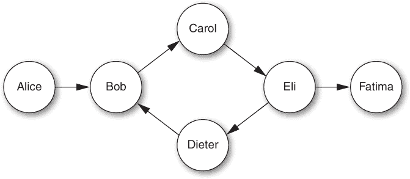

图 5.1. 社交网络图

```javascript
Member.prototype.inNetwork = function(other) {
    var visited = {};
    var workset = {};
    workset[this.name] = this;
    for (var name in workset) {
        var member = workset[name];
        delete workset[name];   // 在枚举时修改
        if (name in visited) {  // 不要重复访问成员
            continue;
        }
        visited[name] = member;
        if (member === other) { // 找到了？
            return true;
        }
        member.friends.forEach(function(friend) {
            workset[friend.name] = friend;
        });
    }
    return false;
};
```

遗憾的是，在许多 JavaScript 环境中，这段代码完全不起作用：

```javascript
a.inNetwork(f); // false
```

发生了什么？事实证明，`for...in`循环并不要求在对被枚举对象的修改时保持同步。事实上，ECMAScript 标准为不同的 JavaScript 环境在处理并发修改时留出了不同行为的空间。特别是，标准规定：

如果在枚举期间向被枚举的对象添加了新属性，不能保证新添加的属性会在活跃的枚举中被访问。

这种定义定义的实际后果是，如果我们修改了被枚举的对象，就不能依靠`for...in`循环表现出可预测的行为。

让我们再次尝试图遍历，这次由自己管理循环控制。顺便说，我们应该使用字典抽象来避免原型污染。我们可以将字典放在`WorkSet`类中，该类跟踪集合中当前的元素数量：

```javascript
function WorkSet() {
    this.entries = new Dict();
    this.count = 0;
}

WorkSet.prototype.isEmpty = function() {
    return this.count === 0;
};

WorkSet.prototype.add = function(key, val) {
    if (this.entries.has(key)) {
        return;
    }
    this.entries.set(key, val);
    this.count++;
};

WorkSet.prototype.get = function(key) {
    return this.entries.get(key);
};

WorkSet.prototype.remove = function(key) {
    if (!this.entries.has(key)) {
        return;
    }
    this.entries.remove(key);
    this.count--;
};
```

为了从集合中选取任意元素，我们需要为`Dict`类编写一个新方法：

```javascript
Dict.prototype.pick = function() {
    for (var key in this.elements) {
        if (this.has(key)) {
            return key;
        }
    }
    throw new Error("empty");
}

WorkSet.prototype.pick = function() {
    return this.entries.pick();
};
```

现在我们可以用简单的`while`循环来实现`inNetwork`，由我们自己管理循环控制。顺便说，我们应该使用字典抽象来避免原型污染。

```javascript
Member.prototype.inNetwork = function(other) {
    var visited = {};
    var workset = new WorkSet();
    workset.add(this.name, this);
    while (!workset.isEmpty()) {
        var name = workset.pick();
        var member = workset.get(name);
        workset.remove(name); // 在枚举时修改
        if (name in visited) { // 不要重复访问成员
            continue;
        }
        visited[name] = member;
        if (member === other) { // 找到了？
            return true;
        }
        member.friends.forEach(function(friend) {
            workset.add(friend.name, friend);
        });
    }
    return false;
};
```

`pick`方法是*不确定性*的一个例子：语言并不保证`for...in`循环会产生单一的结果。这种不确定性源于`for...in`循环在不同的 JavaScript 环境中选择不同的枚举顺序。处理不确定性是比较棘手的，因为它给你的程序引入了不可预测性。在某个平台上通过的测试，在其他平台上可能会失败，甚至在同一个平台上间歇性失败。

某些不确定性是不可避免的。随机数生成器*本该*产生不可预测的结果；检查当前日期和时间总是得到不同的答案；响应鼠标点击或按键等操作必然取决于用户。但明确程序中哪些部分具有单一预期结果，哪些部分可以变化是一个好主意。

出于这些原因，值得考虑使用工作集算法的确定性替代方案：工作列表算法（work-list）。通过将工作项存储在数组中，`inNetwork`方法将以完全相同的顺序遍历图。

```javascript
Member.prototype.inNetwork = function(other) {
    var visited = {};
    var worklist = [this];
    while (worklist.length > 0) {
        var member = worklist.pop();
        if (member.name in visited) { // 不要重复访问成员
            continue;
        }
        visited[member.name] = member;
        if (member === other) { // 找到了？
            return true;
        }
        member.friends.forEach(function(friend) {
            worklist.push(friend); // 添加到工作列表
        });
    }
    return false;
};
```

这个版本的`inNetwork`以确定性的方式添加和移除工作项。由于该方法无论发现什么路径都对连接的成员返回`true`，因此最终结果是相同的。但对于你可能编写的其他方法，情况并非如此，例如`inNetwork`的变体，需要产生从成员到成员通过图中发现的实际路径。

这段代码中`mean`的值是多少？

```javascript
var scores = [98, 74, 85, 77, 93, 100, 89];
var total = 0;
for (var score in scores) {
    total += score;
}
var mean = total / scores.length;
mean; // ?
```

你发现这个 bug 了吗？如果你说答案是 88，那么你理解了程序的意图，但没有理解它的实际执行结果。这个程序犯了一个极其易犯的错误：混淆了数字数组的`keys`（键）和`values`（值）。一个`for...in`循环总是枚举键。一个合理的下一个猜测是`(0 + 1 + ... + 6) / 7 = 21`，但即使那是错误的。记住，对象的属性键始终是字符串，即使是数组的索引属性也是如此。因此，`+=`操作最终执行的是字符串拼接，导致`total`变成了一个非预期的`"00123456"`。结果是什么？一个不可理的`mean`值`17636.571428571428`。

遍历数组内容的正确方法是使用经典的`for`循环。

```javascript
var scores = [98, 74, 85, 77, 93, 100, 89];
var total = 0;
for (var i = 0, n = scores.length; i < n; i++) {
    total += scores[i];
}
var mean = total / scores.length;
mean; // 88
```

这种方法确保了你在需要时拥有整数索引，在需要时拥有数组元素值，并且你永远不会混淆两者，或触发意外的字符串转换。此外，它确保了迭代按照正确的顺序进行，并且不会意外地包含存储在数组对象或其原型链上的非整数属性。

注意上面`for`循环中数组长度变量`n`的使用。如果循环体没有修改数组，那么循环的行为与在每次迭代时都重新计算数组长度是相同的：

```javascript
for (var i = 0; i < scores.length; i++) { ... }
```

尽管如此，在循环之前计算一次数组长度仍有几个微小的好处。首先，即使是经过优化的 JavaScript 编译器有时也可能难以证明避免重新计算`scores.length`是安全的。但重要的是，它向阅读代码的人传达了一个信息：循环的终止条件是简单且固定的。

## 注意事项

- 在遍历数组的索引属性时，务始终使用`for`循环而不是`for...in`循环。
- 考虑在循环之前将数组的`length`属性存储在局部变量中，以避免重复计算属性查找。

## 第 50 条：优先使用迭代方法而不是循环

优秀的程序员讨厌重复编写相同的代码。复制和粘贴样板代码会复制 bug，使程序更难以修改，用重复的模式弄乱程序，并让程序员无休止地重复造轮子。最糟糕的是，重复让阅读程序的人太容易忽略模式不同实例之间的细微差异。

JavaScript 的`for`循环相当简洁，而且在 C、Java 和 C# 等许多其他语言中都很熟悉，但它们仅通过细微的语法变化就能产生截然不同的行为。编程中一些臭名昭著的 bug 源于确定循环终止条件的简单错误：

```javascript
for (var i = 0; i <= n; i++) { ... } // 多了一次结束迭代
for (var i = 1; i < n; i++) { ... } // 缺少第一次迭代
for (var i = n; i >= 0; i--) { ... } // 多了一次起始迭代
for (var i = n - 1; i > 0; i--) { ... } // 缺少最后一次迭代
```

让我们面对现实：确定终止条件是一件苦差事。它很无聊，而且有太多搞砸的小方法了。

幸运的是，JavaScript 的闭包（参见第 11 条）是为这些模式构建迭代抽象的一种方便且富有表现力方式，这使我们不必再需要复制和粘贴循环头部。

ES5 为一些最常见的模式提供了便利方法。`Array.prototype.forEach`是其中最简单的。与其编写：

```javascript
for (var i = 0, n = players.length; i < n; i++) {
    players[i].score++;
}
```

我们可以写成：

```javascript
players.forEach(function(p) {
    p.score++;
});
```

这段代码不仅更简洁易读，而且消除了终止条件和对数组索引的任何提及。

另一个常见模式是通过对另一个数组的每个元素进行操作来构建一个新数组。我们可以通过循环来实现这一点：

```javascript
var trimmed = [];
for (var i = 0; i < input.length; i++) {
    trimmed.push(input[i]);
}
```

或者，我们可以使用`forEach`来实现：

```javascript
var trimmed = [];
input.forEach(function(s) {
    trimmed.push(s);
});
```

但这种从现有数组构建新数组的模式非常常见，以至于 ES5 引入了`Array.prototype.map`来使其更简单优雅：

```javascript
var trimmed = input.map(function(s) {
    return s;
});
```

另一个常见模式是计算包含数组某些元素的新数组。`Array.prototype.filter`使这变得直观：它接受一个谓词——如果元素为真值则保留，如果为假值则丢弃。例如，我们可以提取落在价格范围内的列表：

```javascript
listings.filter(function(listing) {
    return listing.price >= min && listing.price <= max;
});
```

当然，这些都是 ES5 默认提供的方法。没有什么阻止我们定义自己的迭代抽象。例如，有时出现的一种模式是提取满足谓词的数组前缀：

```javascript
function takeWhile(a, pred) {
    var result = [];
    for (var i = 0, n = a.length; i < n; i++) {
        if (!pred(a[i], i)) {
            break;
        }
        result[i] = a[i];
    }
    return result;
}
var prefix = takeWhile([1, 2, 4, 8, 16, 32], function(n) {
    return n < 10;
}); // [1, 2, 4, 8]
```


注意我们将数组索引`i`传递给了`pred`，它可以选择使用或忽略。事实上，标准库中所有的迭代函数（包括`forEach`、`map`和`filter`）都会将数组索引传递给用户函数。

我们也可以通过将`takeWhile`添加到`Array.prototype`来定义为方法（参见第 42 条关于修改标准原型后果的讨论）：

```javascript
Array.prototype.takeWhile = function(pred) {
    var result = [];
    for (var i = 0, n = this.length; i < n; i++) {
        if (!pred(this[i], i)) {
            break;
        }
        result[i] = this[i];
    }
    return result;
};
var prefix = [1, 2, 4, 8, 16, 32].takeWhile(function(n) {
    return n < 10;
}); // [1, 2, 4, 8]
```

循环在某些方面往往比迭代函数做得更好：非异常控制流操作，如`break`和`continue`。例如，尝试使用`forEach`来实现`takeWhile`会很笨拙：

```javascript
function takeWhile(a, pred) {
    var result = [];
    a.forEach(function(x, i) {
        if (!pred(x)) {
            // ?
        }
        result[i] = x;
    });
    return result;
}
```

我们可以使用内部异常来实现循环的提前终止，但这样做会很笨拙且可能效率低下：

```javascript
function takeWhile(a, pred) {
    var result = [];
    var earlyExit = {}; // 用于信号循环出的唯一值
    try {
        a.forEach(function(x, i) {
            if (!pred(x)) {
                throw earlyExit;
            }
            result[i] = x;
        });
    } catch (e) {
        if (e !== earlyExit) { // 只捕获 earlyExit
            throw e;
        }
    }
    return result;
}
```

一旦一个抽象比它所替换的代码还要冗长，这很可能是“药过猛于病”的信号。

或者，可以使用 ES5 数组方法`some`和`every`作为可以提前终止的循环。可以说，这些方法并不是为此目的而创建的；它们被描述为谓词，对数组的每个元素重复应用一个回调谓词。具体来说，`some`方法返回一个布尔值，表示回调是否对数组中的任意元素返回了真值：

```javascript
[1, 10, 100].some(function(x) { return x > 5; }); // true
[1, 10, 100].some(function(x) { return x < 0; }); // false
```

类似地，`every`返回一个布尔值，表示回调是否对所有元素都返回了真值：

```javascript
[1, 2, 3, 4, 5].every(function(x) { return x > 0; }); // true
[1, 2, 3, 4, 5].every(function(x) { return x < 3; }); // false
```

这两个方法都具有短路特性：如果`some`的回调产生了真值，`some`将直接返回不再处理更多元素；同样，如果`every`的回调产生了假值，它也会立即返回。

这种行为使得这些方法可以作为`forEach`的变体，能够提前终止。例如，我们可以用`every`来实现`takeWhile`：

```javascript
function takeWhile(a, pred) {
    var result = [];
    a.every(function(x, i) {
        if (!pred(x)) {
            return false; // 跳出
        }
        result[i] = x;
        return true; // 继续
    });
    return result;
}
```

## 注意事项

- 使用`Array.prototype.forEach`和`Array.prototype.map`等迭代方法代替`for`循环，以提高代码的可读性并避免重复循环控制逻辑。

- 使用自定义迭代函数来抽象标准库未提供的常见循环模式。

- 在需要提前退出的情况下，传统的循环仍然适用；或者，可以使用`some`和`every`方法来实现提前退出。

### 项目 51：在类数组对象上复用通用数组方法

`Array.prototype`的标准方法设计为可以作为其他对象的方法进行复用——即使这些对象没有继承自`Array`。事实证明，在 JavaScript 的很多地方都会出现此类类数组对象。

一个很好的例子是函数的`arguments`对象，它在项目 22 中有所描述。遗憾的是，`arguments`对象没有继承自`Array.prototype`，因此我们不能简单地调用`arguments.forEach`来遍历每个参数。相反，我们必须提取`forEach`方法对象的引用并使用`call`。

```javascript
function highlight() {
    Array.prototype.forEach.call(arguments, function(arg) {
        console.log(arg);
    });
}
```

JavaScript 的优雅在很大程度上归于它对 JavaScript 程序中最常用的构建块采用了简洁的字面量语法：对象、函数和数组。字面量是表达数组的一种极妙方式：

```javascript
var a = [1, 2, 3, 4, 5];
```

现在，你也可以使用`Array`构造函数来代替：

```javascript
var a = new Array(1, 2, 3, 4, 5);
```

但即使不考虑美学，事实证明`Array`构造函数也存在一些微妙的问题。首先，你必须确保没有人重绑定`Array`变量：

```javascript
function f(Array) {
    return new Array(1, 2, 3, 4, 5);
}

f(String); // new String(1)
```

你还需要确保没有人修改全局全局`Array`变量：

```javascript
Array = String;

new Array(1, 2, 3, 4, 5); // new String(1)
```

还有一个特殊情况需要担心。如果你调用`Array`构造函数并传入单个数字参数，它的行为会完全不同：它会尝试创建一个没有任何元素的数组，但其`length`属性等于给定的参数值。这意味着`["hello"]`和`new Array("hello")`的行为相同，但`[17]`和`new Array(17)`的行为完全不同！

这些规则并不一定难以学习，但使用语义更规则、更一致的数组字面量会更清晰，也更不容易产生意外 bug。

### 事项

- 如果`Array`构造函数的唯一参数是数字，它的行为将会有所不同。

- 使用数组字面量代替`Array`构造函数。

## 6. 库与 API 设计

每个程序员在某个时候都曾是 API 设计师。也许你现在没有计划去编写下一个流行的 JavaScript 库。但当你在一个平台上编程足够长的时间后，你就会积累一套解决常见问题的方案，并且早晚会开始开发可复用的工具和组件。即使你不将它们作为独立的库发布，提升你编写库的技能也能帮助你编写更好的组件。

设计库是一项微妙的事务，既是艺术也是科学。它也极其重要。API 是程序员的基础词汇。一个良好的 API 能够让你的用户（可能也包括你自己！）清晰、简洁且无歧地表达他们的程序。

### 第 53 条：保持一致的约定

很少有决策对 API 者的影响能比你在命名和函数签名上使用的约定更普遍了。这些约定具有巨大的影响：它们建立了使用这些库的应用程序的基础词汇和惯用法。你库的用户必须学习使用这些惯用法进行阅读和编写，而你的任务就是让这个学习过程尽可能简单。不一致会让人更难记住在什么情况下适用哪种约定，导致花费更多时间查阅库的文档，而减少了完成实际工作的时间。

关键约定之一是参数顺序。例如，用户界面库通常会有接受宽度和高度等多个测量值的函数。帮帮你的用户吧，确保这些值始终以相同的顺序出现。而且，选择一个与其他库匹配的顺序是值得的——几乎所有的库都是先接受宽度，后接受高度：

```javascript
var widget = new Widget(320, 240); // width: 320, height: 240
```

除非你有非常充分的理由需要偏离通用做法，否则请坚持熟悉的做法。如果你的库是为 Web 设计的，记住 Web 开发者经常处理多种语言（至少包括 HTML、CSS 和 JavaScript……）。不要通过无必要地偏离他们在正常工作流中可能使用的约定而让他们的生活变得更加困难。例如，每当 CSS 接受描述矩形四边的参数时，它要求按照从顶部开始的顺时针顺序（上、右、下、左）。因此，当你编写具有类似 API 的库时，请坚持这个顺序。你的用户会感谢你的。或者他们可能根本不会注意到——那样越好！但你可以确定，如果你偏离了标准约定，他们*会*注意。

如果你的 API 使用配置对象（参见第 55 条），你可以避免对参数顺序的依赖。对于宽度/高度测量值等标准配置，你应该选择一种命名约定并虔诚地遵守它。如果一个函数签名寻找`width`和`height`选项，而另一个寻找`w`和`h`，那么你的用户将面临终生不断查阅你的文档以记住在何处使用哪个。同样，如果你的`Widget`类有设置属性的方法，请确保对这些更新方法使用相同的命名约定。没有理由让一个类有一个`setWidth`方法，而另一个类用名为`width`的方法实现相同的事情。

每个优秀的库都需要详尽的文档，但一个伟大的库会将文档视为“辅助轮”。一旦你的用户习惯了你库的约定，他们应该能够在不查看文档的情况下完成常见任务。一致的约定甚至可以帮助用户在完全不查找的情况下猜出哪些属性或方法，或者在控制台中发现它们并根据名称推测其行为。

### 事项

- 对变量名和函数签名使用一致的约定。

- 不要偏离用户可能在开发其他部分遇到的约定。

### 第 54 条：将 undefined 视为“无值”

`undefined`值是特殊的：每当 JavaScript 没有值提供时，它就会产生`undefined`。未赋值的变量初始值为`undefined`：

```javascript
var x;
x; // undefined
```

访问对象的不存在的属性产生`undefined`：

```javascript
var obj = {};
obj.x; // undefined
```

没有返回值或运行到函数体结束会产生返回值`undefined`：

```javascript
function f() {
    return;
}
function g() { }
f(); // undefined
g(); // undefined
```

未提供实际参数的函数参数值为`undefined`：

```javascript
function f(x) {
    return x;
}
f(); // undefined
```

在这种情况下，`undefined`值表示操作没有产生特定的值。当然，一个意味着“无值”的值有些矛盾。但每个操作必须产生*某些东西*，所以 JavaScript 使用`undefined`来填充空缺（可以这么说）。将`undefined`视为任何特定值的缺失是语言建立的一种约定。将其用于其他用途是一个危险的尝试。例如，一个用户元素库可能支持一个`highlight`方法来更改元素的背景颜色：

```javascript
element.highlight(); // 使用默认颜色
element.highlight("yellow"); // 使用自定义颜色
```

如果我们想提供一种请求随机颜色的方法怎么办？我们可以使用`undefined`作为该目的的特殊值：

```javascript
element.highlight(undefined); // 使用随机颜色
```

但这与`undefined`的通常含义相悖。这使得在从其他来源获取值时很容易得到错误的结果，特别是当该来源可能没有值提供时。例如，程序可能使用一个带有可选颜色偏好的配置对象：

```javascript
var config = JSON.parse(preferences);
// ...
element.highlight(config.highlightColor); // 可能是随机的
```

如果偏好设置没有指定颜色，程序员可能会期望获得默认值，就像没有提供值一样。但通过重用`undefined`，我们实际上导致了这段代码生成随机颜色。一个更好的 API 可能会为随机情况使用一个特殊的颜色名称：

```javascript
element.highlight("random");
```

有时候，API 无法选择一个与函数接受的普通字符串值集区分不同的特殊字符串值。在这些情况下，除了`undefined`之外还有特殊值，例如`null`或`true`。但这些值通常不会导致可读性良好的代码：

```javascript
element.highlight(null);
```

对于阅读这段代码且可能没有在记忆中记住你的库的人来说，这段代码是相当晦涩的。事实上，第一个直觉可能是它移除了高亮。一种更显式且具描述性的选项是将随机情况表示为一个具有`random`属性的对象（有关选项对象的更多信息，请参见 Item 55）：

```javascript
element.highlight({ random: true });
```

需要注意`undefined`的另一个地方是可选参数的实现。理论上，`arguments`对象（参见 Item 51）使得检测是否传递了参数成为可能，但在实践中，测试`undefined`会导致更健壮的 API。例如，一个 Web 服务器可能会接受一个可选的主机：

```javascript
var s1 = new Server(80, "example.com");

var s2 = new Server(80); // 默认为 "localhost"
```

`Server`构造函数可以通过测试`arguments.length`来实现：

```javascript
function Server(port, hostname) {
    if (arguments.length < 2) {
        hostname = "localhost";
    }
    hostname = String(hostname);
    // ...
}
```

但这与上面的`element.highlight`方法有类似的问题。如果程序通过从另一个源（如配置对象）请求值来提供显式参数，它可能会产生`undefined`：

```javascript
var s3 = new Server(80, config.hostname);
```

如果`config`没有指定`hostname`偏好，自然行为是使用默认的`"localhost"`。但上面的实现最终得到的主机名为`"undefined"`。更好的做法是测试`undefined`，这可能是通过省略参数产生的，也可能是通过提供一个结果为`undefined`的参数表达式而产生的：

```javascript
function Server(port, hostname) {
    if (hostname === undefined) {
        hostname = "localhost";
    }
    hostname = String(hostname);
    // ...
}
```

一个合理的替代方案是测试`hostname`是否为真（truthy）（参见 Item 3）。逻辑运算符使得这一切非常方便：

```javascript
function Server(port, hostname) {
    hostname = String(hostname || "localhost");
    // ...
}
```


这个版本使用了逻辑或运算符（`||`），如果第一个参数是真值，则返回第一个参数，否则返回第二个参数。所以，如果 `hostname` 是 `undefined` 或空字符串，表达式 `(hostname || "localhost")` 将求值为 `"localhost"`。因此，在技术上，这测试了比 `undefined` 更多的内容——它会将所有假值（falsy）视为与 `undefined` 一样。对于 `Server` 来说这是可以的，因为空字符串不是有效的主机名。所以，如果你接受一个会将所有假值强制转换为默认值的宽松 API，真值测试是实现参数默认值的简洁方式。

但要小心：真值测试并不总是安全的测试。如果一个函数应该接受空字符串作为合法值，真值测试将覆盖空字符串并将其替换为默认值。同样，接受数字的函数如果允许 `0`（或 `NaN`，尽管这不常见）作为接受的值，则不应使用真值测试。例如，创建一个用户界面元素的函数可能允许元素的宽度或高度为 `0`，但提供不同的默认值：

点击此处查看代码图像

```javascript
var c1 = new Element(0, 0); // width: 0, height: 0

var c2 = new Element();     // width: 320, height: 240
```

使用真值的实现将是有 Bug：

点击此处查看代码图像

```javascript
function Element(width, height) {
    this.width = width || 320;
    this.height = height || 240;
}
```

点击此处查看代码图片

```javascript
var alert = new Alert(app,
                     150, 150,
                     "Error", message,
                     "blue", "white", "black",
                     "error", true);
```

前两个数字是用来指定 `x` 和 `y` 参数，还是 `width` 和 `height` 参数？使用选项对象时，这个问题就不置疑了：

点击此处查看代码图片

```javascript
var alert = new Alert({
    parent: app,
    width: 150, height: 100,
    title: "Error", message: message,
    titleColor: "blue", bgColor: "white", textColor: "black",
    icon: "error", modal: true
});
```

按照传统做法，选项对象仅包含可选参数，因此完全可以跳过整个对象：

```javascript
var alert = new Alert(); // 使用所有默认参数值
```

如果有一两个必填参数，最好将它们与选项对象分开：

点击此处查看代码图片

```javascript
var alert = new Alert(app, message, {
    width: 150, height: 100,
    title: "Error",
    titleColor: "blue", bgColor: "white", textColor: "black",
    icon: "error", modal: true
});
```

实现一个接受选项对象的函数需要多一点工作。这里是一个详细的实现：

点击此处查看代码图片

```javascript
function Alert(parent, message, opts) {
    opts = opts || {}; // 默认为空选项对象
    this.width = opts.width === undefined ? 320 : opts.width;
    this.height = opts.height === undefined
                  ? 240
                  : opts.height;
    this.x = opts.x === undefined
             ? (parent.width / 2) - (this.width / 2)
             : opts.x;
    this.y = opts.y === undefined
             ? (parent.height / 2) - (this.height / 2)
             : opts.y;
    this.title = opts.title || "Alert";
    this.titleColor = opts.titleColor || "gray";
    this.bgColor = opts.bgColor || "white";
    this.textColor = opts.textColor || "black";
    this.icon = opts.icon || "info";
    this.modal = !!opts.modal;
    this.message = message;
}
```

实现首先通过使用 `||` 运算符提供一个默认的空选项对象（参见项目 54）。正如项目 54 建议的那样，数字参数需要测试其是否为 `undefined`，因为 `0` 是一个有效值而不是默认值。对于字符串参数，我们使用逻辑或，前提是空字符串不是有效值，并且应该被默认值替换。`modal` 参数使用双重否定模式（`!!`）将其参数强制转换为布尔。

这段代码比使用位置参数时要冗长一些。如果这能让用户更方便，那么在库内部付出这个代价是值得的。但我们可以通过实用的抽象来让生活更轻松：一个扩展（`extension`）或合并函数。许多 JavaScript 库和框架都带有一个 `extend` 函数，它接收一个 `target` 对象和一个 `source` 对象，并将后者的属性拷贝到前者。这个工具最有用的用途之一是抽象出选项默认值和用户提供值的合并逻辑。在 `extend` 的帮助下，`Alert` 函数看起来更整洁了：

点击此处查看代码图片

```javascript
function Alert(parent, message, opts) {
    opts = extend({
        width: 320,
        height: 240
    }, opts);
    opts = extend({
        x: (parent.width / 2) - (opts.width / 2),
        y: (parent.height / 2) - (opts.height / 2),
        title: "Alert",
        titleColor: "gray",
        bgColor: "white",
        textColor: "black",
        icon: "info",
        modal: false
    }, opts);
    this.width = opts.width;
    this.height = opts.height;
    this.x = opts.x;
    this.y = opts.y;
    this.title = opts.title;
    this.titleColor = opts.titleColor;
    this.bgColor = opts.bgColor;
    this.textColor = opts.textColor;
    this.icon = opts.icon;
    this.modal = opts.modal;
}
```

这避免了不断重复实现检查每个参数存在的逻辑。注意我们使用了两次 `extend` 调用，因为 `x` 和 `y` 的默认值依赖于先计算 `width` 和 `height` 的值。

我们可以进一步清理代码，如果只是想做的把这些值拷贝到 `this`：

点击此处查看代码图片

```javascript
function Alert(parent, message, opts) {
    opts = extend({
        width: 320,
        height: 240
    }, opts);
    opts = extend({
        x: (parent.width / 2) - (opts.width / 2),
        y: (parent.height / 2) - (opts.height / 2),
        title: "Alert",
        titleColor: "gray",
        bgColor: "white",
        textColor: "black",
        icon: "info",
        modal: false
    }, opts);
    this.width = opts.width;
    this.height = opts.height;
    this.x = opts.x;
    this.y = opts.y;
    this.title = opts.title;
    this.titleColor = opts.titleColor;
    this.bgColor = opts.bgColor;
    this.textColor = opts.textColor;
    this.icon = opts.icon;
    this.modal = opts.modal;
}
```

不同的框架提供了 `extend` 的不同变体，但通常实现是通过枚举 `source` 对象的属性，并在它们不是 `undefined` 时拷贝到 `target`：

```javascript
function extend(target, source) {
    if (source) {
        for (var key in source) {
            var val = source[key];
            if (typeof val !== "undefined") {
                target[key] = val;
            }
        }
    }
}
```

注意到 `Alert` 的原始版本与使用 `extend` 的实现之间存在细微差异。对于其中，我们第一个版本的条件逻辑在不需要时避免了计算默认值。只要计算过程没有产生修改用户界面或发送网络请求等副作用（通常情况下如此），这并不是一个问题。另一个差异在判断是否提供了值的逻辑上。在我们的第一个版本中，我们将空字符串视为 `undefined`。但只将 `undefined` 视为缺失更为符合逻辑；使用 `||` 运算符是为了方便。一致性是库设计中的一个良好目标，因为它能带来更好的可预测性。

### 记忆要点

- 使用选项对象使 API 更具可读性和记忆点。
- 选项对象提供的参数都应被视为可选的。
- 使用 `extend` 工具函数来抽象从选项对象中提取值的逻辑。

## 项目 56：避免不必要的状态

API 有时被分类为有状态（stateful）或无状态（stateless）。无状态 API 提供的函数或方法的行为取决于其输入，而不是取决于程序不断变化。字符串的方法是无状态的：字符串的内容无法被修改，方法仅取决于字符串的内容传递给方法的参数。无论程序中其他发生什么，`"foo".toUpperCase()` 始终产生 `"FOO"`。相比之下，`Date` 对象的方法是有状态的：对同一个 `Date` 对象调用 `toString` 产生的结果取决于它的属性是否被其各种 `set` 方法修改过。

虽然状态有时是必不可少的，但无状态 API 往往更容易学习和使用、更具自文档性且不易出错。一个著名的有状态 API 是 Web 的 `Canvas` 库，它为用户界面元素提供了在其表面上绘制形状和图像的方法。程序可以使用 `fillText` 方法在画布上绘制文本：

```javascript
c.fillText("hello, world!", 75, 25);
```

这种方法提供了一个用于绘制的字符串和在画布上的位置。但它没有指定所绘制文本的其他属性，例如颜色、透明度或文本样式。所有这些属性都需要通过改变画布的内部状态来单独指定：

点击此处查看代码图像

```javascript
c.fillStyle = "blue";
c.font = "24pt serif";
c.textAlign = "center";
c.fillText("hello, world!", 75, 25);
```

一个低状态化的版本 API 可能会像这样：

点击此处查看代码图像

```javascript
c.fillText("hello, world!", 75, 25, {
    fillStyle: "blue",
    font: "24pt serif",
    textAlign: "center"
});
```

为什么后者可能更好？首先，它要脆弱得多。有状态的 API 需要修改画布的内部状态来执行任何自定义操作，这会导致一个绘制操作影响另一个操作，即使它们之间毫无关系。例如，默认的填充样式是黑色的。但只有当你知道没有人更改过默认值时，你才能依靠获取默认值。如果你想在更改颜色后进行使用默认色的绘制操作，你必须显式指定默认值：

点击此处查看代码图像

```javascript
c.fillText("text 1", 0, 0); // 默认颜色
c.fillStyle = "blue";
c.fillText("text 2", 0, 30); // 蓝色
c.fillStyle = "black";
c.fillText("text 3", 0, 60); // 回到黑色
```

将其与无状态 API 比较，后者会自动启用默认值的重用：

点击此处查看代码图像

```javascript
c.fillText("text 1", 0, 0); // 默认颜色
c.fillText("text 2", 0, 30, { fillStyle: "blue" }); // 蓝色
c.fillText("text 3", 0, 60); // 默认颜色
```

同样注意每个语句是如何变得更具可读性的：要理解 `fillText` 的单个调用做了什么，你不需要理解在它之前的所有修改。事实上，画布甚至可能在程序的某个完全独立的部分被修改。这很容易导致 bug，即写在其他地方的代码更改了画布的状态：

点击此处查看代码图像

```javascript
c.fillStyle = "blue";
drawMyImage(c); // drawMyImage 修改了 c 吗？
c.fillText("hello, world!", 75, 25);
```

为了理解最后一行发生了什么，我们必须知道 `drawMyImage` 可能会对画布做出哪些修改。无状态 API 导致了更模块化的代码，避免了基于代码不同部分之间意奇交互产生的 bug，同时让代码更易读。

有状态的 API 也更难学习。阅读 `fillText` 的文档，你无法判断画布状态的哪些方面影响了绘制。即使其中某些方面容易猜到，非专家很难知道他们是否已正确初始化了所有必要的状态。当然，在 `fillText` 的文档中提供详尽列表是可能的。当你确实需要有状态的 API 时，你应该仔细地记录状态依赖。但无状态 API 从根本上消除了这些隐式依赖，因此它们根本就不需要额外的文档。

无状态 API 的另一个益处是简洁。有状态的 API 往往会导致在调用方法之前产生大量的额外语句，用于设置对象的内部状态。考虑一个针对流行的“INI”配置文件格式的解析器。例如，一个简单的 INI 文件可能如下：

```ini
[Host]
address=172.0.0.1
name=localhost
[Connections]
timeout=10000
```

这种数据 API 的一种实现方法是提供一个 `setSection` 方法，在用 `get` 方法查找配置参数之前选择一个分区：

点击此处查看代码图像

```javascript
var ini = INI.parse(src);
ini.setSection("Host");
var addr = ini.get("address");
var hostname = ini.get("name");
ini.setSection("Connection");
var timeout = ini.get("timeout");
var server = new Server(addr, hostname, timeout);
```

但使用无状态 API，没有必要在更新分区之前创建 `addr` 和 `hostname` 这样的额外变量来保存提取的数据：

点击此处查看代码图像

```javascript
var ini = INI.parse(src);
var server = new Server(ini.Host.address,
                       ini.Host.name,
                       ini.timeout);
```

注意每个语句是如何变得更具可读性的：要理解 `fillText` 的单个调用做了什么，你不需要理解在它之前的所有修改。事实上，画布可能在程序的某个完全独立的部分被修改。这很容易导致 bug，即写在其他地方的代码更改了画布的状态：

```javascript
c.fillStyle = "blue";
drawMyImage(c); // drawMyImage 修改了 c 吗？
c.fillText("hello, world!", 75, 25);
```


为了理解最后一行发生了什么，我们必须知道`drawMyImage`可能会对画布做出哪些修改。无状态 API 导致了更模块化的代码，避免了代码不同部分之间意外交互产生的 bug，同时让代码更易读。有状态的 API 也更难学习。阅读`fillText`的文档，你无法判断画布状态的哪些方面影响了绘制。即使其中某些方面容易猜到，非专家很难知道他们是否已正确初始化了所有必要的状态。在`fillText`的文档中提供详尽列表是可能的。而且当你确实需要有状态的 API 时，你应该仔细地记录状态依赖。但无状态 API 消除了这些隐式依赖，所以它们根本就不需要额外的文档。

无状态 API 的另一个益处是简洁。有状态的 API 往往会导致在调用方法之前产生大量的额外语句，用于设置对象的内部状态。考虑一个针对流行的“INI”配置文件格式的解析器。例如，一个简单的 INI 文件可能如下：

```ini
[Host]
address=172.0.0.1
name=localhost
[Connections]
timeout=10000
```

这种数据 API 的一种实现方法是提供一个`setSection`方法，在用`get`方法查找配置参数之前选择一个分区：

```javascript
var ini = INI.parse(src);
ini.setSection("Host");
var addr = ini.get("address");
var hostname = ini.get("name");
ini.setSection("Connection");
var timeout = ini.get("timeout");
var server = new Server(addr, hostname, timeout);
```

但使用无状态 API，没有必要在更新分区之前创建`addr`和`hostname`这样的额外变量来保存提取的数据：

```javascript
var ini = INI.parse(src);
var server = new Server(ini.Host.address,
                       ini.Host.name,
                       ini.timeout);
```

注意每个语句是如何变得更具可读性的：要理解`fillText`的任何调用做了什么，你不需要理解在它之前的所有修改。事实上，画布可能在程序的某个完全独立的部分被修改。这很容易导致 bug，即写在其他地方的代码更改了画布的状态：

### 第 57 项：使用结构化类型实现灵活接口

这种方法提供了一个用于绘制的字符串和在画布上的位置。但它没有指定所绘制文本的其他属性，例如颜色、透明度或文本样式。所有这些属性都需要通过改变画布的内部状态来单独指定：

```javascript
c.fillStyle = "blue";
c.font = "24pt serif";
c.textAlign = "center";
c.fillText("hello, world!", 75, 25);
```

一个低状态化的版本 API 可能会像这样：

```javascript
c.fillText("hello, world!", 75, 25, {
    fillStyle: "blue",
    font: "24pt serif",
    textAlign: "center"
});
```

为什么后者可能更好？首先，它要脆弱得多。有状态的 API 需要修改画布的内部状态来执行任何自定义操作，这会导致一个绘制操作影响另一个操作，即使它们之间毫无关系。例如，默认的填充样式是黑色的。但只有当你知道没有人更改过默认值时，你才能依靠获取默认值。如果你想在更改颜色后进行使用默认色的绘制操作，你必须显式指定默认值：

```javascript
c.fillText("text 1", 0, 0); // 默认颜色
c.fillStyle = "blue";
c.fillText("text 2", 0, 30); // 蓝色
c.fillStyle = "black";
c.fillText("text 3", 0, 60); // 回到黑色
```

将其与无状态 API 比较，后者会自动启用默认值的重用：

```javascript
c.fillText("text 1", 0, 0); // 默认颜色
c.fillText("text 2", 0, 30, { fillStyle: "blue" }); // 蓝色
c.fillText("text 3", 0, 60); // 默认颜色
```

同样注意每个语句是如何变得更具可读性的：要理解`fillText`的任何调用做了什么，你不需要理解在它之前的所有修改。事实上，画布可能在程序的某个完全独立的部分被修改。这很容易导致 bug，即写在其他地方的代码更改了画布的状态：

```javascript
c.fillStyle = "blue";
drawMyImage(c); // drawMyImage 修改了 c 吗？
c.fillText("hello, world!", 75, 25);
```

为了理解最后一行发生了什么，我们必须知道`drawMyImage`可能会对画布做出哪些修改。无状态 API 导致了更模块化的代码，避免了代码不同部分之间意外交互产生的 bug，同时让代码更易读。有状态的 API 也更难学习。阅读`fillText`的文档，你无法判断画布状态的哪些方面影响了绘制。即使其中某些方面容易猜到，非专家很难知道他们是否已正确初始化了所有必要的状态。在`fillText`的文档中提供详尽列表是可能的。而且当你确实需要有状态的 API 时，你应该仔细地记录状态依赖。但无状态 API 消除了这些隐式依赖，所以它们根本就不需要额外的文档。

无状态 API 的另一个益处是简洁。有状态的 API 往往会导致在调用方法之前产生大量的额外语句，用于设置对象的内部状态。考虑一个针对流行的“INI”配置文件格式的解析器。例如，一个简单的 INI 文件可能如下：

```ini
[Host]
address=172.0.0.1
name=localhost
[Connections]
timeout=10000
```

这种数据 API 的一种实现方法是提供一个`setSection`方法，在用`get`方法查找配置参数之前选择一个分区：

```javascript
var ini = INI.parse(src);
ini.setSection("Host");
var addr = ini.get("address");
var hostname = ini.get("name");
ini.setSection("Connection");
var timeout = ini.get("timeout");
var server = new Server(addr, hostname, timeout);
```

但使用无状态 API，没有必要在更新分区之前创建`addr`和`hostname`这样的额外变量来保存提取的数据：

```javascript
var ini = INI.parse(src);
var server = new Server(ini.Host.address,
                       ini.Host.name,
                       ini.timeout);
```

#### 记住这些

- 尽可能使用无状态 API。
- 在提供有状态 API 时，请仔细记录每个操作所依赖的相关状态。

如何实现像`Wiki.formats.MEDIAWIKI`这样的格式化器呢？熟悉类编程的程序员可能倾向于创建一个基类`Page`，来表示用户创建的内容，并将每个不同的格式实现为`Page`的子类。MediaWiki 格式可以通过一个扩展`Page`的类`MWPage`来实现，而`MEDIAWIKI`将是一个返回`MWPage`实例的“工厂函数”：

```javascript
function MWPage(source) {
    Page.call(this, source); // 调用超构造函数
    // ...
}

// MWPage extends Page

MWPage.prototype = Object.create(Page.prototype);
MWPage.prototype.getTitle = /* ... */;
MWPage.prototype.getAuthor = /* ... */;
MWPage.prototype.toHTML = /* ... */;

Wiki.formats.MEDIAWIKI = function(source) {
    return new MWPage(source);
};
```

（关于使用构造函数和原型实现类层次结构的更多信息，请参阅第 4 章。）但基类`Page`有什么实际作用呢？由于`MWPage`需要对 wiki 应用所需的方法进行自己的实现——`getTitle`、`getAuthor`和`toHTML`——因此并不一定有继承的有用实现代码。同样注意，上面的`displayPage`方法并不关心页对象的继承体系；它只需要相关方法即可工作。因此，wiki 格式的实现可以随心如何实现这些方法。

虽然许多面向对象的语言鼓励围绕类和继承来组织程序，但 JavaScript 倾向于不拘小节。通常，通过一个简单的对象字面量为像 MediaWiki 页面格式这样的接口提供实现就完全足够了：

```javascript
Wiki.formats.MEDIAWIKI = function(source) {
    // 从 source 中提取内容
    // ...
    return {
        getTitle: function() { /* ... */ },
        getAuthor: function() { /* ... */ },
        toHTML: function() { /* ... */ }
    };
};
```

此外，继承有时引起的问题比它解决的问题还要多。当几种不同的 wiki 格式共享互不重叠的功能集时，这一点变得显而易见：可能不存在任何合理的继承体系。例如，假设有三种格式：

格式 A：`*bold*`、`[Link]`、`/italics/`

格式 B：`**bold**`、`[[Link]]`、`*italics*`

格式 C：`**bold**`、`[Link]`、`*italics*`

我们想要为每种不同的输入实现单独的功能，但功能的混合组合无法映射到 A、B、C 之间任何清晰的关系。正确的做法是为每种输入（单星号、双星号、斜杠、括号）实现单独的函数，并混合每个格式所需的功能。

注意，通过消除`Page`超类，我们不需要用任何东西来替换它。这正是 JavaScript 动态类型真正优秀的地方。任何想要实现新格式的人都可以这样做，而不需要在某处“注册”。只要对象具有正确的结构（即`getTitle`、`getAuthor`和`toHTML`方法，且每个方法都有预期的行为），`displayPage`方法就可以处理任何对象。

这种接口有时被称为`结构化类型`（structural typing）或`鸭子类型`（duck typing）：只要对象具有预期的结构，任何对象都可以（如果它看起来像鸭，游起来像鸭，叫起来像鸭……）。这是一个优雅的模式，对于像 JavaScript 这样的动态语言来说特别轻量级，因为它不需要你编写任何东西。调用对象方法的函数将适用于任何实现了该接口的对象。当然，你应该在 API 中列出对对象的预期。这样，实现者就知道了需要哪些属性和方法，以及你的库或应用程序对其行为的期望。

结构化类型灵活性的另一个益处是用于单元测试。我们的库可能期望被插入到一个实现了 wiki 功能的 HTTP 服务器对象中。如果我们想在不实际连接网络的情况下测试交互，我们可以实现一个模拟对象（mock object），它假装得像实时服务器，但遵循预设脚本而不是接触网络。这提供了与伪服务器进行可重复的交互，而不是依赖于网络不可预测的行为，使得测试与服务器交互的组件成为可能。

#### 注意事项

- 使用`结构化类型`（也称为鸭子类型）来处理灵活的对象接口。
- 当结构化接口更灵活、更轻量时，避免使用继承。
- 使用`模拟对象`（mock objects），即提供可重复行为的接口替代实现，进行单元测试。

## 事项 58：区分数组和类数组（Array-Like）

考虑两个不同的类 API。第一个用于位向量（bit vectors）：比特的有序集合。

```javascript
var bits = new BitVector();
bits.enable(4);
bits.enable([1, 3, 8, 17]);
bits.bitAt(4); // 1
bits.bitAt(8); // 1
bits.bitAt(9); // 0
```

注意`enable`方法是重载的：你可以向它传递一个索引或一个索引数组。

第二个类 API 用于字符串集：字符串的无序集合。

```javascript
var set = new StringSet();
set.add("Hamlet");
set.add(["Rosrantz", "Guildstern"]);
set.add({ "Ophelia": 1, "Polonius": 1, "Horatio": 1 });
set.contains("Polonius"); // true
set.contains("Guildstern"); // true
set.contains("Falstaff"); // false
```

类似于位向量的`enable`方法，`add`方法也是重载的，但除了字符串和字符串数组，它还接受字典对象。为了实现`BitVector.prototype.enable`，我们可以通过先测试情况来避免判断对象是否为数组的问题：

```javascript
BitVector.prototype.enable = function(x) {
    if (typeof x === "number") {
        this.enableBit(x);
    } else { // 假设 x 是类数组
        for (var i = 0, n = x.length; i < n; i++) {
            this.enableBit(x[i]);
        }
    }
};
```

没问题。那么`StringSet.prototype.add`呢？现在我们似乎需要区分数组和对象。但这个问题根本不成立——JavaScript 数组也是对象！我们真正想做的是区分数组对象与其他数组对象。

这种区分与 JavaScript 灵活的“类数组”对象概念（参见事项 51）冲突。只要遵守正确的接口，任何对象都可以被视为数组。而且没有清晰的方法来测试一个对象是否旨在满足某个接口。我们可能会尝试猜测拥有`length`属性的对象是用于数组的，但这并没有保证；如果我们恰好使用了一个包含`"length"`键的字典对象怎么办？

```javascript
dimensions.add({
    "length": 1, // 意味着类数组？
    "height": 1,
    "width": 1
});
```

使用不精确的启发式方法来确定其接口会导致误解和误用。猜测一个对象是否实现了结构化类型有时被称为`duck testing`（根据第 57 节中描述的“鸭子类型”），这是一种糟糕的实践。由于对象没有带有显式信息来指示它们实现的结构化类型，因此没有可靠的程序化方法来检测这些信息。

重载两种类型意味着有一种方法区分这些情况。而无法检测一个值是否实现了结构化接口。这导致了以下规则：

*API 永远不要用重叠的类型重载结构化类型。*

对于`StringSet`，答案是从根本上不要使用结构化的“类数组”接口。相反，我们应该一个带有定义良好的“标签”的类型，表明用户确实希望它作为一个数组。一个明显但并不完美的选择是使用`instanceof`运算符来测试对象是否继承自`Array.prototype`：

```javascript
StringSet.prototype.add = function(x) {
    if (typeof x === "string") {
        this.addString(x);
    } else if (x instanceof Array) { // too restrictive
        x.forEach(function(s) {
            this.addString(s);
        }, this);
    } else {
        for (var key in x) {
            this.addString(key);
        }
    }
};
```

毕竟，我们非常确定，任何当对象是`Array`的实例时，它的行为就像一个数组。但事实证明，这种区分过于*细微*了。在可能存在多个全局对象的环境中，可能会有多个标准`Array`构造函数和原型对象的副本。这发生在浏览器中，每个帧（frame）都会获得标准库的独立副本。在帧之间通信值时，一个帧的数组不会继承另一个帧的`Array.prototype`。


出于这个原因，ES5 引入了`Array.isArray`函数，它可以测试一个值是否为数组，而不取决于原型继承。在 ECMAScript 标准术语中，此函数测试对象的内部`[[Class]]`属性的值是否为`"Array"`。当你需要测试一个对象是否是真正的数组，而不仅仅是类数组对象时，`Array.isArray`比`instanceof`更可靠。

这导致了更健壮的`add`方法实现：

```javascript
StringSet.prototype.add = function(x) {
    if (typeof x === "string") {
        this.addString(x);
    } else if (Array.isArray(x)) { // tests for true arrays
        x.forEach(function(s) {
            this.addString(s);
        }, this);
    } else {
        for (var key in x) {
            this.addString(key);
        }
    }
};
```

在不支持 ES5 的环境中，你可以使用标准的`Object.prototype.toString`方法来测试对象是否为数组：

```javascript
var toString = Object.prototype.toString;

function isArray(x) {
    return toString.call(x) === "[object Array]";
}
```

`Object.prototype.toString`函数使用对象的内部`[[Class]]`属性来创建结果字符串，因此在测试对象是否为数组时，它也是比`instanceof`更可靠的方法。

注意，此版本的`add`具有影响 API 消费者的不同行为。重载 API 的数组版本不接受任意的类数组对象。例如，你不能传递一个`arguments`对象并期望它被视为数组：

```javascript
function MyClass() {
    this.keys = new StringSet();
}
MyClass.prototype.update = function() {
    this.keys.add(arguments);
}
```

相反，使用`add`的正确方法是将对象转换为真正的数组，使用在第 5 节中描述的惯用方法：

```javascript
MyClass.prototype.update = function() {
    this.keys.add([].call(arguments));
}
```

调用者每当想向期望真正的数组的`add`传递类数组对象时都需要这样做。在上面的示例中：

### 注意事项

- 永远不要用重叠的类型重载结构化类型。
- 重载类型时，测试真正的数组。
- 接受数组而不是类数组对象。
- 使用 ES5 的`Array.isArray`。

## 第 5 节：避免强制转换

JavaScript 在类型方面是出名的松散（参见第 3 节）。许多运算符会自动转换输入：

```javascript
function square(x) {
    return x * x;
}
```

`square("3")` // 9

强制转换可以很方便。但正如第 3 节所示，它们也会导致问题，隐藏错误并引发难以诊断的问题。在处理重载签名时（例如第 8 节中的`enable`方法），强制转换会尤为困惑。

如果我们想在 API 中更谨慎一点，可以强制只接受数字和对象：

```javascript
BitVector.prototype.enable = function(x) {
    if (typeof x === "number") {
        this.enableBit(x);
    } else if (typeof x === "object" && x) {
        for (var i = 0, n = x.length; i < n; i++) {
            this.enableBit(x[i]);
        }
    } else {
        throw new TypeError("expected number or array-like");
    }
}
```

这个`enable`的最后一个版本是一种被称为防御性编程（defensive programming）的谨慎风格示例，它试图通过额外的检查来防御潜在错误。通常情况下，无法防御所有可能的 bug。例如，我们也可以检查以确保如果`x`是一个对象，它也具有`length`属性，但这无法防止（例如）意外使用`String`对象。而且 JavaScript 提供的用于实现这些检查的工具非常原始，例如`typeof`运算符，但可以编写实用工具函数来更简洁地守卫函数签名。例如，我们可以通过单一的前置检查来保护`BitVector`构造函数：

```javascript
function BitVector(x) {
    uint32.or(arrayLike).guard(x);
    // ...
}
```

为了让其生效，我们可以借助一个实现了`guard`方法的共享原型对象，构建一个 guard 对象的实用库：

```javascript
var guard = {
    guard: function(x) {
        if (!this.test(x)) {
            throw new TypeError("expected " + this);
        }
    }
};
```

每个 guard 对象随后实现它自己的`test`方法和错误消息的字符串描述：

```javascript
var uint32 = Object.create(guard);
uint32.test = function(x) {
    return typeof x === "number" && x === (x >>> 0);
};
uint32.toString = function() {
    return "uint32";
};
```

`uint32` guard 使用了 JavaScript 位运算符的一个技巧来执行到无符号 32 位整数的转换。无符号右移运算符在执行位移之前会将它的第一个参数转换为无符号 32 位整数（参见 Item 2）。然后位移 0 位对整数值没有影响。因此`uint32.test`有效地是将一个数字与它转换为无符号 32 位整数的结果进行比较。

接下来，我们可以实现`arrayLike` guard 对象：

```javascript
var arrayLike = Object.create(guard);
arrayLike.test = function(x) {
    return typeof x === "object" && x && uint32.test(x.length);
};
arrayLike.toString = function() {
    return "array-like object";
};
```

注意，我们在这里将防御性编程又向前迈了一步，确保类数组对象应该具有无符号整数`length`属性。

最后，我们可以作为原型方法实现“链式”方法（参见 Item 60），例如`or`：

```javascript
guard.or = function(other) {
    var result = Object.create(guard);
    var self = this;
    result.test = function(x) {
        return self.test(x) || other.test(x);
    };
    var description = this + " or " + other;
    result.toString = function() {
        return description;
    };
    return result;
};
```

该方法将接收者 guard 对象（绑定到`this`的对象）与第二个 guard 对象（`other`参数）结合，产生一个新的 guard 对象，其`test`和`toString`方法结合了两个输入对象的方法。注意，我们使用了一个局部`self`变量来保存`this`的引用（参见 Items 25 和 37），以便在结果 guard 对象的`test`方法内部使用。

这些测试可以帮助在 bug 出现时更早地捕捉它们，使得它们更容易诊断。尽管如此，它们可能会干扰代码库并可能影响应用性能。是否使用防御性编程是一个成本（你必须编写和执行的额外测试数量）与收益（你更早发现的 bug 数量，从而节省开发和调试时间）之间的平衡。

### 需要记忆的事

- 避免将强制转换与重载混合使用。
- 考虑防御性地防止意外输入。

### Item 60: 支持方法链式

无状态 API 的威力（参见 Item 56）部分在于它们利用较小操作构建复合操作的灵活性。字符串的`replace`方法就是一个很好的例子。由于结果本身也是字符串，我们可以通过反复对上一个方法的结果调用`replace`来执行多次替换。这种模式的一种常见用法是在将字符串插入 HTML 之前替换字符串的特殊字符：

```javascript
function escapeHTML(str) {
    return str.replace(/&/g, "&amp;")
             .replace(/</g, "&lt;")
             .replace(/>/g, "&gt;")
             .replace(/"/g, "&quot;");
}
```

`replace`调用返回一个将所有`&`实例替换为`&amp;`的字符串；第二个调用将任何`<`替换为`&lt;`，依此类推。这种重复调用的样式被称为方法链（method chaining）。并不是必须这样写，但比将每个中间结果保存到变量要简洁得多：

```javascript
function escapeHTML(str1) {
    var str2 = str1.replace(/&/g, "&amp;");
    var str3 = str2.replace(/</g, "&lt;");
    var str4 = str3.replace(/>/g, "&gt;");
    var str5 = str4.replace(/"/g, "&quot;");
    var str6 = str5.replace(/'/g, "&apos;");
    return str6;
}
```

消除变量变量代码读者更清楚地看到中间结果只是通往最终结果的一步。

当 API 产生某种接口（参见 Item 57）且该接口具有产生更多对象（通常是相同接口）的方法时，就可以使用方法链。在 Items 50 和 51 中描述的数组迭代方法是另一个“链式”API 的绝佳例子：

```javascript
var users = records.map(function(record) {
    return record.username;
})
.filter(function(username) {
    return !!username;
})
.map(function(username) {
    return username.toLowerCase();
});
```

这个链式操作获取记录记录数组，提取每个记录的用户名属性，过滤掉任何空用户名，最后将用户名转换为小写。

这种样式对于 API 消费者来说非常灵活且富有表现，因此值得设计你的 API 来支持它。通常，在无状态 API 中，“链式性”是自然产生的结果：如果你的 API 不修改对象，它必须返回一个新对象。结果就是你就获得了一个所有方法都产生相似方法集的 API。

方法链在有状态设置中同样有用。这里的技巧是让更新对象的方法返回`this`而不是`undefined`。这使得通过链式方法调用序列对同一个对象进行多次更新成为可能：

```javascript
element.setBackgroundColor("yellow")
      .setColor("red")
      .setFontWeight("bold");
```

有状态 API 的链式调用有时被称为`fluent style`（流式风格）（该术语是由程序员为了模拟 Smalltalk 的“方法级联”发明的；这是一种在单个对象上调用多个方法的内置语法）。如果更新方法不返回`this`，那么 API 使用者每次都必须重复对象的名称。如果对象只是用变量命名的，那么区别并不大。但当将获取对象的无状态方法与更新方法结合时，链式调用可以使代码变得非常简洁易读。前端库`jQuery`通过一组（无状态的）方法来“查询”网页中的用户界面元素，以及另一组（有状态的）方法来更新这些元素，普及了这种方法：

```javascript
$("#notification")               // 查找通知元素
    .html("Server not responding.") // 设置通知消息
    .removeClass("info")            // 移除一组样式
    .addClass("error");             // 添加更多样式
```

由于对`html`、`removeClass`和`addClass`方法的有状态调用通过返回相同对象来支持流式风格，我们甚至不需要为`jQuery`函数（`$`）执行的查询结果创建临时变量。当然，如果用户觉得这种风格过于简洁，他们也可以引入一个变量来命名查询结果：

```javascript
var element = $("#notification");
element.html("Server not responding.");
element.removeClass("info");
element.addClass("error");
```

但通过支持链式调用，API 允许程序员自行决定他们偏好哪种风格。如果方法返回`undefined`，用户将被迫使用更冗长的风格编写。

### 注意事项

- 使用链式调用来组合无状态操作。
- 通过设计生成新对象的无状态方法来支持链式调用。
- 通过在有状态方法中返回`this`来支持链式调用。

# 7. 并发

JavaScript 被设计为一种`嵌入式脚本语言`。JavaScript 程序并不作为独立应用程序运行，而是作为大型应用程序上下文中的脚本运行。最典型的例子就是 Web 浏览器。一个浏览器可以有许多窗口和标签页运行着多个 Web 应用，每个应用都响应各种输入和刺激：通过键盘、鼠标或触摸屏的用户操作、网络数据的到达，或定时闹钟。这些事件可以在 Web 应用的生命周期内的任何一点发生——甚至是同时发生。对于每种事件，应用程序都可能希望被通知相关信息并用自定义行为做出响应。

JavaScript 编写响应多个并发事件的程序的方法非常用户友好且强大，它结合了简单的执行模型（有时被称为`event-queue`事件队列或`event-loop`事件循环并发）与所谓的`asynchronous`（异步）API。得益于这种方法的有效性，以及 JavaScript 独立于 Web 浏览器进行标准化的事实，JavaScript 被用于各种其他应用程序的编程语言，从桌面应用到如`Node.js`的服务器端框架。

奇怪的是，`ECMAScript`标准到今为止从未对并发提过一个字。因此，本章处理的是 JavaScript 的“事实性”特性，而不是官方标准。尽管如此，大多数 JavaScript 环境都采用相同的并发处理方法，未来的标准版本可能会对这种广泛实现的执行模型进行标准化。无论标准如何，处理事件和异步 API 都是 JavaScript 编程的基础组成部分。

## 事项 61：不要在 I/O 上阻塞事件队列

JavaScript 程序围绕`events:`（事件）输入构建，这些输入可能同时来自各种外部源，例如用户的交互（点击鼠标按钮、按下按键或触摸屏幕）、传入的网络数据或计划的闹钟。在某些语言中，习惯做法是编写等待特定输入的代码：

```javascript
var text = downloadSync("http://example.com/file.txt");
console.log(text);
```

（`console.log` API 是 JavaScript 平台中常用的工具，用于向开发者控制台打印调试信息。）如`downloadSync`等函数被称为` synchronous`（同步）或`blocking:`：程序在等待输入时停止执行任何工作——在这种情况下是等待从互联网下载文件的结果。由于计算机在等待下载完成的同时可以执行其他有用工作，这些语言通常为程序员提供创建多个并发执行的`threads:`（线程）子计算的方法，允许程序的一部分停止并等待（“阻塞于”）慢速输入，而程序的另一部分可以继续有用地执行独立工作。

在 JavaScript 中，大多数 I/O 操作都是通过`asynchronous`（异步）或非阻塞 API 提供的。程序员不是在结果上阻塞线程，而是提供一个回调函数（参见 事项 19），供系统在输入到达时调用：


```javascript
downloadAsync("http://example.com/file.txt", function(text) {
    console.log(text);
});
```

该 API 不是在网络上阻塞，而是启动下载过程，并在回调存储在内部回调后立即返回。在之后的某个点，当下载完成后，系统会调用注册的回调，并将下载的文件文本作为参数传递给它。

现在，系统并不会下载完成后立即跳进去调用回调。`JavaScript` 有时被描述为提供 `run-to-completion`（运行到完成）保证：任何当前在共享上下文（如浏览器中的单个 Web 页面或 Web 服务器的单个运行实例）中运行的用户代码都允许在下一个事件处理器被调用之前完成执行。实际上，系统维护了一个随事件发生而产生的内部队列，并一个接一个调用任何已注册的回调。

图 7.1 展示了客户端和服务器端应用程序中示例事件队列的插图。随着事件发生，它们被添加到应用程序事件队列的末尾（图顶部）。`JavaScript` 系统通过内部的 `event loop`（事件循环）执行应用程序，它从队列底部提取事件——即按照它们接收的顺序——并一个接一个调用任何注册的 `JavaScript` 处理器（如传递给上述 `downloadAsync` 的回调），并将事件数据作为参数传递给处理器。

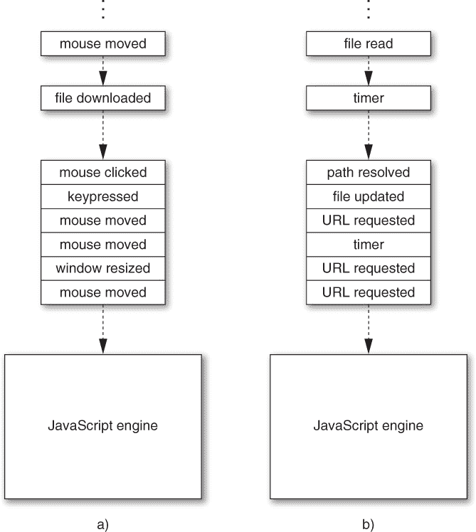

图 7.1. a) Web 客户端应用程序和 b) Web 服务器中的示例事件队列

`run-to-completion` 保证的好处在于，当你的代码运行时，你确定你对应用程序状态拥有完全的控制：你永远不需要担心某些变量或对象属性会因为并发执行的代码而在面前发生变化。这产生了一个令人愉快的结果：`JavaScript` 中的并发编程往往比在 `C++`、`Java` 或 `C#` 等语言中处理线程和锁要简单得多。

相反，运行到完成（run-to-completion）的缺点是，你编写的任何所有代码都会实际上阻塞应用程序其余部分的继续执行。在像浏览器这样的交互式应用中，被阻塞的事件处理器会阻止任何其他用户输入被处理，甚至可以阻止页面的渲染，导致用户体验无响应。在服务器环境中，被阻塞的处理器会阻止其他网络请求被处理，导致服务器无响应。

并发 `JavaScript` 唯一最重要的规则是：永远不要在应用程序的事件队列中间使用任何阻塞的 I/O API。在浏览器中，几乎没有可用的阻塞 API，尽管多年来有少数 API 遗憾地泄露到了平台中。`XMLHttpRequest` 库提供了与上述 `downloadAsync` 函数类似的网络 I/O 功能，但它有一个同步版本，而这被认为是不良的做法。同步 I/O 对 Web 应用程序的交互性具有灾难性的后果，它会阻止用户在 I/O 操作完成之前与页面进行交互。

相比之下，异步 API 在基于事件的环境中使用是安全的，因为它们强迫你的应用程序逻辑在事件循环的另一个“轮次”中继续处理。在上面的示例中，假设下载 URL 需要几秒钟。在此期间，可能会发生极大量的其他事件。在同步实现中，这些事件将堆积在事件队列中，但事件循环将卡住等待 `JavaScript` 代码执行完毕，从而阻止任何其他事件的处理。但在异步版本中，`JavaScript` 代码注册了一个事件处理器并立即返回，允许其他事件处理器在下载完成之前处理其间的事件。

在主应用程序的事件队列不受影响的环境下，阻塞操作的问题相对较小。例如，Web 平台提供了 `Worker` API，它使得并发计算成为可能。与传统的线程不同，worker 在完全隔离的状态下执行，无法访问应用程序主线程的全局作用域或页面内容，因此它们不会干扰运行在主事件队列中的代码执行。在 worker 中，使用 `XMLHttpRequest` 的同步变问题会较小；在下载上阻塞确实会阻止 `Worker` 继续运行，但它不会阻止页面渲染或事件队列对事件做出响应。在服务器设置中，阻塞 API 在启动期间是没有问题的，即在服务器开始响应传入请求之前。但在处理请求时，阻塞 API 的后果与在浏览器事件队列中一样是灾难性的。

## 需要记住的

- 异步 API 使用回调来推迟昂贵操作的处理，并避免阻塞主应用程序。
- `JavaScript` 并发地接受事件，但使用事件队列顺序处理事件处理器。
- 永远不要在应用程序的事件队列中使用阻塞 I/O。

## 事项 62：使用嵌套或命名回调进行异步序列化

事项 61 显示了异步 API 如何执行可能昂昂的 I/O 操作，而不会阻塞应用程序继续工作和处理其他输入。理解异步程序的操作顺序起初可能会有点令人困惑。例如，这个程序在打印 `"finished"` 之前会先打印 `"starting"`，尽管这两个动作在程序源代码中的出现顺序是相反的：

```javascript
downloadAsync("file.txt", function(file) {
    console.log("finished");
});

console.log("starting");
```

`downloadAsync` 调用立即返回，而不等待文件完成下载。同时，`JavaScript` 的运行到完成保证确保了下一行在任何其他事件处理器执行之前执行。这意味着 `"starting"` 一定会在 `"finished"` 之前打印。

理解这一系列操作的最简单方法是将异步 API 视为操作的*发起*者而非*执行*者。上面的代码首先发起了文件的下载，然后立即打印出 `"starting"`。当下载完成时，在事件循环的某个独立轮次中，注册的事件处理器会打印 `"finished"`。

因此，如果连续放置多个语句仅在你需要在发起操作后执行某些事情时才有效，那么你如何对已完成的异步操作进行序列化呢？例如，如果我们需要在异步数据库中查找 URL，然后下载该 URL 的内容怎么办？连续发起这两个请求是不:

```javascript
db.lookupAsync("url", function(url) {
    // ?
});

downloadAsync(url, function(text) { // 错误：url 未绑定
    console.log("contents of " + url + ": " + text);
});
```

这是不可能的，因为从数据库查询得到的 URL 需要作为 `downloadAsync` 的参数，但它不在作用域内。这很有道理：我们在这一步所做的只是发起了数据库查询；查询的结果显然尚未可用。

最直接的答案是使用嵌套。得益闭包的力量（参见事项 11），我们可以将第二个动作嵌入第一个的回调中：

```javascript
db.lookupAsync("url", function(url) {
    downloadAsync(url, function(text) {
        console.log("contents of " + url + ": " + text);
    });
});
```

仍然有回调，但第二个包含在第一个内部，创建了一个可以访问的闭包。嵌套异步操作是简单的，但当扩展到更长的序列时，它很快变得臃肿：

```javascript
db.lookupAsync("url", function(url) {
    downloadAsync(url, function(text) {
        downloadAsync("a.txt", function(a) {
            downloadAsync("b.txt", function(b) {
                downloadAsync("c.txt", function(c) {
                    // ...
                });
            });
        });
    });
});
```

缓解过度嵌套的一种方法是将嵌套回调提取为命名函数，并向它们传递需要的数据。上面的两步示例可以重写为：

```javascript
db.lookupAsync("url", downloadURL);

function downloadURL(url) {
    downloadAsync(url, function(text) { // 仍然嵌套
        showContents(url, text);
    });
}

function showContents(url, text) {
    console.log("contents of " + url + ": " + text);
}
```

这在 `downloadURL` 仍然使用了嵌套回调，以便将外部 `url` 变量与内部 `text` 变量作为参数传递给 `showContents`。我们可以使用 `bind` 消除最后一个嵌套回调（参见事项 25）：

```javascript
db.lookupAsync("url", downloadURL);

function downloadURL(url) {
    downloadAsync(url, showContents.bind(null, url));
}

function showContents(url, text) {
    console.log("contents of " + url + ": " + text);
}
```

这种方法产生了更具顺序感的代码，但代价是为序列中的每个中间步骤命名，并在步骤之间复制绑定。在像上面较长的示例的情况下，这会变得尴尬：

```javascript
db.lookupAsync("url", downloadURLAndFiles);

function downloadURLAndFiles(url) {
    downloadAsync(url, downloadABC.bind(null, url));
}

// 尴尬的名字
function downloadABC(url, file) {
}

downloadAsync("a.txt",
    // 重复的绑定
    downloadBC.bind(null, url, file));
}

// 别扭的名字
function downloadBC(url, file, a) {
    downloadAsync("b.txt",
        // 更多的重复绑定
        downloadC.bind(null, url, file, a));
}

// 别扭的名字
function downloadC(url, file, a, b) {
    downloadAsync("c.txt",
        // 更多的重复绑定
        finish.bind(null, url, file, a, b));
}

function finish(url, file, a, b, c) {
    // ...
}
```

有时，两种方法的结合可以达到更好的平衡，尽管仍然存在一些嵌套：

```javascript
db.lookupAsync("url", function(url) {
    downloadURLAndFiles(url);
});

function downloadURLAndFiles(url) {
    downloadAsync(url, downloadFiles.bind(null, url));
}

function downloadFiles(url, file) {
    downloadAsync("a.txt", function(a) {
        downloadAsync("b.txt", function(b) {
            downloadAsync("c.txt", function(c) {
                // ...
            });
        });
    });
}
```

更好的是，最后这一步可以通过一个用于下载多个文件并将其存储在数组中的额外抽象来改进：

```javascript
function downloadFiles(url, file) {
    downloadAllAsync(["a.txt", "b.txt", "c.txt"],
        function(all) {
            var a = all[0], b = all[1], c = all[2];
            // ...
        });
}
```

使用 `downloadAllAsync` 还允许我们并发下载多个文件。序列化（Sequencing）意味着在在上一个操作完成之前，每个操作甚至无法启动。某些操作本质上是顺序的，例如下载我们从数据库查询中获取的 URL。但如果我们有一个列表要下载的文件名，很可能没有理由在请求下一个文件之前等待每个文件都下载完成。条目 66 解释了如何实现诸如 `downloadAllAsync` 之类的并发抽象。

除了嵌套和命名回调之外，还可以构建更高级的抽象，以使异步控制流变得更简单、更简洁。条目 68 描述了一种特别流行的方法。除此之外，值得探索异步库或尝试编写自己的抽象。

### 需要记住的事项

- 使用嵌套回调或命名回调来按顺序执行多个异步操作。
- 尝试在回调的过度嵌套与非嵌套回调的别扭命名之间取得平衡点。
- 避免对可以并发执行的操作进行序列化。

## 条目 63：注意遗漏的错误

异步编程管理中较困难的方面之一是错误处理。在同步代码中，很容易通过用 `try` 块包裹一段代码来一次性处理错误：

```javascript
try {
    f();
    g();
    h();
} catch (e) {
    // 处理发生的任何错误...
}
```

在异步代码中，多步骤过程通常被分为事件队列的独立轮次，因此无法将它们全部封装在单个 `try` 块中。事实上，异步 API 甚至无法抛异常，因为当错误发生时，已经没有执行上下文来抛出了！相反，异步 API 往往将错误表示为特殊参数，或者接受额外的错误处理回调（有时称为 errbacks）。例如，下载文件的异步 API（如条目 61 所示）可能会接收一个额外的函数，在发生网络错误时调用：

```javascript
downloadAsync("http://example.com/file.txt", function(text) {
    console.log("File contents: " + text);
}, function(error) {
    console.log("Error: " + error);
});
```

要下载几个文件，可以像条目 62 所示那样嵌套回调：

```javascript
downloadAsync("a.txt", function(a) {
    downloadAsync("b.txt", function(b) {
        downloadAsync("c.txt", function(c) {
            console.log("Contents: " + a + b + c);
        }, function(error) {
            console.log("Error: " + error);
        });
    }, function(error) { // 重复的错误处理逻辑
        console.log("Error: " + error);
    });
}, function(error) { // 重复的错误处理逻辑
    console.log("Error: " + error);
});
```

注意在这个示例中，过程的每一步都使用相同的错误处理逻辑，但我们在几个地方重复了相同的代码。正如编程中一如既常的，我们应该避免代码重复。很容易通过在共享作用域内定义错误处理函数来抽象这一点：

```javascript
function onError(error) {
    console.log("Error: " + error);
}

downloadAsync("a.txt", function(a) {
    downloadAsync("b.txt", function(b) {
        downloadAsync("c.txt", function(c) {
            console.log("Contents: " + a + b + c);
        }, onError);
    }, onError);
}, onError);
```

当然，如果我们通过像 `downloadAllAsync` 的工具（如条目 66 将多个步骤合并为一个组合操作），自然只需要提供一个回调：

```javascript
downloadAllAsync(["a.txt", "b.txt", "c.txt"],
    function(all) {
        var a = all[0], b = all[1], c = all[2];
        // ...
    });
console.log("Contents: " + abc[0] + abc[1] + abc[2]);
});
```


`try`...`catch` 与异步 API 中典型的错误处理逻辑之间的实际区别之一是，`try` 使得更容易定义“全捕获”逻辑，从而让你很难忘记在整块代码区域中处理错误。对于像上面那异步 API，很容易忘记在过程的任何一个步骤中提供错误处理。这通常会导致错误被静默丢弃。一个忽略错误的程序会让用户感到非常沮丧：应用程序没有提供任何关于发生错误的反馈（有时会导致进度通知一直挂着且永不消失）。同样，静默错误是调试的噩梦，因为它们没有提供任何关于问题来源的线索。最好的治疗方法是预防：使用异步 API 需要保持警惕，以确保显式地处理所有错误情况。

## 注意事项

- 通过编写共享的错误处理函数来避免复制和粘贴错误处理代码。
- 确保显式处理所有错误情况，以避免错误丢失。

## 事项 64：使用递归处理异步循环

考虑这样一个函数：它接收一个 URL 数组，并尝试逐一下载，直到其中一个成功。如果 API 是同步的，那么用循环很容易实现：

```javascript
function downloadOneSync(urls) {
    for (var i = 0, n = urls.length; i < n; i++) {
        try {
            return downloadSync(urls[i]);
        } catch (e) { }
    }
    throw new Error("all downloads failed");
}
```

但这种方法对于 `downloadOneAsync` 是不起作用的，因为我们无法暂停循环并在回调中恢复它。如果我们尝试使用循环，它会立即启动所有的下载，而不是等待上一个下载完成后再尝试下一个：

```javascript
function downloadOneAsync(urls, onsuccess, onerror) {
    for (var i = 0, n = urls.length; i < n; i++) {
        downloadAsync(urls[i], onsuccess, function(error) {
            // ?
        });
        // loop continues
    }
    throw new Error("all downloads failed");
}
```

因此，我们需要实现一个类似于循环的东西，但在我们显式要求之前它不会继续执行。解决方案是将循环实现为一个函数，这样我们就可以决定何时开始下一次迭代：

```javascript
function downloadOneAsync(urls, onsuccess, onfailure) {
    var n = urls.length;
    function tryNextURL(i) {
        if (i >= n) {
            onfailure("all downloads failed");
            return;
        }
        downloadAsync(urls[i], onsuccess, function() {
            tryNextURL(i + 1);
        });
    }
    tryNextURL(0);
}
```

本地函数 `tryNextURL` 是递归的：它的实现涉及对自身的调用。现在，在典型的 JavaScript 环境中，一个同步调用自身的递归函数在调用次数过多后可能会失败。例如，这个简单的递归函数尝试调用自己 100,000 次，但在大多数 JavaScript 环境中，它会因为运行时错误而失败：

```javascript
function countdown(n) {
    if (n === 0) {
        return "done";
    } else {
        return countdown(n – 1);
    }
}
countdown(100000);
```

如果你的应用程序需要执行昂贵的计算，该怎么办呢？没有唯一的标准答案，但有几种常用的技术。也许最简单的方法是使用并发机制，例如 Web 客户端平台的 `Worker` API。对于包含人工智能的游戏来说，由于可能需要搜索巨大的可能移动空间，这可能是一个很好的方法。游戏可以通过启动一个专门的 worker 来计算移动并启动：

```javascript
var ai = new Worker("ai.js");
```

这样做的效果是产生了一个新的并发执行线程，它有自己独立的事件队列，并使用源文件 `ai.js` 作为 worker 的脚本。worker 运行在完全隔离的状态中：它无法直接访问应用程序的任何对象。然而，应用程序和 worker 之间可以通过发送字符串格式的消息来相互通信。因此，每当游戏需要计算机做出移动时，它就可以向 worker 发送消息：

```javascript
var userMove = /* */;
ai.postMessage(JSON.stringify({
  userMove: userMove
}));
```

`postMessage` 的参数将作为消息添加到 worker 的事件队列中。为了处理来自 worker 的响应，游戏注册了一个事件处理器：

```javascript
ai.onmessage = function(event) {
  executeMove(JSON.parse(event.data).computerMove);
};
```

同时，源文件 `ai.js` 指令 worker 监听消息并执行计算移动所需：

```javascript
self.onmessage = function(event) {
  // 解析用户移动
  var userMove = JSON.parse(event.data).userMove;
  // 生成下一步移动
  var computerMove = computeNext(userMove);
  // 格式化计算机移动
  var message = JSON.stringify({
    computerMove: computerMove
  });
  self.postMessage(message);
};

function computeNext(userMove) {
  // ...
}
```

并不是所有的 JavaScript 平台都提供像 `Worker` 这样的 API。而且传递消息的开销可能会变得过于昂贵。另一种方法是将算法拆分为多个步骤，每个步骤由一个可管理的工作块组成。考虑用于社交网络的工作列表算法：

```javascript
Member.prototype.inNetwork = function(other) {
  var visited = {};
  var worklist = [this];
  while (worklist.length > 0) {
    var member = worklist.pop();
    // ...
    if (member === other) { // 找到了？
      return true;
    }
    // ...
  }
  return false;
};
```

如果此过程核心的 `while` 循环过于昂贵，搜索可能会阻塞应用程序事件队列长到令人无法接受的时间。即使 `Worker` API 可用，实现起来也可能很昂贵或不方便，因为这需要复制整个网络图的状态，或者将图状态存储在 worker 中，并始终使用消息传递来更新和查询网络。

幸运的是，该算法被定义为一系列单独的步骤：`while` 循环的迭代。我们可以通过添加 `callback` 参数将 `inNetwork` 转换为异步函数，并如第 64 节所述，将 `while` 循环替换为异步的递归函数：

```javascript
Member.prototype.inNetwork = function(other, callback) {
  var visited = {};
  var worklist = [this];
  function next() {
    if (worklist.length === 0) {
      callback(false);
      return;
    }
    var member = worklist.pop();
    // ...
    if (member === other) { // 找到了？
      callback(true);
      return;
    }
    // ...
    setTimeout(next, 0); // 调度下一次迭代
  }
  setTimeout(next, 0); // 调度首次迭代
};
```

让我们详细检查此代码是如何工作的。我们没有使用 `while` 循环，而是写了一个名为 `next` 的本地函数，它负责执行循环的单次迭代，然后调度下一次迭代在应用程序事件队列中异步运行。这允许在此期间发生的事件在继续下一次迭代之前被处理。当搜索完成时（通过找到匹配项或耗尽工作列表），我们调用带有结果的 `callback`，并通过从 `next` 中返回且不再调度更多迭代，从而有效地完成循环。

为了调度迭代，我们使用了多个平台通用的常用 `setTimeout` API，让 `next` 在极短的时间（0 毫秒）后运行。这样做的效果是几乎立即将回调添加到事件队列中。值得注意的是，`setTimeout` 在平台之间具有相对的可移植性，但通常有更好的替代方案。例如，在浏览器中，它实际上被限制为最低 4 毫秒，并且有使用 `postMessage` 立即入队事件的替代方案。

如果在应用程序事件队列的每轮中只执行算法的一次迭代是过度设计的，我们可以调整算法以在每轮执行自定义次数的迭代。这可以通过在 `next` 的主体部分周围一个简单的循环轻松实现：

```javascript
Member.prototype.inNetwork = function(other, callback) {
  // ...
  function next() {
    for (var i = 0; i < 10; i++) {
      // ...
    }
    setTimeout(next, 0);
  }
  setTimeout(next, 0);
};
```

### 注意事项

- 避免在主事件队列中使用昂贵的算法。
- 在支持的平台上，可以使用 `Worker` API 在独立的事件队列中运行长时间计算。
- 当 `Worker` API 不可用或成本太大时，考虑将计算拆分到事件循环的多次迭代中。

## 第 66 节：使用计数器执行并发操作

第 63 节建议使用实用函数 `downloadAllAsync` 接收 URL 数组并下载所有内容，返回文件内容的数组（每个 URL 对应一个字符串）。除了清理嵌套回调外，`downloadAllAsync` 主要优势是并发下载：与其等待每个文件下载完成，我们可以在事件循环的单次迭代中同时启动所有下载。并发逻辑微妙且容易出错。这里有一个带有隐蔽缺陷的实现：

```javascript
function downloadAllAsync(urls, onsuccess, onerror) {
  var result = [], length = urls.length;
  if (length === 0) {
    setTimeout(onsuccess.bind(null, result), 0);
    return;
  }
  urls.forEach(function(url) {
    downloadAsync(url, function(text) {
      if (result) {
        // 竞态条件
        result.push(text);
        if (result.length === urls.length) {
          onsuccess(result);
        }
      }
    }, function(error) {
      if (result) {
        result = null;
        onerror(error);
      }
    });
  });
}
```

这个函数有一个严重的 bug，但首先让我们看看它是如何运行的。我们首先确保如果输入数组为空，回调函数将被调用并传入一个空的结果数组——如果不这样做，这两个回调函数都永远不会被调用，因为 `forEach` 循环将是空的。（第 67 节解释了我们为什么使用 `setTimeout` 来调用 `onsuccess` 回调，而不是直接调用它。）接下来，我们遍历 URL 数组，为每个 URL 请求异步下载。对于每个成功的下载，我们把文件内容添加到 `result` 数组中；如果所有 URL 都已成功下载，我们就会带上完成的 `result` 数组调用 `onsuccess` 回调。如果发生任何下载失败，我们就会带上错误值调用 `onerror` 回调。在发生多次下载失败的情况下，我们还会将 `result` 数组置为 `null`，以确保 `onerror` 只为发生的第一个错误被调用一次。

为了看到哪里出了问题，请考虑如下用例：

```javascript
var filenames = [
    "huge.txt",  // 大文件
    "tiny.txt",  // 小文件
    "medium.txt" // 中等大小文件
];

downloadAllAsync(filenames, function(files) {
    console.log("Huge file: " + files[0].length);   // tiny
    console.log("Tiny file: " + files[1].length);   // medium
    console.log("Medium file: " + files[2].length); // huge
}, function(error) {
    console.log("Error: " + error);
});
```

由于文件是并发下载的，事件可能会以任意顺序发生（并随之添加到应用程序事件队列中）。例如，如果 `tiny.txt` 先完成，接着是 `medium.txt`，然后是 `huge.txt`，那么安装在 `downloadAllAsync` 中的回调函数被调用的顺序将与它们创建的顺序不同。但 `downloadAllAsync` 的实现在中间结果到达时就会将其推送到 `result` 数组的末尾。因此，`downloadAllAsync` 产生一个包含已下载文件的数组，但存储顺序是未知的。几乎不可能正确地使用这样的 API，因为调用者没有办法判断哪个结果对应哪一个。上面的示例假设结果与输入数组顺序相同，在这种情况下将完全失败。

第 48 节引入了非确定性的概念：即程序在不产生不可预测行为的情况下无法依赖的未指定行为。并发事件是 JavaScript 中不确定性最重要的来源。具体来说，事件发生的顺序无法保证在应用程序的一次执行和下一次执行之间是相同的。

当应用程序依赖于特定的事件顺序才能正常运行时，该应用程序被认为遭受了数据竞态（data race）：多个并发操作可以根据它们发生的顺序以不同的方式修改共享数据结构。（直观地说，并发操作正在相互“竞速”，看谁先完成。）数据竞态是极度变态的 bug：它们可能根本不会在特定的测试运行中出现，因为运行两次同一个程序可能会导致不同的行为。例如，`downloadAllAsync` 的用户可能会尝试根据哪个文件更有可能先下载来重新排列文件：

```javascript
downloadAllAsync(filenames, function(files) {
    console.log("Huge file: " + files[2].length);
    console.log("Tiny file: " + files[0].length);
    console.log("Medium file: " + files[1].length);
}, function(error) {
    console.log("Error: " + error);
});
```

在这种情况下，结果在大多数时候可能以相同的顺序到达，但有时（也许由于服务器负载的变化或网络缓存的原因），文件可能不会以预期的顺序到达。这些往往是最难诊断的 bug，因为它们太难以重现了。当然，我们可以回到顺序下载文件，但这样我们就会失去并发带来的性能优势。

解决方案是实现 `downloadAllAsync`，使其无论事件顺序如何不可预测，都能始终产生可预测的结果。与其将每个结果推送到数组的末尾，不如将其存储在原始索引处：


```javascript
function downloadAllAsync(urls, onsuccess, onerror) {
    var length = urls.length;
    var result = [];
    if (length === 0) {
        setTimeout(onsuccess.bind(null, result), 0);
        return;
    }
    urls.forEach(function(url, i) {
        downloadAsync(url, function(text) {
            if (result) {
                result[i] = text; // 存储在固定索引
                // race condition
                if (result.length === urls.length) {
                    onsuccess(result);
                }
        }, function(error) {
            if (result) {
                result = null;
                onerror(error);
            }
        });
    });
}
```

这种实现利用了`forEach`回调的第二个参数，该参数提供了当前迭代的数组索引。遗憾的是，它仍然是不正确的。Item 51 描述了数组更新的约定：设置一个索引属性会导致`result.length`大于该索引。想象一个请求`downloadAllAsync(["huge.txt", "medium.txt", "tiny.txt"])`。如果`tiny.txt`在其他文件之前加载，结果数组将获得索引 2 的属性，导致`result.length`更新为 3。用户的成功回调函数因此会被过早地调用。

正确的实现使用计数器来跟踪等待操作的数量：

```javascript
function downloadAllAsync(urls, onsuccess, onerror) {
    var pending = urls.length;
    var result = [];
    if (pending === 0) {
        setTimeout(onsuccess.bind(null, result), 0);
        return;
    }
    urls.forEach(function(url, i) {
        downloadAsync(url, function(text) {
            if (result) {
                result[i] = text; // 存储在固定索引
                pending--;      // 注册成功
                if (pending === 0) {
                    onsuccess(result);
                }
            }
        }, function(error) {
            if (result) {
                result = null;
                onerror(error);
            }
        });
    });
}
```

现在无论事件发生的顺序如何，`pending`计数器都能准确指示所有事件何时完成，并且结果将按正确的顺序返回。

#### 事项

- JavaScript 应用程序中的事件是非确定性的，也就是说，是不可预测的。

- 使用计数器避免并发操作中的数据竞态。

### Item 67: 永远不要同步调用回调

想象`downloadAsync`的变体，它维护一个缓存（用`Dict`实现——参见 Item 45）以避免多次下载同一个文件。在文件已经缓存的情况下，人们可能想立即调用回调：

```javascript
var cache = new Dict();

function downloadCachingAsync(url, onsuccess, onerror) {
    if (cache.has(url)) {
        onsuccess(cache.get(url)); // 同步调用
        return;
    }
    return downloadAsync(url, function(file) {
        cache.set(url, file);
        onsuccess(file);
    }, onerror);
}
```

虽然在数据可用时立即提供数据似乎是理所当然的，但这以一种微妙的方式违反了异步 API 客户端的预期。首先，它改变了预期的操作顺序。Item 62 展示了以下示例，对于一个行为良好的异步 API，它应该始终以可预测的顺序记录消息：

```javascript
downloadAsync("file.txt", function(file) {
    console.log("finished");
});

console.log("starting");
```

使用上述`downloadCachingAsync`的朴素实现，此类客户端代码可能会以任何一种顺序记录事件，取决于文件是否已被缓存：

```javascript
downloadCachingAsync("file.txt", function(file) {
    console.log("finished"); // 可能会先发生
});

console.log("starting");
```

日志消息的顺序是一个问题。更通义地说，异步 API 的目的是保持事件循环轮次之间的严格分离。正如 Item 61 所解释的那样，这通过减轻事件循环某一轮中的代码无需担心其他代码并发修改共享数据结构的负担，从而简化了并发。一个被同步调用的异步回调违反了这种分离，导致本应在事件循环另一轮执行的代码在当前轮次完成之前执行了。

例如，应用程序可能会维护一个待下载的文件队列，并向用户显示消息：

```javascript
downloadCachingAsync(remaining[0], function(file) {
    remaining.shift();
    // ...
});

status.display("Downloading " + remaining[0] + "...");
```

如果回调是同步调用的，显示的消息将显示错误的文件名（更糟，如果队列为空，将显示`"undefined"`）。

调用异步回调可能会导致更微妙的问题。Item 64 解释说，异步回调的意图是在基本上为空的调用栈中调用的，因此作为递归函数实现异步循环是安全的，没有累积无限制调用栈空间的危险。同步调用抵消了这种保证，使得表面上是异步的循环可能耗尽调用栈空间。另一个问题是异常：使用上述`downloadCachingAsync`的实现，如果回调抛出异常，它将在启动下载的事件循环轮次中抛出，而不是在预期的独立轮次中抛出。

为了确保回调总是异步调用的，我们可以使用现有的异步 API。正如我们在 Items 65 和 66 中做的那样，我们使用通用库函数`setTimeout`在最小超时时间后将回调添加到事件队列中。取决于平台，调度立即事件可能会有比`setTimeout`更优的替代方案。

```javascript
var cache = new Dict();

function downloadCachingAsync(url, onsuccess, onerror) {
    if (cache.has(url)) {
        var cached = cache.get(url);
        setTimeout(onsuccess.bind(null, cached), 0);
        return;
    }
    return downloadAsync(url, function(file) {
        cache.set(url, file);
        onsuccess(file);
    }, onerror);
}
```

我们使用`bind`（参见 Item 25）将结果作为`onsuccess`回调的第一个参数保存。

### 注意事项

* 不要同步调用异步回调，即使数据是立即可用的

* 同步调用异步回调会破坏预期的操作顺序，并可能导致代码的意外交织。

* 同步调用异步回调可能导致栈溢出或异常处理不当。

* 使用如`setTimeout`等异步 API 来调度异步回调在另一轮中运行。

### Item 68: 使用 Promises 编写更整洁的异步逻辑

构建异步 API 的另一种流行方法是使用 promises（有时称为 deferreds 或 futures）。我们在本章讨论的异步 API 将回调作为参数：

```javascript
downloadAsync("file.txt", function(file) {
    console.log("file: " + file);
});
```

相比之下，基于 promise 的 API 不接受回调作为参数；相反，它返回一个 promise 对象，该对象本身通过其`then`方法接受回调。

```javascript
var p = downloadAsync("file.txt").then(function(file) {
    // 回调逻辑
});
```

到目前为止，这看起来与原始版本没有区别。但 promises 的威力在于它们的可组合性。传递给`then`的回调不仅可以产生副作用（在上面的示例中是打印输出），还可以产生结果。从`then`返回一个值会生成一个新的 promise。

思考 promise 的一种方式是将其视为一个代表未来值的对象——它封装了一个尚未完成但最终会产生结果的操作。`then`方法允许我们从一个代表某种未来值的 promise 生成代表另一种类型未来值的 promise。

这种从现有 promise 构建新 promise 的能力赋予了它们极大的灵活性，并实现了一些简单但强大的范式。例如，相对很容易构造一个“合并”多个 promise 结果的工具：

```javascript
var filesP = join(
    downloadP("file1.txt"),
    downloadP("file2.txt"),
    downloadP("file3.txt")
);

filesP.then(function(files) {
    console.log("file1: " + files[0]);
    console.log("file2: " + files[1]);
    console.log("file3: " + files[2]);
});
```

Promise 库通常提供一个名为`when`的工具函数，可以类似地使用：

```javascript
var fileP1 = downloadP("file1.txt");
var fileP2 = downloadP("file2.txt");
var fileP3 = downloadP("file3.txt");

when([fileP1, fileP2, fileP3], function(files) {
    console.log("file1: " + files[0]);
    console.log("file2: " + files[1]);
    console.log("file3: " + files[2]);
});
```

使 promises 成为优秀抽象层的部分原因在于，它们通过从`then`方法返回值，或通过`join`等工具组合 promise 来通信结果，而不是通过并发回调写入共享数据结构。这在本质上是更安全的，因为避免了 Item 66 中讨论的数据竞态。即使是最尽职的程序员，在共享变量或数据结构中保存异步操作的结果时，也可能犯简单的错误：

```javascript
var file1, file2;

downloadAsync("file1.txt", function(file) {
    file1 = file;
});

downloadAsync("file2.txt", function(file) {
    file1 = file; // 变量错误
});
```

Promises 避免了这种错误，因为这种简洁组合 promise 的风格避免了修改共享数据。

请注意，异步逻辑的顺序链在使用 promise 时实际上看起来是有先后顺序的，而不是像在 项目 62 中演示的那种笨肿的嵌套模式。此外，错误处理会自动通过 promise 链进行传递。当你通过 promise 将一组异步操作链在一起时，你可以为整个序列提供单个错误回调函数，而不是像在 项目 63 的代码中那样为每一步都传递错误回调函数。

尽管如此，有时刻意创建某些类型的竞态条件（races）是很有用的，而 promise 为此提供了一种优雅的机制。例如，应用程序可能需要同时从几个不同的服务器下载同一个文件，并采用最先完成的那个。`select`（或`choose`）实用程序接收多个 promise 并产生一个 promise，其值是第一个可用的结果。换句话说，它让多个 promise 之间进行“竞争”。

```javascript
var fileP = select(downloadP("http://example1.com/file.txt"),
                  downloadP("http://example2.com/file.txt"),
                  downloadP("http://example3.com/file.txt"));
fileP.then(function(file) {
    console.log("file: " + file);
});
```

`select`的另一个用途是提供超时机制来中止运行过长的操作：

```javascript
var fileP = select(downloadP("file.txt"), timeoutErrorP(2000));

fileP.then(function(file) {
    console.log("file: " + file);
}, function(error) {
    console.log("I/O error or timeout: " + error);
});
```

在最后一个示例中，我们演示了如何通过`then`的第二个参数为 promise 提供错误回调函数的机制。

### 需要记住的点

- Promise 代表最终值（eventual values），即最终会产生结果的并发计算。

- 使用 promise 来组合不同的并发操作。

- 使用 promise API 来避免数据竞态（data races）。

- 在需要有意竞态条件的情况下，使用`select`（也称为`choose`）。

# 索引

## 符号

- `*`, 10

- `~`, 10

- `(`, 25

- `!!`, 151

- `==`, 15–19

- `===`, 17, 19

- `$`, 169

- `%`, 10

- `&`, 10

- `&&`, 13

- `+`, 10, 12–14, 17, 25

- `++,`, 24–25

- `-`, 10, 25

- `--`, 24–25

- `.`, 28

- `<<`, 10

- `>>`, 10

- `>>>`, 10

- `/`, 25

- `;`, 19–25

- `^`, 10

- `|`, 10

- `||`, 13, 147, 151, 153, 185–186

- `,` (表达式运算符), 55

- `[ ]`, 25, 107

## A

- Actors (执行者), 101

- Actual argument (实际参数), 67

- `add`, 160–163

- `addChild`, 96–97

- `addClass`, 169

- `addEntry`, 65

- `ai.js`, 187–188

- `allKeys`, 125–126

- Anonymous expressions (匿名表达式), 41, 47–50, 60, 74

- `append`, 66–67

- `apply`, 65–67

- Argument creep (参数蔓变), 149

- Options object (选项对象), 149–153

- order (顺序), 143–144

- self-documenting (自文档), 149

- and variadic functions (变参数函数), 67–72

- `arguments` object (arguments 对象), 3, 46, 67–72, 79–81, 138–140, 146, 148

- Arithmetic operators (算术运算符), 7, 10

- Array [[Class]] (Array 类), 107–109

- `Array` constructor (Array 构造函数), 140–141

- `Array.isArray`, 162


# A

- Array-like objects（类数组对象），138–140, 160–164, 166
- `Array.prototype`，110–111
- Arrays（数组），113–116, 123–125
  - associative（关联的），114
  - concatenation（合并），139–140
  - `every` method（`every` 方法），137–138
  - `filter` method（`filter` 方法），111, 135, 168
  - `forEach` method（`forEach` 方法），21, 72–75, 108, 111, 128, 130, 134, 138, 162, 191, 193, 194
  - iteration（迭代），132–138
  - literals（字面量），140–141
  - `map` method（`map` 方法），61, 74, 75, 98, 100, 111, 134, 135, 137, 139, 140
  - `some` method（`some` 方法），137–138
  - testing（测试），162–163

# B

- Backward compatibility（后兼容），3
- Basic Multilingual Plane (BMP)（基本语言平面），26–28
- `bind`（绑定），72–75, 177
- Binding occurrence（绑定发生），99–100
- Bit vectors（位向量），160, 165
- Bitwise arithmetic operators（位算术运算符），7, 10
- Block scoping（块作用域），42
- Blocking APIs（阻塞 API），174–175
- Blocking function（阻塞函数），172
- Block-local functions（块局部函数），50–52
- Boolean `[[Class]]`（Boolean 类），108–109
- `break`（中断），24–25
- `buffer`（缓冲区），66–67, 72–74
- 项目符号（•），185–186

# C

- 缓存文件，195–197
- `call`，63–65, 119–122, 138–140
- 调用栈，184–186
- 调用栈检查，79–81
- 回调函数，60, 62, 65, 72–73, 99–100, 175–179
- 可链式 API，168–169
- `checkPassword`，84–86, 92–93, 95
- `choose`，199
- `Class` 内部属性，107–109
- 类，86–87
- 闭包，39–41, 75–77, 94–95, 176
- 代码点，25–29
- 代码单元，26–29
- 类型转换，9–14, 18, 164–167
- 逗号分隔值 (CSV)，98–100
- 注释，149
- `concat`，139–140
- 拼接，3–5, 22–23, 139–140

# Concurrency

- 异步回调，194–197
- 计数器与数据竞态，190–194
- 错误处理，179–183
- 事件队列，172–175, 186–190
- 嵌套回调，175–179
- Promise，197–200
- 递归，183–186
- `const`，2
- `constructor`，140–141
- 构造函数，57–59, 91
- 上下文（图形），101
- `continue`，24–25
- 倒计时，184–186
- 计数器与数据竞态，190–194
- `C.prototype`，83, 87
- CSV（逗号分隔值），98–100
- Curry (Haskell)，75
- 柯里化，75

# D

- 数据竞态，192, 198
- Date `Class`，106, 108
- 调试，48, 105, 182
- `decodeURI`，28
- `decodeURIcomponent`，28
- 防御性编程，165
- Deferreds，197
- 诊断信息，105
- `Dict`，118–122, 130, 195–196
- 字典，113–116, 123–125
- 直接 `eval`，54–55
- `displayPage`，157–159
- “按我的意思做”语义，17
- 双重否定模式（`!!`），151
- 双精度浮点数，7–9
- `downloadAllAsync`，178–179, 181–182, 190–194
- `downloadAsync`，173–178, 180–184, 195
- `downloadCachingAsync`，195–196
- `downloadFiles`，177–178
- `downloadOneAsync`，183–186
- `downloadSync`，183
- `downloadURL`，172, 177
- 丢失的错误，179–183
- 鸭子测试，161
- 鸭子类型，159
- 重复代码，61, 180
- 动态类型，159

# E

- ECMAScript 标准，1–2, 19, 28, 55, 77, 106–108
- 第 5 版 (ES5)，1, 3, 134–135, 162
- `enable`，160–165
- `encodeURI`，28
- `encodeURIcomponent`，28
- 可枚举属性，125–127
- 枚举，114–117, 123–132
- Error `Class`，108–109
- 错误处理回调，180–181
- 错误，179–183
- 转义序列，168
- `eval` 函数，52–55
- 事件循环，173
- 事件队列，171, 172–175, 186–190
- 事件循环并发性，171
- 最终值，198–200
- `every`，137–138
- 异常，44, 136, 179–180, 196–197
- 表达式顺序运算符（`,`），55
- `extend` 函数，151–153

# F

- 假值，13–14
- `filter`，111, 135, 168
- `fillText`，154–155
- 固定参数个数，65, 67–68
- 浮点数运算，124
- 浮点数，7–9
- 流式风格，169
- `for` 循环，24–25, 132–134
- `forEach`，21, 64–65, 72–73, 75, 108, 111, 128, 130–131, 134–138, 162, 191, 193–194
- `for...in` 循环，113–116, 128–129, 132
- 形式参数，67
- 格式化器，157–159
- 函数 `Class`，106, 108–109
- 函数声明，47
- 函数表达式，41, 47–50
- 函数，57–59
  - `apply` 方法，65–67
  - `arguments` 对象，3–5, 46, 67–72, 79–81, 138–140, 146, 148
  - `bind` 方法，72–75, 177
  - `call` 方法，63–65, 119–122, 138–140
  - 调用栈检查，79–81
  - 闭包，75–77
  - 高阶，60–63
  - `toString` 方法，77–78
- Future，197

# G

- 通用数组方法，138–140
- `getAuthor`，157–159
- `getCallStack`，79–80
- `getTitle`，157–159
- 全局变量，31–34
- `guard`，165–167

# H

- `hasOwnProperty`，64, 109, 115–122
- 高度/宽度，143–144, 150
- 高阶函数，60–63
- `highlight`，145–146
- 变量提升，42–44
- `hostname`，147
- `html` 方法，169

# I

- 标识符，105–106
- 图像数据，102
- 立即执行表达式 (IIFE)，5, 6, 44–46
- 实现继承，83, 109
- 隐式绑定，98–100
- 隐式转换，9–14
- 索引，138–139
- 间接 `eval`，54–55
- 继承，83–85, 89, 104, 108–109, 118, 158–159
- `ini` 对象，155–156
- `inNetwork`，189
- 实例属性，103
- 实例状态，95–98
- `instanceof` 运算符，162
- 内省，109
- `isNaN`，11
- `isReallyNaN`，12
- 迭代器，70–71

# J

- `join`，198
- jQuery，169
- JSON `Class`，108
- JSON 数据格式，33

# L

- 后进先出，185–186
- `length`，132–133, 138–139, 166
- 词法环境，36–37
- 词法作用域，42, 122
- 库，143–144
- 轻量级字典，113–116
- `line.split`，99–100
- lint 工具，34–35
- 字面量，140–141
- 局部变量，34–35, 52–54
- 逻辑或运算符（`||`），147, 150
- 查找，118–119
- 循环，183–186

# M

- `map`，61, 74–75, 98–100, 111, 134–135, 137, 139, 168
- Math `Class`，108
- `me`，100
- MediaWiki，157–158
- 合并函数，151
- 方法，58–59
  - 链式调用，167–170
  - 在原型上存储，92–94
- Mock 对象，159
- `modal`，149–152
- 模块系统，6
- 猴补丁，110–111
- `moveTo`，102

# N

- 命名函数表达式，47
- 命名规范，143–144
- `NaN`（不是数字），11
- 嵌套回调，175–179
- 嵌套函数声明，52
- 嵌套函数，71–72
- `new`，59, 83, 89–91
- `newline`，19, 24–25
- `next`，189
- Node.js，181
- `NodeList`，138–140
- 非阻塞 API，172
- 非确定性，130–132, 192
- 非标准特性，2–3
- `null`，146
- Number `Class`，108

# O

- Object `Class`，108
- 对象扩展函数，151–153
- 对象内省，109
- 对象作为作用域，49
- 对象包装，15–16
- `Object.create`，89–91, 103–105, 116–117
- `Object.defineProperty`，126–127
- `Object.getPrototypeOf`，83–88, 109
- `Object.prototype`，115–116, 118–122, 125–127
- 对象，127–132, 138–140
  - `hasOwnProperty` 方法，64, 109, 115–122
  - `toString` 方法，12–14, 17–18, 107, 163

# 运算符

- 算术，7, 10, 21
- 位运算，8–9, 166
- 位算术运算，10
- 表达式序列（，），55
- `typeof`，7, 14, 165–166
- 可选参数，149–150
- 选项对象，149–153
- `or`，166–167
- 顺序依赖，123–125
- 结构类型重载，161

# P

- `Page` 类，158–159
- `pick`，130–131
- 对象污染，87
- Polyfill，111
- 位置参数，149–150
- `postMessage`，187–189
- 谓词，135, 137
- 原始类型，15–18
- 私有数据，94–95, 106
- 性能分析，105
- Promises，197–200
- 属性描述符映射，116–117
- 属性名，105–106
- `__proto__`，83–84, 86–89, 109, 117, 121
- 原型污染，115–122
- 原型
  - `C.prototype`，83, 87
  - 实现细节，109–110
  - 实例状态，95–98
  - `Object.getPrototypeOf`，83–88
  - `__proto__`，83–84, 86–89, 109, 117, 121
  - 在原型存储方法，92–94

# Q

- 查询页面，169

# R

- 基数，8
- 接收者，58–59, 63–65, 72
- 递归，183–186
- `RegExp`，108–109
- `removeClass`，169
- `replace`，167–168
- 限制产生式，24
- `return`，24–25, 91
- 执行完成保证，172, 175

# S

- 场景图，101
- 作用域，31
  - 匿名和命名函数表达式，47–50
  - 块局部函数，50–52
  - 闭包，39–41
  - `eval` 函数，52–55
  - 全局变量，31–34
  - 提升，42–44
  - 立即执行函数表达式 (IIFE)，5, 6, 44–46
  - 局部变量，34–35
  - `with` 语句，35–39
- 作用域链，36
- 安全，79, 94–95
- `select`，199–200
- `self`，90–91, 100, 167
- 自文档参数，149
- 分号，19–25
- `set`，155–156
- `setTimeout`，189–191
- `shift`，68–69
- 移位运算符，10
- 短路方法，137
- 单字符模式，28
- `slice`，70, 140
- `some`，137–138
- `sort`，60
- 源对象，151–153
- `split`，110
- 栈检查，79–81
- 栈溢出，185
- 栈轨迹溯，79–81

# State

- 实例状态，95–98
- 有状态 API，154–155, 169
- 无状态 API，153–156, 167–169
- 严格相等，17–18
- 严格模式，3–6, 51, 69–70
- `String`，15–16
- 字符串替换，167–169
- String `[[Class]]`，108–109
- 字符串字面量，3
- 字符串集，160–163
- 字符串，75–76
- 结构类型，161
- 结构化类型，159
- 子类构造函数，101–105
- 父类构造函数，101–105
- 父类属性名，105–106
- 补充平面，27
- 代理对，27–29
- 同步函数，172

# T

- `takeWhile`，135–137
- 目标对象，151–153
- 终止，133–134
- 文本格式化，156, 159
- `that`，100
- `then`，197–199
- 32 位整数，7, 10
- `this`，58–59, 66, 98–100, 169
- 线程（Threads），172
- `throw`，24–25
- `toHTML`，157–159
- 标记（Tokens），20–22, 25
- `toString`，7–8, 12–14, 17–18, 77–78, 84–86, 92–95, 153, 167
- `trimSections`，42–43
- `true`，146
- 真值性（Truthiness），13, 147–149
- 真值真（Truthy），13, 135, 137, 147
- `try`，179, 182
- `tryNextURL`，183–184
- 类型错误（Type errors），9, 12
- `TypeError`，90, 108
- `typeof`，7, 14, 165–166

# U

- UCS-2, 26–27
- `uint32`，166
- 一元运算符（Unary operator），17
- `undefined`，11, 14, 144–151, 169
- 下划线字符（Underscore character），94
- Unicode（Unicode），25–29
- `use strict`，3–6
- `User` 类，86
- `User.prototype`，84–87, 90–91, 93
- UTF-8, 26
- UTF-16, 26–28
- UTF-32, 26

# V

- `val`，41
- `valueOf`，12–14, 16–18
- `var`，22, 32, 42–53
- 变量提升（Variable hoisting），42–44
- 参数个数函数（Variable-arity function），65–66, 68
- 变长编码（Variable-length encoding），27
- 可变函数（Variadic function），65–66, 68

# W

- Web 开发实践（Web development practices），144
- `when`，198
- `while` 循环，130–132, 188–189
- 宽/高（Width/height），143–144, 150
- Wiki 格式化（Wiki formatter），157
- Wiki 库（Wiki library），156–160
- `with` 语句，35–39
- `Worker`，187–188
- 工作列表（Work-list），131
- 工作集（Work-set），127–131
- `wrapElements`，44–46

# X

- x 和 y, 38, 104, 150, 152
- `XMLHttpRequest` 库，174–175


