# Effective Objective-C 2.0：改进 iOS 和 OSX 程序的 52 种特定方法（软件开发系列）

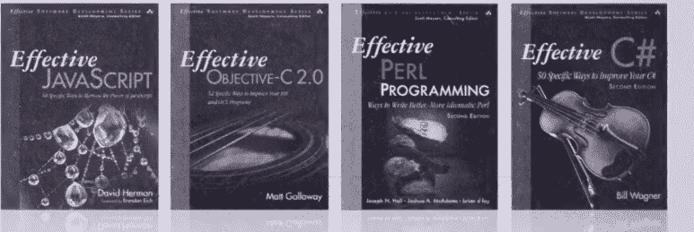

《高效软件开发系列》为现代软件开发的各个各个方面提供专家建议。该系列中的书籍编写精良、技术严谨，并具有持久价值。每本书都描述了专家为了产出卓越软件而总是遵循——或总是避免——的关键要点。

Scott Meyers 是畅销书《高效 C++》（现已出版第三版）、《更高效的 C++》和《高效 STL》（均有纸质版和电子版供选购）的作者，他构思了该系列并担任咨询编辑。该系列中的作者与 Meyers 合作，以一种各种软件开发人员都能熟悉并易于理解的形式创作核心读物。


https://archive.org/details/effectiveobject

# 前言

Objective-C 是冗长的。Objective-C 是笨拙的。Objective-C 是丑的。我听过关于 Objective-C 的所有评价。相反，我觉得它优雅、灵活且美丽。然而，要使其具备这些特性，你不仅必须理解基础知识，还要理解它的特性、陷阱和复杂之处：这正是本书的主题。

## 关于本书

这本书并没有教你 Objective-C 的语法。假设你已经掌握了这些。相反，本书教你如何充分利用这种语言的潜力来编写良好的代码。由于源自 Smalltalk，Objective-C 极具动态性。在其他语言中通常由编译器完成的大部分工作，在 Objective-C 中最终由运行时完成。

许多主题从严格来说并不与 Objective-C 核心相关。书中提到了系统库中的许多条目，例如大中央派调度（Grand Central Dispatch），它是 `libdispatch` 的一部分。同样，也提到了 Foundation 框架中的许多类，特别是根类 `NSObject`，因为使用现代 Objective-C 开发意味着为 Mac OS X 或 iOS 开发。无论为哪者开发，你无疑都会使用系统框架，分别称为 Cocoa 和 Touch。

自 iOS 发布以来，开发者们纷纷涌入 Objective-C 开发的行列。这些开发者中，有的是编程初学者，有的来自 Java 或 C++ 背景，还有的来自 Web 开发背景。无论如何，所有开发者都应该花时间学习如何高效地使用一种语言。

这样做将产生更高效、更易维护且更不容易出现 Bug 代码。

尽管我写这本书只用了大约六个月，但它花费了多年时间来准备。我曾出于冲动买了一个 iPod Touch：然后当它发布时，我决定尝试一下开发。这促使我构建了第一个“应用”，并将其作为 Subnet Calc 发布出来，它的下载量立即超出了我的想象。我确信我的未来就在我所接触的这种美丽的语言中。从那时起，我一直在研究 Objective-C，并在我的网站 `www.galloway-me.uk/` 上定期写关于它的博客。我最感兴趣的是内部机制，例如块（blocks）的内部实现和 ARC 工作原理。当我有机会写一本关于这门语言的书时，我抓住了这个机会。

为了充分利用这本书的潜力，我鼓励你跳跃着读，寻找对你最感兴趣或与你目前正在工作相关的话题。每个条目都可以独立阅读，你可以利用交叉引用到相关主题。每个章节都汇集了相关的条目，你可以使用章节标题快速找到与特定语言特性相关的条目。

## 本书读者群

本书面向希望进一步扩展 Objective-C 知识，并学习编写可维护、高效且更不容易出现 Bug 代码的开发者。即使你现在不是 Objective-C 开发者，而是来自其他面向对象的语言（如 Java 或 C++），你应该也能学会它。在这种情况下，先阅读 Objective-C 的语法是明智的。

## 本书涵盖内容

本书的目的并不是教授 Objective-C 的基础知识，你可以从许多其他书籍和资源中学习这些。相反，本书教的是如何有效地使用这门语言。书中由“条目”（Items）组成，每个条目都是一份易于吸收的信息。这些条目在逻辑上被分为主题领域，安排如下：

- *第 1 章：适应 Objective-C*

  - 这里介绍了与语言整体相关的核心概念。

- *第 2 章：对象、消息传递与运行时*

  - 任何面向对象语言的重要特性都是对象之间如何关联以及它们如何交互。本章处理了这些特性，并深入了运行时的一些部分。

## 第 3 章：接口和 API 设计

代码很少是写一次就永不再使用的。即使它没有发布给更广泛的社区，你可能也会多个项目中使用你的代码。本章解释了如何编写在 Objective-C 中感觉如归归的类。

协议和分类（Categories）都是需要掌握的重要语言特性。有效使用它们可以使你的代码更易读、更易维护且不易产生 Bug。本章帮助你达到精通。

Objective-C 的内存管理模型使用引用计数，这长期一直是初者的难题，特别是如果他们来自使用垃圾回收的语言背景。自动引用计数（ARC）的引入让生活变得简单，但你需要意识到许多重要事项，以确保你有一个不会泄漏的正确对象模型。本章培养对常见内存管理陷阱的意识。

你将为 Mac OS X 或 iOS 编写 Objective-C 代码。在这些情况下，你将拥有完整的系统框架栈：分别是 Cocoa 和 Cocoa Touch。本章对框架进行了简要概述，并深入介绍了其中的一些类。

如果你对本书有任何问题、意见或备注，我鼓励你联系我。你可以在本书的网站 `www.effectiveobjectivec.com` 上找到你的完整联系方式。

## 谢谢

当被问及是否想写一本关于 Objective-C 的书时，我立刻变得兴奋。我已经读过该系列的其他书籍，知道为 Objective-C 创建一本书将是一项挑战。但在许多人的帮助下，这本书变成了现实。

本书的灵感来自许多致力于 Objective-C 的优秀博客，Matt Gallagher 和 "bbum" 是我阅读过的博客的几个人。多年来，这些博客帮助我更深入地理解这门语言。Matt Thompson 编写的 NSHipster 也提供了优秀的文章，在编写这本书时给了我很多思考。最后，Apple 提供的优秀文档也极其有用。

如果不是在 MX Telecom 工作期间获得了极优秀的指导和知识传递，我将没有写写这本书的条件。Matthew Hodgson 特别给了我一个开发公司第一个 iOS 应用的机会，在成熟的 C++ 代码库之上进行构建。我从这个项目中中学到的知识成了我后续工作的基础。

多年来，我有许多优秀的同事，我与他们……（等待，OCR 文本在这里结束或重复了。让我们根据提供的片段重新对齐）。

## 关于作者

**Matt Galloway** 是一位来自英国伦敦的 iOS 开发者。他于 2007 年毕业于剑桥大学彭伯里学院，获得工程硕士学位，专攻电气和信息科学。从那时起，他一直在编程，主要是使用 Objective-C。从第一个 SDK 发布以来，他一直在开发 iOS。你可以在 Twitter 上通过 @mgalloway 找到他，他是 Stack_Overflow (`http://stackoverflow.com`) 的定期贡献者。

# 第 1 章：熟悉 Objective-C

决定了将执行哪些代码。当在函数调用示例中引入多态时，会通过所谓的虚函数表（virtual table）涉及某种运行时查找。在消息传递（messaging）中，查找总是在运行时进行的。事实上，编译器并不关心接收消息对象的类型。它在运行时通过一个名为动态绑定（dynamic binding）的过程进行查找，该过程将在第 11 项中详细介绍。

Objective-C 运行时（runtime）组件而非编译器承担了大部分繁重工作。运行时包含了运行 Objective-C 面对象功能所需的所有数据结构和函数。例如，运行时包含了所有的内存管理方法。本质上，运行时是与你的代码胶合在一起的一组代码，并以动态库的形式链接到你的代码中。因此，每当运行时更新时，你的应用程序都能从性能改进中获益。而需要在编译时完成更多工作的语言则需要重新编译才能从此类性能改进中受益。

Objective-C 是 C 语言的集，所以在编写 Objective-C 时，C 语言的所有特性都是可用的。因此，要编写出有效的 Objective-C，你需要理解 C 和 Objective-C 的核心概念。特别是要理解 C 的内存模型以及引用计数为何能正常工作。这涉及到理解指针在 Objective-C 中用于表示一个对象。当你声明一个用于持有对象引用的变量时，语法如下：

这种语法大部分直接源自 C 语言，声明了一个名为 `someString` 的变量，其类型为 `NSString`。这意味着它是一个指向 `NSString` 的指针。所有的 Objective-C 对象必须以这种方式声明，因为对象的内存始终分配在堆空间（heap space）中而永远不会在栈空间（stack）上。声明栈分配的 Objective-C 对象是非法的：

```objc
NSString *stackString;
// error: interface type cannot be statically allocated
```

变量 `someString` 指向在堆中分配的一块内存，其中包含一个 `NSString` 对象。这意味着创建另一个指向相同位置的变量并创建副本，而是产生两个指向同一个对象的变量：

```objc
NSString *someString = @"String";
NSString *anotherString = someString;
```

## 第 1 项：熟悉 Objective-C 的根源

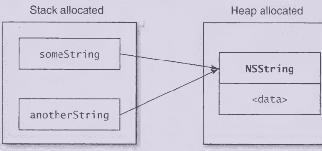

图 1.1 内存布局，显示了一个堆分配的 NSString 实例和两个指向它的栈分配指针

这里只有一个 `NSString` 实例，但有两个变量指向同一个实例。这两个变量的类型为 `NSString*`，这意味着当前栈帧分配了 2 个指针大小的内存位（32 位架构为 4 字节，64 位架构为 8 字节）。这些内存位将包含相同的值：`NSString` 实例的内存地址。

图 1.1 描述了这种布局。为 `NSString` 实例存储的数据包括表示实际字符串所需的字节。

在堆中分配的内存必须直接管理，而用于存放变量的栈分配内会在它们所在的栈帧被弹出时自动清理。

堆内存的内存管理被 Objective-C 抽象化了。你不需要使用 `malloc` 和 `free` 来释放对象的内存。Objective-C 运行时通过一种名为引用计数（reference counting）的内存管理架构将这些处理屏蔽掉（参见第 29 项）。

在 Objective-C 中，有时你会遇到定义中没有 `*` 且可能使用栈空间的变量。这些变量并不持有 Objective-C 对象。一个例子是 CoreGraphics 框架中的 `CGRect`：

```objc
CGRect frame;
frame.origin.x = 0.0f;
frame.origin.y = 10.0f;
frame.size.width = 100.0f;
```

`frame.size.height = 150.0f;`

`CGRect` 是一个 C 结构体，定义如下：

```objc
struct CGRect {
    CGPoint origin;
    CGSize size;
};
typedef struct CGRect CGRect;
```

这些类型的结构体贯穿框架，使用 Objective-C 对象会影响性能。创建对象会产生结构体没有的开销，例如分配和释放堆内存。当需要持有的数据只有基本类型（int, float, double, char 等）时，通常使用结构体。

在开始编写 Objective-C 之前，我鼓励你阅读关于 C 语言的文本并熟悉语法。如果你直接进入 Objective-C，可能会发现某些部分令人困惑。

## 注意事项

- Objective-C 是 C 语言的集，增加了面向对象的功能。Objective-C 使用动态绑定的消息结构，这意味着对象的类型是在运行时发现的。运行时而非编译器来确定给定消息运行哪些代码。

- 理解 C 的核心概念将帮助你编写有效的 Objective-C。特别是你需要理解内存模型和指针。

Objective-C 像 C 和 C++ 一样，使用头文件和实现文件。当在 Objective-C 中编写类时，标准方法是创建这两个文件的各一个并以类命名，头文件后缀为 `.h`，实现文件后缀为 `.m`。当你创建一个类时，它可能像这样：

```objc
// MyClass.h
#import <Foundation/Foundation.h>

@interface MyClass : NSObject

@end
```

```objc
// MyClass.m
#import "MyClass.h"

@implementation MyClass

@end
```

## 项目 2：在头文件中尽量减少头文件的导入

……它导入了第一个。使用 `#import` 而不是 `#include` 不会导致无限循环，但意味着其中一个类将无法正确编译。如果你不相信我，可以自己试一下！

尽管如此，你有时需要在头文件中导入另一个头文件。你必须导入定义你所继承的父类的头文件。同样，如果你声明了你的类所遵循的任何协议（protocols），它们必须经过完整定义，而不能是前向声明（forward declared）。编译器需要看到协议定义的方法，而不仅仅是通过前向声明知道某个协议存在。

例如，假设 `rectangle` 类继承自 `shape` 类，并符合一个允许其进行绘制的协议：

```
// ERectangle.h
#import "EOCShape.h"
#import "EOCDrawable.h"
```

这种额外的导入是不可避免的。出于这个原因，对于此类协议，谨慎的做法是将它们放在自己的头文件中。如果 `EOCDrawable` 协议是一个较大的头文件的一部分，你就必须导入整个文件，从而产生与之前描述的相同的依赖关系和额外的编译时问题。

尽管如此，并不是所有的协议（如代理协议，见项目 23）都需要放在自己的文件中。在这些情况下，协议只有在与作为其代理的类一起定义时才有意义。在这些情况下，最好的方法是在类扩展分类（class-continuation category）中（见项目 27）声明你的类实现了该代理。这意味着包含代理协议的头文件的导入可以放在实现文件中，而不是公共头文件中。

在向头文件编写导入语句时，始终要问自己这是否真的必要。如果导入的内容可以前向声明，请选择这种方式。如果导入是为了属性、实例变量或协议遵循中使用的内容，则可以将其移动到类扩展分类中（见项目 27），请优先考虑这种做法。这样做可以保持编译时间尽可能短，并减少相互依赖关系；如果你以后想在公共 API 中只暴露部分代码，这种依赖关系可能会给维护带来问题。

## 第 1 章：习惯 Objective-C

## 需要记住的set

- 始终在尽可能深的地方导入头文件。这意味着在头文件中对类进行前向声明，并在实现文件中导入相应的头文件。这样做可以尽可能减少类与类之间的耦合。

- 有时，前向声明是不可能的，例如在声明协议遵循时。在这种情况下，如果可能，请考虑将协议遵循声明移动到类扩展分类中。否则，导入仅定义该协议的头文件。

## 项目 3：优先使用字面量语法而非等效方法

使用 Objective-C 时，你会经常遇到几个类。它们都是 Foundation 框架的一部分。虽然从技术上讲，你不需要使用 Foundation 来编写 Objective-C 代码，但在实践中你通常会这样做。这些类是 `NSString`、`NSNumber`、`NSArray` 和 `NSDictionary`。它们各自代表的数据结构是一言易懂的。

Objective-C 以语法冗长而闻名。确实如此。然而，自 Objective-C 1.0 以来，一直有一种非常简单的方法创建 `NSString` 对象。它被称为字符串字面量（string literal），看起来如下：

```
NSString *someString = @"Effective Objective-C 2.0";
```

如果没有这种语法，创建 `NSString` 对象将需要在通常的 `alloc` 和 `init` 方法调用中分配并初始化一个 `NSString` 对象。幸运的是，这种被称为字面量（literals）的语法在编译器的最近版本中已扩展，涵盖了 `NSNumber`、`NSArray` 和 `NSDictionary` 实例。使用字面量语法减少了代码量，并使其更易读。

### 字面量数字

有时，你需要封装一个整数。Objective-C 对象中的浮点数或布尔值。你可以通过使用 `NSNumber` 类来实现，它可以处理一系列数字类型。如果没有字面量，你将如下所示创建一个实例：

```
NSNumber *someNumber = [NSNumber numberWithWithInt:1];
```

这创建了一个被设置为整数 1 的数字。然而，使用字面量会让这更简洁：

```
NSNumber *someNumber = @1;
```

## 项目 3：优先使用字面量语法而非等效方法

如你所见，字面量语法要简洁得多。但不仅如此。该语法还涵盖了 `NSNumber` 实例可以表示的所有其他类型的数据。例如：

```
NSNumber *intNumber = @1;
NSNumber *floatNumber = @2.5f;
NSNumber *doubleNumber = @3.14159;
NSNumber *boolNumber = @YES;
NSNumber *charNumber = @a';
```

字面量语法也适用于表达式：

```
int x = S;
float y = 6.32f;
NSNumber *expressionNumber = @(x * y);
```


对数字使用字面量非常有用。这样做使 `NSNumber` 对象的使用变得清晰得多，因为声明的大部分是值而不是多余的语法。

### 字面量数组

数组是一种常用的数据结构。在字面量之前，你如下所示创建数组：

```
NSArray *animals = @[@"cat", @"dog",
[NSArray arrayWithObjects:@"mouse", @"badger", nil]];
```

然而，使用字面量只需要以下语法：

`NSArray *animals = @["cat", @"dog", @"mouse", @"badger"];`

但尽管这是一种简单得多的语法，数组远不止于此。数组的一个常用操作是获取特定索引处的对象。使用字面量也让这变得更容易。通常，你会使用 `objectAtIndex:` 方法：

```
NSString *dog = [animals objectAtIndex:0];
```

使用字面量，只需这样做：

```
NSString *dog = animals[1];
```

这被称为下标（subscripting），就像字面量语法的其他部分一样，它更简洁，更更容易操作。而且，它看起来非常像其他语言索引数组的方式。

然而，在使用字面量创建数组时，你需要注意一点。如果任何对象为 `nil`，则会抛出异常，因为字面量实际上只是创建数组并在方括号内添加所有对象的语法糖。你得到的异常如下：

```
*** Terminating app due to uncaught exception 'InvalidArgumentException', reason: '***-[NSArray initWithObjects:count:] attempt to insert nil object from objects[0]]
```

## 第 1 章：习惯 Objective-C

这引发了切换字面量时的常见问题。以下代码创建了两个数组，每个语法一个：

```
id object1 = /** ... */;
id object2 = /** ... */;
id object3 = /** ... */;
```

```
NSArray*arrayA = [NSArray object1, object2, object3, nil];
NSArray*arrayB = @[object1, object2, object3];
```

现在考虑 `object1` 和 `object3` 指向有效的 Objective-C 对象，但 `object2` 为 `nil` 的情况。字面量数组 `arrayB` 将导致抛出异常。然而，`arrayA` 仍会被创建，但只包含 `object1`。原因是 `arrayWithObjects` 方法会遍历变长参数直到遇到 `nil` 为止，这比预期的要早。

这种细微的意味着字面量要安全得多。与其抛出异常导致可能发生的应用程序崩溃相比，创建一个包含数量少于预期对象的数组要好得多。程序员错误最可能导致 `nil` 被插入数组中，而异常意味着更容易找到这个 bug。

### 字面量字典

字典提供了一种映射数据结构，你可以在其中添加键值对。与数组一样，字典在 Objective-C 代码中被广泛使用。以前创建一个字典看起来像这样：

```
NSDictionary*personData =
[NSDictionary dictionaryWithObjectsAndKeys:
@"Matt", @"firstName",
@"Galloway", @"lastName",
[NSNumber numberWithInt:28], @"age"
nil];
```

## 项目 3：优先使用字面量语法而非等方法

这相当让人困惑，因为其顺序是 `<object>, <key>, <object>, <key>` 等。然而，你通常对字典的想法是相反的，即键对应对象。因此，它读起来并不特别顺畅。不过，字面量再次让语法变得清晰得多：

```objectivec
NSDictionary *personData =
  {@"firstName" : @"Matt",
  @"lastName" : @"Galloway",
  @"age" : @28};
```

这种方式简洁得多，而且键在对象之前，正如你所预期的那样。另外注意，示例中的字面量数字展示了字面量数字有用之处。键必须是 Objective-C 对象，所以你不能存储整数 28；相反，它必须被封装在 `NSNumber` 实例中。但字面量语法意味着这仅仅多写了一个字符。

与数组一样，字典的字面量语法在任何值值为 `nil` 时会抛出异常。然而，出于相同的原因，这是一件好事。这意味着，由于 `dictionaryWithObjectsAndKeys:` 在遇到第一个 `nil` 时就会停止，我们不会创建一个包含缺失值的字典，而是会抛出异常。

与数组类似，也可以使用字面量语法访问字典。访问特定键对应值的旧方法如下：

```objectivec
NSString *lastName = [personData objectForKeyForKey:@"lastName"];
```

等价的字面量语法是：

```objectivec
NSString *lastName = personData[@"lastName"];
```

再次，冗余的语法被减少了，留下了一行易于读的代码。

## 可变数组和字典

正如你可以通过下标（subscribing）访问数组索引或字典的键一样，如果对象是可变的，你也可以设置它们。通过可变数组和字典上的普通方法进行设置看起来像这样：

```objectivec
[mutableArray replaceObjectAtIndex:1 withObject:@"dog"];
[mutableDictionary setObject:@"Galloway" forKey:@"lastName"];
```

通过下标设置看起来像这样：

```objectivec
mutableArray[1] = @"dog";
mutableDictionary[@"lastName"] = @"Galloway";
```

## 第 1 章：习惯 Objective-C

## 局限性

字面量语法的一个微小局限性是，除了字符串外，创建对象的类必须是来自 Foundation 框架的类。没有办法指定要被创建的自定义自定义子类。如果你想创建自己的自定义子类的实例，你需要使用非字面量语法。然而，由于 `NSArray`、`NSDictionary` 和 `NSNumber` 类簇很少被子类化，因为这样做并非易事。此外，标准实现通常已经足够好。字符串可以使用自定义类，但必须通过编译器选项进行更改。除非你确定自己在做什么，否则不建议使用此选项，反正你始终会想使用 `NSString`。

同样，在字符串、数组和字典的情况下，只有不可变变体可以使用字面量语法创建。如果需要可变变体，必须获取一个可变副本，如下所示：

```objectivec
NSMutableArray *mutableCopy = @[@1, @2, @3, @4, @5] mutableCopy;
```

这增加了一次额外的方法调用并创建了一个额外的对象，但使用字面量语法的处处大于这些缺点。

## 注意事项

- 使用字面量语法创建字符串、数字、数组和字典。这比使用普通的对象创建方法来创建它们更清晰、更简洁。
- 通过下标方法访问数组的索引或字典的键。
- 尝试使用字面量语法向数组或字典插入 `nil` 将导致抛出异常。因此，始终确保此类值不能为 `nil`。

## 项目 4：优先使用类型常量而非预处理器 #define

在编写代码时，你经常想要定义一个常量。例如，考虑一个使用动画显示和隐藏自己的 UI 视图。你可能想要提取的典型常量是动画持续时间。你已经学习了 Objective-C 及其 C 基础，因此你采取了如下定义常量的方法：

```c
#define ANIMATION_DURATION 0.3
```

这是一个预处理器指令；每当在源代码中找到 `ANIMATION_DURATION` 字符串时，它就会替换为 0.3。这看起来可能正是你想要的，但这种定义没有类型信息。声明为“持续时间”的东西可能意味着该值与时间有关，但并没有显式说明。此外，预处理器会盲目地替换所有 `ANIMATION_DURATION` 的出现处，所以如果它在一个头文件中声明，任何导入该头文件的内容都会看到替换后的结果。

为了解决这些问题，你应该利用编译器。使用预处理器定义来定义常量总有更好的方法。例如，以下是对类型为 `NSTimeInterval` 常量的定义：

```objectivec
static const NSTimeInterval kAnimationDuration = 0.3;
```

注意，使用这种样式，就有类型信息，它清晰地定义了常量是什么。类型是 `NSTimeInterval`，因此它有助于记录该变量的使用。如果你有许多常量需要定义，这无疑会帮助你以及以后阅读代码的其他人员。

另外注意常量的命名方式。常量的通常惯例是，对于局部翻译单元（实现文件）的常量，以字母 `k` 作为前缀。对于暴露在类外的常量，通常以类名作为前缀。项目 19 解释了更多关于命名规范的说明。

在哪里定义常量非常重要。有时，人们很想在头文件中声明预处理器处理定义，但那是极其糟糕的做法，特别是当这些定义的命名方式不至于发生冲突时。例如，`ANIMATION_DURATION` 是一个出现在头文件中的坏名字。它将存在于所有导入该头文件的文件中。一个不需要暴露给世界的常量应该定义在它使用的实现文件中。例如，如果动画持续时间常量被用于 `UIView` 子类，供使用 UIKit 的 iOS 应用程序使用，它看起来像这样：

```objectivec
// EOCAnimatedView.h
#import <UIKit/UIKit.h>

@interface EOCAnimatedView : UIView
- (void)animate;
@end

// EOCAnimatedView.m
#import "EOCAnimatedView.h"
static const NSTimeInterval kAnimationDuration = 0.3;

@implementation EOCAnimatedView
- (void)animate {
    [UIView animateWithDuration:kAnimationDuration
                 animations:^{
                    // 执行动画
                 }];
}
@end
```

将变量声明为 `static` 和 `const` 是重要的。`const` 修饰意味着如果你尝试更改该值，编译器将抛出错误。在这种情况下，这正是需要的。值不应该被允许改变。`static` 限定符意味着变量局部于定义的翻译单元。翻译单元是编译器接收以生成一个对象文件的输入。在 Objective-C 的情况下，这通常意味着每个类有一个翻译单元：每个实现 (.m) 文件。因此在前面的示例中，`kAnimationDuration` 将局部于从 EOCAnimatedView.m 生成的对象文件。如果变量不是 `static`，编译器将为它创建一个外部符号。如果另一个翻译单元也声明了同名的变量，链接器将抛出类似下面的错误：重复符号 _kAnimationDuration 在：EOCAnimatedView.o ECOtherView.o

事实上，通过将变量同时声明为 `static` 和 `const`，编译器实际上不会创建任何符号，而是像预处理器定义一样替换出现处。但请记住，这里的好处是有类型信息。

有时，你可能想要从外部暴露一个常量。例如，如果你的类使用以下方式通知他人：

## 项目 4：优先使用类型化常量而非预处理器 #define

`NSNotificationCenter`。它的工作原理是一个对象发布通知，而其他对象注册接收这些通知。通知具有字符串名称，这正是你可能希望将其声明为外部可见的常量变量。这样做意味着，任何想要接收此类通知的人都不需要知道实际的字符串名称，只需使用该常量变量即可。

这些常量需要出现在全局符号表中，以便在定义它们的编译单元外部使用。因此，这些常量的声明方式与 `static const` 示例不同。这些常量应该如下定义：

```objectivec
// 在头文件中
extern NSString *EOCStringConstant;
```

```objectivec
// 在实现文件中
NSString *EOCStringConstant = @"VALUE";
```

常量在头文件中被“声明”，在实现文件中被“定义”。在常量的类型中，`const` 修饰符的位置非常重要。这些定义是从后往前读取的，意味着在这种情况下，EOCStringConstant 是一个“指向 NSString 的常量指针”。这正是我们想要的；常量不应被允许指向不同的 NSObject。

`extern` 关键字告诉编译器在导入该头文件遇到被使用的常量时该如何处理。该关键字告诉编译器，全局符号表中存在一个 EOCStringConstant 符号。这意味着在编译器没有看到其定义的情况下可以使用该常量。编译器只需知道在二进制文件链接时该常量将会存在。

常量必须定义且仅定义一次。它通常定义在与声明它的头文件相关的实现文件中。编译器将在由该实现文件生成的对象文件的数据段（data section）中为字符串分配存储。当该对象文件与其他对象文件链接以生成最终二进制文件时，链接器将能够解析任何使用过 EOCStringConstant 的全局符号。

符号出现在全局符号表中这一事实意味着，你应该仔细地命名此类常量。例如，一个处理应用程序登录的类可能有一个在登录完成后触发的通知。该通知可能如下所示：

```objectivec
// EOCLoginActivity.h
#import <Foundation/Foundation.h>
```

## 第 1 章：习惯 Objective-C

```objectivec
extern NSString *const EOCLoginManagerDidLoginNotification;

@interface EOCLoginManager : NSObject
- (void)login;
@end
```

```objectivec
// EOCLoginManager.m
#import "EOCLoginManager.h"

NSString *const EOCLoginManagerDidLoginNotification = 
@"EOCLoginManagerDidLoginNotification"

@implementation EOCLoginManager

-(void)login {
  // 执行异步登录，然后调用 'p_didLogin'
}

-(void)p_didLogin {
  [NSNotificationCenter defaultCenter
    postNotificationName:EOCLoginManagerDidLoginNotification
    object:nil];
}

@end
```

给常量指定的名称。以常量相关的类名作为前缀是明智的，并将帮助你避免潜在的冲突。这在整个系统框架中也很常见。例如，UIKit 以相同的方式将通知名称声明为全局常量。这些名称包括 `UIApplicationEnterBackgroundNotification` 和 `UIApplicationEnterForegroundNotification`。

其他类型的常量也可以进行同样的操作。如果前面的示例中需要的动画时长需要暴露在 `EOCAnimatedView` 类之外，你可以这样声明它：

```objectivec
// EOCAnimatedView.h
extern const NSTimeInterval EOCAnimatedViewAnimationDuration;
```

```objectivec
// EOCAnimatedView.m
const NSTimeInterval EOCAnimatedViewAnimationDuration = 0.3;
```

以这种方式定义常量比预处理器 `#define` 好得多，因为编译器被用来确保该值不会改变。一旦在 `EOCAnimatedView.m` 中定义，该值将被处处使用。

## 项目 5：使用枚举处理状态、选项和状态码

预处理器 `#define` 可能会被重新定义，导致应用程序的不同部分最终使用了不同的值。

结论是，避免使用预处理器定义常量。相反，请使用编译器可见的常量，例如在实现文件中声明的 `static const` 全局变量。

## 注意事项

- 避免使用预处理器定义。它们不包含任何类型信息，仅仅是在编译前执行的查找和替换。它们可能会在没有警告的情况下被重新定义，导致整个应用程序中的值不一致。
- 在实现内部将特定编译单元的常量定义为 `static const`。这些常量不会出现在全局符号表中，因此它们的名称不需要进行命名空间。
- 在头文件中将全局常量声明为 `extern`，并在相关的实现文件中定义它们。这些常量将出现在全局符号表中，因此它们的名称应该进行命名空间处理，通常是以它们对应的类名作为前缀。

## 项目 5：使用枚举处理状态、选项和状态码

由于 Objective-C 基于 C，因此 C 的所有特性都是可用的。其中之一就是枚举类型 `enum`。它在整个系统框架中被广泛使用，但经常被开发者忽略。它是定义命名常量的一种极其有用的方法，例如可以定义错误状态码，以及定义可以组合的选项。得于 C++11 标准的引入，最近版本的系统框架包含了一种对此类枚举类型强类型的方法。是的，Objective-C 也从 C++11 标准中受益了！

枚举仅仅是命名常量值的方法。一个简单的枚举集可能用于定义对象所经历的状态。例如，套接连接可以使用以下枚举：


```objectivec
enum EOCConnectionState {
    EOCConnectionStateDisconnected,
    EOCConnectionStateConnecting,
    EOCConnectionStateConnected,
}
```

## 第 1 章：习惯 Objective-C

使用枚举意味着代码具有可读性，因为每个状态都可以通过易于读取的值来引用。编译器为枚举的每个成员分配一个唯一的值，从 0 开始，每个成员增加 1。支撑枚举的类型取决于编译器，但必须有足够的位来完全表示该枚举。在上述枚举的情况下，这只需一个 `char`（1字节），最大值为 2。

然而，这种定义枚举的样式并不有用，并且需要以下语法：

```objectivec
enum EOCConnectionState = EOCConnectionState;
```

如果不需要每次都写 `enum` 而是直接使用 `EOCConnectionState` 将方便得多。为了实现这一点，可以在枚举定义中添加 `typedef`：

```objectivec
enum EOCConnectionState {
    EOCConnectionStateDisconnected,
    EOCConnectionStateConnecting,
    EOCConnectionStateConnected,
};
typedef enum EOCConnectionState EOCConnectionState;
```

这意味着可以使用 `EOCConnectionState` 代替完整的 `enum EOCConnectionState`：

```objectivec
EOCConnectionState state = EOCConnectionStateDisconnected;
```

C++11 标准的出现给枚举带来了一些变化。一种变化是可以指定存储枚举类型变量的底层类型。这样做的好处是可以前声明枚举类型。如果不指定底层类型，则无法前声明枚举类型，因为编译器在结束之前不知道底层类型的大小。因此，在使用该类型时，编译器不知道为变量分配多少空间。

要指定类型，使用以下语法：

```objectivec
enum EOCConnectionStateConnectionState : NSInteger { /* ... */ };
```

这意味着支撑枚举的值将保证是 `NSInteger`。如果需要，可以这样对类型进行前声明：

```objectivec
enum EOCConnectionStateConnectionState : NSInteger;
```

## 第 5 项：使用枚举定义状态、选项和状态码

你也可以定义某个枚举成员所关联的值，而不是让编译器为你选择。语法如下所示：

```
enum EOCConnectionStateConnectionState {
    EOCConnectionStateDisconnected = 1,
    EOCConnectionStateConnecting,
    EOCConnectionStateConnected,
};
```

这意味着 `EOCConnectionStateDisconnected` 将使用值 1 而不是 0。其他值将紧随其后，每次增加 1，与之前一样。因此，例如 `EOCConnectionStateConnected` 将使用值 3。

使用枚举类型的另一个原因是定义选项，特别是当选项可以组合时。如果枚举定义得当，可以使用位或（bitwise OR）运算符组合选项。例如，考虑以下在 iOS UI 框架中的枚举类型，它用于定义视图的哪些维度可以调整：

```
enum UIViewAutoresizing {
    UIViewAutoresizingNone = 0,
    UIViewAutoresizingFlexibleLeftMargin = 1 << 0,
    UIViewAutoresizingFlexibleWidth = 1 << 1,
    UIViewAutoresizingFlexibleRightMargin = 1 << 2,
    UIViewAutoresizingFlexibleTopMargin = 1 << 3,
    UIViewAutoresizingFlexibleHeight = 1 << 4,
    UIViewAutoresizingFlexibleBottomMargin = 1 << 5,
};
```

每个选项都可以开启或关闭，使用前面的语法可以实现这一点，因为每个选项在所表示的值中只设置了一个位。多个选项可以进行位或组合在一起：例如，`UIViewAutoResizingFlexibleWidth | UIViewAutoresizingFlexibleHeight`。图 1.2 显示了每个枚举成员的布局以及这两个成员的组合。

然后可以使用位与（bitwise AND）运算符来确定其中一个选项是否被设置：

```objective-c
enum UIViewAutoresizing resizing =
    UIViewAutoresizingFlexibleWidth |
    UIViewAutoresizingFlexibleHeight;
if (resizing & UIViewAutoresizingFlexibleWidth) {
    // UIViewAutoresizingFlexibleWidth 被设置
```

## 第 1 章：适应 Objective-C

| UIViewAutoresizingFlexibleLeftMargin | 0 | 0 | 0 | 0 | 0 | 1 |

| UIViewAutoresizingFlexibleWidth | 0 | 0 | 0 | 0 | 1 | 0 |

| UIViewAutoresizingFlexibleRightMargin | 0 | 0 | 0 | 1 | 0 | 0 |

| UIViewAutoresizingFlexibleTopMargin | 0 | 0 | 1 | 0 | 0 | 0 |

| UIViewAutoresizingFlexibleHeight | 0 | 1 | 0 | 0 | 0 | 0 |

| UIViewAutoresizingFlexibleBottomMargin | 1 | 0 | 0 | 0 | 0 | 0 |

| UIViewAutoresizingFlexibleWidth | UIViewAutoresizingFlexibleHeight | 0 | 1 | 0 | 0 | 1 | 0 |

**图 1.2** 三个选项值的二进制表示以及其中两个值位或后的结果

这在整个系统库中广泛使用。另一个来自 UIKit（iOS UI 框架）的示例是作为告知系统视图支持的设备方向的方法。它通过一个名为 `UIInterfaceOrientationMask` 的枚举类型来实现，并实现一个名为 `supportedInterfaceOrientations` 的方法来指示支持的方向：

```objective-c
- (NSInteger)supportedInterfaceOrientations {
  return UIInterfaceOrientationMaskPortrait |
  UIInterfaceOrientationMaskLandscapeLeft;
}
```

Foundation 框架中定义的几个辅助函数有助于定义枚举类型，这些类型还允许你指定用于存储使用枚举值的整数类型。这些辅助函数提供了后兼容性，如果你目标的是支持新标准的编译器，则使用新语法；如果不支持，则退回到旧语法。这些辅助函数以预处理器 `#define` 宏的形式提供。其中一个用于普通枚举类型，如 `EOCConnectionState`。另一个用于枚举定义了选项列表的情况。你使用它们的方式如下：

## 第 5 项：使用枚举定义状态、选项和状态码

```objective-c
typedef NS_ENUM(NSInteger, EOCConnectionState) {
    EOCConnectionStateDisconnected,
    EOCConnectionStateConnecting,
    EOCConnectionStateConnected,
};
```

```objective-c
typedef NS_OPTIONS(NSInteger, EOCPermittedDirection) {
    EOCPermittedDirectionUp = 1 << 0,
    EOCPermittedDirectionDown = 1 << 1,
    EOCPermittedDirectionLeft = 1 << 2,
    EOCPermittedDirectionRight = 1 << 3,
};
```

宏的定义如下：

```
#if __cplusplus && (__cplusplus >= 2011 || __has_extension(cxx_enums)) || __has_feature(objc_fixed_enum)
    #define NS_ENUM(type, name) \
        enum name : type;
    #if __cplusplus
        #define NS_OPTIONS(type, name) \
            enum name : type;
    #else
        #define NS_OPTIONS(type, name) \
            enum name : type;
    #endif
#else
    #define NS_ENUM(type, name) enum name;
    #define NS_OPTIONS(type, name) enum name;
#endif
```

多种定义宏的原因是因为不同的场景。第一个检查的情况是编译器是否支持新枚举。这看起来是复杂的逻辑，但它检查的是该功能是否存在。如果功能不存在，则使用旧样式定义枚举。

如果该功能可用，`NS_ENUM` 类型的定义如下：

```objective-c
typedef enum EOCConnectionState : NSInteger EOCConnectionState;
enum EOCConnectionState : NSInteger {
    EOCConnectionStateDisconnected,
    EOCConnectionStateConnecting,
    EOCConnectionStateConnected;
};
```

`NS_OPTIONS` 宏的定义取决于是否为 C++。如果不是 C++，它的展开方式与 `NS_ENUM` 相同。然而，如果是 C++，它的展开方式略有不同。为什么？当两个枚举值进行位或运算时，C++ 编译器的行为不同。当两个值进行或运算时，C++ 认为结果的类型是 `int`而不是枚举类型。为了说明这一点，考虑如果 `EOCPermittedDirection` 枚举被展开为 `NS_ENUM` 会发生什么：

```objective-c
typedef enum EOCPermittedDirection : int EOCPermittedDirection;
enum EOCPermittedDirection : int {
    EOCPermittedDirectionUp = 1 << 0,
    EOCPermittedDirectionDown = 1 << 1,
    EOCPermittedDirectionLeft = 1 << 2,
    EOCPermittedDirectionRight = 1 << 3,
};
```

然后尝试以下操作：

```objective-c
EOCPermittedDirectionLeft | EOCPermittedDirectionUp;
```

如果编译器是 C++（或 Objective-C++），会导致会导致错误：

```
error: cannot initialize a variable of type 'EOCPermittedDirection' with rvalue of type 'int'
```

你需要将或运算的结果显式转换回 `EOCPermittedDirection`。因此，`NS_OPTIONS` 枚举在 C++ 中的定义不同，这样就不需要这样做。由于此原因，如果你对枚举值进行或运算，应该始终使用 `NS_OPTIONS`。如果没有，你应该使用 `NS_ENUM`。

枚举可以用于许多场景。之前已经了选项和状态；但还有许多其他场景。错误的状态码也是一个很好的候选。与使用预处理器定义或常量相比，枚举提供了一种逻辑相似的状态码分组到一个枚举中的方法。另一个很好的候选是样式。例如，如果你有一个可以使用不同样式创建的 UI 元素，枚举类型非常适合这种情况。

关于枚举的最后一点与使用 `switch` 语句。有时，你想执行以下操作：

```objective-c
typedef NS_ENUM(NSInteger, EOCConnectionState) {
    EOCConnectionStateDisconnected,
    EOCConnectionStateConnecting,
    EOCConnectionStateConnected;
}

switch (_currentState) {
    case EOCConnectionStateDisconnected:
        // 处理断开状态
        break;
    case EOCConnectionStateConnecting:
        // 处理连接状态
        break;
    case EOCConnectionStateConnected:
        // 处理已连接状态
        break;
}
```

在 `switch` 语句中设置一个 `default` 项是很有吸引力的。然而，当用于对定义状态机的枚举进行切换时，最好不要有 `default` 项。原因在于如果你以后添加了状态，编译器会友好地警告你新添加的状态在 `switch` 语句中没有被处理。`default` 块处理了新状态，所以编译器不会警告。这适用于任何其他使用 `NS_ENUM` 宏定义的枚举类型。例如，如果用于定义 UI 元素的样式，你通常会希望确保 `switch` 语句处理了所有样式。

## 需要记住的

- 使用枚举为状态机状态、传递给方法的选项或错误状态码的值提供可读的名称。
- 如果枚举类型定义了某个可以同时使用多个选项的方法，请将其值定义为 2 的幂，以便多个值可以进行位或运算组合。
- 使用 `NS_ENUM` 和 `NS_OPTIONS` 宏来定义具有显式类型的枚举类型。这意味着该类型保证是你所选择的，而不是由编译器选择的类型。
- 在处理枚举类型的 `switch` 语句中不要实现默认情况（default case）。这在你向枚举中添加新项时很有帮助，因为编译器会警告 `switch` 语句没有处理所有值。

## 2 对象、消息传递与运行时

对象是 Objective-C 这种面向对象语言中编程的构建块，提供了存储和移动数据的手段。消息传递（Messaging）是对象之间相互通信以移动数据并触发事件的过程。深入理解这两个特功能的工作原理对于构建高效且可维护的代码至关重要。

Objective-C 运行时是在应用程序运行时为语言提供支持的代码。运行时提供了实现对象间消息传递的关键函数，以及类实例创建背后的所有逻辑。理解这些是如何结合的将使你成为更更好的开发者。

## 项目 6：理解属性（Properties）

属性是 Objective-C 的一项特性，提供了对对象包含的数据的封装。Objective-C 中的对象通常包含一组实例变量来存储工作所需的数据。实例变量通常通过访问器方法进行访问。getter 用于读取变量，setter 用于写入变量。这在 Objective-C 2.0 发布中被标准化，并通过一项名为“属性（properties）”的特性成为该，允许开发者告诉编译器自动编写访问器方法。该特性引入了新的“点语法（dot syntax）”，使得访问类存储的数据变得不再冗。你可能已经使用过属性，但你可能并不知道所有的选项。此外，你可能没有意识到属性的某些细节。项目 6 阐述了属性解决问题的背景，并指出了它们的关键特性。

描述一个人的类可能会存储人的姓名、出生日期、地址等。你可以如下所示在类的公共接口中声明实例变量：

```
@interface EOCerson : NSObject {
@public
    NSString *firstName;
    NSString *_lastName;
@private
    NSString *_someInternalData;
}
@end
```

如果你来自 Java 或 C++ 的世界，这会让你很熟悉，在这些地方你可以定义实例变量的作用范围。然而，这种技术在现代 Objective-C 中很少使用。这种方法的问题在于，对象的布局是在编译时定义的。每当访问 `_firstName` 变量时，编译器都会硬编码指向存储对象的内存区域的偏移量。在添加另一个实例变量之前，这种工作运行良好。例如，假设在 `_firstName` 之上添加了另一个实例变量：

```
@interface EOCerson : NSObject {
@public
    NSDate *dateOfBirth;
    NSString *firstName;
    NSString *_lastName;
@private
    NSString *_someInternalData;
}
@end
```


原本指向 `_firstName` 的偏移量现在指向 `_dateOfBirth`。任何硬编码了偏移量的代码最终都会读取到错误的值。为了说明该值，图 2.1 显示了在假设指针为 4 字节的情况下，在添加 `_dateOfBirth` 实例变量前后的类内存布局。

使用在编译时计算偏移量的代码在类定义改变时除非重新编译，否则就会崩溃。例如，库中可能存在使用旧类定义的代码。如果与使用新类定义的代码链接，运行时将出现不兼容性。各种语言发明了多种技术。Objective-C 采用的方法是通过让类对象（更多关于类对象请见项目 14）存储偏移量来使实例变量变得特殊。然后在运行时，会查找偏移量，这样如果类定义改变，偏移量就会更新；每当访问实例变量时，都会使用正确的偏移量。你甚至可以在运行时向类添加实例变量。这被称为

## 项目 6：理解属性

非脆弱的应用二进制接口（ABI）。ABI 定义了（其他事情）代码如何生成的约定。非脆弱的 ABI 也意味着实例变量可以在类延续分类（class-continuation category，见项目 27）或实现中定义。因此，你不需要再在接口中声明所有的实例变量，因此你不会在公共接口中泄露关于你实现的内部信息。

| Person | | Person | |
|---|---|---|---|
| +0 | `_firstName` | +0 | `_dateOfBirth` |
| +4 | `_lastName` | +4 | `_firstName` |
| +8 | `_someInternalData` | +8 | `_lastName` |
| | +12 | `_someInternalData` |

**图 2.1** 添加另一个实例变量前后的类数据布局

鼓励使用访问器方法而不是直接访问实例变量是克服这一问题的另一个因素。属性由实例变量支持，但它们提供了一种整洁的抽象。你可以自己编写访问器，但在真正的 Objective-C 风格中，访问器遵循严格的命名模式。由于这种严格的命名，可以引入一种语言结构来提供自动创建访问器方法的方法。这就是 `@property` 语法的出现的地方。

你在对象接口的定义中使用属性来提供访问对象所封装的数据的标准手段。因此，属性也可以被认为是简写，表示将为具有给定类型和给定名称的变量提供访问器。例如，考虑以下类：

```objc
@interface EOCerson : NSObject
@property NSString *firstName;
@property NSString *lastName;
@end
```

# 第 2 章：对象、消息传递与运行时

对于类的使用者来说，这等同于编写以下类：

```objc
@interface EOCerson : NSObject
- (NSString*)firstName;
- (void)setFirstName:(NSString*)firstName;
- (NSString*)lastName;
- (void)setLastName:(NSString*)lastName;
@end
```

使用属性时，你使用点语法，类似于在纯 C 中访问栈分配结构体的成员。编译器将点语法转换为对访问器的调用，就像你直接调用它们一样。因此，使用点语法和直接调用访问器之间绝对没有区别。下面的代码示例显示了等效性：

```objc
EOCerson *aPerson = [Person new];
```

```objc
aPerson.firstName = @"Bob"; // 等同于：
[aPerson setFirstName:@"Bob"];
```

```objc
NSString *lastName = aPerson.lastName; // 等同于：
NSString *lastName = [aPerson lastName];
```

但属性不仅如此。如果你允许，编译器将通过名为自动合成（autosynthesis）的过程为你编写这些方法的代码。需要注意的是，是编译器在操作，所以你不会在编辑器中看到合成方法的源码。在生成代码的同时，编译器还会向类添加一个实例变量，其类型为所需的类型，名称为属性名前加上下划线。在前面的示例中，会有两个实例变量：`_firstName` 和 `_lastName`。可以在类的实现中使用 `@synthesize` 语法来控制此实例变量的名称，例如：

```objc
@implementation EOCerson
@synthesize firstName = _myFirstName;
@synthesize lastName = _myLastName;
@end
```

使用 `synthesize` 语法将产生名为 `_myFirstName` 和 `_myLastName` 的实例变量，而不是默认值。从默认值更改实例变量名称是不常的；然而，如果你不喜欢使用下划线方法来命名实例变量，可以使用它来按你的 own命名。

## 第 6 项：理解属性

你想要的属性。但我鼓励你使用默认的命名方案，因为如果每个人都遵循相同的约定，代码对所有人来说都是可读的。

如果你不希望编译器为你合成访问器方法（accessor methods），你可以自己实现这些方法。然而，如果你只实现了其中一个访问器，编译器仍然会为你合成另一个。停止其自动合成的另一种方法是使用 `dynamic` 关键字，它告诉编译器不要自动创建实例变量来支持属性，也不要为你创建访问器。此外，在编译访问该属性的代码时，编译器将忽略访问器尚未定义的这一事实，并信任它们在运行时是可用的。例如，这在对 CoreData 的 `NSManagedObject` 进行子化时用到，访问器是在运行时动态创建的。`NSManagedObject` 选择这种方法是因为这些属性并不是实例变量。数据来自于所正在使用的任何数据库后端。

```objc
@interface EOCPerson : NSManagedObject
@property NSString *firstName;
@property NSString *lastName;
@end
```

```objc
@implementation EOCPerson
@dynamic firstName, lastName;
@end
```

在这个类中，将不会合成任何访问器或实例变量。当你尝试访问任何一个属性时，编译器也不会发出警告。

### 属性属性

你应该注意的属性另一个方面是所有可以用于控制编译器生成的访问器的属性。使用三个属性的示例所示：

```objc
@property (nonatomic, readwrite, copy) NSString *firstName;
```

属性可以分为四类。

### 子性 (Atomicity)

默认情况下，合成的访问器包含锁定以确保它们是原子性的。如果你提供了 `nonatomic` 属性，则不使用锁定。请注意，虽然没有 `atomic` 属性（缺少 `nonatomic` 属性即假认为 `atomic`），但如果你想显式指定，仍然可以应用它，而不会产生编译器错误。如果你自己定义访问器，你应该提供指定的原子性。

#### 读/写 (Read/Write)

- `readwrite`: 同时提供 getter（get）和 setter（set）。如果属性是合成的，编译器将生成这两个方法。
- `readonly`: 仅提供 getter（get），且编译器仅在属性是合成时才会生成它。如果你只想从外部读取该属性，但在类扩展分类（class-continuation category）中内部将其重新声明为读/写，则可能需要使用。更多信息请参见第 27 项。

#### 内存管理语义 (Memory-Management Semantics)

属性封装数据，数据需要具体的所有权语义。这只影响 setter。例如，setter 应该是保留（retain）新值，还是将其赋值给底层实例变量？当编译器合成访问器时，它使用这些属性来决定为你编写什么代码。如果你创建了自己的访问器，必须遵守你为该属性所指定的规范。

- `assign`: setter 是一个简单的赋值操作，用于标量类型，如 `CGFloat` 或 `NSInteger`。
- `strong`: 这表示属性定义了所有权关系。当设置新值时，首先保留新值，然后释放（release）旧值，最后设置值。
- `weak`: 这表示属性定义了非所有权关系。当设置新值时，不会保留新值，也不会释放旧值。这与 `assign` 的作用相似，但当属性指向的对象在任何时候被销毁时，该值也会置为 nil。
- `unsafe unretained`: 语义与 `assign` 相同，但用于对象类型，以表示一种非所有权（untained）关系，且在目标被销毁时不会置为 nil（unsafe），这与 `weak` 不同。
- `copy`: 这表示了一种类似于 `strong` 的所有权关系；然而，它不是保留值，而是复制值。这通常用于类型为 `NSString*` 时以保持封装，因为传入 setter 的值可能是子类 `NSMutableMutableString` 的实例。如果是这种可变体，该值在属性设置后可能会发生变化，而对象对此不知情。因此，取一个不可变的副本以确保字符串不会在对象下方发生变化。任何可能是可变的对象都应该进行拷贝。

### 方法名称 (Method Names)

可以使用以下属性控制访问器方法的名称：

- `getter=<name>`: 指定 getter 的名称。这种方法通常用于布尔属性，你希望 getter 以 `is` 为前缀。例如，在 `UISwitch` 类中，开关开启或关闭的属性定义如下：

```objc
@property (nonatomic, getter=isOn) BOOL isOn;
```

- `setter=<name>`: 指定 setter 的名称。这种方法并不常用。

你可以使用这些属性对合成的访问器进行细粒度的控制。但你应该注意，如果你实现了自己的访问器，你应该自己确保它们遵循指定的属性。例如，声明为 `copy` 的属性应该确保在 setter 中获取对象的副本。否则，该属性的使用者会产生错误的印象，并可能因为未遵守约定而引入 bug。

即使在其他可能设置该属性的方法中，确保你遵守属性定义中规定的语义也是重要的。例如，考虑 `EOCPerson` 类的扩展。它将属性的内存管理语义声明为 `copy`，因为该值可能是可变的。它还添加了一个初始化器来设置姓和名的的初始值：

```objc
@interface EOCPerson (EOC)
@property (copy, readonly) NSString *firstName;
@property (copy, readonly) NSString *lastName;

- (id)initWithFirstName:(NSString *)firstName lastName:(NSString *)lastName;
@end

@implementation EOCPerson (EOC)
- (id)initWithFirstName:(NSString *)firstName lastName:(NSString *)lastName {
    if ((self = [super init])) {
        _firstName = [firstName copy];
        _lastName = [lastName copy];
    }
    return self;
}
@end
```

## 项目 7：在内部访问时直接访问成员变量

当另一个线程同时对其写入数据时，可能会产生不同的值。

因此，你通常希望在 iOS 上使用 `nonatomic` 属性。

但在 Mac OS X 上，你通常不会发现 `atomic` 属性访问是性能瓶颈。

## 需要记住的

- `@property` 语法提供了一种定义对象封装数据的方法。
- 使用属性（attributes）为被存储的数据提供正确的语义。
- 确保在任何设置属性的底层成员实例变量的地方，都遵循声明的语义。
- 在 iOS 上使用 `nonatomic`，因为如果使用 `atomic`，性能会受到严重影响。

# 项目 7：在内部访问时主要直接访问成员变量

外部应该始终使用属性来访问对象的成员变量，但在内部如何访问成员变量是 Objective-C 社区中一个备受激烈讨论的话题。有些人建议始终使用属性来访问成员变量，有些人建议始终直接访问成员变量，而我强烈建议你通过直接访问读取成员变量，但通过属性设置它们，尽管有几点注意事项。

考虑以下类：

```objc
@interface EOCerson : NSObject
@property (nonatomic, copy) NSString *firstName;
@property (nonatomic, copy) NSString *lastName;

// 用于 firstName + " " + lastName 的便利方法：
- (NSString*)fullName;
- (void)setFullName:(NSString*)fullName;
@end
```

便利方法 `fullName` 和 `setFullName` 可能这样实现：

```objc
- (NSString*)fullName {
    return [NSString stringWithFormat:"%@ %@", self.firstName, self.lastName];
}
```

# 第 2 章：对象、消息传递与运行时

```objc
/**
 假设所有全名恰好有 2 个部分。
 * 方法可以重写以支持更
 * 特的名字。
 */
```

```objc
(void)setFullName:(NSString*)fullName {
    NSArray *components = [fullName componentsSeparatedString:@" "];
    self.firstName = [components objectAtIndex:0];
    self.lastName = [components objectAtIndex:1];
}
```

在 getter 和 setter 中，我们都通过访问器方法（使用属性点语法）访问成员变量。假设你重写了这两个方法来直接访问成员变量：

```objc
(NSString*)fullName {
    return [NSString stringWithFormat:@"%@ %@", _firstName, _lastName];
}
```

```objc
(void)setFullName:(NSString*)fullName {
    NSArray *components = [fullName componentsSeparatedString:@" "];
    _firstName = [components objectAtIndex:0];
    _lastName = [components objectAtIndex:1];
}
```

这两种风格存在差异。

- 对成员变量的访问无疑会更快，因为它们不需要通过 Objective-C 方法分发（见项目 11）。编译器将产生直接访问存储对象成员变量内存位置的代码。
- 这种访问绕过了 setter 定义的属性内存管理语义。例如，如果你的属性被声明为 `copy`，直接设置成员变量将不会触发拷贝。新值将被保留（retain），而旧值将被释放（release）。
- 直接访问成员变量时，不会触发键值观察（KVO）通知。这在某些情况下可能是一个问题，也可能不是，取决于你希望你的对象如何表现。
- 通过属性访问可以让你更容易地调试属性周围的代码，因为你可以在 getter 和/或 setter 中添加断点，以确定是谁在何时访问了属性。

一个很好的折中方案是使用 setter 写入成员变量，并使用直接访问读取。这样做的好处是读取速度快，且不会失去通过属性写入的控制力。通过 setter 写入的最重要原因是你将确保内存管理语义得到维护。然而，这种方法有几点注意事项。

第一个注意事项是在初始化方法中设置值时。在这里，你应该始终使用直接成员变量访问，因为子类可能会重写 setter。考虑 `OCPerson` 有一个子类 `OCSmithPerson`，它被设计仅用于姓为 "Smith" 的人。该子类可能会这样重写 `lastName` 的 setter：

```objc
- (void)setName:(NSString*)lastName {
    if (![lastName isEqualToString:"Smith"]) {
        [NSException raiseWithName:@"InvalidNameException" format:@"Name must be Smith"];
    }
    _lastName = lastName;
}
```

# 第 2 章：对象、消息传递与运行时

## 需要记住的

- `@property` 语法提供了一种定义对象封装数据的方法。
- 使用属性（attributes）为被存储的数据提供正确的语义。
- 确保在任何设置属性的底层成员实例变量的地方，都遵循声明的语义。
- 在 iOS 上使用 `nonatomic`，因为如果使用 `atomic`，性能会受到严重影响。

## 项目 8：理解相等性

来自 `NSObject` 类本身的这些方法的默认实现是：两个对象相等当且仅当它们的指针值相同。要理解如何为自己的对象重写这些方法，理解其约定是重要的。任何通过 `isEqual:` 方法判断相等的对象必须从 `hash` 方法返回相同的值。然而，两个 `hash` 方法返回相同值的对象并不一定相等。

剩下的就是哈希方法了。回想这个约定：相等的对象必须返回相同的哈希值，但具有相同哈希值的对象并不一定相等。因此，重写 `isEqual:` 是至关重要的。一个完全可以的哈希方法如下：

```objc
(NSUInteger)hash {
    return 1337;
}
```


然而，如果你将这些对象放入集合中，可能会导致性能问题，因为哈希值被用作集合所使用的哈希表中的索引。集合的实现可能会使用哈希将对象分桶到不同的数组中。当一个对象被添加到集合时，会枚举与其哈希值对应的数组，以检查该数组中的对象是否相等。如果该对象已经在集合中。因此，如果你为每个对象返回相同的哈希值，并向集合中添加了 1,000,000 个对象，那么向集合的后续每次添加都必须扫描这 1,000,000 个对象中的每一个。

哈希方法的另一种实现可能是：

```objc
(NSUInteger)hash {
    NSString *stringHash = [NSString stringWithFormat:@"%@:%@:%i", _firstName, _lastName, _age];
    return [stringHash hash];
}
```

这一次，`NSString` 的 `hash` 方法算法是通过创建一个字符串并返回该字符串的哈希值来实现的。这样做符合约定，因为两个相等的 `ECOPerson` 对象将始终返回相同的哈希值。然而，这种方法的缺点是它比返回单个值慢得多，因为你有创建字符串的开销。在将对象添加到集合时，这会再次引起性能问题，因为必须为要添加到集合的对象计算哈希值。

第三也是最后一种方法是创建如下所示哈希：

```objc
(NSUInteger)hash {
    NSUInteger firstNameHash = [_firstName];
    NSUInteger lastNameHash = [_lastName];
    NSUInteger ageHash = _age;
    return firstNameHash ^ lastNameHash ^ ageHash;
}
```

### 项目 8：理解对象相等性

这种方法在效率和创建一定范围哈希值之间是一个折中方案。当然，使用此算法创建的哈希会发生冲突，但至少可以返回多个值。冲突频率与计算密集型哈希方法之间的权衡是你应该实验并观察哪种方法适用于你的对象。

### 类特定的相等性方法

除了前面提到的 `NSString` 之外，提供特定相等方法的类还包括 `NSArray:(isEqualToArray:)` 和 `NSDictionary:(isEqualToDictionary:)`，如果被比较的对象不是数组或字典，这两个方法都将抛出异常。Objective-C 在编译时没有强类型检查，因此你很容易无意中传递一个错误类型的对象。因此，你需要确保你传递的对象确实是正确的类型。

如果相等性可能会被频繁检查，你可能决定创建自己的相等性方法；因此，由于不需要检查类型而带来的额外速度是显著的。提供特定方法的另一个原因纯粹是为了视觉效果，如果你认为它看起来更好且更具可读性，这可能是 `NSString` `EqualTo:` 方法的动机之一。使用该方法的代码更易读，因为你不需要寻找两个被比较对象的类型。

如果你创建了一个特定方法，那么你也应该重写 `isEqual:` 方法，如果被比较对象的类与接收者的类相同，则通过该方法进行传递。如果不是，将其传递给父类实现是常见的做法。例如，`EOCPerson` 类可以实现以下内容：

```objc
(BOOL)isEqualTo:(EOCPerson*)otherPerson {
    if (self == object) return YES;

    if (_firstName isEqualToString:otherPerson.firstName)
        return NO;
    if (_lastName isEqualToString:otherPerson.lastName)
        return NO;
    if (_age != otherPerson.age)
        return NO;
    return YES;
}
```

## 第 2 章：对象、消息、运行时

```objc
(BOOL)isEqualTo:(EOCPerson*)otherPerson {
    if (self == object) return YES;

    if (_firstName isEqualToString:otherPerson.firstName)
        return NO;
    if (_lastName isEqualToString:otherPerson.lastName)
        return NO;
    if (_age != otherPerson.age)
        return NO;
    return YES;
}
```

## 第 9 项：使用类簇模式隐藏实现细节

```objc
- (void)drawRect:(CGRect)rect {
  if (_type == TypeA) {
    // 绘制 TypeA 按钮
  } else if (_type == TypeB) {
    // 绘制 TypeB 按钮
  }
} /* ... */
```

然而，如果许多方法都需要根据类型进行切换，这种做法就显而易见。此时，一个优秀的程序员可能会进行重构，使其拥有多个子类来处理每个按钮类型所需的专门工作。这样做需要用户了解所有不同的子类。这正是类簇（Class Cluster）模式大显身场的地方，它通过在抽象基类之后隐藏多个子类提供了灵活性，同时保持了接口的简洁。你不需要创建子类的实例；让基类为你创建它们即可。

### 创建类簇

作为一个创建类簇的示例，考虑一个处理员工的类，所有员工都有名字和薪水，并且可以被指示完成一天的工作。然而，当每位员工完成一天的工作时，不同类型的员工的情况是不同的。雇这些员工的业务经理并不关心每个人执行工作时的具体情况，只需告诉员工们去执行即可。

首先，你需要定义抽象基类：

```objc
typedef NS_ENUM(NSInteger, EOCEmployeeType) {
  EOCEmployeeTypeDeveloper,
  EOCEmployeeTypeDesigner,
  EOCEmployeeTypeFinance,
};

@interface EOCEmployee : NSObject

@property (copy) NSString *name;
@property NSInteger salary;

// 创建 Employee 对象的辅助方法
+ (EOCEmployee*)employeeWithType:(EOCEmployeeType)type;

// 让员工完成各自当天的工作
- (void)doDaysWork;

@end
```

```objc
@implementation EOCEmployee

+ (EOCEmployee*)employeeWithType:(EOCEmployeeType)type {

    switch (type) {

        case EOCEmployeeTypeDeveloper:

            return [EOCEmployeeDeveloper new];

            break;

        case EOCEmployeeTypeDesigner:

            return [EOCEmployeeDesigner new];

            break;

        case EOCEmployeeTypeFinance:

            return [EOCEmployeeFinance new];

            break;

    }

}

- (void)doDaysWork {

    // 由子类实现。

}

@end
```

每个具体的子类都继承自基类。例如：

```objc
@interface EOCEmployeeDeveloper : EOCEmployee

@end
```

```objc
@implementation EOCEmployeeDeveloper

- (void)doDaysWork {
    [self writeCode];
}

@end
```

在这个示例中，基类实现了一个声明为类方法的方法，该方法根据正在创建的员工类型进行切换，并分配所需类的一个实例。这种工厂模式（Factory pattern）是创建类簇的一种方式。

遗憾的是，Objective-C 并没有提供语言特性来指定基类是抽象的。相反，应该在文档中规定如何使用该类的约定。在这种情况下，接口中没有定义 `init` 系列方法，这表明可能不应该直接创建其实实例。另一种确保不使用基类实例的方法是在基类的 `doDaysWork` 中抛出异常。然而，这是相当极端的，而且通常没有必要。

在内省（introspection）期间使用作为类簇成员的对象时，需要小心（见第 14 项）。这是因为，尽管你认为自己创建了一个类的实例，但实际上你创建的是子类的实例。在员工的示例中，你可能认为调用 `[employeeMemberOfClass: [Employee class]]` 会返回 `YES`，但返回的实际上并不是 `Employee`，所以此调用将返回 `NO`。

### Cocoa 中的类簇

系统框架中有许多类簇。大多数集合类都是类簇。

### 第 2 章：对象、消息与运行时

```objc
void objc_removeAssociatedObjects(id object)
```

移除对象上所有的关联对象。

访问关联对象在功能上类似于想象该对象是一个 `NSDictionary` 并调用 `[object setObject:value forKey:key]` 和 `[object objectForKey:key]`。不过，一个需要注意的重要区别是，键（key）被纯视为一个不透明指针。在字典中，如果两个键通过 `isEqual` 比较则被视为相等；而关联对象的键必须是完全相同的指针才能匹配。出于这个原因，通常使用静态全局变量作为键。

## 使用关联对象的示例

在 iOS 开发中，使用 `UIAlert` 类非常常见，它提供了一个向用户显示警框的标准视图。它有一个代理协议（delegate protocol）来处理用户点击按钮关闭警框的情况；然而，使用委托模式（delegation）会将创建警框和处理任务的代码拆分开。这使得阅读起来稍微别扭，因为代码分散在两个地方。以下是正常使用 `UIAlertView` 的示例：

```objc
(void)askUserAQuestion {
    UIAlert *alert = [[UIAlert alloc] 
        initWithTitle:@"Question"
        message:@"what do you want to do?"
        delegate:self
        cancelButtonTitle:@"Cancel"
        otherButtonTitles:@"Continue", nil];

    [alert show];
}
```

```objc
// UIAlertDelegate 协议方法
-(void)alertView:(UIAlert *)alertView cancelButton:(NSInteger)buttonIndex {
    if (buttonIndex == 0) {
        [self doCancel];
    } else {
        [self doContinue];
    }
}
```

如果你想在同一个类中展示多个警框，这种模式会变得更加复杂，因为你必须检查传递给代理方法的警框并根据此进行切换。如果每个按钮被点击时的处理逻辑在警框创建时时就决定了，将会简单得多。这正是可以使用关联对象的地方。一种解决方案是在创建警框时为它设置一个 block，然后读取该 block。实现起来如下所示：

## 项目 10：使用关联对象为现有类附加自定义数据

```objc
#import <objc/runtime.h>

static void *const MyViewControllerKey = "MyViewControllerKey";

(void)askUserAQuestion {
    UIAlert *alert = [[UIAlert alloc] 
        initWithTitle:@"Question"
        message:@"what do you want to do?"
        delegate:self
        cancelButtonTitle:@"Cancel"
        otherButtonTitles:@"Continue", nil];

    void (^block)(NSInteger) = ^(NSInteger buttonIndex) {
        if (buttonIndex == 0) {
            [self doCancel];
        } else {
            [self doContinue];
        };
    objc_setAssociatedObject(alert, MyViewControllerKey, block, OBJC_ASSOCIATION_COPY);

    [alert show];
}

// UIAlertDelegate 协议方法
-(void)alertView:(UIAlert *)alert cancelButton:(NSInteger)buttonIndex {
    void (^block)(NSInteger) = objc_getAssociatedObject(alert, MyViewControllerKey);
    block(buttonIndex);
}
```

通过这种方法，创建警框和处理结果的代码都在同一个地方，使其比以前更具读性，因为你不需要在两部分代码之间来切换来理解为什么要使用该警框。然而，你需要对这种方法非常小心，因为很容易引入循环引用（retain cycles）。如果警框被使用多次，我建议使用这种方法而非关联对象。

## 注意事项

- 关联对象提供了将两个对象链接在一起的手段。
- 关联对象的内存管理语义可以定义，以模拟拥有或非拥有的关系。
- 只有在无法使用其他方法时才使用关联对象，因为它们很容易引入难以发现的 bug。

## 项目 11：理解 objcmsgSend 的作用

在 Objective-C 中你最常用的操作之一就是调用对象。在 Objective-C 术语中，这被称为传递消息（passing a message）。消息有名称、选择器（selectors）、参数，并可能返回值。

由于 Objective-C 是 C 语言的超集，最好先开始理解在 C 中调用函数被称为静态绑定（static binding），这意味着被调用的函数在编译时是已知的。例如，考虑以下代码：

```objc
#import <stdio.h>

void printHello() {
    printf("Hello, world!\n");
}
```

```objc
void printGoodbye() {
    printf("Goodbye, world!\n");
}

void doTheThing(int type) {
    if (type == 0) {
        printHello();
    } else {
        printGoodbye();
    }
    return 0;
}
```

忽略内联（inlining），当这些被编译时，`printHello` 和 `printGoodbye` 是已知的，编译器发出直接调用函数的指令。函数的地址实际上被硬编码在指令中。现在考虑一下如果它写成这样：

```objc
#import <stdio.h>

void printHello() {
    printf("Hello, world!\n");
}
void printGoodbye() {
    printf("Goodbye, world!\n");
}
```

```objc
void doTheThing(int type) {
    void (*fnc)();
    if (type == 0) {
        fnc = printHello;
    } else {
        fnc = printGoodbye;
    }
    fnc();
    return 0;
}
```

在这里，使用了动态绑定（dynamic binding），因为被调用的函数在运行时是未知的。编译器发射的指令的区别在于，在第一个例子中，`if` 和 `else` 语句内部都进行了函数调用；而在第二个例子中，只进行了一次函数调用，代价是必须读取要调用函数的地址。


动态绑定是 Objective-C 在消息传递给对象时调用方法的机制。底层方法都是普通的 C 函数，但对于给定的消息调用哪一个完全是在运行时决定的，甚至在程序运行过程中发生变化。

在对象上调用消息看起来像这样：

```objc
id returnValue = [someObject messageName:parameter];
```

在这个示例中，`someObject` 是接收者，`messageName` 是选择器。选择器结合参数被称为消息。当编译器看到此消息时，它将其转换为对核心函数 `objcmsgSend` 的标准调用，其原型如下：

```objc
void objcmsgSend(id self, SEL cmd, ...)
```

这是一个接受两个参数的可变函数。第一个参数是接收者，第二个参数是选择器（`SEL` 是选择器的类型），剩余参数是按顺序排列的消息参数。选择器是引用方法的名称。选择器术语通常与方法术语通用。

`objcmsgSend` 根据接收者的类型和选择器调用正确的方法。为了实现这一点，函数遍历接收者类实现的方法列表，如果找到了与选择器名称匹配的方法，则跳转到其实现。如果没有找到，则函数遍历继承层次以找到要跳转的方法。如果没有找到匹配的方法，则触发消息转发（message forwarding）。有关消息转发的进一步解释，请参见项目 12。

这听起来每次调用方法时都要进行这么多工作。幸运的是，`objcmsgSend` 在每个类中的一个快速映射表中缓存结果，因此对相同类和相同选择器组合的后续消息执行得很快。即使这种路径也比静态绑定函数调用慢，但在选择器被缓存后慢并不多少；实际上，消息分发并不是应用程序的瓶颈。如果是的话，你可以退到

### 项目 11：理解 objc_msgSend 的角色

无论如何，都是编写一个 C 函数并调用它，根据某些消息的要求，从 Objective-C 对象中传入任何状态。

上述内容仅适用于某些消息。Objective-C runtime 还暴露了额外的函数来处理某些边缘情况：

- `objc_msgSend_stret`

  用于发送返回结构体（struct）的消息。此函数只能处理返回类型可以放入 CPU 寄存器的类型的消息。如果返回类型不符合要求——即返回了结构体——会调用另一个函数来执行分发。在这种情况下，会调用另一个函数来通过栈分配的变量处理结构体的返回。

- `objc_msgSend_fpret`

  用于发送返回浮点数的消息。某些架构要求在跨函数调用时对浮点寄存器进行特殊处理，这意味着标准的 `objcmsgSend` 并不够用。该函数的存在是为了处理像 x86 等架构中出现的此类略微异常的情况。

- `objc_msgSendSuper`

  用于向父类发送消息，例如 `[super message:parameter]`。对于调用此类函数，也有 `objc_msgSend_stret` 和 `objc_msgSend_fpret` 的等效实现。

我之前提到过，`objcmsgSend` 及其它的一旦查找完成，就会“跳转到”正确的方法实现。其工作原理是：Objective-C 对象的每个方法都可以被认为是一个简单的 C 函数，其原型如下：

```
<return_type> Class_selector(id self, SEL_cmd, ...)
```

函数的名称并不完全是这样，我将其展示为类和选择器（selector）的组合，仅是为了说明这一点。指向此类函数的指针存储在每个类的内部表中，并以选择器名称作为键。`objcmsgSend` 系列方法正是通过查找来找到要跳转的实现。请注意，该原型与跳转到 `objcmsgSend` 函数本身非常奇地相似。这并非巧合，它让跳转到方法变得简单，并可以良好地利用尾调用优化（tail-call optimizations）。

尾调用优化发生在最后一个函数调用了另一个函数时。编译器可以不推入新的栈帧，而是发射代码跳转到下一个函数。只有当函数的最后一个操作是调用另一个函数，且不需要使用返回值进行任何操作时，才能进行此优化。对于 `objcmsgSend` 来说，使用这种优化至关重要，如果没有它，栈跟踪将在每个 Objective-C 方法之前显示 `objcmsgSend`。此外，会导致过早发生栈溢。

在现实中，编写 Objective-C 时你不需要担心这些，但理解底层的运行机制是有好处的。理解了消息被调用时发生了什么，你就能体会代码是如何执行的，以及为什么在调试时在回溯中不断看到 `objcmsgSend`。

## 注意事项

- 消息由接收者（receiver）、选择器（selector）和参数（parameters）组成。调用消息等同于在对象上调用方法。

- 调用时，所有消息都会通过动态消息分发系统，在该系统中查找实现并随后运行。

## 项目 12：理解消息转发（Message Forwarding）

项目 11 解释了为什么理解消息发送到对象的方式很重要。项目 12 探索了为什么理解当消息发送给一个不理解它的对象时发生了什么很重要。

一个类只能理解它通过实现方法被程序为理解的消息。但向不理解的类发送消息并不是编译错误，因为方法可以在运行时添加到类中，所以编译器没有办法知道方法实现是否存在。当对象接收到一个它不理解的方法时，它会通过消息转发（message forwarding），这一过程允许你作为开发者告诉消息如何处理该未知消息。

即使你没有察觉，你很可能已经遇到过通过消息转发路径的消息。每当你在控制台中看到如下消息时，都是因为你向一个不理解的对象发送了消息，而 `NSObject` 默认的转发路径实现被触发了：

```
- [NSNumber lowerCaseString]; unrecognized selector sent to instance 0x87
```

### 项目 12：未捕获的消息转发

*** 由于未捕获的异常导致终止（Terminating...）

'NSInvalidArgumentException', reason: '-__NSCFNumber

caseString]: unrecognized selector to instance 0x87'

这是一个由 `NSObject` 的方法 `doesNotRecognizeSelector:` 抛出的异常，告诉你消息的接收者类型为 `__NSCFNumber`，且它不理解选择器 `toLowerCaseString`。在这种情况下并不意外，因为 `NSNumber` (`__NSCFNumber`) 是无缝桥接（toll-free bridging）中使用的内部类——参见项目 49——它是在分配一个 `NSNumber` 时创建的。

在这种情况下，转发路径最终会导致应用程序崩溃，但你可以在你自己的类中挂钩转发路径，以便在崩溃内部执行任何所需的逻辑。

转发路径分为两条途径。第一条途径为接收者所属的类有机会为未知选择器动态添加方法。这被称为**动态方法解析（dynamic method resolution）**。第二条途径是完整的转发机制。runtime 已经运行了很久，它知道接收者不再可能响应该选择器。因此，它要求接收者尝试处理消息。这分步完成：首先，它询问是否有其他对象应该接收该消息。如果有，runtime 会重定向消息；如果没有，则启动完整的转发机制，使用 `NSInvocation` 对象来封装消息细节。

### 动态方法解析

当消息传递给一个不理解的对象时，第一个调用的方法是该对象类的类方法：

```objc
+ (BOOL)resolveInstanceMethod:(SEL)selector
```

该方法获取未找到的选择器，并返回一个布尔值，指示是否添加了实例方法。此方法通常用于实现动态属性（参见项目 6），例如 CoreData 中访问 `NSManagedObject` 属性的情况，因为实现此类属性所需的方法在编译时是已知的。

动态属性的 `resolveInstanceMethod:` 实现如下：

```
id autoDictionaryGetter(id self, SEL _cmd);
void autoDictionarySetter(id self, SEL _cmd, id value);

+ (BOOL)resolveInstanceMethod:(SEL)selector {
    NSString *selectorString = NSStringFromSelector(selector);
    if (/* 选择器来自动态属性 */) {
        if ([selectorString hasPrefix:@"set"]) {
            class_addMethod(self,
                            (IMP)autoDictionarySetter,
                            "v:@@");
        } else {
            class_addMethod(self,
                            (IMP)autoDictionaryGetter,
                            "@:@");
        }
    }
    return YES;
}
return [super resolveInstanceMethod:selector];
```

将选择器转换为字符串，然后检查它是否像一个 setter。如果以 `set` 开头，则假设是 setter；否则假设是 getter。在每情况下，都会为给定的选择器添加一个方法，指向一个定义为纯 C 函数的实现。在这些 C 函数中，将会有代码来操作类用于存储属性数据的任何数据结构。例如，在 CoreData 的情况下，这些方法将与数据库后端通信，以相应的检索或更新值。

### 替换接收者（Replacement Receiver）

处理未知选择器的第二次尝试是询问是否有替换接收者可以改为处理消息。处理此操作的方法：

```objc
+ - (id)forwardingTargetForSelector:(SEL)selector
```

传入未知的选择器，接收者预期返回一个作为其替代的对象，或者如果没有可替换的则返回 `nil`。

# 事项 12：理解消息转发

被找到。这种方法可以通过与组合结合使用，提供多重继承的一些优点。一个对象内部可以拥有一范围其他对象，并在在这个方法中针对它们处理的选择器（selector）返回这些对象，使其看起来就像是它本身在处理这些消息。

注意，没有办法通过转发路径的这部分来操纵消息。如果消息在发送给替换接收者之前需要修改，则必须使用完整的转发机制。

### 完整转发机制

如果转发算法已经执行到这一步，剩下的工作就是应用完整的转发机制。这首先通过创建一个 `NSInvocation` 对象来封装所有关于未处理消息的详细信息。该对象包含选择器（selector）、目标（target）和参数（arguments）。可以调用 `NSInvocation` 对象，这将导致消息调度系统开始运行并将消息分发到其目标。

尝试以此方式进行转发时调用的方法是：

```objc
+ - (void)forwardInvocation:(NSInvocation*)invocation
```

简单的实现会更改调用的目标并执行它。这等同于使用替换接收者方法，因此这种简单的实现很少被使用。更有用的实是在调用之前以某种方式更改消息，例如添加另一个参数或更改选择器。

该方法的实现始终应该对于它不处理的调用调用其父类的 `handleForInvocations`。这意味着层次结构中的所有选择器都已获得机会处理该调用。`NSObject` 的实现将被调用。这会触发 `doesNotRecognizeSelector:` 以抛出未处理的选择器异常。

### 全景

处理转发的过程由图 2.2 所示的流程图描述。

在每一步中，接收者都有机会处理消息。每一步都比上一步更昂贵。最好的情况是方法在第一步就被解析，因为被解析的方法最终会被运行时（runtime）缓存，这样当下次在同一类类的实例上调用相同的选择器时，转发完全不需要介入。

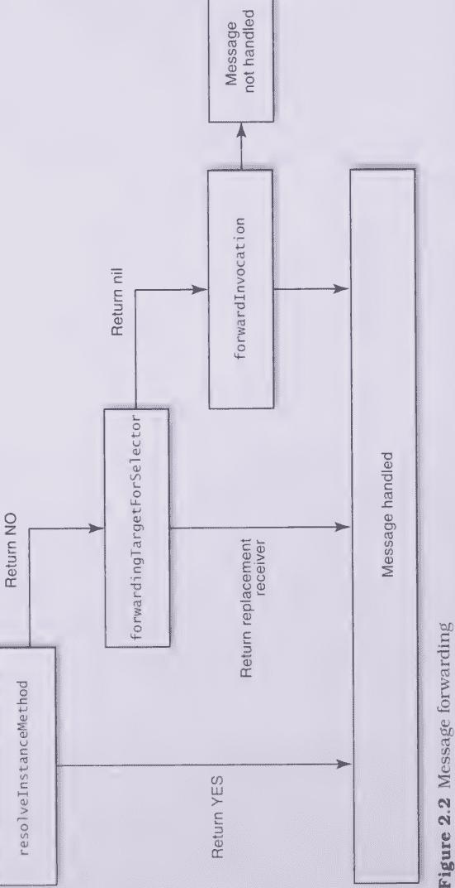

在第二步，将消息转发给另一个接收者仅仅是针对第三步的优化，适用于可以找到替换接收者的情况。在这种情况下，调用唯一需要更改的是目标，这比最后一步要简单得多，最后一步需要创建并处理一个完整的 `NSInvocation` 对象。

### 动态方法解析的完整示例

为了说明转发如何有用，下面的示例展示了使用动态方法解析来提供 `@dynamic` 属性。考虑一个允许你向其中存储任何对象的类，就像字典一样，但通过属性提供访问。该类的想法是，你可以添加属性定义并将其声明为 `@dynamic`，类将魔术般地处理存储和检索该值。这听起来非常棒，对吧？

该类的接口如下：

```
@import <Foundation/Foundation.h>

@interface EOCAutoDictionary : NSObject
@property (nonatomic, strong) NSString *string;
@property (nonatomic, strong) NSNumber *number;
@property (nonatomic, strong) NSDate *date;
@property (nonatomic, strong) id opaqueObject;
@end
```

对于这个示例来说，属性是什么类型并不特别重要。事实上，我展示了各种类型以说明此功能的强大。在内部，每个属性的值将存储在字典中，因此该类的实现开始将如下所示，包括将属性声明为 `@dynamic` 这样实例变量和访问器就不会自动为它们创建：

```
#import "EOCAutoDictionary.h"
#import <objc/runtime.h>

@interface EOCAutoDictionary ()
@property (nonatomic, strong) NSMutableDictionary *backingStore;
@end
```

*(注：原文文本在此处截断，翻译仅针对提供的文本内容)*


# 事项 12：理解消息转发

被找到。这种方法可以通过与组合结合使用，提供多重继承的一些优点。一个对象内部可以拥有一范围其他对象，并在在这个方法中针对它们处理的选择器（`selector`）返回这些对象，使其看起来就像是它本身在处理这些消息。

注意，没有办法通过转发路径的这部分内容来操纵消息。如果消息在发送给替换接收者之前需要修改，则必须使用完整的转发机制。

## 完整转发机制

如果转发算法已经执行到这一步，剩下的工作就是应用完整的转发机制。这首先通过创建一个 `NSInvocation` 对象来封装所有关于未处理消息的详细信息。该对象包含选择器（`selector`）、目标（`target`）和参数（`arguments`）。可以调用 `NSInvocation` 对象，这将导致消息调度系统开始运行并将消息分发到其目标。

尝试以此方式进行转发时调用的方法是：

```objc
- (void)forwardInvocation:(NSInvocation*)invocation
```

简单的实现会更改调用的目标并执行它。这等同于使用替换接收者方法，因此这种简单的实现很少被使用。更有用的实是在调用之前以某种方式更改消息，例如添加另一个参数或更改选择器。

该方法的实现始终应该对于它不处理的调用调用其父类的 `handleForInvocations`。这意味着层次结构中的所有选择器都已获得机会处理该调用。`NSObject` 的实现将被调用。这会触发 `doesNotRecognizeSelector:` 以抛出未处理的选择器异常。

## 全景

处理转发的过程由图 2.2 所示的流程图描述。

在每一步中，接收者都有机会处理消息。每一步都比上一步更昂贵。最好的情况是方法在第一步就被解析，因为被解析的方法最终会被 `runtime` 缓存，这样当下次在同一类类的实例上调用相同的选择器时，转发完全不需要介入。


在第二步，将消息转发给另一个接收者仅仅是针对第三步的优化，适用于可以找到替换接收者的情况。在这种情况下，调用唯一需要更改的是目标，这比最后一步要简单得多，最后一步需要创建并处理一个完整的 `NSInvocation` 对象。

## 动态方法解析的完整示例

为了说明转发如何有用，下面的示例展示了使用动态方法解析来提供 `@dynamic` 属性。考虑一个允许你向其中存储任何对象的类，就像字典一样，但通过属性提供访问。该类的想法是，你可以添加属性定义并将其声明为 `@dynamic`，，类将魔术般地处理存储和检索该值。这听起来非常棒，对吧？

该类的接口如下：

```
@import <Foundation/Foundation.h>

@interface EOCAutoDictionary : NSObject
@property (nonatomic, strong) NSString *string;
@property (nonatomic, strong) NSNumber *number;
@property (nonatomic, strong) NSDate *date;
@property (nonatomic, strong) id opaqueObject;
@end
```

对于这个示例来说，属性是什么类型并不特别重要。事实上，我展示了各种类型以说明此功能的强大。在内部，每个属性的值将存储在字典中，因此该类的实现开始将如下所示，包括将属性声明为 `@dynamic` 这样实例变量和访问器就不会自动为它们创建：

```
#import "EOCAutoDictionary.h"
#import <objc/runtime.h>

@interface EOCAutoDictionary ()
```

*(注：原文文本在此处截断，翻译仅针对提供的文本内容)*

---

*(由于用户提供的输入文本存在大量不连续的截断，以上为基于用户提供的文本片段的对应翻译。若需要完整文档，请提供完整文本。)*

## 项目 13：考虑使用方法切织（Method Swizzling）来调试不透明方法 63

| lowercaseString | IMP |
| :--- | :--- |
| lowercaseString | IMP_a |
| uppercaseString | IMP_b |
| capitalizedString | IMP_c |

图 2.3 `NSString` 的选择器表

`id (*IMP)(id, SEL, ...)`

`NSString` 类响应诸如 `lowercaseString`、`uppercaseString` 和 `capitalizedString` 等选择器。每个选择器都指向一个不同的 `IMP`，构成了一个如图 2.3 所示的表格。

该表可以使用 Objective-C 运行时提供的不同函数进行操纵。你可以向列表中添加选择器、更改特定选择器所指向的实现，或者交换两个选择器所指向的实现。在执行了这些这些操作后，该类方法表看起来可能像图 2.4 所示。

| lowercaseString | IMP |
| :--- | :--- |
| lowercaseString | IMP_a |
| uppercaseString | IMP_b |
| capitalizedString | IMP_c |
| newSelector | IMP_d |

图 2.4 执行若干操作后 `NSString` 的选择器表

# 第 2 章：对象、消息传递与运行时

添加了一个名为 `newSelector` 的新选择器，实现发生了变化，并且 `lowercaseString` 和 `uppercaseString` 的实现被交换了。这一切可以在不写子类的情况下完成。新的方法布局将用于应用程序中的每个 `NSString` 实例。我确定这是一个非常强大的功能，此项目的主题指的是交换实现的过程。在解释如何使用它添加功能之前，我将先解释如何简单地交换现有的方法实现。要交换实现，你使用以下函数：

```objc
void method_exchangeImplementations(Method m1, Method m2)
```

该函数接受参数为需要交换的实现，可以通过以下方式获取：

```objc
Method class_getInstanceMethod(Class a, SEL selector)
```

此函数从类中检索对应给定选择器的方法。要交换上例中 `lowercaseString` 和 `uppercaseString` 的实现，你需要执行以下操作：

```objc
Method originalMethod = class_getInstanceMethod([NSString class], @selector(lowercaseString));
Method swappedMethod = class_getInstanceMethod([NSString class], @selector(uppercaseString));
method_exchangeImplementations(originalMethod, swappedMethod);
```

从以后，每当对 `NSString` 实例调用 `lowercaseString` 时，将调用 `uppercaseString` 的原始实现，反之亦然：

```objc
NSString *string = @"This IS The String";
NSString *lowercaseString = [string lowercaseString];
NSLog(@"lowercaseString = %@", lowercaseString);
// 输出: lowercaseString = THIS THE STRING

NSString *uppercaseString = [string uppercaseString];
NSLog(@"uppercaseString = %@", uppercaseString);
// 输出: uppercaseString = this is the string
```

这解释了如何交换方法实现，但实际上，仅仅那样交换两个实现并没有什么用。毕竟，对于项目 13：考虑使用方法切织来调试不透明方法 65 来说，`uppercaseString` 和 `lowercaseString` 它们各自的功能是有充分理由的。

| lowercaseString | IMP |
| :--- | :--- |
| lowercaseString | IMP_a |
| oc_myLowercaseString | IMP_b |


你没有理由不想交换它们。但同样的方法可以用于向现有方法实现添加功能。如果你想在日志中记录某些内容会怎样？这种方法也可以用于向现有方法实现添加功能。你可以通过使用分类（category）来做到这一点：

```objc
@interface NSString (Additions)
-(NSString*)lowercaseString;
@end
```

在切织后，该类方法表看起来像图 2.5 所示。这种方法看起来如下：

```objc
@implementation NSString (Additions)
-(NSString*)lowercaseString {
    // 在这里添加日志逻辑
    NSLog(@"Calling lowercaseString on %@", self);
    return [self original_lowercaseString]; 
}
@end
```

（注：这里通常涉及到方法切织的逻辑）。在运行时，编译器可以帮助你检查方法选择器。最后，为了交换方法实现，使用以下代码：

```objc
Method originalMethod = class_getInstanceMethod([NSString class], @selector(lowercaseString));
Method swappedMethod = class_getInstanceMethod([NSString class], @selector(uppercaseString));
method_exchangeImplementations(originalMethod, swappedMethod);
```

从以后，每当 `NSString` 实例被调用 `lowercaseString` 时，将调用 `uppercaseString` 的原始实现，反之亦然：

```objc
NSString *string = @"This IS The String";
NSString *lowercaseString = [string lowercaseString];
NSLog(@"lowercaseString = %@", lowercaseString);
// 输出: lowercaseString = THIS THE STRING

NSString *uppercaseString = [string uppercaseString];
NSLog(@"uppercaseString = %@", uppercaseString);
// 输出: uppercaseString = this is the string
```

这种方法在调试时是非常有用的。然而，除了调试之外，你可能没有理由仅仅因为这样做就使用这种功能。过度使用这种功能可能会导致代码难以阅读和难以维护。

## 需要记忆的事

- 方法切织是交换实现的过程，这可以在运行时添加。
- 使用这些方法而不是直接比较类是明智的，正如我将解释的那样。
- 有充分的理由你不应该仅仅因为这样做。

## 项目 14：理解类对象

Objective-C 本质上是动态的。正如你从项目 12 中知道的，编译器实际上无法知道一个类型所理解的选择器，因为它们可以在运行时动态插入。然而，即使使用了这种技术，编译器也期望在某个头文件中看到方法原型，以便它可以生成正确的消息分发代码。

在运行时检查对象的类型被称为内省（introspection），它是 Foundation 框架中 `NSObject` 协议的一个强大且用的功能，所有继承自公共根类（`NSObject`）的对象都遵循该协议。在查看内省技术之前，关于类对象有一些背景知识。

每个 Objective-C 对象实例都是内存块的指针。这就是为什么在声明变量时，类型旁边有一个星号：`NSString *pointer = @"Some string";`

如果你来自 C 语言世界，你将完全理解这意味着什么。对于非 C 程序员来说，这意味着 `pointer` 是一个存储内存地址的变量，而该内存地址存储的数据是 `NSString` 实例。因此，该变量“指向”`NSString` 实例。这就是所有 Objective-C 对象的引用方式；如果你尝试在栈上分配对象的内存，你将收到编译器的错误：

```objc
NSString stackVariable = @"Some string";
// 错误：interface type cannot be statically allocated
```

通用对象类型 `id` 本身已经是指针，所以你可以这样使用它：

```objc
id typedString = @"Some string";
```

这种定义在语义上与变量类型为 `NSString` 是致的。指定完整类型的唯一区别是，当你尝试调用该类不存在的方法时，编译器可以提供帮助并警告。

## 第 2 章：对象、消息与运行时

```objc
typedef struct objc_object {
  Class isa;
} *id;
```

因此，每个对象的第一个成员变量都是一个类型为 `Class` 的变量。该变量定义了对象的类，通常被称为 "is a" 指针。例如，该对象“是”一个 `NSString`。`Class` 对象在运行时的头文件中也有定义：


```objc
typedef struct objc_class *Class;
struct objc_class {
  Class isa;
  Class super_class;
  const char *name;
  long version;
  long info;
  long instance_size;
  struct objc_ivar_list *ivars;
  struct objc_method_list **methodlists;
  struct objc_cache *cache;
  struct objc_protocol_list *protocols;
}
```

该结构存储了关于类的元数据，例如该类的实例实现了哪些内容，以及实例拥有哪些实例变量。该结构的第一个变量也是一个 `isa` 指针，这一事实意味着 `Class` 本身就是一个 Objective-C 对象。该结构还有另一个名为 `super_class` 的变量，定义了类的父类。类的类型（即 `isa` 指针指向的类）是另一个类，被称为元类（metaclass），它用于描述类本身实例的元数据。类方法就是在这里定义的，因为它们可以被视为该类的实例方法。尽管如此，一个类永远只有一个实例，其相关的元类也只有一个。

继承自 `NSObject` 的类的层级结构如图 2.6 所示。

`super_class` 创建了层级结构，而 `isa` 指针描述了实例的类型。你可以操作这种布局来执行内省（introspection）。你可以检查一个对象是否响应某个选择器（selector）以及是否符合某个协议（protocol），并确定关于对象属于类层级结构哪部分的信息。

# 事项 14：理解什么是类对象

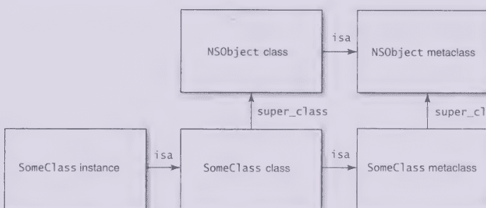

**图 2.6** 继承自 `NSObject` 的 `SomeClass` 实例的类层级结构，包括元类层级结构。

## 检查类层级结构

可以使用内省方法检查类层级结构。你可以使用 `isMemberOfClass:` 检查一个对象是否是某个类的实例，或者使用 `kindOfClass:` 检查一个对象是否是某个类或任何继承自该类的类的实例。例如：

```objc
NSMutableDictionary *dict = [NSMutableDictionary new];
dict isMemberOfClass:[NSDictionary class]; // NO
dict isMemberOfClass:[NSMutableDictionary class]; // YES
dict kindOfClass:[NSDictionary class]; // YES
dict kindOfClass:[NSArray class]; // NO
```

这种内省是通过使用 `isa` 指针获取对象的类，然后使用 `super_class` 指针遍历继承层级来实现的。考虑到对象的动态性质，这一功能极其重要。与你可能熟悉的其他语言不同，如果没有内省，你永远无法完全了解情况。

鉴于 Objective-C 使用了动态类型，对对象的类进行内省非常有用。在从集合中检索对象时通常会使用内省，因为它们不是强类型的，这意味着当从集合中取出对象时，它们的类型通常是 `id`。如果需要知道类型，则可以使用内省：例如，当需要从数组中存储的内容生成逗号分隔的字符串并保存到文本文件时。在这种可以使用可以使用代码：

```objc
- (NSString*)commaSeparatedStringFromObjects:(NSArray*)array {
    NSString *string = [NSString new];
    for (id object in array) {
        if ([object isKindOfClass:[NSString class]]) {
            [string appendFormat:"%@,", object];
        } else if ([object isKindOfClass:[NSNumber class]]) {
            [string appendFormat:"%@", object intValue];
        } else if ([object isKindOfClass:[NSData class]]) {
            NSString *base64Encoded = /* base64 encoded data */
            [string appendFormat:"%@,", base64Encoded];
        } else {
            // Type not supported
        }
    }
}
```

也可以检查类的相等性。你可以使用 `==` 运算符而不是 `isEqual:` 方法，就像你通常比较 Objective-C 对象时那样（见事项 8）。原因是类是单例的，应用程序中每个类 `Class` 对象只有一个实例。因此，测试一个对象是否是某个类的实例的另一种方法是执行以下操作：

```objc
id object = /* ... */;
if ([object isKindOfClass:[SomeClass class]]) {
    // 'object' 是 SomeClass 的实例
}
```

然而，你应该始终优先使用内省方法而不是类对象的相等性，因为内省方法能够考虑到使用消息转发的对象（见事项 12）。考虑一个将所有选择器转发给另一个对象。这种对象被称为代理（proxy），而 `NSProxy` 是专门为这类对象设计的根类。

通常，如果传入的是方法类而不是被探测对象的类，此类代理对象会返回代理类（即 `NSProxy` 的子类）。然而，如果在它们上调用了内省方法（如 `isKindOf:`），它们会将消息转发给被代理的对象。

## 需要记住的事

- `super_class` 创建了层级结构，而 `isa` 指针描述了实例的类型。
- 鉴于 Objective-C 使用了动态类型，对对象的类进行内省非常有用。
- 也可以 `==` 运算符而不是 `isEqual:` 方法检查类的相等性。
- 你应该始终优先使用内省方法而不是类对象的相等性，因为它们能处理消息转发。

# 项目 15：使用前缀名称避免命名冲突

```objc
- (void)soundPlayerDidFinish:(EOCSoundPlayer*)player;
@end
```

```objc
@interface EOCSoundPlayer : NSObject
@property (nonatomic, weak) id<EOCSoundPlayerDelegate> delegate;
- (id)initWithURL:(NSURL*)url;
- (void)playSound;
@end
```

```objc
// EOCSoundPlayer.m
#import "EOCSoundPlayer.h"
#import <AudioToolbox/AudioToolbox.h>
```

```objc
void completion(SystemSoundID ssID, void *clientData) {
    EOCSoundPlayer *player = (__bridge EOCSoundPlayer*)clientData;
    if ([player respondsToSelector:@selector(soundPlayerDidFinish:)]) {
        [player.delegate soundPlayerDidFinish:player];
    }
}
```

```objc
@implementation EOCSoundPlayer {
    SystemSoundID _systemSoundID;
}
```

```objc
- (id)initWithURL:(NSURL*)url {
    if ((self = [super init])) {
        AudioServicesCreateSystemSoundID(__bridge CFURLRef)url, &_systemSoundID);
    }
    return self;
}
```

```objc
- (void)dealloc {
    AudioServicesDisposeSystemSoundID(_systemSoundID);
}
```

```objc
- (void)playSound {
    AudioServicesAddSystemSoundCompletion(_systemSoundID, NULL, NULL,
completion,
(_void*)self);
    AudioServicesPlaySystemSound(_systemSoundID);
}

@end
```

这看起来完全无害，但查看由该类创建对象文件的符号表，我们发现了以下内容：

```
0000230 t --[EOCSoundPlayer .cxx_destruct]
000014c t --[EOCSoundPlayer dealloc]
00001e0 t --[EOCSoundPlayer delegate]
000009c t --[EOCSoundPlayer initWithWithURL:]
0000198 t --[EOCSoundPlayer playSound]
0000208 t --[EOCSoundPlayer setDelegate:]
00000b8 S _OBJ_ICL_S_EOCoundPlayer.
00000b8 S _OBJ_ICL_VAR_EOCoundPlayer._delegate
00000b4 S _OBJ_ICL_VAR_EOCoundPlayer._systemSoundID
000009c S _OBJ_ICL_METACLASS_RO_EOCoundPlayer
00000f8 T 1_OBJ_ICL_INSTANCE_METHODS_EOCoundPlayer
0000c48 s 1_OBJ_ICL_INSTANCE_VARIABLES_EOCoundPlayer
0000c78 s 1_OBJ_ICL_PROP_LIST_EOCoundPlayer
0000c68 s 1_OBJ_ICL_CLASS_RO_EOCoundPlayer
0000bd0 s 1_OBJ_ICL_METACLASS_RO_EOCoundPlayer
```

注意隐藏在中间的符号，名为 `_completion`。这是为了处理声音播放完成而创建的回调函数。尽管它定义在实现文件中而没有在头文件中声明，但它会像这样作为一个顶层符号出现。因此，如果在其他地方也创建了名为 `completion` 的函数，在链接时就会遇到重复符号错误（duplicate-symbol error），如下：

```
duplicate symbol _completion in:
build/EOCoundPlayer.o
build/EOCAnotherClass.o
```

更糟糕的情况是如果你将代码作为库提供给他人并在自己的应用程序中使用。如果你这样暴露了一个名为 `_completion` 的符号，任何使用你库的人都无法创建一个名为 `completion` 的函数，这对你来说是非常糟糕的。

你应该始终这样对 C 函数也加上前缀。在前面的示例中，你可以将回调处理函数命名为 `EOCSoundPlayerCompletion` 等。这还有一个副作用：如果该符号以后出现在回溯栈中，很容易就能确定问题来自哪段代码。

当你使用第三方库并将你的代码作为供他人插件到他们自己的应用程序中的库进行发布时，要特别注意重复符号问题。如果该应用程序也使用了该第三方库，很容易产生重复符号错误。在这种情况下，通常的做法是编辑你所使用的所有库的代码，为它们加上你自己的前缀。例如，如果你的库名为 EOCLibrary，而你引入了一个名为 XYZLibrary 的库，你将遍历并将 XYZLibrary 中的所有名称加上 EOC 前缀。这样应用程序就可以自由地使用 XYZLibrary 本身，而不会有命名冲突的风险，如图 3.1 所示。

遍历并更改所有名称似乎是一件相当无聊的工作，但如果你想避免命名冲突，这是明智之举。你可能会问为什么非这样做，以及为什么应用程序不能排除 XYZLibrary 本身而使用你提供的实现。这样做也是可行的，但请一下这种情况：应用程序又引入了第三个库 ABCLibrary，而该库也决定使用 XYZLibrary。在这种情况下，如果数据存储发生变化，只需要修改一个地方。

# 第 3 章：接口与 API 设计

## 需要记忆的事项

- 选择前缀以避免命名冲突。
- 使用指定初始化器以确保对象被正确初始化。
- 指定初始化器是存储数据的唯一地方。如果底层数据存储发生变化，只需修改一处。

例如，考虑一个表示矩形的类。其接口如下：

```objc
#import <Foundation.h>

@interface RectangleObject : NSObject
@property (nonatomic, assign, readonly) float width;
@property (nonatomic, assign, readonly) float height;
@end
```

遵循第 18 条，属性是只读的。这意味着外部没有方法可以为 Rectangle 对象设置属性。因此，你可能会引入初始化器：

```objc
- (id)initWithWidth:(float)width
   height:(float)height
{
    if ((self = [super init])) {
        _width = width;
        _height = height;
    }
    return self;
}
```

但如果有人决定通过调用 `alloc` 来创建矩形呢？这样做是合理的。Rectangle 的父类 NSObject 实现了一个名为 `init` 的方法，它简单地将所有实例变量设置为 0（或对应数据类型的 0）。如果调用了该方法，宽度和高度将保持为 0，因为在调用 `alloc` 时所有实例变量都被设为了 0。虽然这可能是你想要的，但你更倾向于自己设置默认值，或者抛出异常指示必须使用你的指定初始化器进行初始化。对于 ERectangle 来说，这意味着需要重写 `init` 方法，如下所示：

```objc
// 使用默认值
- (id)init {
    return [self initWithWidth:5.0f height:10.0f];
}
```

```objc
// 抛出异常
- (id)init {
    @throw [NSException initWithName:NSInternalInconsistencyException
                reason:@Must use initWithWidth:andHeight: instead.
                userInfo:nil];
}
```

注意设置默认值的版本直接调用了指定初始化器。这个版本本可以通过可以直接设置 `_width` 和 `_height` 实例变量来实现。

## 第 3 章：接口与 API 设计

然而，如果支持该类的底层存储发生了变化——例如，使用一个结构体将宽度和高度存储在一起——那么设置数据的逻辑在两个初始化器中都必须被更改。在这个简单的例子中这并不糟糕，但想象一个具有更多初始化器和更复杂数据的复杂类。你很容易忘记修改其中一个初始化器，最终导致不一致。

现在你想为 `EOCRectangle` 创建一个子类并创建一个名为 `EOCquare` 的类。显然，这种层级结构是合理的，但初始化器应该是怎样的？显然，宽度和高度应该相等，因为这才是正方形！所以你可能决定创建一个如下初始化器：

```
#import "EOCRectangle.h"
```

```
@interface EOCquare : EOCRectangle
- (id)initWithDimension:(float)dimension;
@end
```

```
@implementation EOCquare
- (id)initWithDimension:(float)dimension {
  return [super initWithWidth:dimension andHeight:dimension];
}
```

```

这将成为 `EOCquare` 的指定初始化器。注意它是如何调用其父类的指定初始化器的。如果你回看 `EOCRectangle` 的实现，你会发现它调用了其父类的指定初始化器。维护这种指定初始化器的链是有关重要的。然而，调用者仍然可能通过 `initWith:andHeight:` 或 `init` 方法来初始化一个 `EOCquare` 对象。你并不想允许这样做，因为有人可能会创建一个宽度和高度不匹配的正方形。这说明了在创建子类时的一个重要的一点：如果你有一个不同名称的指定初始化器，则应该始终重写父类的指定初始化器。在 `EOCquare` 的情况下，你可以这样重写 `EOCRectangle` 的指定初始化器：

```

- (id)initWithWidth:(float)width andHeight:(float)height {

  float dimension = MAX(width, height);

  return [self initWithDimension:dimension];

}
```


# 事项 16：拥有指定初始化器

注意指定初始化器是如何被调用的。

在实现这一点时，调用 `init` 的 `EOCSquare` 方法也会神奇地生效。回想起在 `EOCRectangle` 中，它是如何实现为带有默认值调用到 `CGRect` 的指定初始化器的。它仍然会这样做，但由于 `initWithWidth:andHeight:` 方法被重写，`EOCSquare` 的实现将被调用，反过来又调用它的指定初始化器。一切仍将正常工作，并且无法创建一个边长不等的 `EOCSquare`。

有时，你可能不想重写父类的指定初始化器，因为这没有意义。例如，使用 `initWithWidth:andHeight:` 方法创建的 `EOCSquare` 对象的维度被设置为传入两个值中的最大值，这并不好。你可能认为这是一个用户错误。在这种情况下，通常模式是重写指定初始化器并抛出异常：

```objectivec
- (id)initWithWidth:(float)width andHeight:(float)height {
  @throw [NSException
  exceptionName:NSInternalInconsistencyException
  reason:@"Must use initWithDimension: instead."
  userInfo:nil];
}
```

这看起来可能很严厉，但有时是必要的，因为这会导致创建的对象内部数据不一致。在 `EOCRectangle` 和 `EOCSquare` 的情况下，这意味着调用 `init` 也会导致异常抛出，因为 `init` 调用了 `initWithWidth:andHeight:`。在这种情况下，你可能决定重写 `init` 并带有一个合理的默认值调用 `initWithDimension:`：

```objectivec
- (id)init {
  return [self initWithDimension:5.0f];
}
```

然而，在 Objective-C 中抛出异常可能意味着错误是致命的（参见事项 21），因此如果无法无法初始化实例，抛出异常应该是最后的手段。

在某些情况下，你可能需要多个指定初始化器。这些情况发生在对象可以通过两种不同的方式创建且必须分别处理时。一个例子是 `NSCoding` 协议，它是允许对象规定其如何被编码和解码的序列化机制。这种机制在 AppKit 和 UIKit（分别是 Mac 和 iOS 的两个 UI 框架）中被广泛使用，用于使用名为 NIB 的 XML 格式序列化对象。这些 NIB 通常用于存储视图控制器的布局。当从 NIB 加载时，视图控制器将通过归档过程。

`NSCoding` 协议定义了实现以下初始化方法：

+ `- (id)initWithCoder:(NSCoder*)decoder`

此方法通常无法调用你的主指定初始化器，因为它必须执行不同的工作来通过解码器归档对象。此外，如果父类也实现了 `NSCoding`，则需要调用其 `initWithCoder:` 方法。在严格意义上，你将拥有两个初始化器，因为有多个初始化器调用了父类初始化器。

将此应用于 `EOCRectangle` 将得到如下：

```objectivec
#import <Foundation/Foundation.h>

@interface EOCRectangle : NSObject <NSCoding>

@property (nonatomic, assign, readonly) float width;
@property (nonatomic, assign, readonly) float height;
-(id)initWithWidth:(float)width andHeight:(float)height;

@end

@implementation EOCRectangle
// 指定初始化器
-(id)initWithWidth:(float)width andHeight:(float)height;
```

## 项目 17：实现 description 方法

被调用。该方法定义在 `NSObject` 协议上，但许多方法都是 `NSObject` 协议的一部分，之所以这样做是因为 `NSObject` 不是唯一的根类。`NSProxy` 是另一个根类的示例，它遵循 `NSObject` 协议。由于像 `description` 这样的方法定义在协议内部，因此这些其他根类的子类也必须实现它们。正如你所见，这种实现并没有做什么。它的作用是显示类名以及该对象的内存地址。如果你想查看两个对象是否完全相同，这会对你大有益。然而，你无法借此获取关于对象的更多信息。你更有可能知道关于该对象的更多信息。

为了让输出更有用，你所做的就是重写 `description` 以返回你想要用来表示对象的字符串。例如，考虑一个描述人的类：

```objectivec
#import <Foundation/Foundation.h>

@interface EOCPerson : NSObject

@property (nonatomic, copy, readonly) NSString *firstName;
@property (nonatomic, copy, readonly) NSString *lastName;
- (id)initWithFirstName:(NSString*)firstName lastName:(NSString*)lastName;

@end

@implementation EOCPerson

- (id)initWithFirstName:(NSString*)firstName lastName:(NSString*)lastName
{
    if ((self = [super init])) {
        _firstName = [firstName copy];
        _lastName = [lastName copy];
    }
    return self;
}

@end
```

# 第 3 章：接口与 API 设计

此类方法的典型 `description` 方法实现如下：

如果使用这种方法，`EOCPerson` 类型对象的输出现在看起来如下所示：

```objectivec
EOCPerson *person = [[EOCPerson alloc]
                               initWithFirstName:@"Bob"
                                              lastName:@"Smith"];
```

```objectivec
NSLog("person = %@", person);
// 输出:
// person = <EOCPerson: 0x7fb249c03f0, "Bob Smith">
```

编写包含大量差异信息的 `description` 方法的一种简单方法是借用 `NSDictionary` 的 `description` 方法。它返回的内容看起来如下：

```objectivec
{
    key: value;
    foo: bar;
}
```

这种紧凑的描述可以通过在你自己的 `description` 方法中构建字典，并返回一个包含该字典 `description` 方法的字符串来实现。例如，下面的类描述了一个带有标题和坐标（纬度和经度）的位置：

```objectivec
#import <Foundation/Foundation.h>

@interface EOCLocation : NSObject

@property (nonatomic, copy, readonly) NSString *title;
@property (nonatomic, assign, readonly) float latitude;
@property (nonatomic, assign, readonly) float longitude;
-(id)initWithTitle:(NSString*)title latitude:(float)latitude longitude:(float)longitude;
```

这比仅仅显示指针和类名要有用得多，而且对象的所有属性都很好的呈现。你也可以使用由实例变量组成的字符串格式化，但当类中添加更多属性并希望将其作为 `description` 方法的一部分时，`NSDictionary` 的方法更容易维护。

另一个需要注意的方法（也是 `NSObject` 协议的一部分）是 `debugDescription`，它的目的与 `description` 非常相似。区别在于，`debugDescription` 是在调试器中调用 `print-object` 命令时调用的方法。`NSObject` 类内部的默认实现直接调用 `description`。例如，以 `EOCPerson` 类为例，在调试器（在此处为 LLDB）中运行应用程序，并在创建如下实例后立即在断点处停下：

```objectivec
EOCPerson *person = [[EOCPerson alloc]
initWithFirstName:@"Bob"
lastName:@"Smith"];
```

```objectivec
NSLog("@person = %@", person);
// 断点
```

当命中调试点后，调试控制台将准备好接收输入。LLDB 的 `po` 命令将执行 `print-object` 函数，产生如下结果：

```text
OCTest([640:c07] person = <EOCPerson: 0x712a4d0, "Bob Smith">
(lld) po person
(EOCPerson*) $1 = 0x0712a4d0 <EOCPerson: 0x712a4d0, "Bob Smith">
```

注意 `(EOCPerson*) $1 = 0x0712a4d0` 是由调试器添加的。之后的部分是从 `debug-description` 方法返回的内容。

你可能决定让 `EOCPerson` 的普通 `description` 为人的名字，并实现 `debug-description` 方法来提供更详细的描述。在这种情况下，这两个方法看起来如下：

```objectivec
(NSString*)description {
return [NSString stringWithFormat:@"%@ %@",
_firstName, _lastName];
}
```

```objectivec
(NSString*)debugDescription {
return [NSString stringWithFormat:@"<%p, \@ %@@",
[self class], self, _firstName, _lastName];
}
```

这次，运行相同的代码并使用 `print-object` 命令将产生如下结果：
```text
OCTest([640:c07] person = Bob Smith
(lld) po person
(EOCPerson*) $1 = 0x07117fb0 <EOCPerson: 0x07117fb0, "Bob Smith">
```

## 项目 18：优先使用不可变对象


这比仅仅显示指针和类名要有用得多，而且对象的所有属性都很好的呈现。你也可以使用实例变量组成的字符串格式，但当类中添加更多属性并希望将其作为 `description` 方法的一部分时，`NSDictionary` 的方法更容易维护。

（注：原文后续存在大量重复段落，翻译已按逻辑结构进行处理）

# 第 3 章：接口与 API 设计

一个典型的 `description` 方法实现如下：

如果使用这种方法，`EOCPerson` 类型对象的输出现在看起来如下：

```objectivec
EOCPerson *person = [[EOCPerson alloc] initWithFirstName:@"Bob" lastName:@"Smith"];
```

```objectivec
NSLog("person = %@", person);
// 输出:
// person = <EOCPerson: 0x7fb249c03f0, "Bob Smith">
```

- (id)initWithIdentifier:(NSString*)identifier title:(NSString*)title latitude:(float)latitude longitude:(float)longitude;

```objc
@end
```

这现在确保了如果有人尝试更改其中一个属性值，将生成编译器错误且该值无法被更改，因此 `EOCPointOfOfInterest` 的数据不会变得不一致。因此，任何使用此对象的人都可以确信数据不会在底层发生变化。对象自身的数据结构也不会变得不一致。在显示 `EOCPointOfOfInterest` 对象的地图视图中，所显示兴趣点的纬度和经度不会从底层发生变化。

你可能会奇怪，为什么你没有在属性上设置内存管理语义属性，因为根本没有设置方法（setter）。事实上，你可以简单地将其保持为默认值，如下：

```objc
@property (nonatomic, readonly) NSString *identifier;
@property (nonatomic, readonly) NSString *title;
@property (nonatomic, readonly) float latitude;
@property (nonatomic, readonly) float longitude;
```

然而，在实现中记录你正在使用的内存管理语义是有用的，而且如果你需要的话，这会让将属性改为读写变得更容易。

你可能希望能够在对象内部修改对象所封装的数据，但不能从外部修改。在这种情况下，通常的做法是在内部将 `readonly` 属性重新声明为读写。当然，当属性是非原子的（nonatomic）时，这开启了产生竞态条件的可能性。观察者可能在写入属性的同时读取该属性。这种可能性应该通过确保所有访问（包括内部访问）都是同步的来克服，必要时可以使用分发队列（参见第 4l 项）。

通过使用分类（category）（参见第 2 项）可以在内部将属性重新声明为读写，通过这种方式你可以声明与公共接口中相同的属性，除了读写状态外，其他属性都相同。在 `EOCPointOfInterest` 的情况下，该分类可能像这样：

```objc
#import "EOCPointOfInterest.h"
@interface EOCPointOfInterest ()
@property (nonatomic, copy, readwrite) NSString *identifier;
@property (nonatomic, copy, readwrite) NSString *title;
@property (nonatomic, assign, readwrite) float latitude;
@property (nonatomic, assign, readwrite) float longitude;
@end
@implementation EOCPointOfInterest
/* ... */
@end
```

现在，属性只能在 `EOCPointOfInterest` 的实现内部设置。更准确地说，外部对象仍然可能通过键值编码（KVC）来设置这些属性，它们可以像下面这样使用 `setValue:forKey:`：

```objc
[point setValue:@"abc" forKey:@"identifier"]
```

这会设置 `identifier` 属性的值，因为 KVC 会在你的类中查找存在的 setter 方法，即使它没有通过公共接口暴露。然而，这会被视为对你 API 的侵入，如果由于进行这种“黑客”操作而发生任何问题，将由开发者来收拾残局。开发者甚至可以通过对类进行内省（introspection）来确定属性实例变量的偏移量，从而绕过 setter 方法。开发者随后可以手动设置实例变量。但对你公共 API 的侵入将更加严重。所以，仅仅因为在技术上可以绕过缺少公共 setter 的，就不应该忽略让你的对象变为不可变的建议。

在定义类的公共 API 时，需要记住的另一点是属性应该是可变的还是不可变的。例如，如果你有一个由类表示的人，该类可以存储朋友的引用，你可能希望有一个属性来获取所有朋友的列表。如果朋友可以从该人处添加或删除，你将有一个可变集合（mutable set）作为属性set。在这种情况下，暴露朋友的通常方法是有一个只读属性，返回一个内部可变集合副本的不可变集合。例如，以下代码定义了这样一个类：

```objc
// EOCPerson.h
#import <Foundation.h>
@interface EOCPerson : NSObject
@property (nonatomic, copy, readonly) NSString *firstName;
@property (nonatomic, copy, readonly) NSString *lastName;
@property (nonatomic, strong, readonly) NSSet *friends;
- (id)initWithFirstName:(NSString*)firstName andLastName:(NSString*)lastName;
- (void)addFriend:(EOCPerson*)person;
- (void)removeFriend:(EOCPerson*)person;
@end
```

```objc
// EOCPerson.m
#import "EOCPerson.h"
@interface EOCPerson ()
@property (nonatomic, copy, readwrite) NSString *firstName;
@property (nonatomic, copy, readwrite) NSString *lastName;
@end
@implementation EOCPerson {
  NSMutableSet *_internalFriends;
}
- (NSSet*)friends {
  return [_internalFriends copy];
}
- (void)addFriend:(EOCPerson*)person {
  [_internalFriends addObject:person];
}
- (void)removeFriend:(EOCPerson*)person {
  [_internalFriends removeObject:person];
}
- (id)initWithFirstName:(NSString*)firstName andLastName:(NSString*)lastName {
    if ((self = [super init])) {
        _firstName = firstName;
        _lastName = lastName;
        _internalFriends = [NSMutableSet new];
    }
    return self;
}
@end
```

本可以将 `friends` 属性声明为 `NSMutableSet`，并让类的用户直接向集合中添加内容，而不是通过 `addFriend:` 和 `removeFriend:` 方法。但这会导致数据解耦过头，并且容易产生 bug。如果你选择这样做，`EOCPerson` 的内部朋友集合可能会从底层被更改，如果例如，某人想在朋友添加或删除时执行某些操作，可能会导致问题。如果集合在不知情的情况下从底层被更改，对象将变得不一致。

关于这一点，不要内省返回的任何对象以查找其是否为可变也是重要的。例如，你可能会与一个包含 `EOCPerson` 类的库交互。该库的开发者可能没有懒于返回内部集合的副本，而是选择返回内部可变集合本身。这是合法的，而且如果集合可能极大，这可能是理想的，在这种情况下创建副本的成本很高。返回 `NSMutableSet` 是合法的，因为它是 `NSSet` 的子类，在这种情况下，你可能想这样做：

```objc
EOCPerson *person = /* ... */;
NSSet *friends = person.friends;
if ([friends isKindOfClass:[NSMutableSet class]]) {
    NSMutableSet *mutableFriends = (NSMutableSet*)friends;
    /* 变异集合 */
}
```

然而，你应该尽力避免这样做。观点仍然是，对象可能无法处理从底层变化的数据。

## 需要记住的事

- 尽可能创建不可变对象。
- 在分类中将只读属性扩展为内部读写。
- 提供方法来修改对象所持有的集合，而不是暴露可变集合。

## 方法命名

如果你来自 C++ 或 Java 这样的语言，你已经习惯了名称相当简洁的函数，并且通过查看函数原型来确定参数的作用。然而，这使得代码变得难以阅读，因为你经常需要回看原型来记住函数的功能。例如，考虑一个表示矩形的类。在 C++ 中，你可能这样定义它：

```cpp
class Rectangle {
public:
  Rectangle(float width, float height);
  float getWidth();
  float getHeight();
private:
  float width;
  float height;
};
```

如果你不熟悉 C++ 关系。你只需要意识到这定义了一个拥有两个实例变量（width 和 height）的类。它还有一个创建类实例的方法，称为构造函数，它接收尺寸。它还有用于尺寸的访问器（accessors）。在使用该类时，你会创建：

```cpp
Rectangle *aRectangle = new Rectangle(5.0f, 10.0f);
```

当你回看这段代码时，5.0f 和 10.0f 代表什么并不直观易懂。你可能认为它们是矩形的尺寸，但先是宽度还是高度呢？你需要回看函数的定义才能找到。

Objective-C 通过方法命名解决了这个问题，它的命名方式要冗冗长得多。一个熟悉 C++ 的人从 Objective-C 编写等效类时的第一次尝试可能如下：

```objectivec
#import <Foundation/Foundation.h>
@interface ERectangle : NSObject
@property (nonatomic, assign, readonly) float width;
@property (nonatomic, assign, readonly) float height;
- (id)initWithSize:(float)width:(float)height;
@end
```

### 第 19 项：使用清晰且一致的命名

这样写类的人显然看到了构造函数的等效方法是 `init` 系列方法，并选择使用 `initWithSize:` 这个方法名。这对比你来说可能看起来很奇怪，也许你认为在第二个分号之前没有字符在语法上是错误的。事实上，这种语法是完全正确的，尽管它看起来不对，因为它遭受了与 C++ 函数名相同的问题——即如果你使用该类，你也会处于不知道哪个变量是哪个变量的境地：

```objectivec
ERectangle *aRectangle = [[ERectangle alloc] initWithSize:5.0f :10.0f];
```

一个好得多的命名是：

```objectivec
- (id)initWith:(float)width andHeight:(float)height;
```

这种命名虽然冗长，但当这样使用时，每个变量代表什么完全没有歧义：

```objectivec
ERectangle *aRectangle = [[ERectangle alloc] initWithWidth:5.0f andHeight:10.0f];
```

Objective-C 的初学者往往很难习惯这种冗长的方法命名，尽管使用冗长的命名增强了代码的可读性。不要害怕使用很长的方法名。确保方法名具有其所需的长度，以便它们准确如其描述所言。但你不应该使用极其冗长的名字。你的方法名应该是简洁且精确的。

以 `ERectangle` 类为例。命名良好的方法将包括：

- (void)(ERectangle*)unionRectangle:(ERectangle*)rectangle
- (float)area

然而，这些方法的命名不当的版本包括：

- (void)(ERectangle*)union:(ERectangle*)rectangle // 不明确
- (float)calculateArea // 太冗长

命名清晰的方法读起来从左到右，就像你在阅读一段文字一样。遵循定义方法如何命名的许多规则：

- (NSString)string // 创建一个新字符串（工厂方法通常是必需的）
- (NSString)stringWithString: // 使用指定的字符串创建字符串
- (NSString)stringWithFormat: // 使用格式字符串创建字符串
- (NSString)stringWithUppercase: // 转换为大写字母的字符串
- (NSString)lowercaseString // 将大写字母转换为小写
- (int)intValue // 将字符串转换为整数
- (NSInteger)length // 获取字符串的长度（字符数）
- (NSInteger)lengthBytesUsingEncoding: // 使用指定的编码获取字节长度
- (void)getCharacters:range: // 获取指定范围内的字符

- 如果方法返回一个新创建的值，则方法名中的第一个单词应该是其类型，除非需要在前面加上修饰符，例如 `localizedString` 等方法。这不包括属性访问器（property accessors），因为它们在逻辑上并没有创建一个新对象，尽管它们可能会返回内部对象的副本。这些访问器应该根据它们所代表的属性命名。

- 参数之前应紧紧跟一个描述其类型的名词。

- 会引起对象发生某种动作的方法，如果该方法需要参数来执行动作，则应包含一个动词后跟一个名词（或多个名词）。

- 避免使用缩写，例如 `str`，而是使用全称，例如 `string`。

- 布尔属性应以 `is` 前缀。返回布尔值但不是直接属性的方法应该以 `or` 或 `is` 前缀，取决于哪种对该方法更合理。

- 留出该前缀用于通过输出参数（out-parameter）返回值的方法，例如那些属于 C 风格数组的方法。

## 类与协议命名

类和协议应该加上前缀以避免命名空间冲突（见第 15 条），并构造结构使其读起来顺畅，就像方法名一样。例如，在类 `NSArray` 及其可变子类 `NSMutableArray` 中，`mutable` 位于 `array` 之前，因为它描述了该类型的特化。

为了说明命名规范，请考虑以下来自 iOS UI 库 `UIKit` 的内容：

```
UIView (class)
```


这是一个所有“视图(views)”都继承的类。它们是用户界面的构建块，负责按钮、文本字段和表格的绘制。该类的名称是自而易见的，并使用了整个 UIKit 框架中使用的 `UI` 前缀。

- `UIViewController` (class)

视图（`UIView`）处理视图的绘制，但不负责控制视图内显示的内容。那是该类的工作：“视图控制器（view controller）”。它的命名方式保持了从左到右的易读性。

# 第 19 条：使用清晰且一致的命名

- `UITableView` (class)

这是一种特定的视图，用于在表格中显示项目列表。因此，它的命名方式是父类加上修饰符，以区分它是哪种视图。这种给父类加前缀的方法是整个命名规范中的共同主题。它可以简单地命名为 `UITableView`，但将无法清楚它是一个视图。你必须查找接口声明以确定它是什么。例如，如果你创建一个专门用于显示图像的特定表格视图。你可以创建一个名为 `ECIUITableView` 的子类，你始终在前面加上自己的前缀，而不是使用父类的前缀（在本例中为 UIKit 的 `UI` 前缀）。原因是你无权向另一个框架的命名空间添加任何内容，而且另一个框架可能会在未来创建一个同名的类。

- `UITableView` (class)

正如 `UITableView` 是视图的一种特定类型，这是一种特殊的视图控制器，专门用于控制表格视图。因此，它的命名方式相似。

- `UITableViewDelegate` (protocol)

该协议定义了一个接口，视图可以通过该接口与另一个对象进行通信，并以其所定义的代理接口的类命名，这确保了从左到右的易读性。（关于代理模式（Delegate pattern）的更多信息，请参见第 23 条。）

重要的是，你应该在命名上保持一致。此外，如果你在另一个框架内进行子类化，请确保遵循它的规范。例如，如果你通过子类 `UITableView` 创建自定义视图，请确保类名的最后一个单词是 `View`。同样，如果你创建了自己的代理协议，你应该将其命名为它所代理的类，后面紧跟 `Delegate` 单词。遵循这种命名结构将确保当你以后回来查看或他人使用该代码时，你的代码是有意义的。

## 注意事项

- 遵循 Objective-C 中已成标准的命名方式来创建符合规范且感觉正确的接口。
- 确保方法名简洁但准确，并让它们的使用像句子一样从左到右易读。

# 第 3 章：接口与 API 设计

- 避免在方法名中使用类型的缩写。
- 最重要的是，确保方法名与你自己的代码或与其集成的代码一致。

## 第 20 条：为私有方法名加前缀

类的功能比其外部看起来要多得多，是非常常见的。在编写类实现时，编写仅供内部使用的方法很常见。对于此类方法，我建议在它们的名称前加上一些内容。这有助于通过区分公共方法和私有方法，从而辅助调试。

使用标记处理私有方法的另一个原因是考虑更改方法名或签名时。如果该方法是公共的，这种更改应该经过更仔细的考虑，因为更改类的公共 API 可能不是理想的。这样，该类的消费者也需要更新他们的代码。然而，如果该方法是内部的，则只需要更改类自身的代码。使用标记来指示私有方法意味着在进行此类更改时，这种区别一目易见。

使用的前缀取决于你的个人偏好。包含在前缀中的良好字符选择是下划线和字母 `p`。我倾向于使用前缀 `p_`，因为 `p` 表示“private（私有）”，下划线在方法名开始前提供了一个视觉间隙。方法名随后按照通常的驼命名继续，首字母小写。例如，一个名为 `EObject` 的类可能像这样：

```
@import <Foundation.h>

@interface EObject : NSObject

- (void)publicMethod;

@end

@implementation EObject

- (void)publicMethod {

  /* ... */

}

- (void)p_privateMethod {

  /* ... */

}

@end
```

如果你来自 C++ 或 Java 等语言，你可能奇怪为什么不简单地将方法标记为私有（private）。在 Objective-C 中，没有方法可以将方法标记为私有。所有对象都能响应消息，并且可以在运行时检查对象以确定它响应哪些消息。这就是为什么你要使用命名规范来规定语义。在 Objective-C 中，没有机制限制谁、什么或何时可以调用方法。新成员可能不习惯，但拥抱动态性释放了它的力量。然而，治理这种动态性至关重要，而使用命名规范就是实现这一点。

```
@interface EViewController : UIViewController

```

```
@end
@implementation EViewController

```

然而，结果显示 `UITableView` 也实现了一个名为 `_resetViewController` 的方法！当你调用它时，来自 `EViewController` 的版本将会运行，而原本应该调用原始版本。除非你深入研究库，否则你不会这一点，因为该方法名没有公开。毕竟，它是由下划线表示的私有方法。总而言之，当你在既不是 Apple 的不是你的框架中进行子类化时，你无法该框架使用的是什么私有前缀（如果有），除非它有文档。在这种情况下，你可以选择使用自己的前缀（见第 15 条）作为私有方法前缀，以极大减少任何潜在冲突的风险。同样，你应该考虑他人如何子类化你的类。这就是为什么你应该为私有方法使用前缀。如果没有实现源码，除了使用相当复杂的工具外，无法找到公共接口定义之外的类实现了哪些方法。

## 注意事项

- 为私有方法名加前缀，以便与公共方法区分开。
- 避免使用单个下划线作为方法前缀，因为这是 Apple 保留的。

# 第 21 条：理解 Objective-C错误模型

许多现代语言（包括 Objective-C）都有异常。如果你来自 Java 背景，你可能习惯于使用异常处理错误情况。如果你习惯于使用异常处理此任务，你将不得不回去忘记你所知道的一切并重新开始。

## 项目 21：理解 Objective-C 错误模型

首先需要注意的是，自动引用计数（ARC，参见项目 30）默认情况下并不是异常安全的。在实践中，这意味着任何应该在抛出异常的作用域结束时释放的对象，将不会被释放。可以通过开启编译器标志来生成异常安全的代码，但这会引入额外的代码，即使在没有抛出异常场景的情况下也必须运行这些代码。开启此项的编译器标志是 `-fobjc-arc-exceptions`。

即使不使用 ARC，在使用异常时，编写防止内存泄漏的代码也是困难的。假设创建了一个资源，并在不再需要时需要释放它。如果在资源被释放之前抛出了异常，那么该释放操作将永远执行：

```objc
id someResource = /* ... */;
if ( /* 检查错误 */ ) {
  @throw [NSException exceptionWithName:@"ExceptionName"
                         reason:@"There was an error"
                         userInfo:nil];
}
[someResource doSomething];
[someResource release];
```

```objc
```

当然，解决这个问题的方法是在抛出异常之前释放 `someResource`；然而，如果有许多资源需要释放且代码路径更加复杂，代码很容易变得杂乱。此外，如果向此类代码中添加新内容，很容易忘记在每次抛出异常之前都添加释放操作。

Objective-C 近期采用的方法是，将异常留给那些“应当避免恢复且异常应导致应用程序退出”的罕见场景。这意味着不需要涉及复杂的异常安全代码。

请记住，异常仅用于致命错误（fatal errors）。当你创建一个在在使用之前应该被子类化的抽象基类时，这里有一个你应该考虑在自己的类中抛出异常的场景示例。与某些其他语言不同，Objective-C 没有语言构造结构来表示一个类是抽象的。实现类似效果的最好方法是在任何必须在子类中重写的方法中抛出异常。任何尝试创建抽象基类实例并使用它的人都会得到一个异常：

```objc
(void)mustOverrideMethod {
  NSString *reason = [NSString stringWithFormat:
    @"%@ must be overridden"
    NSStringFromSelector(_cmd)];

  @throw [NSException exceptionWithName:NSInternalInconsistencyException
                               reason:reason
                               userInfo:nil];
}
```

但如果异常仅用于致命错误，那么其他错误该怎么办？Objective-C 选择的指示非致命错误的范式是从发生错误的方法中返回 `nil` / `0`，或者使用 `NSError`。返回 `nil` / `0` 的示例是在初始化方法中无法根据传入的参数初始化实例：

```objc
- (init)initWithValue:(id)value {
  if ((self = [super init])) {
    if ( /* Value 意味着实例无法创建 */ ) {
      self = nil;
    } else {
      // 初始化实例
    }
  }
  return self;
}
```

在这种情况下，如果 `if` 语句确定无法用传入的值创建实例——可能 `value` 本身需要为非空——`self` 被设置为 `nil`，并且返回的是这个值。初始化方法的调用者将理解发生了错误，因为没有创建实例。

`NSError` 提供了多多的活性，因为它能够返回错误的具体原因。一个 `NSError` 对象封装了三部分信息：

- *错误域 (String)*：发生错误的错误域。这通常是一个全局变量，用于唯一定义错误的源头。例如，URL 处理子系统使用 `NSURLErrorDomain` 域来处理所有来自解析或从 URL 获取数据时的错误。
- *错误代码 (Integer)*：在特定的错误域内唯一标识发生了何种错误的代码。通常使用枚举（enum）来定义特定错误域内可能发生的错误集合。例如，失败的 HTTP 请求可能会使用 HTTP 状态码作为此值。
- *用户信息 (Dictionary)*：关于错误的额外信息，例如本地化描述以及另一个代表导致此错误发生的错误，以便能够表示错误链的信息。

在 API 设计中，错误通常使用的第一种方法是通过使用**代理协议（delegate protocols）**。当发生错误时，对象可以通过协议的其中一个方法传递其代理错误。例如，`NSURLConnection` 包含了其代理协议 `NSURLConnectionDelegate` 中的以下方法：

```objc
(void)connection:(NSURLConnection *)didFailWithError:(NSError*)error
```

当判定认为存在错误时（例如到远程服务器的连接超时），会调用此方法来处理代表所发生情况的错误。这个代理方法不需要实现，因此由 `NSURLConnection` 类的用户来决定是否有必要知道该错误。这比抛出异常更好，因为是否告知错误交由用户自行决定。

`NSError` 的另一种使用方式是通过传递给方法的**输出参数（out-parameter）**。它看起来如下：

```objc
(BOOL)doSomething:(NSError**)error
```

错误变量作为指向 `NSError` 指针的指针传递给方法。或者，你可以将其视为指向 `NSError` 对象的指针。这使得方法实际上可以在返回返回值之外额外返回一个 `NSError` 对象。它的用法如下：

```objc
NSError *error = nil;
BOOL ret = [object doSomething:&error];
if (error) {
  // 发生了错误
}
```

通常，返回此类错误的方法还会返回一个布尔值，表示如果你不在乎错误可以检查这个布尔值。当你不在乎错误是什么时，错误参数也可以是 `nil`。例如，你可能会这样使用该方法：

```objc
BOOL ret = [object doSomething:nil];
if (ret) {
  // 发生了错误
```

在实际上，当使用 ARC 时，编译器会将方法签名中的 `NSError**` 翻译为 `NSError*autorelease*`；这意味着所指向的对象将在方法结束时被自动释放。对象必须这样做，因为 `doSomething:` 方法无法保证调用者能够释放它创建的 `NSError` 对象，因此必须添加 `autorelease`。这与大多数方法的返回值的语义相同（以 `new`、`alloc`、`copy` 和 `mutableCopy` 开头的方法除外）。

方法通过输出参数这样返回错误：

```objc
- (BOOL)doSomething:(NSError**)error {
  // 可能导致错误的操作
  if ( /* 发生了错误 */ ) {
    if (error) {
      // 通过输出参数传递 'error'
      *error = [NSError errorWithDomain:domain
                               userInfo:userInfo];
    }
    return NO; ///// 表示失败
  } else {
    return YES; ///// 表示成功
  }
}
```

## 项目 22：理解 NSCopying 协议

```objc
// EOCErrors.h
extern NSString *const EOCErrorDomain;

typedef NS_ENUM(NSUInteger, EOCError) {
    EOCErrorUnknown = -1,
    EOCErrorInternalInconsistency = 100,
    EOCErrorGeneralFault = 105,
    EOCErrorBadInput = 500;
};

// EOCErrors.m
NSString *const EOCErrorDomain = @"EOCErrorDomain";
```

为你的库创建一个错误域（error domain）是明智的，因为这允许你创建并返回 `NSError` 对象，让消费者可以从你的库中确定这些错误。为错误代码创建一个枚举也是一个好主意，因为它记录了错误并为代码提供了有意义的名称。你也可以决定在定义这些错误的头文件中进行注释，或者对每种错误类型提供更详细的描述。

## 注意事项

- 仅将异常（exceptions）处理会导致整个应用程序崩溃的致命错误。
- 对于非致命错误，提供一个代理方法（delegate method）来处理错误，或者提供一个输出参数 `NSError` 对象。

## 项目 22：理解 NSCopying 协议

对对象进行的一项常见操作是复制它。在 Objective-C 中，这是通过使用 `copy` 方法实现的。支持你自己的类进行复制的方法是实现 `NSCopying` 协议，该协议包含一个方法：

```objc
- (id)copyWithZone:(NSZone*)zone
```

这回到了以前 `NSZone` 被用于将内存划分为不同区域（zones），并且在特定区域内创建对象的时代。现在，每个应用都只有一个区域：默认区域。尽管这是你需要实现方法，但你不需要担心 `zone` 参数是什么。

`copy` 方法在 `NSObject` 中实现，它简单地带上默认区域调用 `copyWithZone:`。请记住，尽管重写 `copy` 可能很有诱惑力，但需要实现的是 `copyWithZone:`。

# 第 3 章：接口与 API 设计

为了支持复制，你只需要需要声明你实现了 `NSCopying` 协议，并实现其中的唯一方法即可。例如，考虑一个代表人的类。在接口定义中，你会声明你实现了 `NSCopying`：

```objc
#import <Foundation/Foundation.h>

@interface EOCPerson : NSObject <NSCopying>
@property (nonatomic, copy, readonly) NSString *firstName;
@property (nonatomic, copy, readonly) NSString *lastName;

- (initWithFirstName:(NSString*)firstName andLastName:(NSString*)lastName;

@end
```

然后，你实现该协议要求的唯一方法：

```objc
- (copyWithZone:(NSZone*)zone {
    EOCPerson *copy = [[self class] allocWithZone:zone]
                      initFirstName:_firstName
                      andLastName:_lastName];

    return copy;
}
```

这个示例简单地将初始化副本的所有工作交给了指定的初始化方法。有时，你可能需要对副本执行进一步的操作，例如，如果类中的其他数据结构没有在初始化器中设置：例如，如果 `EOCPerson` 包含一个数组，该数组通过复制来结交或疏远另一个 `EOCPerson`。在这种情况下，你也会想要复制朋友数组。以下是这种操作如何运作的完整示例：


```objc
#import <Foundation/Foundation.h>

@interface EOCPerson : NSObject <NSCopying>
@property (nonatomic, copy, readonly) NSString *firstName;
@property (nonatomic, copy, readonly) NSString *lastName;

- (initWithFirstName:(NSString*)firstName andLastName:(NSString*)lastName;
- (void)addFriend:(EOCPerson*)person;
- (void)removeFriend:(EOCPerson*)person;

@end

@implementation EOCPerson {
    NSMutableSet *_friends;
}

- (id)initWithFirstName:(NSString*)firstName andLastName:(NSString*)lastName {
    if ((self = [super init]) {
        _firstName = [firstName copy];
        _lastName = [lastName copy];
        _friends = [NSMutableSet new];
    }
    return self;
}

- (void)addFriend:(EOCPerson*)person {
    [_friends addObject:person];
}

- (void)removeFriend:(EOCPerson*)person {
    [_friends removeObject:person];
}

- (id)copyWithZone:(NSZone*)zone {
    EOCPerson *copy = [[self alloc] allocWithZone:zone]
                      initFirstName:_firstName
                      andLastName:_lastName];
    copy->_friends = [_friends mutableCopy];
    return copy;
}

@end
```

这一次，复制方法被更改为还将将副本的 `_friends` 实例变量设置为它自己的 `_friends` 实例变量的副本。注意这里使用了 `->` 语法，因为 `_friends` 实例变量是内部的。可以为它声明一个属性，但因为它从没有在外部使用，所以没有必要。

这个示例提出了一个有趣的问题：为什么要对 `_friends` 实例变量进行复制？你完全可以不复制，每个对象将共享该可变集合。但这意味着如果添加了一个朋友，它将影响两个对象。你通常希望每个副本都是一个独立的对象。

如果你希望副本是独立的，你必须执行深拷贝（deep copy）。如果你只想让副本共享内部数据，浅拷贝（shallow copy）就足够了。在大多数情况下，浅拷贝是你需要的，但你需要密切关注你正在复制的对象。

## 项目 22：理解 `NSCopying` 协议

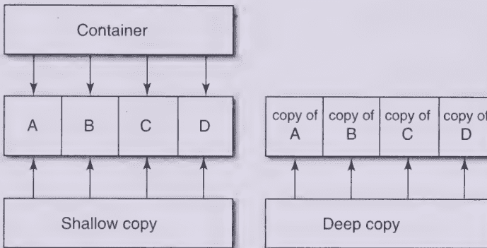

**图 3.2** 浅拷贝与深拷贝。浅拷贝的内容指向与原始对象相同的对象。深拷贝的内容指向原始对象的副本。

# 第 3 章：接口与 API 设计

如果 `copyItems` 设置为 `YES`，则数组中的项将接收拷贝消息，以创建一个副本并构建要返回的新集合。

在 `EOCPerson` 类的示例中，包含朋友的集合在 `copyZone` 中被复制了：但正如讨论过的，这并没有拷贝集合中的项本身。但如果需要这种深拷贝，你可以提供如下所示的方法：

```
(id)deepCopy
  EOCPerson *copy = [[Self class] alloc]
    initWithName:_firstName
    LastName:_lastName];
  copy->friends = [[MutableSet alloc] initWithWithSet:_friends copyItems:YES];
  return copy;
}
```

没有哪个协议定义了深拷贝，因此如何进行拷贝由每个类来自行定义。你只需要决定是否需要提供一个深拷贝方法。此外，你永远不应该假设一个遵守 `NSCopying` 协议的对象会执行深拷贝。在绝大多数情况下，它将是浅拷贝。如果你需要任何任何对象的深拷贝，要么找到相关方法，要么假设你必须自己创建一个，除非文档说明其对 `NSCopying` 的实现提供了深拷贝。

## 注意事项

- 如果你的对象需要被拷贝，请实现 `NSCopying` 协议。
- 如果你的对象具有可变和不可变的变变体，请同时实现 `NSCopying` 和 `NSMutableCopying` 协议。
- 决定拷贝是浅拷贝还是深拷贝，对于普通拷贝，尽可能优先选择浅拷贝。
- 如果你的对象的深拷贝有用，请考虑添加深拷贝方法。

# 第 4 章：协议与分类（Protocols and Categories）

协议（Protocols）是一种语言特性，类似于 Java 中的接口（interfaces）。Objective-C 没有多重继承，因此协议提供了一种定义类应该实现的方法集的方式。协议通常用于实现代理模式（Delegate pattern，见第 23 节），但也有其他用途。了解并使用它们可以使代码更具维护性，因为它们是记录代码接口的良好方式。

分类（Categories）也是 Objective-C 的一项重要语言特性。它们提供了一种向类添加方法的机制，而无需像在其他语言中那样对其子类化。这一特性的实现得益于运行时执行环境的高度动态性，但也带来了让你在使用分类之前应该了解的陷阱。

## 第 23 节：使用代理和数据源协议进行对象间通信

对象经常需要相互通信，并可以通过许多方式实现。Objective-C 开发者广泛使用的一种编程模式被称为代理模式（Delegate pattern），其本质是定义一个任何对象都可以遵守的接口，以便成为另一个对象的代理。该对象随后向代理反馈以获取某些信息，或者在发生有趣事件时通知代理。

使用这种模式可以实现数据与业务逻辑的解耦。例如，用户界面中显示数据列表的视图应该只负责如何显示数据的逻辑，而不负责决定应该显示什么数据或数据交互中发生了什么。视图对象可以拥有包含负责数据和事件处理对象的属性。这些分别被称为数据源（data source）和代理（delegate）。

在 Objective-C 中，实现这种模式的常用方法是使用协议语言特性，它贯穿整个 Cocoa 框架。如果你自己使用这一特性，你会发现自己的代码能够完美适配。

例如，考虑一个用于从网络获取数据的类。该类可能为了从远程服务器的资源上检索某些数据。服务器响应可能需要很长时间，在检索数据时进行阻塞是不良做法。因此，在这种情况下，通常使用代理模式，获取器类拥有一个代理，在数据获取完成后会回调该代理。图 4.1 阐了这个概念：`EOCDataModel` 对象是 `EOCNetworkFetcher` 的代理。`EOCDataModel` 请求 `EOCNetworkFetcher` 异步执行一项任务，`EOCNetworkFetcher` 在任务完成后告诉其代理 `EOCDataModel`。

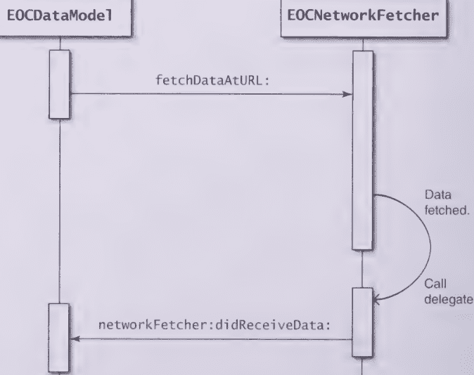

**图 4.1** 代理回调。注意，`EOCDataModel` 实例并不非要是代理，也可以是另一个对象。

### 第 23 节：使用代理和数据源协议进行对象间通信

这种模式在 Objective-C 中通过协议可以轻松实现。在图 4.1 的情况下，协议可能看起来如下：

```
@protocol EOCNetworkFetcherDelegate
  -(void)networkFetcher:(EOCNetworkFetcher*)fetch
      didReceiveData:(NSData*)data;
  -(void)networkFetcherWithError:(EOCNetworkFetcher*)fetch
      didFailWithError:(NSError*)error;
@end
```

代理协议的命名通常驼峰命名法，全名后面跟上 `delegate` 单词。遵循这种命名模式会让任何使用该代理协议的人感到很亲切。

协议为拥有代理的类提供了一个属性。在我们的示例中，这就是 `EOCNetworkFetcher` 类。因此，接口看起来如下：

```
@interface EOCNetworkFetcher : NSObject
  @property (nonatomic, weak)
  id <EOCNetworkFetcherDelegate> delegate;
@end
```

确保该属性已定义且不是强引用（not strong）是非常重要的，以避免循环引用。通常，代理属性是弱引用（weak）的，因为对象可能并不拥有代理。在示例中，`DataModel` 拥有 `EOCNetworkFetcher`，因此代理属性应该是弱引用的。

代理方法也可以用于从代理处获取信息。例如，网络获取器类可能在开始获取数据之前向代理询问某些信息。

提供一种机制，使其在获取数据时如果遇到重定向，会询问其代理（delegate）是否应该发生重定向。该代理方法可能如下：

- (BOOL)networkFetcher: (EOCNetworkFetcher*)fetcher shouldFollowRedirectURL: (NSURL*)url;

这个示例应该很容易让人看出为什么它被称为代理模式（Delegate pattern），因为该对象将某个操作的责任委托给了另一个类。

协议（Protocols）也可以用于提供一个接口，通过该接口获取类所需的数据。代理模式的另一种用法被称为数据源模式（Data Source pattern），因为它的目标是为类提供数据。信息流是向该类的：而对于普通的代理，信息流是离开该类的。这种信息流如图 4.3 所示。

例如，用户界面框架中的一个列表视图对象可能会使用数据源协议来提供要在列表中显示的数据。列表视图也可以有一个代理来处理用户与列表的交互。数据源协议和代理协议的分离通过分离不同的逻辑部分提供了更整洁的接口。此外，你可以让一个对象作为数据源，另一个对象作为代理。然而，通常同一个对象最终会兼任两者。

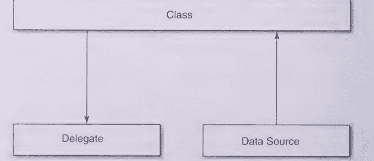

图 4.3 信息流对于代理是离开类，对于数据源则是进入类。

## 事项 23：使用代理和数据源协议进行对象间通信

在实现任何方法时，使用代理和数据源模式是可选的，你会有很多类似于下面的代码：

```
if ([_delegate respondsTo:@selector(someClassDidSomething)]) {
    [_delegate respond someClassDidSomething];
}
```

检查代理是否响应某个选择器（selector）是非常快的，但如果你重复这样做，在第一次之后的响应可能是冗余的。如果代理没有发生变化，它就不可能突然开始或停止对给定的选择器做出响应。出于这个原因，通常会对缓存“代理是否响应协议中的方法”进行优化。例如，示例中的网络抓取器有一个代理，作为进度指示被回调，经常告诉代理网络抓取进展的程度。该方法在抓取器的生命周期内可能会被调用多次，每次检查代理是否响应该选择器都是冗余的。

考虑为如下定义的选择器扩展的代理协议：

```
@protocol EOCNetworkFetcherDelegate
@optional
- (void)networkFetcher:(EOCNetworkFetcher*)fetch didReceiveData:(NSData*)data;
- (void)networkFetcher:(EOCNetworkFetcher*)fetch didFailWithError:(NSError*)error;
- (void)networkFetcher:(EOCNetworkFetcher*)fetch didUpdateProgressTo:(float)progress;
@end
```

这里调用了唯一的、可选方法 `networkFetcher:didUpdateProgressTo:`。缓存的最佳方法是使用位域（bitfield）数据类型。这个来自 C 语言的特性经常被忽视，但它非常适合此目的。它允许你定义结构体的某个字段的大小为特定的比特位数。它看起来像这样：

```
struct data {
    unsigned int fieldA : 8;
    unsigned int fieldB : 4;
    unsigned int fieldC : 2;
    unsigned int fieldD : 1;
};
```

## 第 4 章：协议与分类

在这种结构中，fieldA 将使用恰好 8 位，fieldB 将使用 4 位，fieldC 将使用 2 位，而 fieldD 将使用 1 位。因此 fieldA 能够持有从 0 到 255 的值，而 fieldD 能够持有 0 或 1。后者用于缓存代理实现了了哪些方法。如果你创建一个只使用 1 位位域的结构，你就可以在少量数据中封装许多布尔值。对于网络抓取器的示例，你会让实例拥有一个结构作为其变量之一，其中包含位域，每个代理方法对应一个变量。该结构看起来如下：

```
@interface EOCNetworkFetcher () {
    unsigned int didReceiveedData : 1;
    unsigned int didFailWithError : 1;
    unsigned int didUpdateProgressTo : 1;
}
@end
```

## 事项 24：使用分类（Categories）拆分类实现

一个类很容易因为许多方法都挤在一个巨大的文件中而变得臃肿。随着更多方法被添加到类中，文件只会变得越来越长且越难以管理。因此，将一个类拆分成独立的、不同的部分通常是有用的。例如，前面的代码可以重写以利用分类：

## 项目 24：使用分类（Categories）将类实现分段

```objc
- (BOOL)isFriendsWith:(EOCPerson*)person;
@end
```

```objc
@interface EOCPerson (Work)
- (void)performDaysWork;
- (void)takeVacationFromWork;
@end
```

```objc
@interface EOCPerson (Play)
- (void)goToTheCinema;
- (void)goToSportsGame;
@end
```

现在，类的每个不同部分都被拆分到独立的分类方法中。不意外的是，这种语言特性被称为分类（categories）。在示例中，类的基础（包括属性和初始化方法）是在主实现中声明的。与不同类型操作相关的额外方法集被拆分成不同的分类中。

整个类仍然可以定义在一个接口文件和一个实现文件中，但随着分类的增加，单个实现文件很容易变得难以管理。在这种情况下，可以将分类提取到它们自己的文件文件中。例如，可以将 `EOCPerson` 中的分类提取到单独的文件中：

- `EOCPerson+Friendship(.h/.m)`
- `EOCPerson+Work(.h/.m)`
- `EOCPerson+Play(.h/.m)`

例如，友谊分类看起来如下所示：

```objc
// EOCPerson+Friendship.h
#import "EOCPerson.h"
```

```objc
@interface EOCPerson (Friendship)
- (void)addFriend:(EOCPerson*)person;
- (void)removeFriend:(EOCPerson*)person;
- (BOOL)isFriendsWith:(EOCPerson*)person;
@end
```

```objc
// EOCPerson+Friendship.m
#import "EOCPerson+Friendship.h"
```

```objc
@implementation EOCPerson (Friendship)
- (void)addFriend:(EOCPerson*)person {
/* * */
}
-(void)removeFriend:(EOCPerson*)person {
  /* * */
}
-(BOOL)isFriendsWith:(EOCPerson*)person {
  /* * */
}
@end
```

该类已被拆分成更易于管理的代码块，可以单独检查。你必须记住在任何需要分类方法的地方，导入 `EOCPerson.h` 头文件以及任何分类头文件。但这是一个让你的代码更易于管理的好方法。

即使类不是太大，使用分类将其拆分为子部分也是将代码分到功能区域的有用方法。Cocoa 中实现此点的类示例是 `NSURLRequest` 及其可变副本 `NSMutableURLRequest`。该类请求从互联网某处的 URL 和服务器获取数据，但该类是通用的，也可以用于其他协议。然而，HTTP 请求需要设置比标准 URL 请求更多的额外信息，例如 HTTP 方法（GET、POST 等）或 HTTP 请求头（headers）。


`NSURLRequest` 不容易被子类，因为它封装了 `NSURLRequest` 结构体，包含所有的 HTTP 方法。因此，HTTP 特有的方法被简单添加到 `NSURLRequest` 中，就像变异方法通过名为 `NSMutableHTTPRequest` 的分类添加到 `NSMutableURLRequest` 中一样。这样，所有的底层 `NSURLRequest` 函数都封装在同一个 Objective-C 类中，但 HTTP 特有的方法被拆分到单独的区域以避免混淆，否则用户可能会疑惑为什么他们可以在使用 FTP 协议的请求对象上设置 HTTP 方法。

将类拆分为分类的另一个原因是为了调试；分类名称会被添加到该分类内所有方法的符号中。例如，`addFriend:` 方法具有以下符号名称：

- - [`EOCPerson(Friendship)` `addFriend:`]

当它出现在调试器的回溯轨迹（backtraces）中时，它看起来会像这样：

## 项目 25：在第三方类上始终为分类名称加上前缀

`frame #2: 0x0001c50 Test'--[EOCPerson(Friendship)] addFriend:`

`+ 32 at main.m:46`

回溯轨迹中的分类名称对于精确确定类方法所属的功能区域可能极其有用，这在当某些方法应该被视为私有方法时特别有用。在这种情况下，创建一个包含所有这些方法的 `Private` 分类可能是很有用的。此类分类的方法通常只在类或框架内部使用，而不向外暴露。如果用户发现了这样的方法——可能是通过读取回溯轨迹——名称中的 `private` 应该有助于指示该方法不应直接使用。在某种意义上，这是一种自文档化代码的方法。

### 需要记忆的事

- 使用分类将类实现拆分为更易于管理的片段。
- 创建一个名为 `Private` 的分类，以隐藏应该被视为私有的方法的实现细节。

分类通常用于为你你不拥源代码的现有类添加功能。这是一个非常强大的特性，但这样做时也很容易忽视可能出现的问题。问题源于方法被添加到了类中这一事实。如果该类以后添加了相同名称的方法，它将与你的方法冲突。

为了避免这种情况，你应该使用唯一标识符为分类名称加上前缀，例如你的项目名称。

```objc
@interface NSString (MyProject)
- (void)myMethodName;
@end
```

如果你不使用前缀，你的分类可能会与未来添加到类的方法冲突，或与添加到同一类的其他分类冲突。这在处理你无法控制源代码的第三方库时尤为重要。

## 第4 章：协议（Protocols）与分类（Categories）

协议是定义类必须实现的方法组的一种。它们与接口（interfaces）相似，但不包含任何实现。相反，它们定义了类需要遵循的约。

```objc
@protocol MyDelegate
- (void)dataDidFinish:(id)data;
- (void)dataDidWithError:(NSError*)error;
@end
```

遵循协议的类必须实现它的所有方法。

```objc
@interface MyClass : NSObject <MyDelegate>
@end
```

分类也可以用于为协议方法提供默认实现。这并不是严格的面向对象编程，但它是添加功能的常用模式。

```objc
@interface MyClass (MyDelegate)
- (void)dataDidFinish:(id)data {
  // 默认实现
}
- (void)dataDidWithError:(NSError*)error {
  // 默认实现
}
@end
```

协议还用于定义对象之间的接口。例如，代理（delegate）可以用于两个对象之间的通信。

```objc
@interface MyClass : NSObject
@property (nonatomic, weak) id <MyDelegate> delegate;
@end
```

通过使用协议和分类，你可以创建灵活且易于维护的代码。这是 Objective-C 的一个强大特性，你应该掌握它。

## 项目 26：避免在分类（Category）中使用属性

属性（property）是封装数据的一种方式（参见第 6 项）。虽然在技术上可以在分类中声明属性，但如果可能，你应该避免这样做。原因在于，除了类延续分类（class-continuation category，参见第 27 项）外，分类无法为类添加实例变量（instance variables）。因此，分类也无法将实例变量合成回到属性中。

假设在阅读了第 24 项后，你决定使用分类来拆分表示“人”的类实现中的不同片段。你可能决定创建一个“友谊”（Friendship）分类，用于处理所有与操作人员相关朋友列表相关的方法。在不知道前述问题的情况下，你也可能将朋友列表的属性放在友谊分类中，如下所示：

```objc
#import <Foundation/Foundation.h>

@interface EOCPerson : NSObject
@property (nonatomic, copy, readonly) NSString *firstName;
@property (nonatomic, copy, readonly) NSString *lastName;

- (id)initWithFirstName:(NSString*)firstName
   andLastName:(NSString*)lastName;
@end

@implementation EOCPerson
// Methods
@end

@interface EOCPerson (Friendship)
@property (nonatomic, strong) NSArray *friends;
- (BOOL)isFriendWith:(EOCPerson*)person;
@end

@implementation EOCPerson (Friendship)
// Methods
@end
```

然而，如果你编译这段代码，将会得到编译器警告：

`warning: property 'friends' requires method 'friends' to be defined - use @dynamic or provide a method implementation in this category [-Wobjc-property-implementation]`

`warning: property 'friends' requires method 'setFriends': to be defined - use @dynamic or provide a method implementation in this category [-Wobjc-property-implementation]`

这个晦涩的警告意味着实例变量无法通过分类合成，因此，该属性需要是分类中实现的访问器方法（accessor methods）。或者，可以将访问器方法声明为 `@dynamic`，这意味着你正在声明它们在运行时可用，但编译器无法不可见。如果你正在使用消息转发机制（参见第 12 项）来拦截方法并在运行时提供实现，可能会出现这种情况。

为了解决分类无法合成实例变量的问题，可以使用关联对象（associated objects，参见第 10 项）。对于此示例，你需要在分类内如下实现访问器：

```objc
#import <objc/runtime.h>

static const char *kFriendsPropertyKey = "kFriendsPropertyKey";

@implementation EOCPerson (Friendship)

-(NSArray*)friends {
    return objc_getAssociatedObject(self, kFriendsPropertyKey);
}

-(void)setFriends:(NSArray*)friends {
    objc_setAssociatedObject(self,
                              kFriendsPropertyKey,
                              friends,
                              OBJC_ASSOCIATION_RETAIN_NONATOMIC);
}

@end
```

这种方法行得通，但并不理想。这涉及到大量的模板代码（boilerplate），并且在内存管理上容易出错，因为人们很容易忘记属性是这样实现的。例如，你可能会通过更改属性属性来更改内存管理语义。你还需要记得更改 setter 中关联对象的内存管理语义。所以虽然这不是一个糟糕的方案，但我并不推荐这种方案。

此外，你可能希望支持 friends 数组的实例变量是一个可变数组。你可以获取一个可变副本，但这又为你的代码库引入了另一个混乱的来源。因此，在主接口定义中定义属性，比在分类中定义属性要清晰得多。

在这个示例中，正确的解决方案是将所有属性定义都保留在主接口声明中。类封装的所有数据都应该定义在主接口中，这是实例变量（数据）可以定义的唯一地方。由于它们只是定义实例变量和关联访问器方法的语法糖，属性也遵循同样的规则。分类应该被视为扩展类功能的方式，而不是它所封装的数据。

尽管如此，有时只读属性可以在分类内被成功使用。例如，你可能想在 `NSCalendar` 上创建一个分类，以返回一个包含月份字符串的数组。由于该方法没有访问任何数据，且属性没有实例变量支持，你可以这样实现该分类：

```objc
@interface NSCalendar (EOC_Additions)
@property (nonatomic, strong, readonly) NSArray *eoc_allMonths;
@end

@implementation NSCalendar (EOC_Additions)
- (NSArray*)eoc_allMonths {
    if ([self.calendarIdentifier isEqualToString:NSGregorianCalendar]) {
        return @[@"January", @"February", @"March", @"April", @"May", @"June", @"July", @"August", @"September", @"October", @"November", @"December"];
    } else if (/ other calendar identifiers */ {
        /* return months for other calendars */
    }
}
@end
```

支持属性的实例变量自动合成将不会触发，因为所有需要的方法（在这种只读情况下只有一个方法）都已实现。因此，编译器不会发出任何警告。

## 项目 27：使用类延续分类隐藏实现细节

然而，即使在在这种情况下，通常认为在类延续中使用属性也是更好的。属性本意应该由类提供支持。在这个示例中，你反而应该在分类内声明方法：

```objc
@interface NSCalendar (EOC_Additions)
- (NSArray*)eoc_allMonths;
@end
```

需要记住：

- 将所有属性声明保留在主接口中。
- 优先在分类中使用访问器方法，除非它是类延续分类。

通常，你可能希望一个类包含比外部暴露更多的方法和实例变量。那么，如何处理那些应该是私有的方法和实例变量呢？这时一个特殊的分类——“类延续分类”就可以派上用场了。与普通分类不同，类延续分类必须定义在它所延续的类的实现文件中。重要的是，它是唯一允许声明额外实例变量的分类。此外，这个分类没有名称。一个针对名为 `EOCPerson` 的类的类延续分类看起来如下：

```objc
@interface EOCPerson ()
// Methods
@end
```

为什么这种分类很有用？它很有用是因为方法和实例变量都可以在那里定义。这之所以可能，仅仅是因为由于脆弱的 ABI（更多细节请参见第 6 项），这意味着在使用一个对象时不需要知道它的大小。因此，实例变量不需要定义在公共接口中，因为类的调用者不需要知道它们的布局。由于这个原因，在类延续分类中添加实例变量是可能的，在类的实现中也是如此。这样做，你只需要在正确的位置添加大括号并将实例变量放在其中即可：

```objc
@interface EOCPerson {
    NSString *anInstanceVariable;
}
// Methods
@end

@implementation EOCPerson {
    int _anotherInstanceVariable;
}
// Methods
@end
```

这样做有什么意义？你可以在公共接口中定义实例变量。但将它们隐藏在类延续分类或实现块中的好处是，它们在内部是已知的。例如，假设你不希望别人知道一个仅在内部使用的超类的存在。如果你的某个类拥有该类的实例，并且你在公共接口中声明了实例变量，它看起来像这样：

```objc
#import <Foundation/Foundation.h>
@class EOCSuperSecretClass;
```

```objc
@interface EOCClass : NSObject {
    @private
    EOCSuperSecretClass *_secretInstance;
}
@end
```

名为 `EOCSuperSecretClass` 的类的存在已经泄露了。你可以通过不对变量进行强类型类型而将其声明为 `id` 类型而不是 `EOCSuperSecretClass*` 来回避这个问题。然而，这并不理想，因为在内部使用它时，你将失去编译器的任何帮助。而且为什么应该

你仅仅因为不想暴露某些内容就错失了这类帮助吗？这正是类延续分类派上用场的地方。现在可以这样声明：

```
// EOClass.h
#import <Foundation/Foundation.h>
```

```
@interface EOClass : NSObject
@end
```

```
// EOClass.m
#import "EOClass.h"
#import "EOCSuperSecretClass.h"
```

```
@interface EOClass () {
EOCSuperSecretClass *_secretInstance;
}
@end
```

```
@implementation EOClass
// 方法在此处编写
@end
```

同样，实例变量也可以被添加到实现块（implementation block），这在语义上与将其添加到类延续分类是等价的，更多取决于个人喜好。我更倾向于将其添加到分类中，因为可以将所有的数据定义保持在同一个地方。你还可能在类延续分类中定义属性，因此在这里声明额外的实例变量也是好的。这个实例变量并不是真正的私有，因为始终可以通过运行时（runtime）的方法来绕过它，但从所有意义上来说，它是私有的。此外，由于它没有在公共头文件中声明，如果你将此代码作为库的一部分发布，它会被隐藏得更好。

这种方法在处理 Objective-C++ 代码时也特别有用。在这种 Objective-C 和 C++ 的混合体中，可以使用这两种语言编写的代码。通常，出于可移植性考虑，游戏后端是用 C++ 编写的。其他情况下，你可能需要使用 C++，因为你正在与一个只有 C++ 绑定的第三方库接口。对于这些情况，类延续分类同样大显身手。假设以前你是这样编写类代码：

```
#import <Foundation/Foundation.h>
#include "SomeCppClass.h"
```

```
@interface EOCClass : NSObject {
@private
    SomeCppClass _cppClass;
}
@end
```

该类的实现文件将命名为 `EOCClass.mm`，其中 `.mm` 扩展名告诉编译器该文件应作为 Objective-C++ 编译。如果没有这一点，包含 `SomeCppClass.h` 将是不可能的。但请注意，C++ 类 `SomeCppClass` 必须被完全解析，以便编译器知道 `_cppClass` 实例变量的大小。因此，任何包含 `EOCClass.h` 以使用该类的文件也需要被编译为 Objective-C++，因为它会包含 `SomeCppClass` 头文件。这很容易导致失控，最终导致你的整个应用程序都被编译为 Objective-C++。这完全没有问题，但我认为这相当丑陋，特别是当代码作为库发布供其他应用程序使用时。对于第三方开发者来说，必须重命名所有文件为 `.mm` 扩展名并不是很友好的。

你可能会认为解决上述问题的一种方法是前向声明（forward declare）C++ 类而不是导入其头文件，然后将实例变量设为指向实例的指针，如下：

#import <Foundation/Foundation.h>

```
class SomeCppClass;
```

```
@interface EOCClass : NSObject {
@private
    SomeCppClass *_cppClass;
}
```

现在实例变量需要是一个指针，因为如果它不是指针，编译器将无法计算实例变量所需的固定大小，并会导致错误。指针的大小都是固定的，所以编译器只需要知道指针指向的类型即可。但在任何导入 `EOCClass` 头文件的类中都会遇到 `class` 关键字，这是一个 C++ 关键字，因此它需要被编译为 Objective-C++。这很丑陋且没有必要，因为实例变量本身就是私有的，其他类为什么要关心它是否存在呢？嗯，类延续分类再次来救场了。使用它让类看起来像这样：


进入`/path/to/xxx`目录，找到`xxx.json`。

在表达式`cvar = avar + bvar`中，加法运算符（`+`）将`avar`与`bvar`相加，得到它们的和`cvar`

在`List.of(arg0, arg1, arg2)`中，`List`接口的工厂方法`of()`接受一系列的元素，返回包含它们的只读列表。

之后我们这样调用`cmd`命令：`cmd arg0 arg1 arg2`。

```
if (condVar > someVal) {console.log("xxx")}
```

```
// EOCClass.h

#import <Foundation/Foundation.h>
```

```
@interface EOCClass : NSObject
@end
```

```
// EOCClass.mm
#import "EOCClass.h"
#include "SomeCppClass.h"
```

```
@interface EOCClass () {
    SomeCppClass _cppClass;
}
@end
```

```
@implementation EOCClass
@end
```

现在，`EOCClass`头文件脱离了任何 C++ 代码，该头文件的使用者甚至不会意识到其底层充斥着 C++。这种模式在一些系统库中可见，例如 浏览器框架 WebKit 大部分是用 C++ 编写的，但通过简洁的 Objective-C 接口暴露。这种模式在 CoreAnimation 中也可见，其中大量的后端代码是用 C++ 编写的，但通过纯 Objective-C 接口暴露。

类延续分类的另一个好用是扩展在公共接口中为只读但在内部需要设置的属性。通常，你可能希望通过 setter 访问器方法而不是直接访问实例变量（参见项目 7）来设置，因为这会触发键值观察（KVO）通知，其他对象可能正在监听这些通知。出现在类延续分类或任何其他分类以及类接口中的属性必须具有完全相同的属性（attributes），例外是只读状态可以扩展为可读写。例如，一个表示人的类，其公共接口如下：

#import <Foundation/Foundation.h>

```
@interface EOCPerson : NSObject
@property (atomic, copy, readonly) NSString *firstName;
@property (atomic, copy, readonly) NSString *lastName;
```

```
- (id)initWithFirstName:(NSString*)firstName
    lastName:(NSString*)lastName;
@end
```

# 第 4 章：协议（Protocols）与分类（Categories）

通常，会定义一个类延续分类将这两个属性的状态扩展为可读写：

```
@interface EOCPerson
@property (nonatomic, copy, readwrite) NSString *firstName;
@property (nonatomic, copy, readwrite) NSString *lastName;
@end
```

这就是所有的工作了。现在 `EOCPerson` 的实现可以自由地使用 setter，无论是调用 `setFirstName:` 或 `setName:`，还是使用属性语法。这样做是一种非常有用的方法，可以保持数据在内部公开，但仍然能够根据需要管理数据。因此，类封装的数据由实例本身控制，而不是从外部更改。如果观察者在内部写入属性的同时读取该属性，这种方法可能会引入竞态条件（参见项目 18）。合理使用同步（参见项目 41）将缓解这一问题。

类延续分类的另一个好用是声明仅在类内部使用的私有方法。这很有用，因为它记录了类内部可见的方法。它看起来如下：

```
@interface EOCPerson
-(void)p_privateMethod;
@end
```

在这里，使用了项目 20 中的前缀思想来指示私有方法。在最近的编译器版本中，你并不一定需要在使用之前声明方法。然而，在这样的类延续分类中这样做通常仍然是一个好主意，因为它可以在一个地方记录存在哪些方法。我经常喜欢在实现类之前这样写方法。然后我遍历并实现这些方法。这是提高类可读性的极佳方法。

最后，类延续分类是声明你的对象遵循应被视为私有的协议的好地方。通常，你不想在公共接口中泄露你遵循了某个协议的信息，可能因为该协议是你私有 API 的一部分。例如，考虑 `EOCPerson` 遵循名为 `EOCSecretDelegate` 的协议。使用公共接口，它看起来会是：

```
#import <Foundation/Foundation.h>
#import "EOCSecretDelegate.h"
```

# 项目 27：使用类扩展分类（Class-Continuation Category）隐藏实现细节

```objc
@interface EOCPerson : NSObject <EOCSecretDelegate>
@property (nonatomic, copy, readonly) NSString *firstName;
@property (nonatomic, copy, readonly) NSString *lastName;
```

```objc
- (id)initWithName:(NSString*)firstName
    lastName:(NSString*)lastName;
@end
```

你可能认为你只需要前向声明 `EOCSecretDelegate` 协议（或者准确说是定义它的协议头文件）。你可以像这样进行前向声明，而不是导入：

```objc
@protocol EOCSecretDelegate;
```

然而，在任何导入 `EOCPerson` 头文件的地方，编译器都会发出以下警告：

`warning: cannot find protocol definition for 'EOCSecretDelegate'`

这是因为编译器知道，在无法看到其定义的情况下，它永远无法知道协议中包含了哪些方法。但由于这是一个私有的内部协议，你甚至不想泄露它的名称。类扩展分类再次派上了用场！你不需要在公共接口中声明 `EOCPerson` 遵循 `EOCSecretDelegate`，而是在类扩展分类中直接实现：

```objc
#import "EOCPerson.h"
#import "EOCSecretDelegate.h"
```

```objc
@interface EOCPerson () <EOCSecretDelegate>
@end
```

```objc
@implementation EOCPerson
/* ... */
@end
```

公共接口可以移除所有对 `EOCSecretDelegate` 的引用。私有协议不再暴露，消费者必须通过深层内省才能发现它的存在。

## 注意事项

- 在类扩展分类中使用来向类添加实例变量。

- 如果某个属性在主接口中是只读的，但在类内部需要 setter 访问器，请在类扩展分类中将其重新声明为读写（read-write）。

## 第 4 章：协议与分类

- 在类扩展分类中为私有方法声明方法原型。

- 使用类扩展分类声明你的类所遵循但你希望保持私有的协议。

# 项目 28：使用协议提供匿名对象

协议定义了一组遵循协议的对象应该（或如果不是可选的则必须）实现的方法。因此，它们可以通过返回类型为遵循协议的普通 `id` 的对象，来隐藏代码 API 中的实现细节。这样一来，具体的类名就不会在 API 中泄露。当你希望在接口后有许多不同的类，且不想指定完整的类名时，这种方法非常有用。例如，类可能会发生变化，或者可以返回许多不符合标准类层次结构的不同类（在标准结构中，你可以提供公共基类作为类型）。

这个概念通常被称为“匿名对象”，它与其他语言中的匿名对象概念不同——在那些语言中指的是内联创建一个没有名称的类的能力。在 Objective-C 中，情况并非如此。在项目 23（解释代理和数据源的部分）中，可以看到这些匿名对象的用法。例如，代理的属性定义可能像这样：

```objc
@property (nonatomic, weak) id <EOCDelegate> delegate;
```

类型是 `id <EOCDelegate>`，因此该对象的类可以是任何类型；它甚至不需要派自 `NSObject`。只要它遵循 `EOCDelegate` 即可。对于拥有该属性的类来说，该代理是匿名的。如果需要，可以在运行时确定该对象的类（参见项目 14）。然而，这样做被视为一种坏习惯，因为属性类型所规定的契约表明类本身并不重要。

该概念的另一个应用示例是 `NSDictionary`。字典中键（key）的标准内存管理语义是：复制（copy），而值（value）被保留（retain）。因此，在可变字典中，设置键值对的方法签名如下：

```objc
(void)setObject:(id)object forKey:(id<NSCopying>)key
```

键参数的类型定义为 `<id NSCopying>`，因为它需要任何遵循 `NSCopying` 的对象类型，以便成功向其发送 `copy` 消息（参见项目 22）。键可以被认为是匿名的。就像代理属性一样，字典并不关心类，而且也永远不需要关心。它只需要知道自己可以发送 `instance copy` 消息。

将这种匿名对象思想用于库返回的对象的示例是：当库处理数据库连接时。你可能不想泄露处理连接的类，因为对于不同的数据库，类可能是不同的。在没有相同方式让它们继承同一个基类的情况下，你被迫返回类型为 `id` 的内容。然而，你可以创建一个协议来定义所有数据库连接共有的方法，并声明该对象遵循该协议。这样的协议可能像这样：

```objc
@protocol EOCDatabaseConnection
- (void)connect;
- (void)disconnect;
- (BOOL)isConnected;
- (NSArray*)performQuery:(NSString*)query;
@end
```

## 需要记住的

- 协议（Protocols）可以为类型提供某种程度的匿名性。类型可以被还原为实现了协议方法的 id 类型。

- 当类型（类名）应该被隐藏时，请使用匿名对象。

- 当类型无关，而对象响应某些方法（协议中定义的方法）这一事实更重要时，请使用匿名对象。

# 5 内存管理

内存管理是任何面向对象语言（如 Objective-C）中的重要概念。理解任何语言内存管理模型的细节，对于编写内存高效、无错误的代码至关重要。

一旦你理解了这些规则，Objective-C 的内存管理并不复杂，而且随着自动引用计数（ARC）的出现，它变得更加简单了。ARC 将几乎所有的内存管理决策交给了编译器，让你能够专注于业务逻辑。

# 项目 29：理解引用计数

Objective-C 使用引用计数进行内存管理，这意味着每个对象都有一个计数器，该计数器会增加或减少。当你想要表达对保留某个对象的感兴趣时，增加计数器；当你完成对该对象的操作时，减少计数器。当对象的计数器达到零时，该对象不再有任何感兴趣的方，可以被销毁。这是一个简要概述：完全理解这一点对于编写良好的 Objective-C 代码至关重要，即使你将使用 ARC（参见项目 30）。

用于 Mac OS X 编写的 Objective-C 代码的垃圾回收器在 Mac OS X 10.8 中正式废弃，且从未在 iOS 上可用。今后理解引用计数非常重要，因为你无法再次依赖 Mac OS X 上的垃圾回收器，在 iOS 上永远无法使用它。

如果你已经在使用 ARC，你应该关闭大脑中那部分告诉你“大部分所展示的代码将无法编译”的功能。在 ARC 的世界里，这确实如此。但此项目是从 Objective-C 的角度解释引用计数，这在有 ARC 的场景下仍然适用，因此需要显示使用在 ARC 下被显式规定的非法方法的代码。

## 引用计数是如何运作的

在引用计数架构下，对象会被分配一个计数器，用以指示有多少个存对象对保留该对象感兴趣。这在 Objective-C 中被称为保留计数（retain count），但也可以称为引用计数（reference count）。 `NSObject` 协议中声明的以下三个方法可以操作该计数器来增加或减少它：

- **`retain`**：增加保留计数。

- **`release`**：稍在自动释放池（autorelease pool）清空时减少保留计数。（自动释放池将在第 150 页和项目 34 中进一步讨论。）

一个用于检查保留计数的方法 `retainCount` 通常没有太大用，即使在调试时也是如此，因此我（以及 Apple）鼓励不要使用它。更多信息请参见项目 36。

对象在创建时保留计数至少为 1。对保留对象的感兴趣通过调用 `retain` 方法来表示。当该对象不再被某部分代码需要时，会调用 `release` 或 `autorelease`。当保留计数最终达到 0 时，对象会被释放内存（deallocated），这意味着它的内存被标记为重用。一旦发生这种情况，对该对象的任何引用都将失效。

图 5.1 展示了一个对象经历一次 `retain` 然后是两次 `release` 的过程。

在应用程序的生命周期内会创建许多对象。这些对象之间会相互关联。例如，代表一个人的对象指向该人名的字符串对象，并可能还指向其他人的对象，例如表示该人朋友的集合中的对象，从而形成了所谓的对象图（object graph）。如果一个对象持有其他对象的强引用，则说该对象“欠”其他对象。这意味着它们通过 `retain` 这些对象注册了保留它们的意图。当它们完成对它们的操作时，就会 `release` 它们。

在图 5.2 对象图中，`ObjectA` 被 `ObjectB` 和 `ObjectC` 同时引用。当 `ObjectB` 和 `ObjectC` 都完成对 `ObjectA` 操作后，它的保留计数降为 0，就可以被销毁。`ObjectB` 和 `ObjectC` 都被其他对象保留，而这些对象反过来又被其他对象保留。最终，沿着引用树向上查找，你会到达一个根对象。在 Mac OS X 应用程序中，这可能是 `NSApplication` 对象；在 iOS 应用程序中，则是 `UIApplication` 对象。它们都是启动时创建的单例。

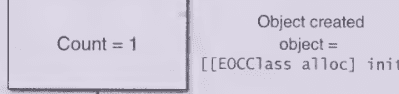

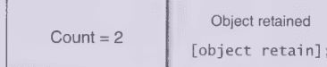


**图 5.1** 一个对象在其生命周期中保留计数的增加和减少

以下代码将帮助你从实践中理解此点：

```objc
NSMutableArray *array = [[NSMutableArray alloc] init];

NSNumber *number = [[NSNumber alloc] initWithInt:1337];
[array addObject:number];
[number release];

// 对 'array' 执行一些操作

[number release];
```

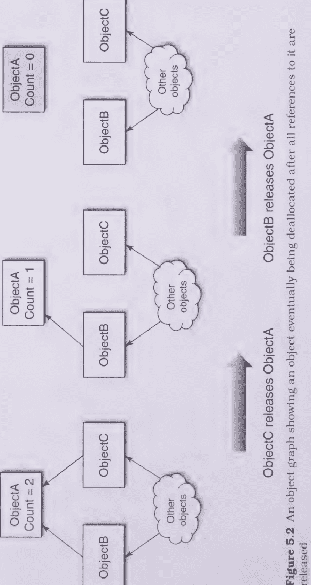

## 项目 29：理解引用计数

如前所述，在 ARC 下由于显式的 `release` 调用，这段代码将无法编译。在 Objective-C 中，调用 `alloc` 会产生一个被认为调用者拥有的对象。然而，重要的是这并不意味着保留计数恰好为 1。它可能更多，取决于你的操作对保留计数的影响：是增加还是减少。随后 `number` 对象被添加到数组中。通过这种方式，数组也通过对 `number` 对象调用 `retain` 注册了它；此时，保留计数至少为 2。然后，`number` 对象不再被这段代码需要，因此被 `release` 了。它的保留计数现在回到了至少 1。此时，`number` 变量不再可以安全地使用。调用 `release` 意味着所指向的对象不再保证是存活的。当然，这种场景下的代码显而易见地在调用 `release` 后对象是存活的，因为数组仍然引用着它。但绝不应该假设这一点，这意味着你不应该执行如下操作：

```objc
NSNumber *number = [[NSNumber alloc] initWithInt:1337];
[array addObject:number];
[number release];
NSLog("%@", number);
```

尽管这段代码在这种场景下可以工作，但并不是良好的习惯。如果由于某种原因，`number` 对象在保留计数降为零并调用 `release` 时被释放了，那么 `NSLog` 调用可能会崩溃。我之所以这样补充说明，是因为当对象被释放时，它的内存简单地返回了可用池。如果内存在执行 `NSLog` 前没有被覆盖，对象仍然存在，也就不会崩溃。由于这个原因，过早释放对象的 Bug 通常很难调试。

为了防止误用已失效的对象，通常会看到在 `release` 之后将指针置空。这确保了没有任何内容可以访问指向潜在无效对象的指针，这通常被称为悬空指针（dangling pointer）。例如，可以这样做：

# 第 5 章：内存管理

```objc
NSNumber *number = [[NSNumber alloc] initWithInt:1337];

[array addObject:number];

[number release];

number = nil;
```

### 属性访问器中的内存管理

如前所述，对象通过相互链接形成一个对象图。示例中的数组通过保留（retaining）它包含的元素来持有这些对象。同样，其他对象也会持有其他对象，通常通过属性（参见项目 6）来实现，属性使用访问器来获取和设置实例变量。如果属性是强引用（strong relationship），则该属性的值会被保留。对于这样一个名为 `foo` 并由实例变量 `foo` 支持的属性，其 setter 访问器看起来如下：

```objc
(void)setFoo:(id)foo {
  [foo retain];
  [_foo release];
  _foo = foo;
}
```

新值会被保留，旧值会被释放。然后更新实例变量以指向新值。这个顺序是重要的。如果在在新值保留之前就释放了旧值，且两个值完全相同，那么释放操作可能会导致该对象被提前释放。retain 操作无法让已经释放的对象复活，实例变量将变成一个悬空指针。

### 自动释放池


Objective-C 引用计数架构中一个重要的特性是所谓的自动释放池（`autorelease pools`）。你不需要调用 `release` 来立即减少对象的引用计数（并可能将其释放），你也可以调用 `autorelease`，它会在稍后的某个时间执行释放，通常是在下一次运行事件循环时，但也可能更早发生（参见项目 34）。

这个特性非常有用，特别是当从方法返回对象时。在这种情况下，你并不总是希望以调用者所有的的方式返回它。例如，考虑以下方法：

```objc
- (NSString*)stringValue {
  NSString *str = [[NSString alloc]
    initWithFormat:@"I am this: %@", self];

  return str;
}
```

## 项目 29：理解引用计数

在这种情况下，`str` 返回时的引用计数为 +1，因为调用 `alloc` 返回时计数为 +1，且没有对应的平衡的 `release`。这里 +1 的意义是，你作为调用者，负责一次 `retain`。然而，这并不意味着引用计数正好是 1。它可能更高，那是 `initWithFormat` 方法内部的实现细节。你唯一需要担心的是平衡那一次 `retain`。

但是，你不能在方法内部释放 `str`，因为否则它会在返回之前被立即释放。因此，使用 `autorelease` 来指示该对象应该在稍后的某个时间释放，但保证在未来有足够的时间，以至于调用者如果需要持有它，就可以进行 `retain`。换句话说，该对象保证在跨方法调用边界时依然存活。事实上，释放将在最外层的自动释放池清空时发生（参见项目 34），除非你有自己的自动释放池，它将在当前线程事件循环的下下一次轮询时执行。将此应用于 `stringValue` 方法，结果如下：

```objc
(NSString*)stringValue {
  NSString *str = [[NSString alloc]
    initWithFormat:@"I am this: %@", self];
  return [str autorelease];
}
```

现在，返回的 `NSString` 对象在返回给调用者时一定是存活的。因此，可以这样使用对象：

```objc
NSString *str = [self stringValue];
NSLog(@"The string is: %@", str);
```

这里不需要额外的内存管理，因为 `str` 返回时是自动释放的，因此是平衡的。由于自动释放池中的释放不会等到下一次运行事件循环时发生，所以该对象在 `log` 语句中不需要显式地 `retain`。然而，如果对象需要被持有（例如设置为实例变量），则需要对对象进行 `retain` 并在随后将其释放：

```objc
_instanceVariable = [[self stringValue] retain];
// ...
[_instanceVariable release];
```

因此，`autorelease` 是一种延长对象生命周期的方法，使其能够跨方法调用边界。

# 第 5 章：内存管理

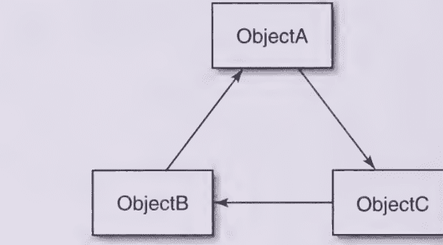

**图 5.3** 对象图中的保留循环

## 保留循环

引用计数中需要注意的一个常见场景是所谓的保留循环（`retain cycle`），当多个对象循环地地引用另一个对象时，就会发生这种情况。这会导致内存泄漏，因为循环中没有任何对象会看到其引用计数降为 0。循环中的每个对象至少都有循环中的另一个对象对其维持引用。在图 5.3 中，三个对象都对其他两个对象中的一个有一个单一引用。在这个循环中，所有的引用计数均为 1。

在垃圾回收的环境中，这种情况通常会被识别为所谓的“孤立岛屿”（`island of isolation`）。在这种情况下，垃圾器会释放所有三个对象。在 Objective-C 的引用计数架构下并没有这种奢侈。问题通常通过使用弱引用（参见项目 33）或通过外部影响导致一个对象放弃对另一个对象的保留来解决。无论哪种情况，保留循环都会被打破，内存不再泄漏。

## 需要记住的事

- 引用计数内存管理基于一个递增的计数器。

## 项目 30：使用 ARC 让引用计数变得简单

任何其他方法名都表示返回的对象将不会由调用代码拥有。在这些情况下，对象将以自动释放（`autoreleased`）的方式返回，以便确保该值在跨越方法边界时仍然有效。如果希望确保对象活得更久，调用代码必须对其进行留存（`retain`）。

`ARC` 自动处理维护这些规则所需的所有内存管理，包括返回自动释放对象的代码，如下面的代码所示：

```objc
+ (EOCPerson*)newPerson {
    EOCPerson *person = [[EOCPerson alloc] init];
    return person;
    /**
   * 方法名以 'new' 开头，由于 'person'
   * 已经因为 'alloc' 产生了一个不平衡的 +1 引用计数，
   * 返回时不需要进行 retain、release 或 autorelease。
   */
}
```

```objc
+ (EOCPerson*)somePerson {
    EOCPerson *person = [[EOCPerson alloc] init];
    return person;
    /**
   * 方法名没有以任何一个“所有权”（owning）前开头，
   * 因此 ARC 在返回 'person' 时会添加一个 autorelease。
   * 等价的手动引用计数语句是：
   * return [person autorelease];
   */
}
```

```objc
(void)doSomething {
    EOCPerson *personOne = [EOCPerson newPerson];
    //

    EOCPerson *personTwo = [EOCPerson somePerson];
    //
```

此时，`personOne` 和 `personTwo` 出了作用域，因此 `ARC` 需要按照要求对它们进行清理。

- `personOne` 是以此代码块拥有的方式返回的，因此需要被 `release`。

- `personTwo` 以非此代码块拥有的方式返回的，因此不需要被 `release`。

- 等价的手动引用计数清理代码是：

  - `[personOne release];`

# 第 5 章：内存管理

`ARC` 通过命名规范标准化了内存管理规则，这让该语言的新手通常认为是不寻常的。很少有语言像 Objective-C 那样强调命名。熟悉这一概念对于成为一名优秀的 Objective-C 开发者至关重要。`ARC` 有助于这一过程，因为它为你做了大量工作。

除了 `retain` 和 `release` 之外，`ARC` 还有其他优点。它还能执行手动难以或无法完成的优化。例如，在编译时，如果可能，`ARC` 可以合并 `release` 和 `autorelease` 以抵消它们。如果它看到同一个对象被多次 `retain` 和多次 `release`，`ARC` 有时可以移除 `retain` 和 `release` 对。

`ARC` 还包含一个运行时（`runtime`）组件。那部分的优化更有趣，并且有助于证明为什么所有未来的代码都应该在 `ARC` 下编写。记住某些对象从方法返回时是自动释放返回的。有时，调用代码需要对对象进行留存（`retain`），如下场景所示：

对 `initWith:` 的调用返回了一个自动释放的 `EOCPerson`。但编译器在设置实例变量时也需要添加一个 `retain`，因为它持有强引用。因此，在手动引用计数的世界中，之前的代码等于以下内容：

```objc
EOCPerson *tmp = [EOCPerson initWithName:@"Bob Smith"];
myPerson = [tmp retain];
```

你在这里注意到 `initWithName:` 方法中的 `autorelease` 和 `retain` 是多余的，这是正确的。移除两者对性能是有益的。但在 `ARC` 下编译的代码需要与非 `ARC` 代码兼容，以保持后兼容。`ARC` 本可以移除 `autorelease` 的概念，并规定从方法返回的所有对象都以 +1 引用计数返回。然而，这将破坏向后兼容。

## 项目 30：使用 ARC 让引用计数变得简单

但 `ARC` 确实包含运行时行为来检测“多余的 `autorelease` + 立即 `retain`”的情况。它通过一个特殊函数实现，该函数在对象以自动释放方式返回时运行。它不是直接调用对象的 `autorelease` 方法，而是调用 `objc_autoreleaseReturnValue`。该函数会检查从当前方法返回后立即将执行的代码。如果检测到将对返回的对象进行 `retain`，则会在全局数据结构（取决于处理器）中设置一个标记，而不是执行 `autorelease`。同样，留存从方法返回的自动释放对象的调用代码使用一个名为 `objc_retainAutoreleaseReturnValue` 的函数，而不是直接调用 `retain`。该函数检查标记，如果没有执行 `retain` 则就不操作。设置和检查标记的额外工作比执行 `autorelease` 和 `retain` 更快。

下面的代码通过展示 `ARC` 如何使用这些特殊函数说明了这种优化：

```objc
// 在 EOCPerson 类内部
(EOCPerson*)personWithName:(NSString*) name {
    EOCPerson *person = [[EOCPerson alloc] init];
    person.name = name;
    objc_autoreleaseReturnValue(person);
}
```

```objc
// 使用 EOCPerson 类
EOCPerson *tmp = [EOCPerson personWithName:@"Matt Galloway"];
myPerson = objc_retainAutoreleaseReturnValue(tmp);
```

这些特殊函数具有特定处理器的实现，以利用最优方案。以下伪代码解释了发生了什么：

```objc
id objc_retainAutleaseReturnValue(id object) {
    if (object) {
        return [object retain];
    }
    return nil;
}
```

```objc
id objc_autoreleaseReturnValue(id object) {
    if (object) {
        return [object autorelease];
    }
    return object;
}
```

（注：伪代码文本是碎片，已根据标准的 `ARC` 运行时行为进行了重建以保持连贯性。）

设置和检查标记的额外工作比执行 `autorelease` 和 `retain` 更快。

## 变量的内存管理语义

`ARC` 还处理局部变量和实例变量的内存。默认情况下，每个变量都是强引用。理解这一点很重要，特别是对于实例变量，因为其语义可能与手动引用计数不同。例如考虑以下代码：

```objc
@interface EObjectClass : NSObject {
    id _object;
}
```

```objc
@implementation EObjectClass
- (void)setup {
    _object = [EOObjectClass new];
}
@end
```

`_object` 实例变量在 `ARC` 下不会自动留存其值。因此，当 `setup` 方法在 `ARC` 下编译时，它会变为：

```objc
- (void)setup {
    id tmp = [EOObjectClass new];
    _object = [tmp retain];
    [tmp release];
}
```

# 第 5 章：内存管理

在这种情况下，设置实例变量时，对象将不会被保留。使用 `__weak` 修饰符自动置空弱引用仅在运行时的最新版本（Mac OS X 10.7 和 iOS 5.0）中可用，因为它们依赖于新添加的功能。

当应用于局部变量时，这些修饰符通常用于打破 `block` 可能会引入的保留循环（见第 40 节）。`block` 会自动保留它捕获的所有对象，如果一个保留 `block` 的对象又被该 `block` 留，有时会导致保留循环。可以使用 `__weak` 局部变量来打破保留循环：

```objc
NSURL *url = [NSURL URLWithString:@
```

# ARC 对实例变量的处理

如所述，`ARC` 也会处理实例变量的内存管理。这需要 `ARC` 在释放（`deallocation`）期间自动生成清理代码。任何持有强引用的变量都需要释放，`ARC` 通过钩入 `dealloc` 方法来实现这一点。在手动引用计数中，你必须自己编写编写如下所示的 `dealloc` 方法：

```objc
+ - (void)dealloc {
  [foo release];
  [bar release];
  [super dealloc];
}
```

在 `ARC` 中，不需要这种 `dealloc` 方法；生成的清理程序将通过利用 Objective-C++ 的特性来实现此。一个 Objective-C++ 对象在释放期间必须调用该对象持有的所有 C++ 对象的析构函数。当编译器看到一个对象包含 C++ 对象时，它会生成一个名为 `_cxx_destruct` 的方法。`ARC` 借用此方法并在内部发出所需的清理代码。

然而，如果你有任何非 Objective-C 对象（例如 CoreFoundation 对象或通过 `malloc()` 分配的堆内存），你仍然需要清理它们。但你不需要像以前那样调用父类的 `dealloc` 实现。记住，在（此处原文缺失）调用 `dealloc` 时

# 第 30 节：使用 ARC 使引用计数更简单

显式使用引用计数是非法的。因此，`ARC` 在替你生成并运行 `.cxx_destruct` 方法的同时，也会自动调用父类的 `dealloc` 方法。在 `ARC` 下，`dealloc` 方法看起来可能像这样：

```objc
(void)dealloc {
  CFRelease(_coreFoundationObject);
  free(_heapAllocatedMemoryBlob);
}
```

`ARC` 生成释放操作意味着通常不需要 `dealloc` 方法。这通常会显著减小项目源代码的，并有助于减少样板代码。

# 重写内存管理方法

在 `ARC` 之前，可以重写内存管理方法。例如，单例实现通常会重写 `lease` 为一个空操作，因为单例不能被释放。这在 `ARC` 下现在认为是非法的，因为这样做可能会干扰 `ARC` 对对象生命周期的理解。由于这些方法是非合法的调用和重写，`ARC` 在需要执行 `retain`、`release` 或 `autorelease` 时，会进行不通过 Objective-C 消息分发（见第 11 节）的优化。相反，该优化是在运行时深处的 C 函数实现的。这能够实现如前所述的优化，例如返回一个立即被保留的 `autorelease` 对象时。

## 注意事项

- 自动引用计数 (`ARC`) 让开发者无需担心大多数内存管理问题。使用 `ARC` 减少了类中的样板代码。

- `ARC` 通过在适当的地方添加 `retain` 和 `release` 几乎完全地处理对象的生命周期。变量修饰符可用于指示内存管理语义：以前，`retain` 和 `release` 是手动安排的。

- 方法名称一直被用于指示返回对象的内存管理语义。`ARC` 固化了这些规范，并使得无法不遵守。

- `ARC` 仅处理 Objective-C 对象。这意味着 CoreFoundation 对象不被处理，必须应用适当的 `CFRetain/CFRelease` 调用。

# 第 31 节：仅在 dealloc 中释放引用和清理观察

对象经历其生命周期最终会被释放，这就是 `dealloc` 方法进入的地方。在对象的生命周期内，当它的保留计数降为 0 时，该方法恰好被调用一次。尽管如此，无法保证具体的何时被调用。此外，你可能认为你通过手动查看 `retain` 和 `release` 的位置就能知道它何时会被调用。但在实践中，任何库都可能在你不知情的情况下操作该对象，导致释放发生在另一个时间。运行时会在准确的时间为你调用它。此外，在对对象调用 `dealloc` 后，该对象就不再有效了，后续的方法调用也是无效的。

那么在 `dealloc` 中你应该做什么呢？主要任务是释放对象拥有的任何引用。这意味着释放任何 Objective-C 对象，`ARC` 会通过 `.cxx_destruct` 自动方法替你将其添加到 `dealloc` 方法中（见第 30 节）。

在 `dealloc` 中做的另一个有用的工作是清理任何已设置的观察。如果使用了中心中心来注册通知，这里是取消注册的好地方，这样它们就不会被尝试发送给已释放的对象。object。

```objc
(void)dealloc {
  CFRelease(coreFoundationObject);
  [NSNotificationCenter defaultCenter] removeObserver:self];
}
```

注意，当使用手动计数而非 `ARC` 时，`[super dealloc]` 应该是你做的最后件事。`ARC` 自动强制这一点，这也是为什么使用它更简单、更安全的另一个原因。释放对象拥有的每个对象。

# 第 31 节：仅在 dealloc 中释放引用和清理状态

不应依赖在任何特定时间被调用，你没有意识到某些东西正持有该对象。在这种情况下，你持有稀缺资源的时间比预期的长，这是不希望的。在这些场景中，通常实现另一个在应用程序完成对象时调用的方法。这样资源的生命周期就是确定的。

一个可能需要清理方法的对象示例是管理到服务器连接的对象。也许是数据库的连接。这样一个类的接口可能如下：

```objc
#import <Foundation/Foundation.h>
```


```objc
@interface OCServerConnection : NSObject
- (void)open:(NSString*)address;
- (void)close;
@end
```

该类的约定是：调用 `open:` 方法打开连接；然后，在完成连接后，应用程序调用 `close`。否则，将被视为程序员错误，就像你必须平衡 `retain` 和 `release` 一样。

## 第 5 章：内存管理

对于管理资源的对象的，清理方法也应该在 `dealloc` 中调用，以缓解清理方法未被调用的情况。如果发生这种情况，输出一条日志记录来指示发生了程序员错误通常是一个好主意。这是一个程序员错误，因为在对象被释放之前应该已经调用了 `close`；否则，`close` 方法就是毫无意义的。这行日志将提醒程序员纠正问题。在 `dealloc` 中释放资源仍然是一个良好的习惯，用以避免内存泄漏。此类 `close` 和 `dealloc` 方法的示例如下：

```objc
(void)close {
    /* clean up resources */
    _closed = YES;
}
(void)dealloc {
    if (_closed) {
        NSLog("@ERROR: close was not called before dealloc!");
        [self close];
    }
}
```

如果没有调用 `close` 方法，你可能决定不仅仅是记录一个错误，而是抛出一个异常来表示发生了严重的程序员错误。

在 `dealloc` 方法中需要注意并避免的另一事情是调用其他方法。在前面的示例中，当然在 `dealloc` 中调用了一个方法。但这是一个特殊情况：为了检测程序员错误。调用任何其他方法都是不理想的，因为正在被释放的对象正处于收敛状态（winding-down state）。如果另一个方法恰好执行了异步工作或本身调用了其他方法，那么当这些方法完成工作时，正在被释放的对象可能已经完全销毁。这会导致各种问题，并通常导致应用程序崩溃，因为它会回调来通知对象工作已完成。如果对象已经销毁，这种调用将会失败。

此外，`dealloc` 方法是在导致引用计数归零的最终 `release` 所在的线程上调用的。某些方法要求在特定线程运行，例如主线程。如果从 `dealloc` 中调用这些方法，没有安全的方法可以确保它们在正确的线程上运行。任何强制其在正确线程运行的普通代码都是不安全的，因为对象正处于 `dealloc` 状态，运行时已经开始修改其内部数据结构来指示这一点。

在 `dealloc` 中避免调用方法的原则也适用于属性访问器（property accessors），因为访问器可以被重写，因此它们本身可能会尝试执行在销毁期间是不安全的操作。或者，属性可能会通过键值观察（KVO）被观察，观察者可能会尝试执行一些工作，例如尝试使用正在被释放的对象来重留（retain）。这样做会导致运行时进入完全不一致的状态，并可能导致奇怪的崩溃。

### 需要记忆的事项

- `dealloc` 方法应该只用于释放对其他对象的引用，并注销任何需要注销的内容，例如键值观察（KVO）或 `NSNotificationCenter` 通知。
- 如果对象持有系统资源（如文件描述符），则应该有一个释放这些资源的方法。与该类的消费者的约定应该是：在使用完这些资源后调用此关闭方法。
- 应该在 `dealloc` 方法中避免方法调用，以防方法尝试执行异步工作，或最终假定对象正处于正常状态（而实际上它并非如此）。

## 第 32 条：警惕异常安全代码中的内存管理

异常是许多现代语言提供的语言特性。异常在纯 C 语言中不存在，但在 C++ 和 Objective-C 中都存在。事实上，在现代运行时，C++ 和 Objective-C 异常是兼容的，这意味着从一种语言抛出的异常可以使用另一种语言的处理器来捕获。

尽管 Objective-C 的错误模型（参见第 21 条）规定你应该只将异常用于致命错误，但你可能仍然需要捕获并处理它们的代码。例如，Objective-C 代码或与第三方库接口的代码，在这些情况下你无法对抛出的异常进行控制。此外，某些系统库仍在使用异常，回溯到了异常被广泛使用的时代。例如，如果你尝试注销一个尚未注册的观察者，键值观察（KVO）将抛出异常。

当涉及到内存管理时，异常引入了一个有趣的问题。在 `try` 块内部，如果一个对象被重留（retained），随后在对象被释放之前抛出了异常，除非在 `catch` 块中处理了这种情况，否则对象将泄漏。C++ 析构函数由 Objective-C 异常处理程序执行。这对于 C++ 来说是重要的，因为任何需要销毁的对象的生命周期都会被抛出的异常所切短；否则，它使用的内存将泄漏，更不用说所有其他系统资源（如句柄）可能无法被正确清理。

对象的销毁是由 Objective-C 异常处理程序执行的。这对于 C++ 来说是重要的，因为任何需要销毁的对象的生命周期都会被抛出的异常所切短；否则，它使用的内存将泄漏，更不用说所有其他系统资源（如句柄）可能无法被正确清理。

考虑以下代码，它使用了手动引用计数：

```objc
@try {
    ESomeClass *object = [[SomeClass alloc] init];
    [object doSomethingThrow];
    [object release];
} @catch (...) {
    // handle error
}
```

乍看之下，这似乎是正确的。但如果 `doSomethingThrow` 抛出了异常会怎样？下一行的 `release` 将不会执行，因为异常会停止执行并跳转到 `catch` 块。解决办法是使用 `finally` 块，无论是否抛出异常，它都保证会被执行一次。例如，代码可以转换为：

```objc
SomeClass *object = nil;
@try {
    object = [[SomeClass alloc] init];
    [object doSomethingThrow];
} @catch (...) {
    // handle error
} @finally {
    if (object) {
        [object release];
    }
}
```

注意看对象必须从 `try` 块中提取出来，因为它需要在 `finally` 块中被引用。如果你必须对所有需要释放的对象都这样做，会变得非常繁琐。尽管它默认没有开启，但可以通过编译器标志 `-fobjc-arc-exceptions` 来安全地处理异常。默认不开启的理由是，在 Objective-C 编程中，异常应该只在抛出异常导致应用程序终止时使用。因此，如果应用程序注终止，潜在的内存泄漏就是无关要要。

对于 ARC，情况变得更加严重。原始代码的相当于：

```objc
@try {
    SomeClass *object = [[SomeClass alloc] init];
    [object doSomethingThrow];
} @catch (...) {
    // handle error
}
```

现在问题更严重了：你可以在 `finally` 块中使用 `release`，因为在这里调用 `release` 是非法的。但你可能在想，当然，ARC 会处理这种情况。好吧，默认情况下它并没有这样做；这样做需要添加大量的样板代码来跟踪在抛出异常时可能需要清理的对象。这些代码即使在没有抛出异常的情况下也会严重降低运行时性能。此外，这些额外的代码也会显著增加应用程序的大小。

`-fobjc-arc-exceptions` 标志默认开启的唯一场景是编译器处于 Objective-C++ 模式时。C++ 已经需要拥有与 ARC 实现的代码相似的代码，因此性能损耗并不像 ARC 增加的那么大。此外，C++ 大量使用异常，因此使用 Objective-C++ 的开发者很可能想使用异常。

如果你正在使用手动引用计数并且必须捕获异常，请记住确保代码的编写能够正确进行清理。如果你正在使用 ARC并且必须捕获异常，则你需要开启 `-fobjc-arc-exceptions` 标志。但最重要的是，如果你发现自己正在捕获大量的异常，请考虑重构以使用 `NSError` 风格的错误传递，正如第 21 节所示。

### 需要记忆的

- 当捕获异常时，应注意确保对在 `try` 块中创建的对象完成任何必要的清理工作。
- 默认情况下，ARC 在抛出异常时不会产生处理清理的代码。这可以通过编译器标志启用，但它会产生更大的代码量，并带来运行时开销。

## 第 33 节：使用弱引用避免循环引用

对象图中的一种典型情况是对象循环以某种方式相互引用。当这种情况发生于诸如 Objective-C 内存管理模型这样的引用计数架构中时，通常会在某处发生内存泄漏，因为最终，对象循环中的任何对象将不再被任何其他东西引用。因此，循环中的任何对象都无法被访问，但它们也不会被释放，因为它们都在保持对方的存。

在最简单的循环引用中，两个对象相互引用。图 5.4 显示了一个示例。

这种循环引用很容易通过查看代码来理解和检测到：

```objc
#import Foundation/Foundation.h

@class EOCCA;
@class EOCCB;

@interface EOCCA : NSObject
@property (nonatomic, strong) EOCCB *other;
@end

@interface EOCCB : NSObject
@property (nonatomic, strong) EOCCA *other;
@end
```

## 第 33 节：使用弱引用避免循环引用 169

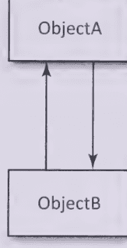

**图 5.4** 两个对象互相持有强引用的循环引用

从这段代码中很容易看出存在潜在的循环引用：如果 `OOClassA` 实例的 `other` 属性被设置为 `OOClassB` 的实例，反之亦然且使用相同的实例，就会发生如图 5.4 所示的循环引用。

循环引用的结果可能是内存泄漏。当循环引用中任何成员的最后一个剩余引用被移除时，整个循环引用就会泄漏。这意味着没有任何对象可以再被访问了。在图 5.5 中，当对 `ObjectB` 的最后一个剩余引用被移除时，涉及四个对象的更复杂的循环引用发生了泄漏。

Mac OS X 上的 Objective-C 应用程序可以选择使用垃圾回收器，它会检测循环并在对象无法再次被引用时释放任何对象。垃圾回收环境在 Mac OS X 10.8 中被正式弃用，在 iOS 上从未存在过。因此，在编写代码时，记住循环引用问题并确保它从一开始就不会发生。

避免循环引用的最佳方法是使用弱引用。这种引用也被称为非所有权关系。这可以通过使用 `unsafe_retained` 属性来实现。将此属性应用于之前的示例将如下所示：

## 第 5 章：内存管理

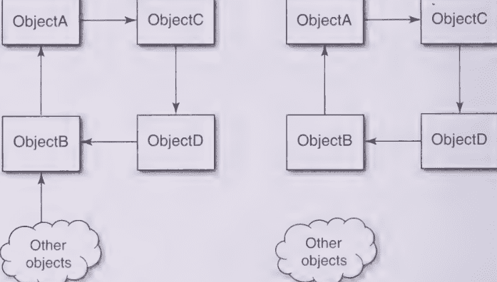

图 5.5 当从对象图的其余部分到循环中任何成员的剩余引用被移除时，循环引用正在发生泄漏

```objc
#import <Foundation/Foundation.h>

@class EOCCClassA;
@class EOCCClassB;

@interface EOCCClassA : NSObject
@property (nonatomic, strong) EOCCClassB *other;
@end
```

```objc
@interface EOCCClassB : NSObject
@property (nonatomic, unsafe_unretained) EOCCClassA *other;
@end
```

在这种情况下，`EOCCClassB` 实例并不拥有 `other` 属性中的 `EOCCClassA` 实例。该属性名为 `unsafe_unretained`，表示该属性中的值可能是不安全的，并且没有被实例保留。如果该对象已经被释放，在它上调用方法可能会导致应用程序崩溃。由于该对象没有保留它，它可能已经被释放了。

## 第 33 节：使用弱引用避免循环引用

`unsafe_retained` 属性属性在语义上等同于 `assign` 属性（参见第 6 节）。然而，`assign` 通常只用于整数类型（int、float、structs 等），而对象类型则倾向于使用 `unsafe_retained`。这是一种自文档形式，可以明确该属性可能是不安全的。

随着 ARC 的出现，Objective-C 运行时引入了一个允许安全弱引用的功能：一个名为 `weak` 的新属性属性，它的工作方式与 `unsafe_retained` 完全相同。然而，一旦值被释放，它会自动将该属性值设置为 `nil`。在示例中，`OCClassB` 的 `other` 属性被释放了。它可以被更改为：

```objc
@property (nonatomic, weak) OCClassA *other;
```

`unsafe_retained` 属性和 `weak` 属性之间的差异如图 5.6 所示。

当对 `OCClassA` 实例的引用被移除时，`unsafe_retained` 属性仍然指向已释放的实例。使用 `weak` 属性，属性指向 `nil`。

然而，使用弱引用并不是懒惰的借口。

- 循环引用可以通过使用弱引用来避免。

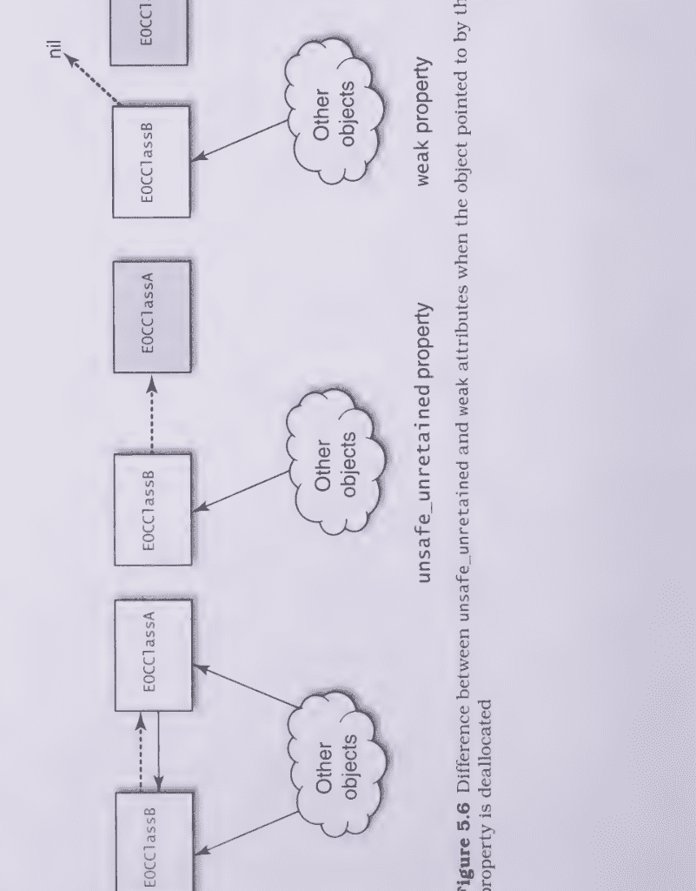

## 第 34 节：使用自动释放池降低内存水位

弱引用可能不需要所有权。自动释放是 ARC 引入的一项新功能，并在运行时实现。弱引用总是是安全的。

Objective-C 对象的生命周期遵循引用计数（参见第 29 节）。引用特性之一是自动释放池。释放对象意味着通过调用 `release` 立即减少引用计数，或者通过调用 `autorelease` 加入自动释放池。自动释放池被用来存储在未来某点需要释放的对象集合。当池被清空时，池中的所有对象都会收到 `autorelease` 消息。

创建自动释放池的语法如下：

```objc
@autoreleasepool {
  //
}
```

如果在向对象发送 `autorelease` 消息时没有自动释放池，你将在控制台中看到类似下面的消息：

```
Object 0abcd0123 of class __NSCFString autoreleased with no pool in place - just leaking - break on objc_autoreleaseNoPool() to debug
```

然而，通常不需要担心自动释放池。在 Mac OS 或 iOS 上运行的应用程序运行在 Cocoa（iOS 上为 Cocoa Touch）环境中。系统为你创建的线程（例如主线程或作为 Grand中央调度 GCD 一一部分创建的线程）都有一个隐式的自动释放池，该池在线程每次通过事件循环时都会清空。因此，你不需要自己创建自动释放池块。通常，你在应用程序中看到的唯一池就是包裹主函数中主应用程序入口点的那个。例如，一个 iOS 应用程序的 main 函数通常如下：

```objc
int main(int argc, char *argv[]) {
  @autoreleasepool {
    return UIApplicationMain(argc, argv);
  }
}
```


通用规则是，如果你不拥有对象，就不应该持有它。该规则的例外是集合，它们通常为了用户而持有（参见 `Delegate`）。

## 需要记忆的

- 循环引用可以通过使用弱引用来避免。


## 第174 第5章：内存管理

`nil`,

`@\(EOCAppDelegate\)`;

```
}
```

从技术上讲，这个自动释放池块（autorelease pool block）并不是必要的。块的结束与应用程序的终止同步，此时操作系统会释放应用程序使用的所有内存。如果没有它，`UIApplicationMain` 函数自动释放的任何对象将无池可进入，并会记录一条这样的警告信息。因此，这个池可以被视为一个外部的全捕获池。接下来的代码定义了自动释放池的作用域。池在第一个大括号处创建，并在作用域结束时自动清空（drain）。因此，在作用域内自动释放的任何对象都会在作用域结束时收到 `release` 消息。自动释放是可以嵌套的。当一个对象被自动释放时，它会被添加到最内层的池中。例如：

```objc
@autoreleasepool {
NSString *string = [NSString stringWithFormat:@"1 = %i", 1];
@autoreleasepool {
NSNumber *number = [NSNumber numberWithInt:1];
}
}
```

在这个示例中，使用类工厂方法创建了两个对象，这些方法返回的是自动释放的对象（见第30节）。`NSString` 对象会被添加到外部自动释放池，而 `NSNumber` 对象会被添加到内部自动释放池。这种自动释放池的嵌套可以被利用来控制应用程序的高内存占用峰值。

考虑以下部分代码：

```objc
for (int i = 0; i < 10000; i++) {
  [self doSomethingWithInt:i];
}
```

如果 `doSomethingWithInt:` 方法创建了临时对象，它们很可能会进入自动释放池。例如，这些对象可能是临时字符串。尽管它们在方法结束后就不再被使用，但这些对象可能仍然存在，因为它们在自动释放池中，等待被释放并随后被销毁。但在该线程的事件循环下一次运行之前，池是不会被清空的。这意味着随着 `for` 循环的执行，会有越来越多的对象被创建并加入到自动释放池中。最终，一旦循环完成，这些对象就会被释放。但在整个循环执行期间，应用程序的内存占用将稳步增加，并在所有临时对象最终被释放时突然下降。

这种情况并不理想，特别是当这种循环的长度是任意的（取决于用户输入）时。考虑从数据库读取一组对象。这样的代码可能如下所示：

```objc
NSArray *databaseRecords = /* ... */;
NSMutableArray *people = [NSMutableArray new];
for (NSDictionary *record in databaseRecords) {
  EOCPerson *person = [[EOCPerson alloc] initWithRecord:record];
  [people addObject:person];
}
```

`EOCPerson` 的初始化方法可能会创建额外的临时对象，就像之前的示例一样。如果记录的数量很多，那么存活比严格需要的时间长的临时对象数量也会很多。这就是添加自动释放池可以有所帮助的地方。如果将循环的内部包裹在一个自动释放池块中，那么循环内部自动释放的任何内容都会被添加到池中，而不是线程的主池。例如：

```objc
NSArray *databaseRecords = /* ... */;
NSMutableArray *people = [NSMutableArray new];
for (NSDictionary *record in databaseRecords) {
  @autoreleasepool {
    EOCPerson *person = [[EOCPerson alloc] initWithRecord:record];
    [people addObject:person];
  }
}
```

通过添加这个新的自动释放池，应用程序在循环执行期间的高内存水位线（high-memory waterline）降低了。高内存水位线指的是应用程序在特定期间最高的内存占用。添加自动释放池块可以减少这种占用，因为某些对象会在块结束时被销毁。这些就是之前描述的临时对象。

自动释放池可以被看作是在栈中的。当创建一个自动释放池时，它被推入栈中；当它被清空时，它就从栈中弹出。当一个对象被自动释放时，它被放入栈顶部的池中。

是否需要进行这种额外的池优化完全取决于你的应用程序。在没有先监控内存占用以判断是否存在问题的情况下，这不是应该要做的事情。自动释放池块不会产生很多开销，但至少会产生一些开销，因此如果可以避免额外的自动释放池，就应该避免。

如果你在过渡 ARC 之前是一个 Objective-C 程序员，你会记得使用名为 `NSAutleasePool` 对象的旧语法。这个特殊对象与普通对象不同，它的设计用于像新的块语法一样表示自动释放池。它并不是在循环的每一轮都清空池，而是要重量得多，通常的做法是创建一个池并频繁地清空它，如下所示：

```objc
NSArray *databaseRecords = /* ... */;
NSMutableArray *people = [NSMutableArray new];
int i = 0;

NSAutleasePool *pool = [[NSAutleasePool alloc] init];
for (NSDictionary *record in databaseRecords) {
    EOCPerson *person = [[EOCPerson alloc] initWithRecord:record];
    [people addObject:person];

    // 每10次循环清空一次池
    if (++i == 10) {
        [pool drain];
    }
}
// 同时在结束时也清空，以防循环不是10的倍数
[pool drain];
```

这种风格不再需要了。配合新的语法，自动释放池会在循环的每次迭代中被创建和清空。

`@autoreleasepool` 语法的另一个好处是，每个自动释放池都有一个关联的作用域，这有助于避免使用被自动释放池销毁的对象。例如，考虑以下旧式的代码：

## 第34 节：使用僵尸调试内存管理问题

```objc
NSAutleasePool *pool = [[NSAutleasePool alloc] init];
id object = [self createObject];
[pool drain];
[self useObject:object];
```

这稍显夸张，但它说明了问题。`useObject:` 调用传递了一个可能已销毁的对象。然而，相同代码的新样式应该是这样的：

```objc
@autoreleasepool {
  id object = [self createObject];
}[self useObject:object];
```

这一次，代码甚至无法通过编译，因为对象变量不在其闭包作用域之外，无法在 `useObject:` 调用中使用。

## 注意

- 自动释放池排列在栈中，当对象发送自动释放消息时，会被添加到栈顶部的池中。

- 正确应用自动释放池有助于降低应用程序的高内存水位。

- 使用新的 `@autoreleasepool` 语法的现代自动释放池是非常廉的。

## 第35 节：使用僵尸调试内存管理问题

调试内存管理问题是痛苦的。向已销毁的对象发送消息是完全不，正如预期的那样。但有时它有效，有时则无效。这取决于对象曾经所在的内存是否被重写。由于内存是否被重用是不确定的，因此崩溃可能偶尔发生。其他时候，内存可能只被部分重用，因此对象的某些位仍然有效。其他时候，内存已被重写为另一个有效的、存活的对象。在这些情况下，运行时会将消息发送给新对象，新对象可能对此做出响应。如果它不响应该选择器，应用程序通常会崩溃。

幸运的是，Cocoa 的“僵尸”（zombies）功能可以派上用场。当启用此调试功能时，运行时会将所有已销毁的转为

# 第 5 章：内存管理

将实例转换为一个特殊的“僵尸对象”（zombie object），而不是将其释放。对象所在的核心内存不会被释放供重复使用；因此，任何内容都不会被覆盖。当它接收到任何消息时，僵尸对象会抛出一个异常，准确说明发送了什么消息以及该对象在仍然活着时是什么。使用僵尸对象是调试内存管理问题的最佳方法。

通过将环境变量 `ZombieEnabled` 设置为 `YES` 可以开启此功能。例如，如果你正在使用 bash 并在 Mac OS X 上运行应用程序，可以进行如下操作：

```
export NSZombieEnabled="YES"
/app
```

当向僵尸对象发送消息时，控制台将打印一条消息，应用程序将终止。该消息看起来如下：

> ***-[CF respondsToSelector:] message sent to deallocated instance 0x7ff9e90c8e0***

当从 Xcode 内部运行程序时，也可以在 Xcode 自动设置环境变量时开启该选项。要这样做，你需要编辑应用程序的 Scheme（方案），选择 Run（运行）配置，然后选择 Diagnostics（诊断）标签页，最后开启 Enable Zombie Objects（启用僵尸对象）。图 5.7 显示了你在 Xcode 中应该看到的对话框，其中已启用僵尸对象的选项。

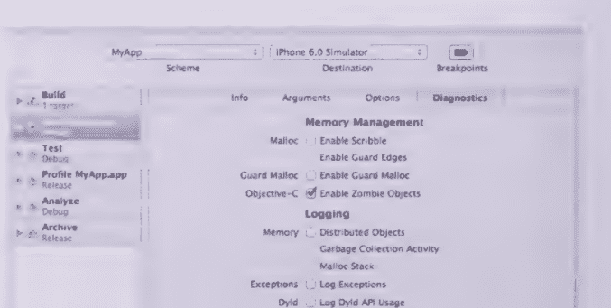

图 5.7 从 Xcode 的方案编辑器中启用僵尸对象

## 项目 35：使用僵尸帮助调试内存管理问题

那么，僵尸功能是如何工作的呢？它实现在 Objective-C 运行时以及 Foundation 和 CoreFoundation 框架内部。当对象被释放时，如果启用了此功能，会通过环境变量执行一个额外的步骤。这个额外的步骤将对象转换为僵尸，而不是完全释放。

为了查看这个额外步骤的作用，请考虑以下代码：

```objc
#import <Foundation/Foundation.h>
#import <objc/runtime.h>

@interface EOCClass : NSObject
@end

@implementation EOCClass
@end

void PrintClassInfo(id obj) {
    Class cls = object_getClass(obj);
    Class superCls = class_getSuperclass(cls);
    NSLog("@%s : %s ==", cls, class_getName(superCls));
}

int main(int argc, char *argv[]) {
    EOCClass *obj = [[EOCClass alloc] init];
    NSLog("@Before release:");
```

这段代码使用手动引用计数，以便更容易展示当对象变成僵尸时发生了什么。ARC 会确保 `str` 对象在需要的时候一直存，这意味着在在这种简单的场景下，它永远不会变成僵尸。这并不是说对象在 ARC 下永远不会变成僵尸。这种内存 bug 仍然会在 ARC 下发生，但通常通过稍微复杂的代码表现出来。

示例代码中有一个函数，用于打印给定对象的类和父类名。该代码使用了运行时函数 `object_getClass()`，而不是发送类的 Objective-C 消息。

由于该对象是一个僵尸，发送任何 Objective-C 消息都会导致打印僵尸错误消息并使应用程序崩溃。代码的输出如下：

Before release:

```
=== EOCClass : NSObject ===
After release:
=== _NSZombie_EOCClass : nil ===
```

对象的类已从 `EOCClass` 变为 `_NSZombie_EOCClass`。但这个类是从哪里来的呢？代码中并没有定义它。此外，如果编译器为它发现的每个类创建一个额外的类（以防启用僵尸），将是非常低效的。发生的情况是，`_NSZombie_EOCClass` 在该类的对象第一次被转换为僵尸时在运行时生成的。这ze利用了可以操作类列表的强大运行时函数。

僵尸类是一个名为 `_NSZombie_` 的模板类的副本。这些僵尸类并没做什么，只是在短时间内充当标记。首先，考虑下面的伪代码，它展示了必要时如何创建僵尸类，以及如何使用它将正在释放的对象转换为僵尸。

```objc
// 获取正在释放的对象的类
Class cls = object_getClass(self);
```

```objc
// 获取 char *clsName
const char *clsName = class_getName(cls);
```

```objc
// 在类名前面加上 _NSZombie_
const char *zombieClsName = "_NSZombie_" + clsName;
```

```objc
// 检查特定的僵尸类是否存在
Class zombieCls = obj_lookupUpClass(zombieClsName);
```

```objc
// 如果特定的僵尸类不存在，
// 则需要创建它
if (zombieCls) {
```

```objc
// 获取名为 _NSZombie_ 的模板僵尸类
Class baseZombieCls = obj_lookupUpClass("_NSZombie_");
```

```objc
// 复制基础僵尸类，新类的
// 名称是上面加上的前缀字符串
zombieCls = obj_duplicateClass(baseZombieCls,
    zombieClsName, 0);
}
```

```objc
// 对正在释放的对象执行正常销毁
objc_destructInstance(self);
```

```objc
// 将正在释放对象的类设置
// 为僵尸类
objc_setClass(self, zombieCls);
```

`'self'` 的类现在是 `_NSZombie_OriginalClass`。此例程是在 `ZombieEnabled` 变量设置时，Object 的 `dealloc` 方法被交换的（swizzled）的。僵尸类的 `dealloc` 方法是在类名变为 `_NSZombie_OriginalClass` 时执行的。关键在于，内存并没有被释放（通过 `free()`），该内存是无法再次使用的。

为什么为每个变成僵尸的类创建一个新类？这样做是为了在向僵尸发送消息时，可以确定原始类。如果所有类都是 `_NSZombie_`，原始名称就会丢失。创建一个新类是通过继承 `_NSZombie_` 而不是拷贝它。转发机制的核心是一个你可能在回溯中看到的函数。如果这个类名以 `_NSZombie_` 开头，说明检测到了僵尸，并发生了一些特殊情况。应用程序在此处终止，在打印消息之后（如项目开头所示）指示发送了什么消息以及给什么类型的类。此例程的作用可以通过扩展示例以尝试消息 EOCClass 对象来看到：

```objc
EOCClass *obj = [[EOCClass alloc] init];
NSLog("@Before release:");
PrintClassName(obj);
```

```objc
[obj release];
```

## 项目 36: 避免使用 retainCount

NSLog("After release:");

PrintClassInfo(obj);

NSString *desc = [obj description];

如果在启用僵尸对象（zombies）的情况下运行此代码，控制台上将看到以下内容：

Before release:

=== EOCClass : NSObject ===

After release:

=== _NSZombie_EOCClass : nil ===

*** -EOCClass description]: message sent to deallocated instance 0x7fc81c2a00

如你所见，这清楚地显示了发送了什么选择器（selector）、对象的原始类，以及接收消息的已释放对象的指针值。如果你在调试器中需要的话，可以使用这些信息进行进一步分析，并且配合正确的工具（如 Xcode 随带的 Instruments），它们将具有无价的价值。

## 需要记住的事

- 当一个对象被释放时，可以可以选择地将其转换为僵尸对象而不是直接释放。此功能通过使用环境变量标记 `NSZombieEnabled` 来开启。

- 通过操作对象的 `isa` 指针将对象的类更改为特殊的僵尸类，从而将其转换为僵尸。僵尸类通过在打印消息（指示向什么对象发送了什么消息）后终止应用程序，来响应所有选择器。

## 项目 36: 避免使用 retainCount

Objective-C 使用引用计数进行内存管理（参见项目 29）。每个对象都有一个计数器，决定有多少个其他事物想要保持它的存。当对象被创建时，引用计数大于零。retain 和 release 分别通过增加和减少来操作该计数。当计数达到零时，对象会被释放并销毁。

NSObject 协议定义的方法允许你获取对象的当前引用计数：

- `- (NSInteger)retainCount`

然而，ARC 已经废用了这个方法。事实上，如果你在使用 ARC 时尝试调用它，编译器会报错，就像它处理 `retain`、`release` 和 `autorelease` 等方法一样。尽管该方法已正式废弃，但它经常被误解，应该避免使用。如果你没有使用 ARC（尽管你真的应该使用），仍然可以使用此方法而不会产生编译器错误。因此，理解为什么需要避免这种方法仍然很重要。


这个方法似乎执行了合理且实用的工作。毕竟它返回了引用计数，这显然是关于每个对象的一个重要信息。但问题在于，绝对引用计数通常是完全无关的，并不是你需要知道的。即使你仅将此方法用于调试，它通常也没有任何帮助。

该方法没用的第一个原因是，它的值是给定时刻的引用计数。这个值不包括在随后的 `autorelease` 池清空期间（参见项目 34）将发生的任何减操作，该值并不一定是数的真实反映。因此，以下代码是非常糟糕的：

```objc
while ([object retainCount]) {
  [object release];
}
```

这段代码错误的第一个原因是，它会一直降低引用计数直到对象被释放，而不忽略任何可能等待中的 `autorelease`。如果对象此时也在一个 `autorelease` 池中，当池被清空时，对象会被进一步释放，并且会发生崩溃。

其次，这段代码是危险的，因为 `retainCount` 永远不会返回 0：对象释放行为中的一种优化意味着，如果对象的引用计数为 1，则它在被释放时会被销毁。否则，会发生减操作。引用计数永远不应该正式达到 0。遗憾的是，这段代码有时可以运行，很大程度上是靠纯运气而非判断。现代运行时通常在对象最终释放后，`while` 循环再次迭代时直接崩溃。

这种代码永远没有必要。内存管理应该在需要实现这段代码之前就完成。不应该出现不平衡的 `retain` 导致对象在你认为它们应该被释放时仍留有正数的引用计数。在这种情况下，应该通过查明是什么仍在持有该对象以及为什么为什么没有释放它来诊断问题。

你可能还会尝试使用引用计数，并奇怪为什么该值有时看起来很大。例如，考虑以下代码：

## 项目 36: 避免使用 retainCount

```objc
NSString *string = @"Some string";
NSLog("@string retainCount = %lu", [string retainCount]);

NSNumber *numberI = @1;
NSLog("@numberI retainCount = %lu", [numberI retainCount]);

NSNumber *numberF = @3.141f;
NSLog("@numberF retainCount = %lu", [numberF retainCount]);
```

该代码在 Mac OS 10.8.2 上使用 Clang 4.1 编译的 64 位版本输出如下：

```
string retainCount = 18446744037309551615
numberI retainCount = 9223372036854778007
numberF retainCount = 1
```

第一个数字是 $2^{64}$，第二个是 $2^{63} - 1$。这些对象的引用计数都很大，因为它们代表单例对象。如果可能，`NSString` 被实现为单例对象。如果字符串是编译时常量（例如所示），这是可能的。在这种情况下，编译器会创建一个特殊对象，将 `NSString` 的数据放置在应用程序内部，而不是在运行时创建 `NSString` 对象。`NSNumber` 也做了类似的事情。

# 第 6 章：Blocks 与 Grand Central Dispatch

## 项目 37：理解 Blocks

`Blocks` 提供了闭包。这一语言特性作为 GCC 编译器的扩展被引入，适用于所有现代 Clang 版本（用于 Mac OS X 和 iOS 开发的编译器项目）。`Blocks` 运行所需的运行时组件在 10.4 之后的 Mac OS X 以及 4.0 之后的 iOS 版本均可用。该语言特性在技术上是一个 C 级特性，因此可以在受支持的编译器编译并在存在运行时的情况下运行的 C、C++、Objective-C 和 Objective-C++ 代码中使用。

### Block 基础

`Block` 类似于函数，但它是内联定义在另一个函数中的，并共享其定义所在的作用域。表示 `Block` 的符号是脱字符符号 `^`，后面跟着一个包含 `Block` 实现的作用域块。例如，一个简单的 `Block` 如下：

```objc
^{
  // 在此处编写 Block 实现
}
```

`Block` 仅仅是另一个值，并有一个关联类型。就像 `int`、`float` 或 Objective-C 对象一样，`Block` 可以赋值给变量，然后像其他任何变量一样使用。`Block` 类型的语法与函数指针相似。以下是一个不接受参数且不返回值的 `Block` 示例：

```objc
void (^someBlock)() = ^{
  // 在此处编写 Block 实现
};
```

这个 `Block` 定义了一个名为 `someBlock` 的变量。这看起来可能很奇怪，因为变量名就在中间，但一旦你理解了这种语法，它就很易读。`Block` 类型的结构如下：

```
return_type (^block_name)(parameters)
```

要定义一个返回 `int` 并接受两个 `int` 参数的 `Block`，你将使用以下语法：

```objc
int (^addBlock)(int a, int b) = ^(int a, int b){
  return a + b;
};
```

`Block` 可以像函数一样使用。例如，`addBlock` 可以这样使用：

```objc
int add = addBlock(2, 5); // add = 7
```

`Block` 允许的强大特性是捕获其定义时所在的作用域。这意味着在 `Block` 定义的作用域内可用的任何变量，在 `Block` 内部也是可用的。例如，你可以这样定义一个使用了另一个变量的 `Block`：

```objc
int additional = 5;
int (^addBlock)(int a, int b) = ^(int a, int b){
  return a + b;
};
int add = addBlock(2, 5); // add = 12
```

默认情况下，任何捕获的变量都不能被 `Block` 修改。在示例中，如果在 `Block` 内部更改了变量 `additional`，编译器将发出错误。然而，通过赋予它们 `__block` 修饰符，可以将变量声明为可修改。例如，可以在数组枚举（项目 48）中使用 `Block` 来确定数组中有多少个数字小于 2：

```objc
NSArray *array = @[0, @1, @2, @3, @4, @5];
__block NSInteger count = 0;
[array enumerateObjectsUsingBlock:^(NSNumber *number, NSInteger idx, BOOL *stop){
  if ([number integerValue] == NSOrderedAscending) {
    count++;
  }
}];
```

这个示例还展示了内联 `Block` 的。传递给 `enumerateObjectsUsing:` 方法的 `Block` 没有赋值给局部变量，而是内联声明在方法调用中的。这种常用的 `Block` 编码模式展示了它们为什么有用。在 `Block` 成为语言的一部分之前，之前的代码必须通过传递函数指针或枚举方法可以调用的选择器名称来完成。状态必须手动传入和输出，通常通过一个不透明的 `void` 指针，这引入了额外的代码并在某种程度上拆分了方法。内联声明 `Block` 意味着业务逻辑都在同一个地方。

当 `Block` 捕获对象类型的变量时，它会隐式地保留 `retain` 它。它会在 `Block` 本身释放时被释放。这引出了一个关于 `Block` 的重要点：`Block` 本身可以被视为一个对象。事实上，`Blocks` 会响应许多其他 Objective-C 对象也会响应的选择器 `selector`。最重要的是理解，`Block` 像其他对象一样进行引用计数。当对 `Block` 的最后一个引用被移除时，它会被释放内存。在此过程中，`Block` 捕获的任何对象都会被释放，以平衡 `Block` 对它们的保留操作。

如果 `Block` 定义在 Objective-C 类的实例方法中，则 `self` 变量以及该类的任何实例变量都是可用的。实例变量总是会被保留的，不需要显式用 `__block` 声明。如果通过读取或写入实例变量来捕获它，则 `self` 变量也会隐式地捕获，因为实例与该实例相关。例如，考虑在名为 `@interface EObjectClass` 的类方法中的以下 `Block`：

```objc
- (void)anInstanceMethod {
  void (^someBlock)() = ^{
    _anInstanceVariable = @"Something";
    NSLog("@_anInstanceVariable = %@", _anInstanceVariable);
  };
}
```

运行 `anInstanceMethod` 方法的 `EObjectClass` 具体实例被称为 `self` 变量。很容易看出 `self` 被这种 `Block` 捕获了，因为在代码中没有显式使用。然而，访问实例变量等同于以下：

```objc
self->anInstanceVariable = @"Something";
```

这就是为什么 `self` 变量被捕获了。通常情况下，属性（见项目 37）被捕获了。

### Block 的内部构造

当它捕获对象类型的变量时，`Block` 会隐式地保留它。它会在 `Block` 本身释放时被释放。这引出了一个关于 `Block` 的重要点：`Block` 本身可以被视为一个对象。事实上，`Blocks` 会响应许多其他 Objective-C 对象也会响应的选择器。最重要的是理解，`Block` 像其他对象一样进行引用计数。当对 `Block` 的最后一个引用被移除时，它会被释放内存。在此过程中，`Block` 捕获的任何对象都会被释放，以平衡 `Block` 对它们的保留操作。

如果 `Block` 定义在 Objective-C 类的实例方法中，`self` 变量以及该类的任何实例变量都是可用的。实例变量总是会被保留的，不需要显式用 `__block` 声明。如果通过读取或写入实例变量来捕获它，则 `self` 变量也会隐式地捕获，因为实例与该实例相关。例如，考虑在名为 `@interface EObjectClass` 的类方法中的以下 `Block`：

```objc
- (void)anInstanceMethod {
  void (^someBlock)() = ^{
    _anInstanceVariable = @"Something";
    NSLog("@_anInstanceVariable = %@", _anInstanceVariable);
  };
}
```

运行 `anInstanceMethod` 方法的 `EObjectClass` 具体实例被称为 `self`。很容易看出 `self` 被这种 `Block` 捕获了，因为在代码中没有显式使用。然而，访问实例变量等同于以下：

```objc
self->anInstanceVariable = @"Something";
```

这就是为什么 `self` 变量被捕获了。通常情况下，属性（见项目 37）被捕获了。

### 全局、栈和堆 Block

当 `Block` 被定义时，它们占据的内存区域分配在栈上。这意味着 `Block` 只在它们定义的作用域内有效。例如，以下代码是危险的：

```objc
void (^block)();
if (/*某些条件 */) {
    block = ^{
        NSLog("@Block A");
    };
} else {
    block = ^{
        NSLog("@Block B");
    };
}
block();
```

在 `if` 和 `else` 语句定义的两个 `Block` 分配在栈内存中。当为每个 `Block` 分配栈内存时，可以在作用域结束时覆盖这些内存。因此，每个 `Block` 只保证在其各自的 if 语句区域有效。代码编译时不会报错，但在运行时可能无法正常工作。如果它决定产生覆盖所选 `Block` 的代码，代码运行不会报错，但如果真的覆盖了，就会发生崩溃。

为了解决这个问题，可以通过向 `Block` 发送 `copy` 消息来拷贝 `Block`。这样做是将 `Block` 从栈拷贝到堆。一旦发生这种情况，`Block` 就可以在定义所在的作用域之外使用。此外，一旦拷贝到堆上，`Block` 就变成了一个引用计数对象。随后的拷贝不再执行拷贝，而是简单的增加 `Block` 的引用计数。当堆 `Block` 不再被引用，如果使用 ARC 则会自动释放，如果使用手动引用计数则需要显式调用 `release`。当引用计数降为零时，堆 `Block` 会像其他对象一样被释放。栈 `Block` 不需要显式释放，因为这

# 项目 37：理解块

这是通过栈内存会自动回收来实现的：这也是示例代码之所以很危险的原因。

考虑到这一点，你只需要简单地调用几次拷贝方法即可让该代码变得安全：

```objc
void (^block)();
if (/* some condition */) {
    block = [^{
        NSLog("@Block A");
    } copy];
} else {
    block = [^{
        NSLog("@Block B");
    } copy];
}
block();
```

这段代码现在是安全的。如果使用手动引用计数，该块在使用后也需要被释放。

全局块 `Global blocks` 是另一类，类似于栈块和堆块。不捕获任何状态（例如来自闭作用域的变量）的块不需要任何状态即可运行这些块使用的整个内存区域在编译时是已知的；因此，全局块是在全局内存中定义的，而不是每次使用时都在栈上创建。此外，拷贝全局块是一个空操作，且全局块永远不会被释放内存。这种块实际上是单例。以下是一个全局块：

```objc
void (^block)() = ^{
    NSLog("@This is a block");
};
```

执行此块所需的所有信息在编译时都是已知的：因此，它可以是一个全局块。这纯粹是为了优化，以减少如果简单块被视为复杂的块（在拷贝和释放时需要执行操作）而可能产生的额外工作。

## 注意事项

- *块是 C、C++ 和 Objective-C 的词法闭包。*

- 块可以可选地带有参数并可选地有返回值。

- 块可以是栈分配的、堆分配的或全局的。栈分配的块可以拷贝到堆上，此时它将像标准的 Objective-C 对象一样进行引用计数。

# 项目 38：为常用块类型创建类型定义 typedef

块具有固有的类型；也就是说，它们可以赋值给类型匹配的变量。类型由块接收的参数以及块的返回类型组成。例如，考虑以下块：

```objc
^(BOOL flag, int value){
  if (flag) {
    return value * 5;
  } else {
    return value * 10;
  }
}
```

这个块接受两个类型为 `BOOL` 和 `int` 的参数，并返回一个类型为 `int` 的值。如果它被赋值给变量，这个块需要具有相应的类型。该类型和对变量的赋值看起来如下：

```objc
int (^variableName)(BOOL flag, int value) =
^(BOOL flag, int value){
  // Implementation
  return someInt;
}
```

这看起来与普通类型很不同，但如果你熟悉函数指针，它看起来应该很眼熟。类型的布局如下：

```
return_type^(block_name)(parameters)
```

块变量定义与其他类型的不同之处在于，变量名位于类型的中间，而不是右侧。这使得语法变得难以记忆和阅读。由于这些原因，为常用的块类型制作类型定义被认为是一个好主意，特别是当你发布一个期望供他人使用的 API 时。然而，可以使用一个易于阅读且指示了块用途的名称来隐藏这些块类型。

为了隐藏复杂的块类型，你使用 C 语言的一种特性，称为类型定义 `type definitions`。`typedef` 关键字允许你定义一个易读的名称，该名称成为另一个类型的别名。例如，要为一个返回 `int` 并接受两个参数（一个 `BOOL` 和一个 `int`）的块定义新类型，你会使用以下类型定义：

```objc
typedef int^(EOCsomeBlock)(BOOL flag, int value);
```

# 项目 38：为常用块类型创建类型定义

正如块的变量名位于由插入符号前缀的中间一样，新类型的名称也是如此。这为类型系统添加了一个名为 `EOCSomeBlock` 的新类型。与其创建一个具有复杂类型的变量，你只需要使用这个新类型：

```objc
EOCSomeBlock block = ^(BOOL flag, int value);
// Implementation
;
```

这段代码现在更容易阅读了，因为变量定义变回了左侧，变量名在右侧，就像你习惯看到的其他变量一样。

使用这一特性还可以让使用块的 API 变得更容易用。任何接受块作为方法参数的类——例如，异步任务的完成处理器——都可以利用这一特性来提高可读性。例如，考虑一个有一个 `start` 方法的类，该方法接受一个块作为任务结束时运行的处理器。如果不使用类型定义，方法签名可能如下：

```objc
- (void)startWithCompletionHandler:(void(^)(NSData *data, NSError *error))completion;
```

注意，块的语法布局与定义变量的语法又不同。如果方法签名中的类型是单个单词，读起来会容易得多。所以你可以定义一个类型并并而使用它：

```objc
typedef void (^EOCCompletionHandler)(NSData *data, NSError *error);
-(void)startWithCompletionHandler:(EOCCompletionHandler)completion;
```

这现在更容易阅读并理解参数是什么了。任何良好的、现代的集成开发环境 `IDE` 都会自动展开类型定义。


如果你需要重构块的签名，使用类型定义也是用的。例如，如果你决定完成处理器现在需要接受一个额外的参数来传递所需的时间，你只需要更改类型定义即可：

```
typedef void (^EOCCompletionHandler)
  (NSData *data, NSTimeInterval duration, NSError *error);
```

# 第 6 章：块与并发队列 (Grand Dispatch)

任何使用类型定义的地方（例如方法签名）现在都会编译失败，你可以通过检查并修复它们。如果没有类型定义，你会发现你需要更改许多类型。很容易漏掉一两个。

通常最好的做法是与使用它的类一起定义这些类型定义。此外，在新类型的名称前加上它的类作为前缀也是明智的。这使得块的用途非常清晰。

这一点的示例可以在 Mac OS 和 iOS 的 `Accounts` 框架中看到。该框架定义了以下块类型定义：

```
typedef void(^ACStoreSaveCompletionHandler) (BOOL success, NSError *error);
typedef void(^ACStoreRequestAccessCompletionHandler) (BOOL granted, NSError *error);
```

这些块类型具有相同的签名，但用在不同的地方。类型名称和签名中的参数名称使得开发者很容易理解如何使用该类型。开发者本可以定义一个单一的类型，可能称为 `ACStoreBooleanCompletionHandler`，同时替换两者。然而，这将丢失块和参数使用方式的清晰度。

同样，如果你有几个类执行相似但不同的异步任务，且它们不属于同一个类层次结构，那么每个类都应该有自己的完成处理器类型。每个类的签名可能完全相同，但为每个类使用类型定义比使用单一定义的要好。另一方面，如果类符合某种层次结构，你可以在基类中定义类型定义，并让每个子类都使用它。

## 注意事项

- 使用类型定义让块变量的使用变得更容易。
- 定义新类型时始终遵循命名规范，以免与其他类型冲突。
- 不要害怕为同一个块签名定义多个类型。你可能想通过更改块签名来重构使用某特定块类型的地方，但不重构另一个地方。

## 事项 39：使用 Block 减少代码分离

用户界面编程中的一种常见范式是异步执行任务。通过这种方式，当发生耗时任务（如 I/O 或网络活动）时，负责用户界面显示和触摸的线程不会被阻塞。这个线程通常被称为主线程。如果这些方法是同步的，那么在任务执行期间用户界面将没有任何响应。在某些情况下，如果应用程序在一段时间内无响应，可能会被自动终止。iOS 应用也是如此：系统监视器会终止主线程被阻塞一段时间的应用程序。

异步方法需要一种方式来通知相关方它们已完成。这可以通过多种方式实现。一种常用技术是使用 `delegate` 协议（参见第 23 节），对象可以遵循该协议。当发生相关事件（如异步任务完成）时，`delegate` 就可以通知该对象。

考虑一个从 URL 获取数据的类。使用 Delegate 模式，该类可能如下所示：

```objc
@import <Foundation/Foundation.h>

@class EOCNetworkFetcher;
@protocol EOCNetworkFetcherDelegate <NSObject>
    -(void)networkFetcher:(EOCNetworkFetcher*)networkFetcher
        didFinishWithData:(NSData*)data;
end
```

```objc
@interface EOCNetworkFetcher : NSObject
    @property (nonatomic, weak)
    id<EOCNetworkFetcherDelegate> delegate;
    -(id)initWithURL:(NSURL*)url;
    -(void)start;
@end
```

类可能按如下方式使用这种 API：

```objc
(void)fetchFooData {
    NSURL *url = [[NSURL alloc] initWithWithString:@"http://www.example.com/foo.data"];
    EOCNetworkFetcher *fetcher = 
        [[EOCNetworkFetcher alloc] initWithURL:url];
    fetcher.delegate = self;
    [fetcher start];
}

// ...
- (void)networkFetcher:(EOCNetworkFetcher*)networkFetcher
  didFinishWithData:(NSData*)data
{
  _fetchedData = data;
}
```

这种方法有效，且完全没有错误。然而，`block` 提供了一种更更简洁的方式来实现相同的功能。它们可以用来紧凑此类 API，并让消费者的使用变得更加清晰。其思想是定义一个块作为完成处理程序（`completion handler`），并将其直接传递给 `start` 方法：

```objc
#import <Foundation/Foundation.h>

typedef void (^EOCNetworkFetcherCompletionHandler)(NSData *data);

@interface EOCNetworkFetcher : NSObject
  -(id)initWithURL:(NSURL*)url;
  -(void)startWithCompletionHandler:(EOCNetworkFetcherCompletionHandler)handler;
@end
```

这与使用 `delegate` 协议非常相似，但在 `start` 方法中内联定义了一个额外的完成处理程序，这极大地提高了使用该网络获取器代码的可读性。例如，考虑一个使用完成回调块风格 API 的类：

```objc
- (void)fetcherData {
  NSURL *url = [[NSURL alloc] initWithString:@"http://example.com/foo.dat"];
  EOCNetworkFetcher *fetcher =
    [[EOCNetworkFetcher alloc] initWithURL:url];
  [fetcher startWithCompletionHandler:^(NSData *data){
    _fetchedData = data;
  }];
}
```

将此与使用 Delegate 模式的代码进行对比，可以明显看出 `block` 方法要清晰得多。异步任务完成后的业务逻辑就紧挨着启动任务的代码。此外，由于 `block` 是在创建网络获取器的相同作用域内定义的，你可以访问该作用域内的所有可用变量。这在这个简单的示例中并不可用，但在更复杂的场景中可能极其有用。

`Delegate` 模式的缺点是，如果一个类使用多个网络获取器来下载数据片段，它需要在 `delegate` 方法中进行切换，取决于是哪个网络获取器发回回调。这样的代码可能如下所示：

```objc
(void)fetchFooData {
  NSURL *url = [[NSURL alloc] initWithString:@"http://www.example.com/foo.dat"];
  _fooFetcher = [[EOCNetworkFetcher alloc] initWithURL:url];
  _fooFetcher.delegate = self;
  [_fooFetcher start];
}

(void)fetchBarData {
  NSURL *url = [[NSURL alloc] initWithString:@"http://www.example.com/bar.dat"];
  _barFetcher = [[EOCNetworkFetcher alloc] initWithURL:url];
  _barFetcher.delegate = self;
  [_barFetcher start];
}

- (void)(EOCNetworkFetcher*)networkFetcher didFinishWithData:(NSData*)data {
if (networkFetcher == _fooFetcher) {
  _fetchedFooData = data;
  _fooFetcher = nil;
} else if (networkFetcher == _barFetcher) {
  _fetchedBarData = data;
  _barFetcher = nil;
}
// 等等
}
```

除了让 `delegate` 回调变长之外，这段代码意味着网络获取器必须存储为实例变量以便进行检查。这样做可能是必须的，出于其他原因，例如如果以后需要取消它们——这在通常很常见。这是一个会迅速填塞类的副副作用。`block` 方法的用处是网络获取器不需要存储，也不需要切换。相反，每个完成处理程序的业务逻辑是与每个获取器一起定义的，如下所示：

```objc
- (void)fetchData {
  NSURL *url = [[NSURL alloc] initWithString:
    @"http://www.example.com/foo.dat"];
  EOCNetworkFetcher *fetcher =
    [[EOCNetworkFetcher alloc] initWithURL:url];
  [fetcher startWithCompletionHandler:(NSData *data){
    _fetchedData = data;
  }];
}

- (void)fetchData {
  NSURL *url = [[NSURL alloc] initWithString:
    @"http://www.example.com/bar.dat"];
  EOCNetworkFetcher *fetcher =
    [[EOCNetworkFetcher alloc] initWithURL:url];
  [fetcher startWithCompletionHandler:(NSData *data){
    _fetchedData = data;
  }];
}
```

作为此的扩展，许多现代基于 `block` 的 API 也使用一个 `block` 处理错误。可以采取两种方法。第一种方法是使用独立的处理程序来处理失败情况。第二种方法是将失败情况封装在同一个块中。使用独立的处理程序看起来如下：

```objc
#import <Foundation/Foundation.h>

@class EOCNetworkFetcher;
typedef void (*EOCNetworkCompletionHandler)(NSData *data);
typedef void (*EOCNetworkErrorHandler)(NSError *error);

@interface EOCNetworkFetcher : NSObject
    -(id)initWithURL:(NSURL*)url;
    -(void)startWithCompletionHandler:(EOCNetworkCompletionHandler)completion
    failureHandler:(EOCNetworkErrorHandler)failure;
@end
```

使用这种风格的代码如下：

```objc
EOCNetworkFetcher *fetcher =
    [[EOCNetworkFetcher alloc] initWithURL:url];
[fetcher startWithCompletionHandler:^(NSData *data){
    // 处理成功
} failureHandler:^(NSError *error){
    // 处理失败
}];
```

这种风格很好，因为它分离了成功和失败的情况，这意味着消费代码在逻辑上分为成功和失败，这有助于可读性。此外，如果需要，可以忽略失败或成功。

另一种风格，将成功和失败放在同一个块中，如下：

```objc
#import <Foundation/Foundation.h>

@class EOCNetworkFetcher;
typedef void (^EOCNetworkCompletionHandler)(NSData *data, NSError *error);

@interface EOCNetworkFetcher : NSObject
    -(id)initWithURL:(NSURL*)url;
    -(void)startWithCompletionHandler:(EOCNetworkCompletionHandler)completion;
@end
```

这种风格的 API 代码如下：

```objc
EOCNetworkFetcher *fetcher =
    [[EOCNetworkFetcher alloc] initWithURL:url];
[fetcher startWithCompletionHandler:^(NSData *data, NSError *error){
    if (error) {
        // 处理失败
    } else {
        // 处理成功
    }
}];
```

这种方法需要检查错误变量，并将所有逻辑都放在一个地方。缺点是由于所有逻辑都在一个地方，`block` 可能会变得很长很复杂。然而，单块方法的优点是它灵活得多。它可以同时传递错误和数据，例如，网络可能下载了部分数据，然后发生了错误。可能在这种情况下，你将返回数据以及相关的错误。完成处理程序（`completion handler`）可以判断问题并进行适当处理，并且可能对成功下载的部分数据进行某些有用操作。

将成功和失败放在同一个块中的另一个好理由是，有时在处理原本成功的响应数据时，消费者会检测到错误。例如，返回的数据可能太短了。从网络获取器的角度来看，这种情况可能需要以失败情况相同的方式处理。在这种情况下，使用单个块意味着可以进行处理，如果在数据中发现错误，可以将其与检测到网络获取器错误的情况一起处理。如果将成功和失败情况拆分为不同的处理程序，那么在不委托到单独方法的情况下，将无法共享此场景的错误处理代码，这违背了使用处理块将所有业务逻辑代码放在在一个地方的初衷。

总的来说，我建议对成功和失败使用单个处理块，这似乎是 Apple 在其 API 中采用的方法。例如，Twitter 框架中的 `TWRequest` 和 `MKLocalSearch` 都使用了单处理处理块的方法。

使用处理块的另一个原因是在适当的时间进行回调。网络获取器的消费者可能希望在下载取得每个进展时收到通知。这可以通过代理（`delegate`）来实现。但继续使用处理块的主题，你可以添加一个进度处理块类型以及一个属性：

```objc
typedef void (^EOCNFetcherCompletionHandler)(float progress);
@property (nonatomic, copy)
EOCNFetcherProgressHandler completionHandler;
```

这是一个值得遵循的模式，因为它再次允许将所有业务逻辑放在一个地方：即创建网络获取器和定义完成处理程序的地方。

编写基于块的 API 时的另一个考虑因素源于某些代码需要在特定线程上运行。例如，Cocoa 和 Touch 中的任何 UI 工作都必须在主线程上进行。这在 GCD 世界中等同于主队列。因此，允许基于块的 API 的消费者决定在哪个队列上运行该处理程序有时是明智的。其中一个

## 事项 40: 避免由引用所有者对象的块所引入的保留循环 203

API 是 `NSNotificationCenter`，它有一个方法可以让你通过由通知中心执行某个块来注册接收特定通知。决定在哪个队列中调度该块是可能的，但不是强制的。如果没有给出队列，则会调用默认行为，该块将在发布通知的线程上运行。添加观察者的方法看起来如下：

```objc
+ (id)addObserverForName:(NSString*)name
object:(id)object
queue:(NSOperationQueue*)queue
usingBlock:(void)(NSNotification*)block
```

这里，传递了一个 `NSOperationQueue` 来表示在触发通知时块应该运行的队列。使用的是操作队列而不是底层的 GCD 队列，但语义是相同的。（关于 GCD 队列与其他工具的更多信息，请参阅事项 43。）

你也可以类似地设计一个 API，其中传入一个操作队列甚至一个 GCD 队列，如果你想在那个层级提供该 API。

## 需要记住的事

- 当将处理器的业务逻辑在对象创建时内联声明有用时，请使用处理块。
- 处理块的优点是它们直接与对象关联，而不是通过代理（如果正在观察多个实例，代理模式通常需要根据对象进行切换）。
- 在设计使用处理块的 API 时，考虑将队列作为参数传递，以指定入队块的队列。

## 事项 40: 避免由引用所有者对象的块所引入的保留循环

如果对其进行仔细考虑，块很容易引入保留循环。例如，以下类为下载特定 URL 提供接口。在启动获取器时，可以设置一个名为完成处理程序的回调块，它会在下载完成时运行。完成处理程序需要存储在实例变量中，以便在调用请求-完成方法时可用。

## 第 6 章：块与 Grand中央调度 (GCD)


```objc
// EOCNetworkFetcher.h
#import <Foundation/Foundation.h>
typedef void (^EOCNetworkFetcherCompletionHandler)(NSData *data);

@interface EOCNetworkFetcher : NSObject
@property (nonatomic, strong, readonly) NSURL *url;
- (id)initWithURL:(NSURL*)url;
- (void)startWithCompletionHandler:
    (EOCNetworkFetcherCompletionHandler)completion;
@end
```

```objc
// EOCNetworkFetcher.m
#import "EOCNetworkFetcher.h"

@interface EOCNetworkFetcher
@property (nonatomic, strong, readwrite) NSURL *url;
@property (nonatomic, copy)
    EOCNetworkFetcherCompletionHandler completionHandler;
@property (nonatomic, strong) NSData *downloadedData;
@end

@implementation EOCNetworkFetcher

-(id)initWithURL:(NSURL*)url {
    if ((self = [super init])) {
        _url = url;
    }
    return self;
}

-(void)startWithCompletionHandler:
    (EOCNetworkFetcherCompletionHandler)completion {
    self.completionHandler = completion;
    // 开始请求
    // 请求设置 downloadedData 属性
    // 当请求完成时，调用 p_requestCompleted
}

-(void)p_requestCompleted {
    if (_completionHandler) {
        _completionHandler(_downloadedData);
    }
}
@end
```

# 事项 40: 避免由引用所有者对象的块所引入的保留循环 204

另一个类可能会创建其中一个网络获取器并使用它在 URL 下载数据，如下：

```objc
@implementation EOCClass {
    EOCNetworkFetcher *_networkFetcher;
    NSData *_fetchedData;
}

-(void)downloadData {
    NSURL *url = [NSURL alloc] initWithString:@"http://www.example.com/something.dat"];
    _networkFetcher = [[EOCNetworkFetcher alloc] initWithURL:url];
    [_networkFetcher startWithCompletionHandler:(NSData *data){
        NSLog(@"Request for %@ @finished", _networkFetcher.url);
        _fetchedData = data;
    }];
}
@end
```

这段代码看起来相当正常。但你可能没有意识到存在保留循环。它源于创建获取器的 `EOCClass` 实例被块所保留。图 6.2 阐述了这个保留循环。可以通过打破对 `networkFetcher` 的引用或其中一个 `completionHandler` 的持有来轻松修复此保留循环。这种打破需要在完成处理程序完成后进行。例如，可以将完成处理程序块更改为：

```objc
[_networkFetcher startWithCompletionHandler:(NSData *data){
    NSLog(@"Request for %@ @finished", _networkFetcher.url);
    _fetchedData = data;
    _networkFetcher = nil;
}];
```

这种保留循环问题在使用完成块的 API 中很常见，因此理解它非常重要。通常，可以通过在适当时刻清除一个引用来解决问题：然而，不能总是保证该时刻会发生。在示例中，只有在完成处理程序运行时，保留循环才会被打破。如果保留循环永远不会被打破，就会发生内存泄漏。

# 205 第 6 章：块与 Grand中央调度 (GCD)


**图 6.2** 网络获取器与拥有它的类之间的保留循环

使用完成处理程序块方法可能会引入另一个潜在的保留循环。这种保留循环发生在完成处理程序块引用了最终拥有它的对象时。例如，扩展之前的示例，与其让消费者在网络获取器运行时保留对它的引用，不如让它自己有一种保持存活的机制。网络获取器可以在启动时将自己添加到全局集合（例如集合），并在结束时将其移除来实现这一点。消费者随后可以将其代码更改为如下内容：

大多数网络库都使用这种方法，因为自己保持获取器对象存活很麻烦。一个例子是

## 第 40 项：避免引用所有者的 Block 引入循环引用

来自 Twitter 框架的 `TWRequest` 对象。然而，根据 `EOCNetworkFetcher` 的代码实现，仍然存在循环引用。尽管它比以前更微妙，但其原因是完成回调（completion-handler）引用了请求本身。因此，block 持留了 fetcher，而 fetcher 又通过 `completionHandler` 属性保留了该 block。幸运的是，修复方法非常简单。记住，完成回调被存储在一个属性中以便稍后使用。问题在于，一旦完成回调执行，它就不再需要持有该 block。因此，简单的修复方法是修改以下方法：

```c
(void)p_requestCompleted {
  _completionHandler(_downloadedData);
  self.completionHandler = nil;
}
```

一旦请求完成，循环引用就会解除，fetcher 对象将根据需要被释放。请注意，这是在启动方法中传递完成回调的一个好理由。相反，如果将完成回调暴露为公共属性，你就不能在请求时直接将其清空，因为这将破坏你向消费者所提供的封装语义（即承诺完成回调是公开的）。在这种情况下，明智解除循环引用的唯一方法是强制消费者在处理器内部清除 `completionHandler` 属性。但这并不明智，因为你不能假设消费者会这样做，反而会因为内存泄漏而归怪你。

这两种情况并不罕见。它们是使用 block 时容易引入的 bug；同样，如果你足够小心，也容易缓解。关键在于思考 block 可能会捕获并因此保留哪些对象。如果这些对象中的任何一个可以是直接或间接保留该 block 的对象，你就需要考虑如何在正确的时机切断循环引用。

## 注意事项

- 注意捕获了直接或间接保留 block 的对象的 block 可能会潜在的循环引用问题。
- 确保在适当的时机解除循环引用，但永远不要将责任留给 API 的消费者。

# 第 41 项：优先使用分发队列（Dispatch Queues）而非锁进行同步

有时在 Objective-C 中，你会遇到一些让你头疼的代码，因为它们正在被多个线程的访问。这种情况通常需要应用某种同步机制。在 GCD 出现之前，有两种方法可以实现这一点，第一种是内置的同步块（synchronized block）：

```objc
(void)synchronizedMethod {
  @synchronized(self) {
    // 安全
  }
}
```

这种构造根据给定的对象自动创建一个锁，并等待该锁，直到执行块中包含的代码。在代码块结束时，锁会被释放。在示例中，被用于同步的对象是 `self`。这种构造通常是一个很好的选择，因为它确保了对象的每个实例都可以独立地运行它们自己的 `synchronizedMethod`。然而，过度使用 `@synchronized(self)` 会导致代码效率低下，因为每个同步块在所有块之间都是串行执行的。如果你对 `self` 进行了过度同步，最终可能会导致在由无关代码所持有的锁上进行不必要的等待。

另一种方法是直接使用 `NSLock` 对象：

`_lock = [[NSLock alloc] init];`

```objc
(void)synchronizedMethod {
  [_lock lock];
  // 安全
  [_lock unlock];
}
```

通过 `NSRecursiveLock` 还可以使用递归锁，允许一个线程多次获取同一个锁而不会引起死锁。

这两种方法都是好的，但也有自己的缺点。例如，同步块在极端情况下可能会发生死锁，并且并不一定高效。直接使用锁在处理死锁时可能会很麻烦。

替代方案是使用 GCD，它可以以一种更简单、更高效的方式提供锁定。属性是开发者发现需要进行同步的一个很好的例子，这被称为使属性原子化（atomic）。这可以通过使用 `atomic` 属性标记来实现（参见第 6 项）。或者，如果需要手动编写访问器，通常会看到以下代码：

```objc
- (NSString*)someString {
  @synchronized(self) {
    return _someString;
  }
}

-(void)setSomeString:(NSString*)someString {
  @synchronized(self) {
    _someString = someString;
  }
}
```

记住，如果过度使用 `@synchronized(self)` 是危险的，因为所有块之间将是相互同步的。如果有多个属性都这样做，每个属性将相对于所有其他属性进行同步，这可能不是你想要的。你真正想要的是对每个属性的访问都是独立进行同步的。

顺便提一下，你应该意识到，尽管这在某种程度上确保了线程安全，但它不能确保对象的绝对线程安全。相反，对属性的访问是原子的。你保证在使用属性时会获得有效的结果，但如果你从同一线程多次调用 getter，你并不一定每次都得到相同的结果。其他线程可能在访问之间写入了该属性。

同步块或锁对象的一个简单且有效的替代方案是使用串行同步队列（serial synchronization queue）。将读、写操作分发到同一个队列上可以确保同步。这样做看起来如下：

```objc
_syncQueue = dispatch_queue_create("com.effectiveobjectivec.syncQueue", NULL);

-(NSString*)someString {
  __block NSString *localString;
  dispatch_sync(_syncQueue,^{
    localString = _someString;
  });
  return localString;
}
```

## 第 6 章：Blocks 与全局中央分调度（Grand Central Dispatch）

```objc
- (void)setNSString:(NSString*)someString {
    dispatch_sync(syncQueue,^{
        someString = someString;
    });
```

这种模式背后的思想是对属性的所有访问都是同步的，因为 setter 和 getter 都在串行队列运行。除了 getter 中为了允许 block 设置变量而所需的 `__block` 语法（参见第 37 项）之外，这种方法要接近得多。所有的锁定都由 GCD 处理，它在非常底层被实现并进行了许多优化。因此，你不需要担心这些问题，而是可以专注于编写访问器代码。

然而我们还可以进一步。setter 并不必须是同步的。设置实例变量的 block 不需要向 setter 方法返回任何内容。这意味着你可以将 setter 方法改为如下：

```objc
- (void)setNSString:(NSString*)someString
    dispatch_async(syncQueue,^{
        someString = someString;
    });
```

从同步分发到异步分发的简单改变带来的好处是，从调用者的角度来看 setter 更快，但读写操作彼此仍然是串行执行的。然而，一个缺点是，如果你对其进行基准测试，可能会发现它更快；对于异步分发，block 必须被拷贝。如果拷贝时间相对于 block 执行的时间显著，它就会变慢。因此在我们的示例中，它可能更慢。然而，如果分发的 block 执行的是更重的任务，这种方法仍然值得作为一种候选方案来理解。

让这种方法更快的另一种方法是利用 getter 之间可以并发运行但不能与 setter 并行运行的特性。这就是 GCD 方案大显身手的地方。这种操作无法通过同步块或锁轻松实现。不要使用串行队列，考虑如果你使用并发队列会发生什么：

```objc
_syncQueue = dispatch_get_global_queue(DISPATCH_QUEUE_PRIORITY_DEFAULT, 0);
```

### 项目 41：优先使用 Dispatch Queue 而非锁进行同步

```objc
- (NSString*)someString {
    block NSString *localSomeString;
    dispatch_sync(_syncQueue, ^{
        localSomeString = _someString;
    });
    return localSomeString;
}
```

```objc
- (void)setSomeString:(NSString*)someString {
    dispatch_async(_syncQueue, ^{
        _someString = someString;
    });
}
```

目前，这段代码无法实现同步。所有的读取和写操作都在同一个队列上执行，由于它是并发的，读取和写操作可能会同时发生。这正是我们最初想要阻止发生的情况！然而，GCD 提供了一个名为“屏障”（barrier）的简单功能，可以解决这个问题。队列屏障阻塞的函数如下：

```c
void dispatch_barrier_async(dispatch_queue_t queue, dispatch_block_t block);
void dispatch_barrier_sync(dispatch_queue_t queue, dispatch_block_t block);
```

屏障相对于队列上的所有 block 来说都是独占执行的。它只在并发队列上相关，因为串行队列上的所有 block 之间始终是独占执行的。当队列被处理且下一个 block 是屏障 block 时，队列会等待所有当前 block 完成，然后执行该屏障 block。当屏障 block 执行完毕后，队列的处理将恢复正常继续。

屏障可以用于 setter 中的属性示例。如果 setter 使用了屏障 block，对属性的读取仍将并发执行，但写操作将以独占方式执行。图 6.3 展示了具有多个读取和一个等待写入的队列。

实现这一点的代码非常简单：

```objc
_syncQueue = dispatch_get_global_queue(DISPATCH_QUEUE_PRIORITY_DEFAULT, 0);
```

```objc
- (NSString*)someString {
    block NSString *localSomeString;
    dispatch_sync(_syncQueue, ^{
        localSomeString = _someString;
    });
    return localSomeString;
}
-(void)setSomeString:(NSString*)someString {
    dispatch_barrier_async(_syncQueue,^{
        _someString = someString;
    });
}
```

### 并发队列


**图 6.3** 读取作为普通 block、写入作为屏障 block 的并发队列。读取并发执行；写操作则以独占方式执行，因为它们是屏障。

## 项目 42：优先使用 GCD 而非 performSelector 及其伙伴

如果你对其进行基准测试，你会发现它比使用串行队列更快。注意，你也可以在 setter 中使用同步屏障，由于前面解释的原因，这可能更高效。对每种方法进行基准测试并选择最适合你特定场景的方法是明智的。

## 注意事项

- Dispatch队列可以提供同步语义，并为 @synchronized 块或 NSLock 对象提供更简单的替代方案。
- 混合使用同步和异步分发可以提供与锁相同的同步行为，但在异步分发中不会阻塞调用线程。
- 并发队列和屏障 block可以提高同步行为的效率。

## 项目 42：优先使用 GCD 而非 performSelector 及其伙伴

得益于 Objective-C 极具动态性的特性（见项目 11）， NSObject 上定义的几个方法允许你调用任何想要的方法。它们允许延迟执行方法调用，或指定该方法应该在哪个线程上运行。它们曾是一个非常有用的特性；然而，像 Grand Central Dispatch (GCD) 和 blocks 等技术使得它们的使用不再那么重要。尽管你经常会看到使用它们的代码，但我鼓励你避开它们。


该家族中最基础的方法是 `performSelector:`。它接受一个参数，即要执行的选择器（selector），签名如下：

- `- (id)performSelector:(SEL)selector`

这等同于直接调用 selector。因此，以下代码是等效的：

```objc
[object performSelector:@selector(selectorName)];
[object selectorName];
```

这似乎是多余的。如果这是使用该方法的唯一方式，它确实是多余的。然而，它的威力来自于 selector 可以在运行时决定。这种动态绑定之上的动态绑定意味着你可以执行如下操作：

```objc
SEL selector;
if ( /* some condition */ ) {
    selector = @selector(foo);
} else if ( /* some other condition */ ) {
    selector = @selector(bar);
} else {
    selector = @selector(baz);
}
[object performSelector:selector];
```

这段代码非常灵活，通常可以简化复杂代码。另一个用途是存储一个在事件发生后应该执行的 selector。在任何情况下，编译器在运行时之前不知道将要执行哪个 selector。但这种特性的代价是，如果你在 ARC 环境下编译此代码，编译器会发出以下警告：

`warning: performSelector may cause a leak because its selector is unknown`

你可能并没有预料到这一点！如果你预料到了，你可能知道为什么对这些方法保持谨慎。原因是编译器不知道将要执行哪个 selector，因此不知道方法名、返回类型，甚至不知道是否有返回值。由于这个原因，ARC 采取了安全见解，没有添加 release。`performSelector` 系列方法的另一个特性是，selector 可以在延迟后或在另一个线程上运行。这些方法中较常用的如下：

这是前一个示例的略微变体，以显示 selector，在前两个 selector 的例中，此代码需要释放返回对象；对于第三个 selector，则不需要。这不仅适用于 ARC 世界，也适用于非 ARC 世界，如果严格遵循方法命名规范（因此没有编译器警告），如果前两个条件任一成立，返回对象需要释放。

另外两个可以带参数传递消息的 `performSelector` 变体定义如下：

- `- (id)performSelector:selector withObject:(id)object`
- `- (id)performSelector:(SEL)selector withObject:(id)objectA withObject:(id)objectB`

例如，这些变体可以用于设置对象名为 `value` 的属性：

```objc
id object = /* 一个拥有名为 'value' 属性的对象 */;
id newValue = /* 属性的新值 */;
[object performSelector:@selector(setValue:)
    withObject:newValue];
```

这些方法似乎有用，但有严重的局限性。传入的对象必须是对象，因为类型始终是 `id`。如果 selector 接收整数或浮点数，则无法使用这些方法。此外，selector 最多可以接受两个参数，使用 `performSelector:withObject:withObject:` 方法。没有对应的方法可以执行接受超过两个参数的 selector。

## 第 6 章：Blocks 与 Grand Central Dispatch (GCD)

- `- (void)performSelector:(SEL)selector withObject:(id)argument afterDelay:(NSTimeInterval)delay`
- `- (void)performSelector:(SEL)selector onMainThread:(Thread*)thread withObject:(id)argument waitUntilDone:(BOOL)wait`
- `- (void)performSelectorOnMainThread:(SEL)selector withObject:(id)argument waitUntilDone:(BOOL)wait`

然而，这些方法变得太局限了。例如，没有一种方法可以在延迟后执行一个带有两个参数的给定 selector。由于同样的原因，线程方法也不十分通用。想要使用这些方法的代码通常会将多个参数封装进字典中，并在被调用的方法中解包，从而增加了开销并引入了潜在的 Bug。

所有的局限性都可以通过替代方案之一来解决。主要的替代方案是使用 blocks（参见第 37 项）。此外，结合 Grand Central Dispatch (GCD) 使用 blocks 可以让你实现所有使用 `performSelector` 方法达到目的的与线程相关的任务。延迟执行可以通过 `dispatch_after` 实现，在另一个线程上执行则可以通过 `dispatch_sync` 和 `dispatch_async` 实现。

例如，为了延迟后执行任务，你应该优先选择后者 own前者：

```objc
// 使用 performSelector:withObject:afterDelay:
[self performSelector:@selector(doSomething)
withObject:nil
afterDelay:5.0];
```

```objc
// 使用 dispatch_after
dispatch_time_t time = dispatch_time(DISPATCH_TIME_NOW, (int64_t)(5.0 * NSEC_PER_SEC);
dispatch_after(time, dispatch_get_main_queue(), ^{
    [self doSomething];
});
```

在主线程上执行任务：

```objc
// 使用 performSelectorOnMainThread:withObject:waitUntilDone:
[self performSelectorOnMainThread:@selector(doSomething)
withObject:nil
waitUntilDone:NO];
```

## 第 43 项：了解何时使用 GCD 以及何时使用 Operation Queues

```objc
// 使用 dispatch_async
// (或者如果 waitUntilDone 为 YES，则使用 dispatch_sync)
dispatch_async(dispatch_get_main_queue(), ^{
    [self doSomething];
});
```

### 注意事项

- `performSelector` 系列方法在内存管理方面存在潜在危险。如果它无法确定将要执行哪个 selector，ARC 编译器无法插入适当的内存管理调用。
- 该方法族在返回类型和传递给方法的参数数量方面非常有限。
- 允许在不同线程上执行 selector的方法最好用使用 blocks 的某些 Grand Central Dispatch (GCD) 调用来代替。

## 第 43 项：了解何时使用 GCD 以及何时使用 Operation Queues

GCD 是一项优秀的技术，但有时使用标准系统库提供的其他工具更好。了解何时使用每种工具是非常重要的；使用错误的工具可能会导致代码难以维护。

GCD 的同步机制（参见第 41 项）几乎是不可比拟的。使用 `dispatch_once`（参见第 45 项）进行单次代码执行也是如此。然而， GCD 并不是在后台执行任务的最佳方法。一种独立但相关的技术 `NSOperationQueue` 允许你排队执行操作（`NSOperation` 的子类），这些操作可以可选地并发运行。它与 GCD 调度队列的相似性并非巧合。Operation queues 出现于 GCD 之前，但毫无疑问 GCD 是基于 operation queues 普及的原理的。事实上，从 iOS 4 和 Mac OS X 10.6 开始，operation queues 在底层使用了 GCD。

需要注意的第一个区别是 GCD 是纯 C 语言 API，而 operation queues 是 Objective-C 对象。在 GCD 中，排队的任务是一个 block，它是一个相当轻量的数据结构（参见第 37 项）。另一方面，Operations 是 Objective-C 对象，因此更加重量级。尽管如此，GCD 并不总是首选方案。有时，这种开销是微不足道的，而使用完整对象的收益远大于其缺点。

### 第 6 章：Blocks 与 Grand Central Dispatch

通过使用 `NSBlockOperation` 或 `NSOperationQueue` 的 `addOperationWithBlock:`，operation queues 的语法看起来与纯 GCD 非常相似。以下是 `NSOperation` 和 `NSOperationQueue` 的一些优势：

#### 取消操作

对于 operation queues，这非常简单。在运行时，`NSOperation` 上的 `cancel` 方法会设置操作内部的标记，告诉它不要运行，尽管它无法取消已经开始的操作。另一方面， GCD 无法在 block 调度后就取消它。这种架构非常像是“发射后即忘”。在应用程序级别实现取消功能是可能的，但需要编写大量已经以操作 形式写好的代码。

#### 操作依赖关系

一个操作可以依赖于它所需要的任意数量的其他操作。这允许你创建一个操作层级，规定某些操作只有在另一个操作成功完成后才能执行。例如，你可能有一些操作用于从服务器下载并处理文件，这在处理其他文件之前需要下载一个清单文件（manifest file）。首先下载清单文件的操作可以是后续下载操作的依赖项。如果操作队列 设置为允许并发执行，后续的下载可以并行执行，但只有在依赖操作完成后才能执行。

#### 对操作属性的键值观测 (KVO)

Operations 拥有许多适用于 KVO 的属性，例如 `isCancelled` 用于判断是否被取消，以及 `isFinished` 用于判断是否已完成。如果你想知道某些状态的变化，使用 KVO 会很有用。

#### 操作属性的优先级

操作具有一个关联优先级，用于与队列中的其他操作进行排序。高优先的操作会在低优先级操作之前执行。GCD 没有直接的方法来实现这一点。它确实有优先级，但针对的是整个队列而不是单个 block。

## 第 43 项：了解何时使用 GCD 以及何时使用 Operation Queues

操作还具有一个关联线程优先级，决定了操作运行时时的线程优先级。你可以通过 GCD 实现这一点，但 operations 让它变得像设置属性一样简单。

#### 操作的复用

除非使用 `NSOperation` 的内置子类（如 `NSBlockOperation`），否则你必须创建自己的子类。该类作为一个 Objective-C 对象，可以存储你想要的任何信息。在运行时，它可以充分利用这些信息以及在类中定义的任何方法。这使得它比调度队列上的简单 block 要强大得多。这些操作类可以在代码中复用，从而遵循软件开发中的“不要重复”（DRY）原则。

正如你所见，有许多很好的理由选择 operation queues 而不是 dispatch queues。operation queues 基本上为你执行任务时可能需要的许多问题提供了即时解决方案。无需自己编写复杂的调度器、取消语义或优先级，使用 operation queues 就能免费获得这些。

一个使用 operation queues 而不是 dispatch queues 的 API 是 `NSNotificationCenter`，它有一个方法允许通过 block 注册观察通知而不是调用 selector。该方法的原型如下：

```
(id)addObserverName:(NSString*)name
object:(id)object
queue:(NSOperationQueue*)queue
usingBlock:(void(^)(Notification*))block
```

该方法没有接收一个 operation queue，而是可以接收一个 dispatch queue，在其中队列通知处理 block。显然，设计决策是使用更层级的 Objective-C API。在这种情况下，两者在效率方面没有太大区别。做出这一决策可能是因为使用 dispatch queue 会引入对 GCD 的不必要的依赖；请记住 blocks 并不是 GCD，因此 block 本身不会引入这种依赖。

你经常会听到说你应该尽可能使用最高层的 API，只有在真正需要时才降级。我赞同这一观点。

这是一条法则，但要保持谨慎。仅仅因为可以使用高级 Objective-C 变体来实现，并不意味着它一定更好。基准测试（Benchmarking）始终是确定最佳方案的最佳方法。

### 需要记住的事情

- Dispatch 队列（Dispatch queues）并不是多线程和任务管理的唯一解决方案。
- Operation 队列（Operation queues）提供了高级的 Objective-C API，可以实现原生 GCD 能完成的大部分功能。这些队列还可以完成许多在 GCD 之上需要额外代码才能完成的复杂任务。

## 项目 44：使用 Dispatch 组利用平台扩展性

Dispatch 组（Dispatch groups）是 GCD 的一个特性，允许你轻松地将任务分组。你可以等待这组任务完成，或者在任务组完成后通过回调接收通知。这个功能非常有用，原因有几个，其中第一个也是最有趣的是：当你想要并发执行多个任务，但需要知道它们何时全部完成时。一个例子是执行某个任务，例如压缩一组文件。

使用以下函数创建 dispatch 组：

```
dispatch_group_t dispatch_group_create();
```

组是一个简单的数据结构，没有任何特殊的区分，与具有标识符的 Dispatch 队列不同。你可以通过两种方式将任务与 dispatch 组关联。第一种是使用以下函数：

```
void dispatch_group_async(dispatch_group_t group,
                                            dispatch_queue_t queue,
                                            dispatch_block_t block);
```

这是普通 `dispatch_async` 函数的变体，但增加了一个额外的组参数，用于指定要执行的任务所属组。将任务与 dispatch 组关联的第二种方法是使用以下对函数：

```
void dispatch_group_enter(dispatch_group_t group);
void dispatch_group_leave(dispatch_group_t group);
```

前者会导致组认为当前正在运行的任务数量加增；后者则反之。因此，每次调用 `dispatch_group_enter`，都必须有一个相关的 `dispatch_group_leave`。这类似于引用计数（参见项目 29），其中保留（retain）和释放（release）必须平衡以避免泄漏。在 dispatch 组的情况下，如果进入操作没有与对应的离开操作平衡，那么该组将永远不会完成。

可以使用以下函数等待 dispatch 组完成：

```
long dispatch_group_wait(dispatch_group_t group,
    dispatch_time_t timeout);
```

它接收一个要等待的组和一个超时值。超时指定了函数在等待组完成之前应阻塞多长时间。如果组在超时之前完成，则返回零；否则返回一个非零值。常量 `DISPATCH_TIME_FOREVER` 可以作为超时值，表示该函数应无限等待且永不超时。

以下函数是阻塞当前线程以等待 dispatch 组完成的替代方案：

```
void dispatch_group_notify(dispatch_group_t group,
    dispatch_queue_t queue,
    dispatch_block_t block);
```

该函数与 wait 函数略有不同，它允许你指定一个组完成后在特定队列上的 block。如果当前线程不应该被阻塞，但你仍然需要知道所有任务何时完成，这样做就会非常有用。例如，在 Mac OS 和 iOS 中，你永远不要阻塞主线程，因为那是所有 UI 绘制和事件处理的地方。

使用此 GCD 特性的示例是在对象数组上执行任务并等待所有任务完成。以下代码执行了此操作：

```
dispatch_queue_t queue =
    dispatch_get_global_queue(DISPATCH_QUEUE_PRIORITY_DEFAULT, 0);
dispatch_group_t dispatchGroup = dispatch_group_create();
for (id object in collection) {
    dispatch_group_async(dispatchGroup,
    queue,
    ^{ [object performTask]; });
}
```

```
dispatch_group_wait(dispatchGroup, DISPATCH_TIME_FOREVER);
// 任务完成后继续后续流程
```

如果当前线程不应该被阻塞，你可以使用 notify 函数代替等待：

## 第 6 章：Blocks 和 Grand Central Dispatch


```
dispatch_queue_t notifyQueue = dispatch_get_main_queue();
dispatch_group_notify(dispatchGroup,
notifyQueue,
{
// 任务完成后继续处理
});
```

应该将 `notify` 回调放入队列的队列完全取决于具体情况。在这里，我展示了使用主队列，这是一个相当常见的用例。但它也可以是任何自定义串行队列或全局并发队列之一。

在这个示例中，分发到的队列对于所有任务都是同一个。但事实并非如此。你可能想让某些任务具有更高的优先级，但仍将它们全部分到同一个 `dispatch` 组中，并在全部完成后通知你：

```
dispatch_queue_t lowPriorityQueue =

dispatch_get_global_queue(DISPATCH_QUEUE_PRIORITY_LOW, 0);
dispatch_queue_t highPriorityQueue =
dispatch_get_global_queue(DISPATCH_QUEUE_PRIORITY_HIGH, 0);
dispatch_group_t dispatchGroup = dispatch_group_create();
```

```
for (id object in lowPriorityObjects) {
dispatch_group_async(dispatchGroup,
lowPriorityQueue,
^{ [object performTask]; });
}}
```

```
for (id object in highPriorityObjects) {
dispatch_group_async(dispatchGroup,
highPriorityQueue,
^{ [object performTask]; });
}}
```

```
dispatch_queue_t notifyQueue = dispatch_get_main_queue();
dispatch_group_notify(dispatchGroup,
notifyQueue,
{
// 任务完成后继续处理
});
```

与前面的示例中将任务提交到并发队列不同，你反而可以使用 `dispatch` 组来跟踪提交到不同串行队列的多个任务。然而，如果所有任务都排在同一个串行队列上，那么组就没有特别用了。因为任务无论如何都是串行执行的，你只需要在队列任务后再队列另一个 `block` 即可，这等同于 `dispatch` 组的 `notify` 回调 `block`：

```
dispatch_queue_t queue =
dispatch_queue_create("com.effectiveobjectivec.queue", NULL);

for (id object in collection) {
    dispatch_async(queue,
        ^{ [object performTask]; });
}
```

## 第 45 条：使用 `dispatch_once` 实现线程安全的单次代码执行

单例设计模式在 Objective-C 世界中并不陌生——它通常通过一个类似于 `sharedInstance` 的类方法来实现，该方法返回类的单例实例，而不是每次都专门分配新实例。对于名为 `EOClass` 的类，其共享实例方法的一种常见实现如下：

```objc
@implementation EOClass

+ (id)sharedInstance {
    static EOClass *sharedInstance = nil;
    @synchronized(self) {
        if (!sharedInstance) {
            sharedInstance = [[alloc] init];
        }
    return sharedInstance;
    }
}
@end
```

我发现单例模式引发了巨大的争议，尤其是在 Objective-C 中。线程安全性是争议的焦点。上面的代码将单例实例封装在一个同步块中以确保它是线程安全的。无论好坏，这种模式被广泛使用，而这种代码也随处可见。

然而，GCD 引入了一个让单例实例实现变得简单得的功能。该函数如下：

```objc
void dispatch_once(dispatch_once_t token, dispatch_block_t block);
```

该函数接收一个特殊的 `dispatch_once_t` 类型（我称之为 "token"）和一个 `block`。该函数确保对于给定的 `token`，`block` 将被执行且仅执行一次。在第一次执行时，最重要的是，它是完全线程安全的。注意，传递的 `token` 对于每个需要执行一次的 `block` 来说必须是完全同一个。这通常意味着要在静态或全局作用域中声明 `token` 变量。

使用此函数重写单例共享实例方法的方法所示：

# 第 6 章：Blocks 与 Grand Central Dispatch

```objc
+ (id)sharedInstance {
    static EOClass *sharedInstance = nil;
    static dispatch_once_t onceToken;
    dispatch_once(&onceToken,^{
        sharedInstance = [[self alloc] init];
    });
    return sharedInstance;
}
```

`dispatch_once` 简化了代码并完全确保了线程安全，你甚至不需要考虑锁定或同步。这一切都在 GCD 内部被处理了。`token` 被声明为 `static` 是因为每次都需要是完全相同的 `token`。在静态作用域中定义变量意味着编译器会确保在每次运行 `sharedInstance` 方法时，而不是创建一个新变量，而是每次都复用同一个变量。

此外，`dispatch_once` 效率更高。它没有使用每次运行代码都会获取锁的重量级同步机制，而是通过对 `dispatch` `token` 的原子访问来指示代码是否已经运行。在 Mac OS X 10.8.2 机器上的简单基准测试显示，使用 `@synchronized` 方法访问 `sharedInstance` 方法与 `dispatch_once` 方法相比，`dispatch_once` 的速度提升了近一倍。

## 注意事项

- 线程安全的单次代码执行是一常见任务。GCD 通过 `dispatch_once` 函数提供了一个易于使用的工具。
- `token` 应该在静态或全局作用域中声明，以确保传递给每个需要执行一次的 `block` 的同一个 `token`。

## 第 46 条：避免使用 `dispatch_get_current_queue`

在使用 GCD 时，特别是当分发到各种队列时，确定当前正在执行的是哪个队列是常见的。例如，Mac OS X 和 iOS 中的 UI 工作都需要在主线程上执行，这等同于 GCD 中的主队列。有时，有必要确定当前的 GCD 代码是否在主队列上执行。阅读文档时，你会遇到以下函数：

```objc
dispatch_queue_t dispatch_get_current_queue();
```

## 第 46 条：避免使用 `dispatch_get_current_queue`

文档记录该函数返回当前正在执行的队列。这确实是该函数的功能，但应该谨慎对待。事实上，从 iOS 6.0 版本开始，它现在已正式被弃用。但在 Mac OS X 10.8 版本中尚未被弃用。尽管如此，在 Mac OS X 上也应避免使用。

该方法的一种常见典型反模式是：将当前队列与特定队列进行比较，试图规避同步分发时可能发生的死锁。考虑以下访问器方法，它们使用队列来同步对实例变量的访问（参见第 41 条）：

```objc
(NSString*)someString {
    NSString *localSomeString;
    dispatch_sync(_syncQueue, ^{
        localSomeString = _someString;
    });
    return localSomeString;
}
```

```objc
(void)setSome(NSString*)someString {
    dispatch_async(_syncQueue, ^{
        _someString = someString;
    });
}
```

你可能在该模式中遇到的问题是 `getter` 中的死锁。如果 `getter` 是从与用于同步的队列（示例中的 `_syncQueue`）相同的队列中调用的，将因为 `dispatch_sync` 在 `block` 执行完成之前不会返回。但如果 `block` 的目标队列是当前队列，那么该 `block` 将永远没有机会运行，因为 `dispatch_sync` 将继续阻塞，等待队列可用以运行目标 `block`。这是一个非重入性方法的示例。

在读过 `dispatch_get_current_queue` 的文档后，你可能会认为通过检查当前队列是否为同步队列来使方法可重入是安全的，如果是，则直接执行 `block` 而不是进行分发：

```objc
(NSString*)someString {
    NSString *localSomeString;
    dispatch_sync(_syncQueue, ^{
        localSomeString = _someString;
    });
```

# 第 6 章：Blocks 与 Grand Central Dispatch

```objc
if (dispatch_get_current_queue() == _syncQueue) {
    // 直接执行 block
} else {
    dispatch_sync(_syncQueue, ^{
        localSomeString = _someString;
    });
}
return localSomeString;
}
```

## 第 46 条：避免使用 `dispatch_get_current_queue`

在这种情况下，正确的解决方案是访问器不需要被改为可重入。相反，你应该确保用于同步的队列永远不要尝试访问属性；永远不要调用 `someString`。队列应该只用于属性的同步。分发队列是非常轻量级的，因此创建多个队列以确保同步队列仅用于一个属性的同步是没问题的。

前面的示例可能看起来稍显刻意，但另一个需要注意的是，队列可能会在你没有预料的情况下导致此问题。队列被排列成层级结构，这意味着在某个队列上入的 `block` 将在其父队列中执行。层级结构中的最后一个队列始终是全局队列之一。为了说明一个简单的层次结构，请参见图 6.4。

在队列 B 或 C 上的 `block` 随后被调度在队列 A 上运行。因此，排在队列 A、B 和 C 上的 `block` 将互斥执行。然而，排在队列 D 上的 `block` 将与 A（因此是 B 和 C）并行运行，因为 A 和 D 的目标队列是并发队列。并发队列根据系统资源（如 CPU 核心数）在多个线程上并行执行 `block`。

```objc
dispatch_queue_t queueA = create("com.objective.queueA", NULL);
dispatch_queue_t queueB = create("com.objective.queueB", NULL);
```

```objc
dispatch_sync(queueA, ^{
    dispatch_sync(queueB, ^{
        // 死锁
    });
});
```

这在内部分发到 `queueA` 时将总是死锁，因为它将等待外部 `dispatch_sync` 完成，而外部在内部 `dispatch_sync` 完成之前本身不会完成。现在考虑使用 `dispatch_get_current_queue` 放入相同的检查：

```objc
dispatch_sync(queueA, ^{
    dispatch_sync(queueB, ^{
        dispatch_block_t block = ^{ /* */ };
        if (dispatch_get_current_queue() == queueA) {
            block();
        } else {
            dispatch_sync(queueA, block);
        }
    });
});
```

然而，这也会导致死锁，因为 `dispatch_get_current_queue` 返回的是当前队列，在前面的示例中将是 `queueB`。因此，同步分发到 `queueA` 的操作仍然会发生，导致死锁，和之前一样。

## 第 6 章：Block 与全局中央调度 (GCD)

由于队列的层次结构，当前队列与准备同步派发的队列之间的等性检查可能并不总是有效。例如，入队队列 C 上的 Block 会返回队列 C 作为当前队列，因此它可能认为自己可以安全地异步派发到队列 A。事实上，这会导致像以前一样的死锁。

如果一个 API 允许你指定在哪个队列上调度回调 Block，但内部使用了串行同步队列，且其目标队列设置为回调队列，则可能会出现这个问题。在此类 API 的调用者代码中，假设回调 Block 中通过 `dispatch_current_queue` 返回的当前队列始终等于它给出的队列将是错误的。事实上，返回的将是内部的同步队列。

为了解决这个问题，最佳方法是使用 GCD 的队列特定数据函数，这些函数允许你将任意数据以键值对的形式与队列关联。最重要的一点是，如果在检索数据时某个键没有关联数据，系统将向上遍历层次结构，直到找到数据或到达根节点。这种用法可能并不显而易见，请考虑这个示例：

```
dispatch_queue_t queueA =
    dispatch_queue_create("com.objectivec.queueA", NULL);
    dispatch_queue_t queueB =
    dispatch_queue_create("com.objectivec.queueB", NULL);
    dispatch_queue_set_target_queue(queueB, queueA);
```

```
static int kQueueSpecific;
CFString queueSpecificValue = CFSTR("queueA");
dispatch_queue_set_specific(queueA,
    &kQueueSpecific,
    (void*)queueSpecificValue,
    (dispatch_function_t)CFRelease);
dispatch_sync(queueB, {
    dispatch_block_t block = ^{NSLog("@No deadlock!")};
    block();
```

```
CFString retrievedValue =
    dispatch_get_specific(&kQueueSpecific);
if (retrievedValue) {
    block();
} else {
    dispatch_sync(queueA, block);
}
});
```

## 第 46 条：避免使用 `dispatch_get_current_queue`

在这个示例中创建了两个队列。队列 B 的目标队列设置为队列 A，而 A 的目标队列保持为默认优先全局队列。然后，使用以下函数在队列 A 上设置了一个队列特定值：

```
void dispatch_queue_set_specific(dispatch_queue_t queue,
                             const void *key,
                             void *context,
dispatch_function_t destructor);
```

该函数接收一个要设置数据的目标队列，随后是键和 t 值。键和值都是不透明的 `void` 指针。对于键，需要记住的是它们是通过 t 指针的值进行比较的，而不是通过内容。队列特定数据的行为与 `NSDictionary` 对象不同，后者比较的是对象的等效性键。队列特定数据的行为更像关联引用（参见第 10 条）。值（在函数原型中称为 `context`）也是 `void` 指针。因此，它们可以完全是你想要的任何内容。然而，你可以对对象进行任何需要的内存管理。这使得在 ARC 环境下将 Objective-C 对象作为值非常困难。在示例中，使用 CoreFoundation 字符串作为值，因为 ARC 不负责任何 CoreFoundation 对象内存的管理。因此，此类对象是良好的队列特定数据，因为它们可以根据需要无缝桥接（toll-free bridged）到相应的 Objective-C 类。

该函数的最后一个参数是析构函数，它在给定键持有的对象被移除时（是因为队列被释放或为该键设置了新值）运行执行。`dispatch_function_t` 定义如下：

```
typedef void (*dispatch_function_t)(void*)
```

因此，析构函数必须是一个接受单个指针作为唯一参数并返回 `void` 的函数。在示例中，提供了 `CFRelease`，尽管也可以提供一个名为 `CFRelease` 的自定义函数来清理值并执行任何其他必要的清理。

因此，队列特定数据提供了一个简单な机制，用于解决 `dispatch_get_current_queue` 的常见陷阱之一。`dispatch_get_queue` 的其他常见用途包括调试。在这些情况下，只要代码不被编译到发布版本中就是安全的。访问当前队列的特定需求无法通过其他函数涵盖，最好向 Apple 提交功能请求。

## 注意事项


进入`/path/to/xxx`目录，找到`xxx.json`。

在表达式`cvar = avar + bvar`中，加法运算符（`+`）将`avar`与`bvar`相加，得到它们的和`cvar`

在`List.of(arg0, arg1, arg2)`中，`List`接口的工厂方法`of()`接受一系列的元素，返回包含它们的只读列表。

之后我们这样调用`cmd`命令：`cmd arg0 arg1 arg2`。

```
if (condVar > someVal) {console.log("xxx")}
```

排版后：

[content]
`dispatch_get_current_queue`函数的执行通常并不符合你的预期。它已被废弃，现在应该仅用于调试。

调度队列被组织成一个层次结构；因此，不能简单地通过单个队列对象来描述当前队列。

队列特定数据可以解决使用`dispatch_get_current_queue`的通常原因，即由于非重入代码导致死锁。

# 系统框架

虽然可以在不使用任何系统框架的情况下使用 Objective-C，但这样做是极罕见的。即使是标准的根类`NSObject`也是 Foundation 框架的一部分，而不是语言本身的一部分。如果你不想使用 Foundation，你将不得不编写自己的根类，以及你自己的集合、事件循环和其他有用类。此外，如果不使用系统框架，你无法使用 Objective-C 开发 Mac OS X 和 iOS 应用程序。这些框架非常强大，并且经过多年的发展才达到今天。因此，你可能会发现某些部分感觉很老旧且处理起来很笨拙，但你可能也会发现隐藏的宝石。

## 第 47 条：熟悉系统框架

在使用 Objective-C 编写应用程序时，你几乎肯定会使用系统框架，它们提供了许多常用类，例如你编写应用程序时所需的集合。类。如果你不了解系统框架提供了什么，你可能会写出已经写过的内容。当他们升级操作系统时，你应用程序的用户将获得系统框架的最新版本。因此，如果你使用了这些框架中的类，你将从它们的任何改进中获益，而无需更新你的应用程序。

框架是一组封装成动态库的代码，并配有描述其接口的头文件。有时，为 iOS 构建的第三方框架会使用静态库，因为 iOS 应用程序不允许随附动态库。这些不是真正的框架，但通常被称为框架。然而，在 iOS 上，所有系统框架仍使用动态库。

# 第 7 章：系统框架

如果你正在为 Mac OS X 或 iOS 开发图形化应用程序，你会遇到一个名为 Cocoa 的框架，iOS 上也称为 Cocoa Touch。Cocoa 本身并不是一个框架，而是创建应用程序时常用的其他框架的集合。

你会遇到的主要框架是 Foundation，`NSObject`、`NSArray`和`NSDictionary`等类就位于其中。Foundation 框架中使用的类前缀是`NS`，这最初是在 Objective-C 用于 NEXTSTEP 操作系统时定义的。Foundation 框架确实是所有 Objective-C 应用程序的基础；没有它，本书的大部分内容将毫无意义。

Foundation 不仅提供了你预期的核心功能（如集合），还提供了复杂的功能（如字符串处理）。例如，`NSinguisticTagger`提供了解析字符串并找到所有名词、动词、代词等的能力。简而言之，Foundation 远超基础。

除了 Foundation，还有另一个框架：CoreFoundation。虽然它在技术上不是 Objective-C，但 CoreFoundation 是编写 Objective-C 应用程序时熟悉的另一个重要框架，它是镜像了 Foundation 框架许多功能的 C API。CoreFoundation 和 Foundation 框架之间的关系比名称还要紧密。一种被称为“无缝桥接”（toll-free bridging）的功能允许在 CoreFoundation 的 C 数据结构与 Foundation 的 Objective-C 对象之间进行转换，反之亦然。例如，Foundation 中的字符串是`NSString`，它可以转换为 CoreFoundation 中的等效对象`CFString`。无缝桥接通过相当复杂的代码实现，使得 CoreFoundation 对象在运行时就像 Objective-C 对象一样。遗憾的是，无缝桥接非常复杂，因此在代码中实现它非常困难。这种功能应该被使用，但仅在你真正知道做什么时。

除了 Foundation 和 CoreFoundation，还有许多其他系统库。它们包括但不限于：

- `CFNetwork`提供了 C 级网络设施，通过对 BSD 套接字的易用抽象与网络通信。Foundation 封装了该框架的部分，为网络提供了 Objective-C 接口，例如用于`NSUrlConnection`从 URL 下载数据。

- `CoreAudio`提供了 C 级 API 用于与设备的音频硬件接口。这是最难处理的框架之一

## 第 47 项：熟悉系统框架

由于音频处理的复杂性，幸运的是，可以使用 Objective-C 抽象来使音频处理变得简单。

- *AVFoundation* 这提供了用于处理音频视频播放和录制的 Objective-C 对象，例如用于显示视频的 UI View 类。

- *CoreData* 这提供了将对象持久化到数据库的 Objective-C 接口。CoreData 处理数据的获取和保存，可以在 Mac OS X 和 iOS 之间跨平台使用。

- *CoreText* 这提供了用于高性能文本排版和渲染的 C 接口。

其他框架也可用，但查看这里列出的这几个框架可以突显 Objective-C 编程中的一个重要特性：

你经常需要降级到 C 级 API。用 C 编写的 API 受益于忽略 Objective-C 运行时带来的速度提升。当然，在这些 API 中需要更小心地进行内存管理，因为 ARC（参见第 30 项）仅适用于 Objective-C 对象。如果你需要使用这些框架之一，熟悉 C 的基础知识是非常重要的。

你可能会编写使用 UI 框架的 Mac OS X 或 iOS 应用程序。核心 UI 框架 AppKit 和 UIKit 分别提供了基于 Foundation 和 CoreFoundation 构建的 Objective-C 类。它们提供了 UI 元素以及将所有内容整合以创建应用程序的工具。在这些主 UI 框架之下是 CoreAnimation 和 CoreGraphics 框架。

CoreAnimation 用 Objective-C 编写，提供了 UI 框架用于渲染图形和执行动画的工具。你可能永远不需要降级到这一层，但知道它的存在是有好的。CoreAnimation 本身不是一个框架，而是 Quartz 框架的一部分。然而，CoreAnimation 应该被视为一等公民。

CoreGraphics 用 C 编写，提供了对 2D 渲染至关的数据结构和函数。例如，`CGPoint`、`CGSize`和`CGRect`数据结构就在这里定义，并且都被 UIKit 类 `UIView`使用，以指示视图彼此之间的位置。

许多其他框架构建在 UI 框架之上，例如 MapKit（它为 iOS 提供了地图功能）或 Social 框架（为 Mac OS X 和 iOS 提供了社交网络功能）。你通常会这些框架以及你你工作平台的核心 UI 框架一起工作。

总的来说，许多框架是 Mac OS X 和 iOS 安装时的标准配置。因此，如果你需要编写一个新的工具类（例如），考虑先在系统框架中搜索它。通常，它已经为你写好了。

# 需要记住的事情

- 有许多系统框架供你使用。最重要的框架是 Foundation 和 CoreFoundation，它们提供了构建许多应用程序所需的核心功能。

- 许多常见任务都有相应的框架，例如音频视频处理、网络连接和数据管理。

- 记住，用纯 C 而非 Objective-C 编写的框架对你同样重要，因此要成为一名出色的 Objective-C 开发者，你应该理解 C 的核心概念。

## 第 48 项：优先使用 Block 举而不是循环

枚举集合是编程中一个非常常见的任务，现代 Objective-C 有许多方法可以实现，从标准的 C 循环到 Objective-C 1.0 中的 NSEnumerator，再到 Objective-C 2.0 中的快速枚举。语言引入块（参见第 37 项）带来了一些新方法，开发者有时会忽略这些方法。这些方法允许你通过传递一个要在集合中每个项上运行的 Block 来枚举集合，正如我将解释的那样，它们通常易用得多。

本项介绍集合——`NSArray`、`NSDictionary`和 Set 是最常用的。此外，自定义集合都可以被构造为支持概述的任何枚举技术，尽管解释如何实现超出了本项的范围。

### for 循环

枚举集合的第一种方法是传统的 for 循环，它追溯到 Objective-C 在 C 语言中的根源。这种方法非常基础，因此限制很大。通常的理想做法是这样做：

```
NSArray *anArray = /* ... */;
for (int i = 0; i < anArray.count; i++) {
    id object = anArray[i];
    // 对 object 执行什么
}
```

第二种方法是使用 NSEnumerator，这是一个抽象类，提供了一个迭代集合的接口。

```
NSArray *anArray = /* ... */;
NSEnumerator *enumerator = [anArray enumerator];
id object;
while ((object = [enumerator nextObject]) != nil) {
    // 对 object 执行什么
}
```

第三种方法是使用 Objective-C 2.0 引入的基于块的枚举。

```
NSArray *anArray = /* ... */;
[anArray enumerateObjectsUsingBlock:^(id obj, NSUInteger idx, BOOL *stop) {
    // 对 obj 执行什么
}];
```

这第三种方法通常比 for 循环或 NSEnumerator 易用得多，因为它为你处理了迭代的所有细节。它还允许你通过将 `stop` 指针设置为 true 来停止枚举。

相同的原理适用于字典和集合，尽管语法为了考虑到键值而有所不同。

### 字典

枚举字典的第一种方法是使用带键的 for 循环。

```
NSDictionary *aDictionary = /* ... */;
for (int i = 0; i < aDictionary.count; i++) {
    // 这是可能的，因为字典是无序且没有索引。
}
```

第二种方法是使用 NSEnumerator，这是一个抽象类，提供了一个迭代集合的接口。

```
NSDictionary *aDictionary = /* ... */;
NSEnumerator *enumerator = [aDictionary enumerator];
id key;
while ((key = [enumerator nextObject]) != nil) {
    id value = aDictionary[key];
    // 对 key 和 value 执行什么
}
```

第三种方法是使用基于块的枚举。

```
NSDictionary *aDictionary = /* ... */;
[aDictionary enumerateKeysAndObjectsUsingBlock:^(id key, id value, NSUInteger idx, BOOL *stop) {
    // 对 key 和 value 执行什么
}];
```

### 集合

枚举集合的第一种方法是使用 for 循环，这是可能的因为集合是无序的。

第二种方法是使用 NSEnumerator。

```
NSSet *aSet = /* ... */;
NSEnumerator *enumerator = [aSet enumerator];
id object;
while ((object = [enumerator nextObject]) != nil) {
    // 对 object 执行什么
}
```

第三种方法是使用基于块的枚举。

```
NSSet *aSet = /* ... */;
[aSet enumerateObjectsUsingBlock:^(id obj, NSUInteger idx, BOOL *stop) {
    // 对 obj 执行什么
}];
```

### Block 枚举

基于块的枚举是现代 Objective-C 中迭代集合最常用的方法。它比其他方法更简洁、更易读。

例如，这里是枚举数组的方法：

```
NSArray *anArray = /* ... */;
[anArray enumerateObjectsUsingBlock:^(id obj, NSUInteger idx, BOOL *stop) {
    // 对 obj 执行什么
}];
```

这里是枚举字典的方法：

```
NSDictionary *aDictionary = /* ... */;
[aDictionary enumerateKeysAndObjectsUsingBlock:^(id key, id value, NSUInteger idx, BOOL *stop) {
    // 对 key 和 value 执行什么
}];
```

这里是枚举集合的方法：

```
NSSet *aSet = /* ... */;
[aSet enumerateObjectsUsingBlock:^(id obj, NSUInteger idx, BOOL *stop) {
    // 对 obj 执行什么
}];
```

`stop`指针允许你通过将其设置为 true 来提前停止枚举。当你正在寻找第一个符合特定标准的对象时，这特别有用。

```
NSArray *anArray = /* ... */;
[anArray enumerateObjectsUsingBlock:^(id obj, NSUInteger idx, BOOL *stop) {
    if ([obj isEqualToString:@"target"]) {
        // 找到了对象！
        *stop = YES;
    }
}];
```

#### 反向枚举

有时你需要反序迭代集合。对于数组，这很容易实现。

```
NSArray *anArray = /* ... */;
NSEnumerator *enumerator = [anArray reverseObjectEnumerator];
id object;
while ((object = [enumerator nextObject]) != nil) {
    // 对 object 执行什么
}
```

这虽然不常见，但当你需要从末尾开始处理集合时，它非常有用。

## 240 第 7 章：系统框架

```objc
for (id object in aSet) {
    // 对 'object' 进行某些操作
}
```

反向枚举可以通过注意 `NSEnumerator`对象也实现了 `NSEFastEnumeration`来完成。要反向遍历数组，你可以执行以下操作：

```objc
NSArray *anArray = /* ... */;
for (id object in [anArray reverseObjectEnumerator]) {
    // 对 'object' 进行某些操作
}
```

在语法和效率方面，这种枚举方法是目前最好的，但如果你想同时获取键（key）和值（value），枚举字典仍然需要额外的步骤。此外，与传统的 `for`循环不同，枚举的索引很容易访问。在迭代过程中，索引通常是有很有用的，因为许多算法都会利用它。

#### 基于 Block 的枚举

基于 Block 的方法是现代 Objective-C 中可用的最后一种枚举。遍历数组的最佳方法如下，定义在 `NSArray`上：

+ - (void)enumerateObjectsUsingBlock:(void(^)(id object, NSInteger idx, BOOL *stop))block

该系列中的其他方法可以接受选项来控制枚举，稍后会讨论。

对于数组和集合，每次迭代时执行的 Block 会接收该迭代中的对象、该迭代的索引以及一个指向布尔值的指针。前两个参数是自言易懂的。第三个参数提供了一种停止枚举的机制。

例如，你可以按照所示方法遍历数组：

```objc
NSArray *anArray = /* ... */;
[anArray enumerateObjectsUsingBlock:(id object, NSInteger idx, BOOL *stop) {
    // 对 'object' 进行某些操作
    if (shouldStop) {
        *stop = YES;
    }
}];
```

这种语法比快速枚举稍微冗长一点，但它很整洁，而且你可以获得迭代索引和对象。

## 事项 48：优先使用 Block 枚举而非循环

该方法还通过 `stop`变量提供了一种整洁的停止枚举的方法，尽管在其他枚举方法中通过 `break`也可以实现相同的效果，而且同样整洁。

不只是数组可以用这种方式进行枚举。相同的 Block 枚举方法也存在于 `NSSet`中，在 `NSDictionary`中也有略有不同的方法：

+ - (void)enumerateKeysAndObjectsUsingBlock:(void(^)(id key, id object, BOOL *stop))block

因此，枚举字典和集合同样简单：

```objc
// 字典
NSDictionary *dictionary = /* ... */;
[dictionary enumerateKeysAndObjectsUsingBlock:
  ^(id key, id object, BOOL *stop) {
    // 对 'key' 和 'object' 进行某些操作
    if (shouldStop) {
      *stop = YES;
    }
  }];
```


```objc
// 集合
NSSet *aSet = /* ... */;
[aSet enumerateObjectsUsingBlock:
  ^(id object, BOOL *stop) {
    // 对 'object' 进行某些操作
    if (shouldStop) {
      *stop = YES;
    }
  }];
```

这里的巨大优势是，你可以直接在 Block 中获取多得的信息。在数组的情况下，你获得了枚举索引。有序集合（`NSOrderedSet`）也是如此。在字典的情况下，你无需任何额外工作即可同时获取键和值，从而节省了为给定键获取值所需的额外周期。相反，字典可以同时提供这两者，这极可能是高效得多，因为键和值将一起存储在字典的内部数据结构中。

另一个优点是，你可以更改 Block 的签名以减少对类型转换的需求。实际上，你将类型转换推入了 Block 方法的签名中。考虑使用快速枚举遍历字典的代码。如果你知道字典中的对象是字符串，你可以这样做：

```objc
for (NSString *key in dictionary) {
  NSString *object = (NSString *)dictionary[key];
}
```

使用 Block 方法，你可以这样进行转换：

```objc
NSDictionary *dictionary = /* ... */;
[dictionary enumerateKeysAndObjectsUsingBlock:
  ^(NSString *key, NSString *obj, BOOL *stop) {
    // 对 obj 进行某些操作
  }];
```

`NSEnumerationType` 是一个枚举，你可以对其进行位或操作以指示枚举如何行为。例如，你可以请求并发执行迭代，这意味着如果系统资源允许，每次迭代的 Block 将并行执行。这是通过 `NSEnumerationConcurrent` 选项实现的。在底层不适用。请求反向迭代通过 `NSEnumerationReverse` 选项实现。注意，这仅适用于这种情况，例如数组或有序集合。

## 事项 49：优先使用 Block 枚举而非循环

总而言之，Block 枚举结合了其他方法的优点，并且更多。它比快速枚举稍微冗长。但拥有枚举索引、在字典枚举中同时获取键和值以及并发迭代的选项，这些额外的代码是值得的。

## 记住事项

- 集合枚举可以通过四种方式实现：循环是最基本的，其次是使用 `NSEnumerator` 和快速枚举。最现代、先进的方法是使用 Block 方法。
- Block 枚举允许你利用 GCD 在没有额外代码的情况下进行并发枚举，这在其他技术中很难实现。
- 如果你知道对象的类型，请更改 Block 签名以指示精确类型。

# 第 7 章：系统框架

```objc
NSArray *nsArray = @[@1, @2, @3, @4, @5];
CFArrayRef cCFArray = (__bridge CFArrayRef)nsArray;
NSLog("Size of array = %lu", CFArrayCount(cCFArray));
// 输出: Size of array = 5
```

转换中的 `__bridge` 告诉 ARC 如何处理构成转换部分的的 Objective-C 对象。`__bridge` 本身意味着 ARC 仍然拥有该 Objective-C 对象的所有权。相反，`__bridge_retained` 意味着 ARC 将移交对象的所有权。如果在之前的示例中使用这种转换，那么我们就有责任在数组使用完该对象后添加 `CFRelease(cCFArray)`。同样，相反的操作通过 `__bridge_transfer` 完成。例如，如果将一个 `CFArrayRef` 转换为 `NSArray*` 且你希望 ARC 接管该对象的所有权，你就使用这种类型的转换。这三种类型的转换被称为桥接（bridges）。

但是，你可能会想，为什么要在纯 Objective-C 应用程序中使用这个特性呢？嗯，Foundation 的 Objective-C 类可以做一些 CoreFoundation 的 C 数据结构无法做的事情，反之亦然。例如， Foundation 字典中出现的一个主要问题是，键会被复制而值会被保留（retained）。除非使用无缝桥接（toll-free bridging）的力量，否则无法更改这些语义。

CoreFoundation 的字典类型称为 `NSDictionary`。其可变对应体称为 `CFMutableDictionary`。在创建 `CFMutableDictionary` 时，你可以使用以下方法指定应用于应用于键和值的自定义内存管理语义：

```c
CFMutableRef DictionaryCreateMutable(
CFAllocator allocator,
CFIndex capacity,
const NSDictionaryKeyCallbacks *keyCallbacks,
const NSDictionaryValueCallbacks *valueCallBacks
)
```

第一个参数定义了要使用的分配器。如果你大部分时间都耗费在 Objective-C 的世界里，那么 CoreFoundation 的这部分会显得有些陌生。分配器负责分配和预留存储 CoreFoundation 对象数据结构所需的内存。通常，你会传递 `NULL` 来使用默认分配器。

第二个参数定义了字典初始的大小。这并不是限制最大 own，而是给分配器提供一个关于启动时分配多少内存的提示。如果你知道自己将创建一个包含十个对象的字典，你会传递 10。

最后几个参数是有趣的。它们定义了当存储在字典中的键和值发生各种变化时运行的回调函数。这些参数都是指向结构的指针，看起来如下：

```c
struct CFDictionaryKeyCallBack {
    CFIndex version;
    CFDictionaryRetainCallBack retain;
    CFDictionaryReleaseCallBack release;
    CFDictionaryDescriptionCallBack copyDescription;
    CFDictionaryEqualCallBack equal;
    CFDictionaryHashCallBack hash;
};
```

```c
struct CFDictionaryValueCallBack {
    CFIndex version;
    CFDictionaryRetainCallBack retain;
    CFDictionaryReleaseCallBack release;
    CFDictionaryDescriptionCallBack copyDescription;
    CFDictionaryEqualCallBack equal;
};
```

`version` 参数目前应设置为 0。一直一直如此，但该值的存在是为了以防 Apple 决定更改结构。此参数可以检查新旧版本之间的兼容性。结构体的其余部分都是函数指针，定义了在需要执行每个任务时应该运行哪些函数。例如，`retain` 函数在每个添加到字典的键和值上都会被调用。该参数的类型如下：

```c
typedef const void* (*CFDictionaryRetainCallBack) (
    CFAAllocatorRef allocator,
    const void *value
);
```

因此它是一个函数指针，该函数接收一个 `CFAAllocatorRef` 和一个 `const void*`。传递函数的值是要添加到字典的键或值。返回一个 `void*`，即最终放入字典的值。你可以这样写你的回调函数：

```c
const void* CustomCallback(CFAAllocatorRef allocator,
    const void *value)
```

```c
{
  return value;
}
```

这仅仅是原封不动地返回该值。因此在这种情况下，如果使用此函数作为 `retain` 回调创建字典，则键和值将不会被保留。关于这种方法如何有效的完整示例：

```objc
#import <Foundation/Foundation.h>
#import <CoreFoundation/CoreFoundation.h>

CFMutableDictionary dictionary = CFDictionaryCreateMutable(
    kCFDefaultAllocator,
    10,
    NULL,
    NULL
);

const void* CustomCallback(CFAAllocatorRef allocator, const void *value) {
    return value;
}

CFDictionaryAddValue(dictionary, @"key1", (__bridge @"value1");
CFDictionaryAddValue(dictionary, @"key2", (__bridge @"value2");

NSArray *array = (__bridge NSArray *)dictionary;
NSLog(@"Size of array = %lu", (unsigned long)array.count);
```

（注：提供的 OCR 文本包含破碎且乱码的代码块。我根据文中描述的无缝桥接和字典回调的上下文重建了逻辑流。）

# 项目 50：使用 NSCache 代替 NSDictionary 进行缓存

这不仅取决于缓存中对象的数量，还取决于对象的整体“成本（cost）”。在将对象添加到缓存时，可以可选地为每个对象分配成本。当对象的总数超过计数限制时，缓存可能会逐出对象，就像在系统可用内存变得紧张时所的那样。然而，需要注意的是，它只是“可能会”逐出，而不是“一定会”逐出。对象被逐出的顺序取决于具体的实现。特别是，这意味着为了强制按照特定顺序进行逐出而操纵成本指标是一个糟糕糟糕主意。

只有当计算成本的开销非常廉用时，才应该在将对象添加到缓存时使用成本指标。如果计算开销很昂贵，你可能会发现缓存变得不再最优，因为你需要在每次缓存对象时都必须计算这个额外的因素。所有缓存的目的都是为了应用程序更具响应性。例如，必须访问磁盘来查找文件的大小或访问数据库来确定使用的成本都是糟糕的主意。然而，一个良好的成本使用示例是，如果添加到缓存的是 `NSData` 对象：在这种情况下，你可以使用该数据的大小作为成本。`NSData` 对象已经知道了这个信息，因此计算它就像读取一个属性一样简单。

以下是使用缓存的示例：

```objc
#import <Foundation/Foundation.h>

// 网络抓取器类
typedef void (*NetworkFetcherCompletionHandler)(NSData *data);
@interface EOCNetworkFetcher : NSObject
- (id)initWithURL:(NSURL*)url;
- (void)startWithCompletionHandler:(EOCNetworkFetcherCompletionHandler)handler;
@end
```

```objc
// 使用网络抓取器并缓存结果的类
@interface EOCClass : NSObject
@end
```

```objc
@implementation EOCClass {
    NSCache *_cache;
}

- (id)init {
    if (self = [super init]) {
        _cache = [NSCache new];

// 缓存最多 100 个 URL
_cache.countLimit = 100;

/**
 * 数据的字节大小用作成本，
 * 因此这设置了 5MB 的成本限制。
 */
_cache.totalLimit = 5 * 1024 * 1024;
}
return self;
}
(void)downloadDataForURL:(NSURL*)url {
    NSData *cachedData = [_cache objectForKey:url];
    if (cachedData) {
        // 缓存命中
        [self useData:cachedData];
    } else {
        // 缓存缺失
        EOCNetworkFetcher *fetcher = [[EOCNetworkFetcher alloc] initWithURL:url];
        [fetcher startWithCompletionHandler:^(NSData *data){
            [_cache setObject:data forKey:url cost:data.length];
            [self useData:data];
        }];
    }
}
```

在这个示例中，要检索的 URL 被用缓存键。当发生缓存缺失时，数据会被下载并添加到缓存中。成本计算为数据的长度。当创建缓存时，可以缓存的对象总数被设置为 100，总成本被设置为等于 5MB 的值，因为成本的单位是字节大小。

另一个可以与缓存有效配合使用的类是 `NSPurgegeableData`，它是 `NSMutableData` 的子类，实现了 `NSDiscardableContent` 协议。该协议为内存可以在需要时被丢弃的对象定义了接口。这意味着当系统资源不足时，支持 `NSPurgegeableData` 的内存会被释放。作为 `NSDiscardableContent` 协议的一部分，方法 `isDiscarded` 返回内存是否已经释放。

@end

如果需要访问一个可清除数据（purgeable data）对象，你需要调用 `beginContentAccess` 告诉它现在不应被丢弃。当你完成操作后，调用 `endContentAccess` 告诉它如果需要，它就可以被丢弃了。这些调用是可以相互嵌套的，因此你可以将它们看作是增加和递减的引用计数。只有当引用计数为零时，对象才可以被丢弃。

如果将 `NSPurgeableData` 对象添加到 `NSCache` 中，被清除的可清除数据对象将自动从缓存中移除。可以通过缓存的 `evictsObjectsWithDiscardedContent` 属性可选地开启或关闭此功能。

因此，前面的示例可以更改为使用可清除数据，如下所示：

```objc
(void)downloadDataFor:(NSURL*)url {
NSPurgeableData *cachedData = [_cache objectForKey:url];
if (cachedData) {
    // 停止数据被清除
    [cachedData beginContentAccess];

    // 使用缓存数据
    [self useData:cachedData];

    // 标记数据可能再次被清除
    [cachedData endContentAccess];
} else {
    // 缓存缺失
    EOCNetworkFetcher *fetcher =
        [[EOCNetworkFetcher alloc] initWithURL:url];
    [fetcher startWithCompletionHandler:^(NSData *data){
            [_cache setObject:data forKey:url cost:data.length];

            [self useData:data];

            // 标记数据可以被清除
            [cachedData endContentAccess];
        }];
    }
}
```

（注：原文最后几处代码块在逻辑和闭合上略有混乱，此处根据语境进行了翻译和对齐）

---

**抱歉，由于您提供的原文在后半部分存在大量重复和格式错乱，以下是为您重新整理的完整译文：**

# 项目 50：使用 NSCache 代替 NSDictionary 进行缓存

这不仅取决于缓存中对象的数量，还取决于对象的整体“成本（cost）”。在将对象添加到缓存时，可以可选地为每个对象分配成本。当对象的总数超过计数限制时，缓存可能会逐出对象，就像在系统可用内存变得紧张时所的那样。然而，需要注意的是，它只是“可能会”逐出，而不是“一定会”逐出。对象被逐出的顺序取决于具体的实现。特别是，这意味着为了强制按照特定顺序进行逐出而操纵成本指标是一个糟糕的主意。

只有当计算成本的开销非常小时，才应该在将对象添加到缓存时使用成本指标。如果计算开销很昂贵，你可能会发现缓存变得不再最优，因为你需要在每次缓存对象时都必须计算这个额外的因素。所有缓存的目的都是为了提高应用程序的响应性。例如，必须访问磁盘来查找文件的大小或访问数据库来确定使用的成本都是糟糕的主意。然而，一个良好的成本使用示例是，如果添加到缓存的是 `NSData` 对象：在这种情况下，你可以使用该数据的大小作为成本。`NSData` 对象已经知道了这个信息，因此计算它就像读取一个属性一样简单。

以下是使用缓存的示例：


```objc
#import <Foundation/Foundation.h>

// 网络抓取器类
typedef void (*NetworkFetcherCompletionHandler)(NSData *data);
@interface EOCNetworkFetcher : NSObject
- (id)initWithURL:(NSURL*)url;
- (void)startWithCompletionHandler:(EOCNetworkFetcherCompletionHandler)handler;
@end
```

```objc
// 使用网络抓取器并缓存结果的类
@interface EOCClass : NSObject
@end
```

```objc
@implementation EOCClass {
    NSCache *_cache;
}

- (id)init {
    if (self = [super init]) {
        _cache = [NSCache new];

// 缓存最多 100 个 URL
_cache.countLimit = 100;

/**
 * 数据的字节大小用作成本，
 * 因此这设置了 5MB 的成本限制。
 */
_cache.totalLimit = 5 * 1024 * 1024;
}
return self;
}
(void)downloadDataForURL:(NSURL*)url {
    NSData *cachedData = [_cache objectForKey:url];
    if (cachedData) {
        // 缓存命中
        [self useData:cachedData];
    } else {
        // 缓存缺失
        EOCNetworkFetcher *fetcher = [[EOCNetworkFetcher alloc] initWithURL:url];
        [fetcher startWithCompletionHandler:^(NSData *data){
            [_cache setObject:data forKey:url cost:data.length];
            [self useData:data];
        }];
    }
}
```

在这个示例中，要检索的 `URL` 被用作缓存键。当发生缓存缺失时，数据会被下载并添加到缓存中。成本计算为数据的长度。当创建缓存时，可以缓存的对象总数被设置为 `100`，总成本被设置为一个等于 `5MB` 的值，因为成本的单位是字节大小。

另一个可以与缓存有效配合使用的类是 `NSPurgegeableData`，它是 `NSMutableData` 的子类，实现了 `NSDiscardableContent` 协议。该协议为内存可以在需要时被丢弃的对象定义了接口。这意味着当系统资源不足时，支持 `NSPurgegeableData` 的内存会被释放。作为 `NSDiscardableContent` 协议的一部分，方法 `isDiscarded` 返回内存是否已经释放。

如果需要访问一个可清除数据（purgeable data）对象，你需要调用 `beginContentAccess` 告诉它现在不应被丢弃。当你完成操作后，调用 `endContentAccess` 告诉它如果需要，它就可以被丢弃了。这些调用是可以相互嵌套的，因此你可以将它们看作是增加和递减的引用计数。只有当引用计数为零时，对象才可以被丢弃。

如果将 `NSPurgeableData` 对象添加到 `NSCache` 中，被清除的可清除数据对象将自动从缓存中移除。可以通过缓存的 `evictsObjectsWithDiscardedContent` 属性可选地开启或关闭此功能。

因此，前面的示例可以更改为使用可清除数据，如下：

```objc
(void)downloadDataFor:(NSURL*)url {
NSPurgeableData *cachedData = [_cache objectForKey:url];
if (cachedData) {
    // 停止数据被清除
    [cachedData beginContentAccess];

    // 使用缓存数据
    [self useData:cachedData];

    // 标记数据可能再次被清除
    [cachedData endContentAccess];
} else {
    // 缓存缺失
    EOCNetworkFetcher *fetcher =
        [[EOCNetworkFetcher alloc] initWithURL:url];
    [fetcher startWithCompletionHandler:^(NSData *data){
        [_cache setObject:data forKey:url cost:data.length];
        [self useData:data];
    }];
}
```

（注：由于原文后半部分存在大量重复的乱码，上述译文已根据逻辑进行了去重和修正）

`category` 已成功加载。也许这种方法在历史上曾很有用，但可以说，任何现代 Objective-C 代码库都不需要关心它。

执行类初始化的另一种方法是重写以下方法：

```
+(void)initialize
```

该方法在类被使用之前，会在每个类上调用一次且仅调用一次。该方法由运行时调用，不应被直接调用。它与 `load` 相似，但在某些方面有细微不同。首先，它是懒性调用的，这意味着它只在类被使用之前调用。因此，如果某个类从未被使用，那么该类的 `initialize` 方法永远不会运行。然而，这意味着并没有一个所有实现都在运行的阶段，这不像 `load`，后者会阻塞应用程序直到所有实现完成。

与 `load` 的第二个区别是，运行时在执行期间处于正常状态，因此从完整性角度来看，使用和调用任何类上的任何方法都是安全的。此外，运行时确保 `initialize` 在线程安全的环境中执行，这意味着只有执行 `initialize` 的线程允许与类或该类的实例交互。其他线程将阻塞直到 `initialize` 完成。

最后的区别是，`initialize` 的发送方式与其他任何消息完全一样；如果一个类没有实现它，但它的父类实现了它，那么该实现将被运行。这听起来可能显而易见，但经常被忽略。考虑以下两个类：

```
#import <Foundation/Foundation.h>
```

```
@interface EOCBaseClass : NSObject
@end
```

```
@implementation EOCBaseClass
+(void)initialize {
    NSLog("%@ at initialize", self);
}
@end
```

```
@interface EOCSubClass : EOCBaseClass
@end
```

```
@implementation EOCSubClass
@end
```

## 事项 51：保持 initialize 和 load 实现的简洁（Lean）

尽管 `EOCSubClass` 没有实现 `initialize`，它仍然会接收到该消息。所有父类的 `initialize` 实现也会被先调用。因此当第一次使用 `EOCSubClass` 时，你会看到以下输出：

```
EOCBaseClass initialize
EOCSubClass initialize
```

这可能会让你感到惊讶，但它完全合逻辑。普通的继承规则适用于 `initialize`，就像适用于其他方法一样（`load` 除外！），所以当再次初始化 `EOCSubClass` 时，由于 `EOCSubClass` 没有重写它，来自 `EOCBaseClass` 的实现会运行一次。这就是为什么我们经常看到 `initialize` 实现像这样：

```
+ (void)initialize {
    if (self == [EOCBaseClass class]) {
        NSLog("%@ is initialized", self);
    }
}
```

有了这个检查，只有在目标类被初始化时，才会完成初始化工作。如果将其应用到之前的示例中，打印的不是两行日志，只有一行：

```
EOCBaseClass initialize
```

所有这一切都引向关于 `load` 和 `initialize` 的核心要点，正如之前暗示的。两者的实现都应该是简洁的。它们应该仅限于设置类正确运行所需的状态，而不应该执行任何可能耗费长时间或释放锁的工作。在 `load` 的情况下，原因如前所述；保持 `initialize` 简洁的原因也类似。首先，没有人希望应用程序挂起。类会在第一次被使用时进行初始化，并且可以从任何线程进行。如果恰好是 UI 线程，那么在初始化发生期间它会被阻塞，导致应用程序无响应。有时很难预测哪个线程会使用某个类，而尝试强制某个线程成为导致类初始化的线程显然是不理想的。

其次，你无法控制类何时被初始化。它被保证在类第一次使用之前执行，但依赖它在任何给定时间执行是危险的。运行时在未来可能会被更新，以细微地改变类初始化的方式，你对类确切何时被初始化的假设可能会失效。

# 第 7 章：系统框架

最后，如果你让实现变得复杂，你可能开始开始从你的类中直接或间接地使用其他类。如果这些类尚未初始化，它们也将会被强制初始化。然而，第一个类的初始化器还没有运行完毕。如果另一个类依赖于第一个类中的某些数据已初始化，那么在另一个类的 `initialize` 运行时，这些数据可能还没有被初始化。例如：

```
#import <Foundation/Foundation.h>
static id ECLASSAInternalData;
@interface ECLASSA : NSObject
@end
static id ECLASSBInternalData;
@interface ECLASSB : NSObject
@end
```

```
@implementation ECLASSA
+ (void)initialize {
    if (self == [ECLASSA class]) {
        [ECLASSB doSomethingThatUsesItsInternalData];
        ECLASSAInternalData = [self setupInternalData];
    }
}
@end
```

```
@implementation ECLASSB
+ (void)initialize {
    if (self == [ECLASSB class]) {
        [ECLASSA doSomethingThatUsesItsInternalData];
        ECLASSBInternalData = [self setupInternalData];
    }
}
@end
```

如果 `ECLASSA` 先初始化，那么在 `ECLASSB` 调用 `ECLASSA` 的 `doSomethingThatUsesItsInternalData` 时，它还没有设置好自己的内部数据。实际上，问题是...

## 第 52 条：记住 NSTimer 会保留其目标

无论是通过调用 `invalidate` 还是在它触发时。如果定时器设置为重复执行，在你想停止它时对定时器调用 `invalidate`。

因为定时器会保留其目标，重复执行的定时器往往会在应用程序中引起问题。这意味着你经常陷入循环引用（retain-cycle）的情况。要了解原因，请考虑以下：

```objc
#import <Foundation/Foundation.h>
```

```objc
@interface EOCClass : NSObject
- (void)startPolling;
- (void)stopPolling;
@end
```

```objc
@implementation EOCClass {
  NSTimer *_pollTimer;
}
```

```objc
- (id)init {
  return [super init];
}
```

```objc
- (void)dealloc {
  [_pollTimer invalidate];
}
```

```objc
- (void)stopPolling {
  [_pollTimer invalidate];
  _pollTimer = nil;
}
```

```objc
- (void)startPolling {
  _pollTimer = [NSTimer scheduledTimerWithTimeInterval:5.0
                               target:self
                               selector:@selector(p_doPoll)
                               userInfo:nil
                               repeats:YES];
}
```

```objc
- (void)p_doPoll {
  // 轮询资源
}
```

```objc
@end
```

# 第 7 章：系统框架

你能看出这里的问题吗？考虑一下如果该该类的实例并启动轮询会发生什么。定时器被创建，它保留了该实例，因为目标是 `self`。然而，定时器也被该实例保留了，因为它被设置为一个实例变量。（记住 ARC，第 30 条，这意味着它被保留了。）这建立了一个循环引用，如果这个循环引用在某时刻被打破，那就没问题。打破它的唯一方法是更改实例变量或使定时器失效。只有在调用 `stopPolling` 或实例被销毁时，它才会被打破。除非你控制所有使用该类的代码，否则你不能假设会调用 `stopPolling`。即使如此，要求调用某个方法来避免内存泄漏也不是好做法。此外，通过销毁使定时器失效的另一种方法存在“鸡生蛋”的问题。实例不会被销毁，因为在定时器有效期间，它的引用计数永远不会变为零。而定时器将一直有效，直到它失效。图 7.1 说明了这一点。

一旦对 `OOClass` 实例的最后一个引用被移除，由于定时器保留它，它将继续存活。定时器永远不会被释放，因为实例持有对它的强引用。糟糕糟糕，这个实例将永远丢失，因为除了定时器之外，没有其他对它的引用了。但除了实例之外，你也没有定时器的引用。这是一个泄漏。这是一个特别糟糕的泄漏，因为轮询将继续发生。

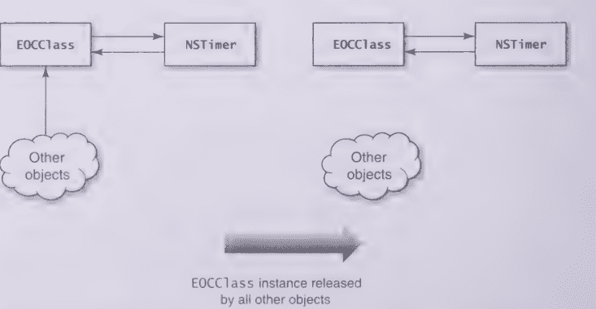

图 7.1 因为定时器保留其目标，而目标又保留了定时器导致的循环引用

如果轮询是从网络下载数据，数据将永远下载下去，进一步加剧了潜在的泄漏。

仅使用定时器对缓解这个问题作用有限。你可以强制在所有其他对象释放实例之前调用 `stopPolling`。然而，没有办法可以检查这一点，而且如果该类是你暴露给其他开发者的公共 API 的，你无法保证他们会调用它。

解决这个问题的一种方法是使用 blocks。虽然定时器目前不直接支持 blocks，但可以这样添加功能：

```objc
#import <Foundation/Foundation.h>

@interface NSTimer (EOCBlocksSupport)

+ (NSTimer*)eoc_scheduledTimerWithTimeInterval:(NSTimeInterval)interval
    block:(void(^())block
    repeats:(BOOL)repeats;

@end

@implementation NSTimer (EOCBlocksSupport)

+ (NSTimer*)eoc_scheduledTimerWithTimeInterval:(NSTimeInterval)interval
    block:(void(^())block
    repeats:(BOOL)repeats
{
    return [self scheduledTimerWithTimeInterval:interval
                               target:self
                             selector:(eoc_blockInvoke)
                                    userInfo:[block copy]
                               repeats:repeats];
}

+(void)eoc_blockInvoke:(NSTimer*)timer {
    void(^block)() = timer.userInfo;
    if (block) {
        block();
    }
}

@end
```

之所以这样做是为了解决循环引用问题很快就会明朗。在定时器触发时运行的 block 被设为定时器的 `userInfo` 参数。这是一个不透明的值，定时器在有效期间会保留它。需要获取 block 的拷贝以确保它是一个堆上的 block（见第 37 条）；否则当我们以后执行它时，它可能已经失效了。定时器的目标现在是 `NSTimer` 类对象，这是一个单例，因此它是否被定时器保留并不重要。这里仍然存在循环引用，但由于类对象永远不会被销毁，所以这并不重要。

该方案本身并没有解决问题，而只是提供了解决问题的工具。考虑将代码更改为使用：

```objc
(void)startPolling {
  _pollTimer = [NSTimer scheduledTimerWithTimeInterval:5.0
    block:^{
      [weak self p_doPoll];
    }
    repeats:YES];
}
```


之所以这样做是为了解决循环引用问题很快就会明朗。在定时器触发时运行的 `block` 被设为定时器的 `userInfo` 参数。这是一个不透明的值，定时器在有效期间会保留它。需要获取 `block` 的拷贝以确保它是一个堆上的 `block`（见第 37 条）；否则当我们以后执行它时，它可能已经失效了。定时器的目标现在是 `NSTimer` 类对象，这是一个单例，因此它是否被定时器保留并不重要。这里仍然存在循环引用，但由于类对象永远不会被销毁，所以这并不重要。

该方案本身并没有解决问题，而只是提供了解决问题的工具。

# 266 索引

`arrays.`（续）

反转枚举, 240

`size`, 243

`arrayWith:` 方法, 10

`assign` 属性, 30, 171

`associated objects`（关联对象）

向类附加自定义数据, 47-50

分类（categories）, 131

键（keys）, 8

用法示例, 48-50

关联（associations）, 47

异步分发（asynchronous dispatch）, 210

异步方法（asynchronous methods）, 197–198

原子属性（atomic attribute）, 32

原子锁和访问器方法-

`ods`, 29–30

原子属性（atomic properties）, 208–209

`attributes`（attributes）

内存管理语义，

属性（properties）, 29–33

音频硬件，用于接口的 C 级 API, 与，234–235

音频播放和录制, 235

`AudioToolbox` 框架, 74

`autoDictionaryGetter`, 60–61

`autoDictionarySetter` 函数, 60, 61

自动引用计数 (ARC), xiii, 108

后兼容（backward compatibility）, 156

分配期间的清理代码, 160

代码未编译, 145, 149

销毁对象, 167

异常（exceptions）, 105

多余的 `autorelease` 加

立即返回, 157–158

实例变量（instance variables）, 159, 160–161

低级 C 方法, 154

内存管理（memory management）, 154–156

内存管理规则, 214

内存管理语义

变量, 158–161

消息分发和, 161

方法命名规则, 154–158

Objective-C 对象, 231, 235, 244

优化（optimizations）, 156, 161

对象的所有权（ownership of objects）, 244

引用计数，计数和, 153–161

`retainCount` 方法, 183–184

保留和释放（retains and releases）, 154–156

运行时组件（runtime component）, 156

安全地处理异常, 167

保留值的变量, 158–159

写入 `setter`, 159

`autilling`, 117

`autorelease` 方法, 146, 150–151, 154, 156–157

`autorelease` 池（autorelease pools）, 146, 150–185

排空（draining）, 151

嵌套（nesting）, 174–175

开销（overhead）, 176

降低高内存水位线, 173–174

范围（scope）, 174

栈（stack）, 175

临时对象, 174–175

线程（threads）, 173

自动释放（autoreleases）, 合并, 156

`@autorelease` 语法, 176

`__autoreleasing` 修饰符, 159

合成（syntynthesis）, 28–29

`AvFoundation` 框架, 235

# B

后兼容与自动引用计数 (ARC), 156

横幅特性（banner feature）, 211

基类（base class）

定义, 43

继承（inheritance）, 42–43, 140–142

实例（instances）, 45

`beginContent` 方法, 251–252

位域数据类型（bitfield data type）, 121–122

位与运算符（bitwise AND）, 19

位或运算符, 19, 22, 23

基于块的枚举（block-based enumeration）, 240–243

更改方法签名以限制对类型转换的需求, 241–242

与 `for` 循环对比, 236–243

反转, 242

停止, 241

# 索引 267

`_block` 修饰符, 189

块（blocks）, xii, 187, 217

数组枚举（array enumeration）, 189

异步分发（asynchronous dispatch）, 210

回调（callback）, 203

`caret (^)` 符号, 188

并发队列（concurrent queues）, 229–230

捕获变量的副本, 191–192

拷贝（copying）, 192–193

直接使用和死锁, 208

错误处理, 200–202

灵活性（flexibility）, 201

函数指针（function pointers）, 191

全局（global）, 192–193

作为变量, 188

变量, 189, 194, 210

布尔属性（Boolean properties）

方法, 100

指定 `getter` 的名称, 31

`BOOL` 类型, 194

断点（breakpoints）, 88

`_bridge` 关键字, 244

`_bridge_retained` 关键字, 244

`_bridge_transfer` 关键字, 244

缓冲区参数（buffer parameter）, 99

业务逻辑（business logic）, 解耦数据, 115

**中央分发 (GCD), 216

处理块（hand blocks）, 197–203

堆（heap）, 192–193

隐藏复杂类型（hiding complicated type）, 194

取消的能力, 218

内联（inline）, 188–219

实例方法（instance methods）, 190

实例变量（instance variables）, 190

内存区域（memory regions）, 191

网络获取器（network fetchers）, 199–200

作为关联对象（as objects）, 189–210

避免属性（avoiding properties）, 130–133

将类实现拆分为段, 123–127

无法合成变量, 131

继承自

抽象基类（abstract base class）, 46

类延续（class-continuation）, 7–8, 30,

实现协议的类, 117–118

数据定义（data definitions）, 135

隐藏实现细节（hiding implementation detail）, 133–140

实现文件定义（implementation file definition）, 133–140

加载（loading）, 252

`load` 方法, 127–128

命名名称, 128–129

重写方法（overriding methods）, 127–129

前缀命名（prefixing names）, 74

为第三方命名加缀, 127–129

`CFArray` 类, 243

`CFArrayCount` 函数, 243

`CFArrayRef` 类, 243

`_CFArray` 结构体, 243

`DictionaryDictionaryKey` 结构, 245

`CFDictionary` 类型, 244

`CFDictionaryCallbacks` 结构, 245

混合 Objective-C 和 C++ 代码, 135–137

符合私有协议的对象（objects conforming to private protocols）, 138–139

私有方法（private methods）, 103, 138

属性（properties）, 135

只读属性（read-only properties）, 137–138

`CFEqual` 类, 246

`CFHash` 类, 247

`CFMutableDictionary` 类型, 244

`CFNetwork` 框架, 234

`CFString` 类, 234

`CFURLRequest` 数据结构, 126

`CGFloat` 标量类型, 30

`CGPoint` 数据结构, 235

`CGRect` 数据结构, 3–4, 235

`CGSize` 数据结构, 235

向类附加自定义数据, 47–50

将类实现拆分为段, 123–127

为分类添加方法, 127–128

检查类的实例, 243

相等性检查方法（equality-checking methods）, 37

向前声明（forward declaring）, 6, 8

`Foundation` 框架, xi. 8

头文件（header files）, 4–5

层级（hierarchy）, 69–71

钩入转发路径（hooking into forwarding paths）, 55

实现文件（implementation files）, 4–5

继承（heritance）, 7, 42–43

初始化（initializers）, 78–84

初始化（initializing）, 252–257

实例变量（instance variables）, 26, 28, 130

内部方法（internal methods）, 102

内省（introspection）, 66–71, 92

限制导入, 6

字面量（literals）, and 12

加载（loading）, 252–257

元数据（metadata）, 68

方法（methods）, 54, 62, 115

多个警报（multiple alerts）, 48–49

多个网络获取器（multiple network fetchers）, 199

可变的（mutable）, 40–42, 89

命名空间类（namespace classes）, 100

命名（naming）, 95, 100–101

未加载（not loading）, 140–140

不理解消息（not understanding messages）, 54

父类（parent class）, 68

前缀命名（prefixing names）, 74

属性（properties）, 89

协议（protocols）, 120

相互引用（referring to each other）, 6

代表实例（representing instance）, 78–79

检索方法（retrieving methods for）, 64

共享实例方法（shared-instance method）, 225

系统提供的（system-supplied）, 129

无缝桥接（toll-free bridging）, 243–247

翻译单元（translation unit）, 14

类型定义（type definition）, 196

`class_getInstance` 方法, 64–66

类对象（class objects）, 27, 66–71, 191

类特定方法（class-specific methods）, 39–40

类类型（class type）, 68

C 级 API（C-level APIs）, 234–235

用于通信的 C 级设施（C-level facilities for talking to）, 234

`ocon`, xi, 173, 234

类簇（class clusters）, 45–46

协议语言特性（protocol language feature）, 116

双字母前缀（two-letter prefixes）, 74

主线程上的 UI 工作（UI work on main thread）, 202

僵尸（zombies）, 177–183

# 索引

`completion handler`, 203

`block` 类型作为, 198–199

实例变量, 203

其他类创建, 205

`completion-handler block`, 205–206

`completionHandler` 属性, 205, 207

并发队列, 210–211

`blocks`, 229–230

并发线程, 223

读取作为普通 `blocks` 写入作为 `barrier blocks`, 212

连接处理错误表示代表什么, 107

`connectionIdentifier:` 方法, 142

常量

定义, 12–13

向外部暴露, 14–15

全局, 17

全局符号表, 15

头文件声明, 15, 17

实现文件定义, 13

命名, 13, 15–16

命名值, 17–18

类名名前缀, 13, 16

编译单元, 17

类型, 12–17

`const valifier`, 14

构造函数, 96–97

带有可变类和相等性的容器, 40–42

`copy` 属性, 30–31

`copyDescription` 回调, 247

`copy helper`, 191

拷贝

深拷贝或浅拷贝, 113–114

指定初始化器, 110, 112

类的可变与不可变变体, 112–113

对象, 109–114

`copy` 消息, 192

`copy` 方法, 109–110, 113, 154

`copyWithZone:` 方法, 109–110, 112, 247

`CoreAnimation` 框架, 137, 235

`CALayer` 类, 62

`CoreAudio` 框架, 234–235

`CoreData` 数据库, 142

`CoreData` 框架, 235

访问 `NSManagedObject` 类的属性, 55–56

匿名对象, 142

`CoreFoundation` 框架, 234, 243

字典, 244–245

僵尸对象, 179

`CoreFoundation` 对象

清理, 160

释放引用, 162

`CoreGraphics` 框架, 235

`CGRect` 变量, 3–4

`CoreText` 框架, 235

`countEnumeratingWithState:` 方法, 239

对象的计数器, 145–152

`_Class` 实例变量, 136

C 语言

访问栈分配的结构体成员, 28

调用函数, 50–51

内存模型, 2

作为 Objective-C 的超集, 2, 4

函数名加前缀, 77

与 Objective-C 对象无缝类型转换数据结构, 234

静态绑定, 50–51

自定义类, 12

使用关联对象将数据附加到类, 47–50

内存管理语义, 243–247

`.xx_destruct` 方法, 160–161

D

悬空指针, 149

数据

与业务逻辑解耦, 115

封装, 130

相等性, 40

所有权语义, 30–31

数据库，持久化对象的接口, 235

数据源, 115-123

`Data Source` 模式, 120-121

`Data Source` 协议, 120

数据结构，2D 渲染, 235

`_dateOfBirth` 实例变量, 27

死锁

`dispatch`队列, 228

`getters`, 227

同步 `blocks`, 208

`dealloc` 方法, 154, 160-165, 181

`debugdescription` 方法, 88-89

调试器，调用 `print-object` 命令, 88

调试

断点, 88

`dispatch_get_current_queue` 函数, 231

`load` 方法, 253-254

内存管理问题, 177-183

不透明方法, 62-66

打印对象以检查, 84

公共和私方法, 102

`retain` 计数, 185-186

将类分为分类, 126-127

深拷贝, 113-114

深质量, 40

`#define` 预处理器指令 ver-

挂起上下文, 12-17

`#define` 预处理器宏, 20-22

`delegate` 方法, 49, 119-120

`Delegate` 模式, 115-123, 171, 197

`Delegate` 协议, 7, 117-118, 197-198

错误, 107

方法, 118-119

`delegates`

匿名, 141

缓存方法, 122

类, 7

实现, 117

内省, 119

列表视图, 120

网络 `fetchers`, 119

非拥有关系, 117

对象, 115-123

从...获取信息, 119-120

传递错误到, 107

属性定义, 140

响应选择, 121-123

任务完成, 197-198

`description` 消息, 84

字典内部, 86-87

实现, 84-89

`Dictionary` 类的实现, 86-87

返回字符串, 86-87

描述符, 191

指定初始化器, 78-84

`Rectangle` 类, 80-81

`mult`, 81-83

覆盖父类, 80

父类, 79

析构函数, 231

设备方向, 20

基于 `block` 的枚举, 241

`CoreFoundation` 框架, 244-245

`within description` 方法, 86-87

枚举, 237-238

快速枚举, 239-240

`Foundation` 框架, 244

不可变变量, 12

键, 11-12, 48, 237-238

可变数组和, 11

`nil` 值和异常, 11

对象, 11, 241-242

保留键, 248

`size of`, 244-245

244-245

存储下载的图像, 248

字典（续）

订阅, 11

值, 238, 241, 245


`dis_after` 参数, 216

`dis_apply` 函数, 222–224

`dis_async` 参数, 216, 220

`dis_function_t` 类型, 231

`dis_get_current_queue` 函数, 226–231

`dis_group_async` 函数, 220

`dis_group_enter` 函数, 220

`dis_group_leave` 函数, 220

`dis_group_notify` 函数, 221

与任务关联, 220

平台扩展, 220–224

超时, 221

提交到串行队列的任务, 222–223

`dis_group_wait` 函数, 221

`dis_once` 函数, 217, 225–226

`dis_once_t` 类型, 225

`dispatch`队列, 91, 187, 217

用于的锁, 208–213

`dis_sync` 参数, 216

`disposer` helper, 45

`doWork`, 45

文档, 44

`doRecognizeSelector`: 异常, 57

不要重复 (`DRY`) 软件开发原则, 219

`disSomething`: 方法, 108

`disSomethingMayThrow` 对象, 166

`disSomethingUsesInternalData` 方法, 256

`disSomethingWithInit`: 方法, 174

`disSomethingWithObject`: 方法, 186

点语法, 25, 27–28

`DRY`. 参见：不要重复 (`DRY`) 软件开发原则

重复符号错误, 74–77

动态绑定, 2, 4, 51–52

动态绑定的 `ent`, 213–214

动态库, 233

动态方法解析, 55–56, 59–62

`@dynamic` 属性, 55–59–62

`dis_sync` 函数, 227–228

`else` 语句, 192

`Employee`示例, 45, 46

封装数据, 130, 251–252

`enumerateKeysAndObjectsUsingBlock`: 方法, 242

`enumerateKeysAndObjectsWithOptions`: 方法, 242

`enumerateObjectsUsingBlock`: 方法, 189

`enumerateObjectsWithOptions`: 方法, 242

枚举集合

数组, 236–237

基于 `block` 的枚举, 240–243

字典, 237

快速枚举, 239–240

`for` 循环, 236–237

`NSator` 对象, 237–239

`Objective-C` 1.0 枚举, 237–239

反转, 238–239

集合, 237

枚举

添加 `typedef`, 18

向后兼容, 20–22

组合选项, 19–20

前向声明类型，

行为的. 242

分组错误状态, 22

成员值, 18

下一个对象, 238

选项, 17

可读性代码, 117

`switch` 语句, 23

类型, 18

枚举器，反向, 239

`enum` 类型, 17

# 索引

- 错误参数, 108

- 错误, 106–107

- 错误状态码

- 分组, 22

- 命名常量, 17–24

- `evictictsObjectsWithDiscarded`

- `Content` 属性, 251

- 异常, 104

- 自动引用计数

- (`ARC`), 105

- `C++`, 165

- `catch` 块, 166

- 导致应用程序退出, 105

- 代码更改与处理, 165

- 致命错误, 105–106

- 键值观察 (`KVO`), 165

- 内存泄漏, 105

- 数组中的 `nil` 对象, 9–10

- 字典中的 `nil` 值, 11

- 对象销毁, 166–167

- `Objective–C`, 165

- 在重写的方法中抛出, 105–106

- `try` 块, 166

- 僵尸对象, 178

- 异常码, 105

- 举枚举类型, 18

- `_forwarding_function`, 181–182

- 转发路径, 54–55

- `forwardingTargetForSelector:` 方法, 56

- `forwardInvocation:method`, 57

- `Foundation` 框架, 89, 233

- 类, xi, 8, 12, 243

- 集合, 234, 243

- 字典, 244

- 在其中定义的辅助函数, 20–22

- 导入实体, 55

- 内省, 66–71

- 加载, 235

- `NSCache` 类, 248

- `N5` 类前缀, 234

- `NSTimer` 类, 258

- 字符串处理, 234

- 僵尸对象, 179

- `Foundation.h` 头文件, 5

- 框架（参见 frameworks）

- 基础头文件, 5

- 协议语言特性, 116

- 第三方, 233

- 友元分类, 130

- `_friends` 实例变量, 111–112

- `friends` 属性, 94

- 全转发机制, 57

- `fullName` 方法, 33–34

- 函数指针, 191

- 函数, 2

- 用块的 `blocks`, 188–189

- 调用, 1–2

- 调用与消息传递, 1

- 多态, 2

- 尾调用优化 (`tall-call optimization`), 53–54

- `dendering`, 235

- 运行时未知, 51

- 内存管理, 165–168

- `extern` 关键字, 15

# F

- 工厂方法, 98

- 工厂模式, 44

- 快速枚举, 236, 239–240

- `_fetchedData` 实例变量, 205

- `fetcher` 类, 116–117

- 文件描述符, 162

- `@finally` 块, 116, 167

- `_firstName` 实例变量, 26–27, 28

- `-objc-arc-exceptions` 标记, 105, 167–168

- `_foo` 实例变量, 150

- `foot` setter, 150

- `for` 循环, 174, 276

- 与块枚举对比, 236–243

- 前向声明, 8

- 类, 6

- 导入, 7

- 垃圾回收器, 145, 169

- 死锁, 227

- 全局变量, 12

- 全局块, 192–193

- 全局常量, 17

- 全局符号表, 15

- 定义错误源, 106

- 名称冲突, 74

- 超类, 7

- 在堆上分配与 de释放内存, 3

- 从栈中拷贝块, 192

- 堆分配内存的清理, 160

- 堆块, 192–193

- `height` 实例变量, 96

- `_height` 实例变量, 80, 84

- 向后兼容的辅助函数, 20–22

- 文件扩展名, 4

- 图中央分发 (`GCD`), xi, ii

- 屏障特性, 216

- 块, 217

- 分发组, 220–224

- 分发队列, 217

- 无法取消块, 218

- 锁, 208–213

- 友元, 213–217

- 正在执行的队列, 226–231

- 队列优先级, 218

- 队列特定数据, 230–231

- 单例实例, 225–226

- 同步, 217

- 线程, 173, 223

- 何时使用, 217–220

- 图形，渲染, 235

- 分组任务, 220–224

- 任务数量, 220

- 高内存，降低水位, 173–177

- 从服务器获取 HTTP, 126

- 请求到 Twitter API, 74

- HTTP 特有方法, 126

- IDE. 参见集成环境 (`IDE`)

- 标识符属性, 92

- `id<objcDelegate>` 类型, 140

- `id<NSCopy>` 类型, 141

- `it` 类型, 66–69, 254

- `if` 语句, 45, 153, 192

- 来自 Internet 的图像, 248–252

- 不变数组, 45

- 不变集合属性, 92–94

- 不变`Copy` 类型, 112–113

- 不变对象, 32, 89–94

- 不变变量, 12

- 处理块，分离, 197–203

- `hash` 回调, 247

- `hashes`, 38–40

- `hash` 方法, 37–39, 42, 247

- `hash` 表，在其中作为 38

- `hasPrefix:` 方法, 99

- 头文件, 4–8

- 常量, 15, 17

- `extern` 关键字, 15

- 协议, 7

- 实现类-分类隐藏, 133–140

- 交换, 63–64

- 类簇, 42–47

- 实例变量, 27

- 实现文件, 4–5

- 分类延续, 133–140

- 常量, 13, 15, 17

- `#import` 导入, 7

- 直接访问, 33–36

- 数组的索引, 12

- 继承，等价性, 37

- 公开文档, 133–140

- 外部初始化, 33

- 延迟调用, 254

- 访问器, 25

- 继承, 255

- 分类合成, 131

- 紧凑实现, 255–256

- 运行时状态, 254

- 实例, 68

- 超类运行, 254–255

- 内存管理语义, 158–160

- 线程安全环境, 254

- 初始化器，类, 78

- 指定, 78–84

- 存储为 `fetchers`, 199

- 命名, 28

- 实例变量, 35

- 方法, 35

- 命名, 78

- 抛出异常, 81

- `init` 方法, 97

- `initWithCode:` 方法, 82

- `initWithDimension:` 方法, 81

- `initWithWithSize:` 方法, 97

- `initWithTimeInterval:` 方法, 79

- `initWithWidth:` 方法, 81

- 编译时定义的整数, 257

- 内联块, 189

- 集成开发环境 (`IDE`), 基类, 45

- 实例变量, 68

- 元元数据, 68

- 访问器方法, 34

- `int` 类型, 98, 194

- `intValue` 方法, 98

- `invoke` 变量, 191

- 接口, 115

- 实例变量范围, 26

# J

- `Java`

- 异常, 104

- 函数名, 96

- 实例变量范围, 26

- 接口, 115

# K

- `kAnimationDuration` 常量, 14

- `kAnimationDuration` 全局变量, 13

- 键

- 关联对象, 48

# M

- `Mac OS X`, xi, xiii

- 阻塞 UI 线程, 187

- 块, 188

- `Cocoa`, 173, 234

- 垃圾回收器, 145, 169

- 主线程, 221, 226

- 在应用程序终止时调方法, 163

- `Application` 对象, 147

- 操作队列, 217

- 社会网络设施, 235–236

- 主函数, 173–174

- 主线程, 226

- UI 框架, 78

- 在主线程执行的 UI 工作, 226

- `UTApplication` 对象, 147

# G

- 键值编码 (`KVC`), 92

- 键值观察 (`KVO`), 异常, 165

- 属性, 165–168

- 通知, 34, 137

- 操作属性, 218

- 属性, 165

- `KVC`. 参见 键值编码 (`KVC`)

- `lastname` 实例变量, 28

- `lastobject` 方法, 46

- 延迟初始化, 35–36

- `length` 方法, 98

- `lengthOfBytesUsingEncoding` 方法, 98

- 列表视图, 120

- 字面量数组, 9–10

- 字面量字典, 10–11

- 字面量字量, 8–9

- 字面量, 12

- `LLDB` 调试器, 88–89

- `load` 方法, 252–256

- `localizedString` 方法, 100

- `localizedWithStringFormat:` 方法, 98

- 局部变量, 14

- 打破保留循环, 160

- 内存管理语义, 158–160

- 限定符, 159–160

- 锁，图中央分发 (`GCD`), 208–213

- 递归, 208

- 线程多次获取同一把锁, 208

- `lowercaseString` 方法, 98

- 小写字符串, 98

- `lowercaseString` 选择器, 55, 63, 64–66

# 索引

## methods

- 数组, 45

- 自动引用计数 (`ARC`), 154–158

- 自动释放对象 (`autoreleasing objects`), 156–157

- 回溯轨迹 (`backtrace`), 126–127

- 命名不当, 97

- 表示成功或失败的布尔值, 107–108

- 布尔值属性, 100

- 类别 (`categories`), 123–127

- 使用 `action` 在对象上发生,

- 作为 `C` 函数, 53

- 类延续分类 (`class-continuation category`), 133–134

- 类 (`classes`), 54, 115

- 类方法 (`class methods`), 64

- 调试不透明方法.62–66

- 延迟执行, 213

- 代理方法 (`delegate methods`), 119

- 代理协议 (`delegate protocols`), 118–119

- 代理 (`delegates`), 122

- 对未公开的内容编写文档, 133–140

- 为未知选择器动态添加, 55

- 动态绑定 (`dynamic binding`), 52

- 等性检查 (`equality-checking`), 36–37

- 交换实现 (`exchanging implementations`).63–66

- 获取前缀, 100

- HTTP 特有的, 126

- 自省 (`introspection`), 46

- 自省方法, 69–71

- 内存管理 (`memory-management`), 2

- 可变数组 (`mutable arrays`), 45

- 命名 (`naming`), 1, 95

- 新创建的值, 100

- `nil` / `0`, 106

- 非可重入 (`not reentrant`), 227

- `N5Object` 协议, 85

- 对象 (`objects`), 50–54, 150–151

- 传递给输出参数 (`out-parameter passed to`).107–108

- 由调用者拥有 (`owned by caller`), 154

- 参数 (`parameters`), 99, 100

- 命名加前缀, 74, 102–104

- 返回类型, 98

- 运行时 (`runtime`), 62–66

- 系统提供的类, 129

- 线程 (`threads`), 164–165, 213

- 抛出异常, 105–106

- 类型 (`types`), 100

- `verse` 命名 (`verse naming`), 96–100

- 命名恰当 (`well-named`), 97

- 方法快速汇 (`method swizzling`), 62–66

- `.m` 文件扩展名, 4

- `MKLocalSearch` 类, 202

- 多线程应用, 187

- 多线程 (`multithreaded`), 187

- 可变数组 (`mutable arrays`), 45

- 字典 (`dictionaries and`), 11

- 方法 (`methods`), 45

- 运行时 (`runtime`), 257

- 下标索引 (`subscripting`), 11

- 可变类 (`mutable classes`), 89

- 容器中的等性, 40–42

- 可变集合类属性 (`mutable collection-class properties`).92–94

- `mutableCopy` 方法, 112–113, 154

- `mutableCopyWithWithzone` 方法, 112

- 可变字典 (`mutable dictionaries`), 140–141

- 可变对象 (`mutable objects`), 89–90

- 可变变量 (`mutable variables`), 12

- `_myFirstName` 实例变量, 28

- `_myLastName` 实例变量, 28

## N

- 命名冲突 (`name clashes`), 74

- 命名冲突 (`name conflicts`), 74

- 作为错误状态码的命名常量, 17–24

- 命名空间冲突 (`namespace clashes`), 73, 100

- 命名 (`naming`)

  - 驼峰命名法 (`camelCase`), 95

  - 类 (`classes`), 95, 100–101

  - 晰且一致 (`clear and consistent`), 95–101

  - 代理协议 (`delegate protocol`), 117

  - 方法 (`methods`), 95–100

  - 自动引用计数 (`ARC`) 中的可变规则.154–158

  - 加前缀 (`prefixing`), 73–77

  - 在其中的位置, 95

  - 私有方法 (`private methods`), 102–104

  - 属性 (`properties`), 98

- 命名 (`续`) 协议, 100–101, 超类 (`superclass`), 101

- 嵌套自动释放池 (`nesting autorelease pools`), 174–175

- `networkFetcher:didFail:method`, 118

- `networkFetcher:didUpdate:method`, 121

- 网络抓取器 (`network fetchers`), 198–199


- 块 (blocks), 199–200

- 完成回调处理器 (completion handlers), 200, 203

- 释放内存 (deallocating), 207

- 保持存 (keeping alive), 206–207

- 留存块 (retaining block), 205

- 与...通信 (talking to), 234

- 新方法, 154

- `nextSelector`, 64

- `nextObject` 系统, 234

- NIB 格式, 82

- nil 对象 (nil objects), 90

- 原子性属性 (atomic attribute), 29, 32–33

- 致命错误指示 (ABI), 27

- 脆弱的 Objective-C 对象

- 清理 (cleaning up), 160

- 释放引用 (releasing references), 162

- 通知 (notification), 221

- `NSApplicationDelegate` 对象, 163

- `NSApplication` 对象, 147

- `NSArray` 类, 8, 12, 39–40, 45–46, 86, 100, 112, 129, 243, 集合 236

- `NSBlockOperation` 类, 218–219

- `NSCache` 类, 248–252

- `NSCalendar` 类, 132

- `NSCopying` 协议, 81–83, 109–114, 247

- `Date` 类, 78

- `NSDictionary` 类, 8, 12, 39, 140, 234, 241, 集合 236, 对象 48, 231, 246

- 与 `NSCache` 类对比,248–252

- 在 `description` 方法上的支持 (piggybacking on description of),86–87, 留存类,269

- 可移除的内容 (`DismissableContent`), 250

- 并发枚举 (`EnumerationConcurrent`), 242

- 枚举选项 (`EnumerationOptions`), 242

- 反向枚举 (`EnumerationReverse`), 242

- `Numerator` 类, 236

- `Numerator` 对象, 237–240

- `NS_ENUM` 宏, 21–24

- `NSError` 类, 106–107

- `NSError` 对象, 106–109

- `NSFastEnumeration` 协议, 239–240

- `FetchedResultsController` 类, 142

- `FetchedResultsInfo` 协议, 142

- `NSHTTPURLRequest` 类别, 126

- `NSInteger` 类, 30

- `NSInvocation` 对象, 57, 59

- `LinguisticTagger` 类, 234

- `NSLog` 类, 149, 253

- `NSManagedObject` 类, 29

- `NSManagedObjects` 类, 55–56

- `NSMutableArray` 类, 45, 100, 112

- 可变数组 (`MutableArrays`), 41

- `MutableCopying` 协议, 112

- `MutableDictionary` 类, 247

- `MutableSet` 类, 41, 94

- `MutableString` 类, 30

- `MutableURLRequest` 类别, 126

- `MutableURLRequest` 类, 126

- `NSNotificationCenter` API, 151, 203

- `NSNotificationCenter` 类, 162, 219

- `NSNumber` 类, 8–9, 12

- `NSNumber` 对象, 174, 185

- `NSObject` 类, 37, 54–55, 67, 85, 109, 213, 234, 247

- `NSObject` 对象, 181

- `NS` 协议, 36–37, 67, 85, 146, 183

- `NSOperation` 类, 218, 219

- `NSOperationQueue` 类, 203, 217–218

- `NS_OPTIONS` 宏, 22, 24

- `NSProxy` 类, 67, 70, 85

- `PurgeableData` 类, 250

- `PurgeableData` 对象, 251

- `NSRecursiveLock` 类, 208

- `NSSet` 类, 94, 113, 241

- `NSSet` 集合, 236

- `NSString` 类, 8, 12, 36, 38–128–129, 153, 253

- 方法, 97–99

- `selector` 类型, 63–64

- `NSString` 全局类, 108

- `NSString` 实例, 2–3, 67

- `NSString` 对象, 8, 15, 151, 174, 185

- `NSString` 类型, 30

- `TimeInterval` 类型, 13

- `NSTimer` 类, 258–263

- `NSInteger` 类型, 22

- `NSURLConnection` 类, 107, 234

- `NSURLConnectionDelegate` 方法, 107

- `NSLErrorDomain` 域, 106

- `NSRequest` 类, 126

- `_NSZombie` 类, 178, 181

- `_NSZombie_ClassName` 对象, 181

- `_NSZombie_OriginalClass` 对象, 181

- `_NSZombie_template` 类, 180

- `NSZone` 类, 109

- 空指针, 108

- 数字值和字面量, 8–9

- `OBJC_ASSOCIATION_ASSIGN` 类型, 47

- `OBJC_ASSOCIATION_COPY_NONATOMIC` 类型, 47

- `OBJC_ASSOCIATION_COPY` 类型, 47

- `OBJC_ASSOCIATION_RETAIN_NONATOMIC` 类型, 47

- `objc_autoreleaseReturnvalue`, 157

- `objc_duplicateClass()` 函数, 181

- `objc_getAssociatedObject` 方法, 47

- `objc_msgSend` 函数, 52, 54

- `objc_msgSend` 角色, 54

- `objc_removeAssociatedObjects` 方法, 48

- `objc_retainAutoreleaseValue`, 157

- `objc_retain` 方法.154

- `objc_setAssociatedObject` 方法, 47

- `ObjectAtIndex:` 方法, 9, 46

- `ObjectB` 对象, 146

- `ObjectC` 对象, 146

- 对象图 (object graph), 146, 149–150, 168

- `_object` 实例变量, 158

- Objective-C 错误模型, 104–109

- 异常, 165

- 垃圾回收器, 145

- 消息和僵尸对象, 179–180

- 消息传递结构, 1

- 根 (roots).1–4

- 运行时组件, 2

- 矩形块作为 C 的超集, 2, 4

- verse 语法, 1.8

- Objective-C 枚举, 237–239

- Objective-C 对象 自动引用计数 (ARC), 235

- 与 C 数据的无缝转换, 234

- 如何处理, 244

## objects

- 25

- 访问封装的数据. 27

- 匿名的 (anonymous), 140–142

- 与对象关联, 47

- 自动释放的 (autoreleasing), 08, 155–157

- 相互关联, 146

- 使用哈希值分箱到数组, 38

- 作为块 (blocks as), 189–190

- 调用方法, 50–54

- 类 (classes), 66, 89

- 清理状态 (cleaning up).162–165

- 集合 (collections), 70–242

- 等性检查, 36–42

- 遵循私有协议, 138–139

- 拷贝 (copying), 109–114

- 留存 (retaining), 145, 152, 183

- 释放内存 (deallocating), 149, 162

- 声明 (declaring), 2

- 代理 (delegates), 115–123

- 描述消息 (description message), 84

- 指定初始化 (designated initializer), 78–84

- 销毁和异常, 166–167

- 字典 (dictionaries), 11

- 等性 (equality), 70

- 检查方法, 36–37

- 异常 (exceptions), 105

- 分配的内存, 2–3

- `id` 类型, 66–67

- 不变的 (immutable), 32, 89–94

- 内部数据数据, 81

- 实例变量 (instance variables), 25

- 自省 (introspection), 94

- 引用 (invalid references to), 146

- 内存 (memory), 2

- 内存管理语义 (memory-management), 47

- 内存区域 (memory regions), 191

- 消息传递 (messaging), 25

- 方法 (methods), 100, 142, 150–151

- 作为 C 函数, 53

- 循环相互引用, 152

- 可变的 (mutable), 30–31

- 无效的 (nonvalid), 149

- 通知 (notifications), 15, 162

- 不理解的消息, 54–62

- 对象图 (object graph), 150

- 作为操作队列, 217

- 开销 (overhead), 4

- 拥有其他对象, 146, 148

- 指针 (pointers), 2, 67

- 调试时打印, 84–89

- 属性 (properties), 25–33

- 代理 (proxy), 70–71

- 引用计数 (reference counting), 173

- 释放 (releasing), 156, 173–177

- 释放引用 (releasing references), 162–165

- 响应消息 (responding to messages), 103

- 留存计数 (retain count), 146, 183

- 留存 (retaining), 156

- 运行时 (runtime), 68

- 相同哈希, 42

- 使用 NIBs XML 格式序列化, 82

- 栈分配的内存, 2, 3

- 存储策略 (storage policies), 47

- 对 `self` 变量同步, 208

- 相互通信, 115–123

- 任务 (tasks), 221–222

- 类型 (types), 4, 66–71, 242

- 类类型变量, 68

- 变量 (variables),

- 当应用终止时, 163

- 僵尸对象 (zombie objects), 179

# 索引 283

## 选项

- 组合, 17–24, 19–20

- 枚举, 17–24

- OR 运算符, 19, 22, 23

- 输出参数, 99, 107–108

- 方法重写, 129

## 类, 89

- 集合类 可变的或不可变的, 92–94

- 比较相等性, 37

- 自定义初始化, 31–32

- 在对象的定义中, 27

- 点符号语法, 27–28

- 封装数据, 130

- `getter` 方法, 30

- 实例变量, 33–36, 35, 92

- 键值编码 (KVC), 92

- 键值观察 (KVO), 165

- 懒性初始化, 35–36

- 主接口定义, 132

- 内存管理语义, 30–31, 94, 131

- 命名, 98

- 非所有权关系, 30

- 操作, 218

- 所有权关系, 30

- 只读, 30, 32, 89, 90–91

- 读写, 30

- `setter` 方法, 30

- 作为单单词, 98

- 同步, 208–210

- 值可能不安全, 171

- `ak`, 117

# P

## 参数

- 方法, 99–100

- 指向结构的指针, 245

- 字符串解析, 234

- 传递消息, 50–54

- `performSelector:` 方法对比 级中央调度 (GCD), 213–217

- `performSelector:withObject:withObject`, 215

- `withName`, 156

- 占位符数组, 45

- 平台扩展和分发组, 220–224

- `po` 命令, 88

## 指针

- 比较相等性, 37

- 悬空指针, 149

- 表示对象, 2

- 置空, 149

- 指向结构体, 243

- `pointerVariable` 变量, 67

- 多态, 2

## 前缀

- 第三方名称分类, 127–129

- 命名, 73–77

- 预处理器指令, 13

- `printGoodbye()` 函数, 51

- `printHello()` 函数, 51

- `print-object` 调用调用调试器, 88–89

- 私有分类, 127

- 私有实例变量, 90

- 私有方法, 102–104, 138

- 程序员错误, 164

## 属性, 25–33

- 原子性的, 208–209

- 属性, 29–33, 131

- 在分类中避免, 130–133

- 类延续分类, 135

## 公开接口声明实例变量, 25–26

- 纯 C 函数名称冲突, 74

- 对象的销毁, 166–167

- 指示问题区域, 153–161

- 手动释放对象, 162

- 内存管理, 183

- 操作, 146–150

- 重构, 168

- 留循环, 152

- 僵尸对象, 179

- 引用计数架构, 168

- 引用, 释放, 162–165

- `release` 方法, 146, 159, 184

- `removefriend:` 方法, 94

- 替换接收者, 55–57, 59

- `resetViewController:` 方法, 104

- `resolveClassName:` 方法, 55

- `resolveInstanceMethod:` 方法, 56

- `pondsToSelector:` 方法, 119

- 结果控制器, 142

- 引用计数, 146, 173, 185–186

+ `QuartzCore` 框架, 235

- 查询结构, 122

- `_queueA` 变量, 228

- 队列屏障, 211

- `_queueB` 变量, 228

- 队列

- 将数据关联为键值对, 230–231

- 正在执行, 226–231

- 层级结构, 229

- 实例变量, 227

- 多读单写, 211–212

- 优先级, 218

- 对同一对象进行读写, 209–210

- 调度回调块, 230

- 属性的同步, 229

+ R

- `readonly` 属性, 30, 90–91

- 只读属性, 30, 32, 89, 90–91

- 类延续和内部设置, 137–138

- `readonly` 属性, 91–92

- `readwrite` 属性, 39

- 读写 属性, 89

- 接收者, 55, 57, 59

- `rectangle` 类, 7

- `Rectangle` 对象, 79

- 形, 78–79

- 递归循环, 208

- 引用计数对象, 192

- 引用计数, 121, 2–3, 145–152, 173, 220–221

- 自动, 153–161

- 自动引用计数 (ARC) 和, 153–161

- 自动释放池, 150–151, 173–177

- 块, 192

- 缓存异常, 168

+ `autorelease pool`, 146

- 平衡, 151

- 当前, 183

- 在给定时间, 184

- 递增和递减, 146, 150

- 检查, 146

- 至少一个, 149

- 极大值, 184–185

- `retainCount` 方法, 142

- 自动引用计数 (ARC), 183–184

- 避免使用, 183–187

- 避免, 168–172

- 检测, 169

- 内存泄漏, 169

- 引用其他对象, 168–169

- `retain` 方法, 146, 154, 156–157, 159, 184

- `retain` 对象, 214–215

- 反向枚举器, 238–239

- 根类, 85

- 循环和计时器, 258

- `runtime`, 25

- `dealloc` 方法, 162

- 决定哪个代码执行, 1

- 作为动态库, 2

- 函数, 2

- 实例变量, 27, 35

- 内存管理方法, 4

- 方法, 4, 62

- 对象类型, 4, 66

- 引用计数, 3

- 结构, 2

- 僵尸对象, 179

- 快速枚举, 239–240

- `setter` 访问器, 150

- `setter` 计数 (ARC), 159

- `barrier` 块, 211

- 实例变量, 25, 35

- 命名, 31

- 属性, 30

- 标量类型, 30

- `selectors`, 56, 60

- 串行队列, 210

- 同步分发, 210

- `setMethod`, 158

- `setValue:forKey:` 方法, 92

- 浅拷贝, 113–114

- 浅相等, 40

- `shape` 类, 7


- `sharedInstance` 方法, 225

- 单例模式, 225

- 对象, 185

- `Social` 框架, 235–236

- 社会网络设施, 235–236

- `sockets`, 162

- 连接和枚举, 17–18

- 标量类型, 30

- `scheduledTimerWithInterval:` 方法, 258

- `sectionInfo` 对象, 142

- `sections` 属性, 142

- `selectors`, 57

- 直接调用, 213

- 代理, 121–123

- `getters`, 56, 60

- `IMP` 指针, 62–63

- 消息, 50

- 方法, 55–56, 62–66, 64

- 参数, 215

- 延迟运行, 215–216

- `runtime`, 213

- `setters`, 56, 60

- 存储执行事件, 214

- 线程, 215

- `self` 变量, 190, 262

- `setFirstName:` 方法, 138

- `setFullName:` 方法, 33–34

- `setIdentifier:` 方法, 92

- `setLastName:` 方法, 138

- `set` 前缀, 56

- `sets`, 243

- 基于块的枚举, 241

- 举举, 237–238

- `someBlock` 变量, 188

- `SomeClass` 类, 68

- `SomeClass.h` 头文件, 136

- `someObject` 接收者, 52

- `someString` 变量, 2

- 音频文件, 74–76

- 栈

- 自动释放池, 175

- 块, 192–193

- 将块拷贝到堆, 192

- 为块分配的内存, 192

- 为对象分配的内存, 2, 3

- 变量, 3–4

- 标准视图, 48

- `start` 方法, 195

- 状态和枚举, 17–24

- 静态分析器, 153

- 静态全局变量, 48

- 静态库, 233

- `static` 修饰符, 14

- 状态码和枚举, 17–24

- `stopPolling`, 260–261

- `stop` 变量, 241

- 存储策略, 47

- 字符串字面量, 8

- `string` 方法, 98

- 字符串

- 范围内的字符, 99

- 转换为小写, 98

- 自定义类, 12

- 相等, 99

- 工厂方法, 98

- 不变变体, 12

- 长度, 98–99

- 解析, 98, 234

- 由字符串前缀, 99

- 处理, 234

- 返回哈希, 39

- `stringValue` 方法, 151

- `stringWithString:` 方法, 98

- `str` 对象, 159

- `strong` 属性, 30

- `_strong` 修饰符, 159

- 结构体, 53

- 结构, 2

- 代理, 122

- 字段大小, 121–122

- 实例变量, 122

- 参数指针, 245

- 指针, 191

- 查询, 122

- 样式和枚举类型, 22–23

- 子类, 46

- 重写 `setter`, 35

- 抛出异常, 105–106

- `Subnet calc app`, xii

- 订阅, 9, 11–12

- 超类

- 指定初始化器, 80

- 头文件定义, 30

- `init`, 27

- 实例变量, 35

- 发送消息, 50

- 子类, 46

- `super_class` 指针, 68

- `super_class` 变量, 68

- 支持的方向, 20

- `switch` 语句, 24

- 同步, 208–210

- `deallocation`, 162

- `deallocation`, 208, 213

- `Grand Central Dispatch (ARC)`, 217

- 属性, 208–210

- 同步方法, 218

- 同步分发, 210

- `synthesize`, 14

- `AVAudio` 框架, 235

- `CFNetwork` 框架, 234

- `CoreData` 框架, 235

- `Core` 框架, 234

- `CoreText` 框架, 235

- `Foundation` 框架, 234

- `Foundation` 框架, 235

- 动态框架, 232

# 索引

`UIViewController` 类, 5, 100

`UIView` 子类, 13

`unsafe_retained` 属性, 30.

117, 169–171

+ `_unsafe_retained` 修饰, 159

`UCaseString` 选择器, 63.

64–65

`urlEncodedString` 方法, 128–129

`URLs`

- 从...下载数据, 234

- 解析或获取数据时产生的错误, 106

- 从...获取数据, 126

- 作为缓存键检索, 250

- 用户定义的等性方法, 39

- `userInfo` 参数, 262

- 用户界面

- 任务执行期间无响应, 197

# V

`value` 属性, 215

值

- 留存和释放回调, 247

- 标记指针, 185

变量

- `block` 修饰, 189

- `blocks`, 188, 189, 210

- 类类型, 68

- `const` 修饰, 14

- 捕获内容的副本, 191–192

- 声明, 2

- 为枚举前置声明类型, 18

- 持有内存地址, 67

- `isa` 指针, 68

- 局部, 14

- 内存管理语义, 158–161

- 命名, 95, 194

- Objective-C 对象, 3–4

- 指向对象, 2–3

- 留存值, 158–159

- 栈, 3–4

- `static` 修饰, 14

- 对象的强引用, 158

- 不带星号 (*), 3–4

- 视频播放与录制, 235

- 视图 (views), 200–101

`void` 返回类型, 215

`void*` 变量, 191

# W

`weak` 属性, 30, 117

`weak` 属性, 117–172

- `_weak` 修饰, 159–160

- 引用和定时器, 262

`WebKit` 浏览器框架, 137

`web` 服务, 90

`while` 循环, 184

`width` 实例变量, 96

`_width` 实例变量, 80, 84

# X

`Xcode` 与僵尸对象 (zombie objects), 178

# Z

僵尸类, 180

僵尸对象

- 调试内存管理问题, 177–183

- 检测, 182

- 从...中确定原始类, 181

- 异常, 178

- Objective-C 消息, 179–180

- 将对象转换为, 179

- `zones`, 将内存划分为区域, 109

# Mac/iPhone 开发者的必备资源

`informit.com/learnmac`


《Core iOS 开发实战指南》，第四版

Erica Sadun

ISBN-13: 978-0-321-88421-3


《Learning Core Audio》

Chris Adamson and Kevin Avila

ISBN-13: 978-0-321-63684-3

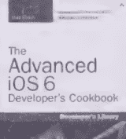

《Advanced iOS 开发实战指南》，第四版

Erica Sadun

ISBN-13: 978-0-321-88422-0


《Learning iOS Design》

William Van Hecke

ISBN-13: 978-0-321-88749-8


《iOS Programming: The Big Nerd Ranch Guide》，第三版

Joe Conway and Aaron Hillegass

ISBN-13: 978-0-321-82152-2


《Xcode Unleashed》

Fritz Anderson

ISBN-13: 978-0-672-33227-9


《Cocoa Programming for Mac OS X》，第四版

Aaron Hillegass and Adam Preble

ISBN-13: 978-0-321-77408-8


欲了解更多信息并阅读示例，请访问 `informit.com/learnmac`。

书籍亦可在 `safari.informit.com` 购买。


注册您拥有的 Addison-Wesley、Exam Cram、Prentice Hall、Que 和 Sams 产品，以解锁巨大的福利。

注册产品可以解锁以下福利：

- 获取补充内容，包括额外章节和源代码。

# Programming/Objective-C

# Effective OBJECTIVE-C 2.0

## 使用 Objective-C 2.0 编写真正优秀的 iOS 和 OS X 代码！

**Effective Objective-C 2.0** 将帮助你充分利用 Objective-C 的表达能力，编写出在生产环境中运行极佳 OS X 或 iOS 代码！Matt Galloway 借鉴 Scott Myers 畅销书 *Effective C++* 中开创的简洁、场景驱动的风格，带来了 52 种独有的 Objective-C 最佳实践、技巧、快捷方法和真实的代码示例，这些内容在其他地方是找不到的。

通过真实案例，Galloway 揭了一些鲜为人知的 Objective-C 特性、陷阱和复杂细节，这些特性对代码行为和性能产生巨大影响。你将学习如何在存在多个选项时选择最高效的方法来完成关键任务，以及如何编写更易理解、维护和改进的代码。Galloway 的内容超越了语言本身，帮助你整合并利用 Foundation 框架类以及现代系统库（如中央调度调度 Grand Central Dispatch）。

内容涵盖：

- 优化 Objective-C 对象之间的交互和关系

- 精通接口和 API 设计：编写感觉“如归其位”的类

- 使用协议（protocols）和分类（categories）编写可维护、防臭虫的代码

- 避免即使在使用自动引用计数（ARC）也可能发生的内存泄漏

- 使用 Blocks 和 Grand Central Dispatch 模块化、强大的代码

- 利用 Objective-C 协议与其他语言多重继承之间的差异

- 通过更有效地使用数组、字典和集合来改进代码

- 挖掘 Cocoa 和 Cocoa Touch 框架中惊人的力量

> **Matt Galloway** 是一位软件工程师和编程爱好者，专精移动应用开发。他于英国剑桥大学学习工程，并于2007年毕业，专攻电子和信息科学。他拥有一咨询公司 Swipe Stack Ltd，并在 Stack Overflow (stackoverflow.com) 上回答关于 Objective-C、iOS 和 Mac 编程的问题。

`informit.com/esds` | `informit.com/aw` | `effectiveobjectivec.com`

封面设计：Chuti Praserthit

封面照片：Remy/ShutterStock


ISBN-13: 978-0-321-91701-0

ISBN-10: 0-321-91701-4

9780321917010

44.99 美元 | $46.99 加拿大

# Addison-Wesley

学无止

# PEARSON
