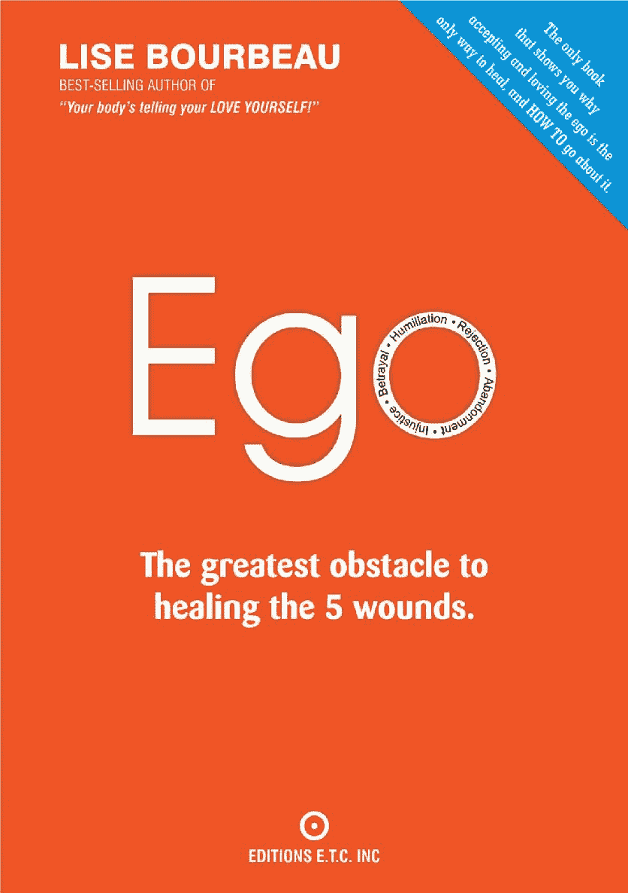
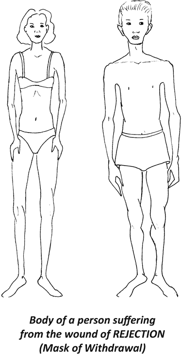
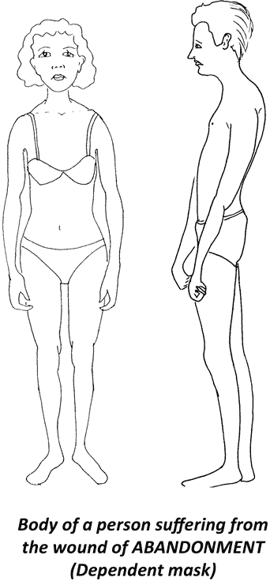
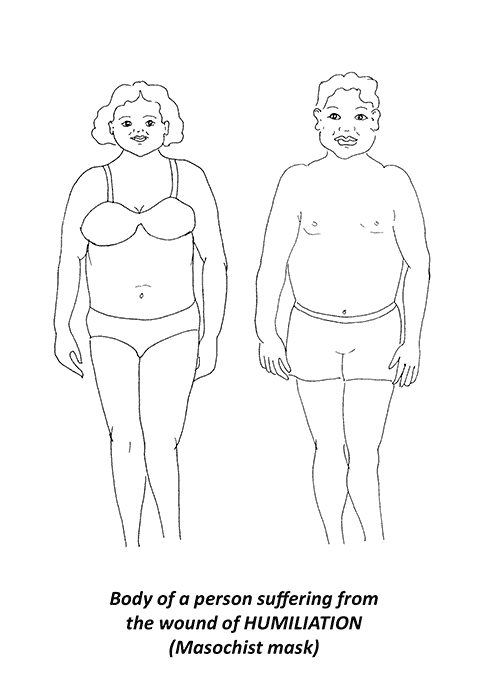
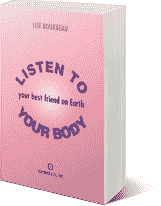
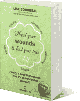
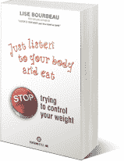
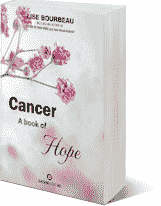
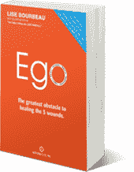

# 自我：疗愈五大创伤的最大障碍：羞辱、拒绝、遗弃、不公与背叛

首次印刷：2015 年

www.leseditionsetc.com 版权所有。未经出版者书面许可，不得以任何形式或手段（电子或机械方式，包括复印、录音或任何信息存储和检索系统）复制或传输本书的任何部分。

# 致谢

- **非常感谢**全球数千万读者，他们与我分享了发现灵魂五大伤口时是多么兴奋。你们表现出的兴趣和分享的故事鼓励我写了关于这个主题的第二本书。
- **感谢**所有的`听从你的身体`（Listen to Your Body）老师，他们与我分享了他们和参与他们在每年举办的多次工作坊中所得的。
- **感谢**数千万名参与者，他们向我提问并分享见解，这鼓励了我完善对`听从你的身体`的教学。
- 特别**感谢**我的侄子 Sylvain，他有一天问我什么时候会写关于伤口愈合的文章，这给了我所需的动力。我建议他以及其他向我提这个问题的其他人重读我的名为《治愈你的伤口并找到真实的自我》的书的最后一章，那一章正涉及这个主题。他回答说他已经读了好几遍，但补充说还不够，他厌倦了被自己的伤口所淹没。我觉得他的请求源自内心深处，而且对他来说在愈合过程中取得进步至关重要，我决定这将成为我下一本书的主题。
- **感谢**David Martin（渥太华 The Golden Pen Inc.），感谢你的专业精神和出色的翻译。
- **感谢**`Éditions ETC`的总经理 Jean-Pierre Gagnon，感谢他的卓越工作和持续支持。
- **感谢**`听从你的身体`的首席执行官也是我的女儿，她创作了书封面，从我的第一本书开始，她一直为我的大多数其他书籍创作封面。

## 序言

自从写第一本关于灵魂五大伤口的书以来，已经过去了十四年。我决定是与你们分享我这段时间所取得的许多发现，并特别强调这些让许多人遭受痛苦的伤口的愈合问题。

《治愈你的伤口并找到真实的自我》在法语国家和几个外国国家继续创下销售记录。到 2014 年我写这本书时，它已经被翻译成 16 种语言。我意识到，仅仅用一个章节来治愈伤口似乎是不够的，因为我经常被问：“我们该如何愈合我们的伤口？”

如果你还没有读过第一本书，我强烈建议你读读它，因为我无法在第二书中重复它包含的所有信息。在第一章中，我准备了主要特征的简要概述，以刷新读者的记忆，但我仍然建议你阅读或重读我关于该主题的第一本书。当自我面对伤口时，它的反应是如此恐惧，以至于会竭尽全力阻止我们理解，或误解所所说或所写的内容。

在第三章中，我将提供更多关于自我对维持伤口影响的细节。在阅读这本书时，你有时可能会觉得我说的和第一本书中的不完全一样。请不要担心相信哪一个版本。目前的版本绝对是应该采用的，因为我在过去发现了许多我未曾察觉的细微差别。

通过这些年来，我和我的老师们举办了成千上万次工作坊，我可以根据我们个人观察到的以及参与者分享的内容，对伤口进行非常具体的阐述。在这本书中，你将学习如何处理人性维度，即特定的行为意味着`拒绝`，而另一种行为意味着`遗弃`。当你拥有全局视角并从新角度观察个人和情况时，现实情况是完全不同的。

在阅读这本书时，你有时可能会觉得我说的和第一本书中的不完全一样。请不要担心相信哪一个版本。目前的版本绝对是应该采用的，因为我在过去发现了许多我未曾察觉的细微差别。

由于通过这些年来，我和我的老师们举办了成千上万次工作坊，我可以根据我们个人观察到的以及参与者分享的内容，对伤口进行非常具体的阐述。在这本书中，你将学习如何处理人性维度，即特定的行为意味着`拒绝`，而另一种行为意味着`遗弃`。

# 第一章：回顾五大伤口

首先，我提醒你们，我们每个人来到这个世界都带着必须学会接受的伤口。这些伤口在多次轮回中形成，取决于我们的生命计划，某些伤口会比其他造成更多的痛苦。对于我们每个人来说，痛苦是一个程度问题，我们大多数人并不知道痛苦源于哪里，也不知道该做什么停止它。我们所知道的只是许多人和情况导致我们产生反应，从而遭受痛苦。这就是为什么发现我们痛苦之源是如此有趣的。

它们被称为灵魂伤口，因为当我们允许自我引导生活时，灵魂无法再忍受反复从它的生命计划中被移除。灵魂之所以痛苦，是因为它的轮回的目的是生活在真爱和自我接受之中。

灵魂痛苦的方式不同，取决于激活的伤口。最不幸的是，当我们允许自我说服它正在减轻我们的痛苦时，事实恰恰相反。

**自我无法感受灵魂的痛苦。它只为自己活着。它的主要感来源是正确的。**

自我避免让我们感到伤口引起痛苦的优选方法是在每次激活时都让我们戴上面具。它真诚地认为它正在保护我们，却没有意识到这样做所做的只是维持和滋养伤口。你对伤口的投入越多，它就越疼。我们的反应越快越强烈，持续的时间越长。

为什么有些人比其他人承受更多痛苦？是因为有些人更容易暴露于某些伤口。这也是因为有些人能更好地应对痛苦。然而，共同点是我们都有伤口。

识别激活了哪种伤口以及如何接受它将对你有帮助。当伤口被激活时，你会惊讶地发现你可以很快给伤口上药以结束你的痛苦。这种药被称为接受。当伤口被激活时，它们的强度会逐渐减轻，痛苦减少。

我假设你已经意识到接受的力量，因为这是我的每本书和所有工作坊中反复出现的话题。我们不断地讨论它，是因为自我记得过去的痛苦，并导致我们忽略新事物。请注意，任何男性的指代同样适用于女性，除非特别说明。

为了帮助你更意识到你每处伤口的意义（这也是我写这本书的另一个原因），我将引用许多伤口激活案例。多年来，我经常向熟悉主题的人问以下问题：“你注意到你刚才描述的情况中影响了哪种伤口吗？”那个人会非常惊讶地看着我，因为他们只考虑了自己的不耐烦，例如。这是我们自我的一个很好的例子，阻止了我们意识到伤口激活的每一次。

当你没有意识到它们正在让你遭受痛苦时，你如何能逐渐愈合你的伤害呢？现在你唯一需要做的就是敞开心扉继续阅读。你会发现每一章的末尾都提供了一个空白页，你可以在上面写下读完该章后`决定`应用到生活中的内容。我提醒你，为了尝试具体且有利的改变，你必须`决定`在日常生活中采取不同的做法。你必须接受过去未能做出改变。

**两件事是无限的：宇宙和人类的愚蠢；我不确定宇宙。**
爱因斯坦

他们与你在一起，正如你与他们以及与你自己在一起一样。痛苦的程度——恐惧

以及情感——它们是完全相同的。以下是每种伤口和每种面具特征的总结，你在阅读本书时可以参考。记住，一旦伤口被激活（无论是由你还是他人触发）——我们就会戴上面具来保护自己。我们的自我欺骗我们，让我们认为自己没有任何伤口，并深信否认会让痛苦减轻一些。**我们会竭尽全力忽略这个伤口，特别是不要去感受它，同时也相信别人既看不见也感受不到它。** 每种面具的特征与我第一书中出现的那些略有不同，因为它们包含了自第一本书出版以来我所有的研究和观察结果。

## 拒绝的伤口 (THE WOUND OF REJECTION)

**伤口的觉醒：** 从胚胎到一岁。孩子感到被同性父母拒绝，并且不相信自己存在的权利。

**面具：** `withdrawal`（退缩）
**最大的恐惧：** `panic`（恐慌）
**面具被激活时伤口的态度和行为：**
* `退缩者` 坚信自己几乎甚至完全毫无价值。他们对现状不断感到不满意。他们认为自己一团糟，自尊心极低。
* 他们坚信如果自己不存在，也不会产生太大影响。他们认为自己与家中的其他人不同。
* 他们感到被他人隔绝和误解，甚至被整个人类误解。在群体中，他们经常感到孤独、担心和兴奋。
* 他们发展出了几种逃避机制（药物、酒精、睡眠、白日梦、逃离现场、虚拟游戏等）。
* 他们会无意识地诉诸否认来保护自己。他们可以通过躲进幻想世界或做白日梦（星际世界）来轻易地与外界隔绝。他们甚至会怀疑自己在地球上做什么，或者认为自己进错了家庭。
* 当他们独自一人时，会被情绪淹没，尤其是恐惧。
* 他们对物质上并不重视：任何与精神或智力世界有关的事对他们来说更有吸引力。
* 他们有非常丰富的想象力，遗憾的是，他们用它来轻易创造被拒绝的场景。
* 他们无论有意识还是无意识，都认为幸福是短暂的。
* 他们通常话不多，并缩进群体中。他们害怕打扰他人或表现得没趣。他们被视为独行者并被冷落。他们越孤立自己，看起来就越透明。
* 在大声说话或变得具有攻击性的人面前，他们会在恐慌之前迅速抽离该情境。
* 当人们看着他们时，他们会立刻担心自己是什么样的人。
* 他们拥有神经能量，使他们处理巨大的工作。他们觉得只有在非常忙时自己才存在，这有助于他们将自己锚定在物质世界中。
* 他们是完美主义者，随着年龄增长，他们对于某一天可能无法应对生活的想法会变得更加恐慌。
* 他们倾向于认为自己错过了人生的使命。
* 他们对拒绝的恐惧让他们在某些情况下变得偏执。
* 他们经常使用以下词汇：`nil`（零）、`nothing`（无）、`disappear`（消失）、`non-existent`（不存在）、`no room`（无空间）、`worthless`（毫无价值）等。

**体态描述：**
* 身体瘦小、窄且非常纤细
* 上身收缩并前倾
* 身体某些部位较小
* 身体部位缺失（例如臀部、胸部等）
* 身体某些区域凹陷（胸部、背部等）
* 身体部分不对称
* 眼睛小且飘忽
* 眼睛周围有面具（眼下深层眼袋）
* 声音虚弱且暗淡
* 皮肤问题（尤其是脸部）
* 喜欢黑色衣服

## 遗弃的伤口 (WOUND OF ABANDONMENT)

**伤口的觉醒：** 一岁到三岁之间，与异性父母。孩子在爱与连接中遭受异性父母缺乏的支持。他们被剥夺了情感滋养，或者接收到了不温暖或不符合预期的情感形式。

**面具：** `Dependence`（依赖）
**最大的恐惧：** `Solitude`（孤独）
**面具被激活时伤口的态度和行为：**
`依赖者` 难以独立运作，非常害怕孤独。他们寻求陪伴和关注。他们特别需要周围人的支持。
* 无论是否独自一人，他们经常会陷入深切的悲伤中，并真的不知道为什么。
* 当他们独自一人时，他们会哭很久，却没有意识到自己在怜悯自己。
* 他们会无意识地制造戏剧冲突或疾病来吸引同情和关注。他们发展出受害者心态，认为是因为自己运气不好。
* 他们很容易与他人建立联系，试探对方的情绪，并利用自己的问题来吸引关注。
* 他们在表达自我时表现出明星性的一面（通常是戏剧化的），以吸引关注。他们喜欢在群体中谈论自己，经常将所有话题转回自己身上。
* 他们在身体上依附他人，难以独立完成或决定某事。
* 他们经常向他人寻求建议或意见，甚至可能表现得无能，以此获得帮助，而不是因为他们无法完成手头任务。他们很可能之后根本不会遵循建议，因为他们寻找的只是关注。
* 当他们照顾或帮助某人时，他们的希望是那个人会回报照顾他们。
* 他们情绪起伏很大：一天开心，第二天不开心。他们很容易被自己的情绪扰乱。
* 结束关系的困难让他们做出很多挣扎以避免变得孤独。
* 他们认为如果有人认同他们，那就是被爱的证明。
* 在一个愤怒或具有攻击性的人面前，他们会蜷缩，表现得像个害怕的孩子。
* 随着年龄增长，他们对孤独感到越来越焦虑。他们选择忍受困境而不是孤独。
* 他们经常使用这些词汇和表达：`alone`（孤独）、`absent`（不在）、`I’t put with`（无法接受）、`they don’t leave me`（他们没有离开我）、`I let down`（我失望了）等。

**体态描述：**
* 身体长瘦
* 肌肉不发达
* 手臂看起来太长且下垂
* 圆肩
* 背部前弓
* 身体部分下垂或无力
* 身体比正常矮
* 大而下垂的眼睛
* 哀怨的声音
* 喜欢宽松的衣服

## 羞辱的伤口 (WOUND OF HUMILIATION)

**伤口的觉醒：** 一岁到三岁之间，与剥夺了所有快乐形式的父母。这处伤口可能发生在与父母（或双方）相处时。这是一个在父母那里遭受了羞辱的孩子，他们的自由被一种压抑和烦恼的态度剥夺了。

**面具：** `Masochism`（受虐）
**最大的恐惧：** `Freedom`（自由）
**面具被激活时伤口的态度和行为：**
`受虐者` 拥有良好的灵魂，但经常出于恐惧表现出来。他们相信上帝（或家庭）在不断观察和审判他们。他们竭力想在爱的人眼中变得值得的。
* 他们脱离自己的脆弱，寻求假装坚强。他们特意让人知道自己的能力。
* 他们以一种被认为非常有责任的方式表现。他们认为通过负责就可以成为领导者。事实上，他们是不负责任的，因为他们指责并将责任推给他人。他们很容易想出办法避免被指责。
* 他们寻求变得特别和重要。他们追求荣誉和头衔，从而在群体中吸引大量关注。
* 他们很容易被富有或出名的人吸引，并轻易信任他们。他们放下防备，如果他们失望了，就会变得多疑。
* 名誉对他们非常重要。如果他们感到名誉受到威胁，他们愿意损害他人的名誉。
* 他们很容易撒谎来摆脱困境。然而，他们无法忍受他人撒谎。困扰他们的是谎言而不是行为。例如，如果丈夫欺骗妻子，她会比行为更难过。
* 他们对他人有很多期望，并且很挑剔。当他们授权时，他们要求按照他们喜欢的方式和速度完成，以便感到优越和重要。他们缺乏信任使他们不断检查。
* 他们喜欢预判一切以获得更好的控制。他们无法忍受他人加入并破坏他们的计划。他们很难接受意外。
* 他们认为自己是不可或缺的，并喜欢认为没有他们就不会成功。
* 他们敞开心和承认事情很困难，因为他们不想这样做。
* 随着年龄增长，他们对孤独感到越来越焦虑。他们选择忍受困境而不是孤独。
* 他们经常使用这些词汇和表达：`alone`（孤独）、`absent`（不在）、`I’t put with`（无法接受）、`they don’t leave me`（他们没有离开我）、`I let down`（我失望了）等。

**体态描述：**
* 超重但圆圆的
* 身材矮小
* 圆圆的脸
* 圆睁睁的眼睛，反映出孩子的天真
* 脖粗
* 上背有驼背
* 身体部分圆润或圆圆的
* 经常穿紧衣服，这凸显了身体
* 经常弄脏衣服
* 平滑的声音

## 背叛的伤口 (WOUND OF BETRAYAL)

**伤口的觉醒：** 两岁到四岁之间，与异性父母。一个失望的孩子，未能从异性父母那里得到他们认为应有的关注。他们在爱性关系中感到被背叛或被操纵。由于目睹了未兑实现的承诺、谎言或虚弱的表现，他们对这位父母失去了信心。他们认定父母没有承担他们的责任。

**面具：** `Control`（控制）
**最大的恐惧：** `Dissociation, separation and disavowal`（分离、隔离和否认）
**面具被激活时伤口的态度和行为：**
`控制者` 竭力说服他人他们性格坚强。他们利用领导特质来强加意志。
* 他们脱离自己的脆弱，寻求假装坚强。他们特意让人知道自己的能力。
* 他们以一种被认为非常有责任的方式表现。他们认为负责。事实上，他们是不负责任的，因为他们指责并将责任推给他人。他们很容易想出办法避免被指责。
* 他们寻求变得特别和重要。他们追求荣誉和头衔，从而在群体中吸引大量关注。
* 他们很容易被富有或出名的人吸引，并轻易信任他们。他们放下防备，如果他们失望了，就会变得多疑。
* 名誉对他们非常重要。如果他们感到名誉受到威胁，他们愿意损害他人的名誉。
* 他们很容易撒谎来摆脱困境。然而，他们无法忍受他人撒谎。困扰他们的是谎言而不是行为。例如，如果丈夫欺骗妻子，她会比行为更难过。
* 他们对他人有很多期望，并且很挑剔。当他们授权时，他们要求按照他们喜欢的方式和速度完成，以便感到优越和重要。他们缺乏信任使他们不断检查。
* 他们喜欢预判一切以获得更好的控制。他们无法忍受他人加入并破坏他们的计划。他们很难接受意外。
* 他们认为自己是不可或缺的，并喜欢认为没有他们就不会成功。
* 他们敞开心和承认事情很困难，因为他们不想这样做。

## 不公正的伤口 (WOUND OF INJUSTICE)

**伤口的觉醒：** 一岁到三岁之间，与剥夺了所有快乐形式的父母。这处伤口可能发生在与父母（或双方）相处时。这是一个在父母那里遭受了羞辱的孩子，他们的自由被一种压抑和烦恼的态度剥夺了。

**面具：** `Masochism`（受虐）
**最大的恐惧：** `Freedom`（自由）
**面具被激活时伤口的态度和行为：**
（注：此处原文文本严重重复且混乱，已根据上下文逻辑进行处理）

| 焦躁 | 侵略性 | 惊讶 |
| :--- | :--- | :--- |
| 矛盾 | 愤怒 | 恼怒 |
| 傲慢 | 焦虑 | 震惊 |
| 宽心 | 羞愧 | 惊奇 |
| 苦涩 | 冷静 | 同情 |
| 关注 | 信心 | 困惑 |
| 悔恨 | 崩溃 | 好奇 |
| 防御 | 喜悦 | 气馁 |
| 抑郁 | 绝望 | 疏离 |
| 坚决 | 可恶 | 失望 |
|  {离 | 厌恶 | 灰心 |
| 沮丧 | 迷失方向 | 不信任 |
| 怀疑 | 动态 | 紧张 |
| 尴尬 | 活力充沛 | 爱好者 |
| 嫉妒 | 狂喜 | 逃避 |
| 愤愤 | 兴奋 | 精疲力竭 |
| 恐惧 | 虚弱 | 奉承 |
| 自由 | 惊恐 | 挫败 |
| 狂怒 | 快乐 | 感激 |
| 有罪感 | 幸福 | 空虚 |
| 希望 | 敌对 | 惊骇 |
| 匆促 | 痛苦 | 愚痴 |
| 不耐烦 | 印象深刻 | 被囚 |
| 无能 | 不可信 | 犹豫不决 |
| 漠不在 | 无辜 | 不安全 |
| 无忧无虑 | 感兴趣 | 嫉妒 |
| 懒惰 | 孤独 | 痛苦 |
| 谦虚 | 消极 | 紧张 |
| 被冒犯 | 被压迫 | 乐观 |
| 措手不及 | 激情 | 平静 |
| 困惑 | 愉悦 | 积极 |
| 占有欲 | 全神贯 | 审慎 |
| 释然 | 动不安 | 休息 |
| 浪漫 | 悲伤 | 满意 |
| 害怕 | 感性 | 震惊 |
| 害羞 | 抱歉 | 强壮 |
| 固执 | 困住 | 呆口 |
| 愚蠢 | 顺从 | 惊讶 |
| 怀疑 | 紧张 | 惊恐 |
| 深思 | 疲惫 | 折磨 |
| 烦恼 | 不确定 | 不快乐 |
| 不公 | 不公平 | 忧心 |
| 无用 | 脆弱 | 警惕 |
| 虚弱 |  {缩 | 筋疲力尽 |
| 忧虑 | 无价值 | 受伤 |

以下情感是对他人的反应，隐藏了更深层次的情感：

| 被遗弃 | 被虐待 | 被指控 |
| :--- | :--- | :--- |
| 被认可 | 假装 | 被攻击 |
| 被轻视 | 背叛 | 被责备 |
| 被欺骗 | 被安慰 | 满足 |
| 崩溃 | 被贬低 | 被渴望 |
| 被鄙视 | 被讨厌 | 被削弱 |
| 肮脏 | 被否认 | 被支配 |
| 被击回 | 被丢弃 | 被推开 |
| 被排除 | 被骚扰 | 被羞辱 |
| 被忽视 | 被侮 | 被恐吓 |
| 被侵入 | 被激怒 | 被审判 |
| 被操纵 | 被虐待 | 被误解 |
| 被忽略 | 被滋养 | 被冒犯 |
| 被保护 | 被推回 | 被拒绝 |
| 被嘲笑 | 安全 | 被窒息 |
| 被偷 | 被困 | 被威胁 |
| 被利用 | 被侵犯 | 被欢迎 |

确定你感受到的情绪将使你能够容易地发现你个人在恐惧什么。**我们从不为他人恐惧。我们认为自己害怕可能发生在他们身上的事情，但事实上，我们害怕的是这些事对我们自身产生的影响。** 重要的是，要意识到恐惧属于你的自我，而不是属于你的真我，除非是在处理眼前的危险时所必需的实际恐惧。如果你找不到自己恐惧什么，不要执着于此，先放下它。

在接下来的几天里，你可以多问自己几次：*在这种情况下，我个人上在害怕什么？* 如果答案没有立即出现，意味着你还没有准备好接受它。在这种情况下，我建议你不要强迫。你还没有准备好接受。相反，请请求你内在的神灵帮助你，很大可能，答案会在第二天或几天后立即来到你面前。通常，它会以提问的形式出现：*难道我是害怕……吗？* 这就是你的答案。

## 第三步：评判、指控、反应

* *在这种特定情况下，我正在评判或指控谁？*

当你特别出于恐惧而评判自己时，对被拒绝和或被遗弃的伤口的反应是罪魁祸首。当你出于羞愧而评判自己时，是对侮辱伤口的反应。

当你出于愤怒指控异性成员时，背叛的伤口在起作用，你戴着 `controller`（控制者）面具。你可以发泄你的愤怒反应、反抗，或者将其压抑在心里。然而，即使你忍着并在计划报仇，或者将对峙推迟到以后，你感受到的痛苦同样剧烈。忍受会产生更多的内在痛苦，你花的时间越长，问题通常就增长得越大。

当你出于愤怒指控自己或同性人员时，不公的伤口被唤起，`rigid`（僵硬）面具正在控制着你。你通过辩解自己或指责对方做出明显的反应。你的反应从一开始可能看起来很明显，或者你可能会刻意克制，打算稍后爆发。即使你克制了，它在你的手势、眼神和肢体语言中也显而可见，反映了你内心压抑的愤怒。

确定指控和评判针对的是谁将最有效地帮助你找到是哪个伤口被激活了。然后，你保护自己免受这种伤口的行为将帮助你发现你所戴的面具。除了阅读和反复阅读这份感受清单外，你应该多次阅读第一章中描述的行为和态度，以及第五、六、七章中的额外解释。

### 不要将评判与伤口混淆

我重申，区分评判与伤口对于确定你戴着什么种面具至关重要。

让我们看看 Renee 的例子，她和老板相处得很艰难。老板无视她，在和她说话时甚至不看她一眼。他显然更喜欢她那个很漂亮的同事。对 Renee 来说，工作环境变得越来越情绪化，她把这种情绪带到了家里。她无法停止思考正在发生的一切，`Canta` 侵扰着她的大脑。

* *我不明白他为什么那样对待“我”，毕竟我为他做了那么多。*
* *为什么他只夸奖 Suzanne，而我才是帮她工作的人？Suzanne 为什么不告诉他我才是那个值得夸奖的人？她竟然还有脸大着微笑接受了赞美。真虚虚伪！更糟糕的是，她经常告诉“我”我有她这样的同事很幸运。我知道她告诉我只是为了继续得到我的帮助。*
* *此外，当有紧急任务时，必须留得久是我。他似乎甚至没想过让 Suzanne 加班。*
* *今天真是够绝了！他竟然还有脸从头到脚审视着我，一边说：“Elena，你今天看起来很棒。”他们面面相觑，带着嘲讽的冷笑。我宁愿他什么都不说，也不愿听这种话。那句赞美完全弥补不了过去两年和他共事的其他所有日子。*
* *我想我要辞掉这份工作。我受够了这样被侮辱和被拒绝。*

Renee 很容易得出结论，这些情况引发了她的侮辱伤口。尽管她觉得这种情况是受侮辱的，但其他的伤口也被激活了。

让我们从她的老板开始。由于她没有对他做出反应并将一切都压抑在心里，他的行为特别激活了她的拒绝伤口，她戴着 `withdrawer`（退缩者）面具。她退缩并远离。她可能完全没有意识到自己内心深处怀有的那些评判。

* *显然，在长相上我完全比不上 Suzanne。我是是如此平庸无奇，难怪他更喜欢她。*
* *为什么我没有骨气为自己辩护，告诉他他的态度对我伤害有多大？今天，我本可以用这样的话回敬他的虚伪夸奖，比如：“谢谢过去两年来所有的关照顾。”我知道这听起来很讽刺且无礼，但至少这能告诉他我不是一个软柿子，不是任由每个人来欺负我。*
* *我已经向自己承诺过无数次，在他要求我为他做一切时说不，而 Suzanne 在他周围时要么在打电话，要么在修指甲，要么在假装工作。为什么我做不到承诺？天哪，我真蠢！*

Renee 正用拒绝来责备自己，并允许 `Canta` 说服她这种愚蠢就是事实。除非她意识到自己真正经历什么，否则她将无法改变自己的态度。她只是看着自己轨道之外发生的事情。此外，她甚至无法想象她的老板对她的工作是满意的，这正是她被赋予最重要任务的原因。他没有开除她这一事实就是对他满意的另一个证明，而她看不到。

她在老板身上经历的拒绝类型，反映了她童年或青少年时期与父亲或男老师关于学业或任何其他形式的学习活动时的经历。拒绝和不公的伤口可以追溯到同性父母身上。然而，如果同性父母没有介入帮助，异性父母（或其他人）也可以激活这些伤口。如果 Renee 以讽刺和反应的方式回答老板，这可能归因于她的背叛伤口。只有当 Renee 意识到她真正体验了什么，她才能信任自己可以做重要的事情。

关系伤口与童年的情感经历有关。职业伤口与所有形式的学习有关。Renee 不反抗 Suzanne 的事实也可以追溯到她的拒绝伤口。

### 恶化伤口
（注：此处后续原文为大量重复词汇，未翻译无意义内容）

# 与自己和解
来探索你目前的需求是什么，以及如何满足这些需求以感到良好和快乐。通过一步步，你将发现许多不同的工具，包括发现你到底有多爱自己的这一重要步骤。你将学习到，包括……
* 识别那些阻碍你幸福的恐惧和信念；
* 发现是什么阻碍了你成为你想成为的人；
* 处理不满情绪并达到宁静；
* 使用简单且必要的工具与自己达成和谐。

勇敢迈出第一步，来学习如何与自己和谐并爱自己吧！

## 第二天：与他人和谐
来探索为什么你的人际关系以及你所处的处境并不如你所愿的那样。然后通过实验并一步步发现可能，以便你建立健康的关系并与他人达到健康的状态。你将学习到，包括……
* 真正的责任感，它将使你从罪恶感中释放出来；
* 达成协议的重要性，但也允许自己改变主意；
* 识别损害你关系的感情源以及如何处理它们；
* 两种改善关系的实证明方法。

将你困难的人际关系作为通向更好健康的跳板吧！你也可以从今天开始，做你自己！

访问我们的网站或致电：
1-888-437-8382 或 450-431-5336
listentoyourbody.net

## 同作者的其他书籍

### 听从你地球最好的朋友——你的身体

LISE BOURBEAU 牵着你的手，一步步引导你超越“背好自己的降落伞”，重新回到从宇宙源头流出的清澈、清新的生命之流中。她提供的不仅是修复你生活中问题的工具，更是为了为你的内心房子建立一个坚实的基础——一个延伸到全球村的基础。在本书书中，她帮助你与生命中最重要的人——你你自己，建立起一种亲密、丰有回报且强大的关系。

### 你的身体在告诉你：爱自己！

Lise Bourbeau 汇总了形而上学领域及其在身体中物理表现的 20 年研究，并将所有内容汇集在这部简单易读的参考指南——《你的身体在告诉你：爱自己！》中。自 1982 年以来，她成功地与超过 15,000 人合作，帮助他们挖掘特定疾病和病症的根本原因。这本关于 500 多种疾病形而上学原因的全面指南，是一部简洁且富有远见的著作，是真正意义上的心血结晶。

### 治愈你的伤口，寻找真实的自我

你是否有时觉得在个人成长中是在原地打转？你是否偶尔会看到一个问题再次出现，而你以为已经解决了它？也许是因为你没有找对地方。Lise Bourbeau 的这本新书与她的其他著作一样具体，证明了所有问题（无论是身体、情感还是心理上的）都源于五种重要的伤口：遗弃、抛弃、羞辱、背叛和不公。这本书包含了对这些伤口的详细描述，以及我们为了隐藏这些伤口而开发的面具。这本书将允许你踏上通往完全治愈的道路，通往你最终目标的道路：你真实的自我。

### 听身体的吃就好——停止尝试控制你的体重

这本书有许多目标：……
* 帮助你发现除了饥饿之外的六个让你想吃的理由；
* 展示你对食物摄入的控制程度，以及这如何对你产生不利；
* 教你快速识别阻碍你良好进食的情感伤口；并帮助你爱和接受你的身体，尤其是每一刻的你。

这备受期待的书提供了一个全新的视角来审视你与食物的关系。它揭示了人的身体、情感、心理和精神维度之间的联系，并可以借此帮助你发现自己在任何时刻的特定需求。

### 癌症——一本希望之书

对于癌症有一种不同的看法，你会怎么说？这个臭名昭著的词每年恐吓并继续恐吓着全世界数百万的人。为什么不把这种疾病（尽管它具有所有破坏性的影响）视为朋友，而不是一个必须斗争的敌人呢？你如何感知这个词完全是你自己的责任。这本书试图呈现一种与迄今为止写过的任何内容都不同的、新颖且不同的观点。事实上，Lise Bourbeau 使用了一种前所未有的方法，涉及基于她在过去三十年里听到的数千个癌症故事的“遗弃伤口”。癌症不是不可避免的命运，而是一个旨在帮助你恢复快乐和内心平静的信息。

### 自我——治愈五大伤口的最大障碍

它终于来了：这是 Lise Bourbeau 畅销书籍《治愈你的伤口，寻找真实的自我》期待已久的续作，该书于 2001 年出版，并翻译成 16 种语言，持续创下销量纪录。通过这本书，作者真的想帮助你发现你的自我对你可能产生的巨大影响和力量。她分享了丰富的个人经验，以指导那些寻找具体方法来治愈痛苦的人。你将学习识别五大伤口的运作机制，并能更好地判断它们何时阻碍了你仅仅做自己（即获得快乐）。通过应用建议的技术，你将意识到你的自我控制你思想、言语和行动的无数时刻：这是治愈并掌控你生活的关键条件，让你能够做真实的自我。

访问我们的网站获取更多信息
listentoyourbody.net

