# Ektron 开发者指南：构建基于 Ektron 的网站

在 `p2p.wrox.com` 加入讨论

# 致谢

| 角色 | 姓名 |
| :--- | :--- |
| 采购 | Paul Reese |
| 制作经理 | Tim Tate |
| 项目编辑 | Maureen Spears |
| 副总裁兼部门主管 | Barry Pruett |
| 技术编辑 | Jason Cicchetto |
| 副总裁兼出版经理 | Jim Minatel |
| 拷贝编辑 | Kezia Endsley |
| 项目协调员 | Katie Crocker |
| 编辑总监 | Robyn Sieks |
| 校对员 | Mary Beth |
| 编辑经理 | Johnna VanHouse |
| 索引员 | Nancy Carrasco |
| 自由职业者 | Rosemary Graham |
| 封面设计 | Michael E. Trent |
| 营销副总 | David Mayhew |
| 封面图片 | © Petr Novotny/istockphoto.com |

# 作者

**BILL CAVA** 是 Ektron 的六年老兵。作为首席布道者，Bill 将他对互联网技术、WCM 和软件开发的激情投入 Ektron。在此之前，Bill 担任首席技术官，负责公司的技术方向、产品策略和工程。在加入 Ektron 之前，他在互联网最早搜索引擎之一 Lycos 担任首席工程师。职业生涯早期，他在智能检索中心担任研究员。他拥有信息检索专利，并担任多家公司的技术顾问。在马萨诸塞大学阿伯丁分校就读期间，Bill 学习了意大利文学、美术和计算机科学。

**BILL ROGERS** 于 1998 年创立 Ektron，愿景是：如今，Rogers 变革了组织创建和管理交互式 Web、内网和外网网站的方式。他指导 Ektron 创建了一个 Web 内容管理软件平台，该平台提供了网站管理员、设计师和开发者所需的所有功能，同时尽可能地减少了非技术用户面临的复杂性。在担任首席执行官期间，Rogers 积极致力于成为 Web 内容管理市场和技术领导。他设定了公司的战略方向，将产品开发与他对网站技术的前瞻性相结合，并参与 Ektron 运营的各个方面。此外，他经常参加行业活动，并征集 Ektron 客户和合作伙伴的反馈，以保持 Web 技术开发的领先。Rogers 在波士顿大学获得电气工程学士学位。

**ANIEL SUD** 自 2002 年进入 WCM 行业，并在 Ektron 工作了四年。作为 Ektron 的 CMS 架构师，他构思了 Ektron PageBuilder 等新功能并将其变为现实。在成为 CMS 架构师之前，ANIEL 担任 Ektron 的技术布道者，在该职位上，他通过贸易演讲、本地用户小组和一对一咨询帮助客户理解让 Ektron 使生活更轻松的方法。在加入 Ektron 之前，ANIEL 共同创立了 Firewall Pro，这是一家专门从事营销和内容管理系统的精锐 Web 开发公司。他在德雷塞尔大学获得计算机工程学士学位。

# 技术编辑简介

**JASON ARDEN** 于 2006 年加入 Ektron，目前担任合作伙伴工程总监。合作伙伴工程团队是 Ektron 完整服务和支持方案的关键部分，该团队让 Ektron 确保其合作伙伴能够成功部署 Ektron 解决方案。在领导 Ektron 工程团队之前，Arden 先生曾担任首席咨询销售工程师，在售前全生命周期内与 Ektron 的合作伙伴和潜在客户进行合作。在加入 Ektron 之前，Jason 曾是北美放射学学会的 IT 员工。他拥有德弗里大学的网络与电信管理学士学位。

**JOSEPH CICCHETTO** 是 Ektron 的高级 CMS 架构师，负责监督专业服务组的企业架构团队。Joe 负责制定架构标准，并担任企业解决方案的首席架构师。在加入 Ektron 之前，Joe 曾担任 Softmedia 的工程总监，在软件开发和项目管理方面拥有广泛的背景。Joe 在波士顿大学本科期间学习计算机科学。

# 致谢

**我们要感谢** Wrox 的全体员工，特别是 Paul Reese、Maureen Spears 和 Kezia Endsley。Maureen 和 Kezia 在编辑工作中发挥了关键作用，没有他们，编写这本书的过程将变得无比痛苦。在幕后，Anna Jeon 和 Fred Bals 付出了巨大努力帮助我们维护标准，并确保 Aniel 每次用介词结束句子时都会受到指责。

我们的技术编辑——Jason Arden 和 Joe Ciccchetto——也是将内容转换为可出版格式过程中的关键。没有他们，书中的代码示例可能根本无法编译。Ted Henry 和 Keith Pepin 在与作者合作方面也发挥了重要作用，确保内容的合理和正确。Brian Fanny 还提供了大量的投入，为我们提供了与部署和维护等相关的技术反馈和通用知识。

Brian Browning 的付出超出了预期，为第 2 章和第 3 章创建了大部分内容。作为 Ektron 的客户服务高级总监，他拥有独特的优势创建概述 Ektron 专业服务流程的内容。

Chris Banner、Bob Bolt、Bruce Bourdon、Doug Domeny、Steve Mann、Alpesh Patel 和 Justin West 都在帮助作者理解各种问题的各种技术方案方面发挥了核心作用，我们对他们的投入深表感谢。Scott Kearney 为电子商务相关内容提供了宝贵的见解，Joe Chestnut、Justin Ryan 和 Sanela Suljic 通过对我们在部署和维护方面的反馈给予了帮助。

# 第一部分：入门

## 第 1 章：介绍 EKTRON

- Ektron：公司
- Ektron 的社区、支持与服务
- Ektron 的在线社区
- Ektron 技术支持
- Ektron 的最佳实践与专业服务
- Ektron 培训
- 框架 Ektron
- 一站式对比 优选组合
- 使用 Ektron 框架进行开发
- 系统要求
- 谁在使用 Ektron?
- 核心要点

## 第 2 章：EKTRON Web 项目方法论

- 迭代/瀑布式对比 敏捷方法
- 业务案例：一切的开始地
- 理解实施过程
- 发现阶段
- 项目启动
- 制定项目计划
- 实施阶段
- 开始开发
- 内容迁移
- 质量保证阶段
- 系统测试
- 用户验收测试
- 核心要点

## 第 3 章：实施指南

- Ektron 的方法
- 实施指南
- OnTrek 实施指南
- 首页
- 产品页面
- 用户仪表板页面
- 核心要点：创建实施指南的最佳实践

## 第 4 章：配置你的开发环境

- 配置你的机器所需的工具
- 安装框架
- 开发场景
- 源码控制
- 数据同步
- 更多提示
- 核心要点

# 第二部分：构建 TECHPOINT 站点

## 第 5 章：理解内容管理基础

- 登录与工作区
- 登录并创建用户
- 探索工作区
- 内容输入与显示
- 内容存储与状态
- 添加与管理内容
- 使用内容块服务器控件
- 文件夹与库
- 实施：添加文件夹和管理库项
- 内部原理：文件夹与库
- 简述文件夹与库
- 权限、审批与角色
- 理解权限
- 理解审批链工作流
- 理解角色
- 管理权限与工作流
- 内部原理
- 核心要点

## 第 6 章：配置常用组件

- 智能表单
- 智能表单与 HTML 表单的区别
- 理解智能表单设计
- 创建智能表单设计
- 获取、处理和渲染结构化数据
- 实施
- 内部原理
- 分类法
- 内部原理
- 分类法简述
- 别名
- 基于分类法的别名
- 基于文件夹的别名
- 基于正则的别名
- 社区别名
- 实施
- 内部原理
- 多语言站点
- 创建多语言网站
- 显示的内容
- 实施
- 内部原理
- 核心要点

## 第 7 章：首页

- 用例
- 技术
- 使用旋转图形
- 添加导航
- 使用 jQuery、智能表单和处理程序进行交互
- 类型
- 首页轮播图
- 使用 XSLT 轮播图
- 使用菜单
- 全局菜单
- 内部原理
- 使用搜索进行导航
- 搜索策略
- 添加全局导航搜索
- 内部原理
- 站点地图与面包屑
- 创建面包屑
- 将面包屑关联到文件夹
- 创建站点地图页面
- 注册
- 在站点注册
- 用户修改个人资料
- 密码重置
- 实现 Facebook
- 核心要点

## 第 8 章：接触客户

- 用例
- 技术
- 列表摘要
- 实现列表摘要
- 使用 XSLT 修改标记语言
- 使用 EKML 修改标记语言
- 日历
- 创建系统日历、用户日历和小组日历
- 使用日历控件显示事件
- 使用列表摘要控件显示事件
- 使用内容块控件显示事件
- 显示即将发生的事件列表
- 输出 ICs
- 视频/客户证言
- 向文档管理系统 (DMS) 添加
- 修改管理对象的设置
- 显示管理对象
- Ektron 框架的替代方案
- 核心要点

## 第 9 章：通过活动优化生成销售

- 用例
- 理解技术
- 使用集合的实施
- 创建集合
- 添加到集合
- 将集合放在落地页上
- 自定义集合组件的展示
- 内部原理：集合数据模型
- 页面构建
- 创建线框
- 将线框关联到文件夹
- 根据线框创建布局
- 内部原理
- 组件
- 创建组件
- 内部原理：组件
- HTML 表单
- 创建表单
- 实施：“请求演示”
- 内部原理：HTML 表单数据模型
- 多变量测试
- 内部原理：多变量
- 多变量简述
- 网络分析
- 流量分析对比业务分析
- 统计报告
- 设置宽范围流量分析
- 衡量活动流量分析的有效性
- 内部原理：分析
- 核心要点

## 额外练习步骤

## 第 10 章：支持客户

### 了解技术

- 论坛
- 博客
- Wiki

### 用例案例

### 构建论坛

- 在工作区中创建论坛

### 博客

- 在工作区中创建博客
- 创建带有博客服务器内容的模板

### Wiki

- 在工作区中创建 Wiki
- 在站点中使用 Wiki 功能
- 创建新的 PageBuilder 页面
- 使用 Wiki 并创建链接
- 编辑现有内容

### 社交服务器控制

- 实现 SocialBar 小部件

### 内容标记与内容审核

- 设置标记定义
- 实现 ContentFlagging 和 ContentReview 服务器控制
- 运行标记和审核报告，并审核审核

### 要点总结

## 第 11 章：实现 OnTrek 社交网络

### 社交网络技术的重要性

### 用户、朋友与个人资料

- 理解加友过程
- 理解用户个人资料功能
- 配置社区成员模板
- OnTrek 的用户资料用户控制
- 内部原理

### 社区小组

- 用户如何发现社区小组
- 创建社区小组
- 配置社区小组模板
- OnTrek 的小组个人资料用户控制
- 内部原理

### 仪表盘

- 仪表盘上有什么？
- 使用仪表盘组件和小部件空间

### 活动流

- 利用活动流为你的优势
- 内部原理

### 微消息

- 微消息策略
- 在用户个人资料中添加微消息
- 内部原理

### 要点总结

## 第 12 章：为电子商务商店面创建产品目录

### 用例案例

### 了解技术

### 配置电子商务

- 管理主要配置选项
- 配置运输和税费设置

### 创建目录和产品

- 创建产品类型
- 创建目录
- 创建产品

### 优惠券

### 产品报告与订单管理

- 报告
- 订单管理

### 要点总结

## 第 13 章：使用电子商务构建在线商店面

### 用例案例

### 服务器控制与实现

- 浏览与维护控制
- 购买与维护控制
- OnTrek 电子商务实现

### 自定义工作流

- Windows Workflow Foundation 基础
- 创建自定义活动
- 构建工作流
- 在 Ektron 站点中使用自定义工作流
- 构建支付网关提供程序
- 支付网关简述
- 创建网关提供程序
- 将网关提供程序安装到 OnTrek 网站

### 要点总结

# 第三部分：部署 TECHPOINT 站点

## 第 14 章：部署你的网站

- 成功部署的前提条件
- 创建发现资料
- 完成开发流程
- 创建预发布环境
- 预发布环境内容
- 完成系统测试
- 理解不同的部署场景
- 理解基础术语
- 确定内容流
- 使用或不用 eSync 迁移内容
- 使用 eSync 迁移内容
- 不使用 eSync 迁移内容
- 部署
- 在另一个服务器上安装网站
- 服务器安全
- 要点总结

## 第 15 章：维护你的网站

- 创建有效的维护计划
- 采集数据
- 分析数据
- 根据数据采取行动
- 维护内容新鲜度
- 运行内容报告
- 执行“抽检”
- 维护可用性
- 维护性能
- 维护可用性
- 维护（并建立）触达率
- 在灾难恢复期间保持冷静

## 要点总结

## 第 16 章：下一步

- 回顾你所学的知识
- 与 Ektron 及在线社区联系

# 引言

本书的每一章都配有文档，以便你可以实现示例网站特定部分和功能。你可以在本地安装此网站，并在阅读本书时将其作为参考。各章节侧重于你掌握 Ektron 框架所需的技术材料。每个技术章节都遵循类似的模式，侧重于对一家虚构软件公司 OnTrek 的网站子部分进行实现，然后为围绕业务驱动的用例的教学创建一个有意义的上下文环境。

# 本书适合的读者

本书的目标受众是希望学习如何通过 Ektron 项目取得成功的 ASP.NET 开发者和技术项目经理。方法论章节的价值对技术项目经理来说可能尤为明显，但其编写方式同样吸引技术开发人员。开发者将非常欣赏其中的最佳实践、技巧和诀门、循序渐进的指令，以及对 Ektron 框架深层的“底层”原理剖析。

无论你是刚开始接触 Ektron 平台，还是在过去使用过它，本书都涵盖了最新的 Ektron 技术，对这两类读者都有裨益。读者不需要具备 Ektron 的经验，但他们应该具备使用 Visual Studio 和 C# 的当前 ASP.NET 开发者的经验。

# 本书涵盖的内容

本书涵盖了使用 Ektron CM5400.NET 8.0.2 版本构建和管理成功网站的理论与实践。本书分为三个部分，第一部分涵盖了 Ektron 开发方法论、开发环境考虑因素以及在实际开发之前其他感兴趣的项目。

第二部分讨论了 Ektron 框架的实际构建。在这一部分，你将接触到应用于 Ektron 框架的内容管理原则和概念，然后是每个主要功能。这些讨论侧重于后置代码、服务器控件和 PageBuilder 的结合，以实现各种目标。每个章节详细介绍了一个来自 OnTrek 启动站点的真实世界案例，然后在 OnTrek 站点中实现该功能，或分析其在站点中是如何实现的。

书中大部分讨论专门针对 Ektron 框架的 8.0.2 版本，但在大多数情况下，这些内容也适用于其他近期版本。在某些情况下，作者会讨论框架任何部分的之前的迭代，以帮助你理解技术现在是如何工作的。在其他情况下，他们会讨论技术将向何处发展。

# 本书的结构

本书将引导你完成使用 Ektron CMS 框架创建网站的过程。它分为三个主要部分。

# 第一部分：入门


此部分涵盖了与 Ektron、Ektron 框架以及用于 Ektron 项目的方法论相关的背景材料。该方法论将在第二部分中使用。

- 第 1 章：介绍 Ektron — 本章介绍了 Ektron 公司和 Ektron 框架。它让读者了解本书是如何编写的以及目标受众。它还涵盖了书的整体结构，介绍了 OnTrek 站点、业务驱动因素以及用例概述。
- 第 2 章：Ektron Web 项目方法论 — 本章介绍了 Ektron 推荐以及其专业服务团队遵循的方法论。它将讨论该方法的优缺点，并引导你完成适应过程以满足你的项目。
- 第 3 章：实施指南 — 本章介绍了一个虚构软件公司的网站，该网站被贯穿于书中的每个技术章节。它还展示了实施指南。
- 第 4 章：配置你的开发环境 — 本章介绍了在 Ektron 框架上开始开发所需的软件配置。

# 第二部分：构建 TechPoint 站点

第二部分建立在第一部分讨论的方法论之上（用于创建实施指南），该指南在整个实施过程中作为规范指南。每个章节涵盖站点的特定区域，根据实施指南实现功能。

第二部分的实施章节遵循一种模式，即它们概述了实施指南的一部分，从一个用例开始，该用例是开发站点特定区域的切入点。随后是本章中使用的功能的概述。然后将深入讨论每项单独的技术。章节以本章学习经验的总结结束。

- 第 5 章：理解内容管理基础 — 本章在 OnTrek 站点的背景下讨论了核心 Web 管理概念。
- 第 6 章：配置常用组件 — 本章在技术上更进一步，帮助你配置诸如 URL 对齐、结构化内容和多语言内容等项目。
- 第 7 章：首页 — 本章讨论了 OnTrek 站点访问量最高部分——首页的主要元素。这里的技术包括接口、用户注册和许多导航项。
- 第 8 章：接触潜在客户 — 这讨论了站点中专门向潜在客户介绍 TechPoint 产品和服务的区域。这包括视频交付、日历实现以及如 `ListSummaries` 等核心技术项。
- 第 9 章：通过活动优化生成线索 — 本章深入讨论了 `PageBuilder`，以及它如何与多变量测试和分析等能力配合。
- 第 10 章：支持客户 — 本章讨论了创建成功的客户支持门户的技术。它侧重于社区生成的内容以及编辑管理的信息。
- 第 11 章：实现 OnTrek 社交网络 — 社交软件已成为现代业务不可或缺的一部分。本章介绍了 Ektron CMS 框架的社交软件，并介绍了构建社区网络的过程。
- 第 12 章：为电子商务商店创建产品目录 — 本章讨论了如何使用 Ektron eCommerce 为 OnTrek 商店创建产品目录。它专注于配置而非开发。
- 第 13 章：使用电子商务构建在线商店 — 本章讨论了如何使用 Ektron eCommerce 实现 OnTrek 的在线商店。它专注于可用的服务器控件以及如何结合它们来创建一个有意义的购物体验。

# 第三部分：部署 TechPoint 站点

一旦完成实施，网站上线的过程就开始了——以及维护和报告。这些章节为你提供了继续实现网站设定目标的提示和技巧。

- 第 14 章：部署你的网站 — 本章讨论了部署完全开发并测试过的站点的过程。
- 第 15 章：维护你的网站 — 站点是动态的——一旦上线，就需要持续工作以确保内容保持相关性，并继续满足业务目标。
- 第 16 章：下一步 — 本章对所涵盖的信息进行了回顾，并为读者提供了学习更多 Ektron 的方向。

# 使用本书所需的工具

你需要在计算机上安装以下软件以运行书中的示例：

- `Ektron Framework 8.0.2` — 本书的当前版本为 8.0.2，所有的代码示例、截图和指令都是针对此编写的。如果你使用的是较早或较晚的版本，可能需要微调信息以适应新版本中提供的修改。
- `OnTrek` 启动站点：Ektron 为使用 Ektron 框架的开发者提供了几个启动站点，`OnTrek` 是这些启动站点之一，本书使用它来讨论框架提供的各种功能。如果你想完成书中的示例，建议安装它。
- `Microsoft Visual Studio`：如今有许多版本的 `Microsoft Visual Studio` —— 例如 `Visual Studio Web Developer Express` 版、`Visual Studio` 专业版以及面向架构师的 `Visual Studio`，仅列举几例。你至少需要 `Microsoft Visual Studio 2005` 或更高版本，建议你使用专业版，但免费的 `Web Developer Express` 版也适用于大多数示例。由于你正在创建 Web 项目，无法使用 `Visual Studio C# Express` 版或 `Visual Studio Basic`，因为它们缺乏创建 Web 项目、模板和资源的能力。
- `ASP.NET 3.5` 或更高版本：`Ektron Framework` 至少需要 `ASP.NET 3.5`，但你可以在 `.NET 4.0 Runtime` 上运行该框架以及书中的所有代码示例。

# 约定

为了帮助你从书中获得最大收益，并跟踪进展，我们在整本书中使用了一些约定。

> 带有警告图标的方框包含重要的、不容忽视的信息，这些信息与周围文本直接相关。

> 铅笔图标表示针对当前讨论的注释、提示、暗示、技巧和补充说明。

我们以这种格式使用用例（`Use Cases`）。用例展示了 Ektron 网站的潜在用户，并说明了用户可能如何接触和/或与网站交互。

关于文本中的样式：

- 我们介绍新术语和重要词汇时会进行高亮。
- 我们像这样显示键盘按键：`Ctrl+A`。
- 我们在正文中显示文件名、URL 和代码，例如：`persistence.properties`。
- 我们以两种不同的方式展示代码：
  - 对于大多数代码示例，我们使用不带高亮的等宽字体。
  - 我们使用粗体来强调**在当前语境下特别重要的**代码。

# 引言

# 源代码

在阅读此书时，你可以选择手动输入所有代码，也可以使用随书附的源代码文件。书中使用的所有源代码均可在 `www.wrox.com` 下载。你会发现，代码片段所在的源代码旁带有一个下载图标，并注明了程序名称，这样你就知道它是可以下载的，并可以在下载文件中轻松找到它。进入网站后，只需通过搜索框（或使用标题列表之一）找到书名，然后点击书籍详情页上的“Download Code”链接即可获取书的所有源代码。


列表标题中包含文件名。如果是代码片段，你将在如下所示的代码注释中找到文件名：

```
code snippet filename
```

> 由于许多书的标题相似，你可能会发现通过 ISBN 搜索最方便；此书的 ISBN 是 `978-0-470-88569-7`。

下载代码后，只需用你喜爱的压缩工具对其进行解压。或者，你也可以访问 Wrox 代码下载主页 `www.wrox.com/dynamic/books/download.aspx` 查看此书及所有其他 Wrox 书的可用代码。

# 勘误表

我们尽全力确保文本或代码中没有错误。然而，没有人是完美的，错误在所难免。如果你在我们的某本书中发现了错误（无论是拼写错误还是代码故障），我们将非常感谢你的反馈。通过提交勘误表，你可以为其他读者免除困扰，同时提供更高质量的信息。

要找到这本书的勘误页面，请访问 `www.wrox.com` 并使用搜索框或标题列表之一找到该书标题。然后在书籍详情页上，点击“Book Errata”链接。在该页面上，你可以查看已提交此书并由 Wrox 编辑器发布的所有勘误。

> 完整的书籍列表（包括指向每本书勘误页的链接）可在 `www.wrox.com/misc-pages/booklist.html` 获取。

如果你在“Book Errata”页面上没有发现“你的”错误，请访问 `www.wrox.com/contact/techsupport.shtml` 并填写表单向我们发送你发现的错误。我们将检查这些信息，并在适当的情况下在书籍的勘误页面发布消息，并在书籍的后续版本中修复该问题。

# P2P.WROX.COM

如作者和同行讨论，请加入 `p2p.wrox.com` 的 P2P 论坛。论坛是一个基于 Web 的系统，你可以在此发布与 Wrox 书籍及相关技术的消息，并与其他读者和技术用户交互。论坛提供订阅功能，可以在论坛发布新帖子时通过电子邮件将你感兴趣的帖子发送给你。Wrox 作者、编辑、其他行业专家以及你的读者们活跃在这些论坛中。

在 `p2p.wrox.com` 上，你会发现许多不同的论坛，它们不仅能帮助你阅读本书，还能帮助你开发自己的应用程序。要加入论坛，请遵循以下步骤：

1. 访问 `p2p.wrox.com` 并点击“Register”（注册）链接。
2. 阅读使用条款并点击“Agree”（同意）。
3. 填写加入所需信息以及你想要提供的可选信息，并点击“Submit”（提交）。
4. 你将收到一封电子邮件，说明如何验证你的账户并完成加入过程。

> 你可以在不加入 P2P 的情况下阅读论坛中的消息，但为了发布自己的消息，你必须加入。

一旦加入，就可以发布新消息并回复其他用户发布的消息。你可以随时在 Web 上阅读消息。如果你希望将特定论坛的新消息通过电子邮件发送给你，请点击论坛列表中论坛名称旁的“Subscribe to this Forum”图标。

有关如何使用 Wrox P2P 的更多信息，请务必阅读 P2P FAQ（常见问题解答），以获得有关论坛软件如何工作的答案，以及许多针对 P2P 和 Wrox 书籍的常见问题。要阅读 FAQ，请点击任何 P2P 页面上的 FAQ 链接。

# 第一部分：入门

- 第 1 章：介绍 Ektron
- 第 2 章：Ektron Web 项目方法论
- 第 3 章：实施指南
- 第 4 章：配置你的开发环境

# 第 1 章：介绍 Ektron

- 什么是 Ektron？
- Ektron 提供哪些支持和服务？
- 什么让 Ektron Framework 与众不同？
- 谁在使用 Ektron？

欢迎阅读第一本 Ektron 教程。正如引言中所述，本书的终极目标是让你深入理解如何通过你的 Ektron Web 项目取得成功。作为 Ektron Framework 的开发者，你不仅可以访问旨在帮助构建引人注目且互动良好的网站的完整软件套件，还可以获得一系列服务，来自在线开发者社区、Ektron 全球合作伙伴网络、最佳实践以及培训团队。理解 Ektron 不仅仅是一个框架，更是一个解决方案，是迈向成功的首要步骤。本章将对 Ektron 公司以及 Ektron 框架进行高层次介绍，让你了解什么是解决方案。

## Ektron：公司

Ektron 是全球 Web 解决方案的领导者，提供 Web 内容管理、营销优化和社交软件平台，成立于 1998 年，总部位于新罕布什尔州纳舒亚（Nashua, New Hampshire）。

Ektron 的创始人 Bill 和 Ed 是公司背后的动力，他们将产品开发与前瞻性视角相结合。他们在十年前创立了 Ektron，目标很简单：让技术人员能够发布内容。

Ektron 不仅仅是一个框架，更是一个解决方案，确保其客户和合作伙伴的成功。

## Ektron 的客户成功方法

Ektron 的客户成功方法围绕通过多种媒介保持持续对话展开。通过点对点交互、多级支持以及专业服务的可用性，Ektron 让获取帮助变得简单。

Ektron 提供软件产品和活跃的社区，确保他们 Web 项目的成功。

## Ektron 的社区与服务

Ektron 证明其理解通过社交网络（如 Twitter 和 Facebook）与其当前及潜在客户联系的重要性。在 Twitter 上，Ektron 可以与客户、合作伙伴以及潜在客户进行互动，并分享有关 CMS 和 Web 技术的信息。技术支持在 Twitter 上也起着重要作用，Ektron 通过与客户互动来推广 `Dev Center`——一个让客户相互帮助解决问题和提问通用点对点支持区域，并有 Ektron 支持人员的参与。

## Ektron 技术支持

当发现自己需要比在线社区所提供的更多支持时，请记住 Ektron 为所有签有效维护协议的客户提供全方位的技术支持。当客户购买产品时，第一年的维护已包含在初始许可协议中。为了保持维护协议激活，必须每年续签维护协议。这是一个非常明智的主意，因为这不仅让您获得访问 Ektron 技术支持的机会，还让客户能够下载所有当前及未来的软件版本，包括次要版本（服务包、维护发布版本）和主要产品发布版本（如 8.0、9.0 等）。鉴于 Ektron 具有每年至少发布一次新主版本软件的记录，保持维护协议激活状态也是一个具有成本效益的决策。Ektron 的技术支持时间为周一至周五，东部标准时间 (EST) 上午 8 点至晚上 8 点。此处列出了获取相关服务的多种方式。

### 电话支持

拨打 Ektron 技术支持电话几乎可以立即得到响应。所有电话都将路由到一名调度员，由其负责汇总案例信息（版本信息、症状、日志等）、验证维护协议是否有效并提供案例编号。一旦调度完成，支持团队将对信息进行审核，并分配一名技术支持工程师处理该案例，并在两小时内回复。对于需要快速响应时间的关键问题，应使用电话支持。东部标准时间 (EST) 晚上 7 点后提交的问题可能在第二天上午 8 点前无法得到回复，但将在下一个工作日优先处理。启动支持的电话号码为：

- 美国：`1866-4-EKTRON7002`
- 英国：`+44 1628 509 040`
- 澳大利亚：`+61 2 9248 7222`

请访问 Ektron 网站 `http://www.ektron.com/` 获取最新的联系信息。

### Web 表单支持

您也可以通过以下 Web 表单发起技术支持案例：`http://dev.ektron.com/requestsupport`。

Ektron 的服务水平协议 (SLA) 规定，通过 Web 表单发起的案例，分配的技术支持工程师必须在四到六小时内回复客户。表单提交后，将分配并立即返回案例编号。

### 电子邮件支持

当您有需要解决但不需要快速响应的技术支持问题时，发送电子邮件到 `support@ektron.com` 是很有用的。分配给案例的技术支持工程师必须在 24 小时内回复客户。

### 聊天支持

Ektron 网站提供在线聊天，时间为东部标准时间 (EST) 上午 8:30 至下午 5:30，用于基础问题。如果案例在会话中无法立即解决，技术支持工程师将创建一个案例，后续流程与通过 Web 表单提交的相同。

## Ektron 联系方式摘要

表 1-1 包含了联系方式列表。

**表 1-1：Ektron 联系方式**

| 联系方式 | 响应时间 | 联系方式详情 |
|---|---|---|
| 电话案例 | 1–2 小时 | `1-866-4-EKTR x7002` 或 `1-603-816-2048` |
| Web 表单 | 半天 | `http://dev.ektron.com/requestsupport` |
| 电子邮件 | 24 小时内 | `support@ektron.com` |
| 聊天 | 立即 | `http://dev.ektron.com/support` |

Ektron 技术支持部门致力于实现最高水平的客户满意度，并拥有许多注重质量的计划和流程，以确保支持超出客户预期。然而，在某些情况下，您的项目可能需要超出标准维护包支持水平的协助。在这种情况下，您应该考虑 Ektron 的最佳实践服务。

## Ektron 的最佳实践与专业服务

Ektron 为客户提供三大类服务。根据您内部的技能水平，您可能对这些服务的组合感兴趣，以帮助确保项目成功。这些服务通过引入具有 Ektron 平台多年经验且与 Ektron 平台人员密切合作的工程人员，从而产生差异。

- **最佳实践**：此服务让您能够以低成本访问专用的随叫随到解决方案工程师。由于采用了先进的支持系统，您可能需要比正常支持更快的响应时间，或者您希望了解您的项目并参与过项目的人员随时可以提供保障。这些解决方案工程师可以帮助您在项目的整个生命周期内将功能与 Ektron 框架对齐，并在项目转向维护和支持阶段时继续支持您的需求。
- **应用工程**：此服务旨在填补项目中的任何空白，无论这些为何。应用工程组负责处理从头到尾的项目，从需求阶段一直到交付完成的站点。他们也可以被聘用于临时增加的人员配置。当您需要交钥匙的解决方案，或者当您遇到瓶颈且截止日期临近时，此选项非常有用。
- **托管解决方案**：此服务的范围涵盖从共享环境到全托管托管服务器。

## Ektron 培训

Ektron 提供了几个不同的包，以针对您的 Web 项目的不同阶段提供适当水平的培训。在您所在的机构或遍布全球的 Ektron 教育设施（新罕布什尔州纳舒亚、加州旧金山、加拿大多伦多、英国和澳大利亚悉尼），Ektron 培训师将与您合作处理项目的所有方面。我们可以在安装软件到监督项目需求以及匹配 CMS 功能与最佳实践的整个生命周期内提供协助。他们还提供有关如何使用和实现 CMS 功能的深度开发培训，并涵盖了构建网站的方法论（见第 2 章）。

Ektron 提供的培训类型如下：

- `Ektron 快速上手咨询`：一种节奏快的培训，涵盖让您快速上手 Ektron 的核心知识。
- `Ektron 认证开发者培训`：深入、实用的技术培训，涵盖实践、部署和方法论。
- `Ektron 认证系统管理员培训`：任何站长、网站管理员或负责网站持续管理和维护的 IT 人员都能受益。
- `Ektron 终端用户培训`：其他培训类型面向管理站点的人员，而终端用户培训旨在帮助用户理解系统并促进用户采用。
- `Ektron 定制终端用户或管理员培训`：通过选择定制培训，Ektron 培训师将开发涵盖与站点管理或内容管理相关的任何业务流程课程，以及标准培训之外的核心技能。


有关 Ektron 培训选项的更多信息，请访问 Ektron 网站：`http://www.ektron.com/training`。

## Ektron 框架

Ektron 框架最初是一个简单的 Web 内容管理系统 (WCMS)，但早已超越了有限的 WCMS 标签。图 1-1 所示的功能云凸显了 8.0 平台的广度。凭借今天的框架，您可以访问大量的组件，帮助您开发出具有现代访问者所要求的吸引功能的站点。显然，该产品已经从最初简单的 WYSIWYG 内容编写和发布功能走过了很远。

## 第 1 章 介绍 EKTRON

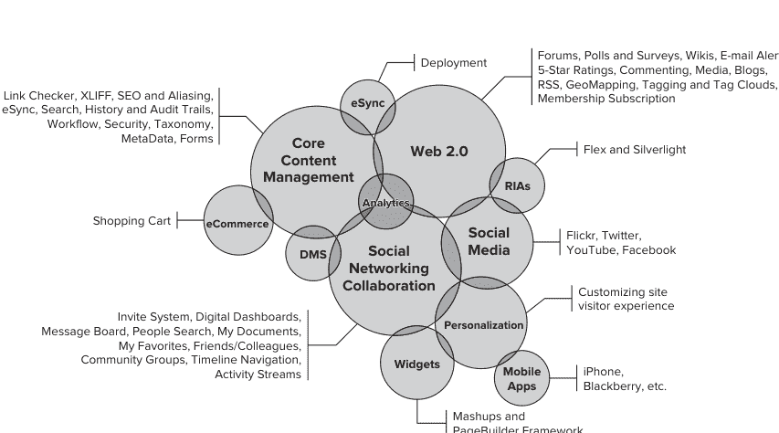

图 1-1

### 一体化（All-in-One）与精选型（Best-of-Breed）

通常，WCM 平台采用两种架构范式之一：一体化（All-in-One，有时也称为软件套件）或精选型（Best-of-Breed）。

一体化方案的目标是提供开箱即用的所有功能和特性，而无需与其他第三方系统集成。从总体而言，一体化架构的优势在于它们是单一系统，运行所需的外部依赖较少。通过许多共享公共数据库、开发框架和一致用户界面的集成应用程序，所有组件都拥有连贯的用户体验。从 WCM 的角度来看，这种方法的特定优势是：

- 成本：在大多数情况下，一体化软件套件的成本更低。为了实现相当的功能集，精选型应用程序必须集成许多专门且独立许可的软件组件和服务。
- IT：开发者需要学习并开发一体化软件套件提供的单一开发框架，而不需要花费时间整合各种框架或应用程序。从运营的角度来看，部署变得简单，因为需要管理和配置的系统更少。
- 培训：一体化系统的界面提供了一个用于站点管理和管理的应用程序，为 IT 人员、营销人员和内容编辑者提供了统一的用户界面，减少了使用、管理和支持该系统所需的培训时间。

一体化方案的主要缺点也源于它是一个单一框架——所见即所得——除非它专门提供了外部集成点、可扩展架构和开放 API，否则你将被严格限制于使用现有的功能。

与一体化软件套件的广泛功能形成对比的是精选型系统。精选型系统是用于单一目的的专用工具。精选型系统缺乏广度，但在深度上弥补了这一点。为了通过深度功能提供精选型系统的内容，通常需要将许多此类系统组合以提供全面的解决方案。这类产品最引人注目的单一优势是丰富的功能。一个专用工具正是你所需要的。你可能可以使用瑞士军刀上的剪刀剪开纸板，但它们的表现绝对不如重型剪刀，而且使用起来也不会那么舒适。

使用精选型 WCM 系统的缺点是系统集成的复杂性。考虑企业内部软件系统使用的各种用户和注册系统。为了正确集成第三方应用程序，需要提供数据结构和 API。一些著名的开源 CMS 平台遵循这种方法，例如需要第三方模块来实现支持如 LDAP 或 Active Directory 等功能。

Ektron 框架的独特之处在于它提供了一种混合方法，既提供了一体化软件套件提供的功能优势，又在合理的地方审慎地提供了精选型集成。这种智能集成的一个完美例子是 Ektron 框架 8.5 版本中选择与领先的 Web 分析提供商（如 Google 和 Omniture）集成（参见第 9 章的 Web Analytics）。WCM 和 Web Analytics 是一个在过去十年中已显著成熟的行业，随着 Google 和 Omniture 等公司的进步，Ektron 去追赶并重新造轮子顶多是没有意义的。Ektron 选择与此类提供商提供精选型集成，让你既拥有 Ektron 框架的力量，又拥有 Web 分析领域成熟领导者 Google 和 Omniture 的优势。

### 使用 Ektron 框架进行开发

从 ASP.NET 开发者的角度来看，Ektron 框架可以被视为一个包含三类通用组件的工具包：.NET 服务器控件、控件小部件（User Controls）和 API。除了控件小部件（第 9 章将详细介绍）外，这些组件用于像构建 ASP.NET 网站一样组装 ASP 模板和主页（Master Pages）。Ektron 框架的主要设计目标之一是让具有构建 ASP.NET 网站经验的开发者觉得与其工作非常熟悉。无论你使用这三种通用类型组件中的哪一种来构建网站，这取决于你的技能组、你尝试实现的目标或其暴露的功能水平。接下来的章节包含帮助你决定选择何种组件的指南。

### 服务器控件

Ektron 框架提供了 80 多个开箱即用的服务器控件，从简单的控件（如轮询服务器控件）到复合控件（如博客服务器控件）等。所有 Ektron 服务器控件都封装了复杂的功能，使得开发者可以轻松地通过 Visual Studio 工具箱中拖放控件来快速组装 Web 页面，然后通过在代码中设置属性或使用 Visual Studio 的属性对话框来定义它们的行为。

想要使用 Ektron 控件而不是直接通过 API 编写代码的首要原因是它所提供的功能。每个控件都提供了经过充分开发和测试的丰富功能。这意味着每个控件在设计时都考虑了以下因素：

- 权限：当前访问者是否有权限读取或编辑？
- 审批流程：该项目是否已批准显示？
- 性能：它能否处理高流量网站的沉重需求？
- 创作：是否为当前用户显示内容创作选项？

虽然 API 让你具备实现相同目标的能力，但实现这些目标所需的代码量并非小事。在考虑其他方案之前，请仔细查看服务器控件。

一旦你决定使用服务器控件并开始使用它们开发，你会发现需要对样式进行处理以匹配你网站的用户体验。服务器控件提供了几种方法来自定义样式和标记：

- CSS：自定义样式的首选且直观的选择是通过层样式表（CSS）。使用工具，你可以检查控件生成的 HTML 和 CSS 并根据需要进行自定义。每个控件通常提供一个 `DisplayCss` 属性，让你指定 CSS 文件的路径。
- XSLT：XML 样式表转换（XSLT）是一种将 XML 文档转换为另一种格式的 XML 语法。如果你熟悉这种语言，你会很高兴发现大多数 Ektron 服务器控件将数据暴露为 XSLT，使得使用 XSLT 操作标记变得简单。每个控件通常提供一个 `DisplayXslt` 属性，让你指定 XSLT 文件的路径。
- EkML：XSLT 是一种控制传递到浏览 HTML 的强大语言，但当你只想微调一个 HTML 标签时，它通常大材小用。EkML 是为需要这种控制级别的开发者设计的。其简单的模板语法使用特殊的字符串标记，在运行时替换为数据值。并不是所有控件都支持 EkML，因此在单个服务器控件上使用 EkML 之前请检查。
- 数据绑定：可以将 Ektron 服务器控件作为数据绑定控件的数据源。由于 Ektron 服务器控件不是用于显示结果的，其可见性设置为 false，可以使用像 ASP.NET 的 `ListView` 或 `DataGrid` 控件这样的数据绑定控件进行显示和控制。

当服务器控件符合项目需求时，它们是非常理想的选择。如果你在紧迫的日期之前工作，并且可以权衡需求与控件提供的功能之间的任何差异，那么使用 Ektron 服务器控件最终可以为你节省时间。如果你正在构建任何真正复杂程度的网站，将会某些情况下服务器控制不足以满足需求。在这种情况下，你需要剥离框架的一层，直接使用 Ektron 的 .NET API。

### Ektron 框架的 .NET API、Web 服务和扩展

Ektron 框架带有一个完整的开放 API，包括 .NET 程序集、XML 服务和扩展性架构。使用 API 最大且显而易见的优势是你在网站实现时所拥的灵活性和控制力。事实上，你之后将学习 CMS 扩展（Extensions）如何在需要时让你完全覆盖 CMS 的默认行为。CMS 扩展允许控制电子商务模块中税费的计算方式（第 13 章），或者更改 CMS 中发布的内容。

一旦你决定 Ektron API 适用于你的项目，你就需要确定使用哪种 API。在你的 Web 项目中，可以参考三个核心命名空间：`Ektron.CMS.Framework`、`Ektron.CMS.API` 和 `Ektron.CMS`。

- **Ektron.CMS.Framework**：框架 API 是 Ektron API 的最新成员。它的设计是为了响应开发者的反馈，即旧版 API 可能过于繁琐。Ektron 对框架 API 的设计目标侧重于可发现性、一致性和简单性。可发现的 API 意味着你不需要阅读大量文档就能猜出命名空间、对象和方法。你可以利用对象和智能感应（IntelliSense）通过逻辑推断来解决问题。一致的 API 是指对象功能相似的 API；如果你以前处理过类似的东西，处理特定对象时应该感到很熟悉。简单性指的是一个原则：简单的事情应该是易于实现的，即使是困难的事情也应该是可能的。

由于框架 API 是框架中新增的内容，它并没有涵盖 CMS 提供的所有功能。尽管存在这种差异，框架 API 也收到了开发者社区非常积极的反馈，它是使用 API 时首选的 API。Ektron 正在每个版本中扩展框架 API，并将一直持续下去，直到实现对 CMS 的完全覆盖。

- **Ektron.CMS.API**：API 命名空间在第 6 版本中引入 Ektron 框架，提供了一系列 API，可以对一组非常全面的 Ektron 功能进行程序化控制。引入此 API 有两个原因：
  - 在不需要任何类型身份验证信息的情况下对 CMS 进行程序化访问，因为客户希望执行批量操作，而无需保存任何系统账户的用户名和密码。
  - 为开发者提供一个逻辑上更组织的 CMS 命名空间工具。

- **Ektron.CMS**：CMS 命名空间是所有 Ektron API（包括内部和公共 API）的家园。如果你想程序化访问 CMS，但在框架命名空间或 API 命名空间中都找不到可用的 API，CMS 命名空间将提供你所需。使用此 API 的好处是它为 Ektron 框架提供了一个极其全面的 API。缺点是该 API 在产品的生命周期内增长得很大。图 1-2 展示了整体架构。

# 第 1 章 介绍 EKTRON

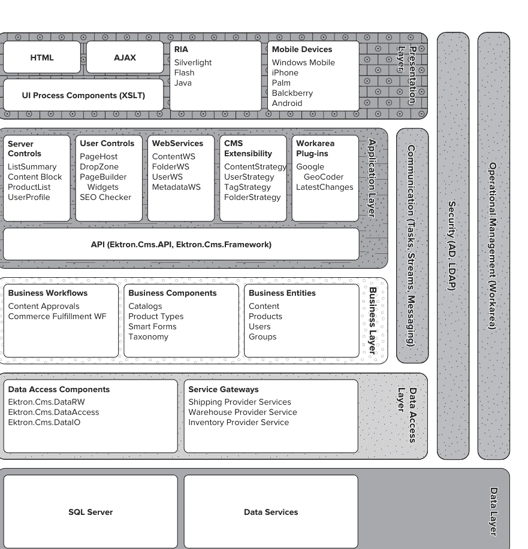

图 1-2

### Ektron PageBuilder 和小部件 (Widgets)

用户控件（User controls）是标准的 ASP.NET 组件，封装了逻辑、功能和界面，并在 Ektron 的 PageBuilder 技术中起着关键作用（PageBuilder 详见第 9 章）。PageBuilder 允许开发者专注于构建可复组件库，让营销人员等非技术人员可以直接在 Web 浏览器中组装新页面并更新现有页面。

设计用于与 Ektron PageBuilder 配的用户控件被称为小部件（widgets），从开发者的角度来看，它们主要是专门的 .NET 用户控件。在 Visual Studio 中打开小部件可以清楚地看到这一点——你可以将它们视为 `.ASCX` 扩展并继承自 `system.Web.UserControl`。因此，用户控件的任何属性、行为或能力都会被继承。

Ektron 框架提供了 30 多个开箱即用的小部件，通过 Ektron Exchange (`http://dev.ektron.com/exchange`) 提供更多，这是一个基于社区的网站，允许开发者向 Ektron 开发者社区共享代码。你可以自由使用由 Ektron 或开发者社区提供的小部件，也可以使用 .NET 技术、Ektron 用户控件和 Ektron API 构建你自己的小部件。

### 数据存储、SQL 和存储过程

由 Ektron 驱动的网站将数据存储在关系型 SQL Server 数据库中。其数据库架构供开发者用于调试。然而，Ektron 强烈不建议在开发环境中除调试以外的任何目的下编写 SQL 语句或存储过程来直接访问数据。

有时你可能想编写查询来访问特定的数据集，但请记住 Ektron 这样做有其充分的理由。考虑以下情况：你需要访问的内容应用了权限以阻止其显示，或者应用了工作流过程。内容在显示之前必须经过批准，或者设置了未来的某个“上线”日期。在你的 SQL 语句中有需要考虑的事情太多，以至于该语句在大多数情况下容易出错，或者花费太多时间在开发上是不明智的。如果你需要程序化访问数据，请坚持使用 Ektron 的 API。

### 框架总结

选择使用 .NET API、服务器控件还是小部件，取决于项目的需求和复杂性、你对 API 的熟悉程度以及你作为开发者的个人偏好。通常，很少有网站使用服务器控件。通常，由 Ektron 专业团队创建网站使用 API，当客户对布局有特殊要求时，使用 API 代替服务器控件。小部件封装了原本由用户控件完成的业务逻辑和界面。PageBuilder 的引入改变了这种平衡。

### 系统要求

表 1-2 描述了服务器、客户端以及可选的要求。

**表 1-2**: 服务器和客户端系统要求

| 要求组 (REQUIREMENT GROUP) | 要求类型 (REQUIREMENT TYPE) | 要求 (REQUIREMENT) |
| :--- | :--- | :--- |
| 服务器要求 | 推荐最小硬件配置 | Intel Core 2 或更高，4GB RAM 或更高，硬盘 RAID 阵列 |
| | 操作系统 | Microsoft Windows Server 2008 32位，64位，Windows Vista Business/Ultimate |
| | Web 应用程序服务器 | Microsoft ASP.NET Framework 3.5 SP1 |
| | Web 服务器 | Microsoft IIS 6.0 或更高 |
| | 文件系统 | NTFS（不支持 FAT 32） |
| | 数据库 | Microsoft SQL Server 2005 SP2 及更高（包括 Express 版），Microsoft SQL Server 2008 |
| 客户端要求 | 操作系统 | 兼容 PC 的 Windows 系统，包括 Vista Ultimate 或 Business。最小：166MHz 或更快，至少 64MB RAM，Windows，MAC OS X |
| | 编辑浏览器 | Mozilla Firefox（参见 Firefox 支持摘要）³ Microsoft Internet Explorer 7.0 或更高，限发布版⁴ |
| | 查看浏览器 | 所有主流浏览器，包括：Microsoft Internet Explorer 6.0 及更高、Mozilla Firefox、Apple Safari 和 Google Chrome |
| 可选要求 | Web 开发工具 | Visual Studio 2005/2008；对于网站开发：Visual Web Developer 2005/2008 Express；对于插件扩展：Visual C# 2005/2008 Express 和 Visual VB 2005 Express |

¹XP Professional 不应用于生产环境，仅用于测试和开发。

²Ektron CMS400.Net 不支持区分大小写的数据库。数据库服务器不建议虚拟服务器。

³ `http://dev.ekron.com/kb_article.aspx?id=7076`.

⁴ 如果客户端计算机是 64 位，则无法使用 eWebEdit 创建智能表（Smart Forms）。要在 64 位机器上创建智能表，必须使用 Release 8.0 或更高版本以及 eEdit400 编辑器。

## 谁在使用 EKTRON？

以下是使用 Ektron 框架部署的一些获奖网站的小型示例，涵盖了教育、医疗保健和政府等多元化行业。Ektron 网站在 `http://www.ektron.com/solutions/industry/` 列出了更多其他行业的网站。

### 相关协会

- 美国心脏协会
- 美国言语、语言与听力协会
- 美国大学协会
- 美国高尔夫协会 (USGA)
- 美国冰球协会

### 汽车行业

- 宝马 (BMW)
- 克莱斯勒 (Chrysler)
- 菲亚特 (FIAT)
- 固异 (Goodyear)
- 三菱 (Mitsubishi)

### 教育：学院与大学

- 约翰逊和威尔斯大学
- 莱斯大学
- 西雅图大学
- 圣母大学
- 弗吉尼亚大学

### 教育：K-12 教育

- 主教主教学校
- 杰斐逊区公立学校
- Learn360
- 新特莱尔中学
- 兰奇二学区二

### 非营利团体

- 加利福尼亚基金会
- 青少年糖尿病研究基金
- 特别奥林匹克
- 苏珊·G·科门抗癌基金

### 核心要点

本章展示了 Ektron 不仅仅是一个技术框架。相反，它是一个旨在支持客户 Web 项目成功的完整解决方案。以下需要记住的几点：

- 关于 Ektron：自 Ektron 于 1998 年成立以来，其产品基础一直聚焦于让非技术用户能够积极管理网站内容，并培养开发人员以构建包括在线社区支持在内的复杂功能。
- Ektron 的技术支持：为了支持 Ektron 活跃且庞大的用户群，并支持他们开发日益复杂的网站工作，Ektron 扩展了其技术支持提供的服务。Ektron 创建了一个专业服务部门，提供包括最佳实践指导和应用开发在内的广泛服务。
- Ektron 培训：Ektron 提供了一系列培训课程，并深度参与其网站在线社区以及 Facebook 和 Twitter 等热门网站的互动。
- Ektron 框架：Ektron 框架带有完全文档化的且开放的 .NET 架构，其中包括服务器控件、用户控件、.NET 程序集和 XML Web 服务。这些为习惯于使用 Visual Studio 等工具并使用 C# 和 VB.NET 等语言构建网站的 ASP.NET 开发者提供了熟悉的 Web 开发体验。

## 2 Ektron Web 项目方法论

- 交互式/瀑布式与敏捷方法之间有什么区别？
- 实现过程分为哪些阶段？
- 发现阶段的步骤是什么？它们对你的项目成功有多重要？
- 如何根据你的规格书成功实施并迁移内容？
- 如何有效地测试交付物？

本章从一个基础性问题开始：为什么有许多网站项目会失败？项目失败有很多原因，但最常见的原因是它们没有遵循标准的方法论。Web 开发方法论是用于控制网站开发过程的系统。遵循流程可以确保你的项目结果符合业务需求，涵盖网站用户体验的所有组件，并且是一个在技术上稳健的解决方案，能够以支持你组织目标的方式扩展和运行。


# 第 2 章 EKTRON 项目方法论

本章旨在面向负责确保其网站开发项目成功的项目经理和技术开发人员。它的目的不在于提供一份全面的项目管理指南。它引入了 Ektron 方法论，并提供了建议和推荐，帮助确保你在网站开发项目中涉及正确的人员，确保他们了解确切需要构建什么，并让你拥有实现目标的可靠计划。

## 迭代式/瀑布式与敏捷方法的对比

多年来，人们创建了许多开发方法论，包括瀑布式、迭代式。基于瀑布的方法假设在进入实际开发工作之前，必须对需求进行良好的定义和记录。使用瀑布式方法，项目从全面的发现工作开始，包括利益相关者访谈、功能需求收集、技术解决方案开发以及用户体验的创建。在某些情况下，交付物在完成之前会经过一系列迭代。在发现过程结束时，项目的业务、技术和创意组件将被记录下来，获得相关利益相关者的同意，并作为衡量项目进展的基准。

敏捷方法论通常从在开发进行的同时定义需求的角度来处理项目。敏捷方法并不是预先定义所有项目需求，而是倾向于将项目划分为一系列段落或冲刺（`sprints`）。每个冲刺完成后，会将开发成果展示给客户，并根据相关利益相关者的直接反馈完善需求。显而易见，前几次冲刺旨在关注网站的核心功能。随着反馈整合到随后的冲刺中，网站将接近最终格式，直到所有冲刺完成，项目准备好面向公众发布。

这两种方法都有优缺点。本章专门关注网站开发的瀑布式方法，因为它反映了 Ektron 的直接经验。

## 业务案例：一切的起点

许多人认为网站项目始于启动会议。然而，事实是，大多数网站项目在实际启动很久以前就开始了。例如，一个业务所有者做出了启动一个新网站设计项目的决定。根据组织的规模，业务所有者可能负责某业务线或整个企业。一旦确定了需求，业务所有者就会构建一个业务案例，以证明并阐述网站资产的业务价值。通常，此业务案例会提交给管理团队的其他成员，他们可以提供资金并批准项目进行。

那么，一个业务案例由什么组成呢？大多数业务案例记录了通过网站资产要解决的问题。例如，可能是为了在线销售更多小部件。其他则可能是为了……（此处原文不完整，仅翻译现有）。有些业务案例通过……来发现价值。由于没有两个案例是相同的，业务案例与战略的对齐对于项目成功的意义至关重要。

## 发现阶段

开发方法论的发现阶段旨在从业务、创意和技术利益相关者的角度获取详细需求。从根本上，发现阶段专注于回答问题：“你想要……要做一个什么样的网站？”在理想情况下，已经开发并批准了一项业务案例，可以为整个发现阶段提供指南。当然，我们知道自己并不总是生活在理想的世界中。因此，发现过程足够灵活，在必要时可以定义业务需求。请记住，如果你正在建造一栋梦想房屋，这个阶段就像是绘制所有的蓝图。

一旦业务案例与战略对齐，它应该记录预期作为最终产品的特定功能。业务案例应该表达并阐述网站的积极影响。业务案例应该阐述关键绩效指标（`KPI`），以衡量投资的成功。`KPI` 的示例可能但不限于订单数量、唯一访问次数、会话时长、产生的收入以及点击广告的效果。业务需求和预期被清晰定义并与团队成员共享。业务案例还应该描述实施项目所需的资源、要跟踪的技术安全性能指标、实施时间、依赖关系、业务影响分析以及支持网站资产所需的资金投入。定义完成后，业务案例将提交内部批准。批准后，业务案例成为发现过程的输入，并为网站本身及其实施提供宝贵的定义。

### 项目启动

为了启动实际项目，Ektron 建议召开正式的启动会议。在启动会议之前，您应该制定一份议程，描述谁应该参加会议、讨论哪些主题以及预期的步骤是什么。从传统上讲，启动会议的重点是介绍跨部门的成员成员，定义团队特定的角色和职责，并审查涵盖整个项目的正式工作方案。在大多数项目会议中，会指定一个单一联系人——项目经理。项目经理的角色是确保工作范围得到管理，满足预算和时间表要求，并在整个实施过程中识别并缓解风险项。

除了项目经理，许多组织还会指定一个业务利益相关者来代表业务部门的关注问题、一个营销或创意利益相关者来讨论项目的体验组件，以及一个技术利益相关者来讨论新网站的性能和安全组件。在许多情况下，这些利益相关者可能代表整个业务内部的大型领域专家团队。这些关键利益相关者将在适当的时间将业务中的其他领域专家引入项目，以提供反馈、见解和其他价值。

### 制定项目计划

一旦明确了团队的个人职责，项目经理就应该制定一个基准项目计划，该计划应整合并记录各个项目元素的各个活动、任务、依赖关系、资源和时间表。项目应该考虑项目交付物的签署和批准所需的时间，以及在整个过程中必须提供输入的人员日程。

### 通过利益相关者访谈收集业务需求

对于大多数项目来说，详细的业务、用户体验和技术需求在项目的此阶段尚未明确定义。为了确保在项目开始时对需求有全面的了解，网站的每个组件都应该通过一系列需求收集活动进一步定义。为了满足业务需求和网站的功能需求，您应该对跨机构的各种利益相关者进行一系列业务利益相关者访谈。对所有代表受网站影响的组织各功能或部门的利益相关者进行访谈尤为重要。遗漏重要的业务板块会导致真实问题，因此目标要广泛——让利益相关者参与会议。

为了确保利益相关者在访谈前做好充分准备，Ektron 建议您在实际进行访谈之前开发访谈问题并将这些问题与受访者分享。业务利益相关者有机会与其他同事研究并讨论回答您的问题。访谈形式通常持续一到两小时，并应在非正式环境中进行。

访谈问题应该纯粹围绕网站属性的业务方面。您可能想询问 `KPI` 跟踪、网站的业务目标以及网站预计交互的业务流程。确保提问有助于定义指标的问题。这些指标将在项目完成后进行跟踪和衡量，以证明投资的成功。此外，务必使用简单的语言，避免任何技术或其他模糊的术语。在提问访谈问题时，确保按照受访者提供的原文准确记录答案。可能需要向参与者解释您提的问题，以便他们理解如何回答。访谈问题和回答以后将用于开发功能需求文档。

Ektron 建议最初以一对一的形式进行访谈。参与者在一对一情景下通常更加坦诚和直接。当您进行一系列访谈时，有时会听到来自不同参与者的冲突回复。在这些情况下，识别出访谈中共同的回答，并将其作为核心需求的基础。您可能还有超出当前网站项目范围的绝佳想法或需求。确保记录这些想法，因为它们通常作为未来项目活动的基础。通过这种方式，您可以确保每个利益相关者都觉得自己的意见被听取了，同时维持项目的范围。

在某些情况下，冲突的需求无法通过一对一形式轻松解决。为了解决这类情况，最好进行后续的共识建立会议。在这种情况下，分享利益相关者之间共同拥有的访谈回答元素，并委婉地提出需求冲突的领域。利益相关者将在小组环境中解决冲突的需求。

### 收集技术需求

在定义了核心业务需求后，下一个重点是网站的技术方面。利用业务提供的输入，识别可能受新网站项目影响的第三方工具、系统和应用程序。

接下来，关注与网站相关的性能和安全标准。对当前的托管基础设施进行研究和分析，以确定新硬件是否合适，或者可以使用现有 IT 基础设施。

安全是技术实现的另一个重要组件。关于用户验证，识别适当基于 `Active Directory` 或 `LDAP` 的验证协议。利用之前获取的业务输入，开发流程图，解释用户如何根据分配的权限级别登录并管理更改的联系信息。可能需要审查任何记录的与安全标准相关的内部 IT 策略。

最后，考虑您的技术基础设施对于 Ektron 政策的影响。例如，Ektron 提供了专为灾难恢复环境实施设计的特殊定价。Ektron 还提供了多种许可选项，能够支持多个数据中心、负载均衡服务器场，并提供其他基础设施方法。

### 收集用户体验需求

发现过程的下一个重点是定义用户体验。通常，这是通过一系列创意交付物完成的，包括站点地图、原型线框图（`Wireframes`）和用户界面原型。根据设计，向您的组织确认是否有任何特定的 Web 规范。例如，您的营销或设计团队可能有他们想要支持特定浏览器、对固定宽度与流式设计的偏好、调色板列表、适当图像以及公司 Logo 的。

许多人认为用户体验由纯图形设计组成，但事实是信息架构（`IA`）领域同样重要。信息架构是指以服务特定受众的方式对信息进行逻辑分组。`IA` 影响网站信息的层次结构和组织，驱动网站的导航模型并提供一致的标记。

- 利用利益相关者访谈提供的输入，开发站点地图，以图形形式说明信息在网站上根本上是如何结构的。网站应该关注您网站顶部的三层信息。它应该为网站上的每个主要导航部分提供命名规范，并引导 Ektron Workarea 内部文件夹结构的开发。

- 创建一系列线框图（`Wireframes`）。线框图旨在实现两个目的：
    - 组织并定义每个页面关键元素的优先级。例如，主体区域应该有多宽？应该采用什么样的导航方案？
    - 定义交互。对于基于过程的 Web，记录在何捕捉信息以及如何引导用户完成基于 Web 的任务是重要的。线框图可以用于这些交互的原型。例如，用户必须在您的网站上注册会员。

- 考虑图形设计。开发并设计一系列代表您网站主要组件的用户界面原型。示例包括首页、内部区域、搜索页面以及任何其他被认为对整体用户体验重要的网站其他主要部分。

> Ektron 建议在项目的此阶段开发多套用户界面原型。每个用户界面原型应包含完全相同的页面，但对它们应用完全不同的设计处理。通过这种方式，可以将用户界面原型展示给业务和营销利益相关者，他们的反馈可以完全集中在每组设计的美学处理上。

通常，在网站重设计项目中，第一轮设计稿中至少会展示三套用户界面原型。在展示这三项设计时，请确保告知利益相关者，他们不应评估任何用户界面原型的实际内容。相反，这些内容的重点应放在色彩方案、字体的使用以及整体布局上。请利益相关者从三套设计原型中选择一套，并为所选设计的进一步演进提供反馈。

### 创建发现阶段的交付物

现在，你已经完成了与业务相关的需求收集活动，并评估了项目的技术和用户体验组件，你准备好生成与发现阶段相关的最终交付物了。Ektron 开发方法论要求创建以下内容：

- **功能需求文档**：利用在业务利益相关者访谈期间收集的反馈以及任何后续优先级排序会议，记录网站具体的功能和业务需求。在制定这些需求时，要尽可能具体，并避免构建特定解决方案的本能倾向。

- **信息架构文档**：利用站点地图，开发一份信息架构文档，以捕获并记录网站上层层信息结构。该文档定义了你将在网站上找到的信息类型，以及信息的结构，以及内容项如何通过元数据和分类法相互关联。与非平台项目相比，这类似于对象关系映射（`object-relationship map`）。这些材料的组合应记录在信息架构文档中，并在进入实施阶段时指导 Ektron CMS 的配置。

- **CMS 实现指南**：利用线框图（`Wireframes`）和用户界面原型创建 CMS 实现指南。对于线框图和用户界面原型中定义的每个组件，定义应使用哪些 Ektron Server Controls 来实现每个功能组件。CMS 实现指南是 Ektron 特有的，因为它定义了为了满足项目业务、用户体验和技术需求所需的服务器端控件、API 调用以及哪些定制元素。通常情况下，由已经熟悉 Ektron Server Controls 和 API 的技术开发人员编写 CMS 实现指南。

请注意，根据在整个发现过程中收集的反馈和输入，可能需要修订指导实施工作的项目计划。当网站需求不被充分理解时，项目的结构会被设计为在实施阶段之前，将发现阶段作为一个独立的项目来处理。在这种情况下，制定一个指导剩余实施和测试的全面项目计划至关重要。

关于发现过程的最后一点：请记住，它是作为指南的。请根据你的个人需求灵活地扩大或缩小发现阶段范围。例如，某些客户可能希望将可用性测试等流程作为发现过程的一部分。其他客户可能不想包含。无论如何，发现阶段都应该是灵活的。

## 实施阶段

实施阶段是你开始构建网站的阶段。如果你准确遵循了该方法论，过程将非常简单。要开始开发，请关注以下步骤：

1. 从开发环境开始。
2. 开发环境准备就绪后，移动到测试环境（`staging environment`）。
3. 在测试环境中测试后，移动到生产环境（`production environment`）。
4. 在开发过程中，关注核心功能。
5. 功能完成后，进行质量保证测试。
6. 测试成功后，移动到生产环境。
7. 网站就绪后，发布网站。
8. 最后，监控网站可能出现的任何问题。

考虑到内容加载或迁移的工作量，请记住你可能希望使用以下工具来为结构化数据和非结构化数据构建内容：

- **Ektron智能表单（`Ektron Smart Form`）**：新闻稿通常遵循非常结构化的格式。它们由标题、摘要、公关代表的联系信息以及新闻稿正文组成。使用 `Ektron Smart Form` 是处理此类内容的理想方式。

- **传统 Ektron 内容块（`Traditional Ektron content block`）**：网站的其他部分可能需要更灵活灵活的内容处理方式。例如，网站的“关于我们”部分通常提供有关公司、员工及其使命的基本信息。这是一个机会，可以利用传统的 `Ektron content block` 为内容的设计和布局提供自由度和灵活性。这些考虑在最初的调研阶段就应该得到解决，而这些交付物将用于指导这一效果的实现。

- **PageBuilder 线框图（`PageBuilder Wireframes`）**：这些与传统的 CMS 模板不同，它们定义了放置内容和组件的特定区域。有了这个框架，内容作者可以将功能组件拖放到 `PageBuilder Wireframes` 定义的区域内。`PageBuilder Wireframes` 通常是基于列的隐喻构建的。例如，你可能为用户提供二列、三列和四列的 `PageBuilder Wireframes`。有了 `PageBuilder Wireframes`，你的内容作者将创建内容，并定义 `PageBuilder` 页面的各个独立布局。

现在实施阶段即将结束，你将探索的领域是测试和部署步骤。

## 质量保证阶段

项目方法论的测试阶段旨在捕并解决网站的任何问题、漏洞或故障。回到关于建造你梦想房屋（悬崖别墅）的类比，这个阶段是你引入检查员，以确保建筑符合规范，并确保在你打开垃圾开关时，阁楼的灯不会亮。

### 系统测试

利用你的内部资源，你开始系统测试阶段，记录根据调研阶段获取的业务和功能需求的特定测试用例。用例（`Use cases`）旨在描述用户在使用网站时执行的特定任务或活动。它们通常是基于任务的且可验证的。这意味着测试后，你应该能够确定网站的行为是否符合预期。如果不符合，则需要对用例进行细化和澄清。例如，一个可验证的用例是“输入搜索词 `<HR Form>` 并查看搜索结果列出的列表”。一个不可验证的用例是“提供搜索功能”。

如果网站开发中有一个被忽视的方面，那通常是在测试过程中。在开发用例时，要尽可能宽泛，并记住不仅要涵盖业务需求中描述的任务，还要涵盖常见的网站功能，如搜索和联系表单。一旦完全开发了用例，请在整个测试过程中始终遵循它们。

当你在用例测试期间发现问题时，请记录 `URL`、预期行为以及你在测试期间遇到的实际结果。

> 在进入用户验收测试（`UAT`）之前，进行多轮系统测试是常见的做法。记住测试网站的各个方面。例如，如果你的网站与第三方工具或应用程序集成，请确保在 CMS 中捕获的信息准确迁移到另一个系统或工具中。

当你识别出特定问题时，请在测试电子表格或缺陷跟踪工具中记录它们。与你的开发团队一起使用该缺陷跟踪系统研究、分析并解决每一个单独的问题。当你解决问题时，在同一工具中记录对报告问题的响应。这为你提供了一份关于已记录的测试问题以及问题解决的详细记录。你可以在输入下（也是最后一次）测试时相同的格式。

### 用户验收测试

完成并开发新网站后的最后一个阶段是进行用户验收测试。在之前的测试阶段中，你使用了 IT 开发人员和 QA人员来执行测试和问题解决活动。在这个阶段，你使用实际用户来完成测试。

在开始用户验收之前，确保 CMS 驱动网站的实际终端用户已接受培训，并知道如何管理网站及其功能。Ektron 为其所有客户提供详细的系统文档和培训材料。然而，在教育用户时，你可能会发现开发自定义作者或管理员培训材料会有帮助。Ektron 的经验是，提供面对面操作的定制培训是赋能作者和管理员用户最有效的方法。

与之前一样，用例将驱动测试工作。用户按照用例操作，并在你在之前的测试阶段中使用的同一个测试电子表格中报告任何问题。同样，你可能会在决定网站准备好进行上线（`appointment`）之前进行多轮用户验收测试。当你的终端用户识别出问题时，让你的 IT 员工参与研究和解决报告的问题。

当测试过程完成、培训交付，并对系统功能进行最后的检查后，你就准备好将 Ektron 驱动的网站发布给公众了。通过 Ektron 的 `eSync` 技术，你可以将内容和文件系统资产从开发环境快速部署到阶段环境，并最终到达你的生产托管环境。一旦网站部署到生产托管环境，更新网站的 `DNS` 记录指向生产服务器。在 24 到 48 小时内，网站将面向公众，你也将拥有项目成功的最直观展示。

然而，这并不意味着项目的结束。网站上线后，现在是进入持续维护模式了，该模式将管理网站直到下一次重大增强或发布。在项目的这一阶段，开始详细的对你在网站中定义的基于可证明的影响的指标进行跟踪和报告非常重要。如果初始投资是基于可证明的影响，这些 `KPI` 指标将有助于证明预期结果已实现。记住，一旦网站上线，你仍然有充分的机会调整、修改和增强内容及功能。没有其他媒介能让你快速改变主意，并对客户如何感知和与网站互动做出反应。

## 要点

在关于网站开发方法论的章节结束之前，作者想分享几个最后的想法和需要记住的重要要点：

- 仔细管理项目范围。如果你不这样做，几乎注会错过预算和时间限制。这是每个项目阶段都会面临的问题。然而，利用有效的变更管理流程，以调研交付物为基准，可以缓解范围蔓延。

- 例如，在测试阶段，业务用户几乎不可避免会带来新想法并要求更改。当这种情况发生时，确保记录请求并从财务和时间两个角度评估更改的影响。很多时候，当给出具体的金额和时间变化建议时，利益相关者将重新评估请求，并要求额外的资金和时间来完成更改。有效地管理变更可以是“按时且按预算上线的项目”与“似乎永远不会上线且严重偏离预算的项目”之间的区别。

- 记住，网站很少是完全覆盖的。相反，网站存在于特定的时间范围内，不断演变和变化，以满足你的客户群的期望和需求。经常重新审视网站的功能需求，特别关注那些被认为适合未来扩展的项，以及你在初始开发工作中尚未使用的 Ektron 功能。


- 对网站进行简单的更改以增加功能，将延长网站投资的寿命和业务价值。一个很好的例子是，某个组织决定实施 Ektron 的核心网站分析，随后决定通过在 `PageBuilder` 界面中使用多变量测试来扩展反馈循环。对于一个成熟运行的网站来说，这种扩展可以显著帮助实现 KPI，并提供与网站以及其基础平台价值相关的持续“小胜利”。

# 第 3 章 实施指南

## 实施指南概述

- Ektron 的开发生命周期方法是怎样的？
- 什么是实施指南？
- OnTrek 实施指南包含哪些内容？
- 在创建实施指南时，你使用了哪些最佳实践？

实施指南是构建任何网站的重要步骤。它定义了一系列预期，开发团队可以遵循这些预期来制作一个功能完整的网站，以满足该网站所属业务的需求。Ektron 的实施指南可能与你熟悉的其他 ASP.NET 项目略有不同，就像开发者处理 Ektron 项目的方式与标准 ASP.NET 项目不同一样。这些差异将在本章的第一节中进行讨论。

在讨论了 Ektron 的方法之后，本章将详细介绍实施指南，并特别讨论了 OnTrek 实施指南。这些章节描述了指南的内容，并演示了文档中的一些示例组件。你还将学习创建实施指南的步骤；每个章节都经过充分讨论，以便你将来能够提前对你的项目进行文档记录。

> OnTrek 网站的完整实施指南可以在 `p2p.wrox.com` 下载：本章仅涵盖实施指南中的一小部分功能。请注意，该文档旨在为开发者提供实现所需的极少信息。

最后，本章将讨论在为你的项目开发实施指南时需要考虑的最佳实践和注意事项。创建一个有效的实施指南是最大限度减少范围蔓延和对初始范围低估风险的关键。

## EKTRON 方法

在深入研究实施指南之前，应当先回顾一下 Ektron 框架以及你应该如何处理它。虽然 Ektron 框架构建在 ASP.NET 之上并利用了平台固有的基于组件架构，但 Ektron 通过一种名为 `PageBuilder` 的技术更进了一步。

`PageBuilder` 是一项功能，它将 ASP.Net 用户控件的概念向前推进了一步。在标准的 ASP.NET 实现中，典型的工作流是：设计师制定网站布局，开发者将其拆解为称为“用户控件”的组件，然后以声明式的方式放置在模板上。这种方法让开发者能够轻松、直接地维护网站，因为它将功能和布局元素封装在可重用的代码块中。

`PageBuilder` 将 .NET 控件提升到了新高度，提供了非开发人员添加组件并修改组件设置的控件。它消除了对开发者干预的需求，并完全取消了页面布局更新周期中对 Visual Studio 的要求。

基本的 Ektron 实施生命周期方法是尽早并在网站管理周期的早期减少对开发者的依赖。为此，最好的做法是将用户交互需求分组为三个组件：

- **开发者**：开发者的功能与标准的 ASP.NET 实现相同，与设计师合作稳定所使用的样式，并开发模板和组件。不同之处在于，在这种情况下组件主要是 `PageBuilder` 小部件，你可以将它们放置在页面上。
- **消息导出**：这是管理网站使用的原始内容元素的关键。至少，消息专家不需要知道内容在网站上如何使用，也不需要担心网站的样式或功能。他们生成网站制作经理使用的内容。
- **网站制作经理**：这是使用 `PageBuilder` 的 Ektron 实施与标准 ASP.NET 实现区分开来的角色。网站制作经理获取消息导出开发的内容以及开发者创建的组件和模板，通过拖放式的 WYSIWYG（所见即所得）布局管理过程将它们结合。

网站制作经理角色的加入，消除了开发者不断返回现有模板以添加一小段功能，或将元素从页面一个位置移动到另一个位置的需求。根据这些需求并结合 `PageBuilder` 的特性，这是一个非技术角色，由更接近项目业务需求端的人员担任。`PageBuilder` 将在第 9 章中有更详细介绍。

## 实施指南详解

Ektron 网站开发方法论的发现阶段产生最重要的交付物之一是 CMS 实施指南。简单来说，CMS 实施指南为 Ektron 网站将如何构建提供了技术蓝图。它以组件为单位，定义了生成网页需要哪些服务器控件、小部件、用户控件或其他功能。CMS 实施指南是技术性较强的文档，通常不适合向非技术观众展示。

在继续之前，让我们回顾一下 Ektron 网站开发方法论的发现阶段。发现阶段旨在捕捉解决方案的需求和设计。它收集了业务所有者、营销和用户体验专家以及技术或工程资源的独特视角。在发现过程中产生的核心交付物中包括：

- **功能需求指南**：从业务角度捕获网站应如何运行。
- **信息架构指南**：定义了 Ektron 工作区中内容的结构，以及元数据和分类分类法的使用。
- **CMS 实施指南**：在功能需求文档和信息架构文档的基础上构建，包括用户界面原型或线框图的截图。它逐步说明了为了实现所需功能需要哪些组件。

> 有关包括发现阶段在内的实施过程的完整讨论，请参见第 2 章。

网站的构建通常被比作建筑施工。按照这个类比，你可以将 CMS 实施指南比作建筑工人用于组装结构的蓝图。同样，应用工程师和 CMS 架构师使用 CMS 实施指南来指导开发。

从文档的角度来看，CMS 实施指南由几个部分组成：

- **站点地图**：这是管理网站使用的原始内容元素的关键。正确的布局。
- **页面布局，包括截图**：这些为每种页面类型提供了视觉参考。实施指南提供了足够的细节，让开发者理解网站的所有方面。
- **针对小部件的对象任务**：描述小部件的元素，以便开发者理解该小部件的功能。每个章节都包含了对象表，描述了页面每个元素的预期交互和功能。

## ONTREK 实施指南

理解如何构建 CMS 实施指南的最佳方法是查看现有文档。为此，Ektron 在书中提供了一份 OnTrek 实施指南副本，可在 `www.ektron.com` 获取。我们鼓励你查看此指南并将其作为你项目的模板。OnTrek CMS 实施指南基于一个网站，遵循 Ektron 最佳实践，并大量利用 `PageBuilder` 技术。因此，CMS 实施包含了针对网站页面和网站上可用小部件的章节。

在页面部分，详细说明了网站的所有方面，包括产品展示、搜索和详细产品信息、结账流程、活动信息、内容区域、职位发布、位置地图、联系表单等。由于 OnTrek 网站还包含社交网络社区功能，页面部分还包含了社区功能的视图、个人个人资料信息、朋友、活动动态、博客、照片和其他小组相关功能。当然，所有网站的共同元素也得到了解决，搜索功能、使用条款和站点地图。

小部件部分包含了网站上所有可用小部件的列表，并带有功能和用户界面的细节，以及编辑选项和技术注释。创建的小部件示例包括热门产品、评分最高、标签界面、近期文章、讨论论坛主题和搜索功能、社交网络功能、职业搜索、搜索过滤器、电子商务折扣率、活动注册、产品交叉销售和折叠菜单等。内容经理可以将这些小部件整合到网站的任何部分。

### 首页

图 3-1 所示的首页用户界面实际上只是线框图的一张截图。

> 在整个界面线框图中，图像中嵌入了特定的脚注引用。这些脚注引用的位置指示了该脚注所记录的组件，并在页面表格中进行了交叉引用。

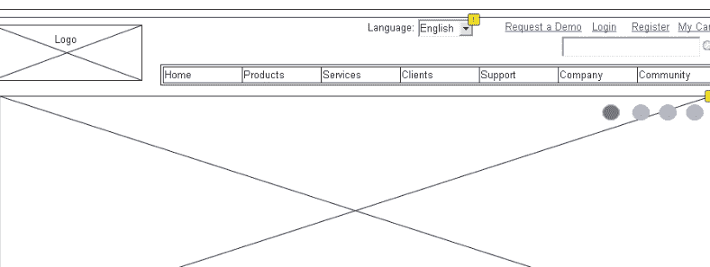

支持您业务的世界级软件与服务。

Consectetur adipiscing elit, sed diam numquam euismod tincidunt et laoreet magna aliquam volutpat. Nulla tincidunt tincidunt mollis.

| 新闻 | 活动 | 客户评价 |
|---|---|---|
| OnTrek 发布了 SelfHelp Pro | 2010年8月5日 上13:27 | "Lorem ipsum dolor sit amet, consectetur adipiscing elit. Nulla tincidunt mollis. Suspendisse eu ante augue" |
| OnTrek 扩大全球范围进入美国市场 | 2010年8月5日 上4:11 | "Lorem ipsum dolor sit amet, consectetur adipiscing elit. Nulla tincidunt mollis. Suspendisse eu ante augue" |
| TravelFree 使用 OnTrek 平台驱动营收 | 2010年8月5日 上3:34:59 | John Doe, MegCorp. |

+ 首页 | 产品 | 服务 | 客户 | 支持 | 公司 | 社区 隐私政策 | 网站地图 | 使用条款

OnTrek 启动站点功能规格书

© 2010, Ektrin Inc.

### 图 3-1

对于用户对象表中定义的每个脚注，它代表了一个标签、该组件的预期交互，以及关于该组件应如何构建的描述。例如，首页上的许多组件实际上是小部件。在查看语言选择器（脚注 1）时，你会注意到对象表格的描述指示了其预期功能，包括语言选择器控件需要包含页面上找到的所有组件的语言，包括菜单。当你查看此特定页面中定义的其余对象时，你会发现剩余的大多数组件实际上都是小部件。

**表格 3-1**：首页对象表格

| 脚注 | 标签 | 交互 | 描述 |
|---|---|---|---|
| 1 | 语言选择器 | | 语言选择器仅在首页显示。应翻译此页面上的所有内容，包括菜单。 |
| 2 | 页眉小部件 | | 在页眉小部件中输入自定义页眉。 |
| 3 | 横幅文本 | | 站介绍文本。 |
| 4 | 横幅轮图 | | 带有滑动图像和文本的横幅，可以通过 CMS 管理。 |
| 5 | 内容块 | | 显示内容块。 |
| 6 | 新闻标签页 | `OnClick: Case 1: 将面板状态设置为新闻状态` | 列出最近的新闻项。 |
| 7 | 活动标签页 | `OnClick: Case 1: 将面板状态设置为活动状态` | 列出即将举行的活动。可以配置日历从何处提取活动以及显示多少条。 |
| 8 | 更多新闻链接 | `OnClick: Case 1: 在当前窗口打开新闻` | 指向新闻页的链接。 |
| 9 | 新闻列表 | `OnClick: Case 1: 在当前窗口打开新闻文章页` | 列出最新的新闻项。可以配置为显示 X 条目。 |
| 10 | 新闻小部件 | | 显示项目的标题、发布日期和摘要。链接到文章页。**小部件设置：** 选择从哪个文件夹提取内容、显示多少条、启用订阅、启用分页、每页显示多少条。 |
| 11 | RSS 馈 | | 用户可以以 RSS 格式获取列表，或将 RSS 馈添加到 RSS 阅读器中（例如 Google Reader）。 |
| 12 | 客户评价小部件 | | 此显示展示了启用评论后的样式。应允许用户选择显示哪些评论、更改页眉文本、显示多少页、启用分页，以及在页面刷新时是否轮。 |

对于页面内定义的每个小部件，都需要类似的截图和对象表格。此示例使用了“客户评价”小部件。与页面界面类似，该小部件的接口在 CMS 实施指南中有单独的说明。与之前一样，还包含了专门针对此小部件的独立对象表格。“客户评价”小部件的用户界面如图 3-2 所示。

对于“客户评价”小部件，对象表格提供了对该小部件所需功能的详细引用，包括功能如何根据用户当前是否编辑页面发生变化。“客户评价”小部件的对象表格重现在表格 3-2 中。

### 表格 3-2：客户评价小部件对象表格

| 脚注 | 标签 | 交互 | 描述 |
|---|---|---|---|
| 1 | 客户评价小部件 | | 此显示展示了单条评论的样式。<br>**小部件设置：**<br>小部件应允许用户选择显示哪些评论（集合？内容列表？）、更改页眉文本、显示多少条、启用分页，以及在页面刷新时是否轮。 |

### 产品页面

产品页用户界面的布局如图 3-3 所示，与上一节的首页示例不同。在保持全局导航和公司 Logo 的情况下

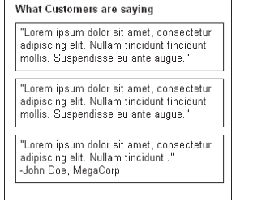

产品页面顶部的布局和功能与线框图类似。在页面顶部，该页面产生了新的布局


OnTrek 启动站点功能规格

© 2010, Ektrin Inc.

### 图 3-3

产品页的对象表格比第一个示例更复杂。正如线框图所示，脚注定义了页面上的特定交互。注意，此部分组合了在在用户点击特定组件时的响应。

### 表格 3-3：产品对象表格

| 脚注 | 标签 | 交互 | 描述 |
|---|---|---|---|
| 1 | 产品 | | 显示产品标题、发布日期和摘要。 |
| 2 | 加入购物车 | | 将产品加入购物车。 |
| 3 | 评分 | | 显示平均评分。 |
| 4 | 产品规格 | | |
| 5 | 规格标签页 | `OnClick: Case 1: 将面板状态设置为规格状态` | 显示规格。 |
| 6 | 评分与评论标签页 | `OnClick: Case 1: 将面板状态设置为评分状态` | 显示评论。 |
| 7 | 产品规格 | | 显示规格（尺寸、重量等）。 |
| 8 | 产品图片 | `OnClick: Case 1: 在当前窗口打开` | 显示产品图片。 |
| 9 | 产品名称 | `OnClick: Case 1: 在当前窗口打开` | 显示产品名称。 |
| 10 | 客户购买小部件 | | 显示用户购买的内容。如果无购买内容，则不显示。 |

### 表 3-4: 产品交叉销售小部件对象表

| 脚注 | 标签 | 交互 | 说明 |
|---|---|---|---|
| 1 | 产品交叉销售小部件 | | 向用户推荐产品。使用推荐服务器控件显示与页面上显示的产品相关的产品。**小部件设置：** 头部文本。显示的项目数量。设置从哪些产品中进行推荐。 |
| 2 | 产品图像 | `点击：情况 1：在当前窗口中打开产品页面` | 交叉销售产品的图像。 |
| 3 | 产品名称 | `点击：情况 1：在当前窗口中打开产品页面` | 交叉销售产品的名称。 |

### 用户仪表板页

在本节中，你看到的最后一个示例与用户的个性化仪表板页有关。与你之前审阅的页面相比，用户仪表板相当复杂。用户仪表板由许多服务器控件和大量的自定义代码组成，是 OnTrek 网站一个强大且功能丰富的元素。与之前一样，用户界面依赖于在页面顶部一致放置 OnTrek 标志和全局导航。在左侧列中，提供了一个风琴式菜单，提供了用户个人资料、小组、朋友、日历、博客、文档和照片的链接。

仪表板的右侧列用于显示用户的个人小部件。这些小部件是网站访问者可以添加、修改或删除的个性化控件。因此，你必须在实施指南中定义这些交互。在页面右侧顶部，状态栏允许用户更新其朋友的活动状态。状态栏下方显示小部件的滚动列表。最后，在小部件滚动托下方是用户为其个人仪表板选择的实际小部件。仪表板的用户界面如图 3-5 所示。

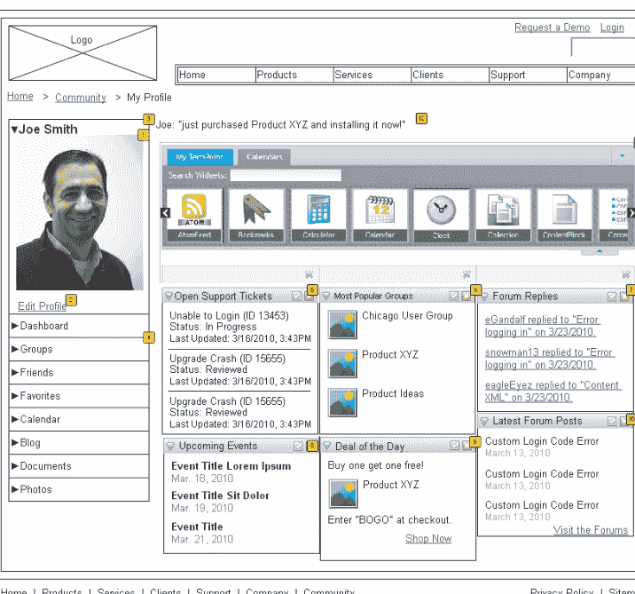

OnTrek 启动站点功能规范

©2010, Elitron Inc

### 图 3-5

仪表板的对象表同样复杂。然而，在页面视图中，对单个小部件的引用是根据小部件对象表中的定义的。请注意，对象表包含了与驱动单个组件功能的业务规则相关的指南。用户仪表板的对象表重现在表 3-5 中。

### 表 3-5: 用户仪表板页对象表

| 脚注 | 标签 | 交互 | 说明 |
|---|---|---|---|
| 1 | 个人头像 | | 用户上传的个人资料图像。 |
| 2 | 编辑个人资料 | `点击：情况 1：在当前窗口中打开链接` | 编辑个人资料将用户带到编辑个人资料屏幕。 |
| 3 | 我的个人资料 | | 显示用户资料简介。使用早期项目 Eintranet 的个人资料格式。 |
| 4 | 左侧导航标签 | | 个人资料标签按此顺序排序。 |
| 5 | 状态栏 | | 这应该从 Eintranet 的当前视图更新为此格式。 |
| 6 | 打开工单仪表板小部件 | | 查看仪表板小部件规范（下载本章节完整实施指南）。 |
| 7 | 最热门小组仪表板小部件 | | 查看仪表板小部件规范。 |
| 8 | 论坛回复仪表板小部件 | | 查看仪表板小部件规范。 |
| 9 | 上升活动仪表板小部件 | | 查看仪表板小部件规范。 |
| 10 | 今日特惠仪表板小部件 | | 查看仪表板小部件规范。 |
| 11 | 最新论坛帖子仪表板小部件 | | 查看仪表板小部件规范。 |
| 12 | 个性化仪表板 | | 用户的个性化仪表板。可以包含任何开箱即用的小部件，以及此处的小部件。此视图显示建议的搜索框，其功能应与 `PageBuilder` 小部件相同。 |

我们选择了“最热门小组仪表板小部件”作为构成仪表板页的许多小部件的示例。注意小部件对象表中指定的默认设置，甚至性能考虑问题在此阶段也已记录。用户界面如图 3-6 所示，小部件的对象表重现在表 3-6 中。

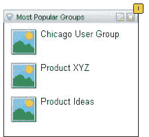

### 图 3-6

### 表 3-6: 最热门小组仪表板小部件对象表

| 脚注 | 标签 | 交互 | 说明 |
|---|---|---|---|


| 1 | 最热门小组仪表板小部件 | | 用于个性化仪表板的小部件。头像和文本链接到小组个人资料。**小部件设置：** 设置显示的组数量。默认为 5（为了性能，设置最大 25 个）。 |

## 核心要点：创建实施指南的最佳实践

现在你已经看到了内容管理系统实施指南的详细视图，本章将通过分享一些实践建议来结束，指导你创建自己的实施指南。请参见表 3-7。

### 表 3-7: 创建实施指南的最佳实践

| 想法 | 说明 |
|---|---|
| 尽详尽。 | 如果 CMS 实施指南在某个方面不成功，通常是它们在捕获所有需求方面缺乏详尽。你在规划上花费的精力将获得数倍回报，因为这简化了开发。 |
| 不要走捷径。 | 确保你在实施指南中包含了一套大量的线框图或用户原型。确保功能需求和信息架构是完整的。 |
| 战略性思考。 | 使用 Ekton 框架，你通常有许多方法完成相似的任务。在考虑选项时，始终要考虑长期。实施指南的目标不仅是构建当前版本，还为了随着网站演变和增长提供所需的灵活性。 |
| 如果你对使用何种控件有疑问 | 利用 `http://dev.ekton.com` 上的 devCenter，那里其他 Ekton 开发者可以分享他们的想法和 |
| 多次迭代开发你的实施指南。 | 邀请开发团队的其他成员参与评审你的实施指南，以获取他们的意见和建议。 |
| 记得考虑页面渲染的各种上下文。 | 例如，考虑页面对于普通网站访问者、已登录用户或 CMS 账户持有者的表现如何。 |
| 记得为用户交互进行计划。 | 记住功能的特定组件。例如，考虑登录过程。该过程的交互设计是用户点击登录按钮打开一个新窗口。在新窗口中，用户输入用户名和密码并按下弹出窗口中的登录按钮。如果成功，登录窗口关闭并刷新页面。如果失败，弹出窗口将显示错误信息，用户有机会再次输入密码。 |
| 在可能的情况下，重申规范功能的业务规则。 | 正如本章之前所示，在单个组件的上下文中记录相关的业务规则总是很有用的。例如，在开发与分类法相关的业务规则时考虑性能，对网站的整体性能产生巨大影响。在实施指南中包含“显示10 个匹配项”等规则，可以确保你的开发团队以优化性能的方式来实现代码。 |
| 记得实施指南是一份动态文档。 | 除了为构建网站的开发团队提供文档，实施指南还作为网站所包含的功能及其关键要素的持续文档。维护实施指南可以让你新团队成员快速进入状态，缓解代码重复，并帮助新的开发工作与现有功能保持一致。 |

## 4 配置您的开发环境

- 为了使用 Ektron Framework，您需要对机器进行哪些配置？
- 如何安装 Ektron Framework？
- 安装时您还需要了解哪些内容？

为了跟上本书的开发示例，您需要在计算机上安装一些程序。本章涵盖了为 Ektron Framework 进行开发的基本软件要求，随后介绍了在您的开发机上设置 OnTrek 启动器站点的说明，最后讨论了团队开发的各种方法。

### 您需要对机器进行的配置

一旦在系统上配置了所需的软件，您就可以安装 Ektron Framework。作为开发者，在本地运行 Ektron 所需的软件列表并不长。您必须拥有以下内容：

- 带有 IIS 6.0 或更高版本以及 .NET Framework 3.5 或更高版本的 Windows，并有一个可用的 SQL Server 2005 或更高实例。
- Visual Studio 2005 或更高版本。任何文本编辑器都可以用于开发 .NET 代码，但 Visual Studio 提供的 IntelliSense 和其他功能在处理您不熟悉的代码时是价值无量的。
- 除此之外，您只需要一个最近的浏览器——Internet Explorer 7 或更高版本，或 Firefox 2 或更高版本——以及 Ektron Framework 支持的任何 Webkit 浏览器，如 Apple Safari 或 Google Chrome。

Visual Studio 2005 或更高版本。任何文本编辑器都可以用于开发 .NET 代码，但 Visual Studio 提供的 IntelliSense 和其他功能在处理您不熟悉的代码时是价值无量的。Visual Web Developer 是一个适用于大多数开发者的选项，但请记住它的调试能力非常有限。例如，Visual Web Developer 无法附加到进程，而这是调试站点的推荐方法。此外，Visual Web Developer 不能用于构建 Ektron 扩展。

### 安装框架

Ektron Framework 的安装程序可以在 `http://www.ekron.com/download_center/` 找到。安装程序将设置框架文件和 Windows 服务。它会提供安装包含的启动器站点之一的选项，这些站点可以作为示例或作为您最终站点的基础安装到本地机器。最后，安装 SDK。这允许构建 Ektron 扩展。这些扩展暴露了如 `AddUser` 和 `OnPublish` 等系统事件。

安装程序在某处会要求您输入许可证密钥。对于本地安装，最简单的方法是留空框——这将框架设置为仅在通过 localhost 访问时工作。在带有中央服务器的分布式环境中，或者当您准备移动到通过另一个 URL 访问的测试或生产环境服务器时，您需要该 URL 的许可证。试用密钥可以通过 `http://www.ekron.com/download_center/` 申请。对于无时间限制的许可证，请联系 Ektron 的客户经理或销售工程师。

您可以通过执行以下操作进行安装：

1. 运行 `CMS400Base.exe` 开始安装。此安装程序将引导您安装核心文件和 Windows 服务。完成后，它会询问您是否想要安装启动器站点。选择“否”，因为您想要安装启动器站点。
2. 访问 `http://www.ekron.com/cms400-starter-sites.aspx` 并下载 OnTrek 启动器站点。运行安装程序会将创建站点实例所需的信息添加到您的 Program Files 目录。
3. 完成后，转到所有程序 ❖ Eron ❖ CMS40080 ❖ 实用程序 ❖ CMS400 Setup。在出现的向导中，选择“完整安装”并继续。如果您在 localhost 上开发，请将许可证密钥字段留空。从要安装的站点下拉列表中，选择 OnTrek。
4. 系统会询问您想安装什么站点以及如何安装——保持默认值即可。
5. 您需要指定站点文件所在的位置；此处默认认为“无”，除非您需要安装在其他地方，例如如果您在 IIS 中有多个站点根目录。向导将安装所有站点文件。
6. 一旦安装完成，您就有一个活动站点，但如果您尚未设置数据库，它将不起任何作用。数据库设置是向导将要求的下一个内容。指定您的 SQL 实例的连接参数，它将配置站点连接到该实例并为站点创建数据库。

当向导完成后，您可以访问 `http://localhost/OnTrek/`，本书的示例站点就在那里了。

### 开发场景

当作为单个开发者工作时，管理源码和资产的要求很容易满足。在这种情况下，所有开发都是在本地完成的。当开发者准备好将站点上线时，您可以将所有文件复制到生产主目录，并对数据库进行备份，然后在目标位置进行还原。然而，当与开发团队合作时，可能会出现许多额外的要求。

### 源码控制

当多个开发者需要协作时，通常要求的第一个项目是源码控制系统。几乎任何版本控制系统都适用——Subversion、Git、Perforce 和 VisualSourceSafe 都可以。开发环境下的文件夹应该在仓库中维护。通常保持工作区不为托管是安全的。通常最好将站点根目录下的 `.config` 文件保持不为托管，因为从一台机器到另一台机器的配置可能会发生变化。

管理源码的典型设置是使用 Subversion 管理源码。设置一个服务器来查看源码的当前版本，并在该服务器上设置数据库。设置此部分的流程如下：

1. 在该机器上安装一个小型站点或启动器。此安装程序将引导您安装核心文件和 Windows 服务。完成后，它能询问您是否想要安装启动器站点。选择“否”，因为您没有。
2. 完成后，转到所有程序 ❖ Eron ❖ CMS40080 ❖ 实用程序 ❖ CMS400 Setup。在出现的向导中，选择“完整安装”并继续。如果您在 localhost 上开发，请将许可证密钥字段留空。从要安装的站点下拉列表中，选择 OnTrek。
3. 系统会询问您想安装什么站点以及如何安装——保持默认值即可。
4. 您需要指定站点文件所在的位置；此处默认认为“无”，除非您需要安装在其他地方，例如如果您在 IIS 中有多个站点根目录。向导将安装所有站点文件。
5. 一旦安装完成，您就有一个活动站点，但如果您尚未设置数据库，它将不起任何作用。数据库设置是向导将要求的下一个内容。指定您的 SQL 实例的连接参数，它将配置站点连接到该实例并为站点创建数据库。


# Visual Studio 2005 或更高版本

任何文本编辑器都可以用于开发 .NET 代码，但 `Visual Studio` 提供的 `IntelliSense` 和其他功能在处理您不熟悉的代码时是价值无量的。`Visual Web Developer` 是一个适用于大多数开发者的选项，但请记住它的调试能力非常有限。例如，`Visual Web Developer` 无法附加到进程，而这是调试站点的推荐方法。此外，`Visual Web Developer` 不能用于构建 Ektron 扩展。

## 安装框架

Ektron Framework 的安装程序可以在 `http://www.ekron.com/download_center/` 找到。安装程序将设置框架文件和 Windows 服务。它会提供安装包含的启动器站点之一的选项，这些站点可以作为示例或作为您最终站点的基础安装到本地机器。最后，安装 SDK。这允许构建 Ektron 扩展。这些扩展暴露了如 `AddUser` 和 `OnPublish` 等系统事件。

安装程序在某处会要求您输入许可证密钥。对于本地安装，最简单的方法是留空框——这将框架设置为仅在通过 `localhost` 访问时工作。在带有中央服务器的分布式环境中，或者当您准备移动到通过另一个 URL 访问的测试或生产环境服务器时，您需要该 URL 的许可证。试用密钥可以通过 `http://www.ekron.com/download_center/` 申请。对于无时间限制的许可证，请联系 Ektron 的客户经理或销售工程师。

您可以通过执行以下操作进行安装：

1. 运行 `CMS400Base.exe` 开始安装。此安装程序将引导您安装核心文件和 Windows 服务。完成后，它会询问您是否想要安装启动器站点。选择“否”，因为您想要安装启动器站点。
2. 访问 `http://www.ekron.com/cms400-starter-sites.aspx` 并下载 OnTrek 启动器站点。运行安装程序会将创建站点实例所需的信息添加到您的 Program Files 目录。
3. 完成后，转到“所有程序 ❖ Eron ❖ CMS40080 ❖ 实用程序 ❖ CMS400 Setup”。在出现的向导中，选择“完整安装”并继续。如果您在 `localhost` 上开发，请将许可证密钥字段留空。从要安装的站点下拉列表中，选择 OnTrek。
4. 系统会询问您想安装什么站点以及如何安装——保持默认值即可。
5. 您需要指定站点文件所在的位置；此处默认认为“无”，除非您需要安装在其他地方，例如如果您在 IIS 中有多个站点根目录。向导将安装所有站点文件。
6. 一旦安装完成，您就有一个活动站点，但如果您尚未设置数据库，它将不起任何作用。数据库设置是向导将要求的下一个内容。指定您的 SQL 实例的连接参数，它将配置站点连接到该实例并为站点创建数据库。

当向导完成后，您可以访问 `http://localhost/OnTrek/`，本书的示例站点就在那里了。

## 开发场景

当作为单个开发者工作时，管理源码和资产的要求很容易满足。在这种情况下，所有开发都是在本地完成的。当开发者准备好将站点上线时，您可以将所有文件复制到生产主目录，并对数据库进行备份，然后在目标位置进行还原。然而，当与开发团队合作时，可能会出现许多额外的要求。

## 源码控制

当多个开发者需要协作时，通常要求的第一个项目是源码控制系统。几乎任何版本控制系统都适用——`Subversion`、`Git`、`Perforce` 和 `VisualSourceSafe` 都可以。开发环境下的文件夹应该在仓库中维护。通常保持工作区不为托管是安全的。通常最好将站点根目录下的 `.config` 文件保持不为托管，因为从一台机器到另一台机器的配置可能会发生变化。

管理源码的典型设置是使用 `Subversion` 管理源码。设置一个服务器来查看源码的当前版本，并在该服务器上设置数据库。设置此部分的流程如下：

1. 在该机器上安装一个小型站点或启动器。此安装程序将引导您安装核心文件和 Windows 服务。完成后，它能询问您是否想要安装启动器站点。选择“否”，因为您没有（此处原文应为您想要安装启动器站点，逻辑如此）。
2. 完成后，转到“所有程序 ❖ Eron ❖ CMS40080 ❖ 实用程序 ❖ CMS400 Setup”。在出现的向导中，选择“完整安装”并继续。如果您在 `localhost` 上开发，请将许可证密钥字段留空。从要安装的站点下拉列表中，选择 OnTrek。
3. 系统会询问您想安装什么站点以及如何安装——保持默认值即可。
4. 您需要指定站点文件所在的位置；此处默认认为“无”，除非您需要安装在其他地方，例如如果您在 IIS 中有多个站点根目录。向导将安装所有站点文件。
5. 一旦安装完成，您就有一个活动站点，但如果您尚未设置数据库，它将不起任何作用。数据库设置是向导将要求的下一个内容。指定您的 SQL 实例的连接参数，它将配置站点连接到该实例并为站点创建数据库。

## 更多技巧

这里有一些技巧可以帮助你简化开发流程。本节中的某些内容是性能技巧，可以帮助你的团队更快地开发；另一些需要注意的特性，这些特性使得使用 Ektron Framework 与开发 ASP.NET 站点的方式略有不同。

### 速度

开发者遇到的问题之一不是问题本身，而是速度问题。典型的开发服务器被配置为按需构建，所有源代码都位于网站目录中。当 ASP.NET 工作进程接收到特定页面的请求时，它会确保文件自上次编译以来未被修改。然而，如果文件已更改，ASP.NET 工作进程会在此时完成相关文件的编译。这种开发方式非常直观，因为不需要在每次编辑后都进行构建过程，使得修改和测试修改变得更加容易。

### 时间

许多开发者习惯于从 `Visual Studio` 构建站点以调试他们正在编写的代码。经常遇到的抱怨是构建站点文件夹中的 `Workarea` 文件夹所需的时间。在普通项目中，你只需右键点击某个特定文件夹并选择“从项目中排除”。然而，在 Ektron 项目中，由于涉及多种语言，没有 `.csproj` 或 `.vbproj` 配置文件，因此没有办法将文件夹标记为排除。无法排除文件的折中方法是在 Windows 资源管理器中将 `Workarea` 文件夹标记为隐藏。这通常可以缩短几分钟的构建过程。这在从 `Visual Studio` 构建的项目中是必要的——按需编译的站点只会编译所需的文件，而这通常很少包含 `Workarea` 的大部分内容。

### 调试

开发者有时决定从 `Visual Studio` 编译项目的原因之一，是因为不清楚如何在不按下 F5（这会触发构建）的情况下进入调试模式。然而，不进行预编译的调试实际上非常简单，而且是 Ektron 中日常开发的首选方法。在 `Visual Studio` 中调试你的站点而不编译，首先确保 `web.config` 在 `System.Web` 部分的 `Compilation` 标签中设置为 `debug="true"`。现在，在 `Visual Studio` 中，选择“调试 > 附加到进程”。在出现的对话框中，选择 ASP.NET 工作进程（`asnet_wp.exe` 或 `w3wp.exe`，取决于你的 IIS 和 Windows 版本）并附加到该进程。`Visual Studio` 将加载调试 DLL，你将能够设置断点并实时调试你的站点。

## 核心要点

设置 Ektron 开发实例相当简单，但这里有一些需要记住的点：

- Ektron Framework 的所有元素都整合在一个直观的安装程序中，这消除了操作中的大部分烦恼。
- Ektron 还提供了几个开源启动站点，这些可以作为你自己开发工作的极佳起点。
- 除了单服务器开发外，还有几种方案可以允许开发者之间进行丰富的协作，缩短同步生命周期，从而花费更少的时间保持所有人信息同步，花费更多的时间在开发新功能上。
- 通过及早选择合适的开发实践，你可以帮助确保在项目向完成的过程中一切进展顺畅，从而确保你项目的成功。

# 第二部分：构建 TechPoint 站点

- **第 5 章**：理解内容管理基础
- **第 6 章**：配置常用组件
- **第 7 章**：首页
- **第 8 章**：接触潜在客户
- **第 9 章**：通过活动优化生成线索
- **第 10 章**：支持客户
- **第 11 章**：实现 OnTrek 社会网络
- **第 12 章**：为电子商务商店创建产品目录
- **第 13 章**：使用电子商务构建在线商店

# 第 5 章：理解内容管理基础

- 如何登录 CMS 并使用 Workarea？
- 如何在 Ektron Framework 中处理内容？
- 如何使用文件夹和库组织内容和资产？
- 如何管理权限结构并创建审批链？

学习一个新框架可能会非常困惑。你需要弄清楚框架中哪些是核心内容，以及整个栈的构造如何。这种 30,000 英尺的高空视角可能很难把握，这就是为什么本书讨论了这些基础知识。

在 Ektron Framework 中，要掌握最重要的概念是“内容”。系统中的几乎所有内容都被设计为内容的扩展（如日历事件和 PageBuilder 页面），或设计为内容的组织工具（如集合和分类法）。这种紧密连接的结构在许多方面是 Ektron Framework 的独特之处。在大多数内容管理系统和门户网站中，虽然有内容的概念，但内容并不是那些系统中其他事物的基础。

本章从 Workarea 开始，这是一个安装在你的站点基于浏览器的应用程序。Workarea 是你站点绝大部分管理发生的地方。本章涵盖了如何登录系统，并带你进行巡览，以熟悉 Workarea 中的导航。

下一节涵盖了如何创建和显示内容。这里涵盖的内容的交互将在后面的章节中详细介绍，因为你将涵盖基于核心内容的其他功能，如 HTML 表单和 PageBuilder 页面。

你还将探索一些与内容紧密相关的概念，如权限、审批链和历史。这些工具允许你作为开发者理解内容作者将经常需要的功能，以及这些功能将如何影响你的整个站点设计。

影响站点设计的最大因素之一是整个站点基础设施，你也将涵盖文件夹和库。

## 登录与 Workarea

与 Ektron 的几乎所有交互都是通过站点内部一个名为 Workarea 的应用程序进行的。Workarea 提供了一个管理文件夹结构、内容、菜单系统和设置的界面——几乎是任何可以配置和管理的项。在本章中，你将学习与 Workarea 交互的一些基础知识，并学习这些功能是如何组织的。

Workarea 是 Ektron 安装中内容管理者的主要交互点。它安装在 `/Workarea` 目录下。Workarea 未经过预编译或混淆，这意味着你可以查看代码查看它是如何执行任何操作的。它还可以进行自定义以添加功能，但这仅适用于高级用户。

在加入 Workarea 之前，你将学习如何登录系统，并学习向站点和用户组添加用户的过程。然后你将运行一遍 Workarea，那是所有自定义操作发生的地方。

Ektron Framework 有两种主要的用户类型：成员用户和内容作者。Workarea 仅供内容作者使用，并且只有在使用正确的许可证时才可用。这意味着本地 `localhost` 操作不需要密钥，但任何域的访问都需要未过期的许可证。特殊用户 `builtin` 始终可以访问 Workarea，这允许为现有站点更新许可证。账户类型可以在表 5-1 中找到。

### 表 5-1：Ektron Framework 中的特殊用户

| 用户名 | 密码 | 描述 |
| --- | --- | --- |
| Admin | admin | 自动获得所有权限。 |
| Builtin | builtin | 紧急账户，当所有管理员帐户被意外禁用或锁定时可以使用它。即使许可证密钥无效，Builtin 也可以登录。该账户仅能访问 CMS 的特定区域——特别是用户管理和设置界面。 |
| InternalAdmin | n/a | 仅用于程序化访问。它会自动通过所有权限检查。 |
| Vs | vs | 如果启用了 Visual Studio 的数据服务则使用它。它通过 Web 服务从 Visual Studio 中的 Ektron Framework 服务器控件连接到服务器，并允许你选择硬编码值，例如内容块 ID。 |

`admin`、`builtin` 和 `vs` 账户的密码在任何生产站点上应始终更改。然而，在站点上线之前，这些账户保留默认信息是可以接受的。除了这些特殊用户外，表 5-2 中还定义了两个特殊组。

### 表 5-2：Ektron 框架中的特殊组

| 组名称 | 描述 |
|---|---|
| Everyone | 系统中的每个用户自动属于此组。 |
| Administrators | 此组成员自动通过所有权限和角色测试。 |

> **注意**：Administrators 组的成员拥有强大的权限，可以随心所欲修改框架中的任何内容。在生产站点中，请谨慎授予他人此成员身份。

由于你正在使用一个新安装的 OnTrek 站点副本，请使用 admin 登录并为开发者创建一个管理员账户。

### 登录与创建用户

要登录站点，请遵循以下步骤：

1. 直接访问主页。除非你安装在不同的位置，否则请访问 `http://localhost/ontrek/default.aspx` 新安装的站点。在主页上，你会看到工具栏中有一个链接（见图 5-1），用于登录站点。
2. 点击 Login 按钮并使用 `admin/admin` 登录。一旦以 CMS 身份登录，Login 按钮将被替换为 Workarea 的链接。如果你正在启动一个新的 min 站点，过程略有不同。min 站点带有一个简单的模板 `login.aspx` (`http://localhost/cms400min/cmslogin.aspx`)，并且在上述工具栏中没有登录功能。当你访问此模板时，会在页面上看到图 5-2。此图像由登录服务器控件生成。登录服务器的功能与 OnTrek 站点主页上的工具栏相同，但布局贴合度较低。
3. 你可能会发现前端没有可用的登录选项。如果万如此，可以通过 `http://localhost/OnTrek/workarea/login.aspx` 访问登录功能。登录站点后，可以通过访问 `http://localhost/OnTrek/workarea.aspx` 启动 Workarea。
4. 登录后，你应该为开发站点创建一个账户供使用。这在你分享演示版站点时尤为重要，因为每个登录账户一次只支持一个会话。如果你在另一个浏览器上登录，系统将使你的第一个会话失效。
5. 点击 Workarea 现在启动它。当你进入 Workarea 时，首先看到的是图 5-3 所示的 Dashboard。本章将带你逐个查看标签——你在开发期间已经看到了这些用户。
6. 在右上角选择 Settings 标签。一旦查看 Settings 树，选择 Users。在图 5-4 中，你会发现左侧是 Settings 树，右侧是列表。
7. 点击用户列表上方的 Add 图标创建用户。New User 表单有图 5-5 所示的字段列表。
8. 输入用户名、姓、显示名称、密码、确认密码和电子邮件。点击 Save。
9. 点击 Custom Properties 标签并选择区域。选择你的区域并点击 Save。可以创建适用于所有用户的自定义属性。这些属性出现在修改屏幕的 Custom Properties 标签下，并用于编程目的。
10. 该用户现在已准备好使用，但作为开发者，你可能需要编辑账户。将新创建的用户添加到管理员组，在 Settings 树上。
11. 你可以在图 5-6 中看到两个内置组。点击 Administrators，页面将列出该组中的用户。此屏幕上的 Add 图标允许你将用户添加到组。

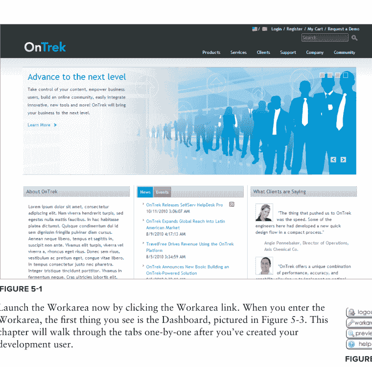

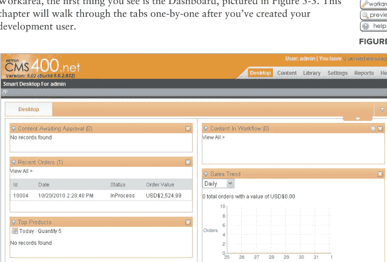


# 第 5 章 理解内容管理基础

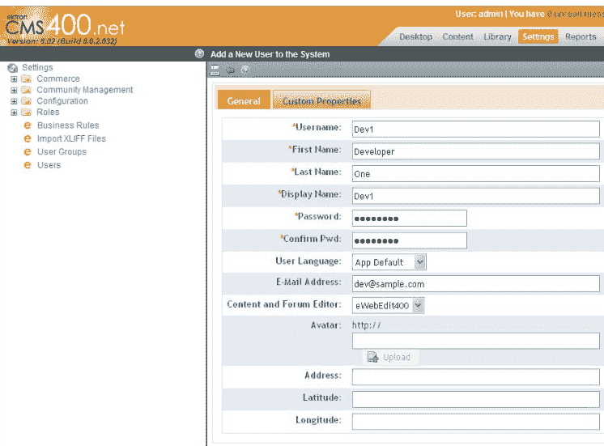 5-4

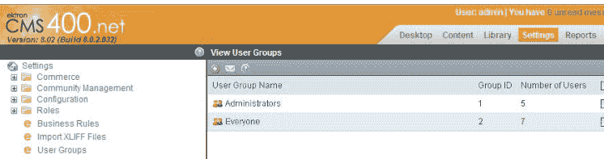 5-5

12. 选择图 5-7 所示的列表中的复选框，点击磁盘图标保存，然后在确认对话框中点击 `OK`。现在用户是管理员组的成员，拥有系统的所有权限。你现在可以关闭 `Workarea` 窗口，点击站点主页工具栏上的 `Logout`，并以 `dev` 身份登录。

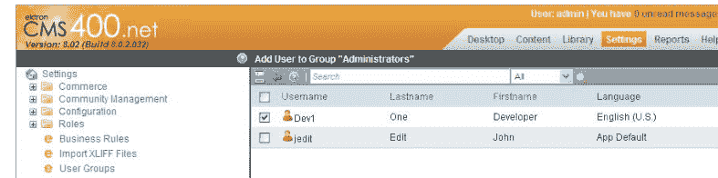 5-6

## 探索 Workarea

启动 `Workarea` 后，第一个视图是 `Dashboard`，也称为 `Desktop`。`Dashboard` 是 CMS 的个性化视图。它允许每个用户向显示添加组件并管理这些组件的布局。预加载的组件可以显示特定状态的内容、电子商务趋势和订单以及分析信息。`Workarea Dashboard` 使用与 `Dashboard`（第 11 章介绍）相同的个性化引擎。

`Dashboard` 标签之后是 `Content`、`Library`、`Settings` 和 `Reports` 标签。这些标签遵循共同布局。它们分为两个部分：左侧和一个右侧。右侧称为“面板”，用于显示你正在修改的特定选项或内容的界面。左侧称为“导航面板”，允许你选择想要与面板交互的特定功能。

`Workarea` 的 `Settings` 标签是管理 `Ektron` 框架选项的关键。有一个配置内容的区域。这包括用户和组，以及别名选项和系统模板等基础元素。

### Dashboard 标签

`Desktop` 是第一个出现的标签，因为查看哪些工作流需要用户交互很有帮助，如图 5-8 所示。

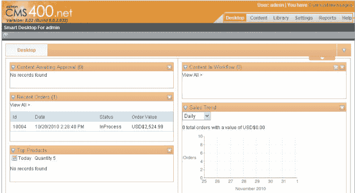 5-7

使得网站内容和组件的持续管理变得更容易。然而，此标签仅提供系统的概要概述。要更深入地查看系统，必须切换标签到其他视图。标签位于 `Workarea` 的右上角，第二个标签是 `Content`。

### Content 标签

`Content` 标签是与 CMS 主要元素进行交互的地方。通用讨论中提到的此 `Content` 标签由左侧的导航面板和右侧的显示面板组成。如下 5-9 所示。

在内容的导航面板中有四个折叠面板——`Folders`（文件夹）、`Taxonomies`（分类法）、`Collections`（集合）和 `Menu`（菜单）。每个折叠面板都包含一个“导航树”，显示该类型的相应元素。例如，在 `Folders` 折叠面板中，导航树显示了每个级别的文件夹。从导航树中选择将更新显示面板以显示文件夹的详细信息——在这种情况下，详情是文件夹内的内容列表。

`Content` 标签导航面板中的所有四个折叠面板都不显示内容，这似乎很奇怪。这完全正常，因为所有折叠面板都是组织内容的方法。例如，当选择 `Collections` 折叠面板时，导航树列出站点定义的每个集合。选择其中一个集合将更新显示面板以显示与集合相关的内容。

与内容项目的交互也通过 `Content` 标签进行。在导航树时选择显示面板列出的内容项目之一将带你进入内容显示页面。此页面列出了特定内容的所有细节，通过与图 5-10 所示的显示工具进行交互，内容作者可以管理内容的各个方面。

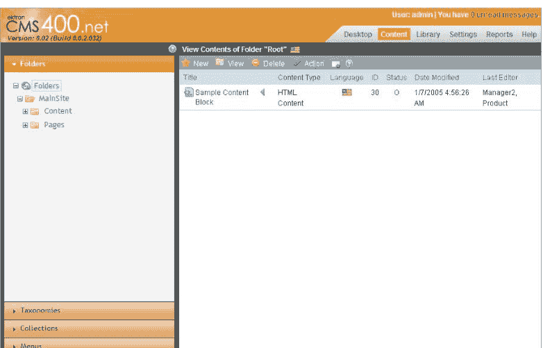

### 图 5-9

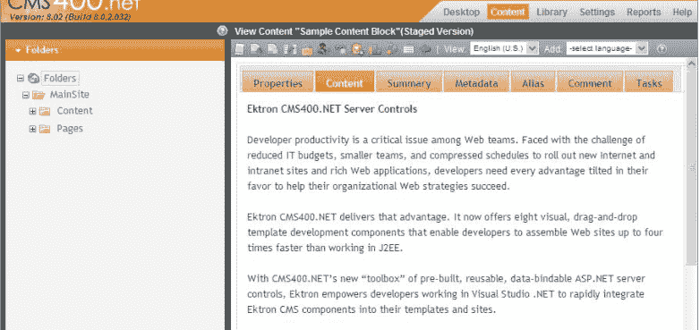

### 图 5-10

## 设置和报告选项卡

最后两个面向系统管理的选项卡是设置（`Settings`）选项卡和报告（`Reports`）。设置选项卡用于管理非内容的选项。这包括许可证密钥等系统配置选项、用户和社区管理，以及电子商务管理。设置选项卡中最重要的项目之一是设置（`Setup`）面板，可以通过导航树上的设置配置设置（`Settings Configuration Setup`）访问。这是输入许可证密钥等地方。

### 内容输入与显示

内容是显示在您的网站上的信息的基本单元。虽然 `Ektron Framework` 中的所有内容都基于内容，但大多数确实如此。例如，日历事件、`PageBuilder` 页面和 `HTML` 表单都是基于内容的，而菜单、分类法类别和集合（`collections`）则不是。

`Ektron Framework` 中的内容遵循预定义的流程。该流程从添加到站点开始，并最终发布。该过程结合了审批链和权限，以确保每份内容在发布到站点之前都经过相关人员的审核。

除了创建日期等基本属性外，内容项在整个框架中都有广泛的根。例如，内容项可以属于分类法节点、集合，并以菜单的形式出现。它们可以关联关联的元数据，支持多语言表示，并可以与 `URL` 别名关联。本节将涵盖内容拥有的所有连接，但将侧重于输入内容的过程、如何让其穿过发布阶段，以及作为开发者该如何显示它。

### 内容存储与状态

根据当前版本状态，内容存储在数据库中的三个单独表之一：

- `content`：内容的当前活动版本始终位于 `content` 表中。该版本可供未登录的用户、会员用户以及任何未查看网站的人访问。

- `content_edit`：此表存储尚未发布的内容的最新版本。一旦更改被发布，该行将从 `content_edit` 表中删除并移动到 `content` 表。

- `content_history`：这是所有之前签入和发布的内容版本存放的地方。具有正确权限的用户可以从 `content_history` 表中恢复内容。

每个版本的内容都有一个与其关联的状态。可能的内容状态列在表 5-3 中，随着内容在状态之间移动，只能采取某些操作。每种情况最终目标都是到达 `A` 状态，这意味着内容对具有正确权限的用户可见。

### 表 5-3：内容状态

| 字母 | 含义 | 描述 | 可能的后续状态 |
| --- | --- | --- | --- |
| `A` | 已批准 (`Approved`) | 内容已通过整个工作流并发布并在站点上可用。 | `O`, `M` |
| `O` | 已检出 (`Checked Out`) | 内容当前检出给某个用户。该项目正在编辑中。在签入之前，其他用户无法编辑。 | `I`, `S` |
| `I` | 已签入 (`Checked In`) | 内容已签入供其他用户编辑。尚未发布，因此在站点上不可见。 | `A`, `O`, `S`, `M`, `P` |
| `S` | 提交审批 (`Submitted for Approval`) | 只有当内容有需要完成的审批链时才会进入此状态。作者在编辑后将内容提交到链中时进入此状态。 | `A`, `O`, `S`, `M`, `P` |
| `M` | 标记删除 (`Marked for Deletion`) | `S` 状态，用于删除内容。当用户尝试从审批链中删除内容时，内容将留在 `M` 状态，直到请求被批准或拒绝。 | `A`, `Deleted` |
| `P` | 等待上线 (`Pending Go Live Date`) | 内容已批准并准备在站点上显示，但标记了发布日期。在发布日期之前，内容将保持在 `P` 状态，此时内容转换为 `A`。 | `A`, `M` |
| `T` | 等待任务完成 (`Awaiting Completion of Tasks`) | 任务是与内容关联并分配给某人的项目。在完成相关任务之前，内容在网站上将不可见。除了完成任务外没有其他阻止内容显示，它处于 `T` 状态。当完成必要任务时，将自动移动到 `A` 状态并在站点上可见。 | `A`, `O`, `M` |

从一个状态到下一个状态的移动受当前用户权限以及与内容相关的任何应用审批链和任务的限制。例如，只有当发布内容时有与其相关的任务时，才会到达 `T` 状态。此外，只有在文件夹应用了审批链时才会到达 `S` 和 `M` 状态。如果文件夹没有审批链，内容将直接移动到 `A` 状态或被删除。

`Ektron Framework` 中的内容通过*锁模型（`lock model`）*管理，这意味着当一个用户正在编辑内容时，没有其他用户可以同时编辑它。这与源码控制模型非常相似，当一个用户正在编辑内容时，没有其他用户可以同时编辑它。

适用于特定内容的元数据定义继承自该内容所在的文件夹，且元数据的值可能带有与元数据定义相关的默认值。然而，你想要为此特定内容使用的值，应该在图 5-13 所示的区域输入。

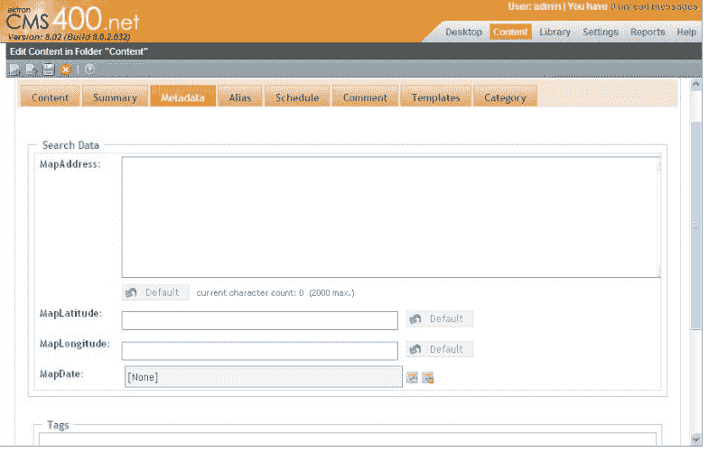

图 5-13

- **别名 (`Alias`)：** 别名是除了给定内容的快速链接（`quicklink`）之外可用于访问内容的替代 `URL`。这允许内容管理员管理特定内容的 `SEO` 需求。别名标签允许你管理用户输入的内容的手动别名，并显示该内容可用的自动别名列表。

- **计划 (`Schedule`)：** 如图 5-14 所示，此标签允许内容管理员设置新发布版本何时上线，以及内容内容何时过期。它还允许你设置过期后的操作。这些选项可以留空，在这种情况下，内容将无限保持其正常状态。然而，通过为内容设置开始日期（`Start date`），你可以精确控制内容何时可见。过期操作有三种选项：
  - **归档并移除站点 (`Archive and remove from site`)：** 将内容更改为归档。通过将过滤器设置为“归档内容”（`Archived Content`），在工作区（`Workarea`）中仍然可见，但在站点上不可见。
  - **归档并保留在站点 (`Archive and remain on site`)：** 将内容作为列表摘要（`ListSummaries`）从活动导航元素中移除，但仍可通过搜索和书签等直接导航找到。此选项也会对内容进行归档。
  - **添加到 CMS 刷新报告 (`Add to the CMS Refresh Report`)：** 将该项添加到需要作者审核的项目列表中。然而，在前端导航、显示以及与工作区的交互方面，该内容仍然完全正常。

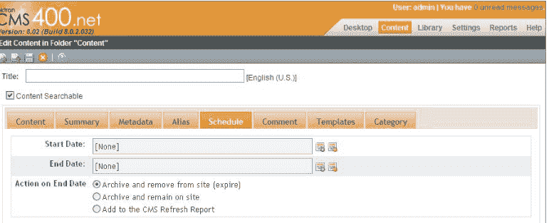

图 5-14

- **注释 (`Comment`)：** 注释是内部使用的笔记，可以为每条内容输入。这些注释不会在前端任何地方显示。相反，它们用于存储可能对内容未来编辑人员有用的信息。

- **模板 (`Templates`)：** 如图 5-15 所示的模板标签允许用户为此特定内容选择模板。仅允许的模板是父文件夹配置为使用的模板。这控制了当用户通过系统生成的链接访问内容时，内容渲染时使用的模板。然而，任何模板上的任何内容块服务器控件（`Content Block Server Control`）都有能力显示内容项，如果这些控件的 `DefaultContentId` 属性被设置为内容项的 `ID`。

- **类别 (`Category`)：** 如图 5-16 所示的类别标签允许内容将内容项关联到任何适用的节点。只有与父文件夹已关联的节点可以在此屏幕上选择。请记住，当内容关联到分类法节点（`taxonomy node`）时，该更新发生在正常内容工作流之外。换句话说，如果作者修改内容以将其关联到不同的节点，该更改将立即发生。

如果它们已经在父文件夹上被标记，则内容的唯一必填字段是标题、内容、元数据和类别。现在向这些字段输入以下详细信息。表 5-4 提供了字段和相应的值。

## 第 5 章 理解内容管理基础

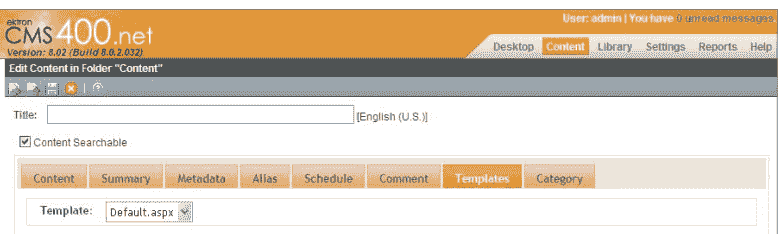

图 5-15

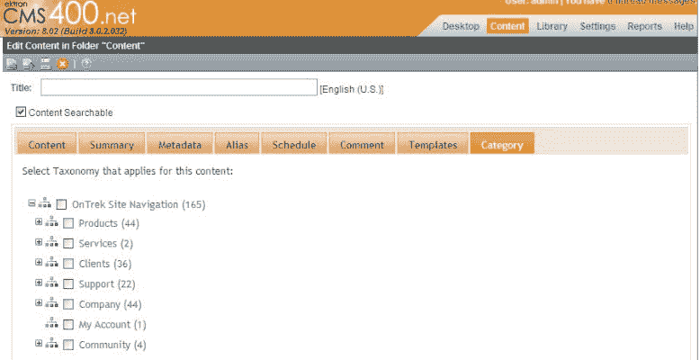

图 5-16

### 表 5-4：值

| 字段 (`FIELD`) | 值 (`VALUE`) |
|---|---|
| 标题 (`Title`) | Test Content |
| 内容 (`Content`) | This is some test content. |
| 类别 (`Category`) | Company |

### 使用内容面板工具栏

现在让我们看看内容输入面板工具栏上的可用按钮。图 5-17 显示了工具栏。

- **提交/发布 (`Submit/Publish`)：** 如果已配置，此按钮将内容提交到审批链中，如果文件夹没有审批链，将立即发布内容。

- **签入 (`Checkin`)：** 签入内容不会将其提交到审批流程或上线。签入内容允许其他作者开始处理该内容。

- **保存 (`Save`)：** 将内容保持为当前编辑者的检出状态，锁定其他用户，同时更新数据库中的副本，以防更改丢失。

- **取消 (`Cancel`)：** 丢弃对数据库版本所做的任何更改。

点击工具栏上的第一个按钮现在提交内容。这将你返回到“查看内容”（`View Content`）屏幕，你可以在那里看到刚刚创建的内容的所有细节。

## 在工作区查看内容

图 5-18 所示的“查看内容”界面显示的界面与“编辑内容”界面几乎相同。它有一个具有更多选项的工具栏，以及与之前相同的标签界面，甚至某些标签是相同的。此部分将按照之前的顺序遍历屏幕，首先涵盖工具栏下方的显示，然后深入工具栏本身的每一项。

- **属性 (`Properties`)：** 如图 5-19 所示，显示了你在系统级别关于内容需要知道的所有信息。它显示了标题、`ID`、状态、路径、模板。

- **内容 (`Content`)：** 如图 5-18 所示，显示了在站点上显示的内容。

- **摘要 (`Summary`)：** 就像内容标签一样，摘要标签显示了输入到摘要的内容。如果没有输入摘要，摘要将由系统自动生成。

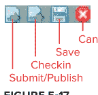

## 第 5 章 内容管理基础

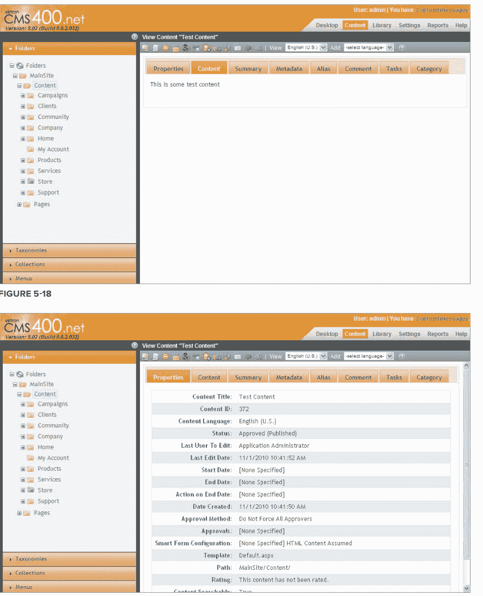

图 5-18

图 5-19

### 内容输入与显示 | 71

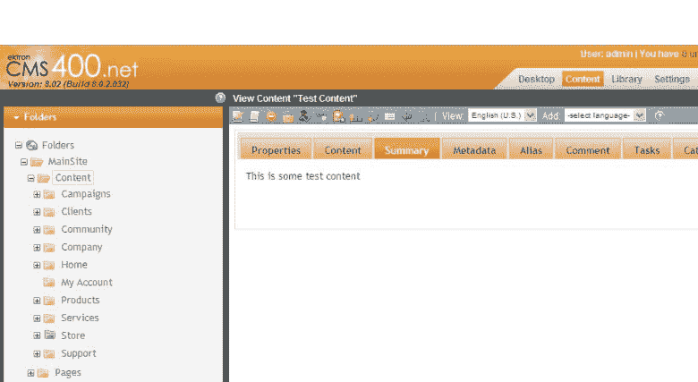

图 5-20

- **元数据 (`Metadata`)：** 如图 5-21 所示的元数据标签显示了每个元数据定义的存储值。在某些情况下，这将编辑屏幕上输入的不同。这些项目就像 CMS 中的所有项目一样，可以由框架插件和扩展修改。在这里特别提到它是因为框架随带的一个扩展是地理映射插件（`GeoMapping Plugin`）。它读取存储在 `MapAddress` 元字段中的数据，并将其转换为纬度和经度，这些存储在相应的元字段中。

- **别名 (`Alias`)：** 如图 5-23 所示，此标签允许在站点启用别名的情况下更新内容的手动别名，并将列出任何来自分类法或文件夹别名的自动别名。有关别名的更多信息，请参见第 6 章。

- **注释 (`Comment`)：** 这仅显示在编辑屏幕注释字段中输入的任何信息。

- **任务 (`Tasks`)：** 如图 5-23 所示，显示了与内容关联的所有任务报告。任务附加到可以分配给特定用户的内容。如果内容关联了任何任务，在它们被标记为完成之前，内容不会上线。管理员可以看到与内容关联的所有任务，但非管理员用户只能看到分配给他们的任务。

- **类别 (`Category`)：** 如图 5-24 所示，这简单列出了内容项已关联的分类法节点。

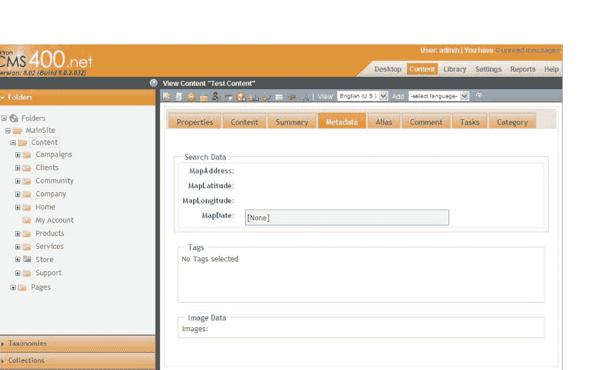

图 5-22

### 内容输入与显示 | 73

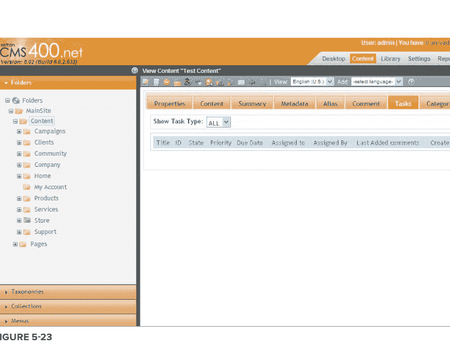

图 5-23

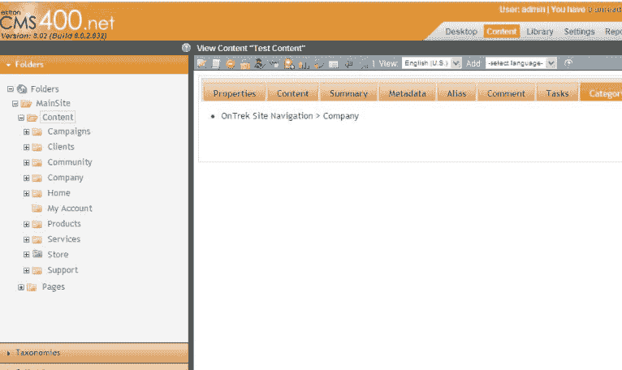

图 5-24

## 编辑内容时使用工具栏选项

如你所见，查看内容时显示的标签页与编辑内容时可见的标签页密切相关。然而工具栏则完全不同，如图 5-25 所示。

图 5-25

让我们来看看每个项目及其功能。

- **(编辑/`Edit`)**

编辑按钮允许用户编辑该条内容。它会首先将内容检出（`check out`）给用户，防止其他用户同时进行更改。

- **(历史/`History`)**

图 5-26 所示的历史屏幕显示了内容所有存储版本的列表。这包含了内容的每次检回（`check in`）和每次发布记录。历史屏幕允许用户恢复特定版本的内容，并查看任意两个版本之间的差异。标题、内容、摘要、元数据和注释都是按版本存储的——所有其他项目均没有恢复功能。

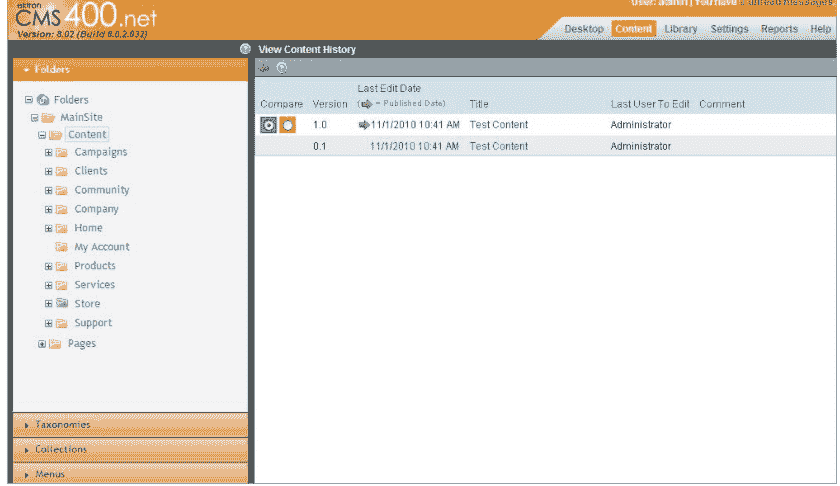

图 5-26

- **(查看发布/`View Publish`)**

查看发布允许在网站上当前显示的内容版本与尚未发布的版本之间进行切换。只有当内容自上次发布以来有版本被编辑过的版本时，此选项才可用。

- **(查看差异/`View Diff`)**

查看差异功能会打开一个新窗口，显示内容的最后发布版本与最新编辑版本之间的任何差异。只有当内容自上次发布以来有版本被编辑过时，此选项才会出现。

- **(删除/`Delete`)**

删除按钮将从网站上删除当前内容。

- **(查看权限/`View Permissions`)**

图 5-27 所示的查看权限将调出与文件夹使用的相同的权限管理界面。内容项默认继承其父文件夹的权限，但可以在单个项目级别上进行覆盖。建议继承权限，并在必要时进行覆盖。

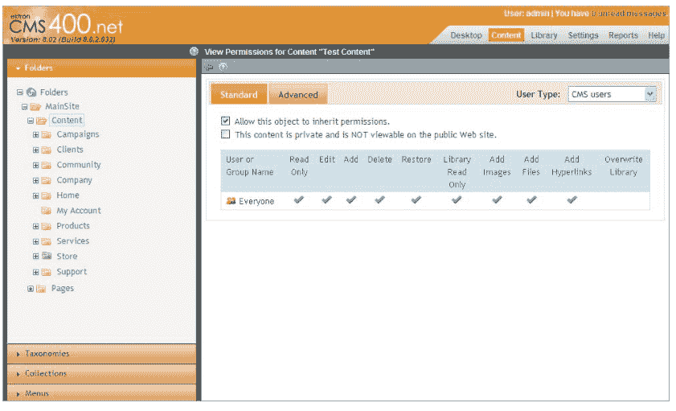

图 5-27

- **(查看审批/`View Approvals`)**

图 5-28 所示的查看审批的继承方式与权限相同。父文件夹设置默认应用到内容上，但在必要时可以覆盖。

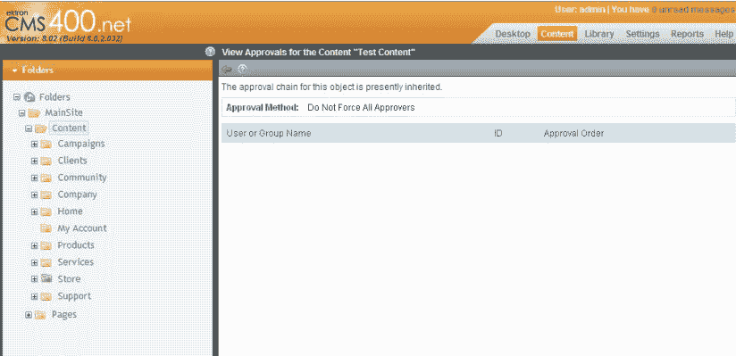

- **(链接搜索/`Link Search`)**

链接搜索会生成任何链接到此内容的项列表。图 5-29 显示了搜索内容文件夹。如果你正在考虑删除该内容项，但在操作之前需要确保没有项目依赖于该项，那么这非常有用。断链检查器也可以帮助你解决这种场景。

- **(添加任务/`Add Task`)**

这是你向系统中的用户分配任务，以便他们对当前内容项执行某些操作的方法。添加任务会生成表单，你可以在其中指定优先级、类别、类型、开始和截止日期以及描述。表单如图 5-30 所示。被分配的用户会收到执行任务的通知。完成后，该项将返回由你进行审批或拒绝。


# 内容报告/Content Reports

内容报告界面向你显示用户在网站上留下的内容。它如图 5-31 所示有三个标签：评分（Rating）、消息（Messages）和标记（Flagging）。第一个标签评分显示了使用内容审查服务的用户留下的星级评分和注释。第二个标签消息显示了使用留言板服务器控制的用户留下的注释。第三个标签显示了用户通过内容标记服务器控制交互为内容选择的标记。

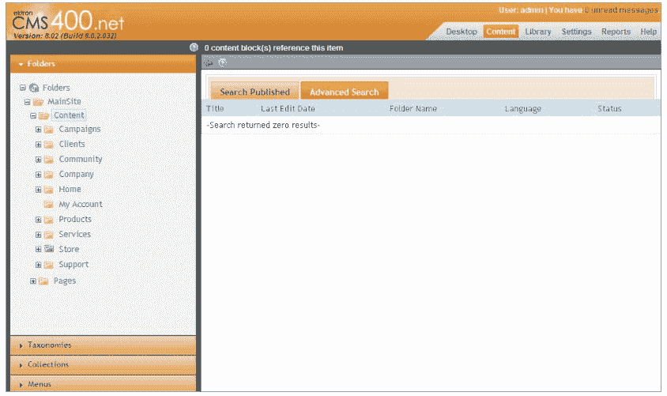

图 5-29

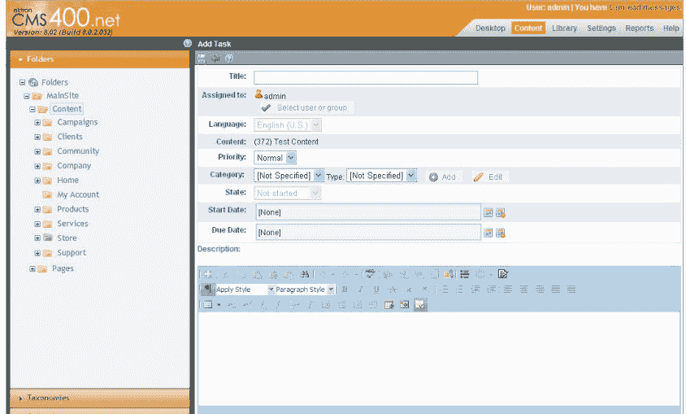

图 5-30

## 分析/Analytics

当你点击分析时，新窗口会显示有关内容项所在页面的信息。它仅对公开访问的页面有效，这意味着不能使用本地主机地址。它共享信息如页面的 SEO 分析、W3C 验证器反馈、Alexa 排名、图像分析。

## 编辑属性/Edit Properties

图 5-32 所示的编辑属性允许你编辑内容项的属性。

## 导出翻译/Export for Translation

导出翻译会生成一个可在其他翻译工具使用的文件。

## 语言/Language

语言设置允许你管理内容的语言。

# 使用区块服务器控件 (Block Server Control)

区块服务器控件可能是 Ektron 框架中最常用的服务器控件。它的功能非常简单：从数据库中读取内容项并将其显示在网站上。它可以硬编码为特定项目，也可以配置为从查询字符串读取内容 ID，并可以在运行时通过程序方法设置显示内容的 ID。

对于作者来说，区块服务器控件会显示“编辑器（Editors）”访问点，这是网页上内容显示上方的一个银色圆点渲染项。该访问点本身具有直接从网站管理内容项的选项，包括在内容中编辑、管理任务以及查看项目的历史。这些项目中的大多数会直接启动工作区（Workarea）并进入感兴趣的区域。极少数项目（即让内容通过工作流移动的项目）仅会执行选定的操作。

本节介绍了如何在页面上实现区块服务器控件。请按照以下步骤操作：

1. 打开 Visual Studio，通过选择 `File` ⟘ `Open` ⟘ `Web Site` 打开窗口。

2. 在弹出的 `On Site` 对话框中，选择 `File System` 和 `C:\Netpub\wwwroot\OnTrek`。在解决方案资源管理器（Solution Explorer）中，右键点击根目录，并选择 `Add New`。

3. 在 `New Item` 对话框中（如图 5-36 所示），选择使用 Visual C# 作为语言的 Web Form。勾选“单独的文件中放置代码”复选框，不要选择主页。

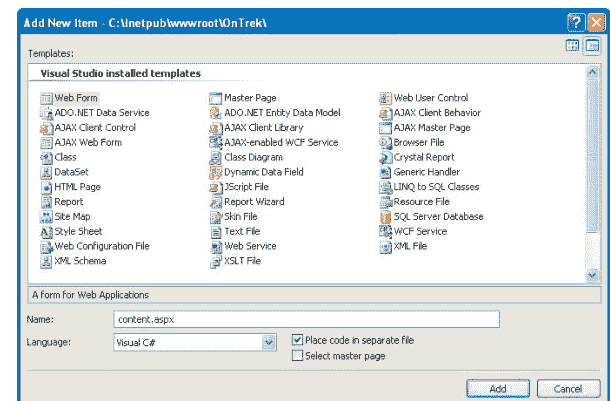

图 5-36 该对话框创建了 `content.aspx` 文件，以及 `content.aspx.cs` 后代码文件（codebehind）。

4. 要添加区块服务器控件，你不需要后台代码文件，但 ASPX 文件本身是您声明式添加控件的地方。请确保现在 ASPX 文件已打开。

5. 一旦你看到 Ekron 文件，切换到代码视图（code view）并打开工具箱。作为 Ektron 安装的一部分，Ek 控件已在 Visual Studio 中注册。这会将所有可用控件添加到工具箱中，允许您只需将控件拖到页面上。此时，页面上的代码应该看起来与列表 5-1 中的代码相同。

## 列表 5-1: Content.aspx

```csharp
<% Page Language="C#" AutoEventWireup="true" CodeFile="content.aspx.cs"
Inherits="content" %>

<!DOCTYPE html PUBLIC "-//W3C//DTD HTML 1.0 Transitional//EN"\n"http://www.w3.org/TR/html/html-transitional.dtd">

<html xmlns="http://www.w3.org/1999/xhtml">
<head>
<meta runat="server">
<title></title>
</head>
<body>
<form id="form" runat="server">
<<div>

</div></div>
</form>
</body>
</html>
```

6. 现在从工具箱中的 Ektron Controls 选项卡中选择内容区块服务器控件（Content Block Server Control）并将其拖入，如图 5-37 所示。

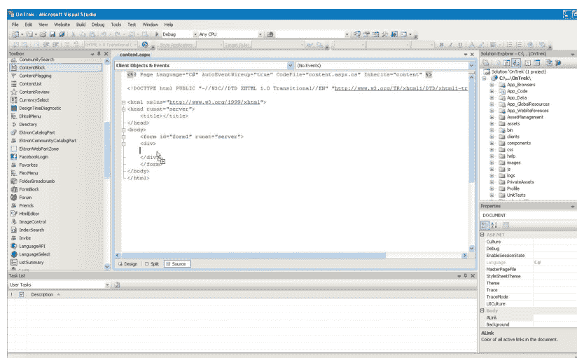

图 5-37

将内容区块控件拖到页面上会修改代码，使其看起来如图 5-38 所示。

7. 现在打开属性窗口，如图 5-38 右侧所示。当按类别组织属性时，Ektron 属性会被分组在一起。截图中高亮了最重要的属性——`DefaultContentID` 指定默认内容的 ID。`DynamicParameter` 属性允许从查询字符串读取以覆盖 `DefaultContentID`。

8. 区块服务器控件根据权限和语言设置检索并显示适当的内容项。如需通过程序方法设置内容项，请使用以下代码段使用服务器控件，该代码将在 `Page_Load` 事件中运行。

```csharp
public void Page_Load() {
  ContentBlock1.DefaultContentID = 123;
  ContentBlock1.Fill();
}
```

调用 `Fill` 方法允许服务器控件从缓存中检索数据。在从缓存中加载后，也可以通过程序方法从内容区块读取数据，或者通过读取区块服务器控件的 Ektron 属性。`EkItem` 返回一个 `Ektron.Cms.Common.ContentBase` 类型的对象，该对象包含了关于内容项本身的所有信息。可以在不使用区块服务器控件的情况下通过程序方法检索它。此任务最常用的实现是通过使用 `Ektron.Cms.Core.Content` 对象。该对象提供了添加内容、更新内容、删除内容、检索单个内容以及通过准则对象检索内容列表的方法。

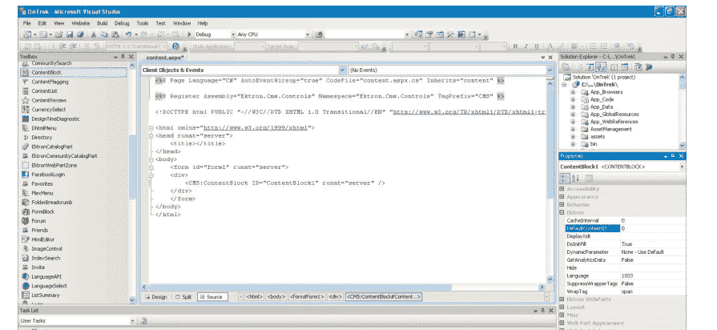

### 表 5-6: 文件夹类型

| 图标 | 文件夹类型 | 描述 |
| --- | --- | --- |
| | 根文件夹 (Root Folder) | 包含安装中的所有其他文件夹。它是一个普通文件夹，可以包含任何标准内容项。 |
| | 标准文件夹 (Standard Folder) | 包含任何标准内容项。其他文件夹类型基于此类型。 |
| | 多站点文件夹 (Multisite Folder) | 在多站点配置中作为虚拟根。其中的内容（如快速链接 QuickLinks 等项）将继承多站点配置。 |
| | 社区文件夹 (Community Folder) | 成员可以在此处创建内容。在同步操作期间，其行为不同，以便在从生产服务器移回阶段服务器时保留内容。 |
| | 博客 (Blog) | 博客包含常规内容，还带有指向外部博客和网站的额外数据链接。此类型设计用于在博客服务器控制中显示，为浏览网站的用户以易于识别的博客形式渲染内容。 |
| | 讨论板 (Discussion Board) | 也称为论坛；允许成员对各种主题进行互动。此文件夹类型允许创建一个镜像网站前端结构的结构。 |
| | 电子商务目录 (eCommerce Catalog) | 一种特殊文件夹类型，允许添加可以作为电子商务插件部分进行交互的项。 |
| | 网络研讨会 (Webinar) | 此类型的文件夹用于存储日历事件。 |

这些文件夹类型中的每一个都可以通过选择要创建的的文件夹，然后在内容面板的工具栏菜单上选择“新建 (New)”，或者右键点击父文件夹并在右键菜单中选择相应的选项来创建。我们将在后面的章节中介绍这些大多数文件夹类型。

在图 5-39 的右侧，你可以看到此文件夹中包含的内容列表。旁边是适用于此文件夹的菜单项。从左侧开始是以下项目：

- **新建 (New)** 允许用户在适当的地方创建新内容和子文件夹。
- **视图 (View)** 允许用户按类型、某些属性和语言过滤项目列表。
- **删除 (Delete)** 允许用户删除文件夹中的内容或文件夹本身。
- **动作 (Action)** 允许用户执行额外操作，如复制和粘贴，或导出内容以翻译成另一种语言。

## 在根文件夹中创建文件夹

要创建文件夹，请右键点击根文件夹 (Root folder) 并选择“添加文件夹 (Add Folder)”，如图 5-40 所示。

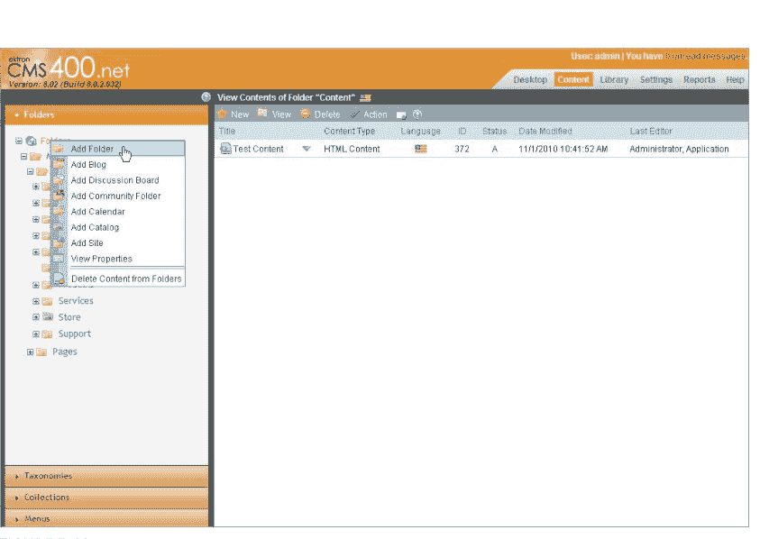

图 5-40 这弹出了“添加文件夹”界面。在编辑文件夹时该界面相同，并允许修改文件夹的所有属性。请按照图 5-41 所示从左到右考虑标签页。

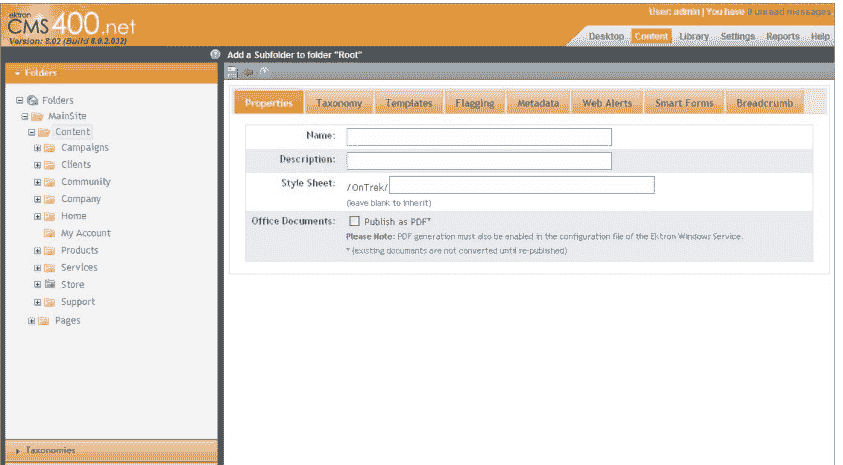

图 5-41

## 属性 (Properties)

在此输入基本信息，例如内容名称。属性标签页有两个选项：

- 编辑器中使用的样式表，使编辑效果与项目发布时的外观和感觉一致。
- “发布为 PDF (Publish as PDF)”字段，用于通知系统在发布时是否自动将 Office 文档转换为 PDF，以便浏览网站的用户具有更高的可访问性。

## 分类法 (Taxonomy)

控制与此文件夹关联的分类法。分类法可以标记为“已分配 (assigned)”或“强制 (required)”。如果是强制的，则在分配给一个或多个类别之前无法发布内容。默认情况下，分类设置继承自父文件夹。

## 模板 (Templates)

决定内容快速链接（Quick）的格式。每当创建一个内容时，系统都会为分配模板的内容创建存储的 URL，随后跟一个指示要加载哪些内容的查询参数。当你将模板分配给文件夹时，你是在表示允许用户选择内容模板。某些模板（如线框图 Wireframes）允许在此文件夹中创建 PageBuilder 内容。如果线框图未与文件夹关联，则无法在该文件夹中创建 PageBuilder 内容。模板配置默认继承。

## 标记 (Flagging)

允许你选择一组用户可以选择更改的标记。这些标记经常用于将项目项标记为“有帮助 (Helpful)”或“不适当 (Inappropriate)”。默认情况下，标记继承自父文件夹。

## 元数据 (Metadata)

如图 5-42 所示，此标签页列在系统中所有的元数据定义中。邀请用户将某些项设为已分配或强制。这些选项默认继承自父文件夹。

## Web 警报 (Web Alerts)

Web 警报是在网站发布新内容时发送给订阅这些用户的通知。Web 警报允许你配置通知的形式。此标签页默认继承自父文件夹。

## 智能表单 (Smart Forms)

智能表单最易理解为 XML 的图形化 DTD。它们在 CMS 中通过 eWebEditPro 创建，其中定义了 HTML 字段、XML 存储格式以及用于在网站上显示的 XSLT 数据。与标准 HTML 内容不同，智能表单内容不是自由格式。这确保了内容的统一性。

文件夹配置上的智能表单标签允许用户选择此文件夹支持哪些智能表单。用户可以选择无智能表单、仅智能表单或两者的某种组合。文件夹默认从父文件夹继承这些值。

## 面包屑 (Breadcrumbs)

这些生成网站地图。它们还用于在网站顶部创建面包屑链接。这些默认继承，但继承行为很少符合预期。在创建时，面包屑是继承的，但继承行为通常是不可接受的。如图 5-44 所示，显示在此处。

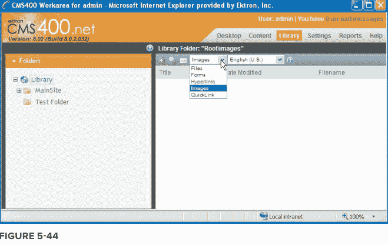

图 5-42


图 5-43

## 库

属性 (Properties)：在此输入基本信息，例如内容名称。属性标签页有两个选项：

- 编辑器中使用的样式表，使编辑效果与项目发布时的外观和感觉一致。
- “发布为 PDF (Publish as PDF)”字段，用于通知系统在发布时是否自动将 Office 文档转换为 PDF，以便浏览网站的用户具有更高的可访问性。

属性 (Properties) 导航到库 库存储了以下项：

- **文件 (Files)**：允许的文件为 PPT、PDF, XLS。
- **表单 (Forms)**：这些 HTML 表单本身。
- **超链接 (Hyperlinks)**：指向外部网站的快捷方式。
- **图片 (Images)**：库的主要用途。通过将图片放入库中，内容作者可以将其嵌入内容。
- **快速链接 (QuickLinks)**：库中的另一个主要项。快速链接存储指向特定内容的 URL。它们在创建内容时自动创建，并遵循格式 `[模板文件名]?id=[内容ID]`。这些快速链接可以通过点击“更新快速链接”按钮手动更新。

## 向库中添加项

让我们通过向新文件夹添加图像来探索库的功能。该图像将供具有查看权限的 CMS 用户嵌入内容。遵循以下步骤：

1. 首先，在库标签页的文件夹树中选择测试文件夹。从工具栏上的类型下拉菜单中选择“图片 (Images)”。
2. 点击绿色的添加图标。这将打开图 5-45 所示的添加库项。
3. 在表单顶部，你需要输入标题和一个要上传的文件。从系统选择图像并进行上传。
4. 在下方你可以为图像输入摘要、元数据和类别。这是因为这些项继承了并行内容文件夹的选选项。
5. 填写这些信息后，选择“保存 (Save)”图标返回列表视图。

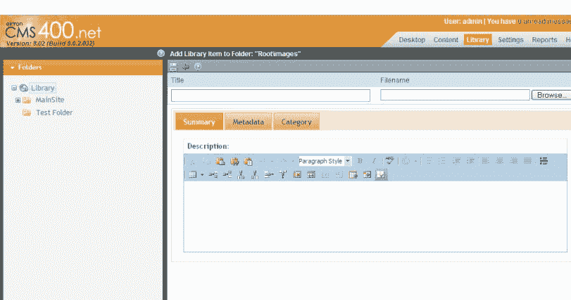

图 5-45

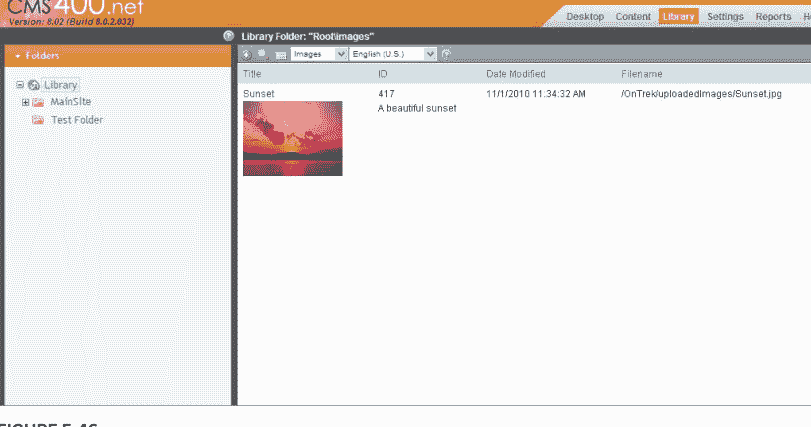

图 5-46

## 关于库的更多内容

库中还有一些尚未涵盖的功能。其中第一个功能是搜索，它同时存在于内容文件夹和库中。搜索是递归的，这意味着你可以针对你尝试查找的内容或库项的任何祖先文件夹级别进行搜索。若要在内容中搜索，请在文件夹的菜单中选择“操作 (Action) | 搜索 (Search)”。要在库文件夹中搜索，请点击文件夹工具栏上的图标。

库中还有另一种类型的搜索，称为“链接搜索 (Link Search)”。链接搜索允许你找到系统中所有嵌入了所选库的内容项。例如，这可以确保当你删除某项内容时，所有依赖于该项的内容都已更新为不再使用它。使用链接搜索功能，在任何类型的库中选择一个项，然后选择链接搜索图标。

库的另一个值得提及的功能是设置以及它们的更新方式。例如，我们提到过文件仅支持少数扩展名。虽然图片的扩展列表更长，但规则仍然适用。你可能想向网站添加不在支持文件类型列表的文件。此选项及其他选项是可以更新的。

作为管理员，在库中选择一个文件夹，并在工具栏上选择属性（properties）按钮。出现的屏幕有许多可能的自定义选项，如图 5-47 所示。

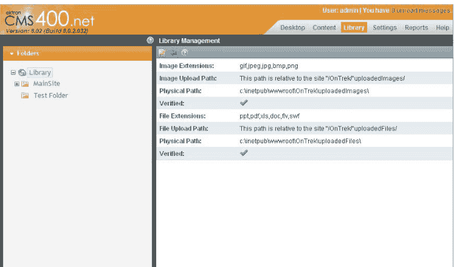

图 5-47

- **图片扩展名 (Image Extensions)**：上传图片时允许的扩展逗逗分隔列表。
- **图片上传路径 (Image Upload Path)**：上传到库的图片提供服务的路径。它必须位于站点之下，因为文件是直接从磁盘服务的。它用于构建指向库项的相应 URL。
- **物理路径 (Physical Path)**：图片上传到的磁盘位置。这是根据“图片上传路径”自动生成的。
- **文件扩展名 (File Extensions)**：添加到库的文件支持的扩展名列表。
- **文件上传路径 (File Upload Path)**：上传到库的文件提供服务的路径。其模式与“图片上传路径”相同。
- **物理路径 (Physical Path)**：文件上传到的磁盘位置。这是根据“文件上传路径”自动生成的。

## 底层原理：文件夹与库

你将不会通过工作区 (Workarea) 访问文件夹及其内容。从开发者的角度来看，你可能会从程序化的角度来处理信息。Ektron 拥有大量的 API 供你使用，此外还有长系列服务器控件。例如，`ListSummary` 服务器控件将创建文件夹内容的列表并在 Web 上显示。

对于 API 访问，`Ektron.Cms.Framework.Core.Folder.Folder` 对象包含了用于简单创建、检索、更新和删除（CRUD）操作的所有操作符。你操作的是 `Ektron.Cms.FolderDataObject` 对象。

库也可以通过 `Ektron.Cms.API.Library` 对象通过 API 访问。

## 文件夹与库简述

文件夹是 Ektron 框架中的基本概念之一。它们存储许多类型的内容，关联数据可以存储在库中。它们支持继承概念，几乎所有属性都会从内容所在的文件夹传递给内容。文件夹决定了作者如何与管理内容进行交互，并对包含的项支持权限和工作流。

# 权限、审批与角色

Ektron 框架带有一套完整的权限模型，其本质上与 Windows 特有的权限模型相似。该权限模型基于属性的继承，并可以在每一层提供覆盖选项。它将权限分配给单别用户，也分配给组级别。

除了权限之外，框架还支持管理内容工作流，这允许内容管理员定义一组个人或……

在本节中，你将探索权限、审批链和角色的功能。

## 理解权限


# 理解权限与审批链

权限由一个控制用户是否拥有某个对象的结构组成。在 Ektron 中，权限分配给单个用户以及组。这包括但不限于表单、文档、HTML 和页面。

需要注意的是检查权限的方法。在 Ektron 框架中，不支持负性控制。系统将简单遍历直接条目（直接命名用户）和继承条目（命名用户所属的组）列表，直到找到授予访问权的条目。如果没有找到条目，它将阻止该操作。

## 理解审批链

审批链与权限类似，它们限制了对内容的发布权限。Ektron 中的审批链指的是线性工作流，每次审批都会将内容移动到下一个审批者处。如果某项内容存在于定义了审批链的文件夹中，任何发布或删除该内容的请求都将强制内容通过整个审批链。沿途的每位审批者都有几个选项：他们可以修改内容、批准内容或拒绝请求。根据审批链的配置，修改内容可能会强制其回到第一个审批者，以便每位审批者实际上都在批准内容的最终版本。修改审批链需要 `Folder Admin` 角色。

### 理解角色

Ektron 中的角色是一种次级权限系统，用于控制并非直接从内容继承的对象访问。例如，有一个 `Taxonomy Administrator` 角色以及一个 `Folder Admin` 角色。这些角色分别控制用户是否可以修改分类法或修改文件夹属性。与权限一样，角色是一个正性系统。如果用户直接出现在角色的条目列表中，或者是角色条目列表中某个组的成员，则用户被批准拥有该角色。没有负性条目。

角色不绑定到单个项目。例如，如果用户拥有 `Taxonomy Administrator` 角色，她就可以修改所有分类法。此外，Ektron 框架允许通过工作区创建和管理自定义角色，并通过程序方式进行检查。这是管理网站内容访问的一种有用方法。

### 管理权限与工作流

在本节中，你将不会针对任何特定的文件夹或功能进行实施；相反，你将只需尝试维护你的权限布局所需的各种类型任务。实施部分涵盖了：

- 限制文件夹权限
- 设置审批链
- 创建自定义角色

## 限制文件夹权限

要编辑与文件夹相关的权限，请按照以下步骤操作：

1. 通过点击内容面板工具栏上的“查看属性”或在右键菜单中选择“查看属性”来查看该文件夹的属性。
2. 进入“属性”面板后，选择工具栏上的“查看权限”图标。您将看到此文件夹的权限表，如图 5-48 所示。

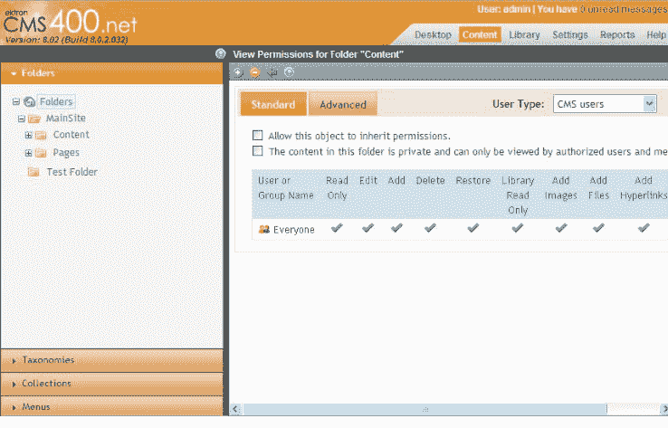

图 5-48

标准选项卡下的第一个复选框用于启用或禁用权限继承。第二个复选框决定该文件夹是否标记为私有。如前所述，这仅影响是否按照标记执行只读权限。如果勾选，它将限制用户查看内容，除非他们经过了特定的批准。该复选框之所以存在是因为检查权限的成本很高，而网站上的大多数内容都设计为公开访问；Ektron 可以通过简单地假设除非另有说明，否则每个人都具有读取权限来提高性能。

3. 取消勾选权限继承复选框以修改与此文件夹相关的权限。工作区会要求确认以打破继承。
4. 确认对话框。当权限面板重新加载时，您看到界面没有太大变化：
    - 注意工具栏上增加了两个按钮，即“加”图标和“减”图标。“加”图标允许您向条目列表添加参与者。“减”图标允许您将他们移除。另一个变化不那么明显，但您现在可以点击列表中的每个参与者名称（例如“所有人”）来修改授予该参与者的权限。
5. 将用户 `edit` 添加到文件夹的用户列表中。授予“编辑所有”权限并点击“保存”继续。现在，您在该文件夹的参与者列表中应该已经有了“编辑”和“所有人”，两者都拥有所有权限。

## 设置审批链

审批链也可以从“文件夹属性”面板管理。请按照以下步骤操作：

1. 在文件夹树中点击给定文件夹的右键菜单中的“查看属性”，或者通过查看文件夹并选择工具栏中的“属性”返回“文件夹属性”面板。
2. 进入属性视图后，选择工具栏上的“查看审批”。弹出的第一个面板是当前审批链的摘要。它在图 5-49 中显示从一个空列表开始。

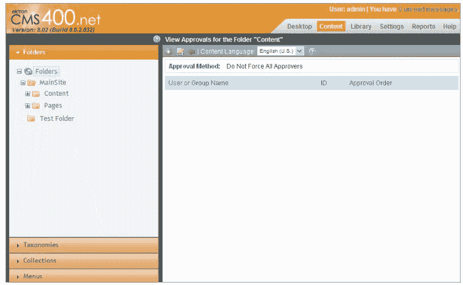

图 5-49

3. 要修改审批方法，选择工具栏上的“编辑”图标。这向您提供两个选项：“强制所有审批者”和“不强制所有审批者”。这两个选项之间的区别在于当审批者修改内容时的行为：
    - 如果链设置为“强制所有审批者”，当审批者编辑内容时，审批链将从开始重新开始。审批者将看到最终形式。
    - 如果链设置为“不强制所有审批者”，内容直接向前移动。编辑内容的审批者不会看到最终版本。
4. 返回审批主界面。点击“加”图标添加一个审批者到列表中。图 5-50 显示了用户选择界面。

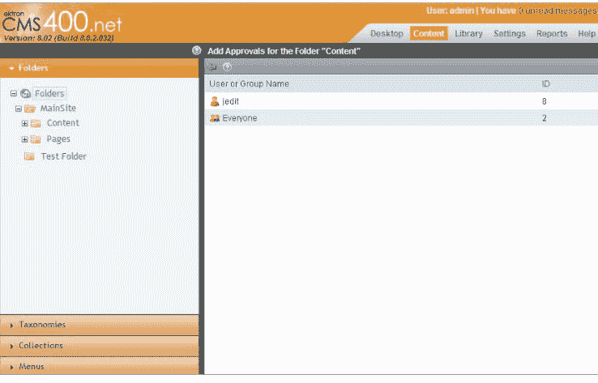

图 5-50

你会发现审批链显示的用户和组并不是系统中的完整列表。它只显示被授予权限的用户。这就是为什么您将 `edit` 添加到用户列表。

5. 从列表中选择“编辑”。这将您带到带有“编辑”的审批链，如图 5-51 所示。

现在您的链配置了“编辑”，在“编辑”批准之前，文件夹中的任何内容都不会上线。请记住审批链总是串行的，这意味着如果您在列表中添加第二个用户，则首先需要“编辑”，然后是第二个用户。如果您希望用户列表中的任何个人都能批准内容，而不是所有用户，您应该将这些用户添加到组，并转而要求组审批。

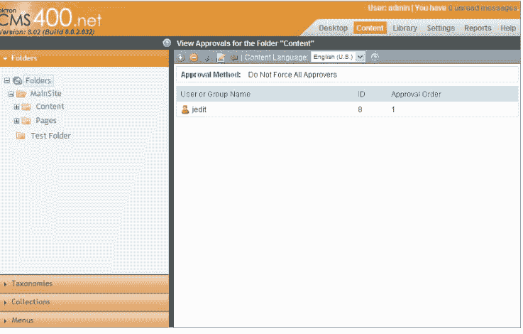

图 5-51

## 创建角色

自定义角色允许您创建一组可以访问网站特定功能的用户列表。它们在工作区中配置，并可以通过编程进行检查，从而允许您轻松管理功能的访问列表。例如，您可能会创建一个站点管理员角色，并在整个网站中添加标记服务器控件。您可以通过检查用户是否为管理员角色成员来控制标记服务器控件的可见性。要在工作区中获取自定义角色，请按照以下步骤操作：

1. 点击“设置”选项卡，导航树到 `设置 -> 角色 -> 自定义权限`。显示面板显示一个名为“自定义角色”的页面，如图 5-52 所示。
2. 点击“新建角色”按钮时，会出现对话框。为角色命名并点击“确定”。
3. 通过勾选相应的复选框选择您希望角色拥有的权限。点击“确定”。
4. 要将角色分配给用户，进入用户列表，选择该用户并点击“角色”选项卡。点击“加”图标，从列表中选择该角色，并点击“确定”。

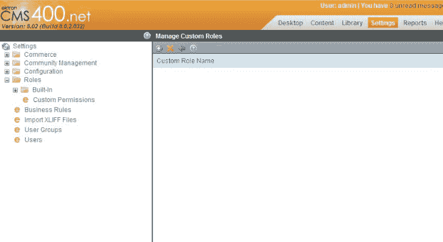

图 5-52

| 权限名称 | 描述 |
| --- | --- |
| 遍历文件夹 | 访问此文件夹下文件夹的权限。这会覆盖子文件夹的权限，用户在对特定文件夹执行任何操作之前，必须对所有父文件夹拥有遍历权限。 |
| 修改预审 | 此列出了在为内容创建任务时分配给内容的用户。然后由这些用户或用户组负责根据每个任务将其分配给编辑人员。 |

## 审批链说明

由于 Ektron Framework 中实现审批链的方式，在针对这些审批链进行开发时，有几点需要注意。首先，一个用户不能两次出现在同一个审批链中。系统会将第一个审批视为满足了第二个条件，因此内容会立即跳过该用户。

另请注意，审批链是特定语言的。如果您正在开发的网站支持多语言，请记住从“视图”菜单中选择您想要管理的语言，然后修改审批链以为该语言进行设置。

当内容被分配给用户进行审核时，系统可以发送电子邮件。设置此功能涉及几个步骤。请参阅手册了解有关如何启用发送系统电子邮件的详细信息。

### 角色类型与操作

Ektron Workarea 中的角色分为特定文件夹的角色和系统级角色。这些角色在应用方式上没有技术区别，只是系统级部分的角色会影响与文件夹未关联的操作。请注意，管理员会自动通过所有角色测试。最后，请记住 Ektron 的最佳实践是为角色创建一个组并让用户成为该组员，而不是让许多用户直接成为角色成员。表 5-8 显示了内置角色的列表。

| 角色名称 | 描述 |
| --- | --- |
| 别名管理员 | Alias 成员有修改别名规则的能力，包括添加新别名、更改现有别名以及完全禁用别名。 |
| 别名编辑 | 此角色适用于添加和修改手动及次别名的粒度。 |
| 分析查看 | 允许用户查看内容和 PageBuilder 页面的分析报告。 |
| 业务规则编辑器 | 创建和编辑业务规则。 |
| 集合与菜单管理员 | 允许用户创建、修改和删除集合和菜单。 |
| 集合审批者 | 定义可以批准集合更改的用户组。仅在集合需要审批时起生效。 |
| 商业管理员 | 允许访问所有电子商务屏幕。 |
| 社区 | 允许管理默认社区偏好、活动类型、消息以及管理通知。 |
| 社区组管理员 | 允许管理现有的社区组，并能够创建新组。 |
| 创建社区组 | 允许用户创建组并管理他们创建的组。 |
| 主布局创建 | 允许用户创建主布局 PageBuilder 模板。 |
| 留言板管理员 | 允许用户批准小组、用户和内容的待处理评论并删除现有评论。 |
| 元数据管理员 | 允许创建、修改和删除元数据类型。 |
| 搜索管理员 | 允许管理搜索中的同义词和建议结果。 |
| 智能表单管理员 | 管理智能表单定义。 |
| 同步管理员 | 允许用户管理同步设置并执行同步操作。 |
| 创建任务 | 创建任务。 |
| 删除任务 | 删除任务。 |
| 重定向 | 将任务分配给用户。 |
| 分类法管理员 | 允许用户创建和编辑分类法。 |
| 模板配置 | 管理系统模板。 |
| 用户管理员 | 管理用户和组。 |
| XLIFF 管理 | 允许用户将内容导出和导入 XLIFF 格式以翻译其他语言。 |
| 文件夹用户管理员 | 允许用户管理其具有只读和遍历权限的所有文件夹的属性。更多信息请参见用户手册。 |
| 移动或复制 | 允许用户在具有相应权限的 Workarea 中执行复制和移动操作。 |

要通过编程检查用户是否为特定角色的成员，请使用 `Ekton.Cms.CommonApi` 中的 `GetRolePermissionSystem` 和 `IsARoleMember` 调用。内置规则定义在枚举 `Ekton.Cms.Common.Enumeration.CmsRoleId` 中。

### 重点复习

本章探讨了 Ektron Framework 的基础知识。你可能注意到，Ektron 团队在开发其框架时采取的一些结构性决策与其他内容系统有显著不同：

与许多系统相比最大的区别在于 Ektron Framework 对内容的处理，几乎一切都是面向对象模式的内容。这对于开发者非常有帮助，因为一旦你理解了功能如何与内容相互连接——例如分类工具功能（如分类法、集合和文件夹）——你就可以推广到理解核心内容以外的功能。对于内容管理器来说也是如此，但更多是关于内容创建以及内容上线的过程。

回顾一下，这里涵盖了一些观点：

- 从内容管理的角度来看，Ektron Framework 的主要交互位置是 Workarea。你学习了如何登录系统、内容授权，以及内容与其他功能在 Ektron Framework 中是如何结合的。你探索了如何从 Workarea 授权，以及如何从系统本身进行管理。
- 文件夹和内容，特别是文件夹和内容如何重新组合以创建其他类型的功能，如博客和论坛。
- 继承是如何影响系统的，以及这种组合如何影响你所采取的信息架构方法。
- 文件夹在 Ektron 系统中如何工作。
- 权限和角色，这是 Ektron Framework 中验证和控制所有操作的方式。权限的使用是为了确保作者不会意外越权管理不属于他们的区域。另一方面，角色是允许作者超越子系统通常无法管理的范围的好方法。

# 第6章 配置常用组件

- 如何使用智能表单编写结构化内容？
- 如何通过分类法组织内容？
- 如何使用别名提高 URL 可读性？
- 如何为您的网站创建特定语言版本？

一旦你积累了几个 Web 项目，你就会发现每个 Web 项目在自己的方面都是独特的。技术需求在项目之间存在巨大差异，对于任何 Web 项目要取得成功，它需要响应每个网站独特的业务需求，整合利益相关者客户的需求。但关注这些差异可能会让人们认为它们之间没有共性。事实上，事实并非如此。这种假设关注的是功能、信息架构甚至业务需求的差异，它忽略了事实：大多数网站都共享共同的基础需求，并构建在共同的技术基础之上，尽管其实现方式不同。本章在第 5 章内容管理基础的基础上，描述了常用组件。这些组件的使用频率源于网站的基础需求：

- **内容需求**：需求通常定义了在网站和不同平台上以多种方式复用信息的需要，将数据与呈现分离，以及通过定义信息来提高一致性和信息发现能力。当信息经过适当结构化并以 XML 等媒体中性格式可用时，这些需求都可以得到很好的解决。
- **分类需求**：人脑识别模式和分类信息的能力。这种识别和分类的过程就是你理解世界的方式。自然而然，你在对网站上的信息进行排序时，也会使用类似的过程。这种识别通过将内容组织成层级结构并创建有意义的信息架构，为你的网站访问者理清 Web 内容。
- **意义导航线索**：这些线索帮助网站访问者确定自己在整体信息架构中的位置和方向。在现实世界中，你利用视觉元素来在空间上定位自己；这是你不需要经过深思熟虑就能做的事情。在虚拟世界中，URL 是你可以使用的最有价值的通信信号之一。它们让你的信息架构对网站访问者可见且易懂，并提供具有意义的描述，帮助访问者对网站产生位置感和方向感。
- **全球化需求**：将网站内容展示给尽可能广泛的途径。这里有很多可以讨论的内容，但本章侧重于本地化。尽管互联网的主要语言最初是英语，但随着互联网在全球范围内扩散，从营销的角度来看，通过翻译现有内容的成本为你的网站完全全新的受众提供多语言内容是非常值得的。与其他营销努力的成本相比，这可能会证明是成本效益。

阅读本章，你将理解如何使用 Ektron Framework 来定义和编写结构化内容，如何为导航和 SEO 目的创建有意义的 URL，以及如何将你的网站面向全球观众。本章深入涵盖了这四种技术中的每一种，重点关注最佳实践、推荐配置，以及在进一步开发 OnTrek 网站的范围内实现每项技术的逐步说明。

## 理解技术

让我们看看之前描述的四个需求，以及它们如何映射到 Ektron 技术。这四种技术中的每种都在以下段落中总结，并在本章的“技术章节”中进行详细介绍。

结构化内容的建模和编写使用 Ektron 的 Smart Forms 完成。从开发者的角度来看，Smart Forms 提供了一种创建用于内容编写的强类型内容定义的机制。这些定义被称为 Smart Form 设计，并使用可视化 WYSIWYG 编辑器 Smart Form Designer 创建。这些设计可以作为工作区中内容作者可使用的不同内容类型的基础。这些设计由三个主要部分组成：

- 结构定义：使用文本框和复选框等用户界面组件进行视觉化。在内部，它表示为 XML Schema，所使用的内容定义为 XML。从作者的角度来看，这些细节被隐藏了。作者看到的只是一个包含熟悉的用户界面元素的 Web 表单。
- 验证定义：由规范内容作者提供的数据进行验证的规则。
- 模板：这负责此类信息的显示。该部分设计用于将 XML 转换为 XSLT，用于网站的显示层。

Ektron 的分类法提供了一套分类系统，用户使用该系统将信息组织成有意义的层级。这些分类结构可以用于创建导航结构（例如菜单和目录），引导用户找到他们正在寻找的信息。可以创建多个分类法以匹配不同受众的期望。例如，在 OnTrek 网站上，产品营销材料在持续内容的内容文件夹树中管理，营销组通过为内容分配产品分类法中的一个或多个类别，将营销材料归类为软件产品。该网站允许访问者通过导航产品目录来访问信息。由于某些产品可能存在于多个类别中（例如具有多个类别的产品），客户可以通过多路径找到软件。


Ekron Framework 的 URL 别名（Alasing）提供了一个强大的引擎，让你将描述性 URL 转换为有意义的资源。使用具有描述性且富含关键词的 URL 有许多好处，并能提高网站在搜索引擎页面上的排名。友好 URL 还提供了导航辅助。这有助于你的访问者更好地理解整体规模和结构，并确定它们在站点地图中的当前位置。此功能允许你以多种方式定义：自动 URL 别名根据分类法层级结构和内容项目的标题创建 URL。例如，内容项目 Barack Obama 被归类在 `U.S. > Executive Branch > Presidents/Barack-Obama/`。同样，可以使用内容文件夹树和正则表达式创建自动别名。当你需要覆盖自动生成的 URL，或仅为了为内容项目定义唯一的别名时，手动别名将派上用场。`http://localhost/US/Executive-Branch/Presidents/Barack-Obama/`

你可以将内容导出到全局内容本地化功能。语言导出（Language Export）功能将内容导出为单个包，使用 XLIF 打包，这是一种用于语言翻译的增强 XML 标准。这些包被压缩并交付给翻译公司，在在那里信息被翻译并以相同的包的形式返回，然后导入系统。这一过程使得你网站上的专业翻译内容变得非常简单且无痛苦。除了语言导出外，Ekron 的本地化技术还提供了使用手动翻译或机器翻译翻译内容的能力。当组织聘请翻译专家且只有少量内容需要翻译时，通常使用手动翻译。当没有预算进行专业翻译但又对多语言内容有需求时，机器翻译使用计算机生成的翻译。

# SMART FORMS

## 第 6 章 配置常用组件

当你拥有多个网站时，你会注意到另一个路径，即网站通常包含相同相同类型的信息，如新闻稿、员工简介和产品描述。你会发现，无论你正在构建的是哪种网站，这些数据类型都具有相同的离散元素。新闻稿有标题、作者和副标题，而员工有姓名、职位、联系信息和简介。使用像高速公路（freeway）这样的 WYSIWYG 内容编辑器来产生具有这种高度一致结构的内容，预料之会导致产生一些小插曲：

- 内容项目的编写往往不一致：有时新闻稿没有副标题，有些则没有描述。
- 内容作者经常做出让设计人员痛苦的设计决策：在不的地方添加间距，或更改字体和颜色。
- 信息经常绑定到特定的用途：这是因为信息可能包含特定的标记，使其无法在其他地方复用。

非结构化内容确实有其用处，但它带来了这里描述的问题：即没有强制结构，无法将内容与呈现分离，并且无法在其他上下文（如媒体馈送）中复用。

在开始之前，让我们看看结构化内容是如何定义的。Wikipedia 的定义如下：

> 结构化内容是指使用元数据进行分解和分类的信息或内容。结构化内容通常是指使用 XML 分类的信息，也可以是指使用标准或专有元数据格式的信息。

这个定义涉及核心思想，即信息已通过某种方式分解并分类。Web CMS 在支持内容变为离散块方面采取不同的方法。在 Ektron Framework 的核心，结构化内容被定义并存储为 XML。

### Smart Forms 与 HTML Forms 的区别

在使用 Smart Forms 编写内容之前，你需要定义一个 Smart Form 设计。如果你熟悉关系型数据库管理系统（RDBMS），你可以认为一个表单设计类似于数据库表结构，但在底层，智能表单设计（Smart Form Design）被表示为 XML Schema。智能表单设计是您用于将信息拆分为离散数据块的内容，每个块都有自己的数据类型和用户界面（UI），用于从用户处收集高价值的值。由于 Ektron 框架使用 XML 存储这些自定义信息块，因此这些元素直接映射到核心 XML —— XML 元素和 XML 属性，这些元素用于创建符合架构的内容。

构建您的内容结构有时感觉像一种艺术，但有很多很好的资源可以帮助。推荐的书籍是《内容管理圣经》（Bo Boiko, Wiley Publishing, 2001）。

### 创建智能表单设计

创建智能表单设计的过程从按照以下步骤进入工作区域（Workarea）中的数据设计器（Data Designer）开始：

- 导航到设置（Settings）-> 配置（Configuration）-> 智能表单配置（Smart Form Configurations），并使用智能表单数据设计器（Smart Form Data Designer）。只有管理员组成员或被授予智能表单管理员角色的人才有权创建这些。此界面允许您使用图 6-1 所示的用户界面（称为智能表单设计器）视觉化地构建智能表单。

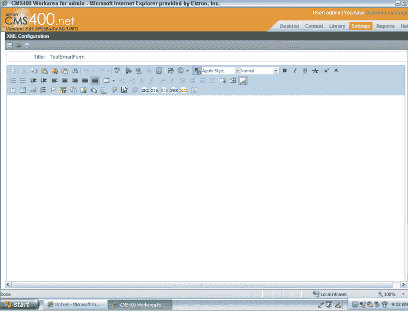

图 6-1

在移动数据设计器时，您将看到对话框，这些对话框允许您设置设计中定义的输入元素的属性。这些属性包含了定义生成的 XML 结构的选项，因此您可以指定数据是存储为 XML 元素、属性还是文本。图 6-2 显示了简单的智能表单设计（顶部）与由此创建的智能表单组件 XML 源（底部）的对比。

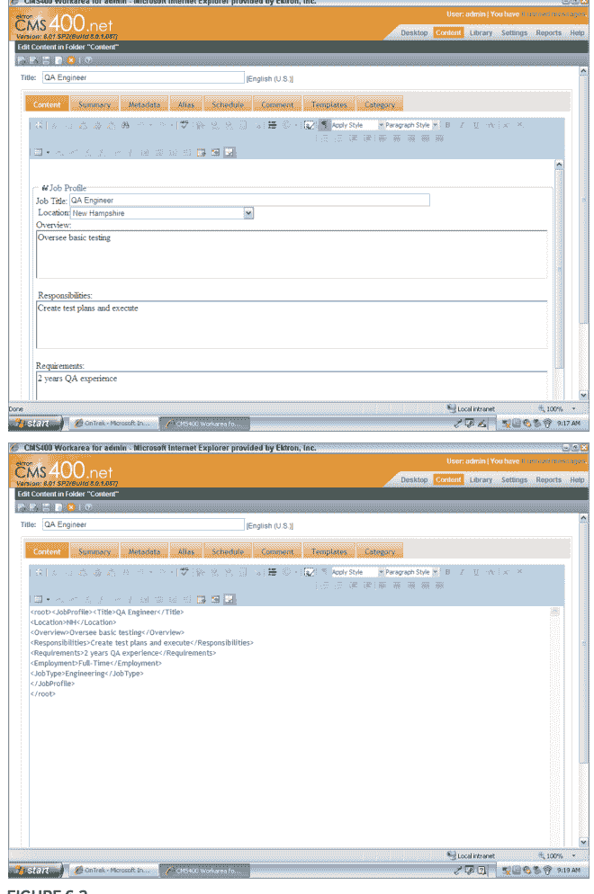

图 6-2

一旦定义了智能表单设计，请将其关联到内容文件夹树中的文件夹。这样做的效果是定义哪些智能表单设计可供内容作者用于创建智能表单内容。图 6-3 显示了这种关联如何影响内容作者的“新建内容”菜单。

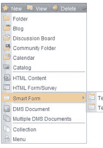

图 6-3

从内容作者的角度来看，XML Schema、元素和属性的细节是完全隐藏的。内容创建者只需完全关注内容编写，无需担心上述讨论的系统实现细节或智能表单设计过程。填写表单并提交就像填写任何基于表单的界面一样简单，一旦表单提交，就会创建结构化的 XML 内容。

此时，结构化内容已经编写完成，并使用您在表单设计时定义的架构进行存储。但如果您尝试在网页上显示它会发生什么；它看起来像什么样？默认情况下，每个智能表单设计都有关联的默认显示样式。这种默认显示是由系统在定义发布时自动生成的，并使用 XSLT 定义。可以通过提供自定义 XSLT 文件来覆盖它，如图 6-4 所示。您可以在屏幕上指定多三个显示样式。建议使用默认显示 XSLT 文件作为您自定义显示 XSLT 文件的起点。您通过智能表单设计中的 XSLT 图标访问显示 XSLT。默认显示 XSLT 在稍后的“内部原理”部分中也会讨论。

## 检索、操作和渲染结构化数据

Ektron 框架提供了多种检索、操作和渲染结构化数据的方法，例如 API、服务器控件和组件。也可以使用 .NET XML 框架。让我们来看看这些方法。

## 使用内容块服务器控件

内容块服务器控件（第 5 章）允许您通过内容 ID 并渲染内容，包括智能表单内容。如果您未指定自定义 XSLT，则将使用默认显示 XSLT。图 6-5 显示了如何使用 Content Block DisplayXSLT 属性覆盖默认 XSLT。XSLT 是自定义内容块服务器控件标记的主要方法。

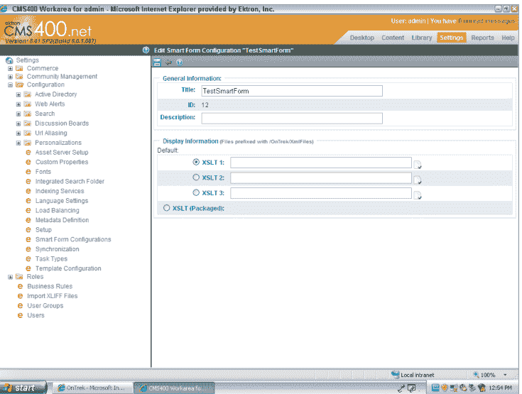

图 6-4

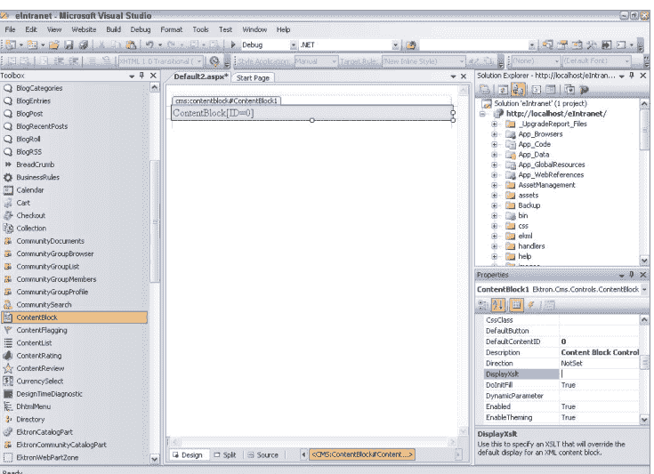

图 6-5

Smart Forms | 115

虽然经常听到 .NET 开发者对使用 XSLT 将 XML 转换为 HTML 产生反触情绪，但重要的是记住，XSLT 是一种专门为此目的设计的语言，它是您工具箱中极其强大的工具。优秀的开发者总是努力为特定工作选择正确的工具，在许多情况下，XSLT 就是那个工具。使用 XSLT 的优点列举如下：

- 它是一种声明式语言，可以轻松地穿插在 HTML 标签之间。这为标记结构提供了更直观的视觉理解。
- 您每当对显示进行更改时，不需要重新编译。XSLT 中的标记变成了某种显示配置文件，与网站应用程序的业务逻辑分离。
- 需要许多行命令式代码才能的复杂转换（过程化的或面向对象的）可以通过少数 XSLT 语句实现。

对 XSLT 的反触通常出现在开发者不熟悉它时。为了帮助在使用 XSLT 时克服常见障碍，Ektron 在开发者中心撰写了许多知识库（KB）文章，如下所示。这些文章为常见的“坑”提供了解决方案。大多数问题发生在开发者未能意识到 XSLT 是一种声明式语言，并尝试使用命令式编程范式编写它（像编写 VB 或 C# 等过程面向对象语言一样编写 XSLT）。

与 XSLT 相关的帮助文章：

- KB 0485：模板库：`http://dev.ektron.com/kb_article.aspx?id=0485`
- KB 9240：XSLT 支持摘要：`http://dev.ektron.com/kb_article.aspx?id=9240`

### 使用 .NET 框架

.NET 框架提供了多种转换和渲染 XML 的方法，从强制到程序控制不等。Ektron 开发认为最舒适的方法是两者的混合，使用 .NET 控件引用智能表单数据。这种方法使得能够根据需要使用 .NET 属性。

通用步骤如下：

- 将智能表单设计导出为 XML Schema (*.XSD)。
- 将 XSD 转换为 C# 类。
- 检索智能表单数据并将其反序列化为您的类实例。

# 智能表单 | 117

```csharp
[System.Diagnostics.DebuggerStepThroughAttribute()]
[System.ComponentModel.DesignerCategoryAttribute("code")]
[System.Xml.Serialization.XmlElementAttribute(AnonymousType=true)]
[System.Xml.Serialization.XmlRootAttribute(Namespace="", IsNullable=false)]
public partial class Class {
    private string TitleField;
    private string IsbnField;
    private string AuthorField;
    private string DescriptionField;
    private float PriceField;

    /// <remarks>
    [System.Xml.Serialization.XmlElementAttribute("Title")]
    public string Title {
        get {
            return this.TitleField;
        }
        set {
            this.TitleField = value;
        }
    }
...
```

3. **检索智能表单数据。**可以通过内容块服务器控件（Content Block Server Control）或 API 实现。下面的代码示例显示了一个 C# 示例，如何在后代码中使用内容块服务器控件的 `EkItem.Html` 属性访问此内容。另一种实现可以使用附录 B 所示的 Content API 方法。

```csharp
string xml = ContentBlock.EkItem.Html;
SmartForm.Book book = Ektron.Cs.Xml.Deserialize(typeof(SmartForm.Book), xml) as SmartForm.Book;
```

4. 检索和反序列化智能表单内容可以封装在一个实用类中，以提供一种内联检索和恢复强类型对象的方便方法。下面的代码片段显示了如何操作：

```csharp
Book book = SmartFormHelper.GetBook(bookId);
```

将 XML 加载到 .NET 的另一种方法是使用 `XMLDocument` 并使用 XPath 选择元素。您可能使用这种方法的情况是，您只需要从 `XmlDocument` 中访问几条数据。如果您不需要访问所有可用数据，您可能希望考虑使用 `XmlDocument` 和 XPath 来选择您需要的数据，而不是将每个 XML 元素映射到数据类。

### 实现

本节侧重于创建一个智能表单设计，您将在第 7 章中用该设计来为 OnTrek 首页构建一个基于 JavaScript 的横幅轮播器。此时无需担心该组件的技术实现。第 7 章将涵盖这些细节。目前，只需说明该组件会在一组图像及其相关文本之间循环即可。图像说明、文本以及驱动组件的其他信息是通过您在此处创建的智能表单设计定义的。

图 6-6 显示了组件在 OnTrek 首页上显示的屏幕截图（顶部），以及内容编辑人员用于在首页组件上放置新图像或修改现有图像的表单（底部）。

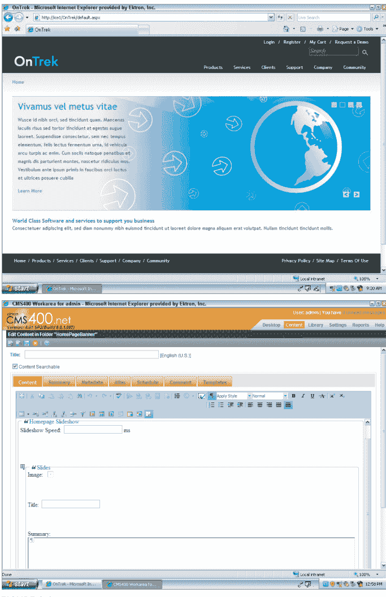

图 6-6

### 创建智能表单设计

尽管此表单相对简单，以下步骤将介绍构建新智能表单设计的过程。表单包含图 6-7 所示的四个表单输入字段（标题、文本、URL 和时长）。

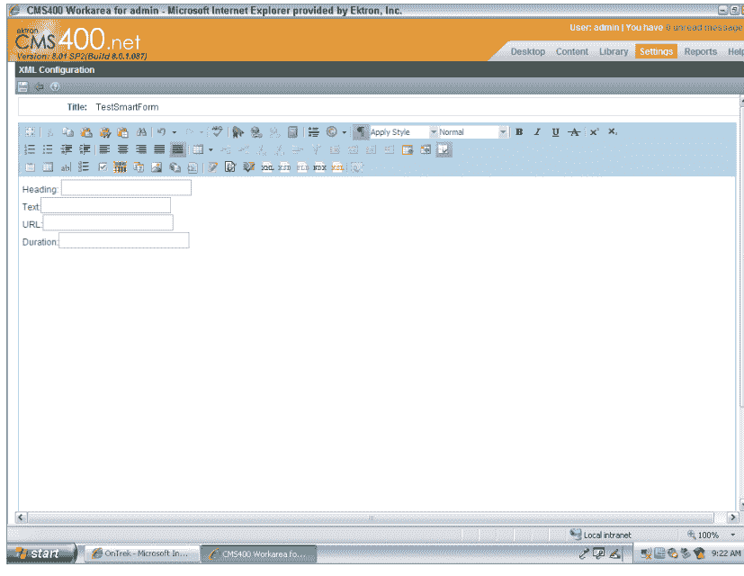

图 6-7

1. 打开工作区（Workarea），导航到设置配置（Settings Configuration） > 智能表单配置（Smart Form Configurations）。
> 曾经，智能表单被称为 XML 配置（XML Configurations）。尽管该术语已从 Ektron 的工作区、文档和网站中移除，但您可能会在 Ektron 开发中心的旧版论坛帖子中遇到对该术语的引用。每当您看到 XML 配置时，可以在心中将该短语替换为智能表单。
2. 点击添加智能表单图标。
3. 在标题（Title）字段中，提供智能表单设计的名称。将表单设计命名为 Featured Image（特色图片）。
4. 点击保存图标。
5. 在 WYSIWYG 智能设计器中，点击主画布并输入字符串 Heading:（标题：）。
6. 将光标停留在 Heading 的末尾，点击文本字段（Text Field）按钮。出现如图 6-8 所示的文本框。


图 6-8

7. 在描述性名称（Descriptive Name）中，提供 Featured Image Heading；其他字段将自动填充。利用此时间探索此处此处可用的每个选项。保留所有默认值。
8. 对文本字段重复步骤 5-7。
9. 再次对 URL 字段重复此过程；但是，一旦出现文本字段框，请点击如图 6-9 所示的验证（Validation）选项卡。


图 6-9

10. 从验证下拉菜单中选择 URL。这会验证输入并确保提供了 URL。
11. 对时长（Duration）字段重复此过程；这次，从验证菜单中选择 Decimal number（小数）或留空（blank）。
12. 点击更新图标保存智能表单设计。

## 将智能表单设计关联到内容树

在可以使用智能表单设计来编写内容之前，必须将其关联到内容文件夹树中的一个或多个文件夹。

1. 打开工作区，并导航到内容文件夹树：`MainSite/Content/Home/HomePageBanner`。
2. 从视图菜单中，选择属性（Properties），如图图 6-6 所示。


图 6-6

3. 点击工具栏上的编辑（Edit）图标。
4. 从编辑屏幕中，选择 Featured Image，如图 6-7 所示。


图 6-7

5. 点击保存图标。

## 创建智能表单数据

一旦智能表单设计关联到文件夹树，您就可以使用以下步骤编写内容：

1. 打开工作区并导航到内容文件夹树：`MainSite/Content/Home/HomePageBanner`。
2. 从视图菜单中选择属性，如图 6-6 所示。
3. 在标题字段中，提供智能表单设计的名称。将表单设计命名为 Featured Image。
4. 在 WYSIWYG 智能设计器中，点击主画布并输入字符串 Heading:（标题：）。
5. 将光标停留在 Heading 的末尾，点击文本字段按钮。出现如图 6-8 所示的文本框。
6. 在描述性名称中，提供 Featured Image Heading；其他字段将自动填充。
7. 对文本字段重复步骤 5-7。
8. 再次对 URL 字段重复此过程；但是，一旦出现文本字段框，请点击如图 6-9 所示的验证选项卡。
9. 从验证下拉菜单中选择 URL。
10. 对时长字段重复此过程；这次，从验证菜单中选择 Decimal number 或留空。
11. 点击更新图标保存智能表单设计。

## 底层原理

智能表单设计以 XML 格式存储在数据库中。理解智能表单的结构有助于您理解系统的行为。智能表单本身描述在 `xml_collection_table` 中。您可以查询 `xml_collection_table` 以查看智能表单的设计。这在您尝试开发应用程序时可能会有所帮助。

## 表 6-1：智能表单设计的内部元素

| # | 部分 | 描述 |
|---|---|---|
| 1 | 表单元素 | 构成智能表单数据输入部分用户界面的元素。即内容编辑人员编写内容时显示的用户界面。 |
| 2 | XML Schema | 使用 XML Schema 定义 XML 的结构。在本节早些时候，您将智能表单设计导出为 XML Schema。 |
| 3 | 数据输入 XSLT | 针对包含 XHTML 元素的 XML 运行。转换结果定义了智能表单设计在浏览器中的渲染方式。 |
| 4 | 默认显示 XSLT | 定义智能表单数据在工作区和网站上的默认渲染方式。 |
| 5 | 默认 XML 文档 | 创建新内容时使用。将其视为内部使用的 XML 模板，用于在创建新智能表单数据的过程中预留默认值。 |

# 分类法 (TAXONOMY)


Ektron 框架为管理员以及授予分类法管理员角色的用户提供了使用其分类法引擎对内容进行分类的能力，通过内容与类别之间一对多的关系提供内容层级的分类。

使用分类法进行内容组织可以让你以一种反映人类思维的方式对内容进行分类，从而允许你通过搜索、菜单和站点地图，为内容构建有效的网站导航和内容访问路径。你的导航路径可以、且[确实会]与内容在内容文件夹树中的物理存储和管理方式有所不同，因为通常创建内容的人群与访问内容的人群是不同的。因此，在实践中，常见的一种现象是看到公司按部门（工程、营销、销售）组织的文件夹来存储内容，并使用分类法来控制信息在网站上的显示方式。这允许你利用内容文件夹树来定义权限和审批流程等内容（更多信息，请参阅第 5 章“权限与工作流” 节）。通过分类法，你获得了随着内容库的增长和网站访问者需求的变化而调整和扩展网站导航的能力。

Ektron 的分类法简单易用，但不要被它的简单性误导而忽视了它的强大。你创建的分类法将在系统的许多地方发挥其实用。

从数据结构的角度来看，分类法表现为一个无边界的层级结构，由代表类别和子类别的节点组成。层级结构的安排使得顶层节点对应于最通用的类别，底层节点对应于更具体的类别。由于分类法支持内容与类别之间一对多的关系，因此访问给定项目可能有多条路径。从技术上讲，分类法树在技术上并不是一棵树，因为当单个内容项与多个类别关联时，会出现循环。在概念上，将分类法视为树形是可以接受的，因为类别节点代表了树形结构，且文档也是如此称呼它们的。

一旦配置完成，管理员可以为分类法中的每个类别分配自定义属性，这些属性可以通过创建和管理分类法类别来填充。这些属性类似于文件夹元数据，其值可以通过本章后面“内部原理 (Under the Hood)”节涵盖的 `Taxonomy API` 提供给与类别节点关联的项目。

分类法系统还具有语言感知能力，提供了多种语言支持选项。一旦创建了特定语言版本的分类法，系统也会为每个启用的语言创建一个分类法。这些分类法的 `Taxonomy ID` 是相同的；要唯一标识某个特定的分类法，你需要由 `Language ID` 和 `Taxonomy ID` 组成的复合键。例如，如果你用英语创建了一个分类法，并启用了西班牙语和意大利语，你将拥有三个分类法，它们具有相同的 `Taxonomy ID`，但拥有各自的 `Language ID`。

在 Ektron 搜索（第 7 章“搜索”）中，分类法在两个重要的用例中起着关键作用：

- 它可用于驱动分面搜索（faceted search），允许你通过属性缩小搜索结果。
- 内容分类还为消除搜索结果歧义提供了有效方法。

例如，当用户搜索“Saturn”（土星）时，可能不清楚他们是在寻找 Saturn 汽车还是土星行星的信息。通过配置搜索服务器控件显示分类法类别（如图 6-12 所示），在这些情况下可以使用分类法消除搜索结果歧义并提供更准确的搜索结果。

按类别浏览提供了一种强大的导航范式，因为它允许作者为不同的受众创建多个分类法，并根据这些分类法提供不同的菜单结构，从而提供符合受众预期查找内容的导航。通过 Ektron Exchange 提供了许多部件和模块，可以从分类法创建菜单导航。你可以在此处查看它们：`http://dev.ektron.com/exchange/searchcode.aspx?search=taxonomy`


图 6-12

分类法在 URL 别名方面也扮演着重要角色，正如本章后文所述。当这种自动别名被启用并配置后，URL 将根据分类法的层级结构自动生成。

## 实现 (Implementation)

本节将展示如何启用和配置用于定义 OnTrek 信息体系的分类法。这里涵盖了三个概念：

- 如何创建分类法
- 如何将分类法与文件夹结构关联，以便内容作者可以使用它来创建内容
- 分类内容的两种方法

### 创建分类法 (Creating a Taxonomy)

按照以下步骤创建你的分类法：

1. 从工作区 (`Workarea`) 转到 `内容 (Content)` ⤞ `分类法 (Taxonomies)` ⤙ `分类法 (Taxonomies)`。
2. 使用 `视图 (View)` ⤙ `语言选择器` 下拉菜单为分类法选择语言。
3. 点击“添加分类法 (Add Taxonomy)”按钮。同时注意，当你将光标悬停在左侧面板的 `分类法 (Taxonomies)` 上时，右键点击鼠标并点击“添加分类法 (Add Taxonomy)”。会出现分类法屏幕。
4. 使用表 6-2 完成图 6-13 所示界面。


图 6-13

表 6-2：分类法字段描述

| 字段 (FIELD) | 描述 (DESCRIPTION) |
| :--- | :--- |
| 类别标题 (Category Title) | 为分类法命名。OnTrek 使用两个分类法：OnTrek 站点导航和特色产品 (Featured Products)。你在这里创建 OnTrek 站点导航，因此在该字段中输入。 |
| 类别描述 (Category Description) | 在编辑分类法屏幕上显示描述，并且通过 API 编程方式访问分类法时也可以使用。填充此字段是可选的。 |
| 分类法图像 (Taxonomy Image) | 对于 OnTrek 来说填充此字段是可选的。但通常情况下，你可以为分类法分配图像并通过 API 显示分类法图像。请参阅“内部原理”节获取代码示例。 |
| 模板 (Template) | 对于 OnTrek 不需要填充此字段。如果指定，此处提供的模板将作为分类法导向控件使用，而不是与内容项关联的模板。此处的值通过分类法 API 提供。OnTrek 使用与内容项关联的默认链接。 |
| 继承 (仅在分类法下方创建时出现) | 勾选此复选框。表示你希望该类别从父类别或分类法继承模板。**类别链接：** 当目录控件显示分类节点时，这将其渲染为指向另一个页面的链接。如果留空，目录将在同一页面更新以显示节点的内容。 |
| 启用 (Enable) | 勾选此复选框。表示你希望当分类法在网站上出现时显示此类别及其子类别。未来，你可以使用此字段阻止某些类别作为分类法显示。 |
| 配置 (Configuration) | 分类法可以与内容、用户或组关联。“OnTrek 站点导航分类法是一个内容分类法，因此在此选择该项。 |

5. 此时，你有一个没有定义类别的分类法。要为此新分类法添加类别，请点击“添加类别 (Add Category)”按钮，并按照表 6-2 中的概述填充字段。你可以根据 OnTrek 网站定义的层级结构建立你的类别。

### 为文件夹分配分类法配置 (Assigning a Taxonomy Configuration to a Folder)

为了允许内容作者在编写内容时进行分类，必须先将分类法分配给文件夹。按照以下步骤操作：

1. 点击 `内容文件夹 (Content Folders)`，导航到 OnTrek 根文件夹。
2. 选择 `属性 (Properties)` 并点击 `编辑 (Edit)`。
3. 在 `分类法 (Taxonomies)` 选项卡上选择 `OnTrek 站点导航` 分类法。这将使根文件夹所有子文件夹中创建内容的作者可以使用特定的分类法。

### 将内容分配给分类法/类别 (Assigning Content to a Taxonomy/Category)

OnTrek 网站使用 `OnTrek 站点导航` 分类法将内容分类为“知识库文章”和“职位招聘”类型。Ektron 框架允许内容作者通过将内容项与一个或多个分类（taxonomy）类别关联，对此类内容进行分类。将内容分配给分类有两种方法。

第一种是通过内容项将内容项与分类类别关联。要建立此关联：

1. 导航到 `内容块（content block）`。
2. 点击 `类别（Category）` 选项卡。
3. 展开分类以找到所需的类别。
4. 点击类别名称旁复选框选择相应的类别。

第二种是通过特定类别将内容与分类类别关联。要执行此操作，导航到 `工作区域 Workarea` ⊞ `Content` ⊞ `分类（taxonomies）`，然后：

1. 选择分类的语言。
2. 选择您想要关联内容的类别。
3. 点击工具栏上的“将项目分配到分类”（`Assign Item(s) to the Taxonomy`）图标，或者也可以右键点击类别并从右键菜单中选择“分配项目”（`Assign Item(s)`）。
4. 导航到您想要关联类别的内容项。
5. 选中所有想要关联的内容项旁边的复选框。
6. 点击更新图标完成。

此外，在有大量内容项需要分类的情况下，从右键菜单中选择“分配文件夹”（`Assign Folder(s)`）允许您一次性对选文件夹中的所有内容进行分类。但请注意，这不会为文件夹分配分类配置——它只是在该文件夹中的所有内容与所选分类类别之间建立关联。

### 底层原理 (Under the Hood)

数据对象以分级结构存储在系统的 `taxonomy_tbl` 中。`Taxonomy ID` 可以被视为分类 ID，两者在本质上是相同的。在某些情况下，您处理的内容要求您定义 `Taxonomy ID`，而在另一些情况下，则要求 `Category ID`。您可以互换使用 `taxonomy_tbl` 中的这些 ID。以下代码显示了如何使用 Content API 及其 `TaxonomyRequest` 对象检索分类树结构。

```
Ektron.Cms.TaxonomyRequest taxonomyRequest =
new Ektron.Cms.TaxonomyRequest();
taxonomyRequest.TaxonomyId = id;
taxonomyRequest.TaxonomyType =
ektron.Cms.Common.Enumeration.TaxonomyType.Content;
taxonomyRequest.IncludeItems = true;
taxonomyRequest.Depth = 2;
taxonomyRequest.TaxonomyLanguage = contentAPI.ContentLanguage;
ektron.Cms.API.Content.Taxonomy taxonomyManager =
new Ektron.Cms.API.Content.Taxonomy;
TaxonomyData taxData = taxonomyManager.LoadTaxonomy(taxonomyRequest);
```

您还可以通过引用 Taxonomy 对象的 `TaxonomyImage` 属性使用 API 检索并渲染额外信息，例如表 6-2 中提到的分类。以下代码通过递归调用 `ShowTaxonomyImages` 方法显示所有分配给分类节点的图像。

```
protected void ShowTaxonomyImages(long id)
{
    Ektron.Cms.ContentAPI contentAPI = new Ektron.Cms.ContentAPI();

    Ektron.Cms.TaxonomyRequest taxonomyRequest =
        new Ektron.Cms.TaxonomyRequest();
    taxonomyRequest.TaxonomyId = id;
    taxonomyRequest.TaxonomyType =
        Ektron.Cms.Common.Enumeration.TaxonomyType.Content;
    taxonomyRequest.IncludeItems = true;
    taxonomyRequest.Depth = 2;
    taxonomyRequest.TaxonomyLanguage = contentAPI.ContentLanguage;

    Ektron.Cms.API.TaxonomyManager =
        new Ektron.Cms.API.Content.Taxonomy();
    TaxonomyData taxData = 
        taxonomyManager.LoadTaxonomy(taxonomyRequest);

    if (null != taxData)
    {
        // 渲染每个分类节点的图像
        if (!String.IsNullOrEmpty(taxData.TaxonomyImage))
        {
            string image = contentAPI.SitePath + taxData.TaxonomyImage;
            literal.Text += "<div>image: " + image + "</div>";
            literal.Text += "<div>ID: " + taxData.TaxonomyId + "</div>";
            literal.Text += "<div>Title: " + taxData.TaxonomyName + "</div>";
        }

        // 如果存在子分类，递归调用
        if (null != taxData.Taxonomy)
        {
            for (long i = 0; i < taxData.Taxonomy.Length; i++)
            {
                ShowTaxonomyImages(taxData.Taxonomy[i].TaxonomyId);
            }
        }
    }
}
```

分类在 Ektron 全范围内有多种用法。请参阅第 10 章“用户、朋友、个人资料”标题章节下了解分类的额外用法，该章节介绍了社区框架如何使用分类来管理用户、组和内容之间的社交关系。

## 别名 (ALIASING)

URL 别名（URL aliasing），也称为 URL 映射、URL 重定向或 URL 重写，是修改 URL 外观以便让人类和计算机（如搜索引擎）更容易理解的过程。虽然开发者会识别 `http://localhost/default.aspx?pageid=231&comp=82&userid=912&profile&cat=rout` 这个 URL 在语法上是有效的，但熟练的开发者需要仔细检查每个参数及其值来猜测页面的功能。对于开发者以外的人来说，它几乎没有意义。将其与以下别名 URL `http://localhost/about-us` 形成对比。

### 手动别名 (Manual Aliasing)

手动别名允许内容编辑人员对分配给内容的 URL 别名进行严密控制。当 URL 超出其他类型别名定义的模式时，手动别名非常有用，例如当您需要为营销活动包含可选的跟踪参数时。手动别名在图 6-14 所示的内容编辑界面的别名选项卡中定义，或者在工作区 URL 别名设置界面中的手动别名设置中定义。

### 实现

OnTrek 网站同时使用了手动别名和自动别名。本实现部分将介绍注册、配置和定义别名的过程。


### 启用 URL 别名

只有管理员或具有 URL 别名管理员角色的 CMS 用户才能启用和配置此功能。授予该角色后，您将访问工作区显示的 URL 别名设置界面。要启用 URL 别名，首先决定您想使用的哪种类型。

OnTrek 网站使用了所有四种别名（正则表达式、自动、手动和社区）。要启用这四种类型，请执行以下操作：

1. 转到 `工作区设置 (Workarea Settings)` > `配置 (Configuration)` > `URL 别名 (URL Aliasing)` > `设置 (Settings)`。
2. 点击 `编辑(Edit)` 图标。
3. 选择 `手动(Manual)`、`自动(Automatic)`、`社区(Community)`、`正则表达式(RegEx)` 标签旁边 `启用(Enabled)` 列中的复选框。
4. 点击 `保存(Save)` 图标。

在此屏幕上，如图 6-15 所示，您有能力启用并配置所示的四种别名（手动、自动、正则表达式和社区）的设置。

要配置这些选项之一，请点击编辑图标。从此界面，您可以通过在 `扩展(Extension)` 字段中列出其扩展类型来定义哪些类型的页面别名，每个扩展用逗号分隔。默认配置将具有 `.aspx` 和正斜杠。

在定义了 URL 别名（例如 `/default.aspx`）的情况下，如果与文件系统中存在的 ASP 模板路径（例如 `c:\netpub\wwwroot\default.aspx`）发生冲突，可以使用“覆盖模板 (Override Template)”复选框来定义是否使用该 URL 别名。此复选框告诉系统使用 URL 别名代替物理 ASPX 模板。


图 6-15

`禁用感知 (Disable Awareness)` 属性定义了当者访问别名并更改站点语言时发生的情况。在勾选（启用）的情况下，将显示新语言的内容。否则，当未勾选时，访问者收到 404 文件未找到的消息。

`查询字符串操作 (Query String Action)` 属性定义了处理附加到别名 URL 的查询字符串参数的规则。请注意，这些规则适用于别名 URL，而不是别名的目标。共有四种可能的规则，分别在表 6-3 中描述。

如果向别名附加了查询字符串参数……

表 6-3：URL 别名参数解析逻辑

| 如果所选 URL 是…… | 那么…… |
| :--- | :--- |
| 无 | 忽略附加的查询字符串参数。 |


| 在别名内解析匹配参数 | Ektron 框架检查附加的参数是否已在目标 URL 中。如果是，别名的查询字符串参数优先。例如：<br>目标：`http://www.OnTrek.com/contact.aspx?id=84&cat=user`<br>别名：`http://www.OnTrek.com/user/jsmith?id=100`<br>结果：`http://www.OnTrek.com/contact.aspx?id=100&cat=user`<br><br>此处结果：最终 URL 已更新新 ID。 |
| :--- | :--- |

| 替换别名内的所有参数 | Ektron 框架检查附加的参数是否已在目标 URL 中。如果是，目标的查询字符串将被别名的查询参数值替换。例如：<br>目标：`http://www.OnTrek.com/contact.aspx?id=84&cat=user`<br>别名：`http://www.OnTrek.com/user/jsmith?id=100`<br>结果：`http://www.OnTrek.com/contact.aspx`<br><br>此处结果：目标 URL 上的查询字符串参数已被别名 URL 的参数替换。 |
| :--- | :--- |

| 将参数附加到别名 | Ektron 框架将采取所有添加到别名 URL 的查询字符串参数并附加到目标 URL 中。<br>目标：`http://www.OnTrek.com/contact.aspx?id=84&cat=user`<br>别名：`http://www.OnTrek.com/user/jsmith?id=100`<br>结果：`http://www.OnTrek.com/contact.aspx?id=84&cat=user&id=100`<br><br>此处结果：别名上的查询字符串参数附加到目标 URL 中定义的参数。 |
| :--- | :--- |

# 配置基于分类的 URL 别名

按照以下步骤使用分类法配置自动别名：

1. 转到工作区设置 > 配置 > URL 别名 > 自动 显示图 6-16 所示的页面。
2. 点击新建别名图标 `⊕`。
3. 从下拉菜单中选择源类型为分类。
4. 要定义别名根，点击选择按钮并选择 OnTrek Site 分类。
5. 对于别名格式，选择内容标题。
6. 对于扩展，选择正斜杠 (`/`)。
7. 对于剩余值，选择提供的默认值。
8. 点击保存图标保存。


图 6-16

# 底层原理

由于别名提供了友好 URL 与实际目标 URL 之间的指示，考虑性能的开发者可能会担心每次页面请求都会产生额外的开销。Ektron 设计别名引擎时考虑了这些问题，并实现了一个缓解性能影响的缓存引擎。缓存引擎将静态对象存储在内存中，并在工作区设置 > 配置 > URL 别名 > 设置中指定的持续时间（或生存时间，TTL）内保留这些数据。启用缓存时，每次请求都会检查缓存。如果命中，则访问数据库检索相应的 URL 并存储在缓存中。TTL 过期的缓存命中被视为失效。

> 136 | 第 6 章 配置常用组件

匹配常见模式。

Ektron URL 别名提供的一个强大功能是正则表达式 别名引擎。如前所述，当您需要定义遵循特定模式的 URL（例如博客文章的 URL）时，这是一个非常有用的功能。系统预配置了别

访问此屏幕并定义正则表达式别名：

1. 转到工作区设置 > URL 别名 > 正则表达式。
2. 点击正则表达式屏幕，如图 6-17 所示。
3. 在表达式名称字段中输入博客文章别名。
4. 点击表达式库按钮启动图 6-18 所示的表达式库对话框。
5. 点击列表中的第二项。


图 6-17

## 多语言站点

Ektron 框架允许 Web 开发人员创建完全本地化版本的网站，根据访问者的语言偏好提供特定语言版本。它还为作者提供了工具，使其可以用多种语言手动编写内容，立即使用机器翻译在多种语言之间进行翻译，或将内容导出给专业公司。

### 设计 Ektron 多语言网站

创建一个成功的多语言网站需要在网站设计的每个阶段都进行特殊考虑。图形设计师需要考虑他们的网站在外国语言中如何渲染和运行。精通英语的 Web 设计师可能不会考虑他们的设计在渲染德语文本时看起来如何，而德语文本中的单词通常比英语长 30%。这种单词长度的增加可能会影响菜单、文本和图像等元素的定位，并以意想不到的方式产生影响。Ektron 建议在发现阶段尽快定义目标语言，以便让设计师在设计中考虑这些挑战。

在设计网站的信息架构时，理解 Ektron 如何设计其多语言能力至关重要，因为这应该影响你在内容文件夹树中采取的方法。你需要理解 Ektron 如何管理每个内容项与版本（即内容项的翻译版本）之间的关系。正如你已经学到的，每个内容项都有许多属性，包括内容 ID 和语言 ID。每个版本都有其特定的语言属性，如标题和历史。版本内容的唯一标识符由复合键 `[Content ID, Language ID]` 表示。

为了理解这一点，让我们来看一个查询 Ektron 主内容文件夹 `table_tbl` 的示例。图 6-9 显示了一个选择 Content ID 为 84 的内容的查询。该查询返回了两条记录，因为该内容有两个版本：英语版和西班牙语版。翻译内容永远不会更改 Content ID，但其他属性（如标题）对于该特定版本是唯一的，并可能根据语言而变化。

同样注意图 6-9，`folder_id` 适用于两个版本。这是因为翻译后的内容会自动放置在与原始源内容相同的文件夹中。虽然版本的文件夹 ID 可能会发生变化（这意味着特定版本可以通过工作流界面从一个文件夹移动到另一个文件夹），但强烈建议每个版本保持在同一个文件夹中。就像你通常为相关文档创建文件夹，但不会为文档类型（如 Excel 文件夹、Word 文件夹）创建单独的文件夹一样，文件夹树结构不应映射到特定语言的版本。

> Ektron 的多语言功能为管理每个站点的内容创建了唯一的文件夹。因此，使用多语言功能为每种语言创建单独站点并不是最佳实践。相反，应将给定站点的后续语言版本在与该版本的原始语言相同的文件夹中。

### 图 19

尽管 OnTrek 站点没有使用内容审批流程，但值得强调，你可以使用内容审批流程来创建特定语言的审批。负责审批内容的人对于每种语言很可能不同，此功能允许为内容项的每个版本创建单独审批链。第 5 章有关于配置审批的更多信息。

当你的网站的信息架构与文件夹树中的内容组织不一致时，可以使用本章“分类法”节中定义的分类法。由于分类法是感知的，你可以使用它们来控制与内容文件夹树中不同的站点渲染。这使你能够创建和组织不同的多语言层级，并为语言语言提供不同的分类结构、导航辅助和地图。

作为创建多语言网站的 Web 开发人员，你需要以稍微不同的方式看待内容，主要因为 Web 页面上显示可能完全源于多个源中的一个。考虑 Web 页面内容的各种来源：直接嵌入 ASPX 模板、后置代码和 JavaScript 中的文本。还有托管内容——即存储和管理在 Ektron Framework 内部的内容。最后，是源自外部数据源的内容，例如分发馈和第三方 Web 服务。

Ektron Framework 处理并简化了显示本地化内容版本的过程。它的服务器控件、插件和 API 根据站点的当前区域检索内容的正确版本，该区域通常由站点访问者定义，或通过 API 或服务器控件属性设置语言 ID 进行覆盖。你的网站上任何位于 Ektron 之外的需要本地化的文本，都需要利用 .NET 本地化策略。这通常包含两个活动：

- 管理原本会直接嵌入按钮或标签的本地化 XML 文件（带有 `.RESX` 扩展名）中的文本。
- 使用 .NET 本地化 API 从应用程序中检索并显示相应语言的文本。

> 非托管内容的本地化过程超出了本书的范围。网上有许多关于此主题的资源。微软开发者网络 (MSDN) 有关于 .NET 本地化 API 以及管理这些 `.RESX` 文件的工具的良好文档。参见 `http://msdn.microsoft.com/en-us/magazine/c163609.aspx`。

内容作者通过以下方式之一使用 Ektron 创建特定语言版本的内容：

- **手动翻译：** 这非常适用于编辑器翻译少量内容（几十个密集内容项左右）的情况。这由 CMS 用户执行，并通过区域界面完成。内容编辑人员标记为待翻译的项目，并批量导出这些项目提交给翻译公司。导出过程将标记为翻译的内容复制到遵循 XLIFF 结构的文档中，并将其压缩为 ZIP 文件。
> 正如所述，手动翻译适用于少量内容。在必须翻译更多内容的情况下，最佳实践是使用语言导出。

- **机器翻译：** 指使用翻译算法翻译文本的过程。尽管机器翻译以产生不完美的翻译而闻名，但技术正在不断进步，在以下场景中可能有用：
  - 你有用一种语言编写但与更广泛全球观众相关的讨论板帖子。这些帖子本质上是非正式的，由公众编写，且具有时效性，但往往晦涩得不值得花时间翻译。
  - 你没有专业翻译的预算，并且不在意展示可能不完美的翻译。
  - 你需要立即翻译，无法等待专业翻译。
  在诸如此类情况下，你可以通过区域界面使用 Ektron 的机器翻译翻译内容。使用机器翻译内容的过程与手动翻译内容的过程相似，区别在于点击“翻译内容”而不是手动翻译。


- **语言导出：** 这是 Ektron 推荐的内容翻译过程。语言导出使用 XLIFF（一种 XML 格式）来简化并标准化翻译公司与内容提供者之间的数据交换。Ektron 是 XLIFF 标准的早期采用者，其本地化能力得到了认可。内容编辑人员通过区域界面标记翻译的项目，并批量导出这些项目提交给翻译公司。
  即使你没有使用翻译公司，你的组织使用语言导出功能而不是手动翻译过程也可能受益。这可以帮助你避免遗漏翻译某些元素，即不可见元素如 ALT 属性。来自 IMG 标签上的 ALT 等属性的文本包含在 XLIFF 文档中，自动将其标记为需要翻译的短语。另一个优势是，兼容 XLIFF 的翻译工具通常会使用翻译记忆，它可以记住短语之前是如何翻译的，从而节省时间并创建更高效的翻译过程。

Ektron 建议使用以下工具通过其语言导出功能翻译内容。

- [SDL Trados](http://www.trados.com/en/): 专业的翻译公司通常使用的行业标准应用程序。
- [Heartsome Translation Studio](http://heartsome.net/EN/home.html): 比 SDL Trados 低得多，并提供了许多节省时间和金钱的功能，例如翻译记忆库。

# 管理显示的内容语言

Ektron 框架提供了多种控制显示给访客的内容的方法。通过在页面上放置 `LanguageSelect` 服务器控件，访客将看到图 6-21 所示的下拉菜单。它包含了网站上启用的语言，因此访客只需手动选择网站语言。

当你想强制用户以特定语言查看网站时，可以直接使用 `LanguageAPI` 服务器控件来实现此目标。这在以下情况下通常非常有用：

- **顶级域名 (TLD)：** 这决定了国家代码和网站语言。例如，如果你的网站可以通过 TLD `.it`（意大利）访问，你可能希望将默认语言设置为意大利语。
- **IP 地址定位服务：** 这提供了另一种确定访客位置的方法。网上有很多许多可用服务，可以将访客的 IP 地址转换为物理位置，包括其所在的国家。
- **浏览器的区域设置：** 这是一种确定浏览器首选语言的有效方法，使用 `string language = Request.ServerVariables("HTTP_ACCEPT_LANGUAGE");`；此值可以被解析并用于强制选择合适的语言。
- **用于选择语言的自定义界面：** 接口的一个示例是显示代表这些国家语言的旗帜列表。网站访客可以点击旗帜来选择语言。

你可以在上述两种情况中使用 `LanguageAPI` 服务器控件。例如，在主机处使用以下代码访问网站并设置网站语言——注意设置网站语言的单行代码——`SetSiteLanguage` 方法。代码的其余部分从 URL 中提取顶级域名。由于页面上带有 `LanguageAPI` 服务器控件，你可以执行以下操作：

```csharp
public void SetSiteLanguage(string url) {
    string tld = ExtractTLD(url);
    int lang = 1033; // 默认英语
    switch(tld) {
        case "it*":
            lang = 1040; // 意大利语
            break;
        case "es*":
        case "mx*":
            lang = 1034; // 西班牙语
            break;
    }
    // 使用 LanguageAPI 服务器控件设置语言
    LanguageAPI.SiteLanguageID = lang;
}

protected string GetLevelTLD(string url)
{
    string topLevel = String.Empty;
    string host = ExtractHost(url);
    string[] tld = host.Split('.');
    if (tld.Length > 0)
    {
        topLevel = tld[tld.Length-1];
    }
    return topLevel;
}

protected string ExtractHost(string url)
{
    string domain = String.Empty;
    Regex rg = new Regex(@"http://([a-z\.]+)+\*", RegexOptions.IgnoreCase);
    if (rg.IsMatch(url))
    {
        domain = rg.Match(url).Result("${1}");
    }
    return domain;
}
```


图 6-21

### 实现

正如本章前面提到的，在设计和创建多语言网站时，有许多问题需要考虑。实现过程应该遵循 Ektron 参考手册中概述的步骤（参见“设置多语言网站”部分），这些是：

- 启用对多语言内容的支持
- 设置默认语言
- 启用你的网站将支持的语言
- 在模板中添加语言选择功能
- 为每个支持的语言创建元数据定义 *
- 为多语言内容设置审批链 *
- 设置多语言菜单、集合和分类法 *

> 带有 * 标记的步骤在书中未涵盖，因为 OnTrek 网站的配置不需要它们。但是，如果你的网站配置确实需要它们，请参阅 Ektron 参考手册的第 14 章。

# 启用对多语言内容的支持

要启用对多语言内容的支持，请遵循以下步骤：

1. 用文本编辑器打开 `web.config` 文件。
2. 找到 `ek_EnableMultilingual` 键并将其设置为 `1` 以启用此功能。该功能贯穿整个网站，将其设置为 `0` 可禁用。在创建多语言内容后禁用此功能不会删除存储库中的任何内容，但它会将其从网站显示中移除。对于 OnTrek 网站，你需要将其设置为 `1`。
3. 保存 `web.config` 文件（如果你需要在接下来的步骤中设置默认语言，请保持其打开）。

### 设置默认语言

通过设置语言，你定义了当网站访客未指定语言且未通过 API 或服务器控件程序化设置语言时，将显示哪个版本的内容。

为你的多语言网站设置默认语言：

1. 用文本编辑器打开 `web.config` 文件。
2. 将 `ek_DefaultContentLanguage` 的值设置为默认语言的区域 ID。例如，西班牙语的区域 ID 是 `1034`。如需区域 ID 列表，请前往 Workarea Settings Configuration Language Settings 屏幕。对于 OnTrek 网站，让我们将其设置为英语，`1033`。
3. 保存 `web.config` 文件。

# 启用你的网站将支持的语言

要确定或配置哪些语言可创建内容，请查看 Workarea Language 屏幕。

1. 转到 Workarea Settings Configuration Language Settings 显示图 6-22 所示的语言页面。
2. 点击 Edit 按钮编辑语言设置。
3. 每种语言有两个复选框。要在 Workarea 中启用某种语言，请选择带有黄色符号的列中的复选框。


# 第 6 章 | 配置常用组件


| 名称 | 代码 | ID | 帮助 |
| :--- | :--- | :--- | :--- |
| 英语 (美国) | en-US | 1033 | 0409 |
| 英语 (西班牙) | es-ES | 1024 | 0401 |
| 非凡语语 | af-ZA | 1078 | 0436 |


| 阿尔尼亚语 | sq-AL | 1052 | 0416 |
| 阿姆哈克语 | am-AM | 1156 | 0844 |
| 阿拉语 (尼日利亚) | ar-NG | 5121 | 0401 |
| 阿拉语 (巴林) | ar-BH | 1536 | 2001 |
| 阿拉语 (埃及) | ar-EG | 3007 | 0601 |
| 阿拉语 (约旦) | ar-JO | 2049 | 0031 |
| 阿拉语 (叙利亚) | ar-SY | 1167 | 3401 |
| 阿拉语 (科威)) | ar-KW | 1289 | 2001 |
| 阿拉语 (黎巴嫩) | ar-LB | 1097 | 4001 |
| 阿拉语 (摩洛哥) | ar-MA | 1056 | 2001 |
| 阿拉语 (阿曼) | ar-OM | 8193 | 4001 |
| 阿拉语 (卡塔尔) | ar-QA | 16385 | 4001 |
| 阿拉语 (沙特阿拉伯) | ar-SA | 1025 | 0401 |

图 622

勾选此列将填充 `Workarea`，以便内容编辑可以使用语言创建内容。

### 头部

值得注意的是，Ektron 使用的区域 ID 值与 Microsoft 定义的相同，见此技术参考：http://msdn.microsoft.com/en-us/qbb6464.aspx。在此列表中可以看到区域 ID `1033` 是英语，`1034` 是西班牙语。

Ektron 参考手册包含一个关于处理多语言内容的章节。正如前面提到的，本书涵盖了常见的配置，例如你的网站只有一种语言且语言是英语的默认语言。

## 7 首页

- 你如何使用 `JavaScript` 和 `Smart Forms` 构建丰富的界面？
- 你如何使用菜单进行导航？
- 你如何使用搜索功能进行导航？
- 你如何使用面包屑和站点地图增加可发现性？
- 你需要做什么来允许用户在你的网站注册？

在大家如此关注营销活动落地页、微型网站和搜索引擎友好内容页面的情况下，询问网站的首页是否仍然具有重要性是一个合理的问题。尽管首页通常是网站上访问量最大的页面，但其重要性已被营销部门对线索生成（lead generation）关注度的增加所掩盖。然而，线索生成并不是网站的唯一目的。营销经理们提到的其他主要目标包括支持品牌推广活动、为公司及其产品营造良好形象、建立组织知名度，以及向现有和潜在客户分发产品和活动信息。首页在满足这些目标方面发挥着至关重要的作用——你网站上没有其他任何页面会具有如此关键且多功能性的角色。

本章将通过关注首页的许多重要元素，讨论实现实现成功首页的方法。由于首页必须满足多种类型访问者的需求，本章侧重于如何使用导航（通过菜单、站点地图、面包屑以及搜索）来引导访问者进入正确的方向，并深入探讨通过 `Ektron Framework` 实现这些功能的可用技术。除了导航之外，本章还关注了一种用于交付吸引广泛观众的引人注目内容的特定技术。该技术使用 `jQuery` 插件循环播放图像，这是一种在首页上传递多条信息而不稀释焦点和注意力的良好方法。最后，本章以讨论会员用户的可用注册方法作为结束，展示了内部注册方法以及如何将 `Facebook Connect` 集成到你的网站。

### 用例

本节介绍了本章实现的用例。剩余的大多数技术章节都包含此类章节。这些章节为理解技术提供了有意义的背景讨论。这些章节每个都包含：一个描述页面组织和结构的线框图（wireframe）；定义网站访问者角色和需求的参与者（actors）；一个场景（scenario），其中包含了记录网站访问者预期操作的符号列表；以及结果（outcome），它以量化的术语规定了场景的成功标准，并通常与 `Web` 指标相关以便具有可衡量性。


`OnTrek` 营销团队正领导启动 `OnTrek` 网站的工作，对首页的外观、感受和功能给予了关注。营销团队对首页的目标包括：支持营销部门的品牌推广活动、为公司及其产品营造良好形象，以及向潜在客户分发信息。

### 线框图

线框图是实施指南的关键组成部分。在第 2 章中，你学习了发现阶段以及创建《实施指南》和线框图的过程。第 3 章专注于《实施指南》，在本章中，你学习了最佳实践实施指南包含的内容。关于线框图和实施指南的更多细节，请参阅相应章节。`OnTrek` 首页的线框图如图 7-1所示所示

### 参与者

`John` 是 `Acme` 公司的 `IT` 总监，正在为他的公司研究与安全相关的软件包。他专门寻找有关产品功能、支持服务和许可成本的信息。此外，`John` 还在寻找有关公司的基本信息，例如经营年限和总部。

### 场景

在此场景中，`John`：

1. 使用 `Google` 或 `Bing` 等在线搜索引擎进行 `Web` 搜索，寻找销售安全相关软件包的公司。
2. 在结果页中搜索并点击结果，跳转到 `OnTrek` 首页。
3. 到达网站，首要目标是寻找产品信息。
4. 使用网站搜索和菜单导航找到产品信息。


支持您业务的世界级软件与服务

`Consectuer adipiscing elit, sed diam nonummy nibh euismod tincidunt tincidunt at laoreet dolore magna aliquam erat volutpat velit. Nulla tincidunt tincidunt tincidunt mollis.`

| 事件 | 关于 Loremipsum | 客户评价 |
|---|---|---|
| 2010 年 Eletron 社区全球巡演将于 2010 年 2 月 8 日宣布。Eletron 高管和用户将在北美、英国和太平洋地区会面 | Lorem ipsum sit amet, consectetur adipiscing elit. Aenean a vitae purus. Fusce dictum auctor, neque mattis condimentum eleifend, magna orci felis. Phasellus quam, hendrerit non, in, eget lectus. | "Lorem ipsum sit amet, consectetur adipiscing elit. Nulla tincidunt tincidunt mollis. Suspendisse eu ante augue.\ |
| Eletron 社交内容管理白皮书，于 2010 年 1 月 29 日发布。“‘社交市场的回归’——通过社交内容获得竞争优势..." | Lorem ipsum sit amet, consectetur adipiscing elit. Aenean a vitae purus. Fusce dictum tincidunt porttitor. | "Lorem ipsum sit amet, consectetur adipiscing elit. Nulla tincidunt tincidunt..." John Doe, MegaCorp |

首页 | 产品 | 服务 | 客户 | 支持 | 公司 | 社区

`OnTrek Tracker` 站点功能规格书

2010, `Eletron Inc.`

## 图形-1

### 结果

此例中成功的结果是 `John` 访问了首页并跳转到产品和公司信息页面。通常，通过使用 `Web Analytics`（第 9 章），你可以跟踪首页的跳出率（abandon rate），即访问首页后未进一步操作的人数。

### 技术

预测哪些访问者来到首页是困难的。这与活动落地页形成对比，在落地页中，你知道他们是如何来的（通过广告或电子邮件营销），并且知道他们在寻找什么（特定的产品或服务）。为了充分满足访问者的需求，首页需要处理两个相互竞争的问题：

- 首页需要足够通用，以适用于具有不同目标的用户（就呈现的内容和可用的导航结构而言）。
- 首页需要传递特定的内容，而不是为了所有人模糊重点。

如果你将这些需求与营销部门的品牌工作相结合，你将开始发现设计具有说服力的首页是一个挑战。

### 使用旋转图形

向不同用户展示相关且引人信息的一种流行方法是使用旋转图形。这种技术还增加了网站的吸引力，并提供了展示丰富互动内容的机会。事实上，你将使用 `jQuery` 创建 `OnTrek` 产品和服务的 `RIA` 组件。该组件将使用 `ASP.NET` 生成标记，使用 `jQuery` 进行渲染，并使用 `CSS` 设置样式。虽然实现使用了 `jQuery`，但描述的方法也适用于使用 `Silverlight` 和 `Flex` 设计的组件。

### 添加导航

导航是另一个重要因素。导航的重要性源于首页的通用性，以及向访问者提供清晰后续操作指示的需求。可以使用许多导航工具，本章重点关注菜单、网站搜索、站点地图和面包屑的使用。你将使用 `Eletron Menu` 在工作区域管理全局导航结构，并在使用服务器控件在页面上渲染这些内容。实现展示了如何覆盖服务器控件的默认行为，使用 `XSLT`、`CSS` 和 `jQuery` 对标记和呈现进行紧密管理。

### 使用菜单链接和搜索

良好的菜单结构通常提供网站内容子集的链接。考虑到一个中等规模的网站拥有数百页内容是现实的，导航结构为访问者提供最重要且相关的链接是合理的，而不是被所有可能的资源链接淹没。搜索是访问剩余项目的良好方法，也是那些偏好搜索的用户的替代方案。实现部分讨论了如何使用 `Eletron` 的搜索技术开发成功的搜索策略。

访问者根据这些数据对结果进行调整。本节还深入探讨了 `Ektron Search`，并提供了架构图和代码示例，展示如何利用该搜索架构。

### 添加导航指示

为网站访问者提供导航指示，帮助他们理解自己在网站整体信息架构中的当前位置，是确保访问者满意并增加页面浏览量的关键因素。本章将介绍如何使用 `Ektron` 的面包屑（`Breadcrumb`）和站点地图（`Sitemap`）功能实现导航。

请记住，并不是所有访问首页的用户都是首次访问。首页既有新用户，也有现有会员用户。让会员能够直接从首页登录是一个好主意。本章还讨论了如何使用 `Ektron` 的注册功能，包括原生注册方法以及与 `Facebook Connect` 集成的能力。

## 使用 JQUERY、SMART FORMS 和 HANDLERS 进行富交互

富互联网应用程序（`RIA`）自十年前 `Flash` 成为常用的 `Web` 元素以来，一直是互联网设计的重要组成部分。如今 `RIA` 的概念已经得到了极大的扩展。`RIA` 已经从传统 `HTML` 开发的替代品，演变为一种在更典型的页面体验中包含小型富功能组件的概念。技术集合已从 `Flash` 的基本功能增长到包含 `Java`、具有服务器端数据管理的高级 `Flash`、`Silverlight` 以及作为 `Web` 体验一部分的 `AJAX` 的生态系统，它是需要支持的，而 `Ektron` 确保了有相应的方法。

为了支持尽可能多的开发者使用 `API`，`Ektron` 的方法始终是在最典型的服务器控件（通常是开发者的首选方案）中提供丰富的 `API`。除了 `API` 之外，`Workarea` 还包含一个内置的 `Web` 服务。这些 `Web` 服务最初是作为插件和扩展架构（`Plugin and Extension architecture`）的一部分创建的，但它们也适用于 `RIA`。

## 交互类型

富客户端交互的解决方案逻辑上可以分为两个领域：

- 当你需要的不仅仅是静态显示的页面，但不需要从服务器进行额外的数据往返时
- 当你需要根据用户交互返回服务器获取更多信息时

这些将在后续章节中进行详细讨论。

## 添加比静态显示更多的

第一组涉及富界面的原始设计。一种典型的解决方案是创建一个启动页（`splash page`），在用户进入网站之前，它可以显示视频或某些信息。这种间隙内容现在被广泛认为对网站的可用性不利，且通常不受欢迎。

不需要从服务器获取额外数据的解决方案组日益趋向于为访问者提供更丰富的体验。例如，使用 `JavaScript` 框架创建客户端表格是一个非常典型的接口需求。与许多需要更高级技术的解决方案一样，这种需求可以通过简单的链接来解决，通过通知服务器以不同的排序渲染页面。然而，使用 `JavaScript` 客户端处理消除了往返。这种往返无论从用户的等待时间还是服务器负载的角度来看都是一次非常昂贵的调用，因此消除该调用是非常理想的。

## 返回服务器获取更多信息

第二组解决方案——即需要返回服务器获取更多信息以为用户更新页面——随着 `AJAX` 的使用而首次变得常见。微软提供了一套名为 `ASP.NET AJAX` 的工具，它可以通过将对服务器的调用封装在框架中来简化这些需求的开发，该框架要求开发者将需要重新渲染的页面封装在 `ASP.NET UpdatePanel` 服务器控件中。这种解决方案为开发者创建更轻量级的 `Web` 解决方案提供了一种非常简单的方法，并且在许多情况下是完全可以的。然而，使用标准的微软 `AJAX` 工具包仍然需要在服务器上发生完整的页面生命周期，尽管只向用户返回了页面的更新部分。这意味着使用标准锚点标签（`anchor tag`）更新页面的两个缺点——服务器渲染时间和客户端传输——仅减少了传输时间；服务器渲染时间保持不变。

使用 `Web` 服务或 `RESTful` 服务已日益成为减少该点瓶颈的接受方法。虽然这开发起来通常更复杂，但服务器负载的降低可以是采用这种方法的值得理由。目前流行的任何客户端技术列表都允许这种开发模式。此外，`ASP.NET` 可以非常方便地开发一个响应任何所需格式的简单 `Web` 处理器（`handler`）。

## 本章示例

本章涵盖了两个简化示例，帮助你理解如何处理这些类型的问题。第一个示例你将探索使用 `jQuery` 库来制作 `OnTrend` 网站首页上的滑块动画。示例从讨论界面特定内容的存储开始，以便实现本地化和易于更新等优势。你将转向为显示的内容生成适当的输出，最后创建一些代码来渲染滑块。

第二个示例是关于 `RESTful` 通用处理器的创建和使用。在这个示例中，你将创建一个简单的 `ASHX Web` 处理器，它用 `JSON` 响应查询，作者将讨论如何通过 `jQuery` 使用结果。


找到覆盖有 `XSD` 的文档图标。点击工具栏上的该图标会弹出一个包含 `XSD` 的模态窗口。无论哪种，结果...

### 列表 7-1（续）

```xml
<xs:attribute name="alt" use="required" type="xs:string" />
<xs:attribute name="height" type="xs:Length" />
<xs:attribute name="width" type="xs:Length" />
<xs:attribute name="align" type="typeImAlign" />
<xs:attribute name="border" type="xs:Length" />
<xs:attribute name="hspace" type="xs:nonNegativeInteger" />
<xs:attribute name="vspace" type="xs:nonNegativeInteger" />
</xs:complexType>
<xs:complexType name="rich" mixed="true">
  <xs:sequence>
    <xs:any namespace="#any" processContents="skip" minOccurs="0" maxOccurs="unbounded" />
  </xs:sequence>
</xs:complexType>
<xs:schema>
```

4. 使用 `Microsoft XML` 定义工具将 `XSD` 文件转换为 `C#` 类，以便用于数据的序列化和反序列化。第 6 章提到了该工具的所在位置。通过命令行运行它，语法如下：

```
c:\xsd.exe HomePageBanner.xsd /classes /language:CS /namespace:SmartForm.HomePageBanner
```

5. 在将 `HomePageBanner.xsd` 文件复制到你的 `C:\` 盘后，运行该命令。它将生成一个名为 `HomePageBanner.cs` 的文件。该文件的部分内容在列表 7-2 中给出。

## 列表 7-2: Adorator.cs

```csharp
//auto-generated>
// 此代码由工具生成。
// 运行时版本:2.0.50727.3615
//
// 对此文件的更改可能会导致行为错误，并在重新生成代码时
// 丢失更改。
//</auto-generated>
//
// 此源代码由 xsd 自动生成，版本=2.0.50727.3038。
//
namespace SmarForm.HomePageBanner {
  using System.Xml.Serialization;

  /// <remarks/>
[System.CodeDom.GeneratedAttribute("xsd", "2.0.50727.3038")]
[System.SerializableAttribute()]
[System.Diagnostics.DebuggerStepThroughAttribute()]
[System.ComponentModel.DesignerCategoryAttribute("code")]
[System.Xml.Serialization.XmlTypeAttribute(AnonymousType=true)]
[System.Xml.Serialization.XmlRootAttribute(Namespace="", IsNullable=false)]
```


```csharp
public partial class GroupBox {
    private string slideSpeedField;

    private GroupBoxSlides[] slidesField;

    // <remarks/>
    public string slideSpeed {
        get {
            return this.slideSpeedField;
        }
        set {
            this.slideSpeedField = value;
        }
    }

    // <remarks/>
    [System.Xml.XmlElementAttribute("Slides")]
    public GroupBoxSlides[] Slides {
        get {
            return this.slidesField;
        }
        set {
            this.slidesField = value;
        }
    }
}
```

现在你已经有了将首页横幅设置反序列化为对象的基础，然后你可以将其绑定。剩余的步骤如下：

1. 拥有一个具有所需 HTML 结构的重复器（`Repeater`）。
2. 添加一些 CSS。
3. 在 `default.aspx` 页面中使用此行为进行动画，该页面引用了位于 `~UserControls\slider\slider.ascx` 的控件。该控件包含了构建幻灯片界面的所有代码，但根据你的需求，你将创建一个空白页面来重建该功能。
4. 在网站根目录下创建一个新页面以调用 `HomePageBannerSerialization.aspx`。
5. 打开新页面并在上面添加一个 ASP.NET `Repeater` 服务器控件。
6. 构建 HTML 输出的格式。由于你正在使用现有的 jQuery 插件来创建幻灯片效果，因此你对该输出的格式有特定需求。

对于此插件，你需要将每一帧的输出内容显示为 `ul` 元素中的一个 `li` 标签。在每个 `li` 内部，你需要显示该帧的标题、摘要、链接和背景图片。基于此，更新重复器以匹配你的输出。你还需要添加一个块（`ContentBlock`）服务器控件，以便检索 Ad Rotator Smart Form 项的内容以进行反序列化。实现此点的代码在列表 7-3 中所示。

# 列表 7-3: HomePageBannerSerialization.aspx

```asp
<%@ Page Language="C#" AutoEventWireup="true" CodeFile="HomePageBannerSerialization.aspx.cs" Inherits="HomePageBannerSerialization" %>
<%@ Register Assembly="Ektron.Cms.Controls" Namespace="Ektron.Cms.Controls" TagPrefix="CMS" %>
<!DOCTYPE html PUBLIC "//W3C//DTD HTML 1.0 Transitional//EN" "http://www.w3.org/TR/html1/DTD/xhtml1-transitional.dtd">
<html xmlns="http://www.w3.org/1999/xhtml">
<head>
<meta runat="server">
<title></title>
</head>
<body>
<form id="form" runat="server">
<div>
<CMS:ContentBlock ID="ContentBlock" runat="server" />
<ul>
<asp:Repeater ID="uxRepeater" runat="server">
<ItemTemplate>
<li style="background:url('<%# Eval("SlideImage") %>')">
<div>
<h1><%# Eval("Title") %></h1>
<p><%# Eval("Summary") %></p>
<p class="more"><a href="<%# Eval("LinkUrl") %>">更多</a></p>
</div>
</li>
</ItemTemplate>
</asp:Repeater>
</ul>
</div>
</form>
</body>
</html>
```

*(注：由于原文 ASP.NET 代码片段在输入中可能不完整或混乱，译文根据上下文修复了 HTML/ASP 结构以保持逻辑通顺)*

7. 使用块服务器控件获取首页横幅项的内容以进行反序列化。实现此点的代码在列表 7-3 中所示。

*(注：此处对应原文描述的步骤 10，译文已根据 ASP 逻辑进行了对齐)*

```csharp
using System;
using System.Collections.Generic;
using System.Linq;
using System.Web.UI;
using System.Xml.Serialization;

// -4: HomePageBannerSerialization.aspx
public partial class HomePageBannerSerialization : Page
{
    protected Repeater uxRepeater;

    protected void Page_Load(object sender, EventArgs e)
    {
        XmlSerializer serializer = new XmlSerializer(typeof(GroupBoxSlides[]));
        GroupBoxSlides[] groupBox = (GroupBoxSlides[])serializer.Deserialize(/* 数据流 */);
        List<BannerSlide> slides = GetBannerSlides(groupBox);
        uxRepeater.DataSource = slides;
        uxRepeater.DataBind();
    }

    protected List<BannerSlide> GetBannerSlides(GroupBoxSlides[] groupBox)
    {
        List<BannerSlide> slides = new List<BannerSlide>();
        foreach (GroupBoxSlides gSlide in groupBox)
        {
            slides.Add(new BannerSlide(gSlide.SlideImage, gSlide.Title, gSlide.LinkText, gSlide.LinkUrl));
        }
        return slides;
    }

    public class BannerSlide
    {
        public string SlideImage { get; set; }
        public string Title { get; set; }
        public string Summary { get; set; }
        public string LinkText { get; set; }
        public string LinkUrl { get; set; }

        public BannerSlide(string slideImage, string title, string linkText, string linkUrl)
        {
            SlideImage = slideImage;
            Title = title;
            Summary = "";
            LinkText = linkText;
            LinkUrl = linkUrl;
        }
    }
}
```

> 本章使用 `Xml` 对象是因为它具有智能缓存功能。你可以很容易地使用 `System.Xml` 内的序列化程序，但它们在某些情况下没有逻辑连接，会导致加载时间变长。它还将调用简化为单行，而使用 `System.Xml` 对象进行常规反序列化则需要多行代码。

8. 然后将设置传递给 `GetBannerSlides` 方法，将其转换为 `BannerSlide` 对象列表。执行此中间步骤是为了确保声明端的数据绑定。一旦完成，为重复器设置数据源并调用 `DataBind`。重复器会将对象转换为所需的 HTML。

9. 现在最困难的部分已经完成，包含一些 CSS 并触发 jQuery 将结果转换为实际的显示效果。在 jQuery 端，首页使用一个名为 `bxsSlider` 的第三方库来执行动画。总而言之，你将在后台代码中添加两次注册 JavaScript 文件的调用，以及一次注册 CSS 的调用。这些行应该被放在第一个被调用的方法的 `Page_Load` 事件中。

```csharp
Ektron.Cms.API.RegisterJS(this, "js/plugins/bxsSlider/ektron.bxsider.2.0.1.js", "EkronBxSliderJS");
Ektron.Cms.API.RegisterJS(this, "components/usercontrols/slider/ekron.site.slider.js", "EktronSiteSlider");
Ektron.Cms.API.RegisterCms(this, "components/usercontrols/slider/ekron.site.slider.css", "EktronSiteSliderCSS");
```

在 Web 页面上注册客户端脚本的方法出于几个原因。注册方法确保所有注册的文件只被包含一次。此外，它们还可以将注册的文件聚合成一个 JavaScript 文件并对结果进行压缩。

第一次注册包含了 bxSlider 库。第二次调用包含了初始化 bxSlider 所需的 JavaScript。最后，包含渲染整个页面的 CSS。现在，当浏览器指向 `http://localhost/mainsite/homepagebannerserialization.aspx` 时，横幅（banner）可以正常显示。旋转图像显示在第 7-2 页。

## OnTrek

### 晋向新水平

控制你的内容、赋能企业、构建在线社区、集成激励工具等，OnTrek 将帮助你的业务提升到新的水平。

了解更多 >


| 关于 OnTrek | 新闻 | 活动 |
| --- | --- | --- |
| Lorem ipsum dolor amet, consectetur adipiscing elit. Nulla vivera hendrerit, turpis elit sed gravida nulla mauris lacus. In habitasse platea dictum. Consectetur aliquam sem pulvinar diam cursus. Aenean mauris, tempus at ele, sc딨 non ante. Visellus elit turpis, viverra a vehicula eros. Donec eros risus, vestibulum ultricies dapibus cursus. In tempus neque nec pharetra. Integer hendrerit, metus in fermentum nec. Cras ut ultricies lobortis elit, varius lectus sed tincidunt eu. Cuis sociis mauris porttitor eleifend et metus diam portantentesque. | * OnTrek 发布 SetSonHelpDesk Pro OnTrek 2010/10/11 03:06:07 AM<br>* OnTrek 将全球范围扩大至印度 2010/08/06 08:17:43 AM<br>* 使用 OnTrek 驱动河流 2010/08/05 03:38:43 AM<br>* OnTrek 宣布新书：构建 OnTrek 解决方案 2010/08/05 22:21:54 AM<br>* OnTrek 报告收入增长 37% 2010/08/05 03:17:45 AM | |

| 客户评价 | “促使我们使用 OnTrek 的是速度。一些工程师在过程中开发出了一种快速的设计流程。” Angel Pennebbaker, Amis Chemical Co. 运营总监。“Trek 提供了性能、准确性和能力的独特结合，让我们能够为业务实施最佳解决方案。” Modesto Mathews, Community Care IT 高级总监 | |
| --- | --- | --- |

更多新闻 >

首页 / 服务 / 客户 / 支持 / 公司 / 社区 | 隐私政策 / 网站地图 / 使用条款


图 7-2

### 使用 XSLT 实现首页轮播

上一节涵盖了使用序列化和 ASP.NET `Repeater` 服务器控件来渲染标记的方法，这是 OnTrek 示例站点内置轮播器（rotator）的工作原理。为了扩展你的知识，现在将使用不同的方法构建相同的示例。在这种方法中，你将使用 XSLT 将设置转换为 HTML，并且不会使用预构建的 jQuery 插件。相反，你将编写一些自定义 jQuery 来制作动画。

### 创建自定义 XSLT

要创建自定义 XSLT，请遵循以下步骤：

1. 获取设置项的 XML。登录 Workarea，并到 `/MainSite/Content/Smart Forms/HomePageBanner`。
2. 在内容列表中选择 HomePageBanner 并点击编辑图标。
3. 当数据发布时，它被保存为 XML 文档并引用 Smart Form Package，其中包含了自动生成的 XSLT。每当通过 `ContentBlock` 显示内容时，XML 会由内置 XSLT 进行转换。由于该 XSLT 不格式化数据，你需要为当前内容编写自定义 XSLT。为此你需要查看生成的 XML。在编辑器底部有两个按钮 📄。这些按钮可以在设计视图和 XML 视图之间切换。点击这些按钮以查看自动生成的 XML 并将其复制到文本文档中供后用。生成的 XML 部分如下所示：

```xml
<GroupBox>
  <SlideSpeed></SlideSpeed>
  <Slides>
    <Image>
      
    </Image>
    <Title>Lorem Ipsum</Title>
    <Summary>Vuisse id nibh orci, sed tincidunt quam. Maenenas iaculis risus sed tincidunt ele consectetur, sem nec tempus element, felis luctus fermentum arcu, id vehicula turpis acim. Cum sociis natoque penabatis et magnis partient montes, nascetur ridiculus mus. Vestibule ante primis faucibus orci luctus cubilia</Summary>
    <Link>
      <a href="http://www.Ektron.com">Learn More</a>
    </Link>
  </Slides>
  <Slides>
    <Summary>Viv vel metus, sed tincidunt quam. Maecenas iaculis id nibh orci, sed tincidunt at egestas augue laoreet. Suspendisse consectetur, sem nec tempus elementum, felis lectus fermentum, id vehicula turpis ac enim. Cum sociis natoque natque penabibus et magnis parturient montes, nasetur mus. Vestibulum ante ipsum primis faucibus luctus et utrices cubilia</Summary>
    <Link>
      <a href="http://www.ektron.com">Learn More</a>
    </Link>
  </Slides>
</GroupBox>
```


根据此 XML，我们需要实现的 HTML 格式如下：


```html
<div class="rotator">
  <div class="panel" style="background-image:url('//OnTrek/uploadedImages/Content/HomePageBanner/img-banner.png');">
    <h1>Lorem Ipsum</h1>
    <p>Vuisse id nibh orci, sed tincidunt quam. Maenenas iaculis risus sed tincidunt ele consectetur, sem nec tempus element, felis luctus fermentum arcu, id vehicula turpis acim. Cum sociis natoque penabatis et magnis partient montes, nascetur ridiculus mus. Vestibule ante primis faucibus orci luctus posuere cubilia</p>
    <a href="http://www.Ektron.com">Learn More</a>
  </div>
  <div class="panel" style="display:none;background-image:url('//OnTrek/uploadedImages/Content/HomePageBanner/img-banner.png');">
    <h1>Vivamus vel metus vitae</h1>
    <p>Vuisse id nibh orci, sed tincidunt quam. Maenenas iaculis risus sed tincidunt ele consectetur, sem nec tempus element, felis luctus fermentum arcu, id vehicula turpis acim. Cum sociis natoque penabatis et magnis partient montes, nascetur ridiculus mus. Vestibule ante primis faucibus luctus posuere cubilia. ante ipsum primis in faucibus luctus et utrices cubilia</p>
    <a href="http://www.ektron.com">Learn More</a>
  </div>
</div>
```

# 第 7 章 首页

HTML 中的元素与 XML 中的元素密切对应。HTML 中的项目应该是显而易见的。

5. 将结构封装在类为 `rotator` 的 `div` 中，然后包含 `panels`。每个面板都有一个背景图像，并显示标题、文本和更多链接。然后使用 jQuery 通过隐藏当前项目并显示下一个项目来适当滚动滚动项目。

6. 接下来，你需要开发一个将 XML 转换为该格式的 XSLT。

7. 最后，你需要添加一些简单的样式和 JavaScript 来使扁平的轮播器动起来。XSL 列在以下代码段中：

```xml
<?xml version="1.0" encoding="utf-8"?>
<xsl:stylesheet version="1.0" xmlns:xsl="http://www.w3.org/1999/XSL/Transform">
  <xsl:template match="">
    <div class="rotator">
      <xsl:for-each select="GroupBox/Slides">
        <div class="panel">
          <xsl:choose>
            <xsl:when test="position() != 1">
              <xsl:attribute name="style">display:none;background-image:url('<xsl:value-of select="Image/img/@src"/>');</xsl:attribute>
            </xsl:when>
            <xsl:otherwise>
              <xsl:attribute name="style">background-image:url('<xsl:value-of select="Image/img/@src"/>');</xsl:attribute>
            </xsl:otherwise>
          </xsl:choose>
          <h1><xsl:value-of select="Title"/></h1>
          <p><xsl:value-of select="Summary"/></p>
          <xsl:copy-of select="Link/a"></xsl:copy-of>
        </div>
      </xsl:for-each>
    </div>
  </xsl:template>
</xsl:stylesheet>
```

XSLT 在实现此处目标时已经尽可能简单了。在头部信息之后，有一个模板，它匹配文档的根节点。在该模板内部，有一个容器 `div` 元素，它是输出的根节点。然后对根节点中的面板进行 `for-each` 循环。每个面板都包含一个面板 `div`，其中包含几个元素，如一个 `h1`、一个 `p` 和一个锚点（anchor）。这些元素中的每一个都对应相应的数据。`choose` 充当开关的作用，判断当前面板是否为第一个面板。如果是，你只需在该元素上设置 `background-image` CSS 属性即可。如果不是第一个面板，则也设置 `background-image` 属性，并使面板变为不可见。你将使用 jQuery 在它们之间进行动画切换。

XSLT 可以非常复杂；幸运的是，有很多资源可以学习如何有效地编写它们。考虑一个可能有助于你开发工作的一点可能是在 Visual Studio 中调试 XSLT。虽然这并非万无一失，但 Ektron Framework 内部的 XSL Transform 引擎可以在两种类型的引擎之间切换，它可以经常帮助开发者找出转换过程中出了什么问题。

## 在 Visual Studio 中调试 XSLT

要在 Visual Studio 中调试 XSLT，你需要一个输入 XML 文件和一个 XSLT 文件：

- 获取上一节所示的 XSLT，并将其保存到 `\Xml\HomePageBannerRotator.xs` 路径的文件中。
- 获取你从 eWebEdit400 复制的 XSLT，并将其保存到 `\Xml\HomePageBannerRotator.xml`。
- 在 Visual Studio 中同时打开这两个文件，并查看 XSLT。在属性（Properties）窗格中，列出的项目之一是 `Input`。此属性告诉 Visual Studio 应该对哪个 XML 文件执行转换。这如图 7-3 所示。
- 将输入（input）设置为 `C:\xml.ria`。
- 通过选择 `XML Show XSLT Output` 来测试你的转换。

> 请记住 .NET 不支持 XSLT 2。Ektron 通过使用内置的默认 XSLT 1 转换引擎来绕过这个问题，但对于某些标记适当的 XSLT 文件，使用了捆绑的 Saxon XSLT 2 处理器。要向 Ektron Framework 表明你的 XSLT 应该通过 Saxon 进行转换，你可以将 XSLT 存储在名为“saxon”的文件夹中，或者在 XSLT 内部包含 `<saxon></saxon>` 行。记住 XSLT 2 文件无法在 Visual Studio 中测试。

## 设置代码使用 XSLT

现在你已经有了想要使用的 XSLT，你需要设置你的代码来使用它。现在，你已经在 `HomePageBannerSerialization.aspx` 文件中创建了第一个示例。按照以下步骤操作：

1. 在站点根目录下添加一个新的 Web Form，并将其命名为 `HomePageXSLT.aspx`。
2. 确保语言设置为 Visual C#，并勾选 `Place Code in Separate File`（在单独文件中放置代码）复选框。
3. 一旦文件创建完成，将一个内容服务器控件（Content Server Control）拖入元素中。
4. 将 `DefaultContentID` 设置为 RIA 设置项的 ID。现在不要设置 `DisplayXSLT` 属性。`HomePageBannerXSLT.aspx` 的代码在下面的代码片段中：

```aspx
<%@ Page Language="C#" AutoEventWire="true" CodeFile="HomePageBannerXSLT.aspx" Inherits="HomePageBannerXSLT" %>
<%@ Register Assembly="Ekron.Cms.Controls" Namespace="Ekron.Cms.Controls" TagPrefix="CMS" %>
<!DOCTYPE html PUBLIC "-//W3C//DTD HTML 1.0 Transitional//EN" "http://www.w3.org/TR/xhtml1/xhtml-transitional.dtd">
<html xmlns="http://www.w3.org/1999/xhtml">
<head runat="server">
  <title></title>
</head>
<body>
  <form id="form1" runat="server">
    <div>
      <CMS:ContentBlock ID="SmartFormRetrieve" runat="server" DefaultContentID="3" />
    </div>
  </form>
</body>
</html>
```

5. 保存文件并在浏览器中通过 `http://localhost/HomePageXSLT.aspx` 加载它。已加载的页面如图 7-4 所示。

> 内容服务器控件将使用来自数据包（Data Package）的默认 XSL，其显示方式与编辑器中看到的类似。

| 字段 (Fields) | 标题 (Heading) | 文本 (Text) | 背景图像 (Background Image) | URL | 持续时间（秒） |
| :--- | :--- | :--- | :--- | :--- | :--- |
| | One | text 1 | /intranet/assets/07/E1.jpg | google.com | 5 |
| | two | text 2 | /intranet/assets/07/E2.jpg | yahoo.com | 5 |

> 请记住 .NET 不支持 XSLT 2。Ektron 通过使用内置的默认 XSLT 1 转换引擎来绕过这个问题，但对于某些标记适当的 XSLT 文件，使用了捆绑的 Saxon XSLT 2 处理器。要向 Ektron Framework 表明你的 XSLT 应该通过 Saxon 进行转换，你可以将 XSLT 存储在名为“saxon”的文件夹中，或者在 XSLT 内部包含 `<saxon></saxon>` 行。记住 XSLT 2 文件无法在 Visual Studio 中测试。


> 请记住 .NET 不支持 XSLT 2。Ektron 通过使用内置的默认 XSLT 1 转换引擎来绕过这个问题，但对于某些标记适当的 XSLT 文件，使用了捆绑的 Saxon XSLT 2 处理器。要向 Ektron Framework 表明你的 XSLT 应该通过 Saxon 进行转换，你可以将 XSLT 存储在名为“saxon”的文件夹中，或者在 XSLT 内部包含 `<saxon></saxon>` 行。记住 XSLT 2 文件无法在 Visual Studio 中测试。

## 设置代码使用 XSLT

现在你已经有了想要使用的 XSLT，你需要设置你的代码来使用它。现在，你已经在 `HomePageBannerSerialization.aspx` 文件中创建了第一个示例。按照以下步骤操作：

1. 在站点根目录下添加一个新的 Web Form，并将其命名为 `HomePageXSLT.aspx`。
2. 确保语言设置为 Visual C#，并勾选 `Place Code in Separate File`（在单独文件中放置代码）复选框。
3. 一旦文件创建完成，将一个内容服务器控件（Content Server Control）拖入元素中。
4. 将 `DefaultContentID` 设置为 RIA 设置项的 ID。现在不要设置 `DisplayXSLT` 属性。`HomePageBannerXSLT.aspx` 的代码在下面的代码片段中。

```html
<%@ Page Language="C#" AutoEventWire="true"
CodeFile="HomePageBannerXSLT.aspx"
Inherits="HomePageBannerXSLT" %>
<%@ Register Assembly="Ekron.Cms.Controls" Namespace="Ekron.Cms.Controls" TagPrefix="CMS" %>
<!DOCTYPE html PUBLIC "-//W3C//DTD HTML 1.0 Transitional//EN" "http://www.w3.org/TR/xhtml1/xhtml-transitional.dtd">
<html xmlns="http://www.w3.org/1999/xhtml">
<head runat="server">
  <title></title>
</head>
<body>
  <form id="form1" runat="server">
    <div>
      <CMS:ContentBlock ID="SmartFormRetrieve" runat="server" DefaultContentID="3" />
    </div>
  </form>
</body>
</html>
```

5. 保存文件并在浏览器中通过 `http://localhost/HomePageXSLT.aspx` 加载它。已加载的页面如图 7-4 所示。

> 内容服务器控件将使用来自数据包（Data Package）的默认 XSL，其显示方式与编辑器中看到的类似。

| 字段 (Fields) | 标题 (Heading) | 文本 (Text) | 背景图像 (Background Image) | URL | 持续时间（秒）(Duration (seconds)) |
| :--- | :--- | :--- | :--- | :--- | :--- |
| | One | text 1 | /intranet/assets/07/E1.jpg | google.com | 5 |
| | two | text 2 | /intranet/assets/07/E2.jpg | yahoo.com | 5 |

- 将输入（input）设置为 `C:\xml.ria`。
- 通过选择 `XML Show XSLT Output` 来测试你的转换。

> 请记住 .NET 不支持 XSLT 2。Ektron 通过使用内置的默认 XSLT 1 转换引擎来绕过这个问题，但对于某些标记适当的 XSLT 文件，使用了捆绑的 Saxon XSLT 2 处理器。要向 Ektron Framework 表明你的 XSLT 应该通过 Saxon 进行转换，你可以将 XSLT 存储在名为“saxon”的文件夹中，或者在 XSLT 内部包含 `<saxon></saxon>` 行。记住 XSLT 2 文件无法在 Visual Studio 中测试。

## Rich Interaction Using JQuery, Smart Forms, and Handlers

### Web Service Creation and Consumption

在这个示例中，你将创建一个界面列出分类法的子节点，并使用 AJAX 调用检索与所选节点相关的内容项。这一特定的功能通常可以通过使用目录服务器控制来实现，它是开箱即用的，但本示例说明了如何以可扩展的方式处理 AJAX 请求。相同的方法也可用于任何在客户端页面需要快速响应的界面。在本示例中你将执行以下操作：

- 创建一个返回指定节点子节点的页面。
- 创建一个简单的处理器，接收指定选中子节点的 JSON 参数，并返回包含显示项目列表的 JSON 对象。
- 使用可用的模板修改页面以显示这些项目。
- 使用 jQuery 创建 JavaScript 来检索并渲染节点。

## 渲染特定节点的节点

首先在站点根目录下创建一个 Web Form `SimpleHandler.aspx`。该文件的目的是列出给定节点的子分类节点。在这种情况下，你将使用 `Taxonomies/OnTrek Site Navigation` 节点，它在默认 OnTrek 数据库中的 ID 为 189。你创建的页面将包含三个主要元素：

- 用于列出分类节点的重复控件（repeater）
- 用于显示所选节点子节点的 div 容器
- 将所有元素整合在一起的 JavaScript

以下是 `SimpleHandler.aspx` 的代码列表。在当前状态下，它将显示如下代码段所示的被点击分类节点的 ID。

```html
<html xmlns="http://www.w3.org/1999/xhtml">
<head runat="server">
  <title></title>
</head>
<body>
  <form id="form1" runat="server">
    <asp:Repeater id="DataRepeaterItemList" runat="server">
      <ItemTemplate>
        <a href="#" class="taxonomyLink" onclick='return false;'>
          <span style="display:none;" class="taxonomyId">
            <%
            DataBinder.Eval (Container.DataItem, "TaxonomyID")
            %>
          </span>
          <%
            DataBinder.Eval (Container.DataItem, "TaxonomyName")
          %>
        </a><br />
      </ItemTemplate>
    </asp:Repeater>
  </form>
  <div id="ItemLayout"></div>
</body>
</html>
```

```javascript
<script language="javascript" type="text/javascript">
// 初始化分类链接。
// 我们将其封装在 document ready 中，以便它仅
// 在整个 DOM 加载后运行。
$(document).ready(function() {
  if ("undefined" != typeof TaxonomyHandler) {
    // 当点击链接时，触发
    getTaxonomyItems;
    $("a.taxonomyLink").click(
      TaxonomyHandler.getTaxonomyItems
    );
  }
});

// 这将是我们为处理器示例创建的
// 对象和函数的命名空间。
if ("undefined" == typeof TaxonomyHandler) {
  var TaxonomyHandler = function() {
    getTaxonomyItems: function() {
      // 此函数将检查被点击的链接
      // 以检索被点击的分类 ID。
      // 它将在结果 div 中显示分类 ID。
      var clickedAnchor = $(this);
      var taxonomyId = clickedAnchor.find("span.taxonomyId").text();
      $("#div#ItemResults").html(taxonomyId);
    }
  };
}
</script>
```

在页面的后代码（codebehind）中，注册包含页面的 jQuery 库，使用 API 获取子节点，然后为重复控件定义节点。这些代码列在下面的代码段中。

```csharp
public partial class SimpleHandler : System.Web.UI.Page
{
    protected void Page_Load(object sender, EventArgs e)
    {
        //  jQuery 库
        Ekron.Cms.API.JS.RegisterJS(
            this,
            Ekron.Cms.API.JS.ManagedScript.EkronJS
        );

        // 设置我们将要使用的对象
        Ekron.Cms.API.Content.Taxonomy taxonomyAPI
            = new Ekron.Cms.API.Content.Taxonomy();
        Ekron.Cms.TaxonomyRequest taxonomyRequest
            = new Ekron.Cms.TaxonomyRequest();
        Ekron.Cms.TaxonomyData taxonomyData
            = null;

        // 初始化 taxonomyrequest 对象
        // 设置是否包含项目或仅包含子节点
        taxonomyRequest.IncludeItems
            = false;
        // 要检索子节点的分类 ID
        taxonomyRequest.TaxonomyId
            = 18;
        // 我们应该检索的项目语言。
        // 将其设置为当前选的语言
        taxonomyRequest.TaxonomyLanguage
            = taxonomyAPI.RequestInformationRef.ContentLanguage;
        // 分类类型
        taxonomyRequest.TaxonomyType
            = Ekron.Cms.Enumeration.TaxonomyType.Content;
        // 获取分类项目和子节点
        taxonomyData = taxonomyAPI.LoadTaxonomy(ref taxonomyRequest);
        // 确保结果有效并将其绑定到重复控件
        if (taxonomyData != null && taxonomyData.HasChildren)
        {
            repeaterItem.DataSource = taxonomyData.Taxonomy;
            repeaterItemList.DataBind();
        }
    }
}
```

### 创建简单的处理器

现在你已经有了一个列出节点的页面，下一步是创建一个处理器来检索所选节点的子节点内容。你可以按照以下步骤操作：

1. 创建一个泛型处理器（generic handler）。你将使用处理器，因为它比 .NET Framework 中的一个完整页面要轻得多。然后你通过 JSON 向查询返回结果。
2. 在 Visual Studio 的站点根目录下添加一个新项。选择 Generic Handler 作为模板，并选择 C# 作为语言，如图 7-6 所示。将其命名为 `TaxonomyExampleService.ashx`。

该文件的代码使用了与 ASP.NET 3.5 捆绑的 `DataContract` 类来序列化和反序列化请求对象。此时你也可以选择使用 `Serialization.JavaScriptSerializer` 对象来序列化 JSON，但使用 `DataContract` 有两个巨大的优势：

- 通过将类标记为 `DataContract`，你可以序列化到任何带有序列化器的类型中，包括 XML。
- `DataContract` 提供了额外的灵活性，因为你可以指定 JSON 对象中要序列化的属性名。

使用标准序列化要求你为被序列化的对象定义类。代码的第一部分是下面代码段所示的 `RequestItem` 类。

```csharp
// 属性标记指定它是可序列化的。
[System.Runtime.Serialization.DataContract]
public class RequestItem
{
    // 属性标记该属性应被序列化。
    // 请求子节点的
    // 附加节点。
    [System.Runtime.Serialization.DataMember]
    public long TaxonomyID { get; set; }

    // 此静态方法将接收序列化的
    // 请求对象并将其反序列化
    public static RequestItem Deserialize(string serializedItem)
    {
        // 声明一个新的 requestitem 以免返回空
        RequestItem requestitem = new RequestItem();

        if (serializedItem != null) // 确保参数字符串存在
        {
            // 创建一个新的序列化对象
            System.Runtime.Serialization.Json.DataContractSerializer requestSerializer
                = new System.Runtime.Serialization.Json.DataContractSerializer(
                    typeof(RequestItem));

            try
            {
                // 获取序列化对象的字节
                System.IO.MemoryStream memoryStream = new System.IO.MemoryStream(
                    System.Text.Encoding.Unicode.GetBytes(serializedItem));
                // 反序列化对象
                requestitem = (RequestItem)requestSerializer.ReadObject(memoryStream);
            }
            catch (Exception e)
            {
                throw new Exception("Could not deserialize request", e);
            }
            finally
            {
                // 确保内存流释放
                memoryStream.Dispose();
            }
        }
        else
        {
            throw new Exception("Request is null");
        }
        return requestitem;
    }
}
```

4. 你定义的另一个类是 `TaxonomyItem`。处理器将返回这些类的泛型列表，其中存储内容的 ID、标题和快速链接（QuickLink）。该类有一个序列化方法而不是反序列化方法，因为你将序列化列表返回给请求页面。否则它与 `RequestItem` 类非常相似。`TaxonomyItem` 类位于下面的代码段中。

```csharp
// 属性标记指定它是可序列化的。
[System.Runtime.Serialization.DataContract]
public class TaxonomyItem
{
    // 下列属性存储了每个内容的
    // 相关数据。
    // 每个属性都已标记为序列化属性。
    [System.Runtime.Serialization.DataMember]
    public long ItemID { get; set; }
    [System.Runtime.Serialization.DataMember]
    public string ItemName { get; set; }
    [System.Runtime.Serialization.DataMember]
    public string ItemQuicklink { get; set; }

    // 构造函数接收三个属性以初始化对象
    public TaxonomyItem(long ID, string Name, string Quicklink)
    {
        ItemID = ID;
        ItemName = Name;
        ItemQuicklink = Quicklink;
    }
}
```


```csharp
//此方法接收 taxonomyitems 列表并将其序列化为一个单元。
public static string SerializeList(List<TaxonomyItem> itemlist){
    System.IO.MemoryStream memoryStream = null;
    string serializedList = ""; // 返回值

    if (itemlist != null) //在继续之前确保输入有效
    {
        //创建序列化对象
        System.Runtime.Serialization.Json.DataContractJsonSerializer responseSerializer =
            new System.Runtime.Serialization.Json.DataContractJsonSerializer(typeof(List<TaxonomyItem>));

        try {
            memoryStream = new System.IO.MemoryStream();

            //序列化对象并将其写入输出字符串
            responseSerializer.WriteObject(memoryStream, itemlist);
            serializedList = System.Text.Encoding.Default.GetString(memoryStream.ToArray());
        } catch (Exception e) {
            throw new Exception("Could not serialize results", e);
        } finally {
            memoryStream.Dispose();
        }
    }

    return serializedList;
}
```

代码列在以下片段中。

# 176 | 第 7 章 首页页

```csharp
public List<TaxonomyItem> GetChildren(long taxonomyId)
{
    List<TaxonomyItem> contentItems = new List<TaxonomyItem>();

    //设置我们将要使用的对象
    Ektron.API.Content.TaxonomyAPI = new Ektron.API.Content.Taxonomy();
    Ektron.Cms.TaxonomyRequest taxonomyRequest = new Ektron.Cms.TaxonomyRequest();
    Ektron.Cms.TaxonomyData taxonomyData = null;

    // 初始化 taxonomyrequest 对象
    // 是否包含项目或仅包含子节点
    taxonomyRequest.IncludeItems = true;
    // 用于检索子节点的 taxonomyId
    taxonomyRequest.TaxonomyId = taxonomyId;
    // 我们应该获取的项目语言。
    // 设置为当前选择的语言
    taxonomyRequest.TaxonomyLanguage = taxonomyAPI.InformationRef.ContentLanguage;
    // 类型
    taxonomyRequest.TaxonomyType = Ektron.Cms.Common.Enumeration.TaxonomyType.Content;

    // 获取分类法项目和子节点
    taxonomyData = taxonomyAPI.LoadTaxonomy(ref taxonomyRequest);

    // 确保结果有效
    if (taxonomyData != null
        && taxonomyData.TaxonomyItems != null
        && taxonomyData.TaxonomyItems.Length > 0)
    {
        // 遍历结果，将
        // 转换的项目添加到 contentItems 列表
        foreach (TaxonomyDataItem item in taxonomyData.TaxonomyItems)
        {
            contentItems.Add(
                new TaxonomyItem(
                    item.TaxonomyItemId,
                    item.TaxonomyItemTitle,
                    item.TaxonomyItemQuickLink));
        }
    }

    return contentItems;
}
```

## 6. 添加 `ProcessRequest` 方法

此方法非常简单；它只是将请求项反序列化到处理程序，并用序列化结果响应请求。代码列在以下片段中。

```csharp
public void ProcessRequest (HttpContext context) {
    // 如果在检索子节点时出现问题，我们将返回空字符串。
    string serializedResult = "";
    List<TaxonomyItem> results = null;

    // 反序列化请求
    RequestItem request = RequestItem.Deserialize(context.Request["request"]);

    // 获取子内容项目
    results = GetChildren(request.TaxonomyID);

    if (results != null) {
        // 序列化结果
        serializedResult = TaxonomyItem.SerializeList(results);
    }

    context.Response.ContentType = "text/plain";
    // 写入序列化结果
    context.Response.Write(serializedResult);
}
```

7. 现在你已经有了用于处理程序的完整代码。从 Web 页面使用 AJAX 请求调用此处理程序，指定一个键为 `request` 的单个参数。该参数将是一个包含分类法 ID 的序列化对象。代码在列表 7-5 中复制。

### 列表 7-5: TaxonomyExampleService.ashx

```csharp
<% WebHandler Language="C#" Class="TaxonomyExampleService" %>
using System;
using System.Web;
using Ekron.Cms;
using System.Collections.Generic;

public class TaxonomyExampleService : IHttp {
// 此类标记了 DataContract 特性
// 以指定它是可序列化的。
    [System.Runtime.Serialization.DataContract]
    public class TaxonomyItem {
        // 下面列出的属性存储
        // 特定内容的相关数据。
        // 每个属性都标记为可序列化属性。
        [System.Runtime.Serialization.DataMember]
        public long ItemID { get; set; }
        [System.Runtime.Serialization.DataMember]
        public string ItemName { get; set; }
        [System.Runtime.Serialization.DataMember]
        public string ItemQuicklink { get; set; }

        // 构造函数接收所有三个属性以初始化对象
        public TaxonomyItem(long ID, string Name, string Quicklink) {
            ItemID = ID;
            ItemName = Name;
            ItemQuicklink = Quicklink;
        }
    }
}
```

# 使用 JQuery、智能表单和处理器进行富交互 | 181

```csharp
contentItems.Add(
  new TaxonomyItem(
    item.TaxonomyItemId,
    item.TaxonomyItemTitle,
    item.TaxonomyItemQuickLink);
)

return contentItems;
}
public bool IsReusable {
  get {
    return false;
  }
}
```

### 使用可复用模板显示项目

现在，你需要返回 `SimpleHandler.aspx` 文件，创建“胶水代码”来获取并显示这些结果。你在 `SimpleHandler.aspx` 文件中添加的第一部分是紧邻重复器下方的 `div`。这个 `div` 将被 JavaScript 用作从处理器返回的每个项的模板。处理这种模板化还有其他方法，但我们发现这种方法为开发者提供了最大的灵活性，并将模板保留作为 HTML 的一部分。模板包含令牌，这些令牌会被来自处理器的值替换。模板的 HTML 代码列在下面的代码段中。

```html
<div id="ItemResults">
  <div id="Template" style="display:none;">
    #ID: <a href="#QUICKLINK">#NAME#</a><br />
  </div>
  <div id="DisplayedItems"></div>
</div>
```

与该文件的早期版本相比，你修改了现有 `ItemResults` div 的内容，使其包含一个模板容器以及一个 ID 为 `DisplayItems` 的 div。第二个 div 是用于显示结果的，而不是外层 div。模板 div 的样式设置为 `display: none;`，因为它不会向用户显示。

## 使用 jQuery 创建 JavaScript 以检索子项

现在，你需要更新 JavaScript 中的 `getTaxonomyItems` 方法以实际调用 Web 服务器，并更新显示的项目 div。JavaScript 代码在下面的代码段中：

```javascript
// 初始化分类链接。
// 将其封装在 document ready 中，以便它只在
//整个 DOM .ready 加载后运行。
$jquery(document).ready(function() {
  if ("undefined" != typeof TaxonomyWebService) {
    // 当点击链接时，触发
    // getTaxonomyItems 处理器。
    $jquery("a.taxonomyLink").click(function() {
      TaxonomyWebService.getTaxonomyItems();
    });
  }
});

// 这将是我们为处理器示例创建
// 对象和函数的命名空间。
if ("undefined" == typeof TaxonomyWebService) {
  var TaxonomyWebService = {
    getTaxonomyItems: function() {
      // 此函数将检查被点击的链接
      // 以检索点击的分类项的 id。
      // 它将分类 id 显示在结果 div 中。
      var clickedAnchor = $jquery(this);
      // 获取包含分类 id 的锚点子元素
      var taxonomyId = clickedAnchor.find("span.taxonomyId").text();
      // 构建请求对象：{taxonomyId: taxonomyId};
      // 使用 Ektron JSON 库对其进行序列化
      // 并构建发送到处理器的完整对象对象。
      var requestItem = { 'Taxonomy': taxonomyId };
      var dataObject = { 'Request': Ektron.JSON.stringify(requestItem) };
      // 使用 jquery ajax 方法对处理器执行 ajax 回调。
      $jquery.ajax({
        url: 'taxonomyexamples.ashx',
        // 这会导致 jquery 将返回对象求值为为 json
        dataType: 'json',
        type: 'POST', //数据应作为 POST 发送，而不是 GET
        data: dataObject, // ItemRequest 对象
        // 获取数据返回时调用的方法
        success: TaxonomyWebService.updateDisplay
      });
    },
    // 当返回此数据时调用的 ajax 方法
    updateDisplay: function(data, textStatus, XMLHttpRequest) {
      // 获取模板内容
      var template = $jquery("#ItemResults div#Template").html();
      var results = "";
      for (var i=0; i<data.length; i++) {
        // 对每个令牌进行字符串替换，使用结果
        // 内容
        var tmp = template;
        tmp = tmp.replace(/#ID#/g, data[i].ItemID);
        tmp = tmp.replace(/#QUICKLINK#/g, data[i].Itemquicklink);
        tmp = tmp.replace(/#NAME#/g, data[i].ItemName);
        results += tmp;
      }
      // 使用构建的 html 更新显示的项目 div
      $jquery("#ItemResults div#DisplayedItems").html(results);
    }
  };
}
```

JavaScript 中的更改从添加 AJAX 调用开始。你将 `dataType` 设置为 JSON，这样结果就会求值，而不是作为字符串返回。你还将 `dataObject` 作为 POST 数据传递。`dataObject` 由你创建的简单对象组成，你使用 Ekron JSON 库对其进行了序列化。不要忘记包含 Ekron JSON 库，当代码放置在此页面的 codehead 时执行了以下操作：

```javascript
Ektron.Cms.API.RegisterJS(
this, Eron.Cms.API.ManagedScript, EktronJsonJS);
```

AJAX 方法还有一个名为 `success` 的参数，它接受一个方法。通过这些 `updateDisplay` 的更改设置了它。`updateDisplay` 方法处理输出内容。你的示例已经完成。

### 完整的代码和页面

`SimpleHandler.aspx` 文件的完整代码如列表 7-6 所示。

- 列表 7-6：SimpleHandler.aspx

```html
<!DOCTYPE html PUBLIC "//W3C//DTD HTML 1.0 Transitional//EN"
<html xmlns="http://www.w3.org/1999/xhtml">
<head>
  <title>SimpleHandler</title>
  <script type="text/javascript">
    Ektron.Cms.API.RegisterJS(this, Ektron.Cms.API.ManagedScript, EktronJsonJS);
  </script>
</head>
<body>
  <div id="ItemResults">
    <div id="Template" style="display:none;">
      #ID: <a href="#QUICKLINK">#NAME#</a><br />
    </div>
    <div id="DisplayedItems"></div>
  </div>
  <script type="text/javascript">
    // ... (JavaScript 逻辑如上所示) ...
  </script>
</body>
</html>
```

## 使用菜单进行导航


```javascript
tmp = tmp.replace(/#ID#/g, data[i].ItemID);
tmp = tmp.replace(/#QUICKLINK#/g, data[i].ItemQuicklink);
tmp = tmp.replace(/#NAME#/g, data[i].ItemName);
results += tmp;

// update the displayed items div with the constructed html
Ektron("div#ItemItems div#DisplayedItems").html(results);
```

现在访问 `http://localhost/Onrek/simplehandler.aspx` 查看完成后的页面。如图 7-7 所示，第一组列表是响应分类法节点的列表集。当用户选择链接时，jQuery 会执行 AJAX 调用到 `TaxonomyExampleService.ashx`，在该处实现请求并获取子项。结果返回到 jQuery 后，在显示为输出之前对其进行评估和模板处理。

| 全公司范围 | 营销 | way | 人力资源 | 销售 | 瞬态 |
|---|---|---|---|---|---|
| 516 活动流 | 517 日历 | 518 群组 | 519 主页 | | |

## 使用菜单进行导航

你可能听过“内容为王”的这句话。网站上优质内容的重要性，这一点是不言而喻的。信息越良，你就越可能获得满意的访问者和增长的流量。如果说内容是王，那么导航就是后，因为如果没有菜单之类的导航辅助来引导访问者找到他们寻找的内容，这些内容就等同不存在。导航结构使内容变得可访问，因此与内容本身一样重要。对于开发人员来说，最基础的重要任务之一就是创建一个有效的网站，这一点也不夸张。未能创建良好的导航将导致你的访问者销售额、转化率以及定义网站成功的其他指标的全面下降。

在“实现”部分中，你将学习如何为 Onrek 网站创建主导航。本节专门关注 Ektron 功能，并讨论了使用 Ektron 菜单的策略和最佳实践。阅读本节后，你将理解创建良好的导航结构需要什么。你将通过使用 `Ektron Flex Menu` 服务端控件在 Onrek 网站上实现全局可访问菜单的过程。

## Ektron 菜单基础

让我们从 Ektron 菜单的基础知识开始。在本节中，“菜单”一词特指使用 Ektron 菜单功能创建和管理的导航结构。尽管你可以使用 Ektron 的其他导航辅助工具（如集合）来创建单级类菜单结构，但本节仅涵盖 Ektron 菜单。

图 7-7

在高级层次，在 Ektron 中创建菜单是一个两个阶段的过程：

- 菜单层次结构由内容在图 7-8 所示的工作区域（`Workarea`）中创建。


图 7-8

- 开发人员使用菜单服务端控件在网站上显示。

一旦通过网站可用，进一步的管理（添加、更新和删除菜单项）可以通过两种方式之一进行。由于服务端控件为经过验证的用户提供了执行此操作的 GUI（如图 7-9 所示），管理可以通过网站本身或通过工作区域进行。


图 7-9

> 为了管理和创建菜单结构，CMS 用户需要属于管理员组（属于集合和菜单管理员角色的 CMS 用户）或获得对根文件夹上集合的权限。

菜单包含指向受管理内容项、库资产、外部超链接或其他用于创建嵌套子菜单的其它菜单的链接。由于菜单是感知的，你可以为每种支持的语言创建任何菜单的特定语言版本。主菜单对象本身具有许多通过菜单创建过程定义的属性，例如标题、描述以及一个链接，该链接到网页上菜单项旁边或代替菜单项出现的图标。

为了在网页上显示菜单，开发人员使用两个 Ektron Flex Menu 控件之一：

- `Flex Menu` 服务端控件
- `CMS Menu` 服务端控件

`Flex Menu` 功能非常丰富，具有更多的配置选项和服务端控件属性，因此比它的对应物稍微复杂。相比之下，`CMS Menu` 在设计上具有极简的功能集，设置和配置也更不复杂。每个菜单都有其优缺点，选择将取决于你的项目需求。在选择 `Flex Menu` 和 `CMS Menu` 之间权衡时需要注意一些事项。

### 使用 Flex Menu

`Flex Menu` 最显著的特性是它能够根据访问时加载的页面智能地隐藏子菜单。例如，如果网站访问者直接进入网站的“产品页面”，`Flex Menu` 可以自动展开并高亮相应的子菜单。这是一个极有价值的功能——考虑一下访问者在使用标准分级左侧菜单导航网站时经常经历的困扰，菜单每次点击和刷新时都会折叠。如果没有自动展开的菜单，网站访问者对自己在相对于网站的位置的指示较少，并可能错过发现信息的机会。

确定在工作区域中定义哪些项的所有配置信息都由服务器执行，因此不需要自定义代码。服务器指定选择了哪个项。该菜单控件具有调试模式，可以记录信息以帮助开发人员理解菜单为何做出该选择。以下步骤描述了启用此功能的过程。

1. 使用编辑器打开网站的 `web.config`。
2. 在 `system.diagnostics` 部分，设置 `LogLevel` 的位置，并使用值 `"4"` 将设置为详细模式，即 `<setting name="LogLevel" value="4"/>`。
3. `Flex Menu` 控件有一个名为 `LogInfo` 的属性，该属性也必须为 `True`。此值默认是 `False`。参见表 7-1 获取 `Flex Menu` 属性的简要列表。有关完整列表，请参考 Ektron 参考手册中的 `Flex Menu` 控件部分。
4. 刷新页面并在事件查看中查看最近的事件。

### 表 7-1：Flex Menu 属性

| 属性 | 值 | 数据类型 |
|---|---|---|
| `AutoCollapseBranches` | 设置为 `true` 时，一旦展开新的子菜单，所有子菜单将关闭。设置为 `false` 时，展开子菜单时所有子菜单保持打开。 | 布尔值 |
| `CacheInterval` | 指定服务端控件缓存菜单数据的时间（秒）。 | 双精度 |
| `DefaultMenuItem` | 要显示的菜单 ID。 | 长整数 |
| `DisplayXslt` | 用于渲染菜单的 XSLT 文件路径。 | 字符串 |
| `EnableMouseOverPopup` | 设置为 `true` 时，子菜单在鼠标悬过时展开。设置为 `false` 时，子菜单仅在点击时出现。 | 布尔值 |
| `EnableSmartOpen` | 设置为 `true` 时，子菜单将根据工作区域中定义的菜单配置自动打开。设置为 `false` 时，子菜单不会自动展开。 | 布尔值 |
| `IncludeJS` | 设置为 `true` 时，加载默认 JavaScript。设置为 `false` 时，不加载。如果你使用自定义的 Xslt，则可能需要将其设置为 `false`。 | 布尔值 |
| `SuppressAddEdit` | 设置为 `False` 时，显示额外的添加和编辑菜单项，并可以从站点进一步管理菜单。设置为 `True` 时，添加和编辑菜单项被抑制。 | 布尔值 |

关于 `Flex Menu` 的最后一点是控制其呈现形式。样式化 `Flex Menu` 的推荐方法是使用 CSS。在 `CMS400Developer` 站点 (`~/CMS400Developer/Developer/Menu/FlexMenu/`) 中有许多示例展示了仅通过更改 CSS 即可实现的不同菜单样式，包括水平渲染（用于页眉导航菜单）和垂直渲染（用于左侧导航菜单）。

修改由 `Flex Menu` 服务器控件生成的标记是通过修改 XSLT 实现的。请注意，控件生成的默认 JavaScript 会影响你的 HTML 标记以符合特定的架构。如果你决定通过 XSLT 修改标记，你可能也需要编写自己的 JavaScript 来对其进行操作。这还需要理解 `Flex Menu` 服务器控件生成的 XML 结构，该结构包含了指示某些状态（例如特定项目被选中）的属性。我们将在实现 OnTrek 全局导航菜单时演示了这种方法。

### 使用 CMS 菜单

关于这两个菜单服务器控件，话说的不多，因为 `CMS Menu` 服务器控件并没有尝试解决菜单项自动展开的问题，因此在实现上要简单得多。`CMS Menu` 将菜单结构渲染到页面中，并提供用于点击事件处理的标记、CSS 和 JavaScript。如果你需要菜单打开项，请使用此菜单。该控件还允许你通过修改其默认的 XSL 来修改标记。然而，在这种情况下，XML 是简化的，因为当菜单被选中时它不包含相同的菜单元素。该控件的优点是开销很小，因为它不会自动展开菜单。使用该控件的明显缺点是，网站访问者每次加载页面时都需要重新进入菜单，或者你需要编写自己的菜单展开逻辑。

`CMS400 Developer` 部分包含三个 `CMS Menu` 服务器控件。其中两个使用 JavaScript 进行演示：一个是本地文件 `CMSmenu.js`，另一个是工作文件 `~/Workarea/java/cmsenuai.js`。这两个文件都很短，只包含几个 JavaScript 函数。第三个示例 (`menu.aspx`) 不包含 JavaScript，也不会打开或关闭。

> 你可能见过或使用过 `HTML Menu` 服务器控件。这是一个旧菜单，为了升级和向后兼容仍然受到支持，但在其他情况下不应使用它。如果你正在使用 `HTML Menu` 控件并有机会重新旧代码，最好是升级到 `CMS Menu` 或 `Flex Menu`。Ektron 早期版本中提供的 `Smart Menu` 服务器控件也已弃用。你不应该使用 `HTML Menu` 或 `Smart Menu`，而应该使用 `CMS Menu` 或 `Flex Menu`。

### 理解菜单配置选项

现在你已经理解了使用两种菜单控件之一创建菜单并在网站上渲染菜单的基础知识，让我们深入研究影响使用 `Flex Menu` 服务器控件时自动选择哪个菜单项的菜单配置选项。由于 `CMS Menu` 不提供 `Flex Menu` 服务器的自动展开功能，且后续描述的“模板关联”会被 `CMS Menu` 忽略。在工作区创建结构之前，你应该知道你计划在网站上使用哪种菜单，因为一种比另一种需要更多的配置信息。

如之前讨论的，菜单可以包含指向内容项、库资源、外部超链接或子菜单的链接。图 7-10 中的“添加菜单”屏幕显示了选择添加新菜单（或子菜单）时的可用字段。


图 7-10

字段值描述见表 7-2。最后两个字段“文件夹关联”和“模板关联”在表格之外描述。

### 表 7-2：添加/编辑菜单屏幕上的字段

| 字段 | 说明 |
|---|---|
| `Title` | 在网页版菜单中显示的标签。 |
| `Image Link` | 显示在标题旁边或代替标题的图像。此字段是可选的。 |
| `URL Link` | 定义 `Title` 和 `Image Link` 超链接的 URL。此字段是可选的。 |
| `Template Link` | 此字段仅适用于内容，并定义此菜单上所有内容使用的模板。此字段是可选的。未指定 `Template Link` 意味着使用内容的 `QuickLink`。 |
| `Description` | 菜单描述，主要用于工作区。 |
| `Folder Associations` | 见下文。 |
| `Template Associations` | 见下文。 |

文件夹关联和模板关联仅适用于 `Flex Menu`。文件夹关联和模板关联用于指示菜单自动展开。例如，如果你将菜单关联到 `/MainSite/Pages`，`Flex Menu` 会自动显示。假设你有一个名为 `ProductDetails.aspx` 的模板，你将此模板关联到产品类的 `Flex Menu` 上。

预先设计结构将有助于在使用 `Flex Menu` 时避免一些陷阱。这些包括创建导致意外情况的嵌套关联。如果你遇到这种情况，请参考前面的章节。

## 实现全局导航菜单

在工作区中创建菜单结构有两种方法。第一种通过 `CMS Menu` 选项卡，第二种通过内容树。通过内容树创建菜单的额外益处是可以使用文件夹级权限来控制谁可以管理菜单。如果你不需要细粒度的控制，请使用 `CMS Menu`。本节将展示该选项。

### 创建“关于我们”菜单的子集

OnTrek 网站使用持久的全局导航，该导航显示在网站每个页面的页眉中。以下步骤介绍了创建图 7-11 所示“关于我们”菜单子集的过程。

通过菜单选项卡创建新菜单请遵循以下步骤：

1. 从工作区 `Menu` 选项卡，右键点击菜单项并点击“添加菜单”。
2. 在图 7-10 所示的添加菜单屏幕中，提供标题：`OnTrek Main Navigation`，留空其他字段。


图 7-11 要向此菜单添加项，点击“添加”按钮，或者，将鼠标悬停在左侧面板的菜单上，右键点击并点击“添加项目”。“添加项目”屏幕显示了你可以添加到菜单的项目列表。

3. 点击单选按钮“子菜单”并点击“下一步”。
4. 在“添加项目”屏幕中，提供标题 `Company` 并留空其他字段。
5. 要向“关于我们”子菜单添加项，点击“添加”按钮。
6. 点击单选按钮“内容项”并点击“下一步”。
7. 在“关于我们”添加项目屏幕中，选择“联系信息”项，然后点击“保存”按钮。

如果你安装了 OnTrek Starter Site，完整的导航结构已经存在于数据库中了。

### 在主页中放置 Flex 菜单

OnTrek 网站的全局导航位于网站每个页面的页眉部分。你现在将使用水平渲染并放置在网站主页中的 `Flex Menu`。此实现将使用自定义 XSLT 来修改标记，并使用 jQuery Superfish 插件提供其样式和细微的动画。

1. 从 Visual Studio 打开 `~/templates/masterpages/main.aspx`。
2. 从 Visual Studio 工具箱将 `Flex Menu` 服务器控件拖放并放置到模板的头部区域，紧跟在 `BODY` 开放标签之后。使用 `Flex Menu` 参数值来指导你的实现工作。

```xml
<CMS:FlexMenu
ID="uxMenu"
runat="server"
DefaultMenuID="6"
DisplayXslt="~/components/usercontrols/menu/lightweight.xsl"
WrapTag="div"
AutoCollapseBranches="True"
StartCollapsed="True"
EnableMouseOverPopUp="False"
EnableStartOpen="False"
StartLevel="1"
MenuDepth="0"
EnableAjax="False"
MasterControlID=""
CacheInterval="600"
IncludeJs="false" />
```

> 在此代码段中，你可以看到 `DefaultMenuID` 为 6，它指向工作区中 `OnTree` 菜单根节点的 ID。还要注意 `Flex Menu` 如何使用 `DisplayXslt` 属性指定其 XSLT，并通过设置 `IncludeJs` 属性来抑制默认 JavaScript 的输出。每当对 `Flex Menu` 的 HTML 进行自定义时（前文已提到），都需要自定义 JavaScript，因为用于 HTML 的默认 JavaScript 遵循特定的架构。

在内部，`Flex Menu` 服务器控件以以下 XML 格式从业务层接收菜单结构。`Flex Menu` 使用自定义的 XSLT 将此 XML 转换为 HTML，如下代码段所示：

```xml
<MenuDataResult>
<Info>
<ControlMenuID>6</ControlMenuID>
<CssFileName></CssFileName>
<XslltFileName>/OnTree/components/usercontrols/menu/lightweight.xsl</XslltFileName>
<WrappingClassName>/</WrappingClassName>
<ControlId>uxMenu</ControlId>
<ControlIdHash>e6a43b8c</ControlIdHash>
<MasterControlIdHash></MasterControlIdHash>
<GroupId></GroupId>
<AppPath>/OnTree/WorkArea/</AppPath>
<SitePath>/OnTree/SitePath</SitePath>
<ButtonNoAjaxScriptLink>http:///wi10247/OnTree/default.aspx</ButtonNoAjaxScriptLink>
<AjaxEnabled>false</AjaxEnabled>
<MenuFragment>false</MenuFragment>
```


```xml
<AutoCollapseBranches>true</AutoCollapseBranches>
<StartCollapsed>true</StartCollapsed>
<EnableSmartOpen>false</EnableSmartOpen>
<EnableMouseOverPopup>false</EnableMouseOverPopup>
<IsSlaveControl>false</IsSlaveControl>
<SelectLevel>1</SelectLevel>
<MenuDepth>0</MenuDepth>
<SelectLevel>-1</SelectLevel>
<MenuIdString></MenuIdString>
<ItemIdString></ItemIdString>
<SlaveLevelIds></SlaveLevelIds>
<DefaultMenuIdString></DefaultMenuIdString>
<SRevision>8.0.0.7</SRevision>
<CacheInterval>60</CacheInterval>
<UsCssHardLink>true</UsCssHardLink>
<UseJavascriptHardLink>false</UseJavascriptHardLink>
</Item>
<Item>
<Item>
<ItemId>7</ItemId>
<SubType>0</SubType>
<ItemTitle>Products</ItemTitle>
<ItemDescription></ItemDescription>
<Image></Image>
<ImageOverride>false</ImageOverride>
<ItemSelected>false</ItemSelected>
<ItemLevel>1</ItemLevel>
<ItemIdString>e6aa4b3b_6_7_</ItemIdString>
<Menu>
<MenuId>7</MenuId>
<Title>Products</Title>
<Template>
<Type>content</Type>
<Link></Link>
<ParentId>6</ParentId>
<AncestorId>6</AncestorId>
<FolderId>0</FolderId>
<Description></Description>
<Image>></Image>
<ImageOverride>false</ImageOverride>
<MenuIdString>e6aa4b3b_6_7_</MenuIdString>
<MenuSelected>false</MenuSelected>
<MenuLevel>1</MenuLevel>
<ChildMenuSelected>false</ChildMenuSelected>
<ChildMenuSelRelDepth>0</ChildMenuSelRelDepth>
```

3. 将示例目录中的 `lightweight.xml` 文件复制到 `~/components/usercontrols/menu/` 目录。

4. 打开此 XSL，查看它是如何使用模板进行匹配和转换 XML 的。

## 底层原理

在 CMS400Developer 启动站点中，有几个功能完全的代码示例，展示了使用 Flex Menu 和 CMS Menu 的各种方法（`~/CMS400Developer/Developer/Menu/`）。这些示例显示在表 7-3 和 7-4 中。

**表 7-3：CMS Menu 的自定义示例**

| 示例 | 说明 |
| --- | --- |
| Cms:Menu 控制 | 展示了如何使用默认 XSL 显示标记，其使用 UL/LI 标签创建一个无序列表。 |
| Cms:Menu 控制 Tree | 使用 CSS 将默认的 Tree-XSL 样式化为导航树，无需使用 JavaScript。 |
| Cms:Menu 控制 2 | 使用内部的 Unordered-List-XSL 显示标记，并结合 `CSSMenu.css` 的样式和 `CSSMenu.js` 的客户端控制。 |
| 作为 XML 显示的 Cms:Menu 控制 | 这演示了如何使用内部的 Unordered-List-XSL 控制 XML。 |

**表 7-4：Flex Menu 的自定义示例**

| 示例 | 说明 |
| --- | --- |
| Lightweight | 这演示了如何使用内部的 Unordered-List-XSL 控制 XML。 |
| Expanding | 这演示了如何使用内部的 Unordered-List-XSL 控制 XML。 |
| 508 合规 | 这演示了如何使用内部的 Unordered-List-XSL 控制 XML。 |

在 CMS400Developer 启动站点中，有几个功能完全的代码示例，展示了使用 Flex Menu 和 CMS Menu（`~/CMS400Developer/Developer/Menu/`）的各种方法。这些示例显示在表 7-3 和 7-4 中。

在内部，Flex Menu 服务器控件以以下 XML 格式从业务层接收菜单结构。Flex Menu 使用自定义的 XSLT 将此 XML 转换为 HTML，如下代码段所示：

让 Flex Menu 自动展开有两种技巧：一种为导航菜单中的每个层使用单独的 ASP.NET 模板，并手动设置 `StartMenuID`；另一种是使用单个 ASP.NET 模板，并根据你在代码中定义和管理的规则动态设置 `StartMenuID`。

使用以下代码段：

```xml
<cms:FlexMenu
ID="TopMenu"
runat="server"
DefaultMenuID="89"
EnableMouseOverPopup="True"
EnableSmartOpen="False"
Stylesheet="top_horizontal.css"
DisplayXslt="Demo.xsl"
CacheInterval="0"
/>
```

```xml
<cms:FlexMenu
ID="SideMenu"
runat="server"
DefaultMenuID="89"
StartMenuID="91"
EnableSmartOpen="True"
Stylesheet="side_expand.css"
DisplayXslt="Demo.xsl"
CacheInterval="0"
/>
```

CMS400Developer 示例包含一个完整的工作示例供你分析，并作为你主从 Flex Menu 实现的起点。

### 使用搜索进行导航

搜索是网站导航的重要部分，填补了之前讨论的其他导航辅助工具无法解决的空白。搜索的重要性似乎得到了很好的理解，因为几乎所有公司都报告搜索是其主要导航手段之一。然而，Jupiter Research 的研究“丰富搜索：无支出效率”发现，几乎 70% 使用站点搜索的访客报告搜索结果没有用用信息。

部署成功的站点搜索不仅仅是在 Web 页面上提供搜索文本框。这就是搜索策略规划发挥作用的地方。开发搜索策略需要你考虑站点访客的信息需求以及网站的信息架构，并了解通过网站无法直接获取的信息。

导航结构。一个成功的搜索策略会考虑这些因素，使用搜索分析来监控其有效性，并根据需要定期调整结果。Ektron Framework 提供了这一过程的技术支持。本节将讨论如何使用搜索策略来确保您的网站能够有效地为访客提供他们想要的信息。

从 Ektron 8.5 开始，Ektron 的搜索技术利用了微软搜索堆栈。8.5 版本对搜索进行了重大的架构重构，替换了之前依赖微软索引服务器的实现，该设计旨在利用微软最先进的搜索技术。

### 定义您的站点搜索策略

确保所有信息都能通过搜索界面访问是任何搜索策略显而易见且关键的部分。Ektron 的核心搜索引擎通过对 HTML、Microsoft Office 文档、智能表单和 Shockwave Flash 文件等内容提供全文搜索，满足了这一需求。当内容发布到系统时，它会被索引并通过小部件、搜索控件以及任何使用 Ektron API 的其他代码供访客使用。所有类型的托管内容（包括之前列出的以及社区生成的内容，如博客文章和讨论板主题）默认都会索引，如果定义了任何元数据值（见第 5 章中的元数据部分），将作为可搜索元数据值索引。如果需要从搜索结果中排除特定内容项，可以通过在图 7-13 中选择“可搜索”复选框将其移除。


图 7-13

### 使用搜索进行导航

除了全文搜索，Ektron 还提供了通过存储智能表单设计（第 6 章智能表单部分）中的 XML 文件、分类类别以及与内容相关的可搜索元数据定义执行结构化搜索的能力。当你想通过特定字段（如 `ContentType` 或 `ContentID`）检索并过滤数据时，结构化搜索非常有用。结合结构化搜索和全文搜索非常强大，让你仅查询包含文本 OnTrek 的 PDF 文档。

# 使用集成搜索将文件夹包含搜索索引

继续通过搜索访问所有信息的主题，是使用 Ektron 的集成搜索包含来自外部存储库的内容。当您拥有充满文件的目录（例如服务器文件系统中的 HTML 或 Word 文档，或通过虚拟路径访问）并希望将其包含在搜索索引中，集成搜索非常适合。

要将文件夹包含在搜索索引，请遵循以下步骤：

1. 点击工作区的设置配置集成搜索。

2. 点击添加图标。这将启动过程并允许您指定包含或排除在搜索结果中的目录和文件类型。

### 使用社交网络搜索

Ektron 的社交网络功能演示了如何使用 Ektron Search 搜索同伴、同事和社区小组。`CommunitySearch` 控件允许您通过名称查找用户并自定义用户属性，例如您所在的部门或您喜欢的食物类型。还有 API 用于检索此类有关用户和组的信息；这些将在第 10 章与社区框架的其他部分一起更详细地讨论。

### 使用 Ektron 短语报告跟踪搜索

了解人们在搜索什么以及理解他们的搜索是否成功是建立有效搜索策略的一部分。第一部分非常直观。首先查看人们使用哪些搜索短语来查找信息。Ektron 的搜索短语报告显示了站点访客输入的所有唯一术语列表，以及代表该术语在搜索中使用次数的计数，并按降序排序，最热门的搜索词位于列表顶部。

要找到此报告，请执行以下操作：

1. 通过进入内容在工作区中找到此报告。

2. 点击搜索短语报告。您可以在图 7-14 中看到生成报告的表单。

3. 为了充分利用这些数据，您需要过滤结果。您可以通过指定日期范围、特定语言、术语出现次数以及是否包含来自工作区或网站的项来实现。

通过搜索短语报告判断搜索是否成功并不总是很容易。问题的核心在于，仅通过识别搜索词并判断搜索者是否点击了结果几乎是不可能的。这是因为搜索词本身无法准确描绘搜索者的意图。尽管如此，此报告中有许多需要注意的警告标志可能指示潜在问题。这些将在后续章节中详细讨论。


图 7-14

# 缺乏足够搜索术的搜索短语报告

这可能表明搜索框被遮挡或位置不当。人们能意识到搜索是可选的？如果他们没有意识到搜索是导航策略的一部分，他们将感到沮丧。将搜索作为全局导航的一部分。在网站每个页面的全局头部处提供搜索框或指向搜索的链接。

### 歧义查询

这些搜索指向两组结果，每组结果具有完全不同的含义。例如，搜索“Saturn”（土星）可能表示搜索有关该行星的信息，也可能被研究汽车的人使用。`WebServer` 控件有一个名为 `ShowCategories` 的属性，当设置为 `True` 时，在输入术语时会显示分类树。如果没有内容分配分类，则“按分类过滤”链接不会出现。此功能为搜索返回结果过多时的消除歧义提供了一种很好的方法。

### 无结果的搜索

当这种情况发生时，您有机会执行几项操作：

- 添加集合：因为无结果的页面通常是死胡同，请为站点访客提供进一步说明。

- 记录事件：您可能希望以某种方式记录此事件。短语报告目前尚未提供产生结果的搜索术语详细报告，但这是即将提供的。在此期间，这是一个容易检测和记录的情况。在搜索结果页面上，评估搜索结果的数量。如果没有返回结果，您可以使用标准的 .NET 日志捕获搜索术语。评估这些信息以确定为什么没有结果。是内容缺失了吗？还是短语经常拼写错误？

202 | 第 7 章 首页

5. 点击“检查重复”按钮。这将此集合中的术语与此语言的其他同义词集进行比较。

6. 点击“保存”

处理拼写错误的另一种方法是使用通过 Ektron 开发者中心提供的“您是想搜”搜索组件。根据该组件的开发者的说法，此组件会在访问者进行搜索时显示一个术语列表。此外，CMS 管理员可以从项目列表中将其提升为“建议结果”，或者从其条目中将某个内容项设置为不可搜索。“您是想搜”的结果是根据您的网站内容生成的，确保只返回相关的术语。结果集中的每个术语都有一个对应的名称（显示在括号中），代表与该术语相关的项目数量。该组件可以在 Ektron Exchange 上免费获取，地址为 `http://dev.ekron.com/exchange/codeDownload.aspx?id=30638`。

### 过于通用的搜索术语

当访问者使用通用的搜索术语时，无法产生有意义的搜索结果。Ektron 的“建议结果”功能可以强制某些结果在特定查询中出现在搜索结果的最顶部。

您可以通过工作区添加建议结果。一旦创建了建议结果，它将立即通过所有搜索 API 和服务器控件可用。

> 您必须是管理员组的成员或被分配了搜索管理员规则才能创建、编辑和删除建议结果。

1. 从 Ektron CMS400.NET 工作区，转到 设置 > 配置 > 搜索 > 建议结果。

2. 从语言下拉菜单中为建议结果选择一种语言。

3. 点击“添加”按钮 +

4. 提供标题、链接、文本，或者浏览选择现有的内容项。

5. 点击“保存”

### 热门搜索术语

您需要查找主导航中是否存在热门的搜索术语。这是因为“短语报告”与您的主导航之间可能存在高度相关性，这可能表明导航的组织和设计存在缺陷。利用这些信息作为行动号召，对您的菜单导航进行另一轮非正式基于任务的可用性测试。搜索不应作为设计糟糕的信息架构的救星。

### 为全局导航添加搜索

OnTrek 网站遵循了最佳实践建议，通过在网站每个页面的页头中放置搜索框，使搜索全局可用。该实现包含两个部分：

- 放置在网站主页上的搜索框

- 处理表单提交、执行搜索并显示结果的页面

使用 `SiteSearch` 服务器控件显示搜索结果，以下步骤说明了如何配置 `SiteSearch` 服务器控件处理将查询提交到另一个页面。通过查看全局页头代码，可以看到其在 OnTrek 网站上是如何实现的：

1. 打开 `header.ascx`。

2. 导航到文件底部，你会发现以下代码段：

```xml
<asp:TextBox ID="inputText" runat="server"/>
<asp:LinkButton ImageID="FILENAME"
onclick="search_Click" ID="Search" runat="server" Text="Search"
// code snippet header.ascx
```

在此代码段中，你可以看到定义搜索框外观的代码，它非常基础，但你可以根据需要进行任何自定义。要强制搜索结果显示在单独页面上，使用了 `onclick` 属性来引用 `search_Click` 事件处理器，其实可以在下面的代码段中看到：

```csharp
protected void search_Click(object sender, EventArgs e)
{
    Response.Redirect("~/SearchResults.aspx?q=" + 
    Server.UrlPathEncode(inputText.Text));
}
```

`SearchResults.aspx` 页面负责为通过查询字符串传递的搜索查询渲染搜索结果。`SearchResults.aspx.cs` 后置文件的源代码位于列表中。

# 第 7 章 首页

API、服务器控制或小部件。通过 CMS 扩展（参见附录 A），发布管道被修改，以通知 Ekron Windows 服务已推送新内容。随后，Ekron Windows 服务将调用全量或增量爬取请求。

### CMS 服务器

### 搜索服务器


图 7-15

- 增量爬取：仅爬取发生变化的内容，无需重建内容。大多数数据变化都会导致增量爬取，包括创建新内容、删除内容、添加用户等。为了不给搜索服务器和服务带来过重负担，增量爬取请求按用户可配置的间隔发布。如果间隔到期时没有发布增量爬取请求，则不进行爬取。


- 全量爬取：爬取所有内容。唯一需要你启动全量爬取的操作类型是添加元数据（或任何会导致搜索服务器中创建新可搜索属性的其他对象，例如分类法）。与增量爬取不同，全量爬取请求是立即发布的。如果正在进行爬取（增量或全量），它将被中断并重启。完成全量爬取后，系统中的新可搜索属性将被映射，以便在查询中使用。

在爬取过程中，搜索服务器通过存储过程查询数据库检索内容——它不像公共互联网搜索引擎那样对网站进行爬虫——理解这一点很重要。爬取数据库意味着搜索架构可以访问丰富的元数据、分类法和其他结构化信息。这是站点搜索相对于 Google 等公共搜索引擎的优势，后者由于所有内容只能通过松结构的 HTML 文档可见，在这方面的知识是有限的。正是因为这种索引类型，Ekron 能够对自定义用户属性提供分面搜索。

内容索引过程是通过 `iFilters` 执行的，这些组件了解如何处理特定的文件格式，如 Microsoft Word。Ekron 框架随 `iFilters` 发布，用于处理所有常见文件格式，如 Office 文档、文本文档、Shockwave Flash 文件和 PDF 文档。值得注意的是，`iFilters` 还可以索引文件的自定义属性。这些属性包括当你右键点击文件并选择“属性 > 高级选项”（或在 Windows 7 上选择“详细”）时的文件元数据，以及无法通过 Windows 界面访问的隐藏属性。所有数据都存储在内容索引中。

在图 7-16 中，你可以查询和检索信息的整体架构和流程。


图 7-16

该流程如下：

- 站点服务器通过使用任何站点搜索控件或 API 构建的网站搜索界面发起查询。

- 查询被处理并格式化为 XML，以便为查询搜索服务器做准备。该 XML 文档可以被视为一个搜索请求配置文件，它包含了搜索短语和配置参数值，例如是否应该修剪重复项、是否启用词干、是否应该使用拼写检查等。

> 微软开发者网络有一篇描述此 XML 文档架构的文章，此处可用：http://msdn.microsoft.com/en-us/library/ms563775.aspx。

- 一旦创建了 XML 搜索请求，它将被传递给搜索服务器，由该服务器管理 Ekron 和 Microsoft 搜索服务器之间所有的通信。

- 一旦接收到请求，搜索服务器查询引擎将负责对相关的目录索引进行查找并返回结果。

### 使用搜索框架 API

搜索框架 API 遵循在框架 API 中建立的整体模式，该 API 在第 1 章中简要介绍，并在附录 B 中作为整体进行了更深入的介绍。本节在此基础上，通过展示实现各种搜索驱动用例的代码示例。Ektron 开发中心提供了一场网络研讨会，重点介绍了框架 API 的设计目标、引入原因以及如何与其协作工作：http://dev.ektron.com/FrameworkAPI/。虽然不是强制要求的，但建议你在阅读这些示例之前浏览附录 B 并观看网络研讨会。

在本节中，你将查看一个用例并看到实现它的构造结构。以下代码段定义了两个过滤器：

- 一个指定内容标题必须包含 "ektron" 短语；
- 另一个指定标题必须包含 "corporation" 短语。

这两个过滤准则使用 `SearchCriteriaGroup` 组合在一起。由于 `LocalOperation` 设置为 AND，只有当这两个过滤器都为真时，搜索结果才会包含在集合中。因此，内容标题为 "ektron" 会被包含，但 "ektron, inc." 则不会包含。

```
public void SearchTitleWithTwoFilters(
    SearchServerContentCriteria contentCriteria =
        new SearchServerContentCriteria();
    ISearchCriteriaFilter filter1 =
        new SearchCriteriaFilter<string>(
            SearchCriteriaContentFields.Title
```

你可以嵌套过滤器组，这让你完全具备创建复杂、嵌套过滤器表达式的能力。`PagingInfo` 对象定义了返回的结果数量以及结果集中的当前页。当你将搜索作为应用程序搜索时，你可能只返回三个结果。将分页信息对象设置为 3 可以确保你永远不会返回超过三个结果。

搜索框架 API 还具有权限感知能力。这意味着返回的结果根据权限进行了适当的修剪。当你希望将搜索框架作为通用目的 API 使用时，开发者有能力强制级别访问模式。以下显示了用于强制访问模式的枚举值：

- `ApiAccessMode.Admin`
- `ApiAccessMode.LoggedInUser`

这种方法通常用于使用高度反规范化的搜索目录作为交付系统，而不是规范化的 SQL 数据库时。

### 站点地图与面包屑导航

网站的一个主要需求是为发现性提供简单的用户和机器资源。除了菜单之外，面包屑和站点地图允许通过不同的方式进行发现：

- 站点地图：用于第三方搜索引擎索引内容。搜索引擎使用的爬虫设计用于跟踪其他页面的链接。站点地图让爬虫轻松找到你网站上的所有页面。爬虫是确保你所有页面相互链接的一种。
- 面包屑导航：用途略有不同，允许站点访问者轻松发现你网站的信息架构。这与良好的别名方案相结合，允许用户根据他们已经在网站中所处的位置推断感兴趣内容的位置。

在 Ekron 框架中，面包屑可以以两种不同的方式运行：

- 面包屑服务器作为位置指示器。它读取内容所属文件夹的信息，并显示父链接列表。例如，如果你正在浏览职位列表，你可能希望显示如下面包屑：

```
Jobs Engineering Nashua, NH
```

- 面包屑也可以改为显示当前用户的点击路径。这显示了用户到达当前页面所经过的页面。这种类型的面包屑路径并不常见，且由于可用性问题接受度较低，但它是可选的。

需要记住的一点是，给定内容的面包屑实际上与内容所属的文件夹关联。面包屑也不是从递归生成的。

面包屑并不是存储在每个文件夹中，而是完整地存储在内容所属的文件夹中。这些面包屑也可以沿着文件夹链向下继承。

本节包含三个实现教程：

- 在 `/Content/Products` 文件夹上设置面包屑
- 在 `products.aspx` 页面上实现面包屑
- 创建 `sitemap.aspx` 页面

在加载大部分免费内容的 `dynamic.aspx` 页面上，线框的一部分显示菜单和内容块控件是一个作为位置指示器的面包屑。

### 为 Products 文件夹创建面包屑

正如第 5 章文件夹章节所述，面包屑设置通过工作区域中的文件夹属性进行管理。进入工作区域，在内容选项中导航到 `/Content/Products`。选择“查看属性”，然后在显示面板工具栏中选择“编辑”。

如图 7-17 所示，文件夹属性的最后一个选项卡用于面包屑设置。顶部的复选框标记为“从父文件夹继承”。面包屑可以从父文件夹继承。这可以简化面包屑结构的创建，但对于尝试设置面包屑的内容管理器来说，这也是常见的困惑点。


图 7-17

人们可能认为面包屑结构会自动递归父文件夹以检索所需的列表。遗憾的是，这不是系统的实际工作方式。相反，系统会根据给定的 Content ID 获取文件夹。然后检查该文件夹是否标记为继承面包屑。如果是，系统将向上遍历父文件夹，直到找到一个未设置的文件夹。一旦找到，将列出该文件夹的链接列表，而不包含其他文件夹。这就是构建你想要显示的面包屑的含义：先创建最根层文件夹的面屑设置，然后随着操作深入树形继承。每当你打破继承时，父面包屑结构都会复制到当前文件夹，因此你每次只添加一层。

现在为该文件夹创建面包屑路径。

1. 确保取消勾选继承复选框，以便你有其余选项可以操作。因为你正在创建根产品文件夹，你希望此文件夹内的产品直接具有如下面包屑：

   Home Products

2. 要创建面包屑，请填充图 7-17 所示的标题、URL 链接和描述字段，使用表 7-5 中列出的设置。

表 7-5：首页面包屑设置

| 字段 | 值 |
|---|---|
| Title | Home |
| URL Link | default.aspx |
| Description | Home Page |

3. 一旦输入设置，点击“添加”按钮，该项将被添加到表单上方的列表中。

4. 对图 7-18 中的 Products 面包屑字段重复此过程，使用表 7-6 中列出的设置。

表 7-6：产品面包屑设置

| 字段 | 值 |
|---|---|
| Title | Products |
| URL Link | products.aspx |
| Description | Products Home |

现在可以对项目列表进行重新排序，并在“路径”框中显示预览。

5. 确认显示的内容符合你的预期，然后点击工具栏上的“保存”。记住，对于每个包含应不同面包屑路径内容的文件夹，必须重复此过程。

## 72 | 第 7 章 首页


图 7-18

### 实现 BreadCrumb 控件

现在文件夹已经配置好，你需要实现服务器控件以显示面包屑。请按照以下步骤操作：

1. 启动 Visual Studio 并打开 `Products.aspx` 文件。
2. 在内容块控件上方放置以下行：

```
<CMS:FolderBreadCrumb ID="BreadCrumb" runat="server" />
```

3. 还有一个通过以下行实例化的 BreadCrumb 控件。两者的区别在于，`FolderBreadCrumb` 控件读取你在文件夹属性中设置的面屑，而 `BreadCrumb` 控件使用用户历史，用户访问的网站上的每个页面都会附加到面包屑路径中。

```
<CMS:BreadCrumb ID="BreadCrumb" runat="server" />
```

`FolderBreadCrumb` 控件从查询字符串中读取 ID。然后控件加载适用于该内容的面包屑。还有其他几个参数对配置面包屑控件很有用，它们列在表 7-7 中。

### 表 7-7：BreadCrumb 控件属性

| 属性名称 | 描述 |
|---|---|
| DefaultContentID | 查询字符串中没有有效值，此值用于内容 ID。 |
| DynamicParameter | 默认值为 ID，这是 QuickLinks 中普通内容使用的值。根据用例，你可能希望根据 PageBuilder 页面而不是 ContentBlock 控件中显示的内容来管理面包屑，在这种情况下，你可能将其设置为 "page"。 |
| Language | 用于显示的语言 ID。 |
| Mode | 可以设置为 Normal（普通）或 DisplayOnly（仅显示）。 |
| Separator | 这是用于分隔的字符。 |

### 创建 Sitemap 页面

现在你已经涵盖了面包屑，可以移动到站点地图。以下步骤显示了如何创建站点地图。

1. 创建名为 `Sitemap.aspx` 的新页面。
2. 在内容块控件上方放置以下行：

```
<CMS:FolderBreadCrumb ID="BreadCrumb" runat="server" />
```

3. 还有一个通过以下行实例化的 BreadCrumb 控件……（此处与前文逻辑一致，已省略重复描述）。

### 列表 7-8: Membership.aspx

```aspx
<%@ Page Language="C#" AutoEventWireup="true" CodeFile="Membership.aspx.cs" Inherits="Membership" %>
<%@ Register Assembly="Ekron.Cms.Controls" Namespace="Ekron.Cms.Controls" TagPrefix="Cms" %>
```

```html
<!DOCTYPE html PUBLIC "-//W3C//DTD HTML 1.0 Transitional//EN" "http://www.w3.org/TR/xhtml/DTD/xhtml-transitional.dtd">
<html xmlns="http://www.w3.org/1999/xhtml">
<head>
<title></title>
</head>
<body>
<form id="form" runat="server">
<div>
<Cms:Membership ID="Membership1" runat="server" />
</div>
</form>
</body>
</html>
```

Membership 控制在未指定任何选项时，提供两个功能。如果网站上的用户未登录，Membership 服务器控件将显示如图 7-20 所示的注册界面。该界面的页卡如下：


图 7-20

**常规**：包含每个类别的设置，从用户名和密码等关键字段开始。一个可能不明显的选项是地址字段。设置该字段是为了是为了让 GeoMapping 服务器控件能够搜索用户。通过指定地址，Ektron Framework 可以在后台将其转换为适当的经纬度。

**论坛**：允许用户专门为网站论坛指定使用哪种编辑器，以及论坛签名应该是什么。

**标签**：允许用户指定兴趣或位置等内容，其他用户可以搜索这些内容。

**自定义**：包含一组不属于其他类别的选项。该页卡如图 7-21 所示。


图 7-21

在大多数情况下，这些选项是在工作区的设置页卡中作为“自定义用户属性”配置的。可以添加更多属性，并对某些现有选项进行修改或删除。然而，此页卡上有几个选项无法修改的：

- 复选框为用户创建一个日历。日历允许用户通过 WebCalendar 接口在网站上添加并共享他们的日程。有关用户日历的更多信息，请参见第 8 章。
- 也与 WebCalendar 有关。WebCalendar 内部以 GMT 存储事件，并转换为登录用户的时区。此时区列表与 Windows 使用的列表相同，因此在位置上具有适当的粒度。

此界面可能并不是你希望在用户注册时显示给用户的内容。像往常，可以使用 Ektron Framework 通过 API 开发自定义界面。请参阅以下代码段以程序方式创建用户。

# 218 | 第 7 章 首页

```csharp
Ektron.Cms.UserData memDetails = new Ektron.Cms.UserData();
memDetails.Username = "Username";
memDetails.FirstName = "First";
memDetails.LastName = "Last";
memDetails.Password = "Password";
memDetails.DisplayName = "displayname";
try {
  Ektron.Cms.Framework.Users user = new Ektron.Cms.Framework.Users.User();
  user.Add(memDetails);
} catch (Exception ex) {
  throw ex;
}
```

### 允许用户修改其属性

除了允许用户注册网站外，Membership 服务器控件还支持许多其他功能。如你在上一节中看到的，服务器生成器为用户创建了一个输入账户初始详细信息的界面。当用户已经登录时，默认界面同样有效。登录 YourTrek 并刷新 `membership.aspx` 页面。界面现在显示了填充字段中的你的信息，如图 7-22 所示。


图 7-22

Membership 控制处理 CMS 用户帐户，包括管理员账户，而不只是成员用户。与之前一样，如果你不喜欢所示的界面，所有操作都可以通过 API 完成。Framework User API 类除了 `Add` 方法外，还有 `Update` 和 `Delete` 方法。

### 实现密码重置功能

如前所述，Membership 服务器控件处理的不只是注册和管理用户。通过修改 Membership 服务器控件上的 `DisplayMode` 属性，你可以管理其他功能。下面的图显示了这些选项的含义。

- `DisplayMode='AccountActivate'` 如图 7-23 所示。


图 7-23

只有当工作区设置页卡的配置屏幕中勾选了“启用电子邮件”选项时，才需要此屏幕。如果开启了选项，当用户在网站上注册时，将发送一封带有 `Workarea/ActivateUser.aspx` 链接的电子邮件。你可以通过修改工作区中的电子邮件通过 Membership 服务器控件指定你自己的页面。系统邮件消息在设置页卡下的社区管理中管理。

- `DisplayMode='ResetPassword'` 如图 7-24 所示。


图 7-24


# 实现 Facebook 注册

如前所述，Membership 服务器控件处理的不只是注册和管理用户。通过修改 Membership 服务器控件上的 `DisplayMode` 属性，你可以管理其他功能。下面的图显示了这些选项的含义。

## DisplayMode='AccountActivate'

如图 7-23 所示。


图 7-23

此屏幕只有当工作区设置页卡的配置屏幕中勾选了“启用电子邮件（Enable E-mail）”选项时，才需要此屏幕。如果开启了选项，当用户在网站上注册时，将发送一封带有 `Workarea/ActivateUser.aspx` 链接的电子邮件。你可以通过修改工作区中的电子邮件通过 Membership 服务器控件指定你自己的页面。系统邮件消息在设置页卡下的社区管理（Community Management）中管理。

## DisplayMode='ResetPassword'

如图 7-24 所示。


图 7-24

此模式允许用户重置密码。它将向注册账户发送电子邮件。发送的电子邮件将包含一个随机生成的密码。记住，必须在工作区设置页卡下的配置中指定系统邮件地址。

## DisplayMode='UnsubscribeSecured'

如图 7-25 所示。


图 7-25

它允许用户取消订阅。需要用户名和密码。

## DisplayMode='Unsecured'

如图 7-26 所示。


图 7-26

它允许取消订阅。`DisplayMode="Registration"` 如前所述如图 7-20 所示。此模式允许注册并管理用户。

# 要点


图 7-30

一旦完成此配置，你只需将 `FacebookLogin` 服务器控件放置在页面上，它将引导用户完成之前的步骤。有关修改 Facebook 登录过程的更多信息，请参阅 CMS400 手册中的第 3-19 节，该手册与 Documentation 文件夹中的 Ektron Framework 一同安装（例如 `C:\ProgramFiles\Ektron\CMS400\DocumentationManual.pdf`）。

## 本章重点

本章重点讨论了成功主面的主要元素：

- **RIA**：本节讨论了使用 Smart Forms 存储可用于富媒体格式的信息。Smart Forms 是存储富媒体界面和应用程序设置的强大方式。由于 Smart Form 的后端设计为将内容存储为纯 XML，因此可以设计 Smart Form 使其能够直接从类进行序列化和反序列化，同时在 EWebEdit400 编辑器中保持可编辑。这种灵活性意味着内容作者可以直接更新设置，而无需依赖开发人员为他们操作。

- **RESTful 服务**：使用这些服务通过轻量调用从 Ektron Framework 获取信息。本章的示例中没有涵盖 Silverlight 或 Flash 等平台。然而，你完全可以在这些方向进行扩展。例如，开发者可以为分类法示例使用相同的处理程序，并根据消费平台的需求将 JSON 序列化器修改为 XML、YAML 或其他类型的序列化器。

- **菜单**：本章重点关注了使用 Ektron 的原生菜单功能为 OnTrek 网站创建导航，并使用自定义的 Flex 服务器控件在网站上显示菜单。你看到了使用 Flex 菜单的替代方法，包括主从（Master Slave）实现，它联动使用两个菜单。主菜单（Master）显示全局水平导航菜单。从菜单（Slave）显示左侧垂直导航菜单，它根据从主菜单选中的项目更改其当前选中的项目。

- **搜索**：你学习了创建成功的网站搜索实现的最佳实践策略，包括实施策略以及如何标记访客在寻找相关内容时可能遇到的潜在问题。你了解了如何创建一个全局可用的搜索框，并深入研究了搜索架构。

- **面包屑和站点地图**：这展示了基本的导航元素。Ektron Framework 通过信息架构和内容管理这些元素。它还允许你通过手动设置站点地图条目，从后端内容管理网站的前端概念层次结构。

- **面包屑（BreadCrumbAnd FolderCrumb）服务器控件**：BreadCrumb 控件创建易于实现的位置指示，你将其放置在侧，以便访客进入并推断网站架构。SiteMap 服务器控件为软件发现代理提供相同的功能。当你两者结合使用时，你可以将网站的底层暴露给世界，确保你的内容易于找到。

- **注册**：展示了为网站注册用户的过程、保持用户详情更新，以及允许用户通过 Facebook Connect 注册。会员管理是任何允许用户交互的网站的关键部分，这些工具应该作为你网站构建的一部分使用。

- **会员服务器控件（Membership Server Control）**：这是一个多功能工具，可以处理大部分用户管理工作。它允许用户注册、更新用户配置文件以及管理密码重置功能和用户取消订阅等项目。

- **Facebook 登录服务器控件**：用户可以将他们的个人资料连接到你的网站。这对用户来说是理想的，因为他们可以在一个位置维护个人资料。这对网站管理员来说也是理想的，因为可以作为流量驱动器。例如，用户在你网站上对故事发表评论时，可以选择将她的评论和故事链接交叉发布到 Facebook。这可以提醒整个网络关注你网站上的故事，从而为你的网站带来大量的流量。

# 第 8 章 触达潜在客户

- 什么是 ListSummary 服务器控件以及如何使用它？
- 如何在 Ektron Framework 中利用日历和事件？
- 如何在你的网站上管理视频？

触达潜在客户和与现有客户保持联系是你的网站最重要的功能之一。实现这一目标的方法之一是通过企业活动日历。日历允许你的用户查看公司正在举办哪些公共活动、查找网络研讨会、更好地了解你技术的生命周期，或者简单地与你的服务或销售代表建立更好的联系。

视频也是 Web 极好的连接器，无论是传播技术信息并提供教程，还是作为广告技术开发你的现有客户群以销售公司的产品。越来越多且频繁，如果人们可以选择阅读营销文案或观看五分钟视频来获取信息，他们会倾向于视频。

在本章中，你将学习如何实现这些基础工具，让你能够利用它们来提高转化率。你将从证言页（testimonial page）的角度来看待问题，但使用了更具通用性的示例，允许你在网站的任何合适地方使用这些功能。

## 用例案例

本节提供了从第 7 章开始的用例案例的延续。它将你在本章中执行的练习与实施指南中列出的计划结合起来，并为本章将涵盖的功能赋予一个故事，特别是 ListSummary 服务器控件、日历和 DMS（文档管理系统）。

## 连接客户

在上一章开发了主页后，OnTrek 营销团队现在正寻求触达潜在客户。他们的目标是创建一个证言（Testimonials）区域。此外，他们需要了解 Onrek 对其客户群的支持有多深入，这意味着需要了解培训的安排。

## 框图（Wireframe）

此页的目标是展示现有客户。该框图如图 8-1 所示：


图 8-1

## 角色

Jack 是 Acme 公司的 IT 监，正在为他的公司研究安全相关的软件包。他想找出该解决方案如何帮助其他公司。

## 场景

在这一场景中，Jack 对产品线感兴趣，但需要知道 Acme 和 Onrek 之间的关系将随时间如何增长。

- 需要找到现有合作伙伴关系。
- 查看网站菜单，并找到证言区域。
- 点击链接到达页面，主要目标是寻找满意的客户。

## 结果

此用例成功的的结果是 Jack 能够轻松找到关于 Onrek 客户的有用信息。通过视频，他应该能够确定客户群的满意度，以及潜在用途。此外，他应该对通过使用日历进行足够的现有客户接触感到满意，从而放心交易。

## 技术

在购买昂贵的软件包时，要求参考和证言已成为公司的标准做法。当一家公司与其现有客户群保持非常好的关系时，这是他们的骄傲，营销部门总是希望展示它们以在销售周期中获得更高的转化率。为了满足这些需求，包含客户证言视频已变得越来越常见。此外，我们视频形式的信息传递比书面文字更容易传达。随着网络研讨会和其他视频工具变得越来越流行，人们希望将这些信息存储在可视位置的愿望日益增加。随着时间的推移，Ektron Framework 已将此类工具稳固地集成到其功能 set 中。

本章涵盖了日历和列表摘要（ListSummaries）的使用。列表摘要通常是 Web 设计的角落之一，通过产生始终自动更新的简单导航元素。通过其可定制性，它们可以生成简单的链接列表，也可以作为相册库等界面的基础逻辑。通过允许使用 XSLT、数据绑定和 EKML 进行自定义，列表摘要和日历已成为构建高光项目时的主要解决方案工具之一。

日历像视频一样，已经成为面向客户的网站和内部网站的实质性必选。作为 Ektron Framework 8.0 版本中重构功能的一部分，日历获得了像内容一样行为运行的能力，通过在 XML 后端存储事件定义来实现。基于内容允许它们能够利用内容模型中固有的其他功能，包括权限、工作流、分类等。此次更新引入了基于 Outlook 设计的更丰富的前端界面，并对重复事件功能进行了全面改进。

新的日历功能功能 set 与市场上的任何其他日历相当——无论是导出日历的 iCal 馈、按类别排序，还是闪烁多个事件馈，日历功能都能满足你的需求并将其变为现实。

通过这三个功能的集合，本章将介绍每个功能的基础知识，并讨论它们在底层是如何工作的。然后你将练习将这些功能实现到各种场景中。

# LISTSUMMARIES（列表摘要）

列表摘要用于显示文件夹中的内容列表，可选地递归显示子文件夹。这是网站上的典型功能，也是 Ektron Framework 中最早的功能之一。此服务器控件的实用性从根本上取决于你的网站信息架构与网站最终组织形式的匹配程度，但在大多数情况下，两者几乎是镜像关系。

由于这种镜像关系，你可以使用列表摘要显示与当前查看的内容、最近更新的内容列表或其他类型的输出。你还可以结合自定义的 XSLTs 使用列表摘要。它们可以包含所引用内容的完整 HTML，允许开发者提供聚合更新等功能。

本节讨论了在你的网站上使用列表摘要的各种方法，以及如何从开发角度处理不同的用途。你将处理的特定示例基于最常见的需求，通常涉及显示基础链接列表，同时仍与列表摘要所在的页面格式和风格匹配。本节展示了如何：

- 实现一个基础列表摘要。
- 使用 XSLT 更改标记。
- 使用 EKML 更改标记。

## 实现基础列表摘要

列表摘要是 Ektron Framework 工具箱中一个多功能的控件。它提供非常基础的功能，但通过使用各种属性，它可以被扩展到以几乎可以想象的任何方式提供链接列表。表 8-1 包含了这些属性。

### 表 8-1：列表摘要服务器控件属性

| 属性 | 描述 |
| --- | --- |
| CacheInterval | 以秒为单位定义缓存结果的时间。值为 0 表示不缓存结果。 |
| ContentParameter | 指定用于内容 ID 的查询字符串参数。如果查询字符串包含此项的匹配项，列表摘要将被替换为显示指定内容项目的内容块。如果未设置，显示将始终为列表摘要。 |
| ContentType | 如果指定了此项，列表摘要将过滤为仅匹配该类型的项目。该值为枚举值。 |
| DisplayXslt | 指定用于渲染结果的 XSLT 路径。 |
| FolderID | 列表摘要检索此属性指定的文件夹内容。 |
| GetAnalyticsData | 在 XML 文档中返回内容视图计数、内容评分和内容平均评分。这些信息可以在自定义的 XSL 中。 |
| GetHtml | 指定是否检索内容项目的 HTML，或仅检索显示列表和摘要所需的详细信息。通常仅在你在使用显示 HTML 的自定义映射文件时设置为 true。 |
| IncludeIcons | 设置为在显示的列表旁边显示图标。这仅在使用默认的 XSL 值之一时起作用。 |
| LinkTarget | 设置默认输出中的目标锚点标签。可以设置为 `_blank`、`_parent` 或 `_top`。留空则保持正常链接行为。 |
| MarkupLanguage | 指定 EKML 文件的路径。如果设置了此项，它将覆盖 DisplayXslt 中的任何值。EKML 是一种简化的标记替换显示层，比 XSLT 更容易理解。 |
| MaxResults | 要检索的项目数量。 |
| OrderBy | 排序项的键。可以设置为 Title（标题）、DateModified（修改日期）、DateCreated（创建日期）、LastEditorFname（最后编辑者名）、LastEditorLname（最后编辑者姓）、ContentViewCount（内容的发布日期）、Rated（评分）。 |
| OrderByDirection | 升序或降序。 |
| Recursive | 指定是否检索子文件夹中的项目。 |
| SelTaxonomyID | 指定添加内容的分类。 |

如表 8-1 所示，修改列表摘要的方法非常多。让我们探索这些属性，在页面上使用列表摘要的以下代码片段：

1. 首先在页面上创建一个名为 `ListSummary.aspx` 的文件。从工具箱中将列表摘要控件拖到页面上。

```
<ek:ListSummary
runat="server" />
```

2. 这里的代码片段默认显示根文件夹中的内容。你可能想尝试指定不同的文件夹，并开启递归显示。

```
<ek:ListSummary
ID="72"
Recursive="true"
runat="server" />
```

通过更新后的代码，你现在看到文件夹中的所有内容，如 8-2 所示，所以你应该设置每页显示的最大数量。

3. 以下代码片段配置列表摘要控件，每页显示五个结果，并开启分页。它还按标题字母顺序显示结果。

```
<ek:ListSummary
ID="72"
Recursive="true"
MaxResults="5"
EnablePaging="true"
OrderBy="Title"
OrderByDirection="Ascending"
runat="server" />
```

这种设置组合提供了更实用的布局，如 8-3 所示。分页通过 AJAX 完成，允许快速且无缝的用户交互。


# 第 8 章 展望前景


## 使用 XSLT 更改 HTML 标记

如果你想更改显示层以显示标准选项无法实现的内容，可以在这些情况下使用自定义 XSLT。请按照以下步骤操作：

1. 获取你将转换的 XML。你可以在运行时通过读取 `ListSummary` 控件上的 `XmlDoc` 属性来实现，这需要在声明式的 `ListSummary.aspx` 文件中添加一个文本框。

2. 在后置代码中，将文本框的 `Text` 属性设置为 `XmlDoc` 属性，如下代码所示：

```csharp
Textbox1.Text = listSummary.XmlDoc.OuterXml;
```

当你在浏览器中查看页面时，文本框将显示其中生成的 XML。`ListSummary` 生成的 XML 示例在列表 8-1 所示。

### 列表 8-1: ListSummary 控件 XML 输出

```xml
<Collection>
<Content>
  <ID>58</ID>
  <Type>Content</Type>
  <Title>All Hardware Products</Title>
  <QuickLink>
    http://thunder2/OnTrek/Products/Hardware/All-Hardware-Products/</QuickLink>
<Teaser></Teaser>
<Html></Html>
<StartDate>1/1/0001 12:00:00 AM</StartDate>
<DateModified>7/15/2010 5:50:29 AM</DateModified>
<DateCreated>7/15/2010 5:47:18 AM</DateCreated>
<EndDate>12/31/9999 11:59:59 PM</EndDate>
<LastEditorName>Application</LastEditorName>
<LastEditorName>Administrator</LastEditorName>
<Hyperlink>
<a href="http://thunder2/OnTrek/Products/Hardware/All-Hardware-Products/ />
All Hardware Products/</a>
</Hyperlink>
<DisplayStartDate></DisplayStartDate>
<FolderId>84</FolderId>
<ContentStatus>A</ContentStatus>
<Language>1033</Language>
<AssetInfo>
<Id></Id>
<Icon></Icon>
<FileName></FileName>
<FileExtension></FileExtension>
<ImageUrl></ImageUrl>
<Language></Language>
<MimeName></MimeName>
<MimeType></MimeType>
<PluginType></PluginType>
<PublishPdfActive>False</PublishPdfActive>
<Status></Status>
<Type>0</Type>
<Version></Version>
</AssetInfo>
<DisplayDateModified>7/15/2010 5:50:29 AM</DisplayDateModified>
<DisplayDateCreated>7/15/2010 5:47:18 AM</DisplayDateCreated>
<DisplayDateEndDate></DisplayDateEndDate>
<EndDateAction>Archive_Spacer</EndDateAction>
<Comment></Comment>
<Image>/OnTrek/WorkArea/images/application/spacer.gif</Image>
<ImageThumbnail>/OnTrek/WorkArea/images/application/thumb_spacer.png</ImageThumbnail>
<FilePath>
http://thunder2/OnTrek/Products/Hardware/All-Hardware-Products/</FilePath>
</Content>
<Content>
<Id>57</Id>
<Type>Content</Type>
<Title>Software Products</Title>
<QuickLink>
http://thunder2/OnTrek/Products/Software/All-Software-Products/</QuickLink>
<Teaser></Teaser>
<Html></Html>
<StartDate>1/1/0001 12:00:00 AM</StartDate>
<DateModified>7/15/2010 5:01:07 AM</DateModified>
<DateCreated>7/15/2010 5:44:58 AM</DateCreated>
<EndDate>12/31/9999 11:59:59 PM</EndDate>
<LastEditorName>Application</LastEditorName>
<LastEditorName>Administrator</LastEditorName>
<Hyperlink>
<a href="http://thunder2/OnTrek/Products/Software/All-Software-Products/">
All Software Products/</a>
</Hyperlink>
<DisplayStartDate></DisplayStartDate>
<FolderID>84</FolderID>
<ContentStatus>A</ContentStatus>
<Language>103</Language>
<AssetInfo>
<Id></Id>
<Icon></Icon>
<FileName>spacer</FileName>
<FileExtension>png</FileExtension>
<ImageUrl></ImageUrl>
<Language>0</Language>
<MimeType></MimeType>
<MimeType></MimeType>
<PluginType></PluginType>
<PublishPdfArchive>False</PublishPdfArchive>
<Status></Status>
<Type>0</Type>
<Version></Version>
<DisplayDateModified>7/15/2010 05:51:07 AM</DisplayDateModified>
<DisplayDateCreated>7/15/2010 05:44:58 AM</DisplayDateCreated>
<DisplayDateEndDate></DisplayDateEndDate>
<EndDateAction>Archive_Spacer</EndDateAction>
<Comment></Comment>
<Image>/OnTrek/WorkArea/images/application/spacer.gif</Image>
<ImageThumbnail>/OnTrek/WorkArea/images/application/thumb_spacer.png</ImageThumbnail>
<FilePath>
http://thunder2/OnTrek/Products/Software/All-Hardware-Products/</FilePath>
</Content>
</Collection>
```

此 XML 文档包含了你想要生成的所有信息。你可能会注意到每个项目的 `Html` 标签是空的；`GetHtml` 属性决定是否检索 HTML，这会有轻微的性能开销，但如果需要，也可以检索。

3. 为了输出，你将生成一个包含链接的简单无序列表。该输出与 `OrderedList` 输出相似，但它可以作为未来开发的依据。输出看起来如下代码：

```xml
<ul>
<li>
  <a href="target.aspx?id=1">content</a>
</li>
<li>
  <a href="target.aspx?id=2">content 2</a>
</li>
<li>
  <a href="target.aspx?id=3">content 3</a>
</li>
</ul>
```

为了实现这种输出，列表 8-2 中的 XSLT 将匹配 `Collection/Content` 部分并检索 `Hyperlink` 内部标记，然后将其渲染为列表。

### 列表 8-2: UnorderedListSummary.xslt

```xml
<?xml version="1.0" encoding="utf-8"?>
<xsl:stylesheet version="1.0" xmlns:xsl="http://www.w3.org/1999/XSL/Transform" xmlns:msxsl="urn:schemas-microsoft-com:xslt" exclude-prefixes="msxsl">
<xsl:output method="xml" indent="yes"/>
<xsl:template match="Collection">
<ul>
<xsl:for-each select="Content">
<li>
<xsl:copy-of select="Hyperlink/a"/>
</li>
</xsl:for-each>
</ul>
</xsl:template>
</xsl:stylesheet>
```

4. 为了输出，此列表应保存为名为 `UnorderedListSummary.xslt` 的新文件。如下代码所示，设置你的 `ListSummary` 控件使用：

```xml
<CMS:ListSummary
ID="ListSummary"
FolderID="7"
Recursive="true"
MaxResults="5"
EnablePaging="true"
OrderBy="Title"
OrderByDirection="Ascending"
DisplayXslt="UnorderedListSummary.xslt"
runat="server" />
```

这将更新 Web 页面上的显示，如图 8-5 所示。


EKML 标签定义了 EKML 文档的基本结构。除了标签外，还有一系列令牌，它们会被替换为所显示对象的相应值。这些令牌在表 8-3 中列出。

### 表 8-3：ListSummaries 可用的 EKML 令牌

| 令牌 | 说明 |
| --- | --- |
| `[$Comment]` | 项目的注释信息。 |
| `[$ContentId]` | 内容项的 ID。 |
| `[$DateCreated]` | 内容项创建的日期。 |
| `[$DateModified]` | 内容项最后修改的日期。 |
| `[$EditorFirstName]` | 最近一次编辑的名字。 |
| `[$EditorLastName]` | 最近一次编辑者的姓。 |
| `[$FolderDescription]` | 文件夹描述。 |
| `[$FolderId]` | 文件夹 ID。 |
| `[$FolderName]` | 文件夹名称。 |
| `[$Html]` | 内容项的实际 HTML。 |
| `[$HyperLink]` | 项目的超链接。 |
| `[$Image]` | 替换为项目元数据中定义的图像路径。 |
| `[$ImageIcon]` | 替换与当前项目内容类型对应的图像标签。 |
| `[$ImageThumbnail]` | 替换为项目元数据中定义的图像生成的缩略图路径。 |
| `[$ItemCount]` | 返回的项目数量。 |
| `[$Language]` | 当前正在显示的语言。 |
| `[$QuickLink]` | 来自库的内容的快速链接。 |
| `[$SERVER_NAME]` | 当前页面的域名。 |
| `[$ShowBubble]` | 创建一个链接以显示包含 `ekbubbleinfo` 标签定义的模板的泡泡。可选，你可以在变量后指定像素单位的宽度高度。例如：`[$ShowBubble(300,400)]`。 |
| `[$Status]` | 显示内容项的状态。 |
| `[$Teaser]` | 显示项目的预告。 |
| `[$Title]` | 显示项目的标题。 |
| `[$UrlEncode('string')]` | 对传入的字符串运行 URL 编码函数。传入的字符串可以是另一个令牌的输出。 |
| `[$UrlParam('parameter')]` | 输出指定查询字符串参数的值。例如，在 `url test.aspx?id=233` 上，令牌 `[$UrlParam('id')]` 将输出 233。 |

现在你了解了令牌，就可以创建一个输出和你之前创建的相同 HTML 的 EKML 文档了。从列表 8-3 获取代码并将其保存为 `XmlFiles\UnorderedListSummary.ekml`。

### 列表 8-3: UnorderedListSummary.ekml

```xml
<markup>
  <output>
    <ul>
      <ekrepeat>
        <li>
          [$HyperLink]
        </li>
      </ekrepeat>
    </ul>
  </output>
</markup>
```

现在你只需要通过设置 `MarkupLanguage` 指向新文件来指向 `ListSummary` 服务器控件。这在下面的代码段中进行了概述。

```xml
<CMS:ListSummary
ID="uxListSummary"
FolderID="72"
Recursive="true"
MaxResults="5"
EnablePaging="true"
OrderBy="Title"
OrderByDirection="Ascending"
MarkupLanguage="XmlFiles\UnorderedListSummary.ekml"
runat="server" />
```

此更新的输出如图 8-6 所示。从输出可见，`HyperLink` 令牌实际上被替换为 DMS 菜单样式的链接。这在令牌的处理上比遵循 XSLT 的相同过程要智能一点。使用 EKML 是在创建丰富复杂的显示的同时简化你的开发工作的极佳方法。


## 日历

日历一直是 Ektron Framework 长期以来的功能，8.0 版本经过了重大重构。旧版本将日历存储在内容之外，而新版本让日历更像内容文件夹。事件本身被存储为内容的子类型，这允许事件利用围绕内容构建的功能集。这包括通过分类分类法进行分类的能力以及相关元数据的存储。

界面也经过了大改，你现在不再使用简单的表格进行输出，而是使用一个丰富且复杂的界面。该界面通过 Telerik 的 `Scheduler` 组件提供，在外观和感受上与 Outlook 相似。由于项目本身现在是内容，因此它们也可以显示在 `Content Block` 服务器控件、`ListSummary` 服务器控件以及几乎任何其他处理内容的控件设备中。

在本节中，你将学习如何在 Ektron Framework 中管理日历，然后进入向你的网站用户显示事件的多种模式。


| 变量 | 说明 |
|---|---|
| `[$EditorFirstName]` | 最近一次编辑的名字。 |
| `[$EditorLastName]` | 最近一次编辑者的姓。 |
| `[$FolderDescription]` | 文件夹描述。 |
| `[$FolderId]` | 文件夹 ID。 |
| `[$FolderName]` | 文件夹名称。 |
| `[$Html]` | 内容项的实际 HTML。 |
| `[$HyperLink]` | 项目的超链接。 |
| `[$Image]` | 替换为项目元数据中定义的图像路径。 |
| `[$ImageIcon]` | 替换与当前项目内容类型对应的图像标签。 |
| `[$ImageThumbnail]` | 替换为项目元数据中定义的图像生成的缩略图路径。 |
| `[$ItemCount]` | 返回的项目数量。 |
| `[$Language]` | 当前正在显示的语言。 |
| `[$QuickLink]` | 来自库内容的快速链接。 |
| `[$SERVER_NAME]` | 当前页面的域名。 |
| `[$ShowBubble]` | 创建一个链接以显示包含 `ekbubbleinfo` 标签定义的模板的泡泡。可选，你可以在变量后指定像素单位的宽度高度。例如：`[$ShowBubble(300,400)]`。 |
| `[$Status]` | 显示内容项的状态。 |
| `[$Teaser]` | 显示项目的预告。 |
| `[$Title]` | 显示项目的标题。 |
| `[$UrlEncode('string')]` | 对传入的字符串运行 URL 编码函数。传入的字符串可以是另一个令牌的输出。 |
| `[$UrlParam('parameter')]` | 输出指定查询字符串参数的值。例如，在 `url test.aspx?id=233` 上，令牌 `[$UrlParam('id')]` 将输出 233。 |

现在你了解了令牌，就可以创建一个输出和你之前创建的相同 HTML 的 EKML 文档了。从列表 8-3 获取代码并将其保存为 `XmlFiles\UnorderedListSummary.ekml`。

# 列表 8-3: UnorderedListSummary.ekml

```xml
<markup>
  <output>
    <ul>
      <ekrepeat>
        <li>
          [HyperLink]
        </li>
      </ekrepeat>
    </ul>
  </output>
</markup>
```

现在你只需要通过设置 `MarkupLanguage` 指向新文件来指向 ListSummary 服务器控件。这在下面的代码段中进行了概述。

```xml
<CMS:ListSummary
  ID="uxListSummary"
  FolderID="72"
  Recursive="true"
  MaxResults="5"
  EnablePaging="true"
  OrderBy="Title"
  OrderByDirection="Ascending"
  MarkupLanguage="XmlFiles\UnorderedListSummary.ekml"
  runat="server" />
```

此更新的输出如图 8-6 所示。从输出可见，`HyperLink` 令牌实际上被替换为 DMS 菜单样式的链接。这在令牌的处理上比遵循 XSLT 的相同过程要智能一点。使用 EKML 是在创建丰富复杂的显示的同时简化你的开发工作的极佳方法。


# 日历

日历一直是 Ektron Framework 长期以来的功能，8.0 版本经过了重大重构。旧版本将日历存储在内容之外，而新版本让日历更像内容文件夹。事件本身被存储为内容的子类型，这允许事件利用围绕内容构建的功能集。这包括通过分类分类法进行分类的能力以及相关元数据的存储。

界面也经过了面次大改，你现在不再使用简单的表格进行输出，而是使用一个丰富且复杂的界面。该界面通过 Telerik 的 Scheduler 组件提供，在外观和感受上与 Outlook 相似。由于项目本身现在是内容，因此它们也可以显示在 Content Block 服务器控件、ListSummary 服务器控件以及几乎任何其他处理内容的控件设备中。

在本节中，你将学习如何在 Ektron Framework 中管理日历，然后进入向你的网站用户显示事件的多种模式。

## 242 | 第 8 章 拓展前景

- 按日期每月
- 按天每月
- 按年

“日期（Date）”与“天（Day）”的区别在于，“日期”选项允许你指定特定的日期数字，而“天”选项则用于设置如每月的第一天或该月的最后一个星期日等设置。


图 8-9

7. 此表单上有两个标签页；允许设置分类法关联和元数据设置。由于此日历在创建时已与分类法关联，点击该标签页允许你将此事件分类到一个或多个分类法节点。分类分类可以是事件显示方式不可或缺的一部分，因为创建界面允许通过分类法对其进行过滤。

8. 输入“我的事件”作为事件的标题并点击“保存”，这将返回到日历视图，事件将列在日历上方，如日历本身所示，并如图 8-10 所示。

如你所见，新事件已添加到事件列表中，并带有事件发生的详细信息以及事件类型。此事件的类型为“原始（Original）”，意味着它是事件的基定义。其他类型为“变体 - 额外发生（Variance - Extra Occurrence）”和“变体 - 已取消发生（Variance - Cancelled Occurrence）”。“额外发生”意味着它是重复系列的一个成员，但该日的详情已更改。“已取消”意味着由于重复规则，在该日期发生的事件已被取消。


图 8-10

事件还会带有 DMS 菜单实例显示，这允许内容作者对内容执行即时操作，例如删除内容或通过审批链移动内容。点击列表上的事件标题可导航到事件的详情视图。详情视图如图 8-11 所示。

详情视图不允许你编辑事件本身，但允许你管理系统、元数据、别名、内容调度、模板和分类法关联。

## 用户和小组日历

用户和小组日历与系统日历类似，因为它们以相同的方式存储事件。区别在于这些事件存储的内部位置。当在 Ektron Framework 中创建用户或社区小组时，系统会自动为该用户或小组添加一个隐藏文件夹。创建过程中可用的属性之一是是否为新对象创建日历——如果勾选，则会在私有文件夹下添加一个日历文件夹。

小组和用户日历的优点是它们会自动为小组和用户维护适当的权限。缺点是，工作区（Workarea）中的事件或日历没有像系统日历那样的内容界面。

## 第 8 章 拓展前景


图 8-11

现在让我们创建一个用户日历。

1. 首先进入工作区的“设置 -> 用户（Settings Users）”，并选择“管理员（Admin）”。

2. 点击编辑按钮将调出用户属性编辑界面，其中有一个标记为“自定义（Custom）”的标签页，如图 8-12 所示。


图 8-12

3. 在“自定义”标签页上，有两个与日历相关的设置：

   - **创建用户日历（Create User Calendar）**：勾选此框将创建用户日历并使其作为数据源可用。无法撤销创建过程——如果勾选，则私有文件夹下方将添加日历文件夹。
   - **时区（Time Zone）**：此设置允许日历根据特定时区运行。它允许用户在创建时选择时区。

4. 社区小组以类似的方式显示日历，但界面略有不同。进入“设置 -> 社区（Settings Community）”。点击小组复选框会弹出日历界面，如图 8-13 所示。


图 8-13

## 使用 WebCalendar 控件显示事件

WebCalendar 控件是 Ektron 日历的主要界面。该控件内部使用 Telerik 组件进行渲染，支持各种变体。使用默认设置的控件是直观的。将 WebCalendar 控件拖入新页面。

代码列表 8-4：calendars.aspx

```xml
<%@ Page Language="C#" AutoEventWireup="true"
CodeFile="calendars.aspx.cs" Inherits="calendars" %>
<%@ Register Assembly="Ektron.Cms.Controls"
Namespace="Ektron.Cms.Controls" TagPrefix="CMS" %>
<!DOCTYPE html PUBLIC "-//W3C//DTD XHTML 1.0 Transitional//EN"
"http://www.w3.org/TR/xhtml/xhtml-transitional.dtd">
<html xmlns="http://www.w3.org/1999/xhtml">
<head>
<title>Calendars</title>
</head>
<body>
<form id="form" runat="server">
<CMS:WebCalendar ID="uxWebCalendar" runat="server">
</CMS:WebCalendar>
</form>
</body>
</html>
```

WebCalendar 控件有几个关键属性，作为控件的属性使用，以 XML 格式编码。表 8-4 显示了这些属性。

## 表 8-4：WebCalendar 控件属性

| 属性 | 说明 |
|---|---|
| `AllowEventEditing` | 设置为 false 将不允许对页面上的事件进行编辑（创建、更新和删除）。true 则仅当登录用户具有相应权限时才允许编辑。 |
| `DefaultDebugType` | 默认显示模式。可以设置为月、周或日。默认为月。 |
| `DisplayPath` | 用于在日历上渲染事件的用户控件路径。定义了聚合行为以及文本显示。默认为 `~\Workarea\WebCalendar\DefaultTemplate\Display.ascx` |
| `IncludeJQueryTheme` | 设置为 false 将阻止 WebCalendar 加载 jQuery 主题，该主题用于创建和编辑事件的表单。如果设置为 true，WebCalendar 将包含 jQuery 主题以样式编辑事件表单 |
| `IncludeScriptManager` | WebCalendar 尝试检测页面上已存在 ScriptManager 实例。如果没有，它会在内部添加一个。有时，取决于外部 ScriptManager 在控件树中的位置，可能会错误地判断没有 ScriptManager。如果遇到此问题，请将其设置为 true。 |
| `UseUpdatePanel` | WebCalendar 内部使用 UpdatePanel 允许异步回传。如果你不需要这种行为，请将 UseUpdatePanel 设置为 false。 |
| `CssFile` | 默认 `~/Workarea/WebCalendar/View/WebCalendar.css`。可以指向其他位置以修改基础样式。 |

## 表 8-5: CalendarDataSource 属性

| 属性 | 描述 |
| --- | --- |
| `defaultId` | 使用的默认 ID。如果源是系统日历，则此处为文件夹 ID。如果源是用户或组日历，则应设置为用户或组 ID。 |
| `queryParam` | 使用的查询字符串参数。如果指定了此参数且查询字符串中包含同名参数，则该值将覆盖默认 `defaultID` 属性。 |
| `sourceType` | 日历的类型。可以是 `GroupCalendar`（组日历）、`UserCalendar`（用户日历）或 `SystemCalendar`（系统日历）。这将切换 `defaultID` 以关联到相应的类型。 |
| `backColor` | 显示事件的颜色。这是一个枚举值。 |

除了这些基础数据源属性外，`CalendarDataSource` 还支持一个内部编码的分类法 ID 列表，用于对特定源进行过滤。例如，开发者可以使用以下代码段设置日历仅显示来自系统日历 432 中分类 ID 为 23 或 24 的事件。

```xml
<CMS:WebCalendar id="WebCalendar" runat="server">
  <DataSource>
    <CMS:CalendarDataSource
      backgroundColor="AutoSelect"
      defaultID="432"
      sourceType="SystemCalendar">
      <CMS:CategoryID categoryID="23" />
      <CMS:CategoryID categoryID="24" />
    </CMS:CalendarDataSource>
  </DataSource>
</CMS:WebCalendar>
```

> 当为单个数据源选择多个分类 ID 时，每个分类的所有事件都将被包含在内 —— 这是一个 OR 操作而不是 AND 操作。

所有这些设置都可以通过后台代码（codebehind）进行配置，允许将分类法树过滤器等项应用于 WebCalendar。这些属性以通用列表的形式存储，使得源的管理变得简单直接。下面的示例实现了与上代码段相同的效果：

```csharp
Ektron.Cms.Controls.CalendarDataSource Source = new Ektron.Cms.Controls.CalendarDataSource();
Source.BackColor = Ektron.Cms.Controls.EventColor.AutoSelect;
Source.DefaultID = 432;
Source.SourceType = Ektron.Cms.Controls.SourceType.SystemCalendar;

Source.CategoryIDs.Add(new Ektron.Cms.Controls.CategoryID(23));
Source.CategoryIDs.Add(new Ektron.Cms.Controls.CategoryID(24));

uxWebCalendar.DataSource.Add(Source);
uxWebCalendar.Fill();
```

这些步骤允许你以最简单的方式在网站上显示日历，同时为你的用户和管理员提供丰富的界面。WebCalendar 还可以进行更深层次的自定义 —— 人经常想要自定义 WebCalendar 的三个主要区域是事件渲染、事件编辑表单以及日历的样式设置。

当提到 WebCalendar 的事件渲染时，我们指的是为每周或每月显示的信息。图 8-14 显示了气泡的示例。该气泡通过实例化 `~/Workarea/WebCalendar/DefaultTemplate/Display.ascx` 中 Workarea 的普通控件而创建。要覆盖此显示，请将用户控件从 Workarea 复制到网站上的另一个位置，并更新 WebCalendar 的 `DisplayTemplatePath` 属性以反映新位置。然后可以修改用户控件以显示任何你想显示的内容。


图 8-14

如前所述，另一个常见需求是修改事件编辑表单。这也是 Workarea 中的一个按需实例化的用户控件。在这种情况下，控件存储在 `~/Workarea/WebCalendar/DefaultTemplate/AdvancedForm.ascx`。没有属性允许将其覆盖到另一个位置，但由于控件是暴露的，可以直接对控件进行修改以支持备用功能。

> 修改 Workarea 文件的一个注意事项是，请记住，当你升级 Ektron Framework 安装程序时，你的修改将被 Ektron 的这些文件的新版本所覆盖。

对 WebCalendar 进行的一类常见修改是自定义控件包含的 CSS。`CSSFile` 属性允许你将 CSS 指向默认位置以外的区域。未修改的文件存储在 `~/Workarea/WebCalendar/View/WebCalendar.css`。要对其进行修改，请将其复制到网站的其他地方，并更新 `CSSFile` 属性指向新位置。在文件内部，样式规则被分为三个主要部分。文件开头是为高级表单定义的样式，然后是 WebCalendar 视图的基础布局样式。之后是一个主题部分，它定义了包括颜色和图像在内的视觉效果。

## 使用 ListSummary 显示事件

存储在 Ektron 中的事件是内容的子类型。这意味着标准内容支持的所有功能 WebCalendar 事件也都支持，包括元数据。该气泡通过实例化 `~/Workarea/WebCalendar/DefaultTemplate/Display.ascx` 中 Workarea 的普通控件而创建。要覆盖此显示，请将用户控件从 Workarea 复制到网站上的另一个位置，并更新 WebCalendar 的 `DisplayTemplatePath` 属性以反映新位置。


如前所述，另一个常见需求是修改事件编辑表单。这也是 Workarea 中的一个按需实例化的用户控件。在这种情况下，控件存储在 `~/Workarea/WebCalendar/DefaultTemplate/AdvancedForm.ascx`。没有属性允许将其覆盖到另一个位置，但由于控件是暴露的，可以直接对控件进行修改以支持备用功能。

> 修改 Workarea 文件的一个注意事项是，请记住，当你升级 Ektron Framework 安装程序时，你的修改将被 Ektron 的这些文件的新版本所覆盖。

对 WebCalendar 进行的一类常见修改是自定义控件包含的 CSS。`CSSFile` 属性允许你将 CSS 指向默认位置以外的区域。未修改的文件存储在 `~/Workarea/WebCalendar/View/WebCalendar`。要对其进行修改，请将其复制到网站的其他地方，并更新 `CSSFile` 属性指向新位置。在文件内部，样式规则被分为三个主要部分。文件开头是为高级表单定义的样式，然后是 WebCalendar 视图的基础布局样式。之后是一个主题部分，它定义了包括颜色和图像在内的视觉效果。

## 使用 ListSummaryServer 控制显示事件

存储在 Ektron 控件中的事件是控件的子类型。这意味着标准 HTML 支持的所有功能 WebCalendar 事件也都支持，包括元数据。

你将该值作为内容块控件中的 `DefaultContentID` 值。

## 3. 返回到 Visual Studio 中的 Calendar.aspx 文件，并将 `ListSummary` 控件替换为内容块服务器控件，如下面的代码段所示进行覆盖：

```xml
<form id="form*" runat="server">
<CMS:ContentBlock
  runat="server"
  ID="uxContentBlock"
  DefaultContentID="252" />
</form>
```

当你在浏览器中重新加载页面时，你将看到类似于图 8-17 所示的输出。示例中，事件具有复杂的重复规则，该规则被 XSLT 正确解释并渲染为该规则的文字描述，与事件一起显示：


图 8-17

虽然输出有点平淡，但标记足够干净，显示层可以使用 CSS 进行格式化以匹配其显示的网站。但如果你想对某些输出使用不同的单词、更改顺序，甚至跳过某些元素，软件包中使用的 XSLT 副本也位于 `/Workarea/WebCalendar/XSL/default.xslt` 中。此文件可以复制到你网站的其他地方，然后用于覆盖 Web 事件的默认包 XSLT。

要让内容块指向自定义的 XSLT，请使用内容块服务器控件上的 `DisplayXSLT` 属性。例如，如果你在站点将默认 XSLT 复制到了 `XMLfiles` 目录，你可以更新内容块代码如下代码段所示。一旦你将其重新连接到自定义的 XSLT，就可以修改 `webevent.xslt` 文件，直到你对格式或语言满意。

```xml
<form id="form" runat="server">
<CMS:ContentBlock
runat="server"
DisplayXSLT="~/XmlFiles/webevent.xslt"
ID="uxContentBlock"
DefaultContentID="252" />
</form>
```

XSLT 文件本身相当复杂，本节不会对其深入探讨，但在开发 WebCalendar 系统时，可能会做出一些并不显而易见的决策。主要的要注意的是 XSLT 中使用的自定义扩展函数——特别是 `eitextonUTCCTOLocal` 和 `exformatDateTime`。通过使用与 Ektron Framework 封装的 Saxon 处理器进行 XSL2 转换而非 XSL1 转换，Ektron 本可以避免需要这些自定义扩展，因为日期已包含在 XSL2 规范中。然而，使用自定义扩展的决定有两个原因：Saxon 处理器中的本地化不包含所有区域的数据，这意味着在某些情况下日期的本地化将失败。此外，通过将函数移动到 Ektron 栈中，XSLT 变得实质上简单。

## 显示近期事件列表

WebCalendar 基础设施还具有丰富的 API 用于检索和修改事件。此 API 的主要功能可以通过 `Ektron.Framework.Calendar.WebEvent` 类访问，该类还有一些额外的函数仅通过 `Ektron.Cms.Calendar.WebEventManager` 类可用。这些许多函数是自言自明的。例如，有用于 `Add`、`Delete`、`Update` 和 `CancelOccurrence` 的函数。但目前涵盖的关键函数是 `GetEventOccurrenceList`。

此函数的输出没有添加到 WebCalendar 服务器控件的显示模式中，因为使用标准的 ASP.NET 控件显示输出非常简单。显示事件列表的常用方法是使用 ASP.NET Repeater。

让我们通过一个设置检索和显示的示例。

1. 返回到 Visual Studio 中的 Calendar.aspx 文件并打开代码后台文件。

2. 检索事件列表。在此示例中，你将从当前时间和下个月的事件列表开始。你可以可选地提供一个 `Category` 进行过滤，但在示例中让我们跳过它。

3. 向你的文件添加以下代码：

```csharp
protected void Page_Load(object sender, EventArgs e)
{
    List<Ektron.Cms.Common.Calendar.WebEventData> eventList;
    Ektron.Cms.Content.Calendar.WebEventManager webEventAPI;
    webEventAPI = new Ektron.Cms.Content.Calendar.WebEventManager();
    eventList = webEventAPI.GetEventOccurrenceList(DateTime.Now, DateTime.Now.AddMonths(1));
}
```

此代码检索 `WebData` 实例列表，每个实例包含事件的单次发生。

4. 此时，你可以在声明侧创建一个 ASP.NET Repeater 控件并创建该输出。切换到 Calendar.aspx 文件，并在标签中放入以下代码段：

```xml
<asp:Repeater id="uxRepeater" runat="server">
  <ItemTemplate>
    <Container>
      Event Name: <%# ((Container.DataItem as Ektron.Cms.Common.Calendar.WebEventData).DisplayName %><br />
      Event Start: <%# ((Container.DataItem as Ektron.Cms.Common.Calendar.WebEventData).EventStart.ToString() %><br />
      Event Location: <%# ((Container.DataItem as Ektron.Cms.Common.Calendar.WebEventData).Location %>
    </Container>
  </ItemTemplate>
</asp:Repeater>
```

5. 现在剩下的只是将 Repeater 服务器控件绑定到通过 API 检索的发生实例列表。以下代码的修改实现了这一点：

```csharp
uxRepeater.DataSource = eventList;
uxRepeater.DataBind();
```

当你在浏览器中查看 Calendar.aspx 时，你应该应该得到类似于图 8-18 所示的输出。


图 8-18

为了后世之用，列表 8-5 列出了 Calendar.aspx 文件的完整代码（包括声明和代码后台）。

## 代码列表 8-5：Calendar.aspx 和 Calendar.aspx.cs

可在 Ektron.com 下载

```xml
CALENDAR.ASPX
<%@ Language="C#" AutoEventWireup="true" CodeFile="calendar.aspx" Inherits="calendars" %>
<%@ Register Assembly="Ektron.Cms.Controls" Namespace="Ektron.Cms.Controls" TagPrefix="CMS" %>

<!DOCTYPE html PUBLIC "-//W3C//DTD HTML 1.0 Transitional//EN" "http://www.w3.org/TR/xhtml1/DTD/xhtml1-transitional.dtd">

<html xmlns="http://www.w3.org/1999/xhtml">
<head>
  <title>Calendars</title>
</head>
<body>
  <form id="form1" runat="server">
  <asp:Repeater id="uxEtonRepeater" runat="server">
    <ItemTemplate>
      Event Name: <%# ((Container.DataItem as Ektron.Cms.Common.Calendar.WebEventData).DisplayName %><br />
      Event Start: <%# ((Container.DataItem as Ektron.Cms.Common.Calendar.WebEventData).EventStart.ToString() %><br />
      Event Location: <%# ((Container.DataItem as Ektron.Cms.Common.Calendar.WebEventData).Location %><br />
    </Container>
    </ItemTemplate>
  </asp:Repeater>
  </form>
</body>
</html>
```

**CALENDAR.ASPX.CS**

```csharp
using System;
using System.Collections.Generic;
using System.Linq;
using System.Web;
using System.Web.UI;
using System.Web.UI.Controls;

public partial class calendars : System.Web.UI.Page
{
  protected void Page_Load(object sender, EventArgs e)
  {
    List<Ektron.Cms.Common.Calendar.WebEventData> eventList;
    Ektron.Cms.Content.Calendar.WebEventManager webEventApi;
    webEventApi = new Ektron.Cms.Content.Calendar.WebEventManager();
    eventList = webEventApi.GetEventOccurrenceList(DateTime.Now, DateTime.Now.AddMonths(1));

    uxRepeater.DataSource = eventList;
    uxRepeater.DataBind();
  }
}
```

## 输出 iCal 馈

关于 WebCalendars 提供的功能集的最后一个常见问题是从 Ektron Framework 导出并导入到其他应用程序（如 Outlook），反之亦然。Ektron Framework 不从其他源导入 iCal 或 vCal 文件，但它可以生成这些文件以便将事件从框架移动到另一个软件平台。

事实上，WebCalendar 服务器控件的默认界面包含一个下载每个事件 .JCS 文件的链接。通过悬停在事件链接上，事件气泡出现在日历上，包括一个下载链接，如图 8-19 所示。


图 8-19

气泡中的下载链接指向 `~/Workarea/WebCalendar/View/IcalGenerator.ashx` 文件，并包含查询字符串参数 `eventid`。此文件可以为整个日历生成内容，也可以通过指定 `calid` 查询字符串参数来生成。这种能力允许程序在支持的情况下获取日历的实时馈送（feed）。

生成的馈送支持 Ical 标准第 2 版，这允许它还可以指定事件的源时区信息。无论用户何时、何地将事件添加到其日历中，事件都会以其本地时区显示，并且在循环事件跨越两个夏令时边界的情况下，会遵循时间转换的调整结果。

# 视频/客户证言

本节介绍了如何在 CMS 中处理视频文件和 Flash。Ektron 框架的设计理念尽可能简单，允许开发者将视频视为内容，这样属性就可以作用于文件上，而诸如元数据等内容仍然可以应用于它们。

除了在 Ektron 框架内管理视频外，还有其他选项。例如，Ektron 框架随带了一个 `BrightBytePageWidget`，它允许您使用 BrightByte 视频管理服务和分发内容，将企业视频嵌入您的网站并轻松跟踪统计数据。在讨论了如何从 Ektron 框架提供文件之后，我们将深入介绍这些内容。

本节对应于 OnTrek 的“证言”（Testimonials）部分。证言由单个 Flash 对象组成，该对象从 Smart Form 配置中检索证言信息并将其显示在容器内。在这种情况下，我们将通过处理单个 Flash 对象来简化示例。本节涵盖了如何将对象添加到系统、如何管理其选项，并讨论了在 Ektron 框架之外管理视频的某些替代方案。本节的具体项目包括：

- 向 DMS 添加对象
- 修改受托管对象的设置
- 显示受托管对象
- 使用 Ektron 框架管理您的资产的替代方案

### 向 DMS 添加对象

向框架中添加资产是在 Workarea 中执行的操作。

1. 打开 Workarea 并以 Admin 身份登录。

2. 进入 Workarea 后，导航到 Content 选项卡，并在树状结构中向下钻到 `Mainsite/Content/Clients/Client Testimonials`。

3. 进入文件夹后，工具栏上有一个图标显示出一个带有绿色符号的窗口：

   这是向 DMS 添加资产的主要方法。点击该图标会弹出文件上传界面，该界面有两个标签卡：

   

   **文件上传**：如图 8-20 所示，此标签卡在大多数浏览器中使用标准的文件上传按钮。只需导航到文件并点击上传即可将您的站点作为托管代理添加。

   

   图 8-20

   **多个 DMS 文档**：如图 8-21 所示，此标签卡提供了一个在页面内联显示文件选择器的界面，可同时上传多个文件。它使用 DAV 作为后端服务，这非常用户友好，但缺点是它的配置可能比较挑剔。这就是为什么提供了这两种选项，即使 DAV 出现小问题，您仍然向 DMS 添加文件。

4. 进入多个文档标签卡。

5. 使用网页上显示的文件夹树导航到 `C:\Inet\pub\OnTrek\uploadedfiles\MainSite\Client_Testimonials`，并勾选旁边的复选框。点击上传。文件上传完成后，Workarea 中的 Content 面将刷新为文件夹的列表视图。此列表现在包含了证言 `.swf` 文件。

通过用户界面上传的替代方案是选择 `New -> DMS Document`。此界面类似于授权 HTML 内容。


# 视频/客户证言

本节介绍了如何在 CMS 中处理视频文件和 Flash。Ektron 框架的设计理念尽可能简单，允许开发者将视频视为内容，这样属性就可以作用于文件上，而诸如元数据等内容仍然可以应用于它们。

除了在 Ektron 框架内管理视频外，还有其他选项。例如，Ektron 框架随带了一个 `BrightBytePageWidget`，它允许您使用 BrightByte 视频管理服务和分发内容，将企业视频嵌入您的网站并轻松跟踪统计数据。在讨论了如何从 Ektron 框架提供文件之后，我们将深入介绍这些内容。

本节对应于 OnTrek 的“证言”（Testimonials）部分。证言由单个 Flash 对象组成，该对象从 Smart Form 配置中检索证言信息并将其显示在容器内。在这种情况下，我们将通过处理单个 Flash 对象来简化示例。本节涵盖了如何将对象添加到系统、如何管理其选项，并讨论了在 Ektron 框架之外管理视频的某些替代方案。本节的具体项目包括：

- 向 DMS 添加对象
- 修改受托管对象的设置
- 显示受托管对象
- 使用 Ektron 框架管理您的资产的替代方案

## 向 DMS 添加对象

向框架中添加资产是在 Workarea 中执行的操作。

1. 打开 Workarea 并以 Admin 身份登录。
2. 进入 Workarea 后，导航到 Content 选项卡，并在树状结构中向下钻到 `Mainsite/Content/Clients/Client Testimonials`。
3. 进入文件夹后，工具栏上有一个图标显示出一个带有绿色符号的窗口：
   - 这是向 DMS 添加资产的主要方法。点击该图标会弹出文件上传（File Upload）界面，该界面有两个标签卡：


**文件上传（File Upload）**：如图 8-20 所示，此标签卡在大多数浏览器中使用标准的文件上传按钮。只需导航到文件并点击上传即可将您的站点作为托管代理添加。


**图 8-20**

**多个 DMS 文档（Multiple DMS Documents）**：如图 8-21 所示，此标签卡提供了一个在页面内联显示文件选择器的界面，可同时上传多个文件。它使用 DAV 作为后端服务，这非常用户友好，但缺点是它的配置可能比较挑剔。这就是为什么提供了这两种选项，即使 DAV 出现小问题，您仍然向 DMS 添加文件。

4. 进入多个文档（Multiple Documents）标签卡。
5. 使用网页上显示的文件夹树导航到 `C:\Inet\pub\OnTrek\uploadedfiles\MainSite\Client_Testimonials`，并勾选旁边的复框。点击上传。文件上传完成后，Workarea 中的 Content 面将刷新为文件夹的列表视图。此列表现在包含了证言 `.swf` 文件。

通过用户界面上传的替代方案是选择 `New（新建） -> DMS Document（DMS 文档）`。此界面类似于授权 HTML 内容。

## 列表 8-6: Video.aspx

```aspx
<%@ Language="C#" AutoEventWireup="true"
CodeFile="Video.aspx.cs" Inherits="Video" %>

<%@ Register Assembly="Ekron.Cms.Controls"
Namespace="Ekron.Cms.Controls" TagPrefix="CMS" %>
```

```html
<!DOCTYPE html PUBLIC "-//W3C//DTD XHTML 1.0 Transitional//EN"
"http://www.w3.org/TR/xhtml1/DTD/xhtml1-transitional.dtd">

<html xmlns="http://www.w3.org/1999/xhtml">
<head>
<title></title>
</head>
<body>
<form id="form" runat="server">
<div><div>
<CMS:ContentBlock
ID="ContentBlock1"
runat="server"
DefaultContentID="86" />
</div>
</form>
</body>
</html>
```

返回工作区（Workarea）并确保您的文件已发布，然后查看属性以找到视频的内容 ID。请将数字 86 替换为对应对象的相应值。当您保存文件并在浏览器中查看时，您将看到视频按照您的选项进行播放。

## Ektron 框架的替代方案

Ektron 框架在某些情况下运行良好，例如富应用程序或包含视频的原始 SWF 文件。然而，在视频方面，它并不是终极方案。例如，需要 Flash 视频播放器才能显示的 FLV 视频无法通过内容块服务器控件（Content Block Server Control）直接显示。不过，有一个 Flash 小部件（Widget）可以配合 PageBuilder 来显示 FLV。

在选择如何交付内容时，显示并不是唯一的考虑因素。请记住，视频是您在网站上执行的最消耗带宽的功能之一。此外，由于 ASP.NET 的结构方式，它并不擅长保持长时间连接，这意味着下载视频等大文件需要特殊处理。还涉及到文件流传输的问题——ASP.NET 可以配置为流传输文件，但这需要在系统内部进行一些调整才能使流传输生效。

Ektron 考虑到了这些因素。Ektron 提供的解决方案之一是 BrightCove 小部件，它与第三方供应商集成，允许您创建视频系列，并带有稳健的分析功能和更简洁的播放器在您的网站上显示。

### 核心要点

另一个常见的解决方案是使用 YouTube 等免费服务管理您的视频，然后将播放器嵌入到页面中。所有选项都允许您轻松地与潜在客户和网站访问者分享视频。

在本章中，您学习了以下内容：

- **ListSummary 服务器控件**：您在工具箱中通过 ListSummary 服务器控件又增加了一项基础功能，它允许您根据内容所在的文件夹轻松生成内容列表。它还允许通过丰富的属性选择对输出层进行直接修改，并能够使用 XSLT 和 EKML 修改输出。
- **EKML**：这是本书首次涵盖 EKML。虽然它很简单，但通过消除开发 Ektron 框架时较复杂的方面之一（XSLT），它是缩短开发时间的一种强大方式。
- **XSL 转换**：这些是将原始数据馈翻译为适用于用户界面的 HTML 的极其强大的工具。在这些转换中，您拥有一种图灵完备的语言，可以完成任何要求的任务。
- **创建和管理日历**：这些内容针对 Ektron 框架的 8.0 版本进行了完全重写。具体而言，本章涵盖了三种类型的概念：用户日历、组日历和系统日历。这三种类型在底层原理上并不相似。但在显示它们时，系统可以简化您的工作，例如，不需要您去查找特定用户的隐藏日历 ID。
- **显示日历和事件**：本章还涵盖了显示这些数据的无数方法，以及如何深度定制这些层级。在内容块服务器控件中显著更改事件渲染方式的能力，以及修改 WebCalendar 上的事件气泡（event bubbles）的能力，都是您在开发练习的某处可能需要的技能，而现在您有了实现这些所需的工具。
- **视频**：您探索了视频在 Ektron 框架中是如何存储的。这一极其实用的功能在 Ektron 使用过的许多网站上都经过探索，它是许多公司 Web 项目的主要识别需求之一。本章讨论了使用外部视频管理服务的权衡，还讨论了通过 DMS 中的对象管理提供的强大功能和集成。

通过明智地使用这些功能，您可以为公司开展强有力的营销活动，并帮助客户了解您的组织以及他们应该成为您的客户的原因。

# 通过活动优化获取潜在线索

- 如何创建可重用的 PageBuilder 线框图（Wireframes）？
- 如何将功能封装到 PageBuilder 小部件（Widgets）中？
- 如何通过多元测试（Multivariate Testing）和网络分析优化性能？
- 什么是集合（collections）和 HTML 表单？

网站的主要目的之一是支持组织的在线营销计划措施————包括 SEO、品牌建设、广告和潜在线索生成。在许多组织中，网站修改需要快速进行以响应销售和营销工作。遗憾的是，这些请求往往会让 IT 和开发团队应接不暇，导致工作积压，中断开发进度并影响生产截止日期。雪上加霜的是，在潜在客户出现明显下降（演示请求数量、下载、搜索引流等）之前，人们很少了解这些在线努力的性能如何。提高此类活动的性能为 IT 和开发待办事项增加了更多高优先的危机模式工作。

Ektron 框架提供了一系列工具，可以通过简化流程和消除营销人员与 Web 开发人员之间常见的瓶颈，来提高组织的整体效率。Ektron PageBuilder 帮助您创建名为 PageBuilder 线框图的可重用模板；通过 PageBuilder 小部件，营销人员可以快速组装并启动活动落地页、微型网站或营销表单，而无需 IT 或开发人员的参与；Ektron 的多元测试和网络分析帮助营销人员确定页面性能并根据需要进行优化；还讨论了落地页上常用的两种技术：集合和 HTML 表单。

在本章结束时，您将理解这些工具如何帮助您启动和优化新的活动或营销举措。Ektron 框架为人们提供了高效完成工作所需的工具。Web 开发人员专注于构建 Web 技术，而营销人员则专注于组装营销页面、测试其性能并优化其结果。

## 用例分析


本节为您提供了第 8 章中用例的延续。它将您在本章中执行的练习与实施指南中列出的计划结合起来，并为本章将涵盖的功能赋予了故事，特别是 `PageBuilder` 功能、多元测试、集合和 HTML 表单。此处的用例引入了主要参与者——Derek，一个正在研究的网站访问者，描述了预期场景并定义了预期的结果。

### ONTREK 活动落地页

Trek 的营销总监需要启动一个落地页，作为来自新在线广告活动的进入的访问者的起点。该活动旨在吸引研究软件的技术人员。落地页提供的信息将适应技术观众，并突出了 OnTrek 的特定产品供应。落地页包含一个产品演示的短视频片段、白皮书链接和其他产品相关资源。图 9-1 显示了自第 3 章讨论的 OnTrek 实施指南中的线框图。

#### 描述

Otrek 软件评估活动落地页将为研究 Doodads 的技术人员提供选择 Ontrek Doodads 所需的技术信息。落地页将通过一段两分钟的视频突出 Ontrek Doodads 的 API、文档和培训视频。落地页的目标是说服网站访问者提供联系方式，以获得 OnTrek 销售工程师的一对一演示。

#### 角色

Derek 是 Acme Inc. 的员工，正在研究新的 Doodad。Derek 是一个技术人员，他看重 Doodad 与现有系统的集成能力，因此正在寻找具有 API 和文档的产品。Derek 主要通过在线阅读评论、讨论论坛以及通过网络搜索发现的其他信息来进行研究。

#### 场景

在此场景中，Derek 执行了以下操作：

1. 使用 Google 或 Bing 等搜索引擎进行网络搜索以查找并比较产品。他使用词“Doodad”进行搜索，注意到列表顶部有一个突出搜索结果。这是 OnTrek 营销小组购买的付费搜索列表。
2. 点击付费搜索列表并跳转到 OnTrek 活动落地页。
3. 观看时长两分钟的视频，该视频提供了 OnTrek Doodad API 的技术概览。
4. 点击视频下方的链接阅读支持文档，包括白皮书和技术文档。
5. 点击行动号召按钮申请与 OnTrek 销售工程师进行一对一技术演示，并跳转到“申请演示”表单。
6. 完成并提交 HTML 表单。

#### 结果

我们将跟踪落地页的访问次数、HTML 表单的访问次数以及表单完成次数。成功的标准是申请演示。成功的活动是指落地页至少有 2% 的访客通过提交带有有效联系信息的表单来申请演示。

### 理解技术

本章的核心技术是 `Ekton PageBuilder`。从开发者的角度来看，`Ekton PageBuilder` 提供了创建 `Ekton` 组件（Widgets）和框架（Wireframes）的框架。我们利用 .NET 用户控件（`.ASCX` 文件）以可重用的方式封装功能和用户界面。框架是 .NET 模板（`.ASPX` 文件），它们定义了拖放区（`DropZones`），即可以填充组件的页面区域。

从开发者的角度来看，在创建 `Ekton PageBuilder` 组件和框架时，你将学习关于 .NET 用户控件和 .NET ASP 模板的所有知识。使用组件而非标准 `UserControl` 的优势在于，它们允许像营销人员这样的人通过开发者选择的浏览器来操作组件属性。

从营销人员的角度来看，`PageBuilder` 允许非技术人员在 Web 浏览器中视觉化地快速组装 Web 页面，而无需物理访问 Web 服务器。营销人员选择一个框架，填充组件并使用友好的 URL 进行发布（见图 9-2）。

开发者对通过 `PageBuilder` 创建并暴露给营销人员的框架和组件具有完全的控制和灵活性。创建 `Ekton` 组件的过程与创建 .NET 用户控件的过程相同；`Ekton` 组件最终是派生自 `System.Web.UI.UserControl` 的控件的扩展。同样，框架仅仅是使用特殊的 `Ekton` 服务器控件来标记拖放区的 ASP 模板。从开发者的角度来看，使用 `PageBuilder` 感觉就像构建一个组件化的、基于控件的 ASP.NET 网站。

在本章中，你将创建多个为“申请演示”落地页所需功能而组件化的组件。其中一个组件封装了 `Ekton Collections` 服务器控件。你可以将 `Ekton Collections` 视为受管理内容项目的静态列表，概念上类似于 Apple iTunes 等音乐播放器中的播放列表，因为该列表是手动定义的。

额外的益处是，对集合的任何修改都可能需要管理员的批准，因此你有一个单一的权威或小组负责集合内容。它是语言感知的，这意味着不同版本的内容将取决于访问者对网站的选择。“集合（Collections）”技术部分将引导你完成创建集合组件的过程，并深入探讨其功能。

你可以使用 HTML 表单创建另一个组件，用于构建演示推广活动。示例提供了强大的 HTML 能力，允许你构建包含各种输入元素（如文本框、选项列表）的传统表单，并额外具有定义客户端表单验证规则、启用拼写检查的能力，这一切都是在使用 WYSIWYG 编辑环境中实现的。

活动落地页的目的是从潜在客户处收集信息。为了确定营销活动的关键成功指标是否达成，将使用网络分析和多变量测试。网络分析允许我们衡量展示量和转化率，而多变量测试将帮助通过测试内容的有效性并根据测试结果进行修改来优化活动的整体性能。

总之，本节涵盖了：

- `PageBuilder`
- 组件（Widgets）
- 集合（Collections）
- HTML 表单
- 多变量测试

## 使用集合进行实现

集合被称为 CMS 的“瑞士军刀”——它们简单且适用于许多情况。因此在实践中，当需要对列表进行严格控制时，它们是开发者首选的工具。由于其固有的简单性、易用性和灵活性，你会发现集合是开发者工具箱中非常有价值的补充。

在最简单的形式下，集合是手动创建的内容列表。内容作者创建这些列表以帮助访问者发现媒体、`PageBuilder` 页面或任何资产。集合在某些方面与 `ListSummary`（见第 8 章）相似，因为可以使用集合来显示内容列表，开发者可以用任何设想的方式对其进行自定义，例如项目列表、封面流、折叠面板等。然而，集合是唯一允许编辑人员控制包含哪些项目以及项目顺序的内容列表。

营销人员将使用我们在此处实现的集合组件，在落地页上展示特定的项目（白皮书、技术文档和客户证言）。

创建集合始于工作区，既可以通过集合菜单（图 9-3），也可以通过文件夹。无论在哪个位置创建，创建集合都遵循两个步骤：为集合命名，然后浏览内容文件夹并选择你想要的项目。你可以包含内容文件夹结构中的任何项目作为内容块、日历事件文档。

集合是语言感知的，这意味着发布多种语言内容的网站可以选择创建特定语言版本的集合。当网站访问者浏览特定语言版本的网站时，所有当前语言的集合将...

> 实现部分侧重于集合部件（`Collection Widget`），因为本章的目标是允许营销人员组装显示在落地页上的内容项列表。

“索取演示”（Request a Demo）活动页面使用一个集合来显示链接列表。在本节中，你将开始使用集合部件来完善落地页以实现该功能。本节涵盖了以下步骤：

- 创建集合
- 使用 `PageBuilder` 将集合部件放置在网站上
- 自定义集合的展示方式

### 创建集合

创建集合的过程始于工作区（`Workarea`），可以通过集合（`Collections`）菜单或内容（`Content`）菜单开始。要通过集合菜单创建集合，请遵循以下步骤：

1. 点击工作区的“内容”选项卡。在此屏幕上，你可以右键点击集合列表并选择“添加集合”（`Add Collection`），或点击添加图标，如图 9-3 所示。添加集合表单将在显示面板中出现，允许你定义集合选项，如图 9-4 所示。
2. 在标题（`Title`）字段中输入“Demo Promotion”作为集合的名称。该名称必须是唯一的，并且可以包含字母、数字和其他字符。如果你选择显示标题，则该标题可以通过网站访问。它通常仅用于工作区内部以标识你的集合。
3. 在模板（`Template`）字段中输入 .NET 模板的路径。如果你指定了模板，内容项列表中的所有链接都将使用此路径。如果你留空此字段，每个内容项将使用其快速链接（`QuickLink`）。
4. 为你的集合输入简短描述。标题和这些信息对网站可用，但在实践中它们被用于工作区内部。
5. 勾选“包含子文件夹”（`Include Subfolders`）复选框。这允许用户填充位于子文件夹中的内容项；否则，他们将仅限于选择所选文件夹中的项目。
6. 取消勾选“需要审批”（`Approval is required`）复选框。如果勾选此框，内容的更改在发布前需要获得权限的批准。
7. 点击“保存”（`Save`）保存你的集合。你将返回集合列表。你将在列表中看到新创建的集合，如图 9-5 所示。

### 添加内容到集合

现在你已经创建了集合，需要向其中添加内容。为了本示例，请添加以下集合项，它们位于 OnTrek 启动项目的 `/MainSite/Content/Campaigns/SelfServeHelpDesk Release` 文件夹中：

- `AboutSelfServe HelpDesk Pro`
- `SelfServe HelpDesk Pro Datas`

向这些项目添加内容：

1. 导航到你想要添加项目的集合。
2. 点击添加图标。
3. 使用“路径”（`Path`）字段浏览内容树，并选择要包含在集合中的内容项，如图 9-6 所示。路径值代表集合在内容树中创建的位置。对于通过集合折叠面板（`Collections Accordion`）项创建的集合，文件夹路径会自动设置为根目录。
4. 如果可能为每个集合拥有特定语言的版本。从开发人员的角度来限制显示的内容项。

如前所述，每个集合都可以拥有特定语言的版本。从开发者的角度来看，这影响很小，因为 CMS 会根据网站的语言处理合适的集合版本。

### 将集合放置在落地页

从开发者的角度来看，你可以直接利用 CMS 自带的集合部件，只需少量修改，因为它满足了实施指南中列出的要求。每个 CMS 安装版本都提供了集合部件；你可以在网站根目录下的部件（`Widgets`）目录中找到它。

将集合部件放置在页面上：

1. 编辑位于 `/MainSite/Pages/Experiments` 的 `SelfServHelpDesk` 活动页面，并展开部件控件集（`Widget Control Set`）（编辑 `PageBuilder` 页的过程将在本章稍后讨论）。
2. 在“过滤器列表”（`Filter List`）文本框中输入 `collection` 以过滤可见的控件列表，如图 9-7 所示。
3. 将集合部件拖放到实施指南中定义的框架（`Wireframe`）位置。
4. 点击集合右上角的“编辑”（`Edit`）图标（见图 9-8）。集合部件处于编辑模式，如图 9-9 所示。
5. 从下拉菜单中选择集合。集合部件显示名称。
6. 输入页码。“页面大小”（`Page Size`）指示项目数量。
7. 取消勾选“预告”（`Teaser`）复选框。勾选时，集合部件将显示预告。
8. 因为实施指南限制了无分页的项目数量，所以勾选“启用分页”（`EnablePaging`）复选框。
9. 实施指南要求链接列表，因此勾选“显示选中内容”（`DisplaySelectedContent`）复选框。
10. 因为链接遵循快速链接（`QuickLink`），部件随后将内联显示该项。

### 自定义集合部件的展示方式

从开发者的角度来看，重要的是集合部件是使用集合控件（`Collection Control`）实现的。就像集合部件一样，服务器控件用于在 Web 页面上显示集合。部件仅仅是该功能的封装。两者的相似之处在于，它们都提供了控制显示哪个集合、显示多少项目、是否启用分页等，但服务器控件提供了部件未暴露的选项。作为开发者，你可以通过修改集合部件的默认实现来利用集合控件的额外功能。

要自定义集合控件（`Collection Widget`）创建的标记：

1. 打开集合控件代码，`~/Widgets/Collection.ascx`。相关的代码部分是 `SetOutput()` 方法，从第 62 行开始。该方法的源代码在列表 9-2 中。

#### 列表 9-1（续）

```xml
<asp:View ID="View" runat="server">
    <asp:Label ID="Text" runat="server" Visible="false">选择一个集合</asp:Label>
</asp:View>
<asp:View ID="Edit" runat="server">
    <div id="&<%ClientID%>" class="LSWidget">
        <table style="width: 95%;" class="ekEditView">
            <tr>
                <td>Collection Id:</td>
                <td>
                    <asp:DropDownList ListId="collectionlist" runat="server"></asp:DropDownList>
                </td>
            </tr>
            <tr>
                <td style="font-size: 80px; color: #888;">
                <td><td>Description:</td>
                <td>
                    <span class="ekcodescription" id="description" runat="server"></span>
                </td>
            </tr>
            <tr>
                <td>Page Size:</td>
                <td>
                    <asp:TextBox ID="pagesize" runat="server" Style="width: 95%;"></asp:TextBox>
                </td>
            </tr>
            <tr>
                <td>Teaser:</td>
                <td>
                    <asp:CheckBox ID="TeaserCheckbox" runat="server" Checked="true" />
                </td>
            </tr>
            <tr>
                <td>EnablePaging:</td>
                <td>
                    <asp:CheckBox ID="EnablePagingCheckbox" runat="server" Checked="false" />
                </td>
            </tr>
            <tr>
                <td>IncludeIcons:</td>
                <td>
                    <asp:CheckBox ID="IncludeIconsCheckbox" runat="server" Checked="false" />
                </td>
            </tr>
            <tr>
                <td>AddText:</td>
                <td>
                    <asp:TextBox ID="AddTextBox" runat="server"></asp:TextBox>
                </td>
            </tr>
            <tr>
                <td>SelTaxonomyID:</td>
                <td></td>
            </tr>
        </table>
    </div>
</asp:View>
```

#### 列表 9-1（续）

```xml
<td><asp:TextBox ID="SelTaxonomyIDTextBox" runat="server"></asp:TextBox>
</td>
<tr>
  <td>DisplaySelectedContent:</td>
  <td>
    <asp:CheckBox ID="SelectedContentCheckBox" runat="server" />
  </td>
</tr>
<tr>
  <td></td>
  <td>
    <asp:Button ID="CancelButton" CssClass="Lancel" runat="server"
    Text="Cancel" OnClick="CancelButton_Click" />
    <asp:Button ID="Button1" runat="server" OnClick="SaveButton_Click"
    Text="Save" />
  </td>
</tr>
</table>
</div>
</View>
</asp:MultiView>
```

#### 列表 9-2：来自 `~/Widgets/Collection.ascx` 的 `SetOutput()` 方法


```csharp
protected void SetOutput(){
  if (CollectionId > 0)
  {
    Ektron.Controls.Controls Collection1 = new Ektron.Controls.Collection1();
    Collection1.Page = Page;
    Collection1.DefaultCollectionID = CollectionId;
    Collection1.DisplayXlt = (Teaser) ? "ecmTNavigation" :"
    Collection1.IncludeIcons = Icons;
    Collection1.MaxSize = PageSize;
    Collection1.EnablePaging = Enabling;
    Collection1.AddText = AddText;
    Collection1.SelTaxonomyID = SelTaxonomyID;
    Collection1.ContentParameter = DisplaySelectedContent ? "id" : "no_id";
    if (DisplaySelectedContent && Request.QueryString["id"] != null)
    {
      Long.TryParse(Request.QueryString["id"], out DynamicId);

Collection1.DefaultCollectionID = DynamicId;
}
Collection1.CacheInterval = =
((Page as PageBuilder) != null) ? (Page as PageBuilder).CacheInterval : 0;
Collection1.Visible = true;
View.Controls.Add(Collection1);
Text.Visible = false;
} else {
Text.Visible = true;
}
```

# 2. 将 `Collection1.DisplayXSLT` 属性修改为以下：

```csharp
Collection1.DisplayXSLT = (Teaser) : "UnorderedList.XSLT";
```

> `UnorderedList.XSLT` 是位于 `Widgets` 目录中、与集合控件所在的文件；它定义了一个 XSLT 转换，用于完成控件的标记。

# 3. 将修改保存到 `Collection.ascx` 文件。

集合服务器控件（Collection Server Control）具有其他属性，允许您自定义其行为的许多方面。表 9-1 概述了最常用的属性。

# 表 9-1：集合服务器控件属性

| 字段 | 描述 |
|---|---|
| `AddText` | 文本覆盖“添加内容”菜单项的内容。例如，如果您有一个新闻网站，可以将“添加内容”更改为“添加新闻”。 |
| `CacheInterval` | 服务器缓存集合数据的时间（秒）。数据为零时表示不缓存。 |
| `ContentParameter` | 查询字符串中的参数名称。 |
| `DefaultCollectionID` | 集合的 ID。如果未指定 ID，则使用此默认值。 |
| `DisplayXSLT` | 定义 XSLT 转换文件。 |
| `DynamicParameter` | 是否是动态的。 |
| `EnablePaging` | 是否启用分页。此属性与 `MaxResults` 属性结合使用，可以限制项目数量。如果设置为 true，则根据 `MaxResults` 限制显示数量。 |
| `GetHTML` | 是否检索 HTML 内容。 |
| `IncludeIcons` | 是否显示图标。 |
| `LinkTarget` | 指定链接的目标。有效选项包括 `_blank`、`self_parent` 和 `_top`。 |
| `MemberActive` | 当用户登录时是否隐藏菜单。如果设置为 true，则对成员隐藏；如果为 false，则显示。 |
| `SetTaxonomyID` | 定义与集合关联的分类节点 ID。 |

# 内部原理：集合数据模型

通过查看架构，你会发现没有存储内容信息的地方。这是因为信息存储在单独表 `nav_to_content_tbl` 中，这是一个多对……此部分，通过查看数据模型来了解在添加集合时发生了什么。

> 推荐的读取、写入和删除数据的方法是通过 API。Eron 强烈建议开发者不要出于调试以外的原因直接使用 SQL 语句访问数据库。

要查看此集合及其分配的内容列表，请执行以下 SQL 查询：

```sql
SELECT nav_tbl.id, content.id
FROM content, nav_tbl
WHERE content.id = nav_to_content_tbl.content_id AND
nav_tbl.id = nav_to_content_tbl.nav_tbl.id
```

# PAGEBUILDER

PageBuilder 解决了站点生命周期中的一个典型问题：如何保持网站设计的灵活性并能够快速响应市场需求，而无需在每个决策中都涉及开发者？通过 WYSIWYG（所见即所得）编辑界面将设计交由内容管理器，就不再需要开发者进行无休止的修改。模板的数量通常也会减少，通常仅存在于两个框架（Wireframes）。

PageBuilder 是 CMS 中一个较新的功能。它的目标是简化创建页面的，减少对开发者时间的依赖，并实现更多样化的设计。PageBuilder 通过将页面分为两个组件来实现这一点：

- 框架 (Wireframe)：这是页面的 HTML 外壳，包含任何固定功能。
- 组件 (Widgets)：包含封装的功能和内容。

这两个元素组合成一个名为布局（layout）的项，然后类似于内容的方式进行存储和管理。

使用 PageBuilder 的过程从创建框架开始。框架是一个普通的 CMS 模板，但有极少数例外：它包含两个额外的控件——`PageHost` 和若干个投放区域（`DropZones`）。它还继承自 `Ektron.Cms.PageBuilder`。这些元素的结合为框架提供了渲染布局所需的支持控制。

- `PageHost` 控件：管理给定页面的状态，并将 PageBuilder 菜单显示为组件列表，该列表包含将任何组件实例化到布局中的图标。
- 投放区域用户控件 (`DropZone` User Control)：通常存在于给定框架的多个位置，该控件是组件最终存放的地方。它们在内部渲染列的水平列表。组件的垂直列表在这些列中进行渲染。

组件内部是组件设置（Widget Settings），它有效地存储了开发者存储的任何数据。组件设置被序列化为 XML 字符串，这是用于描述存储在内容项中的序列化 `PageData` 的术语。布局 XML 中的其他组件是出现在每个投放区域中的列的数和宽度的定义。当布局被序列化时，它可以转换为数据库中的内容项。

由于 PageBuilder 架构构建在基础内容堆栈之上，因此它能够利用其他 CMS 特性，如别名、分类法、集合等。

一旦创建了框架，就可以在文件夹内选择框架的“新建页面布局”（New Page Layout）来创建布局。这将弹出一个向导（Wizard），接受新页面的标题、别名信息和页面元数据。完成框架后，用户可以开始向页面添加组件。

查看实施指南，你可以看到你在本部分的要求是创建一个用于捕获线索的落地页。此页面将有一个表单以及一个集合控件，允许潜在线索下载信息。

正如技术概述中所述的，线索中心的落地页将包含许多步骤。你实际上并不会构建本章中使用的组件，但在下一个技术章节中，我们将介绍如何构建一个用于 PageBuilder 页面的组件。

本节涵盖了以下内容：

- 创建框架
- 将框架关联到文件夹
- 基于框架创建布局
- 修改布局

# 创建框架

框架的创建从在网站根目录创建 CMS 开始。一旦创建了 Web 表单（Web form），将其添加到工作区域（Workarea），以便 CMS 感知到该表单。

1. 打开 Visual Studio 并在网站根目录添加一个 Web 表单，从 -components/templates 中选择主模板 `TwoColumnChannelRight.Master`。将 Web 表单命名为 `Promotions.pb.aspx`。

2. 打开新创建的文件并添加两个注册语句（register statements）。这些语句告知 .NET 运行时页面将引用的控件和程序集。

3. 添加 `PageHost` 用户控件，然后是 `DropZone` 用户控件。注意，你可以通过切换视图并从 -WorkareaPageBuilderPageControls 拖动来添加控件和两个注册语句，或者直接输入代码。

```xml
<@ Page Language="C#">
MasterPageFile="/components/templates/TwoColumnChannelRight.master"
AutoEventWireup="true" CodeFile="Promotions.pb.cs"
Inherits="Ektron.Site.Promotions" Title="Promotions %>

@ Register Assembly="Ektron.Controls.Widget"
Namespace="Ektron.Controls.PageBuilder" TagPrefix="PB"
@ Register Src="Workarea/PageBuilder/PageControls/PageHost.ascx"
TagName="PageHost" TagPrefix="Ektron"
@ Register Src="Workarea/PageBuilder/PageControls/DropZone.ascx"
TagName="DropZone" TagPrefix="Ektron"

<asp:Content ContentID="uContentBody" runat="Server">
ContentPlaceHolderID="
<Ektron:PageHost ID="pagehost" runat="server" />
<Ektron:DropZone ID="dropZoneContentBody" runat="server">
AllowColumnResize="false" AllowAddColumn="false"
<ColumnDefinitions>
<PB:ColumnData columnID="*0" unit="percent" width="100%" />
</ColumnDefinitions>
</Ektron:DropZone>
</asp:Content>

<asp:Content ID="channelRight" ContentPlaceholderID="uxChannel"
Runat="Server">
*
```

# 284 | 第 9 章 通过活动优化生成线索

```xml
<Ektron:DropZone ID="dropChannelRight" runat="server">
AllowColumnResize="false" AllowAddcolumn="false">
  <ColumnDefinitions>
    <PB:ColumnData columnID="0" unit="percent" width="100" />
  </ColumnDefinitions>
</Ektron:DropZone>
</asp:Content>
```

4. 现在打开页面。你可以看到你的要求是让该页面继承自 `PageBuilder` 类，这要求你重写 `Error` 和 `Notify` 方法。

```csharp
using System;
using System.Collections.Generic;
using System.Web;
using System.Web.UI;
using System.Web.UI.Controls;
public partial class PSRResources : Ektron.Cms.PageBuilder

{
    protected void Page_Load(object sender, EventArgs e)
    {
    }

    public override void Error(string message)
    {
        throw new NotImplementedException();
    }

    public override void Notify(string message)
    {
        throw new NotImplementedException();
    }
}
```

框架已完成。当你登录并在浏览器中查看时，你应该看到一个带有主元素的 `PageHost`，但所有菜单项已禁用，如图 10 所示。

剩下的步骤是让 CMS 知晓你的新框架。这工作区域中完成。

1. 以管理员身份登录。

2. 在工作区域中，进入 `Settings/Configuration/Template Configuration`，并点击 `Add Template` 按钮。如图 11 所示。

3. 点击 `Add Template` 弹出一个窗口指定模板的位置。

4. 点击 “...” 按钮浏览到你的框架。勾选 `PageBuilder` 复选框。

5. 现在你可以选择哪些组件允许用于布局。

6. 选择 `ContentBlock` 和 `Collection`，然后点击 `Save`。如图 12 所示。

此时，CMS 会创建框架的缩略图，以便布局编辑人员可以看到投放区域的位置以及编辑器创建页面时的样子。

# 将框架关联到文件夹

下一步是将框架关联到 CMS 中的一个文件夹，以便用于创建布局。

1. 在工作区域中，切换到 `Content` 选项卡并选择 `/MainSite/Pages/Experiments`。

2. 在活动文件夹中，选择 `View > Properties`。如图 13 所示。

3. 在属性界面中点击 `Edit`（如图 14 所示），选择 `Templates` 选项卡。确保取消勾选 `Inherit` 。在模板列表中选择 `Promotions.pb.aspx`。最后，点击加号 (+) 将框架添加到允许的列表中，如图 14 所示。

4. 点击工具栏上的 `Save` 保存属性。现在任何具有权限的用户都可以根据框架向此文件夹添加布局。

# 基于框架创建布局

既然框架已经配置就绪，你需要根据框架添加一个布局。此布局将向浏览网站的用户显示集合和表单。

1. 在文件夹树中，浏览到 `/Pages/Promotions`。

2. 当你悬停在 `New` 菜单上时，你会发现添加页面布局（Page Layout）或主布局（Master Layout）的选项。

# CMS 400.net

版本: 4.0 (Build 5.0.2972)


图 9-13

# CMS 400.net

版本: 4.0 (Build 5.0.2972)


图 9-14

* Nmi

288 | 第 9 章通过活动优化生成潜在客户

## 3. 点击“页面布局”（Page Layout），会出现“新建页面”向导。参见图 9-15。


图 9-15

## 4. 在向导的第一页中，有几个可用选项：

- 一个允许你更改文件夹的选项。
- 此文件夹内允许的所有线框图（Wireframes）列表以及对应的缩略图。可以通过覆盖 `~/uploadedimages/Wireframethumbnails` 中的对应文件来替换缩略图。编辑模板选项也会自动生成新的缩略图。

5. 如图 9-15 所示，选择 `Promotions.pb.aspx`，然后点击“下一步”。

向导的第二页（如图 9-15 所示）允许你将布局与一个或多个分类节点（taxonomy nodes）关联，为布局分配标题，并配置任何启用的别名选项。它会实时显示所选分类的自动别名，以及任何自动文件夹别名。它还允许你选择为页面指定手动别名。

6. 在“页面标题”字段中输入“Request a Demo”（请求演示）（如图 9-16 所示），使用自动生成的手动别名（Manual Alias），然后点击“下一步”。

你会看到两个标签用于指定此页面的摘要以及与文件夹相关的任何元数据，如图 9-17 所示。

PageBuilder | 289


图 9-16


图 9-17

7. 点击“完成”。一个对话框将询问你是否要编辑新页面。选择“确定”进入新页面进行编辑。PageBuilder 的编辑界面如图 9-18 所示。


图 9-18

8. 点击上/下切换会带出一个组件（widgets）列表，你可以将其拖放到投放区（DropZone）中。你还会看到一个带有蓝色标题栏的框是投放区的第一列。请注意以下内容：

- 在此示例中，我们将投放区的 `AllowAddColumn` 属性设置为 `false`。如果我们没有这样做，蓝色标题栏还将包含一个添加图标，该图标是向投放区添加新列的按钮。
- 同样，我们选择通过将 `AllowColumnResize` 设置为 `false` 来禁止调整列大小。如果我们没有这样做，布局编辑器中将显示一个铅笔图标，用于设置列的宽度。
- 我们还把默认列的宽度设置为 100%。我们可以不指定它，这将允许列随其所包含组件的宽度动态增长。


## 9. 在列中放置一个内容块

从组件托盘将“内容块”（Content Block）图标拖入列中。这如图 9-19 所示。

## 10. 编辑内容块组件

一旦页面上有了内容块组件，点击铅笔图标即可调出“编辑组件”对话框（如图 9-20 所示），这样你就可以编辑内容块组件的选项。


图 9-19


图 9-20

## 11. 放置表单

既然这是客户获取页面，在此处放置一个表单。将右上角的“筛选依据”（Filter By）从“内容”（Content）改为“表单”（Forms），如图 9-21 所示，然后导航到 `MainSite/Content/Company`。在文件夹列表下方的结果中，选择“联系我们”（Contact Us）并点击“保存”。

## 12. 发布页面

现在进入“文件发布”（File Publish）。

页面现在已上线，用户可以与表单进行交互。


# WSA

PageBuilder 的工作方式与 Ektron Framework 的早期版本（或其他内容系统）相比，可能需要开发方法的发生变化。这是由于对功能和 UI 进行了大量的封装。以前的方法是为页面创建概念线框，然后构建匹配该线框的每个模板或 ASPX 文件，而 PageBuilder 将概念线框转换为真实的线框。新方法是开发一个带有投放区的 ASPX 线框，用于放置可更换的功能块。不再需要开发 15 个基于相同主题的变体页面，现在只需要开发一个线框，然后允许内容作者将离散的功能（称为组件）拖入这些空间中以创建每个页面。

## 理解 PageBuilder 结构

使用 PageBuilder 功能的一个关键优势是它与普通内容的关系。在架构中，PageBuilder 布局是标准内容的子类型。所有普通内容的交互，如工作流、权限和状态转换都在 PageBuilder 布局中。它们支持多语言表示，这些表示可以作为列表摘要或集合的一部分显示，并与分类结构交互。它们还与元数据、别名和社交工具兼容。对架构中现有结构的依赖也扩展到了线框，线框是作为布局基础的空 ASPX 页面。线框信息是标准模板的子类型。

概念上，在实际数据的存储方面，PageBuilder 与 Smart Forms 共享其根源。

### PageHost 和 DropZone 控件

`PageHost` 和 `DropZone` 承担了布局编辑和显示的几乎所有操作。`PageHost` 控件为登录的 CMS 作者渲染每个布局顶部的菜单栏，如图 9-22 所示。该控件允许用户在页面上切换模式并在页面上放置组件（widgets），还提供了一些工作区域（Workarea）函数的快捷键。`PageHost` 控件应放置在页面上所有 `DropZone` 之前。CSS 会强制将 `PageHost` 控件置于页面顶部，但 `PageHost` 控件应放置在 `<body>` 标签内尽可能靠近页面开头的位置。


图 9-22

#### 表 9-3：PageHost 用户控件上的属性

| 属性 | 说明 |
| --- | --- |
| CacheInterval | 控制从数据库读取页面布局数据时缓存的时间（以秒为单位）。某些组件会继承此设置；例如，内容块组件（Content Block Widget）的缓存时间与其主机线框框架（Wireframe）相同。 |
| FolderID | 默认存放新布局的文件夹。 |
| SelTaxonomyID | 默认与新布局关联的分类法节点。 |
| DefaultPageID | 如果没有通过别名或查询字符串指定布局，则加载到此线框框架的布局。 |
| ThemeName | 为 DropZones 和 PageHost 控件加载的主题。默认为 TrueBlue。主题包存储在 `/Workarea/PageBuilder/PageControls/Themes/` 中。 |

`DropZone` 用户控件控制放置组件的区域。它们渲染出一列列，每列都可以调整宽度，可以是绝对值也可以是百分比。在列内部，会渲染一个组件的垂直列表。组件本身被渲染在另一个用户控件 `WidgetHost`（组件主机）中，该控件是由 `DropZone` 根据每个组件的需要动态创建的。所有这些用户控件都包含在 `~/workarea/PageBuilder/PageControls` 中。

`DropZone` 用户控件还具有可调属性，并允许可选地将列定义作为内嵌 XML 进行预设。

#### 表 9-4：DropZone 用户控件上的属性

| 属性 | 说明 |
| --- | --- |
| AllowAddColumn | 控制是否允许布局编辑器向 DropZone 添加列。 |
| AllowColumnResize | 控制是否允许布局编辑器修改 DropZone 内部的列宽。 |
| ColumnDefinitions | 预设作为新布局出现在布局编辑器中的列定义。这被编码为一个内部元素。 |

## 理解存储

现在你已经理解了线框框架（Wireframes）和布局（layouts）的概念，让我们回到存储问题。

布局信息——重建布局并将其注入线框框架中所需的所有数据——以 XML 文档的形式存储在数据库中。用于序列化以生成 XML 的类是 `PageData` 类，它有两个属性：`Widgets` 和 `Zones`。

`Widgets` 属性是一个 `List<WidgetData>` 对象，`Zones` 属性是一个 `List<DropZoneData>` 对象。它们包含了重建布局所需的所有元素。`WidgetData` 是一个简单的类。它包含一个 `Settings` 字符串、组件所在的 `ColumnID`、指示组件在列中位置的 `Order`，以及一个名为 `Minimized` 的布尔值，用于控制组件是否可见。`DropZone` 类非常简单；它包含一个名为 `DropZoneID` 的字符串。当此字符串与给定 `DropZone` 上的控件匹配时，存储在 `DropZoneData` 实例中的数据将用于实例化该 `DropZone` 内部的列和组件列表。`DropZoneData` 类包含属性 `Columns`，这是一个 `List<ColumnData>`。`ColumnData` 类存储了与组件关联所需的必要信息（如 `ColumnID`），以及显示选项（如宽度和单位）。在代码列表 9-3 中，你可以看到序列化数据。

### 列表 9-3：序列化的 PageData 对象

```xml
<PageData>
  <pageID>909</pageID>
  <languageID>1033</languageID>
  <title>ExtronTechPlus</title>
  <Widget>
    <WidgetData>
      <ID>7</ID>
      <ControlURL>ContentBlock.ascx</ControlURL>
      <ColumnID>0</ColumnID>
      <Order>0</Order>
      <Minimized>false</Minimized>
      <Settings>
        <ArrayOfDataStore>
          <dataStore>
            <Property ContentID type="xsd:long">951</Value>
            <TypeName>System.Int64</TypeName>
            <AssemblyAndType>Public,Culture=neutral,PublicKeyToken=b77a5c561934e089</AssemblyAndType>
          </dataStore>
        </ArrayOfDataStore>
      </Settings>
      <DropID>Middle</DropID>
      <ColumnGuid>00000000-0000-0000-0000-000000000000</ColumnGuid>
    </WidgetData>
  </Widget>
  <Zones>
    <DropZoneData>
      <DropZoneID>Middle</DropZoneID>
      <Columns>
        <ColumnData>
          <Guid>00000000-0000-0000-0000-000000000000</Guid>
          <Display>true</Display>
          <columnID>0</columnID>
          <width>100</width>
          <unit>percent</unit>
        </ColumnData>
      </Columns>
    </DropZoneData>
  </Zones>
</PageData>
```


# DropZone 用户控件

DropZone 用户控件控制放置组件的区域。它们渲染出一列列，每列都可以调整宽度，可以是绝对值也可以是百分比。在列内部，会渲染一个组件的垂直列表。组件本身被渲染在另一个用户控件 `WidgetHost`（组件主机）中，该控件是由 DropZone 根据每个组件的需要动态创建的。所有这些用户控件都包含在 `~/workarea/PageBuilder/PageControls` 中。

DropZone 用户控件还具有可调属性，并允许可选地将列定义作为内嵌 XML 进行预设。

## 表 9-4：DropZone 用户控件上的属性

| 属性 | 说明 |
| --- | --- |
| AllowAddColumn | 控制是否允许布局编辑器向 DropZone 添加列。 |
| AllowColumnResize | 控制是否允许布局编辑器修改 DropZone 内部的列宽。 |
| ColumnDefinitions | 预设作为新布局出现在布局编辑器中的列定义。这被编码为一个内部元素。 |

## 理解存储

现在你已经理解了线框框架（Wireframes）和布局（layouts）的概念，让我们回到存储问题。

布局信息——重建布局并将其注入线框框架中所需的所有数据——以 XML 文档的形式存储在数据库中。用于序列化以生成 XML 的类是 `PageData` 类，它有两个属性：`Widgets` 和 `Zones`。

`Widgets` 属性是一个 `List<WidgetData>` 对象，`Zones` 属性是一个 `List<DropZoneData>` 对象。它们包含了重建布局所需的所有元素。`WidgetData` 是一个简单的类。它包含一个 `Settings` 字符串、组件所在的 `ColumnID`、指示组件在列中位置的 `Order`，以及一个名为 `Minimized` 的布尔值，用于控制组件是否可见。`DropZone` 类非常简单；它包含一个名为 `DropZoneID` 的字符串。当此字符串与给定 DropZone 上的控件 匹配时，存储在 `DropZoneData` 实例中的数据将用于实例化该 DropZone 内部的列和组件列表。`DropZoneData` 类包含属性 `Columns`，这是一个 `List<ColumnData>`。`ColumnData` 类存储了与组件关联所需的必要信息（如 `ColumnID`），以及显示选项（如宽度和单位）。在代码列表 9-3 中，你可以看到序列化数据。

## 列表 9-3：序列化的 PageData 对象

```xml
<PageData>
  <pageID>909</pageID>
  <languageID>1033</languageID>
  <title>ExtronTechPlus</title>
  <Widget>
    <WidgetData>
      <ID>7</ID>
      <ControlURL>ContentBlock.ascx</ControlURL>
      <ColumnID>0</ColumnID>
      <Order>0</Order>
      <Minimized>false</Minimized>
      <Settings>
        <ArrayOfDataStore>
          <dataStore>
            <Property ContentID type="xsd:long">951</Value>
            <TypeName>System.Int64</TypeName>
            <AssemblyAndType>Public,Culture=neutral,PublicKeyToken=b77a5c561934e089</AssemblyAndType>
          </dataStore>
        </ArrayOfDataStore>
      </Settings>
      <DropID>Middle</DropID>
      <ColumnGuid>00000000-0000-0000-0000-000000000000</ColumnGuid>
    </WidgetData>
  </Widget>
  <Zones>
    <DropZoneData>
      <DropZoneID>Middle</DropZoneID>
      <Columns>
        <ColumnData>
          <Guid>00000000-0000-0000-0000-000000000000</Guid>
          <Display>true</Display>
          <columnID>0</columnID>
          <width>100</width>
          <unit>percent</unit>
        </ColumnData>
      </Columns>
    </DropZoneData>
  </Zones>
</PageData>
```

组件（Widgets）是封装网站部分的一种简单且直接的方法。它们设计用于 PageBuilder 和个性化，并由实现 `Ekron.Cms.Widget.IWidget` 接口的用户控件组成。

## 创建 Widget

所有面向用户的 Widget 都位于 `~/Widgets` 目录。如果你想构建一个用于仪表板的 Widget，它们也位于 `~/Widgets` 中。若要在 `~/Widgets` 中创建它：

1. 在 Visual Studio 中，右键点击 Widgets 目录并选择“新建项”（New Item）。
2. 选择“用户控件”（User Control）并将控件重命名为 `MyTestControl.ascx`。
3. 选择 C# 作为语言，并确保勾选了“分离文件中代码”（Code in Separate File）。
4. 点击确定后，你将获得一个空白源文件。转到新 Widget 的代码处，对其进行修改，以确保 CMS 将其识别为 Widget。

在列表 9-4 中，你看到了所需的更改（已**粗体**显示），这些更改允许 CMS 识别这是一个 Widget。具体而言，当 Widget 首次加载时，系统会尝试将其强制转换为 `IWidget`。如果失败，后续操作将停止。

### 列表 9-4: ~/Widgets/MyTestControl.ascx

```csharp
using System;
using System.Collections.Generic;
using System.Web;
using System.Web.UI;
using System.Web.UI.Controls;
using Ekron.Cms.Widget;

public partial class Widgets_MyTestControl : System.Web.UI.UserControl, IWidget
{
    protected void Page_Load(object sender, EventArgs e)
    {
    }
}
```

## 绑定事件

现在为 Widget 显示信息添加一些细节。在列表 9-5 中，你执行了两个主要操作。首先，你获取 `WidgetHost` 实例并将其存储在本地。`WidgetHost` 会触发多个你订阅的事件，并填充多个属性。

`Title` 标题属性显示在编辑模式下 Widget 上方的可见栏中。`Minimize`（最小化）和 `Maximize`（最大化）是在点击主机上相应按钮时触发的事件，它们控制 Widget 是折叠还是显示。`Help` 属性填充 URL 按钮链接。如果 `WidgetHost` 上的任何事件都没有订阅函数，图标将不会显示。例如，如果你没有设置 `HelpFile`，则主机上不会出现 Help 按钮。

### 列表 9-5: ~/Widgets/MyTestControl.ascx

```csharp
public partial class Widgets_MyTestControl :
    System.Web.UI.UserControl, IWidget
{
    private IWidget _host;

    protected void Page_Load(object sender, EventArgs e)
    {
        _host = Ekron.Cms.WidgetHost.GetHost(this);
        _host.Title = "My Collection";
        _host.Maximize += delegate() {
            this.Visible = true;
        };
        _host.Minimize += delegate() {
            this.Visible = false;
        };
        _host.HelpFile = "http://localhost/Using/Widgets.htm";
    }
}
```

## 创建编辑界面

你还需要挂钩编辑视图并为存储实例数据设置一些属性。在在此之前，你必须设置前端。一种典型方法是使用 ASP.NET `MultiView` 控件，它允许你通过程序在两个显示界面之间切换，也可以使用其他方法，例如为每个视图使用一个 `UserControl` 并设置它们的 `Visible` 属性。在本示例中，我们将使用 `MultiView`，因此从工具箱中添加 ASP.NET `MultiView` 开始。控件的一侧将包含编辑内容，另一侧将包含数据。添加一个简单的表单来捕获实例配置，并添加用于查看数据的控件。

如代码列表 9-6 所示，你创建了一个非常基础的表单用于输入用户所选集合所需的实例数据。你还创建了显示界面，它只是一个集合对象。通过将两个窗格放入 `MultiView`，你可以根据用户交互轻松地在它们之间切换。

### 列表 9-6: ~/Widgets/MyTestControl.ascx

```asp
<%@ Control Language="C#" AutoEventWire="true" CodeFile="MyTestControl.ascx" Inherits="Widgets_MyTestControl" %>
<%@ Register Assembly="Ekron.Cms" Namespace="Ekron.Cms.Controls" TagPrefix="CMS" %>

<asp:MultiView ID="rootMultiView" runat="server">
  <asp:View ID="editView" runat="server">
    <div class="myTestControlEdit">
      <fieldset>
        <legend>Editing My Control Widget</legend>
        <table>
          <tr>
            <td>XSLT</td>
            <td>
              <asp:DropDown ID="ddlDisplayXSLT" runat="server">
                <asp:ListItem Text="ecmNavigation"></asp:ListItem>
                <asp:ListItem Text="ecmTeaser"></asp:ListItem>
              </asp:DropDown>
            </td>
          </tr>
          <tr>
            <td>MaxResults</td>
            <td>
              <asp:TextBox ID="txtMaxResults" runat="server"></asp:TextBox>
            </td>
          </tr>
          <tr>
            <td>DefaultID</td>
            <td>
              <asp:TextBox ID="txtDefaultCollectionID" runat="server"></asp:TextBox>
            </td>
          </tr>
        </table>
      </fieldset>
      <asp:Button ID="btnSave" runat="server" />
      <asp:Button ID="btnCancel" runat="server" />
    </div>
  </asp:View>
  <asp:View ID="clickView" runat="server">
    <CMS:Collection runat="server" ID="collectionControl" />
  </asp:View>
</asp:MultiView>
```

## 处理实例数据

现在你已经有了界面，可以返回后台代码添加一些属性。正如列表 9-7 所示，你包含了三个属性——用于显示的 XSLT、结果数量以及集合 ID。

### 列表 9-7: ~/Widgets/MyTestControl.ascx

```csharp
public partial class Widgets_MyTestControl : System.Web.UI.UserControl, IWidget
{
    private IWidget _host;
    private string _displayXSLT;
    private int _maxresults;
    private long _defaultcollectionid;

    [WidgetDataMember("ecmNavigation")]
    public string DisplayXSLT
    {
        get { return _displayXSLT; }
        set { _displayXSLT = value; }
    }

    [WidgetDataMember(10)]
    public int MaxResults
    {
        get { return _maxresults; }
        set { _maxresults = value; }
    }

    [WidgetDataMember(-1)]
    public long DefaultCollectionID
    {
        get { return _defaultcollectionid; }
        set { _defaultcollectionid = value; }
    }
}
```

列表 9-8 插入了一些属性访问器。这些属性已标记 `WidgetDataMember` 属性，指定它们应作为 `PageData` 进行填充和管理。你可能注意每个属性的数值。例如，你为 XSLT 指定了 `ecmNavigation`。此参数指定了如果该 Widget 实例没有已存储的值，则填充默认值属性。

你可能觉得此实现中缺少了某些内容，即在运行时如何保存和填充。框架已经为你处理了这大部分工作。当 Widget 实例化时，`WidgetHost` 会自动从 `PageObject` 存储中填充这些值。只要属性标记了 `WidgetDataMember` 属性，`WidgetHost` 就会自动处理所有的序列化和反序列化。保存操作稍微复杂一点，你需要在 `WidgetHost` 上调用 `SaveWidgetDataMembers()` 方法。

## 处理编辑、取消和保存点击

现在你已经完成了 Widget 的骨架，你需要绑定剩余的可触发事件。编辑通过点击 `WidgetHost` 上的编辑按钮触发，这反过来会触发 `WidgetHost.Edit` 事件。

如列表 9-8 所示，你需要创建一个 `EditButtonClicked` 方法来处理初始化编辑开关、切换开关，并在 Load 部分的末尾将其绑定到 `WidgetHost` 的 `Edit` 事件上。

### 列表 9-8: ~/Widgets/MyTestControl.ascx


```csharp
protected void EditFile_Page_Load(object sender, EventArgs e)
{
    _host = Ektron.Widget.WidgetHost.GetHost(this);
    _host.Title = "My Collection Widget";
    _host.Maximize += new MaximizeDelegate(delegate()
        { this.Visible = true; });
    _host.Minimize += new MaximizeDelegate(delegate()
        { this.Visible = false });
    _host.HelpFile = "http://www.wrox.com/Ektron/collectionhelp.HTML";
}
_host.Edit += new EditDelegate(EditButtonClick);
```

```csharp
DisplayXSLT.SelectedValue = DisplayXSLT;
ddlDisplayXSLT.Text = MaxResults.ToString();
txtDefaultCollectionID.Text = DefaultCollectionID.ToString();
rootMultiView.SetActiveView(editView);
```

接下来，你可以使用编辑面板了。

列表 9-9 创建了一个 `Cancel` 方法和一个 `Save` 方法。这里没有画出将这些方法声明到对应按钮的代码。

# 列表 9-9: ~/Widgets/MyTestControl.ascx

```csharp
protected void btnCancel_Click(object sender, EventArgs e)
{
    rootMultiView.SetActiveView(displayView);
}
```

```csharp
protected void btnSave_Click(object sender, EventArgs e)
{
    DisplayXSLT = ddlDisplayXSLT.SelectedValue;
    if (!int.TryParse(txtMaxResults.Text, out _maxresults))
        MaxResults = 0;
    if (!long.TryParse(txtDefaultCollectionID.Text, out _defaultCollectionID))
        DefaultCollectionID = 0;
    _host.SaveWidgetData();
    rootMultiView.SetActiveView(displayView);
}
```

# 第 9 章：通过活动优化生成引导

`Cancel` 方法相对简单，因为所做的就是忽略表单上的数据然后切换回视图。`Save` 方法中的工作要多得多。正如前面提到的，通过将属性标记为 `WidgetDataMember`，你通知了 `WidgetHost` 这些你需要管理的属性。这意味着在 `Save` 方法中，你需要做的是读取作者选择的值，将其存储在属性中，然后调用 `_host.SaveWidgetData()`。`WidgetHost` 会处理细节，读取所有值并将其序列化。在 PageBuilder 的上下文中，在用户决定保存或发布页面之前，值不会写入数据库。在个性化上下文中，它们会立即写入用户组。

`Save` 方法的最后一个动作是将视图设置回显示面板，因为用户已完成编辑。

# 渲染输出

你的控件所需的最后部分代码是添加一个函数来设置控制器上的属性。你将在 `Save` 和 `Cancel` 函数中调用它，以确保每次切换视图时，控件都更新了最新的属性。

列表 9-10 显示了如何在 `Page_Load` 方法中更新属性。在本章的“实现集合”部分，你可以程序化设置控制器上的属性，这就是我们正在做的。在修改属性时，确保控件使用正确的选项渲染。列表 9-10 ~/Widgets/MyTestControl.ascx

```csharp
protected void Page_Load(object sender, EventArgs e)
{
    _host = Ektron.Cms.Widget.WidgetHost.GetHost(this);
    _host.Title = "My Collection Widget";
    _host.Maximize += new MaximizeDelegate(delegate() {
        this.Visible = true;
    });
    _host.Minimize += new MinimizeDelegate(delegate() {
        this.Visible = false;
    });
    _host.HelpFile = "http://www.wrox.com/Ektron/collectionhelp.HTML";

    _host.Edit += new EditButtonClicked();
    SetOutput();
}

protected void btnCancel_Click(object sender, EventArgs e)
{
    SetOutput();
    rootMultiView.SetActiveView(displayView);
}

protected void btnSave_Click(object sender, EventArgs e)
{
    DisplayXSLT = ddlDisplayXSLT.SelectedValue;
    if (!int.TryParse(txtMaxResults.Text, out _maxresults))
        MaxResults = 0;
    if (!long.TryParse(txtDefaultCollectionID.Text, out _defaultcollectionid))
        DefaultCollectionID = 0;
    _host.SaveWidgetDataMembers();
}
```


# 关联到框架

控件完成后，你几乎就完成了。剩下的工作是在 CMS 中注册控件并与模板关联。从打开工作区（Workarea）开始。

1. 转到设置配置（Settings Configuration）->个性化（Personalizations）。如图 9-24 所示。


点击页面上的同步（Sync）按钮。

2. Sync 按钮不是 eSync，而是将数据库中的控件列表与文件内容进行同步。点击此按钮会同步 `~/Widgets` 和 `~/workarea/Widgets`。只有当你从系统中添加或删除控件时才应该执行同步；如果你正在修改现有控件，则不需要重新同步。

3. 现在你已经同步了控件，你可以看到新控件已被系统注册。通过点击文件名左侧的图像，你可以打开控件全局属性的编辑器。

4. 点击 MyTestControl.ascx 旁边的编辑图标。如图 9-25 所示，你可以在此屏幕上修改控件的标题（Title）和标签（Label）。


5. 将 Title 和 Label 更改为 CustomCollection。如果你将其中一个属性标记为全局数据（GlobalData），它将以带有简单的编辑界面显示。关于 GlobalData 的更多细节可以在“底层原理（Under the Hood）”部分找到。

6. 点击保存（Save）。

7. 在页面上使用此控件之前，还有最后一步。你必须通过点击 Settings -> Configuration -> Template 并选择 pb.aspx 来将控件与模板关联。这将弹出模板配置界面，如图 9-26 所示。

8. 确保勾选了 PageBuilder Wireframe。如果勾选了，你将获得系统中定义的所有控件列表。向下滚动直到在列表末尾找到 CustomCollection。选择 CustomCollection，它应该会变成绿色。编辑器现在可以在任何基于此模板的布局上使用此控件。

9. 点击保存（Save）。

## 底层原理

在构建控件的练习过程中，我们刻意简化某些方面。了解所用底层结构是有帮助的，并检查开发者在利用 PageBuilder 和个性化功能开发时遇到的一些局限性和常见问题。

生命周期状态，意味着小件正在运行其 `pre_init` 和 `init`。页面进度正常继续。在小件运行期间，属性尚未设置，但你可以在页面生命周期的任何时候读取它们的值。

WidgetHost 暴露的事件有 Edit（编辑）、Max（最大化）、Minimize（最小化）、Create（创建）和 Close（关闭）。这些事件在表 9-5概述的特定条件下触发。

### 表 9-5：事件属性

| 事件 | 触发条件 |
| --- | --- |
| Edit | 用户点击 WidgetHost 上的 Edit 按钮时 |
| Maximize | 用户点击 WidgetHost 上的还原按钮时（仅在个性化中） |
| Minimize | 用户点击 WidgetHost 上的最小化按钮时（仅在个性化中） |
| Create | 当用户将小件拖到页面上时 |
| Close | 当用户从页面移除小件时 |

小件应该订阅你想要处理的任何事件。例如，如果小件没有订阅 Edit 事件，WidgetHost 上将不会显示 Edit 按钮。

WidgetHost 上有一些你应当注意的属性，如表 9-6所示。

### 表 9-6：WidgetHost 属性

| 属性 | 描述 |
| --- | --- |
| HelpFile | 用于 WidgetHost 上帮助链接的 URL。如果留空，则不会显示帮助按钮。 |
| IsEditable | 一个只读布尔值，通知小件其是否可编辑。例如，在 PageBuilder 中，小件仅在编辑模式下是可编辑的。 |
| Title | 使用此属性设置在 WidgetHost 上小件上方显示的字符串。这在个性化中始终可见，在 PageBuilder 编辑期间可见。 |
| WidgetInfo | PageBuilder 用于恢复小件的内部数据结构。它可以用于确定如页面上的位置等区域，并手动读取小件设置。 |
| ExpandOptions | 此枚举类型控制小件的模态操作。如果设置为 `Expandable.Dont`，小件将始终在页面内联渲染。如果设置为 `Expandable.ExpandOnInit`，当用户点击 Edit 时，小件的设置屏幕将自动出现在模态对话框中。最后一个选项 `Expandable.ExpandOnChange` 会创建另一个图标，将小件的当前显示放入模态中。在 PageBuilder 中，展开按钮仅在编辑页面时可用。 |

WidgetHost 协助实例数据的存储和检索。正如“PageBuilder 章节”所涵盖，每个 Pagebuilder 都以 XML 格式存储在数据库中。在页面内部，每个小件也有以字符串形式提供的存储。在小件中，开发者可以使用 `WidgetDataMember` 或 `GlobalWidgetData` 属性装饰小件上的任何公共属性。此类属性接受一个作为属性默认值的参数，但其真正的意义在于通知系统这些属性应作为 `PageData` 的部分进行维护，或者由系统从全局数据存储器中填充。当在 WidgetHost 对象上调用 `SaveWidgetDataMembers()` 方法时，所有带有 `WidgetDataMember` 装饰的属性都将被保存到当前的 `PageData` 对象中。数据在构造函数之后加载到这些属性中。

当你需要在整个站点范围内维护适用于所有小件实例的属性时，`GlobalWidgetData` 非常有用。例如，如果你有一个带有开发者登录和密码的 Salesforce 小件。通过将这些属性标记为 `GlobalWidgetData`，你可以轻松更新整个站点。只需在 Workarea 的小件设置页面中进行编辑。

与 `WidgetDataMember` 不同，`GlobalWidgetData` 支持属性的类型类型子集。`WidgetDataMembers` 序列化任何已标记为 `Serializable` 的对象类，而全局属性具有自动生成的、遵循数据类型的编辑界面。例如，如果属性被标记为 `Int`，编辑界面只允许在字段中输入数字。相反，对于 `DateTime`，编辑界面会自动为数据输入创建一个选择器；对于枚举，编辑界面会自动创建一个下拉列表。以下是支持的数据类型：

- DateTime
- Int
- Long
- Double
- Bool
- String
- Enumeration（枚举）

## 常见陷阱

对于处理小件的开发者来说，常见的困惑区域之一是联 CSS 和 JavaScript 似乎不起作用。这是由于小件在其祖先树中拥有一个或多个 ASP.NET `UpdatePanels`。ASP.NET 处理 `UpdatePanels` 的方法是使用 `ScriptManager`。

使用这些方法的第一个益处是，JavaScript 在页面完成（无论是全回传还是异步回传）时始终运行。聚合 CSS 的最大原因是 Internet Explorer 对文件数量限制为 32 个。通过使用 `RegisterCSS` 而不是在每个小件上附加样式标签，CSS 文件将进行聚合。

# HTML 表单

当你需要从网站访问者收集信息时，将使用 HTML 表单。Ektron 的 HTML 表单为作者提供了所需的工具，可以在 WYSIWYG 编辑器中创建定制表单，并使用 PageBuilder 将其部署到页面上。

除了捕数据外，该工具集让没有 HTML 知识的人能够创建具有高级功能的表单，例如验证业务规则和为后续工作分配任务。捕获的数据可以通过 Web 报告导出到 Microsoft Excel，或者通过 API、服务器控件和小件提供给开发者。

HTML 表单存在于 Workarea 的内容结构中。HTML 表单实际上是内容数据类型的扩展，因此它们继承了许多类型的能力，即语言支持、权限和计划程序（允许作者指定表单在网站上“上线”的时间和日期）。

使用 eWebEdit400 创建 HTML 表单是通过从编辑器拖放元素到画布上视觉化完成的。eWebEdit400 通过提供 HTML 表单向导进一步简化了创建 HTML 表单的过程，向导允许你快速创建许多流行的表单类型（如投票、联系表单等）。

正如 CMS 中几乎每个对象一样，你使用小件、服务器控件或 HTML 表单 API 来检索和渲染 HTML 表单。

小部件：每个安装都包含一个内容块控制组件（Content Block Control Widget），允许具有适当权限的 CMS 用户构建包含 HTML 表单的页面。在实施部分，你将使用此组件将“请求演示”表单（我们稍后会创建）放置在页面上。

服务器控件：虽然 HTML 表单最终是你的内容，但你必须使用表单块服务器控件（FormBlock Server Control）而不是内容块服务器控件来在页面上渲染表单。FormBlock 服务器控件可用的字段如表 9-7所示所示

## 表格 9-7：FormBlock 服务器控件的属性

| 属性 | 描述 |
| --- | --- |
| ID | 出现在你插入服务器控件位置的表单的 ID。如果你不知道表单块的 ID，可以在工作区（Workarea）中找到 ID，或使用 CMS 资源管理器进行浏览。 |
| DynamicParameter | 此处指定的值将在控件在查询字符串中查找同名参数时使用。 |
| CacheInterval | 设置服务器控件数据的缓存时间。默认值是 0（零）。 |
| AddValidation | 如果你想对 HTML 表单添加验证，请将此参数设置为 true。 |

- HTML 表单 API：通过 `Ektron.CMS.API.Content` 命名空间提供的数据类、方法和属性为你提供了创建、删除、编辑和从系统中检索数据所需的所有内容。以下显示了通过其 ID 从系统中检索 HTML 表单的 C# 代码段。

```csharp
Ektron.Cms.API.Content.Form formApi = new Ektron.Cms.API.Content.Form();
Ektron.Cms.FormData form = formApi.GetForm(23);
```

## 实施：“请求演示”表单

在本节中，你将查看实施指南，以审查“请求演示”表单的要求，并完成实施表单的过程。该表单的目的是收集网站访问者的联系信息，以便销售工程师可以跟进进行技术一对一演示。另一个要求是，当提交表单时，必须通过电子邮件通知销售工程师，并且向销售工程师分配一个任务来跟进该潜在客户。

## 实施任务

在本节中，你将以之前创建的基本表单为起点，完成构建“请求演示”表单的过程。你拥有的要求如下：

- HTML 表单必须采集网站访问者的联系信息。
- HTML 表单必须通知销售工程师已提交了“请求演示”表单。
- HTML 表单使用任务功能在提交时将任务分配给销售工程师。

本节涵盖了以下步骤：

- 审查之前创建的基本“请求演示”表单
- 使用内容块小部件和页面生成器（PageBuilder）在 Web 上显示表单

## 创建基本联系信息表单

当你使用工作区的“新建”（New）菜单创建新的 HTML 表单时，系统会弹出一个向导，引导你完成整个过程，从默认安装的示例表单列表开始，如图 9-27 所示。由于实施指南指定你需要捕获个人的基本联系信息，你可以从此向导中选择“联系信息”表单，或使用之前创建的表单。


# 通过营销活动优化获取线索

## 创建 HTML 表单

1. 通过展开工作区中的文件夹（Folder）折叠面板来访问内容。

2. 选择包含表单的表单。由于内容权限允许表单，但应注意，只有管理员或具有足够表单权限的内容作者才有能力创建 HTML 表单。将此表单放在 `/Content/Promotions/Forms` 中。

3. 在工作区的文件菜单中，悬停在“新建”（New）上打开新建菜单。

4. 从“新建”菜单中选择“HTML 表单/调查卷”（HTML Form/Survey）。

5. 如图 9-27 所示，已经有许多 HTML 表单供你选择。你可以选择与你的表单最贴切的一个，或从空白表单开始。现在，选择“联系信息”并点击“下一步”。

6. 输入表单的标题和描述，并点击“下一步”。

7. 选择你在每次提交表单数据时想要分配任务的人员。现在留空此项并点击“下一步”。此选择以后可以通过修改表单属性进行更改。

8. 指定你想让表单块服务器控件在表单提交时执行的操作。

9. 自定义表单提交时显示的响应消息。工具栏上会出现“合并字段”（Merge Field）按钮，你可以从可用字段中选择要显示在消息中的字段。点击“下一步”，然后点击“完成”。

如你在图 9-27 中所示，你现在有了一个基本的“联系信息”表单，准备好发布并采集信息。向导中提供的所有信息都可以通过表单属性访问，并可以在任何时候进行修改。表 9-8 描述了两个 HTML 表单特定标签的用途。其他标签在讨论内容 5 时涵盖（参见第 5 章：内容管理基础知识）。


图 9-27


图 9-28

### 表 9-8：标签的属性

| 标签名称 | 用途 |
| --- | --- |
| Form | 你可以选择：1) 显示消息；2) 重定向到页面；3) 重定向到文件；4) 显示源。 |
| Message | 自定义表单提交时显示的消息。 |

此表单使用了文本字段。星号 `*` 表示该字段具有某些验证。表 9-9 列出了输入的验证要求。

1. 右键单击表单。

2. 从上下文菜单中选择“属性”（Properties）。

3. 点击“验证”（Validation）标签，注意验证设置为“必填”，如图 9-29 所示。


图 9-29

### 表 9-9：输入

| 字段类型 | 描述 |
| --- | --- |
| 文本字段 | 当你想让输入自由文本或在屏幕上显示文本时使用。 |
| 选择字段 | 当你想从预定义的列表中进行选择时使用。你可以允许用户选择一个或多个。你还可以决定列表的项目。 |
| 复选框字段 | 复选框字段宽度为一个字符，接受两个值：已选中或未选中。 |
| 日期字段 | 用于插入允许访问者选择日期的字段。 |

## HTML 表单的数据库存储

设计和核心形式属性存储在主内容表 `content_tbl` 中。查看你之前创建的 HTML 表单设计，并关注三个字段：`type`、`content_HTML` 和 `summary`。要在数据库中查找这些信息，请执行以下操作：

1. 打开 SQL Server Studio。

2. 执行此 SQL 查询：`SELECT id, content_HTML, summary FROM content_tbl WHERE type=2 AND title='My Test Form'`。如果需要，可以将标题更改为你创建的标题，或者直接省略 `title` 子句以查看所有表单。

`type` 字段存储一个整数，描述记录中包含的内容类型。你可以在 SQL 查询中看到 HTML 表单的 type 为 2。`content_HTML` 字段包含表单的 HTML 代码。查看标记标记可以发现标准的 HTML 表单元素，以及引用的自定义标签和属性。自定义元素会被 `ekt_design_ns` 移除，并由系统用于内部验证函数。在页面渲染之前，所有用于表单字段验证的自定义属性都会被移除，因此如果你使用系统的 HTML 表单验证功能，你会在你的标记标记中看到这些字段。

由于 HTML 表单存储在 `content_HTML` 中，它们最终属于内容的一种。它们继承了内容的相同特性，例如能够为不同的语言提供同一表单的不同版本，并能够安排表单在特定时间“上线”。

如果你继续探索 `content_HTML` 表，你会发现 HTML 表单派自“内容”的属性，如 Title、Summary 和 ID。HTML 表单特有的属性存储在 `form_properties_tbl` 表中。

你应该熟悉的最后一个表是存储表单提交结果的表，称为 `form_data_tbl`。如果你记录了之前创建的表单 ID，可以通过执行此查询找到其提交的数据（请将 ID 替换为你表单的 ID）：`SELECT * FROM form_data_tbl WHERE ID=2`。数据以键值对的形式存储（而不是作为内容），其中 name 代表表单字段的 ID，value 代表网站访问者在该表单元素中提供的信息。

> 请参阅第 7 章关于智能表单（Smart Forms）以及智能表单与 HTML 表单差异的内容。

## 多变量测试

多变量测试是一种旨在提高给定页面转化率的过程。这种 Web 设计概念通常通过一系列可能的配置更改页面的布局、图形和内容，并确定哪一组设置具有最高的转化率。

多变量测试的优势在于它能够同时测试多个变量。系统会创建所有布局和内容的可能组合列表（称为全因子实验），并允许营销人员运行实验，向访问者展示大致相等次数的每个组合。每个变体的成功率通过确定有多少百分比的用户遵循行动号召并进入确定的目标页面来计算。这允许营销人员通过自动试错轻松地确定给定页面的最佳配置。多变量测试依赖 PageBuilder 作为基础。这里涉及三个组件：第一个是多变量实验组件（Multivariate Experiment Widget），第二个是多变量区块组件（Multivariate Section Widget），第三个是多变量目标组件（Multivariate Target Widget）。

### 多变量区块组件

多变量区块组件允许营销人员创建一个内部列集，每列中都包含进一步的组件。在显示模式下，区块组件会随机显示内部列之一，并代之显示该列定义的组件列表。通过在给定的区块组件中放置一系列列，可以创建一系列不同的配置和变体，这些变体供终端用户浏览。如果你在给定的布局上使用单个区块组件，你是在进行 A/B 测试，即通过给定页面上的单个项目来确定哪种变体有效。

然而，Ektron 利用 PageBuilder 的灵活性将此区块功能转换为组件，其构建方式使得多个组件可以放置在页面上，从而提供完整的多变量测试能力。本节的下一部分将介绍的每个区块组件都使用事实逻辑来确定区块组件中列的所有可能组合。交付给每个用户的最终页面将包含这些变体之一。

在区块组件内部创建的列存储在区块组件的组件设置中，这些列由组件在渲染时实例化。这意味着只有当前正在显示的组件才会被实际实例化。

### 多变量实验组件

实验组件用于管理正在运行的整体实验设置。在后台，它决定向访问网站的用户显示哪些内容组合，并存储所展示内容的统计数据。通过结合实验组件收集的数据，实验组件可以报告每种组合的整体效能。该组件是营销人员实际运行实验的关键。

当营销人员与实验组件交互时，他们会看到两个关键界面元素。组件的第一部分允许他们选择目标页面，即实际记录转化的地方。它还允许他们停止和启动实验。在实验设置下方，会显示可用组合列表，以及当前转化率的详情（如果正在运行）。

当网站访问者查看页面时，实验组件对他们来说是不可见的，但在其访问期间会执行若干功能。其中之一是它从可用组合列表中随机选择一种组合（也称为变体）。它通过将变体存储为数据库中的未完成转化来记录它，并存储在用户系统的 cookie 中，以便在用户返回页面时刷新相同的布局。最后，它会告知区块应该显示哪一列以匹配所选的变体。

### 多变量目标组件

目标组件是拼图的第三部分。该组件旨在捕获成功转化的统计数据，并放置在目标页面。例如，如果营销人员试图将流量引向会员注册页面，他们可以在营销落地页上尝试多种图形和文本组合。目标页面将是包含创建账户表单的页面。当每个变体在营销落地页上展示给用户时，显示特定组合的操作会被记录。当用户点击链接进入注册页面时，目标组件会分析访问者系统上的 cookie，并确定他们参与了营销页上的实验。它读取他们使用的是哪种组合。

## 多变量使用示例

将此流程整合到一个示例中，想象这样一个场景：你有两个区域组件（section widgets）和一个实验组件。在第一个区域中，你可能会选择两个变体，从而产生两列。在第一个变体中，你可以使用一个内容块组件（Content Block Widget）和一个 YouTube 组件来显示视频。在第二个变体中，你可能选择置入一个不同的内容块组件和一个集合组件（Collection Widget）来显示相关文档。这些变体中的项目可以随时进行扩展、修改，也可以随时添加更多变体或列。变体设置由第二个组件的 `WidgetData` 对象定义，这意味着设置也是布局本身底层数据结构的一部分。

除了第一个区域定义的中心内容外，在右侧列中，你选择了第二个区域组件并包含另外两个部分，这次在每个变体中选择两张图片作为你的呼吁行动（call-to-action）图形。变体随后由从第一个区域选择的列和从第二个组件选择的列的组合定义。例如，第一个区域可以显示 A 列而第二个显示 C 列，或者第一个区域可以显示 B 列而第二个显示 D 列。由 B 列或 C 列、或 A 列和 D 列组成的组合也是有效的。这使得页面总共有四个变体。实验会计算所有可能的变体并大致平均地显示这些组合，这样在实验结束，你就能清楚地了解哪种设置组合最有利于漏斗转化。

查看实施指南，你可以看到营销活动着陆页需要一个实验。该页面处理来自电子邮件和 Web 营销投放的入站页面，并将它们分流到一个包含表单的转化页面。该表单收集请求公司软件解决方案演示的用户信息。

继续本章的示例，你现在已经完成了一个页面，其中包含一个带有有关 OnTrend 解决方案和答案文档的集合组件，以及一个接受请求进一步信息和需求的访问者信息的 HTML 表单。通过将内容拆分为两个独立的页面来扩展本节的实验：将单个布局的内容拆分为两个独立的页面，一个包含集合，另一个包含表单。将集合修改为实验页，并添加网站的 HTML 内容。添加表单页并将其设置为目标页面。

剩余章节涵盖了以下步骤：

- 创建实验。
- 修改区域组件的内容。
- 查看结果并修改实验参数。

### 创建实验

要创建一个实验，你需要准备好实验页面和目标页面：

1. 在 `/MainSite/Pages/Experiments` 下使用 `Promotions.pb.aspx` 模板创建一个名为“Request a Demo Form Page”的新页面。

2. 在此目标页面上，在中心列中放置一个内容块组件，并将源设置为 `/MainSite/Content/Campaigns/SelfServe HelpDesk Pro Release/Request a Demo`。

3. 同时在此页面上放置一个多变量目标组件（Multivariate Target Widget）。它将记录成功的转化。

4. 发布页面。

5. 在 `/MainSite/Pages/Experiments/Request a Demo Promotion` 创建一个加载页，使用 `Promotions.pb.aspx` 模板并编辑布局。

6. 现在基础工作已完成，从向中心列添加一个多变量实验组件开始。点击组件上的“…”按钮以调出如图 9-31 所示的目标页面浏览器，并导航到 `/MainSite/Pages/Experiments/Request a Demo Form Page` 中的目标页面。在点击“Start（开始）”之前，你需要添加一个多变量区域组件。


图 9-31

7. 返回工具栏，将多变量区域组件拖入中心列。多变量区域组件如图 9-32 所示。

多变量区域组件包含一些 UI 元素。1/1 指示器显示你正在查看区域的哪一个变体。指示器旁边是一个滑块，可以通过拖动来选择不同的变体。最后，有一个 `+` 按钮，允许你向区域添加变体。你可以根据意愿向页面添加任何一个中的这些区域组件。

### 修改区域组件的内容

在组件的导航工具下方有一个蓝色标题。该标题表示你可以像在拖落区（DropZone）中一样与内容交互。遵循以下步骤：

1. 在多变量区域组件内部添加一个内容块组件，如图 9-33 所示。

你可以看到现在变体一中有一个内容块组件，具有你习惯于看到的用户图标——编辑、删除和帮助。为了让组件能够在多变量中使用，不需要对组件进行任何自定义，因为它是自动支持的。

每个组合上方都有三个可用选项：

- **Preview（预览）**：通过调整每个区域以显示所选变体来预览该组合。
- **Disable（禁用）**：允许你禁用特定的组合。例如，你可能正在衡量中心列与右侧列中呼吁行动的效果。你想禁用掉在两个列中都有呼吁行动的组合。
- **Promote（推广）**：点击此按钮将结束实验并移除区域组件，同时将相应变体中的内容移动到页面本身。当达到目标转化次数时，这会自动发生。

你可以随时开始、停止或修改实验。唯一的限制是具有 Tester（测试者）角色的用户可以管理它。

## 底层原理：多变量

多变量的数据模型分为两个表。第一张表 `multivariate_experiment` 存储目标页面、最大转化次数等详情。列表 9-11 显示了语句：

### 获取实验详情的 SQL 查询

```sql
SELECT id,
  experiment_page,
  target_page,
  max_conversions
FROM multivariate_experiment
```

然而，结果的主表是 `multivariate_report`。在列表 9-12 中，该表存储组合的唯一 GUID 和总命中次数。

### 获取转化的 SQL 查询

```sql
SELECT id,
  page_id,
  hits,
  conversions,
  combination_guid,
  disabled
FROM multivariate_report
```

添加新变体时，列不会赋予数字 ID，而是赋予随机 GUID。为了加快页面加载并减少对数据库的访问，当前的命中会在缓存中计数，直到达到阈值。然后将其写入数据库。

### 创建多变量报告

```csharp
MultivariateReportModel = CachedMultivariateModel.FromModel(new SqlMultivariateModel());
```

缓存模型始终返回最新的结果。

## 多变量简介

多变量测试是确定组织不同版本有效性的强大方法。它利用 PageBuilder 实现实验，并帮助组织以最小精力提高转化率。运行 A/B 测试或多变量测试有很多解决方案，通过使用 Ektron Framework，你可以确保这些转换在服务器端进行，这意味着更好的搜索优化。使用 Ektron Framework 还意味着与测试套件集成时不需要开发工作。

## 分析

一个良好的目标的关键特征是可衡量的。网络分析通过记录和报告决定业务目标是否达成的指标，在验证网站成功方面起着基础作用。用于确定这些标准的指标被称为关键性能指标（KPI）。

在最后一个技术章节中，你将学习如何使用 Ektron 的流量分析通过查看展示量、点击率和转化率来衡量请求表单营销活动的效果。

流量分析（Traffic Analytics）与业务分析（Business Analytics）的结合使得 Ektron 框架分析框架极其强大。利用这两者可以帮助您做出更明智的决策，定量确定您的网站目标是否达成。

流量分析引擎通过使用提供者模型模式（Provider Model Design Pattern），支持包括 Google Analytics 和 Omniture 在内的多种分析提供者。这种方法意味着网站继承了系统提供的所有跟踪和报告功能，允许 Ektron 充分利用顶级分析提供者的工具和报告。这也意味着 Ektron 可以将这些信息与其自身的数据相结合，提供更具洞察力的报告，例如内容更改对页面流量的影响，或同一内容项不同版本的有效性。

Ektron 简化了使用这些提供者的流程，消除了手动用跟踪代码标记标记页面，并提供了跟踪整个网站 Web 流量或将数据收集限制在特定页面的能力。Ektron 框架会自动向包含 Ektron 服务器控件（Server Control）的任何 PageBuilder 页面或 ASX 模板添加跟踪。强烈建议启用站点跟踪，并根据需要通过报告过滤数据。一旦在站点级别启用 Web 分析，数据收集过程就会开始并存储在您的服务器上。

## 分析报告 (Analytics Reports)

尽管分析数据存储在远程，但报告与您的网站及其内容紧密集成。可以通过任何 Ektron 管理的 Web 页面或通过工作区（Workarea）的报告部分查看完整的报告套集。您也可以从工作区提供的任何界面查看报告。例如，如果您使用 Google Analytics，可以像往常一样使用您的网站界面 `https://www.google.com/analytics/`。还有小部件（Widgets）可以显示 Web 分析数据。通过分析报告小部件（Analytics Report Widget），您可以根据需要显示过去七天的报告，并将其集成到 PageBuilder 页面或仪表板。


在需要提供有关自定义事件或与特定内容项或用户相关的活动指标的情况下，您将希望查看 Ektron 的业务分析。在流量分析引擎中，业务分析引擎使用 Ektron 服务器控件对单个页面进行标记，并记录与自定义事件、页面 URL、内容 ID、用户 ID 等相关的统计信息。该服务器控件将此信息写入数据库，并可以配置为存储在内存中，以尽量减少对数据库的事务处理次数。您将在稍后的“内部原理：分析”部分了解如何进行配置。

在工作区的报告部分，您可以查看涵盖整个站点、单个模板和单个内容项的分析报告。要查看分析数据，您必须是管理员组的成员或被分配分析查看者角色。图 9-35 显示了业务分析报告部分的截图。

本节将介绍一个使用 Web 流量分析确定活动落地页有效性的解决方案实现，方法是衡量展示次数（网站访客查看页面的次数）、点击率（点击“请求演示”按钮的访问者百分比）以及转化率（完成“请求演示”表单的访问者百分比）。


## 设置全局流量分析

这些步骤假设您正在使用 Google Analytics 作为您的 Web 分析提供者。关于配置 Premiere 的步骤，请参阅 Ektron 参考手册中的 Web 分析部分。

1. 如果您还没有，请创建一个 Gmail 用户名（http://www.google.com）并注册 Google Web Analytics。当您为网站设置 Google Analytics 配置文件时，您将获得一个配置文件 ID（Profile ID）和一个用户账户（User Account）。请记住这些信息，因为您将在启用站点分析时需要它们。

2. 在托管 CMS400.NET 的服务器上，进入 `c:program files\ektron\cms400v80\Utilities\EncryptAndPassword.exe`。

3. 使用该工具对您获取的 Gmail 用户名和密码进行加密。

4. 打开网站根目录下的 `web.config` 文件。

5. 找到 `AnalyticsDataProvider` 标签，如下代码段所示。

```xml
<AnalyticsDataProvider defaultProvider="Google">
<providers>
<add name="www.techpoint.com-Google" type="Ektron.Cms.Analytics.Providers.GoogleAnalyticsProvider, Ekron.Cms.BusinessObjects Username="" Password="" ProfileID="" SiteURL="" UserAccount="" GoogleAnalyticsTrackingPath="Analytics\template\googletrackingcode.ascx" />
</providers>
</AnalyticsDataProvider>
```

6. 使用表 9-10 中的元素为 `AnalyticsDataProvider` 提供值。

### 表 9-10：AnalyticsDataProvider 标签的元素

| 元素 | 目的 |
|---|---|
| Name | 被跟踪站点的名称。Ekron 建议使用站点名称后跟提供者名称。例如：www.techpoint.com-Google。 |
| Username | 您加密的 Gmail 用户名。 |
| Password | 您加密的 Gmail 密码。 |
| Profile ID | 您在创建账户时获得的 Google Analytics 配置文件 ID。 |
| Site URL | 您的网站 URL。例如，您可以为 dev.ekron.com 站点设置一个 `<providers>` 标签，为 www.ekron.com 站点设置另一个。不要包含协议（如 http://）。Site URL 需要与开发站点匹配。 |
| UserAccount | 您在创建账户时定义的 Google Analytics 站点 ID。 |

7. 您还有权定义是否在报告中包含该流量。表 9-11 列出了此项设置的可能取值。

```xml
<analyticsSettings>
<add key="suppressBeacon" value="None"/>
</analyticsSettings>
```

### 表 9-11：SuppressBeacon 设置

| 值 | 描述 |
|---|---|
| None | 跟踪所有用户，包括成员用户。 |
| Members | 仅跟踪未身份验证的用户。 |
| Authors | 仅跟踪已验证并登录的用户。 |
| All | 跟踪未身份验证的用户。 |

# Web Analytics | 329


图 9-36

# 内部原理：分析

有时你可能需要从系统中程序化检索流量分析数据，以便在自定义报告或应用程序环境中使用。从 Ektron Framework 检索数据是简单的，其 API 简化了访问流量分析提供者数据的过程，无论使用哪种提供者，都能保持 API 类和方法的一致。列表 9-14 展示了如何使用 Analytics API 的 `GetAllTrafficSources` 获取报告的示例。

+   列表 9-14: Reports.ascx

```csharp
Available for download on Wro.com
using Ekron.Cms;
using Ekron.Cms.Analytics;
using Ekron.Cms.Analytics.Reporting;
using Ekron.Cms.Interfaces.Analytics.Provider;
using Ekron.Cms.Analytics.Providers;

class Example() {
    public void DisplayReport()
}
continues
```

# 列表 9-14 (续)

```csharp
(
// 定义报告对象和标准
Analytics _dataManager = ObjectFactory.GetAnalytics();
string provider = "techpoint.com-google";
DateTime startDate = DateTime.Today.AddDays(-1).AddDays(-30);
DateTime endTime = DateTime.Today.AddDays(-1);
AnalyticsCriteria criteria = new AnalyticsCriteria();

// 获取流量来源报告
AnalyticsReportData report =
    _dataManager.GetAllTrafficSources(provider, startDate, endDate, criteria);

// 将报告通过数据绑定到 DataGrid
DataBind(report);

// 包含 DataBind() 的完整示例，请参见
c: \\Netpub\CMS400Developer\Workarea\Analytics\reporting\Report.ascx
)
```

如果你正在使用业务分析功能来捕获自定义或 CMS 事件，那么重要的是这一点：这些事件的记录会在每次请求 Web 页面时发生。这意味着应用程序在每次 Web 请求时可能向数据库写入数据。为了减轻活动给数据库带来的压力，Ektron Framework 在网站的应用程序内存中运行，并保留信息，直到收集到预定数量的信息，此时信息将以事务的形式写入数据库。要配置这些参数，请使用网站的 `web.config` 文件以及表 9-13 中概述的参数。不减少默认值会导致数据库写入增加，而增加值会降低数据库写入的频率。

# 表 9-13：控制业务分析缓存

| 名称 | 描述 |
|---|---|
| recordsBeforeWrite | 唯一模板访问次数 |
| timeBeforeWrite | 距离上次发生数据库写入以来的秒数 |

# 核心点回顾

现在你已经完成了创建一个符合 OnTrek 营销部门概述的业务案例的落地页的过程，请停下来欣赏一下你所取得的所有成就和学到的知识。

# 额外练习步骤 | 331

你将正确的工具交给了正确的人员以生成潜在客户，优化了启动此类活动的流程，并为这些营销的执行情况提供了一个清晰的观察窗口。从任何角度来看，你都准备好成为营销部门的明星人物了。

回顾一下，这里是我们涵盖的技术的亮点：

- **集合：** 它们提供了一种管理和显示静态内容列表的方法。你使用集合来对访问在访问活动落地页时所展示的内容列表进行精确控制。集合还具有语言感知能力，并在网站上进行修改之前需要审核。

- **页面构建器：** 这的整体优点是易于维护。强制功能拆分为开发者小组件有助于开发者养成封装功能的良好习惯。它将界面设计从开发者手中卸载，意味着从长远来看需要做的清理工作减少。

- **小组件：** 这是一种封装功能的强大方法，开发者不再需要在特定实例中实例化它们。小组件支持字符串平台，可以尽可能减少所需的代码，但权衡是它们比简单地在给定模板上放置服务器控件需要多一些代码。

- **HTML 表单：** 这些通过提供高级表单元素（如富文本编辑和复选框表单验证）改进了 HTML 技术，并让非技术作者通过 WYSIWYG 编辑器进行创建。

- **多变量测试：** 这涉及提高特定页面的转化率，通过一系列可能的配置更改页面的布局、图形和内容，并识别出哪种配置的转化率最高。

- **Web 分析：** 它们分为两个框架。流量分析将 Google Analytics 和 Omniture 等领先的 Web 分析提供者集成到 Ektron Framework 中。业务分析提供了针对内容和用户的报告，以及跟踪和报告自定义业务事件的能力。

# 额外练习步骤

以下练习旨在扩展你对 PageBuilder 和 HTML 表单的知识。正如你所看到的，PageBuilder 是一个构建和部署 Web 页面的很好的框架。PageBuilder 练习让你创建一个自定义小组件、使用全局小组件数据存储以及使用 PageBuilder 主层。与 HTML 表单相关的练习步骤引用了一篇 KB 文章，创建一个包含动态填充选择列表的 HTML 表单。

- **对于小组件开发的高级练习，尝试一个小组件。它应该使用 Twitter API 获取来自 @Ektron 的最新推文，并允许内容作者指定。**

作为加分项，不要硬编码 @Ektron，而是让全局小组件数据中的默认用户关注。也可以通过 http://dev.ekron.com/exchange/codedload.aspx?id=21748375 访问。为了扩展你对 PageBuilder 的知识和理解，创建一个主布局。主布局允许一个布局作为另一个布局的基础，允许多个页面能够以继承的方式共享元素。创建一个在右列具有导航元素的主布局，并留出中间列供...使用。有关主布局的更多信息，请检查随 CMS 安装的 CMS400 手册中的第 6-27 页。考虑复用列表。当创建 HTML 表单时

### 理解技术

在本章中，你将涵盖一组截然不同的技术。它们都是驱动客户交互的工具。本节中的某些经典讨论自互联网早期一直存在，而另一些则更针对 Ektron 环境的特性。它们都具有一项共同的能力，即让用户参与度更高，并产生协作感。

# 论坛

论坛是支持现有客户群的最佳方式之一。论坛是拨号上网公告板系统（BBS）的演化后代，并在 90 年代兴起，作为管理非实时对话的自然方式有着悠久的历史。由于它们存在已久，大多数互联网用户现在已经非常熟悉如何与它们进行交互。

例如，Ektron 在 DevCenter 中广泛使用论坛来培养开发者社区。尽管论坛是 Ektron 的自有属性，但由于此类社区的深度和成功，问题经常由其他用户回答。

与本节涵盖的其他某些功能类似，论坛的优点在于不仅能帮助单个客户，还能帮助每个带着相同问题访问网站的客户。

由于这种可重用性，许多公司已决定将论坛作为其前线支持机制，并以知识库或 wiki 作为备份。这些功能的组合允许您的公司发布答案并确认困难的问题，同时支持现有及潜在客户群的日常需求。

Ektron Framework 的论坛功能是一个深度且开发良好的功能。它构建在文件夹和内容的基础上，许多板块包含在一个论坛文件夹中。每个板块包含许多主题，每个主题都是一个独立的内容。主题随后包含回复，这些回复作为关联数据存储在单独表中。

论坛有几个专门用于显示论坛数据的服务器，但由于数据由基础内容类型组成，其他设计用于与内容交互的服务器控件（如 `ListSummary` 和 `ContentBlock`）也可以处理主题。这使得论坛像许多其他框架功能一样，是一个功能强大且可扩展的系统。除了服务器控件外，还有一个强大的 API 可用于检索和处理论坛数据。

与许多其他 Ektron 功能一样，可以使用各种控制机制，而不会与特定数据类型产生任何复杂性。例如，在帖子上附加 `ContentReview` 服务器控件很容易的。

# 博客

此功能可以增加用户的参与度和交流。作为 Web 领域的里程碑，博客自 1994 年以来一直，并在过去的 10 年中呈现爆炸式增长。许多公司成功地使用博客让客户保持满意，并在发布极高访问量的同时让他们了解最新动态。例如，googleblog.blogspot.com 的 Google 博客在 2010 年 8 月 27 日当周位列互联网第 18 位受欢迎的博客。它仅次于 *Huffington Post*、Gizmodo 和 Engget 等专业博客。博客可以是您的组织驱动用户交互非常关键的工具。

你将探索的下一项技术是博客功能。Ektron Framework 中的博客与论坛一样，基本上是标准内容。博客与标准内容之间的主要区别在于为博客设计的服务器控件所提供的额外功能（例如显示博客条目日期的日历）。主要的 `Blog` 服务器控件实际上由几个较小的服务器控件组成，每个控件提供一个特定的所需功能。这使得根据特定需求混合和匹配功能变得非常容易。你将在本节中探索博客的创建、修改和开发。

# Wiki

这是 Ektron 平台作为其框架的一部分提供的一个较新、但受欢迎程度完全毫不差的功能。由于互联网上访问量最大的网站之一是 Wikipedia，不太会有任何精通 Web 的人会避开这种工具。由于任何访问者都可以生成内容，它成为了构建互动式客户群的利器。Ektron 在 Ektron Framework 中让创建这种 wiki 功能变得更容易了：

- `ContentBlockServer` 控件允许你显示内容。

- `ListSummary` 服务器控件提供简单的导航。

- 你在 Workarea 中使用的右键文本编辑器也用于前端的 wiki。

- 社区文件夹是唯一允许成员用户在其中创建和管理内容的 Basic 文件夹类型。

这意味着您的客户无需为贡献您的 wiki 学习任何新知识，包括添加自定义标记。wiki 仅运行在类似于 Word 的环境中。它支持上下文编辑。

在本章中，你将把 wiki 构建到 PageBuilder 页面上。然后，你将构建一个组件来探索最后两个功能集——`SocialBar` 服务器控件以及内容标记与审核——这些功能将放置在 PageBuilder 页面上，轻松快速地扩展其功能，允许进行外联，以及对内容的实用性进行修改和报告。你将探索如何实现这些功能，以及未来如何根据内容管理需求使用它们。

总结，本章的其余部分将更详细地涵盖以下内容：

- 论坛
- 博客
- Wikis
- SocialBar 组件
- 内容标记和内容审核

### 用例

本节提供了从第 7 章开始的用例延续。它将你在本章中执行的练习与实施指南中规划的计划结合起来，为在本章中涵盖的功能提供了一个故事，特别是由论坛、wiki、博客、社区授权和反馈循环组成的社区建设工具集。

# 在网站上添加论坛、博客和 wiki

随着 Ektron 基础功能的成功构建，营销总监希望添加一个用于结构化对话的论坛，以及一个帮助客户跟踪 Ektron 动态的博客。营销部门还希望有一个 wiki 用于文档和口碑机制。除了这些基础功能外，营销部门还希望确保有保护措施，因为这些新功能的内容可能来自不可信的源。

此用例引入了主要角色 Derek（有技术问题的访问者），描述了预期场景，并定义了预期结果。

### 线框图

本章的示例线框图如图 10-1 所示，是支持页面。该页面包含 `Forum` 服务器控件。我们还将涵盖实施指南其他章节的功能。

# 描述

这三个部分的实现将解决五个需求。实现的第三部分涵盖了最后三个：

- 作为支持问题第一线防线的论坛，位于独立页面上。
- CEO 博客，帮助客户理解 Ektron 的管理目标。这也位于独立页面上。
- 基于 PageBuilder 的 wiki，作为文档库并促进客户参与。wiki 将满足口碑推广的需求，以及内容的标记和审核。

# 图 10-1

### 角色

Derek 是 Acme Inc. 的员工。在选择了 Ektron 卓越的 Doodad 解决方案后，他现在正在实施并遇到了障碍。他现在正尝试使用 Ektron 网站来寻找其技术问题的良好解决方案。他希望将网站作为主要资源，而不是立即联系支持。

### 场景

在此场景中，Derek：

- 连接到 Ektron 网站，寻找与其他开发者以及可能的 Ektron 支持连接的方法。
- 找到论坛并搜索类似的问题，但没有找到结果。
- 发布关于其特定问题的提问。
- 扫描文档 wiki 以寻找其问题的解决方案。


- 将 wiki 上的某部分内容标记为“需要更新”，因为它似乎引用了旧版本的产品。
- 在找到一个讨论其问题的页面后，他注意到某个提示应该被更显眼地显示，于是他通过 wiki 的编辑功能添加了一个链接。
- 解决了自己的问题，并继续阅读 CEO 博客，对 OnTrek Suite 下一个版本将分析哪些功能感兴趣。它已经可以进行切片和细处理了；Derek 希望下一个版本也能切薯条（julienne）。在发现它确实可以后，他将博客转到了自己的 Twitter 账号。

### 结果

OnTrek 团队从 Derek 的实践中获益，因为他使他们的文档更加简洁，通知了他们过时的内容，并通过他的社交网络扩大了 OnTrek 的影响力。

# 构建论坛

自 CMS400.Net 第 6 版本开始，Ektron 已经提供了论坛功能。该功能依赖于 Ektron 框架提供的支持基础设施。与市场上的许多论坛解决方案不同，论坛与框架其他部分的集成程度非常高，仍然提供全套独特功能，例如帖子的 RSS 馈和主题的子分类。

通过依靠文件夹来创建论坛的信息架构，站点管理员可以利用他们的专业知识来管理论坛结构，而无需学习不同的系统。这种集成意味着需求变化与实施之间有更快的响应时间，最终导致了更好的整体客户体验。

本节将讨论论坛如何存储数据，以及它们如何与 Ektron 框架的其他部分集成。然后你将学习如何从网站前端交互论坛服务器控件（`Forum Server Control`）。最后，本节将讨论如何自定义论坛，以及允许你检索相关数据的其他控件和 API。你将在本节完成的具体任务如下：

- 在工作区（`Workarea`）中创建论坛
- 实现论坛服务器控件
- 与论坛服务器控件交互
- 使用额外的服务器控件、API 和自定义

# 在工作区创建论坛

Ektron 框架中的论坛功能建立在文件夹（`Folders`）和内容（`Content`）相同的基础之上。正如你所看到的，论坛机制的结构是围绕看板（`boards`）的概念的，看板包含论坛（`forums`），论坛包含主题（`topics`）。看板是一种文件夹，可以包含其他论坛类型的文件夹。在论坛中，主题可以包含主题（这实际上是单条内容）。主题回复存储在与主题相关的任务（`Task`）中。

这种结构意味着可以通过简单的列表摘要服务器控件（`ListSummary Server Control`）等工具生成主题列表。也意味着主题可以支持分类法（`taxonomy`）和内容评分。内容评分通过启用论坛服务器控件上的 `EnableThreadRating` 属性来实现，这非常常用，因为他人对内容有用性的意见可以帮助用户扫描主题列表。分类法也日益受到认可，用于对帖子进行额外的、更深层次分类。当它与搜索功能结合使用时，用户可以轻松找到与其感兴趣领域相关的主题。

OnTrend 网站带在 `MainSite/Content/Support Support Forums` 创建了一个讨论看板（`Discussion Board`）。你不需要重建站点中已有的论坛，而是创建一个新章节来讨论本地用户组（`Local User Groups`）。该章节允许客户在本地层面建立联系，并讨论他们从公司活动中学到的知识。客户可以讨论他们的预期和问题，并向 OnTrend 团队提供反馈。你从两个本地用户组开始：一个在纽约，一个在旧金山。由于论坛紧基于文件夹，营销团队可以利用他们对 Ektron 框架现有的知识和理解，根据需要创建更多论坛。

要创建论坛，请遵循以下步骤：

1. 以管理员身份登录并导航到工作区。
2. 切换到内容（`Content`）选项卡，导航内容树到 `MainSite/Content/Community`。
3. 创建看板并为看板定义主题。在主题内部创建你的论坛（更多相关信息请见下节）。
   随后主题将由网站上的用户创建，回复将将添加到这些主题中。此流程如图 10-2 所示。
4. 进入 Community 文件夹后，悬停在搜索菜单上。如图 10-3 所示，可用选项之一是讨论看板（`Discussion Boards`），这是我们下一节的主题。


图 10-2

# 创建看板

你可以在文件夹树的任何地方创建看板，它们像其他文件夹一样从父文件夹继承选项。然而，看板的内容受到限制——它只能支持其内部的论坛，且论坛中只能创建主题。

点击“新建”（`New`，见图 10-3）将弹出“添加看板”（`Add Discussion Board`）界面。此界面接受创建新看板所需的所有元素。它由三个列出的标签组成：属性（`Properties`）、模板（`Template`）和主题（`Subjects`）。


图 10-3

按照以下步骤创建你的新看板：

1. 点击“新建看板”（`New Discussion Board`，如图 10-3 所示）。
2. 点击“属性”（`Properties`，如图 10-4 所示）。这是输入基本信息的地方。选项包括：
   - 名称（`Name`）：这是看板名称。
   - 标题（`Title`）：显示在论坛顶部。
   - 要求身份验证（`Require Authentication`）：决定用户是否需要登录站点。
   - CSS 主题（`CSS Theme`）：控制论坛的外观。
   - 样式表（`Style Sheet`）：允许指定 CSS 文件来控制文本的视觉效果。


图 10-4

3. 对于名称和标题，输入 Community Forums。
4. 确保未勾选“要求身份验证”。
5. 对于 CSS 主题，选择 Modern。
6. 保持样式表为默认值。
7. 点击“模板”（`Templates`）标签（如图 10-5 所示）。此标签允许你选择用于渲染帖子的模板。这主要用于控制快速链接（`QuickLinks`）。
8. 对于模板，选择 `Login.aspx`。你在创建模板后需要更改。
9. 点击“主题”（`Subjects`）标签（如图 10-6 所示）。此标签允许对论坛进行分组。这意味着主题并不是真正的子文件夹，但它们会在工作区将内容分组。你正在创建一个主题——Local User Groups。你的论坛将在该主题内创建，因为它们都属于该组。


图 10-5


图 10-6

10. 点击保存（`Save`）。这将返回 Community 文件夹的内容列表视图。
11. 从内容树选择新创建的论坛，切换到内容面板中的论坛列表视图，如图 10-7 所示。


图 10-7

# 理解论坛属性

在继续创建论坛之前，点击“查看”（`View`）进入看板属性。通常在 Ektron 框架的文件夹中，属性与创建新文件夹的界面非常相似。但在这种情况下，你有一系列新可用字段。让我们在下列表中检查这些新字段：

- 属性（`Properties`）：如图 10-8 所示，编辑现有看板时有许多可用字段：


图 10-8

- 允许的 HTML 字段（`Accepted HTML field`）：允许您指定一个由逗号分隔的列表，其中包含帖子和评论中允许使用的 HTML 标签。默认情况下不允许使用 embed 标签，但根据您的网站情况，您可能希望将其添加到列表中。
- 允许的扩展名（`Accepted Extensions`）：指定哪些文件可以作为附件上传。您可能希望在此字段中覆盖的重要异常是与视频相关的扩展名。
- 锁定（`Lock`）：此字段用于指定看板是否被锁定。如果看板被锁定，则无人能向其发布主题或回复。
- 分类法（`Taxonomy`）：如图 10-9 所示，这允许您指定哪些主题必须分类，并很好地决定为看板关联哪种分类法。这些选项允许用户指定在哪个类别内搜索。


图 10-9

- 模板（`Template`）：此选项卡与添加看板的界面保持一致。
- 主题（`Subjects`）：此选项卡与添加看板的界面保持一致。
- 条款与条件（`Terms & Conditions`）：如图 10-10 所示，这允许您指定用户在发布新主题或回复主题之前必须接受的文字。用户只需接受一次条款，之后即可自由与看板进行交互。


图 10-10

- 面包屑（`Breadcrumb`）：如图 10-11 所示，这允许您为看板及其下方的论坛定义面包屑导航。


图 10-11

## 创建论坛

此时，您需要创建两个论坛，一个用于纽约，另一个用于旧金山。为此，请按照以下步骤操作：

- 悬停在菜单（`Menu`）上，您会看到许多在其他文件夹中未见过的选项：
  - **讨论论坛**（`The Discussion Forum`）：允许您创建组成看板的各个论坛。
  - **主题**（`Subject`）：用于对帖子分类的内部组。
  - **受限 IP**（`Restricted IP`）：允许您创建一个黑名单，防止用户向看板发布内容。
  - **替换词**（`Replace Word`）：允许您创建词汇过滤器——常见的情况是创建一个敏感词过滤器，自动删除用户帖子中的不当词汇。
  - **用户等级**（`User Rank`）：允许您创建一个阶梯系统，让浏览网站的用户可以一眼看到与系统频繁交互的其他用户的等级。它允许您命名等级、为每个等级关联一张图像，并设置获得该等级所需的帖子数。当用户向看板发布内容时，这些信息将显示在用户详情中。
- 现在点击“讨论论坛”来创建新论坛。创建论坛的界面如图 10-12 所示。


图 10-12

“添加讨论论坛”上显示的字段在表 10-1 中解释。

## 表 10-1：添加讨论论坛表单字段

| 字段 | 描述 |
| :--- | :--- |
| Name | 论坛名称。显示在论坛服务器控制的列表和工作区域（`Workarea`）中。 |
| Description | 显示在名称下方，帮助用户导航到主题所在的位置。 |
| Sort Order | 允许您指定论坛在每个主题中的显示顺序。当排序顺序相同时，使用字母顺序。在本例中，如果您创建的两个论坛排序顺序值均为1，则论坛将按字母顺序排序。 |
| Subject | 指定此论坛将显示在哪个组中。 |
| 管理评论 | 设置评论是立即生效，还是在审核员指定其可以接受后再显示。 |
| 锁定 | 如果论坛被锁定，任何用户无法无法该论坛发布新帖子或回复。 |

3. 现在为您的两个论坛输入详情。将第一个论坛的名称设置为 New York（纽约），将描述（`Description`）设置为 A place to discuss your user group expectations and experiences。保持排序顺序为 1，并确保未勾选“管理评论”。
4. 点击保存（`Save`）。
5. 对旧金山论坛使用相同的设置重复步骤 2-4。完成后，社区论坛（`Community Forums`）列表将显示您的两个新论坛。当然，它们目前是空的。

您将跳转到 Visual Studio 为您的论坛创建模板。

## 实现论坛服务器控件

与之前的示例一样，您可以创建一个空白模板来探索论坛服务器控件（`Forum Server Controls`）的选项，而不受周围复杂页面的干扰。请按照以下步骤操作：

1. 在 Visual Studio 中打开您的网站，并在根目录下创建一个新的 Web 表单（`Web Form`）。
2. 将其命名为 `UserGroupForum.aspx`，并将语言设置为 Visual C#，将代码放在单独的文件中。
3. 完成后，将论坛控件（`Forum Control`）拖到文档上。您的代码现在应该看起来像：

代码 10-1：`UserGroupForum.aspx`

```html
<%@ Register Assembly="Ektron.Cms.Controls"
Namespace="Ektron.Cms.Controls" TagPrefix="CMS" %>
<!DOCTYPE html PUBLIC "-//W3C//DTD XHTML 1.0 Transitional//EN"
"http://www.w3.org/TR/xhtml1/DTD/xhtml1-transitional.dtd">

<html xmlns="http://www.w3.org/1999/xhtml">
<head>
<title></title>
</head>
<body>
<form id="form1" runat="server">
<div>
<CMS:Forum ID="Forum1" runat="server" BoardID="165" />
</div>
</form>
</body>
</html>
```

论坛控件的的字段列在表 10-2 中。

## 表 10-2：论坛控件

| 属性 | 描述 |
| :--- | :--- |
| `EditorCSS` | 覆盖发布时编辑器内部使用的样式表。 |
| `EditorToolbar` | 覆盖发布时可用的工具栏。作为逗号分隔的列表设置，默认值为 `Style,FontMenu,TextFormatMenu,LinkMenu,ClipboardMenu,SymbolsMenu,EmoticonSelect`。 |
| `EnableForumQuickSelect` | 如果为真，将在主题列表下方显示下拉列表，允许用户快速跳转到其他论坛。 |
| `EnableThreadRating` | 如果为真，每当显示主题时都会渲染五星评分控件，允许用户对主题评分。此外，主题的平均评分将内联显示在主题中。 |
| `JavaScriptEditorHeight` | 编辑器的像素高度。默认为 400，最小 300。 |
| `JavaScriptEditorWidth` | 编辑器的像素宽度。默认为 625，最小 500。 |
| `ObjectType` | 可以设置为 `CommunityGroup`（社区组）或 `DiscussionBoard`（讨论看板），并设置获取的对象类型。 |
| `ProfileLink` | 格式化点击其他用户链接或头像时使用的链接。默认为 `?profile={0}`。URL 中可以使用两个标记：`{0}` 被替换为用户 ID，`{1}` 被替换为用户显示名称。 |
| `ShowCategories` | 如果为真，服务器控件将显示分类过滤器，允许通过分类法在论坛内导航。 |
| `Theme` | 覆盖在工作区域为看板设置的主题。在路径开头加上 `/` 以使其相对于网站根目录；否则它相对于当前路径。 |

现在，当你在浏览器中加载此页面时，你将看到完全渲染的论坛服务器控件（`Forum Server Control`），它显示了包含论坛的用户内容。如图 10-13 所示。


## 与论坛服务器控件交互

论坛服务器控件的前端对于大多数互联网用户来说是非常熟悉的。初始显示列出了所有可用论坛。

按照以下简单步骤查看论坛：

1. 点击任何论坛名称以展开显示其主题的列表。
2. 点击控件显示顶部的“新主题”（`New Topic`）。这将显示向论坛添加帖子的界面，如图 10-14 所示。


图 10-14

添加帖子的界面允许用户指定标题、声明帖子类型、输入帖子正文、添加附件并对帖子进行分类。完成后，用户必须点击“发布”（`Post`）返回帖子列表。

返回到如图 10-15 所示的论坛视图，在“新主题”按钮旁边还有几项可能不会立即显易见的项目。

| 新主题 | 分类 |
| :--- | :--- |
| 网络警报 | RSS 馈 |
| 搜索 | |
| 社区论坛 >> 纽约 | |
| 主题 | 发帖者 | 回复 | 查看 | 最后发布 |


# 论坛界面与控制面板

## 图 10-15：论坛工具栏图标

从左到右，图标如下：

- **网络警报 (Web alert)**：在设置了网络警报的系统中，这允许用户订阅论坛以便在发布新主题或现有主题收到回复时接收电子邮件提醒。
- **RSS 馈 (RSS feed)**：将最近的帖子汇总成馈送，可以在任何支持 RSS 2.0 的查看器查看。
- **新主题 (New Topic)**：允许用户在版板上添加新主题或线程，其他用户可以在其中进行回复。
- **搜索 (Search)**：搜索界面允许用户在特定论坛或整个版板内进行纯文本搜索。
- **分类 (Categories)**：此按钮显示与版板分类法相关的目录控件。这是一种允许用户以比版板内论坛列表更细粒度查找与特定相关主题的简单方法。

## 控制面板

论坛用户可使用的最后一个区域是控制面板（Control Panel）。通过返回版板显示而非论坛显示，界面右上角的图标列表将更新，“控制面板”按钮将取代“添加主题”（Add Topic）按钮。点击“控制面板”按钮将用户带到如图 10-16 所示的控制面板界面。


控制面板包含以下部分：

- **消息 (Messaging)**：基于消息功能，允许系统用户相互发送备注。
- **快速链接 (Quick Link)**：这些指向其他几个关键区域的链接：
  - **审核 (Moderate)**：这仅对拥有版板或论坛审核权限的用户可用。它允许用户查看尚未审核的帖子，并对其进行批准或拒绝。
  - **个人资料 (Profile)**：点击此项将显示该用户的帖子以及用户统计数据。它还包含一个向选中用户发送消息的按钮。
  - **通知 (Notifications)**：允许用户管理他们在整个版板上的订阅。

# 其他服务器控件和 API

现在学习了 Ektron Framework 中论坛功能的基础知识，还有一些你应该注意的外围区域。除了论坛服务器控件外，还有另外两个控件可以返回有关系统版板的信息。

- **ActiveTopics 服务器控件 (ActiveTopics Server Control)**：它返回版板中指定数量的最新主题。这与 `ListSummary` 服务器控件指向特定版板时的响应方式相似。然而，在这种情况下，`ListSummary` 只查看原始主题帖子的修改日期，并在计算主题年龄时忽略回复。相比之下，`ActiveTopics` 服务器控件查看最近回复的持续时间来决定显示哪些链接。在实例化服务器时：

```aspx
<CMS:ActiveTopics ID="ActiveTopics1" runat="server" BoardID="125" />
```

- **PostHistory 服务器控件 (PostHistory Server Control)**：这是另一个显示帖子列表的服务器控件。通过以下代码实例化：

```aspx
<CMS:PostHistory ID="PostHistory1" runat="server" BoardID="125" UserID="1" />
```

- **API (APIs)**：为了检索和显示信息，有一些实用的 API。`Ektron.Cms.Api` 命名空间包含一个名为 `ThreadedDiscussion` 类。`ThreadedDiscussion` 对象在实例化后暴露了 `AddForum`、`DeleteForum` 和 `GetForum` 方法。

# 博客 (Blogs)

就像讨论论坛一样，博客自时代一直存在。像论坛一样，博客在系统中存储为特殊文件夹，其中包含特殊内容。它们由博客控件渲染，该控件实际上是控件的组合。

博客是连接公司的好方法。许多公司使用博客允许关键人员（包括 CEO、CTO、产品负责人甚至是开发者）与客户联系并保持信息更新。内部博客也经常用于个人向经理提供每日或每周总结，并反向员工传播信息。

在本节中，你将学习如何在工作区创建博客，以及如何使用服务器控件进行开发。你将：

- 在工作区创建一个带有审核链的博客。
- 创建一个带有博客控件的空白模板。

## 在工作区中创建博客

在工作区中创建博客与创建任何其他文件夹非常相似。像论坛一样，博客在通过工作区浏览其内容时有特殊的界面，但大部分 UI 对你来说非常熟悉。

### 创建步骤

1. 以管理员身份登录后打开工作区，进入内容面板。
2. 在内容树中，浏览到 `MainSite/Content/Company` 并右键点击 Company Folder。
3. 选择“添加博客”（Add Blog）打开添加博客界面，如图 10-17 所示。


添加博客的表单与添加文件夹的表单类似，可用功能是子集。从左到右，标签页分别接受分配内容的分类基本属性、用于显示博客文章所属主题的默认模板，以及在博客链接列表（blogroll）中显示的链接列表。这些标签页在表 10-3 中有更详细的概述。

### 表 10-3：添加博客表单上的标签页和属性

| 标签页 | 字段 | 说明 |
|---|---|---|
| 属性 (Properties) | 名称 (Name) | 博客名称。 |
| | 标题 (Title) | 博客标题。 |
| | 可见性 (Visibility) | 可以设置为公开或私人；对应普通内容的私有设置。设置为公开时不检查权限，任何网站访问者都可以查看。如果是私人，用户必须登录并具有读取权限。 |
| | 启用评论 (Enable Comments) | 启用或禁用其他用户在博客上留下的评论。 |
| | 审核评论 (Moderate Comments) | 将用户的评论添加到队列，具有正确权限的人可以在其显示在网站之前进行批准。 |
| | 要求身份验证 (Require Authentication) | 要求用户在允许发表评论前必须登录。 |
| | 主题 (Subjects) | 为博客创建并管理主题。主题列表将作为博客服务器控件（Blog Server Control）的一部分渲染。当用户选择特定主题时，将显示所有标记为该主题的文章。 |
| 博客链接 (Blogroll) | 博客链接 | 创建一个链接列表作为博客服务器控件输出的一部分渲染，并指定外部站点与您的博客的关系。 |

4. 现在创建您 CEO 的博客。输入“CEO Blog”作为博客的标题和名称，并将可见性设置为“公开”（Public）。保持启用评论并开启审核。
5. 在“主题”（Subjects）标签页中，点击“添加主题”按钮添加三个主题。为第一个主题添加“技术笔记”（Technical Notes），第二个主题添加“客户故事”（Customer Stories），第三个主题添加“市场动态”（Market Movements）。
6. 点击“保存”（Save）。这将返回父文件夹。
7. 在文件夹树中，点击新博客，这将带您进入图 10-18 所示的 CEO Blog。


8. 让我们添加一个新文章，悬停在“新建”菜单上并选择“HTML 文章”。这将我们进入“添加内容”屏幕。

> 添加内容屏幕在第 5 章介绍过。与基本内容表单的唯一区别在于“摘要”（Summary）标签页。对于普通内容，此标签页中显示的只是用于内容摘要的富文本字段。但是，由于这是一个博客，您有机会从为博客输入的主题列表中选择文章的主题。

9. 您可以为文章指定回溯 URL（backtrack URL）。这些字段如图 10-19 所示。再次，由于博客文章是特殊类型的内容，您可以指定适用于内容的选项，例如别名（alias）和内容调度。


### 什么是回溯 URL（TRACKBACK URL）？

> 回溯 URL 是外部站点上对应博客文章的服务。如果您阅读的博客文章启用了回溯，您将在文章上看到链接或回溯 URL。如果您将该 URL 放入此处的回溯字段中，Ektron Framework 将识别出您已针对外部文章发布了跟进文章，这通常会在对方文章的评论区创建一个指向您文章的链接。这是让阅读外部博客内容的用户引导至您的网站的一种方法，因此对于有机增长流量非常有用。

10. 现在为文章输入一些测试内容：将标题设为“OnTrek 发布派对”（OnTrek Launch Party），并输入一些文章内容。在“摘要”下，选择“市场动态”作为主题。
11. 点击“发布”（Publish）。
12. 一旦发布了内容，“查看内容”面板就会显示。您会注意到在“内容”标签页的 HTML 下，有一个“查看文章评论”的按钮。点击此按钮将带您进入文章的评论列表，但现在还没有。当您为博客设置模板时，会添加一些。
13. 为此博客设置审核链。您可以返回博客视图并右键点击内容树中的 CEO Blog 来实现。选择“查看属性”（View Properties）。
14. 点击工具栏中的“查看权限”（View Permissions），这将带您进入之前见过很多次的权限面板。
15. 取消勾选“允许此对象继承权限”（Allow This Object to Inherit Permissions），然后点击“添加权限”（Add Permissions）。从用户列表中选择“营销”（Marketing），并点击“保存”。这将弹出“权限列表”面板。
16. 在此界面中点击“启用全部”（Enable All），再次点击“保存”。

现在您已将“营销”作为特定用户添加到权限列表中，您就有能力将此用户作为审核员添加到审核链中了。

17. 点击返回图标回到 CEO Blog 的属性视图，然后点击“查看属性”。
18. 点击返回图标，从列表中选择“营销”。

## 使用博客创建模板

现在您已经为博客设置了模板。您现在需要创建一个显示该博客的页面。博客服务器控件有一系列用于自定义其行为和用户界面的属性。表 10-4 列出了这些属性。

### 创建显示博客的页面

下述步骤概述了如何操作。

**列表 10-2：CEOBlog.aspx**

```aspx
<%@ Page Language="C#" AutoEventWireup="true" CodeFile="CEOBlog.cs" Inherits="CEOBlog" %>
<%@ Register Assembly="Ektron.Cms.Controls" Namespace="Ektron.Cms.Controls" TagPrefix="CMS" %>
<!DOCTYPE html PUBLIC "-//W3C//DTD HTML 1.0 Transitional//EN" "http://www.w3.org/TR/transitional.dtd">
<html xmlns="http://www.w3.org/1999/xhtml">
<head runat="server">
<title></title>
</head>
<body>
<form id="form1" runat="server">
<CMS:Blog id="Blog" runat="server" BlogID="128" />
</form>
</body>
</html>
```


当您在浏览器中加载此页面时，输出类似于图 10-20。

### 表 10-4：博客服务器控件属性

| 属性 | 说明 |
|---|---|
| ArchiveMode | 可以设置为年或月。此属性决定了归档链接的分组。如果设置为月（默认值），则每个有文章的月份都有一个链接。如果设置为年，则显示年份列表。 |
| BlogID | 设置要显示的博客的 ID。 |
| BlogStartDateRange | 指定开始显示结果的日期。可以设置为 none（显示所有文章）、每月（显示文章月份的文章）、季度（显示三个月）、双年度（显示六个月）或显示过去一年所有文章。 |
| DateToStart | 与 `BlogStartDateRange` 配合，它允许您选择特定日期而不是滚动时间范围的文章。 |
| DefaultUserID | 博客服务器控件也用于在注册期间显示用户博客作为选项。将 `DefaultUserID` 设置为用户的 ID 即可检索该用户的博客。 |
| DynamicParameter | 如果您想动态设置值，请此项设置为包含博客 ID 的查询参数。 |
| DynamicUserParameter | 与 `DynamicParameter` 类似，但用于设置包含用户 ID 的查询字符串参数。 |
| MaxResults | 要显示的结果数量。如果设置为零，博客服务器控件将显示所有选中的匹配参数。 |
| ShowHeader | 选择是否显示博客的标语（tagline）。 |
| ShowRSS | 决定是否在博客顶部显示 RSS 馈链接。 |

除了通过属性管理博客服务器控件的 UI 之外，您还可以通过博客服务器控件的组成控件更深层次地管理显示层。整个博客服务器控件由这八个子控件组成，如表 10-5 所示。

### 表 10-5：博客服务器子控件

| 服务器子控件 | 说明 | 视觉表示 |
|---|---|---|
| BlogEntries | 显示博客文章列表。 | |
| BlogPost | 在页面上显示单篇博客文章。 |  |
| BlogCalendar | 显示带有高亮对应条目的日期的日历。 | `<< September 2010 >><br>Sun Mon Tue Wed Thu Fri Sat<br> 1 2 3 4<br>5 6 7 8 9 10 11<br>12 13 14 15 16 17 18<br>19 20 21 22 23 24 25<br>26 27 28 29 30` |
| BlogRoll | 显示该博客的链接列表。 | `• Ektron: Bloghub<br>• MSN Blogs` |
| BlogCategories | 显示博客的分类链接。 | `• Technical Notes<br>• Customer Stories<br>• Market Movements` |
| BlogRecentPosts | 显示给定博客的最新文章。显示的文章数量通过 `NumberPosts` 属性设置。 | `• Record Quarter<br>• Looking forward to Local User Groups` |
| BlogRSS | 显示所选博客的 RSS 链接。 | ![icon] |

通过这些单独的控件，您可以为博客构建任何界面。

## 使用评论系统

现在您已经有了博客页面，可以尝试一下评论系统了。在您的博客上允许评论是与回头访问者建立关系的好方法，并允许扩展您已发布的内容。这是为您的网站添加用户生成内容的另一种方式，增加了网站对未来访问者的价值。请遵循以下步骤：

1. 返回工作区并正确设置您的模板。进入 `Settings ⚙ Configuration ⚙️ Template Configuration`，添加新模板 `CEOBlog.aspx`。
2. 切换到 Content 选项卡，浏览到 `MainSite/Content/Company` 并右键点击 Blog。
3. 选择 View Properties，并在属性面板中选择 Edit Properties。
4. 切换到 Templates 选项卡，取消勾选“Inherit Parent Configuration”复选框，并从模板下拉列表中将 `CEOBlog.aspx` 添加到模板列表中。将其设置为文件夹的默认设置，并点击 Save。
5. 返回浏览器中的 `CEOBlog.aspx` 页面，您将看到一个关于 OnTrek Launch Party 的页面。点击文章底部的 comments 链接，页面将更新为图 10-21 所示的界面。


6. 输入评论并点击 Post Comment。页面更新为感谢您发表评论，但没有出现新评论，因为开启了评论审核（Comment Moderation）。
7. 返回工作区，在 Blog 文件夹中选择 OnTrek Launch Party。在 Content 选项卡上，选择 View Comments 显示您刚刚发表的评论，如图 10-22 示例所示。


从这里开始您有三个选项：批准、编辑和删除。

8. 点击 Approve Now。
9. 切换回前端 `CEOBlog.aspx` 文件并刷新页面。

新评论现在出现在博客中。

# Wikis

Wiki 的设计允许 CMS 作者和成员用户结合，快速开发文档和内容的共享空间，这在许多场景下非常有用。一个例子是作为文档存储库或知识库，技术代表可以在其中发布内容，随后供任何人扩展。Wiki 通常通过分类法进行组织。Wiki 与任何其他文件夹的主要区别在于，您可以添加指向尚不存在内容的链接。当这种情况发生时，Ektron Framework 会创建您所引用的内容。


# 第 10 章 | 支持客户


图 10-24

- 4. 确保选择了 `community.pb.aspx`，并点击“下一步”。

- 5. 向导的下一个屏幕要求输入页面标题；将其命名为 `wiki`。如果启用了手动别名，这将创建一个别名 `/wiki/`，你通过该路径访问此页面。

- 6. 在分类列表中，打开 `OnTrek Site Navigation` 节点，并选择其下的 `Community` 节点。这会在 `/OnTrek Navigation/Community/Wiki/` 处创建一个自动分类别名。

- 7. 要继续进入最后一个屏幕，请点击“下一步”。

- 8. 向导的第三个屏幕有两个标签页，第一个用于元数据，第二个用于摘要。你可以暂时将两者都留空，然后点击“完成”。服务器将运行片刻，然后询问你现在是否开始编辑该页面。

- 9. 点击“确定”，新页面将在新窗口中打开。页面将是空的，如图 10-25 所示。

- 10. 打开组件托箱，首先将 `ListSummary Widget` 拖到右侧的投放区域（`DropZone`）。

- 11. 重新打开组件托箱，将 `ContentBlock Widget` 添加到左侧的投放区域。现在两个组件都在页面上了，你需要将它们与创建的社区文件夹关联。

- 12. 点击 `ListSummary` 上的“编辑”按钮。

- 13. 切换到“文件夹”标签页，在树中向下钻到 `MainSite/Content/Community/Documentation Wiki`。

- 14. 选择文件夹后，切换回“属性”标签页并启用分页。


图 10-25

- 15. 点击“保存”。

- 16. 通过选择 `File` ⏥ `Publish` 现在发布该页面。

## 使用 Wiki 和创建链接

基础框架现在已就绪。你将以成员用户的身份在 Wiki 中创建一些内容，并学习如何从现有内容创建新内容。以下步骤将引导你完成此过程：

- 1. 退出系统并以 `jmember/member` 身份重新登录。该用户是一个自动创建的用户。一旦你登录 `jmember` 并返回 wiki 页面，你将看到图 10-26 所示的内容。页面几乎为空，除了 `ListSummary` 渲染的银色访问点外。

- 2. 将鼠标悬停在访问点上，你将看到两个选项：添加内容和日志。

- 3. 现在点击“添加内容”，新窗口将打开一个带有两个标签页的界面。第一个标签页允许你为页面命名并输入内容，第二个标签页允许你对内容进行分类。

- 4. 输入标题 `Welcome`。对于内容，输入 `OnTrek Documentation Wiki 将帮助你跟进最新产品的动态`。

- 5. 从这里开始，从页面到尚未创建的页面创建 Wiki 链接非常简单。从刚刚输入的文本中选择 `products` 一词，点击工具栏上的“添加 Wiki 链接”按钮。这将弹出“添加/编辑 Wiki 链接”表单，如图 10-27 所示，它有两个标签页：


图 10-26


图 10-27

- **新内容**：允许你添加 Wiki 链接并在当前内容的相同文件夹中创建目标内容。它还允许你命名新内容。

- **相关内容**：此标签页允许你搜索与当前高亮术语相关的内容。

- 6. 在“新内容”标签页的文章标题字段中输入 `products` 并点击保存。表单将消失，你的新链接将变为高亮。点击发布，表单关闭。你的 wiki 页面也会刷新，在图 10-28 中可以看到 `ListSummary` 现在有两个项，一个针对 Welcome 页面，一个针对 Products 页面。


图 10-28

## 编辑现有内容

要编辑你创建的内容，点击 `ListSummary` 上的 Welcome 链接。这将更新你在 `ContentBlock Widget` 中创建的 Welcome 页面。内容上方还有另一个访问点。此时菜单项为：

- **上下文编辑**：工作方式与 CMS 作者相同。

- **编辑**：调出用于在第一个内容的相同表单。

- **查看历史**：允许你回溯并查看内容自创建以来发生的更改。

- **注销**：从站点注销当前登录的用户。

在社区文件夹中创建的内容支持与普通内容相同的项。除了 `ListSummary`，你可以使用分类导航，例如使用 `MessageBoard Control` 创建更动态且易用的页面。构建强大的功能集可以帮助你快速灵活地开发需求。

## SOCIALBAR 服务器控件

`SocialBar` 服务器控件是 Framework 工具包中较简单的控件之一。它允许用户轻松与 Twitter、Facebook 和 Digg 等社交媒体共享页面，并与 Framework 的收藏和邀请集成。它是接入用户网络以驱动站点流量的好方法。`SocialBar` 服务器控件的截图见图 10-29。

图 10-29

本节解释了如何实现 `SocialBar` 服务器控件，以及将其与邀请控件和收藏控件集成。你将使用 `SocialBar` 服务器控件实现组件，并放置在你创建的 wiki 页面上。

### 实现 SocialBar 组件

使用 `SocialBar` 服务器控件实现组件步骤如下：

- 1. 打开你的站点，在解决方案工具箱中找到 `SocialBar` 服务器控件。

- 2. 右键点击并选择“添加用户控件”。

- 3. 将控件命名为 `socialbar.ascx`。

- 4. 在 `socialbar.ascx` 文件中，更新类定义以继承 `IWidget` 接口。

- 5. 后台代码应该是：

```csharp
public partial class socialbar : System.Web.UI.UserControl, Ekron.Widget.IWidget
{
    protected void Page_Load(object sender, EventArgs e)
    {
    }
}
```

- 6. 回 `declarativebar.ascx` 文件并将 `SocialBar` 服务器控件拖入页面。

`SocialBar` 控件上的可用属性概述见表 10-6。

### 表 10-6：SocialBar 控件属性

| 属性 | 说明 |
| :--- | :--- |
| `DisplayXSL` | 允许你覆盖样式以显示页面上的项。 |
| `DoInit` | 如果为 false，服务器控件会将填充事件推迟到页面渲染事件。如果在页面生命周期内通过代码更改属性，则非常有用。 |
| `DynamicObjectClass` | 设置用于检索渲染 `SocialBar` 的对象 ID 的查询参数。 |
| `IncludeIcons` | 设置 `SocialBar` 上每个链接是否显示图标。 |
| `InviteURL` | 设置邀请页的 URL。可以包含两个在运行时替换的标记：`{0}` 用于对象 ID，`{1}` 用于对象类型。示例 URL 为 `invite.aspx?id={0}&type={1}`。 |
| `Items` | 该属性是 `SocialBar` 控件的关键。它接受逗号分隔的显示名称列表。列表见表 10-7。 |
| `MarkupLanguage` | 指定用于项的 EKML 文件路径。 |
| `MessagingUrl` | 如果 `Items` 列表中包含 `PrivateUser` 或 `PrivateMessageAdmin`，它们将根据此属性指定的 URL 渲染链接。 |
| `ObjectType` | Social Bar 显示的链接的对象类型。可以设置为 `Content`、`User` 或 `Group`。`Group` 指定社区组。 |
| `Stylesheet` | 样式化控件的 CSS 文件路径。 |

### 表 10-7：SocialBar 服务器控件 Items 属性的有效选项

| 项目名称 | 描述 |
| :--- | :--- |
| `Addto` | 此选项的输出取决于指定的 `ObjectType`。如果设置为 `User`，`SocialBar` 将显示“添加同事”、“取消请求”或“从同事中移除”的链接，取决于登录用户与 `SocialBar` 关联关系的当前状态。如果 `ObjectType` 是 `Group`，选项为“加入小组”、“离开小组”或“请求加入”。对于 `Content`，选项为“添加到收藏”和“从收藏中移除”。 |
| `Invite` | 显示 `InviteURL` 属性中指定的链接。允许用户发送电子邮件邀请其他用户查看内容。 |
| `GroupInvite` | 允许登录用户邀请同事或未注册的用户加入小组。仅当 `ObjectType` 为 `Group` 时显示。 |
| `Email` | 显示一个 `mailto:` 链接，启动用户的电子邮件客户端向朋友发送链接。 |
| `Digg` | 允许用户提交到 Digg.com。 |
| `Delicious` | 允许用户提交到 del.icio.us。 |
| `Facebook` | 允许用户将链接发布到 Facebook。 |
| `Google` | 允许用户将链接发布到 Google 书签服务。 |
| `Furl` | 允许用户提交到 Furl。 |
| `Technorati` | 允许用户提交到 Technorati。 |
| `Twitter` | 允许用户将链接发布到 Twitter。 |
| `Yahoo` | 允许用户提交到 Yahoo 书签服务。 |
| `Print` | 打印页面。 |
| `PrivateMessageUser` | 链接到消息页面，允许用户在站点内向另一个用户发送私信。仅当 `ObjectType` 设置为 `User` 时有效。 |
| `PrivateMessageAdmin` | 链接到消息页面，允许用户在站点内向小组管理员发送私信。仅当 `ObjectType` 设置为 `Group` 时有效。 |

使用这些选项，请按照以下基本步骤在 `SocialBar Widget` 内部设置 `SocialBar` 的属性：

- 1. 设置 `SocialBar` 使用 `content` 作为 `ObjectType`，并使用 `ID` 或 `PageID` 作为 `DynamicObjectParameter`，如果将这两个属性都留为空让 `SocialBar` 与当前 URL 配合工作是符合逻辑的话。

- 2. 你还需使用一个自定义的项目列表，包括邀请选项，这意味着你需要指定 `InviteURL`。控件的声明式部分如列表 10-3 所示。

### 列表 10-3：SocialBar.ascx

```xml
<%@ Control Language="C#" AutoEventWireup="true"
CodeFile="socialbar.ascx.cs" Inherits="widgets_socialbar" %>
<%@ Register Assembly="Ekron.Cms.Controls"
Namespace="Ektron.Cms.Controls" TagPrefix="CMS" %>
<CMS:SocialBar
    runat="server"
    InviteURL="Invite.aspx"
    Items="Invite, Addto, Email, Digg, Delicious, Print, Twitter, Facebook">
</CMS:SocialBar>
```

- 3. 别忘了为你的控件创建一个图标。现在，只需复制 `~/widgets/contentblock.ascx.jpg` 内容块图标，并将新副本命名为 `~/widgets/socialbar.ascx.jpg`。

- 4. 将创建的控件添加到框架中，将其与你正在使用的框架模型关联，并将其添加到页面。

- 5. 你还需要在 `invite.aspx` 上配置 `Invite` 服务器控件，就可以测试整个过程。

- 6. 要将控件添加到框架，请导航到工作区，进入设置选项卡。

- 7. 在设置树中，导航到 `Configuration` ⇜ `Personalizations` ⇜ `Widgets`。

- 8. 在 `Widgets` 格的工具栏中，有一个重新同步控件的按钮。点击它并在提示中点击 OK，`SocialBar` 控件将出现在图 10-30 中。

- 9. 现在你需要将其关联到模板。在设置树中，导航到 `Configuration` ⇜ `Template Configuration`。在弹出的模板列表中，选择 `Community.pbx.aspx` 文件（框架模型模板）。将出现更新界面，如图 10-30 所示。


图 10-30

- 10. 在可用控件列表中，找到 `SocialBar Widget`。选择它使其变为绿色，然后点击 `Update Template`。

- 11. 返回到你为 `/wiki.aspx` 的 wiki 创建的页面，通过选择 `Pagehost` 菜单上的 `File` ⊞ `Edit` 来进入编辑模式。

- 12. 进入编辑模式后，在 pagehost 工具栏右侧的过滤器框中输入 `socialbar`，将 `SocialBar` 拖到 `ContentBlock` 控件下方，如图 10-31 所示。

- 13. 发布页面。


图 10-31

如图 10-31 所示，页面现在有一系列指向热门服务的链接，以及一个邀请链接和一个将页面添加到收藏夹的链接（后者是保存在站点上的书签列表）。

- 14. 现在你需要创建 `invite.aspx` 页面以便让邀请链接生效。在 Visual Studio 中，在解决方案管理器中右键点击站点的根目录并选择 `New Item`。

- 15. 在弹出菜单中，确保选择了 `Web Form`，并命名为 `invite.aspx`。同时选择主页 `~/components/templates/Full.master`。此页面包含两个占位符，一个用于面包屑，一个用于正文。

- 16. 当声明文件出现时，从工具箱中将 `Invite` 服务器控件拖入 `uxContent` 内容区域。

> `Invite` 服务器控件允许用户在站点内向另一个用户发送私信。此页面包含两个占位符，一个用于面包屑，一个用于正文。


# 邀请服务器控件

邀请服务器控件允许用户在站点内向另一个用户发送私信。此页面包含两个占位符，一个用于面包屑，一个用于正文。

## 实现步骤

16. 当声明文件出现时，从工具箱中将 `Invite` 服务器控件拖入 `uxContent` 内容区域。

17. 用户在 `OptionalText` 字段中输入。`Invite` 控件的属性见表 10-8。

### 表 10-8：邀请服务器控件属性

| 属性 | 描述 |
| --- | --- |
| `DisplayXs` | 针对自定义 XSLT 的路径。 |
| `DoInit` | 默认设置为 `true`；设置为 `false` 则在控件生命周期内填充。 |
| `FriendMessageId` | 朋友邀请消息的 ID。 |
| `InviteMessageId` | 邀请消息的 ID。 |
| `OptionalMessageText` | 用户在邀请控件 Optional Message 字段中输入的文本。 |
| `Stylesheet` | 用于覆盖默认样式表的路径。 |

18. 回到工作区，切换到 **Settings**（设置）选项卡，在设置树中向下进入 **Community Messages**（社区消息）。这将显示所有已定义的消息，如图 10-32 所示。


19. 点击加号图标添加新消息。弹出表单有四个字段。在 **title**（标题）字段中输入 `Join me`。在 **type**（类型）下拉菜单中选择 `FriendInvitation`。取消勾选 **Default**（默认）。邮件使用基于令牌的字符串替换系统允许你创建电子邮件。表 10-9 显示了可用令牌。

### 表 10-9：社区令牌

| 令牌 | 描述 |
| --- | --- |
| `@appOptionalText@` | 邀请控件 Optional Message 字段中输入的文本。 |
| `@appSenderName@` | 邀请者的姓名。 |
| `@appFriendDisplayName@` | 接收者的姓名。 |
| `@appInvitedEmail@` | 接收者的电子邮件地址。 |
| `@appInviteId@` | 替换为邀请 ID。这通常用于跟踪注册过程中的邀请，以便在新用户注册时完成被邀请的操作。小组被邀请加入 |

20. 输入所示邮件正文：

```
@appSenderName@ 邀请你加入 Ontrek 社区。

@appOptionalText@
```

21. 点击 **Add Email Message**（添加邮件消息），返回消息列表，其中包含新消息。

22. 记住该消息的 ID，并返回 Visual Studio 中的 `invite.aspx`。

23. 更新你的控件选项，使声明式部分如列表 10-4 所示。确保将 `InviteId` 替换为你刚刚创建的消息的相应值。

### 列表 10-4：invite.aspx

```
<%@ Page Title="C#" Language="C#"
MasterPageFile="/components/Full.master"
AutoEventWireup="true"
CodeFile="invite.aspx.cs"
Inherits="" %>

<%@ Register Assembly="Ektron.Cms.Controls"
Namespace="Ektron.Cms.Controls"
TagPrefix="" %>

<asp:Content ID="Content1" ContentHolderID="uxContentBody" Runat="Server">
  <invite runat="server">
    InviteMessageID="91"
</invite>
</asp:Content>

OptionalMessageText="嘿，这个网站非常棒。快来这里看看！"

<cms:invite>

</asp:Content>
```

24. 保存文件并在浏览器中打开 `/invite.aspx`。它看起来应该像图 10-33。


图 10-33

25. 最后还有一步即可让邀请服务器控件完全运行，那就是配置电子邮件服务器和发送邮件地址。发送邮件地址默认为 `invitations@example.com`，但可以通过设置 `web.config` 文件中的键值对其进行更新。现在打开 `web.config` 文件，找到包含键 `ek_InvitationFromEmail` 的那行。将该值设置为适用于您组织的内容。

> 设置电子邮件服务器的过程取决于几件额外的组件。必须安装 Microsoft 消息队列，并且必须配置异步处理服务。这些步骤在随框架安装的 Ektron CMS400 手册中有详细概述。你可以通过从开始菜单进入：所有程序 > Ektron > CMS400v80 > 文档 > CMS400 手册来访问该手册。配置电子邮件服务器的详情位于手册的第 1 章。

现在所有组件都已就绪，访问 wiki 页面的用户可以使用社交栏轻松地向朋友通知他们发现的内容。

---

# 内容标记与内容审查

由于 wiki 的社交属性，您网站的内容管理员放弃了部分对网站的控制权。这是所有社交工具的本质，但带来了可能添加不当内容的风险，同时也可能由于缺乏可见性和反馈而导致平质内容留在网站上的可能性。在不牺牲用户生成内容的积极反馈的前提下，应对这些问题的一种简单方法是使用 Ektron 框架的内容标记和内容审查功能。

这两个部分也是框架的社交网络功能集的一部分，但支持的功能不同。内容标记控件允许用户使用预定义选项之一对某项内容进行标记。例如，您可以使用一个选项列表让用户识别不当内容，例如色情内容、成人内容、暴力内容或仇恨言论。这允许您将审核工作转移给社区，减轻内容管理员的工作负载。用户应用到内容上的标签在网站本身上不可见，而是用于在工作区中生成报告。

另一方面，内容审查服务器控件用于收集有关特定内容的信息并与他人共享。这在电子商务中非常常见，但在 wiki 设置中也非常有用，因为可以帮助您的监管人员理解新读者的观点。该服务器控件可以以五星级的方式使用，将许多人的评分聚合到一个一目了然的视觉指示中，也可以用于文本审查和评论。

在本节中，您将首先探索如何在工作区中设置标记定义，然后实现您之前完成的两个控件，最后探索如何在工作区中在它们之间运行报告。

## 设置标记定义

标记定义是按文件夹为单位应用到内容的，类似于元数据定义。这意味着如果您愿意，可以为每个文件夹设置不同的标记定义集。所有标记定义都通过工作区管理。您将为您的 wiki 创建一个定义并将其分配给该文件夹。按照以下步骤操作：

1. 打开工作区。
2. 标记定义通过 **Settings**（设置）标签页管理，请切换到该标签页。
3. 在设置树中向下找到 **Community Management Flagging Definitions**（社区管理标记定义）。这将显示系统中的当前标记定义列表。
4. 点击加号图标添加新定义。此时 **Add Flagging Definition**（添加标记定义）面板应该已经弹出，如图 10-34 所示。
5. 表单有两个字段和一个用于添加实际定义的界面。对于 **name**（名称）字段，输入 `Wiki Flags`。然后向定义中添加四个选项：不当内容、不准确内容、无关内容和需要更新。这些是用户可以应用到 wiki 内容中的四个标记。点击保存。

内容标记与内容审查 | 379


图 10-34

6. 将标记应用于 wiki 文件夹。在 **Content**（内容）标签页中，转到内容树并向下找到 `MainSite > Community > Documentation Wiki`。在文件夹面板上，从工具栏选择 **View > Properties**（查看 > 属性）。一旦属性弹出，选择工具栏上的 **Edit Properties**（编辑属性），并切换到 **Flagging**（标记）标签页。取消勾选 **Inherit Parent Configuration**（继承父级配置）复选框，这将启用下面的下拉菜单。选择 **Flags**（标记）并点击保存。从标记选择器是下拉菜单可以看出，每个文件夹可以定义应用一个标记。
7. 继续修改 `StatusBar Widget`（状态栏部件），以便在状态栏控件之外显示内容标记服务器控件和内容审查服务器控件。这将在下一节中介绍。

## 实现内容标记和内容审查服务器控件

在本节中，您将在之前创建的部件上实现额外的服务器控件。您可以轻松地增加使用哪些控件的决策细粒度。按照以下步骤操作：

1. 打开 `socialbar` 文件。
2. 在 `socialbar` 控件下方，将内容标记服务器控件拖到页面上。内容标记服务器控件的属性列表 10-10。
3. 考虑到这些属性，您需要更新 `socialbar` 文件。
4. 将内容审查服务器控件添加到页面上。内容审查服务器控件的属性列表 10-11。

### 表 10-10: 内容标记控件属性

| 属性 | 描述 |
| --- | --- |
| `DefaultContentID` | 如果未设置 `DynamicParameter`，则设置默认使用的 ID。 |
| `DoInit` | 如果设置为 `false`，则阻止获取数据。如果您计划在服务器上通过程序化设置属性，请使用此项。 |
| `DynamicParameter` | 指定用于设置当前内容项的查询字符串参数。 |
| `FlagImage` | 设置图像路径而非文本。 |
| `FlagText` | 设置用于标记内容的文本。 |

### 表 10-11: 内容审查控件属性

| 属性 | 描述 |
| --- | --- |
| `DefaultContentID` | 如果未设置 `DynamicParameter` 或未找到匹配的查询参数，则设置默认使用的 ID。 |
| `DoInit` | 如果设置为 `false`，则阻止获取数据。如果您计划稍后在服务器上通过程序设置属性，请使用此项。 |
| `DisplayXslt` | 此属性接受自定义 XSLT 的路径，或可以设置为预构建 XSLT 列表之一。 |
| `DynamicParameter` | 指定用于设置当前内容项的查询字符串参数。 |
| `DynamicUserName` | 内容审查服务器控件还可以显示来自单个用户的审查。 |
| `GetReviews` | 指定是否检索审查。您可以将其设置为 `None` 以不检索审查；检索相应内容 ID 的内容审查；或返回来自给定用户的用户审查。 |
| `MaxReviews` | 要检索的审查最大数量。当设置为零时，将检索所有审查。 |
| `Moderate` | 将此项设置为 `true` 可防止评论在审核之前显示。 |
| `RatingsMinimum` | 内容项在显示平均评分之前必须接收的最小评论数。设置为零时，在收到第一条评论后将显示平均分。 |
| `UserID` | 作为评论的过滤器，以便你可以显示特定用户对特定内容的评论。如果留空，则显示该内容的所有评论。要使此属性生效，必须将 `GetReviews` 设置为 `User`。 |

5. 正如你已经注意到的 `DisplayXslt` 属性，你有多种方法可以收集数据，但显示之前收集的数据的方法只有一种。对于此示例，你必须在小部件上拥有两个 `ContentReview` 服务器控件，一个用于收集新评分，另一个用于显示评论。你将第一个设置为不获取评论。你还开启了审核。带有这些更新的代码应该类似于列表 10-6。

### 列表 10-6: social.ascx

```
<Control Language="C#" AutoWireup="true"
ConfigFile=social.ascx.cs Inherits="widgets_socialbar" />
<Register Assembly="Ekron.Controls.ascx" TagPrefix="CMS" />
<Namespace="Ekron.Controls">
<socialbar
runat="server"
InviteURL="Invite.aspx"
Items="Invite, Addto, Email, Digg, Delicious, Print, Twitter, Facebook" />
</socialbar>
<CMS:ContentFlagging
ID="ContentFlagging1"
runat="server"
DynamicParameter="id"
FlagText="Problem with this content?" />
<CMS:ContentReview
ID="ContentReview1"
runat="server"
DisplayXslt="5 Stars"
DynamicParameter="id"
Moderated="True" />
<CMS:ContentReview
ID="ContentReview2"
runat="server"
DisplayXslt="Review List"
DynamicParameter="id"
GetReviews="content"
MaxReviews="10" />
```


当你在浏览器中加载页面时，你会看到三个新元素：

- 显示“Problem with this content?”的链接。点击此链接时，你会得到图 10-35 所示界面。该界面允许你选择工作区中定义的标记之一，以及解释问题的注释。


图 10-35

- 五星评分界面：在标记界面下方，你会看到这个界面。在这里，你选择想要给内容出的星级，以及注释。
- 此前为该内容提供的评论列表：它位于五星评分区域下方。

标记并对内容进行评分。下一节将探讨如何针对内容标记和评论进行报告。

## 运行标记和评论报告，以及审核评论

现在你已经向标记和评论系统输入了一些数据，你可以进入工作区，随着信息的输入来查看并处理它们。首先，你将查看标记报告，以查看哪些项目最近被标记了。

要处理标记和评论数据，请遵循以下步骤：

1. 以管理员身份登录工作区。大多数内容报告通过 **Reports**（报告）选项卡处理，因此请切换到该选项卡。
2. 在 **Reports** 树中，深入到 **Contents** > **Content Flags**（内容 > 内容标记）。内容报告在右侧显示，显示被标记的内容，如图 10-36 所示。
3. 如图所示，列表包含了你的 wiki 文档，被标记为“需要更新”。


图 10-36

4. 点击“需要更新”标记链接以更新显示。这将显示标记详情，并允许你编辑或删除标记。你也可以直接从内容浏览到内容项来查看详情。
5. 你也可以从 **Reports** 选项卡审核评论。在 **Reports** 树中，导航到 **Contents** -> **Content Reviews**（内容 -> 内容评论）。这显示了所有待处理内容评论的列表，如图 10-37 所示。点击其中一个，你可以查看该评论的详情并对其进行编辑。

> 你只需运行报告的左侧两列并为每一项选择 **Approve**（批准）或 **Decline**（拒绝）选项，然后点击保存图标即可快速审核许多评论。一旦审核了某条评论，它将不再出现在报告中。


- 5. 如前所述，这些报告也可以针对单个内容运行。在工作区的内容面板中，在内容树中导航到 `主站点 -> 内容 -> 社区 wiki`（`MainSite -> Content -> Community Wiki`）。

- 6. 从列表面板选择你之前列出的内容，工作区将向你显示该内容。在内容面板的工具栏上，选择内容报告图标（ ）。这将调出报告面板，该面板显示特定内容的评分以及标记。初始显示（如图 10-38 所示）显示了内容的评分。


图 10-37


图 10-38

# 384 | 第 10 章 支持客户

评分标签立即汇总了内容收到的评分。

7. 点击“获取评论”（`Get Reviews`）按钮。你会看到该内容的所有评论，以及编辑和删除它们的链接。

8. 标记标签与评分标签非常相似——它允许指定日期范围来检索标记。它不允许编辑标记，但在处理后允许你清除它们。标记标签如图 10-39 所示。


9. 你可以将小部件添加到工作区的智能桌面，以便在启动工作区时查看标记和评论。在工作区的桌面（`Desktop`）选项卡中，点击桌面标题右侧的宽向下箭头。这将显示小部件列表。将内容评论（`ContentReviews`）和内容标记（`ContentFlags`）小部件拖到桌面上，如图 10-40 所示。这些小部件允许你快速查看是否有需要处理的内容。

图 10-39

# 知识点总结

本章涵盖了一系列多种功能，都针对一个特定需求——让客户群体参与围绕公司产品的活跃社交。本章涵盖了以下内容：

- 基础工具：论坛、博客和 wiki。

- 通过客户群体进行口碑的一些方法。

- 如何创建并管理论坛。

- 如何在工作区创建博客，以及如何管理和审核评论。

- 关于 wiki。你了解了社区文件夹——优缺点。了解了现有服务器库如何利用社区文件夹来邀请

- 你还使用 `PageBuilder` 构建了 wiki 页面，这对如何使用 `PageBuilder` 进行回顾。

- 通过构建一个新的显示状态栏服务器控件来扩展你创建的 wiki 页面。这允许用户在其他站点联系他们的网络。

- 使用内容审核和内容标记服务器控件扩展你创建的社交条部件。这些控件的操作方式略有不同，目标也略有不同，但使用它们的最终结果相似，都允许内容作者和经理了解网站上内容的实用性。

- 你了解了邀请（`Invite`）服务器控件，它允许用户通过系统向其同事发送电子邮件，邀请他们参与网站。


# 11

## 实现 OnTrek 社会网络

- 如何建立一个包含用户、朋友和个人资料的社交网络？

- 如何将成员与社区小组连接起来？

- 是否可以使用仪表板作为个性化的信息门户？

- 如何保持成员活动流的最新状态？

- 微消息（`micro-messaging`）的目的是什么？

毫不夸张地说，社交媒体从根本上改变了企业运营以及与客户互动的方式。结果是企业经营业务的方式也正在发生变化。信息正通过许多不同的在线平台定期共享。倾听并参与这些对话的组织通过增加销售额、扩大营销机会以及通过改进支持和公共关系增强客户忠诚度，获得了优于客户的优势。

在社交媒体时代之前，企业习惯于单向直接与客户和员工进行沟通。现在情况已不再如此。客户会在互联网的开放论坛上讨论他们所接触的品牌；员工会在个人网站上撰写关于公司的博客，并在“虚拟饮水间”提问。企业不再无法忽视人们的评论了。沟通是社交媒体的核心，如果你没有在自己的网站上参与对话，那么对话就会在他处发生。

社交媒体不仅用于外部社区；它对员工也同样，企业正试图利用这一点来改进其企业文化和生产力。随着新员工加入职场，他们期望甚至要求这些社交工具成为他们日常活动的一部分。

OnTrek 网站使用社交功能来促进用户对网站许多功能的参与。在第 10 章中，你学习了如何使用 Web 2.0 类型的通信工具，通过博客、wiki 和讨论板为现有客户提供支持。本章继续这一话题，展示了如何利用社交网络功能让网站访问者发现相关信息、与志同道合的人讨论话题并发现需要（或能够提供）帮助的成员。

# 社交网络的重要性

为了确保你的网站社交功能能够提供这些服务并满足社区成员的期望，本章介绍了构成社交网络网站的核心组件，并展示了如何使用 Eron Community Framework 在 OnTrek 网站上实现它们。请记住，该框架涵盖了 Web 2.0 和社交网络功能。我们经常使用 Web 2.0 来指代方便网站访问者与所有者之间双向通信的技术set（通过博客、wiki、讨论板等；请参见第 10 章）。Eron 使用“社交软件”特指允许用户之间建立联系并通过这些联系共享信息的技术。本节和本章专门关注 Eron Community Framework 的社交网络方面。

社交网络最重要的方面如下：

- **个人成员：** 每个成员通常都有自己的个人资料，显示他们在网站上的虚拟存在状态。个人资料通常会显示联系信息、作为照片、视频和博客文章的各种文档，并列出成员的*朋友*，这代表了被授予某种程度信任的用户。

- **社区小组：** 该小组允许成员围绕共同目标聚集在一起，并就特定主题共享信息。小组还拥有小组简介，作为其在网站上的首页，并是小组活动的中心中心。小组管理员可以对小组设置权限，使其成为公开并对所有人开放，或者设置为私密（成员必须获得批准才能加入）。小组成员可以共享信息、发现有相似兴趣的人，并协作创建文档。

- **活动流：** 在用户个人资料和小组简介中，通常可以找到列出与小组或成员相关的活动的活动流。成员资料包含与该个人相关的活动，例如添加好友（例如“John 现在是 Susan 的朋友了”）和内容创建（例如“John 上传了一个标题为《夏季假期》的新视频”）。同样，在小组简介中，活动流包含了在小组内发生的活动，例如成员活动（例如“John 现在是销售小组的成员”）和协作活动（例如“John 发布了一份题为《工程产品规格书》的新文档”）。除了在线阅读活动流外，成员通常还可以请求通过即时消息、短信或电子邮件接收更新。

- **微消息或微博客：** 这是一种通信方式，允许成员发布非常短的消息、分享状态更新（例如“你现在在做什么？”）并发布相关的 URL 和其他有趣的信息。微消息可以是对社交网络的所有成员可见的，也可以仅对朋友可见。普及了微消息的 Twitter 通常被用于许多方式——实时为问题进行众包寻求答案、保持对趋势新闻的敏锐，以及推广活动或其他营销活动。大多数微消息是文本，但有些允许视频和其他多媒体格式。

### 技术

当 Eket-tron 在 2006 年发布第一版本的 Community Framework 时，还没有其他 Web 内容管理系统供应商拥有这种深度集成的框架。Ektron 意识到一种范式转移正在发生，这将从根本上改变人们对网站（包括面向公众的网站和企业内部网）的预期。

Community Framework 由几十个服务器控件和小部件以及另外几十个 API 组成，范围涵盖从博客和讨论板等 Web 2.0 类型的控件，到这里讨论的社交网络组件。本章关注 Ektron Community Framework 的以下方面：

- 社区成员、同事和用户资料

- 社区成员和小组简介

- 活动流和通知

- 微消息

- 个性化仪表板

每当创建一个成员用户时，他们都会自动获得参与社交网络所需的管道支持，例如与其他用户（称为同事）建立联系的能力。从开发者的角度来看，不需要任何工作来配置或启用社交网络的这种底层结构方面；它是系统固有的属性。

社区搜索服务器控件（`CommunitySearch Server Control`）是社区成员通过名称、兴趣、标签甚至位置搜索发现其他潜在连接的主要方法之一。搜索结果会显示社交网络中的成员，并包含一个成员可以使用其来发送好友请求的链接。图 11-1 显示了搜索结果，包括由社区搜索服务器控件显示的友请求链接。除了社区搜索服务器控件外，还有可用于发送好友请求的 API。你将在“用户个人资料”的“底层原理”（`Under the Hood`）部分读到这些 API。


图 11-1

## 理解用户个人资料功能

个人资料（`Profile`）是一个包含社区成员个人信息的 Web 页面。这些信息通常包括照片、头像、联系方式以及定义成员数字身份的其他详细信息。在企业社交网络（如企业内网）中，个人资料包含与工作相关的信息，例如个人的角色及其主管的姓名。个人资料还可以存储和分享数据。MySpace 和 Facebook 等网站的用户经常通过其个人资料上传视频和博客文章。

个人资料通常提供社区生成内容的归属，头像和显示名称作为指向用户个人资料的超链接。通过这种方式，个人资料链接成为社交网络功能的一个关键方面，作为发现新用户并了解更多关于授权信息的人的方法。图 11-2 显示了一个使用消息板服务器控件（`MessageBoard Server Control`）发布的的消息，并展示了如何通过头像和指向该用户个人资料的超链接将帖子归类给特定用户。

# 394 | 第 11 章 实现 ONTREK 社交网络


图 11-2

个人资料服务器控件（`UserProfile Server Control`）可用于显示任何 CMS 或成员用户的个人资料。服务器控件显示的用户个人资料非常基础，其默认显示示例见图 11-3。登录的用户可以点击右上角出现的“编辑个人资料”（`Edit Profile`）链接来编辑自己的个人资料。


图 11-3

可以通过定义自定义 XSLT 并使用服务器控件的 `DisplayXSL` 属性进行注册来对默认呈现进行自定义。然而，网站的用户个人资料往往比个人资料服务器控件能处理的要复杂，因此服务器控件可能不是一个选项。相反，经常使用 Ektron 社区框架 API 来构建用户个人资料。OnTrek 网站也不例外——OnTrek 的用户资料部分本质上是一个独立的应用程序。

# 用户、朋友和个人资料 | 395

你可以为成员的个人资料创建友好 URL。例如，通过启用“用户社区别名”（`Community Aliasing for Users`）功能，你可以不再将特定成员的个人资料称为 `/userprofile.aspx?id=239`，而是使用 `/users/john-smith`。请参阅第 6 章中的“别名”（`Aliasing`）章节获取更多信息。

除了这些基本信息外，用户资料通常还包含指向其他项目的链接：

- **社区文档（`Community Documents`）：** 系统中的每个用户（包括 CMS 和成员单元）都有一个与其账户关联的个人内容库。可以使用社区文档服务器控件（`CommunityDocuments Server Control`）访问和管理该库。该控件允许用户在网站上创建和共享个人内容。图 11-4 显示了任何内容的输出。


图 11-4

- **私信（`Private Messaging`）：** 消息服务器控件（`Messaging Server Control`）允许社区成员发送和接收私信。这是一个重要功能，因为它为社区成员提供了一种不应或无法在网站上公开信息的方式。

- **同事（`Colleagues`）：** 朋友服务器控件（`Friends Server Control`）显示特定社区的同事用户列表。该控件通常位于用户资料上，并设置为显示成员的当前同事、待处理同事和受邀同事的列表。

- **社区组（`Community Groups`）：** 社区组列表服务器控件（`CommunityGroupList Server Control`）显示社区组列表，并用于展示：

    - 用户加入的社区组

    - 用户受邀请加入的社区组

    - 用户请求加入的社区组

- **消息板（`Message Boards`）：** 消息板服务器控件（`MessageBoard Server Control`）允许社区成员对用户、社区组或内容项编写评论。消息板服务器控件可以与用户、社区组或内容相关联。还提供了审核功能，要求消息在网站上显示之前必须经过批准。

OnTrek 的用户资料包含大量的客户端需求，包括用户能够执行以下操作：

- 通过右键点击元素并调用上下文菜单来创建文件夹。

- 使用滑动风琴组件（`sliding accordions`）隐藏和显示个人资料元素。

- 通过将同事头像拖放到文件夹中来组织同事。

由于具有此类高度交互和专门的性能需求，使用个人资料服务器控件并不是理想的；相反，OnTrek 网站的用户个人资料部分大量使用了 Ektron 社区框架 API，并作为如何使用这些 API 来驱动丰富、交互的用户体验的良好示例。

OnTrek 的用户资料在逻辑上分为三层：

- 呈现层（`Presentation tier`）

- 中间层（`Middle tier`）

- 数据层（`Data tier`）

整体而言，用户资料的架构展示了如何使用 API 来驱动丰富的、交互的用户体验。在这一部分中，我们将关注如何实现这些功能。如果你想了解更多关于 API 的信息，请参阅第 6 章。

> 如果你对了解更多关于 API 的信息感兴趣，请参阅第 6 章。

## 配置社区模板

对于任何社区，你需要在以下位置中定义模板，如图 11-5 所示：

1. 转到工作区 -> 设置 -> 社区管理。

2. 在模板部分中输入以下值，以实现 HTML：

第一个区域占据左侧导航栏，包含垂直堆叠的折叠面板项（`accordion items`）。堆栈的顶部是用户的头像，随后展开为小组（`Groups`）、同事（`Colleagues`）、博客（`Blog`）、仪表板（`Dashboard`）、文档（`Documents`）、收藏（`Favorites`）和照片（`Photos`）。

第二个区域占据资料中心的大部分区域。它包含与所选折叠面板相关的上下文信息。例如，当选中包含头像的折叠面板项时，主区域显示如图 11-6 所示的标签页。


图 11-6

用户实现封装在一个名为 `~/UserProfile.ascx` 的单个用户控件中；请参见列表 11-1（为了简洁已略短）。之前描述的两个区域（折叠面板和主体）映射到该用户控件的物理区域：

- 折叠面板包裹在 `<div class="accordion">` 中，并定义每个单独折叠面板的内容和行为（如列表 11-1 所示）。

- 主区域（或主体）包裹在 `<div class="body">` 中，并使用 ASP.Net MultiView Server 根据所选的折叠面板加载适当的视图。

# 列表 11-1: `~/Profile/UserProfile.ascx`

```
<%@ Control Language="C#" AutoEventWire="true" CodeFile="UserProfile.ascx.cs"
Inherits="Ekron.Profile.UserProfile" %>
```


```xml
<%@ Register TagPrefix="CMS" Assembly="Ekron.Cms.Controls" Namespace="Ekron.Controls" %>

<%@ Register TagName="Blog" Src="./Accordion/Blog.ascx" TagPrefix="Ekron" %>
<%@ Register TagName="Calendar" Src="./Accordion/Calendar.ascx" TagPrefix="Ekron" %>
<%@ Register TagName="Colleagues" Src="./Accordion/Friends.ascx" %>
<%@ Register TagName="Dashboard" Src="./Accordion/Dashboard.User.ascx" TagPrefix="Ekron" %>
<%@ Register TagName="Documents" Src="./Accordion/Documents.ascx" TagPrefix="Ekron" %>
<%@ Register TagName="Favorites" Src="./Accordion/Favorites.ascx" TagPrefix="Ekron" %>
<%@ Register TagName="Groups" Src="./Accordion/Groups.ascx" TagPrefix="Ekron" %>
<%@ Register TagName="Photos" Src="./Accordion/Photos.ascx" TagPrefix="Ekron" %>
<%@ Register TagName="User" Src="./Accordion/User.ascx" TagPrefix="Ekron" %>
<%@ Register TagName="TreeView" Src="./Accordion/TreeView/treeview.ascx" TagPrefix="Ekron" %>
<%@ Register TagName="ContextMenu" Src="./Accordion/TreeView/treeview.menu.ascx" TagPrefix="Ekron" %>

<asp:ScriptManager ID="uxScriptManager" runat="server" ScriptMode="Release" />
<asp:TreeView ContextMenu ID="uxContextMenu" runat="server" />
<div class="userProfile profile">
  <div class="user-profile">
    <input id="profile-focusHelper" type="hidden" name="profile" value="" />
    <div class="profile">

      <!-- 区域 1 - accordion -->
      <asp:UpdatePanel ID="upProfile" runat="server" UpdateMode="Conditional">
        <ContentTemplate>
          <div class="width-6">
            <div class="rail">
              <CMS:UserProfile ID="cmsUserProfile" runat="server" Visible="true" />
              <div class="accordion">
                <h3>
                  <asp:LinkButton ID="uxAccordionLinker" CssClass="user" OnCommand="uxAccordion_Click" CommandArgument="user" />
                  <input id="uxAccordionDataUser" runat="server" type="hidden" name="accordionData" class="accordionData" />
                </h3>
              </div>
            </div>
          </div>
        </ContentTemplate>
      </asp:UpdatePanel>
    </div>
  </div>
</div>
```

继续...

# 列表 11-1（续上）

```xml
<div class="user">
  <asp:Literal runat="server" ID="uxAvatar" />
  <asp:MultiView ID="mvUserAccordion" runat="server">
    <asp:View ID="uxUserAccordionEditProfile" runat="server">
      <a id="uxUserAccordionProfileLink" runat="server" class="ek_thumbnail ui-button ui-widget ui-state-default ui-corner-all ui-button-icon-">
        <span class="ui-button-icon-primary">
          <i class="ui-icon ui-icon-pencil"></i>
        </span>
        <span class="ui-button-text">Edit Profile</span>
      </a>
    </asp:View>
    <!--
    其余视图已删除以保持简洁，请查看
    源代码以获取完整列表
    -->
  </asp:MultiView>
</div>
</div>
</div>

<!-- 区域 2 - "body" -->
<asp:UpdatePanel ID="body" runat="server" UpdateMode="Always">
  <ContentTemplate>
    <div class="body">
      <input type="hidden" class="profile" id="" runat="server" name="profile" />
      <input type="hidden" class="hostData" id="uxData" runat="server" name="profile" />
      <h3>
        <asp:Literal ID="uxheader" runat="server" />
        <span class="status">
          <asp:Literal ID="uxHeaderText" runat="server" />
        </span>
      </h3>
      <asp:MultiView ID="mvProfileBody" runat="server">
        <asp:View ID="vwUser" runat="server">
          <Extron:User ID="ucUser" runat="server" Mode="User" />
        </asp:View>
        <!--
        其余视图已删除以保持简洁，请查看
        源代码
        -->
      </asp:MultiView>
    </div>
  </ContentTemplate>
</asp:UpdatePanel>
```

在关联的代码文件 `~/UserProfile.ascx.cs` 中，处理点击并加载相应视图的点击事件如下：

```csharp
protected void uxCommand_Click(object sender, EventArgs e)
{
    this.activeTab = (string)e.CommandArgument;
    this.activeTabIndex = this.GetControl(this.activeTab);
    OnSelectedControl();
    SetBody();
}
```

到为止，用户资料包含了许多 .NET 代码，但出于以下几个原因，突出很重要：首先，它展示了使用 Ekron Framework 的社交资料中所有标准元素的实际实现；其次，它将作为本章其余所有部分的参考点。

## 同事控件

在列表 11-1 所示的 `UserProfile.ascx` 源代码顶部，你会注意到一些额外的控件。现在你将查看这些特定控件之一——`Friends.ascx`，以理解用户资料的这个组件以及它如何使用 Framework API 显示同事列表，如 11-2 所示。

### 列表 11-2 `~/Profile/Friends.ascx`

```xml
<%@ Language="C#" AutoEventWire="true" CodeFile="Friends.ascx.cs" Inherits="Ekron.Profile.Friends" %>

<%@ Register Assembly="Ekron.Cms.Controls" Namespace="Ekron.Cms.Controls" TagPrefix="Cms" %>

<div class="colleagues">
    <asp:PlaceHolder id="findleagues" runat="server">
        <div class="findleagues clearfix">
            <label for="colleagues">Find a colleague...</label>
            <input type="text" id="colleagues" name="colleagues" maxlength="50" class="findFriend" value="" />
            <a href="#Colleague" class="ui-button ui-widget ui-state-default ui-corner-all ui-button-text-icon" title="Find a colleague" onclick="Ekron.Profile.Colleagues.find(this);return false;">
                <span class="ui-button-icon-primary ui-icon-person"></span>
                <span class="ui-button-text">Find</span>
            </a>
        </div>
    </asp:PlaceHolder>

    <asp:MultiView id="uxColleagues" runat="server">
        <asp:View id="uxColleaguesUser" runat="server">
            <div id="types">
                <ul>
                    <li>
                        <a href="#colleagues-1">
                            <asp:Label id="uxFriendsLabel" runat="server" />
                        </a>
                    </li>
                    <li id="uxColleaguesAwaitingTab" runat="server">
                        <a href="#<%=colleaguesInvitedPanel.ClientID %>">
                            <asp:Label id="uxOutgoingRequests" runat="server" />
                        </a>
                    </li>
                    <li id="uxColleaguesNewInvitesTab" runat="server">
                        <a href="#<%=colleaguesPendingPanel.ClientID %>">
                            <asp:Label id="uxIncomingRequests" runat="server" />
                        </a>
                        <asp:Label id="uxNewInvites" runat="server">
                            NewInvites
                        </asp:Label>
                    </li>
                </ul>

                <div id="colleagues-1">
                    <asp:Label id="uxColleaguesCurrent" runat="server" />
                </div>

                <div id="uxColleaguesInvitedPanel" runat="server">
                    <asp:Label id="uxColleaguesInvited" runat="server" />
                </div>

                <div id="uxColleaguesPendingPanel" runat="server">
                    <asp:Label id="uxColleaguesPending" runat="server" />
                </div>
            </div>
        </asp:View>

        <asp:View id="uxNoColleagues" runat="server">
            <p class="noColleagues">
                <asp:Image id="uxNoColleagues" runat="server" />
            </p>
        </asp:View>
    </asp:MultiView>

    <CMS:Friends id="cmsFriends" runat="server" Visible="false" MaxResults="200" />
    <CMS:CommunityGroupMembers id="cmsMembers" runat="server" Visible="false" />
</div>
```


特别感兴趣的行位于底部，你可以看到对两个 Ektron 服务器控件的引用：`Friends` 服务器控件（`CMS:Friends`）和 `CommunityGroupMembers` 服务器控件（`CMS:CommunityGroupMembers`）。这些控件并排放置；此代码文件在用户个人资料和小组个人资料的实现中共享。在用户个人资料中，`Friends` 服务器控件用于列出成员的同事。在小组个人资料中，`CommunityGroupMembers` 服务器控件用于显示群组的成员。这两个控件的可见性（`Visibility`）都被设置为 `False`，这意味着显示是通过代码控制的。如果你打开其对应的后置代码（`Friends.ascx`），你会发现以下代码段：

在底层代码中，开发者为 `Friends` 服务器控件设置了额外的参数，即 `DefaultUserID`、`DisplayMode` 和 `DefaultFolderID` —— 这些是 `Friends` 服务器控件最重要的参数。

`DefaultUserID` 的用途显而易见，指定的值代表将由控件使用的用户 ID。

由于此服务器控件具有显示四类同事的能力（按类别分组的当前同事、按字母排序的当前同事、待处理同事和受邀请的同事），因此有必要指定你想要的类型。这是通过 `DisplayMode` 属性指定的，该属性被设置为检索 `Directory` 模式的数据（按类别分组的当前同事）。`DefaultFolderID` 则正确地指示了应该从何处选择同事。

不过，你可能会好奇为什么要在后置代码中进行这些操作。进一步查看这段代码，就会很明显开发者为什么决定将控件的可见性设置为 `False`：

## 404 | 第 11 章实现 ONTREK 社交网络

并通过后置代码操纵其显示：它为许多人以前遇到过的问题提供了解决方案。问题在于，使用服务器控件的 `DisplayXSLT` 属性时，如何向转换传递自定义参数？这种解决方案只能在后置代码中实现：创建一个 `XsltArgumentList` 对象，定义你的参数，并使用 `EkXml` 转换程序，该例程接受一个 `XSLArgs` 对象作为参数。结果与你使用 `DisplayXSLT` 属性是相同的，唯一的区别和优势在于，这种转换允许你传递参数。


## 内部原理 (Under the Hood)

鉴于沉重的客户端需求，Ontrek 应用使用 jQuery 来实现许多丰富的客户端行为。为了方便客户端与服务器的通信，用户个人资料应用通过使用 .NET ASHX 处理器通过 HTTP 暴露 Framework API，并返回 JSON 格式的数据。在实现此服务时，ASHX 处理器是一个很好的选择，因为它们避免了渲染整个 ASPX 页面的大部分开销。例如，ASHX 处理器完全跳过了正常的页面周期，减少了特定请求的计算开销。

在 `/Profile/Handlers/` 文件夹中，你会找到以下内容：

- `profile.blogs.router.ashx`
- `profile.calendar.group.router.ashx`
- `profile.calendar.user.router.ashx`
- `profile.colleagues.ashx`
- `profile.documents.ashx`
- `profile.documents.router.ashx`
- `profile.favorites.ashx`
- `profile.forum.router.ashx`
- `profile.groups.ashx`
- `profile.members.ashx`
- `profile.photos.ashx`

每个处理器都以某种方式使用 Framework API，暴露了通过 Workarea 或服务器控件无法获得的功能。本节精选了几个隐藏的“珍珠”处理器，但此处还有许多未涵盖的处理器，因此强烈建议你以后抽些时间浏览这些处理器，因为它们为以前未公开的事物提供了示例。

## 服务中的 ProcessRequest 入口点

让我们开始查看在 `~/Profile/Handlers/profile.colleagues` 中定义的 `ProcessRequest` 方法如何处理各种请求。它使用 `switch` 语句根据请求的操作类型来分发处理。以下代码段显示了该 ASHX 处理器的相关部分：

```csharp
public void ProcessRequest(HttpContext context) {

  // 设置头部信息

  context.Response.ContentType = "application/json";

  context.Response.Cache.SetNoStore();

  context.Response.Cache.SetRevalidation(HttpCacheRevalidation.AllCaches);

  GetTaxonomyTreeData();

  TaxonomyRequest taxonomyRequest;

  switch (this.Action)

  {

    case RequestAction.AddColleague:

      this.friendsApi.AddPendingFriend(this.ColleagueID);

      this.response = @"Status":"OK";

      break;

    case RequestAction.ApproveColleague:

      this.friendsApi.AcceptPendingFriendForUser(this.ColleagueId, this.UserID);

      this.response = @"Status":"OK";

      break;

  }

}
```

## 理解 RequestAction.AddFolder 的实现

在某些情况下，检查某些 `RequestAction` 处理器的实现细节可能是必要的，因为源代码只跨越了几行。然而，还有其他更复杂的操作，如下代码段所示的 `RequestAction.AddFolder` 的实现，需要解释：

## 406 | 第 11 章实现 ONTREK 社交网络

```csharp
case RequestAction.AddFolder:
{
    // 添加新节点
    TaxonomyData taxonomyData = new TaxonomyData();
    taxonomyData.TaxonomyDescription = String.Empty;
    // ... (后续代码遵循描述的逻辑)
}
```
*(注：提供的代码段末尾 OCR 文本存在严重的损坏/乱码字符，如 "tonomyData" 和 "ntonomyData"。我已根据周围框架的上下文重建了逻辑变量名。)*

## 408 | 第 11 章实现 Ontrek 社交网络

```csharp
new Criteria<Ekron.Cms.CommunityGroupProperty>();

criteria.AddFilter(Ekron.Cms.CommunityGroupProperty.GroupName,
  CriteriaFilterOperator.StartsWith,
  "*H*");

List<Ekron.Cms.CommunityGroupData> groupList = groupApi.GetList(criteria);

gvCommGroups.DataSource = groupList;
gvCommGroups.DataBind();
```

在上述两种情况下，你都会注意到列表是可数据绑定的服务器控件，类似于 .NET `ListView` 服务器控件和 `GridView` 服务器控件。这种模式可以复制到许多社区数据类型，使数据检索过程变得直观且简单。

> 如需查看涵盖框架 API 的开发者演示视频（包括代码示例和文档），请参阅 http://dev.ekron.com/FrameworkAPI/。

## 社区小组

吸引人们加入社交网络的一种方法是展示他们可以与具有相似兴趣的社区成员建立联系。社区小组通常起着此目的，并为成员提供讨论主题在此过程中发现新成员的能力。社区小组通常具有与社区用户类似的个人资料，包含相同类型的功能。它们有自己的留言板（或墙）、线式讨论板以及所属小组成员的显示。

社区小组在内部实习生中也发挥着作用。在这种背景下，社区小组作为一个协作工作空间，成员可以在此协作编写内容、管理项目日历、发布项目状态博客，并通过活动流时间线查看小组内最近发生的事件。

活跃的社区小组是社交网络网站主要的活动中心，确保社区成员意识到这些小组非常重要。这些小组帮助成员建立联系，并增强他们对网站的认同感，增加他们继续成为您社区活跃部分的可能性。Ekron 社区框架支持创建社区小组，并提供了让人们了解新社区小组、活动小组等信息的技术。

`CommunityGroupProfile` 服务器控件显示社区小组的基本信息，包括小组名称、描述、成员数量和小组管理员等属性。`GroupProfile` 服务器控件共享了上一节介绍的 `Profile` 服务器控件的许多目的和功能，且这两个服务器控件与用于管理和显示它们的 API 集之间存在许多相似之处。

## 用户如何发现社区小组

社区成员有多种方法发现新的社区小组，包括：

- **社区小组搜索：** 这有助于通过探索小组名称、描述、标签和任何自定义定义的属性来发现新成员。`CommunitySearch` 服务器控件和相关 API 在在本章之前的节中介绍过（“用户、朋友和个人资料”）。
- **最受欢迎和最活跃的社区小组列表：** `CommunityGroupList` 服务器显示社区小组列表，可以配置为按名称、创建方式或受欢迎程度显示。当与用户关联时，此控件还可以用于显示用户关联的社区小组、用户被邀请加入的社区小组列表，或用户请求加入且待审批的受限社区小组。
- **社区活动流：** 在现实生活中，促使某加入小组、追逐汽车或食用特定食物的因素往往受到他人行为的影响。如果你看到许多人排队购买最新的电子产品，你的直觉会驱使你去查看甚至购买它。活动流提供了一个观察人们在做做什么的窗口，当社区看到其他人涌向特定小组时，他们会停下来探索并看看是否是他们感兴趣的内容。活动流在本章接下来的“活动流”节中介绍。

## 创建社区小组

社区小组可以通过工作区（Workarea）和网站创建。在许多情况下，网站是创建社区小组的主要场所，因为成员用户无法访问工作区。如果你对向访客开放此功能感兴趣，请考虑使用 `CommunityGroupBrowser` 服务器控件，它除了允许访客浏览现有小组外，还具有创建新小组。为访客提供“按需”创建小组的能力是社交技术拼图中极关键的一块。网站管理员永远无法预测应该创建哪些小组以及由谁来管理它们。将这种权力交给社区是处理这一问题的正确方法。

## 成员用户组与社区小组的区别

务必记住，成员用户组和社区小组是完全不同的概念，用于完全不同的用例。过去在这方面存在一些混淆，一些人交替使用“成员用户（membership users）”和“社区成员（community members）”这两个词。为了澄清这一点，CMS 管理员使用成员用户组向成员用户组授予内容权限，而社区小组是由社区创建的，用于促进此处讨论的围绕某个主题或想法的信息交换。

如果你读过本章标题为“用户、朋友和个人资料”的上一节，请记住 OnTrek 用户简介有重大的客户端需求，并且需要社区框架 API 进行实现。如果你还没有读那一节，请花几分钟看一眼。之前在需求和实现方法方面描述的大部分内容对于小组简介同样适用。事实上，OnTrek 小组代码被组织成三个逻辑层（使用 jQuery 的表现层、使用 ASHX 处理器封装业务逻辑的中间层，以及用于 CMS 和数据需求的 Ekron 框架 API 的数据层）。此外，它的实现方式也使得大量的源代码在小组和用户之间是共享的。

## 创建社区小组

社区小组用于 OnTrek 网站以促进围绕该主题的对话。以下是创建新小组的步骤说明。

1. 打开工作区 -> 设置 -> 社区管理 -> 小组。这会显示社区小组列表，如图 11-7 所示。

2. 点击“新建小组”图标
3. 在“新建社区小组”屏幕上，你有许多表单字段可以描述社区小组。这些字段分为三类，通过标签页组织并分开。
- **属性选项卡（Properties tab）：** 在这里你需要提供小组名称、作为管理员，并指定该小组是开放还是受限。
- **管理员（Administrator）：** 管理员指的是小组管理员，即拥有删除小组或编辑其属性的个人。默认情况下，创建小组的人是管理员。可以通过点击“浏览”按钮并选择不同的用户来将管理责任委托给用户。
- **成员（Membership）：** 成员可以扩展到所有人（公共）或限制为那些授予了访问权限的用户（私有）。
- **启用发布（Enable Distribute）：** 如果你想让管理员将内容从社区小组移动到内容文件夹树，请勾选此框。
- **类别选项卡（Categories tab）：** 注意，此选项卡在你的安装中可能不会显示，除非你为社区小组定义至少一种分类法（taxonomy）。要启用此项，只需创建一个新的分类法（见第 6 章），并确保勾选复选框表示你想使用分类法对社区小组进行分类。
4. 点击保存。

## 配置社区小组模板

正如你之前定义各种社区成员页面一样，你将对社区小组模板遵循相同的流程。回顾一下，当使用链接到小组页面时，系统必须指定 URL 路径。例如，由 `CommunityGroupList` 服务器控件显示的社区小组搜索结果包含指向社区小组个人资料的超链接。此超链接使用在此屏幕中指定的 URL。

要指定这些路径，请执行以下操作。

- 转到工作区 -> 设置 -> 社区管理 -> 模板。你将看到如图 11-8 所示的屏幕。该屏幕包含两组模板——用户相关的和一个相关的。
- 在“小组模板”部分，根据 OnTrek 实现指南定义，输入表 11-2 中的值。

## 412 | 第 11 章实现 ONTREK 社交网络


图 11-8

| 模板名称 | 模板路径 | 说明 |
| --- | --- | --- |
| 社区文档 | `/Profile/Documents.aspx` | 托管 `CommunityDocuments` 服务器控件的页面 URL |
| 相库 | `/Profile/GroupPhotos.aspx` | 托管 `PhotoGallery` 服务器控件的页面 URL |
| 个人资料 | `/GroupProfile.aspx` | 组资料页的 URL |
| 日记 | `/GroupProfile.aspx` | 托管小组博客的页面 URL |
| 论坛 | `/Workarea/CommunityForum.aspx` | 托管线程讨论控件的页面 URL |

## Ontrek 的小组个人资料用户控件

社区小组的主要用途是促进社区成员之间的交流与互动，而 Ontrek 的小组个人资料用户控件（Group Profile User Control）包含了许多实现这一点的功能。图 11-9 中的屏幕显示了它的主视图，其中包含了小组内近期活动列表、发布到小组留言板的备注以及小组信息。


图 11-9

如果你读过本章的上一节（称为“用户、朋友和个人资料”），这个界面看起来应该会非常熟悉。OnTrek 小组个人资料用户控件的实现将功能分为两组（正如用户资料用户控件那样），这两组分别是：包含在折叠面板（accordion）中的功能和包含在主体中的功能。主体中的项与选定的折叠面板项相关，并在选择新的折叠面板项时相应更改。

## 主体功能

小组个人资料用户控件的源代码可以在 `~/Profile/GroupProfile.ascx` 中找到。由于上一个技术部分已经涵盖了这一点，本节将重点关注个人资料的几个核心组件，即注册在文档顶部的用户控件。它们是：

- `./Accordion/Blog.ascx`
- `./Accordion/Calendar.ascx`
- `./Accordion/Dashboard.Group.ascx`
- `./Accordion/Documents.ascx`
- `./Accordion/Forum.ascx`
- `./Accordion/Friends.ascx`
- `./Accordion/Group.ascx`
- `./Accordion/Photos.ascx`

## 414 | 第 11 章实现 ONTREK 社交网络

每个控件都用于定义个人资料的主体。通过以下方式使用 .Net `MultiView` 服务器控件来决定加载哪个控件：

```asp
<asp:MultiView ID="mvProfileBody" runat="server">
  <asp:View ID="vwGroup" runat="server">
    <Ektron:Group ID="ucGroup" runat="server" Mode="Group" />
  </asp:View>
  <asp:View ID="vwMembers" runat="server">
    <Ektron:Members ID="ucMembers" runat="server" Mode="Group" />
  </asp:View>
  <asp:View ID="vwDocuments" runat="server">
    <Ektron:Documents ID="ucDocuments" runat="server" Mode="Group" />
  </asp:View>
  <asp:View ID="vwBlog" runat="server">
    <Ektron:Blog ID="ucBlog" runat="server" Mode="Group" />
```


</asp:View>

<asp:View ID="vwCalendar" runat="server">

  <Ektron:Calendar ID="ucCalendar" runat="server" Mode="Group" />

</asp:View>

<asp:View ID="vwForum" runat="server">

  <Ektron:Forum ID="ucForum" runat="server" Mode="Group" />

</asp:View>

<asp:View ID="vwDashboard" runat="server">

  <Ektron:Dashboard ID="ucDashboard" runat="server" Mode="Group" />

</asp:View>

<asp:View ID="vwPhotos" runat="server">

  <Ektron:Photos ID="ucPhotos" runat="server" Mode="Group" />

</asp:View>

</asp:MultiView>

## 折叠面板功能

当用户点击标记为“Members”（成员）的折叠面板时，会加载成员控件。查看页面顶部的注册设置，你可以看到成员控件定义在 `Friends.ascx` 中。你可能记得在上一节中将其加载到了列表 11-2 中，因为折叠面板和小组个人资料共享此代码文件。在本节中，你将再次检查此文件，这次你将看到如何使用它显示小组列表。在列表 11-2 的底部，你会发现以下代码片段：

```asp
<CMS:CommunityGroups ID="cmsMembers" runat="server" Visible="false" />
```

该控件的可见性被设置为 false，这在之前意味着它被用在后台代码（`codebehind`）中。打开 `~/Profile/Accordion/Friends.ascx`，你会看到 `GetProfile` 方法中获取成员信息的代码片段，其模式与早之前的用户个人资料实现非常相似。具体来说，它通过 ID `cmsMembers` 引用 `CommunityGroupMembers` 服务器控件来填充 `DefaultGroupID` 和 `DisplayMode` 属性。

```csharp
private void GetGroupProfile()
{
    this.communityGroupApi = new CommunityGroupAPI();
    this.communityGroupData = communityGroupApi.GetCommunityByID(this.ProfileId);
    this.xsltPath = this.contentApi.Path + "profile/xslt/groupMembers.xsl";
    bool hasColleagues = false;
    string colleagues;
    XsltArgumentList xsltArgs = new System.Xml.XsltArgumentList();
    cmsMembers.DefaultGroupId = this.ProfileId;
    cmsMembers.DisplayMode = CommunityGroupMembers.Members;
    cmsMembers.Hide = true;
    xsltArgs.Add("mode");
}
```

### 表 11-3：CommunityGroup 控件的属性

| 属性 | 说明 |
| --- | --- |
| CacheInterval | 设置服务器控件数据缓存的时间（秒为单位）。默认值为 0。 |
| DefaultGroupId | 默认使用的社区小组 ID。 |
| DisplayMode | 定义显示的成员类型，成员（Members）或待定（Pending）。 |
| DisplayXSLT | 定义用于自定义所呈现标记的 XSLT。 |
| DynamicParameter | 在后台代码中使用设置社区小组 ID。 |
| Link | 允许在页面中设置链接，例如：(0) 代表 ID，(1) 代表名称，从而创建 UserProfile URL。 |
| MaxResults | 返回结果的最大数量。 |

另一个值得注意的部分位于 `GetProfile` 方法的顶部，此处可以使用 `CommunityGroupAPI` 程序化检索小组 ID。这些信息传递到 XSLT 转换。`GetProfile` 方法包含了以下控件：

- `./Accordion/Blog.ascx`
- `./Accordion/Calendar.ascx`
- `./Accordion/Dashboard.Group.ascx`
- `./Accordion/Documents.ascx`
- `./Accordion/Favorites.ascx`
- `./Accordion/Groups.ascx`
- `./Accordion/Photos.ascx`
- `./Accordion/User.ascx`

这些文件包含了你可以进一步探索的 own。

## 深入原理

为了进一步理解与社区小组和小组资料相关的社区 API，本节将继续查看之前列出的 ASHX 处理器。在 `~/Profile/Handlers/members.ashx` 的 `ProcessRequest` 方法中，你会发现以下代码片段：

```csharp
public void ProcessRequest(HttpContext context)
{
    //set header
    context.Response.ContentType = "application/json";
    context.Response.Cache.SetNoStore();
    context.Response.Cache.SetRevalidation(HttpCacheRevalidation.All);
    GetRequestParams();
    switch (this.Action) {
        case RequestAction.AcceptInvitation:
            long userAccepting = 0;
            if (this.MemberId > 0) {
                userAccepting = this.MemberId;
            } else {
                userAccepting = this.contentApi.UserId;
            }
            this.groupApi.AcceptGroupInvite(userAccepting, this.GroupId);
            this.response = ("Status":"OK");
            break;
        case RequestAction.AddMember:
            this.groupApi.AddUserToCommunityGroup(this.GroupId, this.MemberId);
            this.response = ("Status":"OK");
            break;
        case RequestAction.ApproveMember:
            this.groupApi.ApprovePendingGroupUser(this.MemberId, this.GroupId);
            this.response = ("Status":"OK");
            break;
        case RequestAction.DeclineInvitation:
            long userDeclining = 0;
            if (this.MemberId > 0) {
                userDeclining = this.MemberId;
            } else {
                userDeclining = this.contentApi.UserId;
            }
            this.groupApi.DeclineGroupInvite(userDeclining, this.GroupId);
            this.response = ("Status":"OK");
            break;
        case RequestAction.DeleteMember:
            if (this.IsPending) {
                this.groupApi.DeletePendingGroupUser(this.MemberId, this.GroupId);
            } else {
                this.groupApi.RemoveUserFromCommunityGroup(this.GroupId, this.MemberId);
            }
            this.response = ("Status":"OK");
            break;
        case RequestAction.JoiningGroup:
            this.groupApi.AddUserToCommunityGroup(this.GroupId, this.MemberId);
            if (this.contentApi.IsAdmin)) {
                this.groupApi.ApprovePendingGroupUser(this.UserId, this.GroupId);
            }
            break;
        case RequestAction.LeaveGroup:
            long idToLeave = 0;
            if (this.MemberId > 0) {
                idToLeave = this.MemberId;
            } else {
                idToLeave = this.UserId;
            }
            this.groupApi.RemoveUserFromCommunityGroup(this.GroupId, idToLeave);
            this.response = @"(""Status"":OK"")";
            break;
        case RequestAction.CancelJoinRequest:
            this.groupApi.CancelJoinRequestForCommunityGroup(this.GroupId, this.UserId);
            break;
    }
}
```

此方法定义了发生各种操作时的业务规则。当前的操作是在此方法 `AcceptInvitation`、`AddMember`、`ApproveMember`、`DeclineInvitation`、`DeleteMember`、`JoinGroup` 和 `LeaveGroup` 中进行评估的。

通过查看这些操作处理程序，可以显然，大部分工作是由在代码之后文件中实例化的社区组 API（`Community Group API`）处理的：

```csharp
groupApi = new Ektron.Cms.Community.CommunityAPI();
```

该 API 提供了以下用于实现这些操作处理程序的方法。

```csharp
groupApi.AcceptInvite(userAccepting, GroupId);
groupApi.AddUserToCommunityGroup(GroupId, MemberId);
groupApi.ApprovePendingGroupUser(Member, GroupId);
groupApi.CancelJoinRequestForCommunityGroup(GroupId, GroupId);
groupApi.DeclineGroupInvite(userDeclining, GroupId);
groupApi.RemoveUserFromCommunityGroup(GroupId);
```

Framework API 能够根据前面描述的 GetList/Criteria 获取组列表。

> Framework API 同样包含在附录 B 中。请参阅此附录获取更多关于 Framework API 的信息，包括食谱风格的代码片段。

```csharp
Ektron.Cms.API.Community.CommunityGroup groupApi = new 
    Ektron.Cms.API.Community.CommunityGroup();
Criteria<Ektron.Cms.CommunityGroupProperty> criteria = new
    Criteria<Ektron.Cms.CommunityGroupProperty>();
criteria.AddFilter(Ektron.Cms.CommunityGroupProperty.GroupName,
    CriteriaFilterOperator.StartsWith, "H*");
List<Ektron.Cms.CommunityGroupData> groupList = groupApi.GetList(criteria);
gvCommUnits.DataSource = groupList;
gvCommUnits.DataBind();
```


从 Framework API 的 `GetList` 方法返回的结果被绑定到数据绑定控件上（在 ASP.NET `GridView` 控件的情况下），这允许开发者和设计人员对生成的标记进行细粒度的控制。

# 仪表板

Ektron 的仪表板允许访问者创建个性化的信息门户，聚合来自各种来源的数据，通过将信息收集在一个位置简化决策过程。这些门户可以根据个人的兴趣对个人进行个性化，也可以根据小组的共同目标对小组进行个性化。例如，营销部门的个人成员可能拥有一个包含各种类型 Web 分析信息的仪表板，以及一个等待你关注的任务列表。

Google 等网站已使以搜索为中心的此类仪表板成为可能。作为 Google 用户，每当你启动浏览器进行 Google 搜索时，你都会看到你的 Google 小工具，它们让你随时关注你感兴趣的信息，例如股票或天气。

作为 Ektron 开发人员，你可以访问其仪表板功能，这意味着你可以轻松地在你的网站上实现仪表板，允许你的访问者创建个性化的部件门户来聚合信息，防止人们离开网站切换到其他应用程序。

使用此功能的网站访问者可以将部件拖到他们的个性化仪表板中，以显示电子邮件、事件、订阅源和 Web 分析，并执行与其角色相关的任务（见图 1-10）。作为内容作者，你可以直接从仪表板编辑内容。作为人力资源经理，你可以向可用作业列表添加新帖子，而无需导航到工作区域（`Workarea`）或网站的作业部分。

## 仪表板有什么？

仪表板由多个页面组成，每个页面包含若干个标签（`tabs`），每个标签包含若干列，每列包含多个部件（`widgets`）。小组仪表板供小组成员设置一个满足小组独特需求的门户页。任何小组成员都可以查看和编辑该页的内容。

标签可以是公开的，也可以是私有的。私有标签仅供创建者查看和编辑。这意味着在私有仪表板上，只有小组成员可以查看并创建或编辑它。如果标签是公开的，任何人都可以查看该标签及其部件，但通常需要身份验证，因为查看某些类型的内容需要内容权限和有效的凭据。因此，如果标签是公开的，任何人都可以查看它，但只有小组成员可以创建和编辑内容。

部件只是用户控件，或者你可以创建部件并通过部件托盘（`Widget Tray`）暴露它们，或者扩展产品随附的部件，或者扩展已有的部件。个性化允许成员用户或社区小组成员为他们自己的使用自定义网站上的单个页面。另一方面，`PageBuilder` 允许 Ektron 在实际网站上创建页面。


图 11-10

## 使用仪表板组件和部件空间

Ontrek 用户和小组配置各包含一个仪表板组件。

活动流（`Activity streams`）也有助于人们以两种新方式获取信息：

- **时间线导航：** 很多时候，你发现只有你自己需要进行某些编辑。时间线导航允许你通过个人活动流找到文档，为搜索或通过文件夹或菜单结构导航到文档提供了替代方案。
- **社交导航：** 活动流意味着用户可以“分享”活动，这在某种程度上是为活动提供“投票”。这使得热门活动能够浮到活动流的顶部，当它们被反复分享时，它们将留在顶部，从而赋予热门项目更高的可见度。

### 为什么你想在你的社区站点使用活动流？这里有六个原因：

- **发现：** 活动流让社区成员能够发现实时创建的相关和及时信息。
- **感知性：** 活动流让成员能够深入可能影响其目标的公共事件和工作场所活动。
- **协作性：** 感知性的增强意味着能够更多地参与到项目中并为项目贡献想法，而这些想法在其他情况下可能会被忽略。
- **通知：** 你可以通过时间线和电子邮件消息向成员发送有关敏感事件的通知。
- **粘性：** 由于通知驱动用户回到网站，且活动流让他们对网站上的可用信息具有更高的感知度，现在网站访问者有更多理由访问网站并与成员互动。
- **SEO：** 将活动视为一个动态的“站点地图”，它指向最新的活动内容，为爬虫提供了一个通往最新内容的窗口，并增加了通过搜索结果发现信息的可能性。

## 使用 ActivityStream 小部件管理流

要了解如何使用活动流，请查看图 11-12 所示的 `ActivityStream` 小部件。默认情况下，此小部件配置为显示来自当前用户社交网络的所有活动。当用户登录并查看此小部件时，他们可以看到所有同事的活动，以及在用户所属的社区组内发生的活动。此活动流还会考虑社区组权限；例如，如果同事向你未的私有组发布了文档，你将在你的活动流中看不到它。同样，如果你更新了你可以看到的内容，你的同事都不会收到此事件的通知。


图 11-12

## 第 11 章 实现 ONTREK 社交网络

用户通过点击筛选按钮来过滤活动。这样做会打开一个文本框，接受用户名和社区组名称，并更新小部件的显示以仅包含这些名称的活动。小部件上定义的过滤持久化在小部件存储中（第 9 章）。因此，你可以在 `PageBuilder` 或仪表板上使用多个 `ActivityStream` 小部件，每个小部件实例都有自己的过滤标准。用户还可以通过这些过滤结果来填充仪表板，以提高“信噪比”。例如，互联网营销人员可能会过滤小部件，仅显示来自直接下属的活动。在像 OnTrek 这样的公共网站上，访问者可能包括来自 OnTrek 员工或其他产品专家的活动。

访问者可以通过网站内存员设置或 `Workarea`（如果他们有 `Workarea` 权限）管理活动偏好，全局控制活动流中显示的内容。图 11-3 显示了活动设置，分为三个部分：

- **同事：** 允许用户控制 `ActivityStream` 小部件中默认控件中显示什么类型的用户。小部件级别的任何过滤都会过滤掉这些信息。
- **社区组：** 允许用户在默认控件中控制显示什么类型的社区组活动。小部件级别的任何过滤都会过滤掉这些信息。
- **我的活动：** 在这里，用户可以控制他们的哪些活动被发布到流流中。


图 11-13

| 属性 | 描述 |
|---|---|
| `CacheInterval` | 设置服务器控制数据缓存的时间（秒为单位）。默认值为 0 |
| `DefaultObjectID` | 要显示活动流的对象的 ID。如果你想显示用户的活动，请将 `ObjectType` 属性设置为 `User`，并将 `ObjectID` 设置为用户 ID。 |
| `DisplayXSLT` | 定义用于自定义控件呈现的标记的 XSLT。 |
| `MaxResults` | 活动流中显示的最大活动数。 |
| `ObjectType` | 活动流可以针对用户或组显示。此属性允许你定义显示哪种。使用 `DefaultObjectID` 指定指定用户或组的 ID。 |

通过查看表 11-4，你可以看到通过设置 `DisplayXSLT` 属性来使用 XSLT 控制活动流标记，就像对于 Ektron 服务器控件那样。提供你自己的 XSLT 将覆盖默认呈现，并允许你自定义活动流的显示。请注意，服务器控件提供的默认功能也将被覆盖，因此你需要实现自己的分页功能。

## 使用 ActivityStream API 查询活动流

另一种自定义活动流的方法是使用 `ActivityStream` API 并绑定到模板服务器控件（如 .NET `ListView` 或 `Repeater` 服务器控件）。这种方法使用标准的 ASP.NET 数据绑定和模板功能，并确保你的标记在 ASP 模板或 ASCX 服务器控件中控制。列表 11-4 显示了一个托管 ASP.NET `ListView` 的 ASP 模板，用于渲染带有自定义标记的列表。

### 列表 11-4：CustomStreamDisplay.aspx

```xml
<body>
  <form id="form">
    <div>
      <h1>活动流</h1>
      <asp:ListView Id="listActivityStream" runat="server">
        <LayoutTemplate>
          <div id="ActivityList">
            <asp:PlaceHolder id="ItemContent" runat="server" />
          </div>
        </LayoutTemplate>
        <ItemTemplate>
          <div>
            <asp:Image Image="<%# Eval("Avatar") %>" />
            <asp:Label Text="<%# Eval("DisplayName") %>" />
          </div>
        </ItemTemplate>
      </asp:ListView>
    </div>
  </form>
</body>
```

**文本与纯文本：** 这些字段在通知引擎处理令牌后，定义消息的实际内容文本。例如，当名为 Derek 的网站用户更新了标题为“我的周报”的内容时，字符串 `@SubjectUser.DisplayName@ updated content @content.Title@` 中的令牌将被替换，最终输出为“Derek 更新了内容‘我的周报’”。

在此屏幕上，你可以从令牌（`Tokens`）字段复制你想要显示的令牌，并将其粘贴到纯文本（`Plain Text`）字段中，以便它们在最终输出中渲染。


4. 填充好字段后，点击保存（`Save`），从那时起，当指定的活动发生时，定义的消息将用于通知。

## 创建自定义活动类型

通知框架允许定义自定义活动类型，这意味着你可以根据网站上发生的活动类型，对活动流中的活动进行定制。例如，在一个股票交易员的网站上，活动流可以包含类似“Bill 对 NAOC 股票给予了好评”或“Bill 将 NNEJ 股票放入了他的收藏列表”这样的消息。在内网上，活动流可以包含类似“John 登录了”这样的消息。创建和触发自定义活动是一个两步过程。本节的其余部分将介绍如何创建一个在用户登录网站时触发的自定义活动类型。

首先，你必须在工作区（`Workarea`）中添加新的自定义活动定义。

1. 转到设置（`Settings`）> 通知（`Notifications`）> 活动类型（`Activity Types`），此处列出了系统当前配置的所有活动。参见图 11-15。


| 名称 | ID | 动作类型 | 对象类型 | 作用范围 |
|---|---|---|---|---|
| 更新小组日历 | 28 | Edit | | 社区/小组 |
| 添加小组日历 | 27 | Add | | 社区/小组 |
| 更新日历事件 | 26 | Edit | | 用户 |
| 添加日历事件 | 25 | Add | | 用户 |
| 添加同事 | 24 | Add | | 用户 |
| 加入社区小组 | 23 | Add | | 社区/小组 |
| 创建小组 | 22 | Add | | 社区/小组 |
| 编辑内容 | 21 | Edit | | 用户 |
| 添加网站内容 | 19 | Add | | 消息框 |
| 更新消息帖子 | 17 | Edit | | 外部消息 |
| 内容留言板 | 13 | Edit | | 内容留言板 |
| 编辑用户留言板 | 12 | Edit | | 内容 |
| 添加用户消息 | 11 | Add | | 内容 |
| 论坛帖子 | 9 | Add | | 讨论主题 |
| 博客评论 | 8 | Edit | | 用户 |
| 博客文章 | 7 | Add | | 用户 |
| 添加小组内容 | 6 | Edit | | 社区/小组 |
| 小组博客评论 | 2 | Edit | | 社区/小组 |
| 小组博客文章 | 1 | Add | | 社区/小组 |

图 11-15

2. 点击添加图标（`⊕`）。
3. 输入 `UserLogged In` 作为自定义活动类型的名称。
4. 指定作用范围（`action scope`）。作用范围是活动触发的上下文。活动分为两种：
    - **社区小组：** 由社区小组的用户触发的活动。
    - **用户：** 所有其他活动。

`User Log In` 活动是在小组之外触发的，因此你应该像图 11-16 所示从列表中选择“User”。此开发环境中的活动 ID 为 1001。

现在，用户必须修改他们的偏好，以定义他们在 `User Logged In` 活动发生时希望接收通知的方式。如前所示，在图 11-17 显示的用户偏好屏幕上进行配置。确保在“同事”（`Colleagues`）和“我的活动”（`My Activities`）部分勾选 `User Logged In` 复选框。

编写创建自定义活动的代码是一个简单的三步过程：

1. 使用 `ActivityAPI` 创建 `ActivityData` 对象的实例，并指定在工作区中定义的新创建活动的 `ActivityType`（我的类型是 1001）。
2. 使用 `ActivityAPI` 的 `Publish()` 方法触发活动。
3. 将此代码封装到一个方法中，并在想要触发活动的代码中调用该方法。


| 名称 | ID | 动作类型 | 对象类型 | 作用范围 |
|---|---|---|---|---|
| 用户登录 | 1001 | Add | User | CommunityGroup |
| 更新小组日历事件 | 28 | Edit | Event | CommunityGroup |
| 添加日历事件 | 23 | Edit | Event | CommunityGroup |
| 更新日历事件 | 26 | Edit | Event | User |
| 添加日历事件 | 25 | Add | Event | CommunityGroup |
| 用户登录 | 24 | Add | User | User |
| 创建小组 | 23 | Add | CommunityGroup | CommunityGroup |
| 编辑内容 | 21 | Edit | User | User |
| 添加网站内容 | 19 | Add | MessageBox | MessageBox |
| 更新消息帖子 | 17 | Edit | OutMessage | OutMessage |


| 内容留言板 | 13 | Edit | ContentBoardManager | ContentBoardManager |
| 编辑用户留言板 | 12 | Edit | Content | Content |
| 添加用户消息 | 11 | Add | Content | Content |
| 论坛帖子 | 9 | Add | DiscussionTopic | DiscussionTopic |
| 博客评论 | 8 | Edit | User | User |
| 博客文章 | 7 | Add | User | User |
| 添加小组内容 | 6 | Edit | CommunityGroup | CommunityGroup |
| 小组博客评论 | 2 | Edit | CommunityGroup | CommunityGroup |
| 小组博客文章 | 1 | Add | CommunityGroup | CommunityGroup |

(注：原文文本中存在大量重复和 OCR 错误，翻译已根据逻辑和核心内容进行清理处理。)

# 微消息

在 2006 年出现后，普通 Web 用户花费了一些时间才理解 Twitter 风格的微消息。多年来，微消息已成为一种极其重要的通信工具，你在规划网站的社区策略时也需要考虑它。

微消息填补了哪种市场空白使其变得如此受欢迎？在微消息出现之前，没有办法向大量受众发送快速且频繁的信息迸发——这种方式结合了即时消息的简短性和博客的公开性。微消息最初主要作为更新个人状态的手段，现在已演变为一个营销平台——一种收集客户反馈的方式、推广活动的手段以及建立关系的机会。这种通信模式在 Twitter 等第三方网站上以及你自己的网站上都有其用武之地。虽然在两个地方参与微消息都有重大的业务效益，但本节重点关注于你可能在自己的网站上使用微消息以及如何集成它。

## 微消息策略

面向公共网站的微消息案例与内部网站有所不同。OnTrek 在 OnTrek 社区背景下使用微消息，让成员与 OnTrek 员工及社区其他成员进行对话。这使得营销小组能够与社区进行真实且公开的对话，分享他们发现的信息，并向朋友公开推销产品。

在像 Ektron 那样的内网中，微消息成为让员工更多地意识到周围正在发生的事情的方式。在任何场景下，微消息通过允许成员分享他们的想法、正在做的事情以及吸引他们注意力的内容，促进了建立更紧密的社区。

Ektron 提供了两种显示和发布微消息的方法：`MicroMessage Server Control` 和 `Community APIs`。默认情况下，`MicroMessage Server Control` 显示来自访问者社交网络中同事的帖子（也称为状态更新）。单条微消息由发布者的名称、微消息本身以及发布时间组成。Control 属性可以控制显示的微消息。四种 `DisplayModes`（显示模式）如表 11-5 所示。

### 表 11-5：MicroMessage Server Control 显示选项

| DISPLAYMODE | 描述 | 用例 |
| :--- | :--- | :--- |
| User (用户) | 来自特定用户的微消息 | 当你想为特定用户提供消息列表时使用此模式。例如，用户个人资料可能包含某个特定个人的微消息列表。 |
| Colleagues (同事) | 来自特定用户社交网络同事的微消息 | 当你想显示特定用户同事的微消息时使用此模式。例如，社区首页可能会使用此模式，让用户看到他们的同事发布了哪些微消息。 |
| Timeline (时间线) | 为所有将个人资料标记为“公开”的用户微消息 | 当你想显示所有被标记为公开的消息时使用此模式，包括来自该用户同事社交网络之外的用户的消息。 |
| Message (消息) | 单条微消息 | 当你想显示一个显示单条微消息的页面时使用此模式。如果这能为访问者提供单条消息的永久链接，则非常有用。 |

> 微消息是通知框架中的一种活动类型（参见本章前面的“活动流”章节），它表示访问者可以选择通过短信、电子邮件和其他可能已可选创建的自定义通知代理来接收微消息的通知。这意味着微消息也会出现在 `activityStream Widget` 小部件、Server Control 和 APIs 中。

当启用微消息搜索功能时，`MicroMessaging Server` 还会显示一个“Search”（搜索）选项卡，允许用户搜索由登录用户、其同事以及所有个人资料公开的成员发布的微消息。结果将经过过滤，仅包含用户输入的每个搜索词的消息。通过给短语加上引号可以实现精确匹配。需要注意的是，此功能没有使用系统用于管理搜索项目内容、文档等的大型搜索架构（参见第 7 章）。如果未启用此功能，且你想让访问者拥有搜索微消息的能力，你需要执行以下操作：

1. 安装 Microsoft SQL Server 的全文检索。要执行此操作，请插入 SQL Server 安装盘并在安装选项中选择“全文检索”。这允许你向现有的 SQL Server 安装中启用并添加全文检索。
2. 在你的数据库上运行 `FullTextIndex` 脚本。你可以在以下路径找到该脚本：`Program Files\Ektron\CMS400\v8\Utilities\Setup\DatabaseFullIndex.sql`。
3. 通过查看包含 `MicroMessaging Server Control` 的 ASPX 模板来验证全文索引是否配置正确。一旦系统配置妥当，控件上就会出现“Search”（搜索）选项卡。

`MicroMessaging Server Control` 的属性与许多 Ektron Server Controls 类似，允许你以多种重要方式自定义其行为。表 11-6 列出了重要的服务器控件属性。

### 表 11-6：MicroMessaging Server Control 属性

| PROPERTY | 描述 |
| :--- | :--- |
| CacheInterval (缓存间隔) | 设置服务器数据缓存的时间（秒为单位）。默认值为 0。 |
| DefaultObjectId (默认对象 ID) | 在显示用户的微消息流时，此值代表用户 ID。 |
| DisplayXSLT (显示 XSLT) | 定义用于自定义标记的 XSLT。 |
| DynamicObjectParameter (动态对象参数) | 定义动态评估的参数名称。默认值为 `id`。如果你想覆盖此值（例如使用 `Userid`），请进行指定。 |
| MaxResults (最大结果) | 返回的消息最大数量。0 表示无限制。 |

## 在个人资料中添加微消息

微消息通过自定义控件包含在个人资料中，位于 `~/Profile/Accordion.asx`。由于网站个人资料使用了 iframe，无法使用默认显示方式，因为它垂直堆叠在消息列表上方（如图 11-18 所示）。要使用外部文本框，请按照以下步骤检查将这些部分结合在一起的代码：

1. 打开个人资料用户控件。该个人资料有五个选项卡，包括用于微消息和活动通知的“My Activity”（我的活动）。查看源代码并注意它是如何使用 ASP.NET MultiView 服务器控件根据选定的选项卡来控制显示视图的。


管理员 - 我正在编写一份关于如何在计算机上安装和配置 VPN 客户端的新文档。

2. 在服务器控件顶部，你会注意到渲染发布微消息文本框和“分享”按钮的代码片段：

```html
<div id="uxStatusWrapper" runat="server" class="clearfix setStatus">
<asp:TextBox Id="uxStatus" runat="server" CssClass="status" Columns="30" Text="What are you working on?"/></asp:TextBox>
<p class="setStatus">
<asp:LinkButton Id="uxStatus" runat="server" OnClick="uxStatus_Click" />
<span class="ui-button ui-widget ui-state-default ui-corner-all ui-button-text-icon setStatusButton">
<span class="ui-button-icon ui-primary ui-icon-comment"></span>
<span class="ui-button-text">Share</span></span>
</p>
</div>
```

3. 在 `LinkButton` 上，注意 `OnClick` 属性。它引用了 `uxStatus_Click` 事件处理程序，该程序的实现如下：

```csharp
protected void uxStatus_Click(object sender, EventArgs e)
{
    // set status
    Ektron.Cms.Framework.SocialNetworking.MicroMessage statusApi = new MicroMessage();
    Ektron.Cms.MicroMessageData statusData = new MicroMessageData();
    statusData.UserId = this.contentApi.UserId;
    statusData.Message = uxStatus.Text;
    statusApi.Add(statusData);

    //render ui
    this.ProfileData.SetStatus("- " + uxStatus.Text);
    uxStatus.Text = "What are you working on?";
    uxSetStatus.Visible = true;

    //reload activity stream (colleagues)
    cmsActivityStream.ExcludeUserIds.Add(this.ProfileId);
    cmsActivityStream.Fill();

    //reload activity stream (me)
    LoadMyActivityStream();
}
```

此事件处理器使用 `MicroMessage` API 和 `MicroMessageData` 类来定义并将消息添加到用户的微消息列表中。使用 `ActivityStream` 服务器控件来渲染显示用户所有活动（包括所有发布的微消息）的列表。

> 你可能奇怪为什么使用 `ActivityStream` 服务器控件 而不是 `MicroMessaging` 服务器控件。这仅仅是因为 OnTrek 的要求规定必须显示用户的所有活动，而不仅仅是微消息。如果要求规定只显示微消息，则你可以用 `MicroMessaging` 服务器控件替换此实现方案。

## 底层原理

微消息具有接触非常广泛受众的潜力；这使得微消息成为恶意社区成员进行垃圾信息和滥用的吸引人目标。开发者和管理员可以使用微消息系统的垃圾过滤功能，在垃圾信息添加到系统之前进行过滤。当使用 `MicroMessage` 服务器控件时，可以使用系统定义的垃圾过滤器。通过使用 `SpamControlType` 和 `SpamTimeSpan` 属性来启用过滤器。这些属性允许你实现以下规则：

- 当同一消息在单个日历日内重复发布时，拦截该消息。
- 当同一消息在相对于首次发布时间的特定时间段内重复发布时，拦截该消息。

当同一消息在指定时间段内重复发布时，发布消息。该规则使用服务器控件的 `SpamControlType` 属性指定，三个规则中的每一个都对应一个特定的值：

- `SameUserMessageDay`
- `SameUserTimeDelay`
- `SameMessageTimeDelay`


在需要定义自己的垃圾过滤规则的情况下，可以通过将 `SpamControlType` 设置为 `Custom` 并在代码库中覆盖服务器控件的 `CustomSpamMethod` 来实现自己的过滤器。列表 11-6 显示了包含 "spam" 单词的示例。

### 列表 11-6: ~/CMS400Developer/Developer/MicroMessaging/CustomSpam.aspx.vb

```vb
Imports System
Imports Ekron.Cms
Imports Ekron.Cms.Framework
Partial Class Developer_MicroMessaging_CustomSpam
Inherits System.Web.UI.Page

Protected Over Sub Page_Load(ByVal sender As Object, ByVal e As System.EventArgs)
    Handles Me.Load
    Me.Messaging1.CustomSpamMethod(AddressOf SpamHandler)
End Sub

Private Function SpamHandler(ByVal Data As MicroMessagingData) As Boolean
    If Data.MessageText.IndexOf("spam", StringComparison.CurrentCulture.IgnoreCase) > -1 Then
        Return True
    End If
End Function
End Class
```

### 核心要点

本章讨论了社交网络网站的核心组件，并解释了社区框架包含哪些 API 和服务器控件，用于实现第 10 章中讨论的 Web 2.0 类型功能，通过博客、wiki 和讨论论坛促进社区生成内容。它还涵盖了社交网络功能如何允许用户在社区成员之间建立社交连接，并从中获益。

社交网络的关键特性如下：

- **Ektron 的好友基础设施**：在本章讨论的所有社交网络功能中，没有比社区成员之间相互建立链接的能力更重要的了。通过 Ektron 的好友基础设施，社区成员可以建立这些连接，并利用产生的“社交图谱”（用户之间形成的连接网络）来进一步发现信息并分享内容。你学习了用户资料以及如何使用 `UserProfile` 服务器控件显示由用户创建和共享的大部分信息。文中还涵盖了 OnTrek 的实现，并展示了如何使用 API 呈现高度定制化的展示效果。

- **社区小组**：在本章中，你学习了社区成员如何形成社区小组。社区小组的发现主要通过社区搜索功能实现，该功能允许成员按名称或标签搜索小组，或者通过浏览最活跃、最受欢迎或最近添加的小组列表进行查找。社区小组允许成员针对特定主题汇聚并进行协作。

- **活动流**：一旦用户连接到社交图谱并属于社区小组，通过某种方式了解自上次访问以来这些圈子里发生了什么就非常重要。这就是活动流大显身场。活动流提供了用户、社交网络、社区小组或它们的组合的活动列表。大多数与社区相关的事件通过通知系统流，允许用户通过活动流接收通知，但 Ektron 也可以使用短信、电子邮件以及可能的其他自定义通知代理。

- **微消息**：另一种让社交网络成员了解可能影响其某些方面事件的方法是使用微消息。社区成员发布短消息，这些消息通常包含某些状态信息，例如值得分享的链接、关于活动的信息等。微消息也是一种活动类型，这意味着它们也会通过短信、电子邮件和其他网关触发通知。

## 12 为商店创建产品目录

- 如何为电子商务配置产品、支付和运输？
- 如何为商店创建目录和产品？
- 如何使用优惠开启营销激励？
- 产品报告和订单管理的最佳方法是什么？

Ektron 的电子商务功能是该产品最大的新功能之一。它支持商业交易的整个生命周期，具有丰富的功能集来支持复杂流程。在本章和下一章中，你将完成在 OnTrek 网站上实现电子商务功能的流程。你从工作区域的角度进行，因此更多是关于配置站点以启用电子商务，然后创建产品目录。下一章将从更技术角度探讨该主题，涵盖如何实现必要的服务器控件，以为访问者创建无缝的购物体验。

### 用例

现在 OnTrek 网站的社区、支持和营销部分的基础设施已经建设完毕，你剩下的是网站的电子商务功能。电子商务部分是一个相当大的任务，OnTrek 实施团队决定将其拆分为两个部分，第一部分是创建物流、税收、优惠券和产品库存的基础设施，以便客户能够通过网站直接从 OnTrek 订单。

### 添加电子商务功能

此用例引入了主要参与者 Dan，他是一位网站管理员兼开发者，他被负责在 OnTrek 网站上填充 OnTrek 为其客户提供的商品目录。它描述了预期的场景和理想的成果。

### 线框图

本章的示例线框图（如图 12-1 所示）是电子商务着陆页，该页面列出了 OnTrek 目录中的某些精选产品，并邀请用户将其加入购物车或浏览更多产品。

### 描述

此用例定义了 Dan 必须遵循的流程，以构建底层基础设施，从而在 OnTrek 网站上创建一个功能完备电子商务解决方案。它将介绍基本配置和产品目录的创建，以便开发人员 Ted 拥有必要的内容来开发代码库的前端，以支持实际购买过程。

### 参与者

Dan 是 OnTrek 营销团队的成员。通过对网站的反馈，他的经理确定，如果用户能够在线操作，而不是在目前大部分手动处理的过程中与销售团队交道，那么浏览 OnTrek 网站的用户将更有可能转化为客户。带着这些信念，经理指派 Dan 管理使用 Ektron 框架创建在线购物体验的流程。随后，Dan 将完成的基础性工作交给 IT 团队，用于开发购物车体验的前端界面。

### 场景

在此场景中，Dan：

- 配置支持的地区和货币的底层选项
- 配置高级选项，例如税收和物流支持


- 将网站与在线支付网关连接，以接受客户的资金
- 创建客户将收到的通知消息
- 创建一组产品类型，以支持 OnTrek 想要销售的各种类别的商品
- 创建用于存储库存的目录结构
- 创建 OnTrek 销售的产品集

### 结果

OnTrek 营销团队现在已准备好将网站交给专门的开发人员，以构建支持 OnTrek 客户在线购买商品的电子商务功能。


OnTrek 启动站点规格说明

© 2010, Eltron Inc.

# 图 12-1

### 理解技术

在本章中，你将涵盖在现有网站上构建电子商务功能时的底层需求。本章将不涵盖代码开发方面（该部分留给下一章），但将花费大量时间涵盖可能影响你网站电子商务功能的各种选项。

对于站点选项的配置，你将深入研究物流提供商和支付网关提供商。在 Ekron 框架中修改这些提供商的能力，让你在为你的业务模式制作网站提供的功能时具有极大的灵活性。你将在下一章中学习如何构建自定义产品。你将探索如何配置税收，以及货币、地区和支付类型。这些功能使得能够轻松参与全球市场，而无需进行定制。你还将深入查看电子邮件通知是如何构建的。

一旦完成这些工作，你就可以探索产品类型以及如何构建它们。电子商务功能允许指定类似 Smart Form 的配置，让你能够轻松捕获每类产品的相关数据，确保用户浏览你网站时的一致性。本章将讨论构建这些类型时的最佳实践和注意事项，并将讨论未来如何管理它们。

本章将涵盖优惠券，包括如何创建它们、如何应用它们以及它们覆盖你客户订单的各种类型。优惠券的应用也可以受到限制；这通过限制你的折扣敞口创建了一个安全网。

有了产品类型后，你将探索如何创建实际的商品目录，然后进行创建产品和产品组。与目录和产品工作与处理内容类似，允许你利用已经获取的关于 Ekron 框架的知识。本章还将讨论可用的报告选项，包括订单工作流以及如何扩展它们。本章将以讨论订单的状态以及在移动工作流时如何管理它们结束。虽然在第 13 章将进一步讨论自定义默认工作流行为，但电子商务功能自带的默认工作流已能满足大多数开发者的需求。

# 配置电子商务

在生产环境中，电子商务需要几个关键需求才能启用。首先，它需要一个许可证。像 Ekron 框架中的其他几个功能一样，电子商务功能不包含在标准许可证中，但可以通过模块许可证添加到标准或专业许可证中。然而，电子商务功能包含在企业许可证中。在关键环境中工作（如在 Localhost 站点构建代码的开发人员的常态），该功能也将启用。在这种情况下，服务器仅通过环回接口访问，因此用户将无法通过主机访问网站。

在 OnTrek 环境中，如果未许可证，任何与电子商务功能交互的页面都会返回一个该功能未启用的错误。此外，任何指向包含电子商务页面的菜单项将被隐藏。如果你在安装时看不到任何电子商务链接，或者点击电子商务链接时收到错误，请联系你的 Ektron 销售代表。

# 配置电子商务

一旦在网站上启用了电子商务功能，你必须进入工作区设置适当的配置，以便服务器正常渲染。在本节中，你将学习如何配置电子商务的基本方面。在下一节中，你处理工作流中的某些产品和支持功能。对于配置，本节专门涵盖以下内容：

- 管理主要选项
- 配置物流和税收设置
- 配置支付方法和货币
- 创建产品类型

# 管理主要选项

电子商务的大部分配置发生在工作区的 Settings 选项卡中。要进入电子商务配置，请遵循以下步骤：

1. 现在以管理员身份登录工作区并切换到 Settings 选项卡。
2. 在设置树的 Settings 条目下方，应该有一个 Commerce 节点。如果没有，请联系 Ektron 销售代表获取带有电子商务功能的试用许可证。
3. 如要输入新的许可证密钥，前往 `Workarea ⇆ Settings Tree ⇆ Configuration Setup`。
4. 在电子商务节点下，有六大组项目。本节涵盖的第一个区域是 Configuration 节点。打开它，你会在下方看到六项内容，如图 12-2 所示。


图 12-2

## 国家

这些项目管理系统范围内的设置，并控制网站上目录的可用性等。以下列表列出了每一项并描述了它们的用途。在对这些项目进行高层概述后，随后的章节将深入探讨每项项目。

- **国家** (Countries)：允许您管理整个系统的国家列表。这将填充整个电子商务功能各个区域的选项列表，例如税收管理和仓库管理。
- **货币** (Currencies)：电子商务系统使用全球所有的货币。在此项中，您可以选择您的网站应支持哪些货币，并管理汇率。
- **卡片** (Card)：此节点支持创建新的支付选项和管理现有的支付选项。例如，您可能希望在网站的支付选项中允许像信用卡那样的礼品卡。您可以使用此区域创建定义，以便该选项出现在客户结账时显示的支付下拉菜单中。
- **消息** (Messages)：您网站的客户习惯于在订单履行生命周期中的几个事件期间接收电子邮件通知。此部分用于管理当这些事件发生时的表单信函。
- **支付选项** (Payment Options)：此区域允许您配置网关以收集支付订单。有几个带有内置连接器的网关是可以开箱即用的。此外，电子商务功能是以可扩展的方式构建的，因此您可以为更多网关构建额外的供应商。
- **地区** (Regions)：虽然电子商务框架带有一份预定义的国家和地区列表，但这些可能会随着时间的推移而变化或无法满足需求。地区区域允许您根据需要更新每个国家的地区。例如，在美国，每个州都是一个地区。

图 12-3 所示的国家面板包含世界各国的列表。它存储了数字 ISO 代码，以及长、短 ISO 缩写。此列表有两个主要用途：

- 定义国家级税收：可以可选地用区域设置进行覆盖。例如，在美国，如果销售跨越州边界，则没有销售税。这意味着总部位于马萨诸塞州的公司国家税为 0，而发往马萨诸塞州的订单则有销售税；在这种情况下，税率为 6.25%。
- 确定运费：国家列表允许您启用或禁用相应的国家作为运输目的地。物流提供商使用国家代码来正确确定运往该地点的费用。

要启用或禁用国家客户位置，请按照以下步骤操作：

1. 转到 `Workarea Settings -> Settings Tree -> Commerce Configuration -> Configuration -> Countries`，然后从图 12-3 所示的国家面板中选择一个国家。

这将带您进入所选国家的详细面板。此时，您将看到与列表中相同的详细信息，包括国家全称、数字 ISO 代码以及国家的短、长 ISO 缩写，以及该国家是否启用的指示。


图 12-3

2. 点击 Edit 工具栏以编辑这些设置，您将看到如图 12-4 所示的编辑货币（Edit Currency）屏幕。
3. 在货币屏幕上，您可以启用或禁用货币。已启用的货币将出现在客户位置和目的地的下拉菜单中。

## 货币

货币页面允许您管理支持的货币列表。电子商务引擎没有对货币使用的限制。系统预装了 ISO 4217 名称列表中定义的所有货币。每种货币都存储有名称、数字 ISO 代码、ISO 缩写和汇率。

网站使用货币选择服务器控件（Currency Select Server Control）切换货币，该控件的操作方式与语言选择服务器控件非常相似，允许终端用户为定价项目选择货币。可以通过设置网站根目录下 `web.config` 文件中 `ek_ecom_DefaultCurrency` 标签的值来为网站选择默认货币。

> 记住在创建产品后不要更改 `ek_ecom_DefaultCurrency` 标签，因为它可能会损坏网站上这些产品的定价。


图 12-4

虽然可以对每个项目单独按货币进行定价，但您也可以选择使用 Ektron 框架根据该货币定义的汇率自动计算每个产品的合适价格。汇率计算是针对默认货币进行的。例如，开箱即用的情况下，默认货币是美元。然后每个已启用的货币都有其针对默认货币计算的独立汇率。假设您保留 USD 为默认货币，并将 GBP 为备用货币，汇率为 1 USD = .65 GBP。如果您创建一个价格为 100 USD 的产品，网站访问者可以使用货币选择服务器控件切换货币到 GBP，在这种情况下他们将自动看到价格为 65 GBP。这些计算按需要执行的，如果您随后修改了 GBP 的汇率，网站上的价格将立即反映变化。

要管理您网站的货币，请按照以下步骤操作：

- 转到 `Workarea Settings -> Settings Tree -> Configuration -> Currencies`。这将显示如图 12-5 所示的货币面板。
- 您可以使用搜索框过滤货币列表。通过从列表中选择货币可以进行编辑。这将弹出一个模态，允许您编辑名称、是否启用以及相对于默认货币的汇率。
- 您还可以从单个屏幕更新所有启用货币的汇率。从货币面板选择 Action -> Edit Exchange Rates。这将弹出一个列出活动货币的模态，您可以在其中输入新汇率或禁用任何活动汇率。如 12-7 所示。
- 当您完成编辑时，选择 Action -> Update 保存更改。

汇率也可以通过 `Ekron.Cms.Commerce.ExchangeRateApi` 进行处理。该 API 可用于保持汇率与市场状况同步。这种操作较为高级，超出了本书的范围。

## 卡片

电子商务功能带有五种预定义的卡类型：美国通、大来、发现、万事达和 Visa。这些卡类型用于在结账时的信用卡下拉菜单中填充自定义名称、图标以及用于进行早期验证的正则表达式。

此区域有两个主要操作。可以添加新卡，也可以更新现有卡。要执行这些操作中的任一项，请到 `Workarea -> Settings -> Settings Tree -> Commerce` 12-8。这将带您进入图 12-8 所示的卡类型面板。此面板包含当前定义的卡类型列表，并显示每个类型在网站上可用。


图 12-8

- **添加新卡类型**：从卡类型面板的工具栏菜单中选择 New Type。这将打开卡界面，允许您输入名称、作为图标的图像、用于早期验证的正则表达式以及一个标记新卡为接受的复选框。只有标记为接受的卡才会出现在卡类型下拉菜单中。
- **编辑现有卡**：只需从列表中选择卡，这将打开与创建新卡时相同的界面，但预填充了当前选项。编辑卡（Edit Card）面板如图 12-9 所示。

## 消息

在订单和履行过程中，在几种情况下通常会向订购方发送通知。消息中心允许您定义当这些事件发生时发送的电子邮件所使用的格式。事件和相关的消息类型在表 12-1 中描述。


图 12-9

# 表 12-1：电子商务消息类型

| 事件 | 消息类型 | 描述 |
| --- | --- | --- |
| 订单提交 | OrderReceived | 当在网站上下订单时发生。 |
| 订单取消 | OrderCancelled | 当订单被取消时发生。 |
| 订单发货 | OrderShipped | 当订单从仓库发货时发生。 |
| 订单完成 | OrderCompleted | 当订单关闭并完成时发生。 |

电子商务中使用的消息遵循系统中其他消息相同的令牌字符串替换方法。可接受的令牌如表 12-2所示。

# 表 12-2：电子商务消息令牌

| 令牌字符串 | 描述 |
| --- | --- |
| @CustomerFirstName@ | 客户的名。 |
| @CustomerLastName@ | 客户的姓。 |
| @OrderId@ | 订单 ID。 |
| @OrderSubTotal@ | 不包括税费、运费、优惠券的订单总费用。 |
| @OrderTotal@ | 向客户收取的的订单总费用。 |
| @OrderShippingTotal@ | 订单运费。 |
| @OrderCouponTotal@ | 应用于订单的优惠券金额。 |
| @OrderTaxTotal@ | 应用于订单的总税额。 |
| @OrderItemTitle@ | 订单中单个项目的标题。此令牌必须在 @OrderItemStart@ 和 @OrderItemEnd@ 循环内使用。 |
| @OrderItemSalePrice@ | 订单中物品的销售价格。此令牌必须在 @OrderItemStart@ 和 @OrderItemEnd@ 循环标记内使用。 |
| @OrderItemQuantity@ | 订单中特定行项目的数量。此令牌必须在 @OrderItemStart@ 和 @OrderItemEnd@ 循环标记内使用。 |
| @OrderItemTotal@ | 特定行项目的总费用。不包括税费和运费；通过数量乘以物品销售价格计算。此令牌必须在 @OrderItemStart@ 和 @OrderItemEnd@ 循环标记内使用。 |
| @OrderItemStart@ 和 @OrderItemEnd@ | 这些标记用于指定订单中每个行项目重复文本的开始和结束位置。 |
| @TrackingUrl@ | 替换为订单发货跟踪页的 URL。 |

电子商务消息系统使用与内容通知系统相同的底层技术。这意味着为了发送这些电子邮件，必须在 web.config 中正确配置 CDOSYS SMTP 和中继信息，就像在 IIS 中一样。

> 有此过程的更多信息，请参阅 CMS400 手册第 1 章“配置任务和内容的电子邮件”，该手册已随 Ekron Framework 安装在您的系统中。

要创建或修改电子商务系统的消息，请按照以下步骤操作：

1. 转到 `工作区 (Workarea) > 设置 (Settings) > 设置树 (Settings Tree) > 电子商务 (Commerce) > 配置 (Configuration) > 消息 (Messages)`。这将显示预定义的消息列表，如图 12-10 所示。


图 12-10

2. 从那里，您可以选择现有消息进行编辑，也可以通过选择工具栏上的“添加 (Add)”图标来创建新消息。此外，您可以通过在消息面板面板工具栏的下拉菜单中选择相应的语言，为网站上启用的每种语言创建消息。当系统为特定事件生成电子邮件时，它将使用该用户语言的消息模板。
3. 现在选择“订单确认 (Order Confirmation)”消息，并在生成的页面上选择“编辑 (Edit)”。视图将更新为编辑编辑器，如图 12-11 所示。如截图所示，编辑界面是一个富化的 HTML 编辑器，这意味着您可以轻松创建详细且具有吸引力的消息格式。此消息还显示了一个相对复杂的电子邮箱格式。

## 支付选项

电子商务子系统有两种类型的支付选项。第一种是 PayPal，它通常被许多网站接受。第二种是使用支付网关，它允许您将商户账户直接连接到网站以进行即时支付处理。

### 设置 PayPal

使用 PayPal 通常是启用网站支付的一种较简单的方法，但要求用户被重定向到 PayPal 网站以完成支付过程。由于这是通过自定义页面进行的，您仍然可以在目标页面上保持某种程度的自定义品牌。然而，与支付网关不同，支付网关的用户无需离开您的网站即可完成。


图 12-11

客户在结账过程中使用 PayPal 有两种方法。

- 如果客户在购物车屏幕上选择 PayPal，流程如下，如图 12-12 所示：
  1. 客户从购物车屏幕开始。
  2. 客户选择 PayPal 作为支付方法。
  3. 打开 PayPal 网站，要求客户登录 PayPal 账户。
  4. 客户输入支付详情。
  5. PayPal 信息传递给电子商务系统。
  6. 更新收货地址。
  7. 根据地址确定额外费用（如运费和税费）。
  8. 客户确认订单。
  9. 客户返回 PayPal 完成结账。
- 如果客户未点击购物车屏幕上的 PayPal 按钮，他们将遵循略有不同的流程，而不是预填充。然而，流程的其余部分完全相同。


购物车屏幕 1


点击 PayPal 2


登录 PayPal 3

| 账单 | 运费 | 方法 |
|---|---|---|
| 请选择您的账单信息 | | |

电子商务 购物车屏幕 6

账单屏幕 5

| 账单 | 运费 | 方法 | 审核 |
|---|---|---|---|
| 产品信息 | 数量 | 价格 |
| Aeron 休闲椅 1 | | $520.00 |
| 小计 | | $520.00 |
| 税费 | | $51.80 |
| 总计 | | $571.80 |
| 账单 | 运费 | 方法 | 支付 |
|---|---|---|---|
| 支付信用卡 | | | |
| PayPal | 提交订单 | | |
| 运费 | 方法 |
|---|---|
| 金牌级 | $50.00 |
| 银级 | $25.00 |

选择运费方式 7

审核订单 8

选择支付方法并提交订单 9

[PAGE 488]


# 配置电子商务


图 12-13

## 设置支付网关

在您的网站上接受付款的另一种选择是使用支付网关。支付网关是一种通过后台通道代表您的网站接受信用卡付款的服务。从客户的角度来看，整个交互体验似乎是完全在您的网站上进行的。

Ektron 框架带有一个支付网关模块，支持 `Authorize.Net`、`PayFlow`，以及一个允许您使用线下支付服务的手动网关。您可以使用此服务，因为您可能没有支持 Web 节点的商户账户，而是在物理地点处理信用卡。此外，网关遵循提供者模型，允许您通过创建自定义网关软件来挂钩到其他商户账户公司，从而扩展服务。

网关还允许您处理信用卡以外的付款方式；例如，可以通过网关接受支票付款。根据支付类型的不同，处理方法可能会有所不同。信用卡的处理流程概述如下：

1. 您网站上的网关提供者必须先将交易信息（如信用卡号和金额）发送给商户账户处理器。
2. 商户账户处理系统随后将信息传递给信用卡交换中心，然后将信息传递给信用卡发卡行。
3. 信用卡发卡行批准或拒绝交易，并通过信用卡交换中心传回适当的资金。
4. 信用卡交换中心将结果传回给商户账户处理器，后者将收到的资金发送到您的账户，并将交易结果发送给您网站上的网关提供者。
5. 最后，网关提供者将交易结果保存到数据库中。

注意，网关提供者在该过程中并不保存信用卡信息。出于安全考虑，从不存储客户账户信息，只存储交易结果。

为了接受网关交易，您必须先与支付网关建立关系。如前所述，电子商务系统支持 `Authorization.Net` 和 `PayFlow`，如果您没有商户账户，建议选择这些提供者之一，以缩短实施时间。

电子商务系统支持多个网关，但每次只会使用一个网关。在工作区中，有一个网关被标记为主网关，该网关将用于所有交易。除非另一个网关被标记为默认，否则该网关无法被删除。

网关管理在工作区进行，路径为：`Workarea -> Settings -> Settings Tree -> Commerce Configuration -> Payment Options`。此屏幕的第二个选项页（如图 12-14 所示）列出了系统当前定义的网关提供者。从那里，您可以编辑现有网关的设置，或创建新的网关定义。


图 12-14

要修改现有的网关定义，请点击网关列表中的名称。点击 `Edit`（编辑）按钮来修改显示的值。表 12-3 列出了字段并解释了每个字段。

### 表 12-3：支付网关字段

| 字段 | 说明 |
|---|---|
| Name (名称) | 支付网关提供者的名称。此列表根据您网站上安装的提供者模块生成。 |
| Default (默认) | 此字段指定该网关是否为默认提供者。只有默认提供者用于处理付款。 |
| User ID (用户 ID) | 这是您在网关提供者处的用户 ID。它标识您的账户以确保付款进入正确的账户。 |
| Password (密码) | 您的网关提供者账户的密码。 |
| Custom Values (自定义值) | 部分提供者需要额外细节；例如，`PayFlow` 需要指定供应商和合作伙伴字符串。这些额外值被放在 `Custom Values` 字段中。 |
| Credit Cards (信用卡) | 指定网关是否支持信用卡。 |
| Checks (支票) | 指定网关是否支持支票。 |

向系统添加网关定义通过相同的表单完成。从 `Payment Options`（支付选项）面板中，选择 `New`（新建）> `Payment Gateway`（支付网关）。这将弹出相同的表单，但没有默认值，如图 12-15 所示。


图 12-15

## 区域

区域用法与国家相同。它们定义了国家内的地理区域。默认情况下，电子商务系统定义的区域是美国 50 个州、哥伦比亚特区和加拿大省。要为其他国家添加区域，请遵循以下步骤：

1. 从 `Workarea Settings Tree Configuration Regions`。这将显示 `Regions`（区域）面板，如图 12-16 所示。
2. 从此屏幕，选择 `New Region`（新建区域）。这将弹出 `Add Region`（添加区域）表单。此表单的元素列在表 12-4 中。


图 12-16

### 表 12-4：添加区域表单字段

| 字段 | 说明 |
|---|---|
| Name (名称) | 区域的名称。 |
| Code (代码) | 区域的缩写。 |
| Country (国家) | 该区域所属的国家。此列表由启用国家列表生成；如果未显示国家，请前往 `Workarea ⇄ Settings ⇄ Settings Trees ⇄ Configuration ⇄ Countries` 创建它。 |
| Enabled (启用) | 控制区域是否在结账服务器控件（`Checkout Server Control`）的区域下拉列表中显示。 |
| Add another (添加另一个) | 如果勾选，页面将重新加载并添加区域，允许您快速添加另一个区域。 |

3. 如果要启用该区域，勾选启用复选框。点击保存图标保存项目。

现在您已经设置了主要的配置选项，可以进入运输和税费部分了。运输部分允许配置运输选项到网站上的客户，并允许您连接到外部系统，以便您可以提供准确的运费估算。税费部分让您能够根据地理位置定义税率，确保客户在购买商品时不会多交或少交税。

## 运输方式、仓库和包裹

与支付模型类似，运费系统遵循提供者模型，因此您可以创建插件来支持并非内置的运费方式。电子商务系统内置了 `FedEx` 和 `UPS` 的提供者，以及一个收取固定费用的固定费率。

系统可用提供者定义在站点根目录下的 `shipment.config` 文件中。你会发现该文件为系统自带的三个运输提供者各有一个条目。在新安装中，`FedEx` 和 `UPS` 的条目是不完整的。为了在生产环境中使用这些服务，您需要联系相关公司获取以下信息：

- 服务 URL (`Service URL`)
- 密钥 (`Key`)
- 密码 (`Password`)
- 账号 (`Account number`)
- 计量表号 (`Meter number`)
- 交易 ID (`Transaction ID`)

这些信息必须输入到 `shipment.config` 文件中。

> 由于运输提供者是从 `shipment.config` 文件读取的，且该文件存在于站点根目录，在多站点环境中，您必须确保每个多站点都包含该文件的精确副本。

虽然可以在 `shipment.config` 文件中定义任意数量的运输提供者，但一次只能有一个提供者处于激活状态。默认提供者通过 `shipment.config` 文件中的 `defaultProvider` 标签选择。如果新的运输方式与预期的服务不符，您应该确保默认值已正确设置。

您还可以通过电子商务 Framework 管理您的库存，这依赖于“仓库”的概念。系统支持多个仓库，但仅会计算默认仓库的运输成本。

运费拼图的最后一块图是定义包裹。包裹允许您指定带有重量限制的标准箱尺寸。电子商务 Framework 内置的运费计算器使用箱定义以及要运往目的地的产品列表，估算出最适合最小尺寸且数量最少的包裹方案。这种最小化的箱数量随后将传递给运输提供者进行成本估算。如果订单物品超过了定义的最大包裹尺寸，则该物品的尺寸将直接传递给运输提供者。

## 配置运输、仓库和包裹

要添加运输方式、管理您的仓库并定义包裹，请遵循以下步骤：

1. 转到 `Workarea ✢ Settings ✢ Settings Tree ✢ Commerce ✢ Shipping ✢ Methods`。这将打开“运输方式”面板，列出当前已定义的方法。这些方法如图 12-18 所示。


图 12-18

2. 选择 `New ✢ Shipping Method`。这将打开“添加运输方式”面板。如表 12-5 所示，该面板有三个主要字段。

### 表 12-5：添加运输方式表单字段

| 字段 | 说明 |
| --- | --- |
| Name | 服务级别名称，在 `Checkout Server Control` 的结账过程中作为一部分显示给用户。 |
| Active | 指定指定的服务级别是否可以作为结账表单上的可用选项。 |
| Provider Service | 服务级别的内部名称。点击 `View Options` 会显示一个从运输提供者收集的有效选项下拉列表。选择下拉选项之一将用适当的值填充此字段。 |

3. 仓库的管理在 `Workarea` 下的 `Workarea ✆ Settings ✆ Settings Tree ✆ Commerce ✆ Shipping ✆ Warehouses` 中进行。

> 电子商务平台正常运行的要求之一是系统中必须至少有一个仓库。即使您不在线管理库存，或者专门经营在线产品，这也是必须的。

4. 要创建仓库，请转到 `Workarea ✆ Settings ✆ Settings Tree ✆ Commerce ✆ Shipping ✆ Warehouses` 中的仓库面板，并从工具栏菜单中选择 `New Warehouse`。然后使用如图 12-19 所示的“添加仓库”表单。


图 12-19

此表单上的字段主要用于采集仓库的位置，然后该位置将被发送到运输提供者以计算每个订单的运费，以便向客户收取相应的费用。字段说明见表 12-6。

### 表 12-6：创建仓库表单字段

| 字段 | 说明 |
|--- |--- |
| Name | 仓库名称。 |
| Street1, Street2 | 仓库的街道地址。 |
| City | 仓库所在的城市。 |
| Postal Code | 仓库的邮政编码。 |
| Country | 仓库所在的国家。 |
| State/Province | 仓库所在的州/省。 |
| Default Warehouse | 指定此仓库是否应用于成本计算。如果设置为默认，则这是计算中唯一的仓库。 |

5. 包裹管理通过 `Workarea ✢ Settings ✢ Settings Tree ✢ Commerce ✢ Shipping ✢ Packages` 面板进行。该面板显示现有包裹列表，如图 12-20 所示。


图 12-20

6. 要添加包裹，选择 `New ✢ Package`。这将打开“添加包裹”表单。该表单有多个字段，用于定义包裹的尺寸和重量限制。字段说明见表 12-7。

### 表 12-7：添加包裹表单字段

| 字段 | 说明 |
| --- | --- |
| Name | 包裹名称。 |
| Length | 包裹的长度。 |
| Width | 包裹宽度。 |
| Height | 包裹的高度。 |
| Weight | 包裹允许的最大重量。 |

## 创建产品类型

产品类型用于定义你在网站上销售的产品的不同类别。类型定义允许你指定对于属于该类型的每个产品，你所要捕获的信息类型。例如，你可能有一个针对“书籍”的产品类型，在其中你可以指定标题、作者、简介、ISBN 和页数。你可能还想在网站上销售电影，它有一系列其他需要记录的属性，如标题、主演、简介和多条评论。为每种商品设置一个产品类型可以让你捕获相关的细节，让客户能够轻松理解产品，并让目录管理员能够确保捕捉到相关细节。

除了字段定义外，产品中需要注意的另一个主要细节是类型类别。产品类型分为四类。类型的类别既会影响基于该类型的产品管理，也会影响购买该类型产品的过程。类别概述见表 12-8。

### 表 12-8：产品类别

| 类别 | 说明 |
| --- | --- |
| 套件 (Kit) | 一种包含自由文本选项列表的产品。这些选项会影响产品的总价。例如，笔记本电脑的价格会根据其内存的大小以及硬盘的大小而增加或减少。 |
| 捆包 (Bundle) | 由目录中的其他项目组成的单个项目。它有自己独立的价格和图像，与基础产品条目分开。例如，在购买台式电脑时，你可能想要一个由显示器、键盘和鼠标组成的捆包，并拥有优惠后的总价。 |
| 产品 (Product) | 产品可以是简单产品（单个条目），也可以是复杂产品。复杂产品与捆包类似，它选取多个简单产品并将它们组合，但与捆包不同，它维护了每个简单产品的价格和细节，客户作为独立产品与它们交互。这样做的好处是，在产品列表或产品搜索中，只会显示复杂产品。只有当用户进入产品详情页时，他们才会选择带有特定价格的产品特定变体。例如，你可能有不同速度和不同价格的金士内存。通过将它们分组为复杂产品，人们在决定应该购买什么内存时可以减少决策开销。 |
| 订阅 (Subscription) | 订阅在根本上与其他类型的产品不同，因为它允许循环计费。此外，它会将购买者添加到指定的组中，允许你管理访问权限。 |

在创建目录时使用产品类型的方式与创建文件夹时使用 Smart Forms 的方式。它们决定了你可以添加到每个目录中的产品类型。要研究创建新的产品类型：

1. 转到 `工作区 (Workarea) > 设置 (Settings) > 目录 (Catalog) > 产品类型 (Product Types)`，查看系统中当前定义的产品类型列表。弹出产品面板，显示每个产品类型的标题和类别。如图 12-23 所示。
2. 要创建一个新的产品类型，从工具栏中选择 `新建 (New) > 产品类型 (Product Type)`。这将弹出带有三个选项卡的“添加产品类型”面板。字段及其描述列在表 12-9 中。

### 表 12-9：添加产品类型字段

| 选项卡 | 字段 | 说明 |
| --- | --- | --- |
| 属性 (Properties) | 标题 (Title) | 类型的标题。它显示在它所属的目录下方。 |
| | 描述 (Description) | 产品类型的描述。 |
| | 类别 (Class) | 产品类型的类别，从产品、捆包或订阅中选择。 |
| 属性 (Attributes) | 属性 (Attributes) | 用于管理有关产品的次要信息。数据类型限于自由文本、日期、数值和布尔。你可以属性与存储在 Smart Form 内部的元数据进行比较。 |
| 媒体默认 (Media Defaults) | 缩略图 (Thumbnails) | 允许你指定一组生成的缩略图大小。这些缩略图根据与该类型关联的主图像生成，并用于产品页以及产品列表。 |


图 12-23

3. 对于“培训视频”产品类型，在标题和描述中输入 `Training Video`，并选择“产品”作为类别。
4. 在“媒体默认”选项卡上添加两个条目：一个命名为 `large`，大小为 150 x 125 像素；另一个命名为 `small`，大小为 70 x 58 像素。
5. 点击保存并进入类型创建的第二个阶段，即为产品类型创建内容页（类似于 Smart Form）。


# 第 12 章 为电子商务商店前端创建产品目录

## 创建产品类型

6. 添加三个带有标题的文本字段：`title`（标题）、`description`（描述）和 `running time`（运行时间）。将描述字段设置为多行。

这个示例非常简单，但当你为你的目录设计产品类型时，请花时间确保你获取了未来所需的信息。还要记住，与 Smart Forms 一样，基于类型的产品在基础类型被修改时不会自动更新。这意味着在根据该类型输入产品后，对产品类型的内容页进行更新可能会破坏这些产品。花时间进行设计，以免以后出现问题。

7. 最终的内容页如图 12-24 所示。点击保存并返回产品类型的概述。

现在你已经有了产品类型，可以创建一个包含视频的目录。


图 12-24

## 创建目录

目录是组织的方法并作为产品的存储位置。创建目录与创建文件夹非常相似，但不是选择 Smart Forms，而是选择产品类型。按照以下步骤创建目录：

1. 转到 `工作区 (Workarea)` > `内容树 (Content Tree)` > `商店 (Store)`。

2. 从工具栏中选择 `新建目录 (New Catalog)`。

3. 将新目录命名为 `Videos`，然后切换到 `产品类型`。该选项卡如图 12-25 所示。这类似于普通文件夹中的 Smart Form。


图 12-25

4. 取消勾选 `继承父配置 (Inherit parent configuration)`，并从下拉列表中添加 `Training Video`。

5. 点击 `保存`——返回商店目录。

6. 从文件夹树选择新的 `Videos` 目录，视图将更新为文件夹中的产品列表。

从图 12-26 所示的目录视图可见，界面与文件夹几乎相同。例如，目录是特定语言的，这意味着你可以为目录中的每个产品创建翻译。唯一的区别在于视图菜单，过滤视图的选项是以目录为中心的——与产品类别有关。你可以通过 `所有类型`、`产品`、`套件`、`捆包` 或 `订阅` 来过滤视图。

现在你已经创建了目录，需要创建一个培训视频产品。

## 创建产品

正如我们讨论的，新目录的目标是存放一系列可购买的培训视频。我们已经准备好了目录，现在我们将添加我们的待售培训视频。

### SmartForm 内容选项卡

要查看 SmartForm 内容选项卡，请选择 `新建 Training Video`。这将打开类似于添加 SmartForm 基础内容的界面；以下列表从左到右解释选项卡：

- **内容 (Content)**：这与处理 Smart Forms 时使用的是同一个选项卡（见图 12-27）。当你组合产品类型设计时，你会认出 Smart Form 设计。

- **摘要 (Summary)**：摘要显示在搜索结果中，以及如图 12-28 所示的 `ProductList` 服务器控件中。

- **属性 (Properties)**：如图 12-29 所示，你用它来管理所需的系统级产品属性。默认情况下这包括 `SKU`、单次购买的物品数量（例如双通道内存订单中的 2 根 DIMM）、税类、项目是否可购买、尺寸以及物品的库存数据。


图 12-27


图 12-28

## 创建目录和产品 | 475


图 12-29

- **定价 (Pricing)**：如图 12-30 所示，这允许你输入有关产品的定价详情。列表价格通常显示原始价格或该产品的厂商建议零售价。下方的销售价格是你实际销售产品的价格。此外，在标准定价之下，你还可以添加分级定价；例如，当客户购买超过 10 件商品时，你可能想以 15 美元的价格出售一件 20 美元的商品。最后，你会发现界面的右上角可以选择其他货币。你可以在这里手动设置外币价格。如果你不设置外币价格，则外币将根据“设置”选项卡中“货币”屏幕里定义的汇率进行计算。

- **属性 (Attributes)**：如图 12-31 所示，这用于管理作为产品类型定义一部分创建的任何自定义属性。如果没有定义自定义属性，此项将不会显示。

- **媒体 (Media)**：如图 12-32 所示，这允许你指定在网站上显示产品的图像。你可以从库中添加图像或上传图像。添加图像会自动根据产品类型规格中的缩略图定义创建原图的缩略图。一旦添加了图像，你就可以指定其详情，例如标题以及是否在产品库中显示它。你还可以选择上传的图像中的哪一张作为产品图标。所有图像在产品服务器控件的 XSLT 中均可用，允许你指定在什么场景下使用什么尺寸（产品搜索服务器控件除外，它始终使用默认产品图标的全尺寸版本）。


图 12-30


图 12-31

- **项目 (Items)**：如图 12-33 所示，你将其用于所有产品类，但方法有所不同。对于简单产品，当你使用它来选择其他产品时，它会将简单产品转换为复杂产品，允许对常用产品进行分组。处理以下内容时：

    - 组合（`bundle`）类产品类型：你可以选择组合成此包的其他产品。

    - 套件（`Kit`）类产品类型：你可以处理组成套件的选项组，并指定它们如何修改价格。

    - 订阅（`subscription`）类类型：你可以选择购买者应该被加入的会员组。


图 12-32


图 12-33

- **元数据 (Metadata)**：元数据选项卡（如图 12-34 所示）与普通内容相同。

- **别名 (Alias)**：别名（如图 12-35 所示）的工作方式与普通内容相同，可以作为管理产品目录 SEO 的有用方法。


图 12-34


图 12-35

- **计划 (Schedule)**：就像普通内容一样，你可以为目录中的产品安排上线日期并设置过期日期。


图 12-36

- **类别 (Category)**：你还可以使用分类法来对你的目录项进行分类（参见图 12-37）。


图 12-37

## 在目录中创建新产品

现在你已经了解所有选项卡的作用，请按照以下步骤创建产品：

1. 选择 `新产品 (New Product)`。这将弹出界面，如图 12-38 所示。

2. 填写标题。

3. 切换到 `常规 (General)` 选项卡，填写字段允许你添加：

    - 切换到 `定价 (Pricing)` 选项卡，填写字段。

    - 切换到 `媒体 (Media)` 选项卡，填写字段。

    - 切换到 `元数据 (Metadata)` 选项卡，填写字段。

    - 切换到 `类别 (Category)` 选项卡，填写字段。

4. 点击 `保存 (Save)`。

创建产品后，你可以通过进入产品列表并点击 `编辑 (Edit)` 来编辑它。这将打开相同的界面，允许你更改产品的任何详情。要删除产品，请在产品列表中选择它并点击 `删除 (Delete)`。请注意，你不能删除现有订单中的产品。

# 第 12 章 为电子商务店面创建产品目录

如果百分比计算出的折扣大于该金额，则折扣仍然适用，但折扣金额将是您指定的最大值，而不是百分比计算的结果。

C. 范围（Scope）屏幕允许您限制优惠券的可用性。如图 12-42 所示，表 12-11 列出了范围面板中的各个字段及其描述。


图 12-42：添加优惠券范围步骤字段

# 表 12-11：添加优惠券步骤字段

| 字段 | 描述 |
| - | - |
| 应用优惠对象 (Apply Coupon To) | 设置优惠券的应用方式。可以设置为整个购物车、已批准可以使用优惠券的商品、仅购物车中最贵的商品或仅最便宜的商品。 |
| 每人限用 (One per Customer) | 客户是否可以重复相同的优惠券。 |
| 可与其他优惠券组合使用 (Can be combined with other coupons) | 用于设置优惠券是仅限单独使用还是可以与其他优惠券结合使用的标记。 |
| 最大兑次数 (Maximum redemptions) | 优惠券在过期或失效之前可以兑取的次数。 |
| 最小要求的购物车金额 (Minimum required cart value) | 在应用优惠券之前购物车必须包含的金额。 |
| 开始日期 (Start Date) | 优惠券可以兑取的期间的开始。 |
| 结束日期 (End Date) | 优惠券有效的结束时间。 |

- d. 只有当“应用优惠对象”字段设置为“整个购物车”以外的内容时，您才能修改“商品”。如果设置为“所有已接受的商品（All Accepted Items）”，您可以在屏幕上指定包含商品列表和排除商品列表。如果某个商品同时满足两个列表的条件，则它会被排除。这意味着，取决于您是有一份想要优惠券接受的大商品列表，还是一个接受它的小商品列表，您可以从任一方向来处理该列表。

- 4. 点击“完成”（Finish）返回优惠券列表。

# 产品报告与订单管理

此时，您的电子商务解决方案的所有管理区域都已设置完毕。剩下的是报告的处理，以及实际上在系统中运行订单。本节首先涵盖了可以运行的报告以获取多少订单以及哪些订单处于各种履行状态的快照，然后涵盖了订单从初始接收到订单完成的推送过程。

# 报告

电子商务报告可以通过工作区域（Workarea）中的两个位置访问。这些位置是：

- `工作区域` > `设置` > `设置树` -> `电子商务 (Workarea Settings Settings Tree Commerce)`

- `工作区域` > `报告` > `报告树` -> `电子商务 (Workarea Reports Tree Commerce)`

这两个位置都包含同一组报告，但根据分配给电子商务用户的角色，他们可能无法通过“设置”选项卡访问报告。此外，这些报告都可以以小部件（widgets）的形式提供，您可以将其添加到工作区域的桌面。

# 报告类型

电子商务系统提供了五种报告。

- **客户报告 (Customer Reports)**：汇总了几个类别中的顶级客户。它显示了客户名称、客户提交的订单数量、客户购买的总金额以及首次成为客户的日期。

  该报告可以针对多种类型的数据运行：通过选择最最近的链接或下拉菜单，允许您针对最近的客户、最有价值的客户和最活跃的客户进行报告。

- **关键绩效指标 (Key Performance Indicators)**：让您比较两个时间段的销售额和订单。可以通过点击时期列中的“本月”（This Month）链接设置要比较的时间段。它显示了一个包含许多时间段选项的下拉菜单，从今天和昨天到比较值。设置当前时期和上一个时期，然后点击刷新按钮更新报告。

- **支付报告 (Payment Reports)**：列出了在给定时间范围内收到的付款。可以用此将财务报表与订单系统进行对账。它显示了支付捕获情况、信用卡后四位、支付类型、交易 ID、交易金额以及交易中有多少金额被作废了。

- **销售趋势 (Sales Trends)**：生成订单量与日期的折线。图的 X 轴可以通过选择报告顶部的时期链接设置为按天或按月。

- **畅销产品 (Top Products)**：显示您网站上最成功的产品。它按数量排序，可以通过选择时期和显示的记录数来运行，然后点击“更新”（Update）按钮。

# 使用电子商务商店工作流

除了这些高级报告外，您还可以针对履行标准运行报告，这对于推动订单通过订单工作流非常有帮助。在查看这些报告之前，请花一点时间看看订单如何在电子商务系统中流转。

> 电子商务系统支持通过 Windows 工作流基础（Windows Workflow Foundation）创建自定义工作流。更多信息请参阅本书的第 13 章。对于大多数情况，默认工作流能够满足您的需求。

内置的订单处理工作流如下：

1. 在网站上提交订单。此时正在处理支付授权，但尚未进行捕获。
2. 订单进入队列。在队列中，它等待电子商务 CMS 用户的交互，可以被标记为欺诈，或者可以被捕获，在这种情况下交易实际发生。
3. 订单被更新并具有以下状态：
   - **完成 (Complete)**：使用默认工作流，这在订单发货时立即发生；使用自定义工作流时，它可能代表某些售后活动。
   - **已取消 (Cancelled)**：订单被客户或网站管理员取消了。
   - **处理中 (InProcess)**：订单在提交后尚未捕获支付时所处。

对于无形商品，该过程被简化，并且在这种情况下几乎是全自动的。工作流如图 12-43 所示。


图 12-43

# 使用手动工作流

该工作流中的手动状态转换通过“查看订单”（View Order）屏幕进行，您可以通过“订单”报告打开单个订单：

- 通过导航到 `工作区域` -> `设置` -> `设置树` -> `电子商务` -> `订单` 来访问履行。此面板显示订单列表，按提交日期时间倒序排列。
- 通过日期范围、客户或目录项目选择订单。
- 当您找到需要处理的订单时，点击该订单进入“查看订单”屏幕。

# 订单管理

如图 12-44 所示，“查看订单”屏幕有一个包含订单信息的标签列表。当订单下单时，有关商品、优惠券等信息都会从原始位置复制到数据库中的持久化位置，这样即使原始商品详情发生变化，订单详情永远不会丢失。标签显示的是复制的数据，“查看订单”始终显示该订单的正确数据。


从左到右，标签显示以下信息：

- **摘要 (Summary)**：显示订单 ID、下单的人以及订单价值。它还允许您捕获订单备注。
- **状态 (Status)**：状态标签显示订单的当前状态以及状态历史。
- **支付 (Payment)**：显示应用于此订单的付款列表。通过点击付款可以检索该付款的详情，包括交易 ID、网关、支付类型、卡号后四位、收到的金额以及授权和捕获的日期。
- **优惠券 (Coupons)**：显示应用于订单的任何优惠券以及这些优惠券的效果。
- **地址 (Address)**：显示与订单相关的结算地址和收货地址，并允许您进行编辑。此外，它还会显示跟踪方式以及是否已输入信息。
- **描述 (Description)**：显示订单中的物品，允许您完成订单并发运货物。
- **工作流 (Workflow)**：显示订单工作流引擎到目前为止执行的操作日志。

与订单的大多数交互都是通过此屏幕，并在“操作”（Action）菜单上选择适当项目来实现。当接收到订单时，您需要捕获订单，然后对其跟踪：

1. 选择 `捕获 (Capture)` 要捕获的订单，这意味着支付网关提供商向支付网关系统提交一个转换订单，请求将之前批准的授权转换为付款。此时，客户的卡将扣除相应金额，您的账户将收到相应金额。
2. 一旦订单发货，下一步更新订单的跟踪号。选择 `操作` -> `编辑跟踪号 (Edit Tracking Number)` 输入详细信息，并将订单标记为已发货。此时，客户将收到一封包含跟踪号的电子邮件。

您可以将订单标记为欺诈并取消订单。如果您的组织认为订单存在欺诈，请点击 `标记为欺诈 (Mark as Fraud)`。订单从该点起不再完成。选择 `操作` -> `取消订单 (Cancel Order)` 将订单状态更改为已取消，并在该点停止操作。内置订单工作流没有为这些结束条件定义活动，但根据需要，您可以修改并扩展这些活动以执行业务所需的操作。

# 核心要点（TAKE HOME POINTS）

本章涵盖了在网站上运行电子商务功能所需的大部分活动，包括：

- 地理位置（如国家和地区）的基本配置。
- 每个位置使用的货币以及如何管理这些货币的汇率。
- 如何管理系统中定义的卡类型以及支付方式。
- 如何管理系统中定义的消息。
- 某些依赖底层订单设置的设置，例如税收结构。这包括如何使用这些税收结构计算每个订单的正确税额，以及根据地理发货目的地设置它们。
- 如何管理运输选项，包括货物的包装方式、您可以指定的作为运输需求处理者的提供商，以及您存储货物的仓库。
- 所有这些如何整合在一起以计算订单运输的正确成本。
- 创建产品类型，您将学到它们基本上是智能表单（Smart Forms）的扩展。
- 创建目录，这非常像处理文件夹。
- 创建一个简单项目。
- 其他物品类以及它们如何用于满足库存中的复杂需求。
- 优惠券，以及您如何使用它们来支持营销需求。
- 关于不同类型的优惠券，如何管理这些优惠券的可重用性，以及如何向客户提供优惠券获取最大的价值。
- 处理和处理订单的整体流程。您学习了如何运行报告以查找商店的成功率，以及如何从头到尾完成订单。
- 可用的操作。

# 使用电子商务功能构建电子商务商店

- 在电子商务功能中构建电子商务
- 如何构建工作流？
- 在电子商务功能中构建电子商务（storefront）
- 如何构建支付网关？
- 当 OnTrek 开发团队构建网站的各项功能（capabilities）时，他们进入了实际开发阶段。网站需要支持客户进入网站、查找产品并最终结账。

> 设置商店
>
> 此用例介绍了主要参与者 **Derek**，一个研究了 OnTrek 产品并决定购买这些货物的网站访问者。它描述了预期的场景并定义了期望的结果。

# 线框图（Wireframe）


本章的示例线框图如图 13-1 所示，是电子商务首页，它列出了目录中的部分产品，并邀请用户将其加入购物车。

# 描述

本部分的实现将使 Derek 能够在电子商务网站上购物。完成此练习后，他将能够搜索商品、阅读商品描述、购买商品并有效地管理他的账户和订单历史。在后端，团队将开发自定义支付网关提供程序，以便他们维护现有的商户账户，并通过修改电子商务引擎使用的默认工作流来满足售后支持团队。

# 参与者

Derek 是 Acme 公司的员工。在充分研究了 OnTrek 的产品方案后，他现在准备好购买硬件。他希望通过网站进行交易，而不是与推销销售员交道。

# 场景

在此场景中，Derek：

- 连接到 OnTrek 网站寻找购买 OnTrek 硬件的方法。
- 进入首页，浏览评分最高的硬件。
- 找到他感兴趣的硬件链接，然后继续进入产品详情页。
- 从产品详情页，他将商品加入购物车。
- 进入结账，输入支付和配送详情，并完成购买。
- 稍后返回网站查看其订单历史并检查订单状态。

## 结果

通过在 OnTrek 团队实现电子商务功能，他们吸引了数百万像 Derek 这样的用户，并在一周内售罄一空了商品。下周，他们被微软收购了，每个人都获得了价值数百万美元的股票期。团队的每位成员都在迪拜买了一座私人岛屿，在奢华的生活中退休。

# 电子商务网站服务器控件与实现

与在 Ekron Framework 中处理网站的其他部分一样，电子商务的实现包含两个主要步骤。第一步是创建目录和产品，你已经在上一章中完成了这一步。在本节中，你将学习作为电子商务网站组成部分的可用服务器控件，然后查看 OnTrek 遵循的实现方法。

有九个与电子商务功能相关的服务器控件。这些控件可以分为两组，第一组是与浏览体验相关的。这些控件是：

- 货币选择服务器控件 (`CurrencySelect`)
- 产品搜索服务器控件 (`ProductSearch`)
- 产品列表服务器控件 (`ProductList`)
- 产品服务器控件 (`Product`)
- 推荐服务器控件 (`Recommendation`)

除了这些控件外，还有四个控件允许用户管理购买过程的其余部分。这些控件围绕账户维护和订单流程展开。它们列在这里：

- 我的账户服务器控件 (`MyAccount`)
- 订单列表服务器控件 (`OrderList`)
- 购物车服务器控件 (`Cart`)
- 结账服务器控件 (`Checkout`)

本节将探讨这些控件中的每一个，简要介绍浏览体验的功能。然后，你将学习购买体验控件，并在探索这些控件的信息流时，会花费更多时间在“购物车”和“结账”服务器控件上。

最后，你将查看 OnTrek 网站的一些示例页面，以理解这些部分是如何组合在一起并创建一个功能完备的电子商务实现的。为了涵盖这些信息，本节包含以下元素：

- 浏览体验控件
- 购买与维护控件
- OnTrek 电子商务实现

# 浏览体验控件

在九个电子商务控件中，有五个控件与用户在浏览网站时的目录浏览体验相关。它们将是你实现中购买过程的核心。这些控件的定义如下：

- **货币选择服务器控件** (`CurrencySelect Server Control`)：类似于语言选择控件，它显示你网站上可用的货币列表。当用户从下拉菜单中选择不同的语言时，其他电子商务控件显示的所有价格都将转换为新货币。
- **产品搜索服务器控件** (`ProductSearch Server Control`)：基于 `WebSearch` 控件，但专门设计用于仅搜索目录中列出的产品。它有两个搜索接口，在渲染时显示在两个标签页中。第一个接口是基础文本搜索，而第二个接口允许高级搜索——它允许用户按低于或高于某个价格进行过滤。此外，`ProductSearch` 控件允许用户可选地按分类法类别过滤显示的产品。
- **产品列表服务器控件** (`ProductList Server Control`)：它类似于 `ListSummary`，显示了目录项目列表。该接口比标准的 `ListSummary` 更复杂，允许对项目进行排序，并显示缩略图、价格以及指向产品的链接。它在后端开发体验方面具有更丰富的功能，允许许多类型的数据源生成要显示的产品列表。例如，可以使用一个或多个目录或分类法节点来决定显示哪些产品。它也可以被设置为集合或特定的产品列表。
- **产品服务器控件** (`Product Server Control`)：用于显示任何给定产品类型的详细信息。它与 `ContentBlock` 服务器控件相关，但专门设计用于显示目录项。`Product` 服务器控件的默认输出包括图像和额外图片的库，并显示特定产品的标题、描述和价格。它还显示“加入购物车”按钮，允许你的访问者购买该产品。对于包（Bundle）、复杂（Complex）或套件（Kit）产品，服务器控件还会显示变体，并在适当允许用户选择选项。
- **推荐服务器控件** (`Recommendation Server Control`)：它挂接到与指定项目相关的交叉销售（CrossSell）和向上销售（Upsell）产品列表，并将它们显示为标题为“你可能喜欢”的项目列表。除了显示带有查看更多详情链接的项目列表外，它还可以显示“加入购物车”按钮，允许用户以最少的点击次数购买商品。

# 货币选择服务器控件

图 13-2 所示的货币选择服务器控件会检索网站已启用的货币列表，并将其显示在下拉菜单中，以便网站访问者可以轻松切换显示价格的货币。用户选择的货币不存储在用户配置文件中而是存储在 cookie 中。如果用户使用了 cookie，则需要重新选择货币。


**FIGURE 13-2**

货币选择服务器控件不需要配置任何属性。要实现它，请将以下代码段放在你的页面中。

```
<CMS:CurrencySelect Id="CurrencySelect1" runat="server" />
```

# 产品搜索服务器控件

产品搜索服务器控件分为两个接口，基础接口如图 13-3 所示。搜索是纯文本搜索，查找已发布、活动且可搜索的产品。产品还必须包含在 `CatalogId` 属性指定的目录中，并且必须在描述或关联元数据中包含该文本。


**FIGURE 13-3**

高级接口允许更有针对性的搜索，如图 13-4 所示。文本可以分为必须包含的单词、必须包含的短语、至少包含一个成员的集合，此外，用户可以指定最低价格、最高价格和产品 SKU 的过滤器。


**FIGURE 13-4**

除了文本搜索外，显示的结果还可以按类别过滤。如果开发者将 `ShowCategories` 属性设置为 `true`，搜索框下方会出现“按类别过滤”链接。点击此链接时，会出现一个包含对齐节点的树，用户可以选择包含哪些节点的产品。

你可以通过 XSLT 自定义搜索结果的格式，但默认情况下，它们包含缩略图、产品名称、产品 SKU、描述、列表、售价，以及如果产品可以购买的“加入购物车”按钮。默认搜索结果界面如图 13-5 所示。


**FIGURE 13-5**

### 修改产品搜索服务器控件功能或显示的示例

修改产品搜索服务器控件显示的属性如表 13-1 所示。

**TABLE 13-1:** 产品搜索服务器控件属性

| PROPERTY | DESCRIPTION |
| --- | --- |
| `ButtonImgSrc` | 用于提交按钮的图像路径。 |
| `ButtonText` | 如果未指定图像，则作为提交按钮的字符串；如果指定图像，则作为 ALT 。 |
| `CatalogId` | 要搜索的目录。如果 `Recursive` 属性为 `False`，则搜索仅返回此文件夹中的产品。 |
| `CustomOrderBy` | 如果设置，此属性将取代 `OrderBy` 属性，并允许通过索引服务中属性的友好名称指定排序方式。 |
| `CustomXml` | 通过向此属性填充 XML 代码片段，该代码片段会在由 XSLT 处理之前附加到控件的 XML 输出末尾，从而允许你向 XSLT 发送额外信息。 |
| `DisplayXslt` | 允许您指定用于渲染的自定义 XSLT 路径。默认的 XSLT 位于 `"Workarea\Xslt\Commerce\ProductSearch.xsl"` |
| `DynamicProductParameter` | 指定查询字符串参数，用于包含用户从搜索结果到产品详情页时生成的链接。 |
| `EnableAdvancedLink` | 控制在搜索界面上是否显示“高级”（Advanced）选项卡。 |
| `LinkTarget` | 指定为产品详情页生成的链接的 target 属性的值。 |
| `LoadingImage` | 在 AJAX 加载搜索结果时显示的图像。 |
| `MaxTeaserLength` | 如果 `DisplayXslt` 属性设置为字符，且 `ShowCustomSummary` 属性设置为 false，则项目将被截断到该长度。在其他情况下，此属性被忽略。 |
| `OrderBy` | 设置结果排序的字段。有许多预设选项，包括 `FolderName`（文件夹名称）、`Title`（标题）和 `DateModified`（修改日期）。如果设置了 `CustomOrderBy` 属性，则此属性被忽略。 |
| `OrderDirection` | 决定是否使用排序顺序显示结果。可以设置为 `Ascending`（升序）或 `Descending`（降序）。 |
| `Recursive` | 决定是否搜索 `Catalogid` 中指定的目录，或者是该目录下的所有子文件夹。 |
| `ResultsPageSize` | 决定每页结果的最大数量。 |
| `ResultTagId` | 指定用于显示搜索结果的标签。这允许您在页面的一个位置显示搜索界面，并在同一页面的完全不同的位置显示结果。 |
| `ShowCategories` | 布尔值，决定是否显示“按分类筛选”（Filter by Category）的链接。如果您想显示该链接，必须将 `SearchFilterAlways` 设置为 true。 |
| `ShowCustomSummary` | 如果您将其设置为 true，则将检索并显示项目的摘要，而不是该项目的搜索字符。默认值为 false。 |
| `ShowSearchBoxAlways` | 如果您将此设置为 false，则在显示结果时不显示搜索框。 |
| `TaxonomyOperator` | 指定当用户在分类法过滤器中选择多个类别时使用的操作符。如果设置为 `And`（与），则仅显示出现在所有所选类别中的产品。如果设置为 `Or`（或），则只需产品出现在所选的任意类别中。 |
| `TemplateCart` | “加入购物车”按钮必须设置此项。可以设置为包含购物车服务器控件的模板的相对或绝对路径。 |
| `TemplateProduct` | 包含产品服务器控件的模板的相对或绝对路径。这用于构建指向产品详情页的链接。 |

`ProductSearch` 控件的示例实现可能如下代码所示：

```
<CMS:ProductSearch ID="ProductSearch" runat="server"
ButtonText="Search" CatalogId="136" OrderBy="Title"
OrderDirection="Ascending" PageSize="20"
ShowCategories="True" ShowCustomSummary="True"
TaxonomyOperator="or" TemplateCart="Cart.aspx"
TemplateProduct="ProductDetail.aspx" Recursive="true" />
```

此代码将输出如图 13-6 所示的显示。


**图 13-6**

# ProductList 服务器控件

`ProductList` 服务器控件与 `ListSummary` 服务器控件最易进行比较。然而，与 `ListSummary` 服务器控件不同，`ProductList` 服务器控件不仅能够显示来自给定目录或文件夹的产品，还能显示来自集合（Collection）或分类法类别的产品。它还可以显示硬编码的产品列表。这使其更像是 `ListSummary` 服务器控件、`Collection` 服务器控件、`Content` 服务器控件和 `Directory` 服务器控件的结合。`ProductList` 服务器控件的默认输出如图 13-7 所示。

| | | | |
|---|---|---|---|
| 1 TB SATA 64 MB 缓存 散装桌面式硬盘 | $129.99 $119.99 | 20 英寸 HD Ready LCD 显示器 – 白色 | $189.99 $179.99 |
| 24 英寸对角线 HD Ready LCD 显示器 | $299.99 $199.99 | 基础无线路由器 | $79.99 $89.99 |
| RelMark 桌面打印机 8800 | $289.99 $279.99 | RelMark 触写笔 9000 | $399.99 $389.99 |
| 超无线路由器 | $109.99 $99.99 | | |

**图 13-7**

`ProductList` 服务器控件的默认显示显示产品缩略图、标题、列表价格和售价。此外，它包含一个允许用户排序的下拉菜单。列表可以按标题、SKU、价格升序或降序、评分升序或降序以及评分数量进行排序。

表 13-2 包含了 `ProductList` 服务器控件可用的属性列表。如何设置产品列表源可能并不清楚——这是将 `SourceType` 设置为 `Catalog`、`CatalogList`、`Taxonomy`、`TaxonomyList`、`Collection` 或 `IdList` 完成的。如果您将源类型设置为提供列表设置的选项（`Catalog`、`CatalogList`、`Taxonomy`、`TaxonomyList`、`Collection` 或 `IdList`），则使用 `SourceId` 属性来指定源。

### 表 13-2：ProductList 服务器控件

| 属性 | 描述 |
| --- | --- |
| `CustomXml` | 当 `SourceType` 为 `Xml` 时，为产品列表提供自定义 XML。 |
| `DisplayXslt` | 允许您指定用于渲染的自定义 XSLT 路径。默认的 XSLT 位于 `"Workarea\Xslt\Commerce\ProductSearch.xsl"` |
| `DynamicProductParameter` | 指定查询字符串参数，用于包含用户从搜索结果到产品详情页时生成的链接。 |
| `GetAnalyticsData` | 如果您将其设置为 true，系统将跟踪每个产品的查看次数。 |
| `LoadingImage` | 在 AJAX 加载搜索结果时显示的图像。 |
| `OrderBy` | 设置结果排序的字段。有许多预设选项，包括 `FolderName`、`Title` 和 `DateModified`。如果设置了 `CustomOrderBy` 属性，则此属性被忽略。 |
| `PageSize` | 决定每页结果的最大数量。 |
| `PageSpan` | 如果有多个页面，此控制当前页前后显示多少页面。例如，如果有五个页面，用户在第三页，且设置为 1，则显示第 2 和第 4 页。 |
| `SortMode` | 设置下拉菜单中的默认选项。可以设置为标题、SKU、价格升序、价格降序、最高评分、最多。 |
| `SourceId` | 使用的源 ID。当 `SourceType` 为 `Id` 时使用。当指定项目或源列表时，使用 `IdList` 属性配合分隔列表。 |
| `SourceType` | 指定产品列表的源。可用选项有 `Catalog`、`CatalogList`、`Taxonomy`、`TaxonomyList`、`Collection` 或 `IdList`。如果您将源类型设置为提供列表的选项，则使用该属性。 |
| `TemplateProduct` | 包含产品服务器控件的模板的相对或绝对路径。 |
| `TaxonomyDepth` | 当源为 `Taxonomy` 或 `TaxonomyList` 时，决定决定检索给定类别的深度。默认值为 1，建议使用值 1，因为递归检索分类可能会导致计算开销巨大。 |

`ProductList` 控件的示例实现可能如下代码所示：

```
<CMS:ProductList ID="ProductList1" runat="server"
SourceType="Catalog" SourceId="136" PageSize="10"
SortMode="Title" TemplateProduct="ProductDetail.aspx" />
```

**图 13-8**

# 产品服务器控件

产品服务器控件与内容块（`ContentBlock`）服务器控件密切相关。它显示有关给定目录条目的的所有信息，包括标题、描述、图像和相关的辅助项目、销售价格以及添加到购物车的链接。如图 13-9 所示。


**图 13-9**


此外，产品服务器控件具有显示简单产品（Simple Product）之外的产品类型相关信息的能力。例如，处理组合产品（Bundled Product）时，产品服务器控件会显示一个以“此组合包含”（This Bundle Includes）开头的额外区域，然后列出组合中包含的项目及其缩略图和详情。对于复杂产品（Complex Products），该部分以“变体”（Variants）文本开头，并列出每个选项的缩略图和详情。套装（Kits）与复杂产品类似，部分以“选项”（Options）开始，列出每种类型的选项，并带有用于选择该选项可用内容的单选按钮，以及选择该选项的溢价。图 13-10 显示了套装产品产品服务器控件的输出截图。


## 图 13-10

表 13-3 列出了产品服务器控件可用的属性。

### 表 13-3：产品服务器控件属性

| 属性 | 描述 |
|---|---|
| CustomXml | 指定额外的 XML，在将其传递给 XSLT 进行最终转换之前附加到生成的 XML 中。 |
| DefaultProductID | 如果你想对它进行硬编码，请在此处指定产品 ID。 |
| DisplayXslt | 指定用于显示产品的 XSLT。默认的 XSLT 位于 `WorkareaXslt/Commerceproduct.xml`。 |
| DynamicParameter | 指定产品服务器控件应从查询字符串参数读取产品 ID。 |
| ImageGallery | 如果此设置为 List，则在产品媒体选项卡上指定的图像列表将显示为主图像。如果用户点击一个缩略图，将显示完整图像。如果设置为 None，则不显示画廊。 |
| OverrideXslt | 与 Smart Forms 类似，表单有多四个可以为显示层指定的 XSLT。在管理产品配置时，有一个封装的 XSLT，以及路径可以指定的三个额外的 XSLT。你可以将其设置为 0、1、2 或 3。如果设置为 0，则由封装的 XSLT 显示产品。否则，将使用指定为额外显示 XSLT 的 XSLT 文件。如果使用了 DisplayXslt 属性，则忽略此属性。 |
| ShowAddToCart | 控制“添加到购物车”按钮是否出现在产品服务器控件上。如果产品的“可购买”（Buyable）复选框未勾选，无论此值如何，将不会显示链接。 |
| TemplateCart | 包含产品服务器控件的模板的相对或绝对路径。这用于生成“添加到购物车”按钮的链接。 |

产品服务器控件的示例实现可能如下代码所示。

```
<CMS:Product ID="Product" runat="server"
DynamicParameter="id" ImageGallery="List" ShowAddToCart="true" />
```

此代码将输出如图 13-11 所示的显示。

## 推荐服务器控件 (Recommendation Server Control)

推荐服务器控件允许你显示在产品选项中定义的交叉（Crossell）和向上销售（Upsell）机会。它通常与产品服务器控件一起部署，显示产品缩略图、标题、价格以及可选的“添加到购物车”按钮。这对于引导客户购买他们正在查看的产品更贵的变体，或者提示他们购买可能对他们感兴趣的额外物品以充分利用你的电子商务实现，非常有帮助。推荐服务器控件如图 13-12 所示。


### 图 13-11

## 你可能还喜欢...


### 图 13-12

推荐服务器控件上的可用属性如表 13-4 所示。

### 表 13-4：推荐服务器控件属性

| 属性 | 描述 |
| --- | --- |
| CustomXml | 允许你指定包含自定义 XML 的字符串，你想将其注入到控件生成的 XML 中。此注入将在 XSLT 转换之前发生。 |
| DefaultProductID | 如果你不希望控件根据查询字符串执行动态操作，请指定此项。 |
| DisplayXslt | 允许你指定一个自定义 XSLT 文件来渲染结果。使用的默认文件是 `\Workarea\Xslt\Commerce\Recommendation.xsl`。 |
| DynamicCartParameter | 指定用于将产品 ID 传递给购物车服务器控件的查询字符串参数。在构建“添加到购物车”链接的 URL 时使用。 |
| DynamicParameter | 指定产品服务器控件应从查询字符串参数读取产品 ID。 |
| PageSize | 指定数量。 |
| RecommendationType | 可以设置为交叉（Crossell）或向上销售（Upsell），取决于显示内容。 |
| TemplateCart | 包含产品服务器控件的模板的相对或绝对路径。这用于生成“添加到购物车”按钮的链接。 |
| TemplateProduct | 指定产品服务器控件的模板的相对或绝对路径。 |

产品服务器控件的示例实现可能如下代码所示。

```
<CMS:Product ID="Product" runat="server"
DynamicParameter="id" ImageGallery="List" ShowAddToCart="true" />
```

此代码将输出如图 13-11 所示的显示。

## 购买与维护控件

在探索了与目录浏览相关的控件后，我们将探索与购买过程相关的最后控件。控件描述如下：

- 我的账户服务器控件：客户可以管理信息的区域，包括姓名、电子邮件、密码和地址。
- 订单列表服务器控件：允许客户查看与账户关联的订单列表。它显示订单日期以及当前状态。
- 购物车服务器控件：允许客户查看当前选择的物品，并管理它们的数量。此外，购物车控件允许他们保存感兴趣的购物车，并随时调回。
- 结账服务器控件：引导客户完成商品购买流程。这是一个多步骤过程，从收集账单和运输信息、审核订单、提供支付信息到最后接收订单通知。它支持注册和未注册用户，允许未注册用户在结账过程中创建帐户。

## 我的账户服务器控件 (MyAccount Server Control)

我的账户服务器控件是配置服务器控件的对应项。它允许用户管理配置控件未提供的某些项目，特别是客户希望使用的账单和运输地址。

它的行为取决于查看它的用户。如果用户在未登录的情况下访问页面，他们将被重定向到 web.config 中使用 `ek_RedirectToLoginURL` 指定指定的 URL。或者，如果用户查看控件但缺少账户所需的信息，他们必须在继续之前输入信息。

我的账户服务器控件的字段是名、姓、电子邮件和密码。这些都是系统的必填值。对于账单和运输地址，客户可以输入姓名、公司、地址、城市、州、邮编、国家和电话。对于存储的每个地址，唯一的必填字段是公司。此外，该控件能够通过 `CustomPropertyID` 属性通过自定义用户属性捕捉额外数据。

### 表 13-5：我的账户服务器控件属性

| 属性 | 描述 |
| ---|---|
| CustomPropertyID | 用于捕获用户属性面板的逗号分隔的自定义用户属性列表。这些属性可以在工作区的设置 ⟜ 配置 ⟜ 自定义属性中修改。 |
| CustomXML | 允许在生成的 XML 传递给 XSLT 进行转换之前向其注入 XML。 |
| DefaultCountryID | 客户输入新地址时默认选择的国家 ID。可以在工作区（Workarea）设置配置国家（Settings Configuration Countries）中找到这些 ID。 |
| DisplayXslt | 允许您指定自定义的 XSLT 来渲染控件的输出。默认的 XSLT 位于 `\Workarea\XsltCommerce\MyAccount.xml`。 |
| LoadingImage | 当控件执行 AJAX 获取数据时显示的图像。 |
| RedirectUrl | 指向包含登录控件页面的相对或绝对路径。如果未设置此项，将检查 web.config 键 `ek_RedirectToLoginURL` 的值。 |

MyAccount 服务器控件的示例实现可能如下代码所示。

```
<CMS:MyAccount ID="MyAccount" runat="server"
CustomPropertyID="240" DefaultCountryID="840" RedirectUrl="Login.aspx" />
```

此代码将输出如所示 13-14 所示的显示。


### 图 13-14

## OrderList 服务器控件

OrderList 服务器控件通常与 MyAccount 服务器控件配合使用。它允许用户查看过去的订单，并获取进行中订单的状态更新。如图 13-15 所示。

用户还可以通过从列表中选择特定订单来查看详情。显示将更新以显示订单的整体状态，以及下单日期和订单 ID。它显示了与订单相关的收货地址（Ship To）和账单地址（Bill To）名称及地址，以及订单项目列表及其各自的价格。它还显示了订单小计、优惠总额、适用税费、运费以及已收或将向客户收的总金额。此视图如图 13-16 所示。


| 订单日期 | 确认号 | 状态 |
|---|---|---|
| 2010年10月20日，星期三 | 10004 | 处理中 (InProcess) |

### 图 13-15


| 收货地址： | 账单地址： |
|---|---|
| Joe Admin 123 Easy Street Nashua, New Hampshire United States 03063 | Joe Admin 123 Easy Street Nashua, New Hampshire United States 03063 |
| 描述 | 数量 | 售价 | 总计 |
| ZimRun 主机性能提升 | 1 | $2,499.99 | $2,499.99 |
| | | 小计: | $2,499.99 |
| | | 税费: | $0.00 |
| | | 运费: | $25.00 |
| | | 总计: | $2,524.99 |

### 图 13-16

MyAccount 服务器控件可用的属性列表 13-6 所示。

### 表 13-6：OrderList 服务器控件属性

| 属性 | 描述 |
| --- | --- |
| CustomXML | 允许在生成的 XML 传递给 XSLT 进行转换之前向其注入 XML。 |
| DefaultUserID | 将显示其订单的用户 ID。如果未设置此项，则显示当前用户的订单。 |
| DisplayXslt | 允许您指定自定义的 XSLT 文档来渲染控件的输出。默认的 XSLT 位于 `\Workarea\Xslt\CommerceOrderList.xsl` |
| DynamicProductParameter | 在构建指向产品详情页的链接时填充产品 ID 的查询字符串参数。 |
| DynamicOrderParameter | 显示特定订单时读取的查询字符串参数。 |
| GuestOrderView | 如果为真，游客账户可以通过输入特定订单号及其电子邮件地址查看其订单。 |
| MaxResults | 指定在切换到分页界面之前显示的最大订单数量。 |
| PageSize | 指定每页显示的订单数量。 |
| TemplateProduct | 包含产品服务器控件的模板的绝对或相对路径。如果设置此项，订单中的产品标题将成为查看该产品详情的链接。 |

OrderList 服务器控件的示例实现可能如下代码所示。

```
<CMS:OrderList ID="OrderList" runat="server"
DynamicOrderParameter="OID" DynamicProductParameter="id"
TemplateProduct="Product.aspx" />
```

此代码将输出如所示 13-17 所示的显示。

| 订单日期 | 确认号 | 状态 |
| --- | --- | --- |
| 2010年10月20日，星期三 | 10004 | 处理中 (InProcess) |

### 图 13-17

## Cart 服务器控件

Cart 服务器控件允许用户管理感兴趣的购物车。如图 13-18 所示。


### 图 13-18

### 表 13-7：Cart 控件属性

| 属性 | 描述 |
| --- | --- |
| CustomXML | 允许在生成的 XML 传递给 XSLT 进行转换之前向其注入 XML。 |
| DisplayXslt | 允许您指定自定义的 XSLT 文档来渲染控件的输出。默认的 XSLT 位于 `\Workarea\Xslt\CommerceOrderList.xsl` |
| DynamicProductParameter | 在构建指向产品详情页的链接时填充产品 ID 的查询字符串参数。 |
| EnableCoupons | 如果为真，游客账户可以通过输入特定订单号及其电子邮件地址查看其订单。 |
| LoadingImage | 当控件执行 AJAX 获取数据时显示的图像。 |
| TemplateCheckout | 包含产品服务器控件的模板的绝对或相对路径。如果设置此项，订单中的产品标题将成为查看该产品详情的链接。 |
| TemplateProduct | 包含产品服务器控件的模板的绝对或相对路径。如果设置此项，订单中的产品标题将成为查看该产品详情的链接。 |
| TemplateShopping | 包含产品服务器控件的模板的绝对或相对路径。如果设置此项，订单中的产品标题将成为查看该产品详情的链接。 |

Cart 服务器控件的示例实现可能如下代码所示。

```
<CMS:Cart ID="Cart" runat="server"
DynamicOrderParameter="OID" DynamicProductParameter="id"
TemplateProduct="Product.aspx" TemplateCheckout="Checkout.aspx" TemplateShopping="Store.aspx" />
```

此代码将输出如所示 13-19 所示的显示。


### 图 13-19

## Checkout 服务器控件

Checkout 服务器控件是用户作为体验交互的最终控件。它引导用户从满载购物车到实际购买这些物品。它依赖税费、物流提供商和支付网关来完成任务。控件的行为取决于结账客户是否登录。如果用户未登录，将邀请登录，但也提供了创建配置的选项。此选择如图 13-21 所示。

1. 账单信息：当用户登录时，此项将填充其保存的数据。
2. 运费信息：收货地址默认为账单地址，除非他们有保存的地址，如果是，将显示账户当前保存的地址列表，并提供编辑或删除这些地址或添加新地址的选项。
3. 运费方式：此屏幕显示可用选项。
4. 用户随后将有机会查看订单，订单将向他们显示所有更新的相关费用，例如税费和运费。此时他们还有编辑购物购物的能力。

# 514 | 第 13 章 使用电子商务构建在线商店前端


### 图 13-22

5. 提交订单：最后，下一步允许用户提交订单。在当前屏幕上，他们可以选择一种支付方式并输入支付选项的详情，如图 13-23 所示。


### 图 13-23

6. 感谢信息：这些选项与运输选项一样，是从“支付选项”屏幕中工作区中定义的设置中读取的。一旦用户在此页面提交了信息，费用将发送到支付网关，订单将记录在数据库中。随后用户将看到一条感谢信息。

Checkout Server Control 可用的属性如表 13-8 所示。

### 表 13-8：Checkout Server Control 属性

| 属性 | 说明 |
| --- | --- |
| CurrentPhase | 允许通过修改代码后中的值，将用户跳转到结算过程中的特定阶段。可用的阶段有：Login, BillingInfo, BillingInfoEntry, ShippingInfo, ShippingInfoEntry, ShippingMethodSelect, ReviewOrder, SubmitOrder, Complete, Error_EmptyBasket 和 Error_UnhandledException。例如，你可能希望允许用户从 ReviewOrder 阶段跳回 ShippingMethodSelect 阶段。 |
| CustomXML | 允许在生成的 XML 传递给 XSLT 进行转换之前注入 XML。 |
| DefaultCountryId | 账单和运输地址下拉菜单中的默认国家。 |
| DynamicPhaseParameter | 存储阶段 ID 的查询字符串参数。 |


| DisplayXslt | 允许指定自定义的 XSLT 文档来渲染控件的输出。默认 XSLT 为 `Workarea/Xslt:Commerce/CheckoutStandard.xsl`。 |
|---|---|
| FriendlyErrorMessage | 当发生未处理的错误时，向用户显示的文本。 |
| AllowGuestCheckout | 设置为 true 以允许游客在不创建账户的情况下结算。 |
| IsSSLRequired | 如果为 true，Checkout Server Control 会自动将用户切换到 SSL 连接。这要求在站点上安装 SSL 证书，强烈建议在生产环境的电子商务实现中使用。 |
| LoadingImage | 当购物车从服务器执行 AJAX 获取数据时显示的图像。 |
| TemplateCart | 包含 Cart Server Control 的模板路径。 |
| TemplateOrderHistory | 包含 OrderList Server Control 的模板路径。 |
| TemplateRecoverPassword | 允许用户恢复密码的模板路径。 |
| TemplateShopping | 当用户选择“继续购物”链接时继续跳转的 URL。 |

Checkout Server Control 的示例实现可能如下代码段所示。

```xml
<CMS:Checkout ID="Checkout" runat="server"
AllowGuestCheckout="True" DefaultCountryId="840"
FriendlyErrorMessage="Oops, something broke!"
TemplateCart=ShoppingCart.aspx
TemplateOrderHistory=OrderHistory.aspx
TemplateRecoverPassword=RecoverPassword.aspx
TemplateShopping="Store.aspx" />
```

此代码将输出如图 13-24 所示的显示。

| 账单 | 运输 | 方法 | 审核 | 支付 |
|---|---|---|---|---|
| 请输入您的信用卡账单上显示的账单信息。准确的信息将防止订单延迟。 | | | | |
| Joe Admin | | | | |
| admin@ontrek.com | | | | |
| 123 Easy Street | | | | |
| Nashua, New Hampshire | | | | |
| 03065 | | | | |
| United States | | | | |
| 603-555-1212 | | | | |
| 修改信息 | | | | |
| 下一页 | | | | |

图 13-24

# OnTrek 电子商务实现

现在你已经检查了构成电子商务开发体验的服务器控件，本节将介绍这些组件如何在 OnTrek 中结合以创建一个统一的购物体验。

## 理解落地页

OnTrek 的电子商务实现基于单一模板，根据当前视图更改其呈现方式。它向用户展示可能的视图——电子商务部分的落地页、产品视图和产品详情视图。PageBuilder 用于落地页视图，但其他视图在呈现上更为固定，只有右侧通道是可以修改的。对于基于 PageBuilder 的落地页，你将使用 OnTrek 站点安装的默认布局。

本节首先查看产品详情结构的工作原理。它围绕 `products.pb.aspx` 框架展开，该框架包含一个多视图，暴露了页面可以处理的不同视图。这些页面的控件重现在列表 13-1 中。

代码列表 13-1：`~/products.pb.aspx`

```csharp
<%@ Page Language="C#"
MasterPage="/components/templates/2ColumnChannelRight.master"
AutoEventWireup="true" CodeFile="products.pb.aspx.cs"
```

```csharp
{
private void SetActiveView()
{
  long PageID = SiteData.Current.PageBuilder.PageID;
  switch (PageID)
  {
    case 53:
      uxProductsMultiView.SetActiveView(uxProductsLandingView);
      break;
    case 82:
      uxProductsMultiView.SetActiveView(uxProductSearch);
      break;
    default:
      if (!String.IsNullOrEmpty(Request.QueryString["id"]))
      {
        Ektron.OnTrek.Utility.Current.SiteUtil.BreadcrumbControl.DynamicParameter = "id";
        // 其他任何情况用户都在查看某个特定产品
        UserControl ucProductsCrossSell =
          (UserControl)Page.LoadControl(SiteData.Current.Cms.SitePath +
          "/components/user/products/products.CrossSell.ascx");
        UserControl ucProductsUpSell =
          (UserControl)Page.LoadControl(SiteData.Current.Cms.SitePath +
          "/components/user/products/products.UpSell.ascx");
        uxProductsChannelRightPlaceholder.Controls.Add(ucProductsCrossSell);
        uxProductsChannelRightPlaceholder.Controls.Add(ucProductsUpSell);
        uxProductsMultiView.SetActiveView(uxProductDescription);
        break;
      }
  }
}
#endregion
```

在列表 13-2 中，关键位置是在页面事件上调用的 `SetActiveView`。从这段代码可以明显看出，线框设计用于显示两种特定的布局：布局 ID 为 53 的电子商务部分的落地页，以及布局 ID 为 82 的产品搜索页。任何其他页面布局都意味着实际上正在显示某个特定的产品。

```csharp
cmsProductView.DisplayXslt = SiteData.Current.Cms.SitePath + "components/usercontrols/products/products.productDescription.xsl";
cmsProductView.Fill();
```

与 ProductList 服务器控件一样，你正在处理的是一个新的电子商务服务器控件，它带有自定义的 XSLT 来提供网站所需的样式。

# 理解服务器控件

在查看了部分产品交互的工作方式后，你可以查看一些更复杂的服务器控件，例如购物车服务器控件和结账服务器控件。在其中一个产品页面上，点击“添加到购物车”按钮以查看 `cart.aspx` 页面，如图 13-27 所示。


图 13-27

与购物车的所有交互都在 `Cart.aspx` 页面上完成，让我们来看看它的代码，如列表 13-5 所示。

# 列表 13-5: `~/Cart.aspx`

```aspx
<% Page Language="C#" MasterPageFile="~/components/templates/Full.master"
AutoEventWireup="true" CodeFile="Cart.aspx.cs"
Inherits="Ektron.Site.Cart" Title="My Cart" %>
<% Register Assembly="Ekron.Cms.Controls" Namespace="Ekron.Controls"
```

继续

# 列表 13-5 (续)

```aspx
<asp:Content ID="contentBody" ContentHolderID="uxContentBody" Runat="Server">
<CMS:Cart Id="cmsCart" EnableImages="true" runat="server" />
</asp:Content>
```

这非常简单。包含一个购物车控件是实现电子商务网站结账部分的简单示例。代码稍微复杂一些，相关行如下：

```csharp
cmsCart.TemplateCheckout = SiteData.Current.Cms.SitePath + "checkout.aspx";
cmsCart.TemplatesShopping = SiteData.Current.Cms.SitePath + "Products";
cmsCart.DisplayXslt = SiteData.Current.Cms.SitePath + "cart.xsl";
```

这段后台代码在客户准备结账时添加正确的 URL。此示例在服务器控件上使用了稍微自定义的 XSLT。当你在购物车页面上点击结账时，会被带到 `checkout.aspx` 页面，如图 13-28 所示。该页面也非常简单，只显示了一个项目。


图 13-28

查看 `checkout.aspx` 页面的代码，你会发现就像 `cart.aspx` 页面一样，这是一个标准控件。这在列表 13-6 中所示。

# 列表 13-6: `~/Checkout.aspx`

```aspx
<% Page Language="C#" MasterFile="/components/templates/Full.master"
AutoEventWireup="true" CodeFile="checkout.aspx"
Inherits="Ekron.Checkout" Title="Checkout" %>
<%@ Register Assembly="Ekron.Cms.Controls" Namespace="Ekron.Cms.Controls"
TagPrefix="CMS" %>
<asp:Content Id="contentBody" PlaceHolderID="uxContentBody" Runat="Server">
<h2>Checkout</h2>
<cms:Checkout Id="checkout" Stylesheet="/css/ekron.site.css"
IsRequired="false" runat="server" />
</asp:Content>
```

与 `cart.aspx` 页面一样，后台代码非常简单。它只是设置了 CSS 和一些用于链接的指针。

```csharp
cmsCheckout.Stylesheet = SiteData.Current.Cms.SitePath + "css/ekron.site.css";
cmsCheckout.TemplateCart = SiteData.Current.Cms.SitePath + "cart.aspx";
cmsCheckout.TemplateOrderHistory = SiteData.Current.Cms.SitePath + "orderHistory.aspx";
cmsCheckout.TemplateShopping = SiteData.Current.Cms.SitePath + "Products";
```

看了电子商务实现的一些元素后，你现在对如何在自己的网站上实现这些功能有了概念。

# 自定义工作流

Ektron 电子商务包的巨大优势之一是基础设施提供的许多扩展点。这些点的一个示例是可以创建全新的工作流。本节将探索这一过程，并展示构建新工作流的逐步方法。

电子商务功能中的订单引擎是基于 Windows Workflow Foundation 构建的，它是微软用于构建复杂工作流实现的框架。它允许开发者通过收集预定义的功能单元（称为活动）来构建这些模式。这些活动由从条件块到自定义代码的任何内容组成。

本节要求你向系统安装 CMS SDK。此外，如果你运行的是 Visual Studio 2005，则必须安装 Windows Workflow Foundation 的 Visual Studio 2005 扩展。Visual Studio 2008 已经集成了此工具。Visual Studio 2005 扩展可以通过此处下载：

```
http://www.microsoft.com/downloads/en/details.aspx?fileID=5D6109E-1FA3-48CF-8023-EF38E70BA6&lang=en
```

本节介绍了 Ektron 的预定义活动，构建一个新活动，然后构建使用该活动的自定义工作流。随后你会将新工作流集成到项目中。章节如下：

- Windows Workflow Foundation 基础
- 创建自定义活动
- 构建工作流
- 在 Ektron 站点中使用自定义工作流

# Windows Workflow Foundation 基础

Windows Workflow Foundation 设计用于集成到各种应用程序中，作为跨 Windows 应用程序提供工作流技术的基础引擎。它围绕处理系统流和人工工作流，以及简单状态流和处理外部事件的复杂状态机构建。

工作流引擎使用了六个主要组件：

- 活动（Activity）：工作的基本单元。工具箱提供了一个活动列表，类似于提供给 ASP 的基础服务器控件。
- 工作流（Workflow）：活动的组合。
- Windows Workflow Foundation 设计器（designer）：与 Visual Studio 集成的工具。
- Windows Workflow Foundation 运行时（runtime）：提供执行平台。
- 主机进程（Host process）：在这种情况下，由 Ektron 提供。

# 表 13-9：作为库暴露的活动

| 活动 (ACTIVITY) | 描述 (DESCRIPTION) |
|---|---|
| Else (否则) | 根据自定义规则在两个或多个路径之间切换。 |
| While (当...) | 在检查条件前循环一个或多个活动。 |
| Sequence (顺序) | 按顺序执行多个活动，等待上一个完成。 |
| Parallel (并行) | 将工作流分支到两个独立的进程，确保它们都完成后再继续下一个活动。 |
| Code (代码) | 执行自定义代码。 |
| Listen (监听) | 绑定到事件，并在事件触发时运行关联的活动。 |
| Delay (延迟) | 让工作流暂停一段特定的时间。 |
| InvokeMethod (调用方法) | 执行应用程序中的方法。 |
| EventSink (事件汇点) | 作为从工作流外部调用但在应用程序内部执行的目标。 |
| InvokeWorkflow (调用工作流) | 执行另一个工作流。 |
| Terminate (终止) | 结束当前工作流。 |


| EventSink (事件汇点) | 作为从工作流外部调用但在应用程序内部执行的目标。 |
|---|---|
| InvokeWorkflow (调用工作流) | 执行另一个工作流。 |
| Terminate (终止) | 结束当前工作流。 |

大部分这些组件可以先搁置，你可以专注于两个重要部分——活动和工作流。

# 创建自定义活动

假设每当从商店购买时，都需要发布新的内容。你可以按照以下步骤操作：

1. 首先打开 Visual Studio 并设置文件 -> 新项目。
2. 在项目类型下，选择 Visual C# Workflow，然后在模板下，选择 Workflow Activity Library。
3. 将项目命名为 `OnTrend.Activities` 并点击确定。这将带你进入 `Activity1` 活动的设计视图，如图 13-29 所示。
4. 确保活动名称反映了其功能。在解决方案资源管理器中，右键点击 `Activity1.cs`，选择重命名，并编辑新名称 `AddContentActivity`。这将同时重命名文件以及其中包含的类。


图 13-29

5. 更新代码以添加内容。在解决方案管理器中右键点击文件 `AddContentActivity.cs`，选择“查看代码”。
6. 确保文件中定义的类继承自 `System.Workflow.ComponentModel.Activity`，因为这是工作流引擎中所有活动的基类。定义该活动还需要其他几个骨架结构项目。
7. 要插入的第一段代码是将被使用的属性的描述符。你首先需要为每个属性设置依赖属性（`DependencyProperties`），并将它们注册到工作流引擎中。这会通知引擎哪些属性是可以从活动外部设置的，以便活动执行其功能。一旦你创建了 `DependencyProperties`，你就可以创建实际的属性，并通过基类检索和设置值。这部分代码如下所示：

```cs
public static DependencyProperty ContentTitleProperty =
    DependencyProperty.Register("ContentTitle", typeof(string), typeof(AddContentActivity));
public static DependencyProperty FolderIdProperty =
    DependencyProperty.Register("FolderId", typeof(long), typeof(AddContentActivity));
```

```cs
public string ContentTitle
{
    get
    {
        return Convert.ToString(base.GetValue(ContentTitleProperty));
    }
    set
    {
        base.SetValue(ContentTitleProperty, value);
    }
}
```

```cs
public long FolderId
{
    get
    {
        return Convert.ToInt64(base.GetValue(FolderIdProperty));
    }
    set
    {
        base.SetValue(FolderIdProperty, value);
    }
}
```

8. 创建一个构造函数，将活动名称应用于基类，如下所示。

```cs
public AddContentActivity()
{
    base.Name = "AddContentToMS";
}
```

9. 最后一个部分是实际执行此活动处理的单元工作，这是通过重写 `Execute` 方法来实现的。要添加内容，你需要访问扩展 DLL，因此在解决方案管理器中右键点击 `OnTrek.Activities` 并选择“添加引用”。在弹出的窗口中，选择“浏览”按钮，并浏览到站点位置，默认是 `C:\Inetpub\wwwroot\OnTrek\bin`。选择 `Ekron.ObjectFactory.dll`、`Ekron.Cms.BusinessApi.dll`、`Ekron.Cms.Common.dll` 和 `Ekron.Cms.Framework.dll`。
10. 点击确定。
11. 一旦添加了引用，你就可以添加向站点添加内容的代码。这段代码如下所示。

```cs
protected override ActivityExecutionStatus Execute(
    ActivityExecutionContext executionContext)
{
    ActivityExecutionStatus status = ActivityExecutionStatus.Closed;
    try
    {
        Ekron.Cms.Framework.Core.Content frameworkContentApi =
            new Ekron.Cms.Framework.Core.Content(
                Ekron.Cms.Framework.ApiAccessMode.Admin);

        Ekron.Cms.ContentData newContent = new Ekron.Cms.ContentData();
        newContent.FolderId = FolderId;
        newContent.Html = "Product Purchased";
        newContent.Title = ContentTitle;

        frameworkContentApi.Add(newContent);
    }
    catch (Exception ex)
    {
        status = ActivityExecutionStatus.Faulting;
        return status;
    }
    return status;
}
```

将所有这些元素组合在一起创建了一个定义向 CMS 添加内容活动的文件。你现在可以在任何工作流中使用此活动。完整文件重现在代码列表 13-7 中。

# 列表 13-7: AddContentActivity

> 可在 Wrox.com 下载

```cs
using System;
using System.ComponentModel;
using System.ComponentModel.Design;
using System.Collections;
using System.Drawing;
using System.Linq;
using System.Workflow.ComponentModel.Compiler;
using System.Workflow.ComponentModel.Serialization;
using System.Workflow.ComponentModel;
using System.Workflow.ComponentModel.Design;
using System.Workflow.Runtime;
using System.Workflow.Activities;
using System.Workflow.Activities.Rules;

namespace OnTrek.Activities
{
    public class AddContentActivity : System.Workflow.ComponentModel.Activity
    {
        public static DependencyProperty ContentTitleProperty =
            DependencyProperty.Register("ContentTitle", typeof(string),
            typeof(AddContentActivity));
        public static DependencyProperty FolderIdProperty =
            DependencyProperty.Register("FolderId", typeof(long),
            typeof(AddContentActivity));

        public string ContentTitle
        {
            get
            {
                return Convert.ToString(base.GetValue(ContentTitleProperty));
            }
            set
            {
                base.SetValue(ContentTitleProperty, value);
            }
        }

        public long FolderId
        {
            get
            {
                return Convert.ToInt64(base.GetValue(FolderIdProperty));
            }
            set
            {
                base.SetValue(FolderIdProperty, value);
            }
        }

        public AddContentActivity()
        {
            base.Name = "AddContentToMS";
        }

        protected override ActivityExecutionStatus Execute(
            ActivityExecutionContext executionContext)
        {
            ActivityExecutionStatus status = ActivityExecutionStatus.Closed;
            try
            {
                Ekron.Cms.Framework.Core.Content frameworkContentApi =
                    new Ekron.Cms.Framework.Core.Content(
                        Ekron.Cms.Framework.ApiAccessMode.Admin);

                Ekron.Cms.ContentData newContent = new Ekron.Cms.ContentData();
                newContent.FolderId = FolderId;
                newContent.Html = "Product Purchased";
                newContent.Title = ContentTitle;

                frameworkContentApi.Add(newContent);
            }
            catch (Exception ex)
            {
                status = ActivityExecutionStatus.Faulting;
                return status;
            }
            return status;
        }
    }
}
```

# 构建工作流

使用你新创建的活动，你已经准备好构建处理订单的工作流。与其从头构建工作流，不如按照以下步骤操作：

1. 右键点击工具箱并选择“新建项目”。
2. 在解决方案管理器中，右键点击 `OnTrek.Activities` 并选择“添加引用”。
3. 在弹出的窗口中，选择“浏览”按钮，并浏览到站点位置，默认是 `C:\Inetpub\wwwroot\OnTrek\bin`。选择 `Ekron.ObjectFactory.dll`、`Ekron.Cms.BusinessApi.dll`、`Ekron.Cms.Common.dll` 和 `Ekron.Cms.Framework.dll`。
4. 点击确定。
5. 一旦添加了引用，你就可以添加向站点添加内容的代码。
6. 在 `SendReceivedEmail` 活动之后，将你自定义的内容活动添加到工作流中。首先，你需要将活动添加到工具箱中。因为项目在同一个解决方案中，只需右键点击解决方案管理器中的 `OnTrek` 项目并选择“生成”。这会将 `AddContentActivity` 添加到你的工具箱中，如图 13-31 所示。
7. 如果你没有打开 `Workflow1.cs`，将 `AddContentActivity` 拖到工作流顶部 `SendReceivedEmail` 和 `CheckTangibleItems` 活动之间的绿色箭头上。你的工作流已更新，如图 13-32 所示。
8. 在属性面板的 `AddContentActivity` 上，将 `FolderId` 属性设置为 0，将 `ContentTitle` 属性设置为 "Activity"，工作流就完成了。

# 530 | 第 13 章 使用电子商务技术构建在线商店界面


图 13-29

# 532 | 第 13 章 使用电子商务技术构建在线商店界面

Ektron 提供了一系列活动，你可以将其添加到工作流中。此过程会将表 13-10 中的活动添加到你的工具箱中：

# 533 | 第 13 章 使用电子商务技术构建在线商店界面

Ektron 提供了一系列活动，你可以将其添加到工作流中。此过程会将表 13-10 中的活动添加到你的工具箱中：

# 533 | 第 13 章 使用电子商务技术构建在线商店界面

工作流，如图 13-30 所示。

# 564 | 第 13 章 使用电子商务技术构建在线商店界面

**表 13-10:** 工作流添加的活动：

| 活动 | 说明 |
|---|---|
| AdvancedEmailActivity | 为订单发送特定类型的电子邮件 |
| BasicEmailActivity | 发送通用电子邮件 |
| CaptureOrderActivity | 将订单提交到支付网关 |
| CheckDelayedStateType | 检查支付类型是否为延迟付款（例如支票） |
| CheckStockActivity | 检查是否有库存 |
| CheckTangibleItemsActivity | 检查项目是需要发货的实体项目还是虚拟项目（如文章或下载） |
| MakePaymentSettledActivity | 更新订单已结算 |
| OrderCancelledEvent | 在订单取消时触发 |
| OrderCapturedEvent | 在订单被捕获时触发 |
| OrderFraudEvent | 在订单被标记为欺诈时触发 |
| OrderProcessedEvent | 在订单正在处理时触发 |
| OrderReceivedEvent | 在订单标记为已接收时触发 |
| OrderShippedEventActivity | 在订单标记为已发货时触发 |
| OrderUpdatedEvent | 在订单更新时触发 |
| UpdateOrderActivity | 更新订单记录 |

# 534 | 第 13 章 使用电子商务构建在线商店


图 13-31


图 13-32

# 在 Ektron 站点中使用自定义工作流

现在工作流已经创建完成，你需要构建它，然后配置站点使用它而不是预构建的工作流。要这样做，请按照以下步骤操作：

1. 在解决方案管理器中右键点击工作流，并选择生成。这将构建包含新工作流的 DLL。
2. 将你刚刚生成的 DLL 复制到网站的二进制目录。方法是在 Windows 资源管理器中打开工作流的项目目录，并向下浏览两级进入 `bin/debug` 或 `release`（取决于你在构建过程中的目标）。在该文件夹中，你将找到与项目对应的工作流 DLL。将此文件复制到站点目录，默认路径为 `C:\inetpub\wwwroot\ektron\bin`。
3. 以管理员用户身份登录站点的工作区域。在工作区域中，导航到 设置 > 履约 > 订单工作流，进入订单工作流面板。面板包含一个下拉列表，显示动态加载的所有可用工作流。你应该能在下拉列表中看到你的新工作流，如图 13-33 所示。


4. 选择你的工作流，然后选择操作保存。默认情况下，将使用你的新工作流而不是任何现有的工作流。

# 536 | 第 13 章 使用电子商务构建在线商店

> 如果你的工作流没有出现在下拉列表中，你可能需要更新工作流项目中对 Ektron DLL 的引用。删除现有引用，并添加站点 `bin` 目录中相同 DLL 的引用。工作流安装完成后，你可以点击下拉列表旁边的放大镜查看工作流的视觉化表示，如图 13-34 所示。


图 13-34

# 构建网关提供程序

与订单工作流一样，创建自定义支付网关是自定义电子商务的一种强大方式。Ektron 电子商务功能集带有预构建的网关，针对 PayFlow 和 Authorize.net。市面上还有许多其他网关提供者，如果你已经有一个正在使用 Ektron 框架重新构建的电子商务设置，你很有可能正在使用一个开箱即不支持的网关。

在本节中，你将创建一个实际上并不连接到任何地方也不授权任何内容的网关提供程序，但它为如何连接到外部网关提供了一个起始示例。在本节中你将：

- 学习支付网关。
- 创建网关提供程序。
- 将网关提供程序安装到 OnTrek 网站中。

# 支付网关简述

网关通常是某种类型的 Web 服务，用于为电子商务网站实时授权支付。它执行的操作与实体商店中信用卡读卡器的操作相同，负责收集支付类型详情、授权扣款并执行实际的资金交换。


# 支付网关

支付网关在处理支付类型的方式上有所不同，但作为一个示例，对于大多数信用卡网关，完成扣款的操作顺序如下：

1. 客户在网站上提交订单。
2. 网站将支付信息传递给支付网关。
3. 支付网关将信息传递给支付处理器。
4. 支付处理器将信息传递给信用卡组织（Visa 或 MasterCard）。
5. 信用卡组织将信息传递给服务该卡的银行。
6. 银行批准或拒绝交易，并将结果传回组织。
7. 组织将结果传给支付处理器。
8. 支付处理器将结果传给支付网关。
9. 支付网关将结果传给网站。

资金交易随后单独进行，并对已发生的各种交易进行批处理。

在 Ektron 的实现中，从网站连接到支付网关的细节都包含在支付网关提供程序中，这正是你在本节中要构建的。

作为支付网关提供程序与支付网关之间发生交易类型的示例，对于 Authorize.Net，表 13-11 中的数据被发布到 Web 服务 `https://test.authorize.net/gateway/transact.dl`。

## 表 13-11：Authorize.Net 示例 POST 数据

| POST 字段 | 示例数据 | 说明 |
|---|---|---|
| x_login | API_LOGIN_ID | 你的 authorize.net 账户登录名。 |
| x_tran_key | TRANSACTION_KEY | 你的 authorize.net 账户的交易密钥。 |
| x_delim_data | TRUE | 指定响应是否应该使用分隔符。 |
| x_delim_char | | 用于响应的分隔符字符。 |
| x_type | FALSE | 交易类型。 |
| x_method | CC | 支付方式。 |
| x_card_num | 411111 | 信用卡号。 |
| x_exp_date | 0115 | 过期日期。 |
| x_amount | 19.99 | 金额。 |
| x_description | Sample | 描述。 |
| x_first_name | John | 客户名。 |
| x_last_name | Doe | 客户姓。 |
| x_address | 123 | 客户地址。 |
| x_state | WA | 客户州。 |
| x_zip | 95004 | 客户邮编。 |

# 创建提供程序

与订单工作流一样，创建自定义支付网关是自定义电子商务的一种强大方式。Ektron 电子商务功能 set 带有预构建的网关，针对 PayFlow 和 Authorize.net。市面上还有许多其他网关提供者，如果你已经有一个正在使用 Ektron 框架重新构建的电子商务设置，你很有可能正在使用一个开箱不支持的网关。

在本节中，你将创建一个实际上并不连接到任何地方也不授权任何内容的网关提供程序，但它为如何连接到外部网关提供了一个起始示例。在本节中你将：

- 学习支付网关。
- 创建网关提供程序。
- 将网关提供程序安装到 OnTrek 网站中。

## 支付网关简述

网关通常是某种类型的 Web 服务，用于为电子商务网站实时授权支付。它执行的操作与实体商店中信用卡读卡器的操作相同，负责收集支付类型详情、授权扣款并执行实际的资金交换。

支付网关在处理支付类型的方式上有所不同，但作为一个示例，对于大多数信用卡网关，完成扣款的操作顺序如下：

1. 客户在网站上提交订单。
2. 网站将支付信息传递给支付网关。
3. 支付网关将信息传递给支付处理器。
4. 支付处理器将信息传递给信用卡组织（Visa 或 MasterCard）。
5. 信用卡组织将信息传递给服务该卡的银行。
6. 银行批准或拒绝交易，并将结果传回组织。
7. 组织将结果传给支付处理器。
8. 支付处理器将结果传给支付网关。
9. 支付网关将结果传给网站。

资金交易随后单独进行，并对已发生的各种交易进行批处理。

在 Ektron 的实现中，从网站连接到支付网关的细节都包含在支付网关提供程序中，这正是你在本节中要构建的。

作为支付网关提供程序与支付网关之间发生交易类型的示例，对于 Authorize.Net，表 13-11 中的数据被发布到 Web 服务 `https://test.authorize.net/gateway/transact.dl`。

## 表 13-11：Authorize.Net 示例 POST 数据（续）

| POST 字段 | 示例数据 | 说明 |
|---|---|---|
| x_login | API_LOGIN_ID | 你的 authorize.net 账户登录名。 |
| x_tran_key | TRANSACTION_KEY | 你的 authorize.net 账户的交易密钥。 |
| x_delim_data | TRUE | 指定响应是否应该使用分隔符。 |
| x_delim_char | | 用于响应的分隔符字符。 |

## 创建提供程序

与订单工作流一样，创建自定义支付网关是自定义电子商务的一种强大方式。Ektron 电子商务功能 set 带有预构建的网关，针对 PayFlow 和 Authorize.net。市面上还有许多其他网关提供者，如果你已经有一个正在使用 Ektron 框架重新构建的电子商务设置，你很有可能正在使用一个开箱不支持的网关。

## 从零创建新项目

在这种情况下，你将从零创建提供程序，遵循以下步骤：

1. 打开 Visual Studio 并转到文件 > 新建项目。
2. 在新建项目窗口中，项目类型下选择 C#，模板下选择类库。
3. 将项目命名为 `Ontrek.Commerce.Provider` 并点击 OK。
4. 项目创建后，你必须为基类添加引用，因此在解决方案管理器中右键点击项目并添加引用。
5. 在弹出窗口中，切换到浏览选项卡，并导航到网站的 bin 目录，默认为 `C:\inetpub\wwwroot\ektron`。
6. 选择文件 `Ektron.Cms.Commerce.dll`、`Ektron.Cms.Common.dll`、`Ektron.Cms.ObjectFactory.dll`、`Ektron.Cms.Instrumentation.dll` 和 `System.Configuration.dll` 并点击 OK。
7. 现在引用已设置好，你需要将类重命名为比 Class1 更合适的名称。将类重命名为 `SampleGatewayProvider.cs`，并在解决方案管理器中选择重命名。Visual Studio 会询问是否要更新引用，选择 OK。
8. 此初始过程的最后一步是让提供程序继承自 `Ektron.Cms.Commerce.PaymentGateway` 类。一旦有了继承关系，右键点击 `PaymentGateway` 类名并选择实现抽象类。你的代码现在看起来像下面的代码片段。

```csharp
using System;
using System.Collections.Generic;
using System.Text;

namespace Ontrek.Commerce.Provider
{
    public class SampleGatewayProvider
    {
        public override string Authorize()
        {
            throw new NotImplementedException();
        }

        public override string AuthorizeAndCapture()
        {
            throw new NotImplementedException();
        }

        public override string CapturePreauthorization(string transactionID)
        {
            throw new NotImplementedException();
        }

        public override string VoidPreAuthorization(string transactionID)
        {
            throw new NotImplementedException();
        }
    }
}
```

- `AuthorizeCapture()`：将资金授权和捕获合并为一个步骤。当进行支付时，资金将从账户持有者的账户中扣除。
- `CapturePreauthorization()`：允许对之前授权的交易进行支付捕获。
- `VoidPreAuthorization()`：取消账户上的预授权冻结，从而取消整个交易。

当调用每个方法时，基类会暴露出几个包含当前交易信息的字段。表 13-12 列出了这些字段的子集。

### 表 13-12：PaymentGatewayProvider 类中的字段

| 字段 | 说明 |
|---|---|
| Amount | 交易金额。 |
| Authorization | 包含授权详细信息。 |
| Basket | 包含当前订单的篮信息。 |
| BillingAddress | 此订单的账单地址。 |
| CurrencyId | 订单使用的货币。 |
| CustomerID | 当前用户的 ID。 |
| IsSubmissionsSuccess | 表示提交是否成功的标志。 |
| Order | 关于当前订单的所有信息。 |
| OrderID | 当前订单的 ID。 |
| PaymentMethod | 选定的支付方法。 |
| SubmissionError | 提交错误时的描述。 |
| SupportsCheckPayments | 表示此网关是否支持支票的标志。 |
| SupportsCreditCardPayments | 表示此网关是否支持信用卡的标志。 |
| SupportsRecurringPayments | 表示此网关是否支持循环付款的标志。 |

程序中实现的每个方法通常都会与外部网关连接，然后更新这些对象的集合。在示例中，你将跳过外部连接的第一步。后续章节列出了每个方法的更新后的代码，然后介绍了该方法实现的功能。

### Authorize 方法

下面的代码段显示了 `Authorize` 方法。

```csharp
public override string Authorize()
{
    if (PaymentMethod.GetType() != typeof(Ektron.Cms.Commerce.Credit.CreditCardPayment))
    {
        throw new Ektron.Cms.Commerce.Exceptions.AuthorizationException(
            "Invalid Payment Type");
    }
    Ektron.Cms.Commerce.CreditCardPayment creditCard =
    (Ektron.Cms.Commerce.CreditCardPayment)this.PaymentMethod;
    if (creditCard.Date.IsExpired)
    {
        throw new Ektron.Cms.Commerce.Exceptions.Payment.CreditCardException(
            "Card Is Expired");
    }
    IsSubmissionSuccess = true;
    Authorization.AuthorizedOn = DateTime.Now;
    Authorization.TransactionId = new Guid().ToString();
    return Authorization.TransactionId;
}
```

此代码执行了以下操作：

- 它确保支付类型为信用卡。
- 一旦确认支付类型，它将支付方法信息强制转换为信用卡支付，并检查卡是否已过期。
- 它更新提交成功标志并保存授权信息。在实际网关中，你将在过期检查和可能的若干基础完整性检查之后连接到网关，收集交易是否成功的信息，并存储实际详细信息。

### AuthorizeAndCapture 方法

下一个方法 `AuthorizeAndCapture` 同样简单。它列在以下代码中：

```csharp
public override string AuthorizeAndCapture()
{
    IsSubmissionSuccess = true;
    Authorization.AuthorizedOn = DateTime.Now;
    Authorization.CapturedOn = DateTime.Now;
    Authorization.TransactionId = new Guid().ToString();
    return Authorization.TransactionId;
}
```

与 `Authorize` 一样，你跳过了实际的通信部分，而是直接用一些虚拟信息更新交易。然而，这些信息对于在系统中移动支付是必须的。`CapturePreauthorization` 和 `VoidPreauthorization` 同样简单，只是在本地更新详细信息。当你合并整个文件时，就得到了列表 13-8。

## 列表 13-8：SamplePaymentGatewayProvider.cs


```csharp
using System;
using System.Collections.Generic;
using System.Linq;
using System.Text;

namespace Ontrek.Commerce.Provider
{
    public class SamplePaymentGatewayProvider 
    : Ektron.Cms.Commerce.PaymentGatewayProvider
    {
        public override string Authorize()
        {
            if (PaymentMethod.GetType() != typeof(Ektron.Cms.Commerce.CreditCardPayment))
            {
                throw new Ektron.Cms.Commerce.Exceptions.AuthorizationException(
                    "Invalid Payment Type");
            }
            Ektron.Cms.Commerce.CreditCardPayment creditCard = (Ektron.Cms.Commerce.CreditCardPayment)this.PaymentMethod;
            if (creditCard.ExpirationDate.IsExpired())
            {
                throw new Ektron.Cms.Commerce.Exceptions.CreditCardExpiredException(
                    "Card Is Expired");
            }
            IsSubmissionSuccess = true;
            Authorization.AuthorizedOn = DateTime.Now;
            Authorization.TransactionId = new Guid().ToString();
            return Authorization.TransactionId;
        }

        public override string AuthorizeCapture()
        {
            IsSubmissionSuccess = true;
            Authorization.AuthorizedOn = DateTime.Now;
            Authorization.CapturedOn = DateTime.Now;
            Authorization.TransactionId = new Guid().ToString();
            return Authorization.TransactionId;
        }

        public override string CapturePreauthorization(string transactionId)
        {
            IsSubmissionSuccess = true;
            Authorization.CapturedOn = DateTime.Now;
            return Authorization.TransactionId;
        }

        public override string VoidPreauthorization(string transactionId)
        {
            IsSubmissionSuccess = true;
            Authorization.VoidedOn = DateTime.Now;
            return Authorization.TransactionId;
        }
    }
}
```

## 将网关安装到 Ontrek 网站

现在你已经生成了程序，需要将其安装到网站。你可以按照以下步骤操作：

1. 在解决方案中右键点击 `Ontrek.Commerce.Provider` 项目并选择生成。
2. 生成完成后，在 Windows 资源管理器中导航到 `bin` 文件夹，并将 `Ontrek.Commerce.Provider.dll` 文件复制到你的 `bin` 目录（通常位于 `C:\netpub\wwwroot\ontrek\bin`）。
3. 在网站的 `web.config` 中注册该网关。打开 `web.config`，导航到 `EktronGateway` 部分。在 `providers` 标签下添加一个名为 `SampleGatewayProvider`、类型为 `Ontrek.Commerce.Provider.SampleGatewayProvider` 的新键值。更新 `EktronGateway` 标签的 `defaultProvider` 属性以反映新网关的名称。该部分现在看起来如下所示：

```xml
<EktronGateway defaultProvider="SampleGatewayProvider">
  <providers>
    <name name="Manual">
      <type="Ektron.Cms.Commerce.Providers.ManualPayment" />
    </name>
    <name name="PayFlow">
      <type="Ektron.Cms.Commerce.Providers.PayFlowPayment" />
    </name>
    <name name="AuthorizeNet">
      <type="Ektron.Cms.Commerce.Providers.AuthorizeNet" />
    </name>
    <name name="PayPal">
      <type="Ektron.Cms.Commerce.Providers.PayPalGateway" />
      AuthBooleanEncrypted="false" PayPalUser=""
      PayPalPwd=""
      CheckoutUrl="https://www.paypal.com/cgi-bin/webrscr"
      CheckoutUrl="https://sandbox.paypal.com/cgi-bin/webrscr"
      NVPUrl1="https://api-3.sandbox.paypal.com/nvvp"
      NVPFeature1="https://api-3.sandbox.paypal.com/nvvp"
      PayPalVersion="5.0"
      apiHDRIMG="https://ektron.com/images/homepage-small.jpg" />
    </name>
    <name name="SagePay">
      SagePayVersion="2.23" SimulatorMode="false"
      Description="Ektron CMS Order" />
    </name>
    <name name="PayFlowWebsitePaymentsPro">
      <type="Ektron.Cms.Commerce.Providers.PayFlowWebsitePaymentsPro" />
    </name>
    <name name="SampleGatewayProvider">
      <type="OnTrek.Commerce.Provider.SampleGatewayProvider" />
    </name>
  </providers>
</EktronGateway>
```

4. 保存 `web.config` 并打开工作区。
5. 在工作区中，导航到 Settings > Commerce Configuration > Payments
6. 在支付选项（Payment Options）窗格中，选择新建 ↻ 支付网关（Payment Gateway）。
7. 从新建支付网关界面选择 `SamplePaymentGatewayProvider`，勾选卡（Cards）复选框，然后点击保存（Save）。

您的网站现在将使用您刚刚创建的自定义程序。

### 核心要点

本章致力于深入理解电子商务功能集相关的开发者体验。延续上一章开始的教育路径（上一章涵盖了基于工作区域的配置和产品管理练习），本章重点关注如何实现必要的前端用户体验，以便客户向您支付。讨论包括：

- 允许用户浏览特定产品并收集相关信息的控件：
    - 货币选择服务器控件（`CurrencySelect`）
    - 产品搜索服务器控件（`ProductSearch`）
    - 产品列表服务器控件（`ProductList`）
    - 产品服务器控件（`Product`）
    - 推荐服务器控件（`Recommendation`）
- 操控实际购买体验的控件：
    - 我的账户服务器控件（`MyAccount`）
    - 订单列表服务器控件（`OrderList`）
    - 购物车服务器控件（`Cart`）
    - 结账服务器控件（`Checkout`）
- 使用服务器控件实现完整的电子商务体验，特别是 OnTrek 团队遵循的模式。
- 基于 Windows 工作流基础（Windows Workflow Foundation）创建自定义订单工作流。您还学习了创建自定义活动以及如何安装完成的订单工作流。
- 创建自定义支付网关，让您在选择商户账户提供商时具有更高的活性。

本章涵盖的开发练习相结合，应该让您有信心去应对公司在电子商务实施方面提出的任何业务需求。

# 第三部分：部署 TechPoint 网站

- 第 14 章：部署您的网站
- 第 15 章：维护您的网站
- 第 16 章：后续步骤

# 第 14 章：部署您的网站

- 如何满足成功部署的先决条件？
- 不同的部署场景有哪些？
- 部署的最后阶段是什么？

深夜了。项目经理、开发者和 QA 工程师正紧张地走来走去，除了悬停和等待别无他事可做。空气弥漫着带着焦虑的兴奋。最终，这归结为鼠标的几次最后点击以及“上线了”这句话，每个人都屏息凝神地观察接下来会发生什么……

网站启动成功了吗？失败了吗？成功与失败通常由一个因素决定——准备。在上线之前做了什么样的准备？遗憾的是，答案往往是准备非常少。工程师、经理和运维人员经常在网站的开发和测试上投入血水、汗水和泪水，结果却在向推向生产环境的“最后冲刺”期间分崩离析。如果你参与过任意的 Web 部署，那么可以肯定，你在过去的某个时间点一定经历过这种情况。

在 Web 部署期间经常遇到的许多问题源于一个误区，认为存在一种适用于所有组织的单一“银弹”式部署配置，更糟糕的是，还认为这种“银弹”配置可以在比赛第九局的最后时刻通过按一下按钮就完成。为了理解为什么没有单一的适用配置，让我们先从部署规划中需要考虑的许多问题中的三个开始问：

- 内容是如何在您的网站生产环境中流转的？
- 网站的性能要求是什么？
- 硬件预算是多少？

正如你可以想象的，每个组织对这些问题都有不同的答案。因此，可能有很多生产配置，但在将网站从开发环境移动到其生产环境“家”时，这一点往往被忘记。

那么可以做什么来确保部署成功呢？好消息是，有些事情是可以且必须完成的。这定义了确保您的网站成功部署到实时生产环境所需的各项工作，并将帮助您用自信的执行取代围绕发布的紧张感。

## 成功部署的先决条件

本节涵盖了在开始部署之前需要考虑并完成的所有内容。在其他书中，你可能会发现“部署前”（pre-deployment）这个术语，但这不是首选标签，因为它留下了有一个专门的“部署前”阶段来完成所有这些项目的印象。事实上，并没有这样一个阶段。相反，我们倾向于使用部署的“先决条件”（pre-conditions）——它意味着成功部署有硬性的前提，但并不意味着有专门的时间来完成它们。

先决条件是必须在部署很久之前考虑并发生的项目——在发现、开发和测试期间。很可能，这些项目考虑得越晚，由于时间限制，被遗漏或忽视的可能性就越大。将此制定成列表的目标是帮助你在实际部署任务开始之前就开始思考这些项目。仔细阅读以下每个章节及其相应的要点，不要对其中包含的内容做出假设。这里包含了他人通过惨痛教训总结宝贵提示。

### 创建发现性资料（Discovery Collateral）

发现过程是整个网站部署过程中极其重要的一部分，因为它是收集、定义并与项目团队成员共享需求的阶段。从部署的角度来看，这个过程非常重要，因为这些资料文档对于随后的每个开发阶段都至关重要，特别是对于最终用户验收测试（Final UAT）阶段。

最终 UAT 是让关键利益相关者和最终用户有机会亲身验证网站是否符合需求文档中所述预期的过程。一套编写良好的需求会让最终 UAT 过程变得更加有效。

除了最终 UAT 之外，需求文档还包含了性能预期，这对于网站至关重要。

**行动建议：**

- 我已经编写了捕捉预期行为的需求。
- 我已经编写了捕捉网站的需求。

### 开发过程的完成

开发过程是实现需求并进行功能测试的阶段。说这是部署的先决条件听起来显而易见，但我们见过许多在需求仍在更改时就开始开发的情况。为了“节省时间”，一些项目经理或团队负责人屈于并行执行开发和部署活动的想法。这对部署产生的影响——在没有定稿的情况下，部署过程中最关键的组件之一（即源代码）是一个移动的目标。

另一个强调在部署之前完成开发重要性的情况是：出于好目的网络和运维人员急于部署，提前几周或几个月在生产硬件上安装所需的软件组件。这听起来是个好主意；为什么不早开始呢？

这种做法的问题在于，开发过程中使用的组件版本可能会更改，导致需要对生产环境进行升级、重新安装或重新配置。例如，想象开发者在项目开始时基于版本 8.0.1 构建。运维人员可能会合理地假设将部署版本 8.0.1，因此他们在生产环境中安装了相同的基础软件配置。

然而，开发者在开发过程中持续更新他们的环境，因此当发布进入生产环境时，基础版本已与之前安装的软件不同。这意味着生产环境需要升级。最好等到软件版本锁定且配置选项定稿后再进行。

**行动建议：**

- 我已验证网站源代码已完成。
- 我已确定了软件版本。
- 我已确保源代码通过源码控制系统（如 SVN 或 Perforce）进行管理。
- 我已建立永久的开发环境，用于对网站进行代码级更改。

### 创建暂阶段环境（Staging Environment）

暂阶段环境是整个部署架构中重要的一部分。在某些情况下，组织选择使用一个环境来批准内容更改或网站的其他修改，例如设计布局、外观或对代码文件的更改。在该环境中，代码更改在本地开发环境中进行，然后传递到分阶段环境。内容的更改在分阶段环境中进行，因为它是生产环境中部署的网站的内部副本。

然而，即使在组织的最终部署场景不包含此处描述的“官方”分阶段环境（即用于批准内容或代码修改的分阶段环境），出于其他原因，拥有一个内部的分阶段环境也是重要的。

其中一个原因是，当生产环境出现需要排除故障的故障时，镜像生产环境的分阶段环境可以被使用。考虑这样一种场景：你的组织在网站部署后没有正式的分阶段服务器。在成功发布几个月后，你开始注意到一些异常行为——让该错误正式地显示出来，并且你需要一些协助来排除故障并解决问题，于是你给 Ek 支持部门打了电话。

在无法访问分阶段环境的情况下，Ek 支持可能会要求你提供生产数据库的副本、代码模板或错误日志，然后获取所有这些内容并在 Eron 的服务器上重建一个分阶段环境。所有这些操作可能需要几小时或几天时间，在每一小时都感觉像过永恒的关键情况下，这可能会导致不必要的延迟。你可以通过保持一个内部分阶段服务器与你的生产环境同步来缓解这种情况。在这种情况下，支持部门可以在分阶段服务器上执行许多排除故障步骤，并可能在无需创建复制环境的情况下解决问题。如果可能，托管分阶段环境的服务器硬件应该镜像生产环境中机器的硬件。相似的机器允许更准确的诊断和故障排除，并为进入最终生产环境的网站提供压力测试和负载测试的良好环境。

**行动号召：**

- 我在内部服务器上有一个分阶段环境，其中包含最终的源代码和软件组件的最终版本。
- 我有一个分阶段环境，其性能镜像了我生产环境中机器的性能。

#### 内容位于分阶段环境中

最终的用户验收测试（Final User Acceptance Testing）在分阶段环境中进行，为了使其真正有效，网站需要填充真实的内容。你曾多少次看到其他开发者在文本框中使用随手输入的“asdf”之类的乱码字符，或者在姓和名字段中使用单个字符，而没有观察应用程序在处理真实内容时的表现？

内容迁移必须在部署之前发生，这样用户验收测试的工作才不会被浪费在没有实际数据的情况下测试网站上。此外，当网站具有真实容量的内容量时，性能和负载测试的结果会更有意义。最后，由于部署过程最终会导致客户、员工和潜在客户访问你的网站，你需要确保一旦最终推送到生产环境，经过批准的内容就是可用、已加载并准备就绪的。

Ekron 推荐两种从外部仓库将内容迁移到 Ekron 的方法：

- 使用 Ekron 内容和元数据 API
- 使用 Workarea 用户界面手动输入内容

使用 Ekron API，你可以创建将内容写入并导入到分阶段环境的应用程序。在执行此操作时，你必须考虑与现有内容相关的元数据如何映射到 Ekron 中可用的元数据，创建相关的元数据类型，并导入内容和相关的元数据。同样，考虑权限、工作流、文件夹层次结构以及与内容的所有相关项目也是重要的。

当你处理的是一个不支持 CMS 或 RDBMS 的系统时（例如使用静态 HTML 文件的基础站点或硬编码到 ASPX 模板中的站点），你可以使用网络爬虫脚本从网站上抓取内容，然后使用 Ekron API 将该内容导入到系统中。或者，如果内容量较小，手动导入内容可能会更容易。许多公司提供按小时计费的人工内容迁移服务。

**行动号召：**

- 我已验证内容已通过编辑团队的审核。
- 我已验证最终内容已迁移到分阶段环境。

#### 系统测试的完成

对于不熟悉测试流程的人来说，存在几种不同类型的测试的想法有时会让他们感到意外。这些测试包括：

- 功能测试
- 最终的用户验收测试
- 性能测试
- 负载测试
- 压力测试
- 安全测试


确保项目中的每一个人都意识到各种测试类型及其重要性，可能与测试本身一样重要，因为如果没有这种意识，某些人可能会通过删除或缩短测试过程来人为地满足截止日期。

## 功能测试

此类测试由开发人员和 QA 工程师在开发过程中执行。开发人员需要根据发现过程中定义的用例和功能需求来测试他们的代码。Ekron 鼓励其开发者在开发过程中进行所谓的“结对测试”（pair testing），这由一名开发人员和 QA 工程师并肩坐着测试软件，通过黑盒测试和负向测试等测试来确保其正确实现了用例。让 QA 工程师坐下来与开发者一起工作，有助于增长或提高他们对软件测试的知识，并让 QA 工程师更好地理解应用程序是如何构建的。开发者级功能测试的最终目的是捕捉明显的 bug。没有什么比反复发现明显的 bug 更能减慢最终的用户验收测试并削弱对网站的信心了。

## 最终的用户验收测试

一旦分阶段环境设置完毕、填充了最终内容，并且源代码通过了功能测试，就是时候与关键利益相关者并在受控测试环境中的分阶段机器上执行最终的用户验收测试了。此目的目的是确保测试团队的每个成员都能表达任何疑虑，并在有信网站符合需求检查的情况下解决这些疑虑。最终目标是让团队对网站符合整体项目目标充满信心，并在最后时刻出现问题或疑虑时，在部署之前得到解决。

许多研究表明，发现缺陷的成本随着其在开发后期被发现的时间而呈数量级增长。如果缺陷是在开发人员那里被发现并修复的，涉及一个人（开发人员）。如果在 QA 阶段发现并修复，则涉及两个人。如果是在现场被客户发现、由技术支持工程师报告、由开发人员修复并由 QA 工程师验证，则涉及（至少）四个人。这种模型显然没有考虑到导致现有或潜在客户流失的负面财务影响。足以说明在链中越早发现缺陷，成本越低。

行动号召：

- 我已与利益相关者和关键最终用户完成了最终的用户测试流程。

## 性能测试

有些开发者混用测试、负载测试和压力测试这些术语。然而，由于它们之间存在重要的显著差异，本章将讨论每种测试并强调为什么要涵盖它们。性能测试的目标是在开发和测试过程中识别并消除瓶颈。这不是测试网站在任何真实负载下的性能——那是负载和压力测试所涵盖的。相反，性能测试是识别应用程序、数据库读取、磁盘写入、网络活动和内存消耗中的潜在瓶颈，并建立性能基准。这有助于开发人员了解某些更改是增加还是减少了这些基准。由于没有生产级的负载或压力，性能测试通常在开发过程中在开发者的机器上进行。

检查清单：

- 我已为首页和主要的内部内容页面建立了一套性能基准。

## 成功部署的前置条件

## 负载测试

维基百科将负载测试定义为“对系统或设备施加需求并测量其响应的过程”。负载测试的首要目标是发现那些只有在系统承受合理负载时才会出现的 `bug`。这些 `bug` 通常是内存泄漏和资源管理问题，例如未关闭 `SQL` 连接。当你只是一个开发者在单台机器上进行测试时，这些问题很难被发现，但当你使用工具模拟真实流量时，它们就会很快显现。

第二个目标是确保应用程序随着时间的推移能够满足性能基准。预发布环境（`staged environment`）理想情况下应该镜像生产机器的硬件，这样就可以在其上运行真实世界的负载测试。在预发布机器的硬件配置与生产机器的硬件配置存在差异的情况下，可能需要临时“借用”生产机器的硬件进行负载测试。如果你的网站配置在负载均衡器后面有多个台机器，请考虑在周末期间集群中的某一台。

负载测试在系统能够接受且运行仍符合预期的最高水平上进行。需要注意的是，负载测试的目标不是导致系统崩溃。它应该尝试让系统在其峰值容量内保持运行，但仅此而已。系统在负载测试期间应该表现良好，因为这种负载代表了网站应该能够处理的最大用户数。

行动号召：

- 我已至少对首页和关键内部内容页面执行了负载测试。系统运行水平表明，它可以处理生产环境网站预期的峰值流量负载。

## 压力测试

压力测试试图通过过度消耗资源来导致系统崩溃，从而揭示在系统被推向极限时更容易被察觉的问题。在压力测试期间，请注意系统是如何崩溃的，并确定采取什么措施来防止这种情况的发生，或者在生产环境中发生时如何从中恢复。

行动号召：

- 我已对首页和关键内部页面执行了一系列压力测试，以观察系统在高于预期流量水平的压力下的表现，以确保故障后所需的预期恢复。

## 安全测试

安全测试的目的是通过建立网站的安全目标，发现并消除应用程序中任何损害你业务目标的问题。在发现阶段就开始安全测试是明智的，因为目标会有不同，取决于你运行的是营销活动还是在线商店，并需要确保符合 `PCI` 数据安全标准（`PCI DSS`）。某些目标是相同的，例如，应用程序是否防止跨站脚本（`XSS`）或 `SQL` 注入攻击？一旦确定了目标，确保开发者了解这些目标，并在开发过程中接受有关防止这些攻击的教育。安全不是一个可以放在项目末尾补上的功能。开发过程完成后，测试工具在自动化探测网站漏洞的过程方面可能非常有用。工具可能会发现许多弱点，但仍需要手动测试来发现更隐蔽的 `bug`。

行动号召：

- 我已确认网站已通过安全测试，并已对过程中发现的任何问题做出了响应。

## 理解不同的部署场景

到目前为止，本章重点关注部署的前置条件。请记住，无论决定采用哪种部署配置，目前讨论的所有前置条件都适用。本节将概述不同类型的配置可能性，并强调你在尝试做出自己决定时需要考虑的事项。

## 理解基础术语

尽管部署场景根据项目目标和需求因不同组织而异，但每个场景都由相同的基础构建模块组成。虽然每个人对开发环境的概念都很熟悉，并且对预发布环境（`staging environment`）的作用有大致的理解，但为了完整起见，花几段文字解释它们公认的作用是值得的。

- **开发环境**（`Development environment`）：该环境通常拥有网站的完整运行版本，但并不总是拥有公共站点可见的内容。开发者可能会偶尔从生产环境中提取内容，如果这有助于调试问题、开发新功能或设计新布局。然而，通常开发环境中的内容与网站上的内容不同步。源码并不是开发者修改源代码以构建新功能和修复缺陷的地方。

- **源码控制仓库**（`Source Control repository`）：这种源码控制管理系统（`SCMS`），如 `SVN` 或 `Perforce`，被开发者用于存储网站的源代码文件。`SCMS` 通常不存储源代码以外的任何内容。网站的文档和资产被排除在 `SCMS` 之外，转而存储在 Ekenton 管理系统中。虽然 `Ek` 用于同步部署场景中跨机器的源码控制文件，但它不应用来替代 `SCMS`。你仍然需要将源代码保存在 `SCMS` 中。

- **预发布环境**（`Staging environment`）：预发布环境是用于在测试功能进入生产网站之前对其进行测试，或在进入之前对其内容进行验证的位置。预发布环境通常在源代码和内容上与生产环境匹配，除非内容被编辑修改过，或者开发者通过从开发环境更新源代码添加了新功能。预发布环境比开发环境波动性小，因为所做的更改都是通过了开发流程并已完成等待最终批准的。

- **预预发布环境**（`Pre-Staging environment`）：某些组织选择拥有一个预发布环境，供 QA 工程师和开发者使用，用于对网站源代码所做的技术更改进行审查，并将预发布环境保持作为审核内容更改的地方。这种情况并不常见，但在具有大型编辑和 Web 开发团队的组织中可见，作为一种防止人员冲突和尽可能减少任何单一环境波动性的方法。

- **生产环境**（`Production environment`）：生产环境为网站提供实时流量。这可能代表单台物理机器，或负载均衡器后的一组机器。对于公共网站，它位于公司网络之外。

- **部署环境**（`Deployment environment`）：部署环境代表了上述所有环境连接并执行授权策略、工作流和审批流程以及源代码更改的方式。它有时被称为部署计划、部署场景、部署架构或 Web 部署。

## 确定内容流

在确定如何构建部署环境时，第一个概念之一是内容流——内容如何在整个生产系统中移动，从预发布环境的内容创建到生产环境的内容交付？从这个角度观察所有部署场景，你会发现它们都落在谱的某个位置；谱的一端代表内容完全由社区编写的网站，例如维基百科；而在另一端，你拥有编辑过的“单向推送”型网站，例如宣传册网站和营销微站。谱的两端都是信息的单向流动，但方向不同。

但确实有纯社区驱动的站点，如维基百科。企业“宣传册式”网站的数量正在减少。大多数现代网站位于这两个点之间的中间——即具有编辑社区驱动内容的网站——这正是变得有趣的地方。你会发现各种支持内容在生产环境和预发布环境之间往复的场景。图 14-1 显示了不同的部署场景，重点关注内容在部署内容流中的移动。考虑你的部署架构位于谱上的什么位置；你的作者在哪里？谁在授权？

展示了此类审批流程在单生产环境中可能呈现的图表。


图 14-1

理解内容流不仅对于规划你部署场景的整体模式很重要，对于确定内容创作环境的性能要求也至关重要。当公共网站就是内容创作环境时，你的性能评估是经过深思熟虑的。但大多数网站都有某些编辑编写的内容，这意味着你需要问会有多少位内容作者将制作和管理内容。在有大量内容作者的情况下，你可能需要考虑在具有多台机器的专用分发布环境中进行内容授权，以处理当内容制作者同时登录并进行创作时可能产生的负载。即使你的作者数量不需要这种类型的创作环境，你可能仍然从在你的部署架构生产环境中拥有一个正式的分发布服务器中获益，因为这为他们提供了一个进行编辑的单一场所，而无需触碰生产服务器。在这种情况下，内容作者将在分发布环境中进行内容更改，并将这些更改推送到生产环境。图 14-3 显示了一个带有正式分发布环境和生产环境的图。


图 14-2


图 14-3

行动号召：

> 内容制作流程已经建立，我组织中的每个人都理解正在执行哪些工作流和内容审批流程。

> 我知道有多少内容制作者将编写和管理内容，以及他们将在哪里进行操作。这些信息用于确定是否需要专用的分发布环境，以及它需要什么类型的硬件。

## 在没有 eSync 的情况下移动内容

在历史上，通过部署场景的环境移动内容一直是许多机构面临的挑战。即使在今天，这个问题通常也通过使用耗时的、且充满人为错误风险的人工过程来解决。你曾多少次被要求在网站上上传某些东西，或对某些当前内容进行“快速更改”？如果没有正确的计划和支持性技术来促进内容在你的部署架构中按预期移动，这类场景将不可避免地变成常态做法。

上一节试图定义一种描述内容如何流经你的部署架构的模式。本节假设你已经掌握了这一点，并且现在正寻求决定支持部署架构的正确技术。根据你在此确定的需求，会有不同的选项出现。本节将讨论这些选项，重点关注如何在没有 Ektron 的 `eSync` 的情况下支持内容流。

## 使用 eSync 移动内容

Ektron 的 `eSync` 旨在设计用于解决将内容从一个环境移动到另一个环境的挑战。这听起来是一个简单而直接的问题。信息从一个数据库移动到另一个数据库。足够简单，对吧？如果你尝试过自己解决这个问题（无论是手动还是以某种自动化方式），你就理解数据同步涉及的复杂性，并能体会 Ektron `eSync` 带来的价值。对于任何不理解周围复杂性的人来说，在这样做时意识到它们是非常重要的，通过这样做你将理解为什么某些部署环境从根本上需要使用 `esync`。

让我们先看看在任何至少具有发布和生产环境的正常 Web 部署中发生的典型数据事务。在这种情况下，你最终会问以下某些问题：

- 我如何将单个内容更改从我的分发布环境移动到生产环境，而不影响我网站的可用性？而不推送其他尚未准备就绪的内容更改？
- 我如何使用生产环境的数据更新我的分发布环境（我拥有所有数据的本地副本，包括社区编写的内容），并且在不破坏我在分发布环境中一直在创作的新内容的情况下完成？
- 我如何快速推送我在网站上发现的拼写错误修正（该错误源自一个代码文件），而不需要涉及一支小小的 IT 人员军队？

Ekron 的 `eSync` 解决了与这些问题相关的技术挑战。在没有 Ekron `eSync` 的网站上，按此处描述的方法移动单个内容项是一个困难且通常是手动操作的过程。此外，将代码文件从一个环境移动到下一个环境通常需要开发人员可用、拥有服务器权限、拥有正确密码和访问权限的 IT 人员，可能还需要一个正式的 QA 周期：最终导致了大量的时间并创造了许多风险。

Ekron 的 `eSync` 通过提供双向同步技术解决了这些问题，该技术允许在部署的两个服务器之间对内容和网站模板进行增量和全同步。这意味着特定的更改可以发送生产环境，而无需发送整个数据库或文件结构。图 14-4 显示了一个使用 `eSync` 的带有发布和生产环境的部署架构。


图 14-4

Ekron 的 `eSync` 解决了与这些问题相关的技术挑战。在没有 Ekron `eSync` 的网站上，按此处描述的方法移动单个内容项是一个困难且通常是手动操作的过程。此外，将代码文件从一个环境移动到下一个环境通常需要开发人员可用、拥有服务器权限、拥有正确密码和访问权限的 IT 人员，可能还需要一个正式的 QA 周期：最终导致了大量的时间并创造了许多风险。

Ekron 的 `eSync` 通过提供双向同步技术解决了这些问题，该技术允许在部署的两个服务器之间对内容和网站模板进行增量和全同步。这意味着特定的更改可以发送生产环境，而无需发送整个数据库或文件结构。

`eSync` 用其同步技术解决了非常真实的痛点，使用 `eSync` 的好处是显而易见的。那么，为什么不在所有情况下都使用它呢？原因可能是许可成本对你的组织来说高得不可接受。此外，某些部署场景对 `eSync` 有硬性要求，而另一些场景它仅仅是建议。要理解何时是要求，何时是建议，请参见 14-1。

表 14-1：部署场景数据流

| 计划 | 数据流 | 过程 |
| :--- | :--- | :--- |
| 1 | 从分发布环境到生产环境单向 | `eSync` |
| 2 | 生产和分发布环境之间双向 | `eSync` |
| 3 | 分发布和生产环境之间双向 | `eSync` |
| 4 | 从生产环境到分发布环境单向 | `eSync`/其他 |
| 5 | 分发布环境到生产环境单向 | `eSync`/其他 |
| 6 | 从生产环境到分发布环境单向 | `eSync`/其他 |
| 7 | 在生产环境中编写 | 其他 |

表 14-2 描述了上述每个场景，解释了 `eSync` 如何满足该部署计划的需求。然而总结来说，你可以应用这一法则：如果你需要增量更新（例如，推送单项更改）或希望内容双向流动，你就需要 `eSync`。

### 表 14-2：部署计划描述

| 计划 | 描述 |
| :--- | :--- |
| 1 | 需要 `eSync`，因为内容从分发布环境流向生产环境。如果没有 `eSync`，开发者需要想出一个自行同步过程，或者采用数据库备份和恢复，这会导致网站离线的严重副作用。 |
| 2 | 需要 `eSync`，因为内容是双向的。任何双向同步都需要考虑一个仓库拥有另一个没有的信息的情况，并且在处理双方都有相同内容的冲突时没有策略。这些问题由 `eSync` 解决。 |
| 3 | 需要 `eSync`，因为网站模板是双向移动。包含此计划是为了完整性，但它并不常见，因为在分发布和生产环境中修改模板不是最佳实践。 |
| 4 | 建议 `eSync` 但并非在所有场景都要求。在任何单个内容项从生产环境移动到分发布环境的情况下，它是要求的。否则，可以使用数据库备份和恢复将生产内容移动到你的分发布环境。这在数据库恢复完成之前会导致你的分发布环境离线的负面副作用。 |
| 5 和 6 | 建议 `eSync` 但并非要求。它不是要求的，因为可以使用许多手动文件传输来单向推送模板。然而，推荐使用 `eSync`，因为它提供了定时同步等额外功能。 |
| 7 | 不要求也不推荐 `eSync`，因为没有数据流向或离开生产环境。 |

> 如果您的部署计划属于任何 `eSync` 推荐但非强制的场景，请务必着长远考虑，并考虑到未来的需求。开发者和网络运维工程师过去遇到的一个大陷阱是，试图在部署后将 `eSync` “强行加入”到一个并没有为 `eSync` 设计的部署场景中。同样，如果您的场景需要 `eSync`，那么在没有考虑本章目前为止讨论的所有内容的情况下，直接将其“挂载”在末尾是非常危险的。当 `eSync` 在缺乏细节说明的情况下安装到生产环境中时，这两个陷阱都出现过。为了避免后续的麻烦，请在尝试部署技术之前，确保已完全理解内容流、审批流程和内容工作流等流程。

> 本章讨论 `eSync` 的目的仅限于了解您如何在部署配置中使用它。配置 `eSync` 超出了本书的范畴。在线上提供了相关文档，在《Ekron 参考手册》（`Ekron Reference Manual`）中也有关于配置 `eSync` 的良好材料。请参考这些资源以获取有关设置、配置和管理 `eSync` 的更多信息。

## 在没有 eSync 的情况下移动内容

当 `eSync` 不是可用选项时，您需要考虑如何构建您的网站和部署场景，以支持内容所需的流转。本节将讨论这些配置，并对您可以使用的 `eSync` 之外的其他技术提供建议。

## 生产环境中的内容制作：虚拟发布

在部署计划 #6 中，提到不需要也不推荐使用 `eSync`，因为没有数据在生产环境中移动或离开环境。在这种场景下，建议使用“虚拟发布”。虚拟发布是一种配置，编辑内容是在网站所访问的同一台服务器上创建的。例如，如果您的网站可以通过 URL `www.mysite.com` 供访问者访问，那么您的作者也将通过该 URL 创建新内容。由于不存在物理的发布环境，作者可以使用系统的内容预览功能将这些信息发布到“虚拟”发布环境中，以查看内容在网站访问者面前的样式，而无需正式发布。当内容作者通过系统身份验证后，在登录服务器控制（`Login Server Control`）的页面上会出现一个“预览”（`Preview`）按钮。该服务器控制的输出如图 14-5 所示。


当您点击“预览”按钮时，所有服务器控件都将以已提交内容已发布的方式显示网站。您还可以额外使用工作流审批流程，确保内容首先由编辑团队的其他成员查看并批准，以防止内容意外直接发布到网站。虚拟发布是通过使用内容预览与内容审批流程相结合创建的。


如果您在网站上使用内容 API 并想使用虚拟发布，请记住，您需要在内容 API 上设置预览状态。下面的代码段显示了如何在 `GetContentMetadataList` 方法中指定该设置。请查看 API 文档或 IntelliSense 以知何处指定此属性。所有服务器控制都会自动处理此。

```
ContentAPI api = new ContentAPI();
bool InPreviewMode = Convert.ToBoolean(api.SitePreview);
CustomAttributeList ContentMeta = 
api.GetContentMetadataList(Block1.Item.Id, InPreviewMode);
```

为什么选择虚拟发布？当内容编辑人数和内容变化量都极小，且您的网站没有之前描述的任何数据同步需求时，这是一种有效的部署配置。

## 从生产环境到发布环境移动数据和/模板

如果您的生产环境不需要数据在发布环境和生产环境之间往返流动（数据和模板的双向移动），并强制数据从生产环境到发布环境的单向流动，您有以下选项：

- 使用 FTP 或 RSYNC 等文件传输协议从生产环境拉取模板到发布环境。

- 使用备份/恢复方法从生产环境拉取数据库到发布环境，请注意，这将导致数据库恢复过程期间您的发布服务器不可用。

图 14-6 显示了描述此配置的图表。

 图 14-6

在 eSync 不是要求的情况下，这种配置是有效的。虽然 eSync 不是要求，但为了确保数据同步，建议使用它。在备份和恢复之前，请确保数据是同步的。虽然这种过程可以是自动化的，但它通常是手动操作的，容易人为错误。eSync 的优势在于它可以自动方式迁移数据和模板。

## 从发布环境到生产环境移动模板

如果您的发布环境仅用于测试，并需要将更改推送到生产环境，您可以使用以下操作：

- 使用 FTP 或 RSYNC 等文件传输协议从发布环境将模板推送到生产环境。

再次，eSync 的优势在于它可以以自动化方式同步内容项。例如：

> 我理解了如何组织部署架构。

## 部署

在此时，您已经对部署架构有了良好的了解。现在是时候：

## 另一台服务器上的网站

在将网站安装到另一台服务器之前，需要验证硬件软件要求。应遵循以下列表：

### 1. 备份并恢复数据库

在开始备份恢复过程之前，请确保先清理数据库并移除对开发和发布环境的引用。操作如下：

- 删除 `AssetServerTable`、`perform_action` 和 `failed_action` 表。

- 执行数据库备份，确保包含所有信息。

- 将备份文件传输到生产环境的数据库并执行标准恢复。

### 2. 导入模板、框架和控件

- 从版本控制系统导出模板、框架和其他资源文件（如 JavaScript 和 CSS），并将它们压缩成单个 ZIP 文件，确保文件结构与生产环境一致。

- 将 ZIP 文件移动到生产服务器并解压。

### 3. 导出资源库

将可能不在版本控制中的文件夹和文件移动到生产服务器上的正确位置。这可能包括 DMS Assets、PrivateAssets 和 UploadedFiles 中的。

- 使用资源管理器导航到 `AssetLibrary` 文件夹。默认情况下，`AssetLibrary` 文件夹位于服务器的 C 盘上。

要找到其在服务器上的位置，可以执行：

- 导航到网站的 `AssetLibrary` 文件夹，打开 `AssetManagement.config` 文件并检查 `StoragePath`。

- 导航到 `StoragePath` 指定的文件夹并复制。接下来将其移动到生产服务器的 `AssetLibrary` 文件夹，打开生产服务器上的 `AssetManagement.config` 文件并用新文件夹名更新 `StoragePath`。

### 4. 更新 web.config 文件

- `web.config` 文件存储网站配置信息。将生产服务器上的 `web.config` 文件复制到开发或发布服务器。比较文件并手动合并自定义实现所需的更改。

- 将更新后的文件移回生产站点。

- 使用新的数据库名称、用户名和密码更新数据库连接字符串。

## 手动部署网站

您使用打包部署工具打包网站并部署到远程服务器。该工具执行手动部署的所有步骤。您可以在此处找到 `PackageSite.exe`

位于 Ektron 应用目录下的实用程序（通常为 `C:\Program Files\Ektron\CMS400v80\Utilities\PackageSite\PackageSite.exe`）。它会将您的站点、数据库、资源库（AssetLibrary）和站点打包，以便部署到您的生产服务器。

如果您需要设置新的开发环境或测试环境，此工具也非常有用。要开始操作，请执行以下步骤：

1. 双击 `PackageSite.exe` 启动 Package Site 实用程序。

2. 从下拉菜单（如图 14-7 所示）选择您要打包的站点，并点击 Next（下一步）。


图 14-7

3. 浏览到站点所在的目录（例如 `c:\inetpub\wwwroot`）。

4. 浏览到您想要创建并保存包的路径。这可以是任何位置。选择您的路径并点击 Next（下一步）。

5. 输入包名称并点击 Next（下一步）。

6. 输入您的数据库服务器名称、用户名和密码。对于信任连接，您可以留空用户名和密码。

7. 一旦提供了这些信息，点击 Next（下一步）。安装程序现在将复制所有模板、CSS、资源等，包括任何子文件夹。

> 如果您正在使用 Subversion 或其他源码控制系统，您的站点树中可能包含许多 `.svn` 文件夹。在打包站点后，您应该从输出文件夹中删除它们。要使用 TortoiseSVN 剔除 `.svn` 文件夹，您可以将文件夹导出到自身，或者可以使用此命令从命令行递归删除文件夹：

```
FOR /r %f IN (.svn) DO RD /s /q "%f"
```

如果数据库连接测试通过，实用程序将开始打包站点。您将看到状态窗口显示完成百分比。如果您的数据库很大，此步骤可能需要很长时间。Ektron 的 SQL 生成器会将您数据库中的所有数据转换为名为 `cms400_data.sql` 的文本文件，其中包含大量的 SQL INSERT 语句。

8. 站点打包完成后，将打开一个新窗口，显示如何在生产服务器上恢复站点的说明。

您的站点现在已经打包完毕并准备好进行部署。要开始部署过程：

1. 导航到保存站点包的文件夹。它应该包含以下文件夹：

   - assetlibrary
   - content
   - setup

2. 将整个站点文件夹移动到生产服务器。

3. 在您的生产机器上，双击 `CMS400Base.exe`（如果尚未安装）。确保您的部署场景中的所有机器都使用相同版本。

4. 当“站点设置安装”（Site Setup Installation）自动运行时，请先点击站点设置实用程序上的 Cancel（取消）停止它；稍后您将重新运行。

5. 将打包好的文件夹复制到 `EktronCMS400v80/starters` 文件夹。

6. 点击 Start -> All Programs -> Ektron CMS400 v80 -> Utilities -> Site Setup 运行站点设置实用程序。当出现要安装的站点下拉列表时，选择您打包的站点名称。

7. 按照提示完成安装。

恭喜您，您现在已将网站安装到生产服务器上。

## 安装之后

现在您已经安装了网站，在网站最终发布之前，这里是需要执行或验证的任务列表。

1. 验证 `AssetServerTable` 中的所有内容都已删除。

2. 验证 `Perform_Action` 表中的所有内容都已删除。

3. 验证 `failed_action` 表中的所有内容都已删除。

4. 考虑清理内容历史。这是通过 Workarea 内容文件夹树中的文件夹属性完成的。

5. 从 Workarea 中删除任何测试内容、用户或文件夹。

6. 设计师经常使用 'Lorem Ipsum' 作为实际内容的占位符；请搜索 'Ipsum.' 以确认其已全部移除。

## 服务器安全

保护 Eron 系统涉及审查您网站的权限结构、删除 Web 服务文件，以及更改超级用户的默认密码，如下所示。

`ServerControlWS.asmx` 是允许服务器控件从 Visual Studio 出设计时显示目的与系统通信的 Web 服务（服务器控件在网站运行时并不使用它）。该路径编码在 `web.config` 文件中，显示方式如下：

```
<!-- Web Service URL for Server Controls design time -->
<add key="WSPath"
     value="http://localhost/CMS4000Developer/Workarea/ServerControlWS.asmx" />
```

强烈建议删除或更改此文件的名称，并相应更新 `web.config` 值。否则可能会使您的网站面临安全漏洞，允许他人访问或修改您网站的内容。

Ekron 中有两个默认的超级用户账户。由于这些默认用户也有默认密码，如果不更改这些密码，意味着任何了解 Ekron 的都可以登录您的系统并进行管理员级别的更改。要更改 Admin 密码，请执行以下步骤：

1. 在 Workarea 中，导航到 Settings -> Users。

2. 点击 Admin 用户。

3. 点击 Edit（编辑）按钮。

4. 在 Password 字段中输入新密码。

5. 在 Confirm Password 字段中确认新密码。

6. 点击 Save（保存）。

Builtin 用户是一个可以修改系统设置的账户。这在屏幕上没有显示，但值得花时间检查一下。当系统首次安装时，Everyone 组拥有所有权限。这很可能已经被移除，但检查并验证这一点是安全的做法。

你网站部署架构中的环境。表 14-1 可用于帮助确定特定场景下的可用选项。在许多情况下，特别是当内容从测试环境（staging）流向生产环境时，需要使用 eSync 来移动信息。当内容仅向另一个方向流动时，eSync 是推荐的最佳实践，但并非强制。

最后，本章讨论了部署的技术方面，包括将网站迁移到测试环境和生产环境的讨论、确保安全所需的步骤，以及验证配置是否按预期设置的最佳实践。

# 15 维护你的网站

- 创建有效的维护计划的要素要素是什么？

- 如何保持内容的新鲜度？

- 如何确保你的网站可用性？

- 提高网站性能需要做什么？

- 用户友好型网站的基础是什么什么？

- 如何为你的网站引流？

- 为了避免灾难，你需要准备哪些工作？

你的网站已经上线，并且已经稳定运行一段时间，没有出现问题。看着功能正常的网站、满意的访客，且管理层没有任何投诉，你认为这个网站项目是成功的。在取得了一个实打实的成功后，是时候转向新项目和新挑战了……这时你的电话响了，因为你的经理突然意识到网络销售远未预期，或者你未察觉的间歇性错误被客户注意到了，亦或是其他问题。

## 创建有效的维护计划

每个网站都需要维护，实施网站维护计划可以通过定义成功标准、监控成功情况（或缺乏成功的情况）以及采取引导你走向正确方向的行动，帮助防止此类问题。认为一个网站（即使最初是成功的）如果不进行某种程度的活跃和持续维护就能一直保持成功是不切实际的。

本章描述了确保你的网站长期成功所需的活动。通常来说，所有与维护相关的活动可以概括为以下流程或方法论。你需要：

- 捕获数据，如网站使用情况、服务器性能和描述网站活动及访客行为的 Web 指标。

- 分析数据，以了解其与关键性能指标（KPIs）所定义的预期结果相比如何。

- 根据这些数据采取行动，以改善整体网站体验。

你可能考虑跟踪的某些项目（以便使用上述方法论解决问题）包括：

- 网站访客人数

- 网站成员人数

- 平均页面加载速度

- 产生的广告收入

- 用户对你内容的反馈

- 服务器错误的类型和频率

## 捕获数据

创建维护计划的第一部分是确定需要捕获的数据。无论你的网站用途如何（内容网站还是电子商务），你收集的一些数据点都是相同的。其他指标将量身定制，以捕获与你网站独特的关键性能指标（KPIs）相关的信息。例如，鞋店可能需要捕获与特定类型鞋子（跑步鞋）相关的交易量。确保记录所有正确的信息至关重要。你不想处于在尝试回答某个特定问题时，才发现你分析的数据并没有被捕获的。一旦你完成了这一步，就可以采取下一步，即分析这些数据。

## 分析数据

为了进行有意义的分析并提供有意义的回答，你需要提出有意义的问题。你对数据执行的分析类型需要由网站的成功标准来指导。某些成功标准是由网站特有的 KPI 驱动的。好的问题是由预期结果驱动的。与所有网站相关的关键指标通常围绕网站的物理性能。以下是一些示例：

- 我的网站对访客交互的响应有多快？

- 我的网站的可用性水平是怎样的？

根据你提出的问题，你现在可以查看数据以寻找答案。有时，找到正确的数据可能很简单。例如，像“我的网站上出现了多少可见错误”这样的问题可能只需查看特定的日志文件即可回答。然而，在其他情况下，找到答案可能没那么简单，需要你深入研究多个数据集以确定一个好的答案。像“我的网站正在搜索相关结果”这样的问题可能很难回答。当你处理困难的问题时，请确保在查找之前已经问了正确的问题。一个好问题的标志是它关注于预期的、重要的业务结果。

## 依据数据采取行动

一旦你提出了正确的问题并分析了数据，就是时候将结果与预期结果进行比较了。如果你达到了预期结果，简单地祝贺自己，并为一组新的预期结果做好准备（例如，更高的收入！）。如果你没有达到目标，制定另一个计划可以带你到达目标。行动可能包括：

- 更换或扩展硬件以处理日益增长的网站流量需求

- 更新你的读者路线图，以反映访客不断变化的需求

- 制定通过社交媒体营销、搜索引擎优化（SEO）或搜索引擎营销来扩大网站访客规模的策略

如果你定期重复这一过程，并在可能的情况下引入自动化，不仅可以避免前面描述的那些“天塌了”的灾难场景，还能让你的网站保持正轨。理解你网站的预期结果是一项重要任务。本章为你提供了一些你所需的见解。

## 保持内容的新鲜度

你多久遇到一次信息过时的网站？人们访问网站的主要原因之一似乎是收集信息。以下是设置内容新鲜时需要考虑的几点：

- 运行报告。

- 进行内容抽查。

### 运行报告

刷新报告（Refresh Report）可以提示你检查可能过时的内容。正如你在第 5 章中学到的，每个管理的内容项都可以指定结束日期。这个日期可以由作者在创建或编辑时设置。为内容设置结束日期：

1. 打开内容界面。

2. 打开一个内容项进行编辑。

3. 从内容编辑界面选择计划选项卡。

4. 设置开始日期。在未来的指定日期发布内容。

5. 设置结束日期。

6. 指定结束日期后你希望发生的情况。如图 15-1 所示，你的三个选项是：

    - 归档并从网站移除（过期）

    - 归档并保留在网站上

    - 添加到 CMS 刷新报告

7. 选择添加到刷新报告，以便在日期过后包含此内容项。

或者，如果你确定内容在某个特定日期后不再相关，那么你应该选择“归档并从网站移除（过期）”选项。可能在特定日期过期的内容示例是有时效性的营销活动。

在寻找即将过期的内容时，使用过期内容报告（Expired Content Report）。该报告列出了所有结束日期在今天和你指定的天数之间的内容。

另一个有助于确定网站内容新鲜度并识别任何值得编辑审查项目的有用内容报告是网站更新活动报告（Site Update Activity Report）。该报告如图 15-2 所示，列出了在你提供的时间跨度内发布了多少内容项。该报告可以用于回答如下类问题：

- 编辑团队为网站创建并发布了多少内容？

- 内容的新鲜度与网站平均停留时间有什么关系？

### 维护内容新鲜性 | 575


图 15-1


图 15-2

此处讨论的每个内容报告都可以通过以下方式在 Workarea 的 Reports（报告）部分找到：

1. 打开 Workarea 并导航到 Reports。

2. 展开 Report 树以找到以下内容：

   - Reports > Contents > 刷新提醒 (Refresh Reminder)

   - Reports > Contents > 已过期内容 (Expired Content)

   - Reports > Contents > 即将过期内容 (Content to Expire)

   - Reports > Contents > 站点更新活动 (Site Update Activity)

### 执行“抽检”

如前所述，重要的是要记住，报告提供的信息有限。最好在您制定了一些有意义的问题，并并将报告作为发现另一个问题的数据点时，再转向报告。此外，请记住，您的网站上可能存在未管理的内容，这些信息不会显示在报告中。因此，值得偶尔进行一次“抽检”审查，寻找陈旧、未管理内容的迹象。值得检查的好地方是网站的图像（例如徽标和横幅）以及出现在页眉和页脚的任何信息。

在您进行手动内容扫描时，考虑检查其他可能过时但可能未管理且未列在这些内容报告中的项目。您的公司是否更改了地点？开通了 1-800 号？更改了隐私政策——贵公司处理客户信息（如电子邮件）的方式是否发生了变化，这些变化是否应该反映在上面？


# 维护网站内容

所有企业自然都会经历一定的人员流失。从维护的角度来看，这意味着任何列出员工信息的模板（例如“管理团队”页面或社区中心）都应该定期检查不再在该公司工作的员工。对于这些在职员工，请花时间验证他们的联系方式是否正确——检查电话号码、电子邮件和社交媒体账号等项目。

除了内容受人员变动的影响外，您还需要确保审查网站的内容权限和审批流程，以跟踪它们如何受角色变动、招聘和流失的影响。此处需要提问的关键问题包括：

- 在内容审批过程中是否包含了正确的人员？
- 当前的审批流程是否已经过时？
- 是否有应该包含的新员工？
- 是否有拥有访问权限的离职员工？

与员工变更相关的另一个需要检查的项目是 `HTML` 表单——许多表单会触发某种类型的通知活动，以电子邮件通知的形式提示个人采取某种类型的后续操作步骤。当员工职位变更时，电子邮件可能会丢失或被忽略，这可能导致销售损失或引起客户不满。安排时间审查网站上的 `HTML` 表单，并确保它们被发送给正确的个人。相关的一点是，垃圾邮件会导致公共网站上列出的任何电子邮件账户失效。这对于真实的电子邮件地址（例如 `sales@mycompanycom`）也是如此，也应该检查以确保它们仍然激活。

# 维护可用性

网站不可用的任何时间都可能导致许多严重问题，从网站访问者无法完成销售交易等明显问题，到较少考虑的问题（例如搜索引擎爬虫无法访问搜索结果）。大规模停机频繁发生，但非常显眼且影响巨大。通过使用网络和监控工具（如 `What's Up Gold`（由 `Ipswitch, Inc` 提供）或 `Nagios`），可以及早检测到较大的停机。这些工具监控您的网站和网络问题并在出错时提醒员工。另一方面，短时间停机频率更高，但往往潜伏而未被注意到，尽管会对在线交易产生负面影响。为了维护一个成功且运行良好的网站，同时监控大停机和小故障是非常关键的。

任何容错网站都应该设计为在发生系统错误时继续运行。在大多数情况下，这些错误对终端用户是不可见的，而是被记录的。确保您的 `Web` 应用程序记录错误对于回答有关可用性的问题至关重要。本节概述了您可以检查的地方，以查找提供答案并识别需要注意的潜在问题。

默认情况下，事件日志（`Event log`）将所有错误记录到服务器的事件查看器（`Event Viewer`）中，如图 15-3 所示。


图 15-3

您可以修改此行为，以便包含系统警告和诊断消息。这在 `web.config` 文件中配置，该文件具有定义记录到事件查看器信息类型的设置。要修改此项，打开 `web.config` 文件并更改以下片段所示的 `LogLevel` 值，以与要记录的消息级别对应。

```
<system.diagnostics>
  <switches>
    <!-- 确定记录的消息的消息级别
      1 = Error: 仅记录错误。
      2 = Warning: 仅记录警告和错误。
      3 = Information: 仅记录信息、警告和错误。
      4 = Verbose: 记录所有内容。-->
    <add name="LogLevel" value="1" />
  </switches>
</system.diagnostics>
```

（注：由于原文中存在大量重复和破碎的 OCR 文本，此处已根据指令要求清理并整合了最终逻辑内容。）

# 第15章 维护你的网站


图 15-4


图 15-5

在托管内容的情况下，每个修订版本在内容表中都占据一条记录。在托管文档的情况下，它还会为每个保存的版本保留一个文档。如果你有大量体量较大的文档，你可能想要运行清理历史的过程以释放磁盘或数据库空间。要运行清理历史，请执行以下操作：

1. 打开工作区域（`Workarea`）↷ 内容 文件夹树。
2. 选择你想要清理历史的文件夹。
3. 进入文件夹的属性（`Properties`）屏幕。
4. 在此屏幕上，你有能力指定各种清理选项，包括你是否想要递归清理以及你想要清理的时间范围等选项。
5. 点击清理历史（`Purge History`）按钮，然后点击 `OK` 继续。

网站吞吐量通过多种方式衡量，包括每秒页面数和每秒请求数。在分阶段和部署期间进行的性能和负载测试应该让你对网站在正常和高于平均流量情况下的平均吞吐量有一个可靠的认识。以此为基准，你就可以转向吞吐量监控解决方案（如 `Keynote`），以跟踪相对于你在控制测试期间建立的基准的持续吞吐量。像 `Keynote` 这样的服务非常好，因为它们让你了解访问者体验的网站实际吞吐量，而无需停止生产环境进行专门的负载测试。图 15-6 显示了 `Keynote` 提供的示例报告。


图 15-6

## 维护可用性

如果你在尽职，你的网站在最初发布日期后很长一段时间无疑会继续变化。但随着时间的推移，增量变化可能会累积成显著的变化，从而值得进行可用性测试，但随着时间的推移，会影响整体用户体验。

于此，偶尔进行一次可用性研究是值得的，以确保网站访问者仍然找到他们寻找的内容并完成他们的目标。如果你在发现或开发期间进行过可用性研究，请考虑重复涵盖已变化领域的可用性研究部分。可用性研究不需要非常详尽和正式。虽然获取你客户群的交叉样本是一个好主意，但通过引入一名现有员工进行快速研究并对可用性断言进行直觉检查，也可以获得大量信息。

确保确保你的文档团队在这些微小增量变化发生时意识到它们，也是一个好主意，这样如果网站有关联的帮助指南或参考手册，他们就可以更新它们。文本、标签和导航的微小变化可能会影响大多数帮助手册中的程序步骤，并最终让寻求帮助手册指导的网站访问者困惑。

图形设计在网站的整体感知中也起着重要作用。注意你的网站设计与其他网站相比的如何。你的网站感觉过时了吗？设计是否已经发生了增量变化，导致它不再准确地反映营销部门的品牌建设工作？最后一个问题你可能很难自己回答，所以如果你不确定，请向设计或营销同事寻求帮助。

## 维护（并建立）触达率

本节并非为建立你的网站流量提供一个一成不变的路线图。相反，我将在创建维护计划时为你提供一些需要考虑点：

- 你应该问哪些问题？
- 你应该记录哪些数据？
- 你应该执行什么样的分析？

在考虑增加网站流量之前，先从问好问题开始，并确保数据可用于有意义的分析。这些问题中的可能包括：

- 你是否充分了解当前是谁在使用你的网站？
- 你知道他们喜欢它的什么部分吗？
- 他们面临什么问题？

如果你在不了解当前网站访问者群体的情况下人为获得流量，你是否面临着投入大量精力只为了增加不快乐访问者数量的风险？

第 9 章涵盖了通过支持与 `Google Analytics` 和 `Omniture` 等 `Web` 分析提供者集成，`Ektron` 采用 `Web` 分析方法。通过这些 `Web` 分析提供者，你有能力捕获并分析与你网站活动相关的几乎任何统计数据。

长期策略将无法提供增加网站流量的方法。维护和建立你网站的在线存在需要从许多角度对网站流量进行整体审视。这种策略极可能涉及某些元素：

- 搜索引擎营销
- 搜索引擎优化（`SEO`）
- 社交媒体策略
- 在线广告
- 印刷广告

并不是所有组织都能负担得起雇用全职专注于 `SEO` 的员工来确保你在搜索引擎中的地位。在列出的这些项目中，这通常落在 `Web` 开发者的肩上。如果这是你将承担的责任，那么确保你设定了 `SEO` 相关的目标，并因此对网站排名相关的数据进行捕捉、分析和采取行动。

处理完相关的 `SEO` 考量（如内容相关性、元数据和关键词）之后，你的注意力应该转向有多少入站链接指向你的网站。这是一个非常重要的指标，每条链接实际上都是一个“投票”。

最重要的备份内容包括：

- 源代码（包括模板、`JavaScript`、`CSS`、后置代码等）
- 内容（包括数据库和存储在文件系统中的资源）
- 软件（包括安装和配置选项）

源代码应该在源代码控制系统（`SCM`）中管理，并与你的生产环境保持同步。数据库中的内容需要配置为自动备份，并将备份文件存储在与生产服务器隔离的网络上。软件许可证和安装可执行文件也需要备份。

一旦你的计划到位，进行灾难模拟演练（`disaster dry-run`）至关重要，以确保你已具备所有必要的信息来从危机情况中恢复。知道自己每天都有数据库备份是一回事，但当你试图寻找运行缓慢的软件、许可证和密码来恢复备份时，这些备份到底有多大用呢？定期的演练将让你对自己的灾难恢复计划更有信心。

## 核心要点总结

你网站的成功最终取决于其实现长期目标的能力。如果没有为维护网站制定计划，不可避免地会导致网站在最好的情况下看起来像被遗弃，而在最坏的情况下变得无法使用。

本章提供了：

- 一套通用的流程，利用业务目标和 `KPI`（关键性能指标）来驱动监控和分析的数据，从而创建一个有效的维护计划。
- 一场讨论，表明一旦计划到位，你将大大减少被动处理问题的概率，因为你正在主动优化你的网站以获得成功。

# 第16章 下一步工作

- 到目前为止你学到了什么？
- 为什么你应该参与 `Ektron` 开发者社区？
- `Ektron` 提供哪些专业服务？
- `Ektron` 提供哪些在线资源？

在过去的三个章节中，你学习了关于 `Ektron` 的一切，包括它的框架、工具、功能和社区。本章不仅回顾了你目前所学的知识，还对如何利用新获得的知识提供了一些指导，包括供你参加的完整网络讨会列表。

## 复习你的所学知识

在前三章中，你对 `Ektron` 框架、架构和主要组件有了高层次的理解；你学习了 `Ektron` 专业服务部门提供的服务和解决方案；并接触了 `Ektron` 自身的最佳实践和专业服务团队所遵循的 `Web` 项目方法。

在随后的十章中，你学习了如何搭建 `Ektron` 开发环境并使用 `Ektron` 框架构建一个完整的网站。每一章都关注 `OnTrek` 网站的一个特定领域，通过关注所用技术的关键概念、回顾实现情况以及查看“内部构造（`Under the Hood`）”以深入理解技术的内部运作机制，引导你理解其实现过程。

在最后两章中，你阅读了部署过程，包括设计部署架构的考虑因素、部署前提条件以及物理部署网站的步骤。你还学习了维护过程，以及一种系统的方法，用于理解应该捕获、分析并采取行动的数据，以实现全面且整体的网站维护方法。

本章详细介绍了你继续与 `Ektron` 合作时可以使用的各种可用资源。首要资源是 `Ektron` 在线社区。它还解释了当你需要在线社区无法提供的更多信息时，如何联系 `Ektron` 技术支持。最后，本章列出了开发者资源——包括屏幕录制视频和网络讨会——旨在帮助你进一步深化对 `Ektron` 产品的认知。

## 与 EKTRON 及在线社区建立联系

在 `Web` 项目的任何时候，都要记住指尖其实有触手可及的帮助。`Ektron` 开发者社区在 `Twitter` 和 `Facebook` 等社交网络网站上拥有巨大的影响力。在 `Twitter` 上，`Ektron` 会经常关注并回复包含单词 `Ektron`（或 `#ekron`）的推文流。`Ektron` 员工、开发者和社区成员之间的公开对话在 `Twitter` 上非常常见。将与 `Ektron` 社区互动视为帮助客户克服障碍、为他们连接确保项目成功的资源以及进行交流的机会。事实证明 `Twitter` 是 `Ektron` 员工与 `Ektron` 开发者及客户建立联系的一种非常有力的方式。

`Ektron` 还利用 `Twitter` 和 `Facebook` 分享信息，例如网络讨会、技术屏幕录制视频，以及 `Ektron` 合作伙伴和客户完成的 `Web` 项目。加入 `Ektron` 的 `Facebook` 群组是一个好主意，因为它为你提供了另一个与 `Ektron` 交流对话的机会。`Ektron` 的口号“你希望你的网站做什么？”不仅仅是市场营销术语——它捕捉了客户反馈对 `Ektron` 及其社区和产品的重要性。通过加入这些社区，你可以参与可能影响公司未来方向的讨论，甚至可以见证你的一个功能想法如何从概念变为对话，再到产品发布，最终影响产品方向。

除了 `Twitter` 和 `Facebook` 之外，`Ektron` 还有自己的开发者枢纽，称为 `Ektron Dev Center`（`http://dev.ekron.com`），它是开发者之间以及开发者与 `Ektron` 工程师团队之间通信的集中地。`Dev Center` 上的讨论板非常活跃，贡献来自 `Ektron` 开发者社区和 `Ektron` 自身的工程团队。这些讨论板是提问、寻求反馈以及在故障排除时寻求帮助的绝佳场所。

当你需要比在线社区提供的更多支持时，请记住 `Ektron` 为所有拥有活跃维护的客户提供全方位的技术支持，并可以访问所有产品下载，包括所有新软件版本。维护需要每年更新；一旦过了购买日满周年，你的维护服务就会过期。为了防止这种情况发生，你必须在维护过期之前与你的客户经理续签维护协议。

## Ektron 技术支持简要回顾

第一章涵盖了联系技术支持的方法，但值得重复一遍，因此在此进行总结（有关此的更多信息，请参见第1章）：

- **电话支持**：电话由技术支持工程师（`TSE`）立即接听，他们会尝试你的问题、收集信息并创建案例。随后将分配一名 `TSE` 处理该案例并必须在两小时内回电。当你有需要处理的关键问题时，请使用电话支持。
    - 美国：`1-866-4-EKTR`
    - 英国：`+44-1628-509-0440`
    - 澳大利亚：`+61-2-9248-722`
- **Web 表单**：通过 `Web` 表单（`http://dev.ekron.com/requestsupport`）发起的技术支持案例将在四小时内回复。
- **电子邮件支持**：通过发送电子邮件至 `support@ektron.com` 发起的技术支持案例将在 24 小时内回复。这是较低优先级问题的良好选择。
- **聊天支持**：基础问题可以在东部标准时间（`EST`）8:30 到 5:30 通过 `Ektron` 网站的在线聊天（`http://ektron.com/support/`）解答。

当您购买或续签许可，或者需要讨论升级以访问新功能时，您的联系对象。更重要的是，客户经理（`Account Manager`）是您在 `Ekron` 组织内部的维护者。当您需要 `Ekron` 联系人担任诸如功能请求以及将支持问题升级至管理团队等事的支持者时，这将非常有帮助。保持您的维护协议有效，您就可以获得您的客户经理以及 `Ekron` 的支持。

# 利用 EKTRON 的专业服务和培训包

`Ekron` 提供全系列的服务，可以在您的 `Web` 项目生命周期中的不同阶段通过多种不同方式进行利用。这些服务包括：

- 最佳实践（`Best Practice`）
- 应用工程（`Application Engineering`）
- 培训包（`Training packages`）

最佳实践和应用工程都提供了在需要时可以帮助您的项目的服务，通过引入在构建、部署和管理 `Ekron` 项目方面拥有经验的 `Ekron` 应用工程师和项目经理来实现。此外，`Ekron` 的培训服务在参与您 `Web` 项目的许多不同类型的人员教育过程中发挥着重要作用。应用工程部门充满了资深 `Web` 项目经理、业务分析师、`CMS` 架构师、开发人员和测试人员（`QA`），他们可以将项目从发现阶段带到交付和部署阶段。可以利用他们来完成整个 `Web` 项目，或增强您的内部开发工作。

实践部门（`Practices department`）通过让您访问最佳实践解决方案引擎来支持您的 `Web` 项目。该资源作为一个高级支持系统——让您能够更方便地访问并分配给您项目的特定人员，该人员可以就架构指导、部署配置建议和丰富的故障排除等项目为您提供帮助。

`Ekron` 提供多种不同的培训包，因此您可以根据您的 `Web` 项目需求和需要培训的人员需求接受培训。培训课程包括管理员培训、开发者培训、高级开发者培训和定制培训。全球范围内都有进行培训的场所。此外，`Ekron` 还提供个性化培训，允许您根据组织的需求定义定制的培训小组师。

# 利用在线开发者资源

`Ekron` 定期制作网络研讨会和屏幕录制视频（`screencasts`），为新技术和现有技术提供开发者指导。以下章节展示了一些较热门的网络研讨会和屏幕录制示例，这些内容可以帮助您继续学习 `Ekron Framework`，并为您提供将此技术进一步集成到您的 `Web` 项目中的思路。

## 利用在线开发者资源

> [`Ektron Exchange`](http://dev.ektron.com/exchange/) 是另一个出色的资源，您可以在那里找到由 `Ektron` 工程师和 `Ektron` 开发者社区成员提交的代码，可供您自己的 `Web` 项目复用。目前通过 `Ektron Exchange` 提供的最流行的代码类型是 `PageBuilder` 小部件（`Widgets`）；您可以轻松找到用于旋转轮幅、分类法驱动的菜单、`URL` 缩短集成等许多功能的小部件。

## 框架 API (Framework API)

`http://dev.ektron.com/FrameworkAPI/`

网络研讨会描述：`Framework API` 是 `Ektron` 在 8.0 版本中正式发布的全新 `API`。该 `API` 设计目标是提供一个具有可发现性、一致性和相似性的 `API`。

## CMS 扩展

`http://dev.ektron.com/ExtensionFramework/`

网络研讨会描述：`CMS` 扩展框架是 8.0 版本发布的全新扩展架构。此屏幕录制讨论了它相比插件架构（`plug-architecture`）所提供的优势，包括：

- **上下文（`Context`）**：您可以从扩展内部直接访问 `Web` 应用，包括 `HTTP Context`、`Session`、`Cache` 以及 `Ektron` 的所有 `CMS API`。
- **更容易调试**：您可以像调试任何 `Web` 应用一样，将 `Visual Studio` 挂接到 `IIS` 并设置断点。
- **性能**：以前，您必须使用 `Web` 服务来访问 `Web` 应用上下文。由于您可以使用 `CMS` 扩展直接访问，不再需要发布 `Web` 服务调用。
- **无需 Windows 服务**：由于 `CMS` 扩展在 `Web` 应用的上下文中运行，因此不需要 `Windows` 服务。

## 将 Ektron 集成内容分发网络

`www.ektron.com/Resources/Webinars/Integrating-Ektron-with-a-Content-Delivery-Network/`


网络研讨会描述：内容分发网络（CDN）是一种强大的服务器基础设施，旨在最大化您的 Web 数据带宽，缩短页面加载时间并提高用户体验。该研讨会讨论了：

- 什么是 CDN 及其技术优势
- CDN 提供商（如 Akamai）提供的其他服务
- 如何通过 CMS 扩展（插件）与 Akamai 集成实现正缓存能力

# 构建您的第一个 Ektron 电子商务网站

www.ektron.com/Resources/Webinars/Building-Your-First-Eketron-eCommerce-Site/

**网络研讨会描述：** 作为 Ektron 的一部分，您可以运行一个同时包含网站和在线市场的单一应用程序，这允许您从同一个界面管理这两者。Jason Arden 将带您完成让商店运行的初始步骤。

在本次网络研讨会中，您将学习：

- 利用 Ektron 服务器控件。
- 为您的产品创建落地页（Landing page）。
- 创建产品详情页。
- 创建产品搜索页。
- 创建结账流程。
- 为之前的购物者创建“我的账户”页。

# 利用 Ektron 电子商务 API

www.ektron.com/Resources/Webinars/Utilizing-the-Eketron-eCommerce-APIs/

**网络研讨会描述：** 涵盖了使用 Ektron 功能以及利用 API 层。开发者将理解如何围绕以下内容进行程序化的访问、添加、更新和删除：

- 客户和客户信息
- 产品和产品目录
- 购物车和优惠券

# Ektron 电子商务工作流引擎简介

www.ektron.com/Resources/Webinars/eCommerce-Workflow-Engine.aspx

**网络研讨会描述：** 涵盖了创建和自定义电子商务工作流，利用 .NET 3.0 可用的 Windows 工作流（WF）。工作流由活动组成，每个活动代表业务流程的一部分。研讨会涵盖了如何处理不同类型的活动以及如何创建自己的活动，并在添加新的工作流结束。

日程：

- Windows 工作流简介
- 从工作流模板创建工作流
- 使用 Ektron 活动
- 创建您自己的活动
- 将新的工作流添加到 CMS

# Ektron 营销优化套件介绍

www.ektron.com/Resources/Webinars/Ektron-Marketing-Optimization-Suite/

**网络研讨会描述：** 一个敏捷的营销部门需要实时获取对网站访问者行为的洞察，并优化 Web 体验以驱动业务结果。

议程：

- 无需 Web 开发人员即可创建营销活动和落地页。
- 为您的所有网站访问者和客户细分实时交付个性化内容。
- 测试文案、图像和页面布局的不同组合，以引导网站访问者采取行动。
- 使您的 Google、Omniture 和 Webtrends 数据具有可操作性。
- 执行搜索引擎优化（SEO）实践并识别 SEO 改进区域。
- 根据访问者在网站上的活动针对性地定位网站访问者和潜在客户。

# 第 8 版本中的 Ektron 小部件

www.ektron.com/Resources/Webinars/Building-Widgets/

**网络研讨会描述：** 随着 PageBuilder 的发布，Ektron 彻底改变了网站的构建和维护方式。该策略的一个重要部分是通过使用小部件（Widgets）创建显示函数的分离。

# 使用 Ektron 编写 RIA

www.ektron.com/Resources/Webinars/Writing-An-RIA-Application-On-Top-Of-The-Ektron-Platform/

**网络研讨会描述：** 在 Ektron 平台之上构建 RIA。涵盖的代码和概念适用于任何使用 Flash、Flex、Silverlight 构建 RIA 的开发者。

本次网络研讨会将涵盖相关概念，例如如何从 CMS 中提取数据以便在 RIA 中显示。它还演示了在 CMS 内部进行数据操作的最佳实践。

在本次网络研讨会中，你将学习如何：

- 在 RIA 中显示 HTML/XML 管理的内容
- 向 CMS 添加数据
- 创建一个用于数据操作的微型应用

### 核心要点

Ektron 是一家非常透明的公司，积极参与在线社交媒体社区。这种透明度让您有机会与 Ektron 员工联系，提问、发表您的观点，并对平台、支持、服务或对 Ektron 的总体体验提供反馈。总结如下：

- Ektron 提供了正式的方法，通过专门的支持（Support）和专业服务（Professional Services）获取帮助。在任何需要 Ektron 官方支持以确保您的 Web 项目成功时，您都可以使用这些服务。
- 对于需要自定义、开发者、管理员或现场培训课程的客户，提供 Ektron Training。
- 培训部门致力于创建在线视频培训资料，供普通用户社区访问。这些内容通过 Ektron 首页、教育类屏幕录制和网络研讨会免费提供。

# 第四部分

# 附录

- 附录 A：CMS 扩展
- 附录 B：框架 API
- 附录 C：性能检查表

# CMS 扩展

Ektron 框架的优势之一是能够挂钩系统中的事件并针对这些事件运行自定义代码。在第 13 章中，你已经通过 eCommerce 工作流引擎和 eCommerce Provider 接口尝试了某些针对系统事件运行自定义代码的方法。在本附录中，你将查看直接与面向内容和用户的事件的操作，以及几个可以替代旧系统的最佳接口。

# EKTRON 框架第 8 版本的优势

在 Ektron 框架第 8 版本之前，在某些事件上运行自定义代码的方法是使用插件扩展（plug-in extensions）；然而，随着 8 版本的发布以及 CMS 扩展的加入，许多优势应运而生：

- 处理程序在请求上下文中执行。在请求上下文中执行意味着你的代码将拥有用户会话（`user session`）和请求的 HTTP 上下文（`HTTP Context`）。在之前的版本中，由于插件架构，自定义代码是在请求之外执行的，这意味着自定义代码只能暴露部分信息，限制了开发者理解正在发生的操作的能力。通过 CMS 扩展，你的代码在与 Ektron 框架本身相同的引用帧中，因此你在页面中拥有的所有功能在你的扩展中也可用。
- 扩展的性能优于插件。由于插件运行在 CMS 上下文之外，为了通过 API 调用与 CMS 交互，你必须先通过 Web 服务进行连接。由于扩展在相同的上下文中运行，执行系统调用时没有开销。
- 更容易构建更复杂的系统交互。无需为与 CMS 的交互构建 Web 服务的额外开销，你可以像直接在页面上使用 API 调用一样轻松地构建丰富的功能。这意味着代码更少，从而缩短了开发时间并更容易维护。此外，调试你的代码也变得简单了，因为你可以像在页面上一样简单地附加调试器。

# 构建你的扩展

本附录构建了一个示例扩展，它会在每项内容发布时对其进行操作，并添加一个搜索 Google 相似网页的链接。该链接使用发布内容的标题作为搜索词。这是一个简单的示例，但步骤展示了你如何将自定义代码连接到事件，甚至修改当前正在操作的项目。

1. 要启动扩展，打开 Visual Studio 并选择 `File -> New Project`。这将带你进入新项目界面。在 Project 下选择 Visual C#，在 templates 下选择 Class Library。将项目命名为 `GoogleExtension`，并点击 OK。
2. 将创建新的解决方案和项目，它最初将包含一个类文件，名为 `Class1`。在 Solution Explorer 中右键点击该文件并选择 Rename，将文件重命名为 `CustomContentStrategy.cs`。
3. 接下来你需要添加一些项目引用，以便能够正确地挂钩到 Ektron 框架。在 Solution Explorer 中右键点击 `GoogleExtension` 项目，选择 Add Reference。切换到 Browse 选项卡，导航到你的站点文件夹，该实例位于 `C:\...` 选择以下两个文件：`Ektron.Cms.dll` 和 `Ektron.Common.dll`。
4. 现在基础工作已就绪，可以为你的扩展构建代码了。打开 `CustomContentStrategy.cs`，在文件顶部添加以下语句：

```csharp
using Ektron.Cms;
using Ektron.Common;
using Ektron.Extensibility;
```

5. 接下来你需要让 `CustomContentStrategy` 类继承自 `Ektron.Extensibility.Content` 类，如下所示。该类包含了在工作流中发生的默认行为。

```csharp
public class CustomContentStrategy : Ektron.Extensibility.Content
```

# 可用的策略和覆盖方法

有很多策略类可以用来构建自定义类，且每个策略类都有许多你可以编写自定义代码的覆盖方法。表 A-1 列出了可用策略和覆盖方法。

表 A-1：策略类与事件

| 策略 (STRATEGY) | 事件签名 (SIGNATURE) |
|---|---|
| ContentStrategy | OnAdd(ContentData, CmsEventArgs)<br>OnAfterAdd(ContentData, CmsEventArgs) |
| | OnBeforeDelete(long, CmsEventArgs)<br>OnAfterDelete(long, CmsEventArgs)<br>OnBeforePublish(ContentData, CmsEventArgs)<br>OnAfterPublish(ContentData, CmsEventArgs)<br>OnBeforeUpdate(ContentData, CmsEventArgs)<br>OnAfterUpdate(ContentData, CmsEventArgs) |
| CommunityGroupStrategy | OnAdd(CommunityGroupData, CmsEventArgs)<br>OnAfterAdd(long, long, CmsEventArgs)<br>OnUserDelete(long, CmsEventArgs)<br>OnDelete(long, CmsEventArgs)<br>OnUpdate(CommunityGroupData, CmsEventArgs) |
| FolderStrategy | OnBeforeAdd(FolderData, CmsEventArgs)<br>OnAfterAdd(FolderData, CmsEventArgs)<br>OnBeforeDelete(long, CmsEventArgs)<br>OnAfterDelete(long, CmsEventArgs)<br>OnBeforeUpdate(FolderData, CmsEventArgs)<br>OnAfterUpdate(FolderData, CmsEventArgs) |
| MessageBoardStrategy | OnAdd(MessageBoardData, CmsEventArgs)<br>OnAfterReply(MessageBoardData, CmsEventArgs)<br>OnDelete(long, CmsEventArgs)<br>OnMessageApprove(MessageBoardData, CmsEventArgs)<br>OnUpdate(MessageBoardData, CmsEventArgs) |
| MicroMessageStrategy | OnBeforeAdd(MicroMessageData, CmsEventArgs)<br>OnAfterAdd(MicroMessageData, CmsEventArgs)<br>OnBeforeDelete(long, CmsEventArgs)<br>OnAfterDelete(long, CmsEventArgs) |
| TagStrategy | OnAdd(TagData, CmsEventArgs)<br>OnDelete(long, CmsEventArgs)<br>OnUpdate(TagData, CmsEventArgs) |
| TaxonomyStrategy | OnBeforeAdd(TaxonomyData, CmsEventArgs)<br>OnAfterAdd(TaxonomyData, CmsEventArgs)<br>OnBeforeAssignItem(TaxonomyRequest, CmsEventArgs) |

# 表 A-1 (续)

| 策略 | 事件签名 |
|---|---|
| | OnAfterAssignItem(TaxonomyRequest, CmsEventArgs)<br>OnBeforeDelete(long, CmsEventArgs)<br>OnAfterDelete(long, CmsEventArgs)<br>OnBeforeUpdate(TaxonomyData, CmsEventArgs)<br>OnAfterUpdate(TaxonomyData, CmsEventArgs) |
| UserStrategy | OnBeforeAddUser(UserData, CmsEventArgs)<br>OnAfterAddUser(UserData, CmsEventArgs)<br>OnBeforeColleagueRequest(ActionRequestData, CmsEventArgs)<br>OnAfterColleague(long, long, CmsEventArgs)<br>OnBeforeDeleteUser(long, CmsEventArgs)<br>OnAfterDeleteUser(long, CmsEventArgs)<br>OnBeforeLogin(UserData, CmsEventArgs)<br>OnAfterLogin(UserData, CmsEventArgs)<br>OnBeforeUpdateUser(UserData, CmsEventArgs)<br>OnAfterUpdateUser(UserData, CmsEventArgs) |
| WebEventStrategy | OnBeforeAddWebEventData(CmsEventArgs)<br>OnAfterAddWebEventData(CmsEventArgs)<br>OnBeforeAddVariance(WebEventData, CmsEventArgs)<br>OnAfterVariance(WebEventData, CmsEventArgs)<br>OnBeforeCancelOccurrence(WebEventData, CmsEventArgs)<br>OnAfterCancelOccurrence(WebEventData, CmsEventArgs)<br>OnBeforeDelete(long, CmsEventArgs)<br>OnAfterDelete(long, CmsEventArgs)<br>OnBeforePublish(WebEventData, CmsEventArgs)<br>OnAfterPublish(WebEventData, CmsEventArgs)<br>OnBeforeUpdate(WebEventData, CmsEventArgs)<br>OnAfterUpdate(WebEventData, CmsEventArgs) |

## 完成扩展

通过从 `ContentStrategy` 类中选择可用事件，你将在内容发布之前对其更新，因此你将使用 `OnBeforePublishContent` 事件。在你的 `CustomContentStrategy` 类中添加重写方法，并填充用于附加 Google 链接的代码，即可得到完成的文件，如列表 A-1 所示。

# 代码 A-1: CustomContentStrategy.cs

```csharp
using System;
using System.Collections.Generic;
using System.Linq;
using System.Text;
using Ektron.Cms;
using Ektron.Cms.Common;
using Ektron.Cms.Extensibility;
using Ektron.Cms.Extensibility.Content;

namespace GoogleExtension
{
    public class CustomContentStrategy : Ektron.Cms.Extensibility.ContentStrategy
    {
        public override void OnBeforePublishContent(Ektron.Cms.ContentData contentData, EventArgs eventArgs)
        {
            string searchPhrase = contentData.Title.Replace(" *", "+");
            string searchLink = "<a href=\"http://www.google.com/search?q=";
            searchLink += searchPhrase + "\"";
            searchLink += ">Search for similar content";
            searchLink += "</a>";
            contentData.Html = contentData.Title + "<br />" + searchLink;

            base.OnBeforePublishContent(contentData, eventArgs);
        }
    }
}
```


## 注册你的扩展

现在你已经完成了扩展，编译程序集，并将 `GoogleExtension.dll` 文件从你的项目复制到网站的 `bin` 目录。剩下的工作是让 Ektron Framework 中的 `ObjectFactory` 感知到新策略。

扩展必须通过修改网站根目录下的 `ObjectFactory.config` 文件来注册：

1. 打开该文件，并浏览到文件中 `<name="Content">` 部分的 `<strategies>` 节点。
2. 按照下方代码所示的格式添加新键。对于这种格式，类型由命名空间和类名组成，后面跟着逗号，然后是程序集名称。除非对其进行修改，否则名称与项目名称相同。

```xml
<name name="GoogleExtension" type="GoogleExtension.CustomContentStrategy, GoogleExtension"/>
```

表 A-2 列出了用于 `<objectStrategies>` 节点子扩展的有效名称集合。

**表 A-2：objectFactory.config 文件中 objectStrategies 节的有效名称**

| 内容 | 留言板 | 分类法 |
| 社区组 | 微消息 | 用户 |
| 文件夹 | 标签 | Web 事件 |

你的扩展现在应该已经运行，任何被重写的事件都将在适当的时间触发。

## 框架 API

Framework API 是 Ektron 随 CMS400 .NET 包含的 API 集合中的最新成员。它的添加是为了提高可发现性和一致性。可发现性意味着开发者在无需阅读大量文档的情况下，能够猜出要使用的命名空间、对象名称和方法。通过设计良好的 API，用户应该能够根据对象命名和 IntelliSense 提供的上下文线索，直觉地处理各种情况。

为了保持一致性，目标是让 API 为相似的功能以相似的方式工作。因此，理解如何操作给定对象应该是容易的；它的工作方式与你已经使用的其他对象相同。最终目标是让 API 易于使用。它应该让简单的事情变得简单，同时引导开发者遵循最佳实践，编写易于维护的代码，而不再需要记住大量的规则。

本附录讨论了 Framework API 的总体主题，然后跳转到几个演示如何实现某些典型目标的代码段。

## 使用框架 API

在有效使用 Framework API 之前，有两点需要理解。第一是 API 如何与底层权限模型交互，第二是 API 的整体结构。对于 Framework API，权限标志是在 API 对象最初创建时，通过在对象的构造函数中指定开关来设置的。

## 框架对象构造函数

在创建新的 Framework 对象来执行操作时，构造函数有一个可选参数用于指定该对象的访问模式。例如，当创建一个新的 Content 对象时，代码将如下所示。

```csharp
Ektron.Cms.Framework.Core.Cms.Framework.Core.Content content
    = new Ektron.Cms.Framework.Core.Content(
        Ektron.Cms.Framework.ApiAccessMode.Admin);
```

代码段包含指定访问模式的可选参数，在这种情况下它被设置为 `Admin`。枚举中的两个有效选项是：

- `Ekron.Cms.Framework.ApiAccessMode.Admin`：Admin 模式指定对所有执行的操作都忽略权限。
- `Ekron.Cms.Framework.ApiAccessMode.LoggedInUser`：当设置为 `LoggedInUser` 时，对象将在当前用户的权限范围内工作。

没有方法跳过此参数，在这种情况下默认行为是作为当前登录用户操作。当以当前用户身份创建对象时，系统将正确维护项目的用户属性。

## 在哪里找到 Framework API

Framework API 位于 `Ekron.Cms.Framework` 命名空间。该命名空间包含一系列后续命名空间，每个命名空间包含处理 CMS 中特定类型的对象。

- `Ekron.Cms.Framework.Activity`：活动命名空间包含管理用户和组活动流的对象。
- `Ekron.Cms.Framework.Analytics`：分析命名空间包含管理业务分析和暴露访问者数据的报告服务的对象。
- `Ekron.Cms.Framework.Calendar`：日历命名空间用于管理 WebCalendar 栈上的日历和事件。
- `Ekron.Cms.Framework.Core`：核心命名空间包含管理内容和文件夹的对象，以及允许你通过编程维护任何 CMS 对象维护的自定义属性。
- `Ekron.Cms.Framework.Messaging`：消息命名空间用于处理电子邮件消息定义。
- `Ekron.Cms.Framework.Notifications`：通知命名空间用于处理通知引擎，允许通过各种媒介（包括电子邮件和短信）发送消息。
- `Ekron.Cms.Framework.SocialNetworking`：社交网络命名空间包含用于社交网络功能的工具，包括微消息。
- `Ekron.Cms.Framework.Users`：用户框架相应地允许你对系统中的用户执行操作。

## 内容的 CRUD 操作

现在你已经从宏观层面了解了 Framework API 提供的功能，让我们深入研究如何使用该 API 执行 CRUD（创建、检索、更新和删除）操作。这些示例适用于内容（Content），但该方法适用于 Framework API 暴露的所有对象。

### 创建 (Create)

框架 API 中的创建方法称为 `Add()`。在每种情况下，`Add()` 方法都会接收一个数据对象并将数据存储在数据库中。在 `Content` 对象中，数据对象的类型为 `Ektron.Cms.ContentData`，并以引用方式传递，这意味着在内容添加到系统后，将更新相应的字段。以下代码段向根页脚添加了一个新内容，语言设置为英语。

```csharp
// 创建 Content 对象以观察权限
Ektron.Cms.Framework.Core.Content ContentAPI = new Ektron.Cms.Framework.Core.Content();

// 设置内容数据
Ektron.Cms.ContentData newContent = new Ektron.Cms.ContentData();
newContent.LanguageId = 1033;
newContent.FolderId = 0;
newContent.Title = "Content added from the Framework API";
newContent.Teaser = "The summary for my content";
newContent.Html = `<p>The HTML for programmatically added content</p>`;

// 添加内容
ContentAPI.Add(newContent);
```

```csharp
// 输出新内容的 ID
Response.Write(newContent.Id.ToString());
```

### 检索 (Retrieve)

检索内容非常简单。用于检索单个项目的方法称为 `GetItem()`，并在整个 Framework API 中均采用此命名。它将返回一个数据对象，在本例中为 `Ektron.Cms.ContentData`。以下代码段按当前语言检索 ID 为 30 的内容项。请记住，这将遵循登录用户的权限，因此如果他们没有访问该内容的权限，返回的对象将是空的，除非你在 `AccessMode.Admin` 中实例化该对象。

```csharp
// 创建 Content 对象以观察权限
Ektron.Cms.Framework.Core.Content ContentAPI = new Ektron.Cms.Framework.Core.Content();
```

```csharp
// 检索内容
Ektron.Cms.ContentData contentData;
contentData = ContentAPI.GetItem(30);
```

```csharp
// 输出检索到的项目内容
Response.Write(contentData.Html);
```

### 检索数据列表 (Retrieving a List of Data)

除了检索几条数据外，有时你还需要检索符合特定约束的项目列表。在框架 API 中，这是通过使用 `Criteria` 对象实现的框架 API 中的每个对象都提供一个名为 `GetList()` 的方法，该方法接受 `Criteria` 对象。`Criteria` 对象反过来接受适当枚举字段的项进行搜索，以及操作符和操作数。添加这些元组的方法是 `AddFilter()`。

`Criteria` 对象上还有几个额外的属性，允许你定义输出参数。这些属性列如下：

- `Filters`：允许你检查或修改当前应用的过滤器。
- `OrderByField`：结果列表按此属性中的字段进行排序。
- `OrderByDirection`：指定按升序还是降序排序输出。
- `PagingInfo`：包含允许控制结果分页的属性。

以下代码段展示了如何从根文件夹中检索已发布的内容列表。它还指定了一个过滤器，用于检索内容中包含“TitleSearch”单词的项目。

```csharp
// 创建 Content 对象以观察权限
Ektron.Cms.Framework.Core.Content ContentAPI = new Ektron.Cms.Framework.Core.Content();

// 创建 criteria 对象
Ektron.Cms.Common.Criteria<Ektron.Cms.Common.ContentProperty> myCriteria = new Ektron.Cms.Common.Criteria<Ektron.Cms.Common.ContentProperty>();

// 添加过滤器指定根文件夹
myCriteria.AddFilter(
Ektron.Cms.Common.ContentProperty.FolderId,
Ektron.Cms.Common.CriteriaFilterOperator.EqualTo,
0);

// 添加过滤器仅检索已发布的项目
myCriteria.AddFilter(
Ektron.Cms.Common.ContentProperty.IsPublished,
Ektron.Cms.Common.CriteriaFilterOperator.EqualTo,
true);

// 添加过滤器仅检索标题中包含“TitleSearch” 单词的项目
myCriteria.AddFilter(
Ektron.Cms.Common.ContentProperty.Title,
Ektron.Cms.Common.CriteriaFilterOperator.Contains,
"TitleSearch");

// 创建输出对象
List<Ektron.Cms.ContentData> resultList;

// 检索结果
resultList = ContentAPI.GetList(myCriteria);
```

### 更新 (Update)

更新正如预期的，是通过 `Update()` 方法完成的。该方法接收数据项并使用修改后的字段更新数据库。此操作要求开发者首先检索现有项目，然后在修改某些属性后调用 `Update()` 方法。以下示例检索 ID 为 30 的项目，并在将其保存回数据库之前更新标题（Title）。

```csharp
// 创建 Content 对象以观察权限
Ektron.Cms.Framework.Core.Content ContentAPI = new Ektron.Cms.Framework.Core.Content.Content();
```

```csharp
// 获取内容项
Ektron.Cms.Data myContent;
myContent = ContentAPI.GetItem(30);
```

```csharp
// 更新内容项上的一个字段
myContent.Title = "This was updated";
```

```csharp
// 保存更新
ContentAPI.Update(myContent);
```

### 删除 (Delete)

CRUD 操作的最后一步是从数据库中删除项目。删除项目时使用的方法称为 `delete()`，与 Framework API 中的其他方法一样，它将尊重在 Admin 模式下实例化对象的登录用户的权限。以下代码段删除了 ID 为 30 的项目。

```csharp
// 创建 Content 对象以观察权限
Ektron.Cms.Framework.Core.Content ContentAPI = new Ektron.Cms.Framework.Core.Content();
```

```csharp
// 删除内容
ContentAPI.Delete(30);
```

## 总结 (TAKE HOME)

在某些情况下，Framework API 可能无法在特定实例中执行你所需的精确功能。然而，如果你可以使用给定的硬件完成功能，那始终应该是你的首选。

## 性能检查清单 (Performance Checklist)

第 14 章和第 15 章简要讨论了在部署和维护网站时需要注意的某些事项。涵盖的项目包括……本附录提供了一个需要关注的项列表。

### 硬件要求 (HARDWARE)

在部署和维护网站时需要注意的某些事项……正如第 14 章中提到的……

### 适当的 SQL 部署 (APPROPRIATE SQL DEPLOYMENT)

部署 SQL 部署出于两个主要原因：

- 安全：……
- 性能：……

### 适当且审慎的缓存 (APPROPRIATE AND JUDICIOUS CACHING)

缓存网站的方面可以是提高性能的最有效方法之一。通过减少服务器与数据库之间的往返……框架中的缓存分为三大类：

- 数据缓存：……
- 片段缓存：……
- 输出缓存：……

### 将资源外部化并在适用时使用 CDN

使用内容分发网络（CDN）可以通过减少对服务器的请求次数来帮助你网站的性能。在典型的页面加载中，除了浏览器显示的实际 HTML 之外，可能还有 10 到 30 倍的数据通过以下独立资源获取：JavaScript、CSS、图像、视频以及任何其他不影响页面加载的资源，但这些资源可能占 Web 服务器必须支持的总体流量的很大比例。这些每一个请求在利用可用网络带宽和 IO 吞吐量的同时，还需要 IIS 利用一个可用的线程来提供服务。通过将这些请求卸载到外部高度发达的网络，你不仅可以减少服务器的负载（从而增加生成和提供页面的能力），可能还可以利用 Akamai 或 Amazon 等 CDN 公司提供的更便宜的带宽和存储来降低成本。

### 代码性能分析

使用如 Redgate's ANTS Performance Profiler 等工具将允许你实时连接到开发服务器实例，并分析代码中的缓慢部分。通过挂载到服务器并多次请求网站上最热门的页面，你可以对代码进行迭代重构，以最大化吞吐量并消除浪费的代码，有时可以带来极大的性能提升。这是一个非常强大的工具，不应被低估。

### 编译后的站点

编译你的站点可以确保每个页面都已构建，从而消除冗长的即时编译（JIT compilation）。它还会在访客浏览你的网站时提醒你代码可能抛出的错误和警告。它既可以作为代码的合理性检查，也能相对于未编译站点的性能提升。有许多工具可以帮助自动化此过程，例如 NAND 和 Cruise Control。

### 事件资源维护

当你的网站发生错误时，它们会被输入 Windows 的事件日志（Event Log）。这样做成本高昂，原因有二：错误本身意味着你的网站出了问题，而且访问者没有收到你预期的功能。此外，生成和记录每个错误的过程会产生额外的开销，而这种开销可以通过分析和调试轻松避免。

### GZIP 响应压缩

在 Web 请求的往返时间分层中，获取信息最慢的部分通常是服务器实际构建响应所花费的时间。其次是通过网络发送响应所需的时间。启用响应压缩可以通过减少需要通过管道的信息量来缩短这段时间，代价是微小的处理器开销。IIS 可以配置为自动执行此操作，这是一项推荐程序。

### 请求最小化

与 CDN 建议相辅相成，浏览器显示页面必须进行的请求数量可能会大幅增加该页面的渲染时间。你应该寻求通过将单独的文件合并为单个请求，以减少检索所有页面部分所需的请求数量。一个典型的站点可能有许多不同的 CSS 和 JavaScript 文件——虽然这有助于代码库的可维护性，但如果保持文件分离，意味着与服务器的往返次数更多，由于请求增加了渲染时间和服务器负载：其一是在部署之前，通过将分离的内容复制到公共文件或一组文件中，并更新整个站点对这些文件的引用，将这些不同的 CSS 和 JavaScript 文件编译为较少的文件。

另一种方法是使用 `Ektron.Cms.API.JS.RegisterJs` 和 `Ektron.Cms.API.Css.RegisterCss` 函数。这些函数将尝试将多个文件聚合为一个请求，无论哪个控件包含了它们。这种方法要求你从后台代码（codebehind）包含 CSS 和 JavaScript，但这是 Ektron 内部使用的方法，因为它允许在没有额外开发的情况下获得更高的性能。

## 术语表

以下是书中定义的术语列表。*斜体词*指向其他术语。

- **活动流（activity streams）**：在用户个人资料和小组个人资料中，这是一份与小组或成员相关的活动列表。


# 术语表

- **敏捷方法论** 不是预先定义项目需求的所有方面，而是在开发进行过程中定义需求。项目被分为一系列冲刺，在每个冲刺结束时，客户进行完善，并根据他们的反馈完善需求。随着反馈被整合到随后的冲刺中，网站越来越接近最终格式。

- **合一化** 提供“开箱即用”的所有特性和功能，无需与其他第三方系统集成。

- **模糊查询** 导致两组结果的搜索，每组的含义完全不同。

- **API 命名空间** 命名空间提供分类分类的方法。

- **应用工程专业服务** 设计用于填补你项目的空白，当你需要现成解决方案，或者当你遇到困难且截止日期迫在眉睫时，此选项非常有用。

- **应用搜索** 一种程序化搜索，其结果不是基于网站访问者的查询，而是基于包括对文本、元数据、属性等内容的查询的准则。

- **审批链** 与权限类似，它们限制了对给定内容的发布权限。在 Ektron 中，这些指的是线性工作流，每个审批只是将内容移动到下一个审批者的收件箱中。

- **最佳实践** 以低廉的价格为你提供专用的值班解决方案工程师，这是高级支持系统的一种，在这种系统中，你可能需要比正常支持提供的更快的周转时间，或者你希望确保有人了解你的项目并能随时参与其中。

- **精而美** 针对单一用途的专业工具。精而美系统在广度上缺乏的，它们在深度上弥补了这一点。

- **博客** 允许通过简单的界面发布内容，让客户和客户参与其中。

- **看板** 一种只能包含其他文件夹的文件夹类型。

- **面包屑** 显示内容层次结构的导航提示，允许网站访问者轻松发现信息架构。

- **业务分析** 收集并提供有关访问者活动的报告。与站点分析的区别在于，它通常指的是转化等项目。

- **目录** 在电子商务背景下，这是一个包含产品或服务的集合的文件夹。

- **认证开发者培训** 深度、实操的技术培训，涵盖最佳实践、部署和方法。

- **认证系统管理员培训** 面向任何负责管理的 Web 管理员或 IT 人的培训。

- **CMS 实现指南** 这是一份定义控件和 API 调用文档，定制元素必须满足业务、用户体验和技术需求。通常由已经熟悉 Ektron 控件的技术人员开发 CMS 实现。

- **CMS 命名空间** 所有 Ektron API（包括内部和公共）的所在地。如果你寻求程序化访问 CMS 并在 Framework 命名空间或 API 命名空间中找不到 API，CMS 命名空间可以提供所需的。

- **同事** 在社交网络方面，这是一个特定社区成员的同事列表。

- **集合** 管理内容项目的静态列表，概念类似于 Apple iTunes 等音乐播放器中的列表（当列表是手动定义的）。

- **社区别名** 允许为小组或用户分配别名，以便网站访问者可以通过简单的 URL 找到。

- **社区文档** 社交网络中的每个用户（包括 CMS 和成员用户）都有与其账户关联个人内容库。该库可以使用 Community/Documents 控件访问和管理。

- **社区文件夹** 这些文件夹可以由 CMS 作者或成员用户生成。这允许阶段服务器和生产服务器之间的同步。

- **社区小组** 为了共同目标聚集或在特定主题上分享信息的个人成员。

- **复杂产品** 与包组合相似，将多个简单产品分组在一起，但与包组合不同，它维护了每个简单产品的价格和细节，客户作为独立产品与之交互。

- **内容块服务器控件** 此控件从数据库读取内容项并显示在网站上。它可以硬编码为特定的内容项，也可以配置为读取查询字符串中的内容 ID，或可以在运行时通过程序设置要显示的内容 ID。

- **内容流** 内容在整个生产系统中移动的过程，从暂存机上的内容创建到生产环境中的内容交付。

- **内容本地化功能** 通过管理内容项目的多种语言版本，帮助您向全球观众展示您的网站内容。

- **内容标签页** 用户与 CMS 主要元素进行交互的地方。

- **优惠券** 在电子商务背景下，这些是客户激励措施，允许用户对其购买的产品享受按比例折扣。

- **客户报告** 由电子商务子系统针对近期和顶级客户生成的报告。

- **仪表盘** Ekron 的仪表盘允许网站访问者创建个性化的信息门户，将来自各种来源的数据聚合到一处，从而简化决策过程。

- **部署环境** 安装网站的位置。

- **开发者中心** 客户之间的点对点支持区域，供其相互协助解决问题并提问通用问题，并有 Ekron 技术支持和工程人员的投入。

- **开发环境** 此环境通常具有网站的完整工作版本，但并不总是拥有公共网站上的内容。

- **发现阶段** 在网站开发中，此阶段旨在从业务、创意和技术利益相关者的角度捕捉需求的的详细程度。从根本上说，发现阶段侧重于回答问题：“你希望你的网站做什么？”

- **投放区** 页面上可以填充组件的区域。是 PageBuilder 基础设施的一部分。

- **EKML** 一种 Ekron 创建的语言，通过简单的加载和字符串替换令牌来处理基础 XML 到 XHTML 的转换。

- **Ekron PageBuilder** 为创建 Ekron 组件和线框图提供框架。

- **Ekron** 全球 Web 解决方案领导者，提供 Web 内容管理、营销优化和社交软件平台；成立于 1998 年，总部位于新罕布什尔州的纳什舒亚。

- **Ekron Exchange** 提供超过 30 个即插即用的组件，这个基于社区的网站允许开发者向 Ekron 开发者社区上传并共享代码。

- **Ekron Framework** 以应用程序形式安装在网站上的功能和技术集合。其主要功能是 Web 内容管理，但也具有如电子商务和分析等多样化需求的功能。

- **Ektron Smart Form** 处理遵循非常结构化格式（如新闻稿）内容的理想方式。数据以 XML 格式内部存储，定义包含了创建表单以便于数据输入所需的信息。

- **终端用户培训** 虽然培训类型面向管理您网站的人员，但终端用户培训旨在帮助您的用户理解系统并促进用户采用。

- **eSync** Ektron 的功能，旨在解决内容从一个环境移动到另一个环境的挑战。

- **交换社区** 开发者中心的扩展，该社区是开发者可以在此处与其他上传并展示他们的插件和组件的地方。

- **最终用户验收测试** 利益相关者和最终用户有机会实地验证网站符合他们在需求文档中所表达的预期的时期。

- **柔性菜单** 用于在 Ektron Framework 中渲染菜单的服务器控件。它支持更丰富的界面和复杂的配置。

- **文件夹别名** 与分类别名类似，不同之处在于文件夹使用内容树的文件夹结构来导出其 URL 别名。当您的内容树具有意义且逻辑性的结构，并使用此文件夹结构展示内容时，这种方法非常有用。

- **论坛** 允许方便地管理围绕给定主题的线程讨论。它们是拨号上网公告板系统的进化后代。

- **框架 API** Ektron API 中最新的版本，它是为了响应开发者的反馈而设计的，开发者反馈旧版 API 可能过于繁琐。

- **加好友** 成员与另一成员建立连接的过程。

- **全因子** 用于生成在多变量实验中可以显示的可能组合列表的方法。组合列表是通过提取每个多变量部分列的每一个可能的组合创建的。

- **功能需求文档** 使用在业务利益相关者访谈期间捕捉的反馈以及任何随后的优先级排序，此文档记录了具体的功能和业务需求。

- **功能需求指南** 从业务角度捕获网站应如何运行。

- **HTML 表单** 允许您构建传统的 HTML 表单，包含文本框和选项列表等标准输入元素，并额外具有定义客户端表单验证规则、启用拼写检查的能力，且均使用 WYSIWYG 编辑环境。

- **过滤器** 理解如何处理特定文件格式的组件，例如 Microsoft Word、Office 文档、文本文档、Shockwave Flash 文件和 PDF 文档。

- **实施阶段** 在 Web 开发中，此阶段为您开始根据已开发的规范进行构建。

- **信息架构指南** 此文档定义了将在网站上找到的信息类型、信息的结构以及内容项目如何通过元数据和分类关联。

- **关键性能指标报告** 让您可以比较两个时间段的销售和订单。

- **语言导出功能** 帮助您将内容项目导出为单个 zip 文件。这些包被压缩并交付给翻译公司，在那里信息被翻译并在相同的包中返回，然后被重新导入系统。

- **页面布局** 一个 XML 序列化包存储了重建 PageBuilder 页面所需的所有信息，包括每列的宽度、组件以及每列中的数据显示。

- **列表摘要** 显示文件夹中的内容列表，并可选地递归显示子文件夹。

- **负载均衡** Ektron Framework 的功能，允许多个服务器保持包括库项和搜索查询在内的资产同步。如果没有设置负载均衡，任何上传的内容都不会复制到其他站点。

- **负载测试** 对系统或设备施压并测量其响应的过程。

- **锁定模型** Ektron Framework 中管理内容的方法。类似于源码控制模型，在此模型中，当一个用户正在编辑内容时，其他用户无法编辑。

- **机器翻译** 指使用语言翻译算法进行翻译的过程。Babelish 和 Google Translate 等网站以及 Firefox 等浏览器的大量翻译插件使得翻译的使用变得相当。

- **手动别名** 为内容编辑器对内容项目的 URL 别名提供严密控制。当 URL 超出其他别名类型定义的模式，或需要覆盖自动生成的 URL 时，您可以使用此功能。

- **手动翻译** 这非常适合编辑器翻译少量内容的情况。这由 CMS 用户执行，并通过 Workarea 的内容编辑界面完成。

- **留言板** 允许社区成员对社区小组或内容项目发表公开评论。

- **元数据** 与内容关联的额外信息。

- **微博客** 见微消息。

- **微消息** 一种通信方法，成员发布非常短的消息、分享状态更新以及其他相关的 URL 和有趣的信息。

- **导航指示器** 网站中帮助用户确定其在整体信息架构中当前位置的指南。

- **全局搜索词** 无法产生有意义结果的搜索。在某些情况下，你可以使用 Ektron 的“建议结果”功能强制某些结果显示在搜索顶部。

- **PageBuilder** 是一项处理 ASP.Net 用户控件的功能，并在此基础上更进一步，提供了允许非开发人员向页面添加组件并修改组件设置的控件。它避免了对开发人员干预的需求，并完全消除了页面布局周期对 Visual Studio 的依赖。

- **PageBuilder 线框图** 与传统的 CMS 模板不同，这些线框图定义了放置内容和组件的特定区域。有了这个框架后，内容作者可以将预构建的功能块或内容拖放到由 PageBuilder 线框图定义的区域中。

- **付款报告** 列出给定时间段内收到的付款项。

- **性能测试** 为了在网站的开发和测试过程中识别并消除瓶颈而进行的测试。

- **权限** 一种控制特定用户是否有权对特定对象执行特定操作的结构。

- **预发布环境** 某些组织选择专门为 QA 工程师设置此环境，用于开发对网站源代码进行的技术更改，并将分发环境保留为审核内容更改的地方。

- **私信** 消息程序服务器允许社区成员发送和接收消息。这是一项重要功能，因为它为社区成员提供了一种交流不应或无法在网站上公开共享信息的方式。

- **产品包** 由目录中的其他项目组成单个项目。它有自己的价格和图片，与基础产品条目分开。例如，在购买台式电脑时，你可能想要想要一个包含显示器、键盘和鼠标的包，并享受优惠总价。

- **产品套件** 一种包含免费选项列表的产品。这些选项会影响产品的总价格。例如，笔记本电脑的价格将根据内存大小以及硬盘大小增加或减少。

- **产品报告** 用户在网站上生成的订单快照以及订单履行的各种状态。

- **产品订阅** 一种允许循环计费的产品类型。

- **生产环境** 为用户提供运行网站。这可能代表单台机器，或位于负载均衡器背后的机器集群。对于公共网站而言，这通常位于公司网络之外。

- **质量保证阶段** 该方法论的测试阶段，旨在捕捉并解决网站的任何问题、错误或故障。

- **快速上手咨询** 一种快速节奏的培训，涵盖了让你快速上手并运行 Ektron 的核心内容。

- **RegEx 别名** 当你的网站 URL 遵循某些可预测的模式（例如博客文章的 URL）时非常有用。启用后，Ektron 框架会将请求的 URL 与 RegEx 别名中定义的 URL 进行匹配。

- **报告标签页** 工作区中用户可以生成报告的区域。

- **RIAs** 代表“富交互应用程序”，是一种具有许多类似于桌面应用程序特征的 Web 应用，可以通过浏览器或插件驱动程序运行。

- **销售趋势报告** 利用来自电子商务系统的数据生成订单量与时间的对比折线图。

- **搜索 API** 参阅“应用程序搜索”。

- **安全性测试** 专门用于发现和消除任何可能损害你的应用程序、系统或其数据的应用程序问题的测试。

- **设置标签页** 管理非内容导向选项的地方。这包括系统级配置选项，如许可证密钥、用户和社区管理以及电子商务管理。

- **简单产品** 基础产品类型，允许你存储关于单个项目的信息。其他产品类型（包括套件和包）允许更改条目的组件，而简单产品不能。

- **站点地图** 你所使用的关键项目和页面的列表。对于第三方搜索引擎索引内容非常有用，因为它们设计用于跟踪指向其他页面的链接。

- **智能表单设计包** 组成智能表单设计的所有元素都封装在此 XML 实体中。

- **智能表单设计** 智能表单定义，你可以使用名为“智能表单设计器”的 WYSIWYG 构建器创建它们。

- **智能表单** 从开发人员的角度来看，这些提供了结构化内容的建模和创作。

- **版本控制库** 一种开发人员用于存储源代码的软件软件包，如 SVN 或 Perforce。它通常会提供文件的版本控制并允许对更改进行回滚。

- **分发环境** 用于测试新功能或在内容进入生产网站之前进行验证的位置。

- **压力测试** 通过过载系统资源来尝试导致系统故障的测试。

- **结构化内容** 使用 XML 定义的信息或内容，也可以指向其他标准或专用形式元数据。

- **同义词搜索** 针对名称、产品或对象的非标准拼写集，使得错误的搜索产生正确拼写的结果。

- **分类法** 作者用于组织信息的意义分类系统。这些分类结构可用于创建导航结构（如菜单和目录），引导用户找到他们的信息。

- **分类法别名** 根据分类法定义的系统架构创建相同结构的 URL，允许自动创建别名。

- **Tidy 过程** 一种清理非标准 HTML 的过程。所有内容在发布时都会通过此过程。

- **顶级域名** 网站域名的最后部分。常见的顶级域名有 .COM、EDU、ORG 和 .NET，国家代码也是顶级域名；例如 .CA 或 .UK。

- **热门产品报告** 显示你网站上最畅销的产品。

- **流量分析** 涵盖与网络流量各个方面指标的捕捉和报告，包括用户来自哪里、点击了什么、访问了哪些页面、对呈现内容的反应，涵盖页面级的所有活动。

- **URL 别名功能** 一种强大的引擎，允许将描述性 URL 转换为有意义的资源标识符。URL 别名也称为 URL 映射、URL 重定向和 URL 重写。


# 基于瀑布的方法论

采用这种方法，项目从全面的调研工作开始，包括利益相关者访谈、功能需求收集、技术解决方案开发以及用户体验组件的创建。这一切被用作衡量项目进展的基准。

# 术语表

## 组件空间 (Widget Space)

向社交网络用户展示的一组组件，以便他们填充仪表板。另见：`仪表板`。

## 组件 (Widgets)

以可重用的方式封装站点功能和用户界扩展 `.NET` 控件。

## 线框图 (Wireframe)

这是最终页面的原型，用于让利益相关者和开发人员理解所需的功能。与 `PageBuilder` 线框图不同。

## 工作区 (Workarea)

几乎所有的 `Ektron` 框架内容管理活动都在这里进行。工作区提供了一个管理文件夹结构、内容、菜单系统和元数据以及系统设置的界面。

## XML 配置

`Smart Forms` 的旧术语。尽管该术语已从 `Ekton` 的 `Workarea`、文档和网站中移除，但你可能在 `Ekton Dev Center` 的旧论坛帖子中看到关于该术语的引用。

## XSL 转换

一种旨在将 `XML` 从一种格式转换为另一种格式的完整语言。在 `Ekton Framework` 中，`XSL` 转换通常用于将 `XML` 转换为 `XHTML` 以在网站上显示。

# 索引

## A

- 折叠面板功能，414–416
- `Ektron` 账户经理，589–590
- `ActiveTopics` 控件, 353
- 活动, 426–427
- 用户登录, 430–431
- 活动 (`Windows Workflow Foundation`), 自定义, 527–531
- `Activity Stream API`, 426–427
- 活动流 (`activity streams`), 439
- 优势, 422–428
- 社区主页, 427–428
- 启用, 428
- `Facebook`, 422
- 过滤, 424
- 消息自定义, 428–429
- 查询, 426–427
- 社交导航, 422
- 时间线导航, 422
- 活动类型, 429–432
- `ActivityStream` 控件, 425–426
- `ActivityStream Widget`, 423–425
- 添加博客表单, 357
- 添加文件权限, 102
- 添加文件夹接口, 88
  - 面包屑标签页, 89
  - 漂亮标签, 89
  - 元数据标签页, 89
  - 属性标签页, 89
  - `Smart Forms` 标签页, 89
  - 分类标签页, 89
  - 模板标签页, 89
  - `Web Alerts` 标签页, 89
- 权限, 102
- 添加超链接权限, 102
- 添加图像权限, 102
- 添加权限, 102
- `AddContentActivity.cs`, 530–531
- `Admin`, 54
- `ADRoot`, 156–157
- 文件方法论, 18
- `Alias`-内置角色, 103
- `Alias`-编辑内置角色, 103
- 别名 (`aliasing`)
  - 手动别名, 109
  - 查询字符串参数, 134
  - `RegEx` 别名引擎, 136
  - `URL` 别名, 109, 130
  - 社区别名, 123
  - 启用, 133–135
  - 基于文件夹的, 132
  - 手动别名, 132
  - 参数解析逻辑, 434–135
  - 基于 `RegEx` 的, 138
  - 基于分类的, 131–132, 135–136
- 别名, 130–131
- 全合一方法, 8–9
- `allowdecapsulationPost` 属性, 348
- `Analytics ViewerPost-in` 角色, 103
- `AnalyticsDataProvider` 标签, 327
- `API` 命名空间, 11
- `APs` (应用程序编程接口)
  - `Activity Stream API`, 426–427
  - 文件夹和, 95
  - 论坛, 353
  - `Framework`, 591
  - `tidy` 整理, 123
- 应用程序工程, 6, 590
- 审批链, 96
- 语言, 103
- 系列, 100
- 两次中的用户, 103
- `ASHX.NET` 主页, 196–197
- `ASP` 模板, 24
- 线框 (`Wireframes`), 268
- 关联线框用于, 286, 305–307
- 身份验证, `Framework`, 220–223
- `Authorize` 方法, 540–541
- `AuthorizeAndCapture` 方法, 541–542
- 可用性, 577–579

## B

- 备份, 585
- 坏链接报告, 578
- 最佳方案方法, 9
- 最佳实践服务, 6, 590

# 最佳实践 — 类

- 最佳实践，实施指南创建, 42–43
- 博客引用, 87
- 博客控件, 335, 353
  - 属性, 359–360
  - 模板, 358–363
- 博客子控件, 360–361
- 日志, 334–335
- 评论系统, 361–363
- 文件夹, 253
- `Google-Blog`, 234
- `Trackback URL`, 356
- 用例, 336–338
- `Workarea`，创建, 354–358
- 板:属性, 348
- 板, 359
- `Boiko, Bob` 内容管理圣经, 111
- 面包屑功能, 131
- 面包屑控件, 209, 224
- 文件夹-面包屑控件, 212–213
  - 实现, 212–213
- 属性, 209, 224
- 点击轨迹, 209
- 创建，`Products` 文件夹, 210–212
- 论坛, 344
- 父文件夹, (添加文件夹接口), 89
- `BrightColor PageBuilder Widget`, 257
- 断链, 578
- 浏览器, 语言和 142
- 内置角色
  - `Alias-Admin`, 103
  - `Alias-Edit`, 103
  - `Analytics Vector`, 103
  - 业务规则编辑器, 103
  - 集合和菜单 `Admin`, 104
  - 集合审批, 104
  - `Commerce Admin`, 104
  - 社区, 104
  - 社区组 `Admin`, 104
  - 社区组创建, 104
  - 文件夹 `Admin`, 104
  - 主布局创建, 104
  - 消息板 `Admin`, 104
  - 元数据 `Admin`, 104
  - 移动或复制, 104
  - 搜索 `Admin`, 104
  - `Smart Forms Admin`, 104
  - 同步 `Admin`, 104
  - 任务创建, 104
  - 任务删除, 104
  - 任务重定向, 104
  - 分类管理员, 104
  - 模板配置, 104
  - 用户 `Admin`, 104
  - `XLIFF Admin`, 104
- 内置, 54
- 业务分析、流量分析和, 324–325
- 业务案例, 18–19
- 业务需求，利益相关者访谈, 20–21
- 业务规则编辑器内置角色, 103

## C

- 缓存, 126
  - `TTL` (生存时间), 126
- `ENDAR.ASP`, 253
- `ENDAR.ASP`, 255–256
- `CalendarDataSource`, 属性, 248
- 日历, 225, 228
  - 社区组, 245
  - 创建, 263
  - 显示, 263
  - 事件列表
    - 取消, 243
    - 新事件, 242–243
  - 事件, 263
  - 即将发生的, 256
  - 组，创建, 243–245
  - 管理, 263
  - 周期, 241–242
  - 系统，创建, 240–??
  - `Telerik Scheduler`, 239
  - 用户，创建, 243–245
  - `Workarea`, 239
- `Calendars.aspx`, 256
- 活动有效性, 328–329
- 活动落地页：见 `Campaign Landing Page`
- 捕获数据, 572
- 卡类型，电子商务配置, 450–451
- 卡控件, 507, 510–522
- `Cart.aspx`, 523
- 目录 (电子商务), 467, 481–472
- 目录, 479–489
- `CDN` (内容交付网络), 591
- `CEOB.aspx`, 358
- 聊天支持, 66
- 结账控件, 507, 512–516
- 子角色
  - 处理器, 171
  - 渲染, 170–172
- 检索，`JavaScript`, 181–183
- 类
  - 数据对象, 173
  - 定义，序列化, 173
  - `JsonSerializer`, 192
  - `DropZone`, 296
  - `PaymentGateway`, 540
  - 产品, 468–469
- 客户端脚本 – 社区组, 298
- `RequestItem`, 173
- 分类`Item`, 174
- 客户端脚本，注册, 161
- `CMS` 扩展, 591
- `CMS` 实现指南, 23, 31–32
- `CMS` 实现指南和, 31
- `CMS` 控件, 187
  - 自定义化, 195
- `CMS` 菜单, 186
- `CMS` 命名空间, 11
- `CMS` 刷新规则, 67–68
- 代码，使用 `XSL`, 166–169
- `/Widgets/Collection.aspx`, 276–278
- `/Widgets/MyTestControl.aspx`, 300–301
- `/Widgets/MyTestControl.aspx`, 299, 302
- `AddContentControl`, 530–531
- `AD.aspx`, 156–157
- `ENDAR.ASP`, 255
- `ENDAR.ASP`, 255–256
- `Calend.aspx`, 246
- `Cart.aspx`, 523–524
- `CEOB.aspx`, 358
- `CustomStreamDisplay.aspx`, 426–427
- `CustomStreamDisplay.aspx`, 427
- `Dashboard.aspx`, 421–422
- `HomePageBanner.aspx`, 158–159
- `HomePageBanner.aspx`, 159–160
- `HomePageBanner.aspx`, 154–156
- `Invite.aspx`, 377–306
- `Membership.aspx`, 216
- `PaymentGatewayProvider.aspx`, 562
- `SearchResults.aspx`, 203–204
- `Collections` 控件, 268
- `Collections Widget`, 269
- 博客中的评论系统, 361–363
- `Commerce` 内置角色, 104
- 社区别名, 132
- 社区内置角色, 104
- 社区文件夹, 878
- 社区文件夹 (`Wiki`), 363
- `Community Framework`, 390
  - 活动流, 390
  - `APIs`, 396
  - 同事, 392
  - 社区组, 390
  - 社区组, 392
  - `Framework` 检索, 207–408
  - 友谊, 392–395
  - 友谊基础设施, 439
  - `Friends` 控件, 401–404
  - 重要性, 391
  - 成员, 390
  - 仪表板, 391–392
  - 模板, 396–397
  - 微博客, 391
  - 微消息, 391, 392
  - 通知, 392
  - 搜索, 199
  - 分类和, 406–407
  - 用户配置, 391, 393–396
  - 同事, 395
- `Community Documents`, 395
- `Community Groups`, 395
- `Message Boards`, 395
- 层级, 396
- `UserProfile` 控件, 394, 397–404
- 用户, 392
- `Group Admin` 内置角色, 104
- `Community Group` 内置角色, 104
- `Community Group Profile` 控件, 392
- 社区组, 408–409, 439
  - 活动流, 409
  - # 社区主页 – `Dashboard.ascx`
  - 启用, 428
  - 日历, 245
  - 创建, 409–411
  - 网络, 408
  - 成员用户组比较, 409–410
  - 通知，启用, 428
  - 模板, 411–412
  - 用户发现, 409
- 社区主页，活动流, 427–428
- `CommunityGroupBrowserRouter` 控件, 409
- `CommunityGroupList` 控件, 409
- `CommunityMembers` 控件, 403
  - 属性, 415–416
- `CommunityGroupProfile` 控件, 408
- `CommunitySearch` 控件, 409
- 公司背景, 1–3
- 配置, 24
- 电子商务, 444–445
  - 许可, 444
  - 包, 462–466
  - 设置标签页, 445–461
  - 运输, 461–467
  - 运输方法, 462–466
  - 税费, 466–467
  - 仓库, 462–466
- 用户, 189–191

## 板 – 电子商务

- 仪表板, 60, 419
  - 活动, 424
  - 活动流，过滤, 424
  - 组件, 420–422
  - 内容, 419
  - 个性化, 419
  - 标签，公共/私有, 419
  - 用户控件，实现, 422
  - 小部件空间, 420–422
  - 组件, 59
- 工作表, 56
  - 数据分析、维护以及 572–573
  - 数据捕获, 572
- 数据设计师, 智能表单设计, 111
- 数据存储, 13
- 数据结构, 分类，以及 23
- 数据同步, `Ektron Framework`, 安装, 47–48
- `DataBinding`, 10
- `datbinding`, 图像旋转器, 153–161
- `DataContract`, 172
  - `DataContractJsonSerializer` 类, 172
- 调试
  - `Flex Menu` 控件, 188
  - `Xlt`, `Visual Studio`, 165–166
- `DefaultObjectID` 属性, 348
- 删除文件夹权限, 102
- 删除权限, 102
- 交付物, 发现阶段
  - `CMS` 实现指南, 23, 31
  - 功能需求文档, 23, 31
  - 信息架构文档, 23, 31
- 内容迁移, 561–563
- `eync`, 558–561
- 从预发布到生产, 563
- 从预发布到生产, 563–564
- 打包与部署工具, 564–566
- 计划描述, 560
- 场景, 554
- 内容流, 555–558
- 数据流和进程, 559–560
- 部署环境, 555
- 开发环境, 554
- 预发布环境, 555
- 生产环境, 555
- 源码控制仓库, 554
- 预发布环境, 554–555
- 虚拟预发布, 561–562
- 服务器安全, 567
- `Dev Center`, 4
  - 论坛, 334
  - 开发者社区中心, 588
  - 开发者, 310
  - 开发流程, 549
  - 开发场景, 47
- `DHTML Menu` 控件, 189
- “你是不是指”搜索, 202
- 目录服务器控件, 170
- 禁用语言感知属性, 134
- `daster` 恢复, 296
- 备份, 585
- 运行时间以及, 584
- 发现巨大的, 548
- 发现阶段, 19–20
- 交付物
  - `CMS` 实现指南, 23, 31
  - 功能需求文档, 23, 31
  - 信息架构文档, 23
- 项目经理, 20
- 项目计划, 部署, 20–23
- 讨论板，页脚, 87
- 讨论板，创建, 340–343
- `DMOS`, 对象，添加, 257–259
- 菜单
  - 内容块服务器控件以及, 79
- 域名, 579
- `DropZone` 控件, 282
  - 属性, 295
- `DropDownData` 类, 296
- `DropDown`, 268, 282
- `ContentBlock` 小部件, 519
- `DynamicParameter` 属性, 348
- `DynamicGroupParameter` 属性, 348
- `DynamicParameter` 属性, 348
- `DynamicThreadParameter` 属性, 348
- 
- 电子邮件消息标记, 376
- 邮件支持, 5
- 电子商务, 441
  - 浏览体验, 495–506
  - 卡类型, 450–451
  - `Cart` 控件, 507–512
  - `Cart.aspx`, 523–524
  - 目录, 467–468–471
  - `Checkout` 控件, 507–512–516
  - 配置, 444–445
  - 许可, 444
  - 包, 462–466
  - 设置标签页, 445–461
  - 运, 461
  - 运运方式, 462–466
  - 税费, 461–466
  - 仓库, 466
  - 国家, 444–447
  - 优惠券, 481–482
  - 范围, 484–485

## 电子商务应用 – 启用主题评分

- 类型, 483–484
- 货币, 447–450
- `CurrencyServer` 控件, 495, 496
- 实现, 516–525
- 落地页, 516–519
- 维护控件, 506–516
- 消息, 451
  - 创建, 253–454
  - 修改, 453–454
  - 标记, 452–453
- 应用工程, 6, 590
- 最佳实践, 6, 590
- 公司背景, 3–4
- 配置, 24
- 联系方式, 6
- 托管解决方案, 7
- 帐户, 589–590
- 开发者社区, 588
- `Facebook`, 588
- 技术支持, 589
- 培训, 7
- 研讨会, 590–591
- `CDN`（内容交付网络）集成, 591
- `CMS` 扩展, 591
- `Content Targeting` 小部件, 592
- 电子商务应用, 592
- 支付网关, 593
- 电子商务网站构建, 592
- 工作流引擎, 592
- `eSync`, 593
- `Framework API`, 591
- 营销套件, 594
- 版本 8 小部件, 594
- 编写应用, 594
- 电子商务认证, 7
- 电子商务系统培训, 7
- 电子商务自定义用户培训, 7
- 电子商务用户终端培训, 7
- 电子商务交换, 4, 591
- 替代方案, 226–262
- `eCommerce.CMS`, 11
- `eCommerce.CMS.API`, 11
- `eCommerce.Framework`, 51
  - 安装, 46–47
  - 数据同步, 47–48
  - 开发场景, 47
  - 许可证密钥, 46
  - 源码控制, 47
- 控件, 9
- 功能, 10
- 特殊组, 55
- 特殊用户, 54–55


- 帐户服务器, 507–508
- 订单管理, 488–489
- 订单工作流, 486–487
- `OrderList` 控件, 507, 510
- 支付网关, 459, 536–544
- PayPal, 454–460
- 产品详情, 521–523
- `ProductServer` 控件, 495, 503–504
- `ProductList` 控件, 495, 500–502
- 控件, 467–468
- 类, 468–469
- 报告, 485–488
- 智能表单控件, 473–479
- 类型, 468–471
- 视频目录, 479–481
- `ProductSearch` 服务器, 495, 496–498
- 购买控件, 506–516
- `Recommendation` 控件, 495, 504–506
- 区域, 459–461
- 用例, 442–443
- 研讨会, 592
- 电子商务网站构建研讨会, 592
- 电子商务工作流引擎研讨会, 592
- 编辑器权限, 102
- 上下文编辑, 79–80
- 添加库项, 81
- 添加/移除超链接, 81
- 粗体/斜体选项, 81
- 取消选项, 81
- 保存选项, 81
- 拼写检查选项, 81
- 接口小部件, 300–301
- 编辑权限, 102
- `EditToggleButton` 事件, 303
- 为小部件编辑功能, 298
- `EditorCSE` 属性, 349
- `EditorToolbar` 属性, 349
- EKML（实体标记语言）, 10, 263
- `ListSummary` 控件, 236–239
- 标记, 237–238
- 标签, 236
- `UnorderedListSummary.ekml`, 238–239
- 电子商务菜单, 185
- 电子商务创建工作流, 532
- 电子商务快速启动咨询, 7
- 电子商务参考手册，菜单, 187
- 电子商务智能表单, 26, 145
- Ekml 对象, 160
- `EnableForumQuickSelect` 属性, 349
- `EnableThreadRating` 属性, 349
- `Forum` 控件, 339

## eSync, 24

- 移动内容, 558–561
- 研讨会, 593
- 事件列表（日历）
- 新事件, 242–243
- 即, 253–256
- 事件查看器, 577–578
- 自定义示例, 195
- 主, 192–194
- 演示, 188–189
- 参考手册, 187
- 规则, 187
- `Flex Menu` 控件, 187
- 调试模式, 188
- 日志功能, 188
- 属性
- 事件
- `EditButtonClick`, 303
- `Page_Load`, 160
- 智能表单, 251
- `WebCalendar` 控件, 246
- `WidgetHost`, 308
- `WidgetHost.Edit`, 302
- 小部件, 299–
- `AutoCollapse`, 188
- `CacheInterval`, 188
- `DefaultID`, 188
- `Display`, 188
- `EnableMousePopup`, 188
- `SmartOption`, 188
- 实验, 319–320
- 参数, 322–323
- 结果, 322–323
- 过期内容报告, 574
- 文件, 94
- 图像, 94
- 文件夹管理员角色, 96
- 基于文件夹的 URI, 132
- 特定文件夹的角色, 103
- 角色中的文件夹管理员, 104
- `FolderBread` 控件, 212–214
- 文件夹添加, 85–95
- API 以及, 95
- 博客, 87
- 博客, 533
- 面板, 339
- 社区文件夹（Wiki）, 363
- 创建, 85
- Facebook, 4
- 活动流, 422
- 身份验证, 220–223
- Ektron sense, 588
- `Facebook` 控件, 224
- 企业级搜索, 205
- 数据类型, 85
- 讨论板, 87
- 电子商务目录, 87
- 论坛, 338
- 多站点, 86
- 导航, 86–87
- 权限, 97–98
- 产品，面包屑, 210–212
- 产品类型, 469
- 分类, 127–128
- 根, 87–91
- 文件夹创建，集成搜索, 199
- 标准, 87
- 分类配置, 128
- 类型, 85
- `WebCalendar`, 87
- 线框组装, 286
- 扩展, 94
- 上传路径, 94
- 填充方法, 84
- 最终（用户）, 548
- 测试, 552–552
- Firebug, 10
- CSS 以及, 100
- 标记和审核数据, 383–387
- 标记定义, 378–389
- 标记标签, 386
- 添加文件夹接口, 89
- 工作中的设置, 260–261
- Flex Menu, 188–189
- `FormBlock` 控件属性, 311
- 表单
- HTML, 269–315
- 联系信息, 312–315
- 创建, 310–311

## Forum 控件 – 图像旋转器

- 显示, 310–311
- 表单数据模型, 315–317
- 请求演示, 311–315
- 库, 92
- `Forum` 控件
- `EnableThreadRating`, 339
- 实现, 347–351
- 交互, 350–353
- 属性, 348–349
- 论坛, 334–339
- 添加讨论表单, 347
- API, 353
- 面包屑, 344
- 创建流, 339–340
- Dev Center, 334
- 显示
- 消息, 352
- 通知, 353
- 配置, 353
- 快速链接, 352
- 文件夹以及, 339
- `ListSummary` 控件, 339
- 属性, 334–345
- 服务器控件, 334
- 主题, 344
- 分类, 344
- 模板, 334
- 条款与条件, 334
- 用例, 336–338
- 查看, 350–351
- 工作, 339
- Framework API, 11, 59
- 获取接口, 407–408
- 朋友基础设施, 439
- 社区朋友框架, 392–393
- `Friends` 控件, 401–404
- `Friends.ascs`, 401–404
- 前端小部件, 299
- 完整事实, 317
- 功能需求文档, 23
- 功能测试, 551–552
- 序列化, 153–161
- 组日历，创建, 243–245
- 组配置用户控件, 412–416
- 源码, 413–414
- 组人员，特殊人员, 355
- 子节点, 172–181
- 历史，清除历史, 579–581
- 首页横幅, 153
- 首页, 147
- 交互, 151–153
- 菜单, 185
- 导航, 151
- 链接, 150–151

# images – 列表摘要

images

- 库, 94
- 上传路径, 94
- 实现, 19
- 集合部件 (Collection Widget), 276–278
- 阶段, 19
- 实现指南，最佳实践, 42–43
- 实现阶段, 19
- 内容迁移, 25–26
- 开发, 24–25
- 在内容语境中使用内容块服务器 (in-context-using Content Block Server), 79
- 索引
- Ifil, 207
- 搜索框架 (Search Framework), 205–207
- 体系架构文档, 23
- 继承，文件夹, 85
- 安装，Ekatron 框架, 46–47
- 同步, 47–48
- 开发场景, 47
- 许可证密钥 (license key), 46
- 源码控制, 47
- 实例，数据存储, 301–302
- 集成搜索 (Integrated Search), 文件夹, 199
- 交互，类型, 151–153
- 接口
- 语言选择控件 (LanguageSelect Server Control), 141
- 语言
- 审批链, 103
- 集合, 270
- 禁用感知属性 (Disable Awareness property), 134
- 内容的特定语言编辑, 140
- 菜单, 187
- 多语言网站
- APIs, 142
- 浏览器区域设置, 142
- 默认, 144
- 设计, 137–138
- 版本, 138, 140
- 启用支持, 144–145
- 强制查看, 142
- IP 地址位置服务, 142
- 管理显示, 141–142
- 用户界面, 142
- 分类法 (taxonomy), 125
- 翻译
- 机器, 140
- 手动, 140
- 语言导出 (Language Export), 109, 141
- 语言工具栏, 78
- 语言 API 控件 (LanguageAPI Server Control), 142
- 布局, 282
- 添加讨论板, 340
- 部件 (Widget), 298
- 添加文件夹, 88
- 产品详情, 521–523
- 内部管理员 (InternalAdmin), 54
- 内内网，社区小组, 408
- 邀请控件 (Invite Server Control), 374
- 邮件令牌 (e-message tokens), 376
- 属性, 375
- `Invite.aspx`, 376–377
- IP 地址位置服务, 142
- `ISRoleMember` 系统调用, 104
- 部件接口, 298
- 与写入者相比, 293–295
- 基于 Weframe 的创建, 286–292
- 全事实性, 317
- 库, 85
- 添加项目, 92–93
- bxSlider, 161
- 文件, 92
- 文件夹搜索, 93–95
- 表单, 92
- 超链接, 92
- 图像, 92
- 导航, 91–92
- 快速链接 (QuickLinks), 85
- 库只读权限 (Library Read Only Permission), 102
- 许可证密钥 (license key), 46
- JavaScript，获取, 181–183
- `JavaScriptEditorHeight` 属性, 349
- `JavaScriptEditorWidth` 属性, 349
- jQuery
- 工作区域及内容作者, 54
- 商业许可 (Commerce licensing), 444
- 链接搜索, 94
- 链接
- 首页, 150–151
- Wiki, 367–369
- 列表包含, 136
- 列表摘要 (ListSummaries), 228
- 图像旋转器 (Image Rotator), 153–161
- 图像，旋转, 150
- `DisplayXslt` 属性, 231
- 实现, 229–232
- 服务器端控件属性, 229–230
- `UnorderedListSummary.ekml`, 238–239
- `UnorderedListSummary.xsl`, 235
- 启动会议, 20
- KPI (关键性能指标), 324
- 指标, 572

# 列表摘要服务器端控件 – 多语言含义

- XLTs, 228
- HTML 标记及, 232–236
- 列表摘要服务器端控件 (ListSummary Server Control), 263
- 外观, 231
- EKML, 236–239
- 令牌, 237–238
- 事件显示, 250
- 论坛, 339
- Wiki, 364
- XML 输出, 232–235
- 负载测试, 553
- 本地化, 139–140
- 模型锁, 63–64
- 登录，OnNet 测试, 55–56
- 日志解析器 (Log Parser), 578–579
- 日志应用块 (Microsoft), 578
- 循环，权限, 96
- 创建阶段, 186
- 显示, 187
- DMS, 79
- Flex 菜单服务器端控件 (Flex Menu Server Control), 187
- 项目，添加, 191–192
- 语言, 187
- 主节点 (Master), 196–197
- 导航, 185
- 从节点 (Slave), 196–197
- 菜单选项卡，新项目, 191–192
- 消息板内置角色, 104
- 消息框服务器端控件 (MessageBox Server Control), 251
- 消息
- 活动流, 428–429
- 电子商务 (eCommerce), 451
- 创建, 453–454
- 修改, 453–454
- 令牌, 452–453
- 微消息, 433
- 消息专家 (Message Experts), 30
- 元数据内置角色, 104
- 元数据标签页 (添加文件夹), 89
- 方法论
- 敏捷, 18
- 瀑布模型, 183
- 授权 (Authorize), 540–541
- 捕获, 541–542
- 填充, 84
- `GetBanners`, 160
- `GetChildren`, 175–176
- `GetActivityStream`, 427
- `Page_Load`, 304
- `ProcessRequest`, 176–107, 405
- `RaisedLoginActivity`, 432
- `updateDisplay`, 392, 433
- 用户配置, 435–437
- 微消息服务器端控件 (MicroMessage Server Control), 433–435
- 属性, 435
- Microsoft 日志块 (Microsoft Logging Block), 578
- 搜索中的缺失, 201–202
- 修改预审批 (Modify Preapproval), 103
- 移动或内置角色, 104
- 多语言网站, 174
- 浏览器区域设置, 142
- 内容, 139
- 启用支持, 143–144
- 强制语言, 142
- 默认语言, 142
- 设计, 137–138
- 版本, 138, 140
- 特定语言内容编辑, 140
- IP 地址位置, 142
- 多语言支持, 144–145
- 语言翻译, 140
- 维护
- 可用性, 577
- 内容新鲜度, 573
- 内容报告, 574–576
- 数据分析, 572–573
- 数据捕获, 572
- 灾难恢复, 584–585
- 性能, 579–581
- 计划, 573
- 触达, 572–583
- 性, 581–582
- 管理对象, 259–261
- 显示, 261–262
- 别名, 109, 132
- 语言翻译, 140
- 营销优化 (Marketing Optimization Webinar), 594
- 创建内置角色, 104
- 主菜单 (Master Menu), 196–197
- 主页面
- ASP.NET, 196–194
- Flex 菜单, 192–194
- 权限, 215
- 成员身份控制 (membership control), 216
- 成员服务器端控件 (Membership Server Control), 215–218
- 成员组, 409–410
- 成员用户, 54, 215
- 服务器端控件, 215
- `Membership.aspx`, 216
- 菜单, 223
- 添加/编辑菜单字段, 190–191
- CMS 菜单, 189
- CMS 菜单服务器端控件, 187
- 集合, 270
- 配置, 189–191

# 多语言文件夹 – Page_Load 事件

- 用户界面, 142
- 多语言文件夹, 87
- 实验部件 (Experiment Widget), 317, 318
- 章节部件 (Section Widget), 317–318
- 内容修改, 320–322
- 目标部件 (Target Widget), 317, 318
- 多语言测试, 317–322
- 多语言测试与分析, 265
- 多语言用例, 319
- 我的账户服务器端控件 (MyAccount Server Control), 507–508
- CDN (内容交付网络), 591
- CMS 扩展框架, 591
- 跟踪部件 (Target Widget), 593
- 电子商务 APIs, 592
- 电子商务支付网关, 593
- 电子商务网站构建, 592
- 电子商务工作流引擎 (Workflow Engine), 592
- 同步, 593
- 框架 API, 591
- 营销优化套件 (Marketing Optimization Suite), 594
- 版本中的部件, 584
- 写入应用, 594
- 在线呈现, 582–584
- 营销活动落地页 (Campaign Landing Page), 266–268
- 实施指南, 29
- 实施指南及, 32
- 仪表板页面, 39–42
- 表格, 40–41
- 首页页, 33–35
- 表格, 34–35
- 客户评价部件 (Customers Are Saying Widget), 53
- 产品页面, 35–36
- 表格, 37–38
- 交叉销售部件 (Cross Sell Widget), 38


## 索引

- 多语言体系架构, 126
- 多语言网站
- 商业与许可, 444–445
- 用户配置用户控件 (`Group Profile User Control`), 412–416
- 启动, 148
- 登录, 55–56
- 证言, 257
- 电子商务工作流, 486–487
- 电子站点, 535–536
- Windows 框架开发, 525–527
- 提示提示中的活动, 533
- 活动创建, 327–531
- 构建工作流, 531–534
- 列表服务器端控件 (`OrderList Server Control`), 507–510
- 覆盖库权限, 102
- 导航
  - 文件夹, 86–87
  - 首页
  - 链接, 150–151
  - 搜索, 150–151
  - 库, 91–92
- 搜索, 197–398
- 指示, 185
- `ASX.User`控件, 268
- .NET 框架, 116–118
- 节点, 172
- 处理器, 172–181
- 渲染, 170–172
- 启用通知, 428
- 仪表板页面, 40–41
- 首页页, 34–35
- 交叉销售部件, 38
- 产品页面, 37–38
- 客户评价部件, 35
- 对象
  - 管理, 259–261
  - 显示, 261–262
- `onclick` 属性, 349
- 在线社区 (Ektron), 4
- 经理, 589–590
- 开发者社区中心, 588-4
- Ektron 交换社区, 4
- Facebook, 4, 588
- Twitter, 588
- 网页地址, 4
- 网络研讨会, 590–591
- 页面与部署工具, 564–566
- 页面主机用户控件 (`Page Host User Controls`)

## 质量保证阶段 – 搜索

- 质量保证阶段, 19
- 系统测试, 26–27
- 用户验收测试, 27–28
- 查询, 活动流, 426–427
- 搜索中的查询,
- 来自搜索的，无, 201
- 可重用模板, 181
- RIAs (富互联网应用), 151, 223
- 编写, 网络研讨会, 594
- Rogers, Bill, 3
- Rogers, Ed, 3
- 角色, 96
- 模糊, 200
- 架构, 207
- 搜索框架 (`Search Framework`), 205–205
- 搜索服务器 (`Search Server`), 207
- 自定义, 创建, 100–101
- 文件夹管理员角色 (`Folder Admin Role`), 96
- 特定文件夹, 103
- 全局, 103
- 查询字符串操作 (`Query String Action`), 134
- 查询字符串参数, 别名以及 134
- 快速链接 (`QuickLinks`), 库, 85, 92
- 根文件夹, 文件夹创建, 87–91
- 根文件夹, 87
- 旋转广告智能表单 (`Rotating Ad Smart Form`), 153
- 旋转图形, 150
- 序列化, 153–161
- 规则, Flex 菜单, 187
- `+ RaisedLogInActivity()` 方法, 432
- RDBMS (关系型数据库管理系统), 110–111
- 只读权限, 102
- 推荐服务器 (`Recommendation Server`), 495, 504–505
- 属性, 305–506
- 刷新备忘报告 (`Refresh Memoir Report`), 574
- RegEx 别名引擎, 136
- 基于 RegEx 的 URL 吸引力, 132
- 注册, 224
- 成员用户, 215–218
- 报告面板 (`Reporting pane`), 384
- 坏列表报告 (`Bad List Report`), 578
- 内容报告, 574–576
- 过期内容报告 (`Expired Content Report`), 574
- 刷新内存报告 (`Refresh Memory Report`), 574
- 电子商务 (eCommerce)
  - 客户报告 (`Customer Reports`), 485
  - 关键性能指标 (`Key Performance Indicators`), 486
  - 支付, 486
  - 畅销产品, 486
- 报告标签页 (工作区), 62
- 报告树形, 384
- 搜索阶段报告 (`Search Phase Report`), 199–200
- 网站分析 (`Web Analytics`), 325–336
- 请求演示 (`Request a Demo`), 315
- `RequestAction.AddFolder`, 405–406
- `RequestItem`, 133
- 软件需求, 45–46
- 重置密码, 219–220
- RESTful 接口, 116
- RESTful 服务, 152, 223
- 恢复权限, 102
- 限制文件夹权限, 97–98
- 实验, 322–323
- `SamplePaymentGatewayProvider.cs`, 542
- 脚本, 客户端 注册, 161
- 搜索管理员内置角色, 104
- 搜索框架 (`Search Framework`), 205
- 爬虫, 205–207
- 索引, 205–207
- 查询, 205–207
- 搜索框架 API, 208–209
- 权限, 209
- 搜索阶段报告 (`Search Phase Report`), 199–200
- 搜索术语不足, 200
- 搜索服务器 (`Search Server`), 207
- 搜索服务器 2008, 205
- 搜索服务器 2010, 205
- 搜索服务器 Express 2008, 205
- 搜索服务器 Express 2010, 205
- 搜索, 224
- 排除内容, 198
- “你是指吗”组件 (`Did You Mean Widget`), 202
- 集成搜索 (`Integrated Search`), 199
- 普通术语, 202
- 全局可访问, 203–205
- 首页, 150–151
- 库 (`library`), 32–95
- 链接搜索 (`Link Searches`), 94
- 拼写错误 (`mspellings`), 201–202
- 导航, 197–198
- 无结果, 201
- 流行术语, 202
- 模糊查询, 200
- 站点搜索策略 (`SiteSearch strategy`), 198–202
- 搜索服务器控件 (`SearchServer Control`), 203–205
- 站点搜索输入服务器控件 (`SiteSearchInput Server Control`), 205
- 社交网络, 199
- 建议结果功能 (`Suggested Results feature`), 202
- 同义词搜索, 201–202
- 支持的技术, 205
- 标记, 199–200
- XML 字段, 199
- `SearchResults.aspx`, 203–204
- 加固服务器, 567
- 安全评分, 553–554
- SEO (搜索引擎优化)
  - 在线存在, 583–584
  - URL 别名以及, 131
- 序列化, 574
- 类定义, 173
- `DataContractSerializer`, 172
- `Xml` 对象, 160
- 旋转图形, 153
- `Serialization.JavaScriptSerializer`, 172
- `SerializationList` 方法, 172
- 服务器
  - 返回到, 152
  - 安全, 567
- 服务器控件, 9
  - `ActiveTopo` 服务器控件, 353
  - `ActiveStream` 服务器控件, 422–426
  - 博客服务器控件, 335
  - 面包导航控件 (`Breadcrumb Control`), 209
  - 购物车服务器控件 (`Cart Server Control`), 307, 510–512, 522–525
  - 检查器服务器控件 (`Checker Server Control`), 307, 512–516
  - CMS 菜单控件, 187
  - 集合服务器控件 (`Collection Server Control`), 279–280
  - 集合服务器 (`Collections Server`), 268
  - 社区组控件 (`Community Group Server Control`), 392
  - 组列表控件 (`GroupList Server Control`), 409
  - 社区成员控件 (`Community Members Server Control`), 403
  - 社区个人资料控件 (`CommunityProfile Server Control`), 408
  - 社区搜索服务器控件 (`CommunitySearch Server Control`), 409
  - 内容块控件 (`Content Block Control`), 597
  - 内容审查控件 (`Content Review Server Control`), 333, 379–383
  - 内容服务器 (`Content Server`), 378–373
  - CSS, 108
  - 货币控件 (`Currency Server Control`), 497, 496
  - 数据绑定 (`DataBinding`), 110
  - HTML 菜单控件, 189
  - HTML, 10
  - Facebook 登录控件 (`Facebook Login Server Control`), 224
  - Flex 菜单控件, 187
  - 文件夹面包屑导航控件 (`Folder Breadcrumb Server Control`), 212–213
  - 表单块控件 (`Form Block Server Control`), 331
  - 论坛服务器控件 (`Forum Server Control`), 347–351
  - 论坛 (`forums`), 334
  - 功能, 120
  - 调用服务器控件 (`Invoke Server Control`), 374
  - 属性, 375
  - 语言服务器控件 (`Language Server Control`), 341
  - API 服务器控件 (`API Server Control`), 142
  - 列表摘要控件 (`List Summary Server Control`), 263
  - 成员管理, 215
  - 成员服务器控件 (`Membership Server Control`), 215–218
  - 消息服务器控件 (`MessageBoard Server Control`), 251
  - 消息框控件 (`MessageBox Server Control`), 333–335
  - 计数服务器控件 (`MyCount Server Control`), 507–508
  - 订单服务器控件 (`Order Server Control`), 507–510
  - 历史服务器控件 (`PostHistory Server Control`), 353
  - 产品服务器控件 (`Product Server Control`), 495, 503
  - 属性, 504
  - 产品列表服务器控件 (`ProductList Server Control`), 495, 500–502
  - 产品搜索服务器控件 (`ProductSearch Server Control`), 495, 496–498
  - 推荐服务器控件 (`Recommendation Server Control`), 495, 504–505
  - 属性, 305–506
  - 站点地图服务器控件 (`SiteMap Server Control`), 213–214
  - 站点搜索服务器控件 (`SiteSearch Server Control`), 203–205
  - 站点搜索输入服务器控件 (`SearchInput Server Control`), 205, 369–370
  - `SocialBar.asc`, 373
  - 属性, 371
  - 用户个人资料控件 (`UserProfile Server Control`), 391
  - 用户个人资料控件 (`UserProfile Control`), 394
  - Web 日历控件 (`WebCalendar Control`), 239
- `ServerWS.asm`, 567
- 设置标签页 (工作区), 62
- 商业, 445–446
- 国家面板 (`Countries pane`), 447–440
- 货币面板 (`Currencies pane`), 447–450
- 消息, 461–464
- 区域面板 (`Regions pane`), 459–461
- 显示分类 (`ShowCategories`), 349
- `SimpleHelper.aspx`, 170, 172–185
- 特色组件 (`Site-Featured Widget`), 520
- 产品搜索组件 (`ProductSearch Widget`), 219
- 站点地图 (`SiteMap`), 151, 213, 214
- 站点地图服务器控件 (`SiteMap Server Control`), 213–214
- 属性, 214
- 站点地图 (`itemaps`), 209
- 站点搜索 (`SiteSearch`), 198–202
- 站点搜索服务器控件 (`SiteSearch Server Control`), 203–205
- 站点搜索输入服务器控件 (`SearchInput Server Control`), 205, 369–370
- `SocialBar.asc`, 372–373
- 属性, 371
- 用户个人资料控件 (`UserProfile Server Control`), 391
- 用户个人资料控件 (`UserProfile Control`), 394
- Web 日历控件 (`WebCalendar Control`), 239
- `ServerWS.asm`, 567
- 设置标签页 (工作区), 62
- 商业, 445–446
- 国家面板 (`Countries pane`), 447–440
- 货币面板 (`Currencies pane`), 447–450
- 消息, 461–464
- 区域面板 (`Regions pane`), 459–461
- 显示分类 (`ShowCategories`), 349
- `SimpleHelper.aspx`, 170, 172–185
- 特色组件 (`Site-Featured Widget`), 520
- 产品搜索组件 (`ProductSearch Widget`), 219
- 站点地图 (`SiteMap`), 151, 213, 214
- 站点地图服务器控件 (`SiteMap Server Control`), 213–214
- 属性, 214
- 站点地图 (`itemaps`), 209
- 站点搜索 (`SiteSearch`), 198–202
- 站点搜索服务器控件 (`SiteSearch Server Control`), 203–205
- 站点搜索输入服务器控件 (`SearchInput Server Control`), 205, 369–370
- `SocialBar.asc`, 372–373
- 属性, 371
- 用户个人资料控件 (`UserProfile Server Control`), 391
- 用户个人资料控件 (`UserProfile Control`), 394
- Web 日历控件 (`WebCalendar Control`), 239
- `ServerWS.asm`, 567
- 设置标签页 (工作区), 62
- 商业, 445–446
- 国家面板 (`Countries pane`), 447–440
- 货币面板 (`Currencies pane`), 447–450
- 消息, 461–464
- 区域面板 (`Regions pane`), 459–461
- 显示分类 (`ShowCategories`), 349
- `SimpleHelper.aspx`, 170, 172–185
- 特色组件 (`Site-Featured Widget`), 520
- 产品搜索组件 (`ProductSearch Widget`), 219
- 站点地图 (`SiteMap`), 151, 213, 214
- 站点地图服务器控件 (`SiteMap Server Control`), 213–214
- 属性, 214
- 站点地图 (`itemaps`), 209

## 智能表单 (`Smart Forms`) – 模板

- .NET 框架, 116
- XML 内容, 默认 124
- XML Schema, 111, 124
- XSLT, 默认显示 124
- 智能表单 (`Smart Forms`), 109–110
- 内置角色, 104
- 与 HTML 表单对比, 110
- 内容块控件 (`Content Block Server Control`), 251
- 事件, 259
- 首页横幅 (`Home Page Banner`), 153
- 图像重复器 (`Image Repeater`), 153–161
- `PageBuilder` 和, 293
- 产品, 473–479
- 旋转广告 (`Rotating Ad`), 153
- 智能表单标签页 (添加文件夹), 189
- 社交媒体, 使用, 389
- 社交导航, 活动流, 422
- 社交网络, 见社区框架
- `SocialBar`, 333
- 电子邮件, 在线, 376
- 邀请服务器控件 (`Invite Server Control`), 374
- 项属性对象, 371–372
- 概述, 369–370
- 属性, 370–371
- `SocialBar.asc`, 372–373
- 组件实现, 370–377


- SocialBar.asc, 372–373, 381–382–383
- 软件需求, 45–46
- 源码控制, 47
- 源码管理系统 (Source Control Management System), 585
- 特殊组, 55
- 特殊用户, 54–55
- 启动页易用性, 以及, 152
- 抽检, 576–577
- 冲刺 (sprints), 188
- SQL (结构化查询语言), 13
- 暂存环境, 549–550
- 内容, 550–551
- 业务计划利益相关者访谈, 201
- 静态显示, 152
- 存储, 295
- 实例数据, 301–302
- 存储过程, 123
- 商店, 用例, 492–494
- 存储内容, 662
- 压力测试, 553
- StringBuilder, 116
- 结构化内容, 110
- 结构化数据, 内容块控件 (Content Block Server Control), 112–116
- 功能中的建议结果, 2043
- 抑制信号 (Suppressbeacon), 127–328
- 同步管理员内置角色, 104
- 同义词搜索, 201–202
- 系统日历
  - 创建, 240–243
  - 循环, 241–242
- 系统调用
  - GetRoleSystem, 104
  - IsARoleMember, 104
- 系统需求, 13–14
- UAT 测试, 552
- 功能测试, 551–552
- 负载测试, 553
- 性能测试, 556
- 安全测试, 553–554
- 压力测试, 553
- 系统角色, 103


# 模板页 – 视频

- 博客服务器控制 (Blog Server Control), 358–363
- 社区组, 411–412
- 论坛, 344
- 通用处理器 (Generic Handler), 172
- 可重用的, 181
- XMLTab, 24–25
- 模板页（添加文件夹）, 89
- 证言 (testimonials), 257–263
- 文本本地化, 139–140
- 主题属性 (Theme property), 349
- Tidy 过程 (Tidy process), 121
- 时间线导航，活动流, 422
- TLD (顶级域名), 146
- 令牌 (tokens), 电子邮件消息, 376
- 工具栏
  - 添加按钮, 76
  - 分析按钮, 78
  - 内容报告 (Content Reports), 76–77
  - 删除按钮, 75
  - 编辑按钮, 74
  - 编辑属性按钮, 78
  - 导出翻译按钮, 78
  - 历史按钮, 75
  - 语言工具栏, 76
  - 链接搜索按钮, 76
  - 查看差异按钮 (View Diff button), 75
  - 查看权限按钮, 75
  - 查看发布按钮, 75
- 溯回 (trackback), URL, 156–199
- 标记搜索 (tacking searches), 199–200
- 传统 Ektron 控制块, 26
- 流量分析 (Traffic Analytics)
  - 业务分析与, 324–325
  - 活动成效, 328–329
  - 全站, 326–328
  - 培训, 61
- 翻译内容
  - Heartstone 翻译工作室 (Heartstone Translation Studio), 141
  - 语言导出, 141
  - 手动, 140
  - SDL Trados, 101
- 遍历文件夹权限 (Traverse Folders permission), 103
- TTL (生存时间), 136
- Twitter 演示者, 558
- 别名 (aliasing), 109, 130, 145–146
- 社区别名, 132
- 禁用语言感知属性 (Disable Language Awareness property), 134
- 启用, 133–135
- 文件扩展名, 131
- 基于文件夹的, 132
- 手动别名, 132
- 参数解析逻辑 (parameter resolution logic), 134
- 查询字符串动作属性 (Query String Action property), 134
- 正则表达式基础 (RegEx base), 132
- 分类法读取 (taxonomy reading), 131–132
- 配置, 135
- 溯回 URL, 356
- 人类可用性, 131
- 可用性, 582
  - 博客, 336
  - 连接到客户端, 226–227
  - 电子商务, 442–443
  - 论坛, 336
  - 首页, 148–149
  - OnTrek 营落地页, 266–268
  - 存储, 42–494
- 用户验收测试, 27–28
- 用户 Admin 内置, 104
- 用户日历, 243–245
- 用户控制
  - 仪表板 (dashboards), 实现, 422
  - PageBuilder, 30
  - 小部件 (widgets), 268–298
- 用户体验需求, 22–23
- 用户登录活动 (user Logged In Activity), 430–431
- 用户配置服务器控制 (user Profile Server Control), 391
- 用户配置，微消息, 435–437
- 用户配置服务器控制 (user Profile Server Control), 394–404
- 用户, 348
- 社区发现, 409
- 内容作者, 54
- 开发人员, 30
- smembership, 54, 215
- 消息专家, 30
- 属性，修改, 218–219
- 注册，允许, 215–218
- 特殊用户, 54–55
- Web 制作经理, 30

# U

- UnorderedListSummary.xml, 238–239
- UnorderedListSummary.xlt, 235
- 非结构化内容, 110
- updateDisplay 方法, 183
- 运行时间 (uptime), 584
- URLs

# V

- 差异-取消发生事件（日历）, 242
- 差异-额外发生事件（日历）, 242
- 视频, 225, 227–228
- 客户证言, 257–263

# 视频目录 – Wikis

- 视频目录 (电子商务), 479–481
- 视频, 263
- 虚拟软装 (virtual staging), 561–562
- Visual Studio, XSLT, 调试, 165–166
- Vs, 54

# W

- 基于瀑布模型的方法论, 118
- 销售税, 467
- WCMS (网络内容管理系统), 7
- Web 标签页（添加文件夹界面）, 89
- Web 分析 (Web Analytics), 324
  - 范围及, 302–583
  - 报告, 325–326
- 流量分析
  - 业务分析, 324–325
  - 全站, 328
- Web 表单支持, 5
- Web 制作经理, 30
- Web 服务, 152
  - 消耗, 169–170
  - 创建, 169–170
- WebCalendar, 文件夹, 87
- WebCalendar 服务器控制, 239
  - 显示事件, 246–250
  - 属性, 246–247
  - Telerik Schiele, 246
- WebEventData, 254
- 网络研讨会 (Webinars), 590–591
  - CDN (内容分发网络), 591
  - CMS 扩展框架, 591
  - 内容目标小部件 (Content Targeting Widget), 592
  - 电子商务 API, 592
  - 电子商务支付网关提供商, 593
  - 商业网站构建, 592
  - 商业工作流引擎, 592
  - 同步, 593
  - 框架 API, 591
  - 营销优化套件, 594
  - 版本中的小部件, 8
  - RIA 应用, 594
- 受众, 108
  - 案例, 18–19
  - 内容需求, 107
- 部署
  - 开发过程, 549
  - 领领, 549
  - 前提条件, 548–554
  - 阶段环境, 549–551
  - 系统测试, 551–554
- 多语言，设计, 137–138
  - 导航提示, 108
  - 组织, 108
  - 项目启动, 18
  - 结构化定义, 108
  - 示例, 109
  - 验证, 108
- 小部件设置, 282
- 小部件空间, 420–422
- 小部件同步 (Widget Sync), 305
- 小部件托盘, 420
- 小部件数据, 302
- 小部件主机 (WidgetHost), 299, 307
- 小部件事件
  - 关闭, 308
  - 创建, 308
  - 编辑, 308
  - 最大化, 308
  - 最小值, 308
  - 属性, 308
- 小部件主机.编辑事件, 302
- 活动, 423–425
- 颜色 PageBuilder 小部件, 257
- 集合小部件, 270
- 集合小部件, 269
- 内容块小部件, 519
  - 创建, 299–307
  - 区域 (Zones), 268
  - 编辑界面, 300–301
  - 编辑屏幕, 299
  - 事件, 299–300
- 前端小部件, 299
  - 实例化, 307
  - 多变量实验小部件, 317, 318
- 多变量目标小部件, 317, 318
- 内容修改, 320–322
- PageBuilder 小部件, 265
- 预加载, 59
- 公共脸小部件, 299
- 站点功能小部件, 520
- 站点搜索小部件, 519
- 社交托盘 (SocialBar), 370–377
- 用户控制, 268, 298
- 小部件托盘, 420
- 版本中的小部件, 594
- 小部件属性, 295
- 维 功能, 364–365
- Wiki, 333
  - 社区文件夹, 363
- 内容块求解器 (Content Block Solver), 364
  - 创建, 364
  - 编辑现有内容, 369
  - 链接, 367–369
- LiuSummary 事件, 364
- Pagebuilder, 365–367

# Windows 服务 - 区域属性

- 分类法, 363
- 用用例, 336–338
- 使用, 367–369
- 用户排名 (User Rank), 346
  - 查看, 350–351
- 启动, 56
- 库 (Library tab), 59
- PayPal, 456–457
- 报告部分, 376
- 标签页, 59, 62
- 设置标签页, 59, 62
- 智能桌面, 59
- 查看内容屏幕
  - 别名, 71
  - 注释, 71
  - 内容, 69
  - 元数据, 71
  - 属性, 69
  - 摘要, 69
  - 任务, 71
- Wikis, 创建, 364
- Windows Workflow Foundation, 525
  - 活动, 526
  - 基础活动库, 527
  - 自定义, 527–531
  - 工具箱, 523
  - 基础活动库, 527
  - 设计, 526
  - 主机过程, 526
  - 概述, 526–527
  - 运行时, 526
  - 工作流, 526
- 线框图 (Wireframes), 22, 148
- ASPX 模板, 268
  - 关联, 305–307
  - 布局, 293–295
  - 创建, 282, 283–286
  - 文件夹关联, 268
  - 布局创建, 286–292
  - PageBuilder, 282
  - 向导，HTML 表单向导, 310–111
- XHTML 模板, 24–25
- XLFF Admin 内置角色, 104
- XML (可扩展标记语言)
  - 字段，结构化搜索, 199
- 小部件设置, 282
- 工作区, 424
  - 博客，创建, 354–358
  - 日历, 239
  - 社区组，创建, 410–411
  - 内容，查看, 69–73
  - 内容作者，许可证密钥, 54
  - 内容经理, 54
  - 内容面板工具栏, 69, 60–61
  - 内容标签页, 59, 66
  - 别名标签页, 66
  - 分类标签页, 67
  - 元数据标签页, 67
  - 计划标签页, 66–67
  - 摘要标签页, 67
  - 模板标签页, 67
- XML Schema，智能表单设计, 111
- XML Schema 定义, 116
- XML Schema 定义 工具, 116–117
  - 类, 117–118

```
Xpath, 116
XSD 文件, 116
XLST 转换, 263
XSLT (XML 样式表语言), 10
```

- Flex Menu 服务器控制标记, 189
- 图像定位器 (Image Locator)
  - 自定义 XSLT, 162–165
  - 调试, 165–166
  - 设置使用的代码, 166–169
- 知识库文章, 115
- 摘要, 228
  - HTML 标记和, 232–236
- 覆盖内容块服务器 控制, 112–113
- 仪表板, 60
  - 数据设计器，智能表单设计, 111
  - Flash 插件, 260–261
  - 文件夹，看板板, 339
  - 论坛, 339
  - 创建, 346–347
  - 创建流程, 339–340
  - 讨论板, 340–343
  - 讨论论坛, 346
  - 属性, 343–345
  - 替换单词, 346
  - 限制 IP, 346
  - 主题, 346
- XsltArgumentList, 404


- 区域属性, 295
