# 图形处理单元电子结构计算：从量子化学到凝聚态物理


# 为什么使用图形处理器

Perri Needham^1, Andreas W. Götz^2 and Ross C. Walker^1,2
^1 圣地亚哥超级计算中心，UCSD，美国加利福尼亚州拉荷亚
^2 化学与生物化学系，UCSD，美国加利福尼亚州拉荷亚

## 1.1 并行计算的历史视角

能够存储指令的首台通用电子计算机诞生于 1950 年。然而，这并不意味着使用计算机解决电子结构问题的想法此前未被考虑或实现。早在 1930 年，科学家们就使用较不先进的计算形式来解决他们的量子力学问题，尽管这只是一群助手同时在机械计算器上工作，但 nonetheless 是一台早期的并行计算机 [1]。从一开始就很清楚，如果不借助某种计算设备来减轻数学负担，电子结构问题的解决方案就无法推广到多电子系统。当今的计算科学家高度依赖并行电子计算机的使用。

并行电子计算机大致可分为两类：同一机器内拥有多个处理元件（共享内存），或多台机器耦合在一起形成处理元件的集群/网格（分布式内存）。这些安排使得可以在多个处理元件上并发执行计算，从而将大问题分解为可同时（并行）求解的较小部分。

首批电子计算机主要为军事项目设计并提供资金，以协助第二次世界大战和冷战初期 [2]。第一台可工作的可编程数字计算机是 Konrad Zuse 的 Z3 [3]，这是一种机电设备，于 1941 年投入运行，并由德国航空研究组织使用。Colossus 是英国在二战期间为密码分析开发的，是世界上第一台可编程电子数字计算机，并从 1944 年开始负责解密宝贵的德国军事情报。Colossus 是一台专门构建的机器，用于确定德国 Lorenz 密码的加密设置，并从纸带上读取加密消息和指令。然而，直到 1955 年，第一台能够执行浮点运算的通用机器才商业化推出，即 IBM 704（参见图 1.1）。


图 1.1 1957 年在 NASA 拍摄的照片，展示了 IBM 704 计算机，这是第一台商业化推出的配备浮点运算硬件的通用计算机 [4]

衡量计算机性能的常用指标是每秒浮点运算次数（FLOPS）。IBM 704 每秒仅能完成 12,000 次浮点加法，并需要 1500–2000 平方英尺的地面空间。相比之下，现代智能手机的性能约为 1.5 Giga FLOPS [5]，这得益于 1958 年集成电路的发明及随后六十年的不断改进。为了直观理解这一点，如果用现代智能手机并排铺满 IBM 704 所占的地面面积，该空间的计算能力将从 12,000 增长到约 20,000,000,000,000 FLOPS。这相当于地球上的每个人每秒执行约 2800 次浮点加法。这样的统计数据清楚地表明计算机技术已经取得了多么巨大的进步，尽管移动互联网和游戏可能看起来是该技术能力的巅峰，但它也为以以前被认为不可能的方式计算探索科学问题打开了大门。

当今的计算机被广泛应用于科学和工业的许多不同领域，从天气预报和电影制作到基因研究、药物发现和核武器设计。没有计算机，许多科学成就将无法实现。

尽管单台计算机的性能不断提升，但科学模拟对计算能力的需求如此迫切，以至于到 1950 年代末，讨论已转向利用多个协同工作的处理器来解决更复杂的科学问题。1960 年代见证了多处理器系统的发明，并行计算由此诞生。第一台有记录的商用多处理器（并行）计算机是 Burroughs Corporation 的 D825，于 1962 年发布，它拥有四个处理器，通过交叉开关访问多达 16 个内存模块（参见图 1.2）。

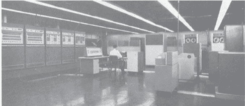
图 1.2 Burroughs Corporation 的 D825 并行计算机照片 [6]

1970 年代，随之而来的是单指令多数据（SIMD）处理器架构的概念，它构成了向量并行计算的基础。SIMD 是图形处理器（GPU）计算中的一个重要概念，将在下一章中讨论。

并行计算为解决复杂科学问题打开了大门，包括通过量子力学手段对分子系统中的电子进行建模（本书的主题）。举例来说，使用复杂的电子结构方法优化除最小分子系统外的任何分子系统的几何结构，在单个处理元件（计算核心）上可能需要数天（甚至数周）。将计算并行化到多个计算核心上可以显著缩短所需的计算时间，从而使研究人员能够在更实际的时间范围内研究复杂的分子系统，获得原本被认为无法企及的洞察。并行电子计算机在量子化学中的应用最早由意大利化学家 Enrico Clementi 及其同事在 1980 年代初开创 [7]。该并行计算机由 10 个计算节点组成，松散耦合成阵列，用于计算由 315 个基函数表示的小段 DNA 的 Hartree–Fock（HF）自洽场（SCF）能量。当时这是一项相当了不起的成就。然而，这仅仅是个开始，到 1980 年代末，各种并行程序已为量子化学方法开发出来。这些程序包括用于计算分子系统能量和核梯度的 HF 方法 [8–11]、双电子积分变换 [8, 9, 12]、二阶 Møller–Plesset 扰动理论 [9, 13] 以及构型相互作用方法 [8]。量子化学中并行计算的发展受制于可用技术的进步。特别是，应用程序编程接口（API）如消息传递接口（MPI）库 [14] 的出现，使并行计算对量子化学家来说更加容易获得，同时硬件技术的进步降低了并行计算机的成本 [10]。

尽管并行计算直到最近才在科学计算中广泛应用，但它曾仅限于能够使用高性能计算（HPC）资源的人。然而，如下文所述，所有现代计算机架构都利用并行技术，有效的并行编程对于利用现代设备的计算能力至关重要。并行处理现在已成为所有配备现代处理器架构的设备的标准配置。在他的 1965 年论文 [15] 中，Gordon E. Moore 首先观察到集成电路上的晶体管数量（原则上与性能直接相关）每 2 年翻一番（参见图 1.3）。


## 微处理器晶体管数量 1971–2011 与摩尔定律

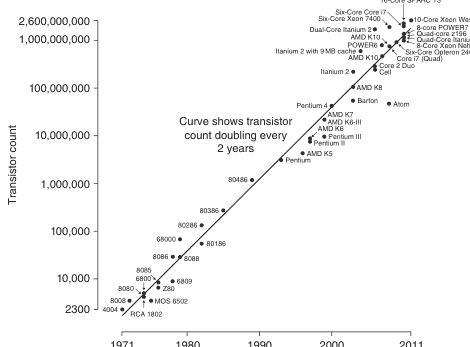

图 1.3 微处理器晶体管数量 1971–2011。直到最近，集成电路上的晶体管数量一直遵循摩尔定律 [16]，大约每 2 年翻一番。

自这一观察提出以来，半导体行业通过提高晶体管效率和/或数量，确保芯片性能每 18 个月翻一番，从而保持了这一趋势。为了实现这些性能目标，半导体行业现在已将芯片设计改进到接近物理上可能的极限。物理定律规定了晶体管的最小尺寸、散热速率和光速。

> "晶体管的尺寸正在接近原子的尺寸，这是一个根本性的障碍" [17]。

与此同时，时钟频率不容易提高，因为时钟频率和晶体管密度都会增加功率密度，如图 1.4 所示。处理器已经在超过热板功率密度且正在接近核反应堆核心功率密度的水平下运行。

为了在继续遵循摩尔定律的同时保持功率密度可控，芯片制造商开始增加每个处理器的核心数量，而不是每个核心的晶体管数量。当今生产的大多数处理器都包含多个核心，因此从定义上讲就是并行处理机器。就处理性能而言，这对科学和工业是一项巨大的福音；然而，核心数量的增加给程序员带来了更大的复杂性，以便充分利用可用的计算能力。应用程序要想随着核心数量增加而实现良好的扩展性变得越来越困难，因此它们无法充分利用这项技术。这一问题的部分原因在于，CPU制造商基本上

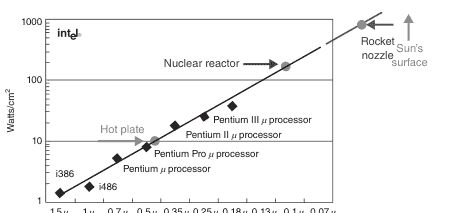

图 1.4 硅芯片内功率密度不断增加的示意图，随着栅极长度减小。由 Intel Corporation 提供 [18]

采用了串行（标量）架构及其相关指令集，并试图将其扩展到多核模式。虽然对于个位数核心数量来说这可以被很好地容忍，但一旦核心数量达到双位数，就必须跟踪数据在多个独立核心之间的分布方式（这需要本地缓存之间的通信），这种复杂性会迅速导致性能瓶颈。迄今为止，这种复杂性限制了核心数量，并最终限制了传统 CPU 可用的性能。在下一节中，我们将讨论多核编程的一种替代方案，即利用 GPU 的大规模并行（SIMD）架构。

## 1.2 GPU 的兴起

使用专用协处理器来补充中央处理器功能的概念起源于 20 世纪 70 年代，当时数学协处理器开始发展。这些协处理器负责处理浮点运算，从而使 CPU 能够执行其他任务。数学协处理器在 20 世纪 80 年代和 90 年代初很常见，但最终被集成到 CPU 本身中。然而，使用协处理器来加速特定功能的主题延续了下来，其中最常见的例子是视频加速器。这些 GPU 使 CPU 摆脱了渲染三维（3D）图像所需的大部分复杂几何数学，而它们的发展则受到计算机游戏行业对越来越逼真的图形的渴望所推动。

除了 20 世纪 80 年代的数学协处理器外，协处理器在科学计算中被常规用作加速数学密集型代码区域的手段。更近期的例子包括 ClearSpeed 的加速器板，它将数百个浮点单元集成在单个 PCI 卡上，以及现场可编程门阵列（FPGA），可以重新配置以加速特定的计算问题。这些加速器技术虽然被一些人利用，但在一般科学计算领域并未得到广泛应用，原因有多种，主要原因是其成本。然而，一种已被更广泛的科学计算社区采用的协处理器技术是 GPU。原因有很多，但可能导致其广泛采用的最主要原因是它们无处不在且价格低廉。几十年来，GPU 一直是个人计算机的组成部分。自 1996 年 3DFX 推出 Voodoo 图形芯片以来，娱乐行业一直是推动 GPU 发展的主要动力，以满足对越来越逼真的计算机游戏的需求。作为消费电子行业强劲需求的结果，GPU 的稳定、长期发展得到了大量工业投资。

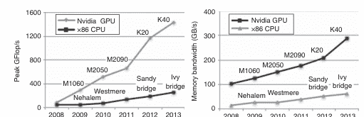

图 1.5 Intel CPU 和 Nvidia GPU 的峰值浮点运算每秒（a）和内存带宽（b）。转载自 [19]

技术。如今，GPU 已经变得廉价且无处不在，并且由于其处理能力多年来大幅提升，当被高效利用时，它们有潜力显著超越 CPU（参见图 1.5）。

因此，GPU 成为加速许多科学应用（包括本书的主题，即电子结构理论）的非常有吸引力的硬件目标。具有显著计算能力的 GPU 可以被视为科学工作站的标准设备，这意味着它们要么已经在研究实验室中可用，要么可以轻松随新设备购买。这使得它们对研究人员进行计算实验来说很容易获得。此外，许多计算机集群已配备大量高端 GPU，唯一目的是加速科学应用。在撰写本文时，对科学界公开可用的最强大超级计算机的大部分峰值计算性能都来自 GPU。

然而，GPU 硬件的特性最初使其在通用计算中的使用变得具有挑战性，因为这需要广泛的三维（3D）图形编程经验。然而，如下文所述，通用科学计算 API 的发展降低了这种复杂性，使得广泛的科学问题能够以经济高效的方式使用 GPU 加速。GPU 加速计算现在是一个广泛但仍在不断发展的研究和开发领域，能够以极低的成本（以及潜在的极低的软件开发工作量，取决于应用程序）提供可扩展的超级计算能力。

GPU 最初是为计算机图形设计的，后者需要重复评估像素值，除此之外别无他求。例如，渲染 3D 图像不需要分支，因此，GPU 没有复杂的缓存层次结构、分支预测硬件、流水线控制器和其他复杂功能，而是拥有数百到数千个简单的核心。GPU 从根本上是并行的，每个核心作为单独的线程进行计算，这使得它们非常适合线程之间依赖性很少的数据分解。对于细粒度并行工作负载，GPU 可以提供大量的计算能力。如图 1.5 所示，它们主要通过内存带宽的差异，为合适的代码提供了一种远超 CPU 极限的性能提升手段。

科学界正在利用这种处理能力，以通用（GP）计算在 GPU 上的形式，有时也称为 GPGPU。GPGPU 专门针对 HPC 应用程序设计，在 GPU 中加入了额外的功能，例如缓存技术和双精度算术支持。早期 GPGPU 努力的成功之处在于，这些功能现在被视为几乎所有 GPU 的标准功能，事实上，许多现代计算机游戏


实际上利用 GPGPU 功能来计算游戏物理。在 GPU 上进行计算的传统方法是将其作为加速器或协处理器，与 CPU 协同工作。GPU 执行代码中的特定函数（称为内核），这些函数被认为适合在 GPU 上进行并行化。GPU 运行 SIMD 指令集，即一条指令在单个实例中发送到许多核心。GPU 核心的轻量级特性使其非常适合并行化计算密集型且数据依赖性少的代码，因为一旦指令发出，核心就不能沿着不同的代码路径分叉。如果在发出相同指令的核心上发生分支，一些核心将停滞，直到执行路径汇合。GPU 硬件的这一特性使其区别于 CPU 架构。它使得在一个实例中计算多个数据元素成为可能，前提是代码设计允许。然而，这并不是说 CPU 不使用 SIMD，而是 GPU 在更大规模上实现它。例如，Nvidia Tesla 系列中的最新 GPU Tesla K40 拥有 2880 个 GPU 核心，并有能力每个核心启动多个线程，这些线程可以以极低开销快速切换进出，而 Intel® Core™ 产品系列中的最新 CPU Intel® Core™ i7-4930K 处理器包含六个核心，每个核心可生成两个线程。CPU 使用 SIMD 来每个线程执行多个操作；在此情况下，每个线程是以 AVX 形式的 256 位 SIMD 指令。原则上，CPU 因此可以每个时钟周期执行 96（256-bit/32-bit x 12 threads）次单精度浮点运算，尽管实际上由于每个核心的两个线程是时间片切换的，实际只有其一半。因此，GPU 在单个实例中可能处理数百甚至数千个数据元素，而 CPU 仅为 48 个。然而，无论如何强调 GPU 代码设计的重要性都不为过，以便利用这种潜在性能，通常需要重新思考底层数学算法。本书的目的是在电子结构理论框架内突出这种重新思考。

## 1.3 中央处理器上的并行计算

在进入 GPU 编程世界之前，巩固并行编程核心的一些关键概念非常重要。并行编程比串行编程需要考虑的因素多得多。在并行化计算机代码时，不能假设所有并行处理元素都能访问内存中的所有数据，或者一个元素的内存更新会自动传播到其他元素。数据相对于处理元素的局部性取决于所使用的计算机系统设置和并行编程内存模型，这是本节将讨论的第一个概念。随后是程序员可用的、最适合特定编程模型的语言选项，以及在将问题分解为更小的并行问题时需要考虑的不同类型的并行性。了解可能影响并行程序性能的因素以及如何测量并行程序的性能和效率也是有益的，这将是讨论的最后几个主题。为了比以下内容更详细的阐述，我们将读者引向 Hager 和 Wellein 关于 HPC 的优秀教材，该教材除了并行化之外，还涵盖了计算机架构和串行代码优化的方面 [20]。

### 1.3.1 并行编程内存模型

在并行计算中，有两种主要的内存模型：共享内存模型和分布式内存模型。每种模型在硬件和软件层面都带来不同的影响。在硬件方面，共享内存模型正是如此——多个处理器共享内存中的单个地址空间。分布式内存模型指的是隔离的内存，每个处理器都有自己的私有地址空间，无论是物理上的私有内存空间还是较大内存的一部分。

在共享内存中，所有处理器都可以访问内存中的所有地址，使得处理器之间的通信可能非常快。然而，当多个处理器需要访问同一内存地址时会出现问题，导致潜在的竞态条件——这一情况将在本章后面更详细地讨论——即计算结果取决于哪个线程先计算出答案，以及保持不同内存缓存中数据一致性的计算开销。在分布式内存中，所有处理器只能访问自己的内存地址空间，因此处理器之间的通信成为瓶颈。如果处理器需要存储在其私有内存空间之外的数据，处理器首先必须找到数据存储在哪个处理器的私有内存中，然后才能通过互连传输。因此，共享内存系统被认为更适合较少的处理器数量，因为随着处理器数量增加，由于缓存一致性开销的激增，性能会下降。没有哪种内存模型是理想的。在实践中，大多数现代并行集群使用两种内存模型的混合。许多科学计算集群采用混合内存模型，通过互连将共享内存节点耦合在一起，提供分布式内存模型。

### 1.3.2 并行编程语言

应用程序编程接口（API）从根本上说是与计算机通信的一种方式。与计算机的通信是分层的，可以轻松地想象成一个隐喻的洋葱。洋葱的核心是二进制。0 和 1 代表硅片上晶体管的开关状态。二进制允许这些开关状态表示实数。洋葱的下一层是机器码。少量非常基本的操作指示 CPU 如何处理实数。再下一层是汇编语言，它类似于机器码，只是具有略微更人性化的操作，使操作实数更加容易。以此类推。洋葱越大，即通信层数越多，程序员表达其计算问题就越容易，因为每增加一层，语言就越来越接近人类交流。这些语言层被称为 API，可以被视为高级（大洋葱的外层）或低级（靠近核心的层）。用于表达并行 CPU 代码的两种最广泛使用的 API 是 MPI（消息传递接口）[14] 和 OpenMP（开放多处理）[21]。MPI 是从现有 CPU 代码中调用的库。该库与语言无关，这意味着它可以从任何兼容编程语言编写的代码中调用，即 C、C++ 或 Fortran。MPI 支持系统中处理器之间的点对点和集体通信，主要设计用于分布式内存系统，但也可以在共享内存环境中使用。OpenMP 主要是一组编译器指令，可以从 C/C++ 和 Fortran 代码中调用。OpenMP 主要设计用于共享内存编程，尽管 OpenMP 4.0 支持“目标指令”用于在不共享内存空间的设备上运行，并表现出多线程范式以在处理器之间分配工作。OpenMP 被认为比 MPI 更高级的并行编程 API，因为运行时环境和编译器完成了大部分工作。程序员只需通过指令指定哪些代码部分需要并行化，然后让 API 完成其余工作。MPI 需要更多思考，因为程序员负责跟踪内存中的数据并显式地在处理器之间传递数据。然而，使用 MPI 时增加的这种难度带来的一个好处是，它迫使程序员思考数据局部性，从而可以导致更高效、性能更高的代码。并行编程中使用的其他 API 包括高性能 Fortran（HPF）、POSIX 线程和统一并行 C（UPC），仅举几例；然而，它们超出了本教材的范围。


### 1.3.3 Types of Parallelism

One key consideration when parallelizing code is how to distribute the work across processors. The two main types of decomposition are task parallelism and data parallelism. Task parallelism involves decomposing code into separate, independent tasks/calculations able to be computed on different processors concurrently. Each processor is responsible for executing its own set of instructions using the same or different data as other processors. Figure 1.6 shows a simple example of a four-task program. Task B is dependent on Task A, therefore they are executed sequentially. Task C is independent of both Task A and B, therefore they can be executed concurrently. Task D is dependent on the completion of Tasks B and C, therefore it is executed on their completion.

Data parallelism involves decomposing a dataset across all processors, and each processor executing the same instructions but on different data. Data parallelism is synonymous with SIMD architecture. There are many different strategies for data parallelism, for example, static where the data are decomposed into chunks and distributed across processors at compile time and each processor carries out all operations on the same chunk of memory initially allocated, and dynamic parallelism where a load balancer hands out work on a per-request basis. A more detailed discussion of data decomposition strategies is beyond the scope of this chapter and so will not be discussed further.

Similar to the parallel memory models, a combination of both types of parallelism can often be the most fruitful where performance is concerned. It can be beneficial to employ both types of parallelism, for example, decomposing code into tasks across multiple compute nodes and further decomposing the data for each task across multiple processors within a compute node. By doing this, multiple levels of parallelism can be exploited, making better use of the available computer architecture.

The ease and extent by which an algorithm can be broken up into separate tasks/calculations is known as the granularity. Fine-grained parallelism describes algorithms that can be subdivided into many small calculations. These types of algorithm are said to be more easily parallelized but can require more synchronization/communication between parallel processes. On the contrary, coarse-grained parallelism is the subdivision of an algorithm into fewer larger tasks/calculations. These types of algorithm do not benefit from as much parallelism, that is, scale to small processor counts, but can benefit from fewer overheads as a result of reduced communication. Algorithms that can be subdivided into many small tasks (similar to fine-grained parallelism) yet do not carry large communication overheads (similar to coarse-grained parallelism) are said to be *embarrassingly parallel* (although the term naturally parallel might be a better description) and are the easiest applications to parallelize.

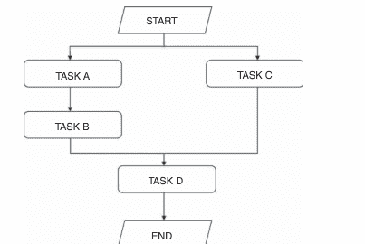

Figure 1.6 Directed acyclic graph demonstrating the decomposition of four tasks across two processors

### 1.3.4 Parallel Performance Considerations

#### 1.3.4.1 Speedup

Before parallelizing code, it is important to realistically predict the potential for performance improvement. A common measure is speedup ($S$), which is given by

$$S(n) = \frac{T(1)}{T(n)},\quad (1.1)$$

where $T(1)$ is the execution time of the original algorithm and $T(n)$ is the execution time of the new algorithm on $n$ processors/cores/threads.

#### 1.3.4.2 Amdahl's Law and Gustafson's Law

Amdahl's and Gustafson's laws provide a guideline for speedup after parallelizing code. Effectively a simplification of a concept, familiar to all chemists, known as a rate-determining step, they show that the serial portion of a parallel program is always the limiting factor in speedup. There are slight subtleties between the two laws: Amdahl presumes a fixed problem size, whereas Gustafson presumes increasing problem size with increasing numbers of processors. Amdahl's Law, named after the computer architect Amdahl [22], was introduced in 1967 and is defined by

$$T(n) = T(1) \left( \beta_a + \frac{1}{n} (1 - \beta_a) \right),\quad (1.2)$$

$$S(n) = \frac{T(1)}{T(1) \left( \beta_a + \frac{1}{n} (1 - \beta_a) \right)} = \frac{1}{\beta_a + \frac{1}{n} (1 - \beta_a)},\quad (1.3)$$

where $\beta_a$ is the fraction of the algorithm that is non-parallelizable, that is, the fraction of the total run time $T(1)$ that the serial program spends in the non-parallelizable part. As can be seen from Amdahl's equation, as the number $n$ of processors increases, the speedup becomes limited by the serial code fraction $\beta_a$. However, Amdahl's Law is rather simplistic, as it makes assumptions such as the number of processes used throughout the parallel portions of the code is a constant; the parallel portion achieves linear speedup (i.e., the speedup is equal to the number of processes); and the parallel portion scales perfectly, to name a few. However, the most important assumption made was that the serial and parallel workloads remain constant when increasing the number of processors. This is true for many scientific problems, particularly those involving integrals over time.

However, some applications are problem-size bound rather than time-bound, such as weather modeling and graphics rendering, and given more processors, the size of the problem is usually increased to fill the void. Gustafson attempted to remedy this shortcoming in 1988 by defining parallel speedup by a new equation [23], sometimes referred to as “scaled speedup”:

$$T(1) = (n - \beta_g(n-1))T(n),\quad (1.4)$$

$$S(n) = n - \beta_g(n-1),\quad (1.5)$$

where $\beta_g$ is again the non-parallelizable fraction, but now defined as the fraction of the total time $T(n)$ that the parallel program spends in serial sections if run on $n$ processors. The two different definitions of speedup in terms of processor count $n$ and serial code fraction $\beta$ can lead to confusion. However, one has to keep in mind that for a given problem size, $\rho_A$ depends on the number of processors, as indicated in Eqs. (1.4) and (1.5). Equations (1.3) and (1.5) are actually equivalent with the following relation between the different definitions of the serial code fraction, as can be derived from Eqs. (1.2) and (1.4):

$$\rho_A = \frac{1}{1 + \frac{(1-\kappa)n}{\kappa}}$$ (1.6)

In the application of Eq. (1.5), one typically assumes that $\rho_A$ remains constant with increasing processor number. In other words, Gustafson's Law states that exploiting the parallel power of a large multiprocessor system requires a large parallel problem. Gustafson's Law thus allows for expansion of the parallel portion of an algorithm but still makes all the same assumptions as Amdahl's Law. Either way, the serial code will ultimately become the bottleneck as the core count increases. It is thus essential for effective parallel programming that all serial aspects of the compute portion of the code are removed. If a section of the algorithm is serial, even though representing only a tiny fraction of the total compute time, it is necessary to rethink the approach to remove this serial bottleneck if one wishes to scale across the thousands of cores in GPUs. For example, if 99% of code is parallel and it is run on 100 cores with ideal scaling, the remaining 1% that is serial will take over 50% of the total compute time. If one then runs the same calculation on 1000 cores, again assuming ideal scaling, the serial portion now consumes over 90% of the total compute time.

#### 1.3.4.3 Race Conditions

Coding in parallel requires the programmer to consider the possible order of execution for multiple processes at any one time. It is important to be aware of some possible scenarios that may happen during execution with multiple processes.

Scenario 1: Process A relies on the result of a calculation carried out by process B. This is known as a dependency, more specifically a _data dependency_. Process A cannot continue to execute until process B has calculated the result. If it does, the process will be incorrect since it does not have valid data from B. A solution would be to introduce synchronization between the processes prior to the operation that carries the dependency, or, alternatively, design a new parallel algorithm that eliminates the dependency.

Scenario 2: Process A and process B are both adding a number to the same variable $X$ in memory. Process A and process B both take the current value of X as 5 and begin to add their result to the variable. Process A does X = 5 + 2, whereas process B does X = 5 + 1. Depending on which process is quicker at putting the new value of X back in memory, the result will be either 7 or 6. However, the desired value of X in memory is actually 8. This is known as a _race condition_. One solution would be to make use of a lock, which ensures that only one process can access any one variable at any time, thereby preventing a race condition by creating mutual exclusion of variable X. The use of a lock is often discouraged however, since it introduces serialization into the code. Various tricks can be used to circumvent this, such as the lock-free, warp-synchronized, approach used by the GPU version of the AMBER MD software discussed later (see Section 1.5.1).

#### 1.3.4.4 Communication Metrics

While it might be possible to perfectly parallelize an algorithm, this does not necessarily mean that the algorithm will be executed at the theoretical limit of the hardware's performance. The reason for this is that all algorithms ultimately require some form of communication between each process (unless embarrassingly parallel). Some might require the reduction of a set of calculations, for example, a summation executed in parallel, while others might require comparison between values or the sharing of variables describing the system's state, for example, the coordinates of a set of atoms, between


进程。进程间数据共享的时间成本由通信的两个主要方面决定。带宽是衡量在给定时间内可以传输的数据量的指标，即速率，例如每秒千兆字节。在衡量性能时，实际带宽（即吞吐量）可与硬件的理论带宽能力进行比较，以评估数据传输的效率。延迟是衡量数据移动性能的另一指标；不过，它更关注传输数据所需的时间，而非可传输的数据量。吞吐量和延迟本质上衡量的是同一事物：数据通信效率。简单来说，延迟是建立通信通道所需的时间，而带宽是单位时间内可沿通道发送的数据量。依赖大量小数据包的算法通常会受延迟限制，而不频繁发送大数据包的算法通常会受带宽限制。由于并行硬件的设计通常涉及带宽和延迟之间的权衡，某些算法在特定类型的硬件上自然会比其他算法表现更好。

## 1.4 图形处理器上的并行计算

本节遵循与上一节大致相同的概念/理论顺序；不过，它是在GPU的背景下进行的。首先讨论的是GPU的内存模型。随后将讨论可用的API及其兼容硬件、代码适用性，最后讨论可扩展性、性能和成本效益。

### 1.4.1 GPU内存模型

配备GPU协处理器的系统的内存模型不容易简单归类为共享或分布式这两类，因为CPU和GPU都有自己的内存空间。GPU加速从CPU卸载的代码所需的数据必须对GPU可访问。这涉及将数据从CPU传输到GPU，类似于分布式内存系统中进程间的数据传输。一旦数据位于GPU上，内存模型就大不相同。GPU上的主内存（称为全局内存）对所有核心/线程都可访问且可见。这反映了共享内存模型。然而，由于GPU具有多个内存位置（每个位置的容量、带宽和延迟因其与计算核心的距离而异），因此在穿越内存层次结构时，共享内存模型并不一致。GPU的内存层次结构将在第2章中更详细地讨论。利用内存层次结构是编写GPU代码时的关键目标之一，对于实现良好性能至关重要。GPU提供了一个混合内存平台，使程序员能够控制数据局部性。

### 1.4.2 GPU API

目前，可用于编程GPU的主要API有两个：OpenCL和CUDA。还有一个更高级别的GPU编程选项OpenACC，它是一组指令和程序的集合，在逻辑上等同于OpenMP，允许编译器分析代码段并自动将循环映射到并行GPU核心上。在本教材中，大多数示例和概念将以CUDA编程范式为例进行讨论，部分章节将使用OpenCL。撰写本文时，CUDA仅由Nvidia GPU硬件提供免费支持，而OpenCL是一个跨平台标准，可在多种不同的协处理器架构上使用和兼容，而不仅限于GPU。CUDA是C、C++和Fortran编程语言的一系列扩展。这有助于减少编程工作量，因为算法无需正式重写即可在GPU上运行，只需修改以包含CUDA语法。然而，值得注意的是，大多数算法都需要修改才能在GPU的多核架构上高效执行。因此，如下文所述，许多应用程序可能不可避免地需要重新设计算法，以从GPU中获得最大性能。OpenCL为C编程语言提供了一组较低级别的扩展，使程序员能够更好地控制硬件。编程模型与CUDA非常相似，因此术语被简化了。例如，在CUDA编程模型中，线程是由CUDA核心执行的指令序列，而在OpenCL编程模型中，线程被称为工作项。两种GPU API选项各有利弊；不过，讨论这些超出了本教材的范围，API的选择留给程序员的偏好。为了便于编写，本章和下一章的主要重点将是CUDA，因为它在GPU量子化学代码中被广泛使用。

### 1.4.3 适合GPU加速的代码

由于GPU最初是为涉及图形渲染的应用程序设计的，缺乏复杂的硬件限制了使用历史GPU硬件设计进行加速的应用程序数量。最早尝试在GPU上运行通用应用程序的程序员面临着艰巨的任务，即将其计算表示为三角形和多边形。尽管现代GPU硬件设计对通用应用程序更加友好，但为了实现性能提升，仍有必要确保算法适合硬件，同时还要考虑Amdahl定律或Gustafson定律。

通常，只有整个代码的一部分适合在GPU上执行，如图1.7所示。其余代码正常在CPU上执行，尽管CPU和GPU之间传输数据的成本通常意味着最好尽可能在GPU上执行计算密集型代码。

在进行任何开发之前，需要仔细考虑要移植的代码。与硬件评估不佳的代码在移植到GPU后可能无法获得性能提升，甚至性能下降，相比于在CPU上运行整个代码。需要考虑的一个方面是GPU的SIMT（单指令多线程）架构及其对代码适用性的影响。GPU上的线程块被分块生成（在Nvidia硬件上以32个为一批执行，称为warp），并逻辑映射到物理GPU

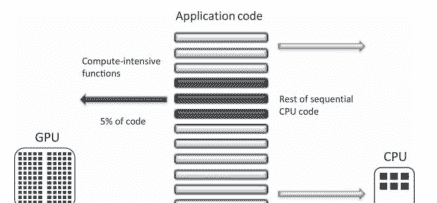

图1.7 GPU与CPU协同工作的示意图，工作被卸载并在GPU上并发计算，同时CPU也在执行 [24]

核心。线程设计为轻量级，且调度无开销。硬件不会独立执行块中的线程。相反，所有线程执行相同的指令，因此条件分支可能对性能不利，因为它会阻塞整个线程块。由于线程块内线程并发工作的特性，通过创建远多于GPU物理核心数量的线程来减少空闲线程数量是有益的。线程间的通信也有限，并可能导致性能不佳。因此，细粒度并行问题（例如数据并行、数据元素之间依赖性少且分支分歧少的问题）最能成功利用GPU的硬件。

评估代码是否适合GPU加速时的另一个考虑因素是内存访问延迟和带宽。内存访问延迟在移植到GPU时是一个巨大的开销，因为GPU无法以与本地GPU内存相同的速度访问CPU上的内存，反之亦然。数据必须显式传输，或使用某种形式的统一寻址，这两者都会引入开销。GPU与CPU内存之间的带宽远低于CUDA核心与GPU内存之间的带宽。例如，Nvidia Tesla K40卡的理论全局内存带宽为288 GB/s，而CPU与GPU之间的理论单向带宽仅为16 GB/s（PCIe Gen 3 x16）。通过PCIe接口的内存访问也会受到数千个指令周期量级的延迟影响。因此，在CPU和GPU之间传输数据可能会导致性能瓶颈。需要计算密集型代码来用计算掩盖内存访问延迟。适合的代码将具有高度的算术强度、高度的数据重用以及少量的内存操作，以减少数据传输和内存访问的开销。

掩盖内存访问延迟的另一种方法是运行大问题规模的代码。为了减少从CPU向GPU传输数据时分配和释放内存的启动成本，发送一个大数据包比发送多个小数据包更有利。这意味着，与发生相同启动成本的小问题规模代码相比，大问题规模代码的性能受CPU-GPU数据传输启动成本的影响较小（占总执行时间的比例）。

当并非所有计算密集区域都已移植到GPU时，代码的一个理想特性是能够在CPU和GPU上重叠执行代码。并行化任何代码的一个目标是减少处理器空闲时间。如果CPU正在等待GPU上执行的内核，且存在CPU密集型部分，那么代码性能将受到影响，因为CPU会花费时间空闲。

### 1.4.4 可扩展性、性能和成本效益

GPU的设计使其具有高度可扩展性，在大多数情况下甚至可以轻松扩展，因为线程的创建、销毁和调度是在硬件后台完成的。程序员在规划分解策略时无需纠结于处理器数量。算法可以根据数据元素的数量进行分解，而不是根据系统中的处理器数量，从而使应用程序可以轻松扩展到数千个处理器核心和数万个并发线程。程序员只需关注分解策略的粒度。编程模型从硬件中抽象出多个层次的并行性：即，在线程级别，可以实现细粒度数据并行；而在内核级别，问题可以分解为更粗粒度的任务。然后，移植后的GPU程序在运行时将扩展到任意数量的处理器。这不仅产生了高度可扩展的编程/架构模型，还降低了程序员设计可扩展算法的难度。


使用 GPU 的主要原因是提升程序性能。这可以通过使用多个 CPU 来实现（如前所述），但是，由于 GPU 具有更大的内存带宽，对于许多应用程序来说，使用 GPU 提升性能的空间通常要大得多。下一节将通过两个在 GPU 加速后获得显著性能提升的应用程序来展示性能提升的潜力（参见第 1.5 节）。

评估 GPU 加速程序性能的方式对于向最终用户提供真实速度至关重要。显然，将 GPU 的性能与单个 CPU 进行比较是有益的，但多个 CPU 呢？由于并行化代码的传统方法是通过多个 CPU 核心，因此似乎只有对这两种并行实现（GPU 与多核）进行比较，才能公平地评估使用 GPU 的实际收益。在与多个 CPU 进行性能比较时，需要包含的一个重要因素是改进的成本效益。使用 GPU 的成本效益在很大程度上取决于应用程序的类型以及算法对多处理器数量的可扩展性。购买超级计算机的使用时间可能很昂贵，而为大多数人构建自己的超级计算机是不可行的。GPU 使任何愿意花时间修改代码的人都能获得计算集群的处理能力。GPU 不仅为台式计算机提供超级计算能力，而且由于其能源效率高，还能以实惠的价格做到这一点。2013 年 11 月发布的 Green500 名单（按能源效率对世界超级计算机进行排名的名单）中前 10 名的计算机包含 Nvidia GPU，这绝非巧合，因为与传统 CPU 相比，GPU 的每瓦性能非常理想。

## 1.5 GPU 加速的应用程序

许多现实世界的应用程序已经从 GPU 加速中获得了巨大的性能提升。受益于 GPU 技术的科学领域包括国防工业、石油和天然气、海洋学、医学影像和计算金融 [25, 26]。本节展示了两个 GPU 应用程序，它们属于截然不同的领域，且未包含在本书后面的章节中，为在 GPU 上并行化代码提供了额外的动力。首先要讨论的是经典分子动力学（MD）软件包 Amber，其次是渲染和视频编辑软件包 Adobe Premiere(R) Pro Creative Cloud (CC)。

### 1.5.1 Amber

Amber [27] 是一套用于生物分子分子动力学（MD）模拟的研究工具，可用于研究生物分子在溶液和细胞膜中的行为。它广泛应用于药物发现等领域，用于确定各种药物抑制酶活性的机制。

在针对 Nvidia 硬件进行 CUDA 移植和优化后，Amber 软件包中 PMEMD 分子动力学引擎的 GPU 实现现在是普通硬件上世界上最快的模拟引擎。对于图 1.8 所示的含有约 23,500 个原子的二氢叶酸还原酶（DHFR）模拟，在 2009 年，模拟约 50 ns 需要一天时间，使用的是世界上最快的超级计算机之一。也就是说，为了模拟生物分子生命中短短 50 亿分之一秒，需要进行一整天的计算机模拟。如今，5 年过去了，使用一台包含四块 Nvidia Tesla Kepler K40 或类似 GPU 的单台台式机，可以实现超过 1 µs/天的总吞吐量。GPU 代码设计利用了一种通过使用 warp 级并行性 [28] 实现无锁计算的专利方法，该方法应用算法

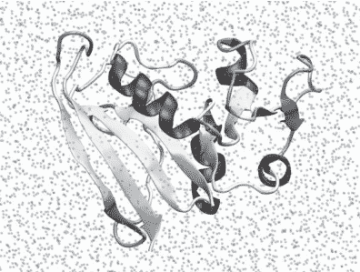

图 1.8 水中二氢叶酸还原酶的卡通表示（23,508 个原子）

技巧来消除并行成对计算中对锁的需求。它还通过在 GPU 上进行整个模拟，仅为 I/O 与 CPU 通信来减少 CPU–GPU 数据传输开销，并在跨多个 GPU 运行时使用 PCIe 对等通信来消除 CPU 和主板芯片组开销。为了从 Nvidia Kepler、Quadro 和 GeForce 系列 GPU 中获得最佳性能，实现了一种称为 SPFP [29] 的混合精度模型，以利用硬件的单精度和整数原子性能，同时不牺牲模拟精度。其结果是，以最低成本为每位研究人员提供超级计算能力，从根本上推动了涉及 MD 模拟的研究进度。

图 1.9 显示了 Amber v14 的示例性能数据，其中含有 90,906 个原子的血液凝固蛋白 FactorIX 已在各种硬件上进行了模拟。在单个 K40 GPU 上运行的 Amber 14 可实现近 40 ns/天的吞吐量，而同时使用四个 K40 GPU 则可以在单个模拟中获得近 74 ns/天的吞吐量。相比之下，在两个 Intel Xeon E5-2670 CPU（16 个 CPU 核心）上运行可实现 5.6 ns/天，因此使用 GPU 运行 Amber 的好处显而易见。单个 GeForce GTX Titan Black（一款零售价约为 1000 美元的游戏卡）可获得超过 42 ns/天，因此其性能是单个（16 核心）CPU 节点的 7 倍以上。

除了原始性能之外，在 GPU(s) 上运行 Amber 14 还存在成本效率考量，这可以使用相同的 FactorIX 基准来演示。高端 GPU 工作站与获得相同性能所需的等效仅 CPU 集群之间的成本差异——目前仅考虑采购成本，忽略运行成本——约为 45 倍。例如，可以通过考虑一台由单个节点和四块 GTX Titan Black 卡组成、成本约为 7000 美元的 GPU 工作站，以及获得等效性能所需的仅 CPU 集群的硬件规格来计算此因素。GPU 工作站可以通过四个 FactorIX 模拟实现 168 ns/天的总吞吐量（每个模拟 42 ns/天）。要使用基于 CPU 的硬件获得等效性能，

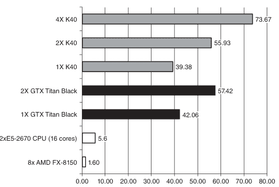

图 1.9 使用 CPU 和 GPU 版本的 Amber 在不同硬件配置下进行的经典分子动力学模拟的计算性能，以每天纳秒为单位。结果基于标准基准（显式溶剂中的 FactorIX 酶，90,906 个原子，NVE 集合，2 fs 时间步长）[30]

该硬件由双 8 核 CPU 节点组成，节点之间需要高端 QDR Infiniband 互连，每个模拟总共需要 16 个节点（256 个核心），因为由于通信开销，跨多个节点的扩展从来不是线性的，总集群大小为 64 个节点（用于四个单独的模拟）。撰写时，这样的集群成本约为 320,000 美元。

在 MD 模拟中使用 GPU 不仅对采购成本有积极影响，而且还大大降低了运行成本，对于大型 CPU 集群来说，运行成本中很大一部分是电力成本。节省电力也意味着更环保的计算。如第 1.4 节所述，GPU 比 CPU 更节能，有助于推动更环保的科学。为了说明这一点，请将在单个 Nvidia GeForce GTX Titan Black GPU 上运行的单个 FactorIX 模拟与在双插槽 Intel E5-2670 系统上运行的相同模拟进行比较。Titan-Black GPU 的额定峰值功耗为 250 W，但这不包括节点本身的开销，例如机箱风扇、硬盘和 CPU 空闲功耗。测量 FactorIX 模拟的总节点功耗显示，功耗约为 360 W，吞吐量为 42.06 ns/天。这相当于模拟功耗约为 0.20 kW h/ns。如果改用该系统中的双 E5-2670 CPU，则每个节点的测量功耗约为 359 W，单个节点产生 5.6 ns/天的吞吐量，功耗约为 1.54 kW h/ns。在此示例中，GPU 版本的 AMBER 在电源效率方面提高了 7.7 倍。

总之，GPU 加速的 Amber MD 程序比 CPU 实现更快的模拟或更长的模拟时间，且电源效率更高。它包含了 CPU 上可用的大部分 MD 功能，但成本仅为财务和环境成本的一小部分。


### 1.5.2 Adobe Premiere Pro CC

Adobe Premiere Pro CC 是一款主要用于视频编辑的 GPU 加速软件套件，提供交互式、实时的编辑和渲染功能。Adobe 与 Nvidia 合作，通过使用 Nvidia GPU 显卡和 CUDA 编程平台，打造高速功能。Adobe Premiere Pro CC 包含的功能有去模糊（将来自单个传感器的 Bayer 模式彩色滤镜阵列图像转换为全彩色 RGB 图像的过程）、羽化遮罩（对帧应用遮罩）和主剪辑效果（允许对帧进行剪切、拼接和重新排序）。图 1.10 显示了在 Nvidia Quadro GPU 上以 720p 分辨率使用复杂的 Mercury Playback Engine 渲染高清（HD）视频的性能数据，相较于双 Intel Xeon E5 处理器（共 16 个核心）。显卡价格从 Quadro K2000 的约 500 美元（提供近 5 倍加速）到 Quadro K6000 的 5000 美元（可实现超过 16 倍的渲染速度）。

GPU 加速的 Adobe 套件中更令人印象深刻的是，通过其 After Effects CC 产品渲染光线追踪 3D 场景的速度。通过在台式机上配备单块 Quadro K6000，与单独使用双 Intel Xeon E5 处理器（共 16 个核心）相比，用户可获得约 28 倍的加速（参见图 1.11）。如果用户恰好有额外的 5000 美元可用于购买计算机硬件，其 3D 光线追踪工作流程可完成得快近 40 倍。

像 Adobe Premiere Pro CC 套件这样的图形渲染包能够实现如此大幅度的性能提升，这并不奇怪，考虑到 GPU 的最初设计目的正是为此。然而，这很好地展示了 GPU 的能力及其以大众可负担的方式加速应用程序的能力。本书的目的是详细探讨已取得的成功，并调查在 GPU 上加速电子结构计算的当前最新技术。

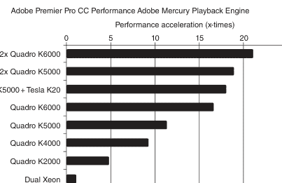

图 1.10 GPU 上 Adobe Mercury Playback Engine 的性能加速。系统配置：Adobe Premiere Pro CC，Windows 7 – 64 位，双 Intel Xeon E5-2687 v3 3.10 GHz CPU（共 16 个核心）。测试包含在 720p 分辨率下使用复杂 Mercury Playback Engine 效果的 HD 视频工作流。结果基于最终输出渲染时间，将所述 GPU 与 CPU 进行比较 [31]

### Adobe After Effects CC 性能 3D 光线追踪

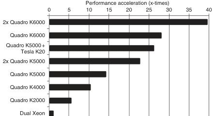

图 1.11 GPU 上 Adobe After Effects CC 引擎的性能数据。系统配置：Adobe After Effects CC，Windows 7 – 64 位，双 Intel Xeon E5-2687W 3.10 GHz CPU（共 16 个核心）。测试包含带有 3D 图层的实时 After Effects CC 场景，比较在所述 GPU 与 CPU 上渲染光线追踪 3D 场景的时间 [32]

## 参考文献

- 1. Bolcer, J.D. 和 Hermann, R.B. (2007) 美国计算化学的发展。计算化学评论，John Wiley & Sons, Inc., 第 1-63 页。
- 2. Rojas, R. 和 Hashagen, U. (编) (2002) 第一台计算机：历史与架构。MIT Press, 剑桥, MA, 美国。
- 3. Rojas, R. (1997) 康拉德·祖塞的遗产：Z1 和 Z3 的架构。IEEE 计算机史年鉴，19 (2), 5-16。
- 4. Hahn, M. IBM 电子数据处理机 2010。可从：http://grin.hq.nasa.gov/ABSTRACTS/GPM-2000-001881.html 获取（2014 年 8 月 7 日访问）。
- 5. Garg, R. 探索现代 ARM 芯片的浮点性能。可从：http://www.anandtech.com/show/6971/exploring-the-floating-point-performance-of-modern-arm-processors 获取（2014 年 5 月 12 日访问）。
- 6. Weik, M.H. (1964) Burroughs D825，弹道研究实验室，马里兰州阿伯丁试验场。
- 7. Clementi, E., Corongiu, G., Chin, J.D.S. 和 Domingo, L. (1984) 量子化学中的并行性——以 DNA 碱基对中的氢键研究为例。国际量子化学杂志，86, 401-618。
- 8. Guest, M., Harrison, R. van Lenthe, J. 和 van Corler, L.H. (1987) FPS-X64 科学计算机上的计算化学。理论化学学报，71 (2–3), 117-148。
- 9. Colvin, M., Whiteside, R. 和 Schaefer, H.F. III (1989) 大规模并行计算机的量子化学方法，载于《计算化学方法》第 3 卷（S. Wilson 编），Plenum, 纽约，第 167 页。
- 10. Jassen, C.L. 和 Nielsen, I.M.B. (2008) 量子化学中的并行计算。CRC Press, Taylor & Francis Group, 博卡拉顿。
- 11. Dupuis, M. 和 Watts, J.D. (1987) 松散耦合处理器阵列 (Leap) 上分子能量梯度的并行计算。理论化学学报，71 (2–3), 91-103。
- 12. Whiteley, R.A., Binkley, J.S., Colin, M.E. 和 Schaefer, H.F. III (1987) 量子化学的并行算法。超立方体多处理器上的积分变换。化学物理学杂志，86 (4), 2185-2193。
- 13. Watts, J.D. 和 Dupuis, M. (1988) 电子关联能中 Møller-Plesset 二阶贡献的并行计算。计算物理学杂志，9 (2), 158-170。
- 14. MPI：消息传递接口标准版本 3.0。消息传递接口论坛，2012 年 9 月 21 日。可从：http://www.mpi-forum.org 获取（2014 年 9 月 12 日访问）。
- 15. Moore, G.E. (1998) 在集成电路上塞入更多元件（转载自《电子》杂志，第 114–117 页，1965 年 4 月 19 日）。IEEE 学报，86 (1), 82-85。
- 16. Simon, W.G. 晶体管数量与摩尔定律 2011。可从：http://commons.wikimedia.org/wiki/File:Transistor_Count_and_Moore%27s_Law_-_2011.svg 获取（2014 年 8 月 12 日访问）。
- 17. Duhbash, M. (2005) 摩尔定律已死，戈登·摩尔如是说。可从：http://news.techworld.com/operating-systems/3477/moores-law-is-dead-says-gordon-moore/ 获取（2014 年 8 月 12 日访问）。
- 18. Mandy, P. (2011) 微处理器功耗影响，Intel。
- 19. Xu, D., Williamson, M.J. 和 Walker, R.C. (2010) 图形处理器上生物分子分子动力学模拟的进展。计算化学年报，第 6 卷，2-19。
- 20. Hager, G. 和 Wellein, G. (2011) 面向科学家和工程师的高性能计算导论。CRC Press, Taylor & Francis Group, 博卡拉顿。
- 21. 并行编程的 OpenMP API 规范。可从：http://openmp.org/wp/openmp-specifications/ 获取（2014 年 9 月 13 日访问）。
- 22. Amdahl, G.M. (1967) 单处理器方法实现大规模计算能力的有效性。AFIPS 会议论文集，Reston (VA), 第 483-485 页。
- 23. Gustafson, J.L. (1988) 重新评估 Amdahl 定律。ACM 通讯，31 (5), 532-533。
- 24. Nvidia 公司 (2014) 什么是 GPU 计算？。可从：http://www.nvidia.com/object/what-is-gpu-computing.html 获取（2014 年 8 月 12 日访问）。
- 25. Hwu, W.-M.W. (编) (2011) GPU 计算宝石 – 绿宝石版。Morgan Kaufmann, 伯灵顿, MA, 美国。
- 26. Hwu, W.-M.W. (编) (2012) GPU 计算宝石 – 玉版。Morgan Kaufmann, 沃尔瑟姆, MA, 美国。
- 27. Case, D.A., Babin, V., Berryman, J.T. 等人. 2014 AMBER 14。加州大学旧金山分校。可从：http://ambermd.org 获取（2014 年 10 月 17 日访问）。
- 28. Le Grand, S. (2012) 使用并行计算系统进行 N-body 计算的计算机可读介质、方法和计算设备。Google 专利。
- 29. Le Grand, S., Götz, A.W. 和 Walker, R.C. (2013) SPPP：无妥协的速度——GPU 加速分子动力学模拟的混合精度模型。计算机物理通讯，184 (2), 374-380。
- 30. Walker, R.C. (2014) Amber 14 NVIDIA GPU 加速支持：基准测试。可从：http://ambermd.org/gpus/benchmarks.html 获取（2014 年 8 月 12 日访问）。
- 31. Nvidia 公司 (2014) Adobe Premiere Pro CC。可从：http://www.nvidia.com/object/adobe-premiere-pro-cc.html 获取（2014 年 8 月 17 日访问）。
- 32. Nvidia 公司 (2014) Adobe After Effects CC。可从：http://www.nvidia.com/object/adobe-premiere-pro-cc.html 获取（2014 年 8 月 17 日访问）。


# GPU：从硬件到软件

Perri Neeham<sup>1</sup>, Andreas W. Götz<sup>1</sup> and Ross C. Walker<sup>1,2</sup>

<sup>1</sup>加州大学圣地亚哥分校超级计算机中心，UCSD, La Jolla, CA, USA
<sup>2</sup>加州大学圣地亚哥分校化学与生物化学系，UCSD, La Jolla, CA, USA

在对GPU进行编程时，深入理解编程模型如何从硬件中抽象出来，对于实现良好性能至关重要。本章讨论了GPU的架构设计、编程模型及其如何映射到硬件，以及基本的GPU编程概念。随后介绍了当前可用的GPU加速软件库，以及现代GPU的设计特性，这些特性简化了编程并使获得良好性能变得更加容易。

本书不在教授GPU编程技术的范围之内。要掌握GPU编程基础，我们建议查阅各平台提供的参考手册和编程指南（以及相关培训教材）。以下教材提供了良好的入门介绍：_CUDA By Example – 通用GPU编程入门_ 由 J. Sanders & E. Kandrot 撰写，以及 _Programming Massively Parallel Processors – 大规模并行处理器编程实践方法_ 由 D. B. Kirk & W. M. W. Hwu 撰写。

在撰写本文时，编程GPU有多种不同的方法，其中CUDA [1, 2]、OpenCL [3] 和 OpenACC [4] 是最流行的。在本书后续章节中，给出了所有这些方法的使用示例。然而，涵盖所有这些方法以及制造商（例如，AMD 和 Nvidia）之间GPU硬件的差异超出了本书的范围。关于并行构造、多样化内存模型以及CPU到GPU通信的底层考虑因素，无论使用哪种编程模型或GPU平台都是相同的。为了以不熟悉多核编程的人也能轻松跟随的方式，简洁地介绍GPU编程，我们在此将讨论限制在GPU编程最常见的方法上。在撰写本文时，这意味着在Nvidia GPU硬件上使用CUDA编程语言。

## 2.1 基本GPU术语

在深入探讨GPU架构和编程细节之前，首先澄清本章中使用的一些术语非常重要。有关更完整的术语列表，请参阅本书开头的词汇表。

- **Host** – 与GPU耦合的CPU。
- **Device** – 与CPU耦合的GPU协处理器。
- **Cores** – GPU（或CPU）的处理元素，用于执行一系列指令（线程），SM或流式多处理器 – 负责运行GPU内核，包含总GPU核心的一个子集、每个驻留核心的寄存器、共享内存、纹理缓存、常量缓存、L1缓存和线程束调度器。GPU由多个流式多处理器（SM）组成。
- **Thread** – 由GPU（或CPU）处理元素（计算核心）顺序执行的一组指令。
- **Warp** – 一组32个SIMD线程（如当前CUDA支持架构中实现的那样），在硬件中同时执行相同的指令。指令一次发送并调度给整个线程束的线程执行，这些线程同步步进指令。
- **Kernel** – 在GPU的SM上执行的过程，通常由数以万计的线程并行执行。内核的指令以线程束为单位以单指令多线程（SIMT）方式调度。

## 2.2 GPU架构

如图2.1所示，GPU架构与CPU架构不同之处在于：GPU不是拥有少数带有复杂硬件（即多级缓存技术、预取和分支预测）的处理核心，而是拥有数千个同步运行的简单计算核心。这种所谓的SIMT模型让人联想到CPU中的传统SIMD架构，但允许线程之间出现分支分歧，从而使编程更加容易。这种架构使GPU非常适合许多数据并行任务，因为它们能够提供显著更高的计算吞吐量以及非常高的内存带宽，这得益于能够向量化内存加载/存储操作。

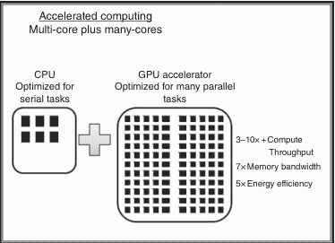

图2.1 CPU-GPU硬件配置总览。图片改编由Nvidia Corporation提供

### 2.2.1 通用Nvidia硬件特性

GPU设备通过外围组件互连快速（PCIe）总线与主机相连，主机内存与设备内存之间的数据传递如图2.2所示。GPU被划分为流式多处理器（SM），每个SM包含GPU核心、双精度单元、特殊功能单元、寄存器以及用于调度线程束的多线程指令单元。在优化GPU代码时，线程束是一个重要概念。在撰写本文时，线程束代表一组32个线程，这些线程被调度为一起执行并同步运行。线程束的概念将在稍后详细讨论。每个SM采用SIMT范式运行，即SM向一组线程束发送一组指令，以便在不同数据元素上并发执行。

除了设备上的全局内存外，每个GPU SM还可访问四种其他类型的片上内存。每个线程都可以访问局部内存，它是动态随机存取存储器（DRAM）的一部分，且对每个线程私有。每个SM还可以访问少量（Nvidia K40 GPU中每个SM 48 KB [1]）高速共享内存，仅可访问在该SM上生成的线程。常量内存和纹理内存是图形应用程序编程的遗留物，提供带有快速互补缓存的小型只读内存位置。需要牢记的是，全局内存访问虽然提供高带宽，但会产生数百个时钟周期的长延迟。这也适用于局部内存，当线程所需的寄存器内存量超过可用量时（Nvidia K40 GPU中为255 x 32位值 [1]），内存密集型内核会使用局部内存。一些现代GPU还配备了少量L1和L2缓存，用于加速对全局/局部内存的访问。

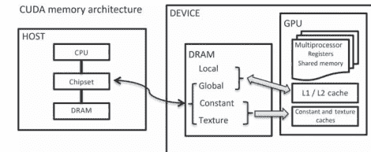

图2.2 突出显示主机和设备之间内存位置数据移动的插图。图片改编由Nvidia Corporation提供

### 2.2.2 线程束调度

支持CUDA的GPU以SIMT方式执行指令，即由调度器将线程块分组为线程束。在撰写本文时，一个线程束包含32个线程。线程束中的所有线程从相同的指令开始，与线程束中的其他线程并行执行。线程束调度器一次向线程束中的所有线程发送一条公共指令。确保线程块的大小是32的倍数（即一个线程束）可防止线程束填充不足，从而避免核心空闲。SIMT不仅提供线程级并行性，还提供指令级并行性，通过将下一条指令调度给活跃的线程束，确保指令以持续的流水线方式输送到核心。线程可以分支并偏离其他线程，因为每个线程都会跟踪自己的指令地址和寄存器状态；但是，分支分歧会导致线程束中的所有其他线程空闲（被掩码为空操作，即no-op），直到分支分歧完成且线程回到相同的执行路径。出于此原因，当线程束中没有分支分歧（即条件语句）且因此没有核心空闲等待线程赶上时，GPU的使用效率最高。

### 2.2.3 Nvidia硬件代际演进

Nvidia GPU硬件的演进可以通过计算能力（c.c.）来追踪，它是与核心架构设计相关的主版本号和次版本号。主版本号相同的GPU属于同一代硬件。次版本号反映核心架构的渐进式改进，即新功能。有关计算能力差异的完整说明，请参阅CUDA编程指南 [1]。最新一代Nvidia硬件（Kepler—计算能力3.x）的架构设计以图示形式显示在图2.3中。每个SM都配备了寄存器、共享内存（SMEM）、只读和L1指令及数据缓存。所有SM都可以访问L2缓存，L2缓存负责降低全局内存访问的延迟。

## 2.3 CUDA编程模型

在CUDA编程模型中，代码中的函数作为内核卸载到GPU上。每个内核的工作负载被分解为N个独立的工作负载，然后被执行

Kepler内存层次结构

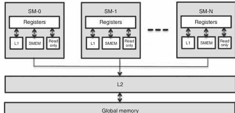

图2.3 Nvidia Kepler架构内存模型。全局内存和L2缓存可被所有SM访问。L1缓存和共享内存（SMEM）可被在同一SM上运行的线程访问。图片改编由Nvidia提供


由 N 个线程并行执行，其中 N 通常在数千个量级。线程和内存位置被结构化为层次结构，这些层次结构逻辑上映射到底层硬件。为了从 GPU 中榨取最佳性能，需要对编程模型有扎实的理解。在以下描述中，CUDA 编程模型在逻辑上被划分为内核、线程层次结构、内存层次结构和 warp 调度。

### 2.3.1 内核

内核是一个在 GPU 上由 N 个线程并行执行的函数。C、C++ 或 Fortran 代码中预先存在的函数调用可以轻松修改为在 GPU 上执行。语法在不同编程语言中是相同的。要在 C for CUDA 中启动内核，声明说明符 __global__ 标记该函数将在 GPU 上并行执行，并伴随内核调用中用于生成线程的专用执行配置语法 <<<dimGrid,dimBlock>>>（参见图 2.4）。

执行配置语法（三个尖括号内）指定要启动的线程数量，包括线程将如何映射到硬件的信息。执行配置中的第一个变量定义块的数量，第二个变量定义块中的线程数量。在图 2.4 的示例中，将启动一个包含 N 个线程的块。我们将在讨论完以下的线程层次结构后进一步解释这一点。

内核调用的一个重要特征是其异步性质。当主机的执行路径遇到内核调用时，运行时库会在设备上生成请求数量的线程来执行设备函数。在此过程中，控制权会立即返回给主机。主机可以自由地继续其执行路径，只有在明确请求同步时才会等待设备完成内核执行。异步和同步执行将在第 2.4 节中讨论。

### 2.3.2 线程层次结构

线程被组织为线程块网格中的线程块（图 2.5）。

```
//Kernel definition
__global__ void Kernel_add(float* A, float* B, float* C)
{
    int i = threadIdx.x;
    C[i] = A[i] + B[i];
}

int main()
{
    ...
    //Kernel invocation with N threads
    Kernel_add <<< 1, N >>> (A, B, C);
    ...
}
```

图 2.4 C for CUDA 内核代码和内核启动代码示例。声明说明符 __global__ 标记内核以在 GPU 上执行，而执行配置（网格和块大小）包含在三个尖括号中。

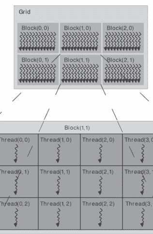

图 2.5 线程层次结构。线程块被配置为线程块网格，这些网格逻辑上映射到底层 GPU 硬件，块在单个 SM 上执行。图片改编由 Nvidia [1] 提供

启动时生成的线程数量通常由问题大小或处理器数量决定，但可以创建的线程数量远多于硬件中的计算核心数量，而这实际上是实现良好性能所必需的。这种配置允许矩阵和向量等数据结构轻松映射到硬件。它还使代码能够适应具有不同数量的 SM 和计算核心的不同硬件配置，从而具有未来兼容性。

线程块最多可以有三个维度，线程块网格也是如此。这使得三维数组的每个元素都可以映射到块或网格中的单个线程，从而促进细粒度数据并行性。线程块和/或线程块网格的大小和形状可以在执行配置中使用内置类型 dim3 来指定。例如，可以使用语法 dim3 threadsPerBlock(ndimx, ndimy) 指定一个由 ndimx 乘以 ndimy 个线程组成的二维块。

线程块内的线程可以通过 CUDA 编程语言内置的便捷三分量向量 threadIdx 在设备代码中轻松索引。例如，对于二维线程块（参见图 2.5），每个线程可以访问其在块中的线程索引，x 维为 tx = threadIdx.x，y 维为 ty = threadIdx.y。类似的三分量向量也用于以完全相同的方式索引网格中的块，即 blockIdx。这些内置向量允许对块内线程进行本地索引，并可以轻松用于计算线程在块中的 ID，如下所示：

```
tid = tx + ty * nidx + tz * nidx * ndimy
```

其中 tx、ty 和 tz 分别是 x、y 和 z 维的线程索引，而 nidx、ndimy 和 ndimz 是块中各自维度的线程数量，也称为维度的范围。

确定网格中线程的全局索引也很简单，只需要相应维度中的块 ID：

```
global.x = blockIdx.x * nidx + threadIdx.x
```

x 和 y 维也是如此。以图 2.5 中 Block(1, 1) 内的 Thread(0, 0) 为例，全局索引为 global.x = 1 × 4 + 0 = 4 和 global.y = 1 × 3 + 0 = 3。然后可以使用这些变量来计算线程的全局线程 ID，方法是将任何给定维度中块的范围替换为任何给定维度中网格的范围，如公式 (2.1) 所示。因此，可以通过四种方式识别线程：本地索引、本地 ID、全局索引和全局 ID。

关于线程块中线程总数的函数。同一块内的线程在同一个 SM（流式多处理器）上执行。同一块内线程之间的通信可以通过使用共享内存（相当于 L1 缓存）和同步语句来实现。然而，要求块内所有线程都必须在同一个 SM 上，这确实对块内线程数量造成了限制。目前，由于每个 SM 可用的资源，每个块最多允许 1024 个线程 [1]。由于块内线程以 warp 为单位同步执行，块大小应为 warp 大小的倍数，以避免线程被掩码为空操作（no-ops）从而浪费资源。

### 2.3.3 内存层次结构

为了扩展上述内容，CUDA GPU 线程可以访问五个独立的内存空间：全局内存、常量内存、纹理内存、共享内存和本地内存。这些内存空间在大小和局部性上有所不同，具体取决于它们是否可由主机访问以及是否所有线程都可以访问它们，如表 2.1 所示。内存访问延迟相差几个数量级，编程时需要考虑这一点。程序员可以控制管理全局内存、常量内存、纹理内存和共享内存；但是，数据由编译器分配到本地内存。内存通过调用 CUDA 运行时库来管理。主机和设备之间的内存传输在主机代码中执行。这些传输相当缓慢，延迟在数千个指令周期的量级。

本地内存通过在编译时调整每个核心使用的寄存器数量来管理。它对每个线程是私有的，因此持续整个线程的生命周期。共享内存在设备代码中管理，对每个线程块是私有的；因此它具有与块相同的生命周期。同一块内的线程可以通过使用共享内存和同步语句进行通信。常量内存和纹理内存在主机代码中管理；它们是只读内存空间，两者都具有应用程序的生命周期。全局内存由主机分配和释放，可以被所有线程访问，并且具有应用程序的生命周期，除非在主机代码中显式释放。

**表 2.1 CUDA 编程模型中的内存层次结构，详细说明了五个内存空间的位置、生命周期和私有性**

| 内存 | 位置 | 生命周期 | 私有性 |
| :--- | :--- | :--- | :--- |
| 全局 | 通过 L2 缓存访问的设备内存 | 应用程序/释放 | 所有线程 |
| 常量（只读） | 通过常量缓存访问的设备内存 | 应用程序/释放 | 所有线程 |
| 纹理（只读） | 通过纹理缓存访问的设备内存 | 应用程序/释放 | 所有线程 |
| 共享 | 每个 SM 上的共享内存 | 内核 | 每个线程块私有 |
| 本地 | 通过 L2 缓存访问的设备内存 | 线程 | 每个线程私有 |

## 2.4 编程和优化概念

GPU 编程在并行编程的基础上增加了新概念。GPU 编程可以分为两个阶段：移植和优化。程序员的首要任务是让 GPU 代码在 GPU 上运行并给出正确结果，尽管如果代码不仅仅是天真地移植，而是仔细定制算法和方法以匹配 GPU 架构，可以减少后续阶段所需的工作量。这个初始移植过程产生了程序的 GPU 部分。一旦 GPU 代码得到验证，就需要对代码进行优化，以充分利用 GPU 的硬件并榨取尽可能多的性能。在移植和优化过程中，需要考虑三种提高 GPU 架构上代码性能的关键策略：

- 提高并行效率 - 通过确保程序暴露尽可能多的并行性，以实现最大并行执行，从而充分利用 GPU 架构。
- 改善内存吞吐量 - 充分利用 GPU 上的不同内存位置，以减少或隐藏内存访问延迟。
- 改善指令吞吐量 - 以恒定的指令流向核心供给，以减少核心空闲的时间。

在本节中，介绍了 GPU 编程概念，并说明了如何管理这些概念以影响性能，与上述三种策略相关。

### 2.4.1 延迟：内存访问

内存访问延迟因内存位置而异。延迟最高的内存访问是主机和设备之间的数据传输，其延迟在数千个时钟周期的量级。在 GPU 上，全局内存和本地内存是最慢的内存位置，因为它们位于设备内存（DRAM）中，该内存具有数百个时钟周期的最高延迟（和最低带宽）。常量内存和纹理内存也位于设备内存中，但由于它们自带缓存，访问速度可以快如常量/纹理缓存延迟，这比全局设备内存访问快得多。由于共享内存位于芯片上，它是程序员管理的最快内存位置。计算能力 2.x 及更高版本的设备上还有片上 L1 缓存和 L2 缓存，它们提供较低延迟/更高带宽的内存访问 [1]。这些内存位置的延迟/带宽因架构而异，因此此处不给出具体数字。


为了最大化内存吞吐量，不仅要减少主机与设备之间的数据传输量并尽可能多地利用片上低延迟/高带宽内存，还要相应地组织和访问内存中的数据，如下文所示。

为减少主机与设备之间的数据传输，可以尝试在GPU内核之间移植中间CPU代码。这有时可以减少主机与设备之间的数据传输；在这种情况下，即使移植CPU代码不影响性能，减少数据传输可能会影响性能。减少数据传输开销的其他方法包括使用页锁定主机内存和映射页锁定内存。

有效利用片上内存可能意味着将数据从全局内存传输到共享内存。例如，如果一个数组将被线程块多次使用，那么将数组加载到共享内存中可能有助于提升性能——每个线程从全局内存获取数组的一部分到共享内存空间。数据获取后必须进行线程同步，以确保所有线程都已完成，从而整个数组都在共享内存中。然后线程可以自由操作共享内存数组，从而受益于更低的延迟。然而，只有当数组元素将被多次使用时，这样做才值得，因为最初将数据传输到共享内存的性能仍受设备内存延迟/带宽的限制。一旦线程完成对数组的操作，可以以同样的方式将其传回设备内存。在传输前可能需要同步线程，以确保所有线程都已完成对数组的更新。只读数据也可以放置在常量或纹理内存空间中，以利用其更低延迟/更高带宽的缓存。

### 2.4.2 合并设备内存访问

要理解合并设备内存访问的概念，首先必须了解内存中数据是如何被访问的。一次数据事务的大小可以是32、64或128字节。数据事务的大小取决于请求的数据量、数据在内存中的位置以及设备的计算能力。单次数据事务的内存地址最多可跨越设备内存中128个连续字节。当一个线程束（或半线程束）向设备内存请求数据时，请求会被合并为尽可能少的事务，以提高数据访问的吞吐量。尽可能减少每次数据请求的内存事务数量有助于提升性能。设备合并内存访问的能力因不同的计算能力而异。对于计算能力更高的设备，合并内存访问的规则会更加宽松。每种架构的合并行为详情可在CUDA编程指南[1]中找到。将内存请求合并为尽可能少的数据事务可以显著提高GPU程序的性能。对齐内存访问并相应地组织内存中的数据，可以确保设备内存读/写被合并。

### 2.4.3 共享内存银行冲突

共享内存的效率取决于是否存在银行冲突。银行是大小相等的共享内存区域，由半线程束中的线程同时访问。银行冲突是指多个内存地址请求指向共享内存的同一银行。在这种情况下，内存访问会被串行化，对性能产生显著影响。例外情况是，如果线程束中多个线程请求共享内存银行中同一内存位置的数据，则会产生某种形式的广播，具体取决于设备的计算能力。内存银行被组织成字，其大小取决于设备的计算能力。图2.6显示了一个半线程束理想情况下访问共享内存中16个连续银行的情形。

减少银行冲突是实现高共享内存吞吐量并利用片上低延迟/高带宽的关键。

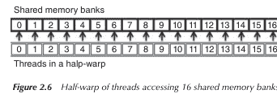

### 2.4.4 延迟：向线程束发出指令

线程束调度器向线程束发出指令所需的时钟周期数因设备的计算能力和所发出的指令而异。这被称为延迟。为了尽可能让每个流式多处理器保持忙碌，即通过提高并行效率充分利用GPU，发出指令所涉及的延迟应被隐藏。要实现这一点，所有线程束调度器必须在延迟期间的每个时钟周期向线程束发出一条指令，从而完全隐藏延迟期间。这依赖于线程束在每个时钟周期都准备好执行，从而在线程束数量和并行效率之间建立直接联系。内核中的线程束数量通过内核启动时执行配置声明的线程和块数量来控制，并由占用率来衡量。

### 2.4.5 占用率

SM上的活跃线程束数量与最大线程束数量之比称为占用率。计算占用率可以让程序员了解给定执行配置的并行效率，即是否充分利用了GPU。实现最佳占用率是一种平衡艺术，因为需要确保块中的每个线程都有足够的资源，防止寄存器溢出，即数据从寄存器溢出到高延迟/低带宽设备（局部）内存，同时保持多处理器足够忙碌，以通过线程级并行最大化指令吞吐量。占用率过高并不总是有益的。最佳占用率水平可能取决于内核是否受内存带宽限制。内核越受带宽限制，越有可能从更高的占用率中受益，因为增加多处理器上的活跃线程束数量给调度器提供了机会，将昂贵的设备（全局）内存访问隐藏在计算之后。对于受带宽限制的内核，占用率过低会导致性能不佳。另一方面，如果内核不是受带宽限制的，因为它具有较高的计算与数据比率，那么较高的占用率可能会因更多的寄存器溢出、分支分歧和额外指令而对性能产生不利影响。可能影响多处理器上活跃线程束数量的因素如下：

- 每个线程块所需的共享内存量——共享内存是有限的片上资源，因此多处理器上能有多少活跃线程束取决于可用的共享内存量。

- 寄存器使用量——与共享内存类似，每个SM上的寄存器数量有限。这会对任何给定时间能调度的线程束数量产生连锁反应。编译器试图在SM上的活跃线程束数量和寄存器使用量/溢出量之间找到平衡。可以通过编译器标志maxrregcount或通过启动边界（给编译器的提示，以帮助实现最佳寄存器使用量）来控制寄存器使用量。

- 块中的线程数量——SM在任何给定时间最多限制16个活跃线程块（Kepler架构）[1]；因此，每个块的线程数量过少可能会损害性能，因为这可能导致占用率低，且SM上的线程总数无法使硬件饱和。

由于每个应用程序都是独特的，没有确切的执行配置能为每段代码产生最佳占用率。Nvidia提供了一个占用率计算器[5]，可以帮助为特定代码选择合适的配置。建议尝试不同的每块线程数、每网格块数、最大寄存器数和共享内存分配量，以微调内核/应用程序的性能。

### 2.4.6 同步和异步执行

线程同步对于防止竞态条件和乱序内存读/写以及保持内核准确性至关重要。然而，它也可能通过降低指令吞吐量和并行效率（因为线程变得空闲）而损害性能。主要有两种同步类型：

- __syncthreads()——设备代码中的函数调用，导致线程块中的所有线程同步。

- cudaDeviceSynchronize()——主机代码中的函数调用，导致设备上所有线程同步。

设备代码同步步骤（__syncthreads()）可能用于线程块中两个线程需要通信的情况。主机代码同步步骤（cudaDeviceSynchronize()）可能用于两个不同线程块看到的两个数据元素之间存在依赖关系的情况。出于性能考虑，应尽可能少地使用同步函数，特别是主机代码中的全局同步函数。应将算法映射到CUDA编程模型，使得需要相互通信的线程尽可能位于同一块中，以减少在内核调用之间将数据放回高延迟/低带宽全局内存的开销以及全局同步后内核调用的开销。

可以采用异步执行来尽可能暴露并行性。在应用程序级别，可以使用异步函数或流（流将在下文讨论）来最大化主机-设备并发执行，例如，异步复制数据到设备，使CPU能够将计算与数据传输重叠。在设备级别，可以使用异步函数通过向SM提供多个内核来尽可能挖掘并行性，在向活跃线程束发出下一条指令时，为线程束调度器提供大量选择。在GPU上同时执行多个内核的调用仅在计算能力2.x及更高版本的设备上可行[1]。

### 2.4.7 流编程和批处理

流是要在GPU上执行的有序指令序列。可以创建多个指令流。不同流的执行顺序不是顺序的，从而实现内核和函数的异步并发执行。在计算能力2.x及更高版本的设备上，可以通过使用流同时启动多个内核[6]。如果启动了两个流，当执行流0时，如果有空闲硬件，线程束调度器可以选择从流1发出下一条指令。执行流0时硬件可能空闲的原因可能是流中的某些线程已完成内核执行并正在等待其他线程“赶上”，或者流0中启动的线程数量 did


不会使硬件饱和。流可以用于批量处理小型独立操作，以充分利用硬件。这为调度器提供了一个额外的工具来隐藏延迟，从而有助于最大化指令吞吐量并提高并行效率。

批处理是将多个操作捆绑在一起，从两个或多个较小的操作中创建一个更大操作的方法。例如，如果有五个大小为 5 x 5 的矩阵，求每个矩阵的逆是一个 O(N^3) 问题。这在微秒级时间尺度上，无法为 GPU 提供足够的工作来隐藏调用多个较小内核并从内存获取数据的启动开销。将所有独立的小型矩阵逆运算批处理为一个更大的矩阵逆运算，可以最大化 GPU 利用率，从而获得更好的性能。

CUDA 编程指南 [1] 和最佳实践指南 [7] 是发现可改进 GPU 应用程序性能的编程和优化惯例的优秀资源。应用上述任何技术或概念所带来的性能提升程度取决于具体应用。值得衡量 GPU 应用程序/内核的性能，以推断限制因素，即带宽受限或计算受限。例如，用于改善内存吞吐量的优化（如将数据移动到片上共享内存）可能无法服务于计算受限的应用程序，并可能在投入大量编程精力却获得很少性能回报的情况下浪费时间。CUDA Profiler [8] 等工具可以帮助识别代码中的瓶颈，并应与理论带宽和加速比等指标一起使用，以评估 GPU 实现的效率。

## 2.5 GPU 软件库

随着通用 GPU 技术的成熟，越来越多的 GPU 加速软件库和函数可供程序员使用。这些库本身就是一种优化，通过调用已针对目标架构优化的库函数来获益于 GPU 加速，从而减少程序员的工作量。已经使用 BLAS [9–11] 和 LAPACK [12] 等库进行线性代数运算的科学代码，可以通过链接到加速库并按需修改参数，轻松调用例程的 GPU 加速版本。https://developer.nvidia.com/gpu-accelerated-libraries 上有几十个 GPU 加速库可用。以下是一些对计算化学应用更有用的库：

- cuBLAS [13] – 基本线性代数子程序 (BLAS) 库的完全加速、免费可用版本，可在 Nvidia GPU 上提供非常高的性能。Nvidia CUDA BLAS 库 (cuBLAS) 支持所有数据类型，即单精度、双精度、复数和双复数、并发流、多个 GPU，以及某些操作（如矩阵-矩阵乘法）的批处理。cuBLAS 提供批处理模式，使程序员可以指定同时提供多个小型独立矩阵操作的解。

- cuFFT [14] – 快速傅里叶变换在许多科学应用中经常使用，是将函数从实域（时间）转换到互易域（频率）及其逆变换的一种手段。Nvidia CUDA 快速傅里叶变换库 (cuFFT) 提供免费可用的 GPU 加速 FFT 函数，通过使用分治分解策略，性能可提高多达 10 倍。

- cuSPARSE [15] – NVIDIA CUDA 稀疏矩阵库 (cuSPARSE) 提供免费可用的 GPU 加速稀疏矩阵基本线性代数子程序，与流行的基于 CPU 的实现相比，可显著提高性能。

- CULA [16] – CULA 是一个支持 CUDA 的 GPU 加速线性代数软件库，分为 CULA Basic、CULA Premium 或 CULA Commercial 发行版。每个发行版以不同价格提供不同级别的功能、特性和支持，CULA Basic 起价为免费（仅限单精度数据类型）。程序员可以选择使用特定函数的较低级别版本，以更高的编程精力为代价为程序员提供更多控制，或者使用较高级别版本，由函数调用在幕后处理所有 GPU 管理。

- MAGMA [17] – 由 LAPACK 和 ScaLAPACK 的开发者提供的开源软件库，为异构系统提供 GPU 加速线性代数例程。它支持多精度算术，并支持混合多核/多核 CPU 以及多个 Intel Xeon Phi 加速卡或 GPU。该库与当前的 LAPACK 和 BLAS 包及标准接口，以便于编程。

## 2.6 支持 CUDA 的 GPU 的特殊功能

GPU 技术仍然是 HPC 领域的一个新兴领域，增长曲线陡峭，其好处是功能快速创新和改进。撰写本文时可用的一些较新的 GPU 功能包括 Hyper-Q 技术、多进程服务 (MPS)、统一内存和 NVLink。

### 2.6.1 Hyper-Q

Hyper-Q 技术通过将 GPU 的“连接”数量从 1（计算能力 2.x 及以下）增加到 32（计算能力 3.x 及以上），允许从多个 CPU 进程在同一时间在单个 GPU 上启动内核。此功能旨在增强 CUDA 流的性能并启用多个 MPI 进程的使用。使用流的程序通常会受到所谓的伪共享的限制。伪共享是指调度器低估了可以并发执行的独立指令数量，因为多个独立流被排队到单个管道中。Hyper-Q 的多个“连接”有助于减少伪共享行为，允许流保持在单独的管道中，因此调度器更有可能识别用于并发执行的独立指令。

### 2.6.2 MPS

MPS 是 CUDA API 的客户端-服务器运行时实现，它允许多个 MPI 进程通过使用 Hyper-Q 技术在单个 GPU 上执行内核并进行数据传输。服务器

- 允许多个 MPI 进程在 GPU 上启动内核，减少闲置硬件。
- 通过在所有 MPI 进程均可访问的 GPU 上分配单个数据副本，减少存储和调度资源使用。
- 延长单个 MPI 进程的调度资源生命周期，消除每次调度新 MPI 进程时交换资源的开销。

### 2.6.3 Unified Memory

统一内存是 CUDA 6 的一项功能，消除了在 GPU 上显式分配数据并在 CPU 和 GPU 之间传输的需求。CPU 和 GPU 可以使用单个指针来寻址共享数据，因为硬件在幕后执行所有数据迁移，使 GPU 编程简单得多，因为不需要创建单独的 GPU 数组。这是通过 CPU 和 GPU 共享的托管内存池实现的（图 2.7）。

### 统一内存

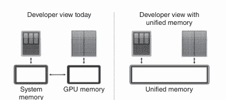

图 2.7 统一内存的可视化表示。主机和设备内存呈现为单个地址空间。这使得编程更容易，但由于内存副本仍在幕后发生，与显式管理的内存相比，性能可能较低。图片改编由 Nvidia Corporation 提供

统一内存消除了编程中的一些复杂性，并且可以与 GPU 上的本地数据访问一样快。然而，值得注意的是，使用异步内存副本和较低级别的编程很可能比使用统一内存更快。统一内存旨在通过简化代码开发，将 GPU 编程面向更广泛的受众。

### 2.6.4 NVLink

最后要讨论的特殊功能是 NVLink，它是专为 GPU 设计的第一种互连。撰写本文时，NVLink 尚未可用，仅于 2014 年 3 月宣布。NVLink 承诺在 CPU 和 GPU 之间提供高速互连，允许比市场上目前最快的互连高出 5–12 倍的带宽能力，并实现 GPU-GPU 连接，使多个 GPU 之间的数据共享更快、更高效。GPU 应用程序中最大的瓶颈之一是主机和设备之间数据传输的速率。GPU 技术的这一进步有望减少数据传输瓶颈，从而提高数据吞吐量。

## 参考文献

- 1. NVIDIA (2014) CUDA C 编程指南 2007–2014。可从：http://docs.nvidia.com/cuda/cuda-c-programming-guide 获取（访问日期：2015 年 9 月 1 日）。
- 2. NVIDIA (2014) CUDA 运行时 API：API 参考手册 2014。可从：http://docs.nvidia.com/cuda/pdf/CUDA_Runtime_API.pdf 获取（访问日期：2015 年 9 月 1 日）。
- 3. Khronos (2014) OpenCL 规范 2014。可从：https://www.khronos.org/registry/cl/ 获取（访问日期：2015 年 9 月 1 日）。
- 4. OpenACC (2014) OpenACC 应用程序编程接口 2013。可从：http://www.openacc.org/sites/default/files/OpenACC.2.0a_1.pdf 获取（访问日期：2015 年 9 月 1 日）。


- 5. NVIDIA (2014) CUDA占用率计算器电子表格。可从：http://developer.download.nvidia.com/compute/cuda/CUDA_Occupancy_calculator.xls (2015年9月1日访问)。
- 6. Rennich, S. (2014) CUDA C/C++ 流与并发：NVIDIA, 2011。可从：http://on-demand.gputechconf.com/gtc-express/2011/presentations/StreamsAndConcurrencyWebinar.pdf (2015年9月1日访问)。
- 7. NVIDIA (2014) CUDA：最佳实践指南 2007-2014。可从：http://docs.nvidia.com/cuda/cuda-c-best-practices-guide/index.html (2015年9月1日访问)。
- 8. NVIDIA (2014) CUDA：性能分析器用户指南 2014。可从：http://docs.nvidia.com/cuda/profiler-users-guide/index.html (2015年9月1日访问)。
- 9. Dongarra, J. (2002) 基本线性代数子程序技术论坛标准。高性能应用与超级计算国际期刊, 16 (1), 1–111。
- 10. Dongarra, J. (2002) 基本线性代数子程序技术论坛标准。高性能应用与超级计算国际期刊, 16 (2), 115–199。
- 11. Blackford, L.S., Daniel, J., Dongarra, J. 等人 (2002) 一组更新的基本线性代数子程序 (BLAS)。ACM数学软件事务, 28 (2), 135–151。
- 12. Anderson, E., Bai, Z., Bischof, C. 等人 (1999) LAPACK用户指南，第3版，工业与应用数学学会，费城，宾夕法尼亚州。
- 13. NVIDIA (2014) CUBLAS库用户指南 2014。可从：http://docs.nvidia.com/cuda/pdf/CUBLAS_Library.pdf (2015年9月1日访问)。
- 14. NVIDIA (2014) CUFFT用户指南 2014。可从：http://docs.nvidia.com/cuda/pdf/CUFFT_Library.pdf (2015年9月1日访问)。
- 15. NVIDIA (2014) CUSPARSE库 2014。可从：http://docs.nvidia.com/cuda/pdf/CUSPARSE_Library.pdf (2015年9月1日访问)。
- 16. Humphrey, J.R., Price, D.K., Spagnoli, K.E., Paolini, A.L., Kelmelis, E.J. 2010 CULA：混合GPU加速线性代数例程。SPIE国防与安防研讨会 (DSS)。
- 17. Lab IC (2014) MAGMA 1.4版 2013的软件分发。可从：http://icl.cs.utk.edu/magma/ (2015年9月1日访问)。

# 3 电子结构方法概述

Andreas W. Götz

圣地亚哥超级计算机中心，加州大学圣地亚哥分校，加利福尼亚州拉霍亚，美国

本章简要概述了在化学、物理、生物学和材料科学应用中广泛使用的电子结构方法。讨论内容包括Hartree–Fock和密度泛函理论、半经验方法以及基于波函数的电子关联方法。我们介绍了每种方法的基本理论背景，讨论了用于离散方程的基组的常见选择，并指出了不同方法的优缺点。计算工作量及其与问题规模的缩放强烈依赖于电子结构方法，我们将在本书后续章节中重点介绍图形处理器上的实现所面临的计算瓶颈。

## 3.1 引言

电子结构理论对所有关注纳米尺度物质的科学分支的重要性无论如何强调都不为过，因为电子之间的相互作用决定了我们周围物质的性质，从孤立分子到材料。因此，电子结构计算在化学、物理、生物学和材料科学中被广泛用于分析和预测分子和固体的结构及热力学性质，以及它们与电磁场和辐射的相互作用 [1–5]。由于理论方法、数值近似以及计算机硬件的重大进步，电子结构方法现在已在基础科学和众多行业的应用研究中常规使用。1998年，电子结构方法的价值得到认可，诺贝尔化学奖授予Kohn，“表彰其发展密度泛函理论” [6] 和John A. Pople，“表彰其发展量子化学计算方法” [7]。

电子结构方法的基础是Born–Oppenheimer近似，它分离了电子和原子核的运动。任务于是简化为给定原子核构型下描述电子的运动，即求解电子Schrödinger方程并找到所考虑体系的电子波函数。如果相对论效应重要，则需要用Dirac方程代替Schrödinger方程求解。然而，在本书中我们不会讨论Dirac方程或其他考虑相对论效应的方法和近似 [8]。本章概述了求解电子Schrödinger方程的最常见理论方法。本书后续章节将详细说明图形处理器 (GPU) 在这些方法的实际实现中的应用。

### 3.1.1 计算复杂度

对于多电子体系，Schrödinger方程的解析解尚未知晓，必须求助于数值近似。然而，阻碍Schrödinger方程精确解析解的同样复杂性，也导致计算工作量及所需资源（如随机存取存储器或磁盘存储）的缩放极为不利。例如，使用全构型相互作用 (CI) 方法进行精确计算的计算需求随体系大小呈指数增长。因此，需要在效率和精度之间取得合理折衷的近似方法，才能对较大的分子进行电子结构计算。本章介绍了最重要近似方法的理论背景。更多细节和参考文献可见标准量子化学和电子结构理论教材 [9–11]。

一套不牺牲量子力学计算无参数特性预测能力、且表现出多项式而非指数缩放的受控良好近似层次结构已常规可用 [10]。其中包括基于波函数的流行量子化学方法，如Møller–Plesset微扰理论 [12] 和耦合簇理论 [13, 14]，本书后续章节将广泛讨论它们在GPU上的大规模并行实现。这些所谓的 _从头算法_ 方法（之所以称为 _从头算法_ 是因为它们不依赖参数化）的计算复杂度缩放至少为 O(_N_⁵)，其中 _N_ 表示体系大小，这意味着许多有趣问题的应用仍然遥不可及。

部分归因于基于波函数的 _从头算法_ 方法的这种陡峭缩放，密度泛函理论 (DFT) [15–17] 已确立为最流行的电子结构理论，其在Kohn–Sham表述中用一组自洽单电子方程取代了复杂的多电子Schrödinger方程，计算工作量的形式缩放为 O(_N_³)，若包含精确交换则为 O(_N_²)。存在多种不同的密度泛函方法实现，通常侧重于有限分子体系或凝聚相体系及固体。后续章节将讨论利用GPU的这些情况的几个示例。

最后，半经验量子化学方法 [18] 和密度泛函紧束缚 (DFTB) [19, 20] 引入了额外的近似，因此必须依赖广泛的参数化。因此，它们在计算上极其高效，并且在计算哈密顿量时表现出低次二次缩放。

已投入大量努力来改进这些近似电子结构方法的参数化及其保真度，同时降低 _从头算法_ 和密度泛函方法的预因子及其有效缩放。由于物质的“近视性” [21, 22]，原则上，与体系大小的线性缩放是可实现的，至少对于带隙足够大或最高占据分子轨道与最低未占据分子轨道 (MO) 之间间隙足够大的绝缘材料而言是如此。结合我们所见证的计算机硬件进步，


在过去几十年中，尤其是大规模并行GPU处理器的发展，电子结构理论及其在不断扩大的领域范围内的应用前景因此光明。

### 3.1.2 应用领域，从结构到光谱

电子波函数对原子核位置具有参数依赖性，在玻恩-奥本海默近似中，原子核在势能面上运动，势能面是电子薛定谔方程的解。因此，可以使用电子结构方法来寻找平衡分子结构，这些结构是该势能面上的稳定点。因此，最常见的应用之一是绘制通过热或化学过程连接这些稳定点的反应路径 [1]。由于上述大多数电子结构方法都可以访问电子基态和电子激发态，因此可以模拟许多涉及这些电子态之间跃迁的重要过程。应用领域包括光谱学以及涉及电荷转移和分离的过程，例如生物光能收集、人工光合作用和太阳能电池 [4, 5]。

如今常规可获取的众多光谱中包括振动红外（IR）和拉曼光谱、核磁共振（NMR）光谱（包括化学位移和J耦合常数）、电子顺磁共振（EPR）光谱，以及包括吸收和发射光谱在内的电子光谱，仅举几例 [4, 5, 11, 23, 24]。重要的是，电子结构计算不仅可以预测分子和材料的性能，还能够从导致所需性能的分子和材料结构特征角度实现解释和理解。这使得具有特定性能的分子和材料的合理设计成为可能，例如改进的均相或非均相催化剂、用于生物催化的酶、药物、半导体、燃料电池，或用于太阳能电池中光能收集的给体-受体材料。

### 3.1.3 章节概览

本章对电子结构计算中最广泛使用的方法进行了简要概述，侧重于分子量子化学中常见的方法，而非计算固体物理。它涵盖了本书后续章节中包含的所有方法的背景和相关细节，但省略了其他重要方法，例如量子蒙特卡洛（QMC）[25–27]、显式相关R12/F12方法 [28]，或用于电子激发的多体格林函数方法 [29]，因为在撰写时这些方法尚无GPU移植版本，或无法在本书余下部分中涵盖。

我们的介绍从Hartree-Fock（HF）和DFT方法开始。尽管这些方法在概念上不同，但工作方程本质上相同，大多数实际实现实际上对两者使用相同的代码结构。由于其低计算成本和良好精度的有利组合，DFT无疑是化学和材料科学中电子结构计算的主力军。虽然HF对电子结构问题的求解通常不能得出定量有用的结果，但HF理论作为精确波函数基电子相关方法的起点非常重要，我们将在本章后面介绍这些方法。我们还总结了用解析基函数或离散数值表示来数值表示电子密度和波函数的常见方法。基组的选择自然会对实现良好计算缩放所需的数值方法和方法产生显著影响，进而影响可用于GPU上高效实现的算法。我们还介绍了半经验方法，如前面所述，这些方法通过近似使其相比HF或DFT在计算上更高效。本章全文使用原子单位。

## 3.2 Hartree-Fock 理论

如前所述，电子结构方法旨在求解玻恩-奥本海默近似下多电子系统的薛定谔方程：

```
\(\hat{H}\Psi = E\Psi,\) (3.1)
```

其中 \(\hat{H}\) 是非相对论、时无关电子哈密顿量，\(\Psi\) 为相应的波函数。哈密顿量包含动能算符，并描述所有基本粒子（电子和原子核）与外部电磁场之间的相互作用。如果哈密顿量包含时变场，则必须求解时依赖薛定谔方程。

HF理论 [9–11] 基于以下假设：电子波函数可以很好地用单个Slater行列式 \(\Phi\) 来描述，即正交分子自旋轨道或单粒子波函数 \(\psi_i\) 的反对称化乘积。重要的是，该波函数ansatz满足泡利不相容原理。为简化讨论，我们将假设所谓的受限（闭壳层）Hartree-Fock（RHF）理论，其中每个轨道 \(\psi_i\) 由一对自旋上和自旋下电子双重占据，这对电子在实空间中共享相同的概率密度。对具有奇数电子或其他未配对电子和非零自旋密度的开放壳层系统的扩展，在受限开放壳层Hartree-Fock（ROHF）或非受限Hartree-Fock（UHF）形式主义中都是直接的。

假设以Slater行列式作为波函数，能量期望值变为 [9–11]

```
\(E_{\text{RHF}} = 2 \sum_i^{\text{occ}} \langle i | \hat{h} | i \rangle + 2 \sum_{ij}^{\text{occ}} \langle ij || ij \rangle - \sum_{ij}^{\text{occ}} \langle ij | ji \rangle,\) (3.2)
```

其中我们引入了单电子算符

```
\(\hat{h} = -\frac{1}{2}\nabla^2 + v_{\text{ext}}(\mathbf{r})\) (3.3)
```

它包含动能算符 \(-1/2\nabla^2\) 和外部势 \(v_{\text{ext}}\)，后者由电子与原子核及其他外部场的库仑相互作用产生。我们对单电子积分使用以下简写记法：

```
\(\langle i | \hat{h} | i \rangle = \int d\mathbf{r} \, \psi_i(\mathbf{r}) \hat{h} \psi_i(\mathbf{r}),\) (3.4)
```

并通过以下方式定义双电子排斥积分（ERIs）的简写记法：

```
\(\langle ij | kl \rangle = \int d\mathbf{r} d\mathbf{r}' \frac{\psi_i^*(\mathbf{r}) \psi_j(\mathbf{r}) \psi_k^*(\mathbf{r}') \psi_l(\mathbf{r}')}{|\mathbf{r} - \mathbf{r}'|}.\) (3.5)
```

上述方程中的求和对 \(n\) 电子系统的所有 \(n/2\) 个双重占据轨道进行。Eq. (3.2) 右边的第一项包含电子的动能以及电子与原子核和其他外部电场之间的相互作用能。第二项是所有电子之间的经典库仑排斥，而第三项是交换能，源于波函数的反对称性。

在轨道保持归一正交的约束下，对轨道变化最小化HF能量 (3.2) 会导致单粒子Hartree-Fock方程，该方程取代了复杂的多体薛定谔方程：

```
\(\hat{F} \psi_i = \epsilon_i \psi_i,\) (3.6)
```

\(\hat{F}\) 是闭壳层Fock算符，

\(\hat{F} = \hat{h} + \sum_j^{occ} (2\hat{J}_j - \hat{K}_j),\) (3.7)

其中我们定义了库仑和交换算符

\(\hat{J}_j \psi_i(\mathbf{r}) = \int d\mathbf{r}' \psi_j(\mathbf{r}') \psi_j(\mathbf{r}') \psi_i(\mathbf{r}),\) (3.8)

\(\hat{K}_j \psi_i(\mathbf{r}) = \int d\mathbf{r}' \psi_j(\mathbf{r}') \psi_i(\mathbf{r}') \psi_j(\mathbf{r}),\) (3.9)

HF方程 (3.6) 的特征值 \(\epsilon_i\) 是保证轨道 \(\psi_i\) 归一正交的拉格朗日乘数，可以解释为分子轨道能量。特征值最低的 \(n/2\) 个轨道是被 \(n\) 个电子占据的轨道，因此代表基态波函数，而未占据或虚拟轨道跨越希尔伯特空间的其余部分，没有直接含义，但对于相关波函数基电子结构方法和描述激发电子态的方法具有重要意义。

Hartree-Fock理论是一种平均场理论，因为HF方程的解，即单粒子轨道 \(\psi_i\)，描述了单个电子（在RHF理论中为一对电子）在所有其他电子产生的场中的运动。与所有其他电子的相互作用被编码在库仑和交换算符中，这两个算符（因此也包括Fock算符）都依赖于HF方程的解 \(\psi_i\)。因此，HF方程必须迭代求解，直到达到自洽性，即定义Fock算符的轨道与Fock方程的解相同。因此，HF方程也常被称为自洽场（SCF）方程。

### 3.2.1 基组表示

对于实际应用，需要对轨道 \(\psi_i\) 进行数值表示，有多种选择可供使用，如本章及本书后续部分详细讨论。简而言之，平面波（见第7章和第9章）常用于周期性边界条件下的计算，但也有其他选择，包括小波（见第6章）和数值网格上的实空间讨论（见第9章）。虽然分子网格也可用于有限系统（见第10章），但对于有限分子系统，最常见的是使用局域、原子中心解析基函数（即高斯函数，见第4章，或较少使用Slater类型函数，见第3章）来展开轨道。在基组表示中，分子轨道展开为

```
\(\psi_i(\mathbf{r}) = \sum_\mu c_{\mu i} \phi_\mu(\mathbf{r}),\) (3.10)
```

其中 \(c_{\mu i}\) 是分子轨道展开系数，\(\{\phi_\mu\}\) 是基组。在此表示下，HF方程转化为一组非线性广义特征值方程，可写成矩阵形式为

```
\(\mathbf{FC} = \mathbf{S}\mathbf{C}\boldsymbol{\epsilon},\) (3.11)
```

其中 \(\mathbf{F}\) 是展开基中Fock算符的矩阵表示，\(\mathbf{C}\) 在其列中收集所有轨道的展开系数，\(\boldsymbol{\epsilon}\) 是轨道特征值的对角矩阵，重叠矩阵 \(\mathbf{S}\) 是基组的度量，出现在非正交基函数的一般情况下，否则为单位矩阵。这些方程现在适合在计算机程序中高效实现。


与公式 (3.7) 中 Fock 算符 \(\hat{F}\) 的定义一致，Fock 矩阵元素由一电子贡献（动能和外部势）和两电子库仑及交换贡献的和给出：

\(\mathbf{F} = \mathbf{h} + \mathbf{J} - \frac{1}{2}\mathbf{K}, \tag{3.12}\)

\(h_{\mu\nu} = \left\langle \mu \left| -\frac{1}{2}\nabla^2 + v_{\text{ext}} \right| \nu \right\rangle, \tag{3.13}\)

\(J_{\mu\nu} = \sum_{\kappa\lambda} P_{\kappa\lambda} (\mu\nu|\kappa\lambda), \tag{3.14}\)

\(K_{\mu\nu} = \sum_{\kappa\lambda} P_{\kappa\lambda} (\mu\kappa|\nu\lambda), \tag{3.15}\)

其中

\(P_{\mu\nu} = 2 \sum_i^{\text{occ}} c_{\mu i} c_{\nu i} \tag{3.16}\)

是密度矩阵的元素，可用于用基函数表示电子密度

\(\rho(\mathbf{r}) = \sum_{\mu\nu} P_{\mu\nu} \phi_\mu(\mathbf{r}) \phi_\nu(\mathbf{r}). \tag{3.17}\)

一电子积分和 ERIs 的记号已在公式 (3.4) 和 (3.5) 中定义，但现在积分是关于基函数而非分子轨道（MOs）的。

HF 计算中存在两大计算瓶颈。一是根据公式 (3.12)-(3.15) 定义的 Fock 矩阵元素的求值，二是求解来自公式 (3.11) 的 SCF 方程。后者需要对 Fock 矩阵进行对角化，其计算量随系统尺寸立方级增长，并最终主导非常大计算的计算成本。在这种情况下，必须采用不依赖矩阵对角化的替代方法来求解 SCF 方程 [30, 31]。

### 3.2.2 两电子排斥积分

计算 Fock 矩阵元素的计算成本主要由 ERIs \((\mu\nu|\kappa\lambda)\) 的求值主导，这些积分用于库仑和交换贡献，见公式 (3.14) 和 (3.15)。ERIs 是四指标量

\((\mu\nu|\kappa\lambda) = \int d\mathbf{r}d\mathbf{r}' \frac{\phi_\mu(\mathbf{r})\phi_\nu(\mathbf{r})\phi_\kappa(\mathbf{r}')\phi_\lambda(\mathbf{r}')}{|\mathbf{r} - \mathbf{r}'|} \tag{3.18}\)

并且在 HF 计算中正式存在 \(O(N^4)\) 个需要求值的 ERIs。由于 ERIs 数量庞大，内存存储不可行。相反，所谓的直接 SCF 方法在 SCF 循环的每次迭代中重新计算 ERIs，并将其与密度矩阵元素收缩，以直接获得 Fock 矩阵的相应库仑和交换贡献 [9–11]。

对于空间延展的大系统，大多数 ERIs 为零或可忽略，可以高效利用这一特性来减少需要计算的 ERIs 数量。这使得大多数实际计算的有效缩放为 \(O(N^2)\)。由局部、以原子为中心的基组（由高斯型函数 (GTFs)、Slater 型函数 (STFs) 或数值原子轨道组成）产生的这种渐近缩放的原因很容易理解。这些基函数在远离其原点的地方衰减至零。因此，重叠密度 \(\rho_{\mu\nu} = \phi_\mu\phi_\nu\)，即两个基函数的乘积，对于原点彼此足够远的基函数对总是可忽略的。随后，任何重叠密度可忽略的 ERI 都可以安全地从计算中丢弃。这通常通过使用 Schwarz 不等式进行定量利用

\((\mu\nu|\kappa\lambda) \le (\mu\nu|\mu\nu)^{1/2}(\kappa\lambda|\kappa\lambda)^{1/2}, \quad (3.19)\)

它为 ERIs 的大小提供了上界，并已被证明在电子结构计算的积分预筛选中成功且可靠。使用 Schwarz 不等式进行预筛选所需的 ERIs 是二指标量，因此数量不多，可以在求解 SCF 方程之前方便地预先计算。如公式 (3.14) 和 (3.15) 所示，如果相应的密度矩阵元素足够小，则 ERI 对 Fock 矩阵的贡献也将可忽略。因此，直接 SCF 实现利用密度矩阵的稀疏性结合 Schwarz 积分筛选。

虽然原则上每个 ERI 都对 Fock 矩阵的库仑和交换贡献有贡献，但实际上分别计算库仑矩阵元素 \(J_{\mu\nu}\) 和交换矩阵元素 \(K_{\mu\nu}\)，并利用库仑和交换相互作用的不同性质是有益的。这导致了线性缩放方法 [22, 32]，即在大系统的渐近极限中表现出有效 \(\mathcal{O}(N)\) 缩放的实现。例如，通过将快速多极方法推广到高斯电荷分布（如上定义的重叠密度），在库仑问题方面取得了重要进展，这已被证明可实现线性缩放 [33, 34]。对于最高占据分子轨道和最低未占据分子轨道之间存在较大能隙的非金属系统，密度矩阵呈指数衰减。这促成了利用交换相互作用快速衰减特性的 \(\mathcal{O}(N)\) 方法的发展 [35, 36]。利用这些用于 Fock 矩阵线性缩放求值的算法进展，包含数百到数千个原子的 SCF 计算已成为可能。

能够实现低缩放 SCF 计算的算法进展的重要性不可估量。尽管如此，许多感兴趣的系统根本不属于线性缩放范畴。出于此原因，并且为了降低 Fock 矩阵线性缩放计算的预因子，计算 ERIs 的高效算法和软件实现将始终是必需的。在过去几十年中，人们付出了巨大努力来开发高效的基于 CPU 的算法，这些算法在使用高斯基组计算 ERIs 时只需要最少的浮点运算。在本书第 4 章中，卢尔、西斯托和马丁内兹演示了如何高效利用 GPU 架构，以大规模并行方式计算高斯基组 ERIs。

### 3.2.3 对角化

如前所述，矩阵特征值方程 (3.11) 通常通过对角化 Fock 矩阵来求解。对于小矩阵，这是一种高效的方法，因为在这种情况下（半经验方法除外），计算 Fock 矩阵的数值工作量显著大于其对角化。然而，稠密矩阵对角化算法的缩放为 \(\mathcal{O}(N^3)\)，因此如果在计算 Fock 矩阵时采用高效的预筛选技术和线性缩放算法，对角化必然会开始主导 SCF 计算的计算工作量。此外，在计算 Fock 矩阵贡献时几乎可以轻松利用并行处理，而对于矩阵对角化则要困难得多。因此，已经开发出用更有利的缩放行为的程序替代对角化步骤的方法，以更新轨道，例如基于共轭梯度算法的直接密度矩阵优化 [30, 31]。在第 8 章中，舒茨等人演示了如何在轨道更新算法中利用 GPU，这些算法使用稀疏矩阵代数为大系统实现线性缩放的计算工作量。

## 3.3 密度泛函理论

DFT [15, 16, 37–40] 的根源可以追溯到 20 世纪 20 年代末 托马斯和费米 的工作，他们使用仅依赖于电子密度的原子电子结构模型 [41, 42]。同样，Hartree–Fock–Slater 或 Xα 方法 [43] 用 狄拉克 [44] 的适当局域交换势取代了 Hartree–Fock 方法中非局域、轨道依赖的交换项，该势非常简单，由 \(\rho^{1/3}\) 给出。然而，现代 DFT 的基础是 霍恩伯格–克恩 定理 [45]，后来由 列维 推广，这些定理证明了多电子系统的所有性质都是基态电子密度的泛函。这意味着，与求解复杂的多电子 Schrödinger 方程相比，基态能量可以通过对电子密度的变化对总电子能量泛函进行最小化来获得。不幸的是，这个能量泛函是未知的，并且开发足够准确以用于实际应用的电子密度泛函已被证明是困难的。这一点尤其适用于动能的密度泛函，这一问题已经困扰着 Thomas–Fermi 方法。因此，尽管 霍恩伯格–克恩 定理为 DFT 提供了可靠的理论依据，但如果没有 科恩和萨姆 的工作，该理论的重要性就不会超越 Thomas–Fermi 模型。

### 3.3.1 Kohn–Sham 理论

科恩和萨姆 有一个巧妙的想法，即从一组非相互作用电子的辅助系统中获得真实的相互作用电子密度，该辅助系统的电子密度与真实系统相同。这样一组非相互作用电子的波函数是一个由单粒子哈密顿量的特征函数 \(\psi_i\) 构成的 Slater 行列式（类似于 HF 理论）。在 Kohn–Sham (KS) 理论 [46] 中，总电子能量由以下公式给出

\(E[\rho] = T_s[\rho] + \int d\mathbf{r} \rho(\mathbf{r}) v_{\text{ext}}(\mathbf{r}) + \frac{1}{2} \int d\mathbf{r} \, d\mathbf{r}' \frac{\rho(\mathbf{r})\rho(\mathbf{r}')}{|\mathbf{r} - \mathbf{r}'|} + E_{\text{xc}}[\rho].\) (3.20)

其中各项按顺序表示：KS 非相互作用电子系统的动能、电子与原子核及其他场的外部势之间的相互作用、源于电子密度库仑相互作用的 Hartree 能量，以及总能量的其余部分，即交换-关联（xc）能量 \(E_{\text{xc}}\)。电子密度由占据轨道给出

\(\rho(\mathbf{r}) = 2 \sum_i^{\text{occ}} |\psi_i(\mathbf{r})|^2,\) (3.21)

此处，如前所述在 HF 理论部分，我们假设了一个闭壳层 \(n\) 电子系统，具有 \(n/2\) 个双占据轨道。非相互作用电子的动能泛函由以下公式给出

\(T_s[\rho] = 2 \sum_i^{\text{occ}} \left\langle \psi_i \left| -\frac{1}{2} \nabla^2 \right| \psi_i \right\rangle.\) (3.22)

这种非相互作用能量与真实系统的精确动能不同；然而，它是一种方便且相当好的近似。精确动能的其余部分作为 xc 能量 \(E_{\text{xc}}\) 的一部分予以考虑。在轨道保持正交归一的约束下，对电子密度对该总能量泛函进行变分最小化，导出了单粒子 KS 方程

\(\hat{h}^{\text{KS}} \psi_i = \epsilon_i \psi_i,\) (3.23)


与 KS 单粒子哈密顿量

$\hat{F}^{\text{KS}} = -\frac{1}{2}\nabla^2 + v_{\text{ext}}(\mathbf{r}) + v_{\text{H}}(\mathbf{r}) + v_{\text{xc}}(\mathbf{r}).$ (3.24)

这里，

$v_{\text{H}}(\mathbf{r}) = \int d\mathbf{r}' \frac{\rho(\mathbf{r}')}{|\mathbf{r} - \mathbf{r}'|}$ (3.25)

和

$v_{\text{xc}}(\mathbf{r}) = \frac{\delta E_{\text{xc}}[\rho]}{\delta \rho(\mathbf{r})}$ (3.26)

分别是哈特里势和 xc 势。KS 哈密顿量看起来与 HF 理论中的 Fock 算符相似，但 xc 势是局域势，而 HF 理论中的交换算符是轨道依赖且非局域的。单粒子 KS 方程 (3.23) 看似简单，但完全多体性质体现在我们对 xc 能量密度泛函的不完全了解这一事实中。

在基组表示中，KS 哈密顿量变为

$\mathbf{F}^{\text{KS}} = \mathbf{h} + \mathbf{J} + \mathbf{V}_{\text{xc}}.$ (3.27)

其中，单电子矩阵元 $h_{\mu\nu}$ 和库仑矩阵元 $J_{\mu\nu}$ 与 HF 理论中的相同（参见 Eqs. (3.13) 和 (3.14)），xc 势的矩阵元为

$V_{\text{xc},\mu\nu} = \langle \mu | v_{\text{xc}} | \nu \rangle.$ (3.28)

因此，通过用 xc 能量和势替换 HF 交换能和算符，可以直接将 DFT 实现到 HF 程序中。

### 3.3.2 交换-关联泛函

为了使 KS 方法成功，需要对交换-关联能 $E_{\text{xc}}$ 有良好的近似 [47]。多年来，局域密度近似 (LDA) 是最广泛使用的方案。在 LDA 中，xc 能量表示为

$E_{\text{xc}}^{\text{LDA}}[\rho] = \int d\mathbf{r} \, e_{\text{xc}}(\rho(\mathbf{r})),$ (3.29)

其中 $e_{\text{xc}}$ 是均匀电子气的 xc 能量密度，其来自 QMC 计算 [48] 的结果非常准确。xc 泛函可按以下方式分为交换和关联贡献：

$E_{\text{xc}}^{\text{LDA}}[\rho] = E_{\text{x}}^{\text{LDA}}[\rho] + E_{\text{c}}^{\text{LDA}}[\rho].$ (3.30)

在 LDA 情况下，用于 $E_x$ 的是狄拉克交换能泛函。关联贡献有多种表达式，流行的版本包括 Vosko, Wilk, 和 Nusair (VWN) [49] 或 Perdew 和 Wang (PW92) [50]。出于实际目的，所有 LDA 泛函几乎等效。LDA 近似在密度缓慢变化的极限下效果良好，并受到凝聚态物理学家的欢迎，他们发现 LDA 对块体固体和表面给出了良好的描述，但它从未被量子化学家广泛采用。

情况随着广义梯度近似 (GGA) 的引入而改变，GGA 在 LDA 泛函基础上增加了一个依赖于电子密度梯度的项：

$E_{\text{xc}}^{\text{GGA}}[\rho] = \int d\mathbf{r} \, e_{\text{xc}}(\rho(\mathbf{r}), \nabla \rho(\mathbf{r})).$ (3.31)

将 GGA 修正引入 LDA 使 DFT 在化学家中流行起来，因为像 BLYP 这样的 GGA 泛函（由 Becke (B88) [51] 提供交换贡献，由 Lee, Yang 和 Parr (LYP) [52] 提供关联贡献）为化学键的定量分析提供了足够的精度。还有许多其他 GGA 泛函可用，新的泛函不断涌现。其中一些泛函包含经验参数，这些参数经过优化以复现实验或高级计算的参考数据，而另一些则从物理约束中获得，以便包含交换-关联能的关键特征。

一些较新的密度泛函除了电子密度及其梯度之外，还依赖于其他变量。Meta-GGA 泛函增加了对 KS 系统动能密度 \(\tau\) 的依赖：

$E_{\text{xc}}^{\text{MGGA}}[\rho] = \int d\mathbf{r} \, e_{\text{xc}}(\rho(\mathbf{r}), \nabla\rho(\mathbf{r}), \tau(\mathbf{r})).$ (3.32)

$\tau(\mathbf{r}) = \sum_i^{\text{occ}} |\nabla\psi_i(\mathbf{r})|^2.$ (3.33)

Meta-GGA 是隐式密度泛函的示例，因为 KS 轨道 \(\psi_i\) 隐式依赖于电子密度。

一项相当重要的进展是 1993 年由 Becke [53] 引入混合 xc 泛函。在混合泛函中，一部分显式密度依赖的 DFT 交换被轨道依赖的 HF 精确交换能所取代：

$E_{\text{xc}}^{\text{hybrid}} = aE_x^{\text{exact}} + (1-a)E_x^{\text{DFT}} + E_c^{\text{DFT}}.$ (3.34)

发现混合系数 \(a \approx 1/4\) 在许多情况下效果良好，这一选择也得到了理论考虑的支持。该值用于非经验 PBE0 [54] 泛函，该泛函成功应用于基态和激发态性质的研究。混合泛函的重要性也体现在 B3LYP [55] 混合泛函在过去二十年中一直是计算化学中最广泛使用的密度泛函 [39, 40]。

采用精确交换会导致局域或半局域密度泛函固有的自相互作用错误部分抵消，并改善了时依赖密度泛函理论 (TDDFT) 方案 [40] 中电荷转移和 Rydberg 激发的描述。值得指出的是，标准混合泛函中的精确交换部分通常使用非局域、轨道依赖的 HF 势实现，因此并非 KS 精确交换。相反，局域 KS 精确交换势可以通过所谓的优化有效势方法获得，这对非占据 KS 轨道 [56] 尤其有重要后果。然而，使用标准混合泛函实现获得的占据轨道接近真实的 KS 轨道。

最近，引入了范围分离混合泛函，也称为长程修正泛函。在这些泛函中，例如 CAM-B3LYP [57]，精确交换作为介电子距离的函数进行屏蔽。因此，GGAs 或常规混合泛函失效的长程电荷转移激发得到了良好描述。

出于显而易见的原因，迄今讨论的所有密度泛函都无法正确描述按 \(-C_6/R^6\) 衰减的长程色散。相反，渐近相互作用呈指数衰减。为了纠正这一缺陷，引入了以双势形式的临时经验色散修正。这些经验修正效果相当好。例如，使用 Grimme 的 DFT-D 方法 [58] 得到的弱相互作用系统结合能的数值结果非常出色。还开发了几种不依赖 London 类型双修正的非经验色散模型，包括 Tkatchenko 和 Scheffler [59] 的模型，DFT 色散方法的应用正在迅速增长。

### 3.3.3 交换-关联数值积分

一般来说，xc 泛函对电子密度 \(\rho\)、其梯度 \(\nabla\rho\) 和动能密度 \(\tau\) 的依赖非常复杂。因此，无法解析求解获得 xc 能量 \(E_{xc}\) 和 xc 势矩阵元 \(V_{xc,\mu\nu}\) 所需的 xc 积分。相反，采用数值积分网格来积分 xc 势 \(v_{xc}\) 和 xc 能量密度 \(\epsilon_{xc}\)。这是一组点 \(\mathbf{r}_i\) 和非负权重 \(\omega_i$，使得

$\int d\mathbf{r} f(\mathbf{r}) \approx \sum_i \omega_i f(\mathbf{r}_i).$

因此，xc 能量通过数值求积得到

$E_{\text{xc}}^{\text{MGGA}} \approx \sum_{\mathbf{r}_i} \omega_i \epsilon_{\text{xc}}^{\text{MGGA}}(\rho(\mathbf{r}_i), \nabla\rho(\mathbf{r}_i), \tau(\mathbf{r}_i)).$

被积函数通常使用权重方案在原子点上进行划分，并进一步分解为每个原子贡献的径向和角向分量 [60, 61]。使用这种权重方案设置积分网格的计算成本的正式规模为 \(\mathcal{O}(N^2)\)。数值求积本身的规模也为 \(\mathcal{O}(N^2)\)，因为基于原子的网格点数随系统大小 \(N\) 线性增长，并且如 Eq. (3.17) 所示，需要对每对基函数评估贡献。在实践中，通过考虑密度矩阵和原子轨道重叠积分稀疏性的适当筛选技术，可以实现线性规模的求积和积分网格构建 [62]。尽管如此，数值求积仍然是一个主要的计算瓶颈。GPU 上高效数值 xc 求积的算法在第 4 章和第 5 章中讨论。

如果使用 Slater 类型基函数，Eq. (3.18) 中的三中心和四中心 ERIs 无法解析计算。在这种情况下，电子密度在辅助基组中展开，这有时被称为密度拟合。如第 5 章所述，哈特里能和哈特里势的矩阵元随后通过在此辅助基组内对哈特里势进行数值求积 [63] 来计算。带有 STFs 的 HF 交换积分也可以通过密度拟合与 xc 积分网格上的数值求积相结合来评估 [64]。

## 3.4 基组

选择基组 \(\{\phi_\mu\}\) 来展开轨道 \(\psi_i\) 和电子密度 \(\rho\) 至关重要，因为这既决定了电子结构方法的数值精度，也决定了计算成本。以原子为中心的局域基函数对分子或金属簇等非周期系统最为流行，而平面波基组则主要用于包括金属、硅酸盐、沸石和分子晶体在内的周期系统的电子结构计算。或者，可以对分子和周期系统都使用离散网格上的实空间表示。

### 3.4.1 Slater 类型函数

以原子为中心的 Slater 类型函数 (STFs) 具有函数形式

$\chi_{nlm}^{\text{STF}}(\mathbf{r}) = N r^{n-1} e^{-\zeta r} Y_l^m(\theta, \phi).$

其中 \(n\) 是主量子数，\(Y_l^m\) 是角动量量子数 \(l\) 和磁量子数 \(m\) 的球谐函数，\(N\) 是归一化常数。径向


part 是一个指数函数，这使得 STFs 成为单电子原子薛定谔方程的自然解，既表现出原子核处的尖点，更重要的是，表现出正确的渐近衰减。指数依赖性还保证了随着基函数数量增加，分子模拟中轨道收敛得相当快。这与 GFTs 形成对比，GFTs 需要更大的基函数集才能以相同精度表示轨道和电子密度。

包含描述中性原子所有电子所需最少函数数量的基组称为最小基组或单ζ基组。此类基组最多仅适用于定性目的。为了增加基组的灵活性并实现分子轨道的良好表示，需要增加基函数的数量，从而得到双ζ、三ζ、四ζ基组，等等。此外，还需要极化函数，即具有更高角动量量子数的额外基函数，以恰当描述键合形成和电子-电子相互作用导致的原子电子密度变形。计算某些分子性质可能需要专门定制的基组。例如，计算 NMR J 耦合常数需要对原子核附近的电子密度进行高精度表示。DFT 计算可用高质量的 Slater 基组 [65]。

STFs 的一个主要缺点是，Eq. (3.18) 中三中心和四中心 ERIs 没有已知的解析解。因此，当需要高精度时，它们主要用于原子和双原子系统。STFs 也用于半经验方法，其中所有三中心和四中心积分都被忽略。基于 STFs 的 DFT 方法通过使用辅助基组部分中概述的密度拟合近似来避免显式计算这些 ERIs，并在第 5 章中更详细地解释。

### 3.4.2 高斯型函数

以原子为中心的高斯型函数 (GFTs) 是量子化学应用中最广泛使用的基函数 [66]。其函数形式为

\(\phi_{GTO}^{GFT}(\mathbf{r}) = N r^{2n-2} e^{-\zeta r^2} Y_l^m(\theta, \phi)\) (3.38)

或，在笛卡尔 GFTs 的情况下，为

\(\phi_{G_{i,j,k}}^{GFT}(\mathbf{r}) = N x^i y^j z^k e^{-\zeta r^2}\) (3.39)

由于径向部分指数中对 r^2 的依赖，高斯基组在原子核处不显示尖点，并且远离原子核时衰减过快，从而对波函数的尾部表示不佳。这通常通过使用大量具有不同指数 ξ 的基函数来补偿。为了保持计算成本较低，多个 GFTs 经常根据

\(\phi_{nlm}^{GFT}(\mathbf{r}) = \sum_q a_q \phi_{G_{nlm}}^{GFT}(\mathbf{r})\) (3.40)

收缩为具有固定系数 a_q 的单个基函数，这更好地表示了原子薛定谔方程的径向解。大量高质量的基组可用于 DFT 和从头算波函数方法的广泛应用。

高斯基组的流行归功于高斯乘积定理 [67]，根据该定理，两个 GFTs 的乘积产生一个原点位于原始 GFTs 之间的不同 GFT。如果我们定义

\(G_{i,j}(\mathbf{r}) = e^{-\omega|\mathbf{r}-\mathbf{R}_i|}\) (3.41)

作为原点位于 $\mathbf{R}_\mathbf{A}$ 的球形高斯，则

$G_{cd}(\mathbf{r})G_{pq}(\mathbf{r}) = K_{ab}G_{fc}(\mathbf{r})$ (3.42)

与

$$\gamma = \alpha + \beta, \\ \mathbf{R}_c = (\alpha\mathbf{R}_\mathbf{A} + \beta\mathbf{R}_\mathbf{B})\gamma^{-1}, \\ K_{ab} = e^{-\alpha\beta\gamma^{-1}|\mathbf{R}_\mathbf{A}-\mathbf{R}_\mathbf{B}|^2}$$ (3.43)

因此，最多只需计算两中心 ERIs，因为使用高斯乘积定理，任何三中心或四中心 ERIs 都可以表示为两中心 ERI。已开发出许多不同的算法来高效计算使用高斯基组的积分，第 4 章讨论了 GPU 的算法和实现。

### 3.4.3 平面波

对于周期体系的电子结构计算，最广泛使用的方法是采用平面波基组，即用其傅里叶展开来表示轨道、电子密度和其他量。根据布洛赫定理，具有周期性外势的体系的 KS 轨道可以写成一个单元周期部分与具有基础晶格周期性的波状部分的乘积：

$\psi_{nk}(\mathbf{r}) = e^{i\mathbf{k}\cdot\mathbf{r}}u_{nk}(\mathbf{r}),$ (3.44)

其中 $\mathbf{k}$ 是布里渊区样本或 k-点 [17, 68]。考虑到其周期性，波状部分展开为一组平面波

$u_{nk}(\mathbf{r}) = \frac{1}{\sqrt{\Omega}}\sum_{\mathbf{G}} c_{\mu nk}e^{i\mathbf{g}\cdot\mathbf{r}},$ (3.45)

其中 $\mathbf{g}_\mu$ 是倒格矢量，$\Omega$ 是单元胞体积。基函数的数量由单个参数控制，即能量截断 $E_{cut}$。只保留与动能 $1/2(\mathbf{k}+\mathbf{g})^2 < E_{cut}$ 的平面波相关的展开系数 $c_{\mu nk}$。这允许轻松且系统地控制平面波基组的质量。

平面波的固有优势在于它们与原子位置无关，因此不会像局域基组那样遭受基组叠加误差。缺点是，由于其隐式周期性，它们不太适合应用于非周期体系。然而，通过将分子置于足够大的周期性超胞中心，使得相邻胞中分子之间的相互作用可以忽略不计，孤立分子的电子结构计算是可能的。平面波基组通常与赝势 [69, 70] 或投影增波 (PAW) 方法 [71] 结合使用，这样平面波只需描述价轨道和价电子密度。否则，展开核心轨道和靠近原子核的其他轨道的特征将需要非常大量的平面波，即非常大的能量截断。尽管如此，展开轨道仍需要许多函数，这使得通过全对角化求解 KS 方程不切实际。相反，采用共轭梯度或 Davidson 算法 [72] 等迭代方案，在此期间从不构建哈密顿量的完整矩阵表示。本书第 7 章讨论了相应的技术及其在 GPU 上的实现。

### 3.4.4 数值网格上的表示

电子结构计算除了使用局域基函数或平面波外，还可以采用数值网格上的实空间离散化 [73–75]。在此情况下，轨道和电子密度等物理量通过其在网格点上的数值显式表示，而动能的拉普拉斯算子等算子则通过有限差分近似。最简单的方法是使用均匀网格 [74]，而非均匀网格可用于减少空间中需要较低分辨率的区域的点数。与平面波方法类似，基于网格的实现通常采用赝势或 PAW 方法 [71] 等相关方法，以绕过表示原子核库仑势和原子核附近核心轨道复杂形状的问题。

数值网格的一个优势是，可以通过增加网格点数来系统地控制离散误差。使用基于 GFTs 或 STFs 的局域基组更难实现这一点，其中基组的选择通常需要用户具备相当的经验。实空间网格显然非常适合并行化，基于网格的基态和激发态 DFT 方法的 GPU 实现在第 9 章和第 10 章中讨论。

### 3.4.5 辅助基组

如前所述，如果将 STFs 用作轨道基组，则无法计算三中心和四中心 ERIs。在这种情况下，使用 STFs 的辅助基组 \(\{t_n\}\) 来展开电子密度 [63]，根据

$$\rho(\mathbf{r}) \approx \sum_a d_a t_a(\mathbf{r}).$$ (3.46)

然后可以在数值积分网格的点上解析计算 Eq. (3.25) 的 Hartree 势，并通过数值求积得到能量和 KS 势矩阵元素的相应贡献，如第 5 章中更详细地解释。

无需深入细节，此类辅助基组展开也广泛用于高斯基组以及 HF 理论和基于波函数的电子相关方法 [76, 77]。这些方法有时被称为密度拟合或单位分辨率 (RI) 方法。简而言之，Eq. (3.18) 中的四索引 ERIs 通常可以近似为

$$(\mu\nu|\kappa\lambda) \approx \sum_{ab} (\mu\nu|a)[J^{-1}]_{ab}(b|\kappa\lambda),$$ (3.47)

其中两索引量 \([J^{-1}]\) 是在辅助基组中计算的库仑度量的逆

$$J_{ab} = \int d\mathbf{r} \frac{t_a(\mathbf{r})t_b(\mathbf{r}')}{|\mathbf{r} - \mathbf{r}'|}.$$ (3.48)

因此，三索引 ERIs \((\mu\nu|a)\) 将基函数乘积 \(\phi_\mu\phi_\nu\) 投影到由辅助基组 \(\{t_n\}\) 展开的空间上。有多种其他密切相关的方法可用于通过三索引中间量近似四索引 ERIs，包括伪谱 [78, 79] 和 Cholesky 分解 [76, 80, 81] 技术。

密度拟合中使用的辅助基组必须同时针对相应的轨道基组和特定应用进行优化。例如，DFT 方法对辅助基组的要求与从头算波函数方法不同。对于 DFT，只需要很好地近似电子密度 ρ，而在后一种情况下，辅助基组需要表示更复杂的函数，例如占据和虚拟分子轨道之间的轨道乘积 \(\psi_\mu\psi_\nu\)。

在小到中等分子的 HF 和 DFT 计算中，使用密度拟合方法可以获得显著的加速，在这些分子中线性缩放技术尚不高效。同样，


基于波函数的方法的计算成本可以显著降低。例如，第二阶莫勒-普莱塞特微扰理论（MP2）的计算成本主要由从原子轨道基组到分子轨道基组的O(N^5)积分变换主导。这种四指标变换可以通过密度拟合方法[82]来避免，而这些方法反过来需要对三指标量进行变换，从而导致有效的计算工作量为O(N^4)。本书第12章介绍了在GPU上加速所需线性代数运算的方法。

## 3.5 Semiempirical Methods

半经验电子结构方法[18]是SCF方法，它们通过引入多种近似从Hartree-Fock理论推导而来，这些近似使其在计算上极其高效。这些近似最初是在几十年前由于缺乏计算能力而引入的。然而，半经验方法如今仍被广泛使用，特别是对于大规模模拟或长时程分子动力学模拟，这些模拟对于从头算波函数理论或DFT方法来说是无法实现的。半经验模型之所以高效，是因为它们仅使用价电子最小基组，并忽略了许多对Fock矩阵有贡献的积分。为了补偿这些近似，剩余的积分被参数化，以在几何、键合焓和其他小分子性质方面取得良好结果。就构造而言，半经验方法因此通过其参数化包含了相关能和相对论效应，并且如果应用于其参数化范围内的问题，可以达到远远超过Hartree-Fock理论并可与相关波函数方法相媲美的精度。虽然半经验模型已为过渡金属进行了参数化，但大多数可靠的参数化仅适用于主族元素。提高模拟精度的常见程序是训练能够准确表示分子系统特定方面的参数集，例如特定反应类型的能垒[83]。当然，这意味着在使用这些参数化时需要非常小心，因为它们仅对处于用于推导参数的参考模型范围内的模拟有效。

### 3.5.1 Neglect of Diatomic Differential Overlap

如今使用最广泛的半经验方法基于修正的二原子重叠忽略（MNDO）[84]模型。与HF理论一样，波函数是分子轨道\(\psi_i\)的单Slater行列式，但仅限于价电子，并用STFs \(\{\phi_\mu\}\)的最小基组展开。参见Eqs. (3.10)和(3.37)。MNDO仅限于s型和p型Slater函数，即l值分别为0或1。这有效地将可以准确描述的元素限制在元素周期表的第一和第二行。通过MNDO/d [85, 86]方法可以扩展到d型函数，这使得可以使用更广泛的元素进行模拟。这些半经验方法中决定性的简化是二原子微分重叠忽略（NDDO）近似[87]。

```
\(\phi_{\mu, \eta}^A := \delta_{AB} \phi_{\mu, \eta}^B, \quad (3.49)\)
```

其中下标A表示基函数所在的原子。尽管实际上情况并非如此，NDDO近似意味着我们正在使用正交基组，因此重叠矩阵变为单位矩阵

```
\(\mathbf{S} = \mathbf{1}, \quad (3.50)\)
```

并且SCF方程简化为一个简单的特征值问题

```
\(\mathbf{FC} = \mathbf{C}\epsilon. \quad (3.51)\)
```

### 3.5.2 Fock Matrix Elements

作为NDDO近似的结果，Fock矩阵元素最多包含双中心ERIs，并给出为

```
F_{\mu_A \nu_B} = h_{\mu_A \nu_B} + \sum_{\kappa_A \lambda_A} P_{\kappa_A \lambda_A} \left[ (\mu_A \nu_A | \kappa_A \lambda_A) - \frac{1}{2} (\mu_A \kappa_A | \nu_A \lambda_A) \right] + \sum_{B \neq A} \sum_{\kappa_B \lambda_B} P_{\kappa_B \lambda_B} (\mu_A \nu_A | \kappa_B \lambda_B).
```

```
F_{\mu_A \nu_B} = h_{\mu_A \nu_B} - \frac{1}{2} \sum_{\kappa_B \lambda_B} P_{\kappa_B \lambda_B} (\mu_A \kappa_A | \nu_B \lambda_B).
```

其中$h_{\mu\nu}$是单中心核哈密顿量的元素，密度矩阵元素$P_{\mu\nu}$和ERIs $(\mu\nu|\kappa\lambda)$如前所述。

单中心核哈密顿量矩阵元素给出为

```
h_{\mu_A \nu_A} = \delta_{\mu_A \nu_A} U_{\mu_A \nu_A} + \sum_{\mu_B \lambda_B} V^B_{\mu_A \lambda_B}.
```

这里，$U_{\mu\nu}$参数化了动能算符的单中心矩阵元素及其与原子核的相互作用，即$(\mu_A | h | \nu_A) = (\mu_A | U_{\mu\nu} | \nu_A) + V^A_{\mu\nu}$。与其他原子核的相互作用，即$(\mu_A | V^B | \nu_A)$，由$V^B_{\mu\nu}$给出，并用双中心ERIs表示

```
V^B_{\mu_A \nu_A} = -Z_B (\mu_A \nu_A | s_B s_B).
```

其中$Z_B$是原子B的核电荷。这里所说的核是指包括其原子核和直到价壳层的所有电子的原子，即所有未被半经验方法显式处理的电子。

双中心核哈密顿量矩阵元素给出为

```
h_{\mu_A \nu_B} = \beta_{\mu_A \nu_B} S_{\mu_A \nu_B}.
```

其中$\beta_{AB}$称为共振积分，它们本质上参数化了动能算符的双中心矩阵元素及其与所有原子核的相互作用，$(\mu_A | -1/2\nabla^2 + \sum_C V_C | \nu_B)$，而距离依赖性则通过重叠积分$S_{\mu_A \nu_B} = (\mu_A | \nu_B)$给出，这些积分被解析计算。这似乎与NDDO近似（公式3.49）不一致，根据该近似，所有基函数都是正交的，因此重叠矩阵为单位矩阵。

然而，为了获得有用结果，公式(3.55)中的共振积分是必要的。事实上，可以证明，如果没有重叠，该模型中就不会产生共价键。

在MNDO中，共振积分用原子参数表示（与双原子或对参数相反，后者将取决于特定的原子对）：

```
`$\beta_{\mu_A \nu_B} = \frac{\beta_{\mu_A} + \beta_{\nu_B}}{2}$`.
```

其中$\beta_{p_A}$是原子A上Slater函数$\phi_{p_A}$的特征参数。

### 3.5.3 Two-Electron Repulsion Integrals

剩下的就是指定Eqs. (3.52a)、(3.52b)和(3.54)中ERIs的计算方式。没有任何ERI被解析计算，这是半经验方法计算效率高的另一个原因。

单中心ERIs用远小于解析值的数值进行参数化。通常认为这隐含地考虑了电子相关。通常区分库仑积分和交换积分，

\((\mu_A \nu_A | \lambda_A \sigma_A) = S_{\nu \sigma}.\) (3.57a)
\((\mu_A \nu_A | \lambda_A \sigma_A) = S_{\nu \sigma}.\) (3.57b)

由于对称性，所有其他单中心ERI均为零。

双中心ERIs \((\mu_A | \nu_B \lambda_B \sigma_B)\)表示电荷分布\(\phi_{\mu} \phi_{\nu}\)和\(\phi_{\lambda} \phi_{\sigma}$之间的相互作用能。这些电荷分布[84-86]用具有阶数\(l\)和取向\(m\)的多极矩\(M_{lm}$展开，这些多极矩由大小为\(1/2\)、相距\(D\)的\(2^l\)个点电荷的适当配置表示。然后，双中心ERIs用这些多极矩之间的半经典经典多极-多极相互作用来计算

\((\mu_A \nu_A | \kappa_B \lambda_B \sigma_B) = \sum_{l_1 l_2} \sum_{m=-l_{min}}^{l_{min}} [M^{l_1}_{1m} M^{l_2}_{2m}].\) (3.58)

其中\(l_{min}$是求和中两个多极矩\(l_1$和\(l_2$中的较小值，并且使用Klopman-Ohno公式，有

\([M^{l_1}_{1m} M^{l_2}_{2m}] = \frac{1}{2^{l_1+l_2}} c^{l_1}_{l_1} c^{l_2}_{l_2} \sum_i \sum_j \sum_k \sum_l [R^k_{ij} + (\rho^l_i + \rho^l_j)^2]^{-1/2}.\) (3.59)

这里，\(R_{ij}$是点电荷之间的距离。加性项\(\rho^l_i$和\(\rho^l_j$的选择方式是，在原子间距离趋近于零（\(R_{ab} \to 0$）时，ERIs退化为单原子情况下的相应单中心积分。因子\(c^{l_1}_{l_1}$和\(c^{l_2}_{l_2}$确保在无限分离（\(R_{ab} \to \infty$）时，恢复多极相互作用的经典极限（对于非重叠电荷分布是精确的）。详情见文献[85, 86]。

### 3.5.4 Energy and Core Repulsion

总电子能量给出为

\(E_{el} = \frac{1}{2} \sum_{pq} P_{pq} (h_{pq} + F_{pq})\) (3.60)

总能量为

\(E_{tot} = E_{el} + \sum_{A<B} E^{core}_{AB},\) (3.61)

其中\(E^{core}_{AB}$是原子对AB的核心之间的排斥能。

为了在分子内部实现静电吸引和排斥之间的平衡，核排斥（如公式(3.54)中的核-电子吸引）用相应的双中心ERIs来处理

\(E^{core}_{AB} = Z_A Z_B \langle s_A s_B | s_A s_B \rangle [1 + f_{ab}(R_{ab})].\) (3.62)

其中\(R_{ab} = |R_a - R_b|$是原子间距离。函数\(f_{ab}$是一种有效的原子对势，试图补偿由核-电子吸引处理引入的误差


and core repulsion according to Eqs. (3.54) and (3.62). This term essentially tries to account for Pauli repulsion, that is, prevents atoms from getting too close to each other. It therefore is repulsive at short distances and vanishes in the limit of infinite interatomic distance.

### 3.5.5 Models Beyond MNDO

Most successful semiempirical models are based on the NDDO approximation and are derived from the MNDO model. For example, the popular AM1 [88] and PM3 [89] models differ only in the parameters and the form that has been chosen for the core repulsion in Eq. (3.62). Another difference between MNDO and AM1/PM3 is that the former uses identical exponents for s- and p-type basis functions while the latter lifts this restriction.

More recently, orthogonalization schemes have been introduced to rectify some of the problems that plague NDDO approaches. These semiempirical methods of the OM family [90–92] account for the lack of Pauli exchange repulsion in the Fock matrix, leading to numerical results that are generally superior to AM1 or PM3. Common to all semiempirical models is that the calculation of the Fock matrix requires little computational work such that practically all simulations are dominated by the Fock matrix diagonalization. Chapter 11 of this book discusses in detail how GPUs can be exploited to accelerate the computationally most demanding linear algebra operations, taking as example the OM3 method.

## 3.6 Density Functional Tight Binding

DFTB is an approximate method based on the Kohn-Sham formulation of DFT. It is derived from a Taylor series expansion of the KS-DFT total energy [19, 20]. Similar to semiempirical quantum chemistry methods, DFTB employs a valence-only minimal basis set and neglects a variety of integrals. This, and the fact that the integrals are tabulated, leads to a computationally very efficient method. As is the case for semiempirical methods, the computational bottleneck is the diagonalization of the Hamiltonian matrix. While DFTB is not discussed in the remainder of this book, we include a short overview here for the sake of completeness.

In DFTB, the electron density is written in terms of a reference electron density \(\rho^0\), which is perturbed by some density fluctuation, \(\rho = \rho^0 + \delta\rho\). The electronic energy up to third order in the density fluctuation can then be written as

\( E^{\text{DFTB}}[\rho^0 + \delta\rho] \simeq \sum_i \langle \Psi_i | B[\rho^0] | \Psi_i \rangle + E_{xc}[\rho^0] \)
\( - \frac{1}{2} \int d\mathbf{r} d\mathbf{r}' \frac{\rho^0(\mathbf{r}) \rho^0(\mathbf{r}')}{|\mathbf{r} - \mathbf{r}'|} - \int d\mathbf{r} v_{xc}[\rho^0] \rho^0(\mathbf{r}) \)
\( + \frac{1}{2} \int d\mathbf{r} d\mathbf{r}' \left( \frac{1}{|\mathbf{r} - \mathbf{r}'|} + \frac{\delta^2 E_{xc}[\rho]}{\delta \rho(\mathbf{r}) \delta \rho(\mathbf{r}')} \right)_{\rho^0} \delta\rho(\mathbf{r}) \delta\rho(\mathbf{r}') \)
\( + \frac{1}{6} \int d\mathbf{r} d\mathbf{r}' d\mathbf{r}'' \left. \frac{\delta^3 E_{xc}[\rho]}{\delta \rho(\mathbf{r}) \delta \rho(\mathbf{r}') \delta \rho(\mathbf{r}'')} \right|_{\rho^0} \delta\rho(\mathbf{r}) \delta\rho(\mathbf{r}') \delta\rho(\mathbf{r}''). \)
(3.63)

The models that are obtained from this expansion are termed DFTB, DFTB2, and DFTB3, depending on the terms that are retained. DFTB2 also used to be referred to as self-consistent-charge DFTB (SCC-DFTB), since the density fluctuation \(\delta\rho\) has to be obtained from an SCF procedure.

The density fluctuation is expanded in terms of atomic contributions, which in turn are expressed via a multipole expansion of which only the monopole term is kept. The atomic charge density fluctuations $\delta q_A$ are thus expressed in terms of the Mulliken charges $\Delta q_A$. With several other approximations in place, the DFTB3 energy is finally written as [20, 93]

\( E^{DFTB3} = \sum_{\mu \nu} P_{\mu \nu} H^0_{\mu \nu} + \frac{1}{2} \sum_{AB} \Delta q_A \gamma_{AB} q_B^{ab} + \frac{1}{2} \sum_{AB} \Delta q_A^2 \Gamma_{AB} \Delta q_B + \frac{1}{2} \sum_{AB} V_{AB}^{rep} \) (3.64)

The KS orbitals are expanded in a valence-only minimal basis set {$\phi_\mu$} of Slater-type confined atomic orbitals [94]. The expansion coefficients are determined from the KS equations, with Hamiltonian matrix elements given as

\( H^{DFTB3}_{\mu \nu} = H^0_{\mu \nu} + S_{\mu \nu} \sum_C \Delta q_C \left[ \frac{1}{2} (\gamma_{C \mu} + \gamma_{C \nu}) + \frac{1}{3} (\Delta q_A \gamma_{AC} + \Delta q_B \gamma_{BC}) + \frac{\Delta q_C}{6} (\Gamma_{AC} + \Gamma_{BC}) \right] \) (3.65)

In the above equations, the tight-binding matrix elements neglect three-center elements

\( H^0_{\mu \nu} = \left\langle \mu \left| -\frac{1}{2} \nabla^2 + V_{eff}^A + V_{eff}^B \right| \nu \right\rangle \, \mu \in \{A\}, \nu \in \{B\} \) (3.66)

and the effective potentials $V_{eff}^d$ are parameterized for each atom type. The Hamiltonian matrix elements $H^0_{\mu \nu}$ and the overlap matrix elements $S_{\mu \nu}$ are precalculated and tabulated for relevant pairwise interatomic distances. The short-range pairwise repulsive potentials $V_{AB}^{rep}$ are typically parameterized by comparison to reference DFT data, but they can also be fitted to empirical data [20]. The analytical function $T_{AB}$ parameterizes the interaction between the charge density fluctuations $\delta q_A$ and $\delta q_B$, which reduces to the standard Coulomb interaction between the partial charges $\Delta q_A$ and $\Delta q_B$ in the limit of large separation distance. It is derived from the effective one-electron self-interaction energy which accounts for the change to the Hubbard parameter $U_A$ when an electron is added to or removed from atom $A$, and thus implicitly takes into account contribution to the second-order term [20]. The superscript $h$ indicates a reparameterization of this term specifically for DFTB3, as opposed to DFTB2. Finally, the third-order terms that are parameterized with the function $\Gamma_{AB}$ describe the change in chemical hardness of an atom depending on its charge and thus contain the chemical hardness derivative $U_A^d$ as parameter [20].

Since DFTB is an approximation to DFT, it also inherits many of its limitations, including the fact that it does not account for long-range dispersion forces. However, parameterizations have been developed that include these effects via empirical pair potentials [19, 20, 95]. Similar to semiempirical methods, DFTB parameters are not available for the complete periodic table and are not transferable for all types of applications. Several specific parameterizations are available for organic or biological molecules or for applications in materials science [20]. These have been successfully used to model a broad range of systems ranging from molecules to solids. Because of the approximations outlined above, the computational efficiency of DFTB is comparable to that of semiempirical methods, enabling large-scale simulations that are out of reach with DFT.

## 3.7 Wave Function-Based Electron Correlation Methods

In Hartree-Fock theory, the wave function is approximated as a single Slater determinant $\Phi$, effectively replacing the exact many-electron interaction with an average interaction that does not describe the instantaneous Coulomb repulsion between electrons. This is a remarkably good approximation but, in general, not useful for quantitative calculations and can even lead to qualitatively incorrect results.

The error that is inherent to the HF approximation is quantified as correlation energy, which is defined as the difference between the HF energy and the exact nonrelativistic energy. Since a Slater determinant satisfies the antisymmetry of the wave function, HF theory accounts for Fermi correlation, that is, correlation between the spin coordinates of the electrons, which gives rise to the HF exchange term. The motion of the electrons is correlated through instantaneous Coulomb repulsions, which is the Coulomb correlation also missing in HF theory. Wave function-based electron correlation methods, or _ab initio_ methods, are based on HF theory and improve upon the HF mean-field approximation by adding many-electron corrections to recover the missing electron correlation in a systematic way [9–11].

Coulomb correlation can be introduced by expanding the wavefunction as a linear combination of Slater determinants:

\Psi = a_0 \Phi + \sum_i a_i \Phi_i. (3.67).

In general, the leading term in this expansion is the HF determinant, that is, the coefficient _a_<sub>0</sub> is close to 1. The other determinants can be represented in terms of excited HF determinants, in which occupied orbitals of the HF determinant are replaced with virtual (unoccupied) orbitals. Electron correlation methods differ in how they calculate the coefficients for the excited determinants.

In the configuration interaction (CI) method, the coefficients are determined by variational minimization. If all excited determinants are included, this is referred to as full CI, which is the exact solution of the nonrelativistic Schrödinger equation of a many-electron system for a given basis set. Since the number of excited determinants grows factorially with the size of the basis set, the expansion is usually truncated at a certain level of excitations. The resulting methods are then called CISD (single and double excitations), CISDT (excitations up to triple excitations), and so forth. CISD scales as O(_N_<sup>6</sup>), while CISDT scales as O(_N_<sup>8</sup>), rendering these methods prohibitively intractable. The CI approach has several drawbacks and has largely been replaced by very successful coupled-cluster methods. A major drawback of CI methods is that they are not size-extensive and as a result recover a diminishing fraction of the electron correlation with increasing molecular size.

Multi-reference methods have to be employed in cases in which a single Slater determinant leads to a qualitatively wrong description of the electronic ground state. The inadequacy of a single Slater determinant to describe an electronic state is usually referred to as static correlation as opposed to dynamical correlation. This is an artificial but useful division of the correlation energy. In the case of static correlation, the major part of the correlation energy can be captured by adding only a few determinants. In multi-configuration self-consistent field (MCSCF) methods, such a limited CI expansion is used to take static correlation into account while variationally optimizing both orbital and CI coefficients. The most widely used multi-reference method is the complete active space self-consistent field (CASSCF) method [96, 97]. Perturbation theory or any other electron correlation method can be used in combination with a multi-reference wave function to capture dynamical correlation effects, leading, for example, to the CASPT2 [98] method, which uses many-body perturbation theory with a CASSCF reference wave function. The main drawback of MCSCF methods is that the selection of the configurations to be included in the reference wave function is not straightforward and requires considerable expertise on the side of the user.

In what follows, we assume that a single Slater determinant \(\Phi\) provides a good zeroth-order description of the electronic ground state.


### 3.7.1 Møller–Plesset 扰动理论

最流行且计算开销最小的从头算电子结构方法之一是二阶 Møller–Plesset 扰动理论（MP2）[12]。对于不含过渡金属的化合物，MP2 平衡几何构型的质量与 DFT 相当。然而，MP2 包括长程相关效应，如色散作用，而密度泛函无法捕捉这些效应。

多体扰动理论的基础是将电子哈密顿量划分为已知解的参考 \(\hat{H}_0\) 和扰动算符 \(\hat{V}\)。在 Møller–Plesset 扰动理论中，参考被选择为 Hartree–Fock 理论中的 Fock 算符之和：

```
\(\hat{H} = \sum_i \hat{F}_i + \hat{V}.\) (3.68)
```

采用这种划分后，扰动算符是精确电子-电子相互作用与 HF 平均场势之间的差值。零阶波函数是 HF 行列式，且易证零阶能量加上一阶修正即得 HF 能量，\(E_{HF} = E_0 + E^{(1)}\)。因此，超越 HF 解并对相关能有贡献的第一个扰动修正由二阶能量给出 [9–11]。它涉及对双激发行列式求和，对于闭壳层系统可表示为

```
\(E^{(2)} = \sum_{ijab} \frac{(ia|jb)[2(ia|jb) - (ib|ja)]}{\epsilon_i + \epsilon_j - \epsilon_a - \epsilon_b}.\) (3.69)
```

其中 \(i,j\) 和 \(a,b\) 分别为占据和虚（未占据）空间分子轨道，\(\epsilon_i\) 为轨道能量。分子轨道积分通过积分变换得到，如

```
\((ia|jb) = \sum_{\mu\nu\lambda\kappa} c_{\mu i}^* c_{\nu a}^* c_{\lambda j} c_{\kappa b} (\mu\nu|\kappa\lambda),\) (3.70)
```

其中原子轨道基组中的 ERIs \((\mu\nu|\kappa\lambda)\) 已在 Eq. (3.18) 中定义。

标准 MP2 计算的计算成本主要由 Eq. (3.70) 的 \(O(N^5)\) 积分变换主导。如基组部分所述，密度拟合或 RI 近似（即将分子轨道乘积展开到辅助基组）常被用来将该积分变换的规模降至 \(O(N^4)\)，同时不牺牲精度。第 12 章描述了在 GPU 上执行计算密集型矩阵乘法以加速 RI-MP2 计算的方法。

### 3.7.2 耦合簇理论

在耦合簇理论 [13, 14] 中，波函数以指数 ansatz 形式表示：

```
\(\Psi = e^{\hat{T}} \Phi,\) (3.71)
```

其中簇算符 \(\hat{T}\) 由

```
\(\hat{T} = \sum_n \hat{T}_n.\) (3.72)
```

簇算符 \(\hat{T}_n\) 生成所有 \(n\) 阶激发 Slater 行列式

```
\(\hat{T}_1 = \sum t_i^a a_a^\dagger a_i,\)
\(\hat{T}_2 = \sum t_{ij}^{ab} a_a^\dagger a_b^\dagger a_j a_i,\)
```

其中 \(a_i\) 和 \(a_i^\dagger\) 分别为湮灭算符和创造算符，\(t_i^a\) 和 \(t_{ij}^{ab}\) 为需确定的簇振幅。

使用 Eq. (3.71) 的耦合簇波函数，薛定谔方程可写为

```
\(\hat{H} e^T \Phi = E e^T \Phi.\)
```

为了推导工作方程，薛定谔方程左乘指数算符的逆 \(e^{-T}\)。参考波函数的左投影得到能量的表达式：

```
\(E = \langle \Phi | e^{-T} \hat{H} e^T | \Phi \rangle,\)
```

而由激发行列式的左投影则得到确定簇振幅的表达式。例如，单激发和双激发振幅由以下给出

```
\((\Phi_i^a | e^{-T} \hat{H} e^T | \Phi) = 0,\)
\((\Phi_{ij}^{ab} | e^{-T} \hat{H} e^T | \Phi) = 0.\)
```

结果是一组非线性方程，需要以迭代方式求解，例如使用 Jacobi 方法。

实际应用中将簇算符在给定阶数处截断，最常见的是在双激发处截断，从而得到耦合簇单双激发（CCSD）方法 [99]。CCSD 方程涉及随系统规模最高达到 \(\mathcal{O}(N^6)\) 的张量收缩。利用耦合簇理论与多体扰动理论之间的关系，可以构建基于扰动的修正来考虑更高阶激发贡献。无疑，最流行的方法是 CCSD(T) [100]，它在 CCSD 基础上增加了三重激发修正，并随系统规模以 \(\mathcal{O}(N^7)\) 缩放。CCSD(T) 目前被认为是量子化学的金标准，因为它对广泛问题具有高精度。然而，由于其随系统规模的陡峭计算缩放，其应用范围仍局限于相当小的分子。因此，能够最优利用并行计算机硬件的高效算法和软件实现对于扩展耦合簇计算的范围至关重要。

本书最后两章详细介绍了耦合簇理论、所需的张量收缩以及 GPU 实现优化策略。第 13 章讨论了包括密度拟合近似在内的迭代 CCD 和 CCSD 方法，而第 14 章的重点是单参考和多参考波函数的非迭代三重激发修正。

## Acknowledgments

谨感谢国家科学基金会（奖项 CHE-1416571）的支持。

## References

- 1. Clary, D.C. (2006) 复杂系统的量子化学. Science, 314, 265–266.
- 2. Carter, E.A. (2008) 无实验输入的材料性质建模挑战. Science, 321, 800–803.
- 3. Reiher, M. (ed.) (2007) 现代生物学中的原子模拟方法. Topics in Current Chemistry, Springer-Verlag, Heidelberg.
- 4. Grunenberg, J. (ed.) (2010) 计算光谱学. Wiley-VCH Verlag GmbH, Weinheim.
- 5. Comba, P. (ed.) (2011) 分子性质建模. Wiley-VCH, Weinheim, Germany.
- 6. Kohn, W. (1999) 诺贝尔讲座：物质的电子结构——波函数与密度泛函. Rev. Mod. Phys., 71, 1255–1266.
- 7. Pople, J.A. (1999) 诺贝尔讲座：量子化学模型. Rev. Mod. Phys., 71, 1267–1274.
- 8. Reiher, M. and Wolf, A. (2009) 相对论量子化学. Wiley-VCH Verlag GmbH, Weinheim.
- 9. Szabo, A. and Ostlund, N.S. (1996) 现代量子化学. Dover Publications, New York.
- 10. Helgaker, T., Jørgensen, P. and Olsen, J. (2000) 分子电子结构理论. John Wiley & Sons, Ltd, West Sussex.
- 11. Jensen, F. (2007) 计算化学导论. John Wiley & Sons, Ltd, Chichester.
- 12. Møller, C. and Plesset, M.S. (1934) 多电子系统近似处理方法简述. Phys. Rev., 46, 618–622.
- 13. Cizek, J. (1966) 原子和分子系统中的相关问题. 使用量子场理论方法计算 Ursell 型展开中的波函数分量. J. Chem. Phys., 45, 4256.
- 14. Crawford, T. and Schaefer, H. III (2000) 计算化学家耦合簇理论导论. 载于《计算化学评论》第 14 卷，第 2 章（K. Lipkowitz 和 D. Boyd 编），VCH Publishers, New York, pp. 33–136.
- 15. Parr, R.G. and Yang, W. (1989) 原子和分子的密度泛函理论. Oxford University Press, Oxford.
- 16. Koch, W. and Holthausen, M.C. (2000) 密度泛函理论化学指南. Wiley-VCH Verlag GmbH, Weinheim.
- 17. Martin, R.M. (2004) 电子结构：基本理论与实用方法. Cambridge University Press, Cambridge.
- 18. Thiel, W. (2014) 半经验量子化学方法. WIREs Comput. Mol. Sci., 4, 145–157.
- 19. Seifert, G. and Joswig, J.O. (2012) 密度泛函紧束缚——一种近似密度泛函理论方法. WIREs Comput. Mol. Sci., 2, 456–465.
- 20. Elstner, M. and Seifert, G. (2014) 密度泛函紧束缚. Philos. Trans. R. Soc. London, Ser. A, 372, 20120483.
- 21. Elstner, W. (1996) 随原子数线性缩放的密度泛函和密度矩阵方法. Phys. Rev. Lett., 76, 3168–3171.
- 22. Goedecker, S. (1999) 线性缩放电子结构方法. Rev. Mod. Phys., 71, 1085–1123.
- 23. Autschbach, J. and Ziegler, T. (2003) 双重扰动理论：计算配位化学中的强大工具. Coord. Chem. Rev., 238–239, 83–126.


- 24. Neese, F. (2009) 基于密度泛函理论的分子性质和分子光谱预测：从基本理论到交换耦合。*Coord. Chem. Rev.*, **253**, 526-563.

- 25. Ceperley, D. and Alder, B. (1986) 量子蒙特卡洛。*Science*, **231**, 555-560.

- 26. Foulkes, W.M.C., Mitas, L., Needs, R.J. and Rajagopal, G. (2001) 固体的量子蒙特卡洛模拟。*Rev. Mod. Phys.*, **73**, 33-83.

- 27. Lichius, A. (2011) 量子蒙特卡洛方法。*WIREs Comput. Mol. Sci.*, **1**, 388-402.

- 28. Kong, L., Bischof, F.A. and Valeev, E.F. (2012) 用于电子结构的显式相关 R12/F12 方法。*Chem. Rev.*, **112**, 75-107.

- 29. Onida, G., Reining, L. and Rubio, A. (2002) 电子激发：密度泛函方法与多体格林函数方法。*Rev. Mod. Phys.*, **74**, 601-659.

- 30. Challacombe, M. (1999) 线性缩放自洽场理论的简化密度矩阵最小化。*J. Chem. Phys.*, **110**, 2332-2342.

- 31. Salek, P., Hess, S., Thogersen, L., Jorgensen, P., Manninen, P., Olsen, J. and Jansik, B. (2007) 分子电子自洽场理论的线性缩放实现。*J. Chem. Phys.*, **126**, 114110.

- 32. Ochsenfeld, C., Kussmann, J. and Lambrecht, D.S. (2007) 量子化学中的线性缩放方法. in *Reviews in Computational Chemistry*, vol. **23** (eds K.B. Lipkowitz and T.R. Cundari), John Wiley & Sons, Inc., New York, pp. 1-82.

- 33. White, C., Johnson, B., Gill, P. and Head-Gordon, M. (1994) 连续快速多极方法。*Chem. Phys. Lett.*, **230**, 8-16.

- 34. Strain, M.C., Scuseria, G.E. and Frisch, M.J. (1996) 实现电子量子库仑问题的线性缩放。*Science*, **271**, 51.

- 35. Schwegler, E. and Challacombe, M. (1996) Hartree-Fock 交换矩阵的线性缩放计算。*J. Chem. Phys.*, **105**, 2726-2734.

- 36. Ochsenfeld, C., White, C.A. and Head-Gordon, M. (1998) Hartree-Fock 类型交换矩阵的线性和次线性缩放形成。*J. Chem. Phys.*, **109**, 1663-1669.

- 37. Fiolhais, C., Nogueira, F. and Marques, M.A.L. (2003) *密度泛函理论导论*, Lecture Notes in Physics, Springer-Verlag, Berlin.

- 38. Perdew, J.P. and Ruzsinszky, A. (2010) 密度泛函理论的十四堂简易课。*Int. J. Quantum Chem.*, **110**, 2801-2807.

- 39. Burke, K. (2012) 密度泛函理论展望。*J. Chem. Phys.*, **136**, 150901.

- 40. Becke, A.D. (2014) 展望：化学物理中密度泛函理论五十年。*J. Chem. Phys.*, **140**, 18A301.

- 41. Thomas, L.H. (1927) 原子场的计算。*Proc. Cambridge Philos. Soc.*, **23**, 542.

- 42. Fermi, E. (1927) 关于确定原子某些性质的统计方法。*Rend. Accad. Lincei*, **6**, 602.

- 43. Slater, J.C. (1951) Hartree-Fock 方法的简化。*Phys. Rev.*, **81**, 385-390.

- 44. Dirac, P.A.M. (1930) 关于托马斯原子中交换现象的说明。*Proc. Cambridge Philos. Soc.*, **26**, 376.

- 45. Hohenberg, P. and Kohn, W. (1964) 不均匀电子气。*Phys. Rev.*, **136**, B864-B871.

- 46. Kohn, W. and Sham, L. (1965) 包含交换和相关效应的自洽方程。*Phys. Rev.*, **140**, A1133-A1138.

- 47. Perdew, J.P. and Schmidt, K. (2001) 交换-相关能密度泛函近似的雅各布阶梯。*AIP Conf. Proc.*, **577**, 1-20.

- 48. Ceperley, D.M. and Alder, B.J. (1980) 基于随机方法的电子气基态。*Phys. Rev. Lett.*, **45**, 566-569.

- 49. Vosko, S., Wilk, L. and Nusair, M. (1980) 用于局部自旋密度计算的准确自旋依赖电子液相关能：批判性分析。*Can. J. Phys.*, **58**, 1200.

- 50. Perdew, J.P. and Wang, Y. (1992) 电子气相关能的准确简单解析表示。Phys. Rev. B, 45, 13244–13249.

- 51. Becke, A.D. (1988) 具有正确渐近行为的密度泛函交换能近似。Phys. Rev. A, 38, 3098–3100.

- 52. Lee, C., Yang, W. and Parr, R.G. (1988) 将 Colle-Salvetti 相关能公式发展为电子密度泛函。Phys. Rev. B, 37, 785–789.

- 53. Perdew, J.P. (1993) 密度泛函热化学。III. 精确交换的作用。J. Chem. Phys., 98, 5648–5652.

- 54. Adamo, C. and Barone, V. (1999) 迈向无可调参数的可靠密度泛函方法：PBE0 模型。J. Chem. Phys., 110, 6158–6170.

- 55. Stephens, P. Devlin, F.J., Chabalowski, C.F. and Frisch, M.J. (1994) 使用密度泛函力场计算振动吸收和圆二色谱的从头算方法。J. Phys. Chem., 98, 11623–11627.

- 56. Görling, A., Ipatov, A., Götz, A.W. and Heidenmann, A. (2010) 具有轨道依赖泛函的密度泛函理论：精确交换 Kohn-Sham 和密度泛函响应方法。Z. Phys. Chem., 224, 325–342.

- 57. Yanai, T., Tew, D.P. and Handy, N.C. (2004) 一种使用库仑衰减方法 (CAM-B3LYP) 的新型混合交换-相关泛函。Chem. Phys. Lett., 393, 51–57.

- 58. Grimme, S., Antony, J., Ehrlich, S. and Krieg, H. (2010) 针对 H-Pu 94 种元素的一致且准确的密度泛函色散校正 (DFT-D) 从头算参数化。J. Chem. Phys., 132, 154104.

- 59. Tkatchenko, A. and Scheffler, M. (2009) 基于基态电子密度和自由原子参考数据的准确分子范德华相互作用。Phys. Rev. Lett., 102, 6–9.

- 60. Becke, A.D. (1988) 多原子分子的多中心数值积分方案。J. Chem. Phys., 88, 2547–2553.

- 61. Treutler, O. and Ahlrichs, R. (1995) 高效的分子数值积分方案。J. Chem. Phys., 102, 346–354.

- 62. Stratmann, R.E., Scuseria, G.E. and Frisch, M.J. (1996) 实现交换-相关密度泛函求积中的线性缩放。Chem. Phys. Lett., 257, 213–223.

- 63. te Velde, G., Bickelhaupt, F.M., Baerends, E.J., Fonseca Guerra, C., van Gisbergen, S.J.A., Snijders, J.G. and Ziegler, T. (2001) 使用 ADF 进行化学计算。J. Comput. Chem., 22, 931–967.

- 64. Watson, M.A., Handy, N.C. and Cohen, A.J. (2003) 使用 Slater 基组并包含精确交换的密度泛函计算。J. Chem. Phys., 119, 6475–6481.

- 65. van Lenthe, E. and Baerends, E.J. (2003) 元素 1–118 的优化 Slater 类型基组。J. Comput. Chem., 24, 1142–1156.

- 66. Jensen, F. (2013) 原子轨道基组。WIREs Comput. Mol. Sci., 3, 273–295.

- 67. Boys, S.F. (1950) 电子波函数 I. 任何分子系统稳定态的通用计算方法。Proc. R. Soc. London Ser. A, 200, 542–554.

- 68. Ashcroft, N.W. and Mermin, N. (1976) 固态物理, Harcourt College Publishers, Fort Worth, TX.

- 69. Kleinman, L. and Bylander, D. (1982) 模型势的有效形式。Phys. Rev. Lett., 48, 1425–1428.

- 70. Vanderbilt, D. (1990) 广义特征值形式中的软自洽势。Phys. Rev. B, 41, 7892–7895.

- 71. Blöchl, P.E. (1994) 投影增广波方法。Phys. Rev. B, 50, 17953–17979.

- 72. Davidson, E.R. (1975) 大型实对称矩阵的几个最小特征值及其对应特征向量的迭代计算。J. Comput. Phys., 17, 87–94.

- 73. Becke, A.D. (1989) 无基组密度泛函量子化学。Int. J. Quantum Chem., 36, 599–609.

- 74. Chelikowsky, J.R., Troullier, N. and Saad, Y. (1994) 有限差-势方法：无基组电子结构计算。*Phys. Rev. Lett.*, **72**, 1240–1243.

- 75. Beck, T.L. (2009) 计算化学中的实空间和多极方法. in *Reviews in Computational Chemistry* (eds K.B. Lipkowitz and T.R. Cundari), John Wiley & Sons, Inc., New York, pp. 223–285.

- 76. Weigend, F., Kattannek, M. and Ahlrichs, R. (2009) 近似电子排斥积分：Cholesky 分解与恒等式分解方法。*J. Chem. Phys.*, **130**, 164106.

- 77. Sherrill, C.D. (2010) 电子结构理论的前沿。*J. Chem. Phys.*, **132**, 110902.

- 78. Friesner, R.A., Murphy, R.B., Beachy, M.D., Ringnalda, M.N., Pollard, W.T., Dunietz, B.D. and Cao, Y. (1999) 大分子的关联从头算电子结构计算。*J. Phys. Chem. A*, **103**, 1913–1928.

- 79. Murphy, R.B., Cao, Y., Beachy, M.D., Ringnalda, M.N. and Friesner, R.A. (2000) 密度泛函计算的高效伪谱方法。*J. Chem. Phys.*, **112**, 10310–10141.

- 80. Beebe, N.H.F. and Linderberg, J. (1977) 分子计算中两电子积分生成和变换的简化。*Int. J. Quantum Chem.*, **12**, 683–705.

- 81. Koch, H., de Merás, A.S. and Pedersen, T.B. (2003) 使用 Cholesky 分解的电子结构计算中的缩减缩放。*J. Chem. Phys.*, **118**, 9481–9484.

- 82. Feyereisen, M.W., Fitzgerald, G. and Komornicki, A. (1993) 从头算理论中近似积分的使用。MP2 能量计算的应用。*Chem. Phys. Lett.*, **208**, 359–363.

- 83. Gonzalez-Lafont, A., Truong, T.N. and Truhlar, D.G. (1991) 带有特定反应参数的忽略双原子微分重叠分子轨道理论的直接动力学计算。*J. Chem. Phys.*, **95**, 4618–4627.

- 84. Dewar, M. and Thiel, W. (1977) 分子基态。38. MNDO 方法。近似和参数。*J. Am. Chem. Soc.*, **99**, 4899–4907.

- 85. Thiel, W. and Voityuk, A.A. (1992) 将 MNDO 形式主义扩展到 d 轨道：积分近似和初步数值结果。*Theor. Chim. Acta*, **81**, 391–404.

- 86. Thiel, W. and Voityuk, A.A. (1996) 将 MNDO 形式主义扩展到 d 轨道：积分近似和初步数值结果。*Theor. Chim. Acta*, **93**, 315.

- 87. Pople, J.A., Santry, D.P. and Segal, G.A. (1965) 近似自洽分子轨道理论。I. 不变程序。*J. Chem. Phys.*, **43**, S129.

- 88. Dewar, M., Zobisch, E., Healy, E. and Stewart, J. (1985) AM1：一种新的通用量子力学分子模型。*J. Am. Chem. Soc.*, **107**, 3902–3909.

- 89. Stewart, J.J.P. (1989) 半经验方法的参数优化 I. 方法。*J. Comput. Chem.*, **10**, 209–220.

- 90. Kolb, M. and Thiel, W. (1993) 超越 MNDO 模型：方法论考虑和数值结果。*J. Comput. Chem.*, **14**, 775–789.

- 91. Weber, W. and Thiel, W. (2000) 半经验方法的正交化校正。*Theor. Chem. Acc.*, **103**, 495–506.

- 92. Tuttle, T. and Thiel, W. (2008) OMx-D：带有正交化和色散校正的半经验方法。实现与生物化学应用。*Phys. Chem. Chem. Phys.*, **10**, 2159–2166.

- 93. Gaus, M., Cui, Q. and Elstner, M. (2012) DFTB3：自洽电荷密度泛函紧束缚方法 (SCC-DFTB) 的扩展。*J. Chem. Theory Comput.*, **7**, 931–948.

- 94. Eschrig, H. (1989) 优化 LCAO 方法和扩展系统的电子结构, Springer-Verlag, Berlin.

- 95. Zschech, L., Heine, T., Patchkovskii, S., Seifert, G. and Duarte, H.A. (2005) 基于密度泛函紧束缚中色散相互作用的高效事后处理。*J. Chem. Theory Comput.*, **1**, 841–847.


- 96. Siegbahn, P.E.M. (1981) 基于牛顿-拉夫逊公式的完全活性空间自洽场 (CASSCF) 方法及其在 HNO 分子中的应用. J. Chem. Phys., 74, 2384.
- 97. Olsen, J. (2011) CASSCF 方法：视角与评论. Int. J. Quantum Chem., 111, 3267–3272.
- 98. Andersson, K., Malmqvist, P.-A. and Roos, B. O. (1992) 带完全场参考函数的二阶自洽场扰动理论. J. Chem. Phys., 96, 1218–1226.
- 99. Purvis, G.D. and Bartlett, R.J. (1982) 完整耦合簇单重和双重模型：断开三重的包含. J. Chem. Phys., 76, 1910.
- 100. Raghavachari, K., Trucks, G.W., Pople, J.A., and Head-Gordon, M. (1989) 电子相关理论的五阶扰动比较. Chem. Phys. Lett., 589, 37–40.

# GPU 上的高斯基组 Hartree–Fock、密度函数理论及其拓展

Nathan Luehr, Aaron Sisto and Todd J. Martínez

斯坦福大学化学系和 PULSE 研究所，加利福尼亚州斯坦福，美国  
SLAC 国家加速器实验室，加利福尼亚州门洛帕克，美国

本章讨论了在高斯基组中对 Hartree–Fock (HF)、密度函数理论 (DFT) 和时依赖密度函数理论 (TDDFT) 方法进行 GPU 加速。如第 3 章所述，HF 和 DFT 等自洽场 (SCF) 方法包含两个主要瓶颈。第一个源自哈密顿矩阵元素的计算，这需要求解电子–电子排斥积分 (ERI)。形式上，对于包含 N 个基函数的基组，总共需要求解 O(N⁴) 个 ERIs。在大系统的渐近极限下，对可忽略微小 ERIs 进行有效筛选可将此数量减少到 O(N²)，或者对于某些绝缘系统，甚至减少到 O(N) [1–5]。在 DFT 情况下，交换–关联 (XC) 势的数值求积也是一项耗时任务。第二个瓶颈源于将 N × N 哈密顿矩阵对角化为其特征向量和特征值。应用于稠密矩阵的求解器的复杂度为 O(N³)。然而，使用稀疏矩阵代数，在渐近性很大的系统中，也有可能为轨道/密度更新实现 O(N) 缩放，这通常通过对角化来处理 [6–8]。因此，正式的渐近分析用处有限，因为主导瓶颈源于前因子而非缩放指数。从经验上看，对于至少包含 10,000 个基函数的系统，积分求解主导了 SCF 运行时间，因此本章主要关注 ERI 求解的 GPU 加速。

已为传统 CPU 代码开发了大量 ERI 求解方案。对于非常高角动量，Rys 求积方法 [9] 可能在 GPU 上具有优势，因为其内存占用较小 [10–12]。对于低角动量函数，我们发现 Rys 与更简单的 McMurchie–Davidson [13] 方法之间几乎没有性能差异，并倾向于在本章讨论中采用后者的简单性。

## 4.1 量子化学综述

第 3 章包含了包括 HF 和 DFT 方法在内的电子结构方法的一般概述。由于篇幅限制，本书无法对这些方法进行完整推导，也无法深入描述各种 ERI 求解算法。这些内容可在其他文献中找到 [14–16]。在此，我们提供概述，以便将后续关于 GPU 加速的讨论置于上下文中。除非另有说明，本章全文假设自旋受限波函数 ansatz 和原子单位制。

### 4.1.1 高斯基组中的自洽场方程

原始高斯函数定义如下：

```
\chi_i(\vec{r}) = N(\vec{x} - x_i)^{l_i}(\vec{y} - y_i)^{m_i}(\vec{z} - z_i)^{n_i} \exp(-a_i|\vec{r} - \vec{R}_i|^2). \quad (4.1)
```

这里，r 是三维电子坐标，N 是归一化常数，R = (x_i, y_i, z_i) 是原始高斯函数的笛卡尔中心（通常与区域中的某个原子重合），a_i 是决定函数空间范围的指数。非负整数 n_i、l_i 和 m_i 确定函数的角动量，它们的和 l_i = n_i + l_i + m_i 给出原始函数的总角动量。l = 0、1、2 的函数分别称为 s-、p- 和 d-函数。共享共同中心、指数和总角动量的 (l + 1)(l + 2)/2 个原始函数的集合称为一个壳层。为了更紧密地近似原子薛定谔方程的解，几个原始函数（中心位于同一原子上）使用固定收缩权重 c_{\mu i} 组合成一个收缩基函数。

```
\phi_\mu(\vec{r}) = \sum_i c_{\mu i} \chi_i(\vec{r}). \quad (4.2)
```

下文将这些收缩基函数称为原子轨道 (AO)。

原子轨道本身通过线性收缩组合成分子轨道 (MO)，每个分子轨道都与系统中电子的单粒子空间概率分布相关：

```
\theta_i(\vec{r}) = \sum_\mu^N C_{\mu i} \phi_\mu(\vec{r}). \quad (4.3)
```

MO 系数 C_{\mu i} 是自由参数，确定它们是 SCF 程序的主要目标。为了描述 n 电子系统，单电子 MO 与自旋函数在一个 Slater 行列式中组合：

```
\Psi(\vec{x}_1, \vec{x}_2, \dots, \vec{x}_n) = \frac{1}{\sqrt{n!}} \begin{vmatrix} \psi_1(\vec{x}_1) & \psi_2(\vec{x}_1) & \dots & \psi_n(\vec{x}_1) \\ \psi_1(\vec{x}_2) & \psi_2(\vec{x}_2) & \dots & \psi_n(\vec{x}_2) \\ \vdots & \vdots & \ddots & \vdots \\ \psi_1(\vec{x}_n) & \psi_2(\vec{x}_n) & \dots & \psi_n(\vec{x}_n) \end{vmatrix}. \quad (4.4)
```

对于每个空间轨道被两个电子占据的自旋受限情况，自旋轨道（同时依赖于空间和自旋电子自由度）可定义如下（其中 \sigma_i 是第 k 个电子的自旋自由度）：

```
\psi_{2n-1}(\vec{x}_i) = \theta_n(\vec{r}_i)\alpha(\sigma_i), \quad \psi_{2n}(\vec{x}_i) = \theta_n(\vec{r}_i)\beta(\sigma_i). \quad (4.5)
```

代表包含 A 个固定原子核（每个带电荷 Z_\alpha 并位于位置 \mathbf{R}_\alpha）的系统中 n 个电子的波函数 \Psi 的能量，是由电子哈密顿算符 \hat{H} 的期望值导出的：

$$
\hat{H} = \sum_{\alpha}^{A} \left( \sum_{i}^{n} \frac{Z_{\alpha}}{|\vec{r}_i - \vec{R}_\alpha|} - \frac{\nabla_i^2}{2} + \frac{1}{2} \sum_{i \neq j}^{n} \frac{1}{|\vec{r}_i - \vec{r}_j|} \right)
$$

$$
E_{\text{RHF}} = \frac{\langle \Psi | \hat{H} | \Psi \rangle}{\langle \Psi | \Psi \rangle} = 2 \sum_{i}^{n/2} \langle \theta_i | \hat{h} | \theta_i \rangle + 2 \sum_{ij}^{n/2} \langle \theta_i \theta_j | \theta_i \theta_j \rangle - \sum_{ij}^{n/2} \langle \theta_i \theta_j | \theta_j \theta_i \rangle.
$$

此处假设 MO（不失一般性）为标准正交：

$$
\langle \theta | \theta \rangle = \delta_{ij}.
$$

单电子核心哈密顿算符 \hat{h} 考虑电子-核引力和电子动能：

$$
\hat{h}(\vec{r}) = \sum_{\alpha}^{A} \frac{Z_{\alpha}}{|\vec{r} - \vec{R}_\alpha|} - \frac{\nabla^2}{2}
$$

ERI 考虑电子之间的成对相互作用：

$$
(\theta_i \theta_j | \theta_k \theta_l) = \int d^3\vec{r}_1 \int d^3\vec{r}_2 \frac{\theta_i^*(\vec{r}_1) \theta_j(\vec{r}_1) \theta_k^*(\vec{r}_2) \theta_l(\vec{r}_2)}{|\vec{r}_1 - \vec{r}_2|}.
$$

对于 Kohn-Sham DFT，通过使用行列式来描述非相互作用准粒子（其总密度与基态电子密度匹配）来获得类似的能量表达式：

$$
\rho(\vec{r}) = 2 \sum_{i}^{n/2} |\theta_i(\vec{r})|^2.
$$

在此情况下，Hartree-Fock 能量的组成部分为 DFT 动能和经典电子排斥提供了良好的近似。额外的交换-关联泛函 $E_{\text{XC}}$ 修正了电子交换和相关的相对较小能量效应，以及将动能近似为 Kohn-Sham 行列式动能所带来的误差：

$$
E_{\text{DFT}} = 2 \sum_{i}^{n/2} \langle \theta_i | \hat{h} | \theta_i \rangle + 2 \sum_{ij}^{n/2} \langle \theta_i \theta_j | \theta_i \theta_j \rangle + E_{\text{XC}}[\rho].
$$

给定精确的交换-关联泛函 $E_{\text{XC}}[\rho]$，Eq. (4.12) 将提供精确的基态能量。不幸的是，精确泛函以任何计算上可行的形式都未知。在实践中，通常采用各种近似泛函。为简单起见，我们关注广义梯度近似 (GGA) 泛函这一非常成功的类别。这些泛函采用对局部 XC 核进行积分的形式，该核仅依赖于总密度及其梯度：

$$
E_{\text{XC}}[\rho] = \int f_{\text{xc}}(\rho(\vec{r}), \nabla \rho(\vec{r})) d^3\vec{r}.
$$

为了计算 HF 或 DFT 基态电子构型，我们在 Eq. (4.8) 的约束下（即 MO 保持标准正交）改变 MO 系数 $C_{\mu i}$ 以最小化 $E_{\text{RHF}}$ 或 $E_{\text{DFT}}$。泛函变分最终导致 MO 系数的以下条件：

$$
\mathbf{F}(\mathbf{P})\mathbf{C} = \mathbf{ESC}.
$$


此处，P 是在 AO 基组中表示的密度矩阵：

\( P_{\mu\nu} = \sum_i^C c_\mu^i c_\nu^i \) (4.15)

E 是 MO 能量的对角矩阵（严格来说，该矩阵是强制所有分子轨道保持正交归一的拉格朗日乘数集合，即 Eq. (4.8)）；S 是 AO 重叠矩阵

\( S_{\mu\nu} = \langle \phi_\mu | \phi_\nu \rangle \) (4.16)

而 F(P) 是非线性 Fock 算子，对 HF 和 DFT 有略微不同的定义，如下所示：

\( F_{\mu\nu}^{\text{HF}}(P) = h_{\mu\nu} + \sum_{\lambda\sigma}^N P_{\lambda\sigma} [2(\mu\nu|\sigma\lambda) - (\mu\lambda|\sigma\nu)] \), (4.17)

\( F_{\mu\nu}^{\text{DFT}}(P) = h_{\mu\nu} + 2 \sum_{\lambda\sigma}^N (\mu\nu|\sigma\lambda)P_{\lambda\sigma} + V_{\mu\nu}^{\text{XC}}, \) (4.18)

其中 h 是来自 Eq. (4.9) 的核心哈密顿算子，现在在 AO 基组中：

\( h_{\mu\nu} = \left\langle \phi_\mu \left| \sum_a^A \frac{Z_a}{|\vec{r}_1 - \vec{R}_a|} - \frac{\nabla^2}{2} \right| \phi_\nu \right\rangle \) (4.19)

而双电子积分 ERIs 在 AO 基组中定义如下：

\( (\mu\nu|\lambda\sigma) = \int d^3\vec{r}_1 \int d^3\vec{r}_2 \frac{\phi_\mu^*(\vec{r}_1)\phi_\nu(\vec{r}_1)\phi_\lambda^*(\vec{r}_2)\phi_\sigma(\vec{r}_2)}{|\vec{r}_1 - \vec{r}_2|} \\
= \sum_{a \in \phi_\mu} \sum_{b \in \phi_\nu} \sum_{c \in \phi_\lambda} \sum_{d \in \phi_\sigma} c_{\mu a}^* c_{\nu b} c_{\lambda c}^* c_{\sigma d} \int d^3\vec{r}_1 \int d^3\vec{r}_2 \frac{\chi_a^*(\vec{r}_1)\chi_b(\vec{r}_1)\chi_c^*(\vec{r}_2)\chi_d(\vec{r}_2)}{|\vec{r}_1 - \vec{r}_2|} \\
= \sum_{a \in \phi_\mu} \sum_{b \in \phi_\nu} \sum_{c \in \phi_\lambda} \sum_{d \in \phi_\sigma} c_{\mu a}^* c_{\nu b} c_{\lambda c}^* c_{\sigma d} [ij|kl]. \) (4.20)

请注意，我们使用圆括号表示涉及收缩基函数的 ERIs，使用方括号表示原始 ERIs。另外，为指定第 \(i\) 个原始函数仅限于第 \(j\) 个原子轨道的成员，我们使用记号 \(i \in \phi_j\)。最后，对于 DFT，\(V^{\text{XC}}\) 由交换-相关能表达式的泛函微分确定：

\( V_{\mu\nu}^{\text{XC}} = \left\langle \phi_\mu \left| \frac{\delta E_{\text{XC}}}{\delta \rho} \right| \phi_\nu \right\rangle. \) (4.21)

由于 HF 和 DFT 算子是非线性的，Eq. (4.14) 无法以封闭形式求解；相反，采用迭代方法。从密度矩阵 P 的某个猜测开始，构建 Fock 矩阵并对其进行对角化，以获得近似 MO 轨道矩阵 C。然后使用 MO 系数 C 根据 Eq. (4.15) 构建密度矩阵的改进猜测，并重复该过程，直到 F 和 P 收敛到稳定值。

### 4.1.2 电子-电子排斥积分评估

将 ERIs 生成并收缩到 Fock 矩阵中是有限基组 SCF 算法中的主要瓶颈，因此也是本章的主要关注点。在此，我们提供在后续章节考虑在 GPU 上实现 ERIs 时将有用的数学背景。高效的 ERI 评估始于调用高斯乘积定理，该定理允许将位于不同中心的两个原始高斯函数的乘积组合为一个单一高斯函数，其中心位于原始中心之间的一点 \(\overrightarrow{P}\) 处 [17]:

\(\Omega_{ij} = e^{-\alpha(\overrightarrow{r}-\overrightarrow{P}_i)^2} e^{-\alpha(\overrightarrow{r}-\overrightarrow{P}_j)^2} = K_{ij} e^{-\alpha(\overrightarrow{r}-\overrightarrow{P}_{ij})^2}, \\
\eta_{ij} = \alpha_i + \alpha_j, \\
K_{ij} = e^{-\frac{\alpha_i \alpha_j}{\alpha_i + \alpha_j} \overrightarrow{P}_{ij}^2}, \\
\overrightarrow{P}_{ij} = \frac{\alpha_i \overrightarrow{R}_i + \alpha_j \overrightarrow{R}_j}{\alpha_i + \alpha_j}.\)
(4.22)

这将每个四中心原始 ERI 简化为一个更简单的两中心问题：

\([(ij|kl] = [\Omega_{ij} | \Omega_{kl}].\)
(4.23)

遵循 ERI 评估的 McMurchie-Davidson 方案，每个原始对在 Hermite 高斯基组中被精确展开 [A] [13]:

\(\Omega_{[ij]} = \sum_{t=0}^{l_i+l_j} E_{ij}^{[t]} \Lambda_t.\)
(4.24)

展开系数 \(E_{ij}^{[t]}\) 对每个原始对 \(\chi, \chi\) 都不同，并从简单的递推关系中计算得出 [13]。原始 ERI 然后变为：

\([(ij|kl] = \sum_r \sum_q E_{ij}^{[r]} E_{kl}^{[q]} [\Lambda_r | \Lambda_q].\)
(4.25)

Hermite ERIs \([\Lambda_r | \Lambda_q]\) 从 Boys 函数 \(F_n(x)\) 开始，通过递推关系高效计算 [13]:

\(F_n(x) = \int_0^1 t^{2n} e^{-xt^2} dt.\)
(4.26)

尽管 Eqs. (4.17) 和 (4.18) 的 Fock 矩阵涉及 \(N^4\) 个 ERIs 的贡献，但许多单独的项可以被忽略。由于每个 AO 基函数在空间上是局域化的，随着原始函数之间距离的增加，对分布 \(\Omega_{ij}\) 将指数趋近于零。因此，AO ERI \([\mu\nu|\lambda\sigma]\) 只有在 \(\mu\) 集中在 \(\nu\) 附近且 \(\lambda\) 在 \(\sigma\) 附近时才非可忽略。对于大系统，这将积分数量减少到更易管理的 \(N^2\)。为了高效识别重要的 ERIs，可以对收缩或原始积分应用 Schwarz 不等式 [18]:

\(|[\mu\nu|\lambda\sigma]| \le ([\mu\nu|\mu\nu])^{1/2} ([\lambda\sigma|\lambda\sigma])^{1/2}.\)
(4.27)

## 4.2 硬件和 CUDA 概述

虽然第 2 章介绍了 GPU 编程的概念，但我们认为简要重述一些与 GPU 加速 ERI 评估相关的要点对读者是有用的。如前所述，每个 GPU 都是一个大规模并行设备，包含数千个执行核心。然而，这些处理器的性能不仅取决于执行单元的原始宽度，还取决于构成硬件架构基础的并行层次结构，在 Nvidia 硬件的情况下，该层次结构通过 CUDA 编程模型巧妙地暴露给程序员 [19]。开发人员必须理解并尊重这些层次边界，如果他们的程序要在 GPU 上高效运行。

在最低级别，CUDA 程序员编写一个小过程——在“CUDA-speak”中称为内核——该过程将由数万个单独的线程并行执行。虽然每个 CUDA 线程在逻辑上是自主的，但硬件不会独立执行每个线程。相反，指令以单指令多线程（SIMT）方式为 32 个线程的组（称为 warp）调度。Warp 中的每个线程执行相同的指令流，对于线程不参与的指令，线程被掩码为空操作（no-op）。

Warp 被分组为最多 1024 个线程的较大块。块被分配给称为流多处理器（SM）的本地执行单元组。SM 提供基于硬件的块内同步方法，小片上共享内存常用于块内通信。CUDA 块可以按程序员方便的一、二或三维索引。

在最高级别，块被组织为 CUDA 网格。与块一样，网格可以有最多三个维度。通常，网格包含的块和线程远多于 GPU 具有的物理执行单元。当启动网格时，硬件调度器将 CUDA 块流式传输到处理器上。通过将任务分解为细粒工作单元，GPU 可以保持持续忙碌，从而最大化性能。

如第 2 章中关于 CUDA 所强调的，内存也具有层次结构。主机（CPU）内存通常提供最大空间，但只能通过 PCIe 接口访问，该接口的延迟为数千个指令周期量级。GPU 的主（全局）内存提供几个千兆字节的高带宽内存，持续吞吐量可超过 250 GB/s。为了实现此带宽，全局内存访问会产生长延迟，量级为 >500 个时钟周期。全局内存操作以 SIMT 友好的方式并行化，其中内存控制器的原生宽度允许 warp 的所有线程同时访问，只要这些线程针对连续内存位置。低延迟的片上内存也可用。最有用的是，每个块可使用高达 64 KB 的共享内存进行块内通信，每个线程最多有 255 个局部寄存器用于存储中间结果。

考虑基本硬件设计，提出了以下最大化 GPU 内核性能的基本策略：

- 1. 启动大量线程，理想情况下线程数量比 GPU 的执行核心多一到两个数量级。例如，拥有 2496 个核心的 Tesla K20 可能在至少启动 O(10^5) 个线程后才能达到峰值性能。拥有数千个处理器只有在它们都饱和工作时才是优势。所有线程都由硬件调度，因此创建非常轻量，不同于主机线程。此外，流模型确保 GPU 不会执行超过其能高效调度的线程数量。因此，超额订阅不会限制性能。上下文切换也是即时的，这有益，因为它们允许处理器在可能 otherwise 处于停滞状态时保持忙碌，例如，等待内存事务完成。


- 2. 尽可能保持每个线程简单。共享内存和寄存器占用较小的线程可以更紧密地分配到每个SM上。这使得调度器可以通过增加任何给定时钟周期中可执行warp可用的机会来隐藏执行和内存延迟。

- 3. 将算法解耦，使其尽可能数据并行。线程间的同步始终会减少GPU调度器可用的有效并发性，应尽量减少。例如，重新计算中间量通常比构建共享缓存更好，即使中间量需要数百个周期来计算，有时也是如此。

- 4. 保持规则的内存访问模式。在CPU上，这是在单个线程内按时间进行的；在GPU上，在warp内的线程之间局部进行这一点更为重要。

- 5. 保持warp内统一的控制流。由于SIMT执行范式，warp中的所有线程实际上都会执行warp中任何线程所需的每条指令。按预期代码路径预先组织工作可以消除每个warp内的分歧控制流并提高性能。

这些策略在CPU编程中有众所周知的类似物；然而，违反这些策略所导致的性能惩罚在GPU上通常要严重得多。与大量在飞行的线程相比，GPU缓存的微小尺寸使得任何缓冲非理想编程模式性能影响的可能性都不复存在。在这种情况下，优化任务远远超出了简单的FLOP最小化，程序员必须考虑上述每个因素对其设计的权衡。

## 4.3 GPU ERI 评估

现在转向GPU加速任务，我们首先考虑在s函数基组中评估收缩ERI的简化问题。对于此类函数，原始ERI可以按以下方式评估：

\([ij|kl] = \frac{\pi^5 K_{ij} K_{kl}}{\eta_{ij} \eta_{kl} \sqrt{\eta_{ij} + \eta_{kl}}} F_0 \left( \frac{\eta_{ij} \eta_{kl}}{\eta_{ij} + \eta_{kl}} | \vec{P}_{ij} - \vec{P}_{kl} |^2 \right),\) (4.28)

其中 \(F_p\) 是Eq. (4.26)中的Boys函数，\(K\)、\(\eta\) 和 \(\vec{P}\) 是Eq. (4.22)中定义的原始对量（PQs）。

组织ERI评估的一种便捷方法是将唯一的原子轨道对 \(\{\phi, \phi | \mu \le \nu\}\) 收缩为维度为 \(N(N-1)/2\) 的向量。然后，该向量与自身的广义外积产生一个矩阵，其元素为四元组 \(\{\phi, \phi, \phi, \phi | \mu \le \nu, \lambda \le \kappa\}\)，每个元素代表一个(bra|ket)积分。由于 \(\langle bra|ket \rangle = \langle ket|bra \rangle\) 对称性，只需计算积分矩阵的上三角部分。这样的ERI矩阵在图4.1的左半部分中有所展示。

在应用CUDA模型时，将ERI评估任务分解为独立的工作单元并不困难。自然的划分发生在每个收缩ERI \(\langle \mu\nu | \lambda\sigma \rangle\) 之间，以及在更细粒度的原始积分 \(\langle ij | kl \rangle\) 之间。由于可用的并行工作量很大，因此有许多可能的策略将ERI映射到GPU线程。我们描述三种广泛代表性的方案 [12, 20]。第一种方案为每个收缩ERI分配一个CUDA块，并将二维（2D）CUDA网格映射到2D ERI网格上，如图4.1所示。每个块内的线程协同工作以并行计算收缩积分。我们将此称为一块一收缩积分（1B1C）方案。第二种策略将整个收缩积分分配给单个CUDA线程。这种粗粒度分解我们称为一线程一收缩积分（1T1C）策略。最后一种分解策略将每个线程映射到单个原始积分（1T1P），并忽略属于不同AO收缩的原始积分之间的边界。然后采用第二个归约步骤，从组成原始贡献中求和最终收缩积分。

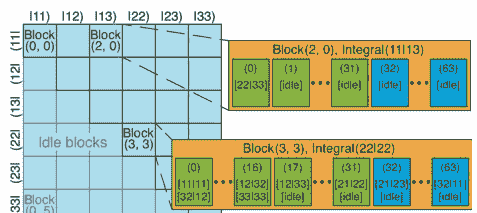

图4.1 一块一收缩积分（1B1CI）映射示意图。左侧的青色方块代表收缩ERI，每个都映射到标记的包含64个线程的CUDA块。橙色方块显示了两个代表性积分中原始ERI到CUDA线程的映射（绿色和蓝色方框，根据CUDA warp着色），第一个是对单个原始ERI的收缩，第二个涉及 3^4 = 81 个原始贡献。（有关本图彩色表示，请参见插图）

### 4.3.1 一块一收缩积分

图4.1展示了1B1CI映射的示意图。每个青色方块代表我们希望计算的收缩积分。每个收缩ERI负责的CUDA块在方块内标记。由于 (*mn|kl*) = (*kl|mn*) 对称性，下三角块（在图4.1中标记为 *空闲*）将计算冗余积分。这些块会立即退出，并且由于GPU的高效线程调度，对总体执行时间贡献甚微。每个CUDA块由64个按单维排列的工作线程组成。在图4.1中，块由橙色矩形表示。原始积分被循环映射到线程上，每个线程在片上寄存器中收集一个部分和。

第一个线程计算并累积积分1、65等等，而第二个线程处理积分2、66等等。在所有原始积分都被评估后，块级归约产生最终的收缩积分。

bra和ket原始对 {z, χ}，z ∈ ϕp，z ∈ ϕq 的PQs在主机上预先计算并存储在按组合AO索引 μν 排序的向量中。这使得在获取每个原始ERI的输入时，来自相邻线程的读取可以合并。为了完全满足CUDA合并约束，原始PQs被打包到多个CUDA向量类型数组中，例如，一个用于 P⃗r、P⃗r、P⃗r 和 η 的 float4 数组，以及一个用于 K 值的额外 float 数组。

图4.1展示了两个值得特别考虑的情况。上方的线程块显示了非常短的收缩（极端情况下是单个原始积分）时会发生什么。由于只有一个原始积分需要计算，除了第一个线程之外的所有线程都将处于空闲状态。第二个示例中也出现了类似情况。这里，一个ERI在四个AO上计算，每个AO的收缩长度为3，总共产生81个原始积分。在这种情况下，64个线程中没有一个完全空闲。然而，仍然存在一些负载不平衡，因为前17个线程计算第二个积分，而剩余的warp（线程18–31）执行无效的no-op指令。应当注意，线程62–63不会执行浪费的指令，因为整个warp都跳过了第二个积分评估。因此，“空闲”CUDA线程并不总是映射到空闲执行单元。最后，随着收缩长度增加，块内线程之间的负载不平衡在运行时间方面将变得可以忽略不计，使得1B1CI策略越来越高效。

### 4.3.2 一线程一收缩积分

在1T1C策略中，每个线程遍历收缩内的所有原始积分，并在局部寄存器中累积和。图4.2展示了示意图。在那里，收缩积分再次由青色方块表示，但每个CUDA块（由红色轮廓表示）现在处理多个收缩积分，而不仅仅是一个。为了实现最佳内存性能，每个AO对的原始PQs被交错，以便来自相邻线程的原始bra和ket对读取请求连续地址。图4.2中显示的2D块尺寸为 4 × 4，仅用于说明目的。在实践中，应使用至少 16 × 16 线程的块。由于同一warp内的线程以SIMT方式执行，每当相邻ERI涉及不同长度的收缩时，就会发生warp分歧。为了消除这些不平衡，bra和ket PQ数组必须按收缩长度排序，以便块处理统一收缩长度的ERI。

### 4.3.3 一线程一原始积分

图4.3展示了1T1P策略。这种方法提供了我们考虑的映射中最细粒度的并行性。它与1B1CI相似，因为收缩ERI再次在多个线程之间拆分。然而，在这里，原始积分被分配到CUDA块中，而不考虑它们所属的收缩。在图4.3中，青色方块代表尺寸为 16 × 16 的2D CUDA块，红线代表收缩积分之间的划分。由于块大小不是收缩长度的偶数倍，同一块内计算的原始积分通常会对多个收缩ERI做出贡献。这种方法实现了完美的负载均衡（针对原始积分评估），因为每个线程执行完全相同的工作量。还值得注意的是，1T1P对原始对的排序施加的约束很少，因为它们不再需要按父AO索引分组或交错。然而，如果我们还考虑产生最终收缩ERI所需的后续归约步骤，1T1P策略的优势将大大减少。这些归约涉及块间通信，对于高度收缩的基组，可能比ERI评估本身更昂贵。

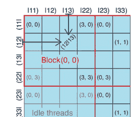

图4.2. 一线程一收缩积分（1T1C）映射示意图。青色方块代表收缩ERI和CUDA线程。线程索引显示在括号中。每个CUDA块（红色轮廓）计算16个ERI，每个线程在局部寄存器中累积独立收缩的原始积分。（有关本图彩色表示，请参见插图）


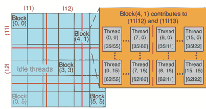

## 图 4.3 一线程一原始积分（1T1PI）映射示意图。青色方块表示 16x16 原始 ERI 的二维平铺，每个平铺按标记分配给一个 16x16 CUDA 块。红线表示收缩 ERI 之间的划分。橙色框显示了包含多个收缩贡献的块中，原始 ERI 分配给线程（灰色方块）的情况。（有关本图的颜色表示，请参见插图）

### 4.3.4 收缩 ERI 方案比较

我们现在转向对上述加速方案的实际评估。我们考虑由 64 个氢原子组成的系统的 ERI 评估，这些氢原子排列成 4 x 4 x 4 立方晶格，最近邻之间的间距为 0.74 Å。表 4.1 比较了每种方法的执行时间，以及与 GPU 相关的开销时间，例如主机和设备内存之间的内存传输。

考虑了两组基函数。6-311G 基函数代表低收缩极限，其中大部分（三分之二）原子轨道（AO）包含单个原始分量。在此，1T1PI 映射提供最佳性能。在如此低的收缩水平上，块边界之间需要累积的 ERI 非常少，从而最大限度地减少了所需的块间通信。1T1CI 方法紧随其后，因为对于小收缩，它表示一种仅比理想 1T1PI 方案稍粗糙的并行分解。另一方面，1B1CI 方案远远排在第三位。这是因为上面讨论过的其负载均衡不佳。对于 6-311G 基函数，超过 85% 的收缩 ERI 涉及九个或更少的原始贡献。因此，每个块中绝大多数 64 个线程都不执行任何工作。

应当注意，仅在主机和设备之间传输 ERI 可能比 ERI 评估本身花费更长时间，尤其是在基函数收缩较低的情况下。这意味着，对于高效的 GPU 实现，从头重新评估 ERI 比从主机内存获取更快，比从磁盘获取快得多。

## 表 4.1 使用 1B1CI、1T1CI 和 1T1PI 方法评估 64 个 H 原子晶格 ERI 的运行时间比较

| | GPU 1B1CI | GPU 1T1CI | GPU 1T1PI | CPU PQ Pre-calc | GPU-CPU Transfer | GAMESS |
|---|---|---|---|---|---|---|
| 6-311G | 7.086 | 0.675 | 0.428 | 0.009 | 0.883 | 170.8 |
| STO-6G | 1.608 | 1.099 | 2.863 | 0.012 | 0.012 | 90.6 |

时间以秒为单位。所有 CPU 计算均在 Nvidia 8800 GTX 上运行。CPU 预计算记录在启动 GPU 内核之前构建对量所需的时间。GPU-CPU 传输提供将完成的 ERI 复制到主机内存所需的时间。为进行比较，还包括了在 Opteron 175 CPU 上运行的基于 CPU 的 GAMESS 程序的计时。

STO-6G 基函数形成鲜明对比。在此，每个收缩 ERI 包含 64 或 1296 个原始 ERI 贡献。因此，对于 1T1PI 方案，归约步骤变得复杂得多，实际上比原始 ERI 评估本身花费更多时间。这说明了一个关键原则：在优化性能时，组织通信通常与最小化算术指令同样重要。1T1CI 方案与 6-311G 情况表现相似。所有 ERI 现在都涉及均匀收缩长度这一事实提供了一点提升，因为与 6-311G 基函数相比，计算两倍数量的原始 ERI 只需要多 60% 的时间。1B1CI 方法显著改善，因为每个块的每个线程现在都饱和了 20 或 21 个原始 ERI。

### 4.3.5 扩展至更高角动量

扩展至更高角动量基函数时，还需考虑几个额外因素。对于非零角动量函数，壳层包含多个函数。在 McMurchie–Davidson 方案中，ERI 壳层内的所有积分都依赖于相同的中间 Hermite 积分值 [Aj, Ak]。因此，让每个线程计算整个壳层的原始积分是有利的。例如，计算原始 ERI 类 [spsp] 的线程总共负责九个函数。

GPU 内核的性能对每个线程的内存需求非常敏感。随着线程使用更多内存，每个 SM 上驻留的并发线程总数会减少。活跃线程减少，进而降低了 GPU 隐藏执行延迟的能力并降低吞吐量性能。因为网格中所有线程都预留相同的内存占用，单个网格同时处理低角动量和（更复杂的）高角动量积分会将最坏情况内存需求应用于所有线程。为避免这种情况，必须为每类积分编写单独的内核。

专用内核还提供了进一步优化每个例程和减少内存使用的机会，例如，通过展开循环或消除条件语句。这对于涉及 d- 及更高角动量函数的 ERI 尤为重要，因为循环开销变得不可忽略。对于高角动量积分，还可以使用符号代数库生成针对 GPU 优化的展开内核 [21]。

给定一组混合角动量壳层的基函数，我们可以天真地按以下方式扩展上述任何分解策略。首先，按规定构建对量，而不考虑角动量类别。然后启动一系列 ERI 内核，每个动量类别一个，为网格中的每个 ERI 分配一个计算单元（根据正在扩展的策略，可以是块或线程）。分配给不适用适当动量类别的 ERI 的工作单元可以立即退出。该策略在图 4.4a 中针对包含四个 s-壳层和一个 p-壳层的假设系统进行了说明。每个方块表示一组 ERI 的壳层四元组，即包含的 AO 壳层内各种角动量函数组合产生的所有 ERI。元素按总角动量类别着色，专用内核评估每种颜色的元素。这种方法的问题是，积分类别的数量随系统中最大角动量迅速增加。因此，包含 d-壳层就会导致每个内核中绝大多数线程在不执行任何工作的情况下退出。图 4.4b 说明了一种更好的方法。在此，我们按 bra 和 ket 对的组成部分角动量对其进行排序，先 ss，然后 sp，最后 pp。结果，每个类别的 ERI 都定位在连续的子网格中，内核可以按维度精确覆盖仅相关的积分。

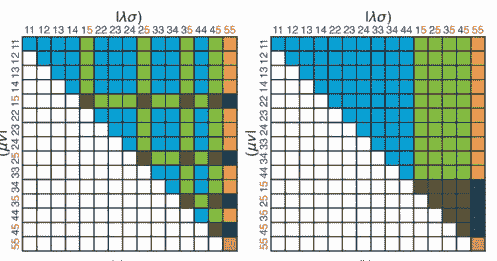

**图 4.4** 按角动量类别着色的 ERI 网格，用于包含四个 s-壳层和一个 p-壳层的系统。每个方块表示壳层四元组的所有 ERI。（a）当 bra 和 ket 对按壳层的简单循环排序时的网格。（b）同一系统的 ERI 网格，其中 bra 和 ket 对按角动量排序，先 ss，然后 sp，最后 pp。每个积分类别现在处理总 ERI 网格的一个连续块。（有关本图的颜色表示，请参见插图）

## 4.4 GPU 上的积分直接 Fock 构建

我们现在考虑 ERI 对 Eq. (4.17) 中 Fock 矩阵的贡献：

\( G_{\mu\nu}(\mathbf{P}) = \sum_{\kappa\lambda}^N P_{\kappa\lambda} [2(\mu\nu|\sigma\kappa) - (\mu\kappa|\nu\sigma)]. \) (4.29)

由于 ERI 在一次 SCF 迭代到下一次迭代中保持不变，过去通常的做法是从预计算积分形成 **G**。然而，对于包含数千个基函数的系统，ERI 存储很快变得不切实际。Almlöf [22] 开创的积分直接方法通过在每次形成 Fock 矩阵时即时重新计算 ERI，避免了 ERI 的存储。

除了容量限制之外，直接方法相比基于积分存储的常规算法还具有性能优势。如前所述，ERI 有时可以重新计算得比从存储中调用更快（即使该存储是高速随机存取存储器）。随着指令吞吐量的进步继续超过通信带宽的进步，平衡将进一步倾向于积分直接算法。另一个优势来自在 Fock 构建期间对密度矩阵的了解。这使直接方法能够用密度矩阵信息增强 Schwarz 界。

\( |(\mu\nu|\lambda\sigma)P_{\lambda\sigma}| \le |(\mu\nu|\mu\nu)^{1/2}(\lambda\sigma|\lambda\sigma)^{1/2}|P_{\lambda\sigma}|. \) (4.30)

以便识别和消除比预计算 ERI 可能更多的无关紧要积分。在 GPU 的情况下，可以通过放弃构建收缩 ERI \((\mu\nu|\lambda\sigma)\)，而转而从高斯原始函数直接构建 Fock 元素 \(G_{\mu\nu}\) 来实现额外优势。这些更长的收缩简化了算法的并行结构并提高了 GPU 性能。


为了最大限度地减少必须评估的积分数量，通常利用实值电子排斥积分（ERI）的对称性

\[
(\mu\nu|\lambda\sigma) = (\lambda\sigma|\mu\nu) = (\nu\mu|\lambda\sigma) = (\nu\mu|\sigma\lambda) \tag{4.31}
\]

来仅计算唯一积分，其中 \(\mu \le \nu, \lambda \le \sigma\)，且 \(\mu\nu \le \lambda\sigma\)，其中 \(\mu\nu\) 和 \(\lambda\sigma\) 是对应上三角矩阵元素编号的复合索引。然后将每个ERI与各种密度元素结合，并散布到福克矩阵的多个位置中。与朴素实现相比，这将必须评估的ERI数量减少了8倍。然而，从密度矩阵收集输入会引入不规则的内存访问模式，而将输出散布到福克矩阵会在ERI之间创建依赖关系。GPU性能对这些因素极其敏感，因此即使工作量减少八倍，也很容易被更大的性能减慢所淹没。从一个朴素但完全并行的算法开始，然后仅在实际有益的地方利用ERI对称性是有帮助的。为此，Eq. (4.29) 中的 \(G_{\mu\nu}\) 分别在库仑

\[
J_{\mu\nu} = \sum_{\lambda\sigma}^{\mathcal{N}} (\mu\nu|\lambda\sigma) P_{\lambda\sigma} \tag{4.32}
\]

和交换

\[
K_{\mu\nu} = \sum_{\lambda\sigma}^{\mathcal{N}} (\mu\lambda|\nu\sigma) P_{\lambda\sigma} \tag{4.33}
\]

贡献中进行评估。

### 4.4.1 GPU J-Engine

上面开发的处理ERI的策略为评估Eq. (4.32) [23]中的库仑算子提供了良好的起点。从单个ERI转向原始ERI的更大收缩

\[
J_{\mu\nu} = \sum_{Z,\Phi_p} \sum_{\phi_q \in \Phi_p} \sum_{d,d' \in \phi_q} \sum_{\sigma \in d,d'} c_{\mu,d}^* c_{\nu,d'} c_{\lambda,\sigma}^{[j]} [ij]^{[j]} P_{d\sigma} \tag{4.34}
\]

可以通过注意到上述ERI网格中任何一行的所有积分都贡献给同一元素 \(J_{\mu\nu}\) 来可视化。

与简单的ERI评估一样，第一步是为bra和ket枚举基函数壳层对 \(\phi_p, \phi_q\)。由于 \(J_{\mu\nu}\) 是对称的，计算其上三角即可，只需考虑 \(\mu \le \nu\) 的bra对。同样，对于ket对，项 \((\mu\nu|\lambda\sigma)P_{\lambda\sigma}\) 和 \((\nu\mu|\lambda\sigma)P_{\lambda\sigma}\) 相等，且都贡献给同一库仑元素。因此，对称性再次允许将其减少到 \(\lambda \le \sigma\) 的ket对。对于包括s、p和d壳层的基组，按角动量类对对进行排序总共得到六类对：ss、sp、sd、pp、pd和dd，以及36个专用内核。如果不引入ERI网格行之间的依赖关系以及由此导致的性能消耗性块间通信，就无法利用最后一类ERI对称性 \((\mu\nu|\lambda\sigma) = (\lambda\sigma|\mu\nu)\)。因此，忽略筛选忽略的积分，J-Engine名义上计算 N<sup>4</sup>/4 个积分。

每个包含的壳层对通过迭代原始对 \([ij] \in \chi_p, \chi_q \in \phi_p, \chi_q \in \phi_q\) 并将PQ数据追加到bra和ket数组中来展开。除了常规的 \(\vec{P}, \eta\) 和 K 量之外，我们还为bra预计算了施瓦茨贡献 \(B_p^{[j]} = (jj|jj)^{1/2}\) 和埃尔米特展开系数 \(\{E_p^{(ij)}\}\)，其中

\[
[ij] = \sum_p E_p^{[ij]} [\Lambda_p]. \tag{4.35}
\]

对于ket对，存储密度加权的施瓦茨贡献 $b_y^{ks} = \langle ij|ij \rangle^{1/2} |P_y|^{\max}$，以便可以高效地评估完整的密度加权施瓦茨界，如下所示：

$|\langle ij|kP|kl \rangle| \le B_y^{\max} B_y^{\max} = \langle ij|ij \rangle^2 \langle k|k \rangle^2 |P|_{\max}^{\max}$.

这里，max是对壳层对中的所有函数取最大值。对于ket PQs，密度矩阵的相应块也被转换到埃尔米特基组，并并入埃尔米特系数中以生成组合的 $(D_p^0)$ [24]：

$|ij|P|_{ab} = \sum_p E_p^{(ij)} P_{a^*} [\lambda_p] = \sum_p D_p^{(ij)} [\lambda_p]$.

这些bra和ket PQ向量的广义外积代表了评估库仑矩阵所需的所有原始积分。该结构在图4.5的左半部分中得到说明，其中每个像素代表一个原始ERI，并根据该积分的施瓦茨界大小着色。在将原始ERI网格映射到CUDA计算单元之前，考虑图4.5中ERI矩阵内的ERI大小模式非常重要。在评估一个ERI之前，其施瓦茨界由乘积 $b_y^{ks} b_y^{kt}$ 形成。如果界低于ERI阈值 \(\epsilon \approx 10^{-11}\)，则该ERI被视为不重要且不再进行进一步评估。如果原始体按图4.5a所示任意排序，则跳过和评估的积分将穿插在每个战队的线程中。因此，忽略积分几乎没有性能优势，因为战队中的所有核心都被占用来计算非可忽略元素。一个解决方案是按递减的施瓦茨贡献 $b_y^{\max}$ 对每个角动量类的原始bra和ket数组进行排序。这将得到图4.5b所示的网格，其中重要积分位于每个网格的左上角。由于界 $b_y^{\max}$ 随着 $ij$ 距离增加而迅速减小，bra和ket对的数量随系统大小线性增长，重要ERI的总数将仅为 $N^2$，与完整的 $M^4$ 积分集相比，这是巨大的减少。

除了在计算重要ERI时消除战队分歧之外，排序后的PQs还可以用于完全避免检查大多数可忽略积分的界。排序后

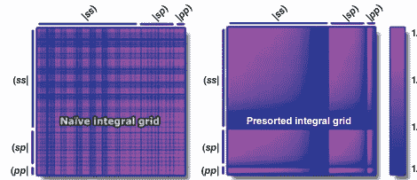

图 4.5. 库仑形成的ERI组织。行和列分别对应原始bra和ket对。每个ERI根据其施瓦茨界的大小着色。数据源自乙烷分子的计算。图(a)由每个角动量类内部的对任意排序获得，并因大积分和小积分位于相邻单元而遭受负载不均；图(b)在每个角动量类内按施瓦茨贡献对bra和ket原始体进行排序，为并行评估提供了高效结构（有关本图颜色表示，请参见插图）。

对原始体排序后，界在扫描任何一行或任何一列时保证递减。因此，一旦找到一个可忽略的积分，该行或列中的所有其他积分也可以跳过。为了利用这一点，算法必须为ERI网格的行或列分配工作单元。行更方便，因为一行中所有ERI的贡献都贡献给单个库仑元素。这允许从PQs高效计算单个ERI并在本地寄存器中累积，以产生原始库仑贡献，如下所示：

\[
J^{[i]} = [ij] \sum_{kl} [kl] P_{la} = \sum_p E_p^{[i]} \sum_q D_q^{[i]} [pq]. \tag{4.38}
\]

这里隐式假设 \(\chi_k \in \Phi_q\) 和 \(\chi_l \in \Phi_a\)。在实践中，将 \(p\) 索引上的最终求和推迟到原始体收缩到AO（原子轨道）之后是方便的。因此，对于每个ERI行，在埃尔米特基组中收集一小批库仑值 \(\{J_p^{[i]}\}\)：

\[
J_p^{[i]} = \sum_q D_q^{[i]} [pq]. \tag{4.39}
\]

内核执行后，中间值 \(J_p^{[i]}\) 被复制到主机，在那里执行最终归约到库仑元素：

\[
J_{\mu\nu} = \sum_p E_p^{[i]} \sum_{q \in \Phi_p, q \notin \Phi_p} D_q^{[i]}. \tag{4.40}
\]

分配给每个行的CUDA工作单元的维度是优化问题。也许最简单的方法是执行1D块，将每个线程分配给图4.5中的整行。这种方法将线程总数限制为bra原始体的数量，对于小系统来说不足以饱和GPU上的数千个核心。此外，由于垂直1D块跨越广泛的施瓦茨ERI界范围，顶部线程将在底部线程之后多个列才会遇到其第一个可忽略的ERI。在中间的列跨度中，许多线程处于空闲状态。另一方面，方形块应尽量减少分歧。根据经验测试，选择了8 x 8的块维度。块中每行的八个线程合作计算ERI网格一行中的交错ERI元素。一旦块中的所有行都找到可忽略的ERI，就会执行块级归约以对每行求和最终输出。图4.6说明了该算法。

### 4.4.2 GPU K-Engine

基于GPU的Eq. (4.33)中交换算子的构建遵循与GPU J-Engine算法 [23]类似的方法。在这里，我们强调为适应交换的增加复杂性所需的调整，这种复杂性源于输出索引 \(\mu\nu\) 在bra和ket之间的拆分。结果，bra-by-ket ERI网格的行不再贡献给单个矩阵元素，而是散布到K矩阵的整行中。此外，ERI之间的对称性在K中更难以利用，因为对称对（例如 \((\mu\nu|\sigma) \leftrightarrow (\mu\sigma|\nu)\)）现在贡献给多个矩阵元素。密度索引 \(\lambda\sigma\) 在bra和ket之间的拆分也阻止了将密度元素预先收缩到ket PQs中。

上述复杂性可以通过将bra和ket的定义更改为所谓的物理学家表示法来整齐地消除，其中对包括来自两个电子的每个原始体：

\((\mu\kappa|\nu\sigma) = (\mu\kappa|\nu\sigma). \tag{4.41}\)

有了这样的 \(\mu\nu\) 和 \(\lambda\sigma\) 对，可以轻松开发类似于J-Engine的GPU算法。不幸的是，bra和ket的新定义也影响了成对施瓦茨界，现在


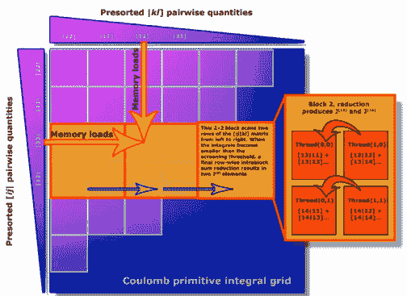

图 4.6 一个角动量类（例如 (ss|ss)）的 J-Engine 内核示意图。青色方块表示显著的 ERI 贡献。排序后的 bra 和 ket 向量由网格左侧和上方的三角形表示。2 x 2 块扫过网格的路径以橙色显示。块中行的最终归约在右侧插图中进行说明。（参见插图以获取此图的颜色分辨率。）

```
\langle \mu\nu | \mu\nu \rangle^{1/2} (\Delta \sigma | \Delta \sigma)^{1/2} = (\mu\nu | \mu\nu)^{1/2} (\lambda \sigma | \lambda \sigma)^{1/2}. (4.42)
```

随着 \(\phi_\mu\) 和 \(\phi_\nu\) 之间距离 R 的增加，量 \(\langle \mu\nu | \mu\nu \rangle\) 以 1/R 的速度缓慢衰减，而 \(\langle \mu\nu | \mu\nu \rangle\) 则为 \(e^{-R^2}\)。这个较弱的界意味着所有 \(N^4\) 个 ERI 都需要被检查，与 \(N^2\) 库仑算法相比会导致严重的性能下降。因此，即使以牺牲硬件效率为代价，维护 \(\mu\lambda / \nu\sigma\) 配对的缩放优势也是非常值得的。

K-Engine 以如今不寻常的枚举 AO 壳层对 \(\phi_\mu \phi_\nu\) 的步骤开始。因为 \(\phi_\mu \phi_\nu\) 和 \(\phi_\lambda \phi_\sigma\) 对贡献于不同的矩阵元素，除非在交换输出之间引入依赖关系，否则无法利用对称性。忽略对称性，AO 对既为 \(\mu \le \lambda\) 对也为 \(\mu > \lambda\) 对构建。与库仑评估一样，对按角动量类分离，并为每种积分类型调优不同的内核。与 J-Engine 相比，包含 \(\mu > \lambda\) 对需要额外的对和内核类，例如，处理 \(\mu s\) 对的内核与处理 \(sp\) 对的内核不同。

J-Engine 对 bra 和 ket 原始对的排序会导致单个 K 元素的贡献散布在整个 ERI 网格中。为了避免块间通信，有必要将这些交换贡献本地化。这可以通过按 \(\mu\) 索引对原始对进行排序来实现，从而使对每个元素 \(K_{\mu\nu}\) 有贡献的 ERI 在 ERI 网格中形成一个连续的区块。如图 4.7 所示。在每个 \(\mu\) 对段中，原始 PQ 还按 Schwarz 贡献 \((\mu\lambda|\mu\lambda)^{1/2}\) 进行额外排序，以便显著积分集中在每个 \(\mu\nu\) 块的左上角。

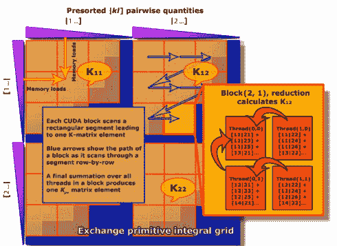

**图 4.7.** K-Engine 内核示意图。bra 和 ket PQ 数组由网格左侧和上方的三角形表示。对按 \(\nu\) 和 \(\tilde{\nu}\) 索引分组，然后按界排序。四个块的路径以橙色显示，右上角的箭头指示了锯齿模式。2 x 2 块内交换元素的最终归约在右侧显示。（参见插图以获取此图的颜色表示）

由于密度索引在 bra 和 ket 之间拆分，密度信息无法包含在原始展开系数或 Schwarz 贡献中。相反，为每个角动量分量打包额外向量：\(P^\mu\)、\(P^\nu\) 等等。打包的密度按壳层对 P 排序，并组织为 CUDA 向量类型以允许高效获取。例如，\(P^\mu\) 块中的每个条目包含三个元素：\(s_\mu\)、\(p_\mu\) 和 \(s_\mu\)，打包为 float4（假设单精度）向量类型。壳层对中最大的整体密度元素 \(|P_\mu|^\text{max}\) 也为每个壳层对预先计算，以便在计算交换 Schwarz 界时尽量减少内存访问。

\(|\langle X_g X_{g'} | X_g X_{g'} \rangle| \le |X_g X_g| X_g X_{g'}|^{1/2} |X_g X_{g'} X_g X_{g'}|^{1/2} |P_\mu|^\text{max}.\) (4.43)

为了将交换映射到 GPU，采用了一个 2D CUDA 网格，其中每个块计算一个 \(K_{\mu\nu}\) 元素，因此被分配原始 ERI 网格的一个块。每个 CUDA 块以锯齿模式遍历其 \(|\mu \cdots \nu \cdots|\) 原始积分的块，每个线程计算一个原始壳层。按界排序对允许块在定位无关紧要积分的边界后立即跳到下一行。与 J-Engine 一样，通过将 2D CUDA 块定义为正方形来最大化每个块内 ERI 界的均匀性。图 4.7 显示了一个 2 x 2 块以供说明，但在实践中将使用至少 8 x 8 的块维度。在评估所有显著 ERIs 后，使用块级归约来计算最终交换矩阵元素。这种归约代表了 K-Engine 算法所需的唯一线程间通信，对整体性能的影响可忽略不计。K-Engine 方法与上述 1B1C1 ERI 方案类似。但是，由于每个块负责数千个原始 ERIs，交换评估不会遭受 1B1C1 算法中观察到的负载不平衡。

ERI 网格的结构允许相邻线程获取 bra 和 ket PQ 数据的连续元素。对密度矩阵的访问更加不规则，因为无法在每个 \(\mu\) 块内同时按 Schwarz 界和 \(\lambda\) 或 \(\sigma\) 索引对对进行排序。结果，相邻线程必须发出独立的密度获取，这些获取原则上分布在密度矩阵中。在实践中，应用筛选后，对元素 \(K_{\mu\nu}\) 的大部分显著贡献来自局部化的 \(\Delta\) 块，其中 \(\lambda\) 接近 \(\mu\) 且 \(\sigma\) 接近 \(\nu\)。因此，可以使用 CUDA 纹理来缓解 GPU 对非顺序密度访问施加的性能惩罚。

与密度元素不规则访问相关的另一个困难是，Eq. (4.43) 中原始 ERIs 的密度加权 Schwarz 界在 \(\mu\) 块的每一行或每一列上并非严格递减。结果，显著 ERIs 和可忽略 ERIs 之间的边界不如库仑情况那样清晰定义。然而，在交换中使用密度来预先评估积分至关重要。这可以通过与库仑算子进行比较来理解，在库仑算子中，密度仅与 ket 对耦合。由于一般来说，密度元素 \(P_{\mu\nu}\) 和 Schwarz 界 \((|\sigma\lambda|)^{1/2}\) 都随着距离 \(r_{\mu\nu}\) 的增加而减小，对库仑-Schwarz 界进行密度加权的效果是使已经很小的 \((|\sigma\lambda|)^{1/2}\) 项变得更小。另一方面，在交换中，密度将 bra 和 ket 耦合，因此小的密度矩阵元素可以减小原本很大的界，并大大减少需要评估的 ERIs 数量。事实上，对于大型绝缘体系统，我们预计非可忽略 ERIs 的总数将从 \(N^2\) 个库仑积分减少到 \(N\) 个交换 ERIs。

为了将密度纳入 ERI 终止条件，通常的退出阈值 \(\epsilon\) 由额外的保护乘数 \(G = 10^{-5}\) 增强。然后，每组 32 个线程的 warp 在到达原始 ERI 的连续集时终止 ERI 网格每一行上的 ERI 评估，其中对每个线程都满足以下条件：

```
|x_\mu x_\lambda| x_\nu |^2 |x_\sigma x_\tau|^2 |P_{\mu\nu}|^2 |P_{\sigma\tau}|^2 / G_e < G_e
```

原则上，这种非严格的退出条件在最坏情况下可能会忽略显著积分。然而，在实践中，经验测试表明，退出程序产生的结果与不利用密度信息时获得的结果相同，并带来了相当大的性能改进。

对于 SCF 计算，密度矩阵和交换矩阵是对称的。在这种情况下，我们只需要计算矩阵元素的上三角。这相当于利用 \((\mu \nu | \lambda \sigma) \leftrightarrow (\nu \mu | \sigma \lambda)\) ERI 对称性，这意味着我们名义上计算 \(N^2 / 2\) 个 ERIs。这比传统充分利用八重 ERI 对称性的 CPU 代码生成的 ERIs 多 4 倍。然而，在分析大规模并行架构的性能时，FLOPS 级别的比较过于简单。在本例中，使代码摆脱块间依赖关系所提升的 GPU 性能足以补偿四倍的工作量增加。

对于绝缘体系统，AO 密度矩阵元素 \(P_{\mu\nu}\) 会随着距离 \(r_{\mu\nu}\) 的增加迅速衰减到零。这可以用于预筛选交换元素 \(K_{\mu\nu}\)，其中 Eq. (4.33) 中的和将很小。也许最简单的方法是施加一个简单的距离截止，使 \(K_{\mu\nu}\) 近似如下：

```
K_{\mu\nu} = \begin{cases} \sum_{nld} (\mu \lambda | \nu) P_{ld} & \text{if } r_{\mu\nu} < R^{\text{MASK}} \\ 0 & \text{otherwise} \end{cases}
```

这很有效，因为，如果 \(\mu\) 远离 \(\nu\)，那么要么 \(\lambda\) 远离 \(\sigma\) 且 \(P_{ld}\) 为零，要么 \(\mu \lambda\) 或 \(\sigma\) 界中的一个将为零。掩码条件对每个元素都可以平凡地预先计算


$K_{\mu}$，并打包在一个位掩码中，1 表示应评估交换元素，0 表示应跳过。每个 CUDA 线程块在交换内核开始时检查其掩码，分配到零位的块会立即退出。如下文实际计算所示，这种距离掩码大大减少了 K-Engine 评估的 ERIs 数量。

简单距离掩码的一个潜在问题是 $R^{\text{MASK}}$ 取决于基组和体系。例如，密度矩阵衰减的范围取决于最高占据分子轨道和最低未占据分子轨道（HOMO 和 LUMO）之间的能隙。此外，基组中的弥散函数会增加 $\mu A$-Schwarz 界变得可忽略的距离。

这些限制可以通过采用 Schwarz 界来对完整交换矩阵元素产生严格界，从而克服，如下所示：

$K_{\mu\nu} = \sum_{\lambda\sigma}^{\mathcal{N}} (\mu\lambda|\nu\sigma) P_{\lambda\sigma} \le \sum_{\lambda\sigma}^{\mathcal{N}} (\mu\lambda|\mu\lambda)^{1/2} P_{\lambda\sigma} (\nu\sigma|\nu\sigma)^{1/2}$. (4.46)

将 AO Schwarz 界铸造为矩阵 Q

$Q_{\mu\nu} = (\mu\nu|\mu\nu)^{1/2}$ (4.47)

可推导出对密度矩阵的以下严格界 [25]：

$K_{\mu\nu} \le (QPQ)_{\mu\nu}$. (4.48)

对于大体系，矩阵乘积可以在稀疏代数中轻松计算。然后，构建一个位掩码以忽略所有满足 $(QPQ)_{\mu\nu} < \epsilon^{\text{MASK}}$ 的矩阵元素 $K_{\mu\nu}$，内核的调用方式与距离掩码情况相同。

### 4.4.3 交换-关联积分

在 ERIs 之后，交换-关联势的评估是 DFT 计算中的第二大瓶颈。为清晰起见，我们在此将讨论限于使用 GPU 加速 GGA 类型泛函。我们的实现与 Yasuda [26] 报告的非常相似。在一般自旋极化情况下，即 $\rho_p \neq \rho_q$，交换-关联能和势的 Eqs. (4.13) 和 (4.21) 变为以下形式：

$E_{\text{XC}} = \int f_a(\rho_\alpha(\vec{r}), \rho_\beta(\vec{r}), \gamma_{aa}(\vec{r}), \gamma_{ab}(\vec{r}), \gamma_{bb}(\vec{r})) d^3\vec{r}$, (4.49)

$V_{\mu\nu}^{\text{XC}\alpha} = \int \left[ \frac{\partial f_{\text{XC}}}{\partial \rho_\alpha} \phi_\mu \phi_\nu + \left( 2 \frac{\partial f_{\text{XC}}}{\partial \gamma_{aa}} \nabla \rho_\alpha + \frac{\partial f_{\text{XC}}}{\partial \gamma_{ab}} \nabla \rho_\beta \right) \cdot \nabla (\phi_\mu \phi_\nu) \right] d^3\vec{r}$, (4.50)

其中，类似于 Eq. (4.50) 的方程用于 $V_{\mu\nu}^{\text{XC}\beta}$，$\gamma$ 表示梯度不变量，如下所示：

$\gamma_{aa}(\vec{r}) = \nabla \rho_\alpha(\vec{r}) \cdot \nabla \rho_\alpha(\vec{r})$. (4.51)

典型的 XC 核函数 $f_{\text{XC}}$ 不适合解析积分；因此，改用求积网格来评估 Eqs (4.49) 和 (4.50)。由于分子势在每个原子核附近表现出不连续的尖点，分子求积网格通常通过叠加以每个原子为中心的球形网格构建。一种常见且高效的方法是为每个原子网格结合欧拉-麦克劳林径向求积和勒贝德角求积。因此，围绕以 \(\vec{a}\) 为中心的原子的积分可以按以下方式执行，其中 \(E_i\) 和 \(L_j\) 分别表示径向和角权重，\(p\) 是组合的 \(ij\) 索引，且 \(\lambda_p = E_i L_j\)：

\(\int f(\vec{r}) d^3\vec{r} \approx \sum_{\vec{T}} \sum_{ij} E_i L_j f(\vec{T} + \vec{\tau}_{ij}) = \sum_p A_p f(\vec{x} + \vec{T}_p). \quad (4.52)\)

每个原子独立对整个 \(\mathbb{R}^3$ 进行积分，但在其自身原子核区域最准确。在构建分子网格时，必须对来自不同原子网格的求积点进行加权，以归一化所有原子上的总和，并确保每个原子求积在其原子核周围区域占主导地位。Becke [27] 引入的一种优雅方案通过为每个原子求积 \(a$ 定义空间函数 \(w_a(\vec{T})$ 来实现这一点，该函数给出了在 \(\vec{T}$ 区域分配给该求积的权重。通过约束权重函数，避免了所有重复计算，使得

\(\sum_a w_a(\vec{T}) = 1 \quad (4.53)\)

对所有 \(\vec{T}$ 成立。此外，构建 \(w_a(\vec{T})$ 使其在第 \(a$ 个原子核区域接近于 1，会导致每个原子求积在其最准确区域占主导地位。最终求积按以下方式评估：

\(\int f(\vec{r}) d^3\vec{r} \approx \sum_a \sum_p w_a(\vec{T}_a + \vec{T}_p) f_p(\vec{R}_a + \vec{T}_p) = \sum_p \sum_a w_{ap} f_p(\vec{T}_{ap}). \quad (4.54)\)

Becke 求积权重 \(w_{ip}$ 的计算本身是一项计算量较大的任务，通过以下方程进行：

\(w_{ip} = \frac{P_a(\vec{T}_{ap})}{\sum_m P_m(\vec{T}_{ap})},\)
\(P_a(\vec{T}) = \prod_{b \neq a} s(\mu_{ab}),\)
\(\mu_{ab}(\vec{T}) = \frac{|\vec{R}_a - \vec{T}| - |\vec{R}_b - \vec{T}|}{|\vec{R}_a - \vec{R}_b|} = \frac{\vec{T}_a - \vec{T}_b}{\vec{R}_{ab}},\)
\(x(\mu) = \frac{1}{2}(1 - g(\mu)),\)
\(g(\mu) = p(p(p(\mu))),\)
\(p(\mu) = \frac{3}{2}\mu - \frac{1}{2}\mu^3. \quad (4.55)\)

与 ERIs 类似，该问题易于并行化，因为每个约 \(10^6$ 个网格点的权重都彼此独立。因此，网格权重可以在 GPU 上轻松加速，每个网格点分配一个 CUDA 线程。由于 \(0 \le p(\mu) \le 1\)，每个 \(P_a(\vec{T}_{ap})$ 的评估一旦运行乘积变得无限接近于零即可终止。此外，如果分子 \(P_a(\vec{T}_{ap})$ 为零，则分母甚至无需评估。这些早期退出条件大大加速了算法，但也会在 GPU 上引入 warp 分歧，因为相邻线程在不同迭代时退出循环。将网格点组织为空间箱并按原子求积索引排序，可确保相邻线程遵循类似的执行路径。许多求积点的结果权重可忽略不计，这些点将从网格中移除。最后，将 Becke 权重和球形权重相乘并丢弃原子标签，以形成最终的求积点和权重集合：

```
$$w_{\vec{q}\lambda} \rho \rightarrow \omega_i, \qquad \vec{T}_{\vec{q}\rho} \rightarrow \vec{T}_i. \qquad (4.56)$$
```

一旦网格建立，就需要每个网格点处的密度及其梯度来评估 XC 核。对于 AO α-自旋密度矩阵，这些按以下方式评估：

```
$$\rho_a(\vec{T}) = \sum_{\mu\nu} P_{\mu\nu}^a \phi_\mu(\vec{T})\phi_\nu(\vec{T}), \qquad (4.57)$$
```

```
$$\nabla \rho_a(\vec{T}) = \sum_{\mu\nu} P_{\mu\nu}^a \phi_\mu(\vec{T})\nabla \phi_\nu(\vec{T}). \qquad (4.58)$$
```

由于基函数 $\phi_\mu$ 的指数衰减，每个网格点 $\vec{T}$ 的求和只需包含少数重要的 AO。这些可以通过对重要原始配对分布进行空间分箱来高效识别，其确定方式为

```
$$\{ \chi_i, \chi'_i | e_{aw} < \max_{\vec{T}} \chi_i(\vec{T})\chi'_i(\vec{T}) P_i^{\text{max}}, \chi_i \in \phi_\mu, \chi'_i \in \phi_\nu \}, \qquad (4.59)$$
```

其中 $e_{aw}$ 是某个小阈值。然后将原始列表和求积点复制到 GPU，其中每个线程为单个网格点计算 Eqs. (4.57) 和 (4.58) 的求和。原始配对在每个空间箱内按指数递增排序。因此，在达到第一个可忽略的配对组合后，可以跳过整个箱。与求积权重的评估类似，网格点的空间分箱通过确保相邻线程共享相同的重要基函数集来最小化 warp 分歧。在自旋极化计算中，对 β 密度重复相同的过程。

接下来，使用每个求积点处的密度来评估网格上的 XC-核函数及其各种导数。因此，为每个网格点计算以下值：

```
$$a_i = \omega f_{xc}(\rho_a(\vec{T}), \rho_b(\vec{T}), \gamma_{aa}(\vec{T}), \gamma_{ab}(\vec{T}), \gamma_{bb}(\vec{T})),$$
$$b_i = \omega \frac{\partial f_{xc}(\vec{T})}{\partial \rho_a},$$
$$c_i = \omega \left( 2 \frac{\partial f_{xc}(\vec{T})}{\partial \gamma_{aa}} \nabla \rho_a + \frac{\partial f_{xc}(\vec{T})}{\partial \gamma_{ab}} \nabla \rho_b \right). \qquad (4.60)$$
```

此步骤计算成本较小，可在主机上执行而不会降低性能。作为编程便利，这很理想，因为实现各种密度泛函无需编辑 CUDA 内核，并且主机为某些密度泛函所需的各种超越函数提供了强大且高效的支持。在此步骤中，核值 $a_i$ 还被求和以根据 Eq. (4.49) 评估总交换-关联能。

最后一步是构建交换-关联势的 AO 矩阵元素。此任务再次在 GPU 上执行。对于所有非可忽略的原始配对分布 $\{ \chi_i, \chi'_i | e_{aw} < \max_{\vec{T}} \chi_i(\vec{T})\chi'_i(\vec{T}), \chi_i \in \phi_\mu, \chi'_i \in \phi_\nu \}$，来自 Eq. (4.22) 的配对量 $K_{ij}$、$\vec{T}_{ij}$ 和 $\eta_{ij}$ 被打包到数组中并传输到设备内存。网格点位置 $\vec{T}_a$ 进行空间分箱并


传输到 GPU，对应值为 \( b_i \) 和 \( c_i \)。然后由单个 CUDA 内核执行求和

```
\(\bar{V}_{\mu\nu} = \sum_{\tau} \phi_{\mu}(\tau) \left( \frac{1}{2} b_{\tau} \Phi_{\nu}(\tau) + c_{\tau} \nabla \Phi_{\nu}(\tau) \right)\)
\( = \sum_{i} \sum_{k \in \Omega_i} \sum_{l \in \Omega_i} c_{\mu k} c_{\nu l} X_i(\tau) \left( \frac{1}{2} b_{\tau} X_i(\tau) + c_{\tau} \nabla X_i(\tau) \right)\) (4.61)
```

最终矩阵元素按如下方式计算：

```
\( V_{\mu\nu}^{\text{XC}} = \bar{V}_{\mu\nu} + \tilde{V}_{\mu\nu} \) (4.62)
```

该计算配置在一个 2D 矩阵上，其中每一行对应一个原始基函数对 \( X_i X_j \)，每一列关联一个单独的网格点。CUDA 网格配置为由 2D 块组成的 1D 网格，类似于前面描述的 GPU J-Engine。覆盖原始基函数对的一堆块横扫整个矩阵。由于点是空间分箱的，每当遇到可忽略的点-原始基函数对组合时，可以跳过整个分箱。与库仑算法一样，CUDA 块中每一行线程协作以在原始基中生成矩阵元素 \(\bar{V}_{i\tau}\)。这些被复制到主机，在主机上进行最终收缩得到 AO 矩阵元素。

## 4.5 精度考量

ERI 值跨越广泛的动态范围，从约 10\(^3\) Ha 一直到 [28] 下方的约 10\(^{-10}\)，低于此值可以忽略 ERI 同时保持化学精度。为了表示由此产生的 13 个十进制数量级范围内的值，需要 64 位双精度浮点运算。随着 1980 年代基于硬件的双精度 CPU 指令的出现，在量子化学计算中对所有浮点运算统一使用双精度成为标准做法。事实上，出于各种架构和算法原因，单精度运算只提供了微小的性能优势，因此在量子化学程序中基本被弃用。然而，由于 GPU 在图形和多媒体应用（其中降低精度已足够）方面的背景，GPU 设计强调单精度性能。事实上，最早的量子化学 GPGPU 代码在设备上不得不将就于最少（甚至没有）双精度支持 [10, 12, 20, 28]。现代架构，如 Nvidia 最近的 Kepler GPU，继续为单精度运算提供至少 3.5× 的显著性能优势。随着向量化指令集的发展，即使是 CPU 现在也为单精度相对于双精度提供 2:1 的性能优势。除了操作吞吐量，单精度运算将内核的内存占用和带宽要求减半。这对于大规模并行架构至关重要，因为大量正在执行的线程使片上内存成为宝贵资源。因此，设计尽可能多地在单精度下执行操作的算法是有利的 [29, 30]。在受带宽和指令限制的情况下，这将提供高达两倍的加速。当然，必须小心确保提供足够的精度以保证强健和正确的结果。在实践中，所有有限精度运算都会引入一些误差。某些操作，例如对近似相等的值求差或将微小元素累加到远大得多的和中，会极大地放大这种误差。考虑以下两个十进制数之间的求和，每个数都用七位十进制精度表示。

| 1 | . | 3 | 6 | 7 | 2 | 8 | 0 | 2 | ×10^3 |
|---|---|---|---|---|---|---|---|---|---|
| + | 4 | . | 7 | 2 | 2 | 1 | 5 | 8 | ×10^-4 |

为了执行此加法，处理器必须首先将数字移位到共同指数（为简单起见，假设中间操作在不损失精度的情况下进行）。

| 1 | . | 3 | 6 | 7 | 8 | 0 | 2 | 0 | 0 | 0 | 0 | 0 | 0 | 0 | ×10^3 |
|---|---|---|---|---|---|---|---|---|---|---|---|---|---|---|---|
| + | 0 | . | 0 | 0 | 0 | 0 | 0 | 0 | 0 | 4 | 7 | 2 | 2 | 1 | 5 | 8 | ×10^3 |
| 1 | . | 3 | 6 | 7 | 8 | 0 | 2 | 4 | 7 | 2 | 2 | 1 | 5 | 8 | ×10^3 |

中间和无法用七位数字表示。截断到最近的可表示数字会移除灰色数字，并产生一个（黑色）结果，该结果与第一个操作数相同。需要进行许多此类加法的算法会累积显著误差。

虽然有算法可以在不使用更高精度的情况下提高求和精度 [31]，但解决此累积问题的最强健方法是在更高精度下执行加法。在移位到共同指数后，14 位精度下的相同操作可能如下所示：

| 1 | . | 3 | 6 | 7 | 8 | 0 | 2 | 1 | 6 | 7 | 0 | 2 | 5 | 1 | 0 | 0 | 0 | 0 | 0 | 0 | 0 | ×10^3 |
|---|---|---|---|---|---|---|---|---|---|---|---|---|---|---|---|---|---|---|---|---|---|---|
| + | 0 | . | 0 | 0 | 0 | 0 | 0 | 0 | 4 | 7 | 2 | 2 | 1 | 5 | 8 | 3 | 9 | 2 | 4 | 8 | 8 | 2 | 3 | ×10^3 |
| 1 | . | 3 | 6 | 7 | 8 | 0 | 2 | 6 | 3 | 9 | 2 | 4 | 0 | 9 | 3 | 9 | 2 | 4 | 8 | 8 | 2 | 3 | ×10^3 |

加法不再导致灾难性误差。然而，由于最终结果仍被截断到 14 位黑色数字，灰色数字对操作没有影响。值得注意的是，如果较小的数使用其 7 位而非 14 位表示，也会得到相同的结果。如果此处考虑的操作数本身是通过许多先前操作产生的，这可能很重要。

在将 ERI 累积到库仑矩阵和交换矩阵时，正好出现这种情况。这些 ERI 中的绝大多数比少数最大值小几个数量级。这些小 ERI 可通过 Schwarz 界轻松识别，可以在单精度下计算，并用单个双精度 ADD 操作累积到 Fock 矩阵中。然后使用单独的一组双精度 ERI 内核来计算大 ERI 贡献 [30]。为库仑和交换内核使用按界排序的配对列表会自动将双精度和单精度 ERI 分开。这在图 4.8 的库仑情况下显示，并导致单精度和双精度内核内的线程束分歧最小化：

```
\( J_p^{[ij]} = \sum_q \left\{ \begin{array}{ll} (\tilde{E}_p^{[ij]} D_q^{[ij]} (\Lambda_p | \Lambda_q))^{[22]} & \text{if } [ij][ij][kl][kl] |P_{kl}|^{\max} < \tau^{\text{prec}} \\ (\tilde{E}_p^{[ij]} D_q^{[ij]} (\Lambda_p | \Lambda_q))^{[64]} & \text{if } [ij][ij][kl][kl] |P_{kl}|^{\max} \ge \tau^{\text{prec}} \end{array} \right. \quad (4.63) \)
```

在拆分工作时，重要的是在双精度和单精度内核中评估界时具有确定性且相同，以避免在边界附近跳过或重复计算 ERI。对于不精确的有限精度操作，这并非完全平凡。例如，单精度和双精度乘积都不完全满足交换律，因此 a · b ≠ b · a。因此，在评估 Schwarz 界时，保持相同的精度级别和操作顺序很重要。

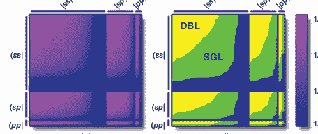

图 4.8 库仑 ERI 网格中双精度和单精度工作负载的组织。与图 4.5 一样，行和列分别对应原始基 bra 和 ket 对。(a) 每个 ERI 根据其 Schwarz 界的大小着色。(b) ERIs 按所需精度着色。黄色 ERI 需要双精度，而绿色 ERI 可以在单精度下评估。蓝色 ERI 被完全忽略。（有关本图颜色表示，请参见插图）

接下来，必须确定在保持足够精度的同时，τ^ERI 可以设置多大。经验研究 [30] 最能回答这个问题。图 4.9 显示了用一系列精度阈值处理的一些代表性测试系统的结果。针对各种基组和 τ^ERI 值，显示了测试系统上最终 RHF 能量的平均相对误差。混合精度计算提供介于双精度和单精度之间的有效精度。误差在对数-线性图上表现非常良好，因此可以轻松构建安全的经验界。这在图 4.9 中显示为黑线，其方程如下：

Error(τ) < 2.0 × 10^-6 τ^-0.7. (4.64)

通过反转 Eq. (4.64)，可以为最终能量中任何所需的相对误差选择适当的精度。这允许在 SCF 开始时选择安全的精度级别，而无需悲观地要求每个操作都在较慢的双精度算术中执行。在 SCF 计算过程中，还可以改变精度级别。这种动态精度方法是将 SCF 视为迭代校正程序的建议，该程序在每个步骤中改进最初近似的密度。在每次迭代中，必须选择 τ^ERI，以便有限精度导致的误差不会淹没密度中存在的任何其他误差。这样，精度误差可以以与密度矩阵收敛相同的速率降低，最终达到获得完全双精度质量的程度。每次迭代中收敛矩阵中存在的误差可以从收敛准则近似得到。一个好的选择是交换子 SPF–FPS 的最大元素，其中 F 和 P 分别是 Fock 矩阵和密度矩阵，S 是 AO 重叠矩阵。

表 4.2 总结了动态精度方法的效率。在所有情况下，误差都得到良好控制，使得最终能量与完全双精度结果在 10^-5 Ha 的收敛阈值内匹配。此外，在早期 SCF 迭代中使用降低精度对达到收敛所需的 SCF 迭代次数没有可察觉的影响。就性能而言，动态精度方法始终超过双精度 2× 的加速。这是值得注意的，因为就理论峰值性能而言，这些测试中使用的 Tesla C2050 GPU


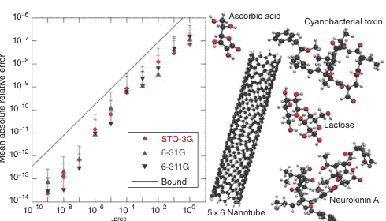

图 4.9 各基组下最终能量相对误差随精度阈值 $\epsilon^{prec}$ 的变化。右侧显示了测试分子。每个点是五个测试系统的平均值。误差棒表示均值以上的 2 个标准差。黑线显示了公式 (4.6-4) 的经验误差界。

## 表 4.2 使用 6-31G 基组对各分子进行 RHF 计算的动态精度性能

| 系统 | 原子 | BFS | GPU | 时间 (s) | 迭代 | 最终能量 | |ΔE| | 加速比 |
|---|---|---|---|---|---|---|---|---|
| 抗坏血酸 | 20 | 124 | 1 | 1.47 | 12 | -680.6986414386 | 1.2E-07 | 2.0 |
| 乳糖 | 45 | 251 | 1 | 6.83 | 10 | -1290.0883461502 | 1.4E-07 | 2.2 |
| 蓝藻毒素 | 110 | 598 | 1 | 66.23 | 13 | -2492.3971987780 | 4.9E-07 | 2.3 |
| 神经激肽 A | 157 | 864 | 1 | 146.75 | 14 | -4091.3672646454 | 9.7E-08 | 2.3 |
| 5 x 6 纳米管 | 386 | 3320 | 8 | 1138.49 | 15 | -13793.7293926019 | 1.1E-07 | 2.7 |
| 崩菜碱 | 642 | 3597 | 8 | 741.23 | 12 | -17996.6569297786 | 2.3E-07 | 1.8 |
| 泛素 | 1231 | 6680 | 8 | 7418.08 | 18 | -29616.4426380779 | 4.5E-07 | 2.0 |
| T-钙粘蛋白 ECI | 1542 | 8404 | 8 | 10592.68 | 16 | -36975.8726052678 | 3.4E-07 | 2.0 |

各列分别列出每个系统的原子数、每个系统的 AO 轨道数、使用动态精度进行整个 SCF 评估所需的时间（秒）、将 SPF*SPF 的最大矩阵元收敛到 10^-4 a.u. 所需的迭代次数、最终动态能量（哈特里）、动态精度与双精度最终能量之间的绝对差值（哈特里），以及动态精度相对于双精度运行的 SCF 计算的总加速比。

单精度仅提供 2:1 的优势。理论峰值只是决定整体性能的一个因素。如上所述，单精度间隔所需的寄存器占用也小于双精度值。这使得编译器能够为单精度内核生成更高效的代码，并解释了单精度 ERI 内核所享受的大部分优势。

## 4.6 后 SCF 方法

虽然 GPU-J 和 K-能量是在 SCF 加速的背景下开发的，但这些算法也可以更广泛地应用于计算性质和实现后 SCF 方法。例如，扩展到库仑和交换梯度积分是简单直接的，并遵循上文详细阐述的相同原理 [32]。作为一个更有趣的例子，我们考虑构型相互作用单替代（CIS）和 TDDFT 算法的 GPU 加速实现 [33]。这些方法的完整综述可在其他文献中找到 [34]。TDDFT 的基本工作方程可以写成以下矩阵表示法：

$$ \begin{pmatrix} \mathbf{A} & \mathbf{B} \\ \mathbf{B} & \mathbf{A} \end{pmatrix} \begin{pmatrix} \mathbf{X} \\ \mathbf{Y} \end{pmatrix} = \omega \begin{pmatrix} \mathbf{1} & \mathbf{0} \\ \mathbf{0} & -\mathbf{1} \end{pmatrix} \begin{pmatrix} \mathbf{X} \\ \mathbf{Y} \end{pmatrix}. $$

这里，\(\mathbf{X}\) 和 \(\mathbf{Y}\) 是表示跃迁振幅的向量，\(\omega\) 是激发能。将公式 (4.6-5) 应用于 Hartree–Fock 理论会得到时依赖 Hartree–Fock（TDHF）方法，其中算符 \(A\) 和 \(B\) 定义如下：

$$ A_{ia,jb} = \delta_{ij}\delta_{ab}(\epsilon_a - \epsilon_i) + (\theta_i \theta_a | \theta_j \theta_b) - (\theta_i \theta_j | \theta_a \theta_b), $$

$$ B_{ia,jb} = (\theta_i \theta_a | \theta_j \theta_b) - (\theta_i \theta_j | \theta_a \theta_b). $$

对于 TDDFT，算符定义类似，但类库仑 ERI 被交换相关势的泛函导数所取代：

$$ A_{ia,jb} = \delta_{ij}\delta_{ab}(\epsilon_a - \epsilon_i) + (\theta_i \theta_a | \theta_j \theta_b) + (\theta_i f_{xc} | \theta_a \theta_b), $$

$$ B_{ia,jb} = (\theta_i \theta_a | \theta_j \theta_b) + (\theta_i f_{xc} | \theta_a \theta_b), $$

$$ (\theta_i \theta_j | f_{xc} | \theta_a \theta_b) = \iint \theta_i(\vec{r}_1) \theta_j(\vec{r}_1) \frac{\delta^2 E_{xc}}{\delta \rho(\vec{r}_1) \delta \rho(\vec{r}_2)} \theta_a(\vec{r}_2) \theta_b(\vec{r}_2). $$

在上述方程中，ERIs 用之前 SCF 计算得到的分子轨道表示。下标 \(i\) 和 \(j\) 指占据轨道，而 \(a\) 和 \(b\) 索引虚拟轨道。为清晰起见，忽略自旋。使用 Tamm–Dancoff 近似（TDA），\(B\) 矩阵设为零。这对于 TDHF 得到 CIS，对于 TDDFT 得到 TDA–TDDFT：

$$ \mathbf{AX} = \alpha \mathbf{X}. $$

该方程可使用迭代对角化算法（如 Davidson 方法 [35]）高效求解。此类算法通过 \(A\) 与试探特征向量之间的一系列矩阵向量乘积来求解特征值问题：

$$ (\mathbf{A}\mathbf{X})_{\mu} = \sum_{\nu} [\delta_{\mu\nu}\delta_{ab}(\epsilon_a - \epsilon_i) + (\theta_i \theta_a | \theta_j \theta_b) - (\theta_i \theta_j | \theta_a \theta_b)] X_{\nu}. $$

为了应用 J- 和 K-引擎算法，这些乘积可以使用以下变换在 AO 基组中进行：

$$ \sum_{\mu} [(\theta_i \theta_a | \theta_j \theta_b) - (\theta_i \theta_j | \theta_a \theta_b)] X_{\mu} = \sum_{\mu\nu} C_{\mu i} C_{\nu a} F_{\mu \nu}. $$

$$ F_{\mu \nu} = \sum_{\lambda \sigma} T_{\mu \lambda} [(\mu \nu | \lambda \sigma) - (\mu \lambda | \nu \sigma)], $$

$$ T_{\mu \lambda} = \sum_{\alpha \nu} X_{\nu i} C_{\nu a} C_{\alpha \nu}. $$

这里，\(\mathbf{T}\) 是在 AO 基组中表示的非对称跃迁密度。主要的计算步骤是构建 \(\mathbf{F}\)，这类似于计算 SCF Fock 矩阵的双电子贡献。由于矩阵 T 是非对称的，因此需要对上述算法进行两处小调整。对于 J-引擎，对跃迁密度进行对称化即可：

$$\tilde{T}_\mu = \frac{1}{2}(T_{\mu\nu} + T_{\nu\mu}).$$ (4.76)

然而，对于非对称密度，交换矩阵本身也变得非对称。因此，K-引擎必须被调用两次来处理 T 的上三角和下三角。因此，忽略筛选，激发态交换贡献名义上计算所有 N^2 个 ERIs。然而，跃迁密度 T_μν 只包含一个电子，并且比总基态密度稀疏得多。这使得 K-引擎能够忽略激发态的更多 ERIs，并最终使得激发态 K-构建优于其基态类似物。

## 4.7 示例计算

这里我们说明了先前讨论的 GPU 算法在实际计算中的应用。以下描述的所有 GPU 计算均使用 TeraChem 量子化学软件包进行。为了阐明我们的 GPU 实现随系统尺寸增加的计算规模，我们考虑两种类型的系统：首先，长度在 25 到 706 个碳原子之间的线性烯烃链提供了低维极限的基准。其次，包含 10 到 988 个分子的立方水团提供了一个致密的三维测试系统，这更具代表性，适用于大多数感兴趣的凝聚相系统。每种系统类型的示例均显示于图 4.10。

对于每个系统，在单块 Tesla M2090 GPU 上使用 6-31G 基组进行了受限 B3LYP 计算。图 4.11 显示了第一次 SCF 迭代期间 J-引擎、K-引擎、线性代数（LA）和 DFT 交换相关势的时间分解。对于水团，K-引擎和距离掩码 K-引擎在单独运行中进行了测试，并均提供以供比较。距离掩码 K-引擎选择了保守的 8 Å 筛选距离。图例中给出了每个系列幂律拟合得到的指数。

线性代数时间主要由 Fock 矩阵的对角化主导，其规模明显差于 Fock 构建例程。对于大型系统，对角化显然将

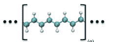

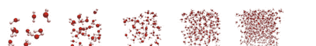

图 4.10 一维烯烃和三维水立方体测试系统。烯烃长度从 24 到 706 个碳原子不等，水立方体范围从 10 到近 850 个水分子。所有水箱均使用均匀密度


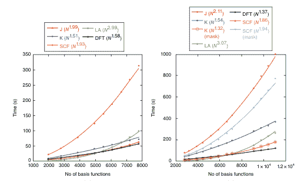

图 4.11 (a) 线性烷烃和 (b) 立方水簇的首次 SCF 迭代耗时（秒）。总时间进一步细分为 J-Engine、K-Engine、距离掩码 K-Engine、线性代数 (LA) 和距离掩码 (mask) K-Engine。对于水簇，同时显示了朴素和距离掩码 (mask) K-Engine 的总 SCF 时间。所有计算均使用单块 Tesla M2090 GPU 和 6-31G 基组进行。幂拟合显示随系统规模增加的缩放关系，每个拟合的指数在图例中给出。（有关本图颜色表示，请参见插图）

成为主要瓶颈。这对于低维系统尤其如此，由于密度矩阵的稀疏性，Fock 矩阵构建特别高效。然而，对于更一般的 3D 簇，在超过 10,000 个基函数后，线性代数仍占总时间的一小部分。如果能采用更高效的掩码 K-Engine，线性代数占主导地位的交叉点将转移到约 8000 个基函数。

尽管烷烃测试系列中每个基函数的时间较低，但整体缩放与水箱计算一致。这一行为是很好的证据，表明我们已进入大系统的渐近体系，其中物理系统的维度应影响前因子而非指数。在 GPU 上轻松达到此交叉点本身就值得注意。更值得注意的事实是，K-Engine 表现出次二次缩放，而不强加线性缩放交换算法中常见的任何假设或簿记机制，例如邻居列表 [2, 5, 36, 37]。在交换元素上进一步施加简单的距离掩码，为绝缘系统提供了有效的线性缩放方法。掩码 K-Engine 的 SCF 缩放进一步体现了线性代数计算对整体效率的影响。随着 J- 和 K-Engine 变得更高效，LA 的 N^3 缩放在大系统中变得显著更占主导地位。通过比较带有和不带筛选计算的每个水簇的最终收敛绝对 SCF 能量，证实了基于距离的交换筛选近似的有效性。在所有考虑的系统中，绝对总电子能量的精度优于 0.1 mHartree，远在化学用途所需的精度范围内。

我们的 GPU J-Engine 随系统规模呈二次缩放，这与上述缩放分析吻合。进一步加速需要修改长程库仑势，例如，通过分解为多极展开 [38]。将图 4.11 以外的情况外推，对于超过 12,000 个基函数的水簇，这可能变得必要，届时 J-Engine 最终将成为 Fock 矩阵构建中的主导组件。至于 DFT，GPU 交换-相关方法表现出线性缩放，与 CPU 代码中已实现的缩放效率相匹配，如下文所示，性能大幅提升。

通过将 CUDA 网格在 y 维度上分割为等大块，可以轻松实现多 GPU 上的 Fock 矩阵构建并行化。对于小系统，此策略效率低下，因为它使主机与设备之间传输数据以及启动 GPU 内核的延迟加倍。对于大系统，此类延迟与内核执行时间相比可忽略不计，该分割策略变得越来越高效，如图 4.12 所示。

代码的缩放效率为算法及其实现的质量提供了有用的检查。然而，对于实际应用，绝对性能要重要得多。为了评估 GPU 在量子化学中的整体实用性，我们再次使用在 B3LYP 和 6-31G 理论水平下处理的水箱测试用例。我们现在不再使用单块 GPU，而是使用四块卡，涵盖两种 GPU 架构：Tesla M2090 和更新的 GTX Titan。值得注意的是，立方水簇上 1533 个原子的单点能量计算整个 SCF 过程仅需 2.47 小时，而从头算动力学（需要对多个激发态进行数千次单点评估）至少可行到包含下文讨论的纳米星树枝聚合物的 2876 个基函数。

作为比较点，相同的计算使用 GAMESS 程序中可用的 CPU 实现进行。积分忽略阈值和 SCF 收敛标准等参数尽可能与之前的 GPU 计算匹配。CPU 计算也在双路至强 X5680 3.33 GHz 服务器上可用的所有八个 CPU 核心上并行化。图 4.13 显示了 GPU 实现相对于 GAMESS 在首次 SCF 迭代（包括 Fock 矩阵构建和对角化，后者在两种代码中均在 CPU 上执行）中的加速比。在小结构上，两种 GPU 模型的性能相似

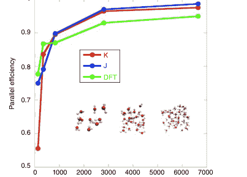

图 4.12 基于水簇首次迭代时间的 J-Engine、K-Engine 和交换-相关 Fock 矩阵构建的多 GPU 并行效率，在 2 块 M2090 GPU 上运行

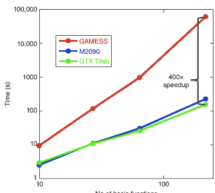

图 4.13 TeraChem 在八个 CPU 和四个 GPU 上的总 SCF 时间，相对于八个 CPU 上 GAMESS 的水簇

适用于烷烃和水簇。然而，GTX Titan 在 100 个轨道以上表现出显著更大的加速比，并在所考察的最大系统中达到 400 倍。在 Fock 矩阵构建期间，我们的 GPU 实现中 CPU 核心处于空闲状态。也可以为 CPU 保留一些工作 [39]，但考虑到 GPU 实现的性能优势，这只能带来非常小的性能提升。

大分子在气相和凝聚相中的动力学和激发态性质在广泛的科学领域中备受关注。此外，在蛋白质和溶剂环境中对大色团进行理论研究，对于理解许多生物系统的复杂反应机制和宏观行为是必要的。GPU 量子化学方法有望首次使对这类系统的定量研究成为可能。这里，使用 300 K 的基态从头算分子动力学（AIMD），采用基态 DFT 进行构象采样，并使用线性响应 TDDFT 计算单点激发能，计算了大型光收集苯环哌啶树枝聚合物的吸收光谱。计算采用带有 6-31G 基组的程修正杂化交换-相关泛函（ωPBEh）。该树枝聚合物名为纳米星，最初由 Moore 及其同事合成 [40]，其光学性能在文中得到了表征。然而，这是首次在相关激发能范围内对整个大分子计算光学吸收光谱。为了收敛图 4.14 所示光学吸收光谱的详细结构，在 50 ps MD 轨迹中每 20 fs 采样一次包含 20 个最低激发态的单点 TDDFT 激发。这导致了大约 2500 个单独的激发态计算，外加构成 MD 轨迹时间步的 250,000 个基态计算。

与实验光谱的比较显示，两个高能吸收峰的相对位置以及绝对激发峰最大值与实验相差在 1.0 eV 以内，吻合良好。最低能量峰在实验中约为 2.70 eV（计算为 3.28 eV），归因于聚焚核心上的激发。下一个更高能量的峰归因于共轭

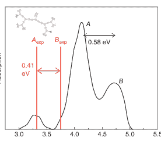

图 4.14 纳米星树枝聚合物的吸收光谱，带有外围色团吸收峰，在真空中计算（A,B）并在 300 K 的正己烷中实验测量（$A_{exp}, B_{exp}$）

支段，由于与支段长度相关的不同激子离域程度而能量不同。光谱中标记为 A、B 的两个峰与 300K 的实验测量进行了比较。相应的计算和实验吸收峰之间的绝对能量相差 0.7 eV（这是所使用的交换-相关函数不完善的结果），A-B 能量差异吻合良好，表明单激发态之间的能隙在 TDDFT 中得到相对良好的描述。这些结果表明 GPU 有潜力为大分子光学性质的预测和发现开辟新途径。

## 4.8 结论与展望

大规模并行架构为使用原子中心高斯基组的电子结构和 AIMD 计算提供了巨大的性能。如上所示，对于大系统，可能实现数个数量级的加速。考虑到在峰值理论性能方面，GPU 相对于最近的 CPU 仅享有 4–8 倍的性能优势，这令人惊讶。显然，许多 CPU ERI 代码仅实现了峰值性能的一小部分。关联电子结构方法，如耦合簇或 RI-MP2，提供了很好的对比。这些方法通常用线性代数例程来表述，这些例程经过了广泛的汇编级优化，并在现代 CPU 上实现了峰值性能的高百分比。因此，当移植到 GPU 时，加速比相当适度，约为 4–6 倍 [41–46]。

关于 GPU 加速最重要的可能不是原始性能，而是这种性能是通过用高级语言编写的代码实现的这一事实。鑒于 ERI 评估的复杂性，积分代码不太可能从不可移植的手工优化汇编中受益。这限制了 CPU ERI 代码只能达到总理论性能的一小部分。另一方面，尽管我们的 ERI 例程基本上用 C 语言表达，GPU 却能实现峰值性能的更高比例。也许未来会看到 CPU 硬件适应这种面向流处理器的新范式，并为许多科学应用提供大幅提升的性能。确实，我们相信 CPU 上可用的 CUDA 框架将是朝着这个改进性能迈出的重要一步。


GPU使得对包含数百个原子的系统进行从头计算成为常规操作，从而能够对整个蛋白质[47, 48]及其他感兴趣材料进行第一性原理分子动力学模拟。因此，DFT计算开始渗透到几年前仅适用于半经验甚至经验力场的应用领域。GPU加速可以与许多其他加速技术相结合，例如AIMD中的多时间尺度积分[49]，以进一步增加计算可行的SCF胞尺寸和时间尺度。超越SCF计算，电子结构代码传统上放弃了具有低效积分评价的原子轨道基组，转而依赖高效线性代数例程。然而，高效积分代码为改进的AO-直接方法打开了大门，这将大大增加可用关联方法处理的系统规模。

## References

- 1. Challacombe, M. 和 Schwegler, E. (1997) Fock矩阵的线性缩放计算。*化学物理学杂志*, **106** (13), 5526-5536.
- 2. Burant, J.C., Scuseria, G.E. 和 Frisch, M.J. (1996) 大分子Hartree-Fock交换计算的线性缩放方法。*化学物理学杂志*, **105** (19), 8969-8972.
- 3. Schwegler, E. 和 Challacombe, M. (1996) Hartree-Fock交换矩阵的线性缩放计算。*化学物理学杂志*, **105** (7), 2726-2734.
- 4. Schwegler, E., Challacombe, M. 和 Head-Gordon, M. (1997) Fock矩阵的线性缩放计算 2. 交换积分的严格界限和增量Fock构建。*化学物理学杂志*, **106** (23), 9708-9717.
- 5. Ochsenfeld, C., Kussmann, C. 和 Head-Gordon, M. (1998) Hartree-Fock型交换矩阵的线性和亚线性构建。*化学物理学杂志*, **109** (5), 1663-1669.
- 6. Daw, M.S. (1993) 基于密度矩阵的固体能量学现代方法。*物理评论B* **47** (16), 10895-10898.
- 7. Li, X.P., Nunes, R.W. 和 Vanderbilt, D. (1993) 具有线性系统尺寸缩放的密度矩阵电子结构方法。*物理评论B* **47** (16), 10891-10894.
- 8. Rubenstein, E.H., Rudberg, E. 和 Salek, P. (2008) 具有严格误差控制的密度矩阵净化。*化学物理学杂志*, **128** (7), 074106.
- 9. Ry, J., Dupuis, M. 和 King, H.F. (1983) 使用Rys求积法计算电子排斥积分。*计算化学杂志*, **4** (2), 154-157.
- 10. Yasuda, K. (2008) 图形处理器上的双电子积分评价。*计算化学杂志*, **29** (3), 334-342.
- 11. Asadchev, A., Allada, V., Felder, J. 等 (2010) 图形处理器上最高G型函数的无收缩Rys求积法实现。*化学理论与计算杂志*, **6** (3), 696-704.
- 12. Ufimtsev, I.S. 和 Martinez, T.J. (2008) 图形处理器上的量子化学 1. 双电子积分评价策略。*化学理论与计算杂志*, **4** (2), 222-231.
- 13. McMurchie, L.E. 和 Davidson, E.R. (1978) 笛卡尔高斯函数上的一电子和双电子积分。*计算化学杂志*, **26** (2), 218-231.
- 14. Parr, R.G. 和 Yang, W. (1989) *原子和分子密度泛函理论*, 牛津大学出版社, 牛津.
- 15. Szabo, A. 和 Ostlund, N.S. (1982) *现代量子化学*, 麦格劳-希尔, 纽约.
- 16. Helgaker, T., Jorgensen, P. 和 Olsen, J. (2000) *分子电子结构理论*, 约翰·威利父子, 纽约.
- 17. Boys, S.F. (1950) 电子波函数 1. 任何分子系统稳定态计算的一般方法。*伦敦皇家学会学报A*, **200** (1063), 542-554.
- 18. Whitten, J.L. (1973) 库仑势能积分及其近似. 化学物理学杂志, 58 (10), 4496–4501.
- 19. NVIDIA (2013) CUDA C编程指南. 在设计指南 [在线] NVIDIA公司, docs.nvidia.com (访问于 2014年3月7日).
- 20. Ufimtsev, I.S. 和 Martinez, T.J. (2008) 量子化学的图形处理器. 科学与工程中的计算, 10 (6), 26–34.
- 21. Titov, A.V., Ufimtsev, I.S., Martinez, T., 和 Dunning, T.H. (2010) GPU上d及更高角动量函数的分子积分计算. 美国化学学会论文摘要, 240.
- 22. Almlöf, J., Faegri, K., 和 Korsell, K. (1982) LCAO-MO从头计算的直接SCF方法原则. 计算化学杂志, 3 (3), 385–399.
- 23. Ufimtsev, I.S. 和 Martinez, T.J. (2009) 图形处理器上的量子化学 2. 直接自洽场实现. 化学理论与计算杂志, 5 (4), 1004–1015.
- 24. Hamdi, G.R. 和 Almlöf, J. (1995) 高斯乘积基组中的库仑算符. 化学物理快报, 246 (4–5), 364–370.
- 25. Kussmann, J. 和 Ochsenfeld, C. (2013) 线性缩放精确交换计算中矩阵元的预选择筛选. 化学物理学杂志, 138 (13), 134114.
- 26. Yasuda, K. (2008) 使用图形处理器加速密度泛函计算. 化学理论与计算杂志, 4 (8), 1230–1236.
- 27. Becke, A.D. (1988) 多原子分子的多中心数值积分方案. 化学物理学杂志, 88 (4), 2547–2553.
- 28. Levine, B. 和 Martinez, T.J. (2003) 为计算化学劫持PlayStation 2. 美国化学学会论文摘要, 226 (U426).
- 29. Asadchev, A. 和 Gordon, M.S. (2012) 使用Rys求积法的双电子积分混合精度评价. 计算物理通报, 183 (8), 1563–1567.
- 30. Luehr, N., Ufimtsev, I.S., 和 Martinez, T.J. (2011) 图形处理器(GPU)上电子排斥积分评价的动态精度. 化学理论与计算杂志, 7 (4), 949–954.
- 31. Kahan, W. (1965) 关于减少截断误差的进一步评论. ACM通讯, 8 (1), 40.
- 32. Ufimtsev, I.S. 和 Martinez, T.J. (2009) 图形处理器上的量子化学 3. 解析能量梯度、几何优化和第一性原理分子动力学. 化学理论与计算杂志, 5 (10), 2619–2628.
- 33. Isborn, C.M., Luehr, N., Ufimtsev, I.S., 和 Martinez, T.J. (2011) 图形处理器上基于构型相互作用单替换和Tamm–Dancoff时依赖密度泛函理论的激发态电子结构. 化学理论与计算杂志, 7 (6), 1814–1823.
- 34. Drew, A. 和 Head-Gordon, M. (2005) 大分子激发态计算的单参考从头方法. 化学评论, 105 (11), 4009–4037.
- 35. Davidson, E.R. (1975) 大实对称矩阵少量特征值及其对应特征向量的迭代计算. 计算物理学杂志, 17 (1), 87–94.
- 36. Schwegler, E. 和 Challacombe, M. (1999) Fock矩阵的线性缩放计算 IV. 多极加速的交换矩阵构建. 化学物理学杂志, 111 (14), 6223–6229.
- 37. Neese, F., Wennmohs, F., Hansen, A., 和 Becker, U. (2009) 高效、近似和并行Hartree-Fock及混合DFT计算。Hartree-Fock交换的“球链”算法. 化学物理, 356 (1–3), 98–109.
- 38. White, C.A. 和 Head-Gordon, M. (1994) 快速多极方法的推导与高效实现. 化学物理学杂志, 101 (8), 6593–6605.
- 39. Asadchev, A. 和 Gordon, M.S. (2012) Hartree-Fock的新多线程混合CPU/GPU方法. 化学理论与计算杂志, 8 (11), 4166–4176.
- 40. Devadas, C., Bharathi, P., 和 Moore, J.S. (1996) 树枝状大分子中的能量转移：分子尺寸效应与能量梯度的作用. 美国化学会志, 118 (40), 9635–9644.
- 41. Olivares-Amaya, R., Watson, M.A., Edgar, R.G. 等 (2010) 使用图形处理器和混合精度矩阵乘法库加速关联量子化学计算. 化学理论与计算杂志, 6 (1), 135–144.
- 42. Vogt, L., Olivares-Amaya, R., Kermes, S. 等 (2008) 使用图形处理器加速恒等式分解二阶Møller–Plesset量子化学计算. 物理化学杂志A, 112 (10), 2049–2057.
- 43. DePrence, A.E. 和 Hammond, J.R. (2011) 图形处理器上的耦合簇理论 I. 耦合簇双替代方法. 化学理论与计算杂志, 7 (5), 1287–1295.
- 44. Bhaskaran-Nair, K., Ma, W.J., Krishnamoorthy, S. 等 (2013) 异构CPU-GPU系统上的非迭代多参考耦合簇方法. 化学理论与计算杂志, 9 (4), 1949–1957.
- 45. DePrence, A.E., Kennedy, M.R., Sumter, B.G., 和 Sherrill, D.C. (2014) 图形处理器上的密度拟合单替代和双替代耦合簇. 分子物理学, 112, 844–852.
- 46. Ma, W.J., Krishnamoorthy, S., Villa, O., 和 Kowalski, K. (2011) 基于GPU的非迭代正则化CCSD(T)修正实现：强关联系统的应用. 化学理论与计算杂志, 7 (5), 1316–1327.
- 47. Kulik, H.J., Luehr, N., Ufimtsev, I.S., 和 Martinez, T.J. (2012) 蛋白质结构的从头量子化学. 物理化学杂志B, 116 (41), 12501–12509.
- 48. Ufimtsev, I.S., Luehr, N., 和 Martinez, T.J. (2011) 来自从头分子动力学的溶剂化蛋白质中的电荷转移和极化. 物理化学快报, 2 (14), 1789–1793.
- 49. Luehr, N., Markland, T.E., 和 Martinez, T.J. (2014) 从头分子动力学中的多时间步积分器. 化学物理学杂志, 140, 084116.


# 基于Slater型轨道的密度泛函理论GPU加速

Hans van Schoot 和 Lucas Visscher

¹Scientific Computing & Modeling NV，理论化学系，Vrije Universiteit，阿姆斯特丹，荷兰 ²阿姆斯特丹多尺度建模中心（ACMM），理论化学系，VU University Amsterdam，阿姆斯特丹，荷兰

在本章中，我们描述了为阿姆斯特丹密度泛函（ADF）程序开发的基于Slater型轨道（STOs）的密度泛函理论（DFT）计算的GPU加速。该实现专注于加速ADF中的数值积分步骤，该步骤在现有实现中消耗了大部分CPU时间。

## 5.1 背景

DFT已成为量子化学的主力工具，广泛用于优化分子结构、研究反应能和能垒以及计算分子响应性质[1–3]。为分子系统开发的大多数DFT实现使用以原子为中心的基函数，通常采用高斯型轨道（GTOs），因为这些有助于计算库仑相互作用（参见第4章）。能够解析计算双电子积分，从而超过了高斯轨道方法的缺点，例如其在长距离处的错误衰减以及在表示核尖点方面收敛缓慢[4]。一个有趣的替代方案是使用STOs，它们随与原子核的距离呈指数衰减，并更紧密地模拟精确的电子波函数。这导致随基组大小加快收敛，因此有可能使用更小的基组[5]。使用STO基组的众所周知的缺点在于多中心双电子积分的计算，因为没有可用的解析表达式。因此，应通过使用密度拟合和数值积分技术来避免这些积分，更加强调拟合方法的准确性和所使用的积分网格。然而，后者也用于计算交换-相关（XC）势的矩阵元素，这是一个通常比相对平滑的库仑势更难以积分的函数。与GTO实现相比，STO方法对于非混合泛函因此在计算上具有竞争力，因为大部分工作与XC泛函的数值积分（以及对于大系统而言，Fock矩阵的对角化）相关，这些步骤是两种方法共有的。

在本章中，我们将重点介绍ADF [6-8]用于数值积分的GPU实现，尽管所讨论的算法也应适用于带有高斯基组的程序中XC能量表达式及其导数的计算。在此步骤中，我们发现计算成本与网格点数之间几乎呈线性缩放，而网格点数又取决于计算中所需的数值精度。所有计算始终使用双精度完成，因为单精度积分会产生过多的数值噪声，无法在所采用的积分方案中使用。

ADF程序使用Fortran编写，自20世纪70年代以来一直在持续开发。这导致了非常多的功能、使用MPI适应并行架构，以及针对计算中大部分计算密集型部分的高度优化的CPU代码。这使得ADF成为GPU加速的一个挑战性目标，因为代码显然太大，无法从头开始编写GPU实现，而且，此外，不允许仅将几个关键例程移植到GPU。考虑到这一点，我们决定专注于通过在允许GPU和CPU协同工作的混合计算方案中将数值积分移至GPU，来加速库仑和交换-相关Fock矩阵元素的计算。因此，我们需要针对多个数值积分例程，这些例程专门用于例如在自洽场（SCF）循环中或在时间依赖密度泛函理论（TDDFT）方程的迭代求解中计算Fock矩阵。这些例程都略有不同，但可以利用类似的混合计算设计。

## 5.2 理论和CPU实现

在本节中，我们将首先总结ADF中使用的DFT和SCF方法，然后更详细地讨论CPU实现，这是GPU适配的起点。关于量子化学背景下DFT和SCF程序的介绍可以在第3章或标准教科书中找到（参见，例如，[9]或[10]）。ADF中线性缩放SCF方法的原始实现已在其他地方详细描述[11]，此后基本保持完整，同时允许容纳各种新发展，例如解析频率[12]和各种分子性质[13]。

### 5.2.1 Fock矩阵的数值求积

所有计算中使用的关键算法是使用SCF程序确定分子轨道和电子密度矩阵。对于非混合DFT计算，使用构成分子的片段的电子密度的替代形成一个良好的起始密度（默认情况下为原子，但也可以使用分子片段）。对于混合DFT，还需要对轨道进行起始猜测，使用正交归一化轨道的片段密度矩阵的叠加。在两种情况下，通常在几十次SCF迭代后即可获得足够收敛的结果。

SCF迭代中最耗时的部分是构建Fock矩阵。Fock矩阵元素通过三维（3D）数值积分[14]使用(5.1)计算，其中\(\{\phi\}\)表示基组，\(V(r_i)\)表示包含库仑势和交换-相关势的势能算子：

\(F_{\mu\nu} = -\int \phi_\mu(r_i)V(r_i)\phi_\nu(r_i)dr_i \approx \sum_k^N W_k \phi_\mu(r_i)V(r_i)\phi_\nu(r_i).\) (5.1)

由于矩阵元素\(F_{\mu\nu}\)的数量与原子轨道数\(N_{ao}\)呈二次缩放，而积分点数\(N_G\)呈线性缩放，因此此步骤的成本在形式上随系统大小呈立方增加。忽略被积函数的一个或多个贡献者变得可忽略不计的积分网格点，可以降低这种不利的高缩放。虽然这种近似可以大幅减少应执行的浮点运算次数，并且理想情况下将随系统大小的缩放在渐近极限中降至线性，但它也在算法中引入了检查和分支，从而可能影响可达到的峰值性能。通过尽可能对整批网格点进行操作，并在代码的最内层部分保持易于优化的简单算法，将此类不希望的副作用降至最低。

为了尽可能减少运算次数，我们可以通过将权重因子\(W_k\)和势值\(V_i\)组合为加权势值\(O_i = W_i V(r_i)\)来重写Eq. (5.1)的第二部分。这些加权势值可以对每个\(\mu\)和\(\nu\)的组合重复使用，从而将积分简化为

\(F_{\mu\nu} = -\sum_k \phi_{\mu k} O_k \phi_{\nu k}.\) (5.2)

通过引入辅助矩阵\(A_{i,k} = O_i \phi_{i,k}\)，Equation (5.2)可以重写为矩阵-矩阵乘法。使用此辅助矩阵还将计算完整Fock矩阵所需的运算次数减少到\(N_{ao}N_G + 2N_{ao}^2N_G\)；这在示例5.1中得到演示。

### 示例5.1 使用临时数组减少创建Fock矩阵所需的运算次数。

```
do iBasis = 1, naos ! naos is the number of basis functions
    ! prepare the temporary array by multiplying the operator with basis function i
    do kGrid = 1, nGrid ! nGrid is the number of grid points
        temp(kGrid) = operat(kGrid)*basval(kGrid,iBasis)
    end do
    do jBasis = 1, naos
        ! loop over all gridpoints, and multiply temp with basis function j
        do kGrid = 1, nGrid
            FockMat(Basis,iBasis) += temp(kGrid) * basval(kGrid,Basis)
        end do
    end do
end do
```

### 5.2.2 CPU代码SCF性能

ADF程序可能进行的多种不同类型计算中共享的一个共同元素是针对给定的固定分子结构确定Kohn-Sham轨道。对于这些所谓的单点计算，计算成本可以分为三个主要部分：SCF准备（~5–15%）、SCF循环（70–80%）和总键合能计算（~15%）。


表 5.1 在 ADF 中对布德索尼德分子（C26H34O6）进行单点 DFT 计算的时间详情，使用 Becke 类型网格、TZ2P 基组、GGA BLYP 泛函以及冻核“小”设置。

| 积分网格精度 | 总时间 | SCF 循环 | 总 focky | 数值积分 | 生成势 | 其他 |
|---|---|---|---|---|---|---|
| **计算开销（秒）** | | | | | | |
| 标准 | 136.8 | 100.7 | 82.0 | 47.1 | 23.5 | 11.4 |
| 良好 | 274.7 | 197.2 | 179.1 | 115.6 | 47.4 | 16.1 |
| 很好 | 710.8 | 544.0 | 518.7 | 338.2 | 145.5 | 35.0 |
| **总时间百分比** | | | | | | |
| 标准 | 100% | 74% | 60% | 34% | 17% | 8% |
| 良好 | 100% | 72% | 65% | 42% | 17% | 6% |
| 很好 | 100% | 77% | 73% | 48% | 20% | 5% |

如表 5.1 所示，SCF 循环中大部分时间用于计算 Fock 矩阵，而 Fock 矩阵计算中最大部分时间花费在数值积分例程中。对于高精度网格，Fock 矩阵元素的数值积分占据了近 50% 的计算开销。

由于 Fock 矩阵是厄米矩阵（未包含轨道-轨道耦合的计算中为实对称矩阵），仅利用对称性 \(F_{\mu\nu} = F_{\nu\mu}\) 计算一半矩阵元素即可得到完整矩阵。这使计算开销和内存占用降低 2 倍，但会使对原子轨道的循环稍微复杂一些。对于网格点的循环，采用每批 128 个点的分区方式，以优化缓存内存使用，并便于使用 MPI 进行并行化。每个 MPI 进程处理自己的一组批次，最大限度地减少 CPU 核心和集群节点之间的通信需求。由于网格点批次始终包含空间上定位的点，可以采用距离截断来加速计算。具体做法是仅计算该批次中取值足够大的基函数子集上的矩阵元素，忽略在该批次中取值接近零的所有函数 [8]。这些活跃基函数的数量 \(N_{act,op}\) 取决于系统的几何结构、基组以及系统中的原子类型，对于大型系统将趋近于一个常数。对于典型的 ADF 系统，\(N_{act,op}\) 的数量级为 100–700 个基函数，使用这些距离截断可以有效降低 \(N_{orb}\) 的缩放（当 \(N_{orb} > 10\) 或更多时），因为操作数量与已减少到 \(N_{act,op} + 2N_{act,op}N_{orb}\) 的完整函数数量成比例。

虽然在进入算法内层循环之前丢弃完整函数是最有效的，但可以通过考虑进入 Eq. (5.1) 积分的两个函数的组合来获得额外的加速。如果当前网格点批次中 \(\phi_\mu\) 和 \(\phi_\nu\) 的最大值乘积小于阈值 \(T\)，即 \(\max(\phi_\mu)\max(\phi_\nu) < T\)，则它们对 Fock 矩阵元素 \(F_{\mu\nu}\) 的贡献可以忽略不计。与用于按网格点批次选择基函数的定位效应相比，这是一种次要的加速，但该检查所需时间可忽略不计，因为这些最大值已从基函数选择例程中可得。

原则上，Eq. (5.2) 的收缩可以通过使用厂商优化库作为矩阵乘法来完成，但这会为每次矩阵乘法中相对较少的操作数（由于与线性缩放截断相关的所有优化）带来额外开销。当前 Fortran 代码在 Xeon E5-2620 CPU 的单核上大约达到 45 亿次浮点运算每秒（GFLOPS），而 MKL DGEMM 的峰值性能约为 14 GFLOPS。然而，为了我们的目的，库例程的这种更高速度只能通过放弃上述某些优化来实现，这将导致需要执行更多的 flops 并且整体性能更差。

对于表 5.1 中所示的具体示例，即对布德索尼德进行单点计算，超过一半的计算时间由例程 focky 用于创建 Fock 矩阵。在 focky 执行的步骤中，18% 用于在积分网格上计算 GGA 势，9% 用于计算库仑势，65% 用于数值积分（Eq. (5.2）本身。剩余时间用于将不同 CPU 核心的结果合并为单个矩阵。

ADF 分析频率代码中执行的数值积分与上述内容类似。程序随后需要计算 Fock 矩阵的几何导数。这需要生成完整的扰动 Fock 矩阵，因为该矩阵不再需要是厄米矩阵或实对称矩阵。这将重点更多地转移到积分步骤，这一趋势因每个几何导数在网格中部分复用算符和基函数值而得到加强。两个 Fortran 模块 M_bas 和 M_bas_mat 包含多个例程，用于计算基函数及其导数的不同组合。M_bas 是较低级别的模块，提供生成基函数值和数值积分的例程，而 M_bas_mat 是较高级别的模块，通过调用 M_bas 和其他一些模块的例程来计算 Fock 矩阵。

计算分析频率时，约 65% 的计算开销位于名为 f1a1_aa_gga 的例程中，该例程计算 Eq. (5.3) 中所示的 Fock 矩阵导数。它将约 80-85% 的时间用于数值积分，剩余 15-20% 用于在网格上生成算符和基函数（及其导数）的值：

\( F_{\nu\mu}^{(1)} \sim \sum_k \sum_d W_k [\nabla_\mu \phi_\nu(r_k)] V_d(r_k) \phi_\nu(r_k) \quad (5.3) \)

此积分与 focky（Eq. (5.1)）中使用的积分非常相似，并使用相同的线性缩放和操作效率参数进行优化。

## 5.3 GPU 实现

在本节中，我们首先将确定使用 GPU 加速 ADF 软件包所需的硬件和软件要求。接着，我们将描述为数值积分开发的 CUDA 代码并分析其性能，随后介绍用于加速 ADF 的混合计算方案。最后，我们将把 GPU 加速的 ADF 代码与参考 CPU 代码在实际模拟中的性能进行比较。

### 5.3.1 硬件和软件要求

如前一节所述，我们需要具有高双精度（DP）性能的 GPU 设备，因为单精度会产生过多的数值噪声。Nvidia Fermi Tesla 系列（包括 C2050/2075 和 M2090 型号）是最早具有高 DP 峰值性能（~500 GFLOPs）的 GPU 之一。下一代称为 Kepler，在撰写本文时，拥有三款 Tesla 型号：K10、K20 和 K40。K10 具有超过 4.5 TFLOPs 的单精度性能，但仅约 190 GFLOPs 的 DP 性能。K20 和 K40 面向双精度，可实现超过 1000 GFLOPs 的 DP 性能，而六核 Intel Xeon E5-2620 仅能达到约 90 GFLOPs。ADF 中用于 GPU 加速的当前 CUDA 代码是在 C2050 和 C2075 Tesla 设备上开发的，但也可在较新的 K20 和 K40 上运行。

Nvidia cuBLAS 库中实现的用于矩阵乘法的 LAPACK 例程 DGEMM 在 Fermi Tesla 代上可达到约 300 GFLOPs，约为理论峰值性能的 60%。该 DGEMM 代码经过高度优化，因此对于使用 CUDA 的自制实现，我们无法期望达到类似速度。因此，Fermi 上 DGEMM 性能的一半是我们 CUDA 内核的合理目标，只有在将 **focky** 例程的其他部分移植到 GPU 后，进一步优化才有用。

在 CPU 上不使用标准 BLAS 库求解 Eq. (5.1) 的理由同样适用于 GPU，并决定了 CUDA 内核所需的特性。如果 Fock 矩阵是对称的，内核应仅计算其一半，并且应使用距离截断来减少积分网格点批次中的活跃基函数数量。在网格点批次内跳过特定基函数组合的阈值检查将在 GPU 上引入 warp 级别的分支，这是应避免的。由于这些组合的贡献按定义可忽略不计，我们在 GPU 内核中直接省略该检查。

内核应针对相对较小的问题规模进行高性能调优，因为活跃基函数的数量（在积分批次中至少有一个点取值高于阈值的函数）通常并不很大。活跃基函数的数量取决于系统，但通常约占总基函数的 25–50%。布德索尼德分子（C26H34O6）配合 TZ2P 基组的总基函数数量为 1338，因此本示例每个积分批次约有 300–700 个活跃基函数。较小的问题规模意味着只能创建相对较小的 CUDA 线程网格，使得依靠大量其他线程来隐藏内存延迟的常规做法变得低效。不使用大量线程的 CUDA 内核称为低占用率内核，它们有时比高占用率内核快得多 [15]。低占用率内核经过调优，以充分利用可用的共享内存和寄存器内存，要获得最佳性能，关键在于找到每个线程计算的值的数量、预缓存量以及 CUDA 块大小之间的最佳平衡。因此，低占用率内核通常需要修改才能在新一代 CUDA 设备上获得高性能，因为硬件资源之间的比例已发生变化。

### 5.3.2 GPU 内核代码

图 5.1 展示了用于卸载 **focky** 中数值积分的 CUDA 内核和包装例程的示意图。GPU 内核将计算分为每批八个网格点的批次以适应共享内存，并在计算循环期间预取下一次迭代使用的值，以隐藏全局内存延迟。每个线程在计算循环中计算四个 Fock 矩阵值，以增加可用于预取的时间。内核转置一组基函数值，以防止计算循环中的共享内存银行冲突。由于 GPU 在不使用辅助矩阵的情况下计算 Fock 矩阵，因此计算完整 Fock 矩阵所需的操作数为 $N_{nao}^2 N_{N_G}$。

内核由一个 C 包装例程调用，该例程负责主机与设备之间的内存传输及同步。包装例程会对基函数数组进行填充，因为内核仅接受 16 的倍数个基函数作为输入。这降低了 CUDA 内核的复杂度，也减少了 GPU 上使用的寄存器数量。包装例程使用异步复制操作将数据发送到设备，以允许共享 GPU 的不同 MPI 线程之间重叠计算和内存传输。

针对现实问题规模（布德索尼德测试系统的 300–700 个活跃基函数）优化内核很重要，而不应只关注峰值性能。表 5.2 显示了当前内核在各种问题规模和不同 GPU 设备上的性能。时间是在包装例程之外收集的，因此包括内存传输所需的时间。未将设备到主机的结果传输计入，因为只有在所有网格点批次完成后才需要执行该操作。


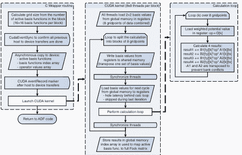

图 5.1 用于 Fock 矩阵元素数值积分的 CUDA 内核和包装例程的示意图

## 表 5.2 Nvidia Fermi 和 Kepler Tesla 硬件上 GPU 内核的速度（GFLOPS）

| N_AO | 300 | 500 | 700 | 1400 | 4000 |
|---|---|---|---|---|---|
| C2050/C2075 | 67 | 95 | 109 | 123 | 134 |
| K10 | 71 | 121 | 173 | 222 | 262 |
| K40 (boost) | 78 | 133 | 191 | 298 (352) | 348 (408) |

该内核针对 300–700 个活性基函数（N_AO）的范围进行了优化，而非针对峰值性能。

如果将内核编译为每个 CUDA 块 `16 x 16` 个线程，而非当前的 `8 x 8`，则在 Fermi Tesla 硬件上可达到略高的峰值速度，约为 `155 GFLOPS`。不过，这样做会使 300–700 个基函数区域的性能下降约 `~10%`，因此每个块 `8 x 8` 个线程是更好的选择。该内核尚未针对 Kepler 架构进行适配，但在 K20 和 K40 设备上均表现尚可。K20 与 K40 之间的性能差异源于 K40 上更多的 SMX 单元和更高的时钟频率。K40 的加速状态允许设备在功耗低于最大值时自动提高时钟频率，对于足够大的计算可提供 `17%` 的加速比。表 5.2 中显示的 GPU 性能不应直接与 CPU 代码的性能进行比较（后者在单个 CPU 核心上可达到约 `~5.6 GFLOPS`），因为如第 5.2.2 节所述，由于使用了辅助矩阵，CPU 运行时计算 Fock 矩阵元素所需的浮点运算更少。图 5.2 显示了 GPU 代码相对于 CPU 版本的性能，其依据是计算不同数量活性基函数的 Fock 矩阵所需的时间（以积分网格点的批次为单位）。

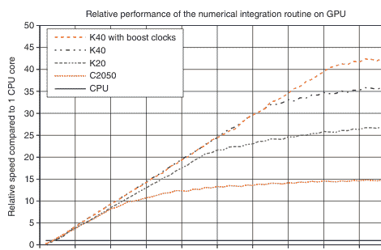

图 5.2 GPU 和 CPU 代码通过数值积分计算 Fock 矩阵贡献所需时间的比较

### 5.3.3 混合 CPU/GPU 计算方案

如第 5.2.2 节所述，Fock 矩阵的计算被划分为网格点批次，以便轻松实现 MPI 并行化。不同批次的计算之间没有依赖关系，只需将结果汇总到最终的 Fock 矩阵中。图 5.3 展示了一种混合计算方案，其中 CPU 和 GPU 同时处理 Fock 矩阵的计算。CPU 计算网格点上的基函数值、库仑势和 XC 势，随后 GPU 执行数值积分。由于启动下一批次不需要 GPU 计算的结果，因此在 GPU 处理数值积分的同时，CPU 可以继续处理下一批次。GPU 将数值积分结果存储在设备上，并在所有批次计算完成后将其传回主机内存。

数值积分工作量与在网格上计算基函数和算符值的工作量之比取决于计算设置（如网格精度、基组大小和分子系统），但大多数模拟的比例约为 `~2:1`。在诸如石墨烯片等情况下，该比例可能更低；对于具有大基组的致密金属簇，则可能更高，但对两种有机分子和两种金属簇在不同设置下的测试计算显示了这一 `2:1` 比例。因此，如果 GPU 代码的速度是 CPU 的两倍，则执行数值积分所需的时间将完全隐藏在其余 CPU 代码之后，从而消除积分瓶颈。当 ADF 在 N 个 CPU 核心上并行运行并使用机器中的 M 个 GPU 时，GPU 代码需要比单个 CPU 核心快大约 `2N/M` 倍，才能将 GPU 时间完全隐藏在其他 CPU 工作之后。现在可以使用图 5.2 来确定有多少个 CPU 核心可以共享可用的 GPU，以在后台执行数值积分。

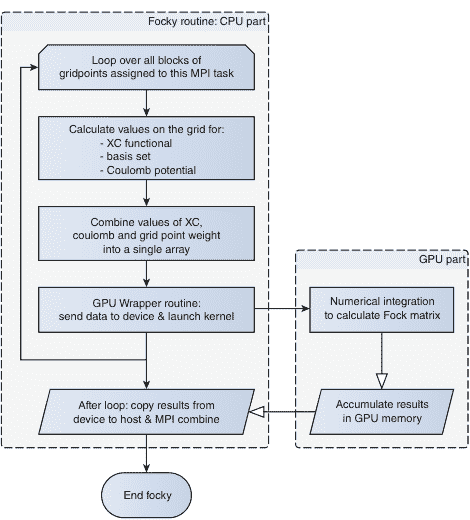

图 5.3 MPI 并行 Fock 矩阵计算的混合 CPU/GPU 算法示意图

实际应用性能略好于图 5.2 所示的加速比，因为不同 MPI 线程的 GPU 内核之间没有依赖关系。这使得硬件可以将一个 MPI 线程向设备的通信与另一个 MPI 线程的计算时间重叠。由于单队列上的串行化导致人为依赖，此效应在 Fermi Tesla 硬件上并不显著。通过引入 Kepler K20 的 HyperQ 解决了这一问题，它将调度器升级为 32 通道队列系统。这使得所有 MPI 线程都可以在设备上使用单独的硬件队列，从而可以同时运行多个积分内核和内存传输。内核并发性在虚拟上增加了设备正在处理的问题规模，这意味着当同时处理四个内核时，设备将获得类似于处理双倍规模问题的速度。图 5.2 显示，单个 K20 GPU（`~27x faster`）确实足以执行 12 个 CPU 核心的数值积分工作，而带有加速时钟的 K40 应该足以支持多达 20 个 CPU 核心。

表 5.3 在 ADF 中对布德索尼德分子（C29H42O8）使用 Becker 类型网格、TZ2P 基组、GGA BLYP 泛函和“小”冻芯设置进行 GPU 加速单点 DFT 计算的 CPU 计时

| 积分网格精度 | 总时间 | SCF 循环 | 总 Fock | 数值积分 | 生成势 | 其他 |
| :--- | :--- | :--- | :--- | :--- | :--- | :--- |
| **计算耗时（秒）** | | | | | | |
| Normal | 94.1 | 56.3 | 36.7 | 3.0 | 24.3 | 9.4 |
| Good | 170.7 | 86.3 | 67.7 | 6.7 | 49.0 | 12.0 |
| Very good | 375.7 | 194.5 | 170.6 | 14.7 | 132.5 | 23.4 |
| **相对于仅 CPU 计算的加速比** | | | | | | |
| Normal | 1.45 | 1.79 | 2.24 | | | |
| Good | 1.61 | 2.29 | 2.64 | | | |
| Very good | 1.89 | 2.80 | 3.04 | | | |

*该计算在 Intel Xeon E5-2620 CPU 的 12 个核心和一块 Nvidia K40 上执行。*

### 5.3.4 单点计算的加速结果

表 5.3 显示了启用 GPU 加速的测试计算结果，以及与表 5.1 中 CPU 计时相比的加速比。混合计算方案明显按计划运行，因为几乎没有时间花费在数值积分上。剩余的小部分主要是处理内存传输的包装例程的开销。

我们还可以估算数值积分的最小平均加速比：12 个 CPU 核心需要 338.2 秒（表 5.1）才能在“非常好”网格设置下执行数值积分，而 K40 最多用了 170.6 秒完成计算。与 12 个 CPU 核心相比，K40 快 1.98 倍；与单个核心相比，则快 23.8 倍。如果将此数字与图 4.2 中的 K40 曲线进行比较，并知道计算中的平均块包含 300 到 700 个活性基函数，我们可以得出结论：HyperQ 功能正常工作，且多个块在设备上并发计算。

### 5.3.5 解析频率计算的加速结果

在解析频率计算中，计算成本的很大一部分花费在数值积分上（参见第 5.2.2 节）。这些计算也可以使用与 SCF 用于形成 Fock 矩阵类似的混合方案进行 GPU 加速。最昂贵的部分是导数 Fock 矩阵元素的数值积分，即 Eq. (5.3)，可以使用经过略微修改的内核来执行，该内核包含对基函数几何导数的循环。出于实现简便的考虑选择了此方法，但要求 GPU I/O 执行 `3 x (3N_at x N_ao^2)` 次操作来计算完整的导数 Fock 矩阵。CPU 代码使用辅助矩阵（Eq. (3.4)），因此只需要 `SN_ao x N_oc + 2N_ao x N_oc` 次操作来计算导数 Fock 矩阵：

```
$$A_{\mu\nu} = \sum_d Q_{\mu\nu} \phi_{\mu\nu,d}^*$$ (5.4)
```

由于 GPU 代码不使用辅助矩阵，与 CPU 代码相比效率较低，这意味着只有在 CPU 核心与 GPU 设备的比例较小时，才能看到良好的加速效果。使用两个 CPU 核心和两个 GPU（一块 K20 和一块 K40）的计算将提供加速比的估计，该估计适用于现实生产环境（每个 GPU 6–8 个核心），前提是 GPU 内核被重写为使用辅助矩阵。


### 分析频率计算的耗时与加速比

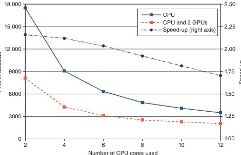

图 5.4 使用 B3LYP/TZ2P 和冻核设置“small”以及 ADF 中“good”的 Becke 网格质量，对布德索尼德分子（C$_{25}$H$_{34}$O$_4$）进行分析频率计算时黑森矩阵元素计算的耗时与加速比。

图 5.4 显示了使用 TZ2P 基组对布德索尼德分子（C$_{25}$H$_{34}$O$_4$）进行分析频率计算的耗时和加速比。使用了 GGA BLYP 泛函、冻核“small”设置以及 ADF 中“good”的 Becke 网格质量。该计算仅对 65 个原子中的 3 个进行，生成一个部分黑森矩阵，且图 5.4 仅显示了对原子核循环的耗时，因为该循环将占完整黑森矩阵总计算时间的 ~98%。因此，这些耗时对完整频率计算具有代表性。图 5.4 显示，仅使用 2 个 CPU 核心（每个 GPU 6 个 CPU 核心）时可实现 2.16x 加速比，使用 12 个 CPU 核心（每个 GPU 6 个核心）时可实现 1.70x 加速比。

频率代码中的计算采用与第 5.3.3 节中解释的相同的混合方案进行加速。唯一的区别是网格上数值积分与算子及基函数（导数）值计算之间的比率，对于 flu1_a1_gqa 例程约为 4:1。这给出了可能的 5 倍加速因子，与 flocky 例程相比略高。但是，共享一个 GPU 的 CPU 核心数量需要较低；否则，数值积分无法隐藏在 CPU 工作之后，从而降低可能的加速比。

flu1_a1_gqa 例程的耗时和加速比如图 5.5 所示。当仅使用两个 CPU 核心时，两个 GPU 上执行的所有数值积分工作都隐藏在其他 CPU 工作之后，从而实现 4.43x 加速比。预计的 5 倍可能加速比未能实现，原因是包装例程的开销增加，该例程在将数据发送到 GPU 之前会在 CPU 上重新排序输入数组。这是为了在数值积分内核中启用从全局内存进行合并数据读取所必需的，而使用 ADF 梯度代码中的当前数据结构，否则很难实现这一点。当使用 12 个 CPU 核心时，加速比降至 2.66x，表明当前 GPU 加速方案仍有改进空间。

将辅助矩阵方案引入 GPU 将是减少每个积分网格批次所需操作数量并同时解决数据结构问题的一个好方法。

### f1u1_ai_gaa 例程的耗时与加速比

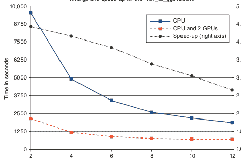

**图 5.5** 分析频率计算所需的 Fock 矩阵导数矩阵元素计算（例程 f1u1_ai_gaa）的耗时与加速比。测试系统为使用 B3LYP/TZ2P 和冻核设置“small”以及 ADF 中“good”的 Becke 网格质量的布德索尼德分子（C25H34O5）。

## 5.4 结论

ADF 软件包中使用 STO 实现的 DFT 计算，通过针对 Fock 矩阵元素数值积分的低延迟 CUDA 内核进行了加速，旨在为相对较小的问题规模获得良好性能。该内核在 Tesla Fermi 架构上实现了近 50% 的 DGEMM 性能（134 GFLOPS），并且具有足够的可移植性，在 K20 上运行速度快两倍（262 GFLOPS），在 K40 上快三倍（408 GFLOPS）。

开发了一种混合计算模型，将繁重的数值工作卸载到 GPU，同时保持 CPU 工作。如果每个 GPU 的 CPU 核心数量不过大，CPU 和 GPU 之间的工作负载平衡会使数值积分瓶颈消失。加速后的 ADF 代码在单点计算中显示出 1.45–1.89 倍的加速（取决于网格精度设置），在频率计算中显示出 1.70–2.16 倍的加速（取决于 CPU 核心与 GPU 设备的比例）。

像 ADF 这样拥有大量旧代码的软件包，GPU 加速可能是一个困难的目标，因为在合理的时间内无法将它们完全移植到 GPU。这里描述的混合方案可以成为此类情况的良好解决方案，在提供不错的加速比的同时，不牺牲使代码独特的任何功能。

ADF 中的 GPU 加速仍在进行中，有大量改进空间。在不久的将来，我们希望优化频率代码，并将加速扩展到超越 GGA 的泛函以及其他性质计算。

## 参考文献

- 1. Kohn, W., Becke, A.D. 和 Parr, R.G. (1996) 电子结构的密度泛函理论. Journal of Physical Chemistry A, 100 (31), 12974–12980.
- 2. Neese, F. (2009) 基于密度泛函理论的分子性质和分子光谱预测：从基本理论到交换耦合. Coordination Chemistry Reviews, 253 (5–6), 526–563.
- 3. Cohen, A.J., Mori-Sánchez, P. 和 Yang, W. (2012) 密度泛函理论面临的挑战. Chemical Reviews, 112 (1), 289–320.
- 4. Kutzelnigg, W. (2013) 高斯基组中的波函数展开。I. 局部与全局近似. International Journal of Quantum Chemistry, 113 (3), 203–217.
- 5. Güell, M., Luis, J.M., Solà, M. 和 Swart, M. (2008) 铁配合物自旋态能量学中基组的重要性. Journal of Physical Chemistry A, 112 (28), 6384–6391.
- 6. ADF2013, SCM, Theoretical Chemistry, Vrije Universiteit, Amsterdam, The Netherlands, http://www.scm.com (访问日期：2015 年 9 月 7 日).
- 7. Te Velde, G., Bickhaupt, F.M., Baerends, E.J. 等 (2001) 使用 ADF 进行化学研究. Journal of Computational Chemistry, 22 (9), 931–967.
- 8. Fonseca Guerra, C., Snijders, J., Te Velde, G. 和 Baerends, E. (1998) 迈向序列-N DFT 方法. Theoretical Chemistry Accounts, 99 (6), 391–403.
- 9. Atkins, P.J. (2004) 计算化学基础：理论与模型. John Wiley & Sons, 第 628 页.
- 10. Jensen, F. (2007) 计算化学导论，第 2 版. John Wiley & Sons, Chichester.
- 11. Fonseca Guerra, C., Visser, O., Snijders, J.G. te Velde, G. 和 Baerends, E.J. (1995) 阿姆斯特丹密度泛函程序的并行化. 在：计算化学的方法和技术，E. Clementi 和 C. Corongiu 编. 第 303–395 页，STEF, Cagliari. http://www.scm.com/Doc/metccc.pdf.
- 12. Wolf, S.K. (2005) 阿姆斯特丹密度泛函包中的解析二阶导数. International Journal of Quantum Chemistry, 104 (5), 645–659.
- 13. Nicu, V.P., Neugebauer, J., Wolff, S.K. 和 Baerends, E.J. (2008) 基于斯莱特型轨道密度泛函理论框架的振动圆二色性实现及其在六螺烯和七螺烯中的应用. Theoretical Chemistry Accounts, 119 (1-3), 245–263.
- 14. Franchini, M., Philipsen, P.H.T. 和 Visscher, L. (2013) 阿姆斯特丹密度泛函程序套件中的 Becke 模糊单元积分方案. Journal of Computational Chemistry, 34 (21), 1819–1827.
- 15. Volkov V. 2010 低占用率下的更好性能. GPU 技术会议论文集. GTC, http://people.cs.fsu.edu/~gerlebacher/gpus/better_performance_at_lower_occupancy_gtc2010_volkov.pdf.

# 6 大规模并行混合架构上的小波密度泛函理论

Luigi Genovese¹, Brice Videau², Damien Caliste¹, Jean-François Méhaut², Stefan Goedecker³ 和 Thierry Deutsch¹

¹Université Grenoble Alpes, INAC, F-38000 Grenoble, France, and CEA, INAC, F-38000 Grenoble, France
²Université Joseph Fourier – Laboratoire d’Informatique de Grenoble – INRIA, Grenoble, France
³Institut für Physik, Universität Basel, Basel, Switzerland

在本章中，我们描述了在 BigDFT 代码中实现的基于小波基组的密度泛函理论（DFT）计算的 GPU 加速。Daubechies 小波传统上未用于 DFT 计算，但我们展示了使它们既适用于精确又高效的 DFT 模拟的特性。在这里，我们解释了现有的 MPI 并行小波基 DFT 实现如何通过将数值密集型操作卸载到 GPU 来受益于 GPU 的计算能力。

## 6.1 关于密度泛函理论实现中小波基组的介绍性评论

量子力学和电磁学被广泛认为是通向材料和纳米系统“从头计算”方法的途径：给定适当的软件实现和足够强大的硬件，可以在不依赖任何可调参数的情况下计算性质。在 1980 年代，人们清楚地认识到，确实可以获得包括总能量、电子结构以及相关的动力学、介电、机械、磁性和振动性能在内的众多材料性质，其精度可被视为真正具有预测性。


如第 3 章所述，基于 Kohn-Sham (KS) 单粒子方法 [1] 的密度泛函理论（DFT）目前是电子结构计算中最广泛使用的方法论。近年来，KS 形式主义已被证明是预测表现出量子力学行为的材料性质和过程的最有效、最可靠的第一性原理方法之一。高精度与最常用交换-相关（XC）泛函相对简单形式的结合，使得 KS-DFT 可能成为物质性质 _从头算_ 模拟最强大的工具。因此，过去十年中，DFT 代码的国际体系得到了广泛发展，产生了大量的 DFT 代码。DFT 计算变得越来越普遍，应用领域包括固体物理、化学、材料科学、生物学和地质学。

从计算角度来看，DFT 代码最重要的特征之一是用于表示 KS 轨道的基函数集。代码的适用领域与这一选择紧密相关。例如，非定域基集（如平面波，参见第 7 章）非常适合对周期性和/或均匀体系（如晶体或固体）进行电子结构计算。它在展开定域信息方面效率要低得多，后者在倒空间中具有更广泛的分量，导致高内存需求。因此，基于平面波的 DFT 代码不适合模拟非均匀或孤立体系（如分子）。

还应区分使用系统基集和非系统基集的代码。系统基集允许在增加基函数数量时，以任意高精度计算 KS 方程的精确解。换句话说，结果的数值精度与用于展开 KS 轨道的基函数数量相关。使用这种基集，可以获得与基集选择无关的误差结果，从而消除不确定性来源。系统基集因此允许计算特定 XC 泛函的精确解。另一方面，非系统基集的示例由高斯型基函数（参见第 4 章）提供，其在收敛前必须实现过完性。此类基集更难以使用，因为基集必须仔细手动调整，有时需要对所研究体系有初步了解。这是此类流行基集最重要的弱点。

2005 年，欧盟 P6-STREP-NEST BigDFT 项目资助了一个由四个欧洲实验室组成的联盟（L_Sim, CEA Grenoble; 瑞士巴塞尔大学; 比利时鲁汶-拉-纳夫大学; 德国基尔大学），旨在开发一种基于 Daubechies 小波的 DFT 计算新方法。与其从零开始构建一个 DFT 代码，不如说，这个为期 3 年的项目的目标是测试在电子结构计算背景下新形式主义的潜在优势。

事实上，Daubechies 小波具有一组特性，使其成为精确且优化的 DFT 方法的理想选择。特别是，它们是系统的，因此为高精度结果提供了可靠的基集，而它们在实空间和倒空间中的定域性提高了处理的效率和灵活性。确实，定域基集允许为所需精度优化自由度的数量 [2]，鉴于当今所研究体系的复杂性和非均匀性，这一点非常可取。此外，基于定域函数的方法可以显式控制模拟域边界的性质，从而允许考虑复杂环境，如混合边界条件和/或带净电荷的体系。

如第 1 章所述，使用图形处理单元（GPU）进行科学计算的可能性在过去几年中引起了广泛关注。最初为家用 PC 硬件开发的一种技术，已迅速发展为可编程并行流处理器。这些设备的特性，特别是极低的价格性能比，加上相对较低的能耗，使其成为密集型科学计算的有吸引力的平台。许多科学应用最近已被移植到 GPU，例如分子动力学 [3]、量子蒙特卡洛 [4] 和有限元方法 [5]。

BigDFT 代码的数值运算非常适合 GPU 加速。一方面，3D 可分离卷积的计算性质允许编写高效例程，从而受益于 GPU 的计算能力。另一方面，BigDFT 代码的并行化方案在这方面是最优的：GPU 可以在不影响不同 MPI 进程之间通信性质的情况下使用。

在以下内容中，我们将概述已移植到 GPU 的 BigDFT 典型数值运算，并讨论 GPU 加速对部分代码段整体代码性能的影响。

## 6.2 小波基集中的算符

小波基集在电子结构计算中尚未广泛使用。迄今为止的大部分努力都致力于将其用于全电子计算。由于此基集不太常见，我们在此解释其在 KS-DFT 计算中的应用。有关小波基集如何用于数值模拟的详尽介绍，我们请读者参考 Goedecker 的工作 [6]。在以下内容中，我们总结了 Daubechies 小波的主要特性，特别关注 KS-DFT 形式主义中涉及的对象（波函数和算符）的表示。我们将首先说明一维（1D）Daubechies 小波基的原理。

### 6.2.1 Daubechies 小波基和卷积

每个小波家族包含一个缩放函数 $\phi$ 和第二个函数 $\psi$，后者恰当地称为小波。图 6.1 说明了阶数为 $2m = 16$ 的最不对称 Daubechies 小波家族，这是当前 BigDFT 代码中使用的基集。这些函数具有紧支撑 $[1 - m, m]$ 且光滑；因此在傅里叶空间中也是定域的。基集仅由缩放函数和小波函数的整数平移生成，其参数以

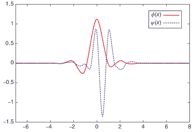

图 6.1 阶数为 $2m = 16$ 的最不对称 Daubechies 小波家族。请注意，缩放函数 $\phi(x)$ 和小波 $\psi(x)$ 仅在区间 $[1 - m, m]$ 内不为零

以网格间距 h 为单位。例如，以 x = 0 为中心、延伸为 L 的一维区间，可以由以下 N 个缩放函数集合覆盖：

```
\langle x | \phi_i \rangle \equiv \phi_i(x) = \frac{1}{\sqrt{h}} \phi \left( \frac{x}{h} - i \right), \quad i = -N/2, \dots, N/2, \quad (6.1)
```

其中 h = L/(N - 1) 是（均匀）网格间距。基集可以通过添加小波函数 $\psi_j$ 的平移来完成。这些函数构成一个正交基集：

```
\langle \phi_i | \phi_j \rangle = \delta_{ij} \equiv \langle \psi_i | \psi_j \rangle = 0. \quad (6.2)
```

任何小波基集最重要的特征与 *多分辨率* 的概念相关。该特性基于以下 *缩放方程*（或“精炼关系”）：

```
\phi(x) = \sqrt{2} \sum_j h_j \phi(2x - j); \quad \psi(x) = \sqrt{2} \sum_j g_j \phi(2x - j), \quad (6.3)
```

这些方程将某一分辨率下的小波表示与两倍于给定分辨率下的表示相关联，以此类推。根据标准命名法，$h_j$ 和 $g_j = (-1)^j h_{j-1}$ 系数的集合分别称为 *低通-* 和 *高通滤波器*。因此，小波家族完全由其低通滤波器定义。在 Daubechies-2m 小波的情况下，$j \in [1 - m, m]$。

在上述定义的基集中，函数 f(x) 的表示由

```
f(x) = \sum_{i=-N/2}^{N/2} c_i \phi(x) + \sum_{i=-N/2}^{N/2} d_j \psi(x), \quad (6.4)
```

给出，其中展开系数正式由 $c_i \equiv \langle \phi_i | f \rangle, d_j \equiv \langle \psi_j | f \rangle$ 给出。使用精炼方程 Eq. (6.3)，可以将 Eq. (6.4) 中出现的基集映射到仅包含间距为 h/2 的更精细网格上的等效基集。

*多分辨率* 性质在微分算符的小波表示中也起着根本作用。例如，可以证明动能算符的精确矩阵元素

```
T_{i-j} \equiv -\frac{1}{2} \int dx \, \phi(x) \partial^2 \phi(x) \quad (6.5)
```

等于仅取决于低通滤波器 [6] 的矩阵特征向量的元素。

Daubechies-2m 小波具有 m 个消失矩，因此任何次数小于 m 的多项式都可以通过仅对阶数为 m 的缩放函数进行展开来精确表示。对于更高阶多项式，误差为 O(h^m)，即一旦网格足够精细，误差即可忽略不计。因此，Eq. (6.4) 的表示与精确函数 f 之间的差异随 h^m 减小。由于 Daubechies-2m 小波导致的离散化误差因此由网格间距控制。在所有正交小波家族中，Daubechies 小波对于给定数量的消失矩具有最小支撑长度。

给定在均匀网格点 {x_i} 上数值已知的势 V，可以识别势矩阵元素 $V_{ij} \equiv \langle \phi_i | V | \phi_j \rangle$ 的有效近似。已证明 [2, 7] 可以定义一个四分法滤波器 {$\alpha_k$}，使得由

```
V_{ij} \equiv \langle \phi_i | V | \phi_j \rangle = \sum_k \alpha_{k-2i} V(x_k) \, \alpha_{k-2j} \quad (6.6)
```

给出的矩阵元素对势能具有最优收敛率 O(h^{2m}) 的优异精度。相同的四分法滤波器可用于表示给定其展开式的（波）函数的网格点值


用缩减函数表示的系数：

```
f(\chi_i) = \sum_k c_k \omega_{k-i} + \mathcal{O}(h^p);
```

```
c_i = \sum_k f(\chi_k) \omega_{k-i} + \mathcal{O}(h^p).
```

因此，势能可以等价地在实空间或小波空间中计算；即 \(\langle f|V|f \rangle = \sum_{i,j} U_i(\chi) V_{i,j} U_j(\chi) \equiv \sum_{i,j} U_i V_{i,j}\)。因此，求积滤波元素可以被视为网格点值 \(f(\chi_i)\) 与缩减函数系数 \(c_i\) 之间最可靠的变换，因为它们对次数最高为 \(m-1\) 的多项式提供精确结果，并且不会改变基组离散的收敛性质。滤波器 \(\{\omega_i\}\) 长度为 \(2m\)，并由缩减函数的矩明确定义（而这些矩又仅取决于低通滤波器）[8]。

使用上述公式，可以构建（迄今为止为一维的）哈密顿矩阵 \(H_{ij} = T_{ij} + V_{ij}\)。请注意，与其他离散方案（有限差分、DVR、平面波等）不同，在小波基组中，势能项和动能项都没有对角表示。相反，\(H\) 由带宽为 \(2m\) 的带矩阵表示。

### 6.2.2 Kohn-Sham 形式主义

在DFT的KS表述中，KS波函数 \(\{|\Psi_i\rangle\}\) 是KS哈密顿量的特征函数（另见第3章），带有势能 \(V_{ps}\)：

```
\left(-\frac{1}{2}\nabla^2 + V_{KS}[\rho] + V_{ps}\right) |\Psi_i\rangle = \epsilon_i |\Psi_i\rangle.
```

KS势能 \(V_{KS}[\rho]\) 是系统电子密度的泛函：

```
\rho(\mathbf{r}) = \sum_{i=1}^{N_{states}} n_i^{(o)} |\Psi_i^{(o)}(\mathbf{r})|^2,
```

其中 \(n_i^{(o)}\) 是轨道 \(i\) 的占据数。

KS势能 \(V_{KS}[\rho] = V_H[\rho] + V_{xc}[\rho] + V_{ext}\) 包含Hartree势能 \(V_H\)（泊松方程 \(\nabla^2 V_H = -4\pi\rho\) 的解）、XC势能 \(V_{xc}\) 以及作用于电子的外部离子势能 \(V_{ext}\)。在BigDFT代码中，势能项 \(V_{ps}\) 采用节能GTH-HGH势能 [9-11] 的形式，具有局部项和非局部项，\(V_{ps} = V_{local} + V_{nonlocal}\)。KS哈密顿量可以写成对波函数作用的三个算子：

```
\left(-\frac{1}{2}\nabla^2 + V_L + V_{nonlocal}\right) |\Psi_i\rangle = \epsilon_i |\Psi_i\rangle.
```

其中 \(V_L = V_H + V_{xc} + V_{ext} + V_{local}\) 是基于实空间的（局部）势能，而 \(V_{nonlocal}\) 来自势能。

与常规KS-DFT计算一样，哈密顿量的应用是最小化总能量所需自洽循环的一部分。除了常规正交化程序（其中应计算标量积 \(\langle\Psi_i|\Psi_j\rangle\)）之外，BigDFT代码中对波函数执行的另一操作是预条件化。这是通过求解亥姆霍兹方程来计算的：

```
\left(-\frac{1}{2}\nabla^2 - \epsilon\right) |\tilde{g}_i\rangle = |g_i\rangle.
```

其中 \(|g_i\rangle\) 是相对于波函数 \(|\Psi_j\rangle\)（能量为 \(\epsilon_j\)）的总能量梯度。预条件梯度 \(|\bar{g}_i\rangle\) 通过预条件共轭梯度法求解Eq. (6.12)得到。

完整的哈密顿量还包含势能的非局部部分，由于Daubechies小波的正交性，可以直接以压缩形式应用。所有这些操作的示意图见图6.3。

### 6.2.3 三维基组

对于三维描述，最简单的基组是通过在间距为 \(h\) 的网格上等间距缩减函数的乘积集合获得的：

\(\phi_{ijk}^h(\mathbf{r}) = \phi(x/h - i)\phi(y/h - j)\phi(z/h - k).\) (6.13)

换句话说，三维基函数是一维基函数的张量积。请注意，我们使用的是立方网格，所有方向的网格间距相同，但以下描述可以直接应用于一般正交网格。

Eq. (6.13) 的基组等价于在间距 \(h' = 2h\) 的两倍粗网格上的缩减函数混合基组：

\(\phi_{ijk}^{h/2}(\mathbf{r}) = \phi(x/h - i)\phi(y/h - j)\phi(z/h - k)\) (6.14)

并由一组七个小波增补：

\(\phi_{ijk}^1(\mathbf{r}) = \psi(x/h - i)\phi(y/h - j)\phi(z/h - k),\)
\(\phi_{ijk}^2(\mathbf{r}) = \phi(x/h - i)\psi(y/h - j)\phi(z/h - k),\)
\(\phi_{ijk}^3(\mathbf{r}) = \psi(x/h - i)\psi(y/h - j)\phi(z/h - k),\)
\(\phi_{ijk}^4(\mathbf{r}) = \phi(x/h - i)\phi(y/h - j)\psi(z/h - k),\)
\(\phi_{ijk}^5(\mathbf{r}) = \psi(x/h - i)\phi(y/h - j)\psi(z/h - k),\)
\(\phi_{ijk}^6(\mathbf{r}) = \phi(x/h - i)\psi(y/h - j)\psi(z/h - k),\)
\(\phi_{ijk}^7(\mathbf{r}) = \psi(x/h - i)\psi(y/h - j)\psi(z/h - k).\) (6.15)

这种等价性源于以下事实：根据Eq. (6.3)，间距为 \(h'\) 的粗网格上的每个缩减函数和小波都可以表示为精细网格水平 \(h\) 上缩减函数的线性组合，反之亦然。

因此，KS波函数 \(\Psi(\mathbf{r})\) 可以在此基组中展开：

\(\Psi(\mathbf{r}) = \sum_{l_1,j_2,k} c_{l_1,j_2,k}^0 \phi_{l_1,j_2,k}^0(\mathbf{r}) + \sum_{l_1,j_2,k} \sum_{w=1}^7 x_{l_1,j_2,k}^w \phi_{l_1,j_2,k}^w(\mathbf{r}).\) (6.16)

对 \(l_1, l_2, l_3 (j_1, j_2, j_3)\) 的求和遍历所有以缩减函数（小波）为中心的网格点。这些点分别与低分辨率级和高分辨率级区域相关联。

在模拟域中，有三类网格点：最靠近原子的点（“精细区域”）携带一维（三维）缩减函数和七个（三维）小波；离原子较远的点（“粗糙区域”）仅携带一个缩减函数，对应精细区域一半的分辨率；更远的点（“空区域”）既不携带缩减函数也不携带小波。为了确定这些不同分辨率的区域，我们在每个原子 \(a\) 周围构建两个球体：一个半径为 \(R_a^I = \lambda^I \cdot r_c^a\) 的小球，和一个半径为 \(R_a^O = \kappa^I \cdot r_c^a\) 的大球（\(R_a^O > R_a^I\)）。\(r_c^a\) 和 \(r_a^a\) 的值对每种原子类型是固定的，而 \(\lambda^I\) 和 \(\kappa^I\) 可以由用户指定

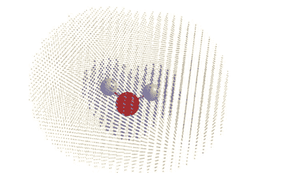

图6.2 模拟网格点

由用户指定，以控制计算的精度。精细（粗糙）区域由所有小（大）球的并集给出，如图6.2所示。因此，在BigDFT中，基组由三个用户指定的参数控制：通过增加 \(\lambda'\) 和 \(\lambda''\) 的值并减小 \(h\) 的值，可以实现总能量的系统收敛。

### 6.2.4 动能算子和局部势能

对于Eq. (6.13)中描述的纯精细缩减函数表示，对该波函数应用动能算子的结果具有展开系数 \(\delta_{i_1 i_2 i_3}^{l_1 l_2 l_3}\)，这些系数通过卷积与原始系数 \(s_{i_1 i_2 i_3}^{l_1 l_2 l_3}\) 相关：

```
\(\delta_{i_1 i_2 i_3}^{l_1 l_2 l_3} = \frac{1}{2} \sum_{i_1' i_2' i_3'} K_{i_1-i_1', i_2-i_2', i_3-i_3'}^{l_1 l_2 l_3} s_{i_1' i_2' i_3'}^{l_1 l_2 l_3 *}\)
```

其中

```
\(K_{i_1 i_2 i_3} = T_{i_1} T_{i_2} \delta_{i_1} \delta_{i_2} + \delta_{i_1} T_{i_2} \delta_{i_3} + \delta_{i_1} \delta_{i_2} T_{i_3}\)
```

并且 \(T_i\) 是Daubechies缩减函数基中一维二阶导数的滤波器（Eq. (6.5)），可以解析计算。

势能 \(V_i\) 在实空间中定义，特别是在间距为 \(h'\) 的精细网格点上。在Daubechies基中应用局部势能包括函数乘积 \(V_i(\mathbf{r})\Psi(\mathbf{r})\) 的基分解。如文献 [2, 7] 所述，以基函数的点值简单计算此乘积不够精确。通过转换到波函数系数，可以获得更好的结果，这允许通过基函数的平滑版本计算波函数在精细网格上的值。这被称为魔法滤波器变换，可以表示如下：

```
\(\Psi(\mathbf{r}_{i_1 i_2 i_3}^c) = \sum_{i_1' i_2' i_3'} \omega_{i_1-i_1'} \omega_{i_2-i_2'} \omega_{i_3-i_3'} s_{i_1' i_2' i_3'}^c\)
```


并能以更高的精度表达势的应用。换句话说，给定波函数 \(|\Psi\rangle\) 的点值被表示为，就好像 \(W(r)\) 将是具有与 \(|\Psi\rangle\) 相同的多贝奇展开系数的最平滑函数。该过程保证了最高精度（势能中为 \(O(h^{16})\)），并可以通过滤波器 \(a_i\) 的3D可分卷积在计算上表达。在应用局部势（逐点乘积）后，可以应用转置魔法滤波器变换以获得 \(V_L|\Psi\rangle\) 的多贝奇展开系数。上述描述的操作必须结合起来，以应用局部哈密顿算子 \((-\frac{1}{2}\nabla^2 + V_L(r))\)，如图6.3所示。完整的哈密顿算子还包含伪势的非局部部分，由于多贝奇小波的正交性，可以直接在压缩形式中应用。所有其他操作也可以在压缩形式中执行。特别是，正交性约束所需的重叠矩阵及其操作，是通过BLAS和LAPACK例程的合适应用实现的。

### 6.2.5 波松求解器

局部势 \(V_L\) 可以通过求解波松方程并计算交换-关联势 \(V_{xc}[\rho]\) 从局部密度 \(\rho\) 中获得。这些操作通过基于插值标度函数的波松求解器 [12] 执行，这是一组与多贝奇函数紧密相关的基函数，对静电问题最优，并允许混合边界条件。该波松求解器的描述可见 [13–15]。

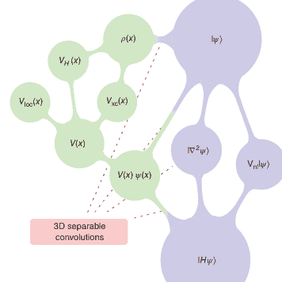

图6.3 BigDFT形式主义中哈密顿算子应用的示意图

## 6.3 并行化

我们程序的并行版本中使用了两种数据分布方案。在轨道分布方案中，每个处理器处理一个或几个轨道。处理器持有其标度函数系数和小波系数。在系数分布方案中（见图6.4），每个处理器持有所有轨道的某个系数子集。大多数操作，例如在轨道上应用哈密顿算子和预条件，都在轨道分布方案中完成。这有利于我们不必使用MPI并行化这些例程。强制梯度正交性约束的拉格朗日乘数的计算以及轨道的正交化，是在系数分布方案中完成的（图6.4）。在轨道分布方案和系数分布方案之间来回切换是通过MPI全局转置例程MPI_ALLTOALL(V)完成的。对于横截带宽 [16] 随处理器数量良好扩展的并行计算机，这种全局转置不需要太多CPU时间。另一个耗时的通信是全局归约求和，用于从各个轨道的部分电荷分布中获取总电荷分布。

在BigDFT代码的并行化方案中，通过OpenMP指令添加了另一层并行化。特别是，所有卷积和线性代数部分都可以在多线程模式下执行。这为并行化方案增加了进一步的灵活性。已经进行了多项测试和改进，以稳定多级MPI/OpenMP并行化中的代码行为。目前，通过将每个CPU（插槽）关联一个MPI进程，甚至将每个计算节点关联一个MPI进程，可以达到最佳性能，具体取决于网络和MPI库的性能。这也得益于编译器OpenMP实现的最新改进。

### 6.3.1 MPI并行性能与架构依赖性

自第一个版本以来，代码的并行化方案一直在持续测试。由于MPI通信不干扰计算，只要计算工作量比通信所需时间更繁重，整体效率仍然很高，即使是针对大量处理器的模拟也是如此 [17]。

我们评估了典型运行中特定操作所花费的时间。为此，我们对BigDFT代码用于并行计算的不同部分进行了性能分析。在图6.5中，我们展示了用于上述操作的时间百分比，针对两种不同架构的运行：法国CCRT Titane平台（Bull Novascape R422）和瑞士

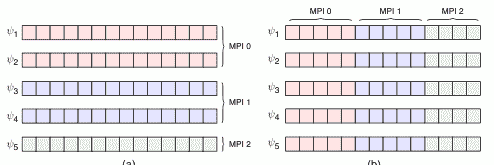

图6.4 轨道（a）和系数（b）分布方案

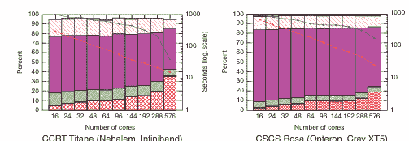

图6.5 BigDFT在不同平台上的性能比较。在CCRT机器上的运行可扩展性较差，但每个计算核心的绝对性能优于在CSCS机器上的运行（快1.6–2.3倍）。

Rosa Cray XT5系统。后者在通信方面表现更好，因此可扩展性更好。然而，就每个计算核心的绝对性能（“求解时间”）而言，前者快2倍。这主要与线性代数库（Intel MKL与Istanbul线性代数相比）和处理器的性能更好有关。这些基准测试是针对BigDFT代码使用相同的输入文件（一个包含128个ZnO原子的相对较小的基准系统）并从相同源代码开始运行而得出的。值得注意的是，在这种情况下，图6.5显示并行效率并不总是评估代码性能的有用参数。

## 6.4 GPU架构

本书前两章介绍了GPU架构概述和GPU编程入门。如前所述，GPU在许多方面与CPU有很大不同，理解其架构的特性对于编写高效的GPU代码至关重要。在此，我们首先重申几个需要牢记的核心要点，然后再解释用于利用GPU加速基于小波基的DFT计算的算法细节，并分析代码性能与基于CPU的MPI/OpenMP实现相比的情况。

GPU的第一个特性是它们是仅由CPU控制的协处理器。GPU不能单独使用，必须与CPU关联，从而形成所谓的混合架构。GPU只能访问位于其专用内存中的数据。数据必须由程序员在CPU内存和GPU内存之间显式复制。GPU和CPU通常通过PCI-express链路连接，该链路带宽相对较小且延迟较高。

1 然而，规格在不断演变，具有共享内存的配置在不久的将来可能成为标准。

在GPU中，执行单元被组织成形成多处理器的组。多处理器中的所有执行单元共享一个控制单元，因此它们同时执行相同的指令。为了利用处理器的高度并行特性，GPU程序使用细粒线程或任务。这些与CPU线程有很大不同，CPU线程通常用于在OpenMP等并行环境中编程。在GPU中，策略是拥有远多于执行单元的线程，同时为每个线程分配非常少的工作量。由于GPU可以无成本地切换线程，它可以通过在等待时处理其他线程来隐藏一个线程操作的延迟。

GPU中的内存访问也有其特殊性。CPU只有一种内存类型，并依赖缓存来加速访问。GPU并不总是有缓存，而是拥有多处理器中所有执行单元共享的快速本地内存。程序员必须显式使用这种本地或私有内存来存储需要频繁访问的数据。主内存访问也需要小心进行。内存带宽高于CPU，但延迟也更高。此外，为了获得最大内存传输速率，多处理器中的执行单元必须访问连续的内存位置。

总之，在开发GPU实现时，需要遵循以下经验法则：

- 由于通信延迟高，程序员应尽可能限制CPU与GPU之间的数据传输。
- 计算工作量应并行化为许多小块，这些小块对不同的数据执行相同的操作。
- 数据局部性对于获得良好性能至关重要，因为不同的多处理器有不同的本地内存。
- 内存访问模式应尽可能规则和一致。

### 6.4.1 使用OpenCL语言的GPU实现

GPU编程的一个主要问题是编程范式对不同架构敏感。换句话说，代码应重新编程以在不同的GPU上运行。不同供应商提供适合其特定架构的编程语言，而Nvidia的CUDA架构和编程语言 [18] 无疑在功能和成熟度方面最为先进。

我们最初使用CUDA [19] 开发了GPU加速。然而，当OpenCL规范发布时，我们将代码移植到这种语言。在撰写本文时，OpenCL BigDFT代码比旧的CUDA版本优化得更好且更完整。

OpenCL是由Khronos组 [20] 定义的开放标准。它旨在实现跨平台并行计算，GPU是OpenCL标准定义的几种设备类型之一。

OpenCL中的GPU设备由多个地址空间和一组多处理器组成。OpenCL面向数据并行任务，并以工作组（由工作项组成）的术语描述要执行的工作。在执行OpenCL函数（称为内核）时，工作项执行相同的代码。不同工作组的工作项之间的区别在于地址空间的可见性。四个地址空间是全局、局部、私有和常量。每个地址空间对应特定用途并具有不同特性。全局地址空间在每个工作组之间共享。这个地址空间通常很大，因为它对应于设备上的板载RAM。访问这个地址空间代价高昂，因为延迟高，应该线性地进行而不是随机地进行，因为连续访问可以合并为单次访问。使用全局内存的同步可以通过原子操作实现，但代价高昂且应避免。局部地址空间在工作组的所有工作项之间共享。局部内存非常快（与全局内存相比），并按存储体组织。只要访问不同的内存存储体，对局部内存的读写就是同时的。如果工作项从同一地址读取，读操作也是同时的。多处理器只有少量共享内存，因此应明智地使用。对私有内存的访问仅限于一个工作项，并用于局部变量和参数。常量内存对所有工作组可见，并针对所有工作项的同时读取进行了优化。常量内存的内容在初始化后不能修改。


必须指出，虽然 OpenCL 代码可以在不同平台（GPU、CPU 或其他受 OpenCL 支持的设备）上无需修改即可执行，但这不一定意味着针对某一平台优化的代码在其他平台上也能高效运行。然而，跨平台语言的吸引力是显而易见的：由于 OpenCL 内核在设备上和运行时编译，应用程序可以自由选择可用的最优内核实现。这意味着单个可执行文件能够在机器包含不同加速器的并行环境中执行。例如，我们在两台各配备一块 GPU 的 Intel Nehalem 四核机器上（一块 Nvidia Fermi 和一块 ATI Radeon HD 2600 XT）运行了 BigDFT 的测试。性能结果汇总于表 6.1。代码按预期运行，根据架构的特定行为，同时利用 MPI 并行性和 GPU 加速。显然，不同架构具有不同特性，计算内核应针对每种架构以不同方式优化。目前，BigDFT 中使用的是 Nvidia 优化的内核，即使在 ATI 运行中也是如此。然而，由于 OpenCL 内核在运行时编译，在生成 OpenCL 二进制文件之前可以提取一些典型参数。这包括每个内核执行的最大线程数（CUDA 块）等参数，这些参数在编译时提取。因此，代码执行变得真正异构，即每台机器最终都有不同的二进制代码。

### 6.4.2 卷积内核的实现细节

由于卷积滤波器是可分离的，可以证明所有基本的 BigDFT 卷积都可以归结为以下 1D 内核：

\(K_p(I, a) = \sum_j f(G_{p_x}(a(I - j)) + a K_{p_\perp}(I, a)) \quad \forall a, I, \quad (6.20)\)

可能结合数据转置 \(G_p(I, a) = G_{p_\perp}(a, I)\)。滤波器 \(f_j\) 和系数 \(a\) 分别等于动力学算子的 \(T_j\) 和 1，以及魔法滤波器的 \(a_j\) 和 0。

从 GPU 并行性角度来看，有一组 \(N\) 个独立的卷积需要计算。要转换的每行 \(n\) 个元素被分割为大小为 \(N_z\) 的块。显卡的每个多处理器计算一组 \(N_z\) 个不同的块，并在其计算单元上并行化计算。图 6.6 的上部面板显示了转置期间块网格上的数据分布。输入数据（左上角面板）沿 \(N\) 轴排序，而输出（右上角面板）沿 \(n\) 轴方向排序，参见 Eq. (6.20)。执行 GPU 卷积内核时，执行网格中的每个块 \((i, j)\) 与一组 \(N_z\)（\(N\) 轴）乘以 \(N_z\)（\(n\) 轴）个元素相关联。馈送到每个块的数据大小相同（以避免依赖块的处理），因此当 \(N\) 和 \(n\) 不是 \(N_z\) 和 \(N_z\) 的倍数时，不同块处理的某些数据可能重叠。这由图中的填充模式指示。标记为 \((i, j)\) 的块后面的浅灰色填充指示需要复制到共享内存以处理该块中数据的数据部分。

下部面板显示了给定块在共享内存中的数据排列。行数 \(N_y\) 被选择为半 warp 大小的除数。然后数据以 warpSize 为单位进行处理，

| MPI + | 1 | 1 + | 4 + | 1 + | 4 + | 4 + 4 + |
|---|---|---|---|---|---|---|
| Nvidia (NV)/ATI | NV | NV | ATI | ATI | | NV + ATI |
| 执行时间 (s) | 6200 | 300 | 160 | 347 | 197 | 109 |
| 加速比 | 1 | 20.7 | 38.8 | 17.9 | 31.5 | 56.9 |

两台四核 Intel Nehalem 机器连接到两块不同的 GPU 卡，一块 ATI 和一块 Nvidia。该系统是一个具有 52 个 k 点的四碳原子表面超晶胞

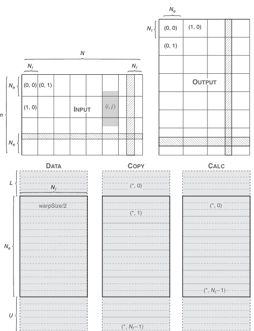

图 6.6. 上部面板：CPU 上 1D 卷积+转置的数据分布。详情见第 6.4.2 节。下部面板：上部面板中以灰色突出显示的输入数据部分的复制

warpSize，即可以同时执行的线程数（在 CUDA 术语中）。线程索引具有 (warpSize/2, N) 元素，其中 \(N_x \le 16\)（左侧面板）。半 warp i 的每组线程 (*, i) 获取一定数量的元素，用于复制数据（中心面板）或执行计算（右侧面板）。这种数据排列确保在共享内存访问期间避免银行冲突。为了计算卷积，必须在共享内存中创建大小为 \(N_x L\) 和 \(N_y U\) 的两个缓冲区。

为了在 GPU 上获得最佳性能，强烈建议将数据从全局内存传输到多处理器的共享内存。共享内存必须包含缓冲区以存储卷积计算所需的数据。所需的边界条件（在我们的情况中为周期性）在数据传输期间在共享内存中实现。每个线程计算与块关联的 \(N_y\) 元素子集的卷积。这种数据分布在图 6.6 中有示意。

### 6.4.3 GPU 卷积例程的性能

我们评估了 GPU 移植的 1D 卷积的性能，这些卷积用于局部哈密顿算子的小波实现及其 3D 对应物。为进行这些评估，我们使用了一台配备 Intel Xeon 处理器 X5472 (3 GHz) 和 Nvidia Tesla S1070 卡的计算机。BigDFT 的 CPU 版本经过高度优化，采用最佳循环展开和编译器选项。CPU 代码使用 Intel Fortran 编译器 (10.1.011) 和最激进的编译器选项 (-O2 -xT) 编译。使用这些选项，魔法滤波器卷积的运行速度约为 3.4 GFLOPS，与我们上面展示的类似。所有基准测试均使用双精度浮点数进行。

1D 卷积的 GPU 版本比其 CPU 对应物快 1–2 个数量级。我们可以实现 GPU 卷积的有效性能约为 40 GFLOPS，同时也考虑了卡上的数据传输。我们尚未接近峰值性能，因为在 GPU 上，由于转置，相当一部分时间仍花在数据传输而非计算上。这是因为数据应在输入和输出数组之间转置，而执行卷积所需的算术运算不足以隐藏所有内存传输的延迟。然而，我们稍后将展示，这些结果对我们的目的来说确实是令人满意的。

上述卷积的性能图，连同压缩-解压缩算子，在图 6.7 中作为相应 3D 数组大小的函数呈现。此外，所有必需的线性代数操作都可以在 GPU 上执行，得益于 CUBLAS 例程或专用 OpenCL 内核。

要构建三维操作，必须将相应的一维 GPU 内核串联 3 次。这样，我们就得到了三维小波变换以及动力学算子和魔法滤波器变换（直接和转置）。局部密度构建以及局部哈密顿和预条件操作的应用的 GPU 加速比在图 6.7 右侧显示，作为压缩波函数大小的函数。

### 6.4.4 三维算子，完整的 BigDFT 代码

现在让我们来考察代码的整体性能。在图 6.8 中，我们展示了 GPU 加速的最佳情况。在这个示例中，大多数操作都可以 GPU 加速。由于 GPU，完整代码的整体加速比约为一个数量级，并且与 MPI 进程的扩展良好，这使得与单节点运行相比，使用多个节点可以实现两个数量级的加速比。这对于在更大的混合机器上进行挑战性模拟确实是令人鼓舞的。


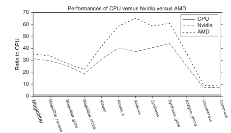

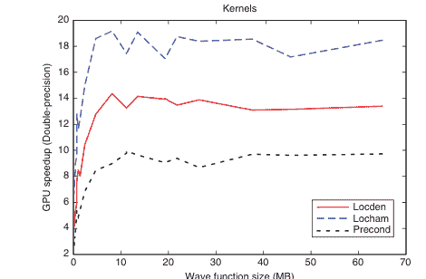

图 6.7. 左侧面板：波函数基本运算的 CPU 版本加速比。右侧面板：作为单个波函数大小函数的 BigDFT 代码 CPU 版本 3D 算子的双精度加速比。

在图 6.9 中，不同规模的模拟在不同条件下运行。特别是，测试了代码在计算量不足的情况下的响应，此时通信量与计算量处于同一数量级。这种情况可能发生在模拟系统过小，或者计算的运行时 GFLOPS 与网络横截面带宽之比较高时。

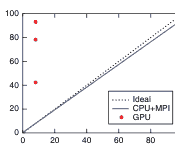

| 添加的 GPU 数量 | 2 | 4 | 8 |
|---|---|---|---|
| 加速比 (SU) | 5.5 | 9.8 | 11.6 |
| 等效 MPI 数量 | 44 | 80 | 96 |
| 加速效率 | 1 | 0.94 | 0.56 |

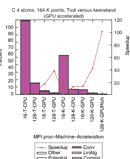

图 6.8. (a) 164 个 K 点的四碳原子超晶胞（石墨烯）上 BigDFT 代码的加速比。该计算在 CEA-DAM INTI 机器上使用八个 MPI 进程运行，该机器基于 Westmere 处理器和 Nvidia Fermi。对于每次运行，均指示了等效 MPI 进程数，已知该运行的并行效率为 98%。同时，还展示了 GPU 加速的效率。(b) 相同运行在不同混合架构上并结合 MPI 运行的加速比。

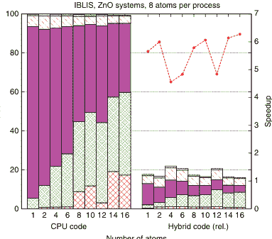

图 6.9. 混合 DFT 代码相对于等效纯 CPU 运行的相对加速比。在 Intel X5472 3 GHz（Harpertown）机器上，配备 Fermi GPU 卡，对不断增大的系统规模模拟进行了不同运行。

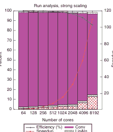

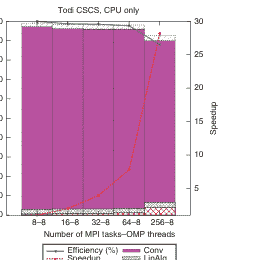

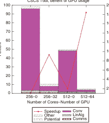


图 6.10. 石墨烯表面（带表面边界条件）上钴金属卟啉（265 原子系统）的大规模并行运行。在底部面板中，模拟已使用 Kepler GPU 卡加速。可以实现有趣的加速比。

图 6.10 还展示了另一个有趣的基准测试：石墨烯表面上钴金属卟啉，有和没有 GPU 加速的情况。无论如何，代码即使在 GPU 加速条件非最优的情况下也表现出鲁棒行为。这很有趣，因为对于基本用途，最终用户无需深入了解特定架构下模拟系统的最优尺寸设定。

### 6.4.5 其他 GPU 加速

目前，我们的代码不仅加速卷积运算。我们已经预期，BigDFT 线性代数运算可以通过显式方式（通过 OpenCL）或使用 CUBLAS 库移植到 GPU 上。此外，用于 Poisson 求解器的快速傅里叶变换（FFT）最近已通过基于 CuFFT 库的专用内核加速。这对于高级功能（如精确交换算子的评估）至关重要。OpenCL FFT 的运行时自动代码生成策略正在研究中。

## 6.5 结论与展望

基于小波基组的 DFT 计算已在 BigDFT 代码中针对 CPU 和混合 GPU/CPU 系统实现，该代码常用于物理和化学科学领域的生产运行。在表 6.2 中，我们展示了在多级并行化框架中加速 BigDFT 代码的优势，给出了 32 个水分子的从头算分子动力学模拟一天内可访问的步数（因此也是时间尺度）。在 MPI 和 OpenMP 并行化基础上利用 GPU 的算力，显著扩展了可访问的时间尺度。

如本章所示，小波基组 DFT 计算所需的数值运算非常适合 GPU 加速。一方面，3D 可分离卷积的计算特性使我们能够编写受益于 GPU 算力的高效例程。另一方面，BigDFT 代码的并行化方案在这方面是最优的：可以使用 GPU 而不影响不同 MPI 进程之间通信的性质。这与多级 MPI/OpenMP 并行化的精神一致。关键代码段移植到 GPU 已在 Kronos’ OpenCL 标准内实现，该标准允许多架构加速。因此，我们手头有一个多级并行代码，结合了 MPI、OpenMP、OpenCL 和 CUDA（后者用于 FFT 和线性代数），可以在最先进的混合超级计算机上运行。得益于 OpenCL 的使用，甚至可以利用具有不同类型 GPU 加速器的异构架构。

### 6.5.1 复杂代码性能收益评估

基于我们的经验，可以提出一些一般性指南，这些指南对可能希望将 GPU 用于科学计算的人应该有所帮助。对于像 BigDFT 这样复杂的代码，GPU 加速代码的收益评估必须在三个不同层面进行。

首先，必须评估 GPU 内核相对于执行相同操作的相应 CPU 例程所提供的有效加速比。这是“裸”加速比，当然，对于给定的实现，它取决于设备提供的计算能力。它

| MPI/OMP + GPU | 1*1 | 32*1 | 64*1 | 128*1 | 32*6 | 128*6 | 128*1 + 128 |
|---|---|---|---|---|---|---|---|
| SCF 迭代 (s) | 170 | 7.2 | 3.8 | 2.0 | 1.5 | 0.44 | 0.30 |
| 力评估 (s) | 2,210 | 93.6 | 49.4 | 26.0 | 19.5 | 5.72 | 3.92 |
| AIMD 步数/天 | 40 | 923 | 1,749 | 3,323 | 4,430 | 15,104 | 22,040 |
| MD 皮秒/天 | 0.02 | 0.461 | 0.874 | 1.661 | 2.215 | 7.552 | 11.02 |

必须牢记，不了解完整代码细节的供应商只能提供裸加速比。对于 BigDFT，此类结果可见于图 6.7。

在第二层面，必须评估“完整”加速比：应分析完整混合 CPU/GPU 代码相对于参考 CPU 实现的执行性能。显然，这取决于移植例程在整个代码中的实际重要性（即，遵循 Amdahl 定律）。这是 GPU 移植代码实际性能提升的第一个可靠结果。对于源自串行 CPU 程序的混合代码，这是评估的最后一个层面。

然而，对于并行代码，还有另一个步骤需要评估。即混合代码在并行（或大规模并行）环境中的行为。确实，对于并行运行，情况因两个方面而变得复杂。第一是 PCI-Express 总线引入的额外通信级别的管理，这可能会与底层代码通信调度（例如 MPI 或 OpenMP）产生负面交互。第二是代码在 GPU 设备数量少于运行的 CPU 进程数量时的行为。在这种情况下，GPU 资源分布不均，管理这一事实增加了额外的复杂性。在此阶段对代码的评估得出了“用户级”加速比，即实际的求解时间加速比，因此也是唯一对实际用途有意义的加速比。

我们相信这些经验法则对当今科学计算中通常使用的复杂代码的任何开发者都将有所帮助。

## References

- 1. Kohn, W. 和 Sham, L. (1965) 包括交换和相关效应的自洽方程。Phys. Rev. 140, A1133–A1138.
- 2. Genovese, L., Neelov, A., Goedecker, S., Deutsch, T., Ghasemi, S.A., Willand, A., Calvar, A. 等人 (2008) 用于密度函数伪势计算的 Daubechies 小波基组。J. Chem. Phys. 129 (1), 014109.
- 3. Yang, J., Wang, Y. 和 Chen, Y. (2007) 热导率的 (GPU) 加速分子动力学模拟。J. Comput. Phys. 221 (2), 799–804.
- 4. Anderson, A.G., Goddard, W.A. III 和 Schröder, P. (2007) 图形处理器上的量子蒙特卡洛。Comput. Phys. Commun., 177 (3), 298–306.
- 5. Gödecke, D., Strzodka, R., Mohd-Yusof, J., McCormick, P., Buijssen, S.H.M., Grajewski, M. 等人 (2007) 探索 GPU 增强集群上 [FEM] 计算的弱可扩展性。Parallel Comput. 33 (10–11), 685–699.
- 6. Goedecker, S. (1998) 小波及其在物理学中偏微分方程求解中的应用。Presses Polytechniques Universitaires et Romandes, Lausanne.
- 7. Neelov, A.I. 和 Goedecker, S. (2006) 用于计算 Daubechies 小波基中表示的波函数势能的高效数值求积。J. Comput. Phys. 217 (2), 312–339.
- 8. Johnson, B.R., Modinette, J.P., Nordlander, P.J. 和 Kinsey, J.L. (1999) 正交小波系统的求积积分。J. Chem. Phys., 110 (17), 8309–8317.
- 9. Goedecker, S., Teter, M. 和 Hutter, J. (1996) 可分离双空间高斯伪势。Phys. Rev. B. 54, 1703–1710.
- 10. Hartwigsen, C., Goedecker, S. 和 Hutter, J. (1998) 从 H 到 Rn 的相对论可分离双空间高斯伪势。Phys. Rev. B., 58 3641–3662.
- 11. Krack, M. (2005) 针对梯度修正交换-相关泛函优化的从 H 到 Kr 的伪势。Theor. Chem. Acc., 114 (1–3), 145–152.


- 12. Deslauriers, G. 和 Dubuc, S. (1989) 对称迭代插值过程。Constr. Approx., 5 (1), 49-68.

- 13. Genovese, L., Deutsch, T., Neelov, A., Goedecker, S. 和 Beylkin, G. (2006) 自由边界条件下泊松方程的高效求解。J. Chem. Phys., 125 (7), 074105.

- 14. Genovese, L., Deutsch, T. 和 Goedecker, S. (2007) 用于表面问题的高效准确三维泊松求解器。J. Chem. Phys., 127 (5), 054704.

- 15. Dugan, N., Genovese, L. 和 Goedecker, S. (2013) 针对自由边界条件的定制 3D（GPU）泊松求解器。Comput. Phys. Commun., 184 (8), 1815–1820.

- 16. Goedecker, S. 和 Hoisie, A. (2001) 数值密集型代码性能优化。SIAM 出版社，美国宾夕法尼亚州费城。

- 17. Genovese, L., Videau, B., Ospici, M., Deutsch, T., Goedecker, S. 和 Méhaut, J.F. (2011) 用于高性能电子结构计算的 Daubechies 小波：BigDFT 项目。C. R. Mécanique, 339 (2–3), 149–164.

- 18. Nvidia CUDA 编程指南，http://www.nvidia.com/object/cuda_home.html (访问于 2015 年 9 月 18 日)。

- 19. Genovese, L., Ospici, M., Deutsch, T., Méhaut, J.F., Neelov, A. 和 Goedecker, S. (2009) 多核混合中央核心/神经处理单元-图形处理单元架构上的密度泛函理论计算。J. Chem. Phys., 131 (3), 034103.

- 20. Khronos Group (2009) OpenCL 标准，http://www.khronos.org/opencl/ (访问于 2015 年 9 月 18 日)。

# 平面波密度泛函理论

Maxwell Hutchinson¹, Paul Fleurat-Lessard²,³, Ani Anciaux-Sedrakian⁴, Dusan Stosic⁵, Jeroen Bédorf⁶ and Sarah Tariq⁷
¹芝加哥大学物理系，美国伊利诺伊州芝加哥
²里昂高等师范学院，里昂大学化学实验室，法国里昂
³勃艮第-弗朗什-孔泰大学 ICMUB，法国第戎
⁴IPP 新能源公司机电、计算机科学与应用数学分部，法国勒伊马尔迈松塞德克斯
⁵联邦伯南布哥大学计算机科学系，巴西累西腓
⁶阿姆斯特丹数学与信息学中心，荷兰
⁷英伟达公司，美国加利福尼亚州圣克拉拉

在本章中，我们描述了如何使用 GPU 加速基于平面波（PW）基组的密度泛函理论（DFT）计算。我们回顾了使用平面波基组获取凝聚相系统电子结构所需的步骤，适用于标准显式密度泛函和带精确交换的混合泛函。随后，我们讨论了不同能量分量以及离子力和应力张量的数值实现，重点关注 GPU 及更通用的协处理器架构。还讨论了适用于混合多核和多 GPU 平台的 GPU 特定优化，并附有代码示例。针对能量、带结构、从头算分子动力学和结构弛豫等典型模拟设置的基准测试，展示了使用 GPU 可实现的性能提升。

## 7.1 引言

DFT [1, 2] 是物理学 [3] 和化学 [4–7] 中计算电子结构最广泛使用的技术之一，尤其是用于凝聚态物质系统。DFT 实现基于多种基组 [3]，大致可分为轨道类或网格类。轨道基组最常见的是 *原子轨道线性组合*（LCAO）[8]，它试图使用受物理启发、以原子为中心的非电子函数（例如薛定谔方程的模型解）来简洁表示希尔伯特空间。其主要优势是尺寸小且重叠稀疏，有助于发展低阶方法。然而，它们存在无法很好表示模型解未覆盖区域中意外过程的风险 [9]。网格基组位于实空间或倒空间，系统地求解希尔伯特空间。其主要优势是完备性。然而，它们比轨道基组大得多，且通常是非局域的。如果波函数的主要表示在倒格网上，则该基组称为 *平面波*（PW）。

平面波密度泛函理论（PWDF）是进行凝聚态物质系统电子结构计算最流行的方案之一。在 PWDF 中，动能算符在平面波空间（g 空间）中表示为对角矩阵，而局域势在实空间（r 空间）中表示为对角矩阵。在大多数情况下，使用赝势来平滑原子核附近的波函数，以牺牲低秩非局域势为代价，减少所需的平面波（g 矢量）数量。

哈密顿量的联合 r 空间和 g 空间表示需要使用无矩阵求解器，这些求解器依赖于哈密顿量对矢量 \(|\phi\rangle\) 的作用 \(H|\phi\rangle\)，而不是哈密顿量的元素 \(\langle r_i | H | r_j \rangle\) 或 \(\langle g_i | H | g_j \rangle\)。在计算对矢量 \(|\phi\rangle\) 的作用时，使用快速傅里叶变换（FFT）在矢量 \(|\phi\rangle\) 的 r 空间 \(\langle r | \phi \rangle\) 和 g 空间 \(\langle g | \phi \rangle\) 表示之间切换。非局域势定义于子空间上，在实空间中，这些子空间不会随整体系统大小而增长。这使得哈密顿量的作用在形式上为 \(O(n \log n)\)，而不是像一般矩阵那样的 \(O(n^2)\)。这是 PWDF 方法的关键特征。

PWDF 的实现还可根据所采用的赝势类型进一步分类。现代赝势有三种流行类型：守范赝势（NCPP）[10]、超软赝势（USPP）[11, 12] 和投影仪增强波（PAW）[13]。NCPP 仅向哈密顿量添加一个稠密低秩项，因此是最简单的。USPP 显著降低了收敛电子密度所需的网格分辨率，但需要引入一个非平凡的重叠矩阵，这将特征值问题推广化，并向非局域势添加电荷密度依赖性。PAW 是 USPP 对任意投影仪形式的推广，但在实践中非常相似，仅对网格收敛速率提供适度改进。

PWDF 有许多实现，包括 Quantum Espresso [14]、VASP [15]、CASTEP [16, 17] 和 Qbox [18, 19]。本章将以 VASP 的 GPU 移植版为例。

## 7.2 理论背景

### 7.2.1 自洽场

Kohn-Sham DFT 本质上是一个特征值问题：\(\hat{H}\psi = \epsilon\psi\)，其中 \(\hat{H}\) 是哈密顿算符，\(\psi\) 是单粒子波函数，\(\epsilon\) 是 \(\psi\) 的能量特征值。在赝势框架中，哈密顿量的形式为

\(\hat{H} = \hat{T} + \hat{v}^{loc} + \hat{v}^{nl},\) (7.1)

其中 \(\hat{T} = -\frac{1}{2}\nabla^2\) 是动能算符，\(\hat{v}^{nl}\) 是非局域势，\(\hat{v}^{loc}\) 是由离子-电子和电子-电子相互作用产生的局域势。

布洛赫定理将波函数分解为

$$u_{nk} = \frac{1}{\sqrt{\Omega}} \sum_{\vec{G}} c_{nk} e^{i(\vec{k}+\vec{G})\cdot\vec{r}}, \Psi_{nk} = e^{i\vec{k}\cdot\vec{r}} u_{nk} = \frac{1}{\sqrt{\Omega}} \sum_{\vec{G}} c_{nk} e^{i(\vec{k}+\vec{G})\cdot\vec{r}}.$$ (7.2)

其中 \(n\) 是排序波函数的索引，矢量 \(k\) 是布里渊区（BZ）采样点或 \(k\) 点，\(g\) 是平面波的 g 矢量，\(\Omega\) 是单胞体积。为清晰起见，以下将省略归一化因子 \(\Omega^{-1}\)。使用此分解，哈密顿量关于 \(k\) 点是对角的。\(k\) 相关哈密顿量定义为完整哈密顿量 \(k\) 块的函数：

$$\hat{H}(k) = e^{-i\vec{k}\cdot\vec{r}} \hat{H} e^{i\vec{k}\cdot\vec{r}}.$$ (7.3)

这将特征值问题转换为：

$$\hat{H}(k) u_{nk} = \epsilon_{nk} u_{nk}.$$ (7.4)

在基组中写出可揭示 \(k\) 点依赖性：

$$H(k) = [g]T(k)[g] + e^{-i\vec{k}\cdot\vec{r}}[r]V^{loc}(r)[e^{i\vec{k}\cdot\vec{r}}] + e^{-i\vec{k}\cdot\vec{r}}[\beta] V^{\beta\beta'} [\beta'] (e^{i\vec{k}\cdot\vec{r}})$$ (7.5)

其中 \(H(k)\) 是算符 \(\hat{H}(k)\) 的表示，\(g\) 遍历平面波基组，\(r\) 遍历实空间基组，\(\beta, \beta'\) 遍历赝势投影仪。局域势的 \(k\) 依赖性抵消。动能的 \(k\) 依赖性具有简单的解析形式。非局域势的 \(k\) 依赖性被封装为 \(\beta(k)\) 的投影仪中。这导致了 \(k\) 相关哈密顿量的表达式：

$$H(k) = \left| g \right| \frac{1}{2} |g + k|^2 \left| g \right| + \left| g \right| [r] V^{loc}(r) [r] + [\beta^V(k)]^{rad} [\beta(k)].$$ (7.6)

局域势是电子密度的泛函 \(V^{loc}[\rho(r)]\)：

$$\rho(r) \equiv [r]\rho[r] = \sum_{nk} f_{nk}(r|u_{nk})(u_{nk}|r)$$ (7.7)

其中 \(f_{nk} \equiv f[\epsilon_{nk}]\)（占据数）是整个特征值谱 \(\epsilon_{nk}\) 的函数。因此，电子密度显式依赖于所有 \(u_{nk}\) 和 \(\epsilon_{nk}\)。占据数是 \(n\) 的递减函数，仅在前 \(n_r\) 个最低特征对中非零，其中 \(n_r\) 是电子数。用于生成局域势和非局域势的泛函包含非线性项。泛函本身的应用通常不是性能关键，因此此处不再详细描述。

显式包含动态变量的依赖性得到

$$([g + k^2] + [V^{loc}[\rho(\epsilon,u)] + v^{nl}]) u_{nk} = \epsilon_{nk} u_{nk}.$$ (7.8)

为解决对特征对 \((u, \epsilon)\) 的循环依赖，采用自洽技术：计算从对电子密度 \(\rho\) 的猜测开始，生成相应的哈密顿量，对该哈密顿量进行对角化，并使用得到的波函数和能量来细化密度。在对角化哈密顿量和生成更好的密度估计之间的这种来回操作会持续进行，直到电子密度收敛。由于迭代之间密度中存在衰减误差，每一步的对角化不必完全。这促使使用迭代对角化方案。


### 7.2.2 超软势

In order to reduce the number of plane waves, actual calculations resort to pseudopotentials: close to each ion, the exact wavefunction is replaced by pseudo-wavefunctions centered on the ion.
为了减少平面波的数量，实际计算采用伪势：在每个离子附近，精确波函数被以离子为中心的伪波函数所取代。

The radial part of the pseudo-wavefunctions is nodeless. These pseudo-wavefunctions are localized in r-space and will be denoted by \(|\tilde{\beta}\rangle\). Projection on these pseudo-wavefunctions are denoted by \(\{\tilde{\beta}\}\), which are the dual vectors of \(|\tilde{\beta}\rangle\). The \(\tilde{\beta}\) functions of each type of atom are defined with respect to the displacement from an atomic center and vanish outside of a core region:
伪波函数的径向部分没有节点。这些伪波函数在r空间中是局域化的，将用 \(|\tilde{\beta}\rangle\) 表示。对这些伪波函数的投影用 \(\{\tilde{\beta}\}\) 表示，它们是 \(|\tilde{\beta}\rangle\) 的对偶向量。每种原子的 \(\tilde{\beta}\) 函数是相对于原子中心的位移定义的，并在核心区域之外消失：

\(\tilde{\beta}(r) = \beta(r - R), \quad \beta(r > r_c) = 0,\)

where \(R_i\) is the position of the ion that \(\beta\) is centered around and \(r_c\) is the cut-off radius.
其中 \(R_i\) 是 \(\beta\) 所围绕的离子的位置，\(r_c\) 是截断半径。

With USPPs, the tensor \(Q\) connects diagonal real-space 2-tensors, such as the density \(\rho\), to pairs of projectors [20]:
采用USPP时，张量 \(Q\) 将对角实空间2-张量（如密度 \(\rho\)）与投影算子对联系起来 [20]：

\(\langle \psi' | r | r' \psi \rangle \rightarrow \sum_{ij} \langle \psi' | r' \rangle \left( \langle r' | r \rangle \langle r | r' \rangle + \sum_{ij} \langle r' | \beta_i \rangle Q_{ij} \langle \beta_j | r' \rangle \right) \langle r' | \psi' \rangle,\) (7.9)

where \(\psi, \psi'\) are arbitrary vectors. Integrating over \(r\) yields an overlap matrix
其中 \(\psi, \psi'\) 是任意向量。对 \(r\) 进行积分得到重叠矩阵

\(S = I + \sum_{ij} |\beta_i\rangle Q_{ij} \langle \beta_j|,\) (7.10)

which defines the inner product \(\langle \phi | \psi \rangle \rightarrow \langle \phi | S | \psi \rangle\), where \(Q_{ij} = Q_{ij}(r)\). The eigenproblem is therefore generalized to
它定义了内积 \(\langle \phi | \psi \rangle \rightarrow \langle \phi | S | \psi \rangle\)，其中 \(Q_{ij} = Q_{ij}(r)\)。因此特征问题推广为

\(H|k\rangle |u_{nk}\rangle = \epsilon_{nk} S |u_{nk}\rangle.\) (7.11)

The change in inner product leads to an additional term in the charge density:
内积的变化导致电荷密度中出现一个额外项：

\(\langle r | \rho | r \rangle = \sum_{nk} f_{nk} \left( \langle r | u_{nk} \rangle \langle u_{nk} | r \rangle + \sum_{ij} \langle u_{nk} | \beta_i \rangle Q_{ij}(r) \langle \beta_j | u_{nk} \rangle \right)\) (7.12)

It also leads to the density-dependent nonlocal potential \(V^{nl}[\rho(u, \epsilon)]\), which adds to the cyclic dependence of Eq. (7.8). In the USPP scheme, \(V^{nl}\) is
它还导致了密度依赖的非局域势 \(V^{nl}[\rho(u, \epsilon)]\)，这增加了Eq. (7.8)的循环依赖。在USPP方案中，\(V^{nl}\) 为

\(V^{nl} = \sum_{ij} |\beta_i\rangle D_{ij} \langle \beta_j|,\) (7.13)

where the matrix \(D_{ij}\) depends on the density \(\rho\).
其中矩阵 \(D_{ij}\) 依赖于密度 \(\rho\)。

The rest of this chapter operates with the generality of USPP. The NCPP expressions are recovered by letting \(Q \rightarrow 0\), which implies \(S \rightarrow I\) and reduces the generalized eigenvalue problem to a standard one.
本章其余部分采用具有普遍性的USPP进行处理。通过令 \(Q \rightarrow 0\) 可以恢复NCPP表达式，这意味着 \(S \rightarrow I\) 并将广义特征值问题简化为标准问题。

### 7.2.3 投影增量波（PAW）方法

The PAW scheme [13] is a generalization of the USPP scheme [12] introduced in Section 7.2.2. In the PAW scheme, the wavefunction is related to smooth pseudo-wavefunctions by a linear transformation [13]:
PAW方案 [13] 是第7.2.2节中介绍的USPP方案 [12] 的推广。在PAW方案中，波函数通过线性变换与平滑伪波函数相关联 [13]：

\(|\psi\rangle = |\tilde{\psi}\rangle + \sum_i (|\phi_i\rangle - |\tilde{\phi}_i\rangle) \langle \tilde{\beta}_i | \tilde{\psi} \rangle.\) (7.14)

where the \(\phi\) are generally taken to be solutions to the radial Schrödinger equation for an isolated atom and tildes mark pseudo-quantities. Computationally, PAW and USPP take very similar forms. The relationship between the two is discussed more formally in the literature [12]. Here, we maintain consistency with the notation used for USPPs by letting \(\tilde{\beta} \equiv \beta\).
其中 \(\phi\) 通常取为孤立原子径向Schrödinger方程的解，波浪号标记伪量。从计算角度看，PAW和USPP采用非常相似的形式。两者之间的关系在文献 [12] 中有更正式的讨论。这里，我们通过令 \(\tilde{\beta} \equiv \beta\) 来保持与USPP所用记法的一致性。

### 7.2.4 力与应力

Forces are computed by differentiating the total energy function with respect to ionic positions:
力是通过对离子位置对总能函数求导来计算的：

\(F_i^\mu = -\frac{\partial E[\rho]}{\partial R_i^\mu}.\) (7.15)

where \(\mu\) indexes the spatial components and \(i\) indexes the atomic centers.
其中 \(\mu\) 索引空间分量，\(i\) 索引原子中心。

The total energy is equal to the sum of the electronic energy from the Hamiltonian in Eq. (7.1) and the electrostatic energy due to the ions. This last term will be denoted by \(U[\{R\}]\):
总能量等于Eq. (7.1)中哈密顿量的电子能与离子静电能之和。最后一项将用 \(U[\{R\}]\) 表示：

\(E_{tot}(\{f\}, \{u\}, \{R_i\}) = \frac{1}{N_k} \sum_{nk} f_{nk} \langle u_{nk} | T + V^{nl} | u_{nk} \rangle + \frac{1}{2} \iint dr dr' \frac{\rho(r)\rho(r')}{|r - r'|} + E_x[\rho] + \int dr V_{ion}^{loc}(r)\rho(r) + U[\{R\}].\) (7.16)

where the local potential is separated into its electron-electron Coulombic (Hartree), electron-electron exchange-correlation, and electron-ion Coulombic contributions. Let us introduce \(V_{ext}(r)\), \(D_{ij}^{ion}\), and the onsite density \(\rho_{ij}\):
其中局域势被分离为电子-电子库仑（Hartree）、电子-电子交换-相关和电子-离子库仑贡献。让我们引入 \(V_{ext}(r)\)、\(D_{ij}^{ion}\) 和原位密度 \(\rho_{ij}\)：

\(V_{ext}(r) = \frac{\partial E_{tot}}{\partial \rho} = V_{ion}^{loc}(r) + \int dr' \frac{\rho(r')}{|r - r'|} + \frac{\delta E_x[\rho]}{\delta \rho}.\) (7.17)

\(D_{ij}^{ion} = D_{ij} + \int dr V_{ext}(r) Q_{ij}(r).\) (7.18)

\(\rho_{ij} = \sum_{nk} f_{nk} \langle u_{nk} | \beta_i \rangle \langle \beta_j | u_{nk} \rangle.\) (7.19)

Using these definitions, the total energy can be written as
使用这些定义，总能量可以写成

\(E_{tot}(\{f\}, \{u\}, \{R_i\}) = \frac{1}{N_k} \sum_{nk} f_{nk} \langle u_{nk} | T | u_{nk} \rangle + \int dr V_{eff}(r)\rho(r) + \frac{1}{N_k} \sum_{ij} D_{ij} \rho_{ij} + U[\{R\}].\) (7.20)

leading to the following expression for the forces:
从而得到力的以下表达式：

\(F_i^\mu = -\frac{\partial U[\{R\}]}{\partial R_i^\mu} - \int dr \frac{\partial V_{ion}^{loc}(r)}{\partial R_i^\mu} \rho(r) - \int dr V_{ext}(r) \sum_{ij} \frac{\partial Q_{ij}(r)}{\partial R_i^\mu} \rho_{ij} - \sum_{ij} D_{ij}^{ion} \sum_{nk} f_{nk} \left[ \langle u_{nk} | \frac{\partial \hat{\beta}_i}{\partial R_i^\mu} | \beta_i \rangle \langle \beta_i | u_{nk} \rangle + \langle u_{nk} | \beta_i \rangle \langle \beta_i | \frac{\partial \hat{\beta}_i}{\partial R_i^\mu} | u_{nk} \rangle \right].\) (7.21)

where we have used
其中我们使用了

\(\frac{\partial \rho(r)}{\partial R_k^\nu} = \sum_{nk} f_{nk} \sum_{ij} \frac{\partial Q_{ij}(r)}{\partial R_k^\nu} \langle \beta_i | u_{nk} \rangle \langle u_{nk} | \beta_j \rangle + Q_{ij}(r) \frac{\partial (\langle \beta_i | u_{nk} \rangle \langle u_{nk} | \beta_j \rangle)}{\partial R_k^\nu}.\) (7.22)

Another interesting quantity is the stress tensor. Let us denote by \(\mathbf{a}_1, \mathbf{a}_2, \text{and } \mathbf{a}_3\) the unit cell lattice vectors. We combine them in \(\mathbf{h} = [\mathbf{a}_1, \mathbf{a}_2, \mathbf{a}_3]\). With these notations, the stress components are
另一个有趣的量是应力张量。让我们用 \(\mathbf{a}_1, \mathbf{a}_2, \text{和 } \mathbf{a}_3\) 表示单元胞晶格矢量。我们将它们组合为 \(\mathbf{h} = [\mathbf{a}_1, \mathbf{a}_2, \mathbf{a}_3]\)。采用这些记法，应力分量为

\(\sigma_{\mu\nu} = -\frac{1}{\Omega} \sum_i \frac{\partial E_{tot}}{\partial \mu_i} T_{\mu\nu}^i\) (7.23)

where \(\mu\) and \(\nu\) denote the Cartesian indices.
其中 \(\mu\) 和 \(\nu\) 表示笛卡尔索引。

As the interaction energy between electrons and ions depends only on their distances, one can recast the previous equation into [3]
由于电子与离子之间的相互作用能仅取决于它们的距离，可以将前一公式改写为 [3]

\(\sigma_{\mu\nu} = -\left\langle \Psi \left| \sum_p \frac{1}{2m_p} \nabla_{\mu,p} \nabla_{\nu,p} - \frac{1}{2} \sum_{p,p'} \frac{(r_{pp'})_\mu (r_{pp'})_\nu}{|r_p - r_{p'}|} \frac{\partial V}{\partial r_{pp'}} \right| \Psi \right\rangle.\) (7.24)

where the sum over \(p\) and \(p'\) runs over all particles (nuclei and electrons) and \((r_{pp'})_\mu\) is the \(\mu\) Cartesian coordinate of \(\vec{r}_{pp'}\), the vector joining particles \(p\) and \(p'\).
其中对 \(p\) 和 \(p'\) 的求和遍及所有粒子（原子核和电子），\((r_{pp'})_\mu\) 是连接粒子 \(p\) 和 \(p'\) 的矢量 \(\vec{r}_{pp'}\) 的 \(\mu\) 笛卡尔分量。

The pseudopotentials introduce a dependence on the wavefunctions. The number of wavefunction terms grows with the system size, so the computation of those terms dominates the cost of computing forces and stresses.
伪势引入了对波函数的依赖。波函数项的数量随系统大小增长，因此计算这些项主导了计算力和应力的成本。

Efficient evaluation of the stress tensor will not be further discussed here. Interested readers are redirected to, for example, [3] or [21].
应力张量的高效计算在此不再进一步讨论。感兴趣的读者可参阅，例如，[3] 或 [21]。

### 7.2.5 迭代对角化

In the self-consistent scheme, the Hamiltonian itself is converging along with the charge density. Therefore, each self-consistent iteration does not require the exact diagonalization of the Hamiltonian, so long as the eigensolutions are converging as quickly as the Hamiltonian. Furthermore, we are interested in the lowest \(N_e\) eigenvalues and associated eigenfunctions, as only the \(N_e \gtrsim n_e\) lowest eigenfunctions contribute to the charge density. Directly diagonalizing the Hamiltonian would be a waste of effort.
在自洽方案中，哈密顿量本身与电荷密度一起收敛。因此，每次自洽迭代不需要对哈密顿量进行精确对角化，只要特征解的收敛速度与哈密顿量一样快即可。此外，我们关注最低的 \(N_e\) 个特征值及其相关特征函数，因为只有最低的 \(N_e \gtrsim n_e\) 个特征函数对电荷密度有贡献。直接对角化哈密顿量将是一种浪费。

Iterative procedures provide an elegant solution to this problem: the eigenproblem can be solved in a subset (generally called the *expansion set*) [22] that is much smaller than the plane-wave basis. Any eigensolutions of the full problem will also be eigensolutions in the expansion space. There exist several common iterative approaches for PWDFD:
迭代方法为这一问题提供了优雅的解决方案：特征问题可以在一个子集（通常称为*扩展集*）[22]中求解，该子集远小于平面波基。全问题的任何特征解也将是扩展空间中的特征解。对于PWDFD存在几种常见的迭代方法：

- the conjugate gradient algorithm [23, 24],
- 共轭梯度算法 [23, 24]，
- the blocked Davidson scheme [25–28], and
- 阻塞Davidson方案 [25–28]，以及
- the residual minimization scheme with direct inversion in iterative subspace (RMM-DIIS) [15, 22, 29].
- 迭代子空间中直接反演的残差最小化方案（RMM-DIIS）[15, 22, 29]。

Though reviews of commonly used iterative methods can be found in Refs [15, 22].
尽管关于常用迭代方法的综述可以在Refs [15, 22]中找到。

The expansion set is built iteratively so that the eigenvectors and eigenvalues in the expansion space are the best approximations of the eigenvectors and eigenvalues in the full space. One usually distinguishes the blocked algorithms that work on many bands at the same time from the unblocked algorithms that optimize each band sequentially. In either case, the key step is to compute the vectors that are added to the expansion set to ensure that the lowest eigenfunctions of the expansion set converge to the actual eigenvalues. Let us denote by \(|\hat{\phi}_p\rangle\) the approximation of the eigenvector \(|\phi_p\rangle\). A central quantity of most iterative schemes is the residual vector \(|R(\hat{\phi}_p)\rangle\):
扩展集是迭代构建的，使得扩展空间中的特征向量和特征值是全空间中特征向量和特征值的最佳近似。通常将同时处理多个能带的阻塞算法与按顺序优化每个能带的非阻塞算法区分开来。无论哪种情况，关键步骤都是计算添加到扩展集中的向量，以确保扩展集中的最低特征函数收敛到实际特征值。让我们用 \(|\hat{\phi}_p\rangle\) 表示特征向量 \(|\phi_p\rangle\) 的近似。大多数迭代方案的一个核心量是残差向量 \(|R(\hat{\phi}_p)\rangle\)：

\(|R(\hat{\phi}_p)\rangle = (H - \epsilon_{scp} S)|\hat{\phi}_p\rangle,\)


其中 $\epsilon_{app}$ 是特征值的近似，定义为瑞利商

$$\epsilon_{app} = \frac{\langle \hat{\phi}_p | H | \hat{\phi}_p \rangle}{\langle \hat{\phi}_p | S | \hat{\phi}_p \rangle}.$$ (7.25)

因此，对 $\hat{\phi}_p$ 的完美校正是

$$|\delta \hat{\phi}_p\rangle = -(H - \epsilon_{app} S)^{-1} |R(\hat{\phi}_p)\rangle.$$ (7.26)

因为

$$|R(\hat{\phi}_p + \delta \hat{\phi}_p)\rangle = 0.$$ (7.27)

然而，计算 $(H - \epsilon_{app} S)^{-1}$ 与直接对角化 $H$ 同样复杂，因此不得不求助于近似逆：

$$|\delta \hat{\phi}_p\rangle \approx K |R(\hat{\phi}_p)\rangle.$$ (7.28)

其中 $K$ 称为预条件矩阵，从残差向量 $|R(\hat{\phi}_p)\rangle$ 构建 $|\delta \hat{\phi}_p\rangle$ 的过程称为预条件。对于 PWDCFT，$K$ 通常是对角矩阵，因此易于计算和应用。有许多具体方法 [29-31]，此处不再赘述。

#### 7.2.5.1 共轭梯度法 (CG)

序列共轭梯度法是一种非分块方案，其中每个特征函数的扩展集被限制为仅两个向量。考虑特征函数 $n$ 的极小化。在每次迭代中，新向量（称为 CG 的*搜索向量*）被选择为与前一个向量正交。然后在由近似特征向量 $|\hat{\phi}_p\rangle$ 和搜索向量 $|f_p\rangle$ 组成的扩展空间中直接对角化哈密顿量，产生修正后的近似特征向量 $|\hat{\phi}'_p\rangle$。然后构建新的搜索方向：

$$|f'_p\rangle = |P(\hat{\phi}'_p)\rangle + \frac{\langle P(\hat{\phi}'_p) | R(\hat{\phi}'_p) \rangle}{\langle P(\hat{\phi}_p) | R(\hat{\phi}_p) \rangle} |f_p\rangle.$$ (7.29)

其中 $|P(\hat{\phi}_p)\rangle$ 是正交化的预条件残差向量：

$$|P(\hat{\phi}_p)\rangle = \left( 1 - \sum_m |\phi_m\rangle \langle \phi_m| S \right) K (H - \epsilon_{app} S) |\hat{\phi}_p\rangle.$$ (7.30)

其中 $m$ 遍历先前计算的较低能量特征向量。这种正交化是必要的，以确保所有带都不会收敛到与最低特征值相关的特征向量。

#### 7.2.5.2 阻塞戴维森法

在阻塞戴维森方案中，使用单个扩展集 $\{|\varphi\rangle\}$ 同时计算所有最低特征向量。每次迭代的第一步是在扩展空间中构建哈密顿量和重叠矩阵。

$$\hat{H}_{ij} = \langle \varphi_i | H | \varphi_j \rangle, \hat{S}_{ij} = \langle \varphi_i | S | \varphi_j \rangle.$$ (7.31)

然后直接求解得到的扩展空间特征问题，以产生试向量和瑞利商。在扩展集中对角化哈密顿量称为瑞利-里兹方案 [32] 或“子空间旋转”。

$$\hat{H}\hat{\phi}_n = \varepsilon_{qp} \hat{S}\hat{\phi}_n.$$ (7.32)

然后在全空间中计算具有最低瑞利商的试向量的残差。基于残差的范数或与上次迭代的瑞利商之差，对部分或全部残差进行预条件处理并添加到下一个扩展集中。扩展集随每次迭代增长，但只需严格大于所需的特征向量数量。因此，许多方案将扩展集的大小限制为所需特征向量数量的小倍数 [15, 29]。当添加预条件残差会使集合超过该限制时，会移除瑞利商最高的试向量以腾出空间。阻塞戴维森方法不需要显式正交归一化，因为试向量在扩展空间和全空间中始终是正交的。

#### 7.2.5.3 RMM-DIIS

RMM-DIIS 方法一次优化一个带，但可以在带之间并行化。它基于 Pulay [33] 的原始工作，此处应用于最小化残差向量的范数。在此方案中，扩展集被称为 *迭代子空间*，遵循 Pulay 的命名。迭代子空间由特征向量的先前近似 $\{|\hat{\phi}_j^{(i)}\rangle\}$ 组成，其中 $n$ 索引遍历特征向量，$i$ 索引遍历迭代。每次迭代开始时，通过将先前的近似特征向量线性组合来构建试向量 $|\hat{\phi}_n^{(i)}\rangle$：

$$|\hat{\phi}_n^{(i)}\rangle = \sum_j |\hat{\phi}_j^{(i)}\rangle a_j.$$ (7.33)

系数 $a_j$ 被选择以最小化残差向量的相对范数：

$$\epsilon = \frac{\langle R(\hat{\phi}_n^{(i)}) | R(\hat{\phi}_n^{(i)}) \rangle}{\langle \hat{\phi}_n^{(i)} | \hat{S} | \hat{\phi}_n^{(i)} \rangle}.$$ (7.34)

残差可以相对于先前特征向量的残差进行展开：

$$|R(\hat{\phi}_n^{(i)})\rangle = \sum_j |R(\hat{\phi}_j^{(i)})\rangle a_j$$ (7.35)

从而创建一个特征系统

$$\sum_j \langle R(\hat{\phi}_j^{(i)}) | R(\hat{\phi}_n^{(i)}) \rangle a_j = \epsilon \sum_j \langle \hat{\phi}_j^{(i)} | \hat{S} | \hat{\phi}_n^{(i)} \rangle a_j,$$ (7.36)

其中最低特征向量成为试向量 $|\hat{\phi}_n^{(i)}\rangle$。然后将试向量及其预条件残差的线性组合添加为下一个近似特征向量：$|\hat{\phi}_n^{(i+1)}\rangle = |\hat{\phi}_n^{(i)}\rangle + \lambda \hat{K} |R(\hat{\phi}_n^{(i)})\rangle$。步长 $\lambda$ 的大小是算法收敛特性的重要因素 [29, 33]。

由于 RMM-DIIS 不包括 CG 方法的显式正交化或阻塞戴维森的隐式正交化，因此带残差极小化非常快。这也允许该方案对带进行轻松并行化，因为将 RMM-DIIS 方案应用于一个带不需要来自其他带的信息。然而，由于最终向量不被强制正交，仅应用几个步骤的 RMM-DIIS 可能导致线性相关。这需要在过程结束时添加一个额外的正交化步骤，该步骤将涉及所有计算单元之间的通信。

该方案还有另一个优势：近似特征向量收敛到最近的特征向量，因此初始化步骤至关重要。一种解决方案是在随机初始化后附加少量戴维森步骤。戴维森方法非常稳健且严格正交，因此它将分离特征向量的估计值。

此外，每次自洽对角化步骤按以下顺序执行：

- 1. 在初始近似特征函数空间中直接对角化，
- 2. RMM-DIIS 极小化，以及
- 3. 特征函数的显式正交归一化。

子空间旋转用于分离近似特征函数以降低两个波函数收敛到同一特征向量的风险。添加正交归一化以确保用于构建密度的波函数不重叠，否则将使给定在 Eq. (7.12) 中的电荷密度表达式无效。尽管如此，RMM-DIIS 方法通常是大型特征问题最高效的方案。

## 7.3 实现

特征问题 Eq. (7.8) 的自洽求解每次迭代有四个主要步骤。从密度 \(\rho\) 的估计开始

- 1. 对 \(\rho$ 应用函数以产生 \(v^{xc}\)。
- 2. 计算 $H$ 的特征值 \(\epsilon_{nk}\) 和特征函数 \(u_{nk}\)。
- 3. 使用 \(\epsilon_{nk}$ 产生占据数 \(f_{nk}\)。
- 4. 使用 \(u_{nk}$ 和 \(f_{nk}$ 产生 \(\rho\)。
- 自洽求解收敛后
- 5. 计算力和应力。

注意，在绝缘体的情况下，占据数是 *先验* 已知的，因此可以省略步骤 3。第一步通常不是性能关键。力和应力的计算是可选的，取决于应用（例如，分子动力学或弛豫）。

### 7.3.1 变换

在描述这些步骤的细节之前，讨论常见组件（即傅里叶变换和投影）将很有用。

#### 7.3.1.1 傅里叶变换

PWDF 中使用的傅里叶变换与常规的幺正离散傅里叶变换略有不同。第一个区别是，傅里叶基定义为仅位于由 k 点偏移的内切球内的 g 向量：

$$\{|g\rangle : |g + k|^2 < E_{\text{cut}}\}.$$ (7.37)

这源于物理论证，即模式对波函数的贡献应与其动能相关，高能模式的表示较少。还要注意，变换不包括 g 向量中隐含的 k 偏移。因此，在进行实空间内积之前，必须确保它们要么在同一 k 点，要么明确添加一个因子 exp [i(k_1 - k_2) · r]。


第二个区别是，r-空间必须以更高的分辨率采样，至少提高 2 倍，才能忠实表示势能。这两个区别导致整体逆变换包含三个步骤：填充、变换、插值。请注意，r-空间表示因此大约比 g-空间大 $(2)^3/6\pi \approx 15$ 倍。

为了利用减少的 g-向量数量，许多 PWDF 代码在 1D 和 2D 标准库调用之上实现了自己的并行 3D FFT。这样，在转置步骤期间就不需要传输 g-空间中未使用的角落。如果针对单插槽系统，建议改用完整的 3D FFT，许多代码会自动回退到该方式。对于跨多个 GPU 节点的并行 FFT，可以模仿 CPU 实现的行为，但由于 GPU 启用节点的计算性能相对较强，可扩展性会受到影响。为缓解此问题，应将运行设置为在尽可能少的节点上处理每个能带，这可能需要减少并发处理的能带数量。将同一 k 点的不同能带放在不同的内存空间中也可能导致问题，因为需要计算测试函数之间的内积，这将在稍后讨论。

#### 7.3.1.2 投影

投影是计算内积 $\langle \beta(k) | \phi_{ak} \rangle$ 的过程，其中 $\beta$ 是伪势投影算子，$k$ 是 k 点。投影算子连接到伪波函数空间 $\tilde{\theta}$，其完备关系为：

$I_i = \sum_I \langle \tilde{\theta}_i | \rho_I \rangle_j$ (7.38)

其中 $I_i$ 仅表示离子 $i$ 的伪波空间中的单位算子，$I$ 索引角动量。投影可以在 r-空间或 g-空间中进行。在 g-空间中，投影计算为：

$\langle \beta(k) | \phi_{ak} \rangle = \sum_g \langle \beta(k) | g \rangle \langle g | \phi_{ak} \rangle$ (7.39)

矩阵表示 $\langle g | \beta(k) \rangle$ 是稠密的，因此投影是一个矩阵-向量乘积。从技术上讲，这对应于 LAPACK 中 ZGEMM ( 'C' , ... ) 函数的调用，该函数已移植到 GPU [34]。

在 r-空间中，每个投影算子仅在以离子中心为球心的球体内非零。设投影算子非零的那些 r-空间基向量为 $\{ r' \}$。包括离子和角动量索引

$\langle \beta(k_i) | \phi_{ak} \rangle = \sum_{r_i, r'} \langle \beta_i | 0 \rangle (r') | e^{i(k+r)} (r | \phi_{ak} \rangle$ (7.40)

其中对 $r_i$ 的求和与系统总大小无关，且包含 $\exp [ i(k \cdot r) ]$ 是因为实空间投影算子定义在 $k=0$ 处。由 $\langle r | r' \rangle$ 描述的变换最好描述为收集操作，因为它收集在内存中连续分布的 r-空间数据。每个原子上的角动量分量共享 r-空间子集，因此收集操作的次数是离子数，而不是投影算子总数。实现投影的示例内核见清单 1。

r-空间中的逆变换形式类似：

$\langle r | \tilde{\phi}_{ak} \rangle = \sum_{k_i, r'} e^{-i(k+r')} \langle r | r' \rangle \langle r' | \tilde{\theta}_i | \tilde{\phi}_{ak} \rangle$ (7.41)

在这里，变换 $\langle r | r' \rangle$ 是一个散射操作，与收集操作有类似问题。实现逆投影的示例内核见清单 2。

从方法学角度看，两种投影方法均等效有效，因此选择纯粹基于性能。更复杂的 r-空间投影的优势在于与系统总大小无关。其劣势在于：(1) r-空间本身大约大 15 倍；(2) 收集操作在为顺序访问设计的内存上可能效率低下。

## 7.3.2 泛函

对于非平凡尺寸的系统，势能 V^loc 和 V^nl 的构建不是性能关键。它们由应用于电荷密度的 O(n) 操作以及用于求解泊松方程的两个傅里叶变换组成。第 7.6 节在约束 a = b 下提供了一种间接处理方法，该方法将精确交换中的双粒子势指定为单粒子库仑势。它省略了交换-相关泛函。

## 7.3.3 对角化

汉密尔顿量关于索引 k 是分块对角的，如公式 (7.6) 所示。每个 k 点都是一个独立的特征值问题，可以自由并行化。在本小节的其余部分，我们将省略 k 标签。

通常只需要对应于最低特征值的 n << N 个特征函数，因为只有它们会对应于非零占据数。实现快速迭代矩阵对角化是实现高性能和稳健计算的关键点之一。常见选择在第 7.2.5 节中有所描述。

所有求解器都需要实现 H(|phi>) 的作用以及任意测试函数 |phi>、|phi'> 的内积 <phi'|H|phi>。在某些情况下，一次性计算 <phi'|H|phi> 可能比计算 <phi'|H(|phi>)> 更容易，因此我们将此视为一种特殊情况。

在 PWDF 代码中，测试函数通常存储在 g-空间中，<g|phi>。评估汉密尔顿量的作用还需要 r-空间 <r|phi> 和 beta-空间 <beta|phi> 表示。如果内存充足，这些量可以为每个测试函数计算一次并存储以供重复使用。这对于 |beta> 经常这样做，因为它比 <g|phi> 小得多。r-空间表示可能比 g-空间表示大 $48/\pi$ 倍，因此存储频率较低。r-空间和 g-空间表示都是完备的，因此内积可以在 r-空间或 g-空间中计算。由于 r-空间大小较大，g-空间始终更可取。内积应尽可能阻塞为矩阵-矩阵乘积。

### 7.3.3.1 动能

动能 T 的作用在于将测试函数与向量 |g + k|^2 简单相乘。如果 g-向量有序，可以根据索引在内核中轻松计算 |g + k|^2 来完成。如果 g-向量无序，则应先预计算向量 |g + k|^2，然后执行逐元素向量乘积。

由于逐元素乘积受带宽限制，应谨慎使用以减少加载。例如，在计算一组测试函数 |phi> 的动能时，对乘积循环会重新加载系数，从而降低性能。更好的方法是将此操作转换为矩阵-矩阵乘法，其中第一个矩阵是对角矩阵。虽然 BLAS 不包含此类操作，但 cuBLAS 作为 ZDGMM [34] 包含此操作。此外，此处的系数是实数，而测试函数是复数。因此，自定义内核可以加载一半带宽的实数。最后，该操作可以原地执行。此类内核见清单 3。此功能目前在标准库中不可用。

### 7.3.3.2 局部势

要计算局部势的作用 $\langle r | V^{loc} | \phi \rangle$，在 $r$-空间中执行相同操作，用 $V(r)$ 替换 $|g + k|^2$ 作为系数。同样，单个测试函数对应于逐元素乘积，而一组测试函数对应于 ZDGMM 调用或自定义内核。与动能情况一样，系数是实数。如果所需结果在 $g$-空间中，则应对 $r$-空间作用进行傅里叶变换。

### 7.3.3.3 非局部势

投影空间中的非局部势在 NCPP 情况下是对角的，在 USPP 情况下是分块对角的。对于 NCPP，非局部势的作用与动能和局部项类似，但包含对投影的求和。对于 USPP，块对应于原子，因此作用形式为 $\langle \tilde{p}_{i,j} | V^{nl} | \phi \rangle = \sum_{i'} \langle \tilde{p}_{i,j} | V^{nl} | \tilde{p}_{i',j} \rangle \langle \tilde{p}_{i',j} | \phi \rangle$。(7.42)

$l,l'$ 角动量索引取一小组值，约 10 个，因此这些矩阵乘积非常小，简单地循环调用矩阵-矩阵乘法可能受内核启动限制。如果第 2 章中详细讨论的批量调用可用，则应使用它们。否则，自定义内核可以实现中等性能，例如清单 4 中给出的内核。

与动能和局部势一样，非局部势是实数。如果所需结果在 $g$-空间中但使用了 $r$-空间投影，则可以在傅里叶变换回 $g$-空间之前将结果添加到 $\langle r | V | \phi \rangle$，从而无需额外的傅里叶变换。

在 USPP 情况下，需要重叠矩阵 $S|\phi\rangle$ 的作用。这与非局部势的计算方式相同，但针对重叠算子 $Q_{LL'}$，然后加到单位算子上：$S|\phi\rangle = |\phi\rangle + \sum_{LL'} |\beta_L\rangle Q_{LL'} \langle \beta_{L'} | \phi \rangle$。(7.43)

其中 $Q$ 与 $V^{nl}$ 具有相同的结构。如果必须同时计算 $H|\phi\rangle$ 和 $S|\phi\rangle$，则可以重复使用投影 $\langle \beta | \phi \rangle$ 以获得显著效果。

**扩展集技术。** 在所有迭代方法中，都会直接求解在扩展集中表示的小型特征值问题。可以使用 MAGMA [35] 等库在 GPU 上求解它们。当其大小时，性能可能较低。幸运的是，在这种情况下，它们对方法总运行时间贡献很小。

对于 RMM-DIIS，最终正交正规化可以使用 Cholesky 分解高效执行。首先，计算重叠矩阵 $S(i,j) = \langle \varphi_i | \varphi_j \rangle$。接下来，将重叠矩阵分解为 $S = LU$，可以使用 LAPACK 或 MAGMA 执行。最后，正交正规化轨道由 $|\varphi\rangle = U^{-1}|\varphi\rangle$ 给出，其中逆矩阵也可以使用 LAPACK 或 MAGMA 计算。

子空间方法中的特征值问题是用矩阵元 $\langle \phi' | H | \phi \rangle$ 构建的，在 USPP 和 PAW 情况下，还包括 $\langle \phi' | S | \phi \rangle$。在这种情况下，内积可以拆分为不同基：$\langle \phi' | H | \phi \rangle = \sum_k \langle \phi' | g \rangle \langle g | T | g \rangle \langle g | \phi \rangle + \sum_r \langle \phi' | r \rangle \langle r | V^{loc} | r \rangle \langle r | \phi \rangle + \sum_{ij} \langle \phi' | \tilde{p}_i \rangle \langle \tilde{p}_i | V^{nl} | \tilde{p}_j \rangle \langle \tilde{p}_j | \phi \rangle$。(7.44)


where \(\langle \tilde{g} |\) 是 \(|\beta\rangle\) 的对偶。如果存储了投影 \(\langle \beta | \phi \rangle\) 和 \(\langle \rho | \phi' \rangle\)，则该方法可以重用它们，以避免变换回 g-space 或进行散射-聚集。如果存储了 r-space 表示 \(\langle r | \phi \rangle\)，则该方法可以重用它们，以避免 FFT。然而，由于 r-space 的大小较大，该优势会被削弱，通常会导致小型和中型问题的方法更慢。

## 7.3.4 占据数

波函数的占据数（或权重）作为所有 k 点上整个能量谱的函数进行计算。该计算开销不大，应使用现有代码在 CPU 上执行。然而，它实际上在对角化和构建电子密度之间引入了一个同步步骤。如果需要，可以通过安全地假设最低能量带完全占据来部分避免这种同步。即，对于某些百分比的带 \(\alpha\)，假设 \(f_{i,k} = 1 \forall \alpha < \alpha_n\)。应保守地做出此假设并向用户公开，因为存在例外。

请注意，对于绝缘体，此步骤是不必要的：每个 k 点上能量最低的 \(n_w\) 个波函数的占据数为 1，其余为 0。

## 7.3.5 电子密度

在形成占据数后，电子密度的平面波贡献（即公式 (7.12) 的第一项）通过将波函数傅里叶变换回 r-space 并按元素平方（按其占据数加权）来计算：

\(\langle r | \rho \rangle = \sum_{nk} f_{nk} \left| \sum_g \langle r | g \rangle \langle g | u_{nk} \rangle \right|^2.\) (7.45)

低占据数的波函数可以完全忽略。在 CPU 侧，这是通过对小占据数的波函数循环来完成的。在 GPU 上，同时变换多个波函数可能有益，因此非可忽略权重的波函数应在内存中连续。清单 5 显示了此任务的示意内核。占据数的行为由展宽控制。对于高斯展宽和费米-狄拉克展宽，\(f_{n+1,k} < f_{nk}\)，因此内存已经是连续的。对于 Methfessel-Paxton [36] 和 Marzari-Vanderbilt [37] 展宽，情况并非总是如此，可能需要重新排列。

对于 ultrasoft 和 PAW 计算，必须添加公式 (7.12) 的第二项，即 ultrasoft 或增广电荷。由于投影 \(\langle \beta | u_{nk} \rangle\) 远小于 r-space 波函数 \(\langle r | u_{nk} \rangle\)，相对于平面波贡献，这一项开销很小。因此，我们在此不深入讨论。双粒子形式的增广电荷在第 7.6.1 节中讨论。此处所需的一粒子形式可通过在公式 (7.54) 中将两个带指数相等（\(a = b\)）来恢复。

## 7.3.6 力

公式 (7.21) 中给出的力的表达式在傅里叶空间中易于计算。静电核相互作用是低成本操作，此处不予讨论。在 g-space 中，局部势的导数是对角的：

\(\int d\mathbf{r} \frac{\partial V_{loc}^{ps}(\mathbf{r})}{\partial \mathbf{R}_k^\alpha} \rho(\mathbf{r}) = \sum_g i g V_{loc}^{ps}(\mathbf{g}) \rho(\mathbf{g}),\) (7.46)

其中 \(V_{loc}^{ps}(\mathbf{g})\) 和 \(\rho(\mathbf{g})\) 分别是矢量表示 \(V_{loc}^{ps}(\mathbf{r})\) 和 \(\rho(\mathbf{r})\) 的傅里叶变换。从计算角度看，这与第 7.3.3 节中描述的局部能量评估非常相似，但只有一个矢量 \(\rho(\mathbf{g})\) 并且带有复势 \(-gV(\mathbf{g})\)。

\(Q_{ij}\) 的导数通过其傅里叶变换 \(Q_{ij}(g)\) 类似地计算。最后一项是投影 \(\langle u_{n\mathbf{k}} | \beta \rangle\) 及其导数：

\(\left\langle u_{n\mathbf{k}} \left| \frac{\partial \beta_i}{\partial \mathbf{R}_u^\alpha} \right| \right\rangle = \sum_g i g(\beta_i | g) \langle u_{n\mathbf{k}} \rangle.\) (7.47)

导数项的评估可以使用与在第 7.3.1 节中计算投影相同的策略来完成。实空间投影将需要将 \(g(\beta|\beta')\) 傅里叶变换回实空间，但这仅需在整个计算中计算一次。

## 7.4 优化

开发异构架构高性能实现的两个关键问题是：

- 1. 最大化 GPU 的占用率，以及
- 2. 最大限度地降低 GPU 与 CPU 节点之间传输数据的高昂成本。

第一个问题归结为表达足够的并行性以供成千上万个 GPU 线程使用。第二个问题通过尽可能长时间地将数据保留在 GPU 上来解决。这可能意味着将许多中间的、非性能关键的方法移植到 GPU 上，并仔细选择和设计低通信算法。

### 7.4.1 GPU 优化技术

如第 1 章和第 2 章所述，GPU 是一种大规模并行架构，能够同时运行成千上万个线程。为了充分发挥 GPU 的潜力，我们需要将计算执行为足够大的任务，以便每个线程都有工作可做。

PWDFT 中的几乎每个步骤都涉及对带的循环。生成大型 GPU 就绪任务的最简单方法是将带分组并在较大的组上表达计算。我们称这些组为块，这种技术称为分块。第 7.3 节给出的示例内核都对单个带索引进行分块，体现为大小为 nband 的循环。当组件计算共享数据时，分块尤其有效。例如，动能的作用是对每个带乘以相同的 \(|g + k|^2\) 矢量进行逐元素乘法。共享此数据使应用程序读取更少的内存，从而具有更高的算术强度和更高的性能。

有时，对单个索引（如带）进行分块是不够的。这可能是因为可用带的数量较小或每个带的工作量较小。投影是后者的一个很好的例子：每个离子每个带的算术运算次数为 100，且不随问题规模而变化。为了充分占用 GPU，还必须并发处理多个离子。

每个离子都需要对带数据进行不同的散射-聚集，因此并行化并不像添加带索引那样简单。下一个解决方案是使用流来并发执行多个内核，每个内核处理一个离子。最新的 Nvidia GPU（撰写时为 Kepler）支持设备上最多 32 个并发内核，因此这可以是增加并行性的有效来源。在同一流中发出的内核具有隐式先进先出（FIFO）依赖顺序，但不同流中的内核之间的顺序需要通过显式同步来强制执行。在此情况下，数据依赖是离子内部的，因此每个离子分配给一个流。如果从非流代码开始，添加流通常需要扩展临时缓冲区以处理更多正在传输的数据。

GPU 内核启动不是免费的，如果将内核启动到 GPU 所花费的时间超过内核的持续时间，流将不会提供加速。更一般地说，如果每个流式内核不是长期存在的，内核启动延迟会削弱流性能。每个离子的工作量


图 7.1 在 GPU 上移植循环的三种方法的示意图：(a) 异步内核启动；(b) 流式内核启动；以及 (c) 批处理内核启动

为了隐藏此类小内核的启动延迟，我们可以使用批处理：启动一个内部区分为多个任务的单个内核的过程。在投影的情况下，对离子的循环将被推入内核。从某种意义上说，批处理是分块的更复杂版本，涵盖的任务通常不共享数据。应当指出，批处理自定义内核可能导致混乱且低效的代码。幸运的是，cuFFT 和 cuBLAS 库包含最流行内核的批处理版本，有助于确保内核性能。这些库例程通常对批次中的元素施加同质问题大小，因此如果批次跨越离子类型，有时需要零填充。

图 7.1 同时描绘了流和批处理，这些内容在第 2.4 节中有更详细的描述。除了投影之外，流和批处理还可用于提高非局部作用和 RMM-DIIS 对角化的某些部分的占用率。

#### 7.4.1.1 降低与 GPU 之间的通信成本

虽然 GPU 具有快速的片上内存（最新的 K40 GPU 具有 288 GB/s 的全局内存带宽），但任何需要在 CPU 和 GPU 之间传输的数据目前都必须通过 PCI 总线，其带宽相对较低（例如，PCIe gen 3 的理论最大值为每方向 16 GB/s）。因此，为了充分发挥 GPU 的性能优势，我们需要最大限度地降低 GPU 与 CPU 之间数据传输的成本。有几种策略可以减少等待数据传输所花费的时间。

- 通过将更多函数移植到 GPU 来减少在 GPU 和 CPU 之间来回复制数据的需求，即使这些函数本身的计算不是瓶颈。
- 使用流和异步内存复制将数据传输与计算重叠。


图 7.2 使用由 GPU 加速并通过 MPI 通信的多个进程。（有关此图的彩色表示，请参见插图）

RMM 特征问题的直接对角化是计算开销较小的操作示例，应将其移植以延长 GPU 数据驻留时间。每个带的扩展集通常只有少数几个向量，从而产生非常小的特征问题，对整体性能没有影响。每个 RMM-DIIS 迭代中每个带都有一个这样的特征问题，因此每次都将数据从 GPU 存储空间复制过去再复制回来的代价将高得不可接受。为了防止这些频繁且代价高昂的数据移动，应使用 MAGMA 例程，尽管它们对于如此小的问题规模效率极低。

## 7.4.2 并行优化技术（非节点）

### 7.4.2.1 多个主机 CPU 和多个 GPU

为了处理更大的物理系统，需要处理由多个 GPU 和多核 CPU 组成的平台。存在两种常见的并行设置：

- 1. 每个 GPU 仅从一个 CPU 进程接收内核
- 2. 每个 GPU 从多个 CPU 进程接收内核

第一种设置可以进一步细分为每个 GPU 仅运行一个 CPU 进程的情况和每个 GPU 运行多个 CPU 进程但仅指定一个用于内核启动的情况。正如我们将看到的，GPU 运行时的近期改进几乎已弃用后一种设置。

每个 GPU 一个进程的设置有两个优势。首先，这种设置最小化了进程之间必须发送的消息数量，从而减少了通信时间所占的总体比例。这些消息可以在图 7.2 中看到。因为启用 GPU 的节点通常比仅 CPU 的对照节点具有更强的算术能力，GPU 实现对通信开销更敏感。使用流来重叠通信和计算有助于缓解这种影响。其次，这种设置通过尽可能少地划分数据来最大化阻塞和批处理的潜力。GPU 只能同时运行固定数量的内核，目前为 32 个。如果问题分解到超过 32 个内核占用设备的程度，则进一步的并行性将降低占用率并降低性能。

每个 GPU 多个进程的设置有两个优势。首先，使用多个进程将加速工作的 CPU 部分。对于 PW DFT，我们已描述如何移植大部分工作负载，因此这不那么成问题。第二个优势是与多处理器服务器 (MPS) 的隐式流。MPS 允许来自不同 CPU 进程的内核并发运行。默认情况下，每个 CPU 进程将内核提交到不同的流，因此使用多个进程就像在整个计算中进行流处理（屏障除外）。这是一种在不将流或批处理写入代码的情况下快速且简便地提高 GPU 占用率的方法。

## 7.4.3 数值优化技术

### 7.4.3.1 混合精度

PWDFT 传统上完全采用双精度执行，大多数科学数值方法也是如此。然而，对数值精度的敏感性仅存在于方法的某些部分。例如，电子密度的累积，方程 (7.45)，是将小数字累加到一个大得多的数字中，因此容易受到数值舍入误差的影响。另一方面，哈密顿量作用的对角部分不涉及求和，因此需要的精度位数少得多。此外，自洽迭代开始时的子空间对角化步骤预计只能在少量迭代中产生近似解，从而降低了数值稳定性的重要性。

我们可以将步骤分为三类：不敏感、敏感和情境性。

| 不敏感 | 情境性 | 敏感 |
|---|---|---|
| 动能 | 傅里叶变换 | 电子密度累积 |
| 局部势 | 投影 | (正交归一化) |
| | 子空间对角化（早期） | 子空间对角化（晚期） |

作者认为，不敏感步骤可以自由转换为单精度，情境步骤应为用户提供开关，而敏感步骤不应更改。VASP 中的精确交换实现默认以单精度执行傅里叶变换，且至今未出现精度问题 [38]。傅里叶变换被选为测试平台，因为它们结合了高整体成本和相对的代码隔离性。

## 7.5 性能示例

上述步骤已在 Quantum Espresso [39] 和 VASP 代码中移植到 GPU，特别关注块 Davidson 算法 [40] 或 RMM-DIIS 算法 [41]。在这项工作中，我们使用了基于 CPU 版本 5.3.5 [42] 的 VASP 新 GPU 加速。我们的 RMM-DIIS 工作已进一步优化，块 Davidson 算法的所有步骤均已移植到 GPU。此外，此版本还包括我们其中一人 [38] 的 VASP 精确交换部分的 GPU 加速。

### 7.5.1 基准设置

#### 7.5.1.1 计时部分

计算的运行时间根据第 7.3 节讨论的步骤分为以下类别：

- **傅里叶**：r 空间与 g 空间之间的变换。
- **投影**：计算 \(\langle \beta | r \rangle\)。
- \(\hat{T}\) 和 V：动能和局部势的作用。
- **非局域**：非局域势的作用。
- **子对角化**：子空间对角化，包括正交归一化。
- \(\rho\)-累积：电子密度的求和，但不包括变换。

#### 7.5.1.2 节点配置

示例在 Nvidia PSG 集群上演示。每个节点包含两个 10 核 Intel Ivy-Bridge CPU、128 GB 内存和四个 Nvidia Tesla K40m GPU。CPU 主频为 3 GHz，峰值内存带宽为 60 GB/s。¹ GPU 的峰值双精度性能为 1.43 TFlop/s，峰值内存带宽为 288 GB/s（另见第 1 章）。然而，为了更好地近似编写时的常见生产配置，我们略微欠订阅节点：每个插槽仅使用八个 CPU 核心和一个 GPU。当使用两个插槽时，两个 GPU 从不同的 PCIe 总线中选择，以避免争用。

考虑基于原始硬件并假设最优 CPU 实现的最大理论可实现加速比，即最大加速比。运行接近最大加速比的 GPU 移植应被视为成功，不太可能进一步加速。当超过最大加速比时，表明 CPU 实现不理想。对于计算受限操作，在我们的测试系统上，GPU 比八个 CPU 核心快 7.4 倍。对于内存受限操作，最大加速比为 4.5 倍。在 GPU 上切换到单精度（但保持 CPU 上的双精度）将计算受限和内存受限的最大加速比分别提高到 22.1 倍和 9.6 倍。

该集群配备了版本 14 的 Intel 编译器、版本 6.0 的 CUDA 工具包，并运行 Nvidia 多进程服务器 (MPS)。使用了版本 1.4.1 的 MAGMA 库 [35]。

#### 7.5.1.3 运行时配置

我们在六种硬件配置上运行代码：

- 单核，无 GPU。
- 单插槽，无 GPU。
- 双插槽，无 GPU。
- 单核，单 GPU。
- 单插槽，单 GPU。
- 双插槽，双 GPU。

CPU 核心数多于 GPU 的配置受限于每个 GPU 使用八个或更少的 CPU 进程，在每个计算的表格中指定。值得注意的是，GPU 性能通常使用四个 CPU 进程进行优化。

#### 7.5.1.4 运行类型

我们在多种情境中说明了 PWDFT GPU 实现的性能：体硅的能带结构（见图 7.3）；体金的从头算分子动力学 (AIMD)（见图 7.4）；以及单质硼的结构弛豫（见图 7.5）。自洽


图 7.3 晶体 Si 的 4 x 4 x 4 超晶胞


## 图 7.4 1600 K 下的金 MD 快照


## 图 7.5 hR105（β-菱面体）结构中的硼

电荷密度的计算是所有 PWDF 计算的第一步。带结构计算将自洽电子密度作为输入，然后在更大的一组 k 点上计算能量特征值，这些 k 点通常沿高对称路径排列。AIMD 由一系列自洽计算组成，中间穿插离子的经典运动。结构弛豫由一系列自洽计算组成，中间穿插离子结构的小扰动。

在所有情况下，布里渊区积分均使用 Monkhorst-Pack 算法 [43] 生成的 k 点网格进行。原子核使用 VASP [12] 中实现的投影增量波方法 [13] 进行描述。

### 7.5.2 自洽电子密度

自洽计算使用 4 × 4 × 4 k 点网格进行。广义梯度近似采用 Perdew 和 Wang 的 PW91 格式 [44, 45]，平面波截止能量为 245.4 eV。为了比较不同系统规模的 GPU 加速效果，对包含 128、256 和 512 个原子的三个系统进行了计算。128 和 512 原子情况使用块 Davidson 对角化器。256 原子情况同时使用块 Davidson 和 RMM-DIIS 对角化器以进行比较。对于 512 原子系统，仅进行了三步电子计算以减少计算时间。块 Davidson 结果分别载于表 7.1–7.3，对应 128、256 和 512 原子。256 原子的 RMM-DIIS 结果载于表 7.4。

### 7.5.2.1 性能分析

使用块 Davidson 时，成本主要由子空间对角化和傅里叶变换主导，分别占单核 CPU 时间的 45% 和 30%。下一个最昂贵的步骤是投影，约占 15%。其余成本可忽略不计。

增大系统规模会进一步将计算开销转向子空间对角化。这是合理的，因为对角化具有最高阶的复杂度。

### 表 7.1 使用块 Davidson 对角化对包含 128 个原子的超晶胞体 Si 进行自洽电子密度计算 (N_ion = 128, N_band = 320, N_pw = 216,000)

| CPU 核心/GPU | 1/0 | 1/1 | x | 8/0 | 8/1 | x | 16/0 | 16/2 | x |
|---|---|---|---|---|---|---|---|---|---|
| 傅里叶变换 | 1122.0 | 117.7 | 9.5 | 150.5 | 108.1 | 1.4 | 101.0 | 54.4 | 1.9 |
| 投影 | 457.9 | 26.7 | 17.1 | 95.1 | 27.4 | 3.5 | 78.0 | 19.2 | 4.1 |
| K 和 V | 140.3 | 12.8 | 11.0 | 27.6 | 8.6 | 3.2 | 27.2 | 4.8 | 5.7 |
| 非局域 | 6.6 | 7.6 | 0.9 | 1.3 | 2.0 | 0.7 | 1.0 | 2.0 | 0.5 |
| 子空间对角化 | 1445.3 | 87.4 | 16.1 | 219.0 | 79.9 | 2.8 | 117.5 | 59.0 | 2.0 |
| ρ-求和 | 19.9 | 1.4 | 14.2 | 2.6 | 0.8 | 3.3 | 1.7 | 0.5 | 3.4 |
| 其他 | 68.8 | 36.0 | 1.9 | 57.7 | 61.6 | 0.9 | 30.8 | 57.7 | 0.5 |
| 总计 | 3309.7 | 289.6 | 11.4 | 549.7 | 286.4 | 1.9 | 357.2 | 197.7 | 1.8 |

时间单位为秒，GPU 加速比由 x 表示。

### 表 7.2 使用块 Davidson 对角化对包含 256 个原子的超晶胞体 Si 进行自洽电子密度计算 (N_ion = 256, N_band = 644, N_pw = 432,000)

| CPU 核心/GPU | 1/0 | 1/1 | x | 8/0 | 8/1 | x | 16/0 | 16/2 | x |
|---|---|---|---|---|---|---|---|---|---|
| 傅里叶变换 | 10,110.6 | 916.8 | 11.0 | 1,528.3 | 845.6 | 1.8 | 1,036.2 | 410.6 | 2.5 |
| 投影 | 4,332.3 | 211.1 | 20.5 | 861.0 | 224.2 | 3.8 | 636.6 | 126.7 | 5.0 |
| K 和 V | 1,086.3 | 82.6 | 13.2 | 246.1 | 68.7 | 3.6 | 212.8 | 34.4 | 6.2 |
| 非局域 | 52.1 | 57.2 | 0.9 | 9.7 | 15.0 | 0.6 | 7.2 | 14.9 | 0.5 |
| 子空间对角化 | 23,469.1 | 889.8 | 26.4 | 3,351.2 | 769.5 | 4.4 | 1,652.0 | 587.3 | 2.8 |
| ρ-求和 | 160.6 | 10.0 | 16.1 | 23.4 | 6.4 | 3.7 | 18.2 | 3.9 | 4.7 |
| 其他 | 399.5 | 166.0 | 2.4 | 450.8 | 384.4 | 1.2 | 204.9 | 354.9 | 0.6 |
| 总计 | 39,610.6 | 2,333.5 | 17.0 | 6,475.0 | 2,313.8 | 2.8 | 3,769.6 | 1,532.7 | 2.5 |

时间单位为秒，GPU 加速比由 x 表示。

### 表 7.3 使用块 Davidson 对角化对包含 512 个原子的超晶胞体 Si 进行自洽电子密度计算 (N_ion = 512, N_band = 1284, N_pw = 864,000)

| CPU 核心/GPU | 1/0 | 1/1 | x | 8/0 | 8/1 | x | 16/0 | 16/2 | x |
|---|---|---|---|---|---|---|---|---|---|
| 傅里叶变换 | 7,307.6 | 589.0 | 12.4 | 1,199.7 | 527.3 | 2.3 | 770.9 | 246.4 | 3.1 |
| 投影 | 4,437.5 | 142.8 | 31.1 | 604.9 | 151.1 | 4.0 | 428.8 | 90.6 | 4.7 |
| K 和 V | 853.1 | 43.6 | 19.6 | 144.3 | 41.3 | 3.5 | 124.7 | 19.1 | 6.5 |
| 非局域 | 34.7 | 34.8 | 1.0 | 5.6 | 9.0 | 0.6 | 4.3 | 8.8 | 0.5 |
| 子空间对角化 | 34,050.8 | 542.7 | 62.7 | 3,958.2 | 432.4 | 9.2 | 1,779.5 | 260.8 | 6.8 |
| ρ-求和 | 46.3 | 2.5 | 18.5 | 7.0 | 1.8 | 3.9 | 5.0 | 1.0 | 5.0 |
| 其他 | 418.2 | 275.5 | 1.5 | 369.8 | 379.3 | 1.0 | 237.2 | 351.1 | 0.7 |
| 总计 | 47,148.1 | 1,630.9 | 28.9 | 6,289.6 | 1,542.2 | 4.1 | 3,350.5 | 977.8 | 3.4 |

时间单位为秒，GPU 加速比由 x 表示。

### 表 7.4 使用 RMM-DIIS 对角化对包含 256 个原子的超晶胞体 Si 进行自洽电子密度计算 (N_ion = 256, N_band = 644, N_pw = 432,000)

| CPU 核心/GPU | 1/0 | 1/1 | x | 8/0 | 8/1 | x | 16/0 | 16/2 | x |
|---|---|---|---|---|---|---|---|---|---|
| 傅里叶变换 | 10,760.5 | 1,001.3 | 10.7 | 1,692.6 | 611.1 | 2.8 | 1,182.0 | 284.7 | 4.2 |
| 投影 | 4,487.8 | 201.6 | 22.3 | 722.6 | 215.5 | 3.4 | 552.2 | 107.1 | 5.2 |
| K 和 V | 2,448.8 | 107.7 | 22.7 | 401.9 | 294.6 | 1.0 | 252.2 | 159.6 | 2.0 |
| 非局域 | 81.8 | 59.1 | 1.4 | 11.5 | 36.7 | 0.3 | 27.7 | 19.0 | 0.4 |
| 子空间对角化 | 10,619.1 | 507.7 | 20.9 | 1,596.0 | 747.0 | 2.1 | 1,059.2 | 438.8 | 2.4 |
| ρ-求和 | 146.2 | 9.1 | 16.1 | 21.0 | 19.1 | 1.1 | 16.3 | 6.8 | 2.4 |
| 其他 | 734.2 | 568.8 | 1.3 | 473.3 | 635.8 | 0.7 | 236.9 | 469.2 | 0.5 |
| 总计 | 29,278.5 | 2,455.3 | 11.9 | 4,918.9 | 2,659.8 | 1.8 | 3,374.6 | 1,485.2 | 2.3 |

时间单位为秒，GPU 加速比由 x 表示。

从块 Davidson 切换到 RMM-DIIS 使得傅里叶变换和子空间对角化之间的成本分布趋于均衡，各占 35%。投影仍然是下一个最大成本，占 15%，其后是局域作用，约占其一半。

### 7.5.2.2 单插槽

对于 128 原子系统，单插槽 GPU 加速比为 2 倍。子空间对角化和局域作用步骤大约快 3 倍，但傅里叶变换仅提升 40%。

对于 256 原子系统，单插槽 GPU 性能提升至近 3 倍。这种改进可归因于两个因素：与性能相关的各部分均表现出性能提升，且计算的总体开销已转向子空间对角化，子空间对角化在 GPU 上的表现优于傅里叶变换。更大的问题通常会更充分地利用 GPU，无论是按核逐核还是花费更多时间在高效的稠密线性代数上。

单插槽 RMM-DIIS GPU 性能在绝对时间和与 CPU 插槽的对比方面均不及块 Davidson。绝对时间差距约为 5 分钟，块 Davidson 更快，而 CPU 上 RMM-DIIS 则快约 25 分钟。差异主要在于子空间对角化的效率。块 Davidson 中较大的子空间问题更好地占用了 GPU。这一因素在一定程度上因开销从子空间对角化转向傅里叶变换而得到缓解。

### 7.5.2.3 缩放

GPU 实现在多个 GPU 上的缩放与 CPU 实现在多个核心上的缩放相当。128 和 256 原子系统从一个插槽扩展到两个插槽的效率分别为 72% 和 75%，而 CPU 为 76% 和 85%。傅里叶变换实际上几乎完美缩放，与 CPU 相比显著提升了其地位。然而，块 Davidson 中涉及带或平面波重新分配的 MPI 通信会显著拖慢子空间对角化和其他部分。

相比之下，RMM-DIIS 在 GPU 上的并行效率为 90%，而 CPU 上仅为 73%。这使得双 GPU 扩展优势从 1.8 倍提升至 2.3 倍。此外，RMM-DIIS 的 GPU 实现在绝对性能上优于两个 GPU 上的块 Davidson，这与单个 GPU 上块 Davidson 的优势形成对比。原因与单插槽行为相同：RMM-DIIS 创建松耦合的小子问题，而块 Davidson 创建紧耦合的较大子问题。在单个 GPU 上，Davidson 中较大的子问题实现更高的占用率，因此性能更好。在多个 GPU 上，RMM-DIIS 中更松的耦合改善了通信与计算比，从而提高了并行效率。

### 7.5.3 带结构

非自洽计算从自洽计算接收电子密度，构建相应的汉密尔顿量，并在穿过布里渊区的路径上的每个 k 点执行一次对角化（步骤 1 和 2）。由于非自洽过程假设具有准确的初始密度，第一次也是唯一的对角化必须以高精度执行，与自洽过程中的部分对角化相比，大大增加了子空间步骤的数量。带结构计算的运行参数与自洽电子密度计算的参数相同，除了 k 点的数量。结果载于表 7.5。

### 7.5.3.1 性能分析

总体而言，非自洽计算比自洽计算耗时更长，但运行时间分布与自洽计算非常相似。

### 表 7.5 非自洽体 Si 带结构计算 ($N_{ion} = 128, N_{band} = 320, N_{pw} = 216,000$)

| CPU 核心/GPU | 1/0 | 1/1 | x | 8/0 | 8/1 | x | 16/0 | 16/2 | x |
|---|---|---|---|---|---|---|---|---|---|
| 傅里叶变换 | 2934.0 | 210.1 | 14.0 | 375.6 | 201.1 | 1.9 | 251.5 | 97.4 | 2.6 |
| 投影 | 1450.0 | 57.7 | 25.1 | 254.7 | 63.3 | 4.0 | 210.2 | 53.7 | 3.9 |
| K 和 V | 421.6 | 26.9 | 15.7 | 73.6 | 17.9 | 4.1 | 73.1 | 9.7 | 7.5 |
| 非局域 | 18.3 | 16.0 | 1.1 | 3.3 | 4.3 | 0.8 | 2.5 | 4.4 | 0.6 |
| 子空间对角化 | 3985.8 | 173.2 | 23.0 | 572.2 | 144.9 | 3.9 | 312.0 | 104.4 | 3.0 |
| ρ-求和 | 8.2 | 0.5 | 16.4 | 1.0 | 0.3 | 3.3 | 0.7 | 0.2 | 3.5 |
| 其他 | 148.1 | 49.4 | 3.0 | 133.9 | 129.5 | 1.0 | 66.4 | 130.1 | 0.5 |
| 总计 | 8966.0 | 533.8 | 16.8 | 1414.5 | 561.3 | 2.5 | 916.5 | 399.9 | 2.3 |

时间单位为秒，GPU 加速比由 x 表示。


### 7.5.3.2 单插槽

GPU 实现在非自洽计算中的表现优于以前。GPU 时间按类似比例分配，但 FFT、投影和子空间对角化优于其自洽对应项。内核在 k 点上并行化，因此差异不太可能产生影响。收敛路径更长可能增加了扩展集大小，从而增加了块和批次的大小，提高了占用率。

### 7.5.3.3 缩放

缩放与自洽情况非常相似。FFT 缩放效果很好，但子空间对角化和其他操作中的通信降低了效率。负面影响略小于自洽情况；出于同样的原因，单插槽性能更好：更大的扩展集大小改善了通信与计算比率。

### 7.5.4 AIMD

Born-Oppenheimer MD 是在由电子密度的量子解导出的力作用下，离子位置的经典运动。它由交替的电子极小化和离子运动步骤组成，前者在计算开销方面占主导地位。为了演示 AIMD 的实现，我们考虑 1600 K 下的 64 个块金原子。采用 RMM-DIIS 对角化器进行电子极小化，执行一个完整的离子步骤。电子极小化使用 8 x 8 x 4 k 点网格和 PBE 泛函 [46] 进行。平面波截断能量设置为 229.6 eV。结果见表 7.6。

### 7.5.4.1 性能分析

傅里叶变换、子空间对角化和投影是主导步骤，分别占运行时间的 35%、35% 和 15%。傅里叶变换重要性的提升及子空间对角化相应降低，是由于使用了更快的 RMM-DIIS 对角化器。

### 7.5.4.2 单插槽

单插槽性能在 GPU 上比仅 CPU 系统快 2X。傅里叶变换、投影和局域作用均表现出优于硅的性能，这很显著

**表 7.6** 1600 K 下 64 个金原子的从头算分子动力学，见图 7.4 ($N_{k} = 64, N_{band} = 422, N_{pw} = 110,592$)

| CPU 核心/GPU | 1/0 | 1/1 | x | 8/0 | 8/1 | x | 16/0 | 16/2 | x |
|---|---|---|---|---|---|---|---|---|---|
| 傅里叶 | 2686.6 | 164.4 | 16.3 | 363.7 | 164.5 | 2.2 | 215.5 | 99.8 | 2.2 |
| 投影 | 1160.1 | 77.9 | 14.9 | 211.6 | 53.6 | 4.0 | 141.3 | 42.8 | 3.3 |
| K 和 V | 604.4 | 37.5 | 16.1 | 89.3 | 22.2 | 4.0 | 63.3 | 14.8 | 4.3 |
| 非局域 | 86.7 | 54.4 | 1.6 | 12.0 | 14.6 | 0.8 | 7.1 | 14.7 | 0.5 |
| 子空间对角化 | 2495.6 | 208.9 | 12.0 | 433.9 | 160.7 | 2.7 | 312.1 | 120.1 | 2.6 |
| \(\rho\)-和 | 51.7 | 4.1 | 12.6 | 6.7 | 1.9 | 3.5 | 3.4 | 1.4 | 2.4 |
| 其他 | 191.1 | 163.4 | 1.2 | 99.6 | 173.8 | 0.6 | 65.3 | 164.8 | 0.4 |
| 总计 | 7278.4 | 710.6 | 10.2 | 1216.8 | 591.3 | 2.1 | 808.1 | 458.4 | 1.8 |

计算仅执行一步，并使用 RMM-DIIS 对角化器。

鉴于此问题的规模较小。然而，子空间对角化并未获得与先前使用的 Davidson 对角化器相同的性能提升，因为在稠密线性代数运算（例如矩阵乘法）上花费的计算时间要少得多。

当将多个 CPU 核心与单个 GPU 一起使用时，投影、局域作用、非局域作用和 \(\rho\)-和部分均会显著改善。这些操作由许多小内核组成，因此 CPU 侧更大的并行性引入的隐式流提高了占用率，如第 7.4.2 节所述。这一趋势在硅中程度较轻，但在此系统较小的情况下被凸显。

### 7.5.4.3 缩放

从一路到两路，GPU 的缩放效率为 64%，而 CPU 为 75%。GPU 缩放受到子空间对角化和投影的阻碍，两者在资源翻倍时仅实现 25% 的改善。这主要是因为问题规模较小，导致 CPU 和 GPU 的缩放效果都不佳。GPU 的整体优势保持在 2x 左右。请注意，傅里叶变换的缩放效果与硅一样好，而正是由于带数显著增加，CPU 才赶上了进度。

### 7.5.5 结构弛豫

为了演示结构弛豫的实现，我们考虑硼同素异形体 hR105。在下一节中，将在此结构上演示混合泛函。由于混合泛函的开销很高，此结构被特意选得很小，以使混合计算可行。

结构弛豫是相对于离子自由度的能量极小化。与 MD 一样，在此过程的每个步骤中，都会评估力并用于更新离子坐标。根据所考虑系统的复杂性，设计了许多算法来减少力评估次数，从简单沿力方向的最速下降法，到利用离子位置对能量二阶导数的复杂有限内存 Broyden–Fletcher–Goldfarb–Shanno 算法 [47]。由于离子位置收敛到极小化解，电子极小化步骤因电荷密度复用而加速的效果比在 MD 中更为明显。

块 Davidson 算法与 PBE 泛函 [46] 一起用于电子极小化。使用了 2x2x2 k 点网格和平面波截断能量 318.6 eV。结果见表 7.7。

### 7.5.5.1 性能分析

主导步骤是傅里叶变换、子空间对角化和投影。在此，投影耗时略长，对角化耗时略短，与前面介绍的其他示例相比

| CPU 核心/GPU | 1/0 | 1/1 | x | 8/0 | 8/1 | x | 16/0 | 16/2 | x |
|---|---|---|---|---|---|---|---|---|---|
| 傅里叶 | 442.2 | 42.6 | 10.4 | 61.7 | 33.8 | 1.8 | 34.9 | 26.4 | 1.3 |
| 投影 | 279.9 | 20.8 | 13.5 | 57.9 | 19.5 | 3.0 | 44.9 | 16.7 | 2.7 |
| K 和 V | 40.0 | 6.0 | 6.7 | 6.9 | 3.1 | 2.2 | 7.4 | 6.8 | 1.1 |
| 非局域 | 3.5 | 4.3 | 0.8 | 1.6 | 1.2 | 0.5 | 0.5 | 1.5 | 0.3 |
| 子空间对角化 | 338.3 | 36.0 | 9.4 | 53.6 | 27.9 | 1.9 | 35.0 | 26.5 | 1.3 |
| \(\rho\)-和 | 9.4 | 0.7 | 13.4 | 1.2 | 0.4 | 3.0 | 0.6 | 0.7 | 0.9 |
| 其他 | 73.8 | 63.0 | 1.1 | 32.5 | 47.2 | 0.7 | 20.9 | 41.6 | 0.5 |
| 总计 | 1187.0 | 173.4 | 6.8 | 214.5 | 133.1 | 1.6 | 143.2 | 120.2 | 1.2 |

以上。这是由于结构弛豫末期电子收敛迅速，离子位置在离子步骤之间变化不大，从而减小了扩展集的大小，进而减小了子空间对角化。

### 7.5.5.2 单插槽

单插槽性能与硅类似，但通常更差。对于投影和傅里叶变换，性能下降是因为平面波数量减半，因此可并行化的工作量也减半。通过每个 GPU 运行多个 CPU（如金的情况）可以恢复部分性能。对于子空间对角化，结构弛豫末期的快速电子收敛使用了更小的扩展集，因此是较小的子空间问题，在 GPU 上效率较低。

### 7.5.5.3 缩放

该系统仅有 105 个原子和 110,592 个平面波，规模根本不足以实现良好的缩放。即便如此，多 GPU 性能与两个 CPU 插槽相当。

## 7.6 平面波精确交换

传统上，PWDFT 与显式密度泛函一起使用。最近，已对采用精确（类 Hartree-Fock）交换的混合泛函进行了扩展。在混合泛函中，交换能 $E_x$ 被近似为显式密度泛函 $E_x^{DFT}$ 与精确 Hartree-Fock 交换项 $E_x^{HF}$ 的线性组合 [3, 48]：

```
$E_x = a E_x^{HF} + (1-a) E_x^{DFT}$.
```

其中，显式泛函项同样可以是不同显式项的线性组合，例如局域密度或广义梯度近似。Hartree-Fock 交换由以下公式给出：

```
$K_{ab,kl} = \int dr_1 \int dr_2 \frac{\Psi_{ka}^*(r_1) \Psi_{lb}^*(r_2) \Psi_{kb}(r_2) \Psi_{la}(r_1)}{|r_1 - r_2|}$.
```

```
$E_x^{HF} = \frac{1}{2} \sum_{mk} \sum_{ab} f_{mk} f_{mb} K_{mk,mb}$.
```

其中，$f_{mk}$ 是第 $k$ 个倒格点第 $m$ 个能带的占据数，$\Psi$ 为完整的单粒子波函数。

对倒格点采样的双重求和为哈密顿量的作用增加了一个 $N$ 阶，导致一种 $\mathcal{O}(N^3 \log N)$ 的 PWDF 方法。因此，在涉及混合泛函的计算中，Hartree-Fock 交换的计算占据了资源需求的主导地位。此外，迭代对角化方法应强调尽量减少哈密顿量求值次数，而非正交化，后者仅为 $\mathcal{O}(N^3)$ 且系数更小。这鼓励使用 Davidson 方案而非 RMM-DIIS。

Hartree-Fock 交换算子作用的波函数相关部分为

```
$\langle r | K | \tilde{\psi}_\alpha \rangle = \langle r | V_{x,\alpha} \rangle | r \rangle \langle r | \tilde{\psi}_\alpha \rangle + \sum_{ij} \langle r | \beta_i \rangle D_{ij} V_{x,\alpha} | \beta_j \rangle | \tilde{\psi}_\alpha \rangle$.
```

```
$\langle r | K | \tilde{\psi}_\alpha \rangle = \sum_\beta \langle r | K | \beta \rangle | \tilde{\psi}_\alpha \rangle$.
```


其中我们已将指标压缩为 \(a \equiv (n, k)\)、\(b \equiv (m, q)\)，\(V_{a,b}\) 是一个由以下给出的复杂双粒子势：

```
\langle r | V_{a,b} | r' \rangle = f_b \int \frac{|r' \rho_a| |r'|^2}{|r - r'|} dr' \tag{7.53}
```

\(\rho_{a,b}\) 是一个由以下给出的双粒子密度：

```
\langle r | \rho_{a,b} | r' \rangle = \langle r | \tilde{\psi}_a \rangle \langle \tilde{\psi}_b | r' \rangle + \sum_{ij} Q_{ij}(r) \langle r | \tilde{\psi}_i \rangle \langle \tilde{\psi}_j | r' \rangle \tag{7.54}
```

而 \(D\) 是 \(V_{a,b}\) 的一个矩阵泛函，由以下给出：

```
$D_{ij}[V_{a,b}] = \sum_r Q_{ij}(r) \langle r | V_{a,b} | r \rangle \tag{7.55}$
```

我们已将对 \(r'\) 的求和在 Eq. (7.53) 中写为积分，以将其突出为 Poisson 求解。与 USPPs 的情况一样，\(Q\) 是重叠矩阵 \(S - I\) 的非平凡部分，而 \(D\) 是一个非局部势 \(D[V_{a,b}] \equiv V_{a,b}^{nl}\)。分解为对 \(k[b]\) 的求和将 Hartree-Fock 交换表征为一种全波函数-或轨道依赖-能量泛函。将计算视为对带指标对 \(a, b\) 的求和，类似于 Eq. (7.50)，可能很有用。VASP [13, 49] 中的 Hartree-Fock 交换项已被移植到 GPU [38]。我们使用此移植来演示 GPU 上精确交换的关键特性。

### 7.6.1 实现

精确交换的计算可分为两个阶段：双粒子势的构建阶段和作用阶段。构建阶段分别生成局部和非局部形式的双粒子势，即 Eqs. (7.53) 和 (7.55)。作用阶段，Eq. (7.51)，与第 7.2.1 节中常规单粒子势的作用相同，即 Eq. (7.6) 的最后两项。第 7.3 节中介绍的技术可以重复使用。因此，本节将重点介绍双粒子势的构建。

#### 7.6.1.1 双面投影

与常规 PWDFT 类似，基变换是精确交换计算的重要部分。然而，此处我们还关注使用 \(Q_{ij}(r)\) 对 2-张量量进行投影，\(Q_{ij}(r)\) 在第 7.3.1 节中已介绍。\(Q_{ij}(r)\) 是一个 2,2-张量，它将对角实空间 1,1-张量与投影对联系起来。正向变换为

```
$D_{ij}[\phi] = \sum_r Q_{ij}(r) \phi(r) \tag{7.56}$
```

其中 \(\phi\) 是一个任意的对角实空间 1,1-张量。逆变换为

```
\(\tilde{\phi}_{ab}(r) = \sum_{ij} \langle r | r' Q_{ij} \rangle \langle r' | \phi_i | r \rangle \langle \phi_b | \phi_j \rangle \tag{7.57}\)
```

其中 \(\phi_a, \phi_b\) 是任意向量，\(\tilde{\phi}_{ab}\) 是它们的变换。我们将这些双面投影称为 *张量投影*，并将第 7.3.1 节中描述的过程称为 *向量投影*。虽然该过程在形式上是正确的，但张量 \(Q\) 具有可被利用来分解计算的附加结构。考虑到投影仪的 \(i,j\) 指标遍历角动量，Q 可以赋予额外的指标，这些指标遍历单个角动量 i 和 j 之和的总角动量 LM：

\hat{\phi}_{ab}(r) = \sum_{iLM} \langle r | r' \rangle Q_{ij}^{LM}(r') \langle r' | \phi_i \rangle \langle \phi_j | \phi_i \rangle. \tag{7.58}

其中 Q_{ij}^{LM}(r) 具有分析形式，可分离 i,j 和 r 的依赖关系：

Q_{ij}^{LM}(r) = q_{ij}^L g_L(|r - R|) Y_{LM}(r - R), \tag{7.59}

其中 R 是离子中心的位置，q_{ij}^L 是常数，Y_{LM} 函数是标准球谐函数。

逆双面投影可以重写为

\hat{\phi}_{ab}(r) = \sum_{r'} \langle r | r' \rangle \left[ \sum_{LM} g_L(|r' - R|) Y_{LM}(r' - R) \left( \sum_{i,j} q_{ij}^{LM} \langle \beta | \phi_i \rangle \langle \phi_j | \phi_i \rangle \right) \right]. \tag{7.60}

在此背景下，逆双面投影被分解为三个步骤：从 i,j-空间到 LM-空间的变换，从 LM-空间到 r'-空间的逆投影，以及从 r'-空间到完整 r-空间的散射。正向双面投影可以类似处理：

D_{ij}[\phi] = \sum_{LM} q_{ij}^{LM} \left[ \sum_{r'} g_L(|r' - R|) Y_{LM}(r' - R) \left( \sum_r \langle r' | r \rangle \phi(r) \right) \right]. \tag{7.61}

这里我们只是简单地反转了各个步骤。

从 r' 到 LM 空间的散射/收集和投影正是第 7.3.1 节中的向量投影。因此，我们可以重复使用向量投影内核 Listings 1 和 2。Q_{ij}^{LM} 分解将 (i,j,r) 上的嵌套循环转换为 (i,j) 和 (r) 上的顺序循环，并促进了向量投影代码的重用。因此，我们将专注于这种张量投影方法：即投影到 LM 以及从 LM 到 i,j 的变换。

#### 7.6.1.2 双粒子伪密度

Eq. (7.54) 中的第一项是在实空间中的逐元素乘积。类似于动能和局部势的对角乘积中存在的逐元素乘积，此操作受带宽限制。通过分块构建多个势（这些势重用波函数）可以减少加载次数。Listing 6 演示了这一点。

#### 7.6.1.3 双粒子增强密度

Eq. (7.54) 中的第二项是双粒子逆投影。使用 Eq. (7.60) 的形式，只需计算 q_{ij}^{LM} 给出的变换：

\hat{\rho}_{ab}(LM) = \sum_{i,j} \langle u_i | \beta \rangle q_{ij}^{LM} \langle \beta | u_a \rangle. \tag{7.62}

这类似于为每个 LM 计算广义内积：\langle u_i | q(LM) | u_a \rangle。幸运的是，Q 的每个块中只有约 10 个角动量指标 i,j,LM，因此每个内积都很小。此外，q_{ij}^{LM} 是实数。

由于尺寸小且类型混合，使用现有库难以高效执行此操作。相反，一个对 |u_a\rangle 进行分块的自定义内核可以实现合理的性能。此类内核的示例可在 Listing 7 中找到。

#### 7.6.1.4 双粒子局部势

给定双粒子密度 \(\rho_{ab}\)，双粒子局部势 \(V_{ab}\) 的评估是 Eq. (7.53) 的 Poisson 求解。实空间中的 Poisson 求解是在倒空间中与向量 \(1/|G|^2\) 的逐元素乘积：

\(V_{ab,lm}(r) = f_b \sum_{k',m'} |r\rangle \left( \frac{\langle r' | \rho_{a,km}(r') \rangle}{|k+k'-q|^2} \right),\) (7.63)

这里我们重新引入了显式的 \(n,k,m\) 指标，并令 \(\langle r|V|r\rangle \equiv V(r)\) 和 \(\langle r'|\rho|r'\rangle \equiv \rho(r')\) 以简化记号。与之前一样，FFT 用于在实空间和倒空间之间转换，\(\langle g|r\rangle\) 和 \(\langle r|g\rangle\) 分别对应。乘以核的形式与动能中乘以 \(|g+k'|^2\) 或局部势中乘以 \(V^{xc}(r)\) 的形式相同。Listing 3 中找到的自定义内核可以重用。FFT 的数量为 \(2N_k^2\)，非常耗时。

#### 7.6.1.5 双粒子非局部势

非局部双粒子势 \(D_{a,b}\)（Eq. (7.55)）的构建是正向张量投影：

\(D_{ij}[V_{a,b}] = \sum_{r'} Q_{i,r'}(r')|r\rangle \langle r|V_{a,b}|r\rangle \langle r|r'\rangle.\) (7.64)

与双粒子增强密度类似，可以使用中间 \(LM\) 变换来分解投影，如 Eq. (7.61) 所示。使用正向向量投影从 \(r\)-空间到 \(LM\)-空间，剩余操作为

\(D_{ij}[V_{a,b}] = \sum_{LM} D_{LM}[V_{a,b}] d_{ij}^{LM},\) (7.65)

这是 Eq. (7.62) 的逆运算。从计算上讲，这是对矩阵的加权求和。由于尺寸小且类型混合，自定义内核优于库调用。此类内核的示例可在 Listing 8 中找到。

### 7.6.2 优化

GPU 上高效并行实现精确交换的关键特征是灵活的循环分块方案。此类方案必须便于启动大型数据并行内核以充分占用单个 GPU，同时为多个 GPU 上的任务并行提供足够的分解。

当插入到迭代对角化器中（如第 7.2.5 节所讨论的）时，必须在每个 k 点的每个带上计算精确交换算子的作用。我们使用 Eq. (7.52) 给出的分解，将其识别为计算成对作用 \(\langle r|\hat{K}[i]|\hat{\Psi}_j\rangle\) 的表，然后对列求和。

| | \(\hat{\Psi}_1\) | \(\hat{\Psi}_2\) | \(\hat{\Psi}_3\) | \(\hat{\Psi}_4\) | ... |
|---|---|---|---|---|---|
| \(\hat{K}[1]\) | \(\langle r|\hat{K}[1]|\hat{\Psi}_1 \rangle\) | \(\langle r|\hat{K}[1]|\hat{\Psi}_2 \rangle\) | \(\langle r|\hat{K}[1]|\hat{\Psi}_3 \rangle\) | \(\langle r|\hat{K}[1]|\hat{\Psi}_4 \rangle\) | ... |
| \(\hat{K}[2]\) | \(\langle r|\hat{K}[2]|\hat{\Psi}_1 \rangle\) | \(\langle r|\hat{K}[2]|\hat{\Psi}_2 \rangle\) | \(\langle r|\hat{K}[2]|\hat{\Psi}_3 \rangle\) | \(\langle r|\hat{K}[2]|\hat{\Psi}_4 \rangle\) | ... |
| \(\hat{K}[3]\) | \(\langle r|\hat{K}[3]|\hat{\Psi}_1 \rangle\) | \(\langle r|\hat{K}[3]|\hat{\Psi}_2 \rangle\) | \(\langle r|\hat{K}[3]|\hat{\Psi}_3 \rangle\) | \(\langle r|\hat{K}[3]|\hat{\Psi}_4 \rangle\) | ... |
| \(\hat{K}[4]\) | \(\langle r|\hat{K}[4]|\hat{\Psi}_1 \rangle\) | \(\langle r|\hat{K}[4]|\hat{\Psi}_2 \rangle\) | \(\langle r|\hat{K}[4]|\hat{\Psi}_3 \rangle\) | \(\langle r|\hat{K}[4]|\hat{\Psi}_4 \rangle\) | ... |
| \(\vdots\) | | | | | |
| \(\sum\) | \(\langle r|\hat{K}|\hat{\Psi}_1 \rangle\) | \(\langle r|\hat{K}|\hat{\Psi}_2 \rangle\) | \(\langle r|\hat{K}|\hat{\Psi}_3 \rangle\) | \(\langle r|\hat{K}|\hat{\Psi}_4 \rangle\) | ... |


我们希望将用于计算表格的双循环中的元素阻塞在一起。两种自然的选择是阻塞行或列。按原文编写，列似乎在计算作用时会重用 \(\tilde{\psi}_\nu\) 并累积到 \(\tilde{K}[\mu]\)，因此它们是更好的选择。然而，精确交换中的双粒子势作用于 _k_-索引波函数，而常规势则作用于 _c_-索引波函数。也就是说，\(\tilde{K}[\tilde{\psi}_\nu]\) 导致作用于 \(\tilde{\psi}_\nu\) 而非 \(\tilde{\psi}_\mu\) 的势。按列阻塞将重用累积目标，而按行阻塞将在计算作用时解析 _b_-索引波函数。

一般的解决方案是两者都阻塞：将每行分解为块，但按列处理这些块。

| | \(\tilde{\psi}_1\) | \(\tilde{\psi}_2\) | \(\tilde{\psi}_3\) | \(\tilde{\psi}_4\) | ... |
|---|---|---|---|---|---|
| \(\tilde{K}[1]\) | \(\langle r|\tilde{K}[1]|\tilde{\psi}_1 \rangle\) | \(\langle r|\tilde{K}[1]|\tilde{\psi}_2 \rangle\) | \(\langle r|\tilde{K}[1]|\tilde{\psi}_3 \rangle\) | \(\langle r|\tilde{K}[1]|\tilde{\psi}_4 \rangle\) | ... |
| \(\tilde{K}[2]\) | \(\langle r|\tilde{K}[2]|\tilde{\psi}_1 \rangle\) | \(\langle r|\tilde{K}[2]|\tilde{\psi}_2 \rangle\) | \(\langle r|\tilde{K}[2]|\tilde{\psi}_3 \rangle\) | \(\langle r|\tilde{K}[2]|\tilde{\psi}_4 \rangle\) | ... |
| \(\tilde{K}[3]\) | \(\langle r|\tilde{K}[3]|\tilde{\psi}_1 \rangle\) | \(\langle r|\tilde{K}[3]|\tilde{\psi}_2 \rangle\) | \(\langle r|\tilde{K}[3]|\tilde{\psi}_3 \rangle\) | \(\langle r|\tilde{K}[3]|\tilde{\psi}_4 \rangle\) | ... |
| \(\tilde{K}[4]\) | \(\langle r|\tilde{K}[4]|\tilde{\psi}_1 \rangle\) | \(\langle r|\tilde{K}[4]|\tilde{\psi}_2 \rangle\) | \(\langle r|\tilde{K}[4]|\tilde{\psi}_3 \rangle\) | \(\langle r|\tilde{K}[4]|\tilde{\psi}_4 \rangle\) | ... |
| \(\vdots\) | \(\vdots\) | \(\vdots\) | \(\vdots\) | \(\vdots\) | |
| \(\sum\) | \(\langle r|\tilde{K}|\tilde{\psi}_1 \rangle\) | \(\langle r|\tilde{K}|\tilde{\psi}_2 \rangle\) | \(\langle r|\tilde{K}|\tilde{\psi}_3 \rangle\) | \(\langle r|\tilde{K}|\tilde{\psi}_4 \rangle\) | ... |

该方案产生阻塞作用和局部累积。

索引 _a_、_b_ 分别是 (_n_, _k_) 和 (_m_, _q_) 上的复合索引。每对 BZ 索引 (_k_, _q_) 定义了在计算这些 BZ 点之间波函数交换时共享的数据，例如 _q_-空间向量 |_g_ + _k_ − _q_|<sup>2</sup> 和相位因子 exp[_i_(_k_ − _r_) · exp [_iq_ · _r_]。此外，PWDF 代码倾向于将来自同一 _k_-点的波函数并置，以便在常规计算中促进阻塞和并行性。因此，完全对 (_k_, _q_) 对进行并行化是有意义的。只有当理想块大小小于每个 _k_-点的波函数数量时，此策略才与前述阻塞方案冲突。这种情况通常对应于小型、计算成本低的计算，因此不应成为 GPU 实现的重点。

第 7.6.1 节中提供的内核按一个带索引 _a_ 进行阻塞。现在应该清楚，为什么这对应于前述的行阻塞方案。列表 3 和 4 中的作用内核需要稍作修改，以按势而不是波函数进行阻塞。此外，双粒子势通常是复数。这些修改很简单，留给读者完成。

第 7.3.1 节中描述的矢量投影优化应予以重用。由于此处给出的 _LM_ → _ij_ 转换对离子进行批处理，因此必须终止来自矢量投影的流。也就是说，必须先计算所有离子的矢量投影，然后再进行 _LM_ 到 _ij_（或反之）的转换。这种分离当然是人为的，可以通过将 _LM_ ↔ _ij_ 转换内联到矢量投影中来消除。我们没有发现此步骤是必要的，因为与 FFT 和矢量投影相比，第 7.6.3 节中计时为 \(\rho_{a,\mathbf{b}}\) 和 \(\mathbf{D}[\nu_{a,\mathbf{b}}]\) 的 _LM_ → _ij_ 转换开销很小。

### 7.6.3 性能/示例

第 7.6.1 节和 7.6.2 节中描述的技术已应用于 VASP 代码 [38]。

常规计算使用的剖析类别并不都适用于精确交换。交换算子的应用主导了非交换作用、子空间对角化和 \(\rho\) 求和。双粒子密度和势的构建，以及

| CPU 核心/GPU | 1/0 | 1/1 | x | 8/0 | 8/1 | x | 16/0 | 16/2 | x |
|---|---|---|---|---|---|---|---|---|---|
| 傅里叶 | 14,669.1 | 492.8 | 29.8 | 2,116.0 | 235.5 | 9.0 | 1,151.2 | 215.7 | 5.3 |
| 投影 | 6,429.1 | 934.2 | 6.9 | 1,262.0 | 957.4 | 1.3 | 690.4 | 550.5 | 1.3 |
| \(\rho_{a,b}\) | 1,233.5 | 220.5 | 5.6 | 208.8 | 119.3 | 1.7 | 117.9 | 116.9 | 1.0 |
| \(V_{a,b}\) | 367.9 | 39.5 | 9.3 | 66.6 | 12.6 | 5.3 | 39.0 | 16.7 | 2.3 |
| \(DI[V_{a,b}]\) | 219.6 | 15.9 | 13.8 | 31.2 | 7.4 | 4.2 | 17.6 | 6.9 | 2.6 |
| 作用 | 789.4 | 194.1 | 4.1 | 145.3 | 53.6 | 2.7 | 83.6 | 74.1 | 1.1 |
| 其他 | 2,188.2 | 83.5 | 26.2 | 399.1 | 94.2 | 4.2 | 1,244.8 | 72.3 | 17.2 |
| 总计 | 25,896.6 | 1,980.5 | 13.1 | 4,228.9 | 1,480.2 | 2.9 | 2,344.4 | 1,053.0 | 2.2 |

时间单位为秒，GPU 加速比由 x 表示。

与它们的作用，更具信息性。投影类别被扩展以包含双侧投影。傅里叶变换用于计算双粒子势，并继续是计算资源的主要消耗者。

- **傅里叶:** r-空间和 g-空间之间的变换。
- **投影:** \(\langle \beta | w \rangle\) 的计算。
- \(\rho_{a,b}\): 双粒子密度的计算。
- \(V_{a,b}\): 双粒子局部势的计算。
- \(DI[V_{a,b}]\): 双粒子非局部势的变换。
- **作用:** 将势应用于试探向量。

#### 7.6.3.1 设置

为了演示 GPU 上精确交换的性能，我们将重新审视第 7.5.5 节中的硼结构最小化计算，但使用精确交换。精确交换比常规计算昂贵得多，因此只进行一次离子步。此外，使用 WAVECAR 文件初始化波函数，大大加快了自洽收敛，从而降低了总体计算成本。在此情况下，只需要三个电子步。性能剖析见表 7.8。

#### 7.6.3.2 剖析

傅里叶变换和投影仍然是两个主导步骤，分别消耗单核 CPU 时间的 60% 和 25%。双粒子密度和作用的计算各占运行时间约 10%。剩余时间用于计算双粒子局部和非局部势，这是合理的，因为这些时间不包括傅里叶变换和投影。

#### 7.6.3.3 单插槽

FFT 在 GPU 上比 CPU 插槽快近 9 倍。考虑到 GPU 以单精度执行 FFT，这非常接近混合精度内存绑定计算的 9.6 倍最大加速比。另一方面，投影在 GPU 上仅快 1.3 倍。一核和八核的性能可比，且投影是流式的，因此这不太可能是由于占用率。更可能的是，非常稀疏的散射/收集内存访问模式无法利用高带宽合并内存访问。由于占用率低，双粒子密度和作用内核的性能较差。由于内核大小较大，双粒子势表现相当不错，但不占总运行时间的显著比例。

#### 7.6.3.4 缩放

考虑到 GPU 资源固定，GPU 上的傅里叶变换从一核到八核的缩放表现良好。这表明单核的傅里叶变换不足以饱和 GPU。添加第二个 GPU 不会提高性能，因此此问题的傅里叶变换可能适合在单个 GPU 中完成。另一方面，投影从一核到八核不缩放，但会随着额外 GPU 的增加而缩放。添加第二个 GPU 使散射/收集的内存带宽加倍，性能提高 1.7 倍。其他操作太小，不太可能从分布到多个 GPU 中受益。幸运的是，它们只占总运行时间的一小部分，因此可扩展性主要受傅里叶变换的限制。

## 7.7 总结与展望

已回顾了使用平面波基集获得体系电子结构的主要步骤，适用于标准和混合 DFT。动能、局部和非局部能量分量的评估已在数学上详细说明。已讨论了能量分量的数值实现，同时考虑到它们在 GPGPU 和更通用协处理器架构上的应用。已描述了 PWDFP 实际例程针对 GPU 的优化，特别关注多 CPU 和多 GPU 平台上的并行优化。通过说明此方法论来加速平面波 VASP 代码，结束了我们的工作：已表明，经过适当调优，单个 GPU 通常比 16 个 CPU 核心更快。随着计算量的增加，无论是通过增加模拟体系的大小还是使用更昂贵的混合泛函，GPU 的效率也随之提高。向双插槽节点添加两个 GPU 可使绝对性能提高 2–3 倍。

本章描述的方法可以为 GPU 和协处理器架构上 PWDFD 的未来实现提供基础，但必须辅以深度剖析，以考虑平台特定的资源、带宽和延迟。GPU 技术正在快速发展，提供更大、更快的内存、更多处理器和更多功能。因此，未来有望在 GPU 上实现更好的代码性能。

## 致谢

作者们衷心感谢 S. Steinmann、M. Widom、T. Guignon 的宝贵意见，以及 Nvidia VASP 团队的所有成员，他们继续支持和推进 GPU 上的 VASP。

## 参考文献

- 1. Hohenberg, P. 和 Kohn, W. (1962) 不均匀电子气。Phys. Rev., 155, 1964。
- 2. Kohn, W. 和 Sham, L.J. (1965) 包含交换和相关效应的自洽方程。Phys. Rev., 140, A1133–A1138。
- 3. Martin, R.M. (2004) 电子结构：基本理论与实用方法，剑桥大学出版社。
- 4. Dedeiu, A. (2000) 钯和铂分子化学的理论研究。Chem. Rev., 100 (2), 543–600。


- 5. Cundari, T.R. (编) (2001) 计算有机金属化学, Marcel Dekker, 纽约.
- 6. Sousa, S.F., Fernandes, P.A. and Ramos, M.J. (2007) 密度泛函的一般性能. J. Phys. Chem. A, 111 (42), 10439-10452.
- 7. Bachrach, S.M. (2007) 计算有机化学, Wiley-Interscience, 新泽西州霍博肯.
- 8. Slater, J. and Koster, G. (1954) 周期势问题的简化LCAO方法. Phys. Rev., 94, 1498-1524.
- 9. Feenstra, R.M., Srivastava, N., Gao, Q., Widom, M., Diaconescu, B., Ohta, T. et al. (2013) 石墨烯的低能电子反射率. Phys. Rev. B, 87 (4), 041406.
- 10. Handy, N.C., Schlieper, M. and Chang, C. (1979) 守范数势. Phys. Rev. Lett., 43, 1494-1497.
- 11. Vanderbilt, D. (1990) 广义特征值形式中的软自洽势. Phys. Rev. B, 41, 7892-7895.
- 12. Kresse, G. and Joubert, D. (1999) 从超软势到投影增量波方法. Phys. Rev. B, 59 (3), 1-19.
- 13. Blöchl, P.E. (1994) 投影增量波方法. Phys. Rev. B, 50 (24), 17953-17979.
- 14. Giannozzi, P., Baroni, S., Bonini, N., Calandra, M., Car, R., Cavazzoni, C. et al. (2009) QUANTUM ESPRESSO：用于材料量子模拟的模块化开源软件项目. J. Phys: Condens. Matter, 21 (39), 395502.
- 15. Kresse, G. and Furthmüller, J. (1996) 基于平面波基组的金属和半导体从头算总能量计算的效率. Comput. Mater. Sci., 6 (1), 15-50.
- 16. Segall, M., Lindan, P.J., Probert, M., Pickard, C., Hasnip, P., Clark, S. et al. (2002) 从头原理模拟：思想、示例和CASTEP代码. J. Phys: Condens. Matter, 14 (11), 2717.
- 17. Clark, S.J., Segall, M.D., Pickard, C.J., Hasnip, P.J., Probert, M.I., Refson, K. et al. (2005) 使用CASTEP的从头原理方法. Z. Kristallog., 220 (5-6), 567-570.
- 18. Gygi, F., Yates, R.K., Lorenz, J., Draeger, E.W., Franchini, F., Uberuheber, C.W. et al. (2005) 基于Qbox代码在Bluegene/L平台上进行大规模从头原理分子动力学模拟. 2005年ACM/IEEE超级计算会议论文集. IEEE Computer Society, 第24页.
- 19. Gygi, F. (2008) Qbox架构：一种可扩展的从头原理分子动力学代码. IBM J. Res. Dev., 52 (2), 137-144.
- 20. Vanderbilt, D. (1990) 广义特征值形式中的软自洽势. Phys. Rev. B, 25 (23), 4228.
- 21. Marx, D. and Hutter, J. (2009) 从头算分子动力学：基本理论与高级方法. Cambridge University Press, 纽约.
- 22. Wood, D.M. and Zunger, A. (1985) 对角化大矩阵的新方法. J. Phys. A: Math. Gen., 18 (9), 1343.
- 23. Teter, M.P., Payne, M.C. and Allan, D.C. (1989) 大体系薛定谔方程的求解. Phys. Rev. B, 40, 12255-12263.
- 24. Bylander, D.M., Kleinman, L. and Lee, S. (1990) Bi2Se3能带和键合性质的自洽计算. Phys. Rev. B, 42, 1394-1403.
- 25. Davidson, E.R. (1975) 大实对称矩阵几个最小特征值及其对应特征向量的迭代计算. J. Comput. Phys., 17 (1), 87-94.
- 26. Davidson, E.R. (1978) 载于《化学数值算法：代数方法》研讨会报告（C. Moler和I. Shavitt编），加州大学，劳伦斯伯克利实验室，第15页.
- 27. Liu, B. (1978) 载于《化学数值算法：代数方法》研讨会报告（C. Moler和I. Shavitt编），加州大学，劳伦斯伯克利实验室，第49页.
- 28. Davidson, E.R. (1983) 载于《计算分子物理方法》（G.H.F. Diercksen和S. Wilson编），Plenum Publishing Corporation，纽约，第95页.
- 29. Kresse, G. and Furthmüller, J. (1996) 基于平面波基组的从头算总能量计算的高效迭代方案. Phys. Rev. B, 54 (16), 11169–11186.
- 30. Mostofi, A.A., Haynes, P.D., Skylaris, C.K. and Payne, M.C. (2003) 线性缩放电子结构计算的预条件迭代最小化. J. Chem. Phys., 119 (17), 8842–8848.
- 31. Teter, M.P., Payne, M.C. and Allan, D.C. (1989) 大体系薛定谔方程的求解. Phys. Rev. B, 40, 12255–12263.
- 32. Parlett, B.N. (1980) 对称特征值问题. Prentice Hall，新泽西州恩格尔伍德克利夫斯.
- 33. Pulay, P. (1980) 迭代序列收敛加速. SCF迭代的情况. Chem. Phys. Lett., 73 (2), 393–398.
- 34. CUDA BLAS库. 可从：http://developer.nvidia.com/cublas 获取（访问日期：2015年9月30日）.
- 35. Agullo, E., Demmel, J., Dongarra, J., Hadri, B., Kurzak, J., Langou, J. et al. (2009) 新兴架构上的数值线性代数：PLASMA和MAGMA项目. J. Phys. Conf. Ser., 180, 012037.
- 36. Metfessel, M. and Paxton, A. (1989) 金属布里渊区积分的高精度采样. Phys. Rev. B, 40 (6), 3616–3621.
- 37. Marzari, N., Vanderbilt, D., Vita, A.D. and Payne, M. (1999) Al (110)表面的热收缩和无序化. Phys. Rev. Lett., 82 (16), 3296–3299.
- 38. Hutchinson, M. and Widom, M. (2012) GPU上的VASP：应用于单质硼稳定性的精确交换计算. Comput. Phys. Commun., 1, 1–5.
- 39. Spiga, F. and Girotto, I. (2012) pGEMM：用于将Quantum ESPRESSO移植到混合系统的CPU-GPU库. 第20届Euromicro并行、分布和网络处理国际会议(PDP).
- 40. Mainz, S., Eek, B. and Dronkowski, R. (2011) 使用图形处理单元加速平面波电子结构计算. Comput. Phys. Commun., 1, 1–7.
- 41. Hacene, M., Auxieux-Sadraki, A., Rozanska, X., Klahr, D., Guignon, T. and Fleuret-Lessard, P. (2012) 使用图形处理单元加速VASP电子结构计算. J. Comput. Chem., 33 (32), 2581–2589.
- 42. Tariq, S., Bédorf, J., Stosic, D., Auxieux-Sadraki, A., Hutchinson, M., Widom, M. et al. (2015) VASP的块Davidson、RMM-DIIS和精确交换算法的GPU加速，待发表.
- 43. Monkhorst, H.J. and Pack, J.D. (1976) 布里渊区积分的特殊点. Phys. Rev. B, 13, 5188–5192.
- 44. Perdew, J.P. and Wang, Y. (1992) 电子气相关能的精确简单解析表示. Phys. Rev. B, 45, 13244.
- 45. Perdew, J.P., Chevary, J.A., Vosko, S.H., Jackson, K.A., Pederson, M.R., Singh, D.J. et al. (1992) 原子、分子、固体和表面：交换和相关广义梯度近似的应用. Phys. Rev. B, 46, 6671–6687.
- 46. Perdew, J.P., Burke, K. and Ernzerhof, M. (1996) 广义梯度近似简化. Phys. Rev. Lett., 77, 3865–3868.
- 47. Nocedal, J. and Wright, S.J. (2006) 数值优化，Springer运筹学丛书，第2版，Springer-Verlag，纽约.
- 48. Becke, A. (1993) Hartree-Fock与局域密度/泛函理论的新混合. J. Chem. Phys., 98 (2), 1372–1377.
- 49. Paier, J., Hirschl, R., Marsman, M. and Kresse, G. (2005) 基于平面波基组将Perdew-Burke-Ernzerhof交换-相关泛函应用于G2-1测试集. J. Chem. Phys., 122 (23), 234102.

## 附录 A：定义与约定

- $\hat{H}$ 哈密顿算符
- $\hat{T}$ 动能算符
- $H(k)$ k相关哈密顿矩阵
- $\hat{V}^{loc}$ 局域势
- $\hat{V}^{nl}$ 非局域势
- $\hat{\Psi}$ 伪波函数（在PAW中）
- $\tilde{\phi}_n$ 迭代对角化中的近似波函数
- $n_e$ 电子数
- $N_p$ 平面波数
- $N_{band}$ 计算中包含的带数
- $N_c$ 非零占据数的带数。$N_c \ge n_e$
- $\Omega$ 单元胞体积
- $f_{nk}$ 单电子波函数 $\psi_{nk}$ 的占据数
- $\Psi_{nk}$ 单电子波函数
- $u_{nk}$ 单电子函数的周期部分。由于波函数 $\psi_{nk}$ 根据布洛赫定理与 $u_{nk}$ 密切相关，在以下内容中，我们经常使用近似简写，将 $u_{nk}$ 称为波函数。

## 附录 B：示例内核

此处提供平面波DFT中常见内核的参考实现。这些内核可以在Github$^2$上以源代码形式找到。

```
static __global__ void proj_forward_k(cuDoubleComplex *phase,
 cuDoubleComplex *u_,
 cuDoubleComplex *u_fp,
 int n_band,
 int p_size,
 int p_size,
 int nband) {
 const int tdx = threadIdx.x + blockIdx.x * blockDim.x;
 const int nthread = blockDim.x * gridDim.x;
 int idx;
 cuDoubleComplex phase_local;
 for (int i = tdx; i < p_size; i += nthread) {
 idx = perm[i] - 1;
 phase_local = phase[i];
 for (int j = blockIdx.y; j < nband; j += gridDim.y){
 u_rp[i * j*p_size.x - phase_local.x * u_r.fldx - j * u_size.x, - phase_local.y * u_r.fldy - j * u_size.y, u_rp[i * j*p_size.y - phase_local.x * u_r.fldx - j * u_size.y, + phase_local.y * u_r.fldy - j * u_size.x;
 }
 }
 }
```

## 列表 1 实空间中的前向投影


```cpp
static __global__ void proj_reverse_k(cuDoubleComplex *phase,
                                      cuDoubleComplex *u_r,
                                      cuDoubleComplex *u_rp,
                                      int p_size,
                                      int u_size,
                                      int *perm,
                                      int nband) {
    const int tdx = threadIdx.x + blockIdx.x * blockDim.x;
    const int nthread = blockDim.x * gridDim.x;
    int ind;
    cuDoubleComplex phase_l;

    for (int i = tdx; i < p_size; i += nthread) {
        ind = perm[i] - 1;
        phase_l = phase[i];
        for (int j = blockIdx.y; j < nband; j += gridDim.y) {
            u_r[ind + j * u_size].x += phase_l.x * u_rp[i + j * p_size].x
                                      - phase_l.y * u_rp[i + j * p_size].y;
            u_r[ind + j * u_size].y += phase_l.x * u_rp[i + j * p_size].y
                                      + phase_l.y * u_rp[i + j * p_size].x;
        }
    }
}
```

### 列表 2 实空间反投影

```cpp
static __global__ void diagonal_kernel(double *g2_or_v,
                                       cuDoubleComplex *u,
                                       int u_size,
                                       int num) {
    const int tdx = threadIdx.x + blockIdx.x * blockDim.x;
    const int nthread = blockDim.x * gridDim.x;
    for (int i = tdx; i < u_size; i += nthread) {
        for (int j = blockIdx.y; j < num; j += gridDim.y) {
            u[i + j * u_size] = u[i + j * u_size] * g2_or_v[i];
        }
    }
}
```

### 列表 3 对角作用核

```cpp
static __global__ void nUpp_kernel(double *Vnl,
        /* </ beta1_i|nk > */
        cuDoubleComplex *beta1,
        /* </ beta1_f|V|n'i > */
        cuDoubleComplex *VnlBeta1u,
        int nion,
        int N1,
        int num
        )
{
    __shared__ cuDoubleComplex Vol_s[M_W*L];
    cuDoubleComplex VnlBeta1_local;

    //// one block per ion
    for (i = blockIdx.x; i < nion; i+=gridDim.x){
        for (j = threadIdx.x; j < M_W*L; j+=blockDim.x){
            Vol_s[j] = Vnl[j * M_W + L];
            __syncthreads();
        }
    }

    //// one thread per projection
    for (j = threadIdx.x; j < M_L*num; j += blockDim.x){
        int i = blockIdx.x;
        VnlBeta1_local = 0;
        for (l2 = 0; l2 < M_W; l2++){
            VnlBeta1_local += Vnl[l2*N1+l2] * beta1[l2 + i*M_L + (j/M_L)*nion*N1*L];
        }
        VnlBeta1u[j + i*M_L + (j/M_L)*nion*N1*L] = VnlBeta1_local;
    }
}
```

### 列表 4 非局部势核

```cpp
static __global__ void square_sum_kernel(cuDoubleComplex *u_r,
        double *rho,
        double *occ,
        int size,
        int num
        )
{
    const int idx = threadIdx.x + blockIdx.x * blockDim.x;
    const int nthreads = blockDim.x * gridDim.x;
    double rho_l;
    for (int i = idx; i < size; i+=nthreads){
        rho_l = 0.;
        for (j = threadIdx.y; j < num; j+= blockDim.y){
            rho_l += occ[j] *
            ( u_r[i+j*size].x * u_r[i+j*size].x +
            u_r[i+j*size].y * u_r[i+j*size].y );
        }
        atomicAdd(rho + i, rho_l);
    }
}
```

### 列表 5 密度累积核

```cpp
static __global__ void el_prod_k(cuDoubleComplex *uA_r,
                                 cuDoubleComplex *uB_r,
                                 cuDoubleComplex *rhoAB,
                                 int n,
                                 int nband) {
    const int nthreads = blockDim.x * gridDim.x;
    const int idx = threadIdx.x + blockIdx.x * blockIdx.x;
    cuDoubleComplex uA_l = make_cuDoubleComplex(1.0, 0.0);

    // Loop over spatial index
    for (int i = idx; i < n; i += nthreads) {
        uA_l = uA_r[i]; // load to register
    }

    // Loop over B
    for (int j = blockIdx.y; j < nband; j += gridDim.y) {
        // Compute c_r[i]j> = <uB_r|i>
        rhoAB[i*n+j].x = uB_r[i*n+j].x * uA_l.x + uB_r[i*n+j].y * uA_l.y;
        rhoAB[i*n+j].y = uB_r[i*n+j].y * uA_l.x - uB_r[i*n+j].x * uA_l.y;
    }
}
```

### 列表 6 平面波双粒子密度核

```cpp
static __global__ void i2_trans_lm_K(cuDoubleComplex *uA_p, // block of wavefunctions
                                     cuDoubleComplex *uB_p, // one wavefunction
                                     double *q_iLM, // transformation matrix
                                     int nion, // number of ions of this type
                                     int iMax, // lmax for wavefunction of this type
                                     int lMax, // max lmax for wavefunction of this type
                                     int lm_max, // max number of projectors of this type
                                     int npro_p, // number of projectors per band
                                     int q_dim, // extent of first 2 dims of q
                                     int nband // number of bands
                                     ) {
    cuDoubleComplex tmp;

    cuDoubleComplex *uA_p, *uB_p;
    int i, j, a, lm, comp, band;

    /* Blocks loop over bands */
    for (band = blockIdx.x; band < nband; band += gridDim.x) {
        uA_p += band * nion;
        uB_p += band * nion;

        /* Threads loop over ions, LM numbers */
        for (comp = threadIdx.x; comp < nion * lm_max; comp += blockDim.x) {
            a = comp / lm_max; lm = comp % lm_max;
            for (i = 0; i < iMax; i++) { uA_p += i * lm_max + lm; }
            for (j = 0; j < iMax; j++) {
                for (i = 0; i < iMax; i++) {
                    rhoAB_P[comp].y += uA_p[i * j_max + uB_p[0] + uB_p[i + 1] ...
                }
            }
        }
    }
}
```

### 列表 7 i,j → LM 变换

```cpp
static __global__ void LM_ijse_ij(
    cuDoubleComplex * Dij, // (i,j) non-local potential
    cuDoubleComplex * Dlm, // (i,j) non-local potential
    double * q_ijlm, // q_ij(i,j)*[lm] transformation
    int * nion, // number of ions of this type
    int * lm_max, // number of LM total angular momentum
    int * q_dim, // dimension of D (q_dim >> i_jmax)
    int size_I, // size of each band's D_i[:][:]
    int size_J, // size of each band's D_j[:][:]
    int nband // number of bands
    ) {
    cuDoubleComplex * Dlm_p, Dija;
    int a, i, j, lm, k, band;
    /* Blocks loop over bands */
    for (band = blockIdx.x; band < nband; band += gridDim.x){
        Dlm_p = Dlm + band * size_I;
        for (a = 0; a < nion; a++){
        for (i = 0; i < nion; i++){ // angular momenta (padded to q_dim) */
        for (int ij = threadIdx.x; ij < q_dim*ij_max; ij += blockDim.x){
        Dije = Dij[ij + a * q_dim + q_dim * band + size_I * j];
        /* Weighted sum of q_ijlm */
        for (lm = 0; lm < lm_max[a]; ++lm){
        Dije.x += Dlm_p[lm + a * lm_max + band * size_I].x *
        q_ijlm[ij + lm * q_dim + q_dim];
        Dije.y += Dlm_p[lm + a * lm_max + band * size_I].y *
        q_ijlm[ij + lm * q_dim + q_dim];
        }
        Dij[ij + a * q_dim + q_dim * band + size_I * j] = Dije;
        }
        }
        }
    }
}
```

### 列表 8 LM → i,j 变换

# 用于线性规模密度函数理论的 GPU 加速稀疏矩阵–矩阵乘法

Ole Schütt¹, Peter Messmer²,³, Jürg Hutter⁴ 和 Joost VandeVondele¹

¹苏黎世联邦理工学院材料系，瑞士苏黎世  
²英伟达公司，瑞士苏黎世  
³英伟达混合多核计算协同设计实验室，瑞士苏黎世  
⁴苏黎世大学物理化学研究所，瑞士苏黎世  

本章讨论了如何利用 GPU 加速稀疏矩阵–矩阵乘法，以求解线性规模密度函数理论计算中的自洽场方程。我们介绍了 DBCSR 稀疏矩阵乘法库，并描述了用于在分布式多核和混合 CPU/GPU 架构上实现最大性能的算法。我们的数值结果表明，这种基于 GPU 的线性规模实现在超级计算机上进行非常大规模模拟时效率很高。这为基于包含 10,000 个或更多原子的三维模型的科学应用铺平了道路。

## 8.1 引言

### 8.1.1 线性规模自洽场

随着可用计算机算力的不断提升，电子结构方法被用于模拟越来越大的系统。这些大规模模拟暴露了电子结构计算中传统算法的渐近缩放特性。许多传统算法与系统尺寸具有立方或更高阶的缩放关系，有效地阻碍了超大规模模拟的发展。

然而，已知许多系统的有效相互作用是短程的，这可以在线性规模方法中加以利用 [1, 2]。因此，人们投入了大量精力来开发计算成本与系统尺寸呈线性缩放的算法。最初，这些方法的大多数应用和基准测试仅限于具有准一维结构的系统，在这些系统中线性规模方法的前因子非常有利。如今，计算能力的巨大提升和算法的改进使得研究科学上相关的三维（3D）系统成为可能。必须采用高质量的基组和合适的数值阈值，基本上可以实现与立方缩放方法相同的精度。

对于重要的平均场方法类，例如 Hartree-Fock 和 Kohn-Sham (KS) 密度函数理论 (DFT)，线性规模方法需要处理哈密顿矩阵（KS 矩阵）的构建和自洽场（SCF）方程的求解（参见图 8.1）。针对这两项任务已提出了许多不同的算法，详细讨论可见最近的一篇综述 [2]。在这里，我们专注于求解 KS 方程的方法，即 KS 矩阵对角化的替代方法，这些方法直接计算单粒子密度矩阵，并在 CP2K 模拟软件包 [3, 4] 中实现。此类方法对 3D 系统计算成本的影响可以从图 8.2 的曲线中推断出来，该图比较了常规立方缩放和线性缩放方法计算块状液态水电子结构的模拟时间。

最基础的研究算法基于矩阵符号函数，其定义为
sign(A) = (A^2)^(-1/2).
(8.1)

对于可对角化的 A，A 的特征向量是 sign(A) 的特征向量，sign(A) 的特征值分别为 A 的负特征值和正特征值对应的 -1 或 +1。各种简单的迭代


**图 8.1** 自洽电子结构计算的工作流程，说明了传统 \(O(N^3)\) 方法和 \(O(N)\) 方法的使用


**图 8.2** 使用线性缩放和基于对角化的 SCF 程序对大量液态水进行计算所需时间的直接比较。对于基函数数量超过 20,000 的矩阵，观察到加速（拟合阈值 10<sup>-4</sup>）。请注意，对于线性缩放方法，所需时间不仅取决于矩阵大小，还取决于稀疏模式，因此更高质量的基组通常具有较大的相对成本

可用算法来计算矩阵符号函数 [5]，这些方法已有早期应用 [6, 7]。这些算法超线性收敛且数值稳定。最简单的形式，每次迭代只需要两次矩阵乘法，是（_I_ 为单位矩阵）

\( X_{n+1} = \frac{1}{2}X_n(3I - X_n^2) \) (8.2)

对于 _X_<sub>0</sub> = _cA_ 和 _c_ < ||_A_||<sup>-1</sup>，该迭代二次收敛到 \( X_\infty = \text{sign}(A) \)。所采用的收敛准则在 _X_<sub>_n_+1</sub> 处终止迭代，如果 \( ||X - X_n^2|| < \sqrt{\epsilon_{\text{line}}} ||X_n||_F \)，其中 ||_._||_<sub>F</sub>_ 是 Frobenius 范数。由于该算法是二次收敛的，在接近收敛时，每次迭代大约会使解中正确数字的数量翻倍。

线性缩放源于这样一个事实：所有矩阵操作都在稀疏矩阵上进行，稀疏矩阵每行的非零元素数量与系统大小无关。为了在迭代过程中保持稀疏性，采用阈值（\(\epsilon_{\text{line}}\)）在乘法后将小元素置零，从而减少数据量并加速后续乘法。

与给定汉密尔顿矩阵 _H_、重叠矩阵 _S_ 和化学势 \(\mu\) 对应的密度矩阵 _P_ 可计算为

\( P = \frac{1}{2}(I - \text{sign}(S^{-1}H - \mu I)S^{-1}) \) (8.3)

重要的幂等性（PSP = P）和交换性（SPH = HPS）条件，等价于波函数正交归一性，会自动满足。电子数 _N<sub>el</sub>_ 由化学势 \(\mu\) 决定，可通过 _N<sub>el</sub>_ = trace(_PS_) 得到。_S_<sup>-1</sup> 可方便地使用 _S_<sup>-1</sup> = _S_<sup>-1/2</sup>_S_<sup>-1/2</sup> 计算，其中平方根和逆平方根可从

\( \text{sign}\left( \begin{bmatrix} 0 & A \\ I & 0 \end{bmatrix} \right) = \left( \begin{bmatrix} 0 & A^{1/2} \\ A^{-1/2} & 0 \end{bmatrix} \right) \) (8.4)

自洽方程的稳态解可通过简单的混合方法获得：

```
\( P_{n+1} = \frac{1}{2}(I - \text{sign}(S^{-1}\hat{H}_n - \mu_n I))S^{-1}, \quad \)
\( \hat{H}_{n+1} = (1 - \alpha)\hat{H}_n + \alpha H_{n+1}, \quad \)
```

其中 \(\alpha\) 是 0 到 1 之间的混合参数，\(\hat{H}_n\) 是一个辅助矩阵。不动点意味着 \(\hat{H}_n = H_n\) 且 \(SP_n H_n - H_n P_n S = 0\)。每次迭代中，总电子能量（\(E_n\)）和汉密尔顿矩阵（\(H_n\)）均从密度矩阵 \(P_n\) 计算得出。化学势 \(\mu_n\) 的值通过二分法确定合适的区间，直到 \(|\text{trace}(P_{n+1}S) - N_e| < \frac{1}{e}\)，对于给定的 \(N_e\)。请注意，除非在符号函数计算中使用无限精度，否则 \(\text{trace}(P_{n+1}S)\) 是整数值。对于给定的 SCF 阈值（\(\epsilon_{\text{SCF}}\)），所采用的收敛准则是 \(E_n - E_{n-1} < \epsilon_{\text{SCF}} N_e\)。

存在仍使用不动点迭代的更高级算法。它们包括将化学势优化 [8] 作为密度矩阵计算的一部分，并通过放松绝对迹守恒 [9] 实现更快收敛。如果事先不知道化学势，这些方法相对于符号矩阵迭代代表了重大进步，因为可以省略繁琐的二分法。此外，迹重置（TRS）净化从归一化汉密尔顿矩阵（\(X_n\)）特征值在区间 [0, 1] 中开始。然后算法要求进行迭代，更新取决于量 \(\gamma_n = (N - \text{trace}(F(X_n)))/\text{trace}(G(X_n))\) 的值。

| \(\gamma_n\) | 更新 |
| :--- | :--- |
| \(\gamma_n > \gamma_{max}\) | \(X_{n+1} = 2X_n - X_n^2\) |
| \(\gamma_n < \gamma_{min}\) | \(X_{n+1} = X_n^2\) |
| \(\gamma_n \in [\gamma_{min}, \gamma_{max}]\) | \(X_{n+1} = F(X_n) + \gamma_n G(X_n)\) |

多项式函数 \(F\) 和 \(G\) 的选择不是唯一的，但通过使用

```
\( F(x) = x^2(4x - 3x^2), \quad \) (8.5)
```

```
\( G(x) = x^2(1 - x^2). \quad \) (8.6)
```

可实现高效算法（TRS4）。对于这种多项式选择，\(\gamma_{min}\) 和 \(\gamma_{max}\) 的值分别为 0 和 6。

另一类算法旨在直接最小化能量泛函，避免自洽混合，从而增加鲁棒性。为实现此目标，必须将密度矩阵的约束纳入算法中。在 Li _et al._ [10] 的工作中，这是通过使用扩展能量泛函实现的。Helgaker _et al._ [11] 提出了一种保持幂等性的密度矩阵参数化。在这种花括号步法 [12, 13] 中，从幂等 \(P_0\) 开始（例如从 TRS 方法获得），执行形式为

```
\( P_{n+1} = e^{-\Delta} P_n e^{\Delta}, \quad \) (8.7)
```

的更新，其中 \(\Delta\) 是反厄米矩阵，\(\Delta^\dagger = -\Delta\)。这种酉变换使用贝克-坎贝尔-豪斯多夫展开式计算

```
\( P_{n+1} = P_n + [P_n, \Delta]_s + \frac{1}{2}[[P_n, \Delta]_s, \Delta]_s + \frac{1}{6}[[[P_n, \Delta]_s, \Delta]_s, \Delta]_s + \cdots \quad \) (8.8)
```

其中非正交基内的交换子为

```
\( [X, \Delta]_s = XS\Delta - \Delta SX. \quad \) (8.9)
```

在最小化中，花括号步矩阵 $\Delta$ 的矩阵元素是自由变量，并从能量梯度计算得出

$\frac{\partial E}{\partial \Delta} = [H, P_s]_s$ (8.10)

例如，使用最速下降法、共轭梯度法或牛顿-拉夫逊方法。

上述所有算法的共同点是矩阵乘法是主导操作。

底层稀疏矩阵乘法例程的性能对整体计算效率至关重要。

### 8.1.2 DBCSR：稀疏矩阵库

CP2K 中的线性缩放 SCF 实现以稀疏矩阵-矩阵乘法 [3, 4] 为中心。这种选择的动机在于，矩阵乘法是一种适合高性能并行实现的基本原语。此外，此操作可用于计算矩阵函数，例如 inv、sqrt、sign 和指数。令人惊讶的是，目前没有成熟的软件库可执行并行稀疏矩阵-矩阵乘法。这样的库在量子化学背景下，应利用子矩阵块的概念，而不是单个元素来描述稀疏模式。这些子矩阵块（也称为原子块，因为它们对应于原子的基函数）很小（典型数字为 5、13、23），利用它们是实现良好性能的关键。此外，由于目前大多数计算都在稠密和稀疏之间的交叉体制附近进行，该库必须对相对较高的占用率（例如，50% 非零元素）和每行数千个非零元素具有高效性，而对非常稀疏矩阵（<1–5% 非零元素）的最优性能在未来将变得更加重要。为满足这些需求，已开发出一种通用稀疏矩阵库 [14]。该库目前作为 CP2K 包的一部分分发，但我们的目标是提供一种通用稀疏矩阵库，最终可作为完全独立的工具提供。该库名为 DBCSR，是 Distributed Blocked Compressed Sparse Row 或 Distributed Blocked Cannon Sparse Recursive 的缩写。全称分别强调存储格式或乘法算法。数据分布在所有进程中存储，使用压缩稀疏行存储格式的阻塞变体。执行矩阵-矩阵乘法的并行算法基于 Cannon 方案 [15]，在内存是有限资源的情况下，该方案在稠密情况下是最优的。特别是，它保证每个进程的通信量随进程数量增加而减少，并且不存在所有对所有通信。这些属性保证了算法的强缩放性和在稠密极限下的良好性能。尽管如此，稀疏矩阵乘法具有 O(N) flops 和 O(N) 数据，因此达到峰值性能很困难。flops 与数据的比率不取决于系统大小，而取决于每行的非零元素数量。后者通常取决于计算的精度，例如在我们的量子化学应用中更严格的过滤阈值和更大的基组。有关深入讨论，请参阅参考文献 [14]。在以下内容中，我们将关注 GPU 加速背景下重要的方面，以及使加速性能显著提高的最新进展。

## 8.2 GPU 加速的软件架构

在本节中，我们概述了 DBCSR 矩阵乘法架构的各个层。它旨在解耦计算的各个步骤，并如图 8.3 所示。随着层级的下降，数据的粒度变得更小，并且


**图 8.3** GPU加速DBCSR库所采用的软件架构示意图。各层对应矩阵乘法算法中的关键步骤。虽然Cannon层对于进程间或集群级别的并行性至关重要，但较低层处理节点级别的并行性和加速。计算工作量增加。较高层管理数据传输、优化数据访问并实现异步进度。这些步骤对于充分利用现代CPU和GPU提供的高性能至关重要。

### 8.2.1 Cannon 层

最顶层处理集群节点间矩阵乘法的并行化，并通过管理MPI进程间的消息传递来实现良好的并行性能。一个MPI进程可以包含多个基于OpenMP的CPU线程，并可以将任务卸载到专用或共享GPU。对于MPI并行化，稀疏矩阵被分割成名为面板的大型稀疏子矩阵。这些面板形状规则，通过合适的行和列置换，稀疏模式已被同质化，使得所有面板包含的数据量大致相同，这有利于计算的负载均衡。这些面板分布在规则的2D进程网格上，并使用Cannon算法[15]按照Cannon节拍器中的“节拍”以规则有序的方式在进程间传递这些面板。在Cannon算法的每个节拍中，每个进程发送和接收两个面板，乘以可用的两个面板，并在本地累积结果。如下文所述，消息可以异步处理，即在计算进行时，消息正在网络上传输。面板数据也在此层上传到GPU。我们实现异步消息传递和上传的方法将在下文详细讨论。接下来的较低层处理节点本地的面板乘法。

### 8.2.2 Multree 层

Multree层是一个高级节点本地层，旨在优化内存访问，特别是通过利用现代处理器的深层缓存层次结构。确实，即使对于标准的稠密矩阵乘法，最优数据复用对于达到良好性能也是至关重要的。通常，可以将对硬件架构的详细了解与稠密矩阵乘法的已知数据访问模式相结合，以最优地分块矩阵并保证最佳缓存复用。然而，由于未知的稀疏模式和相对复杂的数据结构，这种方法在稀疏情况下不够通用。因此，采用了一种替代技术，该技术也源于稠密矩阵乘法的上下文，它使用递归方法进行矩阵乘法[16]。矩阵通过递归地将矩阵的最长维度分为两半，直到获得足够小的矩阵维度且所有数据完全适配到低级缓存中来进行乘法。这种缓存无知算法为稠密矩阵产生了近乎最优的数据访问模式，无需明确了解缓存层次结构，并且易于适应稀疏情况。

### 8.2.3 CSR 层

压缩稀疏行层，即CSR层，根据CSR数据确定哪些块需要相乘。需要强调的是，结果矩阵的稀疏模式不是固定的或事先已知的，因此该过程由等式右边（C = AB）驱动。在DBCSR中，采用了一种非常适合GPU的两步方法。它将实际浮点运算与索引和簿记分离。CSR层在主机上执行后者，将浮点运算推迟到较低层。在索引期间，会生成所需块乘法列表，名为“栈”，并传递给较低的调度层，当栈的有限空间用尽或达到Cannon节拍结束时，这些栈会被刷新。为了允许高效处理，针对最常见的块大小使用了所谓的同质栈，这些栈包含所有具有相同块维度的条目，而默认栈包含其余情况。本层引入了一项重要优化，即即时过滤。该优化使用预计算的矩阵块范数来决定给定块乘积相对于稀疏阈值是否对最终结果有显著贡献，并跳过可忽略的乘法。在实际应用中，即使对于数据稠密的矩阵，此优化也可以将所需浮点运算次数减少2–4倍。索引操作的相对计算成本强烈取决于调用DBCSR库的应用程序中使用的基本块大小。如果块小至5 × 5，则成本显著，而如果块大小为23 × 23或更大，则显然可忽略。

### 8.2.4 调度层和驱动层

调度层接收已填充的栈，并通过将它们交给其中一个驱动程序来安排其处理。主机驱动程序用于CPU处理，CUDA驱动程序用于GPU处理。主机和设备驱动程序都构建在高效执行小矩阵乘法的库之上，分别为主机和设备的libsmm和libcusmm。libsmm已在参考文献[14]中描述，而libcusmm将在后续章节中详细描述。这两个库对于量子化学应用相关的小矩阵大小，比标准矩阵乘法库高效得多。调度器决定栈在哪里处理，目前基于一个非常简单的方案。使用下文描述的基于事件的机制查询GPU，如果GPU上有可用缓冲区空间，则栈将交给CUDA驱动程序，否则由主机驱动程序处理栈。因此，设备上提供的缓冲区空间大小是调整主机-设备负载均衡的一种机制。随后，CUDA驱动程序将检查libcublas库中是否为同质栈中的特定矩阵大小提供了高度调优的内核。如果是，栈将发送到GPU进行处理，否则将发送到主机驱动程序。后者可以处理所有大小的小矩阵乘法，最终回退到调用DGEMM的优化BLAS库。

## 8.3 最大化异步进度

编写高效GPU加速代码的挑战之一是利用异步任务编程模型。而在同构系统中，通常所有处理器以同步步调在数据的不同部分上执行相同的程序，在混合系统中，CPU和GPU相互补充，并部分独立。为了充分利用此类系统，需要在CPU和GPU上执行不同的程序。通常，主机CPU通过交付任务来驱动GPU设备，而GPU执行这些任务时，CPU可以自行执行其他任务。在以下小节中，解释了我们实现此异步处理的方法。

### 8.3.1 CUDA 流和事件

一旦主机将任务提交给设备，CPU就失去了对其的控制，GPU在调度任务执行方面有很大的自由度。然而，任务之间可能存在依赖关系。例如，处理某些数据的任务可能依赖于先前任务的完成，该任务将数据从主机复制到设备。程序员必须明确这些依赖关系。如第2章所述，CUDA编程环境提供了两种强大的机制来实现更多并发性并强制执行依赖关系：流和事件。流是建立依赖关系和实现并发性的简单机制。提交给给定流的任务按提交顺序处理，而来自不同流的任务可以按任何顺序或并发处理。使用多个流对于将计算与主机到设备或设备到主机的传输重叠，并实现并发任务执行至关重要。事件可用于表达更一般的依赖关系。就像任务一样，事件可以创建并提交到流中，并在同一流中提交的先前任务完成后处理。此外，可以提交等待其他流中事件完成的任务。这些“等待任务”将阻塞流，直到引用的事件发生，并且通过在同一流上的实际任务之前提交等待任务，可以强制执行多个跨流依赖关系。

图8.4说明了DBCSR库中采用的方案。栈缓冲区在多个独立流中传输和处理，因此栈缓冲区传输可以与其他流中的计算重叠，并且可以并发处理栈。只有当面板和栈数据存在时，GPU才能处理栈，因此对于每个内核，必须存在对A、B和C面板（在不同流中进行）的已完成传输以及同一流中栈缓冲区传输完成的依赖关系。在栈缓冲区处理进行时，保留设备上的A、B和C面板是通过额外事件强制执行的。请注意，主机和设备之间很少需要显式同步，主机可以查询事件以确保，例如，栈缓冲区在被新数据覆盖之前已上传。只有在先前的面板仍在使用时以及在最终结果从设备下载的最后时刻，主机才需要等待设备。

CUDA API允许无限数量的流，但这些流映射到有限数量的硬件队列。硬件队列的数量和映射方案均


图 8.4 在 DBCSR 中启用并发并强制执行依赖关系。多个流用于将数据从主机传输到设备，并处理独立的堆栈。流之间的依赖关系，例如，面板上传和堆栈计算，以及主机和设备之间的依赖关系，例如，设备缓冲区重用，通过事件强制执行

可能会根据硬件和 CUDA 版本而更改。不幸的是，将原本独立的流映射到同一硬件队列可能导致不需要的串行化。因此，DBCSR 中只创建有限数量的流，具体来说，两个流专用于主机到设备传输，一个用于奇数 Cannon 刻度，一个用于偶数刻度，而可配置但少量（通常 2-4）的流用于堆栈传输和内核启动。最后，“优先流”是最近的 CUDA 功能，为程序员提供了一种影响内核调度的方式。在 DBCSR 中，此功能用于在主机线程之间进行负载平衡。除了生成堆栈外，偶尔主机线程也会处理一个堆栈。当主机线程没有更多可用的空闲堆栈缓冲区时，即设备忙时，会发生这种情况。为了避免设备处理已经完成工作的线程的缓冲区，而忙线程在处理堆栈时浪费时间，堆栈缓冲区分为两种类型：优先缓冲区和后置缓冲区。有限数量的优先缓冲区分配给每个线程，并映射到高优先级流，而后置缓冲区映射到低优先级流。其效果是，设备将专注于处理那些正在积极生成堆栈的线程的工作，即将它们写入优先缓冲区，而后置缓冲区稍后处理。如下文所述，这些缓冲区在消息传递或主机到设备传输期间重叠计算和通信很有用。良好的性能要求优先缓冲区的数量经过调整，使得当所有线程都活跃且专用优先缓冲区时，设备永远不会空闲。

### 8.3.2 主机和设备上的双缓冲 Cannon 算法

在稀疏矩阵乘法算法中，数据移动和浮点运算都会对总运行时间产生显著贡献。只有在相应资源并行利用时，才能实现最大性能。为了实现这一点，主机和设备都采用了双缓冲方案。如图 8.5 所示，这两个面板缓冲区以互补方式使用，一个缓冲区用于计算，另一个缓冲区作为数据传输操作的一部分被覆盖。数据传输发生在 MPI 进程之间以及主机和设备之间，因此两种操作都需要双缓冲。主机缓冲区交替用于 MPI 发送和 MPI 接收。一旦面板在主机上接收到，它就会使用异步主机到设备复制操作复制到相应的设备缓冲区。同时，CPU 线程开始生成和填充堆栈缓冲区。堆栈缓冲区在主机到设备面板复制完成后立即由设备传输和处理。通常，CPU 线程生成堆栈的速度快于 GPU 处理它们的速度，并且可以有大量未完成的堆栈缓冲区。在 MPI 传输和将下一个面板复制到第二个缓冲区的主机到设备复制进行时，设备可以处理这些未完成的堆栈缓冲区。良好的性能要求对后置缓冲区的数量进行调整，使得设备在这些传输期间永远不会空闲。后置缓冲区数量过多可能导致主机线程等待先前的设备面板缓冲区完成。在最后一个 Cannon 刻度中，不使用后置缓冲区，因为线程和设备应大致同时完成。


**图 8.5** 双缓冲 Cannon 算法的示意图，说明了对 A 和 B 面板使用两个主机和两个设备缓冲区如何实现消息传递、主机到设备内存复制和计算的重叠。算法重要步骤所需时间的比例取决于硬件和手头的科学问题

快速设备到主机传输需要主机固定内存。由于分配主机固定内存和 CUDA 设备内存是慢操作，并且在稀疏模式变化的情况下内存使用难以预测，因此引入了内存池，它们在稀疏乘法之间持续存在且只允许增长。在我们的应用中，性能提升超过了额外的复杂性以及矩阵乘法之间应用程序其余部分可用内存减少的事实。

最后，虽然 MPI 标准指定了发送和接收的非阻塞版本（isend/irecv），但实际实现通常在相应的等待语句中执行完整的传输。我们发现，对于多兆字节消息（如面板传输所需的消息）尤其如此。为了尽管如此重叠计算和通信，在 DBCSR 库的 OpenMP 并行版本中引入了“通信线程”。负责所有通信的主线程与其他线程相比负载较轻，并且由于实现的无屏障特性，它会尽早进入基于 test_any 的轮询循环以推进未完成的 MPI 通信。通过调整主线程的负载，消息传递可以与其他线程和设备执行的计算有效重叠。

## 8.4 Libcusmm：GPU 加速的小矩阵乘法

DBCSR 中的核心计算内核是小矩阵乘法堆栈的计算。结果块矩阵 C^uv 根据块矩阵 A^uw 和 B^wv 的乘积计算得出，如下所示

\( C_{i,j}^{u,v} = C_{i,j}^{u,v} + \sum_{k,l} A_{k,l}^{u,w} B_{i,j}^{w,v}, \) (8.11)

使用上标表示矩阵块索引，下标表示每个块矩阵中的矩阵元素。对 u 的求和考虑了 A 和 B 的稀疏模式，即，只要 A^uw 或 B^wv 缺失，或者它们的范数较小，乘积就会被省略。此外，u 只能引用 A 和 B 的那些部分，这些部分属于 Cannon 节拍器给定刻度中本地节点的 A 和 B 面板。在单个堆栈中，对于给定块 C^uv，会存在介于一到几十个乘积之间的乘积。请注意，此操作类似于 CUBLAS 中的批量 DGEMM 操作，但该库期望单个批次中的所有 C 矩阵都不同，因此无法使用。在以下部分中，描述了在 GPU 上优化这些乘积所需的步骤。

### 8.4.1 小矩阵乘法性能模型

乍一看，矩阵乘法似乎由浮点运算主导，而内存传输不那么重要。这对于大矩阵当然成立，但对于当前上下文中所需的小矩阵则不完全如此。因此，查看算术强度很有用，我们将其定义为浮点运算次数与内存与处理单元之间传输的字节数之比。为了执行矩阵乘法，A 和 B 需要从设备内存加载到流式多处理器（SM），而 C 可能被假设存在于 SM 上（对 uv 求和中大量贡献的有利极限），或者也可能需要加载和存储。对于 m x k 乘以 k x n 矩阵的乘法，强度因此介于 2mkn / (8mk + 8kn + 8mn) 和 2mkn / (8mk + 8kn) 之间。为了达到有利极限，DBCSR 库可能会对堆栈进行排序，使得 C 矩阵访问按顺序进行，然后再将其交给 GPU。对于具有 1.3 TFlops 峰值双精度性能和 250 GB/s 峰值带宽的 K20X GPU，需要至少 5.2 的算术强度才能实现峰值性能。启用 ECC 时，对于这种复杂度的内核，180 GB/s 的带宽更现实可实现，因此需要至少 7.2 的算术强度才能达到峰值性能。因此，小于 60 x 60 的矩阵乘法必然受内存带宽限制，即使对于显著更大的矩阵，这仍然是一个重要因素。这明确意味着优化应集中在实现最佳内存带宽使用上。对于 CP2K 应用程序中遇到的选定小矩阵尺寸，算术强度、可达到的 flop 速率和实际实现的性能如图 8.6 所示。

### 8.4.2 矩阵乘积算法选择

实现小矩阵乘积的第一步是选择最合适的算法。图 8.7 显示了计算矩阵乘积（C = C + AB）的两种可能算法。在标准形式中，C 中的结果元素使用 A 的行和 B 的列的内积来计算，而另一种算法基于 A 的列和 B 的行的外积。这两种算法产生相同数量的浮点运算，但后一种选项


表现出显著更高的并行性，因为它允许使用A的单列和B的单行来计算C中所有元素的更新。使用外积的额外好处是数据局部性，外积算法只访问A和B的元素一次，而对于内积，在计算C的一行时，需要访问A的一行和整个B矩阵。基于前一节开发的模型，已知对于CP2K感兴趣的问题规模，内核性能将受内存带宽限制。因此，首选外积算法。

### 8.4.3 GPU 实现：通用算法

在为小型矩阵乘积设计内核时，下一步是考虑数据局部性。最初，A、B和C矩阵以及乘积描述符（即所谓的栈）都位于GPU的全局内存中。栈中的每个条目描述一个矩阵-矩阵乘积，因此包含指向A、B和C面板中块的三个指针。内核读取一个栈条目后，它会获取矩阵A和B，并用A和B的乘积更新C矩阵。感兴趣的矩阵大小通常对应于每个结果矩阵C中10-1000个元素，将并行度限制在类似的数量级。因此，合适的选择是使用单个线程块来处理一个矩阵乘积。虽然这允许处理一个乘积的线程之间进行高效同步，但它需要适当的保护措施，以避免对同一C矩阵块的多次更新之间出现数据竞争。同一线程块可以处理多个更新同一结果矩阵C的连续乘积，从而减少从全局内存读取和写入C的次数。除了减少C在全局内存和SM之间的传输次数外，这还降低了多个线程块同时更新同一C内存块时发生冲突的概率。在Kepler架构GPU上，原子内存操作效率足够高，因此被用来防止数据竞争。在此背景下，使用原子操作而非常规内存更新的开销约为5%。

单个线程块如何处理数据在图8.8中说明，并在下文解释。首先，鉴于结果矩阵C的元素不需要在线程之间共享，存储C的理想位置是寄存器。为了增加每个线程的指令级并行性，并且鉴于每个线程可用的寄存器数量较多，每个线程处理一个小块（T）而不是单个结果矩阵元素。块尺寸（$M \times N$）的最佳选择通过自动调优确定，如后文所述。接下来，矩阵A和B的元素需要被多个线程访问，因此它们是存储在共享内存中的理想候选者。为了避免共享内存使用量限制并发线程块数量（占用率），每个线程块最多可使用3kB。对于较大的矩阵块A和B，因此希望只将部分读入共享内存，我们将这些部分称为板块。使用外积算法，这些矩阵板块每个乘积只需读取一次。板块的最佳宽度（$w$）也通过自动调优确定。鉴于矩阵以列主序格式存储，读取A的一个板块仍然会导致完全合并的内存访问。然而，只读取矩阵B的一个板块可能导致显著的内存访问惩罚和复杂的地址计算。为了避免这些


图8.8 (a) $m \times n \times k$ 矩阵乘积 $C = C + AB$ 的参数化。每个线程计算结果矩阵C的一个 $M \times N$ 块（$T$）。为了容纳大于可用共享内存的矩阵大小，矩阵以板块（$P_A, P_B$）形式处理，输入板块宽度为 $w$。为了优化数据合并，矩阵（$P_j$）被写回到输出板块宽度（$w$）。(b) 靠近SM时，使用寄存器存储C矩阵块，而 $A_k, B_k$ 和 $C$ 的板块存储在共享内存中。(c) GPU内存存储所有面板数据，包括 $A, B, C$ 的各种块以及栈缓冲区 $S$。（有关本图彩色表示，请参见插图）

惩罚，因此更希望计算乘积 C = A(B^T) 代替，从而为A和B都实现完全合并的内存访问和简单的地址计算。鉴于通常每个B矩阵在每个Cannon tick中被多次使用，在单独的内核中上传后只转置一次B的完整面板的成本，相比于由于更高效的内存访问和简化的地址计算而节省的时间，可以忽略不计。最后，一旦整个乘积计算完成，并且仅当下一个栈条目引用不同的C块时，结果才会被添加到全局内存中的相应块。为了确保合并写入，采用一个中间步骤，其中C的板块（宽度为v）首先被放入共享内存，然后才使用原子比较并交换操作进行添加。

## 8.5 自动调优与性能

上文概述的通用算法需要多个参数（M、N、u、w和v），找到一组最优值并不总是直观的。获取更大的A和B面板往往能提高性能，但同时也会增加共享内存占用并限制占用率，从而可能限制延迟隐藏的数量。每个线程处理的结果元素数量也会出现类似效果：增加此参数可提高指令级并行性，但同时也限制了每个SM上驻留的线程块数量。此外，某些矩阵尺寸允许使用通用内核的显著简化版本，并开发了单独的实现。为了隐藏工具链的细节（例如寄存器分配，这些细节未知或可能发生变化），使用基于小型独立基准应用程序的自动调优框架，为每组给定的块尺寸m、n、k找到最优参数和实现。已验证，小型独立基准应用程序中的内核性能与完整CP2K模拟中观察到的性能非常相似。

图8.6显示了在小型应用中针对相关块尺寸和最优参数获得的性能。性能接近仅基于内存带宽考虑的模型所估计的性能。对于非常小的矩阵，测得的性能开始偏离理论预期性能。我们目前将此归因于SM上执行的warp粒度，但未针对这些尺寸进行进一步优化，因为我们预计如果需要，小型矩阵尺寸可以直接在CPU端处理。最后，为了比较，CUBLAS（版本5.0）中针对23x23x23问题的批量DGEMM在Nvidia K20X上运行速度为132 GFLOPS，而libcubsm中的当前实现可达到约322 GFLOPS。对于大部分感兴趣的小型矩阵尺寸，测得的加速比在2–4×范围内。这表明生成的内核质量很高，并且选择了合适的优化技术。

## 8.5 基准测试与结论

在本最后一节中，我们说明了基于GPU的线性缩放实现的性能。在此过程中，我们试图涵盖合成基准测试、当前应用程序风格的模拟以及非常大规模的模拟。鉴于这些模拟的计算需求，重点是CP2K的并行应用。后者计算是在最近的一种混合架构——Cray XC30上进行的，该机器于2013年秋季在瑞士CSCS安装。这台机器名为Piz Daint，目前是Top500榜单上领先的欧洲计算机。它拥有5272个混合计算节点，每个节点配备一个Intel Xeon E5-2670处理器（8核，Sandy Bridge）和一个Nvidia K20X。节点通过基于蜻蜓拓扑的Aries网络相互连接。

作为性能的首次演示，我们专注于两个合成基准测试，即近似稠密矩阵（占用率50%或以上，具有有利的块大小（23 x 23））的矩阵-矩阵乘法。图8.9显示了单节点CPU–GPU比较。在此情况下，the


Figure 8.9 基于 23 x 23 矩阵块的多线程 DBCSR 库性能对比，未使用 MPI 功能。该基准测试在双路 Sandy Bridge (E5-2620, 2.0 GHz, 6 核心) 机器上运行，配备一块 Nvidia Tesla K20 卡

GPU 的潜力得以体现，其性能显著优于 12 个 Sandy Bridge 核心。此外，随着 CPU 核心数量增加，混合实现的性能不断提升，表明主机-设备共享是有效的。仅 CPU 曲线显示了 OpenMP 代码的良好并行效率。将此基准测试扩展到 5184 个混合节点，一个大小为 536,544 x 536,544、占用率 50%、子块为 23 x 23 的矩阵，可在约 36 秒内完成乘法运算，持续机器性能超过 2 PFLOPS（每节点近 400 GFLOPS）。因此，利用矩阵 50% 占用率的事实，本身就比稠密矩阵乘法带来了加速。确实，假设稠密并行矩阵乘法以 6.2 PFLOPS 运行（Piz Daint 的 Linpack 数值），此类计算将需要 50 秒。这种性能说明了稀疏矩阵代码并行实现的质量。

更重要的是针对现实仿真设置的应用级性能。为此，我们使用三个也是 CP2K 发行版一部分的基准测试，分别名为 amorph、H2O 和 TiO2。它们分别描述非晶有机空穴传导材料、块状液态水和二氧化钛纳米颗粒。几何结构真实、无序、三维，并采用周期性边界条件。基组为双重ζ质量（DZVP-MOLOPT-SR-GTH），并包含扩散原始函数，基于分子优化的收缩使它们既准确又适用于凝聚相中的线性缩放计算 [17]。由于这些基准测试设计为在相对较少的计算节点上快速运行，因此它们的 SCF 次数有所减少。关键数量和结果载于表 8.1。首先，对于给定的基组和阈值，它表明约 10,000 原子的系统可以使用 169 个节点（仅占国家超级计算机的 4%）在几分钟内计算完成。这为基于此规模模型的科学应用铺平了道路，包括基于几何优化和分子动力学的弛豫。其次，在 169 个节点上的此次比较显示，从传统同质节点转向混合节点，加速比为 1.4–1.7。在这些情况下，GPU 正在处理大部分 FLOPS。更详细的分析表明，对于 amorph 基准测试，小块大小限制了加速比，而 H2O 测试用例已经受到 MPI 通信的限制。

表 8.1 随 CP2K 发布的三个线性缩放基准测试的关键数量

| | Amorph | H2O | TiO2 |
|---|---|---|---|
| 原子数 | 13,846 | 20,736 | 9,786 |
| 基函数数 | 133,214 | 158,976 | 169,624 |
| 块大小 | 5, 13 | 23 | 13, 26 |
| 基准测试中的 SCF 步数 | 2 | 2 | 1 |
| 过滤阈值 | 10^-6 | 10^-6 | 10^-5 |
| 典型矩阵占用率 (%) | 16 | 11 | 12 |
| 169 x 2 SB 上的运行时间 (秒) | 372 | 275 | 446 |
| 169 x 1 SB + 1 x K20X 上的运行时间 (秒) | 272 | 187 | 263 |
| 性能比 | 1.4 | 1.5 | 1.7 |
| GPU FLOP (%) | 92 | 99 | 88 |

运行时间针对两种设置提供，一种是每个节点有 2 个 Sandy Bridge (SB) CPU，另一种是混合架构，每个节点有 1 个 SB 和 1 个 K20X GPU。性能比比较这两种设置之间的运行时间。GPU FLOP (%) 给出在混合步骤中在 GPU 上执行的 FLOPS 百分比。


Figure 8.10 显式溶液中的聚集纳米颗粒（77,538 个原子）可在 Piz Daint 计算机（5272 个混合计算节点）上运行，每个 SCF 步骤约需 122 秒

迄今在混合系统 Piz Daint 上计算的最大系统如图 8.10 所示。它由聚集的 TiO2 纳米颗粒组成，在显式乙腈溶剂中，如染料敏化太阳能电池中所见，包含 77,538 个原子和 772,868 个基函数。对于 10^-6 的过滤阈值，发现矩阵占用率为 4%。在 5184 个节点上运行，单个 SCF 步骤约需 122 秒。性能约为每节点 30 GFLOPS，因为计算强烈由 MPI 通信主导。GPU 执行了 99.4% 的 FLOPS。

总之，我们已经表明，具有良好质量的大型三维系统的线性缩放 SCF 计算已成为可能，并能获得良好的求解质量。因此，大型模型上的线性缩放方法已成为原子模拟用于研究不断扩大的物理系统范围的众多工具之一。进步可归因于硬件、算法和实现之间的演进和相互作用。此处展示的 GPU 工作是一个典型示例。为了利用 GPU 的原始算力，必须采用合适的算法，并且需要非常仔细的实现。特别是，必须在足够高的层面上考虑设备的异步特性，并且必须创建一个高度优化的内核库。这需要详细了解 GPU 设备和应用程序编程接口。最后，在世界上最大的基于 GPU 的超级计算机之一上已经展示了良好的性能。为了进一步受益于 GPU 计算能力，正在开发新的消息传递算法。

## 致谢

作者感谢 Urban Borštnik、Florian Schiffmann、Florian Thöle、Jinwoong Cha、Valéry Weber、Christine Pousa Ribeiro、Iain Bethune (EPCC)、Chris Mundy (PNNL)、Nikolay Markovskiy (NVIDIA)、Neil Stringfellow (CSCS)、Gilles Fourestey (CSCS)、Alfio Lazzaro (Cray) 和 Roberto Ansaloni (Cray) 在实现、讨论和应用方面的帮助。J.V. 承认获得欧盟 FP7 以 ERC 起始资助形式的财务支持，合同编号 277910。计算由瑞士国家超级计算中心 (CSCS) 在项目 ID s244、8441 和 05n3 下的资助支持。在准备这项研究期间，使用了橡树岭领导计算设施（位于橡树岭国家实验室，由美国能源部科学办公室根据合同编号 DE-AC05-00OR22725 支持）的资源。指导这些结果的研究已通过瑞士大学会议通过高性能与高生产力计算 (HP2C) 计划获得资助。

## 参考文献

- 1. Goedecker, S. (1999) 线性缩放电子结构方法。*Rev. Mod. Phys.*, **71** (4), 1085–1123.
- 2. Bowler, D.R. 和 Miyazaki, T. (2012) 电子结构计算中的 O(N) 方法。*Rep. Prog. Phys.*, **75** (3), 036503.
- 3. CP2K 开发者小组。2013。CP2K 可免费从 `http://www.cp2k.org/` 获取（访问日期：2015 年 9 月 18 日）。
- 4. VandeVondele, J., Borštnik, U. 和 Hutter, J. (2012) 凝聚相中数百万原子的线性缩放自洽场计算。*J. Chem. Theory Comput.*, **8** (10), 3565–3573.
- 5. Higham, N.J. (2008) *矩阵函数：理论与计算*。工业与应用数学学会，费城，PA。
- 6. Beyklky, G., Coul, N. 和 Mohlenkamp, M. (1999) 密度矩阵计算的快速谱投影算法。*J. Comput. Phys.*, **152** (1), 32–54.
- 7. Nemeth, K. 和 Scuseria, G. (2000) 基于符号矩阵的线性缩放密度矩阵搜索。*J. Chem. Phys.*, **113** (15), 6035–6041.
- 8. Palser, A. 和 Manolopoulos, D. (1998) 电子结构理论中密度矩阵的标准净化。*Phys. Rev. B*, **58** (19), 12704–12711.
- 9. Niklasson, A.M.N., Tymczak, C.J. 和 Challacombe, M. (2003) O(N) 自洽场理论中密度矩阵净化的迹重置。*J. Chem. Phys.*, **118** (19), 8611–8620.
- 10. Li, X., Nunes, R. 和 Vanderbilt, D. (1993) 具有线性系统尺寸缩放的密度矩阵电子结构方法。*Phys. Rev. B*, **47** (16), 10891–10894.
- 11. Helgaker, T., Larsen, H., Olsen, J. 和 Jørgensen, P. (2000) Hartree-Fock 和 Kohn-Sham 理论中 AO 密度矩阵的直接优化。*Chem. Phys. Lett.*, **327** (5–6), 397–403.
- 12. Shao, Y., Saravanan, C., Head-Gordon, M. 和 White, C. (2003) 基于密度矩阵的能量最小化的曲线步：应用于大规模自洽场计算。*J. Chem. Phys.*, **118** (14), 6144–6151.
- 13. Salak, P., Host, S., Thøgersen, L., Jørgensen, P., Manninen, P., Olsen, J. 等人 (2007) 分子电子自洽场理论的线性缩放实现。*J. Chem. Phys.*, **126** (11), 114110.


- 14. Borstnik, U., VandeVondele, J., Weber, V. and Hutter, J. (2014) 稀疏矩阵乘法：分布式块压缩稀疏行库. Parallel Comput., 40, 47-58.

- 15. Cannon, L.E. (1969) 用于实现卡尔曼滤波算法的细胞计算机，蒙大拿州立大学，博兹曼，蒙大拿州.

- 16. Chatterjee, S., Lebeck, A.R., Patnala, P.K. and Thottethodi, M. (2002) 递归数组布局与快速矩阵乘法. IEEE Trans. Parallel Distrib. Syst., 13 (11), 1105-1123.

- 17. VandeVondele, J. and Hutter, J. (2007) 用于气相和凝聚相分子系统精确计算的高斯基组. J. Chem. Phys., 127 (11), 114105.

# 基于网格的投影增广波方法

Samuli Hakala¹, Jussi Enkovaara¹,², Ville Havu¹, Jun Yan³, Lin Li³, Chris O'Grady³ and Risto M. Nieminen¹

¹Department of Applied Physics, Aalto University, Espoo, Finland ²CSC – IT Center for Science Ltd., Espoo, Finland ³SUNCAT Center for Interface Science and Catalysis, SLAC National Accelerator Laboratory, Menlo Park, CA, USA

GPAW 是一个用于密度泛函理论（DFT）电子结构模拟的多功能开源软件包。GPAW 实现了利用均匀实空间网格的投影增广波（PAW）方法，我们在此描述了如何使用通用图形处理单元（GPU）加速由此产生的算法。除了标准 DFT 之外，还实现了时依赖 DFT（TD-DFT）的实时形式以利用 GPU。对于 DFT 和 TD-DFT 计算，我们展示了每个常规 CPU 核心使用一个 GPU 的模拟最高可实现 19 倍加速。作为一项特定功能，我们还讨论了如何使用每个 CPU 核心一个 GPU，将计算要求高的交换-相关能量随机相位近似加速 40 倍。

## 9.1 引言

密度泛函理论（DFT）[1, 2] 是研究各种凝聚态体系中原子尺度性质的最重要理论工具之一，也是超级计算资源的最大消费者之一。通用图形处理单元（GPU）正在成为加速各种计算机模拟（包括基于 DFT 的方法）相较于传统 CPU 的一个有前途的选择。在本章中，我们讨论了如何在开源 DFT 软件包 GPAW [3, 4] 中利用 GPU。

如在第 3 章中所讨论，求解 DFT 的 Kohn–Sham 方程时需要做出若干数值近似。这些近似可以与核心电子及原子核附近区域的处理（全电子法与伪势法）相关，也可以与方程的离散化相关。每种数值近似都有其自身的优缺点，且存在大量采用不同数值方案的 DFT 软件包。本章参考文献中给出了一个非详尽列表 [5–17]。关于 GPU 实现的细节可以在本书的本章及其他章节中找到（第 4–10 章涉及 DFT 实现）。GPAW 软件包使用投影增广波（PAW）方法 [18] 来处理原子核附近区域；离散方程可以使用均匀实空间网格、局域原子轨道或平面波。GPU 实现使用实空间网格模式，由于这也是主要工作模式，我们在本章中专注于实空间网格离散化。

PAW 方法的基本思想与伪势近似相似，即核心电子被认为固定在其原子构型中，而价电子用平滑函数表示（另见第 7 章）。然而，PAW 方法在形式上是一种全电子（AE）方法，保留了波函数整个节点结构的信息，且 AE 波函数在计算的任何阶段都可用。与更常规的能量守恒或超软伪势相比，PAW 方法在整个元素周期表上提供了更可靠的描述。PAW 势的可迁移性问题通常不那么严重，并且由于 PAW 中的伪波函数通常更平滑，因此其表示所需的自由度更少。

均匀实空间网格为 PAW 形式主义中的 Kohn–Sham 方程提供了一种相对简单的离散化方法。通过减小网格点间距，可以系统地提高离散化的精度，并且在 PAW 方法所需的典型网格间距下，离散化是高效的。使用实空间网格可以灵活处理周期性（块体）和孤立（原子、分子、团簇）体系，以及部分维度周期性、部分维度有限的表面和导线。实空间网格能够使用高效的多重网格技术，并且它们还提供了良好的并行化前景，因为通常只需要来自少数邻近网格点的信息。这些并行化的局部特性在使用多个 GPU 时尤其重要。

标准 DFT 仅提供系统基态性质的访问。然而，激发能和光学谱等几个重要物理量与系统的激发态相关，可以使用时依赖 DFT（TD-DFT）[19] 进行研究。GPAW 有几种不同的 TD-DFT 实现，其中时依赖 Kohn–Sham 方程的实时积分可以利用 GPU。

DFT 中的物理近似包含在交换-相关（XC）泛函中。最简单的 XC 近似是局域密度近似（LDA）和各种广义梯度近似（GGA）。尽管它们在许多物理体系中取得了成功，但例如金属表面上的生物分子等体系用 LDA 或 GGA 描述得较差。对这些体系，XC 能量相关部分的随机相位近似（RPA）提供了改进的描述。然而，RPA 计算耗时较长，GPU 为 RPA 计算提供了显著加速。

本章的组织如下。首先，我们在第 9.2 节中对 PAW 方法以及均匀实空间网格的离散化进行了总体概述。我们还讨论了实空间算法的一个特定特征，即多重网格方法。基态计算的 GPU 实现及相关结果在第 9.3 节中介绍。第 9.4 节讨论实时传播 TD-DFT 及其 GPU 实现，RPA 及其 GPU 实现在第 9.5 节中介绍。最后，我们在第 9.6 节给出总结与展望。

## 9.2 总体概述

在本节中，我们简要概述了 PAW 方法，并讨论了其与均匀实空间网格的实现。我们还介绍了我们实空间实现中的一个关键算法——多重网格方法的概述，该方法用于求解泊松方程和 Kohn-Sham 特征问题的预处理。关于底层形式主义及其实现的更详细描述可以在 PAW 方法的原始参考文献 [18] 和 GPAW 实现 [3, 4] 中找到。全章均使用原子单位（$\hbar = m = e = \frac{1}{4\pi\epsilon_0} = 1$）。

### 9.2.1 投影增广波方法

Kohn-Sham 方程以同等地位描述核心电子和价电子。然而，化学环境主要影响价电子，而核心电子保持其原子构型。因此，对于许多物理性质，只需对价电子显式求解方程即可。由于强库仑相互作用，单粒子价波函数在原子核附近变化剧烈。PAW 方法为使用平滑伪价波函数提供了严格的形式主义，从而使得由此产生的方程可以更容易地离散化，例如，使用平面波（参见第 7 章）或均匀实空间网格（另见第 10 章）。

PAW 形式主义的核心是全电子（AE）波函数 $\psi_n$ 与平滑价伪（PS）波函数 $\tilde{\psi}_n$ 之间的线性变换：

$\psi_n(\mathbf{r}) = \hat{\mathcal{T}}\tilde{\psi}_n(\mathbf{r}),$ (9.1)

其中 $n$ 是电子态索引。变换算子 $\hat{\mathcal{T}}$ 的构造方式使得 AE 波函数与核心波函数 $\phi_i^{\text{core}}$ 正交，后者固定为孤立原子中的参考形状。

变换算子 $\hat{\mathcal{T}}$ 以原子中心 AE 部分波 $\phi_i^l(\mathbf{r})$、相应的平滑部分波 $\tilde{\phi}_i^l(\mathbf{r})$ 和投影函数 $\tilde{p}^l(\mathbf{r})$ 定义为

$\hat{\mathcal{T}} = 1 + \sum_a \sum_l (|\phi^l\rangle - |\tilde{\phi}^l\rangle)\langle\tilde{p}^l|,$ (9.2)

其中原子 $a$ 位于位置 $\mathbf{R}^a$。原子中心 AE 部分波和平滑 PS 部分波在半径为 $r_c^l$ 的原子中心增强球体之外相等：

$\phi_i^l(\mathbf{r}) = \tilde{\phi}_i^l(\mathbf{r}), |\mathbf{r} - \mathbf{R}^a| > r_c^l.$ (9.3)

投影函数位于增强球体内部，并且与 PS 部分波正交：

$\langle \tilde{p}_i^l | \tilde{\phi}_{i'}^{l'} \rangle = \delta_{i,i'}.$ (9.4)

投影函数和部分波是由球形对称原子的 AE 计算构建的，且 Eq. (9.2) 中的索引 $i$ 指的是孤立原子中的主量子数和角动量量子数。给定一组完整的原子中心部分波和投影函数，PAW 变换是精确的。在实际计算中，每个角动量通常两个函数就足够了。


伪电子密度可定义为

\(\bar{n}(\mathbf{r}) = \sum_n f_n |\bar{\psi}_n(\mathbf{r})|^2 + \sum_a \bar{n}^c(\mathbf{r}), \quad (9.5)\)

其中 \(f_n\) 为介于 0 和 2 之间的占据数，\(\bar{n}^c\) 是光滑 PS 核心密度，在增强球之外等于 AE 核心密度 \(n_c^a\)。利用原子密度矩阵 \(D^a_{i_1 i_2}\)

\(D^a_{i_1 i_2} = \sum_n \langle \bar{\psi}_n | \beta^a_{i_1} \rangle f_n \langle \beta^a_{i_2} | \bar{\psi}_n \rangle. \quad (9.6)\)

可以定义 AE 和 PS 密度的一中心展开：

\(n^a(\mathbf{r}) = \sum_{i_1 i_2} D^a_{i_1 i_2} \phi^a_{i_1}(\mathbf{r}) \phi^a_{i_2}(\mathbf{r}) + n_c^a(\mathbf{r}) \quad (9.7)\)

和

\(\bar{n}^a(\mathbf{r}) = \sum_{i_1 i_2} D^a_{i_1 i_2} \bar{\phi}^a_{i_1}(\mathbf{r}) \bar{\phi}^a_{i_2}(\mathbf{r}) + \bar{n}_c^a(\mathbf{r}), \quad (9.8)\)

分别。最后，从 \(\bar{n}\)、\(n^a\) 和 \(\bar{n}^a\) 出发，AE 密度可由光滑部分和原子中心修正构造：

\(n(\mathbf{r}) = \bar{n}(\mathbf{r}) + \sum_a (n^a(\mathbf{r}) - \bar{n}^a(\mathbf{r})). \quad (9.9)\)

类似于电子密度，在 PAW 形式主义中，任何局域（或半局域）算符的期望值可由光滑部分和原子中心修正表示：

\(\langle \hat{O} \rangle = \hat{O} + \sum_a \Delta O^a. \quad (9.10)\)

PAW 形式主义中的哈密顿算符形式为

\(\hat{H} = -\frac{1}{2} \nabla^2 + \hat{v} + \sum_a \sum_{i_1 i_2} |\beta^a_{i_1}\rangle \Delta H^a_{i_1 i_2} \langle \beta^a_{i_2}|. \quad (9.11)\)

其中 \(\Delta H^a_{i_1 i_2}\) 是哈密顿量的原子中心 PAW 修正。光滑有效势形式为

\(\hat{v} = \bar{v}_{\text{coul}} + \bar{v}_{\text{xc}} + \sum_a \bar{v}^a. \quad (9.12)\)

其中 PAW 特有项 \(\bar{v}^a\) 用于补偿部分波和投影符的不完备性。库仑势满足泊松方程

\(\nabla^2 \bar{v}_{\text{coul}} = -4\pi \bar{\rho}, \quad (9.13)\)

其中伪电荷密度 \(\bar{\rho}\) 还包含所谓的补偿电荷，用于不同增强球之间的静电解耦 [3, 20]。XC 势 \(\bar{v}_{\text{xc}}\) 是用伪电子密度 \(\bar{n}\) 计算的普通半局域函数。

PS 波函数本身并非正交归一，但相对于重叠算符 \(\hat{S}\) 是正交归一的：

\(\langle \bar{\psi}_n | \hat{S} | \bar{\psi}_m \rangle = \delta_{nm}, \quad (9.14)\)

其中

\(\hat{S} = \hat{T}^\dagger \hat{T} = 1 + \sum_a \sum_{i_1 i_2} |\beta_{i_1}^a\rangle \Delta S_{i_1 i_2}^a \langle \beta_{i_2}^a|.\)

\(\Delta S_{i_1 i_2}^a = \langle \phi_{i_1}^a | \phi_{i_2}^a \rangle - \langle \phi_{i_1}^a | \hat{T}^\dagger \hat{T} | \phi_{i_2}^a \rangle.\)

因此，在 PAW 形式主义中，Kohn-Sham 特征值 \(\epsilon_n\) 和 PS 波函数是通过广义特征值问题求得的

\(\hat{H} \tilde{\psi}_n = \epsilon_n \hat{S} \tilde{\psi}_n.\)

### 9.2.2 均匀实空间网格

PAW 形式主义中的泊松方程和 Kohn-Sham 方程可以使用均匀实空间网格方便地离散化。波函数、密度和势等物理量由其在网格点上的值表示。原子中心部分波和投影函数在径向网格上表示，且仅涉及它们的所有积分均在此网格上计算。对于同时涉及原子中心和扩展函数的运算，局域函数在原子球内的同一均匀网格上表示，与扩展函数相同。

Kohn-Sham 哈密顿量和泊松方程都包含拉普拉斯算子，其通过有限差分计算：

\(\nabla^2 f(\mathbf{r}) = \sum_{n=1}^3 \sum_{m=-N}^N b_m c_m^n f(\mathbf{r} + n \mathbf{h}_n) + O(h^{2N}).\)

网格间距向量定义为 \(\mathbf{h}_n = \mathbf{a}_n / N_n\)；\(b_i = 1/h_i^2\) 和 \(c_m^n\) 是二阶导数展开的 N 阶有限差分系数。离散化的精度由网格间距 \(h_i\)（通常三个笛卡尔方向使用单一值）和有限差分模板的阶数定义。

指定实空间网格中一点的三个索引 \(G_n = 1, N_n\) 可压缩为单一 \(G\) 索引，因此例如离散化的 PS 波函数为 \(\tilde{\psi}_n(\mathbf{r}) \approx \tilde{\psi}_{nG}\)，哈密顿算符为

\(H_{GG'} = -\frac{1}{2} L_{GG'} + v_{eff} \delta_{GG'} + \sum_{i_1 i_2}^a P_{i_1 G}^a \Delta H_{i_1 i_2}^a P_{i_2 G'}^a.\)

其中 \(L_{GG'}\) 是拉普拉斯算子的有限差分模板。得到的矩阵是稀疏的，且从不显式存储。相反，人们计算哈密顿量对波函数的作用，即无矩阵矩阵-向量乘积。

### 9.2.3 多网格方法

多网格方法 [21, 22] 是一种通过使用离散化层次求解偏微分方程的通用方法。其基本思想是，许多简单的松弛方法对误差的长波和短波分量表现出不同的收敛速率。短波可用精细离散化高效处理，而长波可用较粗离散化处理；通过在离散化层次之间移动，可以高效收敛误差的所有分量。

通常，多网格算法包含三部分：用于移除与离散化层次相关的误差分量的平滑运算；用于从精细离散化移动到较粗离散化的限制运算；以及用于从较粗离散化移动到更精细离散化的插值运算。


图 9.1 三层多网格 V 循环

例如，使用多网格方法求解泊松方程的过程如下：

- 1. 在原始实空间网格上执行几次雅可比法迭代（平滑）。
- 2. 移动到 2 倍更粗的网格（限制）。
- 3. 在较粗网格上执行几次雅可比法迭代（平滑）。
- 4. 重复步骤 2 和 3，直到达到最低分辨率级别。在许多多网格算法中，最粗级别被精确求解，但在我们的情况下，近似解已足够。
- 5. 移回 2 倍更精细的网格（插值）。
- 6. 在更精细网格上执行几次雅可比法迭代（平滑）。
- 7. 重复步骤 5 和 6，直到达到原始分辨率级别。

这种所谓的多网格 V 循环在图 9.1 中有示意。

除了泊松方程，GPAW 还在迭代特征求解器的预处理中使用多网格方法。

## 9.3 在基态计算中使用 GPU

GPAW 采用 Python 和 C 编程语言的组合实现。通常，高层算法使用 Python 实现，而数值密集型操作使用 C 实现或调用库。GPU 加速实现的目标是保持所有高层算法相同，仅对低层代码进行修改 [23]。我们使用 PyCUDA [24] 工具包在 Python 代码中启用 GPU 的使用，并使用多个自定义 CUDA 内核 [25] 来加速 GPU C 扩展。大部分基本稠密线性代数操作使用 Nvidia 的 CUBLAS 库完成。我们已使用 GPU 加速自洽场（SCF）迭代中大部分性能关键部分。所有计算均使用双精度算术。图 9.2 显示了基态计算中典型 SCF 循环的流程图。计算量最大的部分是哈密顿量构造、子空间对角化、波函数迭代更新和正交归一化。波函数存储在一个四维数组中，其中每个值对应特定电子态波函数的粗 3D 实空间网格上的一点。它们占据了计算所需的大部分内存。主机与设备之间 PCI-Express 连接的低带宽可能是计算中的显著瓶颈。为应对这一问题，我们使用 CPU 对波函数进行初始猜测，然后将其传输到 GPU，并且仅在 SCF 迭代收敛后才将其传回。因此，所有对波函数进行操作的计算完全在 GPU 上执行。电子密度存储在稠密 3D 数组中。这些数组在 GPU 和 CPU 之间根据计算中当前需要的位置进行传输。


*图 9.2 SCF 循环流程图*

对于哈密顿算子，最耗时的部分是 Hartree 势和 XC 势的计算。Hartree 势是通过多网格求解器从泊松方程求解的，如第 9.2.3 节所述。基本操作是拉普拉斯算子的有限差分模板，以及粗网格和细网格之间的限制和插值。我们为所有这些操作创建了自定义 CUDA 内核。在泊松求解器开始时，我们将包含电荷密度和势初始猜测的网格传输到设备。然后我们在 GPU 上使用用于模板操作的 CUDA 内核迭代求解器，这些操作将在后面详细描述。XC 势在 CPU 上使用外部 LibXC 库 [26] 计算。它是一个可重用的库，包含数百种不同的泛函，并被多种不同的代码使用。我们为 XC 计算使用单独的 Python 线程。这使我们能够重叠泊松求解器（主要在 GPU 上完成）和 CPU 上的 XC 势计算。

在 PAW 方法中，通常需要计算以原子为中心的局域函数与跨越整个粗网格的函数（例如投影器-波函数积分 \(\langle \tilde{p}^i | \tilde{\psi} \rangle\)）之间的积分。在 GPU 版本中，我们为积分编写了自定义 CUDA 内核。代码在网格批次、局域函数和增强球内的粗网格点上并行化。对于位于球内粗网格中的每个线程，我们使用割线法搜索局域函数的对应值。然后我们将其乘以网格点处的函数值。结果存储在共享内存中。然后我们为每个线程块在共享内存中执行并行归约，并将结果存储在临时数组中。然后调用用于点积的相同归约内核，以完成每个局域函数的全局归约。

特征向量的迭代更新（RMM-DIIS 算法）完全在 GPU 上进行。基本操作是将哈密顿算子应用于波函数，其中包括拉普拉斯算子的有限差分模板。多网格预条件子与泊松方程非常相似，除了差分模板外，还涉及粗网格和细网格之间的限制和插值。哈密顿算子的 PAW 校正也涉及投影器-波函数积分。

子空间对角化和正交归一化中计算量最大的部分是矩阵-矩阵运算，这些运算将使用混合函数在 CPU 和 GPU 上同时执行，后文将更详细地描述。此外，哈密顿算子和重叠算子在 GPU 上应用于波函数。Cholesky 分解（用于正交归一化）和稠密矩阵对角化（用于子空间对角化）在 CPU 上使用 Scalapack 执行。

### 9.3.1 模板操作

各种模板操作在基于网格的代码中占据了很大一部分执行时间，我们使用 CUDA 内核来加速这些操作。3D 有限差分、限制、插值和 Jacobi 松弛内核的 GPU 版本都采用类似的方法，并逐片处理网格 [27]。通过从共享内存中执行计算来减少全局内存读取冗余。网格的每个 YZ 切片被分割为 2D 线程块。每个线程从全局内存读取一个网格点到共享内存。此外，模板光晕所需的数据也被添加到共享内存中。然后每个线程计算一个网格点的算子值。对于 YZ 切片，数据从共享内存中读取。X 轴计算所需的数据存储在每个线程的寄存器中。然后将工作切片沿网格的 X 轴移动，以完全处理网格。我们的实现从单个 C 源代码库自动为每个 k 阶模板生成自定义 CUDA 内核。所有操作都支持实网格和复网格以及有限和周期边界条件。

模板应用于稠密网格或粗网格波函数。由于相同的操作通常在所有波函数上执行，我们实现了大多数内核的批处理版本，这使我们能够在 GPU 上同时更新一组网格。特别是在多网格方法和小网格尺寸下，这大大提高了输出带宽。在将单个 GPU 与单个 CPU 核心进行比较时，模板操作的加速比通常在 10 到 40 之间，具体取决于网格尺寸。

### 9.3.2 混合 Level 3 BLAS 函数

少数几个 BLAS Level 3 矩阵-矩阵计算在子空间对角化和正交归一化中消耗了大量时间。由于子空间对角化和正交归一化随系统中原子数量立方级增长，它们在大系统中占据了总计算时间的主导地位。通常，矩阵-矩阵运算受计算限制，并且可以拆分为相互之间需要很少通信的独立子问题。因此，我们开发了混合例程，部分计算在 CPU 上执行，部分在 GPU 上执行。

BLAS dgemm（复数情况下为 zgemm）例程执行矩阵-矩阵乘法 \(C = \alpha A \cdot B + \beta C\)，其中 \(\alpha\) 和 \(\beta\) 是标量，\(A\)、\(B\) 和 \(C\) 是维度为 \(m \times k\)、\(k \times n\) 和 \(m \times n\) 的矩阵。在 GPAW 中，矩阵的维度通常是波函数数乘以波函数数，或者波函数数乘以网格点数，后者矩阵比前者大几倍。我们现在可以将 \(A\) 和 \(C\) 矩阵分为 \(C_1\)、\(C_2\)、\(A_1\) 和 \(A_2\)。

```
\(\begin{bmatrix} C_1 \\ C_2 \end{bmatrix} = \alpha \begin{bmatrix} A_1 \\ A_2 \end{bmatrix} [B] + \beta \begin{bmatrix} C_1 \\ C_2 \end{bmatrix}\) (9.20)
```

并在 GPU 上使用 CUBLAS gemm 计算 \(C_1\)，同时在 CPU 上使用 BLAS gemm 计算 \(C_2\)。矩阵最初存储在设备内存中。我们需要将矩阵 \(A_2\)、\(B\) 和 \(C_2\) 传输到主机内存，执行计算，然后将 \(C_2\) 矩阵传回 GPU 内存。在 GPU 端，我们使用多个 CUDA 流来重叠 CUBLAS 计算和主机与设备之间的矩阵传输。

为了有效分配工作负载并最小化总计算时间，我们需要知道 GPU 和 CPU 上 dgemm（矩阵乘法）的相对速度，以及跨 PCI-Express 总线的数据传输所需时间。这些可以使用 GPU 上的 CUDA 事件进行测量。基于测量结果，我们可以计算每个输出单元的平均计算时间和传输时间。从这些中，我们可以求解最佳分割值，使 GPU gemm 时间等于传输时间和 CPU gemm 时间之和。

每次调用混合 gemm 例程时，我们计算每个单元的新平均时间值，并使用这些值更新先前计算和存储的值。大小大致相似的矩阵会被分组在一起。当例程第一次被调用时，会运行一个小的基准矩阵乘法以获取初始值。在 SCF 迭代过程中，分割比率应收敛到最优值。与按行分割 A 和 C 矩阵（如等式 (9.20) 所示）不同，也可以按列分割 B 和 C 矩阵。在混合 gemm 例程中，我们根据哪种方式可以最小化总传输成本，选择按行或按列分割。

对于 nsyrk2x BLAS 例程（复数情况下为 zher2k），我们可以按如下方式进行分解：

```
[C] = [C1] + [C2] = a [A1] [B1^T] + a [B1] [A1^T] + beta [C]. (9.21)
```

现在我们可以在 GPU 上计算 C1：

```
C1 = a (A1 B1^H + B1 A1^H) + beta C. (9.22)
```

同时，我们异步将 A2 和 B2 传输到主机，然后在 CPU 上计算：

```
C2 = a (A2 B2^H + B2 A2^H). (9.23)
```

然后我们将结果矩阵 C2 传输到设备并计算 C。与之前一样，我们可以估计并更新最优分解参数。混合 nsyrk 和 zherk 函数可以被视为此的简化版本。

### 9.3.3 多 GPU 并行化

在 GPAW 中，代码的高级并行化是通过 MPI（消息传递接口）完成的。可以通过实空间网格的域分解，或通过对 k 点或自旋并行化来使用多个 GPU。有限差分模板、限制和插值以及 PAW 积分操作的域分解涉及与最近邻域的通信。一种与所有 MPI 库兼容的稳健方法是手动执行主机与设备之间的数据传输。这意味着我们将数据从设备内存移动到主内存，然后使用 MPI 传输数据，最后将数据从主内存移动到目标节点的设备内存。在单个 GPU 卡上，边界交换中的发送按顺序进行，一次一个边界区域。这是为了确保结果的正确性。接收可以按任何顺序进行，但必须先完成之前边界区域的接收，然后才能从当前边界发送数据。MPI 传输始终是异步完成的。主机与设备之间的内存复制根据边界区域的大小以同步或异步方式完成。通过异步传输，我们可以重叠发送和接收，但单个传输具有较大的初始开销。

在大网格上，我们重叠计算与通信。这意味着我们在网格的中间部分执行模板计算，同时与相邻节点交换边界区域。我们还使用批处理将多个小传输合并为少数几个大传输。我们还支持使用 CUDA 感知的 MPI 实现，其中所有传输都由 MPI 库处理。


### 9.3.4 Results

我们通过使用不同模拟设置，比较GPU和CPU版本代码之间的基态DFT计算时间，评估了代码的性能和可扩展性。为进行基准测试，每个系统只执行了固定数量的SCF迭代（通常为10次），并将单次SCF迭代的平均时间作为比较性能的指标。对于小型系统，测试在阿尔托大学（Aalto University）的Triton集群上进行，该集群有九个通过Infiniband网络连接的GPU节点。每个节点有两个Intel Xeon X5650处理器和两个GPU卡（Nvidia Tesla M2090）。

表9.1显示了在Triton集群上获得的基准测试结果。我们对几种不同的碳纳米管进行了基态计算，分别包含120、260和380个原子。最小的120原子模拟使用了单个GPU。为展示混合BLAS函数的效果，我们使用了Xeon X5650 CPU的单个核心或全部六个核心。在CPU上使用多线程BLAS库也能加速完全在CPU上计算的代码的其他部分。为充分评估GPU加速的影响，我们使用一和六个MPI进程对相同的模拟进行了无GPU基准测试（见表9.1(b)）。对于250原子纳米管，我们使用了4个GPU和4或24个CPU核心；对于380原子纳米管，我们使用了8个GPU和8或48个CPU核心。在GPU加速版本中，使用混合BLAS函数可根据系统大小带来8%至31%的额外性能提升。总体而言，当使用相同数量的CPU核心和GPU时，GPU加速版本代码与CPU版本之间的加速比在11.1到14.0之间；当在仅CPU运行期间使用所有可用资源（CPU核心）时，加速比在3.3到4.0之间。

在法国的CURIE超级计算机上，对GPU加速代码进行了更大规模的弱扩展性测试，该超级计算机拥有大型混合GPU分区，包含144个通过Infiniband网络连接的节点。每个节点有两个Intel Xeon E5640处理器和两个Nvidia Tesla M2090 GPU卡。选取了具有周期性边界条件的块状硅作为测试系统。测试系统中的原子数量与MPI任务数量同时增加。系统规模从8个MPI任务、383个原子和1532个波函数（网格大小为108 x 108 x 80）变化到256个任务、2047个原子和8188个波函数（网格大小为216 x 216 x 108）。最大系统计算需要约1.3 TB内存。CPU和GPU版本代码的性能、加速比和扩展行为如图9.3所示。即使在使用256个GPU的大规模系统上，多GPU代码的可扩展性和性能似乎也非常好且一致。使用每个CPU核心一个GPU时，实现的总加速比在15到19之间。


图9.3. (a) 使用块状硅系统的CPU和GPU程序版本的弱扩展性能。(b) GPU加速实现的加速比。GPU运行每个GPU使用一个CPU核心。（有关本图彩色表示，请参见插图）

| 原子/能带 | 120/480 | | | 260/1040 | | | 380/1520 | | |
|---|---|---|---|---|---|---|---|---|---|---|
| CPU核心/GPU | 1/1 | 6/1 | 加速比 | 4/4 | 24/4 | 加速比 | 8/8 | 48/8 | 加速比 |
| 正交化 | 1.99 | 1.38 | 1.44 | 3.79 | 2.84 | 1.33 | 5.91 | 4.57 | 1.29 |
| DSYRK | 0.90 | 0.52 | 1.73 | 0.97 | 0.84 | 1.16 | 1.22 | 1.03 | 1.18 |
| DGEMM | 0.66 | 0.60 | 1.10 | 1.68 | 1.44 | 1.17 | 2.54 | 2.14 | 1.19 |
| 子空间对角化 | 3.29 | 2.53 | 1.30 | 7.32 | 5.89 | 1.24 | 15.3 | 10.5 | 1.44 |
| DSYR2K | 1.64 | 1.08 | 1.52 | 1.78 | 1.53 | 1.16 | 2.21 | 1.93 | 1.15 |
| DGEMM | 0.60 | 0.54 | 1.10 | 1.52 | 1.29 | 1.18 | 2.31 | 1.91 | 1.21 |
| 总计 (SCF) | 10.3 | 9.03 | 1.14 | 18.1 | 16.7 | 1.08 | 32.7 | 25 | 1.31 |
| | (b) 仅CPU基态计算 | | | | | | | | | |
| CPU核心 | 1 | 6 | 4 | 24 | | 8 | 48 | | |
| 总计 (SCF) | 114 | 29.7 | 3.85 | 25.3 | 59.7 | 4.24 | 363 | 100 | 3.63 |
| GPU加速比 | 11.1 | 3.29 | | 14.0 | 3.57 | | 11.1 | 4.00 | |

(a) GPU加速模拟，每个GPU使用一个CPU核心，或使用混合BLAS函数和所有可用CPU核心。
(b) 仅CPU模拟、多核加速比以及使用GPU加速的总加速比。

## 9.4 时依赖密度泛函理论

激发态和时变势的影响通常超出标准DFT的范围。TD-DFT [28] 是研究这些性质的一种流行方法。在时传播方案中，时依赖Kohn-Sham方程可描述为

$$i\hbar \frac{\partial}{\partial t} \psi_n(t) = \hat{H}(t) \psi_n(t).$$ (9.24)

这可以以与基态方程[29]相同的方式转换为PAW形式主义。时依赖AE波函数 $\psi_n(t)$ 被平滑PS波函数 $\tilde{\psi}_n(t)$ 取代，然后时依赖方程可写为

$$i\hbar \hat{S} \frac{\partial}{\partial t} \tilde{\psi}_n(t) = \hat{H}(t) \tilde{\psi}_n(t),$$ (9.25)

其中PAW重叠算子为 $\hat{S} = \hat{\mathcal{T}}^\dagger \hat{\mathcal{T}}$，PAW时依赖哈密顿量为 $\hat{H}(t) = \hat{\mathcal{T}}^\dagger H(t) \hat{\mathcal{T}}$。变换算子 $\hat{\mathcal{T}}$ 被假设为时不变。

GPAW使用带有预测步和校正步的半隐式克兰克-尼科尔森（SICN）方法来传播波函数。在预测步中，假设哈密顿量在时间步内保持不变，预测波函数 $\tilde{\psi}_n^{pred}(t + \Delta t)$ 由以下方程求解

$$\left(\hat{S} + \frac{\Delta t}{2\hbar} i\hat{H}\right) \tilde{\psi}_n^{pred}(t + \Delta t) = \left(\hat{S} - \frac{\Delta t}{2\hbar} i\hat{H}(t)\right) \tilde{\psi}_n(t) + \mathcal{O}(\Delta t^2).$$ (9.26)

然后使用预测波函数计算预测哈密顿量 $\hat{H}_{pred}(t + \Delta t)$。我们现在可以近似时间步中点的哈密顿量为

$$\hat{H}\left(t + \frac{\Delta t}{2}\right) = \frac{1}{2}(\hat{H} + \hat{H}_{pred}(t + \Delta t)).$$ (9.27)

然后用于在校正步中获得传播波函数 $\tilde{\psi}_n(t + \Delta t)$：

$$\left(\hat{S} + \frac{\Delta t}{2\hbar} i\hat{H}\left(t + \frac{\Delta t}{2}\right)\right) \tilde{\psi}_n(t + \Delta t) = \left(\hat{S} - \frac{\Delta t}{2\hbar} i\hat{H}\left(t + \frac{\Delta t}{2}\right)\right) \tilde{\psi}_n(t) + \mathcal{O}(\Delta t^2).$$ (9.28)

这些方程以与基态求解相同的方式，使用均匀实空间网格进行离散化。预测方程（9.26）和校正方程（9.28）涉及复杂对称矩阵，并使用共轭梯度法求解它们。

可以通过向系统施加弱的偶极场三角函数脉冲，然后让波函数自由演化来计算线性吸收光谱。光学谱由偶极矩向量的时变的傅里叶变换得到。

### 9.4.1 GPU实现

在GPAW中，SICN算法计算最耗时的部分是用于预测步和校正步的复杂对称矩阵共轭梯度求解器。最重要的操作是将哈密顿算子应用于波函数，这涉及有限差拉普拉斯算子以及投影波函数积分。另一大部分是更新时依赖哈密顿量。大量高级代码在时传播器代码和基态代码之间共享。在GPU加速版本中，所有重型计算均在GPU上执行。

为节省内存并加速GPU上的计算，我们使用传播器代码的批处理版本。预测步和校正步针对一组波函数同时计算。波函数的副本在开始时存储在主机内存中，在 the


| Atoms/bands | 48/268 | | | 96/536 | | | 144/804 | | |
|---|---|---|---|---|---|---|---|---|---|
| CPU cores/GPUs | 1/0 | 1/1 | S-up | 4/0 | 4/4 | S-up | 8/0 | 8/8 | S-up |
| Apply operators | 30.4 | 2.83 | 10.7 | 31.9 | 2.79 | 11.4 | 35.0 | 3.51 | 9.97 |
| Conjugate gradient | 1190 | 106 | 11.2 | 1270 | 109 | 11.7 | 1380 | 136 | 10.1 |
| Update operators | 19.9 | 8.44 | 2.36 | 139 | 18.7 | 7.43 | 387 | 14.7 | 26.3 |
| Propagation | 1250 | 119 | 10.5 | 1450 | 132 | 11.0 | 1820 | 156 | 11.7 |

The times are averages for one propagation step in seconds, and the comparison is between equal numbers of CPUs and CPU cores.

propagator step and then transferred back block by block to the GPU when it is needed. This is done to avoid storing several copies of the wave function matrices in the limited GPU memory. Batching is also used in the conjugate gradient solver. The same CUDA kernels and libraries used in the DFT code are reused in the TD-DFT code.

The GPU TD-DFT code is parallelized in the same way as the ground-state code: that is, with domain decomposition on real-space grids. As the parallelization over electronic states is trivial in time-propagation TD-DFT, we have also implemented band parallelization.

### 9.4.2 结果

Table 9.2 shows an example time-propagation calculation performed on the Vuori cluster at CSC, Finland, consisting of Intel Xeon X5650 CPUs and Nvidia Tesla M2050 GPUs. Bulk gold systems are excited with a weak delta kick, and wave functions are propagated with a SICN propagator. The computation is performed with three different systems using 1–8 MPI tasks. Parallelization is done with a combination of domain decomposition and band parallelization. The smallest system has 48 gold atoms with 268 bands in the calculation, and the largest one has 144 atoms with 804 bands.

The computations are performed either using GPUs or CPUs. From the results we can see that the vast majority of time in both the CPU and GPU versions is spent in the conjugate gradient solver. Updating the operator also includes some functions (e.g., the XC potential), which are computed entirely on the CPU and which can consume a significant portion of time for small systems. Overall, the achieved speedups (using one GPU per CPU core) in the tested systems vary between 10.5 and 11.7. The scalability of the GPU-accelerated code is comparable to that of the original CPU code.

## 9.5 相关能的随机相位近似

As material simulations and predictions using DFT methods advance, DFT with semilocal density-based XC functionals face huge challenges in describing systems with long-range van der Waals interactions, strong correlation, localization, and so on. Climbing the so-called Jacob’s ladder for XC functionals, one goes beyond density-based into orbital-based XC functionals. Exact exchange (EXX) includes the exchange interaction between orbitals and is self-interaction-free. However, EXX (or Hartree–Fock) alone has repulsion that is too strong and gives, for example, HOMO–LUMO values for molecules and band gaps for solids that are too large. Typical hybrid XC functionals take into account 20–30% of the EXX contribution, plus other semilocal XC contributions. However, the amount of the EXX included is empirical. Correlation using the RPA is orbital-based and fully nonlocal. As RPA is derived from the adiabatic connection fluctuation–dissipation theorem (ACFDT), EXX and RPA work naturally together, with 100% of EXX included and without any empirical parameters. EXX+RPA has been shown to systematically improve lattice constants [30], atomization and cohesive energies [31], formation enthalpies [32], adsorption sites and energies [33–35], reaction barriers [36], structural phase transitions [37], and polymorphic energy ordering [38] for a wide range of systems that have ionic, covalent, or van der Waals interactions [39–42].

Similar to many other beyond-DFT orbital-based calculations, the RPA method is exceptionally computationally demanding. The challenges are twofold: First, it involves, per calculation, summations over large basis sets and hundreds thousands of virtual orbitals, both of which are truncated above a certain energy. Second, the method scales as O(N⁴), where N is the number of electrons. Methods that have been used to reduce the computational burden of RPA so far include reducing or eliminating the number of virtual orbitals by using approximations [43, 44]; more rigorous perturbation theory [45–47], or Green’s functions; and range-separated RPA to achieve faster convergence [48]. Here, we address high computational burden by using GPUs without making any approximations or methodology change to the RPA method [49]. It is interesting, although beyond the scope of this article, to explore the combination of GPU and other improvements to the RPA method.

According to the ACFDT theory, the RPA correlation energy E_{RPA}, represented with a plane-wave basis set, is written as

```
E_{RPA}^c = \int_{-\infty}^{\infty} \frac{d\omega}{2\pi} \int_{BZ} d\mathbf{q} \text{Tr} [\ln \{ 1 - v_c(\mathbf{q}) \chi^0_{\mathbf{q}}(\mathbf{q}, i\omega) + v_c(\mathbf{q}) \chi^0_{\mathbf{GG'}}(\mathbf{q}, i\omega) \} ], (9.29)
```

where q is a wave vector within the Brillouin zone (BZ), G is a reciprocal space lattice vector the size of which is defined by a cutoff energy Ecut, ω is the frequency, and ε is the Coulomb interaction kernel. The noninteracting response function χ0 is

```
\chi^0_{\mathbf{GG'}}(\mathbf{q}, i\omega) = \frac{1}{\Omega} \sum_{\mathbf{k}} \sum_{n n'} \frac{f_{n \mathbf{k}} - f_{n' \mathbf{k} + \mathbf{q}}}{i\omega + \epsilon_{n \mathbf{k}} - \epsilon_{n' \mathbf{k} + \mathbf{q}}} n_{n \mathbf{k}, n' \mathbf{k} + \mathbf{q}}(\mathbf{G}^*) n_{n' \mathbf{k} + \mathbf{q}, n \mathbf{k}}(\mathbf{G}'), (9.30)
```

where

```
n_{\mathbf{k}, \mathbf{k} + \mathbf{q}}(\mathbf{G}) \equiv \langle \psi_{n \mathbf{k}} | e^{-i(\mathbf{q} + \mathbf{G}) \cdot \mathbf{r}} | \psi_{n' \mathbf{k} + \mathbf{q}} \rangle, (9.31)
```

is the charge density matrix, and Ω is the volume of the unit cell. The occupations f_{nk}, Kohn-Sham eigenvalues ε_{nk}, and eigenstates ψ_{nk} for band n at wave vector k are obtained from a ground-state DFT calculation, which can be performed in any basis supported by GPAW (i.e., real-space grids, plane waves, or localized orbitals).

### 9.5.1 GPU实现

In the actual numerical implementation, the frequency integration over ω in Eq. (9.29) is carried out using 16 Gauss–Legendre points following the procedure from Ref. [40]. The integration over the BZ is discretized using Monkhorst–Pack k-points, the size of which depends on whether one calculates metals or semiconductors and is on the order of 10²–10³. By exploiting the q-mesh symmetry, the integration is reduced to a summation over the irreducible BZ (IBZ) : ∫_{BZ} → ∑_{i q} w_q, where w_q is the weight for a specific q vector. The number of G vectors is on the order of 10⁴–10⁵, making the χ⁰ matrix size difficult to store in the 2–3 GB of memory typically available on GPU cards at present. As a result, the q index is looped over, and for each q the χ⁰(ω, G, G') matrix is evaluated as (the pair of indices in the parentheses indicate the size of the matrix)

```
\chi^0(i\omega, \mathbf{G}, \mathbf{G}') = \sum_{n, n', \mathbf{k} + \mathbf{q}} A(n, i\omega) u(n, \mathbf{G}) u^*(n, \mathbf{G}'), (9.32)
```

where u is a subset of index n', and u(n, G) is a matrix, with each column representing a vector n(G) in Eq. (9.31) at a particular n, n', and k. In practice, the n' index is looped over the subset u, and for each electron-hole pair at (n, k) and (n', k + q), the n(G) vector is calculated according to Eq. (9.31), and stored as a column in the matrix n(u, G). When all the matrix elements of the n(u, G) are calculated, a ZHERK routine in the BLAS or CUBLAS library is called and the result is added to the χ^0(iω, G, G') matrix. Such a process is repeated for all the k, n, and u indices until the summations are complete. Similar to all the other physical quantities in the PAW method, the calculation of n(G) consists of a smooth pseudo-part and an atom-centered PAW part. The details on how to evaluate n(G) in the PAW method can be found in Refs [49, 50].

The calculation of the χ^0(iω, G) matrix is parallelized by dividing the summation onto the processors of each node using MPI. Since each processor computes its own set of n(u, G), there is no communication during the calculations. Thus, MPI communications are only required at the beginning of the calculation, to setup and distribute indices, and so on, and at the end of the calculation, to sum up the χ^0 matrix on each processor. Linear scaling with both CPU and GPU count is thus expected. The χ^0 matrix is also stored in parallel if necessary.

The response function code has been entirely moved to the GPU (no "chunking"). The GPU port was done in three steps. In the first step, all the BLAS and FFTW routines were replaced with CUBLAS and batched CuFFT routines. In the second step, the finite difference stencil code on CPU, in the case of q -> 0, was reformulated using CuFFT. In the third step, we wrote customized CUDA kernels for the rest of the code. This included obtaining and transforming wave functions using symmetry operations, mapping wave functions between the 3D FFT grid and reduced planewave grid defined by a cutoff radius, as well as the PAW corrections to the n(G). The size of the code is roughly 6000 lines of python and 1000 lines of C/CUDA (many GPAW functions are reused and not counted here). The source code is available for download.1

### 9.5.2 性能分析技术

To study the performance of the code, we have used the Nvidia "nvpp" profiling tool. As shown in Figure 9.4, the GPU is typically well utilized during RPA calculations, but there is a period where the GPU goes idle, waiting for the CPU. There are three labeled lines in the plot. "CPU kernel launches" shows various CUDA kernel launches, with the labeled brown boxes showing kernel launches that do not immediately return, indicating that the CPU is blocked waiting for the GPU. The "CPU routine markers" line was produced by inserting nvpp "range markers" in the code to indicate which CPU routines were running at which time. The "GPU utilization" line shows that the GPU is idle between 17.5 and 18.5 ms.


Figure 9.4 Output of the Nvidia nvpp profiling tool for a portion of an RPA Li2O calculation


在空闲期间，CPU 正在从磁盘读取波函数（“CPU 例程标记”行中的例程 wfs_read_disk）。原则上，可以通过在启动 cudaDeviceSynchronize 调用之前预取这些波函数来改进代码性能，该调用会阻塞 CPU 约 15 ms。由于新获取的波函数数据与从前序波函数数据计算出的结果之间没有依赖关系，因此 CPU 和 GPU 工作之间的这种重叠是可能的。

### 9.5.3 结果

图 9.5 显示了测试系统 Ni_72(0001) 表面（单元格中含 14 个原子）的加速比。这些结果是在配备两个 6 核 Intel X5650 CPU 和八个 Nvidia C2075 GPU 的系统上运行获得的。少数代表性函数的加速比以黑线显示，总加速比以红色显示。随着 u 的数量增加，大多数函数的加速比趋于平稳。其中一些，例如 zherk 和我们的自定义内核（“paw_P_ai”、“mapG”等），已从内存受限转变为计算/延迟受限：内核启动次数减少，降低了内核启动开销，并且 cudaMemcpy 每次复制的数据量更大。对于较大的 N_u，以批量方式调用 CUFFT 库的 FFT 操作相比 FFTW 获得的加速比最少（12）。这并不奇怪，因为 FFT 操作具有高度非局部性。与 MKL BLAS 相比，CUBLAS zherk 例程获得了 27 的加速比。此处未实现 zherk 的最大加速比 36，因为我们没有选择足够大的系统来对 GPU 进行压力测试；相反，我们选择了一个更具科学趣味性的系统。我们自己的自定义内核“mapG”和“paw_P_ai”通过使用 GPU 线程对尽可能多的索引进行并行化，获得了最显著的加速比。例如，在


图 9.5 作为 u 的数量（N_u）函数的加速比（八个 GPU 对比八个 CPU 核心），针对一些代表性函数，例如获取波函数（“get_wfs”）、在 3D FFT 网格和约化平面波网格之间映射波函数（“mapG”）、PAW 校正（“paw_P_ai”）、批量 CUFFT（“fft”）和 CUBLAS（“zherk”例程）。有关 GPU 移植函数的完整列表，请参阅参考文献 [49]。测试系统是 Ni_72(0001) 表面，在 sqrt(3) × sqrt(3) 单元格中建模了四层 Ru。加速比（计时）信息来自 1 个 k 点（每个核心）、5 个占据带和 1486 个未占据带，能量截止为 150 eV 的总和。光学极限（q → 0）和其他 q ≠ 0 的总加速比（“Total”）也已显示。

**表 9.3** 不同模拟中 q ≠ 0 的加速比（八个 GPU/八个 CPU 核心）以及响应函数截止为 150 eV 的完整 RPA 计算所需时间

| 系统 | 相态 | N_a | N_e | 自旋 | k 点 | 加速比 | t_gpu |
| :--- | :--- | :--- | :--- | :--- | :--- | :--- | :--- |
| O2 | 气体 | 2 | 12 | True | 1 | 11.3x | 41 seconds |
| Li2O | 体块 | 3 | 8 | False | 4 × 4 × 4 | 10.5x | 63 seconds |
| MoO3 | 体块 | 16 | 96 | False | 4 × 2 × 4 | 35.3x | 1.0 hour |
| N2/Ru(0001) | 表面 | 14 | 202 | False | 4 × 4 × 1 | 36.1x | 1.4 hours |
| CO/Ni(111) | 表面 | 22 | 210 | True | 4 × 4 × 1 | 37.0x | 5.5 hours |

N_a 表示单元格中的原子数，N_e 表示单元格中的电子数。列“Spin”中指示自旋极化。

在 CPU 代码中，PAW 校正必须遍历原子、带和投影函数。在 GPU 实现中，我们使用线程同时并行化所有原子、带和投影函数索引。

以典型的 40 倍加速比，使用八个 GPU 可以对表 9.3 所示的系统进行及时的 RPA 计算。非相互作用响应函数中的加速比使其也适用于其他超越 DFT 的方法，例如 GW 和 Bethe–Salpeter 方程 [51]。

## 9.6 总结与展望

作为开源软件包 GPAW 中实现的 PAW 方法与均匀实空间网格的结合，已被证明是基于传统 CPU 超级计算机进行 DFT 计算的一种准确且可扩展的计算方法。由于 GPU 在加速基于 DFT 的计算方面具有前景，我们已将 GPAW 移植以利用 GPU。

GPAW 中的基态算法包含几个计算时间不可忽略的部分，包括使用多网格法求解泊松方程、投影函数–波函数积分、将哈密顿算子应用于波函数、多网格预处理以及子空间对角化中的稠密矩阵–矩阵乘积，以及波函数的正交归一化。所有这些部分都可以在 GPU 上执行，既可以使用自定义 CUDA 内核，也可以使用 CUBLAS 库。基于 MPI 的实现可以利用多个 GPU。我们还实现了特殊矩阵–矩阵操作的混合版本，这些版本可以同时利用 CPU 和 GPU。在单个 CPU 核心–GPU 对比中，单个计算内核可实现 10–40 倍的加速比，整个计算可获得高达 ~20 的加速比。此外，我们已证明多 GPU 基态算法至少可以高效扩展到 256 个 GPU。在典型的硬件配置中，每个 GPU 可用多个 CPU 核心，在 CPU 节点–GPU 节点对比中，完整计算的加速比通常为 3–4。这种加速比非常显著，在考虑采购价格与性能或能耗与性能时，证明了使用 GPU 是合理的。

GPAW 还实现了 TD-DFT 用于研究激发态性质。由于 TD-DFT 实时传播算法在很大程度上使用与基态算法相同的内核，因此基于现有基态 GPU 实现的基于 GPU 的实现相对简单。TD-DFT 计算可实现的加速比和可扩展性与基态计算相似。

对于 GPAW 的特殊功能，使用 GPU 可以获得非常高的加速比。用于关联能的 RPA 计算需求非常高，该算法本身也非常适合 GPU。RPA GPU 实现还可以利用多个 GPU，并在单个 CPU 核心–单个 GPU 对比中实现近 40 倍的加速比。

通常，基于 DFT 的方法包含几个耗时的计算内核，其针对 GPU 的优化并非易事。因此，预计 GPAW 的 GPU 实现仍有进一步改进的空间。此外，硬件发展（例如，GPU 中的缓存）以及编译器的发展可能会提高 GPU 实现的性能，并使利用 GPU 实现新功能也更加容易。尽管 GPU 可能不会成为基于 DFT 模拟的主流，但显然存在 GPU 具有高度竞争力的应用案例。

## 致谢

本作品已获得芬兰学院（项目 110013 和卓越中心计划）的支持。本研究使用了芬兰 CSC-IT Center for Science Ltd. 和位于法国 GENCI/CEA 的 PRACE 研究基础设施资源 CURIE。关于 RPA 方法的工作已获得美国能源部化学科学、地球科学和生物科学部在“材料基因组计划：过渡金属氧化物催化预测理论”拨款下的支持。

## 参考文献

- 1. Hohenberg, P. 和 Kohn, W. (1964) 非均匀电子气。*Phys. Rev.*, **136** (3B), B864–B871.
- 2. Kohn, W. 和 Sham, L.J. (1965) 包含交换和相关效应的自洽方程。*Phys. Rev.*, **140** (4A), A1133–A1138.
- 3. Mortensen, J.J., Hansen, L.B. 和 Jacobsen, K.W. (2005) 投影增广波法的实空间网格实现。*Phys. Rev. B*, **71**, 035109.
- 4. Enkovaara, J., Rostgaard, C., Mortensen, J.J., Chen, J., Dulak, M., Ferrighi, L. *等人* (2010) 使用 GPAW 进行电子结构计算：投影增广波法的实空间实现。*J. Phys: Condens. Matter*, **22** (25), 253202.
- 5. Payne, M.C., Teter, M.P., Allan, D.C., Arias, T.A. 和 Joannopoulos, J.D. (1992) 用于从头算总能量计算的迭代最小化技术：分子动力学和共轭梯度。*Rev. Mod. Phys.*, **64** (4), 1045–1096.
- 6. Gonze, X., Beuken, J.M., Caracas, R., Detraux, F., Fuchs, M., Rignanese, G.M. *等人* (2002) 材料性质的第一性原理计算：ABINIT 软件项目。*Comput. Mater. Sci.*, **25**, 478.
- 7. Kresse, G. 和 Furthmüller, J. (1996) 使用平面波基集对金属和半导体进行从头算总能量计算的效率。*Comput. Mater. Sci.*, **6**, 15–50.
- 8. Giannozzi, P., Baroni, S., Bonini, N., Calandra, M., Car, R., Cavazzoni, C. *等人* (2009) QUANTUM ESPRESSO：用于材料量子模拟的模块化开源软件项目。*J. Phys. Condens. Matter*, **21** (39), 395502 (19pp)。可从 `http://www.quantum-espresso.org` 获取。
- 9. Soler, J.M., Artacho, E., Gale, J.D., García, A., Junquera, J., Ordejón, P. *等人* (2002) 用于从头算序列 N 材料模拟的 SIESTA 方法。*J. Phys. Condens. Matter*, **14** (11), 2745.
- 10. Ahlrichs, R., Bär, M., Häser, M., Horn, H. 和 Kölmel, C. (1989) 工作站计算机上的电子结构计算：Turbomole 程序系统。*Chem. Phys. Lett.*, **162** (3), 165–169.
- 11. Chelikowsky, J.R., Troullier, N. 和 Saad, Y. (1994) 有限差分-势方法：无基集的电子结构计算。*Phys. Rev. Lett.*, **72** (8), 1240–1243.


- 12. Briggs, E.L., Sullivan, D.J. and Bernholc, J. (1995) 带多网格加速的大规模电子结构计算. Phys. Rev. B, 52 (8), R5471–R5474.
- 13. Marques, M.A.L., Castro, A., Bertsch, G.F. and Rubio, A. (2003) Octopus：一种用于激发电子-离子动力学的从头算工具. Comput. Phys. Commun., 151, 60–78.
- 14. Blum, V., Gehrke, R., Hanke, F., Havu, P., Havu, V., Ren, X. et al. (2009) 基于数值原子中心轨道的从头算分子模拟. Comput. Phys. Commun., 180 (11), 2175–2196.
- 15. Tsuchida, E. and Tsukada, M. (1995) 基于有限元法的电子结构计算. Phys. Rev. B, 52, 5573–5578.
- 16. Pask, J.E. and Sterne, P.A. (2005) 从头算电子结构计算中的有限元方法. Modell. Simul. Mater. Sci. Eng., 13, R71–R96.
- 17. Lehtovaara, L., Havu, V. and Puska, M. (2009) 基于高阶有限元的全电子密度泛函理论与时依赖密度泛函理论. J. Chem. Phys., 131 (5), 054103.
- 18. Blöchl, P.E. (1994) 投影增广波法. Phys. Rev. B, 50 (24), 17953–17979.
- 19. Runge, E. and Gross, E.K.U. (1984) 时依赖系统的密度泛函理论. Phys. Rev. Lett., 52, 997–1000.
- 20. Blöchl, P.E. (1994) 投影增广波法. Phys. Rev. B, 50, 17953–17979.
- 21. Brandt, A. (1977) 边值问题的多级自适应解法. Math. Comput., 31, 333.
- 22. Briggs, W.L., Henson, V.E. and McCormick, S.F. (2000) 多网格教程（第2版）. Society for Industrial and Applied Mathematics, Philadelphia, PA.
- 23. Hakala, S., Havu, V., Enkovaara, J. and Nieminen, R. (2013) 使用多个图形处理单元（GPU）进行并行电子结构计算，收录于《应用并行与科学计算》，计算机科学讲义，第7782卷（P. Manninen和P. Öster编），Springer-Verlag，Berlin Heidelberg，第63–76页.
- 24. Klockner, A., Pinto, N., Lee, Y., Catanzaro, B., Ivanov, P. and Fasih, A. (2012) PyCUDA和PyOpenCL：一种基于脚本的GPU运行时代码生成方法. Parallel Comput., 38 (3), 157–174.
- 25. NVIDIA Corp. CUDA并行计算平台. http://www.nvidia.com/object/cuda_home_new.html (2013年10月14日访问).
- 26. Libxc. http://www.tddft.org/programs/octopus/wiki/index.php/Libxc (2015年9月15日访问).
- 27. Micikevicius, P. (2009) 使用CUDA在GPU上进行3D有限差分计算，收录于《GPGPU-2：第二届图形处理单元通用处理研讨会论文集》，ACM，New York，第79–84页.
- 28. Yabana, K. and Bertsch, G.F. (1996) 实时时依赖局域密度近似. Phys. Rev. B, 54, 4484–4487.
- 29. Walter, M., Häkkinen, H., Lehtovaara, L., Puska, M., Enkovaara, J., Rostgaard, C. et al. (2008) 投影增广波法中的时依赖密度泛函理论. J. Chem. Phys., 128 (24), 244101.
- 30. Harl, J., Schimka, L. and Kresse, G. (2010) 随机相位近似在固体晶格常数和原子化能中的质量评估. Phys. Rev. B, 81, 115126.
- 31. Harl, J. and Kresse, G. (2008) 由绝热连接涨落-耗散理论计算的稀有气体固体凝聚能曲线. Phys. Rev. B, 77, 045136.
- 32. Yan, J., Hummelshøj, J.S. and Nørskov, J.K. (2013) 使用随机相位近似计算I族和II族金属氧化物的形成能. Phys. Rev. B, 87, 075207.
- 33. Ren, X., Rinke, P. and Scheffler, M. (2009) 探索随机相位近似：应用于Cu(111)上吸附的CO. Phys. Rev. B, 80, 045402.
- 34. Schimka, L., Harl, J., Stroppa, A., Grüneis, A., Marsman, M., Mittendorfer, F. et al. (2010) 基于多体扰动理论的精确表面能和吸附能. *Nat. Mater.*, 9, 741.
- 35. Paz-Borbón, L.O., Barro, G., Fortunelli, A. and Levchenko, S.V. (2012) 支撑在MgO(100)表面上的Au_n簇（N = 1-6）：交换和色散相互作用对粘附能的影响. *Phys. Rev. B*, 85, 155409.
- 36. Ren, X., Rinke, P., Joas, C. and Scheffler, M. (2012) 随机相位近似及其在计算化学和材料科学中的应用. *J. Mater. Sci.*, 47, 7447.
- 37. Xiao, B., Sun, J., Ruzsinszky, A., Feng, J. and Perdew, J.P. (2012) 通过随机相位近似研究Si和SiO2晶体中的结构相变. *Phys. Rev. B*, 86, 094109.
- 38. Peng, H. and Lany, S. (2013) 随机相位近似下MgO、ZnO、GaN和MnO的多晶体能量排序. *Phys. Rev. B*, 87, 174113.
- 39. Harl, J. and Kresse, G. (2009) 基于近似多体技术的精确体相性质. *Phys. Rev. Lett.*, 103, 056401.
- 40. Olsen, T., Yan, J.J., Mortensen, J.J. and Thygesen, K.S. (2011) 基于随机相位近似的石墨与金属表面之间的色散和共价相互作用. *Phys. Rev. Lett.*, 107, 156401.
- 41. Dobson, J.F. and Gould, T. (2012) 色散能的计算. *J. Phys. Condens. Matter*, 24, 073201.
- 42. Lu, D., Li, Y., Rocca, D. and Galli, G. (2009) 范德华键合分子晶体的从头算计算. *Phys. Rev. Lett.*, 102, 206411.
- 43. Bruneval, F. and Gonze, X. (2008) 基于平面波基组且仅使用少量空态的精确GW自能：迈向大系统. *Phys. Rev. B*, 78, 085125.
- 44. Berger, J.A., Reining, L. and Sottile, F. (2010) 电子激发的从头算计算：谱和坍缩. *Phys. Rev. B*, 82, 041103.
- 45. Umari, P., Stenuit, G. and Baroni, S. (2010) 仅从占据态获得的GW准粒子谱. *Phys. Rev. B*, 81, 115104.
- 46. Giustino, F., Cohen, M.L. and Louie, S.G. (2010) 带自洽Sternheimer方程的GW方法. *Phys. Rev. B*, 81, 115105.
- 47. Rocca, D., Ping, Y., Gebauer, R. and Galli, G. (2012) 无需空态电子求解Bethe-Salpeter方程：应用于体系吸收谱. *Phys. Rev. B*, 85, 045116.
- 48. Bruneval, F. (2012) 应用于范德华键和缺陷扩散的RPA相关能分离域方法. *Phys. Rev. Lett.*, 108, 256403.
- 49. Yan, J., Li, L. and O’Grady, C. (2013) 投影增广波法中随机相位近似的GPU目标加速. *Comput. Phys. Commun.*, 184, 2728.
- 50. Yan, J., Mortensen, J.J., Jacobsen, K.W. and Thygesen, K.S. (2011) 投影增广波法中的线性密度响应函数：应用于固体、表面和界面. *Phys. Rev. B*, 83, 245122.
- 51. Yan, J., Jacobsen, K.W. and Thygesen, K.S. (2012) 体半导体和石墨/氮化硼的光学性质：带导数不连续性修正密度泛函能的Bethe-Salpeter方程. *Phys. Rev. B*, 86, 045208.

# 10

# 利用图形处理单元加速实空间密度泛函理论和时依赖密度泛函理论计算

Xavier Andrade 和 Alán Aspuru-Guzik

哈佛大学化学与化学生物学系，美国马萨诸塞州剑桥市

实空间密度泛函理论（DFT）是在Kohn-Sham方法框架内对电子系统进行数值模拟的一种强大且灵活的方法。在实空间DFT中，密度、轨道及其他场被表示在网格上，微分算子通过有限差分近似。通过合适的实现策略，由于具有天然的合并内存访问、小型简单的内核以及广泛的数据并行性，实空间方法为GPU处理提供了巨大的机遇。在本章中，我们考察了基于Kohn-Sham方法的两种常用于表征电子系统的计算类型的实空间GPU实现：使用DFT计算基态，以及使用实时时依赖DFT（TD DFT）研究电子动力学。我们详细介绍了这些计算所需的不同数值程序的实现方法，以及如何使其适应当前GPU的特定特性。所得计算的数值性能通过绝对测量进行评估，并与优化的CPU版本以及基于高斯基组的其他GPU实现进行比较。


## 10.1 简介

如在第2章中详细讨论的那样，设计像图形处理单元（GPU）这样的高吞吐处理器需要工程师做出某些权衡，以符合晶体管和功率预算。在设计用于在GPU上运行的代码时，需要考虑这些权衡。如在第2章中讨论的那样，GPU例如需要大量独立指令并行执行，以掩盖执行延迟。GPU的另一个重要方面是控制单元在执行单元之间共享，因此在设计将并行执行不同指令的代码时需要小心，否则这些指令将串行执行。

这些特性使得GPU架构比其他架构更适合某些类型的数值工作。考虑到电子结构问题的复杂性以及化学家和物理学家用来解决它的方法的多样性，使用GPU模拟电子系统（如本书及以下参考文献所示）是一个活跃的研究领域 [1–19]。

分子电子结构最成功的方法之一是使用高斯型轨道（GTOs）[20]。因此，GTO方法可能是最早实现在GPU上的电子结构方法之一 [1, 21, 22] 也不足为奇。然而，该方法的一些固有特性使得GTO方法在GPU上的实现变得复杂。积分的解析评估是这类计算中最耗时的部分之一，不同角动量分量需要不同的公式，使得代码更加复杂。此外，许多涉及高角动量分量（用于重元素或高精度计算所需）的积分，在GPU上高效评估具有挑战性 [23, 24]。例如，在第4章中讨论过的代码TeraChem [25, 26]中，GPU上d型轨道积分的评估需要使用自动代码生成 [24]，并且在撰写本文时，f型轨道尚不受支持。

电子结构更直接的方法是实空间网格离散化。可能，Becke于1989年提出了第一个多原子分子的实空间实现 [27]，作为一种无基组DFT方法。他的方法使用一组以每个原子为中心的径向网格。Chelikowsky等人于1994年提出了一种基于均匀网格和伪势的更简单公式 [28]。从那以后，实空间方法已成为DFT模拟的流行替代方案，并提出了多种实现 [29–41]（另见第9章）。实空间方法的一个特定应用是在TDDFT理论水平上进行的实时电子动力学计算 [42, 43]，这种组合被称为实空间实时方法。

使实空间网格对电子结构具有吸引力的是其模拟不同类型电子系统的灵活性：分子系统、晶体系统 [44] 和低维模型系统 [45–47]、离散误差的系统控制，以及在分布式内存系统中与数千个处理器并行化的潜力 [7, 48–50]。最近的工作表明，实空间网格方法在GPU架构上具有高效执行的巨大潜力 [6–8, 16, 51]，其性能可与GPU上的GTO计算相媲美（第4章）。

在本章中，我们通过回顾我们之前发表的工作 [6–8] 并介绍一些新进展，讨论了我们基于octopus [33, 52] 开发的用于DFT和TDDFT计算的实空间GPU方法。我们的目标是开发在GPU上执行电子结构计算的高效方法。这超出了为GPU重写和优化低级例程的范畴，因为为整个代码选择适当的设计策略对于复杂科学软件的最佳GPU性能可能是根本性的。我们的讨论与第9章相辅相成，第9章讨论了实空间DFT的GPU实现，重点是投影增广方法和多GPU。我们的GPU实现基于OpenCL [53]，这是一个用于为并行处理器编写代码的标准且可移植的框架，因此它可以在来自多个供应商的GPU、CPU和其他处理设备上运行。

为了评估我们实现的效率，我们使用来自Nvidia和AMD的高端GPU以及一组不同大小的分子系统，对基态和激发态计算进行了一系列测试。我们提供了不同的指标来说明我们实现的性能：数值吞吐量（每单位时间执行的浮点运算次数）、总计算时间，以及与代码的CPU版本和不同GPU-DFT实现的比较。这些结果表明，实空间DFT是GPU加速电子结构计算的一种有趣且具有竞争力的方法。

## 10.2 实空间表示

在DFT [55] 的Kohn-Sham (KS) [54] 公式中，相互作用电子系统的电子密度 n 由一组单粒子轨道或状态 \(\psi_i\) 生成。对于DFT和TDDFT的数值模拟，轨道、密度和其他场需要表示为有限数字集合。离散方案的选择可能是电子结构问题数值求解中最重要的方面。

在实空间方法 [27, 28] 中，场不是使用基组，而是在网格上离散化，算符通过有限差分近似。这提供了一种简单灵活的方案，适用于模拟有限系统和周期性系统 [44]。电子-离子相互作用通过伪势近似或投影增广波方法 [56] 来建模，这些方法消除了表示硬库仑势的问题，允许使用简单的均匀网格。

实空间网格方法的主要优点之一是，可以通过减小间距，并在有限系统的情况下增大模拟盒的大小，系统地控制离散误差。当然，这会增加点的数量，并按比例增加计算的时间和内存成本。

许多实空间实现使用平行六面体网格，因为网格上的点位置可以轻松映射到线性数组，因此实现简单。然而，在处理一个或多个方向上有限的系统时，这存在一个缺点。一般来说，盒外轨道产生的误差大致取决于任何原子到盒边界的最小距离。这意味着在平行六面体网格中，大部分点（通常是角上的点）对离散质量不重要，只会增加计算的内存和计算时间成本。例如，在模拟球形性质的电子系统时，立方网格将比具有等效精度的球形网格多包含 6/\(\pi \approx\) 1.9 倍的点。

更高级的替代方案是使用任意形状的网格，以便为每个系统使用最优数量的网格点。例如，在octopus代码中，默认方法是使用由每个原子周围球体的并集组成的网格（如图10.1所示）。这种方法的复杂之处在于，空间中点的位置与线性数组中的位置之间的映射无法解析确定，必须存储在表中。然而，如我们在第10.5节中讨论的那样，拥有选择任意映射的自由可以用于改善某些操作的缓存局部性。

进一步减少点数的另一种替代方案是使用非均匀网格，这些网格在原子核位置附近具有更高的密度，因为轨道和密度在那里需要更高的分辨率。已提出了几种此类自适应网格方案 [27, 56–58]。然而，当今大多数实空间实现使用均匀网格。由于曲线网格每点的计算成本更大，根据我们的经验，实际性能提升很小，不足以证明实现的额外复杂性是合理的 [52]。然而，这是一个在不久的将来应该重新评估的问题，因为非均匀网格提供的“运算与内存”权衡对GPU具有吸引力，尤其是如果伪势或PAW近似


图 10.1 适应顺式视黄醇分子形状的实空间网格示例。立方体标记网格点的位置。出于可视化目的，我们展示的网格比实际计算中使用的网格更小、更粗糙。

could be avoided altogether to obtain a simpler full-potential DFT implementation that can run more efficiently on GPUs.

可以完全避免，以获得一种更简单的全势DFT实现，该实现可以在GPU上更高效地运行。

## 10.3 实空间方法的数值方面

The basic procedure in DFT (see Chapter 3) is to calculate the ground state density of a system by solving the KS equations [54]

DFT的基本程序（参见第3章）是通过求解KS方程[54]来计算系统的基态密度。

```
H[n]ψ_i(r) = ε_i ψ_i(r) (10.1a)
n(r) = Σ_{i=1}^N ψ_i^*(r)ψ_i(r) (10.1b)
```

where the operator $H$ is the KS effective single-particle Hamiltonian (atomic units are used throughout)

其中算子$H$是KS有效单粒子哈密顿量（全文均使用原子单位）

```
$H[n] = -\frac{1}{2}\nabla^2 + v_{xc}(r) + v_{bxc}[n](r,t).$ (10.2)
```

The external potential $v_{xc}$ contains the nuclear potential and other external fields that may be present, $v_{bxc}$ represents the electron-electron interaction and is usually divided into the Hartree term that contains the classical electrostatic interaction between electrons and the exchange and correlation (XC) potential.

外部势$v_{xc}$包含核势和可能存在的其他外部场，$v_{bxc}$表示电子-电子相互作用，通常分为包含电子之间经典静电相互作用的Hartree项以及交换-相关（XC）势。

To solve the KS equations, as it is standard in Hartree-Fock (HF) and DFT, a self-consistent field (SCF) iterative scheme is used [59–62]. Every SCF step we need to find the lower eigenvectors and eigenvalues of the KS Hamiltonian for a fixed electron density.

为求解KS方程，如Hartree-Fock（HF）和DFT中常见的那样，采用自洽场（SCF）迭代方案[59–62]。每个SCF步骤中，我们需要为固定电子密度找到KS哈密顿量的较低特征向量和特征值。

In real-space, the discretization of the KS Hamiltonian, Eq. (10.2), is achieved using a high-order finite differences representation [28]. As this results in a sparse operator representation, the diagonalization is performed using methods that do not require access to the elements of matrix representation of the Hamiltonian, but that instead apply the operator to the orbitals. Usually these eigensolvers are called iterative eigensolvers. We prefer the term sparse eigensolvers, as all eigensolvers, including the ones used for dense matrices, must be iterative as a corollary of the Abel–Ruffini theorem [65].

在实空间中，KS哈密顿量（公式10.2）的离散化通过高阶有限差分表示实现[28]。由于这导致稀疏算子表示，对角化采用不需要访问哈密顿量矩阵表示元素的方法，而是将算子作用于轨道。这些求解器通常称为迭代求解器。我们更倾向于使用稀疏求解器这一术语，因为所有求解器（包括用于稠密矩阵的求解器）都必须是迭代的，这是阿贝尔-鲁菲尼定理[65]的推论。

Several sparse eigensolvers have been proposed [64]. In this work, we use the efficient residual minimization directly inversion in the iterative subspace (RMM-DIIS) eigensolver [65, 66]. Eigenvectors are usually preconditioned, for example, in real-space typical choices are a multigrid-based preconditioner [57] or a filter operator that removes high-frequency components [67].

已提出多种稀疏求解器[64]。在本工作中，我们使用高效的残差最小化直接迭代子空间反演（RMM-DIIS）求解器[65, 66]。特征向量通常进行预处理，例如，在实空间中典型的选择是基于多重网格的预处理器[57]或滤除高频分量的滤波算子[67]。

The numerical operations required by most eigensolvers are the application of the KS Hamiltonian and two additional procedures that act over the whole set of orbitals: orthogonalization and subspace diagonalization [66]. Given a set of orbitals, the orthogonalization procedure performs a linear transformation that generates a new orthogonal set. Similarly, subspace diagonalization is an effective method to remove contamination between orbitals. It calculates the representation of the KS Hamiltonian in the subspace spanned by a set of orbitals, and generates a new set where the subspace Hamiltonian is diagonal.

大多数求解器所需的数值操作是应用KS哈密顿量以及作用于整个轨道集的两个额外程序：正交化和子空间对角化[66]。给定一组轨道，正交化程序执行线性变换以生成新的正交集。同样，子空间对角化是消除轨道间污染的有效方法。它计算由一组轨道张成的子空间中KS哈密顿量的表示，并生成新的集，其中子空间哈密顿量为对角矩阵。

After the diagonalization step a new set of orbitals and a new electron density are obtained; this density is mixed with the densities from previous steps to generate a new guess density. From the new guess density, the corresponding KS effective potential needs to be calculated. Numerically, the most expensive part of this step is obtaining the Hartree potential, $v_H$, that requires the solution of the Poisson equation. The approximated XC potential, $v_{xc}$, also needs to be recalculated each SCF step. This potential is usually approximated by a local or semi-local expression that is evaluated directly on the grid, in fact most DFT codes do this evaluation on a real-space grid.

对角化步骤后，得到一组新的轨道和新的电子密度；该密度与之前步骤的密度混合以生成新的猜测密度。从新的猜测密度出发，需要计算相应的KS有效势。从数值上讲，此步骤中最昂贵的部分是获得Hartree势$v_H$，这需要求解泊松方程。近似XC势$v_{xc}$也需要在每个SCF步骤中重新计算。该势通常由局部或半局部表达式近似，该表达式直接在网格上求值，事实上大多数DFT代码都在实空间网格上进行此求值。

TDDFT [68] is the extension of DFT to describe excitations and time-dependent processes. The basic formulation of TDDFT is given by the time-dependent KS (TDKS) equation

TDDFT [68]是DFT的扩展，用于描述激发和时间相关过程。TDDFT的基本公式由时间相关KS（TDKS）方程给出

```
$i\frac{\partial}{\partial t}\psi_k(r,t) = H[n(t)]\psi_k(r,t)$ (10.3a)
```

```
$n(r,t) = \sum_{k=1}^N \psi_k^*(r,t)\psi_k(r,t).$ (10.3b)
```

In this case the effective KS Hamiltonian is time-dependent. This dependency comes from the external potential, that can now involve some time-dependent fields, and from the Hartree and XC potentials that depend on the time-dependent density. In the exact TDDFT formulation, the XC potential depends on the density from all previous times and on the initial conditions. However, in practice these memory effects are neglected and the XC potential is only considered as a function of the electronic density at the current time, this is known as the adiabatic approximation [69].

在这种情况下，有效KS哈密顿量是时间相关的。这种依赖性来自外部势（现在可能涉及一些时间相关场）以及依赖于时间相关密度的Hartree和XC势。在精确的TDDFT公式中，XC势依赖于所有先前时间的密度和初始条件。然而，在实践中，这些记忆效应被忽略，XC势仅被视为当前时间电子密度的函数，这被称为绝热近似[69]。

The direct solution of the TDKS leads to the method of real-time TDDFT. This is a flexible approach to model the response of an electronic system, molecular [42] or crystalline [43], to different kinds of perturbations. It is useful, for example, to calculate optical absorption spectra [42, 47, 70], non-linear optical response [71, 72], circular dichroism [73, 74], van der Waals coefficients [75], Raman intensities [76, 77], and photoemission [78]. It is also the basis for the Ehrenfest-TDDFT molecular dynamics approach [35, 79–84].

直接求解TDKS导致实时TDDFT方法。这是一种灵活的方法，用于建模电子系统（分子[42]或晶体[43]）对不同类型扰动的响应。例如，它可用于计算光学吸收谱[42, 47, 70]、非线性光学响应[71, 72]、圆二色性[73, 74]、范德华系数[75]、拉曼强度[76, 77]和光电发射[78]。它也是Ehrenfest-TDDFT分子动力学方法[35, 79–84]的基础。

We now detail the procedure to perform a real-time propagation in real-space TDDFT. Typically, the initial conditions are the electronic ground-state as obtained from a DFT calculation. The KS orbitals are then propagated under the action of a time-dependent Hamiltonian. In the case of linear optical response calculations, the external field has the form \(E(r, t) = \kappa \delta(t)\) that can be applied as a phase to the initial KS orbitals [42, 70]. For crystalline systems, a macroscopic electric field cannot be included through the scalar potential and needs to be represented by a time-dependent vector potential [43].

我们现在详细介绍在实空间TDDFT中进行实时传播的程序。通常，初始条件是从DFT计算获得的电子基态。然后，KS轨道在时间相关哈密顿量的作用下传播。在线性光学响应计算的情况下，外部场的形式为\(E(r, t) = \kappa \delta(t)\)，可以作为相位应用于初始KS轨道[42, 70]。对于晶体系统，宏观电场不能通过标量势包含，而需要由时间相关矢量势表示[43]。

There are many approaches to perform the propagation of the KS orbitals and the electron density in time [85]. In this work, we use a predictor-corrector approach to account for the nonlinearity induced by the density dependence on Eq. (10.3a), combined with an approximate enforced time-reversal symmetry (AETRS) propagator [85]. The AETRS propagator, as several other propagation methods, requires the calculation of the exponential of the KS Hamiltonian. For the time-propagation results presented in this chapter, we use a fourth order Taylor expansion of the exponential. This exponential is never calculated explicitly, but applied over orbitals. Hence, as in the case of the eigensolver, the main operation required for the time propagation is the application of the KS Hamiltonian. In this case, there is no need to orthonormalize the orbitals, since orthonormality is preserved during the time evolution. Additionally, as in the case of a ground-state calculation, each time step we need to recalculate the Hartree and XC potentials.

有许多方法可以对KS轨道和电子密度进行时间传播[85]。在本工作中，我们使用预测器-校正器方法来处理由公式(10.3a)中的密度依赖性引起的非线性，并结合近似强制时间反演对称（AETRS）传播器[85]。AETRS传播器（如其他几种传播方法）需要计算KS哈密顿量的指数。对于本章中提出的时间传播结果，我们使用指数的四阶泰勒展开。该指数从未显式计算，而是作用于轨道。因此，与求解器的情况一样，时间传播所需的主要操作是应用KS哈密顿量。在这种情况下，不需要对轨道进行正交归一化，因为正交归一性在时间演化过程中被保留。此外，与基态计算的情况一样，每个时间步我们都需要重新计算Hartree和XC势。

In the real-time framework, the observables are time-dependent quantities. For example, the induced electric field is obtained from the electric dipole moment that can be readily calculated from the electronic density. For the calculation of circular dichroism the quantity of interest is the time-dependent magnetization, that is calculated as the expectation value of the angular momentum operator [73, 74]. Frequency resolved quantities are obtained from the Fourier coefficients of the time-resolved quantities. They are traditionally obtained through a windowed Fourier transform, however, more advanced method based on the compressed sensing approach have been shown to require considerably shorter, and computationally cheaper, time propagations [86, 87].

在实时框架中，可观测量是时间相关的量。例如，感应电场是从电偶极矩获得的，该电偶极矩可以很容易地从电子密度计算得出。对于圆二色性计算，感兴趣的量是时间相关磁化，它作为角动量算子的期望值计算[73, 74]。频率分辨量是从时间分辨量的傅里叶系数获得的。它们传统上通过窗口傅里叶变换获得，然而，基于压缩感应方法的更高级方法已被证明需要显著更短且计算成本更低的时间传播[86, 87]。

## 10.4 通用GPU优化策略

In this section, we discuss the general scheme that we have developed to efficiently solve the real-space DFT and TDDFT equations on GPUs. This strategy was designed taking into account the strengths and weaknesses of the current generation of GPUs, but is also effective for CPUs with vectorial floating point units.

在本节中，我们讨论了开发的通用方案，以便在GPU上高效求解实空间DFT和TDDFT方程。该策略在设计时考虑了当前一代GPU的优势和劣势，但对于具有矢量浮点单元的CPU也同样有效。

A way to fulfill the GPU requirement of multiple independent operations is to expose data-parallelism to the low-level routines. For example, if the same operation needs to be performed over multiple data objects, the routines should receive as an argument a group of those objects, instead of operating over one object per call. For the DFT case, our GPU optimization strategy is based on the concept of blocks of KS orbitals [6]. Instead of acting over a single KS orbital at a time, performance critical routines receive a group of orbitals as argument. By operating simultaneously over several orbitals, the amount of parallelism exposed to the processor is increased considerably. We illustrate this idea in Figure 10.2. This approach has been adopted by other real-space GPU implementations [16].

满足GPU多个独立操作要求的一种方法是向低级例程暴露数据并行性。例如，如果需要对多个数据对象执行相同的操作，例程应将一组这些对象作为参数接收，而不是每次调用对一个对象进行操作。对于DFT情况，我们的GPU优化策略基于KS轨道块的概念[6]。与一次作用于单个KS轨道不同，性能关键例程将一组轨道作为参数接收。通过同时对多个轨道进行操作，暴露给处理器的并行性量大大增加。我们在图10.2中说明这一想法。这种方法已被其他实空间GPU实现采用[16]。


图 10.2 DFT 在 GPU 上轨道块策略的示意图。(a) 对单个轨道进行操作可能无法为 GPU 提供足够的并行性以高效运行。(b) 通过同时对多个轨道进行操作，数据并行度更高，GPU 线程之间的分歧更少。转引自参考文献 [8]

轨道块策略还有一个额外优势：在 GPU 中，线程被分为 32 个（Nvidia）或 64 个（AMD）一组，称为 warp 或 wavefront；为了高效执行，warp 中的所有线程必须执行完全相同的指令序列，否则执行将以串行方式进行。由于在 DFT 或 TDDFT 的大多数操作中，都需要对每个轨道执行相同的指令，我们可以将不同轨道对应的操作分配给 warp 中的不同线程。这确保了每个 warp 内的执行是规则的，没有指令序列的分歧。在 CPU 中，矢量浮点单元起着类似 warp 的作用，区别在于组通常要小得多（2、4 或 8 个元素）。

轨道块方法的一个可能缺点是可能出现内存访问问题，因为处理更大量的数据可能会使缓存饱和并降低其加速内存访问的能力。这对于 CPU 尤其如此，CPU 比 GPU 更依赖缓存。更大的块还会增加临时数据所需的内存量。因此，使用过大的块会对性能产生不利影响。

在我们的实现中，块中的轨道数量（即块大小）是可变的，并在运行时控制。理想情况下，块大小应该是 warp 大小的整数倍。如果可用轨道不足，这可能无法实现，在这种情况下，块大小应该是 warp 大小的约数。基于这些考虑，我们将块大小限制为 2 的小幂。

轨道块在内存中的存储方式对于最佳性能也至关重要。一种自然的方案是将每个轨道的系数在内存中连续存储，以便块中的每个轨道都可以作为单独的对象轻松访问。但是，当线程访问相邻内存位置时，内存访问通常更高效，因为加载或存储会访问相同的缓存行。由于在我们的方法中，连续线程被分配到不同的轨道，我们首先按轨道索引对块进行排序，然后按离散化的 r 索引排序，确保相邻线程访问相邻内存位置。

## 10.5 Kohn-Sham 汉密尔顿

对于实空间中的 DFT 和实时 TDDFT，在试探轨道上应用 KS 汉密尔顿（Eq. (10.2)）是基本操作。因此，它是我们高效 GPU 执行的首要目标。这也适用于其他超出本文范围的方法，例如即时分子动力学 [80, 88] 和一些线性响应方法 [89, 90]。

1 这还有一个额外优势：数组地址计算所需的按块大小进行的整数乘法，可以使用更便宜的位移指令来完成。

作为矩阵，实空间 KS 汉密尔顿算子是稀疏的，系数数量与网格点数成正比。虽然可以将矩阵以稀疏形式存储，但这样做不方便。以算子形式使用它更高效，其中不同的项被独立应用：动能算子，以及局域和非局域势。

在实空间中，动能算子通过拉普拉斯算子的高阶有限差分展开来近似 [28]。在数值上，这是一种模板计算，其中每个点的值计算为相邻点值的线性组合。在本章介绍的模拟中，使用了四阶近似，这导致模板大小为 25。

由于模板计算在科学和工程应用中很常见，其在 CPU 和 GPU 架构上的优化已引起相当大的兴趣 [91–97]。在我们的方法中，通过一次对多个轨道应用算子，我们避免了与模板计算通常相关的一些性能问题，特别是关于向量化 [96]。

内存访问通常是有限差分算子性能的限制因素 [92]，因为对于每个点，我们需要遍历模板加载仅用于一次乘法和一次加法的值。一个问题是，由于邻居的值是分散的，内存访问不规则。通过使用轨道块解决了这个问题：由于拉普拉斯算子一次对一组轨道进行计算，对于模板的每个点，我们加载多个值，每个轨道块中一个，这些值在内存中是连续的。这使得内存访问更加规律，从而对 GPU 和 CPU 都更高效。

尽管如此，内存访问的一个潜在问题仍然存在。由于模板的每个输入值都需要加载多次，理想情况下，输入值应从主内存加载一次并保留在缓存中以供后续使用。不幸的是，由于模板操作的内存局部性较差，情况并非总是如此。

我们设计了一种方法来改善缓存利用率，通过控制三维网格如何映射到线性数组，即网格点在内存中的排序方式。标准方法是使用行优先或列优先顺序，这会导致网格中某些相邻点被分配到遥远的内存位置（图 10.3a）。我们测试了两种不同的方法，允许将空间上接近的区域存储在内存中更近的位置，从而改善拉普拉斯算子的内存局部性。第一种方法是基于一系列小平铺（或三维中的砖块）来枚举网格点 [7]，如图 10.3b 的示例所示。这种方法的问题是，砖块的最优大小取决于缓存大小以及网格的形状和大小，而这些会随每个分子而变化。由于为每个计算优化这些参数不切实际，我们需要使用一组固定参数，但这并不总能产生最佳性能。为了避免这个问题，我们开发了第二种方法，基于使用希尔伯特空间填充曲线 [98–100]，如图 10.3c 所示。


图 10.3 2D 中不同网格顺序的示例：(a) 标准顺序 (b) 由小平行六面体子网格或砖块排序的网格，以及 (c) 由希尔伯特空间填充曲线给出的顺序


图 10.4 网格映射优化对拉普拉斯算子数值吞吐量的影响，作为轨道块大小的函数。球形网格，约 500k 个点。使用 AMD Radeon 7970 GPU 进行计算

在图 10.4 中，我们比较了 AMD GPU 上拉普拉斯算子的吞吐量，作为块大小的函数，针对不同的网格排序策略：标准网格顺序、为每个计算优化参数的砖块策略以及希尔伯特空间填充曲线。从图中可以得出几个结论。首先，即使对于标准网格顺序，使用轨道块也能带来显著的性能提升：块大小为 32 时的吞吐量大约是块大小为 1 时的 6 倍，后者表示一次处理一个轨道。当我们考虑砖块策略时，性能额外提高了 50%，相对于基本实现总共提高了 9 倍。最大吞吐量的位置也从块大小 32 移动到 64，这是预期的，因为更好的缓存局部性降低了处理更大数据集的影响。

最后，希尔伯特网格顺序实现的性能接近砖块方法，但不需要优化参数。性能差异，特别是对于小块大小，可以通过考虑如何寻址相邻点来理解。对于任意形状网格上的拉普拉斯算子应用，需要一个包含相邻点位置的表。对于标准和砖块排序的网格，该表可以轻松压缩，因为相邻点之间的相对距离通常不会在点之间改变 [101]。对于希尔伯特排序的网格，我们没有压缩此表的策略，需要一个完整的表。对于小块，访问此表占主导地位，并构成巨大的性能开销，影响性能。随着轨道块变大，加载邻居表的相对成本会降低。

汉密尔顿中的第二项是标量势，包括来自外部势的贡献，包括离子伪势、Hartree 势、交换势和相关势。这分为两部分应用：局域部分和来自伪势的非局域部分 [102, 103]。

局域势的应用算术强度很低，且严重受限于内存访问。通过使用轨道块，更多的同时操作可以隐藏内存访问延迟，并且势值被重复使用，从而减少内存访问次数。详情请参见参考文献 [8]。

势的非局域部分出现是因为轨道的每个角动量分量需要看到不同的伪势。在实践中，我们计算

```
$$V_{nl}\psi_p(\boldsymbol{r})=\sum_A \sum_{lm} \gamma_{lm}^A(\boldsymbol{r} - \boldsymbol{R}) \int_{|\boldsymbol{r}'| < r_c} d\boldsymbol{r}' \gamma_{lm}^A(\boldsymbol{r}' - \boldsymbol{R}_A)\psi_p(\boldsymbol{r}'), \quad (10.4)$$
```


where \( r_{lm}^A \) 对应于原子 \( A \) 的伪势投影算子，而 \( l \) 和 \( m \) 分别是角动量分量，分别从 0 到某个 \( l_{max} \)（通常为 3），以及从 \( -l \) 到 \( l \)。投影函数在球面上局域化，因此当 \( |r| > r_c \) 时，\( \tau_{lm}^A(r) = 0 \)。

在我们的实现中，Eq. (10.4) 分为两部分计算，这两部分在 GPU 上采用不同的并行化方式。第一部分是计算 \( r' \) 上的积分并存储结果。该计算针对一组轨道、角动量分量和所有原子进行并行化，每个 GPU 线程计算一个积分。

非局域势应用的第二部分是将存储的积分与径向函数相乘，并对角动量分量求和。在这种情况下，计算可以在轨道上并行化，并且，如果与每个原子关联的伪势球面不重叠，还可以在 \( r \)-索引和原子上并行化。对于大多数系统，这些球面不重叠，但如果重叠，就会出现竞态条件，因为多个线程会尝试更新同一点。为了进行并行计算（这对 GPU 性能至关重要），我们需要引入一些不重叠的球面，如图 10.5 所示。然后，我们对每组中的所有原子进行并行化。

在图 10.6 中，我们绘制了 \( \beta \)-环糊精分子的非局域势实现所获得的吞吐量。仅当使用大块轨道时，Nvidia 显卡才显示出良好的性能，为 46 GFlops。AMD 显卡表现类似，但性能要低得多，最大为 11 GFlops。这是一个明确的例子，说明我们的方法是提高从 GPU 获得性能的有效方式。由于这是一个复杂的例程，且我们当前的实现非常基础，我们怀疑一个更复杂且优化的版本可以显著提高 KS 汉密尔顿量应用中这一部分的数值性能，特别是对于 AMD GPU。

图 10.7 显示了 KS 汉密尔顿量应用的总性能。这结合了有限差拉普拉斯算子以及势的局域和非局域部分。


**Figure 10.5** C\(_{60}\) 分子原子的分组划分（由不同颜色表示），其伪势球面不重叠。转引自 Ref. [8]


Figure 10.6. 伪势非局域部分应用的数值吞吐量，作为轨道块大小（block-size）的函数。针对具有 256 个轨道和 260k 个网格点的 β-环糊精，在一个 CPU 和两个 GPU 上进行计算。转引自 Ref. [8]


Figure 10.7. Kohn-Sham 汉密尔顿量应用的数值吞吐量，作为轨道块大小（block-size）的函数。针对具有 256 个轨道和 260k 个网格点的 β-环糊精，在一个 CPU 和两个 GPU 上进行计算

## 10.6 正交化与子空间对角化

正交化和子空间对角化过程是求解器所必需的，以确保特征向量正交并消除它们之间可能的任何交叉污染。这些操作会混合不同的轨道，因此无法直接使用轨道块来实现。在我们的方法中，我们将轨道复制到一个数组中，其中对应于不同轨道的所有系数在内存中是连续的 [8]。为了避免分配所有轨道的完整副本，我们一次对一组点执行该操作。实际上，我们正在从轨道块表示切换到点块方法。

正交化和子空间对角化可以用稠密线性代数运算高效实现 [8, 66]。此外，子空间对角化需要应用 KS 汉密尔顿量。对于 CPU，blas 和 lapack 提供了一组高效且可移植的线性代数例程。对于 GPU，我们使用 AMD 提供的 OpenCL blas 实现作为


Figure 10.8 (a) 正交化过程和 (b) 子空间对角化的数值吞吐量，作为不同处理器的轨道块大小（block-size）的函数。针对具有 256 个轨道和 260k 个网格点的 \(\beta\)-环糊精进行计算

part of the Accelerated Parallel Processing Math Libraries (APPML), while the routines provided by Lapack, the Cholesky decomposition [104], and the dense-matrix diagonalization, are performed on the CPU. This does not affect the performance in our current implementation, but to study larger systems it might be necessary to use the GPU accelerated Lapack routines provided by the Magma library [105].

在图 10.8a 中，我们展示了我们正交化过程实现所获得的性能。与 CPU 相比，GPU 加速比并不大。由于该过程基于线性代数运算，我们将加速比较差归因于线性代数库的差异。图 10.8b 显示了子空间对角化所获得的性能。在这种情况下，GPU 加速比大于正交化情况，可能是因为该例程基于我们对 KS 汉密尔顿量的实现以及矩阵-矩阵乘法，而这些通常比其他线性代数运算更容易优化和并行化。

## 10.7 指数化

为了求解 TDKS 方程，我们使用 AETRS 方法。在此方法中，轨道根据以下方式传播：

```
\(\psi_i(\mathbf{r}, t + \Delta t) = e^{-i\Delta t(H(\mathbf{r},t)+i\Delta t H(\mathbf{r},t))} \psi_i(\mathbf{r}, t),\) (10.5)
```

其中，时刻 \(t + \Delta t\) 的 KS 汉密尔顿量是从前一时刻的插值中获得的 [71]。该传播器的每次迭代都需要对轨道应用两个汉密尔顿量指数。在本工作中，我们使用四阶截断泰勒展开来计算该指数。这种近似只需要应用 KS 汉密尔顿量以及一些基本操作，如标量乘法和轨道相加。

虽然在实时 TDDFT 中轨道是复数，但大多数操作（包括 KS 汉密尔顿量）都不会混合实部和虚部。这意味着一组复数轨道可以简单地视为大小为两倍的实数轨道块。只有少数操作需要意识到轨道的复数性质，并对块中的轨道成对进行操作。

在图 10.9 中，我们绘制了汉密尔顿量指数实现所获得的性能。由于在这种情况下轨道是复数，最小可能的块大小为 2，最大为 512（计算中使用的轨道数量的两倍）。两种 GPU 型号均实现了超过 60 GFlops 的处理吞吐量，这代表了相对于 CPU 超过 5 倍的加速比。


Figure 10.9 指数算子四阶泰勒近似的数值吞吐量，作为轨道块大小（block-size）的函数。针对具有 256 个轨道和 260k 个网格点的 β-环糊精，在一个 CPU 和两个 GPU 上进行计算

## 10.8 Hartree 势

对于基态和实时计算，我们在 GPU 上执行的另一项操作是通过求解泊松方程来计算 Hartree 势

> \(\nabla^2 v_H(r) = -4\pi n(r).\) (10.6.)

这是一个出现在许多物理背景下的方程。例如，在电子结构中，它用于计算交换项的近似 [106–108]、出现在 Hartree–Fock 或 Casida 理论中的积分 [109]，或施加静电边界条件 [110–115]。

已有许多方法被提出用于在线性或准线性时间内求解泊松方程 [116–121]。在我们的 GPU 实现中，我们使用基于快速傅里叶变换（FFT）的方法，因为它相当高效且易于实现。虽然 FFT 强加周期性边界条件，但通过扩大 FFT 网格并使用修改后的相互作用核，我们可以找到自由边界问题的解 [122]，这是有限电子系统相关的问题。

泊松方程的 FFT 解基于在傅里叶空间中应用库仑相互作用核，在那里它是局域的。对于每个解，都需要一次前向 FFT 和一次逆向 FFT，这些使用 clAMDFFT 库执行。对于 CPU，我们使用多线程 FFTW 库 [123]。由于在 Kohn–Sham 方法中只有一个泊松方程需要求解，与电子数量无关，因此在这种情况下我们无法使用块方法。然而，我们计划开发一个 GPU 加速的阻塞式泊松求解器，它可以应用于 Casida 线性响应 TDDFT 或 Hartree–Fock 和混合泛函计算等问题 [124]。

在图 10.10 中，我们展示了我们基于 GPU 的泊松求解器在不同系统上的性能。对于 AMD 显卡，GPU 版本优于 CPU 版本，在某些情况下快 4 倍。对于 Nvidia GPU，性能较小且不够一致，可能是因为该库未针对该 GPU 进行显式优化。图中看到的阶梯结构是由于 FFT 无法在任意大小的网格上高效执行：每个方向的网格维度必须是由实现确定的某些值（或基数）的乘积。如果网格维度无效，则必须增加网格大小。由于 CPU 实现更成熟且支持更多基数，因此其阶梯比 GPU 实现更小。


图 10.10 我们的 FFT Poisson 求解器在一个 CPU 和两个 GPU 上，以网格点数为函数的 (a) 吞吐量和 (b) 计算时间对比。数据最初位于主内存中，因此包括将输入数据复制到 GPU 并将结果复制回所需的时间。点数对应于 octopus 使用的球形网格，FFT 网格具有更多的点数。按照参考文献 [123]，FFT 的操作次数假设为 5Nlog2 N。

## 10.9 其他操作

除了前几节讨论过的操作之外，在 GPU 上还需要执行几个更简单的操作。这些操作包括轨道之间的基本操作，如复制、线性组合和点积。所有这些过程都使用轨道块方法在 GPU 上实现。事实上，我们发现有必要关注在 GPU 上执行的大多数操作的并行化和优化，因为一个未经适当优化的单例程序可能会显著影响整个代码的数值性能。

在我们当前的实现中，有两个过程仍然由 CPU 完成，因为在 GPU 上实现它们需要相当大的努力。这将是未来工作的重点。

第一个操作是 XC 能量和势的评估。这是一个局部操作，并行评估简单，在 GPU 上应该表现良好。问题是存在大量的 XC 近似，每个都涉及需要在 GPU 上实现的复杂公式 [125]。对于基态，XC 项的评估在 CPU 上完成时并不显著影响计算时间。然而，对于时程传播，每个时间步涉及的计算工作量少于 SCF，CPU 评估 XC 势的成本会影响 GPU 性能。出于这个原因，本章展示的时程传播结果使用 Teter 93 局域密度近似（LDA）[126]。这种参数化基于交换和关联能的帕德近似，因此评估成本低。

在 CPU 上执行的第二个过程是原子轨道和伪势的评估。这些对于在网格上构建原子势以及通过原子轨道的线性组合初始化 SCF 是必需的。原因是我们使用样条插值将轨道传输到网格，这取决于 GPU 上不可用的 GSL 库 [127]。对于这里展示的结果，这一事实不影响性能，但对于艾伦费斯特分子动力学运行很重要，因为原子势需要在每个时间步重新评估。

## 10.10 数值性能

在本节中，我们评估了我们的实现用于基态和实时计算的数值性能。为此分析，我们使用多种测量：吞吐量、墙钟计算时间、相对于 CPU 实现的加速比，以及与第二个基于 GPU 的 DFT 方法的对比。我们展示这些不同的参数，因为它们对于描绘 GPU 实现性能的清晰图景是必需的。

不幸的是，在介绍 GPU 实现的文章中，通常将性能分析局限于相对于同一问题的 CPU 实现的加速比。而且，这些对比有时会展示非常大的加速比，如果我们考虑到最大加速比（GPU 和 CPU 之间的峰值性能比）约为 10 倍，则这些加速比并不现实。如果性能受内存带宽限制，则最大加速比减少到 6 倍。这些对比的问题通常在于被用作参考的 CPU 代码。适当的加速比计算应该在 CPU 和 GPU 上使用相似的优化策略，并且在两种情况下都应并行化以使用每个处理器上可用的所有执行单元，不幸的是，这并不总是如此。例如，一个可能误解性能增益的典型方法是计算多 GPU 实现相对于等效数量的 CPU 核心的加速比。鉴于单个 CPU 核心的功率和功耗通常与 GPU 不可直接相比，而现代 GPU 可以包含多达 16 个核心，这显然不是 GPU 与现代 CPU 之间的现实对比。

我们首先分析轨道块方法在提高全 GPU 计算性能方面的有效性。在图 10.11 中，我们绘制了 $\beta$-环糊精分子的基态和实时计算的数值吞吐量作为块大小的函数。我们可以看到，在两种情况下，与一次处理一个轨道（块大小为 1 的情况）相比，使用轨道块都有显著的性能提升。例如，对于基态计算，CPU 的加速比约为 3.4 倍，而 AMD 和 Nvidia GPU 的加速比分别为 15 倍和 7.7 倍。由于我们的实现未针对块大小为 1 的情况进行优化，因此分块实现存在相关的开销。在 CPU 上，我们可以与我们较旧的非分块实现进行比较，这仍然带来了显著的 2.5 倍加速比。


图 10.11 我们的 CPU 和 GPU 实现的数值吞吐量作为轨道块大小（块大小）的函数。(a) 基态 DFT 计算中的自洽场循环。(b) 实时 TDDFT 传播。$\beta$-环糊精分子，256 个轨道和 260k 个网格点

我们现在将注意力集中在我们的 GPU 实现用于不同大小分子的 DFT 和 TDDFT 计算的性能上。为此，我们使用参考文献 [8] 列出的 40 个分子集合。在图 10.12 和 10.13 中，我们展示了我们集合中分子的性能，以吞吐量和总计算时间作为电子数量的函数。对于基态 DFT，我们绘制总计算时间，而对于实时 TDDFT，则是传播 1 阿秒间隔所需的计算时间。如预期，计算时间倾向于随电子数量增加而增加，但系统之间存在显著差异。这种差异主要由每个分子的物理尺寸解释，该尺寸决定了模拟中使用的网格大小。对于基态计算，自洽迭代次数也因系统而异，影响总计算时间。

随着系统尺寸的增加，GPU 变得更高效，DFT 的最大吞吐量为 90 GFlops，TDDFT 为 56 GFlops。这一效应也可以在图 10.14 中看到，我们在其中绘制了两种计算类型相对于 CPU 的加速比。如果我们比较 DFT 和实时 TDDFT 计算，可以看到基态计算的效率更多地取决于系统的大小，这种效应的一个可能解释是实时


**图 10.12** 我们针对不同大小的 40 个分子集合的 CPU 和 GPU 实现的性能。(a) 自洽场循环的数值吞吐量。(b) 单点能计算的总执行时间。分子集合取自参考文献 [8]


**图 10.13** 我们针对不同大小的 40 个分子集合的 CPU 和 GPU 实时 TDDFT 实现的性能。(a) 实时传播的数值吞吐量。(b) 传播 1 阿秒所需的计算时间。分子集合取自参考文献 [8]


图 10.14 不同分子的 GPU 计算相对于 CPU 的加速比，作为价电子数的函数。(a) 基态 DFT 计算中 SCF 循环所花时间的加速比（不考虑初始化）。(b) 实时 TDDFT 的加速比。Intel Core i7 3820 使用 8 个线程

计算使用复杂轨道，这对我们的方法来说允许的轨道块比基态计算中的大两倍。另一方面，基态计算的吞吐量和加速比高于实时计算：Nvidia GPU 上 DFT 的最大 GPU/CPU 加速比为 8.0x，而 TDDFT 为 5.6x；AMD 上为 6.6x 对比 5.5x。我们认为这是由子空间对角化解释的，子空间对角化仅用于基态计算。我们认为，如图 10.8 所示，可以在 Nvidia 显卡上达到超过 100 GFlops 的吞吐量。

为结束我们的性能评估，我们展示了在参考文献 [8] 中进行的我们基态 DFT 实现与 TERA CHEM 代码 [21, 22, 25, 26, 128] 之间的比较。TERA CHEM（第 4 章）使用 GTO 作为分子轨道展开的基础：这是量子化学中使用的传统方法。由于 Octopus 和 TERA CHEM 使用非常不同的模拟技术，我们在选择产生相似离散误差水平的模拟参数时非常谨慎。两种代码的计时在图 10.15 中进行比较，我们展示了绝对时间的比较以及两种 DFT 实现之间的相对性能。我们可以看到，terachem 对于较小的系统往往更快，而 octopus 对于拥有超过 100 个电子的系统具有优势。由于不同的模拟方法及其各自的优缺点，很难推广这些结果。例如，对于混合 HF-DFT XC 近似 [124]，我们的当前实现肯定会比 terachem 慢得多，这是由于在实空间中应用精确交换算子的开销。然而，我们可以得出结论，对于纯 DFT 计算，实空间方法可以与高斯方法竞争，并且对于某些系统可以超越它。


图 10.15 我们的 GPU 实现（OCTOPUS）与 TERA CHEM 代码之间的数值性能比较。(a) 总计算时间作为价电子数函数的比较。(b) 我们的实现相对于 TERA CHEM 的加速比（TERA CHEM 运行时间除以 OCTOPUS 运行时间）。这些计算是在一组 40 个分子上进行的单点能量评估，运行在 Nvidia Tesla K20 GPU 上。转引自参考文献 [8]

## 10.11 结论

在本章中，我们讨论了在 GPU 上实现实空间 DFT 和 TDDFT。为 GPU 开发模拟策略涉及的内容远不止于用 GPU 语言重写代码。实空间 DFT 也不例外，我们所展示的是一种旨在在大规模并行处理器上高效执行 DFT 计算的方案。该方法基于使用 KS 轨道块作为基本数据对象。这为 GPU 提供了高效执行所需的数据并行性，而一次处理单个轨道则更难实现这一点。其中许多技术适用于其他 DFT 离散化方法，尤其是基于稀疏表示的方法，如平面波（参见第 7 章）或小波 [129, 130]（参见第 6 章）。

我们展示了几个基准模拟的结果，以全面展示我们的 GPU 和 CPU 实现的性能。我们相对于代码的 CPU 版本实现了相当高的吞吐量和加速比。更重要的是，通过与基于高斯基组的 GPU 加速 DFT 实现进行比较，我们发现计算时间相似，我们的代码在测试的几个系统中更快。我们方法的优势在于，我们只需要少量简单的内核（在 GPU 上执行的函数），这些内核可以针对常规执行和内存访问进行高效优化。

在 GPU 上进行 DFT 时，实空间公式为电子结构方法的实现提供了一个良好的框架，使实空间 DFT 成为电子结构计算的一个有趣的替代方案，它提供良好的性能、离散化的系统控制以及研究许多类系统的灵活性，包括周期系统和有限系统。此外，实空间 DFT 适用于分布式内存系统中数万个处理器的大规模并行化 [7, 49, 50]。

然而，为了使实空间方法成为所有类型电子结构方法的竞争性框架，仍有几个问题需要解决。主要限制之一是混合 XC 泛函使用的精确交换算子的实空间实现性能较差。许多波函数方法 [62] 在实空间中也成本过高，但最近提出的实空间随机方法 [131–133] 可能提供一条有趣的前进道路。

## 10.12 计算方法

我们的数值实现包含在 octopus 代码 [7, 33, 52] 中，并根据 GPL 自由软件许可证 [134] 公开发布。计算使用开发版本（octopus superciliosus，svn 修订版 11531）进行。GPU 支持也可在 octopus 的 4.1 版本中使用。

由于 octopus 是用 Fortran 95 编写的，我们编写了一个包装库来从该语言调用 OpenCL。这个库称为 FORTRANCL，并作为独立软件包在自由软件许可证 [135] 下提供。

所有计算均使用 octopus 的默认伪势，并经过滤波以去除高频分量 [136]。所有模拟的网格是围绕每个原子的半径为 5.5 Bohr 的球体的并集，均匀间距为 0.41 Bohr。对于基态计算，我们使用了 BLYP XC 泛函 [137–139]，对于实时 TDDFT，我们使用了 Perdew 93 参数化的 LDA [126]。

GTO 计算使用 TERA CHEM（版本 v1.5k）进行，使用 6-311G** 基组和 ftgrid = 1。所有其他模拟参数均保持默认值。

用于测试的系统配备 Intel Core i7 3820 CPU，该 CPU 有四个核心，运行频率为 3.6 GHz，每个核心可执行两个线程。CPU 具有四通道内存子系统，配备 16 GiB RAM，运行频率为 1600 MHz。GPU 是配备 3 GiB RAM 的 AMD Radeon HD 7970 和配备 5 GiB RAM 的 Nvidia Tesla K20c（ECC 已禁用，因为其他处理器不支持 ECC）。两个 GPU 均连接到 PCIe 16x 插槽，AMD 显卡支持 PCIe 3 协议，而 Nvidia 显卡仅限于 PCIe 2。octopus 使用 GNU 编译器（gcc 和 gfortran，版本 4.7.2）编译，并启用 AVX 向量化。对于有限差分操作，CPU 向量化通过编译器指令显式实现。我们使用针对 AVX 优化的 Intel MKL（版本 10.3.6）的 BLAS 和 LAPACK 实现。我们使用各 GPU 厂商提供的 OpenCL 实现：AMD OpenCL 版本为 1084.4 (VM)，Nvidia 版本为 310.32（CPU 计算不使用 OpenCL）。所有测试均使用 8 个 OpenMP 线程执行。

总执行时间和部分执行时间使用 gettimeofday 调用进行测量。吞吐量定义为单位时间内的浮点加法和乘法次数。每个过程的操作次数通过检查代码来计数。FFT 的操作次数假设为 5NlogN [123]。对于 TERA CHEM，总执行时间从程序输出中获取。

## 致谢

我们谨感谢 Nvidia 通过哈佛 CUDA 卓越中心提供的支持，并感谢 Nvidia 和 Advanced Micro Devices (AMD) 为本工作提供使用的 GPU。本工作由国防威胁削减署在合同编号 HDTRA1-10-1-0046 下支持。我们感谢哈佛大学 PAS 科学部研究计算小组的慷慨支持。

## 参考文献

- 1. Yasuda, K. (2008) 利用图形处理单元加速密度泛函计算. J. Chem. Theory Comput., 4, 1230–1236.
- 2. Vogt, L., Olivares-Amaya, R., Kermes, S., Shao, Y., Amador-Bedolla, C. and Aspuru-Guzik, A. (2008) 利用图形处理单元加速分辨率同一性二阶 Møller-Plesset 量子化学计算. J. Phys. Chem. A, 112, 2049–2057.
- 3. Genovese, L., Ospic, M., Deutsch, T., Méhaut, J.F., Neelov, A. and Goedecker, S. (2009) 多核混合中央处理单元-图形处理单元架构上的密度泛函理论计算. J. Chem. Phys., 131, 034105 (8 页).


- 4. Watson, M., Olivares-Amaya, R., Edgar, R.G. and Aspuru-Guzik, A. (2010) 使用图形处理单元加速相关量子化学计算. *Comput. Sci. Eng.*, **12**, 40–51.

- 5. Tomono, H., Aoki, M., Itaka, T. and Tsumuraya, K. (2010) 基于GPU的从头算计算加速. *J. Phys. Conf. Ser.*, **215**, 012121.

- 6. Andrade, X. and Genovese, L. (2012) 在*时依赖密度泛函理论基础*中发挥图形处理单元的力量. Lecture Notes in Physics, vol. **837** (eds M.A. Marques, N.T. Maitra, F.M. Nogueira, E. Gross and A. Rubio), Springer-Verlag, Berlin, Heidelberg, pp. 401–413.

- 7. Andrade, X., Alberro-Rodríguez, J., Strubbe, D.A., Oliveira, M.J., Nogueira, F., Castro, A., Muguerza, I., Arruabarrena, A., Louie, S.G., Aspuru-Guzik, A., Rubio, A. and Marques, M.A.L. (2012) 大规模并行计算机架构中的时依赖密度泛函理论：octopus项目. *J. Phys. Condens. Matter*, **24**, 233202.

- 8. Andrade, X. and Aspuru-Guzik, A. (2013) 图形处理单元上的实空间密度泛函理论：计算方法与高斯基组方法的比较. *J. Chem. Theory Comput.*, **9**, 4360–4373.

- 9. Maitra, S., Eck, B. and Dronskowski, R. (2011) 使用图形处理单元加速平面波电子结构计算. *Comput. Phys. Commun.*, **182**, 1421–1427.

- 10. DePrince, A.E. and Hammond, J.R. (2011) 图形处理单元上的耦合簇理论 I. 耦合簇双替代方法. *J. Chem. Theory Comput.*, **7**, 1287–1295.

- 11. Asadchev, A. and Gordon, M.S. (2012) Hartree–Fock的新多线程混合CPU/GPU方法. *J. Chem. Theory Comput.*, **8**, 4166–4176.

- 12. Spiga, F. and Girotto, I. (2012) phiGEMM: 用于在混合系统上移植量子ESPRESSO的CPU-GPU库. Parallel, Distributed and Network-Based Processing (PDP), 20th Euromicro International Conference, pp. 368–375.

- 13. Maia, J.D.C., Uruizza Carvalho, G.A., Mangueira, C.P., Santana, S.R., Cabral, L.A.F. and Rocha, G.B. (2012) 用于加速MOPAC半经验量子化学计算的GPU线性代数库和GPGPU编程. *J. Chem. Theory Comput.*, **8**, 3072–3081.

- 14. Hacene, M., Anciaux-Sedrakian, A., Rozanova, X., Klahr, D., Guignon, T. and Fleurat-Lessard, P. (2012) 使用图形处理单元加速VASP电子结构计算. *J. Comput. Chem.*, **33**, 2581–2589.

- 15. Esler, K., Kim, J., Ceperley, D.M. and Shulenburger, L. (2012) GPU集群上真实材料量子蒙特卡洛模拟的加速. *Comput. Sci. Eng.*, **14**, 40–51.

- 16. Hakala, S., Havu, V., Enkovaara, J. and Nieminen, R. (2013) 使用多个图形处理单元(GPU)进行并行电子结构计算，收录于*应用并行与科学计算*. Lecture Notes in Computer Science, vol. **7782** (eds P. Manninen and P. Öster), Springer-Verlag, Berlin, Heidelberg, pp. 63–76.

- 17. Jia, W., Cao, Z., Wang, L., Fu, J., Chi, X., Gao, W. and Wang, L.-W. (2013) GPU机器上平面波势密度泛函理论代码的分析. *Comput. Phys. Commun.*, **184**, 9–18.

- 18. Jia, W., Fu, J., Cao, Z., Wang, L., Chi, X., Gao, W. and Wang, L.-W. (2013) 多GPU机器上快速平面波密度泛函理论分子动力学计算. *J. Comput. Phys.*, **251**, 102–115.

- 19. Hutter, J., Iannuzzi, M., Schiffmann, F. and VandeVondele, J. (2013) CP2K: 凝聚态物质系统的原子模拟. *Wiley Interdiscip. Rev. Comput. Mol. Sci.*, **4** (1), 15–25.

- 20. Hehre, W.J., Radom, L., von Ragué Schleyer, P. and Pople, J. (1986) *从头算分子轨道理论*. Wiley-Interscience, John Wiley & Sons, Inc.

- 21. Uitmsev, I. and Martínez, T. (2008) 量子化学中的图形处理单元. *Comput. Sci. Eng.*, **10**, 26–34.

- 22. Uitmsev, I.S. and Martínez, T.J. (2008) 图形处理单元上的量子化学. 1. 双电子积分评估策略. *J. Chem. Theory Comput.*, **4**, 222–231.

- 23. Asadchev, A., Allada, V., Felder, J., Bode, B.M., Gordon, M.S. and Windus, T.L. (2010) 图形处理单元上高达G函数的未收缩Rys求积实现. *J. Chem. Theory Comput.*, **6**, 696–704.

- 24. Titov, A.V., Uitmsev, I.S., Luehr, N. and Martínez, T.J. (2013) 使用图形加速器生成高效量子化学代码. *J. Chem. Theory Comput.*, **9**, 213–221.

- 25. Uitmsev, I.S. and Martínez, T.J. (2009) 图形处理单元上的量子化学. 2. 直接自洽场实现. *J. Chem. Theory Comput.*, **5**, 1004–1015.

- 26. Uitmsev, I.S. and Martínez, T.J. (2009) 图形处理单元上的量子化学. 3. 解析能量梯度、几何优化和从头算分子动力学. *J. Chem. Theory Comput.*, **5**, 2619–2628.

- 27. Becke, A.D. (1989) 无基组密度泛函量子化学. *Int. J. Quantum Chem.*, **36**, 599–609.

- 28. Chelikowsky, J.R., Troullier, N. and Saad, Y. (1994) 有限差分-势方法：无基组电子结构计算. *Phys. Rev. Lett.*, **72**, 1240–1243.

- 29. Briggs, E.L., Sullivan, D.J. and Bernholc, J. (1995) 多网格加速的大规模电子结构计算. *Phys. Rev. B*, **52**, R5471–R5474.

- 30. Fattebert, J.L. and Bernholc, J. (2000) 面向基于网格的O(N)密度泛函理论方法：优化非正交轨道和多网格加速. *Phys. Rev. B*, **62**, 1713–1722.

- 31. Fattebert, J.-L. and Nardelli, M.B. (2003) 纳米结构从头算电子结构和量子输运计算的有限差分方法，收录于*特卷，计算化学，数值分析手册*, vol. **10** (ed. C.L. Bris), Elsevier, pp. 571–612.

- 32. Beck, T.L. (2000) 密度泛函理论中的实空间网格技术. *Rev. Mod. Phys.*, **72**, 1041–1080.

- 33. Marques, M.A., Castro, A., Bertsch, G.F. and Rubio, A. (2003) Octopus: 激发电子-离子动力学的从头算工具. *Comput. Phys. Commun.*, **151**, 60–78.

- 34. Torsti, T., Heiskanen, M., Puska, M.J. and Nieminen, R.M. (2003) MIKA: 基于多网格的电子结构计算程序包. *Int. J. Quantum Chem.*, **91**, 171–176.

- 35. Hirose, K. (2005) *实空间形式主义中的从头算计算：纳米结构的电子构型和输运性质*, Imperial College Press.

- 36. Mortensen, J.J., Hansen, L.B. and Jacobsen, K.W. (2005) 投影增广波方法的实空间网格实现. *Phys. Rev. B*, **71**, 035109.

- 37. Kronik, L., Makmal, A., Tiago, M.L., Alemany, M.M.G., Jain, M., Huang, X., Saad, Y. and Chelikowsky, J.R. (2006) PARSEC——实空间电子结构计算的势算法：最近进展及纳米结构的新应用. *Phys. Status Solidi B*, **243**, 1063–1079.

- 38. Yabana, K., Nakatsukasa, T., Iwata, J.-I. and Bertsch, G.F. (2006) 线性响应时依赖密度泛函理论的实时、实空间实现. *Phys. Status Solidi B*, **243**, 1121–1138.

- 39. Hernández, E.R., Janáček, S., Kaczmarksi, M. and Krotoscheck, E. (2007) 密度泛函理论的演化算子方法. *Phys. Rev. B*, **75**, 075108.

- 40. Iwata, J.-I., Takahashi, D., Oshiyama, A., Boku, T., Shiraishi, K., Okada, S. and Yabana, K. (2010) 基于实空间密度泛函理论的大规模并行电子结构计算. *J. Comput. Phys.*, **229**, 2339–2363.

- 41. Losilla, S.A. and Sundholm, D. (2012) 全电子分子静电势和相互作用能的分治实空间方法. *J. Chem. Phys.*, **136**, 214104.


- 42. Yabana, K. 与 Bertsch, G.F. (1996) 实时时依赖局域密度近似. 《物理评论 B》, 54, 4844–4847.

- 43. Bertsch, G.F., Iwata, J., Rubio, A. 与 Yabana, K. (2000) 介电函数的实空间实时方法. 《物理评论 B》, 62, 7998–8002.

- 44. Natan, A., Benjamini, A., Naveh, D., Kronik, L., Tiago, M.L., Beckman, S.P. 与 Chelikowsky, J.R. (2008) 一般周期和部分周期系统第一性原理计算的实空间赝势方法. 《物理评论 B》, 78, 075109.

- 45. Pittalis, S., Räsänen, E., Helbig, N. 与 Gross, E.K.U. (2007) 有限二维系统的交换能泛函. 《物理评论 B》, 76, 235314.

- 46. Räsänen, E., Castro, A., Werschnik, J., Rubio, A. 与 Gross, E.K.U. (2007) 太赫兹激光脉冲对量子环的最优控制. 《物理评论快报》, 98, 157404.

- 47. Helbig, N., Fuks, J.I., Casula, M., Verstraete, M.J., Marques, M.A.L., Tokatly, I.V. 与 Rubio, A. (2011) 超出线性区域的密度泛函理论：验证绝热局域密度近似. 《物理评论 A》, 83, 032503.

- 48. Bernholc, J., Hodak, M. 与 Lu, W. (2008) 实空间多网格方法的最新进展与应用. 《凝聚态物理杂志》, 20, 294205.

- 49. Enkovaara, J., Rostgaard, C., Mortensen, J.J., Chen, J., Dułak, M., Ferrighi, L., Gavnholt, J., Glinsvad, C., Haikola, V., Hansen, H.A., Kristoffersen, H.H., Kuisma, M., Larsen, A.H., Lehtovaara, L., Ljungberg, M., Lopez-Acevedo, O., Moses, P.G., Ojanen, J., Olsen, T., Petzold, V., Romero, N.A., Stausholm-Møller, J., Strange, M., Tritsaris, G.A., Vanin, M., Walter, M., Hammer, B., Häkkinen, H., Madsen, G.K.H., Nieminen, R.M., Nørskov, J.K., Puska, M., Rantala, T.T., Schiotz, J., Thygesen, K.S. 与 Jacobsen, K.W. (2010) 基于 GPAW 的电子结构计算：投影增广波方法的实空间实现. 《凝聚态物理杂志》, 22, 253202.

- 50. Hasegawa, Y., Iwata, J.-I., Tsuji, M., Takahashi, D., Oshiyama, A., Minami, K., Bokut, T., Shoji, F., Uno, A., Kurokawa, M., Inoue, H., Miyoshi, I. 与 Yokoyama, M. (2011) K 计算机上 10 万原子硅纳米线电子态的第一性原理计算. 《2011 年高性能计算、网络、存储与分析国际会议论文集》, ACM, New York, SC ’11, 第 1:1–1:11 页.

- 51. Losilla Fernández, S., Watson, M.A., Aspuru-Guzik, A. 与 Sundholm, D. (2014) 用于分子电子结构计算的 GPGPU 加速实空间方法. 正在审稿中.

- 52. Castro, A., Appel, H., Oliveira, M., Rozzi, C.A., Andrade, X., Lorenzen, F., Marques, M.A.L., Gross, E.K.U. 与 Rubio, A. (2006) octopus：时依赖密度泛函理论应用工具. 《固态状态 B》, 243, 2465–2488.

- 53. Munsie, A. (2009) OpenCL 规范, Khronos 组, 费城, PA.

- 54. Kohn, W. 与 Sham, L.J. (1965) 包含交换和相关效应的自洽方程. 《物理评论》, 140, A1133–A1138.

- 55. Hohenberg, P. 与 Kohn, W. (1964) 非均匀电子气. 《物理评论》, 136, B864–B871.

- 56. Gygi, F. 与 Galli, G. (1995) 实空间自适应坐标电子结构计算. 《物理评论 B》, 52, R2229–R2232.

- 57. Briggs, E.L., Sullivan, D.J. 与 Bernholc, J. (1996) 基于实空间多网格的大规模电子结构计算方法. 《物理评论 B》, 54, 14362–14375.

- 58. Modine, N.A., Zumbach, G. 与 Kaxiras, E. (1997) 原子、分子和固体的自适应坐标实空间电子结构计算. 《物理评论 B》, 55, 10289–10301.

- 59. Broyden, C.G. (1965) 求解非线性联立方程的一类方法. 《数学计算》, 19, 577–593.

- 60. Srivastava, G.P. (1984) 自洽场收敛加速的 Broyden 方法. 《物理杂志 A：数学与一般》, 17, L317.

- 61. Pulay, P. (1980) 迭代序列的收敛加速. SCF 迭代的情况. 《化学物理学通讯》, 73, 393–398.

- 62. Szabo, A. 与 Ostlund, N. (1996) 《现代量子化学：高级电子结构理论导论》, Dover 化学图书系列, Dover 出版社.

- 63. Trefethen, L.N. 与 Bau, D. (1997) 《数值线性代数》, 工业与应用数学学会.

- 64. Saad, Y. (2011) 《大特征值问题数值方法：修订版》, 应用数学经典, 工业与应用数学学会 (SIAM), 费城, PA.

- 65. Wood, D.M. 与 Zunger, A. (1985) 大矩阵对角化的新方法. 《物理杂志 A：数学与一般》, 18, 1343.

- 66. Kresse, G. 与 Furthmüller, J. (1996) 基于平面波基组的 Ab initio 总能计算高效迭代方案. 《物理评论 B》, 54, 11169–11186.

- 67. Saad, Y., Stathopoulos, A., Chelikowsky, J., Wu, K. 与 Öğüt, S. (1996) 电子结构计算中大特征值问题的求解. 《BIT 数值数学》, 36, 563–578.

- 68. Runge, E. 与 Gross, E.K.U. (1984) 时依赖系统的密度泛函理论. 《物理评论快报》, 52, 997–1000.

- 69. Maitra, N.T. (2012) 存储器：历史、初态依赖性与双重激发，收录于《时依赖密度泛函理论基础》，物理讲义，第 837 卷（M.A. Marques, N.T. Maitra, F.M. Nogueira, E. Gross 和 A. Rubio 编），Springer-Verlag，柏林，海德堡，第 167–184 页.

- 70. Castro, A., Marques, M.A.L., Alonso, J.A. 与 Rubio, A. (2004) 基于时依赖密度泛函理论的光学纳米光谱学. 《计算理论纳米科学杂志》, 1, 231–255.

- 71. Castro, A., Marques, M.A.L., Alonso, J.A., Bertsch, G.F. 与 Rubio, A. (2004) 时依赖密度泛函理论中的激发态动力学. 《欧洲物理杂志 D》, 28, 211–218.

- 72. Takimoto, Y., Vila, F.D. 与 Rehr, J.J. (2007) 光子分子中频率依赖非线性光学响应的实时时依赖密度泛函理论方法. 《化学物理学杂志》, 127, 154114.

- 73. Yabana, K. 与 Bertsch, G.F. (1999) 时依赖局域密度近似在光学活性中的应用. 《物理评论 A》, 60, 1271–1279.

- 74. Varsano, D., Espinosa Leal, I.A., Andrade, X., Marques, M.A.L., di Felice, R. 与 Rubio, A. (2009) TDDFT 中分子手性光学性质的测距不变方法研究. 《物理化学化学物理学》, 11, 4481–4489.

- 75. Marques, M.A.L., Castro, A., Mallocci, G., Mulas, G. 与 Botti, S. (2007) 基于实时时依赖密度泛函理论的高效范德华色散系数计算：多环芳烃的应用. 《化学物理学杂志》, 127, 014107.

- 76. Aggarwal, R., Farrar, L., Sakin, S., Andrade, X., Aspuru-Guzik, A. 与 Polia, D. (2012) Ia 型天然金刚石中光学声子绝对拉曼截面的测量. 《固态通讯》, 152, 204–209.

- 77. Thomas, M., Latorre, F. 与 Marquetand, P. (2013) 邻硝基苯酚的共振拉曼光谱：基于实时时依赖密度泛函理论的计算. 《化学物理学杂志》, 138, 044101.

- 78. De Giovannini, U., Varsano, D., Marques, M.A.L., Appel, H., Gross, E.K.U. 与 Rubio, A. (2012) 基于时依赖密度泛函理论的 Ab initio 角度和能量分辨光电子谱学. 《物理评论 A》, 85, 062515.

- 79. Meng, S. 与 Kaxiras, E. (2008) 用于激发态动力学模拟的时依赖密度泛函理论实时局域基组实现. 《化学物理学杂志》, 129, 054110.

- 80. Alonso, J.L., Andrade, X., Echenique, P., Falceto, F., Prada-Gracia, D. 与 Rubio, A. (2008) 基于时依赖密度泛函理论的大规模第一性原理分子动力学高效形式主义. 《物理评论快报》, 101, 096403.

- 81. Andrade, X., Castro, A., Zueco, D., Alonso, J.L., Echenique, P., Falceto, F. 与 Rubio, A. (2009) 用于高效大规模第一性原理分子动力学的修正 Ehrenfest 形式主义. 《化学理论与计算杂志》, 5, 728–742.

- 82. Avendano Franco, G., Piraux, B., Grüning, M. 与 Gonze, X. (2012) 碰撞中电荷转移的时依赖密度泛函理论研究. 《理论化学进展》, 131, 1–10.

- 83. Akimov, A.V. 与 Prezhdo, O.V. (2013) 凝聚态体系中非绝热分子动力学的 PYXAID 程序. 《化学理论与计算杂志》, 9, 4959–4972.

- 84. Akimov, A.V. 与 Prezhdo, O.V. (2014) PYXAID 程序的高级功能：积分方案、退相干效应、多激子态和场-物质相互作用. 《化学理论与计算杂志》, 10, 789–804.

- 85. Castro, A., Marques, M.A.L. 与 Rubio, A. (2004) 时依赖 Kohn-Sham 方程的传播子. 《化学物理学杂志》, 121, 3425–3433.

- 86. Andrade, X., Sanders, J.N. 与 Aspuru-Guzik, A. (2012) 压缩感知在原子系统模拟中的应用. 《美国国家科学院院刊》, 109, 13928–13933.

- 87. Markovich, T., Blaum, S.M., Parkhill, J., Kreissch, C., Sanders, J.N., Andrade, X. 与 Aspuru-Guzik, A. (2013) 基于超分辨率的更准确高效的浴槽谱密度. arXiv 预印本 arXiv:1307.4407.

- 88. Tuckerman, M.E. 与 Parrinello, M. (1994) Car–Parrinello 方程的积分. I. 基本积分技术. 《化学物理学杂志》, 101, 1302–1315.

- 89. Baroni, S., de Gironcoli, S., Dal Corso, A. 与 Giannozzi, P. (2001) 基于密度泛函扰动理论的声子及相关晶体性质. 《现代物理评论》, 73, 515–562.

- 90. Andrade, X., Botti, S., Marques, M.A.L. 与 Rubio, A. (2007) 用于高效计算动态（高）极化率的时依赖密度泛函理论方案. 《化学物理学杂志》, 126, 184106.

- 91. Peng, L., Seymour, R., Nomura, K.-J., Kalia, R.K., Nakano, A., Vashishta, P., Loddock, A., Netzband, M., Volz, W. 与 Wong, C. (2009) 多核集群上的高阶模板计算. IEEE 并行分布处理国际研讨会，2009. IPDPS 2009，第 1–11 页.

- 92. Datta, K., Kamil, S., Williams, S., Oliker, L., Shalf, J. 与 Yelick, K. (2009) 现代微处理器上模板计算的优化与性能建模. 《SIAM 评论》, 51, 129–159.

- 93. Dursun, H., Nomura, K.-J., Peng, L., Seymour, R., Wang, W., Kalia, R., Nakano, A. 与 Vashishta, P. (2009) 高阶模板计算的多级并行化框架，收录于《Euro-Par 2009 并行处理》，计算机科学讲义，第 5704 卷（H. Sips, D. Epema 和 H.-X. Lin 编），Springer-Verlag，柏林，海德堡，第 642–653 页.

- 94. Treibig, J., Wellein, G. 与 Hager, G. (2011) 迭代模板计算的高效多核感知并行化策略. 《计算机科学杂志》, 2, 130–137.

- 95. de la Cruz, R. 与 Araya-Polo, M. (2011) 面向 3D 模板计算的多级缓存性能模型研究. 《计算机科学程序》, 4, 2146–2155.


- 96. Henretty, T., Stock, K., Pouchet, L.-N., Franchetti, F., Ramanujam, J. 和 Sadayappan, P. (2011) 针对短向量 SIMD 架构上栅格计算的数据布局变换，收录于 *编译器构造*, Lecture Notes in Computer Science, vol. **6601** (J. Knoop 编), Springer-Verlag, Berlin, Heidelberg, pp. 225–245.

- 97. Holewinski, J., Pouchet, L.-N. 和 Sadayappan, P. GPU 架构上栅格计算的高性能代码生成. 第 26 届 ACM 超级计算国际会议论文集, ACM, New York, NY, USA, 2012, pp. 311–320.

- 98. Peano, G. (1890) 关于填满整个平面区域的曲线. *数学年刊*, **36**, 157–160.

- 99. Hilbert, D. (1891) 关于将一条线连续映射到一片面积上. *数学年刊*, **36**, 459–460.

- 100. Skilling, J. (2004) Hilbert 曲线编程. AIP Conference Proceedings, vol. 707, pp. 381–387.

- 101. Andrade, X. (2010) 基于时依赖密度泛函理论的分子系统线性和非线性响应现象. 博士论文. 巴斯克国家大学, UPV/EHU.

- 102. Kleinman, L. 和 Bylander, D.M. (1982) 模型势的有效形式. *物理评论快报*, **48**, 1425–1428.

- 103. Troullier, N. 和 Martins, J.L. (1991) 平面波计算的高效势. *物理评论 B*, **43**, 1993–2006.

- 104. Benoît, C. (1924) 关于利用最小平方法对未知数数量少于方程数量的线性方程组求解所得正规方程的解法的说明。——该方法在确定线性方程组求解中的应用. *大地测量学通报*, **2**, 67–77.

- 105. Agullo, E., Demmel, J., Dongarra, J., Hadri, B., Kurzak, J., Langou, J., Ltaief, H., Luszczek, P. 和 Tomov, S. (2009) 新兴架构上的数值线性代数：PLASMA 和 MAGMA 项目. *物理学会议系列*, **180**, 012037.

- 106. Perdew, J.P. 和 Zunger, A. (1981) 多电子系统密度泛函近似的自相互作用修正. *物理评论 B*, **23**, 5048–5079.

- 107. Unevaze, N. (2006) 具有正确渐近行为的显式密度泛函交换势. *物理评论 A*, **74**, 032505.

- 108. Andrade, X. 和 Aspuru-Guzik, A. (2011) 基于交换相关势静电描述的密度泛函理论中导数不连续性的预测. *物理评论快报*, **107**, 183002.

- 109. Shang, H., Li, Z. 和 Yang, J. (2010) 基于数值原子轨道的精确交换实现. *物理化学杂志 A*, **114**, 1039–1043.

- 110. Tan, L.H., Snider, G.L., Chang, L.D. 和 Hu, E.L. (1990) 使用非均匀网格的薛定谔-泊松方程自洽解. *应用物理学杂志*, **68**, 4071–4076.

- 111. Luscombe, J.H., Bouchard, A.M. 和 Luban, M. (1992) 量子纳米结构中的电子限域：自洽泊松-薛定谔理论. *物理评论 B*, **46**, 10262–10268.

- 112. Klant, A. 和 Schaumann, G. (1993) COSMO：溶剂中介电屏蔽的新方法，包含屏蔽能及其梯度的显式表达式. *化学学会杂志，珀金交易*, **2**, 799–805.

- 113. Tomasi, J. 和 Persico, M. (1994) 溶液中的分子相互作用：基于溶质连续分布的方法概述. *化学评论*, **94**, 2027–2094.

- 114. Olivares-Amaya, R., Stopa, M., Andrade, X., Watson, M.A. 和 Aspuru-Guzik, A. (2011) 静电环境中的阴离子稳定化. *物理化学快报*, **2**, 682–688.

- 115. Watson, M.A., Rappoport, D., Lee, E.M.Y., Olivares-Amaya, R. 和 Aspuru-Guzik, A. (2012) 任意静电环境中的电子结构计算. *化学物理学杂志*, **136**, 024101 (14 页).

- 116. Greengard, L.F. 和 Rokhlin, V. (1997) 三维拉普拉斯方程快速多极方法的新版本. Acta Numer., 6, 229.

- 117. Kuttel, R., Aprà, E. 和 Nichols, J. (1995) Hartree-Fock 和密度泛函计算的广义快速多极方法. 化学物理快报, 238, 173–179.

- 118. Briggs, W.L. (1987) 多网格教程. John Wiley & Sons, Inc., New York.

- 119. Beck, T.L. (1997) 静电学问题和 Kohn-Sham 方程的实空间多网格求解. 国际量子化学杂志, 65, 477–486.

- 120. Cerioni, A., Genovese, L., Mimica, A. 和 Sole, V.A. (2012) 具有通用边界条件的三维屏蔽和非屏蔽泊松方程高效精确求解器. 化学物理学杂志, 137, 134108 (9 页).

- 121. García-Risueño, P., Alberdi-Rodriguez, J., Oliveira, M.J.T., Andrade, X., Pippig, M., Murgueitio, J., Arruabarrena, A. 和 Rubio, A. (2013) 电子结构计算中泊松求解器的并行性能和准确性调查. 计算化学杂志, 35 (6), 427–444.

- 122. Rozzi, C.A., Varsano, D., Marini, A., Gross, E.K.U. 和 Rubio, A. (2006) 超胞计算的精确库仑截断技术. 物理评论 B, 73, 205119.

- 123. Frigo, M. 和 Johnson, S.G. (2005) FFTW3 的设计与实现. IEEE 学报, 2005, 93, 216–231. 专题：“程序生成、优化和平台适配”.

- 124. Becke, A.D. (1993) Hartree-Fock 与局部密度泛函理论的新混合. 化学物理学杂志, 98, 1372–1377.

- 125. Marques, M.A., Oliveira, M.J. 和 Burnus, T. (2012) LIBXC：密度泛函理论的交换相关泛函库. 计算物理通报, 183, 2272–2281.

- 126. Goedecker, S., Teter, M. 和 Hutter, J. (1996) 可分离双空间高斯势. 物理评论 B, 54, 1703–1710.

- 127. Galassi, M., Davies, J., Theiler, J., Gough, B., Jungman, G., Booth, M. 和 Rossi, F. (2003) GNU 科学库：参考手册. Network Theory Ltd.

- 128. Luehr, N., Ufimtsev, I.S. 和 Martínez, T.J. (2011) 图形处理单元 (GPU) 上电子排斥积分评估的动态精度. 化学理论与计算杂志, 7, 949–954.

- 129. Harrison, R.J., Fann, G.I., Yanai, T., Gan, Z. 和 Beylkin, G. (2004) 多分辨率量子化学：基本理论与初步应用. 化学物理学杂志, 121, 11587–11598.

- 130. Genovese, L., Neelov, A., Goedecker, S., Deutsch, T., Ghasemi, S.A., Willand, A., Caliste, D., Zilberberg, O., Rayson, M., Bergman, A. 和 Schneider, R. (2008) 密度泛函势计算中作为基组的 Daubechies 小波. 化学物理学杂志, 129, 014109 (14 页).

- 131. Baer, R., Neuhauser, D. 和 Rabani, E. (2013) 自平均随机 Kohn-Sham 密度泛函理论. 物理评论快报, 111, 106402.

- 132. Neuhauser, D., Rabani, E. 和 Baer, R. (2013) 大型电子系统中 MP2 能量的高效随机方法. 化学理论与计算杂志, 9, 24–27.

- 133. Neuhauser, D., Rabani, E. 和 Baer, R. (2013) 三维中数千个电子的随机相位近似能量高效随机计算. 物理化学快报, 4, 1172–1176.

- 134. 可从 http://tddft.org/programs/octopus/ 获取 Octopus 源代码 (2015 年 9 月 25 日访问).

- 135. Andrade, X. (2011) FortranCL：Fortran/OpenCL 接口. http://fortrancl.googlecode.com (2015 年 9 月 21 日访问).

- 136. Tailpolsky, M. 和 Schmid, R. (2006) 基于掩模函数的实空间方法通用高效势傅里叶滤波方案. 化学物理学杂志, 124, 174102 (9 页).

- 137. Becke, A.D. (1988) 具有正确渐近行为的密度泛函交换能近似. 物理评论 A, 38, 3098-3100.

- 138. Lee, C., Yang, W. 和 Parr, R.G. (1988) 将 Colle-Salvetti 相关能公式发展为电子密度泛函. 物理评论 B, 37, 785-789.

- 139. Miehlich, B., Savin, A., Stoll, H. 和 Preuss, H. (1989) 使用 Becke 以及 Lee、Yang 和 Parr 的相关能密度泛函所得结果. 化学物理快报, 157, 200-206.


# 11 半经验量子化学

Xin Wu, Axel Koslowski 和 Walter Thiel

Max-Planck-Institut für Kohlenforschung, Mülheim an der Ruhr, Germany

在本章中，我们展示如何在混合 CPU-GPU 平台上利用图形处理单元（GPU）加速大规模半经验量子化学计算。我们通过对最多包含 3558 个原子的八种蛋白质进行一系列计算，来检查计算瓶颈，并概述如何将相关操作并行化并移植到 GPU 上，在可能的情况下利用多个设备。实现了显著的加速比，使得对包含数千个原子的大型系统进行模拟成为可能。例如，我们展示了使用几种常见的半经验汉密尔顿量，对三种代表性蛋白质（α-螺旋、β-折叠和随机卷曲结构）进行几何优化的结果。

## 11.1 引言

半经验量子化学方法是化学家研究分子结构、稳定性和光谱以及化学反应的一种经济高效的工具 [1]（另见第 3 章）。它们基于 *ab initio* 分子轨道（MO）理论中常用的 Hartree-Fock 方法 [2]。不同的半经验模型通过引入不同的汉密尔顿量近似，忽略许多积分，将计算速度提高几个数量级，从而简化了 Hartree-Fock 过程 [3]。剩余的积分使用带有可调参数的经验函数进行建模，这些参数根据大量准确的实验或高阶理论参考数据进行校准，以使半经验方法尽可能可靠和通用。这些特性使得半经验模型非常适合化学中的许多研究领域，并在 1970 年代和 1980 年代就催生了大量的半经验应用。自 1990 年代以来，密度泛函理论（DFT）已成为计算化学的主要计算工具 [4]。然而，考虑到半经验方法比标准 DFT 方法快约 1000 倍 [5]，它们在今天仍然是有价值的计算工具，例如，用于筛选大量药物候选物 [6]、对蛋白质进行计算 [7]、用于长时间尺度基态分子动力学模拟 [8] 以及用于大色团的非绝热激发态动力学 [9]。

计算化学的发展与计算机技术的演进密切相关。自 1950 年代以来开发的第一批计算化学程序专门用于在单个中央处理单元（CPU）上顺序执行 [10]。随着 1990 年代并行计算的广泛普及，许多量子化学代码被并行化以利用新的架构，包括半经验程序 [11]。最近一次由硬件驱动的代码开发浪潮是由图形处理单元（GPU）的兴起触发的。GPU 是一种专门设计的集成电路，具有强大但固定功能的流水线，用于更快的图像渲染和视频游戏（另见第 1 章）。直到 2006 年，在 GPU 上实现通用数值计算算法仍然极其困难，因为必须通过特定的（图形）API（应用程序编程接口）将问题转换为图形操作。CUDA（统一计算设备架构）和 OpenCL（开放计算语言）框架的引入大大简化了在 GPU 上编写纯计算任务（另见第 2 章）。在本章中，我们将专门关注 CUDA 框架，它允许开发人员使用带有 CUDA 特定扩展的 C 编程语言，将 CUDA 兼容的 GPU 用作 CPU 的协处理器进行计算 [12]。截至 2012 年，多核 GPU 的原始硬件峰值性能和内存带宽已显著超过多核 CPU（参见第 1 章中的图 1.5）。例如，Intel Xeon E5-4650 CPU（八个核心，基础时钟 2.7 GHz，配合 Intel Turbo Boost Technology 最大加速时钟 3.3 GHz，四通道 DDR-1600）的最大浮点性能和理论内存带宽分别为 0.17–0.21 TFlop/s（每秒浮点运算次数）和 51.2 GB/s。相比之下，Nvidia 的旗舰产品 Tesla K20x（2688 个 CUDA 核心，732 MHz）在双精度算术中峰值为 1.31 TFlop/s，内存带宽为 250 GB/s（ECC 关闭）。因此，许多团队决定开发 GPU 加速程序 [13, 14]，以利用这一有前途的设备进行量子蒙特卡洛计算 [15, 16]、两电子积分计算 [17–22]、DFT 计算 [23–30]、高阶相关 ab initio 方法 [31–38] 以及半经验量子化学 [39, 40]。本书的其他章节包含了许多这些移植工作的出色概述。

在本章中，我们首先简要回顾半经验量子化学，有兴趣了解详细形式主义和数值结果的读者可参考现有书籍 [41–43] 和综述 [5, 11, 44–50]。然后，我们通过对一组最多包含 3558 个原子和 8727 个基函数的八种蛋白质进行系统计算，来检查计算瓶颈。此后，我们概述了以这种方式识别的热点如何移植到 GPU（在可能的情况下利用多个设备），以及剩余代码如何仅在 CPU 上使用 OpenMP 的对称多处理（SMP）功能进行并行化。接下来，我们分析了代码在混合 CPU–GPU 平台上的整体性能，并将其与仅 CPU 的情况进行比较。最后，作为示例应用，我们使用 CPU–GPU 混合程序优化三种小蛋白质的几何结构，每种蛋白质主要由一种二级结构类型组成，即 α-螺旋、β-链和随机卷曲，并采用六种不同的半经验方法。

## 11.2 半经验方法概述

非相对论量子化学旨在找到足够准确但近似的薛定谔方程解。在量子化学的早期，引入了零微分重叠（ZDO）近似 [51, 52] 来处理“积分的噩梦” [10]，即在 ab initio 方法中评估大量三中心和四中心积分的困难。因此，积分问题可以在不同的近似级别上得到解决。目前，最准确的半经验方法基于 NDDO（忽略双原子微分重叠）模型 [3]，该模型在 Fock 矩阵中保留所有一中心和双中心两电子排斥积分。第一个成功且广泛采用的基于 NDDO 的参数化是 MNDO（修正的忽略双原子重叠）方法 [53–55]。MNDO 模型也作为后来广泛应用的参数化的基础，包括 AM1（Austin Model 1）[56]、PM3（参数化方法，x = 3, 5, 6, 和 7）[57–60] 以及 PDDG/MNDO 和 PDDG/PM3（带有成对距离定向高斯函数的 MNDO 和 PM3）[61]。既定 MNDO 类型方法的概念缺陷包括 Fock 矩阵中缺乏泡利交换排斥的表示。一种可能的补救措施是将正交化校正引入 Fock 矩阵以考虑泡利交换排斥。这可以通过重叠的截断和参数化级数展开来实现，这些展开为一电子核心汉密尔顿量提供校正。这些校正应用于 OM1（正交化模型 1）[62] 中所有一中心矩阵元素，以及 OM2 [63] 和 OM3 [64] 中所有一中心和双中心矩阵元素。基准计算表明，OMx 方法，尤其是 OM2 和 OM3，在基态和激发态分子性能方面均优于 AM1 和 PM3 [65–67]。OMx 计算的计算成本与 MNDO 类型计算的计算成本大致相同 [39]，尤其是在使用合适的截止值来忽略涉及远处原子的矩阵元素的三中心正交化校正的指数下降时。

## 11.3 计算瓶颈

在本章中，OM3 方法被选为示例，以说明在混合 CPU–GPU 平台上优化半经验量子化学程序的一般策略。我们选择了一组八种蛋白质，记为 \(P_x\)（x 为残基数），并列于表 11.1 中，以系统地对 OM3 计算进行性能分析 [68–75]。OMx 方法的计时也对 MNDO 类型方法具有代表性，因为在两种情况下，计算中最耗时的部分是相同的。因此，例如，在 1000 个水分子簇上进行 MNDO、AM1、PM3、OM1、OM2 和 OM3 计算的一次 SCF（自洽场）迭代，在单个 Intel Xeon X5670 CPU 核心上分别需要 80、84、89、73、87、87 和 85 秒 [39]。因此，在以下内容中只需考虑 OM3 即可。

我们的测试蛋白质上的 OM3 计算在一台服务器上进行，该服务器配备两个 Intel Xeon X5690 CPU（每个芯片六个核心，3.46 GHz）、48 GB 主机内存（每个芯片 24 GB 三通道 DDR3-1333，总理论带宽为 64 GB/s）以及两个 Nvidia Tesla M2090 GPU（每个设备 512 个 CUDA 核心，1.3 GHz，配备 5.25 GiB ECC 内存，每个设备带宽为 155 GB/s）。Intel Turbo Boost Technology（可根据工作负载自动将 CPU 频率提高到基础时钟以上，以耗尽 CPU 允许的热包络）被故意关闭，以确保计时一致。在我们的单点能量计算中，采用了三个 SCF 收敛标准：（i）连续

| 符号 | P020 | P063 | P086 | P100 | P125 | P156 | P166 | P221 |
|---|---|---|---|---|---|---|---|---|
| PDB ID | 1BTQ | 1K5O | 2HXX | 3K6F | 1ACF | 2A4V | 4A02 | 3AQO |
| \(N_a\) | 307 | 1097 | 1495 | 1842 | 2004 | 2969 | 3415 | 3558 |
| \(N_b\) | 754 | 2699 | 3655 | 4446 | 4920 | 7157 | 8173 | 8727 |

\(N_a\) 和 \(N_b\) 分别表示原子数和基函数数。

1 如果一个 CPU 需要访问连接到另一个 CPU 的内存，理论带宽会更低。


SCF 迭代收敛阈值为 \(1.0 \times 10^{-6}\) eV，（ii）密度矩阵元素的最大变化为 \(1.0 \times 10^{-6}\)，（iii）DIIS（迭代子空间直接反演）外推中误差矩阵的最大元素为 \(1.0 \times 10^{-6}\) [76]。为加速计算，在可能时，全对角化会自动替换为快速伪对角化程序 [77]。

代码开发在 MNDO99 软件包 [78] 的 CVS 版本上进行。Intel Composer XE 13.1 和 NVIDIA CUDA Toolkit 5.0 分别用于编译 CPU 代码的 Fortran 子程序和 GPU 的 CUDA 内核。最终可执行文件动态链接了 Math Kernel Library (MKL) 11.0、Nvidia Toolkit 中的 CUBLAS 以及 MAGMA 版本 1.3.0 [79]。后者包括移植到 GPU 上的 LAPACK 64位例程；已在本地进行了修改，以符合 LAPACK 64位整数命名约定。GPU 内存模型用于访问 \(P^{23}\) 或 \(P^{123}\) 元素。在 Fortran 95 标准中包含动态分配数组之前，早期版本的 MNDO 程序通过将未命名 COMMON 块中固定大小数组的部分作为参数传递给子程序来模拟动态内存。当前版本的 MNDO 代码使用基本相同的机制，但使用动态分配数组而不是固定大小数组。对于较大的蛋白质，该数组的索引可能会超过 32 位整数范围——这就是需要 64 位整数的原因。

OM3 基准计算的计算设置表示为 C\(_{[x-y]}\)，其中下标 x 和 y 分别是正在使用的 CPU 核心数和 GPU 设备数。在 C\(_{[10]}\) 上 OM3 计算的墙时钟时间是其他计算机配置计算的参考，也是评估相应加速比的基础。C\(_{[1G]}\) 和 C\(_{[2G]}\) 的计时分别指仅在一个 GPU 或两个 GPU 上执行的子程序，包括相关的且通常可忽略的 CPU–GPU 通信。所有浮点运算在 CPU 和 GPU 上均以双精度进行，因此所有硬件设置产生的数值结果基本相同。偶尔会遇到计算生成热（总能量）中的偏差，但均低于 \(1.0 \times 10^{-3}\) kcal/mol。这种微小差异可归因于 CPU 和 GPU 架构上浮点运算执行顺序的不同。由于许多操作是并行执行的，执行顺序甚至可能不固定，也就是说，在同一计算设置上对同一计算的不同运行之间可能存在微小偏差。执行顺序很重要，因为有限精度浮点运算不满足结合律。

*ab initio* 和 DFT 方法中双电子排斥积分（ERI）的一般形式为

\((\mu\nu|\lambda\sigma) = \int \int \frac{\mu(1)\nu(1)\lambda(2)\sigma(2)}{r_{12}} dV_1 dV_2\)

其中希腊字母代表基函数或原子轨道（AO）。对于 \(N\) 个基函数，双电子积分评估的复杂度正式上按 \(O(N^4)\) 缩放，但由于应用了筛选技术 [80]，实际缩放可能更有利。目前应用的半经验方法在 ERI 评估中采用 NDDO 近似 [3]：

\((\mu_\alpha \nu_\beta | \lambda_\gamma \epsilon_\delta)_D = \delta_{AB} \delta_{CD} (\mu_\alpha \nu_\beta | \lambda_\gamma \epsilon_\delta)_D\)

其中原子中心由大写字母 A 和 B（或 C 和 D）表示，它们位于同一原子上。这种相当激进的近似将半经验方法中 ERI 计算的正式缩放降低到 \(O(N^2)\)，并使得模拟包含数千个原子的复杂系统成为可能。方程组的解

\(\sum (F_{\mu\nu} - \delta_{\mu\nu} \epsilon_\nu) C_{\nu i} = 0\) (11.1)

按 \(O(N^3)\) 缩放，因此成为半经验方法中的主要计算任务。\(\epsilon_i\) 是第 \(i\) 个 MO 的能量。因为 Fock 矩阵元素 \(F_{\mu\nu}\) 依赖于特征向量的元素 \(C_{\nu i}\)，


图 11.1 C1[JC] 计算设置下测试蛋白质的 OM3 计算剖面

，因此 Eq. (11.1) 必须通过迭代 SCF 程序求解，该程序需要 O(N^3) 密集线性代数运算。

图 11.1 描绘了 C1[JC] 设置下 OM3 计算的剖面。伪对角化程序（PDIAG）的速度大约是全对角化（FDIAG）的两倍，因此最好尽可能用 PDIAG 替换 FDIAG。应用 MNDO 代码中用于在 FDIAG 和 PDIAG 之间选择的默认标准，在单点能量评估期间，通常只需在四次 SCF 迭代中调用 FDIAG（即前三次和最后一次），而在其他 SCF 迭代（通常为 25 次）中调用 FDIAG。因此，大多数 OM3 计算由 FDIAG 主导，平均占墙时钟时间的 42.1%。然而，FDIAG 和 PDIAG 合计消耗的时间，它们共同贡献了总 CPU 时间的 ~55%，因此是前两个瓶颈。

DIIS 是第三个热点，消耗了 ~30% 的计算时间（见图 11.1）。虽然对于小系统（少于 100 个原子）可以省略 DIIS 外推，但根据我们的经验，对于蛋白质等较大分子，应用 DIIS 以可靠地收敛 SCF 程序是必不可少的。因此，我们还将研究利用多个 GPU 进行 DIIS 处理的选项（参见第 11.4 节）。

最后两个瓶颈是密度矩阵计算（也称为键级矩阵，子程序 BORDER）和正交化校正（OM3 情况下的子程序 ORTCOR）。我们在两个子程序上投入了大量精力，以使用 MNDO99 程序 [78] 达到最佳性能，尤其是 ORTCOR，通过将所有操作表述为标准矩阵-矩阵乘法，我们获得了巨大的加速比。代码优化后，在 C1[JC] 设置上，BORDER 和 ORTCOR 分别平均占墙时钟时间的 9.4% 和 1.1%。

OM3 计算中的其他计算任务包括积分评估、Fock 矩阵形成和初始密度矩阵生成，它们都按 O(N^2) 缩放。累积起来，对于包含 307 个原子和 754 个轨道的小蛋白质（如 A[99]），串行计算中它们需要 7% 的 CPU 时间，但随着系统规模增大，这部分比例会迅速减小，对于测试集中最大的蛋白质（也是我们代码开发的主要目标）则降至 ~0.5%。因此，这些其他任务不被视为真正的瓶颈，相应的子程序仅经过 OpenMP 并行化，以利用多个 CPU 核心。

3 一个例外是 P_hex，有 11 次 FDIAG 调用。

总之，我们通过对一组蛋白质的 OM3 计算进行系统分析，确定了五个子程序（FDIAG、PDIAG、DIIS、BORDER 和 ORTCOR）作为计算瓶颈。我们将在下文中描述这些热点在混合 CPU-GPU 平台上的优化。

## 11.4 混合平台的剖面引导优化

### 11.4.1 全对角化、密度矩阵和 DIIS

此处将 GPU 加速的全对角化、密度矩阵构建和 DIIS 外推一起描述，因为它们在很大程度上依赖于 BLAS（基本线性代数子程序）和 LAPACK（线性代数包）库中的标准例程。

方程 (11.1) 是一个特征值问题，可以通过对角化 Fock 矩阵 F 来求解，从而得到第 \(i\) 个 MO 能量 \(\epsilon_i\) 和系数向量 \(c_i\)：

```
\(\mathbf{F} c_i = \epsilon_i c_i\)
```

此任务可由 LAPACK 函数 DSYEVD 执行，该函数使用分治算法计算实对称矩阵的所有特征值和特征向量。Intel MKL 库中的 DSYEVD 在仅 CPU 平台上使用所有处理器核心，而 MAGMA 中的 DSYEVD 实现是一种混合实现，利用多核 CPU 和 GPU [^4] 进行对角化 [81]。在图 11.2 中，绘制了测试集中蛋白质的 OM3 计算中获得的 FDIAG 加速比。仅 CPU 设置上的可扩展性显然相当差：例如，在 P\(_{863}\) 上的计算中观察到最佳加速比，在 C\(_{[64C]}\) 上为 4.3，在 C\(_{[12C]}\) 上为 5.4。因此，在 FDIAG 子程序中，对称并行处理器利用率极低，效率 [^5] 分别仅为 0.72 和 0.45。对于更大的系统，情况更糟：例如，P\(_{221}\) 在 C\(_{[6C]}\) 上的 FDIAG 加速比为 3.3，几乎仅增加到 3.8


图 11.2 相对于串行配置，多 CPU C\(_{[64C]}\)、C\(_{[12C]}\) 和混合 CPU-GPU C\(_{[12C-1G]}\) 计算设置上 FDIAG 子程序在 OM3 计算中的加速比


在 C[6C] 和 C[12C] 上，相应的效率分别为 0.55 和 0.32。相比之下，混合 FDIAG 子程序的加速比持续上升，直到 P166（多达 8000 个以上的基函数）。此外，它始终优于其仅 CPU 版本，C[12C] 配置下的 P166 除外。对于较大的计算，混合 FDIAG 子程序通常比串行版本快 7 倍以上，且至少比并行仅 CPU 版本快 2 倍。

BORDER 中的主要计算任务（占 CPU 时间的 >99%）是矩阵-矩阵乘法，P = 2C_i C_i^T，其中 P 是密度矩阵，C 是占据 MO 的系数矩阵。可使用通用 DGEMM 例程来执行此任务。由于 P 是对称矩阵，且在 MNDO99 包中仅将下三角存储为线性数组，因此我们采用更具体的函数，即 DSYRK，它仅计算对称矩阵的下半部分，从而避免不必要的浮点运算。仅 CPU 的 DSYRK 例程可以轻松充分占用所有处理器，性能随 CPU 核心数几乎理想地扩展（参见图 11.3）。例如，P166 在 C[6C] 上的加速比为 5.8，在 C[12C] 上为 9.9。目前，CUBLAS 或 MAGMA 中均无多 GPU 版本的 DSYRK 可用。另一方面，单 GPU 上的 DSYRK 可能比单线程 CPU 例程快 20 倍以上。因此，我们将在开发中继续使用 DSYRK，希望供应商未来会添加多 GPU 支持。

DIIS 过程由几种不同的代数运算组成，其中误差矩阵（Δ = FP - PF）的计算通常消耗超过 98% 的 CPU 时间 [39]。由于 F 和 P 的乘积是一个通用矩阵，因此为 DIIS 子程序选择了标准 DGEMM 函数。DGEMM 中的浮点运算次数和内存访问次数分别按 O(N^3) 和 O(N^2) 扩展（N 为矩阵维度）。这意味着 DGEMM 中每次内存访问的计算操作数与 N 成正比。因此，DGEMM 是一个计算密集型例程，非常适合并行化。仅 CPU 配置上观察到的加速比约为 C[6C] 上的 5.5 和 C[12C] 上的 10.0。此外，由单 GPU（C[1G]）加速的 DIIS 调用可比基准配置 C[1C] 快 20 倍。然而，C[1G] 的加速比并非随系统规模增大而单调增加：它在 P125 上最高，约为 20，然后对下一个更大的蛋白质 P156 再次下降到约 18。

为了充分利用我们配备双 GPU 的硬件，我们基于标准 DGEMM 例程设计了一种面向多 GPU 设备的矩阵-矩阵乘法分块矩阵方案（X. Wu, A. Koslowski, W. Thiel，未发表结果）。当然，文献中报道了更复杂的多 GPU DGEMM 实现 [82, 83]，但与 C[1G] 相比，我们自制的多 GPU DGEMM 在两个 GPU（C[2G]）上的性能几乎翻了一番，峰值约为 0.7 TFlop/s。


图 11.3 多 CPU C[6C]-C[12C] 和仅 GPU C[1G] 计算配置相对于串行配置的 BORDER 子程序在 OM3 计算中的加速比


图 11.4 多 CPU C[6C] C[12C] 和仅 GPU C[1G] 和 C[2G] 计算配置相对于串行配置的 DIIS 子程序在 OM3 计算中的加速比

图 11.4 绘制了 C[2G] 配置上使用多 GPU DGEMM 例程的 DIIS 过程的总体加速比。与 C[1C] 配置相比，我们发现性能单调增加，最高可达 30 倍。使用两个 GPU 设备（C[2G]）比使用单个 GPU（C[1G]）的配置快 1.6 倍。

### 11.4.2 伪对角化

如前所述，在给定的 SCF 迭代中，伪对角化将比常规对角化快约 2 倍。因此，只要可能，PDIAG 就会代替 FDIAG 使用。然而，在多个 GPU 上高效实现 PDIAG 可能具有挑战性。这里，我们首先分析伪对角化涉及的计算，然后报告已实现的单独和总体加速比。

伪对角化的细节已在原始论文 [77] 中描述。从计算角度来看，它基本上包含两个任务。首先，Fock 矩阵通过三重矩阵乘法（FMO）从 AO 基变换到 MO 基：

```
F_MO = C^T F C,
```

其中 C_o 和 C_v 分别表示占据和虚拟 MO 向量的矩阵。然后，执行占据（c_o）和虚拟（c_v）向量对之间的非迭代类 Jacobi 2 x 2 旋转（JACOBI）：

```
c'_o = a c_o - b c_v   and   c'_v = b c_o + a c_v,   (11.2)
```

其中 a 和 b 是旋转矩阵的元素，新的 MO 向量 c'_o 和 c'_v 用素数表示。

表 11.2 给出了测试集中蛋白质的 OM3 计算中串行 PDIAG 版本的性能概况。平均而言，FMO 和 JACOBI 分别消耗约 45% 和 55% 的 CPU 时间。其他操作可忽略不计（<1%），可安全地从优化中排除。

表 11.2 单个 CPU 核心上 OM3 计算中 PDIAG 子程序由 FMO、JACOBI 和其他任务消耗的计算时间百分比（%）

| 符号 | P020 | P063 | P086 | P100 | P125 | P156 | P166 | P221 |
| :--- | :--- | :--- | :--- | :--- | :--- | :--- | :--- | :--- |
| FMO | 47.2 | 40.8 | 45.1 | 41.8 | 42.5 | 44.7 | 42.2 | 42.3 |
| JACOBI | 51.6 | 58.8 | 54.5 | 57.9 | 57.2 | 55.1 | 57.6 | 57.5 |
| 其他 | 1.3 | 0.5 | 0.4 | 0.3 | 0.2 | 0.2 | 0.2 | 0.2 |

表 11.3 串行设置上多 CPU C[6C]、C[12C] 和仅 GPU C[1G]、C[2G] 计算设置中 PDIAG 子程序的 FMO 和 JACOBI 步骤的加速比

| | \multicolumn{4}{c}{FMO} | \multicolumn{4}{c}{JACOBI} |
| :--- | :---: | :---: | :---: | :---: | :---: | :---: | :---: | :---: |
| | C[6C] | C[12C] | C[1G] | C[2G] | C[6C] | C[12C] | C[1G] | C[2G] |
| P020 | 5.2 | 7.8 | 5.9 | 5.2 | 3.4 | 5.1 | 2.6 | 3.6 |
| P063 | 5.7 | 10.2 | 16.2 | 18.6 | 1.6 | 1.6 | 4.4 | 7.9 |
| P086 | 5.8 | 10.6 | 19.6 | 22.4 | 1.4 | 1.4 | 4.6 | 8.6 |
| P100 | 5.8 | 10.7 | 20.0 | 23.1 | 1.3 | 1.2 | 4.5 | 8.1 |
| P125 | 5.8 | 10.8 | 20.3 | 23.4 | 1.2 | 1.2 | 5.0 | 9.4 |
| P156 | 5.8 | 11.3 | 21.0 | 30.4 | 1.2 | 1.2 | 4.4 | 8.6 |
| P166 | 5.8 | 11.3 | 20.6 | 31.9 | 1.2 | 1.2 | 4.4 | 8.6 |
| P221 | 5.5 | 10.6 | 20.8 | 32.9 | 1.4 | 1.4 | 5.1 | 9.9 |

FMO 步骤仅包含用于矩阵乘法的 DGEMM 调用。不同计算配置的相关加速比汇总于表 11.3。由于 DGEMM 是计算密集型，FMO 在仅 CPU 设置中随并行处理器数量良好扩展。单个 GPU 加速的 FMO 步骤可比单个 CPU 核心快 20 倍。配备两个 GPU 设备的设置可将加速比进一步提高到 30 倍以上，比在 C[1G] 上快约 1.6 倍。然而，对于 P020 这样的小蛋白质，最佳性能是通过 12 核的仅 CPU 设置实现的。这是因为 GPU 专为大规模并行任务设计，小系统无法充分利用，且 CPU-GPU 数据传输等不可避免的开销可能会损害较小计算的整体性能。

JACOBI 步骤的面向 GPU 优化要求较高。技术细节可见我们的论文 [39]。所得加速比显示于表 11.3。如所见，等式 (11.2) 中给出的两个 2x2 旋转涉及六次内存访问（四次读取和两次写入）和六次浮点运算，因此 JACOBI 的性能完全由内存带宽决定。对于 P020，MO 系数矩阵足够小（4.3 MiB），可以完全适合 CPU 缓存（每芯片 12 MiB）。因此，在 C[6C] 和 C[12C] 设置上分别实现了 3.4 和 5.1 的适度加速比。另一方面，对于从 P086 开始的较大蛋白质，可能会发生大量缓存未命中。此时，仅 CPU 平台上的性能将完全由可用内存带宽决定。无论使用多少个 CPU 核心进行并行化，获得的加速比都会迅速下降到 1.2。相比之下，单 GPU 上的 JACOBI 受益于增强的内存带宽（155 GB/s，而两个 CPU 为 64 GB/s），基准测试中除了最小情况 P020 外，始终实现了约 4.5 倍的加速比。添加第二个 GPU 使总内存带宽翻倍，并将系数矩阵的水平块在可用设备之间均匀分布，使旋转可以在每个设备上独立执行（X. Wu, A. Koslowski, W. Thiel，未发表结果）。C[2G] 设置上 P221 的总体加速比为 10，比单 GPU（C[1G]）上的高 1.9 倍。


**图 11.5** 相对于串行配置，多 CPU C$_{i[6G]}$ - C$_{i[12G]}$ 和仅 GPU C$_{i[1G]}$ 及 C$_{i[2G]}$ 计算设置上 OM3 计算中 PDIAG 子程序的加速比

由于 JACOBI 步骤在串行配置下消耗的 CPU 时间占比略高于 PDIAG 子程序中的 FMO（测试集中大多数蛋白质为 55% 至 60%），且 JACOBI 在所有计算设置上从并行化中获益少于 PDIAG，因此图 11.5 所示的 PDIAG 总体加速比与 JACOBI 相似（参见表 11.3），但 FMO 步骤带来了一些额外的性能优势。P$_{221}$ 在 C$_{i[2G]}$ 上的最高加速比为 13.7，这再次比单 GPU（C$_{i[1G]}$）上的加速比高 1.9 倍。

### 11.4.3 OM3 中的正交化修正

OM3 方法 [64] 通过将正交化修正（$V_{\mu\nu}^{\text{ORT}}$）显式添加到 Fock 矩阵的核心哈密顿量中来考虑泡利交换排斥：

```
$V_{\mu\nu}^{\text{ORT}} = -\frac{1}{2} G^{AB} \sum_{\lambda\kappa} (S_{\mu\lambda} P_{\lambda\kappa}^{AB} + S_{\nu\lambda} P_{\lambda\kappa}^{AB}) \quad (\mathbf{C} \neq \mathbf{A} \text{ and } \mathbf{C} \neq \mathbf{B})$
```

其中，$S$ 和 $\beta$ 分别表示重叠矩阵和共振矩阵的元素，$G^{AB}$ 由可调拟合参考数据的参数定义。$\mu$、$\nu$、$\lambda$ 和 $\kappa$ 分别是原子 A、B 和 C 上的原子轨道（AO）。如果 A 和 B 是同一原子，$V_{\mu\nu}^{\text{ORT}}$ 是对一中心项的修正；否则它指二中心元素。包含后述的三中心贡献，使得计算分子性质（如旋转垒、异构体相对能量、氢键和垂直激发能）相比 MNDO 类方法有质的改进 [1, 65-67]。

尽管 ORTCOR 子程序在 C$_{i[1G]}$ 设置上仅消耗约 1% 的墙钟时间，但我们实现了一种利用多个 GPU 的专用算法，试图发挥所有可用计算能力。各种设置下的 ORTCOR 性能如图 11.6 所示。技术细节将在其他地方介绍。

ORTCOR 子程序在对称多 CPU 设置上的加速比扩展得相当不错。例如，在 C$_{i[6G]}$ 和 C$_{i[12G]}$ 设置上分别可实现 5.5 倍和 10.1 倍的加速提升。在单 GPU（C$_{i[1G]}$ 设置）上，像 P$_{685}$ 这样的中等大小蛋白质的 ORTCOR 加速可达 28 倍，但随后随着系统规模增大，加速比又降至测试集中最大蛋白质的约 20 倍。C$_{i[2G]}$ 设置上中等大小蛋白质的加速比可达 35 倍，且较大蛋白质没有性能下降。此外，对于足够大的蛋白质，多 GPU ORTCOR 相比单 GPU 设备扩展良好。例如，对于 P$_{211}$，ORTCOR 在 C$_{i[2G]}$ 上比 C$_{i[1G]}$ 快 1.7 倍。

## 11.5 性能

由于用户当然不会单独运行某个子程序，因此蛋白质上 OM3 计算的总体加速比在实践中更具相关性。它们如图 11.7 所示。在仅 CPU 平台上，通过使用更多处理器核心，OM3 计算的性能几乎无法提升。加速比很快达到饱和点，且从不超过 4。


Figure 11.7. 相对于串行配置，测试蛋白质在多 CPU C$_{i[6G]}$ C$_{i[12G]}$ 和混合 CPU-GPU C$_{i[1G]}$ C$_{i[2G]}$ 计算设置上的 OM3 计算总体加速比

测试集中蛋白质的平均值在 C$_{i[6G]}$ 和 C$_{i[12G]}$ 上分别为 2.9 和 3.4。此外，单个加速比似乎与蛋白质大小几乎无关。因此，在仅 CPU 设置上，无论是使用更多 CPU 核心还是增大系统规模，都无法获得更高的加速比。乍一看，这一结论似乎与我们之前的结果相矛盾：在配备八个矢量处理器的 Cray Y-MP 上，富勒烯 C$_{240}$ 的 MNDO 计算加速比可达 7.7 [84]。这种表面上的差异可以通过考虑相关算术运算和计算机架构的差异来消除。关于前一节提到的计算瓶颈，OM3 计算中的五个热点子程序中只有三个（BORDER、DIIS 和 ORTCOR）可以通过增加 CPU 核心在当前硬件上得到良好加速（参见图 11.3、11.4 和 11.6），而 FDIAG 或 PDIAG（消耗约 65% 的墙钟时间）则随核心数量较好地扩展（参见图 11.2 和 11.5）。这是因为前三个子程序主要由计算受限例程主导，其对算术能力的需求大于内存带宽。另一方面，两个对角化子程序由带宽受限操作组成，只有在首先能够满足内存带宽需求的情况下，它们才能在更多 CPU 核心上良好并行。两个 Xeon X5690 CPU（总计 166 GFlop/s）的理论浮点峰值性能比 Cray Y-MP（2.6 GFlop/s）高出 64 倍。然而，我们当前 Xeon 服务器（64 GB/s）的理论内存带宽仅比 25 年前的 Cray Y-MP（32 GB/s）高出近 2 倍。因此，极其不足的内存带宽阻止了仅包含并行超标量 CPU 的计算机系统上的性能提升。

由于 GPU 在浮点峰值性能和内存带宽方面具有优势，GPU 上 OM3 计算的加速比随蛋白质大小和 GPU 数量单调增长（参见图 11.7）。尽管混合 CPU-GPU 平台对大多数瓶颈提供的加速比高于仅 CPU 平台，但在对 P$_{002}$ 等小蛋白质进行计算时可能存在例外。这可能是由于 CPU-GPU 通信开销、混合平台上小系统的某些子程序相比仅 CPU 设置表现不佳（尤其是 PDIAG，参见图 11.5），或是优化较差的非 GPU 例程变得更为主导所致。例如，P$_{002}$ 的仅 CPU 计算在 C$_{i[12G]}$-2cG 设置上占墙钟时间的 44%（参见图 11.8，标签“其他”）。因此，P$_{002}$ 的 OM 计算总体性能在所有计算设置上都相当相似。另一方面，对于大型计算，混合 CPU-GPU 平台和仅 CPU 平台的加速差异很大。


Figure 11.8 测试蛋白质在 C$_{i[12G]}$-2cG 计算设置上的 OM3 计算性能剖面

P$_{2x}$ 的 OM3 计算加速比在 C$_{i[10G]}$ 和 C$_{i[20G]}$ 设置上分别达到 9.5 和 14.6。对于大型蛋白质的 OM3 计算，C$_{i[20G]}$ 相对于 C$_{i[10G]}$ 的相对加速比约为 1.5。因此，在更大的半经验量子化学计算中采用更多 GPU 设备，性能很可能进一步提升。

最后，我们检查了混合 C$_{i[20G]}$ 设置上的 OM3 计算性能剖面（参见图 11.8）。DIIS、BORDER 和 ORTCOR 是 GPU 上加速最显著的三个子程序，因此它们在墙钟时间中的总占比仅为 C$_{i[10G]}$ 上的一半左右。平均而言，DIIS、BORDER 和 ORTCOR 在 C$_{i[10G]}$ 和 C$_{i[20G]}$ 设置上的占比分别为 31.4%、9.4%、1.1% 和 14.0%、5.7%、0.4%。FDIAG 和 PDIAG 的加速比不如前三个例程，因此它们在 C$_{i[20G]}$ 设置上的总占比平均增加到 64.4%。其余子程序（例如，用于积分计算和 Fock 矩阵构建）尚未移植到 GPU，而是使用多个 CPU 核心（通过 OpenMP）并行执行。它们成为小蛋白质计算的瓶颈，在 P$_{2x}$ 中的时间占比为 40.9%，随后随系统规模增大而逐渐降低，对于 P$_{2x1}$ 这样的大型蛋白质降至 7.8%。因此，我们可以预期，通过为半经验积分计算和 Fock 矩阵构建开发专用多 GPU 内核，总体性能可能会进一步提升。

## 11.6 应用

鉴于上述代码开发，在混合 CPU-GPU 计算平台上对蛋白质等大型生物分子进行半经验量子化学计算现已成为常规任务。我们对三种具有 $\alpha$-螺旋、$\beta$-折叠和随机卷曲结构的蛋白质进行了全几何优化（参见图 11.9），这些蛋白质从先前工作中使用的蛋白质集合 [85] 中选取。应用了六种不同的半经验方法，即 MNDO、AM1、PM3 和 OMx（$x = 1, 2$ 和 3）。当梯度向量范数降至规定阈值以下（$|g| \le 1.0$ kcal $\cdot$ mol$^{-1} \cdot$ Å$^{-1}$）时，优化终止。通过使用 PROCHECK 软件包 [86] 评估计算结构的质量，以主链构象为指标，并与核磁共振（NMR）实验在水溶液中测定的结构进行比较。应强调，此处给出的结果仅用于演示，因为更现实的模拟需要更复杂的方法（例如，包含显式溶剂）。

图 11.9 显示了蛋白质的主链。$P_A$ 和 $P_B$ 中存在由氢键施加的高度规则的局部结构，而 $P_C$ 则具有未折叠的多肽链。蛋白质的主链构象由一对较不刚性的二面角（$\phi, \psi$）在


Figure 11.9. 实验结构：(a) $P_A$（PDB ID: 2AP7，80% $\alpha$-螺旋），(b) $P_B$（PDB ID: 2EVQ，50% $\beta$-链），和 (c) $P_C$（PDB ID: 1IVR，100% 随机卷曲）。仅显示主链原子，C$\alpha$ 原子用黑球表示。残基中的四个二面角（$\phi, \psi, \omega$ 和 $\zeta$）作为立体化学度量，参见 (d) 中的示意图


表 11.4 [φ, ψ] 在 Ramachandran 图中最优先区域（P0 ψφ）和额外允许区域（P1 ψφ）的统计百分比（%）以及 α 和 ξ 的标准差（°）

| | P_A | | | | P_B | | | | P_C | | | |
|---|---|---|---|---|---|---|---|---|---|---|---|---|
| | P0 ψφ | P1 ψφ | ω | σξ | P0 ψφ | P1 ψφ | ω | σξ | P0 ψφ | P1 ψφ | ω | σξ |
| Expt. | 100.0 | 0.0 | 0.8 | 0.6 | 87.5 | 12.5 | 2.6 | 0.7 | 42.9 | 42.9 | 2.3 | 1.8 |
| MNDO | 91.7 | 8.3 | 9.0 | 1.3 | 87.5 | 12.5 | 14.9 | 0.5 | 28.6 | 57.1 | 17.0 | 2.5 |
| AM1 | 75.0 | 16.7 | 9.7 | 1.0 | 100.0 | 0.0 | 15.8 | 1.0 | 28.6 | 71.4 | 7.8 | 1.9 |
| PM3 | 75.0 | 25.0 | 12.4 | 1.3 | 87.5 | 12.5 | 15.1 | 0.9 | 42.9 | 42.9 | 22.0 | 1.7 |
| OM1 | 81.8 | 18.2 | 12.4 | 1.1 | 87.5 | 12.5 | 9.4 | 0.9 | 48.6 | 71.4 | 12.5 | 2.5 |
| OM2 | 83.3 | 16.7 | 8.6 | 1.1 | 87.5 | 12.5 | 10.4 | 1.1 | 42.9 | 42.9 | 10.5 | 2.1 |
| OM3 | 83.3 | 16.7 | 7.6 | 1.1 | 87.5 | 12.5 | 15.7 | 1.2 | 42.9 | 42.9 | 14.3 | 2.5 |

P_A、P_B 和 P_C 的实验结构结果与半经验量子化学方法计算结果进行了比较。

肽键的 Cα 原子 [87] 和刚性二面角 ω。由于酰胺键具有部分双键特性，阻碍了易旋转，ω 通常限制在约 180° 左右，以获得能量更有利的 trans 顺构。此外，定义了一个虚拟二面角 ξ，位于 Cα−N 和非共价结合的 Cα−···Cα 之间，作为氨基酸中心 Cα 原子手性的度量 [88]。

PROCHECK 将 Ramachandran 图分为四个区域：最优先、额外允许、宽松允许和不允许。P_A、P_B 和 P_C 的前两种分布（P0 ψφ 和 P1 ψφ）的比例列于表 11.4 中。在大多数情况下，P0 ψφ 和 P1 ψφ 加起来等于总人口。无论是实验结构还是理论优化的蛋白质结构，都不会因不允许的 [φ, ψ] 组合而受损。由于 P_A 和 P_B 中比无序的 P_C 存在更多规则的二级结构，因此前两种蛋白质的 P0 ψφ 值显著更高。MNDO、AM1、PM3 和 OM1 预测 P_C 在额外允许区域具有更高的 [φ, ψ] 人口，而 OM2、OM3 和 NMR 实验则给出 P0 ψφ 和 P1 ψφ 的相等值。尽管早期研究 [89, 90] 已知原始 MNDO 方法在氢键描述方面存在缺陷，但其在测试集蛋白质上的实际性能似乎相当令人满意。在优化结构中，既发现了 α-螺旋（在 P_A 中）和 β-链（在 P_B 中）结构，还保留了合理的 [φ, ψ] 分布。

所有半经验方法都预测肽键周围的平面性偏差大于实验推导值（参见 σω 值）。肽基中的这种平面性偏差在早期理论研究 [7, 91, 92] 中已有报道：肽键中的 sp2 杂化氮原子应为平面，但在半经验计算中倾向于金字塔化。L-α-氨基酸的 ξ 平均值为 33.81 ± 4.17° [88]。实验和半经验计算的 σξ 值都相当小且质量相似，表明对主链中 sp2-Cα 原子局部环境的描述良好。

## 11.7 结论

本章介绍了一种在混合 CPU-GPU 平台上对半经验量子化学 MNDO 程序进行的基于剖面的优化。对八种蛋白质集合进行的 OM3 计算用于指导代码开发并评估性能。在单个 CPU 核心上，计算瓶颈被识别为 Fock 矩阵对角化（FIAG）、快速伪对角化（PDIAG）、SCF 加速（DIIS）、密度矩阵形成（BORDER）以及 OM3 中的正交化修正计算（ORTCOR），这些合计占测试运行时钟时间的 ~99%。采用标准库例程和针对多个 GPU 设备精心调制的特殊内核来加速这些例程，而相关的其余子程序（约占计算时间的 ~1%）则通过多个 CPU 核心（通过 OpenMP）并行运行，以在混合 CPU-GPU 平台上实现最佳性能。

我们识别出在当前仅 CPU 的计算架构上并行化半经验计算的严重限制。无论计算中使用多少处理器核心，由于硬件内存带宽的限制，总体加速的上限很快就会达到。另一方面，混合 CPU-GPU 平台上的计算速度随系统规模增大而持续提升，在大型蛋白质计算中可达到一个数量级。通过使用多个 GPU，可以进一步提高整体性能。

作为示例应用，利用 MNDO、AM1、PM3 和 OMx（x = 1、2 和 3）方法，对具有 α-螺旋、β-折叠和随机卷曲结构的三种典型蛋白质进行了几何优化。这些计算产生了主链的定性合理构象（就评估蛋白质骨架结构的常用指标而言），但通过给出略微非平面的肽键，显示出与实验的一些偏差。我们相信，此类定量缺陷在未来的半经验方法开发中可以得到改善。这将增强当前在混合 CPU-GPU 平台上的代码开发工作的影响，该工作已使数千个原子的大型系统（如蛋白质）的半经验量子化学计算成为可能。

## 致谢

该工作得到 ERC 高级资助（OMSQC）的支持。

## 参考文献

- 1. Thiel, W. (2014) 半经验量子化学方法. WIREs Comput. Mol. Sci., 4, 145–157.
- 2. Hehre, W.J., Radom, L., Schleyer, P.v.R. and Pople, J.A. (1986) 从头算分子轨道理论. John Wiley & Sons Inc., New York.
- 3. Pople, J.A., Santry, D.P. and Segal, G.A. (1965) 近似自洽分子轨道理论. I. 不变程序. J. Chem. Phys., 43, S129–S135.
- 4. Parr, R.G. and Yang, W. (1989) 原子和分子密度泛函理论, Oxford University Press, USA.
- 5. Thiel, W. (1996) 半经验分子轨道理论的展望. Adv. Chem. Phys., 93, 703–757.
- 6. Ehrnshammer, B., de Groot, M.J., Alex, A. and Clark, T. (2004) 基于分子表面局部性质的新分子描述符及其导出的沸点模型. J. Chem. Inf. Comput. Sci., 44, 658–668.
- 7. Stewart, J.J.P. (2009) PM6 方法在蛋白质建模中的应用. J. Mol. Model., 15, 765–805.
- 8. Wu, X., Thiel, W., Peszenski, S. and Lin, H. (2013) 水中质子转移的特定反应路径汉密尔顿量：重参数化半经验模型. J. Chem. Theory Comput., 9, 2672–2686.
- 9. Fabiano, E., Lan, Z., Lu, Y. and Thiel, W. (2011) 使用从头算和半经验方法的非绝热轨迹计算，收录于《锥形交叉：理论、计算与实验》(eds W. Domcke, D.R. Yarkony and H. Koppel), World Scientific Publishing Company, pp. 463–496.
- 10. Pople, J.A. (2003) 量子化学模型，收录于《诺贝尔化学讲座（1996–2000）》(ed. I. Grenthe), World Scientific Publishing Company, Singapore, pp. 246–260.
- 11. Thiel, W. and Green, D. G. (1995) MNDO94 代码：半经验量子化学程序的并行化，收录于《计算化学方法与技术：METECC’95》(eds E. Clementi and G. Corongiu), STEF, Cagliari, pp. 141–168.
- 12. Kirk, D.B. and Hwu, W.M.W. (2012) 大规模并行处理器编程：实践方法, Morgan Kaufmann Publishers.
- 13. Stone, J.E., Hardy, D.J., Ufimtsev, I.S. and Schulten, K. (2010) GPU 加速分子建模成熟期. J. Mol. Graph. Model., 29, 116–125.
- 14. Feller, K.R. (1989) 大规模线程和并行性的专题视角. J. Mol. Graph., 7, 30–82 (9).
- 15. Andre, X., Goddard, W.A. III and Schröder, P. (2007) 图形处理器上的量子蒙特卡洛. Comput. Phys. Commun., 177, 298–306.
- 16. Kim, J., Rodgers, J.M., Athènes, M. and Smit, B. (2011) 使用图形处理器进行分子蒙特卡洛模拟：是否回收废物？ J. Chem. Theory Comput., 7, 3208–3222.
- 17. Yasuda, K. (2008) 图形处理器上的双电子积分计算. J. Comput. Chem., 29, 334–342.
- 18. Ufimtsev, I.S. and Martinez, T.J. (2008) 图形处理器上的量子化学。1. 双电子积分计算策略. J. Chem. Theory Comput., 4, 222–231.
- 19. Asadchev, A., Allada, V., Felder, J., Bode, B.M., Gordon, M.S. and Windus, T.L. (2010) 图形处理器上高达 G 函数的无收缩 Rys 积分实现. J. Chem. Theory Comput., 6, 696–704.
- 20. Wilkinson, K.A., Sherwood, P., Guest, M.F. and Naidoo, K.J. (2011) 图形处理器上 GAMESS-UK 电子结构软件包的加速. J. Comput. Chem., 32, 2313–2318.
- 21. Miao, Y. and Merz, K.M. (2013) 通过使用递推关系在图形处理器上加速电子排斥积分计算. J. Chem. Theory Comput., 9, 965–976.
- 22. Titov, A.V., Ufimtsev, I.S., Luhr, N. and Martinez, T.J. (2013) 为新型架构生成高效量子化学代码. J. Chem. Theory Comput., 9, 213–221.
- 23. Yasuda, K. (2008) 使用图形处理器加速密度泛函计算. J. Chem. Theory Comput., 4, 1230–1236.
- 24. Ufimtsev, I.S. and Martinez, T.J. (2009) 图形处理器上的量子化学。2. 直接自洽场实现. J. Chem. Theory Comput., 5, 1004–1015.
- 25. Ufimtsev, I.S. and Martinez, T.J. (2009) 图形处理器上的量子化学。3. 解析能量梯度、几何优化和第一性原理分子动力学. J. Chem. Theory Comput., 5, 2619–2628.
- 26. Ufimtsev, I.S. and Martinez, T.J. (2008) 用于量子化学的图形处理器. Comput. Sci. Eng., 10, 26–34.
- 27. Genova, L., Piscitelli, M., Deutsch, T., Méheut, J.-F., Neelov, A. and Goedecker, S. (2009) 多核混合中央处理器-图形处理器架构上的密度泛函理论计算. J. Chem. Phys., 131, 034108 (8 pages).
- 28. Luehr, N., Ufimtsev, I.S. and Martinez, T.J. (2011) 图形处理器（GPU）上电子排斥积分计算的动态精度. J. Chem. Theory Comput., 7, 949–954.
- 29. Andrade, X. and Genovese, L. (2012) 利用图形处理器的能力，收录于《时依赖密度泛函理论基础》, Lecture Notes in Physics, vol. 837 (eds M.A. Marques, N.T. Maitra, F.M. Nogueira, E. Gross and A. Rubio), Springer-Verlag, pp. 401–413.
- 30. Andrade, X. and Aspuru-Guzik, A. (2013) 图形处理器上的实空间密度泛函理论：计算方法与高斯基组方法的比较. J. Chem. Theory Comput., 9, 4360–4373.


- 31. Isborn, C.M., Luehr, N., Ufimtsev, I.S. and Martínez, T.J. (2011) 基于图形处理单元的构型相互作用单替换和Tamm-Dancoff时依赖密度泛函理论的激发态电子结构. J. Chem. Theory Comput., 7, 1814-1823.

- 32. Vogt, L., Olivares-Amaya, R., Kermes, S., Shao, Y., Amador-Bedolla, C. and Aspuru-Guzik, A. (2008) 利用图形处理单元加速分辨率-同一性自洽场Møller-Plesset量子化学计算. J. Phys. Chem. A, 112, 2049-2057.

- 33. Olivares-Amaya, R., Watson, M.A., Edgar, R.G., Vogt, L., Shao, Y. and Aspuru-Guzik, A. (2010) 使用图形处理单元和混合精度矩阵乘法库加速相关量子化学计算. J. Chem. Theory Comput., 6, 115-144.

- 34. Watson, M.A., Olivares-Amaya, R., Edgar, R.G. and Aspuru-Guzik, A. (2010) 使用图形处理单元加速相关量子化学计算. Comput. Sci. Eng., 12, 40-51.

- 35. DePrince, A.E. and Hammond, J.R. (2011) 图形处理单元上的耦合簇理论. J. Chem. Theory Comput., 7, 1287-1295.

- 36. Ma, W., Krishnamoorthy, S., Villa, O. and Kowalski, K. (2011) 基于GPU的非迭代正则化CCSD(T)校正的实现：强相关系统的应用. J. Chem. Theory Comput., 7, 1316-1327.

- 37. Bhaskaran-Nair, K., Ma, W., Krishnamoorthy, S., Villa, O., van Dam, H.H.J., Apra, E. and Kowalski, K. (2013) 异构CPU-GPU系统上的非迭代多参考耦合簇方法. J. Chem. Theory Comput., 9, 1949-1957.

- 38. Asadchev, A. and Gordon, M.S. (2013) 快速灵活的耦合簇实现. J. Chem. Theory Comput., 9, 3385-3392.

- 39. Wu, X., Koslowski, A. and Thiel, W. (2012) 在混合多核CPU-GPU计算平台上加速的半经验量子化学计算. J. Chem. Theory Comput., 8, 2272-2281.

- 40. Maia, J.D.C., Uruizá Carvalho, G.A., Manqueira, C.P., Santana, S.R., Cabral, L.A.F. and Rocha, G.B. (2012) 用于加速MOPAC半经验量子化学计算的GPU线性代数库和GPGPU编程. J. Chem. Theory Comput., 8, 3072-3081.

- 41. Dewar, M.J.S. (1969) 《有机化学分子轨道理论》，麦格罗-希尔高级化学丛书，麦格罗-希尔.

- 42. Pople, J.A. and Beveridge, D.L. (1970) 《近似分子轨道理论》，麦格罗-希尔高级化学丛书，麦格罗-希尔.

- 43. Murrell, J.N. and Harget, A.J. (1972) 《分子半经验自洽场分子轨道理论》，Wiley-Interscience.

- 44. Thiel, W. (1988) 半经验方法：现状与展望. Tetrahedron, 44, 7393-7408.

- 45. Thiel, W. (1997) 大分子的计算方法. J. Mol. Struct. THEOCHEM, 398-399, 1-6.

- 46. Thiel, W. (2000) 半经验方法，载于《量子化学的现代方法与算法》，于利希，第261-283页.

- 47. Thiel, W. (2005) 计算化学中的半经验量子化学方法，载于《计算化学理论与应用：最初四十年》（C.E. Dykstra, G. Frenking, K.S. Kim 和 G.E. Scuseria 编），爱思唯尔，阿姆斯特丹，第559-580页.

- 48. Stewart, J.J.P. (1990) 半经验分子轨道方法，载于《计算化学评论》（K.B. Lipkowitz 和 D.B. Boyd 编），约翰·威利父子公司，第45-81页.

- 49. Zerner, M.C. (1991) 半经验分子轨道方法，载于《计算化学评论》（K.B. Lipkowitz 和 D.B. Boyd 编），约翰·威利父子公司，第313-365页.

- 50. Stewart, J.J.P. (1990) MOPAC：一种半经验分子轨道程序. J. Comput.-Aided Mol. Des., 4, 1-103.

- 51. Parr, R.G. (1952) 复杂不饱和分子中LCAO分子轨道电子排斥积分估计方法. J. Chem. Phys., 20, 1499.

- 52. Pople, J.A. (1953) 不饱和烃中的电子相互作用. Trans. Faraday Soc., 49, 1375-1385.

- 53. Dewar, M.J.S. and Thiel, W. (1977a) NDDO近似中双中心排斥积分的半经验模型. Theor. Chim. Acta, 46, 89–104.

- 54. Dewar, M.J.S. and Thiel, W. (1977b) 分子基态。38. MNDO方法。近似与参数. J. Am. Chem. Soc., 99, 4899–4907.

- 55. Dewar, M.J.S. and Thiel, W. (1977c) 分子基态。39. 含氢、碳、氮、氧、硫和卤素分子的MNDO结果. J. Am. Chem. Soc., 99, 4907–4917.

- 56. Dewar, M.J.S., Zoebisch, E.G., Healy, E.F. and Stewart, J.J.P. (1985) 量子力学分子模型的开发与应用。76. AM1：一种新的通用量子力学分子模型. J. Am. Chem. Soc., 107, 3902–3909.

- 57. Stewart, J.J.P. (1989) 半经验方法参数优化 I. 方法. J. Comput. Chem., 10, 209–220.

- 58. Stewart, J.J.P. (2004) 半经验方法与某些DFT方法在预测生成热方面的精度比较. J. Mol. Model., 10, 6–12.

- 59. Stewart, J.J.P. (2007) 半经验方法参数优化 V：NDDO近似的修改及其在70种元素上的应用. J. Mol. Model., 13, 1173–1213.

- 60. Stewart, J.J.P. (2013) 半经验方法参数优化 VI：对NDDO近似的更多修改及参数重优化. J. Mol. Model., 19, 1–32.

- 61. Repasky, M.P., Chandrasekhar, J. and Jorgensen, W.L. (2002) PDDG/PM3 和 PDDG/MNDO：改进的半经验方法. J. Comput. Chem., 23, 1601–1622.

- 62. Kolb, M. and Thiel, W. (1993) 超越MNDO模型：方法学考虑与数值结果. J. Comput. Chem., 14, 775–789.

- 63. Weber, W. and Thiel, W. (2000) 半经验方法的正交化校正. Theor. Chem. Acc., 103, 495–506.

- 64. Scholten, M. (2003) 带正交化校正的半经验方法：OM3方法。博士论文。杜塞尔多夫大学，杜塞尔多夫.

- 65. Ote, N., Scholten, M. and Thiel, W. (2007) 从半经验视角看自洽电荷密度泛函紧束缚. J. Phys. Chem. A, 111, 5751–5755.

- 66. Korth, M. and Thiel, W. (2011) 半经验方法在热化学、动力学和非共价相互作用方面的基准测试：OMx方法对有机分子的精度和鲁棒性几乎与DFT-GGA方法相当. J. Chem. Theory Comput., 7, 2929–2936.

- 67. Silva-Junior, M.R. and Thiel, W. (2010) 半经验方法电子激发态基准测试：MNDO、AM1、PM3、OM1、OM2、OM3、INDO/S 和 INDO/S2. J. Chem. Theory Comput., 6, 1546–1564.

- 68. Gargaro, A.R., Brookling, G.B., Dempsey, C.E., Murray, M. and Tanner, M.J.A. (1994) 带3第一和第二跨膜片段的溶液结构。PDB ID: 1BTQ. Eur. J. Biochem., 221, 445–454.

- 69. O'Neill, J.W., Kim, D.E., Johnsen, K., Baker, D. and Zhang, K.Y. (2001) 单位点突变诱导来自Peptostreptococcus magnus的蛋白质L B1结构域的3D结构域互换。PDB ID: 1K50. Structure, 9, 1017–1027.

- 70. Rubini, M., Leptien, S., Golbik, R. and Budisa, N. (2006) 含氨基色氨酸的barstar：扩展遗传密码下的蛋白质设计与工程中的结构-功能权衡。PDB ID: 2HXX. Biochem. Biophys. Acta, 1764, 1147–1158.

- 71. Ciaccio, C., Bahna, F., Zampieri, N., VanSteenhouse, H.C., Katasalis, P.S., Ahlsen, G., Harrison, O.J., Brasch, J., Yin, X., Pospy, S., Vendome, J., Rauscol, B., Jessell, T.M., Honig, B. and Shapiro, L. (2010) T-钙粘蛋白结构揭示了一种新的粘附结合机制。PDB ID: 3K6F. Nat. Struct. Mol. Biol., 17, 339–347.

- 72. Fedorov, A.A., Magnus, K.A., Graupe, M.H., Lattman, E.E., Pollard, T.D., and Almo, S.C. (1994) 亲和力不同的肌动蛋白结合蛋白profilin异构体的X射线结构。PDB ID: 1ACF. Proc. Natl Acad. Sci. U.S.A. 91, 8636–8640.

- 73. Choi, J., Choi, S., Chon, J.K., Choi, J., Cha, M.-K., Kim, I.-H. and Shin, W. (2005) 酵母氮2巯基过氧化蛋白C1075C 1125突变体的晶体结构。PDB ID: 2A4V. Proteins, 61, 1146–1149.

- 74. Vajda-Kolstad, G., Eijsink, V.G.H., Eijsink, S., Dalhus, B., Bjørås, M., Mathiesen, G. and Eijsink, V.G. (2012) 粪肠球菌V583几丁质分解机制的表征及其氧化CBM33酶的高分辨率结构。PDB ID: 4A02. J. Mol. Biol., 416, 239–254.

- 75. Tsukazaki, T., Mori, H., Eizumi, Y., Ishitani, R., Fukai, S., Tanaka, T., Pedererina, A., Vassylyev, D.G., Kohno, T., Maturana, A.D., Ito, K. and Nureki, O. (2011) 增强蛋白质输出的膜组分SecDF的结构与功能。PDB ID: 3AQO. Nature, 474, 235–238.

- 76. Pulay, P. (1982) 改进的SCF收敛加速. J. Comput. Chem., 3, 556–560.

- 77. Stewart, J.J.P., Császár, P. and Pulay, P. (1982) 快速半经验计算. J. Comput. Chem., 3, 227–228.

- 78. Thiel, W. (2012) MNDO99 CVS开发版。技术报告，德国米尔海姆安德鲁尔.

- 79. Dongarra, J., Dong, T., Gates, M., Haidar, A., Tomov, S. and Yamazaki, I. (2012) MAGMA：面向GPU和多核架构的新一代线性代数库.

- 80. Heiser, M. and Ahlrichs, R. (1989) 直接SCF方法的改进. J. Comput. Chem., 10, 104–111.

- 81. Haidar, A., Solca, R., Gates, M., Tomov, S., Schultness, T. and Dongarra, J. (2013) 电子结构计算中广义特征值问题的前沿混合多GPU算法，载于《超级计算》。计算机科学讲义，第7905卷（J. Kunkel, T. Ludwig 和 H. Meuer 编），斯普林格出版社，柏林，海德堡，第67–80页.

- 82. Rohr, D., Bach, M., Kretz, M. and Lindenstruth, V. (2011) 高能效集群上的多GPU DGEMM 和高性能Linpack. IEEE Micro, 31, 18–27.

- 83. Spiga, F. and Girotto, I. (2012) phiGEMM：用于将quantum ESPRESSO移植到混合系统的CPU-GPU库，载于第20届Euromicro并行、分布和网络处理国际会议（PDP2012）论文集，第368–375页.

- 84. Bakowies, D. and Thiel, W. (1991) 大碳团簇的MNDO研究. J. Am. Chem. Soc., 113, 3704–3714.

- 85. Kulik, H.J., Luhr, N., Ufimtsev, I.S. and Martinez, T.J. (2012) 蛋白质结构的从头算量子化学. J. Phys. Chem. B, 116, 12501–12509.

- 86. Laskowski, R.A., MacArthur, M.W., Moss, D.S. and Thornton, J.M. (1993) PROCHECK：检查蛋白质结构立体化学质量的程序. J. Appl. Crystallogr., 26, 283–291.

- 87. Ramachandran, G.N., Ramakrishnan, C. and Sasisekharan, V. (1963) 多肽链构型的立体化学. J. Mol. Biol., 7, 95–99.

- 88. Morris, A.L., MacArthur, M.W., Hutchinson, E.G. and Thornton, J.M. (1992) 蛋白质结构坐标的立体化学质量. Proteins, 12, 345–364.

- 89. Burstein, K.Y. and Isaev, A.N. (1984) 氢键的MNDO计算。核-核排斥的修正函数. Theor. Chim. Acta, 64, 397–401.

- 90. Goldblum, A. (1987) 改进MNDO的氢键校正用于生物化学感兴趣的计算. J. Comput. Chem., 8, 835–849.

- 91. Möhle, K., Hofmann, H.-J. and Thiel, W. (2001) 采用半经验方法描述肽和蛋白质二级结构. J. Comput. Chem., 22, 509–520.

- 92. Seabra, G. de M., Walker, R.C. and Roitberg, A.E. (2009) 当前半经验方法是否优于力场？来自热力学视角的研究. J. Phys. Chem. A, 113, 11938–11948.


# 带有恒等分辨率的二阶 Møller–Plesset 扰动理论的 GPU 加速

Roberto Olivares-Amaya<sup>1</sup>, Adrian Jinich<sup>2</sup>, Mark A. Watson<sup>1</sup> and Alán Aspuru-Guzik<sup>2</sup>
<sup>1</sup>普林斯顿大学化学系，新泽西州普林斯顿，美国
<sup>2</sup>哈佛大学化学与化学生物学系，剑桥，马萨诸塞州，美国

二阶 Møller–Plesset 扰动（MP2）理论 [1] 是一种广泛使用且计算开销最低的后 SCF 关联处理方法之一，用于电子结构计算。本章回顾了用于降低大型系统 MP2 计算开销的方法，然后重点介绍了对一种称为恒等分辨率 MP2（resolution-of-the-identity MP2）的方法进行 GPU 加速的工作。讨论了该方法的理论背景，随后介绍了 RI-MP2 如何适配 GPU 的具体细节。讨论将重点放在矩阵代数优化上，特别是矩阵乘法中混合精度的使用。该方法的计算性能从数学精度、硬件和分子大小等方面进行了评估和讨论。最后，考虑了生物分子的示例应用。

## 12.1 带有恒等分辨率近似的 Møller–Plesset 扰动理论（RI-MP2）

MP2 理论 [1] 是电子结构中最广泛使用且计算开销最低的关联处理方法之一。已知 MP2 能产生与密度泛函理论（DFT）[2] 精度相当的平衡几何结构，但与许多流行的 DFT 泛函不同，它能够捕捉长程相关效应，例如色散相互作用。对于许多 DFT 结果不可靠的弱结合系统，MP2 基本上是成本最低且最可靠的替代方案 [3]。

MP2 方法在生物化学研究中很有用，例如在较大生物分子 [4] 的研究以及蛋白质折叠中的色散能研究 [5] 中。它还被用于金属有机框架力场的生成 [6]，最近还被用于有机光伏材料中相互作用的研究 [7]。最近，MP2 在扩展系统 [8] 中的应用在吸附能研究 [9] 中取得了有趣的结果。

已应用并开发了多种方法来扩展 MP2 到更大系统的适用性。在本章中，我们将重点介绍恒等分辨率（RI）方法，也称为 RI [10–13]。然而，还开发了其他几种成功的方法，包括局部 MP2 [14]、Cholesky 分解（CD）[15, 16] 和分治（DC）方法 [17, 18]。

RI 近似使三重 ζ 基组计算的操作数量减少至少一个数量级。在 RI-MP2 中，更大的基组意味着更大的相对加速比 [19]。因此，RI-MP2 既能实现对更大系统的研究，也能实现更准确的表示，因为它允许处理更大的基组。该方法中的几个步骤是矩阵-矩阵乘法，这使得可以轻松地转换为单指令多数据（SIMD）计算范式，从而进一步利用图形处理单元（GPUs）进行加速。

我们首先在 Born-Oppenheimer（BO）近似 [20] 下使用电子哈密顿量来描述 Hartree-Fock（HF）ansatz（猜测）：

```
\hat{H}_{el} = -\frac{1}{2} \sum_i^N \nabla_i^2 - \sum_i^N \sum_{I=1}^M \frac{Z_I}{r_{iI}} + \sum_{i \neq j}^N \sum_{i > j}^N \frac{1}{r_{ij}}
= \sum_i^N \hat{h}_i + \sum_i^N \sum_{j > i}^N \frac{1}{r_{ij}}.
(12.1)
```

对于具有 N 个电子和 M 个原子的系统，其中 \(\hat{h}_i = -\frac{1}{2}\nabla_i^2 - \sum_I \frac{Z_I}{r_{iI}}\)。

HF 方法将波函数近似为分子轨道（MOs）\(\phi_i\) 的乘积，这些分子轨道是在单电子哈密顿量（即 Fock 算符）下单个电子的波函数：

```
\(\hat{f}_i = \hat{h}_i + \sum_{j \neq i}^{N/2} [2\hat{J}_j - \hat{K}_j].\)
(12.2)
```

其中 \(\hat{J}\) 和 \(\hat{K}\) 分别表示库仑算符和交换算符 [21]。相关的 HF 方程 \(\hat{f}_i \phi_i = \epsilon_i \phi_i\) 给出一组完整的特征函数。这组方程通常使用 Roothaan-Hall 自洽场特征值方程求解。该方法随系统大小立方级缩放：\(\mathcal{O}(M^4)\) [22]。

如上文和第 3 章所述，后 HF 方法能够系统地恢复电子能量。多构型方法能够获得所谓的静态相关，因为波函数 ansatz 需要不止一个单行列式来恰当描述其基态。动态相关源于瞬时库仑排斥。由于 HF 是一种平均场、单行列式方法，它无法捕捉这两项中的任何一项。MP2 理论能够获得部分动态相关，这使其成为对接近平衡结构的系统进行定量预测的高效方法。

扰动理论方法将哈密顿量 \(\hat{H} = H_0 + V\) 划分。在 MP2 理论中，电子哈密顿量划分为

```
\(\hat{H} = \sum_i \hat{f}_i + \Phi.\)
(12.3)
```

其中 \(\Phi\) 表示扰动势：

```
\(\Phi = \hat{H} - \sum_i \hat{f}_i.\)
```

推导 MP2 理论可知，一阶解给出 HF 能量：\( E_{\text{HF}} = E^0 + E^1 \)。计算二阶能量的表达式为

\( E^{(2)} = \sum_{jab} \frac{(ia|jb)^2 + [(ia|jb) - (ib|ja)]^2}{\epsilon_i + \epsilon_j - \epsilon_a - \epsilon_b} \) (12.4)

用 Fock 算符的特征函数表示，其特征值为 \( \epsilon \)，其中占据 MO 由 \( i,j \) 标记；虚拟 MO 由 \( a,b \) 标记；MO 积分为

\( (ij|ab) = \sum_{\mu\nu\lambda\sigma} C_{\mu i} C_{\nu j} C_{\lambda a} C_{\sigma b} (\mu\nu|\lambda\sigma) \) (12.5)

通过变换原子轨道（AO）电子排斥积分（ERIs）获得：

\( (\mu\nu|\lambda\sigma) = \iint \frac{\phi_\mu(\mathbf{r}_1)\phi_\nu(\mathbf{r}_1)\phi_\lambda(\mathbf{r}_2)\phi_\sigma(\mathbf{r}_2)}{|\mathbf{r}_1 - \mathbf{r}_2|} d\mathbf{r}_1 d\mathbf{r}_2, \) (12.6)

其中 \( C_{\mu a} \) 表示 MO 系数的矩阵元素，用于描述每个 MO 作为 AO 线性组合的展开。

已有研究致力于在几乎不牺牲精度的前提下降低 MP2 的前因子。Eq. (12.6) 中的双中心四指标 ERI 随 AO 基组尺寸增加而变得高度线性相关，因此可以将电子 1 和 2 的乘积在辅助函数 P 的基组中展开 [19]：

\( \rho_{p,\mu}(t) = \eta_p(t)\eta_p(t) \approx \tilde{\rho}_{p,\mu}(t) = \sum_p C_{\mu,p} P(t) \)

其维度小于原始乘积空间。如果最小化库仑 ERIs 中的误差，则可以将 Eq. (12.6) 近似为仅包含两指标和三指标的量：

\( (\mu\nu|\lambda\sigma) = \sum_{PQ} (\mu\nu|P)(P|Q)^{-1}(Q|\lambda\sigma). \) (12.7)

该方法被称为 RI，是因为插入了以下项 [10, 11]：

\( I = \sum_m |m\rangle\langle m| \approx \sum_{PQ} |P\rangle\langle P| Q^{-1} |Q\rangle, \)

但它也被称为密度拟合方案 [23]。现在我们可以使用矩阵乘法为 RI-MP2 获得近似的 \( (ia|jb) \) 积分：

\( (\overline{ia|jb}) \approx \sum_Q B_{ia,Q} B_{Q,jb}, \) (12.8)

\( B_{\mu Q} = \sum_P (ia|P)(P|Q)^{-1/2}. \) (12.9)

RI 方法的优势在于将相对于 AO 的 \( \mathcal{O}(N^5) \) 依赖降低到 \( \mathcal{O}(N^3) \)。这使得该方法可用于更大的基组。相对于分子大小的成本仍保持在 \( \mathcal{O}(N^5) \)。然而，前因子降低了一个数量级，且大多数操作可以表示为高效的矩阵乘法 [23]。

我们加速了 RI-MP2 方法，主要是注意到可以使用 GPU 的流处理范式更高效地计算 Eqs. (12.8)-(12.9)。通过使用 CUDA 及其基本线性代数子程序实现 CUBLAS [24]，克服了 GPU 编程的障碍。如第 2 章所讨论，设计高效 GPU 实现的主要问题之一是最小化 CPU-GPU 通信。因此，该算法包含一种将矩阵分批处理以填充可用 GPU 内存的方法，因为随着矩阵尺寸增大，加速比会增加。由于 GPU 卡上的内存通常小于 CPU RAM，我们还设计了一种矩阵分割器，以实现 GPU 上的完整 RI-MP2 实现。


### 12.1.1 分割通用矩阵乘法（GEMM）

考虑矩阵乘法

$C = A \cdot B, \quad (12.10)$

其中 $A$ 是一个 $(m \times k)$ 矩阵，$B$ 是一个 $(k \times n)$ 矩阵，因此 $C$ 是一个 $(m \times n)$ 矩阵。我们可以将 $A$ 分割为 $r + 1$ 个矩阵组成的列向量

$A = \begin{pmatrix} A_0 \\ A_1 \\ \vdots \\ A_r \end{pmatrix}, \quad (12.11)$

其中每个分块 $A_j$ 是一个 $(p_j \times k)$ 矩阵，且 $\sum_{j=0}^r p_j = m$。在实际中，所有的 $p_j$ 都将相同，可能的例外是 $p_r$，它将是一个边界情况。类似地，我们可以将 $B$ 分割为 $s + 1$ 个矩阵组成的行向量

$B = (B_0, B_1 \dots B_s), \quad (12.12)$

其中每个 $B_j$ 是一个 $(k \times q_j)$ 矩阵，且 $\sum_{j=0}^s q_j = n$。同样，所有的 $q_j$ 都将相同，可能的例外是 $q_s$。然后我们形成这两个向量的外积

$C = \begin{pmatrix} A_0 \\ A_1 \\ \vdots \\ A_r \end{pmatrix} \cdot (B_0, B_1 \dots B_s), \quad (12.13)$

$= \begin{pmatrix} A_0 \cdot B_0 & A_0 \cdot B_1 & \dots & A_0 \cdot B_s \\ A_1 \cdot B_0 & A_1 \cdot B_1 & \dots & A_1 \cdot B_s \\ \vdots & \vdots & \ddots & \vdots \\ A_r \cdot B_0 & \dots & \dots & A_r \cdot B_s \end{pmatrix}. \quad (12.14)$

每个分块 $C_{ij} = A_i \cdot B_j$ 是一个 $(p \times q)$ 矩阵，可以独立于其他所有分块进行计算。将此推广到完整的 *通用矩阵乘法* 实现（即 `DGEMM` 或 `SGEMM`），其中包括可能进行转置的情况，虽然乏味但直接。

我们已在GPU上实现了此方法，作为 *通用矩阵乘法* 的完整替代。$p_j$ 和 $q_j$ 的值被选择，使得每个子乘法都能适应当前可用的GPU内存。每个乘法通过GPU分阶段进行，结果在CPU上组装。此过程对用户代码是隐藏的，用户代码仅看到一个标准的 *通用矩阵乘法* 调用。

### 12.1.2 其他 MP2 方法

这里我们简要介绍局域MP2（LMP2）方法 [14, 25, 26] 及其RI对应方法 [23]，作为通过使用一组局域MO来降低MP2规模的方法示例。虚空间由通过投影出占据轨道空间获得的一组非正交轨道基张成。这些被称为投影原子轨道（PAOs）。然后可以有效地将空间上接近的局域MO对的激发与PAO对进行分组。该方案将每对的激发数减少到与占据对数量的平方成正比：$N_{ij}^{occ}$。来自遥远轨道的积分可以被忽略，或使用多极展开进行计算。就此而言，Werner _等人_ [23] 开发了一种密度拟合LMP2方法，以减少RI-MP2步骤中的规模，并随系统尺寸实现线性规模。在这种方法中，大分子的瓶颈变成了矩阵乘法，一种类似于为RI-MP2开发的方法成为进一步加速计算的理想选择。

使用MP2研究大分子计算的另一努力是DC方法 [17, 27]。在DC-MP2方法中，系统的关联能通过求和子系统的关联能来评估，因此找到正确的分区成为基础。特别是，Katouda 和 Nakajima [18, 28] 提出了一种DC-MP2方法，其中他们将该方法并行化为粗粒度方法，在该方法中将每个子系统分配给一组处理器，以及细粒度方法，在该方法中可以计算MP2关联能。并行GPU方法可用于使用这些技术，无论是通过利用SIMD范式还是通过使用多个显卡。

我们通过提到其他方法已为GPU实现来结束本节，例如耦合簇 [29–31] 和DFT [32]，如本书其他章节中详细介绍。矩阵乘法方法已扩展到后HF方法，如耦合簇 [30] 以及现象学层级运动方程 [33]。其他方法，例如Hanrath和Engels-Putzka [34] 的矩阵-矩阵乘法方法，可以通过我们目前在RI-MP2中使用的方法大大增强。在后者中，87%的计算是DGEMM操作。

## 12.2 混合精度矩阵乘法库

由于GPU架构的初始限制，以及一般来说出于加速计算的愿望，人们重新产生了利用单精度（SP）算术的愿望。虽然有支持双精度（DP）的GPU可用，但DP操作通常仍比SP操作慢2–8倍。此外，人们希望能够通过为各种设备架构使用强健的算法来利用额外资源 [35–37]。这些包括诸如ERIs [38–40]、RI-MP2 [41, 42] 和耦合簇双重激发 [30] 的混合精度方法等。另一方面，Vysotskiy 和 Cederbaum 已表明，可以使用CD [45] 在单精度中获得准确的量子化学结果。

在本节中，我们将概述最近为混合精度和单精度开发的不同量子化学技术。混合精度方法依赖于一种有效利用“部分计算将在双精度中进行”的事实的方式，以便不丢失精度。预计其余部分可以在单精度中进行，以获得加速。

早期，Yasuda [38] 在GPU上实现了ERIs的评估。他注意到，大致上，范围 [10^-n - 10^(n+1)] 内的项会产生 10^n / sqrt(N(n)) 的能量误差，其中 N(n) 是指数为 n 的项数。研究 N(n) 与 n 的直方图揭示，大部分数值误差是由于在单精度中评估的最大项引起的。为了区分大项和小项，Yasuda 使用了密度加权 (P_μν) Schwarz 界

```
|(μν|σρ)| P_μ| ≤ (μν|μν)^(1/2)(σρ|σρ)^(1/2) / P_μσ (12.15)
```

给定阈值 λ_schu 来分离ERIs。

类似地，Luethr _等人_ [39] 使用Eq. (12.15) 动态控制每次SCF迭代的精度。该度量通过取直接反演迭代子空间（DIIS）误差向量的最大元素，并使用给定阈值的误差幂律拟合来控制

```
Err(Thr) = 2.0 x 10^-6 * Thr^0.7
```

这样对于给定的误差 (Err)，可以找到一个阈值 (Thr)。随着SCF迭代次数增加，使用最少数量的DP操作获得DP结果变得可行。具体来说，Luethr _等人_ 测试的分子的SCF迭代次数没有增加。精度误差未超过 μE_h 范围。

使用Schwarz不等式的分区策略也已在GPU社区之外使用。Vysotskiy 和 Cederbaum 研究了使用单精度通过CD [43] 获得MP2关联能的效果。

有趣的是，真实误差的分布

$$|f(<ab||ij>) - <\overline{ab}||\overline{ij}>|.$$ (12.16)

其中 \(f(\cdot)\) 表示ERI在SP中计算，波浪号表示ERIs使用CD [15, 16] 确定，其量级为 \(10^{-8}-10^{-14}\) 并在 \(10^{-11}\) 处达到峰值，而右侧的评估在 \(10^{-6}\) 处显示峰值。作者经验性地发现，Cholesky向量的量级相同，并且在很大程度上没有大分量。正如他们针对相对较大的系统（使用ANO-L-VDZP基组的紫杉醇）所示，单精度中的误差变得可以忽略不计。

舍入误差是确定算法数值稳定性的重要问题。下面开发的两个附加算法探讨了这一问题。最终，在使用有限精度算术时，加法结合律不再成立，因为在对大数和小数求和时，求和顺序变得重要。在SP的情况下，精度限制在大约七位数字。较小的数字在与相对较大的数字相加或相减时，会迅速丢失其精度。已开发用于确定算法数值稳定性的方法，并且特别针对探索量子化学中的关联方法 [44]。

我们最初使用纯SP卡，因为当时只有这些卡可用 [45]。使用这些卡的我们的RI-MP2实现的误差随着我们测试更大的系统而本质上增加，直到最终误差超过1 kcal/mol（即化学精度）。较大的误差导致提出了混合精度方法 [41, 42]。如上所述，使用单精度的主要问题是，在对大数和小数进行乘积运算时，6–7位有效数字通常不足以达到化学精度。我们探索了两种分区矩阵元素的方案，以便它们可以在GPU上使用SP矩阵乘法（BLAS库中的SGEMM）进行计算。

第一个方法是按位分区。考虑将DP浮点数 \(A = m * 2^e\) 分割，

$$A \approx A^u + A^l,$$ (12.17)

其中 \(A^u\) 和 \(A^l\) 是分别存储 \(m\) 的最高 \(n_u\) 位和次低 \(n_l\) 位有效位的SP数字。然后，如果我们使用按位分区对两个标量 \(A, B\) 进行乘法，我们可以将完整的DP乘法近似为四个（或出于便利三个）SP乘法：

$$AB \approx A^u B^u + A^u B^l + A^l B^u + A^l B^l$$ $$AB \approx A^u B^u + A^u B^l + A^l(B^u + B^l),$$ (12.18)

在最后一项中，我们使用了B的SP转换，其中我们不认为误差与 \(A^u B^l\) 相比是不同数量级的。我们可以将Eq. (12.18) 推广到矩阵乘法：

$$\mathbf{AB} \approx \mathbf{A}^u \mathbf{B}^u + \mathbf{A}^u \mathbf{B}^l + \mathbf{A}^l(\mathbf{B}^u + \mathbf{B}^l),$$ (12.19)

其中我们可以对 \(\mathbf{X} \in \{\mathbf{A}, \mathbf{B}\}\) 的每个元素使用Eq. (12.17)。

所有乘法都可以使用GPU上的CUBLAS SGEMM库例程高效评估。然后结果可以在CPU上以DP累积，以得到 \(\mathbf{AB}\) 的最终近似。我们还必须考虑由于乘加操作引起的舍入误差（图12.1）。也就是说，对于由 \(M \times K\) 个元素组成的矩阵 \(\mathbf{A}\)，乘以由 \(K \times N\) 个元素组成的矩阵 \(\mathbf{B}\)，存在长度为 \(K\) 的 \(M \times N\) 个点积。这将影响Eq. (12.19) 的精度。


图 12.1 异构 RI-MP2 算法的图示表示。(a, b) **A** 和 **B** 矩阵及其使用截断参数 $\delta$ 分离为大元素和小元素矩阵。(c) 最终 **AB** 矩阵的组成部分，其中浅灰色（电子书中为绿色）组件涉及使用 CUBLAS-SGEMM 计算的稠密矩阵乘法，而深灰色（电子书中为蓝色）组件涉及使用自定义算法（在文中解释）计算的稀疏矩阵乘法。这些块遵循 Eq. (12.20) 所示的命名法。

While "bitwise enhancement" could show promising results since the acceleration of this method depends only on the size of the matrices, it is only 3 times faster than CPU dgemm in the best case scenario. It is possible to obtain an enhancement in accuracy (measured as the quotient of the root-mean-squared (RMS) deviation between SGEMM over MGEMM). However, this is effective only when all the matrix elements are of the same order of magnitude [42].

We implemented a heterogeneous algorithm as our second approach (see Figure 12.1). It involves separating the matrix multiplication $\mathbf{C} = \mathbf{AB}$ by splitting $\mathbf{A}$ and $\mathbf{B}$ into "large" and "small" components, giving

```
\(\mathbf{C} = (\mathbf{A}^{\text{large}} + \mathbf{A}^{\text{small}})(\mathbf{B}^{\text{large}} + \mathbf{B}^{\text{small}})\)
\(= \mathbf{A}^{\text{large}}\mathbf{B}^{\text{large}} + \mathbf{A}^{\text{large}}\mathbf{B}^{\text{small}} + \mathbf{A}^{\text{small}}\mathbf{B}^{\text{large}},\)
(12.20)
```

where we have taken the simple approach of introducing a cutoff value $\delta$ to define the split. That is, if $|X| > \delta$, the element is considered "large", otherwise it is considered "small". The $\mathbf{A}^{\text{small}}\mathbf{B}^{\text{small}}$ term consists entirely of "small" numbers, and can be run with reasonable accuracy in single precision on the GPU. The strategy of summing together small elements has also been used for CD approaches [43], since most of the elements of the CD are small and therefore there is no significant loss of accuracy when using SP.

The other two terms in Eq. (12.20) contain "large" numbers, and need to be calculated in double precision to achieve greater accuracy. Since each of the "large" matrices will often be sparse, these terms each consist of a dense-sparse multiplication (i.e., similar to DAXPY). Therefore, we only store the nonzero elements for the "large" matrices.

We present benchmark calculations for matrices and quantum chemistry results for this method in the following section.

## 12.3 加速 RI-MP2 的性能

### 12.3.1 矩阵基准

As we are interested in accelerating quantum chemistry, the matrices calculated in RI-MP2 are of large size N and contain both large and small elements that are separated by orders of magnitude. Therefore, in the case of these methods, the heterogeneous approach seemed to be most effective to tackle mixed precision.

Our calculations were performed on an Intel Xeon E5472 (Harpertown) CPU clocked at 3.0 GHz and using an NVIDIA Tesla C1060 (packaged into a Tesla S1070). The GPU calls were limited to 256 MB of RAM to model a more restricted GPU in a typical BOINC (Berkeley Open Infrastructure for Network Computing) client [46–49].

We benchmark the heterogeneous MGEMM algorithm described in Section 12.2. Figure 12.2 shows the speedup of *GEMM calls on the GPU with respect to the size N of an N x N matrix, relative to the time taken for the corresponding DGEMM call on the CPU in serial.

In order to test the mixed-precision approach, we used matrices with random values in the range [–1, 1]. These were then “salted” with a fraction f_salt of values 2 orders of magnitude larger, in the range (90, 110). We tested three different salted fractions: f_salt = 10^-2, 10^-3, and 10^-4. The size of the cutoff parameter θ was chosen such that all the salted elements were considered “large”. All timings were averaged over 10 runs.

Running CUBLAS SGEMM is approximately 17.1 times faster than running DGEMM on the CPU for a matrix size 10,048 x 10,048. This represents an upper bound for the speedups we can hope to

Figure 12.2 Speedup for various *GEMM calls as a function of matrix size. Most elements were in the range [–1, 1], with the “salt” values in the range [90, 110]. Times are scaled relative to running DGEMM on the CPU
obtain with MGEMM for such matrices. Leveraging the GPU for small matrices is not effective because of well-known overheads such as memory transfer and access latencies.

The MGEMM speedups are strongly dependent on f_cut, which determines how much of the calculation is done in double precision on the CPU. For f_cut = 10^-4, the speedups are approximately 10x, but for f_cut = 10^-3 the speedups decrease fivefold (2X) relative to CPU DGEMM. As we increase f_cut to 10^-2, MGEMM became slower than CPU DGEMM.

Since both single and double precision are now available in GPUs, it would be possible to perform the three matrix multiplications of Eq. (12.20) within the GPU. As two of these matrix multiplications are sparse, and not performed as DGEMM, the potential performance gain may be limited. Nonetheless, performing all operations on the GPU could help reduce overheads.

Next we consider the accuracy enhancement when using MGEMM compared to SGEMM. We study the RMS errors of each matrix element relative to CPU DGEMM for different matrix sizes. All the matrices were initialized with uniform random values in the range [-1, 1]. We tested separately two different ranges for the salting values grouped into two ranges: [90, 110] and [9990, 10,010], and also considering various salting fractions.

We show the results in Figure 12.3. The SGEMM result shows an error around 3 orders of magnitude larger than the other MGEMM tests. In general, the error progressively increases as the matrix size becomes larger. However, the errors are the same regardless of the fraction or size of the salted elements. These trends are also reflected when studying the maximum absolute error [41].

Additionally, the limiting MGEMM errors are identical to the SGEMM errors for a pair of unsalted random matrices on [-1, 1] because the MGEMM algorithm guarantees that all the salted contributions are computed on the CPU. Indeed, if the salts were larger or more numerous, the SGEMM errors would be even larger, but the MGEMM errors would be unchanged. This is in contrast to the behavior of the bitwise MGEMM algorithm [42].

To study the effect of MGEMM on matrices related to quantum chemistry, we use those of taxol in a cc-pVDZ basis. The precise fractions of large and small elements for the taxol case are plotted in Figure 12.4 with varying the cutoff parameter $\delta$ for both the steps 3 and 4 matrices. We should

Figure 12.3 RMS error in a single matrix element in various GEMM calls as a function of matrix size compared to CPU DGEMM. Background elements were in the range [-1, 1], with “salt” values in the range [90, 110] or [9990, 10,010]. MGEMM gives identical results for all parameters


Figure 12.4 Fraction of “large” elements as a function of the cutoff parameter $\delta$ for the taxol RI-MP2 matrices in steps 3 and 4 of the algorithm outlined in Section 12.1

note that these curves are only for one particular batch, as explained in Section 12.1, and not the full matrices. We chose this batch to have the most conservative matrices for our plots, that is, those that had large elements across the broadest range of $\delta$ values.

It is significant that the step 3 matrices have a greater fraction of large elements than the step 4 matrices, and, specifically, the $(P|Q)^{-1/2}$ matrix has the largest elements of all. This means that for a constant $\delta$ value, we can expect MGEMM to introduce larger errors in the step 3 matrix multiplications than in step 4.

In this test case, we notice a continuous decay of the magnitude of matrix element values across many orders of magnitude. In the model matrices, the elements were randomly chosen to peak around two different values, so the distribution would resemble a step function. In Figure 12.2, MGEMM was seen to outperform DGEMM for a fraction of salts of order $10^{-4}$. Comparing to 12.4, this suggests that $\delta$ should be greater than 0.01 to ensure significant MGEMM speedups when considering the $(ia|P)$ and $B_{\alpha Q}$ matrices, while the fraction of large elements in the $(P|Q)^{-1/2}$ matrices becomes this small only for $\delta$ values of order 10.

An MGEMM study of these matrices reveals that in all cases the maximum errors are only of order $10^{-6}$ in the worst case, and there is only a modest decrease in accuracy of MGEMM with respect to DGEMM. We can estimate an upper bound on the error of each element for different $\delta$ values from Figure 12.3. Since the matrix dimension is approximately 4000, the choice $\delta = 0.1$ would give a conservative error bound of approximately $4000 \times 10^{-6} \times 0.1$, which is of order $10^{-4}$. However, because the matrices do not have a “constant background” of 0.01, this estimate is very conservative.

In the current implementation, the main issue affecting the efficiency of MGEMM is the ratio of large to small elements in the input matrices, but in general we can also expect the sparsity structure to impact performance. In cases where the structure is known in advance, a more specialized treatment could give worthwhile speedups, but this is beyond the scope of this chapter. Moreover, it could be advantageous to define a more dynamic $\delta$ value for different steps in an algorithm, or even for different input matrices in a manner similar to the work of Luehr et al. [39].


### 12.3.2 RI-MP2 基准测试

在本节中，我们展示了相对于原始 RI-MP2 实现 [41, 42] 的加速比。

对于原始基准测试，我们使用了一台主频为 2.8 GHz 的 AMD Athlon 640+ CPU，搭配一块配备 4 GiB 内存的 NVIDIA Tesla C1060 GPU。如下文所述，部分计算中 GPU 被限制为 256 MB 内存。RI-MP2 计算使用 Q-Chem 3.1 的修改版本进行。较新的基准测试使用了一台主频为 2.0 GHz 的 Intel Xeon(R) CPU E5-2650 处理器，连接了一块 NVIDIA Tesla K20m 并利用其全部内存能力，配合 Q-Chem 4.1 进行，后者已内置 GPU RI-MP2 算法。

对于测试系统，我们选取了一组直链烷烃（C2H6、C4H10、C6H14、C8H18、C10H22、C12H26），以及两个具有制药意义的分子：抗癌药物紫杉醇（taxol，C47H51NO14）和缬霉素（valinomycin，C54H90N6O18）。全文中均使用了 cc-pVDZ（双-ζ）和 cc-pVTZ（三-ζ）[50] AO 基组。

在较新的一组基准测试中（结果见表 12.3），我们继续研究具有生物学意义的分子。为了与以往工作衔接，我们研究了紫杉醇和缬霉素，并将工作扩展至 β-环糊精、ATP + 20 H2O 以及 NADH + 20 H2O。

在表 12.1 中，我们对使用双-ζ 基组对每个测试分子分别采用 CUBLAS SGEMM 或 DGEMM 的参考情况进行了基准测试。表格显示了计算 RI-MP2 相关能的加速比，以及相对于标准串行 CPU 计算的误差（DGEMM 误差可忽略不计）。对于较大的分子，加速比和 SGEMM 误差均更大，其中缬霉素的加速比最大：分别使用 SGEMM 和 DGEMM 时为 13.8x 和 7.8x。然而，虽然 CUBLAS DGEMM 几乎没有精度损失，但 SGEMM 误差约为 –10.0 kcal/mol，远超通常公认为化学精度的范围。

量子化学通常旨在达到 1.0 kcal/mol 的目标精度。在表 12.2 中，我们探索了使用恒定截断值 δ = 1.0 的 MGEMM 性能，以尝试降低表 12.1 中的 SGEMM 误差。结果显示了在双-ζ 和三-ζ 基组中每个分子的加速比和总能量误差。在此特定情况下，我们将 GPU 限制为仅使用 256 MB 内存，以模拟旧显卡的性能并强调使用 MGEMM cleaver。与使用更大 GPU 内存相比，这自然会导致加速比下降。对于紫杉醇，下降幅度约为 20%。

表 12.2 的趋势与表 12.1 相同，但对于较大的分子，MGEMM 误差约比 SGEMM 误差小一个数量级。对于双-ζ 基组中的缬霉素，使用 MGEMM 时 SGEMM 加速比从 13.8x 降至 10.1x，但总能量误差也从 –10.0 降至 –1.2 kcal/mol，现在非常接近化学精度。通过为该系统选择更合适的 δ 值，可进一步降低误差。

表 12.1 各分子在双-ζ 基组中使用 CUBLAS SGEMM 和 DGEMM 的加速比及相对于 CPU DGEMM 的总能量误差

| 分子 | SGEMM | DGEMM | SGEMM 能量误差 (kcal/mol) |
|---|---|---|---|
| C4H10 | 2.1 | 1.9 | -0.05616 |
| C6H14 | 4.5 | 3.7 | -0.12113 |
| C8H18 | 6.9 | 5.2 | -0.62661 |
| C12H26 | 9.0 | 6.4 | -0.75981 |
| C24H50 | 11.1 | 7.2 | -1.12150 |
| 紫杉醇 | 11.3 | 7.1 | -6.26276 |
| 缬霉素 | 13.8 | 7.8 | -9.99340 |

| 分子 | 加速比 (双-ζ) | 加速比 (三-ζ) | 能量误差 (双-ζ) | 能量误差 (三-ζ) |
|---|---|---|---|---|
| C$_7$H$_{18}$ | 1.9 | 2.7 | -0.01249 | -0.03488 |
| C$_{14}$H$_{30}$ | 3.8 | 5.6 | -0.00704 | -0.04209 |
| C$_{21}$H$_{42}$ | 5.8 | 8.2 | -0.14011 | -0.33553 |
| C$_{28}$H$_{56}$ | 7.9 | 9.2 | -0.08111 | -0.29447 |
| C$_{35}$H$_{70}$ | 9.4 | 10.0 | -0.13713 | -0.51186 |
| C$_{42}$H$_{82}$ | 9.3 | 10.0 | -0.50110 | -1.80076 |
| 紫杉醇 | 10.1 | — | -11.6363 | — |
| 缬霉素 | 10.1 | — | -1.16363 | — |

虽然 CUBLAS DGEMM 明显具有高精度的优势，但如果 −1.2 kcal/mol 被视为可接受的精度，则可能更青睐 MGEMM，因为 DGEMM 的加速比仅为 7.8×，而 MGEMM 为 10.1×。在关注能量差而非绝对能量的情况下，这一点尤其重要。由于计算量更大，三-ζ 基组中的误差更大，误差累积也更严重。这种误差对较大分子（以及较小基组）也以类似方式传播。

## 12.4 示例应用

在本节中，我们使用 RI-MP2 研究大型生物分子，并对代谢反应进行了初步研究。虽然紫杉醇（一种抗癌药物）和缬霉素（一种多肽抗生素）长期以来一直被用作 GPU 实现中大分子的基准 [45, 51, 52]，但我们通过添加水合 ATP 和 NAD+ 以及 β-环糊精（一种寡糖）来扩大对生物分子的研究。

### 12.4.1 大分子应用

环糊精是由不同数量的连接 α-D-葡萄糖单元组成的环状寡糖。其疏水腔促进与多种化合物形成配合物。这使得环糊精在化工领域有广泛应用，并作为研究非共价相互作用和建模酶-底物相互作用的模型系统 [53]。

代谢辅因子分子 ATP 和 NAD+ 在细胞代谢中起着基本作用。它们分别是磷酸化和氧化还原反应中的关键参与者。通过计算化学对这些辅因子进行模拟，可以深入了解其理化性质。例如，最近的研究通过 _从头算_ 分子动力学模拟探讨了 ATP 水解的机制 [54]。此外，通过 MD 模拟研究了溶液中 ATP 几何构象的多样性 [55]。NAD+（NADH 辅因子的氧化形式）的电子结构和构象特征已通过 DFT 和 MP2 计算进行了探讨 [56, 57]。此外，在不同溶剂条件（如 pH 和阳离子浓度）下获得的第一性原理热化学性质，对于预测涉及这些辅因子的代谢反应的吉布斯反应能将非常有用 [58]。

我们分析了基于 RI-MP2 GPU 实现中获得的、嵌入显式水溶剂壳层的 ATP 和 NAD+ 单点能量估计的性能。每个代谢物周围都有一簇 20 个显式水分子。

在表 12.3 中，我们使用最新 Q-Chem 版本对 20 个基准测试进行了更新。Q-Chem 最新的 CPU 实现涉及多线程，因此加速比与上述结果不同。

表 12.3 生物分子在双-$\zeta$ 基组中使用 CUBLAS DSGEMM 相对于 CPU DSGEMM 的加速比

| 分子 | 原子数 | 双-$\zeta$ |
|---|---|---|
| ATP + 20-H2O | 91 | 4.3 |
| 紫杉醇 | 113 | 6.0 |
| NADH+ 20-H2O | 131 | 6.4 |
| 缬霉素 | 168 | 7.6 |
| $\beta$-环糊精 | 147 | 7.8 |

我们发现，在双-$\zeta$ 下缬霉素的加速比更小（7.6x），低于之前硬件上的表现（10.1x）。另一方面，现在可以对更大的系统（无论是基组还是分子尺寸）进行计算。

### 12.4.2 研究热力学反应性

作为我们 RI-MP2 GPU 实现的进一步应用，我们专注于代谢反应的热化学。最近，对代谢热力学研究的兴趣日益浓厚 [59]。在生物化学背景下，深入理解热力学对于分析天然代谢途径的设计原则，以及工程化高效、新型途径至关重要 [60, 61]。

惊人的是，维持生命的生化反应中只有极少部分存在准确的标准吉布斯反应能值 [62]。基于第一性原理的量子化学代谢反应热力学估计，是填充实验数据库重要空白的有前途途径。由于代谢物在溶液中以质子化态集合形式存在，_从头算_ 方法必须准确捕捉带电物种的电子结构。朝着这个方向，最近的研究利用量子化学方法在异构化反应中获得了与基团贡献方法相当的精度 [63]。然而，这些基于 DFT 的方法在处理高度带电的质子化态时存在不准确的问题。

使用加速 RI-MP2 方法进行代谢热化学研究，有可能实现对具有多种质子化态的大量不同尺寸代谢物的准确处理。由于代谢物被建模为众多质子化态、异构体和几何构象的集合，加速方法获得的加速比对于以合理的计算成本覆盖整个代谢过程是必要的。

我们探讨了在计算框架中纳入 RI-MP2 单点电子能后，反应吉布斯能估计精度的提升。我们估计的吉布斯反应能与在指定 pH 和温度下可能最完整的酶促反应热化学数据库——NIST-TECRDB [62]——中的实验值进行了比较。

获得第一性原理吉布斯反应能的程序如下：我们通过溶液中单个代谢物的绝对吉布斯能之差来计算反应吉布斯自由能。每个代谢物由一组在给定 pH 下处于平衡浓度的质子化态（微种）表示。每个质子化态又由一组几何构象（构象体）表示。我们最初使用 Marvin Calculator Plugins（Marvin 5.12.13, ChemAxon http://www.chemaxon.com）中实现的经验规则对微种和构象体进行采样。我们使用软件 Packmol [64] 在代谢物周围随机放置显式水分子 [65]。然后，我们使用量子化学软件 Orca [66] 对这些多样化的初始构象体进行几何优化和正模分析。具体来说，我们采用带有 B3LYP 泛函 [67–70] 和 6-31G* [71–73] 的 DFT。


基准。各构象的焓和熵随后通过分子统计热力学的标准方程获得 [74]。构象的绝对吉布斯自由能经玻尔兹曼平均，以获得单个质子化状态的吉布斯自由能。随后，我们通过应用Alberty-Legendre变换来考虑pH及其对不同质子化状态吉布斯自由能的影响。该变换在指定pH和离子强度下产生每个微种的适当热力学势 [58]。这些转换后的吉布斯自由能随后合并为在给定pH、温度和离子强度下每个反应物的单个转换吉布斯自由能 [58]。为了随机采样每个微种的势能面，我们从每个微种的几何构象池中采样大小为5的子集，对上述程序重复30次迭代。所有迭代的中位误差被视为我们程序精度的度量。

为了评估使用RI-MP2所获得的精度提升，我们对每个DFT优化结构（采用双-ζ校准基组）进行单点电子能量估算，并将这些结果与基于DFT的振动焓和熵值相结合。

我们探讨了在糖酵解中两个核心反应的建模中，采用从原理热化学估计（包含和不包含DFT优化结构的单点RI-MP2电子能量估算）所获得的精度提升。第一个反应是二羟丙酮磷酸（DHAP）到甘油醛-3-磷酸（G3P）的异构化。第二个反应是果糖-1,6-二磷酸（FBP）转化为DHAP和G3P的碳键断裂反应。这些反应分别在图12.5a和b中所示。

表12.4显示了使用和不使用加速的RI-MP2单点能量估算所获得的精度。RI-MP2单点估算在两个测试反应系统中均提高了精度。尽管与碳键断裂反应相关的误差仍然显著较大，但精度提升超过10 kcal/mol表明了RI-MP2单点能量估算的有用性。近期研究表明，将溶于显式水的代谢物嵌入到隐式溶剂化模型（如COSMO）中，可显著提高精度 [63]。因此，将显式-隐式混合溶剂化方案与RI-MP2单点能量估算相结合，有可能产生对代谢工程有用的精度。本节研究的分子不大于表12.3中呈现的分子。此外，基组和辅助基组均为双-ζ，因此不应期望大幅加速（加速比约为2倍）。我们获得的能量改进可为代谢反应热力学的广泛研究铺平道路。


图12.5 研究的生化反应。(a) 二羟丙酮磷酸（DHAP）到甘油醛-3-磷酸（G3P）的异构化。(b) 果糖-1,6-二磷酸（FBP）到DHAP和G3P

### 表 12.4 使用RI-MP2相对于DFT的吉布斯反应能比较（单位：kcal/mol）

| 反应 | DFT 中位误差 | DFT σ | DFT + MP2 单点 中位误差 | DFT + MP2 单点 σ |
|---|---|---|---|---|
| DHAP → G3P | 5.212 | 0.224 | 3.072 | 0.284 |
| FBP → DHAP + G3P | -56.068 | 0.725 | -39.195 | 0.999 |

## 12.5 结论

在本章中，我们研究了为使能够研究生物分子和纳米材料等大系统而开发的不同MP2方法。这些方法包括RI近似方法，它本身可在可忽略的精度代价下将MP2方法加速10倍。我们发现，RI-MP2在GPU上的实现相比CPU实现可将该方法加速一个数量级。

同时，近年来出现了多种通过用单精度替换DP调用来加速量子化学方法的实现。这些实现主要源于早期GPU不支持DP运算的事实。近年来，主要动机是获得相同的精度，同时利用SP实现可能更快的优势。对于RI-MP2，我们表明使用混合精度可以以可控的方式保持化学精度，并可提供额外加速。由于当前显卡支持DP运算，混合精度方法被用于在多种量子化学算法中获得加速。

最后，我们使用RI-MP2的GPU实现研究了两个代谢反应的热力学。结果很有希望，因为RI-MP2相对于测得的热力学数据提供了精度提升，并且现在可以用更短的挂钟时间获得。

## 参考文献

- 1. Møller, C. and Plesset, M.S. (1934) Note on an approximation treatment for many-electron systems. Phys. Rev., 46, 618–622.
- 2. Frerichs, G. Antes, I. Böhm, M., Dappich, S., Ehlers, A.W., Jonas, V., Neuhaus, A., Otto, M., Stegmann, R., Veldkamp, A. and Vyboishchikov, S.F. (1996) Pseudopotential calculations of transition metal compounds: scope and limitations, in Reviews in Computational Chemistry, vol. 8 (eds K.B. Lipkowitz and D.B. Boyd), Wiley-VCH Verlag GmbH, New York, pp. 63–144.
- 3. Weigend, F., Köhn, A. and Hättig, C. (2002) Efficient use of the correlation consistent basis sets in resolution of the identity MP2 calculations. J. Chem. Phys., 116, 3175–3183.
- 4. Friesner, R.A. and Dunietz, B.D. (2001) Large-Scale Ab initio quantum chemical calculations on biological systems. Acc. Chem. Res., 34, 351–358.
- 5. He, X., Fusti-Molnar, L., Cui, G. and Merz, K.M. (2009) Importance of dispersion and electron correlation in Ab initio protein folding. J. Phys. Chem. B, 113, 5290–5300.
- 6. Han, S., Deng, W.-Q. and Goddard, W. (2007) Improved designs of metal-organic frameworks for hydrogen storage. Angew. Chem. Int. Ed., 119, 6405–6408.
- 7. Jackson, N.E., Savoie, B.M., Kohlstedt, K.L., Olvera de la Cruz, M., Schatz, G.C., Chen, L.X. and Ratner, M.A. (2013) Controlling conformations of conjugated polymers and small molecules: the role of nonbonding interactions. J. Am. Chem. Soc., 135, 10475–10483.
- 8. Maschio, L. (2011) Local MP2 with density fitting for periodic systems: a parallel implementation. J. Chem. Theory Comput., 7, 2818–2830.
- 9. Bosse, A.D. and Sauer, J. (2013) Accurate adsorption energies of small molecules on oxide surfaces: CO-MgO(001). Phys. Chem. Chem. Phys., 15, 16481–16493.
- 10. Feyereisen, M., Fitzgerald, G. and Komornicki, A. (1993) Use of approximate integrals in Ab initio theory. An application in MP2 energy calculations. Chem. Phys. Lett., 208, 359–363.
- 11. Weigend, F., Häser, M., Patzel, H. and Ahlrichs, R. (1998) RI-MP2: optimized auxiliary basis sets and demonstration of efficiency. Chem. Phys. Lett., 294, 143–152.
- 12. Werner, H.J. and Manby, F.R. (2006) Explicitly correlated second-order perturbation theory using density fitting and local approximations. J. Chem. Phys., 124, 054114.
- 13. Maschio, L., Usvyat, D., Manby, F.R., Cassassa, S., Pisani, C. and Schütz, M. (2007) Fast local-MP2 method with density-fitting for crystals. I. Theory and algorithms. Phys. Rev. B, 76, 075101.
- 14. Schütz, M., Hetzer, G. and Werner, H.-J. (1999) Low-order scaling local electron correlation methods. I. Linear scaling local MP2. J. Chem. Phys., 111, 5691.
- 15. Koch, H., Sánchez de Merás, A. and Pedersen, T.B. (2003) Reduced scaling in electronic structure calculations using Cholesky decompositions. J. Chem. Phys., 118, 9481.
- 16. Aquilante, F., Lindh, R. and Pedersen, T.B. (2007) Unbounded auxiliary basis sets for accurate two-electron integral approximations. J. Chem. Phys., 127, 114107.
- 17. Kobayashi, M., Imamura, Y. and Nakai, H. (2007) Alternative linear-scaling methodology for the second-order Møller–Plesset perturbation calculation based on the divide-and-conquer method. J. Chem. Phys., 127, 074103.
- 18. Katouda, M., Kobayashi, M., Nakai, H. and Nagase, S. (2011) Two-Level hierarchical parallelization of second-order Møller–Plesset perturbation calculations in divide-and-conquer method. J. Comput. Chem., 32, 2756–2764.
- 19. Hättig, C. (2006) Beyond Hartree-Fock: MP2 and coupled-cluster methods for large systems, in Computational Nanoscience: Do It Yourself!, vol. 31 (eds J. Grotendorst, S. Blügel and D. Marx), John von Neumann Institute for Computing, Jülich, pp. 245–278.
- 20. Born, M. and Oppenheimer, R. (1927) Zur Quantentheorie der Molekeln. Ann. Phys., 389, 457–484.
- 21. Helgaker, T., Jørgensen, P. and Olsen, J. (2000) Molecular Electronic-Structure Theory, John Wiley & Sons, Ltd, Chichester.
- 22. Ochsenfeld, C., Kussmann, J. and Lambrecht, D. (2007) Linear-scaling methods in quantum chemistry, in Reviews in Computational Chemistry, vol. 23 (eds K.B. Lipkowitz and T.R. Cundari), John Wiley & Sons, Inc., Hoboken, NJ, pp. 1–82.
- 23. Werner, H.-J., Manby, F.R. and Knowles, P.J. (2003) Fast linear scaling second-order Møller-Plesset perturbation theory (MP2) using local and density fitting approximations. J. Chem. Phys., 118, 8149.
- 24. NVIDIA CUBLAS Library 1.0, https://developer.nvidia.com/cuBLAS (accessed 25 September 2015).
- 25. Pulay, P. (1983) Localizability of dynamic electron correlation. Chem. Phys. Lett., 100, 151–154.
- 26. Pulay, P. and Saebo, S. (1986) Orbital-invariant formulation and second-order gradient evaluation in Møller-Plesset perturbation theory. Theor. Chim. Acta, 69, 357–368.
- 27. Kobayashi, M., Akama, T. and Nakai, H. (2006) Second-order Møller–Plesset perturbation energy obtained from divide-and-conquer Hartree-Fock density matrix. J. Chem. Phys., 125, 204106.
- 28. Katouda, M. and Nakajima, T. (2013) MPI/OpenMP hybrid parallel algorithm of resolution of identity second-order Møller–Plesset perturbation calculation for massively parallel multicore supercomputers. J. Chem. Theory Comput., 9, 5373–5380.


- 29. Ma, W., Krishnamoorthy, S., Villa, O. and Kowalski, K. (2011) 基于GPU的非迭代正则化CCSD(T)校正的实现：应用于强关联系统. J. Chem. Theory Comput., 7, 1316-1327.

- 30. DePrince, A.E. and Hammond, J.R. (2011) 图形处理器上的耦合簇理论 I. 耦合簇双重替代法. J. Chem. Theory Comput., 7, 1287-1295.

- 31. Bhaskaran-Nair, K., Ma, W., Krishnamoorthy, S., Villa, O. and van Dam, H.J.J., Apri, E. and Kowalski, K. (2013) 异构CPU-GPU系统上的非迭代多参考耦合簇方法. J. Chem. Theory Comput., 9, 1949-1957.

- 32. Andrade, X. and Aspuru-Guzik, A. (2013) 图形处理器上的实空间密度泛函理论：计算方法与高斯基组方法的比较. J. Chem. Theory Comput., 9, 4360-4373.

- 33. Kreisbeck, C., Kramer, T., Rodriguez, M. and Hein, B. (2011) 用于研究光收集复合物中能量转移的层次运动方程高性能求解. J. Chem. Theory Comput., 7, 2166-2174.

- 34. Hännath, M. and Engels-Putzka, A. (2010) 基于矩阵-矩阵乘法的通用阶耦合簇对称张量收缩高效引擎. J. Chem. Phys., 133, 064108.

- 35. Brown, P., Woods, C., McIntosh-Smith, S. and Manby, F.R. (2008) Kohn-Sham理论的大规模多核并行化. J. Chem. Theory Comput., 4, 1620-1626.

- 36. Göddeke, D., Strzodka, R. and Turek, S. (2007) FEM模拟中面向硬件的原生、模拟和混合精度求解器的性能与精度. Int. J. Parallel Emergent Distrib. Syst., 22, 221-256.

- 37. Susukita, R., Ebisuzaki, T., Elmegreen, B.G., Furusawa, H., Kato, K., Kawai, A., Kobayashi, Y., Koishi, T., McGinn, G.D., Narumi, T. and Yasuoka, K. (2003) 分子动力学硬件加速器：MDGRAPE-2. Comput. Phys. Commun., 155, 115-131.

- 38. Yasuoka, K. (2008) 图形处理器上的双电子积分计算. J. Comput. Chem., 29, 334-342.

- 39. Luehr, N., Ufimtsev, I.S. and Martínez, T.J. (2011) 图形处理器(GPU)上电子排斥积分计算的动态精度. J. Chem. Theory Comput., 7, 949-954.

- 40. Tiwary, A.V., Ufimtsev, I.S., Luehr, N. and Martínez, T.J. (2013) 为新型架构生成高效量子化学代码. J. Chem. Theory Comput., 9, 213-221.

- 41. Olivares-Amaya, R., Watson, M.A., Edgar, R.G., Vogt, L., Shao, Y. and Aspuru-Guzik, A. (2010) 利用图形处理器和混合精度矩阵乘法库加速关联量子化学计算. J. Chem. Theory Comput., 6, 135-144.

- 42. Watson, M., Olivares-Amaya, R., Edgar, R.G. and Aspuru-Guzik, A. (2010) 利用图形处理器加速关联量子化学计算. Comput. Sci. Eng., 12, 40-51.

- 43. Vysotskiy, V.P. and Cederbaum, L.S. (2011) 单精度算术中的精确量子化学：相关能. J. Chem. Theory Comput., 7, 320-326.

- 44. Knizia, G., Li, W., Simon, S. and Werner, H.-J. (2011) 确定量子化学算法的数值稳定性. J. Chem. Theory Comput., 7, 2387-2398.

- 45. Vogt, L., Olivares-Amaya, R., Kermes, S., Shao, Y., Amador-Bedolla, C. and Aspuru-Guzik, A. (2008) 利用图形处理器加速同一性消元第二阶莫勒-普莱塞特量子化学计算. J. Phys. Chem. A, 112, 2049-2057.

- 46. Bohmann, J. (2005) 草根超级计算. Science, 308, 310.

- 47. Hachmann, J., Olivares-Amaya, R., Atahan-Evrenk, S., Amador-Bedolla, C., Sánchez-Carrera, R.S., Gold-Parker, A., Vogt, L., Brockway, A.M. and Aspuru-Guzik, A. (2011) 哈佛清洁能源项目：世界社区网格上有机光伏的大规模计算筛选与设计. J. Phys. Chem. Lett., 2, 2241-2251.

- 48. Olivares-Amaya, R., Amador-Bedolla, C., Hachmann, J., Atahan-Evrenk, S., Sánchez-Carrera, R.S., Vogt, L. and Aspuru-Guzik, A. (2011) 基于化学信息学的有机光伏高性能材料加速计算发现. Energy Environ. Sci., 4, 4849–4861.

- 49. Hachmann, J., Olivares-Amaya, R., Jinich, A., Appleton, A.L., Blood-Forsythe, M.A., Seress, L.R., Roman-Salgado, C., Trepte, K., Atahan-Evrenk, S., Er, S., Sr, Shrestha, S., Mondal, R., Sokolov, A., Bao, Z. and Aspuru-Guzik, A. (2014) 来自高通量量子化学的高性能有机光伏先导候选物——哈佛清洁能源项目. Energy Environ. Sci., 7, 698–704.

- 50. Dunning, T. Jr. (1989) 用于关联分子计算的高斯基组 I. 硼到氖及氢原子. J. Chem. Phys., 90, 1007–1023.

- 51. Yasuda, K. (2008) 利用图形处理器加速密度泛函计算. J. Chem. Theory Comput., 4, 1230.

- 52. Ufimtsev, I.S. and Martinez, T.J. (2009) 图形处理器上的量子化学 2. 直接自洽场实现. J. Chem. Theory Comput., 5, 1004–1015.

- 53. Breslow, R. and Dond, S.D. (1998) 由环糊精及其衍生物催化的生物模拟反应. Chem. Rev., 98, 1997–2012.

- 54. Harrison, C.B. and Schulten, K. (2012) 溶液中ATP水解的量子和经典动力学模拟. J. Chem. Theory Comput., 8, 2328–2335.

- 55. Kobayashi, E., Yura, K. and Nagai, Y. (2013) 溶液和蛋白质上ATP分子的不同构象. BioPhysics, 9, 1–12.

- 56. Guillot, B., Muzeau, N., Artacho, E., Leconte, C. and Jelsch, C. (2003) 大分子中实验和理论电子密度研究：NAD+ β-烟酰胺腺嘌呤二核苷酸. J. Phys. Chem. B, 107, 9109–9121.

- 57. Wu, Y.-D. and Houk, K.N. (1993) NAD+和NADH类似物构象特征的理论研究：质子化烟酰胺和1,4-二氢烟酰胺. J. Org. Chem., 58, 2043–2045.

- 58. Alberty, R.A. (2003) 生化反应热力学. Wiley-Interscience.

- 59. Henry, C.S., Broadbelt, L.J. and Hatzimanikatis, V. (2007) 基于热力学的代谢通量分析. Biophys. J., 92, 1792–1805.

- 60. Bar-Even, A., Noor, E., Lewis, N.E. and Milo, R. (2010) 合成碳固定途径的设计与分析. Proc. Natl. Acad. Sci. U.S.A., 107, 8889–8894.

- 61. Bar-Even, A., Flamholz, A., Noor, E. and Milo, R. (2012) 热力学约束塑造碳固定途径的结构. Biochim. Biophys. Acta, 1817, 1646–1659.

- 62. Goldberg, R.N., Tewari, Y.B. and Bhat, T.N. (2004) 酶催化反应热力学——定量生物化学数据库. Bioinformatics, 20, 2874–2877.

- 63. Jinich, A., Rappoport, D., Dunn, I., Sanchez-Lengeling, B., Olivares-Amaya, R., Noor, E., Bar-Even, A., Milo, R. and Aspuru-Guzik, A. (2014) 代谢反应热力学估计的量子化学方法. Sci. Rep., 4, Article number: 7022, doi: 10.1038/srep07022.

- 64. Martinez, J.M. and Martinez, L. (2003) 用于分子动力学和对接复杂系统初始构型自动生成的堆积优化. J. Comput. Chem., 24, 819–825.

- 65. Martinez, L., Andrade, R., Birgin, E.G. and Martinez, J.M. (2009) PACKMOL：用于构建分子动力学模拟初始构型的软件包. J. Comput. Chem., 30, 2157–2164.

- 66. Neske, F. (2012) ORCA程序系统. WIREs Comput. Mol. Sci., 2, 73–78.

- 67. Vosko, S., Wilk, L. and Nusair, M. (1980) 用于局部自旋密度计算的精确自旋依赖电子液相关能：批判性分析. Can. J. Phys., 58, 1200–1211.

- 68. Becke, A.D. (1988) 具有正确渐近行为的密度泛函交换能近似. Phys. Rev. A, 38, 3098–3100.

- 69. Lee, C., Yang, W. and Parr, R.G. (1988) 将Colle和Salvetti相关能公式发展为电子泛函. Phys. Rev. B, 37, 785–789.

- 70. Becke, A.D. (1993) 密度泛函热化学 III. 精确交换的作用. J. Chem. Phys., 98, 5648–5652.

- 71. Hehre, W.J., Ditchfield, R. and Pople, J. (1972) 自洽分子轨道方法 XII. 用于有机分子分子轨道研究的高斯型基组的进一步扩展. J. Chem. Phys., 56, 2257.

- 72. McLean, A.D. and Chandler, G.S. (1980) 用于分子计算的收缩高斯基组 I. 第二行原子，Z=11–18. J. Chem. Phys., 72, 5639.

- 73. Francl, M.M., Pietro, W.J., Hehre, W.J., Binkley, J.S., Gordon, M.S., DeFrees, D.J. and Pople, J.A. (1982) 自洽分子轨道方法 XXIII. 第二行元素的极化型基组. J. Chem. Phys., 77, 3654.

- 74. McQuarrie, D.A. and Simon, J.D. (1999) 分子热力学. University Science Books.


# 图形处理器上的迭代耦合簇方法

A. Eugene DePrince III, Jeff R. Hammond 和 C. David Sherrill

1 佛罗里达州立大学化学与生物化学系，美国佛罗里达州塔拉哈西
2 阿贡国家领导力计算设施，美国阿贡国家实验室，伊利诺伊州阿贡
3 乔治亚理工学院计算分子科学与技术中心，美国佐治亚州
4 乔治亚理工学院化学与生物化学学院，美国佐治亚州亚特兰大
5 乔治亚理工学院计算科学与工程学院，美国佐治亚州亚特兰大

在本章中，我们介绍了在异构计算环境中进行迭代耦合簇计算的算法。针对同时使用 CPU 和 GPU 处理器的精心算法设计，可实现接近不同架构上通用矩阵乘法（DGEMM）相对性能的加速。为获得最佳性能，我们按完整图元在 CPU 和 GPU 之间分配工作，在 GPU 上评估最昂贵的张量收缩，并为在 GPU 上执行的工作交错计算和通信。利用这些技术，一种强健的实现（无论是使用密度拟合还是奇奥列斯基分解近似来最小化存储需求和数据传输）在使用 Kepler GPU 和多核 Intel Xeon CPU 时，相较于在相同硬件上运行的优化并行 CPU 实现，可实现三倍加速。

## 13.1 引言

如第 1 章所述，计算机硬件格局在不断变化，但并非所有变化对科学软件程序员来说都同样具有颠覆性。在时钟频率稳步提升和半导体特征尺寸相应减小带来的持续性能改进大约三十年后，微处理器设计在上个世纪初发生了向并行性的根本转变。由于功率限制而达到频率扩展极限后，节点级并行性如今成为跟上摩尔定律的基础。多核并行性如今已渗透到计算市场的每个领域，从智能手机到最大的超级计算机，各种计算设备都使用多核处理器。起初，这对软件工程师或用户影响不大——单芯片上的两个或四个核心与单节点甚至多个节点上的两个或四个单核芯片在无处不在的消息传递并行编程模型中并无显著差异。然而，为了继续满足摩尔定律，从而使处理器性能大约每 2 年翻一番，核心数量稳步增加，2013 年工作站常用 8 核处理器，最近已部署 16 核处理器。

如第 2 章所述，GPU 的兴起源于渲染所需的高吞吐量工作负载与延迟优化型超标量 CPU 之间的相对不匹配 [1, 2]。通过关注吞吐量而非延迟，GPU 在专用工作负载方面能够提供比其 CPU 同类产品显著更高的性能。然而，随着时间的推移，CPU 中 SIMD 向量单元的线程并行性不断增加，以及 GPU 通用功能和可编程性的提升，已显著缩小了两者的差异。尽管如此，如前几章所述，CPU 与 GPU 之间仍然存在较大的内存带宽差距，仔细利用这一差距可以在使用 GPU 而非 CPU 时获得巨大的性能提升。

如前文所述，节点级并行性分为两类：多核 CPU 和许多核 GPU。在多核 CPU 中，每个核心都能充当独立的通用处理器，而 GPU 核心并非通用（例如，它们无法运行操作系统）且不具备独立的指令单元。这些架构各自给科学代码带来不同的挑战。

在本章中，我们回顾了在异构计算环境中实现迭代耦合簇方法（双重耦合簇 [CCD] 和单双重耦合簇 [CCSD]）的策略，以克服在 GPU 上高效进行此类计算的挑战。我们强调了初步研究 [3, 4]，这些研究旨在确定将这些方法移植到 GPU 时的最佳性能加速情况。当时开发的算法并非生产级，但仍建立了现代许多核架构可期望加速比的现实上限。随后，我们讨论了更近期的工作，该工作强调了近似张量分解在设计高效、生产级 CCSD 实现中的作用。接着，我们讨论了一种 GPU 加速 CCSD 的实现，该实现在构建和收缩所有双电子排斥积分（ERI）[5] 时使用密度拟合（DF）或奇奥列斯基分解（CD）近似。这些近似减少了 ERI 张量的存储需求，从而降低了向设备传输数据的成本。本算法同时使用 GPU 和 CPU 资源，在使用单个 Nvidia K20 (Kepler) GPU 或两个 Nvidia C2070 (Fermi) GPU 时，相较于在 6 个 Intel Core i7-3930K CPU 核心上执行相同算法，可实现近 3 倍的性能加速。最后，演示了 GPU 加速 DF/CD-CCSD 实现对多达 882 个活性基函数系统的性能。

## 13.2 相关工作

基于耦合簇波函数展开的量子多体方法直到最近才在 GPU 上实现。我们自己的工作（参考文献 [3–5]）专注于开发用于 GPU 的 CCSD [6]，而 Kowalski 及其同事则专注于 CCSD [CCSD(T)] [7] 的计算密集型扰动三重体修正，适用于基态和激发态 [8, 9]（另见下一章）。Ref. [10] 中给出了另一个 GPU 启用的 CCSD(T) 算法的近期示例。一些早期尝试在 GPU 上实现耦合簇理论的尝试并不成功 [11]，表明这项任务并非像一些人所认为的那样简单，即其对 BLAS 调用的强烈依赖并不意味着仅使用加速 BLAS 库就能带来巨大的性能提升。

## 13.3 理论

### 13.3.1 CCD 和 CCSD

耦合簇理论中的电子波函数为

$|\Psi_{CC}\rangle = e^T |\Phi_0\rangle$. (13.1)

其中 $|\Phi_0\rangle$ 表示某个参考态（此处为单个受限 Hartree-Fock 参考行列式）。符号 $\hat{T}$ 表示激发算符，对于 CCSD 方法，该算符包含所有单重和双重激发（$\hat{T} = \hat{T}_1 + \hat{T}_2$）。CCSD 通常通过投影和雅可比迭代求解（大多数情况下采用 DIIS 收敛加速 [12, 13]），相关能 $E_c$ 由以下公式给出

$E_c = \langle \Psi_0 | e^{-T} \hat{H} e^T | \Psi_0 \rangle$. (13.2)

单重和双重激发振幅由以下公式给出

$0 = \langle \Psi_i^a | e^{-T} \hat{H} e^T | \Psi_0 \rangle$. (13.3)

$0 = \langle \Psi_{ij}^{ab} | e^{-T} \hat{H} e^T | \Psi_0 \rangle$. (13.4)

根据 Piecuch 等人 [14] 提供的（略作修改）表达式，我们定义无自旋耦合簇单重和双重（CCSD）激发振幅如下：

$(f_i^j + f_j^i - f_i^i - f_j^j)t_{ij}^{ab} = v_{ij}^{ab} + P(ia,jb)[t_i^a f_j^b - t_j^b f_i^a] + \frac{1}{2} t_{ij}^{ab} v_{ij}^{ab} + \frac{1}{2} t_{ab}^{cd} t_{ij}^{cd} - t_{im}^{ab} t_j^m - t_{im}^{ab} t_j^m + 2t_{im}^{ab} t_j^m + t_i^a t_j^b - t_i^b t_j^a]$. (13.5)

我们还有单重激发振幅，定义为

$(f_i^a - f_a^a)t_i^a = F_i^a - F_m^a t_i^m + t_i^a (2t_{im}^{am} - t_{im}^{ma}) + (2t_{im}^{am} - t_{im}^{ma}) Y_m^a - v_{im}^a (2t_{im}^{am} - t_{im}^{ma}) + v_{im}^a (2t_{im}^{am} - t_{im}^{ma})$. (13.6)

这里，i,j,k,l,m,n（a,b,c,d,e,f）表示参考函数中占据（虚拟）轨道。Eqs. (13.5) 和 (13.6) 中定义的张量由以下公式给出

$I_i^j = (2t_{im}^{am} - t_{im}^{ma}) Y_{am}^j - (2t_{im}^{am} - t_{im}^{ma}) Y_{am}^{cm}$. (13.7)

$I_i^a = (2t_{im}^{am} - t_{im}^{ma}) Y_m^a$. (13.8)

$I_i^a = (2t_{im}^{am} - t_{im}^{ma}) Y_m^a + 2t_{im}^{am} - t_{im}^{ma} Y_m^a$. (13.9)


$f_i^t = f_i^{tt} + f_i^{ff},$
$f_{kl}^t = v_{kl}^t + v_{kl}^{cc} + c_{kl}^{cc} + P(i,k)[f_{kl}^t]c_{er}^{ef},$
$f_{mn}^{oo} = v_{mn}^{oo} - v_{mn}^{oo} - v_{mn}^{oo} - v_{mn}^{oo},$
$f_{mn}^{oo} = v_{mn}^{oo} + v_{mn}^{oo},$
$f_{ij}^{oo} = v_{ij}^{oo} - \frac{1}{2} v_{ie}^{oo} (v_{jm}^{oo} + 2f_{jm}^{oo}) + v_{ie}^{oo} v_{jm}^{oo} - v_{im}^{oo} v_{je}^{oo},$
$+ v_{ie}^{oo} v_{jm}^{oo} - v_{im}^{oo} v_{je}^{oo},$
$f_{ij}^{oo} = v_{ij}^{oo} - \frac{1}{2} v_{ie}^{oo} (v_{jm}^{oo} + 2f_{jm}^{oo}) + v_{ie}^{oo} v_{jm}^{oo} - v_{im}^{oo} v_{je}^{oo} + \frac{1}{2} (2v_{ie}^{oo} - v_{ei}^{oo}) v_{mj}^{oo},$
$+ v_{ie}^{oo} v_{jm}^{oo} - v_{im}^{oo} v_{je}^{oo} + \frac{1}{2} (2v_{ie}^{oo} - v_{ei}^{oo}) v_{mj}^{oo},$

符号 \(\epsilon_p^{oo}\) 表示单重和双重振幅之和；\(\epsilon_p^{oo} = \epsilon_p^{oo} + \epsilon_p^{oo}\)。我们已假设分子轨道为规范 Hartree-Fock 轨道，Fock 矩阵的对角元素 \(f_p^p\) 为轨道能量。两电子积分记为 \(v_{pq}^{rs} = (pq|rs)\)。置换算子 \(P(ia|jb)\) 意味着两项之和：\(P(ia|jb)v_{ij}^{ab} = v_{ij}^{ab} - v_{ji}^{ab}\)。假设爱因斯坦求和惯例，即重复的上标和下标在适当范围内求和，但需注意，公式 (13.5) 和 (13.6) 的左侧不涉及求和。

忽略所有单激发 CC 振幅后，公式 (13.5)-(13.15) 简化为 CCD 方法。CCD 在化学应用中很少使用，因为单激发振幅能显著提高方法的精度，而 CCSD 的开销并不比 CCD 大很多 [15]。然而，从实现角度来看，CCD 方程在计算上很紧凑，有助于设计最优算法。出于此原因，在研究 CCSD 方法之前，我们先研究 CCD 方法的 GPU 加速。此外，在 CCSD 中，单激发振幅可以直接并入哈密顿量，如 Ref. [16] 所述，因此从原则上讲，CCSD 方程并不比 CCD 方程更复杂。我们在第 13.3.2 节和第 13.6.3 节中描述的更近期工作采用了这些技术。

### 13.3.2 带 \(t_1\)-变换哈密顿量的密度拟合 CCSD

如前面在第 2 章中讨论过的，并且作为前几章中反复出现的主题，将科学算法调整为在图形处理器上使用时面临的两大挑战是：(i) 主机与设备之间数据传输的高昂成本，以及 (ii) 相对于主机，设备上可用的全局内存有限。我们的初步探索考虑了通过重叠通信与计算，并在 CPU 和 GPU 上同时进行计算来解决这些问题的策略。在本节中，我们讨论了一种互补的方法，该方法直接减少需要传输到设备并在设备上存储的数据量。

ERI 张量的存储需求可通过称为 DF（单位算符分解）[17-24]、CD [25-28] 或张量超收缩 DF [29, 30] 的近似分解来降低。Rendell 等人首次在耦合簇理论中提出了 DF，作为降低常规 CCSD 算法中 ERI 张量 \(\langle vv|vv \rangle\) 和 \(\langle ov|vv \rangle\) 块相关 I/O 瓶颈的一种手段 [21]。这里，\(o\) 和 \(v\) 分别表示参考函数中占据轨道和虚轨道。此外，称为 CC2 [31, 32] 的近似 CCSD 方法，使用 DF 以及 Ref. [16] 中描述的哈密顿量 \(t_1\)-变换来实现时效率最高。最近，一些针对 ERI 张量所有块使用 DF 或 CD 近似的 CCSD 算法示例已经出现 [33-36]。DF 和 CD 近似不会降低 CCSD 的正式缩放。然而，相关的 I/O 减少在使用网络存储且高延迟会显著影响性能的计算环境中可能很有用。此外，基于这些近似中的任何一种构建的 GPU CCSD 实现，都能立即受益于 ERI 张量所需的存储和主机/设备传输需求的降低。

可通过按照 Ref. [16] 的描述，使用 $t_1$ 振幅对 ERI 张量和 Fock 矩阵进行着装来得到紧凑的 CCSD 方程。然后，双重残差 $R_{ij}^{ab}$（在自旋自由形式中）表示为

```
\( R_{ij}^{ab} = \sum_Q B_Q^{ab} B_Q^{ij} + A_{ij}^{ab} + P_{ij}^{ab} + P_{ij}^{ab} \left( \frac{1}{2} C_{ij}^{ab} + C_{ij}^{ab} + D_{ij}^{ab} + E_{ij}^{ab} + C_{ij}^{ab} \right). \quad (13.16) \\
A_{ij}^{ab} = \sum_{cd} t_{ij}^{cd} \left( \sum_Q B_Q^{ab} B_Q^{cd} \right), \quad (13.17) \\
B_{ij}^{ab} = \sum_{kl} t_{ij}^{kl} \left[ \left( \sum_Q B_Q^{ab} B_Q^{kl} \right) + \left( \sum_k t_{ij}^{kl} \left[ \sum_Q B_Q^{ab} B_Q^{kl} \right] \right) \right], \quad (13.18) \\
C_{ij}^{ab} = - \sum_{kl} t_{ij}^{kl} \left[ \left( \sum_Q B_Q^{ab} B_Q^{kl} \right) - \frac{1}{2} \left( \sum_{kl} t_{ij}^{kl} \left[ \sum_Q B_Q^{ab} B_Q^{kl} \right] \right) \right], \quad (13.19) \\
D_{ij}^{ab} = \frac{1}{2} \sum_{kc} t_{ik}^{ac} \left( L_{akjc} + \frac{1}{2} \sum_{ld} t_{ld}^{ac} L_{ikjc} \right), \quad (13.20) \\
E_{ij}^{ab} = \sum_{c} t_{ic}^{ac} \left[ f_{jc} - \left( \sum_{kd} t_{kd}^{ac} \left[ \sum_Q B_Q^{ab} B_Q^{kl} \right] \right) \right], \quad (13.21) \\
G_{ij}^{ab} = - \sum_{k} t_{ik}^{ab} \left[ f_{jk} + \left( \sum_{ld} t_{ld}^{jk} \left[ \sum_Q B_Q^{ab} B_Q^{kl} \right] \right) \right], \quad (13.22) \\
L_{pqrs} = 2 \sum_Q B_Q^{pq} B_Q^{rs} - \sum_Q B_Q^{pr} B_Q^{qs}, \quad (13.23) \\
t_{ij}^{ab} = 2 t_{ij}^{ab} - t_{ij}^{ba}. \quad (13.24)\)
```

量 $B_Q^{t_1}$ 是一个 $t_1$-变换的三指标积分，算子 $\hat{p}_{ij}^{ab}$ 是上文描述的同一置换算子，$f_{\mu q}$ 表示一个 $t_1$-变换的 Fock 矩阵元素。方括号和圆括号表示用于高效构建中间量的运算顺序。单重残差 $K_i^r$ 为

```
\( K_i^r = f_{ia} + A_i^r + B_i^r + C_i^r, \quad (13.25) \\
A_i^r = \sum_{dQ} \left( \sum_k t_{ik}^{ad} B_Q^{kd} \right) B_Q^{ia}, \quad (13.26) \\
B_i^r = - \sum_{kcd} t_{ik}^{cd} \left( \sum_Q B_Q^{cd} B_Q^{ik} \right), \quad (13.27) \\
C_i^r = \sum_{kl} f_{kl} t_{ik}^{ak}. \quad (13.28)\)
```

除了使用三指标积分之外，这些方程与 Ref. [16] 中给出的方程非常相似。

单激发的效果通过对三指标积分进行着装，将其并入哈密顿量，如下所示

\( B_{\mu\nu}^Q = \sum_\mu X_{\mu\nu} \left( \sum_\nu Y_{\nu\mu} B_{\mu\nu}^Q \right). \) (13.29)

这里，指数 \(\mu\) 和 \(\nu\) 表示原子轨道（AO）基函数，\(B_{\mu\nu}^Q\) 表示 AO 基中的三指标积分。矩阵 \(\mathbf{X}\) 和 \(\mathbf{Y}\) 是修改后的 AO/MO 变换矩阵，用于吸收单激发振幅：

\(\mathbf{t}_i = \begin{pmatrix} 0 & 0 \\ t_i^a & 0 \end{pmatrix},\) (13.30)
\(\mathbf{X} = \mathbf{C}(1 - \mathbf{t}_i^\dagger),\) (13.31)
\(\mathbf{Y} = \mathbf{C}(1 + \mathbf{t}_i).\) (13.32)

在 \(\mathbf{t}_i\) 矩阵中，只有左下块为非零，包含 \(ov\) 元素。Fock 矩阵现在可以用这些修改后的三指标积分和一电子积分 \(h_{\nu\sigma}\) 表示：

\(f_{\nu\sigma} = h_{\nu\sigma} + \sum_Q \left( 2 \sum_{Q'} B_{\nu Q}^Q B_{Q'\sigma}^{Q'} - \sum_Q B_{\nu Q}^Q B_{Q'\sigma}^{Q'} \right),\) (13.33)
\(h_{\nu\sigma} = \sum_\mu X_{\mu\nu} \left( \sum_\nu Y_{\nu\mu} h_{\mu\nu} \right).\) (13.34)

使用常规四指标积分时，将 \(f_i\) 并入哈密顿量每次迭代需要 \(\mathcal{O}(N^5)\) 次浮点运算，其中 \(N\) 是一电子基的维度。通过用 DF 或 CD 积分替代四指标积分，该变换的成本降低到 \(\mathcal{O}(N^4)\)。

## 13.4 算法详情

### 13.4.1 避免通信的 CCD 算法

通过忽略公式 (13.5)-(13.15) 中包含所有单激发的项得到的自旋自由 CCD 方程，包含 13 个张量收缩，其中 9 个随系统尺寸的六次方缩放，4 个随系统尺寸的五次方缩放。众所周知，这些张量收缩可以在 CPU 上使用经过调优的 BLAS 库进行求值，这些库能够实现现代多核 CPU 理论峰值性能高达 90%。我们已证明，使用 Nvidia CUBLAS 库的类似策略在 GPU 上实现 CCD 方程效果相当好 [3]。对于活跃轨道少于 250 个的系统，Nvidia C2050 GPU 可以将 CCD 方法单次迭代加速 4–5 倍（相对于两个 8 核 Intel Xeon X5650 CPU）。这种加速与 CPU 和 GPU 上 DGEMM 的相对性能一致。

Ref. [3] 中的实现是任何 CC 方法完全在 GPU 上执行的迭代部分的第一个示例。通过将所有张量直接存储在设备上，我们消除了 CC 迭代期间的主机/设备通信，从而确保性能加速的最佳情况。然而，该算法受到 GPU 上有限总内存的严重限制。对于小系统，一旦 ERI 张量（由主机上的 GAMESS 电子结构软件包 [37] 生成）和 Fock 矩阵被复制到设备上，主机与设备之间就不再发生通信，


收敛情况直接在设备上监控（使用 cudaDrm21）。对于较大的系统，当 GPU 显存无法容纳 ERI 张量的 $t_{ij}^{ab}$ 块时，相关收缩可以分块，并将可管理的块顺序推送到设备上。此策略排除了上述无通信算法，但对于所研究的系统，开销微乎其微，表明一种所有数据都反复复制到设备上的低存储算法可能是可行的。

### 13.4.2 低存储 CCSD 算法

无自旋 CCSD 方法，如 Eqs. (13.5)–(13.15) 所定义，需要 34 个张量收缩，其计算成本随系统大小的三次到六次方缩放。我们现在放弃零通信的概念，采用一种反复将积分和振幅复制到设备上的策略。这些重复传输会产生一些开销，幸运的是，可以通过同时在 GPU 和 CPU 上执行操作来掩盖。张量收缩根据其评估计算成本在 CPU 和 GPU 处理器之间分配。如果收缩的规模为 $N^p$ 或更小，则最初被归类为 CPU 工作。如果它是系统大小的度量，且规模为 $N^7$ 的收缩被归类为 GPU 工作。$T_2$（此处为 $N^6$，而 $N^7$ 通常被归类为 CPU 工作，但偶尔工作既在设备上也在 CPU 内存中。例如，张量的要求可能存在）可以通过在设备上评估直接操作（以张量置换的形式）来显著减少。在可能的情况下，张量置换应在设备上执行，因为它比主机具有更高的内存带宽。我们将所有数据传输、置换和收缩流水线化到单个流中，主机/设备传输通过 cudaMemcpyAsync 进行。

大多数收缩涉及 CC 振幅（或大小相似的中间张量）、CC 方程的残差（Eqs. (13.5) 和 (13.6) 的右侧）以及 ERI 张量的一个块。对于双重方程，我们要求三个数组存储在 GPU 上：(i) 双重振幅，$t_{ij}^{ab}$，(ii) 双重方程的残差，以及 (iii) 一般积分缓冲区。对于单重方程，我们要求存储单重振幅和残差。此外，为了限制过多的主机/设备通信，分配了一个与双重振幅大小相同的额外缓冲区。一般积分缓冲区在满足所有其他张量存储要求的前提下，被分配为尽可能大。对于此算法，此缓冲区必须至少足够大以容纳与双重振幅大小相同的数据，$o^2v^2$。因此，此特定实现中 GPU 的最小存储要求约为 $\approx 4o^2v^2$ 个双精度数字。

GPU 上一般积分缓冲区所需的最小存储为 $o^2v^2$。然而，ERI 张量的两个块，$t_{ij}^{ab}$ 和 $t_{ij}^{ab}$ 分别具有 $v^4$ 和 $o^4$ 个元素，并且由于 $v$ 通常远大于 $o$，一般积分缓冲区可能无法容纳它们。因此，涉及这些张量的收缩被分块并顺序执行。这里描述的低存储 CCSD 算法支持对所有涉及大于 $o^2v^2$ 的张量的收缩进行分块。此 CCSD 实现中会出现四此类收缩。

应当注意的是，通过将求和重新表示为对称和反对称分量 [38]，可以显著减少评估最大张量收缩 $\frac{1}{2} \sum_{cd} t_{ij}^{cd} v_{cd}^{ab}$ 所需的存储和浮点运算。总体而言，对于此项，可以以少量额外张量置换为代价，在存储和浮点运算方面获得 2 倍的节省。此低存储 CCSD 算法和我们的 DF-CCST 算法都利用了这种分解，而 Ref. [3] 的算法则不利用。对于 Ref. [3] 中研究的分子集，该分解使迭代时间减少了约 10%；随着虚拟空间大小相对于占据空间大小的增加，效果更为显著。

低通信 CCD 和低存储 CCSD 算法都将 ERI 张量的所有所需块存储在主 CPU 内存中，因此无法扩展到大型系统。尽管如此，它们仍然作为探索将耦合簇代码移植到异构计算环境的可能策略的有用尝试。通过消除 I/O 成本，可以仔细分析主机/设备通信，以设计尽量减少其影响的算法。这些实现还提供了一个性能最佳场景，其他算法可以以此为基准进行衡量。

### 13.4.3 带 t1 变换哈密顿量的密度拟合 CCSD

为了超越 13.4.1 和 13.4.2 节中描述的有限概念验证实现，我们必须考虑以下算法：(i) 不在主 CPU 内存中存储完整的 ERI 张量，以及 (ii) 对能够装入 GPU 全局内存的数据量做出很少（或不做）假设。后者要求基本上对在设备上执行的所有张量收缩进行分块。将完整的 ERI 张量存储在磁盘上所关联的 I/O 成本会干扰高效 GPU 加速算法的设计，因此我们最近的工作强调使用 ERI 张量的 DF 或 CD 近似。近似三索引张量也能减轻主机/设备通信成本。

天真地，可以通过在设备上使用 CUBLAS DGEMM 调用执行所有张量收缩来在 CCSD 算法中使用 GPU。对于每个收缩，输入/输出缓冲区必须在设备之间传输，并且收缩必须分块以考虑 GPU 上有限的全局内存。此策略存在两个明显的缺陷。首先，我们忽略了与数据传输相关的开销。其次，在 GPU 驱动的张量收缩期间 CPU 处于空闲状态时，宝贵的 CPU 周期被浪费了。我们可以通过交错通信和计算来部分解决第一个缺陷，从而部分掩盖数据传输的开销。一种非常简单的分块算法，交错 cudaMemcpyAsync 和 cublasDgemm 调用，如图 13.1 所示。

图 13.2a 说明了这种交错通信和计算的分块算法的性能。对于涉及维度为 15,000 的方阵的矩阵乘法，6 个 Intel Core i7-3930K 核心、1 个 Fermi GPU、2 个 Fermi GPU 和 1 个 Kepler GPU 分别达到 142、285、553 和 897 GF（10^9 次浮点运算每秒）。如图 13.2b 所示，以这种方式使用 CUBLAS DGEMM 相对于在 Core i7-3930K 处理器上执行的 Intel MKL DGEMM 实现，仅带来非常适度的加速：对于 15,000 x 15,000 矩阵，使用 1 个 Fermi GPU、2 个 Fermi GPU 或 1 个 Kepler GPU 时，我们分别观察到仅 2.0x、3.9x 和 6.0x 的 MKL DGEMM 加速。交错算法与直接使用 CUBLAS DGEMM（不考虑此类因素）的性能比率如图 13.2c 所示。对于涉及矩阵维度约为 1000–2000 的中等规模张量收缩，这种简单的交错策略能很好地掩盖通信，使性能相对于最天真的 CUBLAS DGEMM 使用提高多达 40%。

在启用 GPU 的 DF/CCSD 实现中，我们不希望观察到 4 倍或 6 倍那么大的加速。首先，CCSD 中出现的并非所有张量收缩都像图 13.2 中检查的那样规则。其次，CCSD 计算中的许多内核并不受益于 GPU 的使用。例如，DIIS 收敛加速过程完全受 I/O 限制。只有考虑前几节策略并将这些图分布在 GPU 和 CPU 之间的算法，才能实现合理的加速。

DF/CCSD 算法规模的主要贡献涉及双粒子梯形图 \sum_{abij} \sum_{cd} B_{cd}^{ij} B_{cd}^{ab}（即前文的 A_{ij}^{ab} 项）的评估。此收缩的规模为 \frac{1}{2} o^2 v^4，而 ERI 张量四外部索引块的构建规模为 v^4 N_{aux}，其中 N_{aux} 是 DF-CCSD 计算中的辅助基组维度或 CD-CCSD 计算中的 Cholesky 向量数量。使用 Ref. [38] 的对称和反对称张量，我们可以将积分构建及其随后与 CCSD 振幅的收缩成本降低 2 倍。即使采用这些技术，对该图的评估仍主导着


```cpp
// OpenMP parallelization for multiple GPUs over M and N blocks
#pragma omp parallel for schedule (static) num_threads(num_gpus)
for M ∈ blocksM, N ∈ blocksN do
    // copy first tile of A and B to device
    cudaMemcpyAsync Ablock → gpuA_curr [sizeK*sizeM elements]
    cudaMemcpyAsync Bblock → gpuB_curr [sizeK*sizeN elements]
    for K ∈ blocksK do
        // two OpenMP threads for interleaving
        #pragma omp parallel num_threads(2)
        if thread == 0 then
            // DGEMM for current block using GPU stream 0
            cublasDgemm gpuA_curr,gpuB_curr → gpuC, Ø(sizeM*sizeN*sizeK)
        else
            // copy next tile (if it exists) using GPU stream 1
            cudaMemcpyAsync Ablock → gpuA_next [sizeK*sizeM elements]
            cudaMemcpyAsync Bblock → gpuB_next [sizeK*sizeN elements]
        end if
    end for
    // copy result back to host
    cudaMemcpyAsync gpuC → Cblock [sizeM*sizeN elements]
end for
```

图 13.1 一个简单的交错 DGEMM 算法。对于矩阵乘法，\(C_{mn} = \sum_k A_{mk}B_{kn}\)，m 和 n 维被分块以在多个 GPU 上并行化算法并保证所有块都能装入 GPU 全局内存。求和维度 k 被分块以交错计算和通信。引自 Ref. [5]

cost of a DF/CCD-CCSD algorithm; hence, our strategy is to evaluate \(A_{ij}^{ab}\) on the GPU while evaluating all other terms on the CPU. If the GPU finishes its work before the CPU, the algorithm automatically switches to one similar to that outlined in Figure 13.1 to evaluate the remaining diagrams. Likewise, if the CPU finishes its tasks before the GPU completes the evaluation \(A_{ij}^{ab}\), the otherwise idle CPU cores assist in the evaluation before this diagram. The algorithm for evaluating \(A_{ij}^{ab}\) using GPU hardware is given in Figure 13.3.

## 13.5 计算细节

### 13.5.1 传统 CCD 和 CCSD

The spin-free CCSD equations presented in Eqs. (13.5)–(13.15) were implemented in the PSI3 electronic structure package [39]. All hybrid GPU/CPU computations were performed using the Dirac GPU testbed system at NERSC, a single node of which consists of two Intel Xeon X5550 CPUs and one Nvidia Tesla C2050 (Fermi) GPU. This combination of hardware is a good model for what will be a standard node on next-generation supercomputers, such as the Titan system at Oak Ridge National Laboratory. Computations using CC implementations in well-known electronic structure packages (PSI3, NWChem [40], and Molpro [41]) were performed using the same CPUs. For these experiments, both hybrid and pure-CPU computations were performed using a single node; GPU+CPU computations use a single Tesla C2050 GPU and two Intel Xeon CPUs, and CPU computations use two Intel Xeon CPUs. Both Molpro and NWChem make use of process-based parallelism through


**图 13.2** 图 13.1 中概述的分块 DGEMM 算法的 (a) 性能（以 GF 为单位）。(b) 中展示了 Fermi 和 Kepler GPU 相对于 Intel Core i7 3930K CPU 的性能。(c) 中显示了通过交错通信和计算实现的性能提升

```cpp
// A CPU thread drives each GPU
if driving a GPU then
  gpu_done = false
  // Copy T(2) to GPU.
  cudaMemcpy T(2) --> GPU [o(o + 1)v(v + 1)/4 elements]
  cudaMemcpy T(2) --> GPU [o(o + 1)v(v + 1)/4 elements]
  // OpenMP parallelization over multiple GPUs
#pragma omp parallel for schedule(dynamic) num_threads(num_gpus)
for a \in o do
  // Block b dimension so 3-index tensors fit in GPU global memory.
  // The maximum possible block size, N_b, is o ~ a.
  for B \in block $b$ and b \nmid a do
    // For the current a, copy all N_{aux}^v integrals of B_{ac}^{O}.
    cudaMemcpyAsync B_{ac}^{O} --> GPU [N_{aux}^v elements]
    // For the current block, B, copy N_{aux}^v N_b integrals of B_{bf}^{O}
    cudaMemcpyAsync B_{bf}^{O} --> GPU [N_{aux}^v N_b elements]
    // Build subset of (ac|bd) tensor, V_{bcd}^a.
    cublasDgemm, O(N^4 N_{aux}^v)
    // Build [\pm] integral tensors on the device.
    V[\pm]_{bcd}^a = V_{bcd}^a \pm V_{bdc}^a
    // Contract integrals with amplitudes (+).
    cublasDgemm O(o(a + 1)v(v + 1)N_b/4)
    // Copy residual, R, back to host and accumulate residual.
    cudaMemcpyAsync R --> CPU [o (o + 1)/2 * N_b elements]
    // Contract integrals with amplitudes (-).
    cublasDgemm O(o(a + 1)v(v + 1)N_b/4)
    // Copy residual, R, back to host and accumulate.
    cudaMemcpyAsync R --> CPU [o (o + 1)/2 * N_b elements]
  end for
end for
gpu_done = true
else
  // the remaining (num_gpu - num_cpu) threads evaluate other CC diagrams
  if gpu_done == false then
    CPU cores evaluate a diagram (or a block of a diagram)
  else
    break
  end if
end if
// If any work is remaining, use interleaved GPU DGEMM algorithm
```

图 13.3 DF/CC-CCSD 过程的伪代码。阶梯图 $A_{ij}^{ab}$ 在 GPU 上使用 Ref. [38] 中定义的对称和反对称张量进行评估（此处表示为 $(\pm)$）。引自 Ref. [5]

the Global Arrays toolkit [42, 43]. For all computations using these packages, seven of eight cores were dedicated to computations, while one was reserved as a communication helper thread. It has been shown that NWChem performs as well (and often significantly better) when one core is dedicated to communication [44]. The native PSI3 CCSD implementation and our own CPU code utilize shared-memory parallelism through threaded BLAS calls of the GotoBLAS2 library. For consistency, all computations with all packages were performed using C1 point-group symmetry.

### 13.5.2 密度拟合 CCSD

The computations using our density-fitted CCSD algorithm were performed on a single workstation consisting of a 6-core Intel i7-3930K (3.20GHz) CPU with access to 64 GB RAM and either a single Nvidia Tesla K20 (Kepler) GPU or two Nvidia Tesla C2070 (Fermi) GPUs. The GPU-accelerated DF-CCSD algorithm was implemented in a development version of the PSI4 electronic structure package [45]. All computations were performed within the frozen core approximation. For an analysis of the performance of the underlying DF-CCSD CPU implementation, the reader is directed to Ref. [35]. Again, all computations were performed using C1 point-group symmetry.

## 13.6 结果

### 13.6.1 避免通信的 CCD

The performance of the low-communication GPU-CCD algorithm is compared to two well-known electronic structure packages in Table 13.1. We consider hydrocarbons with as many as 20 carbon atoms described by the modest 6-31G basis set. Timings correspond to only the iterative portions of the CCD algorithm. For the GPU implementation, the initial integral push to the device is excluded. Also, the CPU and GPU implementations of Ref. [3] do not involve any I/O-intensive processes such as the DIIS convergence acceleration. For Molpro and NWChem, the times corresponding to integral generation and sorting were excluded. The C2050 GPU-CCD algorithm consistently outperforms all other implementations on a per iteration basis.

表 13.1 CPU 和 GPU 实现的 CCD 比较

| 分子 | o | v | C2050 | X5550 | Molpro | NWChem |
| :--- | :--- | :--- | :--- | :--- | :--- | :--- |
| | | | Ref. [3] | | | |
| C8H10 | 21 | 63 | 0.3 | 1.3 | 2.3 | 5.1 |
| C10H8 | 24 | 72 | 0.5 | 2.5 | 4.8 | 10.6 |
| C10H12 | 26 | 78 | 0.8 | 3.5 | 7.1 | 16.2 |
| C12H14 | 31 | 93 | 2.0 | 10.0 | 17.6 | 42.0 |
| C14H10 | 33 | 99 | 2.7 | 13.9 | 29.1 | 59.5 |
| C14H16 | 36 | 108 | 2.5 | 21.6 | 41.5 | 93.2 |
| C16H16 | 40 | 120 | 8.8* | 40.3 | 103.0 | 166.3 |
| C18H18 | 41 | 123 | 10.5 | 50.2 | 83.3 | 190.8 |
| C18H12 | 42 | 126 | 12.7*# | 50.3 | 111.8 | 218.4 |
| C18H20 | 46 | 138 | 20.1*# | 86.6 | 157.4 | 372.1 |

每行分别给出了双重占据和虚拟轨道的数量；符号 * 和 # 表示以下含义：
*涉及 (ac|bd) 的矩阵-矩阵乘法已分块。
#每次迭代将一些双电子积分推送到 GPU。


使用单块 C2050 Fermi GPU，我们观察到相对于多线程（八线程）CPU 实现，CCD 迭代时间提升了 4.0-5.2 倍。这种加速与在 CPU 和 GPU 上分别使用 GotoBLAS2 和 CUBLAS 实现的 DGEMM 相对性能一致。如前所述，GPU 的有限全局内存要求，对于较大的计算，涉及 $t_2^{ab}$ 积分块的张量收缩需要分块处理。对于 C$_4$H$_{10}$，该积分块需要 2.7 GB 存储空间。表 13.1 给出的时间包含此积分传输，GPU 实现仍比 CPU 代码快 4.3 倍。使用 C2050 算法时，平均 CCD 迭代比 Molpro 软件包中的迭代快 8 到 12 倍。对于 C$_4$H$_{10}$，C2050 算法的单次迭代需要 20.1 秒，而 Molpro 中平均 CCD 迭代需要 2.5 分钟。与 Molpro 的比较不一定公平，且不能准确反映 GPU 处理器相对于多核 CPU 的效用。我们的避免通信的 GPU-CCD 算法涉及零 I/O，有意义的比较只能在它与我们相应的 CPU 算法之间进行。我们观察到的加速（4-5 倍）与 GPU 和 CPU 处理器上 DGEMM 的相对性能一致，并代表了在生产级迭代 CC 算法中可能预期的性能上限的近似值。

图 13.4 说明了 CPU 和 GPU-CCD 算法的双精度浮点性能。CPU 算法仅达到 57 GF，而 GPU 可达到近 250 GF，这相当于 C2050 GPU 理论峰值性能的 50%。作为系统大小函数的性能，GPU 比 CPU 更加多变，但我们发现，在 CUDA 3.2 发布后，这对 Fermi 硬件来说不再是比旧一代 Tesla 产品和旧版 CUDA 更大的问题。事实上，在我们最初的 GPU-CCD 实现中（CUDA 3.2 发布之前），性能与系统大小紧密耦合，当矩阵大小匹配 GPU warp 大小时，性能会大幅提升。当时，通过填充占据空间和虚拟空间以尝试获得 warp 匹配的矩阵维度，可以获得显著的性能提升。然而，随着 CUDA 3.2 的发布，填充似乎已直接内置于 DGEMM 实现中；填充占据空间和虚拟空间几乎没有积极效果。


图 13.4 不同实现的无自旋 CCD 性能（GF，10^9 次浮点运算每秒）。结果同时给出了 CPU 和 GPU 硬件，且 CPU BLAS 例程使用八个线程

### 13.6.2 低存储 CCD 和 CCSD

完全避免通信是开发大规模 GPU CC 软件的短视方法。有限全局内存的问题最终必须得到解决，重复的内存传输将变得必要。幸运的是，表 13.1 底部的数据表明，这种数据移动可能不会完全抵消 GPU 的优势。

在本节中，我们说明了一种无自旋 CCSD 算法的性能，该算法强调有限全局内存的重要性高于减少通信的愿望。 CC 方程中涉及的几乎所有数据（ERI 张量和 CC 振幅）在每次迭代中至少传输一次到 GPU。我们通过在 CPU 和 GPU 上同时执行操作来掩盖这些传输的开销，而 CCSD 中出现的大量小项为掩盖任何主机/设备通信成本提供了充足的机会。混合 GPU/CPU CCSD 算法的性能在表 13.2 中按每次迭代基础与纯 CPU 算法和几个著名的电子结构软件包进行了比较。我们考虑表 13.1 中呈现的同一组杂化烃。混合 GPU/CPU 算法始终在每次迭代基础上优于所有其他 CCSD 实现。特别是，混合算法被发现比相应的纯 CPU 算法快 2.8-4.1 倍，并且每次迭代比 Molpro 快 4.8 倍到 10.6 倍。请注意，在小分子极限下，混合 CCSD 算法相对于 CPU 代码的表现不如低通信 GPU-CCD 算法好。虽然混合算法从不比 CPU 算法慢，但较小系统的适度性能提升表明，这些系统根本没有足够的工作让 GPU 做来完全掩盖传输开销。然而，在大分子极限下，混合算法的相对性能提高，我们观察到与 CPU 和 GPU 上 DGEMM 相对性能预期一致的加速。因此，对于足够大的系统，通过重叠 CPU 和 GPU 计算可以有效地掩盖传输时间。

大多数使用 CCSD 的化学应用需要比表 13.2 中使用的 6-31G 基组大得多的基组才能获得准确结果。因此，许多电子结构软件包针对 v >> o 的非常大的基组优化了它们的 CCSD 代码。在表 13.3 中，我们展示了几个分子在更大基组中的计时。考虑由增强三重基组描述的 CH3OH。在这里，虚拟空间比占据空间大 25 倍，这在最先进的 CC 应用中要典型得多。混合代码比纯 CPU 代码快不到 2 倍，并且仅略快于 Molpro。很容易将性能不佳归因于相对

| 分子 | o | v | GPU<sup>b</sup> | CPU<sup>a</sup> | Molpro | NWChem | PSI3 | GPU 相对 CPU 的加速 | GPU 相对 Molpro 的加速 |
| :--- | :--- | :--- | :--- | :--- | :--- | :--- | :--- | :--- | :--- |
| C<sub>2</sub>H<sub>4</sub><sup>10</sup> | 21 | 63 | 0.5 | 1.4 | 2.4 | 8.4 | 7.9 | 2.80 | 4.80 |
| C<sub>10</sub>H<sub>8</sub><sup>10</sup> | 24 | 72 | 0.8 | 2.4 | 5.1 | 16.8 | 17.9 | 3.00 | 6.38 |
| C<sub>10</sub>H<sub>8</sub><sup>12</sup> | 26 | 78 | 1.3 | 3.8 | 7.2 | 25.2 | 23.6 | 2.92 | 5.54 |
| C<sub>12</sub>H<sub>14</sub> | 31 | 93 | 3.0 | 10.1 | 19.0 | 64.4 | 54.2 | 3.37 | 6.33 |
| C<sub>14</sub>H<sub>10</sub> | 32 | 99 | 3.9 | 11.0 | 31.0 | 90.7 | 61.4 | 3.59 | 7.94 |
| C<sub>14</sub>H<sub>16</sub> | 36 | 108 | 5.7 | 21.5 | 43.1 | 122.7 | 103.4 | 3.77 | 7.56 |
| C<sub>16</sub>H<sub>10</sub> | 40 | 120 | 9.6 | 38.0 | 102.0 | 233.9 | 162.6 | 3.96 | 10.63 |
| C<sub>18</sub>H<sub>8</sub> | 41 | 123 | 11.6 | 45.9 | 84.1 | 267.9 | 192.4 | 3.96 | 7.25 |
| C<sub>18</sub>H<sub>12</sub> | 42 | 126 | 12.9 | 50.9 | 116.2 | 304.5 | 216.4 | 3.95 | 9.01 |
| C<sub>18</sub>H<sub>20</sub> | 46 | 138 | 20.8 | 84.5 | 161.4 | 512.0 | 306.9 | 4.06 | 7.76 |

CC 迭代计时以秒为单位。GPU 加速表示 CPU 算法相对于 C2050 算法的相对成本。
<sup>a</sup> 使用两个 Intel Xeon X5550 CPU 的全部八个核心。
<sup>b</sup> 使用单块 Nvidia C2050 GPU 和两个 Intel Xeon X5550 CPU。

| 分子 | 基组 | o | v | GPU<sup>b</sup> | CPU<sup>a</sup> | Molpro | GPU 相对 CPU 的加速 | GPU 相对 Molpro 的加速 |
| :--- | :--- | :--- | :--- | :--- | :--- | :--- | :--- | :--- |
| CH2OH | aug-cc-pVTZ | 7 | 175 | 1.7 | 3.1 | 2.8 | 1.82 | 1.65 |
| C2H4 | aug-cc-pVDZ | 15 | 171 | 4.2 | 10.9 | 17.4 | 2.60 | 4.14 |
| CH3OOSOCH3 | aug-cc-pVDZ | 23 | 167 | 7.9 | 25.7 | 31.3 | 3.25 | 3.94 |
| C14H12 | cc-pVDZ | 26 | 164 | 8.6 | 30.9 | 56.8 | 3.59 | 6.60 |

a 使用两个 Intel X5550 CPU 的全部八个核心。

b 使用单块 Nvidia C2050 GPU 和两个 Intel Xeon X5550 CPU。

占据空间和虚拟空间的大小，以及由此产生的 CCSD 算法中 DGEMM 的形状。方程 (13.5)–(13.15) 中的许多张量收缩远非方形，特别是粒子-粒子阶梯图。然而，C14H12 的计时讲述了一个截然不同的故事。该分子同时出现在表 13.2 和 13.3 中，先是有 78 个虚拟轨道，然后是 164 个虚拟轨道。我们看到，将虚拟空间的大小增加一倍多，使得混合代码相对于纯 CPU 代码和 Molpro 都更高效。混合代码的性能几乎与占据空间和虚拟空间的相对大小无关，实际决定性能的是这些空间的绝对大小。每个空间必须足够大，以便有足够的工作来高效利用 GPU。

### 13.6.3 密度拟合 CCSD

在前面的章节中，我们描述了在求解耦合簇方程时，为建立 GPU 相对于 CPU 的潜在性能优势的合理上限所做的努力。我们的原理验证代码表明，通过仔细管理数据移动并重叠通信和计算，可以实现适度（4–5 倍）的加速。在本节中，我们表明，通过采用 ERI 张量的近似表示（以 DF 或 CD 的形式），可以实现高效的生产级 GPU 加速 CCSD 实现。我们的基础算法针对现代多核 CPU 进行了优化，并与其他知名的 CCSD 实现具有竞争力（关于 DF/CD 近似的准确性和算法效率的性能数据，请参阅文献 [35]）。对于由 aug-cc-pVDZ 基组表示的苯三聚体，使用 Core i7-3930K 处理器的全部六个核心时，DF-CCSD 算法的单次迭代需要 2150 秒。Molpro [41] 电子结构软件包中 CCSD 算法的单次迭代使用相同资源大约需要 1.83 倍的墙钟时间。对于此示例，我们在 CCSD 方程中使用 DF，辅助基组是 aug-cc-pVDZ-RI 基组 [46]，该基组针对密度拟合（或恒等式分解，RI）二阶扰动理论（RI-MP2）进行了优化。因此，当前的 DF-CCSD 实现是一个经过良好优化的基础算法，GPU 实现可以公平地与之比较。此外，与本章前面描述的算法不同，当前的 CPU 和 GPU 代码都使用 DIIS 收敛加速，所有呈现的计时都包括这一由 I/O 主导的过程。

图 13.5 说明了使用一块 Fermi GPU、两块 Fermi GPU 或一块 Kepler GPU 的 GPU 启用 DF-CCSD 所观察到的加速。这种性能分析表明，对于非常小的系统（例如，五个水分子）几乎没有理由使用 GPU：1.2 倍的加速无法证明高端通用图形处理器的成本是合理的。然而，对于此处研究的最大系统，单块 Fermi GPU 可以使 DF-CCSD 迭代速度加倍，两块 Fermi GPU 或一块 Kepler GPU 可提供大约 3 倍的加速。这些测试都使用 cc-pVDZ 基组。(H2O)2s 有 460 个活性基函数。


图 13.5. 水分子团平均 DF-CCSD 迭代时间的加速比（用 cc-pVDZ 基组表示，并使用 cc-pVDZ-RI 辅助基组），采用一块 Fermi C2070 GPU、两块 Fermi C2070 GPU 或一块 Kepler K20c GPU。加速比是相对于使用 Core i7-3930K 处理器全部六个核心的 DF-CCSD 平均时间定义的。

## 表 13.4 腺嘌呤-胸腺嘧啶和苯三聚体（由 aug-cc-pVDZ 基组表示）以及尿嘧啶二聚体（由 aug-cc-pVTZ 基组表示）的 DF/CC-CCSD 计算平均迭代时间（秒）

| | 腺嘌呤-胸腺嘧啶 | | | 苯三聚体 | | | 尿嘧啶二聚体 | | |
|---|---|---|---|---|---|---|---|---|---|
| | \( A_{ij}^b \) | 总计 | 加速比 | \( A_{ij}^c \) | 总计 | 加速比 | \( A_{ij}^d \) | 总计 | 加速比 |
| Core i7-3930K | 1134 | 2156 | - | 1665 | 2719 | - | 8590 | 11924 | - |
| 一块 Fermi C2070 | 703 | 1054 | 2.05 | 1082 | 1298 | 2.09 | 6095 | 6741 | 1.77 |
| 两块 Fermi C2070 | 349 | 747 | 2.89 | 546 | 958 | 2.84 | 4159 | 4791 | 2.49 |
| Kepler K20c | 457 | 789 | 2.73 | 648 | 995 | 2.73 | 3826 | 4724 | 2.52 |

使用 GPU 的计算在迭代过程中也利用了宿主 Intel Core i7 CPU。a 来自参考文献 [5]。b 在 SCF [aug-cc-pVDZ/JK 辅助基组] 和 CCSD [aug-cc-pVDZ-RI 辅助基组] 程序中使用 DF。c 在 SCF 和 CCSD 程序中使用 DF 10−4 误差阈值。d 在 SCF [aug-cc-pVTZ/JK 辅助基组] 和 CCSD [aug-cc-pVTZ-RI 辅助基组] 程序中使用 DF。e 使用冻结自然轨道，保守占据阈值为 10−4。

表 13.4 提供了上述 GPU 支持的 DF/CC-CCSD 算法在多种不同 GPU/CPU 配置下的平均迭代时间。对于我们的测试用例，我们选择了几个非键合复合物：腺嘌呤-胸腺嘧啶的氢键合构型 [47]、一个尿嘧啶二聚体 [47] 以及一个苯三聚体，其坐标取自 Bacon 等人 [48] 的晶体结构。腺嘌呤-胸腺嘧啶和苯三聚体由 aug-cc-pVDZ 基组表示，分别具有 517 和 558 个活性轨道。尿嘧啶二聚体由更大的 aug-cc-pVTZ 基组表示。我们使用冻结自然轨道（FNO）技术截断虚拟空间 [49–54]（保守占据阈值为 10−6）；得到的系统具有 822 个活性基函数。对于由 aug-cc-pVDZ 基组表示的分子，我们发现使用单块 Fermi C2070 GPU 使计算效率提高一倍。添加第二块 Fermi GPU 仅使腺嘌呤-胸腺嘧啶和苯三聚体的总迭代速度分别提高 1.41 和 1.35 倍，但有趣的是，我们发现从一块到两块 Fermi GPU，Aij 图的评估几乎完美缩放。总迭代时间没有提高 2 倍，因为有些耗时的步骤没有利用可用的 GPU 资源。例如，这些平均迭代时间包括标准 CCSD 算法中出现的所有任务，包括 I/O 密集型 DIIS 收敛加速程序。对于由更大的 aug-cc-pVTZ 基组表示的尿嘧啶二聚体，我们观察到每个图形处理器的性能相似。单块 Fermi GPU 提供约 1.7 倍的适度加速，而两块 Fermi GPU 或 Kepler GPU 相对于基础纯 CPU 实现提供约 2.5 倍的相似加速。与宿主 CPU 可用的显存相比，GPU 全局内存有限，并且可能仍将保持有限。例如，K20c 和 C2070 GPU 分别只有 4.6 GB 和 5.25 GB 的全局内存（启用 ECC 内存）。我们在开发实现时牢记这些限制。图 13.1 中展示的简单阻塞 DGEMM 算法被分块，使得 GPU 全局内存可以容纳所有输入和输出缓冲区。在 DF/CD-CCSD 实现中，$A_{ij}^{ab}$ 图的评估也应同样分块。如图 13.3 所示，当前算法要求 $r^2o^2p$ 个双精度数适合存放在设备上。对于最多约 800 个活性基函数的系统（如使用 aug-cc-pVTZ 基组的尿嘧啶二聚体），这一假设并不不合理。但是，到了某个点，该算法将失效，因为我们无法在 GPU 上存储 $\frac{1}{2}r^2o^2$ 个双精度数。为避免这一限制，我们可以对所有唯一 ij 对进行图分块；取决于循环结构，此选择将导致：(i) 从三积分冗余构建 ERI 张量的 $(v|v|w)$ 块，或 (ii) 反复将耦合簇振幅传输到设备。或者，我们可以选择一组 ij 对，使得 $A_{ij}^{ab}$ 的评估在 GPU 上成为可能，并使用 CPU 资源（或其他 GPU）评估剩余项。这种分块结构是未来分布式并行 GPU 加速 DF/CD-CCSD 实现的自然起点。

## 13.7 结论

我们回顾了将迭代耦合簇方法移植到异构计算环境的几种策略。我们的初步调查基于最小通信模型，其中 CCD 方程完全在 GPU 上求解。从化学角度看，该实现用处不大，因为只能处理非常小的系统。然而，该实现确定了在图形处理器上执行迭代耦合簇时可以合理期望的性能提升的真实上限；预期的加速与 CPU 和 GPU 上 DGEMM 的相对性能相关。接下来，我们探索了数据传输对无自旋 CCSD 算法性能的影响。同样，对于中等规模的系统，整体 CCSD 算法的相对 GPU/CPU 性能与算法所基于的 DGEMM 实现非常相似。重要的是，我们证明了仔细的算法设计，特别是同时使用 CPU 和 GPU 处理器，可以减轻跨 PCI 巴斯大量数据移动的代价。从这些初步探索中可以得出两个非常重要（事后看来有些显而易见）的结论：(i) 工作最好在 CPU 和 GPU 之间按每个图分配，(ii) 异步内存传输对于有效掩盖主机和设备之间移动数据的代价是绝对必要的。最后，我们提出了一种强健的 GPU CCSD 实现，它使用 DF 或 CD 近似来分解 ERI 张量。DF/CD 近似大幅减少了每次迭代必须传输到设备的数据量，并且结合哈密顿量的 $t_1$ 变换，大大简化了无自旋 CCSD 方程。使用两块 Fermi C2070 GPU 或单块 Kepler K20c GPU，可以比利用 Intel Core i7 3930k CPU 的全部六个核心高效约 3 倍地求解 CCSD 方程。GPU 的加速不如我们最初的概念验证算法所观察到的那样显著，但这种性能下降是将实现扩展到处理超过 800 个活性轨道的不可避免后果。三倍加速可能显得适度，但考虑到 CCSD 计算在单个工作站上可能需要数天或数周，所观察到的加速比具有实际的实用价值。当前算法通过以下方式实现这一性能：(i) 在设备上执行的张量收缩中交错计算和通信，(ii) 确保在 GPU 评估最耗计算的图时没有 CPU 核心处于空闲状态。

## 致谢

AED 承认获得国家科学基金会美国化学竞争力博士后奖学金（CHE-1137288）以及阿贡国家实验室计算博士后奖学金项目的支持。CDS 承认获得国家科学基金会（ACI-1147843）的支持。本研究使用了国家能源研究科学计算中心的“Dirac”GPU 测试平台系统，该系统由美国能源部科学办公室根据合同编号 DE-AC02-05CH11231 支持。本研究使用了阿贡国家实验室阿贡领先计算设施（ALCF）和实验室计算资源中心的资源，该中心由美国能源部科学办公室根据合同编号 DE-AC02-06CH11357 支持。

## 参考文献

- 1. Macqueda, M. (2003) GPU 进入计算主流。 *Computer*, **36**, 106–108.
- 2. Nickolls, J. and Dally, W. (2010) GPU 计算时代。 *IEEE Micro*, **30**, 56–69.
- 3. DePrince, A.E. and Hammond, J.R. (2011) 图形处理器上的耦合簇理论 I. 耦合簇双替代方法。 *J. Chem. Theory Comput.*, **7**, 1287–1295.
- 4. DePrince, A.E. and Hammond, J. (2011) 异构节点上的量子化学多体理论。高性能计算应用加速器（SAAHPC），2011 年研讨会，第 131–140 页。
- 5. DePrince, A.E., Kennedy, M.R., Sumter, B.G. and Sherrill, C.D. (2014) 图形处理器上的密度拟合单替代和双替代耦合簇。 *Mol. Phys.*, **112**, 844–852.
- 6. Purvis, G.D. and Bartlett, R.J. (1982) 完整的耦合簇单替代和双替代模型：断开三替代的纳入。 *J. Chem. Phys.*, **76**, 1910–1918.
- 7. Raghavachari, K., Trucks, G.W., Pople, J.A. and Head-Gordon, M. (1989) 电子相关理论的五阶扰动比较。 *Chem. Phys. Lett.*, **157**, 479–483.
- 8. Ma, W., Krishnamoorthy, S., Villa, O. and Kowalski, K. (2010) GPGPU 基础集群上流式张量收缩表达式的加速。 IEEE 集群计算国际会议。第 207–216 页。
- 9. Ma, W., Krishnamoorthy, S., Villa, O. and Kowalski, K. (2011) 基于 GPU 的非迭代正则化 CCSD(T) 修正的实现：强相关系统的应用。 *J. Chem. Theory Comput.*, **7**, 1316–1327.
- 10. Asadchev, A. and Gordon, M.S. (2013) 快速灵活的耦合簇实现。 *J. Chem. Theory Comput.*, **9**, 3385–3392.
- 11. Melicherčík, M., Demovič, L. and Michal Pitoňák, P.N. (2010) 使用图形处理单元技术加速 CCSD(T) 计算。
- 12. Pulay, P. (1980) 迭代序列的收敛加速。SCF 迭代的情况。 *Chem. Phys. Lett.*, **73**, 393–398.
- 13. Scuseria, G.E., Lee, T.J. and Schaefer, H.F. (1986) 加速耦合簇方法的收敛。使用 DIIS 方法。 *Chem. Phys. Lett.*, **130**, 236–239.


- 14. Piecuch, P., Kucharski, S.A., Kowalski, K. and Musiał, M. (2002) 重整化耦合簇方法的高效计算机实现：R-CCSD(T)、R-CCSD(T)、CR-CC(2)T 和 CR-CC(2,3)(T) 方法。Comput. Phys. Commun., 149, 71–96.

- 15. Scuseria, G.E. and Schaefer, H.F. III (1989) 耦合簇单双激发（CCSD）是否比二次构型相互作用（QCISD）计算量更大？J. Chem. Phys., 90, 3700–3703.

- 16. Koch, H., Christiansen, O., Kobayashi, R., Jørgensen, P. and Helgaker, T. (1994) 基于原子轨道驱动的耦合簇单双激发（CCSD）模型的直接实现。J. Chem. Phys., 228, 233–238.

- 17. Whitten, J.L. (1973) 库仑势能积分及其近似。J. Chem. Phys., 58, 4496–4501.

- 18. Dunlap, B.I., Connolly, J.W.D. and Sabin, J.R. (1979) 关于Xα理论应用中某些近似的探讨。J. Chem. Phys., 71, 3396–3402.

- 19. Feyereisen, M., Fitzgerald, G. and Komornicki, A. (1993) Ab initio理论中近似积分的应用。MP2计算中的一个应用。Chem. Phys. Lett., 208, 359–363.

- 20. Vahtras, O., Almlöf, J. and Feyereisen, M.W. (1993) LCAO-SCF计算的积分近似。Chem. Phys. Lett., 213, 514–518.

- 21. Rendell, A.P. and Lee, T.J. (1994) 采用近似积分的耦合簇理论：一种避免输入/输出和存储瓶颈的方法。J. Chem. Phys., 101, 400–408.

- 22. Weigend, F. (2002) 完全直接RI-HF算法：实现、优化辅助基组、精度与效率的验证。Phys. Chem. Chem. Phys., 4, 4285–4291.

- 23. Sodt, A., Subotnik, J.E. and Head-Gordon, M. (2006) 线性缩放密度拟合。J. Chem. Phys., 125, 194109.

- 24. Werner, H.-J., Manby, F.R. and Knowles, P.J. (2003) 基于局部和密度拟合近似的快速线性缩放二阶Møller-Plesset微扰理论（MP2）。J. Chem. Phys., 118, 8149–8160.

- 25. Beebe, N.H.F. and Linderberg, J. (1977) 分子计算中双电子积分生成与变换的简化。Int. J. Quantum Chem., 12, 683–705.

- 26. Roeggen, I. and Wislof-Nissen, E. (1986) 关于Beebe-Linderberg双电子积分近似。Chem. Phys. Lett., 132, 154–160.

- 27. Koch, H., de Meras, A.S. and Pedersen, T.B. (2003) 使用Cholesky分解的电子结构计算中的规模缩减。J. Chem. Phys., 118, 9481–9484.

- 28. Aquilante, F., Pedersen, T.B. and Lindh, R. (2007) 基于Cholesky和密度拟合表示的电子排斥积分的交换Fock矩阵低成本求值。J. Chem. Phys., 126, 194106.

- 29. Hohenstein, E.G., Parrish, R.M. and Martinez, T.J. (2012) 张量超收缩密度拟合。I. 四次缩放的二阶和三阶Møller-Plesset微扰理论。J. Chem. Phys., 137, 044103.

- 30. Parrish, R.M., Hohenstein, E.G., Martinez, T.J. and Sherrill, C.D. (2012) 张量超收缩。II. 最小二乘重整化。J. Chem. Phys., 137, 224106.

- 31. Christiansen, O., Koch, H. and Jørgensen, P. (1995) 二阶近似耦合簇单双激发模型CC2。J. Chem. Phys., 243, 409–418.

- 32. Hättig, C. and Weigend, F. (2000) 使用单位分解近似对大分子进行CC2激发能计算。J. Chem. Phys., 113, 5154–5161.

- 33. Pitoňák, M., Aquilante, F., Hobza, P., Neogrády, P., Noga, J. and Urban, M. (2011) 在MOLCAS中使用优化虚拟轨道空间和Cholesky分解双电子积分的CCSD(T)方法并行化实现。Collect. Czech. Chem. Commun., 76, 713–742.

- 34. Boström, J., Pitoňák, M., Aquilante, F., Neogrády, P., Pedersen, T.B. and Lindh, R. (2012) 使用基于Cholesky分解的辅助基组进行密度拟合的非共价分子间相互作用耦合簇和Møller-Plesset微扰理论计算。*J. Chem. Theory Comput.*, **8**, 1921–1928.

- 35. DePrince, A.E. and Sherrill, C.D. (2013) 使用密度拟合/Cholesky分解、冻结自然轨道和t1变换哈密顿量的耦合簇理论的精度与效率。*J. Chem. Theory Comput.*, **9**, 2687–2696.

- 36. Epifanovsky, E., Zuev, D., Feng, X., Khistyaev, K., Shao, Y. and Krylov, A.I. (2013) 耦合簇和运动方程方法中电子排斥积分的单位分解和Cholesky表示的通用实现：理论与基准。*J. Chem. Phys.*, **139**, 134105.

- 37. Schmidt, M.W., Baldridge, K.K., Boatz, J.A., Elbert, S.T., Gordon, M.S., Jensen, J.H., Koseki, S., Matsunaga, N., Nguyen, K.A., Su, S., Windus, T.L., Dupuis, M. and Montgomery, J.A. Jr. (1993) 通用原子和分子电子结构系统。*J. Comput. Chem.*, **14**, 1347–1363.

- 38. Scheraga, H.A., Németh, G. and Schaefer, H.F. III (1988) 闭壳层耦合簇单双激发（CCSD）方程的高效重新表述。*J. Chem. Phys.*, **89**, 7382.

- 39. Crawford, T.D., Sherrill, C.D., Valeev, E.F., Ferguson, J.T., King, R.A., Leininger, M.L., Brown, S.T., Janssen, C.L., Seidt, E.T., Kenny, J.P. and Allen, W.D. (2007) PSI3：一个开源的*Ab initio*电子结构软件包。*J. Comput. Chem.*, **28**, 1610–1616.

- 40. Bylaska, E.J., de Jong, W.A., Govind, N., Kowalski, K., Straatsma, T.P., Valiev, M., van Dam, H.H.J., Wang, D., Apra, E., Windus, T.L., Hammond, J., Autschbach, J., Nichols, P., Hirata, S., Hackler, M.T., Zhao, Y., Fan, P.-D., Harrison, R.J., Dupuis, M., Smith, D.M.A., Nieplocha, J., Tipparaju, V., Krishnan, M., Vazquez-Mayagoitia, A., Wu, Q., Voris, T.V., Auer, A.A., Nooijen, M., Crosley, L.D., Brown, E., Cisneros, G., Fann, G.I., Friichtel, H., Garza, J., Hirao, K., Kendall, R., Nichols, J.A., Tsemekhman, K., Wolinski, K., Anchell, J., Bernhardt, D., Berkowitz, P., Clark, T., Clerc, D., Dachsel, H., Deegan, M., Dyall, K., Elwood, D., Gendring, E., Gutowski, M., Hess, A., Jaffe, J., Johnson, B., Ju, J., Kobayashi, R., Kuttet, R., Lin, Z., Littlefield, R., Long, X., Meng, B., Nakajima, T., Niu, S., Pollack, L., Rosing, M., Sandrone, G., Stave, M., Taylor, H., Thomas, G., van Lenthe, J., Wong, A. and Zhang, Z. (2010) *NWChem*。面向并行计算机的计算化学软件包。版本6.0.

- 41. Werner, H.-J., Knowles, P.J., Manby, F.R., Schütz, M., Celani, P., Korzina, G., Korona, T., Lindh, R., Mitrushenkov, A., Rauhut, G., Adler, T.B., Amos, R.D., Bernhardsson, A., Berning, A., Cooper, D.L., Deegan, M.J.O., Dobbyn, A.J., Eckert, F., Goll, E., Hampel, C., Hesselmann, A., Hetzer, G., Hrenar, T., Jansen, G., Köppl, C., Liu, Y., Lloyd, A.W., Mata, R.A., May, A.J., McNicholas, S.J., Meyer, W., Mura, M.E., Nicklass, A., Palmieri, P., Pflüger, K., Pitzer, R., Reiser, M., Shiozaki, T., Stoll, H., Stone, A.J., Tarroni, R., Thorsteinsson, T., Wang, M. and Wolf, A. (2010) *MOLPRO*，版本2010.1，一套Ab initio程序包，参见 `http://www.molpro.net`（访问日期：2015年9月21日）.

- 42. Nieplocha, J., Harrison, R.J. and Littlefield, R.J. 全局数组：面向分布式内存计算机的可移植‘共享内存’编程模型。1994年超级计算大会论文集，IEEE Computer Society Press，Los Alamitos, CA，Supercomputing ’94，第340–349页.

- 43. Nieplocha, J., Harrison, R.J. and Littlefield, R.J. (1996) 全局数组：面向高性能计算机的非一致内存访问编程模型。*J. Supercomput.*, **10**, 169–189.

- 44. Hammond, J.R., Krishnamoorthy, S., Shende, S., Romero, N.A. and Malony, A.D. (2011) 全局地址空间应用的性能表征：以NWChem为例的案例研究.

- 45. Turney, J.M., Simmonett, A.C., Parrish, R.M., Hohenstein, E.G., Evangelista, F.A., Fermann, J.T., Mintz, B.J., Burns, L.A., Wilke, J.J., Abrams, M.L., Russ, N.J., Leininger, M.L., Janssen, C.L., Seidt, E.T., Allen, W.D., Schaefer, H.F., King, R.A., Valeev, E.F., Sherrill, C.D. and Crawford, T.D. (2012) Psi4：一个开源的Ab initio电子结构程序。*Wiley Interdiscip. Rev. Comput. Mol. Sci.*, **2**, 556–565.


- 46. Weigend, F., Köhn, A. and Hättig, C. (2002) 在分辨率同一性MP2计算中高效使用相关一致基组。J. Chem. Phys., 116, 3175–3183.
- 47. Jurečka, P., Šponer, J., Černý, J. and Hobza, P. (2006) 小模型复合物、DNA碱基对和氨基酸对准确（MP2和CCSD(T)完全基组极限）相互作用能的基准数据库。Phys. Chem. Chem. Phys., 8, 1985–1993.
- 48. Bacon, G.E., Curry, N.A. and Wilson, S.A. (1964) 基于中子衍射的固体苯晶体学研究。Proc. R. Soc. London, Ser. A, 276, 94–110.
- 49. Sosa, C., Geersten, J., Trucks, G.W., Bartlett, R.J. and Pople, J.A. (1989) 相关计算中缩减虚拟空间的选择——对H2O能量和偶极矩的应用。Chem. Phys. Lett., 159, 148–154.
- 50. Klopper, W., Noga, J., Koch, H. and Helgaker, T. (1997) 耦合簇理论中三重修正计算的多基组。Theor. Chem. Acc., 97, 164–176.
- 51. Taube, A.G. and Bartlett, R.J. (2005) 冻结自然轨道：耦合簇理论的系统基组截断。Collect. Czech. Chem. Commun., 70, 837–850.
- 52. Taube, A.G. and Bartlett, R.J. (2008) 冻结自然轨道耦合簇理论：力及其在硝基乙烷分解中的应用。J. Chem. Phys., 128, 164101.
- 53. Landau, A., Khistyayev, K., Dolgikh, S. and Krylov, A.I. (2010) 运动方程耦合簇形式体系中电离态的冻结自然轨道。J. Chem. Phys., 132, 014109.
- 54. DePrince, A.E. and Sherrill, C.D. (2013) 基于冻结自然轨道的截断基组非共价相互作用能的精确计算。J. Chem. Theory Comput., 9, 293–299.

# 14

# 图形处理器上的扰动耦合簇方法：单参考和多参考公式

Wenjing Ma¹, Kiran Bhaskaran-Nair², Oreste Villa³, Edoardo Aprà², Antonino Tumeo⁴, Sriram Krishnamoorthy⁴ and Karol Kowalski²

¹软件研究所，中国科学院，北京，中国 ²William R. Wiley 环境分子科学实验室，Battelle，太平洋西北国家实验室，Richland, WA, USA ³Nvidia，Santa Clara, CA, USA ⁴计算科学与数学部，太平洋西北国家实验室，Richland, WA, USA

在本章中，我们讨论了在图形处理器上实现扰动耦合簇方法及其在 NWChem 量子化学软件包中的实现。单参考和多参考公式均进行了讨论，并为两者提供了背景理论。随后介绍了 NWChem 软件架构的概述，以及耦合簇方法如何在 NWChem 软件使用的全局数组框架内在 GPU 上处理。我们讨论了用于提高 GPU 实现性能的特定优化，以及我们采用的混合 CPU–GPU（中央处理器–图形处理器）方法的具体细节。最后，我们展示了 CCSD(T) 和 MRCCSD(T) 在 GPU 集群和 HPC 硬件上的性能。

## 14.1 引言

计算算法的最新进展使高阶量子化学方法能够模拟现实的分子系统和过程。越来越多的证据表明，适当包含电子相关效应对于准确描述化学反应性、分子性质以及光与物质相互作用的底层机制是必要的。可用于对中等规模系统进行基准测试的可靠方法的出现，为通过对低阶方法进行适当校准以及将高精度方法与多尺度方法相耦合，在空间尺度上传播高精度提供了机会。然而，由于计算成本高昂，现实系统对高阶方法仍然构成重大挑战。对于典范多体公式，即对电子间相互作用的假设形式不做任何简化的公式，利用并行计算机架构对于解决其多项式（随系统规模变化）数值缩放是不可或缺的。将高数值复杂性与适当数据粒度相结合的方法论是高效利用现代大规模计算机架构的最佳候选者，这些架构可包含数十万个计算核心以及以加速器形式存在的复杂异构性。在此背景下，耦合簇（CC）方法[1]的陡峭数值缩放已通过高效的并行实现得到缓解（参见参考文献[2]及其中的引用）。此外，多种CC方法实现能够利用多级并行性，这些并行性与描述电子间相关性的底层方程的代数结构相关。一个优秀的例子是大规模并行耦合簇（MRCC）方法，其中对应于模型空间各种多体的方程可以使用独立的处理器组（PGs）进行计算。在最近的工作中，我们将这种粗粒度并行性称为参考级并行性（RLP）[3]。多项数值研究已证明，RLP能够显著增加MRCC方法可处理的系统规模。

异构计算系统的出现对高性能科学计算格局产生了巨大影响。特别是，如第2章所述，GPU用于通用计算的兴起，在较低的成本和功率预算内支持了显著更高的计算强度。这导致了对将科学应用移植和优化到GPU的广泛关注，文献[4–33]中发表了大量关于计算化学中基于GPU的软件开发的成功案例，并将在本书的其他章节中讨论。虽然前一章讨论了迭代CC方法，但本章的重点是专门针对GPU优化非迭代CC实现。

如第2章所述，CUDA和OpenCL编程模型以及OpenACC指令的出现大大简化了GPU上应用程序的设计。这些编程模型将GPU资源暴露为线程块的集合，而不是图像处理管道。然后使用类似C的语言对这些线程块进行编程。虽然这简化了针对GPU的应用程序的初始设计，但最大限度地利用GPU资源仍然需要大量的优化工作。

在本章中，我们讨论了将CC方法高效映射到GPU的方法。这包括对张量表达式进行有效的并行化，将其映射到线程块，有效利用线程间共享的内存，最大化数据重用，以及有效调度CPU和GPU之间的数据传输。这些优化专门针对张量收缩表达式的特征和现代GPU的架构特征而定制。为了有效利用节点中的所有计算核心（包括CPU和GPU），我们采用了一种混合调度算法，该算法在CPU和GPU之间动态负载均衡并行工作单元。

## 14.2 电子结构方法概述

在本章中，我们将简要概述两种基本的CC公式：单参考耦合簇（SRCC）和MRCC方法。我们还将强调方程的代数形式与并行化策略之间的联系。

### 14.2.1 单参考耦合簇公式

CC理论[1, 34–37]基于这样一个假设：存在对单个Slater行列式\(|\Phi\rangle\)的明智选择，称为参考函数，它能够对由波函数\(|\Psi\rangle\)描述的基态电子态提供零阶描述。通常，对于闭壳层系统，这些参考波函数被选择为Hartree–Fock（HF）行列式，尽管文献中也讨论了其他选择。在大多数情况下，参考函数的存在意味着基于电子哈密顿量\(H\)的Møller–Plesset划分的多体扰动理论（MBPT）展开是收敛的。因此，作为连锁簇定理（LCT）[38]的简单结果，能量和相应的波函数可以分别以连通和连接图的形式表示。LCT还构成了CC波函数表示的基础，形式为指数ansatz：

\(|\Psi\rangle = e^T |\Phi\rangle.\) (14.1)

其中簇算子\(T\)仅由连通图表示。引入簇算子“工作”CC方程的标准方法是将Eq. (14.1)引入薛定谔方程，即，

\(H e^T |\Phi\rangle = E e^T |\Phi\rangle,\) (14.2)

并对Eq. (14.2)两边左乘\(e^{-T}\)

\(e^{-T} H e^T |\Phi\rangle = E |\Phi\rangle.\) (14.3)

使用Baker–Campbell–Hausdorff引理

\(e^B A e^B = A + [A, B] + \frac{1}{2!} [[A, B], B] + \frac{1}{3!} [[[A, B], B], B] + \cdots.\) (14.4)

可以证明Eq. (14.2)可以写成以下形式：

\((H e^T)_C |\Phi\rangle = E |\Phi\rangle.\) (14.5)

其中下标“C”表示给定算子表达式的连通图。通过将Eq. (14.5)投影到相对于参考行列式\(|\Phi\rangle\)的所有可能激发构型\(|\Phi_i^{a\dots r}\rangle\)上，可以将簇振幅的方程解耦：

\(\langle \Phi_i^{a\dots r} | (H e^T)_C | \Phi \rangle = 0\) (14.6)

与由将Eq. (14.5)投影到参考函数上得到的能量方程分离：

\(E = \langle \Phi | (H e^T)_C | \Phi \rangle.\) (14.7)


上述方程已成为确定簇振幅及相应能量的标准方程。应注意，首先，在使用已知簇振幅计算能量之前，需要对 $T$ 算子的非线性方程进行迭代求解。

在实际应用中，簇算子通过在某个激发水平 $m_k$ 处截断的多体展开来近似 ($m_k \ll N$，其中 $N$ 指系统中相关电子的数目)：

$T = \sum_{m_k}^{N} T_{m_k}, \qquad (14.8)$

其中 $T_n$ 是簇算子 $T$ 的一部分，作用于参考函数时产生 $n$-重激发。此类近似的结构导致了CC方法中收敛到包含更高阶激发的著名“准确性”层次结构：

$\text{CCD} < \text{CCSD} < \text{CCSDT} < \text{CCSDTQ} < \cdots < \text{Full(CC)} \equiv \text{FCI}), \qquad (14.9)$

其中，CCD [1]、CCSD [37]、CCSDT [39–41] 和 CCSDTQ [42, 43] 方法分别由 $T \simeq T_2$、$T \simeq T_1 + T_2$、$T \simeq T_1 + T_2 + T_3$ 和 $T \simeq T_1 + T_2 + T_3 + T_4$ 定义。尽管已证明包含更高阶簇能提供更准确的能量估计，但由于包含更高阶簇的成本，该过程很快在数值上变得不可行。CC近似的数值复杂度随簇算子的阶数迅速增长。例如，虽然CCD和CCSD方法的数值缩放为 $n_c^2 n_v^2$（$n_c$ 和 $n_v$ 分别指占据和未占据轨道的数量），但对于CCSDT和CCSDTQ方法，该缩放分别为 $n_c^3 n_v^3$ 和 $n_c^4 n_v^4$。尽管与CCSDTQ方法的数值缩放相比，CCSD方法的成本似乎相对较低，但人们应意识到，对水五聚体进行计算将比对水单体进行计算昂贵 $5^5 = 15,625$ 倍（假设使用相同的基组）。对于更高阶方法，数值成本的增长看起来更加令人生畏。

不幸的是，在许多计算中，尤其是在热化学领域，人们很快意识到需要CCSDT的精度。解决这一问题的一个有效方法是考虑SRCC理论与MBPT展开之间的联系。MBPT技术使人们能够确定特定相关效应的层次结构。例如，Møller–Plesset扰动理论 [44] 建立了簇算子的以下结构：

$T_2 = T_2^{(1)} + T_2^{(2)} + T_2^{(3)} + \cdots \qquad (14.10)$
$T_1 = T_1^{(2)} + T_1^{(3)} + T_1^{(4)} + \cdots \qquad (14.11)$
$T_3 = T_3^{(3)} + T_3^{(4)} + T_3^{(5)} + \cdots \qquad (14.12)$
$T_4 = T_4^{(4)} + T_4^{(5)} + T_4^{(6)} + \cdots \qquad (14.13)$
$\cdots$

其中扰动展开的阶数以上标表示。可以证明，扰动理论第二阶中的三重激发簇可以用一阶双重激发簇振幅表示，例如，

$T_3^{(2)}|\Phi\rangle = R_3^{(0)}|V_N T_1^{(1)}|\Phi\rangle, \qquad (14.14)$

其中 $V_N$ 是正则序形式 $H_N = H - \langle \Phi | H | \Phi \rangle = F_N + V_N$ 中的汉密尔顿量二体部分，$R_3^{(0)}$ 是一个三体消元算子

$R_3^{(0)} = \sum_{i<j<k; a<b<c} \frac{|\Phi_{ijk}^{abc}\rangle \langle \Phi_{ijk}^{abc}|}{\epsilon_i + \epsilon_j + \epsilon_k - \epsilon_a - \epsilon_b - \epsilon_c}, \qquad (14.15)$

其中 \(\epsilon\) 指HF轨道能量。使用类似的论证，Ref. [45] 的作者引入了CCSD计算中获得的能量（\(E^{CCSD}\)）的校正：

\(E^{CCSD(T)} = E^{CCSD} + \langle \Phi | T_1^\dagger V_N R_4^{(0)} V T_2 | \Phi \rangle + \langle \Phi | T_1^\dagger V_N R_3^{(0)} V T_2 | \Phi \rangle , \quad (14.16)\)

这定义了所谓的CCSD(T)方法。CCSD(T)方法的一个重要特征是，它结合了标准MBPT展开中包含三重激发中间态的四阶和第五阶元素。CCSD(T)方法也可以被视为CCSD(T)方法 [46] 的扩展。目前，CCSD(T)方法是最常用的CC方法，尤其在光谱性质、几何优化和化学反应的研究中。

CCSD(T)方法在描述非简并电子态方面的无可争议的成功，激发了人们对将考虑三重激发效应的扰动方法扩展到更具挑战性的情况的兴趣，在这些情况下波函数不再由单一行列式主导。这是在键断裂/形成过程中遇到的典型情况。

通过开发基于相似变换汉密尔顿量划分的扰动技术 [47–49]，在解决这些挑战方面取得了重大进展。这些想法衍生出几种非迭代基态校正公式 [50–58]。另一类解决键断裂问题的方法植根于矩法（MCC）形式主义 [59]，其中精确能量的展开用与近似CC方法对应的非零矩来表示。这些展开的代数结构使它们成为设计非迭代方法的非常高效的工具。在恢复相关效应方面尤其有效的是最近引入的基于相似变换汉密尔顿量左特征向量的MMCC方法变体（参见Piecuch等人引入的CR-CC(2,3)和CR-CC(2,4)方法 [60, 61]）。

最近，出现了一种新的形式主义，它将矩展开的新形式与簇算子的正则化相结合。在所谓的生成泛函（GF）矩展开 [62]（简称GF展开）中，精确能量（\(E\)）用近似CC能量（\(E^M\)）、CC方程的矩（\(M_J\)，此处 \(J\) 标记激发构型）以及GF（\(W\)）的导数表示，GF对应于指数参数化中精确波函数与辅助波函数重叠的连接部分，分别由 \(\Sigma\) 和 \(S\) 簇算子定义。

\(E = E^{(A)} + \sum_{J \neq \emptyset} \tilde{M}_J^{(A)} \left[ \frac{d}{\delta S_J} W(\Sigma, S) \right]_{S|_{\Sigma=0,T=T^M}, \Sigma=0}, \quad (14.17)\)

其中

\(W(\Sigma, S) = \ln \langle \Phi | (e^{\Sigma^\dagger} e^S) | \Phi \rangle . \quad (14.18)\)

展开（14.17）的有效性仅限于相关效应由相当小的簇振幅值表征的区域。为了将GF展开扩展到强相互作用系统，有必要对簇振幅进行正则化。这些因素已被纳入正则化版本的CCSD(T)（Reg-CCSD(T)）[63]的设计中，其定义公式与Eq. (14.16)类似：

\(E^{reg-CCSD(T)} = E^{CCSD} + \langle \Phi | \Sigma_{reg,2}^\dagger V_N R_3^{(0)}(\omega^2) V T_2 | \Phi \rangle + \langle \Phi | \Sigma_{reg,1}^\dagger V_N R_3^{(0)}(\omega^2) V T_2 | \Phi \rangle , \quad (14.19)\)

其中 \(\Sigma_{reg,1}\) 和 \(\Sigma_{reg,2}\) 是正则化簇算子，\(\omega^2\) 是正则化参数，\(R_3^{(0)}(\omega^2)\) 是一个依赖于 \(\omega^2\) 的三体消元算子

\(R_3^{(0)}(\omega^2) = \sum_{i<j<k; a<b<c; \epsilon_i + \epsilon_j + \epsilon_k - \epsilon_a - \epsilon_b - \epsilon_c - \epsilon = 3\omega^2} \frac{|\Phi_{ijk}^{abc}\rangle \langle \Phi_{ijk}^{abc}|}{\dots} - 3\omega^2 . \quad (14.20)\)

基于Tikhonov正则化的类似正则化技术已被用于缓解线性SRCC公式在准简并体制中遇到的问题 [64]。对于 \(\omega^2 = 0\)，Reg-CCSD(T)方法与原始CCSD(T)公式相同。已经证明，正则化算法Eq. (14.19)在对应于核几何拉伸的几何区域中显著改善了CCSD(T)结果 [63]。还应提到，Reg-CCSD(T)和CCSD(T)方法的数值开销相同，与 \(n^2 o^4\) 成正比。如前所述，Reg-CCSD(T)和CCSD(T)方法的表达式具有相同的代数结构。因此，非迭代Reg-CCSD(T)方法的GPU实现也为CCSD(T)方法（\(\omega^2 = 0\)）提供了GPU实现。

### 14.2.2 多参考耦合簇公式

计算化学的许多方面都需要能够描述属于所谓多参考化学的系统和过程中静态相关效应与动态相关效应之间微妙平衡的方法学。属于此类问题的系统的共同特征是，相应的波函数（与闭壳层系统相反）不能由单一Slater行列式描述。这种情况通常出现在键断裂过程、多自由基物种、过渡金属化合物、低自旋开放壳层态以及涉及势能面交叉的反应中。为了描述这些问题，必须求助于多参考方法，如完全活性空间自洽场形式主义、多参考多体扰动理论（MRMBPT）方法的各种变体 [65–73]（如无处不在的CASPT2方法 [74]）、多参考构型相互作用函数（MRCI）[75]、MRCC方法 [76–99] 和正则变换理论 [100]。

petascale计算机架构的兴起为将精确但数值开销大的多参考理论验证并应用于大分子系统提供了独特的机会。MRCC方法是可以利用这一事实的方法学之一。MRCC形式主义通过用SRCC理论中使用的参考函数 \(|\Phi\rangle\) 的概念替换为由最重要的Slater行列式 \(|\Phi_\mu\rangle\)（\(\mu = 1, \cdots, M\)）张成（\(l_S\)）的模型空间（\(\mathcal{M}_0\)）的概念，将SRCC方法的适用性扩展到准简并情况

\(\mathcal{M}_0 = l_S \{|\Phi_\mu\rangle\}_{\mu=1}^{M_0}\) (14.21)

用于描述某些电子态子集。自然地，MRCC形式主义将相关效应划分为静态效应（与模型空间 \(\mathcal{M}_0\) 内的多体效应相关）和动态效应（与模型空间 \(\mathcal{M}_0^c\) 的补集内的多体效应相关）。这些方法因此为正确处理具有强相关效应的电子态的相关效应提供了一种方式。

在本章中，我们将重点介绍MRCC理论的态特定希尔伯特空间（HS）公式，其中电子波函数 \(|\Psi\rangle\) 由Jeziorski–Monkhorst Ansatz [87] 表示

\(|\Psi\rangle = \sum_{\mu=1}^M c_\mu e^{T(\mu)} |\Phi_\mu\rangle\) (14.22)

其中 \(T^{(\mu)}\) 是参考特定簇算子。对于由活性电子在活性自旋轨道中所有可能分布所得到的行列式定义的完整模型空间（CMS），中间归一化条件 [87] 要求簇算子在模型空间内不产生任何激发，即，

\(\langle \Phi_\mu | T^{(\nu)} |\Phi_\mu \rangle = 0 \quad \forall_{\mu \neq \nu}\) (14.23)


在最基础的带单重激发和双重激发的 MRCC 近似（MRCCSD）中，簇算符表示为单重激发（$T_1^{(\mu)}$）和双重激发（$T_2^{(\mu)}$）簇的和：

$$ T^{(\mu)} \simeq T_1^{(\mu)} + T_2^{(\mu)}, \quad (14.24) $$

其中每个分量 $T_i^{(\mu)}$ 由簇振幅 $t_{ab...}^{ij...}(\mu)$ 定义

$$ T_1^{(\mu)} = \sum_{i(\mu)p(\mu) \in occ} t_{i(\mu)}^{p(\mu)}(\mu) X_{i(\mu)}^{p+} X_{p(\mu)}, \quad (14.25) $$

$$ T_2^{(\mu)} = \sum_{i(\mu)j(\mu) \in occ} \sum_{p(\mu)q(\mu) \in unocc} t_{ij(\mu)}^{pq(\mu)}(\mu) X_{i(\mu)}^{p+} X_{j(\mu)}^{q+} X_{q(\mu)} X_{p(\mu)}, \quad (14.26) $$

在上述求和中，$i(\mu), j(\mu), (a(\mu), b(\mu))$ 索引对应于参考态 $|\Phi_p\rangle$ 中的占据（未占据）自旋轨道。由于中间归一化条件的结果，Eqs. (14.25) 和 (14.26) 中的求和排除了所有索引都对应于活性自旋轨道的情况。在态特定公式中，簇振幅（或充分性条件）的工作方程是通过将 Lözejki–Mönkhorst Ansatz (14.22) 代入薛定谔方程得到的

$$ H \sum_p^M c_p e^{T^{(0)}} |\Phi_p\rangle = E \sum_p^M c_p e^{T^{(0)}} |\Phi_p\rangle. \quad (14.27) $$

由于态特定方法已知的过完性问题，文献 [95–99] 中讨论了几种类型的充分性条件。BW-MRCCSD 和 Mk-MRCCSD 振幅方程采用以下形式：

$$ (E - H_{pu}^{eff}) \langle \Phi_p^{(\mu)} | e^{T^{(0)}} | \Phi_p \rangle - \langle \Phi_p^{(\mu)} | H_p(\mu) e^{T^{(0)}} | \Phi_p \rangle_{c+DC,L} = 0 \quad \forall p, \quad \text{(BW-MRCCSD)}, \quad (14.28) $$

$$ \langle \Phi_p^{(\mu)} | (He^{T^{(0)}})_c | \Phi_p \rangle c_p + \sum_{r \neq p} \langle \Phi_p^{(\mu)} | e^{-T^{(0)}} e^{T^{(r)}} (\Phi_p)_r H_{pr}^{eff} c_r = 0 \quad \forall p, \quad \text{(Mk-MRCCSD)}, \quad (14.29) $$

其中簇算符由 Eq. (14.24) 给出，$\langle \Phi_p^{(\mu)} |$ 是对应于用于定义簇算符 $T^{(\mu)}$ 的激发的激发构型。下标 $c + DC, L$ 指示所有连通图以及所有连通但断开的图。与 Mk-MRCCSD 方法相比，BW-MRCC 形式包含断开图。能量和 $c_p$ 系数通过对角化有效哈密顿矩阵（作为特征值和相应特征向量的分量）得到，对于 CMS，该矩阵由矩阵元素 $H_{pq}^{eff}$ 定义：

$$ H_{pq}^{eff} = \langle \Phi_p | (He^{T^{(0)}})_c | \Phi_q \rangle. \quad (14.30) $$

充分性条件可以写成以下代数形式：

$$ \mathbf{R}^{(\mu)} = \mathbf{F}^{(T)}(T^{(0)}) + \mathbf{G}^{(T)}(T^{(1)}, \cdots, T^{(M)}, \cdots, T^{(M')}) = \mathbf{0} \quad \forall_{\mu=1..M}. \quad (14.31) $$

其中 $\mathbf{F}^{(T)}(T^{(0)})$ 部分表示直截项 $\langle \Phi_p^{(\mu)} | (He^{T^{(0)}})_c | \Phi_p \rangle$，$\mathbf{G}^{(T)}(T^{(1)}, \cdots, T^{(M')})$ 部分表示耦合项。虽然直截项仅依赖于给定参考态对应的簇算符，但耦合项可能涉及所有可能的簇算符。这在 Mk-MRCCSD 方法 [99] 中可以直接看出，而在 BW-MRCCSD 中，这种依赖是通过对角化有效哈密顿得到的能量隐式体现的。

在纠正 MRCCSD 能量的几种方法中（详情见 Ref. [101] 及其中的参考文献），最简单的方法是基于以类似于单参考 CCSD(T) 方法的方式，将考虑三重激发效应的图添加到 MRCCSD 有效哈密顿矩阵（$H^{eff}(CCSD)$）的对角元素中，即，

$H_{\mu\nu}^{eff}(T) = H_{\mu\nu}^{eff}(CCSD) + \delta_{\mu\nu} s_{\mu}^{T}(T^{\mu}),
\delta_{\mu\nu}(T^{\mu\nu}) = E_{\mu}^{(5)}(\mu) + E_{\nu}^{(5)}(\nu) + E_{SR}^{(5)}(\mu),$

其中 $\delta_{\mu\nu}$ 表示 Kronecker $\delta$ 函数。$E_{\mu}^{(4)}(\mu)$、$E_{SR}^{(5)}(\mu)$ 和 $E_{SR}^{(4)}(\mu)$ 项表示四阶和五阶贡献，由以下表达式给出

$E_{\mu}^{(4)}(\mu) = \frac{1}{36} \sum_{abijk} \langle \Phi_{\mu}^{ijkab} | V_N | (T_2^i T_2^j) | \Phi_c \rangle c_{jk}^{abk}(\mu),
E_{SR}^{(5)}(\mu) = \sum_{ai} s_i^a(\mu) r^{ai}(\mu),
E_{SR}^{(4)}(\mu) = \frac{1}{4} \sum_{abcdijk} f_{ik}(\mu) t_{ij}^{ab}(\mu) t_{jk}^{abck}(\mu),$

其中中间量 $s_i^a(\mu)$ 定义为

$s_i^a(\mu) = \frac{1}{4} \sum_{bkj} \langle bc || kj \rangle t_{ik}^{abjc}(\mu).$

这些校正的形式对 BW-MRCCSD 和 Mk-MRCCSD 有效哈密顿都是相同的。尽管三重激发簇振幅 $t_{ijk}^{abc}(\mu)$ 的几种形式已在文献 [102–106] 中讨论，但我们将采用由以下公式定义的最简单选择

$t_{ijk}^{abc}(\mu) = \frac{\langle \Phi_{\mu}^{ijkab} | V_N | (T_2^i T_2^j) | \Phi_c \rangle}{D_{\mu}^{abc}(\mu)},$

这与 CCSD(T) 方法所使用的 $T_2$ 算符的形式类似。在我们的所有实现中，$H^{eff}(CCSD)$ 算符包含最多两体项。该过程（以下称为 MRCCSD(T) 方法）的总成本按 $M \times N^2$ 缩放，这带来了重大的计算挑战。

在以下部分中，我们将介绍 NWChem 代码套件 [107] 中 SRCC 和 MRCC 非迭代方法的 GPU 实现细节。

## 14.3 NWChem 软件架构

两个主要概念影响了 1993 年构思的 NWChem 的原始设计：

- 大规模并行计算机上大量处理元件的可扩展性；
- 构成实现新理论方法基础的模块化结构。

这两个定义特征将专注于大规模并行计算机的 NWChem 开发与几种成功的计算化学软件包中广泛使用的更传统的开发技术区分开来。

代码架构的模块化结构是通过在 Fortran 编程语言范围内采用面向对象方法实现的。有关此主题的更详细描述，我们将读者引向详细描述 NWChem 架构各个组件的出版物 [107, 108]。

为了实现并行可扩展性，NWChem 软件开发在其大部分通信中采用 Global Arrays (GA) 工具包 [109]。GA 工具包是一个专为并行化以大型稠密数组为主要量的代码而设计的库。GA 通过将数组分布在分布式内存并行计算机的处理元件内存中，并提供一系列易于操作数组元素的操作，为科学程序员形成一个抽象层。与更传统的消息传递方法不同，后者需要同步发送方和接收方来执行数组变换等任务，NWChem 代码为此目的使用单边 GA 操作。GA 操作可分为两类：集体操作和本地操作。集体调用要求所有进程参与，而本地操作可以由每个进程独立调用。获取（ga_get）或更新（ga_put）是最常见的本地操作。常用的线性代数操作属于集体类别（例如，矩阵乘法、特征求解器等）。GA 为 Fortran 和 C/C++ 提供语言绑定。该库旨在与 MPI 兼容，并本身使用 MPI 实现部分功能（例如，进程创建、某些集体调用）。GA 在给定计算机架构上的效率在很大程度上依赖于聚合远程内存复制接口（ARMCI）。ARMCI 担任 GA 主通信层的角色。

## 14.4 GPU 实现

CCSD(T) 和 MRCCSD(T) 校正的评估主要由即时计算 $\langle \Phi_{ijk}^{abc} | V_a T_2 | \Phi \rangle$（CCSD(T)）和 $\langle \Phi_{ijmn}^{abcd} | V_a (o) T_2^{(o)} | \Phi_m \rangle$（MRCCSD(T)）投影主导，这些投影具有相同的代数形式。在两种情况下，相关计算成本与 $N^7$ 成正比，这在大分子系统的计算中带来了重大挑战。CCSD(T) 和 MRCCSD(T) GPU 实现的细节在 Refs [26, 27] 中详细讨论。这里我们描述这些发展的一般趋势：CCSD(T) 方法中的 $N^7$ 缩放项源自以下项：

$(\Phi_{ijk}^{abc} | V_a T_2 | \Phi) = t_{ma}^{ijk} t_{mb}^{abc} + t_{mb}^{ijk} t_{ma}^{abc} - t_{mb}^{ijk} t_{mc}^{abc} + t_{mc}^{ijk} t_{mb}^{abc} - t_{mc}^{ijk} t_{ma}^{abc}
+ t_{ma}^{ijk} t_{mc}^{abc} - t_{mb}^{ijk} t_{mc}^{abc} + t_{mc}^{ijk} t_{mb}^{abc} - t_{mc}^{ijk} t_{mb}^{abc} + t_{mc}^{ijk} t_{ma}^{abc} - t_{ma}^{ijk} t_{mc}^{abc}
+ t_{mb}^{ijk} t_{mc}^{abc} - t_{mc}^{ijk} t_{mb}^{abc} + t_{mc}^{ijk} t_{mb}^{abc} - t_{mc}^{ijk} t_{mb}^{abc} + t_{mc}^{ijk} t_{ma}^{abc} - t_{ma}^{ijk} t_{mc}^{abc}
(i < j < k, a < b < c),$

其中 $t_{ij}^{ab}$ 和 $t_{ij}^{ab}$ 表示双重激发簇振幅和反对称双电子积分。为了为并行张量收缩引擎（TCE）[110]生成的代码提供粒度，整个自旋轨道域被分割成称为 tiles 的较小片段，这些片段包含具有相同空间和自旋对称性的多个自旋轨道。tile 中元素的最大数量通常称为 tilesize。这种分区诱导了 CC 计算中使用的所有张量的分区或块结构。在 (T) 部分的并行实现中，每个核心负责由 tiles [i], [j], [k], [a], [b], [c] 定义的不同子集投影，即，每个核心即时生成 $i \in [i], j \in [j], k \in [k], a \in [a], b \in [b], c \in [c]$ 的 $\langle \Phi_{ijk}^{abc} | V_a T_2 | \Phi \rangle$ 投影集。这些投影存储在六维矩阵 $P3 (\langle \Phi_{ijk}^{abc} | V_a T_2 | \Phi \rangle)$ 上。例如，P3 定义为以下矩阵：

$P3 \equiv P3(\text{dim}[a], \text{dim}[b], \text{dim}[c], \text{dim}[i], \text{dim}[j], \text{dim}[k]) ,$


其中 dim[1], ..., dim[c] 是相应分块的维度。因此，存储 P3 矩阵的本地内存需求由 tilesize^c 定义。如果 tilesize 等于 20，则相当于 0.48 GB（在最近开发的 TCE (T) 部分算法中，这些张量可以沿前两个维度进行“切片”，这导致本地内存使用强度降低，并且可以在 (T) 计算中有效地使用更大的 tilesize）。由于与形成 P3 张量相关的每个核心分配的总浮点运算（FLOP）数与 tilesize^c * n_a 成正比，这种计算类型非常适合利用 GPU 加速器。整个过程被分割为若干较小的任务，其中求和是针对来自单个分块的索引进行的：例如

```
P3(a, b, c, i, j, k) = - \sum_{e \in [e]} V(a, b, e, i) * T2(j, k, e, c) ,
[i \in [i], j \in [j], k \in [k], a \in [a], b \in [b], c \in [c]]. (14.41)
```

其中 V(a, b, e, i) 和 T2(j, k, e, c) 是两电子积和双激发振幅张量。对于这个基本任务，FLOP 数等于 tilesize^c，当 tilesize=20 时对应 1.2 GB。因此，利用 GPU 加速器可以在大数值负载情况下带来显著加速，这种负载由使用更大的分块所产生。

我们的 GPU 实现利用 Nvidia CUDA [111]，它既包括编程模型，也包括用于在 GPU 上执行通用计算的虚拟架构模型。如前几章所述，在 CUDA 中，程序员在并行内核中描述其代码，并按线程组进行组织。线程被分组为多维网格（最多三维）线程块。然后将线程块分组为二维网格。线程块网格对应一个内核。程序员通过主机代码将数据移动到 GPU 内存空间，在数据上执行内核，并将结果复制回。CUDA 运行时的各种演进版本实现了从一个 GPU 到另一个 GPU 的点对点数据传输，甚至可以跨越集群的节点，无需主机干预。如前几章详细讨论的那样，在开发 CUDA 代码时，程序员必须遵循若干准则，以将其内核映射到目标 GPU 架构并最大化其性能。如果不这样做，可能会导致性能低于预期。

在本节中，我们简要回顾了 Kepler 架构，该架构是集成在 ORNL 国家实验室 Titan 超级计算机上的 Tesla K20 GPU 板的核心。然后，我们介绍了张量收缩的基准 GPU 内核实现以及一组特定于架构的优化。张量收缩的 CUDA 代码及相关优化通过领域特定语言（DSL）方法自动生成，这使得可以轻松重用相同的加速方法，适用于 CCSD(T) 和 MRCCSD(T) 方法中可能出现的各种类型的收缩。

由于像 Titan 超级计算机这样的异构集群同时包含 GPU 和 CPU，因此有机会利用其中一种，或者理想情况下，在追求最大性能时，尝试同时利用两者。我们的实现目标是利用所有可用的处理元素，以最大化可实现的性能，即使这会使实现变得复杂。在本节的最后部分，我们解释了如何实现一个动态负载均衡器，通过利用 GA 工具包 [109] 在整个集群级别实现异构处理。

### 14.4.1 Kepler 架构

对于 GPU 实现，我们针对的是 Kepler 架构 [112]，它是集成在 Titan 中的 Tesla K20X [113] 板的基础（也是 Nvidia GPU 的 K20、K40 和 K80 型号的基础）。Tesla K20X 基于 GK110 处理器，在架构上与上一代设计（Fermi 和 Tesla）有显著不同，主要侧重于相对于其前代产品提供更高的每瓦性能。处理器的基本构建块是流式多处理器，称为 SMXes。在 K20X 中，一个 SMX 包含 192 个单精度和 64 个双精度算术逻辑单元（也称为 CUDA 核心）、32 个特殊功能单元（SFUs，执行复杂运算的单元，如超越和三角运算）以及 32 个用于内存操作的加载/存储单元。算术运算完全符合 IEEE 754/2008 标准。K20X SMX 包含 64KB 片上内存，可配置为 16 KB 共享内存（即可直接寻址的内存）加 48KB 一级缓存、32 KB 共享内存加 32 KB 一级缓存，或 48 KB 共享内存加 16 KB 一级缓存。此外，还有一个用于只读数据的 48KB 缓存。这是之前架构中暴露的纹理缓存的扩展和更灵活的版本，现在对来自 SM 的所有加载操作开放。它的额外好处是支持全速非对齐内存访问模式。K20X 具有一级二级缓存 1536KB。SMX 调度由 32 个并行线程组成的组，称为 warp。32 个线程执行相同的指令，遵循单指令多线程（SIMT）方法。一个 SMX 具有四个 warp 调度器，允许并行发布和执行四个 warp。每个调度器提供两个指令分发单元：这使得它可以在每个周期内并行执行 warp 的两条独立指令。与之前的架构不同，调度器可以同时发布 32 位和 64 位指令。如果 warp 中的线程发生分支，并且一些线程采取不同的方向，它们会产生分歧，减慢执行速度，因为 warp 调度器为整个 warp 获取相同的指令。因此，在分支中，warp 调度器必须获取所有不同方向的指令，即使它们仅由部分线程执行。一个 SMX 总共包含 65,536 个寄存器，并可保持多达 2048 个线程活跃。Kepler 的新指令集架构（ISA）使每个线程最多可使用 255 个寄存器；显然，每个线程使用的寄存器数量越多，可以同时保持活跃的线程就越少。ISA 还实现了本地混洗和高效的原子指令。Kepler 架构 GPU 的 HPC Tesla 版本在 CUDA 编程模型中启用了几个有趣的特性。动态并行性使 GPU 能够在不涉及 CPU 的情况下生成新工作（内核）。Hyper-Q 增加了主机与 GPU 中工作分发器逻辑之间的工作队列数量，允许多个 CUDA 流、主机上的多个进程（例如，不同的 MPI 进程）以及进程中的多个线程同时发布工作。一个完整的 GPU 芯片包含多个 SMXes。对于 Tesla K20X，有 14 个 SMXes [113]。SMXes 通过六个 64 位宽的内存控制器连接到板载内存，提供总共 384 位的总线宽度。如第 2 章所述，在 CUDA 术语中，板载内存称为全局内存，因为它由所有 SMXes 共享。Tesla K20X GPU 的时钟频率为 732 MHz（整个芯片的时钟域相同），并连接到 6 GB GDDR5 内存，数据速率为 5.2 GHz，峰值理论带宽为 250 GB/秒。

尽管 Kepler 相比之前的架构有更宽松的约束，但程序员仍应遵循一些规则以最大化内存带宽利用率。Kepler 要求来自同一 warp 的线程的内存访问位于同一个 128 字节块中，这对应于缓存行的大小。这一要求也称为内存访问合并，因为内存操作需要按照特定模式聚合在一起。其原因是，数据在第一次访问后无论如何都会被加载到缓存中。与之前的架构不同，逻辑上连续的线程的内存访问不需要按相同顺序访问连续的内存位置，可以交错进行。相反，共享内存有 32 个 64 位的 bank，避免产生 bank 冲突的唯一要求是 warp 的访问位于同一个 64 位字对齐段中，适用于 32 位和 64 位访问。无论如何，bank 冲突对性能的影响比早期架构小几个数量级。


### 14.4.2 Baseline Implementation

我们的GPU实现基于DSL代码生成方法。我们的方法为NWChem提供了一种新的TCE，能够从数学形式中的张量收缩高级表达式自动生成CUDA代码。引擎执行分析并生成集成优化的代码，这些优化允许更好地利用GPU架构。这种方法使优化更加通用和可重用，适用于除CC方法之外利用（广义）张量收缩的其他方法。

我们在GPU上实现张量收缩的基线方法（将线程块内的计算进行映射）与用于矩阵-矩阵乘法的方法相似。然而，它还包括内存管理和公共子表达式重构的优化。

整个应用程序多次调用相同的顺序张量收缩。这需要每次在CUDA中执行昂贵的内存分配和释放。为了减少与CUDA运行时的交互并提高性能，我们开发了一个简单但有效的内存管理器，它为新发出的请求重用先前分配但当前未使用的内存位置。执行张量收缩的内核需要张量的维度和GPU内存中缓冲区的指针作为输入。主机将张量数据的所有缓冲区作为线性数组传递，因此有必要计算步长以访问张量的不同维度。由于步长的计算是冗余的，并且被所有线程不断重用以计算每个访问元素的偏移量，因此它们在主机上计算并作为参数传递给内核。

所有线程块和线程共享相同的内核函数参数值。线程通过利用其索引（线程块中的位置和线程块网格中的位置）来区分其工作。然而，如前所述，线程块和网格的维度数为3。虽然这对于标准矩阵乘法是足够的，但相对于张量的维度数来说太有限了。因此，线程需要通过对其自身索引执行模运算和除法运算来识别维度的值。为了尽量减少操作数量，张量维度的编码在可用的网格维度数之间拆分。尽管如此，问题的大小可能会显著变化，并且在编译时未知。由于张量收缩的数量非常高，为每个表达式定制线程块大小将是不可管理的。出于这些原因，线程块的大小在所有维度上固定为16。

线程块内的计算遵循与矩阵乘法相同的原理，但具有额外的维度。内核选择一个收缩索引，以及两个张量中的各一个维度，以在线程块级别执行矩阵乘法。每个线程块中的线程合作在GPU内存和共享内存之间移动数据。整体内核实现利用线程块的完整维度来减少索引计算开销。每个线程计算输出数组的一个元素，从而最大化重用。每个线程还最多只将一个元素移动到共享内存，从而最小化数据移动成本。对于每个输入张量，内核对具有最快变化索引且不是公共索引的维度进行分块。这使不同线程能够访问输入数组的相邻元素，从而允许单元素内存操作的合并。

### 14.4.3 Kernel Optimizations

在此基线实现之上，该实现利用了CUDA编程模型的基本方法，我们实现了多项优化，以更好地将生成的内核适应Kepler架构GPU。这些优化是通过从高级DSL自动生成代码来实现的。

第一项优化涉及张量收缩索引的顺序。当原始高级表示中张量收缩的索引始终以相同顺序出现时，它们可以被替换为一个单一索引，其大小为先前索引的乘积。我们将此优化称为*索引合并*。尽早执行此优化非常方便，因为它提高了线程块利用率并减少了内核中的索引计算开销。其益处显然取决于实际的张量收缩，但总体而言，它们似乎对CC计算非常有用。

第二项优化与以下事实相关：基线方法仅对每个输入数组在一个维度上利用分块。当分块维度与线程块大小匹配，或者分块维度足够大时，它们接近最优性能。然而，CC计算中涉及的张量维度由于不同类型的稀疏性和对称性而显著变化。在许多情况下，分块维度较小，并且与线程块配置不匹配（例如，维度大小为17，线程块大小为16），显著降低了线程块和warp利用率。出于这些原因，我们的代码生成器能够执行名为*维度展平*的优化。在基线实现中，线程块中的所有线程都为输出数组的元素做出贡献，这些元素仅在两个索引上不同（每个输入数组一个）。使用维度展平代码时，输出数组的索引被分组为来自每个输入数组的索引。每个组被展平为单个线性维度，并根据线程块维度进行分块。每个线程为整个线程展平数组的不同值做出贡献，可能导致来自同一线程块的线程在输出数组的元素上操作，这些元素在两个以上的索引上不同。图14.1展示了此优化，突出了低效率的减少。


图14.1 维度展平优化。实线对应于不同的二维区域。虚线对应于数据块到线程块的映射。张量A和B被展平为二维数组，提高了线程块的利用率。每个线程块不一定只在原始张量的单个维度上的值上工作。

索引合并对后续转换是透明的。然而，维度展平在单个操作中同时包含分块和隐式索引置换操作。因此，内核需要通过其执行重新创建原始索引。相反，内核不需要重新生成通过索引合并合并的索引。我们通过仔细编码索引，确保共享内存中的数据移动与基线版本相同，条件语句除外。每个线程仍然加载输入数组的单个元素。该行为通过将展平组索引编码到线程块和网格配置的维度中（通过gridDim和blockDim构造）来实现。解码通过利用多维线程标识符（threadIdx）和线程块每个维度的大小（线程数，blockDim）来执行。位于线程块同一维度上的线程为该维度获得相同的索引，因此它们可以共享数据移动成本。维度展平还通过对最快变化索引之一进行分块，保持了基线实现中实现的更高局部性。这是通过从最快变化索引开始解码索引，并确保线程块中相邻线程处理输入数组中潜在相邻的元素来实现的，从而促进内存访问的合并。

另一项优化（由最新GPU架构更大的寄存器文件支持）是寄存器分块。如前所述，每个线程计算输出张量的一个元素。寄存器分块通过修改基线内核来实现，具体如下：在调用内核的主机函数中，每个维度的网格大小减小为原来的4倍。相反，线程块大小保持不变。这意味着每个线程从输入数组读取4倍的数据，并向输出数组写入16倍的数据。总体结果是减少了内核对输入数组的内存访问次数。在每次迭代中，需要将两个输入张量中的四行和四列加载到共享内存中。这对应于输出的总共64行和64列，并需要为第一个输入张量计算四组索引，为第二个输入张量计算四组索引。然后，每个线程从共享内存中的每个对应行加载四个元素，从每个对应列加载四个元素到寄存器中。每个线程以16（一个维度的块大小）的步长访问这四个元素中的每一个，然后执行16次乘法，将结果累积到16个双精度寄存器中。然后将结果累积到设备内存中的输出数组中。

共享内存中数据的更高重用以及寄存器分块优化对寄存器的利用，使得输出数组中结果的累积成为全局内存访问中最受限制的部分。基线实现中的索引计算偏向输入张量，并尽可能合并它们的访问。相反，使用寄存器分块优化的代码还利用了修改后的索引计算顺序。修改后的顺序确保相邻线程在相邻的输出元素集上操作，从而提供合并的内存访问。

由于使用寄存器分块优化的代码中每个线程计算16个元素而不是1个，线程必须对输出数组中的每个16次写入检查边界。每次写入值时，线程都必须检查它将要写入的位置（由其自身线程索引加上步长寻址）是否落在目标数组的边界内。它必须对线程块的每个维度执行四次此操作。这种检查会导致大量分支。为了减少开销，边界是相对于步长以逆序检查的（逆序条件检查）。首先检查较大的步长，如果满足，则计算所有四个偏移量。如果不满足，它会逐步将检查减少到较小的步长，仅计算所需的偏移量。这使得只有在最坏情况下才能执行四次检查（从而导致条件分支）。在最佳情况下，内核只执行一次检查，因为如果满足第一个条件，后续条件语句将不执行。


### 14.4.4 数据传输优化

我们利用了CUDA对异步CPU-GPU数据传输的支持。特别是，将输出张量从GPU传输到CPU与输出张量另一部分的计算重叠进行。CUDA支持的异步内存复制操作有利于连续数据传输。因此，我们将输出张量的最外层维度标识为流式索引。输出张量的计算因此被流水线化，一个片段的计算与另一个片段的数据传输重叠进行。这实际上形成了一个三阶段流水线：将输出张量的一个片段从CPU传输到GPU；计算输出张量片段的更新；将更新后的张量从GPU传输到CPU。我们还评估了一个等效的三阶段流水线，它用CPU上的一个阶段替代了CPU到GPU的传输，该阶段获取在GPU上计算的输出张量片段并更新CPU副本。在这些场景中，两个输入张量远小于输出张量，使我们能够在流水线执行开始前将它们复制到GPU内存中。适当的流水线策略是根据GPU支持双向数据传输的能力与CPU累积操作的相对计算成本来选择的。请注意，各种流水线实现连同数据传输操作均是从DSL生成的，使我们能够随着GPU的发展快速调整所采用的方案。

### 14.4.5 CPU-GPU混合架构

现代并行计算平台结合了GPU和多核CPU。在这样的系统上，可以使用任何CPU和GPU资源的组合，但为了获得最大可能的可实现性能，通常需要高效利用所有处理核心，包括CPU和GPU。为此，我们采用了一种动态负载平衡方案，其中输出张量的每个块的计算被视为一个任务。输出张量片段的所有贡献（涉及一个或多个内核调用的单个任务）均由同一处理元素计算。该处理元素可以是CPU核心或GPU。任务使用动态负载均衡器动态分配给并行系统中所有CPU和GPU的每个处理元素。鉴于GPU无法管理进程间通信，一个CPU核心专门用于代表GPU管理通信和动态负载平衡。与单个CPU核心相比，GPU的计算能力增强使其能够以更快的速度执行任务。所采用的动态负载平衡允许这种不同的执行速率，同时确保所有处理单元都忙于计算收缩的各个部分。图14.2显示了CPU-GPU混合实现的执行步骤。

## 14.5 性能

在本节中，我们以中等大小分子系统为例，讨论了非迭代CCSD(T)（Reg-CCSD(T)）和MRCCSD(T)形式主义的CPU-GPU实现的性能。


图14.2 CPU-GPU混合实现：非迭代三重体校正中涉及的执行步骤。T1、T2和T3张量分别对应T1、T2和T3^R振幅（SRCC）或参考特定的T̃^R、T̃^R和扰动T̃^R振幅（MRCC）。F1和V2张量分别对应一电子和二电子积分。步骤如下：步骤1，将输入块从全局数组复制到CPU或GPU本地内存；步骤2，将输入块收缩为中间张量块；步骤3，将中间张量块移动到GPU本地内存；步骤4，在所有CPU和GPU上收缩中间张量块。一个CPU核心（图中的Core 0）管理向GPU的通信和负载平衡，还执行一些在GPU上成本更高的基本顺序操作。（参见本图彩色表示中的插图）

### 14.5.1 CCSD(T)方法

CCSD(T)（Reg-CCSD(T)）方法的第一个GPU实现（参见[26]）在两个集群上进行了测试和优化，一个配备Tesla T10（C1060）GPU，另一个配备Fermi T20（C2050）卡。T10集群包含64个节点，而T20集群包含16个节点。配备Tesla T10 GPU的集群上的每个节点都有两个四核Intel Xeon X5560 CPU，频率为2.80 GHz，8 MB L2缓存。两个节点共享一个Tesla S1070机箱，这意味着每个节点都有两个Tesla T10 GPU。Fermi集群上的每个节点都配备了两个四核Intel Xeon E5520 CPU，频率为2.27 GHz。每个节点有一个GPU。两个系统之间主机和设备的I/O都使用了PCI Express 2.0。这些数值实验展示了数据粒度在利用异构计算机架构方面的作用。

为了测试tilesize对我们GPU实现性能的影响，我们对尿嘧啶分子进行了测试，使用复合6-31G [114]（定位于氢原子）和6-31G** [114]（定位于碳原子）基组，未调用空间对称性。这种情况通常发生在无对称性的大系统计算中，其中tilesize可以足够大。实验在30个节点上运行，每个节点有两个进程。GPU相对于CPU版本的加速比从3到8.75不等。对于较大的tilesize（意味着每个进程有更多的FLOPS，与(tilesize)^4成正比），GPU的加速更加明显。而对于小块大小（tilesize = 10），GPU加速相当适中（约为3），对于较大的块（tilesize = 21），加速要好得多（约为8.75）。我们应当预期，进一步增加块大小将导致GPU加速的进一步提高。为了验证这一观察的普遍性，我们还评估了tilesize对十二烷分子GPU实现性能的影响。我们观察到加速比随tilesize的增加而提高，在tilesize为20时达到8倍以上。

作为现代GPU支持架构上测试运行的示例，我们讨论了在Titan的混合架构Cray XK7系统上进行的测试，该系统的理论峰值性能超过每秒27万万亿次计算（27 PFLOPS）。它既包含先进的16核AMD Opteron CPU，也包含Nvidia Kepler（K20X）GPU。作为测试用例，我们选择了由cc-pVDZ基组[115]描述的五烯分子（C22H14）。所有测试都使用C3对称性进行。在两个代表性计算中，使用了96个节点。在第一次运行中，我们每个节点使用八个CPU，不使用GPU。在第二次运行中，我们每个节点使用七个CPU和一个GPU。这些运行的能量和时间显示在表14.1中。根据表14.1的时间比较，7个CPU + 1个GPU的运行比每个节点使用八个CPU的运行快约5.6倍。基于先前的分析，较大的tilesize的加速比应该更有利。

表14.1 cc-pVDZ基组中五烯分子非迭代CCSD(T)方法的CPU和CPU+GPU运行时间比较

| 计算配置 | CCSD(T) 能量 (Hartree) | 时间 (秒) |
|---|---|---|
| 每个节点八个CPU | -844.4003995 | 9240.3 |
| 每个节点七个CPU + 一个GPU | -844.4003995 | 1630.7 |

测试在ORNL的Titan Cray XK7系统上进行。

### 14.5.2 MRCCSD(T)方法

MRCCSD(T)方法的GPU实现开发已与最近探索的基于RLP和PG的MRCC耦合算法集成（详情见参考文献[3, 27, 101, 116]）。PG（G）是指将处理器域（D）划分为较小的片段，可以用符号表示为

\( D = \bigcup_{i=1..I} G_i, \) (14.42)

其中I是PG的总数。还假设每个组（S_i）中的处理器数量相同，且等于S，即

\( S_i = S = \frac{N_p}{I} \quad (i = 1, \cdots, I). \) (14.43)

在上述方程中，N_p代表处理器总数，是PG数量I的倍数。关键思想是将参考特定MRCC方程的形成分布到各个PG上。

该方法采用两级并行性：（i）RLP，其中每组参考特定方程（或其集合）在单独的PG上计算；（ii）用于计算给定参考特定方程集的任务级并行性。在最简单的情况下，工作组织图（用W符号表示）对应于单个PG被委托计算单组参考特定方程（R^(w)）的情况，该方程由直接（F^(w））和耦合（G^(w））项组成。在这种情况下，PG的数量与模型空间的大小相符（即I = M）。更一般的情况对应于每个PG G_i形成多个（n_i, i）残差向量R^(w）的情况。这可以用符号表示为

\( W = \bigcup_{i=1..I} W(n_i, i), \) (14.44)

其中W_i指的是相应PG G_i上的工作负载。为了在每个PG的工作负载之间提供最佳负载平衡，自然假设

\( n_i = n_i(i) = \frac{M}{I} \quad (i = 1, \cdots, I). \) (14.45)

MRCCSD(T)计算由两个主要步骤组成（参见图14.3）。首先，使用两级并行性求解迭代MRCCSD方程。在第二步中，对角非迭代三重体校正，即方程（14.32）和（14.33），使用类似的方案形成；也就是说，每个校正可以使用单独的PG形成。此外，通过利用GPU核心增强了任务级并行性，这有助于第三级并行性。


图 14.3. CPU增强型参考级并行性的示意图。独立处理器组被委派计算迭代MRCCSD方程的参考特定部分以及由于三重激发产生的参考特定非迭代校正。（参见插图以获取此图的彩色表示）

我们对十二烷分子进行了MRCCSD(T)性能测试，使用的简单模型空间由两个活跃电子分布在两个活跃轨道上定义。为了评估使用CPU与GPU的相对优势，我们考虑了多种CPU-GPU配置。内存要求将每个节点可使用的CPU数量限制为8个。因此，我们评估了在每个节点使用两个、四个和八个核心时计算MRCCSD(T)的性能。对于混合CPU-GPU执行，其中一个核心驱动GPU而不是执行计算。所有实验均在最多24个节点上进行，这是集群中包含Tesla M2090 GPU的最大节点数。虽然该实现允许我们利用每个节点上的多个GPU，但此集群配置不支持此类评估，将我们的测试限制为每个节点一个GPU。我们预计，鉴于源自RLP的通信流量减少，我们的实现在多GPU配置上可以合理地扩展。

在图 14.4 中，我们展示了各种CPU-GPU配置相对于在两个CPU核心且无GPU时运行的执行时间所实现的加速比。我们预计，使用的CPU数量增加会相对于串行执行提高加速比。此外，部署GPU将进一步加快计算。同样，给定CPU-GPU

节点配置增加块大小也会加快计算。确实，我们看到，特别是将CPU核心数量加倍，性能接近翻倍。这种加速比也与块大小无关，表明顺序CPU执行无论块大小如何都能实现相同的浮点性能。与在CPU核心上执行不同，使用GPU时实现的加速比取决于块大小。特别是，当使用一个CPU和一个GPU时，将块大小从12增加到22，在无需任何额外硬件资源的情况下为我们提供了1.5的加速比因子。这是因为GPU在使用较大块大小时实现了更好的浮点性能。使用一个CPU核心和一个GPU而不是两个CPU核心，在使用块大小12时会产生8.5的性能改进因子。通过比较两个CPU上的执行时间与一个CPU核心和一个GPU上的执行时间，我们可以确定单个GPU相对于单个CPU核心实现了16倍的加速比。鉴于此因素，在没有超线性效应的情况下，我们预计使用七个CPU核心和一个GPU时将实现11.5倍的加速比。我们实际上实现了11.4倍的加速比。同样，使用块大小22时，我们确定单个GPU相对于单个CPU核心实现的加速比为24.6。当使用七个CPU核心和一个GPU时，这应该导致15.8倍的加速比。我们观察到15.3倍的加速比。预期加速比与观察到的加速比之间的这种紧密匹配表明，随着核心被添加到执行中，额外的核心得到了有效利用。

## 14.6 展望

GPU加速器的可用性有可能改变采用高精度方法描述电子相关效应的分子模拟领域。主要原因在于这些方法具有非常高的数值足迹。这一事实使得CC方法的适用性与硬件发展和编程模型的进步密不可分。开发能够利用异构架构的高效SRCC和MRCC方法的并行实现，仍然是使这些昂贵方法适用于大分子系统的最重要因素之一。联合利用诸如PGs等新型并行工具以及GPU加速器提供的可能性，为显著扩展非迭代CCSD(T)和MRCCSD(T)方法的应用领域提供了途径。我们的测试清楚地表明，GPU在加速CCSD(T)和MRCCSD(T)计算中最耗数值的部分（即计算三重激发校正的部分）方面的作用。我们证明，我们的并行实现能够在CPU和GPU之间有效地平衡工作负载，并适应它们不同的计算能力。我们的测试还表明，我们的实现随着核心数量增加而接近预期的加速比，并证明计算资源得到了有效利用。已开发的功能使我们能够对直到最近仍被认为数值挑战过大的系统和过程进行准确模拟。这些包括以集体多电子激发、低自旋开放壳层电子态和燃烧过程为特征的复杂激发态的MRCC计算。就高阶从头算方法的未来发展而言，我们设想进一步开发利用GPU技术的新算法，特别是在与各种张量分解技术相关的理论/计算领域，这可能导致CC形式主义适用性的前所未有的范式变革。

## 致谢

本工作得到极端规模计算倡议（K.B.-N., S.K., O.V., H.J.J.xD., K.K.）、太平洋西北国家实验室室定向研究与开发计划的支持。研究的大部分是在太平洋西北国家实验室和EMSL（由能源部生物与环境研究办公室赞助并位于太平洋西北国家实验室的国家科学用户设施）使用PNNL机构计算资源进行的。太平洋西北国家实验室由Battelle Memorial Institute根据合同编号DEAC0676RLO-1830代表美国能源部运营。大规模BW-MRCCSD计算已在橡树岭领导力计算设施（OLCF）使用2012年ASCR领导力计算挑战（ALCC）奖（K.B.-N., S.K., E.A., K.K.）分配进行。

## 参考文献

- 1. Čížek, J. (1966) 原子和分子系统中的相关问题。使用量子场理论方法计算Ursell型展开中的波函数分量。*物理化学杂志*，**45**，4256–4266.
- 2. de Jong, W.A., Bylaska, E., Govind, N., Janssen, C.L., Kowalski, K., Mueller, T., Nielsen, I.M.B., van Dam, H.J.J., Veryazov, V. and Lindh, R. (2010) 利用高性能计算进行化学研究：并行计算化学。*物理化学化学物理学*，**12**，6896–6920.
- 3. Brabec, J., Pittner, J., van Dam, H.J.J., Apra, E. and Kowalski, K. (2012) 基于参考级并行性的多参考耦合簇理论并行实现。*化学理论与计算杂志*，**8**，487–497.
- 4. Götz, A.W., Woelfel, T. and Walker, R.C. (2010) 图形处理器上的量子化学，载于 *计算化学年报*，计算化学年报，第6卷（RA Wheeler编）。Elsevier，第21–35页。
- 5. Xu, D., Williamson, M.J. and Walker, R.C. (2010) 生物分子在图形处理器上的分子动力学模拟进展，载于 *计算化学年报*，计算化学年报，第6卷（RA Wheeler编），Elsevier，第3–19页。
- 6. Anderson, A.G., Goddard, W.A. III and Schroeder, P. (2007) 图形处理器上的量子蒙特卡洛。计算物理通信，177，298–306.
- 7. Owens, J.D., Luebke, D., Govindaraju, N., Harris, M., Kruger, J., Lefohn, A.E. and Purcell, T.J. (2007) 图形硬件通用计算综述。计算机图形学论坛，26，80–113.
- 8. Stone, J.E., Phillips, J.C., Freddolino, P.L., Hardy, D.J., Trabuco, L.G. and Schulten, K. (2007) 使用图形处理器加速分子建模应用。计算化学杂志，28，2618–2640.
- 9. Hardy, D.J., Stone, J.E. and Schulten, K. (2009) 使用图形处理器对静电势进行多级求和。并行计算，35，164–177.
- 10. Stone, J.E., Hardy, D.J., Ufimtsev, I.S. and Schulten, K. (2010) GPU加速分子建模成熟。分子图形与建模杂志，29，116–125.
- 11. Salomon-Ferrer, R., Götz, A.W., Poole, D., Le Grand, S. and Walker, R.C. (2013) 使用AMBER在GPU上进行常规亚微秒分子动力学模拟。2. 显式溶剂粒子网Ewald。化学理论与计算杂志，9，3878–3888.
- 12. Le Grand, S., Götz, A.W. and Walker, R.C. (2013) SPPP：无妥协的速度——GPU加速分子动力学模拟的混合精度模型。计算物理通信，184，374–380.
- 13. Götz, A.W., Williamson, M.J., Xu, D., Poole, D., Le Grand, S. and Walker, R.C. (2012) 使用AMBER在GPU上进行常规亚微秒分子动力学模拟。1. 广义Born。化学理论与计算杂志，8，1542–1555.
- 14. Yasuda, K. (2008) 图形处理器上的双电子积分计算。计算化学杂志，29，334–342.
- 15. Yasuda, K. (2008) 使用图形处理器加速密度泛函计算。化学理论与计算杂志，4，1230–1236.
- 16. Ufimtsev, I.S. and Martinez, T.J. (2008) 图形处理器上的量子化学。1. 双电子积分评估策略。化学理论与计算杂志，4，222–231.
- 17. Ufimtsev, I.S. and Martinez, T.J. (2009) 图形处理器上的量子化学。2. 直接自洽场实现。化学理论与计算杂志，5，1004–1015.
- 18. Ufimtsev, I.S. and Martinez, T.J. (2009) 图形处理器上的量子化学。3. 解析能量梯度、几何优化和第一性原理分子动力学。化学理论与计算杂志，5，2619–2628.
- 19. Isborn, C.M., Luehr, N., Ufimtsev, I.S. and Martinez, T.J. (2011) 图形处理器上的构型相互作用单重激发和Tamm–Dancoff时依赖密度泛函理论的激发态电子结构。化学理论与计算杂志，7，1814–1823.
- 20. Titov, A.V., Ufimtsev, I.S., Luehr, N. and Martinez, T.J. (2013) 为新型架构生成高效量子化学代码。化学理论与计算杂志，9，213–221.
- 21. Vogt, L., Olivares-Amaya, R., Kermes, S., Shao, Y., Amador-Bedolla, C. and Aspuru-Guzik, A. (2008) 使用图形处理器加速分辨率同一性第二阶Møller-Plesset量子化学计算。物理化学杂志A，112，2049–2057，William A Lester教授70岁生日纪念会议，加州大学伯克利分校，加州伯克利，2007年3月。
- 22. Friedrichs, M.S., Eastman, P., Vaidyanathan, V., Houston, M., Le Grand, S., Beberg, A.L., Ensign, D.L., Bruns, C.M. and Pande, V.S. (2009) 图形处理器上的分子动力学模拟加速。计算化学杂志，30，864–872.
- 23. van Meel, J.A., Arnold, A., Frenkel, D., Zwart, S.F.P. and Belleman, R.G. (2008) 为MD模拟收获图形性能。分子模拟，34，259–266.


- 24. Eastman, P. and Pande, V.S. (2010) 图形处理单元上分子动力学的高效非键合相互作用. J. Comput. Chem., 31, 1268–1272.

- 25. DePrisco, A.E. III and Hammond, J.R. (2011) 图形处理单元上的耦合簇理论 I. 耦合簇双重激发法. J. Chem. Theory Comput., 7, 1287–1295.

- 26. Ma, W., Krishnamoorthy, S., Villa, O. and Kowalski, K. (2011) 基于GPU的非迭代正则化-CCSD(T)校正实现：强相关系统的应用. J. Chem. Theory Comput., 7, 1316–1327.

- 27. Bhaskaran-Nair, K., Ma, W., Krishnamoorthy, S., Villa, O., van Dam, H.J.J., Apra, E. and Kowalski, K. (2013) 异构CPU-GPU系统上的非迭代多参考耦合簇方法. J. Chem. Theory Comput., 9, 1949–1957.

- 28. Asadchev, A., Allada, V., Felder, J., Bode, B.M., Gordon, M.S. and Windus, T.L. (2010) 图形处理单元上高达g型函数的无收缩Rys积分实现. J. Chem. Theory Comput., 6, 696–704.

- 29. Asadchev, A. and Gordon, M.S. (2012) Hartree-Fock的新多线程混合CPU/GPU方法. J. Chem. Theory Comput., 8, 4166–4176.

- 30. Asadchev, A. and Gordon, M.S. (2013) 快速灵活的耦合簇实现. J. Chem. Theory Comput., 9, 3385–3392.

- 31. Miao, Y. and Merz, K.M. Jr. (2013) 利用递推关系加速图形处理单元上的电子排斥积分计算. J. Chem. Theory Comput., 9, 965–976.

- 32. Wu, X., Koslowski, A. and Thiel, W. (2012) 在混合多核CPU-GPU计算平台上加速的半经验量子化学计算. J. Chem. Theory Comput., 8, 2272–2281.

- 33. Wilkinson, K. and Skylaris, C.-K. (2013) 将ONETEP移植到基于图形处理单元的协处理器。I. FFT盒操作. J. Comput. Chem., 34, 2446–2459.

- 34. Coester, F. (1958) 多粒子系统的束缚态. Nucl. Phys., 7, 421–424.

- 35. Coester, F. and Kümmel, H. (1960) 核波函数中的短程相关性. Nucl. Phys., 17, 477–485.

- 36. Paldus, J., Shavitt, I. and Čížek, J. (1972) 原子和分子系统中的相关性问题。IV. 扩展耦合对多电子理论及其应用于BH3分子. Phys. Rev. A, 5, 50–67.

- 37. Purvis, G. and Bartlett, R. (1982) 完整的耦合簇单重和双重激发模型 - 不连通三重激发的包含. J. Chem. Phys., 76, 1910–1918.

- 38. Goldstone, J. (1957) Brueckner多体理论的推导. Proc. R. Soc. London, Ser. A Math. Phys. Sci., 239, 267–279.

- 39. Noga, J. and Bartlett, R. (1987) 分子电子结构的完整CCSDT模型. J. Chem. Phys., 86, 7041–7050.

- 40. Noga, J. and Bartlett, R. (1988) 勘误：分子电子结构的完整CCSDT模型. J. Chem. Phys., 89, 3401.

- 41. Scuseria, G. and Schaefer, H. (1988) 分子电子结构完整CCSDT模型的新实现. Chem. Phys. Lett., 152, 382–386.

- 42. Kucharski, S. and Bartlett, R. (1991) 耦合簇单、双、三和四重激发方程的递归中间分解和完全计算线性化. Theor. Chim. Acta, 80, 387–405.

- 43. Oliphant, N. and Adamowicz, L. (1991) 截断于四重激发的耦合簇方法. J. Chem. Phys., 95, 6645–6651.

- 44. Møller, C. and Plesset, M. (1934) 多电子系统近似处理的说明. Phys. Rev., 46, 618–622.

- 45. Raghavachari, K., Trucks, G., Pople, J. and Head-Gordon, M. (1989) 电子相关理论的五阶扰动比较. Chem. Phys. Lett., 157, 479–483.

- 46. Urban, M., Noga, J., Cole, S. and Bartlett, R. (1985) 迈向电子相关的完整CCSDT模型. J. Chem. Phys., 83, 4041–4046.

- 47. Stanton, J. and Gauss, J. (1995) 运动方程耦合簇近似中相似性变换汉密尔顿的扰动处理. J. Chem. Phys., 103, 1064–1076.

- 48. Stanton, J. and Gauss, J. (1996) 基于运动方程耦合簇理论单双近似描述的双重自由基最终态能量的简单校正. Theor. Chim. Acta, 93, 303–313.

- 49. Stanton, J. (1997) CCSD(T)为何有效：不同的视角. Chem. Phys. Lett., 281, 130–134.

- 50. Crawford, T. and Stanton, J. (1998) 耦合簇能量渐近三重激发校正的研究. Int. J. Quantum Chem., 70, 601–611.

- 51. Kucharski, S. and Bartlett, R. (1998) 耦合簇单双方法的非迭代五阶能量校正. J. Chem. Phys., 108, 5243–5254.

- 52. Gwaltney, S. and Head-Gordon, M. (2000) 基于相似性变换汉密尔顿扰动展开的单双耦合簇方法的二阶校正. Chem. Phys. Lett., 323, 21–28.

- 53. Gwaltney, S., Sherrill, C., Head-Gordon, M. and Krylov, A. (2000) 单双耦合簇方法的二阶扰动校正：一般理论及其应用于价层优化双重模型. J. Chem. Phys., 113, 3548–3560.

- 54. Hirata, S., Nooijen, M., Grabowski, I. and Bartlett, R. (2001) 耦合簇和运动方程耦合簇能量的扰动校正：行列式分析. J. Chem. Phys., 114, 3919–3928.

- 55. Bomble, Y., Stanton, J., Kallay, M. and Gauss, J. (2005) 包含四重激发非迭代校正的耦合簇方法. J. Chem. Phys., 123, 054101.

- 56. Kallay, M. and Gauss, J. (2005) 耦合簇理论中高阶激发的近似处理. J. Chem. Phys., 123, 214105.

- 57. Taube, A.G. and Bartlett, R.J. (2008) 改进CCSD(T)：Lambda CCSD(T)。I. 势能面. J. Chem. Phys., 128, 044110.

- 58. Taube, A.G. and Bartlett, R.J. (2008) 改进CCSD(T)：Lambda CCSD(T)。II. 驻点公式与导数. J. Chem. Phys., 128, 044111.

- 59. Kowalski, K. and Piecuch, P. (2000) 耦合簇方程的矩法及重整化CCSD[T]、CCSD(T)、CCSD(TQ)和CCSDT(Q)方法. J. Chem. Phys., 113, 18–35.

- 60. Piecuch, P. and Wloch, M. (2005) 利用相似性变换汉密尔顿左特征态的重整化耦合簇方法. J. Chem. Phys., 123, 224105.

- 61. Piecuch, P., Wloch, M., Gour, J. and Kinal, A. (2006) 单参考、尺度广延、非迭代耦合簇方法用于键断裂和双基团. Chem. Phys. Lett., 418, 467–474.

- 62. Kowalski, K. and Fan, P.-D. (2009) 基于生成泛函的耦合簇方程矩法公式. J. Chem. Phys., 130, 084112.

- 63. Kowalski, K. and Valiev, M. (2009) 基于生成泛函形式主义的耦合簇方法的广泛正则化：气相基准和水中CH3Cl与OH-的S(N)2反应的应用. J. Chem. Phys., 131, 234107.

- 64. Taube, A.G. and Bartlett, R.J. (2009) 重新思考线性化耦合簇理论. J. Chem. Phys., 130, 144112.

- 65. Brandom, B. (1967) 核多体问题的关联簇展开. Rev. Mod. Phys., 39, 771–828.

- 66. Wolinski, K. and Pulay, P. (1989) 广义Møller-Plesset扰动理论 - 双构型、开壳层激发单重态和双重态波函数的二阶结果. J. Chem. Phys., 90, 3647–3659.

- 67. Zarrabian, S. and Paldus, J. (1990) 多参考多体扰动理论在势能面确定中的适用性 - 一项模型研究. Int. J. Quantum Chem., 38, 761–778.

- 68. Hirao, K. (1992) 多参考Møller-Plesset方法. Chem. Phys. Lett., 190, 374–380.

- 69. Nakano, H. (1993) 带有多构型自洽场参考函数的准简并扰动理论. J. Chem. Phys., 99, 7983–7992.

- 70. Kozlowski, P. and Davidson, E. (1994) 构建多参考二阶扰动理论的考虑因素. J. Chem. Phys., 100, 3672–3682.

- 71. Finley, J., Chaudhuri, R. and Freed, K. (1995) 通过H的最优分区将多参考扰动理论应用于势能面：入侵态避免与收敛性增强. J. Chem. Phys., 103, 4990–5010.

- 72. Chaudhuri, R., Freed, K., Hose, G., Piecuch, P., Kowalski, K., Wloch, M., Chattopadhyay, S., Mukherjee, D., Rolik, Z., Szabados, A., Toth, G. and Surjan, P. (2005) 低阶多参考多体扰动理论的比较. J. Chem. Phys., 122, 134105.

- 73. Hoffmann, M.R., Datta, D., Das, S., Mukherjee, D., Szabados, A., Rolik, Z. and Surjan, P.R. (2009) 基态和激发态多参考扰动理论的比较研究. J. Chem. Phys., 131, 204104.

- 74. Anderson, K., Malmqvist, P. and Roos, B. (1992) 带有完全活性空间自洽场参考函数的二阶扰动理论. J. Chem. Phys., 96, 1218–1226.

- 75. Werner, H. and Knowles, P. (1988) 一种高效的内部收缩多构型参考构型相互作用方法. J. Chem. Phys., 89, 5803–5814.

- 76. Mukherjee, D., Moitra, R. and Mukhopadhyay, A. (1975) 开壳层原子和分子中的相关性问题 - 非扰动关联簇公式. Mol. Phys., 30, 1861–1888.

- 77. Lindgren, I. (1978) 开壳层系统多体扰动理论的耦合簇方法. Int. J. Quantum Chem., 12, 33–58.

- 78. Mukherjee, D., Moitra, R. and Mukhopadhyay, A. (1977) 非扰动多体形式主义在一般开壳层原子和分子问题中的应用 - 反式丁二烯基态和最低π*单重态与三重态能量及1s电离势的计算. Mol. Phys., 33, 955–969.

- 79. Mukherjee, D., Moitra, R. and Mukhopadhyay, A. (1977) 非扰动开壳层多体形式主义中的核-价层分离与非正交基组的使用. Indian J. Pure Appl. Phys., 15, 623–628.

- 80. Landau, A., Eliav, E. and Kaldor, U. (1999) 中间汉密尔顿Fock空间耦合簇方法. Chem. Phys. Lett., 313, 399–403.

- 81. Haque, A. and Kaldor, U. (1985) 开壳层耦合簇理论在原子和分子系统中的应用. Chem. Phys. Lett., 117, 347–351.

- 82. Rittby, M., Pal, S. and Bartlett, R. (1989) 多参考耦合簇方法 - 乙烯酮和重氮甲烷的电离势和激发能. J. Chem. Phys., 90, 3214–3220.

- 83. Stolarczyk, L. and Monkhorst, H. (1985) Fock空间中的耦合簇方法。I. 一般形式. Phys. Rev. A, 32, 725–742.

- 84. Jeziorski, B. and Paldus, J. (1989) 价层通用指数ansatz及多参考构型相互作用波函数的簇结构. J. Chem. Phys., 90, 2714–2731.

- 85. Meissner, L. (1998) 中间汉密尔顿公式中的Fock空间耦合簇方法：单双模型. J. Chem. Phys., 108, 9227–9235.

- 86. Meissner, L. (2012) Fock空间耦合簇方法的各种公式：其实际实现中的优缺点. Chem. Phys., 401, 136–145.

- 87. Jeziorski, B. and Monkhorst, H. (1981) 多行列式参考态的耦合簇方法. Phys. Rev. A, 24, 1668–1681.


- 88. Meissner, L., Jankowski, K. and Wasilewski, J. (1988) 准简并态的耦合簇方法. 国际量子化学杂志, 34, 535–557.

- 89. Paldus, J. and Čížek, P. (1991) 希尔伯特空间耦合簇理论在简单(H12)2模型系统中的应用——平面模型. 物理评论A, 47, 2738–2782.

- 90. Kucharski, S. and Bartlett, R. (1991) 希尔伯特空间多参考耦合簇方法。II. 单重和双重激发模型. 物理化学杂志, 95, 8272–8238.

- 91. Balakrishnan, A., Kucharski, S., Meissner, L. and Bartlett, R. (1991) H-4模型系统的希尔伯特空间多参考耦合簇研究. 理论化学学报, 80, 335–348.

- 92. Meissner, L. and Bartlett, R. (1989) 逐阶展开中的一般模型空间有效哈密顿量. 物理化学杂志, 91, 4800–4808.

- 93. Meissner, L. and Bartlett, R. (1990) 采用希尔伯特空间方法的一般模型空间耦合簇方法. 物理化学杂志, 92, 561–567.

- 94. Li, X. and Paldus, J. (2003) 一般模型空间态通用耦合簇理论：连通性条件与显式方程. 物理化学杂志, 119, 5320–5333.

- 95. Masik, J. and Hubac, I. (1997) 多参考布里渊-维格纳耦合簇理论。单根方法。收录于《量子化学进展：化学与物理中的量子系统，第一部分》，欧洲联盟，《量子化学进展》，第31卷，第75–104页，1997年4月6-9日，英国伦敦，Jesi Coll举办的第二届欧洲化学与物理量子系统研讨会。

- 96. Pittner, J. (2003) 布里渊-维格纳与瑞利-薛定谔扰动理论、广义布洛赫方程及希尔伯特空间多参考耦合簇之间的连续过渡. 物理化学杂志, 118, 10876–10889.

- 97. Mahapatra, U., Datta, B. and Mukherjee, D. (1998) 具有分子应用的态特定多参考耦合簇形式主义. 分子物理学, 94, 157–171.

- 98. Mahapatra, U., Datta, B., Bandyopadhyay, B. and Mukherjee, D. 态特定多参考耦合簇公式：两种范式，收录于《量子化学进展：原子物理的现代趋势》，《量子化学进展》，第30卷，瑞典科学院：哥德堡大学，第163–193页。

- 99. Evangelista, F.A., Allen, W.D. and Schaefer, H.F. III (2007) 态特定多参考耦合簇理论中耦合项的推导与一般实现. 物理化学杂志, 127, 024102.

- 100. Yanai, T. and Chan, G. (2006) 多参考问题的正则变换理论. 物理化学杂志, 124, 194106.

- 101. Bhaskaran-Nair, K., Brabec, J., Apra, E., van Dam, H.J.J., Pittner, J. and Kowalski, K. (2012) 利用参考级并行性实现带有非迭代三重激发的多参考布里渊-维格纳和穆克吉耦合簇方法. 物理化学杂志, 137, 094112.

- 102. Bhaskaran-Nair, K., Demel, O. and Pittner, J. (2010) 链式公式中带有三重激发的多参考穆克吉耦合簇方法：高效实现与应用. 物理化学杂志, 132, 154105.

- 103. Demel, O. and Pittner, J. (2006) 带有非迭代扰动连通三重的多参考布里渊-维格纳耦合簇方法. 物理化学杂志, 124, 144112.

- 104. Bhaskaran-Nair, K., Demel, O. and Pittner, J. (2008) 带有非迭代三重激发的多参考态特定穆克吉耦合簇方法. 物理化学杂志, 129, 184105.

- 105. Bhaskaran-Nair, K., Demel, O., Smydek, J. and Pittner, J. (2011) 采用未耦合近似的带有非迭代三重激发的多参考态特定穆克吉耦合簇方法. 物理化学杂志, 134, 154106.

- 106. Evangelista, F.A., Prochnow, E., Gauss, J. and Schaefer, H.F. III (2010) 态特定多参考耦合簇理论中的扰动三重修正. 物理化学杂志, 132, 074107.

- 107. Valiev, M., Bylaska, E.J., Govind, N., Kowalski, K., Straatsma, T.P., Van Dam, H.J.J., Wang, D., Nieplocha, J., Apra, E., Windus, T.L. and de Jong, W. (2010) NWChem：面向大规模分子模拟的全面可扩展开源解决方案。*计算物理通讯*, **181**, 1477–1489。

- 108. Kendall, R.A., Apra, E., Bernholdt, D.E., Bylaska, E.J., Dupuis, M., Fann, G.I., Harrison, R.J., Ju, J., Nichols, J.A., Nieplocha, J., Straatsma, T.P., Windus, T.L. and Wong, A.T. (2000) 高性能计算化学：NWChem分布式并行应用概述。*计算物理通讯*, **128**, 260–283。

- 109. Nieplocha, J., Palmer, B., Tipparaju, V., Krishnan, M., Trease, H. and Apra, E. (2006) 全局数组共享内存编程工具包的进展、应用与性能。*国际高性能计算应用杂志*, **20**, 203–231。

- 110. Hirata, S. (2003) 张量收缩引擎：构型相互作用、耦合簇和多体扰动理论的抽象与自动化并行实现。*物理化学杂志A*, **107**, 9887–9897。

- 111. NVIDIA公司 (2012) NVIDIA CUDA C编程指南，版本5.0。

- 112. NVIDIA公司 (2012) NVIDIA下一代CUDA计算架构：Kepler GK110。白皮书。可于以下网址查阅：http://www.nvidia.com/content/PDF/kepler/NVIDIA-Kepler-GK110-Architecture-Whitepaper.pdf (访问日期：2015年9月22日)。

- 113. NVIDIA公司 (2013) NVIDIA Tesla GPU加速器。可于以下网址查阅：http://www.nvidia.com/content/tesla/pdf/NVIDIA-Tesla-Kepler-Family-Datasheet.pdf (访问日期：2015年9月22日)。

- 114. Hehre, W., Ditchfield, R. and Pople, J. (1972) 自洽分子轨道方法。12. 用于有机分子分子轨道研究的高斯型基组的进一步扩展。*物理化学杂志*, **56**, 2257–2261。

- 115. Dunning, T. (1989) 用于关联分子计算的高斯基组。I. 硼到氖及氢原子。*物理化学杂志*, **90**, 1007–1023。

- 116. Kowalski, K., Bhaskaran-Nair, K., Brabec, J. and Pittner, J. (2013) 强关联分子体系的耦合簇理论，收录于《强关联体系：数值方法》，固体态科学丛书，第**176**卷，Springer-Verlag，第237–271页，参见 http://www.springer.com/us/book/9783642351051。

## 科学索引

- 绝热近似 215

- ADF 101–105, 107, 108, 110–112

- AMI 56, 241, 251–253

- AMBER 11, 15–17

- AO. 参见原子轨道(AO)

- 近似强制时间反演对称性传播子(AETRS) 216

- 原子轨道(AO) 59, 68, 70, 71, 73–75, 77, 82, 84, 87, 88, 90–92, 98, 103, 104, 246, 261, 284

- Baker–Campbell–Hausdorff展开 176, 303

- 能带结构 152, 153, 156–157

- Becke求积 86

- Berkeley开放网络计算基础设施(BOINC) 266

- BigDFT 115–117, 119, 121–130, 132, 133

- 布洛赫定理 51, 137

- 瓶颈 11, 14, 36, 44, 49, 56, 71, 85, 94, 112, 96, 241–244, 251, 262

- Boys函数 71, 73

- 布里渊区 51, 137, 204

- CCSD. 参见耦合簇单双重激发(CCSD)

- CCSD(T). 参见带有扰动三重修正的耦合簇单双重激发(CCSD(T))

- 化学势 175, 176

- Cholesky分解 52, 146, 198, 222, 260, 264, 286

- CIS. 参见构型相互作用单重激发

- 构型相互作用(CI) 40, 58

- 构型相互作用单重激发(CIS) 58, 92

- 共轭梯度 45, 51, 120, 140, 141, 177, 202, 203

- 收缩高斯函数 50, 68

- 卷积 117, 121–123, 126–128, 132

- 库仑矩阵 44, 45, 47, 79–81, 89

- 库仑算符 43, 79, 260

- 库仑势 103, 105, 108, 109, 194, 另见哈特里势

- 耦合簇(迭代) 279–296, 301–320

- 耦合簇双重激发(CCD) 280–282, 284, 287, 290–292

- 耦合簇单双重激发(CCSD) 60, 280–283, 285–287, 289, 292–295, 304, 307

- 带有扰动三重修正的耦合簇单双重激发(CCSD(T)) 60, 305–306, 308–310, 316–317

- 耦合簇理论 59–60, 281–282, 303–309


- CP2K 174, 177, 183, 184, 186, 187
- 克兰克-尼科尔森方法 202
- 曲线步法 176

- 达贝奇小波 116–123
- 大卫森方法 51, 92, 140–143
- 稠密矩阵 179, 178, 198, 207, 265
- 密度拟合。参见恒等式分解 (RI)
- 密度泛函理论 (DFT) 40, 46–49, 68–70, 85–88, 94–96, 101–112, 115–119, 135–143, 174, 191–196, 212–215
- 密度泛函紧束缚 56, 57
- 密度矩阵 44, 45, 49, 54, 70, 78–80, 84, 85, 87, 90, 94, 175–176, 194, 204, 243–245, 252
- DFT。参见密度泛函理论 (DFT)
- 对角化 44, 45, 70, 92, 93, 102, 137, 140–143, 145, 149–151, 154–159, 174, 175, 196–198, 215, 221, 222, 227, 242–244, 246, 250, 256, 307
- 直接最小化 176
- 离散化 43, 52, 118, 119, 192, 195, 212, 213, 215, 227, 228
- 离散化误差 52, 118, 212, 213, 227

- 特征求解器 136, 140–143, 196, 197, 215, 216, 221
- 特征函数。另见特征向量 46, 119, 140, 141, 143, 145, 260, 261
- 特征值 43, 45, 53, 92, 136–138, 140, 141, 145, 175, 176, 195, 204, 244, 261, 307
- 特征向量。另见特征函数 92, 118, 140–143, 174, 175, 215, 243, 244, 305, 307
- 电子–电子排斥积分 (ERI) 42, 44, 45, 52, 54, 55, 59, 71, 73–98, 242, 261, 264
- ERI。参见电子–电子排斥积分 (ERI)
- ERI 张量 280, 282–286, 292, 293, 295

- 精确交换 (EXX) 40, 48, 69, 79, 81–85, 132, 135, 145, 151, 159–165, 203, 228
- 交换–关联泛函 (XC 泛函) 47, 48, 69, 102, 109, 145
- 交换–关联积分。参见交换–关联求积 (XC 求积)
- 交换–关联核 (XC 核) 69, 85, 87
- 交换–关联势 (XC 势) 47, 49, 85, 87, 92, 93, 103, 108, 119, 122, 194, 197, 215, 224
- 交换–关联求积 (XC 求积) 49, 85–88, 102–103
- 交换矩阵 (K 矩阵) 45, 81–85, 85, 93
- EXX。参见精确交换 (EXX)

- 快速傅里叶变换 (FFT) 34, 132, 136, 144, 157, 162, 164, 205, 206, 223, 224, 229
- FFT。参见快速傅里叶变换 (FFT)
- 滤波器，低通 (高通) 118
- 有限差分 52, 119, 195, 197–199, 202, 205, 213, 215, 218, 220, 229
- 福克矩阵 44, 45, 53, 54, 56, 70, 71, 78, 79, 89, 93, 102–112, 241
- 福克算符 43, 44, 47, 70, 260, 261
- 傅里叶变换 34, 132, 136, 143, 145–148, 151, 154–159, 164, 165, 202, 216, 223

- 高斯基组 45, 50, 51, 68
- 收缩高斯函数 (Hermite, 原始) 43, 50, 51, 68, 71, 77, 79–81
- 高斯乘积定理 50, 51, 71
- 广义梯度近似 (GGA) 47, 48, 69, 85, 105, 11, 159, 192
- GGA。参见广义梯度近似 (GGA)
- GPAW 191–193, 196, 198, 199, 202, 204, 205, 207, 208
- 网格，交换–关联求积 (实空间，多，倒空间) 49, 52, 69, 85–88, 102, 103, 118–121, 136, 192, 193, 195–198, 199, 202–204, 206, 207, 212–214, 218–219
- 汉密尔顿量 42, 46, 47, 54, 57, 59, 69, 70, 119, 120, 122, 128, 136, 137, 139–142, 145, 151, 156, 159, 175, 176, 194–197, 202, 207, 215–222, 248, 260, 282, 284, 286, 303–308
- 汉密尔顿矩阵 54, 56, 57, 119, 168, 175, 176, 307, 308
- 哈特里势 47, 52, 119, 197, 215, 223。另见库仑势
- 哈特里-福克理论 (HF 理论) 3, 41–43, 58, 68–70, 159, 174, 203, 260
- 哈特里-福克交换。参见精确交换 (EXX)
- 赫米特高斯函数 71
- HF 理论。参见哈特里-福克理论 (HF 理论)
- 希尔伯特空间 43, 136, 218, 219, 306
- 混合泛函 48, 96, 102, 158, 159, 165, 197, 203
- J-引擎 79–81, 92–95
- Jezioriski–Monkhorst ansatz 306, 307
- K-引擎 81–85, 92–95
- K 矩阵。参见交换矩阵
- 科恩-沙姆密度泛函理论 (KS–DFT)。参见密度泛函理论
- 科恩-沙姆势 (KS 势) 52, 119
- k点 119, 137, 143–145, 147, 153, 154, 156–158, 162, 163, 206, 228
- KS–DFT。参见密度泛函理论
- KS 势。参见科恩-沙姆势

- 拉普拉斯算符 197
- LDA。参见局域密度近似 (LDA)
- 原子轨道线性组合 (LCAO) 136
- 局域密度近似 (LDA) 47, 48, 192, 224, 229
- 矩阵，(库仑，稠密，密度，交换，福克，汉密尔顿，重叠，稀疏) 34, 44, 45, 47, 49, 53, 54, 56, 57, 67, 70, 71, 78–85, 87, 89, 90, 93, 94, 102–112, 119, 136, 138, 146, 160, 168, 175–189, 198, 194, 204, 207, 241, 243–245, 252, 265, 307, 308
- 矩阵对角化。参见对角化
- 矩阵–矩阵乘法 103, 104, 145, 173, 177–179, 181, 183–187, 198–199, 245–246, 262–265, 287, 290, 312
- 麦克默里-大卫森 67, 71, 77
- 混合精度矩阵乘法 (MGEMM) 263–270
- MNDO。参见改进双原子重叠忽略近似 (MNDO)
- MO。参见分子轨道 (MO)
- 改进双原子重叠忽略近似 (MNDO) 53, 54, 56, 241–242, 248, 250–253
- 分子轨道 (MO) 43, 45, 50, 52, 53, 59, 68–70, 85, 92, 102, 227, 239, 242, 244, 246, 247, 261, 284
- 莫勒-普莱塞特扰动理论 3, 40, 53, 59, 259–264, 269–273, 304
- MP2。参见莫勒-普莱塞特扰动理论
- MRCC。参见多参考耦合簇 (MRCC)
- 多网格方法 192, 193, 195, 196–198, 207
- 多参考耦合簇 (MRCC) 302, 306–310, 315–320

- NDDO。参见双原子差分重叠忽略近似 (NDDO)
- 双原子差分重叠忽略近似 (NDDO) 53, 54, 56, 240–242
- NWChem 287, 290, 292, 301, 308, 309, 312
- Octopus 212, 213, 227–229
- OMX (x=1,2,3) 241, 251, 253
- 轨道，原子 (HF, KS, 占据，分子，未占据，虚) 40, 43–46, 48–53, 57–59, 68–71, 73–75, 77, 82, 84, 85, 87, 88, 90–92, 98, 102–104, 116, 119, 123, 136, 146, 192, 203, 204, 215–222, 224, 225, 227, 228, 239, 242, 243, 246, 247, 260–262, 281, 282, 284, 293, 294, 305–307, 309, 318
- 重叠矩阵 43, 53, 54, 57, 70, 90, 136, 138, 146, 160, 175
- 平行六面体网格 213
- PAW。参见投影增广波 (PAW)
- 平面波 43, 49, 51–52, 116, 119, 135–137, 156, 159, 165, 171, 192, 193, 204, 205, 228
- PM3 56, 241, 251–253
- 泊松方程 119, 122, 162, 193–197, 207, 215, 223
- 泊松求解器 122, 132, 145, 160, 162, 197, 223
- 势，库仑 (交换，交换–关联，局域，哈特里，KS，非局域) 46–49, 52, 67, 69, 85, 87, 92–94, 97, 102, 103, 105, 108, 109, 119, 122, 139, 145, 191, 192, 194, 197, 215, 223, 224
- 预条件子，预条件化 119, 120, 123, 141, 142, 193, 196, 197, 215
- 预测-校正方法 202, 216
- 原始高斯函数 68, 71
- 投影增广波 (PAW) 51, 52, 136, 138, 146, 147, 191–195, 197, 199, 202, 205, 207, 213

- 投影算符，伪势 137, 144
- 伪势，范数守恒 (超软) 52, 119, 136, 138, 140, 144, 192
- 求积 49, 52, 67, 85–87, 102–103, 118, 119
- Q-Chem 269, 270
- Quantum Espresso 136, 151
- 随机相位近似 (RPA) 192, 203–207
- 实空间网格离散化 43, 49, 52, 192, 193, 195, 196, 199, 202–204, 207, 212–215
- 实时 TDDFT 192, 202, 207, 212, 216, 217, 222, 223, 225–227
- 倒空间网格 51, 136
- 倒空间 34, 116, 136, 162, 204
- 参考级并行 302, 318
- 带迭代子空间直接反演的残差最小化方案 (RMM-DIIS) 140, 142–143, 146, 149–151, 155–157, 159, 197, 215
- 恒等式分解 (RI) 52, 59, 197, 259–261, 282, 293, 294
- 基于恒等式分解的莫勒-普莱塞特扰动理论 (RI-MP2) 259–261, 263, 264, 266, 269–273
- RI。参见恒等式分解 (RI)
- RI-MP2。参见基于恒等式分解的莫勒-普莱塞特扰动理论 (RI-MP2)
- RMM-DIIS。参见带迭代子空间直接反演的残差最小化方案 (RMM-DIIS)
- 缩放，渐近 (计算，形式，线性) 40, 44, 45, 49, 52, 59, 60, 67, 82, 93–95, 102–105, 156–159, 165, 173–175, 177, 186–188, 205, 242, 262, 285, 286, 304, 309
- 缩放函数 117–123
- SCF。参见自洽场 (SCF)

- 薛定谔方程 40–42, 46, 50, 58, 60, 68, 136, 138, 240, 303, 307
- 施瓦茨界 (不等式)，筛选 45, 71, 78, 80, 81, 83–85, 89, 90, 263, 264
- 自洽场 (SCF) 3, 43–45, 53, 56, 67, 68, 71, 78, 84, 90, 92–95, 102–104, 174–177, 196, 199, 200, 215, 224, 241–243, 245, 265, 262, 263
- 壳层 (基函数) 68, 77–80, 82, 83
- 单参考耦合簇 59, 60, 279–284, 303–306
- 斯莱特型函数 (轨道) 43, 44, 49–50, 53, 54, 101, 102
- 空间，实 (倒空间，平面波) 34, 43, 49, 51–52, 116, 119, 135–165, 168, 171, 192, 193, 204, 228
- 稀疏特征求解器 215
- 稀疏矩阵 34, 45, 67, 175, 177, 178–189, 265
- 稀疏性 45, 94, 175, 177–179, 182, 183, 268, 313
- 模板 195, 197–199, 205, 218
- 坦莫-丹科夫近似 (TDA) 92
- TDDFT。参见时依赖密度泛函理论 (TDDFT)
- TDHF。参见时依赖哈特里-福克理论 (TDHF)
- TeraChem 93, 212, 227–229
- 时依赖密度泛函理论 (TDDFT) 48, 67, 92, 96, 97, 102, 202–203, 211–213, 215–217, 222, 223, 226–229

- 时依赖哈特里-福克理论 (TDHF) 92
- 时依赖科恩-沙姆 192, 202, 215, 216, 222
- 时间传播 192, 202, 207, 216, 224
- 单胞 51, 137, 140, 204, 206, 207
- 非占据轨道 43, 45, 48, 59, 85, 304, 307
- VASP 136, 151, 153, 160, 163, 165
- 虚轨道 43, 52, 58, 59, 92, 204, 246, 261, 262, 281, 282, 293
- 波函数 40–43, 46, 50, 52, 53, 57–60, 68, 69, 101, 119–122, 128, 129, 175, 193, 196, 197, 202, 203, 206, 207, 260, 280, 281, 303, 305, 306
- 小波 43, 115–124, 128, 132, 228
- XC 泛函。参见交换–关联泛函 (XC 泛函)
- XC 积分。参见交换–关联求积 (XC 求积)
- XC 核。参见交换–关联核 (XC 核)
- XC 势。参见交换–关联势 (XC 势)
- XC 求积。参见交换–关联求积 (XC 求积)
- 零差分重叠 (ZDO) 240


## 技术索引

- 加速器 5, 7, 24
- 阿姆达尔定律 10, 11
- 算术强度 14
- 带宽 6, 12, 14, 25, 30–34, 36, 72, 78, 88, 149, 152, 183
- 基础线性代数子程序 (BLAS) 34, 106, 198–200, 205, 206, 229
- 批处理 33–34, 149, 150
- BLAS. 参见 基础线性代数子程序 (BLAS)
- 块 13–14, 27–29, 72–77
- 缓存 5–6, 8, 24–26, 29–31, 73, 179, 217–219, 311
- Cannon算法 178
- Colossus 1
- 协处理器 5, 7, 12, 24
- 核心 (计算) 3–7
- cuBLAS. 参见 CUDA 基础线性代数子程序库 (cuBLAS)
- CUDA (编程模型) 12–13, 23, 26–37, 72, 105–107, 125, 152, 180–182, 240
- CUDA 基础线性代数子程序库 (cuBLAS) 34
- CUDA 快速傅里叶变换库 (cuFFT) 34
- DAG. 参见 有向无环图 (DAG)
- 数据依赖 11
- 数据局部性 8, 12, 125, 184, 219
- 数据并行 9, 14, 216–217, 228
- 设备 (GPU) 24–25, 27–33, 36
- 有向无环图 (DAG) 9
- 分布式内存 1, 7–8, 12
- 执行，异步 (同步) 33
- Fermi (GPU) 130, 280, 286–288, 291, 293–295
- 每秒浮点运算次数 2, 6, 104, 240, 286, 291
- 全局数组工具包 290
- 全局内存 12, 25–26, 29–33, 72, 125, 84–186, 198, 295, 311
- 颗粒度 9, 14, 177, 186, 302, 309, 316
- 图形处理单元 (GPUs) 5–7, 12–15, 23–36, 72, 105, 124, 310–311
- 网格 (处理元素) / 线程块) 1, 27–29, 72
- 古斯塔夫森定律 10, 11
- 主机 (GPU设备) 24, 25, 27, 29–31, 33, 36, 72
- Hyper-Q 35, 311
- Kepler (GPU) 15, 26, 33, 88, 105, 109, 131, 148, 286, 293–295, 310–311
- 内核 7, 14, 24–27, 32–34, 72
- 延迟 12, 14, 30–32
- 局部内存 25, 29–30, 125
- 锁 (共享内存) 11, 15, 24, 25
- MAGMA (库) 35, 146, 244
- 消息传递接口 (MPI) 3, 8, 35
- 摩尔定律 4, 280
- MPI. 参见 消息传递接口 (MPI)
- 多进程服务 (MPS) 35, 150
- 空操作指令 26, 29, 72, 74
- 占用率 (warp) 32–33, 106
- OpenACC 12, 23, 302
- OpenCL 12–13, 23, 125–126
- OpenMP 8, 12
- 并行性，任务 (数据) 9
- 竞态条件 8, 11, 33, 220
- 寄存器 24–26, 32–33, 72, 74, 75, 81, 106, 185, 186, 311, 314
- 序列化 11, 109, 181
- 共享内存 1, 7, 8, 12, 24–26, 29–33, 72, 106
- 单指令多数据流 (SIMD) 3, 7
- 流 33–35, 72
- 流式多处理器 (SM) 24–25, 32, 72, 311
- 任务并行 9
- Tesla (GPU) 7, 14, 72
- 线程 6–8, 13–14, 24–33, 72–73, 106
- 吞吐量 12
- Titan超级计算机 310, 317
- 统一内存 35–36
- warp 13, 15, 24–27, 32–33, 72–73, 217
- 波前 217
- Z3 (计算机) 1


图 4.1 一个块一个积分 (1B1C) 映射示意图。左侧的青色方块表示收缩的 ERIs，每个映射到标记的包含 64 个线程的 CUDA 块。橙色方块显示原始 ERIs 到 CUDA 线程的映射（绿色和蓝色方框，根据 CUDA warp 着色），用于两个代表性积分，第一个是对单个原始 ERI 的收缩，第二个涉及 3^4 = 81 个原始贡献。


图 4.2 一个线程一个积分 (1T1C) 映射示意图。青色方块表示收缩的 ERIs 和 CUDA 线程。线程索引以括号显示。每个 CUDA 块（红色轮廓）计算 16 个 ERIs，每个线程在本地寄存器中累积独立收缩的原始数据。


图 4.3 一个线程一个原始积分 (1T1PI) 映射示意图。青色方块表示 16 x 16 原始 ERI 的二维平铺，每个平铺按标记分配给一个 16 x 16 CUDA 块。红色线表示收缩 ERIs 之间的划分。橙色框显示在包含多个收缩贡献的块内，将原始 ERIs 分配给线程（灰色方块）。


图 4.4 按角动量类着色的 ERI 网格。对于包含四个 s-壳层在一个 p-壳层上的系统。每个方块代表一个壳层四元组的所有 ERIs。(a) 当 bra 和 ket 对按壳层的简单循环排序时的网格。(b) 同一系统中 bra 和 ket 对按角动量排序（ss，然后 sp，然后 pp）的 ERI 网格。每个积分类现在处理总 ERI 网格的一个连续块。


图 4.5 库仑形成的 ERI 组织。行和列分别对应原始 bra 和 ket 对。每个 ERI 根据其 Schwarz 界的大小着色。数据源自乙烷分子的计算。图 (a) 由每个角动量类内对的任意排序获得，并因大积分和小积分在相邻单元中计算而遭受负载不平衡，图 (b) 在每个动量类内按 Schwarz 贡献对 bra 和 ket 原始数据进行排序，为并行评估提供了高效结构。

### 预排序的 |kj| 成对量


图 4.6 一个角动量类的 J-Engine 内核示意图，例如 (ss|ss)。青色方块表示显著的 ERI 贡献。排序后的 bra 和 ket 向量由网格左侧和上方的三角形表示。2 x 2 块扫过网格的路径以橙色显示。块行上的最终归约在右侧插图中说明。


图 4.7 K-Engine 内核示意图。bra 和 ket PQ 数组由网格左侧和上方的三角形表示。对按 v 和 k 索引分组，然后按界排序。四个块的路径以橙色显示，锯齿模式由右上角的箭头说明。2 x 2 块内交换元素的最终归约在右侧显示。


图 4.8 库仑 ERI 网格中双精度和单精度工作负载的组织。如图 4.5 所示，行和列分别对应原始 bra 和 ket 对。(a) 每个 ERI 根据其 Schwarz 界的大小着色。(b) ERIs 按所需精度着色。黄色 ERIs 需要双精度，而绿色 ERIs 可以以单精度评估。蓝色 ERIs 被完全忽略。


图 4.11 (a) 线性烷烃和 (b) 立方水簇的首次 SCF 迭代耗时（秒）。总时间进一步分解为 J-Engine、K-Engine、距离掩码 K-Engine、线性代数 (LA) 和 DFT 交换-关联贡献。对于水簇，同时显示了朴素和距离掩码 (mask) K-Engine 的总 SCF 时间。所有计算均使用单块 Tesla M2090 GPU 和 6-31G 基组进行。幂拟合显示随系统规模增加的缩放，每个拟合的指数在图例中给出。


图 7.2 使用由 GPU 加速并通过 MPI 通信的多个进程


图 8.7 矩阵乘法的内积 (a) 和外积 (b) 形式。C 中的黄色区域表示可以通过访问 A 和 B 的高亮区域独立计算的元素。


图 8.8 (a) m x n x k 矩阵乘积 C = C + AB 的参数化。每个线程计算结果矩阵 C 的一个 M x N 平铺 (T)。为了容纳大于可用共享内存的矩阵大小，矩阵以带宽 w 的输入板 (Pa, Pb) 进行处理。为了优化数据输出，矩阵 (Pc) 使用输出带宽 v 写回。(b) 靠近 SM 时，寄存器用于存储矩阵平铺 T，而 A、B 和 C 的板存储在共享内存中。(c) CPU 内存存储所有面板数据，包括 A、B、C 的各个块以及堆栈缓冲区 S。


## 体硅的弱可扩展性（GPU vs. CPU）


## 体硅GPU加速比


图 9.3 (a) 采用体硅系统的程序的CPU和GPU版本的弱规模扩展性能。(b) 通过CPU加速实现的加速比。CPU运行中每个CPU使用一个CPU核心。


图 14.2 CPU-CPU混合实现：涉及非迭代三重校正的执行步骤。T1、T2和T3张量对应T1、T2和T3^t1振幅（SRCC）或参考特定的T0^p、T0^p和扰动T0^p振幅（MRCC）。T1和V2张量分别对应一电子和两电子积分。步骤如下：步骤1，将输入块从全局数组复制到CPU或GPU本地内存；步骤2，将输入块收缩为中间张量块；步骤3，约简中间张量以计算能量校正贡献；步骤4，在所有CPU和GPU上约简最终能量校正。其中一个CPU核心（图中的核心0）管理CPU和GPU之间的通信和负载均衡，还执行一些在GPU上成本更高的基本串行操作。


图 14.3 CPU增强型参考级并行示意图。独立处理器组被分配用于计算迭代MRCCSD方程的参考特定部分以及由三重激发引起的参考特定非迭代校正。

## WILEY最终用户许可协议

访问 www.wiley.com/go/eula 以获取Wiley电子书EULA。

