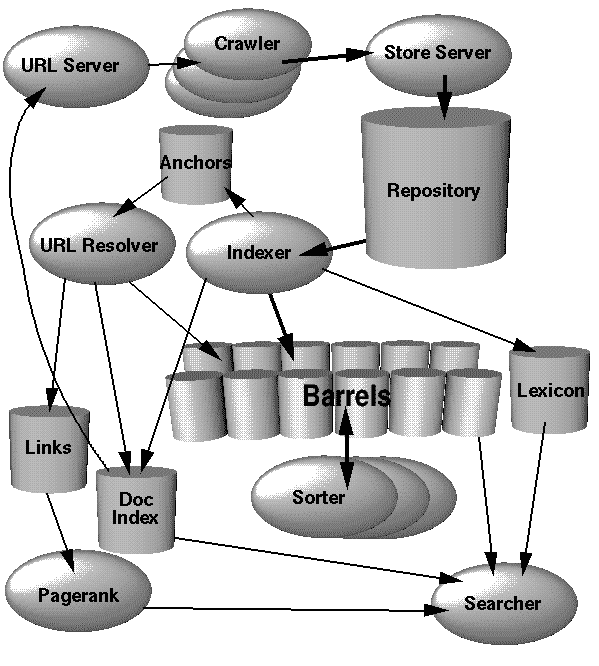

# 编程面试要素：内部指南


本文档是我们的《Python 编程面试算法》（EPI）一书的示例。其目的是提供 EPI 在组织、内容、风格、主题和质量方面的示例。本示例仅关注问题；特别地，它不包含关于面试非技术方面的三个章节。我们非常希望听到您的反馈——我们特别感兴趣您对改进阐述的建议，以及您对面试趋势的任何见解。

您可以在 Amazon.com 购买 EPI Python 版（纸质版）。http://ElementsOfProgrammingInterviews.com

`Adnan Aziz` 是 Facebook 的研究科学家。此前，他是德克萨斯大学奥斯汀分校电气与计算机工程系的教授，在那里进行应用算法的研究并教授课程。他在加利福尼亚大学伯克利分校获得博士学位；本科毕业于印度理工学院坎普分校。他曾工作于 Google、高通、IBM 和几家软件初创公司。在不设计算法时，他会和孩子 Laila、Imran 和 Omar 一起玩。

`Tsung-Hsien Lee` 是 Uber 的高级软件工程师。此前，他曾在 Google 担任软件工程师，并在 Facebook 担任软件工程师实习生。他在国立清华大学获得了硕士和本科学位。他对设计和实现算法充满热情。他喜欢将算法应用到生活的各个方面。他为帮助组织 Google Code Jam 2014 和 2015 感到特别自豪。

`Amit Prakash` 是硅谷初创公司 ThoughtSpot 的联合创始人兼 CTO。此前，他是 Google 的技术人员成员，主要处理在线广告背景下产生的机器学习问题。在此之前，他在微软的网络搜索团队工作过。他在德克萨斯大学奥斯汀分校获得博士学位；本科毕业于印度理工学院坎普分校。当不在改进商业智能时，他会沉浸于谜题、电影、旅行以及与 Nidhi 和 Aanya 的冒险爱好中。

版权所有 © 2017 Adnan Aziz, Tsung-Hsien Lee, Amit Prakash。保留所有权利。

未经作者事先许可，不得以任何形式或通过任何手段（电子、机械、复印、录制或其他）复制、存储在检索系统中或传输本出版物的任何部分。

书中表达的观点和意见代表作者个人，并不一定反映其雇佣的官方政策或立场。

我们使用 `L^ATEX` 和 `Memoir` 类排版了本书。我们使用 `TikZ` 绘图。Allan Ytac 根据我们提供的设计简报创作了封面。

本书的配套网站包含每个版本的联系信息和已知错误列表。如果您发现错误或改进建议，请告诉我们。网址：http://elementsofprogramminginterviews.com

根据归名-非商业性-禁止衍生性 3.0 许可协议分发。

## 第一部分：数据结构与算法

### 第一章：基本类型

表示法是编程的本质。

— 《人月神话》，F. P. Brooks, 1975

程序根据指令更新内存中的变量。变量有不同的类型——类型是对数据的一种分类，它规定了该类型可能的值以及可以对其执行的操作。类型可以由语言提供，也可以由程序员定义。在 Python 中，一切都是对象——这包括布尔值、整数、字符等。

### 基本类型快速训练营

编写一个程序来统计整数中设置为 1 的位个数，是快速上手基本类型的好方法。以下程序从最低位开始一次测试一个位。它说明了位移和掩码的操作；同时也展示了如何避免硬编码整数字的大小。

```python
def count_bits(x):
    num_bits = 0
    while x:
        num_bits += x & 1
        x >>= 1
    return num_bits
```

由于我们对每个位执行 `O(1)` 计算，时间复杂度为 `O(n)`，其中 `n` 是表示该整数所需的位数，例如，表示 12 需要 4 位，其二进制为 `(1100)_2`。对面中 Solution 1.1 涉及的模 2 计数（即奇偶性）的技术可以用于改进上述程序的性能。

### 认识你的基本类型

Python 有许多内置类型：数值（例如整数）、序列（例如列表）、映射（例如字典），以及类、实例和异常。这些类型的所有实例都是对象。

Python3 中的整数是无界的——可表示的最大整数取决于可用内存。可以使用常量 `sys.maxsize` 来查找字长；具体而言，它是可以存储在字中的最大整数值，例如在 64 位机器上为 `2^63 - 1`。浮点数的边界规定在 `sys.float_info` 中。

- 非常熟悉位运算符，如 `6&4`、`1|2`、`8>>1`、`-16>>>2`、`1<<10`、`~0`、`15^x`。负数被视为补码值。（Python 中没有无符号移动的概念，因为整数具有无限精度。）
- 熟练掌握位运算符，特别是异或运算。
- 理解如何以机器无关的方式使用并创建掩码。
- 了解快速清除最低置位的方法（依此类推，设置最低 0、获取其索引等）。
- 理解符号位及其对位移的影响。
- 考虑使用缓存通过暴力破解较小的输入来加速操作。
- 注意交换律和结合律可以用于并行执行操作并重排操作。

**表 1.1：基本类型核心技巧**

- 数值类型的关键方法有 `abs(-34.5)`、`math.ceil(2.17)`、`math.floor(3.14)`、`min(x, -4)`、`max(3.14, y)`、`pow(2.71, 3.14)`（或者使用 `2.71 ** 3.14`）以及 `math.sqrt(225)`。
- 了解整数和字符串之间的相互转换，例如 `str(42)`、`int('42')`，浮点数和字符串，例如 `str(3.14)`、`float('3.14')`。
- 与整数不同，浮点数不是无限精度的，将无穷引用为 `float('inf')` 和 `float('-inf')` 非常方便。这些值可以与整数比较，用于创建伪最大和伪最小值。
- 在比较浮点值时，考虑使用 `math.isclose()`——它是健壮的，例如在比较极大值时，并且可以处理绝对和相对差异。
- `random` 模块的关键方法有 `random.randrange(28)`、`random.randint(8, 16)`、`random.random()`、`random.shuffle(A)` 和 `random.choice(A)`。

### [1.1] 计算字的奇偶性

如果二进制字中 1 的个数为奇数，则其奇偶性为 1；否则为 0。例如，1011 的奇偶性为 1，10001000 的奇偶性为 0。（此处省略原文中重复的描述，按核心逻辑处理。）

**解：** 由于我们对每个位执行 `O(1)` 计算，时间复杂度为 `O(n)`，其中 `n` 是表示该整数所需的位数，例如，表示 12 需要 4 位，其二进制为 `(1100)_2`。

如何计算一个非常大数的奇偶性？提示：使用查找表。

```python
def parity(x):
    result = 0
    while x:
        result ^= x & 1
        x >>= 1
    return result
```

第一个改进是基于消除字中的最低置位，这比暴力算法更优。

```python
def parity(x):
    result = 0
    while x:
        result ^= 1
        x &= x - 1 # 丢掉最低置位。
    return result
```

首先我们来演示缓存技术。显然，我们无法缓存每个 64 位整数的奇偶性——我们需要 `2^64` 位存储空间，这数量级高达十万亿字节（exabytes）。然而，在计算一组位数的奇偶性时，如何分组这些位并不重要，即该计算具有结合律。因此，我们可以将 64 位整数的位分成四个不重叠的 16 位子字，计算每个子字的奇偶性，然后计算这四个中间结果的奇偶性，从而得到该整数的奇偶性。我们选择 16 是因为 `2^16 = 65536` 较小，使得使用数组缓存所有 16 位字的奇偶性是可行的。此外，由于 16 能整除 64，代码会比使用 10 位子字的情况要更简单。

我们通过一个针对 2 位字的查找表来说演示这种方法。缓存为 `0,1,1,0`——这些分别是 `(00)`、`(01)`、`(10)` 和 `(11)` 的奇偶性。要计算 `(11001010)` 的奇偶性，我们需要计算 `(11)`、`(00)`、`(10)` 和 `(10)` 的奇偶性。通过查表我们发现它们分别是 `0,0,1,1`，因此最终结果是 `0,0,1,1` 的奇偶性，即 `0`。

为了查找 `(11101010)` 前两个位的奇偶性，我们右移 6 位得到 `(00000011)`，并将其作为缓存的索引。要查找接下来两个位（即 `(10)`）的奇偶性，我们右移 4 位，在最低两个位得到 `(10)`。右移并没有移除开头的 `(11)`——结果是 `(00001110)`。我们不能用这个值索引缓存，这会导致越界访问。为了获取右移 4 位后的最后两个位，我们需要将 `(00001110)` 与 `(00000011)` 进行按位与运算（这是用于提取最后 2 位的“掩码”）。结果是 `(00000010)`。另外两个 2 位查找也需要类似的掩码操作。

```python
def parity(x):
    MASK_SIZE = 16
    BIT_MASK = 0xFFFF
    return (PRECOMPUTED_PARITY[x >> (3 * MASK_SIZE)] ^
            PRECOMPUTED_PARITY[(x >> (2 * MASK_SIZE)) & BIT_MASK] ^
            PRECOMPUTED_PARITY[(x >> MASK_SIZE) & BIT_MASK] ^
            PRECOMPUTED_PARITY[x & BIT_MASK ])
```

时间复杂度取决于用于索引查找表的键的大小。设 `L` 为我们缓存结果的字宽，`n` 为字大小。由于有 `n/L` 项，在假设字级操作（如移位）需要 `O(1)` 时间的情况下，时间复杂度为 `O(n/L)`。（这不包括初始化查找表所需的时间。）

我们可以通过利用奇偶性的某些简单属性来改进之前算法 `O(n)` 最坏情况下的时间复杂度。具体来说，两个位的异或（XOR）如果两个位均为 0 或均为 1，则定义为 0；否则为 1。`XOR` 具有结合律，即位的分如何分组并不重要，同时也具有交换律，即执行异或的顺序不影响结果。一组位的异或即为它们的奇偶性。我们可以利用这一点，使用 CPU 的字级异或指令一次处理多个位。

例如，`b[63]`、`b[62]`……`b[3]`、`b[2]`、`b[1]`、`b[0]` 的奇偶性等于 `b[63]`、`b[62]`……`b[32]` 和 `b[31]`、`b[30]`……`b[0]` 的异或奇偶性。这两个 32 位值的异或可以通过一次移位和一次 32 位异或指令计算。我们对 32 位、16 位、8 位、4 位、2 位和 1 位操作重复相同的操作以得到最终结果。注意领先位没有意义，我们必须从最低位显式提取结果。

我们通过 8 位字来演示这种方法。`(11010111)` 的奇偶性等于 `(1101)` 异或 `(0111)` 的奇偶性，即 `(1010)` 的奇偶性。这又等于 `(10)` 异或 `(10)` 的奇偶性，即 `(00)` 的奇偶性。最终结果是 `(0)` 异或 `(0)`，即 `0`。注意第一次异或得到 `(11011010)`，后续只有最后 4 位是有效的。第二次异或得到 `(11101100)`，只有最后 2 位是有效的。第三次异或得到 `(10011010)`。最后一位是结果，为了提取它，我们需要与 `(0000)` 进行按位与运算。

最简单的数据结构是数组，它是一块连续的内存。给定数组 `A`，`A[i]` 表示第 `i` 个元素。检索和更新 `A[i]` 需要 `O(1)`。向满数组插入元素可以通过扩容处理，即分配新数组并复制项，因为扩容并不频繁。从数组中删除元素需要将后续元素向左移动以填充空隙。从长度为 `n` 的数组中删除元素的复杂度为 `O(n)`。插入新元素也是如此。

**变体：** 编写函数以常量时间完成以下操作：

- 找到数组中最右侧置位。
- 计算 `x` 对 2 的幂取模。
- 测试 `x` 是否为 2 的幂。

## 数组训练

以下问题有助于深入理解数组：你的输入是一个整数数组，你需要重新排列它的项使得偶数排在前面。如果使用 `O(n)` 空间就很简单，但要求在不分配存储的情况下解决。

在处理数组时，你应该利用可以在两端进行高效操作的特性。对于这个问题，可以将数组分为三个子数组：偶数、未分类和奇数，按顺序出现。初始偶数和奇数为空，未分类是整个数组。我们遍历未分类，通过交换将其元素移动到偶数和奇数子字的边界，从而扩展偶数和奇数，并缩小未分类。

```python
def even_odd(A):
    next_even, next_odd = 0, len(A) - 1
    while next_even < next_odd:
        if A[next_even] % 2 == 0:
            next_even += 1
        else:
            A[next_even], A[next_odd] = A[next_odd], A[next_even]
            next_odd -= 1
```

与其删除条目（这需要将其右侧的所有条目向移动），不如考虑`覆盖`它。

在处理由数组编码的整数时，考虑`从数组的末尾开始处理数字`。或者，反转数组，使得`最低位数字成为第一个条目`。

熟练编写操作`子数组`的代码。

在操作数组时，极易产生`off-by-1` 错误（差一错误）——越过数组最后一个元素进行读取是一个常见错误，并且会产生灾难性的后果。

在返回结果之前，不要担心维护数组的`完整性`（有序性、将等值项保持在一起等）。

当你预先知道元素的分布时，数组可以作为一个很好的数据结构。例如，长度为`W` 的布尔数组是表示`{0, 1, ..., W - 1}`子集的良好选择。（当使用布尔数组表示`{1, 2, 3, ..., n}`的子集时，分配一个大小为`n + 1`的数组以简化索引。）

在操作二维数组时，对行和列分别`使用并行逻辑`。

有时，`模拟规范`比解析求解结果更简单。例如，与其为`n × n` 矩阵中螺旋顺序的第 `i` 个条目编写公式，不如直接从开始计算输出。

### 表 2.1：数组操作技巧

#### 了解你的数组库

Python 中的数组由`list`类型提供。（`tuple`类型与`list`类型非常相似，区别在于它是不可变的。）`list`的关键属性是它是动态调整大小的，也就是说，向其中添加多少个值没有限制。同样地，可以在任意位置删除和插入值。

- 了解实例化列表的语法，例如`[3, 5, 7, 11]`、`[1] + [0] * 10`、`list(range(100))`。（稍后描述的列表推导式也是一种实例化数组的强大工具。）
- 基础操作有`len(A)`、`A.append(42)`、`A.remove(2)`和`A.insert(3, 28)`。
- 了解如何实例化二维数组，例如`[[1, 2, 4], [3, 5, 7, 9], [13]]`。
- 检查一个值是否存在于数组中只需`a in A`。（该操作具有`O(n)`时间复杂度，其中`n`是数组的长度。）
- 理解拷贝是如何运作的，即`B = A`和`B = list(A)`之间的区别。理解什么是深拷贝，以及它与浅拷贝的区别，即`copy.copy(A)`与`copy.deepcopy(A)`的区别。
- `list`的关键方法包括`min(A)`、`max(A)`、针对有序列表的二分查找（`bisect.bisect(A, 6)`、`bisect.bisect_left(A, 6)`和`bisect.bisect_right(A, 6)`）、`A.reverse()`（原地操作）、`reversed(A)`（返回迭代器）、`A.sort()`（原地操作）、`sorted(A)`（返回副本）、`del A[i]`（删除第`i`个元素）和`del A[i:j]`（移除切片）。
- 切片是操作数组的一种非常简洁的方式。它可以被视为索引的泛化：切片的最通用形式是`A[i:j:k]`，其中`i`、`j`和`k`都是可选的。假设`A = [1, 6, 3, 4, 5, 2, 7]`。以下是一些切片示例：`A[2:4]`是`[3, 4]`，`A[2:]`是`[3, 4, 5, 2, 7]`，`A[:4]`是`[1, 6, 3, 4]`，`A[:-1]`是`[1, 6, 3, 4, 5, 2]`，`A[-3:]`是`[5, 2, 7]`，`A[-3:-1]`是`[5, 2]`，`A[1:5:2]`是`[6, 4]`，`A[5:1:-2]`是`[2, 4]`，而`A[::-1]`是`[7, 2, 5, 4, 3, 6, 1]`（反转列表）。切片也可以用于旋转列表：`A[k:] + A[:k]`将`A`向左旋转`k`位。它还可以用于创建副本：`B = A[:]`将`A`的（浅）拷贝到`B`中。
- Python 提供了一种名为列表推导式的特性，这是创建列表的简洁方法。列表推导式由（1）一个输入序列、（2）一个对输入序列的迭代器、（3）一个针对迭代器的逻辑条件（可选）以及（4）一个产生派生列表元素的表达式组成。例如，`[x**2 for a in range(6)]`产生`[1, 4, 9, 16, 25]`，而`[x**2 for a in range(6) if x % 2 == 0]`产生`[4, 16]`。

虽然列表推导式始终可以使用`map()`、`filter()`和`lambdas`重写，但它们读起来更清晰，在很大程度上是因为它们不需要 lambda。

列表推导式支持多层循环。这可以用于……

`break`


### 寻找一个更大的元素

当我们遇到小于 `pivot` 的元素时停止，因为第一遍遍历已经将它们移动到 `A` 的开头。对于 `j in reversed(range(i))`：

```python
if A[j] > pivot:
    A[i], A[j] = A[j], A[i]
    break
```

现在的空间复杂度为 `O(1)`，但时间复杂度为 `O(n²)`，例如，如果 `i = n/2` 且 `i` 之前的所有元素都大于 `A[i]`，且 `i` 之后的所有元素都小于 `A[i]`。

直观上，这种方法的时间复杂度很差，因为在第一遍遍历搜索每个比 `pivot` 小的额外元素时，我们都从头开始。然而，没有理由从那么远的地方开始——我们可以从上一次移动的位置开始。（第二遍遍历也有类似的注释。）

为了提高时间复杂度，我们进行单次遍历并将所有小于 `pivot` 的元素移动到开头。在第二遍遍历中，我们将较大的元素移动到末尾。很容易在单次迭代中执行每次遍历，一旦发现不在位的元素就将其移动。

```python
RED , WHITE , BLUE = range (3)

def dutch_flag_partition(pivot_index , A):
    pivot = A[pivot_index]
    # 第一遍遍历：分组小于 pivot 的元素。smaller = 0
    for i in range(len(A)):
        if A[i] < pivot:
            A[i], A[smaller] = A[smaller], A[i]
            smaller += 1
    # 第二遍遍历：分组大于 pivot 的元素。larger = len(A) - 1
    for i in reversed(range(len(A))):
        if A[i] < pivot:
            break
        elif A[i] > pivot:
            A[i], A[larger] = A[larger], A[i]
            larger -= 1
```

时间复杂度为 `O(n)`，空间复杂度为 `O(1)`。

我们现在提出的算法与上述草图相似。主要区别在于它在单次遍历中完成对小于、等于和大于 `pivot` 元素的分类。这以更复杂的实现为代价缩短了运行时间。我们通过维护四个子数组：底部（小于 `pivot` 的元素）、中间（等于 `pivot` 的元素）、未分类和顶部（大于 `pivot` 的元素）。初始时，所有元素都在未分类中。我们遍历未分类中的元素，并根据传入的未分类元素与 `pivot` 之间的相对顺序，将元素移动到底部、中间和顶部组之一。

作为一个具体的例子，假设数组当前为 `A =−3,0,-1,1,1?,?,?,?,4,2`，其中 `pivot` 为 `1`，`?` 表示未分类元素。第一个未分类元素 `A[5]` 有三种可能：

- `A[5]` 小于 `pivot`，例如 `A[5] =−5`。我们将它与第一个 `1` 交换，即新数组为 `-3,0,-1,-5,1,1,?,?,4,2`。
- `A[5]` 等于 `pivot`，即 `A[5] = 1`。我们不需要移动它，只需移动到下一个未分类元素，即数组为 `-3,0,-1,1,1,1,?,?,4,2`。
- `A[5]` 大于 `pivot`，例如 `A[5] = 3`。我们将它与最后一个未分类元素交换，即新数组为 `-3,0,-1,1,1,?,?,3,4,2`。

注意每种情况下未分类元素的数量都减少了一个。

```python
RED , WHITE , BLUE = range (3)

def dutch_flag_partition(pivot_index , A):
    pivot = A[pivot_index]
    # 保持以下不变性：底部组：A[: ]
    # 中间组：A[smaller: ] # 未分类组：A[equal: ] # 顶部组：A[larger :]
    smaller , equal , larger = 0, 0, len(A) # 只要有未分类元素就继续遍历：
    while equal < larger:
        # A[equal] 是当前的未分类元素。
        if A[equal] < pivot:
            A[smaller], A[equal] = A[equal], A[smaller]
            smaller , equal = smaller + 1
 + 1
        elif A[equal] == pivot:
            equal += 1
        else: # A[equal] > pivot.
            larger -= 1
            A[equal], A[larger] = A[larger], A[equal]
```

每次迭代使未分类元素的数量减少 1，每次迭代花费的时间为 `O(1)`，意味着时间复杂度为 `O(n)`。空间复杂度显然是 `O(1)`。

## 3 字符串

字符串匹配是许多领域中的重要问题。字符串在今天的编程中无处不在——脚本、Web 开发和生物信息学大量使用。字符串可以被视为一种特殊的数组，由字符组成。我们将字符串与数组分开处理，因为某些常用的操作——比较、连接、分割——对于数组并不适用。你应该了解字符串在内存中是如何表示的，并理解字符串的基本操作，如连接、分割。高级算法常用哈希表（第 9 章）和动态规划（第 63 页）。在本章中，我们介绍可以使用基础方法解决的字符串问题。

### 回文

回文字符串是指反转后读数相同的字符串。下面的程序检查字符串是否为回文。它没有为输入的反转创建一个新字符串，而是正向和反向遍历输入字符串，从而节省空间。注意它是如何统一处理奇偶长度字符串的。

```python
def is_palindromic(s):
    # 注意对于 i 在 [0, len(s) - 1]，s[~i] 就是 s[-(i + 1)]
    return all(s[i] == s[~i] for i in range(len(s) // 2))
```

时间复杂度为 `O(n)`，空间复杂度为 `O(1)`，其中 `n` 是长度。

### 了解你的字符串库

记住字符串是不可变的很重要——像 `s = s[1:]` 或 `s += ’123’` 这样的操作意味着创建一个新的字符数组，然后赋值回去。这意味着在 `for` 循环中向字符串拼接 `n` 次单个字符的时间复杂度为 `O(n²)`。（有些）与数组类似，字符串问题通常有简单的破解法解。

理解不可变字符串类型的影响，例如在连接不可变字符串时需要分配新字符串。了解不可变字符串的替代方案，例如 Python 中的 `list`。

从前面更新可变字符串很慢，所以看看是否可以从后面写入值。

### 表 3.1：字符串高级技巧

字符串所有其他切片变体的关键运算符和函数有 `s[3]`、`len(s)`、`s + t`、`s[2:4]`（第 9 页提到的列表）、`s in t`、`s.strip()`、`s.startswith(prefix)`、`s.endswith(suffix)`、`’Euclid,Axiom 5,Parallel Lines’.split(，,’)`、`3 * ’01'`、`’,’.join((’Gauss’, ’数学家之王’, ’1777-1855’))`、`s.tolower()` 以及 `’姓名 name, 排名 rank’.format(name='Archimedes’, rank=3)`。

字符串是字符的序列。字符串可以编码一个整数，例如，“123”编码为 123。在这个问题中，你需要实现两个方法：接收一个表示整数的字符串并返回对应的整数，反之亦然。你的代码应该处理负整数。你不能使用像 C++ 中的 `stoi`、Java 中的 `parseInt` 以及 Python 中的 `int` 等库函数。

实现字符串/整数之间的转换函数。提示：一次一个数字地构建结果。

**解决方案：** 我们先考虑整数转字符串的问题。如果要转换的数字是单个数字（即在 0 到 9 之间），则结果很容易计算：它就是一个由编码该数字的单个字符组成的字符串。

如果数字多于一位，自然的方法是逐位进行转换。关键的洞察是，对于任何正整数 `x`，其十进制表示法中的最低位是 `x mod 10`，剩余数字是 `x/10`。这种方法按反序计算数字位，例如，如果我们从 423 开始，我们得到 3，剩下 42 待转换。然后我们得到 2，剩下 4 待转换。最后我们得到 4，并且没有数字待转换了。自然的算法是将数字前置到部分结果。然而，在字符串开头添加数字是非常开销的，因为所有剩余的数字都必须移动。一种更有时间效率的方法是将每个计算出的数字添加到末尾，然后反转计算出的序列。

如果 `x` 是负数，我们记录下这一点，对 `x` 取反数，然后在反转之前添加一个“-”。如果 `x` 为 0，我们的代码将跳出循环而不写入任何数字，在这种情况下我们需要显式地设置 0。

要从字符串转换为整数，我们回想位值系统的基本原理。一个十进制数 `d[2]d[1]d[0]` 编码数字 `10^(2×) d[2] + 10^(1×) d[1] + d[0]`。暴力算法是从最右边的数字开始，迭代地将 `10^i× d[i]` 加到累积和中。计算 `10^(i+1)` 的高效方法是使用现有的值 `10^i` 并将其乘以 10。

更优雅的解决方案是从左侧的数字开始，对于每个后续的数字，将部分结果乘以 10 并加上该数字。例如，将“314”转换为整数，我们将部分结果 `r` 初始化为 0。在第一次迭代中，`r = 3`；在第二次迭代中，`r = 3× 10 + 1 = 31`；在第三次迭代中，`r = 31× 10 + 4 = 314`，这就是最终结果。

负数通过记录符号并对结果取反来处理。

```python
def int_to_string(x):
    is_negative = False
    if x < 0:
        x, is_negative = -x, True
    s = []
    while True:
        s.append(chr(ord('0’) + x % 10))
        x //= 10
        if x == 0:
            break
    # 如果 is_negative 为真，则加上负号
    return (’-’ if is_negative else '') + ''.join(reversed(s))

def string_to_int(s):
    return functools.reduce(lambda running_sum ,
        c: running_sum * 10 + string.digits.index(c), s[s[0] == ’-:]:],
        0) * (-1 if s[0] == ’-’ else 1)
```

### 3.2 进制转换

在十进制系统中，数字的位置被用来表示该数字所乘以 10 的幂次。例如，“314”表示数字 `3× 100 + 1× 10 + 4× 1`。进制 `b` 数系统是十进制系统的推广：字符串“a[k]−[1]a[k]−[2]. . .a[1]a[0]”，其中 `0≤ a[i]< b`，表示基 `b` 的整数 `a[0]^× b⁰ + a[1]^× b¹ + a[2]^× b² +^(· · ·) + a[k−[1]^× b^(k−1)`。

编写一个执行进制转换的程序。输入是一个字符串、一个整数 `b[1]` 和另一个整数 `b[2]`。该字符串表示基 `b[1]` 的整数。输出应该是表示基 `b[2]` 整数的字符串。假设 `2≤ b[1],b[2]≤ 16`。使用“A”表示 10，“B”表示 11，……，“F”表示 15。（例如，如果字符串是“615”，`b[1]` 是 7 且 `b[2]` 是 13，那么结果应该是“1A7”，因为 `6× 7² + 1× 7 + 5 = 1× 13² + 10× 13 + 7`。）

提示：你可以轻松地在哪些进制之间进行转换？

**解决方案：** 暴力方法可能是将输入转换为元表示，然后将 1 分组为 `b[2]`、`b²`、`b³` 等的倍数。例如，[3.2 B] 进制转换……

对于本章中的所有问题，除非另有说明，每个节点都有两个项：一个数据字段和一个 `next` 字段，`next` 字段指向列表中的下一个节点，最后一个节点的 `next` 字段为空。其原型如下：

```python
class ListNode:
    def __init__(self , data=0, next_node=None):
        self.data = data
        self.next = next_node
```

## 链表训练营

链表问题分为两类：你必须自己实现链表的问题，以及你必须利用标准列表库的问题。我们在这里将回顾这两个方面，从实现开始，然后转向列表库。

为单链表实现基础的列表 API（搜索、插入、删除）是熟悉链表的极佳方法。

### 查找键

```python
def search_list(L, key):
    while L and L.data != key:
        L = L.next
    # 如果 key 不在列表中，L 将变为空。
    return L
```

### 在指定节点后插入新节点

```python
### 在 node 之后插入 new_node。
def insert_after(node , new_node):
    new_node.next = node.next
    node.next = new_node
```

### 删除节点

```python
### 删除此节点之后的节点。假设 node 不是尾节点。
def delete_after(node):
    node.next = node.next.next
```

插入和删除是局部操作，具有 `O(1)` 时间复杂度。搜索需要遍历整个列表，例如，如果 `key` 在最后一个节点处或不存在，则其时间复杂度为 `O(n)`，其中 `n` 是节点数。

链表问题通常有一个使用 `O(n)` 空间的简单暴力破解法，但也有一种更细致的解决方案，它利用现有的链表节点将空间复杂度降低到 `O(1)`。

很多时候，链表问题在概念上是简单的，更多是关于整洁地编写规范代码，而不是设计算法。

考虑使用哑头节点（有时称为哨兵节点）来避免需要检查空列表。这可以简化代码并减少 bug 的产生。

很容易忘记对头部和尾部 `update next`（双向链表还要更新前驱节点）。

操作单链表的算法通常受益于使用两个迭代器，一个领先于另一个，或者一个比另一个移动得更快。

### 表 4.1：链表核心技巧

### 了解你的链表库

我们现在回顾标准链表库，并提醒你许多直接涉及链表的面试题要求你自己编写链表类。

在底层，Python 的 `list` 类型通常实现为动态调整大小的数组，其关键方法在第 8 页描述。本章专门关注链表，链表不是 Python 中的标准类型。我们定义了自己的单链表和双向链表类型。这些列表的一些关键方法包括返回头/尾、在头部/尾部添加元素、返回存储在头部/尾部的值以及删除列表中的头部、尾部或任意节点。

### 4.1 环检测

尽管链表应该是一个以空结尾的节点序列，但通过让某个元素的 `next` 字段引用较早的某个节点，可以在链表中创建一个环。

编写一个程序，接收单链表的 `head`，如果不存在环则返回空；如果存在环，则返回环的起始节点。（你预先不知道链表的长度。）

**提示：** 考虑使用两个迭代器，一个快一个慢。

**解：** 这个问题有多种解决方法。如果空间不是问题，最简单的方法是从 `head` 开始通过 `next` 字段遍历节点，并将访问过的节点存储在哈希表中——当且仅当访问到一个已经在哈希表的节点时，存在环。如果没有环，搜索将在尾结束（通常通过将 `next` 字段设置为空表示）。该解决方案需要 `O(n)` 空间，其中 `n` 是列表中节点数。

一种不使用额外存储且不修改列表的暴力方法是使用两个循环遍历列表——外层循环逐个遍历节点，内层循环从 `head` 开始，遍历外层循环目前为止经过的所有节点。如果外层循环访问的节点被访问了，则检测到了环。（如果外层循环遇到列表末尾，则不存在环。）这种方法具有 `O(n²)` 时间复杂度。

这种想法可以在线性时间内付诸运转——使用一个慢迭代器和一个快迭代器来遍历列表。在每次迭代中，让慢迭代器移动一步，快迭代器移动两步。当且仅当两个迭代器相遇时，列表存在环。推理如下：如果快迭代器跳过了慢迭代器，那么慢迭代器将在下一步与快迭代器相等。

现在，假设我们已经使用上述方法检测到环，可以通过首先计算环长 `C` 来找到环的起点。一旦知道存在环并且环上有一个节点，计算环长度就是易事的。要找到环上的第一个节点，我们使用两个迭代器，其中一个比另一个领先 `C`。我们同步移动它们，当它们相遇时，该节点就是环上的第一个节点。

执行这种遍历的代码非常简单：


```python
def has_cycle(head):
    def cycle_len(end):
        start , step = end , 0
        while True:
            step += 1
            start = start.next
            if start is end:
                return step

    fast = slow = head
    while fast and fast.next and fast.next.next:
        slow = slow.next
        fast = fast.next.next
        if slow is fast:
            C = cycle_len(slow)
            it = head
            for _ in range(C):
                it = it.next
            while it is not slow:
                it = it.next
                slow = slow.next
            return it
    return None
```

当使用链表实现栈时，这些操作的时间复杂度为 `O(1)`。如果使用数组实现，它有一个最大条目限制——`push` 和 `pop` 仍然是 `O(1)`。如果数组是动态调整大小的，则 `push` 和 `pop` 的均摊时间复杂度均为 `O(1)`。栈还可以支持额外的操作，例如 `peek`，它返回栈顶元素而不将其弹出。

```text
pop push 3

4

1

2

(a) 初始配置。

3

1 1

2 2

(b) 弹出 (a)。(c) 在 (b) 上推入 3。
```

**图 5.1：** 栈上的操作。

## 栈强化训练营

栈的后进先出（LIFO）语义使其为创建序列的反向迭代器非常有用，而这些序列的存储方式使得很难或无法从给定元素向回溯。此程序使用栈来反序打印单向链表的条目。

```python
def print_linked_list_in_reverse(head):
    nodes = []
    while head:
        nodes.append(head.data)
        head = head.next
    while nodes:
        print(nodes.pop())
```

时间复杂度和空间复杂度均为 `O(n)`，其中 `n` 是链中的节点数量。

学习识别栈的 `LIFO` 属性何时是`适用`。例如，`parsing`（解析）通常受益于栈。

考虑`扩展`基础栈或队列数据结构以支持额外的操作，例如寻找最大元素。

**表 5.1：** 栈的顶级技巧。

## 了解你的栈库

某些问题需要你自己实现栈类；对于另一些问题，可以使用内置的列表类型。

- `s.append(e)` 将一个元素推入栈中。调用 `push` 通常不会出错。
- `s[-1]` 将检索但不会移除栈顶元素。
- `s.pop()` 将移除并返回栈顶元素。
- `len(s) == 0` 测试栈是否为空。

当在空列表上调用时，`s[-1]` 和 `s.pop()` 都会抛出 `IndexError` 异常。

### 5.1 实现一个带 `max` 的栈

设计一个除了 `push` 和 `pop` 之外包含 `max` 操作的栈。`max` 方法应该返回存储在栈中的最大值。

**提示：** 使用额外的存储来跟踪最大值。

**解：** 实现 `max` 操作最简单的方法是考虑栈中的每个元素，例如，对于基于数组的栈，遍历底层数组。时间复杂度为 `O(n)`，空间复杂度为 `O(1)`，其中 `n` 是当前栈中的元素数量。

通过使用辅助数据结构（特别是堆或 `BST`）以及哈希表，可以将时间复杂度降低到 `O(logn)`。空间复杂度增加到 `O(n)`，且代码相当复杂。

假设我们使用单个辅助变量 `M` 来记录栈中的最大元素。在 `push` 时更新 `M` 是很容易的：`M = max(M,e)`，其中 `e` 是推入的元素。然而，在 `pop` 时更新 `M` 非常耗时。如果 `M` 是被弹出的元素，我们无法知道剩余元素中的最大值，被迫考虑所有剩余元素。

我们可以通过缓存极大提高 `pop` 操作的时间复杂度，本质上是用时间换空间。具体来说，对于栈中的每个条目，我们缓存存储在该条目或其下方的最大值。现在当我们 `pop` 时，剔除对应的缓存值。

```python
class Stack:
    ElementWithCachedMax = collections.namedtuple('ElementWithCachedMax', ('element', 'max'))
    def __init__(self):
        self._element_with_cached_max = []

    def empty(self):
        return len(self._element_with_cached_max) == 0

    def max(self):
        if self.empty():
            raise IndexError('max(): empty stack ')
        return self._element_with_cached_max[-1].max

    def pop(self):
        if self.empty():
            raise IndexError('pop(): empty stack ')
        return self._element_with_cached_max.pop().element

    def push(self, x):
        self._element_with_cached_max.append(
            self.ElementWithCachedMax(x, x if self.empty() else max(x, self.max()))
        )
```

每个指定的方法时间复杂度均为 `O(1)`。无论存储的键如何，额外的空间复杂度均为 `O(n)`。

通过观察可以改进最优情况所需的额外空间：如果推入的元素 `e` 小于栈中已有的最大元素，那么 `e` 永远不可能是最大值，因此我们不需要记录它。我们不能单独在栈中存储最大值的序列，因为存在重复的可能性。我们通过额外记录每个最大值的出现次数来解决这个问题。请参见下一页的图 5.2 示例。

```python
class Stack:
    class MaxWithCount:
        def __init__(self, max, count):
            self.max, self.count = max, count

    def __init__(self):
        self._element = []
        self._cached_max_with_count = []

    def empty(self):
        return len(self._element) == 0

    def max(self):
        if self.empty():
            raise IndexError('max(): empty stack ')
        return self._cached_max_with_count[-1].max

    def pop(self):
        if self.empty():
            raise IndexError('pop(): empty stack ')
        pop_element = self._element.pop()
        current_max = self._cached_max_with_count[-1].max
        if pop_element == current_max:
            self._cached_max_with_count[-1].count -= 1
            if self._cached_max_with_count[-1].count == 0:
                self._cached_max_with_count.pop()
        return pop_element

    def push(self, x):
        self._element.append(x)
        if len(self._cached_max_with_count) == 0:
            self._cached_max_with_count.append(self.MaxWithCount(x, 1))
        else:
            current_max = self._cached_max_with_count[-1].max
            if x == current_max:
                self._cached_max_with_count[-1].count += 1
            elif x > current_max:
                self._cached_max_with_count.append(self.MaxWithCount(x, 1))
```

最坏情况下的额外空间复杂度为 `O(n)`，发生在推入的每个键大于主栈中所有键时。然而，当不同键的数量较少时，额外空间较少，为 `O(1)`。

**图 5.2：** 对于以下操作的主栈和辅助栈：`push 2`、`push 2`、`push 1`、`push 4`、`push 5`、`push 5`、`push 3`、`pop`、`pop`、`pop`、`pop`、`push 0`、`push 3`。两个栈最初都为空，它们的进展从左到右、再从上到下显示。辅助栈的顶部持有栈中的最大元素，以及该元素在栈中出现的次数。辅助栈用 `aux` 表示。

## 队列

队列两个基本操作——入队（`enqueue`）和出队（`dequeue`）。如果队列为空，`dequeue` 通常返回空或抛出异常。元素按照先进先出的顺序添加和移除。最近插入的元素称为尾部或后端，最早插入的元素称为头部或前端。

队列可以使用链表实现，在这种情况下，这些操作的时间复杂度为 `O(1)`。队列 API 通常还包含其他操作，例如，一个返回但不移除队列头部元素的方法，一个返回但不移除队列尾部元素的方法，等。

```text
3 2 0

(a) 初始配置。

dequeue[enqueue 4**2 0 2 0 4**]

(b) 队列 (a) 出队后的状态。(c) 队列 (b) 入队 4 后的状态。
```

**图 5.3：** 入队和出队的示例。

双端队列（`deque`），有时也称为双向队列，是一种双向链表，所有的插入和删除操作都在列表的两个端之一进行，即 `head`（头部）或 `tail`（尾部）。在头部插入元素通常称为 `push`，在尾部插入元素通常称为 `inject`。从头部删除元素通常称为 `pop`，从尾部删除通常称为 `eject`。（不同的语言和库可能有不同的命名法。）

### 队列训练营

在接下来的程序中，我们实现了基本的队列 API——`enqueue` 和 `dequeue`——以及一个 `max` 方法，该方法返回队列中存储的最大元素。基本思想是使用组合：添加一个引用库队列对象的私有字段，并将现有的方法（在此例为 `enqueue` 和 `dequeue`）转发到该对象。

```python
class Queue:
    def __init__(self):
        self._data = []

    def enqueue(self, x):
        self._data.append(x)

    def dequeue(self):
        return self._data.pop(0)

    def max(self):
        return max(self._data)
```

`enqueue` 和 `dequeue` 的时间复杂度与库队列相同，即 `O(1)`。寻找最大值的时间复杂度为 `O(n)`，其中 `n` 是条目的数量。学习识别何时适用队列的 FIFO（先进先出）属性。例如，当需要保持顺序时，队列是理想的。

### 表 5.2：队列使用技巧

### 了解你的队列库

某些问题需要你实现自己的 `queue` 类；对于另一些问题，则使用 `collections.deque` 类。

- `q.append(e)` 将元素推入队列。调用 `push` 通常不会出错。
- `q[0]` 将检索但不会移除队列头部的元素。同样，`q[-1]` 将检索但不会移除队列尾部的元素。
- `q.popleft()` 将移除并返回队列头部的元素。对空集合进行出队操作或访问 `head`/`tail` 会抛出 `IndexError` 异常。

## 5.2 按深度增加的顺序计算二叉树节点

二叉树在第 6 章中进行了正式定义。特别是二叉树中的每个节点都有一个深度，即它到根节点的距离。

给定一棵二叉树，返回一个包含相同层键的数组。键应该按照相应节点深度的顺序出现，如果深度相同，则从左到右排序。例如，对于第 28 页图 6.1 中的二叉树，你应该返回 `314, 6,6, 271,561,2,271, 28,0,3,1,28, 17,401,257, 641`。

**提示：** 首先考虑使用一对队列来解决这个问题。

**解决方案：** 一种暴力方法可能是在将节点写入数组的同时，计算它们的深度。我们可以使用先序遍历来计算此数组——通过先遍历节点的左孩子，我们可以确保相同深度的节点从左到右排序。现在我们可以使用稳定排序算法对该数组进行排序，以节点深度为排序键。时间复杂度取决于排序所需的时间，即 `O(nlogn n)`，空间复杂度为 `O(n)`，即存储节点深度的空间。

从直觉上，由于节点在树中已经以某种有序的方式呈现，因此可能避免完全排序，从而减少时间复杂度。此外，通过按深度顺序处理节点，我们不需要为每个节点标记其深度。

在下文中，我们使用一个节点队列存储深度为 `i` 的节点，另一个存储深度为 `i+1` 的节点。在处理完所有深度为 `i` 的节点后，我们就完成了该队列，并开始处理深度为 `i+1` 的节点队列，将深度为 `i+2` 的节点放入新队列。

```python
def binary_tree_depth_order(tree):
    result, curr_depth_nodes = [], collections.deque([tree])
    while curr_depth_nodes:
        next_depth_nodes, this_level = collections.deque([]), []
        while curr_depth_nodes:
            curr = curr_depth_nodes.popleft()
            if curr:
                this_level.append(curr.data)
                # 将空检查推迟到上面的空测试。next_depth_nodes += [curr.left, curr.right]
        if this_level:
            result.append(this_level)
        curr_depth_nodes = next_depth_nodes
    return result
```

由于每个节点恰好入队和出队一次，时间复杂度为 `O(n)`。空间复杂度为 `O(m)`，其中 `m` 是任何单一深度上的节点数。

**变体：** 编写一个程序，输入一个二叉树并按从上向下、交替从左到右和右到左顺序返回键，从左到右开始。例如，如果输入是下一页图 6.1 中的树，你的程序应返回 `314, 6,6, 271,561,2,271, 28,1,3,0,28, 17,401,257, 641`。

**变体：** 编写一个程序，输入一个二叉树并按从底向上、从左到右顺序返回键。例如，如果输入是下一页图 6.1 中的树，你的程序应返回 `314, 6,6, 271,561,2,271, 28,1,3,0,28, 17,401,257, 641`。

节点 `n` 的深度是从根节点到 `n` 的搜索路径上的节点数，不包括 `n` 本身。二叉树的高度是树中任意节点的最大深度。树的每一层是具有相同深度的所有节点。参见上一页的图 6.1 以了解深度和高度概念的示例。

作为这些概念的具体示例，请考虑对面页图 6.1 中的二叉树。节点 `I` 是 `J` 和 `O` 的父节点。节点 `G` 是 `B` 的后代。到 `L` 的搜索路径为 `A,I, J,K,L`。`N` 的深度为 `4`。节点 `M` 是深度最大的节点，因此树的高度为 `5`。以 `B` 为根的子树的高度为 `3`。以 `H` 为根的子树的高度为 `0`。节点 `D`、`E`、`H`、`M`、`N` 和 `P` 是树的叶子节点。

完全二叉树是指除叶子节点外每个节点都有两个子节点的二叉树。完美二叉树是一种完全二叉树，其中所有叶子节点处于同一深度，且每个父节点都有两个孩子。完全二叉树是指除最后一层外，每一层都完全满，且所有节点尽可能靠左的二叉树。（该术语并非通用，例如，某些作者使用的完全二叉树是指我们定义的完美二叉树。）使用归纳法很容易证明，完全二叉树中的非叶节点数比叶子节点数少一个。高度为 `h` 的完美二叉树恰好包含 `2^(h+1-1)` 个节点，其中 `2^h` 个叶子。`n` 个节点的完全二叉树高度为 `logn`。左倾斜树是指没有节点具有右子节点的树；右倾斜树是指没有节点具有左子节点的树。在任何情况下，我们都称该二叉树为倾斜的。


二叉树的一个关键计算是遍历树中的所有节点。（遍历有时也称为行走。）以下是实现这种访问的几种方法。

- 遍历左子树，访问根节点，然后遍历右子树（中序遍历）。上一页图 6.1 中二叉树的中序遍历按以下顺序访问节点：`D,C,E,B,FH,G,A, J,L,M,K,N,I,O,P`。
- 访问根节点，遍历左子树，然后遍历右子树（前序遍历）。对面页图 6.1 中二叉树的前序遍历按以下顺序访问节点：`A,B,C,D,E,FG,H,I, J,K,L,M,N,O,P`。
- 遍历左子树，遍历右子树，然后访问根节点（后序遍历）。上一页图 6.1 中二叉树的后序遍历按以下顺序访问节点：`D,E,C,H,G,FB,M,L,N,K, J,P,O,I,A`。

令`T`为具有`n`个节点的二叉树，高度为`h`。递归实现这些遍历具有`O(n)`的时间复杂度和`O(h)`的额外空间复杂度。（空间复杂度由函数调用栈的最大深度决定。）如果每个节点都有一个`parent`字段，遍历可以用`O(1)`的额外空间复杂度完成。

`tree`一词被重载了，这可能会导致混淆；参见第 75 页关于常见变体的概述。

### 二叉树训练营

快速上手二叉树的一种良好方法是实现三种基本遍历——中序、前序和后序。

```python
def tree_traversal(root):
    if root:
        # 前序: # 子。在遍历左、右子树之前处理根节点。
        print('Preorder: %d' % root.data)
        tree_traversal(root.left)
        # 中序: 在遍历左子树后、遍历右子树 # 前处理根节点。
        print('Inorder: %d' % root.data)
        tree_traversal(root.right)
        # 后序 : 在遍历左、右 # 子后处理根节点。
        print('Postorder: %d' % root.data)
```

每种方法的时间复杂度均为`O(n)`，其中`n`是树中的节点数。虽然没有显式分配内存，但函数调用栈的最大深度达到了树的高度`h`。因此，空间复杂度为`O(h)`。`h`的最小值为`logn`（完全二叉树），最大值为`n`（倾斜树）。

`递归算法`非常适合树上的问题。在进行空间复杂度分析时，请记住包含隐式分配在`函数调用栈`上的空间。如果你需要复习递归，请阅读第 12 章的引言。

某些树问题有简单的暴力破解解，使用`O(n)`空间，但更微妙的解利用`现有的树节点`将空间复杂度降低到`O(1)`。

在进行复杂度分析时，考虑`左倾斜和右倾斜树`。注意`O(h)`复杂度（其中`h`是树高）在平衡树中转化为`logn`复杂度，而在倾斜树中则为`O(n)`复杂度。

如果每个节点都有`parent`字段，可以使用它来简化代码并减少时间与空间复杂度。很容易犯将节点视为`单子节点`的错误。

### 表 6.1: 二叉树的技巧

#### 测试二叉树是否平衡

如果二叉树的每个节点其左右子树的高度差最多为 1，则称该二叉树是平衡的。完美二叉树和完全二叉树都是平衡的——参见下一页的图 6.2。

图 6.2: 高度为 4 的平衡二叉树

编写一个以二叉树根为输入并检查树是否平衡的程序。

**解：** 这是一个暴力算法。从叶节点开始向上计算高度。对于每个节点，检查左右孩子的高度差是否大于 1。我们可以将高度存储在哈希表中或节点的新字段中。这需要`O(n)`存储和`O(n)`时间，其中`n`是树的节点数。

我们可以通过观察到不需要同时存储所有节点的高度来解决这个问题。当我们完成一个子树时，只需要知道它是否平衡，如果是，它的高度是多少——我们不需要子树根的任何信息。

```python
import collections

def is_balanced_binary_tree(tree):
    BalancedStatusWithHeight = collections.namedtuple('BalancedStatusWithHeight', ('balanced', 'height'))
    # 返回值的第一个值表示是否平衡，如果是，返回值的第二个值是树的高度。
    def check_balanced(tree):
        if not tree:
            return BalancedStatusWithHeight(True, -1) # 基础情况。
        left_result = check_balanced(tree.left)
        if not left_result.balanced:
            # 左子树不平衡。
            return BalancedStatusWithHeight(False, 0)
        right_result = check_balanced(tree.right)
        if not right_result.balanced:
            # 右子树不平衡。
            return BalancedStatusWithHeight(False, 0)
        is_balanced = abs(left_result.height - right_result.height) <= 1
        height = max(left_result.height, right_result.height) + 1
        return BalancedStatusWithHeight(is_balanced, height)
    return check_balanced(tree).balanced
```

该程序实现了后序遍历，但某些调用可能由于提前终止而被消除。具体而言，如果任何左子树不平衡，我们就不需要访问对应的右子树。函数调用栈对应于从根节点到当前节点的唯一路径的调用序列，因此栈的高度受树的高度限制，导致`O(h)`的空间上界。时间复杂度与后序遍历相同，即`O(n)`。

**变体：** 编写一个程序，返回最大的完全二叉树的大小。

### 变体

定义二叉树中的一个节点如果其左子树和右子树的节点数之差不超过`k`，则为为 k 平衡的。设计一种算法，输入一棵二叉树和一个正整数`k`，返回二叉树中的一个节点，该节点不是 k 平衡的，但它所有的后代节点都是 k 平衡的。例如，当应用于第 28 页图 6.1 所示二叉树时，如果`k = 3`，你的算法应该返回节点 J。

## 7 堆

使用斐波纳契堆（F-heaps），我们可以使其网络优化算法获得更快的运行时间。

— “斐波纳契堆及其应用，” M. L. Fredman 和 R. E. Tarjan, 1987

堆是一种特殊的二叉树。具体来说，它是第 29 页定义的完全二叉树。键必须满足堆的属性——每个节点上的键至少大于或等于其子节点存储的键。参见图 7.1(a) 的最大堆示例。最大堆可以通过数组实现；索引为`i`的节点的子节点位于索引`2i+1`和`2i+2`。图 7.1(a) 中最大堆的数组表示为`561,314,401,28,156,359,271,11,3`。

最大堆支持`O(logn)`插入、`O(1)`时间查找最大元素以及`O(logn)`删除最大元素。提取最大值（extract-max）操作被定义为删除并返回最大元素。参见图 7.1(b) 删除最大元素的示例。搜索任意键的时间复杂度为`O(n)`。

堆有时也被称为优先级队列，因为它的行为类似于队列，但有一个不同：每个元素都有一个关联的“优先级”，删除操作会移除优先级最高的元素。

最小堆是该数据结构的一个完全对称的版本，支持`O(1)`时间查找最小元素。

(a) 最大堆。注意根节点持有最大键，(b) 删除 (a) 中堆的堆值后。删除操作通过将根节点的键替换为最后一个叶子节点的键，然后通过反复与子节点交换键来恢复堆属性来完成。

**图 7.1:** 最大堆以及在该最大堆上的删除操作。

### 堆训练营

假设你被要求写一个程序，以“流式”方式接收一个字符串序列：你无法回溯去读取早之前的值。你的程序必须计算序列中 k 个最长的字符串。只需要 k 个最长的字符串——不需要对这些字符串进行排序。

当我们处理输入时，我们希望跟踪到为止见过的 k 个最长字符串。在这 k 个字符串中，当需要添加一个更长的字符串时，被剔除的字符串是最短的那一个。最小堆（不是最大堆！）是该应用程序的正确数据结构，因为它支持高效的查找最小值、删除最小值和插入。在下面的程序中，我们使用带有自定义比较函数的堆，其中字符串按长度排序。

```python
def top_k(k, stream):
    # 条目按长度进行比较。
    min_heap = [( len(s), s) for s in itertools.islice(stream , k)]
    heapq.heapify(min_heap)
    for next_string in stream:
        # 推入 next_string 并弹出 min_heap 中最短的字符串。
        heapq.heappushpop(min_heap , (len(next_string), next_string))
    return [p[1] for p in heapq.nsmallest(k, min_heap)]
```

每个字符串的处理时间为`O(logk)`，这是从堆中添加和移除最小元素所需的时间。因此，如果输入中有 n 个字符串，处理所有字符串的时间复杂度为`O(nlogk)`。

我们可以通过先将新字符串的长度与堆顶字符串的长度进行比较（获取该字符串需要`O(1)`时间）来优化最坏情况的时间复杂度，如果新字符串太短不足以包含在集合中，则跳过插入。

当你只关心最大或最小元素，且不需要支持对任意元素的快速查找、删除或搜索操作时，请使用堆。

当你需要在集合中计算 k 个最大或 k 个最小的元素时，堆是一个很好的选择。对于前者，使用最小堆；对于后者，使用最大堆。

**表 7.1:** 堆使用小技巧

### 了解你的堆库

Python 中的堆功能由`heapq`模块提供。我们将使用的操作和函数包括

- `heapq.heapify(L)`，将`L`中的元素就地转换为堆，
- `heapq.nlargest(k, L)` (`heapq.nsmallest(k, L)`) 返回`L`中的 k 个最大（最小）元素，
- `heapq.heappush(h, e)`，将新元素推入堆，
- `heapq.heappop(h)`，从堆中弹出最小元素，
- `heapq.heappushpop(h, a)`，将`a`推入堆然后返回最小元素，以及
- `e = h[0]`，返回最小元素。

在不弹出的情况下返回最小元素。非常重要的是，`heapq`只提供最小堆功能。如果你需要构建最大堆，对整数或浮点数取负值；对于对象，请适当实现`__lt__`。

### 7.1 合并文件

该问题由以下场景启发：你拥有 500 个文件，每个文件包含来自标准普尔 500 公司的交易信息。每条交易编码格式如下：`123211,AAPL,30,456`。第一个数字是自当天开始的毫秒数。每个文件内的行按顺序排序。其余值是符号、股数和价格。你需要创建一个包含这 500 个文件中所有交易的单个文件，按时间排序。单个文件的大小约为 5-100 MB；合并后的文件约为 5 GB。在抽象上，我们试图解决以下问题：

编写一个程序，接收一组有序序列作为输入，并计算这些序列的并集作为有序序列。例如，如果输入是`3,5,7`、`0,6`和`0,28`，则输出为`0,0,3,5,6,6,7,28`。

**提示:** 在算法执行时，每个序列的哪个部分是重要的？

**解:** 暴力方法是将这些序列合并到一个数组中然后进行排序。假设总共有 n 个元素，时间复杂度为`O(logn)`。

暴力方法没有利用各个序列已排序的特性。我们可以通过将注意力限制在每个序列的第一个元素上来利用这一特性。具体来说，我们反复从每个序列的第一个元素中选择最小元素。

最小堆初始化为每个数组的第一个元素，即它为`{3,0,0}`。我们提取最小条目`0`，并将其加入输出中，结果为`0`。然后我们将`6`添加到最小堆中，现在它为`{3,0,6}`。（我们任意选择了第三个数组对应的`0`条目，从第二个数组中选择也是完全可以的。）接下来，提取`0`并将其加入输出中，结果为`0,0`；然后将`6`添加到最小堆中，现在为`{3,6,6}`。接下来，提取`3`并将其加入输出中，结果为`0,0,3`；然后将`5`添加到最小堆中，现在为`{5,6,6}`。接下来，提取`5`并将其加入输出中，结果为`0,0,3,5`；然后将`7`添加到最小堆中，现在为`{7,6,6}`。接下来，提取`6`并将其加入输出中，结果为`0,0,3,5,6`；假设`6`是从没有剩余元素的第二个数组中选出的，最小堆为`{7,6}`。接下来，提取`6`并将其加入输出中，结果为`0,0,3,5,6,6`；然后将`28`添加到最小堆中，现在为`{7,28}`。接下来，提取`7`并将其加入输出中，结果为`0,0,3,5,6,6,7`；最小堆为`{28}`。接下来，提取`28`并将其加入输出中，结果为`0,0,3,5,6,6,7,28`；现在，所有元素已处理完毕，输出存储了排序后的元素。

```python
def merge_sorted_arrays(sorted_arrays):
    min_heap = []
    # 为每个排序数组构建一个迭代器列表
    sorted_arrays_iters = [iter(x) for x in sorted_arrays]
    # 将每个迭代器的第一个元素放入最小堆中。
    for i, it in enumerate(sorted_arrays_iters):
        first_element = next(it, None)
        if first_element is not None:
            heapq.heappush(min_heap, (first_element, i))
    result = []
    while min_heap:
        smallest_entry, smallest_array_i = heapq.heappop(min_heap)
        smallest_array_iter = sorted_arrays_iters[smallest_array_i]
        result.append(smallest_entry)
        next_element = next(smallest_array_iter, None)
        if next_element is not None:
            heapq.heappush(min_heap, (next_element, smallest_array_i))
    return result

### Pythonic 解决方案，使用了接受多个输入的 heapq.merge() 方法。
def merge_sorted_arrays_pythonic(sorted_arrays):
    return list(heapq.merge(*sorted_arrays))
```

令`k`为输入序列的数量。那么最小堆中的元素不超过`k`个。`extract-min`（提取最小值）和`insert`（插入）都需要`O(logk)`时间。因此，我们可以在`O(nlogk)`时间内完成合并。除了写入最终结果所需的空间外，空间复杂度为`O(k)`。特别地，如果数据来自文件并写入文件而不是数组，我们只需要`O(k)`的额外存储。

或者，我们可以使用`merge sort`中的`merge`步骤每次合并两个递归地合并`k`个文件。我们将从`k`个文件减少到`k/2`个，然后是`k/4`，以此类推。会有`logk`个阶段，每个阶段的时间复杂度为`O(n)`，因此时间复杂度与基于堆的方法相同，即`O(nlogk)`。任何合理的`merge sort`实现的空间复杂度最终都将是`O(n)`，当`k < n`时，这比基于堆的方法差得多。

## 第 8 章：搜索

 — “大规模超文本网络搜索引擎剖析”，S. M. Brin 和 L. Page, 1998

搜索算法可以有多种方式分类。底层集合是静态的还是动态的（即插入和删除与搜索交替进行）？是否值得花费计算成本对数据进行预处理以加速后续查询？数据是否存在可以利用的统计属性？我们应该直接在数据上操作还是对其进行转换？

在本章中，我们的重点是存储在数组中按顺序排列的静态数据。适用于动态更新的数据结构是第 7、9 和 11 章的主题。

本章的第一组问题与二分查找有关。第二组问题与通用搜索有关。

### 二分查找

给定一个包含`n`个键的任意集合，确定搜索键存在的唯一方法是检查每个元素。这具有`O(n)`的时间复杂度。从根本上说，二分查找是搜索排序数组的一种自然基于消除的策略。其核心思想是通过保持键的排序顺序来排除掉一半的键。如果搜索键不等于数组的中间元素，则从中间元素左侧和右侧的两组键中排除一组，不再考虑。

基于二分查找的问题在面试官看来是理想的：它是候选人应该掌握的一种基础技术，可以用几行代码实现。另一方面，二分查找的实现比看起来 true 要复杂。


```python
def bsearch(t, A):
    L, U = 0, len(A) - 1
    while L <= U:
        M = (L + U) // 2
        if A[M] < t:
            L = M + 1
        elif A[M] == t:
            return M
        else:
            U = M - 1
    return -1
```

错误在于`M = (L + U) / 2`，这可能会导致溢出。可以通过`L + (U - L) / 2`来避免。二分查找的时间复杂度由`T(n) = T(n/2) + c`给出，其中`c`是常数。解决了`O(logn)`，远优于未排序键所需的`O(n)`方法。

二分查找是一种有效的搜索工具。它不仅适用于排序数组，例如，它可以搜索实数或整数区间。

## 搜索训练

当对象可比较时，可以使用库函数进行排序和搜索。通常，语言知道如何比较内置类型，例如整数、字符串、日期、URL、SQL时间戳等。然而，用于排序集合的自定义类型必须显式实现比较，确保这种比较具有基本属性（如传递性）。如果比较实现错误，你可能会发现即使项存在，查找排序集合时也会失败。

假设输入一个学生数组，按GPA降序排序，并名称作为平局依据。在下面的程序中，我们展示了如何使用库二分查找程序对该数组进行快速搜索。特别地，我们为二分查找传递了一个自定义比较器，比较学生的GPA（分数越高越靠前），并名称作为平局依据。

```python
Student = collections.namedtuple('Student', ('name', 'grade_point_average'))

def comp_gpa(student):
    return (-student.grade_point_average, student.name)

def search_student(students, target, comp_gpa):
    i = bisect.bisect_left([comp_gpa(s) for s in students], comp_gpa(target))
    return 0 <= i < len(students) and students[i] == target
```

假设序列中的第`i`个元素可以在`O(1)`时间内访问，程序的时间复杂度为`O(logn)`。

`二分查找`是一种强大的搜索工具。它不仅适用于搜索`排序数组`，例如，它可以用于搜索`实数或整数区间`。

如果你的解决方案使用了排序，且排序后执行的计算比排序更快（例如`O(n)`或`O(log n)`），`请寻找不执行完整排序的解决方案`。

考虑`时间`/`空间权衡`，例如对数据进行多次遍历。`表 8.1：`搜索高技巧。

## 了解你的搜索库

`bisect`模块为有序列表提供了二分查找函数。具体而言，假设`a`是一个有序列表。

* 要找到第一个不小于目标值的元素，使用`bisect.bisect_left(a, x)`。此调用返回第一个大于或等于目标值的条目的索引。如果列表中的所有元素都小于`x`，则返回的值为`len(a)`。

* 要找到第一个大于目标值的元素，使用`bisect.bisect_right(a, x)`。此调用返回第一个大于目标值的条目的索引。如果列表中的所有元素都小于等于`x`，则返回的值为`len(a)`。

在面试中，如果允许，请使用上述函数，而不是自己实现二分查找。

## 8.1 在有序数组中查找`k`的首次出现位置

二分查找通常要求查找有序数组中任意等于指定元素的索引。以下问题在此基础上稍有转折。

`-14 -10 2 108 108 243 285 285 285 401`

`A[0] A[1] A[2] A[3] A[4] A[5] A[6] A[7] A[8] A[9]`

`图 8.1：`带有重复元素的有序数组。

编写一个方法，接受一个有序数组和一个键（key），并返回该键在数组中首次出现的位置索引。例如，当应用于图 8.1 中的数组时，如果给定的键是108，你的算法应该返回3；如果是285，你的算法应该返回6。

`提示：`当每个条目都等于`k`时会发生什么？不要在第一次看到`k`时就停止。

`解决方案：`朴素的方法是使用二分查找找到任意等于键`k`的元素的索引。（如果`k`不存在，我们只需返回-1。）找到该元素后，我们开始反向遍历以找到该元素的首次出现。二分查找需要时间`O(log n)`，其中`n`是数组中条目的数量。反向遍历在最坏情况下需要`O(n)`时间——考虑条目等于`k`的情况。

二分查找的基本思想是维护一组候选解决方案。对于当前问题，如果我们看到索引`i`处的元素等于`k`，虽然我们不知道`i`是否是第一个等于`k`的元素，但我们知道后续元素都不可能是第一个。因此，我们从候选集中移除所有索引为`i + 1`或更大的元素。

让我们将上述逻辑应用于给定示例，假设`k = 108`。我们从所有索引作为候选开始，即`[0,9]`。中间点索引4包含`k`。因此我们现在可以将候选集更新为`[0,3]`，并记录4为`k`的一次出现位置。下一个中间点是1，该索引包含-10。我们将候选集更新为`[2,3]`。中间点2的值为2，因此我们将候选集更新为`[3,3]`。由于此中间点的值是108，我们将首次看到的`k`的出现位置更新为3。现在区间是`[3,2]`，它是空的，搜索结束——结果为3。

```python
def search_first_of_k(A, k):
    left, right, result = 0, len(A) - 1, -1
    # A[left:right + 1] is the candidate set.
    while left <= right:
        mid = (left + right) // 2
        if A[mid] > k:
            right = mid - 1
        elif A[mid] == k:
            result = mid
            right = mid - 1 # mid 的右侧没有地方可以是解.
        else: # A[mid] < k.
            left = mid + 1
    return result
```

复杂度界限仍然是`O(log n)`——因为每次迭代都会将候选集的大小减半。

`变体：`设计一个高效算法，接受一个有序数组和一个键，并找到大于该键的元素首次出现的位置索引。例如，当应用于图 8.1 中的数组时，如果键是285，你的算法应该返回9；如果是-13，你的算法应该返回1。

`变体：`令`A`为一个包含`n`个整数的未排序数组，其中`A[0] >= A[1]`且`A[n-2] <= A[n-1]`。如果`A[i]`小于或等于其邻居，则称索引`i`为局部最小值。如果存在局部最小值，你如何高效地找到它？

`变体：`编写一个程序，接受一个整数有序数组`A`和一个整数`k`，返回包含`k`的区间，即整数对`L`和`U`，使得`L`是`k`在`A`中首次出现的位置，`U`是`k`在最后一次出现的位置。如果`k`不在`A`中，返回`[-1,-1]`。

现在我们来说设计适用于字符串的哈希函数的步骤。首先，哈希函数应该检查字符串中的所有字符。它应该给出一个较大的范围，并且不应该让某个字符占据主导（例如，如果我们简单地将字符转换为整数并相乘，那么一个0就会导致哈希值为0）。我们还希望有一种滚动哈希函数（rolling hash function），即如果从字符串开头删除一个字符并在末尾添加另一个字符，可以在`O(1)`时间内计算新的哈希值。以下函数具有这些属性：

```python
def string_hash(s, modulus):
    MULT = 997
    return functools.reduce(lambda v, c: (v * MULT + ord(c)) % modulus , s, 0)
```

哈希表是表示字典（即字符串集合）的一种数据结构。在某些应用中，`trie`（字典树）是一种用于存储动态字符串集合的树形结构，具有计算优势。与`BST`不同，树中的节点不存储键。相反，节点在树中的位置定义了它所关联的键。

## 哈希表训练营

我们通过两个示例介绍哈希表——一个是从哈希表的算法优势中获益的应用，另一个说明了可以用于哈希表的类的设计。

### 哈希表的应用

“字母变位词”（Anagrams）是一种流行的文字游戏谜题，通过重新排列一组单词的字母，你可以得到另一组单词。例如，“eleven plus two”是“twelve plus one”的字母变位词。纵填字游戏爱好者和拼字字母牌游戏（Scrabble）玩家受益于能够查看给定字母集合所有可能的字母变位词。

假设你被要求编写一个程序，将一组单词作为输入，并返回这些单词的字母变位词分组。每组必须包含两个单词。

例如，如果输入是“debitcard”、“elvis”、“silent”、“badcredit”、“lives”、“freedom”、“listen”、“levis”、“money”，那么有三组字母变位词：(1.)“debitcard”、“badcredit”；(2.)“elvis”、“lives”、“levis”；(3.)“silent”、“listen”。（注意，“money”没有出现在任何组中，因为它在集合中没有字母变位词。）

让我们先从考虑测试一个单词是否是另一个单词的字母变位词开始。由于字母变位词不取决于字符串中字符的顺序，我们可以通过对字符串中的字符排序来执行测试。两个单词当且仅当它们排序后产生相同的字符串时才是字母变位词。例如，`sort("logarithmic")`和`sort("algorithmic")`都是“acghiilmort”，所以“logarithmic”和“algorithmic”是字母变位词。

我们可以通过遍历所有字符串，并将每个字符串与其他所有剩余字符串进行比较，形成上述的字符串分组。如果两个字符串是字母变位词，我们不再考虑第二个字符串。这导致了一个`O(n²mlogm)`算法，其中`n`是字符串的数量，`m`是字符串的最大长度。

仔细观察上面的计算，请注意核心思想是将字符串映射到一个代表。对于任何字符串，其排序版本都可以作为其所属字母变位词组的唯一标识符。我们需要的是从排序后的字符串到对应的字母变位词的映射。每当你需要存储一组字符串时，哈希表都是极选择。我们的最终算法通过将字典中的每个字符串`s`的`sort(s)`添加到哈希表中来实现。排序后的字符串是键，而值是原始输入中对应字符串的数组。

```python
def find_anagrams(dictionary):
    sorted_string_to_anagrams = collections.defaultdict(list)
    for s in dictionary:
        # 对字符串排序，将其作为键，然后将原始字符串作为另一个值追加到哈希表中。
        sorted_string_to_anagrams[''.join(sorted(s))].append(s)
    return [
        group for group in sorted_string_to_anagrams.values() if len(group) >= 2
    ]
```

该计算包括`n`次`sort`调用和`n`次哈希表插入。排序所有键的时间复杂度为`O(nmlogm)`。插入增加了`O(nm)`的时间复杂度，产生总时间复杂度为`O(nmlogm)`。

### 可哈希类的设计

考虑一个表示联系人的类。为了简单起见，假设每个联系人都是一个字符串。假设有一个硬性要求，个人联系人必须存储在列表中，且列表可能包含重复项。如果两个联系人包含相同的字符串集合，那么它们应该是相等的，无论底层列表中字符串的顺序如何。重复性并不重要，即三个相同联系人的重复等同于该联系人的单个实例。为了能够在哈希表中存储联系人，我们首先需要显式地定义相等性，可以通过从列表创建集合并比较集合来实现。

在我们的语境中，这意味着哈希函数应该取决于存在的字符串，而不是它们的顺序；如果一个字符串以重复的形式出现，它还应该只考虑一个。需要指出，下面的哈希函数和`equals`方法非常低效。在实践中，建议缓存底层集合和哈希值，并在更新时记得清空这些值。

```python
class ContactList:
    def __init__(self, names):
        """
        names 是字符串列表。
        """
        self.names = names

    def __hash__(self):
        # 概念上是可变的，我们要对集合进行哈希。
        return hash(frozenset(self.names))

    def __eq__(self, other):
        return set(self.names) == set(other.names)

def merge_contact_lists(contacts):
    """
    contacts 是 ContactList 列表。
    """
    return list(set(contacts))
```

计算哈希的时间复杂度为`O(n)`，其中`n`是联系列表中字符串的数量。哈希值通常会被缓存以提高性能，但要注意在更新时必须清空这些值。

哈希表在查找、插入和删除方面具有`最佳理论和现实世界性能`。这些操作的时间复杂度均为`O(1)`。插入的`O(1)`时间复杂度是平均情况——如果哈希表需要调整大小，单次插入可能需要`O(n)`。

考虑使用哈希码作为`签名`来增强性能，例如过滤候选对象。

考虑使用预计算的查找表而不是模板板代码来进行映射，例如从字符到值的映射。

在定义要放入哈希表的自定义类型时，确保你理解`逻辑相等`与哈希函数必须检查的字段之间的关系。具体来说，只要实现了相等性，必须实现正确的哈希函数，否则当放入哈希表时，逻辑相等的对象可能出现在不同的桶中，导致即使搜索项存在也会返回假。

`表 9.1:`哈希表顶级技巧

`了解你的哈希表库`

Python中常用的基于哈希表的数据结构有多种——`set`、`dict`、`collections.defaultdict`和`collections.Counter`。`set`与其他三个的区别是`set`仅存储键，而其他存储键值对。所有这些具有不允许重复键的属性，与`list`不同。

在字典（`dict`）中，访问不存在的键的值会导致`KeyError`异常。然而，`collections.defaultdict`会返回在实例化集合时指定的类型的默认值，例如，如果`d = collections.defaultdict(list)`，那么如果`k`不在`d`中，则`d[k]`为`[]`。`collections.Counter`用于计数键出现的次数，并提供了一系列类似于集合的操作，如下文所示。

```python
c = collections.Counter(a=3, b=1)
d = collections.Counter(a=1, b=2)
### add two counters
c + d
### subtract (keeping together only positive counts)
c[x] + d[x], collections.Counter({'a': 4, 'b': 3})
collections.Counter({'a': 2}) c - d
### intersection : min(c[x], d[x]), collections.Counter({'a': 1, 'b': 1})
c & d
### union: max(c[x], d[x]), collections.Counter({'a': 3, 'b': 2})
c | d
```

集合最重要的操作是`s.add(42)`、`s.remove(42)`、`s.discard(123)`、`x in s`以及`<= t`（是否是子集）和`s - t`（`s`中不在`t`中的元素）。

这三个键值集合的基本操作与集合的操作相似。不同之处在于迭代器——对键值集合进行迭代会产生键。要迭代键值对，请迭代`items()`；要迭代值，请使用`values()`。（`keys()`方法返回一个指向所有键的迭代器。）

并不是所有类型都是“可哈希的”（hashable），即不是都能被添加到集合中或用作字典的键。特别是，可变容器不是可哈希的——这是为了防止客户端在将对象添加到容器后对其进行修改，因为如果修改后的对象哈希槽位置不同，那么查找将无法找到它。

注意，内置的`hash()`函数可以极大地简化用户定义类哈希函数的实现，即实现`__hash__(self)__`。

## 9.1 匿名信是可以构造的吗？

编写一个程序，接收匿名信的文本和杂志的文本，并判断是否可以使用杂志的内容写出这封匿名信。如果匿名信中的每个字符，在匿名信中出现的次数不少于它在杂志中出现的次数，则可以使用杂志写出这封匿名信。

`提示：`统计信中出现的不同字符的数量。

`解：`暴力法是对于字符集中的每个字符，统计它们分别在信和杂志中出现的次数。如果任何字符在信中出现的次数比在杂志中多，则我们返回`false`，否则返回`true`。这种方法可能很慢，因为它遍历了所有字符，包括未在信或杂志中出现的字符。它还对信和杂志都进行了多次遍历——遍历的次数等于字符集中的字符数量。


更好的方法是对信进行单次遍历，将信的字符计数存储在单个哈希表中——键是字符，值是该字符出现的次数。接下来，我们对杂志进行单次遍历。当处理字符`c`时，如果`c`出现在哈希表中，我们将它的计数减 1；当计数变为零时，将其从哈希表中移除。如果哈希表为空，我们返回`true`。如果到达信的末且哈希表非空，我们返回`false`——哈希表中剩余每个字符在信中出现的次数都比杂志中多。

```python
def is_letter_constructible_from_magazine(letter_text, magazine_text):
    # Compute the frequencies for all chars in letter_text.
    char_frequency_for_letter = collections.Counter(letter_text)
    for c in magazine_text:
        if c in char_frequency_for_letter:
            char_frequency_for_letter[c] -= 1
            if char_frequency_for_letter[c] == 0:
                # Checks if characters in magazine_text can cover characters in
                # char_frequency_for_letter .
                del char_frequency_for_letter[c]
    if not char_frequency_for_letter:
        # All characters for letter_text are matched.
        return True
    # Empty char_frequency_for_letter means every char in letter_text can be
    # covered by a character in magazine_text .
    return not char_frequency_for_letter

# Pythonic solution that subtraction only keeps positive counts exploits collections.Counter.
### Note that the keys with positive counts.
def is_letter_constructible_from_magazine_pythonic(letter_text, magazine_text):
    return (not collections.Counter(letter_text) - collections.Counter(magazine_text))
```

在最坏的情况下，信是不可构造的，或者杂志的最后一个字符是必须的。因此，时间复杂度为`O(m+n)`，其中`m`和`n`分别是信和杂志中的字符数量。空间复杂度是遍历信时构建的哈希表的大小，即`O(L)`，其中`L`是信中出现的不同字符的数量。

如果字符按 ASCII 编码，我们可以放弃哈希表，使用一个包含 256 个元素的整数数组`A`，其中`A[i]`设置为字符`i`在信中出现的次数。

## 10 排序

### 问题 14（排序）

排序——将一组项目按升序或降序排列是计算中的一个常见问题。排序用于预处理集合以加快搜索（正如我们在数组上进行二分查找所看到的），并用于识别相似的项目。

朴素排序算法的复杂度为`n²`。许多排序算法的复杂度为`n log n`——堆排序、合并排序和快速排序就是例子。它们各自都有优缺点：例如，堆排序是就地的但不是稳定的；合并排序是稳定的但不是就地的；快速排序在最坏情况下表现一般。实现良好的快速排序通常是排序的最佳选择。

我们简要概述在特定情况下更好的替代方案：

- 对于短数组（例如 10 个或更少元素），插入排序的代码更简单，且比渐进优排序算法更快。
- 如果已知每个元素距离其最终位置最多`k`个位置，可以使用最小堆获得`O(n log k)`算法。
- 如果不同键的数量较少（例如 0..255 范围内的整数），计数排序（记录每个元素比它小的元素数量）效果良好。这种计数可以存储在数组中（如果最大值与待排序集合的大小可比较）或二叉搜索树中，其中键是数字，值是它们的频率。
- 如果存在大量重复键，可以将键添加到二叉搜索树中，并为相同键的元素使用链表；排序结果可以从二叉搜索树的中序遍历中得出。

大多数排序算法不是稳定的。经过仔细实现的合并排序可以是稳定的。另一种解决方案是将索引作为整数排名添加到键中以打破平局。大多数排序程序基于比较函数。然而，也可以直接使用数值属性，例如在基数排序中。

堆数据结构在第 7 章中进行了详细讨论。简而言之，最大堆（最小堆）存储从有序集中提取的键。它支持`O(logn)`时间复杂度的插入和`O(1)`时间复杂度的最大（或最小）元素查找；最大（或最小）键可以在`O(logn)`时间内删除。堆在排序问题中非常有帮助，如第 35 页的题 7.1 所示。

### 排序训练营

了解如何有效使用你语言库提供的排序功能非常重要。假设我们有一个`Student`类，它实现了一个`compare`方法，按姓名比较学生。那么默认情况下，数组排序库程序将按姓名排序。要按 GPA 对学生数组进行排序，我们必须显式地向排序例程指定`compare`函数。

```python
class Student(object):
    def __init__(self , name , grade_point_average):
        self.name = name
        self.grade_point_average = grade_point_average

    def __lt__(self , other):
        return self.name < other.name

students = [
    Student('A’, 4.0), Student('C’, 3.0), Student('B’, 2.0), Student('D’, 3.2)
]
### 根据 Student 中定义的 __lt__ 进行排序。students 保持不变。 
students_sort_by_name = sorted(students)

### 按 grade_point_average 原地排序学生。
students.sort(key=lambda student: student.grade_point_average)
```

对于一个包含`n`个条目的数组，任何合理的库排序的时间复杂度都是`O(nlogn)`。大多数库排序函数都基于快速排序，其空间复杂度为`O(1)`。

排序问题分为两种类型：

1. **使用排序来使算法的后续步骤变得简单**
2. **设计自定义的排序例程**

对于前者，使用库排序函数是可以的，可能还带有一个自定义比较器。对于后者，使用诸如`BST`、`heap`或按值索引的数组等数据结构。

当输入经过排序时，某些问题会变得更容易理解和解决。排序最自然的理由是输入具有**自然顺序**，排序可以作为预处理步骤来**加速搜索**。

对于**特殊输入**，例如取值范围非常小或数值较少，可能可以在`O(n)`时间内排序，而不是`O(nlogn)`时间。

通常情况下，排序实现的空间比暴力破解所需的空间**更少**。

有时对什么进行排序并不而易见，例如，一个区间集合应该按起始点排序还是终点排序？（第 51 页的题 10.2）

**表 10.1：**排序高级技巧

#### 了解你的排序库

要原地排序列表，请使用`sort()`方法；要对迭代对象进行排序，请使用`sorted()`函数。

- `sort()`方法为`list`对象实现了稳定的原地排序。它返回`None`——调用列表本身被更新。它接受两个参数，都是可选的：`key=None`和`reverse=False`。如果`key`不是`None`，则假设它是一个接收列表元素并将其映射为可比较对象的函数——该函数定义了排序顺序。例如，如果`a=[1, 2, 4, 3, 5, 0, 11, 21, 100]`，则`a.sort(key=lambda x: str(x))`将整数映射为字符串，`a`被更新为`[0, 1, 100, 11, 2, 21, 3, 4, 5]`，即条目根据其字符串表示的字典序排序。如果`reverse`设置为`True`，则按降序排序；否则按升序排序。
- `sorted()`函数接受一个迭代对象并返回一个包含迭代对象中所有项的升序排列的新列表。原始列表不变。例如，`b = sorted(a, key=lambda x: str(x))`保持`a`不变，并将`b`赋值为`[0, 1, 100, 11, 2, 21, 3, 4, 5]`。可选参数`key`和`reverse`的作用与`sort`相同。

#### [10.1 C] 计算两个排序数组的交集

搜索引擎的自然实现是通过维护倒排索引来检索匹配查询中单词集合的文档。每个页面被分配一个整数标识符，其`documentID`。倒排索引是一个映射，接受一个单词`w`并返回包含`w`的排序`page-ids`数组——排序顺序可以是，例如页面的降序。当查询包含多个单词时，搜索引擎找到每个单词的排序数组，然后计算这些数组的交集——这些页面是包含查询中所有单词的页面。执行此操作中计算量最大的一步是寻找排序数组的交集。

编写一个程序，输入两个排序数组，并返回一个包含两个输入数组都存在的元素的新数组。输入数组可能有重复条目，但返回的数组不应有重复。例如，输入是`2,3,3,5,5,6,7,7,8`。

**提示：**暴力破解算法的时间复杂度为`O(mn)`。

**解决方案：**如果两个数组都是排序的，我们可以通过同时递增两个数组来实现线性时间。在每次迭代中，如果数组元素不同，则较小的一个可以被排除。如果相等：

```python
def intersect_two_sorted_arrays(A, B):
    i, j, intersection_B = 0, 0, []
    while i < len(A) and j < len(B):
        if A[i] == B[j]:
            if i == 0 or A[i] != A[i - 1]:
                intersection_B.append(A[i])
            i, j = i + 1, j + 1
        elif A[i] < B[j]:
            i += 1
        else: # A[i] > B[j].
            j += 1
    return intersection_B
```

然而，当数组长度相似时，由于我们没有利用数组是排序的这一事实，这并不是最好的。我们可以通过二分查找测试元素是否存在于第二个数组中：

```python
import bisect

def intersect_two_sorted_arrays(A, B):
    def is_present(k):
        i = bisect.bisect_left(B, k)
        return i < len(B) and B[i] == k

    return [
        a for i, a in enumerate(A)
        if (i == 0 or a != A[i - 1]) and is_present(a)
    ]
```

其时间复杂度为`O(mlogn)`，其中`m`是被遍历数组的长度。

假设每天包含若干个事件，其中每个事件被定义为一个开始时间和结束时间。一天内的各个事件应被渲染为不重叠的矩形区域，其侧边与 X 轴和 Y 轴平行。设 X 轴对应时间。如果一个事件在时间`b`开始并在时间`e`结束，其对应的矩形的上边界和下边界必须位于`b`和`e`。下一页的图 10.1 表示了一组事件。

假设每天事件的 Y 坐标必须位于 0 到`L`（一个预定义的常量）之间，且每个事件的矩形必须具有相同的“高度”（平行于 X 轴边之间的距离）。你的任务是计算事件矩形可以具有的最大高度。本质上，这等同于以下问题：

编写一个程序，接收一组事件，并确定同时发生的事件最大数量。

```
E8 E9
E5 E6 E7
E1 E2 E3 E4
0 1 2 3 4 5 6 7 8 9 10 11 12 13 14 15 16 17
```

**图 10.1：**一组九事件。最早开始的事件在时间 1 开始；最晚结束的事件在时间 17 结束。并发事件的最大数量为 3，例如{E1,E5,E8}以及其他。

**提示：**关注端点。

**解：**给定时间的事件数量仅在事件的开始或结束时间发生变化。这引出了以下暴力算法：对于每个端点，计算包含它的事件数量。并发事件的最大数量是所有端点该数量的最大值。如果有`n`个区间，端点的总数为`2n`。由于检查一个区间是否包含某点需要`O(1)`时间，因此计算包含端点的事件数量需要`O(n)`时间。因此，整体时间复杂度为`O(2n×n)` = `O(n²)`。

暴力算法效率低之处在于它没有利用局部性，即当我们从一个端点移动到另一个端点时。直觉上，我们可以对所有端点进行升序排序来改进运行时间。（如果两个端点的时间相同，且其中一个是开始时间，另一个是结束时间，则对应开始时间的先出现。如果两个都是开始或结束时间，我们任意打破平局。）

现在，当我们遍历端点时，可以使用计数器增量地跟踪在该端点发生的事件数量。对于每个作为区间开始的端点，我们将计数器加 1；对于每个作为区间结束的端点，我们将计数器减 1。计数器获得的最大值就是重叠区间的最大数量。

对于图 10.1 中的示例，前七个端点是 1(start), 2(start), 4(start), 5(end), 5(end), 6(start), 7(end)。计数器值更新为 1, 2, 3, 2, 1, 2, 1。

### Event 是元组 (start_time, end_time)

```python
Event = collections.namedtuple('Event ', ('start ', 'finish '))

### Endpoint 是元组 (start_time , 0) 或 (end_time , 1)，这样如果时间相等，start_time 先来
Endpoint = collections.namedtuple('Endpoint ', ('time', 'is_start '))

def find_max_simultaneous_events(A):
    # 构建所有端点的数组。
    E = ([ Endpoint(event.start , True) for event in A] +
         [Endpoint(event.finish , False) for event in A]) # 根据时间排序端点数组，开始时间在结束时间之前。
    E.sort(key=lambda e: (e.time , not e.is_start)) # 通过将...打破平局

    # 跟踪并发事件的数量，记录并发事件数。
    max_num_simultaneous_events, num_simultaneous_events = 0, 0
    for e in E:
        if e.is_start:
            num_simultaneous_events += 1
            max_num_simultaneous_events = max(num_simultaneous_events , max_num_simultaneous_events)
        else:
            num_simultaneous_events -= 1
    return max_num_simultaneous_events
```

排序端点数组需要`O(nlogn)`时间；遍历排序后的数组需要`O(n)`时间，产生`O(nlogn)`时间复杂度。空间复杂度为`O(n)`，即端点数组的大小。

**变体：**用户`1,2, . . . ,n`共享一个互联网连接。用户`i`从时间`s[i]`到`f[i]`（包含边界）使用`b[i]`带宽。峰值带宽使用是多少？

## 11 二叉搜索树

用给定的`n+1`个节点`α`、`β`、`γ`、……能够形成的树的数量为`(n + 1)^(n−1)`。

— “关于树的定理，” A. C^(ayley), 1889

二叉搜索树（BST）是数据结构的主力，并可以非常高效地解决几乎每个数据结构问题。BST能够以高效的方式查找键、找到最小值和最大值、找到键的后继或前驱，并按顺序遍历键。它们与数组相似之处在于值是有序的。然而，与数组不同，BST节点中的键大于或等于左子树的键，小于或等于右子树的键。图 11.1 显示了一棵 BST。

### 实现

BST 的一个常见错误是 BST 中的可变对象被更新。结果是对该对象的查找返回假，尽管它仍在 BST 中。作为规则，避免将可变对象放入 BST。否则，当 BST 中的可变对象需要更新时，始终先从树中移除，更新后再加回去。

BST 的原型如下：

```python
class BSTNode:
    def __init__(self , data=None , left=None , right=None):
        self.data , self.left , self.right = data , left , right
```

### 二叉搜索


搜索是`BST`最基本的应用。与哈希表不同，`BST`提供了找到最小值和最大值以及找到下一个最大/最小元素的能力。这些操作连同查找、删除，在库级实现中需要`O(log n)`时间。`BST`和哈希表都使用`O(n)`空间——在实践中，`BST`使用的空间稍多。

```
^A 19
^B 7 43^(I)
C) 3 11^(F J) 23 47^(O)
D) 2 5^E 17^G 37^K 53^(P)
H) 13^L 29 41^N
31^M
```

**图 11.1：** 一个`BST`示例。

以下程序演示了如何检查给定值是否存在于`BST`中。它是操作`BST`时使用递归力量的良好说明。

```python
def search_bst(tree , key):
    return (tree if not tree or tree.data == key else search_bst(tree.left , key) if key < tree.data else search_bst(tree.right , key))
```

由于程序在每一步都向下移动树，并且每层花费`O(1)`时间，因此时间复杂度为`O(h)`，其中`h`是树的高度。

某些问题需要`BST`和哈希表的结合。例如，如果你将学生对象插入到`BST`中且条目按`GPA`排序，当需要更新某个学生的`GPA`而我们只有学生的名字和新的`GPA`时，在不进行全遍历的情况下，我们无法通过名称找到该学生。然而，通过额外的哈希表，我们可以直接访问树中对应的条目。

`BST`属性是一个全局属性——一个二叉树可能具有这种属性：每个节点的键都大于其左子节点的键且小于右子节点的键，但它可能并不是`BST`。

**表 11.1:** 二叉搜索树的顶级技巧

### 了解你的二叉搜索树库

本章中的某些问题涉及编写`BST`类；而对于其他问题，你可以使用`BST`库。`Python`没有内置的`BST`库。

`sortedcontainers`模块是排序集合和排序字典的顶尖模块——它性能良好，拥有整洁且文档完备的API，并且社区活跃。其底层数据结构是排序列表的排序列表。由于这些操作涉及向长度约为`n`的列表中插入元素，其`inserts`和`deletes`的渐近时间复杂度为`O(n)`，而不是平衡`BSTs`的`O(log n)`。在实践中，这不是问题，因为CPU对块数据移动进行了高度优化。

出于教学考虑，我们选择使用`bintrees`模块，它使用平衡`BSTs`实现了排序集合和排序字典。然而，在我们使用`bintrees`的地方，任何合理的面试官都应该接受`sortedcontainers`。

下面我们描述了`bintrees`添加的功能：

* `insert(e)`在`BST`中插入新元素`e`。

* `discard(e)`如果`BST`中存在`e`则将其移除。

* `min_item()`/`max_item()`返回`BST`中最小和最大的键值对。

* `min_key()`/`max_key()`返回`BST`中最小和最大的键。

* `pop_min()`/`pop_max()`并返回`BST`中最小和最大的键值对。

特别需要注意的是，这些操作的时间复杂度为`O(log n)`，因为它们由底层树结构的支持。

以下程序演示了`bintrees`的用法。

```python
t = bintrees.RBTree ([(5, 'Alfa'), (2, 'Bravo'), (7, 'Charlie'), (3, 'Delta'), (6, 'Echo')])
print(t[2]) # 'Bravo'

print(t.min_item (), t.max_item ()) # (2, 'Bravo'), (7, 'Charlie')

# {2: 'Bravo', 3: 'Delta', 5: 'Alfa', 6: 'Echo', 7: 'Charlie', 9: 'Golf'} t.insert(9, 'Golf')
print(t.min_key (), t.max_key ()) # 2, 9

t.discard (3)
print(t) # {2: 'Bravo', 5: 'Alfa', 6: 'Echo', 7: 'Charlie', 9: 'Golf'}

### a = (2: 'Bravo')
a = t.pop_min ()
print(t) # {5: 'Alfa', 6: 'Echo', 7: 'Charlie', 9: 'Golf'}

### b = (9, 'Golf')
b = t.pop_max ()
print(t) # {5: 'Alfa', 6: 'Echo', 7: 'Charlie'}
```

### 11.1 测试二叉树是否满足BST属性

编写一个程序，输入一个二叉树并检查该树是否满足`BST`属性。提示：检查每个节点的键是否大于或等于左子节点的键且小于或等于右子节点的键是正确的吗？

**解法：** 基于`BST`定义的直接方法是从根节点开始，计算根左子树存储的最大键以及右子树的最小键。我们检查根节点的键是否大于或等于左子树的最大值且小于或等于右子树的最小值。如果这两个检查都通过了，则递归地检查根的左、右子树。如果任何一个检查失败，则返回`false`。

在二叉树中计算最小键是简单的：我们取根节点存储的键、左子树的最小键以及右子树的最小键之间的最小值。最大键的计算方式类似。注意，最小值可以在任何一个子树中，因为普通二叉树可能不满足`BST`属性。

这种方法的问题在于它会反复遍历子树。在最坏情况下（当树是`BST`且每个节点的左节点为空时），复杂度为`O(n²)`，其中`n`是节点数。通过缓存每个节点的最大和最小键，可以将复杂度提高到`O(n)`；这需要`O(n)`的额外存储空间。

我们现在给出两种时间复杂度为`O(n)`的方法。

第一方法是检查每个子树值的约束。初始约束来自根节点。其左（右）子树中的每个节点键必须小于或等于（大于或等于）根节点的键。这个想法可以推广：如果树中的所有节点键都必须在范围`[l, u]`内……

```python
def is_binary_tree_bst(tree, low_range=float('-inf'), high_range=float('inf')):
    if not tree:
        return True
    elif not low_range <= tree.data <= high_range:
        return False
    return (is_binary_tree_bst(tree.left , low_range , tree.data) and
            is_binary_tree_bst(tree.right , tree.data , high_range))
```

对于第55页图11.1中的示例，我们用`(A,[−∞,∞])`初始化队列。每当我们弹出一个节点时，首先检查约束条件。我们弹出第一个条目`(A,[−∞,∞])`并添加它的子节点及其相应的约束，即`(B,[−∞,19])`和`(I,[19,∞])`。接着我们弹出`(B,[−∞,19])`并添加它的子节点，即`(C,[−∞,7])`和`(D,[7,19])`。继续遍历节点，我们检查所有节点是否满足其约束，从而验证该树是否为二叉搜索树（`BST`）。

如果由特定深度内的节点组成的子树违反了`BST`属性，则可以在访问任何更深度的节点之前发现该违背。这是因为每次入队一个条目时，节点键的下界和上限都是可能的紧界。

```python
def is_binary_tree_bst(tree):
    QueueEntry = collections.namedtuple('QueueEntry', ('node', 'lower', 'upper'))
    bfs_queue = collections.deque([QueueEntry(tree, float('-inf'), float('inf'))])
    while bfs_queue:
        front = bfs_queue.popleft()
        if front.node:
            if not front.lower <= front.node.data <= front.upper:
                return False
            bfs_queue += [
                QueueEntry(front.node.left, front.lower, front.node.data),
                QueueEntry(front.node.right, front.node.data, front.upper)
            ]
    return True
```

时间复杂度为`O(n)`，额外空间复杂度为`O(n)`。

## 12 递归

递归的威力显而易见在于可以通过有限的语句定义无限对象集。同样，无限数量的计算可以通过一个有限的递归程序来描述，即使该程序不包含显式的重复。

— “算法 + 数据结构 = 程序，”N. E. Wirth, 1976

递归是一种解决解决问题的方法，其解决方案部分取决于相关问题的较小实例的解决方案。当输入使用递归规则（例如计算机语法）表示时，这种方法通常非常适用。更广泛地说，搜索、枚举、分治以及将复杂问题分解为一组相似的较小实例，都是递归可能适用的场景。

递归函数由基准情况（base cases）和带有不同参数的相同调用组成。成功使用递归的两个关键要素是识别可以直接求解的基准情况，以及确保进展性（即递归收敛到解）。

回溯和分支界法自然地使用递归公式化。**递归训练营**

用于计算两个数字最大公约数（GCD）的欧几里得算法是递归的经典示例。核心思想是，如果`y > x`，则`x`和`y`的公约数等于`x`和`y - x`的公约数。例如，`GCD(156,36) = GCD((156−36)=120,36)`。类推这意味着`x`和`y`的公约数是`x`和`y mod x`的公约数，即`GCD(156,36) = GCD((156 mod 36)=12,36) = GCD(12,36 mod 12=0) = 12`。

```python
def gcd(x, y):
    return x if y == 0 else gcd(y, x % y)
```

由于每次递归步骤中至少有一个参数减半了一半，这意味着时间复杂度为`O(log max(x, y))`。换句话说，时间复杂度为`O(n)`，其中`n`是表示输入所需的位数。空间复杂度也是`O(n)`，即函数调用堆栈的最大深度。（该程序可以很容易地转换为循环形式，从而将空间复杂度降低到`O(1)`。）

现在我们描述一个可以使用递归分治算法优雅地解决的问题。三骨牌（triomino）由三个呈L形连接的单位大小正方形组成。一个残缺棋盘（下文称为8×8 Mboard）由排列成8×8正方形的64个单位正方形组成，但去除了左上角的一个，如下一页图12.1(a)所示。假设要求你设计一种算法，计算21块三骨牌的放置方案，以覆盖8×8 Mboard。由于8×8 Mboard包含63个正方形，而我们有21块三骨牌，有效的放置不能有重叠的骨牌，也不能有超出8×8 Mboard的骨牌。

### 0Z0Z0Z0Z 0Z0Z0Z0Z

（注：提供的文本包含重复的占位符字符串“0Z0”，这些似乎是源文件格式标记。）

(a) 一个8×8 Mboard。(b) 四个4×4。

**图 12.1:** 残缺棋盘。

分治是解决此问题的良好策略。与其暴力破解，不如考虑一个8×8 Mboard。策略是将棋盘分为四个象限。其中一个象限包含缺失的正方形。我们可以放置一个三骨牌覆盖不包含缺失正方形的三个象限，并在中心放置另一个三骨牌覆盖其余部分。这把问题转化为四个较小的4×4子问题，每个子问题有一个缺失的正方形。

递归持续进行直到我们达到2×2子棋盘，此时单个三骨牌可以覆盖剩余的三个正方形。

### 生成所有子集，其`input_set`[`to_be_selected`与`input_set`交集[0], ..., 1]正好等于`selected_so_far`。

```python
def directed_power_set(to_be_selected , selected_so_far):
    if to_be_selected == len(input_set):
        power_set.append(list(selected_so_far))
        return
    selected_so_far.append(input_set[to_be_selected])
    directed_power_set(to_be_selected + 1, selected_so_far) # 生成所有包含`input_set`[`to_be_selected`]的子集。

power_set = []
directed_power_set (0, []) return power_set
```

递归次数`C(n)`满足递归方程`C(n) = 2C(n−1)`，求解结果为`C(n) = O(2^n)`。由于我们在每次调用中花费了`O(n)`时间，因此时间复杂度为`O(n2^n)`。空间复杂度为`O(n2^n)`，因为有`2^n`个子集，且平均子集大小为`n/2`。如果我们只需要打印子集而不是返回所有子集，只需执行打印而不是将子集添加到结果中，这将空间复杂度降低到`O(n)`—时间复杂度保持不变。

对于`S`中元素的任意排序，长度为`n`的`2^n`个位数组与`S`的所有子集集合之间存在一一对应关系——`n`长度位数组`v`中的1表示`v`对应的子集中所包含的`S`元素。这一观察可以推导出一个枚举子集的非递归算法。

特别是，当`n`小于或等于我们所使用的架构（或语言）中整数的宽度时，我们可以通过枚举`[0,2^n−1]`中的整数并检查这些整数中设置的位索引来枚举位数组。这些索引是通过首先通过计算`y = x&~(x−1)`隔离出最低置位位，然后通过计算`log y`获取索引得到的。

```python
def generate_power_set(S):
    power_set = []
    for int_for_subset in range (1 << len(S)):
        bit_array = int_for_subset
        subset = []
        while bit_array:
            subset.append(int(math.log2(bit_array & ~(bit_array - 1))))
            bit_array &= bit_array - 1
        power_set.append(subset)
    return power_set
```

由于计算每个集合需要`O(n)`时间，因此时间复杂度为`O(n2^n)`。在实践中，这种方法非常快。此外，当我们只想要枚举子集（例如为了打印它们）而不是返回所有子集时，其空间复杂度为`O(n)`。

**变体：** 当输入数组可能包含重复元素时（即多集）解决这个问题。你不应重复任何多集。例如，如果`A = 1,2,3,2`，那么你应该返回`, 1, 2, 3, 1,2, 1,3, 2,2, 2,3, 1,2,2, 1,2,3, 2,2,3, 1,2,2,3`。

## 13 动态规划

观察到的重要事实是，我们试图解决一个涉及特定`x`值和特定`N`值的最大化问题，首先是解决涉及任意`x`和任意`N`的通用问题。

— “动态规划，” R. E. Bellman, 1957

DP是一种用于解决可分解为子问题的优化、搜索和计数问题的通用技术。每当你需要通过选择来获得解决方案时，应该考虑使用DP，特别是当解决方案与子问题有关时。

与分治法类似，DP通过组合多个较小问题的解来解决问题，但DP的不同之处在于相同的子问题可能会出现。因此，使DP高效的关键是缓存中间计算的结果。使用DP解决的问题是硬核面试题的常见选择。

为了说明DP的核心思想，考虑计算斐波那契数的问题。前两个斐波那契数是0和1。随后的数字是前两个数字之和。前几个斐波那契数是0,1,1,2,3,5,8,13,21, . . . .斐波那契数出现在许多不同的领域——生物学、数据结构分析和并行计算就是一些例子。

在数学上，第n个斐波那契数`F(n)`由方程`F(n) = F(n−1)+F(n−2)`给出，其中`F(0) = 0`且`F(1) = 1`。递归调用自身的计算`F(n)`的函数的时间复杂度随`n`指数增长。这是因为递归函数重复计算某些`F(i)`。下一页的图13.1形象地说明了函数如何使用相同的参数反复调用。

缓存中间结果使得计算第n个斐波那契数的时间复杂度变为`n`的线性，尽管是以`O(n)`存储为代价。

```python
def fibonacci(n, cache ={}):
    if n <= 1:
        return n
    elif n not in cache:
        cache[n] = fibonacci(n - 1) + fibonacci(n - 2)
    return cache[n]
```

最小化缓存空间是DP中的一个反复主题。现在我们展示一个在`O(n)`时间和`O(1)`空间内计算`F(n)`的程序。从概念上说，与上述程序相比，该程序以底向方式迭代填充缓存，允许它重用缓存存储以减少缓存的空间复杂度。


```python
def fibonacci(n):
    # ... 迭代实现 ...
```

**图 13.1：** 计算第 5 斐波那契数的递归调用树。每个节点是一个调用：`F(x)` 表示参数为 `x` 的调用，右侧斜体数字是该调用的序列。注意 `F(2)`、`F(1)` 和 `F(0)` 的调用。

高效解决 DP 问题的在于找到一种将问题分解为子问题的方法，使得

• 一旦有了子问题的解就可以很容易解决原始问题，并且

• 这些子问题的解被缓存。

通常（并非总是），子问题是可以识别的。

这是 DP 的一个更复杂的应用。考虑以下问题：找到给定整数数组的所有子数组的最大和。作为一个具体示例，图 13.2 中的最大子数组从索引 0 开始到索引 3 结束。

904 40 523 12 -335 -385 -124 481 -31

`A[0]` `A[1]` `A[2]` `A[3]` `A[4]` `A[5]` `A[6]` `A[7]` `A[8]`

**图 13.2：** 最大和为 1479 的数组。

计算每个子数组和的暴力算法时间复杂度为`O(n³)`——有`n(n+1)`个子数组，每个子数组的和需要`O(n)`时间。通过先计算`S[k] = A[0,k]`，可以将暴力算法改进为`O(n²)`，代价是`O(n)`的额外存储。`A[i, j]`的和则是`S[j]− S[i− 1]`，其中`S[¹]`取值为 0。这是一个自然的分治算法。取`m`为A的中间索引。为子数组`L = A[0,m]`和`R = A[m + 1,n− 1]`解决问题。除了每个问题的答案外，我们还返回以`L`的最后一个元素结束的最大子数组和`l`，以及以`R`的第一个元素开始的最大子数组和`r`。A的最大子数组和是`l + r`、`L`的答案和`R`的答案之间的最大值。时间复杂度分析类似于快速排序，时间复杂度为`O(nlogn)`。由于差一错误，需要一些时间才能让程序正确。

现在我们将使用动态规划（DP）来解决这个问题。一种自然的思路是假设我们已经有了子数组`A[0,n− 2]`的解。然而，即使我们知道子数组`A[0,n− 2]`的最大和子数组，这对于解决`A[0,n− 1]`的问题也没有帮助。相反，我们需要在所有子数组`A[0,i]`（`i< n− 1`）中找到和最小的子数组。目标值是`S[n− 1]`减去该数组的和。我们通过遍历数组来计算这个值。对于每个索引`j`，以`j`结尾的最大子数组和等于`S[j]− min[k]≤[j] S[k]`。在迭代过程中，我们跟踪目前为止看到的最小`S[k]`，并计算每个索引的最大子数组和。每个索引花费的时间是常数，从而导致`anO(n)`时间和`O(1)`空间的解决方案。数组所有条目为负数或数组为空都是允许的。算法能够正确处理这些输入情况。

```python
def find_maximum_subarray(A):
    min_sum = max_sum = 0
    for running_sum in itertools.accumulate(A):
        min_sum = min(min_sum , running_sum)
        max_sum = max(max_sum , running_sum - min_sum)
    return max_sum
```

### 动态规划训练营

介绍中提出的用于计算斐波那契数和最大子数组和的程序是 DP 的良好示例。

### [13.1 统计遍历 [二维] 数组的方法数

在这个问题中，你需要统计从 2D 数组的左上角到右下角的方法数。所有移动必须是向右或向下。例如，我们在图 13.3 中展示了`5× 5`二维数组中的三种走法方法。（正如我们所见的，这个例子总共有 70 种可能的方法。）

**图 13.3：** 穿过二维数组的路径。

编写一个程序，计算从 2D 数组的左上角到右下角的方法数。

**提示：** 如果`i> 0`且`j> 0`，你可以从`(i− 1, j)`或`(j− 1,i)`到达`(i, j)`。

当你必须`做出选择`来获得解决方案时，请考虑使用 DP。具体来说，当你能够从同类型较小问题的子实例的解中构建给定实例的解时，DP 就适用于。

除了优化问题外，DP 也`适用于 计数和决策问题`——任何你可以通过对较小实例进行相同计算来递归地表示解决方案的问题。

尽管在概念上 DP 涉及递归，但通常为了效率，缓存是“自底向上”构建的，即通过迭代。

当 DP 以递归实现时，缓存通常是一个动态数据结构，如哈希表或二叉搜索树（BST）；当它以迭代实现时，缓存通常是一个一维或多维数组。

为了节省空间，一旦确定一组条目将不再被查询，`缓存空间`就可以被`回收`。

解决 DP 问题时一个常见的`错误`是尝试通过将问题分成`两个相等的部分`来思考递归情况，类似于快速排序，即解决子数组`A[0,^n ]`和`A[n 2 + 1,n]`的子问题并结合结果。然而，在大多数情况下，这两个子问题不足以解决原始问题。

DP 基于`组合子问题的解`来`产生原始问题的解`。然而，对于某些问题，DP 将无法作用。例如，如果你需要计算从城市 1 到城市 2 且不重复中间城市的最长路径，而这条最长路径经过城市 3，那么从城市 1 到城市 3 以及从城市 3 到城市 2 的子路径可能并不是不重复城市的最长路径。

**表 13.1：动态规划顶层技巧**

**解：** 暴力破解法是枚举所有可能的路径。这可以使用递归完成。然而，路径数量会出现组合爆炸，导致巨大的时间复杂度。

由于问题陈述要求路径数，因此我们关注这一点。一个关键的观察结果是，由于路径必须向下或向右移动，到达右下角入口的方法数等于到达它上方入口的方法数加上到达它正左侧入口的方法数。我们将原点`(0,0)`视为左上角入口。推广来说，到达`(i, j)`的方法数等于到达`(i− 1, j)`的方法数加上到达`(i, j− 1)`的方法数。（如果`i = 0`或`j = 0`，从原点到达`(i, j)`只有一种方法。）这是路径数递归算法的基础。如果简单地实现，该算法具有指数级时间复杂度——它反复在相同位置上进行递归。解决方案是缓存结果。例如，上一页图 13.3 配置到达`(i, j)`的方法数被缓存在矩阵中，如对面页图 13.4 所示。

```python
def number_of_ways(n, m):
    number_ways = [[0] * m for _ in range(n)]
    for i in range(n):
        for j in range(m):
            if i == 0 or j == 0:
                number_ways[i][j] = 1
            else:
                ways = 0
                if i > 0:
                    ways += number_ways[i-1][j]
                if j > 0:
                    ways += number_ways[i][j-1]
                number_ways[i][j] = ways
    return number_ways[n-1][m-1]
```

现在我们描述一个寻找三个数字和为`t`的解决方案。我们对A进行排序，并对于每个`A[i]`，搜索索引`j`和`k`使得`A[j] + A[k] = t - A[i]`。额外的空间需求为`O(1)`，时间复杂度是排序所需的时间`O(nlogn)`以及运行上一段描述的`O(n)`算法n次（每个元素执行一次）的时间之和，总复杂度为`O(n²)`。该方法的代码所示所示：

```python
def has_three_sum(A, t):
    A.sort()
    # 查找 A 中两个数字之和是否等于 t - a。
    return any(has_two_sum(A, t - a) for a in A)
```

**变体：** 当三个元素必须互不相时解决相同的问题。例如，如果`A = 5,2,3,4,3`且`t = 9`，则`A[2]+ A[2]+ A[2]`是不可接受的，`A[2]+ A[2]+ A[4]`是不可接受的，但`A[1] + A[2] + A[3]`和`A[1] + A[3] + A[4]`是可以接受的。

**变体：** 当求元素的个数`k`是额外输入时解决相同的问题。

**变体：** 编写一个程序，输入一个整数数组`A`和一个整数`T`，并返回一个三元组`(A[p],A[q],A[r])`，其中`p,q,r`全不相同，使得`|T− (A[p] + A[q] + A[r])|`最小，且`A[p]≤ A[r]≤ A[s]`。

**变体：** 编写一个程序，输入一个整数数组`A`和一个整数`T`，并返回满足以下条件的三元组`(p,q,r)`的数量：`A[p] + A[q] + A[r]≤ T`且`A[p]≤ A[q]≤ A[r]`。[章节]

## 15 图

这些桥，有人问过是否有人安排一条路线，使得每座桥通过且仅通过一次。

— “一个关于位置几何问题的解决办法，” L. E^(Euler), 1741

非正式地说，图是顶点集合，并通过边连接。正式地说，一个有向图是顶点集合`V`和边集合`E⊂ V× V`。给定一条边`e = (u,v)`，顶点`u`是它的源（source），`v`是它的汇（sink）。图通常会进行修饰，例如通过给边添加长度、给顶点添加权重、添加一个起始顶点等。有向图可以像图 15.1 所示以图化的方式表示。

有向图中从`u`到顶点`v`的路径是顶点序列`v[0],v[1], . . . ,v[n]−[1]`，其中`v[0] = u`，`v[n]−[1] = v`，且每个`(v[i],v[i+1])`都是边。该序列可以包含单个顶点。路径`v[0],v[1], . . . ,v[n]−[1]`的长度为`n−1`。直观上，路径的长度是它遍历的边数。如果从`u`到`v`存在路径，则称`v`从`u`可达。例如，序列`a,c,e,d,h`是图 15.1 所示图中的一条路径。

```
e[5]
8 7 6 2 c⁵ d f g h 7⁴
1
5 a^(3 1) k[1] i⁶ j m nb
4 12 9 7
l
```

**图 15.1：** 带有边权重的有向图。

有向无环图（DAG）是一种没有循环的有向图，即包含一条或多条边且起始和结束于同一个顶点的路径。参见下一页的图 15.2 作为有向无环图的示例。DAG 中没有入边的顶点称为源（sources）；没有出边的顶点称为汇（sinks）。DAG 中顶点的拓扑排序是顶点的一种排序，其中每条边都从排序中较早的顶点指向排序中较后的顶点。

无向图也是一个元组`(V,E)`；然而，`E`是顶点无序对集合。在图中，这通过在顶点之间绘制无箭头的连接（如图 15.3 所示）来体现。

```
e c d f g h
a b k i j m n
l
```

**图 15.2：** 有向无环图。顶点`a, g,m`是源，顶点`l, f,h,n`是汇。排序`a,b,c,e,d, g,h,k,i, j, f,l,m,n`是顶点的拓扑排序。

```
m a b
e f g h i j k
c d l
```

**图 15.3：** 无向图。

如果`G`是无向图，当`G`包含从`u`到`v`的路径时，称`u`和`v`是连通的；否则称`u`和`v`是不连通的。如果图中每对顶点都是连通的，则称图是连通的。连通分量是顶点`C`的极大集合，使得`C`中的每对顶点在`G`中都是连通的。每个顶点恰属于一个连通分量。

例如，图 15.3 中的图是连通的，它有一个连通分量。如果移除边`(h,i)`，它仍然是连通。如果额外移除`(f,i)`，它变得不连通且有两个连通分量。

如果将所有的有向边替换为无向边后产生一个连通的无向图，则称该有向图是弱连通的（weakly connected）。如果对于每对顶点`u, v`，存在从`u`到`v`的有向路径，则称它是连通的。如果对于每对顶点`u, v`，既存在从`u`到`v`的有向路径，又存在从`v`到`u`的有向路径，则称它是强连通的（strongly connected）。

某些图问题涉及**结构分析**，例如，寻找环或连通分量。`DFS`在这些应用中效果非常好。

某些图问题与**优化**有关，例如，找到从一个顶点到另一个顶点的最短路径。`BFS`、`Dijkstra 最短路径算法`和`最小生成树`都是适用于优化问题的图算法示例。

**表 15.1:** 图算法高级技巧

### 图搜索

计算从其他顶点可达的顶点是一项基本操作，可以通过两种惯用方法之一执行，即深度优先搜索(`DFS`)和广度优先搜索(`BFS`)。两者的时间复杂度都是线性的——确切来说是`O(|V|+|E|)`。在最坏情况下，存在一条从初始顶点覆盖所有顶点且不重复的路径，`DFS`选取的边对应于这条路径，因此`DFS`的空间复杂度为`O(|V|)`（该空间隐式地分配在函数调用栈上）。`BFS`的空间复杂度也是`O(|V|)`，因为在最坏情况下，存在从初始顶点到所有剩余顶点的边，这意味着它们在某个时刻会同时处于 BFS 队列中。

`DFS`和`BFS`在它们提供的额外信息方面有所不同，例如，`BFS`可用于计算起始顶点的距离，而`DFS`可检查环的存在。`DFS`中的关键概念包括顶点的发现时间和完成时间概念。

### [15.1 P] 填充一个布尔矩阵

设`A`为一个编码黑白图像的布尔二维数组。条目`A(a,b)`可以视为编码位置`(a,b)`处的颜色。如果一个条目位于另一个左侧、右侧、上方或下方，则称这两个条目相邻。注意，该定义意味着一个条目最多与四个条目相邻，且相邻性是对称的，即如果`e0`邻条目`e1`，则`e1`邻`e0`。

定义从条目`e0`到条目`e1`的路径为相邻条目的序列，从`e0`开始，`e1`结束，且元素相邻。与点`(i, j)`相关的区域定义为所有满足以下条件的点`(i, j)`：存在一条从`(i, j)`到`(i, j)`的路径，其中所有条目的颜色相同。特别地这意味着`(i, j)`和`(i, j)`必须是相同的颜色。

实现一个程序，接收一个`n × m`的布尔数组`A`以及一个条目`(x, y)`，并翻转与`(x, y)`相关区域的颜色。翻转示例见图 15.5。

(a) (b) (c)

**图 15.5:** (a) 中标记为`×`的第一个标记相关的所有单元格颜色已重色，产生 (b) 中的颜色。相同的过程产生了 (c) 中的颜色。

提示：先从概念上解决问题，然后考虑实现上的优化。**解答：** [C] 章

## 16 并行计算

计算机的活动必须包括对在不可预测时刻发送给它的各种消息做出恰当反应，这种情况在所有许多计算机相互耦合的信息系统中都会发生。

— “协作顺序进程，” E. W. D$^{ijkstra}$, 1965

并行计算已变得越来越常见。例如，笔记本电脑和台式机配有多个处理器，它们通过共享内存通信。高端计算通常使用通过网络通信的各个计算机组成的集群完成。

并行性提供了许多优势：

- 高性能——更多处理器处理某项任务（通常）意味着任务完成得更快。

- 更好的资源利用——当一个程序执行时，另一个程序可以等待磁盘或网络。

- 公平性——让不同的用户或程序共享一台机器，而不是让一个程序一次运行到完成。

- 便利性——在概念上，使用一组并发程序处理子任务通常比让单个程序管理所有子任务要直接得多。

- 容错性——如果提供网页的集群中某台机器故障，其他机器可以接管。

并行计算的具体应用包括图形用户界面 (GUI)（一个专用线程处理 UI 操作，而其他线程例如忙于网络通信并将结果传递给 UI 线程，从而提高了响应速度）、Java 虚拟机（一个单独线程处理垃圾回收，否则会导致阻塞，而另一个线程忙于运行用户代码）、Web 服务器（单个逻辑线程处理单个客户端请求）、科学计算（一个大型矩阵乘法可以分布在集群中）以及网络搜索（多台机器爬取、索引和检索网页）。

并行计算的两种主要模型是共享内存模型（每个处理器都可以访问内存的任何位置）和分布式内存模型（处理器必须显式地向另一个处理器发送消息以访问其内存）。前者适用于多核设置，后者对于集群更准确。本章的问题集中在共享内存模型。

编写正确的并行程序具有挑战性，因为并行组件之间存在微妙的相互作用。主要挑战之一是竞态（races）两个两个指令序列访问内存中的相同地址，且至少其中一个写入了该地址。正确性的其他挑战是：

- 饥饿（处理器需要资源但永远无法获得），

- 死锁（`Thread A`获取`Lock L1`，`Thread B`获取`Lock L2`，随后A尝试获取`L2`），

- 活锁（处理器不断重试一个总是失败的操作）。

由于并行组件之间微妙的相互作用，编写正确的并行程序充满挑战。这些问题引起的问题通过测试很难发现。调试它们也很困难，因为它们通常依赖于负载且难以复现。往往无法实现并行所暗示的性能——有时关键任务无法并行化，无论有多少个处理器。同样，处理器之间通信结果的开销可能会超过性能收益。

### 并行计算训练营

信号量是一种强大的同步结构。概念上，信号量维护一组许可。在信号量上调用`acquire()`的线程在需要时会等待许可可用，然后获取。在信号量上调用`release()`的线程增加许可并通知等待信号量的线程，可能释放一个阻塞的获取者。


重新划分标题层级并优化格式后的文本如下：

## 第一部分：并发与系统设计

考虑一个基于 Web 的日历，托管日历的服务器需要在下一个日历事件发生时执行某项任务。（该任务可以是发送电子邮件或短信息服务 (SMS)。）你的任务是设计一个管理此类任务执行的设施。

开发一个`timer`类来管理延迟任务的执行。`timer`构造函数接受一个对象作为参数，该对象包含一个`run`方法和一个字符串类型的名称字段。该类必须支持：(1.) 在未来的某个时间启动一个由名称标识的线程；以及 (2.) 取消一个由名称标识的线程（如果线程已经启动，则忽略取消请求）。

提示：涉及两个方面——数据结构设计和并发。

**解决方案：** 设计的两个方面是数据结构和锁定机制。我们使用两个数据结构。第一个是最小堆（min-heap），我们在其中插入键值对：键是运行时间，值是在该时间要运行的线程。有一个分发线程（dispatch thread）负责运行这些线程；它在每次调用之间睡眠，如果池中添加或删除了线程，它可能会被唤醒。如果被唤醒，它会根据最小堆顶部的元素提前或推迟其剩余睡眠时间。唤醒后，它查找最小堆顶部的线程——如果其启动时间是当前时间，分发线程将其从最小堆中删除并执行。然后它将睡眠直到最小堆中下一个线程的启动时间。（由于删除操作，可能会出现分发线程唤醒后发现无事可做的情况。）

第二个数据结构是哈希表，以线程 ID 为键，最小堆中的项为值。如果我们需要取消一个线程，就去最小堆中删除它。每当添加一个线程时，我们将其添加到最小堆中；如果插入的是堆顶，我们就中断分发线程，以便其调整唤醒时间。

由于最小堆被更新方法和分发线程共享，我们需要对它进行锁定。最简单的解决方案是使用单一锁用于对最小堆和哈希表的所有读写操作。

以下是`Semaphore`类的一个示例实现：

```python
import threading

class Semaphore ():
    def __init__(self, max_available):
        self.cv = threading.Condition()
        self.MAX_AVAILABLE = max_available
        self.taken = 0

    def acquire(self):
        self.cv.acquire()
        while (self.taken == self.MAX_AVAILABLE):
            self.cv.wait()
        self.taken += 1
        self.cv.release()

    def release(self):
        self.cv.acquire()
        self.taken -= 1
        self.cv.notify()
        self.cv.release()
```

## 第二部分：领域特定问题

### 第 17 章 设计问题

不要被许多关于复杂性的书籍，或被你在书中或其他处发现的许多复杂且晦奥的算法所误导。虽然没有关于简单性的教科书，但简单的系统是有效的，而复杂的系统却不然。

—— “事务处理：概念与技术”，J. G. Ray, 1992

面试中，你可能会被问及如何创建一个服务或更大的系统，这可能是建立在你所设计的算法之上的。这些问题是相当开放的，许多问题可以作为一个大型软件项目的起点。

在面试环境中，当有人问及此类问题时，你应该进行对话，在对话中展示出创造性思考、理解设计权衡以及应对未知问题的能力。你应该勾画关键的数据结构和算法，以及你将用于解决该问题的技术栈（编程语言、库、操作系统、硬件和服务）。

本章中的答案是在这种背景下呈现的——它们旨在作为面试中良好回答的示例，而不是全面的最先进解决方案。

我们在表 17.1 中回顾了用于设计系统的有用模式。设计系统时需要考虑的其他因素还有实现时间、可扩展性、伸缩性、可测试性、安全性、国际化和知识产权问题。

**表 17.1：系统设计模式。设计原则**

| 算法与数据结构 | 关键点 |
| :--- | :--- |
| **分解 (Decomposition)** | 识别基础算法和数据结构 |
| | 将功能、架构和代码拆分为可管理的、可复用的组件。 |
| **伸缩性 (Scalability)** | 将问题分解为可以在不同机器上相对独立解决的子问题。跨机器分片数据以适应需求。将处理写入的服务器与处理读取的服务器解耦。在读取服务器上使用复制以获得更高性能。考虑缓存计算并在稍后查找以节省工作量。 |

**分解** 良好的分解对于成功解决系统级设计问题至关重要。功能、架构和代码都受益于分解。

例如，在我们设计在线广告系统的解决方案中，我们根据利益相关者将目标分解为几类。我们将架构本身分解为前端和后端。前端又分为用户管理、网页设计、报告功能等。后端由中间件、存储、数据库、cron 服务和用于广告排名的算法组成。

代码分解是面向对象编程的标志。设计模式的主题是寻找代码复用的良好方法。广义来说，设计模式分为创建模式、结构模式和行为模式。许多特定模式非常自然——策略对象、适配器、生成器等，出现在我们代码库的许多地方。Freeman 等人的《人人上手设计模式》在我们看来是学习设计模式的正确读物。

**伸缩性** 在面试问题的语境下，当处理规模时并行性是有用的，即当问题大到无法放入单台机器上，或者在单台机器上将花费无法接受的时间时。你需要展示的关键洞察是，你知道如何分解问题以便：

- 每个子问题都可以相对独立地解决，且
- 原始问题的解决方案可以从子问题的解决方案高效地构建。

效率通常用中央处理器（CPU）时间、随机访问内存（RAM）、网络带宽、内存访问次数等衡量。

考虑排序 PB 级整数数组。如果我们知道数字的分布，最好的方法是定义等大小的整数范围，并将范围发送到一台机器进行排序。排序后的数字只需按正确顺序拼接即可。如果分布未知，可以将等大的任意子集发送到每个机器，然后合并排序结果，例如使用最小堆。

每当计算重复时，缓存都是极好的工具。例如，动态规划的核心思想是缓存中间计算的结果。在实现一个预期在一段时间内响应请求且许多请求重复的服务时，缓存也非常有用。Web 服务的负载具有这种特性。

### 17.1 设计一个检测版权侵权的系统

YouTV.com 是一个成功的在线视频共享网站。好莱坞制片公司抱怨上传到网站的材料侵犯了版权。

设计一个功能，允许制片公司输入其的视频集`V`，并确定 YouTV.com 数据库中哪些视频与`V`匹配。

提示：规范化视频格式并创建签名。

**解决方案：** 视频与文档的区别在于，相同的内容可能以许多不同的格式、分辨率和压缩级别进行编码。

将重复视频问题还原重复文档问题的一种方法是将所有视频重新编码为通用的格式、分辨率和压缩级别。这本身并不意味着两个内容的视频会变成相同的文件——初始设置会影响生成的视频。然而，现在我们可以对规范化的视频创建“签名”。

一种简单的签名方法是根据每帧的亮度是高于还是低于平均值，为每个帧分配 0 或 1。更复杂的签名是针对每个帧的红、绿、蓝强度进行 3 位测量。甚至可以开发出更复杂的签名，例如，通过考虑单个帧上的区域。开发更好签名的动机是减少系统返回的虚假匹配数量，从而缩短审核匹配结果所需的时间。

上述提出的解决方案是算法性的。然而，还有其他可能有效的替代方法：让用户标记侵犯版权的视频（并可能对他们的付出的给予奖励），检查是否存在与之前被识别为侵权的视频完全相同的视频，查看视频头部的元数据信息等。

**变体：** 设计一个在线音乐识别服务。

## 18 语言问题

我的语言的边界意味着我的世界的界限。[— L. 维特根斯坦]

### 18.1 闭包（Closure）

以下程序打印什么内容？为什么？

```python
increment_by_i = [lambda x: x + i for i in range (10)]

print(increment_by_i 3)
```

**解法：** 程序打印的是 13 (=9 + 4)，而不是预期的 7 (=3 + 4)。这是因为在循环中创建的函数具有相同的作用域。它们使用相同的变量名，因此它们都引用同一个变量`i`，而在循环结束时，`i`的值为 10，因此结果是 13 (=9 + 4)。

有许多方法可以实现想要的行为。合理的方法是从函数中返回 lambda，从而避免命名冲突。

```python
def create_increment_function(x):

return lambda y: y + x

increment_by_i = [create_increment_function(i) for i in range (10)]

print(increment_by_i 3)
```

### 18.2 浅拷贝与深拷贝

描述浅拷贝和深拷贝之间的区别。它们在什么时候是合适的？什么情况下两者都不合适？深拷贝是如何实现的？

**解法：** 首先，我们注意到 Python 中的赋值并不复制——它仅仅是将一个变量指向一个目标。对于可变对象或包含可变项目的对象，如果我们想在不改变原始对象的情况下更改副本，就需要一个拷贝。例如，如果`A = [1, 2, 4, 8]`且我们将`A`赋值给`B`，即`B = A`，那么如果我们更改了`B`（例如`B.append(16)`），那么`A`也会改变。

有两种拷贝方法：浅拷贝和深拷贝。它们在`copy`模块中实现，具体为`copy.copy(x)`和`copy.deepcopy(x)`。浅拷贝构建一个新的复合对象，然后（在可能的范围内）向其中插入原始对象中找到对象的引用。深拷贝构建一个一个新的复合对象，然后递归地向其中插入原始对象中找到的对象的副本。

举一个具体的例子，假设`A = [[1, 2, 3],[4, 5, 6]]`且`B = copy.copy(A)`。那么如果我们通过`B[0][0] = 0`更新`B`，`A[0][0]`也会变为 0。但是，如果`B = copy.deepcopy(A)`，那么同样的更新将保持`A`不变。

浅拷贝和深拷贝的区别只对于复合对象相关，即包含其他对象的对象，例如列表或类实例。如果`A = [1, 2, 3]`且`B = copy.copy(A)`，那么如果我们通过`B[0] = 0`更新`B`，`A`是不变的。

深入底层，深拷贝的实现更具挑战性，因为递归对象（直接或间接引用自身的复合对象）会导致深拷贝的朴素实现出现无限递归。此外，由于深拷贝会复制所有内容，它可能会拷贝过多，例如即使在拷贝之间也应该共享的记录数据结构。`copy.deepcopy()`函数通过缓存已复制的对象，并允许用户定义的类重写拷贝操作来避免这些问题。特别是，类可以重写`__copy__()`和`__deepcopy__()`其中一个或两者。

拷贝是防御性的——如果已知客户端不会修改对象，则可以避免拷贝。同样，如果对象本身是不可变的（例如元组），则没有必要拷贝它。

## 19 面向设计

专家设计人员知道不该做的一件事就是从原理开始解决每一个问题。

— “设计模式：可重用面向对象软件的元素，”E. Gamma, R. Helm, R. E. Johnson, (以及) J. M. Vlissides, 1994

类是数据以及操作这些数据的方法的封装。类符合我们思考计算的方式。它们提供了封装，减少了编写代码的认知负担，并通过使用继承和多态实现了代码复用。然而，朴素地使用面向对象的构造结构可能会导致代码难以维护。

设计模式是针对常见问题的通用且可重复的解决方案。它不是一个可以直接编写代码的完整设计——相反，它是对如何解决在许多不同情况下出现的问题的描述。在面向对象编程的语境下，设计模式同时解决重用性和可维护性问题。本质上，设计模式使得系统的某些部分能够独立于其他部分发生变化。Adnan 的设计模式课程免费在线，包含了讲义、作业和可以作为参考的实验。

### 19.1 创建模式（Creational Patterns）

解释以下这些创建模式分别是什么：构建器、静态工厂、工厂方法和抽象工厂。

**解法：** 构建器模式的想法是分阶段构建一个复杂对象。它通过使用内部类来避免可变性和不一致的状态，并为构建步骤命名。与构造函数相比，它能更好地处理可选参数以及参数列表很长的情况。

静态工厂是创建对象的函数。它的主要优点如下：与构造函数相比，函数的名称可以让操作更加清晰。它并没有义务创建一个新对象——特别是，它可以返回一个享用模式。它还可以返回一个经过优化的类型，例如，如果数组大小不超过整数长度，它可以选择使用整数代替数组。

工厂方法定义了创建对象的接口，但让子类决定实例化类。经典的例子是一个具有两种模式的迷宫游戏——一种普通房间，一种魔法房间。

```python
from abc import ABC , abstractmethod

class Room(ABC):
    @abstractmethod
    def connect(self , room2):
        pass

class MazeGame(ABC):
    @abstractmethod
    def make_room(self):
        print("abstract make_room")
        pass

    def addRoom(self , room):
        print("adding room")

    def __init__(self):
        room1 = self.make_room ()
        room2 = self.make_room ()
        room1.connect(room2)
        self.addRoom(room1)
        self.addRoom(room2)
```

这段代码片段实现了普通房间。这段代码实现了魔法房间。

```python
class MagicMazeGame(MazeGame):

    def make_room(self):
        return MagicRoom ()

class MagicRoom(Room):
    def connect(self , room2):
        print("Connecting magic room")
```

这就是你使用工厂来创建普通和魔法游戏的方法。

```python
ordinary_maze_game = ordinary_maze_game.OrdinaryMazeGame ()
magic_maze_game = magic_maze_game.MagicMazeGame ()
```

工厂方法模式的缺点是使得子类化具有挑战性。

抽象工厂提供了一个用于创建相关对象族的接口，而无需指定它们的具体类。例如，`classDocumentCreator`可以提供创建多个产品的接口，如`createLetter()`和`createResume()`。该类的具体实现类可以选择以不同的方式实现这些产品，例如，使用现代字体或经典字体、右对齐或右侧不对齐布局等。客户端代码获取一个`DocumentCreator`对象并调用它的工厂方法。使用这种模式使得在不更改使用它们的代码（即使在运行时）的情况下交换具体实现可能。这种灵活性的代价是更多的规划和前期的编码，而且由于增加了间接性，代码可能更难以理解。

## 20 种常用工具

UNIX 是一种为数字设备公司 Digital PDP-11/40 和 11/45 计算机设计的通用型、多用户、交互式操作系统。它提供了许多即使在更大的系统中也罕见的特性，包括：(1) 包含可卸载卷的层次结构文件系统；(2) 兼容的文件、设备和进程间 I/O；(3) 启动异步进程的能力；(4) 可按用户选择的系统命令语言；以及 (5) 包括十多种语言在内的 100 多个子系统。

— “The UNIX TimeSharing System,” [D. R] Ritchie 和 [K. T]Thompson[, 1974

本章的问题涉及工具：版本控制系统、脚本语言、构建系统、数据库和网络栈。此类问题通常不会被问到——只有当你正在为特殊职位面试，或者你声称拥有专业知识（例如网络安全或数据库）时，才预期遇到它们。我们强调这些是巨大的领域，例如，网络在大学课程中是作为系列课程教授的。我们这里的目标是让你了解你可能会遇到的内容。Adnan 在线免费获取的高级编程工具课程材料包含讲义笔记、作业和实验，这些可以作为本章内容的良好资源。

### 版本控制

版本控制系统是软件开发的基石——每位开发者都应该理解如何以优化方式使用它们。

### 20.1 版本控制系统中的合并

什么是版本控制系统中的合并？具体来说，描述基于行的合并的局限性以及克服这些限制的方法。

**解决方案：**

现代版本控制系统允许开发者在整个代码库的个人副本上并发工作。这允许软件开发者独立工作。这种合并的代价是：需要定期整合个人副本以创建一个新的共享版本。存在并行更改冲突的可能性，这些冲突必须在合并期间解决。

到为止，最常用的合并方法是基于文本的。基于文本的合并工具将软件视为文本。基于行的合并是基于文本的合并的一种，具体来说是将每行都视为一个不可分割的单元。合并是“三路”的：将修订历史中的最低共同祖先与两个版本结合使用。通过对文本文件进行基于行的合并，可以在并行修改中检测到公共文本行，以及被插入、删除、修改或移动的文本行。下一页的图 20.1 显示了此类基于行的合并的示例。

基于行的合并的一个问题是它无法处理对同一行的两个并行修改：这两个修改无法合并，必须选择其中一个。一个更大的问题是，基于行的合并可能会成功，但由于语法或语义冲突，导致生成的程序是损坏的。在对页图 20.1 的场景中，两位开发者所所的更改是针对独立行的，因此基于行的合并没有显示冲突。然而，程序将无法编译，因为函数调用得不正确。

尽管如此，基于行的合并由于其效率、可扩展性和准确性被广泛使用。实践中，一个三路基于行的合并工具可以无问题地合并 90% 更改的文件。挑战在于自动化处理剩下的 10% 无法自动合并的情况。

基于文本的合并失败是因为它没有考虑任何语法或语义信息。语法合并考虑了编程语言的语法。基于文本的合并经常产生无关紧要的冲突，例如不同开发者更改的代码注释或由代码重格式化引起的冲突。语法合并可以忽略所有这些：当合并结果在语法上不时，它才会显示合并冲突。

我们用一个简单的示例来说明语法合并：

```python
if (n%2 == 0) then m = n/2;
```


两个开发者以不同的方式更改了这段代码，但整体效果相同。第一个将其更新为：

```
if (n%2 == 0) then m = n/2 else m = (n-1) /2;
```

而第二个开发者的更新是`m = n/2;`。

两个更改都是针对同一个内容的。然而，文本合并可能会导致`m := n div 2 else m := (n-1)/2`，这在语法上是错误的。语法合并识别出冲突；集成者有责任手动解决它，例如通过删除`else`部分。

语法合并工具无法检测到某些频繁发生的冲突。例如，在下一页图 20.1 中版本 1a 和 1b 的合并将无法编译，因为对`sum(10)`的调用签名错误。语法合并不会检测到此冲突，因为程序在语法上仍然是正确的。冲突是语义冲突，具体是静态语义冲突，因为它在编译时是可以检测的。

技术上，语法合并算法在待合并程序的解析树上操作。更强大的静态合并算法已被提出，它们在程序的图表示上操作，其中定义和使用是链接的，使其更容易识别匹配。

静态语义合并也有缺点。例如，假设`Point`是一个使用笛卡尔坐标的二维类，且该类有一个返回 x² 的距离函数。Alice 检出项目并派生`Point`创建一个支持极坐标的类，并使用该距离函数返回半径。同时，Bob 检出项目并将距离函数改为 y²。静态语义报告没有冲突：合并后的程序没有问题地编译。然而，行为并不是预期的。

语法合并和语义合并极大增加了运行时间，并且由于它们与特定的编程语言耦合而具有局限性。在实践中，基于行的合并与一组单元测试（“烟雾测试集”）结合使用，并通过提交钩子脚本调用。编译发现语法和静态语义错误，测试（理想情况下）会识别更深层次的语义问题。

图 20.1：三路基于行的合并的示例。

脚本语言，如`AWK`、`Perl`和`Python`，最初被开发用作快速 hack、快速原型以及将其他程序粘接在一起的工具。它们已经演变为主流编程语言。它们的一些特征如下：

- 文本字符串是基础（有时也是唯一的）数据类型。
- 关联数组是一种基本的聚合类型。
- 正则表达式通常是内置的。
- 程序是解释执行的而非编译的。
- 通常不需要声明。

这些语言很容易上手，并且通常可以用非常少的代码完成大量工作。

### 构建系统

程序通常在更改后无法立即执行：需要中间步骤来构建程序并在部署之前对其进行测试。其他组件也可能受到更改的影响，例如从程序文本生成的文档。构建系统实现了这些步骤自动化。

### 数据库

如今大多数软件系统都与数据库交互，对于开发者来说，拥有数据库的基础知识是非常重要的。

### 网络

如今大多数软件系统都与网络交互，对于处于技术栈中位置更高的开发者来说，拥有网络的基础知识更为重要。以下是你可能在面试环境中遇到的网络问题。

## 第三部分：优等班

## 第 21 章 优等班

数学问题的供应是无穷无尽的，只要一个问题被解决，许多其他问题就会随之出现。

—— “数学问题，” D. H^(ilbert), 1900

本章包含了比之前介绍更难解决的问题。其中许多问题在面试中经常被问到，尽管预期候选人不会提供完美的解决方案。

我们包含这些问题有几个原因：

- 尽管掌握这些问题对你的成功并非必不可，但如果你解决了它们，你将使自己处于一个非常有利的地位，类似于戴着脚踝沙进行比赛训练。
- 如果你被问这些问题之一或其变体，并且成功推导出了最佳解决方案，你将给面试官留下深刻印象。其影响超过了获得录取机会——你的工资、职位和地位都将提高。
- 一些问题适用于面试特殊职位的候选人，例如，优化大规模分布式系统、计算金融的机器学习等。它们也经常被问及具有高级学位的候选人。
- 最后，如果你热爱挑战，这些问题将为你提供挑战！

如果你的面试官问你一个难题，你应该是感到高兴的——这意味着高期望，并且是一个展示才华的机会，相比之下，例如被要求写一个测试字符串是否为回文的程序。

### 不可计算性

面试中提出的编码问题几乎总是有一个（或多个）快速的解决方案，例如，`O(n)`时间复杂度。有时，你可能会被问到一个在计算上是不可行的问题——可能不存在高效的算法。（这类问题在现实世界中常见。）解决不可计算问题有很多方法：

- 暴力破解解，包括动态规划，具有指数时间复杂度，如果遇到的实例较小，或者复杂度呈指数关系的特定参数较小，可能是接受的；
- 搜索算法，如回溯、分支限界法和爬山算法，它们修剪了暴力搜索大部分复杂度；
- 近似算法，返回一个被证明接近最优的解；
- 基于洞察、常见情况分析和仔细调优的启发式方法，可以很好地解决问题；
- 并行算法，其中大量计算机可以同时处理子部分。

### 21.1 计算最大公约数

非负整数`x`和`y`的最大公约数 (GCD) 是整数`d`，使得`d`能整除`x`且`d`能整除`y`，即`x mod d = 0`且`y mod d = 0`。（当`x`和`y`均为 0 时，取它们的 GCD 为 0。）

设计一个高效算法来计算两个非负整数的 GCD，不使用乘法、除法或取模运算符。

提示：使用分类讨论：都是偶数；都是奇数；一个偶数一个奇数。

**解：** 直观的算法基于递归。如果`x = y`，`GCD(x, y) = x`；否则，在不失通用性的假设下`x> y`。那么`GCD(x, y)`就是`GCD(x− y, y)`。

上述的递归算法没有使用乘法、除法或模，但对于某些输入它非常慢。例如，如果输入是`x = 2^n`, `y = 2`，算法将进行`2^(n−1)`次递归调用。通过观察到重复减法等同于除法可以改进时间复杂度，即当`x> y`时，`GCD(x, y) = GCD(y, x mod y)`，但这种方法使用了整数除法，而题目描述中是被明确禁止的。

这是一个快速的解决方案，也基于递归，但没有使用通用的乘法或除法。相反，它使用了分类讨论，特别是数字有一个、两个或没有偶数的情况。

可以用例子来说明。假设我们要计算`24`和`300`的 GCD。与其反复地从`300`中减去`24`，我们可以观察到由于两者都是偶数，结果是`2 × GCD(12,150)`。除以 2 是右移 1 位，所以我们不需要通用的除法操作。由于`12`和`150`都是偶数，`GCD(12,150) = 2 × GCD(6,75)`。由于`75`是奇数，`GCD(6,75) = GCD(3,75)`。由于`3`整除`75`，`GCD(3,75) = GCD(3,3)`。更通地说，基础情况是两个参数相等时，例如`GCD(12,12) = 12`，或者其中一个参数为零，例如`GCD(0,6) = 6`。

```python
def gcd(x, y):
    if x > y:
        return gcd(y, x)
    elif x == 0:
        return y
    elif not x & 1 and not y & 1: # x 和 y 都是偶数。
        return gcd(x >> 1, y >> 1) << 1
    elif not x & 1 and y & 1: # x 是偶数，y 是奇数。
        return gcd(x >> 1, y)
    elif x & 1 and not y & 1: # x 是奇数，y 是偶数。
        return gcd(x, y >> 1)
    return gcd(x, y - x) # x 和 y 都是奇数。
```

注意最后一步会导致偶数和一个奇数的递归调用。因此，每两次调用，我们至少减少两个数字的总位长度，这意味着时间复杂度与`x`和`y`的位数之和成正比，即`O(log x + log y)`。

### 21.2 计算除去一个元素外的所有元素的乘积

假设给你一个整数数组`A`，并要求找到通过乘以`A`中除去一个外的所有元素可以得到的最大乘积。（你不能重复使用同一个元素。）例如，如果`A = [3,2,5,4]`，结果是`3 × 5 × 4 = 60`，如果`A = [3,2,−1,4]`，结果是`3 × 2 × 4 = 24`，如果`A = [3,2,−1,4,−1,6]`，结果是`3 × (−1) × 4 × (−1) × 6 = 72`。

一种方法是形成所有元素的乘积`P`，然后找到所有`i`中`P/A[i]`的最大值。这需要`n−1`次乘法（形成`P`）和`n`次除法（计算每个`P/A[i]`）。假设由于有限精度的考虑，我们不能使用基于除法的方法；只能使用乘法。暴力解法需要计算所有`n`个`n−1`个元素的乘积；每个这样的乘积需要`n−2`次乘法，即时间复杂度为`O(n²)`。

给定一个长度为`n`的数组`A`，其元素为整数，计算使用`A`中`n−1`个元素能得到的最大乘积。你不能多次使用同一个元素。数组元素可以是正数、负数或`0`。你的算法不能显式或隐式地使用除法运算符。

**提示：** 考虑前`i−1`个元素和最后`n−i`个元素的乘积。或者，统计负元素和零元素的数量。

**解决方案：** 计算`P/A[i]`的暴力方法是将`i`之前的元素与`i`之后的元素相乘。这导致了`n(n−2)`次乘法，因为对于每个项`P/A[i]`，我们需要`n−2`次乘法。

注意在计算`P/A[i]`和`P/A[i+1]`时存在大量的计算重叠。特别是，`i+1`之前元素的乘积是`A[i]`乘以`i`之前元素的乘积。我们可以用`n−1`次乘法计算所有`i`之前元素的乘积，用`n−1`次乘法计算所有`i`之后元素的乘积，并将这些值存储在前缀乘积数组和后缀乘积数组中。所需的结果就是最大的前缀后缀乘积。一种稍微节省空间的方法是构建后缀乘积数组，然后正向遍历数组，使用单个变量计算前缀乘积。将此前缀乘积与相应的后缀乘积相乘，如果需要则更新最大前缀后缀乘积。

```python
def find_biggest_n_minus_one_product(A):
    # Builds suffix products.
    suffix_products = list(
        reversed(list(itertools.accumulate(reversed(A), operator.mul))))
    # Finds the biggest product of (n - 1) numbers.
    prefix_product, max_product = 1, float('-inf')
    for i in range(len(A)):
        suffix_product = suffix_products[i + 1] if i + 1 < len(A) else 1
        max_product = max(max_product, prefix_product * suffix_product)
        prefix_product *= A[i]
    return max_product
```

时间复杂度为`O(n)`；空间复杂度为`O(n)`，因为该解决方案使用了一个长度为`n`的数组。

现在我们用`O(n)`时间和`O(1)`额外存储来解决这个问题。洞察来自于：如果没有负元素，则最大乘积来自于使用除最小元素以外的所有元素。（注意，如果`0`元素的数量为零、一个或多个，这个结果也是正确的。）

如果负元素的数量为奇数，无论有多少个`0`元素和正元素，最大乘积都使用除绝对值最小的负元素（即最小的负元素）以外的所有元素。

进一步来说，如果负元素的数量为偶数，假设非负元素的数量大于零，则最大乘积再次使用除最小非负元素以外的所有元素。（在存在`0`元素的情况下这也是正确的。）

如果负元素的数量为偶数且没有非负元素，结果必须为负数。由于我们想要最大的乘积，我们跳过幅度最大的元素，即最大的负元素。

这种分析产生了两阶段算法。首先，确定适用场景，例如，是否存在偶数负元素？因此，执行实际乘法以得到结果。

```python
def find_biggest_n_minus_one_product(A):
    number_of_negatives = 0
    least_nonnegative_idx = least_negative_idx = greatest_negative_idx = None
    # Identify # entries. for i, a in the least negative , greatest negative , and least nonnegative
    for i, a in enumerate(A):
        if a < 0:
            number_of_negatives += 1
            if least_negative_idx is None or A[least_negative_idx] < a:
                least_negative_idx = i
            if greatest_negative_idx is None or a < A[greatest_negative_idx]:
                greatest_negative_idx = i
        else: # a >= 0.
            if least_nonnegative_idx is None or a < A[least_nonnegative_idx]:
                least_nonnegative_idx = i
    idx_to_skip = (least_negative_idx if number_of_negatives % 2 else least_nonnegative_idx if
                   least_nonnegative_idx is not None else greatest_negative_idx)
    return functools.reduce(lambda product, a: product * a,
        # Use a generator rather than list comprehension to # avoid extra space.
        (a for i, a in enumerate(A) if i != idx_to_skip), 1)
```

该算法对数组进行遍历，每个元素执行常数次计算，随后是另一个数组的遍历，每个元素也执行常数次计算。因此，时间复杂度为`O(n) + O(1) + O(n) = O(n)`。额外空间复杂度为`O(1)`，对应局部变量。

**变体：** 假设`A`如上。计算一个数组`B`，其中`B[i]`是`A`中除`A[i]`之外所有元素的乘积。你不能使用除法。你的时间复杂度应该是`O(n)`，且你只能使用`O(1)`额外空间。

**变体：** 假设`A`如上。计算`A`中所有不同元素的乘积。

## 第 IV 部分

## 符号和索引

### 符号

关于符号作为唯一可以保证结构的方法已经非常可疑。

— E. S. 我们使用以下符号约定，除非另有说明：

- `A`: k 维数组
- `L`: 链表或双向链表
- `S`: 集合
- `T`: 树
- `G`: 图
- `V`: 图的顶点集
- `E`: 图的边集

| 符号 | 含义 |
| :--- | :--- |
| `(d[k]-...d[0])[r]` | 数字的 `radix` 进制表示，例如 `(1011)[2]` |
| `log[b] x` | 以 `b` 为底的对数；如果 `b` 未指定，则 `b = 2` `|S|` |
| `S \ T` | 集合差，即 S 中不在 T 中的元素 |
| `|S|` | S 的基数 |
| `|x|` | x 的绝对值 |
| `≤ a` | 小于 x 的最大整数 |
| `≥ a` | 大于 x 的最小整数 |
| `a[0], a[1], ..., a[n]` | n 个元素的序列 |
| `n!` | n 阶乘，从 1 到 n 的整数的乘积 |
| `binom{n}{k}` | 二项式系数：从 `n` 中选择 `k` 个元素的方法数 |
| `x mod y` | mod 函数 |
| `x ⊕ y` | 按位异或函数 |
| `x ≈ y` | x 约等于 y |
| `⇒` | 逻辑蕴含 |
| `∅` | 空集 |
| `∞` | 无穷大：非正式地说，一个比任何数字都大的数字 |
| `x << y` | x 远小于 y |
| `x >> y` | x 远大于 y |

## 索引

- `二分查找`, 37–39, 48, 50, 70
- `二叉搜索树`, 见`BST`
- `二叉树`, 26–28, 28, 29–33, 54, 56, 57, 75
    - `完全树`, 29, 33
    - `满树`, 29
    - `高度`, 29–32
    - `左倾斜`, 29
    - `完美树`, 29
    - `右倾斜`, 29
    - `倾斜树`, 29
- `二项式系数`, 101
- `位数组`, 62
- `广度优先搜索`, 见`BFS`
- `BST`, 42, 43, 48, 54, 54, 56–58, 66
    - `高度`, 54
- `红黑树`, 54
- `缓存`, 83
- `分类分析`, 95
- `中央处理器`, 见`CPU`
- `国际棋盘`, 60
- `残缺的`, 59
- `孩子`, 29, 75
- `闭区间`, 100
- `染色`, 77
- `完全二叉树`, 29, 29, 30, 33
    - `高度`, 29
- `连通分量`, 74, 74
- `连通有向图`, 74
- `连通无向图`, 74
- `DAG`, 73, 73
- `数据库`, 83
- `死锁`, 78
- `分解`, 82
- `删除`
    - `从双向链表中删除`, 25
    - `从哈希表中删除`, 42
    - `从堆删除`, 33


- `从大顶堆删除`，33
- `深度`
  - `二叉搜索树中节点的深度`，57，58
  - `二叉树中节点的深度`，29，`29`
- `深度优先搜索`，见 `DFS`
- `双端队列`，`25`
- `出队`，25，27
- `DFS`，76，`76`
- `有向无环图`，见 `DAG`，74
- `有向图`，73，亦见 `有向无环图`，亦见
- `图`，`73`，74
  - `连通有向图`，74
  - `弱连通图`，74
- `发现时间`，`76`
- `分布式内存`，78`
- `分布`
  - `数字分布`，83
- `分治法`，60，63，64
- `约数`
  - `最大公约数`，95
- `双端队列`，见 `deque`
- `双向链表`，17，`17`，25，100
  - `删除操作`，25
- `DP`，63，`63`，65，66
- `动态规划`，见 `DP`
- `边`，73，74，76
- `边集`，75
- `剪枝`，38
- `入队`，25，27，58
- `取出最大值`，33
- `取出最小值`，36
- `死锁`，78
- `活锁`，79
- `斐波那契契数`，63
- `完成时间`，`76`
- `先入先出`，21，亦见 `队列`，25
- `自由树`，75，`75`
- `满二叉树`，29，`29`
- `函数`
  - `递归`，59
- `垃圾回收`，78
- `GCD`，95，`95`
- `图`，73，亦见 `有向图`，`73`，74，75，亦见 `树`
- `图建模`，`73`
- `图形用户界面`，见 `GUI`
- `最大公约数`，见 `GCD`
- `贪心算法`，69
- `GUI`，`78`
- `哈希值`，42，`42`，43
- `哈希函数`，42，43
- `哈希表`，13，19，31，42，`42`，43，44，66，80
  - `删除操作`，42
  - `查找`，42
- `头`
  - `双端队列的头`，25
  - `链表的头`，17，19
- `堆`，`33`，48
  - `删除操作`，33
  - `大顶堆`，33，48
  - `小顶堆`，33，48
- `堆排序`，48
- `高度`
  - `二叉搜索树的高度`，54
  - `二叉树的高度`，29，`29`
  - `BST 的高度`，54
  - `完全二叉树的高度`，29
  - `完美二叉树的高度`，29
  - `倾斜树的高度`，29
  - `栈的高度`，32
  - `匹配`
  - `字符串的`，13
  - `图`，66，74
  - `连通性`，74
  - `乘法`，78
  - `乘法法`，78
  - `大顶堆`，33，48
  - `删除操作`，33
  - `小顶堆`，33，48
  - `排序`，36，48
  - `信号的`，84
  - `栈`，32
  - `父节点`，55
  - `路径`，75
  - `拓序`，75
  - `顶点`，73
  - `弱连通图`，74

## 致谢

我 Adnan Aziz 感谢印度理工学院、伯克利大学和德州大学的老师和学生培养了我的热情。特别感谢 Vineet Gupta、Tom Shiple 和 Vigyan Singhal，感谢 Robert Solovay、Richard Karp、Raimund Seidel 和 Somenath Biswas 教给我的一切。我的合作者 Tsuning Lee 带来了极具感染力和启发性的热情。我的合作者 Amit Prakash 多年来一直是我非常好的合作伙伴，期待与他们长期合作。

我 TsungHsien Lee 感谢我的合作者 Adnan Aziz 和 Amit Prakash，他们给了我这个一生难得的机会。我也感谢我的老师 Wen-Lian Hsu、Ren-Song Tsay、Biing-Feng Wang 和 Ting-Chi Wang，他们开启并培养了我对计算机以及算法的热爱。我想感谢 Cheng-Yi He、DaCheng Juan、Chien-Hsin Lin 和 Chih-Chiang Yu，他们与我共同享受编程竞赛的乐趣；感谢 Kuan-Chieh Chen、Chun-Cheng Chou、Ray Chuang、Wilson Hong、Wei-Lun Hung、Nigel Liang 和 Huan-Kai Peng，他们为这本书提供了宝贵的反馈。

我 Amit Prakash 最要感谢我的合作者和导师 Adnan Aziz。在很大程度上，Adnan 塑造了我的解决问题的能力。在生活的某些时刻，如果没有他的帮助，我可能无法坚持。他也是任何智力活动中最理想的合作伙伴。我通过这本书认识了 Tsung-Hsien，他是一位优秀的合作者。

A^(dnan) A^(ziz) 加利福尼亚州，帕洛阿尔托

T^(sung)-H^(sien) L^(ee) 加利福尼亚州，山景

A^(mit) P^(rakash) 加利福尼亚州，萨拉加斯

2017 年 4 月 10 日
