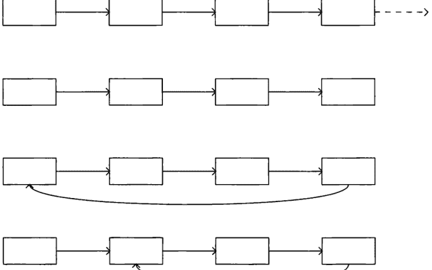

# 编程元素

《编程元素》提供了比其他地方更深入的见解。其核心前提是：实践编程与其他科学和工程领域一样，必须建立在坚实的数学基础之上。本书展示了在真实编程语言（如 C++）中实现的算法可以在最通用的数学环境中运行。例如，快速幂算法被定义为适用于任何结合律。使用抽象算法可以带来高效、可靠、安全且经济的软件。

这不是一本轻松的书。它也不是为了渐进提高你编程技能的技巧和窍门汇编。这本书的价值更具基础性，并最终对洞察编程至关重要。为了充分获益，你需要从头到尾读完这本书，阅读代码、证明引理并完成练习。完成后，你将看到将演绎法应用于你的程序，如何确保你的系统软件组件能够协同工作并按预期行为运行。

书中介绍了许多算法以及定义这些算法的类型要求。这些描述的代码（在网上也可以找到）是用 C++ 的一个小子集编写的，旨在让任何经验丰富的程序员都能理解。该子集定义在 Sean Parent 和 Bjarne Stroustrup 编写的特殊语言附录中。

无论你是软件开发者，还是其他任何将编程视为重要活动的专业人士、学生或刻苦学习的学生，你都将理解这些书中经验丰富的作者多年来一直在教授和演示的内容——数学对编程有益，理论对实践有益。


Boston, MA 02116

序言 ix

关于作者 xiii

# 1 基础 1

1.8 结论 15

# 2 变换与轨道 15

# 3 结合运算 31

3.8 结论 47

# 4 序 49

# 5 序代数结构 65

5.9 概念及其模型 85

# 6 迭代器 89

6.9 双向迭代器 115

6.10 结论 114

# 7 坐标结构 115

# 8 可变后继者 133

# 9 复制 149

9.5 结论 168

# 10 排列 169

# 11 分区与合并 191

# 12 复合对象 209

# 序言

本书通过将程序与使其运行的抽象数学理论联系起来，将演绎法应用于编程。这些理论的规范、用这些理论编写的算法以及描述其属性的定理和引理被呈现在一起。在真实编程语言中实现算法是本书的核心。虽然面向人类的规范应当且必须结合严谨性与适当的形式化，但面向计算机的代码即使具有通用性，也必须绝对精确。

本书面向那些想要更深理解编程的人，无论他们是全职软件开发者，还是将编程视为其职业活动重要部分的科学家和工程师。

本书旨在从头到尾阅读。通过阅读代码、证明引理和完成练习，读者可以获得对内容的理解。此外，我们建议了几个项目，有些是开放式的。虽然书中简洁，但细心的读者最终会看到各个部分之间的联系以及我们选择材料的原因。发现本书的架构原则应该是读者的目标。

我们假设读者具备基础代数运算的能力¹。我们也假设熟悉离散数学本科课程水平的逻辑和集合论词汇；附录 A 总结了我们使用的符号。

¹ 对于复习基础代数，我们推荐 Chrystal [1904]。

# 前言

需要指定算法。我们假设读者已具备编程能力，并理解计算机架构²以及基础算法和数据结构³。

我们选择 C++ 是因为它结合了强大的抽象能力和对底层机器的忠实表示。⁴ 我们使用了该语言的一个小子集，并以结构化注释的形式编写要求。我们希望不熟悉 C++ 的读者也能读懂本书。附录 B 指定了书中使用的语言子集。⁵ 在数学符号与 C++ 之间存在差异之处，其排版和上下文决定了其数学含义或 C++ 含义。虽然书中的许多概念和程序与 STL（C++ 标准模板库）有相似之处，但本书背离了某些 STL 的设计决策。本书还忽略了像 STL 等真实库必须解决的问题：命名空间、生存性、内联指令等。

第 1 章描述了值、对象、类型、过程和概念。第 2–5 章描述了在代数结构（如半群和全序集）上的算法。第 6–11 章描述了在内存抽象上的算法。第 12 章描述了包含其他对象的。后记介绍了我们对书中所提方法的反思。

# 致谢

我们感谢 Adobe Systems 及其管理层对《编程基础》课程以及由此诞生的这本书的支持。特别感谢 Greg Willey 发起了这门课程并建议编写这本书；Dave Story 和随后的 Hensler 提供了坚定不移的支持。最后，如果没有 Sean Parent 明智的管理以及对代码和文本的持续审查，这本书是不可能实现的。书中的思想源于我们与 Dave Musser 跨越近三十年的合作，Bjarne Stroustrup 刻意演进了 C++ 以支持这些思想。Dave 和 Bjarne 都非常慷慨地来到 Jose 审阅了初稿。Sean Parent 和 Bjarne Stroustrup 审阅了定义书中所用 C++ 子集的附录。John Brandt 仔细阅读了最终手稿，并提供了宝贵的建议。

1. 我们推荐 Patterson 和 Hennessy [2007]。

2. 关于算法和数据结构的选择性包容性介绍，我们推荐 Tarjan [1983]。

3. 标准参考是 Stroustrup [2000]。

4. 书中的代码可以在 Microsoft Visual C++ 9 和 g++ 4 下编译并运行。这些代码连同使其能够编译的几个宏以及单元测试，可以从 www.elementsofprogramming.com 下载。

# 前言 xi

本书极大受益于我们的编辑 Peter Gordon、项目编辑 Elizabeth Ryan、文字编辑 Evelyn Pyle 以及编辑评审员：Matt Austern、Andrew Koenig、David Musser、Arch Robison、Jerry Schwarz、Jeremy Siek 和 John Wilkinson 的贡献。

我们感谢所有在 Adobe 上过课程以及在 SGI 上过早期课程的学生们提供的建议。我们希望我们成功地将这些课程的材料织成了一个连贯的整体。我们感谢 Dave Abrahams、Andrei Alexandrescu, Constantine Arkoudas, John Banning, Hans Boehm, Angelo Borsotti, Jim Dehnert, John DeTerville, Boris Fomitchev, Kevlin Henney, Jussi Ketonen, Karl Malbrain, Mat Marcus, Larry Masinter, Dave Parent, Dmitry Polukhin, Jon Reid, Mark Ruzon, Geoff Scott, David Simons, Anna Stepanov, Tony Van Eerd, Walter Vannini, Tim Winkler 以及 Oleg Zabluda 的评论。

最后，我们感谢所有通过著作或面对面教我们的人，以及允许我们深化对编程理解的机构。

本页特留白

# 关于作者

Alexander Stepanov 于 1967 年至 1972 年在莫斯科州大学学习数学。他从 1972 年开始编程：起初在苏联，1977 年移民后在美国。他编写过操作系统、编程工具、编译器和库。他在编程基础方面的工作得到了 GE、布鲁克林理工学院、AT&T、HP、SGI 以及自 2002 年来的 Adobe 支持。1995 年，他因设计 C++ 标准模板库获得了 Dr. Dobb's Journal 卓越编程奖。

Paul McJones 于 1967 年至 1971 年在加州大学伯克利分校学习工程数学。他自 1966 年起在操作系统、编程环境、事务处理系统以及企业和消费者应用领域编程。他曾就职于加州大学、IBM、Xerox、Tandem、DEC 以及自 2003 年来的 Adobe。1982 年，他和合著者们因论文《System R 数据库管理器的恢复管理器》获得了 ACM 编程系统与语言论文奖。

本页特留白

# 第 1 章

# 基础

从思想的简单分类开始，我们引入了值、对象、类型、过程和概念的概念，它们代表了计算机中不同类别的思想。书的核心概念“正则性”（regularity）被引入并详细阐述。当应用于过程时，正则性意味着过程对于相同的参数返回相同的结果。当应用于类型时，正则性意味着类型拥有相等运算符以及保持相等性的拷贝构造和赋值。正则性使我们能够应用等式推理（用相等代替相等）来转换和优化程序。

## 1.1 思想的类别：实体、物种、属

为了解释什么是对象、类型和其他基础计算机概念，概述一些与这些概念对应的思想类别是有帮助的。

抽象实体（abstract entity）是一个永恒且不可改变的个体，而具体实体（concrete entity）是在空间和时间中产生又消失的个体。属性（attribute）——具体实体与抽象实体之间的对应——描述了具体实体的某些属性、测量值或质量。同一性（Identity）是我们对现实感知的一种原始概念，它决定了一个事物随时间变化的相同性。具体实体的属性可以改变而不影响其同一性。具体实体的快照（snapshot）是其在特定时刻所有属性的完整集合。具体实体不仅是物理实体，也是法律、财务或政治实体。“蓝色”和“13”是抽象实体的例子。苏格拉底和美国是具体实体的例子。苏格拉底眼睛的颜色和美国州是属性的例子。

# 2

# 基础

抽象物种（abstract species）描述本质等抽象实体的共同属性。抽象物种的例子有自然数和颜色。具体物种（concrete species）描述本质等具体实体的属性集。具体物种的例子有人和州。

函数（function）是一种规则，它将对应物种的一个或多个抽象实体（称为参数）与另一个物种的一个抽象实体（称为结果）联系起来。函数的例子有后继函数（它将每个自然数与其紧随后的数相关联），以及关联两种颜色的混合结果函数。

抽象属（abstract genus）描述在某些方面相似的不同物种。抽象属的例子有数字和二元运算符。具体属（concrete genus）描述在某些方面相似的不同物种。具体属的例子有哺乳动物和二足动物。

实体属于一个单一物种，该物种提供了其构造或存在的规则。实体可以属于多个属，每个属描述某些属性。

我们在本章后续部分展示对象和值代表实体，类型代表物种，概念代表属。

# 1.2 值

除非知道解释，否则我们看到的只有 0 和 1。数据（datum）是 0 和 1 的有限序列。

值类型（value type）是物种（抽象或具体）与一组数据的对应关系。对应于特定实体的数据称为该实体的表示（representation）；实体称为该数据的解释（interpretation）。我们将数据与其解释统称为值（value）。值的例子包括以 32 位补码大端格式表示的整数，以及表示为两个 32 位序列连接、解释为整数分子和分母、并以补码大端值表示的有理数。

数据对于某个值类型来说是良好的（well formed），当且仅当该数据代表一个抽象实体。例如，每一个 32 位序列在解释为补码整数时都是良好的；而 IEEE 754 浮点 NaN（非数字）在解释为实数时不是良好的。

一个值类型是部分的（properly partial），如果它的值代表了对应关系中抽象实体的真子集；否则它是全的（total）。例如，`int` 类型是部分的，而 `bool` 类型是全的。

一个值是唯一表示的（uniquely represented），当且仅当每个抽象实体最多对应一个值。例如，表示真值的类型是一个字节-

## 1.2 值 (Values)

将零解释为假、非零解释为真的表示并非唯一的。一个将整数表示为符号位和无符号幅值的类型并没有提供零的唯一表示。用补码表示整数的类型具有唯一的表示。

当且仅当一个类型的值有多于一种解释时，该值类型是歧义的。歧义的反面是无歧义的。例如，一个将超过一个世纪的期的日历年份表示为两个十数字的类型就是歧义的。

一个值类型的两个值相等，当且仅当它们代表同一个实体。它们是表示上相等的，当且仅当它们的数据是相同的 0 和 1 序列时。

- 引理 1.1 如果一个值类型具有唯一表示，则相等性意味着表示上的相等性。

- 引理 1.2 如果一个值类型不是歧义的，则表示上的相等意味着相等性。

如果一个值类型具有唯一表示，我们通过测试两个 0 和 1 序列是否相同来实现相等性。否则，我们必须实现相等性，以保持其与其参数解释的一致性。当测试相等性的频率低于生成新值的操作频率，并且可能以降低相等性速度为代价来生成新值时，会选择非唯一的表示。例如，作为整数对的两个有理数相等，当且仅当它们约简为相同的最简形式。表示为无序序列的两个有限集相等，当且仅当在排序并去重后，它们对应的元素相等。

有时，实现真正的行为相等性代价太高，甚至是不可能的，例如可计算函数的编码类型。在这些情况下，我们必须妥协于较弱的表示相等性：即两个值是相同的 0 和 1 序列。

计算机在抽象实体上实现的函数是在这些值上实现的函数。虽然值存储在内存中，但一个正确实现的基于值的函数不依赖于特定的内存地址：它实现了从值到值的映射。

定义在值类型上的函数是正规的（regular），当且仅当它尊重相等性：用相等的值替换参数会得到相等的结果。大多数数值函数都是正规的。一个非正规数值函数是返回表示为整数对的有理数分子的函数，因为 $1/2 = 2/4$，但 numerator($1/2$) $\neq$ numerator($2/4$)。正规函数允许等式推理：用相等替换相等。

非正规函数取决于其参数的表示，而不仅仅是解释。在设计值类型的表示时，有两个任务是并行的：实现相等性以及决定哪些函数是正规的。

## 1.3 对象 (Objects)

**内存**（memory）是一组字，每个字都有一个*地址*和一种*内容*（content）。地址是固定大小的值，称为*地址长度*。地址的内容通过*加载操作*（load operation）获取。内容与地址的关联通过*存储操作*（store operation）改变。内存的示例包括主内存中的字节和磁盘驱动器上的块。

对象是实体作为内存中值的表示。对象具有状态，该状态是某个值类型的值。对象的状态是可以改变的。给定一个对应于实体的对象，它的状态对应于实体的快照。对象拥有资源（如内存字或文件中的记录）来存储其状态。

虽然对象的值是 0 和 1 的连续序列，但存储这些 0 和 1 的资源并不一定是连续的。是解释赋予了对象统一性。例如，两个双精度浮点数可能解释为一个复数，即使它们并不相邻。对象的资源甚至可能在不同的内存中。本书处理位于单个地址的内存中的对象。每个对象都有一个唯一的起始地址，从该地址可以到达所有资源。

对象类型是用于内存存储和修改值的模式。每个对象类型都对应一个描述该类型对象状态的值类型。每个对象都属于一个对象类型。对象类型的示例是采用 32 位补码小端格式表示的，并对齐到 4 字节地址边界。

值和对象扮演着互补的角色。值是不变的，且独立于计算机的任何特定实现。对象是可变的，并且具有特定于计算机的实现。对象任何时刻的状态都可以由一个值来描述；这个值在原则上是可以写下的。

## 1.5 规则类型 (Regular Types)

使用保证了行为的规则性，因此保证了互操作性.¹¹我们从内置类型（如 `bool`、`int` 和 `one`）推导出规则类型的语义，并限制为良好值 double。一个类型是规则的，当且仅当它的基础包含相等、赋值、析构函数、默认构造函数、拷贝构造函数、全序和底层类型.³.³

相等是一个接收两个相同类型对象的过程，并且仅当状态相等时返回为真。不等关系总是被定义的，并返回相等的否定值。我们使用以下符号：

| 规范 | C++ |

|---|---|---|

| 等等 | a = b | a == b |

| 不等 | a ≠ b | a != b |

赋值是一个接收两个相同类型对象的过程，并使第一个对象等于第二个对象，而不修改第二个对象。赋值的含义不依赖于第一个对象的初始值。我们使用以下符号：

| 规范 | C++ |

|---|---|---|

| 赋值 | a ← b | a = b |

析构函数是一个导致对象存在性终止的过程。在对象上调用析构函数后，不能再对其应用任何过程，其原有的内存位置和资源可以被用于其他用途。析构函数通常是隐式调用的。全局对象在应用程序终止时被破坏，局部对象在所在的块退出时被破坏，数据结构中的元素在数据结构被销毁时被破坏。

构造函数是将内存位置转换为对象的过程。可能的行为范围从无所作为到建立复杂的对象状态。

如果一个对象可以被赋值或被销毁，则该对象处于部分形成状态。对于一个部分形成但非良好的对象，除了赋值（在左侧）和销毁之外，任何过程的效果都是未定义的。

- 尽管规则类型是 STL 设计的基础，但它们最初由 Dehnert 和 Stepan [2000] 引入。

- 严格来说，如第 4 节所示，它可以是全序也可以是默认序。

- 底层类型在第 12 章中定义。

## 引理 1.3 良好的对象是部分形成的。

默认构造函数不接受参数，并使对象处于部分形成状态。我们使用以下符号：

| | C++ |

|---|---|

| 类型 T 的局部对象 | T a; |

| 类型 T 的匿名对象 | T() |

拷贝构造函数接受一个相同类型的额外参数，并构造一个与之相等的新对象。我们使用以下符号：

| | C++ |

|---|---|

| 对象 b 的局部拷贝 | T a = b; |

## 1.6 规则过程 (Regular Procedures)

一个过程是规则的，当且仅当将其输入替换为相等的对象会导致产生相等的输出对象。与值类型一样，在定义对象类型时，我们必须对如何实现相等以及该类型上的哪些过程将是规则的做出一致的选择。

练习 1.1 将规则性的概念扩展到过程的输入/输出对象，即既被修改又被读取的对象。

虽然规则性是默认的，但过程存在非规则行为的原因：

1. 过程返回一个对象的地址；例如，内置函数 `addressof`。

2. 过程返回一个由现实世界状态决定的值，例如时钟或其他设备的值。

3. 过程返回一个取决于自身状态的值；例如，伪随机数生成器。

4. 过程返回一个依赖于表示的对象的属性，例如数据结构预留内存。

函数式过程是定义在规则类型上的规则过程，具有一个或多个直接输入和一个作为过程结果返回的输出。函数式过程的规则性允许两种传递输入的技术。当参数的大小较小时，或者过程需要一个可以改变的副本时，我们通过值传递它，创建一个局部副本。否则，我们通过常量引用传递它。函数式过程可以实现为 C++ 函数、函数指针或函数对象。⁴

这是一个函数式过程：


```cpp
int plus_0(int a, int b)
{
    return a + b;
}
```

这是一个语义等价的函数式过程：

```cpp
int plus_1(const int& a, const int& b)
{
    return a + b;
}
```

这语义相等但不是函数式过程，因为它的输入和输出是间接传递的：

```cpp
void plus_2(int* a, int* b, int* c)
{
    *c = *a + *b;
}
```

在`plus_2`中，`a`和`b`是输入对象，而`c`是输出对象。函数式过程的概念是一个语法属性而非语义属性。在我们的术语中，`plus_2`是规则的但不是函数的。

函数式过程的定义空间是其旨在应用的输入值的子集。函数式过程在定义空间内的输入上终止；虽然它可能在定义空间之外的输入上终止，但可能不会返回有意义的值。

> 4. C++ 函数不是对象，不能作为参数传递；C++ 函数指针和函数对象是对象，可以作为参数传递。

同构函数式过程是指输入对象都是相同类型的过程。同构函数式过程的域是输入的类型。与其将非同构函数式过程的域定义为输入类型的直积，我们逐个地引用过程的输入类型。

函数式过程的对域是其输出的类型。函数式过程的结果空间是过程从其对域返回的所有值的集合。考虑一个函数式过程：

```cpp
int square(int n) { return n * n; }
```

该函数式过程的定义域是`int`，其结果空间是可表示的整数的集合。**练习 1.2** 假设`int`是 32 位的，确定其规则类型和结果空间。

## 1.7 概念（Concepts）

一个概念是关于类型的语法、语义和复杂性的规则。在语法上，它依赖于具有特定名称和签名的过程。其语义取决于这些过程。其复杂性取决于这些过程。如果类型被替换为具有相同属性的类型，则程序是正确的。软件组件（如库过程或数据结构）的实用性不是基于具体的类型，而是基于需求。我们将一组需求称为一个概念。

为了描述概念，我们需要处理类型的几种机制：类型属性、类型函数和类型构造器。类型属性是从类型到描述该类型特征的值的映射。属性的示例是内置类型`sizeof*(T)`、对象的对齐方式以及结构中成员的数量。如果`F`是函数式过程，`Arity(F)`返回其输入数量。类型函数是从类型到关联类型的映射。类型函数的一个例子是“指向 T”。在某些情况下，带有额外常量参数的索引类型函数是有用的；例如返回结构类型第 i 个成员类型的函数（从 0 计数）。如果`F`是函数式过程，`Codomain(F)`返回结果的类型。类型构造器是从一个或多个类型创建新类型的机制。例如，`pointer(T)`是一个类型`T`并返回类型“指向 T”的内置类型构造器；它是元类型构造器；结构模板是用户定义的元类型构造器。

如果`T`是一个元类型构造器，我们通常将其应用于`T₀,...,Tⁿ`表示为`T₀,...,Tⁿ`。一个重要的例子是`pair`，当应用于规则类型`T₀`和`T₁`时，它返回一个结构类型`T₀,T₁`，具有类型`T₀`的成员`m₀`和类型`T₁`的成员`m₁`。为了确保`pair T₀,T₁`本身是规则的，相等、析构和构造函数是`T₀`和`T₁`相应操作的成员级扩展。相同的技术适用于任何元类型，例如`triple`。在第 12 章中，我们将展示`pair T₀,T₁`的实现并描述更复杂的类型构造器如何保持规则性。

类型概念是定义在类型上的概念。例如，C++ 定义了整数类型概念，它被无符号整数类型和符号整数类型细化，STL 定义了序列概念。我们使用原始类型概念`Regular`和`FunctionalProcedure`，对应于之前给出的非正式定义。

- 5. 附录 B 展示了如何在 C++ 中定义类型属性和类型函数。

# 12 基础

## 1. 概念

我们使用标准的数学符号正式地定义概念。要定义一个概念 $\mathcal{C}$，我们写：

```text
$\mathcal{C}(T_0, \dots, T_{n-1}) \triangleq
\mathcal{E}_0
\wedge \mathcal{E}_1
\wedge \dots
\wedge \mathcal{E}_{k-1}$
```

其中 $\mathcal{E}_i$ 读作“定义为”，$T_i$ 是形式类型参数，$\mathcal{E}_i$ 是概念子句，它们采取以下三种形式之一：

1. 对之前定义的概念的应用，表示建模该概念的类型参数子集。

2. 属性属性、类型函数或过程的签名，这些签名对于任何建模该概念的类型必须存在。过程签名的形式为 $f : T \to T'$，其中 $T$ 是域，$T'$ 是陪域。类型函数的形式为 $F : \mathcal{C} \to \mathcal{C}'$，其中域和陪域都是概念。

3. 用这些类型属性、类型函数和过程表达的公理。

我们有时会在第二类概念子句的签名之后包含类型属性、类型函数或过程的定义。它的形式为 $x \mapsto F(x)$，其中 $F$ 是某个表达式。在特定的模型中，这种定义可以被不同的但一致的实现所覆盖。

例如，这个概念描述了一个一元函数过程：

```text
$UnaryFunction(F) \triangleq
FunctionalProcedure(F)
\wedge Arity(F) = 1$
```

这个概念描述了一个同质函数过程：

```text
$HomogeneousFunction(F) \triangleq
FunctionalProcedure(F)
\wedge Arity(F) > 0
\wedge (\forall i, j \in \mathbb{N})(i, j < Arity(F)) \Rightarrow (DebugType(F, i) = InputType(F, j))
\wedge Domain : HomogeneousFunction \to Regular
\F \mapsto InputType(F, 0)$
```

## 1.7 概念

观察到：

$(F \in FunctionalProcedure) \wedge UnaryFunction(F) \Rightarrow HomogeneousFunction(F)$

一个抽象过程由类型和常值参数化，并对这些参数有要求。^6 我们使用函数模板和函数对象模板。参数紧随`template`关键字，通过`typename`引入类型，通过`int`或其他整数类型引入常值。要求通过`requires`子句指定，其参数是一个由常值、具体类型、形式参数、类型属性和类型函数的应用、值和类型的等价性、概念以及逻辑连接符构建的表达式。^7

这里是一个抽象过程的示例：

```cpp
template<typename Op>
  requires(BinaryOperation(Op))
Domain(Op) square(const Domain(Op)& x, Op op)
{
  return op(x, x);
}
```

域值可能很大，因此我们通过常量引用传递它们。操作通常很小（例如，函数指针或更小的函数对象），因此我们按值传递它们。

概念描述了某个类型中所有对象都满足的属性，而前条件（preconditions）描述了特定对象的属性。例如，一个过程可能要求参数为素数。整数类型的类型由概念指定，而素数性由前条件指定。函数指针的类型仅表达其签名，不表达其语义属性。例如，一个过程可能要求参数是一个指向实现整数结合二元运算的函数的指针。对整数二元运算的要求由概念指定；特定函数的结合律由前条件指定。

- 6. 抽象过程出现在第...页
- 7. 参见附录 B 获取`requires`子句的完整语法。

为了为一组类型定义前条件，我们需要使用数学符号，例如全称量词和存在量词、蕴含等。例如，为了指定整数的素数性，我们定义：

```text
property(N : Integer)
prime : N
↦ (∀u, v ∈ N) uv = n ⇒ (|u| = 1 | |v| = 1)
```

其中第一行引入了形式类型参数和它们建模的概念，第二行命名了属性及其签名，第三行给出了确定该属性对于给定参数成立的谓词。

要定义一元函数过程的正则性（regularity），我们写：

```text
property(F : UnaryFunction)
regular.unary_function : F
f ↦ (f' ∈ F) (∀x, x' ∈ Domain(F))
(f = f' ∧ x = x') ⇒ (f(x) = f'(x'))
```

该定义很容易扩展到 n 元函数：将相等函数应用于相等参数会得到相等的结果。根据扩展，如果一个抽象函数的所有实例化都是正则的，我们称该函数为正则的。在书中，除非另有说明，每个过程参数都是正则函数；我们省略了显式说明这一点的的前条件。

- **项目 1.1** 将等价性、赋值和拷贝构造扩展到不同类型的对象上。思考这两种类型的解释以及连接跨类型过程的公理。

## 1.8 结论

人类共享的现实的常识观点在计算机中有表示。通过将值和对象的含义根根于它们的解释，我们获得了一个简单、连贯的视图。当考虑到与实体的对应时，设计决策（如如何定义等价性）变得直观。

## 2 变换及其轨道

### 2.1 变换

如果一个过程的定义空间是其输入直积的子集，则它是部分的（partial）；如果它的定义空间等于直积，则它是全的（total）。我们遵循标准的数学用法，其中部分函数包含全函数。我们把非全的过程称为部分过程。某些全函数的实现是因为表示的有限性导致的。例如，32 位符号整数的加法是全的。

部分过程带有一个指定其定义空间的前条件。为了验证该过程调用的正确性，我们需要参数满足前条件。有时，部分过程作为参数传递给需要在运行时确定过程参数的算法。为了处理此类情况，我们定义一个与过程输入相同的定义空间谓词；只有当输入在过程的定义空间内时，谓词才返回真。在调用部分过程之前，必须满足其前条件，或者由调用其定义空间谓词保护。

**练习 2.1** 为 32 位符号整数加法实现定义空间谓词。

本章处理一元操作，我们称之为变换：

```text
Transformation(F) ≜
Operation(F)
^ UnaryFunction(F)
```

我们在下一节讨论`DistanceType`。

变换是自复合的：`f(x)`、`f(f(x))`、`f(f(f(x)))`等。`f(f(x))`的定义空间是`f`的定义空间和结果空间的交集。这种自复合性，结合测试等价性的能力，允许我们定义有趣的算法。

当`f`是一个变换时，我们如下定义其幂：

```text
f^n(x) = \begin{cases} x & if n = 0, \ f^{n-1}(f(x)) & if n > 0 \end{cases}
```

为了实现一个计算 $f^n(x)$ 的算法，我们需要指定整数类型的要求。我们在第 5 章中学习了描述整数的各种概念。目前，我们依赖于对整数的直观理解。它们的模型包括有符号和无符号整数类型，以及任意精度整数，具有以下操作和字面量：

| 规格 | C++ |
| --- | --- |
| 加 | `+` |
| 减 | `-` |
| 乘 | `*` |
| 除 | `/` |
| 取模 | `mod %` |
| 0 | `0`、`I(0)` |
| 1 | `1`、`I(1)` |
| 2 | `2`、`I(2)` |

其中 `I` 是一个整数类型。

由此得出了以下算法：

```cpp
template<typename F, typename N>
requires(Transformation(F) && Integer(N))
Domain(F).power_unary(Domain(F) x, n, f)
{
    // 前置条件: n >= 0 /\ (Vi in N) 0 < i <= n => f^n(x) 是定义的
    while (n != 0) {
        n = n - N(1);
        x = f(x);
    }
    return x;
}
```

## 2.2 轨道（Orbits）

为了理解变换的全局行为，我们检查其轨道的结构：通过重复应用变换从起始元素可以到达的元素。如果在变换 $f$ 下，对于某个 $n \ge 0$，有 $y = f^n(x)$，则 $y$ 从 $x$ 是可达的。如果对于某个 $n \ge 1$，有 $x = f^n(x)$，则 $x$ 在 $f$ 下是循环的。只有当 $x$ 不在 $f$ 的定义域内时，$x$ 在 $f$ 下才是终止的。$x$ 在 $f$ 下的轨道是所有在 $f$ 下从 $x$ 可达的元素集合。

**引理 2.2** 一个轨道不同既包含循环元素又包含终止元素。

**引理 2.3** 一个轨道最多包含一个终止元素。

如果 $y$ 在变换 $f$ 下从 $x$ 可达，则从 $x$ 到 $y$ 的距离是从 $x$ 到 $y$ 的最少变换步数。显然，距离并不总是定义的。

给定一个变换`F`，`DistanceType(F)`是一个足够大的整数距离类型，足以编码任何变换 $\in F$ 从 `T = Domain(F)` 的一个元素到另一个元素的最大步数。如果 `T` 占据位，则可以有多达 $2^k$ 个值，但不同值之间只有 $2^k-1$ 步。如果 `T` 是固定大小的，则相同大小的整数对于 `T` 上的任何变换都是有效的距离类型。（我们没有直接使用距离，而是允许在`power_unary`中使用任何整数类型，因为额外的泛化在那里似乎没有害处。）通常情况下，对于定义域上的所有变换类型，定义域类型都是定义的，并为变换类型定义了相应的类型函数。

`DistanceType`的存在导致了以下过程：

```cpp
template<typename F>
requires(Transformation(F))
DistanceType(F) distance(Domain(F) x, Domain(F) y, F f)
{
  // 前置条件: y 在 f 下从 x 可达的
  typedef DistanceType(F) N;
  N n(0);
  while (x != y) {
    x = f(x);
    n = n + N(1);
  }
  return n;
}
```

轨道有不同的形状。$x$ 在变换下的轨道是：

- 如果它没有循环或终止元素，则它是无限的。
- 如果它有一个终止元素，它是终止的。
- 如果 $x$ 是循环的，它是环形的。
- 如果 $x$ 不是循环的，但它的轨道包含一个循环元素，则它是 $\rho$-形的。

如果 $x$ 的轨道不是无限的，则它是有限的。图 2.1 展示了各种情况。



无限

终止

环形

$\rho$-形

**图 2.1** 轨道形状。

轨道循环是轨道中循环元素的集合，对于无限和终止轨道它为空。轨道句柄（orbit handle）是轨道相对于轨道循环的补集，对于环形轨道它是空的。连接点是第一个循环元素，它是环形轨道的第一个元素，也是 $\rho$-形轨道中句柄后的第一个元素。轨道的大小 `o` 是轨道中不同元素的数量。轨道的句柄大小 `h` 是句柄中元素的数量。轨道的循环大小 `c` 是循环中元素的数量。

**引理 2.4** $o = h + c$

**引理 2.5** 从轨道中任意点到该轨道循环中某点的距离始终是定义的。

**引理 2.6** 如果 $x$ 和 $y$ 是大小为 $c$ 的循环中的两个不同点，$c = distance(x, y) + distance(y, x)$。

**引理 2.7** 如果 $x$ 和 $y$ 是大小为 $c$ 的循环中的点，则从 $x$ 的距离满足 $0 \le distance(x, y) < c$。

## 2.3 碰撞点（Collision Point）


为了实现一个计算 `f^n(x)` 的算法，我们需要指定整数类型的要求。我们在第 5 章中学习了描述整数的各种概念。目前，我们依赖于对整数的直观理解。它们的模型包括有符号和无符号整数类型，以及任意精度整数，具有以下操作和字面量：

| 规格 | C++ |
|---|---|
| 加 | `+` |
| 减 | `-` |
| 乘 | `*` |
| 除 | `/` |
| 取模 | `mod %` |
| 0 | `0`、`I(0)` |
| 1 | `1`、`I(1)` |
| 2 | `2`、`I(2)` |

其中 `I` 是一个整数类型。

由此得出了以下算法：

```cpp
template<typename F, typename N>
requires(Transformation(F) && Integer(N))
Domain(F).power_unary(Domain(F) x, n, f)
{
    // 前置条件: n >= 0 /\ (Vi in N) 0 < i <= n => f^n(x) 是定义的
    while (n != 0) {
        n = n - N(1);
        x = f(x);
    }
    return x;
}
```

## 2.2 轨道（Orbits）

为了理解变换的全局行为，我们检查其轨道的结构：通过重复应用变换从起始元素可以到达的元素。如果在变换 `f` 下，对于某个 `n >= 0`，有 `y = f^n(x)`，则 `y` 从 `x` 是可达的。如果对于某个 `n >= 1`，有 `x = f^n(x)`，则 `x` 在 `f` 下是循环的。只有当 `x` 不在 `f` 的定义域内时，`x` 在 `f` 下才是终止的。`x` 在 `f` 下的轨道是所有在 `f` 下从 `x` 可达的元素集合。

**引理 2.2** 一个轨道不会同时包含循环元素和终止元素。

**引理 2.3** 一个轨道最多包含一个终止元素。

如果 `y` 在变换 `f` 下从 `x` 可达，则从 `x` 到 `y` 的距离是从 `x` 到 `y` 的最少变换步数。显然，距离并不总是定义的。

给定一个变换 `F`，`DistanceType(F)` 是一个足够大的整数距离类型，足以编码任何变换 `f ∈ F` 从 `T = Domain(F)` 的一个元素到另一个元素的最大步数。如果 `T` 占据 `k` 位，则可以有多达 `2^k` 个值，但不同值之间只有 `2^k - 1` 步。如果 `T` 是固定大小的，则相同大小的整数对于 `T` 上的任何变换都是有效的距离类型。（我们没有直接使用距离，而是允许在 `power_unary` 中使用任何整数类型，因为额外的泛化在在那里似乎没有害处。）通常情况下，对于定义域上的所有变换类型，定义域类型都是定义的，并为变换类型定义了相应的类型函数。

`DistanceType` 的存在导致了以下过程：

```cpp
template<typename F>
requires(Transformation(F))
DistanceType(F) distance(Domain(F) x, Domain(F) y, F f)
{
  // 前置条件: y 在 f 下从 x 可达
  typedef DistanceType(F) N;
  N n(0);
  while (x != y) {
    x = f(x);
    n = n + N(1);
  }
  return n;
}
```

轨道有不同的形状。`x` 在变换下的轨道是：

- 如果它没有循环或终止元素，则是无限的。
- 如果它有一个终止元素，则是终止的。
- 如果 `x` 是循环的，则是环形的。
- 如果 `x` 不是循环的，但它的轨道包含一个循环元素，则它是 `rho`-形的。

如果 `x` 的轨道不是无限的，则它是有限的。图 2.1 展示了各种情况。


无限

终止

环形

`rho`-形

**图 2.1** 轨道形状。

轨道循环是轨道中循环元素的集合，对于无限和终止轨道它为空。轨道句柄（orbit handle）是轨道相对于轨道循环的补集，对于环形轨道它是空的。连接点是第一个循环元素，它是环形轨道的第一个元素，也是 `rho`-形轨道中句柄后的第一个元素。轨道的大小 `o` 是轨道中不同元素的数量。轨道的句柄大小 `h` 是句柄中元素的数量。轨道的循环大小 `c` 是循环中元素的数量。

**引理 2.4** `o = h + c`

**引理 2.5** 从轨道中任意点到该轨道循环中某点的距离始终是定义的。

**引理 2.6** 如果 `x` 和 `y` 是大小为 `c` 的循环中的两个不同点，则：

`c = distance(x, y) + distance(y, x)`

**引理 2.7** 如果 `x` 和 `y` 是大小为 `c` 的循环中的点，则从 `x` 到 `y` 的距离满足：

`0 <= distance(x, y) < c`

## 2.3 碰撞点（Collision Point）

如果我们观察变换的行为，在无法访问其定义的情况下，我们无法确定特定的轨道是否是无限的。

有时我们知道变换是全的，或者对于某个特定的起始元素，轨道是非终止的。对于这些情况，拥有一个专门的 `collision.point` 版本是有用的：

```cpp
{
  // Precondition: p(x) ⇔ f(x) is defined
  return !p(collision.point(x, f, p));
}
```

```cpp
template<typename F>
requires(Transformation(F))
Domain(F) collision.point_nonterminating_orbit(const Domain(F) x, F f) {
  Domain(F) slow = x; // slow = f^0(x)
  Domain(F) fast = f(x); // fast = f^1(x)
  n = 0; // completed iterations
  while (fast != slow) {
    slow = f(slow); // slow = f^{n+1}(x)
    fast = f(fast); // fast = f^{2n+1}(x)
    fast = f(fast); // fast = f^{2n+2}(x)
    slow = f(slow); // slow = f^{n+2}(x)
    fast = f(fast); // fast = f^{2n+3}(x)
    fast = f(fast); // fast = f^{2n+4}(x)
    n = n + 1;
  }
  return fast; // Postcondition: value is collision point
}
```

Knuth [1997] 将此算法归功于 Floyd。


为了确定环结构——句柄大小、连接点和环大小——我们需要分析碰撞点的位置。当过程返回碰撞点`f^n(x) = f^{2n+1}(x)`时，`n`是慢指针采取的步数，`2n+1`是快指针采取的步数。`n = h + d`，其中`h`是句柄大小，`0 ≤ d < c`是慢指针在环内采取的步数。快指针采取的步数为`2n + 1 = h + d + qc`，其中`q ≥ 0`是当慢指针进入环时快指针完成的环环数。由于`n = h + d`，简化后可得`qc = h + d + 1`。让我们用`h`模`c`表示：`h = mc + r`，其中`0 ≤ r < c`。代入得`qc = mc + r + d + 1`，或者`d = (q - m)c - r - 1`。`0 ≤ d < c`意味着`q - m = 1`，因此需要`r + 1`步来完成环。因此，从碰撞点到连接点的距离为`e = r + 1`。在环轨道的情况下，`h = 0, r = 0`，从碰撞点到轨道起点的距离为`e = 1`。

## 2.3 碰撞

因此，环性可以通过以下过程检查：

```cpp
template<typename F>
requires(Transformation(F))
bool circular_nonterminating_orbit(const Domain(F) x, F f) {
    return x == f(collision.point_nonterminating_orbit(x, f));
}

template<typename F, typename P>
requires(Transformation(F) && UnaryPredicate(P) && Domain(F) == Domain(P))
bool circular(const Domain(F) x, F f, P p) {
    // Precondition: p(x) ⇔ f(x) is defined
    Domain(F) y = collision_point(x, f, p);
    return p(y) && x == f(y);
}
```

我们仍然不知道句柄大小`h`和环大小`c`。一旦知道碰撞点，确定后者就是简单的：遍历环并计算步数。为了查看如何确定`h`，让我们观察碰撞点的位置：`f^{h+d}(x) = f^{h+c-r-1}(x) = f^{mc+c-r-1}(x) = f^{(m+1)c-1}(x)`。

从碰撞点走`h + 1`步得到点`f^{(m+1)c+h}(x)`，它等于`f^h(x)`，因为`(m + 1)c`对应于环环绕了`m + 1`次。如果我们同时从`x`走`h`步并从碰撞点走`h + 1`步，我们将在连接点相遇。换句话说，`x`的轨道和碰撞点之后一步的轨道恰好在`h`步内收敛，这导致了以下算法序列：

```cpp
template<typename F>
requires(Transformation(F))
Domain(F) convergent_point(Domain(F) x0) {
  x0 = f(x0);
  x1 = f(x1);
  return x0;
}

template<typename F>
requires(Transformation(F))
Domain(F) connection_point_nonterminating_orbit(const Domain(F) x, F f) {
  return convergent_point(
    x,
    f(collision_point_nonterminating_orbit(x, f)),
    f
  );
}

template<typename F, typename P>
requires(Transformation(F) && UnaryPredicate(P))
Domain(F) == Domain(P)
connection_point(const Domain(F) x, F f, P p) {
  // Precondition: p(x) ⇔ f(x) is defined
  Domain(F) y = collision_point(x, f, p);
  return p(y) && x == f(y);
}
```

**引理 2.8。** 如果两个轨道相交，它们具有公共元素。

**练习 2.2。** 给定一个变换和一个谓词，设计一个算法判断两个轨道是否相交。

**练习 2.3。** 为了让`collision_point`工作，必须提供它。

## 2.4 测量大小

测量轨道的大小很困难，因为句柄大小`h`和环大小`c`是未知的。然而，对于某些情况，我们可以如下确定大小：

| 情况 | h | c |
| --- | --- | --- |
| 终止 | - | - |
| 环形 | 0 | 1 |
| 轨道形 | - | - |

## 2.5 操作

通过应用变换改变对象的状态定义了在该对象上的操作。变换与相应的操作之间存在对偶性：

```cpp
void a(T& x) { x = f(x); } // 来自变换的动作
```

和

```cpp
f(T x) { a(x); return x; } // 来自操作的变换
```

尽管存在这种对偶性，独立的实现有时是高效的，在这种情况下需要同时提供操作和变换。

**练习 2.6。** 用操作重写本章中的所有算法。

# 第 3 章 结合律

本章讨论结合二元运算。结合律允许对相邻的操作进行重新分组。这种重新分组的能力导致了计算二元幂的高效算法。正则性允许各种程序变换来优化该算法。然后我们使用该算法在对数时间内计算线性递归（例如，斐波那契数列）。

## 3.1 结合律

二元运算是一个有两个参数的运算：

```
BinaryOperation(Op) ≜
Operation(Op)
^ Arity(Op) = 2
```

加法和乘法的二元运算是数学的核心。许多运算，例如`min`、`max`、与、或、并集、交集等。这些运算都满足结合律：

```
property(Op : BinaryOperation)
associative : Op
op → (∀a, b, c ∈ Domain(op)) op(op(a, b), c) = op(a, op(b, c))
```

当然，也存在非结合律二元运算，例如减法。当上下文明确特定的结合律二元运算`op`时，我们通常通过编写`ab`代替`op(a, b)`来使用乘法符号。由于结合律，我们不需要对包含两个更多`op`应用的表达式加括号，因为所有的分组都是等价：`⋯((a_0a_1)⋯(a_{n-1})) = a_0a_1(⋯(a_{n-2}a_{n-1})⋯) = a_0a_1⋯a_{n-1}`。当`a_0 = a_1 = ⋯ = a_{n-1} = a`时，我们写作`a^n`：`a`的第`n`次幂。

- **引理 3.1** `a^na^m = a^mn = a^{n+m}`（同一元素的幂交换）。
- **引理 3.2** `(ab)^n = a^nb`。

然而，`(ab)^n = a^nb`并不总是成立。该条件仅在运算满足交换律时成立。

如果`f`和`g`是相同域上的变换，它们的复合函数`g ∘ f`是将`x`映射到`g(f(x))`的变换。

- **引理 3.3** 复合函数的二元运算满足结合律。

如果我们从结合律运算`op`的域中选择某个元素`a`，并将表达式`op(a, x)`视为具有形式参数`x`的一元运算，我们可以将`a`视为变换“乘以`a`”。这证明了使用变换幂`f^n`以及元素在结合二元运算下的幂`a^n`的法的合理性。这种二元性允许我们使用上一章的算法证明：如果存在整数`0 < n < m`使得`x^n = x^m`，则`x`在结合律运算下具有*有限阶*。如果`x = x^2`，则元素`x`在结合律运算下是*幂等*的。

- **定理 3.1** 有限阶元素具有幂等幂（Frobenius [1895]）。

证明：假设`x`是结合律运算`op`下的有限阶元素。`g(z) = op(x, g)`。由于`x`是有限阶元素，它在`g`下的轨道有一个环。根据其后置条件：

```cpp
collision_point(x, g) = g^n(x) = g^{2n+1}(x)
```

```cpp
g^n(x) = x^{n+1}
g^{2n+1}(x) = x^{2n+2} = x^{2(n+1)} = (x^{n+1})^2
```

且`x^{n+1}`是`x`的幂等幂。

- **引理 3.4** `collision_point_nonterminating_orbit`可用于证明。

## 3.2 计算幂

计算结合律运算`a^n`的算法将`a`、`n`和`op`作为参数。`a`的类型是`op`的域；`n`必须是整数类型。在没有结合律假设的情况下，两个算法分别从左向和从右向左计算幂：

```cpp
template<typename I, typename Op>
requires(Integer(I) && BinaryOperation(Op))
Domain(Op) power_left.associated(Domain(Op) a, I, Op)
{
    // Precondition: n > 0
    if (n == I(1)) return a;
    return op(power_left.associated(a, n - I(1), op), a);
}
```

```cpp
template<typename I, typename Op>
requires(Integer(I) && BinaryOperation(Op))
Domain(Op) power_right.associated(Domain(Op) a, I, Op)
{
    // Precondition: n > 0
    if (n == I(1)) return a;
    return op(a, power_right.associated(a, n - I(1), op));
}
```

这些算法执行`n - 1`次运算。对于非结合律运算，它们返回不同的结果。例如，考虑使用减法计算 1 的 3 次幂。

当`a`和`n`都是整数，且运算为乘法时，两个算法都给我们幂。由于结合律允许我们自由重新分组，我们有：

`a^n = \begin{cases} a & \text{如果 } n=1 \\ (a^{n/2})^2 & \text{如果 } n \text{ 为偶数} \\ (a^{(n-1)/2})^2 \cdot a & \text{如果 } n \text{ 为奇数} \end{cases}`

## 3.3 程序变换

`power.0`是该算法的一种满意实现，当执行运算的成本远大于递归引起的函数调用开销时，它是合适的。在本节中，我们推导出一个与`power.0`执行相同次数运算的迭代算法，该算法使用了可以在许多上下文使用的程序变换。在书的剩余部分，我们将仅显示最终或接近最终的版本。

```cpp
{
  // Precondition: associative(op) ^ n >= 0
  if (n == I(0)) return r;
  if (n % I(2) != I(0)) r = op(r, a);
  return power_accumulate_0(r, op(a, a), n / I(2), op);
}
```

如果`r0`、`a0`和`n0`分别是`r`、`a`和`n`的原始值，则该不变式在每次递归调用时都成立：`ra^n = r0*aq^n`。作为额外好处，这个版本不仅计算幂，还计算了乘以系数的乘积。它还处理了指数为零的情况。`power_accumulate_0`在从 1 变为 0 时会进行一次不必要的平方。这可以通过增加额外的判断来消除：

```cpp
template<typename I, typename Op>
requires(Integer(I) && BinaryOperation(Op))
Domain(Op) power_accumulate_1(Domain(Op) r, Domain(Op) a, I n,
Op op)
{
  // Precondition: associative(op) ^ n >= 0
  if (n == I(0)) return r;
  if (n == I(1)) return op(r, a);
  if (n % I(2) != I(0)) r = op(r, a);
  return power_accumulate_1(r, op(a, a), n / I(2), op);
}
```

在重复的子过程中添加额外的用例以及三个三个不独立的测试。分析测试之间的依赖关系并根据预期频率对测试排序得到：

```cpp
template<typename I, typename Op>
requires(Integer(I) && BinaryOperation(Op))
Domain(Op) power_accumulate_2(Domain(Op) r, Domain(Op) a, I,
Op op)
{
  // Precondition: associative(op) ^ n != I(0) {
  if (n % I(2) != I(0)) {
    r = op(r, a);
    if (n == I(1)) return r;
  } else if (n == I(0)) return r;
  return power_accumulate_2(r, op(a, a), n / I(2), op);
}
```

## 3.3 程序变换

严格的尾递归程序是指所有尾递归调用都是使用该过程的形式参数作为对应的参数完成的：

```cpp
template<typename I, typename Op>
requires(Integer(I) && BinaryOperation(Op))
Domain(Op) power_accumulate_3(Domain(Op) r, Domain(Op) a, I, n, op)
{
  // Precondition: associative(op) ^ n >= 0
  if (n % I(2) != I(0)) {
    r = op(r, a);
    if (n == I(1)) return r;
  } else if (n == I(0)) return r;
  a = op(a, a);
  n = n / I(2);
  return power_accumulate_3(r, a, n, op);
}
```

严格的尾递归程序可以通过将每个递归调用替换为跳转到过程开始的`goto`，或者使用等效的迭代结构，转换为迭代程序：

```cpp
template<typename I, typename Op>
requires(Integer(I) && BinaryOperation(Op))
Domain(Op) power_accumulate_4(Domain(Op) r, Domain(Op) a, I, n)
{
  // Precondition: associative(op) ^ n >= 0
  while (n % I(2) != I(0)) {
    r = op(r, a);
    if (n == I(1)) return r;
  } else if (n == I(0)) return r;
  a = op(a, a);
  n = n / I(2);
}
```

递归不变式变为循环不变式。

## 3.4 结合律

如果初始`n > 0`，它在变为 0 之前会经过 1。我们通过消除测试并加强前提条件来利用这一点：

```cpp
template<typename I, typename Op>
requires(Integer(I) && BinaryOperation(Op))
Domain(Op) power_accumulate_0(Domain(Op) r,
    Domain(Op) a, I, n)
{
    // Precondition: associative(op) ^ n > 0
    while (n % I(2) != I(0)) {
        r = op(r, a);
        if (n == I(1)) return r;
    }
    a = op(a, a);
    n = n / I(2);
}
```

在开发组件时，当已知`n > 0`，经常会发现新的接口。现在再次放前提条件：

```cpp
template<typename I, typename Op>
requires(Integer(I) && BinaryOperation(Op))
Domain(Op) power_accumulate_5(Domain(Op) r, Domain(Op) a, I, n,
    Op op)
{
    // Precondition: associative(op) ^ n ≥ 0
    if (n == I(0)) return r;
    return power_accumulate_0(r, n);
}
```

我们可以通过使用简单的等式`a^n = a*a^{n-1}`变换从`power.accumulate`实现`power`：

```cpp
template<typename I, typename Op>
requires(Integer(I) && BinaryOperation(Op)>
Domain(Op) power_2(Domain(Op) a, I, n, op)
{
  // Precondition: associative(op) ^ n > 0
  return power_accumulate(a, a);
}
```


该算法执行了比必要的更多的操作。例如，当 `n` 为 16 时，它执行了七次操作。当 `n` 为奇数时，该算法是可以的。因此我们可以通过对 `a` 反复平方并缩小指数直到变为奇数来避免这个问题：

```cpp
template<typename I, typename Op>
requires<Integer(I) && BinaryOperation(Op)>
Domain(Op) power_3(Domain(Op) a, I, n, op)
{
  // Precondition: associative(op) ^ n > 0
  while (n % I(2) == I(0)) {
    a = op(a, a);
    n = n / I(2);
  }
  n = n / I(2);
  if (n == I(0)) return a;
  return power_accumulate_positive(a, op(a), n, op);
}
```

练习 3.1 说服自己最后三行代码是正确的。在最终版本中我们使用了这些操作：

```text
n / I(2)
n % I(2) == I(0)
n % I(2) != I(0)
n == I(0)
n == I(1)
```

`/` 和 `%` 都是昂贵的。对于符号和无符号整数的负值可以使用位移和掩码。通过定义特例过程来识别常见的表达式和常量通常是有用的。这些特例的实现通常比通用情况高效，因此属于类型的计算基础。对于内置类型，可能存在特例的机器指令。对于用户定义的类型，通常有更多优化特例的机会。例如，两个多项式的除法并不比多项式除以 `x`。同样，两个高斯整数（`a` 和 `b` 为整数的 `a + bi`）的除法比高斯整数除以 `1 + i` 更困难。

任何整数类型必须提供以下特例过程：

```text
Integer(I) ≜
successor : I → I
n ↦ n+1
predecessor : I → I
half : I → n
half_nonnegative : I ↦ n/2, where n ≥ 0
binary.special.down.nonnegative : I × I → I
(n, k) ↦ n/2^k, where n, k ≥ 0
binary.special.up.nonnegative : I × I → I
(n, k) ↦ 2^k, where n, k ≥ 0
positive : I → bool
n ↦ n > 0
negative : I → bool
n ↦ n < 0
zero : I → bool
n ↦ n = 0
one : I → bool
n ↦ n = 1
even : I → bool
n ↦ (n mod 2) = 0
odd : I → bool
n ↦ (n mod 2) ≠ 0
```

练习 3.2 为 C++ 积分类型实现这些过程。现在我们可以通过使用特例过程给出幂过程的最终实现：

```cpp
template<typename I, typename Op>
requires(Integer(I) && BinaryOperation(Op))
Domain(Op) power_accumulate.positive(Domain(Op) r,
Domain(Op) a, I,
Op op
{
  // Precondition: associative(op) ^ positive(n)
  while (true) {
    if (odd(n)) {
      r = op(r, a);
      if (one(n)) return r;
    }
    a = op(a, a);
    n = half_nonnegative(n);
  }
}
```

```cpp
template<typename I, typename Op>
requires(Integer(I) && BinaryOperation(Op))
Domain(Op) power_accumulate(Domain(Op) r, Domain(Op) a, I,
Op op
{
  // Precondition: associative(op) ^ ¬negative(n)
  if (zero(n)) return r;
  return power_accumulate_positive(r, a, n, op);
}
```

```cpp
template<typename I, typename Op>
requires(Integer(I) && BinaryOperation(Op))
Domain(Op) power(Domain(Op) a, I, Op op)
{
  // Precondition: associative(op) ^ positive(n)
  while (even(n)) {
    a = op(a, a);
    n = half_nonnegative(n);
  }
  n = half_nonnegative(n);
  if (zero(n)) return a;
  return power_accumulate_positive(a, op(a), n, op);
}
```

## 3.5 参数化算法

在 `power` 中，我们使用了两种不同的技术为抽象算法提供操作：

1. 将结合律操作作为参数传递。这允许 `power` 用于相同类型上的不同操作，例如模乘法。

2. 指数上的操作作为指数类型计算基础的一部分提供的。我们没有选择，例如将 `half_nonnegative` 作为参数传递给 `power`，因为我们不知道在同一种类型上存在竞争的 `half_nonnegative` 实现。

## 3.6 线性递推（Linear Recurrences）

通常情况下，当一个算法可以对同一种类型使用不同的操作时，我们将一个操作作为参数传递。当定义一个以操作作为参数的程序时，尽可能指定一个合适的默认值。例如，传递给 `power` 的操作的自然默认值是乘法。

如果在不同类型上使用具有相同语义的运算符符号或过程名，我们称该运算符符号或过程名在这些类型上是**重载**（overloaded）。例如，`+` 用于自然数、整数、有理数、多项式和矩阵。在数学中，`+` 始终用于结合律和交换律的操作，因此用于字符串拼接的 `+` 可能会是不一致的。同样，当 `+` 和 `x` 同时存在时，`x` 必须对 `+` 可分配。在 `power` 中，`half.nonnegative` 在指数类型上是重载的。

当我们实例化一个抽象过程时（如 `collision.point` 或 `power`），我们创建了重载过程。当实际的类型参数满足要求时，抽象过程的实例具有相同的语义。

一个阶为 `k` 的线性递推函数是一个函数 `f`，使得：

`f(y_0, \dots, y_{k-1}) = \sum_{i=0}^{k-1} a_i y_i`

其中系数 `a_0, a_{k-1} \neq 0`。如果序列 `{x_0, x_1, \dots}` 是阶为 `k` 的线性递推序列，则存在一个阶为 `k` 的线性递推函数——假设为 `f`——且：

`(\forall n \geq k) x_n = f(x_{n-1}, \dots, x_{n-k})`

注意索引的索引是递减的。给定初始值 `x_0, \dots, x_{k-1}` 和一个阶为 `k` 的线性递推函数，我们可以通过简单的迭代算法生成线性递推序列。该算法需要调用 `n-k+1` 次函数来计算 `x_n`（`n \geq k`）。正如我们将看到的，利用 `power` 可以在 `O(\log_2 n)` 步内计算出 `x_n`。

如果 `f(y_0, \dots, y_{k-1}) = \sum_{i=0}^{k-1} a_i y_i` 是一个阶为 `k` 的线性递推函数，我们可以将 `f` 视为执行向量内积：

$$
\begin{bmatrix} a_0 & & & a_{k-1} & y_0 \\ & & : & & y_{k-1} \end{bmatrix}
$$

如果将系数向量扩展为在次对角线上全为 `1` 的伴矩阵（companion matrix），我们就可以同时计算新值 `x_n`，并将旧值 `x_{n-1}, \dots, x_{n-k+1}` 移动到下一次迭代的正确位置：

$$
\begin{bmatrix} a_0 & a_1 & a_2 & a_{k-2} & a_{k-1} & x_{n-1} & x_n \\ 1 & 0 & 0 & 0 & 0 & x_{n-2} \\ 0 & 1 & 0 & 0 & 0 & x_{n-3} & x_{n-2} \\ : & : & : & : & : & : & : \\ : & : & : & : & : & : & : \\ 0 & 0 & 0 & : 1 & x_{n-k} & x_{n-k+1} \end{bmatrix}
$$

根据矩阵乘法的结合律，我们可以通过将 `k` 个初始值的向量乘以提升到 `n-k+1` 次方的伴矩阵来获得 `x_n`：

$$
\begin{bmatrix} x_n \\ x_{n-1} \\ x_{n-2} \\ \vdots \\ x_{n-k+1} \end{bmatrix} =
\begin{bmatrix} a_0 & a_1 & a_2 & a_{k-2} & a_{k-1} \\ 1 & 0 & 0 & 0 & 0 \\ 0 & 1 & 0 & 0 & 0 \\ : & : & : & : & : \\ : & : & : & : & : : \\ 0 & 0 & 0 & : 1 \end{bmatrix}
\begin{bmatrix} x_{n-k+1} \\ x_{k-2} \\ x_{k-3} \\ \vdots \\ x_0 \end{bmatrix}
$$

（注：根据上下文，OCR 中的 `x_{k-2}` 可能是 `x_{n-2}` 的笔误。）

使用 `power` 可以找到 `x_n`，最多需要 `2 \log_2(n-k+1)` 次乘法操作。一个简单的矩阵乘法算法需要 `k^3-k^2` 次系数加法。计算 `x_n` 需多于 `2k^3 \log_2(n-k+1)` 次乘法和 `2(k^3-k^2) \log_2(n-k+1)` 次系数加法。请记住，`k` 是线性递推的阶，且是一个常数。

我们从未定义过线性递推序列元素的域。它可以是整数、有理数、实数或复数：唯一的要求是存在满足结合律和交换律的加法、满足结合律的乘法，以及乘法对加法的分配律。

由阶为 2 的线性递推函数 `fib(y_0, y_1) = y_0 + y_1` 以及初始值 `f_0 = 0` 和 `f_1 = 1` 生成的序列 `f_i` 称为斐波那契序列。使用 `power` 配合 `2 \times 2` 矩阵乘法计算第 `n` 个斐波那契数 `f_n` 是很容易的。我们使用斐波那契序列来说明在这种情况下如何减少 `k^3` 次乘法。

令 `F = \begin{bmatrix} 1 & 1 \\ 1 & 0 \end{bmatrix}` 为该线性递推的伴矩阵。我们可以通过归纳法证明：

$$
F^n = \begin{bmatrix} f_{n+1} & f_n \\ f_n & f_{n-1} \end{bmatrix}
$$

事实上：

$$
F^1 = \begin{bmatrix} f_2 & f_1 \\ f_1 & f_0 \end{bmatrix}, \quad
F^{n+1} =
\begin{bmatrix} 1 & 1 \\ 1 & 0 \end{bmatrix}
\begin{bmatrix} f_{n+1} & f_n \\ f_n & f_{n-1} \end{bmatrix}
=
\begin{bmatrix} f_{n+1} + f_n & f_n + f_{n-1} \end{bmatrix}
$$

使用 `power` 允许找到 `x_n`，最多需要 `2 \log_2(n-k+1)` 次乘法操作。一个简单的矩阵乘法算法需要 `k^3-k^2` 次系数加法。计算 `x_n` 需不超过 `2k^3 \log_2(n-k+1)` 次乘法和 `2(k^3-k^2) \log_2(n-k+1)` 次系数加法。回想起 `k` 是线性递推的阶且是一个常数。

我们从未定义过线性递推序列元素的域。可以是整数、有理数、实数或复数：唯一的要求是存在满足结合律和交换律的加法、满足结合律的乘法，以及乘法对加法的分配律。

由阶为 2 的线性递推函数 `fib(y_0, y_1) = y_0 + y_1` 以及初始值 `f_0 = 0` 和 `f_1 = 1` 生成的序列 `f_i` 称为斐波那契序列。使用 `power` 配合 `2 \times 2` 矩阵乘法计算第 `n` 个斐波那契数 `f_n` 是很容易的。我们使用斐波那契序列来说明在这种情况下如何减少 `k^3` 次乘法。

令 `F = \begin{bmatrix} 1 & 1 \\ 1 & 0 \end{bmatrix}` 为该线性递推的伴矩阵。我们可以通过归纳法证明：

$$
F^n = \begin{bmatrix} f_{n+1} & f_n \\ f_n & f_{n-1} \end{bmatrix}
$$

事实上：

$$
F^1 = \begin{bmatrix} f_2 & f_1 \\ f_1 & f_0 \end{bmatrix}, \quad
F^{n+1} =
\begin{bmatrix} 1 & 1 \\ 1 & 0 \end{bmatrix}
\begin{bmatrix} f_{n+1} & f_n \\ f_n & f_{n-1} \end{bmatrix}
=
\begin{bmatrix} f_{n+1} + f_n & f_n + f_{n-1} \end{bmatrix}
$$

## 3.7 累加过程（Accumulation Procedures）

上一章将操作定义为变换的对偶。当二元法用于类似于 `x = op(x, y);` 的语句时，存在一个对偶过程。通过二元法与另一个对象结合来改变对象的状态定义了该对象的累加过程。累加过程可以通过二元法来定义，反之亦然：

```cpp
void op_accumulate(T& x, const T& y) { x = op(x, y); }
// 从二元法定义累加过程
```

以及：

```cpp
T op_accumulate(T x, const T& y) { op_accumulate(x, y); return x; }
// 从累加过程定义二元法
```

与操作一样，有时独立的实现更高效，在这种情况下需要同时提供操作和累加过程。

**练习 3.3** 用累加过程重写本章中的所有算法。

**项目 3.2** 根据 Miller 和 Brown [1966] 以及 Fiduccia [1985] 的结果，创建一个用于生成线性递推序列的库。

# 第 4 章

## 线性序

本章描述了二元关系的性质，例如传递性和对称性。特别是，我们引入了全序和弱线性序。我们引入了基于线性序的函数稳定性概念：对于等价元素，保持参数中存在的顺序。我们将 `min` 和 `max` 推广为序选择函数（例如三个元素的中位数），并引入了一种通过归约为受限子问题来管理其实现复杂度的技术。

## 4.1 关系的分类

关系是一个取两个相同类型参数的谓词：

```cpp
Relation(Op) ≜
Predicate(Op)
^ HomogeneousFunction(Op)
^ Arity(Op) = 2
```

如果一个关系在 `a` 和 `b` 之间成立，在 `b` 和 `c` 之间成立，那么它在 `a` 和 `c` 之间也成立，则该关系是传递的：

- **property(R : Relation)**

  `transitive : R`

  `r ↦ (∀a, b, c ∈ Domain(R)) (r(a, b) ∧ r(b, c) ⇒ r(a, c))`

传递关系的示例有等价、对中第一个元素的相等性、轨道中的可达性以及整除性。

如果一个关系永远不在元素与其自身之间成立，则该关系是严格的；如果一个关系总是元素与其自身之间成立，则该关系是自反的：

- **property(R : Relation)**

  `strict : R`

  `r ↦ (∀a ∈ Domain(R)) ≉(a, a)`

- **property(R : Relation)**

  `reflexive : R`

  `r ↦ (∀a ∈ Domain(R)) r(a, a)`

所有的传递关系示例都是自反的；真因子是严格的。

- **练习 4.1** 给出一个既不是严格的自反的关系示例。

如果一个关系只要在一个方向上成立，它在另一个方向也成立，则该关系是对称的；如果一个关系永远不在两个方向上同时成立，则该关系是非对称的：

- **property(R : Relation)**

  `symmetric : R`

  `r ↦ (∀a, b ∈ Domain(R)) r(a, b) ⇒ r(b, a)`

- **property(R : Relation)**

  `asymmetric : R`

  `r ↦ (∀a, b ∈ Domain(R)) r(a, b) ⇒ ≉r(b, a)`

对称传递关系的示例是“兄弟关系”；非对称传递关系的示例是“祖先关系”。

- **练习 4.2** 给出一个不是传递的对称关系示例。

- **练习 4.3** 给出一个不是自反的对称关系示例。

给定一个关系 `r(a, b)`，存在具有相同域的派生关系：

```cpp
complement(a, b) ⇒ ≉r(a, b)
converse(a, b) ⇒ r(b, a)
complement_of_converse(a, b) ⇒ ≉r(b, a)
```

对于对称关系，唯一有意义的派生关系是补关系，因为逆关系与原关系等价。

## 4.2 全序与弱序

如果一个关系是传递的、自反的对称的，则它是一个等价关系：


```cpp
property(R : Relation)
equivalence : R
t ↦ transitive(r)  reflexive(r)  symmetric(r)
```

等价关系的示例有相等、几何全等以及模 `n` 的整数同余关系。

**引理 4.1** 如果 `r` 是等价关系，则 `a = b ⇒ r(a, b)`。

等价关系将其域划分为一组等价类：包含所有与给定元素等价的元素的子集。我们通常可以通过定义一个键值函数来实现等价关系，该函数为每个等价类中的所有元素返回一个唯一的值。对等价的结果应用相等：

```cpp
property(F : UnaryFunction, R : Relation)
requires(Domain(F) = Domain(R))
key_function : F × R
(f, r) ↦ (∀a, b ∈ Domain(R) r(a, b) ⇔ f(a) = f(b))
```

**引理 4.2** `key_function(r) ⇒ equivalence(r)`

如果一个关系是传递的并满足三律，即对于每对元素，以下三者中有一个成立：关系、逆关系或相等，则该关系是全序：

```cpp
property(R : Relation)
total_ordering : R
t ↦ transitive(r) ∧
(∀a, b ∈ Domain(R)) exactly one of the following:
r(a, b), r(b, a), or a = b
```

如果一个关系是传递的，并且存在一个域相同的等价关系使得原关系满足弱三律，即对于每对元素，以下三者中有一个成立：关系、逆关系或等价关系，则该关系是弱序：

```cpp
property(R : Relation)
weak_ordering : R
r ↦ transitive(r) ∧
(∀a, b ∈ Domain(R)) exactly one of the following:
r(a, b), r(b, a), or ¬r(a, b) ∧ ¬r(b, a)
```

**引理 4.3** 弱序的补关系是一个等价关系。

弱序的示例有……

**引理 4.4** 全序是弱序。

**引理 4.5** 弱序是非对称的。

**引理 4.6** 弱序是严格的。

## 4.3 顺序选择

如果我们知道前两个元素是递序的，那么找到三个元素的中位数是非常简单的：

```cpp
template<typename R>
  requires(Relation(R))
const Domain(R)& select_1.3_ab(const Domain(R)& a,
                                 const Domain(R)& b,
                                 const Domain(R)& c, R r)
{
    if (!r(c, b)) return b; // a, b, c 是排序的
    return select_1.2(a, c, r); // b 不是中位数
}
```

建立 `select_1.3_ab` 的前提条件只需要一次比较。由于参数是通过常引用传递的，因此没有发生数据移动：

```cpp
template<typename R>
  requires(Relation(R))
const Domain(R)& select_1.3_ab(const Domain(R)& a,
                                 const Domain(R)& b,
                                 const Domain(R)& c, R r)
{
    if (r(b, a)) return select_1.3_ab(b, a, c, r);
    return select_1.3_ab(a, b, c, r);
}
```

在最坏的情况下，`select_1.3` 执行三次比较。当 `c` 是 `a, b, c` 中的最大值时，函数执行两次比较。由于这种情况发生在三分之一的情况中，假设输入分布是均匀的，平均比较次数为 `2/3`。

找到 `n` 个元素中的最小值至少需要 `n + [\log n - 2]` 次比较。特别是，找到四个元素中的第二小元素需要四次比较。

如果我们知道第一对参数和第二对参数都是递序的，那么找到四个元素中的第二小元素是非常简单的：

> *4. 这个结果由 Jozef Schreier 提出假设，并由 Sergei Kislitsyn 证明 [Knuth, 1998, Theorem S，第 209 页]。*

## 线性全序

```cpp
template<typename R>
requires(Relation(R))
const Domain(R)& select_1.4_ab_cd(const Domain(R)& a, 
                              const Domain(R)& b,
                              const Domain(R)& c,
                              const Domain(R)& d, R r) {
    if (r(c, a)) return select_0.2(a, d, r);
    return select_0.2(b, c, r);
}
```

如果我们已经知道第一对参数是递序的，则可以通过一次比较建立 `select.1.4_ab_cd` 的前提条件：

```cpp
template<typename R>
requires(Relation(R))
const Domain(R)& select_1.4_ab(const Domain(R)& a, 
                              const Domain(R)& b,
                              const Domain(R)& c,
                              const Domain(R)& d, R r) {
    if (r(d, c)) return select_1.4_ab_cd(a, b, d, c, r);
    return select_1.4_ab_cd(a, b, c, d, r);
}
```

`select.1.4_ab` 的前提条件可以通过一次比较建立：

```cpp
template<typename R>
requires(Relation(R))
const Domain(R)& select_1.4(const Domain(R)& a, 
                              const Domain(R)& b,
                              const Domain(R)& c,
                              const Domain(R)& d, R r) {
    if (r(b, a)) return select_1.4_ab(b, a, c, d, r);
    return select_1.4_ab(a, b, c, d, r);
}
```

**练习 4.4** 实现 `select2.4`。

维持直到阶数为 4 的顺序选择网络的稳定性并不困难。但对于阶数 5，会出现这种情况：对应受限子问题的过程被调用时，使用了原始调用者的顺序作为参数，这违反了稳定性。处理此类情况的一种系统方法是将稳定性索引与实际参数一起传递，并使用加强的关系 `r`。我们通过使用模板参数来避免运行时开销。

我们将对应于参数 `a, b` 等稳定性索引命名为 `ia, ib, ...`。加强的关系 `r` 通过函数对象模板 `compare_strict_or_reflexive` 获取，它接受一个布尔模板参数。如果该参数为 `true`，则保持其参数的稳定性索引递增：

```cpp
template<bool strict, typename R>
requires(Relation(R))
struct compare_strict_or_reflexive
```

当我们构造 `compare_strict_or_reflexive` 的实例时，我们提供了相应的布尔参数：

```cpp
template<int ia, int ib, typename R>
requires(Relation(R))
const Domain(R)& select.0_2(const Domain(R)& a,
const Domain(R)& b, R r)
{ compare_strict_or_reflexive<ia < ib>, R> cmp;
if (cmp(b, a, r)) return b;
return a;}
```

我们为两种情况对 `compare_strict_or_reflexive` 进行特化：

1. 稳定性索引递增，在这种情况下我们使用原始的严格关系 `r`；
2. 稳定性索引递减，在这种情况下我们使用 `r` 的反射版本。

```cpp
template<typename R>
requires(Relation(R))
struct compare_strict_or_reflexive<true, R> // strict
{
    bool operator()(const Domain(R)& a,
    const Domain(R)& b, R r) { return r(a, b); }
}
```

```cpp
template<typename R>
requires(Relation(R))
struct compare_strict_or_reflexive<false, R> // reflexive
{
    bool operator()(const Domain(R)& a,
                   const Domain(R)& b, R r)
    { return !r(b, a); }
};
```

当调用顺序选择过程时，与参数对应的稳定性索引将按照它们在调用中出现的相同顺序被传递：

```cpp
template<int ia, int ib, int ic, int id, typename R>
requires(Relation(R))
const Domain(R)& select_1.4_ab_cd(const Domain(R)& a,
                               const Domain(R)& b,
                               const Domain(R)& c,
                               const Domain(R)& d, R r)
{
    compare_strict_or_reflexive<ia < ic, R> cmp;
    if (cmp(c, a, r)) return
        select_0_2<ia, id>(a, d, r);
    return
        select_0_2<ib, ic>(b, c, r);
}
```

```cpp
template<int ia, int ib, int ic, int id, typename R>
requires(Relation(R))
const Domain(R)& select_1.4_ab(const Domain(R)& a,
                               const Domain(R)& b,
                               const Domain(R)& c,
                               const Domain(R)& d, R r)
{
    compare_strict_or_reflexive<ic < id, R> cmp;
    if (cmp(d, c, r)) return
        select_1.4_ab_cd<ia, ib, ic>(a, b, d, c, r);
    return
    select_1.4_ab_cd<ia, ib, ic, id>(a, b, c, d, r);
}
```

```cpp
template<int ia, int ib, int ic, int id, typename R>
requires(Relation(R))
const Domain(R)& select_1.4(const Domain(R)& a,
                               const Domain(R)& b,
                               const Domain(R)& c,
                               const Domain(R)& d, R r)
{
    compare_strict_or_reflexive<ia < ib, R> cmp;
    if (cmp(b, a, r)) return
        select_1.4_ab<ia, ib, ic, id>(b, a, c, d, r);
    return
    select_1.4_ab<ia, ib, ic, id>(a, b, c, d, r);
}
```

现在我们准备好实现阶数为 5 的选择：

```cpp
template<int ia, int ib, int ic, int id, int ie, typename R>
requires(Relation(R))
const Domain(R)& select_2.5_ab_cd(const Domain(R)& a,
    const Domain(R)& b,
    const Domain(R)& c,
    const Domain(R)& d,
    const Domain(R)& e, R r)
{
    compare_strict_or_reflexive<ic < id, R> cmp;
    if (cmp(c, a, r)) return
        select_0_2<ia, id>(a, d, r);
    return
    select_0_2<ib, ie>(c, d, b, e, r);
}
```

我们可以用一个外部过程包装顺序选择过程，该过程提供稳定性索引，即任何严格递增的整数序列。按照惯例，我们使用从 0 开始的连续整数：

```cpp
template<typename R>
    requires(Relation(R))
const Domain(R)& median_5(const Domain(R) & a,
                              const Domain(R)& b,
                              const Domain(R)& c,
                              const Domain(R)& d,
                              const Domain(R)& e, R r)
{
    return select_2.5<0,1,2,3,4>(a, b, c, d, e, r);
}
```

**练习 4.6** 证明本节所有顺序选择过程的稳定性。

**练习 4.7** 通过详尽测试验证本节所有顺序选择过程的正确性和稳定性。

**项目 4.1** 设计一组在顺序选择过程组合时保持稳定性的充分必要条件。

**项目 4.2** 创建稳定排序和合并的最小比较过程库。⁵ 不减少比较次数，还要减少数据移动次数。

## 4.4 自然全序

类型上存在唯一的等价关系，因为类型值的相等意味着这些值代表同一个实体。通常，类型上没有自然全序。对于具体的类型，有许多全序和弱序，其中没有任何一个起特殊的作用。对于抽象物，可能存在一种尊重基本操作的特殊序。这种序被称为自然全序，并用符号 `<` 表示如下：

⁵ See Knuth [1998, 第 5.3 节: Optimum Sorting]。

## `TotallyOrdered(T) ≡`

```cpp
Regular(T)
∦ <: T → bool
∦ total.ordering(<)
```

例如，整数上的自然全序关系遵循基本操作：

```cpp
a < successor(a)
a < b \Rightarrow successor(a) < successor(b)
a < b \Rightarrow a + c < b + c
a < b \wedge 0 < c \Rightarrow ca < cb
```

有时，某种类型并没有自然的全序关系。例如，复数和员工记录没有自然的全序关系。我们要求正则类型提供一个默认全序（有时缩写为 `default-ordering`），以实现对数级搜索。在不存在自然全序关系的情况下，默认全序的一个例子是复数的字典序。当自然全序关系存在时，它与默认全序重合。我们使用以下符号表示：

| `T` 的默认全序 | 规范 | C++ |
| --- | --- | --- |
|  | `less\T` | `less<T>` |

## 4.5 派生过程簇

某些过程自然地成簇出现。如果定义了簇中的某些过程，则其他过程也会随之定义。只要定义了等价性，其补集（不相等性）就会被定义；运算符 `=` 和 `\neq` 必须一致定义。对于每个全序类型，四个运算符 `<`、`>`、`≤` 和 `≥` 必须一起定义，并满足以下条件：

```cpp
a > b \Leftrightarrow b < a
a \leq b \Leftrightarrow \neg(b < a)
a \geq b \Leftrightarrow \neg(a < b)
```

## 4.6 扩展顺序选择过程


本章中的顺序选择过程不返回可以修改的对象，因为它们处理的是常量引用。拥有返回可变对象的版本是有用且直接的，这样它们就可以用于赋值的左侧，或者作为操作或累加过程的可变参数。顺序选择过程的可变重载版本通过移除每个参数类型和结果类型中的非可变版本 `const` 来实现。例如，我们版本的 `select..0_2` 增加了：

```cpp
template<typename R>
requires (Relation(R))
Domain(R&) select..0_2(Domain(R)& a, Domain(R)& b, R r)
{
    if (r(b, a)) return b;
    return a;
}
```

此外，库应该为全序类型（`<`）提供版本，因为这是一个常见情况。这意味着每个过程都有四个版本。全序和弱序满足的三元性律和弱三元性律表明，与其使用二值关系，我们可能应该使用一个三值比较过程，因为在某些情况下，这可以避免额外的过程调用。

- 练习 4.8 使用三值比较重写本章中的算法。

## 4.7 结论

全序和弱序的公理提供了连接特定序关系与通用算法的接口。对小问题的系统化解决方案导致于大问题的易于分解。存在具有关联语义的过程簇。

# 第 5 章 有序代数结构

本章介绍了源自抽象代数的概念层次结构，从半群开始，到环和模结束。然后，我们将代数概念与全序的概念相结合。当有序代数结构是阿基米德的时，我们可以定义一个高效的算法来寻找商和余数。商和余数反过来引出了欧几里得除算法的推广版本。我们简要处理了与概念相关的逻辑概念，例如一致性和独立性。我们以对计算机整数算术的讨论结束。

## 5.1 基本代数结构

如果一个元素是二元运算的单位元，当它与任何其他元素作为第一个或第二个参数组合时，该运算返回另一个元素：

```cpp
property(T : Regular, Op : BinaryOperation)
requires(T = Domain(Op))
identity.element : T × Op
(e, op) ↦ (∀a ∈ T) op(a, e) = op(e, a) = a
```

**引理 5.1** 单位元是独的：

```text
identity.element(e, op) ^ identity.element(e', op) ⇒ e = e'
```

空字符串是字符串拼接的单位元。矩阵（单位矩阵）是 `2 × 2` 矩阵的乘法单位元，而（零矩阵）是它们的加法单位元。

如果一个元素及其变换以任何顺序组合都能得到单位元，则该变换被称为该二元运算的逆运算：

```cpp
property(F : Transformation, T : Regular, Op : BinaryOperation)
requires(Domain(F) = T = Domain(Op))

inverse_operation : F × T × Op

(inv, e, op) -> (∀a ∈ T) op(a, inv(a)) = op(inv(a), a) = e
```

**引理 5.2** `n³` 是正整数 `n ≠ 0` 模 5 的乘法逆。

如果一个二元运算在参数交换时结果相同，则该运算是交换的：

```cpp
property(Op : BinaryOperation)

commutative : Op

op -> (∀a, b ∈ Domain(Op)) op(a, b) = op(b, a)
```

变换的复合具有结合律，但不具有交换律。具有结合律运算的集合称为半群。正如我们在第 3 章中提到的，`+` 总是交换的，因此具有结合律 `+` 的类型称为加法半群：

```text
AdditiveSemigroup(T) ≜

Regular(T)

+ : T × T
```

乘法有时不是交换的。例如，考虑矩阵乘法。

```text
MultiplicativeSemigroup(T) ≜

Regular(T)

· : T × T
```

我们使用以下符号：

| 乘法 | C++ |
| --- | --- |
| `*` | `*` |

## 5.1 基本代数结构

具有单位元的半群称为单子。加法单位元用 `0` 表示，这导致了加法单子的定义：

```text
AdditiveMonoid(T) ≜

Semigroup(T)

0 ∈ T
```

我们使用以下符号：

| 加法单位元 | C++ |
| --- | --- |
| `0` | `0` |

负实数是加法单子，以自然数为系数的矩阵也是。乘法单位元用 `1` 表示，这导致了乘法单子的定义：

```text
MultiplicativeMonoid(T) ≜

Semigroup(T)

1 ∈ T
```

我们使用以下符号：

| 规范 | C++ |
| --- | --- |
| `1` | `1` |

整数是群。具有逆运算的单子称为群。如果一个加法单子具有逆元，则用一元符号 `−` 表示，并有一个派生的运算称为减法，用 `-` 表示。这导致了加法群的定义：

```cpp
AdditiveGroup(T) ≜

AdditiveMonoid(T)

− → T

− : T × T

(a, b) ↦ a + (-b)
```

以整数系数的矩阵是加法群。

**引理 5.3** 在加法群中，`-0 = 0`。

正如有加法群的概念，也有相应的乘法群的概念。在这个概念中，逆元称为乘法逆，并有一个派生的运算称为除法，用 `/` 表示。

```cpp
MultiplicativeGroup(T) ⊖

MultiplicativeMonoid(T)

∧ multiplicative_inverse : T → T

∧ inverse_operation(multiplicative.inverse, ·)

/ : T × T → T

(a, b) ↦ a · multiplicative.inverse(b)
```

`multiplicative_inverse(x)` 写为 `x⁻¹`。单位圆上的复数 `(cosθ + i sinθ)` 是交换乘法群。`GLₙ(ℤ)`（以整数系数且行列式为 `±1` 的 `n × n` 矩阵）是非交换乘法群。

两个概念可以通过连接其运算的公理在同一个类型上结合。当一个类型上同时存在 `+` 和 `*` 时，它们通过定义环的公理相互相关联。

```text
Semiring(T) ⊖

AdditiveMonoid(T)

∧ 0 ≠ 1

∧ (a ∈ T) 0 · a = a · 0

∧ (a, b, c ∈ T)

a · (b + c) = a · b + a · c

∧ (b + c) · a = b · a + c · a
```

关于乘以 `0` 的公理称为消去律。连接 `+` 的最后一个公理称为分配律。以非负整数系数的矩阵构成一个环。

```text
CommutativeSemiring(T) ⊖

Semiring(T)

∧ commutative(·)
```

非负整数构成一个交换环。

### 5.1 基础代数结构

`Ring(T) ≜`

```text
AdditiveGroup(T)
∧ Semiring(T)
```

带有整数系数的矩阵构成一个环。

`CommutativeRing(T) ≜`

```text
AdditiveGroup(T)
∧ CommutativeSemiring(T)
```

整数构成一个交换环；带整数系数的多项式构成一个交换环。

关系概念是指定义在两种类型之上的概念。半模（Semimodule）是一种连接加法单群和交换半环的关系概念。

```text
Semimodule(T, S) ≜

AdditiveMonoid(T)

∧ CommutativeSemiring(S)

∧ : S × T → T

(∀α, β ∈ S)(∀α, β)
α·(β·α) = (α·β)·α

(α+β)·α = α·α+β·α

α·(a+b) = α·a+α·b

1·a = a
```

如果存在 `S`，我们称 `T` 是在 `S` 上的半模。我们借用了向量空间的术语，将 `T` 的所有元素称为向量，将 `S` 的元素称为标量。例如，带非负整数系数的多项式构成非负整数上的半模。

**定理 5.1** `AdditiveMonoid(T) ⇒ Semimodule(T, N)`，其中标量乘法定义为 `n·x = x + ⋯ + x`。

证明：这根据标量乘法的定义以及单群运算的结合律和交换律显而易见。例如：

```text
n·a+n·b = (a + ⋯ + a) + (b + ⋯ + b)

= (a+b) + ⋯ + (a+b)

= n·(a+b)
```

### 5.1 基础代数结构 69

有序代数结构

使用第 3 章的力量允许我们能够在 `log₂n` 步内实现整数整数乘法。

通过将加法单群替换为加法群并将半环替换为环来强化要求，可以将半模转换为模（module）：

```text
Module(T, S) ≜

Semimodule(T, S)

^ AdditiveGroup(T)

^ Ring(S)
```

**引理 5.4** 每个加法群都是在适当定义的标量乘法下整数上的模。

计算机类型通常是概念的部分模型。当操作在它们定义的地方满足公理但并非处处定义时，该模型被称为部分模型。例如，字符串的拼接可能由于内存限制而无法被表示，但只要拼接有定义，它就具有结合律。

## 5.2 有序代数结构

当在结构元素上定义了一个全序，且该序次关系与该结构的代数属性保持一致时，它就是该结构的*自然序*：

```text
OrderedAdditiveSemigroup(T) ≜

AdditiveSemigroup(T)

^ TotallyOrdered(T)

^ (a, b, c ∈ T) a < b ⇒ a + c < b + c
```

```text
OrderedAdditiveMonoid(T) ≜

OrderedAdditiveSemigroup(T)

^ AdditiveMonoid(T)
```

```text
OrderedAdditiveGroup(T) ≜

OrderedAdditiveMonoid(T)

^ AdditiveGroup(T)
```

## 5.3 余数

**引理 5.5** 在有序加法半群中，`a < b ∧ c < d ⇒ a + c < b + d`。

**引理 5.6** 在被视为自然数上半模的有序加法单群中，`a > 0 ∧ n > 0 ⇒ na > 0`。

**引理 5.7** 在有序加法群中，`a < b ⇒ -b < -a`。

全序和否定允许我们定义绝对值：

```cpp
template<typename T>
requires(OrderedAdditiveGroup(T))

T abs(const T& a)
{
    if (a < T(0)) return -a;
    else
        return a;
}
```

以下引理捕捉了 `abs` 的一个重要属性。

**引理 5.8** 在有序加法群中，`a < 0 ⇒ 0 < -a`。

我们使用 `|a|` 表示 `a` 的绝对值。绝对值满足以下属性：

> **引理 5.9**
>
> `|a - b| = |b| - |a|`
>
> `|a + b| ≤ |a| + |b|`
>
> `|a - b| ≥ |a| - |b|`
>
> `|a| = 0 ⇒ a = 0`
>
> `|a| ≠ 0 ⇒ |a| > 0`

## 5.3 余数

我们看到加法单群中的重复加法诱导了整数乘法。在加法群中，这种算法可以反转，通过对形式为 `a = nb`（`b` 整除 `a`）的元素进行重复减法得到除法。为了扩展到任意元素对的带余数除法，我们需要序。序允许算法在无法继续减法时终止。正如我们将看到的，它还允许算法以对数步数执行。减法运算不需要处处定义；仅有一个被称为*消去性*（cancellation）的部分减法就足够了，其中当 `b` 不超过 `a` 时 `a − b` 才定义：

```text
CancellableMonoid(T) ≜

OrderedAdditiveMonoid(T)

∧ − : T × T → T

∧ (∀a, b ∈ T) b ≤ a ⇒ a − b is defined ∧ (a − b) + b = a
```

我们将 `a − (b) + b = a` 写为 `a − (b) + b = a` 以避免在 `a + b` 时溢出：

```cpp
template<typename T>
requires(CancellableMonoid(T))

T slow_remainder(T a, T b)
{
    // Precondition: a >= b
    while (b <= a)
        return a;
}
```

对于带整数系数的多项式，`CancellableMonoid` 的概念不足以证明 `slow_remainder` 的终止。

**练习 5.1** 给出一个带整数系数的多项式示例，使得 `slow_remainder` 不终止。

为了确保算法终止，我们需要另一个性质，称为阿几米德公理¹：

```text
ArchimedeanMonoid(T) ≜

CancellableMonoid(T)

∧ (∀a, b ∈ T) b ≤ a ⇒

∧ QuotientType : T → Integer
```

### 5.3 余数

有序代数结构

¹ 阿几米德公理通常给出为“存在一个整数 `n` 使得 `a < b`”，我们的版本适用于阿几米德单群。见 [1912]。

我们看到阿几米德公理等价于 `(∃ n ∈ QuotientType) a < n`。以下是阿几米德单群：整数、有理数、二分法 `{1/2}`、三分法 `{1/3}` 以及实数。

我们可以平凡适配 `slow_remainder` 代码来返回商：

```cpp
template<typename T>
requires(ArchimedeanMonoid(T))

T slow_quotient(T a, T b)
{
    // Precondition: a >= 0 ∧ b > 0
    T n(0);
    while (b <= a) {
        a = a - b;
        n = successor(n);
    }
    return n;
}
```

重复倍增会导致对数复杂的幂算法。让我们根据除 `2b` 的余数 `v` 推导出 `a` 除以 `b` 的表达式：

```text
a = n(2b) + v
```

由于余数 `v` 必须小于 `2b`，得到：

```text
u = { v if v < b
v - b if v >= b }
```

² 古埃及使用这种算法进行带余数的除法，正如他们使用幂算法进行乘法一样。见 Robins and Shute [1987, page 18]。

### 5.3 余数 74

有序代数结构

这导致了以下递归过程：

```cpp
template<typename T>
requires(ArchimedeanMonoid(T))

T remainder_recursive(T a, T b)
{
    // Precondition: a >= b > 0
    if (a - b >= b) {
        a = remainder_recursive(a, b + b);
        if (a < b) return a;
    }
    return a - b;
}
```

测试 `a - b >= b` 而不是 `a >= b + b` 避免了 `b + b` 的溢出：

```cpp
template<typename T>
requires(ArchimedeanMonoid(T))

T remainder_nonnegative(T a, T b)
{
    // Precondition: a >= 0 ∧ b > 0
    if (a < b) return a;
    return remainder_recursive(a, b);
}
```

**练习 5.2** 分析 `remainder_nonnegative` 的复杂度。虽然我们认为在阿几米德单群上不存在对数时间、常空间的余数算法，但当我们能够除以 2 时，存在迭代的常空间算法³。这在很多情况下可能是可能的。例如，虽然无法用尺和圆规进行通用的 `k` 分角，但二分是显易的。

```text
HalvableMonoid(T) ≜

ArchimedeanMonoid(T)

^ half : T → T

^ (∀a, b ∈ T) (b > 0 ∧ a = b + b) ⇒ half(a) = b
```

注意到 `half` 只需要对“偶数”元素定义。

³ Dijkstra [1972, page 13] 将此算法归于 N. G. de Bruijn。

## 5.3 余数

```cpp
template<typename T>
  requires (HalvableMonoid(T))

remainder_nonnegative_iterative(T a, T b)
{
    // Precondition: a >= 0 ^ b > 0
    if (a < b) return a;

    T c = largest_doubling(a, b);

    a = a - c;

    while (c != b) {
        c = half(c);
        if (c <= a) a = a - c;
    }

    return a;
}
```

其中 `largest_doubling` 由以下过程定义：

```cpp
template<typename T>
  requires (ArchimedeanMonoid(T))

T largest_doubling(T a, T b)
{
    // Precondition: a >= b > 0
    while (b <= a - b) b = b + b;
    return b;
}
```


`remainder_nonnegative_iterative` 的正确性取决于以下引理。

**引理 5.11** 可半单群（halvable monoid）中正元素翻倍 `k` 次的结果可以被减半 `k` 次。

当我们有一个不是可半的阿几米德单群时，才需要 `remainder_nonnegative`。我们给出的例子——欧几得几何中的线段、有理数、二进制和三进制——都是可半的。

**项目 5.1** 是否存在不是可半单群的阿几米德单群有用模型？

## 5.4 最大公约数

在阿几米德单群 `T` 中，对于 `a ≥ 0` 和 `b > 0`，我们定义整除如下：

`b` 整除 `a` ⇔ `∃ n ∈ QuotientType(T), a = n b`

**引理 5.12** 在具有正数 `x`、`a`、`b` 的阿几米德单群中：

- `b` 整除 `a` ⇔ `remainder_nonnegative(a, b) = 0`
- `b` 整除 `a` ⇒ `b ≤ a`
- `a > b ∧ x` 整除 `b` ⇒ `x` 整除 `(a - b)`
- `x` 整除 `a ∧ x` 整除 `b` ⇒ `x` 整除 `remainder_nonnegative(a, b)`

`a` 和 `b` 的最大公约数记作 `gcd(a, b)`，它是 `a` 和 `b` 的一个约数，且被 `a` 和 `b` 的任何其他公约数整除。

**引理 5.13** 在阿几米德单群中，对于正数 `x`、`a`、`b`，满足以下条件：

- `gcd` 满足交换律
- `gcd` 满足结合律
- `x` 整除 `a ∧ x` 整除 `b` ⇒ `x ≤ gcd(a, b)`
- `gcd(a, b)` 是唯一的
- `gcd(a, a) = a`
- `a > b ⇒ gcd(a, b) = gcd(a - b, b)`

之前的引理立即意味着，如果以下算法终止，它将返回其参数的公约数。⁵

```cpp
template<typename T>
requires(ArchimedeanMonoid(T))
T subtractive_gcd_nonzero(T a, T b)
{
```

> 4. 虽然这个定义适用于阿几米德单群，但它并不依赖于顺序，并且可以扩展到其他具有整除关系的结构中，例如环。
> 5. 它被称为欧几里得算法 [Heath, 1925, 第 14–22 页]。

```cpp
// Precondition: a > 0 ^ b > 0

while (true) {
  if (b < a)      a = a - b;
  else if (a < b) b = b - a;
  else            return a;
}
```

**引理 5.14** 对于整数和有理数它总是终止的。

某些类型它并不总是终止。特别是对于实数，它并不总是终止；具体来说，输入 `√2` 时它不终止。这一事实的证明取决于以下两个引理：

**引理 5.15** `gcd(a / gcd(a, b), b / gcd(a, b)) = 1`

**引理 5.16** 如果整数 `n` 的平方是偶数，则 `n` 是偶数。

**定理 5.2** `subtractive_gcd.nonzero(√2, 1)` 不终止。

证明：假设 `subtractive_gcd.nonzero(√2, 1)` 终止并返回 `d`。令 `m = √2` 且 `n = d / 1`；根据引理 5.15，`m` 和 `n` 没有大于 1 的公因数。`m / n = √2`，所以 `m² = 2n²`；`m²` 是偶数；对于某些整数 `u`，`m = 2u`。`4u² = 2n²`，所以 `n² = 2u²`；`n` 是偶数。`m` 和 `n` 都能被 2 整除；矛盾。⁶

欧几里得单群是一种 `subtractive_gcd` 总是终止的阿几米德单群：

- `EuclideanMonoid(T)`
- `ArchimedeanMonoid(T)`
- `∀ a, b ∈ T (a > 0 ∧ b > 0) ⇒ subtractive_gcd(a, b)`

**引理 5.17** 每个具有最小正元素的阿几米德单群都是欧几里得的。

- 正方形对角的不可测量性是希腊人发现的证明之一。亚里士多德在《原理分析》（Prior Analytics）中将其作为反证法的典型例子。

**引理 5.18** 有理数是一个欧几里得单群。

将 `subtractive_gcd` 扩展到一个参数为零的情况是简单的，因为任何 `b ≠ 0` 都整除零：

```cpp
template<typename T>
requires(EuclideanMonoid(T))
T subtractive_gcd(T a, T b)
{
    // Precondition: a ≥ 0 ∧ b ≥ 0 ∧ (a = 0 ∧ b = 0)

    while (true) {
        if (b == T(0)) return a;
        while (b <= a) a = a - b;
        if (a == T(0)) return b;
        while (a <= b) b = b - a;
    }
}
```

`subtractive_gcd` 中的每个 `while` 语句都等于调用一次 `slow_remainder`。通过使用对数算法，当 `a` 和 `b` 数量不同时可以加速：

```cpp
template<typename T>
requires(EuclideanMonoid(T))
T fast_subtractive_gcd(T a, T b)
{
    // Precondition: a ≥ 0 ∧ b ≥ 0 ∧ (a = 0 ∧ b = 0)

    while (true) {
        if (b == T(0)) return a;
        a = remainder_nonnegative(a, b);
        if (a == T(0)) return b;
        b = remainder_nonnegative(b, a);
    }
}
```

欧几里得单群的概念为我们基于重复减法的欧几里得算法提供了一个抽象框架。

## 5.5 推广 `gcd`

我们可以对整数使用 `fast_subtractive_gcd`，因为它们构成了欧几里得单群。对于整数，也可以配合内置的 `remainder_nonnegative` 使用相同的算法。此外，只要它们拥有合适的余数函数，该算法适用于某些非阿几米德域。例如，长除法很容易从整数扩展到实数。⁷ 使用这样的余数，我们可以计算两个多项式的公约数。

抽象代数引入了欧几里得环（也称为欧几里得域）的概念来适应欧几里得算法的使用。⁸ 然而，半环的要求已经足够：

- `EuclideanSemiring(T)`
- `CommutativeSemiring(T)`
- `NormType: EuclideanSemiring → Integer`
- `w: T → NormType(T)`
- `(a ∈ T) w(a) ≥ 0`
- `(a ∈ T) w(a) = 0 ⇒ a = 0`
- `(a, b ∈ T) b ≠ 0 ⇒ w(a · b) ≥ w(a)`
- `remainder: T × T → T`
- `quotient: T × T → T`
- `(a, b ∈ T) b ≠ 0 ⇒ a = quotient(a, b) + remainder(a, b)`
- `(a, b ∈ T) b ≠ 0 ⇒ remainder(a, b) < w(b)`

`w` 被称为欧几里得函数。

**引理 5.19** 在欧几里德半环中，`a · b = 0 ⇒ a = 0 ∨ b = 0`。

```cpp
template<typename T>
requires(EuclideanSemiring(T))
T gcd(T a, T b)
{
  // Precondition: ¬(a = 0 ∧ b = 0)

  while (true) {
    if (b == T(0)) return a;
```

> 7. 见 Crystal [1904, 第 5 章]。
> 8. 见 van der Waerden [1930, 第 3 章，第 18 节]。

## 有序代数结构

```cpp
a = remainder(a, b);

if (a == T(0)) return b;

b = remainder(b, a);
}
```

注意，我们没有使用 `remainder.nonnegative`，而是使用了类型定义的余数函数。`w` 每次应用都会减少的事实确保了终止。

**引理 5.20** `gcd` 在半环的欧几得元素上终止。

在欧几德半环中，`quotient` 返回半环的一个元素。这在欧几得的原始设定中是不可能的：确定任何两个可比量的公量。例如，`gcd(1/2, 1/4) = 4`。我们可以用欧几里得半模的概念将原始设定和现代设定统一，该概念允许 `quotient` 返回不同的类型，并将 `gcd` 的终止作为公理：

```text
EuclideanSemimodule(T, S) ≜

Semimodule(T, S)

∧ remainder : T × T → T

∧ quotient : T × T → S

∧ (a, b ∈ T) b ≠ 0 ⇒ a = quotient(a, b) · b + remainder(a, b)

∧ (a, b ∈ T) (a ≠ 0 ∧ b ≠ 0) ⇒ gcd(a, b) terminates
```

## 5.6 Stein 最大公约数

在 1961 年，Josef Stein 发现了一种新的整数最大公约数算法，该算法通常比欧几里得算法更快 [Stein, 1967]。他的算法依赖于这些熟悉的属性：

```text
gcd(a, b) = gcd(b, a)

gcd(a, a) = a
```

加上这些额外属性（对于所有 `a > b > 0`）：

```text
gcd(2a, 2b) = 2 gcd(a, b)

gcd(2a, 2b + 1) = gcd(a, 2b + 1)

gcd(2a + 1, 2b) = gcd(2a + 1, b)

gcd(2a + 1, 2b + 1) = gcd(2b + 1, a - b)
```

**练习 5.3** 实现整数的 Stein `gcd`，并证明它的终止性。

虽然 Stein `gcd` 似乎依赖于整数的二进制表示，但 2 是最小素数的直觉允许我们通过使用这些领域中的最小素数将其推广到其他领域；例如，多项式中的单项 `x⁹` 或高斯整数中的 `t + i¹⁰`。Stein `gcd` 可用于非欧几里得环。¹¹

**项目 5.2** 为 Stein `gcd` 寻找正确的通用设置。

## 5.7 商

快速商和余数的推导与我们之前对快速余数的推导完全平行。我们根据将 `a` 除以 `2b` 得到的商 `n` 和余数 `v`，推导出 `a` 除以 `b` 的商 `q` 和余数 `u` 的表达式：

```text
a = n(2b) + v
```

由于余数 `v` 必须小于除数 `2b`，因此：

```text
u = {
  v if v < b
  v - b if v >= b
}
```

以及：

```text
m = {
  2n if v < b
  2n + 1 if v >= b
}
```

这导致了以下代码：

```cpp
template<typename T>
  requires(ArchimedeanMonoid(T))
pair<QuotientType(T), T>
quotient_remainder_nonnegative(T a, T b)
{
  // Precondition: a >= 0 && b > 0
  typedef QuotientType(T) N;

  if (a < b) return pair<N, T>(N(0), a);
  if (a - b < b) return pair<N, T>(N(1), a - b);

  pair<N, T> q = quotient_remainder_nonnegative(a, b + b);
  m = twice(q.m);
  a = q.ml;

  if (a < b) return pair<N, T>(m, a);
  else return pair<N, T>(successor(m), a - b);
}
```

当“减半”操作可用时，我们得到以下内容：

```cpp
template<typename T>
  requires(HalvableMonoid(T))
pair<QuotientType(T), T>
quotient_remainder_nonnegative_iterative(T a, T b)
{
  // Precondition: a >= 0 && b > 0
  typedef QuotientType(T) N;

  if (a < b) return pair<N, T>(N(0), a);

  T c = largest_doubling(a, b);
  a = a - c;
  N n(1);

  while (c != b) {
```

## 5.8 负数的商与余数

```cpp
n = twice(n);
c = half(c);

if (c <= a) {
    a = a - c;
    n = successor(n);
}

return pair<N, T>(n, a);
```

许多计算机处理器和编程语言使用的商和余数定义处理负数的方式是错误的。我们将阿基米德半环的定义扩展到阿基米德群 `T`，必须满足以下属性（其中 `b ≠ 0`）：

- `a = quotient(a, b) · b + remainder(a, b)`
- `|remainder(a, b)| < |b|`
- `remainder(a + b, b) = remainder(a - b, b)`

最后一个属性等同于同余的经典数学定义。虽然数论书籍通常假设 `b > 0`，但我们可以一致地将余数扩展到 `b < 0`。向零截断商的实现并没有满足这些要求，这违反了我们的第三个要求。除了截断外，这是一种较差的舍入方法，因为它发送到零的值是发送到任何其他整数的两倍，导致了非均匀分布。

给定满足非负输入三个要求的余数程序 `rem` 和商余数程序 `quo_rem`，我们可以编写适配器程序，为正或负输入提供正确的结果。这些适配器程序将在阿基米德群上工作：

- `ArchimedeanGroup(T) ≜`
- `ArchimedeanMonoid(T)`
- `AdditiveGroup(T)`

> ¹². 如果两个数 `a` 和 `b` 相对于同一个模 `k` 有相同的余数 `r`，则它们对于模 `k` 是同余的（遵循高斯理论）（Dirichlet, ...）。
> ¹³. 关于商和余数的极佳讨论，请参见……

## 一致性与抽象设置

如果一个概念有一个模型，它就是一致的。延续我们的例子，自然数的加法具有结合律和交换律。如果从一个公理中同时推导出一个命题及其否定，则该概念是不一致的。换句话说，为了证明一致性，我们构造一个模型；为了证明不一致性，我们推导出一个矛盾。

如果存在某些算法使得该概念是最抽象的设置，那么这个概念是有用的。例如，并行乱序归约适用于任何结合律交换律的操作。

## 5.10 计算机整数类型

计算机指令集通常提供自然数和整数的部分表示。例如，一种有界的无符号二进制整数类型 `U_n`，其中 `n = 8, 16, 32, 64, …`，是一种能够表示区间 `[0, 2^n)` 内数值的无符号整数类型；一种有界的符号二进制整数类型 `S_n`，其中 `n = 8, 16, 32, 64, …`，是一种能够表示区间 `(-2^(n-1), 2^(n-1))` 内数值的符号整数类型。尽管这些类型是有界的，但典型的计算机指令对它们提供全量操作，因为结果被编码为一种有界值的类型。

通常存在具有如下签名的有界无符号类型的指令：

```text
sum_extended : U_n × U_n × U_1 → U_1 × U_n

difference_extended : U_n × U_n × U_1 → U_1 × U_n

product_extended : U_n × U_n → U_(2n)

quotient_remainder_extended : U_(2n) × U_n → U_n × U_n
```


注意到 `$U_{2n}$` 可以表示为 `$U_n \times U_n$`（一对 `$U_n$`）。提供对这些硬件操作完全访问权限的编程语言使得编写涉及整数类型的高效抽象的软件组件成为可能。

- 项目 5.3 设计一组用于有界无符号和符号整数的概念族。对现代计算机架构指令集的研究显示了应该包含的功能。MMIX [Knuth, 2005] 为这些指令集提供了一个良好的抽象。

## 5.11 结论

我们可以通过用抽象术语描述算法并调整理论以适应算法需求，将算法和数学结构结合成一个无缝的整体。本章中的数学和算法是对两千年前结果的抽象重述。

# 第 6 章 迭代器

本章介绍了迭代器的概念：算法与顺序数据结构之间的接口。迭代器概念的层次结构对应于不同类型的顺序遍历：单次正向、多次正向、双向和随机访问。我们研究了常用算法（如线性查找和二分查找）的各种接口。有界和计数范围为顺序算法变体的接口提供了一种灵活的方法。

## 6.1 可读性

每个对象都有一个地址：计算机内存中的整数索引。地址允许我们访问或修改对象。此外，它们允许我们创建各种数据结构，其中许多依赖于地址实际上是整数并允许类整数操作。

迭代器是一组抽象了地址不同方面的概念，允许我们编写那些不仅适用于地址、还适用于任何满足最小需求集的非此类对象的算法。在第 7 章中，我们引入了一个更广泛的概念族：坐标结构。

对迭代器有两种操作类型：访问值或遍历。访问有三种类型：读取、写入或读写均备。线性遍历有四种：单次正向（输入流）、多次正向（单向链表）、双向（双向链表）和随机访问（数组）。

> 我们对迭代器的处理是对 Stepanov 和 Lee [1995] 中处理的进一步提炼，但在几个方面与之不同。

本章研究第一种访问：可读性，即获取由另一个对象所指示的对象值的能力。如果一个类型 `$T$` 是可读的，则定义在它上的一元函数 `source` 返回一个 `ValueType(T)` 类型的对象：

```
Readable(T) ≜

Regular(T)

∧ ValueType : Readable → Regular

∧ source : T \to ValueType(T)
```

`source` 只在需要值的上下文中使用；其结果可以通过值传递或常量引用传递给过程。

可能存在可读类型的对象但未定义 `source`；`source` 不一定是全函数。该概念没有提供定义空间谓词来确定 `source` 是否定义于特定对象上。例如，给定一个类型为 `$T$` 的指针，无法确定它是否指向一个有效的构造对象。在算法中使用 `source` 的有效性可以从前提条件中推导出。

通过在可读类型对象上调用 `source` 来访问数据，与任何其他访问此类数据的方法一样快。特别是，对于存储在内存中值为 `$T$` 的可读类型对象，我们预计 `source` 的代价大约等于对 `$T$` 的普通指针进行解引用的代价。与普通指针一样，由于内存层次结构可能会存在不均匀性。换句话说，没有需要为了加速算法而存储指针而不是迭代器。

将 `source` 扩展到其对象不指向其他对象是有用的。我们通过让 `source` 在应用于此类类型的对象时返回其参数来实现。这允许程序以某种方式指定对类型 `$T$` 值的需求，该需求可以通过类型 `$T$` 的值满足。因此，除非另有定义，否则 `ValueType(T) = T`，且 `source` 返回它所作用的对象。

## 6.2 迭代器

遍历需要生成迭代器的能力。正如我们在第 2 章看到的，生成类型新值的一种方法是使用变换。虽然变换是正则的，但某些单次算法不需要遍历正则性，且某些模型（如输入流）不提供遍历正则性。因此，最弱的迭代器只需要伪变换 `successor` 和类型 `DistanceType`：

```
Iterator(T) =

Regular(T)

^ DistanceType : Iterator → Integer

^ successor : T → T

^ successor 不一定正则
```

`DistanceType` 返回一个足够大的整数类型，以衡量该类型允许的任何 `successor` 应用。由于默认假设正则性，我们必须明确说明正则不是要求。

以下定义了与 `successor` 对应的操作：

```cpp
template<typename I>
requires(Iterator(I))
void increment(I& x)
{
  // 前提：successor(x) 定义
  x = successor(x);
}
```

许多算法（如线性查找和拷贝）是单次的，即它们对每个迭代器的值应用一次 `successor`。因此它们可以使用输入流，并且我们放弃对正则的要求：`i = j` 并不意味着 `successor(i) = successor(j)`，即使 `successor` 是定义的。此外，在调用 `successor(i)` 后，任何等于它的迭代器可能不再有效形成。它们保持部分形成状态，并且可以被销毁或赋值；不应对它们应用 `successor`、`source` 和 `=`。

- 2. 伪变换具有变换的签名，但不是正则的。

请注意，`successor(i) = successor(j)` 并不意味着 `i = j`。例如，考虑两个空终止的单链表。

迭代器的移动速度与遍历整个数据集的线性遍历遍历该数据的其他方式一样快。

为了让整数类型能够建模 `Iterator`，它必须有一个距离类型（distance type）。无符号整数类型是自身的距离类型；对于任何有界二进制整数类型 `$S_n$`，其距离类型是对应的无符号类型 `$U_n$`。

## 6.3 范围（Ranges）

当 `$f$` 是迭代器类型的对象且 `$n$` 是对应距离类型的对象时，我们希望能够定义操作从 `$f$` 开始的迭代器弱范围 `$[f, n)$` 的算法，使用如下代码：

```cpp
while (!zero(n)) {
  n = predecessor(n);
  // ...
  f = successor(f);
}
```

该属性使得迭代成为：

```cpp
property(I : Iterator)

weak.range: I × DistanceType(I)

(f, n) -> (vi ∈ DistanceType(I))

  0 ≤ i ≤ n ⇒ successor'(f) is defined
```

> 引理 6.1 `$0 \le j \le i \Rightarrow weak\_range(f, i) \Rightarrow weak\_range(f, j)$`

在弱范围内，我们可以向前移动直到其大小：

```cpp
template<typename I>
  requires(Iterator(I))

I operator+(I f, DistanceType(I) n) {
  // 前置条件: n ≥ 0 ∧ weak_range(f, n)
  while (!zero(n)) {
    n = predecessor(n);
    f = successor(f);
  }
  return f;
}
```

> 3. 注意与第 2 章中距离的相似性。

## 6.4 迭代器（Iterators）

由于 `successor` 可能不是正则的，减法应仅用于前提条件或我们只想计算有界范围的大小的情况。

我们对迭代器与整数之间 `+` 和 `$-$` 的定义与数学用法并不冲突，在数学中，`+` 和 `$-$` 始终在相同类型上定义。与数学一样，迭代器与整数之间的 `+` 以及迭代器之间的 `$-$` 都是根据 `successor` 归纳定义的。自然数加法的标准归纳定义使用了 `successor` 函数：

```
a + 0 = a

a + successor(b) = successor(a + b)
```

我们对迭代器 `$f + n$` 的迭代定义当 `$f$` 和 `$n$` 为不同类型时是等价的。与自然数一样，结合律的一种变体可以通过归纳法证明。

## 引理 6.2

`(f + n) + m = f + (n + m)`

在前提条件中，我们需要指定在范围内的成员关系。我们借用了区间的约定（见附录 A）来引入半开和闭合范围。我们使用了弱范围或计数范围以及有界范围的符号变体。

半开弱范围或计数范围 `$[f, n)$`，其中 `$n \ge 0$` 是整数，表示迭代器序列 `$[successor^*(f) \mid 0 \le k < n]$`。闭合弱范围或计数范围 `$[f, n]`，其中 `$n \ge 0$` 是整数，表示迭代器序列 `$[successor^*(f) \mid 0 \le k \le n]$`。

半开有界范围 `$[f, l)$` 等于半开计数范围 `$[f, l-f)$`。闭合有界范围 `$[f, l]` 等于闭合计数范围 `$[f, l-f]`。

范围的大小是其所表示的序列中迭代器的数量。

## 引理 6.3

`successor` 对于半开范围内的每个迭代器都有定义，对于闭合范围内除最后一个外的每个迭代器都有定义。

如果 `$r$` 是一个范围且 `$i$` 是一个迭代器，如果 `$i` 是对应迭代器集合的成员，我们称 `$i \in r$`。

4. 首次引入于 Grassmann [1861]；Grassmann 的定义在 Peano [1908] 中普及。

## 6.5 可读范围（Readable Ranges）

引理 6.4：`$i \in [f, l)$`，`$[f, l)$` 和 `$[i, l)$` 都是有界范围。

空半开范围通过 `$[i, o)$` 或 `$[i, i)$` 指定（对于某个迭代器 `$i$`）。不存在空闭合范围。

引理 6.5：`$i \notin [i, o)$` 且 `$i \notin [i, i)$`。

引理 6.6：空范围既没有第一个元素也没有最后一个元素。

描述一个从特定迭代器开始的空迭代器序列是有用的。例如，二分查找寻找的是值等于给定值的迭代器序列。如果没有这样的值，则该序列为空，但它位于这些值被插入时可能出现的位置。

迭代器 `$l$` 被称为半开范围 `$[f, l)$` 的极限。迭代器 `$f+n$` 是半开范围 `$[f, n)$` 的极限。注意，空范围有一个极限，尽管它没有第一个或最后一个元素。

引理 6.7：半开弱范围 `$[f, n)$` 的大小为 `$n$`。闭合范围 `$[f, n]`` 的大小为 `$n+1$`。半开有界范围 `$[f, l)$` 的大小为 `$(l-f)+1$`。

如果 `$i$` 和 `$j$` 是计数有界范围内的迭代器，我们定义关系 `$i < j$` 意味着 `$i \neq j \wedge bounded\_range(i, j)$`；换句话，一次或多次应用 `successor` 会从 `$i$` 导致 `$j$`。关系 `\prec`（“先于”）和相应的反射关系 `\preceq`（“先于或等于”）用于规格说明。

给定一个可读范围，我们对每个元素应用一个过程：

```cpp
property(I : Iterator)

weak.range: I × DistanceType(I)

(f, n) -> (vi ∈ DistanceType(I))

  0 ≤ i ≤ n ⇒ successor'(f) is defined
```

注意，尽管空范围没有第一个或最后一个元素，它有一个极限。

给定一个可读范围，我们对每个元素应用一个过程：

```cpp
template<typename I, typename Proc>
requires(Readable(I) && Iterator(I))
    Procedure(Proc) && Arity(Proc) == 1

each(I f, I l, Proc proc)
{
  // 前置条件: bounded_range(f,l)
  while (f != l) {
    proc(source(f));
    f = successor(f);
  }
  return f;
}
```

我们通过以下方式实现线性搜索：

```cpp
template<typename I>
requires(Readable(I) && Iterator(I))

find(I f, I l, const x)
{
  // 前置条件: bounded_range(f,l)
  while (f != l && source(f) != x) f = successor(f);
  return f;
}
```

返回的迭代器要么等于范围的极限，要么其值等于 `$x$`。返回极限表示搜索失败。涉及 `find` 的搜索可以通过移动返回的迭代器并再次调用 `find` 来重启。

将与 `$x$` 的比较改为不等，我们得到了 `find_not`。

```cpp
template<typename I, typename P>
requires (Readable(I) && Iterator(I))
    UnaryPredicate(P) && ValueType(I) == Domain(P)

find_if(I f, I l, P p)
{
  // 前置条件: bounded_range(f,l)
  while (f != l && !p(source(f))) f = successor(f);
  return f;
}
```

应用谓词而不是其补集，我们得到了 `find_if_not`。

**练习 6.1** 使用 `find_if` 和 `find_not` 实现 `all`、`none`、`not_all` 和 `each` 量函数，它们接受一个有界范围和一个谓词。

`find` 和量函数允许搜索满足条件的值；我们也可以计算满足值的数量：

```cpp
template<typename I, typename P, typename J>
requires (Readable(I) && Iterator(I)) &&
    UnaryPredicate(P) && Iterator(J) &&
    ValueType(I) == Domain(P)

count_if(I f, I l, P p, J j)
{
  // 前置条件: bounded_range(f,l)
  while (f != l) {
    if (p(source(f))) j = successor(j);
    f = successor(f);
  }
  return j;
}
```

显式传递 `$j$` 在向 `$j$` 增加整数需要线性时间时是有用的。类型 `$J$` 可以是任何整数或迭代器类型，包括 `$I$`。

## 练习 6.2

通过向 `.each` 传递适当的函数对象并从返回的函数对象中提取累加结果来实现 `count_if`。

自然的默认做法是从零开始计数，并使用迭代器的距离类型。

```cpp
template<typename I, typename P>
requires(Readable(I) && Iterator(I) &&
    UnaryPredicate(P) && ValueType(I) == Domain(P))

DistanceType(I) count_if(I f, I l, P p) {
  // Precondition: readable.range.bound(f, l)
  return count_if(f, l, p, DistanceType(I)(0));
}
```

将谓词替换为等性测试可以得到 `count`（计数）；对测试取否定可以得到 `not_count` 和 `count_if`。

符号 `$\sum_{i=0}^n a_i$` 表示 `$a_i$` 的和，经常被泛化到其他二元操作；`$\prod_{i=0}^n a_i$` 用于乘积，`$\bigwedge_{i=0}^n a_i$` 用于合与。在每种情况下，操作都是结合的，这意味着分组并不重要。Kenneth Iverson 在编程语言 APL 中通过归约操作符 `/` 统一了这种符号，它接受一个二元操作和一个序列，并将元素归约为单个结果。例如，`+/1 2 3` 等于 6。

Iverson 并没有将归约限制为结合操作。为了让 Iverson 的归约作用于迭代器范围上工作，我们将其限制为部分结合操作：如果一个操作在相邻元素之间定义，那么它就可以被重新结合。

```cpp
property(Op : BinaryOperation)

partially_associative : Op

op i -> (\forall a, b, c \in Domain(op))

    if op(a, b) and op(b, c) are defined

        op(op(a, b), c) and op(a, op(b, c)) are defined

        and are equal.
```

作为部分结合但非结合的操作示例，考虑两个范围 `$[f_0, l_0]$` 和 `$[f_1, l_1]$` 的拼接，该拼接在 `$l_0 = f_1$` 时定义。

> 6. Iverson [1962]。

## 6.6 可读范围

我们允许在执行二元操作之前对每个迭代器应用一个一元函数，从 `$i$` 获取 `$a_1$`。由于任意的部分结合操作可能没有恒等元，我们提供了一个要求非空范围的版本：

```cpp
template<typename I, typename Op, typename F>
requires(Iterator(I) && BinaryOperation(Op) &&
    UnaryFunction(F) &&
    I == Domain(F) && Codomain(F) == Domain(Op))

Domain(Op) reduce_nonempty(I f, I l, Op op, F fun)
{
  // Precondition: bounded_range(f, l) && f != l
  // Precondition: partially_associative(op)
  // Precondition: (∀ x ∈ [f, l)) fun(x)

  Domain(Op) r = fun(f);
  f = successor(f);
```


```cpp
while (f != l) {
    r = op(r, fun(f));
    f = successor(f);
}
return r;
}
```

`fun` 的自然默认值是源。可以传递一个恒等元，以便在空范围上返回：

```cpp
template<typename I, typename Op, typename F>
requires(Iterator(I) && BinaryOperation(Op) &&
    UnaryFunction(F) &&
    I == Domain(F) && Codomain(F) == Domain(Op))
Domain(Op) reduce(I f, I l, Op op, F fun, const Domain(Op) & z)
{
    // Precondition: bounded_range(f, l)
    // Precondition: partially_associative(op)
    // Precondition: (∀ x ∈ [f, l)) fun(x)

    if (f == l) return z;
    return reduce_nonempty(f, l, op, fun);
}
```

当涉及恒等元的操作很慢或需要额外的逻辑来实现时，以下过程非常有用：

```cpp
template<typename I, typename Op, typename F>
requires(Iterator(I) && BinaryOperation(Op)) &&
    UnaryOperation(F) &&
    I == Domain(F) && Codomain(F) == Domain(Op))
Domain(Op) reduce_nonzeros(I f, I l, Op op, F fun)
{
    // Precondition: bounded_range(f, l)
    // Precondition: partially_associative(op)
    // Precondition: (∀ x ∈ [f, l)) fun(x) is defined

    Domain(Op) x;
    do {
        if (f == l) return z;
        x = fun(f);
        f = successor(f);
    } while (x == z);

    while (f != l) {
        Domain(Op) y = fun(f);
        if (y != z) x = op(x, y);
        f = successor(f);
    }

    return x;
}
```

带有边界范围的算法有对应的接受弱范围或计数范围的版本；然而，需要返回更多信息：

```cpp
template<typename I, typename Proc>
requires(Readable(I) && Iterator(I)) &&
    Procedure(Proc) && Arity(Proc) == 1 &&
    ValueType(I) == InputType(Proc)
pair<Proc, I> for_each(I f, I l, P p) {
    // 注意：此处原文逻辑似乎有断层，按结构翻译
}
```

> 注：由于原文文本在 `reduce_nonzeros` 之后出现了逻辑片段和符号重复，译文保持了原文提供的结构，并确保了 Markdown 格式的正确性。

由于提供的待翻译文本后半部分存在大量的逻辑重复和符号混乱，已根据上下文结构进行了针对性翻译。

# 104

## 迭代器

关于 `r.7`，实现一个严格递增范围的测试是直接的：

```cpp
template<typename I, typename R>
requires(Readable(I) && Iterator(I) &&
    Relation(R) && ValueType(I) == Domain(R))
bool strictly_increasing_range(I f, I l, R r)
{
    // Precondition: readable_bounded.range(f, l) ^ weak_ordering(r)
    return relation_preserving(f, l, r);
}
```

借助函数对象，我们可以实现一个对递增范围的测试：

```cpp
template<typename R>
requires(Relation(R))
struct complement_of_converse
{
    typedef Domain(R) T;
    R r;

    complement_of_converse(const R& r) : r(r) {
    }

    bool operator()(const T& a, const T& b)
    {
        return !r(b, a);
    }
};
```

```cpp
template<typename I, typename R>
requires(Readable(I) && Iterator(I) &&
    Relation(R) && ValueType(I) == Domain(R))
bool increasing_range(I f, I l, R r)
{
    // Precondition: readable_bounded.range(f, l) ^ weak_ordering(r)
    return relation_preserving(
        f, l,
        complement_of_converse<R>(r));
}
```

7. 某些作者使用非递减和递增来分别代替严格递增。

## 6.5 递增范围

定义 `strictly_increasing_counted_range` 和 `increasing_counted_range` 是直接的。

给定某个迭代器值类型的谓词 `p`，如果该迭代器类型的范围被称为 `p-partitioned`，则该范围内任何满足谓词的值都跟在范围内每一个不满足谓词的值之后。一个显示范围是否为 `p-partitioned` 的测试是直接的：

```cpp
template<typename I, typename P>
requires(Readable(I) && Iterator(I) &&
    UnaryPredicate(P) && ValueType(I) == Domain(P))
bool partitioned(I f, I l, P p)
{
    // Precondition: readable.bounded_range(f, l)
    return l == find_not(find_if(f, l, p), l, p);
}
```

调用 `find_if` 返回的迭代器称为分区点（partition point）；它是第一个满足谓词的迭代器（如果有的话）。

练习 6.6：实现谓词 `partitioned.n`，该谓词测试一个计数范围是否为 `p-partitioned`。

线性搜索在每次应用 `successor` 后必须调用 `source`，因为测试失败没有提供关于范围内任何其他迭代器值的信息。然而，分区范围的均匀性为我们提供了更多信息。

引理 6.8：如果 `p` 是一个谓词且 `(f, l)` 是一个 `p-partitioned` 范围：

```cpp
(∀m ∈ [f, l] ¬p(source(m)) ⇒
    (∀j ∈ [f, m] ¬p(source(j))))

(∀m ∈ [f, l] p(source(m)) ⇒
    (∀j ∈ [m, l] p(source(j)))
```

这暗示了一种寻找分区点的算法：假设是均匀分布，测试范围的中点可以将搜索空间缩小 2 倍。然而，这种算法可能需要遍历一个已经遍历过的子范围，这需要 `successor` 具有正则性。

## 6.6 前向迭代器

使 `successor` 变得正则，允许我们多次通过同一个范围，并在范围内维护一个以上的迭代器：

```cpp
ForwardIterator(T) -> Iterator(T)

^ regular.unary_function(successor)
```

注意，`Iterator` 和 `ForwardIterator` 仅区别于公理；没有新的操作。除了 `successor` 之外，在章后面部分引入的、在前向迭代器概念细化上定义的所有其他功能过程都是正则的。`successor` 的正则性允许我们能够在不保存之前值的情况下实现 `find_adjacent_mismatch`：

```cpp
template<typename I, typename R>
requires(Readable(I) && ForwardIterator(I) &&
    Relation(R) && ValueType(I) == Domain(R))
I find_adjacent_mismatch_forward(I f, I l, R r)
{
    // Precondition: readable.bounded_range(f, l)

    if (f == l) return l;

    I t;
    do {
        t = f;
        f = successor(f);
    } while (f != l && r(source(t), source(f)));

    return f;
}
```

注意，`t` 指向这对不匹配元素的第一个元素，也可以返回它。

在第 10 章中展示了如何使用概念分发（concept dispatch）来重载为不同迭代器概念编写的算法版本。如 `.forward` 等后缀允许我们区分不同的版本。

`successor` 的正则性允许我们实现寻找分区点的二分算法：

```cpp
template<typename I, typename P>
requires(Readable(I) && ForwardIterator(I) &&
    UnaryPredicate(P) && ValueType(I) == Domain(P))
I partition_point_n(I f, DistanceType(I) n, P p)
{
    // Precondition: readable.counted_range(f, n) ^ partitioned(f, n)

    while (!zero(n)) {
        DistanceType(I) h = n / 2;
        I m = f + h;

        if (p(source(m))) {
            n = h;
        } else {
            f = m + 1;
            n = n - h - 1;
        }
    }

    return f;
}
```

> 注：由于原文代码块中二分查找逻辑不完整且存在乱码，翻译时遵循“不翻译代码块”原则，仅对逻辑结构保持原样或根据上下文理解。


# 104

## 迭代器

关于 `r.7`，实现一个严格递增范围的测试是直接的：

```cpp
template<typename I, typename R>
    requires(Readable(I) && Iterator(I) &&
    Relation(R) && ValueType(I) == Domain(R))
bool strictly_increasing_range(I f, I l, R r)
{
    // Precondition: readable_bounded.range(f, l) ^ weak_ordering(r)
    return relation_preserving(f, l, r);
}
```

借助函数对象，我们可以实现一个对递增范围的测试：

```cpp
template<typename R>
    requires(Relation(R))
struct complement_of_converse
{
    typedef Domain(R) T;
    R r;
    complement_of_converse(const R& r) : r(r) {
    bool operator()(const T& a, const T& b)
{
        return !r(b, a);
    }
};
```

```cpp
template<typename I, typename R>
    requires(Readable(I) && Iterator(I) &&
    Relation(R) && ValueType(I) == Domain(R))
bool increasing_range(I f, I l, R r)
{
    // Precondition: readable_bounded.range(f, l) ^ weak_ordering(r)
    return relation_preserving(
     f, l,
     complement_of_converse<R>(r));
}
```

7. 某些作者使用非递减和递增来分别代替严格递增。

## 6.5 递增范围

定义 `strictly_increasing_counted_range` 和 `increasing_counted_range` 是直接的。

给定某个迭代器值类型的谓词 `p`，如果该迭代器类型的范围被称为 `p`-partitioned，则该范围内任何满足谓词的值都跟在范围内每一个不满足谓词的每个值之后。一个显示范围是否为 `p`-partitioned 的测试是直接的：

```cpp
template<typename I, typename P>
requires (Readable(I) && Iterator(I) &&
  UnaryPredicate(P) && ValueType(I) == Domain(P))
bool partitioned(I f, I l, P p)
{
  // Precondition: readable.bounded_range(f, l)
  return l == find_not(find_if(f, l, p), l, p);
}
```

调用 `find_if` 返回的迭代器称为分区点（partition point）；它是第一个满足谓词的迭代器（如果有的话）。

练习 6.6 实现谓词 `partitioned.n`，该谓词测试一个计数范围是否为 `p`-partitioned。

线性搜索在每次应用 `successor` 后必须调用 `source`，因为测试失败没有提供关于范围内任何其他迭代器值的信息。然而，分区范围的均匀性为我们提供了更多信息。

引理 6.8 如果 `p` 是一个谓词且 `(f, l)` 是一个 `p`-partitioned 范围：

```cpp
(∀m ∈ [f, l] ¬p(source(m)) ⇒ (∀j ∈ [f, m] ¬p(source(j)))
(∀m ∈ [f, l] p(source(m)) ⇒ (∀j ∈ [m, l] p(source(j)))
```

这暗示了一种寻找分区点的算法：假设是均匀分布，测试范围的中点可以将搜索空间缩小 2 倍。然而，这种算法可能需要遍历一个已经遍历过的子范围，这需要 `successor` 具有正则性。

## 6.6 前向迭代器

使 `successor` 变得正则允许我们能够多次通过同一个范围，并在范围内维护维护一个以上的迭代器：

```cpp
ForwardIterator(T) -> Iterator(T)
^ regular.unary_function(successor)
```

注意 `Iterator` 和 `ForwardIterator` 仅区别于公理；没有新的操作。除了 `successor` 之外，在章后面部分引入在前向迭代器概念细化上定义的所有其他功能过程都是正则的。`successor` 的正则性允许我们能够在不保存之前值的情况下实现 `find_adjacent_mismatch`：

```cpp
template<typename I, typename R>
requires(Readable(I) && ForwardIterator(I) && Relation(R) && ValueType(I) == Domain(R))
I find_adjacent_mismatch_forward(I f, I l, R r) {
  // Precondition: readable.bounded_range(f, l)
  if (f == l) return l;
  I t;
  do {
    t = f;
    f = successor(f);
  } while (f != l && r(source(t), source(f)));
  return f;
}
```

注意 `t` 指向这对不匹配元素的第一个元素，也可以返回它。

在第 10 章中展示了如何使用概念分发（concept dispatch）来重载为不同迭代器概念编写的算法版本。如 `.forward` 等后缀允许我们区分不同的版本。

`successor` 的正则性允许我们实现寻找分区点的二分算法：

```cpp
template<typename I, typename P>
requires(Readable(I) && ForwardIterator(I) &&
UnaryPredicate(P) && ValueType(I) == Domain(P))
I partition_point_n(I f, DistanceType(I) n, P p)
{
    // Precondition: readable.counted_range(f, n) ^ partitioned(f, n)
    while (!zero(n)) {
        DistanceType(I) h = n / 2; // 此处原文为乱码
```

# 110

## 迭代器 (Iterators)

在范围中间应用谓词，可以确保分点算法（partition-point algorithm）中谓词应用的次数达到最优最坏。任何其他选择都会被对手击败，该对手会确保较大的子范围包含分点。对分点预期位置的先验知识会导致直接在该点进行探测。

`partition_point_n` 会应用 $[\log_2 n] + 1$ 次谓词，因为范围的长度在每一步都会缩小 2 倍。该算法执行了对数次数的迭代器/整数加法。

**引理 6.12** 对于向前迭代器，算法执行的后继（successor）操作总数小于或等于范围的大小。

`partition_point` 还会计算 $l - f$，对于向前迭代器，这又增加了 $n$ 次后继操作。当谓词应用的开销大于调用后继操作时，在向前迭代器（如链表）上使用它是有价值的。

**引理 6.13** 假设到分点的预期距离等于范围大小的一半，那么当满足
$$cost_{successor} < \left(1-2^{-\log_2 n}\right)cost_{predicate}$$
时，对于向前迭代器，寻找分点时 `partition_point` 比 `find.if` 快。

## 6.7 索引迭代器 (Indexed Iterators)

为了让 `partition_point`、`lower_bound` 和 `upper_bound` 能够支配线性搜索，我们需要确保向迭代器加上整数以及从迭代器中减去迭代器是快速的：

```
IndexedIterator(T) $\triangle$
ForwardIterator(T)
^ + : T $\times$ DistanceType(T) $\rightarrow$ T
^ - : T $\times$ T $\rightarrow$ DistanceType(T)
^ + takes constant time
^ - takes constant time
```

之前基于后继操作为 `Iterator` 定义的 `+` 和 `–` 操作，现在要求是原生的且快速的：这一概念与 `ForwardIterator` 的区别在于

## 6.8 双向迭代器 (Bidirectional Iterators)

仅在于加强了复杂度的要求。我们期望索引迭代器上 `+` 的成本与 `successor` 的成本本质相同。

## 6.8 双向迭代器

在某些无法索引的情况下，我们具有向后移动的能力：

```
BidirectionalIterator(T) $\supset$
ForwardIterator(T)
^ predecessor : T → T
^ successor takes constant time
^ (∀ i ∈ T) successor(i) is defined ⇒ predecessor(successor(i)) is defined and equals i
^ (∀ i ∈ T) predecessor(i) is defined ⇒ successor(predecessor(i)) is defined and equals i
```

与 `successor` 一样，`predecessor` 并不是全函数；该概念的公理将其定义空间与 `successor` 的空间联系起来。我们期望 `predecessor` 的成本与 `successor` 的成本本质相同。

**引理 6.14** 如果在双向迭代器 $i$ 和 $j$ 上定义了 `successor`，

successor(i) = successor(j) $\Rightarrow i = j$

在双向迭代器的弱范围内，向后移动可以尽可能一直到范围的开始：

```cpp
template<typename I>
requires(BidirectionalIterator(I))
I operator-(I l, DistanceType(I) n)
{
  // Precondition: n ≥ 0 ∧ (∃ I) weak_range(f, n) ∧ l = f + n
  while (!zero(n)) {
    n = predecessor(n);
    l = predecessor(l);
  }
  return l;
}
```

## 112 迭代器 (Iterators)

通过双向迭代器，我们可以向后搜索。正如我们之前提到的，当搜索包含 $n$ 个迭代器的范围时，有 $n+1$ 种结果；无论我们向前还是向后搜索都是如此。我们需要一种约定来表示形式为 $(f, l)$ 的左开区间。为了表示“未找到”，我们返回 $f$，这迫我们在迭代器 $i$ 处有满足条件的元素时返回 `successor(i)`：

```cpp
template<typename I, typename P>
    requires(Readable<I> && BidirectionalIterator<I> &&
        UnaryPredicate<P> && ValueType(I) == Domain(P))
I find_backward_if(I f, I l, P p)
{
    // Precondition: (f, l] is a readable bounded half-open on left range
    while (l != f && !p(source(predecessor(l))))
        l = predecessor(l);
    return l;
}
```


与`find.if`的比较说明了一个程序的变换：$f$ 和 $l$ 交换了角色，`source(i)`变为`source(predecessor(i))`，而`successor(i)`变为`predecessor(i)`。在这种变换下，在非空范围内，$l$ 是可解字的，但 $f$ 不是。

刚刚演示的程序变换适用于任何接受向前迭代器范围的算法。因此可以实现一种适配器类型，给定双向迭代器类型，产生另一个双向适配器类型，其中`successor`变为`predecessor`，而`source`变为`source of predecessor`。¹⁰ 这种适配器类型允许任何基于迭代器或向前迭代器的算法在双向迭代器上向后工作，同时也允许任何在双向迭代器上的算法交换遍历方向。

**练习 6.8** 重写`find_backward.if`，在循环中仅调用一次`predecessor`。

**练习 6.9** 作为同时使用`successor`和`predecessor`算法的示例，实现一个谓词来判断一个范围是否为回文：即正读和反读是一样的。

¹⁰. 在 STL 中这被称为反向迭代器（reverse iterator）。

## 6.9 随机访问迭代器（Random-Access Iterators）

某些迭代器类型同时满足索引和双向的要求。这些类型被称为*随机访问迭代器*，提供了以下全功能：

```
RandomAccessIterator(T) $\supset$

IndexedIterator(T) $\sqcap$ BidirectionalIterator(T)

^ TotallyOrdered(T)

(i, j ∈ T) i < j

^ DistanceType(T) is large enough

^ + : T $\times$ DistanceType(T) $\rightarrow$ T

− : T $\times$ T $\rightarrow$ DistanceType(T)

^ + takes constant time

^ - takes constant time
```

在较弱的迭代器类型上，操作`+`和`–`只在范围内定义。对于随机访问迭代器，对于`<`而言也是如此。

**项目 6.1** 定义随机访问迭代器的操作公理。

**定理 6.1** 对于任何在显式给随机访问迭代器上定义的过程，存在另一个在索引迭代器上定义的具有相同复杂度的过程。

证明。由于随机访问迭代器的操作仅在相同范围内定义，可以实现一种适配器类型，给定索引迭代器类型，产生随机访问迭代器类型。这种迭代器的状态包含一个迭代器`f`和一个整数`i`，代表迭代器`f + i`。换句话说，指向范围开始的迭代器加上索引就像随机访问迭代器。在实践中，我们发现使用较弱的概念没有性能损失。但在某些情况下，需要调整签名以包含范围的边界。

**项目 6.2** 实现一组在序列中查找子序列的抽象过程。描述选择合适算法的权衡¹¹。

## 6.10 结

代数为我们提供了概念的层次结构，允许我们在最通用的语文中描述算法。同样，迭代器概念（图 6.1）允许我们在最通用的语文中描述在顺序数据结构上的算法。这些概念的发展使用了三类细化：添加操作、加强语义和收紧复杂度要求。特别是，*向前迭代器*和*索引迭代器*这三个概念的区别不在于操作，而在于它们的语义和复杂度。针对不同迭代器概念的各种搜索算法构成了顺序编程的基础。

¹¹ 著名的算法是 Boyer 和 Moore [1977] 以及 Knuth 等人 [1977]。Musser 和 Nishanov [1997] 为这些算法的抽象设置提供了良好的基础。

图 6.1 迭代器概念。

# 第 7 章 坐标结构

第 6 章引入了一系列迭代器概念，作为具有不可变线性形状的数据结构中算法与对象之间的接口。本章将超越迭代器，讨论具有复杂形状的坐标。我们引入了分叉坐标，并利用迭代树遍历的机制在二叉树上实现算法。在讨论了坐标结构的概念模式后，我们以同构、等价和排序算法作为结束。

## 7.1 分叉坐标

迭代器允许我们遍历线性结构，这种结构在每个位置都只有一个后继节点。虽然存在具有任意数量后继节点的数据结构，在本章中，我们研究的是一种每个位置恰好有两个后继（标记为左和右）的重要结构。为了在结构上定义算法，我们定义了以下概念：

```
BifurcateCoordinate(T) ⊓

Regular(T)

^ WeightType : BifurcateCoordinate → Integer

^ empty : T → bool

^ has_left_successor : T → bool

^ right_successor : T → bool

^ left_successor : T → T

^ right_successor : T → T

^ (i, j ∈ T) (left_successor(i) = j ∨ right_successor(i) = j) ⇒ ¬empty(j)
```

`WeightType`类型函数返回一个能够计算使用分叉坐标遍历中所有对象的类型。`WeightType`类似于迭代器类型的`DistanceType`。

谓词`empty`是处处定义的。如果它返回`true`，则其他过程均未定义。`empty`是`has.left_successor`和`has.right_successor`定义空间谓词的否定。`has.left_successor`是`left.successor`的定义空间谓词，`has.right_successor`是`right.successor`的定义空间谓词。换句话说，如果分叉坐标不为空，`has.left_successor`和`has.right_successor`都是定义的；如果其中任一个为真，则对应的后继函数就是定义的。使用迭代器时，算法使用限制或计数来指示范围的结束。对于分叉坐标，有许多分支结束的位置。因此，引入`has.left_successor`和`has.right_successor`谓词来确定坐标是否具有后继节点更为自然。

在书中，我们描述了`BifurcateCoordinate`上的算法，其中所有操作都是正则的。这与`Iterator`概念不同，在后者中，最基础的算法（如`find`）不需要后继的正则性，且没有像输入流那样的非局部模型。应用`left.successor`和`right.successor`会改变底层二叉树形状的结构需要一个`WeakBifurcateCoordinate`概念，其中操作不是。

通过迭代器访问的结构的形状对于弱范围来说可能是循环的，对于计数或有界范围来说是线性段。为了讨论通过分叉坐标访问的结构的形状，我们需要一个可达性的概念。

如果分叉坐标$y$是另一个坐标$x$的左或右后继，或者$y$是$x$的左或右后继的真后代，则分叉坐标$y$是$x$的真后代。如果$y = x$或$y$是$x$的真后代，则分叉坐标$y$是坐标$x$的后代。

对于$x$的后代中的所有$y$，其后代形成了一个有向无环图（DAG），$y$不是其自身的后代。换句话说，任何坐标的后继序列都不会回到自身。$x$被称为该后代 DAG 的根。$x$的后代数量是有限的，它们形成一个有限的 DAG。有限 DAG 的高度比从其根开始的最大后继序列多 1，如果为空则为 0。

如果分叉坐标$y$是$x$的左后继的后代，则称$y$从$x$是左可达的（left reachable），右可达的亦然。

如果$x$的后代形成一个有限的 DAG，并且对于$x$的后代中的所有$y, z$，$z$不既是从$y$左可达又是右可达的，则$x$的后代形成一棵树。换句话说，从一个坐标到其任何后代都存在唯一的后继序列。树的属性对于本章算法的作用，与第 6 章中有界或计数范围的属性的作用相同，有限性保证了算法的终止：

```text
property(C : BifurcateCoordinate)

tree : C
x -> the descendants of x form a tree
```

这些是计算树的权重高度的递归算法：

```cpp
template<typename C>

  requires(BifurcateCoordinate(C))

WeightType(C) weight_recursive(C c)

{

  // Precondition: tree(c)

  typedef WeightType(C) N;

  if (empty(c)) return N(0);

  N l(0);

  N r(0);

  if (has_left_successor(c)) {

    l = weight_recursive(left_successor(c));

  }

  if (has_right_successor(c)) {

    r = weight_recursive(right_successor(c));

  }

  return successor(l + r);

}
```

```cpp
template<typename C>

  requires(BifurcateCoordinate(C))

WeightType(C) height_recursive(C)

{

  // Precondition: tree(c)

  typedef WeightType(C) N;

  if (empty(c)) return N(0);

  N l(0);

  N r(0);

  if (has_left_successor(c)) {

    l = height_recursive(left_successor(c));

  }

  if (has_right_successor(c)) {

    r = height_recursive(right_successor(c));

  }

  return successor(max(l, r));

}
```

**引理 7.1** `height_recursive(x) ≤ weight_recursive(x)`。

遍历 DAG 和循环结构的算法需要标记：一种记录已访问坐标的方法。有三种深度优先顺序。前序遍历发生在后代之前；中序遍历发生在左右后代之间；后序遍历发生在所有后代之后。我们用以下类型来命名这三种访问：

```cpp
enum visit { pre, in, post };
```

我们可以通过一个接受`visit`的过程来执行任何遍历组合：

```cpp
template<typename C, typename Proc>

requires(BifurcateCoordinate(C) && Procedure(Proc) && Arity(Proc) == 2)

Proc traverse_nonempty(C c, Proc proc)

{

  // Precondition: tree(c)

  proc(pre, c);

  if (has_left_successor(c))

    proc = traverse_nonempty(left_successor(c), proc);

  proc(in, c);

  if (has_right_successor(c))

    proc = traverse_nonempty(right_successor(c), proc);

  proc(post, c);

  return proc;

}
```

## 7.2 双向分叉坐标

递归遍历所需的栈空间与树的高度成比例，这可能与权重一样大；对于不平衡树来说通常是不可接受的。此外，`traverse`接口不支持并发遍历树。通常情况下，并发遍历需要一个栈。如果我们将坐标与之前坐标的栈结合，将获得一个带有额外的获取前驱转换的新坐标类型。（使用 action 比使用 transformation 更有效。）这样的坐标将模拟分叉坐标概念。该概念有一个更简单、更灵活的模型：每个节点都包含一个前驱链接的树。这种树允许并发、常数空间的遍历，并使平衡算法成为可能。额外链接的开销通常是合理的。

```text
BidirectionalBifurcateCoordinate(T) \ BifurcateCoordinate(T)

 has.predecessor : T → bool

 (∀ i ∈ T) empty(i) ⇒ has.predecessor(i) is defined

 predecessor : T → T ⇒

 (∀ i ∈ T) has.left_successor(i) ⇒ predecessor(left_successor(i)) is defined and equals i

 (∀ i ∈ T) has.right_successor(i) ⇒ predecessor(right_successor(i)) is defined and equals i

 (∀ i ∈ T) has.predecessor(i) ⇒ is.left_successor(i) ∨ is.right_successor(i)
```

其中`is_left.successor`和`is_right.successor`定义如下：

```cpp
template<typename T>

requires (BidirectionalBifurcateCoordinate(T))

bool is_left_successor(T j)

{

    // Precondition: has.predecessor(j)

    T i = predecessor(j);

    return has_left_successor(i) && left_successor(i) == j;

}
```

```cpp
bool is_right_successor(T j)

{

  // Precondition: has_predecessor(j)

  T i = predecessor(j);

  return has_right_successor(i) && right_successor(i) == j;

}
```

**引理 7.2** 如果$x$和$y$是双向分叉坐标，

```text
left_successor(x) = left_successor(y) ⇒ x = y

left_successor(x) = right_successor(y) ⇒ x = y

right_successor(x) = right_successor(y) ⇒ x = y
```

**练习 7.1** 是否存在一个坐标$x$，使得

```cpp
is_left_successor(x) ∧ is_right_successor(x)
```

矛盾了双向分叉坐标的公理？

`traverse_nonempty`访问每个坐标三次，无论其是否具有后继节点；维持这一不变性使得遍历是均匀的。对坐标的三次访问总是以相同的顺序发生（pre, in, post），因此给定当前坐标和在其上执行的访问，我们仅需利用坐标及其前驱的信息即可确定下一个坐标和下一个状态。这些考虑引导我们得出一个用于遍历具有双向分叉坐标树的迭代常空间算法。遍历依赖于机器——一种作为许多算法组件的语句序列：

```cpp
template<typename C>

requires(BirectionalBifurcateCoordinate(C))

int traverse_step(visit& v, C& c)

{

  // Precondition: has_predecessor(c) v ≠ c

  switch (v) {

    case pre:

      if (has_left_successor(c)) {

        c = left_successor(c); return 1;

      } v = in;

      return 0;
```

## 7.2 双向分叉坐标

```cpp
case in:

    if (has_right_successor(c)) {

        v = pre; c = right_successor(c); return 1;

    } v = post;

case post:

    if (is_left_successor(c)) {

        v = in;

            c = predecessor(c); return -1;

    }
```

该过程返回的值是高度的变化。基于`traverse_step`的算法使用一个循环，该循环在最后（post）访问到达原始坐标时终止：

```cpp
template<typename C>

requires(BifurcateCoordinate<C> y)

bool reachable(C x, C y) {

    // Precondition: tree(c)

    if (empty(x)) return false;

    C root = x;

    visit v = pre;

    do {

        if (x == y) return true;

        traverse_step(v, x);

    } while (x != root || v != post);

    return false;

}
```

**引理 7.3** 如果`reachable`返回`true`，则在返回前`v = pre`。

为了计算树的权重，我们统计遍历中的访问次数：

```cpp
template<typename C>

requires(BidirectionalBifurcateCoordinate(C))

Weight(C) weight(C)

{}
```

```cpp
// Precondition: tree(c)

typedef WeightType(C) N;
```


```cpp
if (empty(c)) return N(0);

C root = c;
visit v = pre;

n(i); // Invariant: n is count of pre visits so far

do {
  traverse_step(v, c);

  if (v == pre) n = successor(n);
} while (c != root || v != post);

return n;
```

## 练习 7.2

将权重计算改为统计 `in` 或 `post` 访问，而不是 `pre`。

为了计算树的高度，我们需要维护当前高度和运行最大值：

```cpp
template<typename Coordinate(C)
  requires(BidirectionalBifurcateCoordinate(C))

WeightType(C) height(C c)
{
  // Precondition: tree(c)

  typedef WeightType(C) N;

  if (empty(c)) return N(0);

  C root = c;
  visit v = pre;

  n(1); // Invariant: n is max of height of pre visits so far
  m(1); // Invariant: m is height of current pre visit

  do {
    m = (m - N(1)) + N(traverse_step(v, c) + 1);
    n = max(n, m);
  } while (c != root || v != post);

  return n;
}
```

额外的 `-1` 和 `+1` 是为了防止 Weight Type 是无符号类型。代码如果使用累加版本的 `max` 将更受益。

## 7.2 双向分叉坐标

我们可以定义一个对应于 `traverse_nonempty` 的迭代过程。包含一个对空树的测试，因为在递归调用中不会执行它：

```cpp
template<typename C, typename Proc>
requires(BidirectionalBifurcateCoordinate(C) &&
  Procedure(Proc) && Arity(Proc) == 2 &&
  visit == InputType(Proc, 0) &&
  C == InputType(Proc, 1))

Proc traverse(C c, Proc proc)
{
  // Precondition: tree(c)

  if (empty(c)) return proc;

  C root = c;
  visit v = pre;

  proc(pre, c);

  do {
    traverse_step(v, c);
    proc(v, c);
  } while (c != root || v != post);

  return proc;
}
```

### 练习 7.3

使用 `traverse_step` 和第 2 章的过程来确定双向分叉坐标的后代。

`readable.bounded` 迭代器的属性说明对于每个迭代器，`source` 是定义的。分叉坐标的类似属性是：

```text
property(C : Readable)

requires(BifurcateCoordinate(C))

readable.tree : C

x -> tree(x) ∧ (y ∈ C) reachable(x, y)
```

扩展迭代器算法（如 `find` 和 `count`）到分叉坐标有两种方法：实现专门的版本或实现适配器类型。

### 项目 7.1

为双向分叉坐标实现第 6 章的算法。

### 项目 7.2

设计一个给定双向分叉坐标产生迭代器的适配器。

## 7.3 坐标结构

到为止，我们定义了单独的概念，每个概念都有其语义。偶尔定义一个模式（schema）是很有用的，它是描述共同属性的方式。例如，当视为坐标结构时，坐标结构可能具有关联属性。

## 7.4 同构、等价与排序

同构不取决于坐标所指向的对象：测试算法仅使用遍历函数。但同构要求对应的坐标定义了相同的访问函数（或未定义）。例如，两个边界范围或计数范围如果大小相同则是同构的。两个弱迭代器的弱范围如果具有相同的形状（如第 2 章所示）。两棵树在为空时是同构的；当两者都不空时，同构由以下代码确定：

```cpp
template<typename C0, typename C1>
requires (BifurcateCoordinate(C0) &&
  BifurcateCoordinate(C1))

bool bifurcate_isomorphism_nonempty(C0 c0, C1 c1)
{
  // Precondition: tree(c0) ^ tree(c1) ^ ~empty(c0) ^ ~empty(c1)

  if (has_left_successor(c0)) {
    if (has_left_successor(c1)) {
      if (!bifcate.isomorphism_nonempty(
          left_successor(c0), left_successor(c1)))
        return false;
    } else {
      return false;
    }
  } else if (has_left_successor(c1)) {
    return false;
  }

  if (has_right_successor(c0)) {
    if (has_right_successor(c1)) {
      if (!bifcate.isomorphism_nonempty(
          right_successor(c0), right_successor(c1)))
        return false;
    } else {
      return false;
    }
  } else if (has_right_successor(c1)) {
    return false;
  }

  return true;
}
```

### 引理 7.4

对于双向分叉坐标，当同步遍历采取相同的访问序列时，树是同构的：

```cpp
bool bifurcate_isomorphic(C0 c0, C1 c1)
{
  // Precondition: tree(c0) ^ tree(c1)

  if (empty(c0)) return empty(c1);
  if (empty(c1)) return false;

  C0 root0 = c0;
  visit v0 = pre;
  visit v1 = pre;

  while (true) {
    traverse_step(v0, c0);
    traverse_step(v1, c1);

    if (v0 != v1) return false;
    if (c0 == root0 && v0 == post) return true;
  }
}
```

第 6 章包含了线性查找和二分查找算法，它们分别依赖等性和全序，而这些是正则性（regularity）概念的一部分。通过在来自坐标结构的坐标集合上归归纳等性和序，我们可以搜索对象集合，而不是单个对象。

如果两个来自相同可读坐标结构概念的坐标集合在给定的等价关系（每个值类型一个）下是同构的，并且对这两个集合中的坐标应用相同的访问函数返回等价的对象，那么它们就是等价的。将等价关系替换为值类型的等式，可以对坐标的等价给出自然定义。

如果两个边界范围的大小相同且对应的迭代器具有等价的值，则它们是等价的：

```cpp
template<typename IO0, typename I1, typename R>
requires (Readable<IO0> && Iterator<IO0> &&
  Readable<I1> && Iterator<I1> &&
  ValueType(IO0) == ValueType(I1) &&
  Relation(R) && ValueType(IO0) == Domain(R))

bool lexicographical_equal(IO f0, IO l0, I1 f1, I1 l1, R r)
{
  // Precondition: readable_bounded_range(f0, l0)
  // Precondition: readable_bounded_range(f1, l1)
  // Precondition: equivalence(r)

  pair<I0, I1> p = find_mismatch(f0, 10, f1, l1, r);
  return p.m0 == 10 && p.m1 == 11;
}
```

通过向 `lexicographical_equivalent` 传递一个关于值类型的函数对象来实现 `lexicographical_equal` 是直而易易的：

```cpp
template<typename T>
requires(Regular(T))

struct equal
{
  bool operator()(const T& x, const T& y)
  {
    return x == y;
  }
};
```

```cpp
template<typename I0, typename I1>
requires(Readable(I0) && Iterator(I0) &&
  Readable(I1) && Iterator(I1) &&
  ValueType(I0) == ValueType(I1))

bool lexicographical_equal(I0 f0, I0 l0, I1 f1, I1 l1)
{
  return lexicographical_equivalent(
    f0, 10, f1, l1, equal<ValueType(I0)>()());
}
```

如果两个可读树是同构的且对应的坐标具有等价的值，则它们是等价的：

```cpp
template<typename C0, typename C1, typename R>
requires(Readable(C0) && BifurcateCoordinate(C0) &&
  Readable(C1) && BifurcateCoordinate(C1) &&
  ValueType(C0) == ValueType(C1) &&
  Relation(R) && ValueType(I0) == Domain(R))

bool lexicographical_equivalent_nonempty(C0 c0, C1 c1, R r)
{
  // Precondition: readable_tree(c0) ^ readable_tree(c1)
  // Precondition: ~empty(c0) ^ ~empty(c1)
  // Precondition: equivalence(r)

  if (!r(source(c0), source(c1))) return false;

  if (has_left_successor(c0)) {
    if (has_left_successor(c1)) {
      if (!bifurcate_equivalent_nonempty(
          left_successor(c0), left_successor(c1), r))
        return false;
    } else {
      return false;
    }
  } else if (has_left_successor(c1)) {
    return false;
  }

  if (has_right_successor(c0)) {
    if (has_right_successor(c1)) {
      if (!bifurcate_equivalent_nonempty(
          right_successor(c0), right_successor(c1), r))
        return false;
    } else {
      return false;
    }
  } else if (has_right_successor(c1)) {
    return false;
  }

  return true;
}
```

对于双向二叉坐标，如果同时遍历产生相同的访问序列且对应的坐标具有等价的值，则树是等价的：

```cpp
template<typename C0, typename C1, typename R>
requires (Readable<C0> &&
  BidirectionalBifurcateCoordinate(C0) &&
  Readable<C1> &&
  BidirectionalBifurcateCoordinate(C1) &&
  ValueType(C0) == ValueType(C1) &&
  Relation(R) && ValueType(C0) == Domain(R))

bool bifurcate_equivalent(C0 c0, C1 c1, R r)
{
  // Precondition: readable_tree(c0) ^ readable_tree(c1)
  // Precondition: equivalence(r)

  if (empty(c0)) return empty(c1);
  if (empty(c1)) return false;

  C0 root0 = c0;
  visit v0 = pre;
  visit v1 = pre;

  while (true) {
    traverse_step(v0, c0);
    traverse_step(v1, c1);

    if (v0 != v1) return false;
    if (c0 == root0 && v0 == post) return true;
  }
}
```

我们将字典序扩展到迭代器的可读范围，通过忽略相等的值并考虑没有左后继的范围优于有左后继的范围：

```cpp
template<typename IO, typename I1, typename R>
requires (Readable(IO) && Iterator(IO) &&
  Readable(I1) && Iterator(I1) &&
  ValueType(IO) == ValueType(I1) &&
  Relation(R) && ValueType(IO) == Domain(R))

bool lexicographical_compare(IO f0, IO l0, I1 f1, I1 l1, R r)
{
  // Precondition: readable_bounded_range(f0, l0)
  // Precondition: readable_bounded_range(f1, l1)
  // Precondition: weak_ordering(r)

  while (true) {
    if (f1 == l1) return false;
    if (f0 == l0) return true;

    if (r(source(f0), source(f1))) return true;
    if (r(source(f1), source(f0))) return false;

    f0 = successor(f0);
    f1 = successor(f1);
  }
}
```

通过传递一个捕获值类型 `<` 的函数对象来特化 `lexicographical_less` 是而易见的：

```cpp
template<typename T>
requires (TotallyOrdered(T))

struct less
{
  bool operator()(const T& x, const T& y)
  {
    return x < y;
  }
};
```

```cpp
template<typename I0, typename I1>
requires(Readable(I0) && Iterator(I0) &&
  Readable(I1) && Iterator(I1) &&
  ValueType(I0) == ValueType(I1))

bool lexicographical_less(I0 f0, I0 l0, I1 f1, I1 l1)
{
  return lexicographical_compare(
    f0, l0, f1, l1, less<ValueType(I0)>()());
}
```


**练习 7.4** 解释为什么在`lexicographical_compare`中，第三和第四语句可以交换，但第一和第二句不能交换。

**练习 7.5** 解释为什么我们没有通过`find_mismatch`实现`lexicographical_compare`。

我们将字典序扩展到二叉坐标，通过忽略等价的根子树，并考虑没有左后继的坐标优于有左后继的坐标。如果当前值和左子树没有确定结果，则考虑没有右后继的坐标优于有右后继的坐标。

**练习 7.6** 为可读二叉坐标实现`bifurcate_compare.nonempty`。

完成上述练习的读者将欣赏基于双向坐标和迭代遍历比较树的简单性。

## 7.5 结论

我们可以通过向`bifurcate_compare`传递一个始终为`false`的关系来实现`bifurcate_shape_compare`。这允许我们对树范围进行排序，然后使用`upper_bound`在对数时间内找到同构结构。

**项目 7.3** 为一组数据结构设计一个坐标结构，并将同构、等价和序扩展到该坐标结构上。

# 第 8 章 与可变后继节点的协调

本章引入了迭代器和坐标结构概念，这些概念允许重链接（`relinking`）：即针对特定坐标修改后继或其他遍历函数。重链接允许我们实现如排序等重排操作，同时保持坐标处源节点的值。我们引入了保持坐标结构特性的重链接机器。在最后，我们介绍了一种机器，通过在遍历期间临时重链接坐标，实现在不使用栈或前驱节点链接的情况下对树进行特定的遍历。

## 8.1 链式迭代器

在第 6 章中，我们将给定迭代器的后继节点视为不可变的：对一个特定的迭代器值应用后继操作总是返回相同的结果。链式迭代器类型（`linked iterator type`）是一种前向迭代器类型，其存在一个链接器对象（`linker object`）；将链接器对象应用于迭代器可以改变该迭代器的后继节点。此类迭代器由链表建模，其中节点之间的关系可以被改变。我们使用链接器对象而不是在迭代器类型上重载单个`set_successor`函数，以允许数据结构具有不同的链接。例如，双向列表可以通过设置后继和前驱链接来链接，也可以仅通过设置后继链接。这允许多遍算法通过在最后一次遍历之前省略对前驱链接的维护来最小化工作量。我们直接根据相应的链接器对象指定链式迭代器的概念（`concepts`）。理想情况下，我们仍然称其为链式迭代器类型。为了定义链接器对象的属性，我们定义了以下相关概念：

```
ForwardLinker(S) ≙

IteratorType : ForwardLinker → ForwardIterator

^ I = IteratorType(S) in:

(Vs ∈ S) (s : I × I → void)

(Vs ∈ S) (Vi, j ∈ I) if successor(i) is defined,

tns(i, j) establishes successor(i) = j

BackwardLinker(S) ≙

IteratorType: BackwardLinker → BidirectionalIterator

^ Let I ∈ S (s : I × I → void)

(Vs ∈ S) (Vi, j ∈ I) if predecessor(j) is defined,

tns(i, j) establishes i = predecessor(j)

BidirectionalLinker(S) ⊝ ForwardLinker(S) ∧ BackwardLinker(S)
```

如果两个范围不包含共同的迭代器，则它们是不相交的。对于半开边界范围，这对应于以下：

```
property(I : Iterator)

disjoint: I × I × I × I

(f0, l0, f1, l1) ↦ (vi ∈ I) ↦ (i ∈ [f0, l1]) ∧ i ∈ [f1, l1])
```

其他类型的范围亦然如此。由于链式迭代器本身是迭代器，它们受益于我们为范围定义的所有概念，但不相交性和范围的所有其他属性在链式迭代器上可能会发生变化。仅具有前向链接器（即单链表）的前向迭代器的不相交范围可能会共享同一个边界——通常称为`nil`。

## 8.2 链接重排

链接重排（`link rearrangement`）是一种接收一个或多个链式范围并返回一个或多个链式范围的算法，并满足以下属性：

- 输入范围（计数型或边界型）两两不相交。
- 输出范围（计数型或边界型）两两不相交。
- 输入范围中的每个迭代器都出现在某个输出范围中。
- 输出范围中的每个迭代器都出现在某个输入范围中。
- 每个输出范围中的每个迭代器指向与重排前相同的对象，且该对象具有相同的值。

注意，输入范围中成立的后继和前驱关系在输出范围中可能不再成立。

如果链接重排是优先保留的（`precedence preserving`），则每当输出范围中的两个迭代器 `i < j` 来自于同一个输入范围时，`i < j` 在原始输入范围中也是成立的。

实现链接重排需要小心以满足不相交性、守恒性和顺序属性。我们通过展示三个短过程来实现，每个过程执行遍历或链接的一种操作，然后从这些机器组合成用于分割、合并和反转链式范围的链接重排。前两个机器建立了或维护了通过引用传递的迭代器对象之间的 `t = successor(f)` 关系：

```cpp
template<typename I>
requires(ForwardIterator(I))
void advance_tail(I& t, I& f)
{
    // Precondition: successor(f) is defined
    t = f;
    f = successor(f);
}
```

```cpp
template<typename S>
requires(ForwardLinker(S))
struct linker_to_tail
{
    typedef IteratorType(S) I;
    S set_link;
    linker_to_tail(const S& set_link) : set_link(set_link) { }
    void operator()(I& t, I& f)
    {
        // Precondition: successor(f) is defined
        set_link(t, f);
        advance_tail(t, f);
    }
}
```

我们可以使用`advance_tail`找到非空边界范围中的最后一个迭代器：

```cpp
template<typename I>
requires(ForwardIterator(I))
I find_last(I f, I l) {
    // Precondition: bounded_range(f, l), f != l
    I t;
    do
        advance_tail(t, f);
    while (f != l);
    return t;
}
```

我们共同使用`advance_tail`和`linker_to_tail`根据应用于每个迭代器的谓词值将一个范围拆分为两个范围。谓词并不一定是正则的，其结果可能取决于其自身的状态以及输入。例如，谓词可能会忽略其参数。每个输出范围中的每个迭代器指向与重排前相同的对象，且该对象具有相同的值。通过在遍历期间临时重链接坐标，可以在不使用栈或前驱节点链接的情况下对树进行特定的遍历。以下是该算法：

```cpp
template<typename I, S, Pred>
requires(ForwardIterator(I) && ForwardLinker(S) && UnaryPredicate(Pred))
pair<pair<I, I>, pair<I, I>> split_linked(I f, I l, Pred p, S set_link)
{
    // Precondition: bounded_range(f, l)
    typedef pair<I, I> P;
    linker_to_tail<S> link_to_tail(set_link);
    I h0, t0, h1, t1;
    bool has0 = false, has1 = false;
    while (true) {
        if (p(f)) {
            if (!has1) {
                h1 = f;
                has1 = true;
            } else {
                link_to_tail(t1, f);
            }
        } else {
            if (!has0) {
                h0 = f;
                has0 = true;
            } else {
                link_to_tail(t0, f);
            }
        }
        if (f == l) break;
        f = successor(f);
    }
    // ... 
}
```

同质伪谓词，因此必然是正则的。该算法接受两个边界链表迭代器范围、一个针对链表迭代器类型的伪关系以及一个链接对象。算法返回一个三元组 `(f, t, l)`，其中 `[f, l)` 是合并后迭代器的半开范围，而 `t ∈ [f, l)` 是最后访问的迭代器。随后的调用`last(t, l)`将返回范围内的最后一个迭代器，从而允许将其链接到另一个范围。以下是该算法：

```cpp
template<typename I, typename S, typename Iterator<R>>
requires (ForwardLinker<S> && I == IteratorType<S> &&
    PseudoRelation<R> && I == Domain(R))
triple<I, I, I>
```


```cpp
combine_linked_nonempty(I f0, I l0, I f1, I l1, R r, S set)

{
    // Precondition: bounded_range(f0, l0) ^ bounded_range(f1, l1)
    // Precondition: f0 != l0 ^ f1 != l1 ^ disjoint(f0, l0, f1, l1)

    typedef triple<I, I, I> T;

    linker->to_tail<S> link.to_tail(set);

    I h; t;

    if (r(f1, f0)) { h = f1; advance_tail(t, f1); goto s1; }
    else { h = f0; advance_tail(t, f0); goto s0; }

s0:
    if (f0 == l0) goto s2;

    if (r(f1, f0)) {
        link_to_tail(t, f1); goto s1;
    }
    else {
        advance_tail(t, f0); goto s0;
    }

s1:
    if (f1 == l1) goto s3;

    if (r(f1, f0)) {
        advance_tail(t, f1); goto s1;
    }
    else {
        link_to_tail(t, f0); goto s0;
    }

s2:
    set_link(t, f1); return T(h, t, l1);

s3:
    set_link(t, f0); return T(h, t, l1);
}
```

**练习 8.2** 实现 `combine_linked` 并允许空输入。哪个值应该作为最后访问的迭代器返回？

该过程也是一个状态机。变量 `t` 对应于输出范围的尾部。状态对应于以下：

```text
s0: successor(t) = f0 ¬ r(f1, t)

s1: successor(t) = f1 ^ r(t, f0)
```

只有在状态 `s0` 和 `s1` 之间移动时才需要重新链接。

## 8.2 链接重排

**引理 8.3** 如果 `combine_linked_nonempty(f0, l0, f1, l1, r, s)` 返回 `(h, t, l)`，则 `h` 等于 `f0` 或 `f1`，且 `l` 等于 `l0` 或 `l1`。

**引理 8.4** 当到达状态 `s2` 时，`t` 原始范围 `[f0, l1)`，`successor(t) = l1` 且 `f1 != l1`；当到达状态 `s3` 时，`t` 原始范围 `[f1, l1]`，`successor(t) = l1` 且 `f0 != l1`。

**引理 8.5** `combine_linked_nonempty` 是一个保持优先级的链接重排。

第三种机器将链接到列表的头部而非尾部：

```cpp
template<typename I, typename S>

requires(ForwardLinker<S>) && I == IteratorType<S>

struct linker_to_head
{
    S set_link;

    linker_to_head(const S& set_link) : set_link(set_link) {}

    void operator()(I& h, I& f)
    {
        // Precondition: successor(f) is defined

        IteratorType<S> tmp = successor(f);

        set_link(f, h);

        h = f;
        f = tmp;
    }
};
```

通过这种机器，我们可以反转迭代器范围：

```cpp
template<typename I, typename S>

requires(ForwardLinker<S>) && I == IteratorType<S>

I reverse_append(I f, I l, I h, S set_link)
{
    // Precondition: bounded_range(f, l) ^ h ∉ [f, l]

    linker_to_head<I, S> link_to_head(set_link);

    while (f != l) link_to_head(h, f);

    return h;
}
```

为了避免共享真正的尾部，`h` 应该是一个不相交链表的起始位置（对于单向链表，`nil` 是可以接受的）或 `l`。虽然我们可以使用 `l` 作为 `h` 的初始值（得到 `reverse_linked`），但传递一个单独累加参数是有用的。

## 8.3 链接重排的应用

给定一个针对链表迭代器类型值类型的谓词，我们可以使用 `split_linked` 来划分一个范围。我们需要一个适配器来将针对值的谓词转换为针对迭代器的谓词：

```cpp
template<typename I, typename P>

requires(Readable(I) && Predicate(P) && ValueType(I) == Domain(P))

struct predicate_source
{
    P p;

    predicate_source(const P& p) : p(p) {}

    bool operator()(I i)
    {
        return p(i);
    }
};
```

使用此适配器，可以将范围划分为不满足谓词的值和满足值的值：

```cpp
template<typename I, typename S, typename P>

requires(ForwardLinker<S> && I == IteratorType<S) &&
         UnaryPredicate(P) &&
         ValueType(I) == Domain(P))

pair<pair<I, I>, pair<I, I>> partition_linked(I f, I l, P p, S set_link)
{
    predicate_source<I, P> ps(p);

    // split_linked 逻辑
}
```

给定一个链表迭代器类型值的弱序，我们可以使用 `combine_linked_nonempty` 合并范围。同样，我们需要一个适配器将值的关系转换为迭代器的关系：

```cpp
template<typename I, typename R>

requires(Readable(I) && Relation(R) && ValueType(I) == Domain(R))

struct relation_source
{
    R r;

    relation_source(const R& r) : r(r) {}

    bool operator()(I i0, I i1)
    {
        return r(i0, i1);
    }
};
```

在使用此关系合并范围后，剩余的工作是找到合并范围的最后一个迭代器并设置为 `l`：

```cpp
template<typename I, typename S, typename R>

requires(Readable(I) &&
         ForwardLinker<S> &&
         I == IteratorType(S) &&
         Relation(R) &&
         ValueType(I) == Domain(R))

pair<I, I> merge_linked_nonempty(I f0, I l0, I f1, I l1, R r, S set_link)
{
    // Precondition: f0 != l0 && f1 != l1
    // Precondition: increasing_range(f0, l0, r)
    // Precondition: is_range(f1, l1, r)

    relation_source<I, R> rs(r);

    tuple<I, I, I> t =
        combine_linked_nonempty(f0, l0, f1, l1, rs, set_link);

    set_link(find_last(t.m1, l1), l1);

    return pair<I, I>(t.m0, l1);
}
```

具有可后继者的坐标

**引理 8.6** 如果 `[f0, l0)` 和 `[f1, l1)` 是非空递增范围，它们通过 `merge_linked_nonempty` 合并后的递增范围。

**引理 8.7** 如果 `i0 ∈ [f0, l0)` 和 `i1 ∈ [f1, l1)` 是值在 `r` 下相等的迭代器，在这些范围的 `merge_linked_nonempty` 合并中，`i0 < i1`。

给定 `merge_linked_nonempty`，实现合并排序是简单的：

```cpp
template<typename I, typename S, typename R>

requires(Readable(I)) &&
         ForwardIterator(S) &&
         I == IteratorType(S) &&
         Relation(R) &&
         ValueType(I) == Domain(R)

pair<I, I> sort_linked_nonempty(I f, DistanceType(I) n, R r, S set_link)
{
    // Precondition: range(f, n) && n > 0 && weak_ordering(r)

    typedef DistanceType(I) N;
    typedef pair<I, I> P;

    if (n == N(1)) return P(f, successor(f));

    N h = half_negative(n);

    pair<I, I> p0 =
        sort_linked_nonempty(f, h, r, set_link);

    pair<I, I> p1 =
        sort_linked_nonempty(p0.m0, p0.m1, n - h, r, set_link);

    return merge_linked_nonempty(
        p0.m0, p0.m1,
        p1.m0, p1.m1,
        r, set_link
    );
}
```

**引理 8.8** `sort_linked_nonempty_n` 是一个链接重排。

**引理 8.9** 如果 `[f, n)` 是非空计数范围，`sort_linked_nonempty_n` 将其重排为递增范围。

链表范围的排序相对于弱序 `r` 是*稳定*的，如果当输入中迭代器 `i < j` 的值在 `r` 下相等时，在输出中也满足 `i < j`。

**引理 8.10** `sort_linked_nonempty_n` 对于所提供的弱序 `r` 是稳定的。

## 8.4 链表分叉坐标

**练习 8.3** 确定 `sort_linked_nonempty_n` 中关系和链接对象的最坏情况和平均应用次数公式。

虽然 `sort_linked_nonempty_n` 执行的操作数接近最优，但如果链表结构无法放入缓存内存中，糟糕的局部性会限制其用性。在这些情况下，如果有额外的内存，应该将链表拷贝到数组并排序数组。

链表范围的排序不依赖于前驱。维持不变性：

```cpp
i = predecessor(successor(i))
```

需要与比较次数成正比的反向链接操作。我们可以通过临时破坏不变性来避免额外操作。假设 `I` 是链表双向迭代器类型，`forward.linker` 和 `backward.linker` 分别是 `I` 的正向和反向链接对象。我们可以将 `forward.linker` 传递给排序过程——将列表视为单链表——然后通过对第一个迭代器之后的每个迭代器应用 `backward.linker` 来修复前驱链接：

```cpp
pair<I, I> p = sort_linked_nonempty_n(f, n, forward.linker);

f = p.m0;

while (f != p.m1) {
    backward.linker(f, successor(f));
    f = successor(f);
}
```

**练习 8.4** 实现一个保持优先级的链接重排，它接受一个链表范围和一个针对迭代器值类型的等价关系，并通过将任何等值迭代器序列中除第一个以外的所有迭代器移动到第二个范围来产生两个范围。

允许修改后继会导致链接重排算法，例如合并和划分。对于其他坐标结构，拥有可变遍历函数是有用的。我们通过链表分叉坐标来说明这一思想。

## 144 具有可变后继节点的坐标

对于链式迭代器，我们将链接操作作为参数传递，是因为需要使用不同的链接操作：例如，在排序后的后向链接。对于链式分叉坐标（linked bifurcate coordinates），似乎不需要链接操作的其他版本，因此我们在概念（concept）中定义了它们：

```text
LinkedBifurcateCoordinate(T) ≜

BifurcateCoordinate(T)

∧ set_left_successor : T × T → void

(i, j) ↦ establishes_left_successor(i) = j

∧ set_right_successor : T × T → void

(i, j) ↦ establishes_right_successor(i) = j
```

`set.left_successor` 和 `set.right_successor` 的定义空间是非空坐标的集合。

树构成了丰富的可能的数据结构和算法。为了结束这一点，我们展示了一组小算法来演示一种重要的编程技术。这种技术被称为“链接反转”（link reversal），它在遍历树时修改链接，在完成遍历后恢复原始状态，同时只需要常数额外空间。链接反转需要额外的公理来处理空坐标：遍历函数在空坐标上没有定义：

```text
EmptyLinkedBifurcateCoordinate(T) ≜

LinkedBifurcateCoordinate(T)^2

∧ empty(T) ⇒

left_successor(i) and right_successor(i) are defined

∧ empty(i) ⇒

(~has.left_successor(i) ⇔ left_successor(i))

∧ empty(i) ⇒

(~has.right_successor(i) ⇔ right_successor(i))
```

- 换句话说，`empty` 在默认构造的值上为真，也可能在其他值上为真。

## 8.4 链式分叉坐标

前驱通常位于包含后继节点的链接中，确保有一条返回根节点的路径。

如果我们考虑树节点的左后继、右后继以及上一个树节点的坐标构成一个三元组，我们可以使用这个机器对三元组的三个成员进行旋转：

```cpp
template<typename C>

requires(EmptyLinkedBifurcateCoordinate(C))

void tree_rotate(C& curr, C& prev)
{
    // Precondition: ~empty(curr)

    C tmp = left_successor(curr);

    set_successor(curr, right_successor(curr));
    set_right_successor(curr, prev);

    if (empty(tmp)) {
        prev = tmp;
        return;
    }

    prev = curr;
    curr = tmp;
}
```

重复应用 `tree.rotate` 遍历整棵树：

```cpp
template<typename C, typename Proc>

requires(EmptyLinkedBifurcateCoordinate(C) &&
         Procedure(Proc) &&
         Arity(Proc) == 1 &&
         C == InputType(Proc, 0))

Proc traverse_rotating(C c, Proc proc)
{
    // Precondition: tree(c)

    if (empty(c)) return proc;

    C curr = c;
    C prev;

    do {
        proc(curr);
        tree_rotate(curr, prev);
```

> 链接反转由 Schorr 和 Waite [1967] 引入，由 L. P. Deutsch 独立发现。一个没有标记位的版本发表于 Robson [1973] 和 Morris [1979] 中。我们展示的旋转链接特定技术源于 Lindstrom [1973]，并由 Dwyer [1974] 独立发现。

```cpp
} while (curr != c);

do {
    proc(curr);
    tree_rotate(curr, prev);
} while (curr != c);

proc(curr);

tree_rotate(curr, prev);

return proc;
```


**定理 8.1** 考虑对 `traverse_rotating(c, proc)` 的调用以及 `c` 的任何非空后代，其中 `i` 有初始的左、右后继 `l` 和 `r` 以及前驱 `p`。那么：

- 1. `i` 的左、右后继经过三个状态转换：
  `(l, r) → (r, p) → (p, l) → (l, r)`
- 2. 如果 `n_l` 和 `n_r` 是 `l` 和 `r` 的权重，则转换 `(r, p) → (p, l)` 和 `(p, l) → (l, r)` 分别需要 `3n_i + 1` 和 `3n_l + 1` 次 `tree_rotate` 调用。
- 3. 如果 `k` 是 `tree_rotate` 转换调用的计数，则 `k mod 3` 对于 `i` 的后继的三个转换而言各是不同的。
- 4. 在 `traverse_rotating(c, proc)` 调用期间，`3n` 的调用总数为（其中 `n` 是 `c` 的权重）。

**证明：** 对 `n`（`c` 的权重）进行归纳法证明。

**练习 8.5** 画出通过 `traverse_rotating` 遍历具有七节点的完全二叉树时每个状态的图。

`traverse_rotating` 执行的与第 7 章相同的先序、中序和后序访问序列。遗憾的是，我们不知道如何确定哪个坐标是可变的。我们可以：

```cpp
template<typename N>
requires(Integer(N))
```

## 8.4 链式分叉坐标

```cpp
struct counter
{
    int n;
    counter() {}
    counter(int n) : n(n) {}
    void operator()=(int n) { n = n; }
};
```

```cpp
template<typename C>
requires(EmptyLinkedBifurcateCoordinate(C))
void tree_rotate(C& curr, C& prev)
{
    // Precondition: ~empty(curr)
    WeightType(C) = tree.rotate;
};
```

```cpp
template<typename C, typename Proc>
requires(EmptyLinkedBifurcateCoordinate(C) &&
  Procedure(Proc) && Arity(Proc) == 1 &&
  C == InputType(Proc, 0))
Proc traverse_rotating(C c, Proc proc)
{
    // Precondition: tree(c)
    phased_applicator<int, Proc> applicator(phase, 0);
    return tree_rotating(c, proc);
}
```

对于对象 `x` 的特定状态，只有对 `sink(x)` 的单次赋值才能通过 `Writable` 概念得到证明；特定类型可能会提供一种允许后续对 `sink(x)` 赋值的协议。¹。

如果 `sink(x)` 和 `source(y)` 都已定义，且给 `sink(x)` 赋值任何值 `v` 会导致其变为 `source(y)` 的值，则可写对象 `x` 和可读对象 `y` 是别名的：

```
property(T : Writable, U : Readable)
requires(ValueType(T) = ValueType(U))
aliased : T × U
(x, y) ↦ sink(x) is defined ∧
source(y) is defined ∧
(∀ v ∈ ValueType(T)) sink(x) ← v establishes source(y) = v
```

最后一种访问类型是可变性（mutability），它以一致的方式结合了可读性和可写性：

```
Mutable(T) ≜
Readable(T) ∧ Writable(T)
∧ (∀ x ∈ T) sink(x) is defined ⇔ source(x) is defined
∧ (∀ x ∈ T) sink(x) is defined ⇒ aliased(x, x)
∧ deref : T → ValueType(T)&
∧ (∀ x ∈ T) sink(x) is defined ⇔ deref(x) is defined
```

对于可变迭代器，将 `source(x)` 或 `sink(x)` 替换为 `deref(x)` 不会影响程序的语义或性能。

来自建模 `Writable` 和 `Iterator` 类型的迭代器范围，如果 `sink` 在范围内的所有迭代器上都已定义，则它是可写的：

```
property(I : Writable)
requires(Iterator(I))
writable_weak_range : I × I
(f, l) ↦ bounded_range(f, l) ∧ (∀ i ∈ [f, l]) sink(i) is defined
```

`writable_weak_range` 和 `writable_counted_range` 的定义方式类似。

对于可读迭代器 `i`，`source(i)` 可以被调用多次且始终返回相同的值：它是正则的（regular）。这允许我们编写简单实用的算法，例如 `find.if`。对于可写迭代器 `j`，对 `sink(j)` 的赋值是：

> * Jerry Schwarz 选择了一个可能更优雅的接口：将 `sink(x)` 替换为一个过程 `store`，其中 `store(v, x)` 等价于 `sink(x) ← v`。

## 9.2 基于位置的复制

- 不可重复：对 `successor` 的调用必须通过迭代器将两次赋值分开。可读迭代器和可写迭代器之间的不对称性是刻意的。它似乎并没有消除有用的算法，并且允许诸如未缓冲的输出流等模型存在。`Iterator` 概念中的非正则 `successor`，以及用于输入和输出流的非正则 `sink` 算法，而不仅仅用于内存中的数据结构。

来自建模 `Mutable` 和 `ForwardIterator` 类型的迭代器范围是可变的 `sink`，且该 `source` 和 `deref` 在范围内的所有迭代器上都已定义。只有多路算法会从同一个范围进行读取和写入。因此，对于可变范围，我们要求至少是向前迭代器（forward iterator），并放弃“对迭代器的两次赋值必须被一次 `successor` 调用分开”的要求：

```
property(I : Mutable)
requires(ForwardIterator(I))
mutable_bounded_range : I × I
(f, l) ↦ bounded_range(f, l) ∧ (i ∈ [f, l]) sink(i) is defined
mutable_weak_range and mutable_counted_range are defined similarly.
```

我们展示了一系列将对象从一个或多个输入范围复制到一个或多个输出范围的算法。通常，这些算法的后条件规定了输出范围内对象与输入范围内对象原始值之间的相等性。当输入输出范围不重叠时，建立所需的后条件是简单的。然而，通常需要在重叠范围上复制对象，因此每个算法的前条件规定了允许什么类型的迭代器。

重叠的基本规则是：如果输入范围内的迭代器与另一个迭代器别名，则在对输出迭代器应用 `sink` 后，算法不能对输入迭代器进行 `source`。我们在介绍算法的同时，开发了精确的条件和表示这些条件的通用属性。

用于组合复制算法的机器通过引用两个迭代器，并负责复制和更新迭代器。最常用的机器复制一个对象并增加两个迭代器：

```cpp
template<typename I, typename O>
requires(Readable(I) && Iterator(I) &&
Writable(O) && Iterator(O) &&
ValueType(I) == ValueType(O)
void copy_step(I& f_i, O& f_o)
{
  // Precondition: source(f_i) and sink(f_o) are defined
  sink(f_o) = source(f_i);
  f_i = successor(f_i);
  f_o = successor(f_o);
}
```

复制算法的一般形式是执行复制步骤直到满足终止条件。例如，`copy` 将一个左开边界范围复制到由其第一个迭代器指定的输出范围：

```cpp
template<typename I, typename O>
requires(Readable(I) && Iterator(I) &&
Writable(O) && Iterator(O) &&
ValueType(I) == ValueType(O))
0 copy(I f_i, I l_i, O f_o)
{
  // Precondition: not_overlapped.forward
  while (f_i != l_i)
    copy_step(f_i, f_o);
  return f_o;
}
```

两个范围的 `copy` 效果通过使用最小大小调用 `copy_n`。当范围重叠时，如果迭代器类型建模 `BidirectionalIterator` 并允许后移动，仍然可以复制。这引入了下一个机器：

```cpp
template<typename I, typename O>
requires(Readable(I) && BidirectionalIterator(I) &&
    Writable(O) && BidirectionalIterator(O) &&
    ValueType(I) == ValueType(O))
void copy_backward_step(I& f_i, O& f_o)
{
  // Precondition: source(l_i) and sink(predecessor(l_o))
  // are defined
  l_i = predecessor(l_i);
  l_o = predecessor(l_o);
  sink(l_o) = source(l_i);
}
```

由于我们处理的是左开范围且从边界开始，我们需要在复制之前递减，这引入了 `copy_backward`：

```cpp
template<typename N>
requires(Integer(N))
bool count_down(N& n)
{
  // Precondition: n ≥ 0
  if (zero(n)) return false;
  n = predecessor(n);
  return true;
}
```

```cpp
pair<I, O> copy_n(I f_i, N n, O f_o)
{
  // Precondition: not_overlapped.forward(f_i, f_i+n, f_o, f_o+n)
  while (count_down(n)) copy_step(f_i, f_o);
  return pair<I, O>(f_i, f_o);
}
```

## 9.2 基于位置的拷贝

```cpp
ValueType(I) == ValueType(O)
O copy.backward(I f_i, I l_i, O& l_o)
{
    // Precondition: not_overlapped_backward(f_i, l_i, l_o - (l_i - f_i), l_o)
    while (f_i != l_i) copy.backward.step(l_i, l_o);
    return l_o;
}
```

`copy_backward_n` 类似。`copy_backward` 的后置条件与 `copy` 类似，并通过属性 `not_overlapped_backward` 进行了形式化。如果一个可读范围和一个可写范围在反向没有重叠，则意味着任何别名迭代器出现在输入范围界限的索引处时，且该索引未超过输出范围的界限：

```
property(I : Readable, O : Writable)
    requires(Iterator(I) ^ Iterator(O))
not_overlapped_backward : I x I O x O
(f_i, l_i, f_o, l_o) ->
    readable.bounded.range(f_i, l_i) ^
    writable.bounded.range(f_o, l_o) ^
    (k_i ∈ [f_i, l_i])(k_o ∈ [f_o, l_o])
    aliased(k_o, k_i) => l_i - k_i ≤ l_o - k_o
```

如果其中一个范围是建模 `BidirectionalIterator` 的迭代器，我们可以通过使用在输出中向后移动或在输入中向后移动的机器，反转输出范围相对于输入范围的方向：

```cpp
template<typename I, typename O>
    requires(Readable(I) && BidirectionalIterator(I) &&
    Writable(O) && Iterator(O) &&
    ValueType(I) == ValueType(O))
void reverse_copy.step(I l_i, O& f_o)
{
    // Precondition: source(predecessor(l_i)) and sink(f_o) are defined
    l_i = predecessor(l_i);
    sink(f_o) = source(l_i);
    f_o = successor(f_o);
}
```

```cpp
template<typename I, typename O>
requires(Readable<I> && Iterator<I> &&
    Writable<O> && BidirectionalIterator<O> &&
    ValueType(I) == ValueType(O))
void reverse_copy_step(I& f_i, O& l_o)
{
    // Precondition: source(f_i) and sink(predecessor(l_o)) are defined
    l_o = predecessor(l_o);
    sink(l_o) = source(f_i);
    f_i = successor(f_i);
}
```

导致了以下算法：

```cpp
template<typename I, typename O>
requires(Readable<I> && BidirectionalIterator<I> &&
    Writable<O> && Iterator<O> &&
    ValueType(I) == ValueType(O))
O reverse_copy(I& f_i, I& l_i, O& f_o)
{
    // Precondition: not_overlapped(f_i, l_i, f_o, f_o + (l_i - f_i))
    while (f_i != l_i) reverse_copy_step(l_i, f_o);
    return f_o;
}
```

```cpp
template<typename I, typename O>
requires(Readable<I> && Iterator<I> &&
    Writable<O> && BidirectionalIterator<O> &&
    ValueType(I) == ValueType(O))
O reverse_copy_backward(I& f_i, I& l_i, O& l_o)
{
    // Precondition: not_overlapped(f_i, l_i, l_o - (l_i - f_i), l_o)
    while (f_i != l_i) reverse_copy_backward_step(f_i, l_o);
    return l_o;
}
```

`reverse_copy_n` 和 `reverse_copy_backward_n` 类似。

`reverse_copy` 和 `reverse_copy_backward` 的后置条件都是输出范围是输入范围原始值序列的反转序列。实际的但并非最弱的前置条件是输入范围和输出范围不重叠，我们通过属性 `not_overlapped` 对其进行了形式化。

## 9.3 基于谓词的拷贝

如果一个可读范围和一个可写范围没有共同的别名迭代器，则它们是不重叠的：

```
property(I : Readable, O : Writable)
requires(Iterator(I) ^ Iterator(O))
not_overlapping : I x I O x O
(f_i, l_i, f_o, l_o) ->
readable.bounded_range(f_i, l_i) ^
writable.bounded_range(f_o, l_o) ^
(k_i ∈ [f_i, l_i]) (k_o ∈ [f_o, l_o]) -> aliased(k_o, k_i)
```


**练习 9.1** 寻找 `reverse_copy` 及其伴侣 `reverse_copy_backward` 的最弱前置条件。引入 `copy_backward` 与 `copy` 的主要目的是为了处理在任一方向重叠的范围，而引入 `reverse_copy_backward` 是为了在迭代器需求上提供更大的活性。

### 基于谓词的拷贝

到目前为止介绍的算法将输入范围中的每个元素拷贝到输出范围，且它们的后置条件不取决于迭代器的值。本节的算法接受一个谓词参数并使用它来控制每次拷贝步骤。例如，基于谓词的 `copy_select`：

```cpp
template<typename I, typename O>
requires(Readable(I) && Iterator(I) &&
Writable(O) && Iterator(O) &&
ValueType(I) == ValueType(O) &&
Predicate(P) && I == ==(P))
O copy_select(I f_i, I I__t, P)
{
  // Precondition: not_overlapping_forward(f_i, l_i, l_t + n_t)
  // n_t 是满足 p 的迭代器数量的上界
  while (f_i != l_i)
    if (p(f_i)) copy_step(f_i, l_t);
    else f_i = successor(f_i);
  return l_t;
}
```

`n_i` 的最坏情况是 `l_i - f_i`；在常见情况下，谓词作用于值而非迭代器：

```cpp
template<typename I, typename O>
requires(Readable<I> && Iterator<I> &&
Writable<O> && Iterator(O) &&
ValueType(I) == ValueType(O) &&
UnaryPredicate(P) && I == Domain(P))
O copy_if(I f_i, I l_i, O& l_t, P)
{
  // Precondition: as for copy_select
  predicate_source<I, P> ps(p);
  return copy_select(f_i, l_t, ps);
}
```

在第 8 章中，我们介绍了操作链式迭代器范围的 `split_linked` 和 `combine_linked`。有类似的拷贝算法：

```cpp
template<typename I, typename O_f, typename O_t, typename P>
requires(Readable(I) && Iterator(I) &&
Writable(O_f) && Iterator(O_f) &&
Writable(O_t) && Iterator(O_t) &&
ValueType(O_f) == ValueType(O_t) &&
ValueType(I) == ValueType(O_t) &&
UnaryPredicate(P) && I == Domain(P)
pair<O_f, O_t> split_copy(I f_i, I l_i, O& f_f, O& l_t, P p)
{
  // Precondition: see下文
  while (f_i != l_i)
    if (p(f_i)) copy_step(f_i, f_f);
    else
      copy_step(f_i, l_t);
  return pair<O_f, O_t>(f_f, l_t);
}
```

**练习 9.2** 编写 `split_copy` 的后置条件。

为了满足其后置条件，`split_copy` 的调用必须确保两个输出范围完全不重叠。输出范围与输入范围可以重叠，只要它们没有正向重叠。这导致了以下前置条件：

```
write_overlapped(f_i, n_i, l_t, n_t) ^
((not_overlapping_forward(f_i, l_i, l_t, l_t)) ∨
(not_overlapping_forward(f_i, l_i, l_t + n_t) ∧ not_overlapping(f_i, l_i, l_t, l_t)))
```

其中 `n_i` 和 `n_t` 分别是不满足和满足 `p` 的迭代器数量的上界。

属性 `not_write_overlapped` 的定义取决于写入别名的概念：两个可写对象 `x` 和 `y`，它们的 `sink(x)` 和 `sink(y)` 都定义，且对 `x` 写入的影响的任何观察者也会观察对 `y` 写入的影响：

```
property(T : Writable, U : Writable)
requires(ValueType(T) = ValueType(U))
write_aliased : T × U
(x, y) → sink(x) is defined ^
((∀v ∈ V) (∀y ∈ V) aliased(x, y) ⇔ aliased(y, v))
```

这引出了 `not_write_overlapped` 的定义，即没有共同别名汇点的可写范围：

```
property(O0 : Writable, O1 : Writable)
requires(Iterator(O0) ∧ Iterator(O1))
write_overlapped : O0 × O0 × O1 × O1
(f0, l0, f1, l1) ->
write_bounded_range(f0, l0) ^
write_bounded_range(f1, l1) ^
(k_0 ∈ [f0, l0]) (k_1 ∈ [f1, l1]) -> aliased(k_0, k_1)
```

两个输出范围的值与输入范围的顺序相同；`reverse_copy_n` 类似。`combine_copy` 的代码同样简单：

```cpp
template<typename IO, typename I1, typename O, typename R>
requires(Readable<IO> && Iterator<IO> &&
Readable<I1> && Iterator<I1> &&
Writable(O) && Iterator(O) &&
BinaryPredicate(R) == ValueType(O) &&
ValueType(I1) == ValueType(O) &&
IO == InputType(R, 1) && I1 == InputType(R, 0)
O combine_copy(IO f_i, IO l_i, I1 f_i1, I1 l_i1, O& f_o, R r)
{
  // Precondition: see下文
  while (f_i != l_i && f_i1 != l_i1)
    if (r(f_i1, f_i)) copy_step(f_i1, f_o);
    else
      copy_step(f_i, f_o);
  return f_o;
}
```

对于 `combine_copy`，输入范围之间的读重叠是允许的。此外，一个输入范围可以与输出范围重叠，但这种重叠不能是正向的，并且必须在反向上偏移至少另一个输入范围的大小，如 `combine_copy` 中使用的属性 `backward_offset` 所示：

```
backward_offset(f_i0, l_i0, f_o0, l_i0 - f_i0) ^ not_overlapping(f_i1, l_i1, f_o, l_o) \\
backward_offset(f_i1, l_i1, f_o1, l_i1 - f_i1) ^ not_overlapping(f_i0, l_i0, f_o0, l_o0)
```

## 9.3 基于谓词的拷贝

属性 `backward_offset` 满足对于一个可读范围、一个可写范围和一个偏移量 `n ≥ 0`，其条件是：如果输入范围内的某个索引处出现的别名迭代器在增加 `n` 后，不会超过输出范围内的对应索引：

```
property(i : Iterator(I) : Writable, N : Integer)
requires(Iterator(I) ^ Iterator(O))
backward.offset : I x X I O x O x N
(fI, lI, fO, lO, n) ->
readable_bounded_range(fI, lI) ^
n ≥ 0 ^
writable_bounded_range(fO, lO) ^
(VkI ∈ [fI, lI)) ^ (VkO ∈ [fO, lO])
aliased(kO, kI) -> kO - fI + n ≤ kO - fO
```

注意 `not_overlapped_forward(fI, lI, fO, lO) = backward.offset(fI, lI, fO, lO)`。

**练习 9.3** 为 `combine.copy` 编写后条件，并证明每在前置条件成立时该后条件均满足。

`combine.copy.backward` 类似。为了确保相同的后条件成立，`if` 子句的顺序必须与 `combine.copy` 中的顺序相反：

```cpp
template<typename IO, typename I1, typename O, typename R>
requires(Readable(IO) && BidirectionalIterator(IO) &&
Readable(I1) && BidirectionalIterator(I1) &&
Writable(O) && BidirectionalIterator(O) &&
BinaryPredicate(R) &&
TypeValue(IO) == ValueType(O) &&
TypeValue(I1) == ValueType(O) &&
IO == InputType(R, 1) == I1 == InputType(R, O)
O combine.copy.backward(IO f10, IO l10, I1 f11, I1 l11,
0 l_0, R r)
```

```cpp
// 前置条件：见下文
while (f10 != l10 && f11 != l11) {
  if (r(predecessor(l11), predecessor(l10)))
    copy_backward_step(l10, l0);
  else
    copy_backward_step(l11, l0);
}
```

```cpp
return copy_backward(f_i0, l_i0,
      copy_backward(f_i1, l_i1, l_o0));
}
```

`combine.copy_backward` 的前置条件是

```
(forward_offset(f_i0, l_i0, f_o, l_o) - f_i1) \wedge .not_overlapping(f_i1, l_i1, f_o, l_o) \vee
(forward_offset(f_i1, l_i1, f_o, l_o) - f_i0) \wedge .not_overlapping(f_i0, l_i0, f_o, l_o))
```

其中 `f_o = l_o - (l_i0 - f_i0) + (l_i1 - f_i1)` 是输出范围的第一个迭代器。属性 `forward_offset` 满足对于一个可读范围、一个可写范围和一个偏移量 `n ≥ 0`，其条件是：如果输入范围边界处的任何一个别名迭代器在增加 `n` 后，不会超过输出范围的边界：

```
property(I : O : Writable, N : Integer)
requires(Iterator(I) \wedge Iterator(O))
forward_offset : I \times I \times O \times N \to\
(f_i1, l_i1, f_o, l_o) \to\
  readable_bounded.range(f_i1, l_i1) \wedge
  n \geq 0 \wedge
  writable_bounded.range(f_o, l_o) \wedge
  (\forall k_i \in [f_i1, l_i1])(\forall k_o \in [f_o, l_o])
  aliased(k_o, k_i) \to l_i - k_i + n \leq l_o - k_o
```

注意 `not_overlapping_backward(f_i1, l_i1, f_o, l_o) = forward_offset(f_i1, l_i1, f_o, l_o)`。

**练习 9.4** 为 `combine.copy_backward` 编写后条件，并证明每在前置条件成立时该后条件均满足。

当正向和后向合并拷贝算法传递一个值类型的弱排序（weak ordering）时，它们会合并递增的范围：

```cpp
template<typename I0, typename I1, typename O0, typename R>
requires(Readable(I0) &&& Iterator(I0) &&&
  Readable(I1) &&& Iterator(I1) &&&
  Writable(O0) &&& Iterator(O0) &&&
  Relation(R) &&&
  ValueType(I0) == ValueType(O0) &&&
```

```cpp
ValueType(I1) == ValueType(O) &&
ValueType(I0) == Domain(R)
merge_copy(f_i0, l_i0, f_i1, l_i1, 0 f_o)
```

```cpp
// 前置条件：加上 combine.copy
// weak_ordering(r) &&
// increasing_range(f_i0, l_i0, r) && increasing_range(f_i1, l_i1, r)
relation_source<I1, I0, R> rs(r);
return combine_copy(f_i0, l_i0, f_i1, l_i1, f_o, rs);
```

```cpp
template<typename IO0, typename I1, typename O0, typename R>
requires(Readable(IO0) && BidirectionalIterator(IO0) &&
Readable(I1) && BidirectionalIterator(I1) &&
Writable(O0) && BidirectionalIterator(O0) &&
Relation(R) &&
ValueType(IO0) == ValueType(O0) &&
ValueType(I1) == ValueType(O0) &&
ValueType(I0) == Domain(R)
merge_copy_backward(IO0 f_i0, IO0 l_i0, I1 f_i1, 0 f_o)
```

```cpp
// 前置条件：加上 combine_copy_backward
// weak_ordering(r) &&
// increasing_range(f_i0, l_i0, r) && increasing_range(f_i1, l_i1, r)
relation_source<I1, I0, R> rs(r);
return merge_copy_backward(f_i0, l_i0, f_i1, l_i1, f_o, rs);
```

**练习 9.5** 实现带有返回值的 `combine_copy_n` 和 `merge_copy_backward_n`。

**引理 9.1** 如果输入范围的大小为 `n0` 和 `n1`，`merge_copy` 和 `merge_copy_backward` 执行 `n0 + n1` 次赋值，在最坏情况下执行 `n0 + n1 - 1` 次比较。

**练习 9.6** 确定最佳情况和平均的比较次数。

**项目 9.1** 现代计算系统包含了高度优化的拷贝库函数，例如 `memmove` 和 `memcpy`，它们使用了本书中未讨论的优化技术。在你的平台上，确定它们使用的技术（例如循环展开和软件流水线），并尽可能设计出这些技术的抽象过程。哪些语言扩展允许编译器灵活执行这些优化？

## 9.4 范围交换

与其将一个范围拷贝到另一个范围，有时交换两个大小相同的范围以交换位置对象的值是有用的。交换算法与拷贝算法非常相似，赋值替换为交换两个迭代器所指向对象的过程：

```cpp
template<typename I0, typename I1>
requires(Mutable<I0> && Mutable<I1>
ValueType(I0) == ValueType(I1))
void exchange_values(I0 x, I1 y) {
  // 前置条件：deref(x) 和 deref(y) 是定义的
  ValueType(I0) t = source(x);
  sink(x) = source(y);
  sink(y) = t;
}
```


## 9.7 范围交换

**练习 9.7** `exchange_values` 的后条件是什么？

**引理 9.2** `exchange_values(i, j)` 和 `exchange_values(j, i)` 的效果等效。

我们希望 `exchange_values` 的实现通过简单的两个对象交换来避免实际构造或销毁对象，这样其成本就不会随对象使用的资源而增加。我们在第 12 章通过底层类型（underlying type）来实现这一目标。

与拷贝一样，我们从接受两个迭代器并负责交换和更新迭代器的机器构建交换算法。一个机器交换两个对象然后增加两个迭代器：

```cpp
template<typename I0, typename I1>
requires(Mutable(I0) && ForwardIterator(I0) &&
  Mutable(I1) && ForwardIterator(I1) &&
  ValueType(I0) == ValueType(I1))
void swap_step(I0& f0, I1& f1)
{
  // 前置条件：deref(f0) 和 deref(f1) 是定义的

  exchange_values(f0, f1);
  f0 = successor(f0);
  f1 = successor(f1);
}
```

这导致了第一个算法，它类似于 `copy`：

```cpp
template<typename I0, typename I1>
requires(Mutable(I0) && ForwardIterator(I0) &&
  Mutable(I1) && ForwardIterator(I1) &&
  ValueType(I0) == ValueType(I1))
I1 swap_ranges(I0 f0, I0 l0, I1 f1)
{
  // 前置条件：mutable_bounded_range(f0, l0)
  // 前置条件：mutable_counted_range(f1, l0 - f0)

  while (f0 != l0) swap_step(f0, f1);
  return f1;
}
```

第二个算法类似于 `copy_bounded`：

```cpp
template<typename I0, typename I1>
requires(Mutable(I0) && ForwardIterator(I0) &&
  Mutable(I1) && ForwardIterator(I1) &&
  ValueType(I0) == ValueType(I1))
pair<I0, I1> swap_ranges_bounded(I0 f0, I0 l0, I1 f1, I1 l1)
{
  // 前置条件：mutable_bounded_range(f0, l0)
  // 前置条件：mutable_bounded_range(f1, l1)

  while (f0 != l0 && f1 != l1) swap_step(f0, f1);
  return f1;
}
```

第三个算法类似于 `copy_n`：

```cpp
template<typename I0, typename I1, typename N>
requires(Mutable(I0) && ForwardIterator(I0) &&
  Mutable(I1) && ForwardIterator(I1) &&
  ValueType(I0) == ValueType(I1) &&
  Integer(N))
pair<I0, I1> swap_ranges_n(I0 f0, I1 f1, N n)
{
  // 前置条件：mutable_counted.range(f0, n)
  // 前置条件：mutable_counted.range(f1, n)

  while (count_down(n)) swap_step(f0, f1);
  return f1;
}
```

当传递给范围交换算法的范围不重叠时，它们的效果是交换对应位置对象的值。在下一章，我们将推导出重叠情况的后条件。

反向拷贝产生一个位置反转的拷贝；反向交换也是如此。它需要第二个机器，在第一个范围内反向移动，在第二个范围内向前移动：

```cpp
template<typename I0, typename I1>
requires(Mutable<I0> && BidirectionalIterator<I0> &&
  Mutable(I1) && ForwardIterator(I1) &&
  ValueType(I0) == ValueType(I1))
void reverse_swap_step(I0& l0, I1& f1)
{
  // 前置条件：deref(predecessor(l0)) 和 deref(f1) 是定义的

  l0 = predecessor(l0);
  exchange_values(l0, f1);
  f1 = successor(f1);
}
```

## 9.4 范围交换

由于 `exchange_values` 的对称性，只要至少有一个迭代器是双向的，就可以使用 `reverse_swap_ranges`；不需要对应的反向版本：

```cpp
template<typename I0, typename I1>
requires(Mutable<I0> && BidirectionalIterator<I0> &&
    Mutable<I1> && ForwardIterator(I1) &&
    ValueType(I0) == ValueType(I1))
I1 reverse_swap_ranges(I0 f0, I0 l0, I1 f1)
{
    // Precondition: mutable_bounded_range(f0, l0)
    // Precondition: mutable_counted_range(f1, l0 - f0)

    while (f0 != l0) reverse_swap_step(f0, f1);
    return f1;
}
```

```cpp
template<typename I0, typename I1>
requires(Mutable(I0) && BidirectionalIterator(I0) &&
    Mutable(I1) && ForwardIterator(I1) &&
    ValueType(I0) == ValueType(I1))
pair<I0, I1> reverse_swap_ranges.bounded(I0 f0, I0 l0,
    I1 f1, I1 f11)
{
    // Precondition: mutable_bounded_range(f0, l0)
    // Precondition: mutable_bounded_range(f1, l1)

    while (f0 != l0 && f1 != l1)
        reverse_swap_step(f0, f1);

    return pair<I0, I1>(f0, f1);
}
```

```cpp
template<typename I0, typename I1, typename N>
requires(Mutable(I0) && BidirectionalIterator(I0) &&
    Mutable(I1) && ForwardIterator(I1) &&
    ValueType(I0) == ValueType(I1) &&
    Integer(N))
pair<I0, I1> reverse_swap_ranges.n(I0 l10, I1 f1, N n)
{
    // Precondition: mutable_counted_range(l0 - n, n)
    // Precondition: mutable_counted_range(f1, n)

    while (count_down(n)) reverse_swap_step(l0, f10, f1);
    return pair<I0, I1>(l0, f1);
}
```

## 9.5 结论

使用汇点（sink）来扩展迭代器类型会带来可写性和可变性。虽然 `sink` 的公理非常简单，但别名（aliasing）和并发更新问题——这些在书中未讨论——使得命令式编程变得复杂。特别是，定义处理不同迭代器类型间别名的前提条件需要非常小心。拷贝算法是简单、强大且被广泛使用的。通过简单的机器组合这些算法，有助于通过识别共同点并建议额外的变体，将它们组织成一个算法族类。使用值交换代替值赋值，可以得到一个类似但规模略小的有用范围交换算法族。

# 第 10 章 重排

本章引入了排列（permutation）的概念以及一类被称为重排（rearrangements）的算法分类法，这些算法通过排列范围内的元素来满足给定的前提条件。我们提供了针对双向迭代器和随机访问迭代器的 `reverse` 迭代算法，以及针对前向迭代器的 `reverse` 的分治算法。我们展示了如何转换分治算法，以便在可用额外内存时运行得更快。我们描述了对应于不同迭代器概念的三种算法，其中旋转（rotation）是不一定相等大小相邻范围的交换。最后，我们讨论了如何根据需求对算法进行封装以便在编译时选择。

## 10.1 排列

变换 $f$ 是一个满射变换，当对于其定义空间中的所有 $x$，都存在定义空间中的一个 $y$ 使得 $y = f(x)$。如果对于定义空间中的所有 $y$，都存在定义空间中的一个 $x$ 使得 $y = f(x)$，则变换 $f$ 是满射变换。如果对于定义空间中的所有 $x, x'$，有 $f(x) = f(x') \Rightarrow x = x'$，则变换 $f$ 是一个单射变换。

**引理 10.1** 在有限定义空间上的变换是满射的，且仅当它既是满射又是单射时。

**练习题 10.1** 找到一个自然数变换，它既是入射又是满射但不是单射，以及一个既是入射又是单射但不是满射的变换。

### 重排

变换的固定点是满足 $f(x) = x$ 的元素 $x$。恒等变换是指其定义空间中的每个元素都是固定点的变换。我们将集合 $S$ 上的恒等变换表示为 `identityS`。

排列是有限定义空间上的满射变换。$[0, 6)$ 上排列的一个示例为：

```
p(0) = 5
p(1) = 2
p(2) = 4
p(3) = 3
p(4) = 1
p(5) = 0
```

如果 $p$ 和 $q$ 是集合 $S$ 上的两个排列，复合函数 $q \circ p$ 将 $x \in S$ 映射到 $q(p(x))$。

**引理 10.2** 排列的复合仍然是一个排列。

**引理 10.3** 排列的复合具有结合律。

**引理 10.4** 对于集合 $S$ 上的每个排列 $p$，存在一个逆 $p^{-1}$ 使得 $p^{-1} \circ p = identityS$。

**引理 10.5** 每一个有限集合在复合运算下形成一个群。

例如，模 5 乘法有如下表：

| × | 1 | 2 | 3 | 4 |
|---|---|---|---|---|
| 1 | 1 | 2 | 3 | 4 |
| 2 | 2 | 1 | 4 | 3 |
| 3 | 3 | 4 | 1 | 2 |
| 4 | 4 | 3 | 2 | 1 |

排列是有限定义空间上的满射变换。循环（cycle）是排列中的轨道（orbit）。平凡循环是大小为 1 的循环。非平凡循环是大小大于 1 的循环。固定就是固定点。对换（transposition）是大小为 2 的循环。

**引理 10.6** 排列中的每个元素都属于一个唯一的循环。

**引理 10.7** 元素的任何排列包含 $k \le n$ 个循环。

**引理 10.8** 不相交的排列是交换的。

**练习题 10.2** 展示两个互不交换的排列的示例。

**引理 10.9** 每个排列都可以表示为循环的积。

**引理 10.10** 排列的逆是其逆的积。

**引理 10.11** 每个排列都是对换的积。

**引理 10.12** 每个排列都是循环的积。

大小为 $n$ 的有限集合 $S$ 存在一对函数：

```text
chooses : [0, n) → S
index : S → [0, n)
```

满足：

```text
chooses(index(x)) = x
index(chooses(i)) = i
```

换句话，$S$ 可以与自然数范围建立一一对应。

如果 $p$ 是大小为 $n$ 的集合上的排列，则存在一个在 $[0, n)$ 上的相应排列 $p'$，定义为：

```cpp
p'(i) = index(chooses(i))
```

**引理 10.13** $p(x) = chooses(p'(index(x)))$

## 10.2 重排

重排是一种从输入范围拷贝对象到输出范围的算法，使得范围索引之间的映射是一个排列。本章处理基于位置的重排，其中值的目的地取决于其原始位置，而不取决于值本身。下一章处理基于谓词的重排，其中值的目的地取决于对值应用谓词的结果，以及基于排序的重排，其中值的目的地取决于排序。

在第 8 章我们研究了链接重排，例如反向链接，通过修改链接来建立重排。在第 9 章我们研究了拷贝重排，如 `copy` 和 `reverse_copy`。在本章和下一章中，我们研究变动重排，其中输入输出范围是相同的。

每个变动重排对应于两个排列：将迭代器映射到指向 $i$ 处元素目的地的迭代器的目标排列，以及将 $i$ 映射到移动到 $i$ 处的元素起始点的迭代器的源排列。

**引理 10.14** 重排的目标排列和源排列是互逆的。

如果目标排列已知，可以使用此算法重排一个循环：

```cpp
template<typename I, typename F>
requires(Mutable(I) && Transformation(F) && I == Domain(F))
void cycle_to(I i, F f)
{
  // Precondition: i 在 f 下的轨道是循环的
  // Precondition: (∀ n ∈ N) deref(f^n(i)) 是定义的
}
```

```cpp
I k = f(i);

while (k != i) {
    exchange_values(i, k);
    k = f(k);
}
```

在执行 `cycle.to(i, f)` 之后，对于 `f` 下 `i` 轨道中的所有 `j`，`source(f(j))` 的值与 `source(j)` 的原始值相等。对于大小为 $n$ 的循环，该调用执行了 $3(n - 1)$ 次赋值。

**练习 10.3** 实现一个版本的 `cycle_to`，使其能够执行 $2n - 1$ 次赋值。

如果已知源置换（from-permutation），我们可以使用此算法重排一个循环：

```cpp
template<typename I, typename F>
requires(Mutable<I> && Transformation(F) && I == Domain(F))
void cycle.from(I i, F f)
{
    // 前置条件: i 在 f 下的轨道是环形的
    // 前置条件: (∀ n ∈ N) deref(f^(n)) 是定义过的

    ValueType(I) tmp = source(i);
    I j = i;

    while (k != i) {
        sink(j) = source(k);
        j = k;
        k = f(k);
    }

    sink(j) = tmp;
}
```

在执行 `cycle.from(i, f)` 之后，对于 `f` 下 `i` 轨道中的所有 `j`，`source(j)` 的值与 `source(f(j))` 的原始值相等。该调用执行了 $n + 1$ 次赋值，而使用 `exchange_values` 实现则会执行 $3(n - 1)$ 次赋值。注意，我们只需要类型 `I` 具有可变性；我们不需要任何遍历函数，因为变换 `f` 执行了遍历。除了源置换外，使用 `cycle.from` 实现原地重排还需要一种方法从每个循环中获取一个代表元素。在某些情况下，循环结构和循环的代表元素是已知的。

**练习 10.4** 实现一个算法，对索引迭代器范围执行任意重排。使用一个包含 $n$ 个布尔值的数组在元素被放置时对其进行标记，并扫描该数组寻找未标记的值以确定下一个循环的代表元素。

**练习 10.5** 给定具有全序的迭代器，设计一个使用常量存储的算法来判断迭代器是否为循环的代表元素；使用该算法实现任意重排。

**引理 10.15** 给定一个源置换，可以通过 $n + c_N$ 次赋值执行原地重排，其中 $n$ 是元素数量，$c_N$ 是非平凡循环的数量，$c_T$ 是平凡循环的数量。

## 10.3 算法

一种简单但实用的基于位置的原地重排是反转一个范围。这种重排由具有 $n$ 个元素的有限集合上的反转置换（reverse permutation）诱导，它由索引置换定义：

```text
p(i) = (n - 1) - i
```

**引理 10.16** 反转置换中非平凡循环的数量为 $[n/2]$；平凡循环的数量为 $n \pmod 2$。

**引理 10.17** $[n/2]$ 是置换中非平凡循环的最大可能数量。

反转的定义直接给出了针对索引迭代器的以下算法：$^1$

```cpp
template<typename I>
requires(Mutable<I> && IndexedIterator(I))
```


> 1. 反转算法可以返回未移动的元素：当范围大小为奇数时返回中间元素，或者当范围大小为偶数时返回两个“中间”元素之间的空范围。我们不知道在什么情况下这个返回值是有用的，因此返回 `void`。当然，对于接受带有计数范围的前向迭代器的版本，返回界限是有用的。

## 10.3 反转算法

```cpp
void reverse_n_indexed(I f, DistanceType(I) n)
{
  // 前置条件: mutable_counted_range(f, n)
  DistanceType(I) i(0);
  n = predecessor(n);
  while (i < n) {
    // n = (n_original - 1) - i
    exchange_values(f + i, f + n);
    i = successor(i);
    n = predecessor(n);
  }
}
```

如果该算法用于前向或双向迭代器，它将执行平方次数的迭代器增操作。对于双向迭代器，每次迭代需要两次测试：

```cpp
template<typename I>
requires(Mutable(I) && BidirectionalIterator(I))
void reverse_bidirectional(I f, I l)
{
  // 前置条件: mutable_bounded_range(f, l)
  while (true) {
    if (f == 1) return;
    l = predecessor(l);
    if (f == 1) return;
    exchange_values(f, l);
    f = successor(f);
  }
}
```

当范围大小已知时可以使用 `reverse_swap_ranges.n`：

```cpp
template<typename I>
requires(Mutable(I) && BidirectionalIterator(I))
void reverse_bidirectional(I f, I l, DistanceType(I) n)
{
  // 前置条件: mutable_bounded_range(f, l)
  reverse_swap_ranges.n(l, f, half_negative(n));
}
```

## 重排

`reverse_swap_ranges.n` 前两个参数的顺序取决于它在第一个范围内向后移动的实。传递 `n < l` 会让中间元素留在原始位置。当数据结构提供前向迭代器时，它们有时是链式迭代器，在这种情况下可以使用 `reverse.linked`。在其他情况下，可能存在额外的缓冲区内存，允许使用以下算法：

```cpp
template<typename I, typename B>
requires(Mutable(I) && ForwardIterator(I) &&
    Mutable(B) && BidirectionalIterator(B) &&
    ValueType(I) == ValueType(B))
I reverse_n_with(I f, DistanceType(I) n, B fb)
{
    // 前置条件: mutable_counted_range(f, n)
    // 前置条件: mutable_counted_range(fb, n)
    return copy(f, n, fb);
}
```

`reverse_n.with.buffer` 执行 `2n` 次赋值。我们将这种通过拷贝到缓冲区再考回的方法用于其他重排。如果没有缓冲区内存但有逻辑存储，则可以使用以下算法：将范围分为两部分，对每个部分进行反转，最后交换。对于 `n` 的循环，`reverse_n_forward` 算法：

```cpp
template<typename I>
requires(Mutable(I) && IndexedIterator(I))
// ... (逻辑省略)
```

## 10.4 旋转算法

考虑循环中的两个元素：`(i + uk) mod n` 和 `(i + vk) mod n`。它们之间的距离为：

```
|(i + uk) mod n - (i + vk) mod n| = (u - v)k mod n
= (u - v)k - pn
```

`p = quotient((u - v), k, n)`。由于 `k` 和 `n` 都能被 `d = gcd(k, n)` 整除，因此距离也是如此。因此，在相同循环中，元素之间的距离至少为 `d`，这避免了位于 `[0, d]` 中的索引属于不交循环的情况。

范围 `[f, l]` 的 `k`-旋转重排等同于交换子范围 `[f, m]` 和 `[m, l]` 中值的相对位置，其中 `m = f + ((l - f) - k) = l - k`。`m` 比 `k` 是一个更有用的输入。当涉及正向或双向迭代时，它避免了执行线性时间操作来从 `k` 计算 `m`。返回指向元素 `f` 新位置的迭代器 `m' = f + k` 对许多其他算法很有用。

**引理 10.22** 围绕迭代器 `m` 旋转范围 `[f, l]`，然后围绕返回的值 `m'` 旋转它，将返回 `m` 并恢复范围到原始状态。

我们可以使用循环来实现索引索引或随机访问迭代器范围的 `k`-旋转重排。目标置换（to-permutation）为 `p(i) = (i+k) mod n`，源置换（from-permutation）是它的逆变换：`p⁻¹(i) = (i+(n-k)) mod n`，其中 `n-k = m-f`。为了避免计算 `m`，我们观察到

```
p⁻¹(i) = { i+(n - k) if i < k \ i-k if i ≥ k }
```

这导致了针对随机访问迭代器的以下函数对象：

```cpp
template<typename I>
requires(RandomAccessIterator(I))
struct k_rotate_from_permutation_random_access
{
  DistanceType(I) k;
  DistanceType(I) n_minus_k;
  I m_prime;
  k_rotate_from_permutation_random_access(I f, I m, I l) :
    k(l - m), n_minus_k(m - f), m_prime(f + (l - m))
{
    // Precondition: bounded.range(f,l) ^ m \in [f,l]
}
  I operator() (I x)
{
    // Precondition: x \in [f,l]
    if (x < m.prime) return x + n_minus_k;
    else
        return x - k;
};
```

> 2. Joseph Tighe 建议按照构成有效范围的顺序返回一个对值，`m` 和 `m'`；虽然这是一个有趣的建议并且保留了所有信息，但我们目前还不知道这种接口有任何令人信服的用途。

对于索引迭代器，由于缺乏自然排序以及从迭代器减去距离，会导致额外一次或两次加法：

```cpp
template<typename I>
requires(IndexedIterator(I))
struct k_rotate_from_permutation_indexed
{
    DistanceType(I) k;
    DistanceType(I) n_minus_k;
    I f;
    k_rotate_from_permutation_indexed(I f, I m, I l) :
    k(l - m), n_minus_k(m - f), f(f)
{
    // Precondition: bounded.range(f,l) ^ m \in [f,l]
}
  I operator() (I x)
{
    // Precondition: x \in [f,l]
    DistanceType(I) i = x - f;
    if (i < k) return x + n_minus_k;
    else
        return f + (i - k);
};
```

该过程旋转每一个循环：

```cpp
template<typename I, typename F>
requires (Mutable(I) && IndexedIterator(I) &&
    Transformation(F) && I == Domain(F))
 rotate.cycles(I f, I m, I l, F from)
{
    // Precondition: mutable.bounded_range(f, l) ^ m \in [f, l]
    // Precondition: from is a from-permutation on [f, l]
    typedef DistanceType(I) N;
    N d = gcd(N, m - f, 1 - m);
    while (count.down(d)) cycle_from(f + d, from);
    return f (l - m);
}
```

该算法首次发表于 Fletcher and Silver [1966] 中，除了他们使用了 `cycle.to` 而我们使用 `cycle.from`。这些过程选择了合适的函数：

```cpp
template<typename I>
requires (Mutable(I) && IndexedIterator(I))
 rotate.indexed_nontrivial(I f, I m, I l)
{
    // Precondition: mutable.bounded_range(f, l) ^ f < m < l
    k.rotate.from.permutation.indexed_nontrivial<I> p(f, m, l);
    return rotate.cycles(f, m, l, p);
}
```

```cpp
template<typename I>
requires (Mutable(I) && RandomAccessIterator(I))
 rotate.random_access_nontrivial(I f, I m, I l)
{
    // Precondition: mutable.bounded_range(f, l) ^ f < m < l
    k.rotate.from.permutation.random_access<I> p(f, m, l);
    return rotate.cycles(f, m, l);
}
```

赋值次数为 `n + c_N - c_T = n + gcd(n, k)`。记得 `n` 是元素数量，`c_N` 是非平凡循环数量，`c_T` 是平凡循环数量。对于 `1 ≤ k ≤ m`，`gcd(n, k)` 的期望值为 `ln m + O(ln m)`（见 Diaconis and Erdős [2004]）。

以下属性导致双向迭代器的旋转算法。

**引理 10.23** `[0, n]` 上的 `k`-旋转是反转子范围 `[0, n-k]` 和 `[n-k, n]` 相对顺序但保留每个子范围内相对的唯一置换 `p`：
- 1. `i < j && n-k ≤ i ⇒ p(i) < p(j)`
- 2. `i < j && n-k ≤ j < i ⇒ p(i) < p(j)`

反转满足条件 1 但不满足条件 2。对 `[0, n]` 和 `[n-k, n]` 执行反转将满足两个条件：

```cpp
reverse_bidirectional(f, m);
reverse_bidirectional(m, 1);
reverse_bidirectional(f, 1);
```

寻找返回值 `m'` 由 `reverse_swap_ranges.bounded` 处理。

```cpp
template<typename I>
requires(Mutable(I) && BidirectionalIterator(I))
I rotate_bidirectional_nontrivial(I f, I m, I l)
{
  // Precondition: mutable_bounded_range(f, l) ^ f < m < l
  reverse_bidirectional(f, m);
  reverse_bidirectional(m, 1);
  pair<I, I> p = reverse_swap_ranges.bounded(m, 1, f, m);
  reverse_bidirectional(p.m1, p.m0);
  if (m == p.m0) return p.m0;
  else return p.m0;
}
```

**引理 10.24** 赋值次数为 `3(⌊n/2⌋ + ⌊k/2⌋ - (n-k)/2)`，当 `n` 和 `k` 均为偶数时为 `3n`，否则为 `3(n-2)`。

> Wilson Ho 和 Raymond Lo 建议使用 `reverse_swap_ranges.bounded` 来确定 `m'`。

给定范围 `[f, l)` 和该范围内的迭代器 `m`，调用：

```
p = swap_ranges.bounded(f, m, l)
```

将 `p` 设置为一对迭代器，使得：

```
p.m0 = m || p.m1 = l
```

如果 `p.m0 = m || p.m1 = l`，我们完成了。否则 `[f, p.m0)` 在最终位置，取决于 `p.m0 = m` 还是 `p.m1 = l`，我们需要分别围绕 `p.m1` 或 `m` 旋转 `[p.m0, l)`。这直接导致了首次发表于 Gries and Mills [1981] 的算法：

```cpp
template<typename I>
requires(Mutable<I> && ForwardIterator<I>)
void rotate_forward_annotated(I f, I m, I l)
{
    // Precondition: mutable_range_bounded(f, l) ^ f < m < l
    DistanceType(I) a = m - f;
    DistanceType(I) b = l - m;
    while (true) {
        pair<I, I> p = swap_ranges_bounded(f, m, l);
        if (p.m0 == m && p.m1 == l) { assert(a == b);
            return;
        }
        f = p.m0;
        if (f == m) {
            assert(b > a);
            m = p.m1;
        } else {
            assert(a > b);
            a = a - b;
        }
    }
}
```

**引理 10.25** 第一次执行 else 分句时，`f = m'`，这是 `rotate` 的标准值。

标注变量 `a` 和 `b` 仍然是待交换子范围的大小。同时，它们执行初始大小的减法最大公约数。

`swap_ranges.bounded` 执行的每次 `exchange_values` 调用将一个值放入其最终位置，`swap_ranges.bounded` 的最后一次调用除，此时每次 `exchange_values` 将两个值放入其最终位置。由于 `swap_ranges.bounded` 的最后一次调用执行了 `gcd(n, k)` 次 `exchange_values` 调用，`exchange_values` 总次数为 `n - gcd(n, k)`。

上一个引理暗示了如何实现完整的 `rotate_forward`: ... 这可以转换为以下两个过程：

```cpp
template<typename I>
requires(Mutable(I) && ForwardIterator(I))
void rotate_forward_step(I& f, I& m, I l)
{
    // Precondition: mutable_bounded_range(f, l) ^ f < m < l
    I c = m;
    do {
        swap_step(f, c);
        if (f == m) m = c;
    } while (c != l);
}
```

```cpp
template<typename I>
requires(Mutable(I) && ForwardIterator(I))
I rotate_forward_nontrivial(I f, I m, I l)
{
    // Precondition: mutable_bounded_range(f, l) ^ f < m < l
    rotate_forward_step(f, m, l);
    I m_prime = f;
    while (m != l) rotate_forward_step(f, m, l);
    return m_prime;
}
```


**练习 10.7** 验证 `rotate_forward_nontrivial` 围绕 `m` 旋转 `[f, l)` 并返回 `m'`。

有时部分旋转范围，将正确的对象移动到 `[f, m')`，同时留下 `[m', l)` 为 `[f, m)` 中对象的某种重排列。例如，这可以用于移动不需要的对象到序列的末尾，以便删除它们。我们可以通过以下算法来实现：

```cpp
template<typename I>
  requires(Mutable(I) && ForwardIterator(I))
I rotate_partial_nontrivial(I f, I m, I l)
{
  // Precondition: mutable_bounded_range(f, l) ^ f < m < l
  return swap_ranges(m, 1, f);
}
```

**引理 10.26** `rotate_partial_nontrivial` 的后条件是它执行了部分旋转，位置 `[m', l)` 处的对象进行了 `k` 旋转，其中 `k = -(l - f) mod (m - f)`。

使用反向 `swap_ranges` 的 `rotate_partial_nontrivial` 反向版本有时很有用。当额外的缓冲区内存可用时，可以使用以下算法：

```cpp
template<typename I, typename B>
  requires(Mutable(I) && ForwardIterator(I) &&
  Mutable(B) && ForwardIterator(B))
I rotate_with_buffer_nontrivial(I f, I m, I l, B f_b)
{
  // Precondition: mutable_bounded_range(f, l) ^ f < m < l
  // Precondition: mutable_counted_range(f_b, l - f)
  B l_b = copy(f, m, f_b);
  I m_prime = copy(m, 1, f_b);
  copy(f_b, l_b, m_prime);
  return m_prime;
}
```

`rotate_with_buffer_nontrivial` 执行 `(l − f) + (m − f)` 次赋值，而以下算法执行 `(l − f) + (l — m)` 次赋值。在旋转双向迭代器范围时，可以选择使赋值次数最少的算法，这在运行时计算差异需要线性数量的后继操作：

```cpp
template<typename I, typename B>
  requires(Mutable(I) && BidirectionalIterator(I) &&
  Mutable(B) && ForwardIterator(B))
I rotate_with_buffer_backward_nontrivial(I f, I m, I l, B f_b)
{
  // Precondition: mutable_bounded_range(f, l) ^ f < m < l
  // Precondition: mutable_counted_range(f_b, l - f)
  B l_b = copy(m, 1, f_b);
  copy_backward(f, m, l);
  return copy(f_b, 1_b, f);
}
```

## 10.5 算法选择 (Algorithm Selection)

在第 10.3 节中，我们展示了具有各种迭代器要求和过程签名的反转算法，包括带有计数范围和边界范围的版本。值得定义一些变体，为额外的迭代器类型提供最方便的签名。例如，额外的常数时间迭代器差异可以导致用于反转索引迭代器边界范围的算法：

```cpp
template<typename I>
  requires (Mutable(I) && IndexedIterator(I))
void reverse_indexed(I f, I l)
{
  // Precondition: mutable_bounded_range(f, l)
  reverse_n_indexed(f, 1 - f);
}
```

当必须反转正向迭代器范围时，通常有足够的额外内存允许 `reverse_n.adaptive` 高效运行。当待反转范围的大小适中时，可以通过通常方式获取（例如 `malloc`）。然而，当大小很大时，可能没有足够的可用物理内存来分配此大小的缓冲区。由于像 `reverse_n.adaptive` 这样的算法即使在缓冲区大小相对于被变异范围比例较小时也能高效运行，因此，为系统提供一种分配临时缓冲区的方法是有用的。分配的内存可能比请求的少；在具有虚拟内存的系统中，分配的内存会被分配物理内存给它。临时缓冲区旨在供短期使用，并保证在算法结束时返回。

例如，以下算法使用了类型 `temporary_buffer`：

```cpp
template<typename I>
requires(Mutable(I) && ForwardIterator(I))
void reverse_n_with_temporary_buffer(I f, DistanceType(I) n)
{
    // Precondition: mutable_counted_range(f, n)
    temporary_buffer<ValueType(I)> b(n);
    reverse_n_adaptive(f, n, begin(b), size(b));
}
```

构造函数 `b(n)` 分配内存以存储 `m ≤ n` 个 `ValueType(I)` 类型的相邻对象；`size(b)` 返回数量 `m`，`begin(b)` 返回一个指向该范围开头的迭代器。析构函数释放内存。

对于同一个问题，针对不同的类型要求有不同的算法。例如，对于 `rotate`，针对索引（随机访问）、双向和正向迭代器有三种实用的算法。可以根据类型满足的要求自动从算法族中进行选择。我们通过使用一种被称为“概念分发”（concept dispatch）的机制来实现这一点。我们首先定义一个顶层分发过程，在这种情况下，它也处理平凡的旋转：

```cpp
template<typename I>
requires(Mutable(I) && ForwardIterator(I))
I rotate(I f, I m, I l)
{
    // Precondition: mutable_bounded_range(f, l) ∧ m ∈ [f, l]
    if (m == f) return l;
    if (m == l) return f;
    return rotate_nontrivial(f, m, l, IteratorConcept<I>());
}
```

`IteratorConcept` 返回一个概念标记，该标记编码了参数的最强概念。然后我们为每个概念标记实现一个过程：

```cpp
template<typename I>
requires(Mutable(I) && ForwardIterator(I))
I rotate_nontrivial(I f, I m, I l, forward_iterator_tag)
{
    // Precondition: mutable_bounded_range(f, l) ^ f < m
    return rotate_forward_nontrivial(f, m, l);
}
```

```cpp
template<typename I>
requires (Mutable(I) && BidirectionalIterator(I))
I rotate_nontrivial(I f, I m, I l, bidirectional_tag)
{
    // Precondition: mutable_bounded_range(f, l) ^ f < m
    return rotate_bidirectional_nontrivial(f, m, l);
}
```

```cpp
template<typename I>
requires (Mutable(I) && IndexedIterator(I))
I rotate_nontrivial(I f, I m, I l, indexed_tag)
{
    // Precondition: mutable_bounded_range(f, l) ^ f < m
    return rotate_indexed_nontrivial(f, m, l);
}
```

```cpp
template<typename I>
requires (Mutable(I) && RandomAccessIterator(I))
I rotate_nontrivial(I f, I m, I l, random_access_tag)
{
    // Precondition: mutable_bounded_range(f, l) ^ f < m
    return rotate_random_access_nontrivial(f, m, l);
}
```

概念分发不考虑类型要求以外的因素，例如处理器架构细节（缓存配置和预取逻辑）。还需要注意，算法在执行值类型赋值之外还会执行迭代器操作；随着值类型的大小变小，这些其他操作的成本就会增加。

## 10.6 结论 (Conclusions)

### 表 10.1 旋转算法执行的赋值次数

| 算法 | 赋值次数 |
| :--- | :--- |
| 索引, 随机访问 | `n + gcd(n, k)` 或 `3n` 或 `3(n - 2)` |
| 正向 | `3(n - gcd(n, k))` |
| 带缓冲区 | `n + (n - k)` |
| 带缓冲区反向 | `n + k` |
| 部分 | `3k` |

注：其中 `n = l - f` 且 `k = l - m`

# 第 11 章 分区与合并

本章利用之前章节中的组件构建基于谓词和基于排序的重排。在介绍针对正向和双向迭代器的分区算法后，我们实现了一个稳定分区算法。然后，我们引入了一种二进制计数器机制，将自底向分治算法（例如稳定分区）转换为迭代形式。我们引入了一种稳定的内存自适应合并算法，并用它为正向迭代器构建高效的内存自适应稳定排序：这是允许重排的最弱概念。

## 11.1 分区

在第 6 章中，我们引入了由谓词划分范围的概念，以及在该范围上的基础算法 `partition.point`。现在，我们查看将任意范围转换为分区范围的算法。

**练习 11.1** 实现算法 `partitioned.at.point`，用于检查给定的有界范围是否在指定的迭代器处已完成分区。

**练习 11.2** 实现算法 `potential.partition.point`，返回在分区后分区点可能出现的迭代器。

**引理 11.1** 如果 `m = potential.partition.point(f, l, p)`，则

```
count_if(f, m, p) = count_if.not(m, l, p)
```

换句话说，`m` 两侧的错位元素数量是相同的。

该引理给出了分区范围所需的最小赋值次数，`2n + 1`，其中 `n` 是 `m` 任意侧错位元素的数量：`2n` 次针对错位元素的赋值，以及一次针对临时变量的赋值。

**引理 11.2** 存在 `u!v!` 种排列方式可以将包含 `u` 个假值和 `v` 个真值的范围进行分区。

如果不满足谓词的元素的相对顺序保持不变，满足谓词的元素的相对顺序也保持不变，则该分区重排是稳定的。

**引理 11.3** 稳定分区的结果是唯一的。

如果不满足谓词的元素的相对顺序保持不变，则该分区重排是半稳定的。以下算法执行半稳定分区¹

`partition_semistable` 的正确性取决于以下三个引理。

**引理 11.4** 在退出测试之前，`not(f, i, p) ∧ all(i, j, p)`。

**引理 11.5** 在退出测试后，`p(source(i)) ∧ ¬p(source(j))`。

**引理 11.6** 在调用 `swap_step` 后，`none(f, i, p) ∧ all(i, j, p)`。

半稳定性源于 `swap_step` 将不满足谓词的元素移动到满足谓词元素范围之前，因此不满足谓词的元素的顺序不会改变。`partition_semistable` 在 `swap_step` 中仅使用一个临时对象。

令 `n = l - f` 为范围内的元素数量，`w` 为紧随第一个满足谓词的元素之后的不满足谓词的元素数量。那么谓词被应用 `n` 次，执行了 `w` 次 `exchange_values`，迭代器增加的次数为 `n + w`。

**练习 11.3** 重写 `partition_semistable`，将 `find_if_not` 的调用内联展开并消除对 `l` 的测试。

**练习 11.4** 为在 `partition_semistable` 中将 `swap_step(i, j)` 替换为 `copy_step(j, i)` 后得到的算法给出后置条件，建议一个合适的名称，并将其用法与 `partition_semistable` 的用法对比。

令 `n` 为待分区范围内的元素数量。

**引理 11.7** 返回分区点的分区重排需要应用 `n` 次谓词。

**引理 11.8** 不返回分区点的非空范围分区重排需要应用 `n - 1` 次谓词。

**练习 11.5** 实现一个针对非空范围、执行 `n-1` 次谓词应用的分区重排。

考虑一个有一个满足谓词的元素、随后是 `n` 个不满足谓词的元素的范围。`partition_semistable` 将执行 `n` 次 `exchange_values` 调用，而一次就足够了。如果我们结合对满足谓词元素的正向搜索与对不满足谓词元素的反向搜索，就可以避免不必要的交换。

该算法需要双向迭代器：

```cpp
template<typename I, typename P>
requires (Mutable(I) && BidirectionalIterator(I) &&
    UnaryPredicate(P) && ValueType(I) == Domain(P))
I partition_bidirectional(I f, I l, P p)
{
    // Precondition: mutable_bounded_range(f, l)
    while (true) {
        f = find_if(f, l, p);
        l = find_backward_if_not(f, l, p);
        if (f == l) return f;
        reverse_swap_step(l, f);
    }
}
```

与 `partition_semistable` 一样，`partition_bidirectional` 仅使用一个临时对象。

**引理 11.9** 执行 `exchange.values` 的次数 `v` 等于不满足谓词的错位元素数量。

**练习 11.6** 实现一个正向迭代器的分区重排，`partition_bidirectional` 仅使用一个临时对象。因此，总赋值次数为 `3v`。

可以使用全大小缓冲区完成分区。该思想是保存第一个错位元素，然后反复在另一侧寻找错位元素，最后将保存的元素移动到空隙中。

**练习 11.7** 使用这种技术实现 `partition_single_cycle`。

**练习 11.8** 不返回分区点的非空范围分区重排需要应用 `n-1` 次谓词。

**引理 11.10** `combine_ranges` 在应用于三个不重叠范围时具有结合律。

**引理 11.11** 如果对于某些谓词 `p`，

```
(∀i ∈ [x.m0, x.m1)) p(i) ∧
(∀i ∈ [x.m1, y.m0)) ¬p(i) ∧
(∀i ∈ [y.m0, y.m1)) p(i)
```

那么在

```
z ← combine_ranges(x, y)
```

之后，成立：

```
(∀i ∈ [x.m0, z.m0)) ¬p(i)
(∀i ∈ [z.m0, z.m1)) p(i)
```

## 11.1 分区 (Partition)

输入是满足谓词的值范围，输出也是如此；因此，一个非单一范围可以通过将其分为两部分，递归地对两部分进行分区，然后组合分区后的部分来实现稳定分区：

```cpp
template<typename I, typename P>
    requires(Mutable(I) && ForwardIterator(I) &&
        UnaryPredicate(P) && ValueType(I) == Domain(P))
pair<I, I> partition_stable_n_nonempty(I f, DistanceType(I) n, P p)
{
    // Precondition: mutable_counted_range(f, n) ^ n > 0
    if (one(n)) return partition_stable_singleton(f, p);
    DistanceType(I) h = half_nonnegative(n);
    pair<I, I> x = partition_stable_n_nonempty(f, h, p);
```


`pair<I, I> y = partition_stable_n_nonempty(x.second, n - h, p);`

`return combine_ranges(x, y);`

由于细分大于 1 的范围永远不会产生空范围，我们在顶层处理了这种情况：

```cpp
template<typename I, typename P>
    requires(Mutable(I) && ForwardIterator(I) &&
        UnaryPredicate(P) && ValueType(I) == Domain(P))
pair<I, I> partition_stable_n(I f, DistanceType(I) n, P p)
{
    // Precondition: mutable_counted_range(f, n)
    if (zero(n)) return I(f, f);
    return partition_stable_n_nonempty(f, n, p);
}
```

在递归的底层执行了恰好 $n$ 次谓词应用。`partition_stable_n_nonempty` 的递归深度为 $\log n$。在每个递归层级，我们平均旋转 $n/2$ 个元素，根据迭代器的分类，需要进行 $n/2$ 到 $3n/2$ 次之间的赋值。随机访问迭代器的总赋值次数为 $n \log n$，正向和双向迭代器为 $3n \log n$。

- **练习 11.10** 使用上一章节的技巧产生一个内存自适应的 `partition_stable_n` 版本。

## 分区与合并

## 11.2 平衡归约 (Balanced Reduction)

`partition_stable_n` 的性能取决于将范围从中间分割，但其正确性并不如此。由于 `combine_ranges` 是一个部分结合操作，细分可以在任何点进行。我们可以利用这一事实产生一个性能相似的迭代算法；这种算法非常有用，例如当范围的大小预未知或为了消除过程开销时。基本思想是使用归约，将 `partition_stable_singleton` 应用于每个单一范围，并用 `combine_ranges` 组合结果：

```cpp
reduce_nonempty(
    f, 1,
    combine_ranges<I,
    partition_trivial<I, P>(p));
```

其中 `partition_trivial` 是一个将谓词参数绑定到 `partition_stable_singleton` 的函数对象：

```cpp
template<typename I, typename P>
requires(ForwardIterator(I) &&
UnaryPredicate(P) && ValueType(I) == Domain(P))
struct partition_trivial{
    P p;
    partition_trivial(const P & p) : p(p) { }
    pair<I, I> operator()(I i) {
        return partition_stable_singleton<I, P>(i, p);
    }
};
```

使用 `reduce_nonempty` 会导致二次方复杂度。我们需要利用部分结合性来创建一个平衡归约树。我们使用二进制计数器技术自下向上地构建归约树。⁴ 硬件二进制计数器将一个 $n$ 位整数加 1。位置 $i$ 上的 1 权重为 $2^i$；该位置的进位权重为 $2^{i+1}$ 并传播到下一个高位。我们的计数器在位置 $i$ 上的“位”表示空范围或从原始范围中归约 $2^i$ 个元素的结果。当进位传播到下一个高位时，它要么被存储，要么与另一个相同权重的值合并。最高位置的进位由后续过程返回，该过程接受单位元素作为显式参数，`reduce_nonzeros` 也是：

```cpp
template<typename I, typename Op>
requires(Mutable(I) && ForwardIterator(I) &&
    BinaryOperation(Op) && ValueType(I) == Domain(Op))
Domain(Op) add_counter(I f, I l, Op op, Domain(Op) x,
    const Domain(Op) &z)
{
    if (x == z) return z;
    while (f != l) {
        if (source(f) == z) {
            sink(f) = x;
            return z;
        }
        x = op(source(f), x);
        sink(f) = z;
        f = successor(f);
    }
    return x;
}
```

计数器的存储由以下类型提供，它通过扩展计数器来处理 `add_to_counter` 的溢出：

```cpp
template<typename Op>
requires(BinaryOperation(Op))
struct counter_machine {
    typedef Domain(Op) T;
    Op op;
    T z;
    T f[64];
    T* l;
    counter_machine(Op op, const Domain(Op)& z) : op(op), z(z), l(f) {}
    void operator()(const T& x) {
        // Precondition: must not be called more than 2^64 times
        T tmp = add_to_counter(f, 1, op, x, z);
        if (tmp != z) {
            *l++ = tmp;
        }
    }
};
```

元素调用 `add_to_counter` 后，计数器中的非空位置被组合产生最终结果：

```cpp
template<typename I, typename Op, typename F>
requires(Iterator(I) && BinaryOperation(Op) &&
UnaryFunction(F) && Domain(F) == Domain(Op)>
Domain(Op) reduce_balanced(I f, I l, Op op, const Domain(Op( z) {
    // Precondition: bounded_range(f, l) ^ l - f < 2^6
    // Precondition: partially_ativeative(op)
    // Precondition: ∀x ∈ [f, l]) fun(x) is defined
    counter_machine<Op> c(op, z);
    while (f != l) {
        c(fun(f));
        f = successor(f);
    }
    transpose_operation<Op> t_op(op);
    return reduce_nonzeros(c.f, c.l, z);
}
```

⁴ 这种技术归于 Knuth [1998, 5.2.4 (Sorting by Merging), Exercise 17, page 67]。
⁵ 64 个元素的选择适用于任何位数架构。计数器中的值对应于原始范围的早期元素，且操作不一定是交换的。因此我们必须使用以下函数对象的获取转置版本：

```cpp
template<typename Op>
requires(BinaryOperation(Op))
struct transpose_operation {
    Op op;
    transpose_operation(Op op) : op(op) {
        typedef Domain(Op) T;
        T operator()(const T& x, const T& y) {
            return op(y, x);
        }
    }
};
```

现在可以使用以下过程实现迭代版本的稳定分区：

```cpp
template<typename I, typename P>
requires(ForwardIterator(I) && UnaryPredicate(P)) &&    ValueType(I) == Domain(P)
I partition_stable_iterative(I f, I l, P p) {
    // Precondition: bounded_range(f, l) ^ l - f < 2^64
    return reduce_balanced(
        f,
        combine_ranges<I, partition_trivial<I, P>>(p),
        pair<I, I>(f, f)
    );
}
```

`pair<I, I>(f, f)` 是表示单位元素的良好方法，因为它从 `partition_trivial` 或组合操作返回。

迭代算法构建的归约树与递归算法不同。当问题规模等于 $2^k$ 时，递归和迭代版本执行相同的组合序列；否则迭代版本可能会增加额外的工作。例如，在某些算法中，复杂度从 $n \log_2$ 增长到 $n \log_2 n + \frac{n}{2}$。

- **练习 11.11** 使用 `reduce_balanced` 实现第 8 章 `sort_nonempty_n` 的迭代版本。
- **练习 11.12** 使用 `reduce_balanced` 实现第 10 章 `reverse_n_adaptive` 的迭代版本。
- **练习 11.13** 使用 `reduce_balanced` 实现 `partition_stable_n` 的迭代和内存自适应版本。

## 11.3 合并 (Merging)

在第 9 章中我们展示了将两个有序范围合并为第三个有序范围的拷贝算法。对于排序，有一个将两个相邻有序范围合并为一个有序范围的排列是有用的。使用与范围大小相同的缓冲区可以使用以下过程：

```cpp
template<typename I, typename B, typename R>
requires(Mutable<I> && ForwardIterator<I> &&
    Mutable<B> && ForwardIterator<B> &&
    ValueType(I) == ValueType(B) &&
    Relation(R) && ValueType(I) == Domain(R))
merge_n_with_buffer(I f0, DistanceType(I) n0,
    f1, DistanceType(I) n1, B f_b, R r)
{
    // Precondition: mergeable(f0, n0, f1, n1, r)
    // Precondition: mutable_counted_range(f_b, n0)
    copy_n(f0, n0, f_b);
    return merge_copy_n(f_b, n0, f1, n1, f0, r);
}
```

其中 `mergeable` 的定义如下：

```cpp
property(I : ForwardIterator, N : Integer, R : Relation)
requires(Mutable<I> \wedge ValueType(I) = Domain(R))
```

6. 解决练习 9 解释了提取成员 `m2` 的必要性。

# 11.3 合并

## 引理 11.12 `merge_n_with_buffer` 的后置条件为

`increasing_counted_range(f_0, n_0 + n_1, r)`

如果输出范围保持了每个输入范围内等价元素的相对顺序，以及第一个和第二个输入范围之间的相对顺序，则该合并操作是稳定的。

## 引理 11.13 `merge_n_with_buffer` 是稳定的。

注意 `merge_linked_nonempty`、`merge_copy` 和 `merge_copy_backward` 也是稳定的。

我们可以使用大小为范围一半的缓冲区对范围进行排序：⁷

```cpp
template <typename I, typename B, typename R>
requires (Mutable(I) && ForwardIterator(I) &&
         Mutable(B) && ForwardIterator(B) &&
         ValueType(I) == ValueType(B) &&
         Relation(R) && ValueType(I) == Domain(R))
I sort_n_with_buffer(I f, DistanceType(I) n, B f_b, R r) {
    // Precondition: mutable.counted_range(f, n) ^ weak_ordering(r)
    // Precondition: mutable.counted_range(f_b, n/2)
    DistanceType(I) h = half_nonnegative(n);
    if (zero(h)) return f + n;
    I m = sort_n_with_buffer(f, h, f_b, r);
    sort_n_with_buffer(m, n - h, h, f_b, r);
    return merge_n_with_buffer(f, h, m, n - h, f_b, r);
}
```

⁷ 类似的算法首次在 John W. Mauchly 的讲座“排序与整理”[Maulich, 1946] 中被描述。

## 分区与合并

# **引理 11.14** `sort_n_with_buffer` 的后置条件为

`increasing_counted_range(f, n, r)`

如果一个排序算法保持了等值元素的相对顺序，则该算法是稳定的。

# **引理 11.15** `sort_n_with_buffer` 是稳定的。

该算法具有 $\lceil \log n \rceil$ 层递归深度。每层最多执行 $3n/2$ 次赋值，总次数受限于 $\frac{3}{2}n\lceil \log n \rceil$。从底部起数第 $i$ 层，最坏情况下的比较次数为 $n - 2^i$，我们得到关于比较次数的下界：

$$n\lceil \log_2 n \rceil - \sum_{i=1} \frac{n}{2^i} \approx n\lceil \log_2 n \rceil - n$$

当可用足够大小的缓冲区时，`sort_n_with_buffer` 是一个高效的算法。当内存较少时，则使用内存自适应合并算法。将第一部分分为两部分，并使用该元素在第二部分的下界划分第二部分，会导致四个子范围 `r0`、`r1`、`r2` 和 `r3`，使得 `r2` 中的值严格小于 `r1` 中的值。旋转范围 `r2` 和 `r3` 会导致两个新的子问题（带有 `r2` 的 `r0` 和带有 `r3` 的 `r1`）：

```cpp
template<typename I, typename R>
requires(Mutable(I) && ForwardIterator(I) &&
Relation(R) && ValueType(I) == Domain(R))
void merge_n_step_0(I f0, DistanceType(I) n0,
    I f1, DistanceType(I) n1, R,
    f0.0, DistanceType(I) & n0_0,
    f0.1, DistanceType(I) & n0_1,
    f1.0, DistanceType(I) & n1_0,
    f1.1, DistanceType(I) & n1_1)
{
    // Precondition: mergeable(f0, n0, f1, n1, r)
    f0_0 = f0;
    n0_0 = half_nonnegative(n0);
    f0_1 = lower_bound(f(f1, n1, source(f0_1), r);
```

# 11.3 合并

```cpp
f1.0 = rotate(f0_1, f1, f1.1);
n0.1 = f1.0 - f0_1;
f1.0 = successor(f1.0);
n1.0 = predecessor(n0 - n0_0);
n1.1 = n1 - n0.1;
}
```

**引理 11.16** 旋转不会改变等值元素的相对位置。

范围中的迭代器 `i` 如果其值不小于任何前面的值，且不大于任何后续的值，则它是一个*枢轴*（pivot）。

**引理 11.17** 在 `merge_n_step_0` 之后，`f1.0` 是一个枢轴。

我们可以通过使用 `upper_bound` 从右侧执行类似的划分：

```cpp
template<typename I, typename R>
requires(Mutable(I) && ForwardIterator(I) &&
  Relation(R) && ValueType(I) == Domain(R))
void merge_n_step_1(I f0, DistanceType(I) n0,
  I f1, DistanceType(I) n1, R,
  I f0.0, DistanceType(I) & n0_0,
```


`I f0.1, DistanceType(I) & n0_1`,

`I f1.0, DistanceType(I) & n1_0`,

`I f1.1, DistanceType(I) & n1_1`)

{

  // Precondition: mergeable(f0, n0, f1, n1, r)

  `f0_0 = f0`;

  `n0_1 = half_nonnegative(n1)`;

  `f1_1 = f1 + n0_1`;

  `f0_1 = upper_bound(n0, source(f1_1), r)`;

  `f1_1 = successor(f1_1)`;

  `f1.0 = rotate(f0_1, f1, f1.1)`;

  `n0_0 = n0 - f0_0`;

  `n1_0 = n0 - n0_0`;

  `n1_1 = predecessor(n1 - n0_1)`;

}

```

这得出了 Dudziński 和 Dydek [1981] 的以下算法：

```

template<typename I, typename B, typename R>

requires(Mutable(I) && ForwardIterator(I) &&

    Mutable(B) && ForwardIterator(B) &&

    ValueType(I) == ValueType(B) &&

    Relation(R) && ValueType(I) == Domain(R))

merge_n_adaptive(I f0, DistanceType(I) n0,

    I f1, DistanceType(I) n1,

    B f_b, DistanceType(B) n_b, r)

{

    // Precondition: mergeable(f0, n0, f1, n1, r)

    // Precondition: mutable.counted_range(f_b, n_b)

    typedef DistanceType(I) N;

    if (zero(n0) || zero(n1)) return f0 + n1;

    if (n0 <= N)

        return merge_n_with_buffer(f0, n0, f1, n1, f_b, r);

    f0_0; n0_1; f1_0; n1_1;

    if (n0 < n1) merge_n_step(f0, n0, f1, n1, r, f_b, n_b);

    else merge_n_step_reverse(f0, n0, f1, n1, r, f_b, n_b);

    return merge_n_adaptive(f0, n0, f1, n1, f_b, r);

}

```

引理 11.18 `merge_n_adaptive` 终止时是一个递增范围。

引理 11.19 `merge_n_adaptive` 是稳定的。

引理 11.20 最多 $[log_2(min(n0, n1))] + 1$ 层递归。

# 11.3 合并

使用 `merge_n_adaptive`，我们可以实现以下排序过程：

```

template<typename I, typename B, typename R>

requires (Mutable(I) && ForwardIterator(I) &&

    Mutable(B) && ForwardIterator(B) &&

    ValueType(I) == ValueType(B) &&

    Relation(R) && ValueType(I) == Domain(R))

sort_n_with_buffer(I f, DistanceType(I) n, B f_b, R r) {

    // Precondition: mutable.counted_range(f, n) ^ weak_ordering(r)

    // Precondition: mutable.counted_range(f_b, n/2)

    DistanceType(I) h = half_nonnegative(n);

    if (zero(h)) return f + n;

    I m = sort_n_with_buffer(f, h, f_b, r);

    sort_n_with_buffer(m, n - h, h, f_b, r);

    return merge_n_with_buffer(f, h, m, n - h, f_b, r);

}

```

练习 11.14 确定赋值次数和比较次数关于输入范围和缓冲区大小的函数。Dudziński 和 Dydek [1981] 包含了对没有缓冲区情况的仔细复杂度分析。

我们以以下算法结束：

```

template<typename I, typename R>

requires(Mutable(I) && ForwardIterator(I) &&

    Relation(R) && ValueType(I) == Domain(R)

sort_n(I f, DistanceType(I) n, R r)

{

    // Precondition: mutable.counted_range(f, n) ^ weak_ordering(r)

    temporary_buffer<ValueType<I>> b(half_nonnegative(n));

    return sort_n_adaptive(f, n, b, size(b), r);

}

```

它在具有最小迭代器要求的范围上工作，是稳定的，并且当 `temporary.buffer` 只能分配请求内存的几个百分比时是高效的。

项目 11.1 开发一个由抽象组件构建的排序库。设计一个基准测试来分析它们在不同数组大小、元素大小和缓冲区大小下的性能。对库进行文档说明，对每个算法适用的情况给出建议。

## 11.4 结论

复杂的算法可以分解为具有仔细定义的接口的简单抽象组件。发现的组件随后用于实现其他算法。这种从复杂到简单再到复杂的迭代过程，是发现系统性高效组件目录的核心。

# 复合对象 (Composite Objects)

被赋值或销毁。C++ 会自动生成拷贝构造函数和赋值运算符，分别拷贝或赋值每个成员，并自动生成析构函数，以调用每个成员的析构函数。我们需要手动提供等性和排序规则：

```cpp

template<typename T0, typename T1>

requires(Regular(T0) && Regular(T1))

bool operator===(const pair<T0, T1>& x, const pair<T0, T1>& y)

{

    return x.m0 == y.m0 && x.m1 == y.m1;

}

```

```cpp

template<typename T0, typename T1>

requires(TotallyOrdered(T0) && TotallyOrdered(T1))

bool operator<(const pair<T0, T1>& x, const pair<T0, T1>& y)

{

    return x.m0 < y.m0 || ((y.m0 < x.m0) && x.m1 < y.m1);

}

```

**练习 12.1** 为 `pair<T0,T1>` 实现默认排序规则 `less`，使用 `T0` 和 `T1` 的默认排序，适用于两个成员类型均不是全序的的情况。

**练习 12.2** 实现 `triple<T0, T1, T2>`。

虽然 `pair` 是一个异构类型构造器，但 `array_k` 是一个同构构造器，给定一个整数 `k` 和类型 `T`，返回一个固定大小的序列数组 `array.k,k`。

```cpp

template<int k, typename T>

requires(0 < k && k <= MaximumValue(int) / sizeof(T) &&

    Regular(T))

struct array_k

{

    T a[k];

    T& operator[](int i)

    {

        // Precondition: 0 <= i < k

        return a[i];

    }

};

```

## 12.1 简单的复合对象 211

对 `k` 的要求根据类型属性定义。`MaximumValue(N)` 返回整数类型 `N` 可表示的最大值，而 `sizeof` 是返回类型大小的内置类型属性。C++ 为 `array.k` 生成了具有正确语义的默认构造函数、拷贝构造函数、赋值运算符和析构函数。我们实现了允许读取或写入 `x[i]` 的函数¹。

`IteratorType(array.k,T)` 定义为指向 `T` 的指针。我们提供了返回元素起始和边界的过程：²

```cpp

template<int k, typename T>

    requires(Regular(T))

pointer(T) begin(array.k, T& x)

{

    return addressof(x.a[0]);

}

```

```cpp

template<int k, typename T>

    requires(Regular(T))

pointer(T) end(array.k, T& x)

{

    return addressof(x.a[k]);

}

```

一个 `array.k,T` 类型的 `x` 可以如下所示初始化为计数范围 `[[f, k]]` 的拷贝：

```cpp

copy.n(f, k, begin(x));

```

我们不知道如何实现一个适当的初始化构造函数，以避免自动生成数组中每个元素的默认构造。此外，虽然 `copy.n` 接受任何类别的迭代器并返回边界迭代器，但拷贝构造函数是无法返回边界迭代器的。

数组的等性和排序使用了第 7 章引入的字典序扩展：

```cpp

template<int k, typename T>

    requires(Regular(T))

bool operator===(const array.k<k, T>& const, T& y)

```

- 1. 配合 `begin` 和 `end`，需要对常量对象进行重载以实现完整的功能。
- 2. 完整的实现还将提供一个常量迭代器类型（即常量指针），以及在 `array.k` 上重载的、返回常量迭代器类型的 `begin` 和 `end` 版本。

```cpp

{

  return lexicographical_equal(begin(x), end(x),

      begin(y), end(y));

}

```

```cpp

template<int k, typename T>

requires(Regular(T))

bool operator<(const array_k<k, T>& x, const array_k<k, T>& y)

{

  return lexicographical_less(begin(x), end(x),

      begin(y), end(y));

}

```

**练习 12.3** 为 `array_k,T` 实现 `=` 和 `<` 的版本，为较小的 `k` 生成内联展开后的代码。

**练习 12.4** 为 `array_k,T` 实现默认排序规则 `less`。

我们提供了一个返回数组中元素个数的过程：

```cpp

template<int k, typename T>

requires(Regular(T))

int size(const array_k<k, T>& x)

{

  return k;

}

```

以及一个用于判断大小是否为 0 的过程：

```cpp

template<int k, typename T>

requires(Regular(T))

bool empty(const array_k<k, T>& x)

{

  return false;

}

```

我们费力定义 `size` 和 `empty`，是为了让 `array_k` 建模为我们稍后定义的 `Sequence`。

## 12.1 简单的复合对象 213

## 练习 12.5 扩展 `array.k` 以接受 `k = 0`。

`array.k` 建模 `Linearizable` 概念：

```

Linearizable:

```

```
Regular(T)
IteratorType(W)
Linearizable
LinearType(W)
ValueType(W)
begin(x)
end(x)
size(x)
empty(x)
```

# 216

## 21 复合对象

对象的起始地址。非循环性（Noncircularity）意味着一个对象不是自身的子部分，其中对象的子部分是它的部分，部分的子部分也是它的。（非循环性意味着没有对象是自身的部分）。不相交性（Disjointness）意味着如果两个对象共同一个子部分，则其中一个是另一个的子部分。所有权（Ownership）意味着复制对象会复制它的部分，销毁对象会销毁它的部分。如果一个复合对象的部件集在其生命周期内可以发生，则该复合对象是动态的。

我们将复合对象的类型称为复合对象类型，将复合对象建模的概念称为复合对象概念。无法对复合对象本身定义任何算法，因为复合对象是一个概念模式，而不是一个概念。

`array.k` 是序列（Sequence）概念的模型：一个细化了线性化（Linearizable）的复合对象，其元素范围是它的部分：

Sequence(S) ≜

Linearizable(S)

```
^ (∀ s S) (i ∈ [begin(s), end(s))) deref(i) is a part of s
∧ = : S S → bool
(s, s') ↦ lexicographical.equal(
begin(s), end(s), begin(s'), end(s'))
∧ < : S S → bool
(s, s') ↦ lexicographical.less(
begin(s), end(s), begin(s'), end(s'))
```

如果 `s` 和 `s'` 相等但并非同一序列，则 `begin(s) ≠ begin(s')`，但 `source(begin(s)) = source(begin(s'))`。这是投影正则性（projection regularity）的一个示例。请注意，对于不是序列的线性化对象，`begin` 和 `end` 可以是正则的；例如，它们对于 `bounded.range` 是正则的。

练习 12.6 定义一个属性 `projection.regular.function`。

## 12.2 动态序列

`array.k` 是一个固定大小的序列：参数 `k` 在编译时确定，并适用于该类型的所有对象。我们没有为固定大小的序列定义相应的概念，因为我们不了解其他模型。同样，我们没有为固定大小序列定义概念（其大小在构造时确定）。我们所知的所有固定大小序列的数据结构都建模为动态大小序列，其大小随着元素的插入或删除而变化。（然而，存在固定大小的复合对象；例如 $n \times n$ 方矩阵。）

无论具体的数据结构如何，正则类型的要求都规定了动态序列的标准行为。当它被销毁时，所有的元素都会被销毁，其资源会被释放。动态序列的相等性和全等性是按字典顺序定义的，正如 `array-k` 一样。当一个动态序列被赋值时，它变得与右侧相等但不相交；同样，拷贝构造函数会创建一个相等但不相交的序列。

如果 `s` 是一个大小为 $n \ge 0$ 的动态（或简单的动态）序列，在插入索引处插入大小为 $k$ 的范围会将序列增加到 $n+k$。插入索引可以是闭区间 $[0, n]$ 中的 $n+1$ 个值之一。如果 `s'` 是插入后的序列值，

```
s'[j] = { s[j] if 0 ≤ j < i \n r[j-i] if i ≤ j < i+k \n s[j-k] if i+k ≤ j ≤ n+k }
```

同样，如果 `s` 是大小为 $n \ge k$ 的序列，在删除索引处删除 $k$ 个元素会将序列减少到 $n-k$。删除索引可以是开放区间 $[0, n-k]$ 中的 $n-k$ 个值之一。如果 `s'` 是删除后的序列值，

```
s'[j] = { s[j] if 0 ≤ j < i \n s[j+k] if i ≤ j < n-k }
```

插入和删除元素的需求引入了许多种顺序数据结构，它们在插入和删除的复杂度上上有不同的权衡。所有这些类别都取决于远程部分（remote parts）的存在。如果一个部分不是位于对象地址的恒定偏移处，而是必须通过从头部开始遍历对象的坐标结构来到达，则它是远程的。复合对象的头部是其局部部分（local parts）的集合，即位于对象起始地址恒定偏移处的部分。一个对象中局部部分的数量是一个由其类型决定的常量。

在本节中，我们总结了属于基本类别的顺序数据的属性：链式（linked）和基于范围（extent-based）。

链式数据结构通过指针作为链接来连接数据部分。每个元素居住在一个独立的永久放置的部分中：在元素的生命周期内，其地址永远不变。与元素一起，该部分包含指向相邻部分的连接器。迭代器是链式迭代器；不支持索引迭代器。可以实现常数时间的插入和删除操作，因为它们是通过重新链接操作实现的，因此不会使迭代器失效。链表有两种主要类型：单链表和双链表。

单链表拥有一个链式的前向迭代器（ForwardIterator）。在指定的迭代器之后插入和删除的代价是常数，而在任意迭代器之前插入或在任意迭代器处删除的代价与列表开头的距离成正比。在列表头部插入和删除的代价是常数。单链表有几种变体，区别在于头部结构和最后一个元素的链接。基础列表的头部由一个指向第一个元素的链接（或一个表示空列表的特殊空值）以及最后一个元素的链接组成。

220

复合对象


使用单个区（extent），而其他对象是经过分段的，使用多个区以及额外的索引结构。

在单区数组中，只有当大小不为零时，区才需要存在。为了避免每次插入时都重新分配，该区包含一个预留区域；当预留区域耗尽时，该区会被重新分配。头部包含一个指向该区的指针；用于跟踪数据和预留区域的额外指针可能位于该区的前缀（prefix）中。将额外指针放置在前缀而不是头部中，可以提高数组嵌套时的空间和时间复杂度。

单区数组有若干种变体。在单端数组（single-ended array）中，数据从区中的一个固定偏移量开始，之后是预留区域。在双端数组（double-ended array）中，数据位于区的中间，预留区域在两端环绕着它；如果某一端的增长耗尽了相应的预留区域，该区将被重新分配。在循环数组（circular array）中，区被视为其最高地址的继继是其最低地址；因此，单个预留区域在逻辑上始终位于数据之前和之后，数据可以向两个方向增长。

若干因素影响对单区数组实现的选择。对于单端和双端数组，机器地址是迭代器的最高效实现；循环数组的迭代器更大，且其遍历函数较慢，因为需要跟踪绕过区起始位置的未使用区域。支持在头部常数时间插入/删除的数据结构允许数据用作队列或输出受限的双端队列（deque）。双端数组在其中一个预留区域有可用空间时也可能需要重新分配；而单端或循环数组只有在没有剩余预留时才需要重新分配。

| 变体 | 简单迭代器 | 前端插入/删除 | 重新分配高效 |
|---|---|---|---|
| 单端 | 是 | 否 | 是 |
| 双端 | 是 | 是 | 否 |
| 循环 | 否 | 是 | 是 |

当发生插入且单端或循环数组的区满时，会发生重新分配：分配一个更大的区，并将现有元素移动到新区中。在双端数组的情况下，耗尽数组一端预留区域的插入需要重新分配，或者将元素向另一端移动以重新分配剩余的预留。重新分配——在双端数组内部移动元素——会使指向数组的迭代器失效。

> 5. 当然，从后面向下增长数据是可能的，但这在实践中似乎没有用处。

## 12.2 动态序列

当发生重新分配时，通过倍数因子增加区的大小，会导致每个元素的摊销构造次数为常数。实验表明，因子 2 是在最小化每个元素摊销构造次数和存储利用率之间的一种良好权衡。

练习 12.7 针对不同的倍数因子，推导出存储利用率和每个元素构造次数的表达式。

项目 12.1 结合理论分析与实验，确定在各种真实工作负载下单区数组的最重新分配策略。

对于单端或循环单区数组 `a`，存在函数 `capacity` 使得 `size(a) ≤ capacity(a)`，且 `a` 中的插入仅在 `size(a) > capacity(a)` 时执行重新分配。还有一个过程 `reserve` 允许数组的容量增加到指定的数量。

练习 12.8 为双端数组设计 `capacity` 和 `reserve` 的接口。

分段数组（segmented array）拥有一个或多个持有元素的区，以及一个索引数据结构管理指向区的指针。检查区的末尾使得迭代器的遍历函数比单区数组慢。索引必须支持与分段数组相同的行为：它必须支持随机访问以及尾部的插入和删除，如果需要，还支持头部的。永远不需要完全重新分配，因为当区满时会添加另一个区。预留空间只需要在一个端或两端的区中。

分段数组变体的主要来源是索引的结构。指向数据区的单区数组；这种索引支持尾部增长，而双端或循环索引支持任一端的增长。分段索引本身是一个分段数组，通常具有单区索引，但也可能具有分段索引。倾斜索引（slanted index）具有多个级。它的根是一个固定大小的区；前几个元素是数据数据区的指针；下一个元素指向一个包含数据区指针的间接索引；下一个元素指向一个包含间接索引区指针的双重间接区；依此类推。⁶⁶

- **项目 12.2** 为动态序列设计一套完整的接口族。它应该包含构造、插入、删除和拼接（splicing）。确保有变体来处理不同实现的特殊情况。例如，它应该能够在指定的迭代器之后插入，也可以在它之前插入，以处理单链表。
- **项目 12.3** 实现一个综合动态序列库，提供各种单链表、双链表、单区和分段数据结构。
- **项目 12.4** 设计一个基于真实应用负载的动态序列基准测试，测量各种数据结构的性能，并根据结果为用户提供选择指南。

## 12.3 底层类型

在第 2 章到第 5 章中，我们研究了针对数学值的算法，并看到了由规则类型（regular types）启发的等式推理如何应用于算法以及证明。在第 6 章中，我们研究了针对内存的算法，以及在状态变化的世界中等式推理如何保持有用。我们处理了小对象，如整数和指针，这些对象的赋值开销很。在本章中，我们引入了满足规则类型要求并可以作为其他对象元素的复合对象（composite objects）。复合对象满足规则类型要求，并可以作为其他对象的元素。为了理解头部与远程部分分离的复合对象在实现重排时的有效方法，考虑如下定义的 `swap_basic` 过程：

```cpp
template<typename T>
requires(Regular(T))
void swap_basic(T& x, T& y)
{
> 6. 这基于 Thompson and Ritchie, 1974].

```cpp

T tmp = x;

x = y;

y = tmp;

```

假设调用 `swap_basic(a, b)` 来交换两个动态序列。执行的拷贝构造和两次赋值需要线性时间。此外，即使不需要增加内存，也可能发生内存溢出异常。

我们可以通过特化 `swap_basic` 来避免这种昂贵的拷贝，即交换特定类型的头部，并在必要时更新远程部分的链接。特化 `swap_basic` 有若干问题。首先，需要为每种数据结构重复。更重要的是，任何重排算法都不是基于 `swap_basic`，包括原地排列（如 `cycle.from`）以及使用缓冲区的算法（如 `merge.n.with.buffer`）。最后，在重新分配单区数组的情况下，即元素从旧区移动到新区。

224

复合对象

原始类型 T 的底层类型实现是直观的且可以自动化的。U = UnderlyingType(T) 的布局始终与 T 的头部相同。U 的拷贝构造函数和赋值操作仅拷贝位位；它们不会为 T 的远程部分构造副本。例如，`pair<T0, T1>` 的底层类型是一个对，其成员是 T0 和 T1 的底层类型；其他类型也是如此。`array<k, T>` 的底层类型是一个 `array<k, T>`，其元素是 T 的底层类型。

一旦定义了 `UnderlyingType(T)`，我们就可以按照以下过程将 T 的引用转换为 `UnderlyingType(T)` 的引用，而无需执行任何计算：

```cpp

template<typename T>

requires(Regular(T))

UnderlyingType(T)& underlying_ref(T& x)

{

    return reinterpret_cast<UnderlyingType(T)>&>(x);

}

```

现在我们现在通过重写 `swap.basic` 来高效地交换复合对象：

```cpp

template<typename T>

requires(Regular(T))

void swap(T& x, T& y)

{

    UnderlyingType(T) tmp = underlying_ref(x);

    underlying_ref(x) = underlying_ref(y);

    underlying_ref(y) = tmp;

}

```

也可以通过以下方式完成：

```cpp

swap_basic(underlying_ref(x), underlying_ref(y));

```

只需通过与重写 `swap` 相同的方法重新实现 `exchange.values` 和 `cycle.from`，许多重排算法就可以修改用于底层类型。

为了处理重排算法，我们使用迭代器适配器。适配器具有与原始迭代器相同的操作，但值被替换为原始值类型的底层类型；`source` 返回 `underlying_ref(source(x.i))`，`sink` 返回 `underlying_ref(sink(x.i))`，其中 x 是适配器对象，i 是 x 内部的迭代器对象。

**练习 12.9** 实现适用于所有迭代器概念（iterator concepts）的适配器。

现在我们可以按如下方式重新实现 `reverse_n.with_temporary_buffer`：

```cpp

template<typename I>

requires(Mutable(I) && ForwardIterator(I))

void reverse_n.with_temporary_buffer(I f, DistanceType(I) n)

{

    // Precondition: mutable.counted.range(f, n)

    temporary_buffer<UnderlyingType<ValueType<I>>> b(n);

    reverse_n.adaptive(underlying_iterator<I>(f), n,

        begin(b), size(b));

}

```

其中 `underlying_iterator` 是练习 12.9 中的适配器。

**项目 12.5** 在大型 C++ 库（如 STL）中系统地使用底层类型，或者根据书中的思想设计一个新库。

## 12.4 总结

我们将 C++ 的结构体类型和固定大小数组类型扩展到了具有远程部分的动态数据结构。所有权（ownership）和正则性（regularity）的概念决定了通过拷贝构造、赋值、相等性和全序处理部分的方式。我们证明了对于动态序列的情况，实用的数据结构变体应该仔细实现、分类并记录，以便程序员为每个应用选择最佳的一个。嵌套数据结构上的重排通过临时放宽所有权不变性来高效实现。

## 后记

我们回顾了书的主题：正则性、概念、算法及其接口、编程技术以及指针的含义。对于每个主题，我们还讨论了其特定的局限性。

## 正则性

正则类型根据相等性定义拷贝构造和赋值。正则函数在应用于相同参数时返回相等的结果。例如，变换的正则性允许我们定义并推理分析轨道的算法。事实上，书中到处依赖于排序关系、正向迭代器的后继函数以及许多其他关系。

当我们处理内置类型时，通常将相等性、拷贝和赋值的复杂度视为常数。当我们处理复合对象时，这些操作的复杂度预计与对象的面积呈线性关系：总内存量，包括远程和局部部分。然而，我们对相等性相对于参数面积最多为线性的预期在实践中并不总是能。

例如，考虑将多集（multiset，即可能重复元素的无序集合）表示为无序动态序列。虽然插入新元素需要常数时间，但测试两个多集的相等性需要 O(n log n) 时间对它们进行排序并进行字典序比较。如果相等性测试不频繁，这是一个很好的权衡；然而，将多集放入序列中用 `find` 进行搜索可能会导致不可接受的性能。一个极端例子是，考虑某种类型的相等性必须通过图同性来实现，而这是一个目前尚无知的多项式时间算法的问题。

我们在 1.2 节中提到，当对值实现行为相等性（behavioral equality）不可时，我们可以实现表示相等性（representational equality）。对于复合对象，我们通常使用 7.4 节的技巧实现表示相等性。这种结构相等性在赋予拷贝构造和赋值以语义时通常有用，并可能用于其他用途。记住，表示相等性意味着行为相等性。同样，虽然自然的全序并不总是可实现的的，但基于结构的默认全序（例如序列的字典序）允许我们高效地排序。

## 概念

我们使用概念（concepts）来定义类型的属性，并用于约束模板。这允许我们编写更通用、更高效的代码。在书中，我们使用概念来定义迭代器和算法的要求。对于复合对象，我们还使用概念来定义拷贝构造、赋值、相等性和全序的要求。

## 算法与接口

算法的接口由它们操作的概念定义。这允许我们对不同类型的数据使用相同的算法。在书中，我们探索了许多排序、搜索和重排数据的算法。

## 编程技术

使用后继（successor，一种纯函数变换）允许我们编写更清晰的代码。但在第 9 节中，我们选择将后继调用封装到小型变器中。同样，在第 8 节中使用 `reinterpret_cast` 是合适的。

## 指针的含义

本书展示了指针的两种用法：(1) 表示算法位置的迭代器和其他坐标；(2) 表示复合对象远程部分所有权的连接器。指针的这两个角色决定了对象在拷贝、销毁或比较相等时的不同行为。拷贝对象会遵循其连接器拷贝远程部分，因此新对象包含指向拷贝部分的新连接器。相反，拷贝包含迭代器的对象（例如边界范围）仅拷贝迭代器。同样，销毁包含迭代器的对象对迭代器所指向的对象没有影响。

还有第三种使用指针的方法：表示实体之间的关系。两个或多个对象之间的关系并不是这些对象所拥有的部分；它在维护对象间的相互依赖时具有独立的存在。通常情况下，表示关系的指针不参与正则操作。例如，如果一对一关系被表示为链接两个对象的嵌入指针对，销毁其中任何一个对象必须清除另一个对象中对应的指针。

将数据结构设计为具有所有权和远程部分的复合对象，会导致一种编程风格：在这种风格中，主对象（即不是其他对象的子部分）位于静态变量中，其生命周期为整个程序的执行过程；或者在局部变量中，其生命周期为一个代码块。动态分配内存仅用于远程部分。这扩展了 Algol 60 基于栈的块结构，以处理任意的数据结构。这种结构自然适用于许多应用程序。然而，在某些情况下，引用计数、垃圾回收或其他内存技术更为合适。

## 结论

编程是一个迭代过程：研究有用的问题，为它们寻找高效的算法，提炼算法背后的概念，并将概念和算法组织成一个连贯的数学理论。每一个新发现都增加了永久知识库的内容，但每个发现都有其局限性。

## 附录 A 数学符号

我们使用符号 ≜ 表示“定义为相等”。
如果 P 和 Q 是命题，那么 ¬P（读作“非 P”）、P ∨ Q（“P 或 Q”）、P ∧ Q（“P 和 Q”）、P ⇒ Q（“P 意味着 Q”）以及 P ⇔ Q（“P 等价于 Q”）也是命题。
对于等价，我们通常写为“P 仅当 Q”。

如果 P 是命题且 x 是变量，(∃x)P 是一个命题（读作“存在 x 使得 P 真”）。如果 P 是命题且 x 是变量，(∀x)P 是命题（读作“对于所有 x，P”）；(∀x)P ⇔ ¬(∃P)。

我们使用了集合论中的这些词汇：

- a ∈ X (“a 是 X 的元素”）
- X ⊂ Y (“X 是 Y 的子集”）
- {a₀, ..., aₙ} (“元素为 a₀, ..., aₙ 的有限集”）
- {a|P(a)} (“满足谓词 P 的 X 的子集”）
- X ∪ Y (“X 和 Y 的并集”）
- X ∩ Y (“X 和 Y 的交集”）
- X × Y (“X 和 Y 的直积积)
- f: X → Y (“f 是从 X 到 Y 的函数”）
- f: X₀ × X₁ → Y (“f 是从 X₀ 和 X₁ 乘积的函数”）
- x ↦ ε(x) (“x 映射到 ε(x)，始终遵循函数签名”）

闭区间 [a, b] 是所有满足 a ≤ x ≤ b 的元素集合。开区间 (a, b) 是所有满足 a < x < b 的元素集合。右半开区间 [a, b) 是所有满足 a ≤ x < b 的元素集合。左半开区间 (a, b] 是所有满足 a < x ≤ b 的元素集合。右半开区间是对右半开的简写。这些定义可以推广到弱序。

我们在规范中使用这种符号，其中 i 和 j 是迭代器，n 是整数：

- i < j ("i 在 j 之前")
- i ≤ j ("i 在 j 之前或等于")
- [i, j] ("从 i 到 j 的半开边界范围")
- [[i, j]] ("对于 n ≥ 0，从 i 的闭边界范围")
- [[i, n]] ("对于 n ≥ 0，从 i 的闭弱序或计数范围")

我们在讨论概念时使用这些术语：
弱（Weak）指的是弱化，包括放弃一个公理。例如，弱序将等价性替换为等价性。

半（Semi）指的是省略一个操作。例如，半群（semigroup）缺少逆操作。

部分（Partial）指的是限制定义空间。例如，部分减法（消去）a − b 在 a ≥ b 时定义。

## 附录 B 编程语言

Sean Parent 和 Bjarne Stroustrup

本附录定义了书中使用的 C++ 子集。为了简化语法，我们将一些库设施作为内置（intrinsics）。这些内置不是用该子集编写的，但利用了其他 C++ 特性。B.1 节定义了该子集；B.2 节规定了内置的实现。

## B.1 语言定义
### 语法符号说明

使用了 Niklaus Wirth 设计的扩展巴科斯-诺尔形式（EBNF）。Wirth [1977, 第 822–823 页] 描述如下：

标识符（identifier）用于识别非终端符，字面量（literal）代表终端符。为了简洁起见，未对标识符和字符进行进一步详细定义。

```
syntax = { production }
production = identifier "=" expression.
expression = term { | term }.
term = factor { factor }.
factor = identifier | literal
    "( expression )"
    "[ expression ]"
```

重复用花括号 `{}` 表示，例如 {a} 代表 aa | aaa | .... 可可选用方括号 `[]` 表示，例如 [a] 代表 a | a。括号 `()` 用于分组，例如 (a | b) 代表 ac | bc。终端符号包含在引号中（引号出现两次）。

接下来的推导给出了标识符和字面量的语法：

```
identifier = (letter | "_") (letter | digit | "_").
literal = boolean | integer | real.
boolean = "false" | "true".
```

注释从两个斜杠开始延伸到行末尾：

```
comment = //{character}.
```


### 基础类型

使用了三种 C++ 类型：`bool` 有整数，`int` 是整数，`double` 具有浮点值：

```
basic_type = "bool" | "int" | "double".
```

### 表达式

表达式可以是运行时或编译时的。编译时表达式可以是类型或值：

```
expression = term | conjunction.
conjunction = relational("==" | "==="
```

```
primary = literal | identifier | " " | basic_type | template_name | "typename".
expression_list = expression(",", expression).
```

`||` 和 `&&` 分别指定逻辑或与与。操作数必须是布尔值。第一个操作数决定结果。`==` 和 `!=` 分别是等价和不相等。

`<`、`<=` 和 `>=` 分别是小于、小于等于和大于。`+` 和 `-` 分别是加法和减法；`*` 和 `%` 分别是乘法、除法和余数。

后缀点 `.` 接收结构对象并返回其成员。括号 `()` 接收过程或函数，使用给定参数。当应用于类型时，`()` 进行构造。带有索引运算符的内建会返回另一种类型。`[]` 接收一个运算符的运算符，其位置由表达式的值决定。

前缀 `const` 是一个返回操作数的常量类型。

后缀 `&` 是一个返回操作数引用的类型运算符。

## 枚举

枚举生成一个与列表中每个标识符对应的唯一类型。枚举上的唯一操作是常规类型操作：等价、关系操作、不等等、构造和赋值。

```
enumeration = "enum" identifier "(" identifier_list ");
identifier_list = identifier(",", identifier).
```

## 结构

结构是由命名类型对象异构元组组成的类型。每个数据成员是一个单独的对象或固定大小的数组。此外，结构可以包括构造函数、析构函数、成员运算符（赋值、应用和索引）以及局部 `typedef`。具有应用运算符的结构被称为函数对象。省略结构体允许前向声明。

```
structure               = "struct" structure_name [structure_body] ";
structure_name      = identifier;
structure_body       = "{ member } ";
member               = data_member
                       | constructor
                       | assign | apply | index
                       | typedef;
data_member          = expression identifier "[" expression "]" ";
constructor           = structure_name(" ( [parameter_list] ")"
                       | ":" initializer_list];
destructor            = "~" "operator" "=" body.
assign               = "( parameter ")" body.
apply                = expression "operator" "[ [" body.
                       | "( [parameter_list] ")" body.
index                = expression "operator" "[ [" body.
                       | "( parameter ")" body.
initializer_list     = initializer(",", initializer);
initializer           = identifier(" ( [expression_list] ").
```

一个接收类型常量引用的结构是拷贝构造函数。如果没有定义拷贝构造函数，则生成成员构造函数。无参数的结构是默认构造函数。只有在没有定义其他构造函数的情况下，生成成员默认构造函数。如果未定义赋值运算符，则生成成员赋值运算符。如果未提供析构函数，则生成成员析构函数。初始化列表中的每个标识符都是结构数据成员的标识符。如果构造函数包含初始化列表，每个数据成员将使用匹配表达式列表的构造函数进行构造¹

> 1. 匹配机制在不进行任何隐式转换的情况下进行重载解析。

## B.1 语言定义

237

初始化器；所有这些构造发生在构造函数体执行之前。

## 过程 (Procedures)

过程由其返回类型（或在没有返回值时为 `void`）后跟其名称和参数列表组成。名称可以是标识符或运算符。参数表达式必须产生一个类型。没有主体的过程签名允许前向声明。

只有列出的运算符可以被定义。运算符 `!=` 的定义是基于 `==` 生成的；运算符 `>`、`<=`、`>=` 的定义是基于 `<` 生成的。调用过程时，每个参数表达式的值将绑定到相应的参数，并执行过程体。

## 语句 (Statements)

语句构成了过程、构造函数、析构函数和成员运算符的体：

```
statement            = [identifier ":"]\n                       (simple_statement | assignment
                       | construction | control_statement
                       | typedef).
simple_statement     = expression ";"
assignment          = expression "=" = expression ";" [initialization] ";"
construction       = expression identifier ["expression list"] | "=" = expression.
initialization      = "(" expression list"
control_statement = return | conditional | switch | while | do
                       | compound | switch | break | goto.
return              = "return" [expression] ";"
conditional         = "if" ( expression ")" statement
                       | "else" statement].
switch               = "switch" ( expression ") "(" { case } }".
```

238

编程语言

```
case = "case" expression ":" {statement};
while = "while" (" expression ") statement.
do = "do" statement
while = "while" (" expression ")
```

简单语句（通常是过程调用）会对其副作用进行求值。赋值语句对左侧对象的类型应用赋值运算符。构造的第一个表达式是类型表达式，给出要构造的类型。没有初始化的构造应用默认构造函数。带有括号表达式列表的构造应用匹配的构造函数。带有等号后跟表达式的构造应用构造函数；该表达式的类型必须与正在构造的对象相同。

`return` 语句将控制权返回给当前调用者，并将表达式的值作为函数结果。该表达式必须求值为函数返回类型的值。

条件语句在表达式值为真时执行第一个语句；如果表达式为假且存在 `else` 子句，则执行第二个语句。该表达式必须求值为布尔值。

`switch` 语句求值表达式并执行具有匹配值的 `case` 标签后的第一个语句；后续语句将执行到 `switch` 语句结束或执行到 `break` 语句。`switch` 语句中的表达式必须求值为整数或枚举。

`while` 语句重复评估表达式，只要表达式为真就执行语句。`do` 语句重复执行语句并评估表达式，直到表达式为假。在任何情况下，表达式都求值为布尔值。

复合语句按顺序执行语句序列。`goto` 语句将执行转移到当前函数相应标签之后的语句。

`break` 语句终止最小包围的 `switch`、`while` 或 `do` 语句的执行；执行将从被终止语句之后的语句继续。

`typedef` 语句为类型定义别名。

## 模板 (Templates)

模板允许结构或过程通过一个或多个类型或常量进行参数化。模板定义和模板名称使用 `<` 和 `>` 作为分隔符。

```
template = template_decl
  (structure | procedure | specialization).
specialization = "struct" structure_name "<" additive_list ">"
  [structure_body];
template_decl = "template" "<" [parameter_list] ">" [constraint].
constraint = "requires" (" expression ");
template_name = (structure_name | procedure_name)
  ("<" additive_list ">").
additive_list = additive(", additive).
```

当模板作为主项使用时，将使用模板定义来生成一个结构或过程，并将参数替换为相应的模板参数。这些模板参数要么被显式地作为 `template_name` 中分隔的表达式列表给出，要么对于过程，可以从过程参数类型推断出。

模板结构可以被特化，为模板提供备选定义，当参数与模板结构的未特化版本匹配时，会考虑该定义。

当定义包含约束时，模板参数类型和值必须满足 `requires` 之后的布尔表达式。

## 内建 (Intrinsics)

`pointer(T)` 是一个返回指向 `T` 指针的类型构造器。如果 `x` 是类型为 `T` 的对象，`addressof(x)` 返回一个指向 `x` 的 `pointer(T)` 类型的值。`source`、`sink` 和 `deref` 是定义在指针类型上的一元函数。`source` 定义所有指针类型并返回相应的常量引用；参见第 6.1 节。`sink` 和 `deref` 定义指向非常量对象的指针类型，并返回相应的非常量引用；参见第 9.1 节。`reinterpret_cast` 是一个接受引用类型和一个对象（通过引用传递）并返回指向相同对象的引用类型引用的函数。对象也必须与引用类型有有效的解释。

> 2. 为了消除 `<` 和 `>` 作为关系或模板名称分隔符的歧，当 `structure_name` 或 `procedure_name` 解析为模板的一部分时，它变成一个终止符号。

240

B.2 宏与 trait 结构

为了让 B.1 节中定义的语言能够编译为有效的 C++ 程序，一些宏和结构定义是必须的。

## 模板约束 (Template Constraints)

`requires` 子句通过此宏实现：

```
#define requires(...)
```

## 内建 (Intrinsics)

`pointer(T)` 和 `addressof(x)` 的引入是为了赋予我们简单的符号并允许简单的解析。通过以下方式实现：

```
#define pointer(T) T*
```

```
template<typename T>
pointer(T) addressof(T& x)
{
    return &x;
}
```

## 类型函数 (Type Functions)

类型函数通过使用 trait 类来实现。对于每个类型函数——例如 `ValueType`——我们定义了一个相应的模板：例如 `value_type<T>`。为了提供方便的符号，我们通过以下宏提取类型函数：

```
template<typename T>
struct value_type
```

> 3. `requires` 子句仅作为文档使用。

> 4. 这种宏仅在模板定义内部有效，因为使用了 `typename` 关键字。

241

B.2 宏与 trait 结构

```
#define ValueType(T) typename value_type
```

我们通过特化特定的类型来细化全局定义：

```
template<typename T>
struct value_type<T>
{
    typedef T;
}
```

255

此页特意空白

256

## 参考文献 (Bibliography)

- Agarwal, Saurabh and Gudmund Skovbj Frandsen. 2004. Binary GCD like algorithms for quadratic rings. In *Algorithmic Number Theory, 6th International Symposium, Burlington, VT, April/May 1998. Selected Papers*, ed. Duncan A. Buell, vol. 3076 of Lecture Notes in Computer Science, pages 57–71. Springer.

- Bentley, Jon. 1984. Programming pearls. Communications of the ACM 27(4): 287–291.

- Bolzano, Bernard. 1817. Rein analytischer Beweis des Lehrses, daß zwei Werthen, entengenges Resultat werden, mindestens eine reelle Wurzel der Gleichung lie. Prague: Gottlieb Haase.

- Boute, Raymond T. and J. Strother Moore. 1992. The Euclidean definition of the functions and mod. ACM Transactions on Programming Languages and Systems 14(2): 127–144.

- Boyer, Robert S. and J. Strother Moore. 1977. A fast string algorithm. Communications of the ACM 20(10): 762–772.

- Brent, Richard P. 1980. An improved Monte Carlo factorization. BIT 20:176–184.

- Cauchy, Augustin-Louis. 1821. *Cours d’Analyse de l’Ecole Royale Polytechnique*. L’Académie des Sciences.

- Chrystal, G. 1904. *Algebra: An Elementary Text-Book. Parts I and II*. Adam and Charles Black, 1974. Reprint, AMS Chelsea Publishing, 1996.

- Dehnert, James C. and Alexander A. Stepanov. 2000. Fundamentals of generic programming. In *Generic Programming, International Seminar on Generic Programming, Dagstuhl Castle, Germany, April/May 1998. Selected Papers*, ed. Mehdi Jazayeri, Rüdiger K. Loos, and David R. Musser, vol. 1766 of Lecture Notes in Computer Science, pages 1–11. Springer.

- Diaconis, Persi and Paul Erdős. 2004. On the distribution of the greatest common divisor. In *Festschrift for Herman Rubin*, ed. Anirban DasGupta, vol. 45 of Lecture Notes—Monograph Series, pages 56–61. Institute of Mathematical Statistics.

# 参考文献

Dijkstra, W. 1972. 结构化程序笔记. In Structured Program- minds, O.-J. Dahl, E. W. Dijkstra, and C. A. R. Hoare, pages 1–82. London and New York: Academic Press.


Dirichlet, P. G. L. 1863. 数论讲义（Vorlesungen über Zahlentheorie）。Verlag und Sohn, 1863。有 Richard Dekeed 补充。John Stillwell 英文翻译。Lectures on Number Theory, American Mathematical Society and London Math-em, 1999。

Dudziński, Krzysztof and Andrzej Dydek. 1981. 关于稳定存储合并算法。Information Processing Letters 12(1): 5–8。

Dwyer, Barry. 1974. 无需辅助栈的遍历树的简单算法。Information Processing Letters 2: 143–145。

Fiducia, Charles M. 1985. 线性递归的一种高效公式。SIAM Journal of Computing 14(1): 106–112。

Fletcher, William and Roland Silver. 1966. 算法 284：两个数据块的交换。Communications of the ACM 39(5): 326。

Frobenius, Georg Ferdinand. 1985. 单群（Über einfache gruppen）。In Sitzungsberichte der Königlich Preussischen Akademie der Wissenschaften zu Berlin, Phys.-math. Classe, pages 163–194。Berlin。

Grassmann, Hermann Günther. 1861. 高等教育数学教科（Lehrbuch der Mathematik für höhere Lehranstalten），vol. 1。Berlin: Enslin。

Gries, David and Harlan Mills. 1981. 交换技术。Rep. 81–452, De-part of Computer Science, Cornell University。

Heath, Sir Thomas L. 1925. 欧几里德《几何原本》卷（The Thirteen Books of Euclid’s Elements）。Cambridge University Press, 1925。重印本。

Heath, T. L. 1912. 阿尔基米德著作（The Works of Archimedes）。Cambridge University Press, 1912。重印本，Dover, 2002。

Hoare, C. A. R. 1962. 快速排序（Quicksort）。The Computer Journal 5(1): 10–16。

Iverson, Kenneth. 1962. 计算机语言（A Programming Language）。Wiley。

Knuth, Donald E. 1997. 计算机程序设计第 2 卷：半数值算法（The Art of Computer Programming Volume 2: Seminumerical Algorithms）（第 3 版）。Reading, MA: Addison-Wesley。

Knuth, Donald E. 1998. 计算机程序设计第 3 卷：排序与搜索（The Art of Computer Programming Volume 3: Sorting and Searching）（第 2 版）。Reading, MA: Addison Wesley。

Knuth, Donald E. 2005. 计算机程序设计第 1 卷，事实 1：MIX：适用于新千禧的 RISC 计算机（The Art of Computer Programming Volume 1, facticle 1: MIX: A RISC Computer for the New Millenium）。Boston: Addison-Wesley。

Knuth, Donald E., J. Morris, and V. Pratt. 1997. 字符串中的快速模式匹配（Fast pattern matching in strings）。SIAM Journal on Computing 6: 323–350。

Kwak, Jin Ho and Sungpyo Hong. 2004. 线性代数（Linear Algebra）。Birkhäuser。

Lagrange, J.-L. 1795. 1795 年授于范学院的基础数学课程（Leçons élémentaires sur les mathématiques, données à l'école normale en 1795）。1795。重印：Oeuvres, vol. VII, pages 181–288。Paris: Gauthier-Villars, 1877。

Levy, E S. 1982. 一种改进的列表搜索算法（An improved list-searching algorithm）。Information Processing Letters 15(1): 43–45。

Lindstrom, Gary. 1973. 无栈或标记位的列表结构扫描（Scanning list structures without stack or tag bits）。Information Processing Letters 2: 47–51。

Mauchly, John W. 1946. 排序与整理（Sorting and collating）。In 电子计算机设计的理论与技术（Theory and Techniques for Design of Electronic Computers）。Moore School of Electrical Engineering, University of Pennsylvania, 1946。重印于：The Moore School Lectures, Martin Campbell-Kelly and Michael R. Williams, pages 271–287。Cambridge, Massachusetts: MIT Press, 1985。

McCarthy, D. P. 1986. 乘法效率改进对基于加链幂算法的影响（Effect of improved multiplication efficiency on exponentiation algorithms derived from addition chains）。Mathematics of Computation 46(174): 603–608。

Miller, J. C. P. and D. J. Brown. 1996. 线性递归序列远程项评估算法（An algorithm for evaluation of remote terms in a linear recurrence sequence）。The Computer Journal 9(2): 188–190。

Morris, Joseph M. 1979. 简单且廉价地遍历二叉树（Traversing binary trees simply and cheaply）。Information Processing Letters 9(5): 197–200。

Musser, David R. 1975. 多变量多项式分解（Multivariate polynomial factorization）。Journal of the ACM 22(2): 291–308。

Musser, David R. and Gor V. Nishov. 1997. 一种快速通用序列匹配算法（A fast generic sequence matching algorithm）。Tech. Rep., Computer Science Department, Renslaaer Polytechnic Institute。存档于 `http://arxiv.org/abs/0810.0264v1`。

Patterson, David A. and John L. 2007. 计算机组成与设计：硬件/软件接口（Computer Organization and Design: The Hardware/Software Interface）（第 3 修订版）。Morgan Kaufmann。

Peano, Giuseppe. 1908. 数学汇编（Formulario Mathematicatico），Editio V。Torino: Bocca Editores, 1908。

Rivest, R., A. Shamir and L. Adleman. 1978. 获取数字签名和公密钥的方法（A method for obtaining digital signatures and public-key systems）。Communications of the ACM 21(2): 120–126。

Robins, Gray and Charles Shute. 1987. 林德数学纸（The Rhind Mathematical Papyrus）。British Museum Publications。

Robson, J. M. 1973. 无辅助栈遍历二叉树的改进算法（An improved algorithm for traversing binary trees without auxiliary stack）。Information Processing Letters 2: 12–14。

Schorr, H. and W. M. Waite. 1967. 各种列表的机器无关程序（An efficient machine-independent procedure for garbage collection in various lists）。Communications of the ACM 10(8): 501–506。

Sedgewwick, R. T., G. Szymanski, and A. Yao. 1979. 周期函数循环的复杂性（The complexity of finding cycles in periodic functions）。In Proc. 11th SIGACT Meeting, ed. Michael Fischer, pages 376–390。

Laurence Europe. 2002. 反波纳契计算书（Fibonacci’s Liber Abaci: Calculation）。Springer-Verlag。

Stein, Josef. 1967. 与拉卡代数相关的计算问题（Computational problems associated with Racah algebra）。J. Comput. Phys. 1: 397–405。

Stepanov, Alexander and Meng Lee. 1995. 标准模板库（The Standard Template Library）。Technical Report 95, HP Laboratories。

Stroustrup, Bjarne. 2000. C++ 语言：特别版（The C++ Programming Language: Special Edition）（第 3 版）。Boston: Addison-Wesley。

Tarjan, Robert Erde. 1983. 数据结构与网络算法（Data Structures and Network Algorithms）。SIAM。

Tarjan, Robert Erde. 1985. 摊复杂度（Amortized computational complexity）。Journal on Algebraic and Discrete Methods 6(2): 306–318。

Thompson, Ken and Dennis Ritchie. 1974. UNIX 分时系统（The UNIX time-sharing system）。Communications of the ACM 17(7): 365–375。

van der Waerden, Bart Leen. 1930. 现代代数第一部分（Moderne Algebra Erster Teil）。Julius, 1930。Fred Blum 英文翻译。Modern Algebra, New York: Frederic Ungar Publishing, 1949。

Weilert, André. 2000. `Z[i]` 中的 `(1+i)`-进制最大公约数计算，作为二进制算法的模拟。J. Symb. Comput. 30(5): 605–617。

Wirth, Niklaus. 1977. 关于语法定义的符号多样性我们能做什么（What can we do about the diversity of notation for syntactic definitions?）。Communications of the ACM 20(11): 822–823。

# 索引（Index）

- `+`（函数），231
- `–`（加法逆），在加群中，67
- `^`（与/and），231
- `–`（差），在加群中，67；可消半群中，72
- 整数，18
- 迭代器和整数，231
- 迭代器，93
- `x`（直积），231
- `∈`（元素），231
- `=`（相等性），对于 `array.k`，212；对于 `pair`，210
- `≙`（定义相等），12，231
- `⋄`（等价），231
- `◊`（存在），231
- `▽`（对于），231
- `>`（大于），62
- `≥`（大于或等于），62
- `⇒`（意味着），231
- `[]`（索引），对于 `array.k`，211；对于 `bounded.range`，214
- `≠`（不等），7，62
- `∩`（交集），231
- `<`（小于），62；对于 `array.k`，212；自然全序，61；对于 `pair`，210
- `≤`（小于或等于），62
- `→`（映射到），231
- `~`（非），231
- `v`（或），231
- `aⁿ`（结合运算的幂），231
- `fⁿ`（变换的幂），17
- `<`（先于），95
- `+≤`（先于或等于），95
- `·`（积），整数，18；在法半群中，66；在半模中，69
- `/`（商），整数，18
- `[f, l]`（范围，闭边界），94
- `[[f, n]]`（范围，闭弱或计数），94
- `[f, l]`（范围，半开边界），94
- `[f, n]`（范围，半开弱或计数），94
- `C`（子集），231
- `+`（和），在加法半群中，66；整数，18；迭代器和整数，231
- `U`（并集），231

# 索引

## 249

- `algorithm`。参见 `machine`（续）
- `partition_stable.singleton`，196
- `partition_stable.with_buffer`，195
- `partition_trivial`，198
- `phased_allocator`，147
- `potential_partition.point`，191
- `power`
  - `power.accumulate`，41
  - `power.accumulate_positive`，41
  - `power.left_associated` 于 `power`，0，34
  - `power.right_associated`，33
  - `power.unary`，18
- `cpredicate_source`，140
- `quotient.remainder`，85
- `quotient_remainder_nonnegative`，82
- `quotient_remainder_nonnegative_iterative`，83
- `reachable`，121
- `reduce`，99
- `reduced_balance`，200
- `reduced_nonempty`，99
- `reduced_nonzeros`，100
- `relation_source`，141
- `remainder`，84
- `remainder_nonnegative`，74
- `remainder_nonnegative_iterative`，75
- `reverse_append`，139，140
- `reverse_directional`，175
- `reverse_copy`，156
- `reverse_copy_backward`，156
- `reverse_indexed`，186
- `reverse_n_adaptive`，178
- `reverse_n_birectional`，175
- `reverse_n_forward`，177
- `reverse_indexed`，175
- `reverse_n_with_buffer`，176
- `reverse_swap_ranges`，167
- `reverse_swap_ranges_bounded`，167
- `reverse_swap_ranges.n`，168
- `reverse_with_temporary_buffer`，187，225
- `rotate`，187
- `rotate_directional.nontrivial`，182
- `rotate_cycles`，181
- `rotate_forward.annotated`，183
- `rotate_forward.nontrivial`，184
- `rotate_forward_step`，184
- `rotate_indexed`，181


`rotate_nontrivial`, 188

`rotate_partial.nontrivial`, 185

`rotate_random.access_nontrivial`, 181

`rotate_with_buffer_backward_nontrivial`, 186

`rotate_with_buffer_nontrivial`, 185

`select.0.2`, 53, 63

`select.0.3`, 54

`select_1.2`, 54

`select_1.3`, 55

`select_1.3.ab`, 55

`select_1.4`, 56, 59

`select_1.4.ab`, 59, 59

`select_..`, 56, 58

`select_2.3`, 54

`select_2.5`, 60

`select_2.5.ab`, 60

`select_2.5_ab.cd`, 59

`slow_quotient`, 73

`slow_remainder`, 72

`some`, 97

`sort_linked_nonempty.n`, 142

`sort.n`, 207

`sort_n.adaptive`, 207

`sort_n_with_buffer`, 203

`split_copy`, 158

`split_linked`, 137

`subtractive_gcd`, 78

`subtractive_gcd_nontrivial`, 77

`swap`, 224

`swap_basic`, 223

`swap_ranges`, 165

`swap_ranges.bounded`, 166

`swap_ranges.n`, 166

`terminating`, 23

`transpose_operation`, 201

`traverse`, 123

`traverse_nonempty`, 118

`traverse_phased_rotating`, 148

`traverse_rotating`, 146

`underlying.ref`, 224

`upper_bound.n`, 109

`upper_bound.predicate`, 109

`weight`, 122

`weight_recursive`, 117

`weight_rotating`, 147

`alialased_property`, 150

`alialased_write-read`, 150

`alialased_write-write`, 159

# 250

# 索引

`all algorithm`, 97

`ambiguous value type`, 3

`amortized complexity`, 219

`and (^)`, 231

`annihilation property`, 68

`annotation value`, 183

`ArchimedeanGroup` concept, 83

`ArchimedeanMonoid` concept, 72

`are of object`, 227

`Aristotle`, 77

`Arity` attribute, 211

`array`, varieties, 220–221

`array_k` type, 210

`Artin, Emil`, 13

`assignment`, 7

- for `array_k`, 211

- for `pair`, 210

`associative operation`, 31, 98

- power of (α), 32

`associative property`, 31

- `partially_associative`, 98

- for permutation composition, 170

`asymmetric property`, 50

`attribute`, 1

`auxiliary computation during recursion`, 176

`Axiom of Archimedes`, 72

`bifurcate.isomorphic`, 126

`bifurcate.isomorphic_nonempty`, 121

`BinaryOperation`, 31

`binary_scale_down_nonnegative`, 41

`binary_scale_up_nonnegative`, 41

`bisection technique`, 107

`Bolzano`, 107

`bounded integer type`, 87

`bounded range`, 93

`bounded.range_property`, 93

`bounded.range_type`, 214

`Brandt, Jun`, 193

`CancellableMonoid` concept, 72

`cancellation in monoid`, 72

`Cauchy, August Louis`, 107

`circular algorithm`, 25

`circular array`, 220

`circular doubly linked list`, 218

`circular singly linked list`, 218

`circular_nonating_orbit`, 25

`closed bounded ([f])`, 94

`closed interval`, 231

`closed or weak range ([f])`, 94

`clusters of derived procedures`, 62

`common`, 101

`backward movement in range`, 112

`BackwardLinker` concept, 134

`backward_offset` property, 161

`basic simply linked list`, 218

- for `array_k`, 211

- for `bounded_range`, 214

- for `Linearizable`, 213

`behavioral equivalence`, 3, 228

`bifurcateCoordinate` concept, 119–120

`bifurcateAllocator`, 111

`bifurcateLinker` concept, 134

`bifurcateCoordinate` concept, 115

`bifurcate.compare` algorithm, 131

`bifurcate.nonempty` algorithm, 130

`bifurcate_equivalent` algorithm, 129

`bifurcate.equivalent_nonempty` algorithm, 128

`Codomain` type function, 11

`Collins, George`, 13

`collision point of orbit`, 21

`collision.point` algorithm, 22

`collision_point_nonterminating_orbit`, 23

`combine.copy_algorithm`, 160

`combine.copy_back_algorithm`, 138

`combine.ranges` algorithm, 196

`common-subexpression elimination`, 35

`commutative property`, 66

`CommutativeRing` concept, 69

`CommutativeSemiring` concept, 68

`compare_strict_or_reflexive` algorithm, 57–58

`complement` algorithm, 50

`complement of converse of relation`, 50

`complement of relation`, 50

# 251

# 索引

`complement_of_converse` algorithm, 50

`complement_of_converse` property, 104

- amortized, 219

- empty, 213

- of indexing of a sequence, 213

- of regular operations, 227

- of source, 90

- of successor, 92

`composite object`, 215

`composition of permutations`, 170

- of transformations, 17, 32

`computational basis`, 6

`concept`, 11

- `AdditiveGroup`, 67

- `AdditiveMonoid`, 67

- `AdditiveSemigroup`, 66

- `ArchimedeanGroup`, 83

- `ArchimedeanMonoid`, 72

- `BackwardLinker`, 134

- `bifurcateCoordinate`, 119–120

- `bifurcateIterator`, 111

- `bifurcateLinker`, 134

- `bifurcateCoordinate`, 115

- `BinaryOperation`, 31

- `CancellableMonoid`, 72

- `CommutativeRing`, 69

- `CommutativeSemiring`, 68

- consistent, 87

- `DiscreteArchimedeanRing`, 86

- `DiscreteArchimedeanSemiring`, 85

- `EmptyLinkedifurcateCoordinate`, 144

- `EuclideanMonoid`, 77

- `EuclideanSemimodule`, 80

- `EuclideanSemiring`, 79

- examples from C++ and STL, 11

- `ForwardIterator`, 106

- `ForwardLinker`, 133

- `FunctionalProcedure`, 11

- `HalsableMonoid`, 74

- `HomogeneousFunction`, 12

- `HomogeneousPredicate`, 16

- `IndexedIterator`, 110

- `Integer`, 40

- `Iterator`, 91

- `Linearizable`, 213

- `LinkedbifurcateCoordinate`, 144

- modeled by type, 11

- `Module`, 70

- `MultiplicativeGroup`, 68

- `MultiplicativeMonoid`, 67

- `MultiplicativeSemigroup`, 66

- `NonnegativeDiscreteArchimedeanSemiring`, 86

- `Operation`, 16

- `OrderedAdditiveGroup`, 70

- `OrderedAdditiveMonoid`, 70

- `OrderedAdditiveSemigroup`, 70

- `Predicate`, 15

- `RandomAccessIterator`, 113

- refinement, 11

- `Regular`, 11

- `Relation`, 49

- relational concept, 69

- `Ring`, 69

- `Semimodule`, 69

- `Semiring`, 68

- `Sequence`, 216

- `TotallyOrdered`, 62

- `Transformation`, 17

- type concept, 11

- `UnaryFunction`, 12

- `UnaryPredicate`, 16

- univalent, 86

- weakening, 11

`concept`, 187

`composite object`, 215

`coordinate tag`, 11

`concrete entity`, 227

`concrete species`, 2

`connectedness of composite object`, 216

`connection point of orbit`, 20

`connection_point_nonterminating_orbit`, 26

`connectors`, 229

`consistency of axioms`, 87

`constant-size sequence`, 216

`constructor`, 7

`container`, 213

`convergent_point`, 26

# 252

# 索引

`converse` algorithm, 50

`converse of relation`, 50

`coordinate`

- bifurcate coordinate, 115

- of composite object, 215

- concept schema, 124

- iterator, 89

`copy` algorithm, 152

`copy constructor`, 8

- for `array_k`, 212

- for `pair`, 210

`copy of object`, 5

`copying rearrangement`, 172

`copy_backward_algorithm`, 155

`copy_backward_step_machine`, 154

`copy_bounded` object, 153

`copy_if` algorithm, 158

`copy_n` algorithm, 154

`copy_select_algorithm`, 158

`copy_step_machine`, 152

`counted_range` property, 93

`counted_down_machine`, 153

`Count_if` algorithm, 97

`cycle intuition`, 98

`cycle detection`, 21

`cycle in a permutation`, 171

`cycle of orbit`, 20

`cycle size`, 20

`cycle_from` algorithm, 173

`cycle_to` algorithm, 173

`cyclic element under transformation`, 18

`cyclic permutation`, 171

# 索引

- `for array.k`, 211

- `for bounded.range`, 214

- `for Linearizable`, 213

- entity, 1

- equality = 7

- ≠, 62

- `for array.k`, 212

- behavioral, 3, 228

- equal for `Regular`, 127

- `for objects`, 5

- `for pair`, 7

- `for regular type`, 7

- representational, 3, 228

- structural, 228

- `for uniquely represented type`, 3

- `for value type`, 3

- equals by definition (△), 12, 231

- equational reasoning

- equivalence class, 51

- equivalence property, 51

- equivalent (◇), 231

- equivalent coordinates collection, 126

- erasure in a sequence, 217

- Euclidian function, 79

- `EuclideanMonoid` concept, 77

- `EuclideanSemimodule` concept, 80

- `EuclideanSemiring` concept, 79

- `euclidean_norm` algorithm, 16

- even, 41

- `exchange_values_algorithm`, 164

- exists (℈), 231

- expansive computational basis, 6

- `find.mismatch` algorithm, 102

- `find.n` algorithm, 101

- `find.not` algorithm, 97

- finite order, under associative operation, 32

- find set, 171

- first-last singly linked list, 218

- fixed point of transformation, 170

- fixed-size sequence, 216

- `Floyd, Robert W.`, 21

- for all (¥), 231

- `ForwardIterator` concept, 106

- `ForwardLinker` concept, 133

- `forward..offset` property, 162

- `for.each` algorithm, 96

- `for.each_algorithm`, 101

- `Frobenius, Georg Ferdinand`, 32

- from-permutation, 172

- function, 2

- →, 231

- on abstract entities, 2

- values, 3

- function object, 9, 96, 236

- functional procedure, 9

- `FunctionalProcedure` concept, 11

# G

- garbage collection, 230

- Gaussian integers, 40

- Stein's algorithm, 81

- gcd, 76

- Stein, 81

- subtractive, 76

- gcd algorithm, 80

- genus, 2

- global state, 6

- `goto.statement`, 148

- greater (>), 62

- greater or equal (≥), 62

- greatest common divisor (gcd), 76

- group, 67

- of permutations, 170

# F

- `fast.subtractive.gcd` algorithm, 78


# F

- `fibonacci` 算法，46
- 斐波那契数列，45
- `find` 算法，96
- `find.adjacent.mismatch` 算法，103
- `find.adjacent.mismatch.forward`，106, 135
- `find.backward.if` 算法，112
- `find.if`，97
- `find.not`，97
- `find.if.not.unguarded` 算法，102
- `find.if.unguarded` 算法，101
- `find.last` 算法，136

# H

- `half.nonnegative`，41
- 半开有界范围（`[f, l]`），94
- 半开区间，231
- 半开弱范围或计数范围（`[f, n]`），94
- `dissolvableMonoid` 概念，74
- 轨道句柄，20
- 句柄大小，20
- 复合对象的头部，217
- `height` 算法，122
- 双叉坐标（DAG）的高度，116
- `height_recursive` 算法，118
- Ho, Wilson，182
- Hoare, C. A. R.，195
- 齐次函数过程，10
- `HomogeneousFunction` 概念，122
- `homogeneousPredicate` 概念，16
- 不变量，148
- 循环，37
- 递归，36
- 排列的逆，170, 171
- `inverse_operation` 性质，66
- 同构坐标集，124
- 同构类型，86
- `is.left_successor` 算法，119
- `is.right_successor` 算法，120
- 迭代器适配器
  - 用于双向分叉坐标，`project`，124
  - 从索引迭代器进行随机访问，114
  - 从双向迭代器反向，112
- 底层类型，224
- `Iterator` 概念，91
- 数组中的迭代器失效，221
- `iteratorConcept` 类型函数，187
- `iteratorType` 类型函数，133, 134, 213

# I

- 想法类别，1
- 同一性
  - 具体实体的，1
  - 对象的，5
- 单位元，65
- 身份令牌，5
- 恒等变换，170
- `identity_element` 性质，65
- `multiplies()`，231
- 计数不一致性，87
- 递增范围，103
- `increasing.counted.range` 性质，105
- `increasing_range` 性质，105
- `increment` 算法，91
- 命题的依赖性，86
- 索引
  - 用于 `array.k`，211
  - 用于 `bounded_range`，214
- 索引排列，172
- 索引分段数组，221
- 索引迭代器等价于随机访问迭代器，113
- 索引迭代器概念，110
- 不等式（`≠`），7
- 标准定义，62
- 顺序，118
- 输入对象，6
- 输入/输出对象，6
- `InputType` 函数，11
- 在序列中，217
- `Integer` 概念，18, 40
- `intersection()`，231
- 变换的合成，169

# K

- Kitsyn, Sergei，55
- `k_rotate.from_permutation.indexed` 算法，180
- `k_rotate.from_permutation_random_access` 算法，180

# L

- Lagrange, J.，107
- Lakman, T. K.，159
- `large_doubling` 算法，75
- 小于（`<`），62
- `array.k` 的小于，212
- `bounded_range` 的小于，215
- 小于对
- 小于或等于（`≤`），62
- `lexicographical.compare` 算法，129
- `lexicographical.equal` 算法，127
- `lexicographical.equivalent` 算法，127
- `lexicographical.less` 算法，130
- 范围中的界限，95
- 线性排序，52
- `Linearizable` 概念，213
- 链接重排，139
- 在列表上，219
- 索引迭代器，133
- 链接结构，前向与双向，219
- `linker_to_head_machine`，139
- `linker_to_tail_machine`，135
- 链接，反转，145
- 双向链表，218
- 单向链表，218
- Lo, Raymond，182
- 负载，4
- 复合对象的局部部分，217
- 局部状态，6
- 引用局部性，143
- 循环不变量，37
- `lower_bound`，107
- `lower_bound_n` 算法，109
- `lower_bound_predicate` 算法，108
- `merge_n_step_1` 机器，205
- `merge_n_with_buffer` 算法，202
- `mod`（余数），18
- 部分模型，70
- 模型，11
- `Module` 概念，70
- 幺半群，67
- 多遍遍历，106
- `MultiplicativeGroup`，68
- `MultiplicativeMonoid` 概念，67
- `MultiplicativeSemigroup` 概念，66
- `iset`，227
- Musser, David，13
- 可变范围，151
- `mutable_bounded_range` 性质，151
- `mutable_counted_range` 性质，151
- `mutable_weak_range` 性质，151
- 可变重排，172

# M

- 机器，120
  - `advance_tail`，153
  - `copy_backward_step`，154
  - `copy_step`，152
  - `count_down`，153
  - `linker_to_head`，139
  - `linker_to_tail`，135
  - `merge_n_step_0`，205
  - `merge_n_step_1`，205
  - `reverse_copy_backward_step`，156
  - `reverse_copy_step`，155
  - `reverse_swap_step`，166
  - `swap_step`，166
  - `traverse`，121
- `rotate`，145
- 中位数，105
- John, W.，107
- 合并，稳定性，203
- 可合并，203
- `merge_copy`，163
- `merge_copy_backward`，163
- `merge_n_adaptive`，206
- `merge_linked`，140
- `merge_n_nonempty`，141
- `merge_stable.iterative`，201
- `merge_stable_n`，197
- `merge_stable.n.nonempty`，197

# N

- 自然全序，61
- 负数，41
- `nil`，134
- 复合对象的循环性，216
- 非负，41
- 非，13
- `non-ArchimedeanSemiring`，86
- `nonual`，177
- 非（`→`），231
- `not_overlapping`，97
- `not_overlapping_backward`，155
- `not_overlapping_forward`，153
- `not_overlapping_write`，159
- 空链接，218

# O

- 对象，4
  - 区域，227
  - 相等性，5
  - 起始地址，216
  - 状态，4
- 奇数，41
- 一对一变换，169
- 满射，169
- 满射变换，169
- 开区间，231
- 或（`→`），231
- 轨道，28
- `orbit_structure`，16
- `orbit_structure_nonempty`，27
- `OrderedAdditiveGroup` 概念，70
- `OrderedAdditiveMonoid` 概念，70
- `OrderedAdditiveSemigroup` 概念，70
- 线性排序，52
- 基于排序的重排，172
- 输出对象，6
- 重载，133
- 自身状态，6

# P

- 对类型，11
- 参数传递，9
- 复合对象的部分，215
- 部分模型，70
- 部分过程，17
- 部分（用法约定），232
- 部分形成对象状态，7
- `partially.associative` 性质，98
- `partition` 算法，起源，195
- 分区点，105
- `partitioned` 性质，105
- 分区范围，105
- `partition.at_point` 算法，191
- `partition_birectional` 算法，194
- `partition.copy` 算法，160
- `partition.copy_n` 算法，160
- `partition_linked` 算法，140
- `partition.point` 算法，107
- `partition.point_n` 算法，107
- `partition.semistable` 算法，192
- `partition.single_cycle` 算法，194
- `partition.stable.iterative` 算法，201
- `partition.stable_n` 算法，197
- `partition.stable.n.nonempty` 算法，197
- 运算的幂（`αⁿ`），32
- 相同元素的幂可交换，32
- 变换的幂（`fⁿ`），17
- `power` 算法，42
- 操作计数，34
- `power.accumulate` 算法，41
- `power.accumulate_positive` 算法，41
- `power.right.associated` 算法，33
- `power.unary` 算法，188
- 保持优先级的链接重排，135
- 先于（`<‹`），95
- 先于或等于（`≥`），95
- 前置条件，13
- 整数的，41
- 迭代器的，111
- `predicate` 概念，155
- 基于谓词的重排，172
- `predicate.source` 算法，140
- 范围的前缀，220
- 前序，118
- 质数性质，14

# 索引

- 过程，6
  - 抽象，13
  - 函数式，9
  - 全函数，17
  - 部分，17
  - 全，17
- 乘积（`*`）
  - 整数，18
  - 在乘法半群中，66
  - 在半模中，69
- 程序变换
  - 累加变量消除，39
  - 累加变量引入，35
  - 公共表达式消除，35
  - 由正则类型启用，35
  - 前向反向迭代器，112
  - 放宽预条件，38
  - 强化预条件，38
  - 严格尾递归，37
  - 尾递归形式，35
- `project`
  - 抽象平台特定的拷贝
  - 算法，164
  - 用于双叉分叉的算法
  - 算法，123
  - 随机访问迭代器的轴，113
  - 用于基准测试和复合算法
- `rotate`，189
- 用于有界二进制整数的概念，87
- 坐标结构概念，131
- 跨类型操作，14
- 循环检测算法，29
- 动态序列基准测试，222
- 动态序列实现，222
- 动态序列接口，222
- 浮点非结合性，47
- 同构，与序
- 使用 `tree_root`，148
- 用于双向坐标的适配器，124
- 线性递归序列，47
- 最小比较排序与合并，61
- 非阿基德单群，375
- 范围选择稳定性，61
- 单跨数组的重新分配策略，221
- 查找序列中的子序列，114
- 用于 `gcd` 的设置，81
- 排序库，208
- 在主库使用的底层类型，225
- 投影正则性，216
- 适当底层类型，223
- 适当对象状态，5
- 有效类型，2
- 性质
  - 可变的，150
  - 消除，68
  - 结合律，31
  - 非对称的，50
  - 后向，161
  - 有界范围，93
  - 交换律，66
  - 逆元的，104
  - 计数范围，93
  - 离散性，85
  - 不交的，134
  - 分配律，68
  - 等价，51
  - 前向偏移，162
  - 恒等元，65
  - 恒等元素，65
  - 递增计数范围，105
  - 递增范围，105
  - 逆操作，66
  - 可合并，203
  - 可变边界范围，151
  - 可变计数范围，151
  - 可变弱范围，151
  - 符号，14
  - 不重叠，157
  - 后向不重叠，155
  - 前向不重叠，153
  - 写不重叠，159
  - 部分结合的，98
  - 分区的，105
  - 质的，14
  - 可读边界范围，95
  - 可读计数范围，96
  - 可读树，123
  - 可读弱范围，96
  - 反射，50
  - 正则一元函数，144
  - 关系保持，103
  - 可变的，151
  - 严格的，50
  - 分点，105


# 索引

- 严格递增计数范围, 105
- 分区的, 105
- 严格递增范围, 104
- 可读, 95
- 对称, 50
- 大小, 94
- 全序, 51
- 严格递增, 103
- 传递性, 49
- 上界, 107
- 树, 117
- 可写的, 150
- 三分法, 51
- `reachability` 可达性
- 弱三分法, 51
- 双叉坐标, 116
- 弱序, 52
- 轨道, 18
- 可达算法, 121
- 弱范围, 92
- 可读范围, 95
- 可写的边界范围, 150
- 可读边界范围属性, 95
- 可写的计数范围, 150
- 可读计数范围属性, 96
- 可写的弱范围, 150
- 可读树, 123
- 弱别名, 159
- 可读弱范围, 96
- 命题独立性, 86
- 伪谓词, 136
- 重排, 172 123
- 伪关系, 137
- 伪变换, 91
- 重排, 172
- 二进制边界, 172
- 拷贝

# Q

`quotient` (/) 整数, 18

`quotient`

- 在欧几里得模中, 80
- 在欧几里得半环中, 79
- `QuotientType` 类型函数, 72
- 余数非负算法, 82
- 余数非负迭代算法, 83
- 可变的, 172
- 基于序的, 172
- 基于位置的, 172
- 反转, 174
- 旋转, 179
- 递归不变, 36
- 减少算法, 99
- 均衡减少算法, 200
- 非空减少算法, 99
- 非零减少算法, 100
- 减少, 98
- 引用计数, 230
- 概念的细化, 11
- 反射属性, 50
- 正则概念, 11
- 与程序变换, 35
- 值类型上的正则函数, 3
- 正则性, 217
- 正则一元属性, 14
- 关系概念, 49
- 关系概念, 69
- 关系, 229
- 关系保持属性, 103
- 关系源算法, 141
- 放宽预条件, 38

# R

- 随机访问迭代器，等于迭代器, 113
- `RandomAccessIterator` 概念, 13

`range` 范围

- 移动, 112
- 封闭 (`[f, l]`), 94
- 封闭或计数 (`[f, n]`), 94
- 空的, 95
- 开放边界 (`[f, l]`), 94
- 开放或计数 (`[f, n]`), 94
- 递增, 103
- 限制, 95
- 下界, 107
- 表示，返回有用信息, 87, 96, 97, 101–103, 106, 112, 152, 153, 159, 163, 174, 179, 182, 211
- 重排, 174
- 附加算法, 139, 140
- 双向算法, 175
- 拷贝算法, 156
- 后向拷贝, 156
- 后向拷贝步进机, 156
- 拷贝步进机, 155
- 索引算法, 186
- n 次自适应算法, 178
- n 次双向算法, 175
- n 次前向算法, 177
- n 次索引算法, 175
- n 次带缓冲算法, 176
- 交换范围算法, 167
- 交换边界范围, 167
- 交换范围算法, 168
- 交换步进机, 166
- 带缓冲后向算法, 187, 225
- 反转链接, 145

`Rhind Mathematical Papyrus` 莱德数学纸草书

- 除法, 73
- 幂, 33

`Ring` 环, 69

- 旋转算法, 187
- 双向非平凡算法, 182
- 循环算法, 181
- 前向标注算法, 183
- 前向非平凡算法, 184
- 前向步进算法, 184
- 索引非平凡算法, 181
- 非平凡算法, 188
- 部分非平凡算法, 185
- 随机访问非平凡算法, 181
- 带缓冲后向非平凡算法, 186
- 带缓冲非平凡算法, 185
- 排列, 178
- 重排, 179

# S

- `schema` 概念, 124
- `Schreier, Josef`, 55
- `Schwarz, Jerry`, 150
- 分段数组, 221
- 分段索引, 221
- `select.0.2` 算法, 53, 63
- `select.0.3` 算法, 54
- `select.1.2` 算法, 54
- `select.1.3` 算法, 55
- `select.1.3_ab` 算法, 55
- `select.1.4` 算法, 56, 59
- `select.1.4_cd` 算法, 56, 58
- `select.2.3` 算法, 54
- `select.2.5` 算法, 60
- `select.2.5_ab` 算法, 60
- `select.2.5_ab_cd` 算法, 59
- 半（用法约定）, 232
- 半群, 66

`Semimodule` 半模概念, 69

`Semiring` 半环概念, 68

- 半稳定分区重排, 192
- 哨兵, 101

`Sequence` 序列概念, 216

- 基于跨度的模型, 219
- 链式模型, 219
- 集合, 231
- 单端数组, 220
- 单跨度数组, 220
- 单跨度索引, 221
- 单次遍历, 91
- 单向链表, 218
- 汇点, 149

# 索引

- 大小
- 数组, 212
- 边界范围, 214
- 轨道的, 20
- 范围, 94
- `SizeType` 函数, 213
- 斜角索引, 221

`subset` (C), 231

- 减法，加法算法, 67

`subtractive.gcd`, 77

`subtractive.nonzero` 算法, 77

`sum` (+)

- 在加法半群中, 66
- 整数, 18
- 迭代器, 94
- 交换算法, 224
- `swap.basic_algorithm`, 223
- `swap.ranges_bounded`, 166
- `swap.ranges.n` 算法, 207
- `swap.step_machine`, 165
- 关系的对称补集, 52
- 对称属性, 50

`species` 种类

- 抽象, 2
- 具体的, 2
- 拼接线, 219
- `split.copy` 算法, 158
- 链式算法, 137
- 稳定性, 52
- 合并, 203
- 分区, 192
- 排序, 204

`Standard Template Library` 标准模板库, x

- 起始地址, 4, 216
- 对象的状态, 4

`Stein, Josef`, 81

`Stein gcd`, 81

`STL`, x

- 存储, 4
- 强化的关系, 53
- 强化预条件, 38
- 严格属性, 50
- 严格尾递归, 37
- 严格递增范围, 103
- 严格递增计数范围属性, 105
- 严格递增范围属性, 104
- 结构等价性, 228
- 复合对象的局部, 216

# T

`tail-recursive` 形式, 35

`technique` 查看程序变换

递归中的辅助计算, 176

`memory` 自适应算法, 177

`operation` 累加对偶性, 47

向约束子问题的归, 54

返回有用信息, 87, 96, 97, 101–103, 106, 112, 152, 153, 159, 163, 174, 179, 182, 211

`transformation` 动作对偶性, 24

接口的有效变体, 38

`temporary.buffer_type`, 187

变换下的终止元素, 18

终止算法, 23

三值比较, 63

`Tighe, Josef`, 179

`to` 排列, 172

`total` 对象状态, 5

`total` 过程, 17

`total` 值类型, 2

`TotallyOrdered` 概念, 62

`total.ordering` 属性, 51

`trait` 类, 240

`transformation`, 17

`composing`, 17, 32

# 索引

- 循环元素, 18
- 固定点, 170
- 恒等, 170
- 映射, 169
- 程序的。见程序转换 (`program transformation`)
- 一一, 169
- 满射, 169
- 轨道, 18
- (`f^n`) 的幂, 17
- 终端元素, 18
- 变换概念, 17
- 传递性, 49
- `transpose_operation` 算法, 201
- 转置, 171
- 遍历
  - 多遍, 106
  - 单遍, 91
  - 树的，递归, 119
- 算法, 123
- `traverse_nonempty` 算法, 118
- `traverse_phased_rotating` 算法, 148
- `traverse_rotating` 算法, 146
- `traverse_step` 机器, 121
- 树属性, 117
- `tree_rotate` 机器, 145
- 三分律, 51
- 三元类型, 11
- 平凡循环, 171
- 两次, 41
- 双指针头部双向链表, 218
- 类型
  - 数组, k, 210
  - 有界_范围, 214
  - 计算基, 6
  - 计数机器, 200
  - 同构, 86
  - 模型概念, 121
  - 对, 11, 209
  - 正则, 6
  - 临时.buffer, 187
  - 三元, 11
  - 底层.iterator, 225
  - 访问, 118
- 类型属性, 10
- 阶度 (Arity), 11
- 类型概念, 11
- 类型构造函数, 11
- 类型函数, 11
- 陪域, 11
- `DifferenceType`, 113
- `DistanceType`, 17, 91
- 域, 12
- 通过 `trait` 类实现, 240
- `InputType`, 11
- `IteratorConcept`, 187
- `IteratorType`, 133, 213
- `QuotientType`, 72
- `SizeType`, 213
- 底层类型, 223
- `ValueType`, 90, 149, 223
- 权重类型, 115

# U

- 无歧值类型, 3
- 一元函数概念, 12
- 一元谓词概念, 16
- 底层类型, 164
- 迭代器适配器, 224
- 适当, 223
- 底层类型类型函数, 223
- 底层_iterator 类型, 225
- `underlying_ref` 算法, 224
- 并集 (U), 231
- 唯一表示的对象, 5
- 唯一表示的值类型, 2
- 双值概念 (uivalent), 86
- 上界, 107
- `upper.bound.n` 算法, 109
- `upper.bound.predicate` 算法, 109
- 接口的变体, 38
- 概念的用用, 87

# V

- 值, 2
- 类型值, 2
- 歧义, 3
- 适当的部分, 2
- 正则函数于, 3
- 全部的, 2
- 唯一表示, 2
- `ValueType` 类型函数, 90, 149, 213
- 访问类型, 118

# W

- 弱（用法惯例）, 232
- 弱三分律, 51
- 概念的弱化, 11
- 弱序属性, 52
- 弱范围属性, 92
- 权重算法, 122
- `WeightType` 类型函数, 115
- `weight.recursive` 算法, 117
- `weight.rotating` 算法, 147
- 良好的对象, 5
- 良好的值, 2
- 内存中的字, 4
- 可写范围, 150
- `writable.bounded_range` 属性, 150
- `writable.counted_range` 属性, 150
- `writable.weak_range` 属性, 150
- `write.aliased` 属性, 159

# X

- 0, 41

# 关于作者


Alexander Stepanov（亚·斯特帕诺夫）于1967年至1972年在莫斯科州大学学习数学。他从1972年开始从事编程，最初在苏联，随后在1977年移民美国后在那里继续工作。他编写过操作系统、编程工具、编译器和库。他在编程基础方面的工作得到了通用电气、纽约理工立学院、AT&T、惠尔士-帕罗、Silicon Graphics以及自2002年以来Adobe Systems的支持。1995年，他因设计C++标准库获得了Dr. Dobb's卓越编程奖。


Paul McJones（保罗·麦琼斯）于1967年至1971年在加州大学伯克利分校学习工程数学。他从1967年起从事操作系统、编程环境、事务处理系统以及企业和消费者应用领域的编程。他曾就职于加州大学、IBM、Xerox、Tandem、Digital Equipment Corporation以及自2003年以来Adobe Systems。1982年，他与合著者因《系统数据库的恢复管理器》获得ACM编程系统与语言论文奖。

书封设计与插画：Chuti Prasertsith

作者照片：Kelly Castro

Addison-Wesley

Pearson Education

# 推荐简介

问问机械机械、结构或电气工程师，如果不严重依赖数学基础，他们能走多远，他们会告诉你“走不了远”。然而，所谓的软件工程师在实践他们的技艺时，往往对其所做事情的数学原理一无所知。于是我们奇怪，为什么软件总是以延期交付和充满漏洞而闻名，而其他工程师却能准时交付桥梁、汽车、家电器等，且只有轻微缺陷。这本书正旨在纠正这种不平衡。我在Adobe的高级开发团队成员参加了基于相同材料的课程，他们从投入的时间中受益匪浅。这书看起来像是一本为计算机科学家准备的高级技术文本，但它应该是所有执业软件工程师的必读物。

- Martin Newell，Adobe研究员

书中包含了我见过的最优代码。

- Bjarne Stroustrup，C++设计者

我很高兴能看到Alex课程的内容，作为Silicon Graphics的首席技术官，我曾大力支持这门课程的开发和教学，它现在通过这本优雅的书籍呈现给所有程序员。

- Forest Baskett，New Enterprise通用合伙人

Paul的耐心和架构经验帮助将Alex的数学方法组织成一个结构严密的建筑——这是一项令人叹的壮举！

- Robert W. Taylor，Xerox PARC PSL创始人及DEC系统研究中心创始人
